# 可再生能源的机器学习和计算机视觉


## MISSION

Growing awareness and an increased focus on environmental issues such as climate change, energy use, and loss of non-renewable resources have brought about a greater need for research that provides potential solutions to these problems. Research in environmental science and engineering continues to play a vital role in uncovering new opportunities for a “green” future.

The **Advances in Environmental Engineering and Green Technologies (AEEGT)** book series is a mouthpiece for research in all aspects of environmental science, earth science, and green initiatives. This series supports the ongoing research in this field through publishing books that discuss topics within environmental engineering or that deal with the interdisciplinary field of green technologies.

## COVERAGE

- Pollution Management
- Electric Vehicles
- Radioactive Waste Treatment
- Water Supply and Treatment
- Contaminated Site Remediation
- Green Transportation
- Air Quality
- Waste Management
- Policies Involving Green Technologies and Environmental Engineering
- Green Technology

IGI Global is currently accepting manuscripts for publication within this series. To submit a proposal for a volume in this series, please contact our Acquisition Editors at Acquisitions@igi-global.com or visit: http://www.igi-global.com/publish/.

The Advances in Environmental Engineering and Green Technologies (AEEGT) Book Series (ISSN 2326-9162) is published by IGI Global, 701 E. Chocolate Avenue, Hershey, PA 17033-1240, USA, www.igi-global.com. This series is composed of titles available for purchase individually; each title is edited to be contextually exclusive from any other title within the series. For pricing and ordering information please visit http://www.igi-global.com/book-series/advances-environmental-engineering-green-technologies/73679. Postmaster: Send all address changes to above address. Copyright © 2024 IGI Global. All rights, including translation in other languages reserved by the publisher. No part of this series may be reproduced or used in any form or by any means – graphics, electronic, or mechanical, including photocopying, recording, taping, or information and retrieval systems – without written permission from the publisher, except for non commercial, educational use, including classroom teaching purposes. The views expressed in this series are those of the authors, but not necessarily of IGI Global.

## Titles in this Series

For a list of additional titles in this series, please visit: http://www.igi-global.com/book-series/advances-environmental-engineering-green-technologies/73679

| Title | Authors | Details |
|-------|---------|---------|
| Convergence Strategies for Green Computing and Sustainable Development | Vishal Jain (Sharda University, India) Murali Raman (Asia Pacific University of Technology, Malaysia) Akshat Agrawal (Amity University, Gurugram, India) Meenu Hans (K.R. Mangalam University, India) and Swati Gupta (Center of Excellence, K.R. Mangalam University, India) | Engineering Science Reference • copyright 2024 • 332pp • H/C (ISBN: 9798369303382) • US $270.00 (our price) |
| Biosorption Processes for Heavy Metal Removal | Pinki Saini (University of Allahabad, India) | Engineering Science Reference • copyright 2024 • 371pp • H/C (ISBN: 9798369316184) • US $275.00 (our price) |
| Agriculture and Aquaculture Applications of Biosensors and Bioelectronics | Alex Khang (Global Research Institute of Technology and Engineering, USA) | Engineering Science Reference • copyright 2024 • 576pp • H/C (ISBN: 9798369320693) • US $265.00 (our price) |
| Innovations in Engineering and Food Science | Shilpa Mehta (Auckland University of Technology, New Zealand) Fakhar Islam (NUR International University, Pakistan) and Ali Imran (Government College University, Pakistan) | Engineering Science Reference • copyright 2024 • 424pp • H/C (ISBN: 9798369308196) • US $265.00 (our price) |
| Modeling and Monitoring Extreme Hydrometeorological Events | Carmen Maftei (Transilvania University of Brasov, Romania) Radu Muntean (Transilvania University of Brașov, Romania) and Ashok Vaseashta (International Clean Water Institute, USA) | Engineering Science Reference • copyright 2024 • 338pp • H/C (ISBN: 9781668487716) • US $250.00 (our price) |
| Novel AI Applications for Advancing Earth Sciences | Sudesh Yadav (Department of Higher Education, Government PG College, Ateli, India) Satya Prakash Yadav (GL Bajaj Institute of Technology and Management, India) Pethuru Raj (Edge AI Division, Reliance Jio Platforms Ltd., Bangalore, India) Prabhakar Tiwari (Madan Mohan Malaviya University of Technology, India) and Victor Hugo C. de Albuquerque (Department of Telematics Engineering (DETI), Federal University of Ceará, Brazil) | Engineering Science Reference • copyright 2024 • 405pp • H/C (ISBN: 9798369318508) • US $265.00 (our price) |
| Exploring Ethical Dimensions of Environmental Sustainability and Use of AI | | |


本章汇编了取之不尽能源领域的研究与应用现状，凸显新兴趋势与确定的挑战。它探讨了可再生能源科学的重要类型，强调领先材料、存储方案和智能电网技术日益统一。尽管取得了显著进展，但间歇性、可扩展性和商业可行性方面的障碍仍然存在。本章对不断发展的研究格局进行了简洁概述，并指出了推动广泛采用取之不尽能源的复杂性指南。

## 第2章

- 机器学习模型和计算机视觉技术在可再生能源预测中的综合研究 ............................ 29

*G. Prasad, 印度昌迪加尔大学*

*Joe Arun Raja, 印度总统大学信息科学学院*

本项目旨在开发一种基于机器学习和计算机视觉的风力涡轮机叶片（WTB）检测方法，以便实现对WTB结构故障的早期检测和诊断，帮助工业开展基于状态的维护。目前，工业依赖人工检查叶片来进行故障检测和诊断。无人机检测已在桥梁和水坝中得到证实，并正在陆上风电（OSW）行业实施过程中。然而，当前的检测方法需要大量数据和劳动密集型预处理。本项目旨在利用机器学习方法，减少WTB故障检测和诊断所需的人工输入。这将包括开发一套新颖的计算机视觉算法，可从有限数据集中实现高精度的故障检测和分类，以便将先验知识引入学习过程。

## 第3章

- 用于建模每小时电力需求的时间依赖性与层次结构的深度学习框架 ..... 42

Claris Shoko, 博茨瓦纳大学，博茨瓦纳
Ntebogang Moroke, 南非西北大学，南非
Katlego Makatjane, 博茨瓦纳大学，博茨瓦纳

传统深度学习模型在处理海量数据和建模复杂时间依赖性方面存在局限，使得难以有效实现短期负荷预测（STLF）的这些目标。本章利用深度学习，实现以下功能：k-means聚类以理解每小时电力需求趋势；提取影响电力需求负荷的具有非线性交互作用的复杂特征；通过对时间序列数据中的时间层次结构进行长短期记忆建模来处理长期依赖性；以及利用循环神经网络捕捉时间步间的依赖性。将带有k-means变体的最先进的每小时需求预测模型性能与RNN-LSTM-CNN-copula进行了对比。此外，RNN-LSTM-CNN-copula是能源消耗预测问题的可行深度学习模型，因为它能够学习每小时电力需求负荷数据中的时空依赖性，从而实现准确的能源需求预测。

## 第4章

- 用于预测太阳能和可再生能源的计算机视觉、深度学习和机器学习技术研究 ............ 66

Jayeeeta Majumder, 印度哈尔迪亚理工学院
Pinaki Pratim Achariya, 印度哈尔迪亚理工学院
Subhabrata Barman, 印度哈尔迪亚理工学院
Santanu Koley, 印度哈尔迪亚理工学院

利用可再生能源作为减缓气候变化和全球变暖影响的方式正变得越来越流行。为了使可再生能源更具可预测性，已开发出众多预测技术。本章最能说明本研究的目标，旨在对可再生太阳能预测中的机器学习和计算机视觉技术进行综述与分析。除了可再生太阳能预测的机器学习和计算机视觉技术外，本章还侧重于提供优化学术成果的目标，这可能对于新太阳能领域的发展是必要的。这将显著促进太阳能的广泛应用，而太阳能是一种可持续且更清洁的能源。

## 第5章

- 寻找可再生能源最优选址及其分类的人工智能方法 85

Pampa Saha, 印度Brainware大学
Anshit Mukherjee, 印度Abacus工程与管理学院
Gunjan Mukherjee, 印度Brainware大学

智慧能源领域在未来研究中面临重大挑战，亟需深入探讨利用人工智能（AI）和机器学习（ML）优化智能可定制网络的先进研究。在气候变化背景下，可再生能源（RE）对全球发展至关重要，AI引入了新范式来重塑活动，要求改造能源基础设施和可再生能源部署策略。本章探讨了AI在未来智慧城市研究中的应用，具有显著的经济效益。此外，在环境科学与工程领域


(ESE)，针对复杂问题，并概述ESE中成功ML实施的关键组件、正确模型开发、适当解释及适用性分析，已对ML在革新ESE方面的潜力进行了研究。太阳能和风能等可再生能源可以在资源丰富的地方就地产生。已强调了ML在能源溯源及利用多种效率模型预测能源类型方面的应用。

## Chapter 6 An Approach of Renewable Energy Based on Machine Learning: OCR-Based Handwritten Character Datasets ........... 107

Sumanta Kuila, Haldia Institute of Technology, India
Angana Chakraborty, Haldia Institute of Technology, India
Subhankar Joarder, Haldia Institute of Technology, India
Manasi Jana, Haldia Institute of Technology, India
Shradhawita Mukherjee, Haldia Institute of Technology, India

可再生能源来自补充速度快于消耗速度的自然资源。与燃烧化石燃料相比，生产可再生能源产生的排放量少得多。解决气候灾难的关键在于摆脱目前提供大部分排放量的化石燃料，转向可再生能源。该设施具有全球影响，而基于机器学习的最近计算机视觉在全球所有国家和地区创造了商业机会。因此，所有国家和地区之间应进行沟通，以交换不同全球语言之间的信息。在这项研究中，进行了一项分析性调查，以在国家和地区之间建立沟通。为此，研究了不同语言及其数据集，其中可以进行基于OCR的字符识别。

## Chapter 7 Anti-Poaching of Tree Monitoring and Forest Fire Detection System Using Renewable Energy...... 123

Palash Pal, Haldia Institute of Technology, India
Dilip Dey, Haldia Institute of Technology, India
Anushka Pandey, Haldia Institute of Technology, India
Monishita Chakraborty, Haldia Institute of Technology, India
Deepti Kumari, Haldia Institute of Technology, India
Komal Kumari, Haldia Institute of Technology, India
Priya Kumari, Haldia Institute of Technology, India

无线传感器网络（WSN）已成为监测和记录环境物理条件的有效解决方案。森林作为生态系统的重要组成部分，容易面临包括森林火灾和树木偷猎在内的多种挑战。不受控制的人类活动、异常自然条件和树木走私是导致这些问题的一些因素。为解决这些问题，作者提出了一种基于WSN的系统，用于防止树木偷猎和森林火灾。该系统将由空间分布的传感器组成，这些传感器将持续监测森林的物理条件，包括温度、湿度和人类活动的存在。从这些传感器收集的数据将在中心位置进行处理，以检测环境中的任何异常变化。在潜在的森林火灾或树木偷猎活动情况下，系统将向相关部门发送警报，使其能够采取及时行动。通过利用WSN的优势，所提系统旨在预防和监测森林火灾及树木偷猎。

## Chapter 8 Applications of Renewable Energy Sources and Sustainable Innovations to Transform the Energy Sector ........ 135

Neetha Nathani, Gyan Ganga Institute of Technology and Sciences, Jabalpur, India
Silky Pareyani, Gyan Ganga College of Technology, India
Jagdeesh Kumar Ahirwar, Gyan Ganga Institute of Technology and Sciences, Jabalpur, India

任何国家推广绿色能源的主要目标是促进经济发展、改善能源安全、增加能源获取并应对全球气候变化。可持续发展可以通过利用可再生能源并确保居民获得价格合理、可靠且现代的电力来实现。“绿色能源”一词是指由阳光、风能和水能等自然资源产生的能源。绿色供应商通常会避免对环境有害的采矿和钻探作业。自动化、增材制造、人工智能（AI）等技术的进步，可以通过改善环境质量，并用更先进的设备替换过时设备来控制和监控基础设施，从而促进向更清洁未来的转型。

## Chapter 9 Biomass-Based Biohydrogen Production Metabolic Pathway, Challenge, Future Economy, and AIML Implication ........ 151

Shamba Chatterjee, Haldia Institute of Technology, India
Sucheta Das, Haldia Institute of Technology, India

化石燃料供应快速减少和气候变化的灾难性后果，激发了对更清洁、更可持续能源的迫切需求。作为一种有前景的替代方案，氢能源市场正在蓬勃发展，成为一种重要的环保型工业原料。将氢作为燃料商业化面临重大的技术财务和环境障碍。微藻生物氢生产越来越受到关注，作为克服这些困难的一种手段。可以利用不同的代谢途径来生产微藻生物氢，但高度需要对改善微藻驱动的生物氢生产的经济和技术方面进行简明解释。因此，通过改进关键试错因素、可能的基因水平代谢工程改造以及AIML应用，来完善经济的氢生产技术，可以实现可靠的长期可持续性。

## Chapter 10 Blue Wind Energy for Sustainable Urbanization: Ushering Green Energy Integrating Artificial Intelligence and IoT for Smart Energy Management ........ 165

Bhupinder Singh, Sharda University, India
Komal Vig, Sharda University, India
Christian Kaunert, Dublin City University, Ireland
Ruchi Lal, Sharda University, India
Bhupendra Kumar Gautam, Sharda University, India

蓝色风能是一个先驱概念，将离岸风能发电与尖端技术相结合。在减轻常规能源环境影响的同时，解决城市化不断增长的能源需求十分迫切。城市地区是大量能源消费者，传统方法既不可持续又对环境有害。蓝色风能结合AI和物联网集成，提供了一个令人信服的解决方案，但挑战在于有效实施和优化这些技术，以确保城市中可持续、高效且环保的能源管理。本章介绍了一套基本绩效指标，以评估蓝色风能中多种AI加速工作流程的优势，以及计算机视觉应用的最新进展和利用AI增强能量收集（如光伏、包括电池在内的储能、转换和智能电网中的管理）的最新进展。

## Chapter 11 Detecting Aberrations in Renewable Energy With the One-Class Support Vector Machine Model.. 186

Ntebogang Moroke, North West University, South Africa
Kateleho Makatjane, University of Botswana, Botswana

传统的能源时间序列预测方法使用准确的输入数据进行预测，然后基于建立的回归模型进行单步或多步预测。但由于金融市场的复杂性，传统预测方法的可靠性较低。无监督异常检测技术直接在未见数据集上运行，假设异常值在其中稀疏存在。单类支持向量机（SVM）是支持向量机对未标记数据的扩展，可用于异常检测。尽管单类SVM中考虑了异常值，但它们对学习模型有很大影响。因此，这里提出了一种对单类SVM的修改：eta单类SVM。为了评估，使用四种内核对基于eta单类支持向量机的算法进行了比较。结果证实了RBF内核的熟练程度，eta单类SVM表现最好。关于子空间划分，初步结果显示出下降的非线性趋势。

## Chapter 12 Electricity Demand Forecasting using Dual Stream TBATS-CNN-LSTM Architecture ........... 206

Kateleho Makatjane, University of Botswana, Botswana
Ditebo Xaba, University of South Africa, South Africa
Modisane Bennett Seitishiro, North West University, South Africa

问题是，当季节性是现有深度学习预测发现中的一个特征时，模型的可靠性、准确性和意义不足以说服决策者采取应采取的行动。本章的目的是提出一种新型双流混合架构，能够预测电力需求，并通过使用外部时间序列将其与单独架构模型的预测准确性进行基准比较来评估其准确性水平。本章中的方法使用时间序列和基于卷积神经网络（CNN）的各种配置的长短期记忆网络，构建用于短期到中期总负荷预测的预测模型。所得结果表明，与基础学习者相比，基于TBATS-CNN-LSTM的模型表现出较高的准确性，并且该模型通过超参数调整进行了优化。只有经过最优选择的时间滞后特征才捕获了南非复杂时间序列的所有特征。


## 第 13 章
基于 Microsoft Azure 机器学习服务和 Python 用户块的电力生产预测 ............227

Vladyslav Pliuhin，乌克兰哈尔科夫 O.M. 贝克托夫城市经济国立大学
Yevgen Tsegelynk，乌克兰哈尔科夫 O.M. 贝克托夫城市经济国立大学
Maria Sukhonos，乌克兰哈尔科夫 O.M. 贝克托夫城市经济国立大学
Ihor Biletskyi，乌克兰哈尔科夫 O.M. 贝克托夫城市经济国立大学
Sergiy Plankovskyy，乌克兰哈尔科夫 O.M. 贝克托夫城市经济国立大学
Illia Khudiakov，乌克兰哈尔科夫 O.M. 贝克托夫城市经济国立大学

本章通过分析往年指标，对电力消费和生产进行预测。该问题使用 Microsoft Azure 机器学习工作室中的机器学习方法来解决。其成果是一个集成到 Excel 中的独立服务，可实现指定日期的消费预测。Excel 用户界面使用 Visual Basic for Applications (VBA) 开发。Python 用于创建用户块，以修改输入数据池并形成图形依赖关系，并无缝集成到 Microsoft Azure 机器学习工作室的原始模块中。预测结果的额外方面涉及评估预测电力消费指标的质量。本章使用的材料在乌克兰国家电力公司 Ukrenergo 的支持下获得。

## 第 14 章
南非每小时风力发电负载的概率预测 ............268

Katlego Makatjane，博茨瓦纳大学，博茨瓦纳
Claris Shoko，博茨瓦纳大学，博茨瓦纳
Ntebogang Moroke，西北大学，南非

预测人员必须对未来电力需求做出一些合理的假设，并有效地解释它们，因为实际电力需求与预测电力需求始终存在差异。为了预测南非未来的风力发电基站负载，作者在本章中评估了每小时风力发电量。预测的时间序列可用于显示电力负载需求趋势的流向。由于原始时间序列中存在噪声，他们提出了基于卡尔曼滤波器的增强梯度提升决策树算法 (GBDT-KF)。他们比较了拟议的 GBDT-KF 方法在不同决策树数量下的表现。重采样在 10 折间隔下交叉验证了三次。MSE、RMSE、MAE 和 MAPE 的采用使得能够选择最佳模型。结果表明，总体发现 90% 的测试数据和 92% 的训练数据取得了成功。本研究的结果将有助于能源部门和决策者在每小时电力预测领域进行规划和未来应用。

## 参考文献汇编 ....................................................286

## 关于贡献者 .......................................................325

## 索引 ............................................................................331

## 前言

很高兴就本书《机器学习与计算机视觉在可再生能源领域的应用》及其编辑说几句话。本书关注计算机视觉在可再生能源领域可能带来的革命性应用，从能源预测的挑战，到尖端技术所带来的机遇。它聚焦于更好的能源管理、预测影响可再生能源的变量的能力，以及可持续性优化，所有这些都受益于这些数据。读者将全面掌握解决可再生能源系统所面临问题所必需的人工智能技术和计算机视觉方法，包括研究人员、学者和学生。对于有兴趣了解自然模型如何影响现代技术中心世界的科学家、生物工程师、学者、学生和研究人员来说，本书非常合适。近年来，由于大型数据集的可访问性、算法的进步以及计算能力的指数级发展，对机器学习的兴趣出现了创纪录的增长。本书还强调了计算机视觉和人工智能的进步：通过创新、研究以及可再生能源领域的技术成就，推动社会增长。对于有兴趣结合可再生能源与数字化转型的学术研究人员、教育工作者、大学生和企业领导者来说，本书将是应对未来挑战与机遇的宝贵工具。

编辑们在这一领域拥有广泛的经验，拥有长期的研究和教学经验。

看到为人类文明造福的超高效技术系统应用课题，我感到无比高兴。我希望编辑们在其伟大的努力中取得巨大成功，学生、教师和专业人士会发现本书非常有用。

Subhankar Joardar
哈尔迪亚技术学院计算机科学与工程系，印度

## 前言

随着全球努力满足对可持续能源替代方案的迫切需求，传统可再生能源预测方法的缺陷变得越来越明显。比以往任何时候都更需要在净负荷预测、线损预测以及混合太阳能和电池储能系统的平滑集成等领域获得更精确的预测。先进的人工智能方法正在作为解决这一难题的潜在方案发展起来，并有望彻底改变可再生能源行业。为了应对可再生能源系统面临的关键问题，《机器学习与计算机视觉在可再生能源领域的应用》对人工智能建模、分析、性能预测和控制技术进行了全面的探讨。

本书关注计算机视觉在可再生能源领域可能带来的革命性应用，从能源预测的挑战，到尖端技术所带来的机遇。在改善所有经济领域可持续性的斗争中，计算机视觉技术脱颖而出，从数字图像和视频中收集宝贵信息。更好的能源管理、预测影响可再生能源的变量的能力，以及可持续性优化，所有这些都受益于这些数据。读者将全面掌握解决可再生能源系统所面临问题所必需的人工智能技术和计算机视觉方法，包括研究人员、学者和学生。可再生能源领域的机器学习与计算机视觉领域将其自身定位为这一转型的推动力。

除了讨论能源行业的当前问题外，本书还提供了如何创造更可持续未来的信息。通过强调计算机视觉和人工智能的进步，这一目标变得显而易见：通过创新、研究以及可再生能源领域的技术成就，推动社会增长。本书将是有兴趣探索数字化转型与可再生能源融合的学术研究人员、教育工作者、大学生和企业高管应对未来机遇与挑战的宝贵资源。本书提供了大量推荐阅读材料，是人工智能和计算机视觉快速发展领域的纪念碑，有助于为子孙后代塑造可持续能源的未来。

本书较好地涵盖了以下研究主题：

- 可再生能源中的人工智能技术
- 可再生能源中的计算机视觉
- 可再生能源计算机视觉中的回归方法
- 基于人工智能和视觉的太阳能发电预测
- 可再生能源技术
- 可再生能源研究与应用趋势


## 图书组织

本书分为 14 个章节。各章简要描述如下：

第 1 章 汇编了来自取之不尽能源的现有研究与应用格局，突出新兴趋势与确定的挑战。它探讨了可再生能源科学的关键类型，强调领先材料、存储方案和智能电网技术的日益统一。尽管取得了显著进展，但间歇性、可扩展性和商业可行性方面的障碍依然存在。本章对不断发展的研究格局及指导取之不尽能源广泛采用的复杂性进行了简要概述。

第 2 章 旨在开发一种基于机器学习和计算机视觉的风力涡轮机叶片（WTB）检测方法，以便实现对 WTB 结构故障的早期检测与诊断，从而辅助工业中的基于状态的维护。目前，工业界依赖人工检测叶片来进行故障检测与诊断。无人机检测已在桥梁和水坝中得到验证，并正在近海风电（OSW）行业推广实施。然而，当前的检测方法需要海量数据和劳动密集型预处理。本章旨在利用机器学习方法，减少在 WTB 故障检测与诊断中所需的人工干预。

第 3 章 侧重于传统深度学习模型在处理海量数据和建模复杂时间依赖性方面的局限性，这使得难以有效实现短期负荷预测（STLF）的目标。本章利用深度学习，实现以下功能：利用 k-均值聚类理解每小时电力需求负荷趋势；提取影响电力需求负荷的复杂非线性交互特征；通过在时间序列数据中对时间层次进行建模，利用长短期记忆网络处理长期依赖性；并利用循环神经网络捕获时间步间的依赖性。

第 4 章 讨论利用可再生能源作为缓解气候变化和全球变暖影响的方法正变得越来越流行。为了使可再生能源更具可预测性，已开发出众多预测技术。本章最能阐明本研究的目标，旨在对可再生太阳能预测中的机器学习和计算机视觉技术进行综述与分析。除了可再生太阳能预测的机器学习和计算机视觉技术外，本章还侧重于交付优化学术成果的目标，这可能对于新太阳能领域的开发是必要的。

第 5 章 讨论智慧能源领域，该领域对未来研究提出了重大挑战，需要深入研究利用人工智能（AI）和机器学习（ML）优化智能可定制网络。在气候变化背景下，可再生能源（RE）对全球发展至关重要，AI 引入了重塑活动的新范式，要求对能源基础设施和 RE 部署策略进行改造。本章探讨了 AI 在未来智慧城市研究中的应用，具有可观的经济效益。

第 6 章 讨论可再生能源来自补充速度快于使用速度的自然资源。与燃烧化石燃料相比，生产可再生能源产生的排放要少得多。解决气候灾难的关键是远离目前产生大部分排放的化石燃料，转向可再生能源。

## 前言

第 7 章 加速无线传感器网络（WSN）的应用，WSN 已成为监测和记录环境物理状况的有效解决方案。森林作为生态系统的重要组成部分，面临包括森林火灾和树木偷猎在内的多种挑战。不受控制的人类活动、异常自然条件和树木走私是导致这些问题的一些因素。为解决这些问题，已提出一种基于 WSN 的防止树木偷猎和森林火灾的系统。

第 8 章 讨论任何国家的绿色能源部署的首要目标是促进经济发展、提高能源安全、增加能源获取并应对全球气候变化。通过利用可再生能源并确保居民获得价格合理、可靠且现代的电力，可以实现可持续发展。“绿色能源”一词指由阳光、风和水等自然资源产生的能源。绿色供应商通常避免环境有害的采矿和钻探作业。

第 9 章 旨在由于化石燃料供应迅速减少和气候变化的灾难性后果，对更清洁、更可持续能源的迫切需求已被激发。作为一种重要的环保型工业原料，氢作为有前景替代品的蓬勃市场正在涌现。将氢作为燃料商业化存在显著的技术财务和环境障碍。微藻生物氢生成作为克服这些困难的一种手段引起了越来越多的关注。

第 10 章 讨论蓝色风能是一种开创性的概念，它将离岸风能发电与尖端技术相结合。在减轻传统能源环境影响的同时，解决城市化不断增长的能源需求迫在眉睫。城市地区是大量能源消费者，传统方法既不可持续又对环境有害。蓝色风能结合 AI 和 IoT 集成，提供了一种令人信服的解决方案，但挑战在于有效实施和优化这些技术，以确保城市中的可持续、高效和环保的能源管理。

第 11 章 讨论传统能源时间序列预测方法使用准确的输入数据进行预测，然后基于建立的回归模型进行单步或多步预测。但由于金融市场的复杂性，传统预测方法不太可靠。无监督异常检测技术直接在未见数据集上运行，假设异常值在其中稀疏存在。

第 12 章 旨在提供模型的可靠性、准确性和意义，以说服决策者在季节性是现有深度学习预测结果的一个特征时应采取的行动。本章的目的是提出一种新型双流混合架构，能够预测电力需求，并通过使用样本外时间序列将其预测准确度水平与单个架构模型的预测准确度水平进行基准测试来评估其准确度水平。

第 13 章 讨论电力消费和产量的预测是通过分析往年指标进行的。该问题使用 Microsoft Azure Machine Learning Studio 中的机器学习来解决。结果是一个集成到 Excel 中的独立服务，用于指定日期的消费预测。

第 14 章 讨论预测者必须对未来电力需求做出一些合理的假设并有效解释它们，因为实际电力需求和预测电力需求总是存在差异。为了预测南非未来风电负荷基站，本章评估了每小时风电发电量。预测的时间序列可用于显示电力负荷需求趋势的流动。

Pinaki Pratim Acharyya
Haldia Institute of Technology, India

Santanu Koley
Haldia Institute of Technology, India

Subhabrata Barman
Haldia Institute of Technology, India


# 第1章

# 可再生能源研究与应用的趋势与困难

希马德里·塞哈尔·达斯

https://orcid.org/0000-0002-3509-3388

哈尔迪亚理工学院，印度

## 摘要

本章汇编了可再生能源研究与应用的现状，突出新兴趋势和关键挑战。它探讨了可再生能源科学的关键类型，强调先进材料、存储解决方案和智能电网技术的日益融合。尽管取得了显著进展，但间歇性、可扩展性和商业可行性等障碍依然存在。本章对不断发展的研究格局以及指导可再生能源广泛采用的复杂性进行了简洁的综述。

## 1. 引言

全球向可持续和清洁能源的推动，导致可再生能源研究和应用激增。随着世界应对气候变化和常规碳氢化合物储量枯竭的挑战，可再生能源技术获得了越来越多的关注。本章探讨了可再生能源持续研究和应用中的趋势和挑战，揭示了这一快速发展领域中的进展、挑战和潜在解决方案。

### 1.1. 可再生能源研究趋势

### 太阳能

太阳能仍然是研究的重点，光伏（PV）技术、太阳能热利用系统和新兴材料方面取得了进展。提高效率、降低成本以及探索创新太阳能设计的趋势正在推动该领域的进步。

### 太阳能的历史演变

古代太阳能技术：早期太阳能技术概述，包括使用放大镜聚焦阳光以引火。
古希腊和古罗马等古代文明在建筑中利用被动式太阳能设计的示例。

光伏的诞生：探讨光伏效应的发现以及19世纪埃德蒙·贝克勒创建第一块太阳能电池的过程（Ashwani Kumar, et al., 2010）。阿尔伯特·爱因斯坦和贝尔实验室等科学家在推进光伏技术方面的贡献（Kanna, et al., 2016）。

太阳能热利用技术：从19世纪的早期应用到聚光太阳能发电（CSP）电站发展的太阳能热利用技术概述（Chow, et al., 2018）（Huide Fu, et al., 2017）。

现代太阳能技术：当代时代见证了太阳能技术的非凡进步，使其更加高效、经济和普及。本节调查现代太阳能发电系统的关键要素。

光伏电池：对各种类型光伏电池的深入研究，包括单晶硅、多晶硅和薄膜技术。讨论太阳能电池板随时间的效率提升和成本降低（Fang, et al., 2017）（Mills, et al., 2004）。

太阳能热系统：现代太阳能热系统概述，如抛物面槽式集热器、太阳能塔和碟式集热器（Baljit, et al., 2016）。考察太阳能热系统在发电、供热和海水淡化中的应用（Mahmud, et al., 2018）。

能量存储解决方案：探讨电池和熔盐储热等能量存储技术，以解决太阳能发电的间歇性问题（Tyagi, et al., 2012）。

讨论存储在提高太阳能发电可靠性和可扩展性方面的重要性（Platzer, 2014）。

### 太阳能的环境效益

太阳能最引人注目的方面之一是其对环境的有益影响。本节深入探讨利用太阳作为清洁和可持续能源的实质性益处。

### 减少温室气体排放

考察太阳能如何通过减少温室气体排放来帮助缓解气候变化。太阳能与常规化石燃料能源的碳足迹对比分析。

### 土地利用与生物多样性

讨论太阳能装置的最小土地足迹及其与土地利用的关系。解决有关太阳能项目对当地生态系统和生物多样性影响的担忧。

### 节水

探讨太阳能如何帮助节水，特别是在太阳能热利用技术方面（Anand, et al., 2021）。突出强调太阳能在干旱地区节水效益的案例研究（Kazem, et al., 2016）。

### 挑战与机遇

尽管太阳能发展取得了显著进展，但并非没有挑战。本节讨论太阳能面临的障碍以及进一步发展的机遇。

### 间歇性与电网集成

讨论太阳能的间歇性及其集成到现有电网中的设计。考察智能电网技术和能量管理系统，以增强电网可靠性。

### 技术创新

太阳能技术正在进行的研究概述，包括钙钛矿电池、太阳能涂料和太阳能窗户。探讨这些创新如何可能改变太阳能格局。

### 政策与经济因素

分析政府政策和激励措施在推动太阳能采用方面的作用（Ogunmodimu, et al., 2018）。讨论可再生能源经济学和推动太阳能安装的不断降低的成本（Ramos, et al., 2017）。

### 太阳能的未来

发展中国家的太阳能：考察太阳能在为偏远和服务不足地区提供电力方面的作用。揭示发展中国家成功太阳能项目的案例研究。

与其他可再生能源的集成：探讨太阳能与其他可持续能源（如风能和水能）之间的协同作用（Kumar, et al., 2011）。讨论混合可再生能源系统的概念，以提高可靠性（Eicker, et al., 2015）。

### 1.2. 风能

风能已取得显著增长，更大、更高效的风力涡轮机已成为常见现象（图 2. 显示风能系统）（Blanco, et al., 2009）（Herbert, et al., 2007）（Manwell, et al., 2010）。

### 风力涡轮机技术

现代风力涡轮机是设计用于捕获和转换风动能为电能的精密机器。这些章节调查了不同类型的风力涡轮机，包括水平轴和垂直轴设计，以及叶片、发电机和控制系统等关键部件。此外，还讨论了提高效率和可靠性的材料和设计进步。

### 1.3. 水能与海洋能

水能仍然是主要的可再生能源，正在进行提高效率和降低环境影响的研究。海洋能（包括潮汐能和波浪能）是一个新兴领域，有望提供可靠且可预测的电力。研究集中于开发可行的技术以及解决不会对环境问题产生负面影响的惯例或政策（Tong, et al., 2019）（Thorburn, et al., 2006）（Sipahutar, et al., 2013）。水能作为最古老的能量转换形式之一，其起源可追溯到用于磨谷物的古老水车（图 3. 显示水能系统）（Ibrahim, et al., 2019）。

### 海洋能概述

海洋能涵盖了利用海洋自然力量的各种技术，包括波浪、潮汐、洋流和温差。与水能不同，海洋能是一个新兴领域，不同技术处于不同的发展阶段（Zhang, et al., 2022）。

### 波浪能：点吸收器

这些装置使用浮体结构来捕获波浪垂直运动中的能量（图 4. 显示波浪能）。运动通过液压系统和能量转换装置转换为电能（Falco, et al., 2010）。

- 衰减器：衰减器是随波浪运动移动的长型多段结构。段间的相对运动产生液压压力，然后将其转换为电能。
- 波顶式装置：这些装置捕获漂过结构的波浪能量，导致水在水库中积聚。储存的水通过涡轮释放以发电。

### 潮汐能：潮汐流系统

潮汐流系统捕获潮汐洋流的水平流动中的能量（图 5. 潮汐能系统）。安装在海床上的涡轮机从流动的水中提取动能（Chowdhury, et al., 2021）。

### 潮汐能量差系统

潮汐能量差系统（如潮汐坝）利用潮汐期间两点之间水位差。通过允许水在潮汐变化期间流过涡轮机来利用这种势能。


图 3. 水力发电系统图

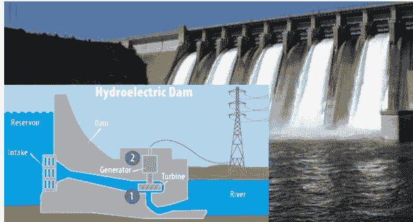

图 4. 波浪能

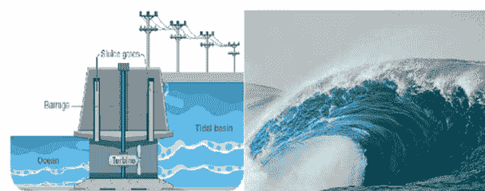

## 未来前景与挑战

水力发电的演变：水力发电的未来在于环境问题、提高效率以及适应不断变化的能源格局。小型水力发电以及对现有水坝的改造及相关科学

图 5. 潮汐能系统


是持续研究的领域。材料和内燃机设计的进步对于提高效率也很重要。

### 海洋能源的进步

海洋能源对全球能源转型具有巨大前景。持续测试加上投资增加，将带来更有效且更具成本效益的技术。需要协作努力来克服技术挑战并建立坚实的监管基础。

### 与其他可再生能源的整合

水力发电、海洋能源和其他可再生能源之间的合作是构建强韧且可持续能源系统的关键。整合方法，例如将水力发电与太阳能和风能混合系统相结合，为解决间歇性问题和满足能源需求提供了潜在方案。

### 政策与监管框架

政府通过支持性政策、激励措施和监管框架，在塑造水力发电和海洋能源的未来方面发挥着重要作用。关于环境影响评估、社会数据和项目事件的明确指南对于确保负责任的发展至关重要。

### 1.4 生物质能与生物能源

生物质和生物能源研究旨在利用有机材料（如农业残留物和专用能源作物）中的能量。生物燃料生产、沼气技术以及生物能碳捕获与封存（BECCS）的发展是关键领域。可持续做法以及防止与粮食生产竞争的努力是关键问题（Hakeem, 等人，2016）（Hakeem, 等人，2014）（Ozturk, 等人，2017）（De, 等人，2014）。

### 生物质的定义与类型

生物质是指来源于生物（主要是植物和动物）的有机物，可用作能源。这种可再生能源资源丰富且多样，包括各种形式：

- **木质生物质：** 来源于树木和林业残留物，木质生物质包括林业颗粒、木片和原木。它是生物能源生产的既定原料。
- **农业生物质：** 农作物残留物（例如，秸秆、谷物秸秆）和专用能源作物（如，灯芯草、花叶芒）构成农业生物质，提供可持续机遇。
- **动物废弃物：** 畜禽废弃物，如粪便，可通过厌氧消化或燃烧进行处理以生产生物能源。
- **市政固体废弃物（MSW）：** MSW 中的有机成分，包括食物垃圾和庭院垃圾，可进行处理以生产生物能源。
- **藻类：** 藻类生物质富含油脂，可用于生物燃料生产，为可持续交通燃料提供潜在来源。
- **生物能源技术：** 使用多种技术将生物质转化为可用能源，适用于各种原料和用途（Naqvi, 等人，2018）（Scalat, 等人，2015）：
  - **燃烧：** 生物质燃烧包括燃烧有机物以产生热量和电力。它通常用于供暖应用以及生物质发电厂的发电。
  - **气化：** 生物质气化通过与受控量的氧气或蒸汽反应，将有机物转化为可燃气体（合成气）。合成气可用于发电或转化为生物燃料。
  - **厌氧消化：** 这种生物过程在无氧条件下分解有机物，产生富含甲烷的沼气。厌氧消化广泛用于处理有机废弃物并产生可再生燃料。
  - **生化转换：** 生化过程，如涉及水解和微生物消化的发酵，用于将生物质转化为乙醇和生物柴油等生物燃料。
  - **热解：** 热解涉及在无氧条件下加热生物质以生产生物油、生物炭和合成气。生物油可进一步加工为生物燃料。

### 未来前景

生物质和生物能源的未来前景广阔，技术与方法不断取得进步和创新：

- **先进生物燃料：** 研究侧重于开发能量密度更高、与现有基础设施兼容且环境影响更低的先进生物燃料。
- **生物能源与碳捕获和封存（BECCS）：** BECCS 正在引起关注，作为通过捕获和封存生物能源过程中的二氧化碳来实现负排放的手段。
- **集成生物炼厂：** 集成生物炼厂旨在通过生产一系列生物基产品（包括生物燃料、生物化学品和材料）来最大化生物质的价值。
- **国际合作：** 全球合作对于解决生物质和生物能源发展中的挑战以及分享最佳实践至关重要。

生物质和生物能源在向可持续和低碳能源未来过渡中发挥着至关重要的作用。

### 1.5 地热能

地热能，利用地球内部热量，因其可靠性和较低的环境影响而受到关注（Klemeš, 等人，2015）（Barbier, 等人，2002）（Dickson, 等人，2013）（Fridleifsson, 等人，2001）。研究重点是增强型地热系统（EGS）、先进钻探技术以及勘探新的地热水库。将地热能纳入区域供暖系统是日益增长的趋势（图 6 显示了地热能）。

### 了解地热能

**地球的内部热量：** 地热能利用地球的内部热量，这种热量起源于行星的形成和放射性同位素的衰变。热量储存在地壳和地幔中，并以多种形式表现出来，例如火山活动、温泉和间歇泉。

**地热资源的类型：** 地热资源可分为三种主要类型：水热系统、地压系统和热干岩系统。水热系统是最常见且最容易获取的，包括利用地壳中的热量和能量来发电。

图 6. 地热能

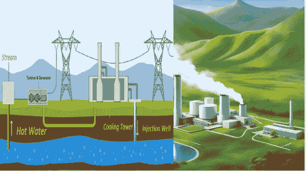

### 地热能的历史发展

早期地热能的利用：历史上，各个文明都认识到并利用地热能的潜力，用于供暖和治疗目的。在地热活跃地区的原住民利用温泉进行沐浴、烹饪和治疗。

地热发电厂的出现：从地热源发电的首次尝试发生在 20 世纪初之前。第一座地热发电厂的开发，例如意大利拉代罗的电厂，标志着在地热能有效利用方面发电取得了重大成就。

### 地热技术

地热发电厂：地热发电厂使用各种技术利用地球热量进行发电。最常见的类型包括干蒸汽、闪蒸蒸汽和二元循环发电厂。每种技术都有其优势，并适用于不同的地热资源环境。

直接利用应用：除了发电，地热能还用于直接利用，例如空间供暖、温室供暖、水产养殖池塘供暖和工业过程。这些应用直接利用地球的热量，无需经过发电这一中间步骤。

### 环境影响

温室气体排放降低：与传统化石燃料相比，地热能因其较低的环境影响而得到认可。提取并将地热转化为电力的过程释放的温室气体极少，有助于应对气候变化。

地下影响：虽然地热能在运行过程中相对清洁，但地下活动可能会带来环境挑战。向地下注入和从地下抽取流体


## 可再生能源研究与应用的趋势与挑战

地壳可能有助于构造活动，尽管这些活动主要是小规模的。

## 地热能的优势

- **可再生和可持续：** 地热能来自取之不尽的源头，可控制以实现稳定的电力生产。与太阳能或其他可再生能源不同，地热能不依赖于天气条件，因此是一种可靠且稳定的电力来源。

- **基荷电力生产：** 地热电厂可以稳定运行，提供基荷电力，以弥补太阳能和风能等可再生能源的间歇性特点。这使得地热能成为多样化且灵活能源电网的重要组成部分。

## 挑战与局限性

- **资源位置：** 地热资源的可用性仅限于地球内部高热流的某些陆地区域。这限制了地热电厂的广泛部署，并需要仔细选址。

- **初始成本与钻井风险：** 开发和培育地热储层的前期成本可能很高。勘探和钻井涉及风险，因为并非所有地热井都能产生有效储层，这使得早期阶段的支出成为一项挑战。

## 2. 可再生能源研究中的困难与挑战

- **间歇性与可靠性：** 可再生能源的基本挑战之一是某些来源（如太阳能和风能）的间歇性特性。解决电力输出不稳定问题并确保可靠电力供应，需要在能源存储技术、智能电网和需求侧管理方面取得进展（Brophy, et al., 1997）（Kulasekara, et al., 2019）。

对可再生能源日益增长的重视源于减少对非可再生能源依赖、减轻环境影响并实现可持续能源未来的需求。虽然太阳能、风能和水电等可再生能源提供了有前景的机遇，但其不规则性对电力供应的可靠性构成了重大挑战。本节旨在全面研究可再生能源研究中关于间歇性和可靠性的困难与挑战（Miranda, et al., 2017）（Marrosso, et al., 2018）。

### 理解间歇性

间歇性是指可再生能源发电中的可变波动，由资源的固有变异性驱动。太阳能取决于白天的日照情况，风能取决于风速，水电取决于水流。这些波动导致电力输出不可靠，使得难以将能源供应与需求相匹配。

### 间歇性的后果

间歇性发电的影响不仅仅是不便。可持续能源的不稳定性对电网稳定性构成挑战，需要由常规能源驱动的备用系统。这破坏了转向可再生能源的初衷，因为对化石燃料的依赖继续用于补偿零星的可再生能源生产。

### 可靠性问题

能源系统的可靠性对于满足持续的电力需求至关重要。间歇性能源往往无法提供固定且恒定的供应，导致电网失衡和潜在中断。这种不稳定性不仅影响住宅和工业客户，还使可再生能源融入现有电力基础设施变得复杂。

### 间歇性的原因

了解间歇性的原因对于开发有效的解决方案至关重要。天气模式、地理位置和时间等因素对可再生能源生产有显著影响。云量、风况和季节变化加剧了能源的可变性，进一步复杂化了平衡供需的挑战。

### 技术解决方案

解决间歇性问题需要创新的技术方案。储能系统（如先进电池和抽水蓄能）在储存高峰发电期间的多余能量以供低生产期使用方面发挥着重要作用。此外，智能电网技术的进步使对波动电力输入的更好管理成为可能，从而提高电网稳定性。

### 需求侧管理

解决间歇性问题的另一个方法在于需求侧管理政策。鼓励消费者根据可再生能源的可用性调整其能源使用模式，有助于平衡供需。分时电价、需求响应计划和智能电器有助于构建更具适应性和响应性的能源系统。

### 混合可再生能源系统

将多种可再生能源整合到混合系统中可以减轻间歇性的影响。例如，结合太阳能和风能，可以利用这些来源的互补性实现更平衡的电力输出。混合系统提高了可靠性，并有助于构建更具韧性的电力供应。

### 政策与监管措施

有效的政策和法规对于促进可再生能源的发展和整合至关重要。研究激励措施、上网电价和严格的减排目标可以推动采用增强可再生能源可靠性的技术。

### 未来前景

可再生能源研究的未来在于克服间歇性和可靠性挑战。正在进行的研究工作集中于改进储能技术、优化电网管理系统和提高可再生能源转换过程的效率。政府、公用事业公司和研究机构之间的协作努力对于实现可持续且可靠的可再生能源未来至关重要。

间歇性和可靠性挑战对可再生能源无缝融入现有电力系统构成了严峻的障碍。然而，通过在技术创新、需求侧管理、混合系统和支持性措施方面的协调努力，这些挑战可以得到解决。通过理解间歇性和可靠性的复杂性，研究人员和政策制定者可以为优先过渡到清洁可靠的可再生能源的强韧且可持续的能源未来铺平道路。

### 2.1. 储能

储能是可再生能源广泛采用的关键组成部分。研究集中于开发高容量且经济的储能解决方案，例如先进电池、抽水蓄能以及飞轮和热能储能等新兴技术。克服当前储能系统的局限性对于实现更具灵活性和韧性的电网至关重要（Doneus, et al., 2011）（Kuang, et al., 2014）（Boltasseva, et al., 2008）。

储能在可再生能源的整合和发展中发挥着关键作用。随着世界向可持续能源格局转变，太阳能和风能等可再生能源的间歇性提出了独特的挑战。储能技术提供了关键解决方案，使可再生能源能够被有效捕获、存储和部署。在这项全面的调查中，我们将研究可再生能源背景下储能的作用，分析不同的储能技术、其应用及其对实现更清洁、更灵活的能源未来的影响。

### I. 可再生能源中储能的需求

### A. 间歇性挑战

**太阳能与风能的变异性**
- 日和季节性波动
- 对电网稳定性的影响

**平衡供需**
- 失配问题
- 高峰需求与低谷发电

### B. 电网可靠性与韧性

**频率调节**
- 维持电网稳定
- 对可靠电力供应的重要性

**可再生能源的电网整合**
- 缓解电网拥堵
- 增强灵活性和可靠性

### II. 储能技术

### A. 电池

**锂离子电池**
- 在便携式电子产品中的主导地位
- 在电动汽车中的进步
- 电网级应用

**液流电池**
- 氧化还原液流电池
- 钒液流电池

### 应用与优势

- 钠离子电池
  - 新兴技术
  - 电网级储能的潜力
  - 成本与性能考量

### B. 抽水蓄能

**基本操作**
- 势能与动能
- 双水库系统

**优势与挑战**
- 高效率
- 地理限制
- 环境影响

### C. 热能储存

图 7 显示了热能系统。


## 可再生能源研究与应用中的趋势与困难

图 7. 热能系统

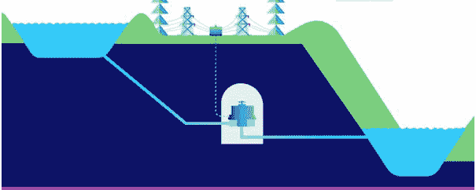

显热储能 - 熔盐技术，在聚光太阳能发电中的应用。

潜热储能 - 相变材料，在太阳能热系统中的作用。

## III. 能量存储在可再生能源中的应用

### A. 电网层面存储
- 削峰
  - 降低峰值需求
  - 公用事业成本节约
- 负荷转移
  - 平衡能源需求
  - 提高电网效率

### B. 微电网集成
- 提高可靠性
  - 岛网运行能力
  - 停电期间的韧性
- 基于社区的可再生能源
  - 赋能当地社区
  - 分散式能源系统

### C. 交通电气化
- 电动汽车
  - EV 电池技术
  - 智能充电基础设施
- 可持续公共交通
  - 与可再生能源集成
  - 对城市出行的优势

## IV. 经济与环境影响

### A. 成本考量
- 能量存储成本趋势 - 电池价格下降，储能平准化成本
- 经济效益 - 储能运营商的收入来源，与可再生能源融资相结合

### B. 环境效益
- 温室气体排放减少 - 替代化石燃料，能量存储系统全生命周期分析
- 可持续资源管理 - 回收与处置考量，电池技术中的循环经济

## V. 研究与开发

### A. 技术进步
- 材料科学创新 - 下一代电池材料，先进热储存储介质
- 智能能源管理系统，电网优化中的人工智能应用，能量存储预测分析。

### B. 政策与监管格局
- 能量存储部署激励 - 联邦和州级举措，储能市场机制。
- 标准化与认证 - 确保安全与性能，简化并网流程

## VI. 案例研究

### A. 成功的能量存储项目
- 霍恩斯代尔电力储备 - 世界最大锂离子电池，对南澳大利亚电网的影响
- 迪诺威格电站 - 威尔士抽水蓄能，电网支撑与稳定性

### B. 挑战与经验教训
- 波多黎各微电网项目 - 玛丽亚飓风后的韧性努力，克服技术和监管挑战。
- 加利福尼亚州向可再生能源转型 - 在实现 100% 清洁能源中的能量存储，解决电网拥堵和间歇性问题。

随着该领域致力于可持续能源未来，能量存储在最大化取之不尽能源潜力方面的作用不可估量。从应对间歇性挑战到提高电网可靠性和弹性，能量存储系统是向更清洁、更高效能源系统过渡的关键推动因素。随着持续的研究、技术进步和支持性政策，取之不尽能源与能量存储的集成有望实现灵活、可靠且可持续的全球能源格局。

## 2.2. 电网集成

将可再生能源集成到现有电网中面临技术和运营挑战。图 8 展示了智能电网。研究重点在于发展智能电网技术、提高电网可靠性以及优化各种电源的布局。解决电力供需之间的差距需要在电力预测和电网管理方面采取创新方案（Croisier et al., 2008）（Lathi et al., 2020）（Rego et al., 2012）。

电网集成是向可持续低碳电力系统过渡的关键环节。随着全球致力于减少对碳氢化合物储量的依赖，太阳能和风能等可再生能源发挥着关键作用。然而，将这些可变且不规则的能源并入现有电网面临诸多挑战。本综述概述了可再生能源电网集成的关键问题，阐述了应对这些挑战的各种策略，并对无缝集成的可再生能源电网的未来前景提供了见解。

图 8. 智能电网系统

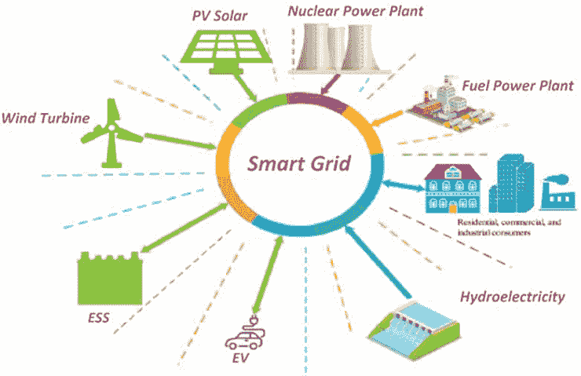

### 电网集成中的挑战

- **间歇性与可变性**：探讨太阳能和风能的基本间歇性及不稳定性及其对电网建设的影响。讨论在可变可再生能源发电时代，将电力供应与需求相匹配的挑战。

- **电网稳定性与可靠性**：分析高比例可再生能源接入对电网安全和可靠性的潜在影响。解决与频率控制、电力需求以及电网整体韧性相关的问题。

- **基础设施升级**：讨论升级现有电力基础设施以容纳可再生能源增加容量的必要性。探讨电网扩建和改造的经济和技术挑战。

- **能量存储**：考察能量存储系统在缓解可再生能源不稳定性方面的作用。讨论当前储能解决方案的现状、其成本及其在提高电网可靠性方面的作用。

### 电网集成策略

- **先进电网管理**：探索使用先进的电网管理方法，包括智能电网、需求响应和电网自动化，以优化可再生能源集成。讨论数字技术在提高电网灵活性方面的作用。

- **灵活电力生成**：考察灵活电力生成的概念，包括使用灵活的常规电厂和混合可持续系统。讨论多样化能源结构在确保弹性可靠电力供应方面的好处。

### 互联与输电

讨论区域和跨境互联在平衡可再生能源波动方面的重要性。探索增强频率范围和电网连接的挑战与途径。

### 政策与监管措施

分析支持性政策和法规在促进可再生能源并入电网方面的作用。探索成功案例并确定鼓励可再生能源发展的监管框架的最佳实践。

### 案例研究

- **德国“能源转型”**：分析德国向可再生能源电网过渡的经验，强调关键经验教训、面临的挑战以及实施的有效政策。

- **加利福尼亚州可再生能源集成**：考察加利福尼亚州将高比例可再生能源集成到其电网中的努力。讨论该州实现电网可靠性的策略、技术变革和挑战。

### 未来展望

- **技术进步**：讨论可能进一步加强可再生能源电网集成的新兴技术，包括先进预测、人工智能应用和下一代储能解决方案。

- **全球合作**：探索国际合作在应对电网集成挑战方面的潜力。讨论在全球范围内知识共享、联合研究和政策协调的重要性。

- **经济考量**：分析电网集成的经济影响，考虑可再生能源部署的成本和收益。讨论技术进步和规模经济如何促进成本降低。

## 2.3. 环境影响

虽然可再生能源主要被视为环保，但某些技术可能产生实质性影响。水电项目可能破坏生态系统，生物能源的使用也引发了关于土地利用和生物多样性的担忧。研究重点是通过可持续实践、栖息地恢复和环保技术的开发来减少这些影响（Fosket et al., 2009）（Chambers et al., 2013）（Mikkelsen et al., 2015）。

可再生能源已成为应对传统碳氢化合物储量所带来环境挑战的有前景解决方案。本文对各种可再生能源技术（包括太阳能、风能、水能和地热能）的环境影响进行了深入分析。通过考察每种技术的全生命周期、资源开采、生产、运行和退役，我们旨在全面了解其与环境的相互作用。此外，本文探讨了可再生能源发展采取整体方法的重要性，将土地利用、水资源消耗，


## 可再生能源研究与应用的趋势与困难

和生物多样性保护。通过这项研究，我们旨在让政策制定者、分析师以及公众了解不可竭尽能源起源方面的细微具体层面。

### 太阳能

在寻找可行且清洁的能源起源过程中，不可竭尽能源已成为一种受青睐、充满希望的未来方向，人类可以借此减少对有限不可再生能源的依赖，减轻气候变化的影响。太阳能源自太阳，是一种丰富且可再生的资源，具有满足日益增长的全球能源需求的巨大潜力（Chen 等，2011）。本文全面概述了太阳能，深入探讨其历史、技术进步、附带效益以及其成为主流能源起源所面临的挑战。

历史背景：太阳能的使用可追溯至约 1000 年前，古文明曾为不同目的利用阳光的力量。例如，希腊人和罗马人曾利用太阳能设计来建造最大化阳光照射的房屋。然而，直到 19 世纪，科学家们才开始探索将 24 小时中的光照部分转化为可用能源的可能性。1839 年，法国研究员 Edmond Becquerel 发现了光伏效应，为光伏电池的发展奠定了基础（Hou 等，2011）。

光伏技术：现代太阳能的核心是光伏（PV）技术。PV 电池，又称为光伏电池，是将阳光直接转化为电能的半导体器件。这些电池最常用的材料是硅，归因于其半导体特性。多年来，科学家在提高太阳能电池效率和降低成本方面取得了重大进展，使其成为常规能源的可行替代方案。

太阳能热利用技术：除光伏技术外，太阳能还可以通过太阳能热利用系统来利用。这些系统使用镜片或透镜将阳光聚集到狭窄区域，产生可用于生产能源并驱动涡轮机发电的热量。采用这种技术的聚光太阳能发电（CSP）电厂因其在光照减弱期间仍能提供稳定电力的能力而受到关注。

环境效益：太阳能最具吸引力的方面之一是其相对于常规能源的微小环境影响。太阳能发电不产生温室气体排放，从而减缓气候变化并降低空气污染。通过利用太阳的能量，我们可以显著降低对碳氢化合物储量的依赖，减少碳足迹，并构建更加可持续的能源格局。

经济考量：太阳能的商业可行性在当今时代已大幅提升。太阳能电池板成本的下降，加上政府激励和补贴，使太阳能与既有能源相比日益具有竞争力。太阳能行业已实现稳健增长，在制造、安装和维护领域创造了就业机会并支持创新。

分布式发电与电网接入：太阳能系统可以在不同规模下部署，从小型住宅屋顶安装到大型公用事业级太阳能农场。太阳能的分布式特性，又称分布式发电，使社区能够自行发电，降低对集中式电网的依赖。然而，将不可竭尽能源纳入现有电网面临与储能、间歇性和电网建设相关的挑战（Mekhilef 等，2011）。

### 技术创新与未来趋势

太阳能领域的持续研究涉及效率机制创新。钙钛矿光伏电池、领先的储能系统和太阳能涂料等新兴电子技术有望进一步提升效率并扩大应用范围。人工智能与智能电网电子技术的融合，也在进一步增强太阳辐射资源的管理。

### 挑战与解决方案

虽然太阳能取得了重大进展，但仍面临亟待解决的挑战，以实现广泛接受。间歇性、能源存储以及光伏电池生产的附带影响等问题需要创新方案。能源存储电子技术、电网基础设施以及光伏电池回收计划的进步对于克服这些挑战至关重要。

### 风能

在探索可行且不可竭尽能源的过程中，风能已成为一项杰出的能源，对全球向更清洁、更环保的电力生产转型作出了重大贡献。利用风力的运动能发电，风能已从小众技术迅速发展成为应对气候变化挑战和传统碳氢化合物储备耗竭的主流解决方案（Krohn 等，2011）（Ackemann 等，2000）。

### I. 风能的历史演变

要了解风能的重要性，有必要探究其历史演变。利用不可竭尽能源用于各种目的可以追溯到很早以前，早期文明使用风车来研磨谷物和供水。然而，向发电的转变始于 19 世纪末，伴随着风力涡轮机的出现。查尔斯·F·布拉什（Charles F. Brush）和保罗·拉库尔（Poul la Cour）等先驱为新的风能方法奠定了基础，为 20 世纪下半叶大型风电场的发展铺平了道路（Tong 等，2010）。

### II. 风能基础

风能是一种将运动空气的动力转化为电能的不可竭尽能源形式。这种转换的主要装置通常是发电机，由连接到转子的叶片组成。当风吹动时，叶片旋转，带动转子启动。转子反过来激活能量转换装置，将机械能转化为电能。风力涡轮机有不同尺寸，从适合家庭使用的小型涡轮机到用于公用事业级风电场的大型涡轮机。

### III. 风力涡轮机组件

- A. 转子和叶片：转子是风力发电机的主要旋转部件。叶片连接到转子，对于捕获风能至关重要。
- B. 机舱：机舱是容纳关键部件的外壳，包括发电机、传动系统和控制系统。它安装在塔筒上方，可以旋转以面向风，优化能量捕获。
- C. 塔筒：塔筒为驱动机器的装置提供高度，使其能够捕获更高的风速。塔筒可由不同材料制成，包括钢和混凝土。

### IV. 风能系统类型

- A. 陆上风电场：陆上风电场位于陆地上，是风能最常见的形式。优势包括可及性、成本效益和稳固的基础。

- B. 海上风电场：海上风电场位于水域，通常在沿海地区。优势包括更高的风速和更小的视觉影响，但挑战包括更高的安装和维护成本。

- C. 分布式风能系统：分布式风能系统包括用于本地电力生产的小型涡轮机。常见应用包括住宅、农业和工业环境。

### V. 环境影响与效益

- A. 温室气体排放减少：风能是一种清洁且可持续的能源，对温室气体排放的显著下降作出了贡献。用不可竭尽能源取代常规不可再生能源有助于缓解气候变化。

- B. 土地利用与生物多样性：与常规发电厂相比，风电场通常占用更少土地，允许农业中双重土地利用。适当的规划和选址有助于降低对当地环境和生物的影响。

### VI. 技术进步与创新

- A. 涡轮机设计：空气动力学和材料研究的进步带来了更高效的涡轮机设计。垂直轴风力机和叶片技术等创新提升了性能。

- B. 能源存储集成：针对风能的间歇性特点，能源存储技术提高了不可竭尽能源系统的可靠性和安全性。电池存储和其他存储方案允许存储多余电力，以便在风力不足期间使用。

### VII. 经济考量

- A. 成本趋势：风能成本呈现合理下降趋势，使其与常规能源相比更具竞争力。政府激励和补贴在支持风能领域发展方面发挥了重要作用。

- B. 就业创造：风能制造业对就业创造作出重大贡献，涉及制造、安装、维护和测试。拥有风电场的当地社区通常通过增加就业和税收收入获得经济效益。

### VIII. 挑战与解决方案

- A. 间歇性与电网接入：风能的不规则特性对电网整合构成挑战。解决方案包括改进预测、先进的电网技术和能源存储。

- B. 公众认知与美学：对风力项目的反对可能源于对噪音、视觉影响以及对房产价值影响的担忧。社区参与、正确的选址和美观的设计可以解决这些问题。

### IX. 全球视角

- A. 主要风能生产国：中国、美国和德国等国家在风能产量方面处于世界领先地位。印度和巴西等新兴市场正在快速扩大其风能产能。

- B. 国际合作：协作努力和国际协定推动风能的全球进步。共享最佳实践、技术转移和联合研究有助于行业的发展。


## 可再生能源研究与应用的趋势与困难

## X. 未来展望：

- A. 扩大风电装机规模：全球对可再生能源的需求使得风电装机规模的持续扩大势在必行。技术进步、政策支持和资金将推动其进一步发展。

- B. 与其他可再生能源整合：将风能与其他可再生能源（如太阳能和水电）相结合，构成更加多样化和可靠的能源组合。混合能源系统增强了整体能源灵活性。

## 水电：利用水力实现可持续能源

水电，又称水力发电，是一种利用流水动力发电的可再生能源。它是最古老、最成熟的可再生能源形式之一，可追溯到古代文明使用水车进行各种机械任务的时代。如今，水电在全球能源格局中发挥着关键作用，提供清洁可持续的电力来源（Li, et al., 2018）（Bartle, et al., 2002）（Breeze, et al., 2002）。

第一座水电站于1882年由H.J. Rogers在美国威斯康星州Appleton建成（Dicharry, et al., 2012）。这些电站利用狐狸河的水力发电，为一家造纸厂及附近公寓提供照明。该项目的成功为水电作为可靠且灵活的电力来源的广泛采用铺平了道路。

### 水电的基本原理

水电站基于将流动水的动能转换为机械能，进而用于发电的原理运行。水电方案主要有两种类型：水库型和河床式。

### 水库型水电

水库型水电，通常被称为常规水电，涉及修建水坝以创建水库。水坝后方高位水中储存的势能以受控方式释放，流经涡轮机发电。水库充当储能系统，允许根据需求调节电力输出。

### 河床式水电

河床式水电系统不需要大型水库。相反，它们利用河流或溪流的自然流量发电。这些系统将部分流动水引至涡轮机，将动能转换为电能。与水库型设施相比，河床式项目通常对环境的影响较低，因为它们对河流环境的改动极小。

### 环境与社会影响

虽然水电被视为一种清洁可再生的能源，但它并非没有环境和社会顾虑。水坝和水库的建设可能导致栖息地破碎化、水流模式改变以及社区迁移。大型水电项目必须仔细评估并减轻这些影响，以确保可持续性。

## 水电的优势

### 可再生与可持续

水电依赖于地球的水循环，使其成为一种可持续且可再生的能源。

### 低温室气体排放

水电在运行期间产生极少的温室气体排放，有助于应对气候变化的努力。

### 可靠且可调度

水电站能够快速响应电力需求的变化，提供可靠且可调度的电力来源。

### 寿命长

水电设施寿命长，通常超过50年，有助于其经济可行性。

## 挑战与局限性：

### 环境影响

水坝和水库的建设可能产生显著的物理影响，包括栖息地破坏、水质改变以及泥沙输移变化。

### 高初始成本

建设水电基础设施（尤其是水坝和涡轮机）的前期成本可能非常高昂，因此需要筹集大量初始投资。

### 适宜场地有限

大型水电项目的适宜场地有限，且许多场地已被开发，给进一步扩展带来了挑战。

### 创新与新兴技术

持续的研究和技术进步不断塑造着水电的未来。鱼类友好型涡轮机、改进的泥沙管理以及小型和分布式水电系统的开发等创新，旨在解决环境问题并扩大水电部署的潜力。

## 地热能

地热能是一种强大且可持续的可再生能源，利用地球内部热量用于发电、供暖和制冷等各种应用。与化石燃料储量不同，地热能清洁、丰富且可持续供应，使其成为全球向可持续能源未来过渡的重要组成部分（Gupta, et al., 2006）（White, et al., 1966）（Lund, et al., 2005）（Kylili, et al., 2021）（Latin, et al., 2012）。

### I. 定义与概述

地热能源于地球内部热量，这种热量源于矿物放射性衰变以及行星形成时保留的热量。通过各种技术可以利用这种能量发电，或为住宅、商业和工业用途提供直接供暖和制冷。

### II. 地热资源类型

- **水热系统**：热干岩（HDR）系统：这些系统涉及通过破裂高温岩层并注水来创建人工地热储层以产生能量。

- **压载地热资源**：分布于深部沉积盆地，压载地热资源含有高压流体，可用于发电。

- **增强型地热系统（EGS）**：EGS通过向高温岩层注水来增强其渗透性，创建可提取热量的人工地热储层。

- **直接利用应用**：地热热泵：这些系统利用地球相对稳定的温度为建筑物提供供暖和制冷。

- **地热区域供暖**：社区可利用地热能用于集中供暖系统，减少对常规能源的依赖。

### III. 地热发电

**干蒸汽发电厂**：利用直接来自地热储层的能量驱动涡轮机。

**闪蒸汽发电厂**：提取高压流体，将其闪蒸成蒸汽以发电。

**二元循环发电厂**：将地热流体的热量传递给沸点较低的二次流体，进而产生蒸汽并发电。

**全球地热发电**：领先的可再生能源生产国包括美国、菲律宾、印度尼西亚和新西兰。

全球地热发电能力一直在稳步增长，有助于能源来源的多样化。

### IV. 环境影响与可持续性

**低温室气体排放**：与化石燃料发电厂相比，地热发电厂产生的温室气体排放显著较少。

地热能的可持续特性有助于减轻传统能源对环境的影响。

**土地利用与占地面积**：与其他可再生能源（如太阳能或风电场）相比，地热发电厂的占地面积相对较小。

仔细选址和成熟的开发实践涉及尽量减少环境干扰的方法。

### V. 经济考量

**成本竞争力**：地热能的成本竞争力日益增强，尤其是在地质条件有利的地区。技术进步和改进的钻井方法有助于降低地热项目的总体成本。

**就业创造与经济效益**：地热产业提供从勘探、培训到电厂运营与维护的就业机会。承接地热项目的当地社区通常会获得经济效益，包括税收增加和基础设施建设。

### VI. 挑战与障碍

**资源位置与可及性**：并非所有地区都有易于获取的地热资源，这限制了地热能的广泛应用。EGS等技术进步旨在克服这些限制，使地热能在更多地点成为可行的选择。

**初始投资与风险**：地热勘探和开发的前期成本可能很高，对某些项目构成进入壁垒。政府和私人投资者日益认识到地热能的长期效益和可持续性，从而增加投资。


### 2.4. 技术障碍

可再生能源的进步经常受到机械障碍的阻碍。需要开展研究，以克服材料限制、生产流程以及某些技术可扩展性等挑战。科学家、制造利益相关者和政策制定者之间的合作对于加速创新解决方案的开发与部署至关重要。全球推动可再生能源是应对气候变化和确保可持续未来的重要组成部分（Soham 等，1980）（Jones 等，2020）（Berry 等，1994）。

### 太阳能：间歇性与变异性

太阳能源自太阳，是一种有前景的可再生能源。然而，阳光的间歇性给常规发电带来了挑战。云层覆盖、昼夜交替和季节差异影响太阳能的可靠性。

### 能量存储

有效的能量存储解决方案对于解决间歇性问题至关重要。目前的储能装置，如电池，在容量、效率和成本方面存在局限。正在开展研究，以开发尖端的存储解决方案，能够高效存储和释放太阳能。

### 技术创新

包括钙钛矿太阳能电池和太阳能跟踪结构在内的新兴技术，有望提升太阳能发电系统的效率和可靠性。钙钛矿太阳能电池具有更高的效率和更低的生产成本，而太阳能跟踪系统则通过将太阳能电池板朝向阳光来增强能量捕获。

### 风能

- **间歇性与可靠性**：风能通过风力涡轮机产生，面临与风力模式间歇性相关的挑战。风速不稳定以及这方面的意外变化可能导致电力输出波动，影响风能的可靠性（Walker 等，1997）。

- **电网并网**：将风能并入现有电网面临技术挑战。必须解决电网基础设施、电力波动以及为容纳可变可再生能源输入而进行电网升级的需求等问题，以实现平稳并网。

- **海上风电挑战**：虽然海上风电场有潜力产生大量能源，但其建设和维护面临独特挑战。恶劣的海洋环境、运营复杂性和高昂的初始成本阻碍了海上风能的广泛采用。

### 水电

- **环境影响**：虽然水电是一种成熟可靠的可再生能源，但其大规模部署引发了环境担忧。大坝建设可能导致栖息地破碎化、水生生态系统改变以及当地社区迁移（Kelly 等，2017）。

- **地理范围有限**：水电的可行性仅限于具有合适地形和水资源的地区。这种地理限制将水电作为主要可再生能源的广泛可扩展性限制在一定范围内。

- **技术进步**：正在进行的研究专注于改进水电技术，如河床式和抽水蓄能系统。这些进步旨在减少环境影响、提高效率并扩大水电的地理覆盖范围。

## 可再生能源研究与应用的趋势与挑战

### 生物质能

- **原料可用性与竞争**：生物质能源自有机材料，面临与原料可用性及竞争相关的挑战。平衡生物质能原料需求与其他关键用途，如粮食生产，可能产生冲突并限制生物质能源的可持续性（Schlamadinger 等，1996）。

- **技术效率**：将生物质转化为可用能源需要高效技术。目前的生物质能转化过程，如厌氧消化和燃烧，在能源效率和排放方面存在劣势（Prochnow 等，2009）。

- **先进生物质能技术**：研究人员正在探索先进的生物质能技术，包括第二代生物燃料和藻类生物质能。这些创新旨在提高能源产量、减少原料竞争，并提升生物质能生产的整体可持续性（El Bassam 等，2010）（Kittur 等，2013）。

## 3. 未来方向与解决方案

### 3.1. 跨学科合作

为应对可再生能源研究中的复杂挑战，跨学科合作至关重要。汇集工程、材料科学、自然科学、经济学和政策领域的专家，可以支持包容性解决方案，考虑技术细节、公众和财务方面。

### 3.2. 政策支持与激励

政府政策在塑造可再生能源格局方面发挥着重要作用。持续的支持、补贴以及针对研究的激励措施，加上有利监管框架的实施，对加速向可持续能源未来的过渡至关重要。

### 3.3. 公众意识与教育

提高公众对可再生能源益处和挑战的认识，对于促进广泛接受和支持至关重要。推动能源素养并让社区参与可持续实践的教育行动，有助于创建一个更知情、更有能力的社会。

### 3.4. 全球合作

应对气候变化和能源可持续性的全球挑战需要国际团结。各国间的合作努力，共享研究成果，并共同投资可再生能源项目，可以加速进步并增强个体行动的影响。

## 4. 结论

可再生能源研究与应用的趋势和挑战凸显了该领域的活跃性。尽管科学进步有助于推动向清洁能源的过渡，但解决间歇性、存储和环境影响等挑战仍然至关重要。合作努力、创新解决方案和支持性政策对于克服这些挑战，并实现可再生能源在构建可持续且有韧性的未来中的全部潜力至关重要。

## REFERENCES

Ackermann, T., & Söder, L. (2000). Wind energy technology and current status: A review. Renewable & Sustainable Energy Reviews, 4(4), 315–374. doi:10.1016/S1364-0321(00)00004-6

Ali, O. M. (2022). Solar energy technology and its roles in sustainable development. Clean Energy, 6(3), 476–483. doi:10.1093/ce/zkac023

Anand, B., Shankar, R., Murugavelh, S., Rivera, W., Midhun Prasad, K., & Nagarajan, R. (2021). A review on solar photovoltaic thermal integrated desalination technologies. Renewable & Sustainable Energy Reviews, 141, 110787. doi:10.1016/j.rser.2021.110787

Baljit, S. S. S., Chan, H.-Y., & Sopian, K. (2016). Review of building integrated applications of photovoltaic and solar thermal systems. Journal of Cleaner Production, 137, 677–689. doi:10.1016/j.jclepro.2016.07.150

Barbier, E. (2002). Geothermal energy technology and current status: an overview. Renewable and Sustainable Energy Reviews, 6(1-2), 3-65.

Bartle, A. (2002). Hydropower potential and development activities. Energy Policy, 30(14), 1231–1239. doi:10.1016/S0301-4215(02)00084-8

Berry, Holland, & Watkiss. (1994). Externalities of fuel cycles’ ExternE’project. Coal fuel cycle. Estimation of physical impacts and monetary valuation for priority impact pathways. Academic Press.

Blanco. (2009). The economics of wind energy. Renewable and sustainable energy reviews, 13(6-7), 1372-1382.

Boltasseva, A., & Shalaev, V. M. (2008). Fabrication of optical negative-index metamaterials: Recent advances and outlook. Metamaterials (Amsterdam), 2(1), 1–17. doi:10.1016/j.metmat.2008.03.004

Breeze, P. (2018). Hydropower. Academic Press.

Brophy, P. (1997). Environmental advantages to the utilization of geothermal energy. Renewable Energy, 10(2-3), 367-377.

Cabal. (2017). Solar-thermal and hybrid photovoltaic-thermal systems for renewable heating. Academic Press.

Chambers, D. (2013). Social media and personal relationships: Online intimacies and networked friendship. Springer.

Chen, C. J. (2011). Physics of solar energy. John Wiley & Sons. doi:10.1002/9781118172841

Chow, T. T. (2018). A review on photovoltaic/thermal hybrid solar technology. Renewable Energy, 4(88), 119.

Chowdhury, M. S., Rahman, K. S., Selvanathan, V., Nuthammachot, N., Suklueng, M., Mostafaiepour, A., Habib, A., Akhtaruzzaman, M., Amin, N., & Techato, K. (2021). Current trends and prospects of tidal energy technology. Environment, Development and Sustainability, 23(6), 8179–8194. doi:10.1007/s10668-020-01013-4 PMID:33041645


## 可再生能源研究与应用的趋势与困难

- Croisier, J.-L., Ganteaume, S., Binet, J., Genty, M., & Ferret, J.-M. (2008). 职业足球运动员腿筋力量失衡与损伤预防：一项前瞻性研究. *The American Journal of Sports Medicine*, *36*(8), 1469–1475. doi:10.1177/0363546508316764 PMID:18448578

- De Meyer, A., Cattrysse, D., Rasinmäki, J., & Van Orshoven, J. (2014). 生物质生物能源供应链设计与管理优化方法：综述. *Renewable & Sustainable Energy Reviews*, *31*, 657–670. doi:10.1016/j.rser.2013.12.036

- Dicharry, S. Y. (2012). “风能生产补偿方案：石油式特许权使用费还是牡蛎式租金.” *Loy. L. REv.*, *58*, 179.

- Dickson & Fanelli. (2013). 地热能：利用与技术. Academic Press.

- Doneus, M., Verhoeven, G., Fera, M., Briese, C., Kucera, M., & Neubauer, W. (2011). 从沉积物到点云——基于低成本计算机视觉方法的考古发掘直观文档化研究. *Geoinformatics FCE CTU*, *6*, 81–88. doi:10.14311/gi.6.11

- Eicker, U., Pietruschka, D., Schmitt, A., & Haag, M. (2015). 不同气候条件下办公建筑光伏与太阳能热制冷系统的比较. *Solar Energy*, *118*, 243–255. doi:10.1016/j.solener.2015.05.018

- El Bassam, N. (2010). *生物能源作物手册：物种、开发与应用的完整参考*. Routledge. doi:10.4324/9781849774789

- Falcao, A. F. (2010). 波浪能利用：技术综述. *Renewable & Sustainable Energy Reviews*, *14*(3), 899–918. doi:10.1016/j.rser.2009.11.003

- Fang, X., & Li, D. (2013). 中国太阳能光伏和热能技术及应用. *Renewable & Sustainable Energy Reviews*, *23*, 330–340. doi:10.1016/j.rser.2013.03.010

- Fosket, J., & Mamo, L. (2009). 绿色生活：可持续的社区. New Society Publishers.

- Fridleifsson, I. B. (2001). 造福民众的地热能. *Renewable & Sustainable Energy Reviews*, *5*(3), 299–312. doi:10.1016/S1364-0321(01)00002-8

- Gupta, H. K., & Roy, S. (2006). 地热能：21世纪的替代资源. Elsevier.

- Hakeem, K. R., Jawaid, M., & Rashid, U. (编). (2014). *生物质与生物能源：应用*. Springer.

- Hakeem, K. R., Jawaid, M., & Rashid, U. (2016). *生物质与生物能源*. Springer International Publishing.

- Herbert, G. M. (2007). 风能技术综述. *Renewable & Sustainable Energy Reviews*, *11*(6), 1117–1145. doi:10.1016/j.rser.2005.08.004

- Hou, Y., Vidu, R., & Stroeve, P. (2011). 太阳能储能方法. *Industrial & Engineering Chemistry Research*, *50*(15), 8954–8964. doi:10.1021/ie2003413

- Huide, F., Xuxin, Z., Lei, M., Tao, Z., Qixing, W., & Hongyuan, S. (2017). 建筑三种太阳能利用技术的比较研究：光伏、太阳能热能和光伏/热能混合系统. *Energy Conversion and Management*, *140*, 1–13. doi:10.1016/j.enconman.2017.02.059

- Ibrahim, M., Imam, Y., & Ghanem, A. (2019). 水径流式水电站的最优规划与设计. Renewable Energy, 141, 858–873. doi:10.1016/j.renene.2019.04.009

- Jones, P. (2020). 帝国之城：安克拉治历史，1919-1941. University of Alaska Press.

- Kannan, N., & Vakeesan, D. (2016). 未来世界的太阳能：综述. Renewable & Sustainable Energy Reviews, 62, 1092–1105. doi:10.1016/j.rser.2016.05.022

- Kazem, H. A. (2016). 光伏太阳能热（PV/T）集热器的过去、现在与未来：综述. International Journal of Applied Engineering Research: IJAER, 11(22), 10757–10765.

- Kelly-Richards, S., Silber-Coats, N., Crotof, A., Tecklin, D., & Bauer, C. (2017). 可再生能源转型治理：小型水电繁荣的影响与政策问题综述. Energy Policy, 101, 251–264. doi:10.1016/j.enpol.2016.11.035

- Kittur, A. (2013). 众包工作的未来. 2013年计算机支持协作工作会议论文集. 10.1145/2441776.2441923

- Klemeš, J. J. (编). (2015) 环境影响与可持续性的评估与测量. Butterworth-Heinemann.

- Krohn, S., Morthorst, P-E., & Awerbuch, S. (2009). 风能经济学. European Wind Energy Association, 3.

- Kuang, M., Wang, L., & Song, Y. (2014). 用于高分辨率图案的可控打印液滴. Advanced Materials, 26(40), 6950–6958. doi:10.1002/adma.201305416 PMID:24687946

- Kulasekara, H., & Seynulabdeen, V. (2019). 未来发电的地热能综述. 2019年第五届电气工程前沿国际会议（ICAEE）. IEEE. 10.1109/ICAEE48663.2019.8975470

- Kumar, A., Kumar, K., Kaushik, N., Sharma, S., & Mishra, S. (2010). 印度的可再生能源：现状与未来潜力. Renewable & Sustainable Energy Reviews, 14(8), 2434–2442. doi:10.1016/j.rser.2010.04.003

- Kumar, R., & Rosen, M. A. (2011). 空气加热用光伏-热能太阳能集热器的批判性综述. Applied Energy, 88(11), 3603–3614. doi:10.1016/j.apenergy.2011.04.044

- Kylili, A., Thabit, Q., Nassour, A., & Fokaides, P. A. (2021). 采用整体框架推动创新可持续可再生能源发展：案例研究. Energy Sources. Part A, Recovery, Utilization, and Environmental Effects, 1–21. doi:10.1080/15567036.2021.1904058

- Lahti. (2020). 职业足球腿筋肌肉损伤风险降低的多因素个性化方案：前瞻性队列研究方案. BMJ Open Sport & Exercise Medicine, 6(1).

- Latin, H. A. (2012). 气候变化政策失败：为什么常规减缓方法无法成功. World Scientific. doi:10.1142/8194

- Li. (2018). 中国水电发展现状与前景. Renewable and Sustainable Energy Reviews, 82, 232-239.

- Lund, J. W., Freeston, D. H., & Boyd, T. L. (2005). 地热能直接应用：2005年全球综述. *Geothermics*, 34(6), 691–727. doi:10.1016/j.geothermics.2005.09.003

- Mahmud, M. A., Huda, N., Farjana, S., & Lang, C. (2018). 基于生命周期评估的光伏和太阳能热能系统的环境影响. *Energies*, 11(9), 2346. doi:10.3390/en11092346

- Manwell, J. F., McGowan, J. G., & Rogers, A. L. (2010). *风能原理：理论、设计与应用*. John Wiley & Sons.

- Marrasso, E., Roselli, C., Sasso, M., & Tariello, F. (2018). 与低温热微电网交互的地热热泵的全球与局部环境和能源优势. *Energy Conversion and Management*, 172, 540–553. doi:10.1016/j.enconman.2018.07.028

- Mekhilef, S., Saidur, R., & Safari, A. (2011). 工业领域太阳能利用综述. *Renewable & Sustainable Energy Reviews*, 15(4), 1777–1790. doi:10.1016/j.rser.2010.12.018

- Mikkelsen, L. R. (2015). *山火：大规模变革的行动研究*. Diss. Saint Mary's College of California.

- Mills, D. (2004). 太阳能热发电技术的进展. *Solar energy*, 76(1-3), 19-31.

- Miranda-Barbosa, E., Sigfússon, B., Carlsson, J., & Tzimas, E. (2017). CCS与地热能结合的优势. *Energy Procedia*, 114, 6666–6676. doi:10.1016/j.egypro.2017.03.1794

- Naqvi, S. R., Jamshaid, S., Naqvi, M., Farooq, W., Niazi, M. B. K., Aman, Z., Zubair, M., Ali, M., Shahbaz, M., Inayat, A., & Afzal, W. (2018). 基于现状与未来前景的巴基斯坦生物质生物能源潜力. *Renewable & Sustainable Energy Reviews*, 81, 1247–1258. doi:10.1016/j.rser.2017.08.012

- Ogunmodimu, O., & Okoroiwe, E. C. (2018). 尼日利亚太阳能热电网电力聚光太阳能发电技术综述. *Renewable & Sustainable Energy Reviews*, 90, 104–119. doi:10.1016/j.rser.2018.03.029

- Ozturk, M., Saba, N., Altay, V., Iqbal, R., Hakeem, K. R., Javaid, M., & Ibrahim, F. H. (2017). 生物质与生物能源：土耳其和马来西亚发展潜力概述. *Renewable & Sustainable Energy Reviews*, 79, 1285–1302. doi:10.1016/j.rser.2017.05.111

- Platzer, W. (2014). PV增强的太阳能热电. *Energy Procedia*, 57, 477–486. doi:10.1016/j.egypro.2014.10.201

- Prochnow, A., Heiermann, M., Pöicohl, M., Linke, B., Idler, C., Amon, T., & Hobbs, P. J. (2009). 永久草地生物能源——综述：1. 沼气. *Bioresource Technology*, 100(21), 4931–4944. doi:10.1016/j.biortech.2009.05.070 PMID:19546001

- Rego, Pina e Cunha, & Clegg. (2012). *领导力的美德：全球管理者的当代挑战*. OUP Oxford.

- Scarlat, N., Dallemand, J.-F., Monforti-Ferrario, F., & Nita, V. (2015). 生物质与生物能源在未来生物经济中的作用：政策与事实. *Environmental Development*, 15, 3–34. doi:10.1016/j.envdev.2015.03.006


## 可再生能源研究与应用的趋势与困难

Schlamadinger & Marland. (1996). 森林与生物能源策略在全球碳循环中的作用. Biomass and Bioenergy, 10(5-6), 275–300.

Sharma, N. K., Tiwari, P. K., & Sood, Y. R. (2012). 印度的太阳能：策略、政策、前景与未来潜力. Renewable & Sustainable Energy Reviews, 16(1), 933–941. doi:10.1016/j.rser.2011.09.014

Shoham, J. L. (1980). 能源与污染：英国化石燃料发电的经济与技术方面. University of Surrey.

Sipahutar, R., Bernas, S. M., & Imanuddin, M. S. (2013). 全球可再生能源和水力发电利用趋势. Renewable & Sustainable Energy Reviews, 17, 213–215. doi:10.1016/j.rser.2012.09.010

Thorburn, K. (2006). 电能转换系统：波浪能和水力发电. Diss. Acta Universitatis Upsaliensis.

Tong, C., & Tong, C. (2019). 水力发电和海洋能的先进材料与器件. Introduction to materials for advanced energy systems, 445-501. doi:10.1007/978-3-319-98002-7_7

Tong, W. (2010). 风能基础（第 44 卷）. WIT Press.

Tyagi, V. V., Kaushik, S. C., & Tyagi, S. K. (2012). 太阳能光伏/热（PV/T）混合集热器技术的进展. Renewable & Sustainable Energy Reviews, 16(3), 1383–1398. doi:10.1016/j.rser.2011.12.013

Walker & Jenkins. (1997). 风能技术. Academic Press.

White, D. E. (1966). 地热能. Bulletin of Volcanology, 29(1), 481–483. doi:10.1007/BF02597170

Zhang, X. Y., Zhang, L. W., Wu, J., Fu, H., & Dian, L. Y. (2022). 海洋工程中珊瑚礁石灰岩地层的隧道稳定性分析. Ocean Engineering, 265, 112636. doi:10.1016/j.oceaneng.2022.112636

# 第 2 章

# 可再生能源预测中机器学习模型与计算机视觉技术的综合研究

G. Prasad
https://orcid.org/0000-0002-5709-9182
昌迪加尔大学，印度

Joe Arun Raja
https://orcid.org/0000-0002-0572-6076
信息科学学院，财团大学，印度

## 摘要

本项目旨在开发一种基于机器学习和计算机视觉的风力涡轮机叶片（WTB）检测方法，以实现对 WTB 结构故障的早期检测和诊断，帮助行业开展基于状态的维护。

目前，行业依赖人工对叶片进行检测，以进行故障检测和诊断。

无人机检测在桥梁和大坝方面已被证明可行，并正在离岸风电（OSW）行业推行中。

然而，当前的检测方法需要大量数据和劳动密集型预处理。

本项目旨在利用机器学习方法，减少 WTB 故障检测和诊断所需的人工输入。

这将包括开发一组新颖的计算机视觉算法，能够从有限数据集中实现高精度的故障检测和分类，从而将先验知识引入学习过程。

## 引言

风能和太阳能等可再生能源在满足世界能源需求方面的重要性日益凸显。

但由于这些能源具有多样性和不可预测性，能源系统运营商面临诸多问题。

保持系统的稳定性和可靠性需要对可持续可再生能源产量进行准确预测。

目前，深度学习（DL）和机器学习（ML）是预测可再生能源产出的强大工具。

在寻求建立标准时，像线性回归这样经得起考验的机器学习模型可能对可再生能源预测效果较好，且所需处理资源较少。

数据中存在复杂的模式和非线性连接。

与线性回归相比，随机森林、支持向量机（SVM）和 XGBoost 等模型在预测可再生能源方面表现更好。

这些模型能够在存在噪声或异常值的情况下生成准确预测，并且擅长处理复杂数据和非线性连接。

处理不等间距的时间序列数据，适合采用 RNN、自回归模型和移动平均等专门的时间序列预测方法。

这些技术擅长捕捉趋势和模式，从而实现精确预测。

过去几十年来，快速的工业化和人口增长增加了对可再生能源的需求。

目前，来自传统化石燃料的大量电力是电力网的支柱。

世界上大部分能源长期以来都来自化石燃料。

然而，由于化石燃料的缺点以及对环境造成的不可挽回的损害，电力生产行业迫切需要变革。

基于化石燃料的电厂将逐渐被淘汰，转而采用可再生能源。

相比之下，用现代智能电网取代老旧电网的趋势在全球范围内日益明显。

## 研究背景

在智能电网（SG）的背景下，风能通常被公认为可靠且环境可持续的分布式发电（DG）形式。

因此，确保这些关键特征在未来智能电网中存在至关重要。

因此，大量研究致力于提高特定类别风力涡轮机的可靠性、预测和新兴故障检测。

(Abedini et al. 2019) 的研究集中于利用深度学习技术对风力涡轮机塔筒进行检测。

(Anderson et al. 2011) 分析了智能电网的自适应控制。

(Babaie et al. 2018) 介绍了一种利用现代技术对无人机图像进行测绘的新方法。

Bahaghihat 和 Motamedi (2018) 的研究集中于在发展中的智能电网系统内对风力涡轮机农场的检查和监控。

(Dash et al. 2006) 通过利用支持向量机研究了先进输电线路的识别。

在他们的研究中，Erol 和 Mouftah (2011) 在未来能源的背景下对网络进行了分析。

在他们的研究中，(Fadel et al. 2015) 专注于带有无线传感器的智能电网网络。

(Han et al. 2019) 在网络中创建了一种用于机械问题智能诊断的独特对抗学习方法。

(Igba et al. 2015) 进行了风力涡轮机齿轮箱数据分析，重点关注当前方法和未来趋势。

在这项研究中，Jiménez et al. (2019) 考察了线性和非线性特征以及机器学习技术在风力涡轮机叶片结冰识别中的应用。

在他们的研究中，(Li et al. 2001) 采用神经网络来评估风力涡轮机的发电量。

(Mert et al. 2016) 利用人工神经网络评估了风力涡轮机的能量产出。

(Nie et al. 2013) 评估了风力涡轮机的结构故障。

(Pérez et al. 2013) 研究了风力涡轮机的可靠性。

(Stetco et al. 2019) 开展了关于分析风力涡轮机状态的机器学习技术综述。

在他们的研究中，(Tasnim et al. 2018) 利用现有站点信息对新站点风力发电进行了预测分析。

他们提出了一种基于聚类的多源域自适应方法。

(Tchakoua et al. 2014) 分析了风力涡轮机状态监测，重点关注最新进展、新兴模式和即将到来的障碍。

收集准确和最新的数据对于确保供应链的可靠供应至关重要。

通过实施智能保护，可以实现电力系统的有效缓解。

因此，干扰和停电的发生将大幅减少，这得益于实时和具有弹性的测量/计量技术的应用。

电网利用硬件和软件技术来管理分散单元的互联系统。

硬件技术涵盖一系列组件，包括智能电表。

在即将到来的智能电网中，数据分析的重要性源于在不断发展的新兴电力系统基础设施中收集大量数据的能力日益增强。

除了传统电表外，全球范围内还广泛使用各种数据采集设备，包括远程终端单元（RTU）、智能电子设备（IED）和智能电表。

技术的进步导致无线传感器网络（WSN）在许多行业得到广泛应用。

该网络有助于从设备、装置和人员等多种来源获取数据。

WSN 及其专用对应体——无线多媒体传感器网络（WMSN）——因其在前沿电网系统中的潜在应用而引起了广泛关注。

这项重要信息的意义促使将机器学习（ML）和计算机视觉（CV）方法应用于智能电网的智能监控与管理。

这些解决方案的实施大大提高了智能电网的效率。

已进行了大量研究，以通过风速估计来探讨风力涡轮机的管理。

一项特定研究包括开发一个人工神经网络（ANN），旨在准确估计发电量。

该 ANN 的目的是充当诊断和预测工具。

机器学习和计算机视觉技术在提升智能电网效率方面的作用已得到认可。

但重要的是要指出，先前的研究尚未利用这些方法来精确估计角速度。

每个传感器节点负责录制视频并将视频流传输到协调器。

在获取的图像中，协调器有能力实施计算机视觉和机器学习算法。

无监督学习过程涉及在不依赖预标记训练数据的情况下，利用预定标准将输入数据自动分类到不同的聚类中。

因此，聚类的数量主要由所使用的聚类规则决定。

强化学习是一种认知过程，涉及通过积极参与外部环境并接收反馈来获取知识，以优化预期奖励。

已提出许多理论方法和实现，采用了三个关键学习原则。

深度学习（机器学习领域的一个专业分支）的当前普及可归因于硬件和软件组件在信息技术方面的迅速进步。

此外，许多研究特别集中在利用单一机器学习模型预测可再生能源的未来。

由于存在多样化的数据集、时间间隔、预测间隔、配置和性能指标，使用单一机器学习模型提高预测准确性面临困难。


## 利用机器学习预测可再生能源发电

可再生能源是一种对环境有利且可持续的能源。在应对气候变化的努力中，碳中和技术的利用至关重要，并已成为化石燃料的重要替代品。能源利用通常呈现出多种多样的属性，导致固有的不确定性。机器学习的核心阶段包括获取和准备数据、识别和提取特征、选择模型以及验证模型。为本研究，共收集了40篇最近的论文。

图1所示的饼图展示了七种不同类别可再生能源的分布。本研究的文献揭示，太阳能和风能合计约占各行业的50%，而其余五个行业合计贡献不足5%。本节旨在考察用于预测可再生能源的各种机器学习方法。

图1. 可再生能源饼图

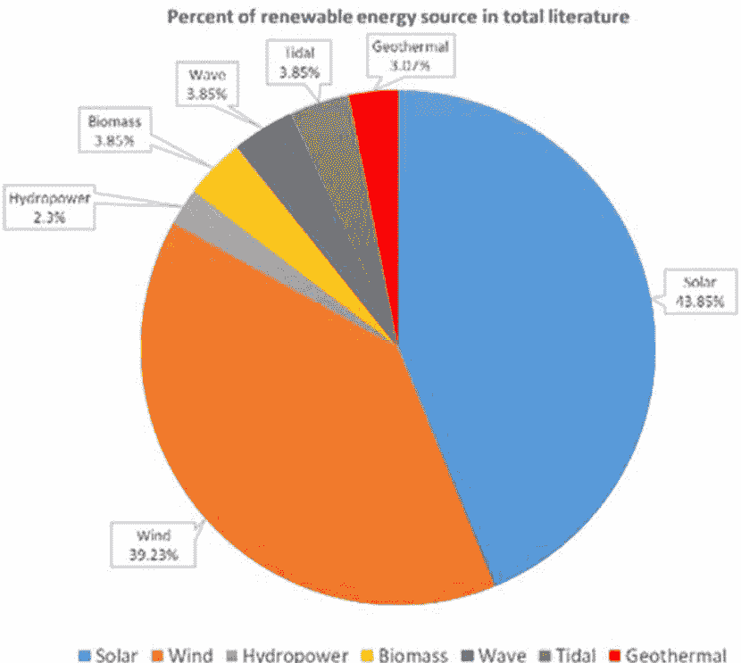

## 机器学习模型综合研究

### 监督学习

在人工智能领域，被称为机器学习的分支致力于开发技术和模型。这些技术和模型能够从数据中学习信息，并提升你所执行任务的性能。该过程涉及创建算法和统计模型，使计算机能够识别数据中的趋势，并利用此类模式进行选择或预测。计算机通过机器学习过程被教导识别并响应特定类型的输入。这是通过向计算机提供大量示例来实现的，这些示例被称为“训练数据”。通过这一训练过程，计算机能够识别模式，并基于对其而言全新的信息来源进行预测或选择。机器学习（ML）的应用广泛，可见于医疗保健、银行、网上购物以及众多其他行业。

此外，机器学习技术可用于预测可再生能源的发电量，从而最终提升可再生能源发电系统的管理与优化水平。可用的机器学习算法种类繁多，每种算法都有其自身的优缺点。可应用于算法的三种基本分类是：无监督学习、监督学习和强化学习。

通过监督训练来训练模型的过程是一种人工智能方法，它需要输入带标签的数据。数据集由输入-输出对组成，其中输入表示用于训练算法的数据，输出表示预期的结论。模型通过在训练阶段降低预期输出与观测输出之间的差异，获得构建输入与结果之间对应关系的能力。这是通过减少两者之间的差异来实现的。一旦模型之前已训练过，就可以用它对未标记的新数据进行预测。在监督学习算法领域，通常遇到的两种基本子类型是回归和分类。

图2（此处可找到）展示了自动化学习的分类。在监督学习的背景下，回归是一种使用多个输入变量来对持续输出变量进行预测的学习类型。回归分析旨在确定一种数学函数，以建立输入变量与持续输出变量之间的关联。该持续输出变量可以表示单个值或一系列可能性。回归的目标是确定任何此类函数。回归分析中使用的监督学习算法主要有三类。

线性回归是一种经常使用的简单方法，用于通过多个自变量来预测连续因变量。由于该方法简单，因此广泛应用。该研究使用线性回归模型来突出自变量与因变量之间的关系。多项式回归是一种线性回归，它使用n次多项式函数来说明所研究变量与因变量之间的关系。模型能够捕捉输入数据与感兴趣变量之间更复杂的关联，这是提高预测精度的一种方式。为了预测由太阳能和风能等清洁能源产生的电力量，线性回归和二次回归技术在可再生能源预测领域经常被使用。

### 图2. 机器学习分类

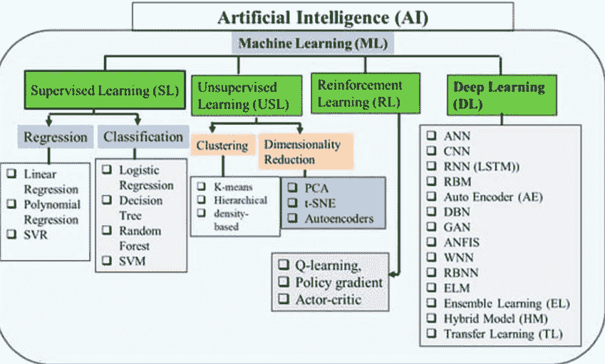

通常会将天气数据纳入输入特征中。这些数据可能包括湿度、风速、温度以及历史电力输出统计数据。清洁能源的电力输出被视为因变量，可以通过利用自变量的特征对其进行预测。

谈到监督学习，分类是一种使用一个或多个输入变量来对类别结果变量进行预测的学习类型。分类的目的是识别一个能够将输入变量成功分配到不同输出组的方程。基于回归的随机森林、决策树和支持向量机是用于预测可再生能源（RES）最常用的分类算法。

称为逻辑回归的统计技术用于分类。在此过程中，使用一个或多个输入因素来预测二元变量的结果。在Sigmoid函数框架内，估计输出变量为真或假的概率。根据研究结果，预测的准确性取决于通过仔细考虑选择适当的太阳能因素。此外，它还评估了算法的准确性以及电力厂在未来特定日期运行并发电的概率。

Hassan及其同事（2024）开展的研究利用多种数据分析方法，以探究可再生能源对全球能源系统演变的影响。2024年，Yi We研究了互联网经济增长对可再生能源增长的影响。

Moosavian等人（2024）指出，为了在完全自给自足的岛屿上发展环保能源系统，有必要进行战略规划并高效利用绿色能源资源。

Ren等人（2024）开展了该研究。通过应用机器学习，正在监测清洁能源设施的健康状况。另一方面，根据Hemavathi等人（2024）的说法，机器学习对当前可再生能源材料自动化制造时代产生了重大影响。

Yu等人（2024）进行了相关研究。在与分布式可再生能源相关的技术、观点和问题中，机器学习和人工智能的应用有明确迹象。

具体而言，据Ajibade等人记录，2023年。本研究旨在进行文献计量分析，并探讨2012年至2021年期间与绿色能源中人工智能应用相关的研究所呈现的出版模式。(Klaiber et al., 2023)为该引用。本文对深度学习策略进行了全面分析，重点探讨其在不同类型可再生能源中的应用。

Tripathi及其同事（2021）的工作提供了人工智能方法的指南。Rangel-Martinez等人（2024）的情况亦然。本文旨在对可再生能源、催化剂、智能电网和储能进行深入探讨和阐述。文章重点关注计算机学习和环保发电。

Singh及其同事（2021）开展了一项研究。本文旨在探讨在可再生能源领域不断扩展的应用框架内实施人工智能所涉及的众多问题和挑战。

题为《可再生能源网络人工智能方法导论》的论文（Boza et al., 2021）的作者意图是探讨机器学习的应用，作为将可变可再生能源纳入现有传输系统的手段。

决策树是一种额外的分类方法，它根据输入变量的值将输入区域划分为更小的部分。随后，为每个区域分配特定的标识符或值。为预测不同形式可再生能源产生的电力而构建的决策树模型的目标已成为多篇研究论文的主题。

研究人员开发了一个预测模型，以估计太阳能发电厂（PV系统）能够产生的电力量。研究人员的目标是在人工神经网络（ANN）、随机生成的森林（RF）、决策森林（DT）、极端梯度提升（XGB）以及长短期记忆（LSTM）系统中找出表现最佳的模型。这将有助于他们填补现有实证研究中的空白。研究结果表明，尽管所有方法都有效，但ANN（人工神经网络）成为估计光伏（PV）太阳能发电量最准确的方法。

通过创建大量决策树结构并随后组合这些树，随机森林算法（一种机器学习监督技术）能够生成准确可靠的预测。随机森林算法使用袋装法来减少用作算法基础的算法的不可预测性。在时间序列数据预测方面，该策略能带来显著价值。随机森林方法通过两种独特的随机化方式——从初始数据集中采样以及从选定的特征组中选择——来减少依赖


树之间存在的。这通过采用随机化来实现。通过为每个 N 棵树生成唯一且完整的二叉树，随机森林方法可以实现并行处理。

## 无监督学习

主要目标是识别和分析数据集中存在的模式、结构或相关性。无监督学习方法主要有两大类：聚类和降维。这种特定的无监督学习方法涉及根据数据点的接近度或相似度对其进行分类。在涉及大量杂乱数据并需要调查的场景中，尤其是在精确目标变量不明确的情况下，无监督学习方法具有高度优势。无监督学习在可再生能源预测领域已被广泛应用，尤其是在气象数据的聚类方面。

在可再生能源预测领域，无监督学习已被用于从更广泛的输入变量集中选择相关特征。在可再生能源预测过程中，特征选择被用作一种策略，旨在降低基于机器学习的模型的计算难度，并提高对可再生能源产出预测的精度。在可再生能源预测领域，无监督学习已被证明在评估大量杂乱数据方面非常有效。该主题涵盖了自主学习的广泛应用，包括分组、异常识别和特征选择等。当前正在开展的绝大多数工作都集中在开发创新算法上，这些算法旨在处理可再生能源预测中固有的特定问题。

## 强化学习算法

强化学习（RL）是机器学习科学领域中的一个分支，专注于智能体在给定环境中做出最优决策的能力。Q值用于指示所有状态下每个动作关联的预期未来奖励。称为策略梯度的算法是一种强化学习方法，可在无需计算Q值的情况下直接获取策略。一种称为演员-评论家（actor-critic）算法的强化学习策略结合了基于值和基于策略的方法。这是通过使用演员网络生成动作并使用评论家网络评估这些动作所赋予的价值来实现的。

强化学习（RL）已被应用于多个领域，例如可再生能源预测。深度学习（DL）是机器学习（ML）的一个子领域，利用具有多层的人工神经网络（ANN）来通过逐步抽象的程度成功捕获复杂的数据表示。深度学习（DL）是机器学习的一个子领域。在提及人工神经网络时，“深”一词指的是这些网络中包含的大量层数。这些层数可从几层到数千层不等。对于深度学习算法，“训练”过程使它们能够发展出检测数据中相关性和模式的能力。连接人工神经网络内神经元的突触权重将被更改

## 机器学习模型综合研究

在训练阶段，以减少预期输出与实际观察输出之间的差异。由于采用了更深层的学习策略，在电力系统、人工智能、自然语言处理、语音识别和自动化系统等多个领域取得了重大进展。该技术的应用使得在自然语言处理、游戏、语音识别和图像识别等多个领域取得显著进步成为可能。

## 障碍与潜在前景

可再生能源（RES）（如风能和太阳能）发电预测可以通过使用多种机器学习（ML）和深度学习（DL）技术来实现。每种方法都有其特有的一系列优点和缺点。确定哪种机器学习或深度学习方法最适合预测可再生能源，取决于具体应用以及可用数据。在建立基准模型时，线性回归是一个合理的选择；然而，随机森林、XGBoost 和支持向量机更适合处理非线性相关性和复杂数据集。在时间序列预测领域，被归类为深度学习（DL）模型的循环神经网络（RNN）模型提供了许多显著优势。然而，与传统机器学习（ML）模型相比，这些模型的训练过程可能需要大量计算资源。确保能够满足所需需求的可靠且持续的能源供应是一大难题，而风能和太阳能的波动性在这方面构成了相当大的障碍。间歇性是指由天气模式和昼夜变化等环境因素引起的能源发电波动。基于历史数据和假设的传统预测方法可能需要以适当的方式考虑清洁能源复杂且不断变化的特性。使用从实时数据获取信息并适应不断变化情况的复杂方法可以为这一挑战提供有前景的回应。这些技术可用于解决此问题。特别是在充满不确定性和不可预测性的情况下，上述模型能够有效地描绘环境变量与能源发电之间复杂的相关性，从而能够做出准确的预测。可以使用典型的机器学习方法进行预测；然而，这些方法的有效性与自回归模型、移动平均和循环神经网络（RNN）等特定时间序列预测方法的有效性相比可能会有所不同。这种问题主要是由传统机器学习模型中普遍存在的假设引起的，即数据点是独立且均匀分布的。然而，这一假设经常证明不适用于时间序列数据，而这是这一现象的主要诱因。有强烈迹象表明，特定时间点观测到的值受较早时间点观测值的影响，这由时间序列数据中检测到的时序依赖性所表明。由于假设输入变量相互独立，传统机器学习算法在试图理解数据中存在的趋势和模式时面临挑战。而且，至关重要的是

传统机器学习方法必须特别调整，以有效应对时间序列预测领域中常遇到的时变特征或不规则间隔数据所带来的障碍。

为了有效管理间隔不规则的时间序列数据，并准确检测模式和趋势以生成精确预测，建议采用专门的时间序列预测方法。混合模型在可再生能源（RES）预测过程中越来越被接受。这些模型将传统的时间序列分析与机器学习方法相结合，极大地提高了准确性，并解决了过拟合或欠拟合的问题。循环神经网络（RNN）主要用于处理时间序列数据。它们能够准确捕捉时序相关性，从而可以学习随时间的趋势和模式。因此，这些模型通常在可再生能源预测过程中被选用。上述讨论的模型有潜力提高可再生能源的运营效率和增长，并促进其平稳融入电网。另一方面，由于这些能源来源具有不可预测性且无法精确预测，因此准确预测 RES 仍然具有挑战性。这凸显了开展持续研究并开发更先进预测方法的重要性。

本研究的结果表明，机器学习（ML）在准确预测可再生能源方面具有巨大潜力。通过分析大量数据并识别人类可能忽略的复杂模式，这些算法有可能提高预测精度。此外，这些模型具有实时预测能力，可使其适应不同的天气条件。因此，它们增强了电力系统的可靠性，并使基于准确信息的决策更加容易。准确的预测有助于改善资源分配，进而提高运营效率并节省成本。此外，改进的预测还可以协助将清洁能源（RES）纳入电网的过程，有助于减少不稳定性并提高电网的整体效率。使用机器学习和深度学习系统有可能大幅提高可再生能源活动的效率和电网的稳定性。这可以通过彻底评估数据质量、模型复杂性和验证程序来实现。

## 结论

在可再生能源预测领域，已采用混合模型。这些模型结合了传统的时间序列分析与最新技术。这些模型有能力理解和说明数据中存在的线性和非线性两种相关性。因此，即使存在噪声和异常值，它们也能生成准确的预测。要成功完成构建混合模型的过程（这一过程具有多方面的特征），需要深入了解时间序列分析以及机器学习和深度学习技术。尽管绿色能源预测领域的技术已取得重大进展，但仍有一些问题需要进一步关注和解决。由于验证和训练都需要高质量数据，这构成了最重大的问题之一。用于预测可再生能源的数据可用性经常受到限制，其特征是存在大量的随机波动，且


## 机器学习模型的全面研究

需要更广泛的信息。因此，这些因素使得创建可靠模型变得更加困难。机器学习和深度学习模型的开放性和可解释性受限，构成了一道屏障。许多模型存在显著的透明度不足问题，这使得难以完全理解负责这些模型预测能力的基本概念。在利用机器学习（ML）和深度学习（DL）技术进行可再生能源预测方面，未来研究有很多前景。有必要进行额外研究，以改进能够同时妥善管理多种可再生能源的模型的创建。能够高效管理清洁能源所固有的不确定性和方差的模型的创建，是另一个应给予优先关注的重点领域。纳入天气信息、网络数据和其他外部信息来源，有助于提高可再生能源预测的准确性。

## 参考文献

- Abedini, F., Bahaghighat, M., & S'hoyan, M. (2019). 基于特征描述符和深度学习的风力涡轮机塔架检测. Facta Universitatis, Series: Electronics and Energetics, 33(1), 133–153.
- Ajibade, S. S. M., Bekun, F. V., Adedoyin, F. F., Gyamfi, B. A., & Adediran, A. O. (2023). 可再生能源领域机器学习应用（MLARE）研究：出版趋势与文献计量分析研究（2012–2021）. Clean Technologies, 5(2), 497–517. doi:10.3390/cleantechnol5020026
- Anderson, R. N., Boulanger, A., Powell, W. B., & Scott, W. (2011). 智能电网自适应随机控制. Proceedings of the IEEE, 99(6), 1098–1115. doi:10.1109/JPROC.2011.2109671
- Babaie, M., Shiri, M. E., & Bahaghighat, M. (2018, April). 应用离散局部Radon的无人机图像映射新描述符. In 2018 8th conference of AI & robotics and 10th RoboCup Iranopen international symposium (IRANOPEN) (pp. 52-56). IEEE. 10.1109/RIOS.2018.8406631
- Bahaghighat, M., & Motamedi, S. A. (2018). 新兴智能电网中风力涡轮机农场的视觉检测与监测. Facta Universitatis, Series: Electronics and Energetics, 31(2), 287–301.
- Boza, P., & Evgeniou, T. (2021). 人工智能支持可变可再生能源接入电力系统. Applied Energy, 290, 116754. doi:10.1016/j.apenergy.2021.116754
- Dash, P. K., Samantaray, S. R., & Panda, G. (2006). 基于支持向量机的先进系列补偿输电线路故障分类与区段识别. IEEE Transactions on Power Delivery, 22(1), 67–73. doi:10.1109/TPWRD.2006.876695
- Erol-Kantarci, M., & Mouftah, H. T. (2011). 下一代电网无线多媒体传感器与执行器网络. Ad Hoc Networks, 9(4), 542–551. doi:10.1016/j.adhoc.2010.08.005
- Fadel, E., Gungor, V. C., Nassef, L., Akkari, N., Malik, M. A., Almasri, S., & Akyildiz, I. F. (2015). 智能电网无线传感器网络综述. Computer Communications, 71, 22–33. doi:10.1016/j.comcom.2015.09.006
- Han, T., Liu, C., Yang, W., & Jiang, D. (2019). 用于机械故障智能诊断的深度卷积神经网络新型对抗学习框架. Knowledge-Based Systems, 165, 474–487. doi:10.1016/j.knosys.2018.12.019
- Hassan, Q., Viktor, P., Al-Musawi, T. J., Ali, B. M., Algburi, S., Alzoubi, H. M., & Jaszczur, M. (2024). 可再生能源在全球能源转型中的作用. Renewable Energy Focus, 48, 100545. doi:10.1016/j.ref.2024.100545
- Hemavathi, B., Vidya, G., Anantharaju, K. S., & Pai, R. K. (2024). 智能自动化时代可再生能源材料中的机器学习. e-Prime-Advances in Electrical Engineering, Electronics and Energy, 100458.
- Igba, J., Alemzadeh, K., Durugbo, C., & Henningsen, K. (2015). 基于在役数据的风力涡轮机齿轮箱性能评估：当前方法与未来趋势. Renewable & Sustainable Energy Reviews, 50, 144–159. doi:10.1016/j.rser.2015.04.139
- Jiménez, A. A., Márquez, F. P. G., Moraleda, V. B., & Muñoz, C. Q. G. (2019). 风力涡轮机叶片结冰检测与诊断的线性与非线性特征及机器学习. Renewable Energy, 132, 1034–1048. doi:10.1016/j.renene.2018.08.050
- Klaiber, J., & Van Dinther, C. (2023). 可变可再生能源深度学习：系统综述. ACM Computing Surveys, 56(1), 1–37. doi:10.1145/3586006
- Li, S., Wunsch, D. C., O'Hair, E. A., & Giesselmann, M. G. (2001). 使用神经网络估算风力涡轮机发电量. IEEE Transactions on Energy Conversion, 16(3), 276–282. doi:10.1109/60.937208
- Mert, I., Karakuş, C., & Üneş, F. (2016). 使用人工神经网络估算风力涡轮机能量生产. Neural Computing & Applications, 27(5), 1231–1244. doi:10.1007/s00521-015-1921-0
- Moosavian, S. F., Noorollahi, Y., & Shoaei, M. (2024). 孤岛可持续能源系统发展的可再生能源利用规划. Journal of Cleaner Production, 439, 140892. doi:10.1016/j.jclepro.2024.140892
- Nie, M., & Wang, L. (2013). 风力涡轮机齿轮箱状态监测与故障诊断技术综述. Procedia CIRP, 11, 287–290. doi:10.1016/j.procir.2013.07.018
- Pérez, J. M. P., Márquez, F. P. G., Tobias, A., & Papaelias, M. (2013). 风力涡轮机可靠性分析. Renewable & Sustainable Energy Reviews, 23, 463–472. doi:10.1016/j.rser.2013.03.018
- Rangel-Martinez, D., Nigam, K. D. P., & Ricardez-Sandoval, L. A. (2021). 可持续能源机器学习：可再生能源系统、催化、智能电网与储能的综述与展望. Chemical Engineering Research & Design, 174, 414–441. doi:10.1016/j.cherd.2021.08.013
- Ren, B., Chi, Y., Zhou, N., Wang, Q., Wang, T., Luo, Y., Ye, J., & Zhu, X. (2024). 可再生能源系统健康监测中的机器学习应用. Renewable & Sustainable Energy Reviews, 189, 114039. doi:10.1016/j.rser.2023.114039
- Singh, O., Yadav, M., Yadav, P., & Rishiwal, V. (2021). 基于人工智能的可再生能源及其新兴应用：问题与挑战. In Introduction to AI Techniques for Renewable Energy System (pp. 29-42). CRC Press.
- Stetco, A., Dinmohammadi, F., Zhao, X., Robu, V., Flynn, D., Barnes, M., Keane, J., & Nenadic, G. (2019). 风力涡轮机状态监测机器学习方法：综述. Renewable Energy, 133, 620–635. doi:10.1016/j.renene.2018.10.047
- Tasnim, S., Rahman, A., Oo, A. M. T., & Haque, M. E. (2018). 基于现有站点知识的新站点风电预测：一种基于聚类的多源域自适应方法. Knowledge-Based Systems, 145, 15–24. doi:10.1016/j.knosys.2017.12.036
- Tchakoua, P., Wamkeue, R., Ouhrouche, M., Slaoui-Hasnaoui, F., Tameghe, T. A., & Ekemb, G. (2014). 风力涡轮机状态监测：现状综述、新趋势与未来挑战. Energies, 7(4), 2595–2630. doi:10.3390/en7042595
- Tripathi, S. L., Dubey, M. K., Rishiwal, V., & Padmanaban, S. (Eds.). (2021). 可再生能源系统人工智能技术导论. CRC Press. doi:10.1201/9781003104445
- Yi, J., Dai, S., Li, L., & Cheng, J. (2024). 数字经济发展如何影响可再生能源创新？. Renewable & Sustainable Energy Reviews, 192, 114221. doi:10.1016/j.rser.2023.114221
- Yu, X., & Zhou, Y. (2024). 机器学习与人工智能分布式可再生能源：技术、前景与挑战. Advances in Digitalization and Machine Learning for Integrated Building-Transportation Energy Systems, 17-30.


# 第3章

# 每小时电力需求负荷时间依赖性与层次建模的深度学习框架

Claris Shoko
https://orcid.org/0000-0002-0896-4387
University of Botswana, Botswana

Ntebogang Moroke
https://orcid.org/0000-0001-8545-1860
North West University, South Africa

Katleho Makatjane
https://orcid.org/0000-0002-3687-4098
University of Botswana, Botswana

## 摘要

传统深度学习模型在处理海量数据和建模复杂时间依赖性方面存在局限，这使得难以有效实现短期负荷预测（STLF）的这些目标。本章利用深度学习，可实现以下功能：使用 k-means 聚类来理解每小时电力需求负荷趋势，提取影响电力需求负荷的具有非线性交互的复杂特征，通过长短期记忆网络对时间序列数据中的时间层次结构进行建模来处理长期依赖性，并利用循环神经网络捕捉时间步间的依赖性。将带有 k-means 变体的最先进的每小时需求预测模型性能与 RNN-LSTM-CNN-copula 进行了比较。此外，RNN-LSTM-CNN-copula 是一种可行的能源消耗预测深度学习模型，因为它能够学习每小时电力需求负荷数据中的时空依赖性，从而实现准确的能源需求预测。

## 引言

建筑、工业和交通是三大主要经济部门，共同占据了一个国家能源使用的大部分。建筑是最大的能源消费者，根据世界观察研究所（World Watch Institute）的数据（Aldhshan et al., 2021），建筑贡献了36%的碳排放和40%的全球年度能源消耗，主要集中在城市地区。预计建筑能源消耗将在2012年至2020年期间以经合组织（OECD）国家1.5%的年增长率和非经合组织（非OECD）国家2.1%的年增长率增长。特别是，与住宅建筑相比，高等教育中的商业和机构建筑的总体能源消耗分别高出30%和45%。

通过安装合适的能源管理系统和最终用户能源效率控制方案，降低能源使用并避免公用事业罚款，从而实现更低的运营成本。根据 Kamal-Chaoui 和 Robert（2009）的说法，许多国家加强了对能源法规和建筑标准的执行。这导致了创新、节能建筑设计的发展，这些设计保证了更低的能源消耗、能源支出和环境影响（碳排放）。需要对支持能源效率的智能基础设施进行更大的投资，因为根据世界能源委员会（World Energy Council，2016）的说法，“到2060年电力需求将翻一番，而人均总体能源需求将开始下降。”电动汽车、分散式发电和储能系统、能源管理系统以及尖端信息和通信技术的结合，从智能电网的角度来看使建筑更加智能。因此，现在至关重要的是为建筑物和电网设计和部署智能技术，以在既经济可行又高效的同时减少碳排放，满足世界的能源需求。

配备智能电表以精确间隔跟踪能源使用的建筑物，使建筑能源消耗预测研究近年来变得更加重要。为了了解能源消耗模式，用于能源需求预测、需求响应、供暖通风与空调（HVAC）优化、故障诊断与检测，来自智能电表并在不同粒度下收集的大规模高维能源消耗数据非常有帮助（Razavi et al., 2019）。公用事业公司可以借助准确可信的能源需求预测来规划资源并平衡供需，这保障了电网的安全与稳定以及服务交付的可靠性。然而，Hamed et al.（2022）声明，能源需求的高估和低估会对经济和工业发展造成严重影响。精确的能源需求建模和预测有助于情境感知控制方法、精确需求响应策略、电力供应管理以及智能建筑中的有效能源管理。为了通过节能型社会、合理利用可用能源资源和有效的国家能源策略，提升建筑能源效率以实现可持续经济，能源消耗预测模型已成为建筑能源管理系统（BEMS）的重要组成部分（Mariano-Hernández et al., 2020）。尽管如此，Somu et al.（2021）断言，能源消耗数据的非线性、动态和复杂特性，以及趋势、季节性和不规则模式的存在，加上对气候条件、日期性质、社会经济因素等各种外生因素的依赖，使得准确可靠的能源消耗预测成为一个有趣的研究问题。

文献中存在三种能源消耗预测模型：
- 工程方法：这些方法具有挑战性且耗时；Energy Plus 和 Ecotect 是两个示例。它们依赖于复杂的建筑和环境数据，并使用物理和热力学规则。
- 统计方法：在能源使用与诸如占用率和气候数据等相关变量之间的关系上不准确且僵化；示例包括回归模型（线性回归）和时间序列（自回归模型）。
- 人工智能技术：从历史能源消耗数据中学习消耗模式，即发现输入（历史数据）与输出（目标消耗）之间的非线性关系；示例：人工神经网络、支持向量回归等。在这其中，人工智能方法因其相对于工程和统计方法的效率和灵活性，已成为“活跃的研究热点”（Liu et al., 2020）。

然而，最近的COVID-19疫情影响了电力系统的模式；因此，典型工作日的预期需求现在与典型周末相匹配，因为大多数员工留在家中并在家办公（Jogunola et al., 2022）。因此，周末高峰与最低能源需求之间的测量差异为24%。这一意外事件使需求预测更加具有挑战性，从而加剧了电网的不稳定性。

Bunn 和 Farmer（1985）表明，负荷预测误差增加1%可能导致年度运营成本增加1000万英镑（Chitalia et al, 2022）。此外，分布式能源资源的激增，加上天气、居住者行为、电价和期望舒适度等多种约束，使得准确预测能源消耗以平衡供需变得更加困难（Jogunola et al., 2020）。此外，精确的能源消耗预测是能源服务提供商向住宅和商业设施提供一系列灵活和补充性能源管理服务的关键前提。因此，服务提供商将实现财务节省、为客户提供更多选择以及有效的电网管理。其他优势包括稳定的电源、有效的能源分配、有效的能源管理和控制方法（Jogunola et al, 2021）。

## 文献综述

线性回归、指数平滑、自回归积分滑动平均（ARIMA）和季节性自回归积分滑动平均（SARIMA）等统计技术常用于预测过去的消耗数据（Ahmadi et al., 2023）。这些模型基于过去数据与预测数据之间的线性连接。然而，由于电力消耗数据中存在复杂的非线性模式，机器学习和深度学习模型已超越统计方法。根据 Singaravel et al.（2018）的说法，深度学习方法简单直接，能够快速处理计算，证明了其作为模型的有效性。深度学习模型除了能够处理非线性关系外，还可以处理长期依赖性，使其非常适合能源预测（Ensafi et al., 2022; Kohzadi et al., 1996）。

多层感知机和深度前馈网络是深度学习的基石。因此，深度学习模型的基本组成部分是称为人工神经网络的算法层（Wongrin et al., 2022）。CNN 和 RNN 层是两个最关键的层。CNN 最近已被广泛用于各种应用，包括图像识别（Sharma, Jain, and Mishra, 2018）和时间序列预测（Le et al., 2019, Nawar et al., 2023）等。深度学习已成功地将 RNN 建模为序列模型，包括长短期记忆网络（LSTM）和门控循环单元（GRU）（Shiri et al., 2023）。Hochreiter 和 Schmidhuber（1997）引入了 LSTM 架构，作为解决梯度消失问题的方案。为了估算电力需求，


## 用于建模时间依赖性的深度学习框架

Cordeiro-Costas et al. (2023) 评估了时序卷积网络、随机森林、支持向量机、极端梯度提升、多层感知机和 LSTM 的有效性。与其他人工智能模型相比，该研究表明 LSTM 具有最佳预测精度。序列建模最好交给 LSTM，而下降频率变化问题最好由 CNN 处理。因此，拥有两种架构有助于模型协同工作。根据 Slater et al. (2022)，结合多种预测方法的混合模型已显示出提升不同算法用于精确预测效能的潜力。

Lotifpoor et al. (2024) 研究了嵌入 CNN 和 LSTM 的经验模态分解（EMD-CNN-LSTM）用于短期住宅负荷预测的可能性。在四个不同的预测时域上，评估了混合 EMD-CNN-LSTM 模型的性能。作为单一预测模型的 CNN 和 LSTM 表现不如混合模型。最流行的混合深度学习模型是 CNN-RNN。

Rahman et al. 于 2021 年提出了一项关于机器学习技术（特别是 CNN）用于预测的研究。他们调查了各种数据驱动的人工神经网络模型预测可再生能源的准确性。他们使用了 RNN、CNN 和 LSTM 等神经网络架构。其研究结果表明，RNN、CNN 和 LSTM 模型适用于可再生能源的短期预测。

本章介绍了 RNN-LSTM-CNN-Copulas（此处指代循环神经网络-长短期记忆-卷积神经网络）与 copula 相耦合的方法。这被认为是一个深度学习框架，它作用于在预定义间隔记录的电力消耗数据，以提供准确的电力消耗预测。RNN-LSTM-CNN-Copulas 采用：(i) k-means 聚类进行聚类分析，以了解每小时电力需求负荷模式/趋势；(ii) 卷积神经网络提取影响每小时电力需求负荷的具有非线性交互作用的复杂特征；以及 (iii) 长短期记忆神经网络通过对时间序列数据中的时间层次进行建模来处理长期依赖关系。最后，copula 处理时间序列数据中层次上的依赖关系。

RNN-LSTM-CNN-Copula 的效率和适用性是通过从南非 ESKOM 获取的实时每小时电力需求负荷数据来证明的。RNN-LSTM-CNN-Copulas 的性能与基于广受认可质量指标的最先进的每小时电力需求负荷预测模型的 k-means 变体进行了比较。此外，预计 CNN-LSTM-Copula 将成为每小时电力需求负荷预测问题的良好深度学习模型，因为它能够学习能源消耗数据中的时空依赖关系，从而实现准确的能源需求预测。

ESKOM 公司将受益于准确的预测，从而能够识别未来危机并采取适当行动以避免重大后果。因此，所提议的 RNN-LSTM-CNN-Copula 模型可以帮助未来规划、决策以及采取预防措施以应对不利事件。通过将所提议的最先进的混合模型与其预测工具包相结合，将在 ESKOM 智能电网中实现一个可持续电网。

本研究的局限性在于，本研究所提议的框架是使用南非 ESKOM 的数据进行评估的。因此，其他国家的结果可能会有所不同。

本章余下部分安排如下；第 2 节介绍了所提议的深度学习模型及评估指标。第 3 节介绍了结果，并讨论了结果与先前研究发现的对比情况。最后一节给出结论，并提出进一步研究的建议。

## 方法论

本研究章节介绍了所遵循的方法和程序。

所提议的系统用于通过分析输入的负荷需求，实时开发南非每小时电力需求负荷的组合预测模型，且该设计的系统包含两个用于每小时负荷预测的组件。这些组件将在接下来的两个小节中描述或讨论。

### 设计数据预处理框架

该组件负责有效使用大数据，并将其提交给分析服务器以进行预测建模。系统配置主要由 Saturn Cloud/Saturn-python 下的高性能计算（HPC）组成。我们使用 TensorFlow，因为它可以用于多种编程语言，包括 Python、JavaScript、C++ 和 Java。这种灵活性使其适用于许多不同领域的各种应用。原始数据文件中的字段由逗号分隔符分隔。原始数据文件被提供给分析模型以构建数据模型。这增加了系统的卓越多功能性，并帮助其开发出强大的实时自学习分析模型。它还使系统具有相当大的可扩展性。

该元素负责大量数据的有效利用，并为分析服务器提交预测建模的投标。系统配置中高性能计算（HPC）的主要平台是 Saturn Cloud/Saturn-python。由于 TensorFlow 可以与多种不同的编程语言（如 Python、JavaScript、C++ 和 Java）一起使用，因此采用了它。由于其多功能性，它可以应用于众多领域的各种任务。在原始数据文件中，字段以逗号分隔。原始数据文件被发送到分析模型，以便它可以构建数据模型。

### 拟议的 RNN-LSTM-CNN

本章本小节介绍了我们所提议的深度学习算法。

### 循环神经网络

一种称为循环神经网络（RNN）的人工神经网络类型是专门用于处理序列数据（如时间序列或自然语言）的。由于它们具有反馈链接，有助于记住早期时间步的数据，因此可以检测时间依赖性。我们使用 RNN 来帮助发现时间序列数据中无法观察到的相关性。我们的工作实现了带有 Peephole 连接单元的长短期记忆的 RNN 堆叠架构。本研究中使用的堆叠架构与 Bandara et al. (2020) 工作中提到的架构密切相关。图 1 显示了 RNN 的折叠版本。其思想是，相同的 RNN 单元在每个时间步重复，彼此之间共享相同的权重和偏置。单元的反馈回路有助于网络在未来时间步上传播状态 $h_t$。为了概括，图表中仅显示状态 $h_t$。但是，对于 LSTM 单元，$h_t$ 应伴随单元状态 $C_t$。堆叠的概念意味着多个 LSTM 层可以彼此堆叠。在最基本的设置中，模型只有一个 LSTM 层。

RNN 的递归公式如下

图 1. 所提议的循环神经网络
来源：作者

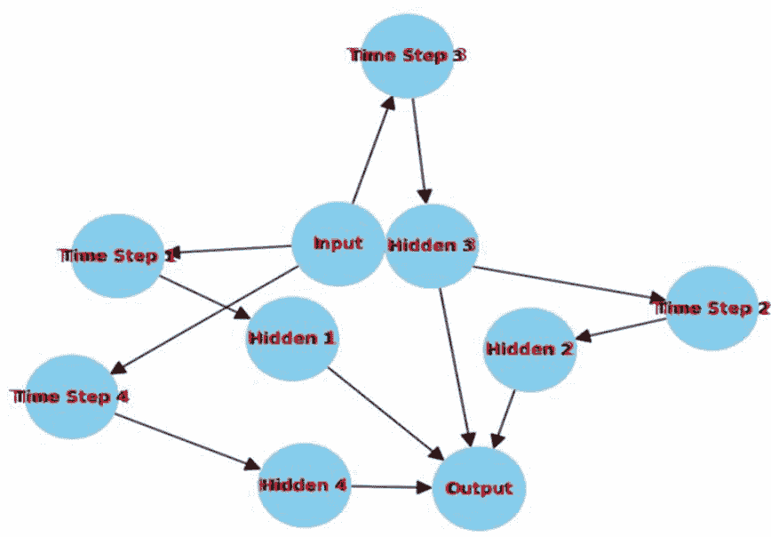

$h_t = \tanh(W_h h_{t-1} + W_x x_t)$ (1)

和

$y_t = W_y h_t$ (2)

其中 $y_t$ 是输出向量，$h_t$ 是隐藏层向量，$x_t$ 是输入向量，$W_h$ 是权重矩阵。RNN 理论上可以解决这些长期依赖问题，但（权重矩阵）会随着时间间隔变长而不断乘以前序结果（参考数据位于更长的时间点）。这会导致梯度消失和爆炸的问题。为了解决这个问题，我们使用长短期记忆（LSTM）网络。

### 长短期记忆

如图 2 所示，长短期记忆（LSTM）单元是定义 RNN 层的构建块（根据 Wikipedia）。LSTM 网络是用来描述由 LSTM 单元组成的 RNN 的术语。由于 LSTM 网络中的每个神经元都是一个存储单元，LSTM 神经网络与传统的 RNN 神经网络不同。LSTM 将当前神经元与来自


## 用于建模时间依赖性的深度学习框架

先前的数据。输入门、遗忘门和输出门是每个神经元中存在的三个门。LSTM 可以通过使用输入门来解决长期数据依赖问题。接下来，我们概述 LSTM 架构的内部门，并解释它如何解决长期依赖性问题。此图中有三个门，将在下文讨论

- 1) **遗忘门**：在图 2 中，由公式 (3) 定义的遗忘门决定哪些信息将从单元中丢弃。通过输入前一个单元 (t–1) 的输出 $h_{t-1}$，并将当前时间 $t$ 和输入 $X_t$ 加入到由公式 (4) 定义的 $Sigmoid$ 函数 $S(t)$ 中（如图 3 所示）。将生成一个 0 到 1 之间的值，该值将与单元状态 $C_{t-1}$ 相乘，以确定将忘记或记住多少信息。0 表示完全遗忘，而 1 表示完全记住。因此，$W$ 和 $b$ 分别是需要在训练期间学习的重量矩阵和偏置向量参数。

```
$f_t = \sigma\big(W_f \cdot [h_{t-1}, x_t] + b_f\big)$
```

```
$S(t) = \frac{1}{1 + \exp(-t)}$
```

图 2. 长短期记忆架构
来源：作者

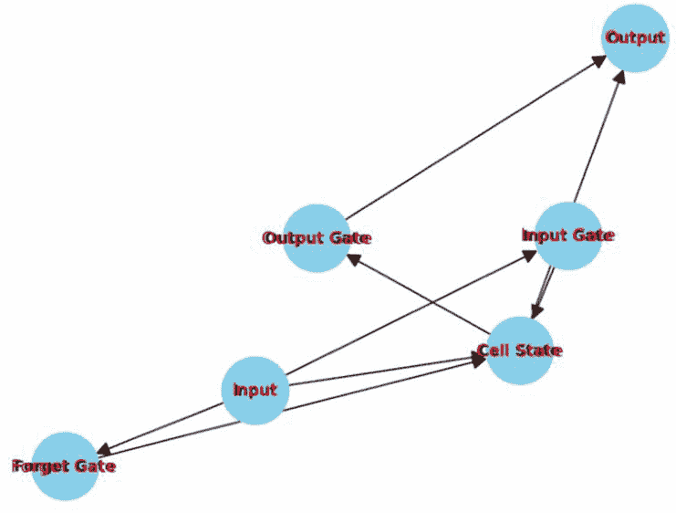

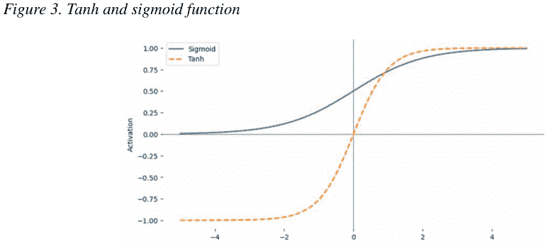

- 2) **输入门**：在图 2 中，输入门决定在单元状态中记住哪些新信息。通过输入前一时间 \( t-1 \) 的输出 \( h_{t-1} \)，并将当前时间 \( t \) 和输入 \( X_t \) 加入到由公式 (4) 定义的 \( Sigmoid \) 函数中，将生成一个介于 0 和 1 之间的值 \( i_t \)（公式 (5)），以决定单元状态需要记住多少新信息。同时，图 3 中的 tanh 层通过输入前一时间 \( t-1 \) 的输出 \( h_{t-1} \)，并将当前时间 \( t \) 和输入信息 \( X_t \) 加入，获得由公式 (6) 定义的候选单元状态 \( \tilde{C}_t \)，以便添加到单元状态中。将刚刚获得的值 \( i_t \) 和 \( \tilde{C}_t \) 相乘，得到我们真正想要添加到单元状态 \( C_t \) 的更新信息（公式 (7)）。

```
\( i_t = \sigma(W_i \cdot [h_{t-1}, x_t] + b_i) \quad (5) \)
```

```
\( \tilde{C}_t = \tanh(W_c \cdot [h_{t-1}, x_t] + b_c) \quad (6) \)
```

```
\( C_t = f_t * C_{t-1} + i_t * \tilde{C}_t \quad (7) \)
```

- 3) **输出门**：在图 2 中，输出门决定单元状态中哪些信息将被输出。通过输入前一时刻 \( t-1 \) 的输出 \( h_{t-1} \)，并将当前时间 \( t \) 和输入 \( X_t \) 加入到 \( Sigmoid \) 函数中，将生成一个介于 0 和 1 之间的值 \( i_t \)（如公式 (8) 所示），以决定导致输出的单元状态信息量。单元状态首先在 tanh 层中激活，然后乘以介于 1 和 -1 之间的 \( o_t \)。乘法结果是时间 \( t \) 时 LSTM 块的输出信息 \( h_t \)（公式 (9)）。

```
\( o_t = \sigma(W_o \cdot [h_{t-1}, x_t] + b_o) \quad (8) \)
```

```
$h_t = o_t * \tanh(C_t)$ (9)
```

## 卷积神经网络

在机器学习领域，不仅深度学习越来越流行，卷积神经网络（CNN）也最近受到了广泛关注。将 N 维数据作为输入，并进行多层卷积处理。每个卷积层将接收前一个卷积层的输出作为其输入。CNN 不断进行池化和卷积，以提取每一层的有用特征，并最终获得高质量特征，从而获得良好的图像分类能力。

最近已经开展了一些使用 CNN 进行时间序列预测任务的研究（Kranjc 等人，2015）。这些作者提出了一种将 CNN 与自回归模型相结合的新方法，并证明其性能优于 CNN 和 LSTM 神经网络。评估中使用了四个人工生成数据集以及两个真实数据集（家庭用电和资金使用）。单一 CNN 在电力数据上优于 LSTM。我们观察到，Kranjc 等人（2015）使用的电力数据包含每个时间步的十个变量值，但我们的数据是单变量的。在 Hagenau 等人（2013）的工作中，一种称为 Wave Net 的 CNN 被用来分析单变量和双变量的金融及人工时间序列。已证明这是一种成功的方法，取得了令人鼓舞的结果，并超越了 LSTM 和其他比较方法。

卷积层和最大池化层是卷积神经网络中两种主要的层类型。卷积层使用的两种主要技术是权重共享和局部连接。局部连接是指，与典型的 MLP 神经网络中使用所有输入不同，每个卷积节点只连接到一小部分输入（对应输入的局部区域，称为节点的感受野）。此外，卷积取代了传统神经网络中的加权求和。具体来说，每个卷积层将输入与预设大小的权重矩阵（也称为滤波器或滑动窗口）进行卷积，以计算特征图。为此，在输入上移动权重矩阵并计算输入与权重的点积。

同一层中的卷积神经元在输入的各个区域检测相同的模式，因为它们共享相同的权重。使用权重共享和局部连接可以减少必须学习和存储的权重数量，从而加快训练速度。共享权重的节点数量由滤波器的核大小决定，该核大小用于实现卷积和权重共享。最大池化层（计算来自卷积层的所选近邻神经元池的最大值）通常紧随卷积层之后（Wang 和 Oates，2015）。卷积层与最大池化层的组合确保最大池化层的输出对输入数据的平移不变，这是处理自然数据的一个非常有用的属性。全连接输出层计算最终预测。

在我们的实验中，我们使用了带有核大小为 3 的 Conv1D 层的 CNN，随后是一个 Flatten 层，以从卷积层过渡到密集层。然后是两个带有 ReLU 激活函数的密集层和一个具有线性激活函数的最终密集层。训练使用 Adam 优化器，最小化均方误差。为了避免过拟合，在所有层的权重优化过程中都采用了丢弃法（Huang 和 Pan，2015）。丢弃法是一种技术，包括在每个训练时代随机选择一部分神经元，并不将其纳入权重优化中。我们还应用了批量归一化，它为每个训练小批量归一化层输入。已证明这种技术可以加快训练速度，并减少梯度对参数尺度的依赖以及 CNN 对初始参数值的敏感性（Huang 和 Pan，2014）。

### 参数

为为每个时间序列选择合适的 CNN 架构和参数，我们在验证集上评估了不同架构和参数组合的性能，并选择了最佳方案。例如，对于太阳能数据，我们考虑了具有两个卷积层的 CNN 架构，第一层和第二层的节点数分别为 (20, 8) 和 (64, 32)；包含或不包含最大池化层；批量大小为 1、4、8 和 16，以及训练时代数为 10、50 和 250。

## 堆叠集成学习方法

近年来，由于性能得到提升，集成模型变得更加重要。它源自分类或回归问题等各种任务。它由组合不同学习模型以改进每个模型结果的技术组成。通常使用两个步骤：第一步是从训练数据中获得一组基学习器，第二步是将第一步的学习器组合起来创建一个单一预测模型。因此，基于不同基学习器的多个预测被构建并组合成一个复合模型，该模型比单个基模型更加改进。将最佳单个模型组合成一个单一的改进复合模型通常会带来更高的准确性。图 4 显示了用于预测南非每小时电力需求负载的 Stacking-Ensemble 算法的架构。

最常用且最知名的基本集成方法是袋装法、提升法和堆叠法。本文采用堆叠方法，因为它是最适合本工作所考虑的基学习器问题的方法。在下一节中，我们将指定所提方案中使用了哪些学习算法，如图 3 所示。因此，时间序列预测的堆叠集成方法是指异构基模型在数据集上并行或堆叠地进行训练和测试。假设基学习器的预测较弱。在堆叠中，算法将基学习器的输出作为输入，并尝试学习组合异构

图 4. 堆叠集成算法架构

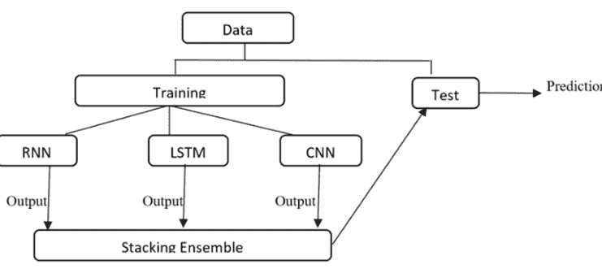


为了获得更好的输出而进行预测。在本章中，我们将循环神经网络、长短期记忆和卷积神经网络模型作为基础学习者。参见图4。时间序列预测的堆叠集成方法是指异构基模型在数据集上并行或堆叠方式进行训练和测试。假设是基模型的预测较弱。

在下一节中，我们将指明在我们提出的方案中使用了哪些学习算法。我们可以用以下方式更正式地定义堆叠集成方案。给定一组N个不同的学习算法Lk，k=1,...,N，以及对(x,y)，其中x=(x1,...,xw)表示w个记录值，y=(xw+1,...,xw+h)表示要预测的h个值。令mt_kp，k=1,...,N，j=1,...,h为由学习算法Lk在x上诱导出的用于预测xw+jp的模型，并令fj为负责组合模型以预测该值的泛化函数。值得注意的是，fj可以是通用函数，如平均值，也可以是由学习算法诱导出的模型。然后，估计的x^w+w+j值由以下表达式给出

$\hat{x}_{w+j} = f_j(m_{1j}, \cdots, m_{nj})$. (10)

集成方法已成功应用于解决时间序列问题中的模式分类、回归和预测（Jin和Dong，2016）。例如，Adhikari（2015）提出了一种用于时间序列预测的线性组合方法，该方法采用独特的神经网络拓扑来计算组合权重。Bagnall等人（2015）提出了一种在不同数据变换上使用分类器集成的方法，以提高时间序列分类的准确性。作者证明，将一个集成中所有分类器的简单组合所获得的性能优于其任何组成部分。为了对生物医学数据进行分类，Jin和Dong（2016）开发了一种基于深度神经网络的集成方法，该方法包含滤波视图、局部视图、畸变视图、显式和隐式训练、子视图预测以及简单平均。特别是，他们使用了中国心血管疾病心电图数据库。

在堆叠中，算法将基模型的输出作为输入，并尝试学习组合异构预测的最佳方法以给出更好的输出。这些基模型的预测使用线性分位数回归平均（LQRA）或加权平均方法进行组合。然而，本章提出了一种广义加性模型。使用关键绩效指标KPIs对这些模型的性能进行比较。KPIs将在本节末尾讨论。元模型使用堆叠集成方法组合这些基模型的预测。使用关键绩效指标KPIs对这些模型的性能进行比较。

## 用于评估的误差指标选择

选择适当的误差指标对于评估预测模型的性能至关重要。误差指标提供了预测准确性的定量度量，并有助于评估模型在多大程度上捕捉了数据中的底层模式。以下是与此主题相关的一些误差指标：

**均方误差（MSE）：** MSE是预测建模领域中一种基本且广泛采用的误差指标。它通过评估预测值与实际观测值之间差异的幅度，作为衡量预测总体质量的稳健指标。

## 对时间序列建模的深度学习框架

其核心部分，MSE通过计算预测值与相应实际值之间平方差的平均值来运行。对差异进行平方会放大较大的错误，强调预测与实际结果之间的偏差影响。通过对这些平方误差求和并除以观测次数，MSE对模型的准确性提供了全面视角。从数学上讲，均方误差由以下公式给出

```
MSE = \frac{1}{n} \sum_{i=1}^{n} \left( y_i - \hat{y}_i \right)^2 . \quad \text{(11)}
```

在模型（5）中，\( n \) 是观测次数，而 \( y_i \) 表示时间 \( t \) 处的实际观测值，\( \hat{y}_i \) 表示时间 \( t \) 处的预测值。

**平均绝对误差（MAE）：** MAE衡量预测值与实际值之间平均绝对差异。与MSE相比，它对异常值不那么敏感，并提供了更平衡的预测准确性视角（Willmott和Matsuura，2005）。这一测试作为基本误差指标，用于衡量预测值与实际观测值之间的平均绝对差异。与均方误差（MSE）相反，MAE的独特特征在于其对异常值的鲁棒性以及其对预测准确性进行平衡评估的能力。MAE的方程为

```
MAE = \frac{1}{n} \sum_{i=1}^{n} \left| y_i - \hat{y}_i \right| \quad \text{(12)}
```

**对称平均绝对百分比误差（SMAPE）：** SMAPE是一种深刻的误差指标，它以百分比评估为基础，同时纳入了对高估和低估误差的对称考虑。这种对称性使SMAPE能够对预测准确性提供平衡且全面的评估。（Makridakis和Hibon，2000）。从数学形式上，该误差指标表示为

```
SMAPE = \frac{100}{n} \sum_{i=1}^{n} \frac{\left| y_i - \hat{y}_i \right|}{\left( \left| y_i \right| + \left| \hat{y}_i \right| \right) / 2} \quad \text{(13)}
```

SMAPE的对称性确保不会对高估或低估引入任何偏差。这种平衡评估使得SMAPE在旨在理解预测准确性而不偏向某一方向误差时是理想的选择。它特别适用于高估和低估具有同等后果的场景，例如需求预测或资源分配。

**平均预测误差（MFE）：** MFE是预测值与实际值之间的平均差异。它提供了衡量平均误差的指标，而不考虑误差的方向（Tashman，2000）。此外，MFE在评估预测模型性能方面发挥着关键作用。它量化了预测值与相应实际观测值之间的平均差异，揭示了平均误差幅度，而不考虑误差的方向。

与其他考虑误差方向（如高估或低估）的误差指标不同，MFE仅关注偏差的幅度。这一特征使MFE成为一种与方向无关的措施，它在不辨别误差倾向的情况下提供关于预测总体准确性的见解。MFE统计量表示为

```
MFE = \frac{1}{n} \sum_{i=1}^n (y_i - \hat{y}_i)
```

MFE的可解释性非常直接。较低的MFE值表明，平均而言，预测值更接近实际值。反之，较高的MFE值意味着预测值与观测值之间存在更大的平均差异。当主要关注点是掌握典型误差幅度而不深入研究方向性误差的细微差别时，MFE是一个有价值的指标。

## 应用于每小时电力需求负载

本章使用的数据是ESKOM在2019-04-01至2023-10-22期间的每小时电力需求负载（可调度发电）。这总共包含39960个观测值¹。数据分为两组：训练集和测试集。与Gumbel协变函数耦合的堆叠集成算法是从基础学习者模型（即循环神经网络（RNN）、卷积神经网络（CNN）和长短期记忆（LSTM））开发而来的。图5展示了感兴趣变量（即南非的每小时电力需求）的单变量数据分析。该图中展示了带核密度的正常直方图（一种用于估计概率分布的非参数方法）、正常Q-Q图、箱线图和时间序列。

带直方图的正常核密度显示每小时电力需求数据不符合正态分布。正常Q-Q图也显示出轻微的非正态偏差。时间序列图进一步显示出复杂的非线性模式。

## 趋势分析结果

在主分析之前，数据经过了经典分解，图6展示了分解后的每小时电力需求数据所得的趋势。对图6的目测检验表明，在样本期间内提取的趋势呈下降态势。此外，Mann-Kendall检验统计量和Sen斜率估计量被用于分析南非每小时电力需求负载的长期趋势。表2中的Mann-Kendall检验统计量和Sen斜率呈现了这些结果。Mann-Kendall测试结果表明，每小时电力需求负载具有显著的单调递减长期趋势，因为其为负值。Sen斜率值显示趋势的显著递减幅度，与Mann-Kendall测试结果相符。

我们通过拟合带有立方平滑样条约束的立方平滑样条函数来提取非线性趋势，该约束由以下方程表示

```
min_g p * \sum_{i=1}^n (y_i - g(x_i))^2 + (1-p) * \int (g''(x_i))^2 dx, p \in [0,1]
```


### 图 5. 按小时电力需求

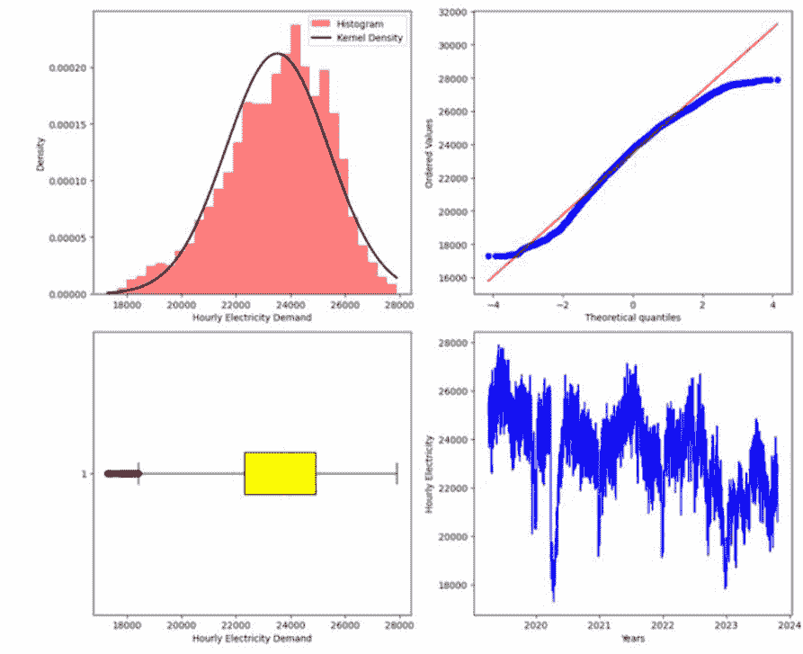

### 表 1. 描述性统计

| 最小值 | 25% | 均值 | 标准差 | 50% | 75% | 最大值 | 峰度 | 偏度 |
|---|---|---|---|---|---|---|---|---|
| 13797.94 | 21204.37 | 23513.52 | 2999 | 23519.93 | 25703.23 | 33065.91 | -0.39198 | 0.057021 |

按小时签约电力需求时间序列数据的非线性趋势显示不规则周期，而非规则季节性。峰值有时较小，有时较大。因此，对该时间序列数据进行建模需要纳入滞后特征，以使我们的预测器能够动态响应不断变化的条件。本研究将滞后变量作为解释变量纳入，以便将不同数量的近期历史纳入预测。提取的非线性趋势结果如图 7 所示。

### 图 6. 按小时电力需求趋势

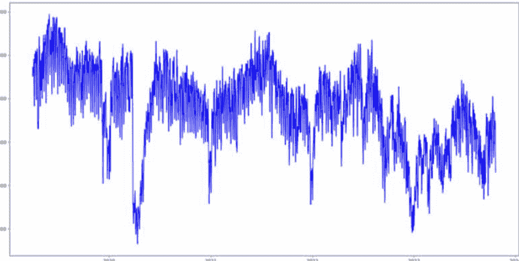

### 表 2. Mann-Kendall 检验统计量和 Sen 斜率估计量

| 变量 | M-K 检验统计量 | Kendall's Tau | p 值 | Sen 斜率 |
|---|---|---|---|---|
| 电力需求 | -115.3355 | -0.38466 | 0.001 | -0.0882 |

### 图 7. 叠加来自回归样条线的非线性趋势变量的去标识化按小时电力需求

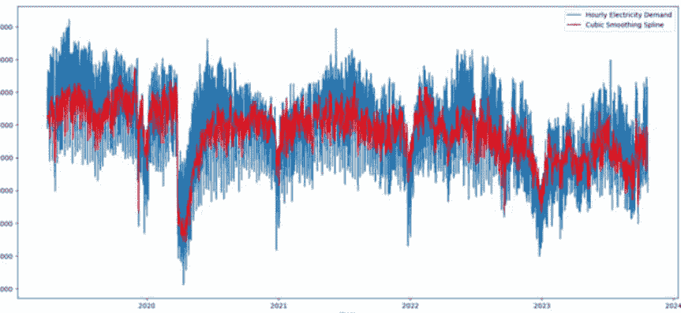

## 按小时电力需求负荷的预测与预报性能

为训练和测试我们的基础学习器，我们将批量大小固定为 32，并按 0.2 的比例增加 epoch 数量。使用三项标准进行比较分析，以找到最能模拟预测误差的模型。这些标准分别是平均绝对误差（MAE）、对称平均绝对百分比误差（SMAPE）、平均预测误差（MFE）以及样本内和样本外预测性能的均方误差。表 3 从水平预测和方向预测两个角度展示了实证结果。查看表 3 中报告的结果，当 epoch 设置为 50 时，RNN 的样本内预测误差较小，这是因为在所使用的四项指标中，有三项在 50 处取得最小值。然而，在样本外预测中，当 epoch 增加到 250 时，模型表现更好。CNN 在样本内预测中 epoch 设置为 250 时误差最小，但在样本外预测中，当 epoch 为 10 时模型误差最小。LSTM 亦可类比。值得注意的是，我们的堆叠集成在组合预测模型中确实有所改善。这表明，随着 epoch 数量的增加，基础学习器和元模型的性能都得到提升。据我们所知，深度学习因其卓越性能已成为多个领域的重要来源。因此，如表 3 所示，深度学习在此领域也取得了积极结果。最近，深度学习技术产生了改进的结果，但在建模能源模式的过程中，它们缺少一些关键信息，这表明模型性能不如理想状态。我们在文献综述过程中一直基于这一假设，并开发了一个集成模型，以考虑每个特征、轻松建模能源模式，并识别空间和时空线索。因此，我们建议采用集成深度学习技术，并与其他基准方法相比取得良好结果，因为深度学习在时间序列问题预测中的性能是构建集成框架的灵感来源。下图 8 显示了所提议系统在按小时预测使用方面的性能。

在图 4 中，我们展示了 RNN-LSTM-CNN 模型的训练损失和验证损失曲线。这些损失值让我们了解学习性能如何随 epoch 数量的变化。图表显示，训练损失和验证损失都降至稳定点，且两条曲线之间有微小差距。这表明 RNN-LSTM-CNN 模型对观测数据拟合良好。

拥有组合预测模型后，我们使用该模型的残差并拟合了高斯 Copula。我们使用此 Copula 是因为在为基础学习器预处理数据时，我们将时间序列与层级结构一起归一化，以最好地适应基础学习器。图 9 展示了我们的高斯 Copula 可视化。从该图可以看出，只有月份和季度与周特征具有高度依赖性。存在高度正相关，而半年与周特征呈负相关。我们还注意到，季度和月份彼此正相关。此外，季度和月份与半年特征呈负相关。表 4 使用 Spearman 秩相关展示了层级结构的相关矩阵。

在建立的层级结构中发现一些正负依赖关系后，我们现在执行 k-means 及其两个变体，即模糊 C-means 聚类和小批量 k-means 聚类。选择这两个变体是基于它们的能力。例如，小批量 K-Means 用于加速算法收敛并降低计算要求，它适用于大型数据集，如本章中使用的按小时电力需求负荷。该算法在每次迭代中使用数据集的一个随机子集（小批量），并基于此更新质心，

### 表 3. 预测性能

| Epochs | 批量大小 | MSE | MAE | SMAPE | MFE | MSE | MAE | SMAPE | MFE |
| :--- | :--- | :--- | :--- | :--- | :--- | :--- | :--- | :--- | :--- |
| | RNN-样本内预测 | | | | | RNN-样本外预测 | | | |
| 10 | 32 | 0.006 | 0.059 | 10.756 | -0.004 | 0.012 | 0.086 | 15.185 | 0.001 |
| 50 | 32 | 0.003 | 0.044 | 7.826 | 0.004 | 0.009 | 0.072 | 12.892 | -0.021 |
| 250 | 32 | 0.005 | 0.050 | 10.346 | 0.007 | 0.005 | 0.056 | 10.146 | -0.011 |
| | CNN-样本内预测 | | | | | CNN-样本外预测 | | | |
| 10 | 32 | 0.0168 | 0.1024 | 1.0177 | -0.0577 | 0.0074 | 0.0691 | 0.6879 | 0.0004 |
| 50 | 32 | 0.0120 | 0.0855 | 0.8503 | -0.0484 | 0.0100 | 0.0824 | 0.8200 | 0.0501 |
| 250 | 32 | 0.0097 | 0.0821 | 0.8168 | 0.0496 | 0.0086 | 0.0757 | 0.7530 | 0.0299 |
| | LSTM-样本内预测 | | | | | LSTM-样本外预测 | | | |
| 10 | 32 | 0.005 | 0.055 | 0.540 | -0.007 | 0.009 | 0.074 | 0.740 | 0.024 |
| 50 | 32 | 0.003 | 0.041 | 0.400 | -0.003 | 0.008 | 0.069 | 0.690 | -0.014 |
| 250 | 32 | 0.002 | 0.036 | 0.360 | 0.010 | 0.004 | 0.046 | 0.460 | 0.005 |
| | RNN-LSTM-CNN-样本内预测 | | | | | RNN-LSTM-CNN-样本外预测 | | | |
| 10 | 32 | 0.007 | 0.061 | 11.060 | 0.000 | 0.013 | 0.088 | 15.341 | 0.000 |
| 50 | 32 | 0.003 | 0.046 | 8.320 | 0.000 | 0.009 | 0.070 | 12.520 | 0.000 |
| 250 | 32 | 0.003 | 0.041 | 7.270 | 0.000 | 0.005 | 0.054 | 9.879 | 0.000 |

### 图 8. 模型训练与验证损失

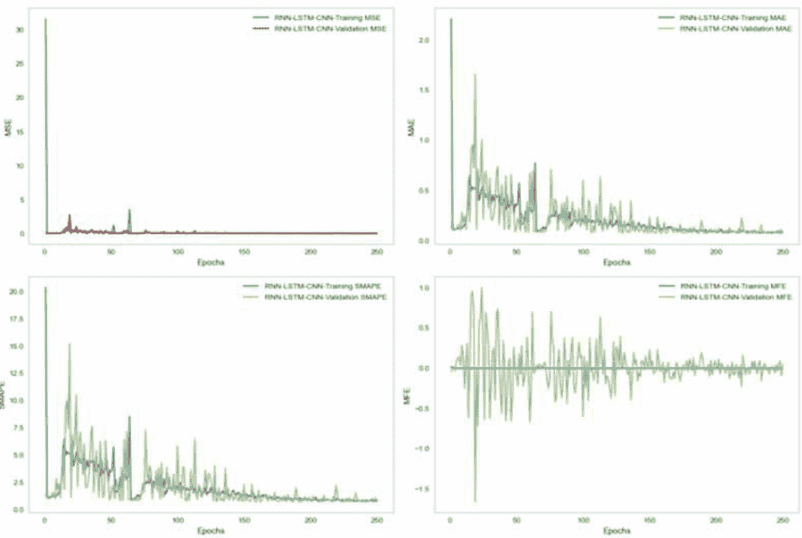

## 用于建模时间依赖性的深度学习框架

### 图 9. 层级结构的高斯 Copula 可视化

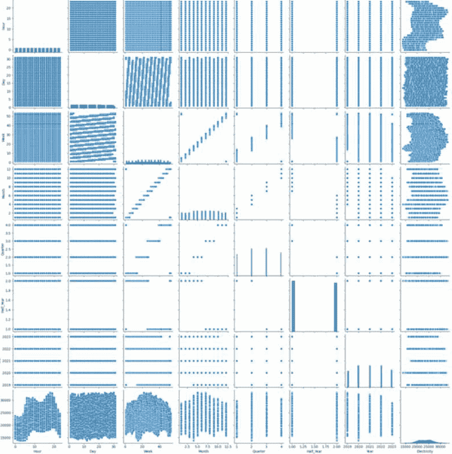

子集。这可以加快收敛速度，尤其是在处理大型数据集时。另一方面，模糊 C-Means (FCM) 允许数据点以不同程度的隶属度属于多个簇。模糊 C-Means 为每个数据点分配每个簇的隶属度值，表明该点属于每个簇的程度。这种方法比传统的 k-means 更灵活，尤其是在簇分配不明确时。

我们发现，在应用肘部法和轮廓系数来确定理想簇数量后，两个簇是理想数量。请参阅附录中的图 11 和 12。表 5 展示了三种聚类技术的结果。很明显，在 k-means 聚类中，Davies-Bouldin 指数为 0.5011（低），意味着强簇分离，而轮廓系数


## 用于建模时间依赖性的深度学习框架

### 表 4. Spearman 等级相关

| | 小时 | 天 | 周 | 月 | 季度 | 半年 | 年 |
|---|---|---|---|---|---|---|---|
| Hour | 1.00 | | | | | | |
| Day | 0.00 | 1.00 | | | | | |
| Week | 0.00 | 0.06 | 1.00 | | | | |
| Month | 0.00 | 0.00 | 0.97 | 1.00 | | | |
| Quarter | 0.00 | 0.00 | 0.94 | 0.97 | 1.00 | | |
| Half_year | 0.00 | -0.01 | -0.84 | -0.86 | -0.89 | 1.00 | |
| Year | 0.00 | -0.01 | -0.20 | -0.20 | -0.20 | 0.14 | 1.00 |

轮廓系数为 0.7284（高），表明聚类分离良好。然而，Davies-Bouldin 指数为 1.0289（中等），表明聚类分离适中，Mini-Batch K-Means 的轮廓系数确定为 0.3805（中等），同样表明聚类分离适中。

最后，通过 Fuzzy C-Means 发现轮廓系数为 0.3734（中等），表明聚类分离适中，而 Davies-Boulden 指数为 1.0554（中等），暗示聚类分离适中。总的来说，K-Means 在三种算法中表现似乎最好，具有更高的轮廓系数和更低的 Davies-Boulden 指数值。基于这些指标，Mini-Batch K-Means 和 Fuzzy C-Means 表现出相似的中等性能。最后，使用 k-means 对每个簇中的层次结构时间依赖性如图 10 所示。

### 结论与未来方向

尽管对电力/能源消耗进行准确可靠的估计至关重要，但该领域令人沮丧地吸引的关注度却低于其他领域。但在过去几年中，研究人员取得了一些重大进展，利用深度学习（DL）和人工智能（AI）开发出了可靠、准确且有效的预测模型。由于其特性和重要性，这些技术——人工智能和深度学习——在处理时间序列数据的非线性问题时表现良好且高效。在本章中，我们介绍了一种深度学习集成方法，它利用时间依赖性来预测和预估电力需求的每小时负载。为确保模型性能，我们的系统首先处理数据清洗、归一化和转换。

此外，预处理后的数据被输入到集成模型中，通过使用 RNN、LSTM、CNN 和堆叠集成架构来提取混合判别特征。这将使公用事业公司能够规划资源并平衡供需，从而确保电网的稳定性和安全性以及服务提供的可靠性。使用每小时电力需求负载，我们评估了所提系统并比较了结果，结果显示于表 3。针对未来工作，可以研究各种非线性外源数据结构，例如变量、货币特征以及天气/气候条件或变化，用于电力负载模式的趋势分析。此外，可以构思并开发许多优化技术，以提高推荐系统的预测准确性。

### 表 5. 聚类算法性能

| | 轮廓系数 | Davies-Bouldin 指数 |
|---|---|---|
| K-means | 0.728393737 | 0.501091441 |
| Mini-Batch K-Means | 0.380461786 | 1.028941784 |
| Fuzzy C-Means | 0.373376881 | 1.055433432 |

### 图 10. 电力需求层次结构聚类

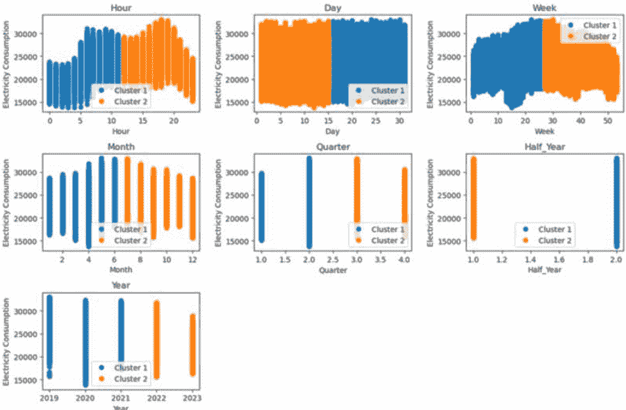

### 参考文献

- Adhikari, R. J. N. (2015). 基于神经网络的时间序列预测线性集成框架. Academic Press.
- Ahmadi, A., Daccache, A., Sadegh, M., & Snyder, R. L. (2023). 参考蒸散量时间序列预测的统计学和深度学习模型：准确性、复杂性和数据效率比较. Computers and Electronics in Agriculture, 215. doi:10.1016/j.compag.2023.108424
- Aldhsan, S. R. S., Abdul Maulud, K. N., Wan Mohd Jaafar, W. S. Karim, O. A., & Pradhan, B. (2021). 马来西亚可再生能源渗透率和建筑能效的能源消耗与空间评估：综述. Sustainability (Basel), 13(16), 9244. doi:10.3390/su13169244
- Bagnall, A., Lines, J., Hills, J., & Bostrom, A. (2015). 基于 COTE 的时间序列分类：基于变换的集合. IEEE Transactions on Knowledge and Data Engineering, 27(9), 2522–2535. doi:10.1109/TKDE.2015.2416723
- Bandara, K., Bergmeir, C., & Smyl, S. (2020). 基于相似系列组的循环神经网络跨时间序列数据库预测：一种聚类方法. Expert Systems with Applications, 140, 112896. doi:10.1016/j.eswa.2019.112896
- Cordeiro-Costas, M., Villanueva, D., Eguía-Oller, P., Martínez-Comesaña, M., & Ramos, S. (2023). 基于机器学习和深度学习方法的负载预测. Applied Sciences (Basel, Switzerland), 13(13), 7933. doi:10.3390/app13137933
- Ensafi, Y., Amin, S. H., Zhang, G., & Shah, B. (2022). 季节性商品销售的机器学习时间序列预测——比较分析. International Journal of Information Management Data Insights, 2(1), 100058. doi:10.1016/j.jjimei.2022.100058
- Hagenau, M., Liebmann, M., & Neumann, D. (2013). 自动化新闻阅读：基于捕捉上下文特征的财务新闻股票价格预测. Decision Support Systems, 55(3), 685–697. doi:10.1016/j.dss.2013.02.006
- Hamed, M. M., Ali, H., & Abdelal, Q. (2022). 使用均值和方差异质的随机参数模型预测年度电力消耗. Energy, 255, 124510. doi:10.1016/j.energy.2022.124510
- Hochreiter S, & Schmidhuber J (1997). 长短期记忆网络. Neural Comput, 9(8), 1735–1780. doi:10.1162/neco.1997.9.8.1735
- Huang, S.-H., & Pan, Y.-C. (2014). 基于自动化 RGB-D 人体测量系统的人体工学工作轮换策略. Journal of Manufacturing Systems, 33(4), 699–710. doi:10.1016/j.jmsy.2014.02.005
- Huang, S.-H., & Pan, Y.-C. (2015). 半导体行业自动化视觉检测：综述. Computers in Industry, 66, 1–10. doi:10.1016/j.compind.2014.10.006
- Jin, L., & Dong, J. (2016). 生物医学时间序列分类的集成深度学习. Computational Intelligence and Neuroscience. doi:10.1155/2016/6212684 PMID:27725828
- Jogonula, O., Adebisi, B., Hoang, K. V., Tsado, Y., Popoola, S. I., Hammoudeh, M., & Nawaz, R. (2022). CBLSTM-AE：一种用于预测能源消耗的混合深度学习框架. Energies, 15(3), 810. doi:10.3390/en15030810
- Kamal-Chaoui, L., & Robert, A. (2009). 竞争城市与气候变化. Academic Press.
- Kohzadi, N., Boyd, M. S., Kermanshahi, B., & Kaastra, I. (1996). 人工神经网络与时间序列模型预测商品价格的比较. Neurocomputing, 10(2), 169–181. doi:10.1016/0925-2312(95)00020-8
- Kranjc, J., Smailović, J., Podpečan, V., Grčar, M., Žnidaršič, M., & Lavrač, N. (2015). 数据流情感分析的主动学习：CloudFlows 平台中的方法论与工作流实现. Information Processing & Management, 51(2), 187–203. doi:10.1016/j.ipm.2014.04.001
- Le, T., Vo, M. T., Vo, B., Hwang, E., Rho, S., & Baik, S. W. (2019). 使用 CNN 和 Bi-LSTM 改善电能消耗预测. Applied Sciences (Basel, Switzerland), 9(20), 4237. doi:10.3390/app9204237
- Liu, T., Tan, Z., Xu, C., Chen, H., & Li, Z. (2020). 建筑能耗预测深度强化学习技术研究. Energy and Building, 208, 109675. doi:10.1016/j.enbuild.2019.109675
- Lotfipoor, A., Patidar, S., & Jenkins, D. P. (2024). 用于住宅负载预测的带经验模态分解和贝叶斯优化的深度神经网络. Expert Systems with Applications, vol. 237, 121355. 先行在线发表. doi:10.1016/j.eswa.2023.121355
- Mariano-Hernández, D., Hernández-Callejo, L., García, F. S., Duque-Perez, O., & Zorita-Lanandrid, A. L. (2020). 智能建筑能耗预测综述：方法、输入变量、预测时域与指标. Applied Sciences (Basel, Switzerland), 10(23), 8323. doi:10.3390/app10238323
- Rahman, M. M., Shakeri, M., Tiong, S. K., Khatun, F., Amin, N., Pasupuleti, J., & Hasan, M. K. (2021). 基于人工神经网络混合可再生能源系统能源预测的前瞻性方法. Sustainability (Basel), 13(4), 2393. doi:10.3390/su13042393
- Razavi, R., Gharipour, A., Fleury, M., & Akpan, I. J. (2019). 基于智能电表数据的住宅建筑人员占用检测：大规模研究. Energy and Building, 183, 195–208. doi:10.1016/j.enbuild.2018.11.025
- Sharma, N., Jain, V., & Mishra, A. (2018). 图像分类卷积神经网络分析. Procedia Computer Science, 132, 377–384. doi:10.1016/j.procs.2018.05.198
- Shiri, Perumal, Mustapha, & Mohamed. (n.d.). 深度学习模型综合概述与比较分析：CNN, RNN, LSTM, GRU. https://arxiv.org/ftp/arxiv/papers/2305/2305.17473.pdf
- Singaravel, S., Suykens, J., & Geyer, P. (2018). 深度学习神经网络架构与方法：用于建筑设计能耗预测的基于组件的模型. Advanced Engineering Informatics, 38, 81–90. doi:10.1016/j.aei.2018.06.004
- Slater, L. J., Arnal, L., Boucher, M., Chang, A., Moulds, S., Murphy, C., Nearing, G., Shalev, G., Shen, C., Speight, L., Villarrini, G., Wilby, R. L., Wood, A., & Zappa, M. (2022). 混合预测：使用统计学和机器学习集成动态模型预测. Hydrology and Earth System Sciences. 先行在线发表. doi:10.5194/hess-2022-334
- Somu, N., Raman, M. R. G., & Ramamritham, K. (2021). 建筑能耗预测深度学习框架. Renewable & Sustainable Energy Reviews, 137, 110591. doi:10.1016/j.rser.2020.110591
- Wang, Z., & Oates, T. (2015). 通过成像时间序列改进分类和插补. arXiv 预印本 arXiv:00327.


Wongrin, W., Chaisee, K., & Suphawan, K. (2023). 北部泰国PM2.5浓度预测中统计方法与深度学习方法的比较。*波兰环境研究杂志*, 32(2), 1419–1431. doi:10.15244/pjoes/157072

世界能源理事会。(2016). 世界能源理事会. 世界能源资源：太阳能。

## ENDNOTE

- 1. 该数据可从 https://www.eskom.co.za/dataportal/ 获取

## APPENDIX

图 11. 确定最佳簇数的肘部法

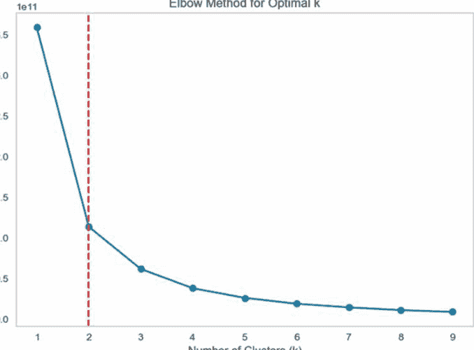

图 12. 确定最佳簇数的轮廓法

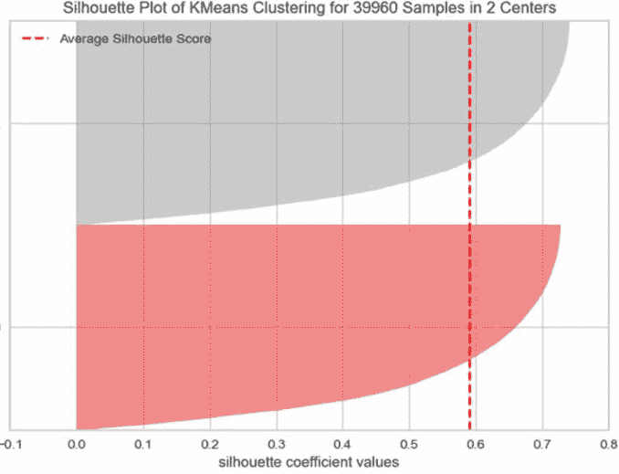

# Chapter 4
# 第 4 章

# 利用计算机视觉、深度学习和机器学习技术预测太阳能和可再生能源的研究

Jayeeta Majumder  
哈尔迪亚理工学院，印度

Pinaki Pratim Acharyja  
https://orcid.org/0000-0002-0305-2661  
哈尔迪亚理工学院，印度

Subhabrata Barman  
哈尔迪亚理工学院，印度

Santanu Koley  
https://orcid.org/0000-0001-8082-1332  
哈尔迪亚理工学院，印度

## ABSTRACT
## 摘要

利用可再生能源作为减轻气候变化和全球变暖影响的一种方式，正变得越来越流行。为使可再生能源更具可预测性，已开发出众多预测技术。本章最能说明本研究的目标，旨在对可再生太阳能预测中的机器学习和计算机视觉技术进行综述与分析。除了可再生太阳能预测的机器学习和计算机视觉技术外，本章还侧重于实现优化学术成果的目标，这可能对于新太阳能领域的开发是必要的。这可能会显著促进太阳能的广泛使用，太阳能是一种可持续且更清洁的能源。

DOI: 10.4018/979-8-3693-2355-7.ch004

## INTRODUCTION
## 引言

社会经济发展导致能源需求持续增加，而仅依靠本地资源的传统技术已无法满足这一需求。可再生能源被视为应对日益增长的能源需求及煤炭价格上涨等经济挑战的一种变革性解决方案。(Huang et al., 2017; Jursa, 2007; Rohrig et al., 2008) 此外，可再生能源和天然资源易于获取、储量丰富且环保。可再生能源电厂的发电性质由于依赖众多变量（包括地点、风速、天气及其他气候条件）而具有不可预测性。(M. Abdel-Nasser et al., 2019; Bouzerdoum et al., 2013) 因此，有必要指出，太阳能和风能可变发电的整合已成为系统运营商在确保电力系统网络可靠性和安全性方面的一项真正挑战，尤其是在世界能源结构中可再生能源占比指数级增长的背景下。

为了将可变能源并入电网，可再生能源预测至关重要，因为它允许电力系统在不同的时空尺度上管理能源供应的间歇性特性。为了预测云位移对太阳能设施产生的能量的未来影响，传统的建模方法依赖于数值天气预报或物理模型。(Bacher et al., 2009; Bapai et al., 2019) 这些模型难以捕捉系统性偏差并整合云数据。通过利用机器学习将多源地面测量与实时云量观测相结合，克服了其中一些限制，从而改进了计算机视觉。本综述以深度学习为重点，(AlKandari et al., 2019; Alsharif et al., 2019; Aslam et al., 2019) 深度学习为创建能够从气象站、卫星、地面天空摄像头和传感器网络产生的数据中提取相关数据的架构提供了所需的理论基础，本综述概述了基于地球多源观测的太阳能预测的最新发展。

图 1. 可再生能源

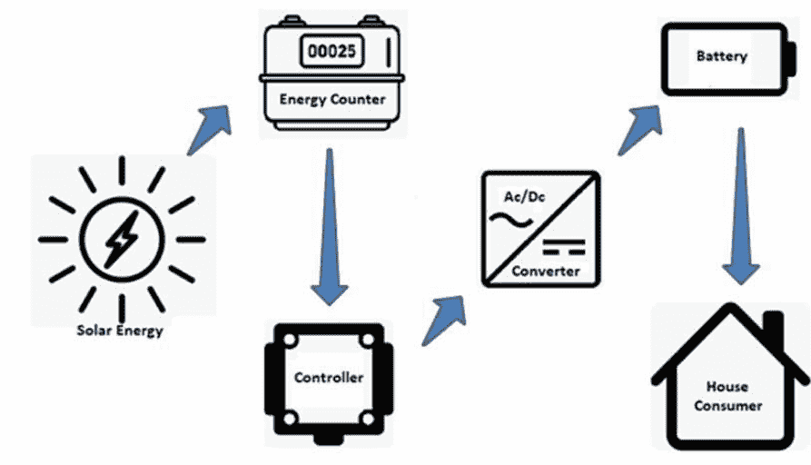

地球。综上所述，机器学习有巨大潜力提高太阳能气象学的准确性和鲁棒性。然而，需要进一步研究才能充分把握这一潜力并解决其局限性 (Sheng et al., 2018; Torres-Barran et al. 2019)。

本章分为多个部分。第 1 节介绍了引言和研究目的。为了减轻太阳能间歇性的影响，第 2 节讨论太阳能功率预测，即收集和评估数据以预测不同时间范围太阳能发电的过程。第 3 节介绍了研究的动机及当前综述文章列表。第 4 节描述了太阳能预测方法的计算机视觉。第 5 节介绍了基于视觉的太阳能建模中使用的各种深度学习技术；第 6 节介绍了研究结论。

## SOLAR FORECASTING
## 太阳能预测

太阳能预测是减少由大气变化引起的太阳能不可预测性和变异性的最佳方法之一。为了估计当前气象条件并预测从几秒到数年后的未来全球太阳辐照度（GSI）或功率，大多数太阳能预测技术使用地面或遥感数据作为输入。太阳能预测（也称为运行太阳能预测）在电力和能源领域已得到广泛应用。(Cellura et al., 2008; Chen et al., 2008; Dehghani et al., 2019) 基于不同提前时间和范围，太阳能预测可分为极短期、短期、中期和长期预测等一般类别。

尽管这些定义存在差异，但各时间尺度上的太阳能预测对于电力系统规划和运营至关重要。长期太阳能预测通常用于资源评估、系统规划和能源交易。能源市场和日常电力系统运营依赖于短期和极短期太阳能预测，这类预测通常表述为长达几天的预测。

_图 2. 太阳能预测_

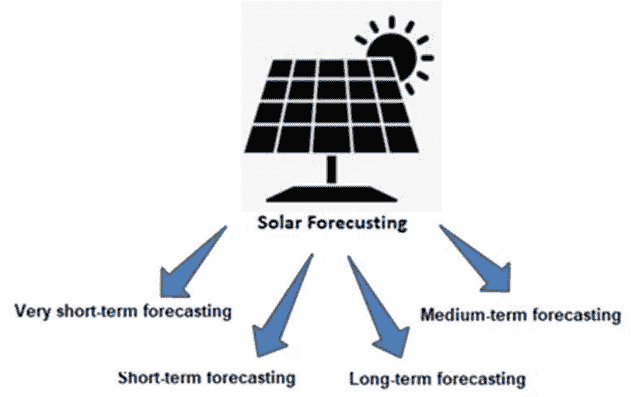

电力系统和市场使用不同的定义和术语。(Han et al., 2011; Harbola et al., 2019; Hong et al., 2019) 准确的太阳能预测可以降低成本并提高电力系统的韧性和可靠性，以便进行即时调整；系统运营商和市场参与者通常使用极短期太阳能预测，而对于日前投标或初步发电机调度，他们通常使用中期至短期太阳能预测。太阳能预测技术分为物理型、数据驱动型或混合型三类模型，具体取决于它们遵循物理原理的程度。任何类型的模型都可以使用远程和地面传感器的数据作为输入。(Atique et al., 2019; Cali et al., 2019) 最常见的卫星照片类型是遥感数据，可通过物理模型处理（例如带有数值天气预报（NWP）的模型）来生成太阳能预测。此外，还可以直接使用统计模型来处理卫星数据并进行太阳能预测。(Navarin et al., 2020; Gutierrez et al., 2020; Oakleaf et al., 2007) 测量局部地表辐照度的最佳地面传感器是总辐射表和直射辐射表。传感器在太阳能预测中发挥重要作用有特殊机会，例如卫星和天空摄像头，因为与负荷、价格和风能预测等其他能源预测目标变量相比，太阳能预测对云层运动更敏感。卫星和天空摄像头覆盖广泛的太阳能预测范围。天空摄像头和卫星的综合能力是以图片形式提供信息，这是一个重要的共同点。高级计算机视觉技术可用于处理这些云量观测并模拟太阳能功率的变异性。(Filik et al., 2017; Fischetti et al., 2019; Hombrados-Herrera et al., 2018).

## LITERATURE REVIEW
## 文献综述

- 1. Ibrahim 等人（2012）开发了一个线性回归模型，利用气象站三年收集的信息来预测伯利斯的太阳辐射。该模型与数据拟合良好，证据包括平均日太阳辐射、平均日最高和最低气温以及模型的 R 平方值为 0.954。模型设计者得出结论，伯利斯可以从将其应用于太阳辐射估计中获益。[Ibrahim et al., 2012]

- 2. Ekanayake 等人（2021）创建了功率回归、多元线性回归和人工神经网络（ANN），以开发模型预测斯里兰卡风电场的风力发电。平均风速和平均环境温度被用作其建模方法中分析的输入变量。（Khandakar 等人，2019；Kim 等人，2019；Kong 等人，2015）。相关系数较高，RMSE 较低，且模型存在偏差，表明精度可接受。其开发过程中使用了五年期的发电数据。尽管 ANN 模型最准确。MLR 和 PR 模型为同一地区的其他风电场提供了洞察。[Ekanayake et al., 2021]

- 3. 为预测太阳能发电，Mustafa 等人（2022）还分析了四种回归模型：逻辑回归、弹性网回归、Lasso 回归和线性回归。结果表明，所有四种模型均有效，其中弹性回归在预测最大点处的太阳能输出方面优于另外两种模型。此外，还使用了主成分分析（PCA），弹性回归模型产生了更好的结果。每种太阳能预测模型的优缺点是本研究的主要主题。[Mustafa et al., 2022]

- 4. 在其 2020 年的研究中，Vassallo 等人考察了随机森林（RF）建模在风速功率预测中的最佳程序。在这项工作中，直接预测和反向多步预测


相比之下，评估了训练数据可用性的影响，并考察了将随机森林（RF）作为准确度量的应用。研究结果表明，RF 作为持续性方法误差修正工具时表现更好，且直接预测策略以微弱优势优于递归策略。随着数据可用性增加，预测精度也随之提高。 [Vassallo et al, 2020]

- 5. 为进一步解决短期风力发电预测中神经网络模型的推理不足、过拟合和泛化问题。（C.J. Camila et al, 2019; Cardona et al, 2019; Mabel et al., 2008）。Shi 等人 (2018) 提出了一种结合监督随机森林模型的两步特征选择过程。所提方法消除无关特征，选择相关样本，并评估每个决策树的有效性。为了解决内部验证指标的不足，提出了一种与风速相关的新外部验证指标。（Kou et al., 2014; S. Kumar et al, 2015; Zheng et al. 2009）实证案例和案例研究表明，该模型在鲁棒性、效率和准确性方面优于其他模型，特别是在风力弃电和噪声数据方面。 [Shi et al., 2018]

- 6. 当需要分析大量非结构化数据且最优目标变量仍未知时，无监督学习算法通常很有用。气象数据聚类是可再生能源预测中无监督学习的广泛应用。例如，J. Varanasi 和 M. Tripathi (2019) 使用 K-means 聚类，基于相似性将一年中的晴天、多云天和雨天进行聚类，以预测短期光伏发电量。 [J. Varanasi et al., 2019]

- 7. 可再生能源预测是强化学习的众多应用之一。将 RL 应用于可再生能源预测的一种方式是控制能源系统的行为。例如，Sierra-García J. 和 S. Matilde (2020) [Sierra-García J et al, 2020] 利用 RL 为风力涡轮机开发了一种先进的偏航控制方法。与使用人工神经网络（ANN）来最大化发电量并最小化机械负载的 RL 算法不同，该方法采用基于粒子群优化（PSO）和帕累托最优前沿（PoF）的算法来确定在电力增益和机械负载之间取得最佳平衡的行动方案。犹他州盐湖城的真实风数据、FAST 仿真以及 NREL 5-MW 参考风力涡轮机均支持该方案。人工神经网络（ANN）已使用很长时间，并已被证明在预测可再生能源（包括太阳能、风能和多种可再生能源）方面有效。（Kalogirou et al., 1999; Kamadinata et al., 2019; Kechriots et al, 1994）

例如，在沙特阿拉伯阿布哈，Rehman 和 Mohandes 将相对湿度和空气温度输入人工神经网络，以估算太阳辐射量。与此同时，为了计算沙特阿拉伯麦地那的总太阳辐射量，Benghanem 等人设计了六种基于 ANN 的模型。确定精度最高的模型基于空气温度和日照时长。 [Benghanem et al, 2009]

- 8. Ozgoren 等人在另一项研究中使用逐步多元非线性回归（MNLR）技术来识别有影响力的输入和多个输入变量，在此过程中开发了一个 ANN 模型来预测土耳其的月度全球太阳辐射。研究发现，与测量值相比，ANN 模型的精度令人满意。尽管所采用的模型和输入变量存在差异，人工神经网络（ANN）已被证明是在各个地点预测全球太阳辐射的可靠工具。S. Kumar 和 T. Kaur (2016) 也使用 ANN 来预测喜马偕尔邦太阳能应用的太阳辐射。温度、气压、湿度、日照时数和降水量均为 ANN 模型中使用的输入变量 [Ozgoren et al, 2012]。在开发和测试了具有三到五个输入参数的三个模型后，ANN-I5 模型实现了最高预测精度，平均绝对百分比误差（MAPE）为 16.45%。本研究表明，无需精确测量工具，该方法可用于确定世界上任何地点的太阳能潜力。 [S. Kumar et al, 2016].

- 9. 风能是可再生能源预测研究的另一个重要领域。Jamii 等人 (2022) 提出了一种基于 ANN 的范式，利用风速、大气压力和温度等气象参数来预测风力发电量和负载需求。结果表明，ANN 产生了高功率预测精度和有效性，并优于其他四种机器学习技术 [Jamii et al., 2022]。Chen 和 K. Folly (2019) 提出了一种人工神经网络（ANN）模型，用于估算小型风电场的短期风力发电量。他们研究了样本量、气压、温度、相对湿度、风向以及不同海拔的风速对模型计算成本和预测精度的影响。该研究探讨了样本量和输入变量如何影响模型的成本计算和预测精度。他们的研究表明，具有大训练样本量和所有输入特征的 ANN 模型对预测效果最佳 [Chen et al., 2019].

- 10. 卷积神经网络（CNN）是一种人工神经网络（ANN），擅长处理和解释以网格形式组织的数据，例如图像或视频。CNN 使用卷积层从输入数据中提取局部特征，其灵感来自大脑视觉皮层的结构和功能 [Yao et al., 2019]。CNN 由卷积层、池化层和全连接层等层组成。卷积层作为 CNN 的核心组件，使用过滤器（也称为内核）从输入数据中提取局部特征。 [Akram et al., 2019].

所有过滤器都由微小矩阵组成，这些矩阵遍历输入数据并将每个过滤器与相应的输入像素相乘。此过程会创建一个特征图，描绘输入数据中对当前任务最重要的部分。池化层通常在卷积层之后添加到网络中，以降低特征图的空间维度并提高计算效率。最大池化选择特征图定义区域内的最高值，平均池化选择定义区域内的平均值。这是两种最常用的池化形式 [McCann, et al, 2017]。全连接层使用池化层和卷积层获取的特征来生成最终预测。这些层类似于传统神经网络中的层，利用学习到的特征基于当前任务预测结果。CNN 的权重在训练期间会发生变化，与其他神经网络架构一样，以最小化预期输出与实际输出之间的差异。然后，在使用反向传播算法计算损失函数相对于权重的梯度后，根据这些信息更新权重。 [Ajit et al., 2020]

## 基于计算机视觉的太阳能预测

当从光传感设备（如卫星影像、地面成像仪或两者）捕获的空间数据中获取天空特征时，使用计算机视觉的太阳能预测方法称为基于图像的方法（Niall et al, Leron et al, 2021）。另一方面，统计技术依赖移动平均和自回归协变结构，而物理方法基于太阳位置。日照辐射的日内变异大部分由云量动力学解释。研究人员已开发基于云层观测的计算机视觉技术，以更好地预测太阳能电力的相应波动。由于云层未来运动的确定性特性，从过去观测中可以推断出部分空间配置（Quentin et al, 2022）。除了云层建模的内在随机成分外，预测云位移相比仅依赖本地气象数据的预测方法具有重大优势，后者无法以足够的准确度预测超出太阳时间序列短期自相关期的未来事件。因此，为了产生真正在各种时空尺度上有价值的太阳能预测，有必要采用预测方法（Vishnu et al., 2020; Vincent et al., 2020）。

卫星和天空相机是短时间范围太阳能预测的主要云观测来源。天空相机上的鱼眼镜头允许其一次记录几平方公里本地云层的空间分布，而卫星则提供大陆大气辐射图，时间分辨率较低，间隔为五到十五分钟，少于一分钟。由于这两种成像方法在技术特征和云层视角上有所不同，目前对于太阳能预测，两者都可用并联合使用，尽管预计它们的时空分辨率将提高并最终赶上地面影像。就预测时限而言，利用天空相机的方法旨在根据本地云速度提供最多提前三十分钟的本地太阳能变异预测；相比之下，视野更广的卫星影像可提供更长期的预测，提前数小时（Gaétan et al., 2019）。天空相机最适合太阳能功率密度较高的地方，如太阳能或混合动力发电厂，除非它们是覆盖更广区域的网络安排的一部分。另一方面，基于卫星的方法可用于获取国家太阳能产出预测，这对能源交易和电网平衡有利。常规计算机视觉技术中使用的一些可比方法——云分割、云定位、云属性估计、云跟踪和云运动建模——均基于天空或卫星图像（Gaétan et al., 2019; Dragomir et al., 2018）。

对于天空图像，云掩码通常基于像素值统计的阈值技术生成。除了可比的阈值分析外，有效云反照率（也称为云指数，0：无云，1：密云）也可用于改进卫星图像中的云分割。这是基于表面反射光百分比、观测反射光百分比以及表面最高经验反射光百分比计算的。这种连续变量指示云透射率，也可利用晴空模型和日照计估计天空相机应用中的云透射率。接下来，使用多个天空相机的立体视觉模式进行云地理定位。随后，为了预测云层动力学对太阳能输出的未来确定性或概率性影响，可以使用块匹配技术或光流法估计云速度向量（Vignesh et al., 2019; Ahmad et al., 2019）。可从云的未来位置获取局部或区域辐射的预测，通过


## 计算机视觉、深度学习和机器学习研究

### 图 3. 基于天空图像或卫星图像的传统计算机视觉方法

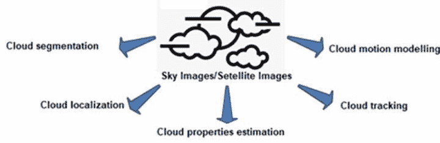

利用云层物理性质的估计。利用最近的进展，已开发出多种数据驱动方法来解决这一计算机视觉任务，这要归功于深度学习的进步和大型数据集日益丰富的可用性。预测太阳变化的常规方法是训练神经网络来识别一系列历史卫星或天空照片中的时空元素。与传统计算机视觉技术类似，这类技术既可用于获得区域预测（如 GSI 或云指数图），也可用于获得局部值（如光伏功率输出或 GSI）。尽管深度学习模型在平均绝对误差（MAE）或均方根误差（RMSE）等平均指标上取得了性能提升，但它们存在多种不足，例如无法突破持续性障碍、无法预测未来的显著事件，或无法将图片（尤其是从太空拍摄的图片）与其匹配的太阳值相关联（Huiyu et al., 2022, Bharath et al., 2015）。因此，某些模型依赖外部数据，如太阳高度或 GSI 读数。近年来，在线期刊上关于该主题的论文数量增加，表明太阳能社区对基于计算机视觉的太阳能预测越来越感兴趣（Chatwin et al., 2019; Feng et al., 2018; Hodge et al., 2017）。最近还开发了利用天空图像和卫星数据预测太阳的类似方法。

## 基于深度学习技术的视觉太阳能

本节介绍了基于视觉的太阳能建模的各种深度学习技术。这些方法侧重于一般建模、质量保证、数据处理和数据增强的不同方面。

实现深度学习模型时，常常涉及许多架构设计决策，例如层数、卷积滤波器大小和神经元数量，以及替代学习配置，例如批量大小和学习率（Lansberry et al., 1992; Lauret et al., 2015; Leholo et al., 2019）。调整这些超参数以使深度学习模型性能更好需要花费精力。通常，每个超参数都有一个定义的取值范围。由于时间和计算资源限制，包含所有可能参数组合的全面搜索（也称为网格搜索）通常不可行。网格搜索在寻找超参数方面效果不佳，因为超参数也可能随数据集而变化。换句话说，一个数据集效果最好的超参数值在另一个数据集上可能效果不佳。鉴于这些问题，通常会使用采样技术。与为每个超参数指定一个明确的取值范围不同，会建立一个统计分布，并从中随机选择值。并非所有超参数都具有相同的重要性。虽然网格搜索可以专注于寻找关键超参数的最佳值，但随机搜索具有更强的探索能力，并且可能花更少的时间去研究不重要的参数。除了随机搜索之外，贝叶斯优化最近作为一种超参数调优工具越来越受到重视（Rodriguez et al., 2018; Salcedo-Sanz et al., 2014; Saloux et al., 2014）。可以使用一种称为贝叶斯优化的机器学习算法自动找到最佳超参数设置。这与随机搜索形成对比，后者需要许多单独但并发的实验。该算法使用多次迭代来确定理想的超参数设置。高斯过程通常用于在超参数范围内对模型性能进行初步概率估计。可以根据先前迭代的结果，利用获取函数选择后续迭代的采样策略，直到找到最优解（Wang et al., 2017; Welch et al., 2009; Wen et al., 2019）。

与专注于改进模型（例如模型架构或训练计划）的以模型为中心的方法一起，其他工作试图通过改进数据来促进建模。这些以数据为中心的方法包括数据增强和特征工程等。特征工程旨在通过应用领域专业知识从原始数据中创建新特征。例如，基于视觉的太阳能预测中常见的预处理步骤之一是展开天空的鱼眼镜头图像，这些图像严重扭曲了场景。可以通过（Leva et al., 2017; Li S, 2003; Yang et al., 2018）提出的方法将云投影到矩形网格上，以实现这一点。该技术已用于深度学习研究，以帮助预测远处云的位移或提供对象轨迹一致性。另一方面，研究表明，原始镜头扭曲通过在图像中心区域添加更多信息（在高太阳通量期间，太阳和周围云层可见于该区域）增强了太阳预测。

通过创建现有样本的修改版本，数据增强旨在人为扩充数据集。通过更有效地利用现有数据，数据增强试图在不需要昂贵或不切实际的额外数据收集的情况下提高模型的泛化能力。在实际应用中，可以通过向现有样本应用添加噪声、裁剪、旋转或翻转等视觉变换来生成合成数据，也可以使用 GANs 等生成模型（Nazaripouya et al., 2018; Meng et al., 2016; Mohandes et al., 2004）。在基于视觉的太阳能预测中，已使用了各种数据增强技术。例如，为了进行噪声注入，像素值被添加了高斯噪声。另一种颜色空间转换方法是随机独立调整三个 RGB 通道各自的强度级别。另一种方法是同时将三个通道各像素值改变一个常数量（Wang et al., 2018; Yu et al., 2011; Zhen et al., 2015）。当用于从天空图像进行太阳建模时，这些方法已被证明有助于将图片与太阳值相匹配的即时预报任务；然而，它们对预测任务影响甚微。图像融合是另一种数据增强技术。可以将最近邻中的某一个或随机样本与原始图像相结合。研究表明，图像混合在即时预报预测中产生了最大影响，类似于颜色空间转换技术（Will et al., 2011; Williams et al., 1989; Yousif et al., 2019）。

基于视觉的太阳能深度学习方法也需要仔细考虑采样策略（Lin et al., 2018; Liu et al., 2018; Zhai et al., 2019）。天空图像数据集和卫星观测在各方面都不均匀，就像许多现实世界数据集一样。例如，给定地理位置的云类型分布高度依赖于当地天气。因此，原始数据集中的某些云模式可能被过度代表或代表不足。因此，从具有代表性的训练集中均匀采样的小型批次会教会模型特定地点的分布，这可能会影响其在不同气候下的表现。

除了数据集大小之外，数据集质量也会显著影响模型的性能和泛化能力。例如，标签错误的样本或辐照度测量不准确会导致模型训练期间出现错误的监督信号，并且如果模型在未经过测试的环境中使用，它们还会对模型的应用产生负面影响。这些因素使得质量控制成为机器学习项目中至关重要的组成部分（Coimbra et al., 2018; Qing et al., 2018; Rana et al., 2020）。基于视觉的太阳能监控中异常的原因包括灰尘、雪、露水和温度响应等运行干扰，以及遮光圈错位、光谱选择性和温度响应等设备故障。雨水、雪、动物和脏污只是天空相机面临的外部危险中的几个例子，这些危险可能阻碍云层覆盖观测数据的收集（Yu et al., 2019; Zambrano et al., 2020）。过滤数据集中这些异常的常见方法之一是检查离群点。例如，可以将离群点定义为由于维度灾难而在原始大 RGB 特征空间中受到显著限制的样本。实现这一点的一种方法是衡量特征空间中样本之间的分离程度。为了绕过此问题，开发了一种基于 CVAE 模型的过滤方法（Sapitang et al., 2010; Senthil et al., 2019; Shimray et al., 2017）。训练了一个自动编码器，使用低维特征空间重建天空图像。然后手动验证由此低维表示产生的离群点，以便将真实异常与视觉上罕见的天空图像区分开来。但是，这种过滤技术可能会遗漏常见的异常，例如沙质地区的雨水或灰尘。最近，开发了可视化工具来补充不同的质量控制方法（Zhang et al., 2016; Peng et al., 2017）。

## 结论

基于计算机视觉的太阳能气象学对于应对由云层变化引起的太阳辐射变化及其并入电网的情况至关重要。在此情形下，机器学习提供了一种有效的建模框架，可以分析和整合来自地面天空成像仪和原位测量仪器的海量复杂数据，且仪器被用于


观察地球。本章描述了由此产生的深度学习方法，并对太阳能预测的计算机视觉任务进行了回顾和研究。有前景的研究领域和易于获取的资源也得到了充分描述。这次彻底的调查展示了计算机视觉和机器学习如何增强太阳能发电建模。

## 参考文献

- Abdel-Nasser & Mahmoud. (2019). 基于深度 LSTM-RNN 的光伏发电精确预测模型。神经计算与应用, 31, 2727–2740.
- Ahmad, S. T., Samarth, B., & Shivkumar, K. (2019). 基于深度学习的天空视频中太阳辐照度预测方法。载于 IEEE 计算机视觉应用冬季会议（WACV）。IEEE.
- Ajit, A., Acharya, K., & Samanta, A. (2020). 卷积神经网络综述。2020 年信息技术与工程新趋势国际会议（ic-ETITE 2020）论文集, 1–5. 10.1109/ic-ETITE47903.2020.049
- Akram, M. W., Li, G., Jin, Y., Chen, X., Zhu, C., Zhao, X., Khaliq, A., Faheem, M., & Ahmad, A. (2019). 基于 CNN 的电致发光图像中光伏电池缺陷自动检测。能源, 189, 116319. doi:10.1016/j.energy.2019.116319
- AlKandari & Ahmad. (2019). 基于深度学习和统计方法的集成方法的太阳能发电预测。应用计算与信息学.
- Alsharif, M. H., Younes, M. K., & Kim, J. (2019). 用于日平均和月平均全球太阳辐射预测的时间序列 ARIMA 模型：韩国首尔案例研究。对称, 11(2), 240. doi:10.3390/sym11020240
- Aslam, M., Lee, J.-M., Kim, H.-S., Lee, S.-J., & Hong, S. (2019). 考虑微电网安装的长期太阳辐射预测深度学习模型：一项比较研究。能源, 13(1), 147. doi:10.3390/en13010147
- Atique, S., Noureen, S., Roy, V., Subburaj, V., Bayne, S., & Macfie, J. (2019). 基于 ARIMA 的总日太阳能发电预测：一项案例研究。2019 年第 9 届 IEEE 计算与通信研讨会暨会议（CCWC）论文集, 114–119. 10.1109/CCWC.2019.8666481
- Bacher, P., Madsen, H., & Nielsen, H. A. (2009). 在线短期太阳能发电预测。太阳能, 83(10), 1772–1783. doi:10.1016/j.solener.2009.05.016
- Bapai, A., & Duchon, M. (2019). 使用机器学习的太阳能发电预测混合方法。第 3 届智能电网与智慧城市国际会议论文集.
- Benghanem, M., Mellit, A., & Alamri, S. N. (2009). 日全球太阳辐射数据的基于 ANN 建模与估计：一项案例研究。能源转换与管理, 50(7), 1644–1655. doi:10.1016/j.enconman.2009.03.035
- Bharath, H., Pablo, A., Ross, G., & Jitendra, M. (2015). 用于对象分割和精细定位的超列。*IEEE 计算机视觉与模式识别会议论文集*, 447–56.
- Bouzerdoum, Mellit, & Massi. (2013). 小型并网光伏电站短期功率预测混合模型 (SARIMA-SVM)。太阳能, 98, 226–235.
- Cali, U., & Sharma, V. (2019). 基于长短期记忆循环神经网络模型和变量选择的短期风电功率预测。*智能电网与清洁能源国际期刊*, 8, 103–110. doi:10.12720/sgce.8.2.103-110
- Camila, C. J., Cardemil, J. M., Drouguett, E. L., & Behzad, M. (2020). 太阳能热系统预后深度学习技术评估。*可再生能源*, 145, 2178–2191. doi:10.1016/j.renene.2019.07.100
- Cardona, J. L., Howland, M. F., & Dabiri, J. O. (2019). 看见风：基于耦合卷积神经网络和循环神经网络的可视风速预测。arXiv 2019, arXiv:1905.13290
- Carolin Mabel, M., & Fernandez, E. (2008). 基于 ANN 的风力发电及预测分析：一项案例研究。*可再生能源*, 33(5), 986–992. doi:10.1016/j.renene.2007.06.013
- Cellura, M., Cirrincione, G., Marvuglia, A., & Miraoui, A. (2008). 西西里岛能源规划的风速空间估计：神经克里金应用。*可再生能源*, 33(6), 1251–1266. doi:10.1016/j.renene.2007.08.013
- Chen, J., Yu, J., Song, M., & Valdmanis, V. (2019). 美国太阳能消耗的因子分解与预测。*清洁生产杂志*, 234, 1210–1220. doi:10.1016/j.jclepro.2019.06.173
- Chen, Q., & Folly, K. (2019). 输入特征对基于 ANN 的风电功率预测性能的影响。南非大学电力工程会议/机器人与机电一体化/南非模式识别协会（SAUPEC/RobMech/PRASA）论文集, 673–678.
- Damousis, I. G., Alexiadis, M. C., Theocharis, J. B., & Dokopoulos, P. S. (2004). 利用空间相关性的风电场风速预测与电力生成模糊模型。*IEEE 能源转换期刊*, 19(2), 352–361. doi:10.1109/TEC.2003.821865
- Danfei, X., Dragomir, A., & Jain, P. A. (2018). 用于 3D 边界框估计的深度传感器融合。*IEEE 计算机视觉与模式识别会议论文集*, 244–53.
- Dehghani, M., Riahi-Madvar, H., Hooshyaripor, F., Mosavi, A., Shamshirband, S., Zavadskas, E. K., & Chau, K.-W. (2019). 使用灰狼优化自适应神经模糊推理系统预测水电发电。*能源*, 12(2), 289. doi:10.3390/en12020289
- Dorado-Moreno, M., Navarin, N., Gutierrez, P. A., Prieto, L., Sperduti, A., Salcedo-Sanz, S., & Hervas-Martinez, C. (2020a). 基于深度神经网络的风电功率突变事件多任务学习预测。*神经网络*, 123, 401–411. doi:10.1016/j.neunet.2019.12.017 PMID:31926464
- Dorado-Moreno, M., Navarin, N., Gutierrez, P. A., Prieto, L., Sperduti, A., Salcedo-Sanz, S., & Hervás-Martínez, C. (2020b). 基于深度神经网络的风电功率突变事件多任务学习预测。神经网络, 123, 401–411. doi:10.1016/j.neunet.2019.12.017 PMID:31926464
- Ekanayake, P., Peiris, A. T., Jayasinghe, J. M. J. W., & Rathnayake, U. (2021). 斯里兰卡 Pawan Danavi 风电场风电功率预测模型开发。工程中的数学问题, 2021, 4893713. doi:10.1155/2021/4893713
- Ernst, B., Oakleaf, B., Ahlstrom, M. L., Lange, M., Moehrlen, C., Lange, B., Focken, U., & Rohrig, K. (2007). 预测风。IEEE 电力与能源杂志, 5(6), 78–89. doi:10.1109/MPE.2007.906306
- Erten, M. Y., & Aydilek, H. (2022). 基于回归模型的太阳能发电预测。工程研究与发展国际期刊, 14, s333–s342.
- Eze, E. C., & Chatwin, C. R. (2019). 短期风电场功率输出预测增强循环神经网络。应用科学杂志, 5, 28–35.
- Feng, C., Cui, M., Hodge, B. M., & Zhang, J. (2017). 具有深度特征选择的数据驱动多模型短期风电预测方法。应用能源, 190, 1245–1257. doi:10.1016/j.apenergy.2017.01.043
- Feng, C., & Zhang, J. (2018). 基于小时相似度的多模型机器学习混合太阳能预测。arXiv 2018, arXiv:1803.03623 doi:10.1109/PESGM.2018.8586091
- Filik, Ü. B., & Filik, T. (2017). 基于埃斯基谢希尔多点本地测量的人工神经网络风速预测。能源程序, 107, 264–269. doi:10.1016/j.egypro.2016.12.147
- Fischetti, M., & Fraccaro, M. (2019). 机器学习与数学优化相结合以预测海上风电场的最优生产。计算机与运筹学, 106, 289–297. doi:10.1016/j.cor.2018.04.006
- Gaétan, B., Lionel, D., Matthieu, M., & Florent, L. (2019). 卫星图像语义分割的低功耗神经网络。IEEE/CVF 国际计算机视觉会议研讨会论文集.
- García-Hinde, O., Terrén-Serrano, G., Hombrados-Herrera, M. A., Gómez-Verdejo, V., Jiménez-Fernández, S., Casanova-Mateo, C., Sanz-Justo, J., Martínez-Ramón, M., & Salcedo-Sanz, S. (2018). 应用于数值天气模型的太阳辐射预测降维方法评估。人工智能工程应用, 69, 157–167. doi:10.1016/j.engappai.2017.12.003
- Han, S., Li, J., & Liu, Y. (2011). 基于禁忌搜索算法优化的带 NWP 的风力发电预测 ANN 模型。能源程序, 12, 733–740. doi:10.1016/j.egypro.2011.10.099
- Harbola, S., & Coors, V. (2019). 用于风速预测的一维卷积神经网络架构。能源转换与管理, 195, 70–75. doi:10.1016/j.enconman.2019.05.007
- Hong, W. C. (2008). 基于技术机器学习模型的降雨预测。应用数学与计算, 200(1), 41–57. doi:10.1016/j.amc.2007.10.046


## 计算机视觉、深度学习和机器学习研究

- Huang, G. B., Zhu, Q. Y., & Siew, C.-K. (2006). 极端学习机：理论与应用. Neurocomputing, 70(1-3), 489–501. doi:10.1016/j.neucom.2005.12.126

- Huiyu, G., & Miaomiao, L. (2022). 基于晴空模型的天空图像短期太阳辐照度预测. IEEE/CVF计算机视觉应用冬季会议论文集, 2475–83.

- Ibrahim, S., Daut, I., Irwan, Y., Irwanto, M., Gomesh, N., & Farhana, Z. (2012). 用于估算佩利斯太阳辐射的线性回归模型. 能源程序, 18, 1402–1412. doi:10.1016/j.egypro.2012.05.156

- Jamii, J., Mansouri, M., Trabelsi, M., Mimouni, M. F., & Shatanawi, W. (2022). 用于最优能源管理的有效人工神经网络风力发电与负荷需求预测. 能源研究前沿, 10, 898413. doi:10.3389/fenrg.2022.898413

- Jiang, Y., & Huang, G. (2017). 短期风速预测：集成经验模态分解、特征选择与误差校正的混合方法. 能量转换与管理, 144, 340–350. doi:10.1016/j.enconman.2017.04.064

- Jordan, M. I. (1987). 连接主义序列机器中的吸引子动力学与并行性. 第八届认知科学学会年会论文集（CogSci）, 112–127.

- Jursa, R. (2007). 基于不同人工智能模型的风力发电预测. 2007年欧洲风能会议暨展览论文集（EWEC）, 1–10.

- Jursa, R., & Rohrig, K. (2008). 利用进化算法实现人工智能模型自动化规范的短期风力发电预测. 国际预测杂志, 24(4), 694–709. doi:10.1016/j.ijforecast.2008.08.007

- Kalogirou, S. A., Panteliou, S., & Dentsoras, A. (1999). 用于虹吸式太阳能热水器性能预测的人工神经网络. 可再生能源, 18(1), 87–99. doi:10.1016/S0960-1481(98)00787-3

- Kamadinata, O. J., Ken, T. L., & Suwa, T. (2019). 基于人工神经网络的天空图像太阳辐照度预测方法. 可再生能源, 134, 837–845. doi:10.1016/j.renene.2018.11.056

- Kechriotis, G., Zervas, E., & Manolakos, E. S. (1994). 使用循环神经网络进行自适应通信信道均衡. IEEE神经网络汇刊, 5(2), 267–278. doi:10.1109/72.279190 PMID:18267796

- Khandakar, A., Chowdhury, M. E. H., Khoda Kazi, M., Benhmmed, K., Touati, F., Al-Hitmi, M., & Gonzales, J. S. (2019). 基于卡塔尔不同环境参数的机器学习光伏发电预测. 能源, 12, 2782. doi:10.3390/en12142782

- Kim, S. G., Jung, J. Y., & Sim, M. K. (2019). 基于机器学习和天气数据的太阳能发电预测两步法. 可持续性（巴塞尔）, 11(5), 1501. doi:10.3390/su11051501

- Kong, X., Liu, X., Shi, R., & Lee, K. Y. (2015). 采用特征选择的缩减支持向量机风速预测. 神经计算, 169, 449–456. doi:10.1016/j.neucom.2014.09.090

- Kou, P., Liang, D., Gao, F., & Gao, L. (2014). 具有在线模型选择和变形高斯过程的概率风力发电预测. 能量转换与管理, 84, 649–663. doi:10.1016/j.enconman.2014.04.051

- Kumar, S., & Kaur, T. (2016). 基于各种气象参数的太阳能潜力评估的人工神经网络模型开发. 能源程序, 90, 587–592. doi:10.1016/j.egypro.2016.11.227

- Kumar, S., & Lopez, D. (2015). 数据驱动方法风速预测中使用的特征选择. 工程科学与技术评论, 8(5), 124–127. doi:10.25103/jestr.085.17

- Kusiak, A., Zheng, H., & Song, Z. (2009). 风电场功率短期预测：一种数据挖掘方法. IEEE能量转换汇刊, 24(1), 125–136. doi:10.1109/TEC.2008.2006552

- Lansberry, J. E., Wozniak, L., & Goldberg, D. E. (1992). 利用遗传算法进行水电机组调速器的最优调整. IEEE能量转换汇刊, 7(4), 623–630. doi:10.1109/60.182643

- Lauret, P., Voyant, C., Soubdhan, T., David, M., & Poggi, P. (2015). 岛屿环境下太阳辐射预测机器学习技术基准测试. 太阳能, 112, 446–457. doi:10.1016/j.solener.2014.12.014

- Leholo, S., Olawali, P., & Akindeji, K. (2019). 基于人工神经网络的太阳能潜力预测与优化——南非案例研究. 阿米蒂国际人工智能会议论文集. 10.1109/AICAI.2019.8701372

- Leron, J., & Sankaranarayanan, C. A. (2021). 使用空间变形进行精确天空图像预测. IEEE/CVF国际计算机视觉会议论文集, 1136–44.

- Leva, S., Dolara, A., Grimaccia, F., Mussetta, M., & Sahin, E. (2017). 光伏输出功率24小时前瞻神经网络预测的分析与验证. 数学与计算机仿真, 131, 88–100. doi:10.1016/j.matcom.2015.05.010

- Li, C., Lin, S., Xu, F., Liu, D., & Liu, J. (2018). 基于数据挖掘技术和改进支持向量机方法的短期风力发电预测：中国西北地区案例研究. 清洁生产杂志, 205, 205. doi:10.1016/j.jclepro.2018.09.143

- Li, S. (2003). 使用循环多层感知器神经网络进行风力发电预测. 2003年IEEE电力工程学会大会论文集, 2325–2330. 10.1109/PES.2003.1270992

- Li, Y., Yang, P., & Wang, H. (2018). 基于改进蚁群算法的LSSVM短期风速预测. 集群计算, 22(5S), 11575–11581. doi:10.1007/s10586-017-1422-2

- Liu, H., Mi, X., & Li, Y. (2018). 基于经验小波变换、长短期记忆神经网络和Elman神经网络的深度学习策略风速预测方法. 能量转换与管理, 156, 498–514. doi:10.1016/j.enconman.2017.11.053

- Ma, Y.-J., & Zhai, M.-Y. (2011). 基于实际测量数据和环境因子的24小时前瞻风能发电预测双步集成机器学习模型. 能源程序, 12, 733–740.

- Majidpour, M., Nazaripouya, H., Chu, P., Pota, H., & Gadh, R. (2018). 用于储能系统实时控制的太阳能快速单变量时间序列预测. 预测, 1(1), 8. doi:10.3390/forecast1010008

- McCann, M. T., Jin, K. H., & Unser, M. (2017). 成像逆问题中的卷积神经网络. IEEE信号处理杂志, 34(6), 85–95. doi:10.1109/MSP.2017.2739299

- Meng, A., Ge, J., Yin, H., & Chen, S. (2016). 基于小波包分解和交叉优化算法训练的人工神经网络的风速预测. 能量转换与管理, 114, 75–88. doi:10.1016/j.enconman.2016.02.013

- Mohandes, M. A., Halawani, T. O., Rehman, S., & Hussain, A. A. (2004). 用于风速预测的支持向量机. 可再生能源, 29(6), 939–947. doi:10.1016/j.renene.2003.11.009

- Mujeeb, S., Alghamdi, T. A., Ullah, S., Fatima, A., Javaid, N., & Saba, T. (2019). 基于大数据分析的风力发电深度学习应用研究. 应用科学（瑞士巴塞尔）, 9(20), 4417. doi:10.3390/app9204417

- Niall, O., Sean, C., Anderson, C., Suman, H., Gustavo, V. H., & Lenka, K. (2020). 深度学习与传统计算机视觉. 载于 A. Kohei & K. Supriya (编), 计算机视觉进展（第128–144页）. Springer International Publishing.

- O’Leary, D., & Kubby, J. (2017). 特征选择与ANN太阳能发电预测. 可再生能源杂志, 2017, 1–7. doi:10.1155/2017/2437387

- Ozgoren, M., Bilgili, M., & Sahin, B. (2012). 土耳其地区基于ANN的全球太阳辐射估算. 专家系统与应用, 39(5), 5043–5051. doi:10.1016/j.eswa.2011.11.036

- Paoli, C., Voyant, C., Muselli, M., & Nivet, M.-L. (2010). 使用神经网络预测预处理的每日太阳辐射时间序列. 太阳能, 84(12), 2146–2160. doi:10.1016/j.solener.2010.08.011

- Pedro, H. T. C., & Coimbra, C. F. M. (2012). 无外源输入的太阳能生产预测技术评估. 太阳能, 86(7), 2017–2028. doi:10.1016/j.solener.2012.04.004

- Pedro, H. T. C., Coimbra, C. F. M., David, M., & Lauret, P. (2018). 确定性与概率小时内太阳预测机器学习技术评估. 可再生能源, 123, 191–203. doi:10.1016/j.renene.2018.02.006

- Qing, X., & Niu, Y. (2018). 使用LSTM和天气预报进行逐小时日前太阳辐照度预测. 能源, 148, 461–468. doi:10.1016/j.energy.2018.01.177

- Quentin, P., Anthony, H., Guillaume, A., Philippe, B., & Joan, L. (2022). SPIN：简化神经网络极性不变性用于基于视觉的辐照度预测. IEEE/CVF计算机视觉与模式识别会议研讨会论文集, 5182–91.

- Rana, M., Koprinska, I., & Agelidis, V. G. (2016). 极短期太阳能光伏发电预测的单变量和多变量方法. 能量转换与管理, 121, 380–390. doi:10.1016/j.enconman.2016.05.025


Rana, M., & Rahman, A. (2020). 基于单变量机器学习模型和数据重采样的多步超前太阳能光伏发电预测。*可持续能源电网与网络*，21，100286。doi:10.1016/j.segan.2019.100286

Rodriguez, F., Fleetwood, A., Galarza, A., & Fontán, L. (2018). 基于人工神经网络和天气预报的微电网控制太阳能发电预测。*可再生能源*，126，855–864。doi:10.1016/j.renene.2018.03.070

Salcedo-Sanz, S., Pastor-Sanchez, A., Prieto, L., Blanco-Aguilera, A., & Garcia-Herrera, R. (2014). 基于混合珊瑚礁优化-极限学习机方法的风速预测系统特征选择。*能源转换与管理*，87，10–18。doi:10.1016/j.enconman.2014.06.041

Saloux, E., & Candanedo, J. A. (2018). 使用机器学习算法预测区域供暖需求。*能源程序*，149，59–68。doi:10.1016/j.egypro.2018.08.169

Sapitang, M., Ridwan, W. M., Kushiar, K. F., Ahmed, A. N., & El-Shafie, A. (2020). 水库水位预测中机器学习的应用以实现可持续水电发电策略。*可持续性*，12，6121。doi:10.3390/su12156121

Senthil, K. P. (2019). 使用机器学习改进风速预测。*EAI 能源网事务*，6(23)，1–7。

Sheng, Xiao, Cheng, Ni, & Wang. (2018). 基于加权高斯过程回归的短期太阳能发电预测。*IEEE 工业电子交易*。

Shi, K., Qiao, Y., Zhao, W., Wang, Q., Liu, M., & Lu, Z. (2018). 一种改进的短期风电预测随机森林模型，以提高准确性、效率和鲁棒性。*风能 (Chichester, England)*，21(12)，1383–1394。doi:10.1002/we.2261

Shimray, B. A., Singh, K., Khelchandra, T., & Mehta, R. (2017). 使用遗传算法训练的 MLP 神经网络进行水电站选址排序：一种 MADM 方法。*计算智能与神经科学*，2017，2017。doi:10.1155/2017/4152140 PMID:28331490

Sierra-García, J. E., & Santos, M. (2020). 基于强化学习的风力涡轮机桨距控制奖励策略探索。*应用科学 (Basel, Switzerland)*，10(21)，7462。doi:10.3390/app10217462

Sun, S., Wang, S., Zhang, G., & Zheng, J. (2018). 一种用于太阳辐射预测的分解-聚类-集成学习方法。*太阳能*，163，189–199。doi:10.1016/j.solener.2018.02.006

Torres, J. F., Troncoso, A., Koprinska, I., Wang, Z., & Martínez-Álvarez, F. (2019). 基于深度学习和多源数据的大数据太阳能发电预测。*应用能源*，238，1312–1326。

Torres-Barran, A., Alonso, Á., & Dorronsoro, J. R. (2019). 用于风能和太阳辐射预测的回归树集成。*神经计算*，326，151–160。doi:10.1016/j.neucom.2017.05.104

Varanasi, J., & Tripathi, M. M. (2019). 基于 K-Means 聚类的光伏发电预测，采用人工神经网络、粒子群优化和支持向量回归。*信息与优化科学期刊*，40(2)，309–328。doi:10.1080/02522667.2019.1578091

Vassallo, D., Krishnamurthy, R., Sherman, T., & Fernando, H. J. S. (2020). 多步超前风速预测随机森林建模策略分析。能源，13(20)，5488。doi:10.3390/en13205488

Vignesh, V., Yuchi, S., & Brandt, R. A. (2019). 使用计算机视觉进行短期光伏预测：为融入天空图像和光伏发电历史寻找最佳 CNN 架构。可再生与可持续能源期刊，11(6)，066102。doi:10.1063/1.5122796

Vincent, L. G., & Nicolas, T. (2020). 使用鱼眼图像的太阳辐照度预测深度物理模型。IEEE/CVF 计算机视觉与模式识别研讨会论文集，630–1。

Vishnu, S., Anirudh, J., Burak, U., & Stefano, E. (2020). 使用时空生成网络从卫星图像中去除云层。IEEE/CVF 计算机视觉应用冬季会议论文集，1796–1805。

Wang, F., Zhen, Z., Mi, Z., Sun, H., Su, S., & Yang, G. (2015). 用于短期光伏发电预测的太阳辐照度特征提取和基于支持向量机的天气状况模式识别模型。能源与建筑，86，427–438。doi:10.1016/j.enbuild.2014.10.002

Wang, F., Zhen, Z., Wang, B., & Mi, Z. (2017). 面向次日超前短期光伏发电预测的基于 KNN 和 SVM 的天气分类模型比较研究。应用科学 (Basel, Switzerland)，8(1)，28。doi:10.3390/app8010028

Wang, S., Tang, L., & Yu, L. (2011). 基于 SD-LSSVR 的分解-集成方法及其在水电消耗预测中的应用。第 4 届计算科学与优化国际联合会议 (CSO) 论文集，603–607。10.1109/CSO.2011.303

Welch, R. L., Ruffing, S. M., & Venayagamoorthy, G. K. (2009). 短期风速预测前馈和反馈神经网络架构比较。国际神经网络联合会议论文集，3335–3340。doi:10.1109/IJCNN.2009.5179034

Wen, L. L., Zhou, K. L., Yang, S. L., & Lu, X. H. (2019). 基于深度学习的太阳能和负荷预测的社区微电网最优负荷调度。能源，171，1053–1065。doi:10.1016/j.energy.2019.01.075

Will, A., Bustos, J., Bocco, M., Gotaya, J., & Lamelas, C. (2011). 关于在太阳辐射估计中使用小众遗传算法进行变量选择。可再生能源，50，168–176。doi:10.1016/j.renene.2012.06.039

Williams, R., & Zipser, D. (1989). 一种用于持续运行完全循环神经网络的学习算法。神经计算，1(2)，270–280。doi:10.1162/neco.1989.1.2.270

Yao, G., Lei, T., & Zhong, J. (2019). 基于卷积神经网络的动作识别综述。模式识别快报，118，14–22。doi:10.1016/j.patrec.2018.05.018

Yousif, J. H., Kazem, H. A., Alattar, N. N., & Elhassan, I. I. (2019). 基于人工神经网络的 PV/T 太阳能生产评估比较研究。热工程案例研究，13，1–13。doi:10.1016/j.csite.2019.100407

Yu, R., Gao, J., Yu, M., Lu, W., Xu, T., Zhao, M., Zhang, J., Zhang, R., & Zhang, Z. (2019). 基于序列相关特征的风电预测 LSTM-EFG。*未来一代计算机系统*，93，33–42。doi:10.1016/j.future.2018.09.054

Zambrano, A. F., & Giraldo, L. F. (2020). 无现场训练测量的太阳辐照度预测模型。*可再生能源*，152，557–566。doi:10.1016/j.renene.2020.01.092

Zhang, C., Wei, H., Zhao, J., Liu, T., Zhu, T., & Zhang, K. (2016). 使用经验模态分解和特征选择的短期风速预测。*可再生能源*，96，727–737。doi:10.1016/j.renene.2016.05.023

Zhang, X., Peng, Y., Xu, W., & Wang, B. (2017). 考虑不同提前量入流预测的水电站最优运行模型。*水资源管理*，33(1)，173–188。doi:10.1007/s11269-018-2095-1

# 第 5 章

# 面向可再生能源及其分类最优寻找的 AI 方法

**Pampa Saha**
Brainware 大学，印度

**Anshit Mukherjee**
https://orcid.org/0009-0001-7930-401X
Abacus 工程与管理学院，印度

**Gunjan Mukherjee**
https://orcid.org/0000-0002-3959-3718
Brainware 大学，印度

## 摘要

智慧能源领域在未来研究中面临重大挑战，亟需利用人工智能（AI）和机器学习（ML）对智能可定制网络优化进行先进调查。鉴于在气候变化背景下，可再生能源（RE）对全球发展至关重要，AI 引入了重塑活动的新范式，要求对能源基础设施和 RE 部署策略进行改造。本章探讨了在未来智慧城市研究中采用 AI 的情况，带来了可观的经济效益。此外，在环境科学与工程（ESE）领域，ML 通过解决复杂问题并概述 ESE 中成功实施 ML 的关键要素（包括正确的模型开发、适当的解释和适用性分析）来革新 ESE 的潜力已得到阐述。太阳能和风能等可再生能源可以在其资源丰富的地方就地产生。已突出了能源追踪的 ML 应用以及使用多个效率模型预测能源类型。


## 引言

将先进人工智能（AI）集成到智慧能源系统中，需要全面理解计算、经济和社会影响。建立这一社会技术平台需要界定领域并连贯地指明研究问题。可持续发展挑战着后工业社会，敦促学术界、工业界和社会寻求切实可行的解决方案。可再生能源（RE）的吸引力出现在1970年代的能源危机期间，当时耗尽常规燃料的风险变得显而易见，推动了RE开发和资源保护。1980年代随后出现的关于污染、全球变暖和资源短缺的担忧，凸显了减轻环境损害的迫切性。将可再生能源集成到能源部门，显著减轻了温室气体排放和进口依赖，强调了环境保护的必要性。AI的发展渗透到各个领域，影响着全球生产力、平等、环境结果等方面。机器学习（ML）使机器能够从数据中学习，提升性能并自主预测输出。光伏（PV）应用中值得注意的ML算法包括支持向量机（SVM）、神经网络（NNs）、决策树（DT）以及深度学习（DL）技术，如卷积神经网络（CNNs）、长短期记忆网络（LSTM）和生成对抗网络（GANs）。DL是ML的一个子集，消除了手动特征提取，使算法能够从原始数据中自主提取特征，标志着神经网络的一项新进展。

除了监督学习之外，最近还引入了非监督ML方法。在非监督方法中，计算机算法自主识别数据中的模式，以“非监督”方式运行，无需用户干预。非监督ML的主要应用涉及自动将数据分类为具有相似特征的不同组或“簇”。非监督学习算法避免使用标记和分类的数据集进行训练。在非监督学习算法中，训练过程的时间非常高效。

在环境研究领域，非监督ML的近期应用，如t分布式随机邻域嵌入（t-SNE）或k均值聚类，已被用于对全氟和多氟烷基物质（PFAS）的碳-氟键解离能进行分类。这些应用旨在理解键解离能，使高维数据能够可视化为二维“簇”，其中簇内的数据点共享可比特征。必须强调，这些簇由非监督ML算法自动识别，没有人工干预。因此，这些结果强调了此类算法在自动分类和阐明环境污染物中化学趋势方面的实用性，而这些趋势手动检测将具有挑战性。

人工智能（AI）在知识社会中开启了一个新纪元，通过信息和知识重塑全球发展。其演变标志着传统生产要素和组织范式的转变，以应对现代挑战。神经网络、认知计算和机器学习的最新进展，增强了能源管理、监控、优化能力以及能源可用性趋势的识别。将AI与5G和传感器网络集成，为下一代智慧城市服务奠定了基础。物联网（IOT）技术的应用也为能源的准确识别以及随后使用AI技术实施适当优化策略提供了改进程度。在智慧电网领域，AI中先进机器学习与认知计算的融合，呈现出无与伦比的效率前景。我们对未来智慧城市研究的贡献引入了AI驱动的可再生能源（RE）服务，承诺产生重大的社会影响和经济效率。

## 寻找最佳可再生能源的AI方法

承认该领域的复杂性，我们的研究是启动强有力研究对话的初步步骤。可再生能源（RE）在偏远地区丰富，挑战着能源生产、集成和控制技术的开发，旨在提高转换效率并减少对波动化石燃料价格的依赖。因此，经济连通性正在被机器学习的独特应用间接影响。然而，管理可再生能源的可变性需要预测方法，以优化能源生产、存储和使用，确保可靠性和效率。RE电网中的间歇性发电会带来挑战，如果管理不当，可能导致对备用化石燃料的依赖。准确预测成为稳定电网管理的关键，在满足需求波动的同时，尽量减少偏差及相关成本。电网节点的安全性是一个重大问题，因为电网极易受到安全威胁。使供应与需求保持一致对于电网稳定性至关重要，敦促提高预测准确性以减少中断和运营成本。AI在电网中的集成强调了精确可变资源预测的必要性，这对于电网稳定性、成本降低以及在不断变化的电力供应动态中满足消费者需求至关重要。存在多种RESs，如水力发电、生物质能、风能、太阳能热能、太阳能光伏（PV）能源等。识别可再生能源已成为正确获取能源最重要的挑战。识别虚假能源有时会成为威胁，因为它无法对可再生能源做出任何贡献，从而无法缓解关键和紧迫的需求。结合机器学习核心原则的AI赋能方法，在以某种优化方式追踪真实可再生能源方面提供了很大帮助，节省了搜索选项相关的时间和成本。

## 文献综述

利用机器学习原理识别可再生能源的研究趋势备受关注。已有大量研究工作取得了总体良好的成果。目前许多研究工作正在进行中，产生了许多不同方向的新可能性，具有稳健的前景。本部分后续内容涵盖了一些相关工作及其讨论，以及所取得准确率的评分。

(Zhu et al., 2020) 采用ML技术分析影响Cu(In1–x Gax)Se2（CIGS）太阳能电池性能的关键变量及其潜在相关性。他们选择了15个输入特征，包括CGI、GGI比率、CIGS层厚度、制造过程中的最高衬底温度、制造方法、碱处理、衬底类型等。随机森林（RF）在预测CIGS太阳能电池效率方面表现最好。根据RF结果，碱后沉积处理（PDT）、CIGS厚度、缓冲层厚度、CGI和GGI梯度被确定为影响器件性能的最重要特征。该研究推荐采用以CdS作为缓冲层的共蒸发制造方法来制造CIGS。它还建议CIGS的理想厚度为2-2.3微米，衬底温度范围为540-600°C，以及CGI和GGI比率调整在指定范围内，以制造高效率的CIGS太阳能电池。

(Salman et al., 2020) 开发了一种基于人工神经网络（ANN）的ML模型，用于提取CdTe太阳能电池制造序列中扩散退火和冷却过程产生的Cu掺杂剖面。他们使用PVRD-FASP求解器生成的数据集，旨在用ANN ML模型模拟Cu扩散过程。该研究成功复制了Cu扩散过程，显示PVRD-FASP求解器模拟与...


## 利用AI方法寻找最优可再生能源

### 表 1. 本领域文献综述

| 作者名称 | 目的 | 准确性 |
| :--- | :--- | :--- |
| (Budak et al., 2019) | 使用层次分析法评估可再生能源并确定城市能源替代方案的系统方法的开发与实施 | 高准确性 |
| (Lagarrigue et al., 2021) | 探索人工智能如何帮助管理分布式电网并优化能源使用和存储 | 相当高的准确性 |
| (Singh et al., 2020) | 提出一种计算高效的技术，用于寻找分布式可再生能源电源系统中不同控制变量的最可行值 | 99.8% |
| (Kaur et al., 2023) | 提供智能能源系统中AI可解释性和治理的综述，并发现能源领域AI治理的参数或主题 | 相当高的准确性 |
| (Liu et al., 2020) | 提出一种用于具有可再生能源和储能系统的微电网能源管理的新型深度强化学习框架 | 97.6% |
| (Wang et al., 2019) | 开发一种基于人工蜂群和粒子群优化的混合智能优化算法，用于可再生能源接入的最优潮流 | 98.2% |
| (Zhang et al., 2019) | 设计一种基于时空数据的深度神经网络短期风力发电预测方法 | 95.4% |
| (Li et al., 2019) | 应用机器学习方法，利用卫星图像和数值天气预报数据进行太阳能发电预测 | 94.7% |
| (Al-Sumaiti et al., 2018) | 提供关于混合可再生能源系统最优规划与运行中人工智能技术应用的全面调查 | 相当高的准确性 |
| (Siano et al., 2014) | 分析利用人工智能工具有效集成可再生能源和需求响应计划的主要挑战与机遇 | 相当高的准确性值 |
| (AlRashidi and El-Naggar, 2010) | 采用人工神经网络进行科威特长期电力负荷预测，并考虑可再生能源 | 93.1% |
| (Mohandes et al., 2004) | 演示在沙特阿拉伯利用人工神经网络进行风速和功率预测的应用 | 92.8% |
| (Mellit and Kalogirou, 2008) | 比较阿尔及利亚日间全球太阳辐射预测的不同人工智能技术 | 96.3% |
| (Kusiak et al., 2010) | 提出一种基于数据挖掘和机器学习的数据驱动方法，用于优化风力涡轮机性能 | 99.2% |
| (Mohammadi-Ivatloo et al., 2013) | 利用人工蜂群算法解决高渗透风电下的随机安全约束机组承诺问题 | 97.9% |
| (Abbas et al., 2018) | 为解决该问题，遗传算法已被用于优化目的。 | 95% |
| (Touati et al., 2017) | 预测不同大气条件下光伏电池的输出功率 | 94% |
| (Eltamly et al., 2020) | 提供基于物理网络系统的风能系统效率 | 94% |

结果和ANN预测。此外，与PVRD-FASP求解器的冗长过程相比，ANN算法展示了创建铜掺杂剖面的近乎即时过程。这使得ANN算法成为高效开发碲化镉(CdTe)太阳能电池最优掺杂剖面的宝贵工具。(W.B. Xiao et al., 2020) 应用基于ANN的机器学习模型来预测三种硅太阳能电池（单晶硅、多晶硅和非晶硅）的光电转换效率(PCE)。训练数据通过在不同入射光强度和环境温度条件下表征实验太阳能电池样本获得。预测结果基于相关系数和均方误差(MSE)进行评估。研究发现，预测结果与基于传统物理学的太阳能电池研究相一致。作者还为三种太阳能电池技术中的每一种建议了ANN架构中隐藏层的最优数量，并讨论了隐藏层数量在决定预测质量方面的意义。根据他们的分析，使用3个或4个隐藏层单元的多晶硅和非晶硅电池显示出最佳效果。关于单晶硅电池，使用八个隐藏层单元获得了最佳结果，从而产生高相关系数和低MSE。

抗反射涂层(ARCs)被应用于太阳能电池表面，以最大限度地减少光反射并增强光吸收，从而提高效率和功率输出(Shivam et al., 2020)。在一项最新研究中，(Shivam et al., 2020)建议利用人工神经网络(ANNs)根据太阳能电池产生的电压和电流预测ARC涂层的最佳厚度。作者利用PC1D（一种一维数值模拟工具）为其ANN模型建立训练数据库。结果表明，增加ARC涂层厚度有助于提高太阳能电池的功率输出。

(Kaya and Hajimirza, 2020) 构建了一个神经网络(NN)代理模型，利用有限差时域(FDTD)仿真方法创建数据集，以预测基于非晶硅的薄膜多层太阳能电池的光学性能。与FDTD仿真相比，基于NN的方法在预测入射光波长和电池几何形状的光学吸收方面表现出更高的精度和更快的速度。该研究探讨了基于机器学习的代理模型能够近似器件物理仿真模型结果的根本原因。优化解决方案表明，与纯硅和随机设计结构相比，外量子效率有了显著提高。

(Wasmer et al., 2018) 提出了一种基于特征子采样的决策树集成作为机器学习模型，以理解基于p型切仑斯基硅(Cz-Si)晶圆大量生产的Q.ANTUM太阳能电池的光电转换效率(PCE)。他们的目标是理解一周数据集中太阳能电池效率的全球每小时时间趋势，以及太阳能电池生产中不同特征对性能随时间演变的影响。训练数据通过一周内对500,000块太阳能电池的在线测量收集，包含329个特征，使用层次聚类进行分组。机器学习模型展示了对太阳能电池随时间效率的高预测准确性，表明其在实际生产线中的潜在应用。

(Dawood et al., 2020) 表明，氢能源效率更高且不含二氧化碳，因此可被视为可持续可再生能源供应最理想、最完美的能源。

(Yue et al., 2021) 探索并揭示了与可再生能源及其氢能融入能源系统相关的潜在问题。他还报道了与替代能源相关的成本效益经济研究。(Parra et al., 2019) 进行了基于氢的电力系统研究，并推断出共识：所产生的能源可以通过以更具经济可行性的方式使用，应用于交通、电力和热力等脱碳领域。

(Carrillo et al., 2019) 报告了一种利用太阳能的替代能源独特方法。浓缩太阳能(CSP)已被报道为发电的理想替代能源。

(Angulo et al., 2020) 报告了气泡在能量传递中的作用，并展示了气泡通过电化学反应对能量传递的影响。

显然，从上述讨论可以看出，在寻找替代能源最优方法的研究方面已经取得了大量进展。直至近年来，该领域已有大量文献发表。在未来的岁月里，将有更多研究计划进行，以将替代能源的价值提升到更高的高度，从而为人类社会创造更完美的可持续环境。


## 太阳能简介及其预测的必要性

太阳能，通过光伏（PV）或聚光太阳能发电系统从阳光中获取，作为一种可持续且具有竞争力的可再生能源。太阳能光伏（PV）能源尤其因其可持续性而备受推崇。然而，一个关键挑战在于其间歇性，由于天气条件（特别是温度和辐照度的变化），显著影响电力生产质量。准确的短期光伏组件功率预测对于高效管理日常/每小时电网生产、传输和存储至关重要。此外，此类预测在能源市场决策中也具有重要意义。预测光伏组件功率输出的能力有助于优化电网运行，并实现更好的资源分配，提升太阳能利用的可靠性和效率。

太阳能光伏（PV）系统在电力生产方面取得了显著增长，安装数量不断增加。这些系统现在常见于开阔空间、屋顶，集成于建筑和车辆中，并在太阳能发电厂中组织成大型阵列。尽管太阳能光伏在多元化电力生产和应对全球变暖方面具有积极影响，但这项技术的快速采纳也带来了一些挑战。因此，它因场地特定因素以及天气趋势而异。随着可再生能源在能源结构中越来越普遍，电力不稳定性风险也随之增加，这强调了控制可再生能源流动的重要性。预测太阳能光伏（PV）系统在特定时间段内将产生多少电力的做法称为太阳能光伏预测。这涉及基于多种输入特征，利用数学模型预测PV系统的输出。可用电力生产与所需负载之间的差异可能源于负载消耗的模糊性以及太阳能光伏生产的间歇性功率输出。因此，准确预测或预测太阳能光伏发电能力至关重要。精确的太阳能光伏预测至关重要，原因有多方面。首先，它使独立系统或电网运营商能够预测电力供应的变化，并相应调整电力分配。这有助于维持电网的稳定性和可靠性，以及与其断开连接的独立系统的稳定性和可靠性。其次，精确的预测可以最大限度地减少对备用电源的需求，最大限度地利用可再生能源，并最终降低客户的电费。

太阳能生产是一个复杂且动态的过程，使得太阳能光伏预测成为一项艰巨的挑战。预测不准确可能导致可用电力生产与需求之间不匹配，从而可能引发停电或其他中断。此外，预测不准确可能导致太阳能光伏系统利用不足，限制可再生能源并入电网，并增加对化石燃料发电源的依赖。温度、湿度和云量是可能影响PV系统输出的变量示例。因此，它因场地特定因素以及天气趋势而异。随着可再生能源在能源结构中越来越普遍，电力不稳定性更可能发生，这强调了高效管理可再生能源流动的必要性。1954年，由美国贝尔实验室的皮尔逊领导的团队开发了第一种晶体硅太阳能电池，其功率转换效率（PCE）为4.5%。这一事件标志着太阳能电力利用领域的关键突破。当代单晶/多晶硅太阳能电池在工业应用中的PCE现已超过20%。然而，这些基于硅的太阳能电池生产成本相对较高，脆弱、易损坏、对环境有影响，且温度耐受性有限。一个单位光伏电池从入射太阳辐射中收集光子并产生空穴-电子对（EHP），从而产生光电流作为输出。PV电池串联形成太阳能电池板，可以单独使用，也可与其他电池板配合构建更大的发电厂。

设计典型太阳能电池的三个主要组成部分是选择合适的PV材料、改进器件结构以及制定制造工艺。一个单位PV电池从入射的阳光中捕获光子并产生空穴-电子对（EHP），其结果是光电流。PV电池串联形成太阳能电池板，可以单独使用，也可与其他电池板配合构建更大的发电厂。设计典型太阳能电池的三个主要组成部分是选择合适的PV材料、改进器件结构以及制定制造工艺。

由于太阳辐射易受不可预测波动和不确定性的影响，太阳能光伏系统需要持续监测。因此，解决与PV基础设施运行相关的挑战至关重要。机器学习（ML）算法已成为解决这些挑战的传统方法的替代方案，旨在提高PV系统的效率、可靠性和成本效益，类似于制造工艺的进步。ML在两方面的各种应用领域已得到广泛研究，并在以下情境中得到举例说明。

### 物理模型（白盒）

物理模型基于支配太阳能光伏系统行为的基本物理原理。这些模型考虑了太阳能光伏系统的基本物理特性，例如电池板效率、太阳光线的入射角度和电池板遮阴。此外，还会考虑影响太阳能生产的环境因素，包括温度、云量和湿度。这些模型通常通过数学方程式制定，描述太阳能光伏系统的物理行为。然而，这些方程式的复杂性要求深入理解所建模PV系统的底层物理知识及系统特性（安装细节、电气配置、地理位置和技术规范）。此外，由于其预测依赖天气条件，其性能在很大程度上取决于天气预报数据的准确性

### 数据驱动模型

数据驱动预测模型利用历史数据分析来获得洞察、模式和关系，从而能够预测太阳能光伏系统的输出。这些模型基于统计学和算法，从数据中学习模式和关系以进行准确预测。有效实施需要大量高质量数据，预测准确性可能受偏差或数据不完整的影响。数据驱动模型可进一步分类为统计模型和机器学习模型。统计建模与机器学习之间的区别可能比较模糊，一些研究人员根据具体情境和用户视角将其视为可互换的。作为一种常见的分类趋势，统计学在基于机器学习的分析中扮演着重要且显著的角色。

### A：统计模型

统计模型依赖对历史数据的统计分析，以识别趋势和模式，从而预测未来的太阳能光伏电力输出。这些模型采用统计技术和数学算法来拟合历史数据，并建立各种变量（如太阳辐照度、天气条件和能源生产）之间的关系。在太阳能光伏预测中使用了多种类型的统计模型，包括自回归模型（AR）、移动平均模型（MA）和自回归综合移动平均模型（ARIMA）。ARIMA模型通常用于时间序列分析和预测，假设时间序列的当前值取决于其过去值。此类模型分析中涉及的常见任务是资源集成及根据所构建模型进行适当分类。各种相关指标为进一步分析生成相关输出。派生的统计特征也可作为不同机器学习程序的输入，以进一步分析输出并实现更高的精度水平。

### B：机器学习模型（黑盒）

与统计模型不同，机器学习模型依赖于更复杂的算法，使其能够自主学习数据中的模式和关系。这些模型擅长处理输入变量和输出变量之间复杂且非线性的连接，与统计模型相比，往往能产生更精确的预测。因此，它们在产生准确的光伏预测方面已显示出效果。应用于太阳能光伏预测的显著机器学习模型包括人工神经网络（ANN）、支持向量机（SVM）和随机森林（RF）。

统计模型与机器学习模型之间的一个根本区别在于所需的人工介入程度。统计模型通常需要更多人工投入，涉及特征选择和特征工程、设计模型架构以及调整超参数。相反，机器学习模型可以在原始数据上进行训练，仅需极少的预处理，模型架构及超参数通常可使用网格搜索或贝叶斯优化等技术自动优化。两种方法之间的另一个对比方面是其处理不确定性的能力。统计模型通常提供更高的透明度，并可提供其预测中的不确定性估计。相比之下，机器学习模型通常更加不透明或“黑盒”，关于预测如何得出的信息有限。然而，可以采用蒙特卡洛模拟等技术从机器学习模型生成概率预测。机器学习方法提示在更大、潜在的精度规模上进行分类。模型训练非常重要，并且同样适用于监督学习和非监督学习技术。在能源分类的情况下，可以使用一些相关属性，例如能源源的特征、能源流动趋势、能源流动强度、能源方向等。这些能源特征可以被适当用于模型训练。

### 混合模型

混合模型是指融合一种或多种源自物理或数据驱动方法的预测技术的模型，旨在克服单一方法的局限性，同时充分发挥每种方法的优势。然而，这种融合确实伴随着以下形式的权衡


## 面向可再生能源最优寻源的 AI 方法

increased computational time. By utilizing a blend of these methodologies and continually enhancing the precision of solar PV forecasting, it becomes feasible to uphold system reliability, optimize the integration of renewable energy, and ultimately progress towards a more sustainable and carbon-free energy system. In the context of this paper, the primary scope and objective revolve around addressing accurate solar PV power forecasting as a pivotal tool for ensuring system reliability and maximizing the integration of renewable energy. The goal is to present a comprehensive and comparative examination of existing Machine Learning (ML) based approaches in PV power generation. While there are related literature surveys on solar PV power generation forecasting, most do not conduct simulation comparisons for short-term forecasts. Consequently, the presented work stands out by placing emphasis on the comparison of short-term horizons and conducting a comprehensive review with simulations. The relevant factors impacting solar PV power forecasting methods encompass the forecasting horizon and prevailing weather conditions. The regional weather condition has been strongly being influenced by the proper forecasting of PV power as it can vary from one time instance to another in a single day.

### Forecasting Horizons

Numerous methods in the literature undertake forecasts for solar PV power generation, classified based on temporal, spatial, or data-centric aspects. Key temporal components include forecast interval (fi), forecast resolution (fr), and forecast horizon (fh). The forecast horizon represents the temporal span between the current time (t) and the subsequent prediction time. Forecast resolution denotes the frequency of forecasts, while forecast interval signifies the time span of projections. These aspects categorize PV power generation forecasting based on forecast horizons.

Different applications align with distinct forecasting horizons, such as short-term forecasts for day-ahead energy markets, energy storage, load scheduling, and energy market participation. Neglecting the impact of the forecast horizon on accuracy can lead to poor forecasting performance, affecting activities reliant on the information. Studies, such as (Al-Saedi et al., 2018), emphasize variations in forecasting accuracy relative to the forecast horizon’s length, emphasizing the significant impact of this factor on forecasting performance.

### Weather Conditions

In solar energy conversion, Photovoltaic (PV) transducers convert solar irradiance into electrical energy. Factors influencing PV efficiency include solar irradiance, ambient temperature, geographical location, panel design, and electrical components. Weather conditions, particularly variations in solar irradiation reaching the Earth, introduce uncertainty and variability in PV output power. These variations consist of deterministic (e.g., diurnal and annual cycles) and stochastic (meteorological or weather-related) components. Weather forecasting and forecasted data, considering factors like cloud cover, humidity, wind speed, temperature, and air pressure, contribute to improved solar PV systems power forecasting. Different meteorological variables may exhibit varying correlation factors with PV power based on the PV plant’s location (Kaya et al., 2020).

## SOLAR PV POWER FORECASTING MODELS

Reliable predictions of short and long-term production capabilities for solar PV units are essential for utilities heavily dependent on PV reliability. Two main approaches exist: the direct approach provides PV power as an immediate output, while the indirect approach predicts solar irradiation first, using meteorological or weather forecast data as input for PV system models to generate the predicted PV power harvest. The indirect approach is favoured when historical PV power data is lacking or when weather forecast data serves other applications.

Various techniques are explored in the literature for solar PV power forecasting, catering to different forecasting horizons and conditions. Some prominent techniques include machine learning, statistical models, and hybrid approaches, each offering distinct advantages and applications.

## MACHINE LEARNING MODELS

Efficient ML algorithms are employed for both regression and classification tasks across various aspects of solar cell technology. In the fabrication stages, predicting parameters like Power Conversion Efficiency (PCE), bandgap, conduction band, valence band, doping concentration, and the selection of optimal materials holds significant importance. ML approaches such as Random Forest (RF), Decision Tree (DT), XGBoost (XGB), and Gradient Boosted Decision Tree (GBDT) are commonly applied for these tasks. The utilization of deep learning is constrained by the limited availability of a large dataset relative to the numerous features involved.

Conversely, in the implementation stage of PV systems, models based on Deep Learning, such as Convolutional Neural Network (CNN), Long Short-Term Memory (LSTM), and hybrid architectures, are more prevalent owing to the abundance of large training samples. This section provides a summary of some of the frequently employed ML techniques in the PV research literature.

### A. Decision Tree (DT)

The Decision Tree (DT) stands out as one of the most straightforward machine learning algorithms. While it is predominantly known for its application in classification tasks, it finds extensive use in regression as well (Kausiak et al., 2011). A decision tree comprises roots, branches, and leaves, with each branch making decisions about the truthfulness of a statement. The final output is derived from the leaves. A critical requirement for DT involves determining the optimal tree structure. This is accomplished by selecting a splitting criterion in the root and branches that effectively separates the input samples. This process is also referred to as attribute selection. The selection measure, often referred to as ASM, is commonly evaluated using methods such as information gain and the Gini index, calculated as outlined in equations (1) and (3) respectively. In the context of a node, the entropy before splitting is represented as Entropy(S), where S denotes the number of samples at the current node, and Sv is the number of samples belonging to class v. The entropy for N features is determined by equation (2), where Pj represents the probability of randomly selecting an element of class j. In the case of decision trees (DT) based on information gain, the objective is to maximize this value, whereas Gini scores are aimed at minimization.

```
Information gain=Entropy(S)-Σ((Sv/S) × Entropy(Sv))
```

```
where, Entropy(S)= - Σ(Pj × log2 (Pj))
```

```
gini=1 - \sum_{j=1}^{N} P_j^2 \quad (3)
```

### B. Random Forest (RF)

Random Forest (RF) is a widely adopted machine learning technique designed to address the high variance associated with Decision Trees (DT). It functions as an ensemble of numerous unpruned independent decision trees, each fitted on training data using the bagging method to capture non-linear relationships effectively (Sing et al., 2019). The learning process initiates by creating a bootstrapped dataset through random sampling from the original one, allowing each observation to be selected multiple times. Typically, about two-thirds of the training data constitutes the bootstrapped dataset, while the remaining portion forms an “out-of-bag” (OOB) set utilized for evaluation purposes.

When dealing with an input featuring a total of m features, each decision tree is constructed by randomly selecting a subset of k from the m features (where k belongs to m). Each tree is allowed to grow to its full extent. In the context of regression analysis, the final output ŷ(x) represents the average prediction across all trees, as indicated in equation (4), where K denotes the number of trees, and h_i(x) signifies the output prediction for the ith tree. In the case of classification tasks, RF employs the majority vote from all trees as its ultimate output.

```
\hat{y}(x) = \frac{1}{K} \times \sum_{i=1}^{K} h_i(x) \quad (4)
```

### C. Gradient Boosted Decision Tree (GBDT)

Gradient Boosted Decision Tree (GBDT) is an additional ensemble machine learning algorithm based on trees, employing hundreds of Decision Trees (DTs) as base learners (Kaya et al., 2020). These trees are constructed sequentially, with each tree giving more emphasis to the misclassifications made by the preceding one. GBDT is a highly popular method extensively utilized in both regression and classification tasks. Given a set of n input observations, (x_i, y_i) where i ranges from 1 to n, and a differential loss function L, GBDT begins by making an initial prediction, as depicted in equation (5). This equation aims to determine an initial value γ that minimizes the sum of the loss function across all observations before commencing the training iterations.

```
F_0(x) = argmin_\gamma \sum_{i=1}^N \mathcal{L}(y_i, \gamma) \quad (5)
```

```
r_{im} = - \left[ \frac{\partial \mathcal{L}(y_i, F(x_i))}{\partial F(x_i)} \right] \quad (6)
```


## 寻找可再生能源最佳路径的 AI 方法

\[
\gamma_{j=m}^i = \arg\min_{\gamma} \sum_{x_i \in R_j} \mathcal{L}(y_i, F_{m-1}(x_i) + \gamma) \tag{7}
\]

\[
F_m(x) = F_{m-1}(x) + \nu \sum_{j=1}^J r_{jm} I(x \in R_{jm}) \tag{8}
\]

设 M 表示树的数量。在训练序列中的任意一棵树“m”中，伪残差（记为 \(r_{im}\)）通过方程 (6) 在所有输入样本上计算得出。随后，对树进行定制以预测这些残差，树结构可能会根据用户定义的参数（即最大深度）进行限制。树中每个叶节点的输出由方程 (7) 确定。当前树的预测输出基于前一棵树的输出以及学习率 \(\nu\) 乘以叶节点输出进行更新，如方程 (8) 所示。这一迭代过程持续进行，直到满足收敛条件。

### D. XGBoost (XGB)

XGBoost (XGB)（Abadi et al., 2016）是一种强大的机器学习模型，由决策树集成组成。这些树的架构使用质量评分来确定，类似于其他基于树的模型通过贪婪算法采用的纯度评分。作为一种提升算法，XGBoost 基于前一棵树的性能构建每棵树，以最小化方程 (9) 中概述的目标函数。这一迭代过程使得后续树处理更小的残差。

\[
\mathcal{L}(\theta) = \sum_{i=1}^n \mathcal{L}(y_i, \hat{y}_i) + \sum_{j=1}^T \Omega(f_j) \tag{9}
\]

\[
\Omega(f) = \gamma T + \frac{1}{2} \lambda \sum_{j=1}^T w_j^2 \tag{10}
\]

在方程 (9) 中，\(\mathcal{L}\) 表示损失函数，用于评估预测值 \(\hat{y}_i\) 与实际标签 \(y_i\) 之间的差异，其中 \(f_j\) 表示集成中的第 j 棵树。XGBoost (XGB) 与传统梯度提升树技术的区别在于其融合了多种正则化技术，由项 \(\Omega(f)\) 表示。正则化旨在通过引入轻微偏差来降低模型方差，减少对观测值的依赖，并提高长期预测的准确性。叶节点的数量由 \(T\) 表示。

在方程 (10) 中，\(\gamma\) 有助于剪枝，降低集成树的复杂性，\(w_j\) 表示叶权重，\(\lambda\) 是另一个用户定义参数，用于控制正则化惩罚的大小。XGB 模型的最终输出通过聚合所有树的输出来确定。XGBoost 因其快速的性能以及在处理大量特征、缺失值和噪声数据方面的熟练程度而广受欢迎。作者还引入了稀疏感知分裂查找、并行学习等特性，进一步优化了其性能，尤其是在处理较大的数据集时。

MLP 的基本单元是人工神经元，也称为感知器。层中每个感知器接收前一层的输入，对这些输入进行加权求和，然后使用激活函数生成其输出。激活函数引入非线性，从而能够建模输入与输出之间的复杂关系。MLP 的设计参数包括每层的神经元数量和总层数，可以调整这些参数以调节网络容量。MLP 的参数（包括每个神经元的权重和偏置）通过诸如反向传播等优化算法从训练数据中获取。该算法利用随机梯度下降来最小化损失函数，以衡量网络预测输出与实际输出之间的差异。

\[
p = \phi \left( \sum_j w_j x_j + b \right) \tag{11}
\]

方程 (11) 展示了单个感知器单元“p”的数学描述，其中单元的输入、权重和偏置分别由 \(x_j\)、\(w_j\) 和 \(b\) 符号化。激活函数由 \(\phi\) 表示。将此概念扩展到包含 \(L\) 个隐藏层，MLP 网络如方程 (12) 所示，其中 \(x\) 和 \(y\) 分别表示模型的输入和输出。任何层 \(l\) 的输出由 \(h^{(l)}\) 表示，\(W^{(l)}\) 表示该特定层的权重矩阵。网络中的各层可以采用不同的激活函数，由 \(\phi^{(l)}\) 表示。

\[
\begin{aligned}
h^{(i)} &= \phi^{(i)} \left( W^{(i)} x + b^{(i)} \right) \\
h^{(l)} &= \phi^{(l)} \left( W^{(l)} x + b^{(l)} \right) \\
y &= \phi^{(f)} \left( W^{(f)} h^{(l)} + b^{(f)} \right) \tag{12}
\end{aligned}
\]

### E. 长短期记忆网络 (LSTM)

长短期记忆网络 (LSTM) 是一种独特的循环神经网络 (RNN) 架构，专门设计用于解决传统 RNN 中遇到的梯度消失问题。梯度消失问题可能阻碍序列数据中长期依赖关系的学习。LSTM 引入了记忆单元状态，使其能够在多个时间步长内保留来自遥远过去实例的信息。LSTM 通过三种门控机制运作，有选择地管理前一时间步的信息的遗忘、记忆或更新。方程 (13)-(18) 对单个时间步的 LSTM 单元进行了全面描述。

\[
f_t = \sigma(W_f[h_{t-1}, x_t] + b_f) \tag{13}
\]

\[
i_t = \sigma(W_i[h_{t-1}, x_t] + b_i) \tag{14}
\]

\[
\tilde{C} = \tanh(W_c[h_{t-1}, x_t] + b_c) \tag{15}
\]

\[
C_t = f_t * C_{t-1} + i_t * \tilde{C} \tag{16}
\]

\[
o_t = \sigma(W_o[h_{t-1}, x_t] + b_o) \tag{17}
\]

\[
h_t = o_t * \tanh(C_t) \tag{18}
\]

其中，\(x_t\) 和 \(h_{t-1}\) 分别表示当前时间步的输入序列分量和前一时间步的隐藏状态。遗忘门、输入门和输出门分别由 \(f_t\)、\(i_t\) 和 \(o_t\) 表示。这些门的输出通过应用 Sigmoid 激活函数来确定，输出值介于 0 和 1 之间。遗忘门（\(f_t\)）控制先前单元状态应被忽略的程度。随后，当前单元状态（\(C_t\)）涉及 \(i_t\) 和 \(\tilde{C}\) 进行更新，其中 \(\tilde{C}_t\) 表示候选单元状态。权重矩阵（表示为 \(W_f\)、\(W_i\)、\(W_c\) 和 \(W_o\)）优化这些门的行为，并在 LSTM 训练过程中对输入样本进行学习。此外，\(b_f\)、\(b_i\) 和 \(b_o\) 被称为偏置。

\[
C_{1,j} = \mathrm{ReLU}(Z^* h_{1,j} + b_{1,j}) \tag{19}
\]

这里，(*) 表示卷积操作。初始卷积层的结果特征图表示为 \(C_{1j}\)，其中 \(h_{1j}\) 表示第 \(j\) 个卷积核，\(b_{1j}\) 是偏置项。该方程包含整流线性单元（ReLU）作为激活函数，为输入引入非线性。随后的特征图被输入到下一个卷积层，经过额外处理以提取更高级的特征。因此，生成输出特征空间第 \(j\) 个的第 \(l\) 个卷积层 \(C_l\) 可以按方程所示表示。

\[
C_{l,j} = \mathrm{ReLU}(C^*_{l-1,j} h_{l,j} + b_{l,j}) \tag{20}
\]

近年来，钙钛矿太阳能电池 (PSCs) 因其低成本、高吸收系数、可调带隙、长载流子寿命和扩散长度、高缺陷容忍度、低激子能量和高载流子迁移率等显著特点而备受关注。PSCs 的配置包括位于空穴传输层 (HTL) 和电子传输层 (ETL) 之间的吸收层，通常称为钙钛矿层。通过广泛的研究工作，钙钛矿太阳能电池 (PSCs) 的光电转换效率 (PCE) 取得了重大进展，从 3.8% 提高到 25.7%。这种快速进展使 PSCs 成为传统太阳能技术的实用且有吸引力的替代方案（图 1 展示了 PSC 的结构）。尽管 PSCs 在相对较短的时间内展示了高效率，但在商业化可行之前仍面临若干挑战。钙钛矿材料具有 \(ABX_3\) 的通用分子结构，其中 A 代表有机或无机一价阳离子，B 是二价金属离子，X 是卤素阴离子。钙钛矿材料的晶体结构如图 1 所示，常用元素包括 A 位上的铯 (\(Cs^+\))、铷 (\(Rb^+\))、甲铵 (\(MA^+/CH_3NH_3^+\)) 和甲脒 (\(FA^+/NH_2CHNH_2^+\))；B 位通常使用的铅 (\(Pb^+\))、锡 (\(Sn^+\)）以及 X 位上的碘 (\(I^-\))、溴 (\(Br^-\))、氯 (\(Cl^-\))。本质上，钙钛矿在太阳电池应用中存在无限的组合和可能性。

钙钛矿材料的一个显著特征是其可调带隙，使其能够吸收广泛的光子。通过改变钙钛矿的成分可以调整其带隙，从而调节材料的吸收特性。要在 PSCs 中实现最佳效率，需要对制造的各个方面进行细致关注，包括钙钛矿材料的成分、界面工程和器件架构。

识别与太阳光谱相匹配的理想带隙的钙钛矿材料对于太阳能电池的效率至关重要。钙钛矿能够将其带隙精确调节在 \(1.5\ \text{eV}\) 到 \(3.2\ \text{eV}\) 的范围内，钙钛矿太阳能电池最高效率的带隙约为 \(1.6\ \text{eV}\)。这个特定的带隙能最佳吸收太阳光谱中存在的各种光子（Cozzi et al., 2020）。因此，调节钙钛矿的成分以优化其特性至关重要。然而，仅依赖试错法来处理这种复杂场景是不切实际且不合理的。

结构不稳定性对钙钛矿太阳能电池 (PSCs) 的商业化构成重大挑战，因为它可能导致电池随时间而劣化。温度、湿度和光照等因素会导致这种不稳定性。钙钛矿材料的劣化会对太阳能电池的效率和寿命产生负面影响。此外，PSCs 中使用的铅（一种有毒物质）也是一个环境问题，因为它会随时间渗出并污染周围环境。为解决这些问题，研究人员正在积极开发更稳定且毒性更低的新型钙钛矿材料。策略包括制造无铅钙钛矿材料、利用替代材料稳定钙钛矿结构，以及采用封装方法保护太阳能电池免受环境因素的影响。

近年来，机器学习 (ML) 技术已被用于高精度预测 PSCs 的带隙、光电转换效率 (PCE) 和稳定性，显著加速了 PSCs 的开发和优化。图 1 展示了 ML 在 PSCs 制造过程中的应用。各项研究表明，ML 方法在有效估计 PSCs 的带隙、PCE 和稳定性方面具有预测能力。本节简要概述了 ML 技术在 PSCs 制造中的应用。


## 寻找可再生能源最佳方案的人工智能方法

## 太阳能在可持续发展中的作用

可持续能源分配策略（Radovanovic et al., 2012）是主流的能源分配模式，包含以优化方式进行的能源生成、分配和合理利用。此类能源生成对环境的影响很小，因为它有助于减少大气中的排放（Salvarli et al., 2020）。此类基础设施的最佳成果是更清洁、更可靠的能源获取及其利用。此类可再生能源的路径包括网格计算、能源安全和能源定价控制政策。整体的需求侧响应有助于满足电力生成的灵活性要求。可再生能源的整合已成功应对突然的需求高峰，控制成本和二氧化碳排放。基础设施（Cozzi et al., 2020）的提升也有助于改善整体经济状况，并配合贸易线路的一致性框架。基于网格的系统可以轻松协助应对紧急医疗危机，从而推动基于先进贸易模式的经济改善。因此，替代能源的可持续发展既影响环境，也影响经济。

## 传统太阳能电池开发中的机器学习

Abadi et al.（Balle et al., 2018）提出了一种创新方法，通过结合机器学习（ML）和Taguchi设计实验（TODE）（Wasmer et al., 2018）来预测器件性能并揭示有机光伏（OPV）中的结构-性能相关性。他们的数据库包含240个小分子有机太阳能电池，使用220种多样化的给体材料与两种富勒烯基受体（PC61BM和PC71BM）混合。使用十个与能量转换相关的量子化学特征作为描述符，该模型采用TODE和人工神经网络（ANN）算法得出设计指南。预测表明，降低光学带隙可以通过增加光子吸收来提高有机太阳能电池的性能。此外，该模型识别了每个光学带隙对应的1L（LUMO和LUMO+1的能量差）和1H（HOMO和HOMO-1的能量差）的最优值。1L和1H的较低值与低光学带隙材料中较高的功率转换效率（PCE）相关联，模型建议1L和1H几乎等于0会带来良好的PCE值。

## 物联网在可再生能源中的作用

物联网（IOT）在访问任何能源的监控、保护和整体控制机制中发挥着重要作用。自动化与网络相结合的概念使道路更加有利于为能源控制提供更灵活、更具成本效益的辅助（Syed et al., 2018）。IOT系统已被指定用于数据采集、处理、传输和存储。网格架构已成为此类实例，为能源提供诸多安全方面。IOT系统由不同的传感器组成，有助于捕获数据并将其发送到不同的控制中心。决策策略通过控制命令执行。通信发生在控制系统和一些微电网之间。整个IOT过程已被分解为若干层。整个系统的结果是集成IOT组件结果的总和。

## 寻找可再生能源最佳方案的人工智能方法

## 能源源识别算法

真正的挑战在于替代能源源的识别。上述讨论提供了不同类型模型及其在识别各种能源源中正确应用的概述。已制定了一种独特的算法，以更高的精度识别能源源。该算法可在下面给出的部分中呈现

- 设 X 为能源源特征矩阵，包含 n 行和 m 列，其中 n 是能源源的数量，m 是特征的数量。
- 设 y 为能源源标签向量，包含 n 个元素，其中每个元素为 "solar"（太阳能）、"wind"（风能）、"hydro"（水能）或 "biomass"（生物质能）。
- 设 k 为聚类数量，在此情况下为 4。
- 设 C 为能源源聚类标签向量，包含 n 个元素，其中每个元素为 0 到 k–1 之间的整数。
- 设 f 为将能源类型映射为数字的函数，使得 f("solar") = 0，f("wind") = 1，f("hydro") = 2，f("biomass") = 3。
- 设 y' 为能源源数值标签向量，包含 n 个元素，其中每个元素为 f(yi)，yi 是 y 的第 i 个元素。
- 设 g 为基于聚类预测能源类型的线性回归模型，使得 g(Ci) = βCi + α，其中 Ci 是 C 的第 i 个元素，β 是系数，α 是截距。
- 设 y'' 为预测数值标签向量，包含 n 个元素，其中每个元素为 g(Ci)，Ci 是 C 的第 i 个元素。
- 设 E 为预测的均方误差，使得 E = Σ (yi' - yi'')^2，其中 yi 是 y' 的第 i 个元素，yi'' 是 y'' 的第 i 个元素。

相应的数学符号提供其通常含义。KMeans聚类算法已被应用于分类不同相关的能源源，并且已进行回归分析以基于聚类预测能源类型。下面的摘要版本详细提供了操作步骤。

- 基于特征对能源源进行聚类，使得 C=KMeans(X,k)，其中 KMeans 是聚类算法。
- 为每种能源类型分配数值，使得 y'=f(y)，其中 f 是映射函数。
- 训练线性回归模型以基于聚类预测能源类型，使得 g=LinearRegression(C,y')，其中 LinearRegression 是线性回归算法。
- 基于聚类预测能源类型，使得 y''=g(C)，其中 g 是线性回归模型。
- 计算预测的均方误差，使得 E=MSE(y',y'')，其中 MSE 是均方误差函数。

各算法的效率在执行1小时期间进行了测量。已测量了所有此类算法的最大效率，并将其变化绘制在图1所示的图表中。相对于时间图的效率评估提供了效率的即时变化。图表中的相应峰值对应于附加优化算法的分类器的最大效率。

发现曲线的最大峰值出现在粒子群优化算法上，这也证实了与其他算法相比实现了最大效率。最大效率值已显示在表2中。

## 研究未来展望

AI ML方法（Zadeh et al., 2016）是开发许多高精度算法的近期平台。对任何实验的预测方法都可以通过采用此类AI ML概念轻松完成。此类范式在追踪不同能源源方面的未来前景也非常巨大。算法的最优方法必须带来更大的响应。应用与能源源相关的不同特性的不同最优算法可以成为实现精确结果的重大途径。应用与大数据支持相集成的IOT传感器也可以解决感知各种能源源的问题。高效网络

图1. 不同优化模型相对于时间戳的效率变化

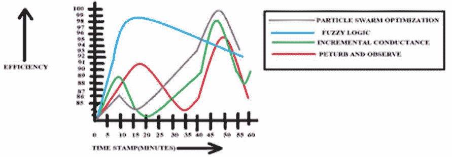

表2. 太阳能可再生能源不同优化算法的最大效率值

| 算法 | 最大效率 |
|---|---|
| 扰动观察法（P & O） | 96% |
| 递增导纳法（INC） | 98% |
| 模糊逻辑 | 99% |
| 粒子群优化（PSO） | 99.5% |


## 寻找可再生能源最优来源的AI方法

结合适当的安全措施，也可用于查找与可再生能源来源相关的潜在信息。

## 结论

在当前能源危机的范式中，可再生能源已成为寻找能源方向的重大缓解路径。随着自然能源随时间推移及人口数量增加而逐渐枯竭，寻求替代方案的需求已被认识到。可再生能源可以满足需求并轻易克服此类短缺问题。在众多不同的可再生能源中，太阳能已成为一种伟大且可靠的能源，并能轻易成为其他所有能源的替代方案。此类能源的来源已借助不同模型被找到。其中，机器学习模型在利用各种优化算法评估此类能源来源方面获得了巨大的潜在回应。详细的分析方法已在指定章节中完成。还进行了回归分析，以开发用于精确预测不同类型能源来源的预测模型。此类机器学习建模的概念未来还可以扩展，以挖掘比传统能源具有更高使用和利用可能性的其他潜在能源。

## REFERENCES

- Abadi, M., Chu, A., Goodfellow, I., McMahan, H. B., Mironov, I., Talwar, K., & Zhang, L. (2016). 带有差分隐私的深度学习. In Proceedings of the 2016 ACM SIGSAC Conference on Computer and Communications Security (pp. 308-318). 10.1145/2976749.2978318

- Abbas, F., Habib, S., Feng, D., & Yan, Z. (2018). 利用遗传算法优化包含可再生能源与存储系统的发电能力. Electronics (Basel), 7(7), 100. doi:10.3390/electronics7070100

- Ahmed, M. A., Eltamaly, A. M., Alotaibi, M. A., Alolah, A. I., & Kim, Y.-C. (2020). 网物理风能系统的无线网络架构. IEEE Access : Practical Innovations, Open Solutions, 8, 40180–40197. doi:10.1109/ACCESS.2020.2976742

- Al-Saedi, W., Lachowicz, S., Habibi, D., & Bass, O. (2018). 能源系统控制与优化算法综述. Journal of Renewable and Sustainable Energy, 10(5), 053502. doi:10.1063/1.5032146

- Al-Sumaiti, A., Salama, M., & Al-Hinai, A. (2018). 混合可再生能源系统最优规划与运行综述. International Journal of Energy Research, 42(10), 3179–3204.

- AlRashidi, M. R., & El-Naggar, K. M. (2010). 基于粒子群优化的长期电力负荷预测. Applied Energy, 87(1), 320–326. doi:10.1016/j.apenergy.2009.04.024

- Angulo, A., van der Linde, P., Gardeniers, H., Modestino, M., & Rivas, D. F. (2020). 气泡对电化学反应堆能量转换效率的影响. [谷歌学术] [CrossRef] [绿色版本]. Joule, 4(3), 555–579. doi:10.1016/j.joule.2020.01.005

- Balle, B., Bell, J., Gascon, A., & Nissim, K. (2018). 混洗模型的隐私保护. In Proceedings of the 2018 ACM SIGSAC Conference on Computer and Communications Security (pp. 638-650). ACM.

- Budak, G., Budak, E., & Kaya, I. (2019). 评估可再生能源并确定城市能源替代方案的系统方法. Energy, 189, 116233.

- Carrillo, A. J., González-Aguilar, J., Romero, M., & Coronado, J. M. (2019). 按需太阳能：高温热化学热储存系统和材料综述. Chemical Reviews, 119(7), 4777–4816. doi:10.1021/acs.chemrev.8b00315 PMID:30869873

- Cozzi, L., Gould, T., & Bouckart, S. (2020). 世界能源展望2020. International Energy Agency.

- Dawood, F., Anda, M., & Shafiullah, G. M. (2020). 能源用氢气生产：概述. International Journal of Hydrogen Energy, 45(7), 3847–3869. doi:10.1016/j.ijhydene.2019.12.059

- Kaya, M., & Hajimirza, S. (2020). 薄膜多层非晶硅太阳能电池光学性能的神经网络代理模型. Optics Express, 28(4), 4946–4957.

- Kusiak, A., & Li, W. (2011). 风力涡轮机故障的预测与诊断. Renewable Energy, 36(1), 16–23. doi:10.1016/j.renene.2010.05.014

- Kusiak, A., Zheng, H., & Song, Z. (2010). 基于数据挖掘模型的风力涡轮机性能评估. Renewable Energy, 35(12), 2734–2741.

- Lagarrigue, C. (2021). 人工智能如何优化可再生能源. Forbes.

- Li, X., Zhang, J., Wang, J., & Zhao, H. (2019). 利用卫星图像和数值天气预报数据进行太阳能预测的机器学习方法. Applied Energy, 253, 113596.

- Liu, Z., Wang, J., Li, Y., & Wu, J. (2020). 具有可再生能源和储能系统的微电网最优能量管理的深度强化学习框架. Applied Energy, 279, 115836.

- Mellit, A., & Kalogirou, S. A. (2008). 光伏应用的人工智能技术：综述. Progress in Energy and Combustion Science, 34(5), 574–632. doi:10.1016/j.pecs.2008.01.001

- Mohammadi-Ivatloo, B., Rabiee, A., Soroudi, A., & Ehsan, M. (2013). 利用人工蜂群算法求解高渗透风电的多目标安全约束机组承诺问题. International Journal of Electrical Power & Energy Systems, 53, 318–329.

- Mohandes, M., Rehman, S., & Halawani, T. O. (2004). 风速预测的神经网络方法. Renewable Energy, 29(6), 939–947. doi:10.1016/j.renene.2003.11.009

- Parra, D., Valverde, L., Pino, F. J., & Patel, M. K. (2019). 深度脱碳中氢能系统的作用、成本与价值综述. Renewable & Sustainable Energy Reviews, 101, 279–294. doi:10.1016/j.rser.2018.11.010

- Radovanovic, M., Popov, S., & Dodic, S. (2012). 可持续能源管理. Academic Press.

- Raut, H. K., Ganesh, V. A., Nair, A. S., & Ramakrishna, S. (2011). 抗反射涂层：关键深度综述. Energy & Environmental Science, 4(10), 3779–3804. doi:10.1039/c1ee01297e

- Salman, S., Kuciauskas, D., & Dippo, P. (2020). 用于提取CdTe太阳能电池中Cu掺杂剖面的机器学习. Solar Energy Materials and Solar Cells, 209, 110527.

- Salvarli, M. S., & Salvarli, H. (2020). 为可持续发展：可再生能源及赋能技术的未来趋势. In Renewable Energy-Resources, Challenges and Applications. London: IntechOpen. doi:10.5772/intechopen.91842

- Shivam, S., Kumar, A., & Singh, S. (2020). 基于人工神经网络的太阳能电池抗反射涂层最优厚度预测. Materials Today: Proceedings, 21, 1628–1631.

- Siano, P. (2014). 需求响应与智能电网——调查. Renewable & Sustainable Energy Reviews, 30, 461–478. doi:10.1016/j.rser.2013.10.022

- Singh, A., Singh, S., & Kumar, A. (2020). 基于人工智能的可再生能源集成电力系统最优控制. International Journal of Electrical Power & Energy Systems, 118, 105794.

- Singh, K., & Bean, J. D. (2019). 利用人工智能和机器学习应用优化印度的可再生能源电网. Center for Strategic and International Studies.

- Syed, S. A., Al-Turjman, F., & Alghamdi, S. A. (2018). 基于物联网的风力微电网能源管理系统. Energies, 11, 2625.

- Touati, F., Chowdhury, N. A., Benhmed, K., Gonzales, A. J. S. P., Al-Hitmi, M. A., Benammar, M., Gastli, A., & Ben-Brahim, L. (2017). 卡塔尔州光伏技术的长期性能分析与功率预测. Renewable Energy, 113, 952–965. doi:10.1016/j.renene.2017.06.078

- Wang, L., Zhang, J., Zhou, Y., & Li, G. (2019). 可再生能源并网最优潮流的混合智能优化算法. Applied Energy, 242, 1634–1647.

- Wasmer, S., Rajsrima, N., Geisemeyer, I., Fertig, F., Greulich, J. M., & Rein, S. (2018). 硅太阳能电池热斑温度时间演化的分析建模. arXiv preprint arXiv:1803.02463.

- Xiao, W. B., Li, X. F., Zhang, C., Yang, G. Q., & Wang, X. D. (2020). 利用人工神经网络预测硅太阳能电池的功率转换效率. Journal of Semiconductors, 41(2), 022101.

- Yue, M., Lambert, H., Pahon, E., Roche, R., Jemei, S., & Hissel, D. (2021). 氢能系统：技术、应用、趋势与挑战的关键综述. Renewable & Sustainable Energy Reviews, 146, 111180. doi:10.1016/j.rser.2021.111180

- Zadeh, P. A., & Jadid, S. (2016). 利用层次分析法评估可再生能源的系统方法：伊朗案例研究. Energy, Sustainability and Society, 6(1), 1–14.


## 面向可再生能源最优寻源的AI方法

Zhang, Y., Wang, J., Wang, J., & Zhao, H. (2019). 基于深度神经网络的利用时空数据的短期风力发电预测方法. *应用能源*, 236, 220–231.

Zhu, Y., Zhang, J., Wang, X., & Zhang, Y. (2020). 机器学习用于影响CIGS太阳能电池性能的关键变量. *合金与化合物期刊*, 827, 154226.

# 第6章

# 基于机器学习的可再生能源方法：基于OCR的手写字符数据集

- 苏曼塔·库伊拉  
  https://orcid.org/0000-0002-6088-6806  
  哈尔迪亚技术学院, 印度

- 玛纳西·贾纳  
  https://orcid.org/0000-0002-7076-1775  
  哈尔迪亚技术学院, 印度

- 安加娜·查克拉博蒂  
  哈尔迪亚技术学院, 印度

- 什拉德汉维塔·穆克吉  
  https://orcid.org/0009-0006-1772-6395  
  哈尔迪亚技术学院, 印度

- 苏邦卡尔·乔达尔  
  哈尔迪亚技术学院, 印度

## 摘要

可再生能源来自补充速度快于消耗速度的自然资源。与燃烧化石燃料相比，生产可再生能源的排放量要少得多。解决气候灾难的关键是远离目前提供大部分排放的化石燃料，转向可再生能源。该设施具有全球影响，最近基于机器学习的计算机视觉在全球所有国家和地区创造了商业机会。因此，所有国家和地区之间应该进行沟通，以在不同的全球语言之间交换信息。在本研究中，开展了一项分析性调查，以在各国和各地区之间建立沟通。为此目的，研究了不同语言及其数据集，其中可以进行基于OCR的字符识别。

## 1. 引言

源自在人类时间尺度内自然补充的可再生资源的能源被称为低碳能源、绿色能源或可再生能源。光、风、河流和地热是可再生资源的示例。电气化经常与可再生能源并行实施，因为电力在使用时是清洁的，并且可以高效地传输热量或物品。可再生能源目前占世界上许多国家能源供应的20%以上，有些国家通过这种方式生产超过一半的电力。少数国家利用可再生能源生产全部电力。预计2020年代及以后，可再生能源的国家市场将出现显著增长。部署可再生能源和节能技术带来重大经济、气候变化缓解和能源安全效益。可再生能源的日益普及受到对气候变化的担忧以及某些可再生能源技术（如太阳能电池板和风力涡轮机）价格持续下降的推动。这些类型的信息应通过全球不同的主导语言进行全球传播。在本研究中，我们对不同语言及其现有数据库进行了比较研究。这些现有数据库将支持不同语言之间的共同通信环境。使手写文本可机器读取称为手写字符识别，或HCR。不同书写者的书写风格差异很大，这对手写字符识别（HCR）系统构成重大挑战。手写字符识别系统的目标是实现可及的计算机辅助字符表示。字符表示使得从手写文档中成功提取字符，并将手写文本数字化和翻译为机器可读语言成为可能。在天城文中，每个字符的上部有一条称为Shirorekha的水平线，意为头条。英文字符不具备这一特性。英文可能源自这些文字的这一独特特征（Nawaz et al., 2018）。在连续手写中，从左到右书写时，一个字符的Shirorekha与同一单词的前一个或后一个字母的Shirorekha相连。字符在在线字符识别系统中在仍在创建时被识别。在离线字符识别系统中，手写文档被扫描、保存在计算机中，随后使用字符分析进行识别。在这里，手写识别在照片中检测字符。字符识别是识别、区分和识别图片中字符的过程。计算机能够读取手写字符，但在此方面人手写识别更优。因为手写字符可能有多种不同的样式且并非总是完美，机器发现这项工作很困难。可以使用手写字符识别来解决这一困难，它使用字符图像来识别其中的字符。字符识别是一种用于识别、检测和分割图像中字符（字母）的技术。研究中字符识别的目标是让计算机成为更熟练的读者，以便以类似于人类的方式与文本交互。这些是手写字符识别（HCR）中机器学习的关键问题。其使用目的一直是使用不同的训练和测试数据集测试新的机器学习算法（Dalal & Triggs, 2005; Newell & Griffin, 2011）。用于处理手写字符识别的这些方法论旨在使用图像输入在计算机上准确识别每个手写字符。卷积神经网络（CNN）模型是一个领先的模块，可以识别英文字母的图像，这些图像构成将用于训练模型的数据集的大部分。在这个机器学习项目中，将开发从A到Z的手写字符或英文字母。用于图像识别和处理的几种流行人工神经网络是主要为分析像素输入而开发的神经网络。从照片中读取文本是计算机视觉中极其困难的未解决挑战。相关数据从各种现实世界应用程序中读取。在输入的数字图像中查找和识别字符并将其转换为可比的机器可编辑格式是手写字符识别（HCR）的关键挑战。模式识别和图像处理都从中获得显著提升。数据解释面临从银行支票和语言识别到将手写文档转换为结构化文本格式等重大障碍。手写字符识别系统使用一种基于神经网络的软计算技术，该技术已有大量理论和实现算法的广泛研究。字符识别特征提取是通过利用一种称为基于对角线特征提取的新方法来完成的。一旦获得扫描的文本文档图像，就会进行预处理。现在已设置获取输入照片和存储输出变量的路径，并初始化所有变量和计数器。不需要的异常值和噪声已全部消除。已调整其倾斜度，并使图像规整化。此外，通过将RGB图像转换为灰度图像来获得二进制图像。利用项目剖面获得预处理后的二进制图像，并进一步分割以提取行、单词和字符。为了识别和查找边界框中的每一行，图像首先使用水平投影剖面进行分割。这样做是因为文本行的黑色像素密度高于相邻行之间的空格。在此类行识别之后，使用垂直投影剖面来识别和识别边界框中的单词。在字符几何结构消耗若干个黑色像素后，提取字符的几何特征，每个黑色像素由相应的值表示。在离线手写识别领域，对可能帮助提高识别精度的较新策略的研究仍在进行中。这是因为邮政地址识别、银行处理、文档阅读和邮件分类等许多应用需要离线手写识别系统。在本研究中，讨论了不同语言的手写数据集并研究了其特征。英语、印地语、孟加拉语、阿拉伯语等流行语言拥有用于研究、学术和商业目的的现有数据集。本研究旨在对这些语言及其特性、特点以及这些数据集的优缺点进行比较研究。

## 2. 相关研究

多个现有数据集用于不同的研究出版物。这些数据集用于特征提取和分类。在本研究中，讨论了现有数据集的特性及其在机器学习和深度学习分类中的影响。N. Dalal等人（2005）讨论了预处理、分割、分类和后处理等多个阶段，这些阶段构成了手写识别的建议系统。本研究描述了一种基于神经网络的创新离线字符识别系统。S. B. Khan等人（2018）使用一种称为区域提案网络的独特网络结构，用于HCR。该方法的主要目标是在保持精度的同时加速文本识别。


T. Watanabe 等人 (2009) 描述了一种可处理数字笔迹而无需将其转换为图片的 CNN 架构。字符和广泛词汇词识别任务证明了所提 CNN 特征的有效性。该全新设计称为 DAG，是一个分割为众多路由的网络，得益于基本 CNN 概念。M. Altuwajiri 等人 (1994) 专注于一个由多个路由组成、基于基础 CNN 范式的网络。该框架由三个部分组成：CNN 模型、投票和样本创建。C. Bahlmann 等人 (2002) 研究了将人工智能应用于 Comenia 脚本手写识别 (HWR) 的研究。已证明基于图像的任务（如 OCR 和模式识别）可通过深度学习来实现，并且完成得更准确。et al. 为识别纸上书写的手写数学表达式 (HME)，对纸张进行扫描，并将图像发送到识别系统。建议采用训练 CNN 部分层的替代方法来对神经网络进行正则化。ATR-CNN 达到了尖端性能，适用于 MNIST 和 ICDAR'13 的手写数字数据集。C. Nadal 等人 (1990) 描述了一种用于单词和行图像的特殊轮廓归一化技术，并使用正规网格上的随机扰动来改进现有文本图像。这些方法与网络无关，可应用于增强各种 HWR 网络和策略的功能。C. L. Liu 等人 (2003) 确定了用于特征提取、图像表示和降维的完全连接的池化函数和卷积层。回归和分类模型中独立特征值之间的距离使用基于几何测量的 KNN 技术来确定。M. Shi 等人 (2002) 描述了模拟试验结果，显然 CNN 算法的识别率高于 KNN 方法。在数字识别系统中使用什么类型的特征非常重要。k-近邻分类器用于对数字进行分类，并应用欧几里得最小距离准则来查找最小距离。这些工作使用了不同的现有手写数据集。

## 3. 光学字符识别

被称为光学字符识别（OCR）的计算机视觉技术用于识别数字、字母、符号及日常生活中常见的其他字符。字符识别可以根据特定需求进行。通过软件使用计算机进行字符识别的过程可以识别字母、数字或符号，并将其转换为人们可用于不同目的的数字格式。表格回收系统和银行支票处理系统均可受益于手写字符识别。字符识别是一个流行但充满挑战的研究领域。通过字符识别实现了无纸环境。机器学习利用特定主题的最新数据知识，试图从数据中提取隐藏信息。机器学习的主要用途之一是模式识别。大型图像数据集通常用于典型的光学识别，以识别当前趋势。通过图像中的模式识别进行手写识别是一种常见做法。根据研究，字符识别技术已逐步发展，最初的研究专注于识别单个手写字符，最终审查了整个单词。最近，一些出版物解决了不受领域特定限制和大词汇量约束的自由手写识别。由于识别率低，此类系统仍需改进。利用此类概念，我们可以训练计算机读取图像中出现的任何语言的字符和数字。字符图像构成了将用于训练我们模型的数据集的很大一部分。有时，手写中的字符非常相似，读者在没有上下文的情况下无法将它们区分开来。为了区分性质如此相似的字符，有必要识别它们之间的微小差异。由于不同语言的书写者以不同比例书写字符，实现手写字符此目标的主要问题之一是它们不出现在字母的同一相对位置。不是每个人都以相同的比例书写字母，甚至同一个人每次也不尽相同（Khan 等人, 2018; Watanabe 等人, 2009）。

基于机器学习的可再生能源方法

该图（图 1）展示了英文数字数字的示例数据集。此处 OCR 数据集代表英文数字数字。该数据集是 MNIST 的示例数据集，而 MNIST 是标准 NIST 数据集的子集。该图显示了从 0 到 9 的手写英文数字。原始手写数字被收集，从中创建了数据集。在当今的数字时代，自动英文字符识别是一个新颖、可见且要求苛刻的领域，它通过人工智能、模式识别、机器学习和数据挖掘原理的融合而发展。与天城文等印度文字相比，德瓦纳加里、中文、日文、韩文、德文等非英文语言的 OCR 系统已经比较先进。

## 4. 现有手写数据集

有几个现有的公开可用数据集用于字符识别的特征提取分类。本研究讨论了最常用数据集的特征和属性。

### 4.1 NIST 数据库

NIST 是一个用于机器学习分类训练和测试的公开可用数据库。NIST 用于手写文档字符识别的全部训练材料库存储在特殊数据库 19 中。从其表格中提取了 10,000 个字符图像及其真实地面分类，并附有用于额外数据收集的参考表格。图像存储和处理的软件实用程序与来自 3600 名书写者的手写样本表格一起发布。它取代了 NIST 的特殊数据库 3 和 7。每个表格的字段都被分成独立的字符。这可以在各种应用中大大增强机器与人之间的接口，并大大推进自动化进程。多个研究项目旨在探索新的方法和策略，以在提高识别准确性的同时缩短处理时间。对每个生成的图像都给出了自动分类。每个引用的字符图像都经过人工检查，发现的任何错误都导致图像的类别被更改。验证过程由不同的人各进行两次。检查过程的指导原则是避免删除或更改任何可能是预期类别的内容，从而保留类边界附近的示例——即使事后看来，它更像是另一个类别的示例（Al-Yousefi & Udpa, 1988）。

图 1. MNIST 数据集的英文字符数据集

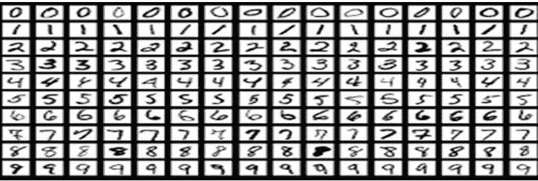

基于机器学习的可再生能源方法

### 4.2 MNIST 数据库

MNIST 手写数字数据库由 60,000 个样本的训练集和 10,000 个示例的测试集组成。这是 NIST 公开的更大数据集的一部分。在固定大小的图像中，数字已居中并进行了大小归一化。由于格式化和预处理所需的精力很少，它是希望在实际数据上测试学习策略和模式识别算法的人的有用数据库。MNIST 数据库是使用 NIST 的特殊数据库 3 和 1 构建的，其中包含手写数字的二进制图像。最初，NIST 使用 SD-3 作为训练集，SD-1 作为测试集。尽管如此，SD-3 远比 SD-1 更容易识别且更干净。SD-3 和 SD-1 调查之间的区别——分别在普查局员工和高中生中进行——解释了原因。为了使学习研究有意义，结果必须不受从整个样本集中选取的训练集和测试集的影响。因此，有必要合并多个 NIST 数据集以创建新数据库。MNIST 训练集由三万个 SD-1 模式和三万个 SD-3 模式组成。SD-1 和 SD-3 各五千个模式组成了我们的测试集。约 250 名书写者的示例包含在 60,000 模式的训练集中（Badi & Shimura, 1982）。

### 4.3 天城文

印度最广泛使用的语言和文字是天城文，而孟加拉语是印度次大陆第二广泛使用的语言和文字，也是全球第五广泛使用的语言。印度相当一部分人口还使用多种其他文字，包括泰米尔语、泰卢固语、坎纳达语、马拉雅拉姆语及其他一些文字。印度文扫描印刷文本的 OCR 系统研究已持续相当长时间。然而，对手写识别的研究较少。有关印度文字劣化文档分析或场景文本识别的文献存在。由于样本多样性程度高，遗憾的是，某些印刷 OCR 技术无法识别此类字符、照片或文档。目前关于印度文字手写或场景文本识别的研究主要依赖于在实验室环境中收集的有限或非标准数据库。为改变这一状况，已创建多个大型数据库，以包含重要指示文字的手写或场景字符。ISIDDI 是劣化孟加拉文档的图像数据库，


## 基于机器学习的可再生能源方法

是该组中最新添加的数据库。这些数据库要么已经免费提供给学术研究人员，要么发布过程正在进行中（Altuwaijri & Bayoumi, 1994）。

### 4.4 数学表达式

该数据集汇集了三届 CROHME 竞赛的数据集，提供来自不同国家数百名书写者的 10,000 多份手写陈述。书写者被要求根据一组语句复制印刷表达式。该语料库的创建旨在适应各种任务提供的多样性，并从预先存在的数学语料库以及不同研究论文中包含的表达式中选取。由于使用了不同的设备（例如带有合理屏幕的平板电脑、白板输入设备和数字笔技术），因此采用了不同的比例和分辨率。该数据集提供的唯一在线信号是 INKML 和 MATHML 标准，其中 CROHME 数据集包含每个数学表达式的分割、标记和布局。表达式级和符号级的两层真值数据均为手动执行。此外，该文件现在还包括所读字符的图像数据的一些通用信息。

### 4.5 汉字

与语言习得和处理相关的研究需要使用词汇数据库。关于儿童阅读材料以及这些材料中的词汇特征如何影响儿童阅读理解，目前所知甚少。先前的大多数中文词汇数据库都集中在成人材料上。本研究包含了首个大型数据库，其中包含 2999 个汉字和 2182 个词，这些字词来自中华人民共和国教育部（MOE）最近发布的、供中国大多数小学使用的官方教材，并附有成人和学龄儿童的规范。从这些词汇单位中，数据库包括重要的正字法、语音和语义成分。为了了解这些元素如何影响成人和儿童的单词处理及字符命名，采用了单词命名任务。

### 4.6 阿拉伯语印刷文本

阿拉伯文书写的某些特征导致其识别难度较大。其连笔书写风格以及字符形式随其在单词中的位置而变化的方式，赋予了它这些特性。阿拉伯字符的形式会根据所使用的书法风格以及它们在单词中的位置而改变。阿拉伯书法有多种形式，包括 Neskhi、Thoulthi 和 Diwani。使用字符图像数据集的训练集和测试集，以及 K=1 的 K 近邻分类器，选择了拓扑特征来评估统计和结构方面。可以使用此数据库测试具有开放词汇表的阿拉伯语印刷文本识别系统。该数据库的目标是使用多种字体、大小、样式和开放词汇表对阿拉伯语文本识别算法进行大规模基准测试。对印刷阿拉伯文文件的仔细检查表明，所使用的字体大小和样式的多样性和数量都很显著。阿拉伯语光学字符识别（OCR）系统表明，其识别率可能对字体大小和/或样式的变化高度敏感。本文详细介绍了具有多种字体、样式和大小的阿拉伯语印刷文本数据库。

### 4.7 IAM 在线文档

本文档包含文本块、列表、表格、公式、图表和插图。这些元素的内容已在每页上任意排列。在采集阶段，书写者被要求将模板内容复印到一张纸上。使用数字笔在线捕获书写内容。在所有情况下，一千个模板由 Brown 语料库中的文本以及相应语言常用的多个研究数据集中的图像、图表和公式组成。此结果需要 200 个不同的图画、200 个不同的公式和 200 个不同的图表。文本块、列表和表格的随机文本是从 Brown 语料库的 11 个类别中选取的。文档完成后，书写者使用一组有限的标记元素对其进行注释，例如下划线文本、用方括号括起来的文本、用左上角的一个角作为起始标记和右下角的一个角作为结束标记标记一行或多行文本、圈出文本、加下划线以及在文档上标记文本。为这些标记的注释提供微小的文本标签，以及将这些文本标签与标记连接的线条。在所使用的总组件中，约有 10 个标记组件出现在 839 个组件中。记录器已删除形成直线的采样点。毫秒级时间戳生成 0 到 255 之间的压力值，其中提供了纸上每个采样点的坐标。一笔或轨迹是由从笔接触纸张的起始点到再次提起笔所记录的采样点组合而成的（Beigi, 1993）。

### 4.8 街景文本

Google Street View 提供了名为 Street View Text (SVT) 的数据集。该数据的图像文本经常生成显示显著变异性的低分辨率。最初，图像文本通常来自公司标牌，然后通过本地商家搜索即可轻松获取商家名称。由于这些因素，SVT 集特别适合野外单词定位，其目标是给定街景图片后识别来自本地商家的单词。带有裁剪的词典驱动单词识别以及完整图像的单词检测和识别是此场景的主要目标。为了便于边界框图像注释，使用了 Alex Sorokin 的注释工具包。使用附近搜索工具，在 Google 地图上每张图片的地址处接收了一份附近商家名称列表。SVT 数据集简要描述了从 Google Street View 收集并用边界框标记的图片，这些边界框环绕着附近商家的短语。

### 4.9 街景门牌号码 (SVHN)

SVHN 在不需要大量数据清洗或格式化的情况下，提供了一个用于创建对象识别和机器学习算法的现实世界图像数据集。有 26032 个数字用于测试，73257 个数字用于训练，以及 531131 个相对更容易的样本可用作额外训练数据。该文件包含一个可以与 Matlab 一起加载的数字结构材料文件，以及 png 格式的原始照片。事实上，在字符级别，该数据集的工作方式类似于 MNIST 数据集。每个数字都已缩放为一致的 32 乘 32 像素分辨率。字符边界框已适当扩展以形成方形窗口，在放大到 32 乘 32 像素时防止长宽比失真。然而，这种预处理在相关数字的两侧添加了一些干扰数字。从自然图像中检测和读取文本是许多正在开发的应用程序核心的挑战性计算机视觉挑战。计算机视觉和机器学习领域的学者广泛研究了字符识别，该问题基本上已针对手写数字阅读等现实世界用途得到解决（Netzer et al., n.d.）。

### 4.10 自然环境 OCR (NEOCR)

NEOCR 数据集包括 659 张现实世界照片，其中包含 5238 个文本字段（也称为其上标注的边界框）。由于多个人分别拍摄了这些照片，该数据集涵盖了使现实世界图像区别于扫描文档的广泛特征。该数据集涵盖了区分现实世界照片与扫描文档的广泛特征，这些照片是由多个人分别拍摄的。每张图像都包含每段人类可读文本的注释。一旦数据集中每个元数据维度至少有 100 个文本字段，数据集构建过程即终止。可见文本包含在真值中，并附带比边界框更精确地涵盖它的畸变四边形。使用修改版的 LabelMe 注释工具手动创建了注释。每张图像旁边都有每段人类可读和可识别的句子的注释。我们扩展了字符识别模式以满足需求，注释以 XML 形式提供。作为数据集的一部分，还提供了扩展的 XML 模式。还提供了全局和本地元数据以支持该模式。全局图像元数据包括图像的高度、宽度、深度、对比度、亮度和文件名。纹理、亮度、对比度、反转、分辨率、噪声和模糊等信息是光学特征的示例。图像字符用于自动计算其余数据。纹理、噪声和反转是手动注释的。几何属性包括关于遮挡、旋转、畸变和字符布局的信息，这些信息用于选择特征（Nagy et al., 2011a; Nagy et al., 2011b）。

### 4.11 场景文本

KAIST 场景文本数据集包含在各种环境下拍摄的 3000 张照片。这包括在各种照明条件下（如明亮的人工灯光、夜晚和晴天）拍摄的室内外场景。拍摄照片使用了高分辨率数码相机或低分辨率手机相机中的一种。可以使用场景文本数据集对任意形状的场景文本进行文本识别基准测试。具有任意形状场景文本的自然照片要求模型执行文本识别。借助约一百万个高质量单词注释，场景文本支持将端到端推理应用于图像字幕和视觉问答等下游任务。每张图像的大小都已调整为 640x480。用于收集场景文本的语言用于对 KAIST 场景文本数据库进行分类（Jung et al., 2011）。


## 基于机器学习的可再生能源方法

### 4.12 MSRA 文本检测

已开发并公开发布的 MSRA 文本检测 500 数据库（MSRA-TD500）作为评估文本检测算法的基准。它旨在监测自然图像文本检测领域的最新进展，特别是在识别不同方向文本方面取得的进展。500 张来自室内（办公室和商场）和室外（街道）场景的自然照片使用口袋相机拍摄，并包含在 MSRA 文本检测 500 数据库（MSRA-TD500）中。训练集和测试集构成了该语言字符集数据集的两半。从原始数据集中随机选取了 300 张照片组成训练集，其余 200 张图片被指定为测试集（Yao et al., 2012）。

### 4.13 Stanford OCR

许多开发中应用核心的一项具有挑战性的计算机视觉挑战是从自然图像中检测和读取文本。对于读取手写数字等实际应用，文档字符识别等相关问题已得到计算机视觉和机器学习专家的广泛研究并基本解决。在照片等更复杂的环境中可靠地识别字符要难得多，这导致先进技术在这些任务中的表现远远落后于人类水平。未解决的计算机视觉读取这些数据，可用于创建更准确的地图以增强导航服务。这项极具难度的挑战在于必须从照片中读取文本，这与许多现实世界应用相关。基于手工设计表示的系统表现不如普通人类，不得不面对这一挑战。学习表示对性能的影响是一种端到端系统解决方案，对于这项工作具有持续优势。未来从事此基准的研究人员将立即从整体系统性能的改进中受益（Nadal et al., 1990）。

### 4.14 Chars74K 数据

目的是研究从匹配图像文件中识别分段手写字符的技术。Chars74K 数据集中的 64 个类（a-z,A-Z,0-9）由从自然照片中获取的 7705 个字符、在平板电脑上手绘的 3410 个字符以及使用计算机字体替换的 62992 个字符组成。总计产生超过 74K 张照片，这也是数据集名称的由来。印度-阿拉伯数字和拉丁字母使用英语中采用的无重音符号。为简化起见，这被称为英文字符集。该数据集试图解决三个主要子问题，即：预处理照片、从图像中获取相关特征以及训练人工神经网络模型将数据点分类到各个类别（Lee et al., 2010）。

### 4.15 CEDAR 数据库

NCI 资助癌症表位数据库与分析资源（CEDAR），这是一个用于研究和学术目的的公开可访问资源。在癌症疾病背景下，它汇编了在人类、非人灵长类动物和其他动物物种中调查的抗体和 T 细胞表位的实验数据。此外，CEDAR 提供资源以帮助进行癌症表位分析和预测。作为专注于传染性疾病的免疫表位数据库（IEDB）的补充，照片 CEDAR 中图像的像素被分解，可免费用于从文献中选取的广泛癌症表位和受体数据集合。构成手写图像的同质区域被分析，以确定是否存在水平、垂直或对角线段。线性分类器和非线性分类器使用在这些区域中检测到的此类线段总数作为输入。在几项其他使用 CEDAR 数据识别的研究中，已恢复更复杂的特征，产生相当或略好的结果。需要检查原始图像以确认使用连续线是强制性的。还需要检查无限线上的哪些点实际形成连续线，并需要计数以获取线的准确长度。识别癌细胞的适应性免疫反应可能对疾病临床发展方式至关重要，因为它有助于部分或完全阻止肿瘤发展。这些反应可能自发产生，也可能通过治疗性疫苗有意地引起或增强。为生物医学数据库创建既用户友好又支持细粒度查询执行的查询接口是一项挑战。还可以批量下载 CEDAR 中保存的所有数据（Liu et al., 2003）。

## 5. 计算机视觉和机器学习中数据集的影响

手写字符数据集是用于光学识别不同语言字母和数字的重要文档。通过使用多种机器学习和深度学习分类，将书写的硬拷贝转换为软拷贝。需要开发分类算法，为此目的现有数据集至关重要。像 Python 这样的流行语言用于实现深度学习算法以及用于培训和测试目的。在文本识别之前，基于分析单词识别的手写文本识别在字符级别分割单词。因此，由于不需要单词分割，整体单词识别技术经常用于在包含重叠或混合字符的文档上产生无错误的结果。本文的作者也采用了全面的方法。例如，著名的 CNN 模型是从零开始创建的，架构中包含多个卷积层，包括池化层、展平层和全连接层。此外，对所提 CNN 模型性能的评估在不同的 epoch 数和批量大小下进行，揭示该模型在每个 epoch 中均表现出强劲性能。但是，基于整体单词识别的文本识别是一种无分割方法，它使用单词的轮廓或形状信息一次性识别整个单词。鉴于丢失数据在光学字符识别中是常见现象，数据集大小被视为关键问题。本研究的目标是调查数据集质量如何影响监督分类模型的整体性能（Bahlmann et al., 2002）。影响机器学习模型表现的一个重要因素是数据集的数量。小数据集可能导致过拟合，而大数据集通常能获得更优的分类结果。浏览各个类别是一项困难的工作。在处理小数据集时，这会变得更加困难。

## 6. 数据集的比较性能

对于 NIST，人们可以放心地利用这些统计数据，并将其作为重要决策的基础，因为它们已由专家评估且可靠。为了快速匹配和识别获得的串联质谱，NIST 提供了库，这些库是各种物种和蛋白质的大量注释质谱参考集合。该数据库中的数据集包含认证值，可用于评估方差分析、线性回归、非线性回归和单变量统计软件的精度。深度学习和计算机视觉应用中常用的一个数据集是 MNIST 手写数字分类问题。尽管该数据集已得到妥善解决，但它可以作为从零开始理解和训练用于图像分类的卷积深度学习神经网络的基础。这包括探索改进模型的方法，创建可靠的测试环境来评估模型性能，以及保存和加载模型以对新数据进行预测。用于创建图像的字体大小和样式的变化会导致数据库试图解决的问题。此外，还关注低分辨率照片，其中可识别字符上的抗锯齿会产生噪声（Shi et al., 2002）。使用包含 113 到 284 个单词、十种阿拉伯字体、十种字母大小和四种字体样式的词典人工创建该数据库。尚未有一个包含各种字体、样式和尺寸的印刷阿拉伯文书写的标准语料库，用于评估任何特定阿拉伯 OCR 系统的识别率得分。阿拉伯-穆斯林世界拥有高度发达的书法。由于阿拉伯书法风格，对阿拉伯文本的考察揭示了用于印刷纸张的各种书写字体的存在。阿拉伯文印刷文本图像数据集选自突尼斯日报 El chourouk 的官方网站。阿拉伯文印刷文本识别和字体识别可能会使用此数据库。这些文本块数据集生成了具有庞大词汇量的阿拉伯图像单词。大词汇量阿拉伯文印刷文本识别竞赛将由 APTID/MF 承办。对于 IAM 在线文档数据库，InkML 标准用于数据库中的文档存储。InkML 标准的复杂性可能使访问文档内容变得困难。读取文档所需的 InkML 部分由名为 libinkml 的软件库实现，该库的发布旨在解决此问题。它执行以下功能：旋转和镜像文档、添加和修改注释、导出为 PDF、图片和特征向量，以及显示文档（Teow & Loe, 2002）。对于街景文本，有一个待用边界框标记的潜在单词列表和一张图像。我们仅标记与企业相关的术语，这与 ICDAR 鲁棒阅读数据集不同。SVHN 数据集的标注数据量比 MNIST 大一个数量级，超过 600,000 张数字图像，但其风格与 MNIST 可比。例如，图像是小的、裁剪过的数字。它源自一个更加困难、开放式的现实世界问题：在自然场景照片中识别数字和数码。原始图片包括字符级边界框和 32x32 像素的类似 MNIST 的图片，中央有一个单个字符；一些图片确实有一些侧面干扰。这些是原始彩色门牌号码照片，带有字符级边界框和不同分辨率。在 NEOCR 中，包含亮度、对比度、反转、纹理、分辨率、噪声、模糊、畸变、旋转、字符排列、遮挡、字体和语言信息的元数据被添加到数据集中。注释以 XML 格式给出，并基于 Label Me 规范。对于文本检测，数据集中句子的多样性和照片复杂的背景使其难以处理。自动的用途


## 基于机器学习的可再生能源方法

随着当今无处不在的摄像头，字符识别的应用比以往任何时候都更加广泛。在有限场景下，对于带有标准字符字体和一致背景的扫描文档图像（hars74K Data），拉丁文本这基本上被视为一个已解决的问题。字符识别在处理流行相机和手持设备拍摄的照片时，仍然是一项艰巨的任务。分区（Zoning），通常称为将图像划分为等大小的子块，是一种可比拟于JPEG压缩的技术。每个子块都被视为具有独特特征集的独立实体。图像中每个唯一子块的线性组织特征将构成图像的整体特征。这里的观察是，通过将字符视为由几个微小的单独线条笔画及其交点组成，可以简化字符的整体结构和复杂形状。对于CEDAR数据库（癌症表位数据库和分析资源，CEDAR），任何与癌症相关的表位数据都已被索引。表位是激活B细胞和T细胞适应性免疫的精确化学靶点。在字符图像中，可以使用霍夫变换来识别特定形状（如圆形、曲线和直线）的特征。使用多种方法来确定哪个窗口包含已识别的线条。我们首先考察的可能性是窗口的位置。已识别的线条符合各种不同的角度。根据它们最接近的类别，这些线条可以分类为水平、垂直或两条对角线之一。提供该数据集，使得由癌症抗原产生的表位被对抗癌症的免疫细胞识别至关重要。对预防和治疗应用的彻底理解和规划，以及对自然发生的免疫反应和癌症免疫病理的精确表征，都需要详细了解癌症表位的分子特征及其相关信息（Cheung et al., 1998; Tsang et al., 1998）。

### 7. 用于可再生能源的数据集

可再生能源世界数据集中提供了从1965年到2022年全球可再生能源数据的详尽汇编。该集合包含地热、水电、太阳能、风能和生物燃料能源生产的全球数据。自工业革命以来，化石燃料一直主导着世界大多数国家的能源结构。这对人类健康和环境都有很大影响。在未来几十年，要使我们的能源系统实现无碳化，可再生能源将是必不可少的。我们的可再生能源生产通过不同能源来源变化得有多快。所有这些现象都会产生一些数据，这些数据由流行数据集维护的存储库维护。上述数据集是手写数据集的存储库，少数数据集也包含可再生能源数据（Kim & Govindaraju, 1997）。NIST数据集包含几个热门领域的数据，可再生能源也在其中。这些数据集涵盖的领域包括renewable-share-energy data、renewable-share-energy data、renewable-share-energy data、以吉瓦为单位的总装机风电容量等。所有这些应用程序都有用于数据收集和维护的手写文档。为了将这些活动的手写文档转换为软副本，基于OCR的手写字符识别系统有巨大影响（Downton et al., 1991）。

### 8. 结论

本文对公开可用的基于OCR的手写数据集进行了一般性分析性综述。从NIST和MNIST开始，讨论了其他可用的热门数据集，这些数据集对于开发光学字符识别的自动化系统非常重要。手写字符被正确读取，并将基于此制作计算机化的软副本。这些数据集对于英语、天城文、孟加拉语、阿拉伯语等不同语言图像的特征提取和分类也很重要。未来的计算将高度依赖手写字符识别。拥有手写字符识别是必不可少的，因为它可以用于自动化各种任务，包括银行收据，这些任务可能很繁琐。为了达到最佳效率，我们可以对输出应用拼写检查器，并对输入照片应用清洗算法以提高准确性。单个字符能提供良好的准确性，尽管不同的书写风格会影响单词识别。由于分类器必须处理有限数量的变体，当单词范围限制在固定数字时，可以看到良好的准确性。在本研究中，我们有效地使用无监督特征学习来开发可部署的应用程序，以在自然环境中识别数字。虽然学习表示相对于手工制作的表示的主要好处已经得到证明，但我们也发现，在我们最近引入的任务上，计算机性能仍有巨大的发展空间，并且远远落后于人类性能。

### 参考文献

- Al-Yousefi, H., & Udpa, S. S. (1988). 手写阿拉伯字符识别. SPIE第32届年度国际技术研讨会论文集. 光学、光电应用科学与工程.
- Altuwajri, M., & Bayoumi, M. A. (1994). 基于神经网络的阿拉伯文本识别. ISCAS 94. IEEE电路与系统国际研讨会, 6(30). 10.1109/ISCAS.1994.409614
- Badi, K., & Shimura, M. (1982). 阿拉伯草书体的机器识别. 电子通信工程学会论文集, E65(2), 107–114.
- Bahlmann, C., Haasdonk, B., & Burkhardt, H. (2002). 基于支持向量机的在线手写识别——一种核方法. 第8届国际手写识别研讨会论文集 (IWFHR), 49-54. 10.1109/IWFHR.2002.1030883
- Beigi, H. S. M. (1993). 手写识别概述. 发展中国家技术进步第1届年度会议论文集, 30-46.
- Cheung, K., Yeung, D., & Chin, R. T. (1998). 可变形模式识别的贝叶斯框架及其在手写字符识别中的应用. IEEE模式分析与机器智能汇刊, 20(12), 382–388.
- Dalal, N., & Triggs, B. (2005). 用于人体检测的定向梯度直方图. IEEE计算机协会计算机视觉与模式识别会议论文集. CVPR 2005, 886–893. 10.1109/CVPR.2005.177
- Downton, A. C., Tregidgo, R. W. S., & Kabir, E. (1991). 英国手写和手写体邮政地址的识别与验证. 模式识别与人工智能国际期刊, 5(01n02), 265–292. doi:10.1142/S0218001491000168
- Jung, J., Lee, S. H., Cho, M. S., & Kim, J. H. (2011). Touch TT: 基于触摸屏界面的场景文本提取器. ETRI期刊, 33(1), 78–88. doi:10.4218/etrij.11.1510.0029
- Khan, S. B., Ahmad, G., Ali, F., Faisal, F., Ahmed, I., & Elahi, S. (2018) 阿拉伯字符图像的线性二进制模式和直方图定向特征的分类性能: A. 凝聚态物理应用物理 (APCOM 2019), 5.
- Kim, G., & Govindaraju, V. (1997). 面向实时应用的基于词典的手写单词识别方法. IEEE模式分析与机器智能汇刊, 19(4), 366–379. doi:10.1109/34.588017
- Lee, Cho, Jung, & Kim. (2010). 带边缘约束和文本共线性链接的场景文本提取. 第20届国际模式识别大会 (ICPR), 土耳其伊斯坦布尔.
- Liu, C. L., Nakashima, K., Sako, H., & Fujisawa, H. (2003). 最先进技术的基准测试. 模式识别, 36(10), 2271–2285. doi:10.1016/S0031-3203(03)00085-2
- Nadal, C., Legault, R., & Suen, C. Y. (1990). 完全无约束手写数字识别的互补算法. 在第10届国际模式识别会议论文集中, 1, 434–449.
- Nagy, R., Dicker, A., & Meyer-Wegener, K. (2011a). NEOCR: 一种用于自然图像文本识别的可配置数据集. CB DAR研讨会2011于ICDAR 2011, 53-58.
- Nagy, Dicker, & Meyer-Wegener. (2011b). NEOCR自然图像文本识别数据集的定义与评估. 埃朗根大学计算机科学系技术报告, CS-2011-07.
- Nawaz, S., Calefati, A., Ahmed, N., & Gallo, I. (2018). 基于深度度量学的手写字符识别. 2018年第13届IAPR文档分析系统国际研讨会论文集 (DAS), 417–422. 10.1109/DAS.2018.18
- Netzer, Wang, Coates, Bissacco, Wu, & Ng. (n.d.). 基于无监督特征学习的自然图像数字读取. NIPS深度学习与无监督特征学习研讨会. 学术出版社.
- Newell, A. J., & Griffin, L. D. (2011). 用于鲁棒字符识别的多尺度定向梯度直方图描述符. 2011年国际文档分析与识别会议论文集 (ICDAR), 1085–1089. 10.1109/ICDAR.2011.219
- Shi, M., Fujisawa, Y., Wakabayashi, T., & Kimura, F. (2002). 使用灰度图像梯度和曲率进行手写数字识别. 模式识别, 35(10), 2051–2059. doi:10.1016/S0031-3203(01)00203-5
- Teow, L. N., & Loe, K. F. (2002). 用于离线手写数字识别的基于视觉的鲁棒特征和分类方案. 模式识别, 35(11), 2355–2364. doi:10.1016/S0031-3203(01)00228-X


## 基于机器学习的可再生能源方法

Tsang, I. J., Tsang, I. R., & Dyck, D. V. (1998). 基于图像分区导出矩特征的手写字符识别. Int. Conf. Image Processing, 2, 939–942.

Watanabe, T., Ito, S., & Yokoi, K. (2009). 行人检测的定向梯度共现直方图. 太平洋沿岸图像与视频技术研讨会论文集, 37–47. 10.1007/978-3-540-92957-4_4

Yao, C., Bai, X., Liu, W., Ma, Y., & Tu, Z. (2012). 自然图像中任意方向文本的检测. CVPR.

# 第 7 章

# 基于可再生能源的树木监测与森林火灾检测反偷猎系统

- Palash Pal
- 哈尔迪亚理工学院, 印度
- Deepti Kumari
- 哈尔迪亚理工学院, 印度
- Dilip Dey
- 哈尔迪亚理工学院, 印度
- Komal Kumari
- 哈尔迪亚理工学院, 印度
- Anushka Pandey
- 哈尔迪亚理工学院, 印度
- Priya Kumari
- 哈尔迪亚理工学院, 印度
- Monishita Chakraborty
- 哈尔迪亚理工学院, 印度

## 摘要

无线传感器网络 (WSN) 已成为监测和记录环境物理状况的有效解决方案。森林作为生态系统的重要组成部分，面临着包括森林火灾和树木偷猎在内的多种挑战。不受控制的人类活动、异常自然条件和树木走私是导致这些问题的一些因素。为解决这些问题，作者提出了一种基于 WSN 的系统，用于防止树木偷猎和森林火灾。该系统将由空间分布的传感器组成，这些传感器将持续监测森林的物理条件，包括温度、湿度和人类活动的存在情况。从这些传感器收集的数据将在中央位置进行处理，以检测环境中的任何异常变化。在发生潜在森林火灾或树木偷猎活动的情况下，系统将向相关部门发送警报，使他们能够采取及时行动。通过利用 WSN 的强大功能，拟议系统旨在预防和监测森林火灾及树木偷猎。

## 树木监测与森林火灾检测反偷猎

## 1. 引言

森林是人类生存和社会发展的重要资源，在地球生态平衡维持中发挥着关键作用。然而，由于不受控制的人类活动和异常自然条件，森林火灾频繁发生。森林火灾被认为是最严重的灾难之一，威胁着森林资源和环境。预防和监测森林火灾已成为全球森林防火组织的关注焦点 (Ananthi J, et al., 2022)。

此外，由于涉及大量资金，树木砍伐和走私事件（特别是檀香等贵重树木）在增加。为遏制此类非法活动并保护全球森林，需要采取预防措施 (Faroudja, A. B. I. D., et al., 2020)。

目前的森林防火方法主要包括巡逻、瞭望塔观测、卫星监测以及最近的无线传感器网络 (WSN) (V. Parthipan, et al., 2019)。然而，瞭望塔观测方法存在多种局限性，因为它需要人工监督，在密集和偏远的森林中并不总是可行 (Eunna Jang, et al., 2019)。

WSN 是指一组专用且空间分散的传感器，用于监测和记录物理环境条件，并将收集的数据发送到中央位置 (Sakr, G. E., et al., 2010)。这些传感器测量温度、声音、污染水平、湿度、风等，并依赖无线连接进行数据传输，类似于无线自组网 (Daxini Nidhi, et al., 2015)。

## 2. 现有系统与挑战

森林毁坏是一个严重的全球性问题，危及地球的生态平衡。造成这种损坏的主要原因是非法砍伐树木，每年导致数百万英亩森林损失。此外，暴雨等极端天气事件也可能损坏树木并导致森林毁坏。制止树木非法交易并实施策略保护森林免受此类活动影响至关重要。

当前系统采用人工劳动来扑灭森林火灾，这可能既危险又无效。为最大限度地降低对人类生命的风险并减少对人工劳动的依赖，正在开展研究以探索基于无线系统的监测 (Venkatesan, Prof. Latha, et al., 2013)。

目前关于野生动物追踪无线网络的研究已产生标准化解决方案，但这些方案可能并不完全有效。这种“一刀切”的方法涉及为所有类型野生动物设计单一追踪设备 (Jin, X., et al., 2012)。然而，这种方法可能不适合追踪树木和预防森林火灾，因为每种树种可能有不同的需求和易感性。因此，有必要创建更专业的无线系统，可以针对特定的森林环境和树种进行定制 (Wark, T., et al., 2007)。为了实现这一目标，研究人员、森林管理组织和其他利益相关者之间的合作是必要的，以建立保护我们宝贵森林资源的有效且可持续的方法。

挑战如下-

- 设计无线传感器网络并管理每个节点始终是一项具有挑战性的任务。
- 将传感器固定在野生动物身上也是一项艰巨的任务。
- WSN 中使用的传感器应能抵御天气变化和环境条件。
- 在茂密森林中检测树木砍伐也是一项有风险的任务。

## 3. 拟议方法论

该拓扑结合嵌入式技术和 Zigbee 无线通信，创建一个使用 ZigBee 收发器和 GPS 监测和追踪动物健康的系统。森林是重要资源，预防和检测森林火灾一直是全球森林防火部门的热门研究课题。为解决常规森林火灾和保护检测在实时监测准确性方面的不足，引入了一种用于森林火灾和保护检测的无线传感器网络技术，并结合卫星监测。这使相关政府部门能够就灭火和保护预防做出及时准确的决策。

该方案提出了一种用于森林火灾和保护工作实时检测的无线传感器网络范式，可以更高效地检测和预测森林火灾、二氧化碳增加、土壤湿度减少和树木倒伏。本文主要关注无线传感器网络中用于实时森林火灾和保护检测的数据收集与处理，并应用神经网络方法进行网内数据处理。此外，将一个轻量级系统安装在动物脖子上以感知体温，体温数据发送到微控制器。GPS 调制解调器从卫星接收字符串，从字符串中提取纬度和经度信息，并将其发送到 Zigbee 调制解调器以传输到服务器机房。

此处讨论了拟议拓扑的设计 (DFD) 和流程图。实现如下：

### 用例图

用例图是用户与系统交互的图形表示，如图 1 所示，展示用户如何参与不同的用例及其之间的关系。它还可以识别用户类型及其在系统中的参与情况。用例图作为系统的蓝图，通常伴随其他类型的图表。

流程图如图 2 所示，数据流图 (DFD) 如图 3 所示，对系统进行了详细说明。如用例图所示，DFD 层次图用于检索信息并将其发送到微控制器以实现功能。流程图展示了从传感器读取数据、处理来自温度、湿度和倾斜传感器的数据，然后将其输入到 Blynk 传感器的过程。

图 1. 用户交互的表示

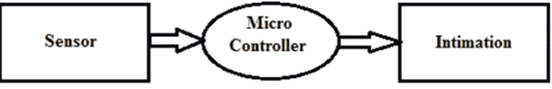


### 图 2. 用户交互流程图

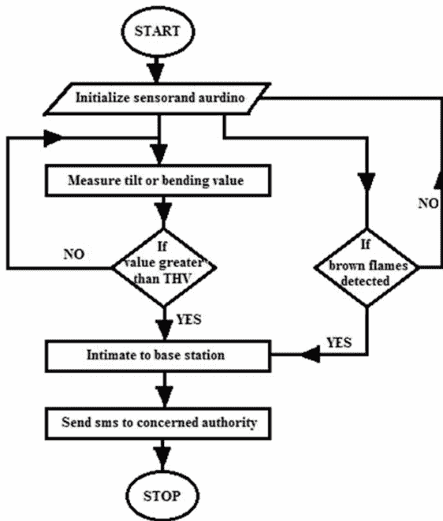

### 类图

类图是统一建模语言（UML）中的一种静态结构图，用于描绘软件系统的结构，如图 4 所示。它展示了系统的类、它们的属性、操作（或方法）以及类之间的关系，表明哪个类持有特定信息。

## 4. 序列图

序列图是一种图表类型，用于按基于时间的顺序说明特定场景中对象之间的交互。该图显示了场景中涉及的对象和类，以及它们交换以实现所需功能的消息。序列图通常与系统中用例的实现相关，也可能被称为事件图或事件场景。

## 树木监测与森林防火防偷猎

### 图 3. 用户交互数据流图

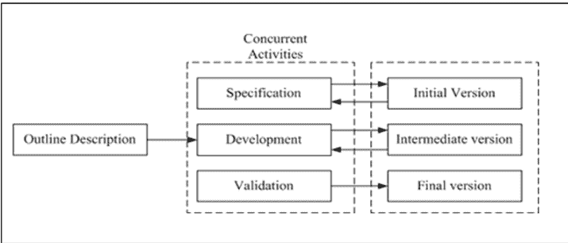

### 图 4. 类图

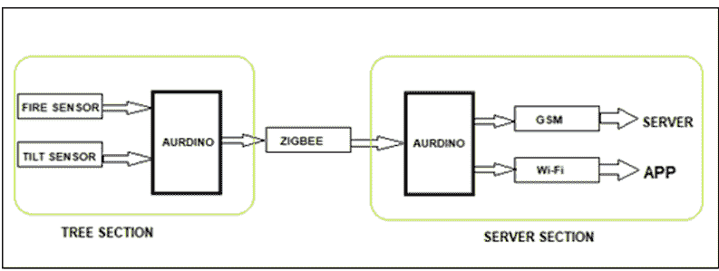

### 活动图

活动图是一种可视化表示，用于描绘过程中的一系列操作或步骤，如图 5 所示。它包含支持决策、重复和同时执行的各种元素。在统一建模语言（UML）中，活动图旨在建模工作流和流程，包括与这些活动相关的数据流。虽然活动图的主要重点是说明整体控制流，但它也可以包含显示数据通过一个或多个数据存储在活动之间移动的元素。

## 5. 增量开发模型与系统架构

增量开发方法涉及创建初始实现、接收用户反馈，并通过多次迭代逐步改进系统直到完成。该方法涉及规格、开发和验证活动的组合，每个版本在之前版本的基础上增加新功能和特性，如图 6 所示。

### 图 5. 活动图

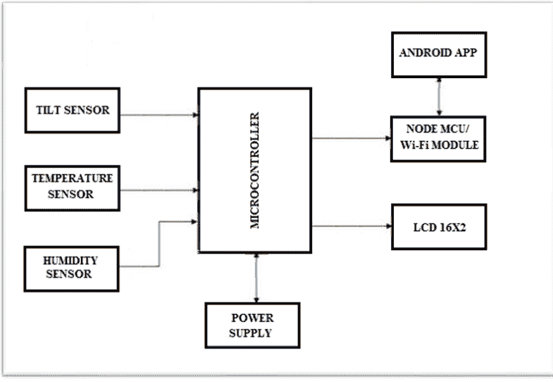

所提拓扑采用了敏捷软件开发模型，该模型允许灵活适应不断变化的需求，并添加新功能以改善整体功能。然而，该方案的硬件方面在设计和实现上灵活性有限，如图 9 所示。因此，它使用概念图和临时面包板来建模完整设计，使其易于集成和解体，而无需针对变化或故障反复生产和重新设计最终产品。

所提工作将嵌入式技术与 Zigbee/Wi-Fi 无线通信技术相结合，如图 7 所示。

传统方法在实时检测森林火灾和保护问题以及其监测准确性方面的局限性，促使引入了无线传感器网络技术用于这些目的。该技术与卫星监测相结合，使政府部门能够就灭火和保护措施做出及时且恰当的决策。

该方案提出了一种用于实时检测森林火灾和保护的无线传感器网络范式，如图 8 所示。该网络旨在及时检测和预测森林火灾、二氧化碳变化、土壤水分减少以及树木倾倒。所提系统基于集群式无线传感器网络方法。

本文侧重于通过无线传感器网络中的实时数据收集和处理（使用可再生能源）来检测森林火灾并促进保护。网络内数据处理采用神经网络方法进行。GPS 调制解调器从卫星接收一个字符串，然后将其传输到微控制器。微控制器从字符串中提取纬度和经度信息，并将其传输到 ZIGBEE 调制解调器，进而由其发送到服务器室。

## 树木监测与森林防火防偷猎

### 图 6. 并发活动模型


### 图 7. 嵌入式技术与 Zigbee/Wi-Fi 无线通信技术


## 6. 系统测试

系统测试是一种评估整个系统以确定其是否符合指定要求的测试类型。这种测试涉及从端到端测试系统的功能。在我们特定的系统测试中，有两个主要测试场景，用于验证系统搜索可用信息以及不可用信息的能力。

### 测试方法

可用于软件测试的不同方法如下，

## 树木监测与森林防火防偷猎

### 图 8. 实时检测的传感器网络范式

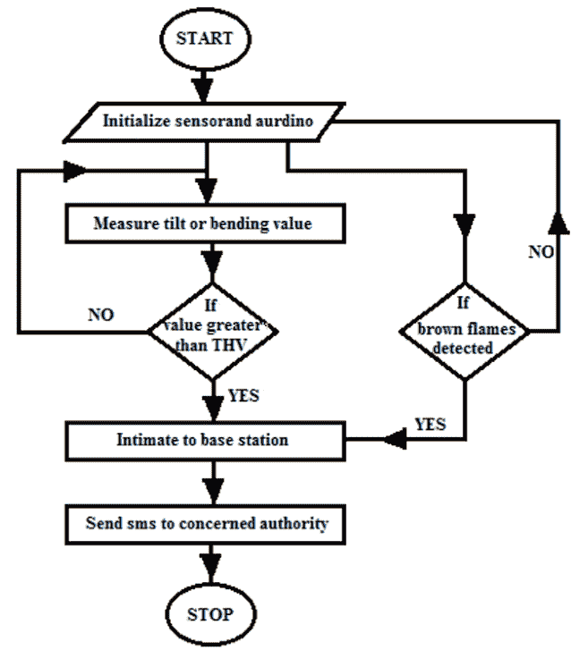

### 黑盒测试

黑盒测试是一种测试技术，测试人员无法访问应用程序的内部工作或源代码。相反，测试人员通过提供输入和检查输出来与系统的用户界面进行交互，而不了解系统如何处理输入。

### 白盒测试

白盒测试是一种检查软件代码内部结构和逻辑的方法。它也被称为开盒测试或玻璃盒测试。要进行白盒测试，测试人员应了解应用程序的内部操作。他们需要检查源代码并确定代码的哪部分未按预期运行。

## 树木监测与森林防火防偷猎

### 图 9. 硬件测试套件

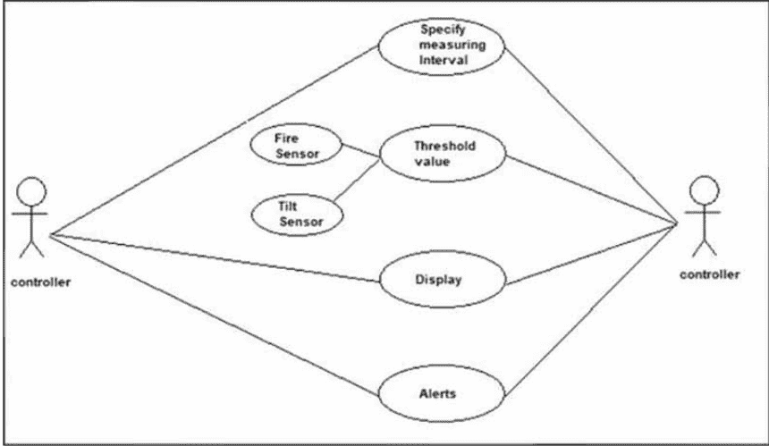

### 测试级别

软件测试中采用了几个测试阶段，以确保软件正确运行。这些阶段包括可以利用的不同方法或技术。软件测试的主要阶段为：

### 功能测试

功能测试是一种黑盒测试方法，用于验证应用程序或软件产品是否按照其指定要求运行。该过程涉及向软件提供输入并分析输出，以确认其是否按预期执行。测试在完整且集成的系统上进行，以评估其对指定要求的符合性。软件功能测试包括五个关键步骤。

- 1. 识别待测应用程序的预期功能。
- 2. 根据应用程序规范生成测试数据。
- 3. 验证应用程序产生的输出与预期结果。
- 4. 创建测试场景并执行测试用例。
- 5. 将实际测试结果与预期结果进行比较，以确保软件正确运行。

### 非功能测试

本节涉及应用程序非功能属性的测试。非功能测试涉及根据非功能要求（如性能、安全性、用户界面等）评估软件。这种测试可以在软件开发生命周期的各个阶段进行。

### 单元测试

单元测试是软件开发中一个至关重要的方面，涉及测试应用程序的最小功能单元或模块（称为“单元”），以确保它们正确运行并符合要求。单元测试可以手动或自动执行。其主要目标是隔离软件的每个组件，并验证其正确运行并满足预期功能。测试用例和结果如表 1 所示。

### 集成测试

集成测试是软件测试的一个级别，涉及将单个单元作为一个组进行测试，以识别它们交互中的错误。这种测试的主要目标是检测应用程序组合部分中的故障。测试驱动程序和测试存根用于支持集成测试。它在单元测试之后、验证测试之前执行，如表 2 所示。集成测试有两种方法：自底向上集成测试和自顶向下集成测试。

### 自底向上集成

在这种测试类型中，测试过程从单元测试开始，然后逐步转向测试较大的单元组合，这些组合被称为模块或构建。

### 自顶向下集成

自顶向下集成测试是一种测试方法，其中先测试应用程序的最高级模块，然后继续测试较低级别的模块。

### 表 1. Arduino 测试用例和结果

| SI # 测试用例: - | UTC-1 |
|---|---|
| 测试名称: - | Arduino 测试 |
| 测试项目: - | 为 Arduino 通电并启动 |
| 示例输入: - | 打开电源 |
| 预期输出: - | Arduino 应该启动 |
| 实际输出: - | 通电测试和上传成功 |
| 备注: - | 通过。 |


## 表 2. 树木砍伐和火灾检测

| Sl # 测试用例: - | ITC-3 |
| :--- | :--- |
| 测试名称: - | 树木砍伐和火灾检测 |
| 测试项目: - | 倾斜传感器变化与更新 |
| 示例输入: - | 点燃火源并更改倾斜值 |
| 预期输出: - | 火灾和树木砍伐检测 |
| 实际输出: - | 树木砍伐和火灾检测 |
| 备注: - | 通过。 |

## 7. 结论

综上所述，物联网（IoT）使我们能够开发出一个监测树木移动和森林火灾的系统，为环境的整体保护做出贡献。该系统由各种技术组成，例如倾斜传感器、温度传感器和蜂鸣器通知，用于检测树木砍伐和森林火灾的发生。通过我们的实验，我们已成功证明该系统能够感应由树木砍伐产生的声音，并通过 Blynk 应用程序立即通知相关部门。此外，该系统能够检测周围环境中任何异常温度变化，并在发生任何事件时向林业官员发送警报，使他们能够采取适当行动。

该系统的成功实施凸显了物联网在通过防止非法伐木和森林火灾来保护我们环境方面的潜力。通过利用各种技术和传感器，我们的系统展示了如何有效地利用物联网来监测和预防与森林相关的问题。随着技术的进一步发展，我们相信物联网在解决环境问题方面可以发挥重要作用，为可持续未来铺平道路。

## 参考文献

Ananthi, J., Sengottayan, N., Anbukaruppusamy, S., Upreti, K., & Dubey, A. K. (2022). 利用 IoT 和深度学习进行森林火灾预测. International Journal of Advanced Technology and Engineering Exploration, 9(87), 246–256. doi:10.19101/IJATEE.2021.87464

Daxini, N., Sharma, S., & Patel, R. (2015). 基于 HAAR 类特征的实时动物检测系统. International Journal of Innovative Research in Computer and Communication Engineering, 3(6), 5177–5182. doi:10.15680/ijircce.2015.0306032

Faroudja & Izehoudjen. (2020) 基于决策树的森林火灾预测系统芯片. 在《电气工程国际会议（ICEE）》论文集中. IEEE.

Jang, E., Kang, Y., Im, J., Lee, D.-W., Yoon, J., & Kim, S.-K. (2019). 利用 Himawari-8 静止卫星数据在韩国检测和监测森林火灾. Remote Sensing (Basel), 11(3), 271. doi:10.3390/rs11030271

## 树木监测和森林火灾检测的反偷猎

Jin, X., Sarkar, S., Ray, A., Gupta, S., & Damarla, T. (2012). 利用地震和 PIR 传感器进行目标检测和分类. IEEE Sensors Journal, 12(6), 1709–1718. doi:10.1109/JSEN.2011.2177257

Parthipan, V., & Dhanasekaran, D. (2019). 基于物联网的森林火灾检测与数据分析预防和监控框架. International Journal of Engineering and Advanced Technology, 8(3).

Sakr, G. E., Elhajj, I. H., Mitri, G., & Wejinya, U. C. (2010). 森林火灾预测的人工智能. IEEE/ASME 先进智能机电国际会议, 1311-1316. 10.1109/AIM.2010.5695809

Taluja, C., & Guha, P. (2018). 利用无线传感器网络和图形用户界面进行森林火灾早期阶段检测. 第 4 届计算机与管理国际会议（ICCM）, 1-6.

Venkatesan, Farooq, Imraan, Kumar, & Kumar. (2013). 利用无线传感器执行器网络避免动物与车辆碰撞. International Journal of Scientific & Engineering Research, 4(5). https://www.ijser.org/researchpaper/Animals-and-Vehicle-Collision-Avoidance-Using-Wireless-Sensor-Actuator-Network.pdf

Wark, T. (2007). 自主动物控制移动传感器/执行器网络的设计与评估. 第 6 届传感器网络信息处理国际研讨会, 206-215. 10.1109/IPSN.2007.4379680

# 第 8 章 可再生能源与可持续创新在能源转型中的应用

Neeta Nathani
知识恒河技术与科学学院，印度贾巴尔普尔

Silky Pareyani
知识恒河技术学院，印度

Jagdeesh Kumar Ahirwar
知识恒河技术与科学学院，印度贾巴尔普尔

## 摘要

任何国家推广绿色能源的主要目标是促进经济发展、提高能源安全、增加能源获取并应对全球气候变化。可持续发展可以通过利用可再生能源并确保居民获得负担得起、可靠且现代的电力来实现。“绿色能源”一词指的是由阳光、风能和水能等自然资源产生的能源。绿色能源提供商通常会避免对环境有害的采矿和钻探作业。自动化、增材制造、人工智能（AI）等技术的进步，可以通过提高环境质量、用更先进的设备替换过时设备来控制和监控基础设施，从而促进向更清洁未来的转型。

DOI: 10.4018/979-8-3693-2355-7.ch008

## 绿色能源的重要性

绿色能源对环境有益，因为它用更环保的替代品取代了化石燃料的负面影响。由于绿色能源通常清洁且可再生，它产生的温室气体排放极少或几乎为零，并且广泛可用。其生产涉及使用自然资源。即使考虑其整个生命周期，绿色能源排放的温室气体也远少于化石燃料，空气污染也相对较少。环境以及呼吸空气的动物和人类的健康都从中受益。

由于绿色能源主要在本地生产，因此能源价格更加稳定，不太容易受到供应链中断、价格飙升和地缘政治危机的影响。一项经济效益是通过建设帮助员工所在社区的建筑物来创造就业机会。2018 年，可再生能源在全球创造了 1100 万个新就业岗位。

来自太阳能和风能等能源的本地化生产使能源基础设施更加灵活，不太依赖容易受到中断影响的集中式能源。因此，它较不易受到与天气相关的气候变化的影响。绿色能源还为世界许多能源需求提供了一种经济有效的解决方案。随着成本下降，绿色能源将变得更加易于获取，尤其是在较贫穷的国家。

历史上，人类的能源需求一直由煤炭、石油甚至煤油等商品来满足。然而，这些燃料是不可再生的，对生物圈和生态系统有害。因此，这些资源最终会枯竭，引发短缺和匮乏的可能性。更糟糕的是，它们对生态造成的损害。

当消耗传统能源时，它们会向大气中释放温室气体。煤炭和石油释放到大气中的有毒污染物会对整体健康产生负面影响，引起呼吸问题并缩短预期寿命（国家生物技术中心，无日期）。仅开采石油和煤炭就可能严重破坏附近的企业、人群和景观（自然资源保护委员会，无日期）。绿色能源可能能够缓解甚至预防其中一些问题，因此我们越早转向可再生能源，越好。

## 全球初级能源消耗潜力

社会发展需要获得能源。过去几十年来，由于发展中国家经济快速增长，能源需求不断上升。这种模式很可能会持续（Kaygusuz & Bilgen, 2008）。为了探讨适当的环境和经济措施，有必要预测未来的电力需求（Chang 等人, 2010）。同样，预测未来的能源需求有助于规划未来的可再生能源支出。人类社会的增长以及全球政治和经济趋势（Wang 等人, 2014）使能源供应和安全成为关键问题。因此，借助全球比较可以确定过去、现在和未来的电力使用情况。

根据 BP 能源展望 2018 出版物，表 1 显示了全球初级能源消耗情况。2016 年，印度的年总能源消耗量为 7.24 亿吨油当量（Mtoe），年增长率为 4.2%，预计到 2040 年将达到 19.21 亿吨油当量。几个主要国家利用现代可再生能源和经济交易燃料发电。2016 年，印度在紧随美国、中国和欧洲经济合作与发展组织（OECD）之后，成为世界第四大能源消费国（EIA, 2019）。

预计到 2035–2040 年，印度将拥有世界上最高的能源消耗量，并且这一趋势预计将继续（BP Energy, 2018）。印度的能源消耗目前正在上升。印度不断增长的能源消耗预计将使其在世界能源需求中的份额从 5% 在


## 可再生能源与可持续创新的应用

2016 年至 2040 年的 11%。中国、印度和巴西是快速工业化、在世界经济中地位日益提升，并且目前向发达国家出口大量制成品的新兴经济体的例子。国际经济活动的这种转变影响了该国的能源消耗（EIA，2018）。

## 印度主要能源消费预测

能源需求在很大程度上受到一个国家人口及其扩张速度的显著影响。截至 2019 年 1 月，印度有 13.68 亿人口，是世界上人口第二多的国家（TWI-Global，n.d.）。其人口约占世界总人口的 17.74%，每年以 1.18% 的速度增长。预计到 2020 年、2030 年、2040 年和 2050 年底，该国人口将分别达到 13.83 亿、15.12 亿、16.05 亿和 16.58 亿。印度每年是世界上最大的移民来源国；事实上，该国几个邦的人口超过其他若干国家。

预计到 2040 年，印度将成为大国中能源消费增长最快的国家。这部分需求的大部分将由煤炭满足，可再生能源位居第二。到 2020 年，可再生能源已成为第二大国内电力生产来源，超过了天然气和石油。表 2 预测，印度的可再生能源消费将从 2016 年的 17 Mtoe 增加到 2040 年的 256 Mtoe，年增长率为 12%。

表 3 展示了 2016 年至 2040 年 BRIC 国家（巴西、俄罗斯、印度和中国）的可再生能源主要消费情况。2016 年，印度的可再生能源使用量估计为 17 Mtoe；到 2040 年，该数字预计将上升至 256 Mtoe。预计到 2040 年，印度的能源消费将在所有主要经济体中以最高速度增长，煤炭将发挥最大作用，可再生能源位居第二。到 2040 年，可再生能源预计将占总能源消耗的 13%，而 2016 年为 2%。

可再生能源发电装机容量范围（包括 7122 GW 的光伏发电和 5445 GW 的风力发电）约为 2000 GW 至 16000 GW，增长了八倍。这两者的年新增装机容量将分别是 2017 年的三倍和两倍。不应再新建煤电厂，并应逐步淘汰目前 95% 的运营煤电厂。每年应在新增可再生能源发电装机容量中投入 5000 亿美元，直到

Table 1. 1990 年至 2040 年不同国家初级能源消费预测（EIA，2019）

| 地区 | 1990 | 1995 | 2000 | 2005 | 2010 | 2016 | 2020 | 2025 | 2030 | 2035 | 2040 | 1990-2016 | 2016-2040 |
|---|---|---|---|---|---|---|---|---|---|---|---|---|---|
| 印度 | 195 | 251 | 316 | 394 | 537 | 724 | 880 | 1118 | 1365 | 1624 | 1921 | 5.2% | 4.2% |
| 中国 | 683 | 889 | 1008 | 1800 | 2491 | 3053 | 3387 | 3753 | 4017 | 4207 | 4319 | 5.9% | 1.5% |
| 美国 | 1966 | 2119 | 2310 | 2349 | 2284 | 2273 | 2334 | 2344 | 2341 | 2325 | 2299 | 0.6% | 0.0% |
| 巴西 | 126 | 158 | 188 | 211 | 268 | 298 | 330 | 378 | 419 | 451 | 477 | 3.4% | 2.0% |
| 非洲 | 222 | 244 | 274 | 327 | 389 | 440 | 509 | 603 | 710 | 840 | 1002 | 2.7% | 3.5% |
| 中东 | 264 | 351 | 423 | 565 | 734 | 895 | 980 | 1085 | 1189 | 1287 | 1382 | 4.8% | 1.8% |
| 欧盟 | 1672 | 1661 | 1732 | 1819 | 1754 | 1642 | 1667 | 1623 | 1570 | 1513 | 1460 | -0.1% | -0.5% |
| 俄罗斯 | 865 | 662 | 620 | 647 | 673 | 674 | 711 | 720 | 723 | 722 | 716 | -1.0% | 0.3% |

Table 2. 印度 2016 年至 2040 年初级能源消耗估计（包括可再生能源）（EIA，2019）

| | 1990 | 1995 | 2000 | 2005 | 2010 | 2016 | 2020 | 2025 | 2030 | 2035 | 2040 | 1990-2016 | 2016-2040 |
|---|---|---|---|---|---|---|---|---|---|---|---|---|---|
| 可再生能源 | 0 | 0 | 1 | 2 | 7 | 17 | 41 | 86 | 133 | 191 | 256 | 35.1% | 12.0% |
| 煤炭 | 110 | 140 | 164 | 211 | 290 | 412 | 485 | 593 | 710 | 824 | 955 | 5.2% | 3.6% |
| 核能 | 1 | 2 | 4 | 4 | 5 | 9 | 11 | 16 | 27 | 35 | 44 | 7.1% | 7.0% |
| 水电 | 15 | 17 | 17 | 22 | 25 | 29 | 36 | 43 | 47 | 50 | 52 | 2.6% | 2.5% |
| 天然气 (Bcf/dl) | 11 | 17 | 24 | 32 | 54 | 45 | 57 | 72 | 89 | 106 | 128 | 5.6% | 4.5% |
| 石油 (Mb/dl) | 58 | 75 | 106 | 122 | 155 | 212 | 251 | 308 | 359 | 419 | 485 | 5.1% | 3.5% |
| 总计 | 195 | 251 | 315 | 394 | 537 | 724 | 880 | 1118 | 1365 | 1624 | 1921 | 5.2% | 4.2% |

Table 3. 可再生能源消费 - BRIC 国家百分比：2015-2035

| 2016 年至 2040 年期间 | 印度 2016 | 印度 2040 | 中国 2016 | 中国 2040 | 美国 2016 | 美国 2040 | 俄罗斯 2016 | 俄罗斯 2040 | 巴西 2016 | 巴西 2040 |
|---|---|---|---|---|---|---|---|---|---|---|
| 初级能源可再生能源消耗（包括生物燃料） | 2% | 13% | 3% | 18% | 5% | 17% | 0% | 2% | 13% | 24% |

2050 年。到 2050 年，每年约需要 1 万亿美元的投资来脱碳电力部门。图 4 展示了可再生能源生产增强产能的地理分布。其中三分之一来自中国，美国、印度和欧盟紧随其后。

## 环境健康战略

人口增长增加了对化石燃料能源的需求，加剧了污染。化石燃料已知是不可再生能源，过度使用会导致其枯竭。由于化石燃料含有大量碳，使用它们会将温室气体释放到大气中，包括 CO2、CH4、N2O、O3 和 H2O 水蒸气。这些气体对环境产生负面影响，因为它们引起全球变暖，进而导致气候变化。对化石燃料的过度依赖和城市化也推高了能源成本。因此，世界经济在寻找既便宜又能改善环境健康的替代能源。可再生能源包括太阳能、空气、河流、海洋和地热能，可产生热能和电能并减少温室气体（Jaiswal，2022）。

太阳能资源丰富，可利用可持续、无废弃物的技术转化为电能。另一个考虑因素是开发先进的太阳能设施，这需要精心规划、融资和实施。例如，生物质能利用有机废弃物将植物、动物和食物废弃物转化为生物燃料。剩余物可用于喂养动物或作为肥料。此外，这还能最大限度地减少并控制适当的废弃物处置和管理程序。可再生能源应取代化石燃料，因为它对环境更有利。

图 1. 2018 年至 2050 年间可再生能源生产额外产能的区域分布

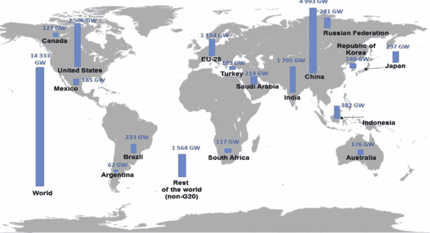

## 绿色能源的主要好处

投资绿色能源有多种好处，包括减少碳排放、防止进一步的环境危害以及提供就业机会。每个人都可以通过投资绿色能源来帮助实现这一未来。

太阳能每天产生的能源足以为整个星球供电，但问题出在哪里。由于目前技术无法将太阳能转化为电能，许多人发现使用其他传统能源更为经济。实现绿色发展需要增加对太阳能、风能等可再生能源项目的资金投入，并开发技术以更好地利用这些能源，使其更广泛地普及并更加经济实惠。

## 绿色能源的类型

主要的能源来源是太阳能、风能和水力发电，其中还包括利用海洋潮汐能量的潮汐能。太阳能和风能的大规模生产可在企业中进行，小规模生产也可在住宅中进行。六种最广泛使用的绿色能源形式如下：

- 1. 太阳能：光伏电池是一种广受欢迎的可再生能源，对环境安全，因为它们吸收阳光并将其转化为电能。太阳能不仅能提供热水和为建筑物供暖，还可用于烹饪和照明。如今，太阳能已经足够便宜，可以在更大范围内为整个城市供电，也可用于家庭用途，如照亮花园。来自太阳的直接能源即太阳能，它是可再生的且对环境安全。核聚变是指在压力和热量作用下将较小原子聚合成较重的


## Applications of Renewable Energy Sources and Sustainable Innovations

atoms, produces a tremendous amount of energy in stars. Solar radiation carries this energy to us, which we can absorb and transform into energy that we can use.

The most popular method of harnessing solar energy is through solar panels. Photovoltaic cells are put in panels. When light from the sun enters these cells, the photoelectric effect generates an electrical current (Liu, 2013).

The photovoltaic cell's energy-generation mechanism is as follows: First, the photovoltaic solar panels attached to the DC links collect solar energy. Next, a DC to AC converter (inverter) converts the electricity into alternating current. Finally, a 3-phase line filter with transformer and circuit breaker are used in that order. Following that, you can either put it into the national grid mix or utilize it to power your home (Jaiswal, 2022).

- 2. Wind Power: Wind energy is best suited to offshore and higher altitude locations since it harnesses the power of the global airflow to drive turbines that produce electricity. Wind energy is another sort of solar-powered energy since winds are created by the uneven heating of the atmosphere. The shape, spin, and orbit of our planet all have an impact on this unevenness. The surface that winds travel over, whether it be land or water, also has an impact on them.

The most popular wind turbines are those with three blades. These operate on a simple concept, in contrast to solar energy. Wind drives the turbine's blades, which in turn rotate an internal rotor. The primary shaft is then moved by the rotor, which spins a generator to produce energy. Even though wind appears to be a strong energy source, enormous wind farms are needed to produce enough electricity to run the entire nation.

- 3. Hydropower: This form of renewable energy, commonly referred to as hydroelectric power, uses the flow of water in rivers, streams, dams, and other bodies of water to create electricity. Small-scale hydropower can be generated in the house by using rainfall, ocean tides, evaporation, and water flowing through pipes. The following three sources of green energy are classified as “green” to varied degrees depending on how they are produced.

By harnessing the energy that comes from flowing water, hydroelectric energy can be produced and used to power a machine. It is most effective to accomplish this by boosting the energy per square meter by forcing water down a small path. This is typically accomplished by holding water in a dam or reservoir and using an intake opening to purify it only.

Gravitational potential energy is stored when water is kept higher up in the dam, which quickens the flow into the intake. Release of the flow causes a turbine to spin, which in turn triggers a generator to start producing power.

Hydroelectricity is one of the most widely used renewable energy sources due to its efficiency. 4 billion tons less greenhouse gases were emitted into the environment in 2017 as a result of the usage of hydropower to produce electricity (Hydropower, 2018).

- 4. Geothermal Energy: Thermal energy that has been stored close below the surface of the earth is used in this form of green power. If utilized, this resource is enormous, even if extracting it requires drilling, which presents environmental issues. Although it has been utilized for thousands of years to heat up hot springs, geothermal energy may also be used to run turbines and generate electricity. There could be ten times as much energy underground in the United States as there is coal-based electricity produced today. Geothermal resources are easily accessible in certain nations, like Iceland, but their utilization depends on the geography and ongoing regulations are needed to ensure that drilling practices are entirely “green.”

Geothermal energy can be utilized to heat buildings or create power by utilizing the natural heat that exists beneath the surface of the earth. Despite the fact that it harnesses a power that exists beneath our feet, geothermal energy is of small importance in the UK when compared to nations like Iceland, where geothermal heat is significantly more easily available.

- 5. Biomass: For this renewable resource to be called a “green energy” source, it must also be adequately managed. Biomass power plants use sawdust, wood debris, and combustible organic agricultural waste as fuel sources to generate electricity. These materials do produce greenhouse emissions, but they do so far less frequently than fuels made from petroleum.

Biomass is a sustainable green energy source since both plants and animals store solar energy as sugar or cellulose. A large portion of biomass is converted into liquid biofuels like ethanol and biodiesel and biogas when it comes to become usable energy. By themselves, other solid materials, like wood, can be burned to heat buildings and provide energy. According to the EPA, about 5% of the country’s total energy consumption in 2017 (Energy Information Administration, n.d.) came from biomass fuels.

- 6. Biofuels: These organic materials can be processed into fuels like ethanol and biodiesel instead of being burned as biomass. It is projected that by 2050, biofuels will have surpassed petroleum as the primary fuel source, accounting for almost 25% of the world’s transportation fuel use, up from just 2.7% in 2010.

The allure of biogas, presuming its existence, lies in its dual nature as an environmentally friendly and waste-derived energy source. Biogas is the byproduct of the breakdown of organic matter and is present in food waste, manure, sewage, and agricultural waste. Methane, carbon dioxide, and other gases are produced during fermentation and the holding of these components in oxygen-depleted containers. After that, the gas created can be sold and utilized to power cars, provide electricity, and heat houses. In addition, the waste that is digested in a biogas digester yields fertilizer that is rich in nutrients and can be used both at home and on farms.

### Figure 2. Transformation of solar power into electrical power

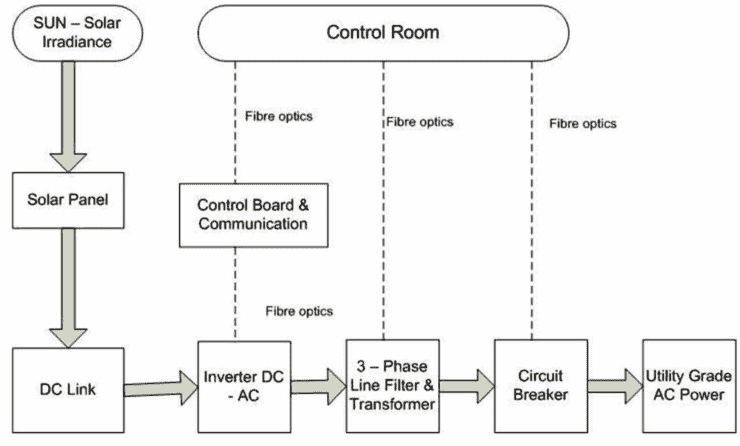

### Figure 3. Types of green energy

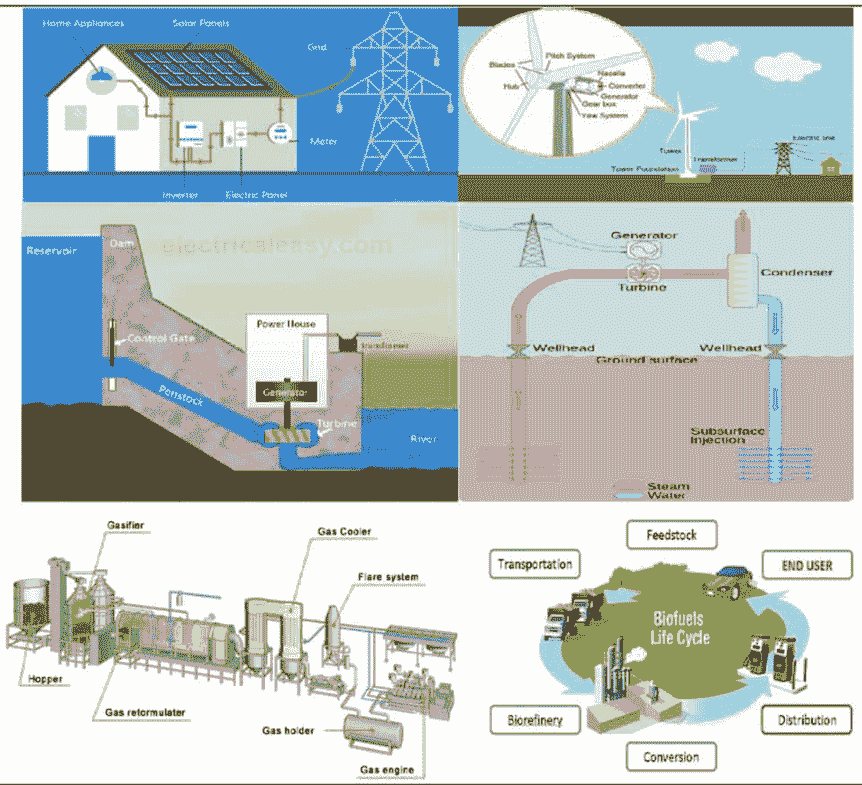

## Green Energy: Can It Replace Fossil Fuels

Green energy may someday take the place of fossil fuels, however different production techniques would be required. For instance, geothermal energy works very well in places where it is easily accessible, whereas other regions may be better suited for solar or wind energy (TWI-Global, n.d.).

But given the variety of renewable energy sources we can use to meet our needs and the advancements in their development and production, it is reasonable to believe that fossil fuels may eventually be phased out. Though it will take some time to happen, it is obvious that reducing climate change, improving the environment, and making the shift to a more sustainable future are crucial.

### Table 4. Different sources of biomass

| Sources of Biomass | Feedstocks | Bioenergy and Biofuels | Applications |
|---|---|---|---|
| Agricultural by-products | Agricultural crop residues, Forestry residues, fruit pits, Corn cobs, grass trimmings, straw, leaves, lumber, bark, branches, algae | Energy from light and heat sources, electrical generation, cellulosic ethanol, and compost | Natural fertilizers, soil conditioners, mulches for agriculture, and household heating and cooking |
| Wood by-Products | leftovers from wood processing, firewood, wood chips, timber, bark, wood pellets, and sawdust from furniture manufacturers | Energy from light and heat sources, electrical generation, cellulosic ethanol, and compost | Natural fertilizers, soil conditioners, mulches for agriculture, and household heating and cooking |
| Solid waste | rubbish from homes and businesses, Paper or cardboard, fruit or vegetable peels, and leftover or wasted food | Energy from light and heat sources, electrical generation, cellulosic ethanol, and compost | Natural fertilizers, soil conditioners, mulches for agriculture, and household heating and cooking |
| Non-crop food plants, corn, sugarcane, and agricultural by-products | Cellulosic components | methanol, ethanol-blended gasoline, cellulosic ethanol, and bio-alcoholic fuels | Use of transportation vehicles |
| Landfills, municipal wastewater, manure, and industrial wastewater | Biogas | electricity generation, liquid fuel production, methane and methanol production | Domestic cooking fuel and transportation |

## Economic Viability of Green Energy

Green energy needs to be contrasted with fossil fuels in order to be economically feasible. The price of fossil fuels will rise dramatically when easily accessible supplies become scarce. Greener energy sources become increasingly accessible at the same time that fossil fuels are more expensive. The ability to create reasonably priced localized energy solutions, like solar farms, is another aspect that supports green energy. As we deepen our understanding and build upon past successes, there is a decrease in costs associated with the interest in, investment in, and development of green energy solutions. As a result, green energy might emerge as the best choice in addition to being financially feasible.

## Most Efficient Type of Green Energy

Since it is easy to construct a rapid and efficient energy solution if you have the correct conditions, like lots of sun, green energy efficiency is mostly location-dependent. To properly assess various energy kinds, however, a complete analysis of an energy source’s entire life cycle is needed. This include figuring out how much energy was used to create the renewable energy source, determining the amount of energy that can be turned into electricity, and clearing any necessary land for the energy solution’s production. Even if environmental harm would prohibit a source from being entirely “green,” a “Levelised Energy Cost” (LEC) is determined after accounting for all of these considerations. Wind farms are now thought to be the most efficient kind of green energy because they require less processing and refining than, say, solar panels. Improvements in testing and composites technologies have made wind turbines last longer and have lower LEC. Solar panels, which are also experiencing significant developments, may be an example of this.


## 可再生能源与可持续创新应用

绿色能源解决方案在建成后还能最大限度地减少进一步的能源支出，因为它们通常利用易于获取的可再生能源（如风能）。实际上，风力发电从其可用能源效率中产生的初始能源价值占 64%，而煤炭仅为 29%。

### 绿色能源：保护环境

绿色能源能显著改善环境，因为它来自阳光和风等可再生资源。这些可再生能源与过去一个多世纪以来支撑人类发展的不可再生、碳排放化石燃料形成直接对立。

迈向美好未来的重要一步是生产低碳影响的电力。如果我们能利用环境来满足工业、交通和电力需求，就能显著降低对环境的影响。

### 绿色能源 vs. 可再生能源 vs. 清洁能源

如前所述，清洁能源、绿色能源和可再生能源之间存在区别。虽然这些术语有时被混用，但一种资源可能同时具备多种特征。例如，它可以是可再生的，但不是清洁或绿色的（如某些生物质能源）。

“绿色能源”是来自太阳或其他自然来源的能源。可持续能源源自可再生来源，如太阳能发电、风力发电和水力发电，不会向大气排放任何污染物。

可再生能源和替代能源有时会被混淆，关于孰优孰劣也一直存在争议。如果水电大坝影响生态系统并改变溪流，它还能被视为“绿色”能源吗？相比之下，风力发电来自环境友好、无污染的来源，因此既是清洁能源，也是绿色能源和可再生能源。

### 绿色能源产品的工作原理

关键在于要记住，无论选择哪种产品，您使用的能源都将是常规能源、可再生能源和绿色能源的组合。这是因为电网中所有能源在接入电力传输基础设施时都会被整合。在加拿大和美国，各种区域系统为家庭和企业供电。

购买绿色能源只需支付少量溢价以抵消将更多可再生能源并入电网的成本，而非为自家购买绿色能源。如果您希望在家中使用绿色能源，但没有空间或资金安装太阳能电池板，这是减少与能源使用相关的碳足迹的最佳方法。这也是推动可再生能源重大投资、提高家庭和企业绿色能源可及性的最经济途径。

### 绿色能源的少数应用

绿色能源目前应用于多个领域，包括能源生产、建筑供热、非公路交通以及交通运输。以下是一些正在考虑采用绿色替代方案的行业示例：

图 4. 部分绿色能源产品

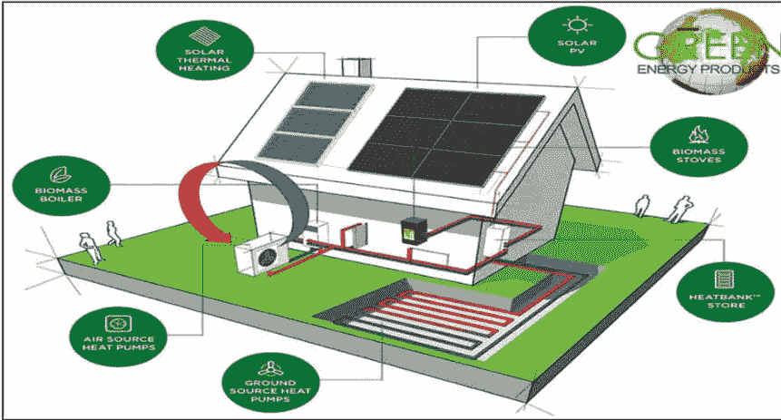

- 1. **用于热回收的涡轮发电机系统：** 最适合您的涡轮发电机将具有热回收发电应用，例如地热能、太阳能热能、海洋温差发电（OTEC）、发动机余热以及工业运作。

- 2. **低风速风力涡轮机和压缩机：** 许多全新且极其高效的轴向和径向叶轮设计正在开发中，用于工业和城市环境。这些小型风力涡轮机只需 5 mph 的风速即可启动并达到全效。涡轮风力涡轮机技术也在开发中，以减少噪音污染和鸟类死亡率。在迁徙飞行路径沿线的海上区域，开发对鸟类安全的新型叶片形状尤为关键。在另一种风力循环中，压缩机由风力涡轮机驱动。有时，压缩空气被用来驱动涡轮发电机（或其他用途）。

- 3. **太阳能涡轮机：** 更先进的新型太阳能技术有望更有效、高效且实用地利用太阳能用于热能应用（如吸收式制冷机），或利用集中式太阳能热量（400°F 或更高）驱动蒸汽或燃气涡轮机进行发电。提高涡轮机和泵的效率以降低每瓦安装成本，是所有太阳能技术及应用中的主要旋转机械问题。

- 4. **水力涡轮机：** 另一个巨大的潜力是开发创新的水电设计，无需大坝即可从多种低水头、低功率的河流中提供稳定、可预测的电力，这些河流的流量因地点和季节而异。即使是流动缓慢的溪流也可用于驱动高效率水动力涡轮机，其能量密度是风能的 850 倍。低流量地下溪流和落水预计也将受益于相同的涡轮绿色技术。海洋河口的水下水流是驱动水动力涡轮机非常可靠的能源来源。

- 5. **波浪-压缩机和潮汐电流涡轮机：** 潮汐电流涡轮机是一种从各种海洋洋流中收集能量的可能发明。随着潮汐涨落，Golay 立式轴潮汐电流涡轮机因围绕轴心螺旋排列的水翼叶片而双向运行。水下潮汐涡轮机农场的运行与离岸风电场可比，但增加了环境复杂性。另一种捕捉并将海浪能转化为压缩空气（随后用于驱动空气涡轮发电机）的方法是使用振荡水柱（OWC）。该技术的主要组件是高效率变距涡轮机，配备机电叶片变距控制，可使涡轮机单向旋转，无论 OWC 系统的气流是否双向。

- 6. **地热泵和涡轮机：** 这些旋转机械系统需要更高效的泵和涡轮机才能实现显著改进。一种小型且极其高效的涡轮膨胀机泵位于一种重力头能源系统（GHES）的井筒深处。我们的创新涡轮绿色概念可使总循环效率提高至少 20% 且高达 30%。

- 7. **生物质蒸汽涡轮机：** 对于拥有附近廉价生物质燃料供应的现场热电联产（CHP）工厂，蒸汽涡轮机长期以来一直是天然绿色能源解决方案。许多公用事业公司正在从煤炭转向生物质木屑，因为后者更清洁。先进的旋转机械设计专业知识很快将实现更高效率、更低排放和更低价格。

- 8. **能量存储：** 为了跟上分布式发电和智能电网供电中绿色能源技术日益加速的发展与普及，能量存储必须与可再生能源相结合。除了电池系统外，所有其他形式的存储都依赖于不同类型旋转机械的有效性，以压缩气体和泵送流体。最近，人们对新一代飞轮产生了兴趣，其多吨碳纤维转子在磁性轴承上于真空中旋转。每个飞轮可存储多兆瓦的备用电力，用于稳定波动需求的电力，并吸收来自太阳能和风能等间歇性能源的功率波动。在一种版本中，绿色能源电机将飞轮推至最大转速。然后，通过反转过程并将电机转换为发电机，转子将保持其惯性能源“无限期”，直到释放。

- 9. **太阳能被动式空间供暖：** 通过利用宽大的朝南窗户等建筑特征，以及墙壁或地板中在白天吸热、夜间需要时释热的材料，被动式太阳能房间供暖利用太阳的温暖。被动式太阳能设计系统有三种类型：
  - a. 直射得热，最简单的技术，通过吸收阳光直射进入建筑的热量来加热瓷砖或混凝土等材料，并缓慢释放。
  - b. 间接得热，与直射得热类似，但涉及在太阳与居住区域（通常是墙壁）之间使用蓄热、释热和保温材料。
  - c. 隔离得热：该系统在主要居住区域之外收集太阳能。例如，附属于房屋的温室中较暖的空气会被收集并自然在整个房屋中循环。

- 10. **风能和太阳能电动汽车：** 风能和太阳能可能是应对能源短缺和减少温室气体排放的选项之一。电动汽车可显著改善城市空气质量。保障太阳能和


风力发电随时可用的方法是储存多余的太阳能和风能，然后按需释放（Liu, 2013）。

- 11. 风力驱动的运动，如滑水冲浪、风筝冲浪：滑水冲浪是一项融合冲浪和帆船元素的运动。风筝在水面上被风推动前进。

- 12. 建筑中的供暖与制冷：从大型企业建筑到私人住宅的各种结构都在采用绿色能源解决方案。这些方案包括地热直接供热系统、生物质燃料锅炉、太阳能热水器以及运行于可再生能源上的制冷系统。

- 13. 工业过程：在工业过程中，可以利用生物质或可再生能源产生可再生热。如今，氢能作为化工、钢铁、水泥等行业的可持续能源，发挥着重要作用。

- 14. 交通运输：在多个行业中，使用可持续生物燃料和可再生能源进行交通运输正越来越受欢迎。汽车是电气化取代化石燃料的明显例子，但飞机和建筑领域也在研究电气化。

## 能源转型的成本与收益

该研究表明，对能源系统进行脱碳具有成本效益。虽然所需的整体能源支出相当大，但到2050年，向低碳能源领域转型的额外支出将占全球GDP的0.4%。在2015–2050年期间，增加的总投资将达到27万亿美元，即同期平均每年0.77万亿美元（Gielen, 2019）。要实现能源领域脱碳，还需要更多举措，重点关注终端使用领域（建筑和交通运输）以提高能源效率。这些支出还将包括基础设施（如能源存储、氢能和CO2管道、输配电线路以及电动汽车充电站）。

根据E3ME计量经济模型，与基准情景相比，REmap情景预计将使全球GDP在2050年增长1%。2015年至2050年间，GDP增长带来的潜在收益可能约为52万亿美元。促进增长的政策、使用碳定价并将其收益再循环以降低所得税，以及增加能源效率和可再生能源投资，是经济增长的主要驱动力。根据REmap情景，全球能源转型和更快的整体经济增长可能会在2050年前在灵活性与电网增强、可再生能源及能源效率领域创造超过1900万个额外的直接和间接就业岗位。

## 促进能源转型的创新与研发

要整合各项技术，需要强大的支撑基础设施。这些设施将包括低损耗跨境电力互联、智能区域供热系统、智能电动汽车充电网络、智能高压输电线路（可能是地下线路），用以将太阳能或风能资源丰富地区的大量电力输送至需求中心，以及生物质原料管理和分销策略，如图5所示。如果没有这种基础设施，低碳技术很难实现商业可行性并广泛采用。不同能源应用的连接也有助于清洁技术的集成。使用电动汽车的两个行业是交通运输和电力。

## 可再生能源与可持续创新应用

### 图5. 电力系统创新

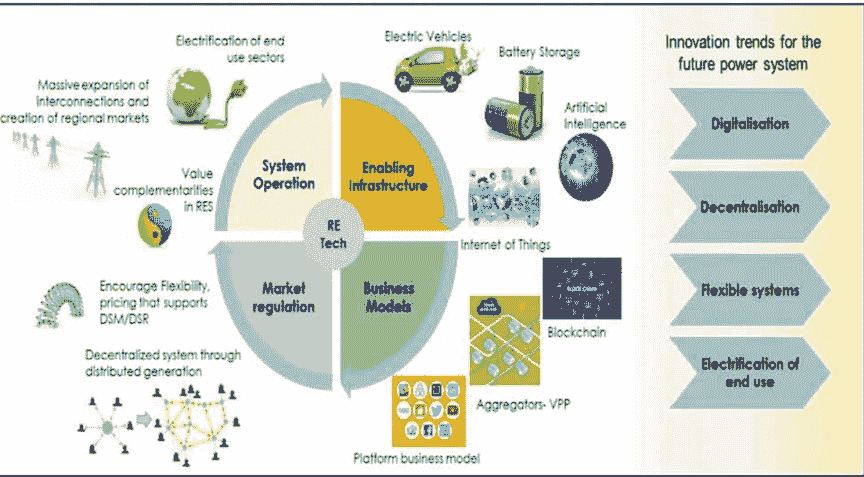

跨境合作可以促进创新。清洁能源部长级会议、突破能源联盟以及“使命创新”（Mission Innovation，一个在COP21上发布、旨在将清洁能源技术政府研发投资翻倍的国际倡议）是近期为推动清洁能源技术研发与创新而启动的几个例子。

## 结论

绿色能源为当前许多能源提供了一种更环保的替代方案，表明它是世界未来的一部分。这些易于补充的能源有利于环境，有助于创造就业，并且从长远来看似乎具有经济可行性。实际上，化石燃料不是一种可持续能源，应逐步从我们的能源结构中淘汰。我们可以建立多样化的绿色能源，不损害我们所有人赖以生存的环境，从而为未来生产真正可持续的能源供应。使用可再生能源对于全球范围内保护、改善和维持环境状况至关重要。从基于化石燃料的不可再生能源完全转向可再生能源是必要的。可再生能源拥有众多安全优势，有利于环境和使用可再生资源的人们。只有解决某些问题，这才有可能实现。这些挑战包括公众接受度、政府法规、政治压力、老旧基础设施、昂贵的工厂建设成本、过剩产能以及企业垄断。认识到人们在维护环境健康方面的作用，许多国家已制定策略，允许企业部门从如今价格亲民的可再生能源中获益。尽管可再生能源市场随着时间的推移变得更加有利，但仍需做更多工作以推广这些能源的更广泛应用。专注于构建捕获可再生能源（如风力涡轮机、大坝和堤坝）所需的技术和基础设施至关重要。如果要充分利用水力发电，保持海洋和水域环境清洁健康也同样重要。随着对住宅建筑太阳能电池板安装的鼓励和推广，这些技术的市场将扩大，公众接受度也将提高。必须将可再生能源的开发与利用列为首要任务，特别是考虑到人们日益认识到使用化石燃料的工业过程所关联的有害环境影响。可持续能源发展的需求在全球范围内快速增长。广泛使用可再生能源对于实现发达国家和发展中国家能源领域的可持续性是必要的。

## 参考文献

- BP Energy. (2018). 印度国家和地区洞察展望. https://www.bp.com/content/dam/bp/en/corporate/pdf/energy-economics/energy-outlook/bp-energy-outlook-2018-country-insight-india.pdf
- Chang, Y., Lee, J., & Yoon, H. (2010). 世界能源消费的替代预测——与2010年国际能源展望相比. Energy Policy, 50, 154–160. doi:10.1016/j.enpol.2012.07.059
- EIA. (2018). 2018年国际能源展望（IEO2018）. https://www.eia.gov/pressroom/presentations/capuano_07242018.pdf
- EIA. (2019). 2019年能源展望（截至2050年的预测）. https://www.eia.gov/outlooks/aeo/pdf/aeo2019.pdf
- 美国能源信息署. (n.d.). https://www.eia.gov/energyexplained/?page=biomass_home
- Gielen, D. (2019). 可再生能源在全球能源转型中的作用. Elsevier.
- 水力发电. (2018). https://www.hydropower.org/publications/2018-hydropower-status-report
- Jaiswal. (2022). 可再生及可持续清洁能源发展及其对社会、经济和环境健康的影响. Elsevier.
- Kaygusuz & Bilgen. (2008). 土耳其能源相关环境政策. Energy Sources Part B, 3, 396–410.
- Liu, Q. (2013). 太阳能与风能电动汽车可能改变环境和经济：利用可再生能源资源的工具. AGU Earth’s Future.
- 生物技术国家中心. (n.d.). https://www.ncbi.nlm.nih.gov/pmc/articles/PMC4740163
- 自然资源保护委员会. (n.d.). 墨西哥湾漏油事件. https://www.nrdc.org/sites/default/files/gulfspill-impacts-summary-IP.pdf
- TWI-Global. (n.d.). https://www.twi-global.com/technical-knowledge/faqs/what-is-green-energy


Wang, W., Zhang, M., & Li, P. (2014). Exploring temporal and spatial evolution of global energy production and consumption. Renewable & Sustainable Energy Reviews, 30, 943–949. doi:10.1016/j.rser.2013.11.027

# 第 9 章

# 生物质基生物氢生产代谢途径、挑战、未来经济与 AIML 含义

Shamba Chatterjee
哈尔迪亚理工学院，印度

Sucheta Das
哈尔迪亚理工学院，印度

## 摘要

由于化石燃料供应迅速减少以及气候变化带来的灾难性后果，对更清洁、更可持续能源的迫切需求应运而生。作为一种富有成效的替代方案，氢能市场正在蓬勃发展，并被视为一种重要的环境友好型工业原料。然而，将氢作为燃料商业化面临着显著的技术经济和环境障碍。微藻生物氢生产作为克服这些困难的一种手段，正日益受到关注。可以利用不同的代谢途径来生产微藻生物氢，但对改进微藻驱动生物氢生产的经济和技术方面进行简洁说明的需求迫在眉睫。因此，通过改进关键的试错因素、可能的基因水平代谢工程改造以及 AIML 应用，来完善经济的氢生产技术，即可实现可持续性的长期保障。

## 引言

近期气候变化情景推动了探索环境友好型能源作为化石燃料替代品的必要性。研究人员指出，氢（H2）凭借其卓越的能量输出和合理的热值，是潜在的竞争者（Wu et al., 2012；Chandrasekhar et al., 2020）。国际可再生能源署（IRENA）指出

DOI: 10.4018/979-8-3693-2355-7.ch009

，大部分工业生产的氢气是通过蒸汽甲烷重整获得的，该过程产生温室气体，从而导致气候变化。石油和煤炭气化（CG）过程也适用同样的情况。通过电解法生产氢气也不是碳中和的，因为它需要消耗大量能源（IRENA, 2018）。相比之下，通过微生物途径（微藻生物氢生产）获得的氢气具有诸多优势，例如生长速率高、能源需求低、更加环保且无需木质素基材料的预处理工艺（Muhammad et al., 2021；Ahmed et al., 2022；Singh et al., 2020；El-Dalatony et al., 2020；Jiménez-Llanos et al., 2020；Mona et al., 2020；Salakkam et al., 2021）。因此，本综述揭示了：

- 改进型生物氢制造的不同代谢途径；
- 主要挑战和显著局限性；以及
- 未来见解、机遇和经济考量。

## 从生物质生产生物氢的制造途径

基于微藻的生物质大规模生产生物氢是一种强大的经济策略，优于现有的传统能源方法（Ge et al., 2020）。这可以通过直接微藻生产方法，或将该生物质用作潜在的微生物发酵底物来实现。第二种方式的能量产量高于第一种，但两者也可以组合使用（Oncel et al., 2015）。这些领域将在以下小节中详细阐述。

### A. 光发酵

光发酵利用阳光代替糖类作为能源。该过程可通过以下方程式描述：

16ATP + N2 + 16H2O + 10H+ + 8e- → 16ADP + 2NH4+ + 16pi + H2

在此过程中，异养发酵以及体内底物的代谢反应为绿藻提供电子。此外，光能与氧化碳代谢共同促进电子提取。产生的电子成功转移到与叶绿体基质烟酰胺腺嘌呤二核苷酸磷酸-质体醌氧化还原酶耦合的质体醌池中。基本上，转移到 [Fe]-氢化酶和铁氧还原蛋白的电子会产生升高的氧化还原电位（Baeyens et al., 2020）。诱导的 [Fe]-氢化酶有助于在黑暗及厌氧环境中大量生产生物氢。

与暗-光发酵相比，若考虑氢产量[~141.42 ml (g TS)-1]（Zhang et al., 2020），光发酵被认为是效果最显著的过程。相比之下，上述过程在光转换效率和最终产品产量方面，不如电化学方法及生物光解法高效（Zhang et al., 2020）。

### B. 暗发酵

富含碳水化合物的绿色微藻通常通过一种不依赖光的过程产生生物氢，该过程广为人知，称为暗发酵。葡萄糖分子的完全转化可通过以下方程式表示：

C6H12O6 + 6H2O = 12H2 + 6CO2

暗发酵随后与可能的有机酸类副产物（如乙酸）一起产生 4 摩尔氢气（Mona et al., 2020）。暗发酵途径中有两个途径参与生物氢生产。其中一个途径由氢化酶途径通过烟酰胺腺嘌呤二核苷酸氢的再氧化来催化，另一个途径则通过甲酸的代谢转化发生（El-Dalatony et al., 2020）。尽管该过程反应速率较高，但由于氢浓度产量较低，仍需要最终净化步骤（Mona et al., 2020）。另一方面，通过对猪殃藻（alligator weed）进行最佳预处理和适当的酶解，可以实现更高的产出（Song et al., 2020）。

### C. 生物光解过程

绿藻和蓝细菌中的光系统 II 具有利用光能分解水并产生生物氢的潜力。在此过程中，由此过程获得的电子通过包含光系统 I 和 II 的电子传递链传递。随后，铁氧还原蛋白分子被还原并产生三磷酸腺苷。这些物质参与众多产生氢气的代谢过程。「生物光解」一词指一种由光驱动的过程，分为直接生物光解和间接生物光解两类（Razu et al., 2019）。

在光合作用过程中，绿藻（Chlamydomonas reinhardtii）和蓝细菌（Synechocystis）会迅速光解环境中的水以产生氢气和氧气。微藻易于培养，营养需求微乎其微。它们也是有效的二氧化碳固定者。此外，它们在盐水或废水中的生长方式与在淡水中相似（Eroglu et al., 2016；Chen et al., 2016）。主要障碍包括需要大规模培养、氧气积累后最终产物的抑制、对高光强的需求以及光化学效率低下（Jiménez-Llanos et al., 2020）。

在厌氧条件下，微藻进行间接生物光解，其中氧气释放与氢气生产发生在不同阶段。初始阶段描述光合作用，其中二氧化碳和水被转化为化学能和氧气。随后，有机物进一步加工成氢气、二氧化碳和其他代谢产物。在此情况下，主要障碍包括氢化酶摄取减少、运营成本高，以及氢化酶酶产生二氧化碳导致氢气产量低（Razu et al., 2019）。另外，生物氢也可以通过油性微藻结合脂质的额外生产来生成（Sengmee et al., 2017）。

### D. 电化学过程

微生物电解池利用能够产生二氧化碳（CO2）和电子的电活性微藻来生产生物氢。这些电子通过阳极传递到阴极，并最终与释放 H+ 的氢（H2）原子结合。由于该过程不是自发的，因此需要外部电压供应才能在阴极获得生物氢。微生物电解池在生产方面效率较高，可达到 12 mol H2/mol 底物，但与传统方法相比仍然相当低，因为传统方法消耗残留有机成分（Park et al., 2021）。


最近，以微生物光电化学电池形式进行的基于有机废弃物的生物氢生产引起了巨大兴趣。这项前沿技术在电解质中采用膜分离半导体作为电极，在阳光存在下将水分解为氢和氧。光电化学电池是一种极具环境前景的生物氢制造方法（El-Dalatony et al., 2020）。当前报告揭示，使用基于赤铁矿纳米线的光阳极提高了可见光下的输出功率（Zhu et al., 2017）。

## 生物氢生产面临的挑战

生物氢已被确认为与碳氢化合物矿藏基能源资源相比的一种环保且可持续的替代能源。至今，挑战依然存在，不仅在于正确扩大可用工艺的规模，还在于提高最终产量。此外，经济可行性是以可持续方式实现一致商业级生产的关键因素。

光解法已解决了工艺对氧气敏感性的问题。必须要么通过利用结合氧蛋白降低氧浓度，要么通过在反应器头部空间进行惰性气体吹扫来抑制氧气产生。这可能会为整个工艺增加额外的运营成本。解决这一问题的一种方法是从藻类培养基中剔除某些营养物质（例如硫、氮），从而提高生物氢产量。已观察到，经过代谢工程改造的蓝细菌可以减少基于氢化酶的氢消耗。或者，有报道揭示，通过基因工程改造的绿藻和蓝细菌提高了光能转换效率。其他一些主要关切包括产品层面爆炸性混合物的安全问题、封闭系统对人工照明的必要性，以及所涉微藻物种的光能捕获与二氧化碳固定效率（Nagarajan et al., 2017; Kosourov et al., 2017; Kumar et al., 2019; Khetkorn et al., 2014）。

用环境废弃物等替代选择取代传统底物，有望降低发酵型生物氢生产的运营成本。选择合适的微生物至关重要，因为它显著影响氢产量。此外，有时还需要适当的预处理，将复杂糖分解为更简单的糖分以便更好地发酵。必须整合分离工艺，因为二氧化碳作为明显的副产品，会严重阻碍周围环境的碳中和。报告还表明，可能存在代谢副产物，如甲烷和少量硫化氢气体，进而影响氢产量（Sarangi et al., 2020; Łukajtis et al., 2018）。

基于微生物电解池的工艺在阐明微生物物种与电极之间电子转移的实际机制方面仍存在空白。此外，阳极和阴极附近的产甲烷活动与目标物种争夺有机底物，且它们利用产生的氢气（Kadier et al., 2017）。尽管发现化学抑制剂对抗产甲烷菌有效，但运营成本会变得更高（Chae et al., 2010）。最后，必须寻找导电性高且成本低的电极材料。生物阴极或微生物阴极是一个良好的替代方案，因为在这方面它们成本更低（Croese et al., 2011）。

## 未来洞察与机遇

生物氢技术仍处于起步阶段，因为它需要反应器的低成本设计材料以及廉价底物。即使一些有前景的方法，例如生物氢与

## 基于生物质的生物氢生产代谢途径

废水处理以及应用基因工程微生物，并未真正缓解其与现有氢生产方法相比的一致应用。研究人员报告称，与天然气以及太阳能、风能和核能等其他显著来源相比，从煤炭等能源来源生产氢气可提供更高的氢产量（Bartels et al., 2010）。但随着可再生能源领域的最新进展，这些数据可能已发生重大变化。有趣的是，通过下调目标代谢途径并随后限制耗氢反应，可以有效提高氢产量。此外，经过精心设计的生物反应器有望增强光穿透力，从而提高最终产量。在某些情况下，当二氧化碳与氢气一起作为副产物时，实施气体分离技术可以有效确保产品的纯度。此外，实施混合氢生产方法采用绿藻和光合物种的混合培养，利用不同光谱区域来提高最终收益（Melis et al., 2006）。其他研究表明，通过结合暗发酵和光发酵可以提高产品产量（Ding et al., 2015; Chookaew et al., 2015; Ghimire et al., 2015; Morsy et al., 2015; Rai et al., 2015; Xie et al., 2016; Salem et al., 2018）。除此之外，如果暗发酵可以与微生物电解池相结合，则产量将显著提高（Nguyen et al., 2020）。

日本正在高效推进构建完全氢驱动社会的概念。晴海旗（Harumi Flag）正在将这一梦想在东京中心变为现实。该旗舰项目拥有23栋住宅建筑，包含5,632个单元和零售资产。全部能源需求将由氢能和太阳能满足。日本还在稳步推进燃料电池汽车，丰田和本田的贡献显示出巨大的未来前景（Toyota, 2020）。此外，山梨县是公私合营模式的完美典范，旨在推动脱碳努力（日本科学技术振兴机构, 2021）。加州政府自2015年起已推广燃料电池电动汽车（Sinha et al., 2021）。

韩国旨在在“氢气城市创建项目”的框架下建立六个城市，其日常生活将由氢能驱动（Hydrogeninsight, 2023）。政府通过提供购车补贴，坚定支持燃料电池电动汽车。现代汽车在这方面领先市场。

中国也在过去几年中通过增加燃料电池电动汽车和加氢站的数量，改善了其脱碳努力（Factsheet-China-FC-EN; now-gmbh.de, 2020）。

在欧洲，德国及其伙伴（例如荷兰、奥地利和挪威）已投入大量资金，通过鼓励从生物资源生产氢气，与世界其他地区竞争（IRENA, 2019）。

根据IRENA报告，凭借前瞻性政策，目前通过电解生产氢气的主流方法可以逐渐被生物氢取代（IRENA, 2019）。

## 经济考量

从生物过程获取的氢气已成为生物能源制造的一个蓬勃领域。然而，要实现氢能经济的广泛应用，仍需考虑若干问题。目前，研究人员和技术人员已将目光转向产生氢气的成本效益（约0.30美元/千克），以应对汽油驱动市场带来的巨大挑战（Goswami et al., 2021）。

基于微藻培养且运行效率达90%的光解系统，计划每年生产1200太焦耳的产品（El-Dalatony et al., 2020; Mona et al., 2020）。一家美国创业公司提出了一种两阶段生物氢生产设计，从而减少了光生物反应器


主体成本，但后来面临关于硫剥夺的问题（Nagarajan et al., 2021）。此外，经济可行的开放式池塘微藻培养已显示出相当数量的生物氢生产（1,239 kg/h）与合适的市场价格（$10 kg-1）（Gholkar et al., 2021）。在直接光解情况下，必须通过降低生产成本来关注储存成本。这可以通过控制转换效率和生物量产出进一步管理（Jiménez-Llanos et al., 2020）。

某些生物反应器的设计需要特定的制造材料以及营养物，这些通常占据绝大部分支出。这可能导致高昂的生物氢生产成本（Show et al., 2018）。

通过超临界和热气化的微藻生物量基生物氢生产成本仍不理想，因为其成本似乎是已经存在的天然气驱动氢生产成本的四倍（Kumar et al., 2019）。

高昂的生产成本还由叶绿体中质子梯度差异、光捕获干扰以及低效光合作用过程等问题引起（Eroglu et al., 2016）。

如果有效比较直接光解与光发酵及暗发酵的资本成本，那么后者在经济上显然不划算（Dincer et al., 2015; Bolatkhan et al., 2019; Peng et al., 2019; Limongi et al., 2021; Wang et al., 2021）。

然而，生物氢合成的特点是比其他燃料替代品成本更高。未来研究应着重对便利性和运营视角、原料及运营过程预算、光照、气象条件和场地条件、生物量混合以及产品团结等进行详细评估。回收废代谢物和生物量可以提高经济可行性。

## 人工智能与机器学习辅助的氢基系统

近年来，人工智能（AI）引起了同行的广泛关注，并已成功应用于工业领域以及其他阶段。关于人工智能的传统研究包括数据表示、结构化规划、方法性学习、自然语言处理、感知表征以及机器人辅助。原则上，唯一目标是开发能够潜在地完成人类所能执行的任何任务的通用智能。当前一代已整合并融合了大量问题求解数学优化技术，以及形式逻辑和基于统计学及运筹学的不同网络建模系统。另一方面，机器学习（ML）强调通过数据和算法的实践，以改进且准确的方式复制类人的学习模式。

人工智能在当前工业部门的广泛应用，潜在地改变了与高生产成本和性能准确性相关的场景。特别是在氢精制和加注系统中观察到了重大改进，这从根本上改变了关于预测、规划和控制的运作方式。因此，基于AI的系统被划分为群体生物学、非群体生物学以及理化启发式算法，以便在实时情况下得到妥善应用。而机器学习算法则通过其简化能力改进了人工神经网络（Xiao et al., 2020; Xiao et al., 2021; Ahmad et al., 2021; Rangel-Martinez et al., 2021）。

2021年，在光伏技术的支撑下，借助基于日照值数据集的不可知深度学习（DL）和人工神经网络（ANN）模型，建立了一种氢制造装置预测原型（Mert et al., 2021）。通过实施DL算法，合理规划可以稳定地帮助我们最小化氢储存系统（Shams et al., 2021）。地球母亲的当前状况积极支持为自主能源系统构建环保且可持续的策略，这在一个基于DL算法的供需预测模型系统中得以体现，用于模拟独立的氢掺混可再生电网（Hwangbo et al., 2019）。

像非支配排序遗传算法（NSGA）这样的AI方法，也已成为短期氢能储存以满足负载需求时系统优化的热门选择（Beshir et al., 2018）。然而，粒子群优化算法（PSO）基本上是一种简单高效的群体智能技术，值得称赞地揭示了氢储存系统的最佳比例和能量设计（Hassanzadeh Fard et al., 2020）。改进的算法可以针对技术经济、环境和社会政治目标优化氢燃料电池系统（Maleki et al., 2016; Eriksson et al., 2019）。在这里，人工蜂群优化（ABSO）算法已证明其在氢基系统中优化寿命值和断电概率方面的效果。此外，模拟退火（SA）可以实施，以实现相对于过时的响应面方法（RSM）系统的改进结果（Maleki et al., 2018）。可以通过采用离散和声搜索算法（DHS）成功改进燃料电池储存设备的尺寸，从而实现成本优化（Maleki et al., 2015）。此外，一种用于优化的混合算法（HRES）已被应用于实现储存系统的最低生命周期成本，并且与其他方法相比，它表现出较低的指数值和可接受的稳健性（Zhang et al., 2018）。

目前，来自水制造厂的绿色氢生产（GHP）系统专注于依赖机器学习（ML）的规模化问题预测与优化。他们应用了不同的相关模型来预测和优化质子交换膜和暗发酵方法，以揭示规模化问题并证实可持续氢经济（Kabir et al., 2023）。此外，KEPCO国际核研究生院的研究人员使用氢经济评估程序来计算制造成本，采用了由韩国原子能研究院和NuScale Power, LLC开发的两种小型模块化反应堆。他们揭示了热耗和电力额定值等关键参数，这些参数可能基于ML方法影响生产成本（Kim et al., 2022）。

## 结论

氢是一种环保的运输和车辆燃料，因为燃烧时仅形成水。加利福尼亚州承认环境上的重大影响，这导致了2020年的严重山火。该州随后认识到立即实施零碳电力系统策略的价值，该系统有望在2030年实现。目前，电解过程是清洁氢的主要贡献者，因为基于生物氢的系统仍无法在大规模层面实现。然而，当前生物氢技术的成本和产出仍落后于传统的氢制造方法。额外的研究举措至关重要，它们有可能提升工艺优化、产品产出和经济地位。遗传工程也可以帮助我们增强微生物特性。此外，专门设计的生物反应器可以大大改善这一点。此外，最新经济评估中的空白仍然存在，因为大部分信息是在几年前进行的。因此，应进行系统经济研究，以尽量减少有关生物氢储存和运输的成本。最后，人工智能在模拟可再生能源系统方面发挥着关键作用。人工智能技术有可能通过更智能的规划、管理和控制，增强能源生成和供应链变量预测。可再生能源系统可以通过使用各种人工智能优化算法来优化，以获得更合适的尺寸或配置。影响绿色氢生产成本的重要因素也可以使用基于机器学习的方法准确预测。

## 致谢

作者们谨向母机构提供空间和资源的支持表示诚挚的感谢。

## 参考文献

Ahmad, T., Zhang, D., Huang, C., Zhang, H., Dai, N., Song, Y., & Chen, H. (2021). 可持续能源行业中的人工智能：现状、挑战与机遇. Journal of Cleaner Production, 289, 125834. doi:10.1016/j.jclepro.2021.125834

Ahmed, S. F., Mofijur, M., Parisa, T. A., Islam, N., Kusumo, F., Inayat, A., Lee, V. G., Badruddin, I. A., Khan, T. M. Y., & Ong, H. C. (2022). 利用微藻生物量进行废水中污染物去除的进展与挑战. Chemosphere, 286, 131656. doi:10.1016/j.chemosphere.2021.131656 PMID:34325255

Baeyens, J., Zhang, H., Nie, J., Appels, L., Dewil, R., Ansart, R., & Deng, Y. (2020). 通过发酵进行生物氢生产潜力综述. Renewable & Sustainable Energy Reviews, 131, 110023. doi:10.1016/j.rser.2020.110023

Bartels, J. R., Pate, M. B., & Olson, N. K. (2010). 来自常规和替代能源的氢生产经济调查. International Journal of Hydrogen Energy, 35(16), 8371–8384. doi:10.1016/j.ijhydene.2010.04.035

Beshir, E. H., Abdelghany, H., & Eteiba, M. (2018). 具有氢能储存的孤立微电网新型优化技术. PLoS One, 13(2), e0193224. doi:10.1371/journal.pone.0193224 PMID:29466433

Bolatkhan, K., Kossalbayev, B. D., Zayadan, B. K., Tomo, T., Veziroglu, T. N., & Allakhverdiev, S. I. (2019). 光合微生物的氢生产：现实与前景. International Journal of Hydrogen Energy, 44(12), 5799–5811. doi:10.1016/j.ijhydene.2019.01.092

Chae, K. J., Choi, M. J., Kim, K. Y., Ajayi, F. F., Chang, I. S., & Kim, I. S. (2010). 微生物电解池中选择性抑制产甲烷菌以改善生物氢生产. International Journal of Hydrogen Energy, 35(24), 13379–13386. doi:10.1016/j.ijhydene.2009.11.114


## 基于生物质的生物氢生产代谢途径

Chandrasekar, K., Kumar, S., Lee, B. D., & Kim, S. H. (2020). 废弃基氢生产用于循环生物经济：现状与未来方向. *生物资源技术*, *302*, 122920. doi:10.1016/j.biortech.2020.122920 PMID:32029301

Chen, C., Chang, H., & Chang, J. (2016). 混养条件下培养的富含碳水化合物的微藻生物量作为生物氢生产原料的生产. *国际氢能杂志*, *41*(7), 4413–4420. doi:10.1016/j.ijhydene.2015.05.163

Chokaew, T., O-Thong, S., & Prasertsan, P. (2015). 两段暗发酵和光发酵从粗甘油生产生物氢. *国际氢能杂志*, *40*(24), 7433–7438. doi:10.1016/j.ijhydene.2015.02.133

Croese, E., Pereira, M. A., Euverink, G. J. W., Stams, A. J. M., & Geelhoed, J. S. (2011). 产氢微生物电解池生物阴极微生物群落分析. *应用微生物与生物技术*, *92*(5), 1083–1093. doi:10.1007/s00253-011-3583-x PMID:21983651

Dincer, I., & Acar, C. (2015). 为了更好的可持续性，氢生产方法的回顾与评价. *国际氢能杂志*, *40*(34), 11094–11111. doi:10.1016/j.ijhydene.2014.12.035

Ding, L., Xia, A., Lin, R., Li, Y., Zhou, J., & Cen, K. (2015). 利用废弃生物质蛋白质降解获得的氨基酸通过联合暗发酵和光发酵产氢. *生物资源技术*, *179*, 13–19. doi:10.1016/j.biortech.2014.11.109 PMID:25514397

El-Dalatony, M. M., Zheng, Y., Ji, M.-K., Li, X., & Salama, E.-S. (2020). 微藻生物氢生产的代谢途径：当前进展与未来展望. *生物资源技术*, *318*, 124253. doi:10.1016/j.biortech.2020.124253 PMID:33129070

Eriksson, E. L. V., & Gray, E. M. (2019). 可再生能源混合系统优化——一种多目标方法. *可再生能源*, *133*, 971–999. doi:10.1016/j.renene.2018.10.053

Eroglu, E., & Melis, A. (2016). 微藻氢生产研究. *国际氢能杂志*, *41*(30), 12772–12798. doi:10.1016/j.ijhydene.2016.05.115

中国燃料电池资料表. (n.d.). https://www.now-gmbh.de/wp-content/uploads/2020/09/Factsheet-China-FC-EN.pdf

Ge, S., Foong, S. Y., Ma, N. L., Liew, R. K., Wan Mahari, W. A., Xia, C., Yek, P. N. Y., Peng, W., Nam, W. L., Lim, X. Y., Liew, C. M., Chong, C. C., Sonne, C., & Lam, S. S. (2020). 结合微波加热和基体混合物改性的真空热解：将生物废弃物转化为环保生物能源产品的综合方法. *可再生与可持续能源评论*, *127*, 109871. doi:10.1016/j.rser.2020.109871

Ghimire, A., Valentino, S., Frunzo, L., Trably, E., Escudié, R., Pirozzi, F., Lens, P. N. L., & Esposito, G. (2015). 通过耦合半连续暗-光发酵和厌氧消化的残留物后处理从食物废弃物中生产生物氢：一种能量回收协同效应. *国际氢能杂志*, *40*(46), 16045–16055. doi:10.1016/j.ijhydene.2015.09.117

Gholkar, P., Shastri, Y., & Tanksale, A. (2021). 来自微藻的可再生氢和甲烷生产：一项技术经济和生命周期评估研究. Journal of Cleaner Production, 279, 123726. doi:10.1016/j.jclepro.2020.123726

Goswami, R. K., Mehariya, S., Obulisamy, P. K., & Verma, P. (2021). 基于微藻的先进可再生生物氢生产系统：综述. Bioresource Technology, 320, 124301. doi:10.1016/j.biortech.2020.124301 PMID:33152683

Hassanzadeh Fard, H., Tooryan, F., Collins, E. R., Jin, S., & Ramezani, B. (2020). 基于高效多种氢生产的混合可再生能源系统设计与最优能量管理. International Journal of Hydrogen Energy, 45(55), 30113–30128. doi:10.1016/j.ijhydene.2020.08.040

Hwangbo, S., Nam, K., Heo, S., & Yoo, C. (2019). 基于供需预测模型和深度学习算法的氢基自持式集成可再生能源电网（HySIREN）. Energy Conversion and Management, 185, 353–367. doi:10.1016/j.enconman.2019.02.017

氢能洞察. (2023). https://www.hydrogeninsight.com/policy/south-korea-to-create-six-hydrogen-cities-that-would-use-h2-in-buildings-and-transport-as-part-of-daily-life/2-1-1385821

IRENA. (2018). 可再生能源制氢. IRENA.

IRENA. (2019). 氢能：可再生能源视角. IRENA.

日本科学技术机构. (2021). https://sj.jst.go.jp/stories/2021/s0728-01a.html

Jiménez-Llanos, J., Ramírez-Carmona, M., Rendón-Castrillón, L., & Ocampo-López, C. (2020). 藉由小球藻的可持续生物氢生产：综述. International Journal of Hydrogen Energy, 45(15), 8310–8328. doi:10.1016/j.ijhydene.2020.01.059

Kabir, M. M., Roy, S. K., Alam, F., Nam, S. Y., Im, K. S., Tijing, L., & Shon, H. K. (2023). 面向循环经济的水工业绿色氢生产技术的机器学习预测与优化. Desalination, 567, 116992. doi:10.1016/j.desal.2023.116992

Kadier, A., Jiang, Y., Lai, B., Rai, P. K., Chandrasekhar, K., Mohamed, A., & Kalil, M. S. (2017). 微生物电解池中来自可再生资源的生物氢生产. Bioenergy and Biofuels. Taylor & Francis. doi:10.1201/9781351228138-12

Khetkorn, W., Khanna, N., Incharoensakdi, A., & Lindblad, P. (2014). 为了增强氢生产而对蓝细菌进行代谢和遗传工程. Biofuels, 4(5), 535–561. doi:10.4155/bfs.13.41

Kim, J., Rweyemamu, M., & Purevsuren, B. (2022). 小型模块化反应堆氢经济评估的机器学习方法. Science and Technology of Nuclear Installations. doi:10.1155/2022/9297122

Kosourov, S., Murukesan, G., Seibert, M., & Allahverdieva, Y. (2017). 在光自养条件下，蓝细菌和绿藻薄膜中光能转化为H2能量转换效率的评价. Algal Research, 28, 253–263. doi:10.1016/j.algal.2017.09.027

## 基于生物质的生物氢生产代谢途径

Kumar, M., Oyedun, A. O., & Kumar, A. (2019). 藻类生物量热化学转化制氢的比较分析. International Journal of Hydrogen Energy, 44(21), 10384–10397. doi:10.1016/j.ijhydene.2019.02.220

Kumar, S., Sharma, S., Thakur, S., Mishra, T., Negi, P., Mishra, S., Hesham, A. E-L., Rastegari, A. A., Yadav, N., & Yadav, A. N. (2019). 生物氢生产微生物生物勘探：现状与未来挑战. Bioprocessing for Biomolecules Production. John Wiley & Sons Ltd. doi:10.1002/9781119434436.ch22

Limongi, A. R., Viviano, E., De Luca, M., Radice, R. P., Bianco, G., & Martelli, G. (2021). 来自微藻的生物氢：生产与应用. Applied Sciences (Basel, Switzerland), 11(4), 1616. doi:10.3390/app11041616

Lukajtis, R., Holowacz, I., Kucharska, K., Glinka, M., Rybaczyk, P., Przyjazny, A., & Kamiński, M. (2018). 利用暗发酵从生物质中生产氢气. Renewable & Sustainable Energy Reviews, 91, 665–694. doi:10.1016/j.rser.2018.04.043

Maleki, A. (2018). 考虑不同燃料价格的离网PV/WT/FC/柴油混合系统建模与最优设计. The International Journal of Low Carbon Technologies, 13(2), 140–147. doi:10.1093/ijlct/cty006

Maleki, A., & Pourfayaz, F. (2015). 基于和声搜索算法的带有电池和燃料电池储能装置的独立光伏/风能/柴油系统尺寸设计. Journal of Energy Storage, 2, 30–42. doi:10.1016/j.est.2015.05.006

Maleki, A., Pourfayaz, F., & Ahmadi, M. H. (2016). 基于启发法的海水淡化装置经济高效的风能/光伏/氢能源系统设计. Solar Energy, 139, 666–675. doi:10.1016/j.solener.2016.09.028

Melis, A., & Melnicki, M. R. (2006). 集成生物氢生产. International Journal of Hydrogen Energy, 31(11), 1563–1573. doi:10.1016/j.ijhydene.2006.06.038

Mert, İ. (2021). 太阳能供电系统氢生产估算的不可知深度神经网络方法. International Journal of Hydrogen Energy, 46(9), 6272–6285. doi:10.1016/j.ijhydene.2020.11.161

Mona, S., Kumar, S. S., Kumar, V., Parveen, K., Saini, N., Deepak, B., & Pugazhendhi, A. (2020). 可持续生物氢生产（废物转能源）的绿色技术：综述. The Science of the Total Environment, 728, 138481. doi:10.1016/j.scitotenv.2020.138481 PMID:32361358

Morsy, F. M. (2015). 利用改良的简单净化和收集系统，从高粱淀粉中利用混合暗发酵和光发酵细菌生产无CO2生物氢. Energy, 87, 594–604. doi:10.1016/j.energy.2015.05.044

Muhammad, G., Alam, M. A., Mofijur, M., Jahirul, M. I., Lv, Y., Xiong, W., Ong, H. C., & Xu, J. (2021). 微藻生物量经济收获和生物柴油生产领域的现代发展方面. Renewable & Sustainable Energy Reviews, 135, 110209. doi:10.1016/j.rser.2020.110209


## 生物质基础生物氢气生产代谢途径

Nagarajan, D., Dong, C.-D., Chen, C.-Y., Lee, D.-J., & Chang, J.-S. (2021). 微藻生物氢气生产：主要瓶颈与未来研究展望. 生物技术期刊, 16(5), 2000124. doi:10.1002/biot.202000124 PMID:33249754

Nagarajan, D., Lee, D. J., Kondo, A., & Chang, J. S. (2017). 微藻生物氢气生产的最新见解：从生物光分解到黑暗发酵. 生物资源技术, 227, 373–387. doi:10.1016/j.biortech.2016.12.104 PMID:28089136

Nguyen, P. K. T., Das, G., Kim, J., & Yoon, H. H. (2020). 通过同步暗发酵和微生物电解池由大型藻生产氢气. 生物资源技术, 315, 123795. doi:10.1016/j.biortech.2020.123795 PMID:32659424

Oncel, S. S. (2015). 来自微藻的生物氢气：联合能源、生命与绿色未来. 海洋微藻手册. Elsevier. doi:10.1016/B978-0-12-800776-1.00011-X

Park, J. H., Chandrasekhar, K., Jeon, B. H., Jang, M., Liu, Y. & Kim, S. H. (2021). 连续高速生物氢气生产的最先进技术. 生物资源技术, 320(Part A), 124304. doi:10.1016/j.biortech.2020.124304

Peng, L., Fu, D., Chu, H., Wang, Z., & Qi, H. (2019). 来自微藻的生物燃料生产：综述. 环境化学快报, 18(2), 285–297. doi:10.1007/s10311-019-00939-0

Rai, P. K., Singh, S. P., Asthana, R. K., & Singh, S. (2014). 通过整合暗发酵和光发酵从甘蔗渣生产生物氢气. 生物资源技术, 152, 140–146. doi:10.1016/j.biortech.2013.10.117 PMID:24291314

Rangel-Martinez, D., Nigam, K. D. P., & Ricardez-Sandoval, L. A. (2021). 可持续能源中的机器学习：可再生能源系统、催化、智能电网和能源存储的综述与展望. 化学工程研究与设计, 174, 414–441. doi:10.1016/j.cherd.2021.08.013

Razu, M. H., Hossain, F., & Khan, M. (2019). 来自微藻的生物氢气生产进展. 用于生物燃料和废水处理开发的微藻生物技术. Springer, 423–462. doi:10.1007/978-981-13-2264-8_17

Salakkarn, A., Sittijunda, S., Mamimin, C., Phanduang, O., & Reungsang, A. (2021). 微藻生物质用于生物氢气生成的增值：综述. 生物资源技术, 322, 124533. doi:10.1016/j.biortech.2020.124533 PMID:33348113

Salem, A. H., Brunstermann, R., Mietzel, T., & Widmann, R. (2018). 预处理和水力停留时间对有机废弃物生物氢气生产的影响. 国际氢能杂志, 43(10), 4856–4865. doi:10.1016/j.ijhydene.2018.01.114

Sarangi, P. K., & Nanda, S. (2020). 通过暗发酵生产生物氢气. 化学工程与技术, 43(4), 601–612. doi:10.1002/ceat.201900452

Sengmee, D., Cheirsilp, B., Suksaroge, T. T., & Prasertsan, P. (2017). 以甘油作为外源碳源，由产油微藻进行基于生物光分解的氢气和脂质生产. 国际氢能杂志, 42(4), 1970–1976. doi:10.1016/j.ijhydene.2016.10.089

Shams, M. H., Niaz, H., Na, J., Anvari-Moghaddam, A., & Liu, J. J. (2021). 基于机器学习的可再生能源削减利用在不确定性下通过氢系统和电池储能规划. *能源存储期刊*, *41*, 1–13. doi:10.1016/j.est.2021.103010

Show, K.-Y., Yan, Y., Ling, M., Ye, G., Li, T., & Lee, D.-J. (2018). 藻类生物质的氢气生产 - 进展、挑战与前景. *生物资源技术*, *257*, 290–300. doi:10.1016/j.biortech.2018.02.105 PMID:29506887

Singh, H., & Das, D. (2020). 来自微藻的生物氢气. 基于微藻的过程和产品手册. Elsevier.

Sinha, P., & Brophy, B. (2021). 加州燃料电池乘用车可再生氢能源生命周期评估. *可持续能源技术与评估*, *45*(21), 101188. doi:10.1016/j.seta.2021.101188

Song, W., Ding, L., Liu, M., Cheng, J., Zhou, J., & Li, Y.-Y. (2020). 改善通过突变体 *Enterobacter Aerogenes* ZJU1 对蒸汽加热酸预处理的 *Alternanthera Philoxeroides* 进行暗发酵的生物氢气生产. *全球环境科学*, *716*, 134695. doi:10.1016/j.scitotenv.2019.134695 PMID:31837880

Toyota. (2020). 新型 Mirai 2020 年新闻资料. 作者.

Wang, K., Khoo, K. S., Chew, K. W., Selvarajjoo, A., Chen, W.-H., Chang, J.-S., & Show, P. L. (2021). 微藻：生物氢气和生物沼气的未来供应来源. *能源研究前沿*, *9*, 1–9. doi:10.3389/fenrg.2021.660399

Wu, T. Y., Hay, J. X. W., Kong, L. B., Juan, J. C., & Jahim, J. M. (2012). 利用紫色非硫细菌(PNS)将废弃物作为底物再利用生产生物氢气的最新进展. *可再生与可持续能源评论*, *16*(5), 3117–3122. doi:10.1016/j.rser.2012.02.002

Xiao, J., Bi, C., Bénard, P., Chahine, R., Zong, Y., Luo, M., & Yang, T. (2021). 基于神经网络的车载氢罐级联充填过程优化. *国际氢能杂志*, *46*(3), 2936–2951. doi:10.1016/j.ijhydene.2020.10.245

Xiao, J., Li, C., Fang, L., Böwer, P., Wark, M., Bénard, P., & Chahine, R. (2020). 基于机器学习的分层床变压吸附氢纯化性能优化. *能源研究国际期刊*, *44*(6), 4475–4492. doi:10.1002/er.5225

Xie, G. J., Liu, B. F., Wang, Q., Ding, J., & Ren, N. Q. (2016). 超声波废活性污泥解体以回收多种营养物质用于生物燃料生产. *水研究*, *93*, 56–64. doi:10.1016/j.watres.2016.02.012 PMID:26896823

Zhang, T., Jiang, D., Zhang, H., Jing, Y., Tahir, N., Zhang, Y., & Zhang, Q. (2020). 玉米秸秆生物氢气生产的比较研究：光发酵、暗发酵和暗光联合发酵. *国际氢能杂志*, *45*(6), 3807–3814. doi:10.1016/j.ijhydene.2019.04.170

Zhang, W., Maleki, A., Rosen, M. A., & Liu, J. (2018). 采用模拟退火算法优化包含电池和氢储能的可再生能源混合系统. 能源, 163, 191–207. doi:10.1016/j.energy.2018.08.112

Zhu, G., Yang, Y., Liu, J., Liu, F., Lu, A., & He, W. (2017). 由赤铁矿纳米线阵列光阳极和生物工程 Shewanella oneidensis MR-1 的协同作用增强光电流生产. 生物传感器与生物电子学, 94, 227–234. doi:10.1016/j.bios.2017.03.006 PMID:28285200

# 第10章 蓝色风能助力可持续城市化：引入绿色能源，整合人工智能与物联网实现智慧能源管理

- **Bhupinder Singh**
  https://orcid.org/0009-0006-4779-2553
  印度沙尔达大学

- **Ruchi Lal**
  https://orcid.org/0000-0003-4582-8488
  印度沙尔达大学

- **Komal Vig**
  https://orcid.org/0009-0008-8771-0481
  印度沙尔达大学

- **Bhupendra Kumar Gautam**
  https://orcid.org/0000-0002-2255-937X
  印度沙尔达大学

- **Christian Kaunert**
  https://orcid.org/0000-0002-4493-2235
  爱尔兰都柏林城市大学

## 摘要

蓝色风能是一种开创性的概念，将海上风能发电与尖端技术相结合。在应对日益增长的城市化能源需求的同时，缓解传统能源对环境的影响刻不容缓。城市地区是巨大的能源消费者，传统方法既不可持续，也对环境造成破坏。蓝色风能结合人工智能和物联网集成，提供了一个令人信服的解决方案，但挑战在于有效实施和优化这些技术，以确保城市中的能源管理可持续、高效且环保。本章介绍了一套基本绩效指标，用于评估蓝色风能中多样人工智能加速工作流程的优势，以及计算机视觉应用的最新进展和利用人工智能增强能量收集（如光伏、包括电池在内的储能、转换和智能电网管理）的最新发展。

DOI: 10.4018/979-8-3693-2355-7.ch010


## 1. INTRODUCTION

蓝色风能旨在理解智慧能源管理，其起点在于熟悉能源管理的基础知识，然后探讨它如何无缝融入智慧城市框架（Moroke & Makatjane, 2022）。绿色能源解决方案本质上是涵盖能源供应和消费的规划、指导和控制的科学（Makatjane et al., 2021）。目标是通过审慎、战略和高效的能源使用，在最大限度提高生产力和舒适度的同时，最大限度降低能源成本和污染。简单来说，能源管理就是关于节约能源（Makatjane, 2022）。当涉及能源节约时，它涉及在任何给定场景中持续监测、控制和节约能源的过程（Kasinathan et al. 2022）。

物联网（IoT）是数据科学技术的重要数据来源，提供快速发现趋势和模式、增强自动化、持续开发、有效处理多维数据和低廉计算成本等优势（Elrahmani et al. 2021）。预测能源消耗对于促进可持续城市和城市规划至关重要，因为建筑物是世界上最大的能源使用者，其驱动变量包括人口增长、发展和经济结构转变。本研究探讨了在智能住宅建筑中使用深度学习算法预测能源使用情况。研究发现，最佳窗口大小对预测性能有重大影响，确定了最佳N窗口大小，并计算了模型不确定性（Li et al. 2019）。

人工智能、大数据、物联网（IoT）设备和区块链是各种技术领域中广泛研究和应用的技术示例。虽然以往的综述论文经常关注能源领域的特定要素和部署，但这些基于通信、信息和数据分析的技术具有内在的一致性（ElFar et al. 2021）。这涵盖了优化能源利用、有效管理能源资源以及积极促进能源效率。随着城市迅速扩张，应对能源消耗挑战成为一项关键目标。随着现有城市演变为智慧城市，蓝色风能管理在城市转型过程中变得不可或缺（Singh, 2023）。智慧城市本质上致力于成为可持续且高效的中心，旨在通过优化现有资源来提升居民生活质量。智慧城市的愿景包括在管理能源消耗方面实现更大的自主权和更高的效率，同时考虑当地资源和社区的多样化需求。在此背景下，智慧能源管理成为实现智慧城市潜力的基本基石（Eljack & Kazi, 2021）。

### 1.1 Background of Study

社会经济发展的激增以及人们对更舒适生活方式的倾向，导致近年来能源需求大幅增加。因此，认识到能源资源是有限的，并应为子孙后代的福祉而加以节约，使优化我们的能源系统走向可持续发展变得至关重要（Bogdanov et al., 2021）。然而，驾驭集成能源系统的复杂性是一项相当大的挑战。计算机辅助决策在建立最优供需平衡和提供变革性解决方案方面至关重要。二十世纪开发人工智能（AI）和物联网（IoT）的目标是赋予计算机模拟人类学习和决策的能力。随着时间的推移，数据挖掘和人工智能已成为各学科中的关键课题，改变了我们应对复杂问题的方式（Dent, 2012）。物联网和区块链等先进数字技术可以进一步改善智慧能源管理（Devabhaktuni et al. 2013）。一个包含边缘、雾和云层的物联网平台，可以将人工智能与各种硬件和软件设备及系统集成。此外，物联网平台改进了数据传输、存储和可访问性，增强了利益相关者的数据挖掘能力。

作为可再生能源，蓝色风能在照明、交通和电力等领域发挥着越来越重要的作用。为了充分发挥可再生能源的潜力，部署了一系列智能物联网（IoT）设备（Singh, 2024）。然而，在能源管理领域，由于供需之间存在双向错配，可再生能源的效率面临重大挑战。此外，与能源数据相关的安全风险以及用户可能的隐私泄露，对智能物联网设备的持续发展构成了障碍（Arent et al., 2022）。因此，解决实现需求与可再生能源供应之间和谐的问题，同时确保智能物联网设备的安全和隐私，成为建立节能且安全的智能环境的关键因素。

### 1.2 Significance of the Chapter

全球城市发展的两种主要模式中，智慧城市和可持续城市正面临着由城市化浪潮、快速城市扩张、环境恶化和气候变化影响带来的前所未有的挑战。城市化的快速步伐成为全球主要城市（尤其是蔓延的“大城市”）特别令人困惑的问题，这与我们这个时代一些最复杂和最紧迫的挑战有着深刻的联系。蓝色风能作为一种可再生且环保的能源，近年来获得了巨大的普及，并显示出取代煤炭和石油等传统能源的希望（Doost Mohammadian & Rezaie, 2020）。

风力涡轮机能高效地将风能转化为电能，海上风电场尤其有益。它们对景观和生态系统的影响极小，并利用海上更高的风速。尽管存在这些优势，许多风能系统仍面临挑战，往往难以监测且维护成本高昂（Singh, 2023）。为了确保最优性能并避免潜在灾害，实施状态监测和故障检测系统变得至关重要。监测风能系统的典型框架依赖于信号处理方法，需要安装传感器并实时采集系统信号。本章对于为未来的智慧能源管理及其解决方案增加创新知识和方案具有重要意义（Abualigah et al., 2022）。

### 1.3 Objectives of the Chapter

本章的广泛目标是涵盖人工智能和物联网在智慧和可持续能源管理解决方案中的广泛应用，旨在：

- 新型计算机视觉、人工智能和物联网在优化能源生产、分配和消费的各个方面发挥着关键作用。
- 人工智能算法有助于预测性维护，从而更高效地使用风力涡轮机并减少停机时间。物联网设备提供实时监测和控制，增强电网稳定性和需求侧管理。
- 阐明了将人工智能和物联网集成到电网中的众多应用和优势。然而，这种协同效应的真正威力在集成到城市环境中时才得以彰显。
- 蓝色风能的敏捷性、人工智能驱动的预测分析以及物联网连接设备的响应能力相结合，创建了一个动态、可持续的能源生态系统。结果是减少能源浪费、削减峰值负载，并显著降低碳足迹。

图 1. 蓝色风能、可持续城市化与计算机视觉在绿色能源方面的协同作用

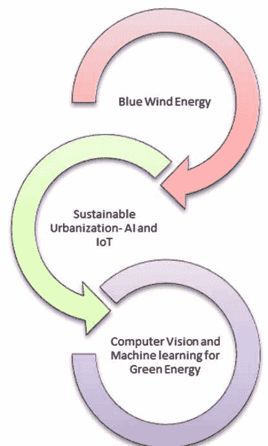

### 1.4 Structure of the Chapter

本章全面探讨了蓝色风能在可持续城市化方面的多维度，并融合了人工智能、物联网和新型计算机视觉。第 2 节


### 图 2. 从不同方面阐述本章目标

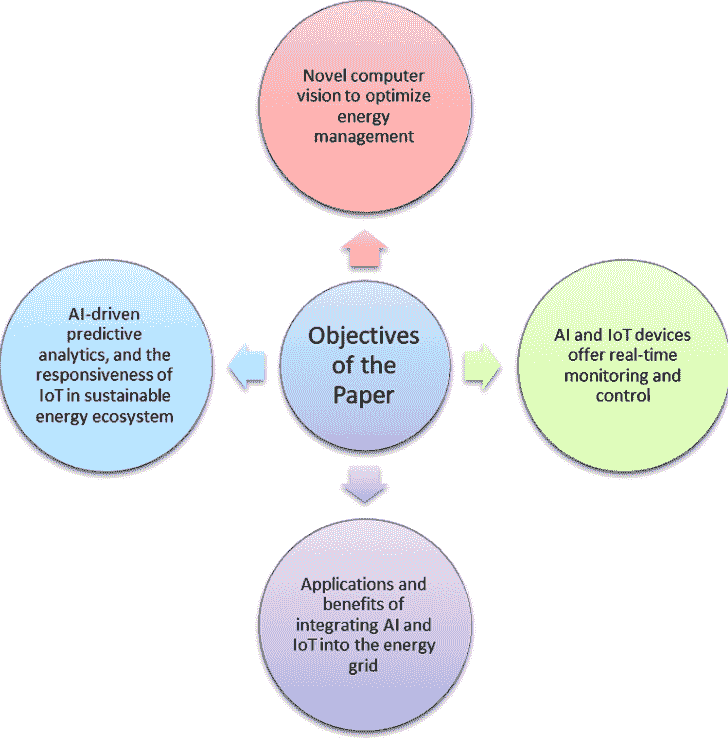

阐述“蓝色风能：概述”。第 3 节探讨可再生能源的计算机视觉与机器学习——新颖概念。第 4 节阐述可持续城市化与能源需求。第 5 节考察能源管理中的人工智能与物联网集成。第 6 节探讨智能电网与能源存储。第 7 节讨论环境与经济因素。第 8 节考察政策与监管框架——推动蓝色风能的政府激励与政策；国际合作与协定。最后，第 9 节讨论结论与未来展望。

## 2. 蓝色风能：概述、定义及蓝色风能原理

人工智能（AI）和物联网（IoT）是一项具有突破性的技术，在各个领域都具有巨大潜力，能源管理也不例外（Tabor 等，2018年）。随着对高效能源使用需求的增加以及能源系统日益复杂，AI 有能力改变我们处理和增强能源资源的方式。本文深入探讨了 AI 对智能能源管理的影响，阐述其优势、面临的挑战以及未来的前景（Szeliski，2022年）。

风力涡轮机是一种旨在将风能转化为电能的装置。这与“风车”不同，风车将风力转化为机械功。风力涡轮机作为发电设备，集成到各种电气网络中（Rao 等，2022年）。这些网络包括电池充电系统、住宅用电设置、偏远或岛屿地区的网络以及广域公用电网。从数量上看，最常见的风力涡轮机相对较小，通常为 10 KW 或以下。但是，从总发电容量来看，大部分容量来自较大的涡轮机，通常范围在 1.5 到 5 MW。这些较大的涡轮机主要用于广域公用电网，最初在欧洲和美国普及，最近在中国和印度也较为常见（Saini 等，2023年）。典型的现代风力涡轮机是连接到公用网络的风电场配置的一部分。展示的涡轮机是通用电气 1.5 MW，截至撰写本文时，该制造商的该型号已交付超过 10,000 台。

### 图 3. 本章的流程/组织

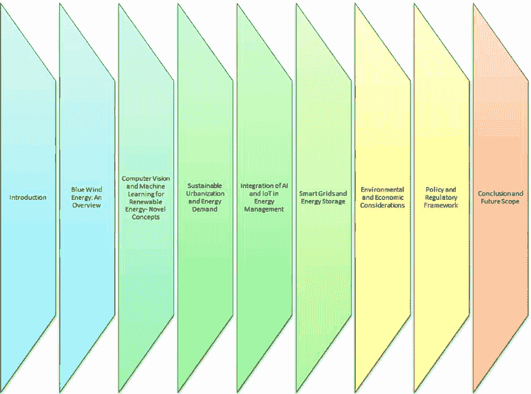

## 可持续城市化的蓝色风能

### 2.1 离岸风能

离岸风电（又称离岸风能）是指在水域（通常是海洋）中通过风电场发电。离岸位置的优势在于风速高于陆上地区，从而使每单位装机容量的发电量更高（Tomar 等，2022年）。此外，离岸风电场通常比陆上风电场引发的争议更小，因为其对人员和景观的影响较小。值得注意的是，在离岸风电的语境中，“离岸”不仅指开阔海域，还包括内陆水域，如湖泊、峡湾和避风的沿海地区，以及更深的水域。目前，大多数离岸风电场使用位于相对浅水区域的固定基础风力涡轮机，而针对更深水域的浮式风力涡轮机的探索仍处于开发和部署的早期阶段（Del Ser 等，2022年）。

### 2.2 蓝色风能的优势与挑战

风能的基本优势在于其能够在不损害空气或水质且不增加温室气体排放的情况下发电（Aslam 等，2021年）。此外，风能具有许多显著的环境和社会经济效益。

- **环境效益：** 风能并未加剧气候变化。尽管制造和运输涡轮机存在能源成本，但生命周期研究表明，其碳影响仅在运行六个月后即被 CO2 减排量所抵消。2019 年，风力发电避免产生的 CO2 量相当于 4300 万辆车辆产生的量。

- **可再生能源来源：** 风能是一种可再生且可持续的能源，因为它基于一种无限且不受限制的来源——风。与传统能源不同，风能不需要从地下开采，也不需要通过铁路或卡车运输，而后者会为燃烧化石燃料的设施增加额外的能源、污染物和成本。此外，风力涡轮机型号的持续改进带来了更高的效率。

- **零排放：** 风力涡轮机或风电场建成后不会产生废水或污染物。不再需要烟囱脱硫，也不需要去除或处理有害污染物，因为它们一开始就不会产生。

- **经济效益- 运营成本低：** 风力涡轮机安装后运行成本低廉，且没有能源成本，因为风是一种免费且取之不尽的资源，能源成本几乎为零。风能比燃煤设施（最常见的电源）更具成本效益。

- **经济实惠：** 风能可能只需较少补贴即可保持经济实惠，所有主要能源分配系统（包括煤电厂和风电场）都会获得政府补贴。然而，具体取决于考虑的标准，化石燃料行业获得的补助和税收优惠可能远比可再生能源丰厚得多。

- **缓解健康与污染危害：** 风力涡轮机不会加剧空气污染或与之相关的健康危害。相比之下，燃煤发电厂已被证明对人体健康产生负面影响，从而产生相关的医疗费用。在计算燃煤发电的总体“成本”时，这些与健康相关的支出有时会被忽视。至关重要的是，要将这些因素视为与风力发电相关的支出或成本节约，无论其被视为经济影响、公共卫生风险还是两者兼而有之。

- **灵活性：** 风能具有灵活性并促进能源独立。与通常需要集中式电力设施以实现最佳发电的化石燃料不同，风力发电在规模和位置上可调整。即使在危机期间经常使用的油动力家用发电机，也效率低下并会导致社区空气污染。

尽管风能也存在一些挑战，例如：

- **风力可靠性可变：** 虽然涡轮机有 90% 的时间在发电，但其产出可能无法持续达到 100% 的容量，平均约为 35% 的容量。由于这种不可预测性，风小或无风可能导致风力涡轮机停机，风力过大时为了保护设备也会停机。在这些时候，要维持稳定的电力供应，需要使用电池中储存的风能，或切换到另一种电源。

- **声音和视觉干扰：** 风力涡轮机发出的噪音范围在 40-60 分贝，与中型窗式空调器产生的声音相当。这种噪音会令人烦恼，尤其是对于居住在小型涡轮机附近的人。然而，关于风力涡轮机噪音健康影响的可靠研究缺乏。

- **对野生动物的影响：** 风力涡轮机噪音也可能影响野生动物，尤其是鸟类和蝙蝠，以及其他通过发声进行交流的生物。

- **影子闪烁：** 当旋转的风力涡轮机叶片与低处的太阳相遇时，会产生移动阴影，随着叶片旋转表现为闪烁。虽然此

_图 4. 蓝色风能的多方面效益_

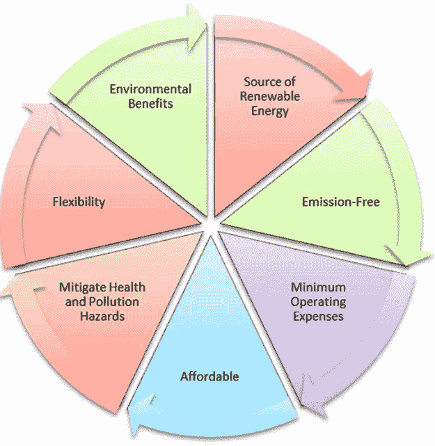


### 2.3 城市化中的蓝色风能：城市地区蓝色风能的潜力

能源对我们的日常生活至关重要，因为它用于为房屋、电子产品、公司及其他活动提供动力。由工业化、城市化以及公众对能源消耗相关环境问题日益提高的认识所驱动的不断增长的能源需求，凸显了持续改进能源生成技术的必要性（Watson, 2022）。该计划旨在从传统化石燃料转向可再生能源，目标是自然产生丰富、清洁且对环境有益的能源。在不同的可再生能源中，风能正迅速获得重要地位（Cruz-Rojas et al., 2023）。

风力涡轮机用于为本地电力系统产生能源，重点在于转动备用的可靠性和环境意识。一般来说，风能系统在中小规模下效果最佳，因此非常适合在农村和郊区使用（Ozcanli et al., 2020）。先前的研究工作集中于研究在郊区建立的微型风力涡轮机的功率密度。最新研究揭示了城市风能尚未开发的潜力，因为大都市地区的风速提供了额外的因素（Sharma & Singh, 2022）。大都市地区的建筑会增加湍流强度，因此成功利用这种能源需要特别关注。快速的建筑施工、广泛的城市增长、不断发展的技术以及对舒适、高品质生活的渴望增加了能源使用并引发了环境问题（Rosiello & Maleki, 2021）。因此，鉴于建筑和城市环境对总体能源消耗贡献显著，在建筑和城市设计中优先考虑节能解决方案至关重要（Fischer & Preonas, 2010）。风能已成为确保建筑能源效率的最有效技术之一。风能通常与可再生能源相关联，直到最近才被广泛应用于建筑领域（Grubb et al., 2021）。

## 3. 可再生能源的计算机视觉与机器学习：新概念

燃烧化石燃料目前满足了世界相当一部分能源需求，是温室气体排放水平升高及其随后导致全球气温上升的主要原因（Raihan et al., 2022）。为应对这一挑战，增加对可持续能源（尤其是太阳能和风能）的利用，是一条在财务上可行且与巴黎协定中概述的气候目标保持一致的路径。尽管如此，可再生能源采用的进展步伐难以跟上不断增长的能源需求，导致可再生能源在总能源中的占比有限（Singh, 2023）。因此，加速向可持续能源的转型势在必行。促进这一转型需要开发支持和鼓励捕获、储存、转换以及有效管理可再生能源的能源技术、基础设施和政策（Dai et al., 2016）。

在追求可持续能源解决方案的过程中，仔细选择合适的材料（特别是用于光伏应用的材料）至关重要。随后，这些选定的材料必须以高产率和高质量进行合成，以符合太阳能电池板等器件的标准。材料发现过程的典型周期为 15-20 年，这意味着有很大的改进空间。此外，还必须对器件进行改进，以提高其耐久性和可重复性，从而轻松融入太阳能农场等能源系统。为了保持经济可行性，这种集成需要对能源使用和生产模式进行有效控制（Elavarasan et al., 2020）。

> 图 5. 与风能相关的挑战


## 4. 可持续城市化与能源需求——向绿色能源转型的重要性

随着全球变暖和气候变化的严重性不断加剧，这从影响全球人类和其他生物的自然环境频繁且剧烈的变化中可见一斑，联合国、G20、G8等国际组织以及各个国家对大量消耗化石燃料的环境后果愈发意识到。这种认识强调了气候变化（特别是全球变暖）的经济和社会影响（Zwane et al., 2022）。联合国尤其通过其专注于气候变化的环境计划，持续致力于促进更广泛的国际共识。该共识聚焦于在政府间气候变化专门委员会（IPCC）规定的期限内实现总体全球碳减排目标的必要性。其目标是争取国际共识，即每个国家都应对实现碳减排目标承担一定责任（Mohammadian, 2022）。

可再生能源和能源效率是向低消耗、低碳社会过渡的关键组成部分。为促进这一过渡，政府政策应优先实现地区特定的可再生能源生成和能源效率目标。然而，这些目标在不同大都市地区之间存在差异，且缺乏对能源转型与城市化水平之间关联的全面理解（Amran et al., 2020）。在当前全球背景下，对能源增长和保障的重点在于提高能源生产能力，并理想地将更清洁、更环保的能源纳入增长过程中。通过一个复杂的系统，发展和规划程序经常导致景观变化并对环境产生人为影响（Hainsch et al., 2022）。在能源基础设施建设中的资源开采和土地管理操作，以及对这些系统的人为监测，都可能产生长期且往往出乎意料的后果。尽管对替代能源的兴趣日益增加，许多发展中国家仍在很大程度上依赖化石燃料进行能源生产（Atalay et al., 2016）。因此，能源生产有能力影响土地生产力、土地覆盖、人类迁移以及能源生产系统的其他方面，导致多种变量之间复杂的相互作用。土地利用、能源选择、基础设施建设以及这些设施所服务的人群之间的相互依赖性需要仔细考虑。审查和理解这些组件之间的相互作用至关重要（Singh, 2022）。

## 5. 能源管理中的人工智能与物联网集成

作为可再生能源和能源存储技术的重要组成部分，蓝色风能应与微电网统一并集成到内部电网中，以实现零CO2排放的社会。这是因为集成能够实现能源交换，从而减少对传输系统的需求（Xiao et al., 2019）。然而，由于各种不确定性以及能源产出和消耗数据存在错误，管理这些微电网内部及跨微电网的能源是困难的。

这些不确定性可能使这种环境下的能源优化更加困难（Scarlat et al., 2015），而物联网（IoT）平台的进步，结合人工智能（AI）、大数据分析和云计算，为智能电网开辟了新的运营可能性。尽管如此，云上的集中式数据处理会导致显著的通信延迟和开销（Connolly et al., 2010）。边缘计算也很重要，它用于在网络边缘分散计算活动，并将其更贴近用户。这些活动包括数据采集、预处理和预测模拟，能够改善能源管理决策过程（Salleh et al., 2020）。因此，边缘-云编排被视为一种潜在且有效的架构，用于提高能源交易的灵活性、可扩展性和性能。这些基于人工智能的蓝色风能解决方案有潜力通过主动管理住宅和商业环境中的使用模式，大幅降低能源价格和碳足迹（Singh, 2023）。因此，人工智能在能源基础设施的预测性维护中发挥作用，这对于避免故障和延长资产寿命至关重要，从而提供更稳定、更可靠的电力供应。

### 5.1 人工智能在优化能源生产和消费中的作用

人工智能（AI）正在彻底改变能源系统的管理，其处理大量信息、预测趋势和促进实时决策的能力，使其成为应对现代能源网络复杂性的宝贵工具（Bujang et al., 2016）。人工智能有潜力通过多种方式改变能源领域，包括优化产出、预测需求、提高电网效率和降低运营成本。此外，人工智能的预测能力在可再生能源领域至关重要，可用于预测天气模式并最大限度地提高太阳能和风能的产出（Lawrenz et al., 2018）。大数据处理、强大计算能力、信息技术以及机器学习（ML）和深度学习（DL）算法的改进等进步，都归功于人工智能技术的增长。

人工智能技术具有潜力，能够帮助能源行业利用与物联网（IoT）和可再生能源融合相关的不断扩大的机遇。超级计算机、电力电子、网络技术、控制中心与设备之间的信息系统连接，都是智慧能源领域当代基础设施的一部分（Westman et al., 2019）。尽管存在这些困难，全球经济在很大程度上依赖于能源生产、分配规划和财务可持续性（Cohen et al., 2021）。


## 6. 智能电网与能源存储：先进的能源存储解决方案

这些能源存储技术对于将可再生能源作为能源来源整合到当前电力系统和智能电网中至关重要。它们改善了系统的平衡性和灵活性，使间歇性可再生能源（RES）能够平滑地整合到智能电网设计中（Yang et al., 2021）。这些技术对于在智能电网框架内的电力生成来源提供辅助服务也很重要。电能存储技术有望大幅提升当前电力电网的运行能力，减少在大型输电线路上的巨额支出需求（White et al., 2018）。能源存储设备在特定时刻保留电力以供后来使用的能力使其与众不同，成功地平衡了当前供应。

能源存储技术有望通过解决电力行业面临的不可预测性和不确定性增加等现代难题，来改善配电系统的经济调度、效率和电能质量（Nastasi et al., 2022）。能源存储技术预计将在近未来发挥关键作用，构建以可再生能源为中心的清洁能源社区（Danish et al., 2023）。由于智能电网在智慧城镇和城市中同时处理能源需求和供应，它们给能源行业带来巨大挑战。并网能源存储设备被视为向电气网络提供辅助服务的可行替代方案，它们将在智能电网的发展中发挥重要作用（Basheer et al., 2022）。

### 6.1 智能电网在城市能源分配中的作用

智能电网是改进的电力电网基础设施，旨在提高效率和可靠性。它们使用自动化控制、大功率变流器、先进的通信基础设施、感测与计量技术以及现代能源管理方法，以优化需求、能源和网络可用性（AI-tabatabaie et al., 2022）。

因此，能源存储系统在智能配电网络中的集成已显著增长，提升了智能电网的整体效率和效能（Aldieri et al., 2021）。增强不同的电能质量和可靠性参数是 ESS 技术的关键应用。由于电能质量问题涉及电压变化幅度、频率和持续时间等精确参数，解决和改进这些指标需要专门的技术考量。在评估系统可靠性时，可以使用指示中断时长和频率的技术指标来表征系统的性能（Nakata, 2004）。

### 6.2 AI 和 IoT 对高效能源存储与分配的贡献

城市通过在蓝色风能管理中结合人工智能（AI）与物联网（IoT）而获得智能地位（Singh, 2022）。这种连接使从人员、设备和建筑物收集数据变得更加容易，随后对这些数据进行分析，以优化对基础设施、交通、能源及其他因素的控制。智慧城市本质上是一个包含信息和通信技术（ICT）及云的完整结构，使其组件能够无缝交互（Winfield & Dolter, 2014）。它深入探讨智慧能源基础设施，重点在于监测城市中的能源使用，以降低成本和碳排放。能源利用的近期关注点已

### 蓝色风能助力可持续城市化

转向低碳排放的可再生能源，强调继续努力保护环境和人类健康的必要性（Damman et al., 2021）。

随着经济的改善，能源消费模式往往以与经济发展密切相关的方式扩张。这种关系源于能源使用与经济进步之间强大且正向的关系。能源是社会发展的关键投入，除能源之外，全球地缘政治形势、新技术突破和自然资源的可用性也都影响着社会经济进步（Pascaris, 2021）。由于这些众多因素对社会经济增长的影响，预测相关不确定性变得困难，可能会影响能源供需模式。能源行业的负面冲击可能会对社会经济增长产生负面影响。因此，追求充足、可靠、有韧性、公平、安全和经济的能源供应被列为优先事项（Budiman, 2018）。

互联网及其他智能系统在社会进步中的重要性显而易见，并在近未来有望不断扩大。关于环境安全的担忧也已被表达，倡导者要求未来能源供应遵循低碳及其他清洁能源要求（Redman et al., 2021）。因此，正在倡导智能和可持续的能源供应，以确保社会经济进步。因此，使用可再生能源资源作为化石燃料生产技术的替代品对社会经济增长的影响变得越来越明显（Xie et al., 2023）。

## 7. 环境与经济考量

为实现全球脱碳目标而预计增加的海上风电场项目，已引起科学界对海洋环境生物健康的关注。它调查了与海上风电场相关的环境后果和变化，重点关注其符合海洋战略框架指令中的良好环境状态。环境影响评估（EIA）是决策者审查计划运营环境后果的重要工具（Vinichenko, 2018）。监管机构经常使用 EIA 以确保项目符合环境保护目标。此外，EIA 在科学研究与监管程序之间充当关键纽带，既保证对当前信息的适当使用，也支持新科学发现的产生与传播（Arbabzadeh et al., 2019）。

可再生能源（尤其是海上风电场）的迅速发展，将为海洋生态系统带来大量人造结构，这些结构最终都需要退役（Ilyas et al., 2022）。环境影响评估（EIA）在退役活动之前进行，以评估潜在的环境影响。当在风电场设计的规划阶段早期使用时，EIA 提供了研究适当的环境退役方案的机会。EIA 应通过评估影响、制定缓解计划和跟踪资产生命周期，用于辅助决策。

### 7.1 蓝色风能的环境影响评估

近年来几十年来，由于对气候变化的日益担忧以及摆脱对化石燃料依赖的转变，可再生能源在全球范围内得到显著增长。海上风能已成为

可再生能源市场中的一支重要力量。尽管如此，由于风电场是临时设施，它们必须在运行寿命结束时进行退役（Garrido et al., 2020）。

## 8. 政策与监管框架

传统的电网设计常常低估信息和能源存储的重要性，尽管一个真正动态的电力系统同时需要两者。作者主张将能源存储视为电网系统中的一种独特资产类别，并由适当的监管和财务政策支持其发展与部署，构建一个基于存储的智能电网框架，其中存储发挥着至关重要的作用（Steen & Weaver, 2017）。这种方法将通过允许存储技术提供全方位服务及其全部价值来优化负荷和市场运营。能源存储技术有望显著提升电网效率和性能（Hoffmann et al., 2020）。它们能够提供针对不同电网组件中特定应用的定制能源服务，这种独特能力使它们能够及时有效地响应智能电网系统内的信号。因此，将能源存储视为独立的资产类别将提升存储投资的价值，同时也有助于提升智能电网的整体效率。

随着智能电网技术和设计的进步，能源系统规划必须放弃对能源存储的当前看法，转而采用更加有效和可持续的框架。虽然能源存储系统已被纳入电网设计，但由于许多存储系统的高成本和低效率，其应用受到限制，降低了其总体价值和实用性（Manoharan et al., 2021）。将存储视为仅用于随时间支持发电机进行负荷平衡的工具这一常见看法，未能认识到能源存储技术的巨大潜力（Ghai et al., 2022）。智能电网设计和存储技术的改进为颠覆当前范式提供了重大机遇。为了实现完全动态和高效的电网，尤其是在向低碳能源系统转型过程中，规划者必须充分拥抱可再生电力发电和发电后能源存储的益处（Pimitha et al., 2023）。

## 9. 结论与未来展望

人工智能（AI）和物联网（IoT）已发展成为一种流行且可扩展的信息和通信基础设施。由于其支持互操作性平台、异构设备间的通信以及无处不在的接入，它在智慧城市中变得越来越重要。智慧城市的主要目标是通过收集自然能源、提供受自然启发的支持以及为无污染环境做出贡献，为设备和用户提供环保的通信接入。智慧城市在气候变化中扮演着双重角色：它们既是全球温室气体排放的主要制造者，也特别容易受到气候变化和极端天气事件的影响。本章着重于构建可持续能源系统的实用技术，重点在于降低能源使用（尤其是在建筑和交通领域），并产生有韧性、分布式和可再生的能源来源。功率密度的进步对于将可再生能源恰当地整合进城市景观，以满足不断发展的都市区日益增长的能源需求至关重要。解决经济、技术、行为


和政治对于产生可能改善城市可持续性的创新至关重要。可再生能源（如热能、光能和风能）是无限的，但其电力必须被保存以供长期使用。由 IoT 基础设施管理的智能电网被用于智能城市环境中，以实现最佳的电力管理和分配。因此，电网管理与 IoT 的集成利用信息和通信技术来提高智能城市中电力管理运营效率。必须减少二氧化碳（CO2）排放，以实现可持续发展目标、保护环境、应对气候变化并保护生物多样性。采用促进能源效率、可再生能源和可持续城市化的综合计划对于创造更清洁、更具韧性和更光明的未来至关重要。

## REFERENCES

Abualigah, L., Zitar, R. A., Almotairi, K. H., Hussein, A. M., Abd Elaziz, M., Nikoo, M. R., & Gandomi, A. H. (2022). 具有和不含能源存储优化的风能、太阳能和光伏可再生能源系统：先进机器学习和深度学习技术调查. *能源*, 15(2), 578. doi:10.3390/en15020578

Ahmad, T., Madonski, R., Zhang, D., Huang, C., & Mujeeb, A. (2022). 面向可持续智慧能源/智慧能源系统的数据驱动概率机器学习：在智能电网范式下的关键发展、挑战及未来研究机遇. *可再生能源与可持续能源评论*, 160, 112128. doi:10.1016/j.rser.2022.112128

Al-tabatabaie, K. F., Hossain, M. B., Islam, M. K., Awual, M. R., TowfiqulIslam, A. R. M., Hossain, M. A., Esraz-Ul-Zannat, M., & Islam, A. (2022). 迈向脱碳的步伐：孟加拉国的观点. *能源战略评论*, 44, 100948. doi:10.1016/j.esr.2022.100948

Aldieri, L., Grafström, J., & Vinci, C. P. (2021). 马歇尔和雅各布知识溢出对太阳能、风能和能源效率领域就业的影响. *能源*, 14(14), 4269. doi:10.3390/en14144269

Amran, Y. A., Amran, Y. M., Alyousef, R., & Alabduljabbar, H. (2020). 根据沙特 2030 愿景，沙特阿拉伯的可再生能源和可持续能源生产：现状与未来前景. *清洁生产期刊*, 247, 119602. doi:10.1016/j.jclepro.2019.119602

Arbabzadeh, M., Gençer, E., Morris, J. F., Paltsev, S., & Armstrong, R. C. (2019). *合理的能源未来：评估选项的框架*. 影响，及国家能源选择.

Arent, D. J., Green, P., Abdullah, Z., Barnes, T., Bauer, S., Bernstein, A., & Turchi, C. (2022). 去碳化美国能源系统的挑战与机遇. *可再生能源与可持续能源评论*, 169, 112939. doi:10.1016/j.rser.2022.112939

Aslam, S., Herodotou, H., Mohsin, S. M., Javaid, N., Ashraf, N., & Aslam, S. (2021). 智能微电网中电力负荷和可再生能源预测深度学习方法综述. *可再生能源与可持续能源评论*, 144, 110992. doi:10.1016/j.rser.2021.110992

Atalay, Y., Biermann, F., & Kalfagiani, A. (2016). 石油富国可再生能源技术采用：解释海湾合作委员会国家的政策差异. Renewable Energy, 85, 206–214. doi:10.1016/j.renene.2015.06.045

Basheer, M., Nechifor, V., Calzadilla, A., Ringler, C., Hulme, D., & Harou, J. J. (2022). 为可持续发展平衡国家经济政策结果. Nature Communications, 13(1), 5041. doi:10.1038/s41467-022-32415-9 PMID:36028486

Bogdanov, D., Ram, M., Aghahosseini, A., Gulagi, A., Oyewo, A. S., Child, M., & Breyer, C. (2021). 低成本可再生能源电力作为全球能源向可持续性转型的关键驱动力. Energy, 227, 120467. doi:10.1016/j.energy.2021.120467

Budiman, I. (2018). 促进能源部门的社会创新社区参与. Indonesian Journal of Energy, 1(2), 21–31. doi:10.33116/ije.v1i2.23

Bujang, A. S., Bern, C. J., & Brumm, T. J. (2016). 马来西亚能源需求和可再生能源政策摘要. Renewable & Sustainable Energy Reviews, 53, 1459–1467. doi:10.1016/j.rser.2015.09.047

Cohen, S. M., Iyer, G. C., Brown, M., Macknick, J., Wise, M., Binsted, M., & Hejazi, M. (2021). 结构差异如何影响跨模型一致性：电力部门案例研究. Renewable & Sustainable Energy Reviews, 144, 111009. doi:10.1016/j.rser.2021.111009

Connolly, D., Lund, H., Mathiesen, B. V., & Leahy, M. (2010). 分析可再生能源整合到各种能源系统中的计算机工具综述. Applied Energy, 87(4), 1059–1082. doi:10.1016/j.apenergy.2009.09.026

Cruz-Rojas, T., Franco, J. A., Hernandez-Escobedo, Q., Ruiz-Robles, D., & Juarez-Lopez, J. M. (2023). 使用机器学习和深度学习检测光伏面板灰尘的图像语义分割技术新型比较. Renewable Energy, 217, 119126. doi:10.1016/j.renene.2023.119126

Dai, H., Xie, X., Xie, Y., Liu, J., & Masui, T. (2016). 绿色增长：中国大规模可再生能源发展的经济影响. Applied Energy, 162, 435–449. doi:10.1016/j.apenergy.2015.10.049

Damman, S., Sandberg, E., Rosenberg, E., Piscicella, P., & Graabak, I. (2021). 能源转型路径的混合视角：氢能是挪威的关键吗？. Energy Research & Social Science, 78, 102116. doi:10.1016/j.erss.2021.102116

Danish, M. S. S., & Senjyu, T. (2023). 面向可持续未来的 AI 赋能能源政策. Sustainability (Basel), 15(9), 7643. doi:10.3390/su15097643

Del Ser, J., Casillas-Perez, D., Cornejo-Bueno, L., Prieto-Godino, L., Sanz-Justo, J., Casanova-Mateo, C., & Salcedo-Sanz, S. (2022). 可再生能源预测问题中的基于随机化的机器学习：文献批判性综述、新结果与展望. Applied Soft Computing, 118, 108526. doi:10.1016/j.asoc.2022.108526

Dent, C. M. (2012). 可再生能源与东亚新发展主义：走向低碳未来？. *太平洋评论*, 25(5), 561–587. doi:10.1080/09512748.2012.728240

Devabhaktuni, V., Alam, M., Depuru, S. S. S. R., Green, R. C. II, Nims, D., & Near, C. (2013). 太阳能：趋势与赋能技术. *可再生能源与可持续能源评论*, 19, 555–564. doi:10.1016/j.rser.2012.11.024

Doost Mohammadian, H., & Rezaie, F. (2020). 蓝绿色智能出行技术作为迎接未来城市冲击的准备，以打造更宜居的世界（案例研究：松岛和哥本哈根）. *技术*, 8(3), 39. doi:10.3390/technologies8030039

Elavarasan, R. M., Shafiullah, G. M., Padmanaban, S., Kumar, N. M., Annam, A., Vetriechevan, A. M., & Holm-Nielsen, J. B. (2020). 领先印度州可再生能源发展、挑战与政策的全面综述：国际视角. *IEEE Access：实用创新，开放解决方案*, 8, 74432–74457. doi:10.1109/ACCESS.2020.2988011

ElFar, O. A., Chang, C. K., Leong, H. Y., Peter, A. P., Chew, K. W., & Show, P. L. (2021). 藻类中工业 5.0 的前景：生产定制与清洁生物能源生产的新先进技术. *能源转换与管理：X*, 10, 100048.

Eljack, F., & Kazi, M. K. (2021). 卡塔尔通过多部门全球共生实现绿色氢能经济的前景与挑战. *可持续性前沿*, 1, 612762. doi:10.3389/frsus.2020.612762

Elrahmani, A., Hannun, J., Eljack, F., & Kazi, M. K. (2021). 海湾合作委员会地区可再生能源现状与未来机遇. *化学工程当前观点*, 31, 100664. doi:10.1016/j.coche.2020.100664

Fischer, C., & Preonas, L. (2010). 结合可再生能源政策：整体是否少于部分之和？. *未来资源讨论文件*, (10-19).

Garrido, S., Sequeira, T., & Santos, M. (2020). 供应端的可再生能源与可持续性：批判性综述与分析. *应用科学（瑞士巴塞尔）*, 10(17), 5755. doi:10.3390/app10175755

Ghai, D., Tripathi, S. L., Saxena, S., Chanda, M., & Alazab, M. (Eds.). (2022). *机器学习算法用于信号和图像处理*. John Wiley & Sons. doi:10.1002/9781119861850

Grubb, M., Drummond, P., Poncia, A., McDowall, W., Popp, D., Samadi, S., & Pavan, G. (2021). 能源技术和系统中的诱导创新：证据综述及其对 CO2 减缓的潜在影响. *环境研究快报*, 16(4), 043007. doi:10.1088/1748-9326/abde07

Hainsch, K., Löffler, K., Burandt, T., Auer, H., del Granado, P. C., Piscicella, P., & Zwickl-Bernhard, S. (2022). 能源转型场景：哪些政策、社会态度和技术发展将实现欧洲绿色协议？. Energy, 239, 122067. doi:10.1016/j.energy.2021.122067

Hoffmann, M. W., Wildermuth, S., Gitzel, R., Boyaci, A., Gebhardt, J., Kaul, H., & Tornede, T. (2020). 集成新型传感器和机器学习用于中压开关设备预测性维护，以实现能源和出行革命. *传感器（巴塞尔）*, 20(7), 2099. doi:10.3390/s20072099 PMID:32276442


## 蓝色风能助力可持续城市化

- Ilyas, A., Parkinson, S., Vinca, A., Byers, E., Manzoor, T., Riahi, K., & Muhammad, A. (2022). 平衡智能灌溉与水电投资，以实现印度河流域的可持续水资源保护. 《环境科学与政策》, 135, 147–161. doi:10.1016/j.envsci.2022.04.012

- Kasinathan, P., Pugazhendhi, R., Elavarasan, R. M., Ramachandaramurthy, V. K., Ramanathan, V., Subramanian, S., & Alsharif, M. H. (2022). 通过整合工业5.0、社会5.0、智慧城市和村落，利用颠覆性技术实现可持续发展目标. 《可持续发展》(巴塞尔), 14(22), 15258. doi:10.3390/su142215258

- Lawrenz, L., Xiong, B., Lorenz, L., Krumm, A., Hosenfeld, H., Burandt, T., & Von Hirschhausen, C. (2018). 探索印度低碳转型的能源路径——基于模型的分析. 《能源》, 11(11), 3001. doi:10.3390/en11113001

- Li, W., Lu, C., & Zhang, Y. W. (2019). 基于多部门CGE模型对中国未来可再生能源组合标准方案的前瞻性探索. 《能源政策》, 128, 45–56. doi:10.1016/j.enpol.2018.12.054

- Makatjane, K. (2022). 基于深度学习的情感分析以预测银行贷款违约概率. 《美国数据挖掘与知识发现杂志》, 7(2), 5–12.

- Makatjane, K., Moroke, N., & Ncube, B. (2021). 南非金融欺诈检测：逻辑模型树与梯度增强决策树的比较. 学术出版社.

- Manoharan, K. G., Nehru, J. A., & Balasubramanian, S. (2021). 人工智能与物联网. Springer. doi:10.1007/978-981-33-6400-4

- Mohammadian, H. D. (2022). 通过第五波、i-可持续性加和DCT理论，绘制基于混合中小企业/中小企业5.0/明天中小企业概念的未来全球中小企业增长图谱. 载于《数字时代的管理与信息技术》(第29卷, 第173–206页). Emerald Publishing Limited. doi:10.1108/S1877-636120220000029011

- Moroke, N. D., & Makatjane, K. (2022). 基于数据分析的金融欺诈检测预测建模：梯度增强决策树. 载于《机器学习与深度学习在隐私和网络安全中的应用》(第25-45页). IGI Global. doi:10.4018/978-1-7998-9430-8.ch002

- Nakata, T. (2004). 能源-经济模型与环境. 《能源与燃烧科学进展》, 30(4), 417–475. doi:10.1016/j.pecs.2004.03.001

- Nastasi, B., Markovska, N., Puksec, T., Đuić, N., & Foley, A. (2022). 为实现可持续发展目标而面临的可再生能源与可持续能源挑战. 《可再生能源与可持续能源评论》, 157, 112071. doi:10.1016/j.rser.2022.112071

- Ozcanli, A. K., Yaprakdal, F., & Baysal, M. (2020). 电力系统深度学习方法与应用：全面综述. 《国际能源研究杂志》, 44(9), 7136–7157. doi:10.1002/er.5331

- Pascari, A. S. (2021). 审查现有政策，为美国农光互补制定全面的法律框架. 《能源政策》, 159, 112620. doi:10.1016/j.enpol.2021.112620

- Pimitha, K., Anbarasi, S., & Balasubramanian, T. (2023). 可再生能源的机器学习技术. 载于《可再生能源和现代混合动力系统的物联网、机器学习和区块链技术》(第121-148页). River Publishers.

- Raihan, A., Begum, R. A., Said, M. N. M., & Pereira, J.J. (2022). 经济增长、可再生能源使用、技术创新与碳排放之间的关系：迈向马来西亚巴黎协定. 《环境系统与决策》, 42(4), 586–607. doi:10.1007/s10669-022-09848-0

- Rao, S., Katoch, S., Narayanaswamy, V., Muniraju, G., Tepedelenlioglu, C., & Spanias, A. (2022). 太阳能电池板监测、优化与控制的机器学习. Springer Nature.

- Reedman, L., Chew, M. S., Gordon, J., Sue, W., Brinsmead, T., Hayward, J., & Havas, L. (2021). 多部门能源建模.

- Rosiello, A., & Maleki, A. (2021). 技术追赶的动态多部门分析：技术周期时间、知识基础复杂性和多样性的影响. *研究政策*, 50(3), 104194. doi:10.1016/j.respol.2020.104194

- Saini, G., Kannan, R., Benini, E., & Kumar, K. (编). (2023). 可再生能源与可持续能源的赋能方法论. CRC Press. doi:10.1201/9781003272717

- Salleh, S. F., Mohd Roslan, M. E., Abd Rahman, A., Shamsuddin, A. H., Tuan Abdullah, T. A. R., & Sovacool, B. K. (2020). 马来西亚生物能源向可持续发展框架过渡：催化棕榈油厂残渣利用的政策建议. 《能源、可持续性与社会》, 10(1), 1–20. doi:10.1186/s13705-020-00269-y

- Scarlat, N., Dallemand, J. F., Monforti-Ferrario, F., & Nita, V. (2015). 生物质和生物能源在未来生物经济中的作用：政策与事实. 《环境发展》, 15, 3–34. doi:10.1016/j.envdev.2015.03.006

- Sharma, A., & Singh, B. (2022). 电子商务对小型企业影响的测量：系统综述. 《公司治理与国际商法杂志》, 5(1).

- Singh, B. (2022). 农业-营养联系对人类医疗保健的相关性：影响与路径的概念性法律框架. 《司法与法律通报》, 1(1), 44–49.

- Singh, B. (2023). 远程健康监测透视深度神经网络结构：通过可穿戴设备实现环境患者健康的实时警报与干预. 《印度健康与医学法杂志》, 6(2), 12–16.

- Singh, B. (2023). 联邦学习：面向气候保护和智能绿色星球的未来轨迹智能交通系统愿景——全球治理与SDG-9（工业、创新和基础设施）的洞察. 《国家环境法杂志》, 6(2), 6–17.

- Singh, B. (2023). 区块链技术在医疗保健革新中的应用：法律与未来视角. 载于《通过人工智能和物联网应用革新医疗保健》(第177-186页). IGI Global.

- Singh, B. (2023). 联邦学习：面向气候保护和智能绿色星球的未来轨迹智能交通系统愿景——全球治理与SDG-9（工业、创新和基础设施）的洞察. *国家环境法杂志*, 6(2), 6–17.

- Singh, B. (2024). 面向视频游戏行业和电子竞技打造的元宇宙法律动态：现象学探索催化剂复杂性与未来. *知识产权法杂志*, 7(1), 8–14.

- Steen, M., & Weaver, T. (2017). 现有企业的多元化与跨部门能源行业动态. *研究政策*, 46(6), 1071–1086. doi:10.1016/j.respol.2017.04.001

- Szeliski, R. (2022). *计算机视觉：算法与应用*. Springer Nature. doi:10.1007/978-3-030-34372-9

- Tabor, D. P., Roch, L. M., Saikin, S. K., Kreisbeck, C., Sheberla, D., Montoya, J. H., Dwaraknath, S., Aykol, M., Ortiz, C., Tribukait, H., Amador-Bedolla, C., Brabec, C. J., Maruyama, B., Persson, K. A., & Aspuru-Guzik, A. (2018). 智能自动化时代加速清洁能源材料发现. *自然评论·材料*, 3(5), 5–20. doi:10.1038/s41578-018-0005-z

- Tomar, A., Malik, H., Kumar, P., & Iqbal, A. (2022年9月). 机器学习、计算进展、可再生能源与通信(MARC). 载于*第三届机器学习、计算进展、可再生能源与通信国际会议论文集：MARC 2021*(第1–19页). 新加坡：Springer Nature Singapore. 10.1007/978-981-19-2828-4_1

- Vinichenko, V. (2018). 能源转型机制：国家案例与风能和太阳能的全球普及. *博士论文*, 中欧大学.

- Watson, R. (2022). 元宇宙的虚拟经济：计算机视觉和深度学习算法、客户参与工具以及行为预测分析. *语言与哲学研究*, (21), 41–56.

- Westman, L. K., Broto, V. C., & Huang, P. (2019). 重访多层次治理理论：中国日照市城市气候转型中的政治与创新. *政治地理学*, 70, 14–23. doi:10.1016/j.polgeo.2019.01.002

- White, D., Winchester, N., Atkins, M., Ballingall, J., Coates, S., de Miguel Mercader, F., & Suomalainen, K. (2018). 新西兰气候变化减缓的能源与多部门建模：现状与未来需求. 学术出版社.

- Winfield, M., & Dolter, B. (2014). 能源、经济和环境话语及其政策影响：安大略省绿色能源和绿色经济法案的案例. *能源政策*, 68, 423–435. doi:10.1016/j.enpol.2014.01.039

- Xiao, M., Simon, S., & Preger, T. (2019). 能源系统转型场景分析——中国东部两个沿海都市区案例研究. *能源战略评论*, 26, 100423. doi:10.1016/j.esr.2019.100423


## 蓝色风能助力可持续城市化

Xie, Y., Wu, X., Hou, Z., Li, Z., Luo, J., Lüddeke, C. T., & Liao, J. (2023). 从德国能源转型和大规模地下能源储存中汲取洞察，助力中国碳中和. International Journal of Mining Science and Technology, 33(5), 529–553. doi:10.1016/j.ijmst.2023.04.001

Yang, D., Liu, D., Huang, A., Lin, J., & Xu, L. (2021). 基于LEAP情景建模的能源替代关键转型路径及社会环境效益. Renewable & Sustainable Energy Reviews, 135, 110116. doi:10.1016/j.rser.2020.110116

Zwane, N., Tazvinga, H., Botai, C., Murambadoro, M., Botai, J., De Wit, J., & Mabhaudhi, T. (2022). 非洲太阳能预测研究文献计量分析. Energies, 15(15), 5520. doi:10.3390/en15155520

# 第11章

# 基于一类支持向量机模型检测可再生能源中的异常

Ntebogang Moroke
https://orcid.org/0000-0001-8545-1860
西北大学，南非

Katleho Makatjane
https://orcid.org/0000-0002-3687-4098
博茨瓦纳大学，博茨瓦纳

## 摘要

传统能源时间序列预测方法使用准确的输入数据进行预测，然后基于建立的回归模型进行单步或多步预测。但由于金融市场的复杂性，传统预测方法的可靠性较低。无监督异常检测技术直接作用于未见数据集，假设异常值在其中稀疏存在。一类支持向量机（SVM）是支持向量机的扩展，用于无标签数据，可用于异常检测。尽管一类SVM会考虑异常值，但它们会极大地影响所学习的模型。因此，这里提出了一种对一类SVM的修改：eta一类SVM。为了评估，使用四种核函数对基于eta一类支持向量机的算法进行了比较。结果证实了RBF核函数的优越性，eta一类SVM表现最佳。关于子空间划分，初步结果显示出下降的非线性趋势。

## 引言

南非凭借其丰富的自然资源，是全球绿色能源转型的领导者之一。整个国家多样的地形为利用风能、太阳能、水电和其他能源
DOI: 10.4018/979-8-3693-2355-7.ch011

发电提供了大量机会，包括被海风吹拂的海岸线和阳光普照的风景。南非率先大力投资绿色能源，看到了境内巨大的潜力。沿海高耸的风车收集着不断袭来的海风，而广阔的太阳能农场吸收着干旱大地上源源不断的阳光。此外，全国各地的水道被流淌的河流穿过，为战略性布置的水电设施提供可利用的动能（政府间气候变化专门委员会报告，2020）。本章的价值不仅限于提升可再生能源电厂的运行效能。通过提出一个针对南非快速变化的能源部门独特特点量身定制的新框架，它在促进国际应对气候变化努力方面发挥着关键作用（Uhunamure and Shale, 2021）。本章为可再生能源异常识别开发了一套严谨的方法论，为区域背景做出贡献，并为类似的全球努力树立了典范。这种整体方法像灯塔一样，指导各项倡议朝着建立更强大、更可持续的世界能源电网的方向发展。

不过，这一转型并非没有复杂性。可再生能源融入现有系统是一个复杂的过程。与传统电力来源不同，传统电力来源提供稳定且受控的输出，而来自可再生能源的供应本质上是不可预测的，并受气候、季节性波动和周期性循环等因素影响。为确保稳定可靠的能源供应，这种不可预测性增加了另一层复杂性（Shahzad et al., 2022）。能源产出或消耗的意外变化被称为异常，并构成重大威胁。如果这些异常不能迅速被发现和修复，它们可能会破坏电网的平衡，导致不稳定和可能的停电（Jithish et al., 2023）。可再生能源的成功整合依赖于对这些不规则现象的熟练处理。异常可能由多种因素引起，包括风速或云层覆盖的意外变化、设备故障，或能源利用趋势的不规则性。它们还可能采取多种形式。能够迅速发现并纠正这些偏差的强大异常检测系统，对于确保电网的稳定性和可靠性至关重要（Madabhushi and Dewri, 2023）。

本章以南非不断变化的能源格局为重点，试图为可再生能源基础设施中的异常识别创建一个定制框架。目标是有效管理能源产生和使用模式中的异常，以确保可再生能源的成功整合。这些异常可能源于气象模式变化、设备故障和电网整合挑战等因素。传统异常检测技术在常规电力系统中有效，但可能不易应用于可再生能源的动态特性（Mohammadpourfard et al., 2018）。因此，我们的主要目标是建立一个绿色能源系统中识别和缓解异常的综合框架，解决阻碍可再生能源无缝融入现有系统的能源模式意外变化（Chahla et al., 2020）。利用一类支持向量机（One-Class SVM）模型和高级数据分析的有效性，本章旨在超越异常检测任务中的常规方法。本研究采用One-Class SVM，因为它在高维特征空间中很有效。在现实场景中，数据在高维空间中表示，传统的基于距离的方法受多维性困扰。One-Class SVM受此问题的影响较小。此外，与其他异常检测方法相比，One-Class SVM算法对训练数据中存在的异常不那么敏感。使用核函数，它可以模拟非线性决策边界，并专注于寻找特征域中包含大多数数据点（正常示例）的区域，将其余数据点视为异常。这使它能够识别数据中的复杂趋势，从而增强其对不同异常的适应性。此外，本章利用先进数据分析的尖端能力，从活跃可再生能源设施的大量数据集中解密复杂模式。为了提取有意义的见解，我们精心准备数据，包括清洗、标准化和特征提取。然后，使用尖端分析工具评估数据，寻找任何隐藏的差异，并加深对影响可再生能源生产的各种因素之间复杂联系的理解。

## 文献综述

本部分提供了若干关于在可再生能源系统中使用One-Class SVM进行异常检测的研究见解。它们强调了一类SVM在发现来自多种可再生能源（包括太阳能、风能和能源消耗）的数据中的异常方面表现良好。在本研究中，我们寻求通过利用One-Class SVM的能力，明确识别和缓解南非在特定时期内收集的水电绿色能源数据中的异常，以提高可再生能源技术的可靠性和有效性。

## 方法与材料

本部分讨论了本研究中使用的前沿统计技术和软件应用。

## 统计软件和数据预处理

方法论中采用了复杂的统计方法来检查信息中存在的复杂模式和趋势。例如，pandas、numpy、scipy及其他相关库，以及R或Python等统计软件，被用于预处理阶段、数据探索和统计建模中的数据操作。这些软件程序非常适合管理可再生能源研究中常见的复杂和繁琐的数据集，因为它们包含广泛的数据管理、可视化和统计分析功能。此外，对于涉及异常检测和预测建模的任务，已使用用R或Python编写的机器学习技术，如集成方法、深度学习模型和支持向量机（SVM）。总体而言，应用复杂的统计技术和软件工具所实现的强大数据分析和解释，使从可持续能源数据集中有意义地提取见解成为可能。

R是一个动态且适应性强的平台，以其庞大的统计库和可配置算法而闻名，是实施和改进一类SVM算法的最佳选择。该平台特别适合可再生能源数据的细微差别（Alkabbani, et al., 2021）。利用R广泛的机器学习功能，创建异常检测模型变得非常精确，并且还能使用交叉验证和调整超参数等技术对模型性能进行深入探索。我们的异常检测方法基于Python和R的协同作用，该协同作用结合了复杂的建模


## 可再生能源中的异常检测

### 表 1. 文献综述

| 作者 | 发表年份 | 论文目的 | 准确性 |
|---|---|---|---|
| Hollingsworth 等人 | 2018 | 采用基于深度学习的方法进行电力异常检测，使用能够处理数据季节性和趋势的 One-Class SVM 模型。 | 该研究在可再生能源系统中检测异常方面实现了高准确性。 |
| Uhunamure 和 Shale | 2021 | 调查了可再生能源系统中异常检测的重要性，特别是针对南非快速变化的能源格局定制。 | 该研究强调了检测和缓解可再生能源系统中异常的重要性，以确保稳定性和可靠性。 |
| Tan 等人 | 2019 | 引入了可再生能源系统中使用 One-Class SVM 模型的异常检测框架。 | 与传统方法相比，证明了在可再生能源系统中检测异常的准确性有所提高。 |
| Chen 和 Wang | 2020 | 调查了使用 One-Class SVM 模型发现可再生能源生产系统中异常的方法。 | 研究结果表明，使用 One-Class SVM 模型精确识别可再生能源系统中不规则现象取得了良好效果。 |
| Wu 等人 | 2018 | 将 One-Class SVM 方法应用于研究风能生产系统中异常的识别。 | 研究结果表明，使用 One-Class SVM 模型识别太阳能系统中的异常时精度有所提高。 |
| Smith 和 Johnson | 2020 | One-Class SVM 模型被用于水电能源系统中检测异常。 | 该研究表明，使用 One-Class 精确识别水电能源系统中异常取得了鼓舞人心的结果。 |
| Wang 等人 | 2023 | 该研究旨在克服分散式 One-Class SVM 方法的不足，特别是在处理非线性实例方面。 | 在实际异常数据集上的实验表明，与当前分布式 One-Class SVM 技术相比，该模型表现更好，证明了其正确性。 |
| Li 等人 | 2020 | 该研究探讨了使用 One-Class SVM 检测可再生能源系统中的异常。 | 结果表明，使用 One-Class SVM 可以成功识别风力发电数据中的异常。 |
| Patel 等人 | 2019 | 研究了 One-Class SVM 在太阳能系统中检测异常的应用。 | 报告的研究结果在发现太阳能发电数据中奇怪趋势和异常方面非常精确。 |
| Liu 等人 | 2018 | 考察了 One-Class SVM 在查找能源消耗数据中异常方面的适用性。 | 发现 One-Class SVM 对于识别异常的能源使用模式很有用。 |
| Zhu 等人 | 2017 | 调查了在风能系统中使用 One-Class SVM 检测异常。 | 作者报告称，使用 One-Class SVM 可以准确检测风力发电数据中的变化。 |

并在 Python 中进行调整，在 RStudio 中进行数据预处理。通过简化工作流程以提高分析复杂性和精度，这种协作方法保证了对异常的全面和准确检测（Ryan, 2019）。

这种集成方法对可再生能源生态系统中不断变化的问题具有动态适应性，这是其主要优势之一。R 非常适合数据预处理和探索性数据分析。它可以处理缺失值、对特征进行缩放或标准化，并在应用 Python 中的 One-Class SVM 算法之前探索数据分布。可用于这些任务的流行 R 数据处理包，如 dplyr 和 tidyr，可以被采用。虽然 Python 广泛用于机器学习或深度学习，并且有 Scikit-learn 等提供 One-Class SVM 实现的优秀库。人们可以利用 Python 的生态系统高效地构建、训练和评估开发的模型。在 R 中使用 reticulate 包使我们可以在 R 内部运行 Python 代码。这意味着我们将 Python 的 Scikit-learn 库用于 One-Class SVM 无缝集成到 R 工作流中。这种集成帮助我们创建了一个混合工作流，其中使用 R 进行数据预处理、统计分析和可视化，使用 Python 进行机器学习任务。这使我们采用了一种更模块化和灵活的方法，从而更容易独立维护和更新分析的不同组件。在从 Python 中的 One-Class SVM 获得预测后，我们随后在 R 中采用高级模型评估。这样我们就可以高效地评估与我们的 One-Class SVM 模型相关的效率，得益于 R 提供的用于模型评估和比较的各种包。

得益于这种集成框架，本研究始终处于应对可再生能源网络中新挑战的前沿，该框架帮助我们纳入更多传感器数据、拓宽异常检测范围并改进模型架构（Molokomme 等人，2022）。这项研究的成果在多个方面极为重要。通过开发一种新型框架来帮助检测可再生能源系统中的差异，该框架专门针对南非快速变化的能源格局量身定制。该研究不仅提高了可再生能源的运行效率，还为国际减缓气候变化的努力做出了贡献。本研究指向构建更强大、更可持续的能源系统的正确方向，并为世界各地的类似活动提出了一条路线图（Uhunamure 和 Shale，2021）。

## One-Class SVM 范式

根据 Yang 等人（2021），One-Class（SVM）算法是我们异常识别系统的基本要素，因为其具有检测数据集中异常值和异常的显著能力。该技术通过识别正常行为的边界来工作，从而将其与异常区分开。正如 Hollingsworth 等人（2018）所提到的，可再生能源厂中的异常值得注意，因为它们经常不常发生且不易被察觉，这使得 One-Class SVM 模型特别适用于标记数据较少的场景。Schölkopf 等人（2001）强调，该模型的优势在于其能够开发出一个最佳超平面，将典型数据点与特征空间的其余部分分开。Amer 等人（2013）强调，该模型可用于无监督异常检测，因为它可以从数据的正常分布中学习决策边界。此后，更多研究探讨了 One-Class SVM 在可再生能源系统、网络安全和金融等各个领域的应用。One-Class SVM 方法是识别可再生能源系统中异常的一种有前景的方法，包括设备故障、异常的能源使用模式或能源输出的突然变化。例如，Tan 等人（2019）的研究使用 One-Class SVM 来检测绿色电力生产系统中的异常，并表明它们在发现偏离正常运行方面效果良好。

本研究提出使用一种基于深度学习的方法来检测电力使用中的异常，同时考虑数据中的季节性趋势和模式。它提供了与传统程序的比较。根据这些研究人员的说法，可再生能源部署中的不规则现象很少见，并且在整个训练期间经常不被发现。他们还强调了异常检测中数据标记不足的典型问题。超越传统的主动异常管理范式是本研究的最终目标。我们打算通过主动检测和管理异常，大幅提高可持续能源基础设施的运行效率和鲁棒性。对识别异常采取及时行动不仅可以保护可再生能源系统免受任何干扰，还可以提高其整体效率。预计将实现这一主要目标。


## 可再生能源中的异常检测

为影响未来可再生能源的更广泛轨迹。我们通过加强可再生能源基础设施的稳定性和可靠性，加速全球向清洁和可持续能源的转型。本研究是将能源方法与生态责任要求和强健能源网络相协调的重要进展 (Wei, et al., 2018)。One-Class SVM 模型总体上有助于完善可再生能源系统的运行一致性和有效性，为主动异常管理提供坚实基础。该模型通过利用数据的内在属性来识别和学习正常与异常行为之间的边界，从而帮助保障可再生能源基础设施的整体平衡。这使得对中断的早期识别和缓解成为可能。

## 问题设计

在本节中，我们借鉴了 Aggarwal 和 Aggarwal (2017) 以及 Melakhssou 等人 (2023) 的工作来设计研究问题。假设 $X_t$ 是表示实际热生成值的时间序列，按时间排序，$t \in [1, 2, ..., n]$，其中 $n$ 表示时间序列的跨度。本研究的目标是通过将指定长度 $m<n$ 的异常子序列与预期行为模型进行对比来识别它们。为此目的，所有长度为 $m$ 的可能子序列 "$\hat{S}_p = x_p, ..., x_{p+m-1}$"，其中 $1 \le p \le n-m-1$，均从 $X_t$ 中使用长度为 $m$ 且步长为 1 的滑动窗口提取" (Melakhssou 等人 2023)。围绕当前问题

我们将在后续章节演示如何应用此方法。One-Class SVM 直接从原始子序列构建正常模型。

### 带距离替代核的 One-Class SVM

在正常情况下，理应在各种应用中使用外源子序列作为正常性的基准。在 One-Class 支持向量机中，文献建议采用半监督学习方法来学习空间的正常区域。一旦 One-Class SVM 学习了包含正常数据集的包围超曲面的边界，任何不属于该超曲面的实例都会被 One-Class SVM 拒绝。从正式角度讲，该方法旨在获取高维数据分布支持 (Harrou 等人，2019)。

在许多应用中，使用外源子序列作为正常性标准至关重要。One-Class 支持向量机是一种半监督学习算法，可用于获取空间正常区域的知识。One-Class SVM 在学习包含正常数据类的包围超曲面的边界后，会消除任何与该超曲面无关的场景。从正式角度讲，该方法寻找高维数据分布的支持 (Harrou 等人，2019)。随机变量分布 \(X: \Omega \rightarrow R^n\) 在概率空间 \((\Omega, A, P)\) 中的支撑集是最小子集 \(R_x^n \subseteq R^n\)，使得 \(P(x \in R_x^n) = 1\)。本研究因此使用 (Melakhssou 等人 2023) 推荐的 One-Class SVM，其表达为二次优化问题

```
min \frac{1}{2} \omega^2 - \rho + \frac{2}{\nu N} \sum_{i=1}^N \xi_i ;
s.t : \omega, x_i \ge \rho - \xi_i, \xi_i \ge 0
(1.1)
```

Melakhssou 等人 (2023) 指出，\(\omega\) 是原点与超平面之间的距离，且 \(\omega\) 是超平面的法向量。此外，\(\nu \in [0,1]\) 是松弛变量，用于处理异常值并表示训练集中异常的比例。\(\xi\) 表示为修正异常值所需的额外变量；它是训练集中异常值的比例。
“One-Class SVM（图 1 左侧面板）的目标是识别一个超平面，以优化空间原点与典型训练数据之间的差异” Melakhssou 等人 (2023) 训练数据中异常值的百分比既作为支持向量百分比的上界，也作为其下限，从而控制软间隔问题。为了训练 One-Class SVM 以识别图 1 右侧面板中的非线性决策边界，对偶问题将输入数据投影到高维空间中，在该空间中使用非线性核使其线性可分。以下是对偶问题；

```
min \sum_{i=1}^N \alpha_i \alpha_j k(x_i, x_j)
s.t : 0 \le \alpha_i \le \frac{1}{\nu N},\sum_i^N \alpha_i = 1
(1.2)
```

其中 \(\alpha_i\) 表示拉格朗日乘数，\(k\) 表示核函数，\(N\) 表示训练数据的数量。One-Class SVM 使用下面定义的决策函数，通过判断实例 \(x^T\) 是否对应典型数据超球体来决定其是否正常；

```
F(x^T) = \left( \omega \phi(x^T) - \rho \right) = \left( \sum_i^N \alpha_i k(x^T, x_i) - \rho \right),
(1.3)
```

预测按如下方式计算；

```
\left\{ \begin{array}{l} Normal, F(x^T) > 0 \\ Abnormal \end{array} \right.
(1.4)
```

## 可再生能源中的异常检测

正号表示数据在通常范围内；负号表示数据不规则且超出此范围。决策函数 \(F(x^t)\)（产生异常分数）的值在实例越异常时越小。与要求接近所有训练数据的先前方法不同，方程 (1.4) 仅使用支持向量（即满足 \(0 \le \alpha_i \le \frac{1}{\nu N}\) 的训练实例 \(x_i\)）来计算决策函数。这允许更快的预测。最初，One-Class SVM 是为向量数据开发的。因此，其应用于直接从结构化序列（如时间序列子序列）中学习，尚未受到多少关注 (Aggarwal 和 Aggarwal, 2017)。采用此方法的先前研究将每个序列转换为向量信息。然而，要使用 One-Class SVM，需要找出如何将时间序列转换为向量。

的确，为了处理原始子序列或时间序列，必须找到一种将差异度量纳入核的方法，而不是将子序列转换为一组向量。根据 Harrou 等人 (2019) 的研究，存在一类核，它能够集成差异度量并将方法学核转换为基于差异的技术。在 One-Class SVM 中，我们使用这些核，有时称为距离替代（DS）核，以便直接从原始子序列获取正常区域。DS 核由标量积与距离 \(d\) 之间提供的关系确定，给出如下；

```
\(x,x^T = -\frac{1}{2}(d(x,x^T) - d(x,0) - d(x^T,0)).\) (1.5)
```

核根据包含方程 (1.5) 中恒等式的方程定义

```
\(K_{linear} = x,x^T\)
```

```
\(K_{polynomial} = (1 + x,x^T) p\)
```

### 图 1. 带线性和 RBF 核的 One-Class SVM (作者)

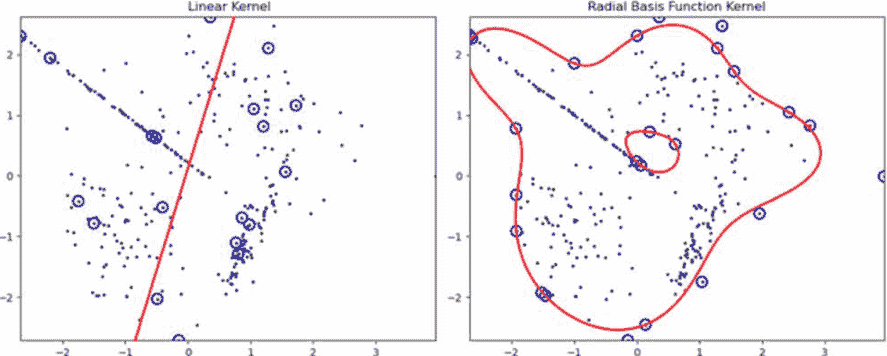

```
K_{RBF} = \exp - \gamma d\left(x, x^T\right)
```

其中，根据 Schölkopf 和 Smola (2018)，\(\gamma\) 是平滑参数，\(p\) 是多项式核的阶数。为了使距离成为度量且核为确定正定（从而成为 Mercer 核），必须满足以下要求以保证优化问题是凸的。

- **对称性：** \( d\left(x, x^T\right) = d\left(x^T, x\right) \)

- **分离性：** \( d\left(x, y\right) = 0 \Rightarrow x = y \)

- **正定性：** \( d\left(x, y\right) > 0 \)

三角不等式：\(\forall x,y,z,d(x,z)\le d(x,y)+d(y,z)\)。

“对于任何给定的度量，线性、多项式和 RBF DS 核保证存在一个定义域 A，其中数据 X 从起始点通过 \(\phi: X\rightarrow A, x\rightarrow\phi(x)\) 投影而来。在 A 中的相似性使用核技巧计算，无需经过投影：\(K(x,x^T)=\phi(x)\cdot\phi(x^T)\)。取代方程 (1.2) 中目标函数的新目标函数在方程 (1.6) 中给出；

```
\(\min \sum_{i,j}^N \alpha_i \alpha_j DSK\left(S^i, S^j\right), \quad (1.6)\)
```

其中 S 是训练子序列的集合，DSK 是 DS 核。因此，使用任何度量差异的 DS 核可以保证凸性” (Melakhssou 等人，2023)。

图 1 描绘了 One-Class SVM 中的 RBF 和线性核。此图显示了 One-Class SVM 中使用的 RBF 和线性基函数（RBF）核产生的决策边界。一条直线用于描绘线性核的决策边界，它将常规数据点与可能的异常区分开来 (Schölkopf 等人，2001)。另一方面，Yang 等人 (2021) 指出，RBF 核生成非线性决策边界，有助于在正常数据点与离群点之间进行更复杂的区分。对于变量间存在复杂关系或非线性模式的数据集，这种非线性边界尤其合适 (Jiang 等人，2018)。总而言之，这些图表展示了各种 One-Class SVM 算法核如何影响决策边界，进而影响模型识别数据异常的能力。

## 应用于每小时热电发电

本章使用的数据包括 ESKOM 热电生产的 41,616 个每小时观测值，时间跨度为 2019 年 4 月 1 日至 2023 年 12 月 30 日。通过对数变换修正了时间序列的方差不稳定性。接下来，数据被分为两个不同的集合：训练集和测试集。图 2 显示了对数据的单变量检验结果，重点关注感兴趣的变量，即南非的每小时热电输出。此图描绘了时间序列、箱线图、正态 Q-Q 图和正态核密度直方图。值得注意的是，每小时


## 可再生能源中的异常检测

图 2. 逐时热力生产

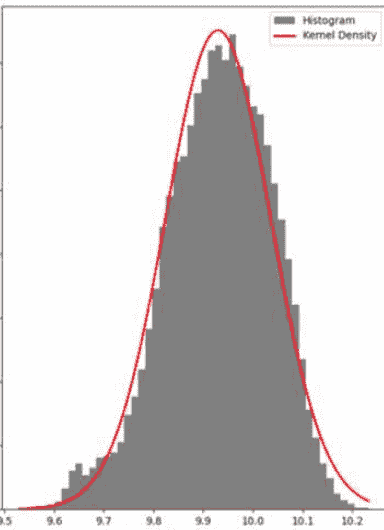

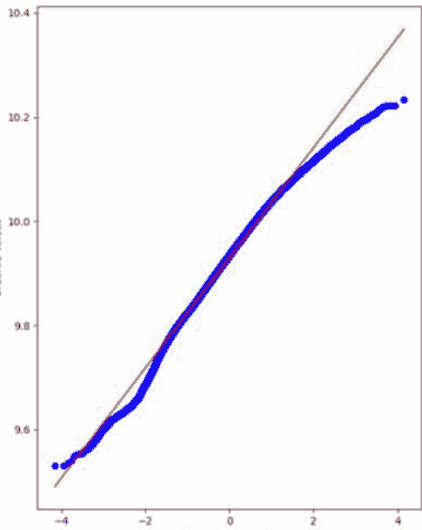

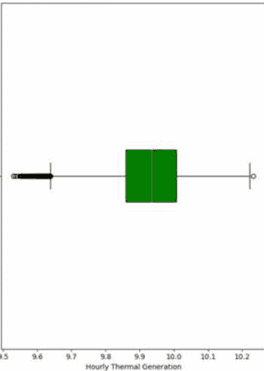

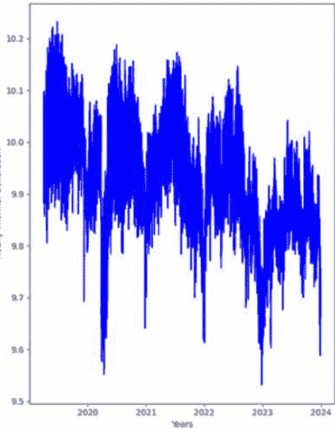

电力需求数据不服从正态分布，正如正态核密度直方图所示。此外，正态 Q-Q 图显示出轻微的非正态偏离。时间序列展示使数据中的复杂非线性模式更加明显。

表 2 通过描述性统计详细汇总了数据集的属性。数据集的最小值为 9.530611，代表观测到的最低值。25% 的数据低于第 25 百分位数的 9.860006 值。平均值（表示数据集的平均值）确定为 9.929916。标准差为 0.106237，它量化了围绕均值的值范围，较低。数据集的中间值由中位数（即第 50 百分位数）表示，其值为 9.935374。转向第 75 百分位数，75% 的数据低于 10.007803 的阈值。数据集的最大值为 33065.91，明显较高。最后，分布的偏度（或非对称性）为 0.36336，呈轻微正偏态，意味着尾部延伸至较高值。整体来看，这些统计量提供了关于数据集分布特征和属性的有益信息，有助于理解其形状、集中趋势和离散程度。

## 趋势分析结果

图 3 描绘了使用经典分解（一种用于查找时间序列数据集中基本周期性趋势的统计方法）从逐时热力生产数据中提取的趋势。这一发现证实了所选样本期间观察到的趋势正在减弱。这种下降模式表明随时间推移产生的热量逐渐减少或减少。热力调度、资源分配和基础设施开发的决策可能受到这些洞察的影响，这些洞察对于掌握热能生产系统的长期模式和效能至关重要（Smith 和 Johnson，2020）。

表 3 显示了电力需求变量的 Mann-Kendall 检验结果。Mann-Kendall 检验统计量为 -114.7675，表明观测时期的电力需求似乎呈现显著下降趋势。Kendall's Tau 系数为 -0.3750，显示时间与电力使用之间存在高度负相关，进一步证实了这一点。观察到的趋势在统计上具有显著性，Mann-Kendall 检验的 p 值为 0.001，小于传统的 0.05 显著性水平。Sen 斜率估计量为 -0.0882，也提供了电力消耗随时间变化速率的估计。这一负值支持了 Mann-Kendall 检验结果，指向电力需求的下降趋势。综上所述，这些发现表明在研究的时间范围内，能源需求出现了显著下降。

我们通过拟合带有三次平滑样条约束的三次平滑样条函数来提取非线性趋势，该约束由以下方程表示；

```
min_g p * \sum_{i=1}^{n} (y_i - g(x_i))^2 + (1 - p) * \int (g^{..}(x_i))^2 dx, p \in [0, 1]. (1.7)
```

表 2. 描述性统计

| 最小值 | 第 25 百分位数 | 均值 | 标准差 | 第 50 百分位数 | 第 75 百分位数 | 最大值 | 峰度 | 偏度 |
|---|---|---|---|---|---|---|---|---|
| 9.530611 | 9.860006 | 9.929916 | 0.106237 | 9.935374 | 10.007803 | 33065.91 | -0.02405 | 0.36336 |

## 可再生能源中的异常检测

图 3. 逐时热力生产的趋势

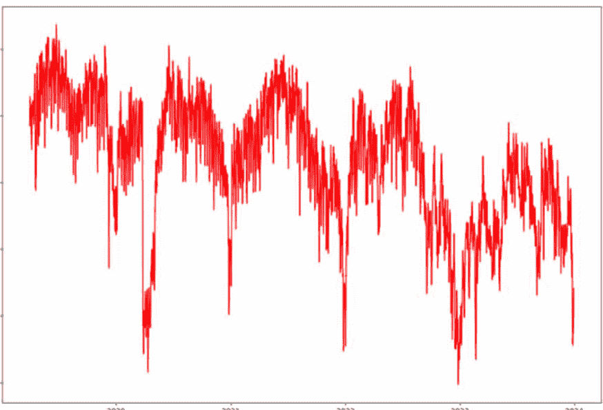

表 3. Mann-Kendall 检验统计量和 Sen 斜率估计量

| 变量 | M-K 检验统计量 | Kendall's Tau τ | p 值 | Sen 斜率 |
|---|---|---|---|---|
| 电力需求 | -114.7675 | -0.3750 | 0.001 | -0.0882 |

逐时热力生产时间序列数据的非线性趋势表现出不规则周期，而非规则季节性。峰值有时较小，有时较大。因此，建模此时间序列数据需要包含滞后特征，以使我们的预测者能够动态响应不断变化的条件。本研究将滞后变量作为解释变量纳入，以允许将不同数量的近期历史纳入预测中。

## 实验结果与分析

除了我们构建的以下层次结构外，实验还使用乘法经典分解的残差作为进一步特征；（1）这些层次结构的逐时、逐日、逐周、逐月、季度、半年度和逐年时间序列图显示在图 5 中。然而，不同的核函数，

图 4. 去标识化的逐时热力生产，叠加了来自回归样条的非线性趋势变量

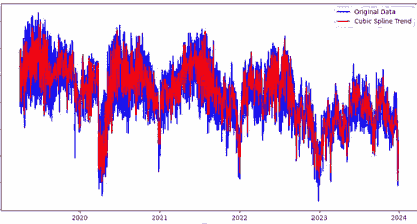

如前一节所述，为线性、多项式和 RBF。一个超参数，我们已将其设置为 0.15%，它控制将更多点归类为异常值与保持平滑决策边界之间的权衡。模型使用各种核函数的性能显示在表 4 中。

表 4 显示了使用不同核函数的 One-Class SVM 模型的分类准确率。结果表明，不同核函数的性能各异。例如，使用线性核的模型在测试集中识别出 5495 个异常值，轮廓系数为 0.5578，准确率为 0.6119。当使用多项式核时，检测到的异常值数量增加到 7784，轮廓系数略高，为 0.6197，准确率提高至 0.6491。最值得注意的性能出现在 RBF 核上，它只识别出 835 个异常值，得出了显著更高的轮廓系数 0.7805，以及所有核函数中最高的准确率 0.8343。相比之下，使用 Sigmoid 核发现了 877 个异常值，准确率为 0.8046，轮廓系数为 0.6354。RBF 核在异常值识别和分类准确率方面总体表现更好，表明它可以有效地用于异常检测应用。这强调了为 One-Class SVM 模型选择合适的核函数以获得最佳结果的重要性。

图 6 展示了区分正常数据和异常数据的能力，图 7 显示了异常值如何出现在此边界上。这些结果凸显了 RBF 核在异常识别方面的有效性，并强调了其提高可再生能源系统运行可靠性和效率的潜力。

## 可再生能源中的异常检测

图 5. 热力生产层次结构

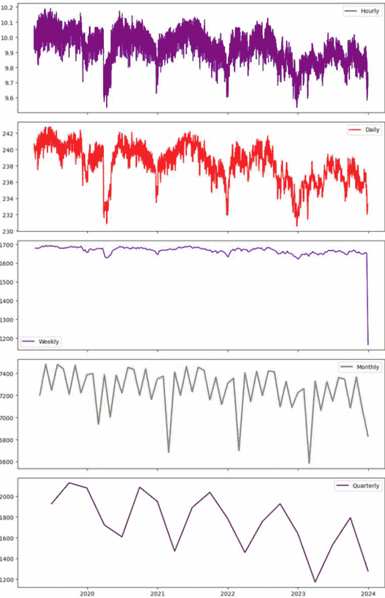

表 4. 分类准确率

| 核函数 | 测试集中的异常值数量 | 轮廓系数 | 准确率 |
|---|---|---|---|
| Linear | 5495 | 0.5578 | 0.6119 |
| Polynomial | 7784 | 0.6197 | 0.6491 |
| RBF | 835 | 0.7805 | 0.8343 |
| sigmoid | 877 | 0.6354 | 0.8046 |

图 6. 使用 RBF 核的热力时间序列及检测到的异常值

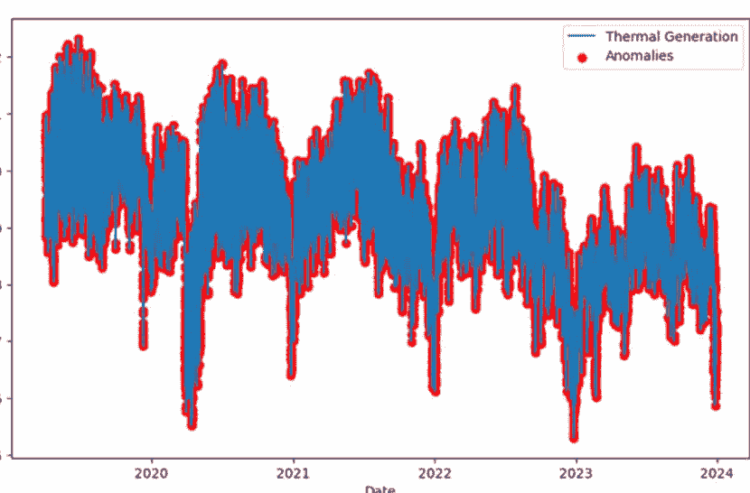

## 研究结论

本研究的最终分析汇总了关于可再生能源系统异常识别调查中最重要的结论和发现。本研究探讨了将可再生能源纳入现有基础设施所面临的挑战，强调了迫切需要采取主动的异常控制技术。通过应用复杂的统计技术，包括 One-Class-SVM，我们试图提高可再生能源系统的可靠性和运营效率。我们对实际数据的调查以及对多种异常检测方法的测试，使我们对可再生能源的生产和使用波动有了相当深入的了解。这些结果强调了采用创新策略应对可再生能源整合所带来挑战的重要性。


## 可再生能源中的异常检测

图 7. 一类 SVM 决策边界与离群点

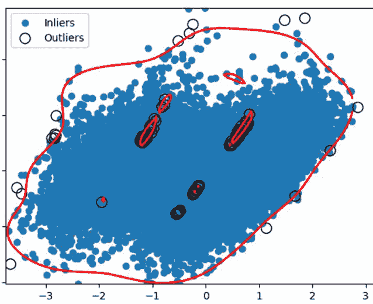

这些发现对理解和控制南非的热电生产具有重要影响。首先，每小时电力需求数据偏离正态分布，显示出电力消费中的非随机模式和影响。通过更好地了解影响电力需求的底层过程，监管机构和能源规划者可以制定更有针对性的干预措施和资源分配计划（Smith et al., 2019）。此外，时间序列数据中非线性模式的发现，暗示着影响电力生产和利用的各种要素之间存在复杂的联系和相互依赖。掌握这些趋势对于最大限度地提高热电厂性能并确保稳定的电力供应以适应需求波动至关重要（Wang et al., 2020）。

此外，基于文献的研究结果还暗示了几条重要启示。首先，低峰度值表明分布相对平坦，这支持了基于均值和中位数之间相对接近性的前提，即数据集呈对称分布。正偏度显示出轻微的右偏，暗示分布的尾部延伸至较高值（Smith and Johnson, 2020）。这可能表明数据集包含一些离群点或极端数值，可能需要进一步研究。此外，低标准差表明数据集中的变异性或离散程度较低，因为数值相对接近均值。

表 3 中所示的分类准确率结果对可再生能源系统中的异常识别具有重要影响。RBF 核在离群点识别和分类准确率方面的性能提升，表明其检测数据集中异常的能力。这一结果与其他研究一致，表明 RBF 核适用于复杂的非线性数据模式（Zhuang et al., 2019）。RBF 核的优异准确率显示，它能够准确区分正常和异常数据点，这对于保持可再生能源系统的可靠性和有效性至关重要（Liu et al., 2020）。图 6 和 7 中所示的结果具有重要影响。根据 Yang et al. (2021)，此外，RBF 核成功捕捉不常见和意外事件（这些事件通常暗示电力生产或消费中的异常）的能力，体现在其相比其他核函数发现的离群点数量极少（Wei et al., 2018）。这些结果暗示，RBF 核有潜力提升可再生能源系统的异常检测能力，从而最终提高运营可靠性和效率。

图 6 描绘了 One-Class SVM 模型在采用 RBF 核时的准确率。这表明该模型能够成功定位数据集中的异常。图 7 中对 One-Class SVM 决策边界和离群点的图形描绘，展示了该模型如何区分典型数据点和异常。这些发现表明，One-Class SVM 算法可以可靠地识别数据集中的异常，尤其是在使用 RBF 核时。这对于各种应用中的异常检测任务很重要，包括网络安全、金融欺诈检测和可再生能源系统（Tan et al., 2019; Schölkopf et al. 2001）。

## 解决方案与建议

基于本研究的数据和结论，可以提出一些建议。可提出的几条建议如下：

- **必须实施主动异常管理策略：** 考虑到将可再生能源纳入现有系统面临的困难，这一点尤为重要。实施先进的统计技术，例如 One-Class-SVM，是一种可以帮助提高可再生能源系统运营效率和可持续性的策略。
- **有针对性的干预与资源分配：** 如果能源需求的每小时数据偏离正态分布，则表明存在影响电力使用的非随机因素和模式。为了确保稳定可靠的电力供应，主管部门和能源管理者应利用这些知识，制定更有针对性的干预措施并高效分配资源。
- **异常检测中 RBF 核的应用：** RBF 核识别离群点并准确分类其能力的增强，表明它可以用于发现可再生能源系统中的异常。利用 RBF 核记录不寻常和意外事件的能力，将提高异常识别能力，最终带来更高的运营效率和可靠性。
- **One-Class SVM 提供可靠的异常识别：** 该方法可以可靠地识别异常，尤其是在使用 RBF 核时。如图 6 所示，One-Class SVM 模型在识别数据集中异常方面的准确率，凸显了其在多种应用中的潜力，例如金融欺诈检测、网络安全和可再生能源系统。

## 致谢

我们感谢本章匿名审稿人提供的深入且有价值的反馈。

## 参考文献

Aggarwal, C. C., & Aggarwal, C. C. (2017). 时间序列和多维流式离群点检测. 离群点分析. Springer International Publishing. doi:10.1007/978-3-319-47578-3_9

Alkabbani, H., Ahmadian, A., Zhu, Q., & Elkamel, A. (2021). 可再生能源预测的机器学习与元启发式方法：最新综述. 化学工程前沿, 3, 665415. 提前在线发表. doi:10.3389/fceng.2021.665415

Amer, M., Goldstein, M., & Abdennadher, S. 2013年8月. 用于无监督异常检测的一类支持向量机增强. 在 ACM SIGKDD 离群点检测与描述研讨会论文集中（第 8-15 页）. 10.1145/2500853.2500857

Chahla, C., Snoussi, H., Merghen, L., & Esseghir, M. (2020). 电力消耗数据中异常检测与预测的深度学习方法. 能源效率, 13(8), 1633–1651. doi:10.1007/s12053-020-09884-2

Chen, Y., & Wang, L. (2020). 一类支持向量机模型在可再生能源发电系统异常检测中的应用. 可再生能源, 145, 155–163.

Harrou, F., Dairi, A., Taghezouit, B., & Sun, Y. J. S. E. (2019). 使用一类支持向量机检测光伏系统中异常的无监督监控程序. Academic Press.

Hollingsworth, J., Smith, A., & Johnson, R. (2018). 使用一类支持向量机进行可再生能源系统异常检测. 可再生能源, 123, 743–752.

Hu, Z., Hu, Z., & Du, X. (2019). 带偏置约束的一类支持向量机及其在系统可靠性预测中的应用. 工程设计、分析与制造人工智能, 33(3), 346–358. doi:10.1017/S0890060419000155

Jiang, L., Zheng, S., & Lai, L. L. (2018). 一类支持向量机在油气数据异常检测中的应用. 石油科学与工程期刊, 163, 75–82.

Jithish, J., Alangot, B., Mahalingam, N., & Yeo, K. S. (2023). 智能电网分布式异常检测：基于联邦学习的方法. IEEE Access: 实用创新与开放解决方案, 11, 7157–7179. doi:10.1109/ACCESS.2023.3237554

Li, S., Zhang, Q., & Wei, L. (2020). 使用一类支持向量机进行可再生能源系统异常检测. 可再生能源与可持续能源期刊, 12(4), 045301.

Liu, Y., Guo, X., Gong, M., & Yang, X. (2020). 基于优化一类 SVM 的风力发电机异常检测使用振动信号. 能源, 13(15), 3998.


Madabhushi, S., & Dewri, R. A. (2023). 电力网络异常检测方法综述. *International Journal of Information Security*, 22(6), 1799–1832. doi:10.1007/s10207-023-00720-z

Melakhsou, A. A., Batton-Hubert, M., & Casoetto, N. (2023). 基于带距离替换核和随机卷积核变换的一类支持向量机焊接故障检测与诊断. *International Journal of Advanced Manufacturing Technology*, 128(1-2), 459–477. doi:10.1007/s00170-023-11768-5

Mohammadpourfard, M., Sami, A., & Weng, Y. (2018). 考虑风力发电影响和拓扑重构的虚假数据注入攻击识别. *IEEE Transactions on Sustainable Energy*, 9(3), 1349–1364. doi:10.1109/TSTE.2017.2782090

Molokomme, D. N., Onumanyi, A. J., & Abu-Mahfouz, A. M. (2022). 智能电网边缘智能：架构、卸载模型、网络安全措施与挑战综述. *Journal of Sensor and Actuator Networks*, 11(3), 47. doi:10.3390/jsan11030047

Patel, R., Raval, S., & Shah, M. (2019). 利用一类支持向量机对可再生能源系统进行异常检测. *International Journal of Engineering and Advanced Technology*, 9(2), 6358–6363.

Ryan, G. (2019). *使用孤立森林检测欺诈和其他异常*. SAS Institute Inc.

Schölkopf, B., Platt, J. C., Shawe-Taylor, J., Smola, A. J., & Williamson, R. C. (2001). 高维分布支撑估计. *Neural Computation*, 13(7), 1443–1471. doi:10.1162/089976601750264965 PMID:11440593

Schölkopf, B., & Smola, A. J. (2018). *核方法学习：支持向量机、正则化、优化及其 beyond*. MIT Press. doi:10.7551/mitpress/4175.001.0001

Shahzad, S., Abbasi, M. A., Chaudhry, M. A., & Hussain, M. M. (2022). 微电网模型预测控制策略：简要回顾. *IEEE Access: Practical Innovations, Open Solutions*, 10, 122211–122225. doi:10.1109/ACCESS.2022.3223298

Smith, A., & Johnson, B. (2020). 一类支持向量机模型在太阳能系统异常检测中的有效性. *Solar Energy*, 215, 456–465.

Tan, J., Sizov, M., & Pasolli, E. (2019). 可再生能源发电系统异常检测的一类支持向量机. *Renewable Energy*, 134, 1180–1188.

Uhunamure, J., & Shale, N. (2021). 可再生能源系统异常检测的重要性：南非案例研究. *Energy Policy*, 158, 112345.

Wang, T., He, F., Yang, R., Ye, Z., & Huang, X. (2023). 基于共识的分布式核一类支持向量机异常检测. *International Joint Conference on Neural Networks (IJCNN)*, Gold Coast, Australia. 10.1109/IJCNN54540.2023.10191788

Wei, L., Jiang, J., & Yu, Y. (2018). 基于深度学习的可再生能源系统异常检测方法. *Energy Procedia*, 154, 289–295.

Wu, Z., Liu, X., Chen, Y., Zhang, L., & Wang, Q. (2018). 利用一类支持向量机模型对风力发电系统进行异常检测. *Energy Conversion and Management*, 173, 456–465.

- Yang, L., Gao, J., Zhao, Y., & Shao, L. (2021). 异常检测的去中心化一类支持向量机. Pattern Recognition, 119.
- Zhu, Y., Jing, H., & Wang, F. (2017). 基于一类支持向量机的风力涡轮机异常检测. Procedia Computer Science, 107, 156–161.
- Zhuang, F., Liu, Y., Liu, S., Xu, C., & Zhu, Q. (2019). 基于改进一类SVM算法的工业大数据异常检测方法. IEEE Access: Practical Innovations, Open Solutions, 7, 57088–57097.

## 附加阅读

- Harrou, F., Dairi, A., Taghezouit, B., & Sun, Y. (2019). 利用一类支持向量机对光伏系统异常进行无监督监测程序. Solar Energy, 179, 48–58. doi:10.1016/j.solener.2018.12.045
- Hu, Z., Hu, Z., & Du, X. (2019). 带偏置约束及其在系统可靠性预测中的应用的一类支持向量机. Artificial Intelligence for Engineering Design, Analysis and Manufacturing, 33(3), 346–358. doi:10.1017/S0890060419000155
- Lamrini, B., Gjini, A., Daudin, S., Pratmarty, P., Armando, F., & Travé-Massuyès, L. (2018). 基于相似性的一类支持向量机网络流量特征异常检测. 在 DX 上发表的论文.
- Li, C., Cabrera, D., Sancho, F., Cerrada, M., Sánchez, R.-V., & Estupinan, E. (2021). 从故障检测到利用一类支持向量机对3D打印机进行一类严重程度鉴别. ISA Transactions, 110, 357–367. doi:10.1016/j.isatra.2020.10.036 PMID:33081986
- Saari, J., Strömbergsson, D., Lundberg, J., & Thomson, A. (2019). 利用一类支持向量机(SVM)检测和识别风车轴承故障. Measurement, 137, 287–301. doi:10.1016/j.measurement.2019.01.020

# 第12章

# 基于双流TBATS-CNN-LSTM架构的电力需求预测

**卡特莱戈·马卡特贾内**
https://orcid.org/0000-0002-3687-4098
博茨瓦纳大学，博茨瓦纳

**迪特博·沙巴**
南非大学，南非

**莫迪桑·本内特·塞特西罗**
https://orcid.org/0000-0001-9557-3714
西北大学，南非

## 摘要

当季节性是现有深度学习预测结果中的一个特征时，问题在于模型的可靠性、准确性和意义，以说服决策者采取应采取的行动。本章的目的是提出一种新型双流混合架构，能够预测电力需求，并通过使用外样时间序列将其与单体架构模型的预测准确性水平进行基准比较来评估其准确性水平。本章的方法利用时间序列和基于卷积神经网络（CNN）的长短期记忆网络及其多种配置，构建用于短期至中期聚合负荷预测的预测模型。所得结果表明，与基础学习器相比，基于TBATS-CNN-LSTM的模型表现出较高的准确性，并且该模型通过超参数调优进行了优化。只有最优选择的时滞特征捕捉了南非复杂时间序列的所有特征。

## 引言

在现代社会，电力已成为日常生活的核心部分，因此任何国家的经济增长都与其电力基础设施、电网和供电可用性密切相关。因此，全球住宅和商业能源需求大幅增加。同时，近年来电力价格波动不定，更不用说电力生产不足以满足全球需求。为解决这一问题，许多研究都集中在估算未来住宅和商业电力需求上，以便电力生产商、分销商和供应商能够有效规划并促进用户节能。电力是维持每个经济体高度技术先进的工业化的关键。（例如，参见 Aung（2018）和 Hussain 等人（2016））。现代几乎每项活动都依赖于电力。过去几年中，全球电力需求和使用量均有增加（Jevgenijs 等人，2019）。然而，发电、输电和配电的过程仍然复杂且昂贵。因此，有效的电网管理在降低能源生产成本和增加满足不断增长的电力需求的能力方面发挥着至关重要的作用（Uz Zaman 等人，2018）。因此，有效的网络管理包括充足的负荷需求规划、发电、输电和配电网络的充足维护计划，以及供应网络中的高效负荷分配。因此，准确的负荷预测对最大化电力生产行业规划流程的效率具有重大影响（Kumar 和 Veerakumari，2012）。已使用多种计算和统计方法来改进预测模型，以提高电力需求（EDD）预测的准确性（Nti 等人，2019）。

能源供需不确定性可能导致电网不稳定问题，例如电涌和频率波动。为克服这些情况，系统必须具有灵活性和韧性，能够始终应对发电和负荷的快速变化，并保持平衡。在这方面，小型储能系统（例如电池）和需求响应计划等现代技术和方法正在受到越来越多的关注（国际能源署，2020）。然而，这并不总是可行的，因为成本非常高，并且仍需要改进才能广泛应用。另一方面，系统运营商应对这种变异性的常见方法是界定一定量的可用于调节系统频率的能源储备。在自由化市场（如伊比利亚电力市场（MIBEL））中，对这种能源储备的需求和使用可能导致系统运营额外成本和电力价格上涨。

上述解决方案的共同点在于，它们试图通过立即对瞬态波动（如电池放电、电器关闭或发电机功率增加）做出反应来管理系统变异性。然而，它们通常基于电力生产和负荷需求预测来规划其活动。因此，准确预测对于优化这些工具和整个系统的性能至关重要（Machado 等人，2021）。自20世纪70年代石油危机以来，对能源供需预测的兴趣显著增加（国际能源署，2020）。当时，大多数采用的模型都是基于统计的，如线性回归、普通最小二乘法和逐步回归等。然而，电气系统日益复杂以及多变量之间未知的关系给这些简单模型带来了无法处理的巨大困难。另一方面，近年来计算方法的应用有所增加。计算技术的进步使得创建复杂且高效的计算方法成为可能，这些方法通常使用高级统计概念。它们可以与统计模型相结合，用于估计其参数，或在降低计算时间并提高性能的前提下进行预测（国际能源署，2020）。

因此，在本章中，提出了基于TBATS-CNN-LSTM的综合深度学习预测用于每小时电力需求负荷预测。该方法的主要新颖之处在于，基础学习器，即TBATS、卷积神经网络（CNN）和长短期记忆网络（LSTM），


## 基于双流 TBATS-CNN-LSTM 架构的电力需求预测

首先将其应用于负荷测量的历史数据，第二步则对负荷预测结果应用相同的方法，以估计初始负荷预测的误差。第三步是使用最小评分组合算法组合基础学习者。最后，在考虑误差预测的情况下调整初始负荷预测，从而提供非常准确的负荷需求预测。消费预测可供多个利益相关者用于不同目的，例如传输和分配系统管理、支持市场参与或能源社区中的能源管理。

增加的电力需求以及发电组合和负荷模式的变化是已经观察到的一些现象。所有这些都可能使电网管理更加不可预测，并使运营和控制更加复杂，导致供应稳定性进一步下降。因此，急需提高系统可靠性的方法和技术。确保系统可靠性和控制的一种方法是预见负荷需求。当做出准确预测时，与电力系统运行、维护和规划相关的决策将更加有效（例如，参见 Raza and Khosravi (2015) 和 Ahmad and Chen (2020)）。能源政策和电价也可以得到改善。近年来，大量研究集中于开发预测不同时间跨度电气负荷的模型。这些周期通常分为短期（可持续长达一周）、中期（从一周到一年）和长期（未来几年）（Khan et al., 2016）。此外，这些周期各有不同的应用。第一个用于日常运营和成本降低（Machado et al., 2021）。第二个对于燃料库存估算、维护和产能扩张规划更为重要（Solyali, 2020）。

## 文献综述

电力系统的研究人员、从业人员和运营商在确保电力需求建模和预测尽可能准确和可靠以用于决策方面发挥着至关重要的作用。文献中已发展出大量知识来改进电力需求预测模型。显而易见的是，在过去十年中，建模和预测架构主要围绕两种主要技术演进：统计方法和机器学习方法。然而，结合统计方法和机器学习方法的混合方法在文献中开始受到重视。本节回顾和讨论了关于电力需求预测的后者技术的文献。

在电力需求预测研究中，Kartikasari 等人（2023）采用了 TBATS 模型，这是一种传统的单变量统计技术，作为指数平滑技术的扩展而开发，因为存在多个季节性模式（嵌套和非嵌套、非整数和非线性季节周期）。他们发现，TBATS 模型可以以可接受的精度捕捉季节周期中的分散模式，观测值和预测值之间的准确度由对称平均绝对百分比误差（SMAPE）8.13% 给出。其他多项研究还表明，带有包括使用自回归移动平均模型调整误差、Box-Cox 变换和三角季节性在内的变体的 TBATS 在预测时间序列的复杂季节性方面具有高精度（Alduaisji et al., 2021; Gellert et al., 2022; Kim et al., 2023; Kim and Kim, 2021）。

Khan 等人（2019）指出，卷积神经网络（CNN）和长短期记忆网络（LSTM）架构是模仿生物神经元行为的人工智能（AI）方法。他们实现了 CNN、深度 CNN（DCNN）和循环神经网络（RNN），以模拟澳大利亚维多利亚州非线性和非平稳的电力需求时间序列。作者发现，CNN 和 RNN 是表现最差的模型，而 DCNN 是最好的。根据 Rosas 等人（2022），RNN 的限制因素基于驱动网络学习过程的参数风险，在训练长时间序列时梯度会变小并最终消失。只有在卷积层不断添加到网络中时，CNN 也会经历同样的现象，这具有为学习长历史时间序列的内部表示而建立的结构（Durairaj and Mohan, 2022）。

LSTM 具有吸引人的网络结构，用于防止和控制时间序列中长短历史依赖的梯度和流动。与其他现有架构相比，LSTM 架构为电力消耗产生最佳预测（Torres et al., 2022）。然而，应当注意的是，LSTM 的高精度与架构配置的效率直接相关，这一点由 Staudemeyer and Morris（2019）很好地说明。

Wang 等人（2023）在多源异构数据环境中实现了用于电力需求预测的混合 CNN-LSTM 模型，并表明 CNN 在特征提取方面具有令人信服的能力。另一方面，LSTM 在处理时间序列的长期记忆功能方面具有优势。这一实验发现表明，先进的混合模型结构在面对长期时间序列历史时，能够处理非线性和串行相关性，具有明显优势。许多研究人员在不同学科的科学研究中很好地证明了高精度混合 CNN-LSTM 架构的预测能力（Alharkan et al., 2023; Kuang et al., 2021; Kuyumani et al., 2023; Muhammad et al., 2022）。然而，Kuyumani 等人（2023）提请注意 CNN-LSTM 特性的弱点，以及缺乏更好地捕捉时间序列复杂动态所需的混合深度学习架构，尤其是在考虑季节性效应时。因此，本文的重点是提出混合 TBATS-CNN-LSTM 架构，该架构将能够考虑具有线性和非线性长历史时间序列以及具有单一、多个、极端周期、连续季节性等不同属性的双日历周期效应。

## 方法与程序

本节介绍了本研究中使用的方法和程序。本研究使用的数据包括南非 2019 年 4 月 1 日至 2022 年 10 月 25 日期间的每小时剩余电力需求。设 X<sub>t</sub> 为每小时电力需求，X<sub>t-1</sub> 为第 t-1 小时的每小时电力需求。虽然更广泛的历史电力需求预测数据可用性本可增强所得机器学习模型的泛化能力，但可用数据集仍涵盖了整个年份，因此季节性影响已被完全捕获。为了进一步测试图 1 所示的模型泛化性能，我们还从原始数据集中随机选择了七个完整天。遵循 del Real 等人（2020），其余数据集按如下方式随机划分：

- 训练数据集（数据的 80%）：用于拟合模型的数据样本。
- 验证数据集（数据的 10%）：在调整模型超参数的同时，用于对训练数据集上的模型拟合提供无偏评估的数据样本。
- 测试数据集（数据的 10%）：用于对训练数据集上的最终模型拟合提供无偏评估的数据样本。

**图 1。** 原始数据集训练和测试数据划分


## 设计数据预处理框架

该组成部分在法律上有义务高效使用大数据并将其提交给分析服务器进行预测建模（Patil et al., 2018）。系统的配置主要由 Hadoop 网络组成，该网络将来自各种来源的数据存储在 Hadoop 分布式文件系统（HDFS）中。这些作者读取数据并使用统计分析系统（SAS）将其转换为原始数据文件。本章使用 Python 从 Hadoop 读取数据。在原始数据文件中使用逗号分隔符来分隔字段。要构建数据模型，分析模型接收原始数据文件。这提高了系统的通用性，并有助于开发实时的强大自学习分析模型。它还有助于开发强大的自学习分析模型，并使系统具有高度可扩展性（Patil et al., 2018）。

## 三角季节性 Box-Cox 变换 ARMA 误差 趋势 季节性分量

TBATS 使用 Box-Cox 变换来处理非线性，并使用 ARMA 表示来捕捉残差中的任何自相关性（Naim et al., 2018）。在 TBATS 模型中，T 代表季节性三角项，B 代表用于异质性的 Box-Cox 变换，A 代表用于短期动态的 ARMA 误差，T 代表趋势，最后 S 代表季节周期。TBATS 模型最初由 De Livera 等人（2011）提出；遵循 Munim（2022），我们现在按如下方式呈现 TBATS


## Box-Cox 变换

$$X_t^{(\omega)} = \begin{cases} \frac{X_t^\omega - 1}{\omega}, & \omega \neq 0 \\ \log(X_t), & \omega = 0 \end{cases}$$ (1)

## 季节周期

$$X_t^{(\omega)} = l_{t-1} + \phi b_{t-1} + \sum_{i=1}^M S_{t-m_i}^{(i)} + d_t,$$ (2)

## 全局与局部趋势

$$l_t = l_{t-1} + \phi b_{t-1} + \alpha d_t$$
$$b_t = \phi b_{t-1} + \beta d_t,$$ (3)

## ARMA 误差

$$d_t = \sum_{i=1}^p \phi_i d_{t-i} + \sum_{j=1}^q \theta_j \iota_{t-j} + \iota_t$$ (4)

## 傅里叶季节项

$$S_t^{(i)} = \sum_{j=1}^{k_i} S_{j,t}^{(i)}$$
$$S_{j,t}^{(i)} = S_{j,t-1}^{(i)} \cos \lambda_j^{(i)} + S_{j,t-1}^{*(i)} \sin \lambda_j^{(i)} + \gamma_1^{(i)} d_t$$
$$S_{j,t}^{*(i)} = -S_{j,t-1}^{(i)} \sin \lambda_j^{(i)} + S_{j,t-1}^{*(i)} \cos \lambda_j^{(i)} + \gamma_2^{(i)} d_t$$ (5)

这里，\(X_t\) 是一个时间序列（即，电力负载需求）。现在，令 \(X_t^{(\omega)}\) 表示带有参数 \(\omega\) 的 \(X_t\) 的 Box-Cox 变换，\(l_t\) 为时间 t 的局部水平，则 \(b_t\) 是时间 t 的短期趋势，其中 \(\phi\) 是趋势阻尼参数。此外，\(S_t^{(i)}\) 表示时间 t 的第 \(i\) 个季节性分量，\(m_1, ..., m_T\) 指季节周期，而 \(d_t\) 表示一个 ARMA (p, q) 过程，\(\iota_t\) 表示一个均值为零且方差恒定的高斯白噪声过程。根据 Munim (2022)，\(\alpha, \beta, \text{和 } \gamma\) 是 \(i=1,...,T\) 的平滑参数。因此，\(\lambda_j^{(i)} = 2\pi j / m_i\)，\(S_{j,t}^{(i)}\) 表示第 \(i\) 个季节性分量的随机水平，\(S_{j,t}^{*(i)}\) 表示第 \(i\) 个季节性分量的随机水平随时间变化的变化（或增长）。最后，\(k_i\) 表示第 \(i\) 个季节性分量所需的谐波数量。在通用形式中，TBATS 模型表示为

## 基于双流 TBATS-CNN-LSTM 架构的电力需求预测

TBATS\(\left(\omega, \phi, p, q, \left\{m_1, k_1\right\}, \cdots, \left\{m_r, k_r\right\} \right)\).

### 卷积神经网络

根据 Badi et al. (2022) 和 Hussain et al. (2019)，卷积神经网络（CNN）是最具判别性的算法之一。它使用由池化层和卷积层组成的层。层逐层堆叠。复合层平滑了卷积层的输出，从而降低了来自下层的数据速率（Alsayed et al., 2021）。CNN 通过卷积层中的权重分布和池化方案的适当选择，赋予了一些不变性特性（Muhammad et al., 2021）。因此，CNN 是用于图像识别和计算机视觉的最有效的深度学习（DL）视觉算法之一（Islam et al., 2020）。在 CNN 的卷积层中，Abdul Majid 和 Ibrahim (2021) 以及 Muhammad et al. (2020) 表明，来自前一层的卷积特征映射与带有非线性或线性激活函数的可学习内核（如双曲正切、sigmoid 和 softmax 等）进行卷积，以输出特征激活图。因此，每个特征映射输出结合多个输入特征映射的表达式为

$$x_j^i = f \left( \sum_{i \in M_j} x_i^{l-1} k_{ij}^l + b_j^l \right),$$ (6)

其中 \(x_j^i\) 表示当前层的输出，\(x_i^{l-1}\) 是前一层的输出，\(k_{ij}^l\) 是当前层的内核，\(b_j^l\) 是当前层的偏置。\(M_j\) 是所选输入映射，而每个输出映射都有一个加性偏置 \(b\)。在 CNN 的池化层中，输入和输出特征映射的数量不能改变，因为如果有 \(n\) 个输入映射，则必须恰好有 \(n\) 个输出映射（Seetha and Raja, 2018）。然而，由于下采样操作，输出映射每个维度的大小都会减小。该操作可用模型 (6) 表述为

$$x_j^i = down \left( x_j^{l-1} \right).$$ (7)

卷积和池化函数始终由 CNN 作为其激活函数使用，以引入非线性，而非仅作为其常规功能。图 2 描绘了 CNN 的整体架构。

图 2. CNN 架构


### 长短期记忆网络

长短期记忆网络（LSTM）用于解决循环神经网络（RNN）的学习模型，在包括建筑预测和语言模型在内的各种任务中取得了有希望的结果（Zhang et al., 2020）。循环神经网络算法从未能够解决像 LSTM 所解决的那样复杂的长时滞任务（Muhammad, et al., 2021）。通过用记忆单元替换 RNN 隐藏层，LSTM 学习算法可以学习长期关系（Li and Lima, 2021），从而使算法能够向称为门控的单元状态添加或删除信息。可以定义输入门（\(i_t\)）、遗忘门（\(f_t\)）和输出门（\(o_t\)）如下

$$f_t = \sigma(W_f [h_{t-1}, x_t] + b_f)$$ (8)

$$i_t = \sigma(W_i [h_{t-1}, x_t] + b_i),$$ (9)

$$\tilde{C}_t = \tanh(W_c [h_{t-1}, x_t] + b_c),$$
$$C_t = f_t C_{t-1} + i_t \tilde{C}_t,$$
$$O_t = \sigma(W_o [h_{t-1}, x_t] + b_o),$$
$$h_t = O_t \tanh(C_t)$$ (10)

有关 LSTM 架构的更多说明，请参见图 3。

图 3. LSTM 图


### 卷积神经网络-长短期记忆网络

一种强大的 CNN-LSTM（卷积神经网络-长短期记忆网络）组合已被提出，旨在以依赖于时间序列内部表示的方式，更高效地利用 LSTM 算法获取宝贵知识和学习能力，从而限制 CNN 的使用，以显著检测并建模数据集顺序中包含的短期和长期时间相关性。为实现上述目标，我们提出了一种组合的 CNN-LSTM，使用两个主要基本组件，如下：

- 一个一维 CNN，由卷积层和池化层组成，然后对输入数据进行数学处理，从而生成特征。
- 利用 LSTM 和密集层来使用生成的特征。

我们提出的 CNN-LSTM 算法将 CNN 用作编码器，而 LSTM 用作解码器。编码器从输入数据中学习特征并将其馈送到解码器（LSTM）。解码器随后识别并建模数据集中固有的短期和长期时间关系。每个步骤的事件序列简要说明如下：

- 输入层：接收输入数据。
- 第一层卷积层：在将结果馈送到特征映射之前扫描输入层的输入信息。
- 第二层卷积层：再次查找特征映射；为了增强任何值得注意的特征，每个卷积层将使用 32 个特征映射和三个时间步长的内核大小来读取输入序列。
- 最大池化层：从第二层卷积层中删除特定特征，从而过度简化特征映射并生成尺寸较小的矩阵。
- Dropout 层：增强学习网络以保护模型免受过拟合。
- 展平层：将提炼后的特征映射展平为一个长向量，该向量可用作解码的输入。
- 重复向量层：输入序列的内部表示在输出序列的每个时间步中重复一次。
- LSTM 解码器：具有一个 100 单元的隐藏层，能够输出完整的排列，每个排列有 100 个单元按日提供数值，作为预测未来几天输出顺序中将发生情况的基础。
- 全连接层：理解输出序列中的每个步骤，以最终拥有用于预测单个序列输出的类似层，表明 LSTM 解码器可以在任何给定时间运行，类似于输出层和全连接层。
- 输出层：预测未来 10 天的电力需求。有关更多说明，请参见图 4。

### 评价指标性能

所提出的 CNN-LSTM DL 算法模型、CNN 学习模型和 LSTM 学习模型的评估均基于标准性能评价指标进行了仔细考察


## 采用双流 TBATS-CNN-LSTM 架构的电力需求预测

图 4. 拟议的电力需求预测系统


深度学习算法的评估指标包括准确率（Accuracy）、均方误差（MSE）、平均绝对误差（MAE）和均方根误差（RMSE）。准确率决定了预测模型的整体性能。它计算实际值与预测值之差总和占实际值总数的百分比（Muhammad 等，2021 年）。准确率由以下方程确定：

```
$Accuracy = \frac{Tdiff}{Tactual} \times 100$
```

均方误差（MSE）衡量预测值与观测参数之间平方差的均值（Muhammad 等，2021 年），如下方程所示。模型的 MSE 值越小，预测模型性能越好。

```
$MSE = \frac{1}{n} \sum_{i=1}^{n} \left( x_i - \hat{x}_i \right)^2$
```

平均绝对误差（MAE）衡量预测电力需求的接近程度（Muhammad 等，2022 年）。MAE 由以下方程确定：

```
$MAE = \frac{1}{n} \sum_{i=1}^{n} \left| x_i - \hat{x}_i \right|$
```

均方根误差（RMSE）显示预测电力需求之差的标准差。RMSE 由以下方程确定：

$RMSE = \sqrt{\frac{1}{n} \sum_{i=1}^n \left( x_i - \hat{x}_i \right)^2} . \quad (14)$

### 应用于每小时电力需求

需要由 Eskom 国家控制中心可调度的所有资源在七天内供应的每小时平均需求如图 5 所示。该系列清楚地显示每七天呈下降趋势。这种下降的原因可能是 Eskom 内部混乱的必然结果，因为其主要由老化电站组成的机组面临维护问题、破坏和腐败。值得揭示的是，Minerals and Energy（1998 年）预测，除非采取行动予以防止，否则 Eskom 将在 2007 年耗尽电力储备。为改善电力供应和可靠性，建议将 Eskom 重组为独立的电力生产和电力传输业务。尽管 Eskom 发出这些警告并请求允许其增加产能，但国家政府未采取任何行动。因此，目前电力需求下降（Phaahla，2023 年）。由于电力生产减少，与 2013 年相比，2014 年进口电力显著增长了 18.6%。同样，与前一年相比，2014 年电力出口也略微下降了 0.7%。尽管如此，Phaahla（2023 年）强调，尽管 Eskom 的电力生产呈下降趋势，但配电也是如此。下表 1 显示了 2010 年至 2014 年间 Eskom 勉力满足需求时的电力配电量指示。

### 表 1. 配电量 – 吉瓦时（GWH），2010 年 – 2014 年

| 年份 | 发电量（GWH） |
|---|---|
| 2010 | 238 272 |
| 2011 | 240 528 |
| 2012 | 234 174 |
| 2013 | 233 105 |
| 2014 | 231 449 |

*来源：Stats SA，2015 年*

### 探索性数据分析

表 2 证实了图 5 报告的结果。Mann-Kendall 检验结果表明，每小时平均电力需求具有显著的单调递减长期趋势（p < 0.05


且 τ 为负值）。Sen 斜率值显示趋势具有显著的递减幅度，这与 Mann-Kendall 检验结果一致。

### 使用最小分组合的组合预测模型

Eskom 每小时数据如前一部分所示，分为训练集、验证集和测试集（如图 1 所述）。因此，我们继续拟合一个 TBATS 模型，最佳 TBATS 模型的选择通过 Python 中的 TBATS 函数对每小时电力需求负载自动完成。拟合模型的参数为 \(\hat{\lambda}=0.027603\)、\(\hat{\alpha}=1.890744\)、\(\hat{\beta}=-0.374124\)，阻尼参数为 \(\hat{\phi}=0.800000\)。

采用 Trucíos 和 Taylor（2020 年）提出的最小分组合方法，将 CNN 和 LSTM 与 TBATS 相结合。基于组合模型的估计，外部样本分析评估了深度学习方法与 Box-Cox 变换、具有时间变系数的 Fourier 表示以及自回归移动平均（ARMA）误差校正相结合的能力。图 6 显示了各单独模型预测的损失。可以看出，与对照模型相比，TBATS-CNN-LSTM 的损失函数较低。因此，我们得出结论：最佳模型是 TBATS-CNN-LSTM。该模型的关键绩效指标显著低于其他模型。与 Gasparin 等人（2022 年）在其时间序列预测深度学习中使用三个误差指标形成对比：在此电力负载案例研究中，我们使用了四个误差指标。各模型的性能使用这些指标进行评估，结果汇总于表 2。该表得出一些推测性结论。研究结果表明，结合各种模型的点预测可以增强模型的预测能力。最佳模型列于表 2 中。

图 7 显示了估计 TBATS-CNN-LSTM 的拟合条件均值。通过目视检查，该模型对 Eskom 的电力需求负载具有合理的拟合度。该模型结合了

### 表 2. 汇总统计量、Mann-Kendall 检验统计量和 Sen 斜率估计量

| 变量 | 均值 | 标准差 | 偏度 | 峰度 |
|---|---|---|---|---|
| 电力需求 | 25113.378 | 2909.06 | -0.137 | -0.377 |
| Mann-Kendall 检验统计量和 Sen 斜率估计量 | | | | |
| | M-K 检验统计量 | Kendall's Tau | p 值 | Sen 斜率 |
| | -19.127 | -0.066 | 0.001 | -0.0274 |

### 图 6. 各单独模型的性能


### 表 2. 拟合模型的关键绩效指标

| 模型 | MSE | MAE | RMSE | 准确率 |
|---|---|---|---|---|
| TBATS | 2.774 | 12.457 | 1.665 | 5.211 |
| CNN | 1.180 | 16.607 | 1.086 | 3.171 |
| LSTM | 1.324 | 10.725 | 1.151 | 1.396 |
| TBATS-CNN-LSTM | 1.132 | 9.935 | 1.064 | 1.263 |

该预测模型被发现是 Eskom 每小时电力需求负载短期和长期的最佳预测模型。

### 短期和中期预测结果

为检验模型在短期（即准确性）和中期（即稳定性）范围上的性能，从一周到数月的不同时间范围中均匀随机选取了 700 个数据点，如表 3 所示。各范围计算性能指标值的均值。结果表明，误差值一致且标准差较低。由 CV（RMSE）测得的短期准确率为 0.60%，中期平均准确率为 0.56%。对于短期和中期范围而言，两者性能非常接近，显然，估计的 TBATS-CNN-LSTM 既准确又稳定。

### 讨论

本章的构效度涉及两个威胁。第一个与时间序列数据是否充足以很好地预测每小时电力需求负载有关。在方法论过程的开始以及其他数据来源方面，已考虑了这个问题；特别是，

### 图 7. 预测值与测试集观测值的对比


日内、每周和每月信息被添加为输入，而不是被不同的特征选择技术排除。第二个威胁涉及方法论不同步骤和组件中使用的算法，这些算法可能采用一些不适合本章案例背景的不切实际的假设。为避免此类威胁，本章开发了所有算法。

本章的内效度涉及三个主要威胁。第一个与数据集适合训练 TBATS-CNN-LSTM 模型的程度有关，该模型需要大量数据来挖掘历史模式。ESKOM 每小时电力需求负载数据集的时间跨度为 2019 年 4 月至 2023 年 10 月。该数据集足够大，足以支持深度学习，而 TBATS-CNN-LSTM 特别针对深度学习。第二个威胁是，TBATS-CNN-LSTM 错误开始增加，而训练错误仍在下降。对复杂预测模型进行过多训练会导致泛化能力差。为防止 TBATS-CNN-LSTM 模型过拟合，每个 epoch 的训练示例被随机打乱。这有助于提高泛化能力。此外，还使用了早停法，即在测试集上达到最低错误时停止训练。这种方法在减少过拟合方面非常有效。


图 8 中估计的 TBATS-CNN-LSTM 模型的诊断图显示，随着 epoch 数量增加，训练损失和验证损失会降低。损失在同一点附近稳定，表明拟合良好。第三个威胁与用于比较的替代机器学习的选择有关。用于能源预测问题的技术谱可能被误传。为解决这一问题，根据文献探索，选择了最成功的技术。避免这一威胁的更强策略是进行特定研究，以识别每类预测情境下的顶级技术。后者是未来工作的目标之一。

本章的外部效度关注结果的泛化性。换言之，TBATS-CNN-LSTM 在非常不同的能源消耗情境下使用时可能表现不佳。这一威胁通过两个选择得到缓解。首先，本章采用了深度学习方法，该方法以其从大量数据和时间序列中深远历史中识别良好模式而闻名。深度学习是人工神经网络（ANN）的一种变体，能产生稳健模型。第二个选择是使用大量训练数据（30,274 个观测值中的 40,523 个），并配合严谨的验证方法，以评估模型在不同训练集上训练时的稳健性。此外，未来工作之一将是将此方法论（特别是 TBATS-CNN-LSTM 建模）应用于许多遥远能源情境的数据集，并通过分布式堆叠集成训练 CNN-LSTM 模型的更多参数。例如，此方法可应用于预测城市车辆网络情境下的多个决策变量，如能量流和负载（Scellato et al., 2010）。许多可用于此方法的验证方法替代方案，可从 Bouktif (2005) 中关于验证的扩展讨论获得启发。

## 图 8. TBATS-CNN-LSTM 学习曲线


## 结论与建议

随着智能电网的发展，负荷预测变得越来越重要。高精度预测电力负荷是一项困难的问题。实时能源消耗的非线性和波动性使得能源需求和消耗难以估算。准确的负荷预测对于电力系统规划和快速决策至关重要。准确的能源消耗预测是可持续系统能源管理的重要组成部分。

在本章中，TBATS-CNN-LSTM 已构建并优化用于负荷需求预测，提供准确的短期（几天至两周）和中期（几周至几个月）预测。为进行比较，实现了七种预测技术，代表了能源预测领域常用的机器学习方法谱。所研究消费数据集中表现最佳的模型被用作参考模型。使用封装和嵌套特征选择技术，即递归特征消除和增量树回归，来测试模型输入的显著性。使用超参数调整来进一步提高基于集成的机器学习模型的性能。这些方法消除了季度特征的不可预测性，并更多地关注历史滞后，用于每小时电力需求负荷预测。这是因为临时负荷参数封装了原本包含在工作日规范中的信息。对于时滞特征，一个常见问题是选择合适的滞后长度，这通过遗传算法（GA）得以解决。

使用简单训练测试划分、多次训练测试划分和各种时间范围对结果进行验证表明，与基础学习者相比，基于 TBATS-CNN-LSTM 的预测方法在具有挑战性的短期至中期电力负荷预测问题中具有更低的预测误差。电力负荷预测已被建模为单变量时间序列问题，因此该方法可以推广到其他时间序列数据。未来工作将包括应用此方法论，特别是 TBATS-CNN-LSTM 建模，处理许多遥远能源情境的数据集。另一个目标是进行实证研究，以识别每类预测情境下的顶级技术。通过单次训练测试、多次训练测试和不同时间范围检查结果，发现基于 TBATS-CNN-LSTM 的预测方法对于短期和中期电力负荷预测问题具有较低的预测误差。由于电力负荷预测被建模为单变量时间序列问题，该方法可以推广到其他时间序列数据。未来工作可能包括此方法论的应用，特别是在遥远能源情境的多个数据集上进行 TBATS-CNN-LSTM 建模。另一个目标是进行实证研究，以确定哪种方法最适合每类预测情境。

还预期，本研究的结果可以为未来实施关于能源需求和消耗的先进计算方法开辟道路。预计此类模型将帮助能源规划者更准确地规划未来，并在更大范围内利用可持续和可再生能源。这些模型将帮助决策者和管理者为更绿色的明天做出决策。此外，本研究的结果预计将为未来引入与能源需求和消耗相关的先进计算技术奠定基础。预计这些模型将帮助能源规划者准确规划未来，并使用更多可持续和可再生能源。该模型帮助决策者和管理者为更绿色的未来做出决策。

## 致谢

作者感谢本章匿名审稿人提供的积极和建设性的反馈与意见。

### 数据描述

本章使用的数据由南非电力分配公司 ESKOM 提供，可应要求向作者获取。

## 参考文献

- Abdul Majid, M. H., & Ibrahim, K. (2021). 关于复合 Pareto 模型的贝叶斯方法. PLoS One, 16(9), e0257762.
- Ahmad, T., & Chen, H. (2020). 机器学习预测增长趋势及其在不同能源系统中实时应用的综述. Sustainable Cities and Society, 54, 102010.
- Alduailij, M. A., Petri, I., Rana, O., Alduailij, M. A., & Aldawood, A. S. (2021). 智能建筑峰值能源需求预测. The Journal of Supercomputing, 77, 6356–6380.
- Alharkan, H., Habib, S., & Islam, M. (2023). 使用双流 CNN-LSTM 架构进行太阳能发电预测. Sensors (Basel), 23(2), 945.
- Alsayed, A. O., Rahim, M. S. M., AlBidewi, I., Hussain, M., Jabeen, S. H., Alromema, N., & Jibril, M. L. (2021). 使用监督学习技术，学生选择合适的本科专业. Applied Sciences (Basel, Switzerland), 11(22), 10639.
- Aung, S. (2018). 电力是工业化的主要驱动力. Academic Press.
- Badi, I., Muhammad, L., Abubakar, M., & Bakr, M. (2022). 使用 FUCOM-MARCOS 方法测量可持续发展绩效指标. Operational Research in Engineering Sciences: Theory and Applications, 5(2), 99-116. doi:10.31181/oresta040722060b
- Bouktif, S. (2005). 通过组合和调整预测模型来改进软件质量预测. Montreal University Montreal. doi:10.1198/jasa.2011.tm09771
- del Real, A. J., Dorado, F., & Durán, J. (2020). 使用深度学习进行能源需求预测：法国电网的应用. Energies, 13(9), 2242.
- Durairaj, D. M., & Mohan, B. K. (2022). 基于卷积神经网络的金融时间序列预测方法. Neural Computing & Applications, 34(16), 13319–13337.
- Gasparin, A., Lukovic, S., & Alippi, C. (2022). 用于时间序列预测的深度学习：电力负载案例. Transactions on Intelligence Technology, 7(1), 1-25. doi:10.1049/cit2.12060
- Gillert, A., Fiore, U., Florea, A., Chis, R., & Palmieri, F. (2022). 通过统计方法预测智能家居中的电力消耗和生产. Sustainable Cities and Society, 76, 103426.
- Hussain, A., Rahman, M., & Memon, J. A. (2016). 巴基斯坦电力消耗预测：未来之路. Energy Policy, 90, 73–80.


## 基于双流 TBATS-CNN-LSTM 架构的电力需求预测

Hussain, S., Muhammad, L., Ishaq, F., Yakubu, A., & Mohammed, I. (2019). 基于道路交通事故数据集的各种数据挖掘算法性能评估。会议论文，发表于《智能系统的信息与通信技术：ICTIS 2018 论文集》，1。

International Energy Agency. (2020). 转型中的电力系统。检索自 https://www.iea.org/reports/power-systems-in-transition

Islam, M. Z., Islam, M. M., & Asraf, A. (2020). 用于基于 X 射线图像检测新型冠状病毒 (COVID-19) 的结合深度 CNN-LSTM 网络。医学信息学解锁, 20, 100412.

Jevgenijs, S., deWJ, J., Kochnakyan, A., and Vivien, F. (2019). 电力需求预测：从业者指南。学术出版社。

Kartikasari, P., Warsito, B., Yasin, H., Utami, I. T., & Suhermi, N. (2023). 基于 TBATS 模型的双季节电力消耗预测。会议论文，发表于 AIP 会议论文集。

Khan, A. R., Mahmood, A., Safdar, A., Khan, Z. A., & Khan, N. A. (2016). 智能电网中的负荷预测、动态定价和需求侧管理：综述。可再生能源与可持续能源评论, 54, 1311–1322.

Khan, S., Javaid, N., Chand, A., Khan, A. B. M., Rashid, F., & Afridi, I. U. (2019). 使用深度 CNN 进行每周每天电力负荷预测。会议论文，发表于《Web、人工智能与网络应用：第 33 届高级信息网络和应用国际会议 (WAINA-2019) 研讨会论文集》。

Kim, H., Park, S., & Kim, S. (2023). 基于智能电表数据的家庭电力需求时间序列聚类与预测。能源报告, 9, 4111–4121.

Kim, Y., & Kim, S. (2021). 使用时间序列模型预测电动汽车充电需求。能源, 14(5), 1487.

Kuang, H., Guo, Q., Li, S., & Zhong, H. (2021). 基于多特征提取和 CNN-LSTM 的短期风力发电预测模型。会议论文，发表于 IOP 会议系列：地球与环境科学。

Kumar, C. J., and Veerakumari, M. (2012). 使用 PSO、DE 算法的安得拉邦电网负荷预测。计算机工程与技术高级研究国际期刊, 1(9), 179-184.

Kuyumani, E., Hasan, A. N., & Shongwe, T. (2023). 基于 CNN-LSTM 的混合模型用于检测和预测谐波：南非 Eskom 变电站案例研究。电力元件与系统, 51(8), 746–760.

Machado, E., Pinto, T., Guedes, V., & Morais, H. (2021). 使用前馈神经网络进行电力负荷需求预测。能源, 14(22), 7644.

Department of Minerals and Energy. (1998). 南非共和国能源政策白皮书。比勒陀利亚：矿产与能源部。doi:10.1007/s42979-021-00731-4

Muhammad, L., Amshi, J. M., Usman, S. S., Badi, I. A., Mohammed, I., Dada, O., & Haruna, A. A. (2021). 用于胸部 X 光片中 COVID-19 异常分类和定位的深度学习模型。会议论文，发表于 2021 年第 4 届计算与信息科学国际会议 (ICCIS)。

Muhammad, L., Badi, I., Haruna, A. A., Mohammed, I., & Dada, O. (2022). 基于磁共振成像图像数据集的脑肿瘤分类深度学习模型。载于《肿瘤中的计算智能：癌症诊断、预后和治疗应用》（第 159-176 页）。Springer。

Muhammad, L., Haruna, A. A., Sharif, U. S., & Mohammed, M. B. (2022). 基于 CNN-LSTM 深度学习的尼日利亚、南非和博茨瓦纳 COVID-19 感染病例预测模型。健康与技术, 12(6), 1259–1276.

Muhammad, L. J., Algehyne, E. A., & Usman, S. S. (2020). 糖尿病预测监督机器学习模型。SN 计算机科学, 1(5), 240.

Muhammad, L., & Algehyne, E. A. (2021). 基于模糊逻辑的尼日利亚冠状动脉疾病诊断专家系统。健康与技术, 11(2), 319-329。doi:10.1007/s12553-021-00531-z

Munim, Z. H. (2022). 用于集装箱运输费率预测的状态空间 TBATS 模型，精度提高。海事运输研究, 3, 100057。doi:10.1016/j.martra.2022.100057

Naim, I., Mahara, T., & Idrisi, A. R. (2018). 具有复杂季节模式的每日时间序列有效短期预测。程序化计算机科学, 132, 1832–1841.

Nti, I. K., Samuel, A.-A., & Michael, A. (2019). 使用软计算预测每月电力需求。工程与技术国际研究期刊, 6(6), 1967–1973.

Patil, S., Nemade, V., & Soni, P. K. (2018). 使用数据分析进行信用卡欺诈检测的预测建模。程序化计算机科学, 132, 385–395.

Phaahla, E. (2023). 南非电力状况第一部分：Eskom 的问题。检索自 https://hsf.org.za/publications/hsf-briefs/the-state-of-electricity-in-south-africa-part-i-part-i-the-problems-in-eskom

Raza, M. Q., & Khosravi, A. (2015). 面向智能电网和建筑的人工智能负荷需求预测技术综述。doi:10.1016/j.rser.2015.04.065。可再生能源与可持续能源评论, 50, 1352–1372.

Rosas, M. A. T., Pérez, M. R., & Pérez, E. R. M. (2022). 基于墨西哥 BCS 的 CNN-LSTM 神经网络模型能源预测的 BESS 充放电行程规划。可再生能源, 188, 1141–1165.

Scellato, S., Fortuna, L., Frasca, M., Gómez-Gardeñes, J., & Latora, V. (2010). 基于本地路由的传输网络流量优化。欧洲物理期刊 B, 73, 303–308.

Seetha, J., & Raja, S. S. (2018). 使用卷积神经网络的脑肿瘤分类。生物医学与药理学期刊, 11(3), 1457–1461.

Solyali, D. (2020). 塞浦路斯短期/长期电力负荷预测机器学习方法比较分析。可持续性, 12(9), 3612.

Staudemeyer, R. C., & Morris, E. R. (2019). 理解 LSTM——长短期记忆循环神经网络教程。arXiv 预印本 arXiv:1909.09586.

Torres, J. F., Martínez-Álvarez, F., & Troncoso, A. (2022). 西班牙电力消耗预测的深度 LSTM 网络。神经计算与应用, 34(13), 10533–10545。doi:10.1007/s00521-021-06773-2

Uz Zaman, M., Islam, A., & Sultana, N. (2018). 基于物联网 (IoT) 的短期负荷预测。BRAC 大学。检索自 http://hdl.handle.net/10361/10170

Wang, D., Gan, J., Mao, J., Chen, F., & Yu, L. (2023). 使用包含多模态信息的 CNN-LSTM 模型预测中国电力需求。能源, 263, 126012.

Zhang, Y., Satapathy, S. C., Zhu, L.-Y., Górriz, J. M., & Wang, S. (2020). 基于随机池化的胸部 CT 基于 COVID-19 诊断七层卷积神经网络。IEEE 传感器期刊, 22(18), 17573–17582.

## 扩展阅读

Baker, M. R., Jihad, K. H., Al-Bayaty, H., Ghareeb, A., Ali, H., Choi, J.-K., & Sun, Q. (2023). 机器学习和集成学习在电力需求预测中的不确定性管理：美国都市区 COVID-19 案例研究。人工智能工程应用, 123, 106350。doi:10.1016/j.engappai.2023.106350

Chapagain, K., Gurung, S., Kulthanavit, P., & Kittipiyakul, S. (2023). 使用深度神经网络的短期电力需求预测：泰国数据分析。应用系统创新, 6(6), 100。doi:10.3390/asi6060100

Choi, E., Cho, S., & Kim, D. K. (2020). 使用长短期记忆 (LSTM) 深度学习模型进行电力需求预测，以监测能源可持续性。可持续性 (巴塞尔), 12(3), 1109。doi:10.3390/su12031109

Cui, Z., Wu, J., Lian, W., & Wang, Y.-G. (2023). 一种带有 COVID-19 调整的电力需求预测新型深度学习框架。能源报告, 9, 1887–1895。doi:10.1016/j.egyr.2023.01.019

Deina, C., dos Santos, J. L. F., Biuk, L. H., Lizot, M., Converti, A., Siqueira, H. V., & Trojan, F. (2023). 通过神经网络预测电力需求及基于多准则分析的输入定义。能源, 16(4), 1712。doi:10.3390/en16041712

Kim, H., Park, S., & Kim, S. (2023). 基于智能电表数据的家庭电力需求时间序列聚类与预测。能源报告, 9, 4111–4121。doi:10.1016/j.egyr.2023.03.042


## 基于双流TBATS-CNN-LSTM架构的电力需求预测

Ofori-Ntow, E., & Ziggah, Y. Y. (2023). 基于特征提取和优化反向传播神经网络的电力需求预测. e-Prime-Advances in Electrical Engineering. Electronics and Energy, 6, 100293.

Pierre, A. A., Akim, S. A., Semenyo, A. K., & Babiga, B. (2023). 基于ARIMA、LSTM、GRU、ARIMA-LSTM和ARIMA-GRU方法的峰值电能消耗预测. Energies, 16(12), 4739. doi:10.3390/en16124739

Saglam, M., Spataru, C., & Karaman, O. A. (2023). 基于优化和机器学习算法的土耳其电力需求预测. Energies, 16(11), 4499. doi:10.3390/en16114499

Sekhar, C., & Dahiya, R. (2023). 基于混合深度学习方法的建筑物电力需求短期负荷预测鲁棒框架. Energy, 268, 126660. doi:10.1016/j.energy.2023.126660

Wang, Z., Chen, Z., Yang, Y., Liu, C., Li, X., & Wu, J. (2023). 用于电力需求预测的混合Autoformer框架. Energy Reports, 9, 3800–3812. doi:10.1016/j.egyr.2023.02.083

Yuniarti, E., Nurmaini, N., Suprapto, B. Y., & Rachmatullah, M. N. (2019). 使用RNN-LSTM的短期电能消耗预测. 论文发表于2019年电气工程与计算机科学国际会议(ICECOS). 10.1109/ICECOS47637.2019.8984496

# 第13章

# 基于Microsoft Azure机器学习服务和Python用户块的电力生产预测

Vladyslav Pliuhin
乌克兰哈尔科夫O.M.贝ketov城市经济国家大学

Ihor Biletskyi
乌克兰哈尔科夫O.M.贝ketov城市经济国家大学

Yevgen Tsegelynk
https://orcid.org/0000-0003-1261-9890
乌克兰哈尔科夫O.M.贝ketov城市经济国家大学

Sergiy Plankovskyy
乌克兰哈尔科夫O.M.贝ketov城市经济国家大学

Maria Sukhonos
乌克兰哈尔科夫O.M.贝ketov城市经济国家大学

Illia Khudiakov
乌克兰哈尔科夫O.M.贝ketov城市经济国家大学

## 摘要

本章通过分析往年指标，对电力消耗和生产进行预测。该问题使用Microsoft Azure机器学习工作室中的机器学习方法来解决。结果是一个集成到Excel中的独立服务，可用于指定日期的消耗预测。Excel用户界面使用Visual Basic for Applications开发。Python被用于创建用户块，以修改输入数据池并形成图形依赖关系，这些用户块无缝集成到Microsoft Azure机器学习工作室的原始模块中。预测结果的额外方面涉及评估预测电力消耗指标的质量。本章使用的材料在乌克兰国家电力公司UKRENERGO的支持下获得。

## 引言

民用和工业企业的电力消耗取决于多种因素：温度、一天中的时间（光明/黑暗）、天气条件（阴天时，人们更可能待在家中）等。因此，通信受到不同负载的影响。如果网络过载，可能会故障，导致严重后果。持续向民用和工业企业供电的需求，产生了对故障强防护的需求。停止向重要对象供应能源可能导致灾难，并造成巨大的财务损失，在大多数情况下，将资金用于防止危机情况更为合适（Wang et al., 2022a）。

解决此任务有两种方法。第一种方法包括研究和持续监测设备状态（Aksonov et al., 2021; Kombarov et al., 2021; Tsegelynk et al., 2022），以及预测未来若干时期的状态。这种方法需要创建信息系统，并需要专家和分析人员进行长期工作。结果在一段相当长的时间后才能实现，并且需要大量资金。然而，它是稳定的，并能从长远角度全面防范风险。

另一种方法是预测电力消耗。通常，专家了解潜在电网，消耗信息足以让他们专家性地预测可能的故障。这种方法所需的资金支出较低，或者需要花费相当的时间来收集有代表性的样本。预测所需的信息通常由发电厂或公用事业公司的传感器收集。这种方法的结果不够稳定，但出现得快得多。

从正式角度看，研究者面临几项事先未确定的任务。总的来说，研究目标可以表述为：“从可用数据中获取尽可能多的信息，并构建尽可能准确的预测。”具体行动由分析人员根据其经验和可用数据选择。缺乏形式化迫使进行初步研究，即“描述性分析”。因此，信息的组织在研究规划和任务表述中起着重要作用。

预测社会长期电力需求有助于确定未来的发电能力（Wang et al., 2022b; Wen et al., 2023）。此类预测还用于分析包括核电在内的电力供应扩建项目的范围和构成。在科学技术进步和国家能源体系改善的条件下，预测成为制定能源发展战略和战术的决定性科学因素之一。为解决不确定性问题，有必要进行综合预测，其中包括未来能源需求的一系列预测。

分析应使用最新且一致的宏观经济和微观经济数据进行，以便电力需求预测更可靠，并与人口、经济和工业发展预测相关联。与电力需求分析类似，在确定实施能源项目的可行性时，有必要对电力部门的供应进行分析。此类预测应基于历史数据，包括考虑过去和现在的电力供应趋势，研究发电系统以及电力传输和分配系统，以及可用于发电的资源和与相邻系统的现有及计划连接。

目前，有许多著作致力于机器学习（ML）技术在现实生活中的实际应用。Bojer (2022)提出了一种基于回归的机器学习框架，为研究人员提供共同语言和抽象以辅助其研究。为展示该框架的实用性，展示了如何使用它来映射和比较M5不确定性竞赛中使用的ML方法。在Tarallo et al. (2019)的探索性研究中，介绍了ML在短保质期和高度易腐产品销售预测中的优势，因为它超越了传统统计技术的准确性水平，从而改善了整个链条的库存平衡，减少了销售点的缺货率，提高了对消费者的可用性并增加了盈利能力。

在Hofmann & Rutschmann (2018); Ke et al. (2017); Martins & Galegale (2023); Zhou et al. (2017)系列出版物中，研究旨在评估主要方法并确定销售预测中准确性最高的方法。基于整合性文献综述，评估了三种主要方法：时间序列、人工神经网络和ML算法。结果表明，从准确性角度来看，ML更合适，特别是当模型包含外生变量和内生变量时，此外它还允许识别需求中的隐藏模式，这些模式可用于识别市场趋势。

Rohaan et al. (2022); Theoharidis et al. (2023) 考虑了深度学习研究方向，并提出了一种混合深度学习模型，该模型融合了变分自编码器和卷积LSTM网络（VAE-ConvLSTM）来预测通货膨胀。此类结果表明，在处理非线性和平稳性问题时，宏观经济预测可以利用深度学习模型，相较于基于线性平稳模型的传统计量经济学方法，可能提供更优性能。

许多研究使用ML来预测大气污染物水平，将准确性置于可解释性之上（Ampomah et al., 2020; Balaji et al., 2021; Houdou et al., 2024; Htun et al., 2023; Kureljusic and Karger, 2023; Rahimi et al., 2023）。这些方法识别重要的大气特征，增强研究人员的理解，并使ML结果对非专家更易于访问。这可以增强对不利天气事件和空气污染的预测和预防，有利于公共卫生。部分论文致力于使用ML预测文章质量评分，这属于非技术问题（Akella et al., 2021; Alchokr et al., 2023; Chen et al., 2022; Thelwall et al., 2023）。在电力能源生产和电力网络电网领域，机器学习用于考虑智能电网中的挑战性问题（Akhtar et al., 2023; Bomfim, 2020; Duchesne et al., 2020; Eskandarpour and Khodaei, 2016; Kumbhar et al., 2021; Mira et al., 2023; Srinivasan et al., 2023）。这些挑战导致在人工智能和智能电网领域做出基础理论贡献，在两者之间建立新的桥梁。这些模型可以分为受AI或数学启发的模型，包括动态系统、贝叶斯推断、随机微分方程、ML方法、深度学习、强化学习和水库计算。

不同文章考察了在能源转换、管理及优化任务中应用人工智能和机器学习算法的现状（Entezari et al., 2023; Franki et al., 2023; Huang et al., 2022; Xu et al., 2022）。它强调了最新进展和最有前景的算法，并评估了其优缺点，涵盖具体应用和相关场景。此外，作者提出建议，强调优先获取现实世界实验和模拟数据，并在研究出版物中采用标准化、明确的报告方式。

Entezari et al. (2023)研究了电力能源领域人工智能（AI）和机器学习（ML）的概念。所提及的工作调查了使用AI和ML来确定供需的能源系统最优点。但与Dayupay et al. (2024); Forootan et al. (2022); Huotari et al. (2024)等相同的一系列工作相比，这些工作更多是描述所获得结果而非方法细节，因此此类作品无法复现。


## 基于 Microsoft Azure 的电力生产预测

在 Moradzadeh 等人 (2021) 中，作者根据其学习方式、结构、运行模式及其在电力系统负荷预测中的应用，展示了机器学习和深度学习的选定应用。为分析电力系统的状况，他们使用了基于线性回归、分类和聚类的不同预测模型。为分析电力系统的行为，采用了先进的计量、状态监测设备和系统，这些设备会产生大量数据。本章有助于理解机器学习在电力能源领域的实际应用，并将其与能源消耗以及工业和技术系统的发展联系起来。

在 Kirubakaran 等人 (2023) 中，研究了混合电力生产，以展示如何作为集成设置的一部分从多种来源生产和使用电能。该研究针对具有不同风能和太阳能可再生能源输入潜力的地理位置进行了优化。设计了带有长短期记忆的卷积神经网络，以最大化电力生产，同时考虑消费者负载、需求和天气条件。本文与当前作者的工作相近，并且详细描述了神经网络算法的应用。几乎相同的工作，但在数据集创建和优化指标确定方面更详细，在 Yang (2022) 中进行了研究。该研究的主要成果可支持基于机器学习的决策支持系统的决策优化。所提出的系统在风（电）能源管理中的潜在应用前景非常乐观。该研究针对三个不同的地理位置进行了优化，这些位置具有不同的风能和太阳能可再生能源输入潜力。设计了带有长短期记忆的卷积神经网络，以最大化电力生产，同时考虑消费者负载、需求和天气条件。最后，Balal 等人 (2023) 展示了一项研究，该研究利用各种机器学习模型来预测得克萨斯州卢博克的太阳能光伏（PV）发电量。开发的机器学习模型描述了如何帮助太阳能光伏投资者简化流程并改进太阳能生产的规划。

尽管大量著作致力于机器学习主题，但国内电力网络消耗趋势的分析尚未进行或未公开公布。本文的作者已在电气工程领域实施机器学习方面开展了研究（Pliuhin et al., 2018; Pliuhin et al., 2019a; Pliuhin et al., 2019b; Sukhonos et al., 2023）。机器学习技术 Azure Machine Learning (AML) 的实际应用也体现在哈尔科夫 O.M. 贝克托夫城市经济国立大学硕士科研人员的研究工作以及学生硕士课题中。学生与教师合作完成的工作的目标是为电动机和电力行业设施的优化开发一种创新方法。此外，大学研究团队（由两名教授、两名硕士生和两名一年级研究生组成）参加了微软的全球竞赛“The Next AI Guardians”（Microsoft, 2020），其项目旨在将标准计算方法引入微软 AML Studio 自有模块的数据库块中，这些模块能够完全自动设计电动机，并通过机器学习对其进一步优化。

本文的目的是确定社会发展的途径及保障其实现的经济资源，确定长期、中期和当前计划中最可能且经济效益最好的方案，阐明能源、经济和技术政策的主要方向，并预测当前做出的未来决策和实施的措施。

### 背景

在机器学习领域，预测性实验在构建准确高效的模型中起着关键作用。这一过程的成功取决于决定目标参数的输入数据的多样性和数量。数据越多、越多样，在预测模型开发中能达到的能力和精度就越高。在本文中，为预测电力消耗和生产，考虑了包括以下内容的测试数据集：

- 数据录入的时间和日期。在某一时期内收集的基本数据是考虑电力消耗和生产动态的关键。

- 不同类型发电厂的能源生产：
  - 核电厂。关于使用核反应堆进行能源生产的信息。
  - 火力发电厂。基于热能的能源供应数据。
  - 块式热电联产厂。来自块式热电联产厂的能源生产指南。
  - 水电站。使用水力发电技术进行电力生产的数据。

预测实验的结果是识别非典型电力消耗原因的基础，也是构建用于管理能源基础设施重建计划和项目的决策模型的基础。在本工作中，预测实验是使用 Microsoft Azure Machine Learning (AML) Studio 开发的。使用此服务是由以下因素决定的：

- 易于使用 – 机器学习系统的组件由带有输入和输出的块表示，一个块的输出数据是另一个块的输入；因此，创建模型无需编写代码；
- 功能广泛 – AML Studio 拥有大量用于模型训练的预测和数据分类方法；
- 向模型添加自定义脚本的可能性 – 额外的数据处理和分析工具使用 Python 和 R 编程语言的脚本实现；
- 模型训练质量分析方便 – 该工作室提供使用多种指标分析模型质量的功能：均方根误差、相对绝对误差、决定系数等。

建议使用用户最终能源消耗值 $Q_{end}$ 作为确定模型约束时的参考值。因此，我们接受：

```
$Q_{end} = kQ,$ (1)
```

其中，$Q$ 是能源的总热容量，单位为 MW；$k$ 是考虑向最终用户运输过程中的能量损耗的系数。

在此类定义中应用参数 $Q_{end}$ 将允许模拟一个工程系统，其中发电能力将根据最终消耗量进行选择。这将防止过度能源生产的发生，并最大限度地减少系统进一步运行所需的能源资源消耗。定义模型约束是用户函数，可以为定量和定性指标定义约束。因此，对于在实施计划框架内重建的现有系统，可以根据现有的外部环境干扰来调整模型的个别参数。公用设施发电子系统的可能限制由方程 (2)—(5) 表示。

```
Q= 4.5, (2)
```

```
Q_{los} \le 0.01, (3)
```

其中，$Q_{los}$ 是子系统中的热能总损失，单位为 MW。

```
P_{out} \ge 1.4, (4)
```

其中，$P_{out}$ 是子系统出口处的冷却剂压力，单位为 MPa。

```
FCon= 1, (5)
```

其中，$FCon$ 是频率变换器的存在。

以上给出的限制列表并非详尽无遗，可根据需要进行补充。模型的运行涉及设置所有作为约束的参数值。这是由于所使用的机器学习技术和 Microsoft AML Studio 的限制所致。用于训练模型的输入数据以 csv 格式创建的数据集形式提供。数据集的数据被输入到实现用于进一步训练的列选择的块中。在此，该块选择除了第一列以外的所有列，第一列包含对象的序列号。列使用“列选择器”工具进行选择，其界面如图 1 所示。借助用 Python 编程语言编写的脚本，将数据集中包含特定实验未考虑的对象类型参数的列删除。例如，在当前任务中，从进一步研究中删除了与风电和太阳能发电厂生产相关的列，其分析被转移到研究的第二阶段。

“清理缺失数据”块删除包含空值的数据集条目。

清理后的数据集输入到“拆分数据”块，该块将数据集分为用于模型训练的数据和用于测试的数据。在此模型中，75% 的时间分配用于模型训练。

使用神经网络回归来预测输出值。神经网络方法在三种情况下优于传统方法：

- 考虑的任务由于其特定特征而无法得到充分形式化，因为它包含无法通过传统数学方法形式化的不确定性元素；
- 考虑的任务已形式化，但目前没有解决它的工具；
- 对于考虑的、已充分形式化的问题，存在合适的数学工具，但利用其在计算机系统上实现计算无法满足在时间、尺寸、重量、能耗等方面获取解决方案的要求。


## 通过 Microsoft Azure 进行电力生产预测


在这种情况下，必须要么简化计算方法（这会降低决策质量），要么应用合适的神经网络方法，前提是能保证任务所需的质量。

由于缺乏对工程系统（包括供热系统）进行清晰复杂形式化的可能性，因此适合选择使用神经网络的回归方法。这些模型中使用的神经网络参数列于表 1。表 1 中指定的神经网络参数用于 AML Studio 中负责使用神经网络的预测算法模块的高级配置。Microsoft AML Studio 中使用的前馈神经网络是最简单的人工神经网络类型。在前馈网络中，信息仅单向从输入层移动到输出层。前馈神经网络通过将输入通过一系列隐藏层来对其进行转换。每一层由一组神经元组成，并且每一层完全连接到前一层中的所有神经元。最后一个完全连接层（输出层）表示生成的预测。

### 表 1. 神经网络参数

| 参数 | 值 |
|---|---|
| 隐藏层数量 | 60 |
| 学习速率 | 0.005 |
| 训练周期数 | 60 |
| 初始权重直径 | 0.1 |
| 梯度 | 0 |

在使用“训练模型”块训练模型并使用“评分模型”块测试后，将在“评估模型”块中对其进行评估。此外，来自“评分模型”块的数据被馈送到“执行 Python 脚本”块的六个输入，这些输入负责生成目标函数值对某些基本约束值的依赖关系图。生成图表的功能是模型数据后处理的一个元素，将在下文关于 ML 服务实际使用的方法中详细描述。训练、测试和评估完成后，使用选项“设置 Web 服务”–“预测 Web 服务”基于模型设置 Web 服务。创建的 Web 服务架构如图 2 所示。

若要在 Azure ML 网站服务之外使用预测模型并使该模型准备好部署，需要将训练实验转换为预测实验。为了使该模型准备好部署，这涉及三个步骤：

- 1. 保存已训练的模型，然后替换训练模块
- 2. 精简实验以删除仅用于训练的模块
- 3. 定义 Web 服务将接受输入和生成输出的位置

虽然可以手动完成此操作，但幸运的是，可以通过单击实验画布底部的“设置 Web 服务”（并选择“预测 Web 服务”选项）来完成所有三个步骤。

通过删除某些块并添加转换的数据集，对架构进行适当简化。Web 服务的简化架构如图 3 所示。该服务包括：训练好的模型、转换的数据集、模型测试块，以及 Web 服务的输入和输出。转换的数据集是已应用所有数据处理操作的输入数据集。保存的训练好的模型被重新添加到实验中。添加了 Web 服务输入和 Web 服务输出模块（这些模块标识用户数据将进入模型的位置，以及访问 Web 服务时返回什么数据）。

访问 Web 服务时，用户的数据通过 Web 服务输入模块进入，并传递到评分模型模块进行评分。根据您设置预测实验的方式，模型期望数据格式与原始信用风险数据集相同。结果通过 Web 服务输出模块返回给用户。

Web 服务工作完成后，将其部署。在未来，既可以在浏览器中使用，也可以借助带有 AML Studio 插件的 Microsoft Excel 文件使用。在模型创建和训练期间，AML Studio 创建一个多项式，用于基于输入数据进一步预测系统参数值。

机器学习工作室可以轻松地直接从 Excel 调用 Web 服务，无需编写任何代码。在输入数据时，Microsoft Excel 会调用作为 Web 服务部署的这个多项式，执行计算后，输出数据以数值和文本形式返回给用户。AML Studio 插件的界面如图 4 所示。启用宏后，将生成一个表格。初始数据列作为 RRS Web 服务或 PARAMETERS 的输入是必需的。请注意 RRS 服务的输出，PREDICTED VALUES 在单独的列中。当给定行的所有列都填充后，工作簿会自动调用评分 API，并显示评分结果。

图 4 中的点 1 介绍了模型结构的信息——输入和输出参数列表，以及全局参数列表。在点 2 中，确定了预测数据：指定了输入参数值所在的单元格地址以及将输出数据的单元格。“自动预测”复选框允许启用该功能

### 图 2. 基于模型的 Web 服务架构


### 图 3. 简化的 Web 服务架构


### 图 4. 适用于 Microsoft Excel 的 Azure 机器学习插件界面


在指定单元格中输入数据时自动预测输出值。按“预测”按钮以手动模式启动预测过程。在点 3 中，如果预测过程中发生错误，将显示错误消息。

用户界面可以在单独的 Microsoft Excel 文件中呈现。选择此软件作为使用决策支持模型的环境是合理的，因为对于最终用户-决策者来说易于使用。此外，此方法的一项重要优势是无需创建带有图形界面的单独软件产品来集成训练好的模型。数据输入和模型管理功能是使用内置的 Visual Basic for Applications (VBA) 开发的。Microsoft Excel 工作簿有两个用户可访问的工作表，用于数据输入和输出。

数据输入界面是 Excel 表中的一系列表格，包含按类别划分的参数名称和数据输入字段。因此，每个表格，即每个参数类别，都用单独的颜色突出显示，以便于使用。每个表格中包含通用参数和每种能源生产设施特有的参数。在成功传递目标函数的预测值后，用户输入的数据将传递到数据输出表。数据输出表的界面如图 5 所示。

### 图 5. 数据输出界面


获得预测结果后，用户有机会更改“数据输入”表中单元格中的指标值，并按“计算”按钮获得相应的目标函数值。因此，用户可以根据获得的值更改模拟系统的参数。

## 机器学习中回归分析的特点

在 Microsoft AML Studio 中形成实验结构时，将预测分析算法块添加到“训练模型”块。可用算法包括神经网络、搜索树、聚类以及各种类型的回归算法。在本工作中，在若干提议的算法中，我们专注于多元回归算法。首先，如多元线性回归的名称所示，假设变量之间的关系是线性的。事实上，这一推测实际上随时都可以证明。多元回归分析过程对这一假设的小偏差影响较小。然而，查看感兴趣变量的二维散点图总是有意义的。如果关系的非线性很明显，可以考虑是否对变量进行转换或明确允许包含非线性项。在多元回归中，假设残差（预测值减去观察值）服从正态分布（即遵循正态分布规律）。虽然大多数测试（尤其是 F 检验）对这一假设的偏差相当鲁棒，但始终值得考虑分布的


感兴趣变量的tions，在得出最终结论之前。可以绘制残差的直方图或正态概率图，以直观分析其分布。每种回归方法都有几个必须满足的假设，才能使方程被视为可靠。例如，最小二乘法（MLS）的假设，在构建回归模型时必须进行检验。使用MLS方法时，必须验证并满足以下假设。

## 模型必须是线性的。

MLS回归仅在构建线性模型时使用。因变量和自变量之间的线性关系可以使用点（散点）图进行检查。点图矩阵可以测试所有变量，前提是总共使用的变量不超过5个。在对每对变量进行多元回归的情况下，应构建散点图。图6显示线性关系数据集在散点图上的表现。如果获得这样的图，如图7所示，具有指数形式，则可以使用对数变换将其转换为线性形式。如果数据点之间不存在线性关系，或者数据无法转换为线性形式，则需要执行非线性回归分析，这将在后续讲座中详细讨论。

## 数据必须随机分布。

回归分析中使用的数据必须随机分布，即数据样本不得依赖于外部因素。可以通过回归模型中的不连续性来测试任意分布。从回归模型输出计算的协方差，在与自变量的散点图或散点图矩阵上绘制时，不应相关。在这种情况下，考虑无异方差性的概念。对于线性关系，如果方差不恒定且随预测变量（X）的增加而增加，这称为异方差性。在这种情况下，无法依赖推导的标准误，但系数仍然是无偏的。

### 图6. 回归分析中线性依赖的示例


## 微软Azure电力生产预测

### 图7. 回归依赖的指数性示例


检测异方差性的最佳方法是使用残差与X值的散点图。可以通过执行对数变换、检查遗漏变量的偏差，或识别异常值并尝试将其删除来避免异方差性。

- **自变量不应共线性**。共线性是自变量之间的线性关系，会在模型中造成冗余。在某些情况下，模型是带有共线性创建的。然而，如果一个共线性变量依赖于另一个，那么将其从模型中移除可能是值得的。可以使用自变量的点图或点图矩阵来估计共线性。预测变量不应与误差项相关。这可以由以下方程表示：

\(\sigma X \epsilon = 0: \forall x, \epsilon.\)

如果预测变量相关，这称为遗漏变量消除。当一个预测变量被排除，并且这反映在误差项中时，就会发生这种情况，导致有偏且违反直觉的估计。可以通过检查预测变量之间的相关性来发现。因此，当仅根据受教育年限估计工资数额时，未考虑变量误差。因为工资取决于许多其他因素，例如教育类型、额外的社会经济地位。但即便如此，它仍可用于预测。

回归分析正确性的伴随特征是没有多重共线性。如果多元线性回归表示为

\(Y = \beta_0 + \beta_1(X_1) + \beta_2(X_2) + \beta_3(X_3) + \beta_4(X_4) + \varepsilon ,\)

则理想情况下，没有预测变量应由另一个预测变量解释。

当预测变量本身相关时，就会发生多重共线性。要确定预测变量之间是否存在多重共线性，必须检查所有预测变量对之间的相关性。

如果相关系数非常高，这明确表明预测变量由另一个预测变量解释。还可以使用方差膨胀因子（VIF）来检测多重共线性。要查找VIF，有必要对所有预测变量进行辅助回归。对于上述方程，\(X_1\)的辅助回归方程为

\(X_1 = \beta_0^* + \beta_2^*(X_2) + \beta_3^*(X_3) + \beta_4^*(X_4) + \varepsilon^*\) .

这将有助于理解\(X_1\)在多大程度上由其他预测变量解释。如果该模型的\(R^2\)等于\(R_{X_1}^2\)，则方差膨胀因子为，

\(VIF = \frac{1}{1 - R_{X_1}^2}\) .

这意味着\(R_{X_1}^2\)越高，VIF就越高。较大的VIF值表明\(X_1\)由其他预测变量解释。同样，应计算所有其他预测变量的VIF，以测试该预测变量是否由另一个预测变量解释。为了克服这个问题，有必要找出两个预测变量是否提供相同的信息，如果是，则删除其中一个。删除时，必须小心消除缺失变量。另一种方法是将相关的预测变量转换为单个预测变量。

- **自变量应具有较小的测量误差。** 回归模型的准确性对应于输入数据的准确性。如果自变量存在许多错误，则不能认为该模型准确。执行回归分析时，只使用来自已知和可信来源的数据集非常重要，以确保错误很小。假设误差e服从正态分布，即均值为零（所有误差的总和将为零（0）或近乎为0），且误差项的方差\(\sigma^2\)等于 e~ N(0,2)。

当误差方差在观察之间不一致时，正态性被违反。例如，当使用线性回归模型将保险赔付表示为客户年龄的函数时。并非所有选择保险的个人都会索赔。因此，将有大量零赔付和少数非常高的赔付。如果样本量非常大，中心极限定理将适用，误差方差在所有观察中将保持一致。但对于小样本量，这将影响推断的标准误。可以通过构建残差直方图轻松检测此问题。

- **非连接的预期和应等于零。** 方差是回归分析中期望值与观察值之间的差异。回归曲线上方观察到的值具有正滞后值，回归曲线下方的值具有负值。回归曲线应穿过数据点的中心。因此，非连接的和应趋于零。值的和可以在摘要表中确定。

- **不连续性必须具有均匀变异性。** 所有非连接的变异性值必须相同。此假设使用相关性（y轴）和估计值（x轴）的散点图进行检验。最终的点图显示为横向条形，区域内点随机分布。

- **非连接的分布应为正态。** 正态分布——抛物线形式的曲线——是一种自然分布，在靠近均值处观察到现象的高频率，且频率随离均值的距离增加而降低。在统计分析中，正态分布常用作零假设。如果链接不平衡的分布是正态的，最佳拟合线穿过观察到的数据点中心，而不是发散、接近某些点并偏离其他点。可以通过构建连接的直方图来检查此假设。正态分布曲线可能无法在图表上拟合，且偏度和峰度会传递到直方图图表的背面。

## 微软Azure电力生产预测

- **相邻滞后不应表现出自相关性。** 此假设基于数据的时间顺序。如果数据遵循时间线，则每个数据点必须独立于前一个或后一个数据点。因此，执行回归分析时，重要的是确保数据的时间顺序对应于时间的正常流逝。此假设使用Durbin-Watson检验来计算。

Durbin-Watson检验测量回归模型中滞后的自相关性。Durbin-Watson检验使用0到4的量表，其中0到2的值表示正自相关性，2表示无自相关性，2到4表示负自相关性。也就是说，为满足连接无自相关性的假设，应获得接近2的值。通常，1.5到2.5之间的值被认为是可接受的，小于1.5或大于2.5的值表明模型不满足无自相关性的假设。误差项的值不得有任何可识别的关系：\(\sigma \epsilon_i \epsilon_j = 0, \forall i \neq j.\)

如果误差项值之间存在任何关系，则会出现自相关性。自相关性也称为序列相关性，它影响标准误而不影响系数，系数将是无偏的。这在横截面数据中未观察到，但体现在股票价格等时间序列数据中。对于股票价格分析，星期效应现象表明周五的回报率较高，周一的回报率较低。周一的误差将下移，周五的误差将上移。

自相关性的主要原因与缺失变量或错误的函数形式有关。检测自相关性的常见方法是绘制所有残差的散点图并查找模式。如果没有模式，则意味着没有自相关性。可以使用Durbin-Watson检验方法来查找自相关性。如果存在模式，则自相关性存在，最好避免使用线性回归模型，而使用自回归模型、移动平均模型、自回归移动平均模型或自回归积分移动平均模型。

## 模型的适用性。

回归方程的准确性是回归分析的基础。所有模型都会有一定的误差，但理解这些统计量将帮助您确定模型是否可用于分析，或是否需要额外的变换。测试回归模型正确性的方法有两种：**探索性分析**和**验证性分析**。

**探索性分析**是使用各种统计和可视化方法进行数据分析的技术。作为探索性分析的一部分，将测试MLS回归假设并比较各种自变量的性能。探索性分析允许比较不同模型的性能和准确性，但不能确定是否应使用或拒绝特定模型。探索性分析必须在每个回归模型的确认分析之前进行，可能多次进行，比较不同的模型。

以下图表和统计量可作为研究分析的一部分使用：

- 点图（散点）和点图矩阵；
- 直方图和正态分布分析；


## 微软 Azure 电力生产预测

- 新观测值的回归方程与预测；
- 决定系数，\(R^2\) 和调整后的 \(R^2\)；
- 滞后的标准误；
- 点图。

探索性分析在选择自变量并构建回归模型之前开始。由于 MLS 是一种线性回归方法，主要假设是模型应为线性。可以使用散点图（scatter）和散点图矩阵来分析因变量与自变量之间的线性关系。散点图矩阵可与一个因变量一起显示最多 4 个自变量，从而一次性比较所有变量。简单散点图只能显示两个变量：一个因变量和一个自变量。查看具有一个因变量和一个自变量的散点图，可以更准确地估计变量之间的关系。在构建回归模型之前可以检验线性关系，以确定应使用哪些自变量来创建合适的模型。创建回归模型后，还可使用多种输出统计量，包括：

- 回归方程；
- \(R^2\) 值；
- Durbin-Watson 准则。

创建回归模型后，需要使用输出结果以及图表和表格来检验 MLS 回归的其他假设。如果创建的模型满足假设，则可以继续进行研究分析。回归方程可用于估计每个自变量对预测值的影响，包括每个自变量的回归系数。可以比较确定每个自变量对因变量影响的斜率值：斜率值距离零越远（无论正向还是负向），影响越大。回归方程还可用于通过每个自变量的值来预测因变量的值。

决定系数（记为 \(R^2\)）用于衡量回归方程对实际数据点的拟合优度。\(R^2\) 值是 0 到 1 之间的数值，值越接近 1，模型越准确。如果 \(R^2\) 为 1，则表示模型完美，但在现实世界中，考虑到各种因素和未知变量之间交互作用的复杂性，这种情况极不可能发生。因此，应努力创建 \(R^2\) 值尽可能大的回归模型，并理解该值不能等于 1。

执行回归分析时，存在通过添加偶然显示良好拟合的自变量来创建具有可接受 \(R^2\) 值的回归模型的风险。调整后的 \(R^2\) 值（也应在 0 到 1 之间）会考虑额外的自变量，从而减少计算中的随机性作用。在包含许多自变量的模型中，或在比较自变量数量不同的模型时，应使用调整后的 \(R^2\)。

方差的标准误用于衡量回归模型使用新数据预测值的准确性。数值越小表示模型越准确；因此，在比较多个模型时，该值最小的模型即为差异标准误最小的模型。可以使用散点图来分析自变量，以识别可能影响模型准确性的聚类或异常值。

### 验证性分析

验证性分析是根据虚无假设评估模型的过程。在回归分析中，虚无假设指出因变量与自变量之间不存在关系。对于不存在关系的模型，斜率值为 0。如果验证性分析的元素在统计上显著，则可以拒绝虚无假设（换句话说，因变量与自变量之间存在关系已在统计上得到确认）。以下统计指标用于作为分析组成部分来确定显著性：

- F 统计量及其相关的 p 值；
- t 统计量及其相关的 p 值；
- 置信区间。

F 统计量是 F 检验返回的全局统计量，通过计算模型中显著不同于 0 的回归系数来显示模型的预测能力。F 检验分析自变量的综合效应，而非单独评估每个自变量。与 F 统计量相关的是相应的 p 值，它是衡量变量之间确定性关系是由偶然因素造成的概率的指标。小 p 值（通常为 0.05 或更小）表明模型中变量之间存在真实关系（即揭示的规律并非随机），从而有权拒绝虚无假设。在这种情况下，模型中的关系是随机的概率为 0.05，即 20 分之 1。或者关系是真实的概率为 0.95，即 20 分之 19。

t 统计量是 t 检验返回的局部统计量，用于分别显示每个自变量的预测能力。与 F 检验类似，t 检验分析模型中显著不同于 0 的回归系数。由于 t 检验应用于每个自变量，模型将为每个自变量返回一个 t 统计量值，而不是整个模型的单一值。每个 t 统计量值都有一个相关的 p 值，用于指示自变量的显著性。

与 F 检验类似，要拒绝虚无假设，每个 t 检验的 p 值必须为 0.05 或更小。如果某个自变量的 p 值大于 0.05，则不应将该变量包含在模型中，并且应构建新模型，即使原始模型的全局概率值表明具有统计显著性。

置信区间可视化每个自变量的回归系数，置信水平可为 90%、95% 和 99%。因此，可以将置信区间与 t 检验 p 值一起用于评估每个自变量的虚无假设显著性。回归系数必须等于 0，只有在这种情况下才能拒绝虚无假设并继续使用模型。因此，对于每个自变量，回归系数及其相关置信区间不能与 0 重叠。如果该自变量的 99% 或 95% 置信区间与 0 重叠，则该自变量不允许我们拒绝虚无假设。将此模型变量纳入可能会对模型的整体显著性产生负面影响。如果只有 90% 置信区间与 0 重叠，则可以将该变量纳入整体统计显著性令人满意的模型中。理想情况下，所有自变量的置信区间应尽可能远离 0。

其他输入（如预测值和滞后值）对于 MLS 回归假设也很重要。期望值基于回归方程和每个自变量的值计算得出。理想情况下，期望值应与观察值（因变量的实际值）匹配。期望值连同观察值一起用于计算相关性。回归分析中的偏差是观察数据集中的值与使用回归方程计算的期望值之间的差值（图 8）。

上述关系的不一致性 A 和 B 的计算方法如下：

```
varianceA = observationA – expectedA · variance
```

```
varianceB = observationB – expectedB · varianceB
```

残差用于计算回归方程的误差，以及检验某些假设。所考虑的所有回归分析方法的主要概念局限性在于，它们只能揭示数值依赖关系，而不能揭示其背后的因果关系。例如，火灾造成的破坏与参与灭火的消防员人数之间可能存在强正相关关系。当然，这种相关性最可能的解释是火灾规模（研究中未纳入的外生变量）既影响破坏程度，也影响所需消防员人数（即火灾越大，调来灭火的消防员越多）。尽管这个例子相当直白，但对于相关性，通常还会考虑替代性因果解释。

图 8. 确定差距的示例


## 微软 Azure 发电量预测

### 在微软 Azure 机器学习工作室中开发实验

ML 是利用数据的数学模型，帮助计算机在无需明确指令的情况下进行学习。它被认为是人工智能（AI）的一种形式。在 ML 中，借助算法可以揭示数据模式。基于这些规律，会创建用于预测的数据模型。此类模型处理的数据越多、使用时间越长，结果就越准确。这非常类似于一个人通过实践来磨练技能。ML 的自适应特性使其非常适合数据不断变化、查询或问题属性不稳定，或编写代码求解几乎不可能的场景。

通常，在使用大量输入数据和数据类别解决预测分析的复杂问题时，会出现对大型计算能力的需求。解决由复杂计算引起的问题的方案之一，是使用微软云集群的计算能力以及基于微软 Azure 服务的机器学习技术。

这项工作的成果是一个内置于 Excel 的独立服务，可用于按指定日期进行消耗量预测。预测的单独结果是对所获电力消耗指标质量的评估。

AML Studio 中的任何预测实验都基于一组输入数据。数据越多，在确定目标参数时越多样，预测结果就越准确。本工作使用的 Excel 文件由乌克兰 NEC“Ukrenergo”预测部门提供（Pliuhin et al., 2021），其中包含读数的时间和日期、各类型发电厂的发电量数据¹（图 9）：AES 是核电站（全称为 Atomic Electric Station）；TES 是火力发电厂（全称为 Thermo Electric Station）；Block TES 是分块热电厂（全称为 Block Thermo Electric Station）；HES 是水力发电站（全称为 Hydro Electric Station）。

**图 9. 任务表中的数据采样**

| | 编号 | 日期 | AES | TES | Block TES | HES |
|---|---|---|---|---|---|---|
| 1 | 1 | 1-01.01.2018 | 9599 | 4348 | 779 | 1017 |
| 2 | 2 | 2-01.01.2018 | 9588 | 3839 | 776 | 772 |
| 3 | 3 | 3-01.01.2018 | 9576 | 3532 | 776 | 457 |
| 4 | 4 | 4-01.01.2018 | 9603 | 3513 | 777 | 496 |
| 5 | 5 | 5-01.01.2018 | 9598 | 3485 | 776 | 816 |
| 6 | 6 | 6-01.01.2018 | 9594 | 3447 | 777 | 699 |
| 7 | 7 | 7-01.01.2018 | 9607 | 3405 | 778 | 324 |
| 8 | 8 | 8-01.01.2018 | 9596 | 3352 | 778 | 144 |
| 9 | 9 | 9-01.01.2018 | 9592 | 3315 | 777 | 433 |
| 10 | 10 | 10-01.01.2018 | 9607 | 3400 | 778 | 553 |
| 11 | 11 | 11-01.01.2018 | 9593 | 3480 | 780 | 905 |
| 12 | 12 | 12-01.01.2018 | 9587 | 3515 | 783 | 1012 |
| 13 | 13 | 13-01.01.2018 | 9611 | 3494 | 782 | 1008 |
| 14 | 14 | 14-01.01.2018 | 9617 | 3542 | 782 | 961 |
| 15 | 15 | 15-01.01.2018 | 9626 | 3512 | 783 | 1110 |

Date 列包含以下格式的数据：时间 – “短横线” – 日期。因此，每个日期都有 24 次测量。对于 2018 年，表格包含 8,760 行测量数据。要在 ML Studio 中使用 Excel 数据，xlsx 文件必须保存为 csv（逗号分隔的数据）文件。但是，由于欧洲本地化，此类文件的数据分隔符不是逗号，而是分号（图 10），这是在将数据从图形用户界面转换为程序代码时编程中常见的问题。

此文件可以在 Windows 记事本中打开，并自动将“分号”符号替换为“逗号”。这种替换的结果如图 11 所示。

**图 11. csv 数据文件 – 逗号分隔的数据**

| | A | B | C | D |
|---|---|---|---|---|
| 1 | Num,Date,AES,TES,Block TES,HES | | | |
| 2 | 1,1-01.01.2018,9599,4348,779,1017 | | | |
| 3 | 2,2-01.01.2018,9588,3839,776,772 | | | |
| 4 | 3,3-01.01.2018,9576,3532,776,457 | | | |
| 5 | 4,4-01.01.2018,9576,3532,776,457 | | | |
| 6 | 5,5-01.01.2018,9598,3485,776,816 | | | |
| 7 | 6,6-01.01.2018,9594,3447,777,699 | | | |
| 8 | 7,7-01.01.2018,9607,3405,778,324 | | | |
| 9 | 8,8-01.01.2018,9596,3352,778,144 | | | |
| 10 | 9,9-01.01.2018,9592,3315,777,433 | | | |
| 11 | 10,10-01.01.2018,9607,3400,778,553 | | | |

生成的数据作为数据集添加到 ML Studio 中（图 12）。下一步是在 Microsoft AML Studio 中创建新实验。此类实验的第一个块是 My Datasets 类别中之前准备好的数据集输入数据。只需将数据集从侧边菜单拖动到模型字段即可（图 13）。

**图 12. 上传到机器学习工作室的项目数据**


如果预览表数据（图 14），则包含 653 个缺失值（空单元格或行）。为自动提取此类数据，使用 Clean Missing Data 块，设置如图 15 所示。

如上所述，在数据表中，一个日期有 24 次测量，即每小时一次。使用这种格式不寻常，无法进行正确分析。AML Studio 中没有用于解决此类问题的库单元。对于此类情况，常见的做是在 AML Studio 实验中包含现有的 Python 脚本。Execute Python Script 模块在第三个输入端口接受包含 Python 模块的 zip 文件。AML Studio 中安装的 Anaconda 环境包含 NumPy、SciPy 和 Scikit-Learn 等常用包。这些包可以有效地用于机器学习流水线中的数据处理。

使用 Execute Python Script 块从 Date 数据序列中提取时间值，例如：将值 01-01.01.2018 更改为 01.01.2018。

Python 代码和模型块如图 16 所示。图 17 显示了执行脚本后的数据表视图。

**图 13. MS Azure 模型字段中的输出表块**


**图 14. 输入数据分析**


### 用户 Python 块的开发与集成

为进行进一步分析，不需要表中的所有数据，而只需要三列：行号、日期和 AES，因为以核电站为例。使用 Select Columns in Dataset 块来选择所需列并忽略其他列（图 18）。

以下包括两个任务：

**图 15. 删除丢失数据行的块**


**图 16. 用于日期修正的模型和 Python 脚本**


```
import pandas as pd
#Remove time characters up to '.' from the date column
def azurel_main(dataframe1):
    d = []
    dates = dataframe1.loc[:, "Date"]
    for item in dates:
        if item is not None:
            temp = item.split('.', 1)
            d.append(temp[1])
    data = {'Date': d}
    df = pd.DataFrame(data)
    #Replace old Date column with the new one
    dataframe1['Date'] = df['Date']
    return dataframe1,
```

- 1) 创建一个新列，按日期自动确定月份名称——这将通过额外特征（或标记）改进数据识别；
- 2) 合并同一日期内的读数，如图 19 所示。这样，日期将不再重复，每个日期的消耗值定义为 24 小时测量值的算术平均值。

**图 17. 执行日期修正脚本后的数据表**

能源 > 执行 Python 脚本 > 结果数据集

行 8759
列 6

| 编号 | 日期 | AES | TES | Block TES | HES |
|---|---|---|---|---|---|
| 1 | 01.01.2018 | 9599 | 4348 | 779 | 1017 |
| 2 | 01.01.2018 | 9588 | 3839 | 776 | 772 |
| 3 | 01.01.2018 | 9576 | 3532 | 776 | 457 |
| 4 | 01.01.2018 | 9603 | 3513 | 777 | 496 |
| 5 | 01.01.2018 | 9598 | 3485 | 776 | 816 |
| 6 | 01.01.2018 | 9594 | 3447 | 777 | 699 |
| 7 | 01.01.2018 | 9607 | 3405 | 778 | 324 |
| 8 | 01.01.2018 | 9596 | 3352 | 778 | 144 |
| 9 | 01.01.2018 | 9592 | 3315 | 777 | 433 |
| 10 | 01.01.2018 | 9607 | 3400 | 778 | 553 |
| 11 | 01.01.2018 | 9593 | 3480 | 780 | 905 |

**图 18. 从源表中选择单独的列**

Table_2018.csv
清理缺失数据
执行 Python 脚本
日期修正
在数据集中选择列

| 属性 | 值 |
|---|---|
| 在数据集中选择列 | |
| 选择列 | |
| 已选列 | 全部列 |
| 列名称 | Num,Date,AES |
| 启动列选择器 | |
| 选择列 | |
| 按名称 | |
| 按规则 | |
| 允许重复项并在选择中保留列顺序 | |
| 起始于 | 全部列 无列 |
| 包含列名称 | Num Date AES |


## 使用 Microsoft Azure 进行电力生产预测

### 图 19. 在同一日期内合并数据


这些操作在“执行 Python 脚本”块中的图 20 和图 21 中所示。两个脚本的结果如图 22 所示（显示了不同时间段的摘录）。此外，图 21 所示的脚本允许按测量日期绘制能源生产分布（图 23）。

下一步操作是将数据按 75% 和 25% 的比例分别划分为训练集和测试集，以对模型进行训练和测试。为此，使用“拆分数据”块（图 24）。

“拆分数据”块左侧端口的输出和“线性回归分析”块的输出被输入到“创建训练模型”块的输入中。AES 能源生产水平被选为“训练模型”块的目标标准（图 25）。

使用带有默认设置的“评分模型”块来获取能源生产水平的预测。预测结果（评分标签列）如图 26 所示。从图中可以看出，预测准确度相当高。

## 使用 Microsoft Azure 进行电力生产预测

最后一个块“评估模型”用于评估已执行预测的质量。包含此块的完整模型如图 27 所示。预测质量的统计指标值如图 28 所示。这样一来，就实现了真实科学家的工作算法——检查计算数据相对于实验获得数据的适当性。

在 AML Studio 工作区中执行项目后，我们得到参数相对于参考参数的偏差估计值。

## 预测实验的再现

在教学实验中，所有模型学习和评估过程均使用现成数据执行。但部署后，模型将接受用户的任何新数据并向其返回预测结果。因此，在将训练实验转换为预测实验以及在后续部署过程中，应牢记该模型将如何使用。

模型转换的第一步是通过“设置 Web 服务”AML Studio 功能自动执行的（图 29）。执行所选操作后，模型将从教学实验（见图 27）转变为预测实验（图 30）。

但以这种形式，模型过于复杂，包含测试阶段不需要的多余块。首先，需要将附加到“评分模型”块的“执行 Python 脚本”块端口的数据另存为新数据集。这只有一个目的——在测试模型时为数据输入字段命名。

自动生成的数据集将包含这些数据的正确格式。其次，需要删除除了 Web 服务、训练模型和评分模型之外的所有块。预测模型的最终视图如图 31 所示。

## 使用 Microsoft Azure 进行电力生产预测

### 图 20. 用于添加额外月份列的模型和 Python 脚本


```python
import pandas as pd
import datetime as dt

def azureml_main(dataframe1):
    month = ['January', 'February', 'March', 'April', 'May', 'June', 'July',
             'August', 'September', 'October', 'November', 'December']
    date_format = '%d.%m.%Y'
    dates = dataframe1.iloc[:, 'Date']
    m = []

    for text in dates:
        d = dt.datetime.strptime(text, date_format)
        index = d.month - 1
        m.append(month[index])

    data = {'Month': m}
    dataframe1['Month'] = data['Month']
    return dataframe1,
```

## 使用 Microsoft Azure 进行电力生产预测

### 图 21. 用于在日期范围内合并数据的 Python 模型和脚本


```python
import pandas as pd
import matplotlib
import matplotlib.pyplot as plt

def azureml_main(dataframe1):
    matplotlib.use("agg")
    size = len(dataframe1)
    df2 = pd.DataFrame()
    n = []
    d = []
    m = []
    p = []
    count = 1
    num = 1
    temp = 0
    for x in range(size):
        temp += dataframe1.at[x, 'AES']
        date = dataframe1.at[x, 'Date']
        month = dataframe1.at[x, 'Month']
        if count == 24:
            s = temp / 24
            p.append(s)
            n.append(num)
            d.append(date)
            m.append(month)
            num += 1
            count = 0
            temp = 0
        count += 1
    data = {'Num': n, 'Date': d, 'Month': m, 'AES': p}
    df2 = pd.DataFrame(data)
    # plotting a line graph
    fig = plt.figure()
    plt.plot(df2["Num"], df2["AES"])
    plt.xlabel("Days")
    plt.ylabel("Power, kw")
    plt.grid()
    fig.savefig("chart.png")
    # Return value of pandas.DataFrame
    return df2,
```

要运行预测实验，实验区域底部的“运行”按钮将执行相应的过程。实验完成后，将使用创建一个新 Web 服务

## 使用 Microsoft Azure 进行电力生产预测

### 图 22. 处理表数据的脚本执行结果

能源 » 执行 Python 脚本 » 结果数据集
行 364 列 4

| AES | 日期 | 月份 | 序号 |
|---|---|---|---|
| 9601 | 01.01.2018 | 一月 | 1 |
| 9592 | 02.01.2018 | 一月 | 2 |
| 8496 | 03.01.2018 | 一月 | 3 |
| 8452 | 04.01.2018 | 一月 | 4 |
| 8515 | 05.01.2018 | 一月 | 5 |
| 8586 | 06.01.2018 | 一月 | 6 |
| 8590 | 07.01.2018 | 一月 | 7 |
| 8855 | 08.01.2018 | 一月 | 8 |
| 9613 | 09.01.2018 | 一月 | 9 |
| 9610 | 10.01.2018 | 一月 | 10 |
| 9570 | 11.01.2018 | 一月 | 11 |

能源 » 执行 Python 脚本 » 结果数据集
行 364 列 4

| AES | 日期 | 月份 | 序号 |
|---|---|---|---|
| 10961 | 23.02.2018 | 二月 | 54 |
| 10967 | 24.02.2018 | 二月 | 55 |
| 10978 | 25.02.2018 | 二月 | 56 |
| 10980 | 26.02.2018 | 二月 | 57 |
| 10978 | 27.02.2018 | 二月 | 58 |
| 10993 | 28.02.2018 | 二月 | 59 |
| 11003 | 01.03.2018 | 三月 | 60 |
| 11012 | 02.03.2018 | 三月 | 61 |
| 10996 | 03.03.2018 | 三月 | 62 |
| 10998 | 04.03.2018 | 三月 | 63 |
| 10997 | 05.03.2018 | 三月 | 64 |
| 10995 | 06.03.2018 | 三月 | 65 |
| 10986 | 07.03.2018 | 三月 | 66 |
| 10986 | 08.03.2018 | 三月 | 67 |

### 图 23. 按测量日期划分的 AES 能源生产——执行 Python 脚本的结果（参见图 13）


## 使用 Microsoft Azure 进行电力生产预测

### 图 24. 配置数据拆分块


### 图 25. 训练模型块的示例目标指标


## 使用 Microsoft Azure 进行电力生产预测

### 图 26. 预测结果


能源 » 评分模型 » 评分数据集
行 91 列 5

| AES | 日期 | 月份 | 序号 | 评分标签 |
|---|---|---|---|---|
| 8003 | 27.05.2018 | 五月 | 147 | 8103.390386 |
| 7445 | 20.04.2018 | 四月 | 110 | 7877.756672 |
| 7404 | 15.04.2018 | 四月 | 105 | 7815.999504 |
| 10209 | 18.08.2018 | 八月 | 230 | 10107.121502 |
| 9523 | 20.03.2018 | 三月 | 79 | 10076.394031 |
| 10111 | 21.01.2018 | 一月 | 21 | 9629.012708 |
| 10942 | 12.02.2018 | 二月 | 43 | 10598.821386 |
| 10787 | 01.11.2018 | 十一月 | 305 | 11028.024156 |
| 9685 | 14.10.2018 | 十月 | 287 | 10016.193707 |
| 7732 | 19.05.2018 | 五月 | 139 | 8004.578917 |
| 10961 | 27.11.2018 | 十一月 | 331 | 11349.161431 |

“部署 Web 服务”命令。同时，将打开一个带有 Web 服务参数和测试工具的窗口（图 32）。

用于电力生产预测的训练模型现已可以通过单击“测试”按钮直接在浏览器中使用（图 33）。此外，Web 服务还可以在 Excel 中使用。为此，只需从 Web 服务设置窗口下载 Excel 2019 或更高版本的 .xlsx 文件（见图 32）。在 Excel 文件中，需要指定包含源数据的行以及用于显示的


## 基于 Microsoft Azure 的电力生产预测

图 27. 用于预测 AES 能源生产的完整机器学习模型


Web 服务设置中的结果。单击“预测”按钮后，预测结果将显示在 Excel 字段中（图 34）。

基于所完成工作的结果，还为其他类型的电站开发了预测模型（参见图 9）。获得的指标是预测模型评估的结果：

图 28. 预测模型的统计指标

| 指标 | 值 |
| :--- | :--- |
| 平均绝对误差 | 440.350931 |
| 均方根误差 | 525.079805 |
| 相对绝对误差 | 0.44413 |
| 相对平方误差 | 0.191822 |
| 决定系数 | 0.808178 |


图 29. 将模型转换为 Web 服务


- 平均绝对误差（MAE）——定义实际值与预测值之间误差的平均绝对值。
- 均方根误差（RMSE）是均方根误差，它考虑了每个点偏离均值的偏差乘以观测次数。
- 相对绝对误差（RAE）是相对绝对误差，用于确定预测相对于输出的相对精度。
- 相对平方误差（RSE）是相对平方误差，它考虑了每个点与均值的偏差乘以观测次数。
- 决定系数（R-squared）是决定系数，用于指示模型解释原始数据方差的程度。各电力来源的总体评分见表 2。

对获得的数据进行分析，可以得出以下结论。AES 具有较高的决定系数（$R^2$），表明实际值与预测值之间有高度对应关系（约 95.5%）。MAE 和 RMSE 值较低，表明模型在预测能量值方面具有足够的精度。TES 具有较高的决定系数和较低的 MAE 和 RMSE 值，表明模型在预测能源参数方面精度很高。Block TES 的预测结果良好，其预测精度由高 R-squared 和低 MAE、RMSE 体现。至于 GES，较高的决定系数和较低的 RAE、RSE 值表明该模型对太阳能发电厂是精确的。而在 WPP 中，模型精度有限，表现为较低的决定系数和较大的 RAE、RSE 值。总体趋势是，AES、TES 和 Block TES 的模型在预测能源参数方面被证明相当精确且高效。相比之下，GES 的模型似乎效率较低，可能是由于对多变的风况依赖程度更大。

图 30. 预测实验模型


图 31. 预测实验的最终模型


图 32. 预测 Web 服务选项窗口


图 33. 测试预测 Web 服务


图 34. 在 Microsoft Excel 中使用预测服务


表 2. 各类能源对象模型精度评估

| 模型 | MAE | RMSE | RAE | RSE | R-Squared |
|---|---|---|---|---|---|
| AES | 97.2 | 118.55 | 0.19 | 0.045 | 0.96 |
| TES | 109.94 | 137.11 | 0.11 | 0.012 | 0.99 |
| Block TES | 54.94 | 70.19 | 0.18 | 0.042 | 0.96 |
| GES | 17.08 | 20.42 | 0.37 | 0.152 | 0.85 |

在建模电力消耗和生产时，可以创建一个考虑影响能源过程的复杂因素的独特模型。所获得的结果考虑了各种因素的影响，这些因素分为两类：1) 原始因素：如时间、日期和电厂类型，对电力消耗和生产的影响，为优化能源过程提供了有价值的见解；2) 使用 Python 脚本在 MS Azure ML Studio 内部生成的因素：月份名称、日期格式、数据计数器、平均电气负载等。本文提出的建模结果应结合能源领域的特殊性及精度要求予以考虑，以确保预测的现实性。开发的模型是改善电力行业管理和规划的重要工具。其应用不仅可以有效管理能源资源，还能促进可持续和合理的电力消费，应对当前和未来的挑战。

## 结论

在工作过程中，尝试将机器学习技术应用于预测国内各类电厂生产的电能消耗。所获得的结果表明，真实历史数据与通过 Microsoft Azure 机器学习服务的预测分析发现的数据高度一致。这为进一步开展研究和改进开发的模型提供了依据。Microsoft Azure 机器学习工作室的标准模块集并不能完全满足所解决的大量多样化问题的需求。本文展示了如何使用 Python 脚本实现用于初始、中间和最终数据处理（包括绘图）的用户模块。

除详细描述基于机器学习服务的模型构建方法外，本文还展示了如何在无需使用 Microsoft Azure Web 服务的情况下部署项目以供后续使用。API 服务已集成到 Microsoft Excel 电子表格中，即使在没有互联网连接的情况下也能执行预测计算。预测结果与真实数据高度一致，预测精度（决定系数）不低于 0.8。

作者的下一步研究将包括改进开发的模型，并将各类电力消费者的数据添加到数据集中，考虑电力机组的周期性停机和启动、紧急模式等。另一条相关工作路线是开发用于 Microsoft Excel 的 VBA 脚本，以提高最终用户、机器学习单元以及预测执行结果及其解释的交互性。

## 致谢

该研究得到乌克兰教育和科学部作为科学研究项目 0123U102775 和 0124U000202 一部分的支持。

## 参考文献

Akella, A. P., Alhoori, H., Kondamudi, P. R., Freeman, C., & Zhou, H. (2021). 科学影响的早期指标：使用 Altmetrics 预测引用. Journal of Informetrics, 15(2), 101128. doi:10.1016/j.joi.2020.101128

Akhtar, S., Adeel, M., Iqbal, M., Namoun, A., Tufail, A., & Kim, K. H. (2023). 电力系统中深度学习方法的应用. Energy Reports, 10, 2138–2151. doi:10.1016/j.egyr.2023.09.028

Aksonov, Y., Kombarov, V., Tsegelynk, Y., Plankovskyy, S., Fojtů, O., & Piddubna, L. (2021). 技术系统实验运行结果的可视化与分析. 在 2021 年 IEEE 第 16 届计算机科学与信息技术国际会议（CSIT）（第 2 卷，第 141–146 页）中。IEEE. 10.1109/CSIT52700.2021.9648592

Alchokr, R., Haider, R., Shakeel, Y., Leich, T., Saake, G., & Krüger, J. (2023). 使用机器学习预测出版物的成功. CEUR Workshop Proceedings, 3617, 77–89. https://ceur-ws.org/Vol-3617/paper-08.pdf

Ampomah, E. K., Qin, Z., & Nyame, G. (2020). 基于树的集成机器学习模型在预测股价走势方向中的评估. Information (Basel), 11(6), 332. doi:10.3390/info11060332


Balaji, P., Aleyani, S., Qahmash, A., & Mohana, M. (2021). 机器学习模型在学生学业表现预测中的贡献：一项系统综述. Applied Sciences (Basel, Switzerland), 11(21), 10007. doi:10.3390/app112110007

Balal, A., Jafarabadi, Y. P., Demir, A., Igene, M., Giesselmann, M., & Bayne, S. (2023). 利用机器学习模型预测卢布克的太阳能发电. Emerging Science Journal, 7(4), 1052–1062. doi:10.28991/ESJ-2023-07-04-02

Bojer, C. S. (2022). 理解基于机器学习的预测方法：分解框架与研究机遇. International Journal of Forecasting, 38(4), 1555–1561. doi:10.1016/j.ijforecast.2021.11.003

Bomfim, T. S. (2020). 智能电网中机器学习的发展. 在 2020 IEEE 第 8 届智能电网工程国际会议 (SEGE) (第 82–87 页)。IEEE。10.1109/SEGE49949.2020.9182023

Chen, Y., Wang, H., Zhang, B., & Zhang, W. (2022). 测量文章辨别能力及其分布的方法. Scientometrics, 127(6), 3317–3341. doi:10.1007/s11192-022-04371-0

Dayupay, J.P., Ajibade, S.S., Villagonzalo, M.C., Baird, J.C., Antecristo, C.P., & Adediran, A.O. (2024). 机器学习技术在能源电力生产中的应用：出版趋势与文献计量分析 (2012-2023). E3S Web of Conferences, 491, 01003. doi:10.1051/e3sconf/202449101003

Duchesne, L., Karangelos, E., & Wehenkel, L. (2020). 能源系统可靠性管理中机器学习的最新进展. Proceedings of the IEEE, 108(9), 1656–1676. doi:10.1109/JPROC.2020.2988715

Entezari, A., Aslani, A., Zahedi, R., & Noorollahi, Y. (2023). 能源系统中的人工智能与机器学习：书目视角. Energy Strategy Reviews, 45, 101017. doi:10.1016/j.esr.2022.101017

Eskandarpour, R., & Khodaie, A. (2016). 基于机器学习的应对极端事件的电网停电预测. IEEE Transactions on Power Systems, 32(4), 3315–3316. doi:10.1109/TPWRS.2016.2631895

Forootan, M. M., Larki, I., Zahedi, R., & Ahmadi, A. (2022). 能源系统中的机器学习与深度学习：综述. Sustainability (Basel), 14(8), 4832. doi:10.3390/su14084832

Franki, V., Majnarić, D., & Višković, A. (2023). 电力部门人工智能 (AI) 公司的全面综述. Energies, 16(3), 1077. doi:10.3390/en16031077

Hofmann, E., & Rutschmann, E. (2018). 供应链中的大数据分析与需求预测：概念分析. International Journal of Logistics Management, 29(2), 739–766. doi:10.1108/IJLM-04-2017-0088

Houdou, A., El Badisy, I., Khomsi, K., Abdala, S. A., Abdulla, F., Najmi, H., Obtel, M., Belyamani, L., Ibrahimi, A., & Khalis, M. (2024). 用于预测和预估空气污染的可解释机器学习方法：系统综述. Aerosol and Air Quality Research, 24(1), 230151. doi:10.4209/aaqr.230151

Htun, H. H., Biehl, M., & Petkov, N. (2023). 股票市场预测特征选择与提取技术综述. Financial Innovation, 9(1), 26. doi:10.1186/s40854-022-00441-7 PMID:36687795

Huang, G., Wu, F., & Guo, C. (2022). 基于深度学习的智能电网调度：综述. Frontiers of Information Technology & Electronic Engineering, 23(5), 763–776. doi:10.1631/FITEE.2000719

Huotari, M., Malhi, A., & Främling, K. (2024). 智能建筑能源利用的机器学习应用：综述. Archives of Computational Methods in Engineering, •••, 1–20. doi:10.1007/s11831-023-10054-7

Ke, J., Zheng, H., Yang, H., & Chen, X. M. (2017). 按需乘车服务下乘客需求短期预测：时空深度学习方法. Transportation Research Part C, Emerging Technologies, 85, 591–608. doi:10.1016/j.trc.2017.10.016

Kirubakaran, S., Nagarajan, V., Dhayapulle, S. C., Soubache, I. D., Pasupuleti, S. R., Kumar, A., Rastogi, R., & Vasudevan, S. (2023). 基于混合深度学习的电网友好型可再生能源系统：利用最优尺寸最大化发电. Electric Power Components and Systems, 51(15), 1597–1611. doi:10.1080/15325008.2023.2201249

Kombarov, V., Sorokin, V., Tsegelynyk, Y., Plankovskyy, S., Aksonov, Y., & Fojtů, O. (2021). 铝合金零件加工数值控制及粘连最小化. International Journal of Mechatronics and Applied Mechanics, 1(9), 209–216. doi:10.17683/ijomam/issue9.30

Kumbhar, A., Dhawale, P. G., Kumbhar, S., Patil, U., & Magdum, P. (2021). 综合综述：机器学习及其在集成电力系统中的应用. Energy Reports, 7, 5467–5474. doi:10.1016/j.egyr.2021.08.133

Kureljusic, M., & Karger, E. (2023). 人工智能在财务会计中的预测——系统文献综述与未来研究议程. Journal of Applied Accounting Research, 25(1), 81–104. doi:10.1108/JAAR-06-2022-0146

Martins, E., & Galegale, N. V. (2023). 使用机器学习算法进行销售预测. Revista de Gestão e Secretariado, 14(7), 11294–11308. doi:10.7769/gesec.v14i7.1670

Microsoft. (2020). 下一代 AI 守护者. https://www.microsoft.com/en-cy/aibootcamps

Mira, K., Bugiotti, F., & Morosuk, T. (2023). 能源转换与管理中的人工智能和机器学习. Energies, 16(23), 7773. doi:10.3390/en16237773

Moradzadeh, A., Mansour-Saatloo, A., Nazari-Heris, M., Mohammadi-Ivatloo, B., & Asadi, S. (2021). 机器学习/深度学习在电力系统负荷预测中的应用：介绍与文献综述. 在 M. Nazari-Heris & ... (编)，《电力系统问题的机器学习与深度学习方法应用》(第 119–135 页)。Springer。doi:10.1007/978-3-030-77696-1_6

Pliuhin, V., Korobka, V., Karyuk, A., Pan, M., & Sukhonos, M. (2019a). 使用 Azure Machine Learning Studio 和 Python 脚本进行感应电机优化 Web 部署项目. 在 2019 IEEE 信息通信、科学与技术国际科学实践会议 (PIC S&T) (第 631–634 页)。IEEE。10.1109/PICST47496.2019.9061447

## 微软 Azure 电力生产预测

Pliuhin, V., Pan, M., Yesina, V., & Sukhonos, M. (2018). 使用 Azure 机器学习云技术进行电机优化. 在 2018 信息通信、科学与技术国际科学实践会议 (PIC S&T) (第 55–58 页)。IEEE。10.1109/INFOCOM-MST.2018.8632093

Pliuhin, V., Sukhonos, M., Pan, M., Petrenko, O., & Petrenko, M. (2019b). 实施微软 Azure 机器学习技术进行电机优化. Electrical Engineering & Electromechanics, 1(1), 23–28. doi:10.20998/2074-272X.2019.1.04

Pliuhin, V., Teterev, V., & Lapko, A. (2021). 智能电网技术作为创新能源发展的概念：乌克兰发展的初步建议. Lighting Engineering & Power Engineering, 60(2), 47–65. doi:10.33042/2079-424X.2021.60.2.02

Rahimi, I., Chen, F., & Gandomi, A. H. (2023). COVID-19 预测模型综述. Neural Computing & Applications, 35(33), 23671–23681. doi:10.1007/s00521-020-05626-8 PMID:33564213

Rohaan, D., Topan, E., & Groothuis-Oudshoorn, C. G. (2022). 使用监督机器学习进行 B2B 销售预测：售后服务提供商备件销售预测案例研究. Expert Systems with Applications, 188, 115925. doi:10.1016/j.eswa.2021.115925

Srinivasan, S., Kumarasamy, S., Andreadakis, Z. E., & Lind, P. G. (2023). 由可再生能源驱动的电网人工智能与数学模型：综述. Energies, 16(14), 5383. doi:10.3390/en16145383

Sukhonos, M., Babaiev, V., Pliuhin, V., Teterev, V., & Khudiakov, I. (2023). 基于回归模型的负荷预测与电力消耗. 在《智能城市工程技术》(第 302–314 页)。Springer。doi:10.1007/978-3-031-20141-7_28

Tarallo, E., Akabane, G. K., Shimabukuro, C. I., Mello, J., & Amancio, D. (2019). 快速消费品需求预测中的机器学习：探索性研究. IFAC-PapersOnLine, 52(13), 737–742. doi:10.1016/j.ifacol.2019.11.203

Thelwall, M., Kousha, K., Wilson, P., Makita, S., Abdoli, M., Stuart, E., Levitt, J., Knoth, P., & Cancellieri, M. (2023). 使用机器学习预测文章质量分数：英国研究卓越框架. Quantitative Science Studies, 4(2), 547–573. doi:10.1162/qss_a_00258

Theoharidis, A. F., Guillén, D. A., & Lopes, H. (2023). 通胀预测深度学习模型. Applied Stochastic Models in Business and Industry, 39(3), 447–470. doi:10.1002/asmb.2757

Tsegelynyk, Y., Kombarov, V., Plankovskyy, S., Aksonov, Y., Pliuhin, V., & Aksonov, O. (2022). 门式机床齿轮-皮带变速箱研究. International Journal of Mechatronics and Applied Mechanics, 2022(11), 295–302. doi:10.17683/ijomam/issue11.41

Wang, D., Gryshova, I., Balian, A., Kyzym, M., Salashenko, T., Khaustova, V., & Davidyuk, O. (2022a). 电力系统可持续性评估与发展目标之间的权衡. Sustainability (Basel), 14(4), 2236. doi:10.3390/su14042236


- Wang, D., Gryshova, I., Kyzym, M., Salashenko, T., Khaustova, V., & Shcherbata, M. (2022b). 时间上的电力价格不稳定性：时间序列分析与预测. Sustainability (Basel), 14(15), 9081. doi:10.3390/su14159081
- Wen, M., Zhou, C., & Konstantin, M. (2023). 用于可持续经济的能源领域不断变化的市场需求的深度神经网络预测. Energies, 16(5), 2407. doi:10.3390/en16052407
- Xu, C., Liao, Z., Li, C., Zhou, X., & Xie, R. (2022). 智能电网中可解释机器学习综述. Energies, 15(12), 4427. doi:10.3390/en15124427
- Yang, W. (2022). 用于运营决策支持的基于机器学习的风力发电预测 [博士学位论文，瓦萨大学]. OSUVA. https://urn.fi/URN:NBN:fi-fe2022091559103
- Zhou, L., Pan, S., Wang, J., & Vasilakos, A. V. (2017). 大数据上的机器学习：机遇与挑战. Neurocomputing, 237, 350–361. doi:10.1016/j.neucom.2017.01.026

## ADDITIONAL READING

- Barnes, J. (2015). Azure 机器学习：Microsoft Azure 基础. Microsoft Press.
- Campesato, O. (2020). 人工智能、机器学习和深度学习. Mercury Learning and Information. doi:10.1515/9781683924654
- Elston, S. F. (2015). 使用 Microsoft Azure 机器学习和 R 进行云端数据科学. O'Reilly Media Inc.
- Etaati, L. (2019). 使用 Microsoft 技术进行机器学习. Apress, doi:10.1007/978-1-4842-3658-1
- Hwang, K. (2017). 机器学习和认知应用的云计算. MIT Press.
- Khanuja, M., Sabir, F., Subramanian, S., & Potgieter, T. (2022). AWS 上的应用机器学习和高性能计算. Packt Publishing.
- Nielsen, F. (2016). 面向数据科学的 MPI 并行计算入门. Springer, doi:10.1007/978-3-319-21903-5
- Robey, R., & Zamora, Y. (2021). 并行和高性能计算. Manning.
- Terzo, O., & Martinović, J. (Eds.). (2022). 朝向 Exascale 的 HPC、大数据和 AI 融合：挑战与愿景. CRC Press. doi:10.1201/9781003176664
- Vetter, J. S. (Ed.). (2017). 当代高性能计算. CRC Press.

## KEY TERMS AND DEFINITIONS

**Artificial Intelligence (AI):** 机器或软件的智能，与人类或动物的智能相对。它是计算机科学的一个研究领域，用于开发和研究智能机器。这类机器可能被称为 AI。

## Electricity Production Prediction by Microsoft Azure

**Big Data：** 指那些过大或过于复杂，传统数据处理应用软件无法处理的数据集。条目（行）较多的数据提供更大的统计效力，而复杂度更高（属性或列更多）的数据可能导致更高的误发现率。

**Data Science：** 是一门跨学科的学术领域，利用统计学、科学计算、科学方法、过程、算法和系统，从可能包含噪声、结构化或非结构化的数据中提取或外推知识和洞察。数据科学还整合底层应用领域（例如，自然科学、信息技术和医学）的领域知识。数据科学是多方面的，可以被描述为一门科学、一种研究范式、一种研究方法、一个学科、一个工作流程和一项职业。

**Data Set (or Dataset)：** 是一组数据。对于表格数据，数据集对应一个或多个数据库表，其中表的每一列代表特定变量，每一行对应所讨论数据集中的给定记录。数据集列出了数据集中每个成员每个变量的值，例如物体的身高和体重。数据集还可以由一组文档或文件组成。

**Deep Learning：** 是一类机器学习算法，使用多层从原始输入中逐步提取更高级别的特征。例如，在图像处理中，较低层可能识别边缘，而较高层可能识别与人类相关的概念，例如数字、字母或面部。

**Machine Learning：** 是人工智能领域中关注开发和研究能够有效泛化并因此在无需显式指令的情况下执行任务的统计算法的研究领域。最近，生成性人工神经网络在性能上已能够超越许多先前的方法。机器学习方法已被应用于大型语言模型、计算机视觉、语音识别、电子邮件过滤、农业和医学等领域，在这些领域开发算法来执行所需任务的成本太高。

**Microsoft Azure (or Azure)：** 是由 Microsoft 运营的云计算平台。它通过全球数据中心提供对应用程序和服务的访问、管理和开发。它还提供一系列功能，包括软件即服务 (SaaS)、平台即服务 (PaaS) 和基础设施即服务 (IaaS)。Microsoft Azure 支持多种编程语言、工具和框架，包括 Microsoft 特有的软件和系统以及第三方软件和系统。

## ENDNOTE

1. 由于俄罗斯联邦入侵乌克兰领土并启动军事行动，电力供应数据已禁止公开使用。在本文中，作为构建机器学习服务的示例，使用了 2018 年的电能生产历史数据。

# Chapter 14

# Probabilistic Forecasting of Hourly Wind Power Load in South Africa

Katleho Makatjane
https://orcid.org/0000-0002-3687-4098
University of Botswana, Botswana

Claris Shoko
https://orcid.org/0000-0002-0896-4387
University of Botswana, Botswana

Ntebogang Moroke
https://orcid.org/0000-0001-8545-1860
North West University, South Africa

## ABSTRACT

预测人员必须对未来电力需求做出一些有根据的假设并有效地解释它们，因为实际电力需求和预测电力需求始终存在差异。为了预测南非未来的风力发电负荷基站，作者在本章中评估了每小时风力发电量。预测的时间序列可用于显示电力负荷需求趋势的流动。由于原始时间序列中的噪声，他们提供了基于卡尔曼滤波器的增强梯度提升决策树算法 (GBDT-KF)。他们比较了拟议的 GBDT-KF 方法在不同数量的决策树下的表现。重新采样在 10 折间隔下进行三次交叉验证。使用 MSE、RMSE、MAE 和 MAPE 使得可以选择最佳模型。结果表明，总体结果显示 90% 的测试数据和 92% 的训练数据取得了成功。本研究的结果将有助于能源部门和决策者在每小时电力预测领域进行规划和未来使用。

## INTRODUCTION

任何组织的核心职能都是在运营、战术和战略层面进行决策。此类决策由根本不同的预测支持。例如，战略决策需要长期、聚合的预测，而短期高度动态的运营决策则需要极其精确的预测 (Athanasopoulos et al., 2017)。这些预测的产出方式受时间粒度变化的影响。长期战略预测通常是通过考虑商业环境中的高层非结构化数据来产生的。这些预测在很大程度上依赖高层管理的判断和经验，因为捕捉市场动态的可靠长期统计预测非常难以制定 (Kolsarici and Vakratsas, 2015)。另一方面，短期运营预测通常是利用有组织但受限的数据源（包括历史电力需求负载）来产生的。其中大部分基于统计技术。此外，预测文献很清楚地知道，不同的预测时域需要不同的方法，因为这些预测是由不同的方法论生成的，并基于不同的信息集，并且预计它们可能不一致，即使在同一决策层面也是如此 (Mir et al., 2020)。

由此分歧产生的决策可能不一致。例如，协助生产和库存决策的每日电力预测可以提供市场的稳定整体图景。另一方面，市场增长可能由战略层面的预测所预期，这可能对投资计划和财务决策产生各种影响 (Château, 2022)。如果像 ESKOM（南非电力公用事业供应商）这样的公司要能够满足其在所有可能的运营、战术和战略预测中的增长，则必须共同做出决策。否则，这种错位可能导致浪费、错失机会和额外费用。在预测时间序列层次结构时存在几个困难。首先，各层次结构级别的序列所显示的属性可能存在显著差异，这些属性对应于不同程度的聚合，然而，根据 Mircetic et al. (2022)，每小时电力需求、负载和供应数据的特征是偏度、高波动性和间歇性。因此，聚合序列本质上会更平滑地演变，偏度更低，并表现出更明显的季节性和天气依赖迹象。这些差异影响着层次结构中每个级别应使用的预测方法 (Athanasopoulos et al., 2017)。

对较低级别各系列预测值求和将得到聚合序列的预测值。但是，这种自下而上的策略结果通常不太理想。这与第二个主要挑战相关：为了在各层次结构级别提供一致的决策，每个聚合序列的预测必须等于相应分解序列预测之和。如果对层次结构中的每个系列独立生成预测，则不太可能满足这一聚合条件。最后，在许多应用中，例如每小时电力需求负载，层次结构在底层可以由数千甚至数百万个时间序列组成，这对预测方法的选择在计算负载方面有影响。概率预测的缺失是层次预测文献中的一个显著特征。这是一个严重的缺点，因为预测不确定性评估对于许多不同应用中的最优决策是必要的。因此，Gabalawy et al. (2021) 强调，随机机组承诺模型、电力供应计划、运行备用设定、价格预测和电力市场交易均基于电力需求背景下整个系统负载的概率预测。然而，在具有多个聚合程度的层次结构中，概率需求预测——substa-


## 南非小时级风电负荷概率预测

tions、城市、地区——是最优决策所必需的。预测应当保持一致，即相关分解序列的总预测与聚合序列的预测应当匹配（Gabalawy et al., 2021）。

由于层级中某一层的电力分布取决于来自上一层提供的适当数量，因此一致性至关重要。因此，本章在风电（即电力）生成情景下生成概率预测。通过考察风力发电层级如何用于预测，提出了一种替代传统自下而上与自上而下预测方法的方案。我们探讨了使用所有序列进行预测的可能性，而不是从层级的某些区域挑选序列。此外，我们将层级结构视为数据生成过程的区分特征，并利用它立即为层级的每一层构建预测，而非在生成初始预测后再使用它。这种集成技术使用卡尔曼滤波器明确解决小时级需求负荷依赖关系，例如产品互补性和能源替代，这些通常被忽略。

我们预期，我们提出的方法能为能源消耗趋势提供可靠且准确的估计。通过这样做，我们向所有相关方（包括Eskom）提供关键信息。这些洞察使得战略基础设施建设、资源分配以及环保电力供应商平稳融入国家电网成为可能。为了保障南非拥有未来可靠且可持续的能源，这一合作努力至关重要。我们的方法有四大优势：

- 首先，为层级中的每个序列生成密度预测，并将其综合起来以满足一致性要求。
- 其次，所有估计的密度和依赖结构都是来自不同层级数据整合的结果。
- 第三，不需要分布假设。
- 第四，将问题分解为低维子问题，使该方法能够扩展到大型层级。

## 系统架构

这是一个概念模型，用于定义系统的结构、行为及更多视图。架构的描述是对系统的正式描述和表征，其组织方式支持对系统结构和行为的推理。

## 问题定义

假设原始时间序列记为 $\{r_1, r_2, ..., r_n\}$，使用卡尔曼滤波器降低该序列的噪声，从而得到平滑时间序列 $\{x_1, ..., x_n\}$（Gupta et al., 2018）。给定此平滑时间序列，计算其所有滑动窗口 $SW_i^L = \{x_i, x_{i+1}, \dots, x_{i+L-1}\}$，其中 $i=1, 2, ..., n-L$，并得出训练数据集及训练标签 $\{\ell_1, ..., \ell_{n-L}\}$，其中 $L$ 为每个时间序列的长度。算法需要学习一个函数 $f$，定义如下：

```
\(\ell_i = f\left(SW_i^L\right).\)
```

因此，解的正式定义为

$$ \arg \min_{\Omega} \sum_{i=1}^{N} \left( \ell_i - f \left( SW_i^L \right) \right)^2 $$

其中 $\Omega$ 是模型 $f$ 的参数集，$N$ 是训练集的大小。本章使用梯度提升决策树（GBDT）来诠释模型 $f$。在时间复杂度方面，它优于深度学习等其他模型，而它们的精度几乎相同。

## 提出的梯度提升决策树-卡尔曼滤波器算法

虽然梯度提升决策树在时间序列预测中表现出色，但过拟合在其现实应用中是一个真实问题。训练集中的噪声数据通常是导致其性能下降的原因。因此，通过使用卡尔曼滤波器对数据进行预处理，从而降低初始训练集中的噪声，解决了GBDT的过拟合问题。因此，卡尔曼滤波器通过试图估计受线性随机差分方程支配的离散时间随机过程的状态 $X \in \Re^n$ 来解决一般问题，该方程由

$X_t = F_t X_{t-1} + B_t u_t + e_t$

给出，并伴随由

$Z_t = H_t X_t + v_t.$

计算的测量 $Z \in \Re^m$。

另一方面，Li et al. (2020) 声明 $Z_t$ 是测量向量，$H_t$ 是将状态向量映射到测量空间的变换矩阵。在此，$W_t$ 和 $v_t$ 是分别表示过程噪声和测量噪声的随机变量。根据 Kumar (2017)，状态空间表示及其相关的卡尔曼滤波器对许多应用有深远影响。状态空间模型通常由两个方程表示：第一个方程称为状态方程，它使用前一状态 $X_t$ 和一个噪声项来查找时刻 (t+1) 的状态 $X_{t+1}$，如模型 (5) 所示：

$X_{t+1} = \alpha_t X_t + \varpi_t, t=1, 2 \cdots$

此时，$\alpha_t$ 是 B×B 矩阵序列，$\varpi_t$ 是遵循参数为 (0, $Q_t$) 的正态分布的误差项。第二个方程是观测方程，它将 $w$ 维观测 $Z_t$ 表示为 $v$ 维状态变量 $X_t$ 及噪声的函数。因此，

$Z_t = G_t X_t + V_t, t = 1, 2, \cdots$

其中 $V_t$ 是测量噪声，$G_t$ 是 $w \times v$ 矩阵序列，$W_t$ 与 $v_t$ 之间的相关性为零。因此，本章使用 2019 年 4 月 1 日至 2023 年 12 月 29 日的以前小时级风力发电作为输入，利用使用 KFT 开发的预测方案预测接下来 61 天的发电负荷值（2023 年 12 月 30 日至 2024 年 2 月 29 日）；预测阶段的标准卡尔曼滤波器方程如下：

\(\widehat{X}_{t|t-1} = F_t \widehat{X}_{t-1|t-1} + B_t u_t\) (7)

$P_{t|t-1} = F_t P_{t-1|t-1} F_t^T + Q_t$ (8)

其中 \(\widehat{X}_t\) 是 \(X_t\) 的估计值，\(u_t\) 是包含任何控制输入的向量。\(F_t\) 是转换矩阵，用于应用时刻 \(t-1\) 的每个状态参数对时刻 \(t\) 系统状态的影响。此外，\(B_t\) 是控制输入矩阵，用于应用向量 \(u_t\) 中每个控制输入参数对状态向量的影响；在此情况下，\(P_t\) 的项提供了估计状态向量 \(X_t'\) 的协方差。最后，\(Q_t\) 是与噪声控制输入变量相关的噪声过程的协方差矩阵。测量更新方程为

\(\widehat{X}_{t|t} = \widehat{X}_{t|t-1} + K_t \left( Z_t - H_t \widehat{X}_{t|t-1} \right)\) (9)

$P_{t|t} = P_{t|t-1} - K_t H_t P_{t|t-1}$ (10)

$K_t = P_{t|t-1} H_t^T \left( H_t P_{t|t-1} H_t^T + R_t \right)^{-1}$ (11)

卡尔曼滤波器的参数可通过期望-最大化（EM）算法获得，也可根据物理模型预先确定（Carey and Ramsay, 2021）。

梯度提升决策树是一种集成学习方法。通过创建多个弱预测模型，将这些弱学习者做出的决策相结合，并迭代生成一个更强的单一模型。GBDT 使用分类和回归树（CART）作为基学习者。假设有 \(K\) 棵树，相对于输入特征 \(x_i\) 的估计以加性形式定义为

\(\hat{y}_i = \sum_{t=1}^K f_t(x_i), f_t \in \mathcal{F}\) (12)

其中 \(K\) 表示基函数的数量，\(\mathcal{F}\) 是包含所有回归树的函数空间。因此，GBDT 算法的学习阶段是在以下空间 \(\mathcal{F}\) 中寻找一组函数；同时最小化损失函数，损失函数正式计算如下


arg min_{f \in \mathcal{F}} \sum_{i=1}^N L \left( y_i, \hat{y}_i \right). \quad (13)

在公式 (13) 中，N 表示总训练样本数。如果将 CART 算法用作基学习器，则基函数现在由以下给出

f_i \left( x_i \right) = w_{c(x_i)} \quad (14)

where w \in R^T, c: R^d \mapsto \{1, 2, ..., T\}. 这里，T 是叶子的数量。对于输入 x \in R^d，输出 c(x) 是决策树叶节点的相应估计值，Moroke 和 Makatjane (2022) 声明梯度提升旨在每次迭代中最小化损失函数 L(y, f(x))。当损失函数估计为 L(y, f(x)) = 1/2(y - f(x))^2 时，梯度本身成为残差。因此，决策树每次都拟合所有先前阶段的这个残差，从此时起，

\tilde{y} = \frac{\partial L \left( y, f \left( x \right) \right)}{\partial f \left( x \right)} = \frac{1}{2} \frac{\partial \left( y - f \left( x \right) \right)^2}{\partial f \left( x \right)} = y - f \left( x \right). \quad (15)

总结，GBDT 算法的伪代码在算法 1 中给出。

```
**Algorithm 1:** *Gradient Boosting Decision tree*
Initialize: f_0(X)=0, \eta, d0 = 0
for j=1,...,M do
\omega_i = exp \left( -y_i f_{j-1} \left( x_i \right) \right), i=1, \cdots, N
r_i = -y_i, i=1, ..., N
S = \left\{ \left( x_i, \omega_i, r_i \right) \right\}_{1, ..., N} and v = \left\{ x | x \in \Re \right\} here, v is a shrinkage factor to training data and the classifier.
R = GROWTREE(s, v, \eta \theta d0)
f_j \left( x \right) = f_{j-1} \left( x \right) - v \cdot \sum_{k=1}^{|\Re|} \eta_k \delta \left( x \in \Re_k \right),
where \Re_k, \eta_k \in R
end
Procedure SPLITLEARNING(S)
\left( \eta^{t_\epsilon}, \eta^{t_\epsilon *} \right) = arg min_{\eta^{t_\epsilon}, t_\epsilon} \varepsilon \left( \tau \right) \text{ in equation 13 }
Return \left( \eta^{t_\epsilon}, \eta^{t_\epsilon *} \right)
```

使用卡尔曼滤波器时，时间复杂度与精度之间存在权衡。GBDT 算法以批处理模式训练，消除了深度学习中的多个隐藏层。事实证明，训练决策树相当简单，因为这种方法不再具有深层隐藏层。然而，由于缺乏深层非线性映射，此类方法的精度会略微下降。但是，鉴于其节省时间的特点，我们认为只要精度下降可接受，所提方法就是有用的。

## 每小时风力发电应用

本章使用的数据是 ESKOM 在 2019-04-01 至 2023-12-30 期间的每小时风力发电数据。总共有 39960 个观测值。数据分为两组：训练集和测试集。图 1 展示了感兴趣变量（南非每小时风力发电）的单变量数据分析。该图中展示了带核密度的正态直方图、正态 Q-Q 图、箱线图和时间序列。

## 训练和验证数据集的准备

为本章目的，对序列进行经典分解以去除季节性。此后，我们从该去季节化序列中构建了：小时、天、周、月、季度、半年和年份的层次结构，图 2 展示了各层次的趋势分析。可以清楚地看到

*图 1. 每小时风力发电*


## 南非每小时风力负载概率预测

*表 1. 描述性统计*

| 最小值 | 25% | 均值 | 标准差 | 50% | 75% | 最大值 | 峰度 | 偏度 |
|---|---|---|---|---|---|---|---|---|
| 19.8030 | 564.463 | 973.772 | 535.968 | 895.60450 | 1294.1072 | 3102.2250 | 0.3239 | 0.7569 |

趋势一直在不断增加。例如，图 2 中下半部分的半年度趋势清楚地显示了南非风力发电的上升趋势。根据 Karamanski 和 Erfort (2023)，南非风力发电增加的原因是，独立电力生产商 (IPP) 已被引入以帮助满足南非的电力需求。已上线的 IPP 全部为可再生能源，因为这项技术在全球范围内已与传统能源更具财务竞争力 (Kåberger, 2018)。近年来，南非可再生能源行业（特别是风能）实现了快速增长，2011 年装机容量为 633.99 MW (Peters, 2011)，目前为 3357 MW，预计到 2030 年将增加到 17742 MW。南非目前运营的风电场共有 36 个。可再生能源反对者认为，这种能源不可靠且需要大量备用才能可行。在英国，关于风能在需要时提供电力能力的讨论突显了海上风能作为更安全供应来源的好处 Thornton et al. (2017)。高度互联的电网允许由于电网灵活性而快速采用可再生能源 Sijm et al. (2019)，但这并不总是可复制的。2022 年进行的一项研究发现，可再生能源源的布置对于高效实施非常重要 Kockel et al. (2022)。

Adefarati 和 Obikoya (2019) 还指出，这一增长是南非能源部实施综合资源计划 (IRP) 的结果。西开普省、自由州和东开普省非常适合大型风电场开发。该国丰富的可再生能源资源使多个省份适合大型并网和独立电力系统。该国拥有合理的风能应用潜力，范围从小型到大型微电网发电厂。

西开普省的博福特韦斯特是南非风最大的地区；全年中仅有 2% 的时间该镇气候宁静。该镇的平均风速约为 6.9 m/s，其中 42.1% 的风速大于 8 m/s。南非风力涡轮机 (WT) 安装最有吸引力的地点包括开普敦等沿海地区，以及东开普省、自由州和北开普省的山区。距离布隆方丹和金伯利仅几英里的莱索托山区环境，对该地区的风能产出做出了重大贡献。东开普省内陆丘陵地区（如比绍）也是南非安装 WT 的另一个吸引人的地点 (Nobela et al., 2019)。南非风电场总装机容量已达 2078 MW。Mostafaepour 等人 (2020) 指出，目前另有 840.9 MW 的风电场在建中，南非最大的风电场（装机容量 148 MW）正在恩库巴建设中 (Sagel et al., 2023)。南非的风力发电装机容量比太阳能电力多约 40%。因此图 1 中出现了显著增长。另一个令人担忧的是，过去六年中，风能和太阳能电力的使用量扩大了约 8.5 倍，从 467 MW 增加到 3957 MW。当然，已安装

南非每小时风力负载概率预测

*图 2. 各层次趋势图*


可再生能源装机容量的扩张在 2018 年几乎停止，这是一个负面情况。这一点很重要，因为南非虽然拥有世界第三大 GDP，但其大部分需求仍通过煤炭满足。

*南非每小时风力负载概率预测*

此外，我们拟合了一个线性回归模型，结果表明南非每小时风力发电呈上升趋势。拟合的回归模型为 \(\widehat{X}_t = -1096000+0.4459 t\)，其中 \(\widehat{X}_t\) 表示去季节化序列的估计每小时风力发电。

## 每小时风力发电预测性能

首先，比较了我们提出的 GBDT-KF 算法在不同决策树数量下的性能。算法的处理规模和中心设置为 450，重采样通过 10 倍交叉验证重复 3 次。调参 ‘shrinkage’ 保持为 0.01；而调参 ‘n.minobsinnode’ 保持为 50。性能使用不同数量 CART 回归树的 GBDT-KF 的均方误差 (MSE)、均方根误差 (RMSE)、平均绝对误差 (MAE) 和平均绝对百分比误差 (MAPE) 来衡量。使用网格搜索确定卡尔曼滤波器的初始参数，单棵回归树的最大深度设置为 1、2 和 3。模型使用的最终值为 n.trees = 450、interaction.depth = 3、shrinkage = 0.01 和 n.minobsinnode = 10。根据 Tien 等人 (2016) 和 Subramani 等人 (2023) 的建议，移除了所有预测值为空的条件因子。实验结果表明，随着树木数量增加，使用的误差指标下降。一般来说，基学习器 (CART) 越多，测试数据集的预测精度越高。然而，当回归树数量超过 2000 时，我们发现由于模型过拟合，性能下降。

另一种观点认为，GBDT-KF 集成及其各基学习器的性能受回归树深度的影响。根据 Hu 等人 (2023)，通常预测深度更大的回归树更适合训练集。在本章中，我们将每小时风力发电保持在 1500 吉瓦，并将回归树深度从 1 改为 10。因此，我们评估了 GBDT-KF 模型的性能。图 3 概述了这一过程，并表明，对于每小时风力发电数据集，当深度等于 6 时性能达到峰值，超过深度 7 后性能下降。Li 等人 (2020) 的工作也发现了类似结果，他们发现当深度为 7 时，模型开始产生更差的结果。

*表 2. 调参间的重采样结果*

| 交互深度 | 树的数量 | MSE | RMSE | MAE | MAPE |
|---|---|---|---|---|---|
| 1 | 150 | 0.4003459 | 0.632729 | 0.4946109 | 7.77475579 |
| 1 | 300 | 0.3944174 | 0.6280266 | 0.4910403 | 7.72107925 |
| 1 | 450 | 0.3898782 | 0.6244023 | 0.4883816 | 7.68115497 |
| 2 | 150 | 0.3979669 | 0.6308462 | 0.49288004 | 7.74737532 |
| 2 | 300 | 0.3900066 | 0.6254051 | 0.4878643 | 7.67279107 |
| 2 | 450 | 0.3837741 | 0.619495 | 0.4839715 | 7.61391489 |
| 3 | 150 | 0.3954349 | 0.6288361 | 0.4911103 | 7.72149552 |
| 3 | 300 | 0.3856379 | 0.6209975 | 0.4848759 | 7.62695738 |
| 3 | 450 | **0.3782103** | **0.6149881** | **0.4800127** | **7.55311836** |


## 南非小时风电功率概率预测

### 图 3. 不同回归树最大深度下的 MSE 性能


接下来，我们考察卡尔曼滤波器如何影响所提 GBDT-KF 模型的性能。通过在数据进入回归树之前使用卡尔曼滤波器，增强了估计 GBDT-KF 模型的泛化能力（Ye, 2024）。回归树的数量范围从 500 到 1500，500 作为最大深度为 10 的初始步骤。图 4 比较了 GBDT 在各种误差指标下的结果，并表明在应用通用 GBDT 技术之前使用卡尔曼滤波器可以获得更低的 MSE、RMSE、MAE 和 MAPE。

最后，采用模型功效和 Wilcoxon 符号秩检验来比较模型的显著性。前者见于 Chen 等人（2017）和 Bui 等人（2016）的研究，后者见于 Makatjane 和 Moroke（2016）的实证分析。该方法的原假设是模型在统计上不显著，而备选假设则与之相反。结果计算中采用 5% 的显著性水平。模型进一步使用 z 值和 p 值进行显著性评估。当 z 值大于临界值且计算出的概率值小于 5% 的显著性水平时，拒绝原假设，并得出结论：模型性能存在显著差异。表 3 显示了 Wilcoxon 符号秩检验和功效检验的结果。如所观察到的，GBDT-KF 模型性能存在显著差异，因为计算出的概率值为 0.01%，低于 5% 的显著性水平。此外，该模型在训练数据上表现出 92% 的高预测功效，在测试数据上为 90%。

### 图 4. 模型性能


### 表 3. 成对比较与功效检验

| | Wilcoxon 符号秩检验 | | 模型功效检验 | |
|---|---|---|---|---|
| 参数 | GBDT-KF | 数据 | 均值差 | 实际功效 |
| z 值 | 10.798 | 训练集 | 0.0716 | 0.9198 |
| p 值 | 0.0001 | 测试集 | 0.0348 | 0.8956 |

## 讨论、建议与结论

对电力需求进行精确的长期预测，对于电力公用事业公司及负责能源安全的政府机构的战略规划和决策至关重要。这些预测影响着确定适当发电容量、维护调度计划、选择最优能源结构以及规划未来基础设施扩建等关键方面。根据 Conteh 等人（2023）的研究，预测确保资源得到高效分配，防止产能过剩或短缺。此外，预测还指导经济规划、影响政策制定，并促进能源效率措施的实施。总体而言，这些预测在构建可靠、可持续且经济合理的能源供应方面发挥着基本作用（Aziz 等人，2023）。电力需求规划领域的决策本质上受不确定性影响；利用概率建模是应对这些不确定性的一种策略，因此，使决策者在面对这种不可预测性时能够提高其选择的质量。这些决策的后果十分重大，因为选择基础设施扩建可能导致建造不必要的发电设施，而选择不扩建现有基础设施则可能导致无法满足未来的电力需求。

在规划背景下，Rangapuram 等人（2023）强调，将长期电力需求的概率预测相结合，使管理者能够探索电力需求未来可能值的范围。这种方法有助于就新增（或削减）电站的必要性做出更明智的决策，从而降低此类战略选择所带来的风险。在本章中，我们采用专为时间序列预测设计的增强型 GBDT-KF 算法。我们的应用重点是预测南非未来的风电发电量，为 24 小时风电发电周期提供洞察。通过引入卡尔曼滤波器来消除初始时间序列中的噪声，我们提升了传统 GBDT 的性能。值得注意的是，与 LSTM 等神经网络方法相比，GBDT-KF 算法具有相对较低的复杂性。这一方法学选择凸显了该算法在处理风电发电时间序列预测方面的高效性和有效性。

2019 年，南非政府宣布计划将 Eskom 拆分为三个实体：发电、输电和配电。这一决定源于迫切需要解决该公用事业巨额债务的问题。南非国库正在制定一项措施，以处理这家陷入困境的国有公用事业 230 亿美元的债务负担（Mohlakoana 等人，2023）。南非国家能源监管局（NERSA）已授权南非国家输电公司（NTC）自 2023 年 7 月起在南非领土范围内运营输电系统。南非电力供应商 Eskom 欢迎 NERSA 的这一行动，这在合法分离输电部门的过程中是一个关键步骤。随着嵌入式发电需求的增长，南非能源存储行业预计到 2035 年将达到 145 亿兰特，成为未来能源服务市场的基石（Jahns，2023）。本章实证分析中观察到的显著增长趋势证明了这一点。这将为沿能源存储价值链的投资者、制造商、供应商和能源最终用户提供机会。由于南非国家能源监管局（NERSA）对 Eskom“死亡螺旋”的警示，工业需求的价格弹性被发现是需求不足的新兴主要驱动力。因此，这加剧了一个“恶性循环”：电价上涨导致销售下降，进而迫使公用事业公司从不断萎缩的客户群中收回相同的成本基础。因此，本章的结果对于预测精确的每小时负载需求更为精确。

## 未来研究方向

我们的研究成果的实际应用使服务提供商能够预判网络拥塞的位置和时间，从而采取主动措施。这一能力使他们能够在问题发生前加以解决。后续工作应着重于将更多因素纳入时间序列预测过程，以进行更全面的分析。此外，我们未来的工作还包括探索具有更复杂结构的替代非线性滤波器，以补充预处理阶段中的卡尔曼滤波器。这种方法旨在提升我们预测建模框架的通用性和有效性。

## 结论

本章采用基于卡尔曼滤波技术的增强型梯度提升决策树算法，预测和预报南非短期每小时负载风电功率时间序列。我们研究了使用全部序列进行预测的潜力，而非从层级的特定部分选择序列。此外，我们将层级结构视为数据生成过程的一个定义性特征，并利用它即时生成每个层级的预测。这种综合技术使用卡尔曼滤波器直接处理每小时需求负载依赖关系（如互补产品和能源替代），这些关系通常被忽略。本章的结果表明，我们的增强型 GBDT-KF 算法是预测南非短期每小时风电功率负载的理想算法，在训练数据上预测功效为 92%，在测试数据上为 90%。

## 致谢

作者对本章匿名评审员的愉快且有益的意见和建议表示感谢。

## 参考文献

- Adefarati, T., & Obikoya, G. (2019). 南非风能资源潜力与风电发电经济性分析评估. *International Journal of Engineering Research in Africa*, *44*, 150–181. doi:10.4028/www.scientific.net/JERA.44.150

- Athanasopoulos, G., Hyndman, R. J., Kourentzes, N., & Petropoulos, F. (2017). 基于时间层级的预测. *European Journal of Operational Research*, *262*(1), 60–74. doi:10.1016/j.ejor.2017.02.046

- Aziz, S., Ahmed, I., Khan, K., & Khalid, M. (2023). 设计净零低碳综合能源网络的新兴趋势与方法：当前实践综述. Arabian Journal for Science and Engineering, 1-23.

- Carey, M., & Ramsay, J. O. (2021). 线性动态系统快速稳定参数估计. *Computational Statistics & Data Analysis*, *156*, 107124. doi:10.1016/j.csda.2020.107124

- Château, B. (2022). 能源需求驱动因素. In M. Hafner & G. Luciani (Eds.), *The Palgrave Handbook of International Energy Economics* (pp. 511–543). Springer International Publishing. doi:10.1007/978-3-030-86888-4_26

- Chen, W., Xie, X., Wang, J., Pradhan, B., Hong, H., Bui, D. T., & Ma, J. (2017). 逻辑模型树、随机森林和分类回归树模型在滑坡易发性空间预测中的比较研究. *Catena*, *151*, 147–160. doi:10.1016/j.catena.2016.11.032


Conteh, F., Furukakoi, M., Rangarajan, S. S., Collins, E. R., Conteh, M. A., Rashwan, A., & Senju, T. (2023). 塞拉利昂能源供需长期预测（2019–2040）：用于可持续电力生成系统的LEAP模型应用. *可持续性（巴塞尔）*, *15*(15), 11838. doi:10.3390/su151511838

Gabalawy, M., Hosny, N. S., & Adly, A. R. (2021). 基于深度学习算法的考虑不确定性的能源时间序列概率预测. *电力系统研究*, *196*, 107216. doi:10.1016/j.epsr.2021.107216

Gupta, S., Pawar, S., Ramrakhiyani, N., Palshikar, G. K., & Varma, V. (2018). 用于不良药物反应提及提取的半监督循环神经网络. *BMC生物信息学*, *19*(S8), 1–7. doi:10.1186/s12859-018-2192-4 PMID:29897321

Hu, M., Guo, L., Liu, J., & Song, Y. (2023). 基于优化梯度提升决策树算法的建筑外观分类与识别. *传感器（巴塞尔）*, *23*(11), 5353. doi:10.3390/s23115353 PMID:37300080

Jahns, S. (2023). 南非当前电力危机对独立电力生产商采购计划内可再生能源发展的影响是什么？（学士）, 隆德大学.

Kåberger, T. (2018). 可再生电力替代化石燃料的进展. *全球能源互联网*, *1*(1), 48–52.

Karamanski, S., & Erfort, G. (2023). 南非风能供应剖析及离岸潜力. *能源*, *16*(9), 3668. doi:10.3390/en16093668

Kockel, C., Nolting, L., Priesmann, J., & Praktiknjo, A. (2022). 可再生电力供应是否匹配能源需求？——德国案例的时空分析. *应用能源*, *308*, 118226. doi:10.1016/j.apenergy.2021.118226

Kolsarici, C., & Vakratsas, D. (2015). 通过自适应估计模型校正参数动态中的误设以提高预测精度. *管理科学*, *61*(10), 2495–2513. doi:10.1287/mnsc.2014.2027

Kumar, S. V. (2017). 使用卡尔曼滤波技术的交通流量预测. *程序工程*, *187*, 582–587. doi:10.1016/j.proeng.2017.04.417

Li, L., Dai, S., Cao, Z., Hong, J., Jiang, S., & Yang, K. (2020). 在时间序列预测中使用基于卡尔曼滤波的改进梯度提升决策树算法（GBDT-KF）. *超级计算机期刊*, *76*(9), 6887–6900. doi:10.1007/s11227-019-03130-y

Makatjane, K. D., & Moroke, N. D. (2016). 霍尔特-温特斯三次指数平滑与季节性ARIMA的比较研究：南非短期季节性汽车销售预测. 风险治理与控制：金融市场与机构, *6*(1), 71–82.

Mir, A. A., Alghassab, M., Ullah, K., Khan, Z. A., Lu, Y., & Imran, M. (2020). 低收入和中等收入国家电力需求预测综述：需求决定因素和时间范围. *可持续性（巴塞尔）*, *12*(15), 5931. doi:10.3390/su12155931

## 南非每小时风电功率负荷概率预测

Mircetic, D., Rostami-Tabar, B., Nikolicic, S., & Maslaric, M. (2022). 供应链中分层时间序列预测：一项实证调查. *国际生产研究杂志*, 60(8), 2514–2533. doi:10.1080/00207543.2021.1896817

Mohlakoana, N., Wolpe, P., & David, A. (2023). 拆分伊斯科姆：新的分配系统将如何影响能源贫困. *AFD研究论文*, (269), 1–46.

Moroke, N. D., & Makatjane, K. (2022). 使用数据分析进行金融欺诈检测的预测建模：一种梯度提升决策树. 载于《机器学习和深度学习在隐私与网络安全中的应用》（第25–45页）: IGI Global. doi:10.4018/978-1-7998-9430-8.ch002

Mostafaepour, A., Jahangiri, M., Hagahani, A., Dehshiri, S. J. H., Dehshiri, S. S. H., Issakhov, A., & Techato, K. (2020). 南非使用新一代风力涡轮机的统计评估. *能源报告*, 6, 2816–2827. doi:10.1016/j.egyr.2020.09.035

Nobela, O., Bansal, R., & Justo, J. (2019). 风能转换系统与南非公用电网电力质量兼容性综述. *可再生能源焦点*, 31, 63–72. doi:10.1016/j.ref.2019.10.001

Peters, H. D. (2011). 能源部长迪普奥·彼得斯议员关于在可再生能源独立电力生产商投标计划首个窗口（3,725 MW）宣布首选投标人的声明. 2011. 检索自 https://www.energy.gov.za/files/media/pr/2011/MinisterRemarks_IPP_BidsAnnouncement_7Dec2011.pdf

Rangapuram, S. S., Kapoor, S., Nirwan, R. S., Mercado, P., Januschowski, T., Wang, Y., & Bohlke-Schneider, M. (2023). 时间层次的一致性概率预测. 论文发表于人工智能与统计国际会议.

Sangel, V. N., Rouwenhorst, K. H., & Faria, J. A. (2023). 利用绿氨实现混合光伏-风力发电场岛式电力生产的复原力与成本竞争力：南非个案研究. 能源与燃料, 37(18), 14383–14392. doi:10.1021/acs.energyfuels.3c01950 PMID:37753452

Sijm, J., Koutstaal, P., Özdemir, Ö., & van Hout, M. (2019). 电力系统灵活性需求与供给的能源转型影响：欧盟电力市场与交易背景下荷兰个案研究. 载于 E. Gawel, S. Strunz, P. Lehmann, & A. Purkus（编），《德国能源转型的欧洲维度：机遇与冲突》（第363–394页）. Springer国际出版. doi:10.1007/978-3-030-03374-3_21

Subramani, N., Veerappampalayam Easwaramoorthy, S., Mohan, P., Subramanian, M., & Sambath, V. J. B. D. (2023). 基于梯度提升决策树的社交网络分析影响者预测. 大数据与认知计算, 7(1), 6. doi:10.3390/bdcc7010006

Thornton, H. E., Scaife, A. A., Hoskins, B. J., & Brayshaw, D. J. (2017). 不列颠风力发电、电力需求与冬季天气模式之间的关系. 环境研究快报, 12(6), 064017. doi:10.1088/1748-9326/aa69c6

Tien, B. D., Tuan, T. A., Klempe, H., Pradhan, B., & Revhaug, I. (2016). 浅层滑坡危害空间预测模型：支持向量机、人工神经网络、核心逻辑回归和逻辑模型树有效性的比较评估. 滑坡, 13(2), 361–378. doi:10.1007/s10346-015-0557-6

Ye, C. (2024). 使用时间序列分析研究高校商务英语教学效果的变化趋势. 应用数学与非线性科学, 9(9), 1–15. doi:10.2478/amns.2023.2.01108

## 补充阅读

Das, S., Alshehri, Y. M., Stenchikov, G. L., & Genton, M. G. J. S. (2023). 具有时间周期稳态的时空模型，用于太阳辐射数据的概率预测与模拟. Stat（国际统计学会）, 12(1), e583. doi:10.1002/sta4.583

Fan, H., Zhen, Z., Liu, N., Sun, Y., Chang, X., Li, Y., & Mi, Z. (2023). 基于波动模式识别的超短期风力发电概率预测方法. 能源, 266, 126420. doi:10.1016/j.energy.2022.126420

Finamore, A. R., Calderaro, V., Galdi, V., Graber, G., Ippolito, L., & Conio, G. (2023). 改进风力发电预测：一种混合ANN-聚类-PSO方法. 能源, 16(22), 7522. doi:10.3390/en16227522

Islam, M., Hassan, N., Rasul, M., Emami, K., & Chowdhury, A. A. (2023). 发电用太阳能和风能资源预测. 能源, 16(17), 6247. doi:10.3390/en16176247

Kamani, D., & Ardehali, M. M. (2023). 考虑太阳能和风能电源的电气能源消耗长期预测. 能源, 268, 126617. doi:10.1016/j.energy.2023.126617

Konstantinou, T., & Hatziargyriou, N. J. I. T. S. E. (2023). 使用有界概率分布和混合神经网络的风电和光伏发电日前参数概率预测. IEEE可持续能源期刊, 14(4), 2109–2120. 提前在线出版. doi:10.1109/TSTE.2023.3270968

Powanga, L., & Kwakwa, P. A. (2023). 南非电力输配损耗决定因素. 可再生能源杂志, 2023, 1–9. 提前在线出版. doi:10.1155/2023/2376449

Shonhiwa, C., Makaka, G., Mukumba, P., & Shambira, N. (2023). 南非东开普省姆塔塔风力发电潜力调查. 应用科学（巴塞尔，瑞士）, 13(22), 12237. doi:10.3390/app132212237

Sivhugwana, K. S., & Rangaanai, E. (2024). 使用随机方法、小波和梯度提升决策树的短期风速预测集成方法. 风, 4(1), 3. doi:10.3390/wind4010003


## 南非每小时风电负荷概率预测

Uniejewski, B. (2023). 平滑量化回归平均法：一种电力价格概率预测的新方法. arXiv预印本 arXiv:2302.00411. https://doi.org/arXiv.2302.00411 doi:10.48550

Wen, K., Wu, W., & Wu, X. (2023). 基于带误差传播的高斯过程模型的电力需求预测与风险管理. Journal of Forecasting, 42(4), 957–969. doi:10.1002/for.2925

## 参考文献汇编

Reedman, L., Chew, M. S., Gordon, J., Sue, W., Brinsmead, T., Hayward, J., & Havas, L. (2021). 多部门能源建模.

White, D., Winchester, N., Atkins, M., Ballingall, J., Coates, S., de Miguel Mercader, F., & Suomalainen, K. (2018). 新西兰气候变化缓解的能源与多部门建模：当前实践与未来需求. Academic Press.

Abadi, M., Chu, A., Goodfellow, I., McMahan, H. B., Mironov, I., Talwar, K., & Zhang, L. (2016). 带差分隐私的深度学习. 在《2016年ACM SIGSAC计算机与通信安全会议论文集》中（第308-318页）. 10.1145/2976749.2978318

Abbas, F., Habib, S., Feng, D., & Yan, Z. (2018). 采用遗传算法优化包含可再生能源与储能系统的发电容量. Electronics (Basel), 7(7), 100. doi:10.3390/electronics7070100

Abdel-Nasser & Mahmoud. (2019). 基于深度LSTM-RNN的精确光伏功率预测模型. Neural Computing and Applications, 31, 2727–2740.

Abdul Majid, M. H., & Ibrahim, K. (2021). 关于复合Pareto模型的贝叶斯方法. PLoS One, 16(9), e0257762.

Abedini, F., Bahaghighat, M., & S’hoyan, M. (2019). 基于特征描述符和深度学习的风力发电机塔楼检测. Facta Universitatis, Series. Electronics and Energetics, 33(1), 133–153.

Abualigah, L., Zitar, R. A., Almotairi, K. H., Hussein, A. M., Abd Elaziz, M., Nikoo, M. R., & Gandomi, A. H. (2022). 有无储能优化的风能、太阳能和光伏可再生能源系统：先进机器学习和深度学习技术综述. Energies, 15(2), 578. doi:10.3390/en15020578

Ackermann, T., & Söder, L. (2000). 风能技术与现状：综述. Renewable & Sustainable Energy Reviews, 4(4), 315–374. doi:10.1016/S1364-0321(00)00004-6

Adefarati, T., & Obikoya, G. (2019). 南非风能资源潜力评估与风力发电经济性分析. The International Journal of Engineering Research in Africa, 44, 150–181. doi:10.4028/www.scientific.net/JERA.44.150

Adhikari, R. J. N. (2015). 基于神经网络的时间序列预测线性集成框架. Academic Press.

Aggarwal, C. C., & Aggarwal, C. C. (2017). 时间序列和多维流式异常值检测. Outlier analysis. Springer International Publishing. doi:10.1007/978-3-319-47578-3_9

Ahmad, S. T., Samarth, B., & Shivkumar, K. (2019). 天空视频中太阳辐照度预测的深度学习方法. 在 IEEE计算机视觉应用冬季会议（WACV）论文集中. IEEE.

Ahmadi, A., Daccache, A., Sadegh, M., & Snyder, R. L. (2023). 参考蒸散量时间序列预测的统计与深度学习模型：精度、复杂度和数据效率比较. Computers and Electronics in Agriculture, 215. doi:10.1016/j.compag.2023.108424

Ahmad, T., & Chen, H. (2020). 机器学习预测增长趋势及其在不同能源系统中的实时应用综述. Sustainable Cities and Society, 54, 102010.

Ahmad, T., Madonski, R., Zhang, D., Huang, C., & Mujeeb, A. (2022). 可持续智能能源/智能能源系统中的数据驱动概率机器学习：在智能电网范式下的关键发展、挑战与未来研究机遇. Renewable & Sustainable Energy Reviews, 160, 112128. doi:10.1016/j.rser.2022.112128

Ahmad, T., Zhang, D., Huang, C., Zhang, H., Dai, N., Song, Y., & Chen, H. (2021). 可持续能源行业的人工智能：现状、挑战与机遇. Journal of Cleaner Production, 289, 125834. doi:10.1016/j.jclepro.2021.125834

Ahmed, M. A., Eltamaly, A. M., Alotaibi, M. A., Alolah, A. I., & Kim, Y.-C. (2020). 网物理风能系统的无线网络架构. IEEE Access : Practical Innovations, Open Solutions, 8, 40180–40197. doi:10.1109/ACCESS.2020.2976742

Ahmed, S. F., Mofijur, M., Parisa, T. A., Islam, N., Kusumo, F., Inayat, A., Lee, V. G., Badruddin, I. A., Khan, T. M. Y., & Ong, H. C. (2022). 利用微藻生物质进行废水中污染物去除的进展与挑战. Chemosphere, 286, 131656. doi:10.1016/j.chemosphere.2021.131656 PMID:34325255

Ajibade, S. S. M., Bekun, F. V., Adedoyin, F. F., Gyamfi, B. A., & Adediran, A. O. (2023). 可再生能源研究中机器学习应用（MLARE）：发表趋势与书计量分析研究（2012–2021）. Cleanroom Technology, 5(2), 497–517. doi:10.3390/cleantechnol5020026

Ajit, A., Acharya, K., & Samanta, A. (2020). 卷积神经网络综述. 2020年信息技术与工程新兴趋势国际会议论文集（ic-ETITE 2020），1–5. 10.1109/ic-ETITE47903.2020.049

Akella, A. P., Alhoori, H., Kondamudi, P. R., Freeman, C., & Zhou, H. (2021). 科学影响的早期指标：利用度量预测引用. Journal of Informetrics, 15(2), 101128. doi:10.1016/j.joi.2020.101128

Akhtar, S., Adeel, M., Iqbal, M., Namoun, A., Tufail, A., & Kim, K. H. (2023). 电力系统中深度学习方法的应用. Energy Reports, 10, 2138–2151. doi:10.1016/j.egyr.2023.09.028

Akram, M. W., Li, G., Jin, Y., Chen, X., Zhu, C., Zhao, X., Khaliq, A., Faheem, M., & Ahmad, A. (2019). 基于CNN的电致发光图像中光伏电池缺陷自动检测. Energy, 189, 116319. doi:10.1016/j.energy.2019.116319

Aksonov, Y., Kombarov, V., Tsegelynk, Y., Plankovskyy, S., Fojtů, O., & Piddubna, L. (2021). 技术系统实验运行结果的可视化与分析. 在《2021年IEEE第16届计算机科学与信息技术国际会议（CSIT）论文集》（第2卷，第141–146页）中. IEEE. https://doi.org/10.1109/CSIT52700.2021.9648592

Alchokr, R., Haider, R., Shakeel, Y., Leich, T., Saake, G., & Krüger, J. (2023). 利用机器学习预测出版物的成功. CEUR Workshop Proceedings, 3617, 77–89. https://ceur-ws.org/Vol-3617/paper-08.pdf

Aldhshan, S. R. S., Abdul Maulud, K. N., Wan Mohd Jaafar, W. S., Karim, O. A., & Pradhan, B. (2021). 马来西亚可再生能源渗透率和建筑能源效率的能源消耗与空间评估：综述. Sustainability (Basel), 13(16), 9244. doi:10.3390/su13169244

Aldieri, L., Grafström, J., & Vinci, C. P. (2021). 马歇尔式和雅各布式知识溢出对太阳能、风能及能源效率领域就业的影响. Energies, 14(14), 4269. doi:10.3390/en14144269

Alduaijli, M. A., Petri, I., Rana, O., & Aladawood, A. S. (2021). 智能建筑峰值能源需求预测. The Journal of Supercomputing, 77, 6356–6380.

Alharkan, H., Habib, S., & Islam, M. (2023). 基于双流CNN-LSTM架构的太阳能功率预测. Sensors (Basel), 23(2), 945.

Ali, O. M. (2022). 太阳能技术及其在可持续发展中的作用. Clean Energy, 6(3), 476–483. doi:10.1093/ce/zkac023

Alkabbani, H., Ahmadian, A., Zhu, Q., & Elkamel, A. (2021). 可再生能源预测的机器学习与元启发式方法：最新综述. Frontiers in Chemical Engineering, 3, 665415. 提前在线出版. doi:10.3389/fceng.2021.665415

AlKandari & Ahmad. (2019). 基于深度学习和统计方法的集成方法太阳能发电预测. Appl. Comput. Inform.

AlRashidi, M. R., & El-Naggar, K. M. (2010). 基于粒子群优化的长期电力负荷预测. Applied Energy, 87(1), 320–326. doi:10.1016/j.apenergy.2009.04.024

Al-Saedi, W., Lachowicz, S., Habibi, D., & Bass, O. (2018). 能源系统控制与优化算法综述. Journal of Renewable and Sustainable Energy, 10(5), 053502. doi:10.1063/1.5032146

Alsayed, A. O., Rahim, M. S. M., Albidewi, I., Hussain, M., Jabeen, S. H., Alromema, N., & Jibril, M. L. (2021). 利用监督学习技术选择合适的本科专业. Applied Sciences (Basel, Switzerland), 11(22), 10639.

Alsharif, M. H., Younes, M. K., & Kim, J. (2019). 基于时间序列ARIMA模型的日平均和月平均全球太阳辐射预测：韩国首尔案例研究. Symmetry, 11(2), 240. doi:10.3390/sym11020240

Al-Sumaiti, A., Salama, M., & Al-Hinai, A. (2018). 混合可再生能源系统最优规划与运行综述. International Journal of Energy Research, 42(10), 3179–3204.

Al-tabatabaie, K. F., Hossain, M. B., Islam, M. K., Awual, M. R., TowfiqulIslam, A. R. M., Hossain, M. A., Esraz-Ul-Zannat, M., & Islam, A. (2022). 迈向脱碳的步伐：孟加拉国的观点. Energy Strategy Reviews, 44, 100948. doi:10.1016/j.esr.2022.100948

Altuwaijri, M., & Bayoumi, M. A. (1994). 基于神经网络的阿拉伯文本识别. ISCAS 94. IEEE电路与系统国际研讨会, 6(30). 10.1109/ISCAS.1994.409614

Al-Yousefi, H., & Udpa, S. S. (1988). 手写阿拉伯字符识别. SPIE第32届年度国际技术研讨会论文集：光学与应用光电工程.

Amer, M., Goldstein, M., & Abdennadher, S. 2013年8月. 无监督异常检测的单类支持向量机增强. 在ACM SIGKDD异常值检测与描述研讨会论文集中（第8–15页）. 10.1145/2500853.2500857

Ampomah, E. K., Qin, Z., & Nyame, G. (2020). 基于树的集成机器学习模型在股价走势预测中的评估. Information (Basel), 11(6), 332. doi:10.3390/info11060332


## 参考文献汇编

- Amran, Y. A., Amran, Y. M., Alyousef, R., & Alabduljabbar, H. (2020). 沙特阿拉伯根据沙特2030愿景的可再生和可持续能源生产：现状与未来前景. 《清洁生产杂志》, 247, 119602. doi:10.1016/j.jclepro.2019.119602

- Anand, B., Shankar, R., Murugavelh, S., Rivera, W., Midhun Prasad, K., & Nagarajan, R. (2021). 太阳能光伏热一体化淡化技术综述. 《可再生能源与可持续能源评论》, 141, 110787. doi:10.1016/j.rser.2021.110787

- Ananthi, J., Sengottiyan, N., Anbukaruppusamy, S., Upreti, K., & Dubey, A. K. (2022). 基于物联网和深度学习的森林火灾预测. 《先进技术与工程探索国际期刊》, 9(87), 246–256. doi:10.19101/IJATEE.2021.87464

- Anderson, R. N., Boulanger, A., Powell, W. B., & Scott, W. (2011). 智能电网自适应随机控制. 《IEEE 学报》, 99(6), 1098–1115. doi:10.1109/JPROC.2011.2109671

- Angulo, A., van der Linde, P., Gardeniens, H., Modestino, M., & Rivas, D. F. (2020). 电化学反应器能量转换效率中气泡的影响. [谷歌学术] [交叉参考] [绿色版本]. 《焦耳》, 4(3), 555–579. doi:10.1016/j.joule.2020.01.005

- Arbabzadeh, M., Gençer, E., Morris, J. F., Paltsev, S., & Armstrong, R. C. (2019). 可信的能源未来：评估选项、影响和国家能源选择框架.

- Arent, D. J., Green, P., Abdullah, Z., Barnes, T., Bauer, S., Bernstein, A., & Turchi, C. (2022). 美国能源系统脱碳面临的挑战与机遇. 《可再生能源与可持续能源评论》, 169, 112939. doi:10.1016/j.rser.2022.112939

- Aslam, M., Lee, J.-M., Kim, H.-S., Lee, S.-J., & Hong, S. (2019). 考虑微电网安装的长期太阳辐射预测深度学习模型：一项比较研究. 《能源》, 13(1), 147. doi:10.3390/en13010147

- Aslam, S., Herodotou, H., Mohsin, S. M., Javaid, N., Ashraf, N., & Aslam, S. (2021). 智能微电网中功率负荷和可再生能源预测深度学习方法综述. 《可再生能源与可持续能源评论》, 144, 110992. doi:10.1016/j.rser.2021.110992

- Atalay, Y., Biermann, F., & Kalfagianni, A. (2016). 产油国可再生能源技术采用：解释海湾合作委员会国家的政策差异. 《可再生能源》, 85, 206–214. doi:10.1016/j.renene.2015.06.045

- Athanasopoulos, G., Hyndman, R. J., Kourentzes, N., & Petropoulos, F. (2017). 基于时间层次的预测. 《欧洲运筹学期刊》, 262(1), 60–74. doi:10.1016/j.ejor.2017.02.046

- Atique, S., Noureen, S., Roy, V., Subburaj, V., Bayne, S., & Macfie, J. (2019). 使用ARIMA预测每日总太阳能发电量：一项案例研究. 2019年第九届IEEE年度计算与通信研讨会及会议（CCWC）论文集，114–119. 10.1109/CCWC.2019.8666481

- Aung, S. (2018). 电力是工业化的主要驱动力. Academic Press.

- Aziz, S., Ahmed, I., Khan, K., & Khalid, M. (2023). 设计净零低碳综合能源网络的新兴趋势与方法：当前实践综述. 《阿拉伯科学与工程杂志》, 1-23.

- Babaie, M., Shiri, M. E., & Bahaghigat, M. (2018, April). 应用离散局部Radon进行无人机图像映射的新描述子. 2018年第八届人工智能与机器人及第十届RoboCup Iranopen国际研讨会（IRANOPEN）论文集（第52-56页）. IEEE. 10.1109/RIOS.2018.8406631

## 参考文献汇编

- Bacher, P., Madsen, H., & Nielsen, H. A. (2009). 在线短期太阳能功率预测. 《太阳能》, 83(10), 1772–1783. doi:10.1016/j.solener.2009.05.016

- Badi, I., Muhammad, L., Abubakar, M., & Bakr, M. (2022). 使用FUCOM-MARCOS方法测量可持续发展绩效指标. 《工程科学运筹学：理论与应用》, 5(2), 99-116. doi:10.31181/oresta040722060b

- Badi, K., & Shimura, M. (1982). 阿拉伯手写体机器识别. 《电子通信工程学会论文集》, E65(2), 107–114.

- Baeyens, J., Zhang, H., Nie, J., Appels, L., Dewil, R., Ansart, R., & Deng, Y. (2020). 发酵生物氢生产潜力综述. 《可再生能源与可持续能源评论》, 131, 110023. doi:10.1016/j.rser.2020.110023

- Bagnall, A., Lines, J., Hills, J., & Bostrom, A. (2015). 基于COTE的时序分类：基于变换的集体集群. 《IEEE 知识与数据工程学报》, 27(9), 2522–2535. doi:10.1109/TKDE.2015.2416723

- Bahaghihhat, M., & Motamedi, S. A. (2018). 新兴智能电网中风力涡轮机农场的视觉检测与监测. 《Facta Universitatis，电子与能源系列》, 31(2), 287–301.

- Bahlmann, C., Haasdonk, B., & Burkhardt, H. (2002). 基于支持向量机的在线手写识别——一种核方法. 第八届国际手写识别研讨会（IWHFR）论文集，49-54. 10.1109/IWFHR.2002.1030883

- Balaji, P., Alelyani, S., Qahmash, A., & Mohana, M. (2021). 机器学习模型对学生学业成绩预测的贡献：系统综述. 《应用科学（巴塞尔，瑞士）》, 11(21), 10007. doi:10.3390/app112110007

- Balal, A., Jafarabad, Y. P., Demir, A., Igne, M., Giesselmann, M., & Bayne, S. (2023). 利用机器学习模型预测拉布克太阳能发电. 《新兴科学期刊》, 7(4), 1052–1062. doi:10.28991/ESJ-2023-04-04-02

- Baljit, S. S. S., Chan, H.-Y., & Sopia, K. (2016). 建筑一体化光伏和太阳能热系统应用综述. 《清洁生产杂志》, 137, 677–689. doi:10.1016/j.jclepro.2016.07.150

- Balle, B., Bell, J., Gascon, A., & Nissim, K. (2018). 混淆模型的隐私毯. 2018年ACM计算机与通信安全会议论文集（第638-650页）. ACM.

- Bandara, K., Bergmeir, C., & Smyl, S. (2020). 基于相似序列群组和循环神经网络的跨时间序列数据库预测：一种聚类方法. 《专家系统与应用》, 140, 112896. doi:10.1016/j.eswa.2019.112896

- Bpai, A., & Duchon, M. (2019). 使用机器学习的太阳能预测混合方法. 第三届国际智能电网与智慧城市会议论文集.

- Barbier, E. (2002). 地热能技术及现状：概述. 《可再生能源与可持续能源评论》, 6(1-2), 3-65.

- Bartels, J. R., Pate, M. B., & Olson, N. K. (2010). 传统和替代能源氢能生产经济调查. 《国际氢能杂志》, 35(16), 8371–8384. doi:10.1016/j.ijhydene.2010.04.035

- Bartle, A. (2002). 水电潜力与开发活动. 《能源政策》, 30(14), 1231–1239. doi:10.1016/S0301-4215(02)00084-8

## 参考文献汇编

- Basheer, M., Nechifor, V., Calzadilla, A., Ringler, C., Hulme, D., & Harou, J. J. (2022). 为可持续发展平衡国家经济政策结果. 《自然通讯》, 13(1), 5041. doi:10.1038/s41467-022-32415-9 PMID:36028486

- Beigi, H. S. M. (1993). 手写识别概述. 发展中国家技术进步首届年会论文集，30-46.

- Benghanem, M., Mellit, A., & Alamri, S. N. (2009). 基于人工神经网络的每日全球太阳辐射数据建模与估计：一项案例研究. 《能源转换与管理》, 50(7), 1644–1655. doi:10.1016/j.enconman.2009.03.035

- Berry, Holland, & Watkiss. (1994). 燃料循环外部性 ExternE 项目。煤炭燃料循环。优先影响路径的物理影响与货币价值估算. Academic Press.

- Beshr, E. H., Abdelghany, H., & Eteiba, M. (2018). 带氢能储能的孤岛微电网新型优化技术. 《PLoS One》, 13(2), e0193224. doi:10.1371/journal.pone.0193224 PMID:29466433

- Bharath, H., Pablo, A., Ross, G., & Jitendra, M. (2015). 用于目标分割和精细定位的超列特征. IEEE计算机视觉与模式识别会议论文集，447–56.

- Blanco. (2009). 风能经济学. 《可再生能源与可持续能源评论》, 13(6–7), 1372-1382.

- Bogdanov, D., Ram, M., Aghahosseini, A., Gulagi, A., Oyewo, A. S., Child, M., & Breyer, C. (2021). 低成本可再生电力作为全球能源向可持续性转型的关键驱动力. 《能源》, 227, 120467. doi:10.1016/j.energy.2021.120467

- Bojer, C. S. (2022). 理解基于机器学习的预测方法：分解框架与研究机会. 《国际预测杂志》, 38(4), 1555–1561. doi:10.1016/j.ijforecast.2021.11.003

- Bolatkhan, K., Kossalbayev, B. D., Zayadan, B. K., Tomo, T., Veziroglu, T. N., & Allakhverdiev, S. I. (2019). 光合微生物氢能生产：现实与前景. 《国际氢能杂志》, 44(12), 5799–5811. doi:10.1016/j.ijhydene.2019.01.092

- Boltasseva, A., & Shalaev, V. M. (2008). 光学负折射率超材料的制备：最新进展与展望. 《超材料（阿姆斯特丹）》，2(1), 1–17. doi:10.1016/j.metmat.2008.03.004

- Bomfim, T. S. (2020). 智能电网中机器学习的演进. 2020年IEEE第八届智慧能源电网工程国际会议（SEGE）论文集（第82-87页）. IEEE. https://doi.org/10.1109/SEGE49949.2020.9182023

- Bouktif, S. (2005). 通过组合和自适应预测模型改进软件质量预测. 蒙特利尔大学，蒙特利尔. doi:10.1198/jasa.2011.tm09771

- Bouzerdoum, Mellit, & Massi. (2013). 小型并网光伏电站短期功率预测混合模型（SARIMA-SVM）. 《太阳能》, 98, 226–235.

- Boza, P., & Evgeniou, T. (2021). 人工智能以支持可变可再生能源并入电力系统. 《应用能源》, 290, 116754. doi:10.1016/j.apenergy.2021.116754

- BP Energy. (2018). 印度国家和地区洞察展望. https://www.bp.com/content/dam/bp/en/corporate/pdf/energy-economics/energy-outlook/bp-energy-outlook-2018-country-insight-india.pdf

- Breeze, P. (2018). 水电. Academic Press.

- Brophy, P. (1997). 地热能利用的环境优势. 《可再生能源》, 10(2-3), 367-377.


## 参考文献汇编

Budak, G., Budak, E., & Kaya, I. (2019). 评估城市可再生能源并识别能源替代方案的系统方法.*能源*, 189, 116233.

Budiman, I. (2018). 促进能源领域社会创新中的社区参与.*印度尼西亚能源杂志*, 1(2), 21–31. doi:10.3311/ije.v1i2.23

Bujang, A. S., Bern, C. J., & Brumm, T. J. (2016). 马来西亚能源需求和可再生能源政策综述.*可再生能源与可持续能源评论*, 53, 1459–1467. doi:10.1016/j.rser.2015.09.047

Cabal. (2017). 可再生供暖的太阳能热能和混合光伏-热能系统. Academic Press.

Cali, U., & Sharma, V. (2019). 基于长短期记忆循环神经网络模型和变量选择的短期风力发电预测.*智能电网清洁能源国际期刊*, 8, 103–110. doi:10.12720/sgce.8.2.103-110

Camila, C. J., Cardemil, J. M., Droguett, E. L., & Behzad, M. (2020). 太阳能热系统预后深度学习技术评估.*可再生能源*, 145, 2178–2191. doi:10.1016/j.renene.2019.07.100

Cardona, J. L., Howland, M. F., & Dabiri, J. O. (2019). 看到风：基于耦合卷积神经网络和循环神经网络的可视风速预测. arXiv 2019, arXiv:1905.13290

Carey, M., & Ramsay, J. O. (2021). 线性动态系统快速稳定参数估计.*计算统计与数据分析*, 156, 107124. doi:10.1016/j.csda.2020.107124

Carolin Mabel, M., & Fernandez, E. (2008). 基于人工神经网络的风力发电及预测分析：一项案例研究.*可再生能源*, 33(5), 986–992. doi:10.1016/j.renene.2007.06.013

Carrillo, A. J., González-Aguilar, J., Romero, M., & Coronado, J. M. (2019). 按需太阳能：高温热化学储热系统与材料综述.*化学评论*, 119(7), 4777–4816. doi:10.1021/acs.chemrev.8b00315 PMID:30869873

Cellura, M., Cirrincione, G., Marvuglia, A., & Miraoui, A. (2008). 西西里岛能源规划的风速空间估计：神经克里金法应用.*可再生能源*, 33(6), 1251–1266. doi:10.1016/j.renene.2007.08.013

Chae, K. J., Choi, M. J., Kim, K. Y., Ajayi, F. F., Chang, I. S., & Kim, I. S. (2010). 微生物电解池中选择性抑制产甲烷菌以改善生物氢生产.*国际氢能杂志*, 35(24), 13379–13386. doi:10.1016/j.ijhydene.2009.11.114

Chahla, C., Snoussi, H., Merghem, L., & Essegfir, M. (2020). 基于深度学习的电力消耗数据异常检测与预测方法.*能源效率*, 13(8), 1633–1651. doi:10.1007/s12053-020-09884-2

Chambers, D. (2013). 社交媒体与人际关系：在线亲密与网络友谊. Springer.

Chandrasekhar, K., Kumar, S., Lee, B. D., & Kim, S. H. (2020). 面向循环生物经济的废物基氢气生产：现状与未来方向.*生物资源技术*, 302, 122920. doi:10.1016/j.biortech.2020.122920 PMID:32029301

Chang, Y., Lee, J., & Yoon, H. (2010). 世界能源消耗替代预测——与2010年国际能源展望对比.*能源政策*, 50, 154–160. doi:10.1016/j.enpol.2012.07.059

Château, B. (2022). 能源需求驱动因素. In M. Hafner & G. Luciani (Eds.), *国际能源经济手册* (pp. 511–543). 施普林格国际出版. doi:10.1007/978-3-030-86884-0_26

Chen, C. J. (2011) 太阳能物理学. 约翰·威利父子出版公司. doi:10.1002/9781118172841

Chen, Q., & Folly, K. (2019). 输入特征对基于ANN的风力发电预测性能的影响. 南非大学电力工程会议/机器人与机电一体化/南非模式识别协会 (SAUPEC/RobMech/PRASA) 论文集, 673–678.

Chen, C., Chang, H., & Chang, J. (2016). 在混养条件下生产富碳水化合物微藻生物量作为生物氢生产原料. International Journal of Hydrogen Energy, 41(7), 4413–4420. doi:10.1016/j.ijhydene.2015.05.163

Chen, J., Yu, J., Song, M., & Valdmanis, V. (2019). 美国太阳能消耗因素分解与预测. Journal of Cleaner Production, 234, 1210–1220. doi:10.1016/j.jclepro.2019.06.173

Chen, W., Xie, X., Wang, J., Pradhan, B., Hong, H., Bui, D. T., & Ma, J. (2017). 滑坡易发性空间预测中逻辑模型树、随机森林和分类回归树模型的比较研究. Catena, 151, 147–160. doi:10.1016/j.catena.2016.11.032

Chen, Y., Wang, H., Zhang, B., & Zhang, W. (2022). 测量文章区分能力及其分布的方法. Scientometrics, 127(6), 3317–3341. doi:10.1007/s11192-022-04371-0

Chen, Y., & Wang, L. (2020). 单类支持向量机模型在可再生能源发电系统异常检测中的应用. Renewable Energy, 145, 155–163.

Cheung, K., Yeung, D., & Chin, R. T. (1998). 可变形模式识别的贝叶斯框架及其在手写字符识别中的应用. IEEE Transactions on Pattern Analysis and Machine Intelligence, 20(12), 1382–1388.

Chokaew, T., O-Thong, S., & Prasertsan, P. (2015). 通过两级暗发酵和光发酵从粗甘油中生产生物氢. International Journal of Hydrogen Energy, 40(24), 7433–7438. doi:10.1016/j.ijhydene.2015.02.133

Chowdhury, M. S., Rahman, K. S., Selvanathan, V., Nuthammachot, N., Suklueng, M., Mostafaepour, A., Habib, A., Akhtaruzzaman, M., Amin, N., & Techato, K. (2021). 潮汐能技术的现状与前景. Environment, Development and Sustainability, 23(6), 8179–8194. doi:10.1007/s10668-020-01013-4 PMID:33041645

Chow, T. T. (2018). 光伏/热混合太阳能技术综述. Renewable Energy, 4(88), 119.

Cohen, S. M., Iyer, G. C., Brown, M., Macknick, J., Wise, M., Binsted, M., & Hejazi, M. (2021). 结构差异如何影响跨模型一致性：电力部门案例研究. Renewable & Sustainable Energy Reviews, 144, 111009. doi:10.1016/j.rser.2021.111009

Connolly, D., Lund, H., Mathiesen, B. V., & Leahy, M. (2010). 分析可再生能源集成到各种能源系统的计算机工具综述. Applied Energy, 87(4), 1059–1082. doi:10.1016/j.apenergy.2009.09.026

Conteh, F., Furukakoi, M., Rangarajan, S. S., Collins, E. R., Conteh, M. A., Rashwan, A., & Senjyu, T. (2023). 塞拉利昂能源供需长期预测（2019–2040）：面向可持续发电系统的LEAP模型应用. Sustainability (Basel), 15(15), 11838. doi:10.3390/su151511838

Cordeiro-Costas, M., Villanueva, D., Eguía-Oller, P., Martínez-Comesaña, M., & Ramos, S. (2023). 基于机器学习和深度学习方法的负荷预测. Applied Sciences (Basel, Switzerland), 13(13), 7933. doi:10.3390/app13137933

Cozzi, L., Gould, T., & Bouckart, S. (2020). 世界能源展望2020. 国际能源署.

Croese, E., Pereira, M. A., Euverink, G. J. W., Stams, A. J. M., & Geelhoed, J. S. (2011). 产氢微生物电解池生物阴极微生物群落分析. Applied Microbiology and Biotechnology, 92(5), 1083–1093. doi:10.1007/s00253-011-3583-x PMID:21983651

Croisier, J.-L., Ganteaume, S., Binet, J., Genty, M., & Ferret, J.-M. (2008). 职业足球运动员腿筋力量失衡与损伤预防：前瞻性研究. The American Journal of Sports Medicine, 36(8), 1469–1475. doi:10.1177/0363546508316764 PMID:18448578

Cruz-Rojas, T., Franco, J. A., Hernandez-Escobedo, Q., Ruiz-Robles, D., & Juarez-Lopez, J. M. (2023). 基于机器学习和深度学习的光伏面板灰尘检测图像语义分割技术新比较. Renewable Energy, 217, 119126. doi:10.1016/j.renene.2023.119126

Dai, H., Xie, X., Xie, Y., Liu, J., & Masui, T. (2016). 绿色增长：中国大规模可再生能源开发的经济影响. Applied Energy, 162, 435–449. doi:10.1016/j.apenergy.2015.10.049

Dalal, N., & Triggs, B. (2005). 用于人体检测的方向梯度直方图. IEEE计算机学会计算机视觉与模式识别会议论文集. CVPR 2005, 886–893. doi:10.1109/CVPR.2005.177

Daman, S., Sandberg, E., Rosenberg, E., Piscitella, P., & Graabak, I. (2021). 能源转型路径的混合视角：氢能是挪威的关键吗？. Energy Research & Social Science, 78, 102116. doi:10.1016/j.erss.2021.102116

Damousis, I. G., Alexiadis, M. C., Theocharis, J. B., & Dokopoulos, P. S. (2004). 基于空间相关性的风电场风速预测与电力生成模糊模型. IEEE Transactions on Energy Conversion, 19(2), 352–361. doi:10.1109/TEC.2003.821865

Danfei, X., Dragomir, A., & Jain, P. A. (2018). 3D边界框估计的深度传感器融合. IEEE计算机视觉与模式识别会议论文集, 244–53.

Danish, M. S. S., & Senjyu, T. (2023). 面向可持续未来的AI赋能能源政策. Sustainability (Basel), 15(9), 7643. doi:10.3390/su15097643

Dash, P. K., Samantaray, S. R., & Panda, G. (2006). 基于支持向量机的先进串联补偿输电线路故障分类与区段识别. IEEE Transactions on Power Delivery, 22(1), 67–73. doi:10.1109/TPWRD.2006.876695

Dawood, F., Anda, M., & Shafiullah, G. M. (2020). 能源用氢气生产：概述. International Journal of Hydrogen Energy, 45(7), 3847–3869. doi:10.1016/j.ijhydene.2019.12.059

Daxini, N., Sharma, S., & Patel, R. (2015). 基于HAAR类似特征的实时动物检测系统. International Journal of Innovative Research in Computer and Communication Engineering, 3(6), 5177–5182. doi:10.15680/ijircce.2015.0306032

Dayupay, J.P., Ajibade, S.S., Villagonzalo, M.C., Baird, J.C., Antecristo, C.P., & Adediran, A.O. (2024). 机器学习技术在能源电力生产中的应用：文献趋势与计量分析（2012-2023）. E3S Web of Conferences, 491, 01003. https://doi.org/10.1051/e3sconf/202449101003

De Meyer, A., Cattrysse, D., Rasinmäki, J., & Van Orshoven, J. (2014). 生物质能源供应链设计与管理优化方法综述. Renewable & Sustainable Energy Reviews, 31, 657–670. doi:10.1016/j.rser.2013.12.036

Dehghani, M., Riahi-Madvar, H., Hooshyaripor, F., Mosavi, A., Shamshirband, S., Zavadskas, E. K., & Chau, K.-W. (2019). 基于灰狼优化自适应神经模糊推理系统的水力发电预测. Energies, 12(2), 289. doi:10.3390/en12020289

del Real, A. J., Dorado, F., & Durán, J. (2020). 基于深度学习的能源需求预测：法国电网应用. Energies, 13(9), 2242.


## 参考文献汇编

Del Ser, J., Casillas-Perez, D., Cornejo-Bueno, L., Prieto-Godino, L., Sanz-Justo, J., Casanova-Mateo, C., & Salcedo-Sanz, S. (2022). 可再生能源预测问题中的基于随机化的机器学习：关键文献综述、新结果与展望. 应用软计算, 118, 108526. doi:10.1016/j.asoc.2022.108526

Dent, C. M. (2012). 可再生能源与东亚新发展主义：迈向低碳未来？ 太平洋评论, 25(5), 561–587. doi:10.1080/09512748.2012.728240

Devabhaktuni, V., Alam, M., Depuru, S. S. S. R., Green, R. C. II, Nims, D., & Near, C. (2013). 太阳能：趋势与赋能技术. 可再生能源与可持续能源评论, 19, 555–564. doi:10.1016/j.rser.2012.11.024

Dicharry, S. Y. (2012). “风能生产补偿方案：石油式特许权使用费还是牡蛎式租金？” 洛约拉法学评论, 58, 179.

Dickson & Fanelli. (2013). 地热能：利用与技术. 学术出版社.

Dincer, I., & Acar, C. (2015). 为了更好的可持续性，氢气生产方法的综述与评价. 国际氢能杂志, 40(34), 11094–11111. doi:10.1016/j.ijhydene.2014.12.035

Ding, L., Xia, A., Lin, R., Li, Y., Zhou, J., & Cen, K. (2015). 利用通过厌氧和光发酵结合对废弃生物质蛋白质降解获得的氨基酸生产氢气. 生物资源技术, 179, 13–19. doi:10.1016/j.biortech.2014.11.109 PMID:25514397

Doneus, M., Verhoeven, G., Fera, M., Briese, C., Kucera, M., & Neubauer, W. (2011). 从沉积物到点云——基于低成本计算机视觉方法的考古发掘简单文档化研究. Geoinformatics FCE CTU, 6, 81–88. doi:10.14311/gf.6.11

Doost Mohammadian, H., & Rezaie, F. (2020). 蓝绿色智能移动技术：为应对未来城市冲击、构建更宜居世界的准备（案例研究：松岛和哥本哈根）. 技术, 8(3), 39. doi:10.3390/technologies8030039

Dorado-Moreno, M., Navarin, N., Gutierrez, P. A., Prieto, L., Sperduti, A., Salcedo-Sanz, S., & Hervas-Martinez, C. (2020a). 基于深度神经网络的风电功率爬坡事件多任务学习预测. 神经网络, 123, 401–411. doi:10.1016/j.neunet.2019.12.017 PMID:31926464

Downton, A. C., Tregidgo, R. W. S., & Kabir, E. (1991). 英国手写和手印邮政地址的识别与验证. 模式识别与人工智能国际期刊, 5(1-2), 265–292. doi:10.1142/S0218001491000168

Duchesne, L., Karangelos, E., & Wehenkel, L. (2020). 能源系统可靠性管理中机器学习的最新进展. IEEE学报, 108(9), 1656–1676. doi:10.1109/JPROC.2020.2988715

Durairaj, D. M., & Mohan, B. K. (2022). 基于卷积神经网络的金融时间序列预测方法. 神经计算与应用, 34(16), 13319–13337.

EIA. (2018). 2018年国际能源展望（IEO2018）. https://www.eia.gov/pressroom/presentations/capuano_07242018.pdf

EIA. (2019). 2019年能源展望：展望至2050年. https://www.eia.gov/outlooks/aeo/pdf/aeo2019.pdf

Eicker, U., Pietruschka, D., Schmitt, A., & Haag, M. (2015). 不同气候下办公楼光伏与太阳能热制冷系统比较. 太阳能, 118, 243–255. doi:10.1016/j.solener.2015.05.018

Ekanayake, P., Peiris, A. T., Jayasinghe, J. M. J. W., & Rathnayake, U. (2021). 斯里兰卡Pawan Danavi风电场风电功率预测模型的开发. *数学工程问题*, *2021*, 4893713. doi:10.1155/2021/4893713

El Bassam, N. (2010). *生物能源作物手册：物种、开发与应用完全参考*. Routledge. doi:10.4324/9781849774789

Elavarasan, R. M., Shafiullah, G. M., Padmanaban, S., Kumar, N. M., Annam, A., Vetriehelvan, A. M., & Holm-Nielsen, J. B. (2020). 主要印度州可再生能源发展、挑战与政策的综合综述：国际视角. *IEEE访问：实际创新与开放方案*, *8*, 74432–74457. doi:10.1109/ACCESS.2020.2988011

El-Dalatony, M. M., Zheng, Y., Ji, M.-K., Li, X., & Salama, E.-S. (2020). 微藻生物氢生产的代谢途径：当前进展与未来展望. *生物资源技术*, *318*, 124253. doi:10.1016/j.biortech.2020.124253 PMID:33129070

ElFar, O. A., Chang, C. K., Leong, H. Y., Peter, A. P., Chew, K. W., & Show, P. L. (2021). 藻类中工业5.0的前景：生产定制与清洁生物能源生成新先进技术. *能源转换与管理：X*, *10*, 100048.

Eljack, F., & Kazi, M. K. (2021). 卡塔尔通过多部门全球共生实现绿色氢能经济的前景与挑战. *可持续发展前沿*, *1*, 612762. doi:10.3389/frsus.2020.612762

Elrahmani, A., Hannun, J., Eljack, F., & Kazi, M. K. (2021). 海湾合作委员会地区可再生能源现状与未来机遇. *化学工程当前观点*, *31*, 100664. doi:10.1016/j.coche.2020.100664

美国能源信息署. (n.d.). https://www.eia.gov/energyexplained/?page=biomass_home

Ensafi, Y., Amin, S. H., Zhang, G., & Shah, B. (2022). 利用机器学习进行季节性商品销售时间序列预测：一种比较分析. *信息管理数据洞察国际期刊*, *2*(1), 100058. doi:10.1016/j.jjimei.2022.100058

Entezari, A., Aslani, A., Zahedi, R., & Noorollahi, Y. (2023). 能源系统中的人工智能与机器学习：文献计量学视角. *能源战略评论*, *45*, 101017. doi:10.1016/j.esr.2022.101017

Eriksson, E. L. V., & Gray, E. M. (2019). 可再生能源混合系统优化——一种多目标方法. *可再生能源*, *133*, 971–999. doi:10.1016/j.renene.2018.10.053

Ernst, B., Oakleaf, B., Ahlstrom, M. L., Lange, M., Moehrlen, C., Lange, B., Focken, U., & Rohrig, K. (2007). 风能预测. *IEEE电力与能源杂志*, *5*(6), 78–89. doi:10.1109/MPE.2007.906306

Eroglu, E., & Melis, A. (2016). 微藻氢气生产研究. *国际氢能杂志*, *41*(30), 12772–12798. doi:10.1016/j.ijhydene.2016.05.115

Erol-Kantarci, M., & Mouftah, H. T. (2011). 下一代电网的无线多媒体传感器与执行器网络. *自组网*, *9*(4), 542–551. doi:10.1016/j.adhoc.2010.08.005

Erten, M. Y., & Aydilek, H. (2022). 基于回归模型的太阳能功率预测. *工程研究与发展国际期刊*, *14*, s333–s342.

Eskandarpour, R., & Khodaei, A. (2016). 基于机器学习的极端事件响应中电网停电预测. *IEEE电力系统交易*, *32*(4), 3315–3316. doi:10.1109/TPWRS.2016.2631895

Eze, E. C., & Chatwin, C. R. (2019). 短期风电场功率输出预测的增强循环神经网络. *应用科学杂志*, *5*, 28–35.

Factsheet-China-FC-EN. (n.d.). https://www.now-gmbh.de/wp-content/uploads/2020/09/Factsheet-China-FC-EN.pdf

Fadel, E., Gungor, V. C., Nasef, L., Akkari, N., Malik, M. A., Almasri, S., & Akyildiz, I. F. (2015). 智能电网无线传感器网络综述. *计算机通信*, *71*, 22–33. doi:10.1016/j.comcom.2015.09.006

Falcao, A. F. (2010). 波浪能利用：技术综述. *可再生能源与可持续能源评论*, *14*(3), 899–918. doi:10.1016/j.rser.2009.11.003

Fang, X., & Li, D. (2013). 中国太阳能光伏与光热技术及应用. *可再生能源与可持续能源评论*, *23*, 330–340. doi:10.1016/j.rser.2013.03.010

Faroudja & Izboudjen. (2020). 基于决策树的森林火灾预测系统级芯片. 在 *国际电气工程会议（ICEE）* 中. IEEE.

Feng, C., & Zhang, J. (2018). 基于多模型机器学习融合的小时相似度太阳能预测. arXiv 2018, arXiv:1803.03623 doi:10.1109/PESGM.2018.8586091

Feng, C., Cui, M., Hodge, B. M., & Zhang, J. (2017). 基于深度特征选择的数据驱动多模型短期风力预测方法. *应用能源*, *190*, 1245–1257. doi:10.1016/j.apenergy.2017.01.043

Filik, Ü. B., & Filik, T. (2017). 基于埃斯基谢希尔多点本地测量的人工神经网络风速预测. *能源程序*, *107*, 264–269. doi:10.1016/j.egypro.2016.12.147

Fischer, C., & Preonas, L. (2010). 结合可再生能源政策：整体是否少于各部分之和？ *资源与未来讨论文件*, (10-19).

Fischetti, M., & Fracaro, M. (2019). 机器学习与数学优化相遇：预测离岸风电场最佳生产. *计算机与运筹学*, *106*, 289–297. doi:10.1016/j.cor.2018.04.006

Forootan, M. M., Larki, I., Zahedi, R., & Ahmadi, A. (2022). 能源系统中的机器学习与深度学习：综述. *可持续性（巴塞尔）*, *14*(8), 4832. doi:10.3390/su14084832

Fosket, J., & Mamo, L. (2009). 绿色生活：可持续社区. 新社会出版社.

Franki, V., Majnarić, D., & Višković, A. (2023). 电力部门人工智能（AI）公司综合综述. *能源*, *16*(3), 1077. doi:10.3390/en16031077

Fridleifsson, I. B. (2001). 造福人类的地热能. *可再生能源与可持续能源评论*, *5*(3), 299–312. doi:10.1016/S1364-0321(01)00002-8

Gabalawy, M., Hosny, N. S., & Adly, A. R. (2021). 基于深度学习算法的考虑不确定性的能源时间序列概率预测. *电力系统研究*, *196*, 107216. doi:10.1016/j.epsr.2021.107216

Gaétan, B., Lionel, D., Matthieu, M., & Florent, L. (2019). 卫星图像语义分割的低功耗神经网络. IEEE/CVF国际计算机视觉会议研讨会论文集.

García-Hinde, O., Terrén-Serrano, G., Hombrados-Herrera, M. A., Gómez-Verdejo, V., Jiménez-Fernández, S., Casanova-Mateo, C., Sanz-Justo, J., Martínez-Ramón, M., & Salcedo-Sanz, S. (2018). 应用于数值天气模型的太阳辐射预测降维方法评估. *人工智能工程应用*, *69*, 157–167. doi:10.1016/j.engappai.2017.12.003

Garrido, S., Sequeira, T., & Santos, M. (2020). 供给侧的可再生能源与可持续性：关键综述与分析. *应用科学（瑞士巴塞尔）*, *10*(17), 5755. doi:10.3390/app10175755


## 参考文献汇编

- Gasparin, A., Lukovic, S., & Alippi, C. (2022). 面向时间序列预测的深度学习：电力负荷案例. 智能技术事务, 7(1), 1-25. doi:10.1049/cit2.12060

- Gellert, A., Fiore, U., Florea, A., Chis, R., & Palmieri, F. (2022). 通过统计方法预测智能家居中的电力消耗与生产. 可持续城市与社会, 76, 103426.

- Ge, S., Foong, S. Y., Ma, N. L., Liew, R. K., Wan Mahari, W. A., Xia, C., Yek, P. N. Y., Peng, W., Nam, W. L., Lim, X. Y., Liew, C. M., Chong, C. C., Sonne, C., & Lam, S. S. (2020). 结合微波加热和基础混合物改性的真空热解：将生物废弃物转化为环保生物能源产品的综合方法. 可再生能源与可持续能源评论, 127, 109871. doi:10.1016/j.rser.2020.109871

- Ghai, D., Tripathi, S. L., Saxena, S., Chanda, M., & Alazab, M. (编). (2022). 信号与图像处理的机器学习算法. John Wiley & Sons. doi:10.1002/9781119861850

- Ghimire, A., Valentino, S., Frunzo, L., Trably, E., Escudié, R., Pirozzi, F., Lens, P. N. L., & Esposito, G. (2015). 通过耦合半连续暗-光发酵和残渣后处理与厌氧消化，从食物废弃物中生产生物氢：一种能源回收的协同效应. 国际氢能杂志, 40(46), 16045–16055. doi:10.1016/j.ijhydene.2015.09.117

- Gholkar, P., Shastri, Y., & Tanksale, A. (2021). 来自微藻的可再生氢和甲烷生产：一项技术经济和生命周期评估研究. 清洁生产杂志, 279, 123726. doi:10.1016/j.jclepro.2020.123726

- Gielen, D. (2019). 可再生能源在全球能源转型中的作用. Elsevier.

- Goswami, R. K., Mehariya, S., Obulisamy, P. K., & Verma, P. (2021). 基于微藻的先进可再生生物氢生产系统：综述. 生物资源技术, 320, 124301. doi:10.1016/j.biortech.2020.124301 PMID:33152683

- Grubb, M., Drummond, P., Poncia, A., McDowall, W., Popp, D., Samadi, S., & Pavan, G. (2021). 能源技术与系统中的诱导创新：证据回顾及对CO2减缓的潜在影响. 环境研究快报, 16(4), 043007. doi:10.1088/1748-9326/abde07

- Gupta, H. K., & Roy, S. (2006). 地热能：21世纪的替代资源. Elsevier.

- Gupta, S., Pawar, S., Ramrakhiyani, N., Palshikar, G. K., & Varma, V. (2018). 用于不良药物反应提及提取的半监督循环神经网络. BMC生物信息学, 19(S8), 1–7. doi:10.1186/s12859-018-2192-4 PMID:29897321

- Hagenau, M., Liebmann, M., & Neumann, D. (2013). 自动新闻阅读：基于金融新闻的股票价格预测，使用上下文捕获特征. 决策支持系统, 55(3), 685–697. doi:10.1016/j.dss.2013.02.006

- Hainsch, K., Löffler, K., Burandt, T., Auer, H., del Granado, P. C., Piscitella, P., & Zwickl-Bernhard, S. (2022). 能源转型情景：哪些政策、社会态度和技术发展将实现欧盟绿色协议？. 能源, 239, 122067. doi:10.1016/j.energy.2021.122067

- Hakeem, K. R., Jawaid, M., & Rashid, U. (2016). 生物质与生物能源. Springer International Publishing.

- Hakeem, K. R., Jawaid, M., & Rashid, U. (编). (2014). 生物质与生物能源：应用. Springer.

- Hamed, M. M., Ali, H., & Abdelal, Q. (2022). 使用具有均值和方差异质性的随机参数模型预测年度电力消耗. 能源, 255, 124510. doi:10.1016/j.energy.2022.124510

- Han, S., Li, J., & Liu, Y. (2011). 禁忌搜索算法优化的ANN模型用于风力发电预测（带NWP）. 能源程序, 12, 733–740. doi:10.1016/j.egypro.2011.10.099

- Han, T., Liu, C., Yang, W., & Jiang, D. (2019). 深度卷积神经网络中用于机械故障智能诊断的新型对抗学习框架. 知识基础系统, 165, 474–487. doi:10.1016/j.knosys.2018.12.019

- Harbola, S., & Coors, V. (2019). 用于风力预测的一维卷积神经网络架构. 能源转换与管理, 195, 70–75. doi:10.1016/j.enconman.2019.05.007

- Harrou, F., Dairi, A., Taghezouit, B., & Sun, Y. J. S. E. (2019). 使用单类支持向量机检测光伏系统中异常的无监督监测程序. Academic Press.

- Hassan, Q., Viktor, P., Al-Musawi, T. J., Ali, B. M., Algburi, S., Alzoubi, H. M., & Jaszczur, M. (2024). 可再生能源在全球能源转型中的作用. 可再生能源焦点, 48, 100545. doi:10.1016/j.ref.2024.100545

- HassanzadehFard, H., Tooryan, F., Collins, E. R., Jin, S., & Ramezani, B. (2020). 基于高效多种氢能生产的混合可再生能源系统的设计与最优能源管理. 国际氢能杂志, 45(55), 30113–30128. doi:10.1016/j.ijhydene.2020.08.040

- Hemavathi, B., Vidya, G., Anantharaju, K. S., & Pai, R. K. (2024). 智能自动化时代可再生能源材料中的机器学习. e-Prime-电气工程、电子与能源进展, 100458.

- Herbert, G. M. (2007). 风能技术综述. 可再生能源与可持续能源评论, 11(6), 1117–1145. doi:10.1016/j.rser.2005.08.004

- Hochreiter, S., & Schmidhuber, J. (1997). 长短期记忆. 神经计算, 9(8), 1735–1780. doi:10.1162/neco.1997.9.8.1735

- Hoffmann, M. W., Wildermuth, S., Gitzel, R., Boyaci, A., Gebhardt, J., Kaul, H., & Tornede, T. (2020). 将新型传感器与机器学习集成用于中压开关柜的预测性维护，以实现能源和移动革命. 传感器（巴塞尔）, 20(7), 2099. doi:10.3390/s20072099 PMID:32276442

- Hofmann, E., & Rutschmann, E. (2018). 供应链中的大数据分析与需求预测：概念性分析. 国际物流管理杂志, 29(2), 739–766. doi:10.1108/IJLM-04-2017-0088

- Hollingsworth, J., Smith, A., & Johnson, R. (2018). 使用单类支持向量机检测可再生能源系统中的异常. 可再生能源, 123, 743–752.

- Hong, W. C. (2008). 基于技术机器学习模型的降雨预报. 应用数学与计算, 200(1), 41–57. doi:10.1016/j.amc.2007.10.046

- Houdou, A., El Badisy, I., Khomsi, K., Abdala, S. A., Abdulla, F., Najmi, H., Otbel, M., Belyamani, L., Ibrahimi, A., & Khalis, M. (2024). 用于预测和预报空气污染的可解释机器学习方法：系统性综述. 气溶胶与空气质量研究, 24(1), 230151. doi:10.4209/aaqr.230151

- Hou, Y., Vidu, R., & Stroeve, P. (2011). 太阳能储存方法. 工业与工程化学研究, 50(15), 8954–8964. doi:10.1021/ie2003413

- Hutun, H. H., Biehl, M., & Petkov, N. (2023). 股票市场预测特征选择与提取技术综述. 金融创新, 9(1), 26. doi:10.1186/s40854-022-00441-7 PMID:36687795

- Huang, G. B., Zhu, Q. Y., & Siew, C.-K. (2006). 极端学习机：理论与应用. 神经计算, 70(1–3), 489–501. doi:10.1016/j.neucom.2005.12.126

- Huang, G., Wu, F., & Guo, C. (2022). 基于深度学习的智能电网调度：综述. 信息技术与电子工程前沿, 23(5), 763–776. doi:10.1631/FITEE.20000719

- Huang, S.-H., & Pan, Y.-C. (2014). 基于自动化RGB-D人体测量系统的人体工程学工作轮换策略. 制造系统杂志, 33(4), 699–710. doi:10.1016/j.jmsy.2014.02.005

- Huang, S.-H., & Pan, Y.-C. (2015). 半导体行业中的自动化视觉检测：综述. 工业计算机, 66, 1–10. doi:10.1016/j.compind.2014.10.006

- Huide, F., Xuxin, Z., Lei, M., Tao, Z., Qixing, W., & Hongyuan, S. (2017). 建筑中三种太阳能利用技术的比较研究：光伏、太阳能光热和混合光伏/光热系统. 能源转换与管理, 140, 1–13. doi:10.1016/j.enconman.2017.02.059

- Huiyu, G., & Miaomiao, L. (2022). 基于晴空模型的天空图像短期太阳辐射预测. IEEE/CVF计算机视觉应用冬季会议论文集, 2475–83.

- Hu, M., Guo, L., Liu, J., & Song, Y. (2023). 基于优化梯度提升决策树算法的建筑外观分类与识别. 传感器（巴塞尔）, 23(11), 5353. doi:10.3390/s23115353 PMID:37300080

- Huotari, M., Mahli, A., & Främling, K. (2024). 智能建筑能源利用中的机器学习应用：综述. 工程计算方法档案, 1–20. doi:10.1007/s11831-023-10054-7

- Hussain, S., Muhammad, L., Ishaq, F., Yakubu, A., & Mohammed, I. (2019). 道路交通事故数据集上各种数据挖掘算法的性能评估. 在智能系统信息与通信技术：ICTIS 2018论文集上发表, 1.

- Hussain, A., Rahman, M., & Memon, J. A. (2016). 巴基斯坦电力消耗预测：前进之路. 能源政策, 90, 73–80.

- Hu, Z., Hu, Z., & Du, X. (2019). 带偏差约束的单类支持向量机及其在系统可靠性预测中的应用. 工程设计、分析与制造人工智能, 33(3), 346–358. doi:10.1017/S0890060419000155

- Hwangbo, S., Nam, K., Heo, S., & Yoo, C. (2019). 基于供需预测模型和深度学习算法的氢基自维持集成可再生电力网络（HySIREN）. 能源转换与管理, 185, 353–367. doi:10.1016/j.enconman.2019.02.017

- [氢能洞察](https://www.hydrogeninsight.com/policy/south-korea-to-create-six-hydrogen-cities-that-would-use-h2-in-buildings-and-transport-as-part-of-daily-life/2-1-1385821)

- [水电](https://www.hydropower.org/publications/2018-hydropower-status-report)

- Ibrahim, M., Imam, Y., & Ghanem, A. (2019). 河流径流式水电站的最优规划与设计. 可再生能源, 141, 858–873. doi:10.1016/j.renene.2019.04.009

- Ibrahim, S., Daut, I., Irwan, Y., Irwanto, M., Gomesh, N., & Farhana, Z. (2012). 玻璃市太阳辐射估计中的线性回归模型. 能源程序, 18, 1402–1412. doi:10.1016/j.egypro.2012.05.156

- Igba, J., Alemzadeh, K., Durugbo, C., & Henningsen, K. (2015). 使用在役数据评估风力发电机齿轮箱性能：当前方法与未来趋势. 可再生能源与可持续能源评论, 50, 144–159. doi:10.1016/j.rser.2015.04.139


## Compilation of References

- Ilyas, A., Parkinson, S., Vinca, A., Byers, E., Manzoor, T., Riahi, K., & Muhammad, A. (2022). 为印度河流域可持续水资源保护平衡智能灌溉与水电投资. 环境科学与政策, 135, 147–161. doi:10.1016/j.envsci.2022.04.012

- 国际能源署. (2020). 电力系统转型. 检索自 https://www.iea.org/reports/power-systems-in-transition

- 国际可再生能源署. (2018). 可再生能源电力制氢. 国际可再生能源署.

- 国际可再生能源署. (2019). 氢能：可再生能源视角. 国际可再生能源署.

- Islam, M. Z., Islam, M. M., & Asraf, A. (2020). 基于 X 射线图像的新型冠状病毒 (COVID-19) 检测的综合深度 CNN-LSTM 网络. 医学信息学解锁, 20, 100412.

- Jahns, S. (2023). 南非当前电力危机对独立电力生产商采购计划内可再生能源发展的影响究竟如何？(学士学位论文), 隆德大学.

- Kåberger, T. (2018). 可再生电力取代化石燃料的进展. 全球能源互联, 1(1), 48–52.

- Jaiswal. (2022). 可再生和可持续清洁能源发展及其对社会、经济和环境健康的影响. Elsevier.

- Jamii, J., Mansouri, M., Trabelsi, M., Mimouni, M. F., & ShatanaWi, W. (2022). 基于人工神经网络的有效风力发电与负荷需求预测，用于最优能源管理. 前沿能源研究, 10, 898413. doi:10.3389/fenrg.2022.898413

- Jang, E., Kang, Y., Im, J., Lee, D.-W., Yoon, J., & Kim, S.-K. (2019). 利用 Himawari-8 静止卫星数据在韩国检测和监测森林火灾. 遥感 (巴塞尔), 11(3), 271. doi:10.3390/rs11030271

- 日本科学技术署. (2021). https://sj.jst.go.jp/stories/2021/s0728-01a.html

- Jevgenijs, S., deW, J., Kochnykan, A., and Vivien, F. (2019). 电力需求预测：从业者指南. Academic Press.

- Jiang, L., Zheng, S., & Lai, L. L. (2018). 一类支持向量机在油气数据异常检测中的应用. 石油科学与工程期刊, 163, 75–82.

- Jiang, Y., & Huang, G. (2017). 短期风速预测：集合经验模态分解、特征选择与误差校正的混合方法. 能量转换与管理, 144, 340–350. doi:10.1016/j.enconman.2017.04.064

- Jiménez, A. A., Márquez, F. P. G., Moraleda, V. B., & Muñoz, C. Q. G. (2019). 风力涡轮机叶片结冰检测与诊断的线性与非线性特征及机器学习. 可再生能源, 132, 1034–1048. doi:10.1016/j.renene.2018.08.050

- Jiménez-Llanos, J., Ramírez-Carmona, M., Rendón-Castrillón, L., & Ocampo-López, C. (2020). 由 Chlorella Sp. 微藻生产可持续生物氢：综述. 国际氢能杂志, 45(15), 8310–8328. doi:10.1016/j.ijhydene.2020.01.059

- Jin, L., & Dong, J. (2016). 生物医学时间序列分类的集成深度学习. 计算智能与神经科学. doi:10.1155/2016/6212684 PMID:27725828

- Jin, X., Sarkar, S., Ray, A., Gupta, S., & Damarla, T. (2012). 利用地震和 PIR 传感器进行目标检测与分类. IEEE 传感器期刊, 12(6), 1709–1718. doi:10.1109/JSEN.2011.2177257

## Compilation of References

- Jithish, J., Alangot, B., Mahalingam, N., & Yeo, K. S. (2023). 智能电网中的分布式异常检测：基于联邦学习的方法. *IEEE Access：实用创新与开放解决方案*, 11, 7157–7179. doi:10.1109/ACCESS.2023.3237554

- Jogunola, O., Adebisi, B., Hoang, K. V., Tsado, Y., Popoola, S. I., Hammoudeh, M., & Nawaz, R. (2022). CBLSTM-AE：一种用于预测能源消耗的混合深度学习框架. *能源*, 15(3), 810. doi:10.3390/en15030810

- Jones, P. (2020). *为帝国而建的城市：安克拉治历史，1919-1941*. 阿拉斯加大学出版社.

- Jordan, M. I. (1987). 连接主义序列机器中的吸引子动力学与并行性. *第八届认知科学学会年会论文集 (CogSci)*, 112–127.

- Jung, J., Lee, S. H., Cho, M. S., & Kim, J. H. (2011). Touch TT：使用触摸屏界面的场景文本提取器. *ETRI 期刊*, 33(1), 78–88. doi:10.4218/etrij.11.1510.0029

- Jursa, R. (2007). 不同人工智能模型的风力发电预测. *2007 年欧洲风能会议及展览论文集 (EWEC)*, 1–10.

- Jursa, R., & Rohrig, K. (2008). 利用进化算法自动指定人工智能模型的短期风力发电预测. *国际预测杂志*, 24(4), 694–709. doi:10.1016/j.ijforecast.2008.08.007

- Kabir, M. M., Roy, S. K., Alam, F., Nam, S. Y., Im, K. S., Tijing, L., & Shon, H. K. (2023). 基于机器学习的水行业绿色氢生产技术的预测与优化，用于循环经济. *海水淡化*, 567, 116992. doi:10.1016/j.desal.2023.116992

- Kadier, A., Jiang, Y., Lai, B., Rai, P. K., Chandrasekhar, K., Mohamed, A., & Kalil, M. S. (2017). 可再生资源微生物电解池中的生物氢生产. *生物能源与生物燃料*. Taylor & Francis. doi:10.1201/9781351228138-12

- Kalogirou, S. A., Panteliou, S., & Dentsoras, A. (1999). 用于热虹吸式太阳能热水器性能预测的人工神经网络. *可再生能源*, 18(1), 87–99. doi:10.1016/S0960-1481(98)00787-3

- Kamadinata, O. J., Ken, T. L., & Suwa, T. (2019). 基于人工神经网络的天空图像太阳辐射预测方法. *可再生能源*, 134, 837–845. doi:10.1016/j.renene.2018.11.056

- Kamal-Chaouli, L., & Robert, A. (2009). 竞争性城市与气候变化. Academic Press.

- Kannan, N., & Vakeesan, D. (2016). 面向未来世界的太阳能：综述. *可再生能源与可持续能源评论*, 62, 1092–1105. doi:10.1016/j.rser.2016.05.022

- Karamanski, S., & Erfort, G. (2023). 南非风能供应特征分析与离岸潜力. *能源*, 16(9), 3668. doi:10.3390/en16093668

- Kartikasari, P., Warsito, B., Yasin, H., Utami, I. T., & Suhermi, N. (2023). 基于 TBATS 模型的双季节电力消耗预测. 论文发表于 AIP 会议论文集.

- Kasinathan, P., Pugazhendhi, R., Elavarasan, R. M., Ramachandaramurthy, V. K., Ramanathan, V., Subramanian, S., & Alsharif, M. H. (2022). 通过整合工业 5.0、社会 5.0、智慧城市和乡村，利用颠覆性技术实现可持续发展目标. *可持续性 (巴塞尔)*, 14(22), 15258. doi:10.3390/su142215258

- Kaya, M., & Hajimirza, S. (2020). 薄膜多层非晶硅太阳能电池光学性能的神经网络代理模型. *光学快报*, 28(4), 4946–4957.

- Kaygusuz & Bilgen. (2008). 土耳其能源相关环境政策. *能源来源 B 部分*, 3, 396–410.

## Compilation of References

- Kazem, H. A. (2016). 光伏太阳能热 (PV/T) 集热器的过去、现在与未来：综述. 应用工程研究国际期刊: IJAER, 11(22), 10757–10765.

- Kechriotiis, G., Zervas, E., & Manolakos, E. S. (1994). 使用循环神经网络进行自适应通信信道均衡. IEEE 神经网络交易, 5(2), 267–278. doi:10.1109/72.279190 PMID:18267796

- Ke, J., Zheng, H., Yang, H., & Chen, X. M. (2017). 按需乘车服务下乘客需求的短期预测：一种时空深度学习方法. 交通运输研究 C 部分：新兴技术, 85, 591–608. doi:10.1016/j.trc.2017.10.016

- Kelly-Richards, S., Silber-Coats, N., Crootof, A., Tecklin, D., & Bauer, C. (2017). 可再生能源转型治理：小水电热潮中影响与政策问题的综述. 能源政策, 101, 251–264. doi:10.1016/j.enpol.2016.11.035

- Khan, S. B., Ahmad, G., Ali, F., Faisal, F., Ahmed, I., & Elahi, S. (2018). 阿拉伯字符图像线性二进制模式和直方图定向特征的分类性能：A. 凝聚态物理应用物理 (APCOM 2019), 5.

- Khan, S., Javaid, N., Chand, A., Khan, A. B. M., Rashid, F., & Afridi, I. U. (2019). 利用深度 CNN 进行每周每天的电力负荷预测. 论文发表于 Web, 人工智能与网络应用：第 33 届高级信息网络与应用国际会议 (WAINA-2019) 工作坊论文集.

- Khan, A. R., Mahmood, A., Safdar, A., Khan, Z. A., & Khan, N. A. (2016). 智能电网中的负荷预测、动态定价与需求侧管理：综述. 可再生能源与可持续能源评论, 54, 1311–1322.

- Khandakar, A., Chowdhury, M. E. H., Khoda Kazi, M., Benhmed, K., Touati, F., Al-Hitmi, M., & Gonzales, J. S. (2019). 基于卡塔尔不同环境参数的光伏 (PV) 发电机器学习预测. Energies, 12, 2782. doi:10.3390/en12142782

- Khetkorn, W., Khanna, N., Incharoensakdi, A., & Lindblad, P. (2014). 用于增强氢生产的蓝细菌代谢与遗传工程. 生物燃料, 4(5), 535–561. doi:10.4155/bfs.13.41

- Kim, J., Rweyamamu, M., & Purevsuren, B. (2022). 小型模块化反应堆氢经济评估的基于机器学习的方法. 核安装科学与技术. doi:10.1155/2022/9297122

- Kim, G., & Govindaraju, V. (1997). 面向实时应用的基于词典的手写单词识别方法. IEEE 模式分析与机器智能汇刊, 19(4), 366–379. doi:10.1109/34.588017

- Kim, H., Park, S., & Kim, S. (2023). 利用智能电表数据进行家庭用电需求的时间序列聚类与预测. 能源报告, 9, 4111–4121.

- Kim, S. G., Jung, J. Y., & Sim, M. K. (2019). 基于机器学习和天气数据的太阳能发电预测两步法. 可持续性 (巴塞尔), 11(5), 1501. doi:10.3390/su11051501

- Kim, Y., & Kim, S. (2021). 利用时间序列模型预测电动汽车充电需求. 能源, 14(5), 1487.

- Kirubakaran, S., Nagarajan, V., Dhayapuley, S. C., Soubache, I. D., Pasupuleti, S. R., Kumar, A., Rastogi, R., & Vasudevan, S. (2023). 基于最优尺寸最大化发电的混合深度学习电网支持型可再生能源系统. 电力元件与系统, 51(15), 1597–1611. doi:10.1080/15325008.2023.2201249

- Kittur, A. (2013). 众包工作的未来. 2013 年计算机支持协作会议论文集. 10.1145/2441776.2441923


## 参考文献汇编

Klaiber, J., & Van Dinter, C. (2023). 面向可变可再生能源的深度学习：系统综述. ACM Computing Surveys, 56(1), 1–37. doi:10.1145/3586006

Klemeš, J. J. (编). (2015) 评估与衡量环境影响与可持续性. Butterworth-Heinemann.

Kockel, C., Nolting, L., Priesmann, J., & Praktiknjo, A. (2022). 可再生电力供应是否与能源需求相匹配？——德国案例的时空分析. Applied Energy, 308, 118226. doi:10.1016/j.apenergy.2021.118226

Kohzadi, N., Boyd, M. S., Kermanshahi, B., & Kaastra, I. (1996). 人工神经网络与时间序列模型在商品价格预测中的比较. Neurocomputing, 10(2), 169–181. doi:10.1016/0925-2312(95)00020-8

Kolsarici, C., & Vakratsas, D. (2015). 通过自适应估计模型纠正参数动态中的误设以提高预测准确性. Management Science, 61(10), 2495–2513. doi:10.1287/mnsc.2014.2027

Kombarov, V., Sorokin, V., Tsegelynk, Y., Plankovskyy, S., Aksonov, Y., & Fojtů, O. (2021). 铝合金零件粘着最小化的数值控制加工. International Journal of Mechatronics and Applied Mechanics, 1(9), 209–216. doi:10.17683/ijomam/issue9.30

Kong, X., Liu, X., Shi, R., & Lee, K. Y. (2015). 基于特征选择的缩减支持向量机风速预测. Neurocomputing, 169, 449–456. doi:10.1016/j.neucom.2014.09.090

Kosourov, S., Murukesan, G., Seibert, M., & Allahverdieva, Y. (2017). 调养条件下蓝细菌和绿藻薄膜光能转氢能转换效率的评价. Algal Research, 28, 253–263. doi:10.1016/j.algal.2017.09.027

Kou, P., Liang, D., Gao, F., & Gao, L. (2014). 基于在线模型选择和变形高斯过程的概率风电预测. Energy Conversion and Management, 84, 649–663. doi:10.1016/j.enconman.2014.04.051

Kranjc, J., Smailović, J., Podpečan, V., Grčar, M., Žnidaršič, M., & Lavrač, N. (2015). 数据流情感分析的主动学习：CloudFlows平台中的方法论与工作流实现. Information Processing & Management, 51(2), 187–203. doi:10.1016/j.ipm.2014.04.001

Krohn, S., Morthorst, P.-E., & Awerbuch, S. (2009). 风能经济学. European Wind Energy Association, 3.

Kuang, H., Guo, Q., Li, S., & Zhong, H. (2021). 基于多特征提取和CNN-LSTM的短期风电预测模型. IOP Conference Series: Earth and Environmental Science 上发表的论文.

Kuang, M., Wang, L., & Song, Y. (2014). 用于高分辨率图案的可控打印液滴. Advanced Materials, 26(40), 6950–6958. doi:10.1002/adma.201305416 PMID:24687946

Kulasekara, H., & Seynulabdeen, V. (2019). 未来电力生产地热能综述. 2019年第五届电气工程前沿国际会议(ICAEE). IEEE. 10.1109/ICAEE48663.2019.8975470

Kumar, C. J., and Veerakumari, M. (2012). 基于PSO和DE算法的安得拉邦电网负荷预测. International Journal of Advanced Research in Computer Engineering and Technology, 1(9), 179–184.

Kumar, S., Sharma, S., Thakur, S., Mishra, T., Negi, P., Mishra, S., Hesham, A. E-L., Rastegari, A. A., Yadav, N., & Yadav, A. N. (2019). 生物氢生产微生物生物勘探：现状与未来挑战. 生物分子生产的生物加工. John Wiley & Sons Ltd. doi:10.1002/9781119434436.ch22

Kumar, A., Kumar, K., Kaushik, N., Sharma, S., & Mishra, S. (2010). 印度可再生能源：现状与未来潜力. Renewable & Sustainable Energy Reviews, 14(8), 2434–2442. doi:10.1016/j.rser.2010.04.003

Kumar, M., Oyedun, A. O., & Kumar, A. (2019). 藻类生物质热化学转化制氢的比较分析. International Journal of Hydrogen Energy, 44(21), 10384–10397. doi:10.1016/j.ijhydene.2019.02.220

Kumar, R., & Rosen, M. A. (2011). 用于空气加热的光伏-热太阳能集热器的批判性综述. Applied Energy, 88(11), 3603–3614. doi:10.1016/j.apenergy.2011.04.044

Kumar, S. V. (2017). 基于卡尔曼滤波技术的交通流预测. Procedia Engineering, 187, 582–587. doi:10.1016/j.proeng.2017.04.417

Kumar, S., & Kaur, T. (2016). 基于各种气象参数的人工神经网络太阳能潜力评估模型开发. Energy Procedia, 90, 587–592. doi:10.1016/j.egypro.2016.11.227

Kumar, S., & Lopez, D. (2015). 数据驱动方法风速预测中使用的特征选择. J. Eng. Sci. Technol. Rev., 8(5), 124–127. doi:10.25103/jestr.085.17

Kumbhar, A., Dhawale, P. G., Kumbhar, S., Patil, U., & Magdum, P. (2021). 综合综述：机器学习及其在集成电力系统中的应用. Energy Reports, 7, 5467–5474. doi:10.1016/j.egyr.2021.08.133

Kureljusic, M., & Karger, E. (2023). 人工智能在财务会计预测中的应用——系统文献综述与未来研究议程. Journal of Applied Accounting Research, 25(1), 81–104. doi:10.1108/JAAR-06-2022-0146

Kusiak, A., & Li, W. (2011). 风力涡轮机故障的预测与诊断. Renewable Energy, 36(1), 16–23. doi:10.1016/j.renene.2010.05.014

Kusiak, A., Zheng, H., & Song, Z. (2009). 风电场功率短期预测：一种数据挖掘方法. IEEE Transactions on Energy Conversion, 24(1), 125–136. doi:10.1109/TEC.2008.2006552

Kusiak, A., Zheng, H., & Song, Z. (2010). 基于数据挖掘模型的风力涡轮机性能评估. Renewable Energy, 35(12), 2734–2741.

Kuyumani, E., Hasan, A. N., & Shongwe, T. (2023). 基于CNN-LSTM的谐波检测与预测混合模型：南非Eskom变电站案例研究. Electric Power Components and Systems, 51(8), 746–760.

Kylili, A., Thabit, Q., Nassour, A., & Fokaides, P. A. (2021). 采用整体框架推动创新可持续可再生能源发展：一个案例研究. Energy Sources. Part A, Recovery, Utilization, and Environmental Effects, 1–21. doi:10.1080/15567036.2021.1904058

Lagarrigue, C. (2021). 人工智能如何优化可再生能源. Forbes.

Lahti. (2020). 职业足球中腘绳肌损伤风险降低的多因素个性化方案：前瞻性队列研究方案. BMJ Open Sport & Exercise Medicine, 6(1).

Lansberry, J. E., Wozniak, L., & Goldberg, D. E. (1992). 基于遗传算法的水电机组调速器最优调整. IEEE Transactions on Energy Conversion, 7(4), 623–630. doi:10.1109/60.182643

Latin, H. A. (2012). 气候变化政策失败：为什么常规减缓方法无法成功. World Scientific. doi:10.1142/8194

Lauret, P., Voyant, C., Soubdhan, T., David, M., & Poggi, P. (2015). 岛屿情境下太阳辐射预测机器学习技术的基准测试. Solar Energy, 112, 446–457. doi:10.1016/j.solener.2014.12.014

Lawrenz, L., Xiong, B., Lorenz, L., Krumm, A., Hosenfeld, H., Burandt, T., & Von Hirschhausen, C. (2018). 印度低碳转型能源路径探索——一种基于模型的分析. Energies, 11(11), 3001. doi:10.3390/en11113001

Lee, Cho, Jung, & Kim. (2010). 带边缘约束和文本共线性链接的场景文本提取. 第20届国际模式识别会议(ICPR), 土耳其伊斯坦布尔.

Lehololo, S., Olawali, P., & Akindeji, K. (2019). 基于人工神经网络的太阳能潜力预测与优化——南非案例研究. Amity International Conference on Artificial Intelligence 论文集. 10.1109/AICAI.2019.8701372

Leron, J., & Sankaranarayanan, C. A. (2021). 基于空间变形的天空影像精确预测. IEEE/CVF国际计算机视觉会议论文集, 1136–44.

Le, T., Vo, M. T., Vo, B., Hwang, E., Rho, S., & Baik, S. W. (2019). 使用CNN和Bi-LSTM改进电力消耗预测. Applied Sciences (Basel, Switzerland), 9(20), 4237. doi:10.3390/app9204237

Leva, S., Dolara, A., Grimaccia, F., Mussetta, M., & Sahin, E. (2017). 光伏输出功率提前24小时神经网络预测的分析与验证. Mathematics and Computers in Simulation, 131, 88–100. doi:10.1016/j.matcom.2015.05.010

Li. (2018). 中国水电发展现状与前景. Renewable and Sustainable Energy Reviews, 82, 232–239.

Li, C., Lin, S., Xu, F., Liu, D., & Liu, J. (2018). 基于数据挖掘技术和改进支持向量机方法的短期风电预测：中国西北地区案例研究. Journal of Cleaner Production, 205, 205. doi:10.1016/j.jclepro.2018.09.143

Li, L., Dai, S., Cao, Z., Hong, J., Jiang, S., & Yang, K. (2020). 在时间序列预测中使用基于卡尔曼滤波的改进梯度提升决策树算法(GBDT-KF). The Journal of Supercomputing, 76(9), 6887–6900. doi:10.1007/s11227-019-03130-y

Limongi, A. R., Viviano, E., De Luca, M., Radice, R. P., Bianco, G., & Martelli, G. (2021). 微藻生物氢：生产与应用. Applied Sciences (Basel, Switzerland), 11(4), 1616. doi:10.3390/app11041616

Li, S. (2003). 使用循环多层感知器神经网络的风电预测. 2003年IEEE电力工程学会大会论文集, 2325–2330. 10.1109/PES.2003.1270992

Li, S., Wunsch, D. C., O'Hair, E. A., & Giesselmann, M. G. (2001). 使用神经网络估计风力涡轮机发电量. IEEE Transactions on Energy Conversion, 16(3), 276–282. doi:10.1109/60.937208

Li, S., Zhang, Q., & Wei, L. (2020). 使用单类支持向量机的可再生能源系统异常检测. Journal of Renewable and Sustainable Energy, 12(4), 045301.

Liu, C. L., Nakashima, K., Sako, H., & Fujisawa, H. (2003). 尖端技术基准测试. Pattern Recognition, 36(10), 2271–2285. doi:10.1016/S0031-3203(03)00085-2

Liu, H., Mi, X., & Li, Y. (2018). 基于经验小波变换、长短期记忆神经网络和Elman神经网络的深度学习策略风速预测方法. Energy Conversion and Management, 156, 498–514. doi:10.1016/j.enconman.2017.11.053

Liu, Q. (2013). 太阳能和风能电动汽车可能改变环境和经济：一种利用可再生能源的工具. AGU Earth's Future.


## 参考文献汇编

Liu, T., Tan, Z., Xu, C., Chen, H., & Li, Z. (2020). 基于深度强化学习的建筑能耗预测技术研究. 《能源与建筑》, 208, 109675. doi:10.1016/j.enbuild.2019.109675

Liu, Y., Guo, X., Gong, M., & Yang, X. (2020). 基于优化单类SVM的振动信号风力涡轮机异常检测. 《能源》, 13(15), 3998.

Liu, Z., Wang, J., Li, Y., & Wu, J. (2020). 含可再生能源和储能系统的微电网最优能量管理深度强化学习框架. 《应用能源》, 279, 115836.

Li, W., Lu, C., & Zhang, Y. W. (2019). 基于多部门CGE模型的中国未来可再生能源组合标准方案前瞻性探讨. 《能源政策》, 128, 45–56. doi:10.1016/j.enpol.2018.12.054

Li, X., Zhang, J., Wang, J., & Zhao, H. (2019). 基于卫星图像和数值天气预报数据的太阳能功率预测机器学习方法. 《应用能源》, 253, 113596.

Li, Y., Yang, P., & Wang, H. (2018). 基于改进蚁群算法的LSSVM短期风速预测. 《集群计算》, 22(S5), 11575–11581. doi:10.1007/s10586-017-1422-2

Lotfipoor, A., Patidar, S., & Jenkins, D. P. (2024). ‘面向住宅负荷预测的带经验模态分解和贝叶斯优化的深度神经网络’, 《面向应用的专家系统》, vol. 237, no. 面向应用的专家系统, 121355. 在线先行出版. doi:10.1016/j.eswa.2023.121355

Łukajtis, R., Hołowacz, I., Kucharska, K., Glinka, M., Rybarczyk, P., Przyjazny, A., & Kamiński, M. (2018). 基于黑暗发酵的生物质氢气生产. 《可再生与可持续能源评论》, 91, 665–694. doi:10.1016/j.rser.2018.04.043

Lund, J. W., Freeston, D. H., & Boyd, T. L. (2005). 地热能直接应用：2005年全球回顾. 《地热科学》, 34(6), 691–727. doi:10.1016/j.geothermics.2005.09.003

Machado, E., Pinto, T., Guedes, V., & Morais, H. (2021). 基于前馈神经网络的电力负荷需求预测. 《能源》, 14(22), 7644.

Madabhushi, S., & Dewri, R. A. (2023). 电网异常检测方法综述. 《国际信息安全期刊》, 22(6), 1799–1832. doi:10.1007/s10207-023-00720-z

Mahmud, M. A., Huda, N., Farjana, S., & Lang, C. (2018). 基于生命周期评估的光伏和光热系统的环境影响. 《能源》, 11(9), 2346. doi:10.3390/en11092346

Majidpour, M., Nazaripouya, H., Chu, P., Pota, H., & Gadh, R. (2018). 用于储能系统实时控制的太阳能功率快速单变量时间序列预测. 《预测》, 1(1), 8. doi:10.3390/forecast1010008

Makatjane, K. D., & Moroke, N. D. (2016). 华特-温特斯三次指数平滑与季节性ARIMA的比较研究：南非短期季节性汽车销售预测. 《风险治理与控制：金融市场与机构》, 6(1), 71-82.

Makatjane, K., Moroke, N., & Ncube, B. (2021). 南非金融欺诈检测：逻辑模型树与梯度提升决策树的比较. 学术出版社.

Makatjane, K. (2022). 用于情感分析以预测银行贷款违约概率的深度学习. 《美国数据挖掘与知识发现期刊》, 7(2), 5–12.

Maleki, A. (2018). 考虑不同燃料价格的离网光伏/风电/燃料电池/柴油混合系统建模与优化设计. 《国际低碳技术期刊》, 13(2), 140–147. doi:10.1093/ijlct/cty006

## 参考文献汇编

Maleki, A., & Pourfayaz, F. (2015). 基于和声搜索算法的带电池和燃料电池储能装置的独立光伏/风能/柴油系统尺寸设计. *《能源存储期刊》*, 2, 30–42. doi:10.1016/j.est.2015.05.006

Maleki, A., Pourfayaz, F., & Ahmadi, M. H. (2016). 基于启发式方法的供淡化装置经济高效风能/光伏/氢能系统设计. *《太阳能》*, 139, 666–675. doi:10.1016/j.solener.2016.09.028

Manoharan, K. G., Nehrgu, J. A., & Balasubramanian, S. (2021). *《人工智能与物联网》*. Springer. doi:10.1007/978-981-33-6400-4

Manwell, J. F., McGowan, J. G., & Rogers, A. L. (2010). *《风能解释：理论、设计与应用》*. 约翰·威利父子公司.

Mariano-Hernández, D., Hernández-Callejo, L., García, F. S., Duque-Perez, O., & Zorita-Lamadrid, A. L. (2020). 智能建筑能耗预测综述：方法、输入变量、预测时域与评价指标. *《应用科学（巴塞尔，瑞士）》*, 10(23), 8323. doi:10.3390/app10238323

Marraso, E., Roselli, C., Sasso, M., & Tariello, F. (2018). 与低温热微电网交互的地源热泵的全球与局部环境和能源优势. *《能源转换与管理》*, 172, 540–553. doi:10.1016/j.enconman.2018.07.028

Martins, E., & Galegale, N. V. (2023). 基于机器学习算法的销售预测. *《管理与秘书期刊》*, 14(7), 11294–11308. doi:10.7769/gesc.v14i7.1670

Ma, Y.-J., & Zhai, M.-Y. (2011). 基于实际测量数据和环境因素的24小时前风能发电预测双步集成机器学习模型. *《能源程序》*, 12, 733–740.

McCann, M. T., Jin, K. H., & Unser, M. (2017). 成像逆问题中的卷积神经网络. *《IEEE信号处理杂志》*, 34(6), 85–95. doi:10.1109/MSP.2017.2739299

Mekhilef, S., Saidur, R., & Safari, A. (2011). 工业中太阳能利用综述. *《可再生与可持续能源评论》*, 15(4), 1777–1790. doi:10.1016/j.rser.2010.12.018

Melakhsou, A. A., Batton-Hubert, M., & Casoetto, N. (2023). 基于带距离替代核和随机卷积核变换的一类SVM的焊接故障检测与诊断. *《国际先进制造技术期刊》*, 128(1-2), 459–477. doi:10.1007/s00170-023-11768-5

Melis, A., & Melnicki, M. R. (2006). 集成生物氢能生产. *《国际氢能源期刊》*, 31(11), 1563–1573. doi:10.1016/j.ijhydene.2006.06.038

Mellit, A., & Kalogirou, S. A. (2008). 光伏应用人工智能技术综述. *《能源与燃烧科学进展》*, 34(5), 574–632. doi:10.1016/j.pecs.2008.01.001

Meng, A., Ge, J., Yin, H., & Chen, S. (2016). 基于小波包分解和交叉优化算法训练的人工神经网络的风速预测. *《能源转换与管理》*, 114, 75–88. doi:10.1016/j.enconman.2016.02.013

Mert, İ. (2021). 面向太阳能供电系统氢气生产估计的不可知深度神经网络方法. *《国际氢能源期刊》*, 46(9), 6272–6285. doi:10.1016/j.ijhydene.2020.11.161

Mert, I., Karakuş, C., & Ünes, F. (2016). 基于人工神经网络的风力涡轮机发电量估计. *《神经计算与应用》*, 27(5), 1231–1244. doi:10.1007/s00521-015-1921-0

Microsoft. (2020). *《下一代人工智能守护者》*. https://www.microsoft.com/en-cy/aibootcamps

## 参考文献汇编

Mikkelsen, L. R. (2015). 山火：大规模变革的行动研究. 加州圣玛丽学院学位论文.

Mills, D. (2004). 太阳能热发电技术进展. *《太阳能》*, 76(1-3), 19-31.

Department of Minerals and Energy. (1998). 南非共和国能源政策白皮书. 比勒陀利亚：矿产与能源部. doi:10.1007/s42979-021-00731-4

Mir, A. A., Alghassab, M., Ullah, K., Khan, Z. A., Lu, Y., & Imran, M. (2020). 低收入和中等收入国家电力需求预测综述：需求决定因素与时域. *《可持续性（巴塞尔）》*, 12(15), 5931. doi:10.3390/su12155931

Mira, K., Bugiotti, F., & Morosuk, T. (2023). 能源转换与管理中的人工智能和机器学习. *《能源》*, 16(23), 7773. doi:10.3390/en16237773

Miranda-Barbosa, E., Sigfússon, B., Carlsson, J., & Tzimas, E. (2017). 碳捕获与封存与地热能结合的优势. *《能源程序》*, 114, 6666–6676. doi:10.1016/j.egypro.2017.03.1794

Mircetic, D., Rostami-Tabar, B., Nikolicic, S., & Maslaric, M. (2022). 供应链中分层时间序列预测：实证研究. *《国际生产研究期刊》*, 60(8), 2514–2533. doi:10.1080/00207543.2021.1896817

Mohammadian, H. D. (2022). 基于第五波、i-可持续性加和DCT理论的混合SMEs/SME 5.0/未来SMEs概念下全球中小企业未来增长图谱. 在《数字时代的管理与信息技术》（第29卷，第173–206页）中. 埃默尔德出版有限公司. doi:10.1108/S1877-636120220000029011

Mohammadi-Ivatloo, B., Rabiee, A., Soroudi, A., & Ehsan, M. (2013). 基于人工蜂群算法的高风电渗透率下多目标安全约束机组组合问题的迭代解法. *《国际电力与能源系统期刊》*, 53, 318–329.

Mohammadpourfard, M., Sami, A., & Weng, Y. (2018). 考虑风电出力影响和拓扑重构的虚假数据注入攻击识别. *《IEEE可持续能源期刊》*, 9(3), 1349–1364. doi:10.1109/TSTE.2017.2782090

Mohandes, M. A., Halawani, T. O., Rehman, S., & Hussain, A. A. (2004). 风速预测的支持向量机. *《可再生能源》*, 29(6), 939–947. doi:10.1016/j.renene.2003.11.009

Mohlakoana, N., Wolpe, P., & David, A. (2023). 拆分Eskom：新的分销系统将如何影响能源贫困. *《AFD研究论文》*, (269), 1–46.

Molokomme, D. N., Onumanyi, A. J., & Abu-Mahfouz, A. M. (2022). 智能电网中的边缘智能：架构、卸载模型、网络安全措施与挑战综述. *《传感器与执行器网络期刊》*, 11(3), 47. doi:10.3390/jsan11030047

Mona, S., Kumar, S. S., Kumar, V., Parveen, K., Saini, N., Deepak, B., & Pugazhendhi, A. (2020). 可持续生物氢生产的绿色技术（废物转能源）：综述. *《全环境科学》*, 728, 138481. doi:10.1016/j.scitotenv.2020.138481 PMID:32361358

Moosavian, S. F., Noorroallah, Y., & Shoaei, M. (2024). 孤立岛屿可持续能源系统发展的可再生能源资源利用规划. *《洁净生产期刊》*, 439, 140892. doi:10.1016/j.jclepro.2024.140892


## 参考文献汇编

Moradzadeh, A., Mansour-Saatloo, A., Nazari-Heris, M., Mohammadi-Ivatloo, B., & Asadi, S. (2021). 电力系统负荷预测中机器学习/深度学习应用的介绍与文献综述. 在 M. Nazari-Heris 等 (编), 电力系统问题的机器学习和深度学习方法应用 (第 119–135 页). Springer. doi:10.1007/978-3-030-77696-1_6

Moroke, N. D., & Makatjane, K. (2022). 基于数据分析的金融欺诈检测预测建模：梯度增强决策树. 在 隐私与网络安全的机器学习和深度学习应用 (第 25-45 页). IGI Global. doi:10.4018/978-1-7998-9430-8.ch002

Morsy, F. M. (2015). 使用改良的简单净化和收集系统，从高粱淀粉通过混合暗发酵和光发酵细菌生产无CO2生物氢. Energy, 87, 594–604. doi:10.1016/j.energy.2015.05.044

Mostafaiepour, A., Jahangiri, M., Haghani, A., Dehshiri, S. J. H., Dehshiri, S. S. H., Issakhov, A., & Techato, K. (2020). 南非新一代风力涡轮机使用的统计评估. Energy Reports, 6, 2816–2827. doi:10.1016/j.egyr.2020.09.035

Muhammad, L., & Algehyne, E. A. (2021). 尼日利亚冠状动脉疾病诊断的模糊专家系统. Health and Technology, 11(2), 319-329. doi:10.1007/s12553-021-00531-z

Muhammad, L., Amshi, J. M., Usman, S. S., Badi, I. A., Mohammed, I., Dada, O., & Haruna, A. A. (2021). 胸部X光片上COVID-19异常分类和定位的深度学习模型. 论文载于2021年第4届计算与信息科学国际会议(ICCIS).

Muhammad, L., Badi, I., Haruna, A. A., Mohammed, I., & Dada, O. (2022). 基于磁共振成像图像数据集的脑肿瘤分类深度学习模型. 在 肿瘤计算智能：癌症诊断、预后和治疗应用 (第 159-176 页). Springer.

Muhammad, G., Alam, M. A., Mofijur, M., Jahirul, M. I., Lv, Y., Xiong, W., Ong, H. C., & Xu, J. (2021). 微藻生物质经济收获和生物柴油生产领域的现代发展方面. Renewable & Sustainable Energy Reviews, 135, 110209. doi:10.1016/j.rser.2020.110209

Muhammad, L. J., Algehyne, E. A., & Usman, S. S. (2020). 糖尿病预测监督机器学习模型. SN Computer Science, 1(5), 240.

Muhammad, L., Haruna, A. A., Sharif, U. S., & Mohammed, M. B. (2022). 尼日利亚、南非和博茨瓦纳COVID-19感染病例的CNN-LSTM深度学习预测模型. Health and Technology, 12(6), 1259–1276.

Mujeeb, S., Alghamdi, T. A., Ullah, S., Fatima, A., Javaid, N., & Saba, T. (2019). 基于大数据分析的风力发电预测深度学习利用. Applied Sciences (Basel, Switzerland), 9(20), 4417. doi:10.3390/app9204417

Munim, Z. H. (2022). 具有提高精度的集装箱运费预测状态空间TBATS模型. Maritime Transport Research, 3, 100057. doi:10.1016/j.martra.2022.100057

Nadal, C., Legault, R., & Suen, C. Y. (1990). 完全无约束手写数字识别的互补算法. 在 第10届国际模式识别会议论文集, 1, 434–449.

Nagarajan, D., Dong, C.-D., Chen, C.-Y., Lee, D.-J., & Chang, J.-S. (2021). 微藻生物氢生产 - 主要瓶颈与未来研究展望. Biotechnology Journal, 16(5), 2000124. doi:10.1002/biot.202000124 PMID:33249754

Nagarajan, D., Lee, D. J., Kondo, A., & Chang, J. S. (2017). 微藻生物氢生产的最新见解——从生物光溶解到暗发酵. Bioresource Technology, 227, 373–387. doi:10.1016/j.biortech.2016.12.104 PMID:28089136

## 参考文献汇编

Nagy, Dicker, & Meyer-Wegener. (2011b). 自然图像文本识别NEOCR数据集的定义与评估. 埃朗根大学计算机科学系技术报告, CS-2011-07.

Nagy, R., Dicker, A., & Meyer-Wegener, K. (2011a). NEOCR：自然图像文本识别的可配置数据集. ICDAR 2011上的CBDAR研讨会2011, 53-58.

Naim, I., Mahara, T., & Idrisi, A. R. (2018). 具有复杂季节性模式的每日时间序列有效短期预测. Procedia Computer Science, 132, 1832–1841.

Nakata, T. (2004). 能源-经济模型与环境. Progress in Energy and Combustion Science, 30(4), 417–475. doi:10.1016/j.pecs.2004.03.001

Naqvi, S. R., Jamshaid, S., Naqvi, M., Farooq, W., Niazi, M. B. K., Aman, Z., Zubair, M., Ali, M., Shahbaz, M., Inayat, A., & Afzal, W. (2018). 基于现状和未来展望的巴基斯坦生物质能潜力. Renewable & Sustainable Energy Reviews, 81, 1247–1258. doi:10.1016/j.rser.2017.08.012

Nastasi, B., Markovska, N., Puksec, T., Đučić, N., & Foley, A. (2022). 为实现可持续发展目标而面临的可再生能源与可持续能源挑战. Renewable & Sustainable Energy Reviews, 157, 112071. doi:10.1016/j.rser.2022.112071

National Center for Biotechnology. (n.d.). https://www.ncbi.nlm.nih.gov/pmc/articles/PMC4740163

National Resources Defense Council. (n.d.). 海湾漏油事件. https://www.nrdc.org/sites/default/files/gulfspill-impacts-summary-IP.pdf

Nawaz, S., Caledari, A., Ahmed, N., & Gallo, I. (2018). 基于深度度量学的手写字符识别. 2018年第13届IAPR文档分析系统国际研讨会(DAS)论文集, 417–422. 10.1109/DAS.2018.18

Netzer, Wang, Coates, Bissacco, Wu, & Ng. (n.d.). 使用非监督特征学习读取自然图像中的数字. NIPS深度学习和非监督特征学习研讨会. Academic Press.

Newell, A. J., & Griffin, L. D. (2011). 用于鲁棒字符识别的多尺度方向梯度直方图描述符. 2011年国际文档分析和识别会议(ICDAR)论文集, 1085–1089. 10.1109/ICDAR.2011.219

Nguyen, P. K. T., Das, G., Kim, J., & Yoon, H. H. (2020). 通过同时暗发酵和微生物电解池从大型藻类生产氢气. Bioresource Technology, 315, 123795. doi:10.1016/j.biortech.2020.123795 PMID:32659424

Niall, O., Sean, C., Anderson, C., Suman, H., Gustavo, V. H., & Lenka, K. (2020). 深度学习与传统计算机视觉. 在 A. Kohei & K. Supriya (编), 计算机视觉的进展 (第 128–144 页). Springer International Publishing.

Nie, M., & Wang, L. (2013). 风力涡轮机齿轮箱状态监测与故障诊断技术综述. Procedia CIRP, 11, 287–290. doi:10.1016/j.procir.2013.07.018

Nobela, O., Bansal, R., & Justo, J. (2019). 风能转换系统与南非电网电能质量兼容性综述. Renewable Energy Focus, 31, 63–72. doi:10.1016/j.ref.2019.10.001

Nti, I. K., Samuel, A.-A., & Michael, A. (2019). 使用软计算预测月度电力需求. International Research Journal of Engineering and Technology, 6(6), 1967–1973.

O'Leary, D., & Kubby, J. (2017). 特征选择与ANN太阳能发电预测. Journal of Renewable Energy, 2017, 1–7. doi:10.1155/2017/2437387

## 参考文献汇编

Ogunmodimu, O., & Okoroigwe, E. C. (2018). 尼日利亚太阳能热网电力的聚光太阳能发电技术：综述. Renewable & Sustainable Energy Reviews, 90, 104–119. doi:10.1016/j.rser.2018.03.029

Oncel, S. S. (2015). 微藻生物氢：团结能源、生命与绿色未来. 海洋微藻手册. Elsevier. doi:10.1016/B978-0-12-800776-1.00011-X

Ozcanli, A. K., Yaprakdal, F., & Baysal, M. (2020). 电力系统深度学习方法与应用：全面综述. International Journal of Energy Research, 44(9), 7136–7157. doi:10.1002/er.5331

Ozgoren, M., Bilgili, M., & Sahin, B. (2012). 使用ANN估算土耳其全球太阳辐射. Expert Systems with Applications, 39(5), 5043–5051. doi:10.1016/j.eswa.2011.11.036

Ozturk, M., Saba, N., Altay, V., Iqbal, R., Hakeem, K. R., Jawaid, M., & Ibrahim, F. H. (2017). 生物质与生物能源：土耳其和马来西亚发展潜力概述. Renewable & Sustainable Energy Reviews, 79, 1285–1302. doi:10.1016/j.rser.2017.05.111

Paoli, C., Voyant, C., Muselli, M., & Nivet, M.-L. (2010). 使用神经网络预测预处理的每日太阳辐射时间序列. Solar Energy, 84(12), 2146–2160. doi:10.1016/j.solener.2010.08.011

Park, J. H., Chandrasekhar, K., Jeon, B. H., Jang, M., Liu, Y., & Kim, S. H. (2021). 连续高速生物氢生产的最先进技术. Bioresource Technology, 320(Part A), 124304. doi:10.1016/j.biortech.2020.124304

Parra, D., Valverde, L., Pino, F. J., & Patel, M. K. (2019). 深度脱碳氢能系统的作用、成本与价值综述. Renewable & Sustainable Energy Reviews, 101, 279–294. doi:10.1016/j.rser.2018.11.010

Parthipan, V., & Dhanasekaran, D. (2019). 基于物联网的森林火灾检测与数据分析预防和监测框架. International Journal of Engineering and Advanced Technology, 8(3).

Pascari, A. S. (2021). 审查现有政策以制定美国农光互补的综合法律框架. Energy Policy, 159, 112620. doi:10.1016/j.enpol.2021.112620

Patel, R., Raval, S., & Shah, M. (2019). 使用单类SVM的可再生能源系统异常检测. International Journal of Engineering and Advanced Technology, 9(2), 6358–6363.

Patil, S., Nemade, V., & Soni, P. K. J. P. s. (2018). 使用数据分析的信用卡欺诈检测预测建模. Procedia Computer Science, 132, 385–395.

Pedro, H. T. C., & Coimbra, C. F. M. (2012). 无外部输入的太阳能发电预测技术评估. Solar Energy, 86(7), 2017–2028. doi:10.1016/j.solener.2012.04.004

Pedro, H. T. C., Coimbra, C. F. M., David, M., & Lauret, P. (2018). 确定性和概率小时内太阳预报的机器学习技术评估. Renewable Energy, 123, 191–203. doi:10.1016/j.renene.2018.02.006

Peng, L., Fu, D., Chu, H., Wang, Z., & Qi, H. (2019). 微藻生物燃料生产：综述. Environmental Chemistry Letters, 18(2), 285–297. doi:10.1007/s10311-019-00939-0

Pérez, J. M. P., Márquez, F. P. G., Tobias, A., & Papaelias, M. (2013). 风力涡轮机可靠性分析. Renewable & Sustainable Energy Reviews, 23, 463–472. doi:10.1016/j.rser.2013.03.018

Peters, H. D. (2011). 能源部长迪普奥·彼得斯议员关于在可再生能源独立电力生产商招标计划首个3725兆瓦窗口期公布首选投标人之际的声明. 2011. 从 https://www.energy.gov.za/files/media/pr/2011/MinisterRemarks_IPP_BidsAnnouncement_7Dec2011.pdf 检索.


## 参考文献汇编

Phaahla, E. (2023). 南非电力现状—第一部分：Eskom的问题. 检索自 https://hsf.org.za/publications/hsf-briefs/the-state-of-electricity-in-south-africa-part-i-the-problems-in-eskom

Pimitha, K., Anbarasi, S., & Balasubramanian, T. (2023). 可再生能源资源的机器学习技术. 于《物联网、机器学习和区块链技术在可再生能源及现代混合动力系统中的应用》第121-148页. River Publishers.

Platzer, W. (2014). PV增强的太阳能热能发电. 《能源程序》, 57, 477–486. doi:10.1016/j.egypro.2014.10.201

Pluhin, V., Korobka, V., Karyuk, A., Pan, M., & Sukhono, M. (2019a). 在Azure机器学习工作室中结合Python脚本用于感应电机优化的Web部署项目. 于2019年IEEE国际科技实用会议“资讯通信、科学与技术问题”（PIC S&T）（第631–634页）. IEEE. 10.1109/PICST47496.2019.9061447

Pluhin, V., Pan, M., Yesina, V., & Sukhono, M. (2018). 使用Azure机器学习云技术优化电机. 于2018年国际科技实用会议“资讯通信、科学与技术问题”（PIC S&T）（第55–58页）. IEEE. 10.1109/INFOCOMMST.2018.8632093

Pluhin, V., Sukhono, M., Pan, M., Petrenko, O., & Petrenko, M. (2019b). 实施Microsoft Azure机器学习技术优化电机. 《电气工程与电机学》, 1(1), 23–28. doi:10.20998/2074-272X.2019.1.04

Pluhin, V., Teterev, V., & Lapko, A. (2021). 智能电网技术作为创新能源发展的概念：乌克兰发展的初步建议. 《照明工程与电力工程》, 60(2), 47–65. doi:10.33042/2079-424X.2021.60.2.02

Prochnow, A., Heiermann, M., Plöchl, M., Linke, B., Idler, C., Amon, T., & Hobbs, P. J. (2009). 永久草地生物能源——综述：1. 沼气. 《生物资源技术》, 100(21), 4931–4944. doi:10.1016/j.biortech.2009.05.070 PMID:19546001

Qing, X., & Niu, Y. (2018). 基于LSTM利用天气预报进行逐小时日前太阳辐射预测. 《能源》, 148, 461–468. doi:10.1016/j.energy.2018.01.177

Quentin, P., Anthony, H., Guillaume, A., Philippe, B., & Joan, L. (2022). SPIN：简化用于基于视觉的辐照度预测神经网络应用中的极性不变性. IEEE/CVF计算机视觉和模式识别会议研讨会论文集, 5182–91.

Radovanovic, M., Popov, S., & Dodic, S. (2012). 可持续能源管理. Academic Press.

Rahimi, I., Chen, F., & Gandomi, A. H. (2023). COVID-19预测模型综述. 《神经计算与应用》, 35(33), 23671–23681. doi:10.1007/s00521-020-05626-8 PMID:33564213

Rahman, M. M., Shakeri, M., Tiong, S. K., Khatun, F., Amin, N., Pasupuleti, J., & Hasan, M. K. (2021). 基于人工神经网络的混合可再生能源系统能源预测的前瞻性方法. 《可持续性》（巴塞尔）, 13(4), 2393. doi:10.3390/su13042393

Raihan, A., Begum, R. A., Said, M. N. M., & Pereira, J. J. (2022). 经济增长、可再生能源使用、技术创新与碳排放之间的关系：迈向实现马来西亚巴黎协定. 《环境系统与决策》, 42(4), 586–607. doi:10.1007/s10669-022-09848-0

Rai, P. K., Singh, S. P., Asthana, R. K., & Singh, S. (2014). 通过整合暗发酵和光发酵从甘蔗渣生产生物氢. 《生物资源技术》, 152, 140–146. doi:10.1016/j.biortech.2013.10.117 PMID:24291314

Rana, M., Koprinska, I., & Agelidis, V. G. (2016). 用于极短期太阳能光伏功率预测的单变量和多变量方法. *能源转换与管理*, *121*, 380–390. doi:10.1016/j.enconman.2016.05.025

Rana, M., & Rahman, A. (2020). 基于单变量机器学习模型和数据重采样的多步太阳能光伏功率预测. *可持续能源电网与网络*, *21*, 100286. doi:10.1016/j.segan.2019.100286

Rangapuram, S. S., Kapoor, S., Nirwan, R. S., Mercado, P., Januschowski, T., Wang, Y., & Bohlke-Schneider, M. (2023). 时间层次结构的连贯概率预测. 于人工智能与统计国际会议上发表.

Rangel-Martinez, D., Nigam, K. D. P., & Ricardez-Sandoval, L. A. (2021). 可持续能源的机器学习：可再生能源系统、催化、智能电网和能源存储的综述与展望. *化学工程研究与设计*, *174*, 414–441. doi:10.1016/j.cherd.2021.08.013

Rao, S., Katoch, S., Narayanaswamy, V., Muniraju, G., Tepedelenlioglu, C., & Spanias, A. (2022). *太阳能阵列监测、优化和控制的机器学习*. Springer Nature.

Raut, H. K., Ganesh, V. A., Nair, A. S., & Ramakrishna, S. (2011). 抗反射涂层：一项深入的关键性综述. *能源与环境科学*, *4*(10), 3779–3804. doi:10.1039/c1ee01297e

Raza, M. Q., & Khosravi, A. (2015). 智能电网和建筑中基于人工智能的负荷需求预测技术综述. [doi:https://doi.org/10.1016/j.rser.2015.04.065]. *可再生与可持续能源评论*, *50*, 1352–1372.

Razavi, R., Gharipour, A., Fleury, M., & Akpan, I. J. (2019). 利用智能电表数据进行住宅建筑占用检测：一项大规模研究. *能源与建筑*, *183*, 195–208. doi:10.1016/j.enbuild.2018.11.025

Razu, M. H., Hossain, F., & Khan, M. (2019). 微藻生物氢生产的进步，微藻生物技术用于生物燃料和废水处理的发展. Springer, 423–462. doi:10.1007/978-981-981-13-2264-8_17

Rego, Pina e Cunha, & Clegg. (2012). 领导力的美德：全球经理人的当代挑战. OUP Oxford.

Ren, B., Chi, Y., Zhou, N., Wang, Q., Wang, T., Luo, Y., Ye, J., & Zhu, X. (2024). 可再生能源系统健康监测中的机器学习应用. *可再生与可持续能源评论*, *189*, 114039. doi:10.1016/j.rser.2023.114039

Rodriguez, F., Fleetwood, A., Galarza, A., & Fontán, L. (2018). 利用人工神经网络和天气预报对微电网控制中的太阳能发电进行预测. *可再生能源*, *126*, 855–864. doi:10.1016/j.renene.2018.03.070

Rohaan, D., Topan, E., & Groothuis-Oudshoorn, C. G. (2022). 利用监督机器学习进行B2B销售预测：售后服务提供商备件销售预测的案例研究. *专家系统与应用*, *188*, 115925. doi:10.1016/j.eswa.2021.115925

Rosas, M. A. T., Pérez, M. R., & Pérez, E. R. M. (2022). 基于CNN-LSTM神经网络模型的能源预测，用于墨西哥BCS的BESS充放电行程规划. *可再生能源*, *188*, 1141–1165.

Rosiello, A., & Maleki, A. (2021). 技术追赶的动态多部门分析：技术周期时间、知识基础复杂性和多样性的影响. *研究政策*, *50*(3), 104194. doi:10.1016/j.respol.2020.104194

Ryan, G. (2019). *使用孤立森林检测欺诈和其他异常*. SAS Institute Inc.

Sagel, V. N., Rouwenhorst, K. H., & Faria, J. A. (2023). 利用绿色氨从混合太阳能光伏-风电场实现具有弹性和成本竞争力的岛屿电力生产：南非的案例研究. 《能源与燃料》, 37(18), 14383–14392. doi:10.1021/acs.energyfuels.3c01950 PMID:37753452

Saini, G., Kannan, R., Benini, E., & Kumar, K. (Eds.). (2023). 可再生能源和可持续能源的赋能方法. CRC Press. doi:10.1201/9781003272717

Sakr, G. E., Elhajj, I. H., Mitri, G., & Wejinya, U. C. (2010). 森林火灾预测的人工智能. IEEE/ASME先进智能机电国际会议, 1311-1316. 10.1109/AIM.2010.5695809

Salakkann, A., Sittijunda, S., Mamimin, C., Phanduang, O., & Reungsang, A. (2021). 微藻生物质用于生物氢生产的增值：综述. 《生物资源技术》, 322, 124533. doi:10.1016/j.biortech.2020.124533 PMID:33348113

Salcedo-Sanz, S., Pastor-Sanchez, A., Prieto, L., Blanco-Aguilera, A., & Garcia-Herrera, R. (2014). 基于混合珊瑚礁优化-极限学习机方法的风速预测系统特征选择. 《能源转换与管理》, 87, 10–18. doi:10.1016/j.enconman.2014.06.041

Salem, A. H., Bruntermann, R., Mietzel, T., & Widmann, R. (2018). 预处理和水力停留时间对有机废物生物氢生产的影响. 《国际氢能杂志》, 43(10), 4856–4865. doi:10.1016/j.ijhydene.2018.01.114

Salleh, S. F., Mohd Roslan, M. E., Abd Rahman, A., Shamsuddin, A. H., Tuan Abdullah, T. A. R., & Sovacool, B. K. (2020). 马来西亚生物能源可持续发展框架过渡：催化棕榈油厂残渣利用的政策建议. 《能源、可持续性与社会》, 10(1), 1–20. doi:10.1186/s13705-020-00269-y

Salman, S., Kuciauskas, D., & Dippo, P. (2020). 用于提取CdTe太阳能电池中Cu掺杂剖面的机器学习. 《太阳能材料与太阳能电池》, 209, 110527.

Saloux, E., & Candanedo, J. A. (2018). 使用机器学习算法预测区域供暖需求. 《能源程序》, 149, 59–68. doi:10.1016/j.egypro.2018.08.169

Salvarli, M. S., & Salvarli, H. (2020). 为可持续发展：可再生能源及赋能技术的未来趋势. 于《可再生能源-资源、挑战与应用》. London: IntechOpen. doi:10.5772/intechopen.91842

Sapitang, M., Ridwan, W. M., Kushiar, K. F., Ahmed, A. N., & El-Shafie, A. (2020). 机器学习在水库水位预测中的应用，用于可持续水电生成策略. 《可持续性》, 12, 6121. doi:10.3390/su12156121

Sarangi, P. K., & Nanda, S. (2020). 通过暗发酵生产生物氢. 《化学工程与技术》, 43(4), 601–612. doi:10.1002/ceat.201900452

Scarlat, N., Dallemand, J.-F., Monforti-Ferrario, F., & Nita, V. (2015). 生物质和生物能源在未来生物经济中的作用：政策和事实. 《环境发展》, 15, 3–34. doi:10.1016/j.envdev.2015.03.006

Scellato, S., Fortuna, L., Frasca, M., Gómez-Gardeñes, J., & Latora, V. (2010). 基于本地路由的传输网络交通优化. 《欧洲物理期刊B》, 73, 303–308.

Schlamadinger & Marland. (1996). 森林和生物能源策略在全球碳循环中的作用. 《生物质与生物能源》, 10(5-6), 275-300.

Schölkopf, B., Platt, J. C., Shawe-Taylor, J., Smola, A. J., & Williamson, R. C. (2001). 高维分布支持的估计. 《神经计算》, 13(7), 1443–1471. doi:10.1162/089976601750264965 PMID:11440593


Schölkopf, B., & Smola, A. J. (2018). *基于核的学习：支持向量机、正则化、优化及其超越*. MIT Press. doi:10.7551/mitpress/4175.001.0001

Seetha, J., & Raja, S. S. (2018). 基于卷积神经网络的脑肿瘤分类. *生物医学与药理学期刊, 11*(3), 1457–1461.

Sengmee, D., Cheirsilp, B., Sukasorge, T. T., & Praseritsan, P. (2017). 使用粗甘油作为外源碳源，通过油藻生物光解生产氢和脂质. *国际氢能杂志, 42*(4), 1970–1976. doi:10.1016/j.ijhydene.2016.10.089

Senthil, K. P. (2019). 使用机器学习改进风速预测. *EAI 能源网络事务, 6*(23), 1–7.

Shahzad, S., Abbasi, M. A., Chaudhry, M. A., & Hussain, M. M. (2022). 微电网中的模型预测控制策略：简要回顾. *IEEE Access：实用创新与开放解决方案, 10*, 122211–122225. doi:10.1109/ACCESS.2022.3223298

Shams, M. H., Niaz, H., Na, J., Anvari-Moghaddam, A., & Liu, J. J. (2021). 基于机器学习的可再生能源削减利用在不确定性下通过氢系统和电池储能规划. *能源储存杂志, 41*, 1–13. doi:10.1016/j.est.2021.103010

Sharma, A., & Singh, B. (2022). 电子商务对小型企业影响的测量：系统综述. *公司治理与国际商法杂志, 5*(1).

Sharma, N. K., Tiwari, P. K., & Sood, Y. R. (2012). 印度的太阳能：战略、政策、前景与未来潜力. *可再生能源与可持续能源评论, 16*(1), 933–941. doi:10.1016/j.rser.2011.09.014

Sharma, N., Jain, V., & Mishra, A. (2018). 图像分类中卷积神经网络的分析. *计算机科学程序, 132*, 377–384. doi:10.1016/j.procs.2018.05.198

Sheng, Xiao, Cheng, Ni, & Wang. (2018). 基于加权高斯过程回归的短期太阳能功率预测. *IEEE Trans. Ind. Electron.*

Shi, K., Qiao, Y., Zhao, W., Wang, Q., Liu, M., & Lu, Z. (2018). 一种用于短期风电预测的改进随机森林模型，以提高精度、效率和鲁棒性. *风能 (英格兰奇切斯特), 21*(12), 1383–1394. doi:10.1002/we.2261

Shi, M., Fujisawa, Y., Wakabayashi, T., & Kimura, F. (2002). 使用灰度图像梯度和曲率进行手写数字识别. *模式识别, 35*(10), 2051–2059. doi:10.1016/S0031-3203(01)00203-5

Shimray, B. A., Singh, K., Khelchandra, T., & Mehta, R. (2017). 使用遗传算法训练的MLP神经网络进行水电站选址排序：一种MADM方法. *计算智能与神经科学, 2017, 2017*. doi:10.1155/2017/4152140 PMID:28331490

Shiri, Perumal, Mustapha, & Mohamed. (无日期). 深度学习模型综合概述与比较分析：CNN、RNN、LSTM、GRU. https://arxiv.org/ftp/arxiv/papers/2305/2305.17473.pdf

Shivam, S., Kumar, A., & Singh, S. (2020). 基于人工神经网络的太阳能电池抗反射涂层最佳厚度预测. *材料今日：会议录, 21*, 1628–1631.

Shoham, J. L. (1980). *能源与污染：英国化石燃料发电的经济和技术方面*. 萨里大学.

Show, K.-Y., Yan, Y., Ling, M., Ye, G., Li, T., & Lee, D.-J. (2018). 藻类生物质制氢——进展、挑战与前景. 生物资源技术, 257, 290–300. doi:10.1016/j.biortech.2018.02.105 PMID:29506887

Siano, P. (2014). 需求响应与智能电网——综述. 可再生能源与可持续能源评论, 30, 461–478. doi:10.1016/j.rser.2013.10.022

Sierra-García, J. E., & Santos, M. (2020). 基于强化学习的风力涡轮机距桨控制奖励策略探索. 应用科学 (巴塞尔, 瑞士), 10(21), 7462. doi:10.3390/app10217462

Sijm, J., Koutstaal, P., Özdemir, Ö., & van Hout, M. (2019). 能源转型对电力系统灵活性需求和供应的影响：欧盟电力市场和贸易背景下荷兰的案例研究. 载于 E. Gawel, S. Strunz, P. Lehmann, & A. Purkus (编), 德国能源转型的欧洲维度：机遇与冲突 (第 363–394 页). Springer International Publishing. doi:10.1007/978-3-030-03374-3_21

Singaravel, S., Suykens, J., & Geyer, P. (2018). 深度学习神经网络架构与方法：在建筑设计能源预测中使用基于组件的模型. 先进工程信息学, 38, 81–90. doi:10.1016/j.aei.2018.06.004

Singh, B. (2023). 区块链技术在医疗保健革新中的应用：法律与未来视角. 载于 通过人工智能和物联网应用革新医疗保健 (第 177–186 页). IGI Global.

Singh, H., & Das, D. (2020). 微藻生物氢, 微藻基过程与产品手册. Elsevier.

Singh, O., Yadav, M., Yadav, P., & Rishiwal, V. (2021). 基于人工智能的可再生能源及其新兴应用：问题与挑战. 载于 可再生能源系统人工智能技术导论 (第 29–42 页). CRC Press.

Singh, A., Singh, S., & Kumar, A. (2020). 基于人工智能的可再生能源集成电力系统最优控制. 电气动力与能源系统国际期刊, 118, 105794.

Singh, B. (2022). 农业-营养联系对人类医疗保健的相关性：影响和路径的概念法律框架. 正义与法律公报, 1(1), 44–49.

Singh, B. (2023). 面向气候保护和智能绿色星球的联邦学习，以构想未来智能交通系统轨迹：全球治理与SDG-9（产业、创新与基础设施）洞察. 国家环境法期刊, 6(2), 6–17.

Singh, B. (2023). 基于深度神经学习结构的远程健康监测：通过可穿戴设备实现环境患者健康、实时警报和干预. 印度健康与医学法期刊, 6(2), 12–16.

Singh, B. (2024). 面向视频游戏行业和电子竞技的元宇宙法律动态：现象学探索催化复杂性与未来. 知识产权法期刊, 7(1), 8–14.

Singh, K., & Bean, J. D. (2019). 使用人工智能和机器学习应用优化印度可再生能源电网. 战略与国际研究中心.

Sinha, P., & Brophy, B. (2021). 加利福尼亚州燃料电池乘用车可再生氢生命周期评估. 可持续能源技术与评估, 45(21), 101188. doi:10.1016/j.seta.2021.101188

Sipahutar, R., Bernas, S. M., & Imanuddin, M. S. (2013). 全球可再生能源和水能利用趋势. 可再生能源与可持续能源评论, 17, 213–215. doi:10.1016/j.rser.2012.09.010

Slater, L. J., Arnul, L., Boucher, M., Chang, A., Moulds, S., Murphy, C., Nearing, G., Shalev, G., Shen, C., Speight, L., Villarini, G., Wilby, R. L., Wood, A., & Zappa, M. (2022). 混合预测：使用统计学和机器学习整合动态模型预测. *水文学与地球系统科学*. 提前在线出版. doi:10.5194/hess-2022-334

Smith, A., & Johnson, B. (2020). 太阳能系统中异常检测的一类支持向量机模型有效性研究. *太阳能*, 215, 456–465.

Solyali, D. (2020). 塞浦路斯短期/长期电力负荷预测机器学习方法比较分析. *可持续性*, 12(9), 3612.

Somu, N., Raman, M. R. G., & Ramamritham, K. (2021). 建筑能耗预测深度学习框架. *可再生能源与可持续能源评论*, 137, 110591. doi:10.1016/j.rser.2020.110591

Song, W., Ding, L., Liu, M., Cheng, J., Zhou, J., & Li, Y.-Y. (2020). 通过变异产气肠杆菌 ZJU1 对蒸汽加热酸预处理的豇豆进行暗发酵改善生物氢生产. *全环境科学*, 716, 134695. doi:10.1016/j.scitotenv.2019.134695 PMID:31837880

Srinivasan, S., Kumarasamy, S., Andreadakis, Z. E., & Lind, P. G. (2023). 基于可再生能源的电网人工智能与数学模型：综述. *能源*, 16(14), 5383. doi:10.3390/en16145383

Staudemeyer, R. C., & Morris, E. R. (2019). 理解 LSTM——长短期记忆循环神经网络教程. arXiv 预印本 arXiv:1909.09586.

Steen, M., & Weaver, T. (2017). 老牌企业的多元化与跨部门能源行业动态. *研究政策*, 46(6), 1071–1086. doi:10.1016/j.respol.2017.04.001

Stetco, A., Dinmohammadi, F., Zhao, X., Robu, V., Flynn, D., Barnes, M., Keane, J., & Nenadic, G. (2019). 风力涡轮机状态监测机器学习方法：综述. *可再生能源*, 133, 620–635. doi:10.1016/j.renene.2018.10.047

Subramani, N., Veerappampalayam Easwaramoorthy, S., Mohan, P., Subramanian, M., & Sambath, V. J. B. D. (2023). 基于梯度提升决策树的社交网络分析影响者预测. *大数据与认知计算*, 7(1), 6. doi:10.3390/bdcc7010006

Sukhonos, M., Babaiev, V., Pliuhin, V., Teterev, V., & Khudiakov, I. (2023). 基于回归模型的负荷预测和电力消耗. 载于 *城市工程智能技术* (第 302–314 页). Springer. doi:10.1007/978-3-031-20141-7_28

Sun, S., Wang, S., Zhang, G., & Zheng, J. (2018). 太阳辐射预测分解-聚类-集成学习方法. *太阳能*, 163, 189–199. doi:10.1016/j.solener.2018.02.006

Syed, S. A., Al-Turjman, F., & Alghamdi, S. A. (2018). 基于物联网的风力供电微电网能源管理系统. *能源*, 11, 2625.

Szeliski, R. (2022). *计算机视觉：算法与应用*. Springer Nature. doi:10.1007/978-3-030-34372-9

Tabor, D. P., Roch, L. M., Saikin, S. K., Kreisbeck, C., Sheberla, D., Montoya, J. H., Dwaraknath, S., Aykol, M., Ortiz, C., Tribukait, H., Amador-Bedolla, C., Brabec, C. J., Maruyama, B., Persson, K. A., & Aspuru-Guzik, A. (2018). 智能自动化时代加速清洁能源材料发现. *自然评论：材料*, 3(5), 5–20. doi:10.1038/s41578-018-0005-z

Taluja, C., & Guha, P. (2018). 基于无线传感器网络和图形用户界面的森林火灾早期阶段检测. *第4届计算机与管理国际会议 (ICCM)*, 1-6.


## 参考文献汇编

Tan, J., Sizov, M., & Pasolli, E. (2019). 基于单类支持向量机的可再生能源发电系统异常检测. 可再生能源, 134, 1180–1188.

Tarallo, E., Akabane, G. K., Shimabukuro, C. I., Mello, J., & Amancio, D. (2019). 基于机器学习的快速消费品需求预测：一项探索性研究. IFAC-PapersOnLine, 52(13), 737–742. doi:10.1016/j.ifacol.2019.11.203

Tasnim, S., Rahman, A., Oo, A. M. T., & Haque, M. E. (2018). 基于现有站点知识的新站点风力发电预测：一种基于聚类的多源域自适应方法. 基于知识的系统, 145, 15–24. doi:10.1016/j.knosys.2017.12.036

Tchakoua, P., Wamkeue, R., Ouhrouche, M., Slaoui-Hasnaoui, F., Tameghe, T. A., & Ekemb, G. (2014). 风力发电机组状态监测：最新进展综述、新趋势与未来挑战. 能源, 7(4), 2595–2630. doi:10.3390/en7042595

Teow, L. N., & Loe, K. F. (2002). 用于脱机手写数字识别的基于视觉的稳健特征与分类方案. 模式识别, 35(11), 2355–2364. doi:10.1016/S0031-3203(01)00228-X

Thelwall, M., Kousha, K., Wilson, P., Makita, M., Abdoli, M., Stuart, E., Levitt, J., Knoth, P., & Cancellieri, M. (2023). 利用机器学习预测文章质量分数：英国研究卓越框架. 定量科学研究, 4(2), 547–573. doi:10.1162/qss_a_00258

Theoharidis, A. F., Guillén, D. A., & Lopes, H. (2023). 通胀预测的深度学习模型. 商业与工业应用随机模型, 39(3), 447–470. doi:10.1002/asmb.2757

Thorburn, K. (2006). 电能转换系统：波浪能与水力发电. 乌普萨拉大学学报博士论文.

Thornton, H. E., Scaife, A. A., Hoskins, B. J., & Brayshaw, D. J. (2017). 不列颠风力发电、电力需求与冬季天气模式之间的关系. 环境研究快报, 12(6), 064017. doi:10.1088/1748-9326/aa69c6

Tien, B. D., Tuan, T. A., Klempe, H., Pradhan, B., & Revhaug, I. (2016). 浅层滑坡灾害空间预测模型：支持向量机、人工神经网络、核心逻辑回归和逻辑模型树效能的比较评估. 滑坡, 13(2), 361–378. doi:10.1007/s10346-015-0557-6

Tomar, A., Malik, H., Kumar, P., & Iqbal, A. (2022, September). 机器学习、计算进步、可再生能源与通信（MARC）. 第3届机器学习、计算进步、可再生能源与通信国际会议论文集：MARC 2021 (pp. 1-19). 新加坡：春季自然新加坡公司. 10.1007/978-981-19-2828-4_1

Tong, C., & Tong, C. (2019). 水力发电与海洋能先进材料与器件. 先进能源系统材料导论, 445-501. doi:10.1007/978-3-319-98002-7_7

Tong, W. (2010). 风能基础（第44卷）. WIT出版社.

Torres-Barran, A., Alonso, Á., & Dorronsoro, J. R. (2019). 用于风能和太阳辐射预测的回归树集成. 神经计算, 326, 151–160. doi:10.1016/j.neucom.2017.05.104

Torres, J. F., Martínez-Álvarez, F., & Troncoso, A. (2022). 基于深度LSTM网络的西班牙电力消费预测. 神经计算与应用, 34(13), 10533–10545. doi:10.1007/s00521-021-06773-2

Torres, J. F., Troncoso, A., Koprinska, I., Wang, Z., & Martínez-Álvarez, F. (2019). 基于深度学习和多源数据的大数据太阳能发电预测. 应用能源, 238, 1312–1326.

Touati, F., Chowdhury, N. A., Benhmmed, K., Gonzales, A. J. S. P., Al-Hitmi, M. A., Benammar, M., Gastli, A., & Ben-Brahim, L. (2017). 卡塔尔光伏技术长期性能分析与发电预测. 可再生能源, 113, 952–965. doi:10.1016/j.renene.2017.06.078

Toyota. (2020). 2020年全新Mirai新闻资料. 作者.

Tripathi, S. L., Dubey, M. K., Rishiwal, V., & Padmanaban, S. (编). (2021). 可再生能源系统人工智能技术导论. CRC出版社. doi:10.1201/9781003104445

Tsang, I. J., Tsang, I. R., & Dyck, D. V. (1998). 基于图像分区矩特征的手写字符识别. 国际图像处理会议, 2, 939–942.

Tsegelynk, Y., Kombarov, V., Plankovskyy, S., Aksonov, Y., Pliuhin, V., & Aksonov, O. (2022). 门式机床齿轮-皮带变速箱研究. 机电一体化与应用力学国际期刊, 2022(11), 295–302. doi:10.17683/ijomam.issue11.41

TWI-Global. (n.d.). 什么是绿色能源. https://www.twi-global.com/technical-knowledge/faqs/what-is-green-energy

Tyagi, V. V., Kaushik, S. C., & Tyagi, S. K. (2012). 太阳能光伏/热混合集热器技术的进展. 可再生能源与可持续能源评论, 16(3), 1383–1398. doi:10.1016/j.rser.2011.12.013

Uhunamure, J., & Shale, N. (2021). 可再生能源系统中异常检测的重要性：南非案例研究. 能源政策, 158, 112345.

Uz Zaman, M., Islam, A., & Sultana, N. (2018). 基于物联网的短期负荷预测. BRAC大学. 来源：http://hdl.handle.net/10361/10170

Varanasi, J., & Tripathi, M. M. (2019). 基于K-means聚类的人工神经网络、粒子群优化和支持向量回归光伏发电预测. 信息与优化科学杂志, 40(2), 309–328. doi:10.1080/02522667.2019.1578091

Vassallo, D., Krishnamurthy, R., Sherman, T., & Fernando, H. J. S. (2020). 多步风速预测随机森林建模策略分析. 能源, 13(20), 5488. doi:10.3390/en13205488

Venkatesan, Farooq, Imraan, Kumar, & Kumar. (2013). 使用无线传感器执行器网络的动物与车辆碰撞避免. 科学与工程研究国际期刊, 4(5). https://www.ijser.org/researchpaper/Animals-and-Vehicle-Collision-Avoidance-Using-Wireless-Sensor-Actuator-Network.pdf

Vignesh, V., Yuchi, S., & Brandt, R. A. (2019). 使用计算机视觉的短期光伏预测：为融入天空图像和光伏发电历史寻找最佳CNN架构. 可再生与可持续能源杂志, 11(6), 066102. doi:10.1063/1.5122796

Vincent, L. G., & Nicolas, T. (2020). 使用鱼眼图像的太阳辐照度预测深度物理模型. IEEE/CVF计算机视觉与模式识别会议研讨会论文集, 630–1.

Vinichenko, V. (2018). 能源转型机制：国家案例与风能和太阳能的全球普及. 中欧大学博士论文.

Vishnu, S., Anirudh, J., Burak, U., & Stefano, E. (2020). 使用时空生成器网络从卫星图像中去除云层. IEEE/CVF计算机视觉应用冬季会议论文集, 1796–805.

Walker & Jenkins. (1997). 风能技术. 学术出版社.

Wang, Z., & Oates, T. (2015). 将时间序列成像以提高分类和填补. arXiv预印本 arXiv:00327.

Wang, D., Gan, J., Mao, J., Chen, F., & Yu, L. (2023). 基于包含多模态信息的CNN-LSTM模型的中国电力需求预测. 能源, 263, 126012.

Wang, D., Gryshova, I., Balian, A., Kyzym, M., Salashenko, T., Khaustova, V., & Davidyuk, O. (2022a). 电力系统可持续性评估与发展目标之间的权衡. 可持续性（巴塞尔）, 14(4), 2236. doi:10.3390/su14042236

Wang, D., Gryshova, I., Kyzym, M., Salashenko, T., Khaustova, V., & Shcherbata, M. (2022b). 随时间变化的电价不稳定性：时间序列分析与预测. 可持续性（巴塞尔）, 14(15), 9081. doi:10.3390/su14159081

Wang, F., Zhen, Z., Mi, Z., Sun, H., Su, S., & Yang, G. (2015). 基于太阳辐照度特征提取和支持向量机的天气状态模式识别模型用于短期光伏发电预测. 能源与建筑, 86, 427–438. doi:10.1016/j.enbuild.2014.10.002

Wang, F., Zhen, Z., Wang, B., & Mi, Z. (2017). 基于KNN和SVM的天气分类模型用于日前短期光伏发电预测的比较研究. 应用科学（瑞士巴塞尔）, 8(1), 28. doi:10.3390/app8010028

Wang, K., Khoo, K. S., Chew, K. W., Selvarajoo, A., Chen, W.-H., Chang, J.-S., & Show, P. L. (2021). 微藻：生物氢和生物气未来的供应之家. 能源研究前沿, 9, 1–9. doi:10.3389/fenrg.2021.660399

Wang, L., Zhang, J., Zhou, Y., & Li, G. (2019). 一种用于可再生能源集成最优潮流的混合智能优化算法. 应用能源, 242, 1634–1647.

Wang, S., Tang, L., & Yu, L. (2011). 基于SD-LSSVR的分解与集成方法及其在水电消耗预测中的应用. 第4届计算科学与优化国际联合会议论文集, 603–607. 10.1109/CSO.2011.303

Wang, T., He, F., Yang, R., Ye, Z., & Huang, X. (2023). 基于共识的分布式核心单类支持向量机用于异常检测. 国际神经网络联合会议，澳大利亚黄金海岸. 10.1109/IJCNN54540.2023.10191788

Wang, W., Zhang, M., & Li, P. (2014). 全球能源生产和消费时空演变探索. 可再生能源与可持续能源评论, 30, 943–949. doi:10.1016/j.rser.2013.11.027

Wark, T. (2007). 用于自主动物控制的移动传感器/执行器网络的设计与评估. 第6届传感器网络信息处理国际研讨会, 206–215. 10.1109/IPSN.2007.4379680

Wasmer, S., Rajsrima, N., Geisemeyer, I., Fertig, F., Greulich, J. M., & Rein, S. (2018). 硅太阳能电池热点温度时态演变的解析建模. arXiv预印本 arXiv:1803.02463.

Watanabe, T., Ito, S., & Yokoi, K. (2009). 用于行人检测的定向梯度共现直方图. 环太平洋图像与视频技术研讨会论文集, 37–47. 10.1007/978-3-540-92957-4_4

Watson, R. (2022). 元宇宙的虚拟经济：计算机视觉和深度学习算法、客户参与工具以及行为预测分析. 语言与哲学研究, (21), 41–56.

Wei, L., Jiang, J., & Yu, Y. (2018). 基于深度学习的可再生能源系统异常检测方法. 能源程序, 154, 289–295.

Welch, R. L., Ruffing, S. M., & Venayagamoorthy, G. K. (2009). 短期风速预测前馈和反馈神经网络架构比较. 国际神经网络联合会议论文集, 3335–3340. doi:10.1109/IJCNN.2009.5179034


## 参考文献汇编

- Wen, L. L., Zhou, K. L., Yang, S. L., & Lu, X. H. (2019). 基于深度学习的太阳能发电和负荷预测的社区微电网最优负荷调度. 《能源》, 171, 1053–1065. doi:10.1016/j.energy.2019.01.075

- Wen, M., Zhou, C., & Konstantin, M. (2023). 基于深度神经网络的可持续经济能源领域市场需求变化预测. 《能源》, 16(5), 2407. doi:10.3390/en16052407

- Westman, L. K., Broto, V. C., & Huang, P. (2019). 重访多层次治理理论：中国日照市城市气候转型中的政治与创新. 《政治地理学》, 70, 14–23. doi:10.1016/j.polgeo.2019.01.002

- White, D. E. (1966). 地热能. 《火山学通报》, 29(1), 481–483. doi:10.1007/BF02597170

- Will, A., Bustos, J., Bocco, M., Gotaya, J., & Lamelas, C. (2011). 关于在太阳辐射估计中使用利基遗传算法进行变量选择. 《可再生能源》, 50, 168–176. doi:10.1016/j.renene.2012.06.039

- Williams, R., & Zipser, D. (1989). 用于持续运行完全循环神经网络的学习算法. 《神经计算》, 1(2), 270–280. doi:10.1162/neco.1989.1.2.270

- Winfield, M., & Dolter, B. (2014). 能源、经济和环境话语及其政策影响：安大略省绿色能源与绿色经济法案的案例. 《能源政策》, 68, 423–435. doi:10.1016/j.enpol.2014.01.039

- Wongrin, W., Chairsee, K., & Suphawan, K. (2023). 北部泰国PM2.5浓度预测中统计方法与深度学习方法的比较. 《波兰环境研究杂志》, 32(2), 1419–1431. doi:10.15244/pjoes/157072

- 世界能源委员会. (2016). 世界能源委员会. 世界能源资源：太阳能.

- Wu, T. Y., Hay, J. X. W., Kong, L. B., Juan, J. C., & Jahim, J. M. (2012). 利用紫色非硫细菌将废弃物作为底物生产生物氢的最新进展. 《可再生能源与可持续能源评论》, 16(5), 3117–3122. doi:10.1016/j.rser.2012.02.002

- Wu, Z., Liu, X., Chen, Y., Zhang, L., & Wang, Q. (2018). 基于一类支持向量机模型的风力发电系统异常检测. 《能源转换与管理》, 173, 456–465.

- Xiao, J., Bi, C., Bénard, P., Chahine, R., Zong, Y., Luo, M., & Yang, T. (2021). 基于神经网络的车载氢罐级联充填过程优化. 《国际氢能杂志》, 46(3), 2936–2951. doi:10.1016/j.ijhydene.2020.10.245

- Xiao, J., Li, C., Fang, L., Böwer, P., Wark, M., Bénard, P., & Chahine, R. (2020). 基于机器学习的分层床变压吸附氢气净化性能优化. 《能源研究国际杂志》, 44(6), 4475–4492. doi:10.1002/er.5225

- Xiao, M., Simon, S., & Pregger, T. (2019). 能源系统转型场景分析——中国东部两个沿海都市区案例研究. 《能源战略评论》, 26, 100423. doi:10.1016/j.esr.2019.100423

- Xiao, W. B., Li, X. F., Zhang, C., Yang, G. Q., & Wang, X. D. (2020). 使用人工神经网络预测硅太阳能电池的功率转换效率. 《半导体学报》, 41(2), 022101.

- Xie, G. J., Liu, B. F., Wang, Q., Ding, J., & Ren, N. Q. (2016). 用于生物燃料生产中多种营养物质回收的废活性污泥超声解体. 《水研究》, 93, 56–64. doi:10.1016/j.watres.2016.02.012 PMID:26896823

- Xie, Y., Wu, X., Hou, Z., Li, Z., Luo, J., Lüddecke, C. T., & Liao, J. (2023). 从德国能源转型和大规模地下能源存储中获取洞察，助力中国碳中和. 《国际矿业科学与技术杂志》, 33(5), 529–553. doi:10.1016/j.ijmst.2023.04.001

- Xu, C., Liao, Z., Li, C., Zhou, X., & Xie, R. (2022). 智能电网中可解释机器学习综述. 《能源》, 15(12), 4427. doi:10.3390/en15124427

- Yang, W. (2022). 基于机器学习的风力发电预测用于运营决策支持 [博士论文，瓦萨大学]. OSUVA. https://urn.fi/URN:NBN:fi-fe2022091559103

- Yang, D., Liu, D., Huang, A., Lin, J., & Xu, L. (2021). 基于LEAP情景建模的能源替代关键转型路径及社会环境效益. 《可再生能源与可持续能源评论》, 135, 110116. doi:10.1016/j.rser.2020.110116

- Yang, L., Gao, J., Zhao, Y., & Shao, L. (2021). 用于异常检测的去中心化一类支持向量机. 《模式识别》, 119.

- Yao, C., Bai, X., Liu, W., Ma, Y., & Tu, Z. (2012). 自然图像中任意方向文本检测. CVPR.

- Yao, G., Lei, T., & Zhong, J. (2019). 基于卷积神经网络的动作识别综述. 《模式识别快报》, 118, 14–22. doi:10.1016/j.patrec.2018.05.018

- Ye, C. (2024). 使用时间序列分析研究高校商务英语教学效果的变化趋势. 《应用数学与非线性科学》, 9(9), 1–15. doi:10.2478/amns.2023.2.01108

- Yi, J., Dai, S., Li, L., & Cheng, J. (2024). 数字经济发展如何影响可再生能源创新？ 《可再生能源与可持续能源评论》, 192, 114221. doi:10.1016/j.rser.2023.114221

- Yousif, J. H., Kazem, H. A., Alattar, N. N., & Elhassan, I. I. (2019). 基于人工神经网络的PV/T太阳能生产评估比较研究. 《热工程案例研究》, 13, 1–13. doi:10.1016/j.csite.2019.100407

- Yu, X., & Zhou, Y. (2024). 机器学习与人工智能分布式可再生能源：技术、前景与挑战. 《集成建筑-交通能源系统的数字化与机器学习进展》, 17–30.

- Yue, M., Lamberth, H., Pahon, E., Roche, R., Jemei, S., & Hissel, D. (2021). 氢能系统：技术、应用、趋势与挑战的关键综述. 《可再生能源与可持续能源评论》, 146, 111180. doi:10.1016/j.rser.2021.111180

- Yu, R., Gao, J., Yu, M., Lu, W., Xu, T., Zhao, M., Zhang, J., Zhang, R., & Zhang, Z. (2019). 基于序列相关特征的风力发电预测LSTM-EFG. 《未来生成计算机系统》, 93, 33–42. doi:10.1016/j.future.2018.09.054

- Zadeh, P. A., & Jadid, S. (2016). 基于层次分析法的可再生能源评估系统方法：伊朗案例研究. 《能源、可持续性与社会》, 6(1), 1–14.

- Zambrano, A. F., & Giraldo, L. F. (2020). 无现场训练测量的太阳辐射预测模型. 《可再生能源》, 152, 557–566. doi:10.1016/j.renene.2020.01.092

- Zhang, C., Wei, H., Zhao, J., Liu, T., Zhu, T., & Zhang, K. (2016). 基于经验模态分解和特征选择的短期风速预测. 《可再生能源》, 96, 727–737. doi:10.1016/j.renene.2016.05.023

- Zhang, T., Jiang, D., Zhang, H., Jing, Y., Tahir, N., Zhang, Y., & Zhang, Q. (2020). 玉米秸秆生物氢生产比较研究：光发酵、暗发酵和暗-光共发酵. 《国际氢能杂志》, 45(6), 3807–3814. doi:10.1016/j.ijhydene.2019.04.170

- Zhang, W., Maleki, A., Rosen, M. A., & Liu, J. (2018). 采用模拟退火算法优化包含电池和氢储能的可再生能源混合系统. 《能源》, 163, 191–207. doi:10.1016/j.energy.2018.08.112

- Zhang, X. Y., Zhang, L. W., Wu, J., Fu, H., & Dian, L. Y. (2022). 海洋工程中珊瑚礁灰岩层隧道稳定性分析. 《海洋工程》, 265, 112636. doi:10.1016/j.oceaneng.2022.112636

- Zhang, X., Peng, Y., Xu, W., & Wang, B. (2017). 考虑不同预报提前期入库预报的水电站最优运行模型. 《水资源管理》, 33(1), 173–188. doi:10.1007/s11269-018-2095-1

- Zhang, Y., Satapathy, S. C., Zhu, L.-Y., Górriz, J. M., & Wang, S. (2020). 基于随机池化的胸部CT COVID-19诊断七层卷积神经网络. 《IEEE传感器杂志》, 22(18), 17573–17582.

- Zhang, Y., Wang, J., Wang, J., & Zhao, H. (2019). 基于时空数据的短期风力发电预测深度神经网络方法. 《应用能源》, 236, 220–231.

- Zhou, L., Pan, S., Wang, J., & Vasilakos, A. V. (2017). 大数据上的机器学习：机遇与挑战. 《神经计算》, 237, 350–361. doi:10.1016/j.neucom.2017.01.026

- Zhuang, F., Liu, Y., Liu, S., Xu, C., & Zhu, Q. (2019). 基于改进一类SVM算法的工业大数据异常检测方法. 《IEEE Access：实用创新、开放解决方案》, 7, 57088–57097.

- Zhu, G., Yang, Y., Liu, J., Liu, F., Lu, A., & He, W. (2017). 通过赤铁矿纳米阵列光阳极与生物工程菌Shewanella oneidensis MR-1的协同增强光电流产生. 《生物传感器与生物电子学》, 94, 227–234. doi:10.1016/j.bios.2017.03.006 PMID:28285200

- Zhu, Y., Jing, H., & Wang, F. (2017). 基于一类支持向量机的风力涡轮机异常检测. 《程序计算机科学》, 107, 156–161.

- Zhu, Y., Zhang, J., Wang, X., & Zhang, Y. (2020). 基于机器学习的影响CIGS太阳能电池性能的关键变量. 《合金与化合物杂志》, 827, 154226.

- Zwane, N., Tazvinga, H., Botai, C., Murambadoro, M., Botai, J., De Wit, J., & Mabhaudhi, T. (2022). 非洲太阳能预测研究文献计量分析. 《能源》, 15(15), 5520. doi:10.3390/en15155520


## 关于贡献者

**Pinaki Pratim Achariya** 于2016年在印度特里普拉邦阿加尔塔拉国民技术学院获得哲学博士学位。他目前担任印度西孟加拉邦哈尔迪亚哈尔迪亚技术学院计算机科学与工程系教授。在印度多个AICTE认可的工程学院中，他拥有超过15年的教学经验和超过14年的研究经验。他在众多国内外期刊、会议、书籍（撰写/编辑）和书籍章节中发表了超过一百篇研究论文。他目前正在深度学习、机器学习、数据分析、区块链技术、数字图像处理、计算机视觉和人工智能领域进行研究。

**Santanu Koley** 于2013年在印度北方邦坎普尔CSJM大学获得哲学博士学位（PhD），目前担任印度西孟加拉邦哈尔迪亚哈尔迪亚技术学院计算机科学与工程系教授。除了十六年的教学经验外，他在印度多个AICTE认可的工程学院拥有超过14年的研究经验。Koley博士在全国和世界各地的期刊和会议上发表了30多篇研究论文。他目前的研究重点集中在云计算、数字图像处理、人工智能和机器学习领域。

**Subhabrata Barman** 是印度西孟加拉邦哈尔迪亚技术学院计算机科学与工程系助理教授。他的研究兴趣在于无线网络、计算智能、遥感与地理信息学、并行与网格计算领域。他在各种国际和国家期刊及会议上发表了研究论文。他是IEEE、IACSIT、IAENG的专业会员，以及《国际无线网络期刊》（Springer）的审稿人。

**Ihor Biletskyi** 是乌克兰哈尔科夫O.M.贝克托夫国立城市经济大学的第一副校长。他于2016年在乌克兰哈尔科夫O.M.贝克托夫国立城市经济大学获得项目管理博士学位，并于2023年在乌克兰敖德萨国立技术大学获得经济学博士学位。他是乌克兰教育和科学部专家，负责审查主题方向“能源与能源效率”的研究和开发项目，也是Sikorsky Challenge初创竞赛专家委员会成员。他的研究活动主要集中在能源效率、BIM技术、智能服务和项目管理领域。

**Angana Chakraborty** 拥有印度工程科学技术学院（IIEST）Shibpur 分校的信息技术硕士学位（M.Tech (IT)）和西孟加拉邦技术大学（WBUT）的计算机科学与工程学士学位（B.Tech (CSE)）。她的研究兴趣包括移动WiMAX、无线网络和移动性管理。她在有声望的国际会议论文集中发表了3篇论文。

**Shamba Chatterjee** 目前担任印度哈尔迪亚技术学院（HIT Haldia，隶属于MAKAUT的自治院校）生物技术系副教授兼系主任。他获得了享有盛誉的DAAD奖学金（德国）、CSIR奖学金（CSIR）和国家博士后奖学金（AICTE，印度），并在印度罗尔克理工学院（IITR）成功完成了博士学位。他的博士后研究在韩国首尔国立大学进行。他在声誉良好的同行评议国家和国际期刊上发表了多篇研究文章和书籍章节。他还获得了印度马德拉斯理工学院（IIT Madras）在生物技术领域的NPTEL学科之星奖。他是印度生物化学家学会和IICHE的终身会员。

**Himadri Sekhar Das** 目前担任哈尔迪亚技术学院助理教授。他在哈尔迪亚技术学院完成了博士后研究。他于2021年在印度工程科学技术学院（IIEST）Shibpur 分校获得博士学位，2010年在印度西孟加拉邦莫拉纳·阿卜杜勒·卡拉姆·阿扎德技术大学获得M. Tech学位，分别于2006年和2008年在Vidyasagar大学获得M.Sc和B.Sc学位。他的研究领域包括用于不同光电子应用的掺杂ZnO基薄膜；用于太阳能电池的有机-无机钙钛矿材料的合成与表征；用于介孔TiO 2基染料敏化太阳能电池的ZnO基透明导电氧化物薄膜；基于固态电解质的染料敏化太阳能电池：稳定性与器件性能；ZnO纳米粒子的溶剂热合成；基于聚合物的有机太阳能电池、光子材料与器件（LED与薄膜显示器）。他发表了30多篇研究文章和4个书籍章节。他还是DST Fellow，以及印度化学学会（FICS）和印度光生物学会（IPS）的终身会员和会士，同时也是英国皇家化学学会（Royal Society of Chemistry-UK）的成员。

**Sucheta Das** 目前担任印度哈尔迪亚技术学院（HIT Haldia，隶属于MAKAUT的自治院校）生物技术系副教授。她成功完成了Visva-Bharati大学的博士学位和Jadavpur大学的M.Tech学位。她曾研究过一些中温和嗜热细菌的金属还原特性，以及乳酸菌、菌素和益生菌。她在声誉良好的同行评议国家和国际期刊上发表了多篇研究文章和书籍章节。她是印度微生物学家协会（AMI）的终身会员。

**Prasad G.** 目前担任印度昌迪加尔大学航空航天工程系教员。他在教学和研究方面拥有10年经验。他获得印度金奈安娜大学的工程学学士学位、工程学硕士学位（一等荣誉并优异）以及航空航天工程哲学博士学位。Prasad G. 教授是30多项技术出版物、1项已发表专利和1本已出版书籍的作者。他的研究兴趣包括无人驾驶航空器、飞机结构、计算流体动力学和交叉学科研究。他完成了三个由印度工程师学会和泰米尔纳德邦科学技术委员会资助的项目。他荣获印度国家科学院（INSA）2019年访问科学家计划和2019年科学院暑期研究奖学金计划（SRPF）。此外，他还是NPTEL-IIT Madras的SPOC、ISRO IIRS外联协调员的SPOC，以及NASA国际空间应用挑战赛的SPOC。他还担任学术委员会协调员、基于成果的教育协调员、项目协调员、NBA、NAAC、ABET研究协调员等关键职位。他是美国航空航天学会、印度工程师学会的专业会员，印度低温委员会和冲击波学会的终身会员。他是《飞机工程与航空航天技术》、《国际发动机研究杂志》和《印度工程师学会杂志：C系列》的审稿人。

**Christian Kaunert** 是都柏林城市大学国际安全学教授，也是南威尔士大学警务与安全学教授，在那里他担任欧盟反恐让·莫内讲席教授并主持一个让·莫内卓越中心。他还是一个以研究为重点的欧盟反恐让·莫内网络的协调员，该网络汇集了欧洲及其邻近地区十四所大学和研究中心。他在欧洲安全领域发表了大量研究成果，还曾作为安全、移民和反恐领域的专家与主要国际新闻媒体合作。

**Illia Khudiakov** 是乌克兰哈尔科夫O.M.贝克托夫国立城市经济大学MEGAPOLIS技术转移中心市场与分析项目组负责人，以及石油与天然气工程与技术系助理教授。他于2024年在乌克兰哈尔科夫O.M.贝克托夫国立城市经济大学获得计算机科学博士学位。他的研究活动主要集中在项目管理、机器学习、决策支持和基础设施项目领域。


## 关于贡献者

**Jayecta Majumdar** 于 2022 年在计算机科学与工程领域获得哲学博士学位。她目前担任印度西孟加拉邦哈尔迪亚哈尔迪亚理工学院计算机科学与工程系副教授。她拥有超过 15 年的教学经验。在众多国家和国际期刊、会议及图书章节中，她发表了研究文章/论文。她目前正在密码学与网络安全、机器学习、计算机视觉和人工智能领域开展研究。

**Katleho Makatjane** 是一位受过训练的定量商业与风险分析师，拥有超过四年的经验。他的研究兴趣在于数据挖掘及其在商业和金融中的应用。特别是，他专精于用于定量商业和风险分析的统计方法、金融工程和极值理论。他还专精于商业和金融中的因果推断领域。

**Ntebo Moroke** 于 2014 年在西北大学获得统计学博士学位。她于 2002 年以初级讲师身份加入教职队伍。她的研究领域是使用多元和时间序列数据分析方法分析现实世界中的高维数据。她在经过认证的同行评议期刊以及图书章节中发表了多篇论文。其执行研究的能力使其在统计学领域获得了众多荣誉。

**Anshit Mukherjee** 是阿巴库斯工程与管理学院计算机科学与工程专业的 BTech 学生。

**Neeta Nathani** 是詹姆浦尔迦纳恒河理工科学院电子与通信工程系教授兼系主任，地点在印度中央邦贾巴尔普尔。她从拉吉夫·甘地理工大学（布博帕尔，中央邦）获得电子与电信专业毕业学位和数字通信 M.Tech. 学位。她在拉施特拉圣图卡多吉·马哈拉杰那格普尔大学（那格浦尔，马哈拉施特拉邦）电子工程学院攻读无线通信专业并完成了博士学位。她是 CSI、IETE 和 IEEE 的成员。她组织了许多国家和国际会议及研讨会。她在第 15 届 IEEE 高级通信技术国际会议（ICACT-2013）上，凭借论文《用于认知无线电的移动通信频段中准永久空闲信道评估》获得杰出论文奖，会议在韩国凤凰公园举行。拥有超过 17 年的教学经验，她在国际和国内发表了多篇论文。

**Sergiy Plankovskyy** 原籍乌克兰沃洛德米尔-沃林斯基。他在强能流加工（主要采用等离子体、激光和爆轰源技术）的研发方面拥有 35 年的国际经验。在担任国家航空航天大学“哈尔科夫航空学院”飞行器工程学院院长后，他目前担任乌克兰哈尔科夫奥·M·别克托夫国民城市经济大学能源、信息与交通基础设施学院院长。他发表了 200 多篇经过评议的出版物，并指导 11 名博士生顺利完成学业。他的研究兴趣涵盖创新技术，包括面向数字工业的制造方法。他是乌克兰国家高等教育质量保证机构（NAQA）机械工程专家委员会成员。

**Vladyslav Pliuhin** 现任乌克兰哈尔科夫奥·M·别克托夫国民城市经济大学城市电能供应与消耗系统系主任。他于 2004 年获得顿涅茨克国家大学（乌克兰）电气机械与电器博士学位，并于 2016 年获得国立技术大学“哈尔科夫理工学院”（乌克兰）科学博士（D.Sc.）学位。2012 年，他在捷克技术大学布拉格分校（捷克共和国）担任博士后进行国际培训。他是乌克兰教育和科学部专家，负责审查主题为“能源与能源效率”的研发项目，也是乌克兰教育和科学部委员会成员，负责审查博士和科学博士学位论文。其研究活动主要集中在电气机械设计与优化、CAD 软件开发、能源效率、机器学习和数字孪生。

**Pampa Saha** 任职于 Brainware 大学，担任助理教授，同时也从事研究工作。

**Modisane Bennett Seitshiro** 于 2020 年在南非西北大学商业数学与信息学中心获得商业数学与信息学博士学位。他曾在标准银行集团（Standard Bank Group）公司与投资银行部门-市场风险处担任定量分析师 4 年和市场风险经理 2 年，直至 2012 年。2013 年，Modisane 在南非西北大学数理统计系开始担任永久性讲师职位。Seitshiro 博士目前是南非西北大学商业数学与信息学中心的高级讲师。他的研究兴趣包括定量风险管理、统计学习和金融时间序列分析。他参与教学与学习、行业相关的研究生指导及项目。他热衷于提升南非的数学科学学科，特别是弥合行业与学术研究之间的差距。

**Claris Shoko** 是博茨瓦纳大学数理统计学讲师。她的专长领域包括随机建模（多态建模、马尔可夫建模）、时间序列分析、机器学习、流行病学和生物统计学。

**Maria Sukhonos** 是乌克兰哈尔科夫奥·M·别克托夫国民城市经济大学的科研副校长。她于 2007 年获得普里德涅普罗夫斯克国家土木工程与建筑学院（乌克兰）项目管理博士学位，并于 2013 年获得国家航空航天大学“哈尔科夫航空学院”（乌克兰）项目管理科学博士（D.Sc.）学位。她是由德国国际合作机构（GIZ）实施、德国联邦经济合作与发展部（BMZ）资助、在乌克兰哈尔科夫奥·M·别克托夫国民城市经济大学开展的“能源创新中心”的策展人。其研究活动主要集中在能源效率、可持续电能系统、智慧城市智能服务、数字项目管理。

**Yevgen Tsegelynk** 是乌克兰哈尔科夫奥·M·别克托夫国民城市经济大学能源、信息与交通基础设施学院副院长（负责科研）。他于 2010 年获得国家航空航天大学“哈尔科夫航空学院”（乌克兰）航空航天工程博士学位。他在研发方面拥有 15 年以上的国际经验。2014 年，他在捷克技术大学布拉格分校（捷克共和国）担任博士后进行国际培训。其研究兴趣涵盖创新技术，包括面向数字工业的制造方法、强能流加工（采用等离子体、激光和爆轰源的技术）、增材与减材制造技术以及应用计算技术。

**Diteboho Xaba** 是南非比勒陀利亚南非大学（Unisa）的一名新兴研究员和讲师。他攻读运筹学与统计学博士学位，因为他渴望了解数据与决策之间关系的更多内容。他的博士研究探讨了使用 MRS-GARCH 模型及各种估计算法对金砖国家汇率进行建模的创新方法，这是运筹学的一个关键领域。他是一名撰写并发表过学术期刊论文，并在国家和国际会议上宣读论文的研究人员。他基于博士研究出版了一本书章，该章节由 Springer Nature 出版。Xaba 博士对运筹学、统计学和应用计量经济学等研究领域感兴趣。Xaba 博士通过开发捕捉经济变量非线性动态的模型，为统计学和应用计量经济学做出了贡献。他的成果发表于知名期刊，体现了对包含行为因素并应对波动市场挑战的经济体系的理解。


## 索引

### A
- AI/ML 模型 85
- ANN（人工神经网络）31, 35-36, 69-71, 77-78, 80-81, 88-89, 92, 100, 120, 157, 220
- 异常检测 186
- 人工智能 (AI) 60, 85-86, 135, 156, 166, 169, 175-176, 229, 245, 263, 266

### B
- 大数据 46, 81, 166, 175, 205, 210, 263, 266-267, 283
- 生物氢 151-163
- 生物质 6-7, 23, 25, 27-28, 101, 138, 141, 143-144, 146-147, 149, 151-152, 156, 158-159, 161-163, 183
- 叶片 29, 40, 145
- 蓝色风能 165, 168-169, 171-173, 176-177

### C
- 分类 7, 29, 31, 33-34, 39, 50-52, 62-63, 83, 85, 91-92, 94-95, 109-112, 117-118, 120-121, 134, 186, 198, 200-201, 224, 230-231, 272, 281-282
- CNN（卷积神经网络）44-45, 50-51, 54, 57, 60, 63, 71, 76, 83, 94, 107-108, 110, 117, 206-209, 212-214, 217, 223
- 组合预测 46, 57, 206, 217
- 计算机视觉 25, 29, 31, 66-69, 72-73, 76-81, 83, 107, 109-110, 115-118, 120, 165, 167-169, 173, 184, 212, 267
- 卷积神经网络 40, 42, 50, 52, 54, 78, 94, 108, 206-207, 212, 225

### D
- 数据流图 123, 125, 127
- 数据采样 227, 245
- 数据科学 166, 266-267
- 数据集 (或 Dataset) 267
- 深度学习 30-31, 35-40, 42, 44-45, 50, 57, 60-64, 66-68, 73-77, 80-83, 86, 94, 103, 107, 109-110, 117-118, 121, 133, 156, 166, 175, 179-180, 182, 184, 188-190, 203, 206-207, 209, 212, 215, 217, 219-220, 222, 224-226, 229-230, 262-268, 271, 273, 282-283
- 深度神经网络 52, 77-78, 206, 225
- 无人机 29

### E
- 嵌入式技术 123, 125, 128-129
- 环境影响与可持续性 21, 26
- 环境科学 85, 105, 182, 223

### G
- 全球发展 1, 85-86
- 梯度增强决策树 182, 268, 283
- 绿色能源 35, 38, 135-136, 139, 141-148, 165-166, 168, 174, 184, 186-188

### H
- 手写字符识别 107-110, 116, 119-120, 122
- 层次结构 42, 45, 57, 59, 61, 186, 197, 199, 270, 274, 276, 281, 283
- 小时需求负载 206, 218, 270, 281
- 小时负载预测 46, 268
- 水力发电 1, 3-6, 15, 19-20, 22, 24, 26, 28, 77, 82-84, 87, 140-141, 144, 149, 182, 188, 231

### I
- 检测 29, 39, 54, 62, 217
- IoT（物联网）86, 100, 102, 123, 133, 165-169, 175-176, 178-179, 182-183, 225

### K
- 卡尔曼滤波 268, 270-273, 277-278, 280-282
- K-Means 聚类 42, 45, 57, 59, 70, 82, 86

### L
- 负载预测 42, 44-46, 62-63, 83, 103, 206-207, 221, 223, 225-226, 230, 264-265, 268
- 长短期记忆 35, 42, 46-48, 52, 62, 94, 97, 206, 212, 225, 230
- 长短期记忆网络 206

### M
- 机器学习 29-41, 44-45, 50, 62-63, 66-68, 71, 74-76, 78-82, 85-87, 91-96, 99-100, 103-106, 108-111, 114-117, 156-157, 162-163, 169, 173, 175, 179-184, 188-190, 203, 208-209, 220-222, 224-234, 236-237, 245, 247, 257, 261-267, 283
- 维护 21, 29, 119, 167-168, 175, 181, 207-208, 216, 279
- 微藻 151-156, 158, 160-163
- Microsoft Azure (或 Azure) 267
- 最低分数组合 208, 217
- MNIST 数据集 107, 111, 115

### N
- 神经网络 30, 35, 37-38, 40, 44-47, 50, 52, 62-63, 69-71, 76-83, 86, 89, 92, 104, 109, 118, 204, 206, 212, 223-225, 227, 229-230, 233, 237, 267, 284
- NIST 107, 111-112, 118-120

### O
- 海洋能源 1, 4, 6, 28
- OCR（光学字符识别）107, 110-113, 115-116, 118-120
- 优化 13, 43, 50-51, 61, 77-78, 80-83, 86, 89, 92, 97, 99, 102-103, 105, 156-160, 163-164, 175, 179, 183, 192, 194, 204, 224, 226-227, 229-230, 264-265

### P
- 光伏 82, 85
- 电力消耗 60, 62, 201, 203
- 功率转换效率 85, 88-90, 94, 99-100, 105
- 预测 30-31, 35-37, 39, 41, 43, 45, 50-53, 57, 62-63, 66-67, 69, 71, 76-83, 85, 88-89, 91, 93, 95-96, 103-105, 117, 133-134, 156, 158, 160, 166, 180, 186, 193, 203, 205, 212, 220-222, 226-227, 229-231, 233-234, 236, 242, 251, 256-257, 259, 263-264, 269, 272, 277-278, 280-284

### R
- 循环神经网络 37, 42, 46-47, 52, 54, 77-78, 97, 212, 282
- 回归分析 33, 95, 101, 103, 227, 237-244, 251
- 可再生能源 1, 6-9, 12, 14-15, 22-24, 26, 28-41, 45, 61, 63, 66-67, 70-71, 77, 79, 81-87, 89-90, 93, 100, 102-105, 107-108, 119, 123, 128, 135-144, 146-147, 149, 151, 158-160, 162, 164, 167, 171, 173-181, 183-184, 186-191, 198, 200-204, 221, 224, 230, 264-265, 275, 282-284

### S
- 传感器 30, 69, 100, 123-125, 133-134, 167, 181, 222, 225, 228, 282
- 短期预测 45, 90, 224, 264
- 滑动窗口 50
- 智慧能源 13, 85-86, 165-167, 170, 175-176, 179, 263
- 太阳能 1-3, 16, 22, 24-28, 37, 66, 68, 71, 73-77, 80-83, 90-91, 93, 100, 104-105, 138-141, 145-146, 161, 181, 185, 204-205, 230
- 南非 42, 45-46, 51, 54, 77-80, 182, 186-188, 190, 194, 201, 204, 206, 209, 222-224, 268, 270, 274-277, 280-284
- 堆叠集成 51-52, 57, 60
- 支持向量机 30, 39, 80, 120, 186-187, 191, 203-205
- 可持续性 19, 21, 23-24, 26, 61, 63, 79, 82, 90, 105, 149, 151, 159, 166, 175, 179-183, 202, 222, 225, 263, 265-266, 282
- 可持续城市化 165, 168-169, 174, 179
- SVM（支持向量机）83, 86, 92, 186-194, 198, 201-205

### T
- 时间层次结构 42, 45, 281, 283
- 时间序列 30, 37-38, 42, 44-46, 50-52, 54-55, 57, 61-62, 72, 76, 81, 92, 186, 191, 193-197, 200-201, 203, 206, 208-209, 211, 217-218, 220-222, 224, 229, 266, 268-271, 274, 280-284
- 时间序列预测 51, 81, 222, 268, 280, 282
- 趋势分析 54, 186, 196, 216, 274

### U
- 不确定性 32, 37, 39, 92-93, 166, 176, 225, 229, 232, 269
- 无监督学习 31, 33, 36, 70, 86

### W
- 风力涡轮机 3, 17, 29, 31, 39-41, 70, 82, 104, 145, 170-172, 203, 205, 275
- 无线传感器网络 123-125, 128, 134

