# 机器学习及其应用：初学者快速指南

## 前言

- 出版同意书
- 利益冲突
- 致谢
- 关于作者
- 献献
- 摘要

## 1.1. 什么是人工智能？

### 1.1.1. AI 的演变

### 1.1.2. AI 的维度（AI 的类型）

### 1.1.3. 为什么学习 AI 很重要？

## 1.2. 机器学习的性

## 1.3. 机器学习中的学习是什么？

## 1.4. 我们什么时候需要机器学习？

## 1.5. 学习类型

### 1.5.1. 监督学习

### 1.5.2. 无监督学习

### 1.5.3. 半监督学习

### 1.5.4. 强化学习

### 1.5.5. 自监督学习

## 1.6. 为什么需要本关于机器学习的书

## 1.7. 本书大纲

- 结语

# 监督学习

- 摘要

## 2.1. 监督学习简介

### 2.1.1. 监督学习

### 2.1.2. 什么是分类？

### 2.1.3. 分类的类型

## 2.2. 决策树

### 2.2.1. 概述

### 2.2.2. 算法框架

#### 2.2.2.1. 决策树中的不同术语

### 2.2.2. 熵

#### 2.2.2.1. 熵的用途

#### 2.2.2.3. 信息增益

#### 2.2.2.4. 基尼指数

### 2.2.3. 实践示例

#### 2.2.3.1. 借助信息增益构建决策树

##### 2.2.3.1.1. 要求

##### 2.2.3.1.2. 边界情况

##### 2.2.3.1.3. 篮球数据

##### 2.2.3.1.4. 下一层级

##### 2.2.3.1.5. 决策

### 2.2.4. 决策树算法类型

### 2.2.5. 决策树的优缺点

#### 2.2.5.1. 优点

#### 2.2.5.2. 缺点

### 2.2.6. 决策树的编程方法

## 2.3. 随机森林

### 2.3.1. 概述

### 2.3.2. 为什么使用随机森林

### 2.3.3. 算法框架

#### 2.3.3.1. 随机森林的假设

### 2.3.4. 随机森林的优缺点

#### 2.3.4.1. 优点

#### 2.3.4.2. 缺点

### 2.3.5. 随机森林的编程方法

## 2.4. K-邻算法

### 2.4.1. 概述

### 2.4.2. 我们什么时候使用该算法

#### 2.4.2.1. 距离指标

### 2.4.3. 如何选择 K 值

### 2.4.4. 算法框架

#### 2.4.4.1. K-NN 如何工作

#### 2.4.4.2. KNN 的伪代码

### 2.4.5. K-邻域的编程方法

## 2.5. 朴贝叶斯分类器

### 2.5.1. 概述

#### 2.5.1.1. 分类的条件概率

#### 2.5.1.2. 计算先验概率和条件概率

### 2.5.2. 实践示例

#### 2.5.2.1. 使用朴贝叶斯进行预测

### 2.5.3. 朴贝叶斯的优缺点

#### 2.5.3.1. 优点

#### 2.5.3.2. 缺点

### 2.5.4. 使用朴贝叶斯的技巧

- 1. KDE 部署
- 2. 连续性导致性能下降
- 3. 使用 Log 防止数值下溢
- 4. 更新概率分布
- 5. 作为生成模型使用

### 2.5.5. 朴贝叶斯分类器的编程方法

## 2.6. 支持向量机

### 2.6.1. 概述

#### 2.6.1.1. 决策规则

### 2.6.2. 实践示例

#### 2.6.2.1. SVM 的原理

### 2.6.3. 核技巧

#### 2.6.3.1. 选择核函数

### 2.6.4. 支持向量机的优缺点

#### 2.6.4.1. 优点

#### 2.6.4.2. 缺点

### 2.6.5. 支持向量的编程方法

- 结语

# 无监督学习：聚类

- 摘要

## 3.1. 无监督学习简介

### 3.1.1. 什么是聚类？

### 3.1.2. 聚类的类型

### 3.1.3. 聚类的现实应用

## 3.2. K-means 聚类

### 3.2.1. 概述

### 3.2.2. 算法框架

#### 3.2.2.1. K-means 简介

#### 3.2.2.2. K-means 算法原理

#### 3.2.2.3. K-means 聚类应用

### 3.2.3. 实践示例

- 寻找均值
- 寻找聚类

### 3.2.4. K-means 聚类的弱点

### 3.2.5. K-means 聚类的优势与应用

### 3.2.6. K-means 聚类的编程方法

## 3.3. 层次聚类

### 3.3.1. 概述

- 层次聚类类型
  - 1. 分裂聚类
  - 2. 凝聚聚类

### 3.3.2. 算法框架

- 1. 单链连接（Single Linkage）
- 2. 全链连接（Complete Linkage）
- 3. 简单平均连接（Simple Average）
- 聚类图（Dendrogram）
- 聚类图部分
- 层次聚类的优点
- 层次聚类的复杂度


### 3.3.3. 实践示例

#### 3.3.3.1. 凝聚算法

- 1. 输入
- 2. 中间状态
- 3. 中间状态
- 4. 两个聚类间的距离

### 3.3.4. 层次聚类的编程方法

## 3.4. 自组织映射

### 3.4.1. 概述

### 3.4.2. 算法框架

### 3.4.2. 层

### 3.4.3. SOM 的优缺点

### 3.4.4. K-邻域的编程方法

- 结语

# 强化学习

- 摘要

## 5.1. 强化学习简介

### 5.1.1. 概述

#### 5.1.1.1. 强化的意义

#### 5.1.1.2. RL 与监督学习的区别

### 5.1.2. 强化学习的元素

## 5.2. 算法框架

### 5.2.1. 强化学习的基本步奏

### 5.2.2. 强化学习的类型

- 1. 正强化强化
- 2. 负强化

### 5.2.3. 强化学习的元素

- 纯评价性反馈
- 纯指令性反馈
- 关联性
- 非关联性
- 贪婪动作（利用）
- 非贪婪动作（探索）
- 最贪婪动作
- $\epsilon$-greedy
- $\epsilon$-soft

### 5.2.4. 强化学习模型

- 马尔可夫决策过程（MDP）
- 贝尔曼方程
- MDP 的少量概念
- 动态规划（等待）

#### 5.2.4.2. Q-learning

#### 5.2.4.3. 强化学习的实践示例

## 5.3. 强化学习的真实世界实例

- 1. 控制机器人
- 2. 开发定制化系统
- 3. 网页上的广告选择
- 4. 医疗影像应用
- 5. 新闻推荐应用
- 6. 自动驾驶汽车中的强化学习
- 7. 股票交易与金融应用
- 8. 游戏应用

## 5.4. 强化学习的优缺点

### 5.4.1. 优点

### 5.4.2. 缺点

## 5.5. 强化学习的编程方法

- 结语

# 深度学习：一种新的机器学习方法

- 摘要

## 6.1. 神经网络简介

### 6.1.1. 深度学习架构

### 6.1.2. 深度学习工作原理

#### 6.1.2.1. 训练阶段

### 6.1.3. 深度学习类型

- 1. 感知机
- 2. 卷积神经网络
- 3. 循环神经网络
- 4. 长短期记忆网络（LSTM）
- 5. 玻尔兹曼网络
- 6. 霍夫德网络
- 7. 深度编码器
- 8. 深度信念网络

### 6.1.4. 深度学习的优缺点

#### 6.1.4.1. 优点

#### 6.1.4.2. 缺点

### 6.1.5. 深度学习应用

## 6.2. 人工神经网络

### 6.2.1. 概述

### 6.2.2. 感知机学习

#### 6.2.2.1. 线性阈值单元（TLU）

- 线性分性

#### 6.2.2.2. 单层感知机学习

#### 6.2.2.3. 多层感知机学习

### 6.2.3. 人工神经网络工作原理

### 6.2.4. 神经网络类型

- 1. 模块化神经网络
- 2. 单层感知机
- 3. 多层感知机
- 4. 前馈神经网络
- 5. 径向基函数神经网络
- 6. 自组织神经网络
- 7. 霍夫德网络
- 8. 玻尔兹曼机神经网络

### 6.2.5. 神经网络应用

### 6.2.6. 人工神经网络（ANN）的编程方法

## 6.3. 神经网络组件

### 6.3.1. 层

- 输入层
- 输出层
- 隐藏层

### 6.3.2. 神经元的权重和偏置

- 权重
- 偏置

### 6.3.3. 激活函数

- 线性激活
- 非线性激活
- 多状态激活
- 恒等激活
- 二进制阶跃激活
- Sigmoid 激活
- Tanh 激活
- 修正线性单元（`RELU`）激活函数
- `RELU` 的优点
- `RELU` 的缺点
- Softmax 激活函数
- Softplus 激活函数
- 指数线性激活函数

### 6.3.4. 前向传播

### 6.3.5. 反向传播

### 6.3.6. 学习率

### 6.3.7. 梯度下降

- 梯度
- 总体思想
- 梯度下降类型（等待，文中有子类型）
  - 1. 批量梯度下降
  - 2. 随机梯度下降


# 机器学习与深度学习

## 6.4. 卷积神经网络

### 6.4.1. 概述

### 6.4.2. 算法框架

- 层
- 卷积层
- 滤波器尺寸
- 步长（Stride）
- 零填充（Zero-padding）
- `RELU` 层
- 池化层（Pooling Layer）
- 扁平化层（Flattening Layer）
- 全连接层（Fully Connected Layer）

### 6.4.3. CNN 的类型

- LeNet
- AlexNet
- VGGNet
- ResNet
- GoogLeNet

### 6.4.4. 卷积神经网络的编程方法

## 6.5. 循环神经网络

### 6.5.1. 概述

### 6.5.2. 算法框架

- 随时间反向传播（Backpropagation Through Time）
- 对 `Rnn` 的需要：梯度消失与爆炸

### 6.5.2.3. RNN 的类型

- 1. 一对一
- 2. 一对多
- 3. 多对一
- 4. 多对多
- 5. 多对多（双向）

### 6.5.3. 霍夫德网络

### 6.5.4. 长短期记忆（`LSTM`）

### 6.5.4.1. `LSTM` 中的少量概念

- 1. 细胞状态（Cell State）
- 2. 遗忘门（Forget Gate）
- 3. 输入门（Input Gate）
- 4. 输出门（Output Gate）

### 6.5.5. `LSTM` 超参数调优

## 6.5.6. 循环神经网络的编程方法

- 结语

# 7. 特征工程

- 摘要

## 7.1. 概述

### 7.1.1. 特征选择类型

- 1. 过滤（Filter）
- 2. 包装（Wrapper）
- 3. 嵌入（Embedded）

## 7.2. 基于过滤的方法：假设检验

### 7.2.1. T 检验（`T-test`）

- 1. 独立样本
- 2. 单样本
- 3. 配对样本

### 7.2.2. Z 检验（`Z-test`）

#### 7.2.2.1. Z 分（`Z-score`）均值

#### 7.2.2.2. 什么是中心极理？

#### 7.2.2.3. 什么时候进行 Z 检验？

- 1. 单样本 Z 检验（`Z-test`）
- 2. 双样本 Z 检验（`Z-test`）

#### 7.2.2.4. T 检验（`T-test`）与 Z 检验（`Z-test`）的区别

### 7.2.3. 方差分析（ANOVA）

## 7.2.4. 多因素方差分析（MANOVA）

### 7.2.4.1. 假设

### 7.2.4.2. 特殊情况

### 7.2.4.3. MANOVA 对比 ANOVA

- 1. 方差分析（`ANOVA`）的优点
- 2. 多因素方差分析（`MANOVA`）的优点

## 7.3. 基于过滤的相关性分析

### 7.3.1. 分析

### 7.3.2. 皮尔逊相关（Pearson's Correlation）

#### 7.3.2.1. 系数

#### 7.3.2.2. 假设

### 7.3.3. 克莱梅尔系数（Cramer's Rank）相关

## 7.4. 进化算法

### 7.4.1. 遗传算法（Genetic Algorithm）

#### 7.4.1.1. 遗传算法的基础

#### 7.4.1.2. 搜索空间

#### 7.4.1.3. 算子

#### 7.4.1.4. 多目标函数

#### 7.4.1.5. 终止

#### 7.4.1.6. 算法框架

### 7.4.2. 粒子群优化（Particle Swarm Optimization）

#### 7.4.2.1. 粒子

#### 7.4.2.2. 群

#### 7.4.2.3. 优化

### 7.4.3. 蚁群优化（ANT Colony Optimization）

#### 7.4.3.1. 算法框架

#### 7.4.3.2. 蚁群优化应用

- 结语

# 机器学习与深度学习的应用

- 摘要

## 8.1. 概述

## 8.2. 模式识别

### 8.2.1. 人脸识别

### 8.2.2. 光字符识别（OCR）

### 8.2.3. 视频处理

### 8.2.4. 医疗影像

### 8.2.5. 自然语言处理（NLP）

# 机器学习与深度学习的应用

- 摘要

## 8.1. 概述

## 8.2. 模式识别

### 8.2.1. 人脸识别

### 8.2.2. 光字符识别（OCR）

### 8.2.3. 视频处理

### 8.2.4. 医疗影像

### 8.2.5. 自然语言处理（NLP）

作者：

**Indranath Chatterjee, Ph. D.** *韩国釜山统统龙大学计算机工程系*

# 前言

在过去的二十年里，机器学习的进化取得了巨大进步。随着人工智能的发，事情变得更加舒适和易于获取。人工智能需要一个系统来输入预定义的条件语句，以代表人类执行某些任务。逐渐，人类需要一个更稳定、更自主的学习系统。当时缺乏另一种能够从根本上改变人工智能概念的技术。随着机器学习的发明，进步每天都在发生。随着不断增加的数据源和自动化计算，基于机器学习的技术经常变得活跃。

撰写“另一本关于机器学习的书”对于吸引读者的注意力一直是一项具有挑战性的任务。机器学习是本十年讨论最多的话题，在未来几十年也是如此。机器学习的基础知识是非常需要的。大多数人对机器学习的基础理论和应用一并不知。

在市场上关于这一主题的众多书籍中，本书旨在触及阅读社会的每一个角落。从初级学习者到专业的机器学习专家，都会发现这本书实用且有帮助。大多数书籍是基于具有挑战性的数学视角编写的，这使得大多数读者（尤其是学生和工业工程师）感到难以理解。

本书旨在涵盖大多数顶尖大学规定的的大部分机器学习课程。它还涵盖了深度学习和特征工程等高级主题。本书的一个额外特点是增加了一整章关于使用 `Python` 编程进行真实世界机器学习应用的章节，这对于所有研究人员和工程师来说将非常有益，并对新问题及其解决方案提供了 `Pythonic` 方式的开放思路。

这本书写得轻松且直白，理论丰富，数学复杂性较少，但应用方面更易于理解。在每一章中，主题的描述方式都考虑了所有背景的读者。每个主题和子主题都通过示例和 `Python` 代码段以进行更易于理解的解释。各章节的呈现配有详尽的插图和流程图，以便更好地理解主题。因此，本关于机器学习的书将引起机器学习领域初学者的关注。受众包括大学学生、年轻研究人员、博士生、教授以及想要从零开始机器学习知识的软件工程师。我相信这本书将受到大多数大学图书馆和书店的需求。

## 出版同意

不适用。

## 利益冲突

本书由单一作者独立完成。因此，利益冲突问题不适用于本书。

# 致谢

写这本书比我预想的要兴奋，回报也比我梦想的要丰厚。如果没有全能上帝赋予我的力量和能力，一切都是无法想象的，因为没有祂，我什么也做不到。我想向我最亲的家人朋友表示感谢并表达我的谢意。

我永远感谢我的家人坚定不移的精神支持和持续的鼓励，这帮助我及时、高效地完成了这本书。我的家人成员 `Mr. Narendranath Chatterjee`、`Mrs. Rupasree Chatterjee`、`Mr. Rudranath Chatterjee` 和 `Ms. Soumi Chatterjee` 在整个过程中一直守在我身边，他们应该特别的感谢。爱你们所有人！

我想向我最亲爱的人 `Mr. Ajay Kumar` 和 `Mrs. Rekha Devi` 表达强烈的感谢，感谢他们不断的动力和激励。为你们大声喝彩！

我永远感谢我的教授、朋友和领路人 `Prof. Naveen Kumar`，他富有洞察力的指导和智慧促使我完善信念，并进化出最好的自我。


特别感谢我的学生们，没有他们的贡献，这本书可能不会像这样华丽。感谢我最亲爱的学生`Ms. Videsha Bansal`在组织内容方面的持续支持和贡献。我非常感谢我在东明大学（`Tongmyong University`）的亲爱学生`Mr. Sunghyun Kim`在书籍编程部分的贡献和支持。我也感谢我亲爱的研究生`Ms. Lea Baumgärtner`在书籍编程部分的鼓励和帮助。特别感谢我的学生`Mr. Sajal Jain`支持我为图表和图形提供专业处理。

我非常感谢加州大学洛杉矶分校（`University of California, Los Angeles`）的`Prof. Pamela Douglas`审核书籍并给出宝贵意见以改进本书的整体内容。我也感谢东明大学（`Tongmyong University`）的所有朋友和同事的支持与良好祝福。感谢`Bentham Science Publishers`的编辑经理`Mrs. Humaira Hashmi`在此期间的持续支持。

`Indranath Chatterjee, Ph. D.`

计算机工程系

东明大学

釜山

韩国

# 关于作者

`Dr. Indranath Chatterjee`目前担任韩国釜山东明大学（`Tongmyong University`）计算机工程系的教授。他在印度德里大学（`University of Delhi`）计算机科学系获得了计算神经科学博士（`Ph. D.`）。在教学方面，他的专业领域是人工智能、机器学习、自然语言处理、深度学习和数据科学。在研究方面，他浓厚的兴趣在于计算神经科学、医学影像、分裂症、`fMRI`、高级机器学习和大数据分析。他目前是八本计算机科学和神经科学教材的作者，并在著名的国际期刊和会议上发表了大量研究论文。迄为止，他已获得多个国际协会和会议颁发的若干项奖励。他目前担任几份高声誉国际期刊的主编编辑和编辑。作为开放科学（`Open-Science`）领域的专家，他还担任全球多个国际开放科学组织的咨询委员会成员。他目前正以`PI/co-PI`的身份参与多个与政府和非政府组织相关的项目，涉及神经科学和机器学习，以产生更广泛的社会影响。

# 献献

本书献给我的父母`Maa`和`Babai`。感谢这一切……

`Indranath Chatterjee`

## 摘要

引言章节总结了关于人工智能和机器学习的各种主题。它让读者在人工智能的基本概念上建立坚实的基础。首先，本章讨论了机器学习高级用途的维度。其次，讨论了机器学习在日常生活中的优势。第三，讨论了机器学习算法的主要支柱。最后，本章将给出其广泛的概述。

**关键词：** 人工智能（`AI`）、人工智能的演进、学习、机器学习。

## 1.1. 什么是人工智能？

人工智能或`AI`指通过计算机模拟人类智能，使其能够思考并模仿人类行为。这个词也可以扩展到任何显示出与人类思维相关的系统。

当大多数人使用“人工智能”一词时，机器人通常是首先想到的。通过这种方式，大预算电影和小说创造了一个机器人毁灭地球和人类的故事。然而，这与事实并不遥。

作者`Stuart Russell`和`Peter Norvig`在他们的开创性教材《人工智能：一种现代方法》（`Artificial Intelligence: A Modern Approach`）[1] 中围绕智能体的主题统一讨论了这一话题。作者将人工智能描述为：

```
“对从环境中接收感知并执行的代理的研究”（Russel and Norvig viii） [1]
```

人工智能绝非又新事物；其叙述根源可以追溯到希腊遗迹。尽管如此，直到在机械革命爆发前整整一个世纪，AI 才从虚构转变为真正切实可及的现实。

在 20 世纪初，科幻小说向世界介绍了机器的概念。到 20 世纪 50 年代，我们进入了一个由研究人员、数学家和学者组成的时代，他们大脑中已经在社会心理上适应了人工意识（或人工智能）这一理念。其中一位代表人物是`Alan Turing`，他是一位英国科学家，研究了人工意识的数值概率。`Turing`建议人们利用可用数据来解决问题，并思考为什么机器不能做某些非常相似的事情？这是他 1950 年论文《计算机器与智能》的核心体系，在那篇论文中，他探讨了如何组装智能机器并测试它们的知识。

从 1957 年到 1974 年，人工智能变得重要。个人电脑可以存储更多数据，并被证明速度更快、更廉价且更易获得。AI 计算也得到了改进，人们也更擅长针对自己的问题应用何种计算。早期的展示，例如`Newell`和`Simon`的`General Problem Solver`，以及`Joseph Weizenbaum`的`ELIZA`，在利用信息实现关键学习和披露的目标方面展示了令人鼓舞的结果。

2.  **增强**：对现有物品洞察力的扩展。

3.  **适应**：利用信息进行调整。

4.  **分析**：通过剖析信息发现其他真理。

5.  **准确性**：提高现有或新框架的精确度。

6.  **获取**：从可用信息中获取更多内容。

我们需要做的不仅仅是指示机器学习。我们需要克服界定四种独特人工意识的局限性，即那些将机器与我们、以及我们与它们区分开来的边界。当我们谈论广义 AI 时，通常可以见到四种 AI 系统类型。AI 的四大类型是反应式 AI、有限记忆 AI、心理理论 AI 和自我意识 AI。

1.  **反应式 AI**：最基础但同时也非常有价值的 AI 被称为反应式机器，因为它顾如其名对现有状况做出反应。由`IBM`制造的超级计算机`Deep Blue`就是反应式 AI 的一个卓越范例。

反应式 AI 根据其获取的信息并根据预期的输出进行修改工作。这些反应式 AI 机器将以完全相同的方式对相同的状况做出反应，绝不会出错。在现实生活中，它们不会有任何差异。反应式机器无法学习或想象过去或未来。邮件垃圾过滤和 Netflix 推荐都是反应式 AI 的不同示例。

### 1. 有限记忆

以下最复杂的 AI 被称为有限记忆 AI。它的特征是能够吸收学习信息并根据其经验在长期内进行改进，就像人类神经元的连接方式一样。

由于具有有限记忆，AI 在构建时，模型随之会根据模型行为进行准备，并在随后进行训练。

利用有限记忆 AI 可以解决复杂的分类问题。自动驾驶车辆利用有限记忆 AI，因为驱动这些车辆的 AI 使用了它们预备和修改的信息来观察如何工作。它还能理解所看到的可用信息以分析其当前处境，并在需要时进行更改。

### 2. 心理理论 AI

当机器获得等同于人的动态能力时，我们就完成了心理理论 AI。这种人工智能的一个重要部分是机器可以理解和回忆感受与情感，并根据这些感受改变自己的行为，类似于人类的社交和情感连接。

心理理论将比其他类型的 AI 更能真正地与人类合作。计算机科学家正努力地寻找见解并取得进展，但在 AI 能够充分处理每种人类情感之前，还有大量工作要完成。

### 3. 自意识 AI

人工智能的最新进展是改进构建可以塑造自我描述（表现自身）的框架。最后，计算机科学家必须建立一个能够理解意识的智能系统。

这种 AI 还没有有效发展，因为我们没有支持它的设备或算法。在此之前，计算机科学家将继续升级有限记忆 AI 并创建心理理论 AI。

我们已经看到了 AI 的不同维度和四种主要的 AI 类型。让我们来看看：

## 1.1.3. 为什么学习很重要？

人工智能很重要，因为它有效地解决了现实生活中的问题。自 20 世纪 50 年代开始以来，AI 研究一直针对五个领域，正如我们讨论过的，机器学习是至关重要的。

1. **知识：** 处理有关世界信息的能力。

2. **思考能力或推理能力：** 通过逻辑思考解决问题的能力。推理就是应用逻辑从数据中确定信念、相关想法和目标。思考可以是演绎的、归纳的或溯因的。

3. **正确执行的规划：** 设定并实现目标的能力。

4. **有效的沟通方式：** 用语言理解和交流的能力。为了与人交流，计算机可以识别、理解并结合口头或书面交流，特别是人类语言。

5. **推断或感知：** 根据实体信息对世界进行推演的能力。计算机应该能够排列、识别和解码视觉图像、声音和其他数据源，以更好地感知知识。

## 1.2. 机器学习的需求

机器学习是人工智能的一个分支。在不需要编写程序执行某些任务的情况下，机器学习帮助计算机进行自我学习。在处理新数据时，这些机器在没有外部帮助的情况下学习、发展、改变和创造。机器学习的概念已经存在一段时间了。尽管如此，随后并快速将大量的数学计算应用于海量数据集的能力目前正在获得关注。

机器学习领域不断发展。随着进步，流行性和重要性也随上升。这背后的一个关键动力是计算机科学家需要学习机器学习来推动 AI 的发展 [3]。机器学习主要由三个部分组成：

*   计算是决策的核心。

*   有助于做出选择的组件和特征。

*   原始数据有助于帮助机器学习执行后续任务。

机器学习现在能够改进结果，达到医学专家的水平。直接地，科学家向计算机输入大量图像和文本数据形式的大数据，以更好地理解机器“学习”的能力。处理医疗服务机器学习的不同机构（如 Google 和飞浦）使用了许多由专家标记的临床图像。机器学习算法在这些视觉信息索引上运行，寻找事实案例以分类图像的哪些亮点是特定标记。

机器学习是人工智能（AI）的一个分支，它赋予框架在无需人工干预的情况下进行学习和改进的能力。机器学习的核心在于开发程序，这些程序可以获取信息并利用这些信息自主发现。

学习之路始于某些信息，如模型、直观观察或指导，以便在信息中寻找模式，并随后根据我们提供的模型做出更好的选择。关键点是允许机器在没有人类干预或帮助的情况下自然地适应并改变活动。

“学习”确实是一个具有特定特征的术语。自然地，学习意味着通过经验提高执行某些任务的水平。

Tom M. Mitchell 给出了被广泛引用的正式定义：

> “如果一个计算机程序对于某些任务类 T 和性能衡量标准 P，其通过 P 衡量的在任务 T 上的性能随着经验 E 的增加而提高，则称该程序从经验 E 中学习。”

沿着此思路，“学习”表达仅对某些任务具有意义。以下是一些例子：

**走路**：孩子们天生并不具备如何走路的最简单概念。然而，他们努力自然地走路。他们获得了洞察，通过一些学习（在大脑中），他们学会了导致跌倒的示例。

**语音**：人类对话环绕着我们，我们从一开始就开始接触它。机器学习很少与统计学孤离开。机器学习利用概率，在计算拟合模型参数时适应多种来源。一些模型内部具有随机性，特别是当它们被用于非确定性奇观时（例如，量子力学、抛硬币）。度量还允许模型对它需要表示但永远无法观察到的事件进行推理（例如，后端）。机器学习走向统计学的理由是因为我们可能需要减少数据的度。例如，处理视觉性能的算法可能需要适应高精度，而是在不降低质量的情况下低质量。

## 1.4 我们什么时候需要机器学习？

总而言来说，当数据访问受限或为更结构化的信息时，会使用机器学习。大多数机器学习算法旨在为结构化形式准备模型。如果信息是非结构化的，可以应用机器学习；但它需要一些数据技术。

深度学习通常需要海量数据，以确保架构拥有许多变量，并且在训练过程中不会过拟合模型。卷积神经网络旨在处理图像数据集，尽管通过应用时域计算，也可以应用于传感器信息。如`LSTM`（长短期记忆网络）之类的循环神经网络旨在处理连续或顺序信息，如时间序列和文本数据。

机器学习经常用于预测结果或发现模式的项目。在这些模型中，使用受限信息来帮助机器学习模式，它们随后可以使用这些模式来确保新信息。机器学习中标准算法包括线性回归、决策树、支持向量机 (`SVM`）、朴素贝叶斯和线性判别分析。

深度学习模型会在训练期间节省一些工作。若干预训练网络和开放数据集节省了训练过程，但执行需要相当长的时间。它还需要计算机大量的容量。应用深度学习的计算机科学家应该将大部分精力放在准备模型和调整其架构模型上。

当需要更快速的结果时，机器学习计算可能更具吸引力。它们准备速度快，需要的计算能力较少。特征和感知的数量将影响训练时间的关键因素。应用机器学习的计算机科学家应该将大部分精力放在创建和评估特征上，以提高准确性。

深度学习模型会在训练期间节省一些工作。若干预训练网络和开放数据集节省了训练过程，但执行需要相当长的时间。它还需要计算机大量的容量。应用深度学习的计算机科学家应该将大部分精力放在准备模型和调整其架构模型上。

) 人工智能分为若干子领域的概览——ML、DL 和 RL。

## 1.5 学习的类型

如所述，学习对于人类和计算机来说都是一项非常复杂的任务。它取决于各种因素、领域和成熟度。同样，人类学习和机器学习也是如此。在计算机方面，因素是影响学习过程的不同参数，如学习环境、特征集、变量相关性、因变量、学习率和架构。对于领域，机器学习也取决于数据，如图像、信号、视频。最后，当我们谈论成熟度时，与学习过程一样，我们越成熟，学习得越快越准确。机器学习也需要其模型的成熟度；这就是为什么预训练模型比刚训练的模型更有效。如图 1.4 所示，展示了人工智能及其子领域的概览——机器学习、深度学习和强化学习。

目前基本上有三种主要的学习类型：监督、半监督和无监督。然而，最近有两种学习类型在计算机科学家中变得流行：强化学习和自监督学习。本书将在接后的章节中详细介绍每种学习类型。全书大纲在本章末尾给出，以便理解书的流程。在这里，我们快速浏览每个学习过程以获取其概览。如所述，五种主要的学习算法是：

1. 监督学习

2. 无监督学习

3. 半监督学习

4. 强化学习

5. 自监督学习

### 1.5.1 监督

监督机器学习算法用于通过标记示例预测未来事件，以定义你以前从新数据中学到的内容。通过对可用训练数据集进行分析，学习算法执行近似函数以预测输出值。在适当训练后，系统可以为新输入提供输出。学习算法可以寻找错误，将其与预期输出进行比较并相应地修正模型。

### 1.5.2 无监督

无监督机器学习算法主要用于训练，此时信息未分类或标记。关于系统如何确定解释未标记数据的能力的研究源于无监督学习。系统不寻找正确输出，但你可以探索数据并搜索数据集，以解释数据中的隐藏结构。

### 1.5.3 半监督

半监督机器学习算法介于有监督学习和无监督学习之间，因为它们在训练过程中同时使用了有标记和未标记的数据。具体而言，即具有弱标签的数据和少量标签的数据。使用这种方法的系统可以显著提高学习准确性。当获取的有标记数据对于训练/学习所需的资源有限时，通常选择半监督学习。否则，编辑未标记数据通常不需要额外的资源。

### 1.5.4. 强化

强化机器学习算法是一种通过任务与环境交互，并检测错误或给予奖励的学习方法。试错检测和延迟补偿是强化学习最相关的特征。通过这种方法，人们可以通过自动确定特定情况下的理想行为，从而最大化机械和软件代理的效率。代理需要简单的奖励反馈以知道哪种操作是最好的。这被称为强化学习。

### 1.5.5. 自监督

自监督学习是一种让计算机在没有给定具名信息（即标签）的情况下完成分配任务的方法。它是无监督学习的一部分，其输出或目标由机器独立地对数据进行分类、分类和检查确定，然后根据关联和关系进行推理。

自监督学习同样可以是一种自律型的受控学习，因为它不需要人类对数据分类做出贡献。无监督学习不同，自监督学习并不关注聚类和分类，而这些在无监督学习中是常见的。

## 1.6. 为什么需要这本机器学习书籍？

撰写另一本关于机器学习的书来吸引读者的注意力始终是一项挑战性任务。机器学习是这十年以及未来几十年内讨论最多的话题。机器学习的基础知识是非常需要的。大多数人对机器学习的基础理论和应用并不了解。

本书旨在涵盖大多数顶尖大学规定的机器学习课程的大部分内容。它还将涵盖深度学习和特征工程等高级主题。本书的额外特色将包含一个关于实世界机器学习的完整章节。这种方法增加了机器学习的深度。通过自动确定特定情况下的理想行为，这种方法可以最大化机械和软件代理的效率。代理需要简单的奖励反馈以知道哪种操作是最好的。这被称为强化学习。

这种方法增加了机器学习的深度。无监督学习，自监督学习并不关注聚类和分类，而这些在无监督学习中是常见的。

这种方法增加了机器学习的深度。

### 7.7 大纲

书中所有章节都致力于机器学习和深度学习架构。正如名称所示，它主要处理机器学习应用和深度学习算法。本书的整体大纲如下：

**第 1 章**介绍了人工智能的基本概念和人工智能的演进，引出了机器学习和深度学习。本章介绍了人工智能的重要性及其各个维度。最后，本章介绍了机器学习及其变体。

**第 2 章**完全专注于有监督学习。它是本书第一部分的章节。从有监督学习的介绍和理论开始。本章详细介绍了分类算法的概述，包括决策树、随机森林、k 近邻、朴素贝叶斯和支持向量机。本章介绍了这些算法的数学理论，并结合实例示例进行了描述。

**第 3 章**了无监督机器学习算法，描述了先进的聚类算法。本章对 k 均值聚类、分层聚类和自组织映射进行了详尽定义。它通过实例代码和输出定义了每个算法的算法框架。

**第 4 章**描述了回归模型。本章主要关注两种核心回归算法，即线性回归和逻辑回归。本章详细描述了每种算法并支持 Python 程序以便理解真实数据集中的回归过程。

**第 5 章**介绍了强化学习（RL），这是与有监督或无监督学习类似的机器学习子领域，但在许多方面有所不同。它很难应用于真实的业务场景，因为它需要模拟数据和环境。另一方面，强化技术是有前景的，因为其学习过程适用于序列决策设置。本章清晰地解释了算法及其用法。

**第 6 章**从本书的第二部分开始，描述了高级机器学习，即深度学习方法。本章完全致力于深度学习架构，从人工神经网络到卷积神经网络直到循环神经网络。本书还向读者介绍了强化学习概念。所有算法都配有实例和 Python 代码以便更好地理解。本章对提到的所有算法都提供了易于描述的详细数学解释。

**第 7 章**处理特征工程。正如我们所知，特征工程是机器学习技术的关键部分，有助于识别数据的关键特征。本章涵盖两个子章节，即基于过滤的特征选择和基于封装的特征选择。本章在过滤方法讨论了统计特征选择技术，如 t 检验、方差分析（ANOVA）和皮逊相关系数。

# 第 8 章


第 8 章完全专注于本书的应用部分。书名暗示了更加强调机器学习的应用性。本章是为机器学习和深度学习领域的所有初学者编写的。本章介绍了针对各种最先进问题领域的 Python 程序。这些问题领域经过仔细挑选，以满足每位学习者的各种需求，涵盖了尽可能多的特定任务。本章涵盖了模式识别领域，包括人脸识别、物体识别、光学字符识别；医学影像和计算语言学（自然语言处理方面）领域也经过仔细介绍，并在真实数据集上提供了详细的 Python 实现。最后，本章阐明了可能存在的最新研究问题，这些问题需要计算机科学家和人工智能专家的立即关注。这部分将有助于作者了解人工智能研究的当前趋势。

# 第 9 章

第 9 章通过总结所有章节进行快速概述并展望未来工作，最终结束了全书。

## 结语

引言章介绍了人工智能的基本概念以及人工智能的逐渐增长，这种增长促使了机器学习和深度学习的产生。它对机器学习框架下学习的需求和学习概念提供了深刻的见解。本章还阐述了 AI 的重要性及其各个维度。最后，本章介绍了机器学习及其变体。它还简要描述了每种机器学习算法。

# 监督学习：分类

Indranath Chatterjee

## 摘要

本章介绍了监督学习算法。在本章中，详细描述了常用的分类算法，如决策树、随机森林、k 近邻、朴素贝叶斯分类器（Naïve Bayes classifier）和支持向量机。每种算法的定义从概述开始，随后是算法框架和实践示例。每个算法的末尾都提供了一个详细的 Python 程序，以精确理解分类器的工作行为。Python 代码在真实数据集上执行，最终为读者提供了关于算法适用性的深度知识。

**关键词：** 分类器、决策树、机器学习、随机森林、K-近邻、朴素贝叶斯分类、监督学习、支持向量机。

## 2.1 监督学习简介

### 2.1.1 监督学习

监督学习算法用于通过标记示例来预测未来事件，以定义你之前从新数据中学习到的内容。从分析可用训练数据开始，学习算法执行一个近似函数来预测输出值。在经过适当训练后，系统可以为新的输入提供输出。学习算法可以寻找错误，将输出与准确的预期输出进行比较并相应地修正模型。

训练数据集用于通过监督学习解释模型以获得所需的产品。该训练数据集包含输入和相应的输出，以便模型能够随时间进行训练。算法通过将损失调整到最小值来计算准确率。

监督模型可以构建和增强多个业务应用，包括以下业务：

1. **图像和物体识别**：用于检测算法检测或图像中的物体可以应用于各种计算机视觉技术和图像分析。

2. **预测分析**：监督学习模型的一个广泛用例是开发预测分析系统，用于对各种业务数据点提供深度见解。这使得企业家能够根据给定的输出变量预测特定结果，允许业务领导做出决策或为公司利益提供关键支持。

3. **客户情感分析**：通过监督学习算法，任何公司都可以以最少的人工干预提取并分类大量信息，包括上下文、情感和动机。这对于更好地理解客户互动非常有用，并可改进品牌投资尝试。

4. **垃圾邮件检测**：垃圾邮件检测是监督学习模型的另一个实例。使用监督分类算法，组织可以通过训练数据库来识别新数据中的模式或不一致之处，从而有效地组织垃圾邮件和非垃圾邮件通信。

深度数据洞察和改进自动化可以有利于你的监督学习业务，但构建可持续的监督学习模型面临一些挑战。某些挑战包括：

* 监督学习模型可能需要某种程度的知识来进行准确设计。

* 通过学习进行早期模型训练可能非常耗时。

* 数据更容易出现人为错误，导致算法学习错误。

* 监督学习无法对数据进行聚类或分类。

### 2.1.2 什么是分类？

在机器学习中，分类指的是一种预测建模问题，在该问题中为给定的输入数据示例预测类别标签。分类是使用机器学习算法的任务，该算法学习问题领域中的实例应该是什么类别标签。将其归类为“垃圾邮件”或“非垃圾邮件”使示例更容易理解。

各种分类特征可以为每个人提供用于机器学习和建模的独特处理方法。

分类算法用于将测试数据准确地分配到特定类别。它尝试对识别数据集中的特定元素并对这些元素进行标记或定义得出结论。标准分类算法包括线性分类决策树、随机森林、k 近邻和支持向量机（`SVM`），下文将进行更详细的描述。

分类问题的示例包括：

* 对邮件进行分类判断是否为垃圾邮件。

* 给定一封手写字母，将其分类为已知字母之一。

分类需要训练和数据库来学习大量信息。模型接收一组训练数据，并计算如何将输入数据的实例映射到特定的类别标签。顺便说，训练数据集应该对问题具有足够的代表性，每个类别标签都应该有多个实例。

类别标签通常是 `String` 值。在提供建模算法之前，“垃圾邮件”、“非垃圾邮件”和数值值需要进行映射。这通常被称为标签编码，每个类别标签被分配一个唯一的整数。“垃圾邮件” = 0，“非垃圾邮件” = 1。

有几种类型的分类算法用于建模问题以预测建模分类。

它们对于如何将算法映射到问题类型没有固定解决方案。相反，通常建议从业者进行对照实验，并为特定的分类任务找到最佳算法和配置。

分类预测算法根据结果进行评估。分类准确率是根据预测标签来评估模型性能的标准测量系统。分类准确率并非完美，但它是许多排序任务的良好起点。

除了类别标签，某些操作可能需要对每个实例的类成员潜力进行估算。这为预测提供了额外的不确定性，稍后由应用程序或用户进行解释。一种评估未来潜力的常用诊断方法是受试者工作特征（ROC）曲线。

### 2.1.3. 分类类型

基本上，有四种核心分类任务可用：

1. 二分类

2. 多分类

3. 多标签分类

4. 不平衡分类

**1. 二分类**：它指的是那些具有二分类问题问题的分类任务，即有两个类标签。简而言之，二分类函数具有一个正常状态的类和一个异常的类。

**2. 多分类**：它指的是具有三个或更多类标签的分类任务，即多组问题。与二分类不同，多分类不感知正常和异常结果。相反，它是对某个已知类类别的示例进行分类。某些问题的类标签数量可能是巨大的。例如，根据模型估计，人脸识别系统可能有数千张人脸。

**3. 多标签分类：**它指的是具有两个以上标签或类别的问题。在这个问题中，每个样本可能被分配多个标签。让我们看一个照片分类的例子。图片可以包含场景中的各种物体，模型图片可以预测多个已知实体，如“车辆”、“水果”和“人类”。

**4. 不平衡分类：**它代表每个类中实例数量分布不均匀的分类函数。简而言之，不平衡分类函数是一种二分类函数，其中训练数据集中的大多数实例属于一类，而其余的实例属于第二类，后者数量较少。

## 2.2. 决策树

### 2.2.1. 概述

在前面的节中，我们学习了有监督机器学习及其分类。本节将学习决策树及其通常属于有监督学习的不同类型算法。在有监督机器学习的伞下，决策树是需要涵盖的主题之一。决策树非常类似于流程图，主要用作分类和预测的工具 [4]。正如名称所示，决策树具有类似“树”的结构。它有两个主要属性，一个是节点，另一个是叶子节点。节点表示对属性的测试，所有的单个叶子节点都持有一个类标签。决策树的分支表示输出测试。图. (2.1) 展示了一个带有根节点和分支的标准决策树。

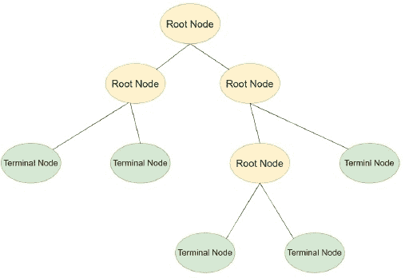 **图. (2.1)**

决策树算法。

决策树有时被称为分类回归树 (CART)，因为它们被用于两种上下文：回归和分类。

### 2.2.2. 算法框架

如前所述，决策树或 `CART` 用于两种不同的上下文：回归和分类。这种树形结构有一些特定的术语（如节点、叶子、分支等），在我们练习制作决策树之前，这些术语是重要的。记住，离散属性上的任何布尔函数都可以在决策树上表示。

#### 2.2.2.1. 决策树中使用的不同术语

* **根节点**：它是任何决策树的起点。根据数据集，根节点被进一步划分为两个或多个同质集。它是父节点。

* **叶子节点**：最终输出表示为叶子节点。叶子节点之后没有进一步划分。叶子节点也被称为子节点。

* **划分**：根据不同的条件将根节点或决策节点划分为子节点的过程称为划分。

* **分支或子树**：通过划分树形成的树。

* **剪枝**：从树中移除任何不同或不需要的分支称为剪枝。

除了一些术语外，在绘制任何决策树之前，我们还需要记住一些假设。下面提到了一些重要的假设：

* **假设 1**：初始时，根节点被认为是完整的训练。

* **假设 2**：完成了特征值的分类。记住，在构建模型之前，已对连续值进行了转换。

* **假设 3**：根据属性值完成了记录的分布。

* **假设 4**：我们使用统计方法将属性作为根节点或内部节点。

决策树被分为不同的层次。每一层都需要不同的属性。在形成决策树时，在每一层识别额外的属性是最具挑战性的任务。寻找不同属性的过程被称为属性选择。属性选择有两种主要方法。一种是信息增益，另一种是吉尼指数。

#### 2.2.2.2. 熵

测量随机变量的不确定性被称为熵。熵的值和信息内容的纯度是直接正比的，熵越高，价值内容越高 [4]。

熵的通用公式可以草拟为：

| 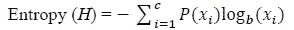 |

| --- |

让我们举一个例子来看我们如何找到熵：

假设有一个任何集合 `S = {x,x,x,x,y,y,y,y,y,y}`

总实例数 = 10

`x` 的实例数 = 4

`y` 的实例数 = 6

所以，熵将是：

| 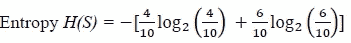 |

| --- |

### 2.2.2.1. 熵的用途

熵在我们绘制决策树时起着重要作用。通过熵，我们可以决定划分分支并做出决策的边界。熵值的范围在 0 到 1 之间；值越小越可信。

### 2.2.2.3. 信息增益

决策树可能会发生转换，这意味着决策树的熵会发生变化。熵的变化通过信息增益来计算。信息增益计算决策树在转换前和后熵的差异。通过信息增益，我们划分节点并构建决策树。

所有决策树的算法总是旨在增加信息增益的值。根据决策树形成的规则，信息增益最大的节点将是第一个被划分的。寻找信息增益的公式如下

`Information Gain= Entropy(S)-[(Weighted Average) * Entropy(each feature)]`

熵是一种量化给定属性纯度的测量系统。它假定了数据中的随机性。熵可以计算为：

`Entropy(s)= - P(TRUE)log[2] P(TRUE)- P(FALSE) log[2] P(FALSE)`

| --- |

其中，

• `S` = 总实例数

• `P(yes)`= TRUE 的概率

• `P(no)`= FALSE 的概率

信息增益还衡量根据给定条件形成子集导致决策树观察到的熵的变化。

#### 2.2.2.4. 吉尼指数

当我们选择一个元素时，存在该元素被错误识别的概率。因此，为了测量这种概率，我们有了吉尼指数。它是一种指标结构——吉尼指数值越低，对随机选择元素的偏好越高。

计算吉尼指数的公式如下：

| 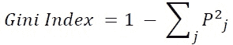 |

| --- |

#### 2.2.3. 实践示例

##### 2.2.3.1. 借助信息增益构建决策树

### 2.2.3.1.1. 要求

**a.** 最初，我们将关注于根节点提供的训练术语。

**b.** 用于检索信息增益的信息标签节点。属性不能重复。

**c.** 为将沿着训练树路径分类的训练事件子集中的每个子集创建一个摘要。

### 2.2.3.1.2. 边界情况

**a.** 如果剩余的都是正或负训练示例，则相应地将节点标记为“TRUE”或“FALSE”。

**b.** 在属性缺失，用剩余训练事件中票数最多的类别来标记节点。

**c.** 如果没有剩余实例，则用父节点训练实例中票数最多的类别标记节点。

### 2.2.3.1.3. 篮球数据

下表（表 **2.1**）显示了某个假设的篮球比赛的示例数据。

表 2.1 **篮球数据。**

| **地点** | **时间** | **Fred 开始** | **Joe 进攻** | **Joe 防守** | **对手** | **结果** |

| --- | --- | --- | --- | --- | --- | --- |

| 主场 | 7pm | 是 | 中卫 | 前锋 | 高 | 赢 |

| 主场 | 7pm | 是 | 前锋 | 中卫 | 短 | 赢 |

| 客场 | 7pm | 是 | 前锋 | 前锋 | 高 | 赢 |

| 主场 | 5pm | 否 | 前锋 | 中卫 | 高 | 输 |

| 客场 | 9pm | 是 | 前锋 | 前锋 | 短 | 输 |

| 客场 | 7pm | 否 | 中卫 | 前锋 | 高 | 赢 |

| 主场 | 7pm | 否 | 前锋 | 中卫 | 高 | 输 |

| 主场 | 7pm | 是 | 中卫 | 中卫 | 高 | 赢 |

| 客场 | 7pm | 是 | 中卫 | 中卫 | 短 | 赢 |

| 主场 | 9pm | 否 | 前锋 | 中卫 | 短 | 输 |

| … | … | … | … | … | … | … |

我们所知的信息：

*   我们知道比赛将在晚上 9 点在“客场”进行，且“Joe”将在进攻端担任中卫（表 **2.2**）。

*   这是一个分类侧，如图 (**2.2**) 所示，我们可以看到是如何根据决策推导出观察结果的。

*   将学习到的规则推广到新示例。

表 2.2 **检查决策树的测试用例。**

| **地点** | **时间** | **Fred 开始** | **Joe 进攻** | **Joe 防守** | **对手** | **结果** |

| --- | --- | --- | --- | --- | --- | --- |

| 客场 | 9pm | 否 | 中卫 | 前锋 | 高 | ? |

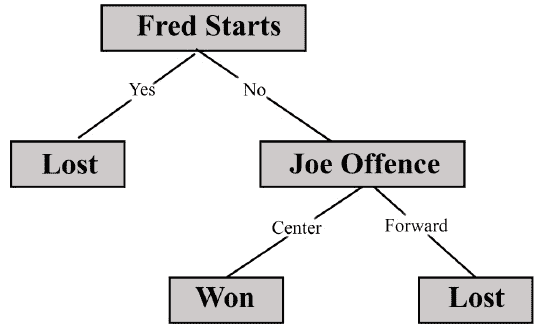 **图 (2.2)**

基于表 2.1 数据构建的决策树（中间层）。

我们必须提出三个问题：

i. 从哪个节点开始？（用于识别根节点）

ii. 继续使用哪个节点？

iii. 何时停止？（用于识别终止节点）

假设 `S` 有 25 个实例，15 个正例和 10 个负例 [15 (真类), 10 (假类)]。那么 `S` 对应于此分类的熵为：

| 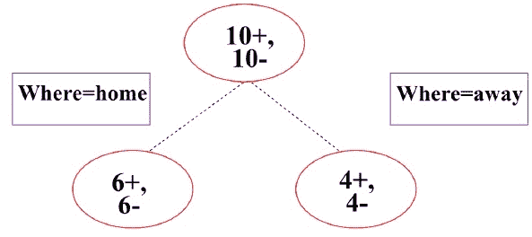 **图 (2.3)**

显示构建树过程的中间步骤。

*   在划分之前，熵为 `H(10/20, 10/20) = -10/20 log(10/20) - 10/20 log(10/20) = 1`

当我们使用 `where` 属性时，它分为 2 个子集，如图 (**2.3**) 所示。

| 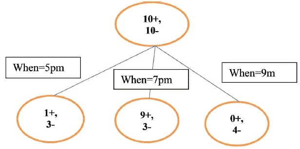 **图 (2.4)**

使用“When”子句构建树的中间步骤。

我们使用 `when` 属性，它将树分为三个子集，如图 (**2.4**) 所示：

| `。

### 2.2.3.1.5. 决策

在这里，我们看到信息增益的值大于使用 `when` 属性的 `where` 属性。因此，考虑 `when` 属性比选取 `where` 属性更好。同样地，我们应该计算其他属性的信息增益。如果是非终止节点，我们应该选择信息增益值更高的属性。

### 2.2.4. 决策树算法类型

在构建决策树之前，首先会使用一些决策树算法，我们应该对它们进行讨论。

1.  **迭代二分法器 3 (ID3):** 它利用信息增益来扩展决策树。在信息增益的帮助下，每个属性被分配给树中的一个子集。在该算法中，在树的每一层为剩余数据计算信息增益。

2.  **C4.5:** 在 `ID3` 之后，`C4.5` 是最常用的决策树算法。该算法可以使用信息增益或增益指数来分类所有属性并扩展树。该算法可以同时处理连续值和缺失属性值。

3.  **分类回归树 (CART):** 一种基于变量的回归树和分类树的动态学习算法。

### 2.2.5. 决策树的优缺点

### 2.2.5.1. 优点

*   生成可理解的规则

*   执行分类，所需计算较少

*   可以处理连续和类别变量

*   提供最准确的预测或分类

### 2.2.5.2. 缺点

*   在预测连续属性值的值方面有限

*   当训练示例较少且可用类别很多时，决策树容易产生错误

*   训练成本高昂。

### 2.2.6. 决策树的编程方法

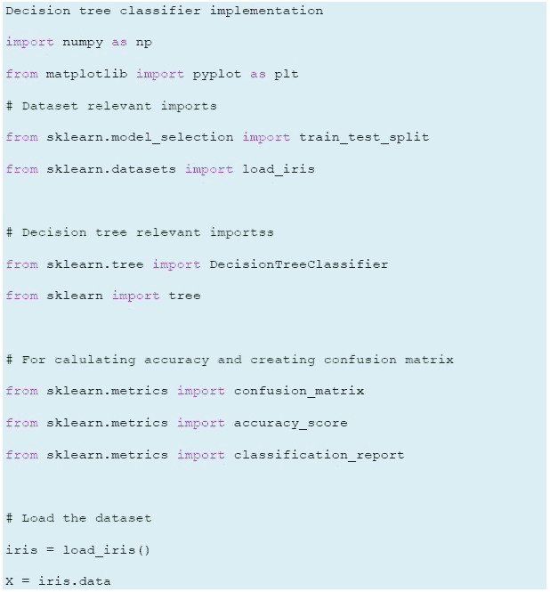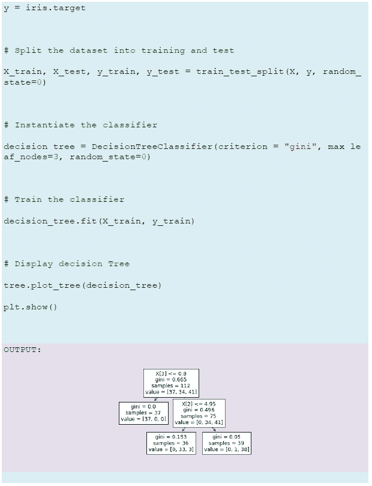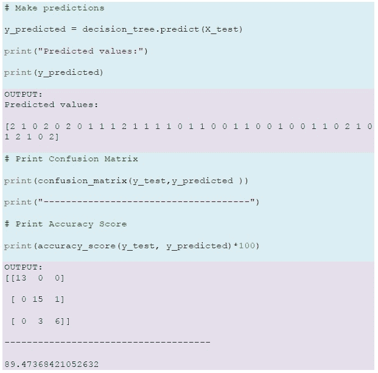

## 2.3. 随机森林

### 2.3.1. 概述

关于监督学习技术，随机森林是最受欢迎和最常用的算法之一。随机森林是在给定数据集的多个子集上具有许多决策树的分类器，并通过取平均值来提高预测精度。随机森林是一种用于机器学习分类和回归问题的算法。它们可以更快、更准确地解决多个复杂问题。

#### 2.3.2. 为什么使用随机森林？

使用随机森林有许多优点，以下是一些要点：

*   训练时间更短

*   输出高度准确

*   运行高效

*   即使在数据缺失的情况下也能获得准确的结果

### 2.3.3. 算法框架

无限数量树的组合在自然界形成了森林。同样，N 棵决策树在监督学习中创建了随机森林。随机森林算法更准确，因为解决方案不是基于单一树，而是基于树的数量。从所有可用树中获取估计并做出最终决策。森林中许多树的存在增加精度并防止过拟合问题。

阅读以下步骤以理解随机森林算法的完整流程：

**步骤-1:** 从可用训练集中选择随机数据集。

**步骤-2:** 从选定的数据点，我们现在构建一棵决策树。

**步骤-3:** 选择所有需要制作决策树。

**步骤-4:** 重复步骤 1 和步骤 2。

**步骤-5:** 对于新的数据点，找到每棵决策树的预测，并将最新的数据点分配给票数最多的类别。

示例：假设你有一个包含多个水果图像的数据集。因此，该数据集被输入到随机森林分类器中。数据被划分为若干子集，每棵树中都提供一个决策。在训练阶段，每棵决策树都会产生一个预测结果。根据大多数产品，当新数据点到达时，随机森林分类器预测最终决策。考虑以下图像。


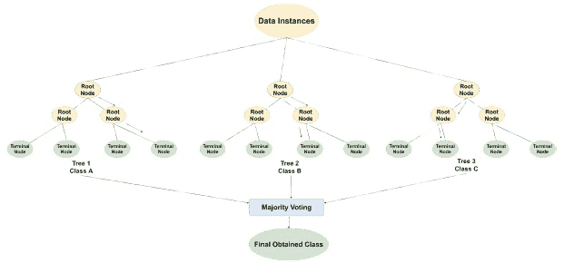 **图 (2.5)**

随机森林算法。

### 2.3.3.1. 随机森林的假设

在汇总 `N` 棵决策树的输出时，不同的决策树预测不同的输出。某些输出可能是正确的，某些可能是错误的，但随机森林指示了最准确的输出。因此，为了获得准确的随机森林预测，应该遵循两个假设：

i. 数据中的特征变量必须具有某些实际值，以便分类能够预测精确的结果而不是预期结果。

ii. 每个植物的估计值应该具有很低的相关性。

### 2.3.4. 随机森林的优缺点

### 2.3.4.1. 优点

* 可以执行随机森林分类和回归函数。

* 随机森林可以处理高维的大型数据集。

* 这增加了模型的准确性并避免了最优性问题。

### 2.3.4.2. 缺点

随机森林算法可以同时用于分类和回归任务，但它不太适用于回归操作。

**随机森林主要用于我们社会的四个领域**

1. 银行：主要用于贷款风险识别。

2. 医学：识别疾病的严重程度。

3. 土地利用：识别相似的土地。

4. 营销：识别正在持续的趋势。

### 2.3.5. 随机森林的编程方法

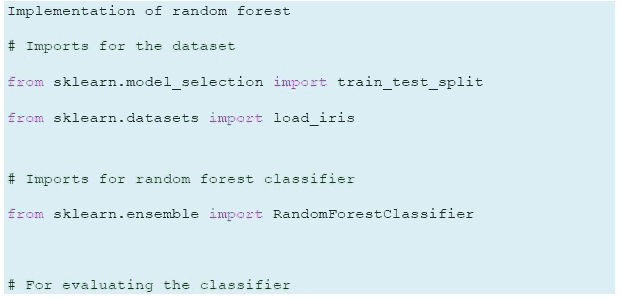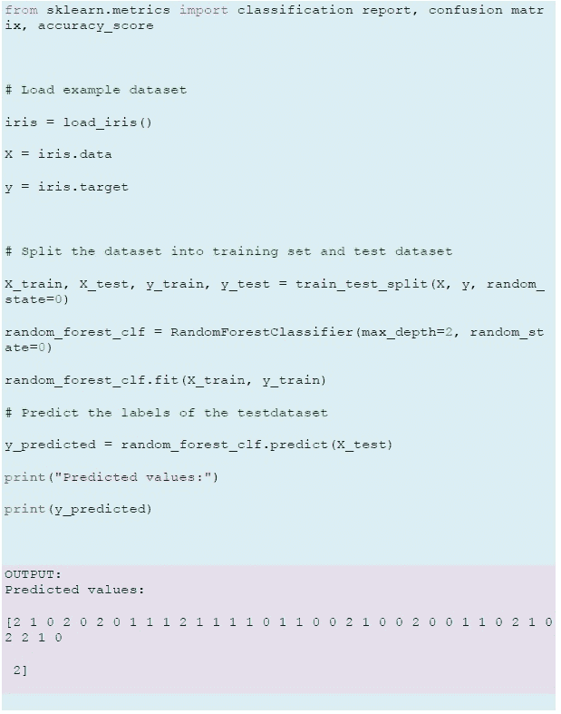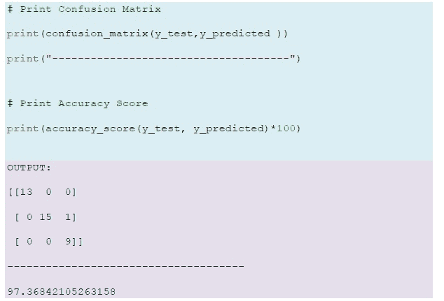

## 2.4. K 近邻算法 (KNN)

### 2.4.1. 概述

1951 年，Evelyn Fix 和 Joseph Hodges 开发了一种名为 K-近邻（KNN）的非参数分类算法。

KNN 算法可用于分类和回归问题。在 KNN 算法中，输入应该有 'k' 个最近的训练示例，但输出完全取决于问题类型。

分类问题的输出始终是一个类成员。对象通过多个邻居进行排序，这些邻居被分配给最近邻居中出现常见的对象类别（`K` 是一个正整数，通常很小）。如果 `k = 1`，对象仅服务于最近的相邻方格。

如果你有一个回归问题，输出对象具有一个属性值。该值是最近邻居值的平均值。KNN 设计用于使用现有数据中最近 `K` 个邻居的信息来预测新数据。

KNN 没有可以被称为“学习”的过程。这是因为当新数据进入时，仅通过测量现有数据之间的距离来选择邻居。这就是为什么一些人将 KNN 称为懒惰模型，意味着他们并不单独构建模型。它也被稍微礼貌地称为基于实例的学习。这是一个与基于模型的学习相对的概念，后者从数据中创建模型并执行任务，而前者旨在仅使用每个观测值执行诸如分类/回归等任务，而没有单独的模型创建过程 [5]。

KNN 的超参数，即 *i.e.*, *K,* 使用了一种方法来衡量两个距离。如果 `K` 较小，数据模型更有价值。反之，如果它太大，模型就会欠拟合。`K` 的大小简化了分类的范围。

然而，应该注意的是，KNN 算法并不直接创建这些接口，它在给定新数据时可视化地显示哪些类别被归类。

### 2.4.2. 我们在什么时候使用 KNN 算法？

我们现在知道 KNN 可以用于分类和回归问题。尽管如此，它更有可能用于更大规模的分类问题。KNN 从三个主要方面进行评估：

1. 输出的易于解释性

2. 计算输出的时间

3. 预测准确输出的能力

### 2.4.2.1. 距离指标

KNN 是一种结果很大取决于距离测量方法的算法。让我们来看几个。

* **欧几里距离 (Euclidean Distance)**

这是最常用的距离测量方法——两个观测值之间的最短直线距离。

| 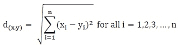 |

| --- |

例如，在下方的图 (**2.6**)中，我们看到一条连接点 A 和 B 的直线：

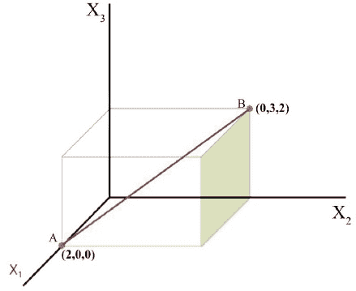 **图 (2.6)**

`X1`、`X2` 和 `X3` 轴上的两点（A 和 B）。

| 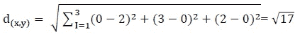 |

| --- |

* **曼哈顿距离 (Manhattan Distance)**

当仅沿每个轴的方向从 A 移动到 B 时计算的距离。要从一栋建筑到另一栋建筑，必须沿着曼哈顿路径，这种方法被称为字形距离。

| 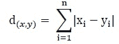 |

| --- |

* **马哈拉诺比距离 (Mahalanobis Distance)**

该方法通过考虑变量之间的协方差来计算距离。它是考虑变量性的性的指标。

| 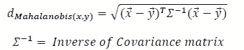 |

| --- |

如果你将 `x` 和 `y` 设置为 `c`，`(0,0)`，可以写出上述方程。它是椭圆的形式。

| 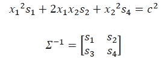 |

| --- |

* **相关距离 (Correlation Distance)**

直接使用数据的皮尔逊相关作为距离的衡量。它是跨数据趋势而非单个观测值的衡量。也就是说，相关系数范围从 -1 到 1，因此相关距离范围从 0 到 2。如果为 0，你可以认为两个数据的模式非常相似。

| 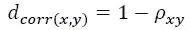 |

| --- |

如果协方差矩阵变为单位矩阵，马哈拉诺比距离等同于欧几里距离。

* **秩相关距离 (Rank Correlation Distance)**

直接使用数据的斯皮尔曼相关作为距离的衡量。其余特征与相关距离相同。

| 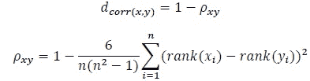 |

| --- |

假设，例如，每个地区的季节性排名如下，表 **2.3** 所示：

表 2.3 三个城市的季节性排名。

| **区域** | **春季** | **夏季** | **秋季** | **冬季** |

| --- | --- | --- | --- | --- |

| 首尔 | 3 | 1 | 2 | 4 |

| 纽约 | 3 | 1 | 2 | 4 |

| 悉尼 | 2 | 4 | 3 | 1 |

因此，首尔和纽约之间的秩相关距离如下：

| 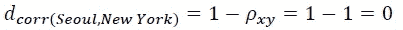 |

| --- |

| 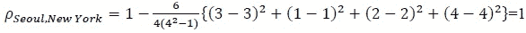 |

| --- |

#### 2.4.3. 如何选择 K 值？

最佳 K 值是特定于数据的，因此你需要贪婪地寻找它。K 值在 KNN 算法中起着重要作用，因此必须精确地选择 K 值。

以下是选择算法 K 值时需要考虑的几点：

* 选择特定 K 值的第一步是尝试。你必须放置不同的值以获得其中最准确的值。5 是最受青的 K 值。

* 像 `1` 或 `2` 这样的低值较不受欢迎，因为它们会在最终输出中产生噪声并影响模型的准确性。

* 发现较大的 `K` 值是合适的，但在某些情况下可能会观察到一些困难。

此外，为了找到最佳的 `K`，我们将训练数据和验证数据分开；必须在更改 `K` 值值的同时进行实验。

### 2.4.4. 算法框架

### 2.4.4.1. K-NN 如何工作？

以下算法描述了 `KNN` 函数。

* 步骤 1：为邻居选择一个 `K` 值。

* 步骤 2：计算 `K` 个邻居的欧式距离。

* 步骤 3：根据计算出的欧式距离获取最近的 `K` 个邻居。

* 步骤 4：统计这 `K` 个邻居中每个数据点的数量。

* 步骤 5：在邻居最多的范围内分配一个新的数据点。

* 步骤 6：模型准备就绪。

### 2.4.4.2. KNN 伪代码

下一步描述了 `KNN` 模型的实现：

* 步骤 1：加载数据

* 步骤 2：给出 `K` 值。

* 步骤 3：为了获得近似评分，迭代应从 `1` 运行到加载点数的最后一个数字。

    1. 测量测试数据每一行与训练数据之间的距离。这里，欧式距离是最广泛使用的方法，因此我们使用距离作为指标。你可以使用的其他指标包括 `Chebeshev`、`cosine` 等等。

    2. 根据计算出的欧式距离获取最近的 `K` 个邻居。

    3. 统计这 `K` 个邻居中每个数据点的数量。

    4. 在邻居最多的范围内分配一个新的数据点。

## 2.4.5. K-邻域算法的编程方法


## 2.5. 朴素贝叶斯分类器

### 2.5.1. 概述

`Naive Bayes` 分类器是一种基于 `Bayes' Theorem` 的方法。`Naive Bayes` 分类器假设特征是独立的。例如，一个网球可能是绿色的，大约 `55` 克，长 `100` 厘米。

`Naive Bayes` 分类器用于分类数据。`Naive Bayes` 分类器用于分类数据。`Naive Bayes` 分类器用于分类数据。`Naive Bayes` 分类器用于分类数据。`Naive Bayes` 分类器用于分类数据。`Naive Bayes` 分类器用于分类数据。`Naive Bayes` 分类器用于分类数据。`Naive Bayes` 分类器用于分类数据。`Naive Bayes` 分类器用于分类数据。`Naive Bayes` 分类器用于分类数据。`Naive Bayes` 分类器用于分类数据。`Naive Bayes` 分类器用于分类数据。`Naive Bayes` 分类器用于分类数据。`Naive Bayes` 分类器用于分类数据。`Naive Bayes` 分类器用于分类数据。`Naive Bayes` 分类器用于分类数据。`Naive Bayes` 分类器用于分类数据。`Naive Bayes` 分类器用于分类数据。`Naive Bayes` 分类器用于分类数据。`Naive Bayes` 分类器用于分类数据。`Naive Bayes` 分类器用于分类数据。`Naive Bayes` 分类器用于分类数据。`Naive Bayes` 分类器用于分类数据。`Naive Bayes` 分类器用于分类数据。

### 2.5.1.1. 条件概率

### 2.5.1.2. 计算先验概率和条件概率

#### 使用朴素贝叶斯进行预测

我们已经通过概率和概率分布的概念理解了朴素贝叶斯（Naïve Bayes）算法的工作原理。让我们预测一个足球比赛的示例数据集（如表 2.4 所示），该比赛包含三个属性：场地（Field）为主场和客场；队伍（Team）在国内和国际；结果（Outcome）或目标类别为胜利和失败。

表 2.4 足球比赛数据 1。

| 场地 (Field) | 队伍 (Team) | 结果 (Outcome) |

| --- | --- | --- |

| Home | Domestic | Win |

| Away | International | Win |

| Home | Domestic | Win |

| Home | Domestic | Win |

| Home | Domestic | Win |

| Away | International | Defeat |

| Away | International | Defeat |

| Home | Domestic | Defeat |

| Home | International | Defeat |

| Away | International | Defeat |

我们将一些类别值转换为数字。每个实例的输入带有两个值，目标类别也有两个值。因此，将每个类别值转换为二分类值，我们得到：

| 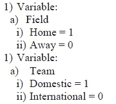 |

| --- |

| 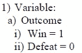 |

因此，我们可以重新表述数据集，如表 2.5 所示：

表 2.5 足球比赛数据 2。

| 场地 (Field) | 队伍 (Team) | 结果 (Outcome) |

| --- | --- | --- |

| 1 | 1 | 1 |

| 0 | 0 | 1 |

| 1 | 1 | 1 |

| 1 | 1 | 1 |

| 1 | 1 | 1 |

| 0 | 0 | 0 |

| 0 | 0 | 0 |

| 1 | 1 | 0 |

| 1 | 0 | 0 |

| 0 | 0 | 0 |

让我们尝试使用朴素贝叶斯定理进行预测：

| 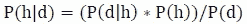 |

| --- |

其中：

- `P(h|d)` = 在给定数据 `d` 下，假设 `h` 的概率，也称为后验概率。

- `P(d|h)` = 当给定假设 `h` 为真时，数据 `d` 出现的概率。

- `P(h)` = 假设 `h` 为真时的概率，也称为 `h` 的先验概率。

- `P(d)` = 数据的概率。

事实上，我们不需要为新数据值预测某个类别的可能性。唯一需要的是分子以及响应最广泛的类别，即预测目标类别。

| 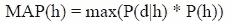 |

| --- |

首先，让我们从数据提取记录，并使用训练好的模型判断它们属于哪一类。

`weather = Home, car = Domestic`

为了模型的潜力，我们连接两个类别并计算响应。输出以“Win”（胜利）响应开始。将条件概率相乘并乘以类别权重。

`Win = P(Field=Home|Win) * P(Team=Domestic|Win) * P(Output=Win)`

`Win = 0.8 * 0.8 * 0.5 = 0.32`

让我们使用精确计算寻找“Defeat”（失败）类：

`Defeat = P(Field=Home|Defeat) * P(Team=Domestic|Defeat) * P(Output=Defeat)`

`Defeat = 0.4 * 0.2 * 0.5 = 0.04`

我们看到 `0.32` 大于 `0.04`，因此我们可以很容易地预测输出类别为“Win”。

### 朴素贝叶斯的优缺点

#### 优点

1. 它简单、快速且准确，即使对于多分类预测也是如此。

2. 朴素贝叶斯分类器与逻辑回归等其他模型相比良好，需要的训练数据较少。

3. 该算法对类别变量的效果优于数值变量。对于数值变量，它假设符合正态分布。

#### 缺点

1. 如果在训练数据集中找不到类别变量，模型将分配零概率且无法进行预测。这通常被称为“零频率”。要解决这个问题，可以使用平滑技术。一种简单的平滑方法是拉普拉斯估计。

2. 另一方面，朴素贝叶斯也被称为糟糕的预测器，因此输出概率不被认为是可靠的。

3. 朴素贝叶斯的另一个局限性是对独立预测变量的理解。在现实生活中，几乎不可能获得一组完全独立的预测变量。

### 使用朴素贝叶斯的贴士

#### 1. 用于复杂部署的 KDE

假设变量的潜在分布复杂或未知。在这种情况下，最好是使用核密度估计器或 `KDE` 直接从数据中估计分布。

#### 2. 持续连续性导致的性能下降

朴素贝叶斯根据定义假设输入变量之间是相互独立的。大多数变量依赖于现实，但通常效果良好。然而，算法效率会降低，因为它更依赖于输入变量。

#### 3. 使用 Log 防止数值下溢

为了计算某类实例的各个单独条件概率，您需要组合多个可能性（每个类别一个，每个输入变量一个）。同样地，多个极小数字的乘积可能会在数学上变得不稳定，特别是当输入变量数量激增时。为了解决这个问题，可以很容易地将求和改为对数转换。

例如：

| 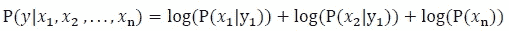 |

| --- |

对概率取自然对数产生一个很大的（负）数，并加上这些数字使概率接近零。这通常被称为概率的对数技巧。

#### 4. 更新概率分布

当新数据可用时，可以相对容易地使用新数据和旧数据来更新参数估计。这允许模型轻松访问随时间变化的分布。

#### 5. 作为生成模型使用

概率分布总结了每个类别下每个输入变量的条件概率。这些概率对于分类模型非常有帮助。例如，您可以从分布中随机采样创建新的实例。假设的条件意味着可以根据实际的依赖关系提供更多或更少的示例。

### 朴素贝叶斯分类器的编程方法

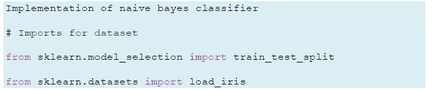Images/9781681089409-C2-F8a.jpg)^(Images/9781681089409-C2-F8b.jpg)

# 支持向量机

#### 概述

“支持向量机”（`SVM`）是一种可以同时用于分类和回归类挑战的算法。尽管如此，它更倾向于用于分类模型。在使用 `SVM` 算法时，考虑 N 维空间中的单个数据点，每个特征的值是特定坐标的值。它通过产生巨大差异的超平面来寻找并分类数据点。

支持向量是支撑超平面的数据点。图 2.7 显示了支持向量机的基本原理。`SVM` 的魅力在于它是基于卓越且坚实的理论背景设计的良好的机器学习算法。该算法的魔力在于它是实用的，因为可以用多种方式实现，并具有实用的函数 [6]。

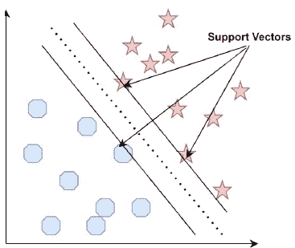 **图 (2.7)**

支持向量机。

`SVM` 需要解决的问题是当需要使用决策边界划分数据空间时。

让我们取两个样本输入，`+` 和 `-`，现在考虑如何将它们分为两类（图 2.8）。一旦我们画出一条能等平分这两个数据点的线，最简单的方法就是画一条线，使两个数据样本与该线之间保持相等且宽阔的距离。这条线应该与数据点保持尽可能全面的距离。在图 (2.9) 中，我们假设画出的线是虚线，那么虚线与通过最近数据点的实线之间的距离应该是宽阔的。

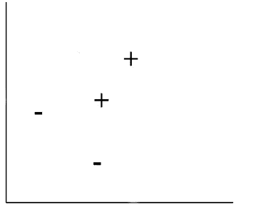 **图 (2.8)**

两种类型的数据点（`+` 和 `-`）。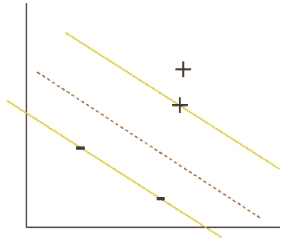 **图 (2.9)**

试图根据支持向量分离这些点的超平面。

即使是一个直观的解决方案，也看似是一个简单的问题。然而，将这个问题的答案泛化为严谨且逻辑严密的理论并不简单。SVM 是一种寻找所需问题解决方案的静态方法。

### 2.6.1.1. 决策规则


首先，让我们理解确定边界限制的决策规则的本质。画一个向量 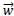，这是一个垂直于中心线的向量。

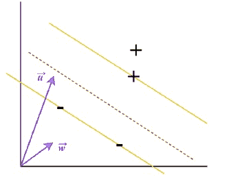 **图 (2.10)**

根据决策规则画出直线。

最奇的部分是，当存在另一个向量 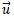 时，我们不知道它的位置，是在右侧还是左侧。因此，我们在这里可以采取的方法是放入  和 ，并使用点积查看其值是否比任何常数 `c` 都显著（.≥ `c`）。

| 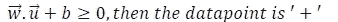 |

| --- |

逻辑非常直观。理解内部机制意味着将  投影到  上。考虑到它的长度很容易理解，所以如果你越过了边界，它就属于右侧，否则属于左侧（图 2.10）。

因此，上述公式变成了决策规则。这也是我们理解 SVM 需要的第一个工具。但仍然有很多缺陷。然而，我们并不知道  应该如何确定，公式中的 `b` 又应该如何确定。仅仅知道  垂直于中心线是不够的。

不幸的是，这样的  **图 (2.11)**

识别超平面的。

最关键的规则是：“正确的超平面是分离两个类的那个”。因此，在案例 1 中，是超平面 B。

**案例 2**：同样，我们有三个超平面 B、C。 **图 (2.12)**

选择正确的超平面。

我们寻找距离任意数据点的最大距离（图 2.12）。所以是超平面 C。

**案例 3：使用以下内容** **图 (2.13)**

**案例 4：我们可以对这些进行分类吗？**下方是一个超平面（图 2.14）。 **图 (2.14)**

**案例 5：寻找超平面**：下方是一个超平面（图 2.15）。 **图 (2.15)**

核函数技巧（kernel trick）并不是 `SVM` 的一部分。它可以用于其他线性分类，如逻辑回归。支持向量机仅负责寻找边界。

### 2.6.3.1. 选择核函数

当我们准备好特征向量后，需要选择一个学习模型的核函数。每个问题都是不同的，核函数也取决于数据。在本例中，数据由同心圆组成，因此我们选择了一个匹配这些数据点的核。这三种算法，即 `SVC`、`NuSVC` 和 `LinearSVC`，对于单个数据集上的二分类和多分类非常有帮助。如图 (2.19) 所示，在鸢花（Iris）数据集上发现了有效的核。

`SVC` 和 `NuSVC` 的方式相同，但它们接受的参数集略有不同，并有各种数学计算。另一方面，对于线性核，你可以更快地实现 `lineRSVC` 支持向量分类。`linearSVC` 参数假设它是线性的，因此它不允许使用核函数。`SVC` 和 `NuSVC` 缺少一些特性，例如支持向量等。与其他分类器一样，`SVC`、`NuSVC` 和 `LinearSVC` 接受两个数组作为输入。即包含训练模式的尺寸数组 `X` 和包含标签的尺寸数组 `Y`。

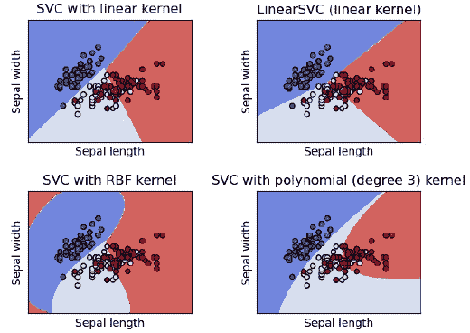 **图 (2.19)**

使用鸢花数据的各种核。

如果你在不同领域使用 `SVM`，你可以使用数百个特征。同时，NLP 分类器使用数千个特征，以确保训练数据中出现的每个词最多对应一个词。这稍微改变了问题。虽然在其他方面使用非线性核可能是一个好主意，但这些特征中的许多使得非线性核数据更有用。因此，最好只坚持使用老牌线性核，在这种情况下，你可以获得良好的性能。

### 2.6.4. 支持向量机的优缺点

### 2.6.4.1. 优点

1. 在高维空间中十分准确，即使在维度很多且样本量很大的情况下也是。

2. 内存高效。

3. 多功能性：可以为决策指定各种核特性。提供了一个通用的核，但你也可以选择自定义的核。

### 2.6.4.2. 缺点

1. 如果特征数量超过样本数量，那么归一化后的数据对于选择核函数以避免过拟合至关重要。

2. `SVM` 不直接预测概率，而是使用昂贵的 5 折交叉验证进行计算。

### 2.6.5. 支持向量机的编程方法

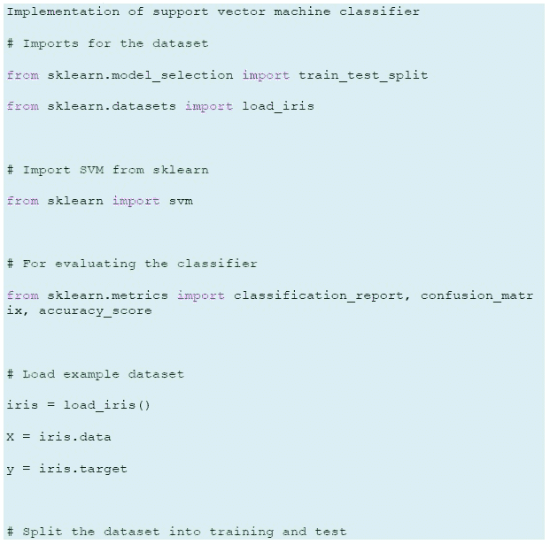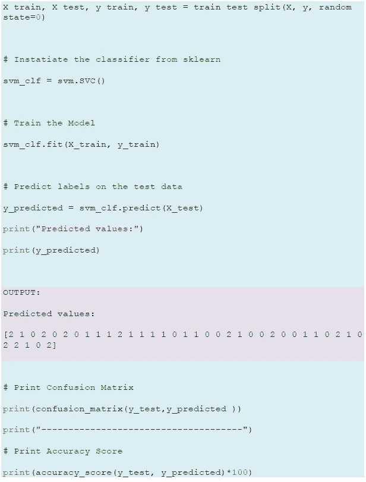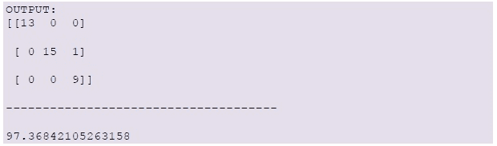

## 结语

本章介绍了监督学习机器学习算法。本章解释了流行的树算法，如决策树、随机森林、K 近邻、朴素贝叶斯分类器和支持向量机。每个算法都从概述开始，然后通过算法框架和实践示例进行描述。每个算法的末尾都提供了详细的 Python 程序，以便对分类的功能行为有实际的理解。Python 代码在真实数据集上执行，最终为读者提供了算法应用的深度知识。

## 参考文献

| | | |

| --- | --- | --- |

| [1] | Russell S., Norvig P.. Artificial intelligence: a modern approach.3rd edPearson2011 |

| [2] | 2021[`www.govtech.com/computing/understanding-the-four-types-of-artificial-intelligence.html`](https://www.govtech.com/computing/understanding-the-four-types-of-artificial-intelligence.html) |

| [3] | Theobald O.. Machine Learning For Absolute Beginners: A Plain English Introduction2017 |

| [4] | Fenner M.. Machine learning with Python for Everyone.Addison-Wesley Professional2019 |

| [5] | Theobald O.. Machine Learning For Absolute Beginners: A Plain English Introduction2017 |

| [6] | Conway D., White J.M.. Machine Learning for Hackers: Case Studies and Algorithms to Get You Started.1st edO’Reilly2012 |

| [7] | Mueller J.P., Massaron L.. Data Science Programming All-in-One For Dummies.1st edFor Dummies2020 |

| [8] | [`ml-cheatsheet.readthedocs.io/en/latest/linear_regression.html#making-predictions`](https://ml-cheatsheet.readthedocs.io/en/latest/linear_regression.html#making-predictions) |

| [9] | [`www.javatpoint.com/linear-regression-in-machine-learning`](https://www.javatpoint.com/linear-regression-in-machine-learning) |

| [10] | Brownlee J.. Linear Regression for Machine Learning |

| [11] | 2021 |

| [12] | Ye A.. Markov process in reinforcement learning |

| [13] | Choudhary A.. Nuts of Reinforcement: Dynamic Programming |

| [14] | Paul S.. An introduction to Q-: Reinforcement Learning |

| [15] | Howard J., Gugger S.. Deep Learning for Coders with Fastai and PyTorch. |

| [16] | Kdnuggets.. The 8 neural network architectures researchers need to learn |

| [17] | [`developer.ibm.com/technologies/artificial-intelligence/articles/cc-learning-deep-learning`](https://developer.ibm.com/technologies/artificial-intelligence/articles/cc-learning-deep-learning) |

| [29] || Meena S.. 用于分析和数据科学的统计学：假设检验与 Z 检验 vs T 检验 2020[`www.analyticsvidhya.com/blog/2020/06/statistics-analytics-hypothesis-testing-z-test-t-test/`](https://www.analyticsvidhya.com/blog/2020/06/statistics-analytics-hypothesis-testing-z-test-t-test/) |

| [30] || Thakur M.. Z 检验 vs T 检验 2021[`www.wallstreetmojo.com/z-test-vs-t-test/`](https://www.wallstreetmojo.com/z-test-vs-t-test/) |

| [31] || 2021[`www.statisticshowto.com/probability-and-statistics/hypothesis-testing/anova/`](https://www.statisticshowto.com/probability-and-statistics/hypothesis-testing/anova/) |

| [32] || MANOVA[`www.statisticssolutions.com/free-resources/directory-of-statistical-analyses/manova/?\_\cf\_chl\_jschl\_tk\_\_=pmd\_16d7d4fa1acf6d3f445cd2769d8972412bcb64ea-1626714547-0-gqNtZGzNAg2jcnBszQki`](https://www.statisticssolutions.com/free-resources/directory-of-statistical-analyses/manova/?__cf_chl_jschl_tk__=pmd_16d7d4fa1acf6d3f445cd2769d8972412bcb64ea-1626714547-0-gqNtZGzNAg2jcnBszQki) |

| [33] || [`www.geeksforgeeks.org/chi-square-test-for-feature-selection-mathematical-explanation/`](https://www.geeksforgeeks.org/chi-square-test-for-feature-selection-mathematical-explanation/) |

| [34] || [`www.geeksforgeeks.org/ml-chi-square-test-for-feature-selection/`](https://www.geeksforgeeks.org/ml-chi-square-test-for-feature-selection/) |

| [35] || [`www.geeksforgeeks.org/introduction-to-ant-colony-optimization/`](https://www.geeksforgeeks.org/introduction-to-ant-colony-optimization/) |

| [36] || Segaran T.. 编程集体智能：构建智能 Web 2.0 应用程序。第 1 版 O’Reilly Media2007 |

| [37] || Géron A.. 基于 scikit-learn、keras 和 tensorflow 的机器学习实战：构建智能系统的概念、工具和技术。第 2 版 O’Reilly Media2021 |

# 无监督机器学习：聚类

**Indranath Chatterjee**

## 摘要

本章作为无监督机器学习算法的一部分，向读者介绍了聚类算法。本章描述了先进的聚类算法。本章对 k-means 聚类、层次聚类和自组织映射进行了详尽的定义。它还通过带有详细 Python 代码和输出的操作示例，定义了每种算法的算法框架。

**关键词：** 聚类、层次聚类、K-means 算法、机器学习、自组织映射、无监督学习。

## 3.1. 无监督机器学习简介

无监督机器学习算法主要用于训练，而使用的信息未经过分类或标记。无监督研究引发了对系统如何确定解释无标记数据中隐藏结构的能力的研究。系统并不寻找正确输出，但它可以探索数据并搜索数据空间，以解释数据中的隐藏结构并对其进行标记。

### 3.1.1. 什么是聚类？

在 19 世纪 50 年代，伦敦医生约翰·斯诺（John Snow）绘制了一张绘制霍乱死亡人数的地图。通过这些地图的帮助，他发现大多数死亡发生在水井附近。因此，这张地图同时揭示了问题和解决方案。

聚类是一项基础任务，它根据 `n` 个数据点之间的相似性和差异性对其进行区分。从散乱的数据中形成较小的组，称为簇（cluster）。一个簇中的点彼此相似，但与另一个簇中的点不同。

聚类是一种独特的方法，帮助我们在所有可用的分散数据中识别出组。在给定的数据集上执行聚类没有固定的模式或步骤。用户可以根据自己的需求自由使用偏好的聚类方法。聚类算法会根据提供的数据做出一些假设，并据此形成簇 [5]。

### 3.1.2. 聚类方法的类型

针对不同的可用数据，可以使用几种聚类方法：

1. **基于密度的方法**：这是合并两个不同簇的最佳方法之一，因为此类方法只考虑具有相似点的稠密簇。不同的点位于同一空间中的低密度区域。`DBSCAN` 和 `OPTICS` 是其中的一些示例。

2. **基于层次的方法**：基于层次的方法形成一种树形结构，利用之前形成的数据来形成所有新簇。该方法分为两类：

- 凝聚聚类（自底向上）

- 分裂聚类（自顶向下）

`CURE` 和 `BIRCH` 是一些示例。

3. **划分方法**：这些方法的工作方式不同，因为可用数据被划分为 k 个簇。类似于 `k-Means`，`CLARANS` 是其中一个示例。

4. **基于网格的方法**：这些方法非常快，因为整个数据空间被划分为较小的单元格（如网格）。`Sting` 和 `clique` 是一些示例。

### 3.1.3. 聚类的现实应用

聚类：

- **自然灾害**：对地震和海啸等灾害的研究有助于我们确定危险区域。

- **营销**：有助于发现客户细分。

- **城市规划**：有助于住房和其他基础设施建设。

- **保险**：有助于识别欺诈行为。

- **生物学**：有助于识别不同的动植物物种。

- **图书馆**：有助于书籍的分类。

## 3.2. K-MEANS 聚类

### 3.2.1. 概述

与监督学习不同，k-means 聚类是一种无监督学习算法。在 k-mean 聚类中，我们将一组数据划分为不同的簇。每个簇都有相似的数据且排列密集，而不相似的数据则远离该特定簇。通过性质和特征检查数据的相似性和差异性。k-mean 聚类中的 `k` 代表要形成的簇的数量。有多种方法可以寻找最优 `k` 值。

k-mean 聚类的示例：

- 分类文章（例如谷歌新闻）

- 分类具有相似味觉的人

- 识别高风险健康问题的患者

- 从普通人中分类罪犯

### 3.2.2. 算法框架

正如上一节所讨论，K-Mean 是解决聚类问题最简单的方法之一。因此，现在有必要深入理解 K-Mean 算法。

### 3.2.2.1. K-means 算法简介

在 K-Mean 聚类算法中，首先计算给定数据的最优质心。这是通过迭代方法实现的。这里的第一个假设是已知 `K` 值，即簇的数量。这种算法类型也称为扁聚类算法 [6]。

K-Mean 聚类算法根据数据点与质心之间的距离设计。当数据点与质心的平方距离最小时，将数据放入簇中。因此，换句话说，簇内数据点之间的变异越小，越相似。

### 3.2.2.2. K-means 算法的工作原理

以下步骤将帮助我们理解 K-Mean 聚类的算法：

### 步骤 1

– 最初，我们通过此算法生成 `K` 的值。

### 步骤 2

– 然后，我们根据数据点的数量进行数据分类。

### 步骤 3

– 算法将计算簇的质心。

### 步骤 4

– 继续迭代直到找到最佳质心。此时数据点与质心之间的距离不再发生变化。

首先，计算数据点与质心（中心）之间的距离平方和。现在，将每个数据点分配到最近的簇。最后，对该簇中的所有数据点取平均值，并计算该簇的质心。


K-means 遵循期望-极大化（Expectation-Maximization）方法来解决该问题。期望步（Expectation-step）用于将数据点分配到最近的簇，而极大步（Maximization-step）用于计算每个簇的质心。

在使用 K-means 聚类算法时存在一些局限性：

- 由于 K-means 聚类使用距离来形成簇，因此为了获得更好且更相关的结果，会对数据进行标准化处理。
- 分配随机的 `K` 值可能会导致算法无法达到全局最优。因此，建议使用不同的质心初始化方法。

### 3.2.2.3 K-means 聚类算法的应用

- 从我们处理的数据中生成有意义的直觉。
- 找到簇，然后为不同的子组预测将构建的模型。

K-means 聚类在许多现实平台中很有帮助，例如：

- 文档聚类
- 市场分割
- 图像分割
- 图像压缩
- 客户细分
- 分析动态数据的趋势

### 3.2.3 动手示例

以下是实现 K-means 算法的两个示例：

#### 动手数据方法示例

让我们通过一个小型数据集的简单示例来展示 `K=2` 的 k-means 算法实现（参考表 `3.1`）。

表 3.1 k-means 算法的样本数据集。

| Individual | Var 1 | Var 2 |
| --- | --- | --- |
| 1 | 1.0 | 1.0 |
| 2 | 1.5 | 2.0 |
| 3 | 3.0 | 4.0 |
| 4 | 5.0 | 7.0 |
| 5 | 3.5 | 5.0 |
| 6 | 4.5 | 5.0 |
| 7 | 3.5 | 4.5 |

**步骤 1：初始化**

- 这里，我们为两个簇随机选择两个质心（`k=2`）。开始时，`M[1]=(1.0,1.0)` 和 `M[2]=(5.0,7.0)`。我们可以在表 `3.2` 中看到变化。

表 3.2 第一次迭代后的数据。

| Individual | Var 1 | Var 2 |
| --- | --- | --- |
| 1 | 1.0 | 1.0 |
| 2 | 1.5 | 2.0 |
| 3 | 3.0 | 4.0 |
| 4 | 5.0 | 7.0 |
| 5 | 3.5 | 5.0 |
| 6 | 4.5 | 5.0 |
| 7 | 3.5 | 4.5 |

Group 1：数据点 1，平均坐标：(1.0, 1.0)

Group 2：数据点 2，平均坐标：(5.0, 7.0)

**步骤 2**

- 现在，我们获得了包含数据点 `{1,2,3}` 和 `{4,5,6,7}` 的两个不同簇。之后，新的质心为：

```
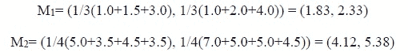
```

```
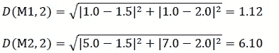
```

现在，我们将有一个新的质心表，其中两组数据点作为簇，如表 `3.3` 所示。

表 3.3 下次迭代后。

| Individual | Centroid1 | Centroid 2 |
| --- | --- | --- |
| 1 | 0 | 7.21 |
| 2 | 1.12 | 6.10 |
| 3 | 3.61 | 3.61 |
| 4 | 7.20 | 0 |
| 5 | 4.72 | 2.5 |
| 6 | 5.31 | 2.06 |
| 7 | 4.30 | 2.92 |

**步骤 3**

- 现在，使用这些质心，利用欧几里得距离计算距离，如下表所示。因此，新的簇为：`{1,2}` 和 `{3,4,5,6,7}`。下一个质心为 `m1=(1.25,1.5)` 和 `m2=(3.9,5.1)`，如表 `3.4` 所示。

表 3.4 步骤 3 后的数据。

| Individual | Centroid1 | Centroid 2 |
| --- | --- | --- |
| 1 | 1.57 | 5.38 |
| 2 | 0.47 | 4.28 |
| 3 | 2.04 | 1.78 |
| 4 | 5.64 | 1.84 |
| 5 | 3.15 | 0.73 |
| 6 | 3.78 | 0.54 |
| 7 | 2.74 | 1.08 |

**步骤 4**

- 现在，新簇为 `{1,2}` 和 `{3,4,5,6,7}`。因此，我们在数据点分配方面观察到簇没有变化。
- 算法在 `K=2` 时在此结束，最终获得了未变化的两个簇 `{1,2}` 和 `{3,4,5,6,7}`（图 `3.1`）。

```
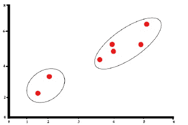图.(3.1)
```

k-means 算法后（`k=2`）最终选择的数据点。

表 3.5 步骤 4 后的数据集。

| Individual | Centroid1 | Centroid 2 |
| --- | --- | --- |
| 1 | 0.56 | 5.02 |
| 2 | 0.56 | 3.92 |
| 3 | 3.05 | 1.42 |
| 4 | 6.60 | 2.20 |
| 5 | 4.16 | 0.41 |
| 6 | 4.78 | 0.61 |
| 7 | 3.75 | 0.72 |

#### 编程方法示例

在这里，我们通过一个简单的动手示例来理解 k-means 如何运行。此示例改编自 TutorialPoint 网站。我们将首先生成包含不同簇的 2D 数据集，然后应用 k-means 算法。

- 首先，导入必要的包：

```
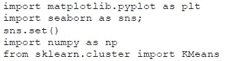
```

- 以下代码生成包含四个簇的 2D 数据：

```
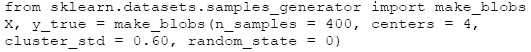
```

- 接下来，可视化数据集：

```
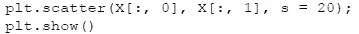
```

- 接下来，创建 `Kmeans` 类对象并提供簇的数量，训练模型并预测：

```
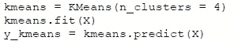
```

- 现在，绘制并可视化 k-means 算法选择的簇质心数据点：

```
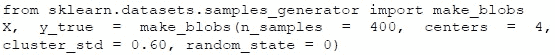
```

- 现在再次可视化数据集：

```
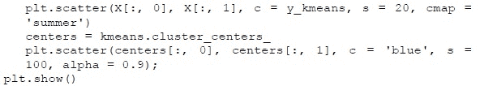
```

**基本步骤如下：**

```

```

- **读取数据**

读取数据作为输入文件（`data.txt`）。在该数据中，每行代表一个项目，其值为逗号分隔的数值。从任何开放源获取此类类型的 CSV 数据。

- **读取数据后，将其转换为列表。** 每个列表都是一个嵌套列表，包含每个特征的项目值。

```

```

```

```

- **均值的初始化**

```

```

- 这里 `minima` 和 `maxima` 是具有 `min` 和 `max` 值的列表元素。然后在 `min` 和 `max` 值的范围内随机初始化均值特征值。

```

```

```

```

- **欧几里得距离**

在下一步中，使用欧几里得距离作为相似性的距离度量。

```

```

- **更新均值**

在更新均值期间，计算簇内每个项目每个特征的平均值。要找到平均值，计算 `m`：

`m = (m * (n - 1) + x) / n`

其中 `m` = 均值；`n` = 簇内的项目数量；`x` = 每个特征的值。

```

```

- **项目的分类或分类**

为了对每个数据点进行分类，让我们找到给定数据点与每个均值之间的相似性。然后将它们每一个归类到最近的一个中。

```

```

- **寻找均值**

让我们编写嵌套循环来寻找所有数据点的均值，从而将每个点归类到它们最近的簇，并更新簇的均值。重复此过程，直到达到预定义的迭代次数，或者在指定的迭代次数后值未更新时，设置任何停止标准以终止程序。

|  |
| --- |
|  |

### 寻找聚类

最后，为了找到聚类，让我们遍历所有的数据点，通过将每个数据分类到最近的聚类来更新空间。

|  |
| --- |

额外的相似性度量包括：

- **余弦距离**：余弦距离测量揭示了 n 维空间中两个点向量之间夹角的余弦值。
- **曼哈顿距离**：曼哈顿距离测量揭示了两个数据点坐标之间绝对差之和。
- **闵可夫斯基距离**：闵可夫斯基距离也称为广义距离度量。该度量可以用于序数变量和定量变量。

### 3.2.4. K-means 聚类的局限性

1. 如果数据量不是很大，初始的分组聚类会被决定为很大。
2. 聚类数量 `K` 必须预先决定。缺点是每次运行得到的结果可能不同，导致聚类依赖于初始的随机分配。
3. 我们不知道任何使用相同数据的真实聚类。这是因为如果数据量较小，不同的输入顺序可能会形成不同的聚类。
4. 它对早期阶段非常敏感。不同的起始位置会给聚类带来不同的结果。算法可能会陷入局部最优。

### 3.2.5. K-means 聚类的优势与应用

1. 相对高效且快速。计算结果的复杂度为 `O(tkn)`，其中 `n` 是对象或点的数量，`k` 是聚类数量，`t` 是迭代次数。
2. 它可以应用于机器学习或数据挖掘的任何应用中。
3. 将波形转换为 `K` 类之一（称为“矢量量化或图像分割”），这用于语音识别中的声学数据。
4. 它也用于旧式的图形显示设备和“图像量化”以选择颜色调色板。

### 3.2.6. K-means 聚类的编程实现

```

```

```

```

```

```

## 3.3. 层次聚类

### 3.3.1. 概述

无监督机器学习算法中的未标记数据点通过层次聚类方法进行聚类。这种聚类方法具有从上到下的预定义顺序。

如何执行？

1. 初始时，每个数据点被视为一个聚类。
2. 我们最初将聚类数量标记为 `K`。
3. 通过合并两个相邻的数据点来创建一个聚类，结果 `K-1` 次聚类。
4. 合并 `K-2` 次聚类产生的两个相邻聚类以创建更多聚类。
5. 重复上述步骤 4，直到形成一个大聚类。
6. 使用树图（Dendrograms）在聚类形成时进行划分。

## 层次聚类的类型

#### 1. 划分聚类

划分聚类也称为自上而下的聚类方法，将所有观测值应用于单个聚类，然后将该聚类分为至少两个相同的聚类。

#### 2. 凝聚聚类

凝聚聚类也称为自下而上的聚类方法。每个观测值被分配到它的聚类中。

K-means 和层次聚类之间的主要区别见表 3.6。

表 3.6 K-means 与层次聚类的区别

| K-means 聚类 | 层次聚类 |
| --- | --- |
| K-means 聚类使用数据点与质心的距离来形成不同的聚类。聚类呈球形。 | 层次聚类可以是划分的或凝聚的。 |
| `K` 的值应该已知。 | 根据树图，可以在任何聚类数量处停止。 |
| **优势** <br>• 保证收敛。<br>• 可以处理不同大小和形状的聚类。 | **优势** <br>• 可以处理任何距离相似性。<br>• 适用于任何属性类型。 |
| **缺点** <br>预测 `K` 值很困难。 | **缺点** <br>对于大数据集，计算成本可能很高且速度缓慢。 |

### 3.3.2. 算法框架

##### 1. 单链

当所有数据点一个接一个地添加到特定的聚类时，使用单链聚类。两个聚类之间的距离定义为它们之间最近的两个数据点之间的距离。

寻找相同的公式为：

```
L(a, b) = min(D(x[ai], x[bj]))
```

##### 2. 全链

当聚类分离清晰且非常紧凑时，使用全链。聚类间的距离可以被视为两个聚类之间任意两个数据点之间的最大距离。

```
L(a, b) = max(D(x[ai], x[bj]))
```

##### 3. 简单平均

简单平均将聚类之间的距离定义为所有点之间的平均距离。

```
L(a, b) = sum(D(x[ai], x[bj])) / (n1 * n2)
```

### 树图

树图用于在聚类形成时进行划分。当我们可视化聚类之间的关系时，我们绘制一个树状结构，称为树图。它展示了所有聚类之间的关系。

```
 **图 (3.4))**
```

初始数据点、空簇和初始邻性矩阵。

## 2. 中间状态

在初始合并步骤之后，我们得到了几个簇。每个簇被命名为 `C1`、`C2`、`C3`、`C4` 和 `C5`。现在矩阵变为簇的邻性矩阵。数据点 `p1`、`p2`、…… `p12` 现在链接到特定的簇（图 **3.5**）。

```
 **图 (3.5))**
```

簇和数据点的初始分配。

## 3. 中间状态

在下一步中，让我们合并两个最近的簇中的任意，例如这里的 `C2` 和 `C5`。现在，我们需要以适当簇的方式更新距离矩阵。现在点进一步链接到另一层次的聚类（图 **3.6**）。

```
 **图 (3.6))**
```

步骤 3 之后。

## 4. 合并后状态

在增量更新和合并之后，我们将获得合并后的簇以及链接到根簇的点（图 **3.7**）。

```
 **图 (3.7))**
```

合并步骤。

## 两个簇之间的距离

所以最终，每个簇都是点的集合。要找到两个簇之间的距离，有几种替代方法。在这里，我们将看到三种方法：单链、全链和组平均聚类。

- **单链距离（Single-link Distance）：** `Ci` 簇和 `Cj` 之间的距离是 `C[i]` 中任何数据点与 `C[j]` 中任何数据点之间的最小距离。该距离可以通过两个最相似的数据点描述，如下：

|  |
| --- |

下面给出了单链距离度量的嵌套簇结构和树状图（图 **3.8** 和 **3.9**）。

```
 **图 (3.8))**
```

显示最终数据点集的嵌套簇。

```
 **图 (3.9))**
```

单链测量的树状图。

就其优点而言，它可以处理非椭圆形状，但它对噪声和离群值敏感，并会产生长条的簇。

- **全链距离（Complete-link Distance）：** `Ci` 簇和 `Cj` 之间的距离是 `C[i]` 中任何数据点与 `C[j]` 中任何数据点之间的最大距离。该距离量可以通过两个最不同的数据点描述，如下（图 **3.10** 和 **3.11**）：

|  |
| --- |

下面给出了全链距离度量的嵌套簇结构和树状图。

```
 **图 (3.10))**
```

全链的嵌套簇。

```
 **图 (3.11))**
```

全链测量的树状图。

就其优点而言，它产生的簇更平衡（具有相等直径），不易受噪声影响，但它倾向于打破大簇，且所有簇倾向于具有相同的直径，*即*，小簇与较大的簇合并。

- **平均链距离（Average-link Distance）：** 簇 `C[i]` 和 `C[j]` 之间的距离是两个簇之间成对邻性（接近程度）的平均值（均值）。该距离量可以通过两个最相似的数据点描述，如下（图 **3.12** 和 **3.13**）。

|  |
| --- |

```
 **图 (3.12))**
```

平均链的同心簇。

```
 **图 (3.13))**
```

平均链测量的树状图。

平均链距离是平均链聚类。就其优点而言，它较不易受噪声影响。

### 3.4 自组织映射（SELF ORGANIZING MAP）

```
 **图 (3.4))**
```

显示最终数据点集的嵌套簇。

```
 **图 (3.9))**
```

单链测量的树状图。

*(注：提供的文本包含大量重复章节和片段。我将根据提供的内容清理逻辑流。)*

基于实际内容的正确处理文本：

```
 **图 (3.4))**
```

初始数据点、空簇和初始邻性矩阵。

## 2. 中间状态

在初始合并步骤之后，我们得到了几个簇。每个簇被命名为 `C1`、`C2`、`C3`、`C4` 和 `C5`。现在矩阵变为簇的邻性矩阵。数据点 `p1`、`p2`、…… `p12` 现在链接到特定的簇（图 **3.5**）。

```
 **图 (3.5))**
```

簇和数据点的初始分配。


## 3. 中间状态

在下一步中，让我们合并两个最近的簇中的任意，例如这里的`C2`和`C5`。现在，我们需要以适当簇的方式更新距离矩阵。现在点进一步链接到另一层次的聚类（图**3.6**）。

 **图 (3.6))**

步骤 3 之后。

## 4. 合并后状态

在增量更新和合并之后，我们将获得合并后的簇以及链接到根簇的点（图**3.7**）。

 **图 (3.7))**

合并步骤。

## 两个簇之间的距离

所以最终，每个簇都是点的集合。要找到两个簇之间的距离，有几种替代方法。在这里，我们将看到三种方法：单链、全链和组平均聚类。

- **单链距离（Single-link Distance）：** `I`簇和`Cj`之间的距离是`C[i]`中任何数据点与`C[j]`中任何数据点之间的最小距离。该距离可以通过两个最相似的数据点描述，如下：

|  |

| --- |

下面给出了单链距离度量的嵌套簇结构和树状图（图**3.8**和**3.9**）。

 **图 (3.8))**

显示最终数据点集的嵌套簇。 **图 (3.9))**

单链测量的树状图。

就其优点而言，它可以处理非椭圆形状，但它对噪声和离群值敏感，并会产生长条的簇。

- **全链距离（Complete-link Distance）：** `Ci`簇和`Cj`之间的距离是`C[i]`中任何数据点与`C[j]`中任何数据点之间的最大距离。该距离量可以通过两个最不同的数据点描述，如下（图**3.10**和**3.11**）：

|  |

| --- |

下面给出了全链距离度量的嵌套簇结构和树状图。

 **图 (3.10))**

全链的嵌套簇。 **图 (3.11))**

全链测量的树状图。

就其优点而言，它产生的簇更平衡（具有相等直径），不易受噪声影响，但它倾向于打破大簇，且所有簇倾向于具有相同的直径，*即*，小簇与较大的簇合并。

- **平均链距离（Average-link Distance）：** 簇`C[i]`和`C[j]`之间的距离是两个簇之间成对邻性（接近程度）的平均值（均值）。该距离量可以通过两个最相似的数据点描述，如下（图**3.12**和**3.13**）。

|  |

| --- |

 **图 (3.12))**

平均链的同心簇。 **图 (3.13))**

平均链测量的树状图。

平均链距离是平均链聚类。就其优点而言，它较不易噪声影响。

### 3.4 自组织映射（SELF ORGANIZING MAP）

 **图 (3.4))**

显示最终数据点集的嵌套簇。 **图 (3.9))**

单链测量的树状图。

 **图 (3.4))**

初始数据点、空簇和初始邻性矩阵。

## 2. 中间状态

在初始合并步骤之后，我们得到了几个簇。每个簇被命名为`C1`、`C2`、`C3`、`C4`和`C5`。现在矩阵变为簇的邻性矩阵。数据点`p1`、`p2`、…… `p12`现在链接到特定的簇（图**3.5**）。

 **图 (3.5))**

簇和数据点的初始分配。

## 3. 中间状态

在下一步中，让我们合并两个最近的簇中的任意，例如这里的`C2`和`C5`。现在，我们需要以适当簇的方式更新距离矩阵。现在点进一步链接到另一层次的聚类（图**3.6**）。

 **图 (3.6))**

步骤 3 之后。

## 4. 合并后状态

在增量更新和合并之后，我们将获得合并后的簇以及链接到根簇的点（图**3.7**）。

 **图 (3.7))**

合并步骤。

## 两个簇之间的距离

所以最终，每个簇都是点的集合。要找到两个簇之间的距离，有几种替代方法。在这里，我们将看到三种方法：单链、全链和组平均聚类。

- **单链距离（Single-link Distance）：** `I`簇和`Cj`之间的距离是`C[i]`中任何数据点与`C[j]`中任何数据点之间的最小距离。该距离可以通过两个最相似的数据点描述，如下：

|  |

| --- |

下面给出了单链距离度量的嵌套簇结构和树状图（图**3.8**和**3.9**）。

 **图 (3.8))**

显示最终数据点集的嵌套簇。 **图 (3.9))**

单链测量的树状图。

就其优点而言，它可以处理非椭圆形状，但它对噪声和离群值敏感，并会产生长条的簇。

- **全链距离（Complete-link Distance）：** `Ci`簇和`Cj`之间的距离是`C[i]`中任何数据点与`C[j]`中任何数据点之间的最大距离。该距离量可以通过两个最不同的数据点描述，如下（图**3.10**和**3.11**）：

|  |

| --- |

下面给出了全链距离度量的嵌套簇结构和树状图。

 **图 (3.10))**

全链的嵌套簇。 **图 (3.11))**

全链测量的树状图。

就其优点而言，它产生的簇更平衡（具有相等直径），不易受噪声影响，但它倾向于打破大簇，且所有簇倾向于具有相同的直径，*即*，小簇与较大的簇合并。

- **平均链距离（Average-link Distance）：** 簇`C[i]`和`C[j]`之间的距离是两个簇之间成对邻性（接近程度）的平均值（均值）。该距离量可以通过两个最相似的数据点描述，如下（图**3.12**和**3.13**）。

|  |

| --- |

 **图 (3.12))**

平均链的同心簇。 **图 (3.13))**

平均链测量的树状图。

平均链距离是平均链聚类。就其优点而言，它较不易噪声影响。

### 3.4 自组织映射（SELF ORGANIZING MAP）

3. 它们的计算成本很高，由于数据维度变得越来越大，且降维可视化技术变得越来越重要，这是一个显著缺点。然而，计算它们所需的时间也会随之增长。你利用越多的邻居来计算该黑白相似图的距离，得到的相似图就越好，但数量是有限的。

4. 你利用越多的邻居来确定该黑白相似图的距离，得到的相似图就越好，但该方法需要计算的距离数量指数级增长 [7]。

### 3.4.3.3. SOM 的不同视角

在各种视角中，这四个视角对于自组织映射（SOM）非常流行：

1. SOM 是人工智能和认知建模中一种新范式的表示：

   a) SOM 可以被视为一种自适应知识表示系统和无监督学习模型。SOM 是一种聚类方法，将相关数据样本映射到相邻的神经元；也是一种将高维数据空间投影到低维空间的投影方法。

2. SOM 是生物神经网络特定特征的模型：

   a) SOM 最常被认为是大脑的人工神经网络模型，特别是皮层中通过经验发现的有序映射。SOM 假设捕捉了大脑的一些核心处理原理，这些原理得到了大量神经生理学研究的支持。

3. 自组织映射是统计分析和数据可视化的最佳工具之一：

   a) SOM 的数学和统计方法在方法论和计算上都是完备的。

4. SOM 是一种用于复杂应用程序开发的工具。

对于复杂数据集，SOM 通常被用作数据挖掘和可视化方法。在商业和医疗领域，其应用包括图像处理、语音识别、过程管理、经济分析和诊断。

### 3.4.4. K-近邻的编程方法


正如我们在上面的 Python 方法 SOM 示例中所看到的那样。需要注意的是，我们使用了欧几里得距离作为衡量标准。然而，正如上面概述部分中所描述的，我们可以更改距离度量来改变结果。现在，让我们来看 SOM 的 Python 伪代码。


## 结语

本章向读者介绍了聚类算法，作为无监督机器学习算法的一部分。它还描述了先进的聚类算法。对 k-均聚类、层次聚类和自组织映射进行了详细定义。本章还通过带有详细 Python 代码和输出的实践示例定义了每种算法的算法框架。

## 参考文献

|  ||  |

| --- | --- |

| [1] || Russell S., Norvig P.. Artificial intelligence: a modern approach.3rd edPearson2011 |

| [2] || 2021[`www.govtech.com/computing/understanding-the-four-types-of-artificial-intelligence.html`](https://www.govtech.com/computing/understanding-the-four-types-of-artificial-intelligence.html) |

| [3] || Theobald O.. Machine Learning For Absolute Beginners: A Plain English Introduction2017 |

| [4] || Fenner M.. Machine learning with Python for Everyone.Addison-Wesley Professional2019 |

| [5] || Theobald O.. Machine Learning For Absolute Beginners: A Plain English Introduction2017 |

| [6] || Conway D., White J.M.. Machine Learning for Hackers: Case Studies and Algorithms to Get You Started.1st edO’Reilly2012 |

| [7] || Mueller J.P., Massaron L.. Data Science Programming All-in-One For Dummies.1st edFor Dummies2020 |

| [8] || [`ml-cheatsheet.readthedocs.io/en/latest/linear_regression.html#making-predictions`](https://ml-cheatsheet.readthedocs.io/en/latest/linear_regression.html#making-predictions) |

| [9] || [`www.javatpoint.com/linear-regression-in-machine-learning`](https://www.javatpoint.com/linear-regression-in.machine-learning) |

| [10] || Brownlee J.. Linear Regression for Machine Learning](https://machinelearningmastery.com/linear-regression-for-machine-learning/) |

| [11] || 2021 |

| [12] || Markov decision process in reinforcement learning: what you need to know](https://machinelearningmastery.com/markov-decision-process-reinforcement-learning/) |

| [13] || Nuts & Bolts of Reinforcement Learning: Using Dynamic Programming](https://medium.com/...) |

| [14] || An introduction to Q-Learning: Reinforcement Learning](https://machinelearningmastery.com/...) |

| [15] || Howard J.. Deep Learning for Coders with Fastai and PyTorch.1st ed |

| [16] || The 8 neural network architectures machine learning need to learn](https://machinelearningmastery.com/...) |

| [17] || |

| [18] || |

| [19] || |

| [20] || |

| [21] || |

| [22] || |

| [23] || |

| [24] || |

| [25] || |

| [26] || |

| [27] || |

| [28] || |

| [29] || Meena S.. 数据分析与数据科学统计学：假设检验与 Z 检验对比 T 检验 2020[`www.analyticsvidhya.com/blog/2020/06/statistics-analytics-hypothesis-testing-z-test-t-test/`](https://www.analyticsvidhya.com/blog/2020/06/statistics-analytics-hypothesis-testing-z-test-t-test/) |

| [30] || Thakur M.. Z 检验对比 T 检验 2021[`www.wallstreetmojo.com/z-test-vs-t-test/`](https://www.wallstreetmojo.com/z-test-vs-t-test/) |

| [31] || 2021[`www.statisticshowto.com/probability-and-statistics/hypothesis-testing/anova/`](https://www.statisticshowto.com/probability-and-statistics/hypothesis-testing/anova/) |

| [32] || 多变量方差分析 MANOVA[`www.statisticssolutions.com/free-resources/directory-of-statistical-analyses/manova/?__cf_chl_jschl_tk__=pmd_16d7d4fa1acf6d3f445cd2769d8972412bcb64ea-1626714547-0-gqNtZGzNAg2jcnBszQki`](https://www.statisticssolutions.com/free-resources/directory-of-statistical-analyses/manova/?__cf_chl_jschl_tk__=pmd_16d7d4fa1acf6d3f445cd2769d8972412bcb64ea-1626714547-0-gqNtZGzNAg2jcnBszQki) |

| [33] || [`www.geeksforgeeks.org/chi-square-test-for-feature-selection-mathematical-explanation/`](https://www.geeksforgeeks.org/chi-square-test-for-feature-selection-mathematical-explanation/) |

| [34] || [`www.geeksforgeeks.org/ml-chi-square-test-for-feature-selection/`](https://www.geeksforgeeks.org/ml-chi-square-test-for-feature-selection/) |


| [35] || [`www.geeksforgeeks.org/introduction-to-ant-colony-optimization/`](https://www.geeksforgeeks.org/introduction-to-ant-colony-optimization/) |

| [36] || Segaran T.. 编程集体智能：构建智能 Web 2.0 应用.第 1 版 O’Reilly Media 2007 |

| [37] || Géron A.. 基于 `scikit-learn`、`keras` 和 `tensorflow` 的实战机器学习：构建智能系统的概念、工具和技术.第 2 版 O’Reilly Media 2021 |

# 回归：预测

**Indranath Chatterjee**

## 摘要

本章将向读者介绍回归分析的深度知识。回归是一个既用于统计学也用于计算机科学（特别是机器学习）的概念。然而，该概念本身没有改变，改变的是其应用。本章将学习两种最常用的回归分析算法：线性回归和逻辑回归。在这里，将对每种算法进行详细描述，并进行实际应用。我们还将通过在真实数据集上的 `Python` 程序，以更详尽的方式学习线性回归和逻辑回归。

**关键词：** 机器学习，回归，线性回归，逻辑回归，回归器，`Logit`，预测，时间序列分析。

## 4.1. 回归导论

### 4.1.1 什么是回归？

回归是一种用于研究变量之间关系的统计方法。它被应用于统计学和计算机科学，特别是机器学习。尽管其核心概念保持不变，但应用场景发生了变化。本章将介绍两种最常用的回归分析算法：线性回归和逻辑回归。在这里，将对每种算法进行详细描述，并结合实际应用。我们还将通过在真实数据集上的 `Python` 程序，以更详尽的方式学习线性回归和逻辑回归。

根据该公式，对 `Y` 的预测将是每个 `X` 变量的“直线”函数，在保持其他变量不变的情况下，各种 `X` 变量对预测的贡献是相加的。常数为 `B[0]`、`B[1]`、`...`、`B[n]`。变量的系数是它们与 `Y` 之间唯一“直线”相互作用的斜率。在其他因素固定的情况下，`B[i]` 是 `X[i]` 每变化一个单位时 `Y` 期望值的变化。所谓的截距，或额外常数 `B[0]`，是当所有 `X` 都为零时模型将出的估计。系数和截距是通过最小二乘法计算的，这意味着它们被设置为特定值，以使模型拟合的数据样本内误差平方和最小[9]。模型的预测误差通常被认为是从正态分布、独立且同分布的。

线性回归技术展示了因变量 `Y` 与一个或多个自变量 `X` 之间的线性关系。由于线性回归揭示了这种线性关系，它确定了由于自变量值的变化引起因变量值的变化。

众所周知，线性回归是一种监督机器学习算法，其预测输出是连续的且具有恒定的斜率。它主要用于预测连续范围内的值，例如股票价格和商品价格，而不是将它们分类为类别或种类，例如汽车和飞机。线性回归主要有两种：

1. 简单线性回归
2. 多变量线性回归

## 4.2.1.1. 简单回归

简单线性回归是线性回归中最直接的形式。它使用传统的斜截法来进行最准确的预测。该算法尝试学习这种传统方法。斜截法中有两个变量（我们假设为 `m` 和 `b`），一个输入（*即*，`x`）。输出是最终预测值（我们考虑 `y`）[9]。

```
y=mx+b
```

## 示例

假设我们有一个包含以下列（特征）的数据集：公司每年在电视（`TV`）广告上的花费金额以及每年的销售单位。在这里，我们正试图构建一个方程，允许我们根据公司在广播广告上的花费估计公司将销售多少单位。公司由行（观测值）表示（表 **4.1**）。

表 4.1 公司销售报告样本数据集。

| 公司 | 电视（百万美元） | 销售额（百万美元） |
| --- | --- | --- |
| A 公司 | 5.2 | 12.2 |
| B 公司 | 3.1 | 13.6 |
| C 公司 | 4.6 | 17.7 |
| D 公司 | 7.1 | 21.4 |

## 4.2.1.2.1. 进行预测

我们的预测根据当前的电视、广播和杂志广告生成销售额。截距是直线交叉 `y` 轴的地方，被称为偏置（`bias`）。系数由我们的训练确定。

```
def predict(tv, bias):
    return weight*tv + bias
```

## 4.2.1.2.2. 权重

模型的系数是权重。在线性回归中，这些代表斜率。

## 4.2.1.2.3. 偏置

截距是当所有独立变量为零时的模型常数值。

## 4.2.1.3. 多变量回归

多变量回归比简单回归稍微复杂，因为它涉及多个自变量。方程如下：

```
Sales = w1*TV + w2*Radio + w3*Magazine
```

有五种回归算法。让我们来理解每一种。

1. 普通最小二乘法
2. 多项式回归
3. `Lasso` 回归
4. 岭回归
5. 逐步回归

### 1. 普通最小二乘法

我们使用普通最小二乘法 (`OLS`) 进行线性回归。在该技术中，计算每个数据点与平均值差的平方，并使总损失函数最小。


### 2. 多项式回归


多项式回归将特征映射为多项式形式。它是线性回归的一种改进形式，问题描述保持不变，但技术发生了变化。输入向量现在转换为高维向量，作为一种伪输入向量。


### 3. Lasso

与普通回归类似，Lasso 回归试图通过添加一个额外的项来减少传统的最小二乘误差。每个数据点的 L1 范数乘以一个超参数。这简化了模型并避免了过拟合。


### 4. 岭回归

岭回归以 lasso 回归的方式降低模型复杂度。唯一的区别是正则化项现在是 L2 而不是 L1。


### 5. 逐步回归

逐步回归（有时称为样条回归）是一种对数据拟合分段函数的技术。它最用于线性模型。也可以在更大范围内推广。回归方程写为`H[α]`，其中`H[α]`是在`α`处有不连续点的偏移 Heaviside 阶跃函数。


#### 4.2.4. 线性回归的编程方法


## 4.3. 逻辑回归

### 4.3.1. 概述

在机器学习算法中，逻辑回归是最常见的。因为其技术简单，它被用于二分类，并可以用于各种平台解决一系列问题。

逻辑函数（也称为 sigmoid 函数）由统计学家创建，用于描述生态学中人口增长的特征，例如它是如何快速增长并最终达到环境承载能力的。它是一条 S 形曲线，可以将任何实值整数转换为 0 到 1 之间的值，但永远不会精确地落在这两个点之间。

其中`e`是自然对数的底，值是需要转换的数值。如下所示，-5 到 5 之间的值已使用逻辑函数转换为 0 和 1 的范围。


二分类技术采用逻辑回归。我们所有的观测值都帮助我们分配不同的分类集合。与产生连续值的线性回归不同，逻辑回归通过逻辑函数产生概率值，并将其转换为两个或更多类别。为了预测输出值，输入值（`x`）使用权重或系数值（称为希腊字母`β`）进行线性混合。建模的输出`y`是二值值（0 或 1），而不是数字，这是与线性回归的重要区别 [9781681089409-C4.html#r11]。

逻辑回归的示例所示：


其中`y`是预期输出，`β[0]`是偏置或截距项，`β[1]`是单个输入系数`x`。数据中每列的`β`系数必须从训练数据中学习。

#### 4.3.1.1. 与线性回归的比较

假设给你两个数据集并要求执行线性回归和逻辑回归。一个数据集是学习时间，另一个是关于不同学生的考试成绩。两种回归方法将预测不同的内容：

- 线性回归：线性回归的预测是连续的。因此，它们将帮助预测 0 到 100 分之间的学生分数。

- 逻辑回归：逻辑回归的预测是离散的；因此，它将帮助预测学生是否通过考试。

逻辑回归的类型

- 二分类类型（通过/不通过）

- 多类型（猫，狗）

#### 4.3.1.2. 二分类逻辑回归

当只有两个类别时，二分类是最简单的问题类型。二分类逻辑回归旨在训练一个分类器，可以使用二元选择确定新的观测类别。看示例。睡眠和学习的小时决定了学生是通过 (1) 还是不通过 (0)。问题数据集列在表 4.3 中 [9781681089409-C4.html#t3]。

表 4.3 显示根据学习和睡眠时间的学生结果。

| 学习 | 睡眠 | 考试结果 |
| :--- | :--- | :--- |
| 5 | 8 | 1 |
| 4 | 3 | 0 |
| 8 | 5 | 1 |
| 7 | 6 | 1 |

可以建立一个阈值来预测数据属于哪一类。得出的估计概率根据该阈值划分到不同的类别。

如果预测值小于`0.5`，则将邮件归类为垃圾邮件；否则将其标记为非垃圾邮件。

决策边界有两种类型：线性和非线性。为了提供复杂的决策边界，可以提高多项式的阶数。

## 4. 代价函数

与线性回归相比，逻辑回归的代价函数是不同的。线性回归使用的代价函数基本上是“均方误差 (MSE)”。如果将其用于逻辑回归，参数的函数（`theta`）将是非凸的。只有当函数是凸的时，梯度下降才能找到全局最小值。


### 4.3.2. 算法框架

使用逻辑回归（logistics）对默认类别的概率进行建模。例如，我们正在根据重量将包裹建模为货物运输或普通运输。在这种情况下，第一类可能是货物，逻辑回归模型可以表示为给定包裹重量下是货物的概率：


换句话说，我们正在对输入（`= -log(1-hè(x)) [if y=0]`）属于默认类的概率建模（`P(package=cargo|weight)`）；我们可以这样写：


为了产生概率预测，必须将概率预测转换为二值（`0` 或 `1`）。虽然逻辑回归是一种线性方法，但使用逻辑函数来修改预测结果。因此，我们不能再像线性回归那样将预测结果理解为输入的线性组合。继续上一个例子，模型可以表示为：

```
Y=1
```


上面的方程可以如下反转。通过在对侧添加自然对数`P(Y=1|X) = P(X)`，我们可以消除一侧的`they =eâ0+â1x1+ eâ0+â1x`：


这很重要，因为我们可以看到右侧的输出再次通过线性计算，而左侧的输入是默认类别概率的对数。

默认类别的比率（Odds）是左侧的比例。比率的计算方法是事件发生概率除以事件未发生概率。例如，`0.6/(1-0.6)`的比率是`1.5`。相反，我们可以写成：


我们将左侧称为对数几率（log-odds）或概率单位（probit），因为比率经过了对数转换。虽然可以使用多种函数进行转换，但连接线性回归方程与概率的连接函数通常被称为胶接函数（link function）。

我们可以将其表示为将指数移回右侧。


这一切表明，该模型仍然是输入的线性组合，但这种线性组合与默认类别的对数几率有关。

逻辑回归算法的系数（`Beta` 值 ln(Odds) = â0+â1x）必须从你的训练数据中确定。使用最大似然估计来实现这一点。

尽管最大似然估计对你的数据分布做了假设，但它是许多机器学习算法使用的典型学习技术。

最优系数将产生一个模型，对默认类别（即货物包裹）预测出一个非常接近`1`的值，对另一类别（即普通包裹）预测出一个极其接近`0`的值。最大似然逻辑回归背后的思想是：搜索方法寻找能够缩小模型预测概率与数据值之间差异的系数。

### 4.3.2.1. 使用逻辑回归进行预测

将数字放入逻辑回归方程并计算结果以使用逻辑回归模型进行预测是非常简单。

让我们来看一个例子。假设我们有一个模型，可以根据重量预测包裹将通过货运火车还是普通运输运输。如果货物重量为`700`公斤，它将通过货运铁路或普通客车运输。

`Odds=eâ0+â1x` = `110` 和 `0.5` 的系数已经学习完成。我们可以使用上面的方程计算重量为`250`的包裹的概率。

```
P(cargo|weight=250)
```


### 4.3.2.2. 逻辑回归的数据准备

逻辑回归对数据分布的假设与线性回归的假设非常相似。归根，预测建模和机器学习计划的目标是做出正确的预测。

**具有二值输出的变量**：逻辑回归为二分类（两类）问题设计。它将预测实例属于`0`或`1`的概率。

**高斯分布**：逻辑回归对数据分布的假设与线性回归相似。然而，它要求输入和输出之间存在线性连接。

**离群值**：由于逻辑回归假设输出变量（`y`）没有误差，从训练数据中排除离群值。

**相关数据值**：如果你有多个相关数据值，模型可能会过拟合，就像线性回归一样。计算所有输入之间的相关性并排除高度相关的项。

### 4.3.3. 逻辑回归的编程方法


## 结语

读者在介绍章节中对回归分析有了深入的理解。回归的概念用于统计学和计算机科学，特别是机器学习中。本章介绍了两种最常用的回归分析技术：线性回归和逻辑回归。每个算法在这里都进行了详细讨论，并提供了如何使用它们的示例。此外，通过在真实数据上展示 Python 应用，我们更深入地学习了线性回归逻辑回归。

## 参考文献

| | |
| --- | --- |
| [1] | Russell S., Norvig P.. Artificial intelligence: a modern approach.3rd edPearson2011 |
| [2] | 2021[`www.govtech.com/computing/understanding-the-four-types-of-artificial-intelligence.html`](https://www.govtech.com/computing/understanding-the-four-types-of-artificial-intelligence.html) |
| [3] | Theobald O.. Machine Learning For Absolute Beginners: A Plain English Introduction2017 |
| [4] | Fenner M.. Machine learning with Python for Everyone.Addison-Wesley Professional2019 |
| [5] | Theobald O.. Machine Learning For Absolute Beginners: A Plain English Introduction2017 |
| [6] | Conway D., White J.M.. Machine Learning for Hackers: Case Studies and Algorithms to Get You Started.1st edO’Reilly2012 |
| [7] | Mueller J.P., Massaron L.. Data Science Programming All-in-One For Dummies.1st edFor Dummies2020 |
| [8] | [`ml-cheatsheet.readthedocs.io/en/latest/linear_regression.html#making-predictions`](https://ml-cheatsheet.readthedocs.io/en/latest/linear_regression.html#making-predictions) |
| [9] | [`www.javatpoint.com/linear-regression-in-machine-learning`](https://www.javatpoint.com/linear-regression-in-machine-learning) |
| [10] | Brownlee J.. 机器学习线性回归 2021[`machinelearningmastery.com/linear-regression-for-machine-learning/`](https://machinelearningmastery.com/linear-regression-for-machine-learning/) |
| [11] | 2021 |
| [12] | Ye A.. 强化学习中的马尔可夫决策过程：你需要的一切。2021[`neptune.ai/blog/markov-decision-process-in-reinforcement-learning`](https://neptune.ai/blog/markov-decision-process-in-reinforcement-learning) |
| [13] | Choudhary A.. 强化学习的核心：使用动态规划基于模型的规划。2021[`www.analyticsvidhya.com/blog/2018/09/reinforcement-learning-model-based-planning-dynamic-programming/`](https://www.analyticsvidhya.com/blog/2018/09/reinforcement-learning-model-based-planning-dynamic-programming/) |
| [14] | Paul S.. Q-Learning 简介：强化学习 2020[`blog.floydhub.com/an-introduction-to-q-learning-reinforcement-learning/`](https://blog.floydhub.com/an-introduction-to-q-learning-reinforcement-learning/) |
| [15] | Howard J., Gugger S.. 使用 Fastai 和 PyTorch 的程序员深度学习：无需博士学位的 AI 应用。第 1 版 O’Reilly Media2019 |
| [16] | Le J.. 机器学习研究人员需要学习的 8 种神经网络架构[`www.kdnuggets.com/2018/02/8-neural-network-architectures-machine-learning-researchers-need-learn.html`](https://www.kdnuggets.com/2018/02/8-neural-network-architectures-machine-learning-researchers-need-learn.html) |
| [17] | [`developer.ibm.com/technologies/artificial-intelligence/articles/cc-machine-learning-deep-learning-architectures/`](https://developer.ibm.com/technologies/artificial-intelligence/articles/cc-machine-learning-deep-learning-architectures/) |
| [18] | [`www.xenonstack.com/blog/artificial-neural-network-applications`](https://www.xenonstack.com/blog/artificial-neural-network-applications) |
| [19] | [`hackernoon.com/`](https://hackernoon.com/) |
| [20] | [`d2l.ai/chapter_multilayer-perceptrons/backprop.html`](https://d2l.ai/chapter_multilayer-perceptrons/backprop.html) |
| [21] | Ruder S.. 梯度下降优化算法概述[`ruder.io/optimizing-gradient-descent/`](https://ruder.io/optimizing-gradient-descent/) |
| [22] | [`cs231n.github.io/convolutional-networks/`](https://cs231n.github.io/convolutional-networks/) |
| [23] | [`www.analyticsvidhya.com/blog/2021/05/convolutional-neural-networks-cnn/`](https://www.analyticsvidhya.com/blog/2021/05/convolutional-neural-networks-cnn/) |
| [24] | [`stanford.edu/`](https://stanford.edu/) |
| [25] | [`wiki.pathmind.com/lstm`](https://wiki.pathmind.com/lstm) |
| [26] | Zheng A., Casari A.. 机器学习特征工程：面向数据科学家的原理与技术。第 1 版 O’Reilly Media2018 |
| [27] | Kaushik S.. 2020[`www.analyticsvidhya.com/blog/2016/12/introduction-to-feature-selection-methods-with-an-example-or-how-to-select-the-right-variables/`](https://www.analyticsvidhya.com/blog/2016/12/introduction-to-feature-selection-methods-with-an-example-or-how-to-select-the-right-variables/) |


| [28] | [`www.investopedia.com/terms/z/z-test.asp`](https://www.investopedia.com/terms/z/z-test.asp) |

| [29] | Meena S.. 用于分析与数据科学的统计学：假设检验以及 Z 检验对比 T 检验 2020[`www.analyticsvidhya.com/blog/2016/12/introduction-to-feature-selection-methods-with-an-example-or-how-to-select-the-right-variables/`](https://www.analyticsvidhya.com/blog/2016/12/introduction-to-feature-selection-methods-with-an-example-or-how-to-select-the-right-variables/) |

| [30] | Thakur S.. Z 检验对比 T 检验 2020 |

| [31] | 2021 |

# 强化学习

**Indranath Chatterjee**

## 摘要

本章向读者介绍了一种不同于监督学习和无监督学习的机器学习方法。强化学习是一种基于环境和奖励的学习机制。本章将逐步介绍其中的每个概念。

## 5.1. 强化学习简介

强化学习（RL）是机器学习的一个分支，它指导智能体在环境中选择动作，以实现时间上的奖励最大化。

### 5.1.1. 概述

正如我们所知，强化学习是一种非常先进的机器学习算法。

机器学习是计算机科学的一个分支，涉及创建和开发各种算法，这些算法使计算机能够从数据源（如传感器数据或数据库）中学习。检测复杂的模式并根据数据做出智能判断是机器学习研究的一个重点。

- **有监督机器学习**：监督学习可以提供即时反馈。

- **无监督机器学习**：无监督学习中没有反馈。

- **强化学习**：强化学习中的标量反馈是延迟的（这种值被称为奖励）。

强化学习涉及必须感知并对环境做出反应的智能体。这种方法结合了传统的人工智能和机器学习方法。是一个完整的问题解决环境。

让我们考虑以下示例：

1. 机器人在充电的同时清理房间。

2. 机器人踢足球。

3. 如何明智地投资股市。

4. 使用理性智能体对经济进行建模。

5. 学习驾驶直升机是一项具有挑战性的任务。

6. 飞机计划到达目的地。

## 强化的含义

在反应的背景下，事件的发生增加了该反应在相同场景下再次发生的概率。

智能体在动态环境中通过试错学习行为时面临的挑战被称为强化学习。这是一种弄清楚如何执行以实现货币回报最大的方法。

它既不是神经网络，也不是神经网络的替代品。相反，对于学习设备来说，它是一种正交技术。强化学习提供的反馈用于评估学习者的性能，而不以行为目标的形式建立准确性标准。例如，我们可以考虑自行车训练。

## 强化学习与有监督学习的区别

在监督学习中，模型使用包含正确响应键的训练数据集进行训练。决策基于初始输入，输入包含了训练计算机所需的所有数据。由于判断之间是有区别的，因此每个判断都由一个标签表示。

强化学习中没有响应；因此，强化智能体决定做什么来完成任务。由于没有训练数据集，智能体必须依靠自己的经验来学习。这都归结于按照逻辑顺序做出判断。简单来说，输出取决于当前的输入状态，而下一个输入取决于上一个输入的输出。它按顺序对标记了这些相互依赖的决策。

## 强化学习的要素

在深入研究强化学习的工作模型之前，让我们先理解 RL 中使用的关键术语。`图 (5.1)` 阐出了强化学习的整体架构。我们观察到两个重要元素：智能体和环境。在图中，我们看到这两个区块通过三个箭头连接；第一个是**状态**，它将智能体与环境连接；第二个是**动作**，它将环境与智能体相关，并由策略支持；第三个是**奖励**，它将智能体与环境连接 [12]。`图 (5.1)` 描述了强化学习工作条件的概览。

```

```

**图 (5.1)** 强化学习工作条件的概览。

- **智能体 (Agent)**：复杂的智能的程序被称为智能体。

- **环境 (Environment)**：外部条件称为环境。

- **策略 (Policy)**：它定义了智能体在特定时间的行为。策略是状态和动作之间的关系。它可以是查找表或简单函数的形式。

- **奖励 (Reward)**：在 RL 问题中，奖励函数定义了目标。为了实现这一目标，会改变策略。

- **价值函数 (Value Function)**：奖励函数解释了短期内理想的内容，而价值函数描述了随时间推有利的内容。状态的价值是智能体从该状态开始未来可能获得的奖励总和。

- **环境模型 (Environment Model)**：该过程使用环境模型来复制环境的行为。它用于规划，如果知道其当前状态和动作，就可以预测下一个状态和奖励。

## 算法框架

### 强化学习的基本步骤

1. 智能体监控输入条件。

2. 行为由决策过程（策略）决定。

3. 执行动作。

4. 智能体接收标量奖励或对其环境的增强。

5. 报告状态-动作对和奖励。

解决强化学习问题有很多种方法。策略不适用于基于价值的强化学习方法。最大化价值函数 `V(S)` 的最佳方法是采取动作。

- **基于策略的方法 (Policy-based Approach)**：根据基于策略的方法，每个状态下采取的动作是基于策略特征的，以获得未来的最大奖励。不涉及价值函数。策略函数是确定性的，可以在任何状态下生成相同的动作 `A`，或者在每个动作都有特定发生概率的概率论中。

- **基于模型的方法 (Model-based Approach)**：基于模型的方法为每个环境创建一个虚拟模型，智能体学习在特定环境中采取行动。这种方法没有单一的解决方案或算法，因为模型随环境而异。

- **基于价值的 (Value-based)**：这种方法的主要目的是优化价值函数。智能体期望通过某种策略实现现有状态的长期恢复。

### 强化学习的类型

在讨论强化学习时，需要注意的是 RL 广上可以分为两类，即正强化和负强化 [13]。

#### 1. 正强化

当事件由于特定行为而发生时，就会产生正强化，这会增加行为的强度和频率。它对行为产生有利影响。此外，它增加了活动的有效性，维持了更长时间的改变。然而，过度的强化可能会导致状态溢出，降低最终输出。

#### 2. 负强化

习惯的加强被称为负强化。换句话说，如果禁止或避免了负面情况，它就试图防止该行为再次发生。因此，它使行为最大化并在合理的最低标准内执行。然而，它仅仅限制自己以满足行为的最低标准。

### 强化学习的要素

目前，现实生活中有两种主要的模型可用于实现强化学习算法。一个是马尔可夫决策过程，另一个是 Q-learning 方法。在本节中，我们将详细学习这两个者。在进入 RL 模型的详细工作结构之前，让我们熟悉 RL 中使用的一些基本术语。这些术语有助于理解强化学习的工作方法。

强化学习使用评估性反馈技术。目前有两种类型的评估性反馈技术可用。

- **纯评估性反馈**：它评估所执行活动的有效性。很难判断这是最好还是最坏的行动方案。它是函数优化方法的基础。

- **纯指令性反馈**：它指示应该采取的正确行动方案，无论采取了什么活动。例如，有监督学习。

# 关联任务与非关联任务

### 关联任务 (Associative)

- 它是特定场景的。

- 它有助于从特定情况映射到该场景的最优动作。

### 非关联任务 (Non-associative)

- 它独立于场景。

- 不需要将各种动作与不同的场景联系起来。

- 当任务是固同时，学习者要么尝试发现单个最佳动作，或者在任务不固定时尝试监控随时间变化的最佳动作。

## 探索与利用 (Exploration and exploitation)

### 非关联任务的子类型

#### 贪婪动作（利用/Exploitation）

- 选择评估值最高的动作。

- 贪婪行为是利用行为的一个例子。

#### 非贪婪动作（探索/Exploration）

- 这是一个探索的例子，因为它允许我们更好地评估非贪婪动作价值。

#### 最贪婪动作 (Greediest action)

- 最贪婪的活动具有最大的预期回报。

#### Ɛ-贪婪 (Ɛ-greedy)

- 通常选择最贪婪的动作。

- 偶尔以很小的概率（`Ɛ`）随机选择动作。无论动作值估计如何，动作的选择是一致的。

#### Ɛ-软 (Ɛ-soft)

- 以概率（`1–Ɛ`）选择最优动作，在其余时间内均匀地选择随机动作。

### 5.2.4. 强化学习模型

正如我们在上一节中提到的，在强化学习的各种模型中，最广泛使用的模型是马尔可夫决策过程 [12] 和 `Q-learning` [14]，它们的定义如下：

### 5.2.4.1. 马尔可夫决策过程 (Mdp)

在强化学习中，马尔可夫决策过程模型是用于映射解决方案的数学框架。变量组包括 `S`（代表有限状态集），`A` 代表每个状态下可行动作的集合，`R` 代表奖励，`M` 代表模型，而 `π` 代表策略 [12]。在某个状态下执行动作的后果取决于当前的动作和状态，而不取决于过去的动作或状态。

```

```

让我们来看一个例子来理解 MDP。例如，让我们考虑考虑一个公平的骰子游戏。骰子有均匀的角和六个不同的面，数字从 1 到 6。图 (**5.2**) 了一个了一个使用 MDP 模型进行骰子游戏的例子。该游戏的条件如下：

```

```

**图 (5.2)** 展示使用 MDP 模型进行骰子游戏的示例。

1. 你可以选择在每一轮中继续或停止。

2. 如果你退出，你将获得 10 分，游戏结束。

3. 如果你继续，你将获得 6 分并获得六面骰子。如果骰子落在 1 或 2 上，游戏结束。否则，游戏进入下一轮。

4. 这里有一个显而易见的权衡。例如，我们可以用 4 分的保证收益换取掷骰子并进入下一回合的机会。

如我们所知，马尔可夫决策过程形式化为 `m = (S, A, P, R, γ)`，其中：

- `S` = 代表所有状态的集合。

- `A` = 代表可以采取的动作集合。

- `P` = 转移概率由字母 `P` 表示。

- `R` = 代表奖励。

- `γ` = 折扣因子表示为 gamma。

为了在强化学习应用中应用 MDP，让我们根据游戏规则定义 `S, A, P, R`。

**状态 (State)：** 状态是智能体（决策者）的一种可能状态。

**智能体 (Agent)：** 在骰子游戏中，智能体可能在游戏内也可能游戏外。

**动作 (Action)：** 智能体可以选择的移动称为动作。它在状态之间传输智能体，同时实施各种惩罚和奖励。

**转移 (Transitions)：** 给定动作 `a`，转移概率解释了进入状态 `S'` 的机会。这些通常被标记为函数 `P(S, a, S')`，输出在给定状态 `S` 和动作 `A` 的情况下进入 `S'` 的概率。

**奖励 (Reward)：** 根据动作提供奖励。继续游戏可以获得 6 分，而离开可以获得 10 分。有必要最大化“整体”回报。

**策略 (Policy)：** 主要目的是开发一种策略（有时缩写为 `π`），以产生最佳长期回报。策略仅仅是每个状态 `S` 到动作分布的映射。对于每个状态 `S` 的特定概率，智能体应该采取相应的动作。

### 贝尔曼方程 (Bellman's Equation)

为了理解 MDP，贝尔曼方程起着至关重要的作用。它是马尔可夫决策过程的核心，通过回答问题“在给定状态下执行最佳动作可以获得最大的回报？”为计算回报提供了框架。

虽然贝尔曼方程有点复杂，但有一个广泛使用的版本可以理解。该方程可以表示为：

```

```

其中

- `V(S)` 代表预期回报；

- `R(S, a)` 代表动作 'a' 的预期奖励；

- `γV(S')` 代表折扣因子 (`γ`) 乘以状态的回报；

- `max[a]` 代表任何动作的最大回报。

`γ` 的重要性应该注意，范围从 0 到 1 `(0 ≤ γ ≤ 1)`。当 `γ = 0` 时，`V(S')` 项被完全消除，模型只关注当前奖励。如果将 `γ` 调整为 1，模型对未来收益的影响相同。因此，最佳 `γ` 值通常在 0 到 1 之间，远期收益价值递减。

让我们利用贝尔曼公式计算我们在骰子游戏中可以赢得多少钱。因为我们有两个选择，我们的方程将是极大（选择 1 的奖励 *对比* 选择 2 的奖励）。选择是退出游戏并获得额外的 10 分。

然而，选择 2 将获得 6 分以及 `` 进入下一轮的概率。即使 `γ = 1`，以下方程也是递归的，但它最终会收敛到一个值 ``。

```

```

## MDP 的一些概念

### 1. 价值函数

#### a. 状态价值函数：`Vπ(S)`

i. 在策略下，指示为 `V(S)` 的价值函数表示一个状态对智能体有多好。换句话说，在策略 `π` 下，智能体将获得的平均收益是多少？

ii. 从状态 `S` 开始遵循策略 `π` 的预期回报。

iii. 如前所述，策略是映射每个状态中执行每个可能的动作的概率 `π(a/s)`。当策略精确告知每种情况下做什么而不提供概率时，则称为确定性。

iv. 现在显而易见，最大化每个状态的价值函数将产生“最优策略 (π*)”。以下是最优策略的方程：

```

```

#### b. 状态动作价值函数：`Q^\pi(S,a)`

i. 状态动作价值函数，通常被称为 `q-value`，其作用如下。

ii. 当从状态 `S` 开始、执行动作 `A` 并遵循策略 `\pi` 时的期望回报。

### 动态规划

动态规划由理查德·贝尔曼（Richard Bellman）提出，用于解决可以分解为子问题的问题。在环境特征已知的关键假设下，动态规划可以帮助识别行业规划挑战的最优解决方案。这是开始学习处理更复杂任务的强化学习（RL）算法的重要一步。

在给定环境完整模型和规范（`MDP`）的情况下，我们可以有效地识别智能体应遵循的最优策略。它包含两个重要步骤：

1. 通过将大问题分解为较小的子问题来解决问题。

2. 将子问题的解决方案缓存或保存以备后用，从而获得问题的最佳解。

要解决一个 `MDP`，解决方案必须包含以下组件：

- 确定任意策略的有效性。

- 确定针对给定 `MDP` 的最佳策略。

动态规划有两种流行的方法，如下：

1. **策略评估**：这是一个迭代过程，为给定策略计算价值函数（在预测问题的情况下）：从 `\pi` 计算 `V^\pi`。策略评估回答了策略有多优秀的问题。

贝尔曼方程定义了一个由“n”方程方程系统，可以解决该问题。然而，它将使用上述方程的迭代版本。它将从任何任意的价值函数 `V[0]` 开始，并持续迭代直到 `V[k]` 收敛。

2. **策略改进**：这基本上是一个直接计算，用于为给定的价值函数寻找改进的策略：基于 `V^\pi` 改进 `\pi`。

我们使用策略评估确定了任意策略 `\pi` 的价值函数 `V`。我们非常清楚现有策略的有效性。对于特定状态，我们想知道执行与策略无关的动作的后果。假设我们在状态 `S` 中选择了动作 `A`，然后坚持原始策略 `\pi`。

```

```

- `\pi*` 要么严格优于 `\pi`，要么 `\pi*` 是最优的（如果 `\pi = \pi*`）。

3. **策略迭代**：我们随后计算 `V^{(\pi)}`，在利用 `V` 改进后进一步增强策略到 `V^{(\pi'')}` 以提供更好的策略 `\pi*`。重复迭代以接近特定策略 `\pi` 的真实价值函数。策略迭代是改进策略的过程，正如策略改进部分所述。

结果是在有足够迭代的情况下，新策略几乎肯定比旧策略更好。它最终返回最佳策略。这听起来很完美，但有一个问题：策略迭代的每次迭代都包含了策略审查的迭代，这可能需要对所有状态进行反复扫描。

### 5.2.4.2. Q-learning

在强化学习中，`Q-learning` 是一种无模型的价值策略，用于提供信息以指导智能体的动作。它基于更新 `Q` 值的概念，展示了在状态 `S` 执行动作 `A` 的价值 [14]。`Q-learning` 算法的核心特征是价值更新规则。

`Q-learning` 的总体步骤如下：

1. 迭代直到实现目标：

a. 初始化 `Q-table`

b. 选择一个动作

c. 执行所选动作

d. 测量奖励

e. 更新 `Q-table`

与其识别移动到状态的潜在价值，`Q-Learning` 提议分析进入该状态所执行的活动的质量。我们不知道 `Q-learning` 中的概率，因为它们没有在模型中显式描述。相反，模型必须通过与环境交互自己学习这些。

因此，`Q-learning` 适用于显式概率和数值未知的情况。然而，如果这些已知，你可能就不需要采用 `Q-learning`。

```

```

我们知道这个方程考虑到环境的随机性返回前往特定状态的值。假设我们增加了评估到达特定状态 `S'` 所采取活动质量的概念。为了确定 `Q(S,a)`，即可能动作的累积质量，我们必须首先解构公式。当我们移除 `max()` 方法时，我们得到：

```

```

通常，我们在产生 `V(S)` 的方程中包含所有可能的动作和状态，然后取执行给定动作所诱导的最显著值。因此，上述计算生成的价值足迹仅针对一个可能的动作。在现实中，我们可能将其视为动作的质量。

```

```


既然我们现在有了一个评估特定动作质量的方程，我们现在对上一个方程进行微调。现在，我们可以说 `V(S)` 是所有可能的 `Q` 值的最大值。让我们使用这个方程并将 `V(S)` 替换为 `Q 学习`。


### 5.2.4.2. 时差

时差将帮助计算机响应环境的变化计算 `Q` 值。考虑到计算机现在处于指定的状态。我们使用相同的公式计算新的 `Q(S,a)` 并减去之前计算的 `Q(S,a)`。


上述方程计算 `Q` 值的时差，这有助于捕捉环境可能引入的随机变化。“新的” `Q(S,a)` 修改如下：


在上述方程中，如果我们把 `TDt` 替换为其完整形式，最终方程将是：


在上述方程中，`α` 学习率。`Qt` 是当前状态的 `Q` 值，`Qt-1` 是较早阶段的 `Q` 值。

### 5.2.4.3. 强化学习的实例

让我们来看一个自动移动机器人的例子，它被放置在一个充满区块的房间里并被建议到达目标（图 **5.3**）。

它被指示只能向四个方向移动：上、下、左、右。不允许对角移动。


**图 (5.3)** 显示强化学习示例的目标和路径。

它在区块位置 `[4,3]` 处将获得 `+5` 的奖励 `R`，如果到达区块位置 `[4,2]`，则奖励将减去 `-5`。对于每移动一步，机器人将获得 `-0.04` 的奖励，即机器人的目标是到达目标并并用尽可能少的步数。

我们的目标是找到一个合适的解决方案，让机器人到达目标、获得最大奖励，并维持状态、动作和奖励。正如所知，在强化学习中，动作是随机的，而策略是从每个状态到动作的映射。

机器人将执行一些概率步骤以穿过带有方块的房间获取奖励。然而，最优步骤可能与下面提到的步骤相似。下图显示了机器人在`步进奖励为 -0.04`时跨越房间的移动情况（图 **5.4**）。


**图 (5.4)** 奖励为 `-0.04` 的概率步骤。

- 当步进奖励 = `-0.04` 时

正如所知，最优解并不是容易实现的。现在，让我们看看如果我们不断改变“步进奖励”，会出现哪些概率步骤（图 **5.5**）。

- 当步进奖励 = `-2` 时


**图 (5.5)** 奖励为 `-2` 的概率步骤。

- 当步进奖励 = `-0.1` 时（图 **5.6**）。


**图 (5.6)** 奖励为 `-0.1` 的概率步骤。

- 当步进奖励 = `-0.01` 时（图 **5.7**）。


**图 (5.7)** 奖励为 `-0.01` 的概率步骤。

- 当步进奖励 = `+0.01` 时（图 **5.8**）。


**图 (5.8)** 奖励为 `+0.01` 的概率步骤。

## 5.3. 强化学习任务的现实世界示例

到目前为止，我们学习了强化学习的基础知识及其详细架构。在理解了强化学习的工作原理后，我们现在来看一些强化学习的现实生活应用，我们将简要逐一介绍。以下是我们可以构建、开发和改进的应用。

### 1. 控制行走机器人

在此应用中，可以通过根据其奖励优化策略，教导机器人更有效地移动。

- **智能体**：行走机器人控制程序。
- **环境**：机器人周围的真实物理世界。
- **动作**：四种运动之一：(1)向前移动，(2) 向后移动，(3) 左转和 (4) 右转。
- **奖励**：当到达目标时会增加奖励值。如果它向错误的方向移动、停止或跌倒，它将失去相应的奖励分数。

### 2. 开发定制化学习系统

该应用具有增加定制课程系统价值的潜力。例如，更有效的学习可以帮助用户，更成功的广告可以使系统受益。

- **智能体**：在在线学习目录中，程序决定下一个显示什么内容。
- **环境**：学习系统即为环境。
- **动作**：动作现在是显示新的课程视频以及广告。
- **奖励**：如果用户决定点击课程视频，奖励为正；如果用户决定点击广告，奖励更广泛；如果用户决定离开，奖励为负。

### 3. 在网页上选择广告位置

在此应用中，该场景中的智能体监控周围环境并确定其当前状态。该状态可以表示页面上目前有多少个广告，以及是否可以添加额外的广告。智能体随后在每个阶段选择三个选项之一。如果它被设计为在收入增加时获得正向激励、在收入减少时获得负向激励，它就可以设计出有效的策略。

- **智能体**：决定特定页面适合多少广告的程序。
- **环境**：网站。
- **动作**：三个选项之一：(1) 在页面上添加新广告，(2) 删除广告，(3) 保留广告。

- 在现实设置中，可能存在部分观测的环境。
- 过多的强化可能导致状态过剩，从而降低输出质量。
- 在现实设置中，可能存在非平稳情况。

## 5.5. 强化学习的编程方法


## 结语

强化学习（RL）是机器学习的一个分支，与监督学习或无监督学习相似，但在许多方面有所不同。它在应用于真实的业务场景时更为困难，因为它需要模拟数据和环境。另一方面，强化学习技术前景良好，因为其学习过程本质上适用于序列决策设定。

## 参考文献

| | |
| --- | --- |
| [1] | Russell S., Norvig P.. Artificial intelligence: a modern approach. 3rd edPearson 2011 |
| [2] | 2021[理解四种人工智能](https://www.govtech.com/computing/understanding-the-four-types-of-artificial-intelligence.html)(https://www.govtech.com/computing/understanding-the-four-types-of-artificial-intelligence.html) |
| [3] | Theobald O.. Machine Learning For Absolute Beginners: A Plain English Introduction 2017 |
| [4] | Fenner M.. Machine learning with Python for Everyone. Addison-Wesley Professional 2019 |
| [5] | Theobald O.. Machine Learning For Absolute Beginners: A Plain English Introduction 2017 |
| [6] | Conway D., White J.M.. Machine Learning for Hackers: Case Studies and Algorithms to Get You Started. 1st edO’Reilly 2012 |
| [7] | Mueller J.P., Massaron L.. Data Science Programming All-in-One For Dummies. 1st edFor Dummies 2020 |
| [8] | [线性回归中的预测](https://ml-cheatsheet.readthedocs.io/en/latest/linear_regression.html#making-predictions)(https://ml-cheatsheet.readthedocs.io/en/latest/linear_regression.html#making-predictions) |
| [9] | [机器学习中的线性回归](https://www.javatpoint.com/linear-regression-in-machine-learning)(https://www.javatpoint.com/linear-regression-in-machine-learning) |
| [10] | Brownlee J.. Linear Regression for Machine Learning 2021[用于机器学习的线性回归](https://machinelearningmastery.com/linear-regression-for-machine-learning/)(https://machinelearningmastery.com/linear-regression-for-machine-learning/) |
| [11] | 2021 |
| [12] | Ye A.. 强化学习中的马尔可夫决策过程：你需要的一切。2021[强化学习中的马尔可夫决策过程](https://neptune.ai/blog/markov-decision-process-in-reinforcement-learning)(https://neptune.ai/blog/markov-decision-process-in-reinforcement-learning) |
| [13] | Choudhary A.. 强化学习的核心：使用动态规划。2021[基于模型的规划规划](https://www.analyticsvidhya.com/blog/2018/09/reinforcement-learning-model-based-planning/)(https://www.analyticsvidhya.com/blog/2018/09/reinforcement-learning-model-based-planning/) |
| [14] | Paul S.. Q-学习简介。2020[Q-学习简介](https://blog.floydhub.com/an-introduction-to-q-learning/)(https://blog.floydhub.com/an-introduction-to-q-learning/) |
| [15] | Howard J., Gugger S.. 使用 Fastai 和 PyTorch 进行深度学习：面向编码者。1st edO’Reilly Media 2019 |
| [16] | Le J.. 机器学习研究人员需要学习 8 种神经网络架构](https://www.kdngets.com/2018/02/8-neural-architectures-machine-learning.html)(https://www.kdngets.com/2018/02/8-neural-architectures-machine-learning.html) |
| [17] | [人工智能中的机器学习架构](https://developer.ibm.com/technologies/artificial-intelligence/articles/cc-machine-learning/)(https://developer.ibm.com/technologies/artificial-intelligence/articles/cc-machine-learning/) |
| [18] | [神经网络应用](https://www.xenonstack.com/blog/artificial-network-applications)(https://www.xenonstack.com/blog/artificial-network-applications) |
| [19] | [`hackernoon.com/`](https://hackernoon.com/) |
| [20] | [多层感知器](https://d2l.ai/multilayer-perceptrons/backprop)(https://d2l.ai/multilayer-perceptrons/backprop) |
| [21] | Ruder S.. 梯度下降概述](https://ruder.io/optimizing-descent/)(https://ruder.io/optimizing-descent/) |
| [22] | [卷积神经网络](https://cs231n.github.io/convolutional-networks/)(https://cs231n.github.io/convolutional-networks/) |
| [23] | [卷积神经网络](https://www.analyticsvidhya.com/blog/2021/05/convolutional-neural-cnn/)(https://www.analyticsvidhya.com/blog/2021/05/convolutional-neural-cnn/) |
| [24] | [`stanford.edu/`](https://stanford.edu/) |
| [25] | [`wiki.pathmind.com/lstm`](https://wiki.pathmind.com/lstm) |
| [26] | Zheng A., Casari A.. 机器学习特征工程：数据科学家的原理与技术。1st edO’Reilly Media 2018 |
| [27] | Kaushik S.. 2020[特征选择方法：如何选择变量](https://www.analyticsvidhya.com/blog/2016/12/introduction-to-feature-selection-methods-with-an-example-how-to-select-variables/)(https://www.analyticsvidhya.com/blog/2016/12/introduction-to-feature-selection-methods-with-an-example-how-to-select-variables/) |
| [28] | [Z 检验](https://www.investopedia.com/terms/z-test.asp)(https://www.investopedia.com/terms/z-test.asp) |
| [29] | Meena S.. 分析与数据科学统计：假设检验和 Z 检验与 T 检验。2020[`www.analyticsvidhya.com/blog/2020/06/statistics-analytics-testing-z-test-t-test/`](https://www.analyticsvidhya.com/blog/2020/06/statistics-analytics-testing-z-test-t-test/) |
| [30] | Thakur M.. Z 检验与 T 检验 2021[`www.wallstreetmojo.com/z-test-vs-t-test/`](https://www.wallstreetmojo.com/z-test-vs-t-test/) |
| [31] | 2021[方差分析](https://www.statisticshowto.com/probability-and-statistics/hypothesis-testing/anova/)(https://www.statisticshowto.com/probability-and-statistics/hypothesis-testing/anova/) |
| [32] | [多元变量方差分析](https://www.statisticssolutions.com/free-resources/directory-of-statistical-analyses/manova/?__cf_chl_jschl_tk__=pmd_16d7d4fa1acf6d3f445cd2769d8972412bcb64ea-1626714547-0-gqNtzNAg2jcnszQki)(https://www.statisticssolutions.com/free-resources/directory-of-statistical-analyses/manova/?__cf_chl_jschl_tk__=pmd_16d7d4fa1acf6d3f445cd2769d8972412bcb64ea-1626714547-0-gqNtzNAg2jcnszQki) |
| [33] | [卡方检验特征选择的数学原理](https://www.geeksforgeeks.org/chi-square-test-for-feature-selection-mathematical-explanation/)(https://www.geeksforgeeks.org/chi-square-test-for-feature-selection-mathematical-explanation/) |


| [34] | [机器学习中的卡方检验特征选择](https://www.geeksforgeeks.org/ml-chi-square-test-for-feature-selection/) |

| [35] | [蚁群算法简介](https://www.geeksforgeeks.org/introduction-to-ant-colony-optimization/) |

| [36] | Segaran T.. 协作编程：构建智能 Web 2.0 应用。1st edO’Reilly Media 2007 |

| [37] | Géron A.. 使用 Scikit-Learn、Keras 和 TensorFlow 实战机器学习：构建智能系统的概念、工具和技术。2nd edO’Reilly Media 2021 |

本章将从零开始向读者介绍最前沿的深度学习算法。深度学习是机器学习的一个现代领域，能够自主理解数据中的底层模式并识别数据的本质。本章将遍历所有算法，从基础的神经网络结构到高级神经网络，如卷积神经网络和循环神经网络。它涵盖了人工神经网络、感知器学习算法、卷积神经网络、循环神经网络、长短期记忆（LSTM），以及反向传播、梯度下降、激活函数和优化等核心概念。通过实操示例和针对现实应用的 Python 方法，本章将增强读者对先进技术的认知。

**关键词：** 人工神经网络（ANN）、卷积神经网络（CNN）、深度学习、K-近邻（KNN）、MLP（多层感知机）、朴素贝叶斯分类、神经网络、感知器学习算法、随机森林、支持向量机。

## 6.1 神经网络简介

深度学习是机器学习的一个子类，它使用神经网络以类似于人脑的方式从非结构化或未标记数据中学习。为系统提供海量数据，它最终将学会理解并以有意义的方式做出响应。

深度学习是一种机器学习，它学习将世界表示为分层的概念层次结构。每个概念都由更直接的概念定义，并在较不抽象的表示中通过更抽象的表示计算出来。每个概念都与其他概念相联系。这为它提供了强大的能力和灵活性。

我们转向深度学习基本上是为了获得以下优势：

* 深度学习处理非结构化数据效果良好。
  * 深度学习可以处理结构化和非结构化数据，而机器学习在处理海量结构化数据时效果最好。
* 它可以处理复杂的运算。
  * 机器学习算法无法执行复杂的流程，但深度学习算法可以做到。
* 它可以自动完成特征工程。
  * 机器学习方法从标记的样本数据中检测模式，而深度学习算法接收大量数据作为输入并进行分析以从对象中提取特征。
* 最后，与机器学习算法相比，它实现了更好的性能。
  * 机器学习算法的性能随着数据量的增加而下降。因此，我们需要深度学习来保持模型的持续运行。

### 6.1.1 深度学习架构

当我们讨论深度学习架构时，需要理解它的工作原理。众所周知，深度学习能够同时完成特征工程和分类。它识别数据中的底层模式并将其归类到特定的类别 [15]。

深度神经网络（DNN）包含多个层，将输入数据转换为更抽象的表示（例如：边缘-鼻子-脸）。为了生成预测，输出层整合了此类特征。

它是一种复杂的神经网络（在输入层和输出层之间有多个隐藏层）。非线性连接可以由它们进行建模和处理。

深度学习架构如深度神经网络、深度信念网络、神经图网络、循环神经网络和卷积神经网络应用于自然语言处理（NLP）、机器翻译、计算机视觉、生物信息学、语音识别、药物设计、医学图像分析、材料检测和棋类程序。在深度学习中，"深"一词指的是网络使用了多个层。深度学习是一种较新的形式，具有无限数量的固定大小层，允许在适中情况下保持理论通用性的同时实现实际应用和优化。在效率、可训练性和理解性方面，深度学习层也是异构的，并且与生理启发的连接主义模型有显著不同，因此被称为"结构化"组件。

与机器学习一样，深度学习分为两种类型：监督学习和无监督学习。监督学习方式可以列出各种算法，如卷积神经网络、循环神经网络及各种形式。无监督部分中流行的深度学习算法包括基于神经网络的自组织映射、受限玻尔兹曼机和自动编码器。监督和无监督的概念在两种操作中保持相同，与机器学习算法一致。

### 6.1.2 深度学习的工作原理

深度学习算法的工作原理在于模型的架构设计。它取决于深度学习模型的类型，例如监督和无监督。然而，基本的工作原理或算法可以概括如下：

1. 首先，为了获得正确的答案，我们必须识别并理解实际问题。还应该评估深度学习的实用性。
2. 第二，我们必须确定与实际情况相关的关键事实并做好充分准备。
3. 第三，选择合适的深度学习算法。
4. 第四，在训练数据集期间，应应用相应的算法。
5. 第五，应对数据集进行最终测试。

算法的递归定义如下：

**步骤 1**：随机选择初始权重。

**步骤 2**：对于每个训练模式，将输入应用到网络。

**步骤 3**：计算从输入层到输出层（经过隐藏层）每个神经元的输出。

**步骤 4**：按如下计算输出误差：

**步骤 5**：使用输出误差为前输出层计算误差信号。

|  |

**步骤 6**：使用误差信号计算权重调整。

**步骤 7**：进行必要的权重更改。

|  |

其中，`Weight[ab+]` 代表新权重，`Weight[ab]` 代表初始权重，而 `Output[b] (1 - Output[b])` 代表 sigmoid 函数。

深度学习架构主要分为两个部分：训练阶段和测试阶段。然而，大部分操作是在训练阶段完成的，下文介绍。

#### 6.1.2.1 训练阶段

神经网络的权重是单独指定的，并作为连接输入输出的基础。训练是定义这些权重并对其进行调优，以便在多次迭代中以可接受的误差转换输入。

反向传播算法广泛应用于多层网络以修改网络权重。这是通过从训练集中选择样本、应用输入、计算输出并将结果与预测结果（正向传播）进行比较完成的。

误差是实际输出与预期输出之间的差距。该误差用于修改网络权重，从输出层开始反向传播到输入层。这种通过误差的反向传播减少了多次训练样本下整个训练集的误差。

#### 6.1.3 深度学习的类型

深度学习架构主要分为三大类：前馈神经网络、循环网络和对称连接的神经网络 [16]。

# 1. 前馈神经网络

这是实际应用中最常见的神经网络形式。输入是第一层，输出是最后一层。我们将具有多个隐藏层的神经网络称为"深层"神经网络。它们通过执行几项修改来改变用例之间的相似性。每层神经元的活动是其下方层活动活的非线性依赖关系。

# 2. 循环神经网络

在连接图中，它们具有有向环。因此，沿着箭头移动偶尔可能会带你回到起点。它们可能具有复杂的动力学特性，这使得训练它们变得非常具有挑战性。它们在生物学上具有更真实的感官。

# 3. 对称连接神经网络

这些与循环网络相似，但单元连接是对称的。循环网络比对称网络更难分析得多。由于它们遵循能量函数，它们所能实现的功能也受到限制。"霍夫菲德网络"是没有隐藏单元的对称连接网络。`玻尔兹曼机`是包含隐藏组件的对称连接网络。

基于这些架构，深度学习研究人员迄今开发了几种最先进的算法。在这些算法中共有八类深度学习算法，其中最突出的是[16]。

## 1. 感知器学习

感知器是最早代的神经网络，它们无非神经元的计算机表示。`Frank Rosenblatt` 在 20 世纪 60 年代使其闻名。它们似乎拥有一种复杂的学习算法，并对它们能学习的内容做出了几项重大主张。Minsky 和 Papers 于 1969 年写的《感知器》一书描述了它们可以实现的功能，并证明了它们的局限性。许多人认为所有神经网络模型都有这些缺点。另一方面，`感知器`学习今天仍经常用于涉及数百万特征的大维度向量的问题。

在统计系统识别的标准范式中，我们首先将输入向量转换为特征过程向量。我们使用基于常识的手写程序来定义特征。接下来，我们学习如何对每个特征函数进行加权以获得单个标量。如果这个值大于某个阈值，我们就确定输入向量是目标类别的正样本。标准的感知器结构遵循前馈模型，将输入发送到神经元，进行处理并输出。网络从下到上读取：输入来自底部，输出来自顶部。

## 2. 卷积神经网络

`Yann LeCun` 和他的同事在 1998 年创建了 `LeNet`，这是一个非常优秀的手写数字识别器。在前馈网络中，他们引入了多个隐藏层、映射每层内的神经元单元、对输出层进行池化以及其他一些修改。这种新网络能够执行比分类多多的任务。`卷积神经网络`是之后对它们的命名。

卷积神经网络可用于识别从手写数字到三维物体的一切。另一方面，识别从网上获取的彩色图像中的真实物体比识别手写数字复杂得多。每张图像都有多百倍的类别、像素、三维场景的二维图像、需要分割的拥挤场景以及大量物体。

## 3. 循环神经网络

理解循环神经网络需要对序列建模进行基础回顾。在对序列使用机器学习学习时，我们经常希望将输入序列转换为不同领域的输出序列，例如，将声音符序列转换为单词标识序列。当没有单独的目标序列时，我们可以通过预测输入序列中的下一个单词来接收训练信号。输入序列在预测的输出序列中推进一步。尝试预测图像中其他像素中的一个像素，或从图像的其他部分预测图像的一个区块，似乎要自然得多。

`循环神经网络`是强大的，因为它们结合了两个属性：分布式隐藏状态（允许它们有效地存储大量关于过去的知识）和非线性动力学（允许它们以复杂的方式重构其隐藏状态）。只要有足够的神经元和时间，循环神经网络可以计算你的计算机能计算的一切。

## 4. 长短期记忆网络

1997 年，`Hochreiter` 和 `Schmidhuber` 开发了长短期记忆网络，以解决让循环神经网络记住项目更久之时间的挑战。他们创建了一个利用逻辑和线性单元进行乘法相互作用的记忆单元。当单元格的"写"门打开时，数据进入单元格。只要单元的"保持"门打开，信息就会保留在单元格中。通过打开单元的"读"门，可以检索信息。2009 年，`Graves` 和 `Schmidhuber` 证明带有长短期记忆的循环神经网络是解释草写体最有效的系统。简而言之，他们没有使用笔坐标，而是使用了一系列小图片作为输入。

## 5. 玻尔兹曼机网络

带有`玻尔兹曼机`的随机循环神经网络是随机循环神经网络的一种。它可以被认为是`霍夫菲德网络`的随机生成对等物。它是最早学习内部表示并表示和解决复杂组合问题的神经网络之一。

`玻尔兹曼机`学习算法旨在最大化玻尔兹曼机分配给训练集中二进制向量的概率。这等同于最大化玻尔兹曼机分配给训练向量的对数概率和。

## 6. 霍夫菲德网络

非线性循环网络通常难以解读。这些网络可以以各种形式存在，例如进入稳定状态、振荡或遵循无法长期预测的混沌路径。`霍夫菲德网络`由通过循环连接的二进制阈值单元组成。`John Hopfield` 在 1982 年发现，如果连接是对称的，则存在全局能量函数。二进制阈值决策规则使整个网络的每个二进制"配置"至少稳定在该能量函数。霍夫菲德网络具有关键的计算功能，因为它们不是存储记忆，而是用于生成感知输入的解释。可见单元表示输入，隐藏单元的状态反映解释，能量则代表解释的糟糕程度。

## 7. 深度自动编码器

由于各种因素，深度自动编码器一直以来一直是非线性降维的一种良好方法：它们在双向上提供了灵活的映射。在训练样本数量方面，学习时间是线性的。最终编码模型也较小且快速。然而，采用反向传播改进深度自动编码器证明是非常具有挑战性的。当初始权重适中时，反向传播梯度会消失。我们现在有了更好的方法来优化它们，例如使用无监督逐层预训练或正确初始化`回声状态网络`中的权重。

## 8. 深度信念网络

信度网络（belief net）是一种基于随机变量的有向无环图。我们可以通过信度网络看到某些变量。我们想要解决两个问题：推理问题（推断未观测变量的状态）和学习问题（修改变量之间的相互作用，使网络更有可能生成训练数据）。在早期的图形模型中，专家被雇用用于确定图结构和条件概率。由于网络之间的连接松散，研究人员最初集中在准确推理而非学习上。学习是神经网络的基础，而手写知识是不受欢迎的，因为知识是通过学习训练数据得出的。为了使推理更容易，神经网络并不寻求可解释性或稀疏连接性。

## 6.1.4. 深度学习的优点与缺点

在讨论深度学习的优势和挑战时，我们在权衡尺度上可能缺乏平衡 [17]。优势的一方总是占据较大的权重。然而，也存在一些挑战，不容忽视。

### 6.1.4.1. 优点

- 特征会自动进行推断和调整以获得所需的结果。不需要提前提取特征。这消除了对耗时机器学习方法的需求。
- 适应数据自然变化的能力是自动学习的。
- 许多不同的应用和数据集都可以从相同的基于神经网络的技术中受益。
- GPU 可以进行大规模并行计算，并对海量数据具有扩展性。此外，它在处理大量数据时提供了卓越的性能结果。
- 深度学习架构具有适应性，这意味着它在未来可能会解决新问题。

### 6.1.4.2. 缺点

- 由于数据模型是复杂的模型，训练成本非常高。深度学习还需要使用昂贵的 GPU 和数百台计算机。这导致用户的成本增加。
- 为了获得比其他方法更好的性能，需要海量的数据。
- 仅基于学习来解释输出具有挑战性，因此必须使用分类器。此类任务是通过基于卷积神经网络的算法完成的。
- 由于涉及到拓扑结构、训练技术和其他因素，没有标准的理论可以帮助你选择合适的深度学习工具。因此，能力较弱的人很难支持它。

## 6.1.5. 深度学习的应用

正如我们目前所学到的，深度学习似乎有无数种应用可以执行。在所有应用中，以下是几个最著名的应用：

1. 自动驾驶汽车
2. 自动游戏玩
3. 自动机器翻译
4. 黑白图像上色
5. 为无声电影添加声音
6. 自动字体生成
7. 图像描述生成
8. 字符文本生成
9. 巨大图像中的有丝分裂识别
10. 各种化学化合物的毒性检测
11. 用于评估学生论文的自动评分程序
12. 序列生成

## 6.2. 人工神经网络

### 6.2.1. 概述

构建大脑这样复杂的结构是什么感觉，这些设备是如何运作，或者它们实现了什么？让我们观察节点如何与神经元通信，以及人工神经网络与有机神经网络的区别。

突触、树突、细胞体和轴是生物神经网络（BNN）的部分。神经元在这个神经网络中进行处理。树突接收来自其他神经元的信息，胞体汇总所有信号，轴将信号发送到其他细胞。有机神经系统对人工神经网络影响很大。因此，了解这个系统的运作方式非常有益。大多数具有适应变化环境潜能的生物都需要一个学习控制单元。为了执行任务，高度发达的动物和人类依赖于高度特化神经元的复杂网络。

控制单元（或大脑）分为结构和功能子单元，每个单元都有其自己的功能，如视觉、听觉、运动控制和传感器控制。神经将大脑与全身的传感器和执行器连接起来。大脑拥有大量的神经元，平均约为 `10¹¹` 个。这些是中枢神经系统（CNS）的基础组成部分。突触是神经元表面连接它们的点。大脑的复杂性源于大量并行运行的基础单元，每个神经元从多达 `10,000` 个其他神经元获取信息。

神经元由细胞的所有结构组成。细胞体（胞体）、树突和轴是三个主要部分。树突接收来自其他细胞轴的信息；这些是源自胞体的纤细且分支广泛的纤维。轴是单根长纤维，以电脉冲沿长度传输细胞的输出信号。轴的末端可以分裂许多分支，随后连接到其他细胞。

人工神经网络领域的 Laurene Fausett 仅使用连接主义研究技术。他表示，人工神经网络是一种与生物神经网络具有相同性能特征的数据处理系统。人工神经网络是基于以下假设创建的，作为人类认知或神经生物学数学模型的扩展：

1. 信息由大量被称为 `neurons`（神经元）的基本组件进行处理。
2. 信号通过连接连接从一个 `neuron` 传输到下一个 `neuron`。
3. 每个连接链路都有一个与之相关的权重，这影响了传统神经网络中传递信号的可靠性。
4. 为了计算输出信号，每个 `neuron` 都会对其净输入应用激活函数。

神经网络是一种具有多层链接节点的计算机模型，模拟了大脑中 `neurons` 的网络化组织。它可以通过训练来识别模式、对数据进行分类并预测未来发生的事件 [17]。

人工神经网络是基于生物神经网络的系统。在没有任何特定任务规则的情况下，这些系统通过接触各种数据集和示例来学习执行任务。系统并不是通过对这些数据集的预编码理解来编程的，而是从给定数据中识别特征。

所以基本上，我们可以为人工神经网络总结以下几点，如下：

* 它由设计上基本的链接模块组成。
* 它建立在模块与模块通信的基础上。
* 使用并行处理来完成其目标。
* 它具有容错性。
* 它是一种通过在做中学习的方法。
* 它具有泛化能力。
* 由于整体架构，它能够执行复杂的任务。

模仿智能行为需要记忆和泛化能力。这些是人工神经网络的基本特征。《柯林斯英语词典》有以下定义：

"记忆（To memorize）：将……记入记忆；学会记住。"

"泛化（To generalize）：从详细的事实、经验等中形成一般原则或结论。"

对于给定的事实，记忆是学习中一项显而易见的活动。这可以通过直接保存输入样本，或者识别输入数据背后的思想并学习其通用原则来实现。系统发现和泛化规则的能力使其能够根据未知输入做出预测。

此外，泛化消除了对存储大量输入样本的要求。系统只需要记住哪些特征是样本的一部分，而不是为每个样本重复整个类别共有的特征。这可以极地减少所需的内存量，并产生一种非常实用的记忆方法。

为了理解神经网络，我们必须首先剖析并理解神经网络的最基本单元——`Perceptron`（感知器）[18]。

名为 `perceptron` 的单层神经网络用于线性数据进行分类。

它由四个关键元素组成：(i) 输入，(ii) 偏置和权重，(iii) 求和函数，(iv) 变换或激活函数。

### 6.2.2. 感知器学习

神经网络的基本单元是 `perceptron`。它是一个主要的 `neuron`，用于将其输入分为两类之一，最初由 Rosenblatt (1958) 提出。`Perceptron` 与 `neurons` 一样，是一个接收某些输入、处理它们并提供输出的网络。


# 感知器与神经网络

## 6.2.2. 感知器学习

名为 `perceptron` 的单层神经网络用于线性数据进行分类。它由四个关键元素组成：(i) 输入，(ii) 偏置和权重，(iii) 求和函数，(iv) 变换或激活函数。

神经网络的基本单元是 `perceptron`。它是一个主要的 `neuron`，用于将其输入分为两类之一，最初由 Rosenblatt (1958) 提出。`Perceptron` 与 `neurons` 一样，是一个接收某些输入、处理它们并提供输出的网络。

一个输入层和一个输出层构成了一个单层感知机。它使用复杂的限制函数作为激活函数。单层感知机被定义为一种配置：一个神经元输入层前向馈给一个神经元输出层。最早建议的神经模型是单层感知机。权重向量构成了神经元局部内存的内容。单层感知机的计算是通过计算输入向量之和来实现的，每个输入向量的值都与权重向量中相应的成员相乘。输出中呈现的值将是激活函数的输入。图（`6.4`）展示了一个单层感知机网络。

|  |
| --- |

**图 (6.4)**

单层感知机网络。

### 算法

第 1 步：创建一个 感知机，使用 `x[o]` = 1 作为偏置输入。假设 `O` 是输出神经元。

第 2 步：设置权重 `W` = (`w[o], w[1], . . . , w[n]`) 为某些随机值。

第 3 步：使用该权重集，遍历训练集的输入模式 `x[j]`，对于每个输入模式 `j`，计算输入的加权和 `net[j] = x[i]w[j]`，其中 `i` = 1。

第 4 步：使用下述阶跃函数计算结果 `y[j]`。

|  |
| --- |

第 5 步：对于每个输入模式 `j`，比较计算出的输出 `y[j]` 与预期输出 `y[j]`。如果所有输入模式都成功分类，则输出权重并退出程序。

**第 6 步**：如果不是，按如下方式调整权重：

当计算出的输出 `y[j]` 应为 0 实际 1 时，则 `w[i] = w[i] - αx[i]`，其中 `i` = 0,1,2, ... , n。

当计算出的输出 `y[j]` 应为 1 实际 0 时，则 `w[i] = w[i] - αx[i]`，`i` = 0,1,2, ... , n，其中 `α` 是常数值和学习参数。

**第 7 步**：返回第 3 步

**第 8 步**：退出程序。

### 6.2.2.3. 多层感知机学习

今天使用的最常见的神经网络形式是多层感知机 (MLP)。它们是前馈神经网络的一种，是一种能够近似通用类函数（如连续函数和可积函数）的基础神经网络类型。

感知机是……的构建块

多层感知器是一种前馈神经网络。`MLP` 这个名称具有歧义性；它可以指代任何前馈人工神经网络（ANN），也可以特指由多层感知器构成的网络。多层感知器，尤其是具有单个隐藏层的感知器，通常被称为“原生”（vanilla）神经网络。一个 `MLP` 至少包含三个节点：输入层、隐藏层和输出层。除了输入节点外，每个节点都是具有非线性激活函数的神经元。

## 4. 前馈神经网络

前馈神经网络是 ANN 最纯的形式，因为信息只向一个方向传播。在这种神经网络中，数据通过输入节点进入并通过输出节点退出，包括隐藏层。这种神经网络采用分类激活函数。不允许反向传播，只允许前向传播。

## 5. 径向基函数神经网络

径向基函数（`RBF`）神经网络是一种三层前馈神经网络。第一层对应网络的输入，第二层对应由若干 `RBF` 非线性激活单元组成的隐藏层，第三层对应网络的最终输出。在 `RBFNs` 中，激活函数通常被实现为高斯函数。

## 6. 自组织神经网络

在这种神经网络中，任何维度的向量都被输入到离散映射中。该映射用于为组织产生训练数据。映射可能有一维或两个维度。根据数值的大小，神经元的权重可能会波动。识别数据模式是科霍宁神经网络（也称为 `SOM` 网络）的有效用途之一。它也被用于医学研究，以更准确地对疾病分类。在评估数据趋势后，数据被分成不同的组。

## 7. Hopfield 神经网络

John J. Hopfield 博士于 1982 年创建了 Hopfield 神经网络。它由单层中一个或多个全连接的递归神经元组成。Hopfield 神经网络广泛应用于自关联和优化任务。有两种基本类型：离散和连续。离散型以离散的方式工作，这意味着输入输出模式是离散向量，可以是二进制 `(0,1)` 或双极性 `(+1,-1)`。网络中没有自连接，且具有对称权重。在连续型网络中，时间是一个连续变量。它也被用于自关联和如旅行商问题等优化问题。

## 8. 波尔兹曼机神经网络

这些网络类似于 Hopfield 神经网络，不同之处在于某些神经元是输入，而另一些本质上是隐藏的。在这里，权重是随机选择，然后使用反向传播方法进行学习。

### 6.2.5. 神经网络的应用

神经网络已有效应用于广泛的数据密集型应用，包括：

* 过程建模与控制
* 机器诊断
* 目标识别
* 投资组合管理
* 信用评级
* 语音识别
* 金融预测
* 欺诈检测

### 6.2.6. 人工神经网络 (ANN) 的编程方法

```
Images/9781681089409-C6-F1.1.jpg
```

```
Images/9781681089409-C6-F1.2.jpg
```

```
Images/9781681089409-C6-F1.3.jpg
```

## 6.3. 神经网络的组件

### 6.3.1. 层

过去，我们讨论了输入层、隐藏层和输出层。神经网络由输入层、隐藏层和输出层组成。

#### 6.3.1.1. 输入层

输入层是神经元的集合。输入层是第一步。输入层接收数据。输入层接收数据，利用其神经元进行计算，然后发送到下一层。

#### 6.3.1.2. 输出层

人工神经网络的输出层是最后一层神经元。输出层负责生成最终结果。输出层接收来自上层级的输入，利用其神经元进行计算，然后计算出输出。

#### 6.3.1.3. 隐藏层

隐藏层位于输入层和输出层之间。在神经网络中，可能会有一个或多个隐藏层。

神经网络中的隐藏层越多，网络创建输出所需就越长，它处理的问题也越复杂。神经元在执行激活函数之前，会加上偏置（bias）并确定输入与权重的加权和。隐藏层使得神经网络的功能能够被拆分为特定的数据处理操作。隐藏层中的每个函数都是量身定制的，以产生一个必然结果。例如，识别人眼和耳朵的隐藏层算法可以与后续层一起用于识别图片中的人脸。虽然单独识别眼睛的功能不足以独立识别物体，但它们可以在神经网络中共同工作。

神经网络中隐藏层的设计是多种机器学习模型评估的主题。有多种方法可以构建这些隐藏层以创建多样化的结果，例如用于图像处理的卷积神经网络、带有记忆的循环神经网络，以及直接在训练数据集上运行的基础型前馈神经网络。

### 6.3.2. 神经元的权重和偏置

本节尝试对偏置和权重提供基础性的见解。神经网络中的核心概念是它的权重和偏置。权重与输入相乘，并输入到激活函数中。当输入跨越神经元进行传输时，会加上偏置。

### 6.3.2.1. 权重

方程的系数被称为权重。负权重会降低输出的值。当神经网络在训练集上进行训练时，它最初会被赋予一组权重。然后通过在训练阶段优化这些权重来创建最优权重。

权重代表单元之间连接的强度。如果从 `node 1` 到 `node 2` 的权重很高，则 `neuron 1` 对 `neuron 2` 有更实质的影响。当输入值被赋予权重时，其相关性就会降低。如果权重接近零，更改此输入对输出的影响很小。负权重表示增加此输入将导致输出减少。权重决定了输入对输出的影响有多大。输入的加权和最初由神经元计算。

为了理解权重是如何运作的，想象一个理论上的神经网络是有帮助的。神经网络的输入层接收输入信号并将其发送到下一层。然后，神经网络有一系列隐藏层，对数据输入进行修改。权重被加到隐藏层节点的节点上。例如，在将数据传输到下一层之前，单个节点可能会将输入数据乘以指定的权重值，然后加上一个偏置。

输入的加权和最初由神经元计算。

|  |
| --- |

例如，如果输入是：

|  |
| --- |

以下是权重：

|  |
| --- |

之后，按如下方式计算加权总和：

|  |
| --- |

之后，给加权和加上偏置。

|  |
| --- |

最后，计算出的值被发送到激活函数，由其生成结果。

|  |
| --- |

### 6.3.2.2. 偏置

将常量值加到输入和权重的乘积上被称为偏置。为了补偿结果，使用了偏置。偏置用于将激活函数的结果移动到正侧或负侧。它是确保在所有输入为零时神经元仍被激活的额外输入。

假设你的神经网络是`5`，激活函数可以增加非线性的`1`。当输入和权重等于`5`时，如何确保神经元是激活的？答案是添加一个偏置。

|  |
| --- |

激活函数的输出是阈值。

### 偏置 vs 权重

在神经网络内部，权重和偏置都是可学习的参数。随着训练的进行，这两个因素会朝着目标变化。简单来说，偏置是预测值与预期值之间的距离。激活函数的类型可以增加输出的非线性。另一方面，权重是连接强度的衡量。低权重值对输出的影响很小，而高权重值会对输出产生显著影响。

### 6.3.3. 激活函数

接收输入并产生输出的数学函数被称为激活函数。当计算结果通过给定的阈值时，该函数被激活。神经元的输出由其激活函数定义，给定输入或输入集合。生物网络中的激活函数通常是细胞电位发射速率的抽象。非线性*通过*激活函数引入神经网络。它将值压缩到一个更窄的范围内。多态激活、`Sigmoid`、`ReLu`、`等`是深度神经网络使用的激活函数。

如果我们不使用激活函数，输出信号将是一个简单的线性函数。线性函数只是一个一次多项式。虽然线性方程易于求解，但它的复杂性受到限制，且从数据中学习复杂函数映射的能力较弱。没有激活函数的神经网络仅仅是一个线性回归模型，其能力有限，且经常无法良好运行。没有激活函数，神经网络还无法学习和表示图片、视频、音频和语音等其他复杂数据类型。

激活函数可以分为两类——线性激活函数和非线性激活函数。

### 6.3.3.1. 线性激活函数

如你所见，该函数是线性的或直线形式。因此，函数的输出不受任何范围的限制。

|  |
| --- |

它无法帮助处理神经网络提供的典型数据中多样化特征的复杂性。图 (6.9) 展示了线性激活函数的曲线。

 **图 (6.9)**

线性激活函数。

本节将解释深度学习应用中广泛使用的各种激活函数，以及它们的工作原理和输出性质。

### 6.3.3.2. 非线性激活函数

当我们绘制非线性函数时，会看到它的次数大于 1 且具有曲率。现在，我们需要神经网络模型来学习和表示连接输入与输出的实际上任何任意复杂的函数。因此，我们可以通过使用非线性激活函数来构建从输入到输出的非线性映射。图 (6.10) 展示了非线性激活函数。

 **图 (6.10)**

非线性激活函数。

它允许模型泛化或适应广泛的数据范围，同时仍然能够区分不同的输出。

### 6.3.3.3. 多态激活函数


多态函数使用 2 状态 Logistic 函数进行进一步分类。多态激活函数表明，这些激活函数可能会改变深层神经网络（DNN）模型的参数分布，提高模型性能并减小模型尺寸。Logistic 函数是一种单调递增的非线性函数，定义域为 `(-∞,+∞)`，范围为 `(0,1)`，通常在 DNN 中用激活函数。图 (6.11) 展示了多态激活函数。我们可以将方程表述为：

|  |

| --- |

当你组合几个 logistic 函数时，你就会得到一个多 logistic 函数。

|  |

| --- |

| **图 (6.11)**

多态激活函数。

### 6.3.3.4. 恒等激活函数

恒等激活函数仅通过因子调整输入，表明输入和输出之间存在线性连接。恒等函数返回与给定输入相同的值。它也被称为恒等映射、恒等连接或恒等变换。如果 `f` 是一个函数，那么对于所有 `x`，恒等关系为 `f(x) = x`。图 (6.12) 显示了恒等激活函数。

 **图 (6.12)**

恒等激活函数。

数学公式如下：

|  |

| --- |

输入是 `x`，`y` 是标量，例如 2。

### 6.3.3.5. 二值阶跃函数

Heaviside 阶跃函数也称为单位阶跃函数，是以 Oliver Heaviside（1850–1925）命名的阶跃函数，对于负输入和正参数的值为 0。它通常表示为 `H`（有时为 `u`，1）。它是广义阶跃函数的一个例子，可以写为此类函数的线性组合。图 (6.13)。

|  |

| --- |

| **图 (6.13)**

二值阶跃函数。

### 6.3.3.6. Sigmoid 激活函数

sigmoid 或 logistic 激活函数是 S 型曲线。由于它存在于两个点之间，它在需要预测概率的模型中起重要作用。因为概率只发生在 0 到 1 之间，sigmoid 是最佳选择。有时 logistic sigmoid 函数会导致神经网络在训练期间卡住。然而，它的优点在于其值永远不会接近 0 或超过 1。图 (6.14) 是 sigmoid 激活函数的曲线。

 **图 (6.14)**

Sigmoid 激活函数。

Sigmoid 函数的方程为：

|  |

| --- |

求导我们得到：

|  |

| --- |

它将输入值归一化到 0 到 1 之间的范围。

### 6.3.3.7. Tanh 激活函数

Tanh 是 sigmoid 激活函数的扩展。因此，Tanh 可用于使输出非线性。输出值在 -1 到 1 之间。Tanh 函数偏移了 sigmoid 激活函数的结果。图 (6.15) 描绘了 TanH 激活函数。

|  |

| --- |

因为它的范围在 -1 到 1 之间，它的输出是零中心化的，即输出位于 -1 到 +1 之间。

| **图 (6.15)**

TanH 激活函数。

因此，使用这种方法进行优化很容易，在实践中总是优于 Sigmoid 函数。然而，它仍然存在梯度消失问题。

### 6.3.3.8. 修正线性单元 (RELU) 激活函数

最常用的激活函数之一是修正线性单元 (RELU)。尽可能在隐藏层中使用 RELU。这个想法非常简单。它还给输出增加了一点非线性。另一方面，结果可能从 0 到无穷大。

最近证明了它比 Tanh 函数收敛快六倍。ReLU 激活函数参数的正部分定义如下：

|  |

| --- |

它也被称为斜坡函数（图 6.16）。在这里，在 RELU 中，梯度消失问题被避免并修正了。

| **图 (6.16)**

RELU 激活函数。

然而，由于限制，它应该只在神经网络模型的隐藏层中使用。ReLu 的另一个问题是某些梯度很弱，在训练过程中可能会死亡。它可能导致权重更新，更新后将不再在任何数据点上触发。简单来说，ReLu 有导致死区神经元（Dead Neurons）的可能。

#### 6.3.3.8.1. RELU 的优点

- 稀疏激活：在随机启动的网络中，大约一半的隐藏单元是激活状态。

- 改进了梯度传播：与两个方向都会饱和的 sigmoid 激活函数相比，梯度消失问题较少。

- 只需要比较、加法和乘法即可高效计算。

#### 6.3.3.8.2. RELU 的缺点

- 它在 0 处不可微，但在其他地方均可微，0 处的值可以任意选择为 0 或 1。

- 它以 0 为中心。

- 无边界。

- 死亡 ReLU 问题：神经元在某些情况下可能会被驱动进入死亡状态，由于梯度无法反向传播，该神经元将永久不活跃并“死亡”。这是梯度消失问题。当学习率设置得极高时，会出现这种问题。可以通过切换到 leaky ReLU 来解决，它具有微的斜率，但影响性能。

### 6.3.3.9. Softmax 激活函数

Softmax 是一种数学函数，它将整数向量转换为概率向量，每个值的概率之和为 1。`Softmax` 是 `Sigmoid` 激活函数的升级版本。`Softmax` 函数为输出增加了非线性，尽管它主要用于多分类实例。

softmax 函数在机器学习神经网络中通常被用作激活函数。网络被设置为为每个分类任务产生 `N` 个值，并用于归一化输出，使其总和为 1。softmax 函数输出中的每个元素都被解释为属于每个类的概率。

|  |

| --- |

 **图 (6.17)**

Softmax 激活函数。

softmax 数学函数有时被称为“softmax”，是 `ArgMax` 函数的一个更“软”的变体。对于超过两个类标签，需要成员身份。它被用作多分类问题的激活函数。图 (**6.17**) 显示了 softmax 激活函数的曲线。

softmax 激活为输出层中的每个节点输出一个值。输出数值将是概率，总和为 1。在建模多分类问题之前，必须准备数据。目标变量中的类标签是第一个编码的，这意味着每个类标签被分配从 `0` 到 `N-1` 的整数，其中 `N` 是类标签的数量。

经过标签编码的目标变量然后进行 one-hot 编码。这类似于 softmax 输出，是类标签的概率表示。每个类标签及其位置在向量中给出一个位置。所有值都设置为 0，并用 1 来指示类标签的位置。

例如，三个类标签将编码为 1、2 和 3。然后向量编码如下：

类 1: `[1, 0, 0]`

类 2: `[0, 1, 0]`

类 3: `[0, 0, 1]`

这被称为“One-hot 编码”。在监督学习下，它反映了用于修正模型的每个类的多项概率分布。

假设你正在研究一个可以预测未来下雨概率的神经网络。softmax 激活函数可以计算未来发生某个事件的概率，它可以在输出层中使用。

### 6.3.3.10. Softplus 激活函数

Softplus 是 `sigmoid` 和 `Tanh` 函数较新添加的。它最初于 2001 年发布。由于 `Softplus` 是可微的且其导数易于解释，它是传统函数的极佳替代方案。它还有一个意外的导数，我们将在这里观察。

`Sigmoid` 和 `Tanh` 函数创建具有上限和下界的输出，但 `Softplus` 函数产生在 (`0`, `+∞`) 尺度上的输出。这就是关键区别。

|  |

| --- |

 **图 (6.18)**

Softplus 激活函数。

这就是 softplus 函数简单形式的导数（图 **6.18**）。正如你所看到的，该导数等于 `sigmoid` 函数。`Softplus` 和 `sigmoid` 看起来相似。

### 6.3.3.11. 指数线性单元激活函数

`ELU`（指数线性单元）是一种倾向于更快收敛到零并给出更准确结果的函数。与其他激活函数不同，`ELU` 包含一个必须为正的 `alpha` 常数。对于非负输入，`ELU` 与 `ReLU` 非常相似，而在 `ReLU` 突然的地方，`ELU` 逐渐平滑。

 **图 (6.19)**

指数线性单元激活函数。

指数线性单元 (`ELU`) 是一种可以加速学习并提高分类精度的神经网络。图 (**6.19**) 显示了指数单元激活函数的曲线。

除了上述的这些基本激活函数外，还有一些可用的：

1. Arch Tan

2. 漏流线性单元 (`LReLU`)

3. 参数化线性单元 (`PReLU`)

4. 随机漏流线性单元 (`RReLU`)

5. S 型线性单元 (`SReLU`)

6. 自适应分段线性 (`APL`)

7. SoftExponential

### 6.3.4. 前向传播

从输入层到输出层计算并存储中间变量的过程被称为前向传播[20]。它是将输入输入神经网络并接收预测值的过程。前向传播也称为推理。当我们输入第一层时，发生了什么。第二层接收第一层的数据，并进行乘法、加法和激活，然后传递给下一层。该过程在后续层中重复。

### 6.3.5. 反向传播

确定神经网络参数梯度的过程被称为反向传播。简单而言，该方法遵循链式法则从输出层到输入层反向遍历神经网络。在计算特定参数的梯度时，该方法会保存任何中间变量。

### 6.3.6. 学习率

学习率是一个超参数，它调节了模型在根据预测误差调整权重时，每次权重改变的幅度。值过小可能导致训练过程过长并陷入停滞，而值过大可能导致过快学习到一组次优的权重，或导致训练过程不稳定。

在设计神经网络时，学习率可能是至关重要的超参数。因此，理解如何探索学习率对模型性能的影响，以及理解学习率对模型行为的动态影响至关重要。

为了最大化神经网络的权重，我们通常利用梯度下降。反向传播被用于计算损失函数对每个权重的导数，并在每次迭代中从该权重中减去。学习率定义了你希望参数值变化的快慢。学习率应该足够高，以确保收敛不会花费无限的时间，但足够低，以确保它能发现局部最小值。

### 6.3.7. 梯度下降

梯度下降是最广泛使用的优化方法之一，到目前为止它是优化神经网络最频繁的方法。同时，每个当前的深度学习包都包含了多种梯度下降优化技术的实现。

梯度下降是一种通过更新模型参数参数化的目标函数 `j(θ)`  的技术，通过相对于参数 `[21]` 的目标函数梯度  的反方向更新参数来最小化它。我们为了达到最小值而采取的步大小由学习率 `α` 决定。换句话说，我们沿着目标函数生成的表面斜坡下降，直到到达一个山谷（图 **6.20**）。

形式上，

|  |

| --- |

找到使 能够最大化或最小化输出 ‘y’。通常利用代价函数、损失函数或利润/概率函数来完成此任务。

**图. (6.20)**

显示极大/最小值全局/局部值概念的曲线。

#### 6.3.7.1. 梯度

梯度是一个单变量，是点 `x[0]` 处的切线导数或斜率（图 **6.21**）。梯度衡量了所有权重相对于误差变化的变化。

**图. (6.21)**

特定点处的梯度或斜率。

梯度或斜率越陡，模型学习得越快，梯度就越高。如果斜率变为无效或零，模型将停止学习。

#### 6.3.7.2. 总体思想

我们有 `k` 个想要最小化的 。学习率 `α` 定义了你希望参数值变化的快慢。学习率应该足够高，以确保收敛不会花费无限的时间，但足够低，以确保它能发现局部最小值。

1. 设置参数。

2. 改变 以降低 `J`。

3. 移动到 的反方向方向。

4. 使用一种方法迭代最小化 `J`。

5. 保持 直到我们到达一个山谷。

形式上，

|  |

| --- |

##### 6.3.7.3. 梯度下降类型

梯度下降有类型，每种类型的数据量不同：

###### 1. 批量梯度下降 (Batch Gradient Descent)

使用原生梯度下降对整个数据集计算代价函数相对于参数的梯度。对于凸表面，批量梯度下降保证收敛到全局最小值；对于非凸表面，则收敛到局部最小值。对于无法放入内存的数据集，因为我们需要在每次更新之前计算整个数据集的梯度。批量梯度下降还阻止了实时更新模型。

###### 2. 随机梯度下降 (Stochastic Gradient Descent)

对于每个训练样本 `x[i]` 和标签 `y[i]`，随机梯度下降 (SGD) 执行参数更新。通过一次进行一次更新，SGD 消除了冗余。它通常更快且支持在线。SGD 的波动性允许它到达新的、可能更好的局部最小值。这增加了收敛到精确最小值的难度，因为 SGD 会继续越冲。另一方面，当逐渐降低学习率时，证明 SGD 的行为与批量梯度下降相同，几乎一定能收敛到最小值。

###### 3. 小批量梯度下降 (Mini-batch Gradient Descent)

最后，小批量梯度下降结合了批量下降和随机梯度下降的优点，为每个包含 `n` 个训练样本的小批量执行一次更新。它可以利用现代深度学习库中常用的高度优化矩阵优化，更高效地计算相对于小批量的梯度。它可以减小参数更新的方差，从而实现更稳定的收敛。

## 6.4. 卷积网络

### 6.4.1. 概述

本章介绍了卷积神经网络（CNNs），这是一种专门为此目的而培养的神经网络变体。在计算机视觉领域，基于 CNN 的架构已经占据主导地位，以至于目前很少会构建涉及图像识别、物体识别或分类的商业产品或参加竞赛。

20 世纪 80 年代左右，CNN 首次被开发和利用。在当时，CNN 最能做的是检测手写数字。它主要被用于邮政行业，以读取邮政编码、PIN 码和其他类似信息。理解任何深度学习模型的关键点是：它们需要海量的数据和计算资源进行训练。Alex Krizhevsky 在 2012 年决定，是时候复兴深度学习中的多层神经网络分支了。由于海量数据（包括包含数百万标记图片的 ImageNet 数据集）以及丰富的计算资源[22]，研究人员得以复兴 CNN。

现代 CNN（其非正式名称）的设计深受生物学、群论和大量实验的影响。当涉及到一维序列结构任务（如音频、文本和时间序列分析）时，计算机科学家经常使用 CNN。由于它们由具有学习权重和偏置的神经元组成，卷积神经网络与传统的神经网络非常相似。每个神经元接收一些输入，进行点积，然后根据需要执行非线性变换。从一端的原始图像像素到另一端的类别得分，整个网络仍然代表一个单一的可微评分函数。它们在最后一层仍有一个损失函数，我们可以使用构建普通神经网络的相同方法。

首先，我们将介绍构成所有卷积网络的基础操作。这包括卷积层本身、填充（padding）和步长（stride）、用于聚合相邻空间区域信息的池化层，以及对当代架构拓扑结构的详尽检查。

### 6.4.2. 算法框架

正如我们讨论过的，本节将完全致力于卷积神经网络。为了理解 CNN，我们必须详细理解每一层以及一些概念。多层人工神经元构成了卷积神经网络。人工神经元是数学函数，通过计算许多输入的加权和来输出一个激活值，类似于它们的生物对应物。当输入图像时，每个卷积神经网络层都会创建多个激活函数，并将其传递给下一层。

卷积神经网络利用输入图片的特性来使设计更符合逻辑。与传统神经网络不同，CNN 的层中的神经元是以三维方式组织的：宽度、高度和深度。图. (6.22)展示了卷积神经网络的概述。

 图. (6.22)

标准的 CNN 架构（图片改编自 towardsdatascience.com）。

#### 6.4.2.1. 层

不同的层以不同的方式修改输入，某些层比其他层更适合特定任务。

例如，卷积层通常用于处理图像数据的模型。正如其名所示，全连接层将层内部的每个输入与每个输出完全连接。循环层则被用于处理时间序列数据的模型。

#### 6.4.2.1.1. 卷积层

卷积层是卷积网络的核心组件。它负责了大部分的计算工作[23]。为了创建输出，卷积层将输入和核进行互相关，并加上一个标量偏置。核和标量偏置是卷积层的两个参数。当我们训练带有卷积层的模型时，通常会对核进行随机化，就像我们处理全连接层一样。图. (6.23)展示了输入图像是如何馈入卷积层的。

 图. (6.23)

输入图像在进入 CNN 之前转换为矩阵


一组可学习的滤波器构成了卷积层的参数。每个滤波器的尺寸较小，但它覆盖了输入卷的整个深度。在维度上扫描输入时，卷积层使用执行卷积操作的滤波器。滤波器的大小和步长是它的两个超参数。最终产物被称为特征图或激活图。任何卷积神经网络都是建立在卷积过程的基础之上。`CNN` 中的每张图片都表示为像素值数组。

例如，典型的第一层滤波器可能是 `10x10x3`，宽度和高度为 10 个像素，深度为 3 个像素，因为图片有三个深度（`RGB` 颜色通道）。在前向传播过程中，滤波器在输入卷的宽度和高度上滑动或“卷积”，并在滤波器的条目之间进行点积（图 6.24）。在任何位置都可以计算输入。当滤波器在输入卷的宽度和高度上移动时，我们将得到一个在每个空间点上具有滤波器响应的二维激活图。

 图. (6.24)

使用滤波器在输入图像矩阵上的采样卷积操作以获得卷积图像。

### 1. 滤波器的维度

`F` x `F` x `C` 卷是一个 `F` x `F` 滤波器，对 `I` x `I` 的输入进行卷积，并创建一个 `O` x `O` x `1` 的输出。

### 2. 步长

步长 `S` 指定了窗口在每次卷积过程后前进的像素数。

### 3. 零填充

在输入的每侧添加 `P` 个零的行为称为零填充。此值可以手动输入或自动计算。

当它在维度上扫描输入 `I` 时，卷积层使用执行卷积操作的滤波器。滤波器大小 `F` 和步长 `S` 是它的两个超参数，输出结果为 `O`。计算模型架构评估其复杂性的参数通常非常有帮助。


输出卷由三个超参数控制：深度、步长和零填充。我们可以根据输入卷 `W`、卷积层滤波器大小 `F`、步长 `S` 以及边界使用的零填充数 `P` 的函数来计算输出卷的空间维度。因此，确定“容纳”多少神经元的公式为：


让我们来看一个例子。假设 `7x7` 输入使用步长为 1 且填充为 0 的 `3x3` 滤波器将产生 `5x5` 输出。

#### 6.4.2.1.2. RELU 层

为了寻找特征，准确的图像会在多个卷积和 `ReLU` 层中进行扫描。多个卷积、`ReLU` 和池化层连续连接，以提取每一层的特征。通过多次扫描输入图像创建输入特征图。

特征图被输入到激活函数的方式与在传统人工神经网络中的处理方式相同。它们被输入到一个整流函数（rectifier function），如果输入值小于零则返回零，如果大于零则返回相同的输入值（图 **6.25**）。

**图 (6.25))**

在卷积层之后使用的 `RELU` 激活函数。

整流函数被频繁地用作卷积神经网络中的激活函数。它被用于提高数据集的非线性特征。这可以被描述为希望图像尽可能呈现黑白灰调。整流函数通过消除神经元输入信号中的负值，成功地移除了图像中的黑色像素并将其替换为灰色像素。

#### 6.4.2.1.3. 池化层

现在将池化层应用于修正后的特征图。池化是一种下采样过程，可以降低特征图的维度。与卷积层一样，池化层负责收缩卷积特征的空间尺寸 [24]。通过减小尺寸，减少了处理数据所需的计算能力。平均池化和最大池化是池化的两种形式。图 (**6.26**) 显示了池化层中的典型操作。

**图 (6.26))**

具有 `2x2` 滤波器和步长 2 的最大池化操作的池化层。

池化层采用多个滤波器来检测图像的各个方面，如边缘、角、身体、羽毛、眼睛和喙部。使用最大池化操作，池化层独立地作用于输入的每个深度切片并对其进行空间尺寸调整。在上面的图中，我们看到一个滤波器大小为 `2` X `2` 步长为 2 的池化层。在这种情况下，最大池化操作将取两个 `2` X `2` 值中的最大值。

它接受的体积大小为：

需要两个超参数：滤波器 `F` 和步长 `S`，

产生的新体积大小为：

其中，

|  |

| --- |

最大池化操作将最大值分配为输出。相比之下，平均池化操作使用池化窗口内的输入组件将平均值分配为输出。池化层的本质优势之一是减少了卷积层对位置的过度敏感。池化层的填充（padding）和步长（stride）是可以指定的。通过大于 1 的步长，可以使用最大池化来收缩空间维度。池化层中的输出通道数与输入通道数相同。

#### 6.4.2.1.4. 展平层

在获取池化特征图后，你需要将其展平化。整个池化特征图矩阵被展平化为单列，然后交给神经网络进行处理。展平化是将所有池化特征图的 2D 数组合并成单个长连续线性向量的过程。

**图 (6.27))**

展平层：将 2D 池化矩阵转换为 1D 向量。

池化特征图被转换为一维向量，因为它将被输入到人工神经网络（图 **6.27**）。换句话说，这个向量现在将作为神经网络的输入层。

#### 6.4.2.1.5. 全连接层

展平后，展平特征图被发送到神经网络。输入层、全连接层和输出层组成了阶段。在 `ANN` 中，全连接层与隐藏层相同，只是在这种情况下它是全连接的。可预测的类别在输出层中找到。数据通过网络传输，并计算预测误差。为了增强预测，误差随后通过系统进行反向传播。图 (**6.28**) 展示了 `CNN` 中的全连接层。

**图 (6.28))**

`CNN` 中的全连接层。

在这个全连接阶段，一个人工神经网络链接在当前的卷积神经网络上。在卷积神经网络中，全连接层的作用是识别图像中的特定特征。传递到下一层的神经元的数值表示该特征出现在图片中的概率。标准神经网络一样，这些神经元与前一层的所有激活值都有完全连接。因此，它们的激活可以使用矩阵乘法和偏置偏移来计算。

#### 6.4.3. CNN 的类型

在卷积神经网络领域，有几种架构被命名。其中，下面给出了一些综合架构：

### 1. LeNet

`Yann LeCun` 在 20 世纪 90 年开创了卷积网络的成功应用。用于读取邮政编码、数字和其他数据的 `LeNet` 设计是这些架构中最广为人知的。

### 2. AlexNet

`AlexNet` 由 `Alex Krizhevsky`、`Ilya Sutskever` 和 `Geoff Hinton` 创建，是计算机视觉领域普及卷积神经网络的首次尝试。该网络的设计与 `LeNet` 非常相似，但它更深、更显著，并且包含了层叠的卷积层。

### 3. VGGNet

它的主要贡献是证明了网络深度是实现高性能的关键因素。它们最好的网络具有 16 个卷积层和全连接层，更重要的是具有高度同性的设计，从头到尾执行 `3x3` 卷积和 `2x2` 池化。它们的预训练模型以 `Caffe` 形式提供，作为一种即插即用的解决方案。

### 4. ResNet

何恺*等人*首次引入了残差网络 `ResNet`。它具有独特的跳跃连接（skip connections）并大量使用批归一化。该设计末端缺少全连接层。`ResNet` 是目前最先进的卷积神经网络模型。它们是采用卷积神经网络的通常选择。

### 5. GoogLeNet

`Inception` 模块的发明大幅减少了网络参数。此外，该研究没有在卷积网络的顶部使用全连接层，而是使用了池化，消除了大量的参数。

### 6.4.4. 卷积神经网络的编程方法


## 6.5. 循环神经网络

### 6.5.1. 概述

到目前为止我们只遇到了两种数据：表格数据和图像数据。我们无意识地认为数据来自相同的分布，但事实并非如此。如果这段文本中的单词被随机排列，将几乎无法理解它们的含义。同样，电影中的帧、对话中的语音信号以及上网活动都遵循严格的顺序。

循环神经网络（`RNN`）的基本属性是它至少有一个反馈链接，允许激活值进行循环。这使得网络能够进行时间处理并学习序列，例如序列识别、重现、时间关联或预测。循环神经网络的设计有多种形状和大小。带有额外循环的传统多层感知器（`MLP`）是一种流行的形式。这些网络可以使用 `MLP` 强有非线性映射能力，同时也具有一定的记忆能力。

总而言之，虽然 `CNN`s 擅长处理空间数据，但循环神经网络（`RNN`s）在处理序列数据方面更优。`RNN` 使用状态变量来保留之前的数据，并将其与当前输入结合以确定当前的输出。

### 6.5.2. 算法框架

`RNN` 可能会学习构建大量的微型程序，每个程序捕获一少量信息并并行运行，通过相互作用实现非常复杂的结果。尽管进行过一些勇敢的尝试（例如 `Tony Robinson` 的语音识别器），但在许多多年里，我们一直无法充分利用 `RNN` 的计算潜力。

`MLP` 是最简单的 `RNN` 类型，其先验隐藏单元会被插入网络中。

要理解循环网络，你必须首先学习前馈网络的基础。这些网络的命名源于它们如何通过在节点处执行的一系列数学运算来传输数据。一种是直接传送数据，而另一种是对其进行循环，后者被称为循环的。

循环网络将它们看到的当前输入样本以及它们过去看到的内容都视为输入。图 (6.29) 显示了 `RNN` 单元的典型工作原理。循环网络在时间步 `(t-1)` 上的选择会影响它在一瞬之后的时间步 `t` 将要做出的决定（图 6.30）。因此，循环网络有两个输入源：现在和最近的过去，它们结合决定了它们如何响应输入数据。

 **图 (6.29)**

简单 `RNN` 单元  **图 (6.30)**

循环神经网络的经典架构。

在循环神经网络的经典架构中，对于每个时间点 `t`，我们可以将激活方程 `a[t]` 表述为：

|  |

| --- |

并且我们可以将输出 `y[t]` 表述为：

|  |

| --- |

其中， 是带有激活函数 `g[1]` 和 `g[2]` 的系数。

循环网络与前馈网络的区别在于，它们有一个与之前的判断相关的反馈循环，一刻一刻地将其输出作为输入吸收。循环网络经常被描述为具有包含信息的记忆，这是前馈网络无法做到的。循环网络将它们看到的当前输入样本以及它们过去看到的内容都视为输入。循环网络在时间步 `(t-1)` 上的选择会影响它在一瞬之后的时间步 `t` 将要做出的决定（图 6.30）。因此，循环网络有两个输入源：现在和最近的过去，它们结合决定了它们如何响应输入数据。在循环神经网络的经典架构中，对于每个时间点 `t`，我们可以将激活方程 `a[t]` 表述为：

```
```

一对一（`T[x]=T[y]=1`）`RNN` 也称为普通神经网络（图 6.31）。它关注的是从固定大小的输入到固定大小输出的映射，其中输出与之前的输出无关——例如在图像分类中的应用。

 **图 (6.31)**

一对一 `RNN`。

## 2. 一对多

一对对多（`T[x]=1, T[y]>1`）是一类 `RNN` 算法，用于当单个输入产生多个输出时（图 6.32）。音乐创作是其应用方式的一个简单示例。`RNN` 模型被用于音乐生成模型中，以便从单个音符生成一首音乐。

 **图 (6.32)**

一对对多 `RNN`。

## 3. 多对一

多对一 `RNN` 架构（`T[x]>1, T[y]=1`）常见于情感分析模型（图 6.33）。正如名称所示的，当需要多个输入来产生单个输出时，就会使用这种模型——例如 `Twitter` 的情感分析模型。该模型中的文本输入提供了固定的情感倾向。

 **图 (6.33)**

多对一 `RNN`。

## 4. 多对多

多对多 `RNN`（`Tx>1, Ty>1`）架构接受多个输入并产生多个输出，显而易见，但多对多模型分为两种类型。图 (6.34) 显示了基础的多对多 `RNN` 架构。

 **图 (6.34)**

`Tx` 等于 `Ty` 的多对多 `RNN`。

当输入层和输出层的大小相同时，就会使用这种多对多（`Tx=Ty`）模型。这也可以被看作是每个输入都有一个输出，命名实体识别（`NER`）就是一个著名的例子。

## 5. 多对多（双向）

多对多架构 也可以由具有不同大小输入输出层的模型来表示（图 6.35），机器翻译是这种 `RNN` 架构最广泛的。输入和输出序列是同步的。由于循环变换是恒定的，并且可以根据需要频繁地执行，因此在任何情况下对序列长度都没有预设限制。考虑视频分类，我们想要对视频的每一帧进行分类。

 **图 (6.35)**

`Tx` 不等于 `Ty` 的多对多 `RNN`。

### 6.5.3. 霍夫德网络 (Hopfield Network)

神经网络的创建是为了模拟大脑。另一方面，大脑的记忆是基于关联的。例如，即使在一个新的环境中，我们也能在 100-200 毫秒内识别出一个熟悉的脸。当我们只听到几小节音乐时，可能会回想起整个感官体验，包括声音和图像。大脑中的一个项目经常与另一个项目相关。模式识别问题通过使用反传播算法的多层神经网络来解决。然而，我们需要不同的网络来模拟人类记忆的特征：从输出到输入，循环网络具有反馈回路。这种循环的存在对网络的学习能力有显著影响。

20 世纪 60 年和 70 年代，许多学者对循环网络的稳定性感兴趣。然而，没有人能预测哪种网络是稳定的，一些学者甚至怀疑能否找到解决方案。直到 1982 年，当约翰·霍夫德（`John Hopfield`）建立了在动态稳定网络中存储信息的物理思想时，这一挑战才被克服。图 (6.36) 显示了单层 神经元霍夫德网络。

 **图 (6.36)**

单层 `n` 神经元霍夫德网络。

在数学上，我们可以将霍夫德网络的权重矩阵表示为：


| --- |

其中输入 且 `x[j]=1` 或 `-1`。霍夫德网络采用 `McCulloch` 和 `Pitts` 神经元作为其计算单元，采用符号激活函数：


| --- |

当前输出 `y[1]`, `y[2]`, ..., `y[n]` 决定了霍夫德网络的 own。对于单层 神经元网络，状态向量定义如下：


| --- |

霍夫德网络中的突触权重通常表示为：


| --- |

其中，`M` 是网络记忆的状态数量，`Y[n]` 是 `n` 维向量，`I` 是 `m x m` 单位矩阵，上标 `T` 表示矩阵转置。

 **图 (6.37)**

三神经元霍夫德网络的可能状态。权重矩阵 `W`、当前输入向量 `X` 和阈值矩阵 `q` 决定了稳定状态。如果输入部分错误或不完整，初始状态将收敛。假设我们的网络预期记忆两个对立的状态：(1, 1, 1) 和 (-1, -1, -1)。图 (6.37) 显示了三神经元霍夫德网络的可能状态。因此，


| --- |

`Y[1]` 和 `Y[2]` 是 3D 数组。

我们知道权重计算是通过  完成的，所以让我们用给定的 3D 数组计算权重。考虑 `m x m` 单位矩阵 `I`：


| --- |

现在我们确定权重矩阵为：


| --- |

使用输入序列 `X[1]` 和 `X[2]` 验证网络，这些等于输出值 `Y[1]` 和 `Y[2]`。霍夫德网络首先通过输入向量 `X` 激活。然后计算实际输出向量 `Y`，并将结果与初始输入向量 `X` 进行比较。

### 6.5.4. 长短期记忆 (LSTM)

德国学者 `Sepp Hoch Reiter` 和 `Juergen Schmiduber` 在 1990 年代中期提出了一种具有所谓的长短期记忆（`LSTM`）单元的循环网络变体，以解决梯度消失问题。

在门控单元中，`LSTM`s 在 `RNN` 的常规流程之外存储数据。通过开启和关闭门控，单元决定了存储什么内容，以及何时允许读取、写入和擦除。与计算机上的数字存储不同，这些门是模拟的，通过与 (0-1) 范围内的 `sigmoids` 进行逐元素乘法。与数字存储相比，模拟的优点是可微的，因此是反向传播的理想选择。图. (6.38) 显示了 `LSTM` 算法的基本结构 [25]。

 **图 (6.38)**  

`LSTM` 模型的典型架构。


这些门根据接收到的信号进行操作，根据信息的强度和重要性阻塞或通过信息，它们通过自己的一组权重对信息进行过滤，类似于神经网络中的节点。循环网络的学习过程会调整此类权重，以及修改输入状态和隐藏状态的权重。也就是说，通过猜测、反向传播误差和通过梯度下降改变权重的迭代过程，单元学习了何时允许数据进入、离开或删除。

值得注意的是，加法和乘法在`LSTM`记忆单元的输入转换中扮演着不同的角色。它们不是将当前状态与输入输入相乘得到下一个单元状态，而是将两者相加，这就是区别。对于输入、输出和遗忘，不同的权重组会过滤数据。因为如果遗忘门打开的，记忆单元的当前状态简单地乘以 1 以向前传播一个时间步，因此遗忘门表示为线性恒等函数。图. (6.39) 显示了`LSTM`中不同的门。

 **图 (6.39)**

`LSTM`中门控概念的概述。

### 6.5.4.1. LSTM 中的几个概念

#### 1. 单元状态

 **图 (6.40)**

`LSTM`中的单元状态。

`LSTM`的核心思想是单元状态，它类似于工厂中使用的传送带（图 6.40）。它将信息从一侧传输到另一侧。

#### 2. 遗忘门

`LSTM`可能会删除或向单元状态中添加信息，这通过被称为“门”的结构进行仔细控制（图 6.41）。一个称为遗忘门层的 sigmoid 层决定了应该丢单元状态中的哪些信息。

 **图 (6.41)**

`LSTM`中的遗忘门。

|  |
| --- |

#### 3. 输入门

它决定了哪些新数据将存储在单元状态中。输入门层决定了哪些值将首先更新（图 6.42）。`Tanh`层随后生成一个候选值的新向量。最后，将两者合并以生成状态更新。

 **图 (6.42)**

`LSTM`中的输入门。

|  |
| --- |
|  |
| --- |

#### 4. 输出门

输出门决定了下一个隐藏状态的值（图 6.43）。该状态存储了来自较早输入的数据。输出基于单元状态。

 **图 (6.43)**

`LSTM`中的输出门。

|  |
| --- |

其中`(f[t] * C[t-1])`表示遗忘旧信息，而  表示添加新信息。

### 6.5.5. LSTM 超参数调优

在手动调优`RNNs`超参数时，请记住以下几点：

1. 注意过拟合，当神经网络“记忆”训练数据时就会发生。
2. 正则化有所帮助：正则方法的示例包括`L1`、`L2`和`Dropout`。
3. 创建一个独立的测试集，网络不会在其中进行训练。
4. 网络越广泛就越强大；然而，它更容易过拟合。
5. 跨多个 epoch（轮次）进行训练。
6. 为了知道何时停止，在每个 epoch 评估测试集的性能。
7. 使用`Softmax`激活函数代替`Tanh`。
8. 经常使用`RMSProp`、`AdaGrad`和`momentum`等更新方法。

#### 6.5.6. 循环网络的编程方法

 1.jpg

 2.jpg

 3.jpg

# 特征工程

**Indranath Chatterjee**

## 参考文献

- [16] Le J.. 机器学习研究人员需要学习的 8 种神经网络架构。[`www.kdnuggets.com/2018/02/8-neural-network-architectures-machine-learning-researchers-need-learn.html`](https://www.kdnuggets.com/2018/02/8-neural-network-architectures-machine-learning-researchers-need-learn.html)
- [17] [`developer.ibm.com/technologies/artificial-intelligence/articles/cc-machine-learning-deep-learning-architectures/`](https://developer.ibm.com/technologies/artificial-intelligence/articles/cc-machine-learning-deep-learning-architectures/)
- [18] [`www.xenonstack.com/blog/artificial-neural-network-applications`](https://www.xenonstack.com/blog/artificial-neural-network-applications)
- [19] [`hackernoon.com/`](https://hackernoon.com/)
- [20] [`d2l.ai/chapter_multilayer-perceptrons/backprop.html`](https://d2l.ai/chapter_multilayer-perceptrons/backprop.html)
- [21] Ruder S.. 梯度下降优化算法概览。[`ruder.io/optimizing-gradient-descent/`](https://ruder.io/optimizing-gradient-descent/)
- [22] [`cs231n.github.io/convolutional-networks/`](https://cs231n.github.io/convolutional-networks/)
- [23] [`www.analyticsvidhya.com/blog/2021/05/convolutional-neural-networks-cnn/`](https://www.analyticsvidhya.com/blog/2021/05/convolutional-neural-networks-cnn/)
- [24] [`stanford.edu/`](https://stanford.edu/)
- [25] [`wiki.pathmind.com/lstm`](https://wiki.pathmind.com/lstm)
- [26] Zheng A., Casari A.. 机器学习特征工程：数据科学家的原理与技术。第 1 版 O’Reilly Media 2018
- [27] Kaushik S.. 2020. [`www.analyticsvidhya.com/blog/2016/12/introduction-to-feature-selection-methods-with-an-example-or-how-to-select-the-right-variables/`](https://www.analyticsvidhya.com/blog/2016/12/introduction-to-feature-selection-methods-with-an-example-or-how-to-select-the-right-variables/)
- [28] [`www.investopedia.com/terms/z/z-test.asp`](https://www.investopedia.com/terms/z/z-test.asp)
- [29] Meena S.. 数据分析与数据科学统计学：假设检验与 Z 检验 vs. T 检验 2020。[`www.analyticsvidhya.com/blog/2020/06/statistics-analytics-hypothesis-testing-z-test-t-test/`](https://www.analyticsvidhya.com/blog/2020/06/statistics-analytics-hypothesis-testing-z-test-t-test/)
- [30] Thakur M.. Z 检验 vs T 检验 2021。[`www.wallstreetmojo.com/z-test-vs-t-test/`](https://www.wallstreetmojo.com/z-test-vs-t-test/)
- [31] 特特征选择方法介绍](introduction-to-feature-selection-methods-with-an-example-or-how-to-select-the-right-variables/)
- [32] [`www.analyticsvidhya.com/blog/2016/12/introduction-to-feature-selection-methods-with-an-example-or-how-to-select-the-right-variables/`](https://www.analyticsvidhya.com/blog/2016/12/introduction-to-feature-selection-methods-with-an-example-or-how-to-select-the-right-variables/)
- [33] [`www.investopedia.com/terms/z/z-test.asp`](https://www.investopedia.com/terms/z/z-test.asp)
- [34] [`www.analyticsvidhya.com/blog/2020/06/statistics-analytics-hypothesis-testing-z-test-t-test/`](https://www.analyticsvidhya.com/blog/2020/06/statistics-analytics-hypothesis-testing-z-test-t-test/)
- [35] [`www.wallstreetmojo.com/z-test-vs-t-test/`](https://www.wallstreetmojo.com/z-test-vs-t-test/)
- [36] Segaran T.. 编程智能：构建 Web O’Reilly Media2007
- [37] Géron A.. 基于 scikit-learn、keras 和 tensorflow 的机器学习：概念、工具和技术。第 2 版 O’Reilly Media2021

*(注：由于原文文本中 31-35 项存在大量重复链接和格式混乱，翻译时严格遵循了指令保留了其结构，并对可读部分进行了对齐处理)*


# 特征工程

**Indranath Chatterjee**

## 参考文献

- [16] Le J.. 机器学习研究人员需要学习的 8 种神经网络架构。[`www.kdnuggets.com/2018/02/8-neural-network-architectures-machine-learning-researchers-need-learn.html`](https://www.kdnuggets.com/2018/02/8-neural-network-architectures-machine-learning-researchers-need-learn.html)
- [17] [`developer.ibm.com/technologies/artificial-intelligence/articles/cc-machine-learning-deep-learning-architectures/`](https://developer.ibm.com/technologies/artificial-intelligence/articles/cc-machine-learning-deep-learning-architectures/)
- [18] [`www.xenonstack.com/blog/artificial-neural-network-applications`](https://www.xenonstack.com/blog/artificial-neural-network-applications)
- [19] [`hackernoon.com/`](https://hackernoon.com/)
- [20] [`d2l.ai/chapter_multilayer-perceptrons/backprop.html`](https://d2l.ai/chapter_multilayer-perceptrons/backprop.html)
- [21] Ruder S.. 梯度下降优化算法概览。[`ruder.io/optimizing-gradient-descent/`](https://ruder.io/optimizing-gradient-descent/)
- [22] [`cs231n.github.io/convolutional-networks/`](https://cs231n.github.io/convolutional-networks/)
- [23] [`www.analyticsvidhya.com/blog/2021/05/convolutional-neural-networks-cnn/`](https://www.analyticsvidhya.com/blog/2021/05/convolutional-neural-networks-cnn/)
- [24] [`stanford.edu/`](https://stanford.edu/)
- [25] [`wiki.pathmind.com/lstm`](https://wiki.pathmind.com/lstm)
- [26] Zheng A., Casari A.. 机器学习特征工程：数据科学家的原理与技术。第 1 版 O’Reilly Media 2018
- [27] Kaushik S.. 2020. [`www.analyticsvidhya.com/blog/2016/12/introduction-to-feature-selection-methods-with-an-example-or-how-to-select-the-right-variables/`](https://www.analyticsvidhya.com/blog/2016/12/introduction-to-feature-selection-methods-with-an-example-or-how-to-select-the-right-variables/)
- [28] [`www.investopedia.com/terms/z/z-test.asp`](https://www.investopedia.com/terms/z/z-test.asp)
- [29] Meena S.. 数据分析与数据科学统计学：假设检验与 Z 检验 vs. T 检验 2020。[`www.analyticsvidhya.com/blog/2020/06/statistics-analytics-hypothesis-testing-z-test-t-test/`](https://www.analyticsvidhya.com/blog/2020/06/statistics-analytics-hypothesis-testing-z-test-t-test/)
- [30] Thakur M.. Z 检验 vs T 检验 2021。[`www.wallstreetmojo.com/z-test-vs-t-test/`](https://www.wallstreetmojo.com/z-test-vs-t-test/)

在深入介绍基于过滤方法的具体算法之前，让我们先了解在包装方法（wrapper-based approaches）中使用的某些特征选择技术。目前有多种特征选择方法，有些将此过程视为艺术，另一些则视为科学，但实际上，领域专业知识和严谨的方法可能是你的最佳选择。

包装技术是用于特征选择的一种严谨方法，它将特征选择过程与所产生的模型类型相关联，通过评估特征子集来识别特征之间的模型性能，然后选择性能最好的子集 [27]。

在包装方法下获得最优结果的三种主要技术是：

1. 前向选择 (Forward Selection)
2. 后向消除 (Backward Elimination)
3. 双向消除 (Bi-directional elimination)

## 1. 前向选择

前向选择是一种迭代方法，在开始时模型中不包含任何特征。我们在每次迭代中不断添加对模型改进最优的特征，直到添加新变量不再增强模型的性能为止。

前向特征选择起始于评估每个特征，并选择产生性能最高算法模型的特征作为最佳特征集。这些技术取决于评估标准，如准确率、AUC、精确率、召回率或误差值。随后，将评估所选特征与后续特征的所有可能组合。选择第二个特征，依此类推，直到选定预定的必要数量的特征为止。

## 2. 后向消除

后向消除从所有特征开始，并在每次迭代中消除显著性最低的特征，以提高模型性能。我们重复这一过程，直到移除特征后不再观察到改进为止。它与前向选择相似之处在于，都是从整个特征集合开始并从那里反向操作，通过消除特征来找到特定尺寸的最佳子集。

## 3. 双向消除

在我们需要删除之前添加的特征之前，前向选择和后向消除程序对于特征选择都是很有用的。这两种方法都用于双向消除中，以便从一组特征中挑选出最相关的特征。它的功能与前向选择技术类似，但还会验证之前添加的特征的相关性。当先前引入的特征值减小时，将使用后向消除方法将其移除。因此，它是前向和后向消除的混合体。

这是一种贪心优化方法，寻求性能最好的特征子集。它反复生成模型，在每次迭代中丢弃性能最好或最差的特征。它使用左侧的特征构建下一个模型，直到所有特征都被用完。然后根据它们移除的顺序对特征进行排序。

## 7.2. 基于过滤的方法：假设检验

基于过滤的特征选择是人们应该熟悉的最常用的特征选择方法，用于构建一个尚好的模型。学校里教授的统计关系被通过这种方法用于选择特征 [26]。

在给定预定输出的情况下对输入进行统计检验被称为基于过滤的技术。其目标是确定哪些特征更有效地预测结果。在基于过滤的特征选择模块中有多种特征选择技术。

本节涉及基于过滤方法的统计假设检验方法。假设检验是一种统计程序，分析师在其中验证关于总体参数的假设。分析师的技术取决于数据类型和研究目的。使用样本数据来评估假设的合理性被称为假设检验。此类信息可能源于更重要的总体或数据收集方法。

分析师对统计样本进行假设检验，以证明零假设的合理性。通过测量和评估所研究总体的随机样本来测试假设。所有分析师都使用随机总体样本来测试两个假设：零假设和备择假设。

零假设通常是总体参数等效性的假设；例如，总体均值可能等于零。零假设基本上是备择假设的对立面。因此，它们是互斥的，其中只有一个是正确的。

基于过滤的特征选择模块包含许多统计指标，用于评估每个属性的价值。当我们讨论广泛使用的统计过滤基础方法时，T 检验、Z 检验和方差分析（ANOVA）名列前茅。在最近的研究中，这些方法主要被跨学科使用。本节概述了每种测量及其使用方法 [27]。

### 7.2.1. T 检验

T 检验用于比较两个大数据集，例如两个大总体。T 检验是一种比较两组数据并确定其差异的统计检验。当我们使用 T 检验时，会得到一个`t-score`和一个`p-value`。这些数字告诉我们每组数据的差异程度，以及这种差异由于随机性或抽样误差导致的概率。

T 检验是一种推断统计，用于查看两个以某种方式连接的组均值之间是否存在显著差异。当数据集（例如通过抛掷硬币 100 次获得的数据）预计符合正态分布且方差未知时，它最常用。T 检验是一种假设检验技术，可评估与总体相关的假设。

T 检验通过从两个集合中的每个集合取样本，并假设两个均值相同的零假设，在数学上建立了问题陈述。使用适当的公式计算特定值并与标准值进行比较，并相应地接受或拒绝假设的零假设。如果拒绝零假设，则意味着数据读数是强力的且不太可能是随机产生的。T 检验是可用于此的若干测试之一。

有三种 T 检验，每种都适用于不同的场景：

#### 1. 独立样本

独立样本 T 检验比较两个独立组的均值，以发现总体均值是否存在统计学差异。这种 T 检验是一种参数检验。

**公式：**

我们将要比较的两个组称为`x`和`y`。

组`X`和`Y`的均值分别表示为`m[x]`和`m[y]`。

组`X`和`Y`的大小分别表示为`n[x]`和`n[y]`。

为了确定均值是否不同，T 检验统计值的计算如下：

```
Images/9781681089409-C7-EQ1.jpg
```

其中，`S²`是两个样本的共同方差估计。可以使用给定公式计算它。它是两个样本的共同方差估计。

```
Images/9781681089409-C7-EQ2.jpg
```

其中 (`n[x] + n[y] - 2`) 是自由度 (`d[f]`)。

#### 2. 单样本

单样本 T 检验是一种参数检验，用于统计学上检查样本均值与已知或假设的总体均值是否存在差异。

**公式：**

让`X`表示一组`n`个值，均值为`m`，标准差为`S`。使用以下公式将观测到的总体均值`µ`与理论值进行比较：

```
Images/9781681089409-C7-EQ3.jpg
```

其中自由度 (`d[f]`) = `n` - 1。

#### 3. 配对样本

依赖样本 t 检验，也称为配对样本 t 检验，是一种用于确定两个数据集之间的平均差是否为零的统计技术。在配对样本 t 检验中，每个受试者或对象被测量两次，产生观测对。病例研究和重复测量设计是配对样本 t 检验的常见用途。假设你想评估公司培训计划的成效，可以使用配对样本 t 检验来比较一组员工在完成计划前后的表现。

**公式：**

让`X`表示一组包含`n`个值的集合，平均值为`m`，标准差为`S`。公式为：

```
Images/9781681089409-C7-EQ4.jpg
```

其中自由度 (`d[f]`) = `n` - 1。

### 7.2.1.1. 假设

在研究中，假设用于解释某种现象或预测某种关系。假设必须满足四项评估标准才能被认为是有效的。首先，必须陈述变量之间的预测联系。其次，它必须是可测试且可验证的，这意味着研究人员必须能够确定一个理论是正确还是错误。假设必须是一个精确、可测试且可预测的断言，并有理论指导和/或过去证据的支持。

对于独立样本和单样本检验，零假设是两组的平均值是相同的。配对样本的零假设是两次测试之间的差异对是相等的。

独立样本 t 检验的零假设 (`H0`) 和备择假设 (`H1`) 可以用两种不同但相同的方式陈述：

```
Images/9781681089409-C7-EQ5.jpg
```

或者，通过另一种方式，我们可以定义为：

```
Images/9781681089409-C7-EQ6.jpg
```

其中组 1 和组 2 的总体平均值分别为`µ[1]`和`µ[2]`。

假设检验的核心思想与此案例非常相似。在发现相反的有力证据之前，我们假设零假设是正确的。然后接受备择假设。我们还计算显著性水平 (`α`)，它是某事发生的概率。因此，如果`α`较小，拒绝零假设就需要更多证据。表 **7.1.** 清楚地描述了由于零假设和备择假设的结果导致每种错误的发生。

**表 1 根据假设判断显示出现第 1 类或第 2 类错误的表。**

```
Images/9781681089409-C7-T1.jpg
```

例如，一个人正受法庭审判。判决错误有两种：第 1 类错误（当人无辜时对其做出有罪判决）和第 2 类错误（当人有罪时对其做出无罪判决）。

### 7.2.1.2. t 分布表

t 分布有两个版本：单尾和双尾。单尾用于评估具有定义方向或固定值（正或负）的情况。

### 7.2.1.3. t 分数

`t-score`是两个数据集之间的平均差与 t 检验生成的数据集内部差异之比。虽然分子容易计算，但分母取决于数据值，可能会稍微复杂。比率的分母是变异性的衡量。因此，分数越高，数据集之间的差异越大。t 分数有时也被称为 t 值。


### 7.2.1.4. p 值

除了`t-score`之外，还会生成`p-value`。该值表示差异由偶然因素引起的概率。在大多数情况下，小于 5%（在 95% 置信区间下）的`p-value`是拒绝零假设所需的。

### 7.2.1.5. 自由度

用于计算估计值的独立信息量称为自由度（`df`）。它与样本的项目总数并不相同。要计算估计值的`df`，请从总数中减去 1。假设你正在寻找平均值；你可能会使用 10 个人，这将给你 9 个自由度（`10 – 1 = 9`）。

### 7.2.2. Z 检验

当方差已知且样本量较大时，使用 z 检验来评估总体平均值是否存在差异。为了执行适当的 z 检验，预计统计量呈正态分布，并且标准差等其他因素应该是已知的。

z 检验是一种假设检验，其中`z-statistic`服从正态分布。z 检验最适用于大于 30 的样本，因为假设大于 30 的样本根据中心极限定理近似分布（[9781681089409-C7.html#r28]）。

在进行 z 检验时，零假设、备择假设以及 alpha 和`z-score`都应该给出。接下来计算统计量，然后是发现和结论。因此，我们可以公式设定为：

```
|  |
```

### 7.2.2.1. Z 分数平均值

`z-statistic`（也称为`z-score`）表示 z 检验生成的分数比平均值高或低多少个标准差。它是一个描述值与数值集合平均值之间关系的数值维度。当`Z-score`为 0 时，数据点分数与平均值相同。距离平均值一个标准差的数字`Z-score`为 1.0。Z 分数可以是正值或负值，正数表示分数高于平均值，负值表示较低。

### 7.2.2.2. 到底什么是中心极限定理？

中心极限定理（`CLT`）说，随着样本量的增大，样本分布趋向于正态分布，前提是所有样本大小相似且与总体分布形状独立。为了让 CLT 正确预测总体的特征，样本量在 30 或以上被认为是足够的。

### 7.2.2.3. 何时执行 Z 检验？

在统计学中，使用了几种不同类型的检验（例如`f-test`、卡方检验、`t-test`）。在以下情况下将使用 Z 检验：

- 你的样本中的人数超过 30 人（[9781681089409-C7.html#r29]）。
- 数据点之间应相互独立。换句话说，一个数据点与另一个数据点无关或不受其影响。
- 你的数据应该分布均匀。这在高样本量（30 以上）中通常不是问题。
- 你的信息应该从总体中随机选择，每个项目都有被选中的几率。
- 如果可行，样本量应该相等。

当我们知道总体方差或不知道总体方差但有大样本量（`n > 30`）时，z 检验是评估假设的统计技术。基于此，z 检验分为两种：单样本 z 检验和双样本 z 检验：

### 1. 单样本 z 检验

当我们想比较样本平均值与总体平均值时，使用单样本 z 检验。

### 2. 双样本 z 检验

当我们想比较两个样本的平均值时，使用双样本 z 检验。

### 7.2.2.4. t 检验和 z 检验的区别

1. **Z**: 当提供标准差或方差时，Z 检验确定两个数据集的平均值是否存在差异（[9781681089409-C7.html#r30]）。
2. **T**: t 检验是一种参数检验，用于在标准差或方差未知的情况下，确定两组数据平均值之间的差异。
3. **Z**: 在`z-test`中，总体方差（通常被称为标准差）是已知的。
4. **T**: 在`t-test`情况中，总体方差（通常被称为标准差）是未知的。
5. **Z**: 在`z-test`中，所有数据点都是相互独立的，且`Z`服从均值为 0、方差为 1 的正态分布 [30]。
6. **T**: 在`t-test`中，所有数据点都是相互独立的，且必须正确记录并取样样本值。
7. **Z**: `z-test`中的样本量较大。
8. **T**: `t-test`中的样本量较小。
9. **Z**: `Z-test`使用正态分布作为基础。
10. **T**: `t-test`使用了学生 t 分布。

### 7.2.3. ANOVA

方差分析（ANOVA）是一种统计学方法，它将数据集观测到的聚合变异性分为两个部分：系统变量和随机因素。随机因素对提供的数据集没有统计学影响，但系统变量有。在回归研究中，分析人员采用 ANOVA 测试来评估独立因素对因变量的影响。

费舍方差分析（通常被称为 ANOVA）是`t-tests`和`z-tests`的扩展。ANOVA 测试用于判断调查或实验结果是否具有显著性。换句话说，它可以帮助你决定是否应该拒绝零假设或接受备择假设 [31]。

ANOVA 测试允许你同时比较两个以上的组，以查看它们之间是否存在联系。`F`统计量（也称为`F-ratio`）源自 ANOVA 公式，它允许通过检查几组数据来识别样本之间和样本内部的变异。

ANOVA 测试中独立变量的数量决定了它是单因素的还是双因素的。

- **单因素分析**：单因素分析中只有一个独立变量（两个水平）。使用`F-distribution`，单因素 ANOVA 用于比较来自两个相互独立组的均值。两个均值相等是该检验的零假设。由于发现了显著结果，两个均值是不相等的。
- **双因素分析**：双因素 ANOVA 是单因素 ANOVA 的扩展。双因素分析中有两个独立变量（它可以有多个水平）。当你有一个测量变量和两个分类变量时，请进行双因素 ANOVA。换句话说，如果你的实验包含一个定量结果和两个分类解释因素，则双因素 ANOVA 是可以接受的。

ANOVA 中`F-score`的数学公式由于变异条件而变得复杂但不直观。以下给出了单因素 ANOVA 的公式：

```
|  |
```

其中`mst`代表处理的均方，`mse`是误差均方。

```
|  |
```

其中，`F = ANOVA 系数`，`SST = 总平方和`，`SSE = 误差平方和`，`P = 总体数量`，`n = 总体中的样本总数（样本量）`，`o = 样本标准差`，`N = 观测总数`。

### 7.2.4. MANOVA

MANOVA 仅仅是具有多个因变量的 ANOVA。它与许多其他测试和研究相似，其目标是查看改变独立变量是否会改变响应变量。

MANOVA 扩展了 ANOVA，通过考虑多个因变量来评估独立变量之间的差异。当你有一个测量变量和两个分类变量时，请进行双因素 MANOVA [32]。换句话说，如果你的实验包含一个定量结果和两个分类解释因素，则双因素 MANOVA 是可以接受的。MANOVA 允许你同时比较多个组，以查看它们之间是否存在联系。

MANOVA 帮助你解决以下问题：

1. 独立变量的变化是否具有统计显著意义？
2. 因变量之间的关系是什么？
3. 独立变量的性质是什么？

### 7.2.4.1. 假设

- **独立抽样**：假设观测值是相互独立的。
- **正态性**：数据呈现多元正态分布。
- **方差齐性**：组间方差相等。
- **不存在多重共线性**：因变量之间没有过高的相关性。

### 7.2.4.2. 特殊情况

MANOVA 在单元样本量不相等时存在特殊情况：

- **样本量不相等**：当组的样本量不相等时，误差平方和不等于总平方和。
- **组内设计**：当因变量在多个时间点进行测量时。
- **非参数相关**：非参数相关是基于秩的相关，例如`Kendall (Tau)`和`Spearman (rho)`系数。

始终记住，最受青的相关方法是参数相关。

### 7.3.2. 皮尔逊相关系数

皮尔逊相关是一种线性回归相关系数。如果你是统计学初学者，几乎肯定会从`Pearson's R`开始。实际上，当人们谈论相关系数时，通常指的就是`Pearson's`。统计量被用于确定两个连续变量之间的统计联系或关联。由于它是基于协方差的，因此被认为是评估感兴趣变量之间连接的最佳方法。它提供了关于关系连接或相关性的程度和方向的信息。

“积矩相关系数”或简单称为“相关”是皮尔逊相关的另一个名称。皮尔逊相关仅在处理数值变量时有用。相关系数公式用于确定两组数据之间联系的强度。

```
|  |
```

其中，`x`和`y`是大小为`n`的向量（数据），`m_x`和`m_y`是`x`和`y`的平均值。

#### 7.3.2.1. 相关系数

相关可能意味着因果关系，也可能没有。相反，两个变量之间的因果关系可能导致也可能导致两个变量之间相关。异常值会显著影响相关性；单个意外的观测值会对相关性产生巨大影响。通过观察散点图可以快速发现此类异常值。

上述公式产生的值在 -1 到 1 之间，其中：

- 得数为 1 表示强正相关。
- 得数为 -1 表示显著的负相关。
- 结果为零意味着完全没有联系。

##### 7.3.2.2. 假设

- 案例之间应该是相互独立的。
- 两个变量之间应该存在线性关系。可以使用散点图来确定：将变量的值绘制在散点图中，观察图表是否呈现出直线。
- 残差散点图应该类似于一个矩形。

##### 7.3.2.3. Cramer's V 相关

皮尔逊相关系数等于 Cramer's V 相关。`Cramer's V`用于计算行数超过 2x2 的表格相关性，而皮尔逊相关用于评估线性连接的强度。`Cramer's V`相关的范围从 0 到 1。接近 0 的值表明变量之间的相关性很低。`Cramer's V`值接近于意味着存在强大的联系。

### 7.3.3. 卡方检验

卡方检验是一种假设检验方法。`χ`是希腊字母，被称为卡方（Chi）。检查一个或多个类别中的观测频率是否与预测频率相符是两种流行的卡方检验之一。对于评估分类数据之间的关联，卡方统计量被广泛应用。零假设是总体中的分类变量没有联系，它们是相互独立的 [33]。

在使用交叉表表时，卡方统计量常用于评估独立性检验（也称为双变量表）。独立性检验通过比较单元格响应的观测模式与变量真正相互独立时预测的模式，来确定两个因素是否相关。研究人员可以通过计算卡方统计量并将其与卡方分布的界值进行比较，来确定观测特征集是否显著不同于预测特征集。

```
|  |
```

其中，`C`是自由度（自由度通常写成下标），`0`是观测值，`E`是期望值。

求和符号表示你必须计算数据收集中的每一个数据项。

卡方检验分为两类。出于不同的原因，两者都使用卡方统计量和分布：

- **卡方拟合度检验**：卡方拟合度检验评估样本数据是否代表总体。例如，它确定每种类型的糖果在每个袋中的数量是否相同。
- **卡方独立性检验**：卡方独立性检验检查两个变量，以发现它们在列联表中是否存在关联。从更广泛意义上说，它检查分类变量分布是否相互不同。例如，它确定电影观众的零食购买与他们想看的电影类型是否有关。

低卡方值表明你的两组数据高度相关。原则上讲，如果观测值和预期值相等，卡方将为 0，但这在实践中不太可能。要确定卡方检验结果是否足够大以表明统计上的显著差异，并没有那么简单。

##### 7.3.3.1. 卡方 P 值

`p`值是通过卡方检验确定的。`p`值表示你的测试结果是否显著 [34]。运行卡方检验并确定`p`值需要两项信息：

- 自由度：它简单来说是类别数除以 1。
- Alpha 值（`α`）：最常见的`α`水平是 0.05；但其他可能的值如 0.01 或 0.10。这由研究人员自己选择。

##### 7.3.3.2. 卡方检验算法

对下方提到的卡方拟合度检验和卡方独立性检验执行相同的分析程序：

1. 在开始收集数据之前，定义你的零假设和备择假设。
2. 决定 alpha 值。这涉及到你愿意承担多大的概率来做出错误的决策。假设你想用`0.05`测试独立性。你选择承担 5% 的概率，在变量并不独立的情况下得出它们是独立的结论。
3. 检查数据中的任何错误。
4. 检查检验的假设。
5. 执行检验并做出决定。

##### 7.3.3.3. 卡方检验的使用

在统计学中，卡方分布可用于多种目的，包括：

1. 使用置信区间从样本标准差估计正态分布的总体标准差。
2. 定性变量的两个分类标准是独立的。
3. 分类变量及其关系（列联表）。
4. 当底层分布为正态时，使用样本方差分析。
5. 使用偏差（单向表）检验预测频率与观测频率之间的差异。

### 7.3.4. 斯尔曼等级相关

斯尔曼等级相关是一种基于秩的相关系数。它是一种确定两个变量之间关系强度的非参数检验。当变量在至少是定序的尺度上进行评估时，斯尔曼等级相关检验是正确的相关分析方法，因为它对数据分布不做任何假设。

斯皮尔曼相关系数衡量两个变量之间单调关系的程度和方向。单调性比线性关系具有更少的约束。单调关系是指一个变量的值随着另一个变量的值增加而增加，或者一个变量的值随着另一个变量的值增加而同步减少的关系。在斯皮尔曼相关系数中，对单调关系的假设并非严格成立。换句话说，您可以使用斯皮尔曼相关系数来观察非单调关系是否包含单调成分。

斯皮尔曼等级相关通过以下公式确定：

```
|  |
```

```
| `p = 斯皮尔曼等级相关`, `d = 对应变量的等级差`, `n = 观测总数` |
```

### 7.3.4.1. 斯皮尔曼等级相关算法

1. 根据数据创建一个表格。
2. 比较并对比两个数据集。将列中最大的数字赋值为“1”，第二大的值赋值为“2”，以此此类推，实现排名。数值最小的列获得最低排名。这两组测量数据都应该执行此操作。
3. 并列的分数分配平均等级。
4. 确定等级差（`d`）：这是表格每行中两个值之间的等级差。从第二个值的等级中减去第一个值的等级。
5. 为了消除负值，将差值平方，然后将其相加。
6. 使用上述公式计算系数。结果将始终在 1.0 到 -1.0 之间，分别表示完全正相关和完全负相关。

## 7.4. 进化算法

进化算法是一种基于启发式的技术，用于解决难以在多项式时间内找到答案的问题，例如 NP-Hard 问题以及任何其他需要耗费长时间进行详尽分析的问题。鉴于您已经了解了自然选择的概念，进化算法的前提是相对直观的。初始化、选择、遗传算子和终止是进化算法的四个主要阶段。这些阶段中的每个通常对应于自然选择的不同方面，使得该类算法的模块化实现变得简单。

由于进化算法倾向于不对底层的适应度景地（fitness landscape）做出任何假设，它们在近似各种问题的解决方案方面通常表现良好。微演化过程的探索和基于细胞过程的规划模型是进化算法在生物进化建模中最常见的应用。

进化算法有多种。然而，为了满足本书读者的需求和要求，本节介绍了三种最核心的进化算法，它们与机器学习算法结合使用，作为特征选择的一部分。在下一节中，我们将学习遗传算法、粒子群优化算法和蚁群算法。

### 7.4.1. 遗传算法

1962 年，遗传算法的基础得以建立。John Koza 在 1992 年晚些利用遗传算法开发了执行特定任务的程序。遗传编程是他给自己的这种方法的名称。

遗传算法是属于大型进化算法的自适应算法。自然选择和遗传学是这种方法的驱动力。对于优化和搜索等问题，遗传算法被频繁使用。自然选择通过适者生存来模拟。适者生存原则有助于求解。

#### 7.4.1.1. 遗传算法的基础

在种群中，存在不同的结构。以下示例：

1. 个体始终竞争资源和配配。
2. 如果发生了成功的交配，就会产生更多的后代。
3. 跨代传递优良后代的能力。
4. 结果是，每一代代都与环境相适应。

#### 7.4.1.2. 搜索空间

搜索空间是保存所有人所在的地方。每个个体都是一个问题的解决方案。一个有限长度的向量代表每个个体。染色体由许多基因组成。如前所述，个体之间为了交配存在持续的竞争，每个个体都会被分配一个适应度分数。这个分数反映了适应的程度。由于空间大小是固定的，某些解决方案会死亡并被新方案取代。在上一代完成后，新的一代将开始。

当产生的后代与前代种群产生的后代没有实质差异时，种群即为收敛。该算法认为收敛到一组问题的解决方案。

#### 7.4.1.3. 遗传算子

这个过程实际上分为两个部分：交叉和变异。在选择了顶端染色体后，利用这些成员产生算法的下一代。使用所选父母的性状产生新的后代。根据数据类型，这可能具有挑战性，但在大多数组合情况下，将组合结合并从这些输入产生有效组合是可行的。后代获得变异的可能性以及变异的程度通常由概率分布决定。

### 3) 交叉算子 (Crossover Operator)

通过交叉算子选择了两个个体。交叉算子允许这两个个体进行交配。交叉位置的基因会被交换，从而创建一个全新的个体（后代）。交叉在一个特定的点进行。

### 4) 变异算子 (Mutation Operator)

基本概念是将随机基因引入后代以保持种群多样性并避免过早收敛。变异允许翻转一个或多个位。变异由一个名为`mutation rate`的超参数控制。该`mutation rate`可以通过不同的值来获得新的后代。

```
 **图 (7.1)**
```

遗传算法中典型的染色体生命周期。

#### 7.4.1.4. 多目标函数 (Multi-objective Functions)

遗传算法可以使用多目标适应度函数。当使用多个适应度函数时，我们得到的是一组最优点而不是单一最优点，使得过程变得稍微复杂了一些。Pareto 前沿是一组最优解的集合，因为前沿中的任何解都不会被其他解所支配。根据问题或其他参数，曲线或线条被用于将集合限制为单一解。

#### 7.4.1.5. 终止 (Termination)

算法最终必须结束。这通常有两种方式：算法达到了其最大运行时间，或者方法达到了性能阈值。在该阶段选择并返回最终解。

#### 7.4.1.6. 算法框架 (Algorithmic Framework)

以下是遗传算法的总结：

1. 随机初始化种群。
2. 确定种群的适应度。
3. 重复直到收敛：
   a) 从普通种群中选择父母。
   b) 交叉并产生群。


c) 创建新种群并对其进行变异。

d) 确定新种群的适应度。

### 7.4.2. 粒子群优化 (Particle Swarm Optimization)

优化是一个确定系统特定特征最佳值的过程，在满足所有设计标准的同时使成本尽可能低。传统的优化方法（确定性算法）具有许多缺点，包括：

- 基于单一原理的解
- 收敛到局部最优
- 搜索空间不明确的问题

对于这些约束，需要改进的优化问题解决方案。粒子群优化、灰狼优化、蚁群优化、遗传算法、杜鹃搜索算法等都是优化算法的示例。图 (7.2) 展示了典型的粒子群优化的生命周期。

 **图 (7.2)**

一个展示 `PSO` 算法在 `n-iterations` 之后行为的代表性模型。

为了演示粒子群优化（`PSO`）算法的演变和历史，我们首先讨论早期的基础模型，即 Boid（鸟类）模型（Reynolds 1987）。该模型被创建。

与其他方法相比，`PSO` 已被证明能够产生更优、更快且更优的结果。它还可以进行并行化处理。此外，它不考虑所要解决问题的梯度。换句话说，与经典的优化方法不同，`PSO` 不需要问题是可微的。`PSO` 算法有多种形式。通常有两个因素驱动着它们的发展：首先，由于 `PSO` 接近于进化算法，具有进化能力的混合版本正在开发中；其次，通过改变超参数，自适应 `PSO` 可以增强性能。

### 7.4.3. 蚁群算法

Marco Dorigo 在 20 世纪 90 年代创建了蚁群算法（`ACO`），灵感来自蚂蚁的觅食行为。蚂蚁是社会性昆虫，它们希望以群体的形式生存和繁衍，而不是作为个体。它们利用声音、触碰和信息素相互通信。信息素是蚂蚁产生的有机化学物质，会导致同物种个体产生社会性反应。这些物质在分泌者的体外可以像激素一样发挥作用，影响接收它们的其他行为。由于大多数蚂蚁栖息在地上，它们会在土壤表面留下信息素足迹，其他蚂蚁可能会遵循这些足迹。

蚂蚁居住在集体巢穴中，`ACO` 的基本思想是观察蚂蚁如何最快地离开巢寻找食物。最初，蚂蚁在巢穴周围随机游荡寻找食物。这种随机搜索从巢穴到食物源开启了多条路径。蚂蚁在返回途中会带回部分食物，其所需的信息素浓度取决于食物的质量和数量。后续蚂蚁根据这些信息素尝试选择特定路径的概率将成为通往食物源的引导元素。这种可能性取决于信息素浓度以及挥发速度。值得注意的是，由于信息素的挥发速率是一个决定因素，每条路线的长度可以简单计算 `[35]`。

为了理解这一情景，让我们假设一个实际情况。简单起见，考虑在食物源和蚁穴之间仅检查了两条潜在路径。图 (7.3) 解释了蚂蚁的工作原理以及它们利用信息素的运动。这些阶段可以分为以下几类：

 **图 (7.3)**

显示 `ACO` 算法特征的图表。

**阶段 1**：所有蚂蚁都已回到蚁群。环境中没有信息素含量。

**阶段 2**：蚂蚁开始以相同的概率（`0.5`）沿着每条路径进行搜索。弯路较长，因此蚂蚁到达食物源所需的时间较长。

**阶段 3**：蚂蚁通过较短的路径更快地到达食物源。它们现在面临类似的选择问题，但由于之前可以通行的较短路径上有信息素足迹，这次选择的概率更高。

**阶段 4**：随着越来越多的蚂蚁通过较短路径返回，信息素浓度也随之上升。此外，挥发减少了路径上的信息素浓度。

#### 7.4.3.1. 算法框架

`ACO` 的标准程序如下：

```
1. 初始化种群
2. 直到未终止：
    a. 对于每只蚂蚁：
        i. 生成一条路径
        ii. 评估适应度
    b. 更新信息素水平
```

#### 7.4.3.2. 蚁群的应用

`ACO` 用于各个领域，包括：

- 通信网络中的路由
- 复杂调度问题的优化

## 结语

`ACO` 的性能取决于信息素的挥发率和选择策略。本章涵盖了这些方法如何与粒子群优化技术相结合。

## 参考文献

- `[1]` Russell S., Norvig P.. Artificial intelligence: a modern approach. 3rd ed. Pearson 2011
- `[2]` [www.govtech.com/understanding-the-types-of-intelligence](https://www.govtech.com/understanding-the-types-of-intelligence)
- `[3]` Theobald O.. Machine Learning For Absolute Beginners: A Plain English 2017
- `[4]` Fenner M., White J.. Machine learning with Python for Everyone. Addison-Wesley 2019
- `[5]` Theobald O.. Machine Learning For Absolute Beginners: A Plain English 2017
- `[6]` Conway D., White J.M.. Machine Learning for Hackers: Case Studies and Algorithms to Get Started. 1st ed O’Reilly 2012
- `[7]` Mueller J.P., Massaron L.. Data Science Programming All-in-One For Dummies. 1st ed 2020
- `[8]` [ml-cheatsheet.readthedocs.io/en/latest/linear_regression.html#making-predictions](https://ml-cheatsheet.readthedocs.io/en/latest/linear_regression.html#making-predictions)
- `[9]` [www.javatpoint.com/linear-regression-in-machine-learning](https://www.javatpoint.com/linear-regression-in-machine-learning)
- `[10]` Brownlee J.. Linear Regression for Machine Learning 2021 [https://machinelearningmastery.com/linear-regression-for-machine-learning/](https://machinelearningmastery.com/linear-regression-for-machine-learning/)
- `[15]` Howard J., Gugger S.. 《基于 Fastai 和 PyTorch 的编码者的深度学习：无需博士学位的 AI 应用》第 1 版 O’Reilly Media 2019
- `[16]` Le J.. 机器学习研究人员需要学习的 8 种神经网络架构 [www.kdnuggets.com/2018/02/8-neural-network-architectures-machine-learning-researchers-need-learn.html](https://www.kdnuggets.com/2018/02/8-neural-network-architectures-machine-learning-researchers-need-learn.html)
- `[17]` [机器学习与深度学习架构对比](https://developer.ibm.com/technologies/artificial-intelligence/articles/cc-machine-learning-deep-learning-architectures/)
- `[18]` [人工神经网络应用](https://www.xenonstack.com/blog/artificial-neural-network-applications)
- `[19]` [HackerNoon](https://hackernoon.com/)
- `[20]` [多层感知器反向传播](https://d2l.ai/chapter_multilayer-perceptrons/backprop.html)
- `[21]` Ruder S.. 梯度下降优化算法概述 [ruder.io/optimizing-gradient-descent/](https://ruder.io/optimizing-gradient-descent/)
- `[22]` [卷积神经网络](https://cs231n.github.io/convolutional-networks/)
- `[23]` [卷积神经网络 (CNN) 教程](https://www.analyticsvidhya.com/blog/2021/05/convolutional-neural-networks-cnn/)
- `[24]` [斯坦福大学](https://stanford.edu/)
- `[25]` [LSTM 长记忆网络](https://wiki.pathmind.com/lstm)
- `[26]` Zheng A., Casari A.. 《机器学习特征工程：数据科学家的原理与技术》第 1 版 O’Reilly Media 2018
- `[27]` Kaushik S.. 2020 [特征选择方法介绍及示例](https://www.analyticsvidhya.com/blog/2016/12/introduction-to-feature-selection-methods-with-an-example-or-how-to-select-the-right-variables/)
- `[28]` [Z 分数解释](https://www.investopedia.com/terms/z/z-score.asp)
- `[29]` Meena S.. 机器学习统计学：数据科学 [www.analyticsvidhya.com/blog/2020/07/statistics-for-machine-learning-data-science/](https://www.analyticsvidhya.com/blog/2020/07/statistics-for-machine-learning-data-science/)
- `[30]` Thakur M.. Z 检验对比 T 检验 [www.statology.com/z-test-vs-t-test/](https://www.statology.com/z-test-vs-t-test/)
- `[31]` 深度机器学习与深度学习 [d2l.ai/chapter_multilayer-perceptrons/backprop.html](https://d2l.ai/chapter_multilayer-perceptrons/backprop.html)
- `[32]` 深度学习中的专门技术 [medium.com//specialized-techniques-in-deep-learning-7f3a3a-1a1a](https://medium.com//specialized-techniques-in-deep-learning-7f3a3a-1a1a)
- `[33]` 深度学习应用 [www.deeplearning.ai/deep-learning-applications/](https://www.deeplearning.ai/deep-learning-applications/)
- `[34]` 医疗健康领域的机器学习 [www.forbes.com/machine-learning-in-healthcare/](https://www.forbes.com/machine-learning-in-healthcare/)
- `[35]` 深度学习中的现代优化算法 [ruder.io/optimizing-gradient-descent/](https://ruder.io/optimizing-gradient-descent/)
- `[36]` Segaran T.. 编程集体智能 [www.oreilly.com/library/view/programming/9781492051331/](https://www.oreilly.com/library/view/programming/9781492051331/)
- `[37]` Géron A.. 《基于 Scikit-Learn、Keras 和 TensorFlow 的实战机器学习》第 2 版 [www.oreilly.com/library/view/hands-on-machine-learning/978109812518/](https://www.oreilly.com/library/view/hands-on-machine-learning/978109812518/)

# 机器学习与深度学习的应用

**Indranath**

## 摘要

到目前为止，我们涵盖了机器学习和深度学习的所有方面。本章将让读者熟悉机器学习和深度学习的前沿应用，涵盖了模式识别、视频处理、医学影像以及计算语言学。

**关键词：** 分类、深度学习、人脸识别、`Keras`、机器学习、计算语言学、神经影像、模式识别、`Python`、情感分析、`TensorFlow`。

## 8.1. 引言

到目前为止，我们已经研究了机器学习和深度学习的各个方面并掌握了坚实的知识。本章介绍了前沿的现实应用。

本章从日常人脸识别开始，介绍了各个领域的现实应用。

到目前为止，我们讨论了许多机器学习和深度学习的算法。尽管每个算法的解释都有 `Python` 应用的支持，但本章将对其进行更深入的阐述。数据的可用性、算法的改进以及计算能力的指数级增长，导致近年来机器学习领域的兴趣受到了前所未有的关注。

首先，我们将介绍模式识别中的机器学习和深度学习应用，特别是针对最常用的日常应用，如人脸识别、目标检测和光学字符识别。在完成所有图像应用后，我们将深入探讨视频处理，用于识别实时或录制视频中的物体。深度学习当前的一项重要应用是医疗应用，特别是医学影像。本章将教你如何在神经影像中应用机器学习和深度学习算法来识别 `MRI` 和 `fMRI` 数据。

## 8.2. 模式识别

在当今数字环境中，模式无处不在。模式可以通过物理方式检测，也可以通过使用算法进行计算上的观测。对数据中模式和规律的自动识别被称为模式识别。统计数据分析、信号处理、图像分析、信息检索、生物信息学、数据压缩、计算机图形学和机器学习都是可以使用它的领域。它是一种应用机器学习算法来识别模式的技术。基于先验知识或从模式和/或其表示收集的统计信息对数据进行分类，被称为模式识别。

模式识别具有几个特点。模式识别系统应该能够快速、准确地识别用户熟悉的模式。它可以从不同角度充分地检测和分类未知事物，从而对其进行识别和分类。它还能检测被部分遮挡的模式和物体。它可以自动且快速地识别模式。

### 8.2.1. 人脸识别

使用面部识别或验证个人身份的技术被称为人脸识别。捕捉、分析并比较基于人面部特征的模式。这是一种通过观察人的脸部来识别或验证个人身份的方法。人脸识别软件可以识别图片、视频或实时中的人物。在警察拦截期间，警员可以使用移动设备识别身份。

人脸识别是机器学习中研究已久的领域之一。此外，近年来它已发展成为一种常见且流行的技术，甚至可以轻松识别我们手中的脸部。特别是，它被用于手机中作为一种方便维护安全的方法。基于这一现实，在本节中，我们将看到如何使用 `CNN` 和复仇者图像集来区分脸，这展示了处理图像数据的卓越能力。

#### 8.2.1.1. Python 实现

 [](Images/9781681089409-C8-F1a.jpg) [](Images/9781681089409-C8-F1b.jpg) [](Images/9781681089409-C8-F1c.jpg) [](Images/9781681089409-C8-F1d.jpg) [](Images/9781681089409-C8-F1e.jpg) [](Images/9781681089409-C8-F1f.jpg)

### 8.2.2. 光学字符识别


使用技术识别物理文档（如扫描文档）中的打印或手写字符被称为`OCR`（光学字符识别）。`OCR`是一种检查文档文本并将其转换为用于处理的代码的技术。文本识别有时也指代`OCR`。

将手写、打印或仅图像数字文档转换为机器可读和可搜索的数字格式被称为光学识别。

计算机中存储信息是由`0`和`1`组成的数字方法。然而，由于人类生活的环境是模拟的，因此需要投入大量努力将其输入计算机。由于学习是一项古老的技术，30年前就有支持手写识别的案例。基于此，应用先进科学技术的识别系统克服了现有的低性能，并准确地将模拟数据转换为数字数据。因此，本节旨在使用`MNIST`数据集（从`0`到`9`的数字集合）进行识别。

## 8.2.2.1. Python 实现

[](Images/9781681089409-C8-F2b.jpg)[](Images/9781681089409-C8-F2c.jpg)

## 8.2.3. 目标识别

物体识别或识别是一种允许你识别图片或电影中事物的计算机视觉方法。深度学习和机器学习算法产生目标识别结果。机器学习算法也产生目标识别结果。当我们看照片或看视频时，我们可以迅速注意到个人、物体、场景和视觉特征。目标是教育计算机像人类一样执行操作：理解图像传递了什么。

目标检测和目标识别都是识别物体的方法，但它们的实现不同。检测图片中实例的技术被称为目标检测。目标检测是深度学习物体识别的子集，其中物体在图像中被识别和发现。结果是在同一张图片中可以检测并发现多个物体。机器学习允许在物体识别时选择最佳特征和分类器组合。只需少量信息，就可以产生准确的结果。

它是摄像头中反射的特定物体。这也是机器学习经常使用的领域之一。基于机器学习的目标识别系统（如`YOLO`）作为无人系统的主要驱动力引领着现代社会。然而，创建一个这样的视觉系统需要大量数据，这被认为是一项耗时耗力的工作。迁移学习为这种情况提供了解决方案。迁移学习是一种高效的机器学习技术，通过在现有模型上训练少量数据即可获得巨大的成果。因此，本章旨在通过迁移学习学习猫和狗类并输出它们。

## 8.2.3.1. Python 实现

[](Images/9781681089409-C8-F3b.jpg)[](Images/9781681089409-C8-F3c.jpg)[](Images/9781681089409-C8-F3d.jpg)[](Images/9781681089409-C8-F3e.jpg)[](Images/9781681089409-C8-F3f.jpg)[](Images/9781681089409-C8-F3g.jpg)

# 8.3. 视频处理

## 8.3.1. 用于目标检测的视频处理

无论是个人博客上的直播还是制造设施中的摄像头，视频数据都是每天使用的常用商品。机器学习设备正迅速成为视频处理的标准工具。简而言之，视频处理是在每帧上执行的一系列操作。每帧都包含解码、计算和编码活动。我们通常可以假设视频中的连续帧在语义内容上是连接的，使用视频分类比简单的图片分类更高级。

虽然目标识别技术有时用于文具，但移动物体被更广泛地应用。……结果，本章旨在将`8.2.3`节（目标检测）中学习到的`h5`（`model`）文件应用于视频处理。

## 8.3.1.1. Python 实现

[](Images/9781681089409-C8-F4b.jpg)[](Images/9781681089409-C8-F4c.jpg)[](Images/9781681089409-C8-F4d.jpg)

医学影像是指数字健康领域中为了诊断和治疗目的，用于生成人体不同部位图像的技巧和程序。医学影像涉及多种放射成像方法。在传统放射科进行的所有诊断和治疗性检查/干预均归类为医学影像。它包括各种成像技术和程序，用于诊断、治疗和随访目的的人体扫描。它在针对所有人口人群的公共卫生计划中发挥着重要作用。

成像是许多疾病的极佳资源，当利用得当时，它是物理治疗师的宝贵工具。了解何时必须进行成像至关重要，因为多余的成像会浪费资金并增加早期手术的风险。医学影像涵盖广泛的放射成像方法，包括：

1. X射线
2. 荧光透视
3. 磁共振成像（`MRI`）
4. 功能性磁共振成像（`fMRI`）
5. 超声检查（通常被称为超声）
6. 内窥镜
7. 正电子发射断层扫描（`PET`）

## 8.4.1. 基于 fMRI 的神经影像应用

正如我们所看到的，基于机器学习的视觉识别取得了长足进步。其性能已经超过了人类的认知能力。因此，科学家们正在考虑如何利用这种令人印象深刻的能力。这使得生物和医学领域受到了瞩目关注。即使对于重大疾病，在该领域中也存在仅出现细微变化的情况。如果人们对其贴上标签，就有被误诊的可能。另一方面，预测机器学习通过对相对微小的变化做出敏感反应并对其进行准确分类，将降低误诊的概率，并减轻患者和社会的负担。因此，本章旨在利用`fMRI`脑扫描将其分为三类。

大脑活动时产生的血流微小变化是通过功能性磁共振成像（`fMRI`）测量的。它可以用于观察大脑的功能结构，评估中风或其他疾病的后果，或帮助脑治疗。其他成像技术可能无法识别`fMRI`可以发现的大问题。

为了学习正常、患病或受损大脑的工作原理，并确定手术或其他侵入性脑治疗可能的危险，`fMRI`正在成为首选诊断工具。在`fMRI`检查期间，你会被要求执行诸如敲击手指或脚趾、抿嘴、移动舌头、阅读、看图像、听语音和/或玩简单的文字游戏等操作。负责这些活动的大脑区域代谢活动增加将随之产生。这种活动包括血管扩张、化学变化和更多的氧气输送，随后可以在`MRI`扫描中看到。

## 8.4.1.1. Python 实现


## 8.4.2. 使用 MRI 检测肿瘤

使用磁共振成像（`MRI`）绘制人体的氢原子图。由于氢原子具有单个质子和高磁磁矩，它们非常适合`MRI`。`MRI`扫描仪是一个巨大的强磁体，患者以最基本的形式置于其中。磁体产生的磁场导致氢原子中的每个质子产生共振，允许机器确定质子的位置。由于水分子占人体约75%，因此，`MR`成像可以获取被检查身体部位准确且详细的图像。

`MRI`是神经系统癌症的首选诊断技术，因为它比`CT`对微小肿瘤更敏感，并允许对后颅窝进行更好的成像。许多中枢神经系统疾病，如脱髓鞘疾病、精神分裂症、痴呆、脑血管疾病、病毒性疾病和癫痫，都受益于灰质和白质提供的对比。

正如前一节提到的，最近的机器学习模型即使面对细微变化也显示出强大的判别能力。癌症作为人类最恐惧的疾病之一，也不例外。早期癌症经常被误诊为胃溃疡或各种肿瘤，使其识别过程成为一种复杂的状况。因此，机器学习作为一个必要的领域正受到越来越多的关注。结果是，本章旨在开发一个利用`CNN`诊断癌症是否存在的模型。

## 8.4.2.1. Python 实现


# 8.5. 计算语言学

计算语言学是一门科学和技术学科，从计算角度理解书面和口语语言，并开发能够处理和生成语言的制品。语言的计算知识为思维提供了洞察，因为语言是思维的反映。语言是我们最自然、最多功能的交流方式。具备语言能力的计算机将极大简化我们与各种机器和软件的交互，以符合我们需求的方式触手可及。

该领域的实际目标很多且多样。其中最著名的包括：特定主题的高效文本检索；有效的机器翻译；问答（从简单的事实性问题到需要推理的描述性或论述性回答）；文本摘要；针对主题、情感或其他心理属性的文本或口语分析；对话增强；以及文本摘要。

计算语言学关注创建和研究使这些及其他应用可能的方法。因此，分析可能会从基础语言难题（如词义建模和句子的语法结构识别）转向更复杂的应用（如机器翻译或事实核查）。统计和计算技术（如神经网络和逻辑程序）被用于此类分析。

## 8.5.1. 使用 NLP 进行情感分析

自然语言处理（`NLP`）是计算机科学的一个领域，具体来说，它是人工智能（`AI`）的分支，旨在教导计算机以人类的方式理解文本和口语。

`NLP`将统计、机器学习和深度学习模型与计算语言学的人类规则建模相结合。这些技术的结合允许计算机解释以文本或语音数据形式存在的人类语言，并“理解”其完整含义，包括说话者或写作者的意图和情绪。

情感分析是一种复杂的文本分析工具，它利用机器学习和深度学习算法来自动从非结构化数据中挖掘观点和情感。

深度学习被视为机器学习演变的下一步。它是一种人工神经网络，通过连接算法来模拟人类大脑的运作方式。它已经实现了机器学习的许多实际应用，例如客户支持自动化和自动驾驶汽车。让我们深入了解深度学习是如何帮助情感分析的。

## 8.5.1.1. Python 实现


# 8.6. 可能的现实世界应用列表

得益于科学的神秘影响，我们的生活比以前更加愉快和受青睐。科学在我们日常生活中的重要性显而易见。科学对我们生活的影响不容忽视或忽略。如果我们试图理解科学对我们生活的精确影响，将会发现这些都是应用人工智能和机器学习应用的结果。在这一部分，我们尝试捕捉将改变我们生活观念的卓越实时机器学习应用。

## 8.6.1. 图像识别

在现实世界中，图像识别是一个广为人知且经常使用的机器学习示例。黑白或彩色图片中像素的强度可以识别出某个物品为数字图像。

## 8.6.2. 情感分析

另一个实时机器学习应用是情感分析。观点挖掘、情感分类等术语也经常被使用。

## 8.6.3. 语音识别

使用机器学习实现语音到文本的翻译。实时语音和录制语音都可以使用特定的程序转换为文本文件。

## 8.6.4. 医疗诊断

机器学习可以辅助疾病诊断。

## 8.6.5. 新闻分类

机器学习技术的另一个基准用例是新闻分类。

## 8.6.6. 预测分析

机器学习可以将可用数据分为若干类别，随后由分析师指定的规则对这些类别进行分类。在分类完成后，分析师可以确定缺陷发生的概率。

## 8.6.7. 视频监控

文本文档和其他媒体文件（如音乐和照片）包含的信息比一个短小的视频文件少。因此，从视频中收集价值信息（即，一个自动化视频监控系统）已成为研究的热点。

## 8.6.8. 文本提取

机器学习可以解析非结构化数据并提取结构化信息。客户为企业提供大量数据。为预测分析工具标注数据集的过程是通过机器学习算法自动实现的。

## 8.6.9. 邮件分类

机器学习技术用于对邮件进行分类并自动过滤垃圾邮件。

## 8.6.10. 社交媒体分析

社交媒体利用机器学习为其用户提供具有吸引力美观的服务，例如你可能认识的人、推荐和回复选项。

# 结语

到目前为止，我们涵盖了机器学习和深度学习模型的每一个方面，并对它们的底层架构有了良好的理解。在本章中，读者介绍了机器学习和深度学习算法最先进的现实世界应用。本章探索了近期发展中各个角落的现实应用，从面部识别的日常使用到目标检测。不仅如此，本章还涵盖了机器学习和深度学习如何在日常生活中使用。本章探讨了模式识别、视频处理、医学影像和计算语言学等领域的最关键应用。提供了所有应用的 Python 实现。

# 参考文献

| 序号 | 参考文献 |
| --- | --- |
| [1] | Russell S., Norvig P.. Artificial intelligence: a modern approach. 3rd ed. |
| [2] | 2021 |
| [3] | Fenner M.. Machine Learning with Python |
| [4] | 2019 |
| [5] | Choudhary O.. Machine Learning for Absolute Beginners |
| [6] | Conway D.. Data Science All-One |
| [7] | Mueller J., White L.. Machine Learning for Dummies |
| [8] | [`ml-cheatsheet.readthedocs.io/en/making-predictions`](https://ml-cheatsheet.readthedocs.io/en/making-predictions) |
| [9] | [`www.javatpoint.com/machine-in-python`](https://www.javatpoint.com/machine-in-python) |
| [10] | Brownlee J.. Machine Learning for |
| [11] | |
| [12] | [`neptune.ai/blog/markov-decision-process-in-reinforcement`](https://neptune.ai/blog/markov-decision-process-in-reinforcement) |
| [13] | [analytics.vidhya.com/2018/09/reinforcement-learning-based-planning](https://analytics.vidhya.com/2018/09/reinforcement-learning-based-planning) |
| [14] | Paul S.. An introduction to Q-Learning: Reinforcement Learning 2020 |
| [15] | Howard J., Gugger S.. Deep Learning for Coders with Fastai and PyTorch: AI Without a PhD |
| [16] | Le J.. The 8 neural network architectures machine researchers need to learn [kdnuggets.com/2018/02/8-neural-network-architectures-machine-researchers-need-learn.html](https://www.kdnuggets.com/2018/02/8-neural-network-architectures-machine-researchers-need-learn.html) |
| [23] | [卷积神经网络 CNN](https://www.analyticsvidhya.com/blog/2021/05/convolutional-neural-networks-cnn/) |
| [24] | [斯坦福大学](https://stanford.edu/) |
| [25] | [LSTM](https://wiki.pathmind.com/lstm) |
| [26] | Zheng A., Casari A.. 机器学习特征工程：数据科学家原理与技术。第一版 O’Reilly Media 2018 |
| [27] | 2020 [特征选择方法介绍：示例或如何选择正确的变量](https://www.analyticsvidhya.com/blog/2016/12/introduction-to-feature-selection-methods-with-an-example-or-how-to-select-the-right-variables/) |
| [28] | [Z检验](https://www.investopedia.com/terms/z/z-test.asp) |
| [29] | Meena S.. 数据分析与数据科学统计学：假设检验与Z检验对比T检验 2020 [统计分析假设检验Z检验与T检验](https://www.analyticsvidhya.com/blog/2020/06/statistics-analytics-hypothesis-testing-z-test-t-test/) |
| [30] | Thakur M.. Z检验对比T检验 2021 [Z检验对比T检验](https://www.wallstreetmojo.com/z-test-vs-t-test/) |


| [31] || [方差分析 (ANOVA)](https://www.statisticshowto.com/probability-and-statistics/hypothesis-testing/anova/) |

| [32] || [多元方差分析 (MANOVA)](https://www.statisticssolutions.com/free-resources/directory-of-statistical-analyses/manova/?__cf_chl_jschl_tk__=pmd_16d7d4fa1acf6d3f445cd2769d8972412bcb64ea-1626714547-0-gqNtZGzNAg2jcnBszQki) |

| [33] || [多元方差分析 (MANOVA)](https://www.statisticssolutions.com/free-resources/directory-of-statistical-analyses/manova/?__cf_chl_jschl_tk__=pmd_16d7d4fa1acf6d3f445cd2769d8972412bcb64ea-1626714547-0-gqNtZGzNAg2jcnBszQki) |

| [34] || [方差分析 (ANOVA)](https://www.statisticshowto.com/probability-and-statistics/hypothesis-testing/anova/) |

| [35] || [Colony 算法介绍](https://www.forgeeks.org/introduction-to-colony/) |

| [36] || [特征选择方法介绍：示例或如何选择正确的变量](https://www.analyticsvidhya.com/blog/2016/12/introduction-to-feature-selection-methods-with-an-example-or-how-to-select-the-right-variables/) |

| [37] || Géron A.. 基于 scikit-learn、Keras 和 tensorflow 的实战机器学习 207 |

# 结论

本书中的所有章节专注于机器学习和深度学习。引言章节介绍了人工智能的基本概念。第二章介绍了监督学习。本章涵盖了决策树、随机森林、K 近邻、偏差分类和支持向量机等算法。聚类算法章节作为无监督学习的一部分被引入。本章介绍了最先进的 K 均值、分层聚类和自组织映射。

接下来，读者在引言章节对回归有了深入的理解。回归的概念应用于统计学和计算机科学。本章涵盖了两种最常用的回归技术：线性回归和逻辑回归。

在第二部分的最后一部分，介绍了强化学习（RL）。它是机器学习的一个分支，类似于监督学习或无监督学习，但在许多方面有所不同。由于它需要模拟数据和环境，将其应用于现实业务场景较为困难。另一方面，强化学习技术非常有前景，因为其学习过程适用于顺序决策。本章清晰地解释了该算法及其用途。

深度学习章节向读者介绍了最新的先进深度学习算法。深度学习是机器学习的一个现代学科，能够自主识别数据性质并理解其中的潜在模式。本章涵盖了从神经网络结构到高级神经网络（如卷积神经网络和循环神经网络）的所有内容。涵盖了人工神经网络、前馈神经网络、卷积神经网络和循环神经网络，并重点介绍了反向传播、梯度下降、激活函数和优化等关键课题。

特征选择方法章节介绍了与机器学习算法相结合的最新的特征选择策略。特征选择是提高任何机器学习系统性能的关键因素。本章讨论的两类特征选择算法是基于过滤和基于演化的。本章讨论了两类基于过滤的算法：假设检验（如 t 检验、z 检验、ANOVA、MANOVA）和基于相关性（如皮尔逊相关、卡方检验和斯皮曼等级相关）。本章专门涵盖了演化方法，包括遗传算法、粒子群优化和蚁群算法。本章深入探讨了每种方法以及用于执行特征选择技术的优化算法。

到目前，我们已经学习了机器学习和深度学习模型的各个方面，并对它们的底层架构有了良好的理解。在本章中，读者介绍了机器学习和深度学习算法最先进的真实世界应用。本章从近期发展的各个角落探索了真实世界的应用，从日常使用的人脸识别到目标检测。不仅如此，本章还涵盖了机器学习和深度学习如何在日常生活中使用。本章了模式识别、视频处理、医学影像和计算语言学等领域最关键的应用。本章提供了所有应用的 Python 实现。此外，本章还讨论了我们常用的其他几个基本的真实世界应用。

# 参考文献

| | | |

| --- | --- | --- |

| [1] | Russell S., Norvig P.. Artificial intelligence: a modern approach.3rd edPearson2011 |

| [2] | 2021[人工智能的四种类型](https://www.govtech.com/computing/understanding-the-four-types-of-artificial-intelligence.html) |

| [3] | Theobald O.. Machine Learning For Absolute Beginners: A Plain English Introduction2017 |

| [4] | Fenner M.. Machine learning with Python for Everyone.Addison-Wesley Professional2019 |

| [5] | Theobald O.. Machine Learning For Absolute Beginners: A Plain English Introduction2017 |

| [6] | Conway D., White J.M.. Machine Learning for Hackers: Case Studies and Algorithms to Get You Started.1st edO’Reilly2012 |

| [7] | Mueller J.P., Massaron L.. Data Science Programming All-in-One For Dummies.1st edFor Dummies2020 |

| [8] | [进行预测](https://ml-cheatsheet.readthedocs.io/en/latest/linear_regression.html#making-predictions) |

| [9] | [机器学习中的线性回归](https://www.javatpoint.com/linear-regression-in-machine-learning) |

| [10] | Brownlee J.. Linear Regression for Machine Learning2021[`machinelearningmastery.com/linear-regression-for-machine-learning/`](https://machinelearningmastery.com/linear-regression-for-machine-learning/) |

| [11] | 2021 |

| [12] | Ye A.. 强化学习中的马尔可夫决策过程: 你需要的一切.2021[`neptune.ai/blog/markov-decision-process-in-reinforcement-learning`](https://neptune.ai/blog/markov-decision-process-in-reinforcement-learning) |

| [13] | Choudhary A.. 强化学习的本质: 使用动态规划的基于模型的规划.2021[`www.analyticsvidhya.com/blog/2018/09/reinforcement-learning-model-based-planning-dynamic-programming/`](https://www.analyticsvidhya.com/blog/2018/09/reinforcement-learning-model-based-planning-dynamic-programming/) |

| [14] | Paul S.. Q-Learning 简介: 强化学习 2020[`blog.floydhub.com/an-introduction-to-q-learning-reinforcement-learning/`](https://blog.floydhub.com/an-introduction-to-q-learning-reinforcement-learning/) |

| [15] | Howard J., Gugger S.. 使用 Fastai 和 PyTorch 进行深度深度学习: 无需博士的 AI 应用.1st edO’Reilly Media2019 |

| [16] | Le J.. 机器学习研究人员需要学习的 8 种神经网络架构[`www.kdnuggets.com/2018/02/8-neural-network-architectures-machine-learning-researchers-need-learn.html`](https://www.kdnuggets.com/2018/02/8-neural-network-architectures-machine-learning-researchers-need-learn.html) |

| [17] | [机器学习和深度学习架构](https://developer.ibm.com/technologies/artificial-intelligence/articles/cc-machine-learning-deep-learning-architectures/) |

| [18] | [人工神经网络应用](https://www.xenonstack.com/blog/artificial-neural-network-applications) |

| [19] | [HackerNoon](https://hackernoon.com/) |

| [20] | [反向传播](https://d2l.ai/chapter_multilayer-perceptrons/backprop.html) |

| [21] | Ruder S.. 梯度下降优化算法概述[`ruder.io/optimizing-gradient-descent/`](https://ruder.io/optimizing-gradient-descent/) |

| [22] | [机器学习研究人员需要学习的 8 种神经网络架构](https://www.kdnuggets.com/2018/02/8-neural-network-architectures-machine-learning-researchers-need-learn.html) |

| [23] | [基于模型的规划动态规划](https://www.analyticsvidhya.com/blog/2018/09/reinforcement-learning-model-based-planning-dynamic-programming/) |

| [24] | [Q-Learning 简介: 强化学习](https://blog.floydhub.com/an-introduction-to-q-learning-reinforcement-learning/) |

| [25] | [强化学习中的马尔可夫决策过程](https://neptune.ai/blog/markov-decision-process-in-reinforcement-learning) |

| [26] | [https://wiki.com/ |

| [27] | [https://wiki.com/ |

| [28] | [https://wiki.com/ |

| [29] | [https://wiki.com/ |

| [30] | [https://wiki.com/ |

| [31] | [https://wiki.com/ |

| [32] | [https://wiki.com/ |

| [33] | [https://wiki.com/ |

| [34] | [https://wiki.com/ |

| [35] | [https://wiki.com/ |

| [36] | [https://wiki.com/ |

| [37] | [https://wiki.com/ |
