# 机器学习与数据库知识发现。研究专题：欧洲会议，ECML PKDD 2025，波尔图，葡萄牙，2025年9月15–19日，论文集，第III部分

人工智能笔记系列（LNAI）成立于1988年，作为LNCS的专题子系列，致力于人工智能领域。

该系列刊载高水平的前沿研究成果。与LNCS母系列一样，该系列的使命是通过提供宝贵服务，为国际研发社区服务，主要侧重于出版会议和研讨会论文集及后论文集。

## 前言

2025年欧洲机器学习与数据库知识发现原理与实践会议（ECML PKDD 2025）于2025年9月15日至19日在葡萄牙充满活力的城市波尔图举行。这标志着会议在2005年和2015年成功举办后，重返波尔图，凸显了该城市作为科学交流中心的持久吸引力。

年度ECML PKDD会议作为一个全球领先平台，致力于展示机器学习和数据库知识发现领域的最新进展，并促进深入讨论。自2001年起联合举办，ECML PKDD已牢确立其作为这些学科领先的欧洲会议的声誉。它为研究人员和从业人员提供了无与伦比的机会，以交流知识、分享创新想法并探索最新技术进展。此外，会议高度重视基础理论进展与开创性的实用数据科学应用之间的协同效应，积极鼓励展示机器学习和数据挖掘如何有效应用于解决复杂现实挑战的贡献。

### 负责任的人工智能与前沿研究中心

随着技术格局的不断演变和社会需求的转变，会议始终致力于适应并反映这些动态变化。今年的活动得到了全球研究界的强劲参与，投稿数量大幅增加。

为期三天的会议被组织为五个不同的轨道：

- 研究轨道收到了令人印象深刻的924份投稿，最终录用226篇论文，反映了24.5%的高竞争力录用率。
- 应用数据科学轨道共收到299份投稿，录用74篇论文，录用率为24.7%。
- 期刊轨道继续弥合会议与期刊出版之间的差距，从297份投稿中录用43篇论文（27篇用于《机器学习》期刊，16篇用于《数据挖掘与知识发现》期刊）。
- 花蜜轨道关注机器学习和数据挖掘前沿的最新科学进展，收到30份投稿。
- 演示轨道展示了实际应用和原型机，从总共30份投稿中录用15篇论文。

这些论文集涵盖了研究轨道和应用数据科学轨道中录用的论文。

所有轨道中录用论文的高质量和多样性，凸显了机器学习和数据挖掘社区的持续活力和学术广度。我们向所有作者的宝贵贡献，项目委员会成员和评审员在确保严格的双盲评审过程中的勤勉努力，以及组织委员会为使ECML PKDD 2025取得圆满成功所付出的不懈工作，表示由衷的感谢。我们相信这些论文集将成为宝贵资源，激励这些迅速发展领域的未来研究和创新。

今年的会议举办了七场富有洞察力的主旨演讲，聚焦负责任人工智能领域的关键和新兴方向，包括可信人工智能、可解释性和可说明性。主旨演讲还探讨了基础理论问题，涵盖因果性、神经符号系统、大型语言模型（LLMs）以及科学的人工智能。我们有幸邀请到领先专家，分享了他们宝贵的观点：

- 辛西娅·鲁丁（杜克大学）作了题为“众多优秀模型引向……”的报告；
- 埃利亚斯·巴雷因博伊姆（哥伦比亚大学）讨论了“迈向因果人工智能”；
- 弗朗西斯科·埃雷拉（格拉纳达大学）阐述了“不仅仅是一种趋势：为负责任和合规的人工智能系统制度化可解释人工智能”；
- 米雷拉·拉帕塔（爱丁堡大学）探讨了“组成性智能：协调多个大型语言模型以处理复杂任务”；
- 努里亚·奥利弗（西班牙ELLIS阿利坎特基金会）就“迈向更公平的世界：揭示并解决人类与算法偏见”发表演讲；
- 佩德罗·多明戈斯（华盛顿大学）分享了关于“神经与符号人工智能的简单统一”的见解；以及
- 萨sho·杰泽罗斯基（斯洛文尼亚约泽夫·斯蒂芬研究所）作了题为“科学的人工智能”的报告。

### 多元化与包容性

我们的多元化与包容性计划自豪地向早期职业研究人员授予了10份500欧元的奖学金。这些资助使来自发展中国家以及在科学和技术领域代表性不足的社区的个人能够参加会议、展示他们的工作，并成为ECML PKDD社区的重要成员。

### 向我们的贡献者和支持者致谢

我们向所有为使ECML PKDD 2025取得如此成功做出贡献的人表示衷心的感谢。我们衷心感谢作者、研讨会和教程组织者以及所有参与者的宝贵科学贡献。

如果没有我们领域主席、项目委员会和组织委员会的巨大奉献和大量时间投入，就不可能实现杰出的会议议程。活动的顺利执行也在很大程度上归功于我们众多志愿者和分会场主席的辛勤工作。特别感谢当地组织者，他们细致处理每一个细节，使会议成为一次真正难忘的经历。


最后，我们衷心感谢来自赞助商的慷慨资金支持。我们也感谢 Springer 的持续支持以及微软提供用于会议管理的 CMT 软件及其持续协助。我们还要向 ECML PKDD 指导委员会致以诚挚谢意，感谢他们在过去两年中提供的宝贵建议与指导。

2025年9月

- João Gama
- Pedro H. Abreu
- Alfio M. Jorge
- Carlos Soares
- Rita P. Ribeiro
- Pedro Larrañaga
- Nathalie Japkowicz
- Bernhard Pfahringer
- Inês Dutra
- Mykola Pechenizkiy
- Sepideh Pashami
- Paulo Cortez

## 组织机构

### 名誉主席

Pavel Brazdil
波尔图大学，葡萄牙

### 大会主席

João Gama
波尔图大学，葡萄牙
Pedro H. Abreu
科英布拉大学，葡萄牙
Alípio M. Jorge
波尔图大学，葡萄牙
Carlos Soares
波尔图大学，葡萄牙

### 研究专题项目主席

Bernhard Pfahringer
怀卡托大学，新西兰
Nathalie Japkowicz
美国大学，美国
Pedro Larrañaga
马德里理工大学，西班牙
Rita P. Ribeiro
波尔图大学，葡萄牙

### 应用数据科学专题项目主席

Inês Dutra
波尔图大学，葡萄牙
Mykola Pechenizky
艾因霍温理工大学，荷兰
Paulo Cortez
米纽大学，葡萄牙
Sepideh Pashami
哈尔姆斯塔德大学，瑞典

### 期刊专题主席

Ana Carolina Lorena
巴西航空技术学院，巴西
Arlindo Oliveira
里斯本高等技术学院，葡萄牙
Concha Bielza
马德里理工大学，西班牙
Longbing Cao
麦考里大学，澳大利亚
Tiago Almeida
圣卡洛斯联邦大学，巴西

### 花蜜专题主席

Ricard Gavalà
Riccardo Guidotti
阿马尔菲分析，西班牙
比萨大学，意大利

### 演示专题主席

Arian Pasquali
Nuno Moniz
Faktion，比利时
圣母大学，美国

### 本地主席

Bruno Veloso
Rita Nogueira
Shazia Tabassum
波尔图大学，葡萄牙
INESC TEC，葡萄牙
INESC TEC，葡萄牙

### 研讨会主席

Irena Koprinska
João Mendes Moreira
Paula Branco
悉尼大学，澳大利亚
波尔图大学，葡萄牙
渥太华大学，加拿大

### 教程主席

Alicia Troncoso
Nikolaj Tatti
巴布罗·德·奥拉维德大学，西班牙
赫尔辛基大学，芬兰

### 博士论坛主席

Raquel Sebastião
Yun Sing Koh
维塞乌理工学院，葡萄牙
奥克兰大学，新西兰

### 奖项委员会主席

- André Carvalho 圣保罗大学，巴西
- Amparo Alonso-Betanzos 拉科鲁尼亚大学，西班牙
- Katharina Morik 多特蒙德工业大学，德国
- Vítor Santos Costa 波尔图大学，葡萄牙

### 会议录主席

- João Vinagre 欧盟委员会联合研究中心 (JRC)，西班牙
- Miriam Santos 波尔图大学，葡萄牙
- Shazia Tabassum INESC TEC，葡萄牙

### 多元与包容主席

- Inês Sousa 弗劳恩霍夫，葡萄牙
- Zahraa Abdallah 布里斯托尔大学，英国

### 发现挑战赛主席

- Carlos Ferreira 波尔图理工学院，葡萄牙
- Peter van der Putten 莱顿大学，荷兰
- Rui Camacho 波尔图大学，葡萄牙

### 小组讨论主席

- Pedro H. Abreu 科英布拉大学，葡萄牙
- Paula Brito 波尔图大学，葡萄牙

### 宣传主席

- Carlos Ferreira 波尔图理工学院，葡萄牙

### 赞助主席

- Mariam Berry 法国巴黎银行，法国
- Nuno Moutinho 波尔图大学，葡萄牙
- Rui Teles 埃森哲，葡萄牙

### 社交媒体主席

- Luis Roque ZAAI.ai，葡萄牙
- Ricardo Pereira 科英布拉大学，葡萄牙
- Dalila Teixeira 创意物质，美国

### 网站主席

- Thiago Andrade 波尔图大学，葡萄牙

### 高级项目委员会 – 研究专题

- Adam Jatowt 因斯布鲁克大学，奥地利
- Andrea Passerini 特伦托大学，意大利
- Anthony Bagnall 南安普顿大学，英国
- Arno Knobbe 莱顿大学，荷兰
- Arno Siebes 乌特勒支大学，荷兰
- Arto Klami 赫尔辛基大学，芬兰
- Bernhard Pfahringer 怀卡托大学，新西兰
- Bettina Berendt 柏林工业大学，德国
- Celine Robardet 里昂国立应用科学学院，法国
- Celine Vens 鲁汶大学，比利时
- Cesar Ferri 巴伦西亚理工大学，西班牙
- Charalampos Tsourakakis 波士顿大学，美国
- Chedy Raïssi 法国国家数字科学与技术研究院，法国
- Chen Gong 南京理工大学，中国
- Danai Koutra 密歇根大学，美国
- Dimitrios Gunopulos 雅典大学，希腊
- Donato Malerba 巴里阿尔多·莫罗大学，意大利
- Drago Kocev 约泽夫·斯蒂芬研究所，斯洛文尼亚
- Dunja Mladenic 约泽夫·斯蒂芬研究所，斯洛文尼亚
- Eirini Ntoutsi 慕尼黑联邦国防军大学，德国
- Emmanuel Müller: 多特蒙德工业大学，德国
- Ernestina Menasalvas: 马德里理工大学，西班牙
- Esther Galbrun: 芬兰东部大学，芬兰
- Evaggelia Pitoura: 约安尼纳大学，希腊
- Evangelos Papalexakis: 加州大学河滨分校，美国
- Fabio A. Stella: 米兰比柯卡大学，意大利
- Fabrizio Costa: 埃克塞特大学，英国
- Fragkiskos Malliaros: 中央理工学院，法国
- Georg Krempl: 乌特勒支大学，荷兰
- Georgiana Ifrim: 都柏林大学学院，爱尔兰
- Gustavo Batista: 新南威尔士大学，澳大利亚
- Heikki Mannila: 阿尔托大学，芬兰
- Hendrik Blockeel: 鲁汶大学，比利时
- Henrik Boström: 斯德哥尔摩皇家理工学院，瑞典
- Henry Gouk: 爱丁堡大学，英国
- Ioannis Katakis: 尼科西亚大学，塞浦路斯
- Jan N. Van Rijn: LIACS，莱顿大学，荷兰
- Jefrey Lijffijt: 根特大学，比利时
- Jerzy Stefanowski: 波兹南理工大学，波兰
- Jesse Davis: 鲁汶大学，比利时
- Jesse Read: 巴黎综合理工学院，法国
- Jessica Lin: 乔治梅森大学，美国
- Jesus Cerquides: 西班牙科研委员会人工智能研究所，西班牙
- Jilles Vreeken: CISPA亥姆霍兹信息安全中心，德国
- João Gama: INESC TEC - LIAAD，葡萄牙
- Jörg Wicker: 奥克兰大学，新西兰
- José Hernández-Orallo: 巴伦西亚理工大学，西班牙
- Junming Shao: 电子科技大学，中国
- Kai Puolamaki: 赫尔辛基大学，芬兰
- Manfred Jaeger: 奥尔堡大学，丹麦
- Marius Kloft: 凯撒斯劳特恩工业大学，德国
- Marius Lindauer: 汉诺威莱布尼茨大学，德国
- Mark Last: 本古里安内盖夫大学，以色列
- Matthias Renz: 基尔大学，德国
- Matthias Schubert: 慕尼黑路德维希-马克西米利安大学，德国
- Michele Lombardi: 博洛尼亚大学，意大利
- Michèle Sebag: LISN CNRS，法国
- Nathalie Japkowicz: 美国大学，美国
- Paolo Frasconi: 佛罗伦萨大学，意大利
- Parisa Kordjamshidi | 密歇根州立大学，美国
- Pasquale Minervini | 爱丁堡大学，英国
- Pauli Miettinen | 芬兰东部大学，芬兰
- Pedro Larrañaga | 马德里理工大学，西班牙
- Peer Kroger | 基尔克里斯蒂安-阿尔布雷希特大学，德国
- Peter Flach | 布里斯托尔大学，英国
- Ricardo B. Prudencio | 伯南布哥联邦大学，巴西
- Rita P. Ribeiro | 波尔图大学和 INESC TEC，葡萄牙
- Salvatore Ruggieri | 比萨大学，意大利
- Sebastijan Dumancic | 代尔夫特理工大学，荷兰
- Sibylle Hess | 艾因霍温理工大学，荷兰
- Sicco Verwer | 代尔夫特理工大学，荷兰
- Siegfried Nijssen | 鲁汶天主教大学，比利时
- Sophie Fellenz | 凯撒斯劳特恩-兰道技术大学，德国
- Stefano Ferilli | 巴里大学，意大利
- Stratis Ioannidis | 东北大学，美国
- Szymon Jaroszewicz | 波兰科学院，波兰
- Tijl De Bie | 根特大学，比利时
- Ulf Brefeld | 吕讷堡勒普院大学，德国
- Varvara Vetrova | 坎特伯雷大学，新西兰
- Wannes Meert | 鲁汶大学，比利时
- Wei Ye | 同济大学，中国
- Wenbin Zhang | 佛罗里达国际大学，美国
- Willem Waegeman | 根特大学，比利时
- Wouter Duivesteijn | 艾因霍温理工大学，荷兰
- Xiao Luo | 加州大学洛杉矶分校，美国
- Yun Sing Koh | 奥克兰大学，新西兰
- Zied Bouraoui | CRIL CNRS 和阿图瓦大学，法国

### 高级项目委员会 – 应用数据科学专题

- Albrecht Zimmermann | 卡昂诺曼底大学，法国
- Andreas Hotho | 维尔茨堡大学，德国
- Anirban Dasgupta | 古吉纳加尔印度理工学院，印度
- Anna Monreale | 比萨大学，意大利
- Annalisa Appice | 巴里阿尔多·莫罗大学，意大利
- Bruno Cremilleux | 卡昂诺曼底大学，法国
- Carlotta Domeniconi | 乔治梅森大学，美国
- Dejing Dou | BCG，美国
- Fabio Pinelli | 卢卡高等学院，意大利
- Fuzhen Zhuang | 北京航空航天大学，中国


- Gabor Melli PredictionWorks, 美国
- Giuseppe Manco ICAR-CNR, 意大利
- Glenn Fung 独立研究人员, 美国
- Grzegorz Nalepa 亚吉隆大学, 波兰
- Hui Xiong 广州香港科技大学, 中国
- Inês Dutra 波尔图大学, 葡萄牙
- Ioanna Miliou 斯德哥尔摩大学, 瑞典
- Ira Assent 阿胡斯大学, 丹麦
- Jiayu Zhou 密歇根州立大学, 美国
- Jiliang Tang 密歇根州立大学, 美国
- Jingrui He 伊利诺伊大学厄巴纳-香槟分校, 美国
- João Gama INESC TEC - LIAAD, 葡萄牙
- Jose A. Gamez 卡斯蒂利亚-拉曼查大学, 西班牙
- Ke Liang 国防科技大学, 中国
- Kurt Driessens 马斯特里赫特大学, 荷兰
- Lars Kotthoff 怀俄明大学, 美国
- Liang Sun 阿里巴巴集团, 中国
- Martin Atzmueller 奥斯纳布吕克大学和DFKI, 德国
- Michael R. Berthold KNIME, 德国
- Michelangelo Ceci 巴里大学, 意大利
- Min-Ling Zhang 东南大学, 中国
- Mykola Pechenizkiy Eindhoven理工大学, 荷兰
- Myra Spiliopoulou 奥托·冯·格里克马格德堡大学, 德国
- Niklas Lavesson 布莱金厄理工学院, 瑞典
- Nikolaj Tatti 赫尔辛基大学, 芬兰
- Panagiotis Papapetrou 斯德哥尔摩大学, 瑞典
- Paolo Frasconi 佛罗伦萨大学, 意大利
- Paulo Cortez 米纽霍大学, 葡萄牙
- Peggy Cellier INSA Rennes, IRISA, 法国
- Rayid Ghani 卡内基梅隆大学, 美国
- Sahar Asadi King (Microsoft), 英国
- Sandeep Tata Google, 美国
- Sepideh Pashami 哈尔姆斯塔德大学, 瑞典
- Slawomir Nowaczyk 哈尔姆斯塔德大学, 瑞典
- Sriparna Saha 印度理工学院比特纳分校, 印度
- Thomas Liebig 多特蒙德工业大学, 德国
- Thomas Seidl 慕尼黑大学, 德国
- Tom Diethe 阿斯利康, 英国
- Tony Lindgren 斯德哥尔摩大学, 瑞典
- Vincent S. Tseng 国立阳明交通大学, 台湾
- Vitor Santos Costa 波尔图大学, 葡萄牙
- Xingquan Zhu 佛罗里达大西洋大学, 美国
- Yi Chang 吉林大学, 中国
- Yinglong Xia Meta, 美国
- Yongxin Tong 北京航空航天大学, 中国
- Yun Sing Koh 奥克兰大学, 新西兰
- Zhaochun Ren 山东大学, 中国
- Zheng Wang 阿里巴巴达摩学院, 中国
- Zhiwei (Tony) Qin Lyft, 美国

## Program Committee – Research Track

- Christoph Bergmeir 莫纳什大学, 澳大利亚
- A. K. M. Mahbubur Rahman 独立大学, 孟加拉国
- Abdulhakim Qahtan 乌得勒支大学, 荷兰
- Abhishek A. Fujitsu Research, 印度
- Acar Tamersoy 微软, 美国
- Ad Feelders 乌特勒支大学, 荷兰
- Adam Goodge I2R, A*STAR, 新加坡
- Adele Jia 中国农业大学, 中国
- Adem Kikaj 鲁汶大学, 比利时
- Aditya Mohan 汉诺威莱布尼茨大学, 德国
- Ajay A. Mahimkar AT&T, 美国
- Akka Zemmari 波尔多大学, 法国
- Akshay Sethi 万事达卡, 美国
- Alborz Geramifard Meta, 美国
- Alessandro Antonucci IDSIA, 瑞士
- Alessandro Melchiorre 林茨约翰内斯·开卓大学, 奥地利
- Alexander Dockhorn 汉诺威莱布尼茨大学, 德国
- Alexander Schiendorfer 英戈尔施塔特应用技术大学, 德国
- Alexander Schulz 比利费尔德大学CITEC, 德国
- Alexandre Termier 雷恩第一大学, 法国
- Alexandre Verine Ecole Normale Supérieure - PSL, 法国
- Alexander C. Mara 根特大学, 比利时
- Ali Ayadi 斯特拉斯堡大学, 法国
- Ali Ismail-Fawaz 上阿尔萨斯大学IRIMAS, 法国
- Alicja Wieczorkowska 波兰日本信息技术学院, 波兰
- Alipio M. G. Jorge INESC TEC/University of Porto, 葡萄牙
- Alireza Garahighehi 鲁汶大学, 比利时
- Alistair Shilton 迪肯大学, 澳大利亚
- Alneu A. Lopes 圣保罗大学, 巴西
- Alper Demir 伊兹密尔经济大学, 土耳其
- Alvaro Figueira CRACS and Universidade do Porto, 葡萄牙
- Amal Saadallah 多特蒙德工业大学, 德国
- Aman Chadha 斯坦福大学和亚马逊, 美国
- Amer Krivosija 多特蒙德工业大学, 德国
- Amir H. Payberah 皇家理工学院, 瑞典
- Ammar Shaker 欧洲NEC实验室, 欧洲
- Ana Rita Nogueira INESC TEC, 葡萄牙
- Anand Paul 路易斯安那州立大学健康科学中心, 美国
- Anastasios Gounaris 塞萨洛尼基亚里士多德大学, 希腊
- Andre V. Carreiro Fraunhofer Portugal AICOS, 葡萄牙
- André C. P. L. F. de Carvalho 圣保罗大学, 巴西
- Andrea Cosso 比萨大学, 意大利
- Andrea Mastrostietro 波恩大学, 德国
- Andrea Pugnana 特伦托大学, 意大利
- Andrea Tagarelli DIMES - UNICAL, 意大利
- Andreas Bender 慕尼黑大学, 德国
- Andreas Nürnberger 奥托·冯·格里克马格德堡大学, 德国
- Andreas Schwung 西南法伦应用技术大学, 德国
- Andrei Paleyes 剑桥大学, 英国
- Andrzej Skowron 华沙大学, 波兰
- Andy Song 皇家墨尔本理工大学, 澳大利亚
- Angelica Liguori ICAR-CNR, 意大利
- Anirban Dasgupta 印度理工学院甘地纳格尔分校, 印度
- Anke Meyer-Baese 佛罗里达州立大学, 美国
- Anna Beer 维也纳大学, 奥地利
- Anna Krause 维尔茨堡大学和X数据科学教授席, 德国
- Anna Monreale 比萨大学, 意大利
- Annelot W. Bosman 莱顿大学, 荷兰
- Antoine Carod 休伯特·居里实验室, 法国
- Antonio Bahamonde 奥维耶多大学, 西班牙
- Antonio Mastrostietro 比萨大学, 意大利
- Antonio Pellicani 巴里阿尔多·莫罗大学, 意大利
- Antonis Matakos 阿尔托大学, 芬兰
- Antti Laaksonen 赫尔辛基大学, 芬兰
- Aomar Osmani LIPN-UMR CNRS, 法国
- Aonghus Lawlor 都柏林大学学院, 爱尔兰

## Organization

| 姓名 | 单位 |
| :--- | :--- |
| Aparna S. Varde | 蒙特克莱尔州立大学, 美国 |
| Apostolos N. Papadopoulos | 塞萨洛尼基亚里士多德大学, 希腊 |
| Aritra Konar | 鲁汶大学, 比利时 |
| Arjun Roy | 柏林自由大学, 德国 |
| Arthur Charpentier | UQAM, 加拿大 |
| Arunas Lipnickas | 考纳斯理工大学, 立陶宛 |
| Atsuhiro Takasu | 信息学研究所, 日本 |
| Aurora Esteban | 科尔多瓦大学, 西班牙 |
| Baosheng Zhang | 清华大学, 中国 |
| Barbara Toniella Corradini | 佛罗伦萨大学和锡耶纳大学, 意大利 |
| Bardh Prenkaj | 慕尼黑工业大学, 德国 |
| Barry O'Sullivan | 科克大学学院, 爱尔兰 |
| Beilun Wang | 东南大学, 中国 |
| Benjamin Halstead | 奥克兰大学, 新西兰 |
| Benjamin Paassen | 比利费尔德大学, 德国 |
| Benjamin Quost | 库比涅技术大学, 法国 |
| Benoit Frenay | 纳慕尔大学, 比利时 |
| Bernardo Moreno Sanchez | 赫尔辛基大学, 芬兰 |
| Bernhard Pfahringer | 豪基卡大学, 新西兰 |
| Bertrand Cuissart | 昂大学, 法国 |
| Bin Liu | 重庆邮电大学, 中国 |
| Bin Shi | 西安交通大学, 中国 |
| Bin Wu | 郑州大学, 中国 |
| Bin Zhou | 国防科技大学, 中国 |
| Bitao Peng | 广东外语外贸大学, 中国 |
| Bo Kang | 根特大学, 比利时 |
| Bogdan Cautis | 巴黎-萨克莱大学, 法国 |
| Bojan Evkoski | 中欧大学, 匈牙利 |
| Boshen Shi | 中国科学院计算技术研究所, 中国 |
| Boualem Benatallah | 都柏林城市大学, 爱尔兰 |
| Brandon Gower-Winter | 乌得勒支大学, 荷兰 |
| Bünil K Balabantaray | 米加拉亚国民技术学院, 印度 |
| Carlos Ferreira | INESC TEC, 葡萄牙 |
| Carlos Monserrat-Aranda | 巴伦西亚理工大学, 西班牙 |
| Carson K. Leung | 曼尼托巴大学, 加拿大 |
| Catarina Silva | 科英布拉大学, 葡萄牙 |
| Cecile Capponi | 艾克斯-马赛大学, 法国 |
| Celine Rouveirol | 巴黎北索邦大学LIPN, 法国 |


- 塞萨尔·H·G·安德拉德 波尔图大学, 葡萄牙
- 柴德拉吉特·巴贾杰 德克萨斯大学奥斯汀分校, 美国
- 张·拉贾尼 赫尔辛基大学, 芬兰
- 夏洛特·拉克卢 巴黎理工学院, 泰勒姆巴黎, 法国
- 夏洛特·佩尔蒂埃 南布列塔尼大学, 法国
- 陈王 DATA61, CSIRO, 澳大利亚
- 成成 卡内基梅隆大学, 美国
- 程·谢 云南大学, 中国
- 王成林 华东师范大学, 中国
- 吴晨望 中国科学技术大学, 中国
- 基亚拉·普列塞 IIT 国家研究委员会, 意大利
- 刘建良 国立交通大学, 台湾
- 丸千尋 中央大学, 日本
- 张崇生 河南大学, 中国
- 克里斯蒂安·贝克 哈根远程大学, 德国
- 克里斯蒂安·M·M·弗莱 纽伦堡工业大学, 德国
- 克里斯蒂安·哈克特 多特蒙德工业大学, 德国
- 克里斯汀·拉尔热龙 里昂大学 LabHC, 法国
- 克里斯托夫·里戈蒂 INSALyon, 法国
- 克里斯托夫·罗德里格斯 DVRC 达芬奇大学联盟, 法国
- 克里斯托斯·阿纳格诺普洛斯 格拉斯哥大学, 英国
- 克里斯托斯·迪奥 雅典哈罗科皮奥大学, 希腊
- 秦川 中国科学院, 中国
- 陈春春 同济大学, 中国
- 宋春尧 南开大学, 中国
- 克莱尔·德勒莱克 INRAE, MaIAGE, 法国
- 克劳迪奥·博里莱 CENTAI 研究所, 意大利
- 克劳迪奥·加利基奥 比萨大学, 意大利
- 克劳迪乌斯·策伦卡 基尔大学, 德国
- 科林·贝林格 NRC 和达尔豪西大学, 加拿大
- 科林·莱伯 阿尔托大学, 芬兰
- 齐聪 新泽西理工学院, 美国
- 曹丰峰 阿姆斯特丹大学, 荷兰
- 科拉多·洛格利西 巴里阿尔多·莫罗大学, 意大利
- 罗翠翠 中国科学院大学, 中国
- 朱内特·G·阿克科拉 中央佛罗里达大学, 美国
- 辛西娅·C·S·利耶 代尔夫特理工大学, 荷兰
- 达卢斯·马图维丘斯 维尔纽斯格迪米纳斯技术大学, 立陶宛
- 丹·李 - 中山大学, 中国
- 达奈·库特拉 - 密歇根大学, 美国
- 邓·阮 - 迪肯大学, 澳大利亚
- 丹尼尔·尼德 - 多特蒙德工业大学, 德国
- 丹尼尔·舒尔 - 维尔茨堡大学, 德国
- 丹尼尔·普罗沃丁 - 埃因霍温理工大学, 荷兰
- 肖丹阳 - 中山大学, 中国
- 达里奥·加西亚-加苏利亚 - 巴塞罗那超级计算中心 (BSC), 西班牙
- 达里奥·加利利奥蒂 - 卑尔根大学, 挪威
- 达留斯·普洛尼斯 - 维尔纽斯格迪米纳斯技术大学, 立陶宛
- 达留什·布热津斯基 - 波兹南理工大学, 波兰
- 大卫·戈梅斯 - 马德里理工大学, 西班牙
- 大卫·霍尔茨米勒 - 斯图加特大学, 德国
- 孙大卫 Q. - 苹果公司, 美国
- 戴维德·埃万杰利斯塔 - 博洛尼亚大学, 意大利
- 程德波 - 南澳大学, 澳大利亚
- 迪帕扬·恰克拉伯蒂 - 德克萨斯大学奥斯汀分校, 美国
- 王登宝 - 东南大学, 中国
- 德尼尔松·巴尔博萨 - 艾伯塔大学, 加拿大
- 丹尼斯·胡塞利奇 - 卡塞尔大学, 德国
- 丹尼斯·卢克夫尼希姆 - 鲁尔大学波鸿分校, 德国
- 塞巴斯蒂安·德斯特克 - UTC, 法国
- 金笛 - TikTok, 美国
- 吴笛 - 中国科学院重庆绿色与智能技术研究院, 中国
- 迪安娜·贝纳维德斯·普拉多 - 奥克兰大学, 新西兰
- 王汇晖 - 独立研究人员, 澳大利亚
- 迭戈·卡雷拉 - ST微电子, 瑞士
- 迪莱塔·基亚罗 - 那不勒斯费德里科二世大学, 意大利
- 迪米特里·斯托弗 - 柏林工业大学, 德国
- 狄米特里奥斯·卡察罗斯 - 色萨利大学, 希腊
- 狄米特里奥斯·拉法伊利迪斯 - 色萨利大学, 法国
- 迪诺·伊昂科 - INRAE, 法国
- 德米特里·科巴克 - 图宾根大学, 德国
- 多梅尼科·雷达维 - 巴里大学, 意大利
- 多米尼克·M·恩德雷斯 - 马尔堡菲利普大学, 德国
- 多米尼克·盖 - 留尼汪大学, 法国
- 李东 - 贝勒大学, 美国
- 杜阿尔特·福尔加多 - 弗劳恩霍夫葡萄牙 AICOS, 葡萄牙
- 徐多 - 乔治亚理工学院, 美国

| 姓名 | 单位 |
|---|---|
| 埃多阿尔多·塞拉 | 博伊西州立大学, 美国 |
| 埃杜阿尔·富施 | 卡尔斯鲁厄理工学院 (KIT), 德国 |
| 埃杜阿尔多·F·蒙特苏马 | 巴黎-萨克雷大学, 法国 |
| 爱德华·阿佩 | 伯恩茅斯大学, 英国 |
| 埃德温·辛普森 | 布里斯托大学, 英国 |
| 埃桑·阿米尼安 | INESC TEC, 葡萄牙 |
| 叶卡捷琳娜·安托年科 | 巴黎矿业学院 - PSL, 法国 |
| 埃利亚娜·帕斯托 | 都灵理工大学, 意大利 |
| 埃曼纽拉·马斯科 | 乔治梅森大学, 美国 |
| 埃米利奥·多里加蒂 | 慕尼黑路德维希-马克西米利安大学, 德国 |
| 埃米利奥·帕拉多-埃尔南德斯 | 马德里卡洛斯三世大学, 西班牙 |
| 埃马努伊尔·克拉萨纳基斯 | CERTH, 希腊 |
| 埃马努伊尔·帕纳吉奥图 | 柏林自由大学, 德国 |
| 艾姆雷·古尔索伊 | 科奇大学, 土耳其 |
| 埃尔贝格尔·梅福·恩吉福 | 奥弗涅大学, CNRS, LIMOS, 法国 |
| 埃兰·特赖斯特 | 內盖夫本-古里昂大学, 以色列 |
| 埃라스莫·普利菲卡托 | 马格德堡奥托·冯·格里克大学, 德国 |
| 埃里克·诺瓦克 | 约瑟芬·斯特凡研究所, 斯洛文尼亚 |
| 埃尔万·勒梅里埃 | Inria, 法国 |
| 埃斯拉·阿克巴斯 | 佐治亚州立大学, 美国 |
| 埃丝特-莉迪亚·席尔瓦-拉米雷斯 | 加的斯大学, 西班牙 |
| 埃瓦尔达斯·瓦伊丘基纳斯 | 考纳斯理工大学, 立陶宛 |
| 埃万杰洛斯·卡努拉斯 | 阿姆斯特丹大学, 荷兰 |
| 埃维林·阿莫林 | INESC TEC, 葡萄牙 |
| 法比安·C·斯皮阿 | 波士顿大学, 美国 |
| 法比奥·法塞蒂 | 卡拉布里亚大学, 意大利 |
| 法比奥·富马罗拉 | Prometeia, 意大利 |
| 法比奥·梅尔科里奥 | 米兰比柯卡大学, 意大利 |
| 法比奥·万丁 | 帕多瓦大学, 意大利 |
| 林凡德 | 南加州大学, 美国 |
| 费代丽卡·格拉内塞 | Inria, 蔚蓝海岸大学, 法国 |
| 费德里科·巴尔多 | 博洛尼亚大学, 意大利 |
| 费德里科·萨巴蒂尼 | 国家核物理研究所 (INFN), 意大利 |
| 张非凡 | 中国农业大学, 中国 |
| 费利佩·肯吉·中野 | 卢汶天主教大学, 比利时 |
| 费尔南多·马丁内斯-普卢梅 | 巴伦西亚理工大学, 西班牙 |
| 菲利佩·罗德里格斯 | 丹麦技术大学 (DTU), 丹麦 |

## 组织机构

| 姓名 | 单位 |
|---|---|
| 弗拉维奥·焦贝尔吉亚 | 都灵理工大学, 意大利 |
| 弗洛朗·马塞格利亚 | Inria, 法国 |
| 弗洛里安·贝克 | JKU 林茨, 奥地利 |
| 弗洛里安·莱默里希 | 帕绍大学, 德国 |
| 弗朗切斯卡·纳雷托 | 比萨大学, 意大利 |
| 弗朗切斯科·皮恰利 | 那不勒斯费德里科二世大学, 意大利 |
| 弗朗切斯科·雷纳 | 波尔图大学, 葡萄牙 |
| 弗朗切斯科·佩雷拉 | DTU, 丹麦 |
| 弗兰科·赖蒙迪 | 格兰萨索科学研究所, 意大利 |
| 弗雷德里克·科里什 | 阿图瓦大学, CRIL CNRS, 法国 |
| 弗雷德里克·佩内拉 | 中央苏佩莱克 - LORIA, 法国 |
| 彭蓉 | 山西大学, 中国 |
| 加布里埃尔·马尔克斯·塔瓦雷斯 | 慕尼黑路德维希-马克西米利安大学, 德国 |
| 加布里埃尔·萨尔托 | 都灵大学, 意大利 |
| 加布里埃尔·文图拉托 | 卢汶天主教大学, 比利时 |
| 盖坦·德瓦勒 | 根特大学, 比利时 |
| 盖亚·萨韦里 | 里埃斯大学, 意大利 |
| 李刚 | 迪肯大学, 澳大利亚 |
| 杜高原 | 亚马逊公司, 美国 |
| 加文·史密斯 | 诺丁汉大学, 英国 |
| 夏革明 | 国防科技大学, 中国 |
| 赵庚 | 海德堡大学, 德国 |
| 热纳罗·韦西奥 | 巴里阿尔多·莫罗大学, 意大利 |
| 杰弗里·I·韦伯 | 莫纳什大学, 澳大利亚 |
| 乔治亚·巴尔特苏 | 研究与技术中心, 希腊 |
| 杰拉尔丁·南法克 | 康考迪亚大学, 加拿大 |
| 杰尔曼·福雷斯蒂埃 | 上阿尔萨斯大学, 法国 |
| 格里特·格罗斯曼 | DFKI, 德国 |
| 格里特·J·J·凡登伯格 | 艾伦·图灵研究所, 英国 |
| 杰拉尔多·瓦兰多 | 巴伦西亚大学, 西班牙 |
| 贾科莫·梅达 | 蔡利亚大学, 意大利 |
| 吉尔伯托·贝尔纳德斯 | INESC TEC 和波尔图大学, 葡萄牙 |
| 乔尔乔·文图里尼 | 帕多瓦大学, 意大利 |
| 乔万娜·卡斯特拉诺 | 巴里阿尔多·莫罗大学, 意大利 |
| 乔万尼·蓬蒂 | ENEA, 意大利 |
| 乔万尼·斯蒂洛 | 阿奎拉大学, 意大利 |
| 吉赛尔·帕帕 | UFMG, 巴西 |
| 朱塞佩·曼科 | ICAR-CNR, 意大利 |
| 吉泽姆·盖奇西 | 正常高等学校, 意大利 |
| 杰尔吉·卡斯内齐 | 慕尼黑工业大学, 德国 |
| 戈雷蒂·马雷罗斯 | ISEP/GECAD, 葡萄牙 |


| 姓名 | 机构 |
| :--- | :--- |
| Graziella De Martino | 意大利巴里阿尔多·莫罗大学 |
| Grazina Korvel | 立陶宛维尔纽斯大学 |
| Grigorios Tsoumakas | 希腊塞萨洛尼基亚里士多德大学 |
| Guangyin Jin | 中国国防科技大学 |
| Guangzhou Sun | 中国科学技术大学 |
| Guanjin Wang | 澳大利亚默多克大学 |
| Guilherme Weigert | 新西兰怀卡托大学 Cassales |
| Guillaume Derval | 比利时鲁汶大学 ICTEAM |
| Guorui Quan | 英国曼彻斯特大学 |
| Guoxi Zhang | 中国北京通用人工智能研究所 |
| Gustau Camps-Valls | 西班牙瓦伦西亚大学 |
| Gustav Sir | 捷克技术大学，捷克共和国 |
| Gustavo Batista | 澳大利亚新南威尔士大学 |
| Hachem Kadri | 法国艾克斯-马赛大学 |
| Hadi Asghari | 德国互联网与社会洪堡研究所 |
| Haifeng Sun | 中国科学技术大学 |
| Haihui Fan | 中国科学院信息工程研究所 |
| Haizhou Du | 中国上海电力大学 |
| Hager Salem | 法国 AUDENSEL |
| Hakim Hacid | 阿联酋 TII |
| Hamid Bouachchia | 英国伯恩茅斯大学 |
| Han Wang | 中国西安电子科技大学 |
| Hang Yu | 中国上海大学 |
| Hanna Sumita | 日本东京科学院 |
| Hao Niu | 日本 KDDI 研究所 |
| Hao Xue | 澳大利亚新南威尔士大学 |
| Hao Yan | 加拿大卡尔顿大学 |
| Haowen Zhang | 中国浙江科技大学 |
| Harsh Borse | 印度科技学院卡拉格普尔 |
| Heitor M. Gomes | 新西兰维多利亚大学惠灵顿分校 |
| Helder Oliveira | 葡萄牙 FCUP 和 INESC TEC |
| Helge Langseth | 挪威科技大学 |
| Hendrik Blockeel | 比利时鲁汶大学 |
| Henrique O. Marques | 丹麦南丹麦大学 |
| Henryk Maciejewski | 波兰弗罗茨瓦夫科技大学 |

| 姓名 | 机构 |
| :--- | :--- |
| Hideaki Ishibashi | 日本九州工业大学 |
| Hilde J. P. Weerts | 荷兰埃因霍温科技大学 |
| Holger Froening | 德国海德堡大学 |
| Holger Karl | 德国 HPI |
| Hongbo Bo | 英国布里斯托大学 |
| Hongyang Chen | 中国浙江实验室 |
| Hua Chu | 中国西安电子科技大学 |
| Huaiyu Wan | 中国北京交通大学 |
| Huaming Chen | 澳大利亚悉尼大学 |
| Huandong Wang | 中国清华大学 |
| Huanlai Xing | 中国西南交通大学 |
| Hui Ji | 美国匹兹堡大学 |
| Hui (Wendy) Wang | 美国斯蒂文斯理工学院 |
| Huiping Chen | 英国伯明翰大学 |
| Humberto Bustince | 西班牙纳瓦拉公立大学 |
| Huong Ha | 澳大利亚皇家墨尔本理工大学 |
| Idir Benoaret | 法国 EPITA 研究实验室 |
| Ines Sousa | 葡萄牙弗劳恩霍夫 AICOS |
| Ingo Thon | 德国西门斯 AG |
| Inigo Jauregi Unanue | 澳大利亚悉尼科技大学 |
| Ioannis Sarridis | 希腊研究与技术中心 |
| Issam Falih | 法国奥弗涅-罗讷阿尔卑斯大学、CNRS、LIMOS |
| Ivan Vankov | 挪威 iris.ai |
| Ivor Cribben | 加拿大阿尔伯塔大学 |
| Jaemin Yoo | 韩国 KAIST |
| Jakir Hossain | 美国布法罗大学 |
| Jakub Klikowski | 波兰弗罗茨瓦夫科技大学 |
| Jalaj Bhandari | 美国哥伦比亚大学 |
| Jaleed Khan | 英国牛津大学 |
| James Goulding | 英国诺丁汉大学 |
| Jan Kalina | 捷克科学院，捷克共和国 |
| Jan P. Mielniczuk | 波兰科学院，波兰 |
| Jan Ramon | 法国因里亚 |
| Jan Verwaeren | 比利时根特大学 |
| Jannis Brugger | 德国达姆施塔特工业大学 |
| Jean-Marc Andreoli | 荷兰 Naverlabs Europe |
| Jedrzej Potoniec | 波兰波兹南理工大学 |
| Jeronimo Arenas-Garcia | 西班牙马德里卡洛斯三世大学 |
| Jhony H. Giraldo | 法国巴黎电信学院，巴黎理工学院 |

| 姓名 | 机构 |
| :--- | :--- |
| Jia Cai | 中国广东财经大学 |
| Jiahui Jin | 中国东南大学 |
| Jiang Zhong | 中国独立研究者 |
| Jianwu Wang | 美国马里兰大学巴尔的摩县分校 |
| Jiawei Chen | 中国天津大学 |
| Jiaxin Ding | 中国上海交通大学 |
| Jidong Yuan | 中国北京交通大学 |
| Jie Song | 中国浙江大学 |
| Jie Wu | 中国复旦大学 |
| Jie Yang | 中国沃隆贡大学 |
| Jimeng Shi | 美国佛罗里达国际大学 |
| Jin Chen | 中国香港科技大学 |
| Jin Liang | 中国华南师范大学 |
| Jing Ren | 中国国防科技大学 |
| Jing Wang | 美国亚马逊 |
| Jinghui Zhong | 中国华南理工大学 |
| Jingtao Ding | 中国清华大学 |
| Jinli Zhang | 中国北京理工大学 |
| Jiri Sima | 捷克科学院，捷克共和国 |
| João Gama | 葡萄牙波尔图大学 |
| Joao Mendes-Moreira | 葡萄牙波尔图大学 |
| Joao Vinagre | 西班牙欧盟委员会联合研究中心 |
| Joaquim Silva | 葡萄牙新里斯本大学 NOVA LINCS |
| Jochen De Weerdt | 比利时鲁汶大学 |
| Joe Mellor | 英国爱丁堡大学 |
| Johanne Cohen | 法国 LISN-CNRS |
| Johannes Jakubik | 美国 IBM 研究院 |
| John W. Sheppard | 美国蒙大拿州立大学 |
| Jonata Tyska Carvalho | 巴西圣卡塔琳纳联邦大学 |
| Jordi Guitart | 西班牙巴塞罗那超级计算中心 (BSC) |
| Joris Mattheijssens | 比利时根特大学 |
| Jose M. Costa Pereira | 葡萄牙波尔图大学 |
| Jose Oramas | 比利时安特卫普大学 sqIRL/IDLab, imec |
| Jose Tomas Palma | 西班牙穆尔西亚大学 |
| Joydeep Chandra | 印度印度理工学院，帕特纳 |
| Juan A. Botia | 西班牙穆尔西亚大学 |
| Juan Rodriguez | 西班牙布尔戈斯大学 |
| Jukka Heikkonen | 芬兰图尔库大学 |

- Julien Delaunay 法国因里亚
- Julien Ferry 加拿大蒙特利尔理工学院
- Julien Perez 法国 EPITA
- Jun Zhuang 美国博伊西州立大学
- Jun Yu Hou 中国南京大学
- Junbo Zhang 美国京东智能城市研究院
- Junze Liu 美国加州大学欧文分校
- Jurgita Kapočiūtė-Dzikienė 拉脱维亚 Tilde SIA, University of Latvia and Tilde IT,
- Justina Mandravickaitė 立陶宛维陶塔斯·马格努斯大学
- Kamil Adamczewski 德国马克斯·普朗克智能系统研究所
- Kamil Michal Ksiazek 波兰雅盖隆大学
- Karim Rodouane 法国索邦北大学
- Kary Framing 瑞典于默奥大学
- Katerina Taskova 新西兰奥克兰大学
- Katharina Dost 斯洛文尼亚约瑟夫·斯蒂芬研究所
- Kaushik Roy 美国南卡罗来纳大学
- Kejia Chen 中国南京邮电大学
- Ken Kobayashi 日本东京工业大学
- Khaled Mohammed Saifuddin 美国东北大学
- Khalid Benabdeslem 法国里昂第一大学
- Kim Thang Nguyen 法国格勒诺布尔阿尔卑斯大学 LIG
- Kira Maag 德国杜塞尔多夫海因里希·海涅大学
- Koji Maruhashi 日本富士通研究所
- Koyel Mukherjee 美国 Adobe 研究院
- Kristen M. Scott 比利时鲁汶大学
- Krzysztof Ruda 波兰科学院
- Krzysztof Slot 波兰罗兹理工大学
- Kuldeep Singh 德国 Cerence
- Kushankur Ghosh 加拿大阿尔伯塔大学
- Lamine Diop 法国 EPITA
- Latifa Oukhellou 法国 IFSTTAR
- Laurence Park 澳大利亚西悉尼大学
- Laurens Devos 比利时鲁汶大学
- Len Feremans 比利时安特卫普大学
- Lena Wiese 德国法兰克福歌德大学
- Lenaig Cornanguer 德国 CISPA 亥姆霍兹信息安全中心
- Lennert De Smet 比利时鲁汶大学
- Lev Reyzin 美国伊利诺伊大学芝加哥分校

Li Wang
中国国防科技大学

Liang Du
中国山西大学

Lianyong Qi
中国中国石油大学（华东）

Lijie Hu
沙特阿拉伯阿卜杜拉国王科技大学

Lijing Zhu
美国鲍灵格林州立大学

Lingling Zhang
中国首都师范大学

Lingyue Fu
中国上海交通大学

Linh Le Pham Van
澳大利亚迪肯大学

Livio Bioglio
意大利都灵大学

Lixing Yu
中国云南大学

Liyan Song
中国哈尔滨工业大学

Longlong Sun
中国长安大学

Luca Corbucci
意大利比萨大学

Luca Ferragina
意大利卡拉布里亚大学

Luca Romeo
意大利马切拉塔大学

Lucas Pereira
葡萄牙里斯本技术大学 LARSyS

Luciano Caroprese
意大利 ICAR-CNR

Ludovico Boratto
意大利卡利亚里大学

Luis Rei
斯洛文尼亚约瑟夫·斯蒂芬研究所

Mahardhika Pratama
澳大利亚南澳大学

Maiju Karjalainen
芬兰东芬兰大学

Makoto Onizuka
日本大阪大学

Manali Sharma
韩国三星

Maneet Singh
印度万事达卡

Manuel M. Garcia-Piqueras
西班牙卡斯蒂利亚-拉曼恰大学

Manuele Bicego
意大利维罗纳大学

Mao A. Cheng
美国加州大学伯克利分校

Marc Plantevit
法国 EPITA

Marc Tommasi
法国里尔大学

Marcel Wever
德国汉诺威莱布尼茨大学

Marcilio de Souto
法国奥尔良大学 LIFO

Marco Lippi
意大利佛罗伦萨大学

Marco Loog
荷兰拉布德大学

Marco Mellia
意大利都灵理工大学

Marco Podda
意大利比萨大学

Marco Polignano
意大利巴里大学

Marco Viviani
意大利米兰比柯卡大学

Maria Vasconcelos
葡萄牙弗劳恩霍夫 AICOS

Maria Sofia Bucarelli
意大利罗马撒琴蒂大学


| 姓名 | 机构 |
| --- | --- |
| 玛丽亚娜·奥利维拉 | 波尔图大学, 葡萄牙 |
| 玛丽亚娜·瓦尔加斯·维耶拉 | MostlyAI, 奥地利 |
| 玛丽埃尔·马尔方特 | CEA, 法国 |
| 玛丽娜·利特瓦克 | 沙穆恩工程学院, 以色列 |
| 马里奥·安图内斯 | 阿韦罗大学, 葡萄牙 |
| 马里奥·安德烈斯·穆尼奥斯 | 墨尔本大学, 澳大利亚 |
| 马吕斯·科佩尔 | 美因茨约翰内斯·古腾堡大学, 德国 |
| 马克·俊杰·李 | 深圳大学, 中国 |
| 马尔科·罗布尼克-锡孔亚 | 卢布尔雅那大学, 斯洛文尼亚 |
| 玛尔塔·索阿尔 | 奥尔良大学, 法国 |
| 马丁·霍莱纳 | 捷克科学院, 捷克共和国 |
| 马丁·皮拉特 | 查尔斯大学, 捷克共和国 |
| 马蒂诺·恰佩罗尼 | 阿尔托大学, 芬兰 |
| 马尔万·哈萨尼 | 埃因荷温理工大学, 荷兰 |
| 玛萨希罗·铃木 | 东京大学, 日本 |
| 马西莫·瓜拉斯基 | ICAR-CNR, 意大利 |
| 马泰·米赫尔奇茨 | 萨格勒布大学, 克罗地亚 |
| 马蒂亚斯·费尔贝克 | 鲁汶天主教大学, 比利时 |
| 马蒂厄·勒福 | 里昂大学, 法国 |
| 马泰奥·弗兰科巴尔迪 | 博洛尼亚大学, 意大利 |
| 马泰奥·里昂达托 | 昂默斯特学院, 美国 |
| 马泰奥·萨利斯 | 都灵大学, 意大利 |
| 马修·B.·米德尔赫斯特 | 南安普顿大学, 英国 |
| 马蒂亚斯·萨巴特利 | 格罗宁根大学, 荷兰 |
| 马蒂亚·切拉托 | 美因茨约翰内斯·古腾堡大学, 德国 |
| 马蒂亚·塞齐 | 比萨大学, 意大利 |
| 马蒂斯·哈特维希 | 德国人工智能研究中心, 德国 |
| 马蒂亚斯·博哈切克 | 斯坦福大学, 美国 |
| 马克西米利安·T.·费舍尔 | 康斯坦茨大学, 德国 |
| 马克西米利安·门奇 | 维尔茨堡-施韦因富特应用科学大学, 德国 |
| 马克西米利安·施图贝曼 | 希尔德斯海姆大学, 德国 |
| 马克西米利安·蒂森 | 维也纳工业大学, 奥地利 |
| 马克西米利安·冯·扎特罗 | 南丹麦大学, 丹麦 |
| 梅格哈·科斯拉 | 代尔夫特理工大学, 荷兰 |
| 左美云 | 中国人民大学, 中国 |
| 刘萌 | 国防科技大学, 中国 |
| 朱梦颖 | 浙江大学, 中国 |
| 迈克尔·格拉尼策 | 帕绍大学, 德国 |
| 迈克尔·B.·伊藤 | 密歇根大学, 美国 |

| 姓名 | 组织 |
| --- | --- |
| 迈克尔·G.·马登 | 爱尔兰国立大学戈尔韦分校, 爱尔兰 |
| 米查尔·沃兹尼亚克 | 弗罗茨瓦夫科技大学, 波兰 |
| 米歇莱·丰塔纳 | 比萨大学, 意大利 |
| 米歇尔·斯托克 | 根特大学, 比利时 |
| 米格尔·罗查 | 民霍大学, 葡萄牙 |
| 米格尔·席尔瓦 | INESC TEC, 葡萄牙 |
| 迈克·霍伦德斯基 | 埃因荷温理工大学, 荷兰 |
| 米洛斯·萨维奇 | 诺维萨德大学, 塞尔维亚 |
| 米娜·雷扎伊 | 慕尼黑路德维希-马克西米利安大学, 德国 |
| 米恩·P.·阮 | 德克萨斯大学奥斯汀分校, 美国 |
| 闵英·崔 | 韩国先进科学技术院, 韩国 |
| 陈闵玉 | 上海交通大学, 中国 |
| 米克尔·佩罗-尼耶托 | 布里斯托大学, 英国 |
| 米拉·克里斯廷·于根斯 | 根特大学, 比利时 |
| 米里亚姆·桑托斯 | 波尔图大学, 葡萄牙 |
| 米尔科·邦塞 | 多特蒙德工业大学, 德国 |
| 米尔科·波拉托 | 都灵大学, 意大利 |
| 米特拉·巴拉奇 | 莱顿大学LIACS, 荷兰 |
| 穆罕默德·埃尔班比 | 电信科学研究, 西班牙 |
| 莫伊塞斯·罗查·多斯·桑托斯 | 波尔图大学, 葡萄牙 |
| 莫诺瓦尔·布休扬 | 乌梅奥大学, 瑞典 |
| 莫尔泰扎·拉赫沙尼贾德 | 根特大学, 比利时 |
| 穆尼姆·A.·亚库比 | 南巴黎电信学院, 法国 |
| 穆罕默德·拉贾比纳萨布 | 南丹麦大学, 丹麦 |
| 郭慕豪 | 亚利桑那州立大学, 美国 |
| 穆斯塔法·勒巴 | 巴黎-萨克莱大学-凡尔赛, 法国 |
| 纳比尔·侯赛因·赛德 | 卡伊泽斯劳特茅-兰道莱茵兰-普法尔茨技术大学, 德国 |
| 纳恩迪亚拉·赫马钱德拉 | 印度理工学院孟买分校, 印度 |
| 王楠楠 | 天津大学, 中国 |
| 董南清 | 上海人工智能实验室, 中国 |
| 纳雷什·曼瓦尼 | 海得拉巴国际信息技术学院, 印度 |
| 纳坦·图尔纳 | 根特大学, 比利时 |
| 内特·维尔特 | 德克萨斯农工大学, 美国 |
| 娜塔莉·雅普科维茨 | 美国大学, 美国 |
| 纳塔威·凯特凯德卡乔恩 | 日本先进科学技术研究院 (JAIST), 日本 |
| 阮玉山 | ENSEA, 法国 |
| 裴日谭 | 阿肯色大学, 美国 |

## 组织

- 李念 清华大学, 中国
- 尼克·林 怀卡托大学, 新西兰
- 尼科·皮亚特科夫斯基 弗劳恩霍夫IAIS, 德国
- 尼古拉·罗克·多斯·桑托斯 圣保罗大学, 巴西
- 尼克拉斯·A.·施特劳斯 慕尼黑路德维希-马克西米利安大学, 德国
- 尼古拉耶·塔蒂 赫尔辛基大学, 芬兰
- 尼古劳斯·尼古劳 英国伦敦大学学院, 英国
- 尼古劳斯·斯蒂利亚努 希腊信息技术研究所, 希腊
- 尼科斯·卡纳卡里斯 南卡罗来纳大学, 美国
- 徐宁 东南大学, 中国
- 尼普苏塔·萨克塞纳 南加州大学, 美国
- 努万·古纳塞卡拉 哈尔姆斯塔德大学, 瑞典
- 奥尔加·库拉索瓦 维尔纽斯大学, 立陶宛
- 奥尔加·斯利佐夫斯卡娅 阿斯利康, 英国
- 奥利维尔·特斯特 图卢兹大学IRIT, 法国
- 奥斯瓦尔德·C 印度国家技术学院特里奇分校, 印度
- 奥斯瓦尔德·索拉尔-帕本 考卡河谷大学, 哥伦比亚
- 奥兹格·阿拉恰姆 比利费尔德大学, 德国
- P. S. 斯特里 印度科学学院, 印度
- 帕布罗·奥尔莫斯 马德里卡洛斯三世大学, 西班牙
- 帕纳吉奥蒂斯·卡拉斯 哥本哈根大学, 丹麦
- 帕纳吉奥蒂斯·西梅奥尼迪斯 爱琴海大学, 希腊
- 帕恩斯·帕诺夫 约泽夫·斯特凡研究所, 斯洛文尼亚
- 帕奥洛·博内蒂 米兰理工大学, 意大利
- 帕奥洛·梅里亚尔多 罗马特雷大学, 意大利
- 帕奥洛·米约内 巴里阿尔多·莫罗大学, 意大利
- 帕斯卡尔·维尔克 维也纳工业大学, 奥地利
- 帕特里克·Y.·吴 美国大学, 美国
- 保罗·凯永 巴黎多芬大学-PSL LAMSADE, 法国
- 保罗·大维德松 马尔莫大学, 瑞典
- 保罗·普拉塞 波茨坦大学, 德国
- 保罗·J.·阿泽维奥 民霍大学, 葡萄牙
- 帕韦尔·泰西雷 华沙理工大学, 波兰
- 帕韦尔·兹布列夫斯基 弗罗茨瓦夫科技大学, 波兰
- 佩德罗·G.·费雷拉 波尔图大学, 葡萄牙
- 佩德罗·拉拉尼亚加 马德里理工大学, 西班牙
- 佩德罗·里贝罗 波尔图大学, 葡萄牙
- 佩德罗·H.·阿布雷乌 CISUC, 葡萄牙
- 孙培杰 清华大学, 中国
- 吴鹏 上海交通大学, 中国

| 姓名 | 组织 |
| --- | --- |
| 乔鹏鹏 | 东京科学大学, 日本 |
| 彼得·卡斯马科尔斯 | 鲁汶天主教大学, 比利时 |
| 彼得·施耐德-坎普 | 南丹麦大学, 丹麦 |
| 彼得·范·德尔·彭滕 | 莱顿大学, 荷兰 |
| 佩蒂娅·格奥尔吉耶娃 | 阿韦罗大学, 葡萄牙 |
| 菲利普·费特 | 维尔茨堡-施韦因富特应用科学大学和比利费尔德大学, 德国 |
| 菲利普·普罗 | 法国国家信息科学与自动化研究所, 法国 |
| 冯庆 | 纽约州立大学奥尔巴尼分校, 美国 |
| 皮埃尔·居尔茨 | 列日大学蒙特费洛里研究所, 比利时 |
| 皮埃尔·莫宁 | 尼索斯大学, Inria, CNRS, I3S, 法国 |
| 皮埃尔·肖 | 鲁万天主教大学, 比利时 |
| 皮埃尔·沃兰斯基 | 巴黎多芬大学-PSL, 法国 |
| 皮特尔·罗伯雷赫茨 | 鲁汶天主教大学, 比利时 |
| 皮耶トロ·萨巴蒂诺 | ICAR-CNR, 意大利 |
| 马平川 | 香港科技大学, 中国 |
| 皮奥特尔·哈巴斯 | 亚马逊公司, 美国 |
| 皮奥特尔·利平斯基 | 弗罗茨瓦夫大学, 波兰 |
| 皮奥特尔·波尔维克 | 西里西亚大学, 加托维斯, 波兰 |
| 普里蒂什·查克拉博蒂 | IBM公司, 美国 |
| 吕西·弗莱克 | 马尔堡大学, 德国 |
| 普热梅斯瓦夫·比耶采克 | 华沙理工大学, 波兰 |
| 盛强 | 中国科学院计算技术研究所, 中国 |
| 周强 | 南京航空航天大学, 中国 |
| 拉菲特·西法 | 弗劳恩霍夫IAIS, 德国 |
| 拉哈·莫拉菲 | 亚利桑那大学, 美国 |
| 拉伊维达斯·西马纳斯 | 维尔纽斯大学, 立陶宛 |
| 拉吉夫·拉斯特吉 | 亚马逊公司, 美国 |
| 拉尼亚·阿尔穆赫森 | 贝勒医学院, 美国 |
| 拉斐尔·罗梅罗 | 根特大学, 比利时 |
| 拉奎尔·塞巴斯蒂昂 | ESTGV-IPV & IEETA-UA, 葡萄牙 |
| 拉维·科尔 | 索尼研究印度, 印度 |
| 拉扎·乌尔·穆斯塔夫 | 拉约拉大学, 美国 |
| 雷米·卡扎贝 | 里昂第一大学, 法国 |
| 江仁和 | 东京大学, 日本 |
| 礼萨·阿克巴里尼亚 | 法国国家信息科学与自动化研究所, 法国 |
| 里卡多·P.·M.·克鲁斯 | 波尔图大学(FEUP), 葡萄牙 |
| 里卡多·B.·普鲁登西奥 | 伯南布哥联邦大学, 巴西 |
| 里卡多·里奥斯 | 巴伊亚联邦大学, 巴西 |


- Ricardo Santos — 弗劳恩霍夫葡萄牙 AICOS, 葡萄牙
- Riccardo Guidotti — 比萨大学, 意大利
- Robertas Damasevicius — 维陶塔斯·马格努斯大学, 立陶宛
- Roberto Corizzo — 美国大学, 美国
- Roberto Interdonato — CIRAD, 法国
- Rocio Chongtay — 南丹麦大学, 丹麦
- Rohit Babbar — 巴斯大学, 英国和阿尔托大学, 芬兰
- Romain Tavenard — 雷恩大学, LETG/IRISA, 法国
- Rosana Veronese — LBiC, 意大利
- Ruggero G. Pensa — 都灵大学, 意大利
- Rui Meng — 北京师范大学-香港浸会大学联合国际学院, 美国
- Rui Yu — 路易斯维尔大学, 美国
- Ruixuan Liu — 艾莫里大学, 美国
- Runqun Xiong — 东南大学, 中国
- Runxue Bao — 匹兹堡大学, 美国
- Ruochun Jin — 国防科技大学, 中国
- Ruta Juozaityene — 维陶塔斯·马格努斯大学, 立陶宛
- Rytis Maskeliunas — Polsl, 波兰
- Salvatore Ruggieri — 比萨大学, 意大利
- Sam Verboven — 布鲁塞尔自由大学, 比利时
- Sangkyun Lee — 高丽大学, 韩国
- Sara Abdali — 加州大学河滨分校, 美国
- Sarah Masud — LCS2, 印度德里信息技术学院, 印度
- Sarwan Ali — 乔治亚州立大学, 美国
- Satoru Koda — 富士通株式会社, 日本
- Sebastian Buschjäger — 拉玛尔人工智能与机器学习研究所, 德国
- Sebastian Jimenez — 根特大学, 比利时
- Sebastian Mezner — 约泽夫·斯特凡研究所, 卢布尔雅那, 斯洛文尼亚
- Sebastian Ventura Soto — 科尔多瓦大学, 西班牙
- Sebastien Razakarivony — 赛峰集团, 法国
- Selpi Selpi — 查尔默斯理工大学, 瑞典
- Sergio Greco — 卡拉布里亚大学, 意大利
- Sergio Jesus — Feedzai, 葡萄牙
- Sha Lu — 南澳大学, 澳大利亚
- Shalini Priya — 印度理工学院巴特纳分校, 印度
- Shanqing Guo — 山东大学, 中国
- Shaofu Yang — 东南大学, 中国
- Shazia Tabassum — INESC TEC, 葡萄牙
- Shengxiang Gao — 昆明理工大学, 中国

| Name | Organization |
| --- | --- |
| Shichao Pei | 麻萨诸塞大学波士顿分校, 美国 |
| Shin Matsushima | 东京大学, 日本 |
| Shin-ichi Maeda | 首选网络公司, 日本 |
| Shiwen Ni | 中国科学院, 中国 |
| Shiyou Qian | 上海交通大学, 中国 |
| Shu Zhao | 安徽大学, 中国 |
| Shuai Li | 剑桥大学, 英国和东京大学, 日本, 清华大学, 中国 |
| Shuang Cheng | 中国科学院计算技术研究所, 中国 |
| Shubhranshu Shekhar | 布兰代斯大学, 美国 |
| Shurui Cao | 卡内基梅隆大学, 美国 |
| Shuteng Niu | 梅奥诊所, 美国 |
| Siamak Ghodsi | 汉诺威莱布尼茨大学, 德国 |
| Sihai Zhang | 中国科学技术大学, 中国 |
| Silvia Chiusano | 都灵理工大学, 意大利 |
| Silviu Maniu | 格勒诺布尔阿尔卑斯大学, 法国 |
| Simon Gottschalk | L3S研究中心, 汉诺威莱布尼茨大学, 德国 |
| Simona Nistico | 卡拉布里亚大学, 意大利 |
| Simone Angarano | 都灵理工大学, 意大利 |
| Sinong Zhao | 南开大学, 中国 |
| Siwei Wang | 智能游戏与决策实验室, 中国 |
| Sofoklis Kitharidis | LIACS, 荷兰 |
| Songlin Du | 墨尔本大学, 澳大利亚 |
| Songlin Du | 东南大学, 中国 |
| Soumyajit Chatterjee | 诺基亚贝尔实验室, 美国 |
| Sourav Dutta | 华为研究中心, 中国 |
| Stefan Duffner | 里昂大学, 法国 |
| Stefan Heindorf | 帕德博恩大学, 德国 |
| Stefan Kesselheim | 尤利希研究中心, 德国 |
| Stefano Bortoli | 华为研究中心, 中国 |
| Stefanos Vrochidis | 信息技术研究所, CERTH, 希腊 |
| Steffen Thoma | FZI信息技术研究中心, 德国 |
| Stephan Doerfel | 基尔应用科学大学, 德国 |
| Steven D. Prestwich | 科克大学学院, 爱尔兰 |
| Suman Banerjee | 印度理工学院查谟分校, 印度 |
| Sunil Aryal | 迪肯大学, 澳大利亚 |
| Surabhi Adhikari | 哥伦比亚大学, 美国 |

| Name | Affiliation |
| :--- | :--- |
| Susan McKeever | 都柏林理工大学, 爱尔兰 |
| Swati Swati | 慕尼黑联邦国防军大学, 德国 |
| Szymon Wojciechowski | 弗罗茨瓦夫科技大学, 波兰 |
| Talip Ucar | 阿斯利康, 英国 |
| Taro Tezuka | 筑波大学, 日本 |
| Tatiana Passali | 塞萨洛尼基亚里士多德大学, 希腊 |
| Tatiane Nogueira Rios | 巴伊亚联邦大学, 巴西 |
| Telmo M. Silva Filho | 布里斯托尔大学, 英国 |
| Teng Lin | 香港科技大学(广州), 中国 |
| Teng Zhang | 华中科技大学, 中国 |
| Thach Le Nguyen | Insight研究中心, 爱尔兰 |
| Thang Duy Dang | 富士通株式会社, 日本 |
| Thanh-Son Nguyen | 新加坡科技研究局, 新加坡 |
| Theresa Eimer | 汉诺威莱布尼茨大学, 德国 |
| Thiago Andrade | INESC TEC 与 波尔图大学, 葡萄牙 |
| Thomas Bonald | 巴黎电信学院, 法国 |
| Thomas Guyet | 法国国家数字科学与技术研究院, 里昂中心, 法国 |
| Thomas Lampert | 斯特拉斯堡大学, 法国 |
| Thomas L. Lee | 爱丁堡大学, 英国 |
| Thomas Mortimer | 根特大学, 比利时 |
| Tianyi Chen | 波士顿大学, 美国 |
| Tie Luo | 肯塔基大学, 美国 |
| Tiehang Duan | 梅奥诊所, 美国 |
| Tijl De Bie | 根特大学, 比利时 |
| Timilehin B. Aderinola | 都柏林大学学院, 爱尔兰 |
| Timo Bertram | 约翰内斯·开普勒大学, 德国 |
| Timo Ropinski | 乌尔姆大学, 德国 |
| Tobias A. Hille | 卡塞尔大学, 德国 |
| Tom Hanika | 希尔德斯海姆大学, 德国 |
| Tomas Kliegr | 布拉格经济大学, 捷克 |
| Tomasz Michalak | 华沙大学与 Ideas NCBiR, 波兰 |
| Tomasz Walkowiak | 弗罗茨瓦夫科技大学, 波兰 |
| Tommaso Zoppi | 佛罗伦萨大学, 意大利 |
| Tong Li | 香港科技大学, 中国 |
| Tong Mo | 北京大学, 中国 |
| Tongya Zheng | 杭州城市大学, 中国 |
| Tonio Weidler | 马斯垂克大学, 荷兰 |
| Tony Lindgren | 斯德哥尔摩大学, 瑞典 |

| Name | Organization |
|---|---|
| Tsunenori Mine | 九州大学, 日本 |
| Tuan Le | 新墨西哥州立大学, 美国 |
| Tuwe Lofstrom | 约宁科平大学, 瑞典 |
| Ulf Johansson | 约宁科平大学, 瑞典 |
| Vadim Ermolayev | 乌克兰天主教大学, 乌克兰 |
| Vahan Martirosyan | CentraleSupélec, 比利时 |
| Vana Kalogeraki | 雅典经济与商业大学, 希腊 |
| Vanessa Gomez-Verdejo | 马德里卡洛斯三世大学, 西班牙 |
| Vasileios Isosifidis | SCHUFA控股公司, 德国 |
| Vasilis Gkolemis | 雅典研究中心, 希腊 |
| Victor Charpenay | 圣埃蒂安矿业学校, 法国 |
| Vincent Derkinderen | 鲁汶大学, 比利时 |
| Vincent Lemaire | Orange研究机构, 法国 |
| Vincenzo Pasquadibisceglie | 巴里阿尔多·莫罗大学, 意大利 |
| Virginijus Marcinkevicius | 维尔纽斯大学, 立陶宛 |
| Vitor Cerqueira | 波尔图大学, 葡萄牙 |
| Vivek Kumar | 慕尼黑联邦国防军大学, 德国 |
| Vivek Srikumar | 犹他大学, 美国 |
| Wagner Meira Jr. | 米纳斯吉拉斯联邦大学, 巴西 |
| Wei Wu | 内盖夫本古里昂大学, 以色列 |
| Weichen Li | RPTU Kaiserslautern-Landau, 德国 |
| Weifeng Xu | 独立研究员, 中国 |
| Weike Pan | 深圳大学, 中国 |
| Weiwei Jiang | 北京邮电大学, 中国 |
| Weiwei Sun | 卡内基梅隆大学, 美国 |
| Weiwei Yuan | 南京航空航天大学, 中国 |
| Weixiong Rao | 同济大学, 中国 |
| Wen-Bo Xie | 西南石油大学, 中国 |
| Wenhao Li | 同济大学, 中国 |
| Wenhao Zheng | 虾皮, 新加坡 |
| Wenjie Feng | 新加坡国立大学, 新加坡 |
| Wenjie Xi | 乔治梅森大学, 美国 |
| Wenshui Luo | 南京理工大学, 中国 |
| Wentao Yu | 南京理工大学, 中国 |
| Wenzhe Yi | 武汉大学, 中国 |
| Wenzhong Li | 南京大学, 中国 |
| Wojciech Rejchel | 托伦哥白尼大学, 波兰 |


| 姓名 | 机构 |
| --- | --- |
| Xi Jiang | 南方科技大学，中国 |
| Xiang Li | 华东师范大学，中国 |
| Xiang Lian | 肯特州立大学，美国 |
| Xiao Ma | 北京邮电大学，中国 |
| Xiao Zhang | 山东大学，中国 |
| Xiaobing Zhou | 云南大学，中国 |
| Xiaofeng Cao | 悉尼科技大学，澳大利亚 |
| Xiaofeng Gao | 上海交通大学，中国 |
| Xiaojun Chen | 中国科学院信息工程研究所，中国 |
| Xiao-Jun Zeng | 曼彻斯特大学，英国 |
| Xiaoming Zhang | 北京航空航天大学，中国 |
| Xiaoting Zhao | Etsy，美国 |
| Xiaowei Mao | 北京交通大学，中国 |
| Xiaoyu Shi | 中国科学院，中国 |
| Xin Du | 爱丁堡大学，英国 |
| Xin Qin | 加州州立大学长滩分校，美国 |
| Xing Tang | 腾讯，中国 |
| Xing Xing | 同济大学，中国 |
| Xinning Zhu | 北京邮电大学，中国 |
| Xinpeng Lv | 国防科技大学，中国 |
| Xintao Wu | 阿肯色大学，美国 |
| Xinyang Zhang | 伊利诺伊大学香槟分校，美国 |
| Xinyu Guan | 西安交通大学，中国 |
| Xixun Lin | 中国科学院，中国 |
| Xiyue Zhang | 布里斯托尔大学，英国 |
| Xuan-Hong Dang | IBM T.J.沃森研究中心，美国 |
| Xue Li | 昆士兰大学，澳大利亚 |
| Xue Yan | 中国科学院自动化研究所，中国 |
| Xuefeng Chen | 重庆大学，中国 |
| Xuemin Wang | 桂林电子科技大学，中国 |
| Yachuan Zhang | 华东理工大学，中国 |
| Yan Zhang | 北京大学，中国 |
| Yang Li | 北卡罗来纳大学教堂山分校，美国 |
| Yang Shu | 华东师范大学，中国 |
| Yang Wei | 南京理工大学，中国 |
| Yanhao Wang | 华东师范大学，中国 |
| Yanmin Zhu | 上海交通大学，中国 |
| Yansong Y. L. Li | 渥太华大学，加拿大 |
| Yao-Xiang Ding | 南京大学，中国 |
| Yaqi Xie | 卡内基梅隆大学，美国 |
| Yasutoshi Ida | NTT，日本 |
| Yaying Zhang | 同济大学，中国 |
| Ye Zhu | 迪肯大学，澳大利亚 |
| Yeon-Chang Lee | 蔚山科学技术院，韩国 |
| Yexiang Xue | 普渡大学，美国 |
| Yi Wang | 中国科学院新疆物理技术研究所，中国 |
| Yifeng Gao | 德克萨斯大学里奥格兰德谷分校，美国 |
| Yilun Jin | 香港科技大学，中国 |
| Yin Zhang | 电子科技大学，中国 |
| Ying Chen | 皇家墨尔本理工大学，澳大利亚 |
| Yinsheng Li | 复旦大学，中国 |
| Yong Li | 华为欧洲研究中心，中国 |
| Yongyu Wang | 京东物流，中国 |
| Youhei Akimoto | 筑波大学/理化研究所AIP，日本 |
| You-Wei Luo | 中山大学和嘉应大学，中国 |
| Yuchen Li | 百度，中国 |
| Yuchen Yang | 哈尔滨工业大学，中国 |
| Yudi Zhang | 埃因霍温理工大学，荷兰 |
| Yuhao Li | 墨尔本大学，澳大利亚 |
| Yuheng Jia | 东南大学，中国 |
| Yujia Zheng | CMU，美国 |
| Yulong Pei | 埃因霍温理工大学，荷兰 |
| Yuncheng Jiang | 华南师范大学，中国 |
| Yuntao Shou | 西安交通大学，中国 |
| Yunyun Wang | 南京邮电大学，中国 |
| Yutong Ye | 华东师范大学，中国 |
| Yuzhou Chen | 加州大学河滨分校，美国 |
| Zahraa Abdallah | 布里斯托尔大学，英国 |
| Zaineb Chelly Dagdia | UVSQ，巴黎-萨克雷，法国 |
| Zehua Cheng | 牛津大学，英国 |
| Zeyu Chen | 奥克兰大学，新西兰 |
| Zhaocheng Ge | 华中科技大学，中国 |
| Zhe Yang | 苏州大学，中国 |
| Zhen Liu | 广东外语外贸大学，中国 |
| Zheng Chen | 大阪大学，日本 |
| Zhenghao Liu | 东北大学，中国 |
| Zhenyu Yang | 麦考瑞大学，澳大利亚 |
| Zhi Li | 清华大学，中国 |
| Zhichao Han | ETH苏黎世，瑞士 |
| Zhihui Wang | 复旦大学，中国 |
| Zhilong Shan | 华南师范大学，中国 |
| Zhipeng Yin | 佛罗里达国际大学，美国 |
| Zhipeng Zou | 南京理工大学，中国 |
| Zhiwen Xiao | 西南交通大学，中国 |
| Zhiwen Zhang | LocationMind，日本 |
| Zhixin Li | 广西师范大学，中国 |
| Zhiyong Cheng | 山东省科学院，中国 |
| Zhong Chen | 南伊利诺伊大学，美国 |
| Zhong Li | 莱顿大学，荷兰 |
| Zhong Zhang | 清华大学，中国 |
| Zhongjing Yu | 北京大学，中国 |
| Zhuang Liu | 东北财经大学，中国 |
| Zhuo Cao | 尤利希研究中心，德国 |
| Zhuoming Xie | 广东工业大学，中国 |
| Zuoqun Li | 路易斯安那州立大学，美国 |
| Zicheng Zhao | 南京理工大学，中国 |
| Zichong Wang | 佛罗里达国际大学，美国 |
| Zifeng Ding | 剑桥大学，英国 |
| Ziheng Chen | 沃尔玛，美国 |
| Zijie J. Wang | 乔治亚理工学院，美国 |
| Zirui Zhuang | 北京邮电大学，中国 |
| Zixing Song | 香港中文大学，中国 |
| Ziyu Wang | 东京大学，日本 |
| Ziyue Li | 科隆大学，德国 |
| Zongxia Xie | 天津大学，中国 |
| Zongyue Li | 慕尼黑大学，德国 |
| Zuojin Tang | 浙江大学，中国 |

## 编辑名单

- Bernhard Pfahringer, 怀卡托大学，新西兰
- Nathalie Japkowicz, 美国大学，美国
- Pedro Larrañaga, 马德里理工大学，西班牙
- Rita P. Ribeiro, 波尔图大学，葡萄牙
- Alípio M. Jorge, 波尔图大学，葡萄牙
- Carlos Soares, 波尔图大学，葡萄牙
- João Gama, 波尔图大学，葡萄牙
- Pedro H. Abreu, 科英布拉大学，葡萄牙

## 程序委员会 – 应用数据科学专题

- Nasrullah Sheikh, IBM研究院，美国
- Aakarsh Malhotra, 万事达卡，美国
- Aakash Goel, 亚马逊，美国
- Abdoulaye Sakho, Artefact，法国
- Abhijeet Pendyala, 鲁尔大学波鸿分校，德国
- Abu Shad Ahammed, 西根大学，德国
- Adi Lin, 滴滴，中国
- Aditya Gautam, Meta，美国
- Ahmed K. Mohamed, Meta，美国
- Akihiro Yoshida, 九州大学，日本
- Akshay Sethi, 万事达卡，美国
- Alejandro Kuratomi, 斯德哥尔摩大学，瑞典
- Alessandro Gambetti, 新大学商业与经济学院，葡萄牙
- Alessandro Leite, INSA Rouen, Inria，法国
- Alessio Russo, 米兰理工大学，意大利
- Alex Beeson, 华威大学，英国
- Alexander Galozy, 哈尔姆斯塔德大学，瑞典
- Alexander Karlsson, 斯科夫德大学，瑞典
- Alexander Kovalenko, 布拉格捷克技术大学，捷克共和国
- Alexey Zaytsev, 斯科尔科沃科技学院，俄罗斯
- Alina Bazatrova, 尤利希研究中心，德国
- Alix Lheritier, Amadeus SAS，法国
- Allan Tucker, 布鲁内尔大学伦敦，英国
- Alvaro Figueira, CRACS和波尔图大学，葡萄牙
- Aman Gulati, 亚马逊，美国
- Amira Soliman, 哈尔姆斯塔德大学，瑞典

| 姓名 | 机构 |
| --- | --- |
| Ana Gjorgievikj | 约瑟夫·斯特凡研究所，斯洛文尼亚 |
| Anders Holst | RISE SICS，瑞典 |
| André C. P. L. F. de Carvalho | 圣保罗大学，巴西 |
| Andrea Seveso | 米兰-比科卡大学，意大利 |
| Andreas Bender | 慕尼黑大学，德国 |
| Andreas Henelius | 独立研究人员，芬兰 |
| Andreas Holzinger | 维也纳自然资源与生命科学大学，奥地利 |
| Andrei Shelopugin | 独立研究人员，巴西 |
| Angelo Impedovo | Niuma，意大利 |
| Aniket Chakrabarti | 亚马逊，美国 |
| Animesh Prasad | Roku，美国 |
| Anisio Lacerda | UFMG，巴西 |
| Anli Ji | 乔治亚州立大学，美国 |
| Antoine Doucet | 拉罗谢尔大学，法国 |
| Anton Borg | 布勒肯厄理工学院，瑞典 |
| Antonio Bevilacqua | Meetecho，意大利 |
| Antonis Klironomos | 曼海姆大学，德国 |
| Aron Henriksson | 斯德哥尔摩大学，瑞典 |
| Artur Chudzik | 波兰日本信息技术学院，波兰 |
| Arun Venkitaraman | EPFL，瑞士 |
| Arunabha Choudhury | ASML，荷兰 |
| Asem Omari | 高等技术学院，阿联酋 |
| Ashman Mehra | 比尔拉理工科学院，印度 |
| Ashwani Rao | 亚马逊，美国 |
| Asier Rodriguez | BBVA，西班牙 |
| Asma Atanna | 鲁尔大学波鸿分校，德国 |
| Atiye Sadat Hashemi | 哈尔姆斯塔德大学，瑞典 |
| Atul Anand Gopalakrishnan | 纽约州立大学布法罗分校，美国 |
| Avani Wildani | 埃莫里大学，美国 |
| Aviv Rovshitz | 本-古里安大学内盖夫分校，以色列 |
| Axel Brando | 巴塞罗那超级计算中心（BSC）和巴塞罗那大学（UB），西班牙 |
| Azadeh Alavi | 皇家墨尔本理工大学，澳大利亚 |
| Beihong Jin | 软件研究所，中国 |
| Benoit Frenay | 那慕尔大学，比利时 |
| Berkay Aydin | 乔治亚州立大学，美国 |
| Bijaya Adhikari | 艾奥瓦大学，美国 |
| Bin Li | 阿里巴巴集团，中国 |
| Bo Pang | 奥克兰大学，新西兰 |
| Bogdan Ruszczak | 奥波莱理工大学，波兰 |


- Bohao Qu - 科学署，中国
- Bruno Veloso - INESC TEC，波尔图大学工程学院，葡萄牙
- Buyue Qian - 西安交通大学，中国
- Camille Kurtz - 巴黎城市大学，法国
- Cangbai Li - 广东理工大学，中国
- Carlo Metta - 意大利国家研究委员会信息科学与技术研究所，意大利
- Carlos N. Silla - 巴拉那天主教宗座大学 (PUCPR)，巴西

- Cecile Bothorel - IMT 大西洋学院，法国
- Cesar Ferri - 巴伦西亚理工大学，西班牙
- Chang Li - 苹果公司，美国
- Chang-Dong Wang - 中山大学，中国
- Chaofan Li - 卡尔斯鲁厄理工学院，德国
- Chaoyuan Zuo - 南开大学，中国
- Chen Gao - 清华大学，中国
- Chen Li - 计算机网络信息中心，中国
- Chen Zhao - 贝勒大学，美国
- Chen-Wei Chang - 弗吉尼亚理工大学，美国
- Chenxi Xue - 南京师范大学，中国
- Chongke Bi - 天津大学，中国
- Christian M. Adriano - Hasso-Plattner 研究所，德国
- Christophe Rodrigues - DVRC 莱昂纳多·达·芬奇大学极点，法国

- Chuan Li - 索邦大学，LIPADE，法国
- Chunhui Zhang - 达特茅斯学院，美国
- Cristina Soguero Ruiz - 胡安卡洛斯国王大学，西班牙
- Daheng Wang - 亚马逊公司，美国
- Daifeng Li - 中山大学，中国
- Damien Fay - HPE 实验室，爱尔兰
- Dania Herzalla - 技术创新研究院，阿联酋
- Daniel Lemire - 魁北克大学 (TELUQ)，加拿大
- Daniel Trejo Banos - SDSC，美国
- Daochen Zha - 赖斯大学，美国
- Dawei Cheng - 同济大学，中国
- Dayne Freitag - SRI 国际公司，美国
- Di Yao - 计算技术研究所，中国
- Dimitris Nick Dimitriadis - 塞萨洛尼基亚里士多德大学，希腊
- Diogo F. Soares - 里斯本大学，葡萄牙
- Dirk Pflueger - 斯图加特大学，德国
- Doheon Han - 诺特丹大学，美国
- Dongxiang Zhang - 浙江大学，中国
- Dongxiao Yu - 山东大学，中国

- Dugang Liu - 广东人工智能与数字经济实验室（深圳），中国
- Ece Calikus - 乌普萨拉大学，瑞典
- Edwyn Brient - 泰雷兹 LAS/巴黎矿业学院 PSL，法国
- Efstathios Stamatatos - 爱琴海大学，希腊
- Elaine Faria - UFU，巴西
- Elio Masciari - 那不勒斯大学，意大利
- Emilie Devijver - 格雷诺布尔阿尔卑斯大学，Inria，CNRS，格雷诺布尔 INP，LIG，法国
- Emmanuelle Claeys - IRIT，法国
- Enayat Rajabi - 哈尔姆斯塔德大学，瑞典
- Enda Barrett - 戈尔韦大学，爱尔兰
- Enyan Dai - 香港科技大学（广州），中国
- Eric Peukert - ScaDS.AI，德国
- Eric Sanjuan - 阿维尼翁大学，法国
- Erik Frisk - 铁宁大学，瑞典
- Eui-Hong (Sam) Han - 华盛顿邮报，美国
- Eunil Park - 成均馆大学，韩国
- Fabio Carrara - CNR-ISTI，意大利
- Fabiola Pereira - 乌伯兰迪亚联邦大学，巴西
- Fan Yang - 赖斯大学，美国
- Fangzhao Wu - 微软亚洲研究院，中国
- Fangzhou Shi - 滴滴出行，中国
- Fathima Nuzla Ismail - 纽约州立大学，美国
- Flavio Bertini - 帕尔马大学，意大利
- Francesco Dente - EURECOM，法国
- Francesco Guerra - 摩德纳与雷焦艾米利亚大学，意大利
- Francesco Scala - CNR-ICAR，意大利
- Francesco Spinnato - 比萨大学，意大利
- Francesco Paolo Nerini - 罗马撒比ienza大学，意大利
- Francisco P. Romero - UCLM，西班牙
- Franco Maria Nardini - ISTI-CNR，意大利
- Francois Schwarzentruber - 里昂高等师范学校，法国
- Fudong Lin - 特拉华大学，美国
- Gabriel Augusto Pinheiro - UNIFESP，巴西
- Gan Sun - 华南理工大学，中国
- Gari Srivastava - 贾拉吉·甘地石油技术学院贾斯，印度
- Giacomo Boracchi - 米兰理工大学，意大利
- Giuseppe Garofalo - DistriNet，KU 天主教大学，比利时
- Giuseppina Andresini - 巴里阿尔多·莫罗大学，意大利

- Goran Falkman - 斯科夫德大学，瑞典
- Grzegorz Nalepa - 亚盖隆大学，波兰
- Guanggang Geng - 暨南大学，中国
- Guojun Liang - 哈尔姆斯塔德大学，瑞典
- Haifang Li - 百度，中国
- Haina Tang - 中国科学院大学，中国
- Hancheng Ge - 亚马逊公司，美国
- Hao Li - 国防科技大学，中国
- Haohui Chen - CSIRO，澳大利亚
- Haomin Yu - 奥尔堡大学，丹麦
- Haoyi Xiong - 百度，中国
- Hiba Najjar - DFKI，德国
- Hillol Kargupta - Agnik，美国
- Hong Zhou - Meta，美国
- Hongbin Pei - 西安交通大学，中国
- Hou-Wan Long - 香港中文大学，中国
- Hua Wei - 亚利桑那州立大学，美国
- Huaiyuan Yao - 西安交通大学，中国
- Huan Song - 亚马逊公司，美国
- Hubert Baniecki - 华沙大学，波兰
- Hyunsung Kim - KAIST，Fitogether，韩国
- Ibtihal El Mimooni - Inria，法国
- Ildar Baimuratov - L3S 研究中心，德国
- Ilir Jusufi - 布莱克讷理工学院，瑞典
- Inaam Ashraf - 比利费尔德大学，德国
- Ines Sousa - Fraunhofer AICOS，葡萄牙
- Iris Heerlien - 萨克森应用大学，荷兰
- Isak Samsten - 斯德哥尔摩大学，瑞典
- Ishan Verma - TCS 研究，印度
- Ismail Hakki Toroslu - METU，土耳其
- Ivan Carrera - EPN，厄瓜多尔
- Jaakko Hollmen - 斯德哥尔摩大学，瑞典
- Jairo Cugliari - ERIC 实验室，法国
- Jakub Nalepa - 西里西亚理工大学，波兰
- Jelica Vasiljević - 罗氏制药，瑞士
- Jens Lundstrom - 哈尔姆斯塔德大学，瑞典
- Jesse Davis - 鲁汶大学天主教分校，比利时
- Jiahui Bai - Meta，美国
- Jiajun Gu - 卡内基梅隆大学，美国
- Jiali Pan - 信息管理系，美国

- Jian Yu - 奥克兰理工大学，新西兰
- Jiangbin Zheng - 西湖大学，中国
- Jianhua Yin - 山东大学，中国
- Jingbo Zhou - 百度，中国
- Jingjing Liu - MD 安德森癌症中心，美国
- Jingwen Shi - 密歇根州立大学，美国
- Jingxuan Wei - 中国科学院大学，中国

- Jinyoung Han - 成均馆大学，韩国
- Jue-An Yang - 希望之城贝克曼研究所，美国
- João R. Campos - 科英布拉大学，葡萄牙
- Jochen De Weerdt - 鲁汶大学天主教分校，比利时
- Joe Tekli - 黎巴嫩美国大学，黎巴嫩
- Joel Ky - 洛林大学，CNRS，Inria，法国
- John McCall - 罗伯特·戈登大学，英国
- John Mitros - 都柏林大学学院，爱尔兰
- Jonas Fischer - 鲁尔大学波鸿，德国
- Jonas Nordqvist - 林奈大学，瑞典
- Joydeep Chandra - 印度理工学院 Patna 分校，印度
- Julian Martin Rodemann - 慕尼黑大学，德国
- Jun Shen - 卧龙岗大学，澳大利亚
- Junichi Tatemura - Google，美国
- Junxuan Li - 微软，美国
- Jyun-Yu Jiang - Amazon Science，美国

- Kai Wang - 上海交通大学，中国
- Kaiping Zheng - 新加坡国立大学，新加坡
- Kaiwen Dong - 诺特丹大学，美国
- Katarzyna Bozek - 科隆大学，德国
- Katerina Schindlerova - 维也纳大学，奥地利
- Katharina Dost - 约瑟普·斯特凡研究所，斯洛文尼亚
- Katsiaryna Mirylenka - Zalando SE，德国
- Keith Burghardt - ISI，德国
- Klaus Brinker - 汉姆-利普施塔特应用技术大学，德国

- Koki Kawabata - 大阪大学，日本
- Korbinian Rendl - 斯德哥尔摩大学，瑞典
- Krzysztof Krawiec - 波兹南理工大学，波兰
- Krzysztof Kutt - 亚盖隆大学，波兰
- Kwan Hui Lim - 新加坡科技设计大学，新加坡

- Lamija Lemes - 泽尼察大学，波斯尼亚和黑塞哥维那
- Le Nguyen - 奥卢大学，芬兰

| 姓名 | 机构 |
| --- | --- |
| Lei Li | 香港科技大学（广州），中国 |
| Lei Liu | 约克大学，加拿大 |
| Li Liu | 重庆大学，中国 |
| Li Zhang | 伦敦大学学院，英国 |
| Liang Tang | Google，美国 |
| Liang Tong | NEC 实验室美国，美国 |
| Liang Wang | 阿里巴巴集团，中国 |
| Lina Yao | 新南威尔士大学，澳大利亚 |
| Lingxiao Li | 密歇根州立大学，美国 |
| Lingyang Chu | 麦克马斯特大学，加拿大 |
| Lixin Zou | 武汉大学，中国 |
| Lluis Garcia-Pueyo | Meta，美国 |
| Lou Salaun | 诺基亚贝尔实验室，美国 |
| Luca Corbucci | 比萨大学，意大利 |
| Luca Pappalardo | ISTI，意大利 |
| Luca Romeo | 马切拉塔大学，意大利 |
| Luis Ferreira | 奥林巴斯医疗产品葡萄牙，葡萄牙 |
| Luis Miguel Matos | ALGORITMI 中心，葡萄牙 |
| Lukas Grasmann | 维也纳理工大学，奥地利 |
| Lukas Pensel | 美因茨约翰内斯·古腾堡大学，德国 |
| Maciej Grzenda | 华沙理工大学，波兰 |
| Maciej Piernik | 波兹南理工大学，波兰 |
| Madiraju Srilakshmi | 梦想体育，印度 |
| Mads C. Hansen | 马士基，丹麦 |
| Mahardhika Pratama | 南澳大学，澳大利亚 |
| Mahmoud Rahat | 哈尔姆斯塔德大学，瑞典 |
| Man Tianxing | 吉林大学，中国 |
| Manish Gupta | 微软，美国 |
| Manos Papagelis | 约克大学，加拿大 |
| Manuel Lopes | 高等技术学院，葡萄牙 |
| Manuel Portela | 庞培法布拉大学，西班牙 |
| Marc Tommasi | 里尔大学，法国 |
| Marco Fisichella | 汉诺威莱布尼兹大学，德国 |
| Maria Riveiro | 约恩雪平大学，瑞典 |
| Maria Ulan | 瑞典研究院，瑞典 |
| Marian Scuturici | LIRIS，法国 |
| Marianne Clausel | IECL，法国 |
| Mario Döller | 库夫施泰因应用科学大学，奥地利 |
| Marius Schwammle | DLR/BT，德国 |
| Markus Gotz | 卡尔斯鲁厄理工学院 (KIT)，德国 |


- Markus Leyser: 德累斯顿工业大学, 德国
- Martin Boldt: 布莱克厄理工学院, 瑞典
- Martin Mladenov: 谷歌, 美国
- Martin Vita: 捷克科学院物理研究所, 捷克共和国
- Matthias Demant: 弗劳恩霍夫 ISE, 德国
- Matthias Galipaud: SDSC, 瑞士
- Matthias Petri: 亚马逊, 美国
- Matthieu Latapy: 法国国家科学研究中心, 法国
- Maurice Van Keulen: 特温特大学, 荷兰
- Maxime Cordy: 卢森堡大学, 卢森堡
- Maxwell J. Jacobson: 普渡大学, 美国
- Md Nahid Hasan: 迈阿密大学, 美国
- Md Zia Ullah: 爱丁堡纳皮尔大学, 英国
- Mehtab Alam Syed: CIRAD, 法国
- Melanie Neubauer: 莱本大学, 奥地利
- Meng Chen: 山东大学, 中国
- Mengxuan Zhang: 澳大利亚国立大学, 澳大利亚
- Miao Fan: 四维图新, 中国
- Michael Bain: 新南威尔士大学, 澳大利亚
- Michele Bernardini: eCampus 大学, 意大利
- Michel Dhont: Sirris 的 EluciDATA 实验室, 比利时
- Mickael Coustaty: L3i 实验室, 法国
- Miguel Couceiro: LORIA, 法国
- Mihaela Mitici: 乌特勒支大学, 荷兰
- Min Lee: 新加坡管理大学, 新加坡
- Min Hun Lee: 新加坡管理大学, 新加坡
- Mina Rezaei: 慕尼黑路德维希-马克西米利安大学, 德国
- Ming Ma: 内蒙古大学, 中国
- Minghao Chen: 腾讯, 中国
- Mirco Nanni: 比萨 CNR-ISTI, 意大利
- Mirjam Wattenhofer: 谷歌, 美国
- Mirko Marras: 蔡利亚里大学, 意大利
- Mitra Heidari: 墨尔本大学, 澳大利亚
- Modesto Castrillon-Santana: 大加那利拉斯帕尔马斯大学, 西班牙
- Mohammadmehdi Saberioon: 德国地球科学研究中心, 德国
- Mohammed Amer: 富士通欧洲研究院, 德国
- Mohammed Ghaith Altarabichi: 哈尔姆斯塔德大学, 瑞典
- Mojgan Kouhounestani: 墨尔本大学, 澳大利亚
- Moonski Hong: 西江大学, 韩国

| 姓名 | 机构 |
| --- | --- |
| Munira Syed | 宝洁公司, 美国 |
| Nan Li | 微软, 美国 |
| Narendhar Gugulothu | TCS 研究院, 印度 |
| Nedra Mellouli | LIASD, 葡萄牙 |
| Ngoc Son Le | 希尔德斯海姆大学, 德国 |
| Niklas Lavesson | 布莱克厄理工学院, 瑞典 |
| Niraj Kumar | 富士通, 日本 |
| Nitish Kumar | 万事达卡, 美国 |
| Nuno Cruz Garcia | FCUL, 葡萄牙 |
| Nuno R. P. S. Guimaraes | 波尔图大学 INESC TEC, 葡萄牙 |
| Nuwan Gunasekara | 哈尔姆斯塔德大学, 瑞典 |
| Pablo Picazo-Sanchez | 哈尔姆斯塔德大学, 瑞典 |
| Pablo Torrijos Arenas | 卡斯蒂利亚-拉曼查大学, 西班牙 |
| Pablo Jose Del Moral Pastor | Ekkonon.ai, 芬兰 |
| Pan He | 奥本大学, 美国 |
| Panagiotis Kanellopoulos | 埃塞克斯大学, 英国 |
| Panagiotis Papadakos | FORTH-ICS, 希腊 |
| Pandey Shourya Prasad | 班加罗尔国际信息技术学院, 印度 |
| Panpan Xu | 亚马逊 AWS, 美国 |
| Paola Velardi | 罗马萨皮恩扎大学, 意大利 |
| Paolo Cintia | Kode, 意大利 |
| Pascal Plettenberg | 智能嵌入式系统, 意大利 |
| Paul Boniol | 法国国家数字科学与技术研究院, 法国 |
| Pavel Blinov | 俄罗斯银行 AI 实验室, 俄罗斯 |
| Pawel Parczyk | 弗罗茨瓦夫科技大学, 波兰 |
| Pedro M. Ferreira | 里斯本大学, 葡萄牙 |
| Pedro Seber | 麻省理工学院, 美国 |
| Peng Qiao | 国防科技大学, 中国 |
| Pengyuan Wang | 乔治亚大学, 美国 |
| Petr Olegovich Sokerin | 斯科尔科沃科技学院, 俄罗斯 |
| Philipp Bach | 汉堡大学, 德国 |
| Philipp Froehlich | 达姆施塔特工业大学, 德国 |
| Philipp Schmidt | 亚马逊研究院, 美国 |
| Philipp Zech | 因斯布鲁克大学, 奥地利 |
| Pinar Karagoz | 中东技术大学 (METU), 土耳其 |
| Ping Luo | 中国科学院, 中国 |
| Po Yang | 谢菲尔德大学, 英国 |
| Pop Petrica | 克卢日-纳波卡技术大学, 罗马尼亚 |
| Prathap Manohar Joshi R | Zoho 公司, 印度 |

- Praveen Borra: 大西洋佛罗里达大学, 美国
- Praveen Paruchuri: 海得巴德国际信息技术学院, 印度
- Qian Li: 科廷大学, 澳大利亚
- Qihang Yao: 乔治亚理工学院, 美国
- Qiwei Han: 诺瓦商业与经济学院, 葡萄牙
- Quentin Duchemin: 古斯塔夫·埃菲尔大学, 法国
- Radu Tudor Ionescu: 布加勒斯特大学, 罗马尼亚
- Rafal Kucharski: 雅盖隆大学, 波兰
- Rafet Sifa: 弗劳恩霍夫 IAIS & 波恩大学, 德国
- Ramasamy Savitha: 新加坡科技研究局 I2R, 新加坡
- Ran Yu: DSIS 研究小组, 新加坡
- Ranga Raju Vatsavai: 北卡罗来纳州立大学, 美国
- Raphael Couturier: 勃艮第-弗朗什-孔泰大学 (UBFC), 法国
- Renato M. Assuncao: ESRI, 美国
- Renaud Lambiotte: 牛津大学, 英国
- Reuben Kshitiz Borrison: ABB, 瑞士
- Reza Shirvany: Zalando SE, 德国
- Ricardo R. Pereira: Feedzai, 葡萄牙
- Riccardo Rosati: 马尔凯理工大学, 安科纳, 意大利
- Richard Allmendinger: 曼彻斯特大学, 英国
- Richard Nordsieck: XITASO GmbH IT 和软件解决方案, 德国
- Richi Nayak: 昆士兰科技大学, 澳大利亚
- Roberto Trasarti: 意大利国家研究委员会, 意大利
- Rogerio Luis de C. Costa: 莱里亚理工学院, 葡萄牙
- Romain Ilbert: 华为巴黎研究中心, 法国
- Roy Ka-Wei Lee: 新加坡科技设计大学, 新加坡
- Ruilin Wang: 阿伯丁大学, 英国
- Sabrina Gaito: 米兰大学, 意大利
- Sai Karthikeya Vemuri: 耶拿计算机视觉小组, 意大利
- Saisubramaniam Gopalakrishnan: Quantiphi, 美国
- Sajjad Shumaly: 马克斯·普朗克聚合物研究所, 德国
- Salvatore Rinzivillo: 意大利国家研究委员会信息科学与技术研究所 KDD 实验室, 意大利
- Samaneh Shafee: LASIGE, 葡萄牙
- Sandra Wissing: 慕斯特应用科技大学, 德国
- Sarwan Ali: 佐治亚州立大学, 美国
- Sebastian Becker: 弗劳恩霍夫 ISST, 德国

| 姓名 | 机构 |
| --- | --- |
| Sebastian Honel | 林奈大学, 瑞典 |
| Selin Colakhasanoglu | 萨克松应用科技大学, 荷兰 |
| Senzhang Wang | 中南大学, 中国 |
| Sepideh Nahali | 约克大学, 加拿大 |
| Shahrooz Abghari | 布莱克厄理工学院, 瑞典 |
| Shahroz Tariq | 澳联邦科学与工业研究组织 (CSIRO), 澳大利亚 |
| Shang Yanlei | 北京邮电大学, 中国 |
| Shen Liang | 巴黎西岱大学, 法国 |
| Shengheng Liu | 东南大学, 中国 |
| Shereen Elsayed | 希尔德斯海姆大学, 德国 |
| Shi-ting Wen | 宁波工程大学, 中国 |
| Shiv Krishna Jaiswal | 沃尔玛全球技术, 美国 |
| Shoujin Wang | 麦考里大学, 澳大利亚 |
| Shuai Li | 剑桥大学, 英国和东京大学, 日本 |
| Shuchu Han | 资本一金融集团, 日本 |
| Simon F. Weinberger | 视康莱珀特, 法国 |
| Siyuan Chen | 广州大学, 中国 |
| Snehanshu Saha | 比特斯·皮拉尼戈瓦校区, 印度 |
| Souhaib Ben Taieb | 摩恩大学, 阿布扎比 |
| Sriparna Saha | 印度理工学院巴特纳, 印度 |
| Stefan Rueping | 弗劳恩霍夫 IAIS, 德国 |
| Stephane Chretien | 里昂第二大学, 法国 |
| Sunil Aryal | 迪肯大学, 澳大利亚 |
| Susana Ladra | 拉科鲁尼亚大学, 西班牙 |
| Szymon Bobek | 雅盖隆大学, 波兰 |
| Szymon Jaszewicz | 计算机科学研究所, 波兰 |
| Szymon Wilk | 波兹南理工大学, 波兰 |
| Tanel Tammet | 塔林理工大学, 爱沙尼亚 |
| Thanh Thi Nguyen | 莫纳什大学, 澳大利亚 |
| Thiago Zangato | 索尔邦巴黎北大学, 法国 |
| Theodora Tsikrika | 信息技术研究所, 希腊 |
| Thibault Girardin | 圣伊安大学, 法国 |
| Thomas Cernichow | Darwinlabs, 葡萄牙 |
| Thorsteinn Rognvaldsson | 哈尔姆斯塔德大学, 瑞典 |
| Tiago Mendes-Neves | FEUP/INESC TEC, 葡萄牙 |
| Tianshu Yu | 香港中文大学(深圳), 中国 |
| Ting Su | 伦敦帝国学院, 英国 |
| Tingrui Qiao | 奥克兰大学, 新西兰 |
| Tobias Glasmachers | 鲁尔大学波鸿分校, 德国 |

## 1 组织

- Tomas Olsson | RISE SICS, 瑞典
- Tome Eftimov | 约泽夫·斯tefan 研究所, 斯洛文尼亚
- Topon Paul | 东芝公司, 日本
- Tsuyoshi Okita | 九州工业大学, 日本
- Unmesh Padalkar | 梦想体育, 印度
- Vahid Shahrivari Joghan | 乌特勒支大学, 荷兰
- Valerio Bonsignori | 比萨大学, 意大利
- Vanessa Borst | 维尔茨堡大学, 德国
- Venkata Sai Prakash Mukkamala | Quantiphi 分析, 美国
- Veselka Boeva | 布莱克厄理工学院, 瑞典
- Viacheslav Komisarenko | 塔尔图大学, 爱沙尼亚
- Vikas Gupta | HPCL, 印度
- Vinayak Gupta | 西雅图华盛顿大学, 美国
- Vincent Auriau | Artefact 研究中心, 法国
- Vincenzo Pasquadibisceglie | 莫罗·巴里大学, 意大利
- Vincenzo Scotti | KASTEL, 德国
- Vinothkumar Kolluru | 史蒂文斯理工学院, 美国
- Vladimir Mic | 奥胡斯大学, 丹麦
- Wang-Zhou Dai | 南京大学, 中国
- Wee Siong Ng | 通信与资讯科技研究院, 新加坡
- Wei Cheng | NEC 美洲实验室, 美国
- Wei Li | 哈尔滨工程大学, 中国
- Wei Wang | 清华大学, 中国
- Wei-Peng Chen | 富士通美洲研究院, 美国
- Wentao Wang | 密歇根州立大学, 美国
- Wentao Wu | 微软研究院, 美国
- Wray Buntine | VinUniversity, 越南
- Xianchao Wu | 英伟达, 美国
- Xiang Lian | 肯特州立大学, 美国
- Xianli Zhang | 西安交通大学, 中国
- Xiaobo Jin | 西安利物浦大学, 中国
- Xiaofei Zhou | 中国科学院大学, 中国
- Xiaofeng Gao | 上海交通大学, 中国
- Xiaolin Han | 西北工业大学, 中国
- Xin Huang | 香港浸会大学, 中国
- Xin Liu | 华东师范大学, 中国
- Xing Tang | 腾讯, 中国
- Xiuqiang He | 腾讯, 中国
- Xiuyuan Hu | 清华大学, 中国
- Xueping Peng | 悉尼科技大学, 澳大利亚
- Yanchang Zhao | 澳联邦科学与工业研究组织 (CSIRO), 澳大利亚


- Yang Guo - 中国西安电子科技大学杭州技术学院
- Yang Song - 美国苹果公司
- Yijun Zhao - 美国福特汉姆大学
- Yinghui Wu - 美国凯斯西储大学
- Yingzhen Lin - 中国哈尔滨工业大学（深圳）
- Yintao Yu - 美国伊利诺伊大学香槟分校
- Yixiang Fang - 中国香港中文大学
- Yixuan Cao - 中国计算技术研究所
- Yizhen Huang - 加拿大约克大学
- Yongchao Liu - 中国蚂蚁集团
- Yu Huang - 美国印第安纳大学
- Yu Wang - 美国俄勒冈大学
- Yuantao Fan - 瑞典哈尔姆斯塔德大学
- Yucheng Zhou - 中国澳门大学
- Yue Shi - 美国 Meta 公司
- Yueyuan Zheng - 中国北京航空航天大学
- Yunchuan Shi - 澳大利亚悉尼大学
- Yunjun Gao - 中国浙江大学
- Yuting Ding - 中国东南大学
- Yuzhuo Li - 新西兰奥克兰大学
- Zahra Kharazian - 瑞典斯德哥尔摩大学
- Zahra Taghiyarrenani - 瑞典哈尔姆斯塔德大学
- Zahraa Abdallah - 英国布里斯托大学
- Zeyi Wen - 中国广州香港科技大学
- Zeyu Zhu - 中国国防科技大学
- Zhanyu Liu - 中国上海交通大学
- Zhaogeng Liu - 中国吉林大学
- Zhaohui Liang - 美国国家医学图书馆
- Zhen Zhang - 中国山东大学
- Zhendong Chu - 中国树狸派学习
- Zheng Zhang - 美国加州大学
- Zhengze Li - 德国哥廷根大学
- Zhibin Gu - 中国河北师范大学
- Zhuang Liu - 中国东北财经大学
- Ziyu Guan - 中国西安电子科技大学
- Zoltan Miklos - 法国雷恩大学
- Zunlei Feng - 中国浙江大学

## 演示示例轨道程序委员会
- Andrzej Wójtowicz - 波兰亚当·密茨凯维奇大学，波兹南
- Anna Sokol - 美国圣母大学
- Arian Pasquali - 比利时 Faktion AI
- Bruno Veloso - 葡萄牙 INESC TEC - FEP-UP
- Chongsheng Zhang - 中国河南大学
- Christos Doulkeridis - 希腊比雷埃夫大学
- Danqing Zhang - 美国 PathOnAI.org
- Fátima Rodrigues - 葡萄牙 INESC TEC
- Grigori Khvatksii - 美国圣母大学
- Joe Germino - 美国圣母大学
- Jungwon Seo - 挪威斯塔凡格大学
- Ke Li - 英国埃克塞特大学
- Manfred Jaeger - 丹麦奥尔堡大学
- Marcin Luckner - 波兰华沙理工大学
- Mehwish Alam - 法国巴黎理工学院
- Nuno Moniz - 美国圣母大学
- Tânia Carvalho - 葡萄牙 FCUP
- Vitor Cerqueira - 葡萄牙 FEUP
- Wei-Wei Du - 中国台湾国立阳明交通大学

## 附加审稿人
- Andrea D'Angelo
- Patrick Altmeyer
- Giuseppina Adresini
- Vedangi Bengali
- Michele Bernardini
- Zhi Cao
- Louis Carpentier
- Alessio Cascione
- Lilia Chebbah
- Meng Ding
- Roberto Esposito
- Alina Fastowski
- Roger Ferrod
- Michele Fontana
- Chang Gong
- Michal Grzejdziak-Zdziarski
- Paul Hahn
- Antonia Hain
- Md Athikul Islam
- Michael Ito
- Philipp Jahn
- Rahul Kumar
- Bishal Lakha
- Yuwen Liu
- Jerry Lonlac
- Shijie Luo
- Francesca Naretto
- Vid Nobani
- Diego Coello de Portugal
- Joana Santos
- Francesco Scala
- Richard Serrano
- Nuno Silva
- Francesco Spinnato
- Pedro C. Vieira
- Xiao Wang
- Yunyun Wang
- Qi Wen
- Jianye Xie
- Huaiyuan Yao
- Yutong Ye
- Obaidullah Zaland
- Efstratios Zaradoukas
- Nan Zhang

## 赞助商

### 钻石


### 铂金


### 黄金


### 白银


### 青铜


### 其他赞助商


### 合作伙伴


## 主题演讲

### 许多好模型将带来……

Cynthia Rudin

Duke University, USA

摘要。事实证明，许多好模型会带来惊人的事情！拉什蒙效应（Rashomon Effect）一词由 Leo Breiman 提出，描述了这样一种现象：对于同一数据集，存在许多性能同样出色的预测模型。这种现象在许多真实数据集中都会发生，当这种情况发生时，它既会激起魔力也会引发困惑，但大多是魔力。在拉什蒙效应的启发下，我和我的合作者提出重塑我们对机器学习的思考方式，尤其是针对非确定性（有噪声）环境下的表格数据问题。我将阐述拉什蒙效应如何影响（1）简单而准确的模型的存在，（2）在不牺牲性能的情况下满足用户偏好（如公平性和单调性）的灵活性，（3）预测、公平性和解释中的不确定性，（4）可靠的变量重要性，（5）算法选择，具体来说，是提前了解哪些算法可能适合给定问题，以及（6）公共政策。我还将讨论拉什蒙效应发生的时机及其原因：有趣的是，数据中的噪声会导致巨大的拉什蒙效应。我的目标是说明拉什蒙效应如何对机器学习在社会复杂问题中的应用产生巨大影响。

### 迈向因果人工智能

Elias Bareinboim

Columbia University, USA

**摘要。** 尽管大部分 AI 科学家和工程师认为我们正处于实现高度通用人工智能的边缘，但我通过因果视角对这一观点提出了批判性评价。特别是，建立在该领域基础性发展之上，我将阐述我对智能与因果性之间关系的观点——以及后者在构建智能系统和推进可信数据科学中的核心作用。

我将这场讨论置于五个核心能力之中，这些是我们应当期待从智能 AI 系统中得到的：执行因果推理并阐述解释；做出精确、外科手术般且样本高效的决策；跨越变化的条件和环境进行泛化；以因果一致的方式生成和模拟；以及学习因果结构和变量。

在此次演讲中，我将详细阐述这一观点，并分享构建具有因果智能的 AI 系统的当前进展。关于此论点的更详细讨论已收录在我即将出版的教科书中，其草稿可在此查阅：https://causalai-book.net/。

### 不仅是一种趋势：为负责任和合规的人工智能系统制度化可解释人工智能

Francisco Herrera

Granada University, Spain

**摘要。** 随着人工智能（AI）系统在高风险领域（从医疗健康和金融到公共政策）中日益介入决策，对可解释人工智能（XAI）的需求迅速增长。然而，许多现有的 XAI 方法与利益相关者的实际需求以及新兴监管框架的要求仍然脱节。本次演讲认为，XAI 不应被视为一种短暂的趋势或可选的技术附加项，而应作为 AI 系统设计与部署的基础原则。我们批判性地审视了该领域的现状，暴露了以模型为中心的可解释性与以利益相关者为中心的问责制之间的差距。作为回应，我们提出了一种框架，将可解释性与法律、伦理和社会责任相协调，强调与受影响用户共同设计、对机构环境的敏感性以及对不透明性的治理。我们的目标是推动 XAI 从表面合规迈向深度集成的透明度，从而促进信任、问责和负责任的创新。


## 组合智能：协调多个LLM以完成复杂任务

Mirella Lapata

爱丁堡大学，英国

**摘要。** 近年来，越来越大、更复杂的语言模型（LM）层出不穷，能够完成几乎所有可想象的任务，有时甚至达到（超）人类水平。在本次报告中，我将论证，在许多现实场景中，仅依赖单一通用LLM并非最佳方案。单一LLM可能无法充分代表现实世界的数据分布、异质技能和特定任务要求。相反，我将讨论多LLM协作作为单体生成模型的替代方案。通过编排多个LLM，每个LLM具有独特的角色、视角或能力，我们可以实现更有效的问题解决，同时更具包容性和可解释性。我将通过两个案例研究来说明这种方法：叙事故事生成和视觉问答，展示代理社会如何共同解决复杂任务，同时追求互补的子目标。此外，我将探讨这些代理社会如何利用推理来提升性能。

## 迈向更公平的世界：揭示并解决人类和算法偏见

Nuria Oliver

ELLIS 阿利坎特基金会，西班牙

摘要。在我的报告中，我将首先简要介绍ELLIS Alicante1，这是唯一从零开始创建的非营利研究基金会形式的ELLIS单位，致力于造福社会的负责任AI。接下来，我将概述AI，重点关注当今AI系统的伦理影响和局限性，包括算法歧视和偏见。在此主题上，我将介绍我们利用AI揭示和缓解人类及算法偏见的几项工作示例。在人类层面，我将介绍我们在社交媒体上广受欢迎的AI美颜滤镜背景下所开展的工作。在算法层面，我将解释解决算法歧视的主要方法，并介绍三种实现更公平决策的新方法。

## 张量逻辑：神经与符号AI的简单统一

Pedro Domingos

华盛顿大学，美国

**摘要。** 深度学习在语言生成和其他任务中取得了显著成功，但极不透明，且臭名昭著地不可靠。这两个问题都可以通过将其与符号AI的健全推理和透明知识表示能力相结合来克服。张量逻辑通过统一张量代数和逻辑编程（分别是深度学习和符号AI的基础形式语言）来实现这一点。张量逻辑基于以下观察：谓词被紧凑地表示为布尔张量，并且可以简单地扩展以紧凑地表示数值张量。张量逻辑中的两个关键构造是张量连接和投影，它们是推广数据库连接和投影的数值运算。张量逻辑程序是一组张量方程，每个方程将张量表示为一系列张量连接、一个张量投影以及逐元素应用的一元非线性。张量逻辑程序可以简洁地编码大多数深度架构和符号AI系统，以及许多新的组合。

在本次报告中，我将描述张量逻辑的基础和主要特性，并介绍其高效的推理和学习算法。基于张量逻辑的系统在一系列语言和推理任务中达到了最先进的结果。张量逻辑在万亿语料库及相关任务中的表现仍有待探究。

## 科学的人工智能

Sašo Džeroski

约瑟普·斯蒂凡研究所，斯洛文尼亚

摘要。人工智能已经在改变科学，其未来影响预计会更大。实现这一潜力需要解决关键科学挑战，例如确保可解释性（模型及其预测的可解释性）、从有限数据中有效学习，以及将数据与先验领域知识相结合。它还需要通过形式化和共享科学知识来为开放和可重复科学提供支持。

我将介绍我关于开发适用于科学的AI方法的研究概况。这些方法包括可解释机器学习方法——包括多目标预测和关系学习——它们能提供准确且可解释的模型，适用于复杂的科学领域。这些方法已应用于环境科学、生命科学和材料科学。从有限数据中学习在科学中至关重要。我将讨论两种互补方法：半监督学习，它直接利用未标记数据以及标记数据；以及基础模型，它们利用从大量未标记数据中学习的表示，在极少监督（即有限数量的标记数据）的情况下支持下游任务。这两种范式都扩展了AI在数据匮乏科学问题中的应用。

然后，我将介绍我们在自动化科学建模方面的工作，即从时间序列数据和领域知识中学习动态系统（如基于过程的模型和微分方程）的可解释模型。最后，我将强调本体论和语义技术在实验计算机科学（包括机器学习和优化）中的作用。在这些领域，我们开发了本体论，用于表示和注释科学产生的数据及其他产物，例如算法、模型和实验结果。

## 目录 – 第三部分

### 图神经网络

- MPG: 针对非均匀网格的高效多尺度点基GNN .... 3
  Qinxin Wu, Pengwei Liu, Xingyu Ren, and Dong Ni

- 揭示隐藏内容：剧透检测中的电影类型与用户偏见 .... 19
  Haokai Zhang, Shengtao Zhang, Zijian Cai, Heng Wang, Ruixuan Zhu, Zinan Zeng, and Minnan Luo

- GraphICL: 基于联合对比学习的城市区域表示双视角图框架 .... 37
  Yaya Zhao, Kaiqi Zhao, Zixuan Tang, Xiaoling Lu, Yuanyuan Zhang, and Yalei Du

### 图与网络

- DiNGHY: 非退化有向超图的空模型 .... 57
  Maryam Abuissa, Matteo Riondato, and Eli Upfal

- 最密SWAMP问题：具有任意单调部分边奖励的子超图 .... 75
  Vedangi Bengali, Nikolaj Tatti, Iiro Kumpunainen, Florian Adriaens, and Nate Veldt

- 图池化对节点级任务有多有用？ .... 92
  Yijun Duan, Xin Liu, Steven Lynden, Akiyoshi Matono, and Qiang Ma

- 社区感知图变换器：为高效全局聚合保留社区语义 .... 108
  Yutai Duan, Jie Liu, Jianhua Wu, and Jialin Liu

- AB-STE: 高效二值化网络的自适应混合梯度估计 .... 125
  Siddharth Gupta and Akash Kumar

- 分布迁移下城市流预测的增强记忆不变提示学习 .... 141
  Haiyang Jiang, Tong Chen, Wentao Zhang, Quoc Viet Hung Nguyen, Yuan Yuan, Yong Li, and Hongzhi Yin

- EDN: 图数据的一种新型边依赖噪声模型 ..... 160
  Pintu Kumar and Nandyala Hemachandra

- DRNCS: 基于节点收缩和捷径的双层路由生成模型 ..... 177
  Zhuoran Li, Yucen Gao, Yu Yin, Xinle Li, Hui Gao, Xiaofeng Gao, and Guihai Chen

- GraphWeave: 基于随机走行轨迹的可解释且稳健的图生成 ..... 193
  Rahul Nandakumar and Deepayan Chakrabarti

- 迈向更深层GCN：通过迭代训练和微调缓解过平滑 ..... 211
  Furong Peng, Jinzhen Gao, Xuan Lu, Kang Liu, Yifan Huo, and Sheng Wang

- BotTrans: 社交机器人检测的多源图域自适应方法 ..... 228
  Bosheng Shi, Yongqing Wang, Fangda Guo, Jiangli Shao, Huawei Shen, and Xueqi Cheng

- 带预测的流式高效近似时序三角形计数 ..... 244
  Giorgio Venturin, Ilie Sarpe, and Fabio Vandin

- 通过数据增强和动态投毒的图分类后门攻击 ..... 263
  Yadong Wang, Zhiwei Zhang, Pengpeng Qiao, Ye Yuan, and Guoren Wang

### 医疗健康与生物信息学

- 基于平均窗嵌入的层次化心电图分析CNN局部-全局自注意机制 ..... 283
  Arthur Buzelin, Pedro Dutenhefner, Turi Rezende, Luisa G. Porfrio, Pedro Bento, Yan Aquino, Jose Fernandes, Caio Santana, Gabriela Miana, Gisele L. Pappa, Antonio Ribeiro, and Wagner Meira Jr.

- 基于双视角对比学习的不确定性感知代谢稳定性预测 ..... 300
  Peijin Guo, Minghui Li, Hewen Pan, Bowen Chen, Yang Wu, Zikang Guo, Leo Yu Zhang, Shengshan Hu, and Shengqing Hu


- 用于医疗诊断的稳定视觉概念变换器 ............ 317  
  胡立捷、赖颂宁、华远、杨舒、张景锋 和 王迪

- Gx2Mol：从基因表达谱中从头生成启发样分子 ............ 333  
  李晨 和 山西义广

- 蛋白质反向折叠的交替几何与语义去噪扩散 ............ 350  
  王成林、周宇成、王哲、翟子杰、沈见冰 和 张凯

### 图像与计算机视觉

- 自生成跨模态提示调优 ............ 369  
  曹贵明、吴宗瀚、霍焕、欧玉明 和 许冠东

- 质量保持的极端图像压缩：结合扩散模型的可解释条件输入 ............ 387  
  沙扬·阿里·哈桑、丹尼什·胡迈尔、伊赫桑·艾尤卜·卡齐 和 扎法尔·艾尤卜·卡齐

- 超越一般边缘利用：半监督医学图像分割的边缘注意平均教师 ............ 405  
  孙开伟、王路涵 和 王进

### 可解释性与可说明性

- 基于概率电路的可查询且可解释的正未学习 ............ 425  
  西本·博克兰特、文森特·德尔肯德伦、科恩·范德斯特拉滕、瓦特·派波普斯、库特·贾斯珀斯、吕克·德雷特 和 万内斯·梅尔特

- 可解释混合规则时态点过程 ............ 443  
  曹云阳、林觉凯、王红烨、李文昊 和 金博

- SVEBI：迈向脉冲神经网络的解释与说明 ............ 460  
  斯珀尔·德拉埃、哈米德·贝赫扎迪-霍穆吉、卢卡斯·德克斯 和 何塞·奥拉马斯

- 无监督概念模型中的更好泛化与可解释性 .................... 478  
  弗朗切斯科·德桑蒂斯、菲利普·比什、加布里埃尔·奇拉维尼亚、皮耶特罗·巴尔比耶罗、塔尼娅·切尔奎特利 和 丹尼尔·乔尔达诺

- 基于树的大图 OWL 类表达式学习器 .................................... 495  
  查格拉尔·德米尔、穆胡德·耶基尼、米夏埃尔·勒德、亚西尔·马哈茂德 和 阿克塞尔-西里尔·恩冈加·恩戈莫

- 平滑信息最大化 - 迈向更易事后可解释性 ................................... 512  
  法比安·德诺尔特、巴特·德博尔 和 何塞·奥拉马斯

- 符合模型异常模型挖掘：告诉你模型在何处表现（不）佳 ................... 528  
  杜欣、杨思坤、瓦特·杜维斯特恩 和 米科拉·佩切尼茨基

- 作者索引 .................................................................... 545

## 图神经网络

## MPG：非均匀网格的高效多尺度基于点的图神经网络

吴钦新、刘鹏伟、任星宇 和 倪东

浙江大学，浙江省杭州市，310027，中国  
{22360247,liupw,12332063,dni}@zju.edu.cn

### 摘要

图神经网络（GNNs）已成为建模复杂物理模拟的强大工具，利用其从不规则数据表示中学习的能力。然而，非均匀网格引入了重大挑战，尤其是在自适应多尺度采样、拓扑重建和高效特征聚集方面，通常会导致高计算成本。现有方法难以平衡效率和准确性，因为它们无法动态适应不规则网格结构。为解决这些局限性，我们引入了多尺度基于点的图神经网络（MPG），这是一种结合点云下采样与拓扑约束策略的框架。MPG 采用密度感知的分层采样来自适应保留关键节点，同时利用可学习的邻域聚集机制增强局部结构敏感性。此外，我们引入了自适应约束德劳内重建，通过在粗化过程中消除无效边并保持边界约束来保留全局拓扑。为进一步提高效率，我们的模型集成了轻量级残差 MLP，使多尺度特征具有可扩展维度。MPG 的架构支持在不同物理领域中进行动态多尺度压缩。对流体动力学、热化学反应和腔流的评估表明，与基线模型相比，MPG 将参数数量减少至少 84.5%，并将每个时代的训练加速 17.7% ~ 86.1%，同时保持高单步展开精度（RMSE < 10^-2）。这些结果使 MPG 成为非均匀网格上高效准确模拟的新基准，为复杂物理系统提供了一种通用解决方案。

### 关键词

非均匀网格 · 多尺度 · 图神经网络 · 物理模拟 · 代理模型

### 1 引言

非均匀网格广泛应用于计算流体力学（CFD）及其他基于物理的模拟，因为它们能提高高梯度区域和复杂几何中的精度。然而，其不规则结构对特征提取和高效计算提出了重大挑战。传统数值求解器，如有限差分法 [1] 和有限元法 [2]，可提供准确解，但计算成本高昂，尤其是在大规模或实时应用中。为提高效率，数据驱动方法已被应用于基于网格的模拟 [3–5]。例如，卷积神经网络（CNNs）利用局部感受场和权重共享，使其对结构化数据有效 [6–8]。然而，其对均匀网格的依赖要求对非均匀网格重采样，导致信息丢失和人为平滑。此外，CNNs 难以捕捉非均匀网格固有的拓扑关系，限制了其对依赖连通性的物理相互作用的建模能力。

基于图的神经网络（GNNs）为建模复杂物理系统提供了更灵活的框架 [9]。通过采用边-节点消息传递（MP），GNNs 可以在不受基于网格表示限制的情况下有效捕捉局部节点交互。因此，它们已成功应用于流体动力学 [10]、固体力学 [11] 和多物理场耦合 [12]。其中，MeshGraphNets [10] 作为基础的端到端框架脱颖而出，展示了 GNNs 在基于网格的模拟中的潜力。然而，GNNs 在大规模模拟中面临显著挑战，包括消息传递中的二次复杂度 [13] 和特征过平滑 [14]，这阻碍了其可扩展性和准确性。

为克服标准 GNN 的局限性，多尺度 GNN 被引入以提高计算效率并实现分层特征提取 [12,15–18]。这些模型构建粗子层级图，以实现更长范围的交互并减少 MP 迭代次数。然而，现有方法在粗化过程中保持图连通性方面面临挑战。当前方法主要依赖空间邻近性 [17–19]、可学习采样 [15]、手动网格划分 [13,16]、代数多重网格算法 [20] 和自动双步长采样 [12]，每种方法都存在固有局限性。具体来说，可学习或随机采样可能引入人为分区，阻碍信息交换。基于空间邻近性的粗化通常会生成错误边，而代数多重网格算法存在立方复杂度。双步长采样保留拓扑，但在特征维度和采样尺度方面缺乏适应性。至关重要的是，所有这些方法都依赖于深层 MP 堆栈进行信息传播，导致高计算成本。

为克服这些局限性，我们提出 MPG，这是一种集成基于点的特征提取与基于图的拓扑保存的高效多尺度 GNN。MPG 旨在构建保持拓扑的多尺度图，增强自适应邻域聚集，并实现无需深层 MP 堆叠的计算效率。

如图 1 所示，MPG 在保留关键结构特征的同时有效粗化非均匀网格。通过结合基于密度的分层采样、拓扑约束德劳内重建和基于残差 MLP 的特征提取，MPG 为可扩展的高保真模拟


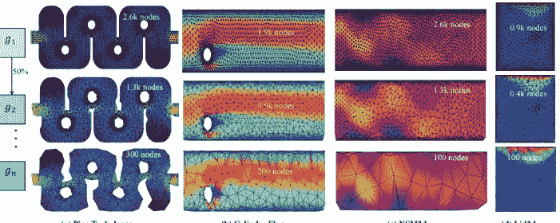

图 1. 我们提出的方法生成的示例多级图。粗化过程对于具有不规则结构、大孔和非凸区域的非均匀网格尤其具有挑战性。我们的多尺度图构建策略有效地保持关键特征，并确保跨任意几何的稳健连接。

复杂物理系统的模拟。所提出的 MPG 的贡献总结如下：

- **多尺度图构建策略**：MPG 采用基于层次密度感知的采样策略，该策略受点云几何采样启发。它在稠密区域应用随机采样，在稀疏区域应用最远点采样（FPS），以确保节点分布平衡。为保留全局拓扑，我们引入了受限德劳三角重构（Constrained Delaunay Reconstruction），可防止错误的拓扑连接，并在粗化过程中确保准确的边重构。该策略显著提高图连通性，从而提高预测精度，在各种物理模拟任务中实现 RMSE < 10⁻²。

- **稳健的邻域聚合**：MPG 不依赖固定邻接矩阵，而是利用受 GraphSAGE [21] 启发的随机多跳邻域来改进局部特征传播。我们引入了一种可学习的聚合机制，动态调整邻居重要性，以增强不同分辨率间的适应性。该方法在保持精度的同时减少冗余计算，与常规消息传递 GNN 相比，模型参数减少了近 85%。

- **计算效率与可扩展性**：与依赖深层 MP 堆叠的常规多尺度 GNN 不同，MPG 采用基于层次残差 MLP 的特征提取框架，该框架受点云特征提取模块 [22] 启发。这种设计使 MPG 能够独立于网格大小进行扩展，在保持精度的同时减少冗余特征变换。实验结果表明，与基线模型相比，MPG 每个时代的训练加速了 17.7% ~ 86.1%，同时使用显著更少的参数实现了有竞争力的精度。

### 2 相关工作

#### 2.1 基于图的方法

非均匀网格因其不规则结构和不同的连接性，给传统 CNN 带来了重大挑战。这一局限性促使采用基于图的方法，将网格视为图以更好地处理不规则几何和复杂物理系统预测 [20]。Pfaff 等人引入了 MeshGraphNets [10]，证明了 GNN 在捕捉非均匀网格固有的几何和拓扑信息方面的有效性。在此基础上，Zhao 等人提出了一种混合 CNN-GNN 模型，以更好地捕捉多孔介质中的连通性和流路 [23]。为了扩展 GNN 驱动建模的范围，Han 等人将 GNN 与 Transformer 架构相结合，以预测物理模拟中的隐态 [24]。同时，TIE [25] 脱离了传统图边，简化了模型，并通过自注意机制增强了捕捉空间关系的能力。这些工作展示了混合基于图的模型日益增长的潜力，增强了它们使用非均匀网格建模复杂物理系统的能力。

#### 2.2 多尺度 GNN

虽然 GNN 为处理非均匀网格提供了一种有效手段，但大规模图可能会带来高计算成本。为应对这些挑战，已提出多尺度 GNN 框架。Graph U-Net [15] 首先通过引入可学习的采样和上采样操作，将 U-Net 架构适应图领域；而 MS-GNN-Grid [17] 则依赖基于体素化的采样，利用空间坐标进行粗化。然而，仅依赖空间位置和原始节点特征可能不足以准确捕捉非均匀网格分布的固有复杂性。为进一步细化多尺度表示，Yang 等人引入了 AMGNET [20]，整合了多种几何代数技术以用于不同尺度的网格粗化。Cao 等人提出了 BSMS-GNN [12]，该方法采用两步广度优先搜索（BFS）采样策略来保留重要的局部信息。

#### 2.3 基于点云的方法

非均匀网格和点云具有结构相似性，例如无结构节点分布和几何不规则性，因此点云处理技术对网格分析具有参考价值。主要挑在于开发有效的特征聚合算子，这些算子可分为局部和全局方法 [26]。PointNet [27] 等开创性工作引入了利用对称函数的全局特征聚合，而 PointNet++ [28] 则在此基础上扩展了层次局部特征学习。随后的方法，如 KPConv [29] 和 PointConv [30]，进一步通过卷积和密度自适应技术推进了局部特征提取。Ma 等人 [22] 在其 PointMLP 框架中展示了显著的范式转变，该框架在残差结构中使用轻量级几何仿射模块，取得了出色的性能，强调有效的几何推理并不总是需要复杂架构。受这些进展的启发，我们提出利用点云处理中的多尺度融合和局部特征学习技术，以增强网格节点下采样并改进局部信息捕获。

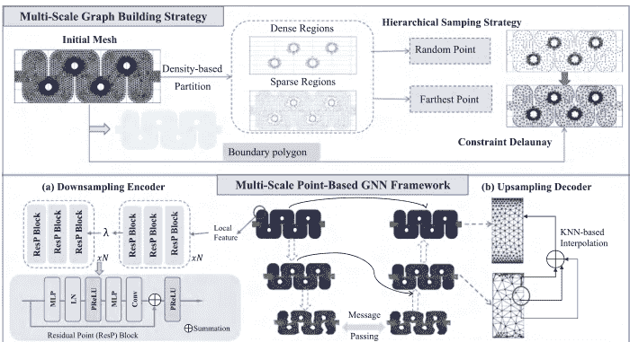

图 2. 多尺度基于点的 GNN(MPG)框架模型概览。顶部面板说明将网格初始划分为稠密区域和稀疏区域，随后进行受限德劳三角重构以保持拓扑。底部面板描绘了层次特征提取和重构过程，利用轻量级残差 MLP 和基于 KNN 的插值进行高效的多尺度处理。

### 3 多尺度图构建

在本节中，我们将介绍基于层次密度的采样策略、受限德劳三角重构，以及第 4 节中用于局部特征聚合的相应邻域定义。此处的所有算法和预处理步骤均在一遍中完成，我们可以灵活调整每一层的采样比率、不同密度区域之间的比例，以及不同物理模拟场景中固定邻居节点的大小。

#### 3.1 问题公式化

多尺度图构建旨在生成复杂系统的层次表示，同时保留基本的分布特征和拓扑结构。对于非均匀网格，该过程涉及节点选择、特征聚合和边重构，所有这些都必须平衡计算效率和物理精度。理想的多尺度图表示应满足三个关键要求：1) 选定的节点应同时保留局部几何细节和全局分布特征，保持关键高梯度区域。2) 邻域聚合：模型应能高效提取和传播局部特征，尽量降低计算成本，同时适应可变网格结构。3) 边重构：粗图层和细图层之间的连通性必须在结构上保持一致，防止扭曲底层拓扑的错误边。

然而，现有的多尺度 GNN 方法存在多种局限性。基于空间邻近性的方法常常在边界处生成错误边，扭曲拓扑结构。可学习采样方法关注局部重要节点，未能捕捉全局网格分布。代数多网格和双步长采样等自动化策略，在计算复杂度高且调整多尺度分辨率的适应性有限方面存在不足。

为应对这些挑战，我们提出一种多尺度图构建策略，整合基于层次密度的采样、感知拓扑的边重构和高效邻域聚合。如图 2（顶部面板）所示，我们的方法首先根据局部几何和拓扑特性将输入网格划分为稠密区域和稀疏区域。随后应用自适应采样技术，保留第 3.2 节中描述的局部细节和全局结构。为防止错误拓扑，我们在第 3.4 节中引入受限德劳三角边重构策略，确保尺度之间的平滑过渡。整个过程在算法 1 中形式化，该算法概述了带有德劳三角分层网格粗化程序。

#### 3.2 基于层次密度的采样策略

为在保持几何和拓扑保真度的同时简化非均匀网格，我们引入基于密度的层次采样策略。该方法根据局部节点度和平均边长度量，将网格区域分类为稠密区域和稀疏区域。稠密区域中的节点以高几何复杂性或尖锐梯度为特征，需要细粒度采样以保留局部特征，而稀疏区域则被粗化，以在降低计算成本的同时保持全局结构。给定一个非均匀网格 \(\mathcal{M} = (\mathcal{V}, \mathcal{E})\)，我们首先计算全局平均边长：

\(\bar{l} = \frac{1}{|\mathcal{E}|} \sum_{e=(u,v)\in\mathcal{E}} \|x_u - x_v\|, \quad (1)\)

其中 \(\|x_u - x_v\|\) 表示节点 \(u\) 和 \(v\) 之间的欧几里得距离。移除长于 \(\bar{l}\) 的边，以过滤掉错误的远程连接，从而创建改进的边集 \(\mathcal{E}' = \{e \mid l(e) \le \bar{l}\}\)。在更新后的图 \(\mathcal{M}' = (\mathcal{V}, \mathcal{E}')\) 上，我们


重新计算节点度以确定局部密度：

```
\(\bar{d} = \frac{1}{n} \sum_{v \in \mathcal{V}} |\mathcal{N}'(v)|,\)
(2)
```

```
Algorithm 1. Hierarchical Mesh Coarsening with Constrained Delaunay Triangulation

Require: Mesh M, Positions P, Levels L, Coarsening Ratios U, Neighbor Counts K
Ensure: Coarsened Meshes {M_l}_{l=1}^L, Positions {P_l}_{l=1}^L, Sampling Indices {I_l}_{l=1}^L, Neighbor Indices {N_l}_{l=1}^L Initialize coarse mesh parameters;
1: while not converged do
2:   Sample nodes from mesh M based on ratio U;
3:   for each level l = 1, ..., L do
4:     Generate sampling indices I_l;
5:     Update positions P_l;
6:     Construct coarse mesh M_l via Constrained Delaunay triangulation;
7:     Compute neighbor indices N_l using fixed-size K;
8:   end for
9:   Update coarse mesh and parameters;
10: end while
```

其中 \(n = |\mathcal{V}|\) 表示网格中的节点数，\(\mathcal{N}'(v)\) 表示节点 \(v\) 的邻居集合。若 \(d'(v) > \bar{d}\)，则节点被分类为 \(\mathcal{V}_\text{d}\)，否则分类为 \(\mathcal{V}_\text{s}\)。

给定粗化比率 \(U\)（例如，\(U = 0.5\) 表示 50% 下采样）以及用于密集区域的采样比例 \(m\)，我们定义密集区域和稀疏区域的采样节点数量如下：

```
\(k_d = \lfloor U \cdot m \cdot n \rfloor,\quad k_s = \lfloor U \cdot (1 - m) \cdot n \rfloor,\)
(3)
```

其中 \(k_d\) 和 \(k_s\) 分别表示从密集区域和稀疏区域采样的节点数量。合并后的采样节点集合定义如下：

```
\(\left\{\begin{array}{l l}
V_d = \{v_i \mid v_i \sim \mathcal{U}(\mathcal{V}_\text{d})\}, & |V_d| = k_d, \\
V_s = \{v_i \mid v_i = \text{FPS}(\mathcal{V}_\text{s})\}, & |V_s| = k_s,
\end{array}\right.\)
(3)
```

在此，\(\mathcal{U}(\mathcal{V}_\text{d})\) 表示对密集区域进行随机采样，而 FPS(\(\mathcal{V}_\text{s}\)) 表示基于欧氏距离的最远点采样。最终，完整的采样集合为 \(S_i = V_d \cup V_s\)。如图 3 所示，我们的分层采样策略能够有效区分需要详细局部表示的区域与反映全局网格结构的区域，保留关键几何细节并避免粗化过程中的错误。

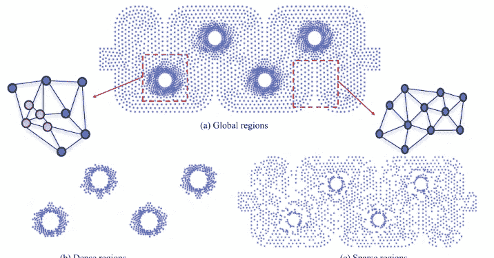

图 3. 针对管道湍流的基于密度的分层采样策略示意。

#### 3.3 邻域定义

为降低计算开销并增强局部特征聚合，我们定义了固定大小的邻域结构。在传统的 GNN（如 GCN [31]）中，堆叠 $K$ 层消息传递会导致每个节点聚合越来越大感受野中的信息，潜在涉及 $O(d^K)$ 个节点，其中 $d$ 为节点度。虽然每层复杂度与边数成线性关系，但这种累积增长会增加每节点开销，并可能导致过平滑。

受 GraphSAGE [21] 启发，我们改为在每个节点的 1-hop 或 2-hop 距离内采样固定数量 $S$ 的邻居。这将每节点开销限制在 $O(K \cdot S)$，总模型复杂度限制在 $O(K \cdot S \cdot n)$，其中 $n$ 为节点数量。固定大小邻域提高了可扩展性，并确保在不同图密度下计算一致。

#### 3.4 约束德劳内重建

在基于图的网格处理中，较粗尺度上的准确边重建对于保持几何和拓扑完整性至关重要。传统方法依赖于空间邻近性 [17–19] 或保留采样节点的边 [12]，但常常在边界间生成错误边，破坏连通性。

为解决这些问题，我们提出了一种自适应约束德劳内重建方法，专门用于多尺度边重建，该方法受到经典计算几何技术的启发，能够鲁棒地处理非凸域和带洞区域 [32]。具体而言，我们利用先前的网格信息定义多边形边界 $\mathcal{B}$，对原始网格的几何和拓扑进行编码。给定采样节点集合 $(V')$，我们使用标准德劳内三角剖分 $T(V')$ 构建边，并针对每个候选边 $e = (u, v)$ 验证约束：

$$E' = \{e \mid e \subseteq \mathcal{B}, e \in T(V')\}. \quad (4).$$

仅保留完全包含在受约束多边形区域内的边。这确保了鲁棒的边重建，防止无效连接并保持网格质量。

### 4 基于点的多尺度 GNN(MPG)

在本节中，我们将介绍 MPGNN，这是一个分层 GNN，其多级结构由输入网格和第 3 节中的预处理确定。

#### 4.1 问题

传统 GNN 和多尺度 GNN 在很大程度上依赖堆叠的消息传递（MP）层来聚合节点和边特征：

```
h_v^{(k)} = \text{AGGREGATE} \left( \{h_u^{(k-1)}, e_{uv}^{(k-1)} \mid u \in \mathcal{N}(v)\} \right), \quad (5)
```

其中 \( h_v^{(k)} \) 是节点 \( v \) 在第 \( k \) 层的嵌入，\( e_{uv}^{(k-1)} \) 是节点 \( u \) 和 \( v \) 之间的边嵌入。然而，堆叠 MP 层会显著增加计算复杂度和冗余度，尤其是对于大规模非均匀网格。此外，固定高维嵌入（例如，128 维）进一步加剧了计算开销。

受 PointMLP [22] 启发，该方法无需复杂局部操作即可在点云上实现高效特征提取，我们重新审视网格特征学习。非均匀网格在结构上类似点云；因此，对 MP 层的严重依赖可能不是必需的。我们旨在用轻量级残差 MLP 模块替代堆叠的 MP 层，以高效提取节点特征并提高可扩展性。

#### 4.2 编码器

输入是多级网格结构 \(\{\mathcal{M}_l = (\mathcal{V}_l, \mathcal{E}_l)\}_{l=1}^L\)。对于每个网格级别，编码操作可表述为：

```
g_i = \Phi_{\text{pos}} (\mathcal{A} (\Phi_{\text{pre}} (\mathcal{V}_i, \mathcal{V}_{ij}))) , \quad (6)
```

其中 \(\Phi_{\text{pre}}(\cdot)\) 和 \(\Phi_{\text{pos}}(\cdot)\) 表示从 PointMLP [22] 改编的残差 MLP 模块。具体而言，\(\Phi_{\text{pre}}(\cdot)\) 在局部感受野内学习初始节点嵌入，捕获初步几何模式。对于邻域聚合 \(\mathcal{A}\)，我们采用受 CNN 感受野启发的可学习加权机制：

```
\mathcal{A}(f_i) = \sum_{j \in \mathcal{N}(i)} (W_{i,j} \cdot w_{ij}) \cdot f_j, \quad w_{ij} = \frac{\exp(-\|\mathbf{x}_i - \mathbf{x}_j\|_2)}{\sum_{k \in \mathcal{N}(i)} \exp(-\|\mathbf{x}_i - \mathbf{x}_k\|_2)} . \quad (7)
```

其中 \( f_j \) 表示邻居特征，\( W \) 表示可学习参数，\( w_{ij} \) 根据空间关系动态调整邻居重要性。

最后，聚合特征由另一个残差 MLP 块 $\Phi_{pos}(\cdot)$ 进行优化。正式地，残差 MLP 块可表示为：

```
$\Phi(x) = act(W_2 \cdot act((W_1 \cdot x))) + x, \quad (8)$
```

其中 $W_1$ 和 $W_2$ 为可学习参数，$act$ 表示非线性激活函数（例如，PReLU）。

通过明确采用基于轻量级残差 MLP 的特征提取，编码器有效降低了计算开销并提高了维度可扩展性。这种设计避免了深层消息传递堆叠，显著提高了在各种非均匀网格上的效率和泛化能力。

#### 4.3 解码器

对于解码器模块，我们采用 k 近邻（KNN）插值来高效恢复细层节点特征 [27,28]。对于细层 $X_f$ 中的每个节点 $x_i$，我们根据欧氏距离从粗层 $X_c$ 中识别其 $k$ 个最近节点。插值特征 $x_i$ 通过距离加权平均计算：

```
$x_i = \sum_{j \in N_k(i)} \frac{w_{ij} h_j}{\sum_{j \in N_k(i)} w_{ij}}, \quad w_{ij} = \frac{1}{d(P_f^i, P_c^j)}, \quad (9)$
```

其中 $h_j$ 表示邻居节点 $j$ 的粗层特征，$d(P_f^i, P_c^j)$ 表示细层节点 $i$ 与粗层节点 $j$ 之间的欧氏距离。

此外，我们在相应的编码器和解码器层之间加入跳跃连接，以促进高效的空间信息传递。进一步采用残差 MLP $\Phi(x)$ 来优化插值特征，提高重建精度，并确保不同网格分辨率下的结构一致性。这种编码器-解码器架构专门用于静态多尺度特征重建，为物理模拟中的时态动态预测提供了高效基础。

### 5 实验

#### 5.1 实验设置

**数据集。** 我们在五个涵盖不同物理领域的数据集上评估 MPG 模型：圆柱绕流 [14] 模拟圆柱周围不可压缩流体流动。管道湍流 [33] 在复杂管道内动态表示湍流。热化学反应 [34] 涉及多物理场复杂模型，用于模拟热化学蓄能反应器内的流体流动、热传递、质量传递和化学反应。盖驱动腔流2d [35] 关注不同粘度和边界条件下的不可压缩盖驱动腔流。NSM2d [35] 处理具有复杂边界条件和初始状态的不可压缩流体动力学。


**基线。** 我们将 MPG 与五个基线进行对比。MeshGraphNets [10] 是一种用于网格表示的基础图模型，采用噪声注入（NI）进行评估。Graph U-Net [15] 在 U-Net 架构中采用可学习的图采样，专门针对图结构进行了定制。PointMLP [22] 是一种纯点云方法，用于无拓扑结构的特征提取。AMGNET [20] 在 GNN 图粗化中集成代数多网格算法。BSMS-GNN [12] 引入了一种用于多尺度网格表示的新型双步采样策略。据我们所知，它是目前最先进的（SOTA）模型。

**评估协议。** 我们通过两项实验来评估 MPG：
- 特征重建评估：我们在气缸流动、管道湍流和热化学反应数据集上将 MPG 与 PointMLP、BSMS-GNN 和 AMGNET 进行比较。基于多尺度网格 $\{\mathcal{M}_l^t = (V_l^t, \mathcal{E}_l^t)\}_{l \in (1, L)}^{t \in (1, T)}$（$L$ 个多尺度层，$T$ 个时间步），MPG 通过编码器编码特征，并通过解码器重建。
- 展开评估：为评估 MPG 在非均匀网格模拟中的泛化性能，我们在长轨迹气缸流动、Lid2d 和 NSM2d 数据集上与 MeshGraphNets、AMGNET 和 BSMS-GNN 进行展开实验。由于 MPG 专注于特征重建而没有显式的时间建模，我们使用 BSMS-GNN 的消息传递层从 $\mathcal{M}_l^t$ 到 $\mathcal{M}_l^{t+1}$ 进行预测。MPG 和 BSMS-GNN 均使用两个多尺度层，每层固定 50% 的下采样比率。

在训练过程中，我们使用 L2 损失（公式（10））进行模型优化。在特征重建中，$y$ 来自原始的 $\mathcal{M}_0^t$，$\hat{y}$ 来自重建后的网格。在展开中，$y$ 是 $\mathcal{M}_l^{t+1}$ 的真值，$\hat{y}$ 是其预测值。在评估中，RMSE 是主要指标。

$$L_{l2} = \frac{1}{D} \sum_{k=1}^D \frac{1}{T} \sum_{t=1}^T \frac{1}{m} \sum_{i=1}^m \frac{\| y_{k,i}^t - \hat{y}_{k,i}^t \|_2}{\| y_{k,i}^t \|_2}$$ (10)

### 5.2 结果与讨论

根据第 5.1 节的描述，我们在两个不同的任务中进行评估：特征重建和展开预测。这些评估的关键观察结果总结如下：

**特征重建精度。** 表 1 总结了在气缸流动、管道湍流和热化学反应数据集上进行的特征重建任务的 RMSE 结果。所有模型均表现出良好的重建性能（RMSE $< 10^{-3}$），而 MPG 达到可比或更好的精度。这表明，我们提出的多尺度编码策略能够有效捕捉关键的几何和物理特征，尽管使用的参数显著更少。

表 1. 三个数据集上的特征重建 RMSE（$\times 10^{-4}$）比较。数值越小越好。最佳结果以粗体标记。

| 模型 | 气缸流动 | 管道湍流 | 热化学反应 |
| :--- | :--- | :--- | :--- |
| PointMLP | 52.50 | 60.52 | 109.45 |
| AMGNET | 15.76 | 17.63 | 22.17 |
| BSMS-GNN | 3.23 | 3.32 | 3.96 |
| MPG（我们的） | **2.72** | **1.74** | **3.94** |

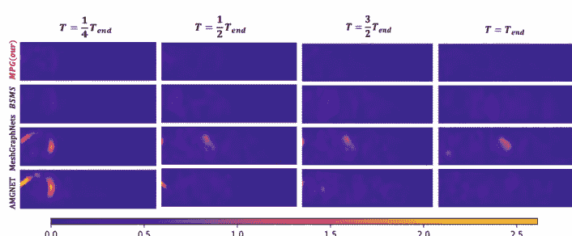

图 4. MeshGraphNets、AMGNET、BSMS 及我们提出的模型（MPG）在 NSM2d 数据集上的展开误差快照。

展开预测与误差累积。对于展开预测任务（表 2），该任务在气缸流动、Lid2d 和 NSM2d 数据集上进行，与基线相比，我们的 MPG 模型在整个轨迹上表现出显著较低的误差累积，特别是在复杂网格结构上。尽管气缸流动和 NSM2d 的单步预测误差与 BSMS-GNN 相似，但 MPG 只使用了约 15% 的参数量就实现了这些结果。图 4 说明了不同模型在轨迹上的误差累积，强调了 MPG 在长时间保持较低误差率方面的卓越性能。

计算效率。值得注意的是，训练和推理时间的统计不包括多尺度构建，后者充当独立的预处理模块。如表 2 所示，MPG 在计算效率方面取得了显著提升。具体来说，与 BSMS-GNN 相比，我们的方法在不同数据集上将每个时代的训练时间减少了 63.1%–86.1%，与 MeshGraphNets 相比减少了 17.7%–65.3%，与 AMGNET 相比减少了 45.0%–73.8%。此外，MPG 在气缸流动和 Lid2d 数据集上显著降低了推理时间。在内存使用方面，MPG 所需内存少于 MeshGraphNets 和 BSMS-GNN。MPG 还保持了轻量化的模型大小，与 MeshGraphNets 相比将参数量减少了 87.3%，与 BSMS-GNN 相比减少了 **84.5%**。即使与最参数高效的 AMGNET 模型相比，MPG 在模型大小和预测精度之间取得了更好的平衡，因为 AMGNET 的极端参数减少会导致更高的展开误差。这些收益得益于 MPG 的分层多尺度构建策略、自适应邻域聚合和轻量化残差 MLP 框架，使其成为非均匀网格上可扩展且高效模拟的新基准。总之，所提出的 MPG 框架展示了卓越的效率和精度，有效平衡了模型紧凑性、训练速度和预测性能，为高效多尺度 GNN 模拟设定了新标准。

表 2. 展开任务上的性能比较。最佳结果以**粗体**标记，第二最佳结果使用<u>下划线</u>标记。

| 指标 | 案例 | MPG（我们的） | MeshGraphNets | BSMS-GNN | AMGNET |
|---|---|---|---|---|---|
| RMSE-1 (×10⁻³) | 气缸流动 | 4.98 | 7.98 | 4.09 | 9.71 |
| | Lid2d | 0.26 | 1.22 | 0.35 | 0.95 |
| | NSM2d | 5.75 | 23.50 | 5.46 | 45.9 |
| RMSE-50 (×10⁻²) | 气缸流动 | 3.71 | 5.05 | 4.56 | 7.34 |
| | Lid2d | 0.95 | 4.66 | 1.13 | 1.76 |
| | NSM2d | 15.81 | 21.19 | 20.29 | 18.24 |
| RMSE-all (×10⁻²) | 气缸流动 | 53.16 | 63.95 | 57.27 | 62.82 |
| | Lid2d | 7.15 | 12.04 | 8.76 | 9.61 |
| | NSM2d | 30.07 | 35.33 | 33.34 | 32.49 |
| 训练时间（秒/时代） | 气缸流动 | 160.83 | 209.26 | 435.49 | 440.08 |
| | Lid2d | 140.13 | 403.52 | 647.49 | 254.96 |
| | NSM2d | 148.71 | 180.61 | 1071.72 | 568.16 |
| 推理时间（毫秒/步） | 气缸流动 | 14.13 | 16.74 | 67.45 | 56.76 |
| | Lid2d | 9.54 | 12.42 | 72.76 | 10.42 |
| | NSM2d | 17.99 | 17.88 | 136.59 | 59.14 |
| 训练内存（MiB） | 平均 | 8964 | 22583 | 12572 | 6882 |
| 参数量（#） | 所有 | 296,755 | 2,331,778 | 1,917,442 | 7,168 |

### 5.3 消融研究

网络细节研究。我们研究网络深度和采样比率如何影响重建性能，如图 5(a) 所示。具体来说，我们分析两个关键方面：
- 在保持总采样比率固定的情况下，变化粗化层的数量
- 在固定的两层结构中调整采样比率

结果表明，与更深层的分层设计相比，两层结构始终能获得更好的重建精度。此外，在两层设置中，50%-25% 的采样比率略优于标准的 50%-50% 采样比率，后者用于与主实验中一些固定大小基线进行公平直接的比较。

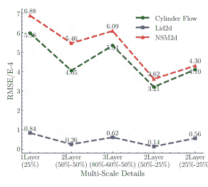

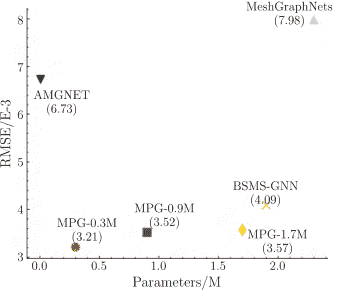

**图 5.** （a）不同多尺度设置下不同数据集上的 RMSE。（b）不同隐藏状态维度下不同参数的 RMSE。

#### 参数研究

我们进一步评估参数如何影响 MPG 的重建精度。图 5(b) 表明，MPG 无需依赖深层 MP 堆叠即可实现更好的精度和计算效率。值得注意的是，MPG 在所有参数规模上始终优于基线模型，强调了我们的设计即使在较小模型规模下也具有有效性。

### 6 结论

在本工作中，我们引入了 MPG，一种新型的基于点的多尺度 GNN，旨在实现非均匀网格上的高效精确模拟。MPG 集成了分层密度采样、受限德劳内重建和轻量化特征聚合，以平衡计算效率和预测精度。通过借鉴点云处理和受限德劳内三角剖分，MPG 构建了稳健的多尺度表示，同时保留了关键的几何和拓扑结构。实验结果表明，MPG 大幅降低了计算开销，实现了最高 86.1% 更快的训练、更低的推理时间和减少的内存消耗，同时在每个任务中保持了较高的单步展开精度。这些结果突出了 MPG 作为非均匀网格模拟的高效可扩展解决方案，能够实现复杂物理


系统。未来工作可着重于优化内存高效的架构，以支持在更大规模网格上进行更高分辨率的训练。

### 参考文献

- 1. Wang, H., et al. 计算流体动力学中机器学习的最新进展：一项综述. arXiv预印本 arXiv:2408.12171 (2024)
- 2. Zienkiewicz, O.C., Taylor, R.L.: 有限元方法丛书. Elsevier, 阿姆斯特丹 (2005)
- 3. Obiols-Sales, O., Vishnu, A., Malaya, N., Chandramowlishwaran, A.: Cfdnet：一种基于深度学习的流体模拟加速器. In: 第34届ACM国际超级计算机会议论文集. 第1–12页 (2020)
- 4. Raissi, M., Perdikaris, P., Karniadakis, G.E.: 物理信息神经网络：一种用于求解涉及非线性偏微分方程的正问题和逆问题的深度学习框架. J. Comput. Phys. **378**, 686–707 (2019)
- 5. Sun, L., Gao, H., Pan, S., Wang, J.X.: 基于无模拟数据的物理约束深度学习的流体流动代理建模. Comput. Methods Appl. Mech. Eng. **361**, 112732 (2020)
- 6. Tompson, J., Schlachter, K., Sprechmann, P., Perlin, K.: 使用卷积网络加速欧拉流体模拟. In: 国际机器学习会议. 第3424–3433页. PMLR (2017)
- 7. Kim, B., Azevedo, V.C., Thuerey, N., Kim, T., Gross, M., Solenthaler, B.: 深度流体：一种用于参数化流体模拟的生成网络. In: 计算机图形学论坛. vol. 38, 第59–70页. Wiley Online Library (2019)
- 8. Fotiadis, S., Pignatelli, E., Valencia, M.L., Cantwell, C., Storkey, A., Bharath, A.A.: 比较用于预测波传播的循环神经网络和卷积神经网络. arXiv预印本 arXiv:2002.08981 (2020)
- 9. Battaglia, P.W., et al.: 关系归纳偏置、深度学习与图网络. arXiv预印本 arXiv:1806.01261 (2018)
- 10. Pfaff, T., Fortunato, M., Sanchez-Gonzalez, A., Battaglia, P.W.: 使用图网络学习基于网格的模拟. arXiv预印本 arXiv:2010.03409 (2020)
- 11. Sanchez-Gonzalez, A., Godwin, J., Pfaff, T., Ying, R., Leskovec, J., Battaglia, P.: 使用图网络学习模拟复杂物理. In: 国际机器学习会议. 第8459–8468页. PMLR (2020)
- 12. Cao, Y., Chai, M., Li, M., Jiang, C.: 使用双步长多尺度图神经网络高效学习基于网格的物理模拟. In: 国际机器学习会议. 第3541–3558页. PMLR (2023)
- 13. Fortunato, M., Pfaff, T., Wirnsberger, P., Pritzel, A., Battaglia, P.: 多尺度网格图网. arXiv预印本 arXiv:2210.00612 (2022)
- 14. Chen, F., Wang, Y.C., Wang, B., Kuo, C.C.J.: 图表示学习：一项综述. APSIPA Trans. Signal Inf. Process. **9**, e15 (2020)
- 15. Gao, H., Ji, S.: 图U网. In: 国际机器学习会议. 第2083–2092页. PMLR (2019)
- 16. Liu, W., Yagoubi, M., Schoenauer, M.: 用于PDE近似的多分辨率图神经网络. In: Farkaš, I., Masulli, P., Otte, S., Wermter, S. (eds.) ICANN 2021. LNCS, vol. 12893, 第151–163页. Springer, Cham (2021). https://doi.org/10.1007/978-3-030-86365-4_13
- 17. Lino, M., Fotiadis, S., Bharath, A.A., Cantwell, C.D.: 用于非定常欧拉流体动力学的多尺度旋转等变图神经网络. Phys. Fluids 34(8), 087110 (2022)
- 18. Lino, M., Cantwell, C., Bharath, A.A., Fotiadis, S.: 使用多尺度图神经网络模拟连续介质力学. arXiv预印本 arXiv:2106.04900 (2021)
- 19. Lino, M., Fotiadis, S., Bharath,A.A., Cantwell, C.: 迈向使用多尺度图神经网络的环境流体力学快速模拟. arXiv预印本 arXiv:2205.02637 (2022)
- 20. Yang, Z., Dong, Y., Deng, X., Zhang, L.: Amgnet：用于流场预测的多尺度图神经网络. Connect. Sci. 34(1), 2500–2519 (2022)
- 21. Hamilton, W., Ying, Z., Leskovec, J.: 大图上的归纳表示学习. Adv. Neural Inf. Process. Syst. 30, 1–11 (2017)
- 22. Ma, X., Qin, C., You, H., Ran, H., Fu, Y.: 重新思考点云中的网络设计与局部几何：一个简单的残差MLP框架. arXiv预印本 arXiv:2202.07123 (2022)
- 23. Zhao, Q., Han, X., Guo, R., Chen, C.: 用于多孔介质的计算高效混合神经网络架构：集成卷积神经网络和图神经网络以改进属性预测 (2023)
- 24. Han, X., Gao, H., Pfaff, T., Wang, J.X., Liu, L.P.: 使用时态注意力在网格缩减空间中预测物理. arXiv预印本 arXiv:2201.09113 (2022)
- 25. Shao, Y., Loy, X.X., Dai, B.: 具有隐式边的用于基于粒子的物理模拟的Transformer. In: 欧洲计算机视觉会议, 第549–564页. Springer, Heidelberg (2022)
- 26. Zhang, H., et al.: 基于深度学习的3D点云分类：系统综述与展望. Displays 79, 102456 (2023)
- 27. Qi, C.R., Su, H., Mo, K., Guibas, L.J.: Pointnet：用于3D分类和分割的点集深度学习. In: IEEE计算机视觉与模式识别会议论文集, 第652–660页 (2017)
- 28. Qi, C.R., Yi, L., Su, H., Guibas, L.J.: Pointnet++：度量空间中点集的深度层次特征学习. Adv. Neural Inf. Process. Syst. 30, 1–10 (2017)
- 29. Thomas, H., et al.: Kpconv：用于点云的灵活可变卷积. In: IEEE/CVF国际计算机视觉会议论文集, 第6411–6420页 (2019)
- 30. Wu, W., Qi, Z., Fuxin, L.: Pointconv：3D点云上的深度卷积网络. In: IEEE/CVF计算机视觉与模式识别会议论文集, 第9621–9630页 (2019)
- 31. Yao, L., Mao, C., Luo, Y.: 用于文本分类的图卷积网络. In: AAAI人工智能会议论文集, vol. 33, 第7370–7377页 (2019)
- 32. Chew, L.P.: 受约束的德劳内三角剖分. In: 第三届年度计算机几何研讨会论文集, 第215–222页 (1987)
- 33. Chen, G., Liu, X., Meng, Q., Chen, L., Liu, C., Li, Y.: 在黎曼流形上学习神经算子. arXiv预印本 arXiv:2302.08166 (2023)
- 34. Xiao, G., Wang, Z., Ni, D., Zhu, P.: 基于热化学储能的氧化钴蜂窝结构的动力学与结构优化. Energies 16(7), 3237 (2023)
- 35. Liu, P., Hao, Z., Ren, X., Yuan, H., Ren, J., Ni, D.: PPM：一种面向过程系统的物理感知代理模型. arXiv预印本 arXiv:2407.05232 (2024)

## 揭示隐藏内容：剧透检测中的电影类型与用户偏见

Haokai Zhang$^{1}$, Shengtao Zhang$^{1}$, Zijian Cai$^{2}$, Heng Wang$^{3}$, Ruixuan Zhu$^{1}$,
Zinan Zeng$^{1}$, and Minnan Luo$^{3,4*}$

$^{1}$ 西安交通大学人工智能与机器人学院，
中国西安 710049
{zhanghaokai,zhangst,1760865856,2194214554}@stu.xjtu.edu.cn
$^{2}$ 中国科学院自动化研究所，北京 100190，中国
caizijian2024@ia.ac.cn
$^{3}$ 西安交通大学计算机科学与技术学院，
中国西安 710049，中国
wh2213210554@stu.xjtu.edu.cn, minnluo@xjtu.edu.cn
$^{4}$ 陕西省大数据知识工程重点实验室，
西安交通大学，中国西安 710049，中国

**摘要。** 在IMDb和烂番茄等平台上，电影评论中的剧透至关重要，既有利也有弊。它们可以指导一些观众的选择，但也会影响那些希望预先不知道情节细节的观众，因此有效的剧透检测至关重要。现有的剧透检测方法主要分析评论文本，常忽略电影类型和用户偏见的影响，从而限制了其效果。为解决这一问题，我们分析了电影评论数据，发现不同类型的剧透率存在差异，并识别出某些用户更有可能发布剧透。基于这些发现，我们提出了一种名为**GUSD**（**类型**-感知的和**用户**-特定的**剧透** **检测**）的新剧透检测框架，该框架融入了类型特定数据和用户行为偏见。用户偏见通过评论历史的动态图建模来计算。此外，R2GFormer模块结合了用于图信息的RetGAT（保留图注意力网络）和用于类型特定聚合的GenreFormer。GMoE（类型感知专家混合）模型根据类型将评论分配给专门的专家。在基准数据集上的广泛测试表明，GUSD达到了最先进的结果。该方法通过解决类型和用户特定模式，推动了剧透检测的发展，提升了电影评论平台的用户体验。我们的源代码可在 https://github.com/AI-explorer-123/GUSD 上获得。

**关键词：** 剧透检测 · 电影类型 · 用户偏见 · 专家混合

H. Zhang和S. Zhang——对本工作同等贡献。

**补充信息** 在线版本包含可在 https://doi.org/10.1007/978-3-032-06066-2_2 上获得的补充材料。


### 1 引言

Spoilers in movie reviews have become an important component of the movie-viewing experience on popular platforms like IMDb and Rotten Tomatoes [5]. For those who hope to learn the plot of the movie in advance to judge whether they like it or not, the spoilers are helping, while for those who prefer to experience a movie without prior knowledge, the spoilers can severely diminish the enjoyment by revealing crucial plot points, undermining suspense, and eliciting negative emotions among viewers [21]. Thus, effective spoiler detection methods are crucial for maintaining a positive user experience (Fig. 1).


Fig. 1. An illustrative example of the data used in our spoiler detection study. The image shows a review of the movie Moana, including the movie's genres (Adventure, Animation), summary, the review's content, and user-specific details. All reviews from the user are color-coded: blue indicates non-spoiler content, while red indicates spoiler content.

Existing spoiler detection methods primarily focus on the textual content of reviews. For example, DNSD [6] integrates review sentences and movie genres, while SpoilerNet [36] utilizes a Hierarchical Attention Network and incorporates the item-specificity information. More recent approaches, such as MVSD [38], incorporate advanced techniques like syntax-aware graph neural networks and external movie knowledge to improve detection performance. Nevertheless, these methods still exhibit notable limitations. Solely relying on textual content proves insufficient for robust spoiler detection [38]. Moreover, spoilers are often genre-specific, with varying characteristics depending on the movie's genre—for instance, suspense films focus on plot details, whereas action films emphasize fight scenes. As a result, two significant challenges in spoiler detection remain unaddressed:

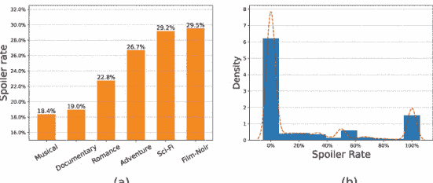

Fig. 2. (a) Spoiler rate across different movie genres (partial) in LCS dataset. (b) Kernel density estimation plot and distribution histogram of spoiler across different users.

- **Diverse Genres**. Previous works have largely ignored the impact of movie genres on the spoiler rate. Our analysis of the dataset indicates substantial differences in spoiler rate across genres, with specific categories defined according to IMDb standards. As shown in Fig. 2(a), movies that heavily rely on plot twists and suspense, such as Film-Noir and Adventure, are more prone to having spoilers in reviews compared to genres like Musical or Documentary. This is understandable since plot-driven movies tend to have more critical plot points that can be spoiled. This variation in spoiler rate demonstrates the importance of considering genre-specific characteristics when developing spoiler detection models. By incorporating genre information, we could better capture these differences and improve the performance of spoiler detection.

- **User-specific Behavior Bias**. User behavior varies significantly, with some users being more prone to posting spoilers than others. Our statistical analysis shows a clear trend where certain users tend to post spoiler reviews more frequently. As illustrated in Fig. 2(b), the graph of user spoiler review distribution shows that a large proportion of users post very few spoilers, while a smaller, yet significant, group of users frequently post spoilers. This distribution indicates a noticeable user bias, highlighting that certain users are more likely to post spoilers than others. Leveraging these user-specific behavior bias can improve the detection performance by allowing models to adapt to user behavior bias.

To address the challenges of genre-specific spoiler tendencies and user bias in spoiler detection, we propose a comprehensive framework named GUSD (Genre-aware and User-specific Spoiler Detection). This framework integrates genre information, user behavior bias, and global perception GNN. Our method begins with preprocessing movie, user, and review data. Then user bias is captured from review history through dynamic graph modeling. After that, the core component, R2GFormer (RetGAT and GenreFormer), which consists of RetGAT (Retentive Graph Attention Network) and GenreFormer, processes the graph information. RetGAT aggregates all the features globally, and GenreFormer enhances representation by integrating genre features, allowing for comprehensive genre-specific and cross-genre interactions. And an Aggregator combines these features, and then the GMoE (Genre-Aware Mixture of Experts) model assigns reviews to different experts based on their corresponding movie genres, improving traditional MoE model performance. Finally, a classifier performs spoiler detection using the aggregated features.

Extensive experiments show that GUSD achieves state-of-the-art performance. We also conduct robustness studies, ablation studies, and specific experiments on GMoE and user bias to validate our proposed modules' effectiveness.

### Our main contributions are summarized as follows:

- We are the first to model the complex interactions between genre-specific information and long-term user review behaviors for spoiler detection, providing a nuanced approach by understanding genre-specific spoiler characteristics and leveraging user behavior bias.

- We propose the GUSD framework, a novel spoiler detection system that integrates several key components: the GenreFormer to capture genre-specific spoiler tendencies, the GMoE model to dynamically assign reviews based on genres, and dynamic graph modeling to capture user bias. This cohesive integration enhances overall accuracy and robustness.

- Our method GUSD achieves state-of-the-art performance in spoiler detection. Extensive experiments on two benchmark datasets demonstrate its robustness and effectiveness, showing superior performance across various conditions.

### 2 相关工作

#### 2.1 剧透检测

The goal of automatic spoiler detection is to identify spoilers in reviews from domains like television [3], books [36], and movies [3]. Existing approaches to spoiler detection can be broadly classified into three categories: keyword matching methods, machine learning techniques, and deep learning models.

**Keyword Matching Methods.** These approaches rely on a set of predefined keywords to identify spoilers. Examples include keywords related to sports teams or events [25], or actors’ names [12]. Although useful in specific scenarios, this method requires manual keyword definition and lacks generalizability across different application contexts.

**Machine Learning Techniques.** These methods often involve topic modeling or support vector machines using handcrafted features. For example, Guo et al. [13] applied a bag-of-words representation combined with an LDA-based model for spoiler detection. Jeon et al. [16] developed an SVM classifier incorporating four extracted features, while Boyd et al. [3] utilized lexical features and meta-data of review subjects (e.g., movies and books) in an SVM model.

**Deep Learning Models.** These models mainly leverage NLP techniques, employing RNNs, LSTMs, Transformer, and language models to process review texts and movie information through end-to-end training. Bao et al. [2] utilized LSTMs, BERT, and RoBERTa for sentence-level spoiler detection. DNSD [6] focused on incorporating external genre information using GRU and CNN. SpoilerNet [36] introduced item-specificity and bias with bi-RNN enhanced by GRU. SDGNN [7] leveraged dependency relations between context words in sentences with graph neural networks to capture semantics.

While some existing methods incorporate genre information and user bias [6,40], they often rely on quite simple techniques such as concatenating or adding these additional features to the initial review features. Such approaches lack the sophistication needed for more effective and intricate modeling of genre features and user biases.

#### 2.2 Mixture of Experts

The Mixture of Experts (MoE) approach, grounded in the Divide-and-Conquer principle, segments an input sample into sub-tasks and trains specialized experts for each sub-task. This method is extensively utilized in NLP to boost model capacity [33] and enhance reasoning capabilities [23]. Shazeer et al. [33] introduced a sparsely-gated Mixture-of-Experts layer, enabling conditional computing in large language models. Fedus et al. [10] developed simplified routing algorithms for MoE to enhance training stability and reduce computational costs. Furthermore, Soft-MoE [29] was introduced to mitigate issues like training instability and token dropping inherent in traditional MoE approaches.

Despite these advancements, traditional MoE methods assign tokens dynamically, which can cause incorrect token assignment, particularly when the dataset contains explicit category information such as movie genres and their associated reviews.

### 3 方法论

Figure 3 shows the architecture of our proposed GUSD framework. This framework integrates genre-specific information, user behavior bias, and global receptive RetGAT for spoiler detection. Specifically, movie, user, and review data are first to be preprocessed, while user bias is extracted from review history using dynamic graph modeling. The R2GFormer component, consisting of RetGAT and GenreFormer, then processes graph features. RetGAT aggregates graph data, while GenreFormer handles genre-specific data. An Aggregator aggregates these features. The GMoE model assigns reviews to experts based on their related movie genres. Finally, a classifier utilizes the aggregated features to detect spoilers.


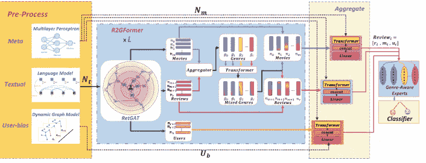

图 3. 我们提出的 GUSD 框架概览，该框架整合了特定类型信息、用户行为偏差以及全局感知 RetGAT，用于剧透检测。它使用 MLP 和语言模型预处理电影、用户和评论数据，并通过动态图建模捕获用户偏差。然后数据由 R2GFormer 组件处理。Aggregator 合并这些特征，随后 GMoE 根据类型将评论分配给专家。最后，分类器使用聚合特征检测剧透。

#### 3.1 数据预处理

### 元信息
对于评论节点、用户节点和电影节点，每种类型都拥有元数据（详情请参见补充材料）。收集所有三种节点类型的元数据后，我们将它们填充到相同长度。然后采用两层 MLP 作为元编码器，生成元嵌入 $N_m$。

### 文本信息
文本内容对于有效的剧透检测至关重要。为了生成高质量嵌入，我们利用 LM 作为文本编码器。具体来说，我们使用节点元数据的文本描述来增强初始文本内容。这种增强通过提供关于节点的额外上下文信息来丰富嵌入。随后，我们使用 LM 对节点的文本信息进行编码。然后使用单层 MLP 对编码后的嵌入进行转换，生成精细嵌入 $N_t$。

### 使用动态图预训练获取用户偏差
为了更好地捕获用户的动态信息属性，我们采用动态图来灵活处理用户的评论历史。因此，我们需要将静态数据集转换为动态格式。我们利用不同节点之间的给定连接以及评论的时间信息来形成动态事件流。关于图的形成细节将在 3.2 节中展示。考虑到缺乏关于动态边的额外信息，我们简单地将边特征初始化为零向量。然后，我们采用强大的 DyGFormer [42] 作为动态图编码器来捕获各节点之间的交互，并利用链接预测作为下游任务。我们特别从动态图编码器中获取用户节点的特征作为用户偏差 \( U_b \)。

#### 3.2 R2GFormer

获取节点的初始元特征和文本特征后，我们使用文本特征 \( N_t \)（其中包含关于节点的丰富信息）作为 **R2GFormer** 的初始嵌入 \( N_g^{(0)} \)。该图编码器不仅建模用户、评论和电影之间的复杂关系和交互，还处理整个图中不同类型的特征并捕获远程依赖。首先，我们将介绍如何构建整个图。然后，我们将 R2GFormer 层分解为两部分：RetGAT 和 Genreformer，这两部分将分别介绍。

### 图构建
我们首先构建一个由三种节点类型组成的有向图：{ User, Review, Movie }，以及以下三种边类型：
- E1: Movie — Review。如果评论关于该电影，我们将评论节点连接到电影节点，但反之则不连接。这种设置允许电影信息影响评论，同时确保评论信息不影响电影。
- E2: Review — User。如果评论由用户发布，我们将评论节点连接到用户节点。
- E3: User — Review。如果用户发布评论，我们将用户节点连接到评论节点。

### RetGAT
受 [9,26,34] 工作的启发，我们提出 RetGAT，它通过将全局感知集成到 GAT 中来扩展 RetNet 框架，对 \( k \) 跳以内的节点融入显式指数衰减，对 \( k \) 跳以外的节点融入截断。这种方法确保了广阔的感受野，同时通过根据节点距离动态调整其影响来平衡性能和计算复杂度，较近的节点对最终节点特征具有更高的影响。

为了实现这种全局感受野，我们利用 \( k \) 个并行 GAT 层来分别聚合 \( k \)-跳邻居的信息。对于每个层，节点特征来自不同 \( k \)-跳邻域的聚合，并应用衰减因子来控制各跳信息的影响。超出 \( k \) 跳后，节点的影响被截断，以保持计算效率并专注于 \( k \)-跳范围内的相关信息。请注意，我们纠正了以前工作 [1,37] 用于计算 \( k \)-跳邻居的算法，详情可在补充材料中找到。

跳 \( h \) (\( h \le k \)) 的衰减因子 \( \delta_h \) 定义为：

\[
\delta_h = \exp(-\alpha \cdot h), \tag{1}
\]

其中 $\alpha$ 是控制指数衰减强度的超参数。对于第 $l$ 层，第 $h$ 跳邻居的贡献计算如下：

\[
N_{g,h}^{(l)} = \delta_h \cdot \text{GAT}_h^{(l)}(\mathcal{A}_h, N_g^{(l-1)}), \tag{2}
\]

其中 $\mathcal{A}_h$ 表示第 $h$ 跳的邻接矩阵，$N_g^{(l-1)}$ 表示第 $(l-1)$ 层的输入节点特征。

第 $l$ 层的最终节点特征 $N_g^{(l)}$ 由 Aggregator 函数从所有 \( k \)-跳贡献中聚合而来：

\[
N_g^{(l)} = \text{AGGREGATOR}_r^{(l)}(N_{g,1}^{(l)}, N_{g,2}^{(l)}, \dots, N_{g,h}^{(l)}, \dots, N_{g,k}^{(l)}). \tag{3}
\]

其中 $\text{AGGREGATOR}_r^{(l)}$ 是第 $l$ 层 RetGAT 的聚合器，可以是求和、拼接或 TransformerEncoder (TRM)。

### Genreformer
在不同 \( k \)-跳邻居之间进行消息传递后，Genreformer 旨在关注整个图以提取不同类型的更全面特征。首先，通过聚合第 $l$ 层中属于同一类型的所有评论和电影节点的特征，得到全局类型特定表示，如下所示：

\[
g_j^{(l)} = \text{AGGREGATOR}_g^{(l)}(\{n_{g,i}^{(l)} | i \in \mathcal{N}_j\}), \tag{4}
\]

其中 $n_{g,i}^{(l)}$ 是第 $l$ 层节点 $i$ 的特征，$\mathcal{N}_j$ 表示属于第 $j$ 类型的节点集合（包括评论节点和电影节点），$\text{AGGREGATOR}_g^{(l)}$ 是第 $l$ 层 Genreformer 的聚合器，可以是求和、拼接或 TRM。

接下来，我们使用 TRM 来促进类型间信息交互，使每种类型能够从相似类型获取信息以进一步丰富其特征：

\[
[g_1^{(l)} g_2^{(l)} \cdots g_j^{(l)} \cdots g_c^{(l)}] = \text{TRM}([g_1^{(l)} g_2^{(l)} \cdots g_j^{(l)} \cdots g_c^{(l)}]), \tag{5}
\]

其中 $c$ 是类型的数量。

在类型间交互之后，类型特征与电影和评论节点特征融合。然后我们将节点与其类型特征结合。由于一些电影和评论涵盖多个类型，我们取节点所覆盖的类型特征的平均值。随后，我们将评论或电影特征及其类型特征拼接，然后使用 MLP 将其投影到所需特征空间，即：

\[
z_i^{(l)} = \text{MEAN}(\{g_j^{(l)} | j \in G_i\}), \tag{6}
\]

\[
n_{g,i}^{(l)} = \text{MLP}([n_{g,i}^{(l)} \parallel z_i^{(l)}]). \tag{7}
\]

其中 \( G_i \) 表示节点 \( i \) 所属的类型集合，$n_{g,i}^{(l)}$ 表示第 \( l \) 层节点 \( i \) 的特征，$z_i^{(l)}$ 是第 \( l \) 层节点 \( i \) 的聚合类型特征，而 \( \| \) 表示拼接。MLP 将拼接后的特征投影到所需特征空间。

### 总体交互
然而，我们提出的 R2GFormer 的单层无法实现所有信息源之间的信息交互。为了进一步促进节点之间的交互，我们使用 \( L \times \) R2GFormer 层进行节点表示学习。每层之后都会更新节点的表示，融合来自不同来源的信息。该过程可表述如下：

\[
N_g^{(l)} = \text{R2GFormer}(N_g^{(l-1)}, \mathcal{E}, G). \tag{8}
\]

其中 \( \mathcal{E} \) 表示采样图的所有边，$G$ 表示每个电影和评论节点的类型。经过 \( L \times \) R2GFormer 层后，我们获得所有节点的最终图表示 \( N_g^{(L)} \)。

#### 3.3 多模态融合

通过 R2GFormer 处理上述数据，我们已获得所有节点（包括用户、评论和电影节点）的图结构信息和元信息。下一步是融合多模态信息。

对于每种节点类型，我们使用类型特定的 TRM 来促进跨模态信息交互，然后拼接不同模态的特征并使用 MLP 来获得每个节点的最终表示，即：

\[
U_g, U_m, U_b = \text{TRM}([U_g \quad U_m \quad U_b], U = \text{MLP}([U_g \quad U_m \| U_b])), \tag{9}
\]
\[
R_g, R_m = \text{TRM}([R_g \quad R_m], R = \text{MLP}([R_g \quad R_m])), \tag{10}
\]
\[
M_g, M_m = \text{TRM}([M_g \quad M_m], M = \text{MLP}([M_g \quad M_m])), \tag{11}
\]

其中 \( U_g, R_g \) 和 \( M_g \) 源自 \( N_g \)，\( U_m, R_m \) 和 \( M_m \) 源自 \( N_m \)。

在获得每种节点类型的综合表示后，我们将每个评论特征 \( r_i \) 与其对应的电影特征 \( m_i \) 和用户特征 \( u_i \) 拼接：

\[
r_i = [r_i \quad \| m_i \quad \| u_i]. \tag{12}
\]

#### 3.4 GMoE

受混合专家模型（Mixture-of-Experts）在 NLP 和机器人检测中的成功应用及其处理整个数据集小子集的能力的启发，我们采用 MoE 来处理不同类型的评论。然而，不同于经典 MoE 应用场景中的数据集隐式子集，我们的数据集


已拥有电影的类型信息以及相关评论。
因此我们将 MoE 改进为所提的 GMoE。

具体而言，我们不使用传统 MoE 结构中的门控机制，而是仅根据 token 的类型将其分配给专家：属于哪个类型，就由哪个专家处理；属于多少个类型，就由多少个专家处理。

```
r_i = \text{AGGREGATOR}_m(\{\text{Expert}_j(r_i) \mid \forall j \in G_i\}). \quad (13)
```

其中 $G_i$ 表示节点 $i$ 所属的类型集合；AGGREGATOR$_m$ 可以是求和、拼接或 TRM；为简化起见，每个 Expert 都是一个 MLP。

### 3.5 学习与优化

在使用 GMoE 处理类型特定信息后，我们得到第 $i$ 条评论的最终表示 $r_i$。接着，我们对 $r_i$ 应用线性变换以获取剧透检测结果 $\hat{y}_i$。为了训练 GUSD，我们通过带 $L_2$ 正则化的交叉熵损失优化网络。总损失函数如下：

```
Loss = -\sum_{i \in \mathcal{R}} y_i \log \hat{y}_i + \lambda \sum_{\theta \in \Theta} \theta^2. \quad (14)
```

其中 $\hat{y}_i$ 和 $y_i$ 分别是第 $i$ 条评论的预测值及其对应的真实标签。$\mathcal{R}$ 包含训练集中的所有评论，而 $\Theta$ 表示 GUSD 中所有可训练的模型参数，$\lambda$ 是一个超参数，用于平衡两部分。

### 4 实验

#### 4.1 实验设置

**数据集。** 为评估我们在两个广受认可的数据集：**LCS** [38] 和 **Kaggle** [24] 上的 GUSD 框架以及另外 14 个代表性基线：

- **LCS** 是一个用于自动剧透检测的综合数据集，包含 1,860,715 条评论、259,705 名用户和 147,191 部电影。其中约 24.59%（457,500）条评论为剧透。

- **Kaggle** 于 2019 年引入，包含 573,913 条有效评论、263,407 名用户和 1,572 部电影。其中约 25.87%（150,924）条评论为剧透。

需注意，两个数据集均包含所有电影的类型信息，具体类别根据 IMDb 标准定义，这有助于我们的 GUSD 框架运行。遵循 MVSD [38]，我们将评论随机按 7:2:1 的比例划分为训练集、验证集和测试集。

**基线。** 为实现全面评估，我们将 GUSD 与预训练语言模型、基于 GNN 的模型和特定任务基线进行比较。对于预训练语言模型，流程是将评论文本输入模型，对所有 token 嵌入求平均，然后应用两个全连接层进行剧透检测。关于基于 GNN 的模型，图神经网络以 RoBERTa [19] 的输出作为初始节点特征。以下，我们简要概述每种基线方法。

- **BERT** [8] 是一种在大量自然语言数据上预训练的语言模型，使用掩码语言建模和下一句预测任务。

- **RoBERTa** [19] 通过去除下一句预测任务并增强掩码技术，改进了 BERT。

- **BART** [18] 是一种通过双向编码和去噪目标推进传统自回归模型的预训练语言模型。

- **DeBERTa** [14] 通过实现解耦注意力和改进的掩码解码器来优化 BERT，使其成为更先进的语言模型。

- **Bge-Large** [41] 在综合训练数据集 C-MTP 上训练，结合了大量无标签数据和多样化有标签数据。

- **GCN** [17] 是一种基础图神经网络，对图节点及其邻居执行卷积，有效地传播信息。

- **R-GCN** [32] 通过引入关系特定权重将 GCN 扩展以处理多关系图。

- **GAT** [35] 是一种图神经网络，应用注意力机制动态为邻居节点分配重要性。

- **SimpleHGN** [22] 针对异构图设计，通过共享嵌入空间和自适应聚合策略整合多种节点和边类型。

- **GPS** [30] 提出了一种构建具有线性复杂度的通用、强大、可扩展图 Transformer 的方法。

- **HGT** [15] 设计依赖于节点和边类型的参数，以刻画每条边上的异构注意力，用于建模 Web 级异构图。

- **DNSD** [6] 是一种基于 CNN 的类型感知注意力机制的剧透检测方法。

- **SpoilerNet** [36] 使用分层注意力网络和 GRU，并结合项目和用户偏置项进行剧透检测。

- **MVSD** [38] 利用外部电影知识和用户网络来检测剧透。

#### 4.2 主要结果

我们在两个数据集上评估了 GUSD 框架和另外 14 个基线。表 1 所示结果表明以下几点：

- **GUSD 在两个数据集上始终优于所有基线。**具体而言，与之前的最先进方法 MVSD [38] 相比，

| 模型 | Kaggle | | | LCS | | |
|---|---|---|---|---|---|---|
| | F1 | AUC | Acc | F1 | AUC | Acc |
| BERT | 44.02 ±1.09 | 63.46 ±0.46 | 77.78 ±0.09 | 46.14 ±2.84 | 64.82 ±1.36 | 79.96 ±0.38 |
| RoBERTa | 50.93 ±0.76 | 66.94 ±0.40 | 79.12 ±0.10 | 47.72 ±0.44 | 65.55 ±0.22 | 80.16 ±0.03 |
| BART | 46.89 ±1.55 | 64.88 ±0.71 | 78.47 ±0.09 | 48.18 ±1.22 | 65.79 ±0.62 | 80.14 ±0.07 |
| DeBERTa | 49.94 ±1.13 | 66.42 ±0.59 | 79.08 ±0.09 | 47.38 ±2.22 | 65.42 ±1.08 | 80.13 ±0.08 |
| Bge-Large | 52.51 ±0.58 | 67.74 ±0.37 | 77.44 ±0.21 | 52.68 ±0.36 | 68.46 ±0.23 | 79.24 ±0.11 |
| GCN | 59.22 ±1.18 | 71.61 ±0.74 | 82.08 ±0.26 | 62.12 ±1.18 | 73.72 ±0.89 | 83.92 ±0.23 |
| R-GCN | 63.07 ±0.81 | 74.09 ±0.60 | 82.96 ±0.16 | 62.99 ±0.89 | 76.18 ±0.72 | 85.19 ±0.21 |
| GAT | 60.98 ±0.09 | 72.72 ±0.60 | 82.43 ±0.01 | 65.73 ±0.12 | 75.92 ±0.13 | 85.18 ±0.02 |
| SimpleHGN | 60.12 ±1.04 | 71.60 ±0.88 | 82.08 ±0.26 | 63.79 ±0.88 | 74.64 ±0.64 | 84.66 ±1.61 |
| HGT | 63.99 ±0.25 | 75.61 ±0.25 | 81.66 ±0.23 | 60.89 ±0.46 | 73.96 ±0.53 | 81.86 ±0.16 |
| GPS | 61.04 ±0.84 | 73.50 ±0.53 | 81.25 ±0.55 | 64.21 ±0.30 | 75.60 ±0.92 | 82.40 ±0.91 |
| DNSD | 46.33 ±2.37 | 64.50 ±1.11 | 78.44 ±0.14 | 44.69 ±1.64 | 64.10 ±0.74 | 79.76 ±0.08 |
| SpoilerNet | 57.19 ±0.69 | 70.64 ±0.44 | 79.85 ±0.10 | 62.86 ±0.38 | 74.62 ±0.69 | 83.23 ±0.23 |
| MVSD | <u>65.08</u> ±0.69 | <u>75.42</u> ±0.56 | <u>83.59</u> ±0.11 | <u>69.22</u> ±0.61 | <u>78.26</u> ±0.63 | <u>86.37</u> ±0.08 |
| 本方法 | **80.24** ±0.73 | **87.00** ±0.37 | **89.65** ±0.36 | **75.37** ±0.10 | **83.71** ±0.27 | **88.32** ±0.08 |

GUSD 在 LCS 数据集上使 Binary-F1 提高 **6.1%**，AUC 提高 **5.5%**，准确率提高 **2.0%**；在 Kaggle 数据集上使 Binary-F1 提高 **15.2%**，AUC 提高 **11.6%**，准确率提高 **6.1%**。这些改进在统计上具有显著性。

- 在两个数据集中，**基于图的模型通常优于其他类型的基线**，这再次证明了分析评论及其对应用户和电影的图结构的重要性。
- 与同样关注评论类型特征的 DNSD [6] 相比，GUSD 在两个数据集的三项指标上均超越 DNSD，进一步证明了我们全局感知的 genreformer 和 GMoE 方法的有效性和鲁棒性。
- SpoilerNet [36] 和 GUSD 都利用用户偏置，但 GUSD 在两个数据集的三项指标上均优于 SpoilerNet。这表明，我们的动态图预训练能更好地识别用户是否可能发布剧透的潜在行为模式。

#### 4.3 消融研究

由于 GUSD 优于所有基线，并在两个数据集上达到了最先进（SOTA）性能，我们进行了消融研究以进一步

| 类别 | 消融设置 | F1 | AUC | Acc |
|---|---|---|---|---|
| 用户偏置 | -w/o \( U_b \) | 78.85 | 85.78 | 88.58 |
| RetGAT | 近似方式 | 78.40 | 85.39 | 88.39 |
| | 标准 GAT | 78.08 | 85.22 | 88.29 |
| GMoE | MLP | 78.52 | 86.09 | 88.25 |
| | MoE [33] | 78.75 | 86.36 | 88.54 |
| | Soft MoE [29] | 79.10 | 86.10 | 88.78 |
| Genreformer | -w/o genreformer | 77.73 | 84.68 | 88.13 |
| | 求和池化 | 79.84 | 86.56 | 89.28 |
| | 最大池化 | 78.77 | 85.52 | 89.13 |
| 本方法 | GUSD | **80.24** | **87.00** | **89.65** |

探索 GUSD 各部分对最终性能的影响，使用 Kaggle 数据集。结果如表 2 所示。

- 为评估用户偏置信息的重要性，我们移除了用户偏置组件 \( U_b \)。表 2 的结果显示性能明显下降，证实用户偏置信息对有效的剧透检测至关重要。
- 对于 RetGAT 组件，我们评估了两种变体：使用近似方法计算 \( k \)-跳邻居 [1,37] 以及用标准 GAT 替换我们的 RetGAT。这两种变体都导致性能下降，表明我们的 RetGAT 设计对于捕捉适当的图结构是必要的。
- 为探究 GMoE 的影响，我们将其替换为简单的 MLP、传统 MoE [33] 和 Soft-MoE [29]。需注意，我们将传统 MoE 和 Soft-MoE 的专家数量设置为与 GMoE 相同，即类型的数量。从表 2 所示结果来看，完整的 GMoE 模型性能最佳，凸显了我们的 GMoE 设计在处理显式类型信息方面的有效性。此外，将 GMoE 替换为 MLP 表现最差，证明了使用类型信息的合理性。
- 我们还通过移除 Genreformer 组件，并将平均 AGGREGATOR 替换为求和池化和最大池化来对其进行评估。表 2 的结果显示，带有求和 AGGREGATOR 的完整 Genreformer 优于这些消融版本，验证了 Genreformer 的必要性。


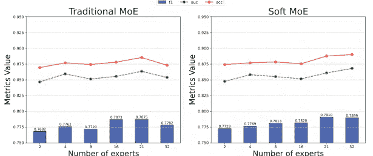

图 4. 传统 MoE 与 Soft-MoE 中不同专家数量的性能对比。注意 21 是类型的数量。结果表明，无论专家数量如何，GMoE 均优于其他变体。

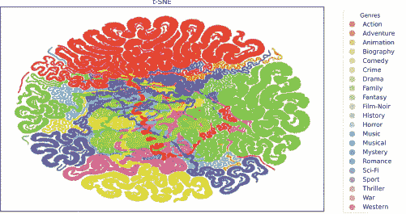

图 5. GMoE 处理的特征的 T-SNE 可视化。不同颜色代表不同类型，表明特征按类型形成了不同的聚类。(在线彩色图片)

#### 4.4 GMoE 研究

在本节中，我们对 GMoE 进行了进一步实验，以更好地了解其与其他先前 MoE 方法（如传统 MoE [33] 和 Soft-MoE [29]）相比的有效性。

### 不同专家数量

我们通过改变传统 MoE 和 Soft-MoE 中的专家数量进行多次实验，记录每种配置的 Binary-F1、AUC 和 准确率。结果汇总于图 4。

从图 4 所示结果可以看出，无论使用多少专家，GMoE 始终优于传统 MoE 和 Soft-MoE。具体来说，Soft-MoE 优于传统 MoE。这是因为 GMoE 使用显式类型信息，消除了传统 MoE 和 Soft-MoE 中可能发生的不准确调度。

### 特征的 T-SNE 可视化。

为了进一步验证 GMoE 的有效性，我们对 GMoE 层处理的所有评论特征进行了降维处理。具体来说，我们首先使用 PCA 将特征维度降至 50 维，然后再使用 T-SNE 进一步将其降至 2 维。图 5 所示的结果图表明，不同类型的评论在经过 GMoE 处理后表现出不同的特征。

图 5 的 T-SNE 可视化表明，评论按其类型进行聚类，为我们的 GMoE 设计的有效性提供了有力证据。这些不同的聚类表明 GMoE 成功捕获并利用了特定于类型的特征以提升性能。在可视化中，每种不同颜色代表一个不同的类型。例如，类型“动作”（红色）、“剧情”（绿色）和“科幻”（紫色）形成了明确定义的聚类，表明这些类型的评论特征彼此显著不同。这些不同聚类的存在重申了模型有效区分并利用特定于类型的信息的能力。

### 5 结论

本文介绍了 GUSD，一种新型剧透检测框架，它集成了 Genreformer 和 GMoE 以有效建模多样化的类型特征。此外，GUSD 结合了动态图预训练，以捕捉与剧透发布相关的用户偏见。大量实验表明，GUSD 在两大剧透检测基准测试中显著优于最先进的模型。进一步分析验证了我们所提出技术的有效性，证明了 GUSD 在捕捉复杂类型特征和为剧透检测建模用户偏见方面的卓越能力。

### 致谢

该工作得到中国国家自然科学基金会（No. 62272374, No. 62192781）、陕西省自然科学基金（2024JC-JCQN-62）、中国国家自然科学基金会（No. 62202367, No. 62250009）、陕西省重点研发计划项目 No. 2023GXLH-024、中国工程科技知识中心项目、中国工程院“中国大学 MOOC“一带一路”培训线上线下混合教育服务体系”项目以及 K.C. Wong 教育基金会的支持。最后，我们要感谢所有 LUD 实验室成员为营造协作研究环境所做的努力。

## 参考文献

- 1. Atwood, J., Towsley, D.: 扩散-卷积神经网络. Adv. Neural Inf. Process. Syst. **29** (2016)

- 2. Bao, A., Ho, M., Sangamnekar, S.: 剧透警报：使用自然语言处理检测书评中的剧透. arXiv 预印本 arXiv:2102.03882 (2021)

- 3. Boyd-Graber, J., Glasgow, K., Zajac, J.S.: 剧透警报：检测带有揭示性信息的社交媒体帖子的机器学习方法. Proc. Am. Soc. Inf. Sci. Technol. **50**(1), 1–9 (2013)

- 4. Cai, Z., et al.: Lmbot：将图知识提炼到语言模型中，用于无图部署的 Twitter 机器人检测. In: 第 17 届 ACM Web 搜索与数据挖掘国际会议论文集，第 57–66 页 (2024)

- 5. Cao, Y., Wang, X., He, X., Hu, Z., Chua, T.S.: 统一知识图学习与推荐：迈向更好地理解用户偏好. In: 万维网会议，第 151–161 页 (2019)

- 6. Chang, B., Kim, H., Kim, R., Kim, D., Kang, J.: 一种使用类型感知注意力机制的深度神经剧透检测模型. In: Phung, D., Tseng, V.S., Webb, G.I., Ho, B., Ganji, M., Rashidi, L. (eds.) PAKDD 2018. LNCS (LNAI), vol. 10937, pp. 183–195. Springer, Cham (2018). https://doi.org/10.1007/978-3-319-93034-3_15

- 7. Chang, B., Lee, I., Kim, H., Kang, J.: “杀死我”不是剧透：使用带有依赖关系感知注意力机制的图神经网络的剧透检测模型. arXiv 预印本 arXiv:2101.05972 (2021)

- 8. Devlin, J.: Bert：用于语言理解的深度双向 Transformer 预训练. arXiv 预印本 arXiv:1810.04805 (2018)

- 9. Fan, Q., Huang, H., Chen, M., Liu, H., He, R.: Rmt：可保留网络与视觉 Transformer 的结合. In: IEEE/CVF 计算机视觉与模式识别会议论文集，第 5641–5651 页 (2024)

- 10. Fedus, W., Zoph, B., Shazeer, N.: Switch Transformer：使用简单高效的稀疏性扩展到万亿参数模型. J. Mach. Learn. Res. **23**(120), 1–39 (2022)

- 11. Fey, M., Lenssen, J.E.: 基于 PyTorch Geometric 的快速图表征学习. arXiv 预印本 arXiv:1903.02428 (2019)

- 12. Golbeck, J.: Twitter 静音按钮：一种 Web 过滤挑战. In: SIGCHI 人机交互会议论文集，第 2755–2758 页 (2012)

- 13. Guo, S., Ramakrishnan, N.: 寻找讲故事的人：使用语言线索的自动剧透标记. In: 第 23 届计算语言学国际会议 (Coling 2010) 论文集，第 412–420 页 (2010)

- 14. He, P., Gao, J., Chen, W.: DebertaV3：使用带有梯度解耦嵌入共享的 Electra 风格预训练改进 DeBERTa. arXiv 预印本 arXiv:2111.09543 (2021)

- 15. Hu, Z., Dong, Y., Wang, K., Sun, Y.: 异质图 Transformer. In: 2020 年万维网会议论文集，第 2704–2710 页 (2020)

- 16. Jeon, S., Kim, S., Yu, H.: 不要被朋友剧透：电视节目推文中的剧透检测. In: 国际 AAAI Web 与社交媒体会议论文集，vol. 7, pp. 681–684 (2013)

- 17. Kipf, T.N., Welling, M.: 基于图卷积网络的半监督分类. arXiv 预印本 arXiv:1609.02907 (2016)

- 18. Lewis, M.: Bart：用于自然语言生成、翻译和理解的去噪序列到序列预训练. arXiv 预印本 arXiv:1910.13461 (2019)

- 19. Liu, Y.: Roberta：一种强健优化的 BERT 预训练方法，vol. 364 (2019). arXiv 预印本 arXiv:1907.11692

- 20. Liu, Y., Tan, Z., Wang, H., Feng, S., Zheng, Q., Luo, M.: Botmoe：带有社区感知的多模态专家混合的 Twitter 机器人检测. In: 第 46 届 ACM SIGIR 信息检索研究与开发国际会议论文集，第 485–495 页 (2023)

- 21. Loewenstein, G.: 好奇心心理学：回顾与重新解释. Psychol. Bull. 116(1), 75 (1994)

- 22. Lev, Q., et al.: 我们真的取得了很大进展吗？重新审视、基准测试和改进异质图神经网络. In: 第 27 届 ACM SIGKDD 知识发现与数据挖掘会议论文集，第 1150–1160 页 (2021)

- 23. Madaan, A., et al.: 考虑一下！通过首先模拟问题场景来改进可反驳推理. arXiv 预印本 arXiv:2110.12349 (2021)

- 24. Misra, R.: IMDB 剧透数据集 (2019). https://www.kaggle.com/datasets/rmisra/imdb-spoiler-dataset

- 25. Nakamura, S., Tanaka, K.: 用于降低破坏用户享受风险的时间过滤系统. In: 第 12 届智能用户界面国际会议论文集，第 345–348 页 (2007)

- 26. Nikolentzos, G., Dasoulas, G., Vazirgiannis, M.: K-hop 图神经网络. Neural Netw. 130, 195–205 (2020)

- 27. Paszke, A., et al.: Pytorch：一种命令式风格的高性能深度学习库. Adv. Neural Inf. Process. Syst. 32 (2019)

- 28. Pedregosa, F., et al.: Scikit-learn：Python 中的机器学习. J. Mach. Learn. Res. 12, 2825–2830 (2011)

- 29. Puigcerver, J., Riquelme, C., Mustafa, B., Houlsby, N.: 从稀疏到软专家混合. arXiv 预印本 arXiv:2308.00951 (2023)

- 30. Rampášek, L., Galkin, M., Dwivedi, V.P., Luu, A.T., Wolf, G., Beaini, D.: 通用、强大且可扩展的图 Transformer 配方. Adv. Neural Inf. Process. Syst. 35, 14501–14515 (2022)

- 31. Rau, D.: 稀疏门控专家混合 PyTorch 实现 (2019)

- 32. Schlichtkrull, M., Kipf, T.N., Bloem, P., van den Berg, R., Titov, I., Welling, M.: 使用图卷积网络建模关系数据. In: Gangemi, A., et al. (eds.) ESWC 2018. LNCS, vol. 10843, pp. 593–607. Springer, Cham (2018). https://doi.org/10.1007/978-3-319-93417-4_38

- 33. Shazeer, N., et al.: 极其庞大的神经网络：稀疏门控专家混合层. arXiv 预印本 arXiv:1701.06538 (2017)

- 34. Sun, Y., et al.: 可保留网络：大型语言模型的 Transformer 继任者. arXiv 预印本 arXiv:2307.08621 (2023)

- 35. Veličković, P., Cucurull, G., Casanova, A., Romero, A., Lio, P., Bengio, Y.: 图注意力网络. arXiv 预印本 arXiv:1710.10903 (2017)

- 36. Wan, M., Misra, R., Nakashole, N., McAuley, J.: 基于大规模评论库的细粒度剧透检测. arXiv 预印本 arXiv:1905.13416 (2019)

- 37. Wang, G., Ying, R., Huang, J., Leskovec, J.: 多跳注意力图神经网络. arXiv 预印本 arXiv:2009.14332 (2020)

- 38. Wang, H., et al.: 利用外部电影知识和用户网络检测电影评论中的剧透. In: 2023 年经验自然语言处理会议论文集，第 16035–16050 页 (2023)

- 39. Wolf, T., et al.: Transformers：最先进的自然语言处理. In: 2020 年经验自然语言处理会议：系统演示论文集，第 38–45 页 (2020)


- 40. Wróblewska, A., Rzepiński, P., Sysko-Romańczuk, S.: 文本栈中的剧透：变换器能提供多少帮助？ arXiv preprint arXiv:2112.12913 (2021)

- 41. Xiao, S., Liu, Z., Zhang, P., Muennighof, N.: C-pack: 用于推进通用中文嵌入的打包资源。2023. arXiv preprint arXiv:2309.07597 (2023)

- 42. Yu, L., Sun, L., Du, B., Lv, W.: 迈向更好的动态图学习：新架构与统一库。Adv. Neural. Inf. Process. Syst. 36, 67686–67700 (2023)

## GraphJCL: 基于联合对比学习的城市区域表示双视角图框架

Yaya Zhao\(^1\), Kaiqi Zhao\(^2\), Zixuan Tang\(^1\), Xiaoling Lu\(^1\)(\unknown), Yuanyuan Zhang\(^3\), and Yelei Du\(^3\)

\(^1\) 中国人民大学统计学院应用统计中心，北京，中国 `{zhaoyaya,2021201741,xiaolinglu}@ruc.edu.cn` \(^2\) 奥克兰大学，奥克兰，新西兰 `kaiqi.zhao@auckland.ac.nz` \(^3\) 北京百星客服网络技术有限公司，北京，中国

**摘要。** 城市区域建模的图学习因利用多模态数据生成下游任务预测的区域表示而受到广泛关注。然而，现有模型面临两个关键限制：(1) 它们主要采用全局视角，忽略了局部和全局方面的联合建模；(2) 它们依赖冗余、低信息节点，导致次优区域表示。为应对这些挑战，我们提出 GraphJCL，一个同时模拟局部和全局视角的双视角框架。具体而言，GraphJCL 首先为单个区域构建局部图，并构建涵盖所有区域的全局图，整合 POI、出租车流量、遥感、街景和道路网络数据。此外，GraphJCL 采用专门的消息传递机制，高效捕捉局部和全局图节点表示。进一步，GraphJCL 引入基于熵优化的图节点剪枝，仅保留最具信息量的节点以增强最终区域表示。为确保所设计的双视角图框架的有效性，GraphJCL 引入联合对比学习方法，通过地理驱动、基于熵优化和基于互信息的优化技术优化区域表示。在两个真实世界数据集上的五种模态的广泛实验表明，GraphJCL 在三个任务上始终优于最先进的方法，验证了其灵活性和有效性。

**关键词：** 城市区域表示 · 图神经网络 · 联合对比学习

### 1 引言

Graph learning [7,18,32] for urban region representation leverages multi-modal data, including Points of Interest (POI), taxi flow, remote sensing imagery, street view imagery, road network data, and socioeconomic indicators, to generate embeddings that effectively capture cross-modal relationships and semantic structures. These embeddings facilitate various downstream tasks, such as check-in prediction [9], crime forecasting [19], and traffic crash prediction [5], thereby supporting smart urban optimization [11]. Despite the effectiveness of existing graph learning methods, two key limitations persist. First, **neglecting joint region modeling of local and global aspects**. Local region modeling integrates multi-modal data within a specific region to capture localized information. However, global modeling simultaneously incorporates both intra-region information and inter-region interactions but does not explicitly model individual regions in isolation. Ideally, local and global modeling should work in tandem to produce a comprehensive urban region representation. However, existing methods predominantly focus on global modeling while often neglecting the independent local modeling of individual regions. For instance, methods such as [2,29,30,32] construct a global heterogeneous graph where region representations are optimized jointly, without an independent process for learning region-specific embeddings. Second, **reliance on redundant, low-information nodes**. Many existing methods rely on excessively redundant, low-information nodes to generate final region representations, which negatively impacts representation quality. For example, [28] directly averages the representations of all modality nodes to obtain the final region representation, while [7] averages the representations of all modality nodes and modality-type nodes to produce the final representation. These methods fail to prune low-information nodes, resulting in graphs that include numerous redundant nodes. This lack of refinement leads to inefficient representation learning and ultimately hampers the overall performance of final representations. To address these limitations, we propose GraphJCL, a dual-perspective graph-based framework that models both local and global perspectives. It integrates five modalities: POI, taxi flow, remote sensing imagery, street view imagery, and road network data, categorized into coarse-grained and fine-grained types based on their characteristics. (1) Coarse-grained modalities capture region-level urban functions by aggregating raw data into representative vectors. POI data is clustered by category to reflect commercial activity, taxi flow is aggregated over time to represent mobility patterns, and remote sensing imagery provides a macro-level view of land use and urban structure. (2) Fine-grained modalities capture spatial topology and local environmental structures. Street view imagery consists of diverse location-specific images, while road network data represents individual road segments with distinct positions and attributes.

Based on this modality classification, GraphJCL constructs both local graphs for individual regions and a global graph encompassing all regions, as illustrated in Fig. 1. Specifically: (1) Local graphs connect each region node to its aggregated POI, taxi flow, and remote sensing imagery vector nodes, along with multiple street view images nodes and road network elements nodes, capturing both functional and spatial characteristics. (2) The global graph establishes inter-region edges only between coarse-grained nodes (POI, taxi flow, remote sensing) and region boundary nodes, while fine-grained nodes remain unconnected to prevent edge explosion and unnecessary computational overhead. This structure ensures effective inter-region interactions while keeping the graph compact and efficient. Additionally, GraphJCL introduces specialized message-passing mechanisms to capture local and global graph node representations effectively. Furthermore, GraphJCL incorporates entropy-optimized graph node pruning to retain high-information nodes while eliminating redundant ones, ensuring the generation of effective region representations. Finally, to ensure that our designed dual-perspective graph framework functions effectively and draws inspiration from contrastive learning [14, 25], GraphJCL employs a joint contrastive learning approach to optimize local region representations from three views, ultimately generating the final region representation. Specifically, it refines region representations using geography-driven and entropy-optimized techniques and integrates global region representations through mutual information-based optimization. These three aspects work together to collectively enhance region representations. In summary, our key contributions are as follows:

- We propose GraphJCL, a dual-perspective graph-based framework, as the first to jointly model both local and global perspectives for urban region representation.

- GraphJCL constructs local graphs for individual regions and a global graph encompassing all regions. It employs tailored message-passing mechanisms to effectively capture both local and global node representations, enabling joint modeling of regional structures. Additionally, it integrates graph node pruning and attention mechanisms to derive more efficient and informative region representations.

- GraphJCL introduces a joint contrastive learning approach, incorporating geography-driven and entropy-optimized contrastive learning techniques, as well as mutual information-based optimization, to refine and enhance region representations.

- Extensive experiments on two real-world datasets spanning five modalities demonstrate that GraphJCL outperforms state-of-the-art methods across three downstream tasks, highlighting its flexibility and effectiveness.


## 2 相关工作

**多模态数据的图表示。** 多模态数据的图嵌入旨在从多种数据源中学习图节点的低维向量表示。图神经网络（GNNs）的最新进展显著改进了这些表示。例如，HetCAN [31] 通过融合类型感知和维度感知编码器来增强异构图表示。这些基于 GNN 的方法因其在多模态数据表示学习中的有效性而获得了大量关注 [10,21]。早期方法使用出租车流模式来定义图边缘 [18,23]，而更近期的研究将空间和社会环境属性整合到异构图中，用于全面的城市建模 [7,32,33]。此外，图对比学习在城市表示任务中显示出巨大的潜力 [29]。这些方法突出了基于图的多模态学习在城市区域建模中的有效性。

**城市区域表示学习。** 城市区域表示学习模型可根据其利用的模态数量进行分类。一些方法专注于单模态数据。例如，[18] 利用出租车数据来建模城市区域嵌入，捕捉车辆移动模式以反映城市区域的语义特征。同样，[6] 主要利用兴趣点（POI）特征进行区域表示学习，而 [22] 使用卫星图像，利用大规模模型来增强最终的区域表示。其他研究采用多模态数据来构建更丰富、更全面的城市区域表示 [9,24,26,27,30]。例如，[27] 引入了一个多视图联合学习框架，整合出租车数据、POI 数据和签到记录，有效地捕捉跨模态相关性，从多个视角建模城市区域。从方法论角度来看，一些研究采用注意力机制进行模态融合 [8,15,20]，而其他研究则利用基于图的方法进行城市区域表示学习 [7,32]。我们的框架在基于图的结构中利用五种模态并结合对比学习，有效地捕捉有效的城市区域表示。

## 3 预备知识与问题陈述

### 定义 1 (城市区域 ($\mathcal{U}$))
一个城市区域被划分为 $N$ 个非重叠区域，表示为 $\mathcal{U} = \{U_1, U_2, \dots, U_N\}$。每个 $U_i$ 都有一个地理边界。

### 定义 2 (粗粒度模态 ($\mathcal{CM}$))
如果一种模态捕捉区域级城市功能属性，允许其在区域内的数据被聚合为一个代表整体城市功能的单一向量，则该模态被认为是粗粒度的。

使用的粗粒度模态 $\mathcal{CM}$ 如下：

- **兴趣点 (POI)** ($\mathcal{P}$)：POI 数据反映区域的商业活动。每个区域 $U_i$ 关联一个向量 $P_i = \{P_{i1}, P_{i2}, \dots, P_{iK}\}$，其中 $P_{ij}$ 表示区域 $U_i$ 内类别 $j$ 的 POI 数量。$K$ 表示所有区域中出现频率最高的前 $K$ 个 POI 类别。

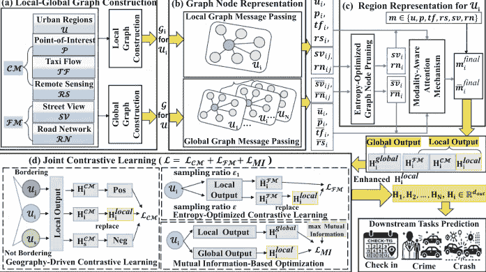

图 2. 框架：(a) GraphJCL 为单个区域构建局部图，为所有区域构建全局图。(b) GraphJCL 引入定制的消息传递机制来捕捉局部和全局图节点表示。(c) GraphJCL 采用基于熵优化的图节点剪枝和模态感知注意力机制来推导有效的区域表示。(d) 地理驱动、基于熵优化的和基于互信息的对比技术共同增强局部区域表示以生成最终的区域表示。

- **出租车流** ($\mathcal{TF}$)：出租车流捕捉区域内的流动模式。每个区域 $U_i$ 关联一个向量 $TF_i = \{TF_{i1}, TF_{i2}, \dots, TF_{iT}\}$，其中 $TF_{ij}$ 表示区域 $U_i$ 在第 $j$ 个时间段内的出租车流量。$T$ 表示时间段的总数（例如，一个月内的小时数），取决于数据集。

- **遥感图像** ($\mathcal{RS}$)：遥感图像提供区域内土地利用和城市结构的宏观视图。每个区域 $U_i$ 关联一张遥感图像 $RS_i$。

### 定义 3 (细粒度模态 ($\mathcal{FM}$))
如果一种模态捕捉区域内的空间拓扑和局部环境结构，意味着其数据点表现出显著的变异性且无法有效聚合为单一向量表示，则该模态被认为是细粒度的。

使用的细粒度模态 $\mathcal{FM}$ 如下：

- **街景图像** ($\mathcal{SV}$)：街景图像通过大量空间分布的图像捕捉城市区域的局部视觉特征。每个区域 $U_i$ 包含一组街景图像，表示为 $\{SV_{i1}, SV_{i2}, \dots, SV_{i|\mathcal{SV}_i|}\}$，其中 $SV_{ij}$ 表示区域 $U_i$ 内索引为 $j$ 的街景图像。

- **路网** ($\mathcal{RN}$)：路网捕捉城市区域的拓扑结构。每个区域 $U_i$ 包含一组路网元素，表示为 $\{RN_{i1}, RN_{i2}, \dots, RN_{i|\mathcal{RN}_i|}\}$，其中 $RN_{ij}$ 表示区域 $U_i$ 内索引为 $j$ 的路段或路口。类别索引 $RNS_{ij}$ 指定道路元素的类型（例如，干道或高速公路）。

### 定义 4 (下游任务 ($Y$))
下游任务指城市语境下的社会经济和环境指标。对于包含 N 个区域的城市区域 $\mathcal{U}$，L 个任务目标表示为 $Y \in \mathbb{R}^{N \times L}$。本文关注三个下游任务：签到次数、犯罪事件和交通事故次数，其中 L = 3。

### 定义 5 (问题陈述：城市区域表示)
给定城市区域 $\mathcal{U}$ 及其关联的粗粒度模态 CM 和细粒度模态 FM，目标是为每个区域 $U_i$ 学习一个低维表示 $H_i \in \mathbb{R}^{d_{out}}$。这些嵌入式 $\mathcal{H} = \{H_1, H_2, ..., H_N\}$ 用于预测下游任务 Y。

## 4 方法

在本节中，我们介绍 GraphICL，一个用于城市区域表示的基于图的双视角框架。其关键组件如图 2 所示。

### 4.1 局部-全局图构建

在本小节中，为了实现局部和全局方面的联合区域建模，我们为每个单独区域构建一个局部图，并为所有区域构建一个全局图。

**局部图构建。** 对于每个区域 $U_i$，我们构建一个局部异构图 $\mathcal{G}_i = (\mathcal{V}_i, \mathcal{E}_i)$ 以捕捉其内在特征，不受其他区域的影响。具体来说，节点集 $\mathcal{V}_i$ 包含六种类型的节点：

- **区域**：表示区域地理边界的节点 $U_i$。

- **POI**：表示聚合 POI 数据的节点 $P_i$。

- **出租车流**：表示聚合出租车流动模式的节点 $TF_i$。

- **遥感**：捕捉宏观土地利用和城市结构的节点 $RS_i$。

- **街景图像**：一组节点 $\{SV_{i1}, SV_{i2}, ..., SV_{i|\mathcal{SV}_i|}\}$，表示局部街道级视觉环境特征。

- **路网**：一组节点 $\{RN_{i1}, RN_{i2}, ..., RN_{i|\mathcal{RN}_i|}\}$，表示路段和路口的拓扑结构。

边集 $\mathcal{E}_i$ 包含五种类型的边缘，定义区域节点 $U_i$ 与其他模态节点之间的关系：

- $\mathcal{U}_{has\_\mathcal{P}}$：边缘 $(U_i, P_i)$ 将区域节点连接到 POI 节点。

- $\mathcal{U}_{has\_\mathcal{TF}}$：边缘 $(U_i, TF_i)$ 将区域节点连接到出租车节点。

- $\mathcal{U}_{has\_\mathcal{RS}}$：边缘 $(U_i, RS_i)$ 将区域节点连接到遥感图像节点。

- $\mathcal{U}_{has\_\mathcal{SV}}$：一组边缘 $(U_i, SV_{ij})$，其中 $j = 1, 2, ..., |\mathcal{SV}_i|$，将区域节点连接到所有街景图像节点。

- $\mathcal{U}_{has\_\mathcal{RN}}$：一组边缘 $(U_i, RN_{ij})$，其中 $j = 1, 2, ..., |\mathcal{RN}_i|$，将区域节点连接到所有路网元素节点。

基于上述局部图构建方法，可以分别为城市区域 $U_1, U_2, ..., U_N$ 构建 N 个局部图 $\mathcal{G}_i$，其中 $i = 1, 2, ..., N$。


全局图构造。对于所有区域 \(U_i \in \mathcal{U}, i = 1, 2, \dots, N\)，我们构建一个全局图 \(\mathcal{G} = (\mathcal{V}, \mathcal{E})\)，该图包含来自局部图 \(\mathcal{G}_1, \dots, \mathcal{G}_N\) 的所有节点和边。此外，它引入了四种额外的边类型，用于捕捉区域间关系，基于区域节点 \(\mathcal{U}\) 和粗粒度模态：POI（\(\mathcal{P}\)）、出租车流（\(\mathcal{TF}\)）和遥感（\(\mathcal{RS}\)）。细粒度模态街景（\(\mathcal{SV}\)）和道路网络（\(\mathcal{RN}\)）不建立区域间边，因为它们主要捕捉区域内的局部环境和拓扑特征。四种类型为：

- **- **\(\mathcal{U}\)-sim-\(\mathcal{U}\)**: 区域节点边集 \((U_i, U_j)\)，连接地理边界相邻的区域节点，其中 \(i, j = 1, 2, \dots, N\) 且 \(i \neq j\)。**
- **- **\(\mathcal{P}\)-sim-\(\mathcal{P}\)**: 基于跨区域余弦语义相似度连接 POI 节点的边集 \((P_i, P_j)\)，其中 \(i, j = 1, 2, \dots, N\) 且 \(i \neq j\)。**
- **- **\(\mathcal{TF}\)-sim-\(\mathcal{TF}\)**: 基于跨区域余弦移动相似度连接出租车流节点的边集 \((\mathcal{TF}_i, \mathcal{TF}_j)\)，其中 \(i, j = 1, 2, \dots, N\) 且 \(i \neq j\)。**
- **- **\(\mathcal{RS}\)-sim-\(\mathcal{RS}\)**: 基于跨区域余弦卫星相似度连接遥感节点的边集 \((\mathcal{RS}_i, \mathcal{RS}_j)\)，其中 \(i, j = 1, 2, \dots, N\) 且 \(i \neq j\)。**

## 4.2 图节点表示

本小节介绍不同模态的节点表示初始化，随后介绍我们设计的用于迭代更新的消息传递机制。

### 各模态节点初始化

- **- **区域（\(\mathcal{U}\)）**: 构建一个无向图，包含所有区域地理边界 \(U_i, i = 1, 2, \dots, N\) 以及连接相邻区域的边。\(U_i\) 的初始化向量 \(\mathbf{u}_i^{(0)} \in \mathbb{R}^{d_{in}}\) 使用 Node2Vec 算法 [3] 得到。**
- **- **遥感影像（\(\mathcal{RS}\)）**: 每个 \(RS_i\) 的初始化向量 \(\mathbf{rs}_i^{(0)} \in \mathbb{R}^{d_{in}}\) 通过应用 EfficientNet-B4 模型 [16] 获得。**
- **- **兴趣点（POI）（\(\mathcal{P}\)）**: 每个 \(P_i\) 的初始化向量 \(\mathbf{p}_i^{(0)} \in \mathbb{R}^{d_{in}}\) 通过设置 \(K = d_{in}\) 生成。**
- **- **出租车流（\(\mathcal{TF}\)）**: 每个 \(\mathcal{TF}_i\) 的初始化向量 \(\mathbf{tf}_i^{(0)} \in \mathbb{R}^{d_{in}}\) 通过设置 \(T = d_{in}\) 计算。**
- **- **街景影像（\(\mathcal{SV}\)）**: 每个街景图像 \(SV_{i,j}\) 的初始化向量 \(\mathbf{sv}_{i,j}^{(0)} \in \mathbb{R}^{d_{in}}\) 通过利用 CLIP-ViT-B/32 模型 [13] 获得，其中 \(j = 1, 2, \dots, |\mathcal{SV}_i|\)。**
- **- **道路网络（\(\mathcal{RN}\)）**: 每个道路网络元素 \(RN_{i,j}\) 的初始化向量 \(\mathbf{rn}_{i,j}^{(0)} \in \mathbb{R}^{d_{in}}\) 通过采用嵌入技术 [12] 生成，其中 \(j = 1, 2, \dots, |\mathcal{RN}_i|\)。**

### 局部图消息传递机制

对于区域 \(U_i\) 中的每个局部图 \(\mathcal{G}_i\)，节点包括区域节点 \(U_i\)、POI 节点 \(P_i\)、出租车流节点 \(\mathcal{TF}_i\)、遥感节点 \(RS_i\)、街景节点 \(SV_{ij}\) 和道路网络节点 \(RN_{ij}\)。它们在第 \(l\) 层的节点表示分别表示为 \(\boldsymbol{u}_i^{(l)}\)、\(\boldsymbol{p}_i^{(l)}\)、\(\boldsymbol{tf}_i^{(l)}\)、\(\boldsymbol{rs}_i^{(l)}\)、\(\boldsymbol{sv}_{ij}^{(l)}\) 和 \(\boldsymbol{rn}_{ij}^{(l)}\)，初始嵌入定义如以前所述。为了在不受其他区域干扰的情况下捕捉区域特定特征，局部图中的消息传递仅发生在同一区域内的节点之间。具体来说，节点表示在第 \(l\) 层根据以下 GNN 更新规则进行更新：

```
\boldsymbol{u}_i^{(l)} = \sigma \left( \sum_{m \in \{p,tf,rs\}} W_m \boldsymbol{m}_i^{(l-1)} + \sum_{m \in \{sv,rn\}} \sum_{j=1}^{|\mathcal{M}_i|} W_m \boldsymbol{m}_{ij}^{(l-1)} \right),
\boldsymbol{m}_i^{(l)} = \sigma \left( W_u \boldsymbol{u}_i^{(l-1)} \right), \quad m \in \{p,tf,rs\},
\boldsymbol{m}_{ij}^{(l)} = \sigma \left( W_u \boldsymbol{u}_i^{(l-1)} \right), \quad m \in \{sv,rn\}, \quad j = 1, 2, \dots, |\mathcal{M}_i|,
(1)
```

其中 \(\sigma\) 为激活函数，\(W_m\) 和 \(W_u\) 为可学习参数。最终层输出表示为 \(\boldsymbol{u}_i\)、\(\boldsymbol{p}_i\)、\(\boldsymbol{tf}_i\)、\(\boldsymbol{rs}_i\)、\(\boldsymbol{sv}_{ij}\) 和 \(\boldsymbol{rn}_{ij}\)，它们均属于 \(\mathbb{R}^{d_{in}}\)。

### 全局图消息传递机制

对于全局图 \(\mathcal{G} = (\mathcal{V}, \mathcal{E})\)，区域 \(U_i\) 中的节点包括区域节点 \(U_i\)、POI 节点 \(P_i\)、出租车流节点 \(\mathcal{TF}_i\)、遥感节点 \(RS_i\)、街景节点 \(SV_{ij}\) 和道路网络节点 \(RN_{ij}\)。第 \(l\) 层的节点表示分别表示为 \(\overline{\boldsymbol{u}}_i^{(l)}\)、\(\overline{\boldsymbol{p}}_i^{(l)}\)、\(\overline{\boldsymbol{tf}}_i^{(l)}\)、\(\overline{\boldsymbol{rs}}_i^{(l)}\)、\(\overline{\boldsymbol{sv}}_{ij}^{(l)}\) 和 \(\overline{\boldsymbol{rn}}_{ij}^{(l)}\)。每个向量均位于 \(\mathbb{R}^{d_{in}}\) 并按先前描述进行初始化。全局图通过区域间交互来捕捉区域表示。区域间的消息传递仅发生在粗粒度模态之间，而专注于局部拓扑的细粒度模态不在区域间交换信息。集合 \(\mathcal{N}_i^U\) 和 \(\mathcal{N}_i^m\) 分别表示相邻区域节点和跨区域同模态相邻节点，\(\sigma\) 为激活函数。具体来说，节点表示在第 \(l\) 层根据以下 GNN 更新规则进行更新：

```
\overline{\boldsymbol{u}}_i^{(l)} = \sigma \left( \sum_{m \in \{p,tf,rs\}} \overline{W}_m \overline{\boldsymbol{m}}_i^{(l-1)} + \sum_{m \in \{sv,rn\}} \sum_{j=1}^{|\mathcal{M}_i|} \overline{W}_m \overline{\boldsymbol{m}}_{ij}^{(l-1)} + \sum_{j \in \mathcal{N}_i^U} \overline{W}_{uu} \overline{\boldsymbol{u}}_j^{(l-1)} \right),
\overline{\boldsymbol{m}}_i^{(l)} = \sigma \left( \overline{W}_u \overline{\boldsymbol{u}}_i^{(l-1)} + \sum_{j \in \mathcal{N}_i^m} \overline{W}_{mm} \overline{\boldsymbol{m}}_j^{(l-1)} \right), \quad m \in \{p,tf,rs\},
\overline{\boldsymbol{m}}_{ij}^{(l)} = \sigma \left( \overline{W}_u \overline{\boldsymbol{u}}_i^{(l-1)} \right), \quad m \in \{sv,rn\}, \quad j = 1, 2, \dots, |\mathcal{M}_i|,
(2)
```

其中 \(\overline{W}_m\)、\(\overline{W}_{uu}\)、\(\overline{W}_u\) 和 \(\overline{W}_{mm}\) 为可学习权重矩阵。最终层输出表示为 \(\overline{\boldsymbol{u}}_i\)、\(\overline{\boldsymbol{p}}_i\)、\(\overline{\boldsymbol{tf}}_i\)、\(\overline{\boldsymbol{rs}}_i\)、\(\overline{\boldsymbol{sv}}_{ij}\) 和 \(\overline{\boldsymbol{rn}}_{ij}\)，它们均属于 \(\mathbb{R}^{d_{in}}\)。

## 4.3 基于熵优化的多模态区域表示

为消除冗余的低信息节点，我们提出了一种基于熵优化的图节点剪枝机制。具体来说，我们根据图节点表示计算每个节点的熵。高熵节点承载更多信息内容，因此被保留，而低熵冗余节点被丢弃。为了获取区域表示，我们设计了一种模态感知注意力机制，以动态调整各模态的贡献，确保有效的多模态区域表示。


### 熵优化图节点剪切机制

为了提高效率并减少冗余，我们在局部图和全局图上均执行熵优化图节点剪切。

- 在局部图 $\mathcal{G}_i$ 中，存在大量街景图像节点 $SV_{ij}$，每个节点表示为 $\boldsymbol{sv}_{ij} \in \mathbb{R}^{d_{in}}$。这里，$j = 1, 2, ..., |\mathcal{M}_i|$。为了评估每个节点 $SV_{ij}$ 的信息量，我们首先将其特征向量归一化为 $\boldsymbol{sv}_{ij,f}^{\text{norm}} = \frac{|\boldsymbol{sv}_{ij,f}|}{\sum_{f=1}^{d_{in}} |\boldsymbol{sv}_{ij,f}|}$ 以确保按比例缩放。然后我们计算其熵 $H(SV_{ij})$ 和采样概率 $P(SV_{ij})$ 如下：

$$
H(SV_{ij}) = - \sum_{f=1}^{d_{in}} \boldsymbol{sv}_{ij,f}^{\text{norm}} \log(\boldsymbol{sv}_{ij,f}^{\text{norm}}), \quad P(SV_{ij}) = H(SV_{ij}) / \sum_{j=1}^{|SV_i|} H(SV_{ij}). \quad (3)
$$

节点 $SV_{ij}$ 的存在遵循伯努利分布，$SV_{ij} \sim \text{Bern}(P(SV_{ij}))$。熵值较高（因而 $P(SV_{ij})$ 也较高）的节点更可能被保留，而低熵节点会被剪切。保留的节点基于采样比例 $\varepsilon$ 进行选取。采样后的街景节点表示（每个均为 $\boldsymbol{sv}_{ij} \in \mathbb{R}^{d_{in}}$）被平均，以得出区域 $U_i$ 的嵌入 $\boldsymbol{sv}_i \in \mathbb{R}^{d_{in}}$。同样，路网的嵌入表示为 $\boldsymbol{rn}_i \in \mathbb{R}^{d_{in}}$。

- 在全局图 $\mathcal{G}$ 中，区域 $U_i$ 内存在大量细粒度街景图像节点和路网元素节点。采用与局部图相同的剪切策略，我们保留高熵节点并平均其表示，以获得区域 $U_i$ 的最终嵌入 $\overline{\boldsymbol{sv}}_i, \overline{\boldsymbol{rn}}_i \in \mathbb{R}^{d_{in}}$。

### 模态感知注意力机制

为了有效捕捉不同模态的不同贡献，我们在局部图和全局图中均应用模态感知注意力机制。

- 在区域 $U_i$ 的局部图 $\mathcal{G}_i$ 中，模态表示记为 $\boldsymbol{m}_i \in \mathbb{R}^{d_{in}}$，其中 $\boldsymbol{m} \in \{u, \boldsymbol{p}, \boldsymbol{tf}, \boldsymbol{rs}, \boldsymbol{sv}, \boldsymbol{rn}\}$。由于不同模态对最终区域表示的贡献不均，为每个模态学习一个注意力权重向量 $\boldsymbol{w}_m \in \mathbb{R}^{d_{in}}$ 以捕捉其重要性。模态特定表示计算为 $\boldsymbol{m}_i^{attn} = \sigma(\boldsymbol{w}_m \odot \boldsymbol{m}_i)$，其中 $\odot$ 表示逐元素乘法，$\sigma$ 为激活函数。为了优化信息，应用一个线性变换 [17]，随后是一个隐藏维度为 $d_{hid}$ 的自编码器 [1]，从而得到最终的局部模态表示 $\boldsymbol{m}_i^{final} \in \mathbb{R}^{d_{out}}$。

- 在全局图 $\mathcal{G}$ 中，区域 $U_i$ 的模态表示由 $\overline{\boldsymbol{m}}_i \in \mathbb{R}^{d_{in}}$ 给出，其中 $\boldsymbol{m} \in \{u, \boldsymbol{p}, \boldsymbol{tf}, \boldsymbol{rs}, \boldsymbol{sv}, \boldsymbol{rn}\}$。应用相同的模态感知注意力机制，我们得到最终的全局模态表示 $\overline{\boldsymbol{m}}_i^{final} \in \mathbb{R}^{d_{out}}$。

### 局部-全局区域表示.

我们按如下方式计算粗粒度、细粒度及整体局部区域表示 $\boldsymbol{H}_i^{\mathcal{CM}}, \boldsymbol{H}_i^{\mathcal{FM}}, \boldsymbol{H}_i^{local} \in \mathbb{R}^{d_{out}}$ 和全局表示 $\boldsymbol{H}_i^{global} \in \mathbb{R}^{d_{out}}$：

$$
\boldsymbol{H}_i^{\mathcal{X}} = \text{Mean} \left( \{ \boldsymbol{m}_i^{final} \mid \boldsymbol{m} \in \mathcal{X} \} \right), \quad \mathcal{X} \in \{ \mathcal{C}\mathcal{M}, \mathcal{F}\mathcal{M}, local \}, \quad (4)
$$

$$
\mathcal{C}\mathcal{M} = \{ \boldsymbol{p}, \boldsymbol{tf}, \boldsymbol{rs} \}, \quad \mathcal{F}\mathcal{M} = \{ \boldsymbol{sv}, \boldsymbol{rn} \}, \quad local = \{ u, \boldsymbol{p}, \boldsymbol{tf}, \boldsymbol{rs}, \boldsymbol{sv}, \boldsymbol{rn} \}.
$$

$$
\boldsymbol{H}_i^{global} = \text{Mean} \left( \{ \overline{\boldsymbol{m}}_i^{final} \mid \boldsymbol{m} \in \{ u, \boldsymbol{p}, \boldsymbol{tf}, \boldsymbol{rs}, \boldsymbol{sv}, \boldsymbol{rn} \} \right).
$$

## 4.4 联合对比学习

为了在我们的双视角局部-全局图框架内有效学习多模态区域表示，我们引入了一种联合对比学习方法，从三个视角优化 \( H_i^{local} \)。

### 基于地理的对比学习（使用 \( H_i^{\mathcal{C}\mathcal{M}} \)）.

粗粒度局部区域表示 \( H_i^{\mathcal{C}\mathcal{M}} \) 捕获具有强地理连续性的功能属性。由于邻近地区表现出相似的粗粒度表示，我们通过将地理上相邻的地区（如 \( U_j \)）视为正样本，将不相邻的地区（如 \( U_s \)）视为负样本，来应用对比学习。为了优化最终区域表示，我们用 \( H_i^{local} \) 替换 \( H_i^{\mathcal{C}\mathcal{M}} \)。\( \gamma \) 是边界超参数，\( \| \cdot \|_2 \) 表示 L2 范数，对比损失定义如下：

\[
\mathcal{L}_{\mathcal{C}\mathcal{M}} = \max \left( \| H_i^{local} - H_j^{\mathcal{C}\mathcal{M}} \|_2 - \| H_i^{local} - H_s^{\mathcal{C}\mathcal{M}} \|_2 + \gamma, 0 \right). \quad (5)
\]

### 基于熵优化的对比学习（使用 \( H_i^{\mathcal{F}\mathcal{M}} \)）.

细粒度局部区域表示 \( H_i^{\mathcal{F}\mathcal{M}} \) 捕获空间拓扑和局部环境结构。由于跨区域的高度变异性，除目标区域外的所有区域均被视为负样本，正样本则从该区域自身的细粒度数据中抽取。在图节点剪切过程中，使用不同的采样比例 \( \varepsilon_1 \) 来获得 \( \tilde{H}_i^{\mathcal{F}\mathcal{M}} \)，其作为正样本。为了优化最终表示，\( H_i^{local} \) 替换 \( H_i^{\mathcal{F}\mathcal{M}} \)。\( \tau \) 是温度超参数。基于熵优化的对比损失为：

\[
\mathcal{L}_{\mathcal{F}\mathcal{M}} = \sum_{i=1}^N \left[ - \log \exp \left( \frac{ H_i^{local} \cdot \tilde{H}_i^{\mathcal{F}\mathcal{M}} }{ \tau } \right) + \log \left( \exp \left( \frac{ H_i^{local} \cdot \tilde{H}_i^{\mathcal{F}\mathcal{M}} }{ \tau } \right) + \sum_{j \neq i} \exp \left( \frac{ H_i^{local} \cdot H_j^{local} }{ \tau } \right) \right) \right]. \quad (6)
\]

### 基于互信息的优化（使用 \( H_i^{global} \)）.

全局区域表示 \( H_i^{global} \) 和局部区域表示 \( H_i^{local} \) 从相同的区域数据中捕获互补视角。为了将全局信息整合到 \( H_i^{local} \) 中，我们最大化互信息 \( \mathcal{I}(H_i^{local}, H_i^{global}) = \mathbb{E} \left[ \log \frac{p_i^{l,g}}{p_i^l p_i^g} \right] \)，其中 \( p_i^{l,g} \)、\( p_i^l \) 和 \( p_i^g \) 分别表示局部和全局区域表示的联合分布和边缘分布。互信息通过最小化以下对比损失来优化，其中 \( \lambda \) 为超参数：

\[
\mathcal{L}_{MI} = - \sum_i p_i^{l,g} \left[ \log p_i^{l,g} - \lambda \left( \log p_i^l + \log p_i^g \right) \right]. \quad (7)
\]

### 训练.

最终目标函数定义为：

\[
\mathcal{L} = \mathcal{L}_{\mathcal{C}\mathcal{M}} + \mathcal{L}_{\mathcal{F}\mathcal{M}} + \mathcal{L}_{MI}. \quad (8)
\]

通过 \( \mathcal{L} \) 联合学习得到的增强局部区域表示 \( H_i^{local} \) 作为最终区域嵌入 \( H_i \in \mathbb{R}^{d_{out}} \)。\( \mathcal{H} = H_1, H_2, \dots, H_N \) 对应于城市区域 \( \mathcal{U} = U_1, U_2, \dots, U_N \) 并用于预测下游任务 \( Y \)。


| | U | P | TF | RS | SV | RN | 犯罪 | 事故 | 签到 |
|---|---|---|---|---|---|---|---|---|---|
| 纽约市 | 180 | 20872 | 848006 | 180 | 20698 | 13200 | 77701 | 14564 | 329153 |
| 芝加哥 | 77 | 36963 | 922746 | 77 | 36179 | 56005 | 91252 | 109645 | 167222 |

## 5 评估

### 5.1 实验设置

数据集与指标。我们在纽约市（NYC）和芝加哥（CHI）的两个真实世界城市数据集上进行实验 [7, 24, 28]，这些数据集提供区域级信息 U 以及五种异构模态：兴趣点（POI）P、出租车流量 TF、遥感影像 RS、街景数据 SV 和道路网络拓扑 RN。这些多模态数据集支持三个代表性的下游任务：签到预测、犯罪预测和交通事故预测。详细的数据集统计信息汇总在表 1 中。为了全面评估预测性能，我们采用三种广泛使用的指标：平均绝对误差（MAE）、均方根误差（RMSE）和决定系数（R^2）。这些指标共同评估模型在不同预测任务中的准确性和鲁棒性。

基线模型。为了评估 GraphJCL 的性能，我们将其与七个基线模型进行比较：

- GraphST [29]，一种专为自监督学习设计的时空图学习模型；
- ReCP [9]，一种用于跨多种视图进行一致表示学习的流水线；
- HREP [32]，一种利用带提示学习的异构区域嵌入的框架；
- HAFusion [15]，采用双特征注意力融合模块来捕捉区域特征内部及跨区域的高阶相关性；
- UrbanVLP [4]，集成多粒度宏观（卫星）和微观（街景）信息；
- MuseCL [24]，一种用于精细城市区域画像的多语义对比学习框架；
- GURPP [7]，一种基于图的城市区域预训练与提示框架，用于改进表示学习。

参数设置。对于 NYC 和 CHI 的实验，所有模态的输入和输出维度（d_in 和 d_out）均统一设置为 168。两个城市的模型均采用 Adam 优化器进行优化，学习率为 0.001，权重衰减为 0.01，训练最多 50 个 epoch。批次大小设置为 NYC 的 180 和 CHI 的 77。对比学习的超参数如下：两个城市的边际超参数 gamma 和温度超参数 tau 分别设置为 2 和 0.1。参数 lambda 为 NYC 设置为 8，为 CHI 设置为 7。

### 5.2 整体性能

表 2 展示了两个城市三个任务中基线模型的性能比较。由于不同的区域表示模型使用不同的模态集 UM，

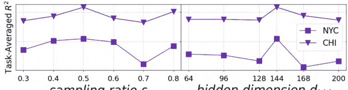

图 3. GraphJCL 的超参数研究。

本文综述的区域表示模型共采用十个模态集，详情见表 2 的表头。其中，$\mathcal{UM}_1, \mathcal{UM}_2, \mathcal{UM}_3,$ 和 $\mathcal{UM}_4$ 对应现有模型使用的模态集，其余六个是本模型引入的新模态集。

- 高灵活性和有效性：在现有模态集上，GraphJCL 在所有任务和城市中均优于基线模型，凸显了其从局部和全球两个角度捕捉区域表示的有效性。此外，其对十个模态集的支持展示了卓越的灵活性。
- 对新模态集的适应性：GraphJCL 在所有十个模态集上均表现出色，证明了其对多样数据分布的适应性以及对新模态集的鲁棒性。
- 有效的模态信息利用：模态集 ($\mathcal{UM}_i, i = 3, 4, 5, 6, 7$) 是通过从全集 ($\mathcal{P}, \mathcal{TF}, \mathcal{RS}, \mathcal{SV}, \mathcal{RN}$) 中依次移除 $\mathcal{RN}, \mathcal{SV}, \mathcal{P}, \mathcal{TF}$ 或 $\mathcal{RS}$ 得到的。GraphJCL 在排除任何模态时的性能下降，凸显了其有效利用每种模态并整合其独特信息特征的能力。

### 5.3 消融研究

为了评估模型中不同模块的贡献，我们评估了 GraphJCL 的五个变体：

- w/o NP：移除熵优化的图节点剪枝。
- w/o MA：移除模态感知注意力机制。
- w/o $\mathcal{L}_{CM}$：移除地理驱动的对比学习。
- w/o $\mathcal{L}_{FM}$：移除熵优化的对比学习。
- w/o $\mathcal{L}_{MI}$：移除基于互信息的优化。

实验结果如表 3 所示。结果表明，GraphJCL 优于所有变体，突显了其关键模块的重要性。值得注意的是，移除熵优化的局部图节点剪枝（w/o NP）导致性能下降最大，强调了选择高互信息节点的重要性。省略模态感知注意力机制（w/o MA）也会降低性能，凸显了在最终区域表示中进行模态加权的必要性。最后，移除任何对比学习组件（w/o $\mathcal{L}_{CM}$、w/o $\mathcal{L}_{FM}$ 或 w/o $\mathcal{L}_{MI}$）都会导致性能下降，强调了联合对比学习的重要性。

表 2. 两个城市三个任务中基线模型的性能比较。UM 表示每个模型使用的相应模态集。所有模型共使用 10 个模态集，如下所示：TM = (P, TF, RS, SV, RN)，UM1 = (P, TF)，UM2 = (RS, SV)，UM3 = TM \ RN（即 TM 中排除 RN），UM4 = TM \ SV（即 TM 中排除 SV），UM5 = TM \ P（即 TM 中排除 P），UM6 = TM \ TF（即 TM 中排除 TF），UM7 = TM \ RS（即 TM 中排除 RS），UM8 = (P, TF, RN)，UM9 = (RS, SV, RN)。

| 模型 | UM | 签到 MAE | 签到 RMSE | 签到 R2↑ | 犯罪 MAE | 犯罪 RMSE | 犯罪 R2↑ | 事故 MAE | 事故 RMSE | 事故 R2↑ |
|---|---|---|---|---|---|---|---|---|---|---|
| GraphST [29] | UM1 | 1501.3 | 2838.2 | 0.284 | 316.04 | 496.41 | 0.103 | 30.855 | 42.633 | 0.162 |
| ReCP [9] | UM1 | 823.4 | 1404.6 | 0.719 | 183.74 | 280.56 | 0.498 | 33.518 | 43.110 | 0.226 |
| HREP [32] | UM1 | 1122.6 | 1745.4 | 0.566 | 201.69 | 308.86 | 0.391 | 26.859 | 34.483 | 0.505 |
| HAFusion [15] | UM1 | 1051.7 | 1709.0 | 0.584 | 188.15 | 299.60 | 0.427 | 25.177 | 32.566 | 0.558 |
| UrbanVLP [4] | UM1 | 1508.5 | 2652.6 | 0.286 | 195.30 | 404.53 | 0.395 | 38.421 | 50.695 | 0.183 |
| MuseCL [24] | UM1 | 1479.3 | 2781.6 | 0.313 | 278.28 | 394.83 | 0.433 | 33.977 | 44.077 | 0.104 |
| GURPP [7] | UM | 900.3 | 1356.0 | 0.738 | 194.64 | 280.50 | 0.498 | 30.194 | 41.764 | 0.274 |
| GraphJCL | UM1 | 747.5 | 1269.6 | 0.771 | 165.33 | 251.80 | 0.595 | 26.987 | 34.771 | 0.497 |
| GraphJCL | UM2 | 610.1 | 1072.8 | 0.836 | 167.19 | 270.28 | 0.534 | 27.672 | 35.732 | 0.468 |
| GraphJCL | UM3 | 613.0 | 1117.1 | 0.822 | 162.73 | 257.18 | 0.578 | 26.106 | 34.869 | 0.495 |
| GraphJCL | UM4 | 691.5 | 1248.9 | 0.778 | 158.35 | 246.95 | 0.611 | 26.861 | 36.399 | 0.448 |
| GraphJCL | UM5 | 684.4 | 1142.5 | 0.814 | 164.67 | 258.01 | 0.575 | 23.199 | 30.542 | 0.612 |
| GraphJCL | UM6 | 683.8 | 1135.7 | 0.816 | 170.37 | 275.84 | 0.514 | 22.498 | 29.430 | 0.639 |
| GraphJCL | UM7 | 683.7 | 1103.7 | 0.827 | 176.39 | 276.10 | 0.513 | 22.891 | 29.979 | 0.651 |
| GraphJCL | UM8 | 770.5 | 1320.5 | 0.752 | 172.18 | 266.48 | 0.546 | 23.027 | 29.908 | 0.628 |
| GraphJCL | UM | 676.7 | 1142.9 | 0.814 | 177.99 | 264.27 | 0.554 | 24.481 | 31.482 | 0.587 |
| GraphJCL | TM | 676.2 | 1027.0 | 0.850 | 158.20 | 235.26 | 0.647 | 22.829 | 29.733 | 0.632 |

| 模型 | UM | 签到 MAE | 签到 RMSE | 签到 R2↑ | 犯罪 MAE | 犯罪 RMSE | 犯罪 R2↑ | 事故 MAE | 事故 RMSE | 事故 R2↑ |
|---|---|---|---|---|---|---|---|---|---|---|
| GraphST [29] | UM1 | 2066.7 | 5281.3 | 0.545 | 566.79 | 721.12 | 0.381 | 548.625 | 761.611 | 0.464 |
| ReCP [9] | UM1 | 1508.2 | 3448.3 | 0.581 | 322.41 | 445.39 | 0.763 | 384.472 | 555.310 | 0.701 |
| HREP [32] | UM1 | 2139.5 | 4174.6 | 0.385 | 518.71 | 679.53 | 0.448 | 623.910 | 811.459 | 0.362 |
| HAFusion [15] | UM1 | 1280.7 | 3424.5 | 0.586 | 578.57 | 758.15 | 0.312 | 655.469 | 899.352 | 0.217 |
| UrbanVLP [4] | UM2 | 2524.5 | 5786.6 | 0.388 | 570.67 | 859.28 | 0.388 | 613.180 | 883.680 | 0.510 |
| MuseCL [24] | UM3 | 2264.2 | 5944.2 | 0.424 | 624.35 | 858.21 | 0.123 | 473.063 | 596.230 | 0.672 |
| GURPP [7] | UM | 1251.5 | 2850.9 | 0.713 | 346.84 | 455.69 | 0.752 | 386.788 | 586.449 | 0.667 |
| GraphJCL | UM1 | 1145.9 | 2783.3 | 0.727 | 302.54 | 400.827 | 0.797 | 367.110 | 529.178 | 0.729 |
| GraphJCL | UM2 | 1555.0 | 3526.5 | 0.561 | 381.56 | 498.66 | 0.703 | 330.951 | 469.629 | 0.786 |
| GraphJCL | UM3 | 1154.8 | 2812.7 | 0.721 | 300.32 | 427.16 | 0.782 | 342.628 | 505.661 | 0.752 |
| GraphJCL | UM4 | 1194.2 | 2695.4 | 0.744 | 317.21 | 464.22 | 0.742 | 335.786 | 466.867 | 0.789 |
| GraphJCL | UM5 | 1267.7 | 2860.0 | 0.712 | 436.94 | 592.05 | 0.581 | 319.905 | 469.139 | 0.789 |
| GraphJCL | UM6 | 1139.5 | 2692.2 | 0.744 | 349.06 | 529.48 | 0.665 | 306.288 | 496.011 | 0.762 |
| GraphJCL | UM7 | 1217.8 | 3011.6 | 0.680 | 338.89 | 463.84 | 0.743 | 326.074 | 479.446 | 0.777 |
| GraphJCL | UM8 | 1001.0 | 2326.3 | 0.809 | 305.38 | 417.81 | 0.791 | 322.057 | 528.207 | 0.730 |
| GraphJCL | UM9 | 1361.3 | 2985.7 | 0.685 | 437.97 | 575.19 | 0.604 | 313.112 | 469.137 | 0.787 |
| GraphJCL | TM | 894.9 | 2115.2 | 0.842 | 293.24 | 391.67 | 0.817 | 316.244 | 465.734 | 0.790 |


表 3. 两城市三任务消融实验性能评估。

**NYC**

| 方法 | 签到 MAE↓ | 签到 RMSE↓ | 签到 R2↑ | 犯罪 MAE↓ | 犯罪 RMSE↓ | 犯罪 R2↑ | 交通事故 MAE↓ | 交通事故 RMSE↓ | 交通事故 R2↑ |
|---|---|---|---|---|---|---|---|---|---|
| w/o NP | 730.8 | 1364.7 | 0.735 | 165.68 | 238.62 | 0.637 | 23.968 | 30.809 | 0.605 |
| w/o MA | 681.4 | 1035.5 | 0.847 | 160.06 | 247.06 | 0.610 | 23.626 | 31.183 | 0.595 |
| w/o L<sub>CM</sub> | 687.3 | 1135.8 | 0.816 | 170.02 | 277.19 | 0.510 | 24.555 | 32.049 | 0.572 |
| w/o L<sub>FM</sub> | 758.2 | 1238.7 | 0.782 | 174.63 | 283.53 | 0.487 | 23.945 | 31.593 | 0.584 |
| w/o L<sub>MI</sub> | 701.4 | 1053.0 | 0.842 | 160.50 | 241.36 | 0.628 | 23.760 | 31.177 | 0.595 |
| GraphJCL | **676.2** | **1027.0** | **0.850** | **158.20** | **235.26** | **0.647** | **22.829** | **29.733** | **0.632** |

**CHI**

| 方法 | 签到 MAE↓ | 签到 RMSE↓ | 签到 R2↑ | 犯罪 MAE↓ | 犯罪 RMSE↓ | 犯罪 R2↑ | 交通事故 MAE↓ | 交通事故 RMSE↓ | 交通事故 R2↑ |
|---|---|---|---|---|---|---|---|---|---|
| w/o NP | 1080.3 | 2446.7 | 0.789 | 366.08 | 497.45 | 0.704 | 333.024 | 468.868 | 0.787 |
| w/o MA | 928.0 | 2297.8 | 0.813 | 311.24 | 435.34 | 0.773 | 317.946 | 484.319 | 0.772 |
| w/o L<sub>CM</sub> | 1098.7 | 2412.6 | 0.795 | 315.98 | 438.36 | 0.770 | 351.831 | 545.538 | 0.712 |
| w/o L<sub>FM</sub> | 1103.8 | 2516.8 | 0.777 | 317.49 | 426.89 | 0.782 | 314.124 | 456.12 | 0.783 |
| w/o L<sub>MI</sub> | 895.9 | 2232.3 | 0.824 | 294.44 | 393.11 | 0.809 | 323.476 | 488.833 | 0.769 |
| GraphJCL | **894.9** | **2115.2** | **0.842** | **293.24** | **391.67** | **0.817** | **288.56** | **434.242** | **0.812** |

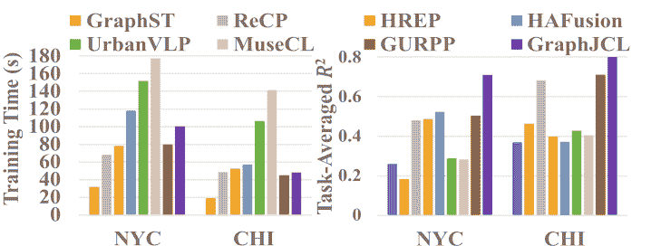

图 4. 效率研究：每个模型加载所有数据并训练一个时代所需的时间。

### 5.4 超参数研究

我们对两个显著影响模型性能的关键超参数进行了详细分析：在熵优化图节点剪枝模块中使用的 _采样比率_ ε，以及在模态感知注意力机制中采用的 _隐藏维度 d_hid_，两者均在第 4.3 节中介绍。

这些超参数的影响在图 3 中进行了说明，其中模型性能使用三个代表性城市预测任务（签到预测、犯罪预报和交通事故预测）的平均决定系数 (R²) 进行评估。

对于 NYC 数据集，将采样比率 \(\varepsilon\) 设置为 0.5 且隐藏维度 \(d_{hid}\) 设置为 144，在各任务中始终能得到最高的平均 R²。

CHI 数据集也观察到了类似趋势，我们也将 \(\varepsilon\) = 0.5 和 \(d_{hid}\) = 144 设为最优值。

因此，我们将 \(\varepsilon\) = 0.5 和 \(d_{hid}\) = 144 采用为两个城市的默认设置。

### 5.5 模型效率研究

我们使用完整的模态集 (\(\mathcal{P}\), \(\mathcal{TF}\), \(\mathcal{RS}\), \(\mathcal{SV}\), \(\mathcal{RN}\))，将 GraphJCL 与最先进的区域表示模型进行效率对比评估。

评估过程包括加载相同的原始数据集、应用模型特定的预处理流水线，并训练每个模型一个时代，如图 4 所示。

所有实验均在 Intel® Xeon® Gold 6148 CPU（80 核心，2.40 GHz）和 24 GB NVIDIA RTX 4090 GPU 上进行，以确保一致和公平的比较。

与 HAFusion、UrbanVLP 和 MuseCL 相比，GraphJCL 在保持具有竞争力的处理时间的同时实现了更高的预测准确性，展现出卓越的效率。

尽管 GraphST、ReCP、HREP 和 GURPP 表现出更快的训练速度，但由于模态使用减少和建模策略过于简化，其整体性能受到限制。

通过整合五种不同模态的双视角全局和局部建模，GraphJCL 虽略微增加了训练时间，但显著提升了预测性能，使得额外的计算成本成为实际应用中非常值得的权衡。

## 6 讨论与结论

本文提出了一种新颖的双视角图框架 GraphJCL，用于城市区域表示，该框架同时建模局部和全局视角。

它采用联合对比学习来增强区域表示。

实验结果证明了该模型的灵活性和有效性。

未来研究将探讨超越对比优化的局部与全局学习集成的替代策略，以及扩展框架以纳入动态数据、时间变化和上下文信息，从而提高实时预测的准确性和鲁棒性。

**致谢.** 本工作得到人文社会科学重点研究院教育部项目（No.22JJD110001）、中国国家自然科学基金（No.72171229）以及中国人民大学 2023 年度优秀创新人才培育资助项目的支持。

## 参考文献

- 1. Berahmand, K., Daneshfar, F., Salehi, E.S., Li, Y., Xu, Y.: 自动编码器及其在机器学习中的应用：一项综述. Artif. Intell. Rev. **57**(2), 28 (2024)
- 2. Chan, W., Ren, Q., Li, J.: 基于对抗自监督学习的增强城市区域画像. arXiv 预印本 arXiv:2402.01163 (2024)
- 3. Grover, A., Leskovec, J.: node2vec：面向网络的可扩展特征学习. In: 第 22 届 ACM SIGKDD 知识发现与数据挖掘国际会议论文集, pp. 855–864 (2016)
- 4. Hao, X., et al.: UrbanBVLP：面向城市区域画像的多粒度视觉语言预训练. arXiv 预印本 arXiv:2403.16831 (2024)
- 5. Hu, J., Bai, J., Yang, J., Lee, J.J.: 基于稀疏碰撞数据的交通事故风险预测：格兰杰因果推断和图卷积网络方法. Expert Syst. Appl. **259**, 125315 (2025)
- 6. Huang, W., Zhang, D., Mai, G., Guo, X., Cui, L.: 基于 POI 和分层图信息最大化的城市区域表示学习. ISPRS J. Photogramm. Remote. Sens. **196**, 134–145 (2023)
- 7. Jin, J., et al.: 城市区域预训练与提示：一种基于图的方法. arXiv 预印本 arXiv:2408.05920 (2024)
- 8. Li, Y., Huang, W., Cong, G., Wang, H., Wang, Z.: 基于 OpenStreetMap 建筑足迹的城市区域表示学习. In: 第 29 届 ACM SIGKDD 知识发现与数据挖掘会议论文集, pp. 1363–1373 (2023)
- 9. Li, Z., Huang, W., Zhao, K., Yang, M., Gong, Y., Chen, M.: 基于多视角对比预测的城市区域嵌入. In: AAAI 人工智能会议论文集, vol. 38, pp. 8724–8732 (2024)
- 10. Luo, Y., Chung, F.l., Chen, K.: 基于多图表示学习的城市区域画像. In: 第 31 届 ACM 信息与知识管理国际会议论文集, pp. 4294–4298 (2022)
- 11. Mandal, S., O'Connor, N.E.: Llmasmmkg：用于智慧城市认知数字孪生的 LLM 辅助合成多模态知识图谱创建. In: AAAI Symposium Series 论文集, vol. 4, pp. 210–221 (2024)
- 12. Mikolov, T., Le, Q.V., Sutskever, I., Chen, K., Corrado, G., Dean, J.: 向量空间中词表示的高效估计. In: 国际学习表征会议 (ICLR) (2013)
- 13. Radford, A., et al.: 从自然语言监督中学习可迁移视觉模型. In: 国际机器学习会议论文集, pp. 8748–8763. PMLR (2021)
- 14. Shui, C., Li, X., Xi, Q., Jiang, G., Yu, Y.: 基于分层图对比学习的评论增强推荐. In: Bifet, A., Davis, J., KrilaVicius, T., Kull, M., Ntoutsi, E., Žliobaitė, I. (编) 机器学习与知识发现在数据库中的应用. 研究专题, pp. 423–440. Springer, Cham (2024). https://doi.org/10.1007/978-3-031-70365-2_25
- 15. Sun, F., Qi, J., Chang, Y., Fan, X., Karunasekera, S., Tanin, E.: 基于注意力融合的城市区域表示学习. In: 2024 年 IEEE 第 40 届数据工程国际会议 (ICDE). pp. 2409–2412. IEEE (2024)
- 16. Tan, M., Le, Q.: EfficientNet：重新思考卷积神经网络的模型缩放. In: 国际机器学习会议论文集, pp. 6105–6114. PMLR (2019)
- 17. Vaswani, A., et al.: 注意力就是你所需要的. Adv. Neural Inf. Process. Syst. **30** (2017)
- 18. Wu, S., et al.: 城市区域嵌入的多图融合网络. In: 第三十一届国际人工智能联合会议论文集, IJCAI-22, pp. 2312–2318 (2022)
- 19. Xia, L., et al.: 面向具有动态多重关系学习的犯罪预测的时空序列超图网络. In: 第三十届国际人工智能联合会议论文集, IJCAI-21, pp. 1631–1637 (2021)
- 20. Xiao, C., Zhou, J., Xiao, Y., Huang, J., Xiong, H.: Refound：构建城市区域理解的基础模型，基于语言和视觉基础. In: 第 30 届 ACM SIGKDD 知识发现与数据挖掘会议论文集 (2024)


- 21. Xu, Z., Zhou, X.: Cgap: 基于粗化图注意力池化的城市区域表示学习. In: Larson, K. (ed.) 第三十三届国际人工智能联合会议论文集, IJCAI-24, pp. 7518–7526 (2024)

- 22. Yan, Y., et al.: Urbanclip: 通过对比语言-图像预训练从网络中学习文本增强的城市区域画像. In: 2024年ACM Web会议论文集, WWW '24, pp. 4006–4017 (2024)

- 23. Yao, Z., Fu, Y., Liu, B., Hu, W., Xiong, H.: 通过人类移动模式的区域嵌入表示城市功能. In: 第二十七届国际人工智能联合会议论文集 (IJCAI-18) (2018)

- 24. Yong, X., Zhou, X.: Musec1: 通过多语义对比学习预测城市社会经济指标. In: Larson, K. (ed.) 第三十三届国际人工智能联合会议论文集, IJCAI-24, pp. 7536–7544 (2024)

- 25. You, Y., Chen, T., Wang, Z., Shen, Y.: 带来你自己的视图：无需预制数据增强的图对比学习. In: 第十五届ACM Web搜索与数据挖掘国际会议论文集, WSDM '22, pp. 1300–1309 (2022)

- 26. Zhang, L., Long, C., Cong, G.: 具有内视图和跨视图对比学习的区域嵌入. IEEE Trans. Knowl. Data Eng. 35(9), 9031–9036 (2022)

- 27. Zhang, M., Li, T., Li, Y., Hui, P.: 用于城市区域嵌入的多视图联合图表示学习. In: 第二十九届国际人工智能联合会议论文集, pp. 4431–4437 (2021)

- 28. Zhang, Q., Huang, C., Xia, L., Wang, Z., Li, Z., Yiu, S.: 自动化时空图对比学习. In: 2023年ACM Web会议论文集, pp. 295–305 (2023)

- 29. Zhang, Q., Huang, C., Xia, L., Wang, Z., Yiu, S.M., Han, R.: 带有对抗性对比适应的时空图学习. In: 国际机器学习会议论文集, pp. 41151–41163. PMLR (2023)

- 30. Zhang, Y., Fu, Y., Wang, P., Li, X., Zheng, Y.: 通过集体对抗学习统一区域间自相关和区域内结构以进行空间嵌入. In: 第25届ACM SIGKDD知识发现与数据挖掘国际会议论文集, pp. 1700–1708 (2019)

- 31. Zhao, Z., Ge, Q., Cheng, A., Liu, Y., Li, X., Wang, S.: HetCAN: 具有双级感知的异构图级联注意力网络. In: Bifet, A., Davis, J., Krilačevičius, T., Kull, M., Ntoutsi, E., Žliobaitė, I. (eds.) 数据库中的机器学习与知识发现. 研究论文集, pp. 57–73. Springer, Cham (2024). https://doi.org/10.1007/978-3-031-70365-2_4

- 32. Zhou, S., He, D., Chen, L., Shang, S., Han, P.: 基于提示学习的异构区域嵌入. In: AAAI人工智能会议论文集, vol. 37, pp. 4981–4989 (2023)

- 33. Zou, X., et al.: 基于异构图的地理空间区域嵌入学习. arXiv预印本 arXiv:2405.14135 (2024)

## 图与网络

## DiNGHY：非退化有向超图的零模型

Maryam Abuissa\(^1\), Matteo Riondato\(^2\), and Eli Upfal\(^1\)

\(^1\) 布朗大学, Providence, RI 02912, USA
{maryam_abuissa,eliezer.upfal}@brown.edu
\(^2\) 阿默斯特学院, Amherst, MA 01002, USA
mriondato@amherst.edu

**摘要.** 非退化有向超图，即节点不能同时位于超边的尾部和头部的有向超图，模拟了重要场景，从用于分析信息或疾病传播的接触网络，到用于研究当选代表两党合作的议案共同提案图。现有的超图零模型允许退化，且从中抽取的大多数样本都是退化的，即使起始网络不是退化的，这使得这些模型在许多情况下不现实。不适当的零模型在进行统计假设检验时可能导致错误地接受/拒绝假设。我们介绍了非退化超图的第一批零模型，并提出了DiNGHY，这是一套用于从中采样的马尔可夫链蒙特卡洛算法。我们算法所基于的马尔可夫链通常不是不可约的，因此我们给出了不可约性的温和充分条件。我们表明，现有方法不能用于从我们的零模型中采样，并在真实和人工超图上评估了我们的算法，比较了使用我们的零模型与允许退化的现有零模型进行假设检验的结果，并测量了它们的经验混合时间。

**Keywords:** 图分析 · 假设检验 · 马尔可夫链蒙特卡洛 · 网络科学

### 1 引言

超图通过克服二元（即“经典”）图的局限性，能够模拟实体之间“多于二元”的关系 [2,3]。此类关系在现实场景中无处不在，从合著网络 [16]、蛋白质相互作用 [9] 到接触网络 [4]。有许多数据分析任务及相应算法，其输入为一个或多个超图 [14]。

从数据中进行知识发现的目标是利用从数据中获得的结果，识别关于数据生成过程（DGP）的新事实，而可用数据仅是其有限、噪声的随机样本 [21]。在统计假设检验框架 [15] 中，首先制定假设，通常表述为DGP的已知属性是否足以解释从可用数据中获得的结果。然后通过将观察到的结果与DGP可能产生的数据集上结果的分布进行比较来检验假设。当DGP生成具有与观察值一样极端或更极端的值的数据集的概率较低时，这被视为对假设的反证，即DGP的已知属性无法充分解释观察到的结果。DGP正式由零模型捕获（定义见第3.2节），即数据集的集合及其上的分布。关键的算法挑战是开发高效的方法，根据分布从集合中抽取样本。样本在感兴趣的值上创建一个分布，观察值可以与之进行比较。对于假设检验来说，建模挑战甚至更为重要：零模型必须现实，即必须尽可能多地捕获关于DGP的已知属性。特别是，它不应包含任何DGP无法产生的数据集。未能做到这一点可能导致可能结果分布不准确，从而改变假设检验的结果。

无向超图的零模型可用（见第2节），但对有向超图（超图）的零模型关注有限；

**补充信息** 在线版本包含可在 https://doi.org/10.1007/978-3-032-06066-2_4 上获得的补充材料。

贡献. 我们为超图引入了新的现实零模型，并给出了从中采样的算法。¹

- 我们的零模型定义在非退化超图上，即节点不能同时出现在同一超边的头部和尾部中的超图。这一限制具有代表性，涵盖了许多现实场景，从美国国会法案赞助到接触传染，且现有零模型 [20] 未能捕获。因此，我们的零模型更加现实。它们精确保留了观察到的超图的入度/出度和头部/尾部超边维度序列，扩展了流行的微正则配置模型。我们给出了有序边和无序边超图的零模型，如第5节定义。

- 我们描述和分析了马尔可夫链蒙特卡洛（MCMC）算法，DiNGHy（有序边）和 DiNGHy-U（无序边）（即DIrected Non-deGenerate HYpergraphs），以根据任何用户指定的概率分布从我们的零模型的超图集合中采样，这是统计假设检验的必要步骤。我们的马尔可夫链使用简单的转换；我们分析的核心是证明观察到的网络的度和超边维度序列上一个易于检查的温和条件，该条件保证马尔可夫链的不可约性。

- 我们在真实和人工数据集上的评估结果表明，假设检验的结果在我们的零模型与Preti et al. [20] 的零模型之间可能大相径庭。我们还提供证据表明，他们的算法不能与拒绝采样一起用于采样非退化超图。最后，我们表明，与源自Preti et al. [20] 算法的基线相比，我们的算法具有更快的经验混合时间。

¹ 理论证明和额外实验结果在补充材料中。


### 2 相关工作

超图挖掘在不同场景下有许多应用。Lee et al. [14] 深入综述了该领域，因此这里我们专注于与我们工作最相关的作品。

双节点（即非超）图有许多可用的零模型，保持观察网络的不同属性，要么精确（微正则模型），要么在期望中（正则模型），并伴有通常为 MCMC 的算法，以从这些图集中抽样 [7,10, and references therein]。固定度序列的二分图上的零模型（亦即配置模型）已被深入研究 [10,11]。我们使用二分图对来定义双超图的等效表示，并基于 Kannan 等人 [11] 关于二分图上马尔可夫链不可减性的结果，来证明我们在双超图上的马尔可夫链的不可减性。

证明不可减性通常是开发 MCMC 算法中的关键理论挑战。对于有向图，不可减性无法保证，因为边交换不能直接翻转有向三角形。Lamar [13] 给出了暗示有向图不可减性的度序列紧条件。类似问题也出现在双超图上，但需要一种新方法，以及关于观察到的度和边维序列的条件，来证明不可减性。

尽管具有实际重要性 [2,3]，（双）超图受到的关注相对较少。许多贡献研究无向超图的配置模型 [5,6,8,24]，或定义最大熵模型 [23] 或保存高阶约束的模型 [18,19]。这些方法无法适应双超图。

Kim 等人 [12] 将超图 [8] 上的优先附加模型扩展到双超图，在 *期望中* 保存节点度以及超边头和尾维序列。正如 Preti 等人 [20] 所观察到的，尽管采用了该机制，生成的网络也不像真实网络。

Preti 等人 [20] 为（可能退化的）双超图引入了两个微正则零模型，以及从中抽样的 MCMC 方法。两个零模型都允许退化；第一个零模型除此以外保持与我们相同的属性，另一个基于联合度分布保留额外约束。许多 DGP 不会创建退化双超图（参见第 3.1 节），因此这些零模型对于此类场景来说不现实（参见第 6.2 节），可能导致统计假设检验得出无效结论（参见第 6.1 节）。

我们区分边有序双超图和边无序双超图（正式定义参见第 3.1 节）。这些概念与顶点和存根标记超图 [5] 的概念不同，后者涉及节点的标记。相反，我们的区分与 Abiusa 等人 [1] 为事务数据集（即二进制矩阵）引入的行序不可知和行序感知零模型的概念相关，但不能立即扩展到双超图（参见第 5 节）。

### 3 预备知识

#### 3.1 有向超图

有向超图（双超图）\( G \doteq (N, E) \) 具有一个节点集合 \( N = \{n_1, \dots, n_{|N|}\} \)，以及一个多重集（亦即，袋）\( E = \{\{e_1, \dots, e_{|E|}\}\} \) 的有向超边 [20]，其中每个超边 \( e_i = (\mathbf{t}(e_i), \mathbf{h}(e_i)) \) 具有一个 *尾* \( \mathbf{t}(e_i) \subseteq N \) 和一个 *头* \( \mathbf{h}(e_i) \subseteq N \)（即，\( e_i \in 2^N \times 2^N \)）。超边表示从尾部节点到头部节点的关系，与将有向边表示为箭头的图形表示相匹配，源位于箭头的尾部，目的位于箭头的箭头。超边的头和尾都是集合，而不是多重集，并且假设它们非空。尽管集合约束可以放宽，但据我们所知，在大多数由双超图建模的情况下，这样做既不是必需的，甚至也不合理。我们将超边 \( e \) 的头和尾的并集表示为 \( \mathbf{n}(e) \)。

\( \mathbf{odeg}_G(n) \doteq |\{e \in E : n \in \mathbf{t}(e)\}| . \)

（亦即 \( \mathbf{ideg}_G(n) \doteq |\{e \in E : n \in \mathbf{h}(e)\}| \)）。节点 \( n \) 在 \( G \) 中的 *度* \( \mathbf{deg}_G(n) \) 是其出度和入度之和，\( \mathbf{deg}_G(n) \doteq \mathbf{odeg}_G(n) + \mathbf{ideg}_G(n) \)。

对于每个超边 \( e \in E \)，\( e \) 在 \( G \) 中的 *尾维* \( \mathbf{tdim}_G(e) \)（亦即 *头维* \( \mathbf{hdim}_G(e) \)）是其尾部中的节点数，即 \( \mathbf{tdim}_G(e) \doteq |\mathbf{t}(e)| \)（亦即其头部中的节点数，\( \mathbf{hdim}_G(e) \doteq |\mathbf{h}(e)| \)）。\( e \) 在 \( G \) 中的 *维* 或 *大小* \( \mathbf{dim}_G(e) \) 是其尾维和头维之和，\( \mathbf{dim}_G(e) \doteq \mathbf{tdim}_G(e) + \mathbf{hdim}_G(e) \)。

**(非)退化双超图。** 我们说双超图 \( G = (N, E) \) 是 *退化* 的，如果存在一个节点 \( n \in N \) 和一个超边 \( e \in E \)，使得 \( n \) 既属于 \( e \) 的尾部也属于头部。\(^3\) 许多自然场景要求双超图不退化。例如，双超图可以模拟美国国会法案赞助，其中发起人位于超边的尾部，而共同发起人位于头部 [20]。生成的双超图是非退化的，因为一名代表不能同时赞助和共同赞助同一法案。同样，在建模疾病扩散中的接触网络 [20] 时，同一实体不能同时处于一次交互的传染者和被传染者群体中。另一方面，在超边代表作者组之间引用的双超图中，每当存在自引时就会出现退化。在此示例中，是否应包括自引取决于要执行的分析。Preti 等人 [20] 定义了包括退化双超图的零模型，而我们的模型只包括非退化双超图。

**边有序和边无序双超图。** 总是假设 $N$ 的每个节点都有一个唯一标识符或标签，且不失一般性，我们可以假设 $N$ 具有一个固定的、任意的全序。另一方面，区分相同的超边可能或不可能可取（回顾 $E$ 是一个多重集），这导致在实质上是不同数学对象的双超图。为超边分配唯一标识符相当于强制要求超边集合 $E$ 具有一个 *固定的、任意的全序*，即它是一个序列 $E = \langle e_1, \dots, e_{|E|} \rangle$。在此情况下，$E$ 的不同顺序会导致不同的双超图。这一事实自然引导我们将超边具有唯一标识符的双超图称为 *边有序双超图*（*EODs*），因此将超边不具有唯一标识符的双超图称为 *边无序双超图*（*EUDs*）。选择将网络表示为 EOD 还是 EUD 必须是经过深思熟虑的，因为它们是不同的对象，可能导致对不同模型进行的假设检验得出不同结果，正如 Aboussia 等人 [1] 对二进制矩阵所讨论的。

对于任何 EOD $H$，我们用 **ideg**($H$)（亦即 **odeg**($H$)）表示其节点的入度序列（亦即出度序列），并用 **tdim**($H$)（亦即 **hdim**($H$)）表示其超边的尾维序列（亦即头维序列）。

#### 3.2 零模型和假设检验

双超图的一个 *零模型* $M = (\mathcal{D}, \pi)$ 是 DGP 的表示：$\mathcal{D}$ 是 DGP 可能生成的双超图集合，而 $\pi$ 是 $\mathcal{D}$ 上的概率分布。DGP 以概率 $\pi(G)$ 生成 $G \in \mathcal{D}$。$\mathcal{D}$ 从一个 *观察到的双超图* \(\breve{G}\) 和一个定义在所有双超图集合上的函数集 $\mathcal{P}$ 开始定义。$\mathcal{P}$ 代表 DGP 可能生成的数据集的结构属性，例如，节点集合、超边数量和/或（超图）三角形的数量。$\mathcal{D}$ 包含且仅包含与 \(\breve{G}\) 在 $\mathcal{P}$ 中所有属性上具有相同值的双超图，包括 \(\breve{G}\)。4 $M$ 用于检验属性 \(q \notin \mathcal{P}\) 的值 $q(\breve{G})$ 是否可以由 $\mathcal{P}$ 中的属性解释，方法是衡量在 $\mathcal{D}$ 的双超图中观察到一个与 $q(\breve{G})$ 一样或更极端的值的可能性。正式地说，我们有兴趣计算 $q(\breve{G})$ 的 *p*-值，即当 $G$ 根据 $\pi$ 从 $\mathcal{D}$ 中抽样时，$q(G)$ 与 $q(\breve{G})$ 一样或更极端的概率。当 *p*-值小于用户选择的临界值 \(\alpha\) 时，它允许用户以 \(1 - \alpha\) 的置信度拒绝 $q(\breve{G})$ 仅由 $\mathcal{P}$ 允许的假设。

*p*-值除在最简单的情况下外很难精确计算 [15]，但可以通过蒙特卡洛方法从 $\mathcal{D}$ 按照 $\pi$ 抽取样本，并使用样本中 \(q(\cdot)\) 的经验分布来近似其真分布，从而得到经验 *p*-值。从计算角度来看，获得这一近似所需的关键成分是一种能够按照 $\pi$ 从 $\mathcal{D}$ 抽样的高效算法。

本文的目标是为特定选择的 $\mathcal{P}$ 开发这种算法，其中 $\mathcal{D}$ 是 *非退化* EOD 或 EUD 的集合。


### 4 用于非退化 EOD 的零模型

我们现在为非退化 EOD 引入一个零模型，并提出一个马尔可夫链蒙特卡罗（MCMC）算法，用于从该模型中采样。在第 5 节中，我们对 EUD 做同样的处理。

鉴于观察到的 *非退化* EOD \(\dot{G} = (\dot{N}, \dot{E})\)，我们定义零模型 \(M = (\mathcal{D}, \pi)\)，其中 \(\mathcal{D}\) 包含且仅包含满足以下条件的 EOD \(G = (N, E)\)：

- \(N = \dot{N}\)；且
- \(\text{ideg}(G) = \text{ideg}(\dot{G})\) 且 \(\text{odeg}(G) = \text{odeg}(\dot{G})\)，即，顶点集合以及入/出度序列被保留；且
- \(\text{tdim}(G) = \text{tdim}(\dot{G})\) 且 \(\text{hdim}(G) = \text{hdim}(\dot{G})\)，即，头/尾维度序列被保留；且
- \(G\) 是非退化的。

虽然 \(\pi\) 可以是 \(\mathcal{D}\) 上的任意分布，但本文主要关注 *均匀* 分布，并提出 DiNGHY，这是一种从 \(\mathcal{D}\) 中均匀采样的 MCMC 算法。该算法可通过使用 Metropolis-Hastings 方法 [17, Ex.10.12] 按任意分布从 \(\mathcal{D}\) 中采样。

Preti 等人 [20] 引入了一个零模型，以及一种名为 NUDHY 的采样算法，该算法保留前三个属性但不保留最后一个属性。因此，即使 \(\dot{G}\) 是非退化的，Preti 等人 [20] 的零模型也可能包含退化和非退化二超图，这通常是不可取的。零模型应尽可能准确地捕获关于 DGP 的所有已知信息。如果已知或假设 DGP 永远不会产生退化的二超图，则不应将此类二超图包含在 \(\mathcal{D}\) 中，以避免在假设检验时导致错误的结果。例如，考虑第 3.1 节中描述的国会共赞助案例，其 DGP 永远不会产生退化的二超图。假设我们有兴趣研究美国参议员是共同赞助人的可能性，该法案的首席赞助人是来自同一州的另一位参议员（每个州恰好有两名参议员）。如果假设 Preti 等人 [20] 的零模型，那么该可能性在 \(\mathcal{D}\) 上的期望大约翻倍，也就是说，这个量的分布取决于是否允许零模型中存在退化，而完全不同。由于分布不同，假设检验的结果也可能不同。在第 6 节中，我们提供了此类问题的实验证据。

有人可能会倾向于将 Preti 等人 [20] 的 NUDHY 算法用作拒绝采样方案中的子程序，以从非退化二超图的空间中均匀抽取样本。这种方法不会成功，因为非退化二超图在包含退化二超图的空间中极其稀疏，正如我们在第 6 节中所示。事实上，NUDHY 抽取的每个样本都是退化的，即使 \(\dot{G}\) 不是。因此，我们在下一节中引入了一种新算法，直接从非退化二超图的空间中采样。

#### 4.1 从零模型中均匀采样

我们的 MCMC 算法 DiNGHY 通过运行一个马尔可夫链（MC）从 $\mathcal{D}$ 抽取均匀样本，该链的状态空间为 $\mathcal{D}$，平稳分布为均匀分布。我们首先描述状态的有向图 $\mathcal{G}$，即哪些有序对 $(G, G') \in \mathcal{D} \times \mathcal{D}$ 使得从 $G$ 到 $G'$ 的转移概率严格为正，并证明该图是强连通的（定理 1）。然后，我们提出一个算法，从当前状态抽取 MC 的下一个状态，并证明由此产生的转移概率导致 MC 的均匀平稳分布。在这些步骤之前，我们介绍了一种在本节中贯穿始终使用的 EOD 的等效表示。

**作为二分图有序对的 EOD。** 任何 EOD $G = (N, E)$ 都可以表示为二分图的有序对 $(\text{B}_{\text{t}}(G), \text{B}_{\text{h}}(G))$，其中 $\text{B}_{\text{t}}(G) = (N, E, \text{E}_{\text{t}}(G))$ 和 $\text{B}_{\text{h}}(G) = (N, E, \text{E}_{\text{h}}(G))$，$N$ 和 $E$ 是这些二分图的两个 *顶点* 集合。如果且仅当 $n$ 在 $e$ 的 *尾* 中，则在二分图 $\text{B}_{\text{t}}(G)$ 中存在边 $(n, e) \in \text{E}_{\text{t}}(n)$，对于 $n \in N$ 和 $e \in E$，$\text{E}_{\text{h}}(G)$ 和头部同理。正式地，$\text{E}_{\text{t}}(G) \doteq \{(n, e) \in N \times E : n \in \text{t}(e)\}$ 且 $\text{E}_{\text{h}}(G) \doteq \{(n, e) \in N \times E : n \in \text{h}(e)\}$。

**事实 1.** 任何 EOD $G$ 都有唯一的二分图有序对 $(\text{B}_{\text{t}}(G), \text{B}_{\text{h}}(G))$ 表示。

另一方面，并非每个具有相同顶点集的二分图对 $(T, H)$ 都是 *非退化* EOD 的表示：$T$ 和 $H$ 的边集必须不相交，对应的 EOD 才是非退化的。

我们可以将定义 $\mathcal{D}$ 的属性集 $\mathcal{P}$ 转换为属性集 $\mathcal{P}'$，该属性集定义在二分图对 $(T, H)$ 上，其中 $\dot{N}$ 和 $\dot{E}$ 分别为它们的左顶点集和右顶点集：

- 对于每个 $n \in \dot{N}$，$n$ 在 $T$ 中的度（在 $H$ 中的度）为 $\text{odeg}_{\dot{G}}(n)$（为 $\text{ideg}_{\dot{G}}(n)$）；且
- 对于每个 $e \in \dot{E}$，$e$ 在 $T$ 中的度（在 $H$ 中的度）为 $\text{hdim}_{\dot{G}}(n)$（为 $\text{tdim}_{\dot{G}}(n)$）；且
- $(T, H)$ 对应的 EOD 必须是非退化的，即不存在 $n \in \dot{N}, e \in \dot{E}$ 使得 $(n, e)$ 同时是 $T$ 和 $H$ 的边。

然后我们可以定义二分图对的集合 $\mathcal{D}_{\text{B}}$ 为

$\mathcal{D}_{\text{B}} \doteq \{(\text{B}_{\text{t}}(G), \text{B}_{\text{h}}(G)) : G \in \mathcal{D}\} \ .$

$\mathcal{D}_{\text{B}}$ 与 $\mathcal{D}$ 之间存在双射。在本节余下部分，我们在 $\mathcal{D}_{\text{B}}$ 上定义一个平稳分布为均匀分布的 MC，因为从 $\mathcal{D}_{\text{B}}$ 抽取的均匀样本对应于从 $\mathcal{D}$ 抽取的均匀样本。

**状态的有向图。** 要描述状态的有向图 $\mathcal{G} = (\mathcal{D}_\mathbf{B}, \mathcal{E})$，我们首先定义 *交换*（又称 switch [11]），这是一种将二分图 $B$ 转换为具有相同度序列的另一个二分图 $B'$ 的操作。然后，我们限制交换来定义在 $\mathcal{D}_\mathbf{B}$ 上的一个操作，该操作将对 $(T, H) \in \mathcal{D}_\mathbf{B}$ 转换为另一个对 $(T', H') \in \mathcal{D}_\mathbf{B}$。

**定义 1.** 给定二分图 $T = (V, U, W)$，令 $v_1, v_2 \in V, v_1 \neq v_2$ 以及 $u_1, u_2 \in U, u_1 \neq u_2$，使得 $e_1 \doteq (v_1, u_1), e_2 \doteq (v_2, u_2) \in W$ 且 $e'_1 \doteq (v_1, u_2), e'_2 \doteq (v_2, u_1) \notin W$。交换 $\mathsf{s}_T(e_1, e_2)$ 是将 $T$ 转换为二分图 $T' = (V, U, W')$ 的操作，其中 $W' = (W \setminus \{e_1, e_2\}) \cup \{e'_1, e'_2\}$。我们称 $\mathsf{s}_T(e_1, e_2)$ 为从 $T$ 到 $T'$ 的交换。

我们现在定义从 $\mathcal{D}_\mathbf{B}$ 到其自身的 *非退化交换*（*NDS*）操作。NDS 有两种，即 *尾非退化交换*（*TNDS*）和 *头非退化交换*（*HNDS*）。

**定义 2.** 令 $(T, H) \in \mathcal{D}_\mathbf{B}$，其中 $T = (\dot{N}, E, Q)$ 且 $H = (\dot{N}, E, Z)$。设 $\ell_1 = (n_1, e_1), \ell_2 = (n_2, e_2) \in Q$ 为 $T$ 中的两条边，使得 $\mathsf{s}_T(\ell_1, \ell_2)$ 是从 $T$ 到某个 $T'$ 的交换，且 $(n_1, e_2), (n_2, e_1) \notin Z$。尾非退化交换（TNDS）$\mathsf{ts}_{T,H}(\ell_1, \ell_2)$ 是将 $(T, H)$ 转换为 $(T', H) \in \mathcal{D}_\mathbf{B}$ 的操作，即对 $T$ 应用 $\mathsf{s}_T(\ell_1, \ell_2)$。

**定义 3.** 令 $(T, H) \in \mathcal{D}_\mathbf{B}$，其中 $T = (\dot{N}, E, Q)$ 且 $H = (\dot{N}, E, Z)$。设 $r_1 = (n_1, e_1), r_2 = (n_2, e_2) \in Z$ 为 $H$ 中的两条边，使得 $\mathsf{s}_H(r_1, r_2)$ 是从 $H$ 到某个 $H'$ 的交换，且 $(n_1, e_2), (n_2, e_1) \notin Q$。头非退化交换（HNDS）$\mathsf{hs}_{T,H}(r_1, r_2)$ 是将 $(T, H)$ 转换为 $(T, H') \in \mathcal{D}_\mathbf{B}$ 的操作，即对 $H$ 应用 $\mathsf{s}_H(r_1, r_2)$。

在有向图 $\mathcal{G} = (\mathcal{D}_\mathbf{B}, \mathcal{E})$ 中，如果从 $(T, H)$ 到 $(T', H')$ 存在一个 NDS，则从 $(T, H) \in \mathcal{D}_\mathbf{B}$ 到 $(T', H') \in \mathcal{D}_\mathbf{B}$ 存在一条边（必须满足 $T = T'$ 或 $H = H'$）。很明显，任何两个状态之间最多存在一个 NDS。任何 NDS 都是可逆的，即，如果存在从 $(T, H)$ 到 $(T', H')$ 的 NDS $q$，则存在从 $(T', H')$ 到 $(T, H)$ 的同类型（即头或尾）NDS rev($q$)（$q$ 的 *反向*）。因此，我们说 $(T, H)$ 和 $(T', H')$ 是邻居。

像有向图一样，存在某些二超图，使得 $\mathcal{G}$ 在 NDS 下不是强连通的（考虑翻转一个有向三角形）。在有向图上进行边交换时的不可约性需要复杂的条件 [13]。二超图面临类似问题，但有向图的证明不适用于二超图。我们采用一种新方法表明，在温和条件下，$\mathcal{G}$ 是强连通的，这是 MC 拥有唯一平稳分布所必需的。我们首先需要一些技术定义。

令 $(T, H) \in \mathcal{D}_\mathbf{B}$，其中 $T = (\dot{N}, E, W)$ 且 $H = (\dot{N}, E, Z)$。对于边 $w \in W$（resp. $z \in Z$），令 $\mathsf{tse}_{T,H}(w)$（resp. $\mathsf{hse}_{T,H}(z)$）为边 $w' \in W$（resp. $z' \in Z$）的集合，使得 $\mathsf{ts}_{T,H}(w, w')$ 是 TNDS（resp. $\mathsf{hs}_{T,H}(z, z')$ 是 HNDS。）
现在设 $(T, H') \in \mathcal{D}_\mathbf{B}$ 与 $(T, H)$ 不同（即，$H \neq H'$）。对于 $w \in W$，令 $\mathsf{ttse}_{T,H,H'}(w)$ 为 $W$ 中边 $w'$ 的集合，使得 $\mathsf{ts}_{T,H}(w, w')$ 在 $(T, H)$ 上是 TNDS *且* 在 $(T, H')$ 上是 TNDS。设 $(T', H) \in \mathcal{D}_\mathbf{B}$ 与 $(T, H)$ 不同（即，


$T \neq T'$)。类似地，对于 $z \in Z$，令 $\mathsf{hhse}_{H,T,T'}(h)$ 为 $Z$ 中边 $z'$ 的集合，使得 $\mathsf{hst}_{Z,H}(z,z')$ 是 $(T,H)$ 上的 HNDS 且是 $(T',H)$ 上的 HNDS。

## 定理 1.

假设对于每个 $(T, H) \in \mathcal{D}_{\mathsf{B}}$，以下两组条件中至少有一组成立：

- **Pair 1** (1) 对于 $H$ 中的每条边 $z$，$|\mathsf{hse}_{T,H}(z)| \ge 1$；且 (2) 对于 $H$ 中的每条边 $z$ 和每个 $(T', H') \in \mathcal{D}_{\mathsf{B}}$，$|\mathsf{tse}_{T,H,H'}(z)| \ge 1$。

- **Pair 2** (1) 对于 $T$ 中的每条边 $w$，$|\mathsf{hse}_{T,H}(w)| \ge 1$；且 (2) 对于 $T$ 中的每条边 $w$ 和每个 $(T', H) \in \mathcal{D}_{\mathsf{B}}$，$|\mathsf{hhse}_{H,T,T'}(w)| \ge 1$。

那么有向状态图是强连通的。

证明背后的直觉是，对于任意 $(T, H), (T', H') \in \mathcal{D}_{\mathsf{B}}$，我们首先从 $(T, H)$ 构造一组 NDSs 序列（可能是 TNDSs 和 HDNSs 的混合）到某个 $(T', H'')$。如果 $H'' \neq H'$，我们再从 $(T', H'')$ 构造另一组 NDSs 序列到某个 $(T''', H')$。如果 $T''' \neq T'$，最后一步是从 $(T''', H')$ 到 $(T', H')$ 的 TNDSs 序列，用于“撤销”第二阶段中的 TNDSs，即它们是第二阶段中 TNDSs 的逆操作，按逆序应用。

_证明._ 首先假设至少第一组条件成立。我们稍后将证明调整为仅第二组条件成立的情况。

我们的证明分三个阶段进行。给定任意两个 $(T, H), (T', H') \in \mathcal{D}_{\mathsf{B}}$，我们首先从 $(T, H)$ 构造一组 NDSs 序列（可能是 TNDSs 和 HDNSs 的混合）到某个 $(T', H'')$。当且仅当 $H'' = H'$ 时我们即可完成。否则，在第二阶段中，我们从 $(T', H'')$ 构造另一组 NDSs 序列（同样可能是 HNDSs 和 TNDSs 的混合）到某个 $(T''', H')$。当且仅当第二序列中仅出现 HNDS 时 $T''' = T'$，在这种情况下我们即可完成。否则，第三阶段涉及从 $(T''', H')$ 到 $(T', H')$ 的 TNDSs 序列。该第三序列中的 TNDSs 是第二序列中 TNDSs 的逆操作，按逆序应用，即第二序列中后面应用的 TNDSs 的逆操作会在第三序列中更早地应用。

我们按以下方式使用 Kannan 等人 [11] 的结果作为黑箱。给定任何两个具有相同度序列的二分图 $B = (L, R, E)$ 和 $B' = (L, R, E')$，Kannan 等人 [11, Lemma 3.1] 展示了如何得到一组交换序列，将 $B$ 转换为 $B'$，使得每一步都更接近 $B'$，其含义是序列中的下一次交换将当前图 $B'' = (L, R, E'')$ 转换为 $B''' = (L, R, E''')$，使得 $|E' \cap E''| < |E' \cap E'''|$。

如果 $T \neq T'$，我们开始第一阶段，并使用 Kannan 等人 [11] 的方法得到一组交换序列，该序列将把 $T$ 转换为 $T'$。令 $(T^c, H^c)$ 为当前对（初始时 $(T^c, H^c) = (T, H)$）。只要序列中下一个建议的交换是在 $(T^c, H^c)$ 上的 TNDS，我们就应用它。如果建议的交换 $\mathsf{s}_T((n_1, e_1), (n_2, e_2))$ 不是 $(T^c, H^c)$ 上的 TNDS，那么 $(n_1, e_2)$ 和 $(n_2, e_1)$ 中至少有一个（可能两个都是）是 $H^c$ 中的边。通过适当地使用一条或两条 HNDS 转换 $H^c$，建议的交换将变成 $(T^c, H^c)$ 上的 TNDS。确实，如果 $(n_1, e_2)$ 是 $H^c$ 中的边，我们可以取任意 $(n, e) \in \mathsf{hse}_{T^c,H^c}(n_1, e_2)$（根据假设中的第一个条件，该边存在），并将交换 $\mathsf{s}_{H^c}((n_1,e_2),(n,e))$ 应用于 $H^c$。根据 $\mathsf{hse}_{T^c,H^c}((n_1,e_2))$ 的定义，此交换是一条 HNDS。如果 $(n_2,e_1)$ 是 $H^c$ 中的边，我们也同样处理。此时当前对 $(T^c,H^c)$ 满足交换 $\mathsf{s}_T((n_1,e_1),(n_2,e_2))$ 是 $(T^c,H^c)$ 上的 TNDS，因此我们可以应用它。通过对序列中下一个建议的交换重复该过程，我们到达一对 $(T',H'') \in \mathcal{D}_{\mathsf{B}}$。如果所有建议的交换都是 TNDSs，那么必须有 $H'' = H'$，否则可能有 $H'' \neq H'$。

如果 $H'' \neq H'$，我们进入第二阶段。使用 Kannan 等人 [11] 的方法，我们得到一组交换序列，该序列将把 $H''$ 转换为 $H'$。令 $(T^c,H^c)$ 为当前对，初始化为 $(T^c,H^c) = (T',H'') \in \mathcal{D}_{\mathsf{B}}$。只要序列中下一个建议的交换是在 $(T^c,H^c)$ 上的 HNDS，我们就应用它。现在考虑建议的交换 $\mathsf{s}_H((n_1,e_1),(n_2,e_2))$ 不是 $(T^c,H^c)$ 上的 HNDS 的情况。它是由 Kannan 等人 [11] 的方法建议的交换，因此 $(n_1,e_2)$ 和 $(n_2,e_1)$ 中至少有一个是 $H'$ 中的边。假设（不失一般性）$(n_1,e_2)$ 是 $H'$ 中的边。因此，必须有 $(n_1,e_2) \notin T^c$，因为根据构造 $(T^c,H') \in \mathcal{D}_{\mathsf{B}}$，且如果 $(n_1,e_2)$ 在 $T^c$ 中，则双超图 $G$（使得 $\mathsf{B}_t(G) = T^c$ 且 $\mathsf{B}_h(G) = H'$）将是退化的，即 $(T^c,H') \notin \mathcal{D}_{\mathsf{B}}$，这将是矛盾。为了使交换 $\mathsf{s}_H((n_1,e_1),(n_2,e_2))$ 不是 $(T^c,H^c)$ 上的 HNDS，必须有 $(n_2,e_1)$ 是 $T^c$ 中的边。然后令 $(n,e) \in \mathsf{ttse}_{T^c,H^c,H'}((n_2,e_1))$（根据假设中的第二个条件，该边存在），并将交换 $\mathsf{s}_{T^c}((n_2,e_1),(n,e))$ 应用于 $T^c$。根据 $\mathsf{ttse}_{T^c,H^c,H'}((n_2,e_1))$ 的定义，此交换保证是 TNDS。此时当前对 $(T^c,H^c)$ 满足交换 $\mathsf{s}_H((n_1,e_1),(n_2,e_2))$ 是 $(T^c,H^c)$ 上的 HNDS，因此我们可以应用它。通过对序列中下一个建议的交换重复该过程，我们到达一对 $(T'',H') \in \mathcal{D}_{\mathsf{B}}$。如果所有建议的交换都是 HNDSs，那么必须有 $T'' = T'$，否则可能有 $T'' \neq T'$。

如果 $T'' \neq T'$，我们进入第三阶段。在此阶段中，我们按逆序应用第二阶段中执行的 TNDSs 的逆操作，因此最终到达 $(T',H')$。考虑第二阶段中执行的 TNDSs 的有序序列 $s = \langle q_1,\dots,q_l \rangle$（如果我们在第三阶段中，该序列必须非空），并考虑序列 $rs$，它是通过翻转序列顺序并将每个 TNDSs 替换为其逆操作而得到的 TNDSs 序列，即 $rs = \langle \mathsf{rev}(q_l),\dots,\mathsf{rev}(q_1) \rangle$。在第二阶段中应用 TNDS $q_l$ 时，我们从某个 $(\tilde{T},\tilde{H})$ 移动到 $(T'',\tilde{H})$。因此 TNDS $q_l$ 是 $\mathsf{ts}_{T,\tilde{T},\tilde{H}}(z)$。根据 $\mathsf{ttse}_{T,\tilde{T},\tilde{H}}(z)$ 的定义。特别是，如果我们将它应用到 $(\tilde{T},\tilde{H})$，我们将移动到 $(T''',\tilde{H}')$。因此，通过将 $\mathsf{rev}(q_l)$ 应用到 $(T''',\tilde{H}')$，我们移动到 $(\tilde{T},\tilde{H}')$，且 $\mathsf{rev}(q_l)$ 是 $(T''',\tilde{H}')$ 上的 TNDS，因为 $q_l$ 是 TNDS，且每个 NDS 都是可逆的。我们可以对 $q_{l-1}$ 和 $\mathsf{rev}(q_{l-1})$ 重复此推理：当我们将 TNDS $\mathsf{rev}(q_{l-1})$ 应用到 $(\tilde{T},\tilde{H}')$ 时，我们得到 $(\tilde{T},\tilde{H})$，其中 $\tilde{T}$ 是这样的，即在第二阶段中我们将 $q_{l-1}$ 应用到 $(\tilde{T},\tilde{H})$ 以得到 $(\tilde{T},\tilde{H})$。继续此方式，在第二阶段中应用 $q_1$ 时我们从 $(T',\tilde{H})$ 移动到 $(\tilde{T},\tilde{H})$，因此当我们将 $\mathsf{rev}(q_1)$ 应用到 $(\tilde{T},\tilde{H}')$ 时，我们移动到 $(T',H')$。因此，如果假设中的第一组条件成立，则存在从任意 $(T, H) \in \mathcal{D}_{\mathsf{B}}$ 到任何其他 $(T', H') \in \mathcal{D}_{\mathsf{B}}$ 的 NDSs 序列，即在这种情况下图是强连通的。

当仅第二组条件成立时，我们可以调整证明：首先“固定” $H$ 以到达 $(T'', H')$，然后在第二阶段移动到 $(T', H'')$，最后在第三阶段到达 $(T', H')$。$\square$

以下结果给出了观察到的非退化 EOD $\dot{G}$ 的度和超边维度序列上的易于计算的条件，以使定理 1 的假设成立。它是补充材料中陈述和证明的四个技术引理的推论。可以交换量 $\text{odeg}(\cdot)$ 和 $\text{ideg}(\cdot)$ 以获得另一个充分条件。

## 推论 1. 令 $n^*$ 为 $\dot{G}$ 中度最大的节点，$e^*$ 为 $\dot{G}$ 中维度最大的超边。如果以下条件成立：
\((\text{dim}_{\dot{G}}(e^*) - 1)(2\text{deg}_{\dot{G}}(n^*) - 1) + 1 < \|\text{ideg}(\dot{G})\|_1\)；且
\(2(\text{dim}_{\dot{G}}(e^*) - 1)(2\text{deg}_{\dot{G}}(n^*) - 1) + 1 < \|\text{odeg}(\dot{G})\|_1\)；
那么定理 1 中的条件成立。

我们的分析受到 Kannan 等人 [11] 所提路径的限制。因此，我们推测，定理 1 和推论 1 的条件都可以通过更精心定制的开关序列来收紧。

## 抽样马尔可夫链的下一个状态。我们现在提出一个算法，给定表示马尔可夫链当前状态的对 $(T, H) \in \mathcal{D}_{\mathsf{B}}$，该算法抽样 $(T, H)$ 的邻居 $(T', H') \in \mathcal{D}_{\mathsf{B}}$。然后我们表明，该算法产生的转移概率在 $\mathcal{D}_{\mathsf{B}}$ 上导致均匀平稳分布。

该算法的伪代码在算法 1 中给出。我们首先从该类对的集合中均匀随机（u.a.r.）抽取一对无序的 *不同* 超边 $(e_1, e_2) \in \text{E} \times E$（第 1 行）。然后，通过抛掷一枚正面概率为 $b$ 的偏币（$b$ 为用户指定参数，第 2 行）来决定是否对这些超边执行 HNDS 或 TNDS。$^6$ 如果结果为 *正面*，且存在涉及 $e_1$ 和 $e_2$ 的 $(T, H)$ 上的至少一个 HNDS，我们先从 $\text{h}(e_1) \setminus \text{n}(e_2)$ 中均匀随机抽取一个节点 $n_1$（第 5 行），然后再从 $\text{h}(e_2) \setminus \text{n}(e_1)$ 中类似地均匀随机抽取 $n_2$（第 6 行）。我们抽取的集合确保得到的交换是 HNDS。然后我们在 $(T, H)$ 上执行 HNDS $\text{hs}_{T,H}((n_1, e_1), (n_2, e_2))$ 以获得 $(T', H')$，并返回它（第 7 和 8 行）。如果没有涉及 $e_1$ 和 $e_2$ 的 HNDS，我们从状态 $(T, H)$ 到其自身进行一次自环（第 9 行）。如果偏币结果为反面，我们以类似方式进行 TNDS（第 10–16 行）。算法 1 可以返回 $(T, H)$ 的任何邻居作为输出。


```
**Algorithm 1: Drawing the next state of the MC**

**Input**: the current state \( (T, H) \in \mathcal{D}_\mathsf{B} \), with \( T = (\mathring{N}, E, W) \), and
\( H = (\check{N}, E, Z) \), the coin heads probability \( b \)
**Output**: the next state \( (T', H') \in \mathcal{D}_\mathsf{B} \)
1 \( (e_1, e_2) \leftarrow \) unordered pair of distinct hyperedges in \( E \) chosen u.a.r.
2 flip \( \leftarrow \) outcome of flipping a biased coin with heads probability \( b \)
3 **if** _flip_ is heads **then**
4   **if** \( \mathsf{h}(e_1) \setminus \mathsf{n}(e_2) \neq \emptyset \) **and** \( \mathsf{h}(e_2) \setminus \mathsf{n}(e_1) \neq \emptyset \) **then**
5     \( n_1 \leftarrow \) node drawn u.a.r. from \( \mathsf{h}(e_1) \setminus \mathsf{n}(e_2) \)
6     \( n_2 \leftarrow \) node drawn u.a.r. from \( \mathsf{h}(e_2) \setminus \mathsf{n}(e_1) \)
7     \( (T, H') \leftarrow \) result of applying \( \mathsf{hs}_{T,H}((n_1, e_1), (n_2, e_2)) \) on \( (T, H) \)
8     **return** \( (T, H') \)
9   **else return** \( (T, H) \)
10 **else**
11   **if** \( \mathsf{t}(e_1) \setminus (\mathsf{h}(e_2) \cup \mathsf{t}(e_2)) \neq \emptyset \) **and** \( \mathsf{t}(e_2) \setminus (\mathsf{h}(e_1) \cup \mathsf{t}(e_1)) \neq \emptyset \) **then**
12     \( n_1 \leftarrow \) node drawn u.a.r. from \( \mathsf{t}(e_1) \setminus \mathsf{n}(e_2) \)
13     \( n_2 \leftarrow \) node drawn u.a.r. from \( \mathsf{t}(e_2) \setminus \mathsf{n}(e_1) \)
14     \( (T', H) \leftarrow \) result of applying \( \mathsf{ts}_{T,H}((n_1, e_1), (n_2, e_2)) \) on \( (T, H) \)
15     **return** \( (T', H) \)
16   **else return** \( (T, H) \)
```

**平稳分布。** 这一结果表明，算法 1 产生的转移概率使我们能够从 \(\mathcal{D}_\mathsf{B}\) 中均匀采样。它依赖于转移矩阵是双随机的。

### 定理 2. _MC 的唯一平稳分布在_ \(\mathcal{D}_\mathsf{B}\) _上是均匀的。`

我们可以将 MC 作为 MCMC 算法 DiNGHy 的一部分，从 \(\mathring{G}\) 运行 MC 直到其混合，并将该点的 MC 状态作为 \(\mathcal{D}\) 的样本，从而从 \(\mathcal{D}\) 中均匀采样。

### 5 非退化边无序超图的零模型

我们将第 4 节介绍的零模型扩展到非退化 EUD，以获得零模型 \((\mathcal{D}_\mathsf{U}, \pi)\)，其中 \(\mathcal{D}_\mathsf{U}\) 是所有与观察到的非退化 EUD \(\mathring{G}\) 具有相同入度/出度和头/尾超边维度序列的非退化 EUD 的集合。第 4.1 节介绍的算法 DiNGHy 可以轻松按如下修改，以获得用于从 \(\mathcal{D}_\mathsf{U}\) 中均匀采样的算法 DiNGHy-U。

存在一个从 \(\mathcal{D}\) 到 \(\mathcal{D}_\mathsf{U}\) 的满射函数 \(\mathsf{o2u}(\cdot)\)，它将任意 EOD \(G \in \mathcal{D}\) 映射到通过从 _G_ 中删除超边标识符获得的 EUD \(\mathsf{o2u}(G) \in \mathcal{D}_\mathsf{U}\)。对于任意 EUD \(G'\)，我们用 \(\mathsf{o2u}^{-1}(G')\) 表示 \(G'\) 通过 \(\mathsf{o2u}()\) 的原像，即，\(\mathsf{o2u}^{-1}(G') = \{EOD G : \mathsf{o2u}(G) = G'\}\)。以下结果给出了 \(|\mathsf{o2u}^{-1}(G')|\) 的表达式。

引理 1. 设 $G = (N, E)$ 为一个 $EUD$。令 $t^* \doteq \max_{e \in E} \text{tdim}_G(e)$ 和 $h^* \doteq \max_{e \in E} \text{hdim}_G(e)$。对于 $1 \le i \le t^*$ 和 $1 \le j \le h^*$，令 $E_{i,j} \doteq \{e \in E : \text{tdim}_G(e) = i \wedge \text{hdim}_G(e) = j\}$ 为具有尾维度 $i$ 和头维度 $j$ 的超边多重集。令 $\bar{E}_{i,j} \doteq \{e_{i,j,1}, \dots, e_{i,j,u_{i,j}}\}$ 为这样的超边集合，并令 $\bar{E}$ 为 $E$ 的集合版本。对于 $1 \le k \le u_{i,j}$，令 $w_{i,j,k} \doteq \mathfrak{m}_E(e_{i,j,k})$ 为 $e_{i,j,k}$ 在 $E$ 中的重数。然后，由 $\text{o2u}(\cdot)$ 映射到 $G$ 的边标记超图的数量 $|\text{o2u}^{-1}(G)|$ 为

$|\text{o2u}^{-1}(G)| = \prod_{i=1}^{t^*} \prod_{j=1}^{h^*} \binom{|E_{i,j}|}{w_{i,j,1}, \dots, w_{i,j,u_{i,j}}} = \frac{\prod_{i=1}^{t^*} \prod_{j=1}^{h^*} |E_{i,j}|!}{\prod_{e \in \bar{E}} \mathfrak{m}_G(e)!}.$ (1)

我们可以使用引理 1 和 Metropolis-Hastings (MH) 方法来修改第 4.1 节中 MC 在 EODs 上的平稳分布 $\pi$，使得对于每个 EOD $G \in \mathcal{D}$，都有

$\pi(G) = \frac{1}{|\mathcal{D}_U| |\text{o2u}^{-1}(\text{o2u}(G))|}.$ (2)

为实现上述目标，对 MC 进行如下修改。在每一步中，通过根据 MC 的原始转移概率从当前状态 $A$ 的邻居中抽取，将一个 EOD $B$ 作为 *提议* 的下一状态。$B$ 以如下概率被接受为 MC 的下一状态：

$\min\{1, \frac{\pi(B)p_{B,A}}{\pi(A)p_{A,B}}\} = \min\{1, \frac{|\text{o2u}^{-1}(\text{o2u}(A))|}{|\text{o2u}^{-1}(\text{o2u}(B))|}\},$

根据定理 2，在我们的原始 MC 中转移概率是对称的（即，$p_{B,A} = p_{A,B}$）。MH 方法的正确性保证了这个修改后的 MC 的平稳分布如公式 (2) 所示。因此，我们可以使用这个修改后的 MC 采样一个 EOD $G \in \mathcal{D}$，并将 EUD $\text{o2u}(G)$ 视为从 $\mathcal{D}_U$ 中的均匀样本，因为对于每个 EUD $G' \in \mathcal{D}_U$，它被采样的概率为

$\sum_{G \in \text{o2u}^{-1}(G')} \pi(G) = \frac{1}{|\mathcal{D}_U|}.$

### 6 实验评估

我们的实验评估目标有三个：

- 评估我们引入的非退化 EOD 空间与允许退化的空间（由 Preti 等人 [20] 提出）之间的结构差异。特别是，我们旨在了解后者样本中退化的存在程度和数量，以及假设检验的结果是否取决于所使用的零模型（结果在第 6.1 节）；
- 研究当观察到的 EOD 非退化时 NUDHY [20] 的行为，以评估将该算法作为拒绝采样方案中的子程序来采样非退化 EOD 的可能性（结果在第 6.1 节）；
- 评估我们的算法 DiNGHy 与 NUDHY 和基线 DiNGHy-B 相比的经验混合时间（结果在第 6.2 节）。

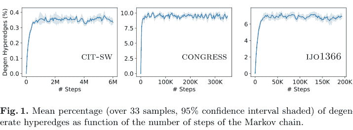

实现与数据集。我们使用 Preti 等人 [20] 公开可用的 NUDHY 实现（具体来说，是 NUDHY-DEGs 变体），这是有向超图的双部分图表示上的标准交换链。在此代码库基础上，我们实现了我们的算法 DiNGHy，以及用于评估混合时间的基线 DiNGHy-B。7 DiNGHy-B 使用与 NUDHY 相同的方法，但有额外约束，即交换不会导致退化（即，它们是 NDSs）。DiNGHy 采用了一种选择 NDSs 的新方法（见第 4.1 节）。我们使用 Preti 等人 [20] 使用过的数据集和合成数据集。8

#### 6.1 零模型之间的差异

对于所有数据集，我们使用 NUDHY 从允许退化的空间中绘制了 500 个样本，并测量了其中至少包含一个退化边的样本百分比。对于每个数据集，所有 500 个样本都包含退化，即使数据集本身是非退化的。

图 1 显示了从观察网络开始，马尔可夫链所走步数作为函数的退化超边百分比。该量在首次测量时急剧增加，随后很快稳定，且从未消失，也就是说，在每次测量时，马尔可夫链的当前状态都是一个退化 EOD。

对于每个样本，我们还统计了退化超边以及参与任何退化超边的节点数量。结果见表 1。当 \(\mathring{G}\) 为真实数据集的样本中，最多有 10% 的超边是退化的，最多有 99% 的节点参与退化边。合成数据集表明，高密度网络表现出更高的退化程度。

所有这些结果表明，两个样本空间（因此零模型）非常不同，这是我们实验评估的第一个目标（下面给出了更多证据）。特别是，在包含退化样本的样本空间中，非退化 EOD 极其稀疏。因此，不能将 NUDHY 用作拒绝采样子程序来生成非退化样本，这本是

表 1. 每个观察网络在 33 个样本中退化量的中位数，由 NuDHY 得到。

| 数据集 | 退化边计数 | 归一化 | 退化边中的节点计数 | 归一化 |
|---|---|---|---|---|
| CONGRESS | 178 | 9.55% | 100 | 99.01% |
| IAF1260B | 129 | 6.19% | 247 | 14.81% |
| IJO1366 | 152 | 6.75% | 294 | 16.29% |
| ECOLI (ND) | 29 | 3.17% | 60 | 8.55% |
| CIT-SW | 179 | 0.34% | 806 | 4.87% |
| DBLP-9 (ND) | 272 | 0.29% | 1023 | 4.87% |
| ENRON | 379 | 0.25% | 1859 | 3.28% |
| MATH (ND) | 58 | 0.06% | 228 | 0.66% |
| ORD (ND) | 378 | 0.08% | 722 | 0.11% |
| SYNTHETIC 160 | 1274 | 99.53% | 1280 | 100% |
| SYNTHETIC 80 | 927 | 72.42% | 1280 | 100% |
| SYNTHETIC 40 | 351 | 27.42% | 1280 | 100% |
| SYNTHETIC 20 | 96 | 7.5% | 1000 | 78.12% |
| SYNTHETIC 10 | 27 | 2.11% | 227 | 17.73% |

这是我们的第二个目标，并证明了开发我们的新算法 DiNGHY 的必要性，以便直接从非退化 EOD 的空间中进行采样。

为进一步评估在进行统计假设检验时使用正确零模型的重要性，我们比较了使用 NuDHY 和 DiNGHY 获得的样本的有向图投影中大小为 2 和 3 的有向循环数量的分布。9 图 2 显示了部分数据集的有向 3-环数量的分布。其他数据集的结果在补充材料中，定性上相似。对于所有数据集，分布明显不同。对于 IAF1260B 和 IJO1366，这一差异导致假设检验得出相反的结论。我们将量 \(q(\tilde{G})\) 的经验 p 值计算为采样双超图 \(G\) 中满足 \(|q(G) - \mu| \ge |q(\tilde{G}) - \mu|\) 的比例，其中 \(\mu\) 是样本上 \(q\) 的均值。IAF1260B 和 IJO1366 中的有向 3-环数量在允许退化的零模型（NuDHY）下被标记为不显著，p 值分别为 0.97 和 0.73。在我们更合适的零模型下，p 值分别为 0 和 0.33，表明关于 DGP 的现有知识无法解释观察到的有向 3-环数量。其他真实数据集的 p 值在两个零模型下均为零，因为观察值超出了两个分布，但分布仍然不同。

9 在此实验中，由于每个数据集的运行时间超过 22 小时，我们排除了 ENRON、ORD (ND)、MATH (ND) 和 DBLP-9 (ND)。推论 1 在我们考虑的一些双超图上不成立，因为它不紧。我们推测这些情况下的 MC 仍然不可减。否则，分布将在包含观察网络的强连通分量上呈均匀分布。

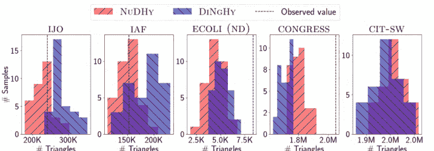

(a) [20] 实验所用部分数据集上的结果。

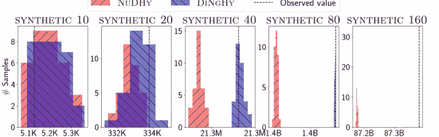

(b) 按边缘大小标识的合成数据集上的结果。

图 2. 33 个样本中 3-环数量的经验分布。当观察值远离两个经验分布时，将其省略。

在密度更高、因此退化更严重的合成数据集上，分布差异更明显。在最不密集的合成数据集以外的所有数据集上，观察到的 3-环数量在允许退化的零模型下显著，在我们的零模型下不显著。有向 2-环的结果类似（参见补充材料）。

在所有情况下，两个零模型上的分布都不同，因此存在临界阈值，使得一个假设在一个零模型下会被拒绝，但在另一个零模型下不会被拒绝。这一事实凸显了我们的零模型与 Preti 等人 [20] 的零模型之间的深刻差异，强调了在检验假设时选择适当零模型的重要性。

### 6.2 收敛

扰动得分 [22] 是一种流行的度量，用于评估从二分图和二进制矩阵上的零模型采样的 MCMC 算法的经验混合时间。给定两个二进制矩阵，它被定义为一个矩阵中值为 1 的条目在另一个矩阵中值为 0 的比例。我们将两个双超图 \(\dot{G}\) 和 \(G\) 之间的扩展扰动得分定义为 $B_t(G^{\circ})$ 与 $B_t(G)$ 的关联矩阵之间的扰动得分，以及 $B_h(G^{\circ})$ 与 $B_h(G)$ 的关联矩阵之间的扰动得分的平均值。

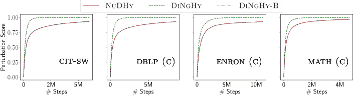

图 3. 马尔可夫链步数作为扰动得分的函数。在每种情况下，NuDHY 和 DiNGHY-B 的曲线完全重合。

在满足推论 1 的数据集上，我们使用与 Preti 等人 [20] 相同的步数 $s$ 为每个数据集获取单个样本（详情见补充材料），并每隔 $\frac{s}{100}$ 步测量一次 $\hat{G}^{\circ}$ 与马尔可夫链当前状态之间的扰动得分，总共进行 100 次测量。

图 3 显示了扰动得分作为步数的函数。DiNGHY 的收敛速度快于 DiNGHY-B 和 NuDHY，后两者表现出相同的行为（曲线重合）。因此，DiNGHY 采用的选择 NDS 的不同方法更可取，因为它能实现更快的混合。

### 7 结论

我们引入了面向边和无序边非退化双超图的首批零模型，捕捉了观察网络的重要特性。通过保持非退化性，我们的模型在许多场景中比现有模型更现实，因此应优先用于统计假设检验。我们的 MCMC 算法根据任何用户指定的分布从零模型中采样，并且收敛速度快。未来工作方向包括加强不可减性的充分条件（定理 1 和推论 1），以及为双超图开发更具描述性的零模型和从中采样的高效算法。

致谢。本工作部分得到国家科学基金会奖项 CAREER-2238693 和 AF-2312241 的支持，并得到国家科学基金会研究生研究奖学金计划的资助，编号为 2439559。本材料中表达的任何意见、发现、结论或建议均为作者的观点，不一定反映国家科学基金会的立场。

利益披露。作者声明与本文内容相关的竞争利益不需要申报。

### 参考文献

1. Abuissa, M., Lee, A., Riondato, M.: ROhAN：面向统计可靠知识发现的行序无关零模型。DMKD **37**(4) (2023)

2. Battiston, F., 等：超越成对交互的网络：结构与动力学。Phys. Rep. **874**, 1–92 (2020)

3. Bick, C. 等：什么是高阶网络？SIAM Rev. **65**(3) (2023)

4. Billings, J.C.W., 等：用于单纯复形中社区检测的 Simplex2Vec 嵌入。arXiv:1906.09068 (2019)

5. Chodrow, P.S.: 随机超图的配置模型。J. Compl. Netw. **8**(3) (2020)

6. Choe, M., 等：来自实世界超图的代表性和回溯采样。ACM TKDD **18**(6) (2024)

7. Cimini, G., 等：实世界网络的统计物理学。Nat. Rev. Phys. **1**(1) (2019)

8. Do, M., 等：实世界超图的结构模式与生成模型。收录于：KDD 2020 (2020)

9. Feng, S., 等：用于识别致病性病毒反应中关键基因的生物网络超图模型。BMC Bioinf. **22**(1) (2021)

10. Fosdick, B.K., 等：具有固定度序列的随机图模型配置。SIAM Rev. **60**(2) (2018)

11. Kannan, R., 等：生成二分图和锦标赛图的简单马尔可夫链算法。Rand. Struct. Alg. **14**(4) (1999)

12. Kim, S., 等：有向超图中的互惠性：度量、发现与生成器。arXiv:2210.05328 (2023)

13. Lamar, M.D.: 关于度序列简单有向图实现的均匀采样。arXiv:9123834 (2018)

14. Lee, G., 等：超图挖掘调查：模式、工具与生成器。ACM Comp. Surv. (2025)

15. Lehmann, E.L., Romano, J.P.: 统计假设检验。第4版。(2022)

16. Luo, Q., 等：通过联合无偏随机游走采样超图。World Wide Web **27**(2) (2024)

17. Mitzenmacher, M., Upfal, E.: 概率与计算。(2005)

18. Miyashita, R., 等：保存二模式聚类系数的随机超图模型。收录于：Wrembel, R., Gamper, J., Kotsis, G., Tjoa, A.M., Khalil, I. (编) DaWaK 2023. LNCS, vol. 14148, pp. 191–196. Springer, Cham (2023). https://doi.org/10.1007/978-3-031-39835-1_18

19. Nakajima, K., Shudo, K., Masuda, N.: 保存度相关性和局部聚类的超图随机化。IEEE TNSE **9**(3) (2021)

20. Preti, G., 等：作为社会系统透镜的高阶零模型。Phys. Rev. X **14**(3) (2024)

21. Riondato, M.: 来自数据的统计可靠知识发现。收录于：SDM 2023 (2023)

22. Strona, G., 等：一种具有固定行和列总和的生态二进制矩阵快速无偏随机化程序。Nat. Comm. **5**(1) (2014)

23. Sun, H., Bianconi, G: 多重超图上的高阶渗过程。Phys. Rev. E **104**(3) (2021)

24. Zeng, Y., 等：超零模型及其应用。Entropy **25** (2023)


## 最稠 SWAMP 问题：
带有任意单调部分超边奖励的超子图

Vedangi Bengali¹, Nikolaj Tatti², Iiro Kumpulainen², Florian Adriaens²,
and Nate Veldt¹

¹ 德州农工大学，学院站，德克萨斯州，美国
{vedangibengali,nveldt}@tamu.edu
² 赫尔辛基大学，HIIT，赫尔辛基，芬兰
{nikolaj.tatti,iro.kumpulainen,florian.adriaens}@helsinki.fi

**摘要。** 我们研究了最稠超子图问题的一个推广，即在稠密超子图中包含部分超边时给予非负奖励。以往工作仅在奖励函数为凸的情况下研究过该问题，在这种情况下问题可在多项式时间内求解。我们考虑了一个更广泛的设置，其中奖励是单调的但 otherwise 任意。我们首先对一大类非凸奖励证明了难度结果，然后通过投影到最近的一组凸奖励来设计一种 $1/k$ 近似算法，其中 $k$ 是最大超边大小。我们还设计了另一种 $1/k$ 近似算法，使用更快的剥离算法，这（有些出人意料地）与用于近似其他最稠子图问题变体的标准贪心剥离算法不同。我们的结果包括在几个现实世界超图上对我们的算法进行的实证分析。

**关键词：** 最稠超子图 · 近似算法

**补充信息** 在线版本包含可在 https://doi.org/10.1007/978-3-032-06066-2_5 上获得的补充材料。

### 1 引言

稠密子图发现是图挖掘中广泛研究的基本问题，应用包括团队组建 [12,22]、图案发现 [11] 和欺诈检测 [9]。在稠密子图发现中，最常见的问题之一是最稠子图问题（DSG）。对于图 $G = (V, E)$，DSG 寻找一个节点集 $S \subseteq V$，以最大化（诱导）边与节点之间的比率，即，

maximize
$S \subseteq V$
\(\frac{|E(S)|}{|S|},\)
(1)

其中 $E(S) = \{(u, v) \in E : u, v \in S\}$。已知有基于流方法 [13] 和线性规划 [6] 的多项式时间算法可以精确求解 DSG。还有一种基于 *剥离*（迭代移除最小度节点）的简单贪心 1/2-近似算法 [4, 6]。许多关于 DSG 变体的结果集中在将这些基本技术（流、线性规划和剥离）中的一种或多种扩展到更一般的设置 [8, 15, 16, 18, 19, 24–26]。

本文着重于将 DSG 推广到超图，超图将节点分组为涉及任意数量节点（而不仅仅是两个节点）的（超）边。作为我们将在整个手稿中考虑的一个激励性应用，寻找超图的稠密区域为团队组建提供了一种特别自然的方法。已经有许多基于稠密子图发现的团队组建方法 [12, 21, 22]。这些方法在这样的假设下运行：社会网络的稠密区域代表了未来任务的一个好团队，因为它编码了一组过去已经广泛协作过的人。对于这个应用，使用超图而不是图可以说更自然，因为它直接将整个之前的 *团队* 交互作为超边捕获，而不仅仅是之前的成对关系。

将 DSG 推广到超图的最简单方法是找到一个节点集 $S$，以最大化 *完全包含于* $S$ 中的边数与 $|S|$ 的比率。这最早是在 30 年前在电路分解 [15] 的背景下被考虑的，此后许多其他研究也考虑了这一点 [5, 14]。虽然这是图中标准 DSG 问题的自然扩展，但在许多应用中，*部分* 包含一个超边也直观地有助于稠密性的概念。再次考虑团队组建的例子。在组建新团队时，添加来自以前协作的即使只是一个 *子集* 的人，也直观地符合以前的协作有助于促进良好未来团队交互的信念。然而，标准的最稠超子图目标仅对将整个超边（即某个以前团队的所有成员）添加到新团队给予奖励。

本文，我们专注于 Zhou et al. [26] 引入的一种推广最稠超子图目标的新算法，该目标对部分包含的边给予正奖励。更详细地说，每条边都有一个非负单调奖励函数 $r$，总体目标是最大化部分奖励之和除以输出集的大小（第 2 节包含形式定义）。Zhou et al. [26] 证明了存在这样的奖励函数，使得这个一般问题变成 **NP**-难。然而，随后他们专注于凸奖励函数，在这种情况下问题成为可在多项式时间内求解的最稠超模子集问题 [7] 的一个特例。他们为这种凸情况设计了一种基于求解最大 $s$-$t$ 流问题的精确算法，并表明标准贪心剥离算法产生一种 $1/k$ 近似算法，其中 $k$ 是最大超边大小。

**我们的贡献。** 我们专注于寻找最稠具有任意部分超边奖励的超子图（swamp）的问题。通过“任意”，我们的意思是奖励不需要是凸的，这与 Zhou et al. [26] 关注的不同。我们的贡献包括以下几点：

- 我们完全解决了所有奖励函数的 SWAMP 复杂性，显著加强了以往的难度结果。具体来说，当对每条边应用相同的奖励函数 $r$ 时，SWAMP 要么因为 $r$ 是凸的而可在多项式时间内求解，要么如果 $r$ 非凸但满足某个极值条件则由单个节点平凡地优化，否则就是 **NP**-难。

- 我们为非凸情况设计了带有 $1/k$ 近似的剥离算法。有些出人意料的是，这种近似并非由标准贪心剥离方法（对凸情况给出 $1/k$ 近似）获得，而是由一种在每一步中关于移除哪个节点做出局部次优选择的剥离方法获得。

- 我们设计了基于将非凸奖励投影到凸奖励然后求解后者问题的近似算法。在最坏情况下，这些算法带有 $1/k$ 近似。

- 我们介绍了一种用于寻找 SWAMP 最优解的新整数线性规划公式，该公式甚至适用于（小规模）**NP**-难 情况。

- 我们实现了这些算法，并在现实世界数据集上展示了它们的性能，表明它们在实践中超过了理论保证。

- 我们表明，作为拥有 SWAMP 近似保证的结果，我们获得了我们目标的受限变体的近似算法。

**其他相关工作。** 我们参考 Lanciano et al. [19] 关于最稠子图问题变体的详细最近调查。我们简要介绍几项与本论文特别相关的结果。DSG 的几个变体包括对输出集 $S$ 中节点数量的约束，包括 Andersen 和 Chellapilla [2] 引入的两个变体，即最稠至多-$k$ ($|S| \le k$) 和最稠至少-$k$ ($|S| \ge k$) 问题。在其他问题变体中，目标是找到一个确保不同节点标签的节点包含在输出中的稠密子图。在某些情况下，节点标签表示“技能”，目标是组建一支（稠密）个人团队来覆盖某些技能集 [12, 22]。在其他情况下，节点标签表示不相交的受保护类别，目标是组建一个“多样化”或“公平”的稠密子图 [1, 17, 21]。这些变体中的几个的近似算法建立在更早的最稠至少-$k$ 变体 [12, 21] 的近似算法之上。

最近，Chekuri et al. [8] 引入了最稠超模子集问题（DSS），其目标是最大化 $F(S)/|S|$，其中 $F: 2^V \rightarrow \mathbb{R}^+$ 是定义在基集 $V$ 上的非负单调超模函数。他们对这个目标的成果包括一种基于流的快速近似算法、更快的贪心剥离方法，以及对基数受限变体（例如约束 $|S| \ge k$）的扩展。贪心剥离方法从整个节点集 $V$ 开始，找到一个节点 $v = \text{argmin} F(V) - F(V - v)$，然后移除它。在下一步中，将相同的策略应用到剩余节点集。最后，该方法选择一路上考虑过的目标值最好的节点子集。这种策略是贪心的，因为它在每一步移除导致目标分子减小最少的节点。


步骤。这种剥离方法直接推广了几种特殊情况的现有剥离方法 [6, 25, 26]，包括 Zhou 等人 [26] 针对广义最密子超图目标的 1/k-近似。

### 2 最密 SWAMP 问题

我们考虑一个超图输入 \(H = (V, E, w, \{r_e : e \in E\})\) 的广义最大密度问题。每个 \(e \in E\) 都带有一个非负标量权重 \(w(e) \ge 0\) 和一个 _边奖励函数_ \(r_e : \{0, 1, \dots, |e|\} \rightarrow \mathbb{R}_{\ge 0}\)。后者根据包含于节点集 \(S\) 中的超图边中的节点 _数量_ 分配非负奖励，即使 \(e\) 未完全包含于 \(S\) 中。我们假设奖励函数是单调的，且不包含边中任何节点时不给予奖励：

\(0 = r_e(0) \le r_e(1) \le r_e(2) \le \cdots \le r_e(|e|).\)

这编码了这样一种信念：在集合中包含更多超图边应对密度度量做出更大贡献。

#### 问题 1

对于输入 \(H = (V, E, w, \{r_e : e \in E\})，具有任意单调部分边奖励的最密子超图问题 (SWAMP) 求解

\(\max_{S \subseteq V} \ \Gamma(S) = \frac{f(S)}{|S|}, \quad \text{where } f(S) = \sum_{e \in E} w(e) \cdot r_e(|e \cap S|). \quad (2)\)

如果奖励满足 \(r_e(i) = 0\) 对 \(i < |e|\) 且 \(r_e(|e|) = 1\)，则这对应于标准最密子超图目标。Zhou 等人 [26] 是最早研究问题 1 的，尽管几乎专注于凸情况。离散单调边奖励函数 \(r_e : \{0, 1, \dots, |e|\} \rightarrow \mathbb{R}_{\ge 0}\) 被称为凸，如果：

\(r_e(i+1) - r_e(i) \ge r_e(i) - r_e(i-1) \quad \text{for } i \in \{1, 2, \dots, |e|-1\}. \quad (3)\)

我们相反关注奖励单调但否则为任意的情况，即不限制为凸。

在研究硬度结果时，我们考虑 SWAMP 的一个特殊情况，其中输入是最大边大小为 \(k\) 的超图，并且对每条边使用相同的奖励函数 \(r\)。我们将其称为 SWAMP(\(r\))。在此例中，\(r\) 代表定义 _问题_ 的参数，而不是本质上属于输入的奖励函数。我们的目标是在 \(r\) 的不同选择下表征 SWAMP(\(r\)) 的复杂性。

我们还考虑两种受限变体。第一是在基数约束 \(|S| \ge \ell\)（其中 \(\ell\) 是问题的输入）下最大化 \(\Gamma(S)\)，我们将其称为 CARD-SWAMP。我们还考虑一个公平变体。

#### 问题 2

假设 \(H = (V, E, w, \{r_e\})\) 的节点被划分为节点类 \(\{C_1, C_2, \dots, C_m\}\)，且对 \(i = 1, 2, \dots, m\) 中的 \(C_i\) 给出了一个参数 \(\ell_i\)。最密公平 SWAMP 问题 (FAIR-SWAMP) 定义为

\(\max_{S \subseteq V} \ \Gamma(S) \quad \text{subject to } |S \cap C_i| \ge \ell_i, \text{ for } i = 1, 2, \dots, m. \quad (4)\)

如果我们将节点视为个体，问题 2 中的类可以表示在基于个体过去合作组建团队时必须存在的技能。另一个例子是，类可以表示输出集中必须公平表示的类别（例如，从所有教职等级中选出教职人员以代表学术系担任某个内部委员会）。

### 3 SWAMP(r) 的计算复杂性

SWAMP(r) 在凸情况下的复杂性是已知的。

定理 1 ([26])。如果 \(r\) 是凸的，SWAMP(r) 可在多项式时间内求解。

此外，Zhou 等人 [26] 表明，对于某些奖励函数的选择（其中一些奖励是凸的，而另一些不是），问题 1 是 NP-hard 的。我们通过表明对于每个非凸 \(r\)（除下文描述的一个边界情况外），SWAMP(r) 是 NP-hard 的，从而加强了这一结果。这为我们提供了 SWAMP(r) 计算复杂性的完整图景。

让我们先描述一个最优解为单个节点的边界情况。

这推广了 Zhou 等人 [26] 的结果，即如果 \(r\) 是凹的，则单个节点定义最优解。

定理 2。假设 \(r\) 使得对每个 \(i \in \{1, 2, \dots, k\}\)，都有 \(r(1) \geq r(i)/i\)。那么存在一个仅由单个节点组成的 SWAMP(r) 最优解。

证明。例如 \(H = (V, E, w)\)，令 \(O\) 为 SWAMP(r) 的解。令 \(o \in O\) 为最大化 \(f(\{o\})\) 的节点。那么

\(\Gamma(O) = \frac{f(O)}{|O|} = \frac{1}{|O|} \sum_{e \in E} w(e) \cdot r(|e \cap O|)\)

\(\leq \frac{1}{|O|} \sum_{e \in E} w(e) \cdot r(1) \cdot |e \cap O| = \frac{1}{|O|} \sum_{x \in O} f(\{x\}) \leq f(\{o\}) = \Gamma(\{o\}),\)

从而证明了该主张。

本节的主要结果现在表明，如果定理 1–2 中的条件不满足，则 SWAMP(r) 是 NP-hard 的，证明见附录。

定理 3。假设 \(r\) 使得对于某些正整数 \(i\) 和 \(j\)，我们有 \(r(i)/i > r(1)\) 且 \(2r(j) > r(j - 1) + r(j + 1)\)。那么 SWAMP(r) 是 NP-hard 的。

### 4 使用整数线性规划求解 SWAMP

我们介绍了一种用于求解问题判定版本的新 ILP 表述，该版本询问是否存在某个集 \( S \)，其密度大于某个预指定的 \( \alpha \)。更正式地，寻找满足 \( \Gamma(S) > \alpha \) 的 \( S \) 等价于寻找满足 \( f(S) - \alpha|S| > 0 \) 的 \( S \)。我们将使用 ILP 求解后者，一旦有了解，就可以通过对 \( \alpha \) 进行二分搜索来求解 SWAMP。这种结构与 Goldberg [13] 寻找最密子图的方法类似。

我们考虑以下整数线性规划。

```
maximize \(\left( \sum_{e \in E} w(e) \sum_{i=1}^{|e|} \delta_{e,i} \cdot y_{e,i} \right) - \alpha \sum_{v \in V} x_v\)
s.t. \(y_{e,i} \le \frac{1}{i} \sum_{v \in e} x_v\) 	 for \(e \in E, i = 1, 2, \dots, |e|,\) (5)
			\(y_{e,i} \in \{0, 1\}\) 	 for \(e \in E, i = 1, 2, \dots, |e|,\)
			\(x_v \in \{0, 1\}\) 	 for \(v \in V\).
```

在上文中，我们已定义

```
\(\delta_{e,i} = r_e(i) - r_e(i-1) \ge 0\)
```

因此，如果我们将边 \( e \) 中的 \( k \) 个节点包含在集合 \( S \) 中，则我们知道这将给出奖励

```
\(r_e(k) = \sum_{i=1}^k \delta_{e,i}.\)
```

这个 ILP 包含一个变量 \( x_v \in \{0, 1\} \)，它指示节点 \( v \) 是否包含在最优密度集 \( S \) 中 (\( x_v = 1 \)) 或不包含 (\( x_v = 0 \))。变量 \( y_{e,i} \) 旨在满足

```
\(y_{e,i} = \left\{ \begin{array}{ c l } 1 & \text{if } |e \cap S| \ge i \\ 0 & \text{otherwise.} \end{array} \right.\) (6)
```

观察，如果是这样，那么 ILP 目标函数的第一部分正好是边奖励

```
\(\sum_{e \in E} w(e) \sum_{i=1}^{|e|} \delta_{e,i} \cdot y_{e,i} = \sum_{e \in E} w(e) \sum_{i=1}^{|e \cap S|} \delta_{e,i} = \sum_{e \in E} w(e) \cdot r_e(|e \cap S|).\)
```

我们只需确认对于最优解，\( y_{e,i} \) 变量确实会满足公式 (6)。首先观察，最大化目标，再加上 \( \delta_{e,i} \) 均为正的事实，将确保 \( y_{e,i} \) 变量在可能时会被设置为 1。现在，请注意，约束

```
\(y_{e,i} \le \frac{1}{i} \sum_{v \in e} x_v\)
```

等价于如果 \( |e \cap S| < i \) 则得到 \( y_{e,i} < 1 \) 的上界，否则如果 \( |e \cap S| \ge i \) 则相当于某个 \( c \ge 1 \) 的 \( y_{e,i} \le c \) 上界。

### 5 SWAMP 的近似

我们最重要的算法贡献是针对 SWAMP 中 NP-hard 情形的基于剥离的近似算法。我们的发现之所以令人惊讶，有两个原因。首先，我们针对 NP-hard 非凸情况的剥离方法具有一个 \(1/k\)-近似，这与（可在多项式时间内求解的）凸情况的剥离近似保证一样好。第二个惊喜是，我们的近似保证 _并不_ 来自使用标准现有贪婪剥离算法，该算法以一种导致后续步骤中最佳目标的方式剥离节点。相反，我们的保证仅适用于某些剥离策略，这些策略可能会在每一步为删除哪个节点做出局部次优选择。除了我们的剥离算法外，我们还设计了另一个基于将非凸奖励函数投影到凸奖励，然后精确求解得到的凸问题的 \(1/k\)-近似。

```
Algorithm 1. Approximates the densest subgraph problem, SWAMP
Require: Hypergraph \(\mathcal{H} = (V, E, r_e)\), and a bound function \(s_e(\cdot)\).
1: \(X \leftarrow V\) and \(Y \leftarrow V\)
2: **while** \(X \neq \emptyset\) **do**
3:   \(v \leftarrow \arg\min_{u \in X} \sum_{e: u \in e} r_e(|e \cap X|) - s_e(|e \cap X| - 1)\).
4:   \(X \leftarrow X \setminus \{v\}\).
5: **if** \(\Gamma(X) \ge \Gamma(Y)\), **then** \(Y \leftarrow X\).
Ensure: \(Y\).
```

#### 5.1 剥离算法

在这里我们描述一个剥离算法，它将为 SWAMP 得到一个 \(1/k\) 近似。为了记号简洁，我们将假设 \(w(e) = 1\)。请注意，我们可以不失一般性地做出此假设，因为我们可以将权重直接并入奖励 \(r_e\) 中。

Zhou 等人 [26] 的贪婪剥离算法通过迭代删除 \(f\) 减小最小的顶点 \(v\) 来运行，即，

\(f(S) - f(S \setminus \{v\}) = \sum_{e:v \in e} r_e(|e \cap S|) - r_e(|e \cap S| - 1), \quad (7)\)

然后返回最佳测试子图。

不幸的是，这种方法仅在 \(r_e\) 为凸时能产生保证，并且对于非凸奖励可能失败。我们通过将公式 7 中的第二个 \( r_e \) 替换为一个需要单独指定的不同函数 \( s_e \) 来扩展该方法。


算法 1 的伪代码如下。我们将展示，$s_e$ 的某些选择能够导致保证。

以下结果展示了 $s_e$ 所需的条件，使得算法 1 能够产生近似保证。

### 定理 4.
假设超图 $H = (V, E, \{r_e\})$ 以及每个 $e \in E$ 的函数 $s_e$ 满足 $0 \le s_e(i) \le r_e(i)$ 和 $r_e(i) - s_e(i-1) \le r_e(i+1) - s_e(i)$。则算法 1 对 SWAMP 产生 $1/k$ 近似。

为证明此主张，我们需要以下标准引理。

### 引理 1.
设 $O \subseteq V$ 为最优解。则对于任意 $o \in O$，

$$\Gamma(O) \le \sum_{e:o \in e} r_e(|e \cap O|) - r_e(|e \cap O| - 1).$$

证明。由于 $O$ 的最优性，有

$$\Gamma(O) \ge \frac{f(O \setminus \{o\})}{|O| - 1} = \frac{f(O) - (f(O) - f(O \setminus \{o\}))}{|O| - 1}.$$

改写该不等式并利用 $\Gamma(O) = \frac{f(O)}{|O|}$ 可得 $\Gamma(O) \le f(O) - f(O \setminus \{o\})$。另见 [26, 定理 4]。因此，

$$\begin{aligned} \Gamma(O) &\le f(O) - f(O \setminus \{o\}) \\ &= \sum_{e \in E} (r_e(|e \cap O|) - r_e(|e \cap (O \setminus \{o\})|)) \\ &= \sum_{e:o \in e} (r_e(|e \cap O|) - r_e(|e \cap (O \setminus \{o\})|)), \end{aligned}$$

从而证明了引理。

证明（定理 4 的证明）。设 $O \subseteq V$ 为最优解。设 $X'$ 为算法 1 中 while 循环在从 $O$ 删除第一个顶点时定义的子图 $X$。称该顶点为 $x$。注意，由于每条边 $e$ 最多包含 $k$ 个顶点，故有

$$\begin{aligned} k\Gamma(X') &\ge \frac{1}{|X'|} \sum_{u \in X'} \sum_{e: u \in e} r_e(|e \cap X'|) \\ &\ge \sum_{e: x \in e} r_e(|e \cap X'|) \\ &\ge \sum_{e: x \in e} r_e(|e \cap X'|) - s_e(|e \cap X'| - 1), \end{aligned}$$

其中第二个不等式源自我们在算法 1 中对 $x$ 的选择。此外，由于对 $s_e$ 施加的条件使得 $O \subseteq X'$，故有

$$\begin{aligned} \sum_{e: x \in e} r_e(|e \cap X'|) - s_e(|e \cap X'| - 1) &\ge \sum_{e: x \in e} r_e(|e \cap O|) - s_e(|e \cap O| - 1) \\ &\ge \sum_{e: x \in e} r_e(|e \cap O|) - r_e(|e \cap O| - 1). \end{aligned}$$

由于 $x \in O$，我们可以使用引理 1，定理随即得证。

接下来，我们展示 $s_e$ 的两个选项，两者均满足定理 4 中的条件。

### 定理 5.
假设超图 \( H = (V, E, \{r_e\}) \)。设 \( b_e(i) = 0 \) 且 \( u_e(i) = r_e(i + 1) - \max_{0 \le j \le i} (r_e(j + 1) - r_e(j)) \)。则 \( b_e \) 和 \( u_e \) 满足定理 4 中对 \( s_e \) 的条件。此外，任何满足定理 4 条件的 \( s_e \) 都会有 \( b_e(i) \le s_e(i) \le u_e(i) \)。若 $r_e$ 为凸函数，则 $u_e = r_e$。

**证明。** 函数 \( b_e \) 满足约束条件，因为 \( r_e \) 是单调的。令 \( M_e(i) = \max_{0 \le j \le i} (r_e(j + 1) - r_e(j)) \)。则

\( u_e(i) = r_e(i + 1) - M_e(i) \le r_e(i + 1) - (r_e(i + 1) - r_e(i)) = r_e(i) \)

以及

\( u_e(i) - u_e(i - 1) = r_e(i + 1) - r_e(i) - (M_e(i) - M_e(i - 1)) \le r_e(i + 1) - r_e(i) \),

表明 \( u_e \) 满足约束条件。

为证明第二个主张，假设 \( s_e \) 满足约束条件，并假设归纳假设 \( s_e(i - 1) \le u_e(i - 1) \)。若 \( M_e(i - 1) < M_e(i) \)，则 \( M_e(i) = r_e(i + 1) - r_e(i) \)，随即 \( s_e(i) \le r_e(i) = u_e(i) \)，从而证明主张。否则，假设 \( M_e(i - 1) = M_e(i) \)。则

\( s_e(i) \le s_e(i - 1) + r_e(i + 1) - r_e(i) \le u_e(i - 1) + r_e(i + 1) - r_e(i) = r_e(i + 1) - M_e(i - 1) = r_e(i + 1) - M_e(i) = u_e(i) \),

从而证明主张。

若 $r_e$ 为凸函数，则 \( M_e(i) = r_e(i + 1) - r_e(i) \) 且 \( u_e(i) = r_e(i) \)，从而证明最后一个主张。

### 运行时间分析.
在算法 1 中寻找节点 \( v \) 可以使用优先队列完成。维护该结构在移除单个顶点 \( v \) 时需要 \( \mathcal{O}(k \cdot \text{deg}(v)) \) 次更新，每次耗时 \( \mathcal{O}(\log n) \)，总运行时间为 \( \mathcal{O}(pk \log n) \)，其中 \( p = \sum_{e \in E} |e| = \sum_{v \in V} \text{deg}(v) \)。

### 5.2 基于投影到凸性的近似

给定一组奖励函数 \(\{r_e : e \in E\}\) 和相应的目标 \(\max_{S \subseteq V} \Gamma(S)\)，近似 SWAMP 的另一种方法是将每个 \( r_e \) 替换为附近的凸函数 \( \hat{r}_e \)，并最大化相关目标 \(\hat{\Gamma}(S) = \frac{1}{|S|} \sum_{e \in E} w(e) \hat{r}_e(|S \cap e|)\)。作为初步观察，这些目标之间的差异最多为原始奖励（\( r_e \)）与投影奖励（\( \hat{r}_e \)）之间的最大比率。

### 提议 1.
若对每个 \( e \in E \) 和每个 \( i \in [|e|] = \{1, \dots, |e|\} \) 都有 \( r_e(i) \ge \hat{r}_e(i) \)，则对每个 \( S \subseteq V \) 都有 \(\hat{\Gamma}(S) \le \Gamma(S) \le \rho \cdot \hat{\Gamma}(S)\)，其中

\(\rho = \max_{e \in E} \max_{i \in [|e|]} \frac{r_e(i)}{\hat{r}_e(i)}.\)

证明。第一个不等式源自假设 $r_e(i) \ge \hat{r}_e(i)$。$\rho$ 的定义表明，对每个 \( e \in E \) 和 \( i \in [|e|] \)，都有 \( r_e(i) \le \rho \cdot \hat{r}_e(i) \)，从而得出第二个不等式 $\Gamma(S) \le \rho \cdot \hat{\Gamma}(S)$。

该近似是紧确的，因为我们总是可以构造一个具有节点集 $S$ 的超图 $H$，使得 $\Gamma(S) = \rho \cdot \hat{\Gamma}(S)$。更详细地说，考虑一对奖励函数 $r$ 和 $\hat{r}$，并设 $t = \argmax_i \frac{r(i)}{\hat{r}(i)}$。然后构造一个 $k$-均匀超图 $H = (V, E)$，其节点集 $S$ 满足每个 \( e \in E \) 的 \(|e \cap S| \in \{0, t\}\)。在定义 \(\Gamma\) 时对每条边使用相同的奖励函数 $r$，在定义 $r$ 时对每条边使用奖励函数 \(\hat{r}\)。则

\(\Gamma(S) = \frac{\sum_{e \in E} r(|e \cap S|)}{|S|} = \frac{\sum_{e \in E} \rho \cdot \hat{r}(t)}{|S|} = \rho \cdot \hat{\Gamma}(S).\)

给定一个非凸非负单调奖励函数 $r: [0, k] \to \mathbb{R}^+$，我们的目标是找到一个 *凸* 非负单调函数 $\hat{r} \le r$ 使得 $\max_i r(i)/\hat{r}(i)$ 较小。这可以被建模为一个小型线性规划。

maximize \(\kappa\)
such that \(r(i)\kappa \le \hat{r}(i) \le r(i) \quad i = 0, 1, 2, \dots, k\)
\(\quad 2\hat{r}(i) \le \hat{r}(i-1) + \hat{r}(i+1) \quad i = 2, 3, \dots, k-1\)
\(\quad \hat{r}(i+1) \ge \hat{r}(i) \quad i = 1, 2, \dots, k-1\)

所得近似因子由 $\rho = 1/\kappa$ 给出。我们在 $r_e$ 和 $\hat{r}_e$ 的下标中省略了 $e$，因为必须为每条边的奖励函数分别求解这个通用优化问题。该问题等价于寻找点集 $\{(0, 0), (1, r(1)), \dots, (k, r(k))\}$ 的下凸壳，可以在 $O(k)$ 时间内完成 [3]。利用 $r$ 的单调性，我们可以对最坏情况近似因子进行界定。有关证明见附录。

### 提议 2.
设 $r: [0, k] \to \mathbb{R}^+$ 是一个满足 $r(0) = 0$ 的单调奖励函数。则存在一个非负单调凸函数 $\hat{r}$，使得对每个 \( i \in \{1, 2, \dots, k\} \) 都有 $\hat{r}(i) \le r(i) \le k \cdot \hat{r}(i)$。

请注意，该近似是紧确的。若 $r$ 由 $r(0) = 0$ 和 $x \in (0, k]$ 时的 $r(x) = 1$ 定义，则 $\hat{r}(x) = x/k$ 且 $r(1)/\hat{r}(1) = k$。提议 1 和 提议 2 告诉我们，在进行最优投影后，$\Gamma$ 和 $\hat{\Gamma}$ 最多相差 $1/k$ 的因子，从而导出以下结果。

### 定理 6.
对 \(\max_{S \subseteq V} \hat{\Gamma}(S)\) 的 $\beta$-近似解可产生对 \(\max_{S \subseteq V} \Gamma(S)\) 的 \(\frac{\beta}{k}\)-近似解。

由于 $\hat{\Gamma}$ 仅包含凸边奖励，我们可以使用基于流的方法对其求最优解，从而对原始目标 $\Gamma$ 产生 $1/k$-近似。为进行运行时间分析，我们假设所有原始奖励 $r_e(i)$ 都是整数。投影后，新奖励 $\hat{r}_e$ 不一定是整数。然而，新奖励可以表示为分母范围的有理数


介于 1 和 $k$ 之间。为进行简单的运行时间分析，我们可以将所有新奖励缩放 $k!$ 倍，以获得新的凸整数奖励函数 $r'_e = k! \cdot \hat{r}_e \le k^k \cdot r_e$。Zhou et al. [26] 针对这种整数凸奖励情况的基于流的方法依赖于在区间 $[0, W]$ 上进行二分查找，其中 $W = \sum_{e \in E} r'_e(|e|) \le k^k \sum_{e \in E} r_e(|e|)$。其运行时间为 $\mathcal{O}(\mincut(p, p \cdot k) \log W)$，其中 $p = \sum_{e \in E} |e|$ 是超图的大小，$\mincut(N, M)$ 是求解具有 $N$ 个节点和 $M$ 条边的图中最小 $s$-$t$ 割问题的复杂度。要将此表达式转化为仅涉及原始奖励 $\{r_e : e \in E\}$ 的形式，请注意 $\log W \le k \log k + \log(\sum_{e \in E} r_e(|e|))$。

```
Algorithm 2. Approximates the CARD-SWAMP problem
Require: Hypergraph \( H \), the cardinality constraint \( \ell \).
1: \( S \leftarrow \emptyset \), \( H_1 \leftarrow H \), \( i \leftarrow 1 \)
2: while \( |S| < \ell \) do
3:   \( S_i \leftarrow \) (approximate) densest SWAMP in \( H_i \)
4:   \( H_{i+1} \leftarrow \) CONTRACT\( (H_i, S_i) \)
5:   \( S \leftarrow S \cup S_i \)
6:   \( i \leftarrow i + 1 \)
7: \( S' \leftarrow S_1 \cup \cdots \cup S_{i-2} \) padded with arbitrary nodes so that \( S' \) has \( \ell \) nodes
Ensure: either \( S \) or \( S' \), whichever has the higher density.
```

最后请注意，如果我们将非凸奖励投影，并对 \( \hat{\Gamma} \) 应用现有的 \( 1/k \)-近似贪心剥离算法 [26]，则根据此分析，这只能保证产生 \( 1/k^2 \)-近似解。这再次凸显了我们直接处理非凸目标并产生 \( 1/k \)-近似解的剥离算法的实用性。

### 6 约束变体的近似算法

SWAMP 的近似性对 CARD-SWAMP 和 FAIR-SWAMP 的近似性有直接影响。我们将现在探讨这些结果。

让我们首先考虑 CARD-SWAMP 问题，其中解必须至少有 \( \ell \) 个节点。这里我们将采用 Khuller 和 Saha [18] 的算法，该算法用于求解常规图中的约束变体，并由 Chekuri et al. [8] 进一步扩展以支持超模函数奖励。

如算法 2 所示，该算法从当前超图（设为 \( H_i \)）中迭代查找近似最密沼泽（设为 \( S_i \)），从 \( H_i \) 中移除 \( S_i \)（同时保留边缘），并将 \( S_i \) 添加到解 \( S \) 中，直到 \( S` 足够大。然后返回的值要么是 \( S`，要么是 \( S' \)，即对应上一轮 \( S` 的集合，并加上填充的任意节点以满足约束。

算法 2 需要一个子例程，用于从当前超图中收缩发现的集合。给定一个超图 \( H = (V, E, w, \{r_e\}) \) 和一组节点 \( U \)，我们定义收缩超图 \( H' = (V', E', w', \{r'_e\}) = \text{CONTRACT}(H, U) \) 如下。节点为 \( V' = V \setminus U \)，超边 \( E' \) 由 $E` 中移除了 $U` 中节点的超边组成，权重 $w'` 对应权重 $w$。要定义奖励，令 $e \in E` 为超边，$a = e \setminus U` 为收缩后的超边。令 $j = |e \cap U|$。我们定义收缩奖励为 $r'_a(i) = r_e(i + j) - r_e(j)`。

我们有以下近似结果，我们将在附录中证明。

**定理 7.** 假设我们可以对 SWAMP 进行 $\alpha$-近似，那么算法 2 对 CARD-SWAMP 可达到 $\frac{\alpha}{\alpha+1}$ 近似。因此，同时使用算法 1 和算法 2 可达到 $\frac{1}{k+1}$ 近似。

我们现在可以使用定理 7 和 Miyauchi et al. [21] 提出的算法来获得 FAIR-SWAMP 的近似结果。

**定理 8.** 假设存在具有 $\{\ell_i\}$ 约束的 FAIR-SWAMP 实例。令 $S$ 为 $\ell = \sum_i \ell_i` 时 CARD-SWAMP 的 $\alpha$-近似解。令 $c_i` 为 $S` 中颜色 $i` 的节点数。令 $S'$ 为 $S`，对每种颜色 $i` 填充任意 $\ell_i - c_i` 个颜色 $i` 的节点。那么 $S'$ 对 FAIR-SWAMP 可达到 $\alpha/2$-近似。因此，使用算法 1 和算法 2 可达到 $1/(2k + 2)$ 近似。

请注意，该算法最初是为标准图（即 $k = 2$ 的超图）设计的。然而，定理 8 的证明与 Miyauchi et al. [21] 的证明相同，因此省略。我们推测，使用 Gajewar 和 Das Sarma [12] 针对常规图的方法可能可以获得更好的近似。我们将探索此方向作为未来工作。

### 7 实验与分析

我们现在使用几种不同的凸和非凸奖励函数，分析算法在各种超图上的性能。我们用 Julia 实现了所有算法，并使用公开可用的超图数据集。所有实验均在一台拥有 1TB 内存的研究服务器上进行。

**数据集。** *contact-high-school*（CHS）[10, 20] 和 *contact-primary-school*（CPS）[10, 23] 数据集分别表示高中和小学的学生互动，学生作为节点，群组互动作为超边。*Senate-committees*（SC）和 *House-committees*（HC）包含表示美国参议院和众议院成员的带标签节点，带有政治党派归属 [10]。这里超边表示委员会成员资格。在 *Trivago` 超图（Triv）中，节点是度假租赁，超边是用户在 *Trivago.com` 上同一次浏览会话中点击的租赁。我们特别使用了一个更大的超图 [10] 的子集，仅考虑日本福冈的度假租赁。我们通过消除自环和悬挂节点，并提取它们的最大连通分量（同时保留多重边）来预处理每个超图。超图统计信息显示在表 2 中。我们选择足够小的超图，以便可以使用 ILP 找到最优解，作为我们近似算法的比较点。

表 1. 边奖励函数及其定义

| | 函数 \( r_e \) | | 函数 \( r_e \) |
|---|---|---|---|
| 1. | 至少两个 \( r_e(i) = 1[i \ge 2] \) | 4. | 标准 \( r_e(i) = 1[i = |e|] \) |
| 2. | 至少一半 \( r_e(i) = 1[i \ge \lceil |e|/2 \rceil] \) | 5. | 二次 \( r_e(i) = i^2 / |e| \) |
| 3. | 全部但一个 \( r_e(i) = 1[i \ge |e| - 1] \) | 6. | 平方根 \( r_e(i) = \sqrt{i} \) |

**奖励函数。** 我们使用从非凸到凸的一系列边奖励函数。为简化起见，我们假设在给定的超图中，所有边都使用相同的函数来计算 \( r_e \)，且每条边的权重均为 1。函数定义在表 1 中给出。为避免平凡解（如定理 2 所述），我们为函数 1、2、3 和 6 设置 \( r_e(1) = 0`。这对于使用奖励函数 1、2 和 3 的 2 节点超边尤其重要。

**算法。** 为寻找最优解，我们实现了 Exact 方法，如第 4 节所述，该方法迭代求解 ILP（使用 Gurobi 优化软件）。我们没有使用二分查找，而是从整个超图开始，迭代搜索越来越密的子集，直到无法再改进为止，这通常在 4-5 次迭代中收敛。我们将 Exact 与多个近似算法进行比较。当设置 \( s_e = u_e`（如定理 5 所述）时，算法 1 称为 PeelMax；当 \( s_e(i) = r_e(i)` 时，称为 Greedy；当 \( s_e(i) = 0` 时，称为 PeelZero。DegPeel 是用于标准最密子超图目标的贪心剥离算法：仅基于诱导超图中的度数（入射超边数量）进行剥离。对于基于投影的近似算法，我们首先将每个非凸 \( r_e` 投影到其最近的凸 \( \hat{r}_e` 上。然后，我们使用投影后的奖励运行基于流的方法和贪心方法。投影加流方法使用最大流求解器精确求解投影问题，如 [26] 所述。它附带 \( 1/k \)-近似保证，而后者是 \( 1/k^2 \) 近似。

**性能分析。** 表 2 显示了我们方法的运行时间和目标值。作为第一个观察，我们发现我们的基于投影的流方法非常快。即使是剥离方法，尽管未针对运行时间进行优化，但仍比使用 ILP 求解器精确求解目标快几个数量级。例如，在 CPS 超图中，目标为每条边使用至少两个奖励函数，ILP 方法需要大约 29 分钟，而 Greedy 和 ProjFlow 在一秒钟内找到最密解。此外，我们的近似算法在实践中都产生接近 1 的近似比，表明这些方法远超其理论保证并产生近似最优的解。这说明，即使对于 NP-hard 的 SWAMP 案例，剥离方法在实践中也能提供快速且准确的方法，与可多项式时间求解的变体的剥离方法的成功相当。我们还注意到，对于这些超图和奖励函数，应用直接剥离方法往往比投影到近似凸奖励提供略好的近似。另一个有趣的观察是，标准贪心剥离方法（设置


### 表 2. ILP、剥离和基于投影的策略的目标值与运行时长。破折号表示 Exact 未在分配的时间内完成。

| | CHS | | CPS | | SC | | HC | | Triv | |
|---|---|---|---|---|---|---|---|---|---|---|
| | 目标值 | 运行时长 | 目标值 | 运行时长 | 目标值 | 运行时长 | 目标值 | 运行时长 | 目标值 | 运行时长 |
| | 327, 7818, 5 | | 242, 12704, 5 | | 282, 315, 31 | | 1290, 340, 81 | | 262, 910, 16 | |
| 精确 | 27.078 | 416 | 60.549 | 1760 | - | - | - | - | 11.53 | 2.4 |
| 剥离最大 | 26.871 | 0.15 | 60.02 | 0.42 | 21.0 | 0.89 | 14.0 | 24.01 | 11.09 | 0.06 |
| 贪心 | 27.065 | 0.2 | 60.549 | 0.59 | 15.90 | 1.14 | 11.88 | 32.77 | 11.41 | 0.02 |
| 剥离零 | 26.871 | 0.16 | 60.022 | 0.45 | 21.0 | 1.11 | 14.0 | 23.98 | 11.09 | 0.02 |
| 度剥离 | 26.725 | 0.06 | 58.714 | 0.06 | 11.5 | 0.01 | 7.625 | 3.20 | 10.5 | 0.008 |
| 投影流 | 26.451 | 0.16 | 58.34 | 0.21 | 12.22 | 0.07 | 7.7 | 0.43 | 10.76 | 0.02 |
| 投影贪心 | 26.451 | 0.2 | 58.34 | 0.58 | 12.22 | 0.86 | 7.625 | 25.57 | 10.76 | 0.02 |
| 至少两个 | | | | | | | | | | |
| 精确 | 27.078 | 515 | 60.549 | 1711 | - | - | - | - | 9.625 | 2.33 |
| 剥离最大 | 26.871 | 0.16 | 60.02 | 0.43 | 3.0 | 0.89 | 1.571 | 23.81 | 9.179 | 0.02 |
| 贪心 | 27.065 | 0.2 | 60.549 | 0.6 | 2.775 | 1.02 | 2.0 | 29.07 | 9.56 | 0.02 |
| 剥离零 | 26.871 | 0.16 | 60.022 | 0.43 | 3.0 | 1.10 | 2.38 | 23.76 | 9.51 | 0.02 |
| 度剥离 | 26.725 | 0.05 | 58.714 | 0.07 | 2.66 | 0.01 | 1.321 | 3.2 | 9.02 | 0.008 |
| 投影流 | 26.451 | 0.18 | 58.34 | 0.21 | 2.32 | 0.07 | 2.28 | 0.39 | 9.378 | 0.03 |
| 投影贪心 | 26.451 | 0.19 | 58.344 | 0.59 | 2.32 | 0.86 | 2.23 | 25.36 | 9.378 | 0.02 |
| 至少一半 | | | | | | | | | | |
| 精确 | 26.926 | 249.9 | 60.16 | 1716 | 1.83 | 6794 | 1.22 | 100.97 | 7.769 | 1.39 |
| 剥离最大 | 26.784 | 0.16 | 59.66 | 0.44 | 1.66 | 0.91 | 1.07 | 24.32 | 7.725 | 0.02 |
| 贪心 | 26.867 | 0.2 | 60.16 | 0.6 | 1.8 | 0.95 | 1.105 | 25.62 | 7.763 | 0.02 |
| 剥离零 | 26.784 | 0.16 | 59.66 | 0.44 | 1.66 | 1.12 | 1.07 | 24.29 | 7.725 | 0.02 |
| 度剥离 | 26.593 | 0.05 | 58.47 | 0.08 | 1.66 | 0.01 | 0.936 | 3.23 | 7.375 | 0.008 |
| 投影流 | 26.424 | 0.28 | 58.26 | 0.32 | 1.233 | 0.05 | 0.976 | 0.32 | 7.34 | 0.02 |
| 投影贪心 | 26.424 | 0.19 | 55.266 | 0.6 | 1.233 | 0.88 | 1.0 | 24.31 | 7.36 | 0.02 |
| 标准 | | | | | | | | | | |
| 精确流 | 25.597 | 0.24 | 54.475 | 0.33 | 1.176 | 0.13 | 0.823 | 0.5 | 5.52 | 0.10 |
| 贪心 | 25.575 | 0.15 | 54.475 | 0.4 | 1.176 | 0.88 | 0.77 | 24.87 | 5.52 | 0.02 |
| 剥离零 | 25.575 | 0.15 | 54.475 | 0.43 | 1.176 | 1.13 | 0.77 | 24.82 | 5.52 | 0.02 |
| 度剥离 | 25.581 | 0.15 | 54.475 | 0.14 | 1.176 | 0.04 | 0.794 | 3.22 | 5.52 | 0.04 |
| 二次 | | | | | | | | | | |
| 精确流 | 71.45 | 0.44 | 145.47 | 0.68 | 26.91 | 0.25 | 12.52 | 1.33 | 31.10 | 0.08 |
| 贪心 | 71.34 | 0.15 | 145.377 | 0.42 | 26.91 | 0.84 | 12.52 | 23.50 | 31.10 | 0.02 |
| 剥离零 | 70.874 | 0.16 | 145.06 | 0.41 | 26.78 | 1.09 | 12.25 | 23.14 | 31.10 | 0.02 |
| 度剥离 | 69.85 | 0.06 | 143.70 | 0.07 | 25.24 | 0.01 | 11.59 | 3.20 | 29.50 | 0.008 |
| 平方根 | | | | | | | | | | |
| 精确 | 41.34 | 495 | 91.7 | 4469 | - | - | - | - | 17.15 | 17.22 |
| 剥离最大 | 41.06 | 0.16 | 91.21 | 0.42 | 29.69 | 0.89 | 20.48 | 24.02 | 16.86 | 0.02 |
| 贪心 | 41.14 | 0.2 | 91.72 | 0.58 | 29.26 | 0.87 | 18.38 | 24.99 | 17.14 | 0.02 |
| 剥离零 | 41.05 | 0.15 | 90.83 | 0.42 | 29.69 | 1.58 | 17.67 | 23.23 | 16.27 | 0.02 |
| 度剥离 | 41.06 | 0.06 | 89.92 | 0.06 | 19.64 | 0.01 | 11.94 | 3.28 | 16.16 | 0.008 |
| 投影流 | 40.86 | 0.29 | 89.76 | 0.35 | 21.88 | 0.2 | 13.6 | 0.97 | 16.35 | 0.11 |
| 投影贪心 | 40.61 | 0.2 | 89.76 | 0.58 | 21.88 | 0.86 | 12.80 | 24.76 | 16.35 | 0.02 |

### 表 3. 使用五个奖励函数在两个超图（CHS 和 CPS）上评估最优最密沼泽解的边缘组成。

| | 至少两个 | 至少一半 | 除一个外所有 | \|E(S)\| | \|S\| |
|---|---|---|---|---|---|
| | CHS CPS | CHS CPS | CHS CPS | CHS CPS | CHS CPS |
| 至少两个 | 3791 7932 | 3791 7932 | 3762 7956 | 3053 6052 | 140 131 |
| 至少一半 | 3791 7932 | 3791 7932 | 3762 7956 | 3053 6052 | 140 131 |
| 除一个外所有 | 4055 8349 | 4055 8349 | 4039 8303 | 3404 6574 | 150 138 |
| 标准 | 6182 11341 | 6182 11341 | 6175 11337 | 6041 10895 | 236 200 |
| 二次 | 757 4206 | 757 4206 | 755 4152 | 651 3040 | 29 75 |

($s_e = r_e$) 通常在剥离方法中产生最佳近似结果，尽管我们的近似保证不适用于此方法。

#### 定性比较。

作为最后的比较点，表 3 报告了通过精确求解 SWAMP（使用精确算法）并应用不同奖励函数于两个超图（CHS 和 CPS）上所得到的密集子集的定性方面。列“至少两个”、“至少一半”和“除一个外所有”分别列出了与 S 至少两个节点、至少 $\lceil |e|/2 \rceil$ 节点或至少 $|e| - 1$ 节点相交的超边数量（完全或部分包含在 S 中）。我们还报告了完全包含的边数（$|E(S)|$）和子集大小（$|S|$）。每个奖励函数都会产生具有不同特征的密集子集：例如，标准目标倾向于产生更大的子图，而二次目标倾向于产生更小的子图。这提供了一个简单的检查，即使用不同奖励函数寻找最密的 SWAMP 确实允许我们在实践中捕捉到意义显著不同的密度模式。

### 8 结论与讨论

我们提出了针对部分包含的边缘会获得奖励的密集超图目标的全面硬度结果和新的近似算法。我们最重要的发现是，剥离算法可以为问题的 **NP**-难变体实现与针对最密超模子集问题的特例的多项式时间变体相同的近似保证。考虑到以前针对剥离的近似似乎本质上依赖于超模性特性，这有些令人惊讶。作为一个有趣的观察，我们的理论不适用于标准贪心剥离策略 ($s_e = r_e$)，但该策略在实践中似乎仍然表现良好。一个开放的方向是探索是否存在标准贪心策略表现不佳的情况，或者是否可以使用不同的技术为该方法证明一个近似。未来工作的另一个方向是探索 SWAMP 的 **NP**-难变体的近似硬度结果。

### 致谢

本研究由芬兰学院项目 MALSOME (343045) 和赫尔辛基信息技术学院 (HIIT) 支持。该研究还由陆军研究办公室 (ARO) 在奖项编号 W911NF-24-1-0156 下支持。本文档中包含的观点和结论均为作者的观点，不应解释为代表陆军研究办公室或美国政府的官方政策，无论是明示还是默示的。

### 利益披露

作者没有与本文内容相关的需要声明的竞争性利益。

### 参考文献

- 1. Anagnostopoulos, A., Becchetti, L., Fazzone, A., Menghini, C., Schwiegelshohn, C.: 谱松弛与公平最密子图。在: CIKM, 第 35–44 页 (2020)
- 2. Andersen, R., Chellapilla, K.: 查找带大小约束的最密子图。在: WAW, 第 25–37 页 (2009)
- 3. Andrew, A.M.: 二维凸包的另一种高效算法。信息处理快报 9(5), 216–219 (1979)
- 4. Asahiro, Y., Iwama, K., Tamaki, H., Tokuyama, T.: 贪心查找最密子图。算法期刊 34(2), 203–221 (2000)
- 5. Bera, S.K., Bhattacharya, S., Choudhari, J., Ghosh, P.: 最密超图的新动态算法。在: TheWebConf, 第 1093–1103 页 (2022)
- 6. Charikar, M.: 查找图中密集组件的贪心近似算法。在: 组合优化近似算法国际研讨会, 第 84–95 页。Springer (2000)
- 7. Chekuri, C., Quanrud, K.: (1−ϵ)-近似完全动态最密子图: 线性空间和更快的更新时间。arXiv 预印本 arXiv:2210.02611 (2022)
- 8. Chekuri, C., Quanrud, K., Torres, M.R.: 最密子图: 超模性、迭代剥离和网络流。在: SODA, 第 1531–1555 页 (2022)
- 9. Chen, T., Tsourakakis, C.: 反本福德子图: 金融网络中的非监督异常检测。在: KDD, 第 2762–2770 页 (2022)
- 10. Chodrow, P.S., Veldt, N., Benson, A.R.: 超图聚类: 从块模型到模块性。科学进展 (2021)
- 11. Fratkin, E., Naughton, B.T., Brutlag, D.L., Batzoglou, S.: MotifCut: 使用最大密度子图进行调节性基序查找。生物信息学 22(14), e150–e157 (2006)
- 12. Gagewar, A., Das Sarma, A.: 基于最密子图的多技能协作团队。在: SDM, 第 165–176 页 (2012)
- 13. Goldberg, A.V.: 查找最大密度子图，技术报告，加州大学伯克利分校 (1984)
- 14. Hu, S., Wu, X., Chan, T.H.: 在演化超图中高效维护最密子集。在: CIKM, 第 929–938 页 (2017)
- 15. Huang, D.H., Kahng, A.B.: 当簇遇到分区: 用于电路分解的新基于密度的方法。在: ED&TC, 第 60–64 页 (1995)
- 16. Huang, Y., Gleich, D.F., Veldt, N.: 最密超图: 负超模函数和强局部化方法。在: TheWebConf, 第 881–892 页 (2024)
- 17. Kariotakis, E., Sidiropoulos, N.D., Konar, A.: 感知公平的最密子图发现。TMLR (2025)
- 18. Khuller, S., Saha, B.: 关于查找最密子图。在: ICALP, 第 597–608 页 (2009)


- 19. Lanciano, T., Miyauchi, A., Fazzone, A., Bonchi, F.: 关于最密子图问题及其变体的综述. ACM Comput. Surv. **56**(8), 1–40 (2024)

- 20. Mastrandrea, R., Fournet, J., Barrat, A.: 高中接触模式：基于可穿戴传感器、接触日记和友谊调查收集的数据比较. PLoS ONE **10**(9), e0136497 (2015)

- 21. Miyauchi, A., Chen, T., Sotiropoulos, K., Tsourakakis, C.E.: 最密多样子图：如何策划一场多样化的成功鸡尾酒会. In: KDD, pp. 1710–1721 (2023)

- 22. Rangapuram, S.S., Bühler, T., Hein, M.: 基于最密子图的社会网络中现实团队形成的迈进. In: WWW, pp. 1077–1088 (2013)

- 23. Stehlé, J., et al.: 小学面对面接触模式的高分辨率测量. PLoS ONE **6**(8), e23176 (2011)

- 24. Tsourakakis, C.: k-clique 最密子图问题. In: 第24届国际万维网会议论文集, pp. 1122–1132 (2015)

- 25. Veldt, N., Benson, A.R., Kleinberg, J.: 广义平均最密子图问题. In: KDD, pp. 1604–1614 (2021)

- 26. Zhou, Y., Hu, S., Sheng, Z.: 具有凸边权重函数的最密子超图提取. In: 计算模型理论与应用国际会议, pp. 305–321. Springer (2022)

## 图池化对节点级任务的实用性如何？

Yijun Duan\(^1\), Xin Liu\(^2\), Steven Lynden\(^2\), Akiyoshi Matono\(^2\), and Qiang Ma\(^1\)

\(^1\) 京都工艺纤维大学，京都，日本
{yijun,qiang}@kit.ac.jp
\(^2\) AIST，东京，日本
{xin.liu,steven.lynden,a.matono}@aist.go.jp

**摘要.** 作为图神经网络的关键组件，图池化对于图分类和生成等图级任务必不可少。然而，某些节点级任务本质上需要图池化，特别是 *图上的多实例学习 (MIL)*，这是一种弱监督学习范式，其中仅提供集合级标签用于训练节点级预测器。现有的基于嵌入的池化将节点嵌入聚合以获取整体图级表示，忽略了对节点标签的直接推断。为了解决这一局限性，我们提出了 *基于实例的池化*，它在生成图表示之前将节点嵌入映射为节点概率。我们证明，基于嵌入的池化方法可以无缝转换为基于实例的方法，而不会丧失排列不变性或表达能力，而后者提供了更好的可解释性。在多种基准数据集上的大量实验验证了我们所提方法的有效性，为不同机器学习任务在图上的池化方法选择提供了关键见解。

**关键词:** 图池化 \(\cdot\) 图多实例学习 \(\cdot\) 实例级学习 \(\cdot\) 弱监督学习

### 1 引言

图表示学习 (GRL) 是图上机器学习任务最有效的解决方案之一 [21]。它由两个基本组件组成：*消息传递* 模块，用于学习节点嵌入，以及 *池化* 模块，用于将节点信息聚合为子图表示。节点级任务通常仅依赖消息传递，而图级任务需要这两个组件。

然而，*某些节点级任务本质上依赖于图池化*。一个关键原因是由于数据标注限制，难以获得足够的节点标签。考虑 *图上的多实例学习 (MIL)* 任务。MIL 是一种弱监督学习范式，其中实例被分组为称为包的集合，且仅提供包级标签用于训练实例级预测器。传统 MIL 假设实例是独立同分布的，而鉴于图在建模现实世界场景中复杂关系方面的通用性，将 MIL 扩展到图数据可以促进各种实际任务并引起广泛关注。例如，在药物发现中，目标是识别对复杂分子化合物（包/图标签）的特性有贡献的药效团分子（实例/节点标签）。在这种情况下，获取包标签通常比获取实例标签更具成本效益和可行性。图 1 说明了半监督学习与图上多实例学习之间的区别。

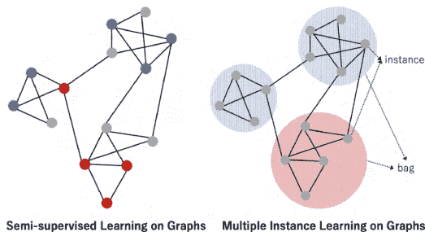

图 1. 半监督学习与图上多实例学习（我们的任务）示意图。颜色表示节点标签，灰色节点表示未标记节点。在多实例学习中，节点（称为实例）被排列在集合（称为包）中，包标签基于不同假设由未知实例标签决定。为了基于包标签预测实例标签，消息传递层和图池化层都是必不可少的。（在线彩色图）

#### 现有图池化方法能否有效解决节点级 MIL 任务？

主流的池化方法将实例嵌入聚合为包嵌入，然后由分类器计算包概率 [19]。我们将此称为 **基于嵌入的池化**。这种训练范式不涉及任何实例标签的推断或拟合。为了解决这一局限性，受非图数据上基于实例的 MIL 方法（例如，[25,27]）的启发，我们在本文中提出了一种新的图池化范式：**基于实例的池化**。它不是直接聚合嵌入，而是首先将实例嵌入映射为实例概率，然后根据这些实例概率构建包概率。我们证明，在某些条件下，任何基于嵌入的池化方法都可以无缝转换为基于实例的池化方法，而不会损失排列不变性或表达能力。此外，我们表明，由于基于实例的模型的线性特性，SHAP 值 [20] 相比注意力分数，能够更精确地刻画每个实例对模型决策的贡献。

我们在四个基准数据集上使用合成包分析基于嵌入的池化和基于实例的池化的性能。具体而言，我们评估了四种常用的注意力模块和两种特征聚合器。考察了基于实例标签生成包标签的两种策略。虽然我们的主要关注点是实例级分类，但我们还对包级任务进行了额外实验，以评估池化模型的通用性。主要实验结果总结如下：（1）在标准 MIL 假设下，基于实例的池化在实例分类任务中更有效；（2）在集体 MIL 假设下，两种池化策略在实例分类中表现相当；（3）在标准 MIL 假设下，对于包分类，基于嵌入的池化更有效。

总之，我们的贡献如下：

- 我们首次引入了图上的实例级多实例学习任务，深入探讨了图池化在节点级任务中的作用。
- 我们提出了一种简单且通用的转换规则，将基于嵌入的池化模型转换为基于实例的模型。
- 我们系统地分析了基于嵌入的模型和基于实例的模型的关键理论属性，包括它们的排列不变性、表达能力和可解释性。
- 我们在标准图数据集上针对各种 MIL 任务进行了大量实验，为在处理不同层级图结构时选择池化方法提供了有价值的见解。

### 2 问题定义和符号

令 \(\mathcal{G} = (\mathcal{V}, \mathcal{E})\) 表示具有节点集 \(\mathcal{V}\) 和边集 \(\mathcal{E}\) 的输入图。\(\mathcal{V} = \{v_1, v_2, ..., v_n\}\)，其中 \(n\) 是节点数量。\(k\) 表示类别数量。节点（称为实例）被排列在集合（称为包）中。仅在模型训练期间提供包标签。

令 \(\mathcal{X}\) 表示一个由 \(m\) 个实例 \(\{v_1, v_2, ..., v_m\}\) 组成的包。在 MIL 中，包标签 \(\mathcal{Y}\) 基于不同假设由未知实例标签 \(\{y_1, y_2, ..., y_m\}\) 决定。在本文中，主要关注标准假设 [8]。给定触发类 \(t \in \{1, 2, ..., k\}\)，我们将属于 \(t\) 的节点称为正实例，将其他节点称为负实例。标准 MIL 假设指出，正包至少包含一个正实例，而负包仅包含负实例。形式上，\(\mathcal{Y}\) 由以下公式确定：

\[
\mathcal{Y} = \begin{cases} +1 & \text{if } \exists y \in \{y_1, y_2, ..., y_m\}, y = t \\ -1 & \text{if } \forall y \in \{y_1, y_2, ..., y_m\}, y \neq t \end{cases}
\] (1)

我们的目标是学习一个实例级二元分类器，以预测包中节点的标签。我们的工作在许多现实场景中很有用，在这些场景中，检测触发包标签的实例是可取的，例如自动化癌症诊断和分级。


### 3 初步：基于嵌入的池化

在处理图上集合级别表示学习时，广泛使用的解决方案是**基于嵌入的池化** [19]。在本问题中，它以如下方式计算包概率 \(\theta(\mathcal{X}) \in [0, 1]\)：

\(\theta(\mathcal{X}) = \text{CLS}(\text{AGGR}(\{\alpha_i \cdot \text{MP}(v_i), v_i \in \mathcal{X}\}))\)

\(\alpha_i = \text{ATT}(v_i)\)

这里，\(\theta(\mathcal{X})\) 包含 4 个函数：MP、CLS、ATT 和 AGGR。MP 由消息传递层组成，并充当节点特征提取器。注意力模块 ATT 为节点 \(v_i\) 计算注意力权重 \(\alpha_i\)，它可用于衡量包表示中实例的贡献并解释模型预测。聚合器 AGGR 聚合经过加权的实例嵌入以获得包表示。最常见的做法是 **求和**，可选项还包括 **最大值** [23]。最后，包嵌入由分类器 CLS 处理，并预测包标签。MP、CLS、ATT 和 AGGR 的选择共同决定了池化方法的实现及其有效性和复杂性。

### 4 提出的方法：基于实例的池化

基于嵌入的池化固有的一个局限性是其无法在标签空间中训练实例。对于节点级别的 MIL 任务，一个自然的假设是，有效的池化方法应当能够在训练期间估计实例概率。为了实现这一点，我们不需要复杂的设计——只需在基于嵌入的模型中交换 CLS 和 AGGR 即可。我们将新模型称为**基于实例的池化**，其公式如下：

\(\theta(\mathcal{X}) = \text{AGGR}(\{\text{CLS}(\alpha_i \cdot \text{MP}(v_i)), v_i \in \mathcal{X}\})\)

\(\alpha_i = \text{ATT}(v_i)\)

不同于基于嵌入的池化，**CLS** 在训练期间学习实例概率 \(\theta(v_i)\)，随后由 **AGGR** 将其组合为包概率 \(\theta(\mathcal{X})\)。这使得学习模型能够有效地同时适应包级训练和实例级推理<sup>1</sup>。同样，MP、ATT、CLS 和 AGGR 的实现取决于具体任务。最后，上述两种池化范式的说明如下图 Fig. 2 所示。

<sup>1</sup> 基于实例的池化的另一种替代设计遵循公式 \(\theta(\mathcal{X}) = \text{AGGR}(\alpha_i \cdot \{\text{CLS}(\text{MP}(v_i)), v_i \in \mathcal{X}\}), \alpha_i = \text{ATT}(v_i)\)。

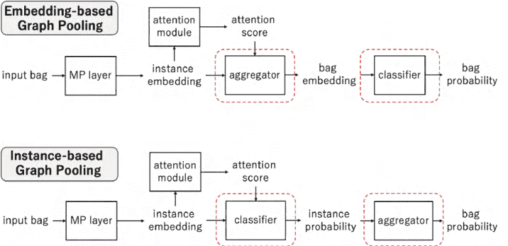

Fig. 2. 基于嵌入的池化（现有）与基于实例的池化（提出）的比较。基于嵌入的池化：实例嵌入 - 包嵌入 - 包概率；基于实例的池化：实例嵌入 - 实例概率 - 包概率。

### 5 池化模型的关键理论特性

在本节中，我们首先证明从基于嵌入的池化到基于实例的池化的变换并不会损害原始模型的排列不变性（第 5.1 节）或表达能力（第 5.2 节），它们分别是 MIL 模型和图神经网络的关键特性。最后，通过研究实例概率与 SHAP 值之间的关系（第 5.3 节），我们表明基于实例的模型提供了更优越的可解释性。

#### 5.1 排列不变性

标准 MIL 假设（请参见 Eq. (1)）表明，包内实例不存在顺序或依赖性。因此，在计算包概率 \(\theta(\mathcal{X})\) 时，对于任何排列 \(\pi\)，应有 \(\theta(\{v_1, v_2, ..., v_m\}) = \theta(\{v_{\pi(1)}, v_{\pi(2)}, ..., v_{\pi(m)}\})\)。此属性称为 *排列不变性*。

为了验证池化模型是否具有此属性，我们首先引入以下关于单式对称函数基本定理 [11,30]：

> **定理 1.** *在可数集合 X 上操作的函数 F(X) 对 X 中实例的排列不变性，当且仅当它可以分解为形式* \(\rho(\sum_{v_i \in \mathcal{X}} \psi(v_i))\)*，其中* \(\rho\) *和* \(\psi\) *为合适的变换。*

定理 1 介绍了满足排列不变性属性的函数的一般形式。基于此，我们提出以下推论：

**推论 1.** *当 AGGR 为求和算子时，基于嵌入的池化和基于实例的池化均对排列不变。*

证明. 定理 1 中的集合函数 \(F(\mathcal{X})\) 为包概率 \(\theta(\mathcal{X})\)。对于基于嵌入的池化，当 sum 为聚合器时，变换 \(\psi\) 和 \(\rho\) 分别对应 \(\alpha_i \cdot \text{MP}(v_i)\) 和 CLS。对于基于实例的池化，\(\psi\) 是实例概率 \(\text{CLS}(\alpha_i \cdot \text{MP}(v_i))\)，而 \(\rho\) 是恒等函数。

#### 5.2 表达能力

GNN 的表达能力是指其对图上特征信息以及图结构信息（例如，区分非同构图的能力 [31]）进行编码和处理的能力。在图论中，Weisfeiler-Leman 测试（WL 测试）是判断两个图是否同构的经典启发式方法 [16]。我们将在下文证明，当满足某些条件时，基于嵌入的池化和基于实例的池化都能够保留图中的不同信息。首先，我们陈述关于图池化算子表达能力的以下定理 [1]：

**定理 2.** *对于可由 WL 区分的图，满足以下条件的图池化器将生成仍可由 WL 区分的粗化图：(1) 消息传递层计算不同的节点特征之和；(2) 聚类分配矩阵在常数* \(\lambda\) *的意义下为右随机矩阵；(3) 超节点的特征是输入节点特征的凸组合。*

我们假设在第 3 节和第 4 节讨论的池化模型满足上述属性。请注意，在这种情况下，MP 被暗示为强大，且 AGGR 被暗示为求和算子。我们将在下文证明，在对 CLS 的额外约束下，基于实例的池化和基于嵌入的池化均保留了 MP 的表达能力：

**推论 2.** *令* \(\mathcal{X}^1\) *和* \(\mathcal{X}^2\) *表示两个可由 WL 区分的包，若满足以下附加条件，则由基于实例的模型生成的聚合包* \(\hat{\mathcal{X}}^1\) *和* \(\hat{\mathcal{X}}^2\) *仍可由 WL 区分：(4) CLS 为加性函数；(5) CLS 为单射函数。*

证明. 假设 \(\mathcal{X}^1/\mathcal{X}^2\) 包含 *m* 个节点，而 \(\hat{\mathcal{X}}^1/\hat{\mathcal{X}}^2\) 包含 *l* 个超节点（*l < m*）。令 \(\mathcal{U}^1, \mathcal{U}^2, \hat{\mathcal{U}}^1\) 和 \(\hat{\mathcal{U}}^2\) 分别表示 \(\mathcal{X}^1, \mathcal{X}^2, \hat{\mathcal{X}}^1\) 和 \(\hat{\mathcal{X}}^2\) 的相应节点嵌入/概率矩阵。这里，\(\mathcal{U}^1\) 和 \(\mathcal{U}^2\) 由 MP 计算。根据条件 1，我们有：

\(\sum_{i=1}^m \mathcal{U}_i^1 \neq \sum_{i=1}^m \mathcal{U}_i^2 \quad \text{(6)}\)

这里，\(\mathcal{U}_i^1\) 和 \(\mathcal{U}_i^2\) 分别表示 \(\mathcal{U}^1\) 和 \(\mathcal{U}^2\) 的第 \(i\) 行，对应于包中第 \(i\) 个实例的向量。假设 \(\hat{\mathcal{X}}^1\) 和 \(\hat{\mathcal{X}}^2\) 不可由 WL 区分。那么，存在从 \(\{1, 2, ..., l\}\) 到 \(\{1, 2, ..., l\}\) 的一对一映射 \(\omega\)，使得：

\(\hat{\mathcal{U}}_j^1 = \hat{\mathcal{U}}_{\omega(j)}^2, \forall j = 1, 2, ..., l \tag{7}\)

令 \(\mathcal{M} \in \mathbb{R}^{m \times l}\) 表示分配矩阵，其中 \(\mathcal{M}_{ij}\) 表示将节点 \(i\) 分配给超节点 \(j\) 的权重。根据条件 3，我们有：

\(\sum_{i=1}^m \text{CLS}(\mathcal{U}_i^1 \cdot \mathcal{M}_{ij}^1) = \sum_{i=1}^m \text{CLS}(\mathcal{U}_i^2 \cdot \mathcal{M}_{i\omega(j)}^2), \forall j = 1, 2, ..., l \tag{8}\)

根据条件 4，我们可以将 CLS 与求和算子互换，如下：

\(\text{CLS}(\sum_{i=1}^m \mathcal{U}_i^1 \cdot \mathcal{M}_{ij}^1) = \text{CLS}(\sum_{i=1}^m \mathcal{U}_i^2 \cdot \mathcal{M}_{i\omega(j)}^2), \forall j = 1, 2, ..., l \tag{9}\)

根据条件 5，我们有：

\(\sum_{i=1}^m \mathcal{U}_i^1 \cdot \mathcal{M}_{ij}^1 = \sum_{i=1}^m \mathcal{U}_i^2 \cdot \mathcal{M}_{i\omega(j)}^2, \forall j = 1, 2, ..., l \tag{10}\)

我们对所有超节点的向量求和：

\(\sum_{j=1}^l \sum_{i=1}^m \mathcal{U}_i^1 \cdot \mathcal{M}_{ij}^1 = \sum_{j=1}^l \sum_{i=1}^m \mathcal{U}_i^2 \cdot \mathcal{M}_{i\omega(j)}^2 \tag{11}\)

可以重写为：

\(\sum_{i=1}^m \mathcal{U}_i^1 \cdot \sum_{j=1}^l \mathcal{M}_{ij}^1 = \sum_{i=1}^m \mathcal{U}_i^2 \cdot \sum_{j=1}^l \mathcal{M}_{i\omega(j)}^2 \tag{12}\)

由于 \(\sum_{j=1}^l \mathcal{M}_{ij}^1 = \sum_{j=1}^l \mathcal{M}_{i\omega(j)}^2 = \lambda, \forall i = 1, 2, ..., m\)（条件 2）。我们有：

\(\sum_{i=1}^m \mathcal{U}_i^1 = \sum_{i=1}^m \mathcal{U}_i^2 \tag{13}\)

请注意，上述方程与 Eq. (6) 矛盾。因此，\(\hat{\mathcal{X}}^1\) 和 \(\hat{\mathcal{X}}^2\) 仍可由 WL 区分。

对于基于嵌入的模型，请注意 Eq. (9) 可以直接从 Eq. (7) 推导出来。这意味着，生成可由 WL 区分的粗化包不需要假设 CLS 函数的加性，而剩余四个条件必须成立。


#### 5.3 可解释性

在本研究中，我们采用 SHAP 框架 [20] 来分析 MIL 方法的可解释性，该方法受 [12] 启发，其中 SHAP 值提供了关于每个输入实例如何贡献于袋级预测的洞察。与 [12] 的一个关键区别在于，我们的分析针对的是相互非独立的输入实例，这是图结构数据的基本特征。

显然，基于实例的池化是一个线性模型。关于实例的独立性，我们考虑以下两种情况：(1) 实例之间的相互依赖将由 MP 充分捕获，因此在池化阶段可以假设实例独立以简化计算；(2) 实例在池化过程中保持依赖。我们下面分别讨论这两种情况。在以下内容中，我们将 \(\theta(v_i)\) 的 SHAP 值表示为 \(\phi(v_i)\)。

**独立实例。** 对于具有独立特征的线性模型，SHAP 值的计算依赖于以下定理 [20]：

**定理 3.** 给定一个线性回归模型 \(f(x) = \sum_{i=1}^m \omega_i x_i + b\)，其中所有特征 \(x_1, x_2, ..., x_m\) 都是独立的，则有：

\(\phi(x_i) = \omega_i(x_i - E[x_i])\) (14)

这立即启发了我们如下的计算：

**推论 3.** 对于基于实例的池化模型，\(\phi(v_i)\) 采用以下简单形式，其中实例概率 \(\theta(v_1)\)、\(\theta(v_2)\)、...、\(\theta(v_m)\) 是独立的：

\(\phi(v_i) = \theta(v_i) - E[\theta(v_i)]\) (15)

证明. 在 Eq. (14) 中，\(x_i\)、\(\omega_i\) 和 \(b\) 分别对应于 Eq. (4) 中的 \(\theta(v_i)\)、1 和 0。请注意，**AGGR** 必须是求和运算符。

**依赖实例。** 对于具有依赖特征的线性模型，SHAP 值的计算变得更加复杂。首先，我们陈述以下关于定义在实例子集 \(\mathcal{X}_S\) 上的贡献函数 \(\tau(\cdot)\) 的定理，其中 \(\mathcal{X}_S^*\) 表示输入实例的一个子集：

**定理 4.** 对于基于实例的池化模型，\(\tau(\mathcal{X}_S)\) 采用以下形式，其中实例概率 \(\theta(v_1)\)、\(\theta(v_2)\)、...、\(\theta(v_m)\) 是依赖的：

\(\tau(\mathcal{X}_S) = \sum_{v_i \in \mathcal{X}_S^-} E[\theta(v_i)|\mathcal{X}_S=\mathcal{X}_S^*] + \sum_{v_i \in \mathcal{X}_S} \theta(v_i)\) (16)

证明. 我们进行如下推导：

\(\tau(\mathcal{X}_S) = E[\theta(\mathcal{X})|\mathcal{X}_S = \mathcal{X}_S^*]\) (17)

= E[\sum_{v_i \in \mathcal{X}_{\bar{S}}} \theta(v_i) + \sum_{v_i \in \mathcal{X}_S} \theta(v_i) | \mathcal{X}_S = \mathcal{X}_S^*] \quad (18)
= \sum_{v_i \in \mathcal{X}_{\bar{S}}} E[\theta(v_i) | \mathcal{X}_S = \mathcal{X}_S^*] + \sum_{v_i \in \mathcal{X}_S} E[\theta(v_i) | \mathcal{X}_S = \mathcal{X}_S^*] \quad (19)
= \sum_{v_i \in \mathcal{X}_{\bar{S}}} E[\theta(v_i) | \mathcal{X}_S = \mathcal{X}_S^*] + \sum_{v_i \in \mathcal{X}_S} \theta(v_i) \quad (20)

需要注意的是，与独立实例的一个关键区别是，当 \(v_i \in \mathcal{X}_{\bar{S}}\) 时，我们有 \(p(\theta(v_i)|\mathcal{X}_S = \mathcal{X}_S^*) \neq p(\theta(v_i))$，这导致 \(E[\theta(v_i)|\mathcal{X}_S = \mathcal{X}_S^*] \neq E[\theta(v_i)]\)。在这种情况下，求解 \(\tau(\mathcal{X}_S)\) 取决于对 \(E[\theta(v_i)|\mathcal{X}_S = \mathcal{X}_S^*]\) 的适当且高效的估计，这通常比估计 \(E[\theta(v_i)]\) 更加困难。给定 \(\tau(\mathcal{X}_S)\) 后，\(\phi(v_i)\) 可以根据 Shapley 值的定义 [20] 计算得出。

### 6 实验设置

#### 6.1 数据集

我们使用四种广泛使用的基准数据集，包含多种类型的网络，包括 CORA-ML [2]、CITESEER [28]、AMAZON [24] 和 ACTOR [22]。上述所有数据集均可在 PyTorch Geometric Library [7] 中获得。以下是对上述每个数据集的简要描述。

- CORA-ML 是一个引用网络，包含 2,995 篇科学出版物，分类为 7 个类别之一。数据集中的每篇出版物都由一个 2879 维的 0/1 值词向量描述，表示词典中相应单词的缺失/存在。该网络总共包含 16,316 个引用链接。

- CITESEER 是另一个经典引用网络，包含来自 6 个研究领域（如 AI、DB 和 HCI）的 3,327 篇科学出版物。同样，每篇论文都由一个 3703 维的 0/1 值词向量描述。该引用网络包含 9,104 个链接。

- AMAZON 表示一个 Amazon 产品网络，其中节点代表商品，边表示两个商品经常一起购买。以产品评论作为 745 维词袋节点特征，分类任务是将商品映射到其各自的产品类别。该网络包含 7,650 个节点、238,162 条边和 8 个类别。

- ACTOR 指一个演员网络，其中每个节点对应一个演员，两个节点之间的边表示它们在同一维基百科页面上共同出现。932 维节点特征对应维基百科页面中的一些关键词。任务是根据演员的维基百科页面中的单词将节点分类。该网络包含 7,600 个节点、30,019 条边和 5 个类别。

#### 6.2 分析的方法和指标

我们实现并测试了四种具有实例版本的具有代表性的基于嵌入的池化模型。它们包括：(1) 两种最简单且最常用的方法，sum-pool 和 mean-pool；(2) 两种注意力模型，GlobalAttention [18] 和 Set2Set [26]。为了增强实验结果的可重复性，我们依赖于 PyTorch Geometric Library [7] 提供的所有模型的开源实现。为了公平比较，所有模型都使用 GraphSAGE [10] 作为节点特征提取器 MP，并使用 1 层 MLP 作为分类器 CLS。对于 sum-pool，ATT 等同于恒等函数。所有分析的方法均通过分类准确率和 AUC 进行评估。

#### 6.3 袋标签生成

我们设计了以下过程来合成袋及其标签，该过程与标准 MIL 假设一致（请参阅 Eq. (1)）。设袋 \(\mathcal{X} = \{v_1, v_2, ..., v_m\}\) 带有标签 \(\mathcal{Y}\)，如第 2 节所定义，执行以下步骤：(1) 根据均匀分布随机选择一个触发类 \(t\)；(2) 随机采样 \(m\) 个节点以形成一个袋 \(\mathcal{X}\)。然后，如果 \(\mathcal{X}\) 包含属于 \(t\) 的实例，则 \(\mathcal{Y} = 1\)，否则 \(\mathcal{Y} = -1\)。步骤 2 重复直到袋的数量达到设定值。请注意，当 \(t\) 代表少数类时，由于类别分布不平衡，分类任务会变得更加具有挑战性，这在实际场景中很常见 [5]。

#### 6.4 关键实验配置

我们将袋的数量和大小分别设置为 500 和 2。然后，我们将袋随机分割为 60%/20%/20% 的训练、验证和测试集。请注意，袋标签在训练期间使用，而节点标签用于超参数调整和测试。MP 的超参数（学习率、权重衰减、隐藏单元数量和丢弃率）在验证集上进行调整。所有模型均使用 Adam 优化器 [14] 进行训练直到收敛，最大训练 epoch 为 500。本研究的实验在一台配备 NVIDIA RTX 6000 Ada GPU 的服务器上进行。

### 7 实验结果

#### 7.1 分析方法在节点预测中的性能

表 1 显示了在实例预测中，具有代表性的基于嵌入的方法与其实例版本之间的比较。可以观察到，在总共 32 次比较中，基于实例的模型在 19 种情况下优于基于嵌入的模型，在 10 种情况下劣于基于嵌入的模型，在 3 种情况下与基于嵌入的模型性能相等。因此，基于实例的模型表现出明显的优势。实验确实表明，在使用集合标签训练节点分类器时，采用基于实例的池化更可能是一种更好的做法。


表 1. 所有分析方法在图上实例级 MIL 方面的性能。

| Datasets | CORA-ML | | CITESEER | | AMAZON | | ACTOR | |
|---|---|---|---|---|---|---|---|---|
| Metrics | Accuracy | AUC | Accuracy | AUC | Accuracy | AUC | Accuracy | AUC |
| sum-emb | 0.963 | 0.953 | 0.874 | 0.877 | 0.888 | 0.520 | 0.602 | 0.690 |
| sum-ins | 0.947 | 0.961 | 0.901 | 0.908 | 0.888 | 0.693 | 0.689 | 0.683 |
| mean-emb | 0.926 | 0.765 | 0.927 | 0.742 | <u>0.909</u> | <u>0.510</u> | 0.675 | <u>0.536</u> |
| mean-ins | <u>0.942</u> | <u>0.843</u> | 0.875 | 0.828 | 0.909 | 0.634 | 0.634 | 0.532 |
| GlobalAttention-emb | <u>0.935</u> | 0.881 | 0.891 | 0.882 | <u>0.948</u> | <u>0.968</u> | 0.684 | 0.610 |
| GlobalAttention-ins | 0.871 | <u>0.938</u> | <u>0.896</u> | 0.835 | <u>0.948</u> | <u>0.885</u> | 0.652 | <u>0.613</u> |
| Set2Set-emb | 0.828 | 0.501 | 0.868 | <u>0.951</u> | 0.751 | 0.515 | 0.878 | 0.526 |
| Set2Set-ins | 0.930 | 0.746 | 0.873 | 0.936 | 0.838 | 0.739 | 0.913 | 0.589 |

#### 7.2 以 max 为聚合器的池化

虽然大多数 MIL 模型将 sum 用作聚合器，但 max（即对所有实例的特征取最大值）在某些场景中仍被视为一种有效的替代方案 [11, 23]。当以 max 作为聚合器时，基于嵌入的池化采用以下形式：

\(\theta(\mathcal{X}) = \text{CLS}(\max(\{\alpha_i \cdot \text{MP}(v_i), v_i \in \mathcal{X}\}))\) (21)

同样，基于实例的池化重新表述为：

\(\theta(\mathcal{X}) = \max(\{\text{CLS}(\alpha_i \cdot \text{MP}(v_i)), v_i \in \mathcal{X}\})\) (22)

我们还在使用 max 时对基于嵌入的池化和基于实例的池化进行了比较分析。与 sum-pool 一致，GraphSAGE 和 1 层 MLP 分别被选为 MP 和 CLS。ATT 实现为恒等函数。结果汇总于表 2。

表 2. 以 max 为聚合器的池化方法性能。正、负及等效结果分别用蓝色、红色和灰色下划线标出。

| Datasets | CORA-ML | | CITESEER | | AMAZON | | ACTOR | |
|---|---|---|---|---|---|---|---|---|
| Metrics | Accuracy | AUC | Accuracy | AUC | Accuracy | AUC | Accuracy | AUC |
| max-emb | 0.909 | <u>0.860</u> | 0.874 | 0.775 | <u>0.985</u> | 0.788 | 0.582 | <u>0.546</u> |
| max-ins | 0.936 | 0.842 | 0.905 | 0.899 | 0.738 | 0.905 | 0.663 | 0.546 |

从表 2 中可以看到，令人鼓舞的是，当以 max 作为聚合器时，基于实例的池化在大多数测试场景（5/8）中仍表现为更好的做法。基于嵌入的模型仅在 25% 的比较中优于对手。

值得注意的是，尽管基于 max 的基于实例的池化只要能由 Hausdorff 连续对称函数任意逼近，仍可被证明为排列不变 [23]，但其 WL-test 等价性以及相对于基于嵌入模型的优越可解释性不再成立。

#### 7.3 集体 MIL 假设下的池化

我们之前的讨论侧重于标准 MIL 假设，该假设可放宽为集体 MIL 假设，即袋子不是由单个实例触发，而是由多个实例的累积触发。更具体地说，在集体假设下，袋子 $\mathcal{X} = \{v_1, v_2, ..., v_m\}$ 当且仅当包含超过 $\gamma \cdot m$ 个正实例时为正。标签生成规则正式表述如下，其中 $\gamma \in [0, 1], y_i \in \{0, 1\}$：

\(\mathcal{Y} = \begin{cases} +1 & if \sum_{i=1}^m y_i \ge \gamma \cdot m \\ -1 & if \sum_{i=1}^m y_i < \gamma \cdot m \end{cases}\) (23)

为了合成袋子，我们执行以下采样过程：(1) 随机选择一个触发类 $t$ 作为正标签；(2) 任意采样 $m$ 个节点以形成袋子 $\mathcal{X}$。然后，如果 $\mathcal{X}$ 包含不少于 $\gamma \cdot m$ 个属于 $t$ 的实例，则 $\mathcal{Y} = 1$，否则 $\mathcal{Y} = -1$。步骤 3 重复进行，直到袋子数量达到预定值。在我们的实验中，我们设置 $m = 3$ 和 $\gamma = 0.5$。这意味着只有当袋子包含至少两个触发实例时，才会被标记为正。为防止正袋子数量过少，我们确保 20% 的袋子包含两个触发实例和一个非触发实例。这样一来，至少 20% 的袋子为正。实验结果表明，在集体 MIL 假设下，基于实例和基于嵌入的模型性能相当：各自在 13 次比较中领先，在 6 种情况下平局。结合表 1、2 和 3 的结果，我们认为基于实例模型在节点级任务上的性能是可靠的。

表 3. 集体 MIL 假设下的模型性能。正、负及等效结果分别用蓝色、红色和灰色下划线标出。

| Datasets | Cora-ML | | CiteSeer | | Amazon | | Actor | |
|---|---|---|---|---|---|---|---|---|
| Metrics | Accuracy | AUC | Accuracy | AUC | Accuracy | AUC | Accuracy | AUC |
| sum-emb | 0.959 | 0.584 | 0.830 | 0.624 | 0.941 | 0.553 | 0.645 | 0.500 |
| sum-ins | 0.948 | 0.621 | 0.961 | 0.622 | 0.781 | 0.576 | 0.645 | 0.516 |
| mean-emb | 0.970 | 0.583 | 0.882 | 0.600 | 0.862 | 0.523 | 0.671 | 0.546 |
| mean-ins | 0.867 | 0.616 | 0.857 | 0.616 | 0.862 | 0.512 | 0.671 | 0.553 |
| GlobalAttention-emb | 0.910 | 0.606 | 0.844 | 0.588 | 0.828 | 0.515 | 0.675 | 0.565 |
| GlobalAttention-ins | 0.847 | 0.592 | 0.873 | 0.616 | 0.828 | 0.507 | 0.699 | 0.548 |
| Set2Set-emb | 0.885 | 0.592 | 0.816 | 0.621 | 0.803 | 0.511 | 0.745 | 0.503 |
| Set2Set-ins | 0.874 | 0.594 | 0.882 | 0.609 | 0.803 | 0.503 | 0.755 | 0.503 |

#### 7.4 分析方法在袋预测中的性能

一个能够跨不同图结构泛化的池化模型将为图学习任务带来显著益处。在本节中，我们考察基于实例的模型是否能在袋级任务中保持其性能优势。为此，我们在袋级 MIL 任务（见表 4）上测试了所有方法的性能。按照第 6.3 节描述的合成方法，我们构建了 1,500 个袋子，其中 300、200 和 1,000 个袋子分别用于训练、验证和测试。遵循 [6]，袋大小增加至 10。

对于袋级分类任务，基于嵌入的模型在大多数比较（32 次中的 18 次）中表现出色。具体来说，它们在准确率方面的优势更为明显。这一观察与前几节提出的结果形成对比，并暗示基于实例的池化和基于嵌入的池化分别擅长捕捉局部和全局特征。因此，对于图分类等任务，我们的实验表明应继续使用经典的基于嵌入的模型，除非对模型可解释性有额外要求。开发一个同时适用于图级和节点级学习任务的池化模型将是未来工作一个有趣且具有挑战性的方向。

表 4. 所有分析方法在袋预测任务上的性能。正、负及等效结果分别用蓝色、红色和灰色下划线标出。

| Datasets | Cora-ML | | CiteSeer | | Amazon | | Actor | |
|---|---|---|---|---|---|---|---|---|
| Metrics | Accuracy | AUC | Accuracy | AUC | Accuracy | AUC | Accuracy | AUC |
| sum-emb | 0.736 | 0.772 | 0.878 | 0.702 | 0.961 | 0.924 | 0.676 | 0.501 |
| sum-ins | 0.682 | 0.669 | 0.878 | 0.635 | 0.681 | 0.893 | 0.676 | 0.535 |
| mean-emb | 0.809 | 0.717 | 0.901 | 0.670 | 0.896 | 0.819 | 0.851 | 0.499 |
| mean-ins | 0.806 | 0.677 | 0.895 | 0.681 | 0.623 | 0.860 | 0.851 | 0.514 |
| GlobalAttention-emb | 0.834 | 0.818 | 0.787 | 0.860 | 0.644 | 0.500 | 0.917 | 0.499 |
| GlobalAttention-ins | 0.788 | 0.763 | 0.737 | 0.783 | 0.644 | 0.500 | 0.917 | 0.501 |
| Set2Set-emb | 0.859 | 0.895 | 0.845 | 0.782 | 0.642 | 0.502 | 0.945 | 0.488 |
| Set2Set-ins | 0.791 | 0.850 | 0.837 | 0.689 | 0.642 | 0.500 | 0.945 | 0.496 |

### 8 讨论

在本节中，我们提供以下补充讨论：

- 对于节点级任务，如果使用袋标签进行训练就能达到预期性能，将大大减少节点标签标注的工作量。此外，由于袋标签的数量通常远小于节点标签的数量，这也带来了更高效的模型训练。
- 本研究存在一定的实验局限性。例如，我们未在更广泛的基准数据集上评估模型，也未使用更多的


基于嵌入的模型。此外，我们未考察模型性能如何随包大小变化。对于基于标准假设的多实例学习（MIL）任务，随着包大小增加，分类通常变得更加困难，尤其是在合成数据的情况下。最后，与描述图池化过程的其他范式（例如，SRC 模型 [9]）相比，基于嵌入的模型的泛化能力有限。

- 大语言模型（LLMs）可在以下几个关键方面协助图上的多实例学习。首先，LLMs可以生成高质量的合成标签或包级描述，以在弱监督下增强训练数据。其次，LLMs可通过为实例级贡献生成自然语言解释来促进对MIL决策的解释。最后，其跨模态泛化能力允许灵活集成多模态元数据，从而辅助跨域图表示学习。

### 9 相关工作

本工作探讨了多实例学习（Multiple Instance Learning, MIL）中的一项新任务，MIL是一种起源于20世纪90年代的弱监督学习问题 [4, 13]。学习模型接收的不是一组单独标记的实例，而是一组标记的包，每个包包含许多实例。由于任务特性各异，MIL可根据以下属性分为四类：包的组成、数据分布的类型、实例标签的歧义性以及要执行的任务；每一类都面临不同的挑战 [3]。MIL通常涉及两个层级的任务：包级和实例级，而我们研究后者。MIL算法通常仅对其中一层级有效 [3, 11]。鉴于现实场景中弱监督不精确数据的普遍性，MIL在多个领域有着众多应用（例如，[17]）。由于MIL是一个历史悠久且涵盖广泛主题的领域，我们将读者引向调查论文（例如，[3]）以获取更多信息。

另一方面，从方法学角度来看，本工作与图池化密切相关。图池化模型将图压缩为更小的图或单个向量，从而作为图级任务（如图分类和图生成）的关键组成部分，这些任务需要整体的图级表示。一般来说，图池化设计可大致分为平池化（例如，[18, 26]）和层次池化，而后者可进一步分为节点聚类池化（例如，[29]）和节点丢弃池化（例如，[15]）。现有池化方法已被证明在广泛的应用中捕获高阶信息方面取得成功；然而，为节点级任务设计有效的池化算子仍然是关键挑战 [19]。此外，图池化面临着可解释性、鲁棒性、效率、表达能力等关键挑战。同样，我们将读者引向 [9, 19] 以获取更完整、更详细的图池化技术介绍。本工作解决了针对节点级任务设计有效池化模型不足的问题，并对不同池化范式的关键属性进行了全面讨论。

### 10 结论

在本工作中，我们首次引入节点级多实例学习（MIL）任务，并在此背景下探讨图池化的作用。我们提出了一种将经典基于嵌入的池化转换为基于实例风格的通用方法，后者本质上更适合节点级任务。此外，我们分析了两种框架的关键理论特性，包括排列不变性、表达能力和可解释性。在基准数据集上的实验评估模拟了各种应用场景，证明了基于实例模型的有效性。本工作开创性地将图池化从图级任务扩展到节点级任务，提供了理论和实证两方面的见解。作为未来工作，我们将探索设计具有更强泛化能力和更高效率的池化机制。

### 致谢

本论文基于以下项目的成果：“Post-5G 信息与通信系统增强基础设施研究开发项目”（JPNP20017），由新能源产业技术开发机构（NEDO）委托，并得到JSPS KAKENHI资助编号 JP25K21275、JP25K03231、JP23H03451的支持。

### 参考文献

- 1. Bianchi, F.M., Lachi, V.: The expressive power of pooling in graph neural networks. Adv. Neural. Inf. Process. Syst. **36**, 71603–71618 (2023)
- 2. Bojchevski, A., Günnemann, S.: Deep Gaussian embedding of graphs: unsupervised inductive learning via ranking. arXiv preprint arXiv:1707.03815 (2017)
- 3. Carbonneau, M.A., Cheplygina, V., Granger, E., Gagnon, G.: Multiple instance learning: a survey of problem characteristics and applications. Pattern Recogn. **77**, 329–353 (2018)
- 4. Dietterich, T.G., Lathrop, R.H., Lozano-Pérez, T.: Solving the multiple instance problem with axis-parallel rectangles. Artif. Intell. **89**(1–2), 31–71 (1997)
- 5. Duan, Y., et al.: Dual cost-sensitive graph convolutional network. In: 2022 International Joint Conference on Neural Networks (IJCNN), pp. 1–8. IEEE (2022)
- 6. Duan, Y., Liu, X., Jatowt, A., Yu, H.T., Lynden, S.J., Matono, A.: Inexact graph representation learning. In: IJCNN (2024)
- 7. Fey, M., Lenssen, J.E.: Fast graph representation learning with PyTorch geometric. arXiv preprint arXiv:1903.02428 (2019)
- 8. Foulds, J., Frank, E.: A review of multi-instance learning assumptions. Knowl. Eng. Rev. **25**(1), 1–25 (2010)
- 9. Grattarola, D., Zambon, D., Bianchi, F.M., Alippi, C.: Understanding pooling in graph neural networks. IEEE Trans. Neural Netw. Learn. Syst. **35**(2), 2708–2718 (2022)
- 10. Hamilton, W., Ying, Z., Leskovec, J.: Inductive representation learning on large graphs. Adv. Neural Inf. Process. Syst. **30** (2017)
- 11. Ilse, M., Tomczak, J., Welling, M.: Attention-based deep multiple instance learning. In: International Conference on Machine Learning, pp. 2127–2136. PMLR (2018)
- 12. Javed, S.A., Juyal, D., Padigela, H., Taylor-Weiner, A., Yu, L., Prakash, A.: Additive MIL: intrinsically interpretable multiple instance learning for pathology. Adv. Neural. Inf. Process. Syst. **35**, 20689–20702 (2022)
- 13. Keeler, J., Rumelhart, D., Leow, W.: Integrated segmentation and recognition of hand-printed numerals. Adv. Neural Inf. Process. Syst. **3** (1990)
- 14. Kingma, D.P., Ba, J.: Adam: a method for stochastic optimization. arXiv preprint arXiv:1412.6980 (2014)
- 15. Lee, J., Lee, I., Kang, J.: Self-attention graph pooling. In: International Conference on Machine Learning, pp. 3734–3743. PMLR (2019)
- 16. Leman, A., Weisfeiler, B.: A reduction of a graph to a canonical form and an algebra arising during this reduction. Nauchno-Tekhnicheskaya Informatsiya **2**(9), 12–16 (1968)
- 17. Li, W., Duan, L., Xu, D., Tsang, I.W.H.: Text-based image retrieval using progressive multi-instance learning. In: 2011 International Conference on Computer Vision, pp. 2049–2055. IEEE (2011)
- 18. Li, Y., Tarlow, D., Brockschmidt, M., Zemel, R.: Gated graph sequence neural networks. arXiv preprint arXiv:1511.05493 (2015)
- 19. Liu, C., et al.: Graph pooling for graph neural networks: progress, challenges, and opportunities. arXiv preprint arXiv:2204.07321 (2022)
- 20. Lundberg, S.: A unified approach to interpreting model predictions. arXiv preprint arXiv:1705.07874 (2017)
- 21. Ma, Y.T.: Deep Learning on Graphs. Cambridge University Press (2021)
- 22. Pei, H., Wei, B., Chang, K.C.C., Lei, Y., Yang, B.: Geom-GCN: geometric graph convolutional networks. arXiv preprint arXiv:2002.05287 (2020)
- 23. Qi, C.R., Su, H., Mo, K., Guibas, L.J.: PointNet: deep learning on point sets for 3D classification and segmentation. In: Proceedings of the IEEE Conference on Computer Vision and Pattern Recognition, pp. 652–660 (2017)
- 24. Shchur, O., Mumme, M., Bojchevski, A., Günnemann, S.: Pitfalls of graph neural network evaluation. arXiv preprint arXiv:1811.05868 (2018)
- 25. Sirinukunwattana, K., Raza, S.E.A., Tsang, Y.W., Snead, D.R., Cree, I.A., Rajpoot, N.M.: Locality sensitive deep learning for detection and classification of nuclei in routine colon cancer histology images. IEEE Trans. Med. Imag. **35**(5), 1196–1206 (2016)
- 26. Vinyals, O., Bengio, S., Kudlur, M.: Order matters: sequence to sequence for sets. arXiv preprint arXiv:1511.06391 (2015)
- 27. Wang, X., Yan, Y., Tang, P., Bai, X., Liu, W.: Revisiting multiple instance neural networks. Pattern Recogn. **74**, 15–24 (2018)
- 28. Yang, Z., Cohen, W., Salakhudinov, R.: Revisiting semi-supervised learning with graph embeddings. In: International Conference on Machine Learning, pp. 40–48. PMLR (2016)
- 29. Ying, Z., You, J., Morris, C., Ren, X., Hamilton, W., Leskovec, J.: Hierarchical graph representation learning with differentiable pooling. NeurIPS **31** (2018)
- 30. Zaheer, M., Kottur, S., Ravanbakhsh, S., Poczos, B., Salakhutdinov, R.R., Smola, A.J.: Deep sets. Adv. Neural Inf. Process. Syst. **30** (2017)
- 31. Zhang, B., et al.: The expressive power of graph neural networks: a survey. IEEE Trans. Knowl. Data Eng. (2024)


## 社区感知图变换器：保留社区语义以实现有效的全局聚合

Yutai Duan, Jie Liu(✉), Jianhua Wu, and Jialin Liu

南开大学人工智能学院，天津 300350，中国
{ytduan,wujianhua,2120220573}@mail.nankai.edu.cn, jliu@nankai.edu.cn

摘要。图变换器（GTs）通过利用全局注意力机制，解决了传统图神经网络（GNN）仅聚合局部邻居信息所带来的局部性局限。然而，GTs 存在两个显著问题：忽视社区结构以及信息过度压缩。本文首先识别了这两个问题，并提出了一种社区感知图变换器（CoGT）来解决它们。CoGT 引入了一种新颖的节点-社区-全局分层聚合框架。该设计在降低聚合信息量的同时保留社区级语义，缓解了过度压缩问题。CoGT 首先采用两阶段位置编码来识别潜在社区并增强语义一致性。然后，基于社区表示的分层并行变换器计算方法促进全局信息交互。此外，我们实现了社区级并行注意力计算，提高了计算效率。实验结果表明，CoGT 在多个真实世界数据集上优于现有方法。

关键词：图变换器 · 图表征学习

### 1 引言

图表征学习（GRL）[27] 的核心目标是通过建模节点交互来捕捉拓扑结构和语义信息。传统的图神经网络（GNNs）[24] 受限于局部邻居聚合，难以发现长程依赖关系 [3,23]。图变换器（GTs）[22,26] 利用全局注意力机制 [16]，实现所有节点之间的交互，显著增强了节点表示。这种全局聚合可以克服局部邻居的局限性，并识别出具有潜在益处的远程节点 [25]。然而，许多研究集中于提高 GTs 的效率，而忽视了 GRL 中全局聚合的问题：社区结构语义的丢失和信息过度压缩。

社区结构语义的丢失（第 2.1 节）：图数据通常表现出层级化的社区结构 [14]，这是图数据的固有属性。因此，为了从全局而非局部的角度描述图，基于社区的语义最能捕捉其本质 [7]。GTs 通过全局信息交互将全局视角引入节点表示。然而，现有的 GTs 使用同质全局注意力，忽视了层级化的社区语义，从而破坏了图的全局结构。这导致层级之间存在语义不一致，核心节点和边缘节点被一视同仁，无法捕捉它们各自不同的角色。此外，这种对大量节点特征的不加区分的聚合带来了另一个挑战：信息过度压缩，它通过将有用信号与过多噪声混合，降低了节点表示的质量。

信息过度压缩（第 2.2 节）：全局注意力同时聚合所有节点的信息。这可能导致过度压缩，其中高权重噪声与低权重信号混合，导致重要信息丢失。这会破坏中心节点的层级结构，使所有节点对它的影响扁平化。这与 GNN [18] 中的过度压缩（over-squashing）类似，本质上是由于接收过多信息而导致重要信号减弱或丢失的问题。从结构熵的角度来看 [13]，这相当于使用全局结构来表示每个节点，从而增加了节点表示的结构熵。因此，在高熵空间中学习到的节点特征是次优的。虽然全局聚合挖掘了潜在信息，但必须在全局聚合和信息过度压缩之间取得平衡。

为此，我们提出了一种社区感知图变换器（CoGT），其包含两个关键设计：可学习的两阶段位置编码（TiCoding）和分层并行变换器计算（HPTC）。CoGT 通过识别图中的潜在社区，实现具有语义感知能力的分层全局聚合。具体来说，TiCoding 首先通过局部结构编码器将全局位置信息注入节点，并利用结果检测潜在社区。每个识别出的社区都被分配一个唯一的编码，以显式建模社区语义。HPTC 提取社区表示，并计算混合注意力，该注意力整合来自中心节点、社区内节点和社区间表示的信息以更新节点嵌入。我们还设计了一个并行化的注意力计算过程以提高效率。这种设计不仅显式建模了社区语义，还用社区表示取代大规模节点特征进行聚合，缓解了过度压缩问题。

本文的贡献可以总结如下：

- 我们提出了 CoGT，它通过潜在社区发现和带有并行高效注意力计算的分层聚合，缓解了社区语义丢失和信息过度压缩问题。
- 我们设计了 TiCoding 以实现有效的多语义位置编码，并引入了 HPTC 以实现高效的分层聚合，从而在缓解过度压缩的同时实现社区感知建模。

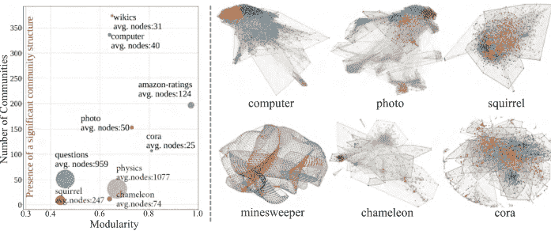

图 1. 图中存在突出的社区结构。(a) 与社区相关的指标统计。模块性在某种程度上反映了图中社区的密度，而每个点的大小表示平均社区大小。(b) 通过根据各自的社区对节点着色，可视化数据集中不同的社区。

- 我们进行了一项实证研究，揭示了社区语义丢失和过度压缩是现有 GT 的局限性。
- 大量实验表明，CoGT 通过显式建模社区级语义，实现了卓越的性能。

### 2 实证调查

#### 2.1 图中普遍存在的社区结构

为了强调显式建模社区级语义的重要性，我们分析了常见图数据集中的关键社区相关指标，包括社区数量 \(N_C\)、社区中平均节点数 \(N_{avg}\) 和模块性 [14] \(Q = \frac{1}{2c} \sum_{i,j} \left( A_{ij} - \frac{d_i d_j}{2c} \right) \delta(c_i, c_j)\)，其中 \(e\) 是边的数量，\(A_{ij}\) 是邻接矩阵，\(d_i\) 是节点 \(v_i\) 的度。如果 \(v_i\) 和 \(v_j\) 在同一社区中，则 \(\delta(c_i, c_j)\) 等于 1，否则等于 0。结果如图 1(a) 所示。我们使用 Louvain 算法 [14] 对常见图数据集进行社区检测并统计社区数量。我们将社区粒度设置为 1.2，以确保算法识别出较大的社区，而不是较小的、松散连接的社区。基于社区划分结果，我们计算了模块性 \(Q\) 来量化社区结构的程度。我们还通过根据各自的社区对节点着色，在图 1(b) 中可视化了数据集中的社区。

图 1(a) 的结果表明：(1) 常见图数据集通常表现出密集的社区结构，每个图包含几十到几百个社区。(2) 一般来说，当模块性 \(Q > 0.3\) 时，社区结构可以被认为是显著的。所有数据集均超过此阈值，大多数数据集的 \(Q\) 值大于 0.6，表明这些图具有显著的社区结构。(3) 计算表明 \(N_C \times N_{avg} \ge\) 节点总数 \(N\)，某些数据集接近 \(2N\)。这表明社区结构覆盖了图中几乎所有节点，有些节点在多个社区中发挥作用，这支持了通过全局聚合发现潜在信息。(4) 从可视化中，我们可以轻松观察到显著的社区结构，社区内部通常存在密集连接。总之，我们得出结论：社区级语义是一个至关重要且常被忽视的语义粒度。然而，现有方法常常忽略对社区结构的建模，导致在全局聚合过程中丢失社区级语义。

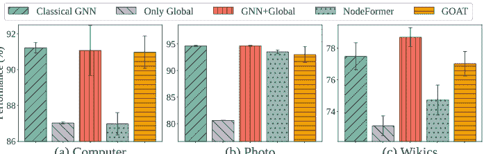

图 2. 一组对比实验，用于展示 GT 中信息过度压缩的问题。仅使用全局节点聚合的效果显著差于 GNN，而 GNN 强调重要的邻居，这表明全局聚合存在信息过度压缩问题。

#### 2.2 图变换器中的信息过度压缩

我们进行了实证研究，以验证使用简单的全局聚合会导致信息过度压缩问题。我们从 GCN、GAT 和 GraphSAGE 中选择表现最好的模型作为经典 GNN 的基线性能。我们将其与仅使用基于变换器的全局聚合的模型、带有全局聚合的经典 GNN 以及两个著名的 GT 进行了比较。结果如图 2 所示。

我们的研究结果如下：(1) 信息过度压缩问题：仅使用 GNN 显著优于仅使用全局聚合。与 GNN 相比，纯全局聚合向每个节点注入了过多信息，使它们的结构表示过于相似。这导致信噪比低，节点区分变得困难。(2) 相比之下，GNN 通过局部聚合强调关键信息，同时固有地保留了一些社区结构，从而产生更有效的表示。(3) 当天真地将 GNN 与全局聚合相结合时，三个数据集中有两个出现性能下降，表明全局聚合


tion加剧了过度压缩问题。这一现象也体现在图中最先进的GT模型（如NodeFormer和GOAT）的性能上，表明直接集成全局聚合会遭受严重的信息压缩。（4）然而，增强的WikiCS数据集上的性能改进表明，通过识别潜在且有用的节点关系，全局聚合可能是有益的。

基于这些观察，我们需要在全局聚合和信息过度压缩之间找到平衡，确保在利用全局聚合优势的同时避免过度压缩等问题。

### 3 相关工作

#### 3.1 图表征学习

GRL的目标是通过端到端训练过程将节点或图级特征与监督信号集成[27]，生成判别性低维表示。传统方法主要包括矩阵分解，例如拉普拉斯特征映射[1]，以及基于随机游走的浅层模型，例如DeepWalk [15]、Node2Vec [8]。虽然这些方法能有效捕获图结构的统计特性，但它们高度依赖特征工程且缺乏自适应参数，难以对下游任务的表示进行联合优化。

GNNs [24]的出现标志着GRL向基于深度学习的方法发生了重大转变。消息传递GNNs [9]，例如GCN [11]和GAT [19]，迭代聚合邻域特征以捕获局部结构模式。具体来说，GCNs [3]采用谱卷积操作建立信息传播范式，而GATs [20]引入注意力机制以增强聚合过程的可解释性。然而，经典GNNs根本上受其局部聚合假设的限制，限制了其对长程和潜在依赖关系的建模能力[6]。这种限制在社交网络和分子图等具有复杂拓扑结构的领域中尤为明显。为了克服局部邻域聚合的瓶颈，Transformer架构被引入GRL，从而推动了GTs [16, 22]的发展。GTs利用全局注意力机制计算任意两节点之间的注意力[2, 26]，有效捕获图结构中的长程和潜在依赖关系。

#### 3.2 Transformer模型

Transformer模型 [5] 提出用于自然语言处理，其关键创新在于消除传统循环神经网络固有的序列依赖关系。相反，它利用自注意力机制对序列元素之间的全局交互进行建模。ViT [10]在计算机视觉领域的成功，超越了卷积神经网络的性能，凸显了注意力机制在不同模态间的泛化性。这一认识推动了Transformer向GRL的扩展。

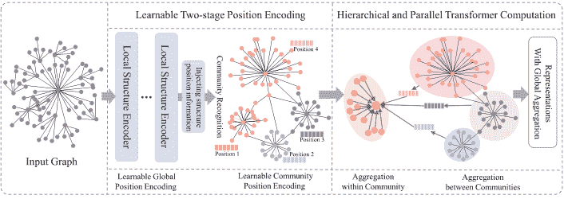

GTs将图中所有节点视为交互式注意力单元[21]，允许直接计算任意两节点之间的注意力权重[4]。当前研究工作重点是增强Transformer模型在大规模图上的可扩展性[12,17,22]。然而，现有方法常常忽略GRL中全局注意力聚合相关的两个关键挑战：(1) 过度依赖节点级交互可能会削弱社区级语义表示；(2) 全局注意力可能导致“信息过度压缩”效应，增加噪声干扰并削弱关键信息的有效性。

### 4 方法

#### 4.1 概述

CoGT的目标是通过分层聚合在全局聚合步骤中显式建模社区级语义。通过在基于注意力的聚合中使用社区级特征而非大量节点特征，CoGT有效缓解了信息过度压缩问题。

CoGT框架如图3所示。为了在全局聚合过程中建模社区级语义，我们首先对图中所有节点应用两阶段位置编码。在第一阶段，使用局部结构编码器对每个节点的位置进行编码。基于此编码，然后对节点进行社区划分，并为每个社区分配社区级位置编码以区分不同社区。接下来，社区化后的特征矩阵被传递到HPTC层进行基于注意力的计算。该层不仅能实现全局聚合，还能缓解过度的信息压缩。此外，其设计本身支持社区级并行计算，显著提升了计算效率。

#### 4.2 两阶段位置编码

对于具有边集E和节点特征X的图G(E, X)，其中节点总数为N，我们首先应用局部结构编码器将位置信息注入每个节点的表示中：

$$
\mathbf{X} = \text{LocalStructureEncoder}(\mathcal{G}(E, X)),
\quad (1)
$$

其中，\(\mathbf{X} \in \mathbb{R}^{N \times F}\)表示编码后的特征矩阵，\(F\)是隐藏维度。我们将图卷积网络作为局部结构编码器。

为了确保可微分的社区分配过程，并防止社区规模过大导致内存溢出和语义不平衡，我们设计了一种基于分类的分配策略，并对“平均社区大小 \(N_m = \lceil \frac{N}{M} \rceil\)”施加约束，其中 \(M\) 是社区数量。我们将节点分配表述为一个分类问题，并应用softmax函数将节点 \(i\) 被分配到社区 \(j\) 的概率 \(Z'_{i,j}\) 归一化：

$$
\mathbf{Z} = \mathbf{X}\mathbf{W}_{\text{C}}, \quad Z'_{i,j} = \frac{\exp(\mathbf{Z}_{i,j})}{\sum_{k=1}^M \exp(\mathbf{Z}_{i,k})},
\quad (2)
$$

其中，\(\mathbf{W}_{\text{C}} \in \mathbb{R}^{F \times M}\)是一个可学习矩阵，\(\mathbf{Z}\)是分配得分矩阵。我们通过根据分配概率对节点进行排序并选择排名前 \(N_m\) 的节点，来强制每个社区拥有固定数量的节点 \(N_m\)。然后，我们为每个社区 \(C_m\) 分配一个可学习的社区位置嵌入 \(\mathbf{E}_m \in \mathbb{R}^F\)，以区分其语义并增强社区内节点一致性：

$$
\mathbf{X}'_i = \mathbf{X}_i + \mathbf{E}_m(i \in C_m),
\quad (3)
$$

基于节点-社区隶属关系，我们得到重组特征矩阵 \(\mathbf{X}' \in \mathbb{R}^{M \times N_m \times F}\)，它包含双重位置语义。这里，\(\mathbf{X}'[m, :, :]\)表示 \(C_m\) 中所有节点的特征。

#### 4.3 分层与并行Transformer计算

我们采用分层聚合来实现全局特征交互，同时缓解信息过度压缩问题。首先，我们为每个社区 \(C_m\) 计算查询、键和值矩阵。我们直接将 \(\mathbf{X}'\) 输入线性层，以并行计算 \(\mathbf{Q}\)、\(\mathbf{K}\) 和 \(\mathbf{V}\)，这减少了内存峰值使用量，因为每个社区的张量大小远小于原始 \(\mathbf{X}\)：

$$
\mathbf{Q}_m = \mathbf{W}_Q \mathbf{X}'_m, \quad \mathbf{K}_m = \mathbf{W}_K \mathbf{X}'_m, \quad \mathbf{V}_m = \mathbf{W}_V \mathbf{X}'_m,
\quad (4)
$$

其中，\(\mathbf{W}_{(\cdot)}\)是可学习权重，\(F\)是隐藏维度，\(\mathbf{X}'_m\) 是 \(\mathbf{X}'[m, :, :]\)。为了缓解全局所有节点之间 \(O(N^2)\) 级别的特征交互所导致的信息过度压缩问题，我们引入社区级特征来替换社区外的节点级交互。同一社区内的节点通过节点特征进行交互，而不同社区的节点则通过一组社区级特征进行交互。由于社区特征具有更高的语义一致性，且数量远少于节点特征，它们能有效防止节点特征中的信息过度压缩和高噪声，从而提升特征交互的效率。


我们计算社区级查询（$\mathbf{C}^Q$）、键（$\mathbf{C}^K$）和值（$\mathbf{C}^V$）矩阵，这些矩阵通过对每个社区的特征应用聚合函数，然后进行拼接获得：

$$\mathbf{c}_m^Q = \text{Agg}(\mathbf{Q}_m), \quad \mathbf{c}_m^K = \text{Agg}(\mathbf{K}_m), \quad \mathbf{c}_m^V = \text{Agg}(\mathbf{V}_m), \quad (5)$$
$$\mathbf{C}^Q = \|_{m=1}^M (\mathbf{c}_m^Q), \quad \mathbf{C}^K = \|_{m=1}^M (\mathbf{c}_m^K), \quad \mathbf{C}^V = \|_{m=1}^M (\mathbf{c}_m^V), \quad (6)$$

其中，$\mathbf{c}_m^Q, \mathbf{c}_m^K, \mathbf{c}_m^V$ 是社区 $m$ 的查询、键和值。$\text{Agg}(\cdot)$ 表示聚合操作，$\|_{m=1}^M$ 表示拼接。为提高计算效率，我们采用简单的聚合方法，例如平均池化。

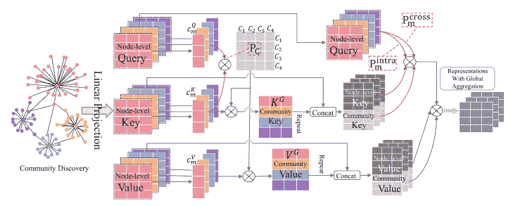

**图 4.** HPTC 利用社区特征实现社区级并行注意力计算。该设计不仅融合了社区语义，还提升了计算效率。

接下来，我们使用社区级注意力来细化社区级键和值表示，使社区特征在语义信息方面得到优化和丰富。社区级注意力矩阵 $\mathbf{P}_C \in \mathbb{R}^{M \times M}$ 的计算如下：

$$\mathbf{P}_C = \sigma \left( \frac{\mathbf{C}^Q \mathbf{C}^{K\top}}{\sqrt{F}} \right), \quad \mathbf{K}^G = \mathbf{P}_C \mathbf{C}^K, \quad \mathbf{V}^G = \mathbf{P}_C \mathbf{C}^V. \quad (7)$$

这里，$\sigma$ 表示激活函数，本文使用 tanh 作为激活函数。使用 tanh 进行激活是为了将计算效率保持在 $O(N)$ 级别，而不是 softmax 中常见的 N 级别。此外，还可以考虑正负注意力值来聚合或抑制相应社区的特征。

为了为每个节点建立全局语义依赖，我们按如下方式计算社区内注意力和社区间注意力：

$$\mathbf{P}_m^{\text{intra}} = \sigma \left( \frac{\mathbf{Q}_m \mathbf{K}_m^{\top}}{\sqrt{F}} \right), \quad \mathbf{P}_m^{\text{cross}} = \sigma \left( \frac{\mathbf{Q}_m \mathbf{K}^{G\top}}{\sqrt{F}} \right), \quad (8)$$

其中，\(\mathbf{P}_m^{\text{intra}} \in \mathbb{R}^{N_m \times N_m}\) 捕获同一社区内节点之间的交互，\(\mathbf{P}_m^{\text{cross}} \in \mathbb{R}^{N_m \times M}\) 建模社区 \(m\) 中节点与所有社区之间的全局交互。值得注意的是，\(\mathbf{P}_m^{\text{intra}}\) 和 \(\mathbf{P}_m^{\text{cross}}\) 均可通过拼接 \(\mathbf{K}_m\) 和 \(\mathbf{K}^G\) 在单步中高效计算。此外，由于我们将特征矩阵重塑为 3 维，\(M\) 个社区的 \(\mathbf{P}_m^{\text{intra}}\) 和 \(\mathbf{P}_m^{\text{cross}}\) 计算可以并行同时进行。

最后，我们将注意力分数应用于节点级和社区级值矩阵，以生成 \(C_m\) 的最终节点表示：

\(\mathbf{H}_m = [\mathbf{P}_m^{\text{cross}} || \mathbf{P}_m^{\text{cross}}] \cdot [\mathbf{V}_m || \mathbf{V}^G],\) (9)

其中 \([\cdot || \cdot]\) 表示沿列方向的拼接操作，\(\mathbf{H}_m \in \mathbb{R}^{N_m \times F}\) 的每一行对应社区 \(m\) 中节点的表示。这些表示融合了同一社区内其他节点的信息以及所有 \(M\) 个社区的全局信息。最后，我们通过社区分配生成的节点索引恢复特征矩阵的原始顺序。值得注意的是，所有 \(M\) 个社区表示矩阵的计算均并行执行，显著降低了计算时间和峰值内存占用。

### 5 理论依据

#### 5.1 通过社区间注意力实现全局特征交互

虽然模型通过社区划分避免了对所有节点对进行显式注意力计算，但层次聚合机制仍然实现了输入图中任意两节点之间的信息交互。对于任意两个节点 \(v_i \in C_m\) 和 \(v_j \in C_n\)：

如果 \(v_i\) 和 \(v_j\) 在同一社区（即 \(m = n\)），则它们的交互由节点级注意力直接建模。\(v_i\) 对 \(v_j\) 的权重定义为：

\(\mathbf{P}_m^{\text{intra}}(i, j) = \sigma \left( \frac{\mathbf{Q}_m[i,:]\mathbf{K}_m[j,:]^\top}{\sqrt{F}} \right),\) (10)

其中，\(\mathbf{P}_m^{\text{intra}}(i, j)\) 直接编码 \(v_i\) 和 \(v_j\) 之间的语义相似性。节点 \(v_i\) 的局部聚合结果为 \(\mathbf{h}_i^{\text{local}} = \sum_{j \in C_m} \mathbf{P}_m^{\text{intra}}(i, j)\mathbf{V}_m[j,:]\)，显式捕捉社区内的精细关联。

如果节点属于不同社区（即 \(m \neq n\)），则它们的交互通过社区级特征间接实现。社区 \(C_m\) 的节点特征被聚合为一个社区特征 \(\mathbf{c}_m^V\)，并进一步由社区间注意力矩阵 \(\mathbf{P}_C \in \mathbb{R}^{M \times M}\) 加权，以形成更新后的全局特征 \(\mathbf{V}^G\)。\(\mathbf{P}_C\) 的元素计算如下：

\(\mathbf{P}_C(m, n) = \sigma \left( \frac{\mathbf{c}_m^Q \mathbf{c}_n^{K^\top}}{\sqrt{F}} \right),\) (11)

其中，\(\mathbf{P}_C(m, n)\) 表示社区 \(C_m\) 对 \(C_n\) 的注意力权重。\(\mathbf{V}^G\) 中 \(\mathbb{R}^F\) 的每一行 \(\mathbf{v}_n^G\) 表示社区 \(C_n\) 在全局语义空间中的高阶表示。跨社区节点 \(v_i\) 和 \(v_j\) 之间的交互通过 \(\mathbb{R}^{N_m \times M}\) 中的跨社区注意力矩阵 \(\mathbf{P}_m^{\text{cross}}\) 实现，其元素定义如下：

$$P_m^{\text{cross}}(i, n) = \sigma \left( \frac{\mathbf{Q}_m[i,:]\mathbf{K}^G[n,:]^\top}{\sqrt{F}} \right), \quad (12)$$

其中，\(\mathbf{P}_m^{\text{cross}}(i, n)\) 表示 \(C_m\) 中 \(v_i\) 对社区 \(C_n\) 的权重。\(v_i\) 的全局聚合结果为 \(\mathbf{h}_i^{\text{global}} \propto \sum_{k=1}^M \mathbf{P}_m^{\text{cross}}(i, k)\mathbf{V}^G[k, :]\)。值得注意的是，\(C_n\) 中节点 \(v_j\) 的信息通过其社区的 \(\mathbf{V}^G[n, :]\) 传输到 \(v_i\)，即 \(\mathbf{h}_i^{\text{global}} \propto \mathbf{P}_m^{\text{cross}}(i, n)\mathbf{V}^G[n, :]\)。由于 \(\mathbf{V}^G[n, :]\) 是更新后的 \(\mathbf{c}_n^V\)，此过程间接建立了跨社区依赖。

从梯度传播的角度来看，无论节点是否属于同一社区，其梯度都可以通过局部或全局路径进行反向传播。对于 \(C_n\) 中的 \(v_j\)，其对 \(C_m\) 中 \(v_i\) 的梯度贡献为：

$$\frac{\partial \mathcal{L}}{\partial \mathbf{X}_j} = \begin{cases} \frac{\partial \mathcal{L}}{\partial \mathbf{h}_i^{\text{local}}} \cdot \frac{\partial \mathbf{P}_m^{\text{intra}}(i, j)}{\partial \mathbf{X}_j} & m = n \\ \frac{\partial \mathcal{L}}{\partial \mathbf{h}_i^{\text{global}}} \cdot \frac{\partial \mathbf{P}_m^{\text{cross}}(i, n)}{\partial \mathbf{K}^G[n, :]} \cdot \frac{\partial \mathbf{K}_n^G}{\partial \mathbf{X}_j} & m \neq n \end{cases} \quad (13)$$

这表明层次聚合机制仍然实现了输入图中任意两节点之间的信息交互。

#### 5.2 通过社区分割降低结构熵

本研究引入结构熵来量化节点表示中编码的结构信息。传统图变换器采用全局注意力以实现全节点交互，有效利用了图结构，但导致结构熵较高。完全连接的交互机制使节点极易受到噪声影响，尤其在大规模图中，无关交互会稀释关键语义信息。

为解决此问题，我们提出了一种基于社区划分的层次传播策略。首先，执行细粒度社区内注意力以捕捉局部依赖，同时避免社区间噪声。然后，通过社区表示聚合实现全局信息交换，在过滤噪声的同时保留基本语义。该策略将信息传播路径从 \(N - 1\) 优化到 \(N_m - 1 + N\)，确保 \(N_m - 1 + M \ll N - 1$，从而显著降低结构熵。在传统方法中，结构熵由所有节点对之间的交互决定，表述为：

$$\mathcal{H}_{\text{global}} \propto - \sum_{\text{all nodes } N} p \log p, \quad (14)$$

其中，\(p\) 表示任意两节点之间的依赖强度，导致较高的熵值。相比之下，我们的方法将熵分解为


表 1. 本文所使用的数据集统计信息。

| 数据集 | 类型 | 节点数 | 边数 | 特征数 | 类别数 | 指标 |
|---|---|---|---|---|---|---|
| Amazon-Computer | 同源性 | 13,752 | 245,861 | 767 | 10 | 准确率 |
| Amazon-Photo | 同源性 | 7,650 | 119,081 | 745 | 8 | 准确率 |
| Coauthor-CS | 同源性 | 18,333 | 81,894 | 6,805 | 15 | 准确率 |
| Cora | 同源性 | 2,708 | 5,278 | 1,433 | 7 | 准确率 |
| WikiCS | 同源性 | 11,701 | 216,123 | 300 | 10 | 准确率 |
| ogbn-proteins (large) | 同源性 | 132,534 | 39,561,252 | 8 | 2 | ROC-AUC |
| Squirrel | 异源性 | 2,223 | 46,998 | 2,089 | 5 | 准确率 |
| Chameleon | 异源性 | 2,277 | 31,421 | 2,325 | 5 | 准确率 |
| Amazon-Ratings | 异源性 | 24,492 | 183,831 | 300 | 5 | ROC-AUC |
| Minesweeper | 异源性 | 10,000 | 39,402 | 6 | 2 | ROC-AUC |
| Questions | 异源性 | 48,921 | 118,540 | 301 | 2 | ROC-AUC |
| pokec (large) | 异源性 | 1,632,803 | 30,622,564 | 65 | 2 | 准确率 |

```
$\mathcal{H}_{\text{new}} \propto - \sum_{\text{intra-community } N_m} p \log p - \sum_{\text{inter-community } M} q \log q, \quad (15)$
```

其中，$p$ 表示同一社区中两个节点之间的依赖强度，类似于 $\mathbf{P}^{\text{intra}}$；而 $q$ 表示社区特征之间的依赖强度，类似于 $\mathbf{P}^{\text{cross}}$。因此，CoGT 仅使用社区内节点信息以及社区间粗粒度、稀疏的链接结构来更新节点表示。与在全局节点层面进行交互的方法相比，该方法的结构熵显著更低，从而缓解了信息过度挤压的问题。

### 6 实验

#### 6.1 实验设置

在数据集方面，我们选取了多种常用的同源图和异源图，包括大规模图。具体的数据集统计信息如表 1 所示。每个数据集的训练集、验证集和测试集划分遵循该数据集提供的官方划分方法。除 ogbn-proteins、Amazon-Ratings、Questions 和 Minesweeper 数据集外（这些数据集使用 ROC-AUC 指标进行评估），所有其他数据集均使用准确率进行评估。此设置遵循以往工作中使用的评估协议。ROC-AUC（受试者工作特征曲线下面积）衡量模型区分正类和负类的能力，特别适用于不平衡分类场景。在预处理阶段，我们首先将图转换为无向图，然后添加自环。

我们将 CoGT 与经典 GNN 和最近的 GT 进行对比。GNN 基线包括 GCN [11]、GraphSAGE [9] 和 GAT [19]，它们依赖于本地消息传递。GT 包括 GraphGPS [16]、NAGphormer [2]、Exphormer [17]、NodeFormer [21]、GOAT [12] 和 Polynormer [4]。

我们对每个实验使用不同的随机种子运行了十次，并报告了平均结果。关于超参数设置，局部结构编码器的类型从 {GCN, GAT, GraphSAGE} 中选择，层数范围为 [2, 12]。学习率从 {0.01, 0.005, 0.001, 0.0005} 中选择，权重衰减从 {0, 5e-4, 5e-5} 中选择。对于社区数量，中等规模图的取值范围为 [0, 70]。对于大规模图，为了确保公平比较，ogbn-proteins 的批量大小设为 10,000，pokec 的批量大小设为 550,000，社区数量分别设为 15 和 425。最后，CoGT 的层数从 {1, 2} 中选择。

表 2. 同源数据集上的节点分类结果。最高第一名、蓝色第二名和深绿色第三名的结果已高亮显示。

| 模型 | Computer | Photo | CS | Cora | WikiCS | ogbn-proteins |
|---|---|---|---|---|---|---|
| GCN | 89.65 ± 0.52 | 92.70 ± 0.20 | 92.92 ± 0.12 | 81.60 ± 0.40 | 77.47 ± 0.85 | 72.51 ± 0.35 |
| GraphSAGE | 91.20 ± 0.29 | 94.59 ± 0.14 | 93.91 ± 0.13 | 82.68 ± 0.47 | 74.77 ± 0.95 | 77.68 ± 0.20 |
| GAT | 90.78 ± 0.13 | 93.87 ± 0.11 | 93.61 ± 0.14 | 83.00 ± 0.70 | 76.91 ± 0.82 | 72.02 ± 0.44 |
| GraphGPS | 91.19 ± 0.54 | 95.06 ± 0.13 | 93.93 ± 0.12 | 82.84 ± 1.03 | 78.66 ± 0.49 | 76.83 ± 0.26 |
| NAGphormer | 91.22 ± 0.14 | 95.49 ± 0.11 | 95.75 ± 0.09 | 82.12 ± 1.18 | 77.16 ± 0.72 | 73.61 ± 0.33 |
| Exphormer | 91.47 ± 0.17 | 95.35 ± 0.22 | 94.93 ± 0.01 | 82.77 ± 1.38 | 78.54 ± 0.49 | 74.58 ± 0.26 |
| NodeFormer | 86.98 ± 0.62 | 93.46 ± 0.35 | 95.64 ± 0.22 | 82.20 ± 0.90 | 74.73 ± 0.94 | 77.45 ± 1.15 |
| GOAT | 90.96 ± 0.90 | 92.96 ± 1.48 | 94.21 ± 0.38 | 83.18 ± 1.27 | 77.00 ± 0.77 | 74.18 ± 0.37 |
| Polynormer | 93.68 ± 0.21 | 96.46 ± 0.26 | 95.53 ± 0.16 | 83.25 ± 0.93 | 80.10 ± 0.67 | 78.97 ± 0.47 |
| CoGT | 94.01 ± 0.28 | 96.56 ± 0.31 | 95.93 ± 0.20 | 83.98 ± 0.76 | 81.23 ± 0.24 | 81.33 ± 0.37 |

表 3. 异源数据集上的节点分类结果。最高第一名、蓝色第二名和深绿色第三名的结果已高亮显示。

| 模型 | amazon-ratings | minesweeper | squirrel | chameleon | questions | pokec |
|---|---|---|---|---|---|---|
| GCN | 48.70 ± 0.63 | 89.75 ± 0.52 | 38.67 ± 1.84 | 41.31 ± 3.05 | 76.09 ± 1.27 | 75.45 ± 0.17 |
| GraphSAGE | 53.63 ± 0.39 | 93.51 ± 0.57 | 36.09 ± 1.99 | 37.77 ± 4.14 | 76.44 ± 0.62 | 75.63 ± 0.38 |
| GAT | 52.70 ± 0.62 | 93.91 ± 0.35 | 35.62 ± 2.06 | 39.21 ± 3.08 | 76.79 ± 0.71 | 72.23 ± 0.18 |
| GraphGPS | 53.10 ± 0.42 | 90.63 ± 0.67 | 39.67 ± 2.84 | 40.79 ± 4.03 | 71.73 ± 1.47 | OOM |
| NAGphormer | 51.26 ± 0.72 | 84.19 ± 0.66 | 39.99 ± 3.90 | 44.39 ± 3.93 | 68.17 ± 1.53 | 76.59 ± 0.25 |
| Exphormer | 53.51 ± 0.46 | 90.74 ± 0.53 | 40.41 ± 2.42 | 42.06 ± 2.44 | 73.94 ± 1.06 | OOM |
| NodeFormer | 43.86 ± 0.35 | 86.71 ± 0.88 | 38.52 ± 1.57 | 34.73 ± 4.14 | 74.27 ± 1.46 | 71.00 ± 1.30 |
| Polynormer | 54.81 ± 0.49 | 97.46 ± 0.36 | 41.97 ± 2.14 | 41.97 ± 3.14 | 78.92 ± 0.89 | 86.10 ± 0.05 |
| CoGT | 55.31 ± 0.54 | 97.52 ± 0.37 | 45.10 ± 1.28 | 45.38 ± 3.39 | 77.98 ± 1.03 | 86.14 ± 0.05 |

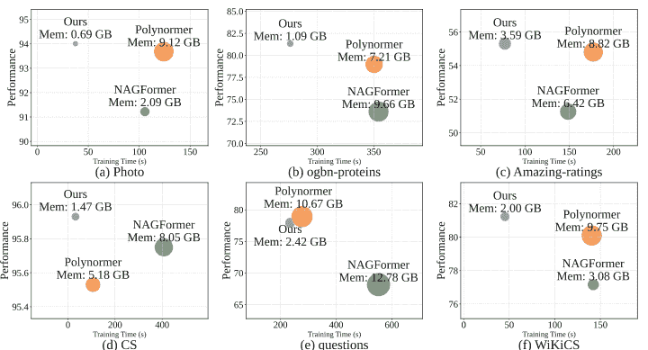

图 5. CoGT 与 SOTA GT 在性能、效率和内存消耗方面的对比。每个点的大小表示内存消耗。

#### 6.2 实验结果

表 2 和表 3 展示了 CoGT 在广泛数据集上的综合性能。所选数据集涵盖多种类型，包括同源图和异源图，以及包含单个连通分量的大规模图。

CoGT 在各种场景下表现出色，并在多个数据集上取得了最佳结果。CoGT 与以前 GT 的关键区别在于，它在全局聚合过程中显式建模社区级语义。我们的设计为 Transformer 层提供了包含结构语义的特征，这些特征是图数据的关键特性。我们相信 CoGT 的性能提升主要源于这一步骤。通过在注意力计算中使用社区级特征，CoGT 避免了引入 O(N) 复杂度节点特征所带来的过度特征噪声问题。此外，社区级特征源自带有位置编码的社区过程，其中每个社区内的节点语义更加一致，使得中心节点能够有效聚合有价值的信息并过滤掉噪声。

值得指出的是，CoGT 还在两个大规模数据集上取得了最佳性能，表明即使在大规模图上，使用社区特征的全局聚合仍然有效。这也证实了全局聚合过程中存在信息过度挤压问题。

#### 6.3 效率分析

在 CoGT 的设计中，我们采用了多种策略来提升整体模型效率。这些策略包括利用具有社区结构的并行注意力-


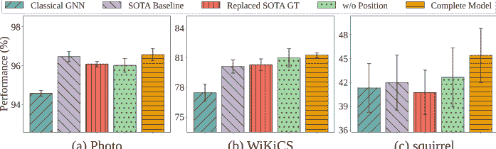

**Fig. 6.** 消融研究的结果。结果表明，移除所提出的组件会导致不同程度的性能下降。

tion mechanism within the transformer layer, replacing the quadratic-complexity Softmax function with the linearly-complex ReLU function, and incorporating efficient average pooling aggregation.

In terms of complexity, to prevent any community from growing too large during the aggregation process and to further increasing memory consumption, we adopted a strategy where each community contains an average number of nodes. As a result, the number of nodes in a community scales with the size of the graph, leading to quadratic complexity. To address this issue, we merge the community features during computation, aggregating the features of _M_ communities into _K_ through block averaging, thereby achieving linear complexity.

The comparison between CoGT and SOTA baseline methods in terms of efficiency is shown in Fig. 5. From the figure, it is evident that CoGT not only achieves superior performance but also demonstrates advantages in terms of peak memory usage and training time. This is attributed to the parallel attention computation, which significantly boosts model efficiency. By decomposing the multiplication of large feature matrices into parallel multiplications of smaller matrices, the required peak memory usage is greatly reduced.

### 6.4 消融研究

Figure 6 presents the results of experiments validating the effectiveness of various components of CoGT. We replaced the HPTC layer with the SOTA method, Polynormer, to assess the effectiveness of the proposed HPTC layer. We also removed the community positional encoding to verify the importance of this step. The results show that replacing CoGT with other GT layers led to a performance decline, indicating that explicitly modeling community semantics is effective. Furthermore, removing the positional encoding also resulted in a performance drop, demonstrating that community positional encoding is beneficial. We believe this encoding highlights the semantic distinctions between communities, which is important for attention modeling.

Additionally, we conducted experiments to explore the impact of community count on model performance, with the results shown in Fig. 7. It can be observed

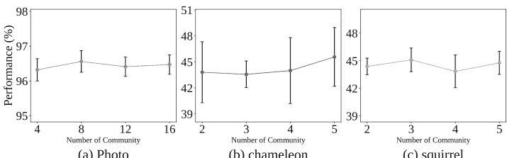

Fig. 7. 不同社区数量下所提 CoGT 的结果。结果表明，最佳社区数量在不同数据集之间有所不同，这表明不同的数据集在社区表示中需要不同层次的语义粒度。

that the optimal number of communities varies across different datasets. We interpret this result as indicating that the communities with clear semantic distinctions differ across datasets, similar to how universities have varying numbers and types of academic departments. From an empirical perspective, we hypothesize that the hyperparameter for community count is proportional to the number of nodes and the number of label categories.

### 7 结论

In this paper, we first identify two key challenges that may limit the expressiveness of global attention mechanisms in GRL: (1) the absence of community-level semantics and (2) the issue of information over-squeezing. To address these issues, we propose CoGT, a novel GT variant that explicitly models community-level semantics by identifying latent communities within the graph. This design not only enhances higher-order semantic representation but also reduces the volume of aggregated information, alleviating the over-squeezing effect. Furthermore, we provide theoretical justifications to support the effectiveness of CoGT's design. Extensive experiments demonstrate that CoGT outperforms existing methods in performance while maintaining efficiency.

Currently, CoGT is not yet capable of automatically adapting the number of communities to different datasets; this value still needs to be set empirically. Therefore, a direction for future work is to develop a version of CoGT that supports adaptive community number selection. In addition, the current design of CoGT primarily targets node-level tasks, and it could be further extended to support edge-level and graph-level tasks in the future.

Acknowledgments. This research is supported by the National Natural Science Foundation of China under the grant No. 62376129, National Key Research and Development Program of China under the grant No. 2023YFF0725003, Tianjin Science and Technology Major Project under the grant No. 24ZXZSSS00420, Tianjin Natural Science Foundation under the grant No. 24JCYBJC01950, and Tiankai Higher Education

### 参考文献

- 1. Belkin, M., Niyogi, P.: 用于降维和数据表示的拉普拉斯特征映射。Neural Comput. **15**(6), 1373–1396 (2003)
- 2. Chen, J., Gao, K., Li, G., He, K.: NAGphormer: 用于大图节点分类的标记化图变换器。载于：第 11 届国际学习表征会议 (2022)
- 3. Chen, M., Wei, Z., Huang, Z., Ding, B., Li, Y.: 简单而深的图卷积网络。载于：国际机器学习会议，第 1725–1735 页。PMLR (2020)
- 4. Deng, C., Yue, Z., Zhang, Z.: Polynomer: 线性时间内多项式表达力的图变换器。载于：第 12 届国际学习表征会议 (2024)
- 5. Devlin, J., Chang, M.W., Lee, K., Toutanova, K.: BERT: 语言理解的深度双向变换器预训练。载于：2019 年北美计算语言学协会会议论文集：人类语言技术，第 1 卷（长篇和短篇论文），第 4171–4186 页 (2019)
- 6. Dwivedi, V.P.: 长程图基准。Adv. Neural. Inf. Process. Syst. **35**, 22326–22340 (2022)
- 7. Girvan, M., Newman, M.E.: 社会和生物网络中的社区结构。Proc. Natl. Acad. Sci. **99**(12), 7821–7826 (2002)
- 8. Grover, A., Leskovec, J.: node2vec: 面向网络的可扩展特征学习。载于：第 22 届 ACM SIGKDD 知识发现与数据挖掘国际会议论文集，第 855–864 页 (2016)
- 9. Hamilton, W., Ying, Z., Leskovec, J.: 大图上的归纳表示学习。Adv. Neural Inf. Process. Syst. **30** (2017)
- 10. Han, K., et al.: 视觉变换器综述。IEEE Trans. Pattern Anal. Mach. Intell. **45**(1), 87–110 (2022)
- 11. Kipf, T.N., Welling, M.: 基于图卷积网络的半监督分类。载于：国际学习表征会议 (2017)
- 12. Kong, K., Chen, J., Kirchenbauer, J., Ni, R., Bruss, C.B., Goldstein, T.: GOAT: 大规模图上的全局变换器。载于：国际机器学习会议，第 17375–17390 页。PMLR (2023)
- 13. Li, A., Pan, Y.: 网络的结构信息与动态复杂性。IEEE Trans. Inf. Theory **62**(6), 3290–3339 (2016)
- 14. Newman, M.E., Girvan, M.: 网络中社区结构的发现与评估。Phys. Rev. E **69**(2), 026113 (2004)
- 15. Perozzi, B., Al-Rfou, R., Skiena, S.: DeepWalk: 社交表征的在线学习。载于：第 20 届 ACM SIGKDD 知识发现与数据挖掘国际会议论文集，第 701–710 页 (2014)
- 16. Rampášek, L., Galkin, M., Dwivedi, V.P., Luu, A.T., Wolf, G., Beaini, D.: 通用、强大、可扩展图变换器的配方。Adv. Neural. Inf. Process. Syst. **35**, 14501–14515 (2022)
- 17. Shirzad, H., Velingker, A., Venkatachalam, B., Sutherland, D.J., Sinop, A.K.: Exphormer: 面向图的稀疏变换器。载于：国际机器学习会议，第 31613–31632 页。PMLR (2023)
- 18. Topping, J., Di Giovanni, F., Chamberlain, B.P., Dong, X., Bronstein, M.M.: 通过曲率理解图上的过度挤压与瓶颈。载于：国际学习表征会议
- 19. Veličković, P., Cucurull, G., Casanova, A., Romero, A., Liò, P., Bengio, Y.: 图注意网络。载于：国际学习表征会议 (2018)
- 20. Wang, X., et al.: 异构图注意网络。载于：万维网会议，第 2022–2032 页 (2019)
- 21. Wu, Q., Zhao, W., Li, Z., Wipf, D., Yan, J.: Nodeformer: 用于节点分类的可扩展图结构学习变换器。载于：神经信息处理系统进展 (2022)
- 22. Wu, Q., et al.: SGFormer: 简化并赋能大图表示的变换器。Adv. Neural. Inf. Process. Syst. 36, 64753–64773 (2023)
- 23. Wu, Z., Jain, P., Wright, M., Mirhoseini, A., Gonzalez, J.E., Stoica, I.: 基于全局注意力为图神经网络表示长程上下文。Adv. Neural. Inf. Process. Syst. 34, 13266–13279 (2021)
- 24. Wu, Z., Pan, S., Chen, F., Long, G., Zhang, C., Philip, S.Y.: 图神经网络综述。IEEE Trans. Neural Netw. Learn. Syst. 32(1), 4–24 (2020)
- 25. Ying, C., et al.: 变换器在图表示上表现真的很差吗？Adv. Neural. Inf. Process. Syst. 34, 28877–28888 (2021)
- 26. Yun, S., Jeong, M., Kim, R., Kang, J., Kim, H.J.: 图变换器网络。Adv. Neural. Inf. Process. Syst. 32 (2019)
- 27. Zhang, Z., Cui, P., Zhu, W.: 图上的深度学习：综述。IEEE Trans. Knowl. Data Eng. 34(1), 249–270 (2020)


## AB-STE: 面向高效二值化网络的自适应混合梯度估计

Siddharth Gupta and Akash Kumar
Ruhr-Universität Bochum, Bochum, Germany
{siddharth.gupta,akash.kumar}@rub.de

摘要。二值化神经网络（BNNs）通过大幅降低内存和计算需求，为传统深度学习模型提供了一种高效替代方案，使其非常适合在资源受限环境（如边缘设备）中部署。尽管效率高，BNNs 往往受限于使用传统直通估计器（STE）方法进行的不准确且不稳定的梯度估计，这会扰乱梯度流并阻碍收敛。BinaryConnect 引入 STE 来近似符号函数的梯度；然而，这种近似会导致显著的不一致性，最终损害训练稳定性。虽然已提出各种方法来解决这些问题，但许多方法未能考虑到，最小化估计误差可能会无意中降低梯度稳定性。这种高度发散的梯度可能会增加梯度消失或爆炸的风险，从而阻碍有效训练。在本文中，我们提出两种新型自适应混合直通估计器（AB-STE）：AB-ArcTan-STE 和 AB-Tanh-STE。与以往方法不同，AB-STE 将线性分量与非线性函数相结合，在训练期间提供稳定性和表达性，解决 BNNs 面临的关键挑战。通过结合线性的简洁性与非线性的表达能力，AB-STE 在整个训练过程中保持平衡的梯度流，确保稳定性和有效学习。在 CIFAR-10 和 ImageNet 上的大量实验表明，AB-STE 能够实现卓越性能，超越现有最先进的方法。具体来说，我们的 AB-Tanh-STE 在 CIFAR-10 的 ResNet-18 上达到了 94.60% 的准确率，在 ImageNet 上达到了 67.96% 的 Top-1 准确率，证明了我们自适应混合策略在提升训练稳定性和准确性方面的有效性。值得注意的是，参数被二值化以实现高效性，同时保持稳定的梯度流。

关键词：二值化神经网络（BNNs）· 直通估计器（STE）· 梯度估计 · 量化 · 深度学习

### 1 引言

深度神经网络（DNNs），特别是卷积神经网络（CNNs），在广泛的计算机视觉任务中取得了显著成功，例如图像分类 [2,3]、目标检测 [4,5] 和语义分割 [6]。尽管取得了成功，但由于参数量大且计算需求高，将这些模型部署在资源受限的边缘设备（如手机、智能手表和相机）上具有挑战性。为应对这些挑战，对 DNNs 进行二值化已成为一种有前景的方法，可显著降低内存占用和计算成本 [7]。对 DNNs 的参数进行二值化使其更易于在硬件上部署，因为卷积操作可以实现为高效的位操作 [9]。然而，二值化的一个主要挑战是无法通过二值化激活有效传播梯度，这会导致模型准确性差并阻碍深度架构的训练 [10,11]。

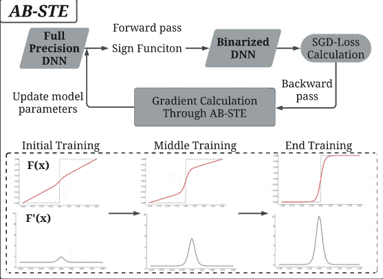

图 1. AB-STE 提出的框架

BinaryConnect [7] 和 BinaryNet [8] 是最早对权重和激活同时进行二值化的方法之一。这些方法在反向传播过程中使用直通估计器（STE）来近似符号函数的梯度，从而在训练二值化网络方面取得了显著改进。然而，前向传递（对权重和激活进行二值化）与后向传递（近似梯度）之间的不一致性引入了一个关键问题，导致梯度流不畅，并且更深层网络的准确性降低。为缓解传统 STE 造成的问题，ReSTE [1] 提出了一种平衡方法来稳定梯度，类似于 STE，同时通过幂函数引入灵活性。然而，ReSTE 在零值附近的效果有限，导致梯度不够平滑。虽然以往方法试图缩小估计误差，但往往会导致梯度发散。这促使我们设计 AB-STE，引入一种自适应方法以确保稳定性和有效的梯度流。

所提出的自适应混合直通估计器（AB-STE）采用两个分量的混合：用于稳定性的线性分量和用于表达性的非线性分量，用于近似符号函数。这种自适应混合在整个训练过程中不断演变，以在增强模型表示能力的同时保持梯度稳定性。在初始阶段，前向函数 F(x) 的表现类似于线性函数（y = x），为后向函数 F'(x) 提供低梯度幅值的稳定性。随着训练进展，F(x) 演变为近似符号函数的非线性特征，从而通过 F'(x) 获得更高的梯度幅值。这种演变增强了模型学习更复杂表示的能力，同时保持稳定的梯度流。图 1 说明了 AB-STE 的训练框架，强调了 F(x) 和 F'(x) 的自适应演变如何在不同训练阶段帮助提升稳定性和学习效果。我们的函数从简单的线性近似过渡到更像阶梯的行为，同时在整个反向传播过程中保持平滑梯度以支持有效训练。我们在图 2 中进一步说明了所提估计器的前向和后向传递。这些图展示了我们的函数如何在训练过程中从最初的类 STE 行为过渡到更精细的阶梯函数近似，同时保持整个过程中的平滑梯度。这既确保了有效近似，也确保了稳定的梯度流，从而促进强健且高效的模型训练。

本文的主要贡献如下：

- **自适应混合直通估计器 (AB-STE)**：我们提出两种新型自适应混合估计器，AB-Tanh-STE 和 AB-ArcTan-STE，它们结合线性和非线性分量，以在 BNN 训练期间稳定并改善梯度流。

- **增强的梯度稳定性与平滑度** 我们的方法通过平衡梯度平滑度和稳定性，解决了传统 STE 方法中的不一致性问题，降低了梯度消失或爆炸的风险。

- **面向前向和后向传递的混合函数** 所提混合函数包含用于稳定性的线性分量和用于表达性的非线性分量，使得在训练期间能够从类 STE 行为过渡到阶梯函数近似。

- **广泛的实验验证** 在 CIFAR-10 和 ImageNet 数据集上进行的实验表明，AB-STE 相比于现有针对 BNNs 的最先进估计器，性能更为卓越。

- **开源实现** 我们提供 AB-STE 的开源实现 (https://github.com/sid-3dev/AB-STE) 以鼓励可重复研究以及在高效神经网络训练方面的进一步发展。

本文余部分组织如下：第 2 节回顾了 DNN 二值化的最先进技术。第 3 节介绍了我们提出的方法及其理论分析，随后是第 4 节的结果与分析。最后，第 5 节提供了结论意见和见解。

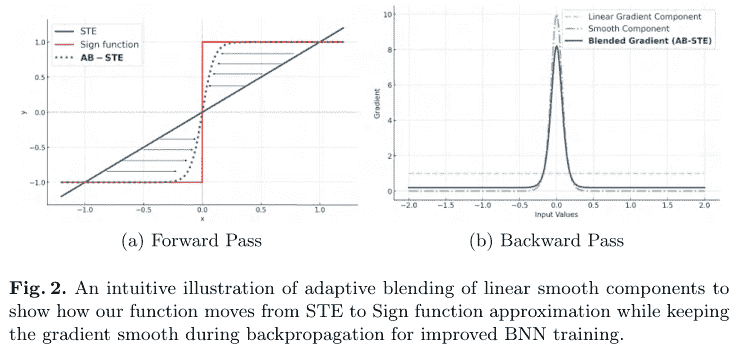

### 2 相关工作

网络二值化旨在提升神经网络推理速度，同时显著降低内存需求，且精度损失尽可能小。实现此目标的一种有效策略是在低精度网络中采用位操作。通过将权重和激活等 32 位参数转换为二值形式，计算效率显著提升，内存消耗大幅降低。BinaryConnect [7] 和 BinaryNet [8] 是开创性方法，分别专注于对网络权重以及同时对权重和激活进行二值化，以供训练和推理使用。这些工作利用直通估计器来实现带有二值化参数的深度神经网络训练，特别是解决二值化过程中产生的不可导问题。在二值化神经网络中，权重和激活通常使用符号函数表示，由于其不连续性，通过标准反向传播计算梯度变得复杂。为绕过此问题，STE 近似后向梯度，从而允许有效的网络训练。在前向传递中，使用诸如符号函数之类的二值化函数：

```
\( x_b = \text{sign}(x) = \begin{cases} +1 & \text{if } x \ge 0 \\ -1 & \text{if } x < 0 \end{cases} \) (1)
```

然而，该函数的梯度在几乎处处均为零，因此不适合反向传播。在 STE 中，梯度以更简单的形式近似，在后向传递期间将前向二值化视为恒等函数。这可以用数学表示为：

```
\( \frac{\partial L}{\partial x} \approx \frac{\partial L}{\partial x_b} \cdot \mathbf{1}_{|x| \le 1} \) (2)
```

其中 \( L \) 是损失函数，\( x_b \) 是 \( x \) 的二值化版本，而 \( \mathbf{1}_{|x| \le 1} \) 是指示函数，用于将梯度限制为通过 \( x \) 的取值范围在


范围 [-1, 1]。这种简单的近似有效地允许梯度在网络中流动，使模型能够在二值化步骤不可导的情况下学习和调整权重。使用 STE，模型可以被训练以达到与其全精度对照器相当的准确性，同时大大受益于降低的复杂度和内存占用。

尽管使用了 STE，二值网络的准确性与其全精度对照器相比仍然显著较低。已提出各种策略来解决这个问题。[12] 引入了架构更改以增强二值网络的表达能力，尽管这些改进高度依赖于修改网络架构。其他方法，例如知识蒸馏和额外的正则化 [13, 14]，旨在改善训练，但往往会导致训练期间计算成本增加。

许多研究都集中在改进二值神经网络（BNN）中的梯度估计。例如，Bi-Real-Net [12] 采用分段多项式，DSQ [15] 引入基于 tanh 的函数，IR-Net 使用误差衰减估计器函数，FDA [16] 应用傅里叶级数来改进梯度计算。虽然这些方法已展现出良好的性能，但它们常常忽视梯度稳定性的重要性。过于激进地减小估计误差可能导致高度分歧的梯度，增加梯度消失或爆炸的风险，从而最终损害有效训练。

ReSTE [1] 的作者提出了一种稳定梯度计算的方法；然而，得到的梯度空间不平滑，这限制了二值化过程中的训练能力。为应对这些挑战，我们提出了一种 **自适应混合直通估计器** (**AB-STE**)。与其他估计器相比，我们的方法提供了带有平滑梯度的稳定训练，从而取得了更好的整体性能。大量实验表明，我们的方法超越了现有最先进的方法，有效解决了二值网络中梯度稳定性和平滑性挑战。

### 3 提出的技术

#### 3.1 自适应混合直通估计器 (AB-STE)

ReSTE [1] 的作者表明，符号函数和 STE 在梯度稳定性方面代表了两个极端。符号函数在几乎所有地方的梯度均为零，在原点处梯度无穷大，导致梯度消失或爆炸，从而产生高度的梯度不稳定性。相比之下，STE 使用线性函数来近似符号函数的梯度，这在估计过程中不会改变反向梯度。

考虑到这些特性，我们设计了一种在稳定性和表达性之间取得平衡的梯度估计器。因此，我们在估计器中引入了一种线性与非线性的混合，旨在减少前向和后向计算之间的差异。公式 (3) 表示拟议 AB-STE 的前向传播。通过融合混合因子 f 和可调缩放参数 k，模型可以根据训练动态自适应地调整线性与 tanh 分量之间的比例，从而实现对梯度更灵活、更准确的表示。

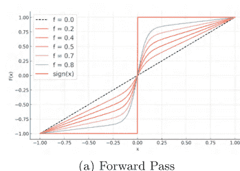
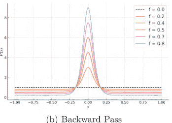

**图 3.** 显示了不同因子 (f) 值下自适应混合基于 tanh 的直通估计器 (AB-Tan-STE) 的行为

```
F(x) = (1 - f) \cdot x + f \cdot \tanh(kx) \tag{3}
```

其中 f 控制线性部分和非线性部分之间的混合，k 是 x 的缩放因子。当 f = 0 时，此混合函数表现为标准 STE；当 f = 1 时，它类似于 tanh 函数（作为符号函数的近似）。在训练期间，我们从较低的 f 值开始，并随着训练轮数的推移逐渐增加它。这种方法使我们能够最初利用 STE 的稳定性，然后逐渐融入 tanh 函数的表达性。在图 3 中，我们展示了 f 变化时函数的变化。可以观察到，当 f 较小时 F(x) 更像 STE，而当 f 增加时则更像符号函数。

反向传播函数 F'(x) 如下：

```
F'(x) = (1 - f) + f \cdot k \cdot \text{sech}^2(kx) \tag{4}
```

图 3 还显示了导数 F'(x)。随着 f 的增加，F'(x) 在零附近提供一个高而平滑的峰值，表明该函数能够在整个训练期间有效计算梯度，从而确保梯度稳定性并降低梯度消失或爆炸的风险。此外，我们引入了另一种用于直通估计的自适应混合函数，称为 AB-ArcTan-STE。该估计器将线性函数与反正切函数相混合，如公式 (5) 所定义。在此混合中使用反正切函数旨在扩展结果函数的范围，这使模型能够在更广泛的输入值范围内保留梯度信息。这使估计器更加有效，特别是在处理较大的 x 值时。反正切函数还提供更缓慢的梯度衰减，有助于在训练期间提高稳定性并实现更平滑的梯度流。AB-ArcTan-STE 的反向传播在公式 (6) 中给出。

```
**Algorithm 1. Adaptive Blended Straight-Through Estimator (AB-STE)**
Input: Training dataset: X, epochs: N, learning rate: η; initial blending factor: f0, scaling parameter: k
Initialize model parameters θ
for epoch = 1 ... N
for batch B ⊂ X
Forward Pass: Compute activations using the sign function:
y ← sign(x)
Calculate loss L(θ) using output y
Backward Pass: Compute gradient of the loss with respect to parameters using the blended gradient function:
F'(x) ← (1 - f) + f · k · sech²(kx) (for AB-Tanh-STE)
F'(x) ← (1 - f)/2 + (f · k) / (arctan(2k) · (1 + (k · x)²)) (for AB-ArcTan-STE)
Use F'(x) to compute parameter gradients (not applied to activations)
Update model parameters using stochastic gradient descent:
θ ← θ - η · ∇θL(θ)
Update blending factor f (e.g., linearly or exponentially increase f with epochs)
```

```
F(x) = \frac{1 - f}{2} \cdot x + \frac{f}{\operatorname{arctan}(2k)} \cdot \operatorname{arctan}(k \cdot x) \quad (5)
F'(x) = \frac{1 - f}{2} + \frac{f \cdot k}{\operatorname{arctan}(2k) \cdot (1 + (k \cdot x)^2)} \quad (6)
```

arctan(x) 是正切为 x 的弧度角，介于 \(-\frac{\pi}{2}\) 和 \(\frac{\pi}{2}\) 之间。

此外，我们介绍了一种利用自适应混合直通估计器 (AB-STE) 训练二值化模型的 Algorithm 1。在前向传播中，使用符号函数计算激活值以保持二值化表示。在反向传播中，使用一种结合线性和非线性分量的混合梯度函数 \(F'(x)\) 来计算参数梯度，从而实现平滑且自适应的梯度更新。混合因子 \(f\) 在整个训练期间逐渐增加，以便从稳定的线性梯度过渡到更具表达性的非线性梯度，从而有效平衡稳定性和学习能力。这种方法有助于缓解梯度不稳定性，确保二值化模型的高效训练。

#### 3.2 自适应混合直通估计器 (AB-STE) 的理论分析

我们对拟议的自适应混合直通估计器提供了理论分析，重点关注稳定性、收敛性和梯度特性。具体地，我们分析了混合因子 \( f \) 和缩放参数 \( k \) 对梯度流、稳定性和收敛性的影响。

**梯度稳定性和方差 引理 1（梯度稳定性）：** 随着混合因子 \( f \) 从 0 增加到 1，梯度 \( F'(x) \) 的方差减小，从而产生更平滑的梯度更新。

**证明：**

- 1. 考虑导数函数 \( F'(x) \)。方差 \( \text{Var}(F'(x)) \) 取决于 \( f \) 的值和输入 \( x \) 的分布。
- 2. 当 \( f = 0 \) 时，\( F'(x) = 1 \)，这导致梯度值没有方差。
- 3. 当 \( f > 0 \) 时，\( F'(x) \) 的方差取决于项 \( f \cdot k \cdot \text{sech}^2(kx) \) 的贡献。
- 4. 由于 \( \text{sech}^2(kx) \) 在 0 和 1 之间有界，梯度的方差受到限制并取决于 \( f \) 和 \( k \)。随着 \( f \) 的增加，非线性项的贡献变得更加突出，从而产生更稳定、更平滑的梯度。

_含义:_ 此分析表明，增加混合因子 \( f \) 会产生更稳定的梯度更新，这对于减少梯度值突变的风险至关重要，从而提高整体训练稳定性。

**梯度流的平滑性。** 梯度的平滑性对于避免训练期间梯度消失或爆炸至关重要。所提估计器的平滑性属性是通过 \( F(x) \) 的二阶导数进行分析的。

**引理 2（梯度流的平滑性）：** AB-STE 的梯度 \( F'(x) \) 是 Lipschitz 连续的，其 Lipschitz 常数取决于混合因子 \( f \) 和缩放参数 \( k \)。

**证明：**

- 1. \( F(x) \) 的二阶导数如下：

\( F''(x) = f \cdot k^2 \cdot \text{sech}^2(kx) \cdot \tanh(kx) \)

- 2. \( F'(x) \) 的 Lipschitz 常数 \( L \) 可以由 \( |F''(x)| \) 的最大值界定：

\( L \le f \cdot k^2 \)

- 3. 由于 \( f \in [0, 1] \) 且 \( \text{sech}^2(kx) \le 1 \)，Lipschitz 常数线性依赖于 \( f \) 并对 \( k \) 平方依赖。这意味着，\( k \) 值越小，梯度的平滑性越高；而 \( k \) 值较大可能导致梯度发生更剧烈的变化，从而可能引起不稳定。

_含义:_ 确保适当控制 Lipschitz 常数有助于保持平滑的梯度流，从而降低梯度爆炸或消失的风险，尤其是在深度网络中。


**梯度流改进。** 此外，当 \( f \rightarrow 1 \) 时，梯度 \( F'(x) \) 在零附近有一个峰值，有助于在层间维持足够的梯度流，尤其是在反向传播期间。这可以防止较深层中的梯度消失，并改善收敛。

总而言之，理论分析表明，AB-STE 通过仔细控制混合因子 \( f \) 和缩放参数 \( k \)，有效地维持了梯度的稳定性和平滑性。随着 \( f \) 的增大，梯度 \( F'(x) \) 的方差减小，确保了稳定的更新；而 \( F'(x) \) 的 Lipschitz 连续性则保证了梯度流的平滑，降低了梯度消失或爆炸的风险。通过逐渐增大 \( f \)，AB-STE 确保整个网络中的梯度流有效，从而在训练过程中实现更好的收敛，特别是对于深度二值化模型。

### 4 实验设置与结果

#### 4.1 数据集与训练设置

本研究使用了二值神经网络文献中常用的两个流行数据集：**CIFAR-10** [18] 和 **ImageNet ILSVRC-2012** [17]。

CIFAR-10 数据集包含 10 个类别的 50,000 张训练图像和 10,000 张测试图像，每张图像的分辨率为 \( 32 \times 32 \)，具有三个 RGB 颜色通道。ImageNet ILSVRC-2012 数据集是一个大规模数据集，包含超过 120 万张训练图像和 50,000 张验证图像，每张图像的分辨率为 \( 224 \times 224 \)，涵盖 1,000 个类别。

为了与现有方法进行公平比较，我们采用了与其他二值方法 [1,19,20] 相似的训练设置。我们对 CIFAR-10 和 ImageNet 都使用了诸如 RandomCrop、RandomHorizontalFlip 和 Normalize 等预处理技术。模型采用随机梯度下降（SGD）进行训练，初始学习率为 0.1，并采用余弦学习率衰减策略在训练过程中逐渐降低学习率。

对于 CIFAR-10，模型训练了 1,000 个 epoch，而对于 ImageNet，训练进行了 250 个 epoch。控制自适应混合迭代特性的超参数 \( k \) 在整个实验中固定为 10。我们将混合因子 \( f \) 在 0.2 到 0.8 之间变化，以研究其对训练性能和梯度稳定性的影响。重要的是，训练过程中采用了参数量化，而激活值保持全精度，以保持富有表现力的特征表示并确保稳定的梯度流。

#### 4.2 结果与分析

所提出的自适应混合直通估计器（AB-STE）在 CIFAR-10 和 ImageNet 数据集上进行了评估，重点关注与现有最先进方法相比的准确性和训练稳定性。

在这些实验中，我们应用了参数二值化，同时保留全精度激活值，这使我们能够有效地维持梯度稳定性，并尽量减少量化对训练动态的影响。

#### CIFAR-10 上的结果

表 1 汇总了不同架构（包括 VGG-small、ResNet-18 和 ResNet-20）在 CIFAR-10 实验中的结果。我们将所提出的 AB-Tanh-STE 和 AB-ArcTan-STE 与 DoReFa-Net [20]、IR-Net [19] 和 ReSTE [1] 等其他成熟方法进行了比较。我们的 AB-Tanh-STE 和 AB-ArcTan-STE 始终表现出与当前最先进方法相当或更好的性能。

尤其是 AB-Tanh-STE 方法，在所有三个架构中均实现了最高准确率，在 VGG-small 上达到 93.16%，在 ResNet-18 上达到 94.60%，与它们的浮点模型非常接近。这突出了我们自适应混合策略的有效性，在参数二值化的同时仍能保持稳定性并实现高准确率。

表 1. 不同架构在 CIFAR-10 上的准确率比较。所提出的 AB-Tanh-STE 和 AB-ArcTan-STE 方法与浮点模型和最先进的二值方法相比始终达到具有竞争力的准确率，采用参数量化的同时保持激活值全精度。

| 架构 | 方法 | 准确率 (%) |
| :--- | :--- | :--- |
| VGG-small | 浮点 | 93.30 |
| VGG-small | DoReFa-Net [20] | 92.13 |
| VGG-small | IR-Net [19] | 90.92 |
| VGG-small | ReSTE [1] | 92.53 |
| VGG-small | AB-Tanh-STE（本文） | **93.16** |
| VGG-small | AB-ArcTan-STE（本文） | 93.00 |
| ResNet-18 | 浮点 | 94.86 |
| ResNet-18 | DoReFa-Net [20] | 94.13 |
| ResNet-18 | IR-Net [19] | 94.33 |
| ResNet-18 | ReSTE [1] | 93.68 |
| ResNet-18 | AB-Tanh-STE（本文） | **94.60** |
| ResNet-18 | AB-ArcTan-STE（本文） | 94.18 |
| ResNet-20 | 浮点 | 91.74 |
| ResNet-20 | DoReFa-Net [20] | 90.79 |
| ResNet-20 | IR-Net [19] | 91.03 |
| ResNet-20 | ReSTE [1] | 91.32 |
| ResNet-20 | AB-Tanh-STE（本文） | **91.54** |
| ResNet-20 | AB-ArcTan-STE（本文） | 91.12 |

#### ImageNet 上的结果

ImageNet 数据集的结果列于表 2 中。对于 ResNet-18，与以前的估计器相比，我们的方法在 Top-1 和 Top-5 准确率上都有明显提升。具体来说，AB-Tanh-STE 实现了 67.96% 的 Top-1 准确率，AB-ArcTan-STE 实现了 87.66% 的 Top-5 准确率，超过了 ReSTE 基线。对于 ResNet-34，AB-Tanh-STE 实现了 71.31% 的 Top-1 准确率和 89.98% 的 Top-5 准确率，优于 ReSTE，并证明了我们所提方法在更大架构上的有效性。

自适应混合策略使我们的模型能够保持稳定的训练过程，即使是在像 ImageNet 这样具有挑战性的数据集上，其海量的类别和高分辨率图像给二值神经网络带来了巨大挑战。通过采用参数量化与全精度激活值相结合的方式，我们的方法表明自适应混合不仅能稳定训练，还能提供实现高准确率的有效手段。

表 2. ImageNet ILSVRC-2012 上不同架构的准确率比较。所提出的 AB-Tanh-STE 和 AB-ArcTan-STE 方法在采用参数量化和全精度激活值的同时，在 Top-1 和 Top-5 准确率上均有提升，突出了它们在大规模数据集上的有效性。

| 架构 | 方法 | Top-1 准确率 (%) | Top-5 准确率 (%) |
| --- | --- | --- | --- |
| ResNet-18 | 浮点 | 69.58 | 89.19 |
| | ReSTE [1] | 67.66 | 87.48 |
| | AB-Tanh-STE（本文） | **67.96** | 87.64 |
| | AB-ArcTan-STE（本文） | 67.68 | **87.66** |
| ResNet-34 | 浮点 | 73.32 | 91.27 |
| | ReSTE [1] | 70.66 | 89.43 |
| | AB-Tanh-STE（本文） | **71.31** | **89.98** |
| | AB-ArcTan-STE（本文） | 71.18 | 89.71 |

#### 4.3 混合因子的影响

在训练过程中，混合因子 \( f \) 从 0.2 线性增加到 0.8。这种方法使模型在训练初期能够受益于稳定训练，同时逐渐引入非线性以增强表示能力。我们的结果表明，这种自适应混合（结合参数量化和全精度激活值）对于在梯度平滑性与模型表达性之间达到最佳平衡至关重要，从而在 CIFAR-10 和 ImageNet 基准测试中都实现了持续改进。

CIFAR-10 和 ImageNet 的实验表明，所提 AB-STE 方法通过有效平衡梯度稳定性和表达性，优于传统的二值神经网络训练技术。使用混合函数使我们能够避免梯度消失和爆炸问题，这些问题经常阻碍基于 STE 的训练方法。

#### 4.4 计算资源分析

表 3. 不同方法的 FLOPs 和训练时间比较

| 方法 | 每输入 FLOPs | CIFAR-10 时间 (s/epoch) | ImageNet 时间 (mm:ss/epoch) | CIFAR-10 准确率 (%) | ImageNet 准确率 (%) |
| :--- | :--- | :--- | :--- | :--- | :--- |
| ReSTE | 10 (5 用于幂运算，4 用于比较), 1 用于符号 | 16 | 10:56 | 93.68 | 67.66 |
| AB-Tanh-STE | 6 (2 用于 tanh，4 用于混合) | 14 | 10:33 | 94.60 | 67.96 |
| AB-ArcTan-STE | 5 (2 用于 arctan，4 用于混合) | 12 | 10:22 | 94.18 | 67.68 |

为了评估计算效率，我们对反向传播进行了 FLOP（浮点运算次数）分析，并测量了每种方法每个 epoch 的训练时间。这些分析有助于评估所提方法与 ReSTE 相比的计算开销。表 3 总结了反向传播期间每个输入元素的 FLOP 需求，以及使用 ResNet-18 架构在 CIFAR-10 和 ImageNet 上每个 epoch 的训练时间。如所观察到的，与 ReSTE 相比，AB-Tanh-STE 和 AB-ArcTan-STE 每个输入所需的 FLOPs 更少，从而实现了训练时间的显著加速。FLOPs 的减少是通过消除幂运算和减少条件检查来实现的，从而提高了计算效率。

ReSTE 的反向传播操作包括多个条件检查和幂运算，导致更高的计算成本和更长的训练时间。相比之下，AB-Tanh-STE 和 AB-ArcTan-STE 利用更简单的数学函数，如 tanh 和 arctan，所需计算更少。优化的梯度流在保持准确率的同时减少了不必要的计算。高效的 FLOP 减少在 CIFAR-10 上分别实现了 14% 和 25% 的加速，在 ImageNet 上分别实现了 4% 和 6% 的加速。这些结果表明，AB-Tanh-STE 和 AB-ArcTan-STE 不仅提高了准确率，还显著降低了计算成本，使其更适合大规模 BNN 训练。为了在硬件效率和准确率之间取得平衡，我们选择在训练过程中仅对权重进行二值化，同时保持激活值全精度。二值化权重非常适合基于累加的硬件加速器，如 YodaNN [21] 和 FINN [22]，它们用按位操作（XNOR + popcount）替换乘法，从而减少计算和内存需求。之前的研究（如 XNOR-Net [23]）表明，在训练期间同时对权重和激活值进行二值化会严重影响准确率，尤其是在 ImageNet 等复杂数据集上。在训练期间保持激活值全精度可以保留梯度信息并提高准确率。推理期间仍可对激活值进行二值化，在无需重新训练的情况下确保计算效率。


#### 1000 代的梯度幅值比较：ReSTE 与 AB-STE

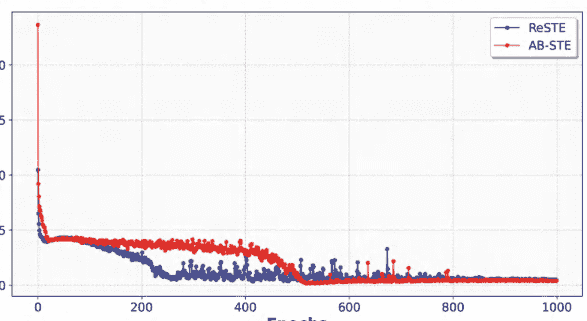

图 4. 使用 CIFAR-10 数据集训练 ResNet-18

这些结果表明，AB-Tanh-STE 和 AB-ArcTan-STE 在显著降低训练时间和计算开销的同时提高了二值神经网络（BNNs）的准确性，使其非常适合高效硬件部署，且不会牺牲模型性能。

#### 4.5 梯度分析

在图 4 中，我们对 ReSTE（蓝色）和所提 AB-Tanh-STE（红色）在训练过程中的平均梯度幅值进行了比较。结果表明，AB-STE 在训练早期阶段保持了更高的梯度幅值，确保了更强的学习信号并防止了过早收敛。相比之下，ReSTE 表现出梯度幅值的更快衰减，可能限制了网络在初始训练期间有效探索优化景观的能力。

随着训练的进行，与 ReSTE 相比，AB-STE 将梯度幅值稳定在始终更高的水平，从而促进更平滑、更具结构性的训练动态。AB-STE 中梯度的逐步衰减确保了权重更新保持有效，防止了深度网络中常见的梯度消失问题。相比之下，ReSTE 经历了显著的梯度幅值波动和急剧下降，尤其是在第 200 代之后，这表明权重更新不够稳定，可能会影响模型的鲁棒性和收敛稳定性。在第 400 代之后，AB-STE 表现出较低的梯度方差，表明它允许更受控且自适应的优化步骤。在 AB-STE 中观察到的稳定梯度流有助于提高训练效率，确保网络保留足够的梯度幅值以进行有意义的更新，同时避免不稳定性。另一方面，ReSTE 在整个训练过程中继续表现出不规则的振荡，使优化过程变得不那么可预测。

观察到的梯度行为改进凸显了所提 AB-STE 方法在保持梯度稳定性的同时保留表示能力的有效性。通过融合线性和非线性组件，AB-STE 确保了更好的梯度流、减少了梯度饱和度并提高了鲁棒性，使其成为在对抗环境中训练二值化深度神经网络的更有效方法。

### 5 结论与讨论

在此项工作中，我们引入了两种新型自适应混合直通估计器（AB-STE）：AB-Tanh-STE 和 AB-ArcTan-STE，旨在改进二值神经网络（BNNs）的训练。我们的方法解决了传统基于 STE 的方法中梯度不稳定和梯度流不准确的关键挑战。通过融合线性和非线性，AB-STE 同时保持了梯度稳定性和表达能力，显著提升了 BNNs 的整体收敛性和训练效率。在 CIFAR-10 和 ImageNet 上的大量实验评估表明，我们提出的估计器优于现有的最先进方法，在保持训练稳定性的同时实现了卓越的准确性。我们混合估计器的自适应特性提供了一种灵活的机制来应对梯度估计的挑战，以一种改善 BNNs 训练结果的方式平衡简单性与复杂性。通过在整个训练过程中逐步增加非线性，AB-STE 有效降低了与梯度消失和爆炸相关的风险，从而带来更平滑、更稳定的训练动态。

我们的工作还为多比特量化感知训练的未来研究指出了潜在方向。AB-STE 中引入的自适应混合策略可以扩展到二值网络之外，应用于更一般的量化方案，为解决多比特量化环境中的梯度估计挑战提供了一条有前途的路径。此外，AB-STE 在稳定梯度流方面的成功可能为缓解网络训练期间激活量化的影响提供洞察，进一步增强量化神经网络在资源受限环境中的适用性。总之，所提出的 AB-STE 为 BNNs 面临的与梯度相关的挑战提供了有效的解决方案，其自适应混合方法为二值和多比特网络的量化感知训练未来进步奠定了基础。我们相信，这项工作为边缘设备上部署的神经网络铺平了更强大、更高效的训练方法之路，可能扩大实际深度学习应用的范围。

**致谢。** 这项研究由德国研究基金会（DFG）在 X-ReAp（380524764）项目下支持，‘X-ReAp：跨层（Cross(X)）运行时可重构近似架构。’

### 参考文献

- 1. Wu, X.M., Zheng, D., Liu, Z., Zheng, W.S.: 估计器与平衡视角的交汇：用于二值神经网络训练的修正直通估计器。在：IEEE/CVF 国际计算机视觉会议论文集，第 17055–17064 页 (2023)
- 2. Krizhevsky, A., Sutskever, I., Hinton, G.E.: 基于深度卷积神经网络的 ImageNet 分类。ACM 通讯 60(6)，84–90 (2017)
- 3. Szegedy, C., 等：通过卷积进行更深层学习。在：IEEE 计算机视觉与模式识别会议论文集，第 1–9 页 (2015)
- 4. Girshick, R., Donahue, J., Darrell, T., Malik, J.: 用于精确目标检测和语义分割的丰富特征层次。在：IEEE 计算机视觉与模式识别会议论文集，第 580–587 页 (2014)
- 5. Li, R., Wang, Y., Liang, F., Qin, H., Yan, J., Fan, R.: 用于目标检测的完全量化网络。在：IEEE/CVF 计算机视觉与模式识别会议论文集，第 2810–2819 页 (2019)
- 6. Everingham, M., Eslami, S.A., Gool, L., Williams, C.K., Winn, J., Zisserman, A.: PASCAL 视觉对象类挑战：回顾。国际计算机视觉杂志 111，98–136 (2015)
- 7. Courbariaux, M., Bengio, Y., David, J.P.: BinaryConnect：在传播过程中使用二值权重训练深度神经网络。神经信息处理系统进展 28 (2015)
- 8. Courbariaux, M., Bengio, Y.: BinaryNet：训练权重和激活受限为 +1 或 -1 的深度神经网络。arXiv (2016)。arXiv 预印本 arXiv:1602.02830
- 9. Wang, Z., Lu, J., Tao, C., Zhou, J., Tian, Q.: 二值卷积神经网络的通道交互学习。在：IEEE/CVF 计算机视觉与模式识别会议论文集，第 568–577 页 (2019)
- 10. Jung, S., 等：通过用任务损失优化量化间隔学习量化深度网络。在：IEEE/CVF 计算机视觉与模式识别会议论文集，第 4350–4359 页 (2019)
- 11. Qin, H., Gong, R., Liu, X., Bai, X., Song, J., Sebe, N.: 二值神经网络：综述。模式识别 105，107281 (2020)
- 12. Liu, Z., Wu, B., Luo, W., Yang, X., Liu, W., Cheng, K.T.: Bi-real net：通过改进的表示能力和先进训练算法增强 1-bit CNN 的性能。在：欧洲计算机视觉会议 (ECCV) 论文集，第 722–737 页 (2018)
- 13. Tian, Y., Krishnan, D., Isola, P.: 对比表示蒸馏。arXiv 预印本 arXiv:1910.10699 (2019)
- 14. Bai, Y., Wang, Y.X. 和 Liberty, E.: PROXQUANT：通过近似算子实现量化神经网络。arXiv 预印本 arXiv:1810.00861 (2018)
- 15. Gong, R., 等：可微分软量化：连接全精度与低位神经网络。在：IEEE/CVF 国际计算机视觉会议论文集，第 4852–4861 页 (2019)
- 16. Xu, Y., Han, K., Xu, C., Tang, Y., Xu, C., Wang, Y.: 二值神经网络的频率域近似学习。神经信息处理系统进展 34，25553–25565 (2021)
- 17. Deng, J., Dong, W., Socher, R., Li, L.J., Li, K., Fei-Fei, L.: ImageNet：大规模层次图像数据库。在：2009 IEEE 计算机视觉与模式识别会议，第 248–255 页。IEEE (2009)


- 18. Krizhevsky, A., Hinton, G.: 从微小图像中学习多层特征 (2009) [在线]

- 19. Qin, H., et al.: 用于准确二进制神经网络的前向和后向信息保留. In: IEEE/CVF 计算机视觉与模式识别会议论文集, pp. 2250–2259 (2020)

- 20. Zhou, S., Wu, Y., Ni, Z., Zhou, X., Wen, H., Zou, Y.: DoReFa-Net: 使用低比特宽梯度训练低比特宽卷积神经网络. arXiv 预印本 arXiv:1606.06160 (2016)

- 21. Andri, R., Cavigelli, L., Rossi, D., Benini, L.: YodaNN: 用于超低功耗二进制权重 CNN 加速的架构. IEEE Trans. Comput. Aided Des. Integr. Circuits Syst. **37**(1), 48–60 (2017)

- 22. Umuroglu, Y., et al.: FINN: 用于快速、可扩展二进制神经网络推理的框架. In: 2017 ACM/SIGDA 现场可编程门阵列国际研讨会论文集, pp. 65–74 (2017)

- 23. Rastegari, M., Ordonez, V., Redmon, J., Farhadi, A.: XNOR-Net: 使用二进制卷积神经网络进行 ImageNet 分类. In: 欧洲计算机视觉会议, pp. 525–542. Cham: Springer International Publishing (2016)

基于分布转移下城市流预测的记忆增强不变提示学习

江海阳$^1$, 陈桐$^{1(\text{\unknown})}$, 张文涛$^2$, Quoc Viet Hung Nguyen $^3$, 袁原$^4$, 李勇$^4$, 殷弘志 $^1$

$^1$ 昆士兰大学, 布里斯班, QLD, 澳大利亚
{haiyang.jiang,tong.chen}@uq.edu.au
$^2$ 北京大学, 北京, 中国
wentao.zhang@pku.edu.cn
$^3$ 格里菲斯大学, 黄金海岸, 澳大利亚
$^4$ 清华大学, 北京, 中国
y-yuan20@mails.tsinghua.edu.cn, liyong07@tsinghua.edu.cn

Abstract. 尽管空间-时序图神经网络 (STGNN) 在城市流预测方面表现出色，但它们在应对动态空间-时序环境引起的分布转移时面临困难。为了提升对分布外 (OOD) 数据的泛化能力，典型的解决方案是剥离携带稳定因果效应的不变模式与环境相关的变体模式。现有的 OOD 鲁棒方法试图建模这些环境，但在量化动态变化方面面临挑战，并承受高昂的计算成本。作为一种解决方案，我们提出了记忆增强不变提示学习 (MIP)，它通过从空间-时序城市流图中学习记忆库，在潜空间内直接实现环境干预。随后，通过对变体提示进行空间-时序干预，在潜空间中构建多样化的环境以促进不变学习。不变提示连同记忆增强的因果图一起，输入 STGNN 骨干网络以生成准确预测。两个公开城市流数据集上的大量实验证实，MIP 在提升对 OOD 数据的鲁棒性方面非常有效。

Keywords: 空间-时序图神经网络 · 分布外泛化 · 不变学习

Supplementary Information 在线版本包含可在 https://doi.org/10.1007/978-3-032-06066-2_9 处获取的补充材料。

### 1 引言

城市流预测，即预测交通、行人和公共交通动态，对于智慧城市 [18]、公共交通管理 [7, 33]、
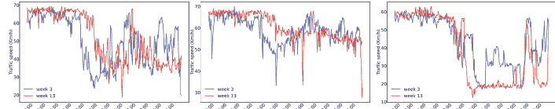

(a) 节点 A 的交通速度. (b) 节点 B 的交通速度. (c) 节点 C 的交通速度.

图 1. METR-LA 数据集中三个传感器记录的采样交通速度，其中节点 B 和 C 是节点 A 的两个最近传感器。记录对应于数据集中第 3 周和第 13 周的两个星期三。

和共享出行服务 [4,37]。通常被建模为空间-时序图，城市流中的节点（例如，交通传感器或地理网格 [29]）基于邻近性相连，目标是预测每个节点的未来交通流。为了有效建模这些空间-时序依赖性，最近的解决方案构建在基于深度学习的方法之上，特别是空间-时序图神经网络 (STGNNs) [17,33,36]。这些模型利用图神经网络 (GNNs) [17,33] 捕获空间相关性，并利用循环神经网络 (RNNs) [17,20] 和时序卷积网络 (TCNs) [33,36] 等序列模型来学习时间依赖性。一些 STGNNs 通过基于时间特征相似性 [3,26,34] 纳入动态图结构，或建模复杂的空间-时序交互 [6,12] 来进一步增强预测。

大多数 STGNN 在城市流数据服务于独立同分布 (I.I.D.) 特性的假设下运行，这一假设在现实场景中很少成立。实际上，一旦部署，训练好的模型可能需要对与训练数据模式显著不同的未见数据进行推理，这一现象在测试阶段被称为分布转移或分布外 (OOD)。图 1 来自 METR-LA 交通数据集的真实示例 (详情见第 5 节)，展示了两个星期三三个地点的交通情况。首先，城市流表现出持续的分布转移。对于三个地理节点中的每一个，两条交通记录展示了完全不同的模式。每个地点的这种持续分布转移破坏了长期空间-时序模式，阻碍了 STGNN 的泛化能力。其次，不同地点之间存在异质转移。尽管节点 B 和 C 都与节点 A 相邻，但它们的模式以不同的方式转移。这种差异使空间相关性复杂化，因为 GNN 会从受影响的节点传播噪声。在城市流预测中，空间-时序规律很容易因交通事故或极端天气等突发事件而被打乱。此外，在推理期间，通常不切实际地假设事先知道会导致 OOD 数据的此类扰动的发生，从而损害预测准确性并降低现有 STGNN 的有效性。尽管频繁重新训练可以缓解这一问题，但在如此高吞吐的应用中计算成本过高。因此，在进入更新周期之前，理想的 STGNN 应该能够通过泛化到变化的数据分布，在一段合理的时间内保持准确性。

在城市流预测中存在分布转移的情况下，增强 STGNN 泛化能力的关键在于发现并利用空间-时序数据中的不变 (即因果) 模式。关于 OOD 泛化的许多研究 [1,25] 指出，分布转移由潜在环境的动态驱动，不变风险最小化 [2,22,31] 可以用于利用从多样环境中抽取的增强数据来优化模型。因此，一些方法 [23,24] 将从数据中学习到的不变模式与变体模式解耦。例如，在处理图结构数据时，[5,32,38] 学习两个解耦的图结构，这些结构包含节点之间要么是不变连接要么是变体连接。不幸的是，这些模型与城市流预测任务不匹配，因为它们只关注静态拓扑结构，不假设节点特征的时间演变。

为此，我们的目标是构建一个 OOD 鲁棒的 STGNN，能够从城市流数据中区分不变的空间-时序模式。具体地，我们提出记忆增强不变提示学习 (MIP)，这是一种用于城市流预测的新颖解决方案。在 MIP 中，我们将记忆库附加到 STGNN 架构，以学习并记忆来自动态节点特征的因果模式。基于记忆库中存储的信息，构建了一个反映不同地点之间语义因果性的新图结构，为基于距离的默认图结构提供了互补的图视图，用于节点表示学习。然后，通过使用每个节点的特征有意查询记忆库，分别提取携带不变或变体模式的提示向量。此外，为了通过不变风险最小化促进端到端优化并确保不变模式与变体模式之间的解耦，我们提出了一种创新的干预管道，该管道直接对提取的变体提示进行操作。与现有的不变学习方法 [35,40] 不同，MIP 免除了学习不同环境的额外表示的需求，所设计的干预是一种简单而有效的方法，用于隐式模拟数据分布转移对节点表示的影响。解耦的不变模式连同地理图和因果图一起，最终输入空间-时序骨干模型以进行准确的城市流预测。为简洁起见，我们的贡献总结如下：

- 新挑战。我们强调了城市流预测中一个大多被忽视的挑战：OOD 数据的普遍存在阻碍了模型的泛化能力。为了解决这一问题，我们提出了一个名为 MIP 的新框架，以缓解城市流预测中的分布转移。

- 新方法。我们从可训练的记忆库中提取不变特征和变体特征，并生成一个补充图结构。通过对变体模式实施干预并利用不变学习


scheme, the invariant patterns are disentangled from the noisy data to facilitate accurate predictions.

- **最先进的性能。** 在两个真实世界基准数据集上的广泛实验表明，面对 OOD 城市流数据时，我们的方法优于最先进的基线。

### 2 相关工作

#### 2.1 城市流预测的深度学习

Recently, spatial-temporal neural networks (STGNNs) have established themselves as state-of-the-art choices for urban flow prediction. STGNNs consist of GNN-based modules and sequential models that are alternately stacked, where typical variants include DCRNN [17], GWNet [33], STGCN [36] and ST-MGCN [9]. Furthermore, attention mechanisms, including multi-head attention, are additionally used in fusing spatial and temporal information, such as GMAN [39], ASTGCN [10], and PDFormer [13]. Moreover, introducing some trainable features can also improve the performance of STGNNs, even with naive backbone models, such as STID [27], STAEformer [21], and MegaCRN [14]. Besides, some physical theories can also guide spatial-temporal prediction, such as PGML [15] and STDEN [11]. However, these methods are designed based on the I.I.D assumption, making the extracted patterns solely dependent on the observed samples. Thus, these methods are prone to incorrect predictions when facing unobserved data with distribution shifts.

#### 2.2 预测中处理分布外（OOD）数据

There are some models [23,35,40] dedicated to overcoming distribution shifts in spatial-temporal data. For example, CaST [35] disentangles the environmental feature and the entity feature based on causal treatments [23], and it replaces the environment feature with the vector closest to it in the environment codebook, which contains vectors representing environments. CauSTG [40] designs a hierarchical invariance explorer, which merges the models trained across various environments. STONE [28] learns both spatial and temporal similarity matrices as adjacency matrices for STGNN to make predictions and implements intervention by masking these two adjacency matrices. By differentiating raw data from distinct environments, the aforementioned methods can capture data exhibiting distribution shifts, enabling STGNNs to learn features across diverse distributions. Consequently, STGNNs can achieve accurate predictions on OOD data. However, these methods are heavily dependent on specifically designed model mechanisms and exhibit high sensitivity to the number of virtual environments.

### 3 初步

#### 3.1 问题定义

In urban flow data, a geolocation graph can be defined as: \(\mathcal{G} = \{\mathcal{V}, \mathcal{E}\}\), where \(\mathcal{V}\) is the set of \(N\) nodes and \(\mathcal{E}\) is the set of edges. Correspondingly, \(\mathbf{A} \in \{0, 1\}^{N \times N}\) is the derived adjacency matrix. In \(\mathcal{G}\), a node is a spatial object like a traffic sensor, where the edges between nodes are commonly established by thresholding their physical distances [33, 36], thus \(\mathbf{A}\) is constant in this task. At each time step \(1 \le t \le T\), all nodes' dynamic features are represented via a matrix \(\mathbf{X}^t \in \mathbb{R}^{N \times k}\), with \(k\) representing the dimensionality of time-varying features. Following the commonly adopted setting [33], given the observed \(T\) historical observations \(\{\mathbf{X}^t\}_{t=1}^T\) and the geo-location graph \(\mathcal{G}\), the task objective is to train a model that predicts the next \(T\) urban flow signals \(\{\mathbf{X}^{t'}\}_{t'=T+1}^{2T}\):

$$
\mathbf{Y} \simeq f_\theta(\mathbf{X}, \mathcal{G}),\tag{1}
$$

where \(\mathbf{X}, \mathbf{Y} \in \mathbb{R}^{T \times N \times k}\) are respectively the tensorized versions of input \(\{\mathbf{X}^t\}_{t=1}^T\) and output \(\{\mathbf{X}^{t'}\}_{t'=T+1}^{2T}\), and \(f_\theta(\cdot)\) is the prediction model parameterized by \(\theta\).

Usually, the optimization of \(\theta\) is based on the I.I.D assumption, which means the training and test samples are drawn from the same distribution. In urban flow prediction, this assumption can hardly be guaranteed as the training and test data points are drawn from different environments, respectively denoted by \(E_{train}\) and \(E_{test}\). Thus, the optimal model parameter \(\theta^*\) should achieve minimal generalization error on an OOD test set, described as follows:

$$
\min \mathbb{E}_{(\mathbf{X}', \mathbf{Y}') \sim p(\mathbf{X}', \mathbf{Y}'|E_{test})} \mathcal{L}(f_\theta(\mathbf{X}', \mathcal{G}), \mathbf{Y}'), \quad s.t. \theta^* = \arg \min_\theta \mathbb{E}_{(\mathbf{X}, \mathbf{Y}) \sim p(\mathbf{X}, \mathbf{Y}|E_{train})} \mathcal{L}(f_\theta(\mathbf{X}, \mathcal{G}), \mathbf{Y}), \quad E_{train} \neq E_{test}, \tag{2}
$$

where \(\mathcal{L}(\cdot)\) quantifies the prediction error.

#### 3.2 分布转移下的不变学习

Let \(\mathbf{H}_I, \mathbf{H}_V \in \mathbb{R}^{T \times N \times d}\) respectively denote all \(T \times N\) variant and invariant patterns with dimensionality \(d\) extracted from input \(\mathbf{X}\). Drawing on causality theory [23, 24], there exists a prediction function \(\text{pred}(\cdot)\), for which the invariant feature \(\mathbf{H}_I\) is sufficiently predictive for \(\mathbf{Y}\) and the variant feature \(\mathbf{H}_V\) does not hold causation to \(\mathbf{Y}\) [32, 38]. Given that, we can rewrite our objective below:

$$
\arg \min_{\theta, \psi} \mathbb{E}_{(\mathbf{X}, \mathbf{Y}) \sim p(\mathbf{X}, \mathbf{Y}|E_{train})} \mathcal{L}(f_\theta(\mathbf{H}_I, \mathcal{G}), \mathbf{Y}), \quad s.t. \mathbf{H}_I, \mathbf{H}_V = f_\psi(\mathbf{X}), \quad \mathbf{Y} \perp \mathbf{H}_V | \mathbf{H}_I, \tag{3}
$$

where we use \(\mathbf{H}_I, \mathbf{H}_V \in \mathbb{R}^{T \times N \times d}\) to respectively denote all \(T \times N\) variant and invariant patterns with dimensionality \(d\) extracted from input \(\mathbf{X}\). Here, \(f_\psi(\cdot)\) is the invariant learning backbone model parameterized by \(\psi\) that disentangles invariant patterns with the variant ones from the dynamic node features. In this setup, the prediction model \(f_\theta\) is only fed with the invariant patterns to derive final predictions. Based on the formulation, a key step is to train \(f_\psi(\cdot)\) towards distinguishing invariant and variant patterns. To achieve this, based on the interventional distribution in causality theory [32], a common objective can be described following invariant learning loss:

$$
\min_\psi \mathbb{E}_{(\tilde{\mathbf{X}}, \tilde{\mathbf{Y}}) \sim p(\tilde{\mathbf{X}}, \tilde{\mathbf{Y}}|\tilde{E})} \mathcal{L}(\text{pred}(f_\psi(\tilde{\mathbf{X}}), \mathcal{G}), \mathbf{Y}) + \lambda \text{\textit{Var}}_{(\tilde{\mathbf{X}}, \tilde{\mathbf{Y}}) \sim p(\tilde{\mathbf{X}}, \tilde{\mathbf{Y}}|\tilde{E})} \mathcal{L}(\text{pred}(f_\psi(\tilde{\mathbf{X}}), \mathcal{G}), \mathbf{Y}), \tag{4}
$$

where \(\hat{E} \neq E_{train}\) denotes an intervention sampled from an intervention set, which imposes changes on the original environment and leads to features \(\hat{\mathbf{X}} \neq \mathbf{X}\) with shifted distributions. Ideally, \(\hat{E}\) only performs intervention on variant patterns, leaving the invariant features unaffected. \(\text{pred}(\cdot)\) denotes a predictor that uses both invariant and variant patterns emitted by \(f_\psi(\hat{\mathbf{X}})\) to predict the ground truth label. Note that as \(\text{pred}(\cdot)\) is not responsible for generating the final predictions, it does not necessarily share the same structure or parameterization with \(f_\theta(\cdot)\). The first term minimizes the prediction loss, whereas in the second term, \(Var\) denotes the variance and \(\lambda\) is a balancing hyperparameter. As the variant patterns are unrelated to the label \(\mathbf{Y}\), the prediction should remain stable regardless of the variant patterns introduced by \(\hat{E}\), translating into a lower variance. As such, \(f_\psi(\cdot)\) is trained to differentiate invariant patterns \(\mathbf{H}_I\) and variant patterns \(\mathbf{H}_V\) amid distribution shifts in urban flow.

### 4 MIP：拟议方法

In this section, we introduce a universal framework named Memory-enhanced Invariant Prompt learning (MIP) for urban flow prediction under OOD scenarios, whose main components are depicted in Fig. 2. In what follows, we unfold the design of MIP by introducing the design of the memory bank, as well as the backbones for invariant learning (i.e., \(f_\psi(\cdot)\)) and spatial-temporal prediction (i.e., \(f_\theta(\cdot)\)) backbone model.

#### 4.1 记忆增强不变提示学习

A key advantage of MIP is that rather than generating intervened environments \(\hat{E}\) and simulating changes in latent patterns, it directly intervenes in the latent space to mimic representation changes after intervention. To do this, we first mine latent patterns correlated with predicted labels from time-varying node features. Therefore, we extract and store these representative causal features with a memory bank [14]. The memory bank can be represented as \(\mathcal{M} \in \mathbb{R}^{M \times d}\), where \(M\) and \(d\) represent the number of virtual nodes and their dimensions, respectively. Essentially, each of the \(M\) virtual nodes in the memory bank is assigned a \(d\)-dimensional prototype vector \(\mathcal{M}[m] \in \mathbb{R}^d (m \le M)\) that summarizes a part of the latent, invariant features within the spatial-temporal node features \(\mathbf{X}\). The memory bank \(\mathcal{M}\) supports two subsequent computations: generating variant and invariant prompts through a querying process as described below, and providing a causal graph to supplement the geographical graph for node representation learning as described in Sect. 4.3.

**学习不变和变量提示。** As a core part of OOD generalization, given all nodes' temporal features \(\mathbf{X}^t \in \mathbb{R}^{N \times k}\) at time \(t\), MIP extracts both causal and spurious patterns from them – which we term invariant and variant prompts in this work. To do this, we firstly project \(\mathbf{X}^t\) into a query matrix \(\mathbf{Q}_l \in \mathbb{R}^{N \times d}\):

$$
\mathbf{Q}_l = \mathbf{X}_l \mathbf{W}_Q + \mathbf{b}_Q, \tag{5}
$$


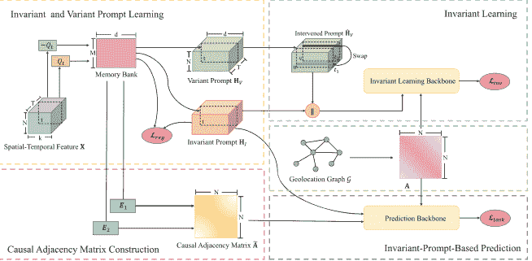

图 2. MIP 的主要组件。

其中，\(\mathbf{W}_Q \in \mathbb{R}^{k \times d}\) 和 \(\mathbf{b}_Q \in \mathbb{R}^d\) 是线性层的可训练参数。由于 \(\mathbf{Q}_t\) 同时包含不变模式和变体模式，我们通过查询不变记忆库来进一步解耦它们。为了获得不变提示，我们将查询矩阵 \(\mathbf{Q}_t\) 与记忆库 \(\mathbf{\Phi}\) 相乘，以获取亲和矩阵 \(\mathbf{S}^t_I\)，并基于此以自注意方式从记忆库中提取不变提示。该过程可表述为：

```
\(\mathbf{H}^t_I = \mathbf{S}^t_I \mathbf{\Phi}, \mathbf{S}^t_I = \text{softmax}(\mathbf{Q}_t \mathbf{\Phi}^\top), \tag{6}\)
```

其中，\(\mathbf{H}^t_I \in \mathbb{R}^{N \times d}\) 是计算得到的不变提示。类似地，变体提示可以通过类似的过程提取，只需进行微小修改：

```
\(\mathbf{H}^t_V = \mathbf{S}^t_V \mathbf{\Phi}, \mathbf{S}^t_V = \text{softmax}(-\mathbf{1} \cdot \mathbf{Q}_t \mathbf{\Phi}^\top), \tag{7}\)
```

在此过程中，softmax 函数之前应用了求负运算，以便翻转分数分布，并为与记忆 \(\mathbf{\Phi}\) 相关性较低的不变模式分配更高的权重。由于此操作在所有时间步上执行，我们可以得到一组 \(T\) 个提示 \(\{\mathbf{H}_I^1, \mathbf{H}_I^2, ..., \mathbf{H}_I^T\}\) 和 \(\{\mathbf{H}_V^1, \mathbf{H}_V^2, ..., \mathbf{H}_V^T\}\)。通过分别在时间维度上拼接不变提示和变体提示，我们可以得到两个提示张量 \(\mathbf{H}_I, \mathbf{H}_V \in \mathbb{R}^{T \times N \times d}\)，用于后续计算。

### 4.2 基于潜在干预的不变学习

如前所述，变体提示 \(\mathbf{H}_V\) 依赖于环境但与标签 \(\mathbf{Y}\) 无关，而不变提示 \(\mathbf{H}_I\) 与 \(\mathbf{Y}\) 具有因果关联。为了从 \(\mathbf{X}\) 中提取 \(\mathbf{H}_I\)，3.2 节中描述的一种常用方法是使用经过干预的原始数据 \(\tilde{\mathbf{X}}\) 进行不变学习。然而，由于可能引入额外噪声的风险，直接干预原始数据对于城市流量预测任务来说不是一个理想的选择，而一些变通方法 [30, 32, 35] 需要额外参数化并学习潜在环境

```
**Algorithm 1.** INTERVENE($\mathbf{H}_V, r$)

1: **Input**: Variant prompt tensor $\mathbf{H}_V \in \mathbb{R}^{T \times N \times d}$, intervention rate $r$
2: **Output**: Intervened variant prompt $\hat{\mathbf{H}}_V \in \mathbb{R}^{T \times N \times d}$
3: $\hat{\mathbf{H}}_V \leftarrow \mathbf{H}_V$
4: **for** s=1,2,...,$\lfloor \frac{rN}{2} \rfloor$ **do**
5:   Randomly sample a node pair $(w, v)$ s.t. $w, v \in [1, N]$;
6:   Randomly select a time step pair $(i, j)$ s.t. $i, j \in [1, T]$;
7:   $\hat{\mathbf{H}}_V[i, w] \leftarrow \mathbf{H}_V[j, v]$, $\hat{\mathbf{H}}_V[j, v] \leftarrow \mathbf{H}_V[i, w]$;
8: **end for**
9: **return** $\hat{\mathbf{H}}_V$
```

以改变原始数据分布。此外，当将 STGNNs 用作预测器 pred($\cdot$) 时，优化 Eq.(4) 需要多次复杂的前向传播，考虑到城市流量图中较大的空间跨度 \(N\) 和时间跨度 \(T\)，这在计算上是不切实际的。

#### 潜在干预机制。

在本文中，我们创新性地提出在潜在空间中生成时空干预，这能够更有效地模拟输入数据可能发生分布偏移后可学习模式的变化。具体而言，给定提取的变体提示 \(\mathbf{H}_V\)，我们以预定义的比率 \(r\) 在不同节点和时间点之间交换 \(\mathbf{H}_V\) 中的特征。潜在干预机制的详情在算法 1 中描述。为简洁起见，我们将此过程简化为以下形式：

\(\hat{\mathbf{H}}_V = \text{INTERVENE}(\mathbf{H}_V, r),\) (8)

其中，\(\hat{\mathbf{H}}_V\) 表示在节点之间发生 \(rN\) 次特征交换后的干预变体提示。请注意，交换不限于同一时间步的节点特征，以考虑变体模式中的时空波动。此外，通过生成基于原始输入数据所学表征的干预变体提示，生成的 \(\hat{\mathbf{H}}_V\) 既合理又具有挑战性，可用于优化不变提示 \(\hat{\mathbf{H}}_I\)。

#### 不变学习。

在获得干预后的变体提示 \(\hat{\mathbf{H}}_V\) 后，我们可以通过不变学习训练 4.1 节中描述的提示提取器，以区分不变提示和变体提示。为此，将不变提示和干预后的变体提示拼接，并输入到补充预测器 pred($\cdot_) 中以生成预测：

\(\tilde{\mathbf{Y}} = \text{pred}(\mathbf{H}_I || \hat{\mathbf{H}}_V, \mathbf{A}),\) (9)

其中，\(||\) 表示沿最后一个维度的张量拼接，\(\tilde{\mathbf{Y}} \in \mathbb{R}^{T \times N \times k}\) 是所有位置和时间步的预测城市流量。pred($\cdot_) 的选择具有灵活性，大多数 STGNN 均可选用。由于 pred($\cdot_) 仅负责区分不变提示和变体提示，并将用于计算最终预测，我们采用 GWNet [33] 作为 pred($\cdot_)，这是一种简单而有效的 STGNN。对于训练，我们首先定义单个节点 \(n\) 在单个时间步 \(t\) 上的损失：

```
l(t, n) = \frac{1}{k} \sum_{k'=1}^k || \hat{\mathbf{Y}}[t, n, k'] - \mathbf{Y}[t, n, k'] ||,
```

基于此，不变学习损失定义为：

```
\mathcal{L}_{inv} = \mathbb{E}_{(t,n)} l(t,n) + \lambda_1 Var_{(t,n)} l(t,n), t \in [1,T], n \in [1,N],
```

其中，第一项和第二项分别降低了跨位置和时间步的预测误差的均值和方差。更具体地说，第一项确保 pred(\cdot) 针对使用 \(\mathbf{H}_I\) 在不同环境中正确预测城市流量进行优化，而第二项强制要求，当预测以 \(\mathbf{H}_I\) 为条件时，即使存在来自干预变体提示 \(\mathbf{H}_V\) 的噪声信号，性能波动也最小。

### 4.3 伴随因果图生成的城市流量预测

一旦提取了不变特征 \(\mathbf{H}_I\)，就可以使用一个时空骨干模型来生成最终预测。在 MIP 中，我们的骨干模型由交替堆叠的 GNN 层和时序 Transformer 层组成，它们以不变提示 \(\mathbf{H}_I\) 和邻接矩阵 \(\mathbf{A}\) 作为输入。然而，\(\mathbf{A}\) 通常仅根据节点之间的物理距离构建。因此，这可能在 GNN 的信息传播过程中引入偏差，因为地理邻近并不一定意味着相似的时序模式，尤其是在 OOD 场景中。在本节中，我们介绍了一种基于记忆的方法来生成因果图作为 \(\mathbf{A}\) 的补充，随后介绍骨干 STGNN 的细节。

#### 因果图生成。

为解决纯基于距离的地理定位图的局限性，我们引入了一个基于因果节点表示之间语义距离的辅助图，这些表示是从记忆库 \(\mathbf{\Phi}\) 中的高度不变特征构建的。该因果图补充了基于地理位置的图，从而提供额外的预测信号。基于记忆库的因果图构建如下：

```
\tilde{\mathbf{A}} = \text{softmax}(\mathbf{E}_1 \mathbf{E}_2^\top), \mathbf{E}_1 = \mathbf{W}_A \mathbf{\Phi}, \mathbf{E}_2 = \mathbf{W}_B \mathbf{\Phi},
```

其中，\(\mathbf{W}_A, \mathbf{W}_B \in \mathbb{R}^{N \times M}\) 是可训练的投影矩阵，将记忆库中的 \(M\) 个原型向量映射为 \(N\) 个节点表示 \(\mathbf{E}_1\) 和 \(\mathbf{E}_2\)。由于记忆库已经封装了关于城市流量的关键信息，新开发的因果邻接矩阵在节点之间提供了额外的信息传播通道。

#### GNN 层。

GNN 层以地理邻接矩阵 \(\mathbf{A}\)、因果邻接矩阵 \(\tilde{\mathbf{A}}\) 和不变提示 \(\mathbf{H}_I\) 作为输入，通过信息传播学习节点表示。由于地理邻接矩阵 \(\mathbf{A}\) 是对称的，且难以捕捉城市流量数据中交互作用的有向性质，我们通过双向度权重随机游走 [17] 从 \(\mathbf{A}\) 推导出前向和后向转移矩阵：

```
\mathbf{P}_f = \mathbf{D}^{-1}\mathbf{A}, \mathbf{P}_b = (\mathbf{D}^\top)^{-1}\mathbf{A}^\top,
```


其中 D 是 A 的度矩阵。值得注意的是，GNN 层分别处理每个时间步 t。通过引入因果邻接矩阵，对于每个时间步 t，GNN 从第 l 层到 l + 1 层的传播过程总结如下：

\(\mathbf{G}^t_{l+1} = \sum_{z=0}^{Z} (\mathbf{P}_f^z \mathbf{G}_l^t \mathbf{W}_1^z + \mathbf{P}_b^z \mathbf{G}_l^t \mathbf{W}_2^z + \tilde{\mathbf{A}}^z \mathbf{G}_l^t \mathbf{W}_3^z),\quad (14)\)

其中 z \(\le\) Z 控制信息传播的阶数，\(\mathbf{W}^{(k)} \in \mathbb{R}^{d \times d}\) 表示可学习的权重。需要注意的是，当 l = 0 时，初始节点嵌入设置为 \(\mathbf{G}_0^t = \mathbf{H}_l^t\)。

**时间 Transformer 层。** 当 GNN 层处理完所有时间步后，我们可以收集最终图传播层生成的 T 个特征矩阵，记为 \(\mathbf{G}^1, \mathbf{G}^2, ..., \mathbf{G}^T \in \mathbb{R}^{N \times d}\)。对于某个节点 n，我们可以将其在 T 个时间步上的所有 d 维时间敏感特征堆叠为一个矩阵，记为 \(\mathbf{G}_n \in \mathbb{R}^{T \times d}\)。在此基础上，我们通过一个 Transformer 层学习节点所有时序特征之间的依赖关系，如下：

\(\mathbf{G}'_n = \text{softmax} \left( \frac{\mathbf{G}_n \mathbf{W}_Q (\mathbf{G}_n \mathbf{W}_K)^\top}{\sqrt{d}} \right) (\mathbf{G}_n \mathbf{W}_V),\quad (15)\)
\(\mathbf{Z}_n = \text{MLP}(\mathbf{G}'_n),\)

其中 \(\mathbf{W}_Q, \mathbf{W}_K, \mathbf{W}_V \in \mathbb{R}^{d \times d}\) 是可训练的查询、键和值投影权重，MLP(\(\cdot\)) 表示前馈多层感知机。

**预测层。** 在获得所有节点的 N 个输出 \(\mathbf{H}'_1, \mathbf{H}'_2, ..., \mathbf{H}'_N \in \mathbb{R}^{T \times d}\) 后，我们可以将所有特征矩阵堆叠为 \(\mathbf{Z} \in \mathbb{R}^{T \times N \times d}\)。然后，我们使用 MLP 生成最终预测：

\(\hat{\mathbf{Y}} = \text{MLP}(\mathbf{Z}),\quad (16)\)

其中 MLP 将 Z 投影为 \(\hat{\mathbf{Y}} \in \mathbb{R}^{T \times N \times k}\)，该矩阵承载每个时间步每个位置的预测城市流量。

### 4.4 模型优化

接下来，我们详细介绍 MIP 的优化策略。首先，基于骨干模型生成的预测 \(\hat{\mathbf{Y}} \in \mathbb{R}^{T \times N \times k}\)，预测误差如下：

\(\mathcal{L}_{task} = \frac{1}{TN} \sum_{t,n,k'=1}^{T,N,k} | \hat{\mathbf{Y}}[t, n, k'] - \mathbf{Y}[t, n, k'] |.\quad (17)\)

此外，由于我们从记忆库中提取不变提示，我们使用辅助正则化损失来增强记忆库中存储特征的质量：

\[
\mathcal{L}_{reg} = \sum_{t,n}^{T,N} \max \{ \| \mathbf{H}_t^t[n] - \mathbf{\Phi}[a] \|^2 - \| \mathbf{H}_t^t[n] - \mathbf{\Phi}[b] \|^2 + \kappa, 0 \} + \sum_{t,n}^{T,N} \| \mathbf{H}_t^t[n] - \mathbf{\Phi}[a] \|^2,
\]

其中 \(\kappa\) 是距离边界，\(a,b\) 是基于 Eq.(6) 中计算的亲和度分数 \(\mathbf{S}_I^t\) 相对于节点 \(n\) 的最相似和第二相似虚拟节点的索引。因此，\(\mathcal{L}_{reg}\) 鼓励记忆库中不同虚拟节点原型向量编码的信息内部多样性。最后，优化目标旨在最小化以下总损失：

\[
\mathcal{L} = \mathcal{L}_{task} + \mathcal{L}_{inv} + \lambda_2 \mathcal{L}_{reg},
\]

其中 \(\lambda_2\) 是平衡超参数。随着 MIP 训练趋向收敛，对变体模式的干预，即 \(\hat{\mathbf{H}}_V = \text{Intervene}(\mathbf{H}_V, r)\) 在每个训练 epoch 中重新执行，以便在监督信号中注入更多变化。值得注意的是，一旦 MIP 训练完成，在推理阶段只有第 4.3 节描述的时空骨干模型会被激活用于进行预测。

### 5 实验

#### 5.1 实验设置

我们在两个广泛认可的基准上评估我们的模型，即 METR-LA [17] 和 NYC Bike [37]。METR-LA [17] 是一个交通速度预测数据集，使用洛杉矶地区的 207 个传感器收集，时间范围从 2012 年 3 月 1 日到 2012 年 6 月 30 日，数据点按 5 分钟时间间隔采样。NYC Bike 1 [37] 是纽约市从 2014 年 4 月 1 日到 9 月 30 日的自行车租赁记录数据集，其中城市被划分为 \(8 \times 16\) 个大小相等的网格，数据点按 1 小时时间间隔采样。由于 NYC Bike 1 记录了自行车的进出流量，我们将它们视为两个预测任务，并分别表示为 NYC Bike 1 (In) 和 NYC Bike 1 (Out)。

我们按时间顺序划分两个数据集：前 60% 用于训练，接下来的 10% 用于验证，其余数据均匀切分为三个测试集（每个 10%）。这是为了充分模拟现实应用场景，其中训练好的模型需要为多个连续时间段提供预测，这些时间段的分布各不相同。为方便起见，我们将三个测试集编号为 0、1 和 2。一般来说，随着测试集 0-2 在时间上与训练集越来越远，它们的分布偏移往往会变得更强。基于可用的时间步数，在 METR-LA 上我们基于过去 12 个时间步预测未来 12 个时间步，在 NYC Bike 上基于过去 6 个时间步预测未来 6 个时间步。我们将 MIP 与以下最先进的基线进行比较：STGCN [36]、DCRNN [17]、STNorm [8]、GMSDR [19]、MegaCRN [14]、CauSTG [40]、TESTAM [16]。与以往研究 [19, 28, 33] 类似，我们使用平均绝对误差 (MAE)、均方根误差 (RMSE) 和平均绝对百分比误差 (MAPE) 评估所有方法。超参数和实现说明可在我们的发布代码中查看：https://github.com/Ocean-Jiang0729/MIP。

**表 1.** 性能比较结果。最佳结果以粗体标记，次佳结果以下划线标注。

| METR-LA | 测试集 0 | | | 测试集 1 | | | 测试集 2 | | | 总体结果 | | |
| :--- | :---: | :---: | :---: | :---: | :---: | :---: | :---: | :---: | :---: | :---: | :---: | :---: |
| | MAE | RMSE | MAPE | MAE | RMSE | MAPE | MAE | RMSE | MAPE | MAE | RMSE | MAPE |
| STGCN | 3.33 | 7.15 | 10.14% | 3.63 | 7.47 | 10.90% | 3.63 | 7.58 | 10.21% | 3.53 | 7.40 | 10.42% |
| DCRNN | 3.33 | 7.28 | 10.01% | 3.58 | 7.49 | 10.80% | 3.69 | 7.87 | 10.41% | 3.53 | 7.55 | 10.41% |
| STNorm | 3.33 | 7.17 | 10.09% | 3.65 | 7.57 | 11.16% | 3.63 | 7.61 | 10.23% | 3.53 | 7.45 | 10.49% |
| GMSDR | 3.27 | 6.99 | 9.75% | **3.49** | 7.36 | 10.83% | **3.50** | 7.47 | 10.01% | **3.42** | 7.27 | 10.20% |
| MegaCRN | **3.22** | 7.05 | 9.69% | 3.64 | 7.65 | 11.04% | 3.79 | 8.00 | 10.75% | 3.55 | 7.57 | 10.49% |
| CauSTG | 3.33 | 7.08 | 9.86% | 3.64 | 7.44 | 10.81% | 3.66 | 7.55 | 10.10% | 3.55 | 7.36 | 10.26% |
| TESTAM | 3.36 | 7.33 | 9.56% | 3.62 | 7.58 | **10.26%** | 3.69 | 7.89 | 9.98% | 3.56 | 7.60 | 9.93% |
| MIP | 3.28 | **6.87** | **9.52%** | 3.55 | **7.19** | 10.40% | 3.57 | **7.28** | **9.73%** | 3.46 | **7.11** | **9.88%** |
| NYCBike1 (In) | 测试集 0 | | | 测试集 1 | | | 测试集 2 | | | 总体结果 | | |
| | MAE | RMSE | MAPE | MAE | RMSE | MAPE | MAE | RMSE | MAPE | MAE | RMSE | MAPE |
| STGCN | 4.90 | 8.41 | 50.38% | 4.69 | 7.55 | 51.11% | 5.33 | 9.42 | 63.05% | 4.97 | 8.46 | 54.84% |
| DCRNN | 6.24 | 10.04 | 80.58% | 5.90 | 9.18 | 77.03% | 6.47 | 10.74 | 92.59% | 6.20 | 9.99 | 83.40% |
| STNorm | 4.83 | 8.52 | 46.49% | **4.53** | 8.29 | 50.51% | 5.28 | **9.37** | 56.21% | 4.88 | 8.38 | 49.35% |
| GMSDR | 5.10 | 8.96 | 48.70% | 4.86 | 8.14 | 49.14% | 5.41 | 9.68 | 61.02% | 5.12 | 8.92 | 52.95% |
| MegaCRN | **4.62** | **7.96** | 46.65% | 5.15 | 8.87 | 55.35% | 5.62 | 9.51 | 65.81% | 5.13 | 8.78 | 55.93% |
| CauSTG | 4.95 | 8.51 | 49.21% | 4.83 | 7.91 | 49.47% | 5.37 | 9.45 | 59.73% | 5.05 | 8.63 | 52.80% |
| TESTAM | 5.06 | 8.51 | 47.69% | 5.18 | 8.38 | 49.23% | 5.83 | 9.93 | 59.42% | 5.04 | 8.66 | 51.13% |
| MIP | 4.74 | 8.13 | **45.10%** | 4.56 | **7.27** | **43.32%** | **5.26** | **9.18** | **55.27%** | **4.87** | **8.16** | **47.56%** |
| NYCBike1 (Out) | 测试集 0 | | | 测试集 1 | | | 测试集 2 | | | 总体结果 | | |
| | MAE | RMSE | MAPE | MAE | RMSE | MAPE | MAE | RMSE | MAPE | MAE | RMSE | MAPE |
| STGCN | 5.04 | 8.84 | 46.64% | 4.78 | 7.83 | 47.81% | 5.51 | 9.56 | 62.02% | 5.11 | 8.74 | 52.16% |
| DCRNN | 5.38 | 9.04 | 54.46% | 4.97 | 7.84 | 52.51% | 5.78 | 10.15 | 65.90% | 5.38 | 9.01 | 57.62% |
| STNorm | 5.19 | 9.23 | 44.80% | 4.83 | 7.90 | 43.63% | 5.57 | 9.70 | 58.47% | 5.20 | 8.94 | 48.97% |
| GMSDR | 4.98 | 8.75 | 45.79% | 4.73 | 7.74 | 44.74% | 5.55 | 9.56 | 60.67% | 5.09 | 8.68 | 50.40% |
| MegaCRN | 5.53 | 9.58 | 49.97% | 5.13 | 8.49 | 48.76% | 5.82 | 10.48 | 64.23% | 5.49 | 9.51 | 54.32% |
| CauSTG | 5.04 | 8.73 | 46.13% | 4.95 | 8.04 | 46.68% | 5.60 | 9.71 | **56.65%** | 5.20 | 8.83 | 49.82% |
| TESTAM | **4.88** | **8.45** | **43.63%** | 5.08 | 8.59 | 46.03% | 5.54 | 9.59 | 56.81% | 5.16 | 8.88 | 48.82% |
| MIP | 4.94 | 8.68 | 44.72% | **4.66** | **7.56** | **43.22%** | **5.51** | **9.45** | 57.60% | **5.03** | **8.56** | **48.51%** |


### 5.2 性能与基线对比

我们将 MIP 与 SOTA 基线进行对比，并在表 1 中记录最终 horizon 矩阵。MIP 在三个测试集上始终优于所有基线，展示了在城市流量预测中强大的泛化性、通用性和适应性。在 METR-LA 数据集上，由于测试集 0 最接近训练集，其分布变化比另外两个测试集小。

因此，模型在测试集 0 上获得相似的性能，一些基线获得最佳结果，例如 MegaCRN 在测试集 0 上的 MAPE。然而，分布偏移更多地发生在测试集 1 和测试集 2 上，所有模型的性能都变差。一些基线模型，如 MegaCRN、TESTAM 和 GMSDR，在测试集 0 上获得相似的 RMSE，而它们在测试集 1 和测试集 2 上的 RMSE 分数大幅增加。在 NYCbike1 数据集上，所有模型在测试集 1 上的自行车入库和出库任务中均表现良好。一个合理的解释是，该测试集的分布与训练集的分布更相似。尽管 TESTAM 在测试集 0 上的三个评估矩阵中均获得最佳性能，但在测试集 1 和测试集 2 上表现更差，甚至在测试集 1 上具有最大的 RMSE。值得注意的是，尽管有些模型在测试集 0 上优于 MIP，但在应对分布偏移方面存在困难，因此在测试集 2 上出现性能下降。此外，在所有测试集上对这些模型进行评估（称为总体结果）时，我们的模型在所有评估指标上始终提供更优性能，唯一例外是在 METR-LA 数据集上 MAE 指标获得第二名。在图 3 中，我们还计算了所有数据集和评估矩阵上所有模型的关键差异图。通过在所有 9 个测试集中获得最高排名，MIP 展示了在呈现多种分布偏移的测试集上提供稳定预测的能力。

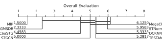

图 3. 所有 9 个测试集上性能的关键差异。分数越小表示性能越好。

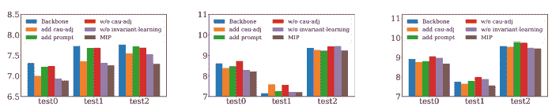

(a) METR-LA 数据集。

(b) NYCbike1 数据集(入)。

(c) NYCbike1 数据集(出)。

图 4. 消融研究：MIP 及其变体的 RMSE。

### 5.3 消融研究

为了探索 MIP 中每个核心组件的重要性，我们进行了消融研究，包含以下变体：**Backbone** 是仅使用主干模型；**add cau-adj** 仅在主干模型基础上添加因果邻接矩阵；**add prompt** 仅将从记忆库中学习的提示输入到主干模型，并省略因果邻接矩阵和不变学习损失；**w/o cau-adj** 移除因果邻接矩阵；**w/o invariant learning** 移除不变损失。

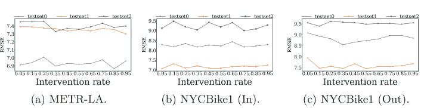

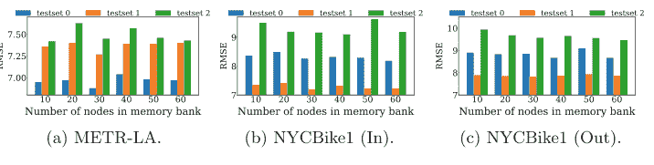

结果如图 4 所示。我们可以看到，MIP 在两个数据集上均优于所有变体。主干模型在大多数测试集上获得最差结果，因为 naive GNN 和时间 Transformer 层无法捕捉分布偏移和节点特征的异质性。**add cau-adj** 的表现远优于主干模型，有时甚至优于 **add prompt** 和 **w/o cau-adj**，因为因果邻接矩阵连接了具有相似城市流量数据的节点，即使它们在拓扑上相距很远。**add prompt** 的表现优于主干模型，因为它从记忆库中学习了一些有用特征。**w/o cau-adj** 的性能下降幅度远大于 MIP。尽管它利用不变学习损失区分了不变提示和变体提示，但其 RMSE 大于 **w/o invariant learning**。由于不变提示被传播到基于距离的邻居而非基于语义的邻居，一些节点接收到与其自身特征相反的特征。**w/o invariant learning** 的结果比 MIP 差，因为它在缺乏不变学习的情况下将不变提示和变体提示混合在一起。

### 5.4 参数敏感性分析

**干预率：** 干预率与分离不变特征和变体特征的能力密切相关。我们将此参数从 0.05 设置到 0.95，间隔为 0.1，并在两个数据集上评估我们的模型。在图 5 中，我们记录最终 horizon 的 RMSE。MIP 对不同干预率不敏感，这从不同干预级别下 RMSE 的微小波动可以得到证明。在时空模型中，经过干预的变体提示将传播到城市图中的所有节点，即使是很小的干预率也会使所有节点在预测层之前包含变体模式。因此，干预率的变化不影响预测 RMSE。

**记忆库中的节点数量：** 我们研究了记忆库中节点数量的敏感性，并将结果显示在图 6 中。当记忆库中有 30 个节点时，MIP 在所有数据集上均表现良好。当节点数量较少时，由于多样性有限，MIP 无法提取高质量的不变特征。相反，记忆库中节点越多，多样的不变特征会导致预测模型和不变学习主干模型的训练难度增加。

**损失函数中的权重系数：** 在 Eq.(19) 中，损失函数由任务损失、不变损失和辅助损失组成。最后两个损失的组成比例由超参数 \(\lambda_1\) 和 \(\lambda_2\) 控制，我们进行了一项实验来探究哪个效果更好。首先，我们设置 \(\lambda_2 = 0.01\)，\(\lambda_1\) 从 0.1 到 1.0，步长为 0.1，并在两个数据集上记录最后 horizon 的 RMSE（如图 7 所示）。在所有数据集上，测试集 0 的 RMSE 保持稳定，而在测试集 1 和测试集 2 上波动。具体来说，在 METR-LA 数据集上，当 \(\lambda_1\) 为 0.3 时，模型获得更好的泛化能力，因为测试集 2 上的 RMSE 最小。至于 NYCbike1 数据集，测试集 1 和测试集 2 上的 RMSE 也波动，这表明 MIP 对该数据集上的此超参数不敏感。此外，我们设置 \(\lambda_1 = 0.1\)，\(\lambda_2\) 从 0.01 到 0.1，步长为 0.01，结果如图 8 所示。在所有数据集上，测试集 0 和测试集 1 上的 RMSE 波动。在 METR-LA 数据集上，随着 \(\lambda_2\) 上升，测试集 2 上的 RMSE 逐渐降低，因为该数据集中的节点更多，\(\mathcal{L}_1\) 和 \(\mathcal{L}_2\) 的比例应更大，以确保不变提示对所有节点都足够多样。而在 NYCbike1 数据集上，测试集 2 上的 RMSE 在约 0.04 或 0.05 处达到低点，因为该数据集中的节点数量少于 METR-LA，较低的 \(\mathcal{L}_1\) 和 \(\mathcal{L}_2\) 比例可以使不变提示对 NYCbike1 数据集足够多样。所有这些实验均在记忆库中设置 30 个节点的情况下进行。

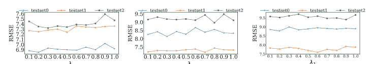

(a) METR-LA 数据集。(b) NYC Bike1 数据集(入)。(c) NYC Bike1 数据集(出)。

图 7. 不同 \(\lambda_1\) 设置下的 MIP RMSE。

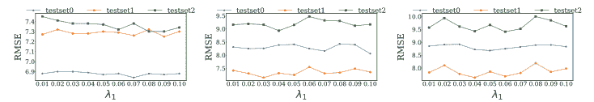

(a) METR-LA 数据集。(b) NYC Bike1 数据集(入)。(c) NYC Bike1 数据集(出)。

图 8. 不同 \(\lambda_2\) 设置下的 MIP RMSE。

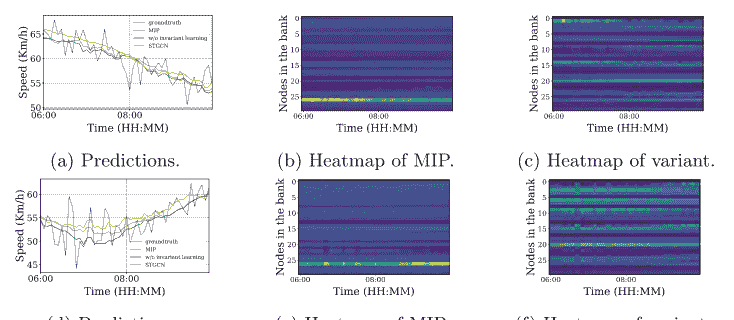

**图 9.** 分布偏移下 MIP 预测性能的案例研究。

### 5.5 案例研究

我们还在图 9 中进一步进行了案例研究，其中我们随机选择 METR-LA 数据集中的一个传感器，并可视化其在测试集 0 和测试集 2 中的真实和预测交通速度。为了确保公平比较，该传感器使用星期二的同一时间段。在图 9a 和 9d 中，真实值的趋势完全不同，这意味着发生了分布偏移。此外，MIP 的预测最接近真实值，而变体模型和基线则做出了有偏预测。进一步，每个样本对应的两个提示分数的热图（图 9b 和 9c，图 9e 和 9f）显示完全不同的


distributions，MIP 的提示分数倾向于从某个记忆节点选择更多特征，而变体则倾向于结合来自各种记忆节点的特征。这种现象表明，不变性学习可以帮助模型提取不变提示并克服 OOD 问题。

### 6 结论

本文提出了一种名为 MIP 的新框架，用于解决城市流量预测中的分布偏移问题。MIP 在训练过程中将最重要的信息性信号存储在记忆库中。然后，基于记忆库生成基于记忆的因果图结构。此外，从记忆库中提取不变提示和变体提示，我们设计了一种时空干预机制来创建多样化分布，并提出不变性学习正则化，以帮助提示提取器区分不变提示和变体提示。在两个真实世界数据集上的大量实验表明，与最先进的基线相比，我们的方法可以更好地处理时空分布偏移。

**致谢。** 这项工作部分由澳大利亚研究委员会（Australian Research Council）资助，资助项目包括未来奖学金（Future Fellowship，编号 FT210100624）、发现早期职业研究员奖（Discovery Early Career Researcher Award，编号 DE230101033）、发现项目（Discovery Project，编号 DP240101184 和 DP240101814）以及联动项目（Linkage Project，编号 LP230200892 和 LP240200546）。

### 参考文献

- 1. Ahuja, K., Shanmugam, K., Varshney, K., Dhurandhar, A.: 不变风险最小化博弈。收录于: ICML, 第 145–155 页。PMLR (2020)
- 2. Arjovsky, M., Bottou, L., Gulrajani, I., Lopez-Paz, D.: 不变风险最小化。arXiv 预印本 arXiv:1907.02893 (2019)
- 3. Bai, L., Yao, L., Li, C., Wang, X., Wang, C.: 用于交通预测的自适应图卷积循环网络。NeurIPS **33**, 17804–17815 (2020)
- 4. Chen, C., Yao, F., Mo, D., Zhu, J., Chen, X.M.: 基于强化学习的叫车平台时空定价。Transp. Res. Part C: Emerg. Technol. **130**, 103272 (2021)
- 5. Chen, G., et al.: 偏向节点分类中的因果性与独立性增强。收录于: CIKM, 第 203–212 页 (2023)
- 6. Cini, A., Marisca, I., Zambon, D., Alippi, C.: 基于图的时空预测中局部效应的抑制。NeurIPS **36** (2024)
- 7. Cui, Y., et al.: ROI 需求交通预测：一种预训练、查询和微调框架。收录于: ICDE, 第 1340–1352 页 (2023)
- 8. Deng, J., et al.: St-norm: 用于多元时间序列预测的时空归一化。收录于: SIGKDD, 第 269–278 页 (2021)
- 9. Geng, X., et al.: 用于打车需求预测的时空多图卷积网络。收录于: AAAI, 第 33 卷, 第 3656–3663 页 (2019)
- 10. Guo, S., Lin, Y., Feng, N., Song, C., Wan, H.: 基于注意力的时空图卷积网络用于交通流量预测。收录于: AAAI, 第 33 卷, 第 922–929 页 (2019)
- 11. Ji, J., Wang, J., Jiang, Z., Jiang, J., Zhang, H.: STDEN: 面向交通流量预测的物理引导神经网络。收录于: AAAI, 第 36 卷, 第 4048–4056 页 (2022)
- 12. Ji, J., et al.: 用于交通流量预测的时空自监督学习。收录于: AAAI, 第 37 卷, 第 4356–4364 页 (2023)
- 13. Jiang, J., et al.: PDFormer: 面向交通流量预测的传播延迟感知动态长程变压器。收录于: AAAI. AAAI 出版社 (2023)
- 14. Jiang, R., et al.: 用于交通预测的时空元图学习。收录于: AAAI, 第 37 卷, 第 8078–8086 页 (2023)
- 15. Jiang, W., et al.: 用于城市流量预测的物理引导主动样本重加权。arXiv 预印本 arXiv:2407.13605 (2024)
- 16. Lee, H., Ko, S.: Testam: 一种带有专家混合的时效增强时空注意力模型。arXiv 预印本 arXiv:2403.02600 (2024)
- 17. Li, Y., Yu, R., Shahabi, C., Liu, Y.: 扩散卷积循环神经网络: 数据驱动的交通预测。arXiv 预印本 arXiv:1707.01926 (2017)
- 18. Li, Z., Huang, C., Xia, L., Xu, Y., Pei, J.: 用于犯罪预测的时空超图自监督学习。收录于: ICDE, 第 2984–2996 页 (2022). https://doi.org/10.1109/ICDE53745.2022.00269
- 19. Liu, D., Wang, J., Shang, S., Han, P.: Msdr: 用于时空预测的多步依赖关系网络。收录于: SIGKDD, 第 1042–1050 页 (2022)
- 20. Liu, H., Zhu, C., Zhang, D., Li, Q.: 用于交通预测的基于注意力的时空图卷积循环网络。收录于: 高级数据挖掘与应用国际会议, 第 630–645 页。Springer (2023)
- 21. Liu, H., et al.: 时空自适应嵌入使香草变压器在交通预测中达到 SOTA。收录于: CIKM, 第 4125–4129 页 (2023)
- 22. Liu, Y., et al.: Flood: 用于图上分布外泛化的灵活不变性学习框架。收录于: SIGKDD, 第 1548–1558 页 (2023)
- 23. Neuberg, L.G.: 因果性: 模型、推理与推断, Judea Pearl 著, 剑桥大学出版社, 2000。Econ. Theory 19(4), 675–685 (2003)
- 24. Pearl, J.: 统计学因果推断: 入门。John Wiley and Sons (2016)
- 25. Rojas-Carulla, M., Schölkopf, B., Turner, R., Peters, J.: 用于因果迁移学习的不变性模型。J. Mach. Learn. Res. 19(36), 1–34 (2018)
- 26. Shang, C., Chen, J., Bi, J.: 用于多元时间序列预测的离散图结构学习。arXiv 预印本 arXiv:2101.06861 (2021)
- 27. Shao, Z., Zhang, Z., Wang, F., Wei, W., Xu, Y.: 时空恒等性: 用于多元时间序列预测的简单有效基线。收录于: CIKM, 第 4454–4458 页 (2022)
- 28. Wang, B., et al.: Stone: 一种同时消除空间和时移的时空 OOD 学习框架。收录于: SIGKDD, 第 2948–2959 页 (2024)
- 29. Wang, Y., et al.: Gallat: 用于乘客需求预测的时空图注意力网络。收录于: 2021 ICDE, 第 2129–2134 页。IEEE (2021)
- 30. Wu, Q., Nie, F., Yang, C., Bao, T., Yan, J.: 基于因果干预的图分布外泛化。收录于: WWW, 第 850–860 页 (2024)
- 31. Wu, Q., Zhang, H., Yan, J., Wipf, D.: 图上分布偏移处理: 不变性视角。arXiv 预印本 arXiv:2202.02466 (2022)
- 32. Wu, Y.X., Wang, X., Zhang, A., He, X., Chua, T.S.: 图神经网络不变性理由发现。arXiv 预印本 arXiv:2201.12872 (2022)
- 33. Wu, Z., Pan, S., Long, G., Jiang, J., Zhang, C.: 用于深度时空图建模的 Graph WaveNet。arXiv 预印本 arXiv:1906.00121 (2019)
- 34. Wu, Z., et al.: 连接点: 用图神经网络进行多元时间序列预测。收录于: SIGKDD, 第 753–763 页 (2020)
- 35. Xia, Y., et al.: 破译时空图预测: 因果视角与处理。NeurIPS 36 (2024)
- 36. Yu, B., Yin, H., Zhu, Z.: 时空图卷积网络: 用于交通预测的深度学习框架。IJCAI (2018)
- 37. Zhang, J., Zheng, Y., Qi, D.: 用于全市人群流动预测的深度时空残差网络。收录于: AAAI, 第 31 卷 (2017)
- 38. Zhang, Z., et al.: 时空分布偏移下的动态图神经网络。NeurIPS 35, 6074–6089 (2022)
- 39. Zheng, C., Fan, X., Wang, C., Qi, J.: GMAN: 用于交通预测的图多注意力网络。收录于: AAAI, 第 34 卷, 第 1234–1241 页 (2020)
- 40. Zhou, Z., et al.: 维持现状: 捕获 OOD 时空学习的不变性关系。收录于: SIGKDD, 第 3603–3614 页 (2023)

## EDN: 面向图数据的新型边缘依赖噪声模型

Pintu Kumar 和 Nandyala Hemachandra  
印度理工学院孟买分校, 印度孟买  
{pintuk,nh}@iitb.ac.in

摘要。图的一个重要结构特征是其边集，因为它捕捉了节点之间的关系（图的拓扑）。现有的节点标签噪声模型，如对称标签噪声 (Symmetric Label Noise, SLN) 和类条件噪声 (Class Conditional Noise, CCN)，忽略了图数据中这种重要的节点关系；而边缘依赖噪声 (Edge-Dependent Noise, EDN) 模型解决了这一局限性。EDN 认为，在现实场景中，标签噪声可能受到节点间连接的影响。我们探索了 EDN 的三个变体。图中关联节点和边缘的关键概念是节点度；我们表明，在所有三个变体中，节点标签损坏的概率取决于其度。此外，我们比较了不同变体中这些概率对节点度的依赖性。我们在流行的图数据集上进行了实验，使用了 5 种不同的 GNN 架构和 8 种用于图数据的抗噪声算法。结果表明，与传统的节点标签噪声模型相比，EDN 的 2 个变体会导致图神经网络 (GNN) 和现有抗噪声算法中更大的性能下降。我们通过提出一个合适的假设检验问题在统计上验证了这一点。这强调了在评估图抗噪声算法时纳入 EDN 的重要性，以提高噪声环境中基于图学习的可靠性。代码链接: https://github.com/pintu-dot/edn。

关键词：图学习 · 面向图的新标签噪声模型 · 抗噪声节点分类 · 结构感知噪声模型

### 1 引言

图神经网络 (GNN) 在图节点分类任务上表现良好 [1,2]。GNN 假设训练数据的可用标签是干净且无噪声的，但在处理现实数据时情况可能并非如此 [3]。现实数据的标签容易受到噪声影响，噪声可能因多种原因混入数据，例如标签成本高昂、缺乏专业知识、人类疲劳、设备故障、对手修改标签、信息不足


以提供标签等。[3,4]。因此，在存在标签噪声的情况下有效学习图数据已获得社区关注 [5–11]。

GNN 相比传统多层感知机性能更优的主要原因之一是，GNN 在学习过程中融入了结构信息。结构信息是图数据不可或缺的一部分。然而，当前所有关于噪声鲁棒图学习的工作都使用以下噪声模型之一：
- 对称标签噪声
- 成对噪声/类条件噪声
- 实例依赖噪声

这些噪声模型最初是为 i.i.d. 数据而非图数据提出的，因此，它们假设标签噪声与节点结构无关。

考虑一个图，其中节点代表在线讨论论坛的用户。两个节点之间的边捕获了平台上用户之间的交互，例如回复、评论或问答交互。每个用户被分配两个标签之一 {有帮助，无帮助}。在这样的图中，标签噪声可能在两种场景下出现：
- 两个彼此交互过的有帮助用户意见不合，或由于某种误解无法传达各自观点，因此将彼此标记为无帮助；
- 同样，两个无帮助用户可能因为一次罕见的良好讨论或由于串通而被错误地标记为有帮助。

在这样的图中，仅依赖单个节点的噪声没有用处；相反，噪声应通过边传递。边两侧节点的标签应一起更改。我们将向节点标签添加噪声的这种方法称为边依赖噪声模型（EDN）。在本工作中，我们研究了三种边依赖噪声的变体及其对可学习性的影响。

本论文的主要贡献如下：
- 提出三种 EDN 变体，其中噪声通过边传递。
- 针对这些噪声模型，我们推导了标签变化概率的封闭式表达式，以节点度为函数。
- 我们从解析上将这些概率作为节点度的函数进行了比较。
- 我们进行了详细实验，以检查现有 GNN 架构和噪声鲁棒图学习算法在存在 EDN 时的行为，使用了 5 种不同的 GNN 架构和 8 种噪声鲁棒图学习算法。
- 基于许多数据集上各种噪声模型的测试准确率置信区间，我们观察到，在许多噪声水平下，EDN 的两种变体相比现有噪声标签模型显著降低了性能。
- 我们将此作为合适的假设检验问题，以统计验证我们的观察，并得出相同的结论。

### 2 相关工作：现有节点标签噪声模型

设 G = (V, E) 为一个图，其中 V 表示顶点集，E ⊆ V × V 表示边集。每个节点 vi ∈ V 都有一个关联标签 yi ∈ {1, 2, · · · , K}。在标签翻转模型中，我们可以在标签状态空间 {1, 2, · · · , K} 上关联一个离散时间马尔可夫链 [12]，其中每次标签翻转对应马尔可夫链的一次状态转移。我们详细介绍了向节点标签添加噪声的现有方法；在每种情况下，我们都确定了关联马尔可夫链的转移概率矩阵。

#### 2.1 对称标签噪声

对称标签噪声 (SLN) [4,13] 假设节点的标签以某个固定概率 \(\rho\) 更改（因此以概率 \(1 - \rho\) 保留）。此外，标签被重新分配到每个其他类别的概率相同，即 \(\rho/(K - 1)\)。从数学上讲，如果 \(y\) 和 \(y'\) 分别表示真实标签和噪声标签，则 \(P(y' = n|y = m) = \frac{\rho}{K-1}\)，其中 \(n, m \in \{1, 2, ..., K\}\) 且 \(m \neq n\)。SLN 的转移概率矩阵（\(Q_{sln}\)）由以下给出

\[\begin{equation*}\begin{array}{ c } Q_{sln} = \left[ \begin{array}{ c c c c c } 1 - \rho & \frac{\rho}{K-1} & \frac{\rho}{K-1} & \cdots & \frac{\rho}{K-1} \\ \frac{\rho}{K-1} & 1 - \rho & \frac{\rho}{K-1} & \cdots & \frac{\rho}{K-1} \\ \vdots & \ddots & \ddots & \ddots & \vdots \\ \frac{\rho}{K-1} & \cdots & \ddots & 1 - \rho & \frac{\rho}{K-1} \\ \frac{\rho}{K-1} & \frac{\rho}{K-1} & \cdots & \frac{\rho}{K-1} & 1 - \rho \end{array} \right] \\ (1) \end{array}\end{equation*}\]

#### 2.2 类条件噪声

在类条件噪声 (CCN) [4,13] 中，标签更改的概率取决于 \(y\) 和 \(y'\)。类别 \(m\) 的节点被重新分配到类别 \(n\) 的概率由 \(\rho_{mn}\) 给出（\(P(y' = n|y = m) = \rho_{mn}\)），其中 \(m \neq n\)。因此，标签为 \(m\) 的节点以概率 \(\rho_m = \sum_{i=1, i \neq m}^K \rho_{mi}\) 翻转，标签以概率 \(1 - \rho_m\) 保留。转移概率矩阵（\(Q_{ccn}\)）由以下给出

\[\begin{equation*}\begin{array}{ c } Q_{ccn} = \left[ \begin{array}{ c c c c c } 1 - \rho_1 & \rho_{12} & \rho_{13} & \dots & \rho_{1K} \\ \rho_{21} & 1 - \rho_2 & \rho_{23} & & \rho_{2K} \\ \vdots & & & \ddots & \vdots \\ \rho_{(K-1)1} & & & 1 - \rho_{K-1} & \rho_{(K-1)K} \\ \rho_{K1} & \rho_{K2} & \dots & \rho_{K(K-1)} & 1 - \rho_K \end{array} \right] \end{array}\end{equation*}\]

**成对噪声：** 成对噪声 (PWN) [13] 是 CCN 的一个特殊类。成对噪声的动机在于，人们更有可能将两个相似的类别标错。对于成对噪声，\(\rho_1 = \rho_2 = \dots = \rho_K = \rho\)，且标签翻转到下一个标签（概率为 \(\rho\)）。转移概率矩阵 \(Q_{pwn}\) 由以下给出

\[\begin{equation*}\begin{array}{ c } Q_{pwn} = \left[ \begin{array}{ c c c c c } 1 - \rho & \rho & 0 & \dots & 0 \\ 0 & 1 - \rho & \rho & & 0 \\ \vdots & & & \ddots & \vdots \\ 0 & & & 1 - \rho & \rho \\ \rho & 0 & \dots & 0 & 1 - \rho \end{array} \right] \\ (2) \end{array}\end{equation*}\]

已提出许多针对图的标签噪声鲁棒算法来处理现有的节点标签噪声。DGNN [6] 采用后向损失校正。PIGNN [7] 利用节点之间的成对交互（PI）进行抗噪声学习。RNCGLN [8] 在自训练框架内使用伪标签来纠正噪声标签。NRGNN [9] 将高特征相似度的未标记节点与已标记节点连接起来，以获得更好的伪标记。RTGNN [10] 通过连接已标记和未标记节点来增强信息流，同时采用双 GNN 进行噪声缓解。CRGNN [11] 结合对比学习和动态交叉熵损失，以鼓励鲁棒特征学习。CGNN [5] 集成图对比学习和基于同源性假设的样本选择策略，以过滤噪声标签。DeGLIF [14] 使用影响函数来识别并重新标记图中的噪声节点。在我们的工作中，我们将检查这些算法在存在类似 EDN 的结构依赖噪声时的表现。

一些工作，例如 [15,16]，通过丢弃边将结构噪声引入图中。相比之下，我们的工作关注的是通过边传播的节点标签噪声，而不是修改图结构本身。接下来，[17] 和 [18] 探索了图中结构驱动的对抗性或噪声标签设置。然而，它们主要关注误导 GNN 训练的标签翻转或结构变化，而我们的 EDN 模型引入了一种根本不同的方法，其中标签噪声源于边连接，使其具有结构依赖性和度敏感性。

### 3 一种新型边依赖噪声模型（EDN）

假设 $\mathcal{G} = (\mathcal{V}, \mathcal{E})$ 是一个具有 $m$ 个节点的无向图。$\mathcal{X} = \{x_1, \dots, x_m\}$ 和 $\mathcal{Y} = \{y_1, \dots, y_m\}$ 分别是相应节点的特征向量集和真实标签集。我们提出了一种面向图的节点标签噪声模型（称为边依赖噪声模型 (EDN)），其中连接节点的噪声标签是相关的，因为这些噪声标签取决于连接它们的边。类似于现有噪声模型，边依赖噪声模型分两步向图中注入噪声：
- 选择应更改标签的节点
- 为选定节点决定新标签

EDN 与现有标签噪声模型的区别在于，在 EDN 中，标签更改的节点选择取决于它们的结构信息。

#### 3.1 选择要更改标签的节点

在所提出的 EDN 模型中，我们以固定概率 $p$ 采样每条边；这些被采样的边称为噪声边。这些噪声边表明，噪声边两侧节点的标签应更改。对于度为 1 的节点，如果与该节点关联的边是噪声边，则其标签更改。对于度 $n > 1$ 的节点，关联边可能对更改节点标签持有冲突意见。基于这些意见如何聚合，我们有三种变体：

多数投票 (MV)：如果与节点 $v$ 关联的边中超过或等于一半是噪声边，则节点 $v$ 的标签被更改。如果 $v$ 的度为 $deg(v)


一个节点被选中以更改其标签的概率因此由 $q(deg(v), \rho)$ 给出

\( q(deg(v), \rho) = \sum_{i=\lceil \frac{deg(v)}{2} \rceil}^{deg(v)} \binom{deg(v)}{i} \rho^i (1-\rho)^{deg(v)-i} \tag{3} \)

**否决权 (Veto):** 如果节点 $v$ 的至少一条关联边存在噪声，则节点 $v$ 的标签会被更改。在具有度为 $deg(v)$ 的节点 $v$ 时，其标签被更改的概率因此由 $r(deg(v), \rho)$ 给出

\( r(deg(v), \rho) = 1 - \binom{deg(v)}{0} (1 - \rho)^{deg(v)} = 1 - (1 - \rho)^{deg(v)} \tag{4} \)

**序列翻转 (seq):** 在这种变体中，节点的标签按顺序演变。对于节点 $v$，我们考虑其所有 _存在噪声的关联边_。第一条存在噪声的关联边将标签更改为一个新类。第二条存在噪声的边将标签从这个新类更改为另一个类（可能恢复到原始标签）。此过程对所有存在噪声的边继续进行。具有度为 $deg(v)$ 的节点 $v$ 被翻转的概率取决于在观察到存在噪声的边时如何分配新标签，并在 3.2 节中讨论。

### 3.2 为选定节点分配存在噪声的标签

对于多数投票和否决权，在选择要更改其标签的节点后，我们使用 SLN 和成对噪声 [4, 13] 来分配新标签。现有模型与 EDN 变体之间的区别在于：现有模型选择每个节点的概率相同，而在我们的噪声模型中，_选择节点的概率取决于节点的度_。这由 Eq. 3、4、5 和 6 演示。现有噪声模型对所有节点具有相同的转换概率矩阵，而 EDN 对不同度的节点具有不同的转换概率矩阵。在序列翻转中，由于存在噪声的边而分配新标签遵循 SLN 和成对噪声。这两个子变体都会导致不同的节点翻转概率。

**序列翻转 + SLN:** 节点 $v$ 的每条关联边以概率 $\rho$ 存在噪声。因此，由于单条边，节点 $v$ 的标签以概率 $1 - \rho$ 保持不变，并以概率 $\rho$ 更改为不同的类。在序列翻转 + SLN 的情况下，当存在噪声的边改变标签时，新标签根据 SLN 模型选定。这意味着每个可能的类都等可能，概率为 $\frac{\rho}{K-1}$。与单条边引起的噪声相关的转换概率矩阵由 Eq. 1 中的 $Q_{SLN}$ 给出。如果 $v$ 具有度 $n$，则序列翻转 + SLN 的转换概率矩阵为 $Q_{SLN}^n$（重新标记 n 次，每次从新标签开始）。$Q_{SLN}$ 是一个对称矩阵，利用对称矩阵的对角化性质（谱定理）[19]，我们推导 \(Q_{SLN}^n\) 如下：

\(Q_{SLN}^n = \frac{1}{K} \left[ \begin{matrix} 1 & 1 & 1 & \dots & 1 \\ 1 & 1 & 1 & 1 & 1 \\ \vdots & & \ddots & \vdots & \vdots \\ 1 & 1 & 1 & 1 & 1 \\ 1 & 1 & \dots & 1 & 1 \end{matrix} \right] + \left( 1 - \frac{K\rho}{K-1} \right)^n \left[ \begin{matrix} \frac{K-1}{K} & -\frac{1}{K} & -\frac{1}{K} & \dots & -\frac{1}{K} \\ -\frac{1}{K} & \frac{K-1}{K} & -\frac{1}{K} & -\frac{1}{K} & -\frac{1}{K} \\ \vdots & & \ddots & \vdots & \vdots \\ -\frac{1}{K} & -\frac{1}{K} & -\frac{1}{K} & \frac{K-1}{K} & -\frac{1}{K} \\ -\frac{1}{K} & -\frac{1}{K} & \dots & -\frac{1}{K} & \frac{K-1}{K} \end{matrix} \right]\)

\(Q_{SLN}^n\) 的详细推导见附录 A。使用 \(Q_{SLN}^n$，对于从真实标签 \(y\) 开始的节点 \(v\)，其标签更改为特定类的概率由以下给出：

\(s.sc(deg(v), \rho) = \frac{1}{K} \left( 1 - \left( 1 - \frac{K\rho}{K-1} \right)^{deg(v)} \right).\)

对于节点 \(v\)，当使用序列翻转 + SLN 模型时，其标签被翻转的概率为 \((K - 1) \times s.sc(n)\)，因此由以下给出

\(s_{sln}(deg(v), \rho) = \frac{K-1}{K} \left( 1 - \left( 1 - \frac{K\rho}{K-1} \right)^{deg(v)} \right).\) (5)

**序列翻转 + PWN:** 在带有 PWN 的序列翻转中，由于单条边而重新分配标签遵循成对噪声模型。相应的转换概率矩阵由 Eq. 2 中的 \(Q_{pwn}\) 给出。如果 \(v\) 具有度 \(n\)，则带有成对噪声的序列翻转的转换概率矩阵为 \(Q_{pwn}^n\)（重新标记 \(n\) 次，每次从新标签开始）。观察 \(Q_{pwn}\)，每一行都是前一行的向右循环移位，这使其成为循环矩阵 [19, 20]。我们使用循环矩阵的特征值分解 [19, 20] 来获得 \(Q_{pwn}^n\)。由于 \(Q_{pwn}^n\) 是循环矩阵的乘积，它仍然是循环矩阵 [19, 20]，这意味着整个矩阵由其第一行表征。\(Q_{pwn}^n\) 的第一行由以下给出：

\(Q_{pwn}^n[0, j] = \sum_{m=0}^n \binom{n}{m} \rho^m (1 - \rho)^{n-m} \delta_{m-j \text{ mod } K}.\)

\(Q_{pwn}^n\) 的详细推导见附录 B。对于节点 \(v\)，当使用序列翻转 + PWN 模型时，其标签被翻转的概率为

\(s_{pwn}(deg(v), \rho) = \sum_{j=1}^{K-1} \sum_{m=1}^{deg(v)} \binom{deg(v)}{m} \rho^m (1 - \rho)^{deg(v) - m} \delta_{m-j \text{ mod } K}\) (6)

在所有三种变体中，节点标签更改的概率取决于其度。节点度与该概率之间的关系如图所示

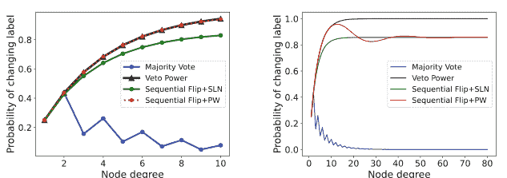

图 1. 三种 EDN 变体的节点度与标签更改概率。我们使用 \(\rho = 0.25\)（边存在噪声的概率），并对序列翻转使用 \(K = 7\)。

图 1. 我们观察到，对于固定的 \(\rho\)，在多数投票变体中，概率 \(q(deg(v), \rho)\) 随节点度增加而略有波动地下降。在其他两个变体中，概率 \(r(deg(v), \rho)\) 和 \(s_{sln}(deg(v), \rho)\) 都单调增加，分别饱和于 1 和 \(\frac{K-1}{K}\)。我们将其总结为定理 1，其证明见附录 C：

#### 定理 1. EDN 的三种变体满足以下性质：

- 1. 对于固定的 \(\rho\)，\(r(deg(v), \rho)\) 是 \(deg(v)\) 的增函数。此外，当 \(\rho < \frac{K-1}{K}\) 时，\(s(deg(v), \rho)\) 是 \(deg(v)\) 的增函数。
- 2. \(r(deg(v), \rho) \ge q(deg(v), \rho)\) 对所有 \(deg(v)\) 和固定的 \(\rho\) 成立。
- 3. 如果 \(\rho < \frac{K-1}{K}\)，则 \(s_{sln}(deg(v), \rho) < \frac{K-1}{K}\)，且 \(s_{sln}(n) = \frac{K-1}{K}\) 当且仅当 \(\rho = \frac{K-1}{K}\)。

\(s_{pwn}\) 的曲线最初遵循否决权，然后振荡以收敛到序列翻转 + SLN。对于 \(deg(v) \le K - 1\)，有 \(s_{pwn}(deg(v), \rho) = r(deg(v), \rho)\)。在图 1 中，我们观察到 \(s_{pwn}\) 形成交替增加和减少阶段的循环。对于节点 \(v_i\)，不失一般性，假设其标签 \(y_i = 1\)。如果 \(deg(v) = 1\)，其标签以某些概率更改为类 2，但绝不会更改为其他任何类。如果 \(deg(v) = 2\)，从 \(Q_{pwn}\) 移动到 \(Q_{pwn}^2\) 时，如果节点已被分配标签 2，它无法返回到原始标签，可以保持在 2 或被重新分配到类 3。如果 \(v_i\) 被分配了标签 2，它现在具有概率 \(\rho\) 被分配到类 2。这意味着 \(s_{pwn}(2, \rho) > s_{pwn}(1, \rho)\)；也就是说，\(s_{pwn}\) 从增加阶段开始。如果 \(deg(v) = K - 1\)，则它可以被重新分配到任何类，且 \(s_{pwn}\) 在此点之前是节点度的增函数。在 \(deg(v) = K\) 时，如果 \(v_i\) 由其前 \(K - 1\) 条边重新分配到类 \(K\)，则它有一小概率被重新分配到标签 1。当此概率超过类 1 重新分配到类 2 的概率（在 \(K = 7\) 时发生于 \(n = 13\)），则它开始下降。下降阶段将持续到另一个循环再次完成，解释了交替模式。

回顾 \(Q_{pwn}\) 是离散时间马尔可夫链的转换概率矩阵。这个马尔可夫链是非周期性的且只有一个通信类，\(\pi = [1/K, 1/K, \dots, 1/K]\) 是 \(Q_{pwn}\) 的唯一稳态分布。


因此，\( Q_{pwn}^n \) 收敛到一个矩阵 \( Q^* \)，其中 \( Q^* \) 的每一行都等于 \( \pi \) [12]。所以，\( s_{pwn}(deg(v), \rho) \) 收敛到 \( (K - 1) \times \frac{1}{K} \)，该值与 \( s_{sln} \) 的上界相同。我们将关于 \( s_{pwn} \) 的讨论总结如下：

#### 定理 2. \( s_{pwn}(deg(v), \rho) \)（在存在 Sequential flipping+PWN 模型时，节点 \( v \) 的标签被更改的概率）满足以下条件：

- 1. \( s_{pwn} \) 形成交替的增加和减少阶段的循环。它最初增加，随后是一段减少期，此模式持续。
- 2. 对于任何固定的 \( \rho \)，当 \( deg(v) \le K - 1 \) 时，有 \( s_{pwn}(deg(v), \rho) = r(deg(v), \rho) \)。
- 3. 当 \( deg(v) \to \infty \) 时，\( s_{pwn}(deg(v), \rho) \) 收敛到 \( \frac{K-1}{K} \)。

### 4 实验与结果

#### 4.1 数据集及其划分

我们测试了 EDN 对现有 GNN 和抗噪算法的影响。使用 Citeseer [21]、Cora [21] 和 Amazon Photo [22]，划分方式与 DeGLIF [14] 类似。数据集统计信息详见表 1。选用这些数据集是因为它们在节点数量、特征维度和平均度上各不相同。

**表 1. 数据集统计信息**

| 数据集 | 节点数 | 边数 | 特征维度 | 类别数 |
|---|---|---|---|---|
| CiteSeer | 3,327 | 9,104 | 3,703 | 6 |
| Cora | 2,708 | 10,556 | 1,433 | 7 |
| Amazon Photo | 7,650 | 238,162 | 745 | 8 |

**数据集划分详情：** 我们使用与 [14] 类似的划分。对于 Cora 数据集，每个类别用于训练的节点数为 172 个，用于验证的节点数为 500 个，用于测试的节点数为 1000 个。对于 Citeseer 数据集，每个类别随机采样 250 个节点用于训练，500 个节点用于验证，1000 个节点用于测试。对于 Amazon Photo 数据集，每个类别用于训练的节点数为 54 个，总计 500 个节点用于验证，其余节点用于测试。所有数据均已从 PyTorch Geometric 库获取，特征归一化设置为开启。

#### 4.2 注入 EDN 噪声

相同的 \( \rho \) 值，使用不同的 EDN 噪声模型变体可能导致不同的噪声水平。此外，由于 EDN 的变体与度相关，具有不同度分布的图在相同的 \( \rho \) 下可能具有不同的噪声水平。设 \( d(n) \) 表示图的度分布，则图中的预期噪声水平由 \( \sum_{i=1}^{maxdegree} l(i)d(i) \) 给出，其中 \( l \) 为 \( q \)、\( r \) 或 \( s \)。为了与现有噪声模型以及 EDN 的不同变体之间进行公平比较，我们为每个变体和每个数据集选择不同的 \( \rho \)，使得图中的预期噪声水平相同。不同数据集的 \( \rho \) 可参考值（对应图中从 5% 到 50%、以 5% 为递增量的总体噪声水平）可在补充材料的表 6 中找到。

#### 4.3 实验设置

我们向数据添加了不同类型的噪声，噪声水平在 5% 到 50% 之间，以 5% 为递增量。GCN、GraphSAGE、GAT 和 Graph Transformer 分别使用 PyTorch Geometric 中的 GCNConv、SAGEConv、GAT-Conv 和 Graph Transformer 实现。对于 GCN 和 GraphSAGE，我们使用大小为 16 的 1 个隐藏层和 relu 激活函数。对于 GAT 和 Graph Transformer，我们使用 1 个具有 8 个注意力头（head 大小为 8）的隐藏层。对于 GIN，我们使用 [13] 的实现。值得指出的是，比较的对象不是不同的 GNN，而是不同的噪声模型，因此为不同的 GNN 使用略有不同的架构有助于加强我们的实验。对于除 DeGLIF 以外的所有抗噪算法，我们使用 [13] 的实现，DeGLIF 使用 [14] 的实现。每个实验重复 10 次，报告均值 ± 标准差。模型在 24 GB Nvidia RTX 4090 GPU 上训练。

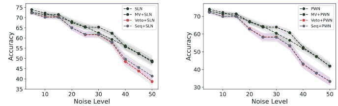

**图 2.** Citeseer 数据集上在相同噪声水平下不同噪声模型的 GCN 准确率。

#### 4.4 计算结果

在本节中，我们尝试经验性地了解 EDN 对现有图学习算法的影响。为此，我们试图回答以下问题：

### Q1. 在存在 EDN 时，GCN 架构的表现如何？

GCN [23] 是广泛使用的 GNN 架构之一，也被用作许多图抗噪算法的骨干网络 [9,10,14]。我们在 EDN 的不同噪声变体下以及 SLN 和 PWN 下测试了 GCN。Citeseer 数据集的结果如图 2 所示。所有数据集在 5%、25% 和 45% 噪声水平下的结果见表 2。由于表格体积大且篇幅有限，所有数据集在所有噪声水平下的结果载于补充材料中的表 7、8、9。在存在多数投票变体时，GCN 的性能与现有噪声模型 SLN 和 PWN 相当。与现有节点标签噪声模型相比，注入一票否决权和序列翻转 EDN 变体后，GCN 的性能下降更为显著。在低噪声水平（低于 15%）下，差距较小。然而，在较高噪声水平下，一票否决和序列翻转的差距会扩大，并且它们对 GCN 性能的破坏最大。

| GNN 架构 | 噪声水平 | SLN | 多数投票 + SLN | 一票否决 + SLN | 序列翻转 + SLN | PWN | 多数投票 + PWN | 一票否决 + PWN | 序列翻转 + PWN |
|---|---|---|---|---|---|---|---|---|---|
| GCN | 5% | 73.92±1.1 | 72.64±0.5 | 72.27±0.7 | 72.34±0.6 | 73.99±1 | 72.91±0.6 | 72.24±0.6 | 72.23±0.58 |
| | 25% | 65.55±1.74 | 65.34±1.20 | 61.64±1.43 | 61.79±1.42 | 64.29±1.91 | 63.93±1.22 | 58.42±1.76 | 58.17±2.43 |
| | 45% | 52.47±2.39 | 52.33±1.55 | 43.86±2.21 | 45.57±2.21 | 47.30±2.34 | 47.36±1.25 | 37.93±2.02 | 38.05±2.56 |
| GIN | 5% | 71.92±4.50 | 69.52±1.93 | 68.59±2.76 | 67.76±3.35 | 67.09±3.27 | 68.56±3.01 | 68.78±2.22 | 68.58±1.95 |
| | 25% | 60.12±5.71 | 63.39±3.58 | 54.51±4.01 | 55.42±2.66 | 54.22±9.29 | 61.47±3.51 | 49.34±7.72 | 49.98±4.16 |
| | 45% | 42.29±8.80 | 47.87±7.42 | 37.98±5.40 | 39.28±5.53 | 39.19±3.55 | 46.07±6.53 | 34.25±5.86 | 33.50±1.65 |
| GraphSAGE | 5% | 79.95±0.96 | 74.96±0.51 | 74.69±0.49 | 74.61±0.62 | 75.97±0.88 | 75.07±0.56 | 74.00±0.53 | 73.69±1.30 |
| | 25% | 70.96±1.49 | 70.70±1.07 | 68.42±1.36 | 68.99±0.91 | 68.93±1.92 | 68.33±1.07 | 63.27±1.43 | 65.70±2.16 |
| | 45% | 59.61±1.99 | 59.97±1.79 | 52.89±2.11 | 54.17±2.08 | 49.71±2.85 | 49.19±1.56 | 41.19±2.29 | 44.32±4.10 |
| GAT | 5% | 76.46±1.53 | 74.75±0.67 | 74.33±0.89 | 74.36±0.67 | 76.62±1.49 | 74.93±0.85 | 74.39±0.66 | 76.61±1.39 |
| | 25% | 74.59±1.61 | 73.06±1.04 | 71.81±1.06 | 72.16±1.39 | 73.31±1.84 | 71.32±1.50 | 68.13±1.45 | 71.42±2.64 |
| | 45% | 70.88±1.64 | 70.45±1.81 | 66.60±2.33 | 67.51±1.87 | 55.00±3.75 | 53.93±2.64 | 43.41±3.18 | 45.97±6.50 |
| Graph Transformer | 5% | 76.28±0.86 | 75.64±0.52 | 76.28±0.50 | 76.54±0.54 | 76.10±1.40 | 75.50±0.14 | 76.16±0.35 | 75.50±0.95 |
| | 25% | 70.24±1.63 | 70.36±0.60 | 68.84±0.68 | 68.68±0.86 | 68.86±1.03 | 67.48±1.12 | 64.94±0.68 | 65.45±2.00 |
| | 45% | 58.10±1.24 | 59.22±1.42 | 52.38±0.60 | 53.58±0.94 | 49.04±2.25 | 48.94±2.43 | 43.00±1.01 | 44.09±2.77 |
| GCN | 5% | 84.73±0.94 | 85.00±0.44 | 85.19±0.74 | 85.09±0.73 | 84.27±0.98 | 85.36±0.48 | 85.36±0.50 | 84.58±0.54 |
| | 25% | 76.46±1.48 | 77.46±1.99 | 74.49±2.09 | 74.65±2.03 | 71.97±1.77 | 74.84±2.58 | 68.85±2.30 | 70.35±1.44 |
| | 45% | 62.29±2.29 | 63.16±2.94 | 57.12±2.54 | 58.06±2.54 | 50.52±2.76 | 52.86±3.87 | 44.28±2.62 | 50.18±3.92 |
| GIN | 5% | 80.95±2.01 | 81.11±0.88 | 80.45±2.63 | 82.11±2.60 | 80.35±2.38 | 83.34±1.55 | 80.77±2.21 | 79.36±1.99 |
| | 25% | 79.02±2.77 | 77.87±5.65 | 74.90±2.73 | 76.57±2.59 | 73.66±3.74 | 73.32±4.28 | 64.84±3.21 | 67.62±2.51 |
| | 45% | 71.02±4.38 | 75.17±2.36 | 66.79±9.06 | 65.95±1.18 | 48.40±5.01 | 53.90±4.37 | 42.55±10.1 | 48.36±3.33 |
| GraphSAGE | 5% | 83.10±1.19 | 83.38±0.68 | 83.37±1.18 | 83.41±0.90 | 82.84±1.31 | 83.56±0.46 | 83.22±1.13 | 84.43±0.81 |
| | 25% | 70.72±1.85 | 72.39±2.37 | 68.83±1.91 | 69.02±2.12 | 67.69±2.50 | 69.64±2.76 | 66.53±1.93 | 71.62±0.48 |
| | 45% | 55.27±2.50 | 53.93±3.23 | 51.14±2.74 | 51.35±2.62 | 47.20±3.15 | 49.40±3.33 | 46.21±2.12 | 47.7±5.17 |
| GAT | 5% | 79.50±1.80 | 80.05±1.02 | 80.39±1.14 | 80.45±1.20 | 79.35±1.67 | 79.43±1.51 | 79.45±1.37 | 79.06±1.5 |
| | 25% | 70.33±2.16 | 69.58±2.69 | 70.77±2.57 | 70.48±1.44 | 65.87±3.48 | 65.64±2.34 | 64.80±2.47 | 66.09±2.37 |
| | 45% | 57.46±3.68 | 57.14±3.53 | 55.49±2.94 | 55.56±3.14 | 44.76±3.42 | 46.71±3.98 | 43.82±3.07 | 45.25±5.46 |
| Graph Transformer | 5% | 84.42±0.84 | 84.78±0.29 | 84.70±0.41 | 84.64±0.67 | 84.06±0.71 | 84.70±0.14 | 84.96±0.54 | 84.12±0.99 |
| | 25% | 73.30±0.91 | 76.56±0.70 | 77.18±0.67 | 77.50±0.87 | 72.12±1.05 | 72.18±1.08 | 72.88±0.05 | 70.33±2.01 |
| | 45% | 61.16±1.75 | 62.16±1.86 | 61.32±1.56 | 60.62±2.15 | 50.08±2.15 | 51.92±0.92 | 51.28±1.44 | 48.11±2.4 |
| GCN | 5% | 86.78±1.43 | 83.65±6.28 | 85.05±4.56 | 83.55±6.18 | 86.66±1.46 | 84.65±5.59 | 85.35±4.21 | 84.85±2.89 |
| Amazon | 25% | 83.96±2.99 | 78.28±9.38 | 81.87±4.08 | 80.58±7.92 | 77.00±5.47 | 74.15±9.42 | 70.81±7.69 | 66.82±8.03 |
| GraphSAGE | 45% | 73.45±5.67 | 75.36±8.82 | 66.92±11.98 | 67.85±11.36 | 44.15±4.85 | 49.57±7.92 | 40.74±2.65 | 40.03±5.61 |
| | 5% | 80.24±4.32 | 81.32±2.95 | 67.86±17.99 | 64.96±15.31 | 66.24±17.36 | 78.09±23.77 | 77.10±5.15 | 34.24±6.73 |
| Z | 25% | 50.58±19.81 | 67.24±10.88 | 35.04±23.90 | 33.62±8.99 | 50.16±10.90 | 69.38±14.52 | 41.78±10.62 | 33.94±7.74 |
| O | 45% | 34.38±7.71 | 40.28±4.80 | 24.74±4.46 | 27.04±7.18 | 33.52±17.39 | 48.84±17.31 | 25.14±3.94 | 22.58±7.66 |
| GraphSAGE | 5% | 90.56±0.86 | 90.41±0.61 | 90.29±0.82 | 90.20±0.64 | 90.39±1.01 | 90.64±0.50 | 90.29±0.79 | 89.93±1.16 |
| P H | 45% | 65.88±3.47 | 68.72±2.34 | 61.36±4.87 | 62.66±4.42 | 50.78±4.01 | 55.60±4.85 | 47.78±4.23 | 43.61±6.1 |
| GAT | 5% | 78.20±1.79 | 79.07±1.89 | 77.75±1.95 | 77.29±1.60 | 77.36±2.45 | 78.79±1.52 | 76.30±1.64 | 76.81±1.79 |
| | 25% | 63.20±3.03 | 66.08±2.52 | 63.15±3.23 | 62.52±2.51 | 61.62±3.64 | 63.45±3.42 | 61.21±1.97 | 58.14±3.82 |
| O | 45% | 47.79±3.67 | 48.55±3.52 | 46.59±3.19 | 46.70±3.37 | 45.01±2.82 | 47.40±4.53 | 42.69±3.05 | 40.29±4.36 |
| Graph Transformer | 5% | 85.57±0.83 | 80.87±8.55 | 84.13±1.88 | 84.25±1.38 | 85.48±0.95 | 85.80±0.72 | 84.32±1.22 | 84.94±0.61 |
| | 25% | 74.34±3.35 | 76.04±2.34 | 71.73±2.25 | 72.54±3.45 | 71.27±4.41 | 73.05±2.94 | 72.28±1.72 | 69.8±1.86 |
| | 45% | 58.77±2.13 | 58.33±4.13 | 57.54±2.01 | 57.76±1.11 | 54.38±2.85 | 49.03±6.71 | 54.25±3.26 | 49.8±4.64 |

### Q2. 在存在 EDN 时，其他 GNN 架构的表现如何？也许 GCN 对 EDN 的鲁棒性不足，那么其他 GNN 架构呢？我们测试了常见的 GNN 架构 GIN [24]、GraphSAGE [25]、GAT [26] 和 Graph Transformer [27]。Citeseer 数据集在 40% 噪声下的结果以图示形式在图 3 中报告。所有数据集在 5%、25% 和 45% 噪声水平下的结果见表 2。所有数据集在所有噪声水平下的详细结果载于表 7、8、9。我们观察到，与 GCN 类似，其他 GNN 架构的性能在存在一票否决权和序列翻转 EDN 变体时，也比现有噪声模型和多数投票变体下降得更多。


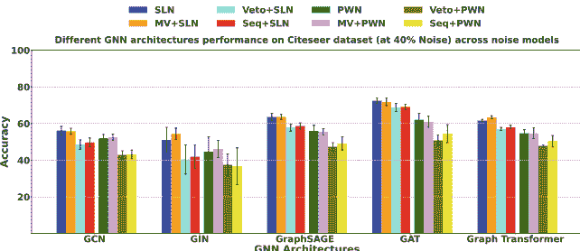

图 3. 不同 GNN 架构中噪声模型变体的比较。每个簇对应一个架构，彩色柱表示相应噪声类型的准确率。

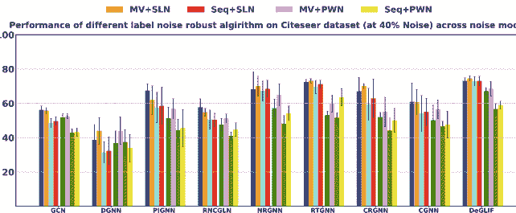

图 4. 图标签噪声鲁棒算法中噪声模型变体的比较。每个簇对应一个算法，彩色柱表示一种噪声类型的准确率。

Q3. 现有标签噪声鲁棒算法在 EDN 存在下的表现如何？接下来，我们在 EDN 的不同噪声变体以及 SLN 和 CCN 下，评估了抗噪算法 DGNN [6]、PIGNN [7]、RNCGLN [8]、NRGNN [9]、RTGNN [10]、CRGNN [11]、CGNN [5] 和 DeGLIF [14]。Citeseer 数据集在 40% 噪声下的结果图表见图 4。所有数据集在 5%、25% 和 45% 噪声水平下的结果列于表 3 和表 4。所有数据集的详细结果列于补充材料中的表 10、表 11 和表 12。在低噪声水平下，这些算法在所有噪声模型下表现出可比的结果。在高噪声水平下，大多数算法（图 4）呈现出与 GCN 相似的趋势。在多数投票变体下的性能可比于或优于 SLN 或 CCN。然而，在一票否决权和序列变体下，几乎所有算法都难以像在 SLN 或 CCN 下那样进行鲁棒学习。

多数投票 (MV) 算法会惩罚低度节点，使其性能下降与 SLN 或 PW 相似。另一方面，一票否决权和序列翻转在较高节点度下具有更高的噪声水平（图 3）。导致更大性能下降的 EDN 变体表明，节点结构在噪声如何影响性能方面起着关键作用，因此此类 EDN 变体对鲁棒评估具有价值。

表 3. 针对 Citeseer 和 Cora 数据集的图标签噪声鲁棒算法中噪声模型变体的比较。报告值为 10 次重复的准确率±标准差。

| 抗噪算法 | 噪声水平 | SLN | MV+SLN | Veto+SLN | Seq+SLN | PWN | MV+PWN | Veto+PWN | Seq+PWN |
|---|---|---|---|---|---|---|---|---|---|
| DGNN | 5% | 66.46±2.84 | 65.15±2.37 | 62.17±2.41 | 60.28±3.58 | 64.04±2.22 | 66.06±1.90 | 61.92±8.79 | 58.12±13.30 |
| DGNN | 25% | 53.07±4.92 | 51.18±10.06 | 45.02±6.99 | 44.70±6.52 | 49.78±5.92 | 53.62±6.91 | 46.24±6.07 | 42.28±12.04 |
| DGNN | 45% | 41.89±6.73 | 43.71±4.72 | 29.48±6.39 | 27.27±9.29 | 32.62±6.84 | 44.71±5.86 | 32.83±4.41 | 34.20±7.13 |
| PIGNN | 5% | 76.58±2.04 | 72.83±3.60 | 71.34±5.36 | 71.61±5.36 | 74.02±2.20 | 73.60±1.74 | 71.63±5.38 | 73.14±2.17 |
| PIGNN | 25% | 71.61±3.67 | 69.62±3.46 | 66.79±6.75 | 66.11±8.15 | 66.19±5.57 | 68.11±4.49 | 62.79±4.89 | 63.62±7.72 |
| PIGNN | 45% | 60.79±11.05 | 56.18±9.03 | 56.32±3.70 | 58.49±7.80 | 44.47±7.21 | 49.97±7.33 | 38.14±4.95 | 44.48±9.20 |
| RNCGLN | 5% | 72.15±3.13 | 69.00±3.88 | 68.33±1.98 | 67.54±1.51 | 69.86±3.23 | 68.05±2.46 | 68.87±2.75 | 72.08±3.06 |
| RNCGLN | 25% | 65.09±4.12 | 62.51±2.37 | 64.76±4.86 | 62.41±4.48 | 58.22±2.80 | 61.01±2.82 | 56.50±2.01 | 58.88±3.38 |
| RNCGLN | 45% | 51.68±5.01 | 51.01±3.35 | 44.24±4.52 | 45.94±4.38 | 41.87±2.96 | 46.81±3.73 | 37.95±5.20 | 40.72±1.63 |
| C | 5% | 73.98±4.38 | 74.31±1.04 | 74.26±1.53 | 73.95±1.35 | 74.18±0.80 | 74.07±1.15 | 74.12±0.97 | 75.08±1.32 |
| | 25% | 72.47±1.78 | 72.81±1.55 | 72.82±1.97 | 71.95±3.23 | 65.87±2.81 | 71.07±2.65 | 66.09±2.46 | 70.22±3.38 |
| | 45% | 70.25±1.97 | 71.09±2.30 | 64.59±5.95 | 69.16±2.81 | 42.61±4.55 | 53.90±3.99 | 45.36±3.73 | 54.05±3.09 |
| NRGNN | 5% | 75.76±0.99 | 74.19±1.47 | 74.22±1.19 | 74.14±1.15 | 71.69±3.75 | 73.56±2.35 | 74.53±1.63 | 76.58±3.30 |
| NRGNN | 25% | 73.78±1.02 | 72.68±2.15 | 70.86±4.00 | 70.40±4.18 | 67.06±2.90 | 72.08±2.89 | 66.07±6.16 | 69.92±1.67 |
| NRGNN | 45% | 70.80±2.43 | 70.73±5.18 | 65.17±6.89 | 64.09±8.24 | 46.98±3.99 | 55.79±5.34 | 40.30±5.00 | 49.60±10.83 |
| RCGNN | 5% | 76.34±2.41 | 74.74±1.86 | 74.64±1.79 | 74.24±2.41 | 75.09±1.07 | 74.78±2.31 | 74.30±1.48 | 74.88±3.26 |
| RCGNN | 25% | 73.22±1.63 | 70.35±6.12 | 71.21±3.16 | 72.50±1.97 | 65.98±4.25 | 70.15±1.75 | 58.29±9.09 | 65.34±3.45 |
| RCGNN | 45% | 64.84±4.24 | 64.16±8.81 | 57.43±7.86 | 63.37±5.93 | 45.19±3.63 | 52.46±3.34 | 40.44±3.00 | 42.56±6.28 |
| CGNN | 5% | 77.80±0.83 | 74.20±1.74 | 73.69±1.85 | 73.11±3.40 | 72.67±4.49 | 73.51±2.24 | 74.21±1.59 | 76.60±4.10 |
| CGNN | 25% | 69.86±4.46 | 70.54±3.82 | 69.04±5.15 | 70.09±4.03 | 61.63±9.43 | 67.52±6.32 | 60.02±7.17 | 63.08±9.39 |
| CGNN | 45% | 58.62±8.03 | 55.96±11.66 | 50.57±11.89 | 50.62±10.95 | 44.70±6.39 | 50.49±6.26 | 41.45±3.50 | 46.02±4.30 |
| DeGLIF | 5% | 77.58±1.10 | 77.36±1.24 | 77.64±1.71 | 77.50±1.80 | 77.92±1.24 | 77.34±1.41 | 77.64±1.42 | 77.74±1.2 |
| DeGLIF | 25% | 76.10±1.21 | 76.24±1.48 | 75.86±2.28 | 76.04±1.96 | 74.86±2.20 | 75.94±2.44 | 73.40±1.72 | 74.4±2.95 |
| DeGLIF | 45% | 70.58±1.44 | 72.38±2.06 | 71.18±2.99 | 71.98±2.90 | 59.48±3.76 | 62.02±3.25 | 47.5±3.4 | 52.48±8.28 |
| DGNN | 5% | 78.32±4.81 | 82.68±2.81 | 79.80±1.65 | 78.08±4.58 | 74.66±9.15 | 82.50±0.95 | 78.38±7.58 | 79.18±1.75 |
| DGNN | 25% | 74.90±5.87 | 79.38±2.39 | 65.20±11.22 | 65.38±13.62 | 61.78±9.81 | 77.36±3.91 | 53.28±12.29 | 66.54±7.27 |
| DGNN | 45% | 62.34±12.99 | 60.08±15.94 | 40.26±8.56 | 40.10±8.99 | 46.64±11.84 | 45.02±11.65 | 30.94±6.26 | 52.36±8.54 |
| PIGNN | 5% | 80.19±3.16 | 81.48±2.16 | 81.81±2.22 | 81.71±2.15 | 80.05±3.50 | 81.58±1.97 | 81.79±1.88 | 81.48±2.84 |
| PIGNN | 25% | 79.84±2.30 | 80.11±2.09 | 80.66±2.37 | 78.41±5.17 | 76.54±3.43 | 75.71±3.57 | 72.85±3.56 | 72.87±8.57 |
| PIGNN | 45% | 75.68±2.69 | 75.74±2.92 | 74.95±6.39 | 74.61±5.72 | 49.64±10.92 | 46.89±9.64 | 47.60±7.82 | 57.05±10.22 |
| RNCGLN | 5% | 83.82±5.00 | 84.06±4.05 | 85.32±2.00 | 87.04±2.01 | 83.78±7.27 | 82.08±3.42 | 88.32±2.02 | 81.38±0.61 |
| RNCGLN | 25% | 80.26±5.05 | 80.24±3.99 | 71.54±6.55 | 70.50±4.53 | 71.94±5.37 | 77.00±9.12 | 64.98±3.93 | 70.60±1.39 |
| RNCGLN | 45% | 56.52±5.79 | 61.22±6.57 | 51.68±5.66 | 55.40±5.21 | 52.40±8.32 | 63.90±8.12 | 42.58±2.93 | 49.72±0.79 |
| RTGNN | 5% | 73.54±2.02 | 74.42±2.12 | 74.64±1.78 | 75.04±1.70 | 75.29±3.09 | 73.91±2.63 | 74.28±1.90 | 73.95±1.58 |
| RTGNN | 25% | 75.67±3.00 | 72.20±3.70 | 74.12±3.52 | 73.16±5.07 | 70.44±3.29 | 62.89±6.02 | 55.39±9.03 | 68.75±4.56 |
| RTGNN | 45% | 66.44±7.61 | 64.95±8.76 | 75.65±2.62 | 71.45±5.01 | 75.38±4.77 | 71.88±3.87 | 70.51±8.34 | 42.77±7.32 |
| NRGNN | 5% | 75.13±3.77 | 75.47±1.73 | 75.65±2.62 | 73.19±2.98 | 75.40±2.21 | 74.81±1.82 | 76.12±2.36 | 74.99±2.20 |
| NRGNN | 25% | 75.03±4.14 | 73.52±1.88 | 75.46±2.96 | 75.05±1.99 | 69.89±7.82 | 64.88±7.89 | 64.97±6.98 | 65.47±7.14 |
| NRGNN | 45% | 71.63±7.77 | 65.53±9.80 | 69.96±7.19 | 70.07±5.05 | 50.58±13.34 | 40.34±9.91 | 40.91±10.40 | 49.96±6.07 |
| CRGNN | 5% | 84.10±1.86 | 83.99±1.48 | 84.18±1.72 | 84.36±1.53 | 84.26±1.64 | 84.28±0.92 | 83.70±1.58 | 82.16±4.84 |
| CRGNN | 25% | 78.25±1.88 | 76.40±2.57 | 76.43±5.53 | 77.58±2.64 | 75.71±2.56 | 74.05±2.41 | 67.48±4.64 | 69.94±6.77 |
| CRGNN | 45% | 65.02±10.42 | 60.58±12.98 | 62.98±6.41 | 60.63±7.09 | 48.32±9.40 | 49.27±6.13 | 46.61±7.83 | 44.22±7.37 |
| CGNN | 5% | 83.70±3.67 | 82.43±4.47 | 83.15±3.11 | 82.81±3.26 | 83.57±2.19 | 83.15±2.76 | 78.94±11.48 | 83.27±2.92 |
| CGNN | 25% | 79.46±3.45 | 74.93±5.98 | 77.06±4.52 | 76.29±4.45 | 75.82±3.25 | 70.34±9.60 | 70.54±3.38 | 71.37±10.88 |
| CGNN | 45% | 67.76±6.19 | 63.57±9.94 | 65.63±13.02 | 65.15±13.00 | 51.20±7.78 | 47.45±6.24 | 46.39±8.02 | 47.56±10.42 |
| DeGLIF | 5% | 88.79±2.60 | 88.77±2.79 | 87.04±6.67 | 89.41±1.99 | 88.20±2.12 | 88.73±2.32 | 88.86±2.41 | 84.46±0.8 |
| DeGLIF | 25% | 87.33±2.74 | 85.71±6.37 | 86.17±3.31 | 85.68±5.04 | 86.63±1.84 | 87.60±2.01 | 73.27±16.10 | 80.74±1.15 |
| DeGLIF | 45% | 84.85±2.21 | 83.60±2.00 | 75.33±7.08 | 78.58±6.30 | 60.11±3.78 | 63.50±6.69 | 44.94±2.33 | 61.2±6.07 |

表 4. 针对 Amazon Photo 数据集的图噪声鲁棒算法中噪声模型变体的比较。报告值为 10 次重复的准确率 ± 标准差。

| 抗噪算法 | 噪声水平 | SLN | MV+SLN | Veto+SLN | Seq+SLN | PWN | MV+PWN | Veto+PWN | Seq+PWN |
|---|---|---|---|---|---|---|---|---|---|
| DGNN | 5% | 78.32±4.81 | 82.68±2.81 | 79.80±1.65 | 78.08±4.58 | 74.66±9.15 | 82.50±0.95 | 78.38±7.58 | 61.44±27.08 |
| DGNN | 25% | 74.90±5.87 | 79.38±2.39 | 65.20±11.22 | 65.38±13.62 | 61.78±9.81 | 77.36±3.91 | 53.28±12.29 | 55.50±5.54 |
| DGNN | 45% | 62.34±12.99 | 69.00±15.94 | 40.26±8.56 | 40.10±8.99 | 46.64±11.84 | 45.02±11.65 | 30.94±6.26 | 35.96±4.80 |
| PIGNN | 5% | 88.9±0.4 | 89.56±0.58 | 90.72±0.31 | 92.42±0.59 | 89.74±1.26 | 88.02±0.96 | 89.96±0.58 | 90.06±0.88 |
| PIGNN | 25% | 86.8±3.4 | 88.96±1.72 | 90.30±0.65 | 90.52±0.50 | 85.22±2.21 | 87.52±2.15 | 74.56±2.17 | 82.10±2.06 |
| PIGNN | 45% | 82.2±4.2 | 87.22±2.37 | 79.86±7.22 | 80.64±3.36 | 60.44±8.51 | 62.38±9.04 | 42.86±6.44 | 63.52±2.81 |
| RNCGLN | 5% | 83.82±5.00 | 84.06±4.05 | 85.32±2.00 | 87.04±2.01 | 83.78±2.71 | 82.08±3.42 | 88.32±2.02 | 84.48±3.53 |
| RNCGLN | 45% | 80.26±5.05 | 80.24±3.99 | 71.54±6.55 | 70.50±4.53 | 71.94±5.37 | 77.00±9.12 | 64.98±3.93 | 69.96±6.36 |
| RNCGLN | 25% | 56.52±5.79 | 61.22±6.57 | 51.68±5.66 | 55.40±5.21 | 52.40±8.32 | 63.90±8.12 | 42.58±2.93 | 48.34±1.06 |
| RTGNN | 5% | 80.8±5.3 | 81.93±2.17 | 81.46±2.44 | 84.14±2.19 | 82.24±0.86 | 83.45±1.10 | 81.95±1.42 | 82.04±1.53 |
| RTGNN | 25% | 82.9±4.9 | 82.63±3.85 | 82.93±5.32 | 81.96±2.17 | 83.17±3.79 | 84.88±3.15 | 69.78±3.62 | 76.19±6.53 |
| RTGNN | 45% | 86±1.3 | 84.98±1.62 | 75.71±7.21 | 74.46±5.80 | 60.86±8.45 | 58.03±12.32 | 47.17±8.88 | 60.56±3.57 |
| NRGNN | 5% | 69±8 | 87.52±0.90 | 87.34±1.68 | 88.40±2.77 | 89.74±1.26 | 87.08±1.67 | 86.56±1.54 | 85.90±2.81 |
| NRGNN | 25% | 55.1±5.4 | 86.92±2.84 | 85.92±0.64 | 86.08±0.90 | 85.22±2.21 | 85.52±2.32 | 72.50±4.41 | 81.24±5.63 |
| NRGNN | 45% | 54.5±6.2 | 86.70±1.72 | 73.78±4.98 | 81.42±2.51 | 60.44±8.51 | 66.20±8.31 | 49.90±3.87 | 58.78±1.89 |
| CRGNN | 5% | 50.04±12.73 | 44.60±12.81 | 54.28±14.68 | 54.52±14.41 | 54.80±12.30 | 55.28±12.77 | 47.36±15.24 | 37.54±46.21 |
| CRGNN | 25% | 45.02±10.86 | 37.82±11.13 | 35.76±11.64 | 35.22±14.65 | 47.68±20.70 | 31.22±7.03 | 41.32±7.76 | 32.74±39.74 |
| CGNN | 45% | 29.48±15.05 | 31.20±5.21 | 23.12±5.72 | 18.82±4.97 | 33.14±13.04 | 37.74±8.31 | 27.42±4.28 | 19.78±21.92 |
| CGNN | 5% | 39.08±28.12 | 28.70±12.19 | 23.32±6.22 | 33.60±21.41 | 33.82±19.18 | 25.10±7.71 | 32.08±11.53 | 56.84±58.81 |
| CGNN | 25% | 34.08±23.35 | 22.70±8.20 | 24.30±5.93 | 25.88±24.09 | 31.26±18.21 | 22.48±3.59 | 29.08±7.08 | 47.86±14.05 |
| DeGLIF | 45% | 16.62±9.35 | 17.40±9.27 | 20.84±7.90 | 22.96±11.08 | 22.74±12.74 | 24.44±7.80 | 25.78±7.39 | 36.52±9.30 |
| DeGLIF | 5% | 88.79±2.60 | 88.77±2.79 | 87.04±6.67 | 89.41±1.99 | 88.20±2.12 | 88.73±2.32 | 88.86±2.41 | 89.09±2.13 |
| DeGLIF | 25% | 87.33±2.74 | 85.71±6.37 | 86.17±3.31 | 85.68±5.04 | 86.63±1.84 | 87.60±2.01 | 73.27±16.10 | 79.08±4.45 |
| DeGLIF | 45% | 84.85±2.21 | 83.60±2.00 | 75.33±7.08 | 78.58±6.30 | 60.11±3.78 | 63.50±6.69 | 44.94±2.33 | 52.92±11.73 |

### 4.5 假设检验

所有用于检验 EDN 对 GNN 架构和图抗噪算法影响的实验均重复 10 次。对于特定的噪声水平，令 \({x_1^s, \dots, x_{10}^s}\) 表示使用 SLN 注入噪声时 GNN 获得的准确率值。同样，令 \(\{x_1^v, \dots, x_1^v\}\) 表示使用 Veto Power + SLN 模型注入噪声时 GNN 获得的准确率值。我们希望利用假设检验理论，检查 EDN 的某些变体是否相较于现有噪声模型确实导致了更多的性能下降。为此，令 \(d_i = x_i^s - x_i^v\)。则 \(\bar{d} = \bar{x}^s - \bar{x}^v\)。我们假设 \(d_i\) 服从均值 \(\mu_d\) 且方差 \(\sigma_d^2\) 均未知的正态分布。我们定义假设检验如下 [28, 29]：

> 零假设 \(H_0 : \mu_d \le 0\)
> 备择假设 \(H_1 : \mu_d > 0\)

需要指出，正态分布的定义域为 \((-\infty, \infty)\)，但 \(d_i\) 的可能取值限制在 \([-100, 100]\)。经验上，几乎所有观察到的 \(d_i\) 值均落在 \([-10, 10]\) 以内，且表现出较小的标准差。因此，拟合良好的正态分布分配超出 \([-100, 100]\) 值的概率极低。因此，假设 \(d_i\) 服从正态分布是合理的。\(d_i\) 的均值估计由 \(\bar{d}_i\) 给出。\(d_i\) 方差的合并估计量 \(S_d^2\) 由以下给出


(假设 SLN 和 Veto+SLN 的总体方差相同)

\(S_d^2 = \frac{(n-1)S_s^2 + (n-1)S_v^2}{2n-2} = \frac{S_s^2 + S_v^2}{2}\)

其中，\(S_s^2\) 和 \(S_v^2\) 分别是 SLN 和 Veto+SLN 变体的样本方差。然后，检验统计量由以下公式给出

\(T = \frac{\bar{d} - 0}{\sqrt{S_d^2 \left(\frac{1}{n} + \frac{1}{n}\right)}} = \frac{\sqrt{n}\bar{d}}{\sqrt{S_s^2 + S_v^2}}\)

显著性水平 \(\alpha\) 的检验是：如果 \(T \ge t_{\alpha, 2n-2}\)，则拒绝 \(H_0\)；否则不拒绝 \(H_0\)。这里，\(t_{\alpha, 2n-2}\) 表示自由度为 \(2n - 2\) 的 t 分布。显著性水平 \(\alpha\) 意味着 \(H_0\) 实际上为真时被拒绝的概率不大于 \(\alpha\)。在我们的实验中，我们期望数据支持备择假设 \(H_1\)，但除非数据真正提供有说服力的支持，否则我们不想做出断言。因此，我们设置检验，使备择假设成为我们期望数据支持并希望证明的假设。在这种设置中，备择假设也称为研究假设。通过选择较小的 \(\alpha\) 作为显著性水平，我们将错误地得出数据支持研究假设（而实际上它是假的）的风险降至最低 [29]。\(\alpha\) 的常见取值为 0.1、0.05 和 0.005；在此，我们选择 \(\alpha = 0.05\)。

#### 示例说明

(A) 让我们看几个示例。对于 Citeseer 数据集，在存在 5% 噪声的 GCN 架构中，我们有 \(\bar{x}^s = 73.92, \bar{x}^v = 72.27, S_s = 1.1, S_v = 0.7\)（来自表 2），因此，\(T = \frac{\sqrt{10} \times (73.92-72.27)}{\sqrt{1.1^2+0.7^2}} = 4.00184\)。对于显著性水平 \(\alpha = 0.05\)，\(t_{\alpha, 18}\) 的值为 1.734。因为 \(T > t_{0.05, 18}\)，所以我们拒绝 \(H_0\)。这意味着对于 5% 噪声下的 Citeseer 数据集，与 SLN 相比，在存在 Veto + SLN 时 GCN 表现更差，且错误得出此结论的概率最多为 5%。事实上，在这种情况下，\(T > t_{0.0005, 18} = 3.921643\)，因此错误地得出拒绝 \(H_0\) 结论的概率最多为 0.05%。

(B) 对于 Citeseer 数据集，在存在 45% 噪声的 GIN 架构中，我们有 \(\bar{x}^s = 42.29, \bar{x}^v = 37.98, S_s = 8.8, S_v = 5.4\)（来自表 2），因此，\(T = 1.32\)。这意味着 \(T < t_{0.05, 18}\)，我们接受 \(H_0\)。

#### 假设检验分析

我们对所有数据集、所有 GNN 架构和所有噪声鲁棒算法进行了假设检验，结果见表 5。我们将噪声水平分为三个子类：低（5%–15% 噪声水平）、中（20%–35% 噪声水平）和高（40%–50% 噪声水平）。总计表示所有噪声水平的汇总。我们通过假设检验的视角重新审视第 4.4 节中提出的问题。对于 GCN 架构，我们有 10 个噪声水平 \(\times\) 3 个数据集 \(\times\) 2 个子变体（SLN 和 PWN）= 60 个假设检验。在 60 个中，我们在 \(\alpha = 0.05\) 下能够拒绝 32 个虚无假设。如同 (B) 中所述，在较低显著性水平下接受 \(H_0\) 并不总是意味着虚无假设为真，而是意味着我们无法以高置信度拒绝它。在示例 (B) 中显然 \(\bar{d} > 0\)，但由于方差较大，我们无法确定 \(\bar{d} > 0\) 是由于噪声模型的变化，还是由于学习过程中的固有随机性（训练集采样的随机性、随机梯度下降等）。因此，当我们能够拒绝 \(H_0\) 时，我们可以有高度的信心地说，性能下降是由于噪声模型的变化（例如，从 SLN 变为 Veto+SLN）。

表 5. 所有假设检验的摘要：在显著性水平 \(\alpha = 0.05\) 下拒绝虚无假设的案例比例。即使是为处理图标签噪声而设计的算法，与现有噪声模型相比，也会因 EDN 而经历更大的性能下降。我们可以对 34% 的否决权案例和 22% 的依序翻转案例有高度信心地说出这一点。对于 GNN 架构，41% 的案例也是如此。

| 噪声模型 | 噪声水平 | GCN | GNN 架构 | 现有噪声鲁棒算法 |
|---|---|---|---|---|
| 否决权 | 低 | 6/18 ≈ 0.33 | 24/90 ≈ 0.27 | 26/144 ≈ 0.18 |
| | 中 | 10/24 ≈ 0.42 | 45/120 ≈ 0.38 | 54/192 ≈ 0.28 |
| | 高 | 16/18 ≈ 0.89 | 55/90 ≈ 0.61 | 85/144 ≈ 0.59 |
| | 总计 | 32/60 ≈ 0.53 | 124/300 ≈ 0.41 | 165/480 ≈ 0.34 |
| 依序翻转 | 低 | 7/18 ≈ 0.38 | 23/90 ≈ 0.26 | 26/144 ≈ 0.18 |
| | 中 | 9/24 ≈ 0.38 | 41/120 ≈ 0.34 | 41/192 ≈ 0.21 |
| | 高 | 14/18 ≈ 0.78 | 59/90 ≈ 0.66 | 39/144 ≈ 0.27 |
| | 总计 | 30/60 ≈ 0.5 | 123/300 ≈ 0.41 | 106/480 ≈ 0.22 |

从表 5 我们观察到，在不同噪声水平下，否决权和依序翻转造成的性能下降大于传统噪声模型。GCN 受 EDN 影响最大，而其他 GNN 架构表现出稍强的鲁棒性。然而，没有 GNN 架构在各噪声水平下的表现与现有噪声模型和 EDN 相似。现有噪声鲁棒算法也未能完全解决 EDN 的两个变体。总体而言，在 \(\alpha = 0.05\) 显著性水平下，34% 的案例中，否决权比现有噪声模型更严重地降低了噪声鲁棒算法的性能；依序翻转在 22% 的案例中造成了更多性能下降。对于 GNN 架构，此数字增加到 41%；对于 GCN，增加到 50%。此外，我们观察到，随着噪声水平的升高，EDN 的影响变得明显。

### 5 结论

在这项工作中，我们为图数据引入了一种名为边缘依赖噪声（Edge-Dependent Noise, EDN）的新型噪声模型。与原先为 i.i.d. 数据设计、用于图数据的现有噪声模型不同，EDN 捕获了节点间连接对节点标签噪声的影响。我们提出了 EDN 的三种变体：多数表决、否决权和依序翻转。在所有三种变体中，节点标签被翻转的概率直接由其度决定，这使得即使在大型图中也可行地实现。这种度依赖性是 EDN 的显著特征。我们从理论上比较了所提出的各种 EDN 变体中，标签翻转概率作为节点度函数的情况。实验及其后的假设检验结果表明，EDN（尤其是否决权和依序翻转变体）与 SLN 和 CCN 等现有噪声模型相比，会导致更显著的性能下降。这凸显了节点在理解噪声对 GNN 性能影响方面的关键作用，使 EDN 成为 GNN 鲁棒评估的有价值工具。这强调了进一步开发专门用于处理图数据中边缘依赖噪声复杂性的噪声鲁棒算法的必要性。由于我们考虑的准确率差异位于区间 [-100,100] 内，可以采取更严谨的假设检验方法，而无需诉诸正态近似或假设总体方差相等。我们的假设检验框架属于 Berhens-Fisher 问题，目前尚无完全令人满意的解决方案（[28] 第 8.4.3 节）。

### 参考文献

- 1. Xiao, S., Wang, S., Dai, Y., Guo, W.: 图神经网络在节点分类中的调查与评价. Mach. Vis. Appl. **33**(1), 1–19 (2021). https://doi.org/10.1007/s00138-021-01251-0
- 2. Zhou, J., et al.: 图神经网络：方法与应用综述. AI Open (2020)
- 3. Ju, W., et al.: 现实世界中的图神经网络调查：不平衡、噪声、隐私和 OOD 挑战. ArXiv, abs/2403.04468 (2024)
- 4. Tripathi, S., Hemachandra, N.: 标签噪声：问题与解决方案. IEEE DSAA 教程 (2020)
- 5. Yuan, J., et al.: 在标签噪声下的图学习. ICASSP (2023)
- 6. NT, H., Jin, C.J., Murata, T.: 带噪标签的图神经网络学习. arXiv 预印本 arXiv:1905.01591 (2019)
- 7. Du, X., et al.: 通过估计和利用成对交互进行噪声鲁棒图学习. Trans. Mach. Learn. Res. (2021)
- 8. Zhu, Y., et al.: 带图和标签噪声的图数据鲁棒节点分类. 在: AAAI 人工智能会议 (2024)
- 9. Dai, E., Aggarwal, C., Wang, S., NRGNN: 在稀疏和带噪标签图上学习抗标签噪声图神经网络. 在: 第 27 届 ACM SIGKDD 论文集. pp. 227–236 (2021)
- 10. Qian, S., et al.: 通过噪声治理进行图神经网络鲁棒训练. 在: ACM Web 搜索与数据挖掘国际会议 (2023)
- 11. Li, X., Li, Q., Li, D., Qian, H., Wang, J.: 标签噪声下的图对比学习. Neural Netw. (2024)
- 12. James, R.: Norris. Cambridge University Press, 马尔可夫链 (1997)
- 13. Wang, Z., et al.: NoisyGL：标签噪声下图神经网络的全面基准. NeurIPS 数据集与基准 (2024)
- 14. Kumar, P., Hemachandra, N.: DeGLIF 用于基于 GNN 的抗标签噪声节点分类. arXiv, abs/2506.00244 (2025)


- 15. Chen, Z., et al.: ADEdgeDrop: 用于鲁棒图神经网络的对抗性边丢弃. arXiv, abs/2403.09171 (2024)
- 16. Rong, Y., Huang, W., Xu, T., Huang, J.: DropEdge: 面向节点分类的深度图卷积网络. In: 国际学习表征会议 (2019)
- 17. Liu, X., Si, S., Zhu, X., Li, Y., Hsieh, C.: 面向基于图半监督学习的数据中毒攻击统一框架. In: 神经信息处理系统 (2019)
- 18. Zhang, M., Hu, L., Shi, C., Wang, X.: 面向图神经网络的对抗性标签翻转攻击与防御. In: 2020 IEEE国际数据挖掘会议 (ICDM) (2020)
- 19. Strang, G.: 线性代数及其应用 (2000)
- 20. Davis, P.J.: 循环矩阵. 纯粹与应用数学专著与教材, Wiley (1979)
- 21. Yang, Z., Cohen, W.W., Salakhutdinov, R.: 基于图嵌入重新审视半监督学习. arXiv, abs/1603.08861 (2016)
- 22. Shchur, O., Mumme, M., Bojchevski, A., Günnemann, S.: 图神经网络评估的陷阱. arXiv:1811.05868 (2018)
- 23. Kipf, T.N., Welling, M.: 基于图卷积网络的半监督分类. arXiv:1609.02907 (2016)
- 24. Xu, K., Hu, W., Leskovec, J., Jegelka, S.: 图神经网络有多强大? arXiv, abs/1810.00826 (2018)
- 25. Hamilton, W.L., Ying, Z., Leskovec, J.: 大图上的归纳表示学习. In: NIPS (2017)
- 26. Velickovic, P., et al.: 图注意网络. arXiv, abs/1710.10903 (2017)
- 27. Shi, Y., et al.: 半监督分类统一消息传递模型. IJCAI, 掩码标签预测 (2021)
- 28. Ross, S.M.: 工程师和科学家概率统计导论. Academic Press, 第6版 (2020)
- 29. Casella, G., Berger, R.L.: 统计推断. Taylor and Francis, 第2版 (2024)

## DRNCS: 基于节点收缩和捷径的双层路径生成模型

Zhuoran Li^1, Yucen Gao^1, Yu Yin^2, Xinle Li^2, Hui Gao^2, Xiaofeng Gao^1, and Guihai Chen^1

^1 计算机科学系, 上海可扩展计算与系统重点实验室, 上海交通大学, 上海, 中国
{airplane,guo.ke}@sjtu.edu.cn, {gao-xf,gchen}@cs.sjtu.edu.cn

^2 滴滴全球公司, 北京, 中国
{yinyu,lixinle,deangaohui}@didiglobal.com

**摘要.** 路径预测是映射服务中的一项基本任务，在轨迹重构和路径推荐中具有关键应用。然而，现有算法面临效率挑战，特别是对于长路径。主要挑战在于在保持预测准确性的同时提高计算效率，尤其是在大规模、实时场景中。为应对这一挑战，我们提出了一种基于节点收缩和捷径加速的加速路径生成模型 **DRNCS**，采用专门为路径预测设计的双层模型。通过有效采用捷径-边差分收缩，我们能够以避免常见的出度爆炸问题的方式收缩节点，这一问题通常在传统节点收缩方法中遇到。这种方法使我们能够将原始图转换为更稀疏的表示，在保持结构完整性的同时显著降低图的复杂度。随后，我们利用两种方法计算并存储最可能的捷径：合并历史路径，以及在历史路径上应用基于概率的双向 Dijkstra 算法。最终，最终预测结果通过在稀疏图上进行预测并调用存储的捷径数据生成，该数据由在原始图上训练的模型产生。通过对真实世界数据集的深入实验，我们表明，与最先进的方法相比，我们的模型在保持查询准确性的同时显著提高了生成速度，并在可达性方面展现出优势。这为我们的算法在真实世界路径生成场景中的实际应用提供了强有力的支持。

**关键词:** 路径推荐 · 路径优化

### 1 引言

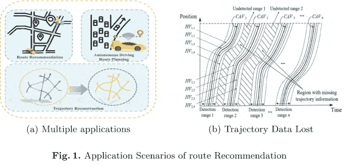

路径生成技术在优化城市交通流动方面具有巨大潜力，可辅助诸如帮助出租车司机选择更快路线以更快接客并提高客户满意度 [9] 等应用。它还使自动驾驶汽车能够选择更不拥堵的路径，减少高峰时段的出行时间并缓解整体交通拥堵。此外，如图 1b [14] 所示，真实世界轨迹数据通常不完整或不连续。在这种情况下，路径生成可以重建轨迹并预测移动物体的潜在路线，为未来交通状况提供宝贵见解，帮助城市规划者优化基础设施和交通管理 [17]。

在实际场景中，如图 2 所示，直接应用最短路径算法来推断最可能的路径，直觉上假设最短路径始终是最佳选择，可能导致显著误差，特别是随着轨迹长度增加和道路网络规模扩大时。在此背景下，近年来学术界已投入大量精力优化路径生成技术。值得注意的是，NEUROMLR [6] 框架在精确率和召回率方面均报告了显著提升。尽管有这些进步，现有算法仍在与路径生成所需时间相关的重大挑战作斗争，特别是在较长路径问题的背景下，经常观察到明显的搜索延迟。这一挑战在 NEUROMLR-D 变体中尤为明显，在该变体中，处理大型道路网络和延长路径时，单条路径的平均预测时间超过三秒。这种性能不足以满足实际应用的要求。

鉴于当前研究状况，出现了以下关键问题：如何在显著提升搜索

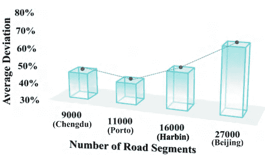

图 2. 最短路径损失

效率的同时保持路径预测的准确性，以满足实际应用要求？

为解决这一关键问题，我们认识到，预测长路径所需时间延长主要源于需要处理的海量节点。受 CH 算法 [3] 的启发，该算法通过节点收缩和捷径添加来加速最短路径计算，我们提出了 DRNCS —— 基于节点收缩和捷径的双层路径生成框架。我们的双层加速机制通过两个互补层级运作：架构层加速：我们设计了一个分层学习系统，其中 (1) 收缩图模型在简化拓扑上预测关键节点以建立稀疏路由骨架，而 (2) 原始图模型利用从历史轨迹中学习的转移概率在这些节点之间生成概率捷径。推理层增强：在路径生成过程中，我们实现：(1) 来自预计算高概率连接的动态捷径注入，以绕过冗余节点计算，以及 (2) 通过将模型预测与基于转移概率加权图上的双向 Dijkstra 搜索相结合的混合验证来保持准确性。这种分层设计通过图收缩实现加速，同时通过捷径验证保持精度，有效平衡了效率和准确性。

在本文中，我们开展了以下工作：我们提出了一种节点收缩方法，即捷径-边差分收缩，该方法使用自顶向下的边差作为标准，将原始图转换为稀疏表示，同时处理原始轨迹数据以构建稀疏图轨迹数据集。利用原始图，我们进行模型训练以生成捷径创建所需的数据，这涉及合并历史轨迹信息（即从众多历史轨迹中选择一条代表性历史路径）以及在基于转移概率加权的图上使用双向 Dijkstra 算法计算最可能的捷径。基于稀疏图轨迹


如上文所述的数据集，我们首先在稀疏图上训练模型，然后在其上进行预测，最后通过将预测路径与快捷数据集相结合来获得最终预测结果。最后，我们使用真实城市数据集进行广泛实验以验证我们的方法。本文的贡献如下：

- 保持预测准确性：我们采用了适当的嵌入技术和概率预测模型，使我们能够维持较高的预测准确性和可达性。

- 加速预测过程：我们提出了快捷边差分收缩来生成稀疏图，然后基于模型训练结果，在按过渡概率加权的图上应用历史路径合并和双向 Dijkstra 算法来获取快捷数据集，从而加速后续查询过程。

- 改进双层模型设计：我们的模型在原始图和稀疏图上均进行训练，从而能够更有效地获取快捷数据和最终预测数据。

- 实验验证：在真实城市数据集上进行的广泛实验验证了我们模型的有效性以及预测效率的显著提升。

## 2 相关工作

### 2.1 路径预测算法

**基于最短路径的路线预测。** 最短路径是路线预测最简单的方法，在现有研究[10,11,16]中被广泛使用。[10] 提出了 spMM 模型，利用几何和拓扑道路网络特征，而 [16] 将交通信号延迟和左转纳入启发式成本函数。在此基础上，[11] 构建了偏向更直路径的候选图。然而，这些方法没有充分考虑驾驶员在路线选择中的偏好。实际上，驾驶员会考虑路线长度和直线度之外的各种因素。因此，最可能的路线经常与最短路径不同，如图 2 所示。这表明，仅关注距离不足以准确预测最可能的路线。

**基于 RNN 的路线预测。** 为了解决使用最短路径进行路线预测所面临的挑战，已有多种基于历史轨迹的 RNN 方法被提出：在路线预测领域，涌现出若干著名模型，各自具有不同的原理和局限性。DEEPST [8] 使用变分自编码器来捕捉轨迹和交通关系，但对未见点的可达性较差。CSSRNN [15] 利用 RNN 和道路网络约束，但存在查询时间长、可达性低和数据依赖的问题。

NEUROMLR [6] 将 Lipschitz 嵌入与 GCN 相结合以提高准确性，有两个变体：NEUROMLR-D（Dijkstra 算法）和 NEUROMLR-G（贪心算法）。NEUROMLR-D 增强了最短路径计算，但查询延迟较高，而 NEUROMLR-G 改进了速度和可达性，但对长路线仍然效率低下，需要进一步优化。

基于 Transformer 的路线预测。尽管 RNN 等自回归模型一直是路线预测的基石，但最近的研究越来越多地采用 Transformer 架构，因其能够建模复杂依赖关系。[1] 采用基于 Transformer 的框架来捕捉道路网络中的时空相关性，而 [7] 引入了 BERT-Trip，这是一种受 BERT 启发的模型，是一种用于路线推荐的自监督对比学习框架，解决了在无标签数据下学习有效行程表示以及消除手动设计负样本需求的挑战。尽管它们很有效，但基于 Transformer 的模型参数量庞大带来了挑战，特别是推理速度，这限制了它们在实时场景中的适用性（表 1）。

表 1. 现有路线预测模型的局限性

| 模型 | 局限性 |
|---|---|
| DEEPST | 无法预测原始数据中不存在的点；可达性不佳 |
| CSSRNN | 可达性差；查询时间长；依赖高质量训练数据 |
| NEUROMLR-D | 查询时间长；不太适合实时应用 |
| NEUROMLR-G | 长路线存在显著延迟；需要进一步优化 |
| BERT-Trip | 训练成本高；查询时间长。 |

总之，尽管每种方法在预测能力和模型设计方面都有独特的优势，但很明显，当前的路径预测方法在查询速度慢方面面临重大挑战。为缓解这一问题，我们探索了各种潜在方法，旨在有效加速查询的同时保持可接受的准确性水平。一个特别有希望的方向源自收缩层次（Contraction Hierarchies, CH）算法，该算法通过节点收缩和引入快捷边来提高最短路径查询的效率。

### 2.2 节点收缩方法

收缩层次（Contraction Hierarchies, CH）。收缩层次（Contraction Hierarchies, CH）[3] 通过一个简化图结构的预处理阶段来提高最短路径查询的效率。这是通过收缩不太重要的节点，同时引入快捷边来保留基本连通性来实现的，快捷边保持了最短路径距离的正确性。预处理完成后，最短路径查询使用双向 Dijkstra 算法 [2] 的变体执行，该算法同时从源节点和目标节点探索搜索空间。这种方法有效减少了处理的节点数量，从而显著提高了查询性能。

经典 CH 算法无法直接应用于我们预测最可能路线的场景。我们需要解决以下问题：

- 节点收缩应采用什么标准？在我们的应用场景中，尽可能最小化出度增加至关重要，因为这将影响我们的模型预测潜在节点的速度。因此，我们提出了快捷边差分收缩，这是一种自顶向下的方法，使用边差作为节点收缩的标准。这种方法确保我们可以收缩更多节点，而不会导致出度激增。

- 如何生成与最可能路线预测场景更一致的快捷边？直接使用经典算法推导的快捷边是不可行的。因此，我们在基于历史数据生成的概率图上使用双向 Dijkstra 算法来创建更能代表最可能路线的快捷边。这使我们的预测能够加速。

## 3 问题定义与变换

我们先从道路网络、路线和查询的定义入手。随后，我们正式提出研究问题并给出其变换。为清晰起见并方便参考，本文使用的符号如表 2 所示。

表 2. 符号与描述表

| 符号 | 描述 |
| :--- | :--- |
| $G(V, E)$ | 由顶点 $V$ 和边 $E$ 组成的有向图。 |
| $|V|, |E|$ | 节点数和边数。 |
| $G_{agg.log}$ | 按概率的负对数加权的图 $G$。 |
| $R, R^*$ | 真实路线和预测路线。 |
| $SC^{(1)}, SC^{(2)}$ | 通过历史轨迹筛选的快捷边和基于概率图生成的快捷边。 |
| $|R_i|, |R^*_i|$ | 真实路线和预测路线中的边数，分别。 |
| $|R_{d=s-t}|$ | 与原始路径端点匹配的预测路径数量。 |
| $q = (s, d, t)$ | 查询由一个元组表示，涉及起始节点 $s$、目标节点 $d$ 和时间 $t$。 |
| $Pr(R|q)$ | 给定特定查询 $q$ 时选择路线 $R$ 的概率。 |
| $P_s$ | 历史轨迹中共享相同起点-终点对的历史路径集合。 |
| $P(e)$ | 选择边 $e$ 的概率。 |
| UnConf | 预测的未归一化置信度得分。 |
| $Q(\text{cur}, \text{nbr})|\text{cur}; d; \Theta)$ | 给定目标节点并由 $\Theta$ 参数化时，从当前节点到邻域节点的转移概率。 |
| N2V(node) | 使用 node2vec 算法的节点嵌入。 |
| $W$ | 神经网络层的权重矩阵。 |
| $T_{total}$ | 生成所有预测路线所需的总时间。 |

### 定义 1（道路网络）

道路网络表示为有向图 $G(V, E)$，其中 $V$ 和 $E$ 分别表示顶点（路口）和边（道路段）。


### 定义 2（路由）
路由 \( r = [e_i]_{i=1}^n \) 是相邻路段的序列，其中 \( e_i \in E \)。在实际应用中，路由 \( R(s, d) = \{v_1, \dots, v_k\} \) 表示在道路网络 \( G \) 中从源节点 \( s = v_1 \) 到目的地 \( d = v_k \) 的简单路径，且不含环路。同样，它可以表示为边的序列 \( R(s, d) = \{e_1, \dots, e_{k-1}\} \)，其中 \( e_i = (v_i, v_{i+1}) \)。

### 定义 3（查询）
查询由元组 \( q = (s, d, t) \) 表示，其中 \( s \) 和 \( d \) 分别为节点集合 \( V \) 内的源节点和目标节点。变量 \( t \) 表示轨迹发生的时间。

### 问题陈述
给定道路网络 \( G(V, E) \) 和历史轨迹数据集 \( D = (T(m))_{m=1}^M \)，以及查询 \( q = (s, d, t) \)，目标是基于 \( D \) 中包含的交通模式推断最可能的路由 \( R^*(s, d) \)。形式上，最可能的路由定义为：

```
\( R^*(s, d) = \arg \max_{R(s,d) \in G} \text{Pr}(R(s,d) \mid q) \quad (1) \)
```

### 问题转换
预测最可能路由的问题可以表述为图上的路径搜索问题。在数学上，路由 \( R \) 的概率可表述为其各单独边概率的乘积。形式上，我们有：

```
\( \text{Pr}(R|q) = \prod_{i=1}^{|R|} \text{Pr}(R.e_i | R.e_0 \rightarrow R.e_{i-1}, s, d, t) \quad (2) \)
```

其中 \(\text{Pr}(R.e_i | R.e_0 \rightarrow R.e_{i-1}, s, d, t)\) 表示在已知迄今所走路径及查询参数 \( q = (s, d, t) \) 的前提下，路由 \( R \) 经过边 \( R.e_i \) 的概率。以往研究表明，人类移动模式符合马尔可夫假设 [13]，该假设指出未来状态仅取决于当前状态，而不取决于此前发生的一系列事件。因此，上述方程简化为：

```
\( \text{Pr}(R|q) = \prod_{i=1}^{|R|} \text{Pr}(R.e_i | v_i, d, t) \quad (3) \)
```

经过这些简化，方程 (2) 简化为：

```
\( R^*(s, d) = \arg \max_{\forall R \in G} \prod_{i=1}^{|R|} \text{Pr}(R.e_i | v_i, d, t) = \arg \min_{\forall R \in G} \sum_{i=1}^{|R|} -\log(\text{Pr}(R.e_i | v_i, d, t)) \quad (4) \)
```

该转换表明，选择最可能路由的问题已转化为在加权图上搜索最短路径的问题，其中权重对应概率的负对数。我们将此加权图表示为 \( G_{neg.log} \)。

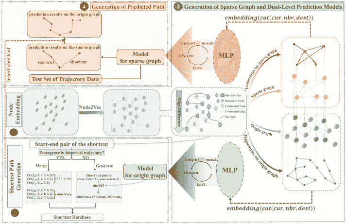

图 3. DRNCS 框架：DRNCS 首先使用 node2vec 生成节点嵌入，然后基于边差对节点进行收缩以创建稀疏图和快捷对。模型分别在原始图和稀疏图上进行训练，生成双层模型。在快捷数据库生成过程中，采用两种方法：合并历史路径以及基于原始图模型结果生成快捷。最后，在推理阶段，在稀疏图上进行预测，结合存储的快捷数据得出最终结果。

## 4 建模

我们的模型包含几个关键组件：生成节点嵌入、创建稀疏图、在原始图上使用原始路径信息训练模型、在稀疏图上使用稀疏化轨迹数据训练模型、采用两种不同方法生成快捷、执行推理阶段。我们的模型框架如图 3 所示。

### 4.1 节点嵌入生成

node2vec 算法 [4] 使用灵活的随机游走策略，有效地捕获图中节点的结构特征。对于我们旨在预测最可能路由的研究，我们需要的节点嵌入应考虑超越距离和地理坐标等简单指标的复杂因素。因此，我们选择 node2vec 作为嵌入方法。

### 4.2 稀疏图建模

为解决路由生成的查询速度问题，我们旨在最大限度地减少图收缩过程中节点最大出度的增加。因此，我们提出 **快捷边差分收缩**，其中我们选择 **边差**——定义为节点收缩期间添加的快捷数量与该节点原始入度和出度之和的差——作为节点收缩的标准。此外，我们采用 **自顶向下** 方法，尽可能控制出度增加的规模。节点收缩过程如算法 1 所示。

```
Algorithm 1: Shortcut-Edge Differential Contraction
Input: Graph G = (V, E), Contraction ratio r
Output: Shortcut pairs shortcut_pair , Sparse Graph G *
1 copy G to G *
2 while (number of contracted nodes < total nodes x r) do
3   Select the node with the minimum edge difference in G *;
4   Contract the selected node;
5   for each predecessor p of the contracted node do
6     for each successor s of the contracted node do
7       if not edge (p, s) exists in G * then
8         Add edge (p, s) in G *;
9         Store (p, s) in shortcut_pair;
10 return shortcut_pair, G * ;
```

算法 1 中的算法将一个新图 G * 初始化为 G 的副本（第 2 行），并迭代收缩节点，直到移除 r x |V| 个节点（第 3 行）。在每次迭代中，选择边差最小的节点以最大限度地减少连接性中断（第 4-6 行）。收缩后（第 7-9 行），如果不存在直接边 (p, s)，则在其前驱节点 p 和后继节点 s 之间添加快捷边，并将其存储在 shortcut_pair 中。当满足收缩比率时，算法终止，返回 G * 和用于模型训练的快捷对（第 10 行）。

### 4.3 模型训练

完成节点嵌入后，我们在原始图上的原始轨迹和稀疏图上的处理后稀疏轨迹进行训练，获得 **两个层级** 的训练模型。稀疏图上的训练模型将用于推理阶段，而原始图上的训练模型将用于快捷生成。模型训练的具体细节如下：我们通过连接 node2vec 生成的嵌入来获得嵌入结果，其中“邻居”（nbr）包括每个节点的真实邻居节点和虚拟邻居节点，虚拟邻居节点由 -1 表示，并通过填充添加，以确保每个节点具有相同数量的邻居。获得最终嵌入后，我们将这些嵌入传递到多层感知机（MLP）中，将向量转换为标量未归一化置信值，定义如下：

embedding = cat(N2V(curr), N2V(nbr) N2V(dest)) (5)

UnConf = f(nbr, curr, dest) = MLP(embedding), nbr \in N(curr) (6)

转移概率 Q((curr, v)|curr, d; \Theta) 可按以下方式计算：

Q((curr, nbr)|curr, dest; \Theta) = \frac{\exp(f(nbr, curr, dest))}{\sum_{nbr' \in N(curr)} \exp(f(nbr', curr, dest))} (7)

该方程通过所有邻居 nbr' \in N(curr) 的置信度的指数值之和来归一化未归一化的置信度。

接下来，我们根据节点的实际邻居生成掩码以过滤未归一化的置信度。我们应用掩码，将表示为 -1（表明不存在该邻居）的邻居的置信度设置为零：

UnConf* = UnConf \odot mask (8)

然后，我们选择置信度最高的候选项，简化为：

chosen = \arg \max_i (\text{UnConf}^*_i), \quad \text{for } i \in \{1, 2, \dots, \max\_\text{nbrs}\} (9)

最后，通过在 D 中的轨迹上对模型参数 \Theta 进行交叉熵损失优化，定义为：

Loss(\Theta) = -\frac{1}{|D|} \sum_{R \in D} \sum_{j=1}^{|R|} \log Q(R.e_j | R.nbr_j, R.dest; \Theta) (10)

### 4.4 快捷生成

为在短时间内生成快捷数据，我们根据所需的起止快捷对是否出现在历史轨迹数据中，开发了我们的快捷数据库。为此，我们采用了两种方法：

**SC**(1) 生成 对于在历史数据中已观察到的起止对，我们采用了合并方法。在历史轨迹中，对于共享相同起点和终点的路径，我们计算了每条路径相对于其他路径的精确度，并计算了平均精确度作为选择标准。平均精确度最高的路径被选为该特定起止对的最终快捷数据 SC(1)。


SC^{(1)} = \arg \max_{R_i \in P_S} \frac{1}{N} \sum_{j=1}^N \text{Precision}(R_i, R_j), \quad \text{where } R_i, R_j \in P_S \quad (11)

### SC^{(2)} 生成

对于历史轨迹中未出现的捷径起止点对，首先，对于给定捷径的起点 \(S\) 和终点 \(D\)，我们将图中的所有节点视为潜在源节点，并将 \(D\) 指定为目标节点。然后，我们利用在原始图上训练的模型为每条边 \(e\) 生成转移概率 \(P(e)\)：

P(e) = f(nbr, curr, dest), \quad curr \in G \quad (12)

其中 \(f\) 表示由我们训练的模型导出的函数。

接着，我们将这些转移概率转换为负对数权重，以便纳入图中：

W(e) = -\log(P(e)) \quad (13)

随后，我们应用双向 Dijkstra 算法来识别 \(S\) 和 \(D\) 之间最可能的路径：

SC^{(2)} = \text{BidirectionalDijkstra}(S, D, W) \quad (14)

该路径 \(SC^{(2)}\) 随后存储在捷径数据集中。Dijkstra 算法 [12] 的时间复杂度为 \(O((|E|+|V|) \log |V|)\)，其中 \(|E|\) 和 \(|V|\) 分别表示边数和顶点数。

尽管此时间复杂度对于实时路线推荐系统可能不切实际，但它对我们的场景来说非常合适，原因如下：首先，Dijkstra 算法仅在预处理阶段用于计算捷径，这是一种低频操作。其次，我们生成的捷径相对较短，短于现实世界应用中需要预测的路线，从而在搜索过程中减少了需要探索的节点和边的数量。

### 4.5 推理阶段

对于给定查询 \(q = (S, D)\)，我们采用贪心搜索算法，该算法完全依赖转移概率。转移概率 \(P(e = (curr, nbr)|curr, dest)\) 的预测通过模型架构框架内的前向传播实现。此搜索在稀疏图上执行，我们根据学习到的概率预测节点之间最可能的转移。为进一步完善预测，我们纳入先前获得的捷径数据集——即在第 4.4 节中生成的那些。这些捷径提供额外的上下文或连接，随后被插入预测结果中，以提升最终预测的准确性和鲁棒性。

## 5 实验

### 5.1 数据集

我们实验中使用的数据（如表 3 所示）包括五个城市：成都（CD）、波尔图（PT）、哈尔滨（HRB）、北京（BJ）以及深圳及其周边地区（SZ）的路网和轨迹数据。这些数据经过严格清洗和预处理，涵盖了多样的路网规模和配置，紧密反映了现实世界中的城市场景。这确保了我们的模型可应用于大规模实际场景。

表 3. 数据集详情

| 城市 | CD | PT | HRB | BJ | SZ |
| :--- | :--- | :--- | :--- | :--- | :--- |
| 节点数 | 3,973 | 5,330 | 6,598 | 31,199 | 79,348 |
| 边数 | 9,255 | 11,491 | 16,292 | 72,156 | 171,313 |
| 轨迹数 | 3,600,503 | 1,426,312 | 1,133,548 | 1,382,948 | 1,007,209 |
| 每次行程平均边数 | 22.93 | 51.07 | 56.81 | 36.08 | 37.02 |

### 5.2 评估指标

由于路线生成过程中未将边的实际长度作为标准，且为了全面测试模型预测的效率和准确性，本实验中评估的指标可简化如下：

```
Precision = \(\frac{|R^* \cap R|}{|R^*|}\), Recall = \(\frac{|R^* \cap R|}{|R|}\), Reachability = \(\frac{|R^*_{d=d^*}|}{|T^*|}\)

Query Time = \(\frac{T_{total}}{|R^*|}\), Generated Paths Rate = \(\frac{|R^*|}{T_{total}}\)
```

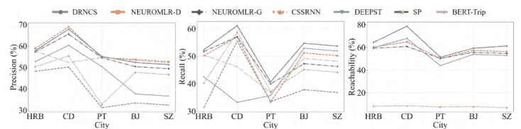

图 4. 模型预测准确率对比

### 5.3 基线方法

我们将模型的性能与以下基线模型进行比较：

- DEEPST（深度时空模型）[8]
- CSSRNN（基于 RNN 的卷积时空序列预测）[15]
- NEUROMLR-D（使用 Dijkstra 算法的 NEUROMLR）[6]
- NEUROMLR-G（使用贪心算法的 NEUROMLR）[6]
- SP（最短路径）[2]
- BERT-Trip [7]

### 5.4 实现细节

本文中的模型使用 Python 3.6 和 PyTorch 2.4.1 在配备 1.70 GHz Intel(R) Core(TM) i5-1240P 处理器和 16 GB RAM 的机器上进行训练。对于对比实验，我们使用 200 个 epoch 和 512 的批次大小。代码可在 https://github.com/iaiplane/DRNCS.git 获取。

### 5.5 与基线方法的比较

准确率和召回率。如图 4 所示，结果表明，在相同训练迭代次数下，我们的模型在准确性方面优于 NEUROMLR-G、DEEPST、CSSRNN 和 BERT-Trip 方法，同时保持与 NEUROMLR-D 相当的准确性水平。这表明我们的模型构建和捷径生成已达到预期效果。

查询时间和生成路径率。深入分析查询时间指标，如表 4 所示，我们的模型在不同数据集上表现出卓越的提升。在成都数据集中，查询速度提升了超过 45.5%，在波尔图数据集中提升了超过 40.0%，在哈尔滨提升了超过 57.1%，在深圳提升了超过 47.8%。值得注意的是，北京数据集中观察到了 57.5% 的提升。这些结果共同表明，我们的模型显著优化了查询时间，与我们最初利用捷径加速最可能路径计算的目标完全一致。

### 5.6 消融研究结果分析

我们模型的核心组件是捷径数据库，主要由 SC^{(1)} 和 SC^{(2)} 组成。因此，在消融研究中，我们验证了整体和部分捷径在保持准确性的同时提升效率的效果。此外，由于在模型构建中选择适当的节点构建标准和比例至关重要，我们进行了多项消融研究以确定模型的最佳参数。验证捷径在提升查询效率方面效果的实验是在不同规模的路网数据集上进行的，而其他实验则使用了成都数据集。

表 4. 模型性能指标

| 模型 | \multicolumn{5}{c|}{查询时间 (ms/行程)} | \multicolumn{5}{c|}{生成路径率 (行程/秒)} |
| :--- | :---: | :---: | :---: | :---: | :---: | :---: | :---: | :---: | :---: | :---: |
| | HRB | CD | PT | BJ | SZ | HRB | CD | PT | BJ | SZ |
| DRNCS | **0.3** | **0.6** | **0.3** | **0.7** | **0.8** | **3356** | **1678** | **3345** | **1432** | **1249** |
| NEUROMLR-D | 243 | 201 | 221 | 314 | 378 | 4.11 | 4.98 | 4.52 | 3.18 | 2.64 |
| NEUROMLR-G | 0.7 | 1.1 | 0.6 | 1.1 | 1.3 | 1428 | 902 | 1667 | 909 | 845 |
| CSSRNN | 0.9 | 1.2 | 1.1 | 1.4 | 1.5 | 1112 | 773 | 972 | 714 | 678 |
| BERT-Trip | 217 | 236 | 219 | 421 | 489 | 4.61 | 4.23 | 4.56 | 2.42 | 2.04 |

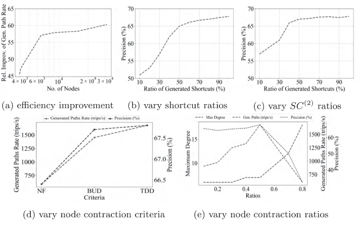

**捷径效果。** 如前一节所述，引入捷径使我们能够在保持准确性的同时显著加快推理速度。为进一步验证模型，我们进行了两项消融实验。首先，我们测试了不同规模的路网，对比 DRNCS 插入捷径与不插入捷径的推理速度，利用生成路径率的相对改进来展示速度差异如何随网络规模增加而增大。图 5a 的结果证实了捷径插入的有效性。其次，我们用 Dijkstra 生成的最短路径替换了数据库中的部分捷径，并比较了不同比例下的模型预测准确率。如图 5b 所示的结果，验证了捷径的有效性。

**捷径中 $SC^{(2)}$ 组件的效果。** 为进一步验证由基于转移概率加权的图上双向 Dijkstra 算法生成的捷径的效果，我们系统地替换了这些捷径的一个子集


与按不同比例生成的 Dijkstra 最短路径进行对比，并比较了精度的差异。结果如图 5c 所示，证明了快捷方式在提升模型性能方面的有效性。

**节点收缩标准。** 我们采用了三种潜在节点收缩标准：历史路径中节点出现频率（**NF**）、自底向上边差（**BUD**）和自顶向下边差（**TDD**）。每种标准均应用于在整个图中减少 30% 的节点，比较结果如图 5d 所示。结果表明，将自顶向下边差作为节点收缩标准，可有效最大限度地控制节点出度的增加，从而提升预测准确率并提高搜索速度。此外，自顶向下节点收缩方法的收缩速度显著更快。

**节点收缩比例。** 为了在准确率和查询速度之间取得平衡，我们在不同收缩比例下测试了模型的精度和查询速率。比较结果如图 5e 所示。因此，为了在保持较高预测准确率的同时获得更快的查询速率，我们最终选择了 0.5 的收缩比例。

## 6 结论

路由生成在众多下游应用中起着关键作用。在实际场景中，针对推荐最可能路径的问题，不仅必须确保高预测准确率，还需显著提升推理速度。后者仍是现有路由生成模型的关键局限。为缓解这一问题，我们提出了 **DRNCS**，这是一种基于节点收缩和快捷方式的加速双层路由生成模型。具体而言，我们通过快捷边差分收缩将原始图转换为稀疏图。通过在原始图的原始轨迹和稀疏图的稀疏轨迹上共同训练模型，我们成功生成了双层训练模型。此外，我们采用了一种包含两种不同方法的快捷方式生成方法：首先，合并历史路径；其次，基于原始图上的训练模型生成快捷方式。这一综合方法使我们能够在大幅缩短的时间内创建更准确的快捷方式数据库。最终，预测结果通过在稀疏图上进行预测并调用存储的快捷方式数据得出。此外，在不同规模的道路网络数据集上的测试表明，我们的方法使查询速度提升了 40% 以上，同时有效保持了令人满意的准确率和可达性。值得注意的是，随着道路网络规模的扩大，查询速度的这一优化变得更加明显，从而凸显了我们的模型在实际场景中的适用性和优势。

## References

- 1. Bhumika, Das, D.: Marrs：一种使用多任务 Transformer 进行多目标风险感知路由推荐的框架。收录于：第 16 届 ACM 推荐系统会议论文集（2022）。https://api.semanticscholar.org/CorpusID: 252216597
- 2. Dijkstra, E.W.: 关于与图相关的两个问题的述评。Numer. Math. 1, 269–271 (1959)
- 3. Geisberger, R., Sanders, P., Schultes, D., Delling, D.: 收缩层次结构：道路网络中更快、更简单的分层路由。收录于：McGeoch, C.C. (编) 实验算法，第 319–333 页。Springer, Berlin Heidelberg (2008)
- 4. Grover, A., Leskovec, J.: node2vec：面向网络的可扩展特征学习。收录于：第 22 届 ACM SIGKDD 知识发现与数据挖掘国际会议论文集（2016）
- 5. Hsieh, H.P., Lin, F.: 带预约的出租车路线推荐——一种多标准路由规划器。Int. J. Urban Sci. 26, 162 – 183 (2021). https://api.semanticscholar.org/CorpusID:233810149
- 6. Jain, J.L., Badia, V., Manchanda, S., Ranu, S.: Neuromlr：道路网络上强健可靠的路由推荐。收录于：神经信息处理系统会议（2021）
- 7. Kuo, A.T., Chen, H., Ku, W.S.: Bert-trip：使用注意对比学习进行有效且可扩展的行程表示。收录于：2023 年 IEEE 第 39 届数据工程国际会议 (ICDE), pp. 612–623 (2023). https://api.semanticscholar.org/CorpusID:260171278
- 8. Li, X., Cong, G., Cheng, Y.: 基于深度概率模型的道路网络空间转换学习。收录于：IEEE 第 36 届数据工程国际会议 (ICDE), pp. 349–360 (2020)
- 9. Li, X., Cong, G., Sun, A., Cheng, Y.: 基于深度生成模型的行程时间分布学习。万维网会议 (2019)
- 10. Rahmani, M., Koutsopoulos, H.N.: 城市网络中低频 GPS 探测的路径推断。收录于：国际 IEEE 智能交通系统会议, pp. 1698–1701 (2012)
- 11. Rahmani, M., Koutsopoulos, H.N.: 城市网络中稀疏浮动车数据的路径推断。Transport. Res. Part C-emerging Technol. 30, 41–54 (2013)
- 12. Tarjan, R.E.: 数据结构与网络算法。收录于：CBMS-NSF 应用数学区域会议系列 (1983)
- 13. Wang, J., Wu, N., Zhao, W.X., Peng, F., Lin, X.: 基于神经网络的 A* 搜索算法赋能个性化路由推荐。收录于：第 25 届 ACM SIGKDD 知识发现与数据挖掘国际会议论文集 (2019)
- 14. Wang, Y., Wei, L., Chen, P.: 混有人驾驶车辆和联网自动驾驶车辆的高速公路交通轨迹重建。Transport. Res. Part C: Emerg. Technol. 111, 135–155 (2020)
- 15. Qing Wu, H., Chen, Z., Sun, W., Zheng, B., Wang, W.: 使用循环神经网络建模轨迹。收录于：国际人工智能联合会议 (2017)
- 16. Zheng, Y., Quddus, M.A.: 面向低频定位数据的基于权重的最短路径辅助地图匹配算法 (2011)
- 17. Mahmood, M.T., Ali, M.E., Cheema, M.A., Rashid, S.M.M., Sellis, T.: PathOracle：基于深度学习的日常通勤者行程规划器。收录于：机器学习与知识发现数据库：欧洲会议 (2022)

## GraphWeave：通过随机游走轨迹进行可解释且强健的图生成

Rahul Nandakumar 和 Deepayan Chakrabarti

美国德克萨斯大学奥斯汀分校，奥斯汀，TX 78713，USA

{rahul.nandakumar,deepayan}@utexas.edu

**摘要.** 给定某个未知家族中的一组图，我们希望从该家族生成新图。最近的方法在图嵌入或节点和边的离散空间上使用扩散。然而，对嵌入进行简单的更改（例如，添加噪声）可能意味着图中不可解释的变化。在离散空间扩散中，每个步骤可能会添加或删除许多节点/边。很难预测在许多扩散步骤后会观察到哪些图模式。我们提出的名为 GraphWeave 的方法采用了不同的方法。我们将模式生成和图构建分离。为了在训练图中发现模式，我们查看它们在随机游走过程中如何转换向量。然后我们分两步生成新图。首先，我们生成与学习到的模式相匹配的现实随机游走“轨迹”。然后，我们找到与这些轨迹相匹配的最优图。该优化共同推断所有边，从而提高对错误的强健性。在四个模拟数据集和五个现实世界基准数据集上，GRAPHWEAVE 优于现有方法。最显著的差异体现在 PageRank、割、社区、度分布和流等大规模图结构上。GRAPHWEAVE 也是其最接近竞争对手速度的 10 倍。最后，GRAPHWEAVE 简单，只需要一个 Transformer 和标准优化器。代码可在 https://github.com/rahulnanda1999/GraphWeave 获取。

**关键词：** 图生成 · 扩散 · 随机游走 · 轨迹

### 1 引言

假设我们有一组具有某种可取特性的分子。例如，这些分子与靶向蛋白质结合以治疗疾病。我们的目标是找到其他具有此特性的分子。我们可以将其形式化为图生成问题。每个分子是一个由键连接的原子图。可取特性对应于给定图中共有的某种未知模式。我们希望自动生成具有这些模式的新图。举另一个例子，假设我们想在社交网络中检测机器人。


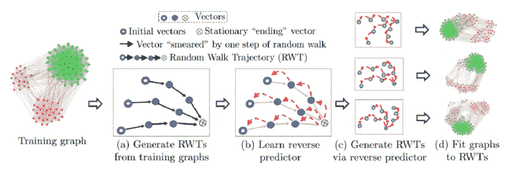

图 1. GRAPHWEAVE 概览：(a) 给定一个或多个训练图，我们从各种起始向量生成随机游走轨迹（RWT）。(b) 我们学习预测轨迹的前一步。(c) 要生成一个新图，我们首先通过 ⊗ 在“结束”向量上多次应用逆预测器。我们表明结束向量易于生成（定理 1）。(d) 其次，我们找到与生成的 RWT 最契合的最优图。即使只有一个训练图，该过程也有效。确实，我们从左侧的单个图生成了右侧的三个图（颜色仅用于清晰起见）。

机器人和普通用户具有不同的链接模式。然而，我们可能没有足够多的机器人示例来训练分类器。为了扩充训练数据，我们可以生成链接模式与已知机器人相匹配的合成图。这可以在不增加成本的情况下提高分类准确率。

本文致力于解决生成与一组训练图结构匹配的新图的问题。我们不考虑节点或边特征，这些特征可以通过后处理步骤推断。例如，对于分子图，我们可以从节点的度（键的数量）推断其特征（它是什么原子），这决定了其边特征（键强度）。现在，即使是生成图结构也是一个复杂的问题。小规模模式（例如，苯环）在某些情况下可能很重要。在其他应用中，大规模模式可能更重要（例如，各种原子的比例，即度分布）。没有一种方法可以匹配所有可能的模式。明确一种方法试图匹配的模式可以提高其可解释性。

然而，现有方法很少明确其选择。一类方法通过在图嵌入空间上的扩散来创建图。它们从随机嵌入开始，迭代地改变它，并将最终嵌入映射到图 [5,20]。但即使是嵌入空间中的简单变化（例如，添加噪声）也可能意味着图结构上的复杂且非直观的修改。因此，生成过程难以解释。

另一类方法改变图结构而非其嵌入。例如，一些方法在每次迭代中对图应用局部变化 [16,19]。每一步可能添加或删除少量节点和边，因此变化是直观的。然而，这些局部变化必须加起来形成所需的全局模式。对协调局部变化的需求使该过程对错误敏感。其他方法在每次迭代中对图结构进行全局变化 [2,17]。虽然这种方法非常灵活，但预测一系列复杂变化会产生什么模式是困难的。这影响了此类方法的可解释性。

> 我们如何以可解释的方式生成与多尺度模式匹配的图？

我们做出两个设计选择以实现这一目标。首先，我们关注图上*可从随机游走中学习的模式*。具体来说，我们构建随机游走轨迹（RWT），以跟踪向量在随机游走过程中的演变。我们表明，几种标准图家族具有独特的 RWT 签名。因此，RWT 可以直观地捕获有用的模式。此外，许多应用基于随机游走。因此，具有正确 RWT 签名生成的图可以立即对这些应用产生积极影响。

我们的第二个设计选择是通过在 RWT 上进行*优化*来生成图。换句话说，我们生成 RWT 并找到与这些 RWT 最契合的最优图。我们的方法将模式匹配（通过 RWT）与图构建（通过优化）分离开来。这种“分工”带来了许多好处。RWT 比图更容易生成，因为 RWT 天然处于向量空间中。通过优化进行图构建增加了灵活性。例如，我们可以施加约束（例如，稀疏性）或添加正则化以增强鲁棒性。

**我们的贡献：** 我们提出的名为 GRAPHWEAVE 的方法生成随机游走轨迹（RWT），然后将它们最优地编织成一个连贯的图。下面我们讨论 GRAPHWEAVE 的优势。

- 1. **公式化：** 我们将图生成视为一个两步问题：生成现实模式，然后优化图以拟合它们。我们跟踪的模式源自随机游走轨迹（RWT）。优化后的图对任何依赖随机游走的下游任务都有帮助。GRAPHWEAVE 将模式生成与图优化分离，简化了生成过程。据我们所知，GRAPHWEAVE 是*首个展示这种基于优化方法的*。

- 2. **可解释性：** RWT 跟踪随机游走如何影响向量。这一基本过程是许多图论问题的基础。例如，向量可以表示社交网络中人们的观点。那么，RWT 将展示观点如何动态演变。因此，RWT 易于解释。

- 3. **多尺度结构：** 我们表明 RWT 可以捕获大规模图结构。这些包括社区、流、切割大小和度分布。通过改变 RWT 的初始化，我们还可以探索局部结构，例如高度节点的邻域。因此，一个图的 RWT 集可以捕获多尺度结构。

- 4. **鲁棒性：** GRAPHWEAVE 共同优化生成图的所有边。优化的输入来自多个 RWT。因此，生成的图对 RWT 生成过程中的偶尔错误具有鲁棒性。

- 5. **简单性：** GRAPHWEAVE 只需要一个变换器来生成 RWT 和一个标准优化器来找到最佳拟合图。这些都是现成的工具。因此，GRAPHWEAVE 的实现简单可靠。

- 6. **强实验结果：** 在四个模拟数据集和五个真实世界数据集上，GRAPHWEAVE 优于最先进的方法。GRAPHWEAVE 在匹配 PageRank、切割、社区、度分布和流等大规模图结构方面尤其强大。此外，GRAPHWEAVE 的运行速度比其最接近的竞争对手快 10 倍。

## 2 拟议方法

我们给定了一组无向图 G，可能大小不同。我们希望生成新图，使其“看起来像” G 中的图。例如，如果 G 包含随机块模型图，则生成的图应匹配该家族。

要生成此类图，我们必须从 G 中的图识别模式。现在，所有可能模式的空间太大。因此，我们必须选择一组直观且广泛适用的模式子集。我们关注随机游走模式，因为随机游走是许多图应用的基础。具体来说，GRAPHWEAVE 构建随机游走轨迹，定义如下。

**定义 1（平滑随机游走轨迹（RWT））。** RWT 有四个参数：\((a)\) \(n\) 个节点的无向图的邻接矩阵 \(A \in \{0, 1\}^{n \times n}\)，\((b)\) 函数 \(f : \mathbb{R}_+ \rightarrow \mathbb{R}_+\)，\((c)\) 平滑参数 \(\alpha \in (0, 1)\)，以及 \((d)\) 步数 \(k\)。令 \(d_i\) 表示节点 \(i\) 的度，\(d'_i := (1 - \alpha)d_i + \alpha\) 为节点的平滑度。我们假设所有节点都有正度。此外，定义平滑归一化邻接矩阵 \(L \in \mathbb{R}^{n \times n}\) 和“起始向量” \(\mathbf{v} \in \mathbb{R}^n\) 如下：

\(L_{ij} := \frac{(1 - \alpha)A_{ij} + \alpha \cdot \mathbb{1}_{i=j}}{\sqrt{d'_i \cdot d'_j}} \quad \mathbf{v}_i := n \frac{f(d_i)}{\sum_j f(d_j)}.\) (1)

> *备注 1。* 我们在定义 1 中使用归一化邻接矩阵 \(L\) 而非随机游走转换矩阵 \(D^{-1}A\)，因为 \(L\) 的对称性简化了后续步骤。我们注意到，两个矩阵具有相同的特征值和密切相关的特征向量。

我们可以通过变化函数 \(f(\cdot)\) 为任何图构建多个 RWT。例如，如果 \(f(d_i)\) 随 \(d_i\) 增加，则起始向量中高度节点的相对权重增加。然后，RWT 会更详细地探索此类节点的邻域。

定义 1 中的平滑参数 \(\alpha\) 为所有节点添加“自环”。自环的存在会减慢随机游走，从而产生更平滑的轨迹。\(\alpha\) 的值越高，轨迹越平滑。我们发现

更平滑的轨迹更易预测，因此也更易生成。接下来，我们展示几个 RWTs 的示例。

### 示例 1（Erdos-Renyi 图）

假设 $\mathcal{G}$ 包含连接概率为 $p$ 的 Erdos-Renyi 随机图。换句话说，第 \(j^{th}\) 个图有 \(n^{(j)}\) 个节点，每对节点以概率 \(p\) 相连。为简化起见，我们忽略平滑 \((\alpha=0)\)。那么，如果 \(n^{(j)}\) 足够大，第 \(j^{th}\) 图中所有节点的度数约为 \(\approx n^{(j)}p\)。因此，对于平滑的 \(f(\cdot)\)，该图起始向量的每个条目约为 \(\approx 1\)。换句话说，无论大小如何，所有 Erdos-Renyi 图的 RWTs 都从接近全一向量 \(\mathbf{1}\) 的位置开始。而且，我们可以证明对于此类图的归一化邻接矩阵 \(L^{(j)}\)，有 \(L^{(j)}\mathbf{1} \approx \mathbf{1}\)。因此，随机图的 RWTs 从 \(\mathbf{1}\) 附近开始，围绕该点波动，并最终收敛。

### 示例 2（随机块模型（SBM））

假设 $\mathcal{G}$ 包含从具有以下参数的 SBM 中采样的图。有两个社区，大小比例为 \(\beta:1-\beta\)。如果两个节点来自同一社区，则它们之间存在边的概率为 \(p\)，否则为 $q$。假设对于所有 \(x$ 我们选择 \(f(x)=1$。那么，所有图的起始向量 \(\boldsymbol{v}^{(j)}$ 均等于 \(\mathbf{1}$。我们可以证明，对于足够大的 \(k$，随机走向量 \((L^{(j)})^k\boldsymbol{v}^{(j)}$ 收敛到一个具有聚类条目的向量 \(\boldsymbol{w}$。具体来说，设

\(\kappa_1:=\beta p+(1-\beta)q,\qquad \kappa_2:=p+q-\kappa_1,\qquad \nu:=\frac{\beta\sqrt{\kappa_1}+(1-\beta)\sqrt{\kappa_2}}{\beta\kappa_1+(1-\beta)\kappa_2}.\)

那么，如果节点 \(i$ 属于第一个社区，\(\boldsymbol{w}_i=\sqrt{\kappa_1}/\nu$；否则为 \(\sqrt{\kappa_2}/\nu$（通过稍后证明的定理 1）。因此，RWT 从 \(\mathbf{1}$ 演变为具有聚类条目的向量 \(\boldsymbol{w}$，与图的大小无关。

### 示例 3（优先附着）

假设 $\mathcal{G}$ 包含根据 Barabasi-Albert 模型 [1] 创建的图。那么，对于任何图，节点度的分布服从指数为 3 的幂律分布。如同 SBM 示例中那样，对于所有 \(x$ 取 \(f(x)=1$，因此起始向量等于 \(\mathbf{1}$。随机走的结束向量与度的平方根成正比（稍后证明的定理 1）。这些服从指数为 5 的幂律分布。

### 示例 4（期望度随机图）

假设 $\mathcal{G}$ 包含期望度与 SBM 匹配的随机图。那么，起始向量和结束向量将与示例 2 相同，但中间向量将不同。

以上示例表明，不同家族的图具有不同的 RWT 特征签名。在所有情况下，RWTs 都从全一向量开始。但是，它们追踪的轨迹具有不同的结束向量。对于 \(f(\cdot)$ 的其他选择，RWTs 可以探索（例如）高度节点及其邻域。GRAPH-WEAVE 自动利用这些模式来从同一家族生成新图。

**核心思想：** GRAPHWEAVE 包含三个步骤。首先，我们从 $\mathcal{G}$ 中的图构建 RWTs。基于此，我们学习反转 RWTs。换句话说，给定 RWT 中的一个向量，GRAPHWEAVE 学习预测前一个向量。其次，我们使用这个反向预测器来生成新的 RWTs。为此，我们需要一个“结束”向量。所有生成的 RWTs 共享相同的结束向量，但追踪不同的轨迹。我们展示如何构建一个现实的结束向量，以及为什么可以认为生成的 RWTs 来自同一图。第三，从生成的 RWTs 中，GRAPHWEAVE 推断底层图。关键的是，我们共同推断该图的所有边。我们可以通过从不同结束向量重复第二和第三步来生成多个图。接下来，我们详细介绍 GRAPHWEAVE 的三个部分。

## 2.1 学习反转 RWTs

给定图集 $\mathcal{G} = \{A_i\}$ 和函数集 $\mathcal{F} = \{f_\ell(\cdot)\}$，我们构建所有 RWTs 的集合 $\mathcal{R} := \{RWT(A, f, \alpha, k)\}_{A \in \mathcal{G}, f \in \mathcal{F}}$。回顾，每个 RWT 是一个向量序列 $\boldsymbol{v}_1, \boldsymbol{v}_2, \dots, \boldsymbol{v}_k$，其中一对 $(\boldsymbol{v}_j, \boldsymbol{v}_{j+1})$ 表示在 $\mathcal{G}$ 中某个图上的随机走的一步。

接下来，我们学习反转 RWTs，即在给定 $\boldsymbol{v}_{j+1}$ 和 $f(\cdot)$ 的情况下预测 $\boldsymbol{v}_j$。预测器必须知道 $f(\cdot)$，因为两个不同的 RWTs 可能通过不同路径到达相同的 $\boldsymbol{v}_{j+1}$。每条路径由其起始向量决定，而该向量依赖于 $f(\cdot)$。要构建预测模型，我们面临两个挑战。

- **任意长度的输入/输出：** 向量 $\boldsymbol{v}_j$ 和 $\boldsymbol{v}_{j+1}$ 的长度是图中的节点数。由于 $\mathcal{G}$ 中的图可能具有不同的大小，$\mathcal{R}$ 中向量的长度可能不同。

- **排列不变性：** 模型必须对 $\boldsymbol{v}_j$ 和 $\boldsymbol{v}_{j+1}$ 的组分排列不变，因为排列只是节点的重新排序。这种重新排序不应影响模型的预测。

我们的解决方案简单而优雅：我们使用一个 Transformer。Transformer 可以适应任意上下文长度的输入。在我们的情况中，输入向量是 $\boldsymbol{v}_{j+1} \in \mathbb{R}^n$，其中图大小 $n$ 在 $\mathcal{G}$ 中的图之间变化。对于 Transformer，这意味着长度为 $n$ 的上下文，其中上下文中的每个项目都是一维的。给出这样的输入，Transformer 的输出也是长度 $n$，与所需的输出向量 $\boldsymbol{v}_j$ 相同。因此，同一个 Transformer 可以用于所有大小的输入/输出向量对。此外，没有位置嵌入或因果掩码的 Transformer 在排列下是不变的。因此，原生 Transformer 符合我们的期望。

然而，我们可以使用嵌入显著改进这个 Transformer。正式地说，我们构造一个分桶函数 $B : \mathbb{R}_+ \to [K]$ 和一个嵌入 $\mathcal{E} : [K] \to \mathbb{R}^m$。对于向量，我们逐元素应用这些函数。也就是说，$B(\boldsymbol{v})$ 是通过对 $\boldsymbol{v}$ 的每个元素应用 $B(\cdot)$ 形成的向量；$\mathcal{E}(\boldsymbol{v})$ 的定义类似。用户选择分桶数量 $K$ 和嵌入维度 $m$。$K$ 和 $m$ 的更高值会使 Transformer 具有更大的灵活性。

现在，我们预处理数据以使用这些嵌入。具体来说，在 RWTs 中，我们将每个向量 $\boldsymbol{v}$ 替换为 $\boldsymbol{v} \otimes \mathcal{E}(B(\boldsymbol{v}))$。我们还通过嵌入进一步增强每个


图 2. 训练反向预测器：对于 RWT 中路径 \(i$ 的每一对连续向量 \((v_j, v_{j+1})$，我们将 \(v_j$ 与从 \(v_{j+1}$ 获得的预测向量 \(\hat{v}_j$ 进行比较。要创建 \(\hat{v}_j$，首先将 \(v_{j+1}$ 的元素转换为嵌入序列。然后，添加反映用于路径 \(i$ 起始向量的函数 \(f$ 以及路径 \(i$ 中步骤 \(j+1$ 的嵌入。最后，我们转换这些嵌入并将其投影以生成 \(\hat{v}_j$。

输入向量与一个编码 \(f(\cdot)$ 选择和 RWT 中当前步骤的嵌入相结合。具体来说，我们定义一个嵌入 \(\mathcal{E}'$，使得对于所有函数 \(f \in \mathcal{F}$ 和步骤 \(j \in [k]$，\(\mathcal{E}'(f, j) \in \mathbb{R}^m$。给定函数 \(f(\cdot)$ 在步骤 \(j+1$ 时的输入向量 \(v_{j+1}$，我们定义

\(T_\Phi(v_{j+1}, f, j+1) := \text{Transformer}_\Phi(v_{j+1} \otimes \mathcal{E}(B(v_{j+1})) + 1 \otimes \mathcal{E}'(f, j+1)),\)

其中 \(\Phi$ 表示 Transformer 的参数。Transformer 的输入现在是一个长度为 \(n$ 的 \(m$ 维嵌入序列，输出也是如此。最后，我们添加一个线性投影层将输出转换回 \(\mathbb{R}^n$：

\(P_{\Phi, \Psi}(v_{j+1}, f, j+1) := \text{Project}_\Psi(T_\Phi(v_{j+1}, f, j+1)) \text{ to } \mathbb{R}^n,\)

其中 \(\Psi$ 是投影参数。给定输入 \(v_{j+1}$，这个投影输出就是我们对 \(v_j$ 的预测。我们训练 Transformer 以最小化预测值和 \(v_j$ 实际值之间的均方误差。

\(\Phi, \Psi, \mathcal{E}, \mathcal{E}' = \arg \min \sum_{(v_j, v_{j+1})} (P_{\Phi, \Psi}(v_{j+1}, f, j+1) - v_j)^2.\)

图 2 说明了此过程。训练后，我们得到一个反向预测器 \(P_{\Phi, \Psi}$（以下简称 \(P$），使得

\(P(v_{j+1}, f, j+1) \approx v_j \text{ for all } v_j \to v_{j+1} \text{ in the RWTs of } \mathcal{G}. \quad (2)\)

## 2.2 生成 RWTs

假设我们已经学习了一个准确的反向预测器。那么，给定“结束”向量 \(\bar{v}_k$ 和 \(f(\cdot)$ 的选择，我们可以通过反复预测来向后推导


前一向量：\(\vec{v}_k \rightarrow \vec{v}_{k-1} \rightarrow \dots \rightarrow \vec{v}_1\)。对 \(f(\cdot)\) 的不同选择会对相同的 \(\vec{v}_k\) 产生不同的序列。我们将序列 \(\{\vec{v}_1, ..., \vec{v}_k\}\) 称为一个 *生成的 RWT*。

生成的 RWT 仅在 \(\vec{v}_k\) 的特定选择下才会现实。特别是，我们希望 \(\vec{v}_k\) 是与 \(\mathcal{G}\) 中图形同属一个家族的某个图的结束向量。形式上，我们希望 \(\vec{v}_k = \bar{L}^k \vec{v}_1\)，其中 \(\bar{L}\) 是此类图的平滑归一化邻接矩阵。但我们不知道 \(\vec{v}_1\) 或 \(\bar{L}\)。下面的定理展示了如何选择 \(\vec{v}_k\)。

**定理 1.** 考虑一个带有度 \(\{d_i\}\) 的 *n* 节点图，平滑度 \(\{d'_i\}\)，起始向量 \(\boldsymbol{v} \in \mathbb{R}^n_+\)（由函数 \(f(d_i)\) 构建），以及平滑归一化邻接矩阵 *L*（如定义 1 所示）。设 \(\boldsymbol{w}\) 为一个分量为

\(\boldsymbol{w}_i := \gamma \cdot \sqrt{d'_i}\)

的向量，其中 \(\gamma = \frac{n \left( \sum_j f(d_j) \sqrt{d'_j} \right)}{\left( \sum_j f(d_j) \right) \left( \sum_j d'_j \right)}\)。

则，我们有：

\(\lim_{k \to \infty} \| L^k \boldsymbol{v} - \boldsymbol{w} \| = 0.\)

*证明.* 根据附录中的引理 1，*L* 的最大特征值为 1，其特征向量 \(\boldsymbol{u}_1\) 的分量为 \(u_{1;i} = \sqrt{d'_i} / (\sum_j d'_j)\)。矩阵 *L* 是不可约的（因为图是连通的）且无周期的（因为 \(\alpha > 0\) 诱导自环）。因此，没有其他特征值的绝对值为 1。接下来，我们观察到 \(\boldsymbol{v}^T \boldsymbol{u}_1 > 0\)，因为 \(\boldsymbol{v}\) 和 \(\boldsymbol{u}_1\) 都在正交范数中。因此，\(L^k \boldsymbol{v}\) 趋向于向量 \((\boldsymbol{v}^T \boldsymbol{u}_1) \boldsymbol{u}_1\)，可以看到这就是向量 \(\boldsymbol{w}\)。

定理 1 表明，现实的结束向量 \(\bar{\boldsymbol{v}}_k\) 必须接近 \(\boldsymbol{w}\)，且 \(\boldsymbol{w}\) 仅依赖于度 \(\{d_i\}\)。因此，要构造 \(\bar{\boldsymbol{v}}_k\)，我们必须生成一个与家族 \(\mathcal{G}\) 匹配的现实度分布。一种方法是采样图 \(G \in \mathcal{G}\) 并扰动其度分布。另一个选择是为 \(\mathcal{G}\) 中图形的度分布拟合模型。例如，我们可以拟合幂律或对数正态分布，因为它们在现实世界数据中被广泛观察到。然后，我们可以从这个拟合模型中采样新的度分布。无论哪种方式，我们都能得到一个现实的度分布 \(\{d_i\}\)。

现在，我们按以下方式生成一个 RWT。使用 \(\{d_i\}\) 和 \(f \in \mathcal{F}\) 的选择，我们构建结束向量 \(\bar{\boldsymbol{v}}_k\)（定理 1）。接下来，我们使用第 2.1 节的逆预测器 *P* 来预测 \(\bar{\boldsymbol{v}}_{k-1} := P(\bar{\boldsymbol{v}}_k)\)、\(\bar{\boldsymbol{v}}_{k-2} := P(\bar{\boldsymbol{v}}_{k-1})\)，以此类推。按此方式，我们构造所有向量 \(\{\bar{\boldsymbol{v}}_1, ..., \bar{\boldsymbol{v}}_k\}\)。这个向量序列即为 *生成的 RWT*。

通过使用相同的 \(\bar{\boldsymbol{v}}_k\) 但不同的 \(f \in \mathcal{F}\) 重复这些步骤，我们可以生成多个 RWT。现在我们必须构造与生成的 RWT 对应的稀疏图。下一节展示如何实现。

_备注 2（与传统扩散的区别）。_ 像扩散模型一样，GRAPHWEAVE 具有前向和逆向过程。然而，在扩散中，前向过程添加随机噪声。在 GRAPHWEAVE 中，前向过程是确定性的。它表示向量在随机游走过程中的演化。现在，只有当前向过程收敛到易于采样的稳态点时才有用。在扩散模型中，这个点通常是标准高斯分布（“100%-噪声”）。定理 1 表明 GRAPHWEAVE 的前向过程也收敛。但我们的稳态向量表示随机游走的收敛，而非噪声。由于随机游走在应用中被广泛使用，通过 RWT 学习其模式可能比在图上学习噪声过程更有益。

_备注 3（图 1 中单个结束向量）。_ 定理 1 表明，在通过适当 \(\gamma\) 归一化后，结束向量对所有起始向量都是相同的。图 1 直观地展示了这一点。然而，定义 1 使用未归一化的起始向量，以便我们可以使用相同的起始向量来讨论示例 2-4。

## 2.3 推断图

给定一组生成的 RWT，我们希望找到一个生成它们的图。假设 \(\bar{\mathbf{v}}_j\) 和 \(\bar{\mathbf{v}}_{j+1}\) 是某个生成的 RWT 中连续的两个向量。那么，该图的平滑归一化邻接矩阵 _L_ 必须满足 \(L\bar{\mathbf{v}}_j=\bar{\mathbf{v}}_{j+1}\)。该关系对每对连续向量都成立。形式上，设 _V_<sub>1</sub> 为行集为 \(\{\bar{\mathbf{v}}_j\}\) 的矩阵，_V_<sub>2</sub> 为行集为 \(\{\bar{\mathbf{v}}_{j+1}\}\) 的矩阵。则，

\(V_1 L = V_2.\) (3)

根据定义 1，矩阵 _L_ 的形式为

\(L = (D')^{-1/2}((1 - \alpha)A + \alpha I)(D')^{-1/2},\) (4)

其中 _A_ 是所需图的邻接矩阵，\(D'\) 是一个对角矩阵，其条目为 \(D'_{ii} = (1-\alpha)d_i+\alpha\)，且 _d<sub>i</sub>_ 是节点 _i_ 的度。请注意，我们知道 {_d<sub>i</sub>_}，因为我们在创建 RWT 时将度分布生成作为第一步（第 2.2 节）。

将等式 4 代入等式 3，通过求解以下问题得到 _A_：

\(\text{minimize}_A \sum_{i,j \in [n]} |X_{ij}|\) (5)
\(\text{where } X = V_1(D')^{-1/2}((1 - \alpha)A + \alpha I)(D')^{-1/2} - V_2,\)
\(A_{ij} \in \{0, 1\} \text{ for all } i, j \in [n],\)
\(A = A^T, \text{Trace}(A) = 0, A\mathbf{1} = \mathbf{d},\)

其中 **_d_** 是分量为 _d<sub>i</sub>_ 的向量。约束条件确保 _A_ 是一个带有度 **_d_** 的无权图。等式 5 是一个整数线性规划问题，可以使用诸如 Gurobi 等标准工具求解。

备注 4. 等式 5 的替代方法是将要求 \( A_{ij} \in \{0, 1\} \) 放宽为 \( A_{ij} \in [0, 1] \)。这得到一个凸问题：

\(\text{minimize}_{\tilde{A}} \sum_{ij} |X_{ij}|\)

其中 \(X = \|V_1(D')^{-1/2}((1 - \alpha)\tilde{A} + \alpha I)(D')^{-1/2} - V_2\|_F^2\)，
\(0 \le \tilde{A} \le 1, \text{Trace}(\tilde{A}) = 0, \tilde{A} = \tilde{A}^T, \tilde{A}\mathbf{1} = \mathbf{d}.\)

这得到一个加权图 \(\tilde{A}\)。我们可以通过对 \(\tilde{A}\) 的条目进行舍入来构造 \(A\)，如下所示：

\(A_{ij} := \mathbb{1}_{\tilde{A}_{ij} > a^* + b^* \log d_i},\)

其中 \(a^*, b^* = \arg \min_{a,b} \frac{1}{n} \sum_{i=1}^n \left| \frac{\sum_j \mathbb{1}_{\tilde{A}_{ij} > a + b \log d_i}}{d_i} - 1 \right|.\)

选择 \((a^*, b^*)\) 可以最小化 \(A\) 的节点度与所需度 \(\{d_i\}\) 之间的相对误差。我们可以通过在选定范围上进行网格搜索来选择 \((a^*, b^*)\)。虽然这种方法对等式 5 的目标没有保证，但在实践中通常效果很好。

## 2.4 总体算法

算法 1 显示了 GRAPHWEAVE 的伪代码。我们首先为 \(\mathcal{G}\) 中的图构建 RWT。然后，我们训练一个变换器来逆转观察到的 RWT 的每个步骤。要生成一个图，我们首先生成一个现实的度分布。度分布为我们提供结束向量 \(\bar{\mathbf{v}}_k\)（定理 1）。从 \(\bar{\mathbf{v}}_k\) 开始，我们通过反复应用变换器（等式 2）按逆序生成 RWT。最后，我们通过求解等式 5 来推断与生成的 RWT 对应的图。我们可以通过与不同度分布一起重用变换器来生成多个图。

**实现细节：** 对于分桶函数，我们使用 \(B(\mathbf{v}) := \lfloor c(\mathbf{v} - \mu)/\sigma \rfloor\)，其中 \(\mu\) 和 \(\sigma\) 是训练集中所有向量条目的均值和标准差，\(c\) 是控制桶数的参数，且分桶函数逐元素应用于 \(\mathbf{v}\)。在我们的实验中，我们设置 \(c = 3\)，\(\alpha = 0.9\)，和 \(k = 10\)。对于函数集 \(\mathcal{F}\)，我们使用幂律：\(\mathcal{F} = \{f : \mathbb{R}_+ \rightarrow \mathbb{R}_+; f(d) = d^\beta, \beta \in \{\pm 1, \pm 2\}\}\)。我们还通过添加 \(f(\cdot)\) 的嵌入和 \(j\) 的嵌入来简化 \(\mathcal{E}'(f, j)\) 的形式。

**计算复杂度：** 首先考虑训练成本。我们构建 \(|\mathcal{F}| \times |\mathcal{G}|\) 个 RWT。对于每个 RWT，主要成本是 \(k\) 次稀疏矩阵-向量乘法 \(L\mathbf{v}_j\)。这需要 \(O(kE)\) 时间，其中 \(E\) 是 \(\mathcal{G}\) 中任何图的最大边数。因此，创建 RWT 需要 \(O(|\mathcal{F}||\mathcal{G}|kE)\) 时间。要训练变换器，我们有来自 RWT 的 \(k|\mathcal{F}||\mathcal{G}|\) 个输入向量。对于每个向量，注意力机制考虑 \(O(n^2)\) 对，其中 \(n\) 是最大节点数。每对的成本与嵌入维度成正比


## 算法 1. GRAPHWEAVE

```
function GRAPHWEAVE(G, F, \alpha, k)
   \mathcal{R} \leftarrow \cup_{A \in G} \cup_{f \in \mathcal{F}} RWT(A, f, \alpha, k)
   \mathcal{D} \leftarrow \{(v_j, v_{j+1}); v_j \rightarrow v_{j+1} \text{ in some RWT in } \mathcal{R}\}
   Define B : \mathcal{R} \rightarrow [K] \triangleright \text{Binning function with } K \text{ bins}
   Define B(v) := [B(v_1), B(v_2), ..., B(v_n)]^T \text{ for any } v \in \mathbb{R}^n
   \triangleright \text{Learn to reverse RWTs}
   Define \mathcal{E} : [K] \rightarrow \mathbb{R}^m \triangleright \text{value embedding function}
   Define \mathcal{E}' : |\mathcal{F}| \times k \rightarrow \mathbb{R}^m \triangleright \text{setting embedding function}
   Define T_b \leftarrow \text{Transformer : } \mathbb{R}^{n \times m} \rightarrow \mathbb{R}^{n \times m} \text{ for any } n
   P_{\Phi, \Psi}(v, j, f) \leftarrow \text{Project}_\Psi (T_b(v \otimes \mathcal{E}(B(v)) + 1 \otimes \mathcal{E}'(f, j)))
   \Phi, \Psi, \mathcal{E}, \mathcal{E}' \leftarrow \text{arg min} \sum_{(v_j,v_{j+1}) \in \mathcal{D}} (P_{\Phi, \Psi}(v_{j+1}, f, j+1) - v_j)^2
   \triangleright \text{Generate degree distribution}
   G \leftarrow \text{sample graph from } G
   {d_i} \leftarrow \text{Perturbed degree distribution of } G
   d'_i \leftarrow (1 - \alpha)d_i + \alpha \text{ for all nodes } i
   \triangleright \text{Generate RWTs}
   V_1, V_2 \leftarrow \phi
   \text{for all } f \in \mathcal{F} \text{ do}
     \bar{v}_k \leftarrow \gamma \sqrt{d'} \triangleright d' \text{ has entries } d'_i; \gamma \text{ is from Theorem 1}
     \bar{v}_{k-j} \leftarrow P_{\Phi, \Psi}(\bar{v}_{k-j+1}, f, k-j+1) \text{ for } j = 1, 2, ..., k-1
     V_1 \leftarrow V_1 \cup \{\bar{v}_j; j = 1, ..., k-1\}
     V_2 \leftarrow V_2 \cup \{\bar{v}_{j+1}; j = 1, ..., k-1\}
   \text{end for}
   \triangleright \text{Infer graph}
   A \leftarrow \text{solve Equation 5 using } V_1 \text{ and } V_2
   \text{return unweighted graph with adjacency matrix } A
\text{end function}
```

我们假设 Transformer 的大小是固定的（即，O(1) 层和头）。因此，训练 Transformer 的代价是 O(|F||G|kn^2m)，这也是训练的总体代价。

要生成一个图，我们通过 Transformer 的 k|F| 次传递来创建其 RWT。每次传递需要 O(n^2m) 时间。由于整数线性规划（公式 5）可能有可变代价，我们而是分析凸优化（公式 6）。生成 n 个节点的图需要 O(n^2) 个参数。主要代价在于计算目标函数中 V1（大小 k|F| x n）和 (D')^-1/2 A' (D')^-1/2（大小 n x n）的矩阵-矩阵乘积。假设我们运行固定步数的梯度下降，凸优化需要 O(MatMult(k|F| x n, n x n)) 时间。阈值步骤（公式 7）的代价为 O(n^2)，用于网格搜索。因此，生成的总代价是 O(k|F|n^2m + MatMult(k|F| x n, n x n)) = O(k|F|n^2m)。

请注意，主导代价是训练 Transformer、矩阵乘法和凸优化。对于这三者，都有现成的快速库。

## 3 实验

### 比较指标
我们考虑节点中心性（度和 PageRank）、局部邻域（聚类系数和 ORBIT 得分）、随机分区质量（割大小、导通度和模块度）、随机节点对之间的连通性（最大流和电阻）以及整体连通性（图是否连通）。除了整体连通性，每个度量对于任何图 G 都会产生一个向量 \(\phi(G)\)（例如，节点度向量或 100 个随机分区的模块度）。我们然后计算相对误差
\[\text{error}_\phi(\mathcal{G}_{gen} | \mathcal{G}_{test}) := \left| \frac{\sum_{G_i \in \mathcal{G}_{gen}, G_j \in \mathcal{G}_{test}} \text{distance}(\phi(G_i), \phi(G_j))}{\sum_{G_i, G_j \in \mathcal{G}_{test}} \text{distance}(\phi(G_i), \phi(G_j))} \times \frac{|\mathcal{G}_{test}|}{|\mathcal{G}_{gen}|} - 1 \right|,\]
其中 \(\mathcal{G}_{gen}\) 是生成的图集，\(\mathcal{G}_{test}\) 是与训练数据同一家族的测试图集，距离函数是任意两个向量 \(\phi(G_i)\) 和 \(\phi(G_j)\) 之间的 Wasserstein 度量。如果生成的图符合测试分布，误差接近 0。

### 竞争方法
我们将 GRAPHWEAVE 与若干最先进的方法进行比较：DiGress [17]、GSDM [11]、GRASP [14]、GDSS [8] 和 GraphRNN [19]。除了是自回归模型的 GraphRNN 之外，其他方法都使用扩散。这些方法是最近的，并且已被证明优于旧方法。因此，我们将 GRAPHWEAVE 与这些方法进行比较。

### 模拟数据集
我们考虑四种模拟图：
- 一个包含 3 个社区的随机块模型，分别包含 50%、30% 和 20% 的节点，同一社区内节点的连接概率为 0.8，否则为 0.3，
- 一个每个节点 4 条边且重线概率为 0.3 的 Watts-Strogatz 模型，
- 一个 Barabasi-Albert 优先附着模型，以及
- 一个期望度随机图模型，其度与随机块模型相同。

### 真实世界数据集
我们还在五个真实世界基准数据集上测试了我们的方法。这些包括：
- Cora、
- Citeseer，以及
- Pubmed，其中节点表示文档，边表示引用关系，从中我们提取 3-hop 自我网络 [15]。
我们还使用：
- Proteins，包含每个图有 100 到 500 个节点的分子图 [4]，以及
- QM9，包含最多九个重原子的稳定有机分子 [18]。

### 实验设置
对于每个数据集和每种方法，我们在 100 个图上训练，然后生成（至少）40 个图。我们为每个生成的图计算各种比较指标，并使用公式 8 将它们与同一数据集中未见的测试图进行比较。

### 图生成质量
表 1 比较了模拟数据集上的所有竞争方法。我们发现 GRAPHWEAVE 通常优于

表 1. 模拟数据集上的比较：生成图的质量通过公式 8 衡量（越低越好）。GRAPHWEAVE 优于其他方法，尤其是在大规模指标（如度分布、割大小、导通度和最大流）方面。此外，GRAPHWEAVE 和 GDSS 是唯一始终生成连通图的方法。

| | | 度 | PageRank | 连通图？ | 割大小 | 导通度 | 模块度 | 聚类系数 | ORBIT | 最大流 | 电阻 |
|---|---|---|---|---|---|---|---|---|---|---|---|
| 随机块模型 | DiGress | 0.10 | 0.42 | ✓ | 3.15 | 0.14 | 0.11 | **1.16** | 2.90 | 1.50 | 1.74 |
| | GSDM | 18.14 | 11.77 | × | 35.78 | 8.67 | 24.15 | 31.13 | 19.65 | 19.29 | 791.98 |
| | GDSS | 2.66 | 0.34 | × | 23.79 | 0.53 | 4.13 | 22.14 | 16.54 | 11.79 | 28.65 |
| | GRASP | 2.09 | 12.45 | ✓ | 16.01 | 2.61 | 1.45 | 10.69 | 10.89 | 12.47 | 39.99 |
| | GraphRNN | 37.15 | 5.71 | × | 60.62 | 8.56 | 31.88 | 18.54 | 31.06 | 32.63 | 2170.56 |
| | **GraphWeave** | **0.02** | **0.02** | ✓ | **0.02** | **0.03** | **0.10** | 4.27 | **1.35** | **0.01** | **0.02** |
| Watts-Strogatz | DiGress | 0.06 | 0.47 | ✓ | 6.17 | 0.14 | **0.18** | **2.07** | 3.99 | 0.46 | 1.94 |
| | GSDM | 2.72 | 2.84 | ✓ | 2281.93 | 3.70 | 8.41 | 5.41 | 9537.24 | 313.18 | 18.94 |
| | GDSS | 2.50 | 1.33 | ✓ | 1347.60 | 3.33 | 7.22 | 2.69 | 3681.39 | 176.23 | 18.26 |
| | GRASP | 2.98 | 2.07 | × | 3294.84 | 3.50 | 9.57 | 11.85 | 13067.07 | 393.88 | 19.05 |
| | GraphRNN | 0.71 | 5.13 | × | 138.97 | 5.41 | 7.16 | 2.67 | 9.78 | 25.58 | 53.64 |
| | **GraphWeave** | **0.02** | **0.18** | ✓ | **0.22** | **0.11** | 0.22 | 2.90 | **3.65** | **0.02** | **1.77** |
| 优先附着 | DiGress | 0.09 | **0.01** | ✓ | 1.80 | **0.08** | 0.06 | **0.04** | **0.02** | 0.30 | **0.27** |
| | GSDM | 0.88 | 4.78 | ✓ | 1637.97 | 3.90 | 6.60 | 9.48 | 549.15 | 225.39 | 35.19 |
| | GDSS | 0.97 | 4.29 | ✓ | 891.67 | 3.57 | 5.27 | 4.69 | 192.20 | 121.26 | 33.01 |
| | GRASP | 2.73 | 2.32 | × | 48.04 | 0.30 | 0.86 | 6.37 | 3.65 | 5.13 | 32.46 |
| | GraphRNN | 6.91 | 5.94 | × | 180.42 | 5.53 | 12.39 | 2.69 | 5.50 | 18.81 | 184.25 |
| | **GraphWeave** | **0.01** | 0.21 | ✓ | **0.01** | 0.09 | **0.01** | 0.85 | 0.27 | **0.00** | 1.50 |
| 随机图，其度与随机块模型相同 | DiGress | 0.05 | **0.01** | ✓ | **0.01** | 0.14 | **0.02** | **0.01** | **0.00** | 0.03 | **0.03** |
| | GSDM | 4.92 | 1.94 | ✓ | 18.59 | 0.47 | 3.50 | 19.43 | 15.14 | 8.34 | 25.31 |
| | GDSS | 2.80 | 0.38 | ✓ | 21.13 | 0.44 | 3.52 | 20.12 | 17.86 | 10.22 | 25.20 |
| | GRASP | 1.52 | 10.67 | ✓ | 13.39 | 2.07 | 1.15 | 10.23 | 9.86 | 10.33 | 26.09 |
| | GraphRNN | 37.85 | 4.35 | × | 54.74 | 8.17 | 29.26 | 19.29 | 32.32 | 29.14 | 1980.06 |
| | **GraphWeave** | **0.02** | 0.03 | ✓ | 0.03 | **0.05** | 0.34 | 10.17 | 4.54 | **0.02** | 0.06 |

竞争方法在大规模图结构的度量方面。例如，GRAPHWEAVE 在预测节点度和割大小方面表现出色。GRAPHWEAVE 在其他指标（如模块度、最大流和电阻）方面也是最佳或接近最佳的。最接近的竞争方法是 DiGress，但 DiGress 有时会生成不连通的图。相比之下，GRAPHWEAVE 始终生成连通图。此外，GRAPHWEAVE 明显快于 DiGress，如我们稍后所示。

GRAPHWEAVE 对随机块模型图族表现尤为出色。这是因为此类图表现出大规模社区结构，而随机游走可以捕捉这种结构。

表 2 比较了所有竞争方法在真实世界数据集上的质量。结果与模拟数据集的结果一致。对于诸如割大小分布等大规模度量，GRAPHWEAVE 在所有数据集上都是最好的。此外，它在度分布、PageRank 中心性分布、导通度和模块度方面要么是最好的，要么是接近最好的。

### 优化效应
我们比较了我们的两种优化方法：公式 5 的整数线性规划（整数），以及带有舍入的公式 6 和 7 的凸松弛（凸）。我们还考虑了一个基线（随机），它选择与整数具有相同度的随机图。比较度量是公式 5 和 6 的目标函数，它衡量生成的图与所需的 RWT 有多接近。


## 表 2. 真实世界数据集的对比（越低越好）。GRAPHWEAVE 在大多数指标和数据集上表现最佳或接近最佳。

| | 度 | PageRank | 割大小 | 传导率 | 模块度 | 聚类系数 | ORBIT | 最大流 | 电阻 |
|---|---|---|---|---|---|---|---|---|---|
| Cora | | | | | | | | | |
| DiGress | 1.73 | 0.10 | 0.99 | 0.12 | 0.09 | 1.06 | 0.25 | 1.63 | **0.05** |
| GSDM | 0.34 | 0.13 | 7.53 | 0.20 | 0.38 | 1.40 | 5.37 | 41.11 | 2.13 |
| GDSS | **0.01** | 0.11 | 32.23 | 0.35 | 0.60 | 1.70 | 95.62 | 117.72 | 2.26 |
| GRASP | 0.03 | 5.30 | 0.71 | 0.85 | 1.27 | 1.14 | 0.47 | 7.15 | 0.77 |
| GraphRNN | 13.13 | **0.02** | 0.20 | 0.44 | **0.07** | 1.08 | 0.30 | 3.26 | 7.18 |
| **GraphWeave** | **0.01** | **0.02** | **0.18** | **0.11** | **0.07** | **0.67** | **0.16** | **0.18** | 0.69 |
| Pubmed | | | | | | | | | |
| DiGress | 10.25 | **0.04** | 0.36 | 0.07 | 0.45 | 0.43 | 0.45 | 1.06 | 0.18 |
| GSDM | 0.37 | 0.16 | 4.04 | **0.02** | 0.06 | 1.02 | 4.07 | 15.79 | 1.42 |
| GDSS | **0.00** | 0.28 | 14.71 | 0.05 | 0.20 | 1.65 | 80.79 | 51.05 | 1.57 |
| GRASP | 0.02 | 17.31 | 0.21 | 2.65 | 3.45 | 1.45 | 0.98 | 0.67 | 0.21 |
| GraphRNN | 11.50 | 0.15 | 0.26 | 0.13 | **0.04** | 0.38 | 0.20 | 1.07 | 6.83 |
| **GraphWeave** | 0.07 | **0.07** | **0.03** | 0.11 | 0.07 | **0.26** | **0.03** | **0.06** | **0.01** |
| Citeseer | | | | | | | | | |
| DiGress | 8.87 | **0.04** | 0.60 | **0.02** | 0.08 | 1.19 | 0.24 | 0.99 | 0.64 |
| GSDM | 0.21 | 0.13 | 3.71 | **0.02** | 0.10 | 1.49 | 8.30 | 20.45 | 1.41 |
| GDSS | 0.11 | 0.13 | 11.42 | 0.09 | 0.27 | 2.02 | 90.31 | 54.23 | 1.54 |
| GRASP | **0.08** | 0.79 | 2.45 | 0.23 | 0.32 | 1.87 | 16.37 | 13.13 | 0.75 |
| GraphRNN | 14.09 | 0.10 | 0.24 | 0.17 | **0.00** | 1.32 | **0.05** | 1.91 | 3.95 |
| **GraphWeave** | 0.17 | 0.07 | **0.03** | 0.13 | 0.08 | **0.48** | 0.09 | **0.23** | **0.23** |
| QM9 | | | | | | | | | |
| DiGress | 0.06 | 0.01 | 0.11 | **0.27** | **0.23** | 0.35 | 0.08 | **0.14** | 0.04 |
| GSDM | 0.25 | 0.03 | 2.60 | 0.98 | 0.76 | 1.76 | 4.09 | 3.19 | 0.91 |
| GDSS | 0.09 | 0.20 | 0.85 | 0.61 | 0.48 | 0.94 | 1.22 | 1.01 | 0.30 |
| GRASP | **0.01** | 0.11 | 0.06 | 0.54 | 0.39 | **0.03** | 0.12 | 0.19 | **0.03** |
| GraphRNN | **0.01** | 0.09 | 0.22 | 0.63 | 0.38 | 0.64 | 0.39 | 0.29 | **0.03** |
| **GraphWeave** | 0.03 | **0.00** | **0.02** | 0.39 | 0.31 | 0.47 | **0.06** | 0.33 | 0.07 |
| Proteins | | | | | | | | | |
| DiGress | 5.94 | 0.33 | 1.03 | 1.87 | 3.41 | 7.19 | 4.64 | 4.17 | 0.61 |
| GSDM | 0.74 | **0.00** | 10.20 | 0.10 | 0.75 | 3.74 | 2254.53 | 35.68 | 1.63 |
| GDSS | 0.78 | 0.01 | 36.58 | 0.19 | 1.11 | **2.95** | 22210.10 | 96.64 | 1.69 |
| GRASP | 0.89 | 31.57 | 2.51 | 14.43 | 8.98 | 5.40 | 1010.18 | 10.48 | **0.60** |
| GraphRNN | 2.30 | 0.16 | 0.24 | 0.19 | **0.06** | 4.88 | **1.51** | 4.01 | 12.04 |
| **GraphWeave** | **0.01** | 0.03 | **0.00** | **0.04** | **0.06** | 5.62 | 2.33 | **0.66** | 3.25 |

表 3 显示，*整数* 比 *凸* 好 20%–55%，且两者都显著优于 *随机*。*整数* 与 *凸* 之间的差异在于，后者需要将边从 [0, 1] 阈值化到 {0, 1}。这一阈值化步骤（Eq. 7）会增加 RWT 重建中的错误。

**墙钟时间：**图 3 比较了各种方法的墙钟时间。我们看到 GRAPHWEAVE 具有最快的训练时间，且具有合理的生成时间。此外，GRAPHWEAVE *比其最接近的竞争对手（DiGress）快 10 倍*。

**灵敏度分析：**我们研究了我们的度量对超参数 $c$、$\alpha$ 和 $k$ 的变化的敏感性。回想一下，$c$ 控制分桶函数 $B(\mathbf{v})$ 中的桶数，$\alpha$ 平滑 RWT，而 $k$ 是 RWT 的长度。之前的所有实验都使用了基准设置（$c = 3, k = 10, \alpha = 0.9$）。我们逐次改变一个超参数进行了实验。我们报告所有相对于基准设置值的归一化度量。因此，归一化值大于 1 意味着比基准性能更差，小于 1 意味着比基准性能更好。

## 表 3. 保真度：RWT 重建：整数线性规划（Eq. 5）生成的图显著优于替代方案。

| 整数相对于的改进 | 随机块模型 50 节点 | 随机块模型 100 节点 | 随机块模型 200 节点 | 优先连接 50 节点 | 优先连接 100 节点 | 优先连接 200 节点 |
|---|---|---|---|---|---|---|
| 凸 | 31% | 57% | 18% | 58% | 47% | 21% |
| 随机 | 80% | 91% | 82% | 79% | 67% | 55% |


### (a) 训练时间 (b) 生成时间

### 图 3. 墙钟时间：GDSS 要慢得多，因此未显示。

图 4 总结了这些结果。在每个图中，1 处的水平红线表示基准水平。偏离这条线表明给定度量受相应参数变化的影响程度。总体而言，没有超参数设置占优于基准设置。我们还观察到：

- **改变 c** 主要影响割大小和电阻。c 的值越高，割大小的性能越好。
- **改变 α** 影响更明显，特别是在 α = 0.99 时，多个度量（例如，Pagerank、电阻）与基准偏差较大。因此，过度平滑会对 GraphWeave 的性能产生负面影响。
- **改变 k** 对割大小和电阻的影响大于其他度量。这与改变 c 的效果相似。

## 4 相关工作

图可以通过自回归模型、归一化流模型、VAE、GAN 和扩散方法生成。下面我们将讨论这些方法。

**自回归模型：**这些模型通过逐个添加节点或边来依次生成图。每一步都会考虑先前生成的结构。基础方法可以是像 GraphRNN [19] 这样的循环神经网络，或者像 GRAN [10] 这样的注意力机制，或者是与扩散相结合的方法（如 GraphARM [9]）。然而，自回归模型通常对节点顺序敏感，节点置换可能导致不同的生成路径。

**归一化流：**这些方法在图和隐性分布之间提供可逆转换，从而实现易于计算的似然。GraphNVP [12] 使用流进行分子生成。GraphAF [16] 引入改进以提高生成图的质量和有效性。

**VAE 和 GAN：**VAE 将图映射到隐性空间，并可以通过概率解码器从隐性嵌入重建图 [7]。GAN 也已应用于图生成 [2]。SPECTRE [13] 集成光谱特征以增强 GAN 的表达能力。MolGAN [3] 通过结合强化学习扩展 GAN 用于分子图生成。然而，许多基于 GAN 的模型遭受训练不稳定和模式崩溃之苦，使其对于多样化的图分布来说不够可靠。此外，对抗训练的黑盒特性使其难以解释 [6]。

**扩散模型：**得益于扩散在图像生成中的成功，这些方法近年来备受瞩目。GDSS [8] 利用随机微分方程组共同学习节点和边分布。DiGress [17] 引入了一种离散扩散模型，通过马尔可夫转移来编辑节点和边属性。GSDM [11] 在邻接矩阵的谱上应用扩散，而 GRASP [14] 关注拉普拉斯矩阵的谱。虽然这些方法是最新技术，但我们展示了 GRAPHWEAVE 胜过它们，特别是对于大规模结构，如随机分区的割大小分布和节点 PageRank 分布。此外，GRAPHWEAVE 比其最接近的竞争对手更快。


### 图 4. 归一化图度量对超参数变化的敏感性。每个度量在基准（c = 3, k = 10, $\alpha$ = 0.9）处归一化为 1，偏离 1 表明对相应参数的敏感性。


## 5 结论

针对“如何生成具有正确模式的图？”这一问题，我们给出了一个两步答案：首先生成模式，然后优化图。我们选择专注于可以从随机步行中学习的模式。原因是许多下游应用使用随机步行，因此以这种方式生成的图可能产生重大影响。优化步骤使图对生成模式中的噪声具有鲁棒性。它还允许我们对图施加约束，例如所需的度分布。

GRAPHWEAVE 通过一种快速、可解释且简单的算法将这一想法付诸实践。GRAPHWEAVE 学习预测随机步行轨迹，这些轨迹显示随机步行如何转换节点属性向量。然后，使用此预测器，我们生成新的轨迹。最后，我们找到最适合这些轨迹的最优图。该算法只需要一个变换器和一个优化器。在多个模拟和基准数据集上的实验表明，GRAPHWEAVE 性能优于现有最先进的方法，并且是最快的方法之一。

## A 平滑归一化邻接矩阵

### 引理 1。

设 $A$、$d'_i$ 和 $L$ 按定义 1 定义。令 $D' = \text{diag}(d'_i)$。设 $\beta_1 \ge \dots \ge \beta_n$ 为 $L$ 的特征值。则 $\beta_1 = 1$，其对应的特征向量为 $(D'^{1/2}\mathbf{1})/\|D'^{1/2}\mathbf{1}\|$，且 $\beta_n > -1$。

### 证明。

我们有 $L = D'^{-1/2}((1 - \alpha)A + \alpha I)D'^{-1/2}$。由于 $A\mathbf{1} = D\mathbf{1}$，我们有 $LD'^{1/2}\mathbf{1} = D'^{-1/2}((1 - \alpha)A + \alpha I)\mathbf{1} = D'^{-1/2}((1 - \alpha)D + \alpha I)\mathbf{1} = D'^{1/2}\mathbf{1}$。因此，$\mathbf{1}$ 是 $L$ 的一个特征值，特征向量为 $(D'^{1/2}\mathbf{1})/\|D'^{1/2}\mathbf{1}\|$。为了证明它是最大特征值，我们证明 $I - L$ 是半正定的。我们有

\( I - L = D'^{-1/2}(D' - (1 - \alpha)A - \alpha I)D'^{-1/2} = (1 - \alpha)D'^{-1/2}(D - A)D'^{-1/2} = (1 - \alpha)D'^{-1/2}D^{1/2}(I - D^{-1/2}AD^{-1/2})D^{1/2}D'^{-1/2} . \)

现在，$D$ 和 $D'$ 是正定的，$I - D^{-1/2}AD^{-1/2}$ 也是，因为

\(\boldsymbol{x}^T(I - D^{-1/2}AD^{-1/2})\boldsymbol{x} = \sum_i \boldsymbol{x}_i^2 - \sum_{(i,j) \in E} \frac{2x(i)x(j)}{\sqrt{d'_id'_j}} = \sum_{(i,j) \in E} \left( \frac{x(i)}{\sqrt{d'_i}} - \frac{x(j)}{\sqrt{d'_j}} \right)^2 \ge 0,\)

对任何 $\boldsymbol{x}$ 成立。因此 $I - L$ 是半正定的。同样，我们通过证明 $I + L$ 是正定的来表明 $L$ 的最小特征值大于 $-1$。

\( I + L = D'^{-1/2}(D' + (1 - \alpha)A + \alpha I)D'^{-1/2} = (1 - \alpha)D'^{-1/2}(D + A)D'^{-1/2} + 2\alpha D'^{-1} = (1 - \alpha)D'^{-1/2}D^{1/2}(I + D^{-1/2}AD^{-1/2})D^{1/2}D'^{-1/2} + 2\alpha D'^{-1} . \)

第二项是正定的。第一项是半正定的，因为

\(\boldsymbol{x}^T(I + D^{-1/2}AD^{-1/2})\boldsymbol{x} = \sum_{(i,j) \in E} \left( \frac{x(i)}{\sqrt{d'_i}} + \frac{x(j)}{\sqrt{d'_j}} \right)^2 \ge 0.\)

## 参考文献

- 1. Albert, R., Barabási, A.L.: 复杂网络的统计力学. Rev. Mod. Phys. 74(1), 47 (2002)
- 2. Bojchevski, A., Shchur, O., Zügner, D., Günnemann, S.: Netgan: 通过随机步行生成图. 在: ICML, 第 610–619 页 (2018)
- 3. De Cao, N., Kipf, T.: Molgan: 小分子图的隐式生成模型. arXiv:1805.11973 (2018)
- 4. Dobson, P.D., Doig, A.J.: 无需比对即可区分酶结构与非酶. J. Mol. Biol. 330(4), 771–783 (2003)
- 5. Evdaimon, I., 等: 基于潜在扩散模型的特征条件图神经生成器 (2024). https://arxiv.org/abs/2403.01535
- 6. Guo, X., Zhao, L.: 图生成深度生成模型的系统综述. IEEE Trans. Pattern Anal. Mach. Intell. 45(5), 5370–5390 (2022)
- 7. Jin, W., Barzilay, R., Jaakkola, T.: 用于分子图生成的联结树变分自编码器. 在: ICML, 第 2323–2332 页 (2018)
- 8. Jo, J., Lee, S., Hwang, S.J.: 通过随机微分方程系统进行基于得分的图生成建模. 在: ICML (2022)
- 9. Kong, L., Cui, J., Sun, H., Zhuang, Y., Prakash, B.A., Zhang, C.: 用于图生成的自回归扩散模型. 在: ICML (2023)
- 10. Liao, R., 等: 基于图循环注意力网络的高效图生成. 在: NeurIPS, vol. 32 (2019)
- 11. Luo, T., Mo, Z., Pan, S.J.: 通过谱扩散进行快速图生成. IEEE Trans. Pattern Anal. Mach. Intell. 46(05), 3496–3508 (2024)
- 12. Madhawa, K., Ishiguro, K., Nakago, K., Abe, M.: Graphnvp: 用于生成分子图的可逆流模型. arXiv:1905.11600 (2019)
- 13. Martinkus, K., Loukas, A., Perraudin, N., Wattenhofer, R.: Spectre: 谱调节有助于突破一次性图生成器的表达性极限. 在: ICML, 第 15159–15179 页. PMLR (2022)
- 14. Minello, G., Bicciato, A., Rossi, L., Torsello, A., Cosmo, L.: 通过谱扩散进行图生成. arXiv:2402.18974 (2024)
- 15. Sen, P., Namata, G., Bilgic, M., Getoor, L., Galligher, B., Eliassi-Rad, T.: 网络数据中的集体分类. AI Mag. 29(3), 93–93 (2008)
- 16. Shi, C., Xu, M., Zhu, Z., Zhang, W., Zhang, M., Tang, J.: GraphAF: 用于分子图生成的基于流的自回归模型. arXiv:2001.09382 (2020)
- 17. Vignac, C., Krawczuk, I., Siraudin, A., Wang, B., Cevher, V., Frossard, P.: Digress: 用于图生成的离散去噪扩散. arXiv:2209.14734 (2022)
- 18. Wu, Z., 等: Moleculenet: 分子机器学习基准. Chem. Sci. 9(2), 513–530 (2018)
- 19. You, J., Ying, R., Ren, X., Hamilton, W., Leskovec, J.: GraphRNN: 使用深度自回归模型生成现实图. 在: ICML, 第 5708–5717 页 (2018)
- 20. Zhou, C., Wang, X., Zhang, M.: 通过潜在图扩散统一图上的生成与预测 (2024). https://arxiv.org/abs/2402.02518

## 通过迭代训练和微调缓解过平滑的深层 GCN

Furong Peng$^1$, Jinzhen Gao$^2$, Xuan Lu$^{2(\textcircled{S})}$, Kang Liu$^2$, Yifan Huo$^2$, and Sheng Wang$^3$

$^1$ 山西大学大数据科学与产业研究院/山西省进化科学智能重点实验室，中国太原
pengfr@sxu.edu.cn
$^2$ 山西大学，中国太原
{202322404011,202222407023,202422409007}@email.sxu.edu.cn,
xuanlu@sxu.edu.cn
$^3$ 郑州航空工业管理学院，中国郑州
wangsheng1910@zua.edu.cn

**摘要。** 图卷积网络（GCNs）在深层架构中因过平滑而遭受严重的性能退化。虽然现有研究主要将过平滑归因于图拉普拉斯亚算子的反复应用，但我们的实证分析揭示了一个关键却被忽视的因素：GCNs 中的可训练线性变换会显著加剧特征坍缩，即使在中等深度（例如 8 层）也是如此。相比之下，简化图卷积（SGC）移除了这些变换，能够保持高达 32 层的稳定特征多样性，突显了线性变换在促进表达能力和诱导过平滑方面的双重作用。然而，完全移除线性变换会削弱模型的表达能力。

为解决这一权衡，我们提出 **逐层渐进训练 (LGT)**，这是一种新的训练策略，可在保持表达能力的同时逐步构建深层 GCN。LGT 包含三个互补的组成部分：(1) _逐层训练_，用于从浅层到深层稳定优化；(2) _低秩适应_，用于微调浅层并加速训练；(3) _恒等初始化_，以确保新层的平滑集成并加速收敛。在多个基准数据集上的大量实验表明，LGT 在原始 GCN 上实现了最先进的性能，即使在 32 层设置中也能显著提高准确率。此外，作为一种训练方法，LGT 可以与现有方法（如 PairNorm 和 ContraNorm）无缝结合，进一步提升它们在更深网络中的性能。LGT 为可扩展深层 GCN 提供了一种通用的、与架构无关的训练框架。代码可在 https://github.com/jfklasdfj/LGT_GCN 获取。

**关键词：** GCNs • 过平滑 • 微调 • LoRA


## 1 引言

图神经网络 (GNNs) [4, 6, 8] 已成为从图结构数据中学习的强大范式，在社交网络分析 [5, 31]、分子属性预测 [15] 和交通预测 [13] 等应用中取得了显著成功。其中，图卷积网络 (GCNs) [2, 11] 因其能够通过迭代消息传递聚合邻域信息而被广泛采用。

尽管如此，由于过平滑问题，GCNs 在扩展到更深层架构时会面临严重的性能下降，即节点表示在各层之间变得不可区分 [1, 19]。尽管先前研究主要将过平滑归因于图拉普拉斯的重复应用 [14]，但我们的实证分析（图 1）揭示了一个关键但研究不足的原因：GCN 层中的线性变换会显著加速特征坍缩，即使在 8 层等中等深度下也是如此。有趣的是，如图 1 所示，简化图卷积 (SGC) [28]（它移除了线性变换和非线性）即使在 32 层时也能保持稳定性能和可分的节点表示。这种对比凸显了一种根本的权衡：虽然线性变换对于表达性特征学习至关重要，但它们也会加剧深层 GCN 中的过平滑。然而，现有方法在很大程度上忽略了这种双重作用，使得平衡表达能力与平滑度的挑战仍未解决。


(a) 不同深度下 SGC 与 GCN 的准确率对比。

(b) GCN (8 层) (c) SGC (8 层)

(d) GCN (32 层) (e) SGC (32 层)

**图 1. GCN 与 SGC 在 Cora 上的过平滑对比。** (a) 随深度增加的准确率趋势，其中 GCN 在 8 层之后遭受严重性能下降，而 SGC 保持稳定性能。 (b-e) 不同深度下的节点嵌入可视化（通过 t-SNE [16]）：随着深度增加，GCN 的特征会坍缩，而 SGC 即使在 32 层也能保持清晰的类别可分性。

为了解决深层 GCN 的局限性，我们引入了层级渐进训练 (LGT)，这是一种新颖的训练范式，旨在在保持模型表达能力的同时缓解过平滑。LGT 不同时间训练所有层，而是逐步扩展网络深度，整合三种关键策略：增量层级训练、低秩适应 (LoRA) 和恒等初始化。

**增量层级训练。** 传统 GCN 在浅层设置下表现良好，但随着深度增加会迅速恶化。为了利用这一特性，LGT 采用分阶段训练方法，逐步增加深度，同时确保每个步骤中节点嵌入保持区分度。与在添加新层时需要重新训练整个模型的先前层级训练策略不同，LGT 保留先前学习的表示，减少计算冗余并提高收敛稳定性。

**用于高效微调的低秩适应。** 虽然冻结早期层可以防止过平滑，但也限制了对新层的适应。为了解决这个问题，LGT 集成了低秩适应 (LoRA) [10]，通过权重更新的低秩分解，实现对预训练层的轻量级微调。这种方法显著加速了收敛，在保持表示灵活性的同时减少了完全重新训练的需求。

**用于稳定扩展的恒等初始化。** 新添加层的随机初始化可能会破坏已学习的表示，导致性能波动。受 SGC [28] 启发，SGC 使用固定恒等矩阵作为线性变换来保持性能，LGT 使用恒等矩阵初始化新层。这确保了更平滑的集成，减少了优化不稳定性并提高了训练效率。

通过结合这些策略，LGT 使深层 GCN 能够在保持轻量化和与架构无关的设计的同时，实现卓越的深度可扩展性、更快的收敛速度和更高的分类准确率。该框架不仅为过平滑提供了一种新颖的解决方案，还为高效训练深层图网络奠定了坚实基础。半监督节点分类基准上的大量实验表明，LGT 显著缓解了过平滑，并在深层原生 GCN（例如 32 层）中实现了最先进 (SOTA) 的性能，优于现有的抗过平滑方法。此外，LGT 与模型无关，可以与基于归一化的技术（例如 PairNorm [30] 和 ContraNorm [9]）无缝集成，以进一步提高它们的性能。

总结来说，我们的贡献如下：

- 我们将可训练的线性变换确定为中等深度下过平滑的关键原因，并提出了一种 _基于训练的解决方案_，这与先前的架构修改或正则化方法根本不同。

- 我们引入了层级渐进训练 (LGT)，这是一种通用且高效的策略，结合了增量训练、低秩适应和恒等初始化，显著提高了深层原生 GCN 的性能并实现了 SOTA 结果。LGT 也与现有的抗过平滑技术兼容。

本文的其余部分组织如下：第 2 节回顾相关工作，第 3 节形式化问题以评估过平滑，第 4 节详细介绍所提 LGT 方法，第 5 节呈现实验结果，第 6 节总结全文。

## 2 相关工作

缓解 GCN 中过平滑的现有方法大致可分为两类：(1) 修改消息传递机制和 (2) 约束节点表示。下面，我们回顾每一类中的模型。

### 2.1 基于消息传递的方法

基于消息传递的方法旨在调整信息聚合过程以缓解过平滑 [21,27]。图注意力网络 (GAT) [26] 为邻居分配自适应权重，促进选择性聚合。然而，GAT 模型在深层架构中常常面临梯度不稳定和复杂优化的问题。DropEdge [22] 在训练期间随机删除边缘，减少冗余聚合。OrderedGNN [25] 根据跳跃距离结构化地组织神经元以约束消息传递。ResGCN [12] 和 JK-Net [29] 引入跨层连接以保留浅层信息，而 PSNR [32] 将残差链接与自适应归一化相结合以捕捉多跳特征。虽然在一定程度上有效，但这些方法高度依赖于图依赖的启发式或敏感的超参数调优，限制了它们的泛化能力。

### 2.2 基于表示的方法

另一条工作线专注于直接约束节点表示以防止特征同质化。EGNN [33] 引入 Dirichlet 能量正则化以在各层之间保留信息性梯度。ContraNorm [9] 和 PairNorm [30] 通过归一化保持特征方差，而 BatchNorm-GCN [3] 应用批归一化以稳定特征分布。尽管这些方法有效缓解了过平滑，但过度应用时它们也可能抑制有用的特征交互，从而限制模型表达能力。

### 2.3 我们的动机与区别

与专注于修改消息传递或强制执行显式特征约束的现有方法相比，我们提出的 LGT 从训练策略角度解决过平滑问题。通过递增训练更深层并对早期层应用低秩适应，LGT 在不改变 GCN 架构或图结构的情况下，隐式地正则化特征传播。与先前的方法不同，LGT 通过以优化为中心的方法保持表示多样性和深度可扩展性，并且与 PairNorm 和 ContraNorm 等基于归一化的技术天然兼容，以进一步提升性能。

## 3 问题定义

参考评估过平滑的方法 [11,21]，我们在图 \(\mathcal{G} = (\mathcal{V}, \mathcal{E})\) 上考虑标准半监督节点分类任务，其中 \(\mathcal{V} = \{v_1, v_2, \dots, v_n\}\) 是节点集，\(\mathcal{E}\) 是边集。每个节点 \(v_i \in \mathcal{V}\) 关联一个特征向量 \(x_i \in \mathbb{R}^f\)，所有节点特征形成特征矩阵 \(\mathbf{X} \in \mathbb{R}^{n \times f}\)。一个节点子集 \(\mathcal{V}_L = \{v_1, \dots, v_m\}\)（其中 \(m \ll n\)）被标记，而剩余节点 \(\mathcal{V}_U = \mathcal{V} \setminus \mathcal{V}_L\) 未标记。

图结构通过邻接矩阵 \(\mathbf{A} \in \{0, 1\}^{n \times n}\) 编码，如果节点 \(v_i\) 和 \(v_j\) 之间存在边，则 \(\mathbf{A}_{ij} = 1\)。我们采用归一化图拉普拉斯：\(\mathbf{L} = \mathbf{D}^{-\frac{1}{2}}(\mathbf{A} + \mathbf{I})\mathbf{D}^{-\frac{1}{2}},\) (1) 其中 \(\mathbf{I}\) 是恒等矩阵，\(\mathbf{D}\) 是对角度矩阵，\(\mathbf{D}_{ii} = \sum_j \mathbf{A}_{ij}\)。

半监督节点分类的目标是训练一个 GCN 以最小化标记节点上的交叉熵损失：\(\mathcal{L} = - \sum_{v_i \in \mathcal{Y}_L} \sum_{c=1}^{C} y_{i,c} \log \hat{y}_{i,c},\) (2) 其中 \(C\) 是类别数量，\(y_{i,c}\) 是独热标签，\(\hat{y}_{i,c}\) 是节点 \(v_i\) 的预测类别概率。

当由于过平滑效应而将 GCN 扩展到深层架构时，会出现一个关键挑战，即节点表示 \(H^{(K)}\) 逐渐收敛到具有最小区分信息的子空间：\(\lim_{K \to \infty} H^{(K)} \approx \mathbf{C},\) (3)

其中 \(\mathbf{C}\) 是一个与节点身份无关的常数矩阵。这种现象严重降低了未标记节点上的分类准确率。因此，有效的 GCN 应在网络深度 \(K\) 增加时保持高分类准确率。我们的目标是设计一种训练策略，以缓解过平滑，同时使更深层的 GCN 能够保留具有区分性的节点表示。

## 4 层级渐进训练

虽然深层 GCN 遭受过平滑之苦，但我们的实证分析（图 1）揭示，可训练的线性变换即使在


适中的深度。然而，移除这些变换会削弱模型表达能力，凸显出一个关键的权衡：GCN需要变换层来进行特征学习，但必须减轻其在过平滑中的作用，才能在深层架构中保持有效性。

为解决此问题，我们引入了层级渐进训练（Layer-wise Gradual Training，LGT）——一种渐进式训练策略，能够逐步加深GCN，同时在每个阶段保持特征的可区分性，如图2所示。LGT不再同时训练所有层，而是通过结构化训练稳定优化过程并防止特征退化。LGT包含三个关键组件：(1) 增量层级训练，通过逐步添加层来防止突发的优化难题，确保每个深度下的稳定特征学习；(2) 低秩适配（Low-Rank Adaptation，LoRA）[10]，通过轻量微调冻结层来保持表达能力，而无需过多参数更新。(3) 单位矩阵初始化，确保新层的平滑集成，减少参数偏移并加速收敛。实证结果（第5节）证实，LGT显著提高了深层GCN（例如32层）的分类准确率，同时降低了计算开销。以下各节将详细介绍每个组件。


**图2.** 层级渐进训练（LGT）示意图。在每个阶段，只有新添加的层会被完全训练，而浅层则通过LoRA进行微调。一旦稳定，就会添加一个新层，并用单位矩阵初始化以确保平滑集成。

### 4.1 增量层级训练

为解决由快速参数增长引起的过平滑问题，LGT将GCN训练分解为多个阶段。在每个阶段，只添加并训练一个新层，而所有先前训练过的层均通过LoRA进行微调。这种分阶段优化防止了层间特征崩溃，并随深度增加稳定特征传播。

**首层训练。** 我们首先训练第一个GCN层以捕捉局部邻域结构。训练基于验证性能持续至收敛，之后该层被冻结。

**增量层添加。** 新的GCN层按顺序添加。在每个步骤中，只有新层会被完全训练，而浅层则使用LoRA进行轻微调整。每个阶段应用早停法以防止过拟合。该过程确保每个层逐步优化表示，而不会导致过平滑或崩溃。

### 4.2 低秩适配（LoRA）

虽然冻结早期层可以稳定训练，但可能会限制表示学习能力。为了平衡稳定性和灵活性，我们引入LoRA [10]，使用低秩更新自适应地微调冻结层。我们不完全更新权重矩阵 \(\mathbf{W}^{(k)} \in \mathbb{R}^{d_{\text{in}}\times d_{\text{out}}}\)，而是添加一个可学习的低秩分量：

```
\(\tilde{\mathbf{W}}^{(k)} = \mathbf{W}_0^{(k)} + \mathbf{A}^{(k)}\mathbf{B}^{(k)}, \quad (4)\)
```

其中 \(\mathbf{W}_0^{(k)}\) 是冻结的预训练权重，\(\mathbf{A}^{(k)} \in \mathbb{R}^{d_{\text{in}}\times r}\) 和 \(\mathbf{B}^{(k)} \in \mathbb{R}^{r\times d_{\text{out}}}\) 是秩为 \(r \ll \min(d_{\text{in}}, d_{\text{out}})\) 的低秩矩阵。前向传播变为：

```
\(\mathbf{H}^{(k+1)} = \sigma(\mathbf{L}\mathbf{H}^{(k)}(\mathbf{W}_0^{(k)} + \mathbf{A}^{(k)}\mathbf{B}^{(k)})), \quad (5)\)
```

在训练期间仅更新 \(\mathbf{A}^{(k)}\) 和 \(\mathbf{B}^{(k)}\)。这大大降低了内存和计算成本，同时保持了深层模型的适应性。

### 4.3 单位矩阵初始化

新层的正确初始化对于稳定的增量训练至关重要。随机初始化可能导致梯度不稳定并破坏先前学习的表示，如图3所示。我们将每个新添加层的权重初始化为单位矩阵，确保初始输出与前一层的特征对齐：

```
\(\mathbf{H}^{(k+1)} = \sigma(\mathbf{L}\mathbf{H}^{(k)}\mathbf{W}^{(k)}) \approx \sigma(\mathbf{L}\mathbf{H}^{(k)}), \quad (6)\)
```

从而为训练更深层提供平滑过渡。如图3所示，与随机初始化相比，单位矩阵初始化显著提高了稳定性并加速了收敛。

### 4.4 总结

总之，LGT将增量层级训练、低秩适配和单位矩阵初始化整合到一个统一框架中，使深度GCN能够


(a) 随机初始化。

(b) 单位矩阵初始化。

**图3.** 初始化方法的影响。与随机初始化相比，单位矩阵初始化稳定了新添加层的训练。

以避免过平滑，同时保持强大的表示能力。与修改GCN架构或对节点表示施加显式约束的先前方法不同，LGT通过以优化为中心的训练范式解决过平滑问题，为训练深度GCN提供了一种可扩展且兼容的解决方案。LGT的有效性将通过下一节的大量实验进行验证。

## 5 实验

我们进行了全面的实验，以评估所提LGT在缓解深度GCN过平滑问题方面的有效性，任务为半监督节点分类 [11]。所有模型均使用分类准确率（ACC）作为主要指标进行评估。我们的评估涵盖4个基准数据集和6个最先进的基线。

### 5.1 实验设置

数据集。为评估LGT在不同图领域中的泛化性，我们在4个广泛使用的引用和合著数据集上进行实验：Cora [17,23]、Citeseer [7,23]、Pubmed [18,23] 和 AmazonPhoto [24]。这些数据集的统计信息汇总于表1。对于所有数据集，我们遵循广泛采用的半监督学习设置 [11]，随机选择每个类别20个带标签节点用于训练，并分别预留1000个节点用于验证集和测试集。其余节点视为无标签。为确保鲁棒性，我们对每个实验使用5个随机划分进行重复，并报告平均性能。

表1. 数据集汇总

| 数据集 | 类别 | 节点 | 边 | 特征 | 训练/验证/测试 |
|---|---|---|---|---|---|
| Cora | 7 | 2708 | 5429 | 1433 | 140/1000/1000 |
| Citeseer | 6 | 3327 | 4732 | 2703 | 120/1000/1000 |
| Pubmed | 3 | 19717 | 44338 | 500 | 60/1000/1000 |
| AmazonPhoto | 8 | 7650 | 119043 | 745 | 160/1000/1000 |

基线。为充分验证LGT的有效性，我们对比了若干代表性的、最先进的基于GCN的模型，这些模型旨在解决过平滑问题。基线包括：

- **GCN (ICLR'17)** [11]: 一种基础的图卷积网络模型，通过学习的线性变换执行邻域聚合。
- **SGC (ICML'19)** [28]: 一个简化的GCN变体，移除非线性激活并将多层折叠为单一线性变换，以研究传播的作用。
- **PairNorm (ICLR'20)** [30]: 一种归一化技术，跨层保留特征方差以防止特征崩溃。
- **ContraNorm (ICLR'23)** [9]: 一种引入隐式特征装饰的方法，以维持节点多样性并缓解过平滑。
- **IresGCN (ICML'24)** [20]: 一个逆残差GCN框架，调整消息传递方向以保留个性化节点信息。
- **PSNR (NeurIPS'24)** [32]: 一种后验采样和自适应残差方法，在传播过程中自适应保留层次信息。

这些基线涵盖了广泛的抗过平滑技术，包括归一化、残差连接和结构调整。因此，它们为评估LGT的性能和兼容性提供了坚实基础。

### 5.2 缓解过平滑的有效性

为评估LGT在缓解过平滑方面的有效性，我们在四个基准数据集（Cora、Citeseer、Pubmed 和 AmazonPhoto）上测量了不同深度（4、8、16 和 32 层）下的分类准确率。LGT被应用于GCN、ContraNorm 和 PairNorm 以评估其泛化性。完整结果如表2所示，其中最佳和次佳性能被突出显示，LGT 带来的改进用 † 标记。

**深层GCN中的性能提升。** 将LGT应用于原生GCN会在深层带来显著的准确率提升。例如，在Cora上，GCN+LGT在32层时达到82.0%的准确率，是标准GCN（41.3%）性能的两倍。跨数据集观察到类似趋势，证实了_LGT有效防止过平滑并支持稳定的深层GCN训练_。此外，GCN+LGT在所有数据集的32层上始终优于SGC，


## 表 2. 不同数据集上的分类准确率（ACC）（百分比）

| 数据集 | 模型 | 4 | 8 | 16 | 32 |
|---|---|---|---|---|---|
| Cora | SGC | 79.88±1.00 | 79.08±1.42 | 75.90±1.91 | 69.62±2.57 |
| | IresGCN | 79.28±1.85 | 78.78±0.63 | 79.04±0.54 | 78.94±0.92 |
| | PSNR | 79.90±1.00 | 79.00±1.39 | 79.54±0.73 | 79.48±0.83 |
| | GCN | 78.58±1.29 | 71.30±1.54 | 37.20±2.22 | 40.46±0.78 |
| | GCN+LGT | 80.94±1.03 | 80.76±1.28 | 80.58±0.49 | 81.06±0.97 |
| | ContraNorm | 79.74±0.77 | 78.96±1.06 | 79.42±1.88 | 80.10±1.01 |
| | ContraNorm+LGT | 80.36±1.20 | 80.34±0.94 | 80.66±1.63 | 80.62±0.84 |
| | PairNorm | 78.40±1.88 | 78.10±1.05 | 77.76±1.70 | 77.46±1.22 |
| | PairNorm+LGT | 79.50±0.56 | 77.50±1.49 | 78.88±0.24 | 79.68±1.33 |
| Citeseer | SGC | 69.66±0.61 | 69.56±1.15 | 69.06±1.63 | 67.90±1.37 |
| | IresGCN | 65.20±2.21 | 66.30±1.76 | 66.38±1.46 | 67.26±2.13 |
| | PSNR | 66.60±2.23 | 65.00±2.45 | 65.64±1.47 | 64.38±2.80 |
| | GCN | 65.54±1.80 | 50.70±3.64 | 25.58±1.13 | 25.70±3.65 |
| | GCN+LGT | 69.58±1.23 | 69.46±1.35 | 69.74±1.07 | 69.58±0.53 |
| | ContraNorm | 66.52±1.41 | 66.42±1.07 | 66.34±1.92 | 66.28±1.57 |
| | ContraNorm+LGT | 68.18±2.12 | 68.48±1.35 | 68.50±1.28 | 68.52±1.16 |
| | PairNorm | 67.66±2.40 | 67.64±2.12 | 66.66±2.84 | 65.40±2.00 |
| | PairNorm+LGT | 69.06±1.90 | 68.48±1.44 | 65.12±2.12 | 65.80±2.50 |
| Pubmed | SGC | 74.30±1.22 | 73.74±2.05 | 72.44±0.97 | 70.08±0.73 |
| | IresGCN | 77.24±1.13 | 77.70±2.03 | 76.92±0.43 | 77.48±1.79 |
| | PSNR | 76.94±1.65 | 77.24±1.33 | 77.24±0.71 | 77.42±1.07 |
| | GCN | 77.04±2.12 | 70.48±3.43 | 44.24±3.49 | 47.70±4.11 |
| | GCN+LGT | 77.94±2.12 | 77.34±1.48 | 77.82±1.43 | 77.70±1.09 |
| | ContraNorm | 77.94±2.04 | OOM | OOM | OOM |
| | ContraNorm+LGT | 77.88±1.22 | 77.40±1.81 | OOM | OOM |
| | PairNorm | 77.02±1.37 | 77.92±2.33 | 77.90±1.41 | 77.40±0.65 |
| | PairNorm+LGT | 77.08±0.71 | 76.96±0.94 | 77.14±0.52 | 77.32±0.98 |
| AmazonPhoto | SGC | 89.18±0.54 | 87.50±1.42 | 84.84±2.07 | 75.80±4.41 |
| | IresGCN | 90.26±1.40 | 90.48±2.05 | 90.76±1.50 | 91.68±1.18 |
| | PSNR | 90.98±0.61 | 90.72±1.02 | 91.14±0.31 | 91.26±1.25 |
| | GCN | 90.22±0.61 | 88.40±0.96 | 64.24±3.18 | 69.94±5.36 |
| | GCN+LGT | 91.10±0.76 | 91.02±0.52 | 91.26±0.72 | 91.34±0.25 |
| | ContraNorm | 91.14±1.25 | 91.48±0.88 | 91.64±0.45 | 91.56±0.75 |
| | ContraNorm+LGT | 91.74±0.89 | 91.52±0.33 | 91.56±0.70 | 91.80±0.91 |
| | PairNorm | 91.14±0.59 | 90.54±0.28 | 90.76±0.53 | 91.00±1.00 |
| | PairNorm+LGT | 91.40±0.71 | 90.94±0.81 | 89.90±1.46 | 91.38±0.40 |


在 Cora 和 AmazonPhoto 上实现了 10–15% 的提升。有趣的是，GCN+LGT 还在 Cora、Pubmed 和 AmazonPhoto 的中等深度（4 层）上超越了 SGC，表明 *适当的训练可以平衡表达能力与平滑度*，从而保留了 GCN 的优势。

### 与现有抗过平滑方法的兼容性。

应用于 ContraNorm 时，LGT 提升了其在 Cora、Citeseer 和 AmazonPhoto 上的性能。在 Pubmed 上，标准 ContraNorm 在 8 层时会出现内存不足（OOM）问题，而 LGT 提高了效率，在 4 层时产生具有竞争力的结果，并在 8 层时产生有效输出。对于 PairNorm，LGT 在 16 种设置中的 10 种中提升了性能，进一步证实了其对现有抗过平滑技术的广泛适用性。

**总结来说**，LGT (1) 有效缓解了深层 GCN 的过平滑问题，(2) 提升了深层模型的性能，(3) 互补现有的抗过平滑方法，提供了一种通用且可扩展的训练策略。

## 5.3 消融研究

为了系统地评估 LGT 中各组件的独立贡献，我们对四个基于 GCN 的变体进行了消融研究：(1) 作为基线的标准 GCN，(2) 带有逐层训练的 GCN（GCN+LT），(3) 带有 LT 和低秩适配的 GCN（GCN+LT+LoRA），以及 (4) 包含 LT、LoRA 和标识初始化的完整 LGT（GCN+LT+LT+LoRA+I）。图 4 报告了 Cora 数据集上的对比结果。

如图 4 所示，引入 LT 显著提升了 GCN 在所有深度（4 到 32 层）上的性能，尤其是在 16 层时收益尤为显著。此外，添加 LoRA 和标识初始化为更深层的模型（8–32 层）带来了额外的改进，体现了它们在增强表示能力和稳定优化方面的作用。这些结果证实，所有三个组件在缓解过平滑和提升深层 GCN 性能方面都有积极且互补的贡献。

## 5.4 训练效率分析

我们在 Cora 和 AmazonPhoto 数据集上评估了 LGT 的训练效率，如图 5 所示。将 LGT 应用于 GCN 和 PairNorm，我们观察到 LGT 不仅提高了 GCN 的分类准确率（例如，在 Cora 上从 70% 提升至 80% 以上），还通过渐进式逐层更新避免了全模型优化，从而显著缩短了训练时间，如表 3 所示。尽管 PairNorm 已经解决了过平滑问题，但集成 LGT 进一步缩短了其训练时间，同时不影响准确率。这些结果表明，LGT 在保持或提升模型性能的同时，通过增强训练效率来互补现有的归一化方法。


图 5. 训练效率与准确率对比。折线图显示了不同网络深度下的分类准确率，圆点大小表示相对训练时间。LGT 在显著提高 GCN 准确率的同时缩短了训练时间。对于 PairNorm，LGT 在不牺牲准确率的前提下提升了训练效率，凸显了其互补效应。

## 表 3. 训练时间对比

| 模型 | Cora 8 层 | Cora 16 层 | Cora 32 层 | AmazonPhoto 8 层 | AmazonPhoto 16 层 | AmazonPhoto 32 层 |
| :--- | :---: | :---: | :---: | :---: | :---: | :---: |
| GCN | 115 s | 293 s | 784 s | 72 s | 228 s | 1760 s |
| GCN+LGT | 28 s | 135 s | 326 s | 41 s | 1452 s | 1194 s |
| PairNorm | 46 s | 252 s | 1006 s | 61 s | 485 s | 1627 s |
| PairNorm+LGT | 42 s | 62 s | 170 s | 55 s | 69 s | 447 s |

## 5.5 LoRA 中秩的影响

我们分析了 LoRA 中秩参数在 AmazonPhoto 不同网络深度下对模型性能的影响。如图 6 所示，秩会影响分类准确率，尤其是在更深层的网络中。


图 6. 不同层数下的秩变化结果（AmazonPhoto）。

总体而言，**rank=10** 在 4、8 和 16 层上实现了最稳定且始终较高的性能，在表达能力与计算效率之间取得了平衡。相反，虽然 **rank=32** 在浅层网络（8 层）中表现相对优于 rank=10，但它通常不如 4 层和 16 层的表现，这可能是由于过度参数化和泛化能力下降所致。

这些结果凸显了秩选择的关键作用：秩过小会限制模型容量，而秩过大则会引入冗余和不必要的计算开销。因此，推荐在实际应用中使用 **rank=10**，它在控制复杂度的同时，在不同深度下都能提供稳健的性能。

## 5.6 节点嵌入式可视化

我们使用 t-SNE 在 Cora 数据集上可视化了 32 层节点嵌入式，以评估深层架构下的特征可分性。如图 7 所示，原生 GCN 遭受严重的过平滑问题，节点特征高度混合，类别边界不明显。相比之下，GCN+LGT 产生分离良好且紧凑的聚类，表明特征歧视性得到改善，过平滑问题得到有效缓解。此外，将 LGT 与 ContraNorm 结合（ContraNorm+LGT）相比单独使用 ContraNorm，进一步增强了类别可分性，证实了 LGT 的兼容性和互补效应。这些结果表明，LGT 使深层 GCN 能够保留具有表达性和歧视性的节点表示。


图 7. 32 层下 GCN、ContraNorm 及其各自变体 GCN+LGT 和 ContraNorm+LGT 的节点嵌入式可视化。

## 6 结论

本文重新审视了深层 GCN 中的过平滑问题，并指出可训练的线性变换，而非仅仅是图拉普拉斯，是导致特征坍塌的关键因素。为了解决这一问题，我们提出了层次渐进训练（LGT），这是一种在保持特征表达性的同时逐步加深 GCN 的新型训练策略。LGT 集成了用于稳定优化的增量逐层训练、用于高效微调的低秩适配以及用于平滑层扩展的标识初始化。大量实验表明，LGT 显著提升了深层 GCN 的性能，在缓解过平滑的同时提高了训练效率。此外，LGT 与现有的抗过平滑技术（如 PairNorm 和 ContraNorm）高度兼容，将其可扩展性扩展到更深层的架构。效率分析突出了更快的收敛速度和更好的稳定性。

尽管有这些优势，但两个关键领域值得进一步探讨。(1) 关于 LGT 优化效益的理论洞察。过平滑可以被视为一种退化的优化问题。LGT 保留了良好初始化的浅层，并防止来自随机初始化的深层的不稳定梯度干扰。更深入的理论分析——可能通过鞍点理论或局部优化景观——可以解释 LGT 如何帮助 GCN 收敛到理想的优化区域，从而防止过平滑。(2) 与现有抗过平滑方法的交互。虽然 LGT 增强了 sev-


常规方法，其在不同数据集上的影响各不相同（例如，Pubmed 上的 PairNorm）。未来工作将探讨基于训练和基于结构的正则化之间的关系，以优化深度 GCN。

总体而言，LGT 为深度 GCN 提供了一种通用的、以训练为中心的解决方案，将重点从架构设计转移到优化策略，为更高效、更可扩展的图学习模型铺平了道路。

**致谢。** 这项工作得到中国国家自然科学基金会（编号：62276162, 62272286）、山西省基础研究计划（编号：202203021222016, 202402020101004）、中央引导地方科技发展资金（编号：YDZJSX20231B001, YDZJSX2025D088）以及山西省进化科学智能重点实验室的支持。

## 参考文献

- 1. Chen, D., Lin, Y., Li, W., Li, P., Zhou, J., Sun, X.: 从拓扑视角测量和缓解图神经网络的过平滑问题。载于：AAAI 人工智能会议论文集，第 34 卷，第 3438–3445 页（2020）
- 2. Chen, M., Wei, Z., Huang, Z., Ding, B., Li, Y.: 简单而深的图卷积网络。载于：H.D. III, A. Singh (编) 第 37 届国际机器学习会议论文集。机器学习研究论文集，第 119 卷，第 1725–1735 页。PMLR（2020 年 7 月 13–18 日）
- 3. Chen, Y., Tang, X., Qi, X., Li, C.G., Xiao, R.: 图神经网络的图归一化学习。Neurocomputing **493**, 613–625 (2022). https://doi.org/10.1016/j.neucom.2022.01.003
- 4. Defferrard, M., Bresson, X., Vandergheynst, P.: 具有快速局部谱滤波的图上的卷积神经网络。载于：神经信息处理系统进展，第 29 卷（2016）
- 5. Fan, W., et al.: 社交推荐的图神经网络。载于：万维网会议，第 417–426 页。WWW '19，计算机协会，纽约，纽约，美国（2019）
- 6. Feng, W., et al.: 图半监督学习的图随机神经网络。神经信息处理系统进展 **33**, 22092–22103 (2020)
- 7. Giles, C.L., Bollacker, K.D., Lawrence, S.: Citeseer：一个自动引文索引系统。载于：第三届 ACM 数字图书馆会议论文集，第 89–98 页。DL '98，计算机协会，纽约，纽约，美国（1998）。https://doi.org/10.1145/276675.276685
- 8. Gilmer, J., Schoenholz, S.S., Riley, P.F., Vinyals, O., Dahl, G.E.: 量子化学的神经消息传递。载于：第 34 届国际机器学习会议论文集 - 第 70 卷，第 1263–1272 页。ICML'17，JMLR.org（2017）
- 9. Guo, X., Wang, Y., Du, T., Wang, Y.: Contranorm：关于过平滑及其 beyond 的对比学习视角。载于：第十一届国际学习表征会议（2023）
- 10. Hu, E.J., et al.: LoRA：大型语言模型的低秩适应。载于：国际学习表征会议（2022）
- 11. Kipf, T.N., Welling, M.: 基于图卷积网络的半监督分类。载于：国际学习表征会议（2017）
- 12. Li, G., Muller, M., Thabet, A., Ghanem, B.: DeepGCNs：GCN 能像 CNN 一样深吗？. 载于：IEEE/CVF 国际计算机视觉会议论文集，第 9267–9276 页（2019）
- 13. Li, H., et al.: 智能交通系统中图神经网络综述。arXiv 预印本 arXiv:2401.00713 (2024)
- 14. Li, Q., Han, Z., Wu, X.M.: 面向半监督学习的图卷积网络更深入的洞察。载于：第三十二届 AAAI 人工智能会议和第三十届创新人工智能应用会议及第八届 AAAI 人工智能教育进步研讨会论文集。AAAI'18/IAAI'18/EAAI'18，AAAI 出版社（2018）
- 15. Lin, X., Quan, Z., Wang, Z.J., Ma, T., Zeng, X.: KGNN：药物-药物相互作用预测的知识图神经网络。载于：C. Bessiere (编) 第二十九届国际人工智能联合会议论文集，IJCAI-20，第 2739–2745 页。国际人工智能联合会议组织（2020 年 7 月）。https://doi.org/10.24963/ijcai.2020/380, main track
- 16. Maaten, L., Hinton, G.: 使用 t-SNE 可视化数据。机器学习研究杂志 9(86), 2579–2605 (2008)
- 17. McCallum, A.K., Nigam, K., Rennie, J., Seymore, K.: 使用机器学习自动构建互联网门户。信息检索 3, 127–163 (2000)
- 18. Namata, G., London, B., Getoor, L., Huang, B., Edu, U.: 基于查询的集体分类主动调查。载于：第十届图挖掘与学习国际研讨会。第 8 卷，第 1 页（2012）
- 19. Oono, K., Suzuki, T.: 图神经网络在节点分类中呈指数级丧失表达能力。载于：国际学习表征会议（2020）
- 20. Park, M., Heo, J., Kim, D.: 通过异构图 GNN 的逆过程缓解过平滑。载于：第 41 届国际机器学习会议论文集，ICML’24。JMLR.org（2024）
- 21. Peng, F., Liu, K., Lu, X., Qian, Y., Yan, H., Ma, C.: TSC：一种简单的双边约束以对抗过平滑。载于：第 30 届 ACM SIGKDD 知识发现与数据挖掘会议论文集，第 2376–2387 页（2024）
- 22. Rong, Y., Huang, W., Xu, T., Huang, J.: Dropedge：迈向节点分类的深度图卷积网络。arXiv 预印本 arXiv:1907.10903 (2019)
- 23. Sen, P., Namata, G., Bilgic, M., Getoor, L., Galligher, B., Eliassi-Rad, T.: 网络数据中的集体分类。AI 杂志 29(3), 93–106 (2008). https://doi.org/10.1609/aimag.v29i3.2157
- 24. Shchur, O., Mumme, M., Bojchevski, A., Günnemann, S.: 图神经网络评估的陷阱。arXiv 预印本 arXiv:1811.05868 (2018)
- 25. Song, Y., Zhou, C., Wang, X., Lin, Z.: Ordered GNN：排序消息传递以处理异源性和过平滑。载于：第十一届国际学习表征会议（2023）
- 26. Veličković, P., Cucurull, G., Casanova, A., Romero, A., Liò, P., Bengio, Y.: 图注意网络。载于：国际学习表征会议（2018）
- 27. Wang, K., et al.: 雪花假设：用一个节点一个感受野训练深度 GNN。arXiv 预印本 arXiv:2308.10051 (2023)
- 28. Wu, F., Souza, A., Zhang, T., Fifty, C., Yu, T., Weinberger, K.: 简化图卷积网络。载于：K. Chaudhuri, R. Salakhutdinov (编) 第 36 届国际机器学习会议论文集。机器学习研究论文集，第 97 卷，第 6861–6871 页。PMLR（2019 年 6 月 9–15 日）
- 29. Xu, K., Li, C., Tian, Y., Sonobe, T., Kawarabayashi, K.i., Jegelka, S.: 带跳跃知识网络的图表征学习。载于：J. Dy, A. Krause (编) 第 35 届国际机器学习会议论文集，机器学习研究论文集，第 80 卷，第 5453–5462 页。PMLR（2018 年 7 月 10–15 日）
- 30. Zhao, L., Akoglu, L.: Pairnorm：解决 GNN 中的过平滑问题。载于：国际学习表征会议（2020）
- 31. Zhou, J., et al.: 图神经网络：方法与应用综述。AI Open 1, 57–81 (2020)
- 32. Zhou, J., et al.: 基于后验采样的节点自适应残差模块的深度图神经网络。载于：A. Globerson, L. Mackey, D. Belgrave, A. Fan, U. Paquet, J. Tomczak, C. Zhang (编) 神经信息处理系统进展，第 37 卷，第 68211–68238 页。Curran Associates, Inc.（2024）
- 33. Zhou, K., et al.: 深度图神经网络的狄里克莱能量约束学习。载于：A. Beygelzimer, Y. Dauphin, P. Liang, J.W. Vaughan (编) 神经信息处理系统进展（2021）

## BotTrans：一种用于社交机器人检测的多源图域自适应方法

Boshen Shi\(^{1,2}\), Yongqing Wang\(^{1(\textsf{\textcircled{E}})}\), Fangda Guo\(^{1}\), Jiangli Shao\(^{1,2}\), Huawei Shen\(^{1,2}\), and Xueqi Cheng\(^{1,2}\)

\(^1\) 中国科学院计算技术研究所人工智能安全国家重点实验室，北京 100190，中国
shiboshen15@mails.ucas.ac.cn, wangyongqing@ict.ac.cn
\(^2\) 中国科学院大学，北京 100190，中国

**摘要。** 从相关社交网络转移广泛知识已成为利用基于 GNN 的模型检测社交机器人和其他异常时克服标签稀缺问题的一种有前景的解决方案。然而，有效的转移面临两个关键挑战。首先，网络可遗传性问题，由机器人通过与人类用户不加区分地交互来隐藏恶意行为所导致，这阻碍了模型从源域学习足够且准确的机器人相关知识的能力。其次，单源转移可能导致次优且不稳定的结果，因为源网络可能与任务相关性较弱且提供的知识有限。为应对这些挑战，我们探索了多个源域，并提出了一种名为 BotTrans 的多源图域自适应模型。我们最初利用多个源网络间共享的标签知识，建立具有更高网络同源性的跨源域拓扑。然后，我们聚合跨域邻居信息以增强源节点嵌入的区分度。随后，我们将每个源-目标对之间的相关性与模型优化相结合，这有助于从与检测任务更相关的源网络转移知识。此外，我们提出了一种改进策略，通过利用目标域中的语义知识来提高检测性能。在真实世界数据集上的大量实验表明，BotTrans 优于现有的最先进的方法，揭示了其在目标检测任务未标记时利用多源知识的有效性。

**关键词：** 图域自适应 · 社交机器人检测 · 迁移学习

### 1 引言

社交机器人通常被定义为为执行特定功能（例如数据收集、内容共享、推广以及旨在政治影响的活动 [2,11]）而创建的自动化社交媒体个人资料。随着人工智能的发展，社交机器人越来越展现出模拟人类社会行为复杂方面的能力。它们可以通过传播虚假信息、制造人为环境，甚至影响用户的思想和信念来操纵公共讨论 [36]。因此，识别社交机器人的重要性正在逐渐增加。


许多机器人检测尝试使用浅层和深层方法，从用户元数据、推文内容和动作序列中提取歧视性模式。最近，基于图神经网络（GNN）的模型在社交机器人检测方面展现出多项优势，尤其是在捕捉和利用复杂关系与结构方面 [1,6]。然而，由于机器人策略的演变和机器人的复杂行为，它们面临着源于标注稀缺的挑战 [2]。因此，为了在挑战性的无标签场景中检测机器人或其他异常，研究人员提出了基于GNN的知识迁移方法，其中图域自适应（GDA）作为一种有效范式出现 [3–5,30,31]。其基本前提是：**社交机器人在不同社交平台上展现出一致的特征和行为模式**。借助域自适应技术，GDA模型能够有效地从拥有丰富机器人标签的任务相关图（源域）中学习与机器人相关的知识，并将其迁移到任务图（目标域）。


**图1.** 通过在任意两个网络之间进行9×10次跨网络迁移任务来衡量网络相关性。

尽管前景看好，但社交机器人检测的知识迁移面临着以往研究大多忽视的两个挑战。首先，**从源域学习到的与社交机器人相关的知识可能不足且不准确**。由于机器人经常与人类用户互动以掩盖其恶意活动，因此会出现网络异型现象，即具有不同特征和标签的节点被连接 [13,39]。在强异型邻域中聚合信息会导致GNN学习到的节点嵌入区分度较低，尤其是对于社交机器人。因此，忽视这一挑战会增加源域训练错误，并增加目标域上的分类风险。

另一个关键挑战是：**从单一源域迁移知识可能导致较差且不稳定的自适应性能**。以往工作主要考虑从单一源域迁移，这可能与任务相关性较低，并为模型提供有限的与机器人相关的知识。为了便于更好地理解，我们使用典型的GDA模型 [3] 在十个域上进行了9×10次单源单目标迁移实验，每个域代表一个包含社交机器人和人类用户的不同社交网络（详情见第5.1节）。我们基于分类性能量化网络相关性。如果从源域i迁移到目标域j的准确率高于从源域k迁移，我们推断i对j的相关性高于k。图1显示，当目标域固定时，来自不同源域的迁移结果是不一致的。同样，同一源域对不同目标域的相关性也各不相同，在实施前难以预测。

为应对上述挑战，我们探索多个源图域，并提出一种新型多源图域自适应（MSGDA）模型BotTrans，以解决无标签检测任务。通常，BotTrans开发三个关键模块以保证多源知识迁移的有效性：

- **1. 跨源域消息传递（CSD-MP）.** 它缓解了网络异型问题，并使模型能够从源域更充分地学习社交机器人知识。其关键思想是跨多个源域共享标注知识，为每个源节点创建更高同型性的邻域。具体地，建立一个跨源域拓扑，将每个源节点连接到可能有益的相似节点（例如，具有相同标签的节点），这些节点来自其他源域。这种跨源域拓扑体现了更高的同型性，我们利用从其中聚合的节点信息来提高源嵌入的区分能力。

- **2. 选择性多源迁移（SMST）.** 它集成来自多个源域的丰富知识，并选择性地迁移最任务相关的知识。具体地，我们利用每个源域与目标域之间的域级相似度作为该源域与任务相关性的指标。这种相似度从语义和结构域信息两方面计算得出。随后，我们在优化过程中应用加权策略，引导模型从对任务表现出更高任务相关性的源域迁移更多知识。

- **3. 异常精炼（AR）.** 它进一步利用目标域的语义知识来提高检测性能。知识迁移的一个潜在风险是，在源域上训练的模型可能在目标域上欠拟合，这是由噪声源标签引起的，即机器人被错误地标记为人类用户。考虑到识别噪声源标签的困难以及目标标签的缺失，我们求助于使用节点级异型分数来精炼较差的目标预测。

总体而言，这些模块遵循知识迁移的阶段，包括源域学习、向目标域迁移知识以及探索额外的目标域知识。总之，我们总结了本工作的主要贡献如下：

- **1.** 据我们所知，我们是最早研究将多源图域自适应应用于社交机器人检测问题的人之一，旨在缓解社交机器人标签稀缺的问题。

- **2.** 我们提出了一种新型MSGDA模型BotTrans。它通过缓解源域上的网络异型问题、向目标域迁移广泛且任务相关的知识，并精炼目标检测结果，显著提高了检测性能。

- **3.** 我们基于现实世界的社交机器人检测数据集进行了大量实验，结果表明，BotTrans在无标签检测任务中达到了最先进的性能。

## 2 相关工作

**基于GNN的社交机器人检测。** 最近，研究人员求助于基于GNN的模型来检测社交机器人 [1,6,7,20,36,39]。首先，由于社交关系更难伪装，探索复杂的社交关系可能揭示机器人更具区分度的模式 [10,21]。其次，机器人倾向于成群行动以追求恶意目标，并隐式地形成机器人社区 [2]。许多研究仅专注于解决任务图中的标签稀缺或网络异型问题，忽略了从具有更丰富标注的相关社交平台探索辅助知识的潜在好处，这表明开发BotTrans的重要性。

**图域自适应。** 为了克服图上的标签稀缺问题，研究人员开发了图域自适应（GDA）作为图上有效的迁移学习范式 [24]。它通常涉及将GNN与域自适应技术相结合，以学习图相关任务的网络不变和与标签相关的节点嵌入 [3,23,25,26,31,32,37,38]。通过设计额外的拓扑重建模块（Commander [4]）或特定于异常的目标，用于在源域上学习与社交机器人相关的知识（ACT [30]），GDA已被扩展到跨域异常检测任务。然而，它们可能不是检测社交机器人的最佳解决方案，因为它们既不考虑网络异型问题，也不考虑多源知识。目前，很少有作品试图解决具有挑战性的多源图域自适应任务。代表性作品包括NESTL [12]、MSDS [16]和GDN [5]。然而，它们要么过度简化源域-目标域相关性，要么依赖于目标标签。因此，我们开发BotTrans以有效地从多个源图迁移知识，在挑战性的无标签场景中检测社交机器人。

## 3 问题定义

在本工作中，我们将无标签社交机器人检测任务定义为跨图节点分类问题。具体地，给定带有丰富标签的源图 $(G^{S_1}, \cdots, G^{S_m})$ 作为源域，目标是学习一个检测模型，将来自多个源域的标注知识迁移，以预测目标图 $G^T$ 中的节点是否为机器人。每个源图包括节点特征矩阵、邻接矩阵以及节点级标签，用于指示一个节点是否代表机器人。相比之下，$G^T$ 完全无标签。所有图共享相同的特征空间。

## 4 方法

BotTrans的框架如图2所示。最初，CSD-MP模块通过整合域内和跨源域信息生成具区分度的源节点嵌入。随后，SMST模块训练一个共享分类器，跨


多个源域，并通过域级加权策略将其适应到目标域。最后，AR 模块在推理阶段对欠拟合源分类器输出的分类结果进行优化。我们将在以下各节中详细介绍 BotTrans。


## 4.1 跨源域消息传递

通常，CSD-MP 模块为所有源域和目标域生成节点嵌入。它还增强了源节点嵌入的区分度，以促进更多机器人相关知识的迁移。此外，它对齐多个源域的潜在嵌入空间，促进从多个源到目标的更稳定自适应。

给定 $m$ 个源图 $(G^{S_1}, \cdots, G^{S_m})$ 和一个目标图 $G^T$，我们首先利用共享 GNN 编码器 $f$ 通过各网络内的消息传递生成节点嵌入 $Z_I$，这称为域内消息传递。以 GCN [18] 的第 $l$ 层为例，计算来自域 $D$ 的节点 $i$ 的嵌入的域内消息传递为：

$Z_{D,i}^{D,(l)} = \sigma(b^{(l-1)} + \sum_{j \in \mathcal{N}(i) \cup i} \frac{1}{c_{ij}} Z_{i,j}^{D,(l-1)} W^{(l-1)}) \quad (1)$

其中 $D \in \{S_1, \cdots, S_m, T\}$，$b^{(l-1)}$ 和 $W^{(l-1)}$ 是参数；$\mathcal{N}(i)$ 表示节点 $i$ 的所有一跳邻居，$c_{ij} = \sqrt{|\mathcal{N}(i)| \sqrt{|\mathcal{N}(j)|}$。$\sigma$ 表示非线性激活函数，如 ReLU。

在域内消息传递之后，我们旨在增强因网络异质性而退化的节点嵌入的区分度。虽然现有工作专注于在任务图中解决此问题 [6,36,39]，但我们转而探索多个源图之间共享的关于机器人和人类用户的通用知识。特别是，我们学习一个跨源域拓扑，将每个源节点连接到更有利的邻居。尽管它们源自与中心节点不同的源域，但它们可能与中心节点共享相似的标签和模式，并且在嵌入空间中位于附近。因此，它们的信息可以通过消息传递有助于恢复中心节点嵌入的区分度。

首先，对于来自源域 $p$ 的任何源节点 $i$，我们基于节点嵌入之间的余弦相似度，从排除 $p$ 的所有源域中识别其 Top-K 个相似节点，并在 $i$ 与这些 K 个节点中的每一个之间建立跨域边。由此，创建了一个 Top-K 稀疏拓扑。然而，边可能包含机器人和人类用户之间次优的跨域连接，因为社交机器人的特征伪装特性可能使其嵌入与人类用户相似。为了对这些边的质量进行评分，我们诉诸局部子图结构的一致性。由于社交关系更难伪装，揭示账户行为的局部子图结构在同一类用户（即机器人或人类用户）之间可能相似。然而，GNN 很难捕捉这种子图相似性。因此，对于连接源域 $p$ 和 $q$ 中节点 $i$、$j$ 的任何跨域边 $E_{ij}^{p,q}$，我们通过测量以 $i$ 和 $j$ 分别为中心的 3-hop 自我网络 $G^p(i), G^q(j)$ 之间的结构相似性，为其显式赋值 $e_{ij}^{p,q}$：

$$e_{ij}^{p,q} = k(G^p(i), G^q(j)) \in (0, 1)$$ (2)

其中 $k$ 表示图核，它将局部子图映射为固定维向量并计算该嵌入相似性。

因此，我们在这些跨源域边上进行消息传递以计算增强嵌入 $Z_C$，其初始化为 $Z_I$。我们采用一个 1 层图注意力网络（GAT）编码器 $f_a$ 来聚合来自跨域邻居的有益信息 [28]。通常，跨源域消息传递可表示为：

$$Z_{C,i}^{D,(l)} = \sigma(b^c + \sum_{j \in \mathcal{N}(i) \cup i} \alpha_{ij} Z_{C,j}^{D',(l)} W^c)$$ (3)

其中 $D, D' \in \{S_1, \cdots, S_m\}$ 且 $D \neq D'$。$\mathcal{N}(i)$ 指的是节点 $i$ 来自其他源域的跨域邻居。注意力系数 $\alpha_{ij}$（简写为 $\alpha_{ij}^{D,D'}$）按如下方式计算：

$$\alpha_{ij} = \frac{exp(s_{ij})}{\sum_{h \in \mathcal{N}(i)} exp(s_{ih})}$$

$$s_{ij} = \sigma'(a^c [z_{C,i}^{D,(l)} W^c z_{C,j}^{D',(l)} W^c e_{ij}^{D,D'} W_e^c])$$

其中 $b^c, W^c, a^c$ 和 $W_e^c$ 是 GAT 的参数，$\sigma'$ 表示 LeakyReLU 激活函数。

由于跨域邻居聚合的信息可能涵盖多样的数据分布，且更新后的节点嵌入可能带有噪声。为了缓解此问题并进一步稳定自适应，我们使用成对正则化 $Reg^p$ 对齐源域的潜在嵌入空间：

$$Reg^p = \sum_i \sum_{j, j \neq i} Disc(Z_C^{S_i}, Z_C^{S_j})$$ (4)

其中 $Disc$ 表示差异度量（例如，最大均值差异）。最后，对任何源节点 $i$ 的整体嵌入 $z_i$ 是通过聚合域内（$Z_{I,i} \in \mathbb{R}^h$，公式 1）和跨域（$Z_{C,i} \in \mathbb{R}^h$，公式 3）渠道的嵌入获得的，这既增强了节点嵌入的区分度，又准确地对每个源域内固有知识进行编码：

$z_i = \beta_1 Z_{I,i} + \beta_2 Z_{C,i}$ (5)

其中系数 $\beta_1$ 和 $\beta_2$ 通过应用线性变换矩阵 $W^{cat}$ 计算得出，该矩阵从 $\mathbb{R}^{2h}$ 映射到 $\mathbb{R}^2$：

$\beta_{1(2)} = \frac{exp(W^{cat}[Z_{I,i} || Z_{C,i}]_{1(2)}}{\sum_{h \in \{1,2\}} exp(W^{cat}[Z_{I,i} || Z_{C,i}]_h)}$

## 4.2 选择性多源迁移

通过公式 5 的网络嵌入后，我们从多个源图中选择性迁移知识。关键思想是衡量每个源图与目标图之间的相关性，即 $(G^{S_k}, G^T)$。在本节中，我们首先介绍一个基础的多源自适应管道，利用对抗性域自适应技术学习网络不变且与标签相关的嵌入，然后讨论如何在多源任务中对其进行改进。

首先，我们使用所有源域中的可用标签来训练共享分类器 $g$，使源域嵌入学习与标签相关的知识：

$L^{sup} = - \sum_k \frac{1}{n^k} \sum_{i=1}^{n^k} y_i^{S_k} log(g(f(z_i^{S_k})))$ (6)

其中 $i$ 表示第 $i$ 个节点，$S_k$ 是第 $k$ 个源域，$n^k$ 是来自源图 $G^{S_k}$ 的训练样本数量，$y_i^{S_k}$ 是节点 $i$ 的实标签，$g(f(z_i^{S_k}))$ 是预测 logits。

在源图上的监督训练之后，我们通过使用 Wasserstein-1 距离建模来消除域差异，该距离在先前的研究 [14, 37] 中已被证明有效。因此，我们可以学习网络不变嵌入，并将与标签相关的知识从源图迁移到目标图。通常，节点嵌入 $Z^{S_k}$ 和 $Z^T$ 的源分布与目标分布之间的第一个 Wasserstein 距离表述为：

$W_1(Z^{S_k}, Z^T) = \sup_{||d||_L \le 1} \mathbb{E}_{z \sim Z^{S_k}}[d(z)] - \mathbb{E}_{z' \sim Z^T}[d(z')]$ (7)

其中 $||d||_L \le 1$ 是 Lipschitz 连续性约束，$d$ 是域评论者，对任何输入节点嵌入输出一个实数。在实践中，我们通过最大化以下域评论者损失来近似公式 7：

$L^d = \sum_k \frac{1}{n^{S_k}} \sum_i^{n^{S_k}} d(z_i^{S_k}) - \frac{1}{n^T} \sum_j^{n^T} d(z_j^T)$ (8)

因此，将网络嵌入中的编码器 \( f \) 视为生成器，域评论者 \( d \) 视为判别器，我们求解以下极小极大问题：

\(\min_{\Theta_f, \Theta_{oth}} \max_{\Theta_d} L^d\)

其中 \(\Theta_f\)、\(\Theta_d\) 分别表示编码器和分类器参数，\(\Theta_{oth}\) 包括所有其他模型参数，包括 \( f_a \) 和 \( W^{cat} \)。

在上述基础设置中，所有源域都被等同地自适应到目标。考虑到每个源域与任务之间的相关程度各不相同，在监督训练和自适应过程中为源域分配相同权重，可能会引入低相关源域的噪声和无关信息，或忽略高相关源域的有益知识，从而可能削弱自适应性能。为解决此问题，我们计算每个源图 \( G^{S_k} \) 与目标图 \( G^T \) 之间的域级相似性 \( w^k \)。随后，我们采用选择性知识迁移策略：

\( L^{sup} = - \sum_k \frac{w^k}{n^k} \sum_{i=1}^{n^k} y_i^{S_k} log(g(f(z_i^{S_k})))\)
\( L^d = \sum_k w^k (\frac{1}{n^k} \sum_i^{n^k} d(z_i^{S_k}) - \frac{1}{n^T} \sum_j^{n^T} d(z_j^T)) \) (9)

通常，加权的 \( L^{sup} \) 和 \( L^d \) 分别鼓励模型学习与机器人相关的模式，并从与目标图更相似的源图中迁移更多知识。

域级权重 \( w^k \) 同时对源域和目标域之间的语义和结构相似性进行建模。首先，由于域判别器 \( d \) 的输出直接测量潜在嵌入空间之间的相似性，我们将其考虑在内并计算语义相似度得分 \( w^{k,d} \in (0, 1) \)：

\( w^{k,d} = \exp(-|\frac{1}{n^k} \sum_i^{n^k} d(z_i^{S_k}) - \frac{1}{n^T} \sum_j^{n^T} d(z_j^T)|)\)

此外，衡量不同域间用户行为的一致性同样重要，因为用户通常在功能各异的平台上表现出不同的社交行为。这些社交行为由社交关系表征。因此，我们应用图核计算每个源图 \( G^{S_k} \) 与目标图 \( G^T \) 拓扑之间的结构相似度得分 \( w^{k,g} \in (0, 1) \)：\( w^{k,g} = k(G^{S_k}, G^T) \)，这与公式 2 类似。因此，\( w^k \) 从语义和结构两个渠道计算得出：

\( w^k = \gamma w^{k,d} + (1 - \gamma) w^{k,g} \) (10)

其中平衡系数 \( \gamma \) 手动设置。


## 4.3 异常精炼

在推理阶段，由于源标签噪声，源分类器 $g$ 可能在目标图上欠拟合，我们利用“免费”的目标域知识对来自 $g$ 的目标预测进行精炼。具体来说，我们采用每个目标节点的节点级异配分数，该分数从原始特征空间定义：

$score_i = 1 - cosine(x_i, \frac{1}{|\mathcal{N}(i)|} \sum_{j \in \mathcal{N}(i)} x_j)$

其中，$cosine$ 表示余弦相似度，$x_i$ 和 $x_j$ 为原始节点特征。$score_i$ 值越高，表示节点 $i$ 与其邻居的差异越大，这暗示可能是机器人。因此，在推理阶段，目标图的预测 logits 通过以下方式精炼：

$y_i^{pred} = \lambda g(f(z_i)) + (1 - \lambda) score_i$ (11)

其中，$g(f(z_i))$ 表示由 GNN 编码器 $f$ 和源分类器 $g$ 输出的预测 logits。超参数 $\lambda$ 手动设置。

## 4.4 训练、推理与复杂度

将所有组件结合起来，即 Eq. 4 和 9，所提出的 $BotTrans$ 的总损失如下：

$\min_{\Theta_f, \Theta_g, \Theta_{oth}} \{ L^{sup} + \eta_1 Reg^p + \max_{\Theta_d} \eta_2 L^d \}$ (12)

其中，$\eta_1$ 和 $\eta_2$ 为平衡系数。

训练后，我们使用编码器 $f$ 和分类器 $g$ 来推断目标节点为社交机器人的概率。这些 logits 进一步通过 Eq. 11 进行精炼。

$BotTrans$ 的额外复杂度主要源自 CSD-MP 和 SMST 模块。特别是，SMST 的开销较低，因为它仅依赖于判别器输出和预处理的图核分数（离线）。CSD-MP 模块通过额外的 GAT 层 $f_a$ 引入额外复杂度。给定来自源域的 $m$ 个子图，每个子图包含 $|v|$ 个节点，则跨源域拓扑包含 $m|v|$ 个节点和 $Km|v|$ 条边。因此，$f_a$ 的复杂度大约为 $O(m|v|dd' + Km|v|d)$，其中 $d$ 和 $d'$ 分别表示输入和输出特征维度。因此，子图采样策略和较小的 $K$ 使整体规模保持在可接受范围内。

## 5 实验

我们评估 $BotTrans$ 以解决以下研究问题：

- **RQ1** 与基线相比，$BotTrans$ 的表现如何？
- **RQ2** $BotTrans$ 的每个模块对整体效果有何贡献？
- **RQ3** 当源域数量增加或源标签有限时，$BotTrans$ 是否能稳定表现出色？
- **RQ4** $BotTrans$ 对超参数的敏感度如何？

### 5.1 实验设置

**现实世界数据集。** 由于大部分公开社交机器人数据集源自 Twitter，我们主要采用三个真实世界且公认的数据集 TwiBot-22、TwiBot-20 和 MGTAB [8,9,27]。具体来说，我们基于这些数据集中的十个网络构建了十个域。除了非重叠的节点和边外，不同子网络中的用户具有不同的社会兴趣，其邻域反映了整个 Twitter 网络的不同方面，导致子网络之间出现明显的特征偏移和结构偏移。因此，这是测试模型可迁移性的有效策略。_为了更好地聚焦本文提出的两个挑战，我们做了一个简化假设，即机器人和人类用户的比例大致平衡。_

**基线。** 归纳式 GNN：GCN [18] 和 GraphSAGE [15] 在源域上训练，并在未进行适应的情况下直接应用于目标域。图分布外（OOD）泛化：我们采用 EERM [33] 和 ISGIB [35]，它们先在源域上训练，然后直接用于在目标域上进行预测。单源图域自适应：我们采用 ADAGCN [3]、GRADE [31] 和 UDAGCN [32]。单源跨域图异常检测：我们采用 ACT [30] 和 COMMANDER [4]。对于上述两类，我们使用简单的多源设置，即所有源域均等适应。多源域自适应：我们采用 M³SDA [22]，并将编码器替换为 GCN。多源图迁移学习：我们采用 MSDS [16] 和 NESTL [12]，两者均适用于涉及多个源图和一个无标签目标图的任务。无监督图异常检测：我们采用 DGI+局部异常因子（LOF）、DGI+孤立森林（IF）、CoLA [19] 和 CONAD [34]。具体来说，DGI+LOF 和 DGI+IF 表示我们首先使用深度图信息最大化 [29] 学习节点嵌入，然后应用无监督异常检测器来发现社交机器人。

**评估协议。** 为构建迁移任务，我们将任意一个域视为目标域 $G^T$（无标签），并从其余域中选取源域（完全标注）。为提高效率，我们首先将源域数量（$m$）固定为 2、4 和 9，然后构建如下形式的迁移任务：$G^S_1, ..., G^S_m \to G^T$。随后，当 $m=2$ 或 $m=4$ 时，我们为每个目标域固定两个迁移任务：即从 $m$ 个最相关源域（High-$m$）和 $m$ 个最不相关源域（Low-$m$）进行迁移。该相关性通过图 1 中的初步实验评估，结果越高表示域相关性越高。当 $m=9$ 时，其余九个域全部作为源域。总体而言，每个模型分别在二十个迁移任务（$m=2$）、二十个任务（$m=4$）和十个任务（$m=9$）上进行评估。该策略能高效地评估模型在不同设置下的知识迁移能力。

**实现细节。** 在 BotTrans 中，我们使用 2 层 GCN 作为域内编码器，2 层 MLP 作为分类器，1 层 MLP 作为域判别器，且基线模型保持相同。图核使用 Orca [17] 实现，可在训练前快速预处理。$\gamma$ 和 $\lambda$ 预先设置为 0.5，平衡系数 $\eta_1$、$\eta_2$ 均设置为 1。我们使用 top-5 邻居来构建跨源域拓扑。我们以小批量方式训练 BotTrans，所有域的批量大小均为 64。对于无监督方法，我们使用先验污染率 0.5。我们采用 Adam 优化器，学习率为 1e-4，权重衰减为 1e-5。每个实验重复 5 次。

### 5.2 检测效果与效率

为回答 RQ1，我们在各种迁移设置下进行了大量实验，并将结果总结在表 1 和表 2 中。

**与监督方法相比：** 一般来说，*BotTrans* 始终优于其他方法，在 F1 和 AUC 两项指标上均实现了约 3% 的显著性能提升。值得注意的是，在源域相似度较低的 Low-$m$ 迁移任务中，*BotTrans* 仍保持优越性能，而 AdaGCN 或 *M³*SDA 等其他基线从 High-$m$ 到 Low-$m$ 任务的性能下降高达 8%。这表明 *BotTrans* 即使在具有挑战性的条件下，也具有强大的知识迁移能力。此外，表 1 中的关键观察包括：1) *BotTrans* 显著优于单源 GDA 模型和多源图迁移学习模型，凸显了我们的方法在缓解源网络异配和嵌入过平滑方面的有效性，以及利用多个源域时的选择性知识迁移策略；2) 图 OOD 模型通常在多源域任务中表现不佳。这一局限性可能归因于缺乏目标域的特定知识，阻碍了模型在源域和目标域之间弥合分布差距的能力；3) CDAD 模型在社交机器人检测中表现不佳，可能是由于无法充分传递与机器人相关的知识，以及对社交机器人检测任务的泛化能力有限。

**表 1.** 多源迁移结果（第二佳加下划线）。对于 2 个或 4 个源，我们报告所有 20 个任务的平均 F1 分数以及 10 个对应任务的 High-$m$/Low-$m$ 平均 F1 分数。对于 9 个源，我们报告所有 10 个任务的平均 F1 分数。我们还报告所有任务的平均 AUC-ROC 分数。

| | 2 个源 | | | | 4 个源 | | | | 9 个源 |
|---|---|---|---|---|---|---|---|---|---|---|
| | F1-平均 | High-$m$ F1-平均 | Low-$m$ F1-平均 | AUC-平均 | F1-平均 | High-$m$ F1-平均 | Low-$m$ F1-平均 | AUC-平均 | F1-平均 | AUC-平均 |
| GCN | 0.6463 | 0.6904 | 0.6021 | 0.7047 | 0.6738 | 0.6991 | 0.6485 | 0.7245 | 0.7054 | 0.7544 |
| GraphSAGE | 0.6486 | 0.7116 | 0.5856 | 0.7187 | 0.6989 | 0.7156 | 0.6853 | 0.7552 | 0.7098 | 0.7802 |
| EERM | 0.6308 | 0.6686 | 0.5931 | 0.6842 | 0.6464 | 0.6525 | 0.6403 | 0.7164 | 0.6767 | 0.7482 |
| ISGIB | 0.6521 | 0.6880 | 0.6162 | 0.7265 | 0.6786 | 0.6933 | 0.6640 | 0.7523 | 0.688 | 0.7628 |
| ADAGCN | 0.7206 | <u>0.7682</u> | <u>0.6821</u> | 0.7501 | <u>0.7536</u> | <u>0.7644</u> | 0.7246 | 0.7748 | <u>0.7768</u> | <u>0.8246</u> |
| GRADE | 0.7280 | 0.7258 | | 0.7202 | 0.7417 | 0.7338 | 0.7460 | | 0.7224 | 0.7382 |
| UDAGCN | 0.7090 | 0.7344 | 0.6836 | <u>0.7806</u> | 0.7481 | 0.7579 | <u>0.7483</u> | <u>0.7892</u> | 0.762 | 0.824 |
| Commander | 0.6501 | 0.6611 | 0.6411 | 0.7060 | 0.6546 | 0.6894 | 0.6411 | 0.7370 | 0.6530 | 0.7543 |
| ACT | 0.4148 | 0.4100 | 0.4197 | 0.4794 | 0.4270 | 0.4218 | 0.4313 | 0.4908 | 0.3960 | 0.4761 |
| M³SDA | 0.7014 | 0.7415 | 0.6613 | 0.7519 | 0.7098 | 0.7227 | 0.6993 | 0.7409 | 0.7014 | 0.7309 |
| MSDS | 0.6579 | 0.6606 | 0.6552 | 0.6713 | 0.6572 | 0.6650 | 0.6494 | 0.6793 | 0.6732 | 0.7043 |
| NESTL | 0.5427 | 0.6058 | 0.4796 | 0.7261 | 0.5502 | 0.6188 | 0.4941 | 0.7261 | 0.5283 | 0.7262 |
| BotTrans | **0.7569** | **0.7819** | **0.7319** | **0.7983** | **0.7851** | **0.7926** | **0.7789** | **0.8260** | **0.8000** | **0.8524** |

**与无监督方法相比：** 我们将每个域 $d$ 上的模型性能与 *BotTrans* 的结果进行比较，后者由所有以 $d$ 为目标域的多源适应任务中的最佳结果给出。表 2 的结果表明，即使是最佳基线 DGI+IF 也显著劣于 *BotTrans*，性能下降幅度为 18.34% ~ 36.82%。这些结果证明了知识迁移对检测社交机器人的必要性。


Table 2. 非监督实验结果 (F1 分数)。↑ 表示 BotTrans 相对于最佳非监督模型的性能增益。

| | 0 | 1 | 2 | 3 | 4 | 5 | 6 | 7 | 8 | 9 |
|---|---|---|---|---|---|---|---|---|---|---|
| DGI+LOF | 0.5471 | 0.5455 | 0.5392 | **0.5582** | 0.6017 | 0.4808 | 0.5106 | 0.4928 | 0.5190 | 0.5157 |
| DGI+IF | **0.5797** | **0.6477** | **0.6572** | 0.5484 | **0.6966** | **0.6215** | **0.5280** | **0.5254** | **0.5510** | **0.5170** |
| CoLA | 0.4824 | 0.4975 | 0.5022 | 0.5118 | 0.5012 | 0.4971 | 0.4835 | 0.4920 | 0.4894 | 0.5005 |
| CONAD | 0.4207 | 0.4419 | 0.4498 | 0.4506 | 0.4383 | 0.4339 | 0.4802 | 0.4128 | 0.4134 | 0.3945 |
| BotTrans | 36.82%↑ | 24.60%↑ | 20.66%↑ | 33.30%↑ | 18.48%↑ | 20.24%↑ | 18.34%↑ | 31.93%↑ | 27.76%↑ | 32.20%↑ |

### 有效性分析

在泛化边界理论的指导下，我们通过实验评估模型在源域内最小化监督损失并减少源域与目标域之间差异的能力，来探究模型有效性的原因。因此，我们在图 3 中绘制了 BotTrans 与另一强基线 AdaGCN 在三个代表性迁移任务上的训练过程。主要发现包括：1) BotTrans 实现了更低的源域训练误差 Lsup，表明 CSD-MP 模块缓解了源域中的网络异源性和过平滑问题；2) BotTrans 实现了更低的域分歧 Ld，表明 SMST 模块在多源任务中提出了更好的自适应策略。


### 效率分析

我们在表 1 中与强基线进行比较。时间复杂度：BotTrans 的运行时间与 AdaGCN 相当，但是是 M³SDA 的 2 倍、Commander 的 3 倍和 Grade 的 4 倍。然而，它提供了高达 19% 的性能提升。空间复杂度：BotTrans 仅需要额外几百兆字节的内存和 GPU 使用量，这主要由 CSD-MP 引入。总体而言，BotTrans 在有效性和效率之间取得了平衡。

## 5.3 消融研究

为回答 RQ2，我们通过逐步添加关键模型组件来执行消融研究，结果汇总于表 3。我们首先使用一个名为 Base 的变体，它采用简单的 GCN 编码器（公式 1）和单源自适应组件（公式 6 和 8）。接着，在 Base 的基础上，我们实现了 CSD-MP (w/o. edge feature)，但不包含边特征的跨源域拓扑。随后，我们依次引入另外三个变体。结果表明，逐步添加组件可提升性能。具体而言，完整的 CSD-MP 模块在各种迁移任务中带来 1.6%~2.9% 的性能提升，我们将其归功于对网络异源性问题的有效缓解。此外，SMST 可提升性能 1.1%~2.7%，凸显了选择性知识自适应的重要性。最后，AR 模块贡献了 0.8%~1.4% 的改进，解决了潜在的源标签噪声问题。

Table 3. 消融研究结果 (F1)。当源域数量为 2 或 4 时，我们报告 20 个任务的平均结果。当源域数量为 9 时，我们报告 10 个任务的平均结果。

| | 2 个源域 | 4 个源域 | 9 个源域 |
|---|---|---|---|
| Base | 0.7179 | 0.7239 | 0.7418 |
| +CSD-MP (w/o. edge feature) | 0.7253 | 0.7341 | 0.7466 |
| +CSD-MP | 0.7346 | 0.7521 | 0.7573 |
| +CSD-MP+SMST | 0.7456 | 0.7747 | 0.7846 |
| +CSD-MP+SMST+AR | 0.7536 | 0.7846 | 0.7980 |

## 5.4 稳定性

为回答 RQ3，我们在源域数量和标签利用率不同时评估模型稳定性。这一点很重要，因为在实际中，要获得包含足够机器人相关标签的大量源域可能很困难。因此，稳健的模型应当无论这些因素如何都能始终表现良好。我们选取若干强基线以及 BotTrans，固定两个目标域（例如 G^1 和 G^2），并随源域数量从 2 增加到 9 来测量性能。如图 4 所示，BotTrans 始终优于基线并从更多源域中获益。接下来，我们固定两个代表性任务，并将标记源节点比例从 10% 变化到 100%。如图所示，BotTrans 在所有标记率下均能取得强劲结果，即使在监督有限的情况下也展现出鲁棒性和适应性。

## 5.5 敏感性

为回答 RQ4，我们对 BotTrans 的重要超参数进行敏感性分析，包括跨源域邻居数 K、来自公式 11 的平衡系数 λ 和来自公式 12 的 η_1，以及批量大小。如图 5 所示，默认设置对大多数自适应任务已经足够，无需进行大量调参。此外，当 K 增加到 5 时可实现稳定的模型性能，进一步增加 K 往往会引入来自其他源域的更多噪声信息并降低性能。而且，鉴于当 γ 和 λ 的值在 0 和 1 之间时模型表现优于将其设为 0 或 1，我们也可以验证域级相似度分数计算（公式 10）和一致性分数优化（公式 11）的有效性。


**图 4.** 增加源域数量 (a-d) 以及增加标记源节点百分比 (e-h)。


**图 5.** 超参数调整，其中默认设置用垂直虚线标记。

## 6 结论

为缓解基于 GNN 的方法在社交机器人检测中面临的标签稀缺问题，我们引入 BotTrans，这是一种新型的 MSGDA 模型，旨在从多个社交网络中转移大量机器人相关知识。它包含三个关键模块，分别专注于缓解源域中的网络异源性、选择性地转移与目标域相关的源域知识，以及优化目标图检测结果。实验研究证明，BotTrans 在无标签检测任务中优于所有 SOTA 基线。未来，我们将探索更多方法，包括预训练图模型和大型语言模型。

### 致谢

本工作得到中国国家重点研发计划（编号 2022YFB3103704）、中国国家自然科学基金（编号 62372434、U21B2046 和 62302485）、中科院特别研究助理计划以及中科院重点研究项目（编号 RCJJ-145-24-21）的支持。

## 参考文献

- 1. Breuer, A., Eilat, R., Weisberg, U.: 友还是假：社交网络上假账户的基于图的早期检测。在：The Web Conference 2020 论文集，第 1287–1297 页 (2020)
- 2. Cresci, S.: 社交机器人检测十年。Commun. ACM **63**(10), 72–83 (2020)
- 3. Dai, Q., Wu, X.M., Xiao, J., Shen, X., Wang, D.: 基于图卷积的对抗域自适应图迁移学习。IEEE Transactions on Knowledge and Data Engineering (2022)
- 4. Ding, K., Shu, K., Shan, X., Li, J., Liu, H.: 跨域图异常检测。IEEE Trans. Neural Netw. Learn. Syst. **33**(6), 2406–2415 (2021)
- 5. Ding, K., Zhou, Q., Tong, H., Liu, H.: 基于跨网络元学习的少样本网络异常检测。在：Web Conference 2021 论文集，第 2448–2456 页 (2021)
- 6. Dou, Y., Liu, Z., Sun, L., Deng, Y., Peng, H., Yu, P.S.: 针对伪装欺诈者增强基于图神经网络的欺诈检测器。在第 29 届 ACM 国际信息与知识管理会议论文集中，第 315–324 页 (2020)
- 7. Feng, S., Tan, Z., Li, R., Luo, M.: 基于关系图变换器的感知异质性的 Twitter 机器人检测。在：AAAI (2022)
- 8. Feng, S., 等人：TwiBot-22：迈向基于图的 Twitter 机器人检测。Adv. Neural Inf. Process. Syst. **35**, 35254–35269 (2022)
- 9. Feng, S., Wan, H., Wang, N., Li, J., Luo, M.: TwiBot-20：全面的 Twitter 机器人检测基准。在第 30 届 ACM 国际信息与知识管理会议论文集中 (2021)
- 10. Feng, S., Wan, H., Wang, N., Luo, M.: BotRGCN：基于关系图卷积网络的 Twitter 机器人检测。在：2021 年 IEEE/ACM 社交网络分析与挖掘国际会议论文集中，第 236–239 页 (2021)
- 11. Ferrara, E., Varol, O., Davis, C., Menczer, F., Flammini, A.: 社交机器人的兴起。Commun. ACM **59**(7), 96–104 (2016)
- 12. Fu, C., Zheng, Y., Liu, Y., Xuan, Q., Chen, G.: NES-TL：基于网络嵌入相似度的迁移学习。IEEE Trans. Netw. Sci. Eng. **7**(3), 1607–1618 (2019)
- 13. Gong, Z., 等人：超越同源性：通过神经稀疏化的稳健图异常检测。在：国际人工智能联合会议论文集中，第 2104–2113 页 (2023)
- 14. Gulrajani, I., Ahmed, F., Arjovsky, M., Dumoulin, V., Courville, A.C.: 改进 Wasserstein GAN 的训练。Adv. Neural Inf. Processing Syst. **30** (2017)
- 15. Hamilton, W., Ying, Z., Leskovec, J.: 大图上的归纳表示学习。Adv. Neural Inf. Process. Syst. **30** (2017)
- 16. He, H., Yang, H., Zhang, W., Wang, Y., Zou, Z., Li, T.: MSDS：一种基于多源数据选择的跨网络节点分类新框架。IEEE Transactions on Knowledge and Data Engineering (2023)
- 17. Hočevar, T., Demšar, J.: 图小图计数的组合方法。Bioinformatics **30**(4), 559–565 (2014)
- 18. Kipf, T.N., Welling, M.: 基于图卷积网络的半监督分类。在第 5 届国际学习表象会议，ICLR 2017，法国土伦，2017 年 4 月 24-26 日，会议论文集 (2017)
- 19. Liu, Y., Li, Z., Pan, S., Gong, C., Zhou, C., Karypis, G.: 基于对比自监督学习的属性网络异常检测。IEEE Transactions on Neural Networks and Learning Systems (2021)
- 20. Magelinski, T., Beskow, D., Carley, K.M.: Graph-Hist：基于潜在特征直方图的图分类及其在机器人检测中的应用。在：AAAI (2020)


21. Moghaddam, S.H., Abbaspour, M.: 友谊偏好：可扩展且稳健的社交机器人检测特征类别. IEEE Trans. Dependable Secure Comput. **20**(2), 1516–1528 (2022)
22. Peng, X., Bai, Q., Xia, X., Huang, Z., Saenko, K., Wang, B.: 多源域自适应的矩匹配. 在：Proceedings of the IEEE/CVF International Conference on Computer Vision, pp. 1406–1415 (2019)
23. Shen, X., Pan, S., Choi, K.S., Zhou, X.: 域自适应消息传递图神经网络. Neural Netw. **164**, 439–454 (2023)
24. Shi, B.S., Wang, Y.Q., Guo, F.D., Xu, B.B., Shen, H.W., Cheng, X.Q.: 图表征学习的域自适应：挑战、进展与前景. J. Comput. Sci. Technol. 1–18 (2025)
25. Shi, B., Wang, Y., Guo, F., Shao, J., Shen, H., Cheng, X.: 通过网络层次结构改进图域自适应. 在：Proceedings of the 32nd ACM International Conference on Information and Knowledge Management, pp. 2249–2258 (2023)

26. Shi, B., Wang, Y., Shao, J., Shen, H., Li, Y., Cheng, X.: 跨网络通过类别级域自适应网络嵌入进行节点分类. Knowl. Inf. Syst. **65**(12), 5479–5502 (2023)
27. Shi, S., et al.: MGTAB：基于多关系图的推特账户检测基准 (2023)
28. Veličković, P., Cucurull, G., Casanova, A., Romero, A., Lio, P., Bengio, Y.: 图注意力网络. arXiv preprint arXiv:1710.10903 (2017)
29. Veličković, P., Fedus, W., Hamilton, W.L., Liò, P., Bengio, Y., Hjelm, R.D.: 深度图信息最大化. arXiv preprint arXiv:1809.10341 (2018)
30. Wang, Q., Pang, G., Salehi, M., Buntine, W., Leckie, C.: 通过异常感知对比对齐进行跨域图异常检测. 在：AAAI (2023)

31. Wu, J., He, J., Ainsworth, E.: 图上的非独立同分布迁移学习. 在：AAAI (2023)
32. Wu, M., Pan, S., Zhou, C., Chang, X., Zhu, X.: 无监督域自适应图卷积网络. 在：Proceedings of The Web Conference 2020, pp. 1457–1467 (2020)
33. Wu, Q., Zhang, H., Yan, J., Wipf, D.: 面向图节点级预测分布转移：不变性视角. 在：International Conference on Learning Representations (2022)
34. Xu, Z., Huang, X., Zhao, Y., Dong, Y., Li, J.: 带数据增强的对比属性网络异常检测. 在：Pacific-Asia Conference on Knowledge Discovery and Data Mining (2022)
35. Yang, L., et al.: 面向分布外推广的单个和结构图信息瓶颈. IEEE Transactions on Knowledge and Data Engineering (2023)

36. Yang, Y., et al.: RoSGS：带强化自监督GNN架构搜索的自适应社交机器人检测. ACM Trans. Web **17**(3), 1–31 (2023)
37. You, Y., Chen, T., Wang, Z., Shen, Y.: 基于理论谱正则化的图域自适应. 在：The Eleventh International Conference on Learning Representations (2023)
38. Zhang, X., Du, Y., Xie, R., Wang, C.: 跨网络节点分类的对抗分离网络. 在：Proceedings of the 30th ACM International Conference on Information & Knowledge Management, pp. 2618–2626 (2021)
39. Zhou, M., Feng, W., Zhu, Y., Zhang, D., Dong, Y., Tang, J.: 带初始残留关系注意网络的半监督社交机器人检测. 在：Joint European Conference on Machine Learning and Knowledge Discovery in Databases, pp. 207–224. Springer (2023)

## 带预测的流式高效近似时态三角形计数

Giorgio Venturin$^1$, Ilie Sarpe$^2$, and Fabio Vandin$^{1(\textcircled{c})}$

$^1$ University of Padova, Padova, Italy
giorgio.venturin@phd.unipd.it, fabio.vandin@unipd.it
$^2$ KTH Royal Institute of Technology, Stockholm, Sweden
ilsarpe@kth.se

**摘要。** 时态三角形计数是静态图上一个基本且被广泛研究的问题，最近也应用于 _时态图_，其中边携带有关相关事件时机的信息。 _流式_ 处理和资源 _效率_ 是在现代大规模时态图中计数三角形的关键要求，这些图拥有数百万个节点和多达数十亿个时态边。然而，当前的精确和近似算法无法处理大规模时态图。为填补这一差距，我们引入了 STEP，一种可扩展且高效的算法，用于从时态边流中近似时态三角形计数。STEP 将关于时态边所涉及三角形数量的 _预测_ 与简单的采样策略相结合，从而同时实现所有八种时态三角形类型的可扩展性、效率和准确近似。我们从解析上证明，通过使用亚线性内存量，STEP 获得无偏且非常准确的估计。事实上，即使是嘈杂的预测也能显著降低 STEP 估计的方差。我们在多达数十亿条边的大规模时态图上的大量实验表明，STEP 输出高质量的估计，并且比最先进的方法更高效。

**关键词：** 时态网络 · 时态三角形计数 · 流式算法

### 1 引言

_时态图_ 通过将系统中每个事件与其发生的 _时机_ 相关联，来模拟包括社交网络 [38] 和数据库 [8] 在内的复杂系统 [13]。时态图分析通过时态社区检测 [19]、核分解 [33] 和模式识别 [10] 等各种问题，对底层复杂系统及其属性提供 _深入理解_ [14]。

*时态图案* 和时态三角形 [21,29] 是由 i) 表示给定 *拓扑属性* 的子图、ii) 捕获子图边发生时机的边序列、以及 iii) 确保所有事件在时间上接近的时态邻近约束所定义的基本模式。时态图案和时态三角形的计数对于图分类 [39]、异常检测 [2]、稠密子图识别 [36] 等大量图分析至关重要，更多内容见 [10]。计数 *时态* 图案比计数静态子图要困难得多。事实上，识别单个星形时态图案是 **NP**-hard，而静态图中所有星形子图都可以在多项式时间内计数 [20,37]。

鉴于 *时态三角形计数* 的重要性，已开发了精确 [22,30] 和近似 [34] 算法。然而，精确方法无法扩展到现代规模的时态图 [9,18,22,29,30]。此外，近似采样方法通常需要 *全访问* 输入数据，由于其悲观的最坏情况分析，需要处理大量样本大小，这极其 *低效* 且不切实际 [20,35,41]。总体而言，精确和近似时态三角形计数方法都需要大量资源来处理大规模时态图，设计可扩展且高效的算法是一个极具挑战性的未解决问题。

### 主要贡献。

我们介绍 STEP，一种用于大规模时态图中 *近似* 时态三角形计数的新算法。STEP 在单遍 *流* [25] 中处理时态图边，这是一个具有挑战性且实用的设置。事实上，流式处理能够在限制用于存储数据的可用内存的同时，分析以时间记录的大量交互为特征的大规模时态图 [13,14]。STEP 使用随机采样方法，并结合由合适 *预测器* 提供的信息，以识别和保留流中最重要的边。我们证明，我们的设计使用亚线性内存并提供严格的近似保证，从而产生准确的估计，即，输出是小 $\varepsilon$ 的相对 $\varepsilon$-近似。我们的大量实验评估表明，与现有最先进的方法相比，STEP 在计算高度准确估计的同时，节省了高达 19$\times$ 的内存和 200$\times$ 的时间。我们的主要贡献如下：

- 1. 我们设计了 STEP，一种随机的单遍流式算法，用于同时准确估计所有时态三角形计数。STEP 采用与预测器相结合的采样方法，从而实现低运行时间和内存占用。

- 2. 我们严谨地分析 STEP，证明：i) 它产生与预测质量无关的无偏估计，ii) 预测器显著降低了估计的方差，iii) 即使在相当嘈杂的预测下，估计仍然稳健且高质量。

- 3. 我们设计了一个实用且高效的预测器，使得 STEP 尽管与领域无关，仍能获得高精度和小内存占用。


图 1. (a): 图 $G = (V, E)$，其中 $V = \{v_1, \dots, v_5\}$ 且 $E = \{(v_2, v_3, v_1), \dots \}$。 (b): $G$ 的时态边流 $\tau$。 (c): 序列 $\langle (v_2, v_3), (v_3, v_4), (v_4, v_2) \rangle$ 是时态三角形 $T_4$ 的一个 $\delta$-实例 ($\delta = 20$)。 (d): $G$ 中所有不同的时态三角形及其 $\delta$-实例的数量 ($\delta = 20$)。边标签 $t_i, i = 1, 2, 3$（其中 $t_1 < t_2 < t_3$）表示序列 $\sigma$ 中边的顺序（定义 2）。 (e): $G$ 中的一些时态三角形：$\delta = 20$ 时 $T_4$ 的 $\delta$-实例标记为 $\checkmark$，而 $\times$ 表示不是 $\delta$-实例的边。

- 4. 我们在大规模时态图上进行了广泛的实验评估以验证 STEP，并表明：$i)$ 它优于时态三角形计数的最先进（SotA）方法，在实现高精度结果的同时将资源使用量降低几个数量级；$ii)$ STEP 是唯一能够在三十亿边的时态图上获得准确估计的方法；$iii)$ STEP 在在线环境下工作，使用从历史数据学习的预测器。

## 2 预备知识

我们首先介绍工作中使用的关键定义和概念。

**定义 1.** 时态图是一对 $G = (V, E)$，其中 $V$ 是 $n$ 个顶点的集合，$E = \{(u_1, v_1, t_1), \dots, (u_m, v_m, t_m) : u_i, v_i \in V, u_i \neq v_i \text{ 且 } t_i \in \mathbb{R}^+\}$ 是 $m$ 条有向时态边的集合。每条时态边 $e = (u, v, t) \in E$ 都有一个时间戳 $t \in \mathbb{R}^+$，表示（静态）交互 $(u, v)$ 发生的时间。

图 1(a) 显示了一个具有 $n = 5$ 和 $m = 10$ 的时态图 $G$ 的示例。我们使用术语 *静态边* 来表示没有时间戳的边 $(u, v) \in V^2$。

同样，由静态边组成的图是静态图。$^1$ 我们的重点是计算时态三角形 [20,29]，这是分析时态图的基本模式。

**定义 2** ([20,29]). 时态三角形是一对 $T = ((V_T, E_T), \sigma)$，其中 $(V_T, E_T)$ 是具有 $|V_T| = 3$ 个顶点和 $|E_T| = 3$ 条边的静态图，$\sigma$ 是 $E_T$ 中边的一个顺序。

时态三角形 $T$ 同时捕获 _结构_（即三元交互）和 _时态_ 属性（即边的时序）。我们用 $T_i, i \in [8]^2$ 表示每个不同的时态三角形（参见图 1(d)），而 $T$ 表示任意时态三角形。

**定义 3.** 设 $T = ((V_T, E_T), \sigma)$ 是一个时态三角形，其中 $\langle(x_1,y_1),(x_2,y_2),(x_3,y_3)\rangle$ 是按照 $\sigma$ 排序的 $E_T$ 的边序列。给定时态图 $G = (V, E)$ 和时间持续时间 $\delta \in \mathbb{R}^+$，我们说 $E$ 中的时序边序列 $S = \langle(u_1,v_1,t_1),(u_2,v_2,t_2),(u_3,v_3,t_3)\rangle$ 是时态三角形 $T$ 的一个 $\delta$-实例，如果：1) 存在顶点上的双射 $f$，使得对 $i \in \{1,2,3\}$ 有 $f(u_i) = x_i, f(v_i) = y_i$；2) 序列 $S$ 的时间持续时间最多为 $\delta$，即 $t_3 - t_1 \le \delta$。

给定时间持续时间 $\delta \in \mathbb{R}^+$，$\delta$-实例 $S$ 表示在 $\delta$-时间内时态三角形 $T$ 的一次 _发生_。有关详细示例，请参见图 1(c) 和图 1(e)。对于 $T_i, i \in [8]$ 和时间持续时间 $\delta$，我们令 $\mathcal{T}_i = \{ \Delta \in E^3 : \Delta \text{ 是 } G \text{ 中 } T_i \text{ 的一个 } \delta\text{-实例} \}$ 为 $G$ 中 $T_i$ 的 $\delta$-实例的 _集_，并令 $|\mathcal{T}_i|$ 为三角形 $T_i$ 的 _计数_。请注意，对于具有 $m$ 条时态边的时态图，三角形 $T_i$ 的计数 $|\mathcal{T}_i|$ 可达到 $\Theta(m^3)$ 之大，并且与静态图不同，$m$ 不一定是 $n$ 的多项式（由于边的时间戳）。

**流模型.** 我们考虑以下限制性的 _流式_ 计算模型：_1)_ 时态图 $G$ 作为时态边流 $\tau$ 进行访问；_2)_ 流 $\tau$ 上的边是 _时序_ 的，即，如果 $e_1 = (u_1,v_1,t_1)$ 在 $\tau$ 上位于 $e_2 = (u_2,v_2,t_2)$ 之前，则 $t_1 < t_2$；并且 _3)_ 每条时态边只能处理 _一次_，即对 $\tau$ 进行 1 次遍历。有关流的示例，请参见图 1(b)。

我们考虑的流模型是处理时态图的一种具有挑战性和限制性的计算模型，具有很高的实用价值。与现有工作相比，我们的计算模型要限制得多，现有工作允许对 $\tau$ 进行 _多次遍历_ [41]，或对图进行 _完全随机访问_ [9,18,29,30]。事实上，现代时态图规模巨大，例如，它们从高吞吐系统（如 IP 网络或社交网络）中收集，需要流式访问模型，如我们的模型 [13]。

**计算问题.** 所有时态三角形计数的 _精确_ 计算极具挑战性、低效且资源需求高 [9,22,29,30]。相比之下，我们专注于同时计算所有计数 $|\mathcal{T}_i|$ 的 _准确估计_，如以下问题所形式化。

问题 1（时态三角形估计问题）. 给定时态图 \(G\) 的 1 次遍历流 \(\tau\)，时间持续时间 \(\delta \in \mathbb{R}^+\)，近似误差 \(\varepsilon > 0\)，以及一个小常数 \(\eta\)，输出估计值 \(c_i\)，使得 \(\mathbb{P}[|c_i - |\mathcal{T}_i|| \ge \varepsilon |\mathcal{T}_i|] \le \eta, \forall i \in [8]\)。

问题 1 要求在具有挑战性的 1 次遍历流 \(\tau$ 上，同时计算三角形计数 \(|\mathcal{T}_i|, i \in [8]\) 的估计值 \(c_i$，并保证精度（即相对 \(\varepsilon$-近似）和有界误差概率 \(\eta\)。我们还要求，针对问题 1 的算法必须使用有限的总内存，因为时态三角形计算极其依赖内存 [22,35,41]。将总内存限制为次线性在流式设置中非常常见 [27,42]。在我们的设置中，我们要求总内存在 \(m\delta\) 中是次线性的，即流 \(\tau$ 中在任意长度为 \(\delta$ 的时间窗口内出现的时态边的最大数量。

## 3 STEP 算法

### 3.1 概述

我们首先介绍算法 STEP 背后的技术和设计选择。我们设计 STEP 以实现次线性内存保证（参见第 3.3 节），借鉴了用于静态三角形和子图次线性计数的最先进流式算法的思路 [37]。也就是说，1) STEP 以概率方式从流 \(\tau$ 中存储一小部分边样本；2) STEP 基于保留的随机样本，同时为每个计数 $|\mathcal{T}_i|, i \in [8]$ 计算无偏估计 \(c_i\)。上述方法允许 STEP 使用次线性内存并获得无偏估计 \(c_i\)，即 \(\mathbb{E}[c_i] = |\mathcal{T}_i|\)。但是，估计 \(c_i$ 可能与 $|\mathcal{T}_i|$ 相差甚远，尤其是当 STEP 保留的随机样本不具代表性时。为了计算接近其期望 $|\mathcal{T}_i|$ 的估计 \(c_i$，我们借鉴了静态图“带预测的算法”文献的思路 [4,7]：i) 我们为 STEP 配备一个预测器 \(\mathcal{Q}(\cdot)$，使其能够识别流 \(\tau$ 上的重要边——从而产生 STEP 保留的具代表性的样本和高度准确的估计 \(c_i\)；ii) 我们设计了一个用于同时估计所有时态三角形计数的预测器，将 STEP 的精度与 \(\mathcal{Q}(\cdot)$ 预测的质量联系起来。我们证明，完美预测和噪声预测都会产生非常准确的估计 \(c_i\) 和次线性空间复杂度（定理 1），从而改进了最先进的方法（该方法不利用预测）。此外，我们还为 STEP 设计了一个实用且可高效计算的预测器 \(\mathcal{Q}(\cdot)$。所有缺失的证明和子程序都在我们的扩展版本 [40] 中。

### 3.2 算法描述

STEP 通过以固定概率 \(p \in (0, 1]$ 对流中的边进行采样，采用随机化方法，类似于估计时态子图计数的最先进方法 [20,35,41]。此外，STEP 使用一个预测器 \(\mathcal{Q}(\cdot)$，该预测器将流 \(\tau$ 上的边分类为重边或轻边。重边是指预测会出现在许多时态三角形中的边，因此对于收集具代表性的样本很重要。\(\mathcal{Q}(\cdot)$ 提供的边分类然后


```
Input: Stream \(\tau\) of temporal edges, time-duration \(\delta\), predictor \(\mathcal{Q}(\cdot)\), sampling probability \(p \in [0, 1]\).
Output: Estimates \(c_i\) of \(|\mathcal{T}_i|\) for \(i \in [8]\).
1 \(H \leftarrow \emptyset; S_L \leftarrow \emptyset\);
2 \(c_{i, 0} \leftarrow 0; c_{i, 1} \leftarrow 0; c_{i, 2} \leftarrow 0\) for \(i \in [8]\);
3 foreach \(e = (u, v, t) \in \tau\) do
  4 \(H \leftarrow \text{CleanUp}(H, t - \delta); S_L \leftarrow \text{CleanUp}(S_L, t - \delta)\);
  5 \(\forall_{H, H}, \forall_{H, S_L}, \forall_{S_L, S_L} \leftarrow \text{CollectWedges}(H, S_L, e)\);
  6 \(c_{i, 0} \leftarrow \text{UpdateCounts}(c_{i, 0}, \forall_{S_L, S_L}, e)\) for \(i \in [8]\);
  7 \(c_{i, 1} \leftarrow \text{UpdateCounts}(c_{i, 1}, \forall_{H, S_L}, e)\) for \(i \in [8]\);
  8 \(c_{i, 2} \leftarrow \text{UpdateCounts}(c_{i, 2}, \forall_{H, H}, e)\) for \(i \in [8]\);
  9 if \(\mathcal{Q}(e) = 1\) then \(H \leftarrow H \cup \{e\}\);
  10 else if \(\text{BiasedCoin}(p) = true\) then \(S_L \leftarrow S_L \cup \{e\}\);
11 return \(c_i = \frac{c_{i, 0}}{p^2} + \frac{c_{i, 1}}{p} + c_{i, 2}\) for \(i \in [8]\);
```

used to obtain strong guarantees on small memory usage and high estimation accuracy. More in detail, STEP works as follows. First, it initializes two sets, \(H\) and \(S_L\), for storing heavy and (sampled) light edges, respectively (line 1). It then initializes counters \(c_{i,j}\) for each triangle type \(T_i, i \in [8], j \in [0, 2]\) (line 2). All counters are used to output the unbiased estimates \(c_i\) for \(|\mathcal{T}_i|\). STEP then processes the stream \(\tau\) (line 3), and for each edge \(e = (u, v, t)\): 1) it removes edges from \(H\) and \(S_L\) with timestamps smaller than \(t - \delta\) using the CleanUp procedure (line 4). The CleanUp procedure simply updates the sets \(H\) and \(S_L\) by retaining only edges \(e' = (u', v', t')\) with \(t'\) within \(\delta\) time from the timestamp of the current edge \(e\), that is, \(t - t' \le \delta\). 2) it collects all wedges in the sample \( H \cup S_L \),^3 3) all collected wedges are partitioned into three subsets (line 5): \(\forall_{H, H}\) (wedges with both edges in \(H\)), \(\forall_{S_L, S_L}\) (both edges in \(S_L\)), and \(\forall_{H, S_L}\) (one edge in \(H\), the other in \(S_L\)); 4) the counters \(c_{i,j}\) are updated using the UpdateCounts procedure (lines 6-8), tracking occurrences of triangles \(T_i\) with 0, 1, or 2 heavy edges. STEP then calls the predictor \(\mathcal{Q}(e)\) to determine whether \(e\) is heavy or light: if \(\mathcal{Q}(e) = 1\), \(e\) is added to \(H\) (line 9); otherwise, \(e\) is added to \(S_L\) with probability \(p\) (line 10). Finally, STEP outputs estimates \(c_i\) for \(i \in [8]\) by combining and weighting the counters \(c_{i,j}, j = 0, 1, 2\) (line 11).

^3 A wedge is a pair of distinct edges sharing a vertex.

## 3.3 Analysis

Time Complexity. First, we briefly consider the expected time complexity of STEP. Given the input to Algorithm 1, the expected time complexity of STEP is \(\mathcal{O}(m(p m_\delta + |H|)^2)\), where: \(m_\delta\) is the maximum number of edges over \(\tau\) that occur in any time-duration of length \(\delta\), and \(|H|\) is the number of heavy edges in \(H\) during the execution of the algorithm (see our extended version [40]). When \(|H| = o(m_\delta)\) and \(p \ll 1\) (e.g., as in our experiments), STEP is much more efficient than previous approaches (see Sect. 5). That is, STEP scales to large datasets, where previous approaches become impractical (see results in Sect. 4).

**Unbiasedness.** We prove that STEP computes _unbiased estimates_ \(c_i\) of the counts \(|\mathcal{T}_i|\), for \(i \in [8]\), independently of the quality of the predictions of \(\mathcal{Q}(\cdot)\).

**Lemma 1.** Given a stream \(\tau\) of a temporal graph \(G = (V, E)\), a time-duration \(\delta\), and a predictor \(\mathcal{Q}(\cdot)\), each estimate \(c_i, i \in [8]\) reported by **STEP** is an _unbiased estimate_ of the count \(|\mathcal{T}_i|\), that is \(\mathbb{E}[c_i] = |\mathcal{T}_i|\).

**Embedding Predictions.** We now analyze the impact of the predictor \(\mathcal{Q}(\cdot)\) for our algorithm STEP. We first propose a practical model for a predictor, formalizing a _ranking predictor_. Our model is motivated by the fact that most machine learning models are highly optimized for ranking metrics, e.g., Kendall's tau or Spearman's correlation [11, 43]. More in detail, a ranking predictor ranks edges \(e \in \tau\) according to their importance for counts \(|\mathcal{T}_i|\). We show analytically that both a _perfect ranking predictor_ and a _noisy_ one yield accurate estimates and _sublinear space complexity_ for STEP.

*Perfect predictor.* Let \(\omega(e, \mathcal{T}_i) = |\{\Delta : e \in \Delta, \Delta \in \mathcal{T}_i\}|\) be the number of triangles in \(\mathcal{T}_i, i \in [8]\) containing edge \(e \in E\), and \(W(e) = \sum_{i \in [8]} \omega(e, \mathcal{T}_i)\) be the total edge weight of \(e\). Let \(\mathbf{W} \doteq \langle e_1^W, ..., e_m^W \rangle\) be the edges in \(E\) ordered by _non-increasing_ values of their weights \(W(e)\), ties broken arbitrarily. Given two distinct edges \(e, e' \in E\), we use \(e \prec e'\) to denote that \(e\) comes before \(e'\) in the ordering \(\mathbf{W}\). With a slight abuse of notation, we denote with \(e_{\prec j}\) the edge in the \(j\)-th position in \(\mathbf{W}\), and with \(\mathbf{W}(e, \prec)\) the position of edge \(e \in E\) in \(\mathbf{W}\).

(**RANKING PREDICTOR**) Given an integer value \(K > 0\), a _ranking predictor_ \(\mathcal{Q}(\cdot)_K\) is such that \(\mathcal{Q}(e)_K = 1\) iff \(\mathbf{W}(e, \prec) \le K\).

A ranking predictor requires as unique input a parameter \(K\), i.e., the number of edges to classify as heavy. Clearly, \(K\) corresponds to the maximum number of edges to be retained deterministically by STEP.\(^4\) A ranking predictor does not require the knowledge of a threshold over edge weights \(W(e), e \in E\) to classify heavy edges, in contrast with previous literature [7]. That is our predictor model is required to output the ranking \(\mathbf{W}\) without having explicit access to the weights \(W(e), e \in E\), as this would not be practical.

We next introduce a more practical _noisy_ ranking predictor.

*Noisy predictor.* Given two parameters \(\alpha\) and \(K\), we let \(\Pi(\{1, ..., m\})_{(\alpha, K)}\) be the set of permutations of \(m\) elements where three blocks of elements are fixed, i.e., blocks \([1, ..., K - \alpha - 1]\), \([K - \alpha, ..., K + \alpha]\) and \([K + \alpha + 1, ..., m]\). That is, elements from one block can only be permuted inside the same block.

(**NOISY RANKING PREDICTOR**) Given a parameter \(K > 0\) and \(0 \le \alpha \le \min\{m - K + 1, K - 1\}\), an \(\alpha\)_-noisy_ \(K\)_-ranking predictor_ outputs \(\mathbf{W}_\pi = \langle e_{\pi_1}^W, ..., e_{\pi_{|E|}}^W \rangle\), that is the vector \(\mathbf{W}\) permuted according to \(\pi \sim \mathfrak{U}(\Pi(\{1, ..., m\})_{(\alpha, K)})\), where \(\mathfrak{U}(\cdot)\) denotes the uniform distribution over the elements of a set.

Therefore an \(\alpha\)-noisy \(K\)-ranking predictor is such that it correctly classifies the top-(\(K-\alpha-1\)) edges in \(\mathbf{W}\), and the edges with small weight \(W(e)\) (i.e., all edges in position \(j \ge K+\alpha+1\)). While, a noisy ranking predictor can be arbitrarily wrong in classifying edges in position \(K-\alpha, \dots, K+\alpha\) over \(\mathbf{W}\). Where, \(\alpha\) is a *noise parameter*: a larger value for \(\alpha\) corresponds to a less accurate ranking predictor. Our noisy predictor definition closely reflects machine learning models or recommenders with high recall. Note that a 0-noisy predictor corresponds to a ranking predictor (without noise). Let \(\nabla = \max_{i \in [1,m-1]}\{W(e_{\prec i})-W(e_{\prec i+1})\}\) be the maximum difference of the weights for two adjacent edges in the vector \(\mathbf{W}\). Finally let \(\nabla_a = \nabla \cdot (a+1), a \ge 0\).

We now show that STEP computes a relative \(\varepsilon\)-approximation of all the temporal triangle counts \(|T_i|, i \in [8]\) with controlled error probability and sublinear memory usage in \(m_\delta\). We consider both perfect and noisy predictors.\(^5\)

## Theorem 1.

Consider an execution of STEP, with \(\varepsilon > 0\) and \(K = o(m_\delta)\). There exist constants \(C > 1, \gamma \in (0, \frac{1}{2})\) such that:

- 1. when \(\mathcal{Q}(\cdot)_K\) is a ranking predictor then if \(p \ge \frac{C\sqrt{m_\delta}}{\varepsilon|T_i|^{1/2-\gamma}}\), STEP uses \(\mathcal{O}(\varepsilon^{-1}m_\delta^{3/2}/|T_i|^{1/2-\gamma})\) memory in expectation;
- 2. when \(\mathcal{Q}(\cdot)_K\) is an \(\alpha\)-noisy \(K\)-ranking predictor for \(\alpha \ge 1\) then if \(p \ge \frac{C\sqrt{\nabla_a m_\delta}}{\varepsilon|T_i|^{1/2-\gamma}}\), STEP uses \(\mathcal{O}\left(\varepsilon^{-1}m_\delta^{3/2}\sqrt{\nabla_\alpha}/|T_i|^{1/2-\gamma}\right)\) memory in expectation.

In both cases, STEP is a one-pass streaming algorithm with \(\mathbb{P}[\exists i \in [8] : |c_i - |T_i|| \ge \varepsilon|T_i|] \le 1/3\) using sublinear memory.

Consider case 1. and the following event E = "count \(|T_i|^{1/2-\gamma}\) is sufficiently large, for each \(i \in [8]\)." Then Thm. 1 indicates that the sampling probability \(p\) can be set to a sufficiently small value, as \(\sqrt{m_\delta}/|T_i|^{1/2-\gamma} \ll 1\) under E. Consequently, the expected memory usage of STEP becomes sublinear in \(m_\delta\), aligning with established results in concentration theory [5]. Clearly, if E does not hold, then counts \(|T_i|\) are small enough to be obtained with high accuracy using the set \(H\) identified through \(\mathcal{Q}(\cdot)\). Now, consider case 2. from Thm. 1, under E, a noisy predictor increases STEP's expected memory usage by a factor \(\sqrt{\nabla_\alpha}\) (compared to case 1.). That is STEP may miss some triangle counts due to noisy predictions, requiring a larger value for \(p\) to achieve the accuracy guarantees. Nonetheless, if the predictor effectively ranks important (heavy) edges (i.e., \(\sqrt{\nabla_\alpha}\) is not too large), then STEP achieves accurate estimates with reduced variance compared to classical algorithms while maintaining an expected sublinear memory usage. In our extended version [40] we show, as a corollary of Thm. 1 case 1., that if the first \(K\) edges in \(\mathbf{W}\) capture a sufficient number of triangles then Var[\(c_i\)] is a factor \(\mathcal{O}(|T_i|)\) smaller compared to when STEP does not use a predictor.


### 3.4 一个简单实用的预测器

我们现在介绍一个简单实用的带噪声排序预测器。也就是说，我们描述一个时间最小度预测器，它可以通过对输入流的单次遍历高效构建，并可在我们的算法 STEP 中使用。

我们定义节点 \( u \in V \) 在时间区间 \( [t_a, t_b] \) 内的时间度为 \( d(u, t_a, t_b) = |\{(x, y, t') \in E : (x = u \text{ 或 } y = u) \text{ 且 } t' \in [t_a, t_b]\}| \)。也就是说，时间度是在给定时间区间内与 \( u \) 相关联的边的数量。

接下来，给定一个时间边 \( e = (u, v, t) \in E \) 和一个时间长度 \( \delta \)，令 \( w_{\text{m-d}}(e) = \min \{d(u, t - \delta, t + \delta), d(v, t - \delta, t + \delta)\} \) 为时间最小度权重。也就是说，\( w_{\text{m-d}}(e) \) 是边 \( e \) 的节点时间度之间的最小值。

直观地，时间最小度权重考虑了图上节点的时间活动性，这对于我们设计 STEP 的高精度预测器的目标至关重要。

令 \( \mathbf{W}^{\text{m-d}} \) 为按其权重 \( w_{\text{m-d}}(e) \) 非递增值排序的边 \( e \in E \)，平局任意打破。

那么，对于任意边 \( e \in E \)，时间最小度排序预测器将 \( \mathcal{Q}(e)_K \) 分类为 1 如果 \( e \) 在 \( \mathbf{W}^{\text{m-d}} \) 的前 \( K \) 条边中，否则分类为 0。

因此，时间最小度预测器使用时间最小度权重 \( w_{\text{m-d}}(e) \) 作为完美预测器的未知值 \( W(e) \) 的代理。

显然，当 \( \mathbf{W}^{\text{m-d}} \) 和 \( \mathbf{W} \) 的排名不一致时，时间最小度预测器可能不准确。

请注意，时间最小度预测器可以极其高效地计算，只需对流进行一次遍历，并避免精确的时间三角形计数。

最后，请注意，我们的时间最小度预测器利用了数据中的结构和时间属性——与静态三角形计数的预测器 [4, 7] 形成对比，后者不考虑时间。

在我们的扩展版本 [40] 中，我们提供了 STEP 与不同预测器耦合的实证比较，表明我们的时间最小度预测器相比最先进的静态预测器具有更优越的性能。

## 4 实验评估

我们的广泛实验调查了以下问题：

- Q1. STEP 在估计的准确性和计算资源（时间和内存）方面与最先进的方法相比如何？

- Q2. 预测器 \(\mathcal{Q}(\cdot)\) 对 STEP 的估计有何影响？

- Q3. STEP 在在线环境下的表现如何。即，当预测器 \(\mathcal{Q}(\cdot)\) 在历史数据上学习，然后用于先前未见过的数据时？

**数据集和环境。** 我们考虑了四个大规模的公开可用时间图（表 1），它们对于问题 1 极具挑战性，并被先前的工作 [9, 28, 30, 36] 使用。有关所用数据集和我们实验设置的更多细节可以在我们的扩展版本 [40] 中找到。我们的代码在线公开可用。

表 1. 数据集。我们报告：$n = |V|$ 节点数量；$m = |E|$ 时间边数量；时间戳的 *精度*；以及总 *时间跨度*。

| 数据集 | $n$ | $m$ | 精度 | 时间跨度 |
|---|---|---|---|---|
| Stackoverflow (SO) | 2.6 M | 63.5 M | 秒 | 7.60 年 |
| Bitcoin (BI) | 48.1 M | 113.1 M | 秒 | 7.08 年 |
| Reddit (RE) | 8.4 M | 636.3 M | 秒 | 10.06 年 |
| EquinixChicago (EC) | 11.1 M | 3.3 B | 微秒 | 62.00 分钟 |

**基线方法。** 我们将 STEP 与以下最先进的算法进行了比较：**Degeneracy** [30]，一种用于计算所有时间三角形计数的 *精确* 算法；**FAST-Tri** [9]，一种专门针对时间三角形定制的 *精确* 算法；**MoTTo** [18]，一种用于计算 3 节点 3 边图案（包括三角形）的最新 SotA *精确* 算法；以及 **EWS** [41]，解决 Prob. 1.7 的最新 SotA *近似* 方法。我们还将与 STEP *不带* 预测器的采样方法进行比较，我们将其表示为 **NAIVE-S**。请注意，所有考虑的精确方法都不能以流的方式处理输入，因此需要大量内存。

**内存和运行时间。** 我们在一次代表性运行中测量了每种算法的峰值 RAM 内存（以 GB 为单位）。除非另行说明，运行时间是十次运行的平均值。由于 **EWS** 独立计数三角形，其运行时间是跨越十次运行处理所有三角形的汇总时间的平均值。

**参数。** 我们根据每个数据集的精度为参数 $\delta$ 选择一个小、中、大值。在 SO、BI 和 RE 上，我们设置 $\delta \in \{3600, 86400, 259200\}$，而对于 EC，我们设置 $\delta \in \{1 \times 10^5, 2 \times 10^5, 3 \times 10^5\}$。我们将参数 $K$ 设置为 $\frac{m}{100}$。**NAIVE-S** 的采样概率 $p_{NS}$ 设置为在 *期望* 中获得与 STEP 保留的相同数量的边（即，$|S_L| + |H|$）。我们实验中使用的所有参数都在扩展版本 [40] 中。

**排序预测器。** 我们考虑了 STEP 的两个排序预测器：_1)_ 一个 *完美预测器*，它精确分类权重最高的 $K$ 条边 $W(e), e \in E$（如第 3.3 节定义），以及 _2)_ 一个 *时间最小度* 预测器，如第 3.4 节所述。我们将结果方法分别表示为 STEP$_p$ 和 STEP$_{\text{TMD}}$。完美预测器允许我们评估 STEP 的性能，当边的权重对应边所涉及的实际时间三角形数量时——这不具实际兴趣，但提供了 STEP 估计误差的下界。时间最小度预测器 (TMD) 则简单、通用、领域无关，并可从数据的简单结构属性中计算得出。TMD 使用时间最小度作为边权重，以分类要保留的 top-K 最重边，如第 3.4 节所述。结果方法 STEP_TMD 简单且具有 *实际* 兴趣，因为 TMD 可以高效计算。

$^7$ **EWS** 需要两个参数 $p_{EWS}$ 和 $q_{EWS}$，我们按照作者 [41] 的建议设置（有关更多详细信息请参见 [40]）。

表 2. 最大 $\delta$ 下一次代表性运行的峰值 RAM 内存（以 GB 为单位）。OOM 表示内存不足。

| 数据集 | NAIVE-S | STEP_P | STEP_TMD | EWS | Degeneracy | FAST-Tri | MoTTo |
|---|---|---|---|---|---|---|---|
| SO | 0.78 | 0.74 | 0.74 | 8.04 | 5.10 | 5.81 | 12.07 |
| BI | 1.70 | 1.81 | 1.74 | 27.05 | 15.40 | 17.43 | 34.08 |
| RE | 14.68 | 14.74 | 15.53 | 103.75 | 71.30 | 79.59 | 159.74 |
| EC | 63.46 | 62.70 | 63.47 | OOM | OOM | OOM | OOM |

### 4.1 与最先进方法的比较

我们首先将 STEP 与 SotA 基线进行比较，以回答问题 **Q1**。为此类比较，我们固定了所有近似算法（STEP、NAIVE-S 和 EWS）的参数，以确保可比的运行时间和 MAE。具体来说，我们在所有数据集上运行 STEP，采用与 EWS 相同的采样概率（\(p = 0.01\)），SO 除外，在 SO 上使用了 \(p = 0.1\)，因为 STEP 比 EWS 快得多。在讨论 STEP 的结果时，我们关注 STEP_TMD。表 2 报告了每种算法的峰值内存使用量，表 3 介绍了除了 STEP_P 和 NAIVE-S 之外的所有算法的运行时间（有关更多结果请参见 [40]）。图 2 显示了 SO、BI 和 RE 数据集上各近似方法在最大 $\delta$ 值处的准确性（精确方法始终报告 0 MAE）。而图 3 报告了 EC 数据集上 STEP_P、STEP_TMD 和 NAIVE-S 方法的准确性（未报告 EWS，因为它违反了 RAM 预算，请参见表 2）。其他 $\delta$ 值的结果可在扩展版本 [40] 中找到。在 SO 数据集上，与 EWS、Degeneracy、FAST-Tri 和 MoTTo 相比，STEP_TMD 需要少得多的内存，同时在所有 $\delta$ 值和大多数时间三角形计数上比 EWS 获得更准确的估计。在 RE 数据集上，STEP_TMD 同样相比 EWS、Degeneracy、FAST-Tri 和 MoTTo 显著降低了内存使用量，并且通常比 EWS 提供更高质量的估计。在 BI 数据集上，与 EWS、Degeneracy、FAST-Tri 和 MoTTo 相比，STEP_TMD 内存效率高得多。对于较大的 $\delta$ 值，当估计问题变得更具挑战性时，STEP_TMD 获得的估计比 EWS 更准确。对于较小的 $\delta$ 值，STEP_TMD 提供的估计与 EWS 相当，但略低于 EWS 的准确性。就运行时间而言，STEP_TMD 始终优于 Degeneracy、FAST-Tri 和 MoTTo，并且在大多数情况下也优于 EWS，除了 BI 数据集上的 $\delta = 259200$。BI 数据集包含近 400 亿个 $\delta$-实例，其中大多数被计数


由 STEP$_{\text{TMD}}$ 确定性地（在 \( H \) 上）执行。因此，STEP$_{\text{TMD}}$ 输出紧凑估计但需要高执行时间（参见我们的扩展版本 [40] 以获取关于时间-准确性权衡的进一步分析）。最后，在 EC 数据集上，该数据集拥有超过 30 亿条时间边，所有 SotA 基线都无法在最大内存允许量（200GB）内终止其执行。相反，STEP$_{\text{TMD}}$ 需要少于 65GB 的内存，平均 MAE 低于 0.1，并在不到十分钟内运行，即使对于最大 \( \delta \)。总之，这些结果表明 STEP$_{\text{TMD}}$ 能够以显著 *小内存使用量* 实现所有时间三角形计数的 *高效* 和 *准确* 估计，尤其是在大规模数据集上，现有 SotA 方法由于高资源使用而无法扩展其计算。

## 4.2 预测器的影响

为了回答 Q2，我们考虑 STEP\(_P\)、STEP$_{\text{TMD}}$ 和 NAIVE–S，并设置它们的参数，使它们在期望下采样相同数量的边（参见我们的扩展版本 [40]）。图 2 和图 3 表明，STEP\(_P\) 和 STEP$_{\text{TMD}}$ 在所有数据集上都比 NAIVE–S 提供更准确的估计，例外是 BI 数据集上的 \( \delta = 3600 \)，其中 STEP$_{\text{TMD}}$ 和 NAIVE–S 相当（参见我们的扩展版本 [40]）。此外，STEP\(_P\) 和 STEP$_{\text{TMD}}$ 的估计方差始终小于 NAIVE–S，尤其是对于较大的数据集 RE 和 EC。在运行时间方面，NAIVE–S 是最快的方法（参见 [40]）：事实上，NAIVE–S *计算的三角形更少* 于 STEP，产生方差更高的估计——凸显了关键的权衡，即更准确的估计需要 STEP 更长的执行时间。值得注意的是，在 EC 数据集上，STEP_TMD 的执行时间比 STEP_P 更长，这与所有其他数据集形成对比。这是由于 EC 数据集的结构，其中时间最小度不能为时间边的权重 W(e) 提供良好的代理（参见我们的扩展版本 [40]）。尽管如此，STEP 仍然比 NAIVE-S 计算更准确的估计，同时具有高度的内存效率。总之，通过采用预测器，STEP_P 和 STEP_TMD 显著提高了 NAIVE-S 估计的准确性并降低了方差。然而，这种更高的准确性可能导致比 NAIVE-S 更高的执行时间，因为需要处理更多的出现次数。

> **表 3.** 平均运行时间（秒）。“X”表示内存不足（200 GB）。由于运行时间高，精确算法只运行一次，因此我们不展示其方差。最佳运行时间以粗体显示。SU 表示 STEP$_{\text{TMD}}$ 相对于每个基线的加速比（当无法计算加速比时使用 N/A）。

| 数据集 | \(\delta\) | STEP$_{\text{TMD}}$ 时间 | EWS 时间 | EWS SU | Degeneracy 时间 | Degeneracy SU | FAST–Tri 时间 | FAST–Tri SU | MoTTo 时间 | MoTTo SU |
|---|---|---|---|---|---|---|---|---|---|---|
| SO | 3600 | **4.9 ± 0.0** | 30.4 ± 0.8 | 6.2× | 348.4 | 71.1× | 15.1 | 3.1× | 174.5 | 35.6× |
| | 86400 | **6.3 ± 0.1** | 32.0 ± 0.5 | 5.1× | 355.2 | 56.4× | 41.8 | 6.6× | 254.5 | 40.4× |
| | 259200 | **7.5 ± 0.1** | 35.6 ± 0.9 | 4.7× | 356.3 | 47.5× | 76.3 | 10.2× | 378.9 | 50.5× |
| BI | 3600 | **6.1 ± 0.1** | 67.7 ± 5.1 | 11.1× | 422.1 | 69.2× | 189.0 | 31.0× | 1113.7 | 182.6× |
| | 86400 | **43.8 ± 0.4** | 115.9 ± 1.7 | 2.6× | 421.3 | 9.6× | 4287.7 | 97.9× | 18045.1 | 412.0× |
| | 259200 | 278.2 ± 5.5 | **198.5 ± 5.9** | 0.7× | 424.8 | 1.5× | 13804.3 | 49.6× | 55494.2 | 199.5× |
| RE | 3600 | **69.7 ± 2.0** | 570.7 ± 50.3 | 8.2× | 18656.8 | 267.7× | 1708.7 | 24.5× | 6406.0 | 92.0× |
| | 86400 | **103.5 ± 4.4** | 943.1 ± 67.6 | 9.1× | 18528.1 | 179.0× | 7479.5 | 72.3× | 23085.0 | 223.0× |
| | 259200 | **164.9 ± 2.1** | 1121.8 ± 79.1 | 6.8× | 18950.0 | 115.0× | 11165.8 | 67.7× | 29680.1 | 180.0× |
| EC | \( 1 \times 10^5 \) | **425.6 ± 16.8** | X | N/A | X | N/A | X | N/A | X | N/A |
| | \( 2 \times 10^5 \) | **497.4 ± 8.6** | X | N/A | X | N/A | X | N/A | X | N/A |
| | \( 3 \times 10^5 \) | **580.3 ± 0.9** | X | N/A | X | N/A | X | N/A | X | N/A |

## 4.3 在线估计

为了解决 Q3，我们开发了一种实用方法，从时间边的训练流（τtr）中学习预测器，并用它来估计测试流（τts）上的时间三角形计数。训练流 τtr 由流 τ 上出现的前 75% 的边组成。预测器基于阈值 ϕ，该阈值从由 wm−a(e)（e ∈ τtr）诱导的非递减排序中第 K 条边的时间最小度权重（参见第 3.4 节）获得。在处理测试流时，τts 中时间度 wm−a(e) ≥ ϕ 的边被分类为重边并被算法保留。其基本思想是，阈值 ϕ 在 τts 上分类重要边以保留，只要训练流 τtr 对 τts 具有足够的代表性。BI、RE 和 EC 数据集在 δ 最大值下的结果如图 4 所示（参见扩展版本 [40]）。我们观察到，STEP_TMD 在 RE 和 BI 数据集上提供的估计比 NAIVE-S 更准确。在 EC 数据集上，STEP_TMD 和 NAIVE-S 达到相似的准确性，因为学习到的预测器（即 ϕ）与 τts 上的完美分类不匹配（类似于第 4.2 节的结果）。我们在扩展版本 [40] 中研究了这些方面。总体而言，我们的研究结果强调，STEP 有效地利用从历史数据中学习的简单预测器，在大多数配置中往往优于 NAIVE-S。因此，即使在噪声和不准确的预测下，STEP 也能取得良好的估计，支持其在实际应用中的使用。

## 5 相关工作

据我们所知，我们的工作是第一个 *使用预测* 解决 *时间* 三角形计数问题的工作。我们现在调查与本文最相关的工作；关于时间基元和带预测的算法的概述请参见 [10, 21, 26]。

### 时间基元和三角形计数。

存在多种时间基元的定义，包括时间三角形 [21, 23]。我们采用 Paranjape 等人 [29] 引入的定义，对于该定义存在各种计数算法。

NAIVE-S STEP_P STEP_TMD EWS

### Stackoverflow

\(\delta : 86400s\)


\(\delta : 259200s\)


### Bitcoin

\(\delta : 86400s\)


\(\delta : 259200s\)


### Reddit

\(\delta : 86400s\)


\(\delta : 259200s\)


**图 2.** STEP、NAIVE-S 和 EWS 在 SO、BI 和 RE 数据集（来自表 1）上的 MAE 和标准误差，针对 \(\delta\) 的最大值以及每个时间三角形（参见图 1(d)）。

NAIVE-S   STEP_P   STEP_TMD

### EquinixChicago

$\delta : 2 \cdot 10^5 \mu s$


$\delta : 3 \cdot 10^5 \mu s$


**图 3.** STEP、NAIVE-S 和 EWS 在 EC 数据集（来自表 1）上的 MAE 和标准误差，针对 $\delta$ 的最大值以及每个时间三角形（参见图 1(d)）。

NAIVE-S   STEP_TMD

### Bitcoin

$\delta : 259200s$


### Reddit

$\delta : 259200s$


### EquinixChicago

$\delta : 3 \cdot 10^5 \mu s$


**图 4.** 针对 $\tau^{ts}$ 的在线估计中 NAIVE-S 与 STEP_TMD（在历史数据 $\tau^{tr}$ 上训练）的准确性比较（MAE 和标准误差）。

### 精确方法。

Paranjape 等人 [29] 引入了一种复杂度为 $\mathcal{O}(|E'|^{3/2} + m|E'|^{3/4})$ 的方法，其中 $|E'|$ 是时间图的静态图中的边数，该方法在大规模时间图上不实用。Gao 等人 [9] 和 Li 等人 [18] 改进了 [29] 的工作，引入了各种剪枝技术，产生时间复杂度为 $\mathcal{O}(mm_s^2)$，与 [22] 中穷举枚举算法的复杂度相匹配。事实上，大多数最新工作无法扩展到大规模时间图 [9,18]，正如我们的实验评估（第 4 节）所示。Pashanasangi 和 Seshadhri [30] 开发了一种复杂度为 $\mathcal{O}(m\kappa\log m)$ 的精确方法，其中 $\kappa$ 是静态图的退化数 [24]；这种方法在大型实世界图上可能不实用，其中 $\kappa$ 的数量级为数百或数千 [30]。此外，所有现有的精确方法在计算上仍然不实用且极其依赖内存，因为它们需要访问时间图，且无法在流式处理中工作 [9,18,30]。

### 近似方法。

近似方法基于随机采样。大多数方法只近似单个时间基元计数，要么是在特定时间窗口内收集子图 [20,35]，要么是通过采样时间边 [41] 或路径 [28]。某些技术可以在特定约束下估计多个时间基元计数，例如共享静态拓扑 [34] 或特定结构 [32]，但无法将图作为流来处理。据我们所知，Wang 等人 [41] 的 EWS 是唯一专为流式处理设计的近似算法。EWS 使用边采样来获取单个三角形计数的估计值。然而，EWS 需要大量计算资源，例如内存，无法在大规模时间图上扩展（参见第 4 节）。

### 静态图中的带预测算法 (AwP)。

[26] 中引入的 AwP 框架通过使用从机器学习模型（在历史数据上训练）等来源获得的预测来增强经典组合算法。经典组合算法通过预测获益，例如提高效率（如运行时间或内存使用量）并保留其最坏情况复杂度。这种新框架已应用于聚类 [15]、图问题 [17] 等 [1,3,6]。与我们的工作相关，Chen 等人 [7] 开发了一种基于预测的采样算法，用于估计静态图流中的三角形和四环计数。除了目标静态图之外，Chen 等人 [7] 的工作依赖于预测器知道边参与的三角形数量这一不切实际的假设。显然，这个假设不切实际：i) 完美的预测器只能通过精确求解三角形计数问题来获得；ii) 它无法模拟实际中使用的复杂预测器。最近，Boldin 和 Vandin [4] 改进了 [7] 的工作，并提出了一种简单的、与领域无关的预测器，可以通过单次流遍历获得。不幸的是，[4] 中的想法不适合解决时间三角形计数问题，因为它使 STEP 非常低效，尤其是与我们新颖的预测器相比（参见我们的扩展版本 [40]）。


## 6 结论

我们研究了在时序边流中计数时序三角形的问题。我们介绍了**STEP**，一种由预测器增强的采样算法，与最新方法相比，它在使用最少计算资源的同时提供高度准确的估计。据我们所知，**STEP**是使用预测进行时序三角形计数的_第一个算法_。实验结果表明，**STEP**比最新精确方法快得多，并且比近似最新流式算法需要的资源显著更少，通常能获得更准确的估计。最后，我们展示了如何高效计算一个简单的预测器，该预测器也可用于图的在线处理。

未来研究包括开发更先进的、依赖于领域的预测器（例如，学习特定的边权重用于分类在流中保留的重要边），并将**STEP**的方法扩展到其他时序图案[32,34]。

**致谢.** 这项研究由大学与研究部在国家互补计划 PNC-I.1“医疗和福利领域创新技术与路径研究计划”下资助。D.D. 931 of 06/06/2022, PNC0000002 DARE - Digital Lifelong Prevention CUP: B53C22006440001”以及 PRIN 项目 n. 2022TS4Y3N “EXPAND：异构动态网络数据探索性分析的可扩展算法”。这项研究还由 ERC 高级资助 REBOUND (834862) 和由 Knut and Alice Wallenberg 基金会资助的 Wallenberg AI、自主系统和软件计划 (WASP) 资助。

**利益披露.** 作者声明没有与本文内容相关的竞争利益需要披露。

## 参考文献

- 1. Azar, Y., Panigrahi, D., Touitou, N.: 带预测的在线图算法。SODA (2022)
- 2. Belth, C., Zheng, X., Koutra, D.: 持续演变网络中持久活动的挖掘。KDD (2020)
- 3. Bernardini, G., Lindermayr, A., Marchetti-Spaccamela, A., Megow, N., Stougie, L., Sweering, M.: 应用于在线图问题的输入预测的通用误差度量。NeurIPS (2022)
- 4. Boldin, C., Vandin, F.: 使用预测在图流中进行快速准确的三角形计数。ICDM (2024)
- 5. Boucheron, S., Lugosi, G., Bousquet, O.: 浓度不等式。Springer (2004)
- 6. Chen, J., Silwal, S., Vakilian, A., Zhang, F.: 通过学习预测加速基础图算法。ICML (2022)
- 7. Chen, J.Y., et al.: 图流中带预测的三角形和四元环计数。ICLR (2022)
- 8. Debrouvier, A., Parodi, E., Perazzo, M., Soliani, V., Vaisman, A.: 时序图数据库的模型和查询语言。VLDB 期刊 (2021)
- 9. Gao, Z., Cheng, C., Yu, Y., Cao, L., Huang, C., Dong, J.: 大规模时序图的可扩展图案计数。ICDE (2022)
- 10. Gionis, A., Oettershagen, L., Sarpe, I.: 时序网络挖掘。WWW (2024)
- 11. Heeg, F., Scholtes, I.: 使用因果感知图神经网络预测动态图中的时序中心性。NeurIPS (2024)
- 12. Hessel, J., Tan, C., Lee, L.: Science、AskScience 和 BadScience：关于高度相关社区共存的研究。ICWSM (2016)
- 13. Holme, P., Saramäki, J.: 时序网络。物理报告 (2012)
- 14. Holme, P., Saramäki, J.: 时序网络理论。Springer International 出版 (2023)
- 15. Jiang, S.H.C., Liu, E., Lyu, Y., Tang, Z.G., Zhang, Y.: 带预测的在线设施选址。ICLR (2022)
- 16. Kondor, D., Csabai, I., Szüle, J., Pósfai, M., Vattay, G.: 推断比特币中网络结构与市场效应之间的相互作用。新物理期刊 (2014)
- 17. Lattanzi, S., Ola, S., Sergei, V.: 通过最小违反排列加速 Bellman-Ford 算法。ICML (2023)
- 18. Li, J., Qi, J., Huang, Y., Cao, L., Yu, Y., Dong, J.: MoTTo：面向大规模时序图的带时间感知拓扑约束的可扩展图案计数。CIKM (2024)
- 19. Liu, L., et al.: QTCS：高效查询中心的时序社区搜索。PVLDB (2024)
- 20. Liu, P., Benson, A.R., Charikar, M.: 时序图案计数的采样方法。WSDM (2019)
- 21. Liu, P., Guarrasi, V., Sariyuce, A.E.: 时序网络图案：模型、局限性与评估。TKDE (2021)
- 22. Mackey, P., Porterfield, K., Fitzhenry, E., Choudhury, S., Chin, G.: 时序子图同构的基于时间顺序的边驱动方法。大数据 (2018)
- 23. Mang, Q., et al.: 通过图结构感知索引在大型时序双分网络中高效历史蝴蝶计数。arXiv (2024)
- 24. Matula, D.W., Beck, L.L.: 最小-最后排序、聚类和图着色算法。JACM (1983)
- 25. McGregor, A.: 图流算法：综述。SIGMOD (2014)
- 26. Mitzenmacher, M., Vassilvitskii, S.: 带预测的算法。CACM (2022)
- 27. Muthukrishnan, S., et al.: 数据流：算法与应用。载于：Found. Trends®. Theor. Comput. Sci. (2005)
- 28. Pan, Y., Bhalerao, O., Seshadhri, C., Talati, N.: 使用路径采样对时序图案进行准确快速的估计。ICDM (2024)
- 29. Paranjape, A., Benson, A.R., Leskovec, J.: 时序网络中的图案。WSDM (2017)
- 30. Pashanasangi, N., Seshadhri, C.: 基于退化序列的更快、更通用的时序三角形计数。KDD (2021)
- 31. Porter, A., Mirzasoleiman, B., Leskovec, J.: 时序网络中图案的分析模型。WWW (2022)
- 32. Pu, J., Wang, Y., Li, Y., Zhou, X.: 时序双分图上蝴蝶计数的采样算法。arXiv (2023)
- 33. Qin, H., Li, R.H., Yuan, Y., Wang, G., Qin, L., Zhang, Z.: 大规模时序图中的突发核心挖掘。PVLDB (2022)
- 34. Sarpe, I., Vandin, F.: Eden：大规模时序网络中多个图案计数的同时近似。CIKM (2021)
- 35. Sarpe, I., Vandin, F.: PRESTO：时序图案计数严格近似的简单可扩展采样技术。SDM (2021)
- 36. Sarpe, I., Vandin, F., Gionis, A.: 可扩展时序图案最密子网络发现。KDD (2024)
- 37. Seshadhri, C., Tirthapura, S.: 可扩展子图计数：疯狂背后的方法。WWW (2019)
- 38. Tang, J., Musolesi, M., Mascolo, C., Latora, V.: 社交网络分析的时序距离度量。SIGCOMM (2009)
- 39. Tu, K., Li, J., Towsley, D., Braines, D., Turner, L.D.: gl2vec：使用图形小图学习有向网络的特征表示。ASONAM (2019)
- 40. Venturin, G., Sarpe, I., Vandin, F.: 带预测的流式高效近似时序三角形计数（扩展版）。arXiv (2025)
- 41. Wang, J., Wang, Y., Jiang, W., Li, Y., Tan, K.L.: 时序图流中近似图案计数的高效采样算法。arXiv (2022)
- 42. Wang, P., Qi, Y., Sun, Y., Zhang, X., Tao, J., Guan, X.: 固定内存使用下包含边重复的大图流中近似三角形计数。PVLDB (2017)
- 43. Zhang, T., Fang, J., Yang, Z., Cao, B., Fan, J.: TATKC：一种用于快速近似时序 Katz 中心性排序的时序图神经网络。WWW (2024)

## 通过数据增强和动态中毒对图分类进行后门攻击

Yadong Wang$^1$, Zhiwei Zhang$^{1(\otimes)}$, Pengpeng Qiao$^2$, Ye Yuan$^1$,
和 Guoren Wang$^1$

$^1$ 北京理工大学, 北京, 中国
bit.wangyd@gmail.com, {zwzhang, yuan-ye}@bit.edu.cn, wanggrbit@126.com
$^2$ 科学东京研究所, 东京, 日本
peng2qiao@gmail.com

**摘要.** 图神经网络 (GNN) 在生物信息学、社交网络和化学信息学等领域已获得广泛应用，但它们仍然容易受到后门攻击。现有的后门攻击通常依赖于子图触发器，这往往会引入可检测的异常并采用随机毒化样本选择，导致隐蔽性和效率降低。为解决这些局限性，我们提出了一种新颖的后门攻击框架，该框架利用基于数据增强的触发器和动态毒化样本选择。具体而言，我们设计了三种替代的数据增强策略——由余弦相似度引导的边修改、基于度中心性的边移除以及通过梯度显著性进行的特征掩码——作为后门触发器。此外，我们引入了一种由遗忘事件告知的动态毒化样本选择方法。该方法动态地优先选择高影响的毒化样本，以增强攻击效率，同时减少达到相应攻击成功率 (ASR) 所需的样本数量。在 PROTEINS、NCI1、Mutagenicity 和 ENZYMES 四个基准数据集上的实验表明了我们方法的优越性。

**关键词.** GNNs · 图分类 · 后门攻击

## 1 引言

图分类已成为多个领域中的基本研究方向，特别是在生物信息学和药物发现 [17]、化学信息学 [11]、蛋白质-蛋白质交互网络 [10] 和社交网络分析 [5] 方面。随着 GNNs [1,2,9,14] 的快速发展，建模和处理图结构数据的能力已得到显著提升。通过捕获节点和边之间的高阶依赖关系，GNNs 在图分类任务中表现出卓越性能。然而，广泛


GNNs 在现实世界应用中的采用已经暴露出关键的安全漏洞，特别是在对模型可靠性要求极高的高风险领域。特别是，图分类模型上的后门攻击 [7,8,20] 构成严重威胁，使攻击者能够在逃避检测的同时操纵模型行为。

后门攻击发生在攻击者将触发模式秘密植入训练数据时。在推理过程中，模型在干净输入上的表现正常，但会误分类包含这些触发器的输入。这使攻击者能够在逃避检测的同时操纵模型预测。由于图数据的复杂性和高维性，此类攻击在图分类中尤其关键。在此类攻击中，攻击者修改训练集中的图结构或扰动节点特征，确保被毒化的模型在干净输入上表现正常，但会误分类包含嵌入触发器的图。例如，在药物发现中，图分类模型用于确定分子结构是否具有毒性。攻击者可以将固定的分子子结构作为触发器引入训练数据，并将这些样本的标签更改为“非毒性”。因此，当向包含相同触发器的分子展示时，带有后门的模型会将其错误分类为非毒性。此类操作可能允许危险化合物绕过安全检查，或通过破坏模型可靠性来损害竞争对手。鉴于这些高风险应用，研究图分类模型上的后门攻击至关重要。

图分类中现有的后门攻击策略主要依赖基于子图的触发器。Zhang 等人 [21] 引入了一种方法，即将固定随机生成的子图插入每个中毒样本中。Xu 等人 [18] 通过在图中最和最不重要的位置注入子图，进一步探讨了触发器放置的影响。Xi 等人 [15] 提出了一种更自适应的策略，通过神经网络生成子图触发器，在保持注入节点数量固定的同时改变其结构属性。尽管有效，现有方法面临两个主要局限性：(1) 注入的子图通常会引入明显的异常，使其易于被检测和缓解 [3]；(2) 现有方法随机抽样中毒样本进行触发器注入和标签修改，导致达到预期 ASR 所需的中毒率更高。

为克服这些挑战，本文介绍了两种后门攻击设计：(1) 基于数据增强的触发器。与注入子图模式不同，我们将数据增强 [4,12,23] 用作后门触发器。由于数据增强通常用于扩展训练数据集和增强自监督学习（例如对比学习），它提供了一种隐藏触发模式的自然方式。然而，仅依赖随机数据增强不足以使模型学习有效的触发器。为解决这一局限性，我们提出了三种数据增强策略，涵盖拓扑级和特征级变换，以构建有效且隐蔽的后门触发器。(2) 动态中毒样本选择机制。为进一步提高攻击效率并降低中毒率，我们引入了一种动态中毒样本选择机制，根据中毒样本对攻击的贡献进行优先级排序。该方法识别对后门学习影响最大的关键样本，确保模型在极少中毒样本的情况下学习触发器。主要贡献如下。

- 我们提出了一种新颖的基于数据增强的触发器设计，利用拓扑级或特征级变换为图分类模型创建隐蔽且有效的后门触发器。
- 我们提出了一种基于遗忘事件发生的动态中毒样本选择策略，使能够选择对后门攻击贡献更大的中毒样本。
- 我们在四个基准数据集上的 GCN 和 GIN 模型中进行了攻击评估。结果表明，我们的方法在保持较低的干净准确率下降 (CAD) 的同时实现了更好的攻击性能。

## 2 相关工作

图分类中的后门攻击仍是一个新兴的研究领域，存在许多尚未解决的重大挑战。早期的研究 [21] 首次提出将预定义的固定子图模式注入训练样本，促使 GNN 模型将这些子图与攻击者指定的目标标签相关联。在此基础上，[18] 进一步探讨了触发子图的注入位置如何影响攻击性能，揭示了在关键位置进行战略性放置对攻击成功具有显著影响。[15] 引入了一种使用神经网络的自适应触发器生成方法，生成节点数固定但拓扑多样的触发器，从而增强了攻击的灵活性并降低了可检测性。[19] 提出了基于扰动的触发器，利用在邻接矩阵上计算的元梯度来指导结构修改。更近期，[22] 从基于基序的角度研究了不同子图基序如何影响后门攻击的有效性。尽管有这些进展，现有方法在很大程度上忽略了样本级变化在后门攻击有效性中的关键作用，为更高效、更隐蔽的方法留下了空间。我们在表 1 中总结和比较了图分类任务的主流后门攻击方法。

表 1. 图分类任务的后门攻击方法。

| 攻击名称 | 触发器类型 | 注入方法 | 样本选择 |
|---|---|---|---|
| Subgraph Backdoor[21] | 固定子图 | 子图注入 | 随机 |
| GNNExplainer[18] | 固定子图 | 子图注入 | 随机 |
| GTA[15] | 自适应子图 | 子图注入 | 随机 |
| TRAP[19] | 基于扰动 | 翻转边缘 | 随机 |
| Motif[22] | 基序子图 | 子图注入 | 随机 |
| Ours | 数据增强 | 翻转边缘/掩码特征 | 动态选择 |

## 3 初步知识与问题定义

### 3.1 图分类与 GNN

图分类任务作用于输入图 $G = (\mathcal{V}, \mathcal{E})$，其中 $\mathcal{V}$ 表示带有特征向量 $\{\mathbf{x}_i\}_{v_i \in \mathcal{V}}$ 的节点集，$\mathcal{E}$ 表示捕捉节点之间成对关系的边集。目标是学习一个函数 $f : G \rightarrow y_G$，将结构和属性信息映射到图级标签 $y_G$。

现代方法利用 GNN，通过邻域聚合迭代细化节点嵌入。在第 $l$ 层，节点 $v_i$ 的嵌入 $\mathbf{h}_i^{(l)}$ 通过以下方式更新：

$$\mathbf{h}_i^{(l)} = \text{COMBINE}^{(l)} \left( \mathbf{h}_i^{(l-1)}, \text{AGGREGATE}^{(l)} \left( \left\{ \mathbf{h}_j^{(l-1)} \mid j \in \mathcal{N}(i) \right\} \right) \right),$$

其中 $\mathcal{N}(i)$ 是 $v_i$ 的邻域集，$\text{AGGREGATE}^{(l)}(\cdot)$ 集成邻居嵌入，$\text{COMBINE}^{(l)}(\cdot)$ 将聚合特征与节点当前状态融合。

为获取图级预测，读出函数将最终层的节点嵌入 $\{\mathbf{h}_i^{(L)}\}_{v_i \in \mathcal{V}}$ 聚合为全局图表示：

$$\mathbf{z}_G = \text{READOUT} \left( \left\{ \mathbf{h}_i^{(L)} \right\} \right),$$

其中 $\text{READOUT}(\cdot)$ 通常是池化或汇总函数，将最终层 $L$ 的节点级嵌入聚合为整个图的单个向量表示。得到的图嵌入 $\mathbf{z}_G$ 然后输入到分类器（例如多层感知机）中以预测 $y_G$。

此架构使 GNN 能够通过邻域聚合捕捉 _局部结构模式_，并通过读出操作捕捉 _全局图特征_，构成了现代图分类系统的基础。

### 3.2 问题定义

**攻击者的知识与能力。** 我们分析两种攻击场景，考虑白盒和黑盒设置。在白盒攻击中（如我们在 GCN 模型上的实验所示），攻击者使用与受害模型具有相同架构的替代模型，从而能够更精确地模拟目标的行为，进而提高攻击的有效性。相比之下，黑盒攻击（使用我们的方法在 GIN 模型上评估）涉及与受害模型架构不同的替代模型，使攻击者无法直接访问目标的参数或结构细节。相反，攻击依赖于从替代模型学习的对抗模式的迁移。在两种情况下，攻击者通过注入结构或基于特征的触发模式并修改相应标签来操纵一小部分训练数据，导致受害模型在推理过程中误分类输入。


图 1. 我们在图分类任务中的后门攻击框架。

**攻击者的目标。** 形式上，给定 GNN 分类器 $F$、目标攻击类别 $y_t$ 和表示为 $G_{gt}$ 的触发图，攻击者旨在实现两个主要目标：

> $$
> \begin{cases}
> F(G_{gt}) = y_t, & \text{对于嵌入触发器的图 } G_{gt}, \\
> F(G) = F_o(G), & \text{对于干净图 } G.
> \end{cases}
> $$ (1)

第一个目标确保攻击效果：每当触发器 $g_t$ 被嵌入时，被攻陷的模型 $F$ 会持续地将输入图分类为攻击者指定的目标类别 $y_t$。第二个目标确保攻击隐蔽性：被攻陷的模型 $F$ 在干净图上的表现与干净模型 $F_o$ 相同，使得后门难以被检测。

## 4 方法

我们提出了一种用于图分类的新型后门攻击框架，包含两种设计：基于图增强的触发器构建以及基于遗忘事件的动态中毒样本选择。如图 1 所示，攻击过程首先通过基于数据增强的策略生成中毒样本，其中每个干净图都使用三种预定义增强方法之一进行扰动。具体来说，这些方法包括两种拓扑层策略和一种特征层策略。为了保持隐蔽性，每次只对每个中毒样本应用一种增强策略。

增强之后，我们采用动态中毒样本选择策略，根据实时 ASR 反馈自适应地滤除低影响中毒样本并调整选择过程。这使我们能够识别高价值样本，从而最大化后门攻击的效果。在测试期间，我们将设计的触发器应用于干净样本，导致它们被带有后门的 GNN 分类为目标类别。

在以下章节中，我们首先描述用于构建后门触发器的三种增强策略，然后详细介绍我们的动态中毒样本选择策略。

### 4.1 基于图增强的触发器构建

**拓扑层增强。** 在图结构层面，我们采用两种边修改策略。

**策略 1：基于余弦相似度的边修改。** 我们利用节点特征向量之间的余弦相似度来指导边的添加和移除，确保修改后的边能自然地融入局部结构。对于任何两个未连接的节点 \(v_i\) 和 \(v_j\)，它们特征向量之间的余弦相似度计算如下：

```
\(\text{Sim}(v_i, v_j) = \frac{\mathbf{x}_i \cdot \mathbf{x}_j}{\|\mathbf{x}_i\| \|\mathbf{x}_j\|}.\)
```

基于这些相似度值，我们对所有可能的节点对进行排序。如果存在，则移除相似度得分最低的前 \(k\) 条边；如果在原始图中不存在，则添加相似度得分最高的前 \(k\) 条边。

**策略 2：基于度中心性的边移除。** 为了保留图的核心结构和语义信息，我们识别并移除重要性较低的边，如文献 [23] 所提。具体来说，我们为每条现有边分配一个相关的移除概率 \(p_{v_i v_j}\)，反映其重要性。我们使用边的度中心性作为其重要性的度量。根据文献 [23] 中提出的定义，基于节点度中心性的边中心性定义为其两个端点的平均值：

```
\(w_{v_i, v_j} = \frac{c(v_i) + c(v_j)}{2},\)
```

其中 \(c(v_i)\) 和 \(c(v_j)\) 分别表示端点 \(v_i\) 和 \(v_j\) 的度中心性值，计算如下：

```
\(c(v_j) = \frac{\text{deg}(v_j)}{|\mathcal{N}| - 1},\)
```

其中 \(\mathcal{N}\) 表示图中节点的总数。

我们对边中心性应用对数变换，以减轻高度节点的主导效应：

```
\(s_{v_i, v_j} = \log(w_{v_i, v_j}).\)
```

最后，边移除概率归一化为：

```
\(p_{v_i v_j} = \left( \frac{s_{\max} - s_{v_i v_j}}{s_{\max} - s_{\min}} \right) \cdot p_e,\)
```

其中 \(p_e\) 控制边移除的总体概率，\(s_{\max}\) 和 \(s_{\min}\) 分别表示 \(s_{v_i, v_j}\) 的最大值和最小值。

**特征层增强。** 在特征层面，我们采用特征掩码策略。

**策略 3：特征掩码。** 对于特征层增强，我们采用基于度中心性和梯度显著性掩码的选择性特征掩码策略，使我们能够在保护关键特征的同时扰动不太重要的特征。

首先，我们利用度中心性来区分关键节点和非关键节点。高中心性节点保留所有特征以保护全局信息，而非关键节点则进行选择性特征掩码。我们选择度中心性最低的底部 \(\rho\%\) 节点进行特征掩码，确保结构上不太关键的节点被扰动，同时保留关键图信息。每个特征的重要性是使用梯度显著性掩码确定的，通过对节点特征向量 \(\mathbf{x}_v\) 进行梯度反向传播计算：

\(\mathbf{g}_v = \left| \frac{\partial \mathcal{L}}{\partial \mathbf{x}_v} \right|, \tag{7}\)

其中 \(\mathcal{L}\) 表示模型的损失函数，\(\mathbf{g}_v\) 衡量每个特征维度对分类任务的贡献。然后我们根据重要性得分对特征维度进行排序，保留顶部 \((1 - q\%)\) 的特征，掩码其余 \(q\%\) 的特征：

\(\tilde{\mathbf{x}}_v = \mathbf{x}_v \odot \mathbf{m}, \tag{8}\)

其中 \(\mathbf{m} \in \{0, 1\}^F\) 是特征掩码向量，定义为：

\(m_i = \begin{cases} 1, & i \in \text{Top-}(1 - q\%)(\mathbf{g}_v), \\ 0, & \text{otherwise.} \end{cases} \tag{9}\)

这种方法确保关键的判别性特征保持完整，同时通过掩码不那么重要的特征引入微妙的噪声，使攻击更难以被检测。

### 4.2 基于遗忘事件的动态中毒样本选择

中毒样本的质量直接影响后门攻击的成功率和隐蔽性。传统的随机样本选择方法常会引入冗余或低影响样本，从而降低 ASR 并增加被检测的风险。我们的目标是识别对后门攻击贡献显著的子集。先前的研究 [6,13] 指出，遗忘样本揭示了数据的内在特性，并在塑造分类器决策边界方面起着关键作用，而很少被遗忘的样本对最终模型性能的影响有限。文献 [16] 探讨了遗忘样本在基于图像的后门攻击中的影响，并提出了过滤与更新策略（FUS）来优化样本选择。在此基础上，我们研究了基于图数据的后门样本遗忘效应，并通过引入根据样本表现实时调整的动态调整机制来增强 FUS 策略，从而高效地为攻击选择最具影响力的中毒样本。


**遗忘事件的定义。** 当模型在时间步 $r$ 正确分类一个样本，但在时间步 $r + 1$ 随后将其误分类时，即发生遗忘事件。形式上，中毒样本 $n$ 的遗忘次数 $F_n$ 定义为：

```
$$F_n = \sum_{r=1}^{R-1} \mathbb{I}(\hat{y}_n^r = y_t \text{ and } \hat{y}_n^{r+1} \neq y_t),$$ (10)
```

其中 $y_t$ 表示目标标签，$\hat{y}_n^r$ 表示第 $r$ 个训练时代样本 $n$ 的模型预测标签，$R$ 表示训练时代的总数，$\mathbb{I}(\cdot)$ 是指示函数。

图 2 说明了在 PROTEINS 数据集上进行的一项实验。在此实验中，61.8% 的数据未经历任何遗忘事件，而 38.2% 的数据至少经历了一次遗忘事件。我们将至少经历过一次遗忘事件的样本称为遗忘样本。文献 [13] 建议，频繁发生遗忘事件的样本对后门模式的学习贡献更显著。

我们还衡量了在不同投毒率下的遗忘样本数量，结果如图 3 所示。可以观察到，随着投毒率增加，遗忘样本数量最初增加然后减少。给定固定的投毒率，我们的目标是识别用于投毒的最有价值的遗忘样本。我们可以通过贪婪地保留一个大样本集 $F_n$ 来实现这一目标，但应当注意，每次只记录一小部分中毒样本，其余干净训练样本的遗忘事件未被记录。因此，这种贪婪保留方法是局部的。根据图 3 所示的变化趋势，通过扩大投毒集来实现这一点也是不可行的。

文献 [13] 为图像数据样本选择采用了 FUS 策略。FUS 的操作如下：首先，将所有训练样本投毒以构建中毒样本池 $\mathcal{D}_{poisoned}$。攻击者根据预定义的投毒率 $p$ 从此中毒样本池中随机选择 $U' \leftarrow p \cdot \mathcal{D}_{poisoned}$ 样本。训练过程则迭代 $S$ 轮，在每一轮中，根据 $F_n$ 排名移除固定比例（$\alpha \cdot |U'|$）的低影响样本。


随后，从 \(\mathcal{D}_{poisoned} \setminus U'\) 中随机选取相同数量（\(\alpha \cdot |U'|\)）的新样本。此迭代过程持续进行直至完成。

然而，FUS 策略存在局限性：过滤比率 \(\alpha\) 是固定的，且样本选择仅依赖于直接移除，而不根据实时样本性能进行动态调整。为解决这些问题，我们提出了一种动态调整过滤-更新策略（Dynamically Adjusted Filtering-and-Updating Strategy, DAFUS）。我们观察到，同一个毒化样本在使用不同毒化样本池进行训练时，可能会表现出不同的 \(F_n\)。此外，由于训练过程中采用了早停机制，训练轮次的数量会进一步影响给定毒化样本的 \(F_n\) 值。因此，我们不是根据遗忘样本的平均数量进行调整，而是基于攻击成功率动态调整选择。我们将 ASR 的变化定义为：

\(\Delta\text{ASR} = \text{ASR}_s - \text{ASR}_{s-1}.\) (11)

毒化样本的更新比率 \(\alpha\) 按如下方式动态调整：

\(\alpha_s = \begin{cases} \alpha_{s-1} - \eta_1 \times (\Delta\text{ASR}), & \text{if } \Delta\text{ASR} > \Delta_{\text{th}}, \\ \alpha_{s-1} + \eta_2 \times (|\Delta\text{ASR}|), & \text{if } |\Delta\text{ASR}| \le \Delta_{\text{th}}, \\ \alpha_{s-1}, \quad U_s = U_{s-1}, & \text{if } \Delta\text{ASR} < -\Delta_{\text{th}}. \end{cases}\) (12)

其中，\(\Delta_{\text{th}}\) 表示用于区分 ASR 显著变化的预定义阈值，\(\eta_1\) 和 \(\eta_2\) 是确定调整幅度的调整率，\(U_s\) 表示迭代 \(s\) 时的后门训练集。

- 当 ASR 显著增加（\(\Delta\text{ASR} > \Delta_{\text{th}}\)）时，更新比率 \(\alpha\) 根据 ASR 的增加成比例降低。这确保高贡献样本被保留，防止过度替换。
- 当 ASR 变化不显著（\(|\Delta\text{ASR}| \le \Delta_{\text{th}}\)）时，更新比率 \(\alpha\) 根据 ASR 变化的幅度成比例增加。这增强了探索性，并降低了陷入局部最优的风险。
- 当 ASR 显著下降（\(\Delta\text{ASR} < -\Delta_{\text{th}}\)）时，毒化样本集会立即回退到前一轮迭代（\(U_s = U_{s-1}\)）。这种回滚机制有助于恢复攻击效果，因为可能由于移除了高贡献样本而导致攻击效果受损。

我们为每一轮迭代维护毒化样本索引，并最终选择对应最高 ASR 的样本集作为最终毒化集。该策略通过自适应调整毒化样本的更新比率，有效平衡了探索与利用，从而提升攻击性能。我们在 Algorithm 1 中总结了攻击框架的整体流程。

## Algorithm 1. Our backdoor attack framework

```
Input: Clean training set D_clean, Poisoning rate p, Initial filter ratio \alpha_0, Threshold \Delta_th, Adjustment rates \eta_1, \eta_2, Max iterations S, Target class y_t
Output: Constructed poisoned training set U
### Data Augmentation-based Triggers
1: Generate poisoned sample pool D_poisoned <- {(augmentation(G_i), y_t) | G_i \in D_clean}
from topology-level or feature-level augmentation strategy
### Dynamic poisoned sample selection
2: Initialize backdoor training set U from D_clean and U' <- p \cdot D_poisoned
3: for s = 1 to S do
4: Train model on U, record forgetting count {F_1, ..., F_n} via Eq. 10
5: Compute ASRs and then calculate \Delta ASR via Eq. 11
6: update filter ratio \alpha_s via Eq. 12
7: Sort U' by descending F_n
8: Filter \alpha_s \cdot |U'| samples with lowest F_n
9: Randomly replenish same number from D_poisoned \\ U'
10: update backdoor training set U
11: end for
```

## 5 实验

### 5.1 实验设置

**数据集。** 我们在四个广泛使用的图分类数据集上进行实验：PROTEINS、NCI1、Mutagenicity 和 ENZYMES。我们将每个数据集划分为 75% 用于训练，5% 用于验证，20% 用于测试。我们在表 2 中总结了实验所用数据集的关键统计信息。

**评估指标。** 我们使用以下两个关键指标来评估攻击的有效性和隐蔽性：

- **ASR**：在嵌入后门触发器后，测试集中原本属于非目标类但被成功误分类到目标类的样本百分比。

- **CAD**：与未经过毒化训练的模型相比，干净测试样本上的准确率下降程度。

**超参数设置。** 我们使用两个 GNN（GCN 和 GIN），均配置为两层结构并采用 ReLU 激活函数。模型使用 Adam 优化器进行训练，学习率为 0.01，权重衰减为 5e-4。最大训练轮数设置为 100，并采用早停机制（patience=10）以防止过拟合。训练期间，我们使用 32 的批次大小，并应用 0.1 的 dropout 率进行正则化。表 3 显示了 GCN 和 GIN 在不同数据集上的干净模型准确率。

对于后门攻击，我们将毒化率设置为 10%。在数据增强策略 1 中，我们设置 k = 2。在策略 2 中，边移除概率 p_e 设置为 0.8。在策略 3 中，我们根据度中心性选择底部 30% 的节点，并掩码它们 15% 的特征。对于毒化样本选择机制，我们将初始 \(\alpha\) 设置为 0.5，迭代次数 \(S\) 设置为 40，ASR 回滚阈值 \(\Delta_{th}\) 设置为 0.05，调整率 \(\eta_1\) 和 \(\eta_2\) 设置为 1。

| 数据集 | 图数 | 平均节点数 | 平均边数 | 类别数 |
|---|---|---|---|---|
| NCI1 | 4,110 | 29.8 | 32.3 | 2 |
| PROTEINS | 1,113 | 39.1 | 72.8 | 2 |
| Mutagenicity | 4,337 | 30.3 | 30.8 | 2 |
| ENZYMES | 600 | 32.6 | 62.1 | 6 |

| 数据集 | GCN | GIN |
|---|---|---|
| PROTEINS | 0.7130 | 0.7264 |
| NCI1 | 0.7251 | 0.7615 |
| Mutagenicity | 0.7707 | 0.8099 |
| ENZYMES | 0.3583 | 0.3833 |

对于我们比较的基线方法，我们采用其原始实现中指定的参数配置。

**基线方法。** Subgraph [21]：该方法将随机生成的固定子图插入到部分训练样本中，并将其分配给目标标签。触发子图在所有毒化样本中保持一致。**Motif** [22]：该方法利用频繁子图动机作为触发器，使其更自然地嵌入到现实世界数据集中。**TRAP** [19]：TRAP 基于元梯度在毒化样本中翻转边，以创建影响模型预测的不可感知扰动。**GTA** [15]：该方法使用神经网络生成对抗子图并将其注入毒化样本，在保持隐蔽性的同时增强攻击的灵活性。

当我们使用第一种数据增强策略时，我们的方法名为 **Ours-Cos**；对于第二种策略，名为 **Ours-Deg**；对于第三种策略，名为 **Ours-Mas**。

### 5.2 后门攻击的整体性能

我们使用 GCN 作为触发器注入和样本选择的后门模型。为评估我们的方法，我们在具有相同架构的 GCN 模型上测量 ASR 和 CAD，这代表白盒攻击场景。此外，我们通过在 GIN 模型上测试我们的攻击来评估其可迁移性，这对应于黑盒攻击设置。

表 4 展示了实验结果。在我们提出的三种策略中，Ours-Cos 和 Ours-Deg 始终达到最高 ASR，同时保持与基线方法相比具有竞争力甚至更低的 CAD。这表明，我们的方法在与基线具有可比隐蔽性的同时，实现了更好的攻击性能。

相比之下，Ours-Cos 的 CAD 略高，而 Ours-Deg 在 ASR 和 CAD 之间取得了更好的平衡。Ours-Mas 扰动特征而非结构，在我们的三种策略中 ASR 最低，但仍优于 Subgraph Backdoor 和 TRAP 等一些基线。这一结果表明，结构扰动比特征扰动更有效。


## 表 4. GCN 和 GIN 上的攻击性能对比。

| Method | PROTEINS | | NCI1 | | Mutagenicity | | ENZYMES | |
| | ASR | CAD | ASR | CAD | ASR | CAD | ASR | CAD |
| **Results on GCN** | | | | | | | | |
| Subgraph Backdoor | 0.7263 | 0.0035 | 0.7288 | 0.0011 | 0.7698 | 0.0046 | 0.5254 | 0.0083 |
| Motif | 0.8842 | 0.0538 | 0.9733 | 0.0213 | 0.8544 | 0.0196 | 0.7288 | 0.0167 |
| TRAP | 0.8421 | 0.0179 | 0.8305 | 0.0284 | 0.8148 | 0.0276 | 0.6779 | 0.0250 |
| GTA | 0.8211 | -0.0069 | 0.9612 | 0.0314 | 0.8968 | 0.0104 | 0.6949 | 0.0167 |
| Ours-Cos | 0.9474 | 0.0483 | 0.9758 | 0.0257 | 0.9735 | 0.0419 | 0.8305 | 0.0416 |
| Ours-Deg | 0.9578 | 0.0046 | 0.9831 | 0.0049 | 0.9656 | -0.0081 | 0.7966 | 0.0083 |
| Ours-Mas | 0.9263 | 0.0404 | 0.9346 | 0.0173 | 0.9497 | 0.0150 | 0.7457 | 0.0167 |
| **Results on GIN** | | | | | | | | |
| Subgraph Backdoor | 0.7215 | -0.0011 | 0.7275 | 0.0018 | 0.7751 | 0.0042 | 0.5084 | 0.0083 |
| Motif | 0.8813 | 0.0571 | 0.9735 | 0.0199 | 0.8518 | 0.0191 | 0.7118 | 0.0167 |
| TRAP | 0.8401 | 0.0134 | 0.8306 | 0.0271 | 0.8201 | 0.0275 | 0.6613 | 0.0333 |
| GTA | 0.8184 | 0.0028 | 0.9686 | 0.0804 | 0.8941 | 0.0121 | 0.8779 | 0.0250 |
| Ours-Cos | 0.9443 | 0.0458 | 0.9782 | 0.0346 | 0.9682 | 0.0562 | 0.8805 | 0.0416 |
| Ours-Deg | 0.9539 | 0.0092 | 0.9806 | 0.0064 | 0.9682 | 0.0099 | 0.7796 | 0.0083 |
| Ours-Mas | 0.9225 | 0.0377 | 0.9370 | 0.0157 | 0.9523 | 0.0162 | 0.7288 | 0.0167 |

在攻击图模型中，这可能是由于结构变化对模型行为的影响更大。

在基线方法中，Motif 和 GTA 的 ASR 表现较好，而 TRAP 和 子图后门 表现中等，表明模型未能从这些方法中有效学习到强触发模式。然而，由于其攻击性能相对中等，其 CAD 也相应较低。

一个有趣的观察是，某些方法（如 GTA、子图后门 和 我们的-Deg）在特定数据集上实现了负 CAD 值。这表明，在某些情况下，被毒化的模型略微提升而非降低了清洁准确度。这种现象可能是由于毒化样本改变了决策边界的方式，无意中产生了一种正则化效应，从而增强了模型的泛化能力。

## 5.3 中毒率的影响

为分析不同中毒率对 ASR 的影响，我们在 NCI1 数据集上评估了 GCN 模型的三种攻击策略，涉及七种不同的中毒率：0.02、0.04、0.06、0.08、0.10、0.12 和 0.14。实验结果如图 4 所示。


**图 4.** 不同中毒率下的 ASR 敏感性。

**图 5.** 不同样本选择策略下的 ASR 敏感性。

如预期，提高中毒率会持续提升所有攻击策略的 ASR。这是因为较高的中毒率将更多带后门的样本引入训练过程，使模型能够更有效地学习触发模式。

在三种策略中，我们的-Deg 展现出最佳的整体性能。即使在低至 0.02 的中毒率下，它也能保持较高的攻击成功率；随着中毒率增加，其 ASR 会趋于稳定，表明其在高效嵌入后门触发器方面具有强大的鲁棒性。

我们的-Cos 在较低中毒率下略逊于我们的-Deg，但随着中毒率增加会出现快速改善。在 0.14 时，其 ASR 超过了我们的-Deg，表明基于余弦相似度的修改在不同污染水平下能提供更具可扩展性且一致的影响。我们的-Mas 在所有中毒率下始终显示出最低的 ASR，但呈上升趋势，表明基于特征掩码的后门是有效的，尽管需要更高的中毒率才能达到与基于结构的触发器相当的性能。

值得注意的是，即使在较低中毒率下，我们的三种攻击策略也优于表 4 中某些基线方法在 0.10 中毒率下的表现，尤其是 TRAP 和 子图后门。这归功于我们的样本选择机制，它确保即使在中毒率较低的情况下，也只选择最具影响力的样本进行毒化，从而保持高 ASR。这种选择性方法使我们的方法能够使用更少的毒化样本实现有效的后门攻击，在保持攻击性能的同时提高隐蔽性。

## 5.4 消融实验

### Impact of Poisoned Sample Selection Strategy.

为评估不同样本选择策略对攻击性能的影响，我们采用了三种方法开展实验：DAFUS、FUS 和 随机选择。来自策略 1 的基于余弦相似度的边修改被用作后门触发器。我们在 GCN 和 GIN 上测量了它们的 ASR 性能。

| Sample Selection Strategy | PROTEINS | | NCI1 | | Mutagenicity | | ENZYMES | |
| :--- | :--- | :--- | :--- | :--- | :--- | :--- | :--- | :--- |
| | GCN | GIN | GCN | GIN | GCN | GIN | GCN | GIN |
| DAFUS | **0.9474** | **0.9443** | **0.9758** | **0.9782** | **0.9735** | **0.9682** | **0.8305** | **0.8805** |
| FUS | 0.9023 | 0.8910 | 0.9104 | 0.9507 | 0.9456 | 0.9332 | 0.8105 | 0.8223 |
| RANDOM | 0.8761 | 0.8654 | 0.8886 | 0.9065 | 0.8924 | 0.8801 | 0.7967 | 0.7839 |

| Augmentation Strategy | PROTEINS | | NCI1 | | Mutagenicity | | ENZYMES | |
| :--- | :--- | :--- | :--- | :--- | :--- | :--- | :--- | :--- |
| | GCN | GIN | GCN | GIN | GCN | GIN | GCN | GIN |
| Ours-Cos | 0.9474 | 0.9443 | 0.9758 | 0.9782 | **0.9735** | **0.9682** | **0.8305** | **0.8805** |
| Ours-Deg | **0.9578** | **0.9539** | **0.9831** | **0.9806** | 0.9656 | **0.9682** | 0.7966 | 0.7796 |
| Ours-Mas | 0.9263 | 0.9225 | 0.9346 | 0.9370 | 0.9497 | 0.9523 | 0.7457 | 0.7288 |
| Random-Edge | 0.7676 | 0.7701 | 0.7789 | 0.7251 | 0.7265 | 0.6853 | 0.5103 | 0.5397 |
| Random-Mask | 0.6135 | 0.5846 | 0.5122 | 0.5346 | 0.6154 | 0.6452 | 0.4922 | 0.4135 |

模型，结果汇总于表 5。DAFUS 始终优于 FUS 和 RANDOM。与 RANDOM 相比，DAFUS 将 ASR 提高了 3.4%–9.7%，而 FUS 实现了 1.4%–5.3% 的 ASR 提升。这表明，基于遗忘事件的毒化样本选择能够有效识别更具影响力的毒化样本用于后门攻击。此外，DAFUS 比 FUS 额外提高了 2.0%–6.5%，凸显了我们的动态调整机制如何提升关键样本选择的效率和效果。

图 5 说明了 FUS 和 DAFUS 在迭代过程中的差异。如所观察到的，FUS 表现出不规则的波动，ASR 不可预测地变化。相比之下，DAFUS 采用动态更新率，并在攻击成功率下降时有效回滚样本。这种自适应机制使 DAFUS 能够基于实时样本性能高效选择最相关的毒化样本集。

### Impact of Data Augmentation Methods.

为评估我们所提出的基于数据增强的后门触发器的有效性，我们将其与两种基线增强策略进行比较：Random-Edge（随机修改边）和 Random Feature Masking（随机选择节点并应用随机特征掩码）。这两种基线的超参数设置分别与我们的-Cos 和 我们的-Mas 相匹配。所有方法均采用 DAFUS 策略。

从表 6 的结果可以看出，我们基于三种不同数据增强策略的后门攻击始终优于


所有基线方法。这表明，我们的基于数据增强的触发器能够有效地将触发模式嵌入模型中。

## 5.5 触发器参数的影响

在本节中，我们分析了触发器参数（即单个样本上的扰动幅度）对实验结果的影响。我们在 NCI1 数据集上进行了此实验。

如图 6 所示，可以观察到三种方法的 ASR 呈现出相对一致的趋势。具体而言，当图结构上的扰动幅度较小时，ASR 保持相对较低。随着扰动增加，ASR 在初始阶段迅速上升，随后逐渐趋于稳定。相比之下，三种方法之间的 CAD 并不遵循统一的模式。在大多数实验设置中，CAD 保持在 0.05 以下，表明这些方法在实现高攻击成功率的同时，对清洁样本的分类性能影响甚微。

## 6 结论

本文提出了一种面向图分类的新型后门攻击框架。我们的方法引入了三种替代的增强策略，并设计了一种样本选择机制，以提升攻击效率和隐蔽性。

在四个基准数据集上的全面实验表明，我们的方法优于现有的后门攻击。我们的方法在保持相对较低 CAD 的同时实现了更高的 ASR。在我们的三种触发策略中，我们的-Deg 始终在 ASR 和 CAD 之间取得平衡。

总体而言，我们的研究凸显了图分类模型对基于数据增强的后门攻击的脆弱性。未来工作将集中在改进


增强策略并探索更有效的样本选择技术，以进一步提高攻击效率和隐蔽性。

**致谢。** 本研究由国家重点研发计划（编号 2024YFE0209000）、国家自然科学基金（编号 U23B2019）资助。

**利益声明。** 作者声明无需声明与本文内容相关的竞争利益。

## 参考文献

- 1. Bi, B., Zhang, Z., Qiao, P., Yuan, Y., Wang, G.: FedSig：面向类别不平衡节点分类的联邦图增强。在：面向高级应用的数据库系统国际会议，第 474–490 页。Springer (2024)

- 2. Corso, G., Stark, H., Jegelka, S., Jaakkola, T., Barzilay, R.: 图神经网络。Nature Rev. Meth. Prm. **4**(1), 17 (2024)

- 3. Dai, E., Lin, M., Zhang, X., Wang, S.: 图神经网络上的隐蔽后门攻击。在：ACM Web Conference 2023 论文集，第 2263–2273 页 (2023)

- 4. Ding, K., Xu, Z., Tong, H., Liu, H.: 深度图学习的数据增强：一项综述。ACM SIGKDD Expl. Newsl **24**(2), 61–77 (2022)

- 5. Ianni, M., Masciari, E., Sperlì, G.: 大数据维度与社交网络分析综述。J. Intell. Info. Syst. **57**, 73–100 (2021)

- 6. Katharopoulos, A., Fleuret, F.: 并非所有样本都平等：基于重要性采样的深度学习。在：机器学习国际会议，第 2525–2534 页。PMLR (2018)

- 7. Li, Y., Jiang, Y., Li, Z., Xia, S.T.: 后门学习：一项综述。IEEE Trans. Neural Netw. Learn. Syst. **35**(1), 5–22 (2022)

- 8. Liu, Y., Ma, X., Bailey, J., Lu, F.: 反射后门：深度神经网络上的自然后门攻击。在：Vedaldi, A., Bischof, H., Brox, T., Frahm, J.-M. (eds.) ECCV 2020。LNCS, vol. 12355, pp. 182–199。Springer, Cham (2020)。https://doi.org/10.1007/978-3-030-58607-2_11

- 9. Qiao, P., et al.: Tag：面向基于评论的社交推荐系统的联合三级分层注意力与 GCN。IEEE Trans. Knowl. Data Eng. **35**(10), 9904–9919 (2022)

- 10. Richards, A.L., Eckhardt, M., Krogan, N.J.: 基于质谱的人类疾病研究蛋白质-蛋白质相互作用网络。Mol. Syst. Biol. **17**(1), e8792 (2021)

- 11. Rodríguez-Pérez, R., Bajorath, J.: 化学信息学和药物发现中支持向量机与回归建模的演变。J. Comput. Aided Mol. Des. **36**(5), 355–362 (2022)

- 12. Sui, Y., et al.: 图分类的简单数据增强：等价性与不变性视角。ACM Trans. Knowl. Discov. Data **19**(2), 1–24 (2025)

- 13. Toneva, M., Sordoni, A., Combes, R.T.d., Trischler, A., Bengio, Y., Gordon, G.J.: 深度神经网络学习过程中样本遗忘的实证研究。arXiv 预印本 arXiv:1812.05159 (2018)

- 14. Wu, L., Cui, P., Pei, J., Zhao, L., Guo, X.: 图神经网络：基础、前沿与应用。在：第 28 届 ACM SIGKDD 知识发现与数据挖掘会议论文集，第 4840–4841 页 (2022)

- 15. Xi, Z., Pang, R., Ji, S., Wang, T.: 图后门。在：第 30 届 USENIX 安全研讨会 (USENIX Security 21)，第 1523–1540 页 (2021)

- 16. Xia, P., Li, Z., Zhang, W., Li, B.: 数据高效的后门攻击。arXiv 预印本 arXiv:2204.12281 (2022)

- 17. Xia, X.: 生物信息学与药物发现。Curr. Top. Med. Chem. 17(15), 1709–1726 (2017)

- 18. Xu, J., Xue, M., Picek, S.: 基于可解释性的图神经网络后门攻击。在：第 3 届 ACM 无线安全与机器学习研讨会论文集，第 31–36 页 (2021)

- 19. Yang, S., et al.: 可传播图后门攻击。在：第 25 届攻击、入侵与防御研究国际研讨会论文集，第 321–332 页 (2022)

- 20. Zeng, Y., Park, W., Mao, Z.M., Jia, R.: 重新思考后门攻击触发器：频率视角。在：IEEE/CVF 国际计算机视觉会议论文集，第 16473–16481 页 (2021)

- 21. Zhang, Z., Jia, J., Wang, B., Gong, N.Z.: 图神经网络的后门攻击。在：第 26 届 ACM 访问控制模型与技术研讨会论文集，第 15–26 页 (2021)

- 22. Zheng, H., Xiong, H., Chen, J., Ma, H., Huang, G.: Motif-backdoor：通过动机重新思考图神经网络上的后门攻击。IEEE Trans. Comput. Soc. Syst. 11(2), 2479–2493 (2023)

- 23. Zhu, Y., Xu, Y., Yu, F., Liu, Q., Wu, S., Wang, L.: 带自适应增强的图对比学习。在：Web Conference 2021 论文集，第 2069–2080 页 (2021)

## 医疗保健与生物信息学

## 基于平均窗口嵌入的层次化 ECG 分析 CNN 局部-全局自注意机制

Arthur Buzelin(⊗), Pedro Dutenhefner, Turi Rezende, Luisa G. Porfírio, Pedro Bento, Yan Aquino, Jose Fernandes, Caio Santana, Gabriela Miana, Gisele L. Pappa, Antonio Ribeiro, and Wagner Meira Jr.

米纳斯吉拉斯联邦大学，巴西贝洛奥里藏特

{buzelin,turirezende,pedro.bento,yanaquino,caiosantana}@dcc.ufmg.br, {pedroroblesduten,luisagont,josegeraldo}@ufmg.br, tom@hc.ufmg.br, {glpappa,meira}@dcc.ufmg.br

**摘要。** 心血管疾病的高全球死亡率凸显了对心电图 (ECG) 等高效诊断工具的需求。深度学习的最新进展通过从信号中捕获复杂且信息丰富的模式，极大地改善了 ECG 分析。CNN 仍然是这项任务的主导架构，而 Transformer——尽管在其他领域取得了成功——尚未成为 ECG 分析的主导方法。一个关键局限性是它们在捕获准确解释所必需的局部形态特征方面存在困难。就此而言，我们提出了一种新的局部-全局注意力 ECG 模型 (LGA-ECG)，该模型将卷积归纳偏置与全局自注意机制相结合。我们的方法通过对重叠卷积窗口获得的嵌入进行平均来提取查询，从而实现细粒度形态分析，同时通过对源自整个序列的键和值的注意力来建模全局上下文。在 CODE-15 数据集上进行的实验表明，LGA-ECG 优于最先进的模型，消融实验验证了局部-全局注意力策略的有效性。通过捕获 ECG 信号中的层次化时间依赖性和形态模式，这种新设计展示了其在具有强大自动 ECG 分类能力的临床部署方面的潜力 PyTorch 实现：https://github.com/pedroroblesduten/LGA-ECG。

**关键词：** 心电图 (ECG) · Transformer 模型 · 卷积 · 分类 · 局部-全局注意

### 1 引言

心血管疾病 (CVDs) 仍然是全球死亡的主要原因，据世界卫生组织 (WHO) 报告，2019 年造成 1790 万人死亡，占全球死亡总数的 32% [19]。鉴于此，心电图 (ECG) 作为无创且易于进行的检查，是检测和监测心脏相关疾病的基本工具。随着数字健康技术的兴起，其重要性不断增长 [10]。在此背景下，人工智能已成为自动化 ECG 分析的宝贵资源，支持临床决策，减少远程医疗服务的积压，并实现疾病分类 [3]、年龄估计 [9] 和波段分割 [5] 等自动化任务。

深度学习的兴起改变了 ECG 信号分析，深度神经网络 (DNNs) 在从原始 ECG 数据中自动提取特征方面表现出色，消除了手工特征工程的需求。卷积神经网络 (CNNs) 特别适合这项任务，利用空间局部性和平移等变性等归纳偏置 [14,15]。这些特性使 CNN 能够捕获 ECG 信号中的层次化时间结构，从心跳内的局部形态特征到全局节律模式。此外，平移等变性确保了无论特征的时间位置如何，都能稳健地检测具有临床相关性的特征。

Transformer 架构在各个领域取得了显著成功。然而，将基于 Vision Transformer (ViT) 的模型直接应用于 ECG 数据面临局限性，因为它们的全局注意力机制无法充分捕获准确 ECG 解释所必需的局部形态特征。为解决这一局限性，研究人员提出了集成局部自注意机制的分层 Transformer 模型，在 ECG 分类任务中表现出更优性能 [2,8]。这些模型在建模时间关系时发挥了 Transformer 的优势，同时保留了对 ECG 信号解释至关重要的局部性偏置。在此基础上，本文介绍了一种专门为 ECG 数据定制的新型 Transformer 架构。

心脏病学专家强调，有效的 ECG 模型必须涵盖从单个波形形态到整体节律结构的多个时间和上下文层次 [2]。因此，将局部特征提取与全局注意力机制相结合成为 ECG 分析的一种有前途的策略。受此启发，我们提出了一种新的分层 Transformer 架构，该架构利用重叠卷积投影从局部时间片段中推导查询。具体来说，每个查询向量是通过对重叠窗口内的卷积特征进行平均来计算的，这天然地将卷积归纳偏置嵌入到自注意力机制中。这些带有局部信息的查询随后关注全局计算的键和值向量，从而使模型能够同时捕获 ECG 信号中的详细形态特征（如波形形状和间隔）以及更广泛的上下文依赖关系（如心跳间关系）。

我们提出的局部-全局注意力 ECG 模型 (LGA-ECG) 将局部卷积归纳偏置与全局自注意力机制相结合，显著提高了 ECG 分类效果。实验结果表明，这

混合方法优于最先进的基准方法，在分类任务中实现了卓越性能。

### 2 相关工作

在本节中，我们回顾了心电图分析深度学习方法的相关工作，重点介绍基于 CNN 的方法、混合 CNN-Transformer 架构和局部注意力机制；弥合局部特征提取与全局序列建模之间的差距。

#### 2.1 心电图神经网络

心电图信号自动分析已得到广泛研究，近期文献强调深度学习方法，特别是卷积神经网络（CNN），因为它们具有从原始数据中自主提取心电图形态和时序特征的固有能力。Rajpurkar 等人 [14] 开创了一种在大规模数据集上端到端训练的深度 CNN 方法，在心律失常分类中实现了心脏病专家水平的准确性。同样，Ribeiro 等人 [15] 引入了具有堆叠卷积的深度神经网络，展示了在多导心电图数据上的强大泛化能力，并超越了心脏病专家水平的性能。Wang 等人 [18] 提出了一种用于心房颤动分类的 CNN-BiLSTM 模型，使用 CNN 提取形态特征，使用 BiLSTM 捕捉心电图信号中的时序依赖关系。

最近，基于 Transformer 的架构越来越多地应用于心电图分析，这得益于它们在序列建模任务中的成功。Hu 等人 [7] 和 El 等人 [4] 都提出了混合 CNN-Transformer 方法，其中卷积层首先提取局部形态特征，随后基于 Transformer 的自注意力层对全局时序交互进行建模。基于 [11]，Liu 等人 [8] 提出了 BaT，一种基于局部注意力逐步处理心电图信号的节拍对齐框架。BaT 将心电图分割成节拍，在局部应用自注意力之前合并表示以捕捉层次特征。然而，它依赖于复杂的预处理，节拍分割不准确可能会引入偏差或错误。此外，Dutenhefner 等人 [2] 提出了一种交替使用 CNN 和 Transformer 块的方法，以创建分层、多尺度特征提取流水线。

#### 2.2 局部注意力

局部注意力机制结合了自注意力的建模能力和卷积的结构化归纳偏置，有利于具有空间和序列依赖关系的任务。Liu 等人 [11] 引入了 Swin Transformer，通过带有移动窗口的分层局部注意力提高效率。然而，其非重叠窗口限制了直接的全局上下文建模，这对心电图分析至关重要。

CoAtNet [1] 通过多维相对注意力将卷积归纳偏置与全局 Transformer 集成，解决了这一问题。虽然有效，但其预定义分支降低了灵活性并增加了计算复杂性。同样，Zhou 等人 [20] 引入了 ELSA，使用 Hadamard 注意力和幽灵头模块增强局部特征提取。

借鉴这些优势并解决以往工作中确定的局限性，我们提出的方法引入了一种专为心电图信号设计的新型局部-全局注意力机制。我们的方法能够高效捕捉局部形态变化和长程依赖关系，同时减轻计算负担。通过利用自适应注意力窗口和渐进式特征聚合，我们的方法还增强了心电图特征表示。

### 3 方法

心电图分析需要捕捉多个时间尺度的信息：波形形态（P、QRS、T）、心脏内部间隔（PR、QT）以及节律分析所必需的节拍间距离。我们提出了一种专为心电图信号定制的新型自注意力机制，该机制能够有效平衡精细的形态细节与全局心跳模式。

所提出的模型首先使用卷积层将心电图投影到嵌入空间。其核心由新型窗口化自注意力层和带有残差连接的前馈块组成。与传统的全局自注意力不同，我们的方法从小重叠窗口中提取查询（Q）以保留局部细节，而键（K）和值（V）则在全局计算，捕捉长程依赖关系。此外，每个自注意力块逐步减少序列长度，类似于卷积池化，允许从局部波形特征向全局节律和节拍间特征进行层次化抽象。

#### 3.1 局部-全局自注意力

我们所提出的基于 Transformer 的架构的核心创新在于其新型局部-全局自注意力机制。传统的自注意力机制在所有标记上均匀计算交互作用，这可能会忽略生物医学信号中的关键局部模式。相比之下，我们的方法平衡了精细的局部特征提取和更广泛的时间上下文建模。

让我们正式定义此注意力机制的输入张量为 X，维度如下：

\(\mathbf{X} \in \mathbb{R}^{B \times N \times D},\) (1)

其中 \(B\) 是批量大小，\(N\) 是序列长度，\(D\) 是嵌入维度。

**步骤 1：归一化。** 首先，我们沿嵌入维度应用标准层归一化来稳定和标准化输入：

\(\tilde{\mathbf{X}} = \text{LayerNorm}(\mathbf{X}),\quad \tilde{\mathbf{X}} \in \mathbb{R}^{B \times N \times D}.\) (2)

**步骤 2：局部窗口查询生成。** 为了有效捕捉心电图信号中的精确波形级形态细节，我们引入了一种基于局部窗口的查询生成策略。从归一化的输入张量 $\tilde{\mathbf{X}} \in \mathbb{R}^{B \times N \times D}$ 开始，我们沿时间维度提取一系列重叠窗口，以形成局部化的查询 ($\mathbf{Q}$)。

正式来说，给定窗口长度 $l$ 和步幅 $s$，我们从序列中提取 $M$ 个重叠窗口，其中：

$$M = \left\lfloor \frac{N - l}{s} \right\rfloor + 1.$$ (3)

对于由 $i \in \{0, 1, \dots, M - 1\}$ 索引的每个窗口，我们选择输入序列的连续子集：

$$\tilde{\mathbf{X}}^{(i)} = \tilde{\mathbf{X}}[:, (i \cdot s) : (i \cdot s + l), :], \quad \tilde{\mathbf{X}}^{(i)} \in \mathbb{R}^{B \times l \times D}.$$ (4)

接下来，每个提取的窗口 $\tilde{\mathbf{X}}^{(i)}$ 沿时间维度经历卷积投影。具体来说，我们应用内核大小为 $k_q$、步幅为 1、填充为 $p_q$ 且输出通道数为 $D$ 的 1D 卷积，得到：

$$\mathbf{Q}_{\text{conv}}^{(i)} = \text{Conv1D}_Q \left( \tilde{\mathbf{X}}^{(i)} \right), \quad \mathbf{Q}_{\text{conv}}^{(i)} \in \mathbb{R}^{B \times D \times l}.$$ (5)

输出 $\mathbf{Q}_{\text{conv}}^{(i)}$ 表示原始局部窗口的增强嵌入，其中窗口内的每个时间位置都通过卷积投影到新的特征空间。

为了将这些详细的局部信息汇总为每个窗口的单个代表性查询向量，我们随后沿长度为 $l$ 的时间维度对这些嵌入进行平均。对于每个窗口 $i$，平均查询向量的计算如下：

$$\mathbf{Q}^{(i)} = \frac{1}{l} \sum_{t=1}^l \mathbf{Q}_{\text{conv}}^{(i)}[:, :, t], \quad \mathbf{Q}^{(i)} \in \mathbb{R}^{B \times D}.$$ (6)

最后，将所有 $M$ 个提取窗口中的平均查询堆叠起来，得到用于注意力的完整查询张量：

$$\mathbf{Q} = \left[ \mathbf{Q}^{(0)}, \mathbf{Q}^{(1)}, \dots, \mathbf{Q}^{(M-1)} \right], \quad \mathbf{Q} \in \mathbb{R}^{B \times M \times D}.$$ (7)

为了增强稳定性并促进更深层中的残差连接，我们保留查询张量的副本作为残差项。这保留了卷积捕获的局部形态细节，确保梯度稳定并提高收敛性。

该过程可以通过结合保留输入形状的 1D 卷积层和随后的平均池化层，以简单有效的方式实现。池化操作的内核大小决定了时间压缩因子。该方法在图 1 中进行了说明。

**步骤 3：全局键和值生成。** 与局部化的查询相反，键 ($\mathbf{K}$) 和值 ($\mathbf{V}$) 从整个归一化


图 1. 每个 ECG 窗口的平均查询提取过程。

序列，使每个局部查询能够全局关注。我们使用卷积层定义这些全局投影，以在保留局部归纳偏置的同时，仍允许全局上下文建模：

```
$\mathbf{K}_{\text{conv}} = \text{Conv1D}_K(\tilde{\mathbf{X}}), \quad \mathbf{V}_{\text{conv}} = \text{Conv1D}_V(\tilde{\mathbf{X}}), \quad (8)$
```

两者均生成形状为：

```
$\mathbf{K}_{\text{conv}}, \mathbf{V}_{\text{conv}} \in \mathbb{R}^{B \times D \times N}. \quad (9)$
```

我们将它们调换回以匹配原始嵌入格式：

```
$\mathbf{K} = \mathbf{K}_{\text{conv}}^\top \in \mathbb{R}^{B \times N \times D}, \quad \mathbf{V} = \mathbf{V}_{\text{conv}}^\top \in \mathbb{R}^{B \times N \times D}. \quad (10)$
```

**步骤 4：多头本地-全局（LG）注意力计算。** 我们现在应用多头注意力机制。对于 $H$ 个注意力头，我们将嵌入维度 $D$ 分割为 $H$ 个大小为 $D_h = D/H$ 的子维度：

```
$\mathbf{Q}_h \in \mathbb{R}^{B \times M \times D_h}, \quad \mathbf{K}_h, \mathbf{V}_h \in \mathbb{R}^{B \times N \times D_h}, \quad h = 1, \dots, H. \quad (11)$
```

对于每个头 $h$，缩放点积注意力得分计算如下：

```
$\mathbf{A}_h = \text{softmax}\left( \frac{\mathbf{Q}_h \mathbf{K}_h^\top}{\sqrt{D_h}} \right) \in \mathbb{R}^{B \times M \times N}. \quad (12)$
```

随后，我们将特征计算为值的加权和：

```
$\mathbf{O}_h = \mathbf{A}_h \mathbf{V}_h \in \mathbb{R}^{B \times M \times D_h}. \quad (13)$
```

在所有头上进行拼接，我们得到组合的多头注意力输出：

```
$\mathbf{O} = \text{concat}(\mathbf{O}_1, \dots, \mathbf{O}_H) \in \mathbb{R}^{B \times M \times D}. \quad (14)$
```

**步骤 5：残差连接与序列缩减。** 最后，我们通过添加之前存储的查询 $\mathbf{Q}_{\text{res}}$ 重新引入残差查询信息，以保持强的局部保真度：

```
$\mathbf{Y} = \mathbf{O} + \mathbf{Q}_{\text{res}}, \quad \mathbf{Y} \in \mathbb{R}^{B \times M \times D}. \quad (15)$
```

通过选择步长 $s = 2$，序列长度实际上从 $N$ 缩减到了 $M$，确保 $M = N/2$。这种分层摘要逐步浓缩 ECG 特征，捕捉局部和全局信息。

我们的 LG 自注意力结合了标准自注意力、卷积和分层变换器，同时克服了它们的局限性。与缺乏局部性且呈二次级规模的传统自注意力，或难以处理长程依赖的卷积不同，我们的方法通过重叠的卷积投影提取局部感知的查询，同时通过全序列键和值保持全局注意力。此外，卷积投影固有地编码位置信息，消除了对显式位置编码的需求。本地-全局注意力如图 2 所示。


图 2. 单个 ECG 嵌入窗口的本地-全局自注意力操作。

### 3.2 带本地-全局自注意力的 Transformer 块

Transformer 块在标准变换器架构中集成了本地-全局自注意力机制。它由两个子层组成：LGA 和前馈网络，两者均带有层归一化和残差连接，以实现稳定训练。

给定输入张量 $\mathbf{X} \in \mathbb{R}^{B \times N \times D}$，其中 $B$ 是批次大小，$N$ 是序列长度，$D$ 是嵌入维度，Transformer 块最初沿嵌入维度应用层归一化：

```
$\tilde{\mathbf{X}} = \text{LayerNorm}(\mathbf{X}), \quad \tilde{\mathbf{X}} \in \mathbb{R}^{B \times N \times D}. \quad (16)$
```

随后，归一化的序列由本地-全局自注意力层处理。由于窗口化注意力设计，空间维度 N 实际上减少了一半左右，从 N 到 M = N/2，得到输出张量 $\mathbf{Y}_{\text{attn}}：

$$\mathbf{Y}_{\text{attn}} = \text{LocalGlobalAttention}(\tilde{\mathbf{X}}), \quad \mathbf{Y}_{\text{attn}} \in \mathbb{R}^{B \times M \times D}. \quad (17)$$

为了在序列长度减少的情况下保持一致的残差连接，我们对归一化的输入 $\tilde{\mathbf{X}}$ 应用池化操作，随后进行 $1 \times 1$ 卷积，以确保维度兼容：

$$\mathbf{X}_{\text{res}} = \text{Conv1D} \left( \text{MaxPool1D} \left( \tilde{\mathbf{X}} \right) \right), \quad \mathbf{X}_{\text{res}} \in \mathbb{R}^{B \times M \times D}. \quad (18)$$

在此，最大池化操作将时间维度减半，从 N 到 M，而 $1 \times 1$ 卷积调整嵌入维度并加强残差路径。得到的残差张量 $\mathbf{X}_{\text{res}}$ 被加到自注意力输出中，稳定训练并增强梯度流：

$$\mathbf{Z} = \mathbf{Y}_{\text{attn}} + \mathbf{X}_{\text{res}}, \quad \mathbf{Z} \in \mathbb{R}^{B \times M \times D}. \quad (19)$$

接下来，我们应用第二层层归一化，随后接一个前馈神经网络，通常称为多层感知机 (MLP)。该 MLP 由两个线性层和中间非线性 (ReLU) 组成。中间 MLP 层的维度表示为 $D_{\text{MLP}}$，在每个变换器块阶段 $i$ 中动态增加，明确定义为 $D_{\text{MLP}} = D_{\text{base}} \times 2 \times i$。具体来说，MLP 最初将每个嵌入向量从输入维度 $D$ 投影到这个扩展维度 $D_{\text{MLP}}：

$$\mathbf{Z}_{\text{MLP}}^{(i)} = \text{ReLU} \left( \mathbf{Z}^{(i)} \mathbf{W}_{1}^{(i)} + \mathbf{b}_{1}^{(i)} \right), \quad \mathbf{Z}_{\text{MLP}}^{(i)} \in \mathbb{R}^{B \times M \times (D_{\text{base}} \times 2 \times i)}. \quad (20)$$

随后将其投影回原始嵌入维度 $D：

$$\mathbf{Z}_{\text{out}}^{(i)} = \mathbf{Z}_{\text{MLP}}^{(i)} \mathbf{W}_{2}^{(i)} + \mathbf{b}_{2}^{(i)}, \quad \mathbf{Z}_{\text{out}}^{(i)} \in \mathbb{R}^{B \times M \times D}. \quad (21)$$

在连续变换器阶段中逐步增加 MLP 维度，使模型能够逐步捕获更复杂和更抽象的特征。然后，第二个残差连接将 MLP 输出集成回主路径，得到每个变换器块的最终输出张量：

$$\mathbf{X}_{\text{final}}^{(i)} = \mathbf{Z}^{(i)} + \mathbf{Z}_{\text{out}}^{(i)}, \quad \mathbf{X}_{\text{final}}^{(i)} \in \mathbb{R}^{B \times M \times D}. \quad (22)$$

MLP 维度的这种分阶段扩展使更深层能够编码越来越复杂和抽象的特征，自然地与从细粒度形态细节到更广泛、长程的心搏间关系的逐步转变相一致。

每个 Transformer 块分层地浓缩和丰富表示，与临床 ECG 分析相一致。早期层捕捉细粒度波形形态，中间层关注心脏内间期，更深层建模跨心脏的长程依赖，从而有效识别心律异常。这种结构化进展固有地编码了与临床相关的归纳偏置。

### 3.3 整体模型架构

所提模型的整体架构如图 3 所示。它包含两个主要组件：卷积前端和配备 LGA 机制的一系列变换器块。最初，多尺度卷积前端将原始 ECG 信号转换为一系列特征嵌入，在捕捉局部波形细节的同时减少时间维度。随后，这些嵌入由一系列配备所提本地-全局自注意力的变换器块处理。这些块在逐渐变粗的时间尺度上分层聚合 ECG 特征，有效地将波形级形态、心脏内间期和心脏间节律关系编码为适合 ECG 分析的全面表示。


图 3. 所提 LGA 网络的整体架构，集成了由四个重复的 ResBlocks 组成的卷积前端（右侧）与使用本地-全局自注意力的变换器块（左侧）。

### 4 实验设置

#### 4.1 数据集

我们的模型使用 CODE-15 进行训练和评估，CODE-15 是 CODE（数字心电图临床结局）数据集的一个公开可用的 15% 子集


[16]. CODE 包含来自巴西米纳斯吉拉斯州的超过 200 万份心电图，由心脏病专家针对六种心脏异常进行标注：一度房室传导阻滞（1st AVB）、右束支传导阻滞（RBBB）、左束支传导阻滞（LBBB）、窦性心动过缓（SB）、心房颤动（AF）和窦性心动过速（ST）。这些情况表明心血管事件（包括中风、心力衰竭和猝死）的风险增加，需要针对性的临床干预。CODE-15 包含 233,770 名患者的 345,779 次检查，已被广泛应用于心电图研究，作为开发和评估深度学习模型的基准数据集 [15] [17].

我们使用公开可用的 CODE-TEST 数据集评估了我们的模型，该数据集也由米纳斯吉拉斯远程医疗网络（TNM）收集。CODE-TEST 包含 827 份由两名或三名心脏病专家共识标注的心电图，涵盖相同的六种心脏异常。高质量的专家共识标签为性能评估提供了坚实的基准。

为开发和验证 LGA-ECG 模型，数据集按患者 ID 分为四个子集：90% 的 CODE-15 用作训练集来训练模型，而 5% 的 CODE-15 用作验证集用于早停。另外 5% 的 CODE-15 被指定为开发集，用于超参数调优和消融研究。最后，整个 CODE-TEST 数据集用作测试集，以评估最终模型与基线方法的性能。

### 4.2 实现细节与基准

为进行比较，我们将 LGA-ECG 与一系列覆盖多种架构族的基线模型进行了评估，包括传统 CNN 和基于 Transformer 的架构。这一选择确保了在不同建模范式下进行严谨而全面的评估。基线模型使用其原始作者的代码库实现，训练设置按照其建议配置。所有模型均在相同的训练集上训练，并在测试集上评估，以确保比较的一致性。我们采用标准分类指标来评估模型：准确率、F1 分数、精确率和召回率。这些指标分别针对每种心脏病症单独计算，以详细了解模型在不同疾病上的性能，同时还计算宏观平均值。

训练过程采用了 AdamW 优化器 [12]，并使用了余弦退火学习率调度 [13]。初始学习率设置为 0.0001，并在整个训练过程中按余弦方式降低至 0.00001。此外，还实现了早停机制，如果验证误差在连续七个 epoch 内不下降，则终止训练。训练使用 4 块 NVIDIA V100 GPU 并行进行。

### 5 结果

在本节中，我们通过将模型性能与心电图异常分类领域的最先进模型进行比较来分析我们的模型。

#### 表 1. LGA-ECG 与其他 SOTA 方法相比的平均性能。

| 指标 | ResNet-1 | ResNet-2 | ECG-Transform | BAT | ECG-DETR | HiT | LGA-ECG |
|---|---|---|---|---|---|---|---|
| 准确率 | 0.991 | 0.989 | 0.981 | 0.991 | 0.9842 | 0.991 | **0.994** |
| 精确率 | 0.875 | 0.908 | 0.711 | **0.918** | 0.7768 | 0.0909 | 0.907 |
| 召回率 | 0.778 | 0.743 | 0.687 | 0.799 | 0.6614 | 0.798 | **0.872** |
| F1 分数 | 0.814 | 0.811 | 0.677 | 0.848 | 0.699 | 0.841 | **0.885** |

我们首先将我们的模型 LGA-ECG 与用于分类六种心电图异常（AVB、RBBB、LBBB、SB、AF 和 ST）的最先进方法进行比较。评估的模型包括 ResNet-1 [15]、ResNet-2 [6]、BAT [8]、ECG-DETR [7] 和 HiT [2]。由于类别不平衡，准确率可能被虚高；因此，召回率、精确率以及特别是 F1 分数将是我们的主要比较指标。

首先分析召回率，LGA-ECG 达到 0.862，超过了 BAT（0.799），成为首个超过 0.8 阈值的模型。这标志着在识别阳性病例方面取得了显著改进，这在医疗应用中尤为关键，因为召回率低（假阴性高）导致漏诊可能会导致治疗延误并对患者造成严重后果。然而，尽管召回率大幅提升，我们的模型仍保持了 0.907 的有竞争力的精确率——仅略低于 BAT 的 0.918。这表明召回率的提升并未以精确率大幅下降为代价，确保了性能平衡并提高了整体可靠性。这种平衡凸显了其在高风险场景中实际部署的稳健性。

#### 表 2. 测试集中 LGA-ECG 与基线方法的逐类 F1 分数。

| 异常 | ResNet-1 | ResNet-2 | ECG-Transform | BAT | ECG-DETR | HiT | LGA-ECG |
|---|---|---|---|---|---|---|---|
| 1st AVB | 0.661 | 0.719 | 0.489 | 0.689 | 0.631 | 0.682 | **0.8** |
| RBBB | **0.924** | 0.890 | 0.909 | 0.922 | 0.747 | 0.886 | 0.923 |
| LBBB | 0.927 | 0.843 | 0.886 | 0.945 | 0.826 | 0.909 | **0.983** |
| SB | 0.767 | 0.821 | 0.535 | **0.836** | 0.588 | 0.824 | 0.778 |
| AF | 0.703 | 0.758 | 0.478 | 0.818 | 0.563 | 0.833 | **0.880** |
| ST | 0.897 | 0.833 | 0.763 | 0.870 | 0.838 | 0.914 | **0.946** |
| 平均 F1 | 0.814 | 0.811 | 0.677 | 0.848 | 0.699 | 0.841 | **0.885** |

除召回率和精确率之外，F1 分数通过平衡两项指标提供了全面的性能度量。LGA-ECG 达到了 0.885 的创纪录 F1 分数，超过了达到 0.848 的 BAT，确保了对所有心电图异常的稳健分类。尽管存在类别不平衡，我们的模型也实现了更高的准确率，得分为 0.994，而最接近的竞争对手（BAT）为 0.991。通过在所有指标上超过所有基线方法，我们的方法在区分异常心电图模式方面展现了卓越的整体性能。所有比较均可见表 1。

现在，仅关注 F1 分数，我们可以直接比较不同异常之间的性能。如表 2 所示，LGA-ECG 在四个类别中优于基线方法：ST、LBBB、AF 和 1st AVB。对于 RBBB，尽管 F1 分数略低，但仍与 ResNet-1 几乎相当。我们模型表现不佳的唯一类别是 SB。我们推测，这是因为模型在准确检测连续 R 波峰（心电图中指示心室收缩的显著向上偏移）之间较长间隔方面存在困难。需要进一步评估来确认这一局限性并指导适当的改进。


#### 图 4. 拟议的 LGA-ECG 模型与人类性能之间的平均精确率、召回率和 F1 分数比较。

CODE-TEST 数据集包含不同培训水平的心脏病专家提供的标签：(i) 四年制心脏病学住院医师（cardio.），(ii) 三年制急诊住院医师（emerg.），以及 (iii) 五年制医学生（stud.）。用于计算评估指标的参考标签由三名经验丰富的专科心脏病专家共识确定，他们被排除在分析之外。以此专家共识作为真值，我们将不同培训水平的专业人员分配的标签与拟议的 LGA-ECG 模型生成的预测进行了比较。如图 4 所示，结果表明该模型在所有关键指标上均优于所有心脏病专家组别，展示了相比不同心脏病学专业水平的个人的卓越性能。

### 6 消融实验

为评估我们提出的局部-全局注意力机制的有效性，我们进行了一系列消融实验以隔离其贡献，并更好地理解其对心电图特征提取的影响。

#### 6.1 替代注意力机制

首先，我们将拟议的 LGA 与替代注意力策略进行比较。我们的目标是评估不同的查询、键和值配置如何影响模型捕捉精细心电图形态和全局上下文依赖性的能力。

- **ViT-like：**我们首先研究一种标准的 ViT 类方法，该方法对整个序列应用全局自注意力，对查询、键和值使用线性投影。虽然该方法能有效捕捉全局上下文，但缺乏局部归纳偏置。

- **Swin-like：**接下来，我们将我们的方法与受 Swin Transformer [11] 启发的局部注意力机制进行比较，其中自注意力被限制在不重叠的窗口内。该方法通过堆叠的局部注意力和块间池化逐步整合全局上下文，同时捕捉局部特征。

- **全局 Q、K、V：**我们还分析了一种全局注意力变体，它遵循标准注意力机制，但用卷积层和平均池化层替换了线性投影。在此配置中，查询的计算方式与键和值相同，确保所有位置全局相互关注。尽管该设置保留了全局上下文意识，但可能无法有效编码局部波形结构。

- **局部 Q、K、V：**最后，我们研究了一种完全局部化的变体，其中查询 Q 是窗口内嵌入的平均值，而键 K 和值 V 仅对应该窗口的嵌入，没有全局上下文。我们提取重叠窗口，确保每个窗口在注意力操作后被压缩为单个嵌入。这在每个阶段逐步将数据减半，建立了层次化处理框架。

#### 表 3. 不同注意力机制之间的逐类 F1 分数比较。

| 异常 | ViT-like | Swin-like | 全局 Q、K、V | 局部 Q、K、V | LGA-ECG |
| :--- | :--- | :--- | :--- | :--- | :--- |
| 1st AVB | 0.653 | 0.682 | 0.809 | 0.782 | **0.800** |
| RBBB | 0.862 | 0.886 | 0.925 | **0.955** | 0.923 |
| LBBB | 0.875 | 0.909 | 0.909 | 0.982 | **0.983** |
| SB | 0.768 | **0.824** | 0.733 | 0.750 | 0.778 |
| AF | 0.792 | 0.833 | 0.833 | 0.782 | **0.880** |
| ST | 0.887 | 0.914 | 0.870 | 0.885 | **0.946** |
| **平均 F1** | 0.806 | 0.841 | 0.847 | 0.856 | **0.885** |

表 3 的结果表明，LGA-ECG 实现了最高的 F1 分数（0.885），超过了所有替代注意力机制。通过将局部卷积归纳偏置与全局上下文相结合，LGA-ECG 超越了完全全局（ViT 类、全局 QKV）和完全局部（Swin 类、局部 QKV）方法，展示了用于心电图分类的卓越特征提取能力。


### 6.2 位置编码

我们进一步评估自适应投影所引入的卷积偏差是否足以捕捉位置信息，这在心电图分析中至关重要，因为波形和心跳之间的间隔对诊断具有重要意义。具体地，我们调查了三种位置编码策略：

**绝对正弦位置编码：** 基于绝对位置计算不同频率的预定义正弦函数，并将其直接相加到卷积投影后的嵌入中，显式地将绝对位置信息嵌入到每个标记中。

**绝对可学习位置编码：** 在训练期间为每个绝对位置学习一个可训练的嵌入向量，并将其立即相加到卷积投影后的嵌入中，使模型能够自适应地捕获位置特定的模式。

**相对位置编码：** 一个与注意力矩阵维度匹配的可学习相对位置矩阵，在 softmax 操作前直接添加到注意力分数中。该矩阵编码标记位置之间的成对相对距离，使模型能够根据相对位置灵活地强调或抑制交互。

表 4. 位置编码策略之间各类别 F1 分数比较。

| 异常 | 正弦 APE | 可学习 APE | RPE | 无 PE |
|---|---|---|---|---|
| 1st AVB | 0.681 | 0.526 | 0.667 | **0.800** |
| RBBB | 0.857 | 0.844 | 0.928 | **0.923** |
| LBBB | 0.966 | 0.947 | 0.909 | **0.983** |
| SB | 0.743 | 0.643 | **0.800** | 0.778 |
| AF | 0.769 | 0.667 | 0.621 | **0.880** |
| ST | 0.873 | 0.899 | 0.853 | **0.946** |
| **平均 F1** | 0.815 | 0.754 | 0.796 | **0.885** |

表 4 的结果表明，LGA-ECG 在没有显式位置编码的情况下取得了最高性能，这表明卷积投影有效地编码了心电图信号固有的空间依赖性。虽然相对位置编码改善了某些类别，但绝对位置编码和相对位置编码均未能持续提升性能，进一步证实了学习到的卷积归纳偏差在捕捉诊断时间结构方面的有效性。值得注意的是，相对位置编码（RPE）改善了 SB 检测，可能有助于心动过缓和节律异常的 R-R 间隔分析。类似于也使用 RPE 的 Swin 类注意力，也凸显了其在增强节律不规则检测方面的作用。

### 6.3 窗口大小分析

我们研究了窗口大小对所提 LGA-ECG 架构的影响。该超参数既控制卷积投影的核大小，也控制用于计算局部查询的局部片段的时长。通过测试不同的窗口大小，我们旨在评估模型性能对捕捉局部形态特征的时间尺度的敏感性。


图 5. 不同窗口大小之间的 F1 分数比较。

如图 5 所示，当窗口大小为 64 时，性能最佳。该设置在捕捉细粒波形细节和保持足够的时间上下文以进行有效的局部-全局特征集成之间取得了权衡。

### 7 结论与未来工作

本研究引入了 LGA-ECG，一种用于心电图分类的新型深度学习模型，将局部卷积归纳偏差与全局自注意力机制相结合。我们的方法能够有效地捕捉细粒形态特征和更广泛的时间依赖性，与最先进的方法相比取得了显著改进。LGA-ECG 在所有评估的模型中实现了最高 F1 分数，证明了局部-全局注意力在医学信号分析中的优势。

一个有前景且重要的未来方向是将自监督学习技术扩展到 LGA-ECG，在用于分类之前先在大型无标签心电图数据集上预训练模型。这种方法可以增强泛化性和鲁棒性，特别是对于标签数据有限的罕见异常。此外，探索领域自适应方法可能进一步提高模型在不同人群和记录环境下的性能，提高其临床适用性。

**致谢。** 本工作部分由 CNPq、CAPES、Fapemig 以及 CIA-Saúde 和 IAIAÃ~ÂâINCTÃãoÃâAI 项目资助。

**伦理考量。** 尽管 LGA-ECG 表现出卓越的分类性能，但在临床环境中部署时必须谨慎对待。人工智能驱动的模型应支持而非取代专家决策，确保自动预测在专业医学评估的背景下进行解读。此外，为了缓解与数据隐私和患者保密相关的伦理问题，本研究中使用的所有数据集均为公开可用、已妥善匿名化处理，并按照伦理准则处理。未访问或使用任何个人身份可识别信息，确保遵守数据保护法规，同时推动医疗保健领域负责任的人工智能研究。

### 参考文献

- 1. Dai, Z., Liu, H., Le, Q.V., Tan, M.: CoatNet：将卷积与注意力相结合以适用于所有数据规模。在：神经信息处理系统进展，第 34 卷，第 3965–3977 页（2021）。https://proceedings.neurips.cc/paper/2021/hash/20568692db622456cc42a2e853ca21f8-Abstract.html
- 2. Dutenhefner, P.R., Rezende, T.A.V., Pappa, G.L., de Matos Paixão, G.M., Ribeiro, A.L.P., Meira, W., Jr.: 用于心电图分类和诊断的层次变压器。J. Health Inform. **16**(Especial) (2024)
- 3. Ebrahimi, Z., Loni, M., Daneshtalab, M., Gharehbaghi, A.: 心电图心律失常分类深度学习方法综述。Expert Syst. Appl.: X **7**, 100033 (2020)
- 4. El-Ghaish, H., Eldele, E.: ECGTransform：使用双向变压器增强自适应心电图心律失常分类框架。Biomed. Signal Process. Control **89**, 105714 (2024)
- 5. Fujita, N., Sato, A., Kawarasaki, M.: 基于小波的心电图分析用于 ST 段检测的性能研究。在：2015 年第 38 届电信与信号处理国际会议 (TSP)，第 430–434 页。IEEE (2015)
- 6. Hannun, A.Y., et al.: 使用深度神经网络进行心动病学家水平的动态心电图心律失常检测与分类。Nat. Med. **25**(1), 65–69 (2019). https://doi.org/10.1038/s41591-018-0268-3
- 7. Hu, R., Chen, J., Zhou, L.: 基于连续心电图信号的变压器基深度神经网络用于心律失常检测。Comput. Biol. Med. **144**, 105325 (2022)
- 8. Li, X., et al.: BAT：用于心电图分类的心拍对齐变压器。在：2021 年 IEEE 国际数据挖掘会议 (ICDM)，第 320–329 页。IEEE (2021)
- 9. Lima, E.M., et al.: 深度神经网络估计的心电图年龄作为死亡率预测因子。Nat. Commun. **12**(1), 5117 (2021)
- 10. Liu, X., Wang, H., Li, Z., Qin, L.: 心电图诊断中的深度学习：综述。Knowl.-Based Syst. **227**, 107187 (2021)
- 11. Liu, Z., et al.: Swin 变压器：使用移位窗口的层次视觉变压器。在：IEEE/CVF 国际计算机视觉会议论文集，第 10012–10022 页 (2021)
- 12. Loshchilov, I.: 解耦权重衰减正则化。arXiv 预印本 arXiv:1711.05101 (2017)
- 13. Loshchilov, I., Hutter, F.: SGDR：带热重启的随机梯度下降。arXiv 预印本 arXiv:1608.03983 (2016)
- 14. Rajpurkar, P., Hannun, A., Haghpanahi, M., Bourn, C., Ng, A.: 使用卷积神经网络进行心动病学家水平的心律失常检测。arXiv 2017。arXiv 预印本 arXiv:1707.01836 (2017)
- 15. Ribeiro, A.H., et al.: 使用深度神经网络自动诊断 12 导联心电图。Nat. Commun. **11**(1), 1–9 (2020)
- 16. Ribeiro, A.L.P., et al.: 远程心电图和大数据：CODE（数字心电图临床结局）研究。J. Electrocardiol. **57**, S75–S78 (2019)
- 17. Tuler, D., et al.: 利用心动病学家先验知识和专家混合模型分层预测心电图疾病。Comput. Cardiol. (2024)
- 18. Wang, J., Li, W.: 基于 CNN-BiLSTM 的心房颤动检测和心电图分类。arXiv 2020。arXiv 预印本 arXiv:2011.06187 (2020)
- 19. 世界卫生组织：心血管疾病 (2024)。https://www.who.int/health-topics/cardiovascular-diseases#tab=tab_1。访问日期：2024 年 8 月 16 日
- 20. Zhou, J., Wang, P., Wang, F., Liu, Q., Li, H., Jin, R.: ELSA：面向视觉变压器的增强局部自注意力。arXiv 预印本 arXiv:2112.12786 (2021)


## 基于双视图对比学习的不确定性感知代谢稳定性预测

Peijin Guo$^1$, Minghui Li$^2$, Hewen Pan$^1$, Bowen Chen$^2$, Yang Wu$^2$, Zikang Guo$^2$, Leo Yu Zhang$^3$, Shengshan Hu$^1$, and Shengqing Hu$^4$ (*)

$^1$ 华中科技大学网络空间安全学院，中国武汉  
{gpj,hewenpan,hushengshan}@hust.edu.cn

$^2$ 华中科技大学软件学院，中国武汉  
{minghuili,mchust,yangwu,zikangguo}@hust.edu.cn

$^3$ 格里菲斯大学信息与通信技术学院，澳大利亚布里斯班  
leo.zhang@griffith.edu.au

$^4$ 华中科技大学同济医学院协和医院，中国武汉  
hsqa@126.com

**摘要.** 准确预测分子代谢稳定性（MS）对药物研发至关重要，但由于分子相互作用的复杂性，仍具有挑战性。尽管图神经网络（GNNs）在 MS 预测方面取得了近期进展，但当前方法仍面临两个关键局限：(1) 由于以原子为中心的消息传递机制忽略了键级拓扑特征，导致分子建模不完整；以及 (2) 缺乏可靠不确定性量化的预测框架。为应对这些挑战，我们提出了 TrustworthyMS，这是一种专为不确定性感知代谢稳定性预测设计的新型对比学习框架。首先，分子图拓扑重映射机制通过边诱导特征传播同步原子-键相互作用，捕捉局部电子效应和全局构象约束。其次，对比拓扑-键排列通过特征对齐强制分子拓扑视图与键模式之间的一致性，增强了表示的鲁棒性。第三，通过 Beta-Binomial 不确定性量化进行不确定性建模，在认识论不确定性下实现同时预测和置信度校准。通过大量实验，我们的结果表明，TrustworthyMS 在预测性能方面优于当前最先进的方法。

**关键词:** 对比学习 · 代谢稳定性预测

### 1 引言

代谢稳定性，定义为分子对酶促降解的韧性，对于药物发现中的药代动力学优化至关重要 [17,23]。这一关键因素影响化合物在体循环中的停留时间，通过塑造吸收、分布、代谢和排泄（ADME）特征来直接影响治疗效果 [6]。日益增长的全球医疗需求加剧了对靶向治疗开发的需求。然而，传统的药物发现仍然成本高昂且耗时，凸显了对高效计算方法的需求，以探索广阔的化学空间并识别可行的候选物 [5,8,11,12,26]。

计算化学的最新进展已确立机器学习作为计算机模拟代谢稳定性预测的关键工具，使可行药物候选物的快速筛选成为可能。早期工作集中在常规机器学习方法上：Podlewska 等人 [16] 通过随机森林和支持向量机的算法杂交展示了性能提升，而 Ryu 等人 [19] 利用 PubChem 的小鼠肝微粒体数据开发了贝叶斯预测器。随后 Deng 等人 [1] 的工作将量子力学与集成模型相结合用于酯稳定性预测。然而，这些方法在根本上受到其忽略分子拓扑中编码的关键立体电子效应的限制。

图神经网络（GNNs）通过显式建模分子拓扑提供了一种有前途的替代方案 [4,22]。此外，图卷积网络（GCNs）可以通过在边间传播信息来捕捉图中节点之间的关系。其关键思想是聚合和转换来自节点邻域的特征信息以更新其表示，这使得 GCN 特别适用于节点分类、链接预测和基于图的学习问题等任务。这些网络以 SMILES 作为输入，这是一种用于以线性文本格式表示分子结构的记号系统。Renn 等人 [18] 的开创性工作建立了基于图卷积网络（GCN）的框架，用于从简化分子输入行条目规范（SMILES）派生的图中进行分层特征提取，而 Du 等人 [2] 则开创了结合图对比学习与 SMILES 特定注意机制的多模态架构。Wang 等人 [21] 的最新创新进一步证明了键图增强策略的有效性。然而，这些方法共享一个关键局限：它们提供代谢稳定性的点估计而不量化预测不确定性——这是药物发现中一个危险的疏忽，因为错误的预测可能会使整个开发管道脱轨。

为应对分子拓扑建模不完整和缺乏可靠不确定性量化这两重挑战，我们提出了 TrustworthyMS——一种新型图神经网络（GNN）框架，它协同拓扑-键对比排列与证据推理。我们的贡献有三点：

- 1. 我们引入了一种新的拓扑增强双视图对比学习框架，通过分子图拓扑重映射显式建模原子级和键级相互作用，从而实现分子结构的更全面表示。

- 2. 据我们所知，这是首个通过将 Beta-Binomial 主观逻辑集成到图神经网络中来实现不确定性感知代谢稳定性预测的工作，为药物发现应用提供了关键的置信度估计。

- 3. 在包含 10,031 个化合物的数据集上进行的大量实验表明，与基线模型相比，我们的 TrustworthyMS 模型优于现有方法。具体来说，它在分布外（OOD）数据上展示了显著的 46.1% 鲁棒性提升，同时在分类（0.622 MCC）和回归（0.833 P-score）任务上都超过了当前最先进的方法。

### 2 相关工作

**特征工程.** 代谢稳定性的传统评估在很大程度上依赖于实验室实验 [3]。相比之下，计算方法通过特征工程策略利用化学领域知识。基于描述符的方法从化学结构中提取定量分子性质（例如，分子量、logP）。例如，[15,19] 利用此类描述符构建了随机森林模型。作为补充，基于指纹的方法使用 ECFP 和 MACCS 指纹等技术将结构模式编码为二进制向量。值得注意的是，[1,16] 将这些指纹与分子描述符集成以构建化合物表示。

**图表示学习.** 分子图表示方法已通过 SMILES 派生的拓扑构造应用于代谢稳定性预测 [10]。[18] 提出将 SMILES 序列转换为由图卷积网络（GCNs）处理的分子图，采用跨图邻域的节点特征聚合。[2] 提出了 CMMS-GCL，这是一种通过特征连接结合 SMILES 序列相似性特征与分子图结构特征的方法。目前的实现主要关注原子级表示和邻域信息传播，而化学键属性模式在这些架构中尚未得到充分探索，如 [21] 所述。

### 3 方法

图 1 说明了 TrustworthyMS 架构，这是一种通过三种协同模块解决代谢稳定性预测问题的新型框架。该系统通过以下方式处理 SMILES 输入：(1) **分子图拓扑重映射 (图 1a)**，其中 RDKit 构建 [9] 的分子图通过键为中心的节点（原子-键-原子三元组）进行增强，以形成双重表示，


**Fig. 1.** TrustworthyMS 框架架构。该模型整合三个组件：(a) 分子图拓扑重映射构建双重原子中心和键中心表示，(b) 双视图对比学习通过特征对齐共同优化分子拓扑和键相互作用嵌入，(c) 证据不确定性量化预测代谢稳定性并具有校准置信度。

捕获局部电子效应和全局构象约束。RDKit 是一个开源化学信息学工具包，提供处理和分析化学结构的工具。

- **(b) 双视图图对比学习 (Fig. 1b)**，通过分子拓扑与键相互作用视图之间的对比特征对齐，利用反平滑归一化增强鲁棒性。
- **证据不确定性量化 (Fig. 1c)**，通过证据网络实现 Beta-Binomial 主观逻辑，共同预测代谢稳定性并量化认知不确定性。这些模块端到端训练，整合对比学习与证据推理，以实现高预测精度和校准置信度估计。

#### 3.1 分子图拓扑重映射

用于代谢稳定性预测的现有图神经网络架构在结构偏差方面存在固有局限性，最近的研究[2, 4, 18, 22]已对此作出表明。现有方法主要通过消息传递范式强调以节点为中心的特征传播，导致两个关键缺陷：对键级相互作用的利用不足（这对建模药效团排列和位阻效应至关重要），以及对高阶键关系的捕捉不足（这对共轭体系和共振结构至关重要）。这些局限性源于忽略分子边中嵌入的丰富语义信息的传统邻接编码。

我们的框架通过协同集成原子级和键级信息的双重分子表示引入范式转变（Fig. 1a）。给定输入 SMILES 字符串 \( S \)，我们首先构建一个无向分子图 \( G = (V, E, A) \)，其中原子节点 \( V = \{\mathbf{v}_i\}_{i=1}^n \) 具有 \( \mathbf{v}_i \in \mathbb{R}^{d_v} \)，编码七项基本原子属性（原子符号、键的总数、形式电荷、结合氢数、杂化状态、芳香体系状态和原子质量）。边集 \( E \) 中的键特征 \( \mathbf{e}_{ij} \in \mathbb{R}^{d_e} \) 捕获三维化学特性，而邻接矩阵 \( A \in \{0, 1\}^{n \times n} \) 编码基本连通性。

\[
\mathbf{v}_{ij}^r = f_{\text{node}}(\mathbf{v}_i \oplus \mathbf{e}_{ij} \oplus \mathbf{v}_j) \in \mathbb{R}^{d_r} \tag{1}
\]

其中 \(\oplus\) 表示串联，\( f_{\text{node}} \) 通过多层感知机实现非线性特征变换。这创建了保留原子和键特性的重映射节点 \( \mathbf{v}_{ij}^r \)。键关系边形成阶段通过共享原子中介构建高阶相互作用：

\[
\mathbf{e}_{ij,jk}^r = f_{\text{edge}}(\mathbf{e}_{ij} \oplus \mathbf{v}_j \oplus \mathbf{e}_{jk}) \in \mathbb{R}^{d_r} \tag{2)
}

在共享原子 \( \mathbf{v}_j \) 中介下，在 \( \mathbf{v}_{ij}^r \) 和 \( \mathbf{v}_{jk}^r \) 之间建立连接。最终的双图表示：

\[
\mathcal{G} = (G, G^r) \text{ where } G^r = (V^r, E^r, A^r) \tag{3)
}

其中 \( A^r \) 编码路径连通性，能够同时建模原子环境和键相互作用模式。该架构为我们联合优化节点和边信息空间的对比学习策略奠定了基础。


**Fig. 2.** 集成 GIN 层、反平滑归一化和混合池化的图编码器架构

#### 3.2 双视图对比学习

我们的框架通过图编码和投影实现双视图对比学习，以对齐分子拓扑与键相互作用语义。如 Fig. 1(b) 所示，其操作通过：

- **图编码器** \( z_G = f(G) \)：分子图 \( G \) 和以键为中心的图 \( G^r \) (Sect. 3.1) 分别由基于图同构网络 (GIN) 的编码器 [25] 处理，通过迭代消息传递提取层次化特征。
- **投影头** \( g(\cdot) \)：将图编码器输出非线性映射为特定于任务的嵌入 \( p_G = g(z_G) \)。这种架构分离使 \( p_G \) 能够同时保留来自对比正则化 (\( z_G \)) 的语义丰富性，并通过领域特定特征学习适应下游任务约束。

图编码器架构 (Fig. 2) 使用 GIN 层通过消息传递处理双重分子图 \( G \) 和 \( G^r \) (Sect. 3.1)：

\[
\tilde{h}_i^{(k)} = \text{MLP}\left((1 + \epsilon^{(k)})h_i^{(k-1)} + \sum_{j \in \mathcal{N}(i)} h_j^{(k-1)}\right) \tag{4)
}

其中 \( h_i^{(k)} \in \mathbb{R}^d \) 捕获节点 \( i \) 在两个图中 \( k \)-跳邻域信息。可训练系数 \( \epsilon^{(k)} \) 调节特征聚合强度，以平衡局部-全局信息融合。

为应对深层架构中的特征信息同质化，同时保持结构信息完整性，我们实施反平滑归一化协议：

\[
\tilde{H}_c = H - \frac{1}{|V|} \sum_{i \in V} H_i \quad \text{(Centering)} \tag{5)
}

\[
\hat{H} = s \cdot \frac{\tilde{H}_c}{\sqrt{\frac{1}{|V|} \sum_{i \in V} \|\tilde{H}_c^{(i)}\|_2^2}} = s\sqrt{|V|} \cdot \frac{\tilde{H}_c}{\|\tilde{H}_c\|_F} \quad \text{(Scaling)} \tag{6)
}

其中 \( H \in \mathbb{R}^{|V| \times d} \) 表示来自最终 GIN 层的图特征矩阵，\( s = 1 \times 10^{-6} \) 是固定缩放因子，\( \| \cdot \|_F \) 表示 Frobenius 范数。该归一化确保不同大小的分子图之间特征幅度一致。

读出模块通过混合池化综合多视角表示：

\[
z_G = \phi_{\max}(H^{(K)}) \oplus \phi_{\text{mean}}(H^{(K)}) \tag{7)
}

其中 \( H^{(K)} \) 和 \( H^{r(K)} \) 分别表示分子图和键图的最终层嵌入。这种双池化策略既捕获显著原子特征，也捕获全局分子特征，得出最终图编码 \( z_G = f(G) \)。

利用分子拓扑与键相互作用之间的内在对偶性，我们制定了跨视图对比目标：

\[
\mathcal{L}_{\text{CL}} = -\frac{1}{|\mathcal{B}|} \sum_{m \in \mathcal{B}} \log \frac{\exp(z_m \cdot z_m^r / \tau)}{\sum_{n \in \mathcal{B}} \exp(z_m \cdot z_n^r / \tau)} \tag{8)
}

其中 \( \mathcal{B} \) 表示训练批次，\( \tau = 0.5 \) 控制负样本鉴别度，\( (z_m, z'_m) \) 是来自分子和键相互作用视图的配对嵌入。对比损失直接作用于图编码器输出 \( z_G \)，以最大化互补表示之间的互信息。

#### 3.3 证据不确定性量化

现有代谢稳定性 (MS) 预测方法通常采用两种不同的学习范式：

- **分类框架**：将实例 x 映射为二元稳定性标签 \( y \in \{0, 1\} \)，类别概率为 \( \pi = [\pi_0, \pi_1] \in \mathbb{R}^2 \)
- **回归框架**：预测连续半衰期值 \( y \in \mathbb{R}^+ \)

然而，这些方法仅输出预测概率分布或连续值，严重缺乏认知不确定性量化（知识不确定性），损害了其在关键决策应用中的可靠性。

为解决这一局限性，我们提出了一种统一的 Beta-Binomial 不确定性量化框架，通过证据推理协调离散和连续预测 (Fig. 1c)。我们的方法在神经网络输出与主观逻辑 [7] 参数之间建立正式对应关系，从而实现有原则的不确定性估计。

**对于二进制分类**，我们通过 Beta-Binomial 共轭正式化证据与信念质量之间的关系。给定证据向量 \( \mathbf{e} = (e^+, e^-) \in \mathbb{R}^2_+ \)（_例如_，线性层中的两个神经元）表示支持/不支持的观测，我们将 Beta 分布参数化为：

Beta\((\alpha, \beta)\), \(\alpha = e^+ + 1\), \(\beta = e^- + 1\)

该表述诱导了具有概率密度的 Dirichlet 证据分布：

\(\text{Beta}(p|\alpha, \beta) = \frac{p^{\alpha-1}(1-p)^{\beta-1}}{\text{B}(\alpha, \beta)}\), \(\text{B}(\alpha, \beta) = \frac{\Gamma(\alpha)\Gamma(\beta)}{\Gamma(\alpha + \beta)}\)

其中 \(\Gamma(\cdot)\) 是伽马函数。通过主观逻辑变换，我们导出三个基本质量分量：支持正分类的信念质量 ($b$)、认同负分类的怀疑质量 ($d$) 以及量化不确定性水平的不确定性质量 ($u$)，正式表达为：

\(b = \frac{e^+}{S} = \frac{\alpha - 1}{S}, d = \frac{e^-}{S} = \frac{\beta - 1}{S}, u = \frac{K}{S}\)

其中 \(S = \alpha + \beta\) 作为总证据强度，\(K = 2\) 作为 Dirichlet 先验常数。这保持了守恒性质 \(b + d + u = 1\)。同时，投影的类别概率对应于 Beta 分布的期望：

\(\hat{\mathbf{p}} = (\mathbb{E}[p^+], \mathbb{E}[p^-]) = \left( \frac{\alpha}{S}, \frac{\beta}{S} \right)\)


对于连续回归，我们通过Beta方差分析建模偶然不确定性。给定隐藏表示 \(\mathbf{h} \in \mathbb{R}^d\)，分布参数通过如下方式生成：

\[
\alpha = \sigma(\mathbf{w}_\alpha^\top \mathbf{h} + b_\alpha) + \epsilon, \quad \beta = \sigma(\mathbf{w}_\beta^\top \mathbf{h} + b_\beta) + \epsilon \tag{13}
\]

其中 \(\sigma(\cdot)\) 为Sigmoid函数，\(\mathbf{w}_\alpha, \mathbf{w}_\beta \in \mathbb{R}^d\) 为可学习权重，\(\epsilon = 10^{-6}\) 防止数值不稳定。预测不确定性由Beta方差描述：

\[
\text{Var}(p) = \frac{\alpha\beta}{S^2(S+1)}, \quad S = \alpha + \beta \tag{14}
\]

回归输出对应分布均值：

\[
\hat{y} = \mathbb{E}[p] = \frac{\alpha}{S} \tag{15}
\]

该统一框架支持分子表示学习与感知不确定性的预测的端到端优化。与双视角对比学习（Sect. 3.2）的集成通过预测准确性和可靠性的联合优化进一步增强了模型鲁棒性。

#### 3.4 针对MS的深度证据学习

TrustworthyMS框架通过预测保真度与对比对齐目标的联合最小化实现端到端优化。我们的架构处理来自原子（\(G\)）和键相互作用（\(G^r\)）图的双重分子表示，并通过可学习的融合机制综合其证据输出。令Beta\((p_i|\alpha_i, \beta_i)\)表示第\(i\)个实例的预测Beta分布，我们制定具有理论保证的任务特定损失函数。

**分类范式。** 对于二元稳定性预测，我们通过分布空间上的交叉熵最小化推导出Beta期望损失：

\[
\mathcal{L}_i^{\text{Beta}} = \int \text{BCE}(y_i, p_i) \text{Beta}(p_i|\alpha_i, \beta_i) dp_i = y_i (\psi(\alpha_i + \beta_i) - \psi(\alpha_i)) + (1 - y_i) (\psi(\alpha_i + \beta_i) - \psi(\beta_i)) \tag{16}
\]

其中 \(\psi(\cdot)\) 为Digamma函数，该损失函数的目标是最小化分布上二元交叉熵的期望。

**回归范式。** 对于归一化目标 \(y_i \in (0, 1)\) 的连续半衰期预测，我们将期望原理扩展到MSE最小化：

\[
\mathcal{L}_i^{\text{Beta}} = \mathbb{E}_{p_i \sim \text{Beta}(\alpha_i, \beta_i)} [(y_i - p_i)^2] = \underbrace{\left(\frac{\alpha_i}{\alpha_i + \beta_i} - y_i\right)^2}_{\text{Mean squared error}} + \underbrace{\frac{\alpha_i \beta_i}{(\alpha_i + \beta_i)^2(\alpha_i + \beta_i + 1)}}_{\text{Uncertainty penalty}} \tag{17}
\]

最终优化通过自适应加权统一了对比学习和证据预测：

\(\mathcal{L} = \mathcal{L}_G + \mathcal{L}_{G^r} + \lambda\mathcal{L}_{\text{CL}}\) (18)

其中 \(\lambda\) 调节对比学习强度。

### 4 实验

在本节中，我们从多个维度对TrustworthyMS进行实证评估，以验证其性能和可靠性。我们的实验包括用于分类和回归任务的两个基准数据集上的分布内评估，用于评估结构不相似性下泛化能力的分布外评估，以及用于量化关键组件贡献的消融研究。此外，我们通过自适应置信度阈值研究不确定性感知的预测可靠性，通过参数敏感性分析分析鲁棒性，并在案例研究中提供可解释性洞察。这些评估共同证明了TrustworthyMS在预测准确性、校准的不确定性量化和鲁棒泛化能力方面的优势，确立了其在现实世界药物发现应用中的有效性。

#### 4.1 实验设置

**数据集和任务。** 我们建立了一个严格的评估协议，涵盖分布内和分布外（OOD）泛化场景，以全面评估模型性能。基准设计遵循先前的工作[21]。

对于分布内评估，我们采用具有互补特性的两个基准数据集：（1） **人肝微粒体（HLM）分类** [10]：包含5,876种类药物化合物（3,782种稳定/2,094种不稳定），具有人肝代谢特征，捕获肝微粒体环境中的二元稳定性结果。（2） **半衰期（HL）回归** [1]：包含656种具有实验确定半衰期值的化合物，通过z-score标准化来确保连续代谢稳定性指标的标量不变学习。这些数据集分别支持代谢稳定性表型分类和降解动力学回归，为离散和连续预测范式构建了全面的评估框架。

对于分布外（OOD）评估，我们通过整合两个跨领域数据集构建一个复合 **OOD数据集**：（1）临床候选药物 [20] – 111种后期治疗化合物（82种稳定/29种不稳定）。（2）大鼠微粒体 [14] – 499种跨物种代谢物（208种稳定/291种不稳定）。遵循标准化协议 [21]，我们通过Tanimoto距离阈值（< 0.35）强制执行训练集与OOD集之间的严格结构不相似性，确保对模型泛化能力的无偏评估。

**基线。** 为了全面评估所提TrustworthyMS模型与九种比较模型之间的性能差异，这些模型分为两种架构范式。首先，我们选择三种 *基于特征工程的机器学习，即* GBDT [10]、XGBoost [10] 和 PredMS [19]。其次，我们选择 *基于GNN的方法*，可以利用可用图结构，*即* MGCN [18]、AttentiveFP [24]、D-MPNN [10]、GAT [10] CMMS-GCL [2] 和 MS-BACL [21]。

**实现。** 我们的实验框架严格遵循代谢稳定性预测的既定基准协议 [21]。数据集采用10折交叉验证划分，以确保分布公平性。分类性能通过四个标准指标量化：ROC曲线下面积（*AUC*）、准确率（*ACC*）、F1-Score和马修斯相关系数（*MCC*）。回归任务采用均方根误差（*RMSE*）、平均绝对误差（*MAE*）、决定系数（*R²*）和Spearman等级相关系数（*P*）。实现细节遵循原始论文，使用统一超参数。对于基于特征工程的基线，我们实现先前工作 [10] 提供的方法。对于基于GNN的基线，我们采用先前研究 [2, 21] 的设置。所有模型均在NVIDIA RTX 4060Ti（16GB显存）上使用Adam优化器（初始学习率为5e-4）进行统一训练，批量大小为256。报告的结果是10次独立运行的均值±标准差。

#### 4.2 实验结果

**分布内评估。** 我们的全面基准测试揭示了TrustworthyMS在分类和回归范式中的卓越预测能力。如表1和表2所示，所提架构通过系统整合键图建模和证据学习，实现了最新的最先进的结果。

对于分类任务，TrustworthyMS在HLM分类中实现了类平衡的优越性，F1-Score为0.866（高于MS-BACL 0.7%），MCC为0.622（高3.5%），超越了所有图学习基线。超过AttentiveFP的MCC增益为9.8%（0.564→0.622），相比CMMS-GCL提升9.0%（0.566→0.622），验证了显式键相互作用建模的必要性。值得注意的是，基于图的方法（GAT：0.533 MCC）始终超过传统机器学习方法（XGBoost：0.548），证实了分子拓扑在稳定性评估中的关键作用。对于回归任务，TrustworthyMS展示了前所未有的准确性，RMSE为0.091（比MS-BACL低17.5%），P-score为0.833（高27.8%）。值得注意的是，相比CMMS-GCL的RMSE降低了43.1%（0.160→0.091），强调了无键感知图学习在连续属性预测中的局限性。


### 表 1. HLM 数据集上所有模型的结果（10 次运行的 Mean ± Std）。前两项结果高亮显示为第 1 名和第 2 名。

| Models | AUC↑ | ACC↑ | F1-Score↑ | MCC↑ |
|---|---|---|---|---|
| GBDT | 0.815±0.017 | 0.773±0.013 | 0.830±0.015 | 0.503±0.025 |
| XGBoost | 0.844±0.013 | 0.793±0.022 | 0.846±0.010 | 0.548±0.026 |
| D-MPNN | 0.842±0.017 | 0.792±0.012 | 0.841±0.013 | 0.541±0.030 |
| GAT | 0.858±0.016 | 0.782±0.021 | 0.842±0.015 | 0.533±0.052 |
| PredMS | 0.854±0.012 | 0.785±0.021 | 0.843±0.021 | 0.552±0.104 |
| MGCN | 0.852±0.019 | 0.784±0.013 | 0.825±0.018 | 0.544±0.033 |
| AttentiveFP | 0.853±0.015 | 0.793±0.015 | 0.840±0.013 | 0.564±0.032 |
| CMMS-GCL | 0.865±0.016 | 0.811±0.015 | 0.856±0.013 | 0.566±0.040 |
| MS-BACL | 0.873±0.019 | 0.820±0.023 | 0.863±0.018 | 0.601±0.053 |
| TrustworthyMS | **0.873±0.017** | **0.827±0.015** | **0.866±0.012** | **0.622±0.034** |

### 表 2. HL 回归上所有模型的结果（10 次运行的 Mean ± Std）。前两项结果高亮显示为第 1 名和第 2 名。

| Models | RMSE ↓ | MAE ↓ | R² ↑ | P↑ |
|---|---|---|---|---|
| GBDT | 0.097±0.007 | 0.075±0.004 | 0.650±0.045 | 0.809±0.028 |
| XGBoost | 0.096±0.008 | 0.074±0.007 | 0.658±0.080 | 0.817±0.046 |
| D-MPNN | 0.153±0.012 | 0.124±0.011 | 0.139±0.110 | 0.368±0.143 |
| GAT | 0.149±0.010 | 0.118±0.009 | 0.186±0.081 | 0.441±0.088 |
| PredMS | 0.153±0.013 | 0.122±0.012 | 0.142±0.131 | 0.381±0.176 |
| MGCN | 0.160±0.008 | 0.129±0.007 | 0.063±0.053 | 0.269±0.111 |
| AttentiveFP | 0.155±0.006 | 0.122±0.005 | 0.123±0.063 | 0.384±0.079 |
| CMMS-GCL | 0.160±0.008 | 0.129±0.007 | 0.065±0.062 | 0.263±0.130 |
| MS-BACL | 0.111±0.007 | 0.085±0.003 | 0.543±0.047 | 0.652±0.041 |
| TrustworthyMS | **0.091±0.008** | **0.070±0.007** | **0.692±0.070** | **0.833±0.040** |

#### 分布外评估。
为验证所提 TrustworthyMS 模型的泛化能力，我们在 OOD 数据集上评估在 HLM 数据集上训练的模型，如表 3 所示。分布外评估揭示了 TrustworthyMS 卓越的泛化能力，在临床场景中显著优于现有模型。我们的模型在关键可靠性指标上达到最先进的性能，尤其在类平衡评估中表现出色（MCC: 0.615，而 MS-BACL 为 0.588，提升 4.6%）。TrustworthyMS 在平衡准确率（ACC +1.4%）和临床决策一致性（F1 +1.1%）方面占据主导地位，这对误正率代价高昂的实际部署至关重要。尽管 AUC 略低（与 MS-BACL 相比 -3.9%），但我们模型在 MCC 上的领先地位展示了灵敏度/特异性之间更好的权衡——这是新骨架评估的重要特性。
传统

### 表 3. OOD 数据集上所有模型的结果（10 次运行的 Mean ± Std）。前两项结果高亮显示为第 1 名和第 2 名。

| Models | AUC↑ | ACC↑ | F1-Score↑ | MCC↑ |
|---|---|---|---|---|
| GBDT | 0.644±0.046 | 0.740±0.024 | 0.825±0.013 | 0.155±0.062 |
| XGBoost | 0.678±0.018 | 0.732±0.014 | 0.830±0.011 | 0.150±0.044 |
| D-MPNN | 0.766±0.019 | 0.741±0.013 | 0.852±0.015 | 0.218±0.038 |
| GAT | 0.814±0.025 | 0.755±0.052 | 0.825±0.049 | 0.414±0.081 |
| PredMS | 0.766±0.014 | 0.756±0.011 | 0.856±0.006 | 0.231±0.045 |
| MGCN | 0.830±0.032 | 0.774±0.033 | 0.845±0.033 | 0.447±0.064 |
| AttentiveFP | 0.816±0.044 | 0.754±0.034 | 0.814±0.045 | 0.415±0.067 |
| CMMS-GCL | 0.885±0.015 | 0.836±0.024 | 0.889±0.017 | 0.569±0.055 |
| MS-BACL | **0.897±0.017** | 0.842±0.022 | 0.895±0.016 | 0.588±0.038 |
| TrustworthyMS | 0.862±0.010 | **0.854±0.022** | **0.905±0.013** | **0.615±0.059** |

GNNs (GAT, MGCN) 显示严重的性能下降（MCC: 0.414-0.447，而 TrustworthyMS 为 0.615），而我们的键感知设计保持了 46.1% 更高的鲁棒性，验证了拓扑重映射策略。值得注意的是，TrustworthyMS 相比描述符基础方法（GBDT: 0.155）实现了 297% 更高的 MCC，相比基础 GNN（D-MPNN: 0.218）提升了 48.2%，在代谢物预测的域自适应领域树立了新的最先进水平。这种泛化能力源于我们的双视图表征学习，它捕获可迁移的药效团模式，而非特定于数据集的特征。

### 表 4. TrustworthyMS 在 HLM 分类上的消融研究（10 次运行的 Mean ± Std）。前两项结果高亮显示为第 1 名和第 2 名。

| Models | AUC↑ | ACC↑ | F1-Score↑ | MCC↑ |
|---|---|---|---|---|
| w/o MGTR | 0.868±0.020 | 0.823±0.014 | 0.863±0.012 | 0.613±0.031 |
| w/o DVCL | 0.865±0.015 | 0.825±0.015 | 0.866±0.012 | 0.617±0.033 |
| w/o ASN | 0.866±0.018 | 0.820±0.015 | 0.863±0.051 | 0.609±0.032 |
| w/o EBUQ | 0.873±0.015 | 0.821±0.013 | 0.860±0.010 | 0.614±0.029 |
| TrustworthyMS | **0.873±0.017** | **0.827±0.015** | **0.866±0.012** | **0.622±0.034** |

#### 消融研究。
我们进行系统的组件级消融研究，以量化每个模块的贡献并验证我们的设计假设。如表 4 和表 5 所示，移除任何单个模块都会导致所有评估指标出现可测量的性能下降，凸显了我们集成框架的协同效应。值得注意的是，四个组件表现出不同的功能角色：

### 表 5. TrustworthyMS 在 HL 回归上的消融研究（10 次运行的 Mean ± Std）。前两项结果高亮显示为第 1 名和第 2 名。

| Models | RMSE ↓ | MAE ↓ | R² ↑ | P↑ |
|---|---|---|---|---|
| w/o MGTR | 0.093±0.006 | 0.072±0.005 | 0.680±0.043 | 0.827±0.025 |
| w/o DVCL | 0.097±0.007 | 0.076±0.005 | 0.670±0.057 | 0.818±0.030 |
| w/o ASN | 0.095±0.009 | 0.075±0.007 | 0.668±0.053 | 0.819±0.031 |
| w/o EBUQ | 0.096±0.007 | 0.074±0.005 | 0.660±0.056 | 0.819±0.033 |
| TrustworthyMS | 0.091±0.008 | 0.070±0.007 | 0.692±0.070 | 0.833±0.040 |

- 分子图拓扑重映射 (MGTR) 显著塑造分类边界，移除后 Matthews 相关系数 (MCC) 下降 1.5% 即可证明；
- 双视图对比学习 (DVCL) 主要增强辨别能力，在分类中将其排除会使 AUC 降低 0.008；
- 反平滑归一化 (ASN) 稳定训练动态，回归中禁用后 MAE 增加 0.005；
- 基于证据的不确定性量化 (EBUQ) 增强泛化能力，通过 P 值提高预测置信度。

全面分析表明，MGTR 的图拓扑重映射在分类任务中起着关键作用，其移除不仅使 MCC 降低 1.5%，还导致 F1-Score 下降 2.7%。在回归场景中，DVCL 的双视图对比机制被证明最为关键，将其排除会导致 RMSE 下降 7.4%。有趣的是，EBUQ 通过增强不确定性估计展示其价值，使所有模型的 P-统计量提高 4.3%。这些结果共同验证了我们的假设：所提组件解决了互补的挑战——MGTR 确保几何表征保真度，DVCL 强制特征辨别性，ASN 维持训练稳定性，EBUQ 提供可靠的不确定性校准。完整模型在所有指标上始终显著优于所有消融版本，证实了我们集成方法的优点。

#### 参数敏感性分析。
公式 18 中的对比学习系数 λ 控制了辨别性证据学习（通过 L_CL）与预测准确性优化之间的权衡。为系统地表征这种平衡，我们对 λ ∈ [0.1, 0.9] 进行步长为 0.1 的参数扫描，并保持严格的实验控制：1) 各试验中固定数据集划分，2) 相同的初始化种子。性能指标基于 10 次独立交叉验证汇总，以确保统计可靠性。如图 3 所示，模型对 λ 变化表现出显著的鲁棒性，在 λ 值 [0.1, 0.9] 范围内保持稳定的性能，[0.4, 0.9] 之间出现轻微下降。这表明变化对模型性能影响甚微，有助于为未知数据集确定 λ 值。


**Fig. 3.** 对比学习系数\(\lambda\)的参数敏感性分析。该模型在HLM分类（左侧）和HL回归（右侧）上均表现出鲁棒性。阴影区域表示10次试验的95%置信区间。


**Fig. 4.** 不确定性引导的性能改进。(a) 在不确定性阈值降低的情况下，HLM分类准确率与保留样本比率。(b) HL回归P与保留率。阴影区域表示10次试验的95%置信区间。

### 不确定性感知的预测可靠性

TrustworthyMS通过深度证据学习开创了不确定性量化的代谢稳定性预测，实现了点估计与可靠性评估的同时进行。我们通过自适应置信度阈值验证了这种能力，其中预测接受由从Eq. 11导出的不确定性阈值\(u \in (0,1)\)动态控制。操作协议遵循理论公理：\(\lim_{u \to 0} \mathbb{E}[\text{Accuracy}|u] \to 1\)，即越来越严格的不确定性阈值应渐近地趋近于完美的预测保真度。

图4通过两条趋同的证据链经验证实了这一理论预期。对于HLM分类，随着不确定性阈值从\(u = 0.2\)收紧到\(u = 0.1\)，预测准确率从83.1%单调提升至94.2%，实现了13.4%的相对误差降低。在HL回归中，皮尔逊相关系数在等效阈值条件下表现出类似的提升，从0.83增至0.90（绝对增益8.4%）。这些正向梯度证实了该方法识别统计可靠预测子空间的能力。实际上，这使制药研究人员能够通过阈值调整，在预测吞吐量（接受样本数量）与可靠性（指标性能）之间进行战略性权衡，在50%样本保留率下即可实现90%+的准确率。这些单调关系证实TrustworthyMS能可靠地识别统计鲁棒的预测子空间，体现了其不确定性感知行为。


**Fig. 5.** 代谢稳定性决定因素的多方面分析。(A) 负面影响官能团频率。(B) HLM中最小的分子，其中S表示SMILES序列的长度。(C) HLM中最大的分子。(D) HL中半衰期最短的分子，其中log t表示半衰期值。(E) HL中半衰期最长的分子。颜色梯度（蓝色=负，红色=正）反映Shapley值大小。（在线彩图）

#### 案例研究

通过对HLM（分类）和HL（回归）数据集的可解释机器学习分析，我们利用EdgeSHAPer导出的Shapley值[13]阐明了代谢稳定性机制。Shapley值小于-0.4的键识别出七个去稳定化官能团（图5A），其中醚键和酯基表现出最强的去稳定化作用。空间Shapley值映射（图5B-E）验证了TrustworthyMS的双重能力：（1）识别代谢易损基团以进行结构-活性优化，以及（2）通过其混合架构捕获全局分子模式和局部代谢负债，在化学空间极端情况下保持强健性能。

### 5 结论

TrustworthyMS通过集成键-相互作用建模和基于证据的不确定性量化，为可信代谢稳定性预测建立了新范式。我们在9种基线方法和10,031个化合物上的系统验证表明，在准确性和可靠性指标方面均表现出持续的优越性。该框架识别可靠预测子空间（严格不确定性阈值下90%+的准确率）并在OOD场景中保持鲁棒性（提升46.1%）的已验证能力，使其成为现代药物发现的必备工具。未来工作将把此架构扩展到更广泛的ADME属性预测，同时优化其计算效率以适应大规模虚拟筛查。

### 致谢

本工作得到中国国家自然科学基金（项目号62202186）、湖北省自然科学基金项目（编号2023AFB342）和中国国家自然科学基金（项目号62372196）的支持。计算在华中科技大学高性能计算平台上完成。胡生庆为通讯作者。

### 参考文献

- 1. Deng, S., Wu, Y., Ye, Z., Ouyang, D.: 含酯分子代谢稳定性的体外预测：机器学习与量子力学方法。Chemom. Intell. Lab. Syst. **257**, 105292 (2025)
- 2. Du, B.X., Long, Y., Li, X., Wu, M., Shi, J.Y.: CMMS-GCL：基于图对比学习的跨模态代谢稳定性预测。Bioinformatics **39**(8), bta503 (2023)
- 3. Gajula, S.N.R., Nadimpalli, N., Sonti, R.: 早期药物发现中潜在先导化合物的药物代谢稳定性。Drug Metab. Rev. **53**(3), 459–477 (2021)
- 4. Grebner, C., Matter, H., Kofink, D., Wenzel, J., Schmidt, F., Hessler, G.: 药物发现方案中深度神经网络模型的应用。ChemMedChem **16**(24), 3772–3786 (2021)
- 5. Guo, P., 等：抗体-抗原相互作用预测的多模态表示学习。arXiv预印本 arXiv:2503.17666 (2025)
- 6. Isa, A.S., 等：新型EGFR靶向化合物的体外探索：用于推进抗宫颈癌治疗的集成分子建模、对接、药代动力学和MD模拟。Sci. Rep. **15**(1), 7334 (2025)
- 7. Jsang, A.: 主观逻辑：在不确定性下推理的形式化。Springer Publishing Company, Incorporated (2018)
- 8. Kitchen, D.B., Decornez, H., Furr, J.R., Bajorath, J.: 药物发现虚拟筛选中的对接与评分：方法与应用。Nat. Rev. Drug Discovery **3**(11), 935–949 (2004)
- 9. Landrum, G.: RDKit：开源化学信息学。Google Scholar (2006)。访问日期：2025年6月12日
- 10. Li, L., Lu, Z., Liu, G., Tang, Y., Li, W.: 基于机器学习方法的人和大鼠肝微粒体稳定性体外预测。Chem. Res. Toxicol. **35**(9), 1614–1624 (2022)
- 11. Li, M., 等：ViDTA：通过虚拟图节点和基于注意力的特征融合增强药物-靶点亲和力预测。载于：2024年IEEE生物信息学与生物医学国际会议(BIBM)，第42–47页。IEEE (2024)
- 12. Li, M., 等：MVSF-AB：基于多视图序列特征学习的抗体-抗原结合亲和力准确预测。Bioinformatics btae579 (2024)
- 13. Mastroietro, A., 等：EdgeSHAPer：基于Shapley值的键中心图神经网络解释方法。iScience **25**(10) (2022)
- 14. Mendez, D., 等：ChEMBL：迈向生物测定数据的直接提交。Nucleic Acids Res. **47**(D1), D930–D940 (2019)
- 15. Perryman, A.L., Stratton, T.P., Ekins, S., Freundlich, J.S.: 基于“剪枝”机器学习模型和公开数据预测小鼠肝微粒体稳定性。Pharm. Res. 33, 433–449 (2016)
- 16. Podlewska, S., Kafel, R.: MetStabOn–代谢稳定性预测在线平台。Int. J. Mol. Sci. 19(4), 1040 (2018)
- 17. Puumala, E., 等：针对Yck2的小分子结构引导优化，作为对抗白色念珠菌的策略。Nat. Commun. 16(1), 2156 (2025)
- 18. Renn, A., Su, B.H., Liu, H., Sun, J., Tseng, Y.J.: 从机器学习到深度学习的小鼠肝微粒体研究预测进展。Wiley Interdisc. Rev. Comput. Mol. Sci. 11(1), e1479 (2021)
- 19. Ryu, J.Y., Lee, J.H., Lee, B.H., Song, J.S., Ahn, S., Oh, K.S.: PredMS：用于在人肝微粒体中预测药物候选物代谢稳定性的随机森林模型。Bioinformatics 38(2), 364–368 (2022)
- 20. Shah, P., Siramshetty, V.B., Zakharov, A.V., Southall, N.T., Xu, X., Nguyen, D.-T.: 小分子肝细胞质稳定性预测。J. Cheminform. 12(1), 1–14 (2020)。https://doi.org/10.1186/s13321-020-00426-7
- 21. Wang, T., Li, Z., Zhuo, L., Chen, Y., Fu, X., Zou, Q.: MS-BACL：通过键图增强和对比学习增强代谢稳定性预测。Brief. Bioinform. 25(3), bbae127 (2024)
- 22. Wieder, O., 等：基于图神经网络的分子属性预测紧凑综述。Drug Discov. Today Technol. 37, 1–12 (2020)
- 23. Xiao, W., 等：肽类药物研发进展：递送平台、治疗和疫苗。Signal Transduct. Target. Ther. 10(1), 1–56 (2025)
- 24. Xiong, Z., 等：利用图注意力机制推动药物发现中分子表示的边界。J. Med. Chem. 63(16), 8749–8760 (2019)
- 25. Xu, K., Hu, W., Leskovec, J., Jegelka, S.: 图神经网络有多强大？arXiv预印本 arXiv:1810.00826 (2018)
- 26. Ye, Y., Zhou, J., Li, S., Xiao, C., Ying, H., Xiong, H.: 用于药物-药物相互作用预测的层次结构感知图提示。载于：联合欧洲机器学习与数据库知识发现会议，第36–54页。Springer (2024)


## 医疗诊断稳定视觉概念变换器

Lijie Hu$^{1,2}$, Songning Lai$^{1,2}$, Yuan Hua$^{1,2,3}$, Shu Yang$^{1,2}$, Jingfeng Zhang$^{1,2,4}$, and Di Wang$^{1,2(\textcircled{S})}$

$^1$ 可证明负责任的人工智能与数据分析实验室（PRADA），图瓦勒，沙特阿拉伯
lijie.hu@kaust.edu.sa
$^2$ 阿卜杜拉国王科技大学，图瓦勒，沙特阿拉伯
$^3$ 清华大学，北京，中国
$^4$ 奥克兰大学，奥克兰，新西兰

摘要。透明度是医学领域的首要关注点，促使研究人员深入探索可解释人工智能（XAI）领域。在这些 XAI 方法中，概念瓶颈模型（CBMs）旨在通过生成概念层来提取概念特征，从而将模型的隐空间限制在人类可理解的高级概念上，这最近引起了广泛关注。然而，现有方法仅依赖概念特征来确定模型的预测，忽略了医学图像内在的特征嵌入。为了解决原始模型与基于概念的模型之间的效用差距，我们提出了视觉概念变换器（VCT）。此外，尽管有其好处，但研究发现 CBMs 会对模型性能产生负面影响，并且在面对输入扰动时无法提供稳定的解释，这限制了它们在医学领域的应用。为了解决忠实度问题，本文进一步基于 VCT 提出了稳定视觉概念变换器（SVCT），它将视觉变换器（ViT）作为其骨干网络，并融入概念层。SVCT 通过将概念特征与图像特征融合来利用概念特征增强决策能力，并通过集成去噪扩散平滑（Denoised Diffusion Smoothing）来确保模型忠实度。在四个医学数据集上的全面实验表明，与基线相比，我们的 VCT 和 SVCT 在保持解释性的同时保持了准确性。此外，即使在受到扰动时，我们的 SVCT 模型也能持续提供忠实的解释，从而满足医学领域的需求。

关键词：可解释医学图像分类 · 可解释性 · 稳定性 · 医疗诊断

L. Hu, S. Lai, 和 Y. Hua—同等贡献。

补充信息 在线版本包含可在 https://doi.org/10.1007/978-3-032-06066-2_19 获得的补充材料。

### 1 引言

随着医学图像分析领域的不断发展，深度学习模型和方法在图像识别和疾病诊断等任务中表现出了出色的性能 [9]。然而，这些先进的深度学习模型通常被视为黑箱，缺乏可信度和透明度。尤其是在医学领域，这种不透明性使得医生和临床专业人员难以信任模型的预测。因此，医学领域对模型决策可解释性的需求更为迫切 [17]。

医疗领域对可信度有严格要求，因此需要的模型不仅要具备高性能，还要易于理解并能获得从业者的信任。因此，可解释人工智能（XAI）已成为研究和开发的热点之一。通过引入可解释性，XAI 试图使深度学习模型的决策过程更加透明和易于理解。一些引人注目的可解释方法，如注意力机制 [20]、显著性图 [26]、DeepLIFT 和 Shapley 值 [12] 以及影响函数 [10]，试图为用户提供关于模型决策的可视化解释。然而，虽然这些事后解释方法可以提供有用的信息，但其解释与模型决策之间仍存在一定脱节，且这些解释是在模型训练后生成的，未能参与模型学习过程。一些研究 [17] 表明，事后方法对输入的微小变化敏感，这使得事后方法具有误导性，因为它们可能提供无法准确反映模型决策过程的解释。


**图 1.** OCT2017 数据集 [9] 上的 VCT 框架示例。最左侧的图显示输入图像，而其左侧相邻的图显示未应用扰动的概念输出。相比之下，右侧的图展示了应用输入扰动后的概念输出，导致明显变化。

因此，研究人员对自解释方法表现出了兴趣。其中，基于概念的方法引起了广泛关注。这些方法努力通过在其预测与人类可理解的概念之间建立联系，将可解释性融入机器学习模型。举例来说，概念瓶颈模型（CBM）[11] 首先预测一组中间预定义概念，随后利用这些概念对最终输出进行预测。[15] 引入了无标签 CBM（Label-free CBM），这是一种新颖的框架，旨在将任何神经网络转换为可解释的 CBM，而无需像原始 CBM 那样依赖标记的概念数据。这些固有可解释的方法提供基于概念的解释，通常比事后方法更易于理解。然而，许多现有方法仅依赖概念特征来确定模型的预测。这些方法忽略了医学图像内在的特征嵌入。例如，[18] 仅利用概念标签来监督整个图像的概念预测结果。这种疏忽可能导致分类精度下降，这被认为源于对有价值医学信息的低效利用。因此，医学影像领域的一项重大挑战是如何在融入可解释性的同时保持高精度。

为了应对上述挑战，我们提出了视觉概念变换器（VCT），这是一种新颖的医学图像处理框架，既可解释又能保持高性能。视觉变换器（ViTs）[3] 在各种视觉任务中取得了最先进的性能，并在预测中表现出良好的鲁棒性。因此，在 VCT 框架中，我们使用 ViTs 作为基础网络。为了增强可解释性，我们采用无标签方法生成概念层。此外，与先前仅使用概念特征进行预测的 CBMs 不同，在 VCT 框架中，我们将概念特征与图像特征相结合，将概念层作为补充信息以增强决策。这种集成有效解决了单一无标签 CBM 相关的精度下降问题，确保在不牺牲精度的情况下实现可解释性。

虽然 VCT 保留了 CBMs 的可解释性，但它也继承了它们在面对输入扰动或噪声时的可解释性不稳定性。具体来说，向输入图像添加轻微噪声可能会显著改变 CBMs 给出的 top-k 重要概念（见图 1 作为示例），即概念向量的 top-k 索引。不稳定性是深度学习解释方法中的常见问题，这使得理解模型推理变得具有挑战性 [6]，尤其是在使用无标签数据和自监督训练 [4] 时。正如在实际医疗场景中，总是存在自然的固有噪声或攻击者操纵的对抗样本 [1]。因此，VCT 不能作为这些应用的忠实可解释工具。

为了解决忠实度问题，通过使用去噪扩散平滑方法，我们可以平滑且直接地将 VCT 转换为稳定视觉概念变换器（SVCT）框架，该框架能够在输入受到扰动的情况下提供稳定的解释，结构如图 2 所示。我们的贡献总结如下。

- 我们提出了 VCT 框架，将 ViTs 转换为可解释的 CBM。VCT 将概念特征与图像特征相结合，将概念特征作为辅助决策组件。这有效解决了现有 CBMs 由于医学信息利用效率低下而导致的性能下降问题。

- 为了进一步增强 VCT 的可解释性稳定性，我们提出了 SVCT 的正式数学定义，该定义确保其概念向量的 top-k 索引在轻微扰动下保持相对稳定。我

利用去噪扩散平滑（DDS）方法获得 SVCT。此外，我们在理论上证明了我们的方法满足 SVCT 的属性。

- 我们在四个医学数据集上进行了大量实验，以验证 SVCT 在医学领域的优越性。首先，我们表明我们的 SVCT 比其他 CBM 方法更准确且更具可解释性。其次，我们验证了 SVCT 模型在扰动下仍能提供稳定的解释。

### 2 相关工作

#### 概念瓶颈模型。

概念瓶颈模型 (CBM) [11] 作为一种应用于图像分类和视觉推理的创新深度学习方法脱颖而出。它将概念瓶颈层引入深度神经网络，通过学习特定概念来增强模型的泛化能力和可解释性。然而，CBM 面临两个主要挑战：其性能通常不如缺乏概念瓶颈层的原始模型，原因是从原始数据到瓶颈特征的信息提取不完整。此外，CBM 依赖于繁琐的数据集标注 [7]。研究人员已探索了这些挑战的解决方案。[2] 将 CBM 扩展到交互式预测设置，引入交互策略以确定标记哪些概念，从而改进最终预测。[14] 解决了 CBM 的局限性，并提出了一种名为无标签 CBM（Label-free CBM）的新框架。这种创新方法能够在不需要标记概念数据的同时，将任何神经网络转换为可解释的 CBM，并保持高准确性 [24]。然而，大多数现有的 CBM 仅使用概念特征进行预测，这可能导致预测性能下降，使其不适合医学场景。

#### 可解释方法中的忠实性。

忠实性是解释模型应满足的重要属性，它确保解释准确反映模型的真实推理过程 [8]。稳定性对解释的忠实性至关重要。已经提出了一些初步工作以获得稳定的解释。例如，[23] 从理论上分析了事后解释的稳定性，并提出使用平滑来提高解释的稳定性。他们设计了一种迭代梯度下降算法来获取反事实解释，该算法表现出理想的稳定性。然而，这些技术是为事后解释设计的，不能直接应用于像 ViTs 这样的基于注意力的机制。

#### 医学图像分类中的可解释性。

在医学图像分析的可解释人工智能研究中，[21] 提出了一种新方法，利用自然语言概念构建稳健且可解释的医学图像分类器，并在多个数据集上进行了评估。[18] 关注自解释深度模型，通过添加解释生成模块引入了一种在训练期间隐式学习概念解释的模型。这些方法共同增强了模型的可解释性。然而，现有的可解释性方法面临两个主要问题。首先，它们仅依赖概念特征进行决策，导致未能充分利用医学图像中的宝贵信息，并导致医学图像处理性能下降。其次，现有方法在面对噪声时表现出不稳定性，无法提供忠实的解释。因此，我们的工作旨在在保持可解释性并提供忠实解释的同时确保良好的性能，以解决这些问题。更多详情请参见附录 F。

### 3 稳定视觉概念 Transformer

在本节中，我们提出了稳定视觉概念 Transformer（SVCT）框架。具体来说，我们首先利用无标签概念瓶颈模型（Label-free Concept Bottleneck Model）[15] 将 ViT 网络转换为无概念标签的可解释 CBM，这是一种自动化、可扩展且高效的方式，用于解决现有 CBM 的核心局限性。然后，我们将概念特征与 ViT 特征融合为决策辅助特征，这不仅提高了模型的可解释性，还确保了高度的准确性。为了获得 SVCT，我们采用去噪扩散平滑（DDS）将其转换为 SVCT。
我们的模型包含以下六个步骤，如图 2 所示：
- **步骤 1**：ViT 模型在目标任务上训练，并通过插入 DDS 方法将 VCT 转换为 SVCT。
- **步骤 2**：基于目标任务生成初始概念集，并使用一系列过滤器过滤掉不需要的概念。
- **步骤 3**：通过骨干网络在训练数据集上计算嵌入并获取概念矩阵。
- **步骤 4**：学习投影权重 _W<sub>c</sub>_ 以创建概念瓶颈层（CBL）。
- **步骤 5**：将概念特征与 ViT 特征融合。
- **步骤 6**：学习稀疏最终层的权重 _W<sub>F</sub>_ 以进行预测。
详细符号可见表 6。我们首先介绍 VCT 以方便说明。

#### 3.1 视觉概念 Transformer

在本节中，我们介绍视觉概念 Transformer。在此之前，有必要在目标任务数据集上预训练 ViT 模型 _f_，作为 VCT 框架的骨干网络。

**无标签 CBM。** 我们使用无标签 CBM [15] 来获取概念特征 \( f_c(X) \in \mathbb{R}^M \)，其中 _M_ 是概念的数量。首先，我们获取一个概念集，并将其用作概念瓶颈层中人类可理解的概念（详情见附录 D 和 E）。接下来，我们需要学习如何将骨干网络的特征空间 \(\mathbb{R}^{d_0}\) 投影到一个可解释的特征空间 \(\in \mathbb{R}^M\)，该空间对应轴向方向上一组可解释的概念。我们使用一种在没有任何标记的情况下学习投影权重 \( W_c \in \mathbb{R}^{M \times d_0} \) 的方法


图 2. 我们稳定视觉概念 Transformer（SVCT）模型的概览。

利用 CLIP-Dissect [16] 的概念数据。我们可以学习一个瓶颈概念层并获取概念特征

$f_c(X) = W_c f(X) \in \mathbb{R}^M.$ (1)

#### 拼接 ViT 特征和概念特征。

既然我们已经了解了概念瓶颈层并得到了 \(W_c \in \mathbb{R}^{M \times d_0}\)。在 VCT 中，概念特征不再作为分类的唯一特征。根据先前的研究，仅基于概念特征会降低模型的准确性。因此，此处我们将概念特征用作补充特征，并将其与从骨干网络提取的特征融合，这种特征融合使 VCT 能够在具有更好解释性的同时确保准确性提升。具体来说，我们定义 \(f_m(X) = \text{concat}(f(X), f_c(X))\)，其中 \(f_m(X^{(i)}) \in \mathbb{R}^{M+d_0}\)，并定义 VCT 用于预测的特征如下：

$F(X) = \text{concat}(f(X), W_c f(X)).$ (2)

#### 最终分类层。

下一个目标是使用全连接层 \(W_F \in \mathbb{R}^{d_z \times (M+d_0)}\) 学习最终预测器，其中 \(d_z\) 表示最终预测类别的数量。对于每个输入 \(X\)，我们可以通过最终分类层获取其预测分布。

### 3.2 稳定 VCT

正如我们在引言和图 1 中提到的，CBM 和 VCT 存在解释不稳定性问题，即输入上的微小扰动可能会改变概念向量（VCT 中的概念特征）中的 top-k 概念。在这里，我们旨在解决不稳定性问题。我们首先给出两个（概念）向量的 top-k 重叠比率的定义，

**定义 1.** 对于向量 \(x \in \mathbb{R}^n\)，我们将 top-k 分量集合 \(T_k(\cdot)\) 定义为
\(T_k(x) = \{i : i \in [d] \text{ and } |\{\{x_j \ge x_i : j \in [n]\}| \le k\}\}.\)

对于两个向量 \(x, x'\)，它们的 top-k 重叠比率 \(V_k(x, x')\) 定义为 \(V_k(x, x') = \frac{1}{k} |T_k(x) \cap T_k(x')|.\)

**定义 2（稳定 VCT）。** 给定 \(M\) 个概念、一个范数 \(\|\cdot\|\) 和一个散度度量 \(D\)，我们称函数 \(g : \mathbb{R}^{d_{model} \times n} \rightarrow \mathbb{R}^M\) 是 VCT 的 \((R, D, \gamma, \beta, k, \|\cdot\|)\)-稳定概念模块，如果对于任何给定的输入数据 \(X\) 和所有 \(X' \in \mathbb{R}^{d_{model} \times n}\) 满足 \(\|X - X'\| \le R\)：
(1) _(解释稳定性)_ \(V_k(g(X'), g(X)) \ge \beta\)。
(2) _(预测鲁棒性)_ \(D(\bar{y}(X), \bar{y}(X')) \le \gamma\)，其中 \(\bar{y}(X), \bar{y}(X')\) 分别是基于 \(g(X), g(X')\) 的 VCT 预测分布。

我们称基于 \(g\) 的 VCT 模型为 SVCT。

直观地讲，对于输入 \(X\)，\(g(X)\) 是其概念向量。因此，SVCT 的第一个条件确保即使输入上存在一些扰动，k 个最重要的概念也不会发生太大变化。第二个条件保证 SVCT 的预测对扰动也具有稳定性，继承了 VCT 的良好性能。对于参数，\(R\) 表示稳定半径。在此半径内，\(g\) 是一个稳定概念模块，\(D\) 是两个分布之间的 Rényi 散度（我们将其表示为 \(D_\alpha\)）。\(\gamma\) 是相似性系数，\(\gamma\) 越小，\(g\) 越鲁棒。\(\beta\) 是稳定性系数，衡量解释的稳定性，\(\beta\) 越大，\(g\) 越稳定。在本文中，\(\|\cdot\|\) 是 \(\ell_2\)-范数（如果我们将 \(X\) 视为一个 \(d = d_{model} \times n\) 维向量）。我们可以证明，如果预测分布在 Rényi 散度下是鲁棒的，那么输入上的扰动不会改变预测（如定理 1 所示）。

**定理 1.** 如果一个函数是 VCT 的 \((R, D_\alpha, \gamma, \beta, k, \|\cdot\|)\)-稳定概念模块，那么如果
\(\gamma \le -\log(1 - p_{(1)} - p_{(2)} + 2(\frac{1}{2}(p_{(1)}^{1-\alpha} + p_{(2)}^{1-\alpha}))^{\frac{1}{1-\alpha}}),\)

对于所有满足 \(\|X - X'\| \le R\) 的 \(X'\)，我们有
\(\arg \max_{h \in \mathcal{H}} \mathbb{P}(\bar{y}(X) = h) = \arg \max_{h \in \mathcal{H}} \mathbb{P}(\bar{y}(X') = h),\)

其中 \(\mathcal{H}\) 是类别集合，\(p_{(1)}\) 和 \(p_{(2)}\) 分别指 \(\{p_i\}\) 中最大和第二大的概率，其中 \(p_i\) 是 \(\bar{y}(X)\) 返回第 \(i\) 个类别的概率。


寻找稳定的视觉概念Transformer。受[5]启发，我们提出一种称为去噪扩散平滑（Denoised Diffusion Smoothing，DDS）的方法来获取SVCTs。过程如下：我们对VCT应用随机平滑，然后将去噪扩散概率模型应用于扰动输入。通过此处理，我们可以将VCT转换为SVCT，其对应的概念模块变为稳定概念模块。具体而言，对于给定的输入图像x，其对应的token嵌入为X。我们向X添加一些随机高斯噪声，即 \(\tilde{X} = X + S\)，其中 \(S \sim \mathcal{N}(0, \sigma^2 I_{d_{model} \times n})\)。然后我们将使用一些去噪扩散模型对 \(\tilde{X}\) 进行去噪以得到 \(\hat{X}\)。接着，我们将得到的 \(\hat{X}\) 作为新输入，以获取公式(1)中的概念特征 \(f_c(\hat{X})\)，并通过VCT的其余结构得到最终预测。

具体而言，对于给定的输入X，随机平滑是通过向图像添加加性高斯噪声来增强图像的数据点实现的，我们可以将其表示为 \(X_{rs} \sim \mathcal{N}(X, \sigma^2 \mathbf{I})\)。扩散模型依赖于一种特定的噪声建模形式，表示为 \(X_t \sim \mathcal{N}(\sqrt{\beta_t}X, (1-\beta_t)\mathbf{I})\)。其中 \(\beta_t\) 是与时间步t相关的常数。因此，如果我们想要使用扩散模型进行随机平滑，需要在两个噪声模型的参数之间建立联系。本文使用的DDS模型将 \(X_{rs}\) 乘以因子 \(\sqrt{\beta_t}\)，从而满足噪声均值的要求；相应地，为了满足方差的要求，我们可以得到方程 \(\sigma^2 = \frac{1-\beta_t}{\beta_t}\)。随着时间步的变化，\(\sigma^2\) 随 \(\beta_t\) 的变化而变化，因为 \(\beta_t\) 是关于时间步的常数。但它可以在每个时间步计算，通过此，我们能够得到 \(X_{t^*} = \sqrt{\beta_{t^*}}(X + S)\)，其中 \(S \sim \mathcal{N}(0, \sigma^2 \mathbf{I})\)。这种形式的噪声与扩散模型所依赖的形式一致，我们可以在 \(X_{t^*}\) 上使用扩散模型来获取去噪样本 \(\hat{X} = \text{denoise}(X_{t^*}; t^*)\)。在本文中，我们多次重复此过程以提高鲁棒性。

在接下来的部分中，我们表明，如果 \(\sigma^2\) 满足某些条件，则 \(\tilde{w} = f_c(\hat{X})\) 是满足定义2的稳定概念特征。在展示结果之前，我们首先提供一些符号。对于输入图像x，我们将 \(\tilde{w}_{i*}\) 表示为 \(\tilde{w}(x)\) 中第i大的分量。令 \(k_0 = \lfloor(1-\beta)k\rfloor + 1\) 为使 \(\tilde{w}(x)\) 与 \(\tilde{w}(x)\) 的 \(\beta\)-top-k 重叠比率被违反所需的对 \(\tilde{w}(x)\) 进行的最小变更次数。令S表示top-k索引中最后 \(k_0\) 个分量以及top-k索引之外的前 \(k_0\) 个分量的集合。然后，我们可以证明以下上界。算法的详细内容在算法1中。

```
Algorithm 1. SVCTs via Denoised Diffusion Smoothing

1: Input: X; A standard deviation \(\sigma > 0\).
2: \(t^*\), find t s.t. \(\frac{1-\beta_t}{\beta_t} = \sigma^2\).
3: \(X_{t^*} = \sqrt{\beta_{t^*}}(\tilde{X} + \mathcal{N}(0, \sigma^2 \mathbf{I}))\).
4: \(\hat{X} = \text{denoise}(X_{t^*}; t^*)\).
5: \(w = f_c(\hat{X})\), where \(f_c\) is in (1).
6: Return: Concept feature vector w.
```

**定理2。** 考虑函数 \(\tilde{w}(X) = f_c(T(X + S))\)，其中 \(f_c\) 为公式(1)中的函数，\(T\) 为去噪扩散模型，且 \(S \sim \mathcal{N}(0, \sigma^2 I_{d_{model} \times n})\)。那么，对于任何 \(\alpha > 1\)，如果对于任何输入图像 \(x\) 我们有

```
\(\sigma^2 \ge \max\{\alpha R^2/2(\frac{\alpha}{\alpha-1}\ln(2k_0(\sum_{i\in S}\tilde{w}_i^{*\alpha})^{\frac{1}{\alpha}}+\)
\((2k_0)^{\frac{1}{\alpha}}\sum_{i\notin S}\tilde{w}_{i^+}-\frac{1}{\alpha-1}\ln(2k_0)),\alpha R^2/2\gamma\}.\)
```


**图3。** 概念可视化结果。从左到右：每个数据集的一个样本、扰动前的概念可视化结果以及扰动后的概念可视化结果。清晰且放大的图片显示在附录L中。

### 4 实验

#### 4.1 实验设置

**数据集。** 我们在四个医疗数据集上进行了实验，包括包含10,015张训练图像的Human Against Machine (HAM10000)数据集 [19]、Covid19-CT数据集 [25]、BloodMNIST数据集 [22] 和Optical coherence tomography (OCT) 2,017数据集 [9]。详情见附录G。

| Method | HAM10000 | Covid19-CT | BloodMNIST | OCT2017 |
| :--- | :--- | :--- | :--- | :--- |
| Standard (No interpretability) | 99.13% | 81.62% | 97.05% | 99.70% |
| Label-Free CBM (LF-CBM) | 93.61% | 79.75% | 94.97% | 97.50% |
| Post-hoc CBM (P-CBM) | 97.60% | 76.26% | 94.83% | 98.60% |
| Vision Concept Transformer (VCT) | 99.00% | 80.62% | 96.21% | 99.10% |
| Stable VCT (SVCT) | 99.05% | 81.37% | 96.96% | 99.50% |
| $\rho_u = 8/255$ - LF-CBM | 90.08% | 67.98% | 80.53% | 91.88% |
| $\rho_u = 8/255$ - P-CBM | 90.96% | 70.66% | 77.55% | 91.70% |
| $\rho_u = 8/255$ - VCT | 95.80% | 69.78% | 89.45% | 96.80% |
| $\rho_u = 8/255$ - SVCT | 97.97% | 74.45% | 94.07% | 98.70% |
| $\rho_u = 10/255$ - LF-CBM | 88.70% | 65.12% | 75.63% | 90.58% |
| $\rho_u = 10/255$ - P-CBM | 90.21% | 66.32% | 74.27% | 90.10% |
| $\rho_u = 10/255$ - VCT | 95.28% | 68.85% | 87.71% | 96.25% |
| $\rho_u = 10/255$ - SVCT | 97.24% | 71.65% | 92.65% | 98.48% |

**基线。** 在本文中，标准模型是ViT [3]，它通过提取图像特征来完成分类任务，但模型本身不可解释。基线模型是无标签CBM [15]，它使用ViT作为骨干网络来生成概念瓶颈层，并最终通过线性层进行预测。

| Method | HAM10000 CFS | HAM10000 CPCS | Covid19-CT CFS | Covid19-CT CPCS | BloodMNIST CFS | BloodMNIST CPCS | OCT2017 CFS | OCT2017 CPCS |
| :--- | :---: | :---: | :---: | :---: | :---: | :---: | :---: | :---: |
| $\rho_u = 6/255$ - LF-CBM | 0.3335 | 0.9405 | 0.6022 | 0.8117 | 0.5328 | 0.8511 | 0.3798 | 0.9254 |
| $\rho_u = 6/255$ - VCT | 0.3361 | 0.9394 | 0.6761 | 0.7650 | 0.5432 | 0.8436 | 0.3625 | 0.9314 |
| $\rho_u = 6/255$ - SVCT | 0.1354 | 0.9900 | 0.5555 | 0.8359 | 0.3589 | 0.9320 | 0.3257 | 0.9468 |
| $\rho_u = 8/255$ - LF-CBM | 0.3719 | 0.9256 | 0.6707 | 0.7710 | 0.6280 | 0.7947 | 0.3941 | 0.9196 |
| $\rho_u = 8/255$ - VCT | 0.4109 | 0.9098 | 0.8114 | 0.6743 | 0.7162 | 0.7328 | 0.3812 | 0.9240 |
| $\rho_u = 8/255$ - SVCT | 0.1555 | 0.9867 | 0.6446 | 0.7818 | 0.4383 | 0.8977 | 0.3459 | 0.9387 |
| $\rho_u = 10/255$ - LF-CBM | 0.4027 | 0.9123 | 0.7224 | 0.7336 | 0.6906 | 0.7545 | 0.4055 | 0.9145 |
| $\rho_u = 10/255$ - VCT | 0.4637 | 0.8844 | 0.8943 | 0.6155 | 0.8057 | 0.6670 | 0.3949 | 0.9179 |
| $\rho_u = 10/255$ - SVCT | 0.1725 | 0.9836 | 0.7096 | 0.7389 | 0.5058 | 0.8625 | 0.3620 | 0.9321 |

**扰动。** 扰动是指对输入数据所做的小改变或修改。在本文中，我们向输入图像引入不同半径 \(\rho_u\) 的扰动，以评估SVCT模型的稳定性和鲁棒性。扰动半径 \(\rho_u\) 的范围是 [6/255, 10/255]。我们使用PGD [13]算法来生成对抗样本，步长为2/255，总共10步。默认情况下，我们将我们方法中高斯噪声的标准差 \(S = 8/255\)。所有结果都是运行10次的平均分数，以减少方差。

**评估指标。** 为了展示我们方法的效用，我们报告分类任务在测试数据上的分类准确率。我们使用概念忠实度得分（Concept Faithfulness Score，CFS）和概念扰动余弦相似度（Concept Perturbation Cosine Similarity，CPCS）来评估我们模型的稳定性。CFS使用欧氏距离来衡量两个概念权重向量之间模型可解释性的稳定性；我们使用 \(c_1\) 表示未扰动的概念权重向量，并使用 \(c_2\) 表示扰动后的概念权重向量。然后CFS定义为 \(\text{CFS} = ||c_2 - c_1|| / ||c_1||\)。CPCS衡量两个概念权重向量之间的余弦相似度，定义为 \(\text{CPCS} = c_1 \cdot c_2 / ||c_1|| ||c_2||\)。CFS的值越小，扰动后概念权重的变化越小，模型可解释性越稳定。CPCS的值越接近1，扰动前后概念权重的相似度越高，模型可解释性越稳定。更多实验细节见附录G。


#### 4.2 实用性评估

表1展示了我们提出的SVCT方法和基线方法在四个数据集上不同扰动级别的准确率结果。表格清楚地表明，我们的方法在所有数据集上都保持了持续的高准确率，没有任何明显的变化或损失。这突出了我们方法在准确率保留方面的鲁棒性。与无标签CBM相比，我们的模型可以在保证


可解释性。总体而言，表 1 中的结果表明，我们的 SVCT 模型成功地结合了高准确性和可解释性，并在多个数据集上保持了稳定性。

**表 3.** 基线模型与 SVCT 在有无扰动下的灵敏度和特异度结果。

| 方法 | HAM10000 灵敏度 | 特异度 | Covid19-CT 灵敏度 | 特异度 | BloodMNIST 灵敏度 | 特异度 | OCT2017 灵敏度 | 特异度 |
| :--- | :--- | :--- | :--- | :--- | :--- | :--- | :--- | :--- |
| 无标签 CBM | 0.8878 | 0.9827 | 0.7984 | **0.8608** | 0.9407 | 0.9956 | 0.9750 | 0.9960 |
| **SVCT** | **0.9899** | **0.9999** | **0.8191** | 0.8037 | **0.9667** | **0.9958** | **0.9950** | **0.9994** |
| \(\rho_u = 10/255\) - 无标签 CBM | 0.6779 | 0.9615 | 0.5794 | **0.9810** | 0.5880 | **0.9998** | 0.8380 | 0.9880 |
| \(\rho_u = 10/255\) - **SVCT** | **0.9180** | **0.9932** | **0.7136** | 0.9303 | **0.8681** | 0.9948 | **0.9790** | **0.9923** |

### 4.3 稳定性评估

表 2 展示了 CFS 和 CPCS 的实验结果，评估了 CBMs 在不同扰动半径下的稳定性，并将其与基线模型进行了比较。SVCT 在概念权重方面表现出卓越的稳定性，扰动前后的差异极小，表明具有显著的相似性。SVCT 在 CFS 和 CPCS 中的性能均优于基线模型。这些结果表明，SVCT 在保持可解释性的同时具有强大的抗扰动能力，确立其作为具有忠实解释的模型。

为了更直观地呈现实验结果，我们首先可视化了每个数据在扰动前后的概念权重变化。这些可视化结果直观地解释了 SVCT 在扰动下性能的有效性和稳定性。表 2 和图 3 中的结果充分表明，与基线模型相比，SVCT 在保持对扰动的可解释性的同时具有更优的稳定性。这些优势使 SVCT 在医学领域具有应用价值。其次，我们还在多个概念空间中进行了重复实验以验证 SVCT 的有效性。详情可见附录 K。

### 4.4 可解释性评估

#### 忠实性与稳定性。

SVCT 在确保可解释性的同时引入了 DDS 模块，使 SVCT 能够提供忠实的解释，表 2 和图 3 的结果表明，SVCT 在输入扰动下的稳定性性能更好。实验结果表明，SVCT 是一个忠实的模型。

#### 推理时干预。

我们设想，在实际应用中，与模型交互的医学专家可以干预并“纠正”模型预测错误的概念值

**表 4.** SVCT 对 DDS 模块的消融研究。我们评估了在输入扰动下去噪和平滑的效果。

| 方法 | 去噪 | 平滑 | HAM10000 CFS | HAM10000 CPCS | Covid19-CT CFS | Covid19-CT CPCS | BloodMNIST CFS | BloodMNIST CPCS | OCT2017 CFS | OCT2017 CPCS |
| :--- | :--- | :--- | :--- | :--- | :--- | :--- | :--- | :--- | :--- | :--- |
| \(\rho_u = 6/255\) | | \(\checkmark\) | 0.3361 | 0.9394 | 0.6761 | 0.7650 | 0.5432 | 0.8436 | 0.3625 | 0.9314 |
| | \(\checkmark\) | \(\checkmark\) | 0.3342 | 0.9405 | 0.6490 | 0.7789 | 0.5412 | 0.8462 | 0.3516 | 0.9362 |
| | \(\checkmark\) | | 0.2689 | 0.9607 | 0.5698 | 0.8221 | 0.3612 | 0.9288 | 0.3367 | 0.9425 |
| | \(\checkmark\) | \(\checkmark\) | **0.1354** | **0.9900** | **0.5555** | **0.8359** | **0.3589** | **0.9320** | **0.3257** | **0.9468** |
| | | \(\checkmark\) | 0.4109 | 0.9098 | 0.8114 | 0.6743 | 0.7162 | 0.7328 | 0.3812 | 0.9240 |
| \(\rho_u = 8/255\) | | \(\checkmark\) | 0.3716 | 0.9255 | 0.7258 | 0.7288 | 0.6349 | 0.7862 | 0.3724 | 0.9279 |
| | \(\checkmark\) | \(\checkmark\) | 0.3020 | 0.9503 | 0.6556 | 0.7710 | 0.4560 | 0.8724 | 0.3574 | 0.9343 |
| | \(\checkmark\) | \(\checkmark\) | **0.1555** | **0.9867** | **0.6446** | **0.7818** | **0.4383** | **0.8977** | **0.3459** | **0.9387** |
| | | \(\checkmark\) | 0.4637 | 0.8844 | 0.8943 | 0.6155 | 0.8057 | 0.6670 | 0.3949 | 0.9179 |
| \(\rho_u = 10/255\) | | \(\checkmark\) | 0.4022 | 0.9119 | 0.7856 | 0.6884 | 0.6940 | 0.7453 | 0.3869 | 0.9217 |
| | \(\checkmark\) | | 0.3306 | 0.9402 | 0.7157 | 0.7320 | 0.4988 | 0.8421 | 0.3711 | 0.9283 |
| | \(\checkmark\) | \(\checkmark\) | **0.1725** | **0.9836** | **0.7096** | **0.7389** | **0.5058** | **0.8625** | **0.3620** | **0.9321** |

在推理过程中，我们首先预测概念并获得相应的概念得分。随后，通过改变概念值并基于干预后的概念生成输出结果来进行干预。在图 4 中，我们展示了几个干预示例。在示例中，我们观察到肺部颜色明显变暗，模型给出了错误预测，但在我们的修正后，预测变为正确。当模型预测正确时，我们进行错误的修正，这同样会导致模型做出错误预测。SVCT 提供人类可以理解且可以修改的解释，以实现共同诊断。此外，我们的 SVCT 在扰动下的推理时干预中还可以提高其忠实性。

#### 灵敏度和特异度。

我们还对四个数据集进行了灵敏度和特异度实验。结果如表 3 所示。灵敏度衡量模型正确识别的实际阳性病例的比例，特异度衡量模型正确识别的实际阴性病例的比例。结果表明，SVCT 始终优于无标签 CBM。对于 Covid19-CT 数据集，虽然无标签 CBM 具有最高的特异度（0.8608），但 SVCT 表现出更高的灵敏度（0.8191），表明对阳性病例的检测更好。在扰动（\(\rho_u = 10/255\)）下，SVCT 继续表现出强大的性能。例如，在 HAM10000 数据集上，SVCT 保持了较高的灵敏度（0.9180）和特异度（0.9932）。这些结果表明，SVCT 不仅在标准条件下表现良好，而且在数据扰动存在时仍能保持高准确性和鲁棒性，使其成为医学图像分析的一种有前景的方法。

**表 5.** SVCT 对 DDS 模块的消融研究。我们评估了在输入扰动下去噪和平滑的效果。

| 方法 | 去噪 | 平滑 | HAM10000 | Covid19-CT | BloodMNIST | OCT2017 |
| :--- | :--- | :--- | :--- | :--- | :--- | :--- |
| | | \(\checkmark\) | 99.00% | 81.23% | 96.81% | 99.40% |
| \(\rho_u = 0\) | \(\checkmark\) | \(\checkmark\) | 98.33% | 80.54% | 95.88% | 99.20% |
| | \(\checkmark\) | | 98.88% | 81.09% | 96.33% | 99.50% |
| | \(\checkmark\) | \(\checkmark\) | **99.05%** | **81.37%** | **96.96%** | **99.50%** |
| | | \(\checkmark\) | 92.56% | 68.22% | 80.59% | 95.40% |
| \(\rho_u = 10/255\) | \(\checkmark\) | \(\checkmark\) | 92.66% | 69.10% | 81.14% | 97.00% |
| | \(\checkmark\) | | 96.11% | 70.03% | 90.21% | 98.10% |
| | \(\checkmark\) | \(\checkmark\) | **97.24%** | **71.65%** | **92.65%** | **98.48%** |

### 4.5 消融研究

结果如表 4 和表 5 所示。去噪扩散模型和随机平滑在 SVCT 中起着重要作用。当我们移除去噪扩散模型时，模型性能会显著下降。而移除随机平滑时，模型性能下降较小。当同时移除两个模块时，与仅移除单个模块相比，模型的整体性能下降更为显著。这表明，这两个模块在保持概念稳定性的同时，能够提供忠实的解释，起着关键作用。消融结果表明，缺少其中任何一个模块，疾病诊断性能可能会受损。关于特征融合和 DDS 效果的更多消融研究见附录 H，表明我们 SVCT 中的每个模块都是必要且高效的。计算开销见附录 I，暗示了我们 SVCT 的高效性。

### 5 结论

本文提出了视觉概念变换器（Vision Concept Transformer，VCT），并进一步提出了稳定视觉概念变换器（Stable Vision Concept Transformer，SVCT）框架。在 SVCT 中，我们使用 ViT 作为骨干网络，生成概念层，并融合概念特征和图像特征。SVCT 缓解了由 CBM 引起的信息泄漏问题并保持准确性。全面实验表明，SVCT 可以在输入受到扰动的情况下提供稳定的解释，其性能下降小于 CBM 并保持较高的准确性，表明 SVCT 是一个更忠实的解释工具。

### 致谢

这项工作部分得到以下资助支持：BAS/1/1689-01-01、URF/1/4663-01-01、REI/1/5232-01-01、REI/1/5332-01-01 和 URF/1/5508-01-01


来自 KAUST，以及来自 KAUST - 生成式人工智能卓越中心的资助，奖项编号 5940。

### 参考文献

- 1. Apostolidis, K.D., Papakostas, G.A.: 医学图像分析中对抗深度学习鲁棒性综述。Electronics **10**(17), 2132 (2021)
- 2. Chauhan, K., Tiwari, R., Freyrg, J., Shenoy, P., Djivotham, K.: 交互式概念瓶颈模型。在：AAAI人工智能会议论文集。vol. 37(5), pp. 5948–5955 (2023)
- 3. Dosovitskiy, A., et al.: 一张图片抵得上16×16个词：面向大规模图像识别的Transformer。在：国际学习表征会议 (2020)
- 4. Ghorbani, A., Abid, A., Zou, J.: 神经网络解释的脆弱性 (2018)
- 5. Ho, J., Jain, A., Abbeel, P.: 去噪扩散概率模型 (2020)
- 6. Hu, L., Liu, Y., Liu, N., Huai, M., Sun, L., Wang, D.: SEAT：稳定且可解释的注意力 (2022)
- 7. Ismail, A.A., Adebayo, J., Bravo, H.C., Ra, S., Cho, K.: 概念瓶颈生成模型。在：第十二届国际学习表征会议 (2023)
- 8. Jacovi, A., Goldberg, Y.: 迈向可信赖可解释的NLP系统：我们应如何定义和评估忠实性？ (2020)
- 9. Kermany, D.S., et al.: 基于图像的深度学习识别医学诊断和可治疗疾病。Cell **172**, 1122–1131.e9 (2018). https://api.semanticscholar.org/CorpusID:3516426
- 10. Koh, P.W., Liang, P.: 通过影响函数理解黑盒预测 (2020)
- 11. Koh, P.W., et al.: 概念瓶颈模型。在：国际机器学习会议，pp. 5338–5348。PMLR (2020)
- 12. Lundberg, S., Lee, S.I.: 解释模型预测的统一方法 (2017)
- 13. Madry, A., Makelov, A., Schmidt, L., Tsipras, D., Vladu, A.: 迈向抗对抗攻击的深度学习模型。arXiv预印本 arXiv:1706.06083 (2017)
- 14. Oikarinen, T., Das, S., Nguyen, L.M., Weng, T.W.: 无标签概念瓶颈模型。在：第十一届国际学习表征会议 (2022)
- 15. Oikarinen, T., Das, S., Nguyen, L.M., Weng, T.W.: 无标签概念瓶颈模型 (2023)
- 16. Oikarinen, T., Weng, T.W.: CLIP-Dissect：深度视觉网络中神经元表示的自动描述 (2023)
- 17. Rudin, C.: 停止为高风险决策解释黑盒机器学习模型，改用可解释模型 (2019)
- 18. Sarkar, A., Vijaykeerthy, D., Sarkar, A., Balasubramanian, V.N.: 基于概念的事前可解释模型学习框架。在：IEEE/CVF计算机视觉与模式识别会议论文集，pp. 10286–10295 (2022)
- 19. Tschandl, P., Rosendahl, C., Kittler, H.: HAM10000数据集，一种常见色素性皮肤病多源皮肤镜图像的大型集合。Sci. Data **5**(1) (2018). https://doi.org/10.1038/sdata.2018.161
- 20. Vaswani, A., et al.: 注意力就是你所需要的。Adv. Neural Inf. Process. Syst. 30 (2017)
- 21. Yan, A., et al.: 基于概念瓶颈模型的稳健且可解释的医学图像分类器。arXiv预印本 arXiv:2310.03182 (2023)
- 22. Yang, J., et al.: MedMNIST v2 - 用于2D和3D生物医学图像分类的大规模轻量级基准。Sci. Data 10(1) (2023). https://doi.org/10.1038/s41597-022-01721-8
- 23. Yeh, C.K., Hsieh, C.Y., Suggala, A.S., Inouye, D.I., Ravikumar, P.: 关于解释的（不）忠实性与敏感性 (2019)
- 24. Yuksekgonul, M., Wang, M., Zou, J.: 事后概念瓶颈模型 (2023)
- 25. Zhao, J., Zhang, Y., He, X., Xie, P.: COVID-CT数据集：关于COVID-19的CT扫描数据集。arXiv预印本 arXiv:2003.13865 (2020)
- 26. Zhou, B., Khosla, A., Lapedriza, A., Oliva, A., Torralba, A.: 面向判别性定位学习深度特征。在：2016年IEEE计算机视觉与模式识别会议 (CVPR)，pp. 2921–2929 (2016). https://doi.org/10.1109/CVPR.2016.319

## Gx2Mol: 从基因表达谱中从头生成类先导分子

李陈 和 山岸义弘

1 大阪大学D3中心，日本大阪府茨城市567-0047 li.chen.d3c@osaka-u.ac.jp

2 名古屋大学情报学研究科，日本名古屋市464-8601 yamanishi@i.nagoya-u.ac.jp

### 摘要

从头生成类先导分子是药物发现过程中的一项挑战性任务。以往大多数方法通过分析分子图或简化分子输入行进入系统(SMILES)字符串来学习分子结构的语义和语法；然而，它们没有考虑由基因和蛋白质组成的生物系统的药物反应。本研究提出了一种深度生成模型Gx2Mol，它利用**基因表达谱**生成**分子**结构，为任意目标蛋白生成具有理想表型的分子。在该算法中，变分自编码器被用作特征提取器，以学习基因表达谱的隐式特征分布。然后，长短期记忆网络被用作化学生成器，以产生语法有效的SMILES字符串，满足特征提取器提取的基因表达谱的特征条件。实验结果表明，Gx2Mol生成具有潜在生物活性和药物样特性的新分子。源代码可于以下网址获取：https://github.com/naruto7283/Gx2Mol。

**关键词：** 基因表达 · 分子生成 · 深度学习

### 1 引言

探索化学空间以发现具有治疗作用的分子（例如，抗癌药物生产）是药物发现领域中一项耗时、昂贵且高风险的任务。尽管进行了广泛的上市前药物测试，但失败率仍高于 90% [13]。一般来说，药物开发需要超过 12 年，费用超过 13 亿美元 [3]。在确定感兴趣疾病的治疗靶点蛋白后，研究人员会搜索能够与治疗靶点蛋白相互作用的潜在药物候选分子。该过程称为先导化合物鉴定 [29]。先导化合物鉴定通常通过对大规模化合物库进行各种生物学测定的高通量筛选来完成，但实验方法成本高昂。

作为先导化合物鉴定的替代方案，可使用虚拟筛选 [9] 和 *de novo* 分子生成 [20] 等计算方法来加速药物候选物的生产。虚拟筛选试图以最低成本探索包含海量分子的化学数据库，并通过对接模拟 [27] 获得类先导分子。*De novo* 分子生成试图生成具有所需化学性质或与已知配体相似的新分子 [24]。最近，基于人工智能和深度学习的生成模型（如变分自编码器 (VAEs) [22] 和生成对抗网络 (GANs) [18]）已应用于 *De novo* 分子生成。然而，以往大多数研究侧重于通过分析分子图或简化分子输入行进入系统 (SMILES) 字符串来学习分子结构的语法和语义。

生物系统会受到药物干扰，因此，除化学数据外，还希望在药物发现中使用生物数据。包括转录组在内的组学数据提供了一个全面的分子图谱，可以描述人类细胞对药物治疗的细胞反应以及疾病患者的病理史。因此，代表药物活性的组学数据是当前药物开发的重要资源。例如，在药物发现初期使用基因表达数据是一种有前景的方法 [30]，因为它不依赖于配体结构或治疗靶点蛋白的三维 (3D) 结构信息的先验知识 [4]。然而，基于组学的药物发现方法存在严重局限性。具有组学信息的分子数量非常有限；因此，该方法仅适用于已测量组学数据的分子。使用 GANs [21] 和 VAEs [12] 的深度学习方法已被应用于从基因表达数据生成分子，但许多生成的化合物在化学上无效或不现实，表明有必要提高准确性。

在本研究中，我们提出了一种深度生成模型 Gx2Mol，用于分析组学数据并设计新的类先导分子。具体来说，首先使用 VAE 从基因表达谱中提取低维特征。这些特征随后用于条件化基于 LSTM 的生成器 [16]，以生成与输入谱对齐的有效 SMILES 字符串。基因表达特征在 LSTM 训练期间用作条件，以指导生成与目标谱对齐的分子。主要贡献如下：

- 一个新颖的想法：与以往针对分子化学结构（例如，SMILES 字符串和图）生成的方法不同，本研究试图利用基因表达谱从头生成类先导分子。
- 一个简洁的模型：结合简单的生成模型（即，VAE 和 LSTM）实现了考虑生物信息的分子生成目标。
- 性能优越：实验结果表明，所提出的方法可产生具有潜在生物活性和类药物特性的新分子，可用于进一步的结构优化。

**补充信息** 在线版本包含可于以下网址获取的补充材料：https://doi.org/10.1007/978-3-032-06066-2_20。


### 2 Related Works

Traditional drug discovery relies on chemical intuition, medicinal chemistry, and structure-based design [1]. Chemists design molecules, build libraries, and use structural data for drug development. However, such methods are limited by high costs and time demands. Predicting bioactivity remains difficult, as conventional approaches struggle to capture complex structure-activity relationships [13].

#### 2.1 Graph-Based Molecular Generation

Molecular graphs contain rich structural information and are often used for molecular generation [10]. Typically, a molecular graph is usually represented by an ensemble of atom vectors and bond matrices. VAEs attempt to approximate the distribution of molecular graphs to learn latent variables [6]. Generally, VAE-based models construct molecular graphs with a tree structure and employ an encoder to extract the molecular graph features and represent them as low-dimensional latent vectors. Then, the VAE decoder is employed as a molecular generator to reconstruct atoms in the tree into molecules via the latent vector representation. The design of graph-based generators is challenging; thus, GAN-based molecular generation models are rare. MolGAN [5] generates new graphs with the maximum likelihood of atoms and chemical bonds by sampling atomic features and chemical bond feature matrices. In addition, an actor-critic [19] reward network is used to calculate the property scores of the generated graphs. However, MolGAN suffers from a severe mode collapse, thereby causing its uniqueness to be less than 5%.

Flow-based molecular generative models, exemplified by MoFlow [34], initially produce bonds (edges) using a Glow-based model. Subsequently, atoms (nodes) are generated based on the established bonds through a novel graph conditional flow. Finally, these components are assembled into a chemically valid molecular graph, with posthoc validity correction. Diffusion models, such as DiGress [31], are based on a discrete diffusion process. Graphs are iteratively modified with noise through the addition or removal of edges and changes in categories.

#### 2.2 SMILES-Based Molecular Generation

De novo drug design using SMILES strings attempts to generate new molecules with desired properties. For example, GrammarVAE [14] is a SMILES-based model that is used to generate molecular structures, where a VAE is used with a grammar-based decoder that generates syntactically valid SMILES strings. This model is trained on a dataset of existing molecules and generates new molecules with high structural diversity. In addition, TransORGAN [17] is a transformer-based GAN model designed to generate diverse molecules that are similar to the source molecules. The transformer and a one-dimensional convolutional neural network are employed as the generator and discriminator, respectively, and the Monte Carlo tree search-based policy gradient reinforcement learning algorithm [28] is used to explore new molecules with desired chemical properties.

#### 2.3 Omics Data-Driven Molecular Generation

To date, most methods in previous studies generated hit-like molecules based on a learning set of ligand structures and bioactivities, where the structures are represented by graphs or SMILES strings. Diverging from conventional approaches, omics data-driven hit-like molecular generation endeavors to leverage omics data, specifically gene expression profiles. The overarching goal is to generate hit molecules that exhibit promising biological activities against specific targets, such as proteins associated with particular diseases. To our knowledge, there are limited studies that have explored drug design directly from omics data [12, 21].

Generally, omics-based methods can generate hit-like molecules without prior knowledge of ligand structures and the 3D structure of the target proteins. A conditional Wasserstein GAN combined with a gradient penalty was proposed to generate hit-like molecules from noise using gene expression profile data [21], which is referred to as ConGAN in this study. However, the validity of the generated candidate molecules is not guaranteed, thereby limiting the hit identification ability. In addition, the prediction process of transcriptional correlation between ligands and targets is unclear. TRIOMPHE [12] is a VAE-based molecular generation model using transcriptional correlation between the gene expression profile with the perturbation of a therapeutic target protein and the gene expression profile with the treatment of small molecules. The most similar molecule is selected as the source molecule, the source molecule is projected to the latent space using a VAE encoder, and a decoder is used to sample and decode the latent vectors into new molecules. However, in their work, gene expression profiles were solely employed in correlation calculations for selecting SMILES strings before inputting them into the VAE model. During the molecular generation phase, gene expression profiles were not utilized to guide the generation of hit-like molecules. Consequently, the molecules generated using TRIOMPHE exhibited low Tanimoto coefficients compared to the corresponding known ligands. DRAGONET [33] generates drug candidates from patient gene expression profiles via a transformer-based VAE, integrating disease-related molecular substructures. It demonstrated effectiveness for diseases such as gastric cancer, atopic dermatitis, and Alzheimer's by producing molecules similar to approved drugs.

Unlike previous approaches, Gx2Mol generates hit-like compounds that exhibit potential biological activity against specific target proteins or therapeutic efficacy for particular diseases, leveraging gene expression profiles. Gx2Mol first extracts biological features from gene expression data using a VAE. Subsequently, these extracted features are utilized as conditional inputs to an LSTM, guiding the generation of hit-like molecules.

### 3 Gx2Mol

#### 3.1 Extraction of Biological Features

The architecture of the Gx2Mol model is illustrated in Fig. 1. In phase (A), we initiate the process by training a VAE model, extracting essential biological features from gene expression profiles. The encoder network transforms the features


Fig. 1. Architecture of the Gx2Mol model. (A) A VAE is trained to extract the biological features of gene expression profiles. Here, a VAE encoder attempts to extract the latent feature vector of a gene expression profile, and a VAE decoder attempts to reconstruct the gene expression profile from the latent vector. (B) After the VAE training, the latent vector is utilized as a condition to an LSTM to generate SMILES strings. An extracted latent vector and a vector representation of a start token are concatenated to generate the first atom of a SMILES string. Then, the generated atom and the condition generate the next atom iteratively. This iterative process ends when the defined end token (i.e., <EOS>) is generated. Finally, all atoms are assembled into a SMILES string, which serves as a candidate molecule for hit identification in disease treatment.

Formally, let $\mathbf{G} = [g_1, g_2, \cdots, g_T]$ indicate the gene expression profile, where $g_i$ represents the i-th gene with the maximum gene number of $T$. The VAE serves as a feature extractor in Gx2Mol, tasked with learning a latent feature distribution denoted as $p(z|\mathbf{G})$. The objective is to align this distribution as closely as possible to the reference distribution $p(z)$, characterized as an isotropic normal distribution. This alignment occurs through the approximation of observed gene expression profiles, while reinforcing the stochastic independence among latent variables. The utilization of the VAE in this manner facilitates the extraction of meaningful latent features from the input data, as demonstrated in Fig. 1 (A). This visualization offers a concrete representation of how the VAE captures key features within the gene expression profiles. High-dimensional gene expression profile reconstruction can be modeled by the integration of the low-dimensional feature space $p(z)$ and conditional distribution $p_\theta(\mathbf{G}|z)$ parameterized by $\theta$:

```
$p_\theta(\mathbf{G}) = \int p_\theta(\mathbf{G}|z)p(z)dz.$ (1)
```

To address the intractable issue of the posterior distribution $p_\theta(z|\mathbf{G})$, the feature extractor replaces $p_\theta(z|\mathbf{G})$ by an approximate variational distribution $q_{\theta'}(z|\mathbf{G})$. Typically, $q_{\theta'}(z|\mathbf{G})$ and $p_\theta(\mathbf{G}|z)$ are used as the encoder and decoder of a VAE, respectively. According to the evidence lower bound [26], the loss function of the


特征提取器可表述为

$$\mathcal{L}_F(\boldsymbol{\theta}, \boldsymbol{\theta}') = -\mathbb{E}_{z \sim q_{\theta^\prime}(z|G)}[\log p_{\theta}(G|z)] + \beta \cdot D_{KL}(q_{\theta^\prime}(z|G)||p(z)),$$ (2)

其中，\(\mathbb{E}[\cdot]\) 和 \(\beta\) 分别表示期望运算和 Kullback-Leibler 散度 \(D_{KL}\) 的权重 [11]。VAE 编码器为隐空间中的每个点生成均值（\(\mu\)）和方差（\(\sigma^2\)），通常服从高斯分布。对于给定的基因表达谱 \(\boldsymbol{G}\)，近似后验分布可按如下方式计算：

$q_{\theta'}(z|G) = \mathbf{N}\left(\mu(G), \sigma^2(G)\right),$ (3)

其中，\(\mu(G)\) 和 \(\sigma^2(G)\) 是由编码器参数化的均值和方差函数。然后，VAE 从该分布中采样一个点 \(z\)。最终，提取的基因表达谱隐向量如下所示：

$$\boldsymbol{F}_{Gx} = \text{Encoder}(G).$$ (4)

### 3.2 类先导分子的生成

此处，采用 LSTM 模型作为化学生成器，以生成符合特征提取器提取的基因表达谱特征条件的语法有效 SMILES 字符串。在阶段 (B) 中，我们将相应的 SMILES 字符串作为 LSTM 训练的输入。基因表达谱提取的特征与每个 SMILES 令牌融合，作为模型输入，以迭代生成后续令牌。

形式上，令 \(\boldsymbol{X}_{1:n} = [x_1, x_2, \cdots, x_n]\) 表示长度为 \(n\) 的 SMILES 字符串，其中 \(\boldsymbol{x}_i\) 是 SMILES 字符串的第 \(i\) 个嵌入向量，大小为 \(M\)。然后，将 \(x_i\) 与 \(\boldsymbol{F}_{Gx}\) 拼接作为生成器的输入。生成器基于前一时步迭代生成当前时步的 SMILES 字符串字符。令 \(\boldsymbol{Y}_{1:n} = [y_1, \cdots, y_n]\) 表示 \(\boldsymbol{X}_{1:n}\) 的预测 SMILES 字符串。根据负对数似然，生成器的损失函数可按如下方式计算：

$$\mathcal{L}_G(\boldsymbol{X}_{1:n}, \boldsymbol{Y}_{1:n}) = -\sum_{i=1}^n \log p(y_i | \boldsymbol{X}_{1:i-1}; \phi),$$ (5)

其中，\(\phi\) 是化学生成器的参数。

在生成阶段，VAE 编码器的输入仅包含用于特征提取的基因表达谱。随后，所得提取的特征用于引导类先导分子的生成过程。算法 1 总结了 Gx2Mol 模型的流程。此处，首先使用基因表达谱和 SMILES 字符串的集合训练特征提取器和化学生成器。在训练阶段，基因表达谱的特征从基于 VAE 的特征提取器中学习。提取的特征被用作基于 LSTM 的分子生成器的条件。在测试阶段，基因表达谱用于生成新的类先导分子。

#### 算法 1. Gx2Mol 模型流程

```
1: Data: Gene expression profiles G and SMILES strings X1:n
2: Initialization: the feature extractor Fθ, the molecule generator Gφ
3: // Train the feature extractor.
4: for i = 1 → f_epochs do
5:     Update Fθ using G according to the loss function of Eq. (2).
6: end for
7: // Train the molecule generator.
8: for i = 1 → g_epochs do
9:     Update Gφ using X1:n according to the loss function of Eq. (5).
10: end for
11: // Generate hit-like molecules from scratch.
12: Extract the features FGx using G according to Eq. (4).
13: Generate the corresponding SMILES representation from FGx.
14: // Test the generation task.
15: Calculate the Tanimoto coefficient using known ligands.
16: Select the molecule with the maximum Tanimoto coefficient score as the candidate molecule.
```

### 4 实验

数据集。在本研究中，我们使用化学诱导的基因表达谱作为训练数据来训练 Gx2Mol 模型。此外，我们分析了八个敲低基因和两个过表达基因的靶蛋白扰动表达谱，以生成类先导分子，并将疾病逆转基因表达谱作为病例研究，以生成治疗药物。

- 化学诱导的基因表达谱从综合网络细胞签名库（LINCS）数据库 [7] 中收集。LINCS 数据库存储了 77 种人类培养细胞系在暴露于各种分子时具有 978 维的基因表达谱。我们分析了 MCF7 细胞系在 10 μM 浓度下处理 13,755 个 SMILES 字符串长度小于 80 的分子后的基因表达谱。

- 靶蛋白扰动基因表达谱从 LINCS 数据库中收集。我们分析了 RAC-α 丝氨酸/苏氨酸蛋白激酶 (AKT1)、RAC-β 丝氨酸/苏氨酸蛋白激酶 (AKT2)、Aurora B 激酶 (AURKB)、半胱氨酸合酶 A (CTSK)、表皮生长因子受体 (EGFR)、组蛋白去乙酰化酶 1 (HDAC1)、雷帕霉素靶蛋白 (MTOR)、磷脂酰肌醇 3-激酶催化亚基 (PIK3CA)、脱落衣钙素同源物 3 (SMAD3) 和肿瘤蛋白 p53 (TP53)，这些蛋白已被证实是抗癌的有用治疗靶蛋白。前八种蛋白的基因表达谱来自 MCF7 细胞系的基因敲低谱，而后两种蛋白的谱来自基因过表达谱。当单一蛋白在不同实验条件下测得多个谱时，我们对同一靶蛋白的多个谱进行平均，以创建靶蛋白特异性谱。

- 疾病特异性基因表达谱从群组提取差异签名表达 (CREEDS) 数据库 [32] 中获得，该数据库包含 79 种疾病中 14,804 个基因的表达谱。疾病特异性基因表达谱通过对同一疾病多名患者的基因表达谱进行平均获取。此处，我们从疾病特异性基因表达中提取了与胃癌、特应性皮炎和阿尔茨海默病最相关的 884 个基因用于模型验证，并通过将疾病特异性基因表达乘以 -1 创建了疾病逆转谱。注意，一种疾病的疾病逆转谱被认为与该疾病的治疗效果相关。

超参数。对于特征提取器，VAE 的编码器包含三个前馈层，维度分别为 512、256 和 128。隐向量维度设置为 64。注意，解码器的维度是编码器维度的逆序，即 128、256 和 512。Dropout 概率和学习率分别设置为 0.2 和 1e-4。基因表达谱训练的批次大小设置为 64。对于生成器，嵌入大小设置为 128。LSTM 模型包含三个维度为 256 的隐藏层。Dropout 概率和学习率分别设置为 0.1 和 5e-4。生成的 SMILES 字符串最大长度固定为 100。LSTM 训练的批次大小设置为 64。此外，特征提取器和生成器使用了 Adam 优化器，特征提取器和生成器的训练 epoch 数分别设置为 2000 和 300。所有实验均在使用 CUDA 的 GPU 上进行。

数据集划分与模型选择。数据集被划分为训练集 (80%)、验证集 (10%) 和测试集 (10%) 的独立部分，以确保对我们 Gx2Mol 模型进行稳健评估。这种划分允许在训练集上进行有效的模型训练，根据验证集调整超参数，并对测试集上的模型性能进行无偏评估。最优模型的选择是通过监测训练期间 Gx2Mol 总损失函数的收敛性来确定的。损失函数的收敛性表明稳定性和最优性能。这种方法确保根据模型最小化定义损失并有效泛化到未见数据的能力来选择表现良好的模型。

#### 4.1 评估指标

在本研究中，采用了两项基本化学性质（药物类似度定量估计 (QED) [2] 和合成难易度 (SA) [8]）以及 Tanimoto 系数 [25] 来评估 Gx2Mol 生成的类先导分子。

- **QED** 可通过为八个分子描述符（即分子量、辛醇-水分配系数、氢键供体数、氢键受体数、分子


极性表面积、可旋转键数、芳香环数和结构警报数）。其中 d_i 和 W_i 分别代表第 i 个描述符的期望函数和权重。通常，八个分子描述符的权重是通过化学实验获得的。在实践中，QED 分数是通过 RDKit 工具中的一个函数计算的。QED 分数越大，分子越像药物。

- 可合成性（SA）通过 SA 分数评估，表示为 SA = r_s - \sum_{i=1}^5 p_i。其中，r_s 表示“合成知识”，代表所有片段对分子中片段总数的贡献比例。在本研究中，r_s 从实验结果 [8] 中计算得出。每个 p_i（i \in \{1, \cdots, 5\}）分别对应环复杂度、立体复杂度、大环惩罚、大小惩罚和桥惩罚，使用 RDKit 工具 [15] 计算。SA 分数越高，表示分子越容易合成。

- Tanimoto 系数，它是从 ECFP4 指纹 [23] 计算得出的，维度为 2048。在实践中，ECFP4 和 Tanimoto 系数是使用 RDKit 工具的 "GetMorganfingerprintAsBitVect" 和 "BulkTanimotoSimilarity" 函数计算的。


图 2. MCF7 细胞中分子 "C17H25ClN2O3" 的基因表达谱倍数变化值分布。分子 "C17H25ClN2O3" 的原始基因表达谱（绿色）和重构的基因表达谱（红色）具有相似的分布。（在线彩色图）

图 3. MCF7 细胞中所有分子的平均基因表达谱倍数变化值分布。训练集的原始基因表达谱（绿色）和重构的基因表达谱（红色）具有相似的分布。（在线彩色图）

### 4.2 Gx2Mol 训练

我们通过实验评估了 VAE 模型从基因表达谱中提取生物学特征的有效性，以及 LSTM 模型生成新分子的能力。

图 2 展示了训练集与重构集之间某分子基因表达谱倍数变化值分布的比较。图 3 展示了原始集与重构集之间所有重构分子的平均基因表达谱倍数变化值分布的比较。请注意，图 2 显示了 MCF7 细胞中分子 "C17H25ClN2O3" 的基因表达谱分布，其 SMILES 表示为 "CCC1=CC(=C(C(=C1O)O)(=O)NC|C@@H|2CCCN2CC)OC)Cl." 使用 Gx2Mol 获得的重构基因表达谱的分布与原始基因表达谱的分布相似。换言之，Gx2Mol 中使用的 VAE 捕获了基因表达谱的生物学特征，并成功将其重构回原始分布。

附录中的图 A.1 显示了 Gx2Mol 中 LSTM 的训练损失和生成的有效分子比例。损失在 300 个训练轮次平稳下降，最终收敛至 0.1 以下。相比之下，随着训练的进行，条件 LSTM 模型生成的分子的有效性逐渐增加，最终有效比例收敛在约 90%。总体而言，结果表明，Gx2Mol 中使用的条件 LSTM 可以有效地生成有效分子。

为了进一步探索 Gx2Mol 生成分子的能力，我们还比较了 Gx2Mol 生成的分子与训练数据中分子的 QED 分数分布。附录中的图 A.2 显示，生成的分子和原始分子具有相似的 QED 分布。训练数据集中分子和 Gx2Mol 生成的分子的平均 QED 分数分别为 0.60 和 0.61。QED 分数的小提琴图表明，Gx2Mol 在生成过程中没有改变训练数据的潜在化学属性特征，这表明 LSTM 能够有效地生成分子。

附录中的图 A.3 和图 A.4 分别显示了训练数据集中分子和 Gx2Mol 生成的分子的前 12 个分子结构及其 QED 分数。似乎所有分子在化学上都是有效的，并且具有较高的 QED 分数。

此外，我们使用 Gx2Mol 模型评估了前 k 个生成分子的 QED 分数。结果如表 1 所示。Gx2Mol 生成的分子表现出较高且与训练数据可比的 QED 分数。这些发现表明，Gx2Mol 模型在生成分子的同时保留了 QED 特性。

同样，我们在图 A.5 和图 A.6 中分别展示了训练数据集和 Gx2Mol 生成的分子的前 12 个分子结构及其可合成性（SA）分数。生成的分子结构表明，我们提出的 Gx2Mol 可以产生易于合成的有效分子。此外，表 1 中前 k 个生成分子的 SA 分数表明，Gx2Mol 有效地生成了高 SA 分数的分子。

#### 表 1. 前 k 个生成分子的 QED 和 SA 分数评估。

| 化学属性 | 数据来源 | Top-1 | Top-10 | Top-100 | Top-1000 |
|---|---|---|---|---|---|
| 药物相似性 (QED) | 训练数据集中的化合物 | 0.94 | 0.92 | 0.85 | 0.64 |
| | Gx2Mol 生成的化合物 | 0.95 | 0.93 | 0.84 | 0.65 |
| 可合成性 (SA) | 训练数据集中的化合物 | 1.00 | 0.94 | 0.85 | 0.47 |
| | Gx2Mol 生成的化合物 | 1.00 | 0.99 | 0.88 | 0.48 |

### 4.3 Gx2Mol 生成

通常，靶蛋白的敲低和过表达的基因表达谱分别与抑制剂和激活剂的基因表达谱相关 [12]。为了生成作为靶蛋白抑制性和激活性配体候选物的分子，本研究考虑了八种敲低和两种过表达靶蛋白的基因表达谱。前者包括 AKT1、AKT2、AURKB、CTSK、EGFR、HDAC1、MTOR 和 PIK3CA。后者包括 SMAD3 和 TP53。

#### 表 2. 基线与 Gx2Mol 中各靶蛋白新分子与已知配体的结构相似性分数比较。

| 治疗靶蛋白 | ConGAN | TRIOMPHE | Gx2Mol |
|---|---|---|---|
| AKT1 | 0.32 | 0.42 | 0.53 |
| AKT2 | 0.29 | 0.35 | 0.53 |
| AURKB | 0.36 | 0.34 | 0.67 |
| CTSK | 0.31 | 0.29 | 0.34 |
| EGFR | 0.30 | 0.31 | 0.72 |
| HDAC1 | 0.34 | 0.30 | 0.42 |
| MTOR | 0.39 | 0.69 | 0.46 |
| PIK3CA | 0.26 | 0.32 | 0.30 |
| SMAD3 | 0.44 | 0.48 | 0.85 |
| TP53 | 0.46 | 0.53 | 0.55 |

[*] 灰色单元格中粗体值为最大值。

我们通过将新生成分子的分子结构与已知配体（抑制剂和激活剂）的结构进行比较，对新生成的分子进行了实验。如果新生成的分子有意义，新生成的

| 治疗靶蛋白 | 已知配体 | ConGAN | 已知配体 | TRIOMPHE | 已知配体 | Gx2Mol |
|---|---|---|---|---|---|---|
| AKT1 | [化学结构] | [化学结构] | [化学结构] | [化学结构] | [化学结构] | [化学结构] |
| AKT2 | [化学结构] | [化学结构] | [化学结构] | [化学结构] | [化学结构] | [化学结构] |
| AURKB | [化学结构] | [化学结构] | [化学结构] | [化学结构] | [化学结构] | [化学结构] |
| CTSK | [化学结构] | [化学结构] | [化学结构] | [化学结构] | [化学结构] | [化学结构] |
| EGFR | [化学结构] | [化学结构] | [化学结构] | [化学结构] | [化学结构] | [化学结构] |
| HDAC1 | [化学结构] | [化学结构] | [化学结构] | [化学结构] | [化学结构] | [化学结构] |
| MTOR | [化学结构] | [化学结构] | [化学结构] | [化学结构] | [化学结构] | [化学结构] |
| PIK3CA | [化学结构] | [化学结构] | [化学结构] | [化学结构] | [化学结构] | [化学结构] |
| SMAD3 | [化学结构] | [化学结构] | [化学结构] | [化学结构] | [化学结构] | [化学结构] |
| TP53 | [化学结构] | [化学结构] | [化学结构] | [化学结构] | [化学结构] | [化学结构] |

**图 4.** 基线模型和 Gx2Mol 新生成的分子与各治疗靶蛋白已知配体的比较。

分子在一定程度上应与各靶蛋白的已知配体在结构上相似。为了确保与 TRIOMPHE 基线的公平比较，每个靶蛋白基因表达谱的默认采样数设置为 1000，与 TRIOMPHE 中使用的设置一致。随后，我们仅保留 1000 个生成样本中的有效分子，使用 Tanimoto 系数计算结构相似性。结果如表 2 所示。ConGAN [21] 和 TRIOMPHE [12] 是与 Gx2Mol 相关的两个最先进的（SOTA）基线。对于前八种敲低靶蛋白，Gx2Mol 生成的分子与抑制性配体（即 AKT1、AKT2、AURKB、CTSK、EGFR 和 HDAC1）的计算 Tanimoto 系数中有六个优于基线。对于 MTOR 和 PIK3CA，Tanimoto 系数仅次于 TRIOMPHE。此外，对于 SMAD3 和 TP53（即具有基因过表达扰动的靶蛋白），Gx2Mol 生成的分子的 Tanimoto 系数高于基线方法获得的结果。


此外，我们分析了新生成分子的多样性指标。多样性基于使用 Morgan 算法（radius = 2, 2048 bits）生成的分子指纹计算，如 RDKit 中所实现。结果汇总于表 B.1。值得注意的是，所有十个目标蛋白的最大多样性值均达到 1.0，而平均多样性值始终较高（高于 0.82）且标准差较低，表明生成分子具有广泛的结构多样性。

图 4 展示了每个治疗靶点蛋白的基线模型和 Gx2Mol 模型生成的分子以及已知配体，其中显示了与相应已知配体具有最高 Tanimoto 系数的新生成分子结构。对于 10 个目标蛋白，与基线模型相比，所有生成的分子均与已知配体在结构上相似。总之，Gx2Mol 在通过深度学习从基因表达谱生成先导样分子方面表现出优越性能，所提模型在大多数指标上优于当前 SOTA 基线。

#### 4.4 案例研究

通常，患病患者的基因表达谱会发生改变。能够抵消疾病状态的分子被认为对该疾病具有治疗作用。作为案例研究，我们通过考虑疾病特异性基因表达谱生成了具有治疗作用的分子。


**图 5.** 治疗分子生成的基因表达谱数据处理。

图 5 说明了为生成具有治疗作用分子而对基因表达谱进行的数据处理。首先，如图 5 (A) 所示，通过对患某种疾病的患者的基因表达谱进行平均来构建疾病特异性基因表达谱。然后，构建与疾病特异性基因表达谱呈负相关的基因表达谱，并将其定义为疾病逆转谱，如图 5 (B) 所示。最后，将疾病逆转谱作为输入提供给 Gx2Mol 以生成具有治疗作用的分子（图 5 (C））。疾病特异性基因表达谱来自 CREEDS 数据库，涉及三种疾病的患者，即胃癌、特应性皮炎和阿尔茨海默病。

| 疾病 | 批准药物 | Tanimoto 系数 | DRAGONET | 批准药物 | Tanimoto 系数 | Gx2Mol |
|---|---|---|---|---|---|---|
| 胃癌 | | 0.08 | | | 0.58 | |
| 阿尔茨海默病 | | 0.19 | | | 0.60 | |
| 特应性皮炎 | | 0.18 | | | 0.53 | |

**图 6.** 每种疾病新生成治疗分子与批准药物的比较。

我们通过将新生成分子的结构与批准药物的结构进行比较，检验了新生成分子的有效性。如果新生成的分子有意义，那么这些分子应在一定程度上与各疾病的批准药物在结构上相似。我们使用 Tanimoto 系数计算结构相似性。图 6 说明了批准药物与新生成分子之间的 Tanimoto 系数，针对三种疾病，对比了 SOTA DRAGONET [33] 与我们所提 Gx2Mol 模型的结果。我们所提 Gx2Mol 模型在三种疾病的治疗分子生成中超过了 SOTA DRAGONET。Gx2Mol 表现出与批准药物更高的 Tanimoto 系数，分别达到胃癌 0.58、阿尔茨海默病 0.60 和特应性皮炎 0.53。此外，furoucacil (D04197) 可用于治疗胃肠道腺癌的肝转移，也可用于肝癌和胃肠道癌的姑息治疗。在使用胃癌患者的疾病逆转谱时，Gx2Mol 生成的分子与 furoucacil 之间的 Tanimoto 系数最大。在使用胃癌患者的疾病逆转谱时，Gx2Mol 模型生成的分子与 floxuridine 的 Tanimoto 系数最高。这些结果表明，生成的分子有效地捕获了批准的抗胃癌药物的结构特征。此外，为其他两种疾病生成的分子展示了与批准药物相似的结构特征。因此，使用 Gx2Mol 生成的分子具有潜在的药物样特性。

### 5 结论

本研究介绍了 Gx2Mol 模型，该模型旨在利用深度学习技术从基因表达谱生成先导样分子的潜在化学结构。在训练阶段，Gx2Mol 模型首先采用 VAE 从高维基因表达谱中提取特征，然后低维提取的特征指导语法上有效的 SMILES 字符串的生成。在生成阶段，VAE 编码器作为唯一的特征提取器，与生成器无缝结合，以促进先导样分子的生成。结果证明了 Gx2Mol 在从基因表达谱生成先导样分子方面的有效性。此外，一个案例研究说明了该模型利用患者疾病逆转谱，为与胃癌、特应性皮炎和阿尔茨海默病相关的治疗药物生成潜在化学结构的能力。

本研究存在一个主要局限性。由于 LSTM 经常用于自回归生成任务，其中下一时间步的标记是基于当前时间步的标记生成的，因此使用 LSTM 作为生成器时，生成分子的多样性存在潜在限制。在未来的研究中，我们旨在探索增强 Gx2Mol 内部分子生成多样性的策略。此外，Gx2Mol 模型设想的应用涉及集成到实际 AI 系统中，以帮助化学家为各种疾病生成多样化的药物候选先导样分子。这种集成预计将发挥 Gx2Mol 模型的优势，并为药物发现流程的发展做出贡献。

**致谢.** 本研究获得日本学术振兴会国际研究员（日本博士后研究奖学金 [标准]）、AMED（编号 JP23nk0101111）和 JSPS KAKENHI [编号 20H05797, 21H04915] 的支持。

### 参考文献

- 1. Akaji, K., Konno, H., Mitsui, H., Teruya, K., Shimamoto, Y., Hattori, Y., Ozaki, T., Kusunoki, M., Sanjoh, A.: 基于结构的设计、合成和评价肽模拟 SARS 3CL 蛋白酶抑制剂。J. Med. Chem. **54**(23), 7962–7973 (2011)
- 2. Bickerton, G.R., Paolini, G.V., Besnard, J., Muresan, S., Hopkins, A.L.: 量化药物的化学之美。Nat. Chem. **4**(2), 90–98 (2012)
- 3. Bongini, P., Bianchini, M., Scarselli, F.: 用于药物发现的分子生成图神经网络。Neurocomputing **450**, 242–252 (2021)
- 4. Bung, N., Krishnan, S.R., Roy, A.: 基于计算机的可解释多参数优化方法，用于针对中枢神经系统蛋白的 de novo 药物设计。J. Chem. Inf. Model. **62**(11), 2685–2695 (2022)
- 5. De Cao, N., Kipf, T.: MolGAN：用于小分子图的隐式生成模型。arxiv 2018. arXiv preprint arXiv:1805.11973 (2019)
- 6. Du, Y., Guo, X., Shehu, A., Zhao, L.: 基于单调约束的可解释分子图生成。In: 2022 年 SIAM 国际数据挖掘会议 (SDM) 论文集，第 73–81 页 (2022)
- 7. Duan, Q., et al.: LINCS Canvas Browser：用于查询、浏览和探索 LINCS 1000 基因表达签名的交互式 Web 应用。Nucleic Acids Res. **42**(W1), W449–W460 (2014)
- 8. Ertl, P., Schuffenhauer, A.: 基于分子复杂度和片段贡献估计药物样分子的合成可及性得分。Journal of cheminformatics **1**(1), 1–11 (2009)
- 9. Gimeno, A., et al.: 虚拟筛选的光明面和黑暗面：有什么需要知道的？Int. J. Mol. Sci. **20**(6), 1375 (2019)


10. Jin, W., Barzilay, R., Jaakkola, T.: 用于分子图生成的连接树变分自编码器。在：机器学习国际会议，2323–2332页（2018）

11. Joyce, J.M.: Kullback-Leibler散度。在：统计科学国际百科全书，第720–722页（2011）

12. Kaitoh, K., Yamanishi, Y.: Triomphe：基于机器学习的转录组推导与所需表型分子生成。化学信息与建模杂志 61(9)，第4303–4320页（2021）

13. Kale, B., Clyne, A., Sun, M., Ramanathan, A., Stevens, R., Papka, M.E.: Chemograph：化学空间的交互式可视化探索。计算机图形学论坛 42，第13–24页（2023）

14. Kusner, M.J., Paige, B., Hernández-Lobato, J.M.: 语法变分自编码器。在：机器学习国际会议，第1945–1954页（2017）

15. Landrum, G.: Rdkit文档。发行版 1(1–79)，4（2013）

16. Li, C., He, M., Qasas, M., Ahmed, S., Morimoto, Y.: 从购买历史大数据中捕获推荐系统用户偏好的时间动态。在：2018年IEEE大数据国际会议（Big Data），第5372–5374页（2018）

17. Li, C., Yamanaka, C., Kaitoh, K., Yamanishi, Y.: 基于Transformer的目标增强生成对抗网络，用于生成所需分子。IJCAI，第3884–3890页（2022）

18. Li, C., Yamanishi, Y.: SpotGAN：一种用于属性优化的反向Transformer GAN生成支架约束分子。在：联合欧洲机器学习与知识发现数据库会议，第323–338页（2023）

19. Lillicrap, T.P., 等人：基于深度强化学习的连续控制。arXiv预印本 arXiv:1509.02971（2015）

20. Lin, X., Li, X., Lin, X.: 药物筛选与设计中计算方法应用综述。分子 25(6)，第1375页（2020）

21. Méndez-Lucio, O., Baillif, B., Clevert, D.A., Rouquié, D., Wichard, J.: 利用人工智能从基因表达签名中从头生成类先导分子。自然通讯 11(1)，第10页（2020）

22. Oliveira, A.F., Da Silva, J.L., Quiles, M.G.: 使用监督语法变分自编码器进行分子性质预测与分子设计。化学信息与建模杂志 62(4)，第817–828页（2022）

23. Ortiz, A., Gorriz, J.M., Ramírez, J., Salas-Gonzalez, D., A.D.N.倡议，等人：使用概率性ghsom和多目标优化改进MRI分割。神经计算 114，第118–131页（2013）

24. Payne, C., Awal, J.K., May, L.T., Tyndall, J.D., Jörg, M., Vernall, A.J.: 研究腺苷受体的双功能工具。药物化学专题，第1–43页（2022）

25. Rácz, A., Bajusz, D., Héberger, K.: 超越Tanimoto系数：交互指纹的相似性度量。化学信息学杂志 10(1)，第1–12页（2018）

26. Ramapuram, J., Gregorova, M., Kalousis, A.: 终生生成建模。神经计算 404，第381–400页（2020）

27. Shen, J., 等人：基于相似性虚拟筛选的选择性雌激素受体调节剂的发现与结构-活性分析。欧洲药物化学杂志 54，第188–196页（2012）

28. Silver, D., Tesauro, G.: 蒙特卡洛模拟平衡。在：第26届年度国际机器学习会议论文集，第945–952页（2009）

29. Stecula, A., Hussain, M.S., Viola, R.E.: 使用同源模型和深度卷积神经网络发现关键脑酶的新型抑制剂。医药化学杂志 63(16)，第8867–8875页（2020）

30. Thomas, C.E., Will, Y: 测定技术在药物发现安全性评估中降低化合物失败率的影响。专家观点：药物发现 7(2)，第109–122页（2012）

31. Vignac, C., Krawczuk, I., Siraudin, A., Wang, B., Cevher, V., Frossard, P.: DiGress：用于图生成的离散去噪扩散。在：第11届国际学习表征会议论文集（2023）

32. Wang, Z., 等人：基于众筹的基因表达Omnibus签名提取与分析。自然通讯 7(1)，第12846页（2016）

33. Yamanaka, C., Uki, S., Kaitoh, K., Iwata, M., Yamanishi, Y.: 基于患者基因表达谱的深度学习De novo药物设计。分子信息学 42(8–9)，第2300064页（2023）

34. Zang, C., Wang, F.: MoFlow：一种用于生成分子图的可逆流模型。在：第26届ACM SIGKDD知识发现与数据挖掘国际会议论文集，第617–626页（2020）

## 用于蛋白质逆折叠的交替几何与语义去噪扩散模型

Chenglin Wang, Yucheng Zhou, Zhe Wang, Zijie Zhai, Jianbing Shen, and Kai Zhang

华东师范大学，中国上海
kzhang9800@gmail.com

澳门大学，中国珠海 SKL-IOTSC, CIS
yucheng.zhou@connect.um.edu.mo, 52275901013@stu.ecnu.edu.cn

### Abstract

蛋白质逆折叠是生物信息学中的一个基本问题，旨在从给定的蛋白质主链结构中恢复氨基酸序列。尽管现有方法取得了成功，但它们仍有两个局限性：(1) 通过GNNs广泛使用的拓扑建模可能无法有效整合整个蛋白质3D结构的几何上下文，因为它只关注局部残基消息传递；(2) 当前的去噪过程主要依赖几何关系来更新残基表示，而忽略了不同氨基酸类型之间的语义和功能相关性。本工作中，我们提出了一种交替几何与语义去噪扩散（**AGSDD**），它在联合几何-语义残基表示空间中交替执行两种类型的去噪，即几何去噪和语义去噪：(1) 几何去噪模块使用几何上下文聚合器来编码来自整个蛋白质结构的全局上下文信息，并有选择地将信息分发到每个残基；和(2) 语义去噪模块使用可学习的残基类型键值字典来促进它们之间的通信，使得学习到的残基特征能够更准确地对齐到适当的残基类型。在实验中，我们在CATH4.2、TS50和TS500数据集上进行了广泛评估，并观察到即使不使用任何预训练蛋白质语言模型，**AGSDD**仍然优于领先方法，实现了最先进的性能并表现出强大的泛化能力。

### Keywords

蛋白质逆折叠 · 扩散模型 · 交替去噪

### 1 引言

蛋白质逆折叠是生物信息学和计算生物学中的一项关键任务，旨在从给定的蛋白质3D结构中反向探索可能的氨基酸（AA）序列[15,24,43]。这些预测的序列可以自主折叠成功能蛋白，从而实现具有所需结构和功能特性的新型蛋白质设计。此外，其中一些设计的蛋白质可能在自然界中不存在，在生物研究中具有重要应用，包括药物设计和抗体工程[3,18,40]。

大量研究揭示了神经网络在蛋白质分析中的有效应用[2,27,36,47]。基于蛋白质主链结构预测AA序列是一个3D结构到序列的映射问题。大量研究利用GNNs [30,33]提取蛋白质结构特征（即残基特征及其连接）[3,15,16]，然后使用Transformer以自回归方式生成蛋白质序列[4,38]。

最近，由于扩散模型能够从所需分布中生成高度多样且忠实的数据，因此它们已被广泛用于视觉和语言领域中有意义内容的生成[1,9,11,26,29,41,44]。值得注意的是，扩散模型在分析和解释蛋白质结构方面显示出前景。例如，DPLM [39] 采用离散扩散框架来训练蛋白质序列，挖掘扩散模型在蛋白质表示学习方面的潜力。同样，Grade-IF [42] 提出了一种用于蛋白质逆折叠的图扩散模型，通过捕捉残基间相互作用来有效学习隐式蛋白质表示，这些表示涵盖了给定主链结构的各种合理序列。

尽管扩散模型在蛋白质方面应用广泛，但当前基于扩散的逆折叠仍面临两个挑战。首先，现有方法通常使用GNNs通过几何驱动去噪来建立残基间相互作用。然而，基于GNN的消息传递的局部性无法有效整合整个蛋白质链上的上下文信息，从而限制了全面的残基表示学习。从生物学角度看，蛋白质链的状态与其残基的集体贡献内在相关[28,31,32]。将蛋白质链视为稳态系统，每个残基对于维持整体稳定性都至关重要。因此，残基间的有效通信对于蛋白质表示学习至关重要。此外，现有扩散模型主要依赖单模式几何去噪，该去噪关注链中残基之间的连接关系，而忽略了不同残基类型之间语义相关性对残基表示的影响。在蛋白质序列中，AA类型不仅仅是离散标记，还体现了残基之间的功能、生物学和进化关系。考虑残基类型与所有AA类型之间的语义通信，可以更好地更新残基表示并将残基分配到最合适的AA类型。

为了解决这些缺点，我们提出了一种交替几何与语义去噪过程，以进行更有效的残基表示学习：

- (1) 几何去噪：在通过GNNs保持高保真局部结构建模的同时，我们引入了一个上下文聚合器（CA）模块。该模块动态聚合整个蛋白质链上的上下文信息，并有选择地将其分发到每个残基，使每个残基能够感知整个链的几何上下文并进行更新。我们


也可以将此称为蛋白质特异性去噪，因为它依赖于链级结构特异性。

- (2) **语义去噪**：我们构建一个可学习的残基键值字典，包含所有氨基酸类型的预定义语义嵌入，并引入语义对齐（SA）模块。该模块允许残基在去噪过程中通过基于注意力的跨类型通信动态聚合类型特定语义特征，促进残基类型之间的灵活转换并增强残基表示。我们也将此称为蛋白质无关去噪，因为它作用于氨基酸的语义特征，且与特定蛋白质实例无关。因此，交替去噪过程结合了基于几何的蛋白质特异性学习通道和基于语义的蛋白质无关学习通道。

为了评估我们方法的性能和泛化能力，我们在 CATH4.2、TS50 和 TS500 数据集 [15,20] 上进行实验。大量实验表明，我们的方法显著优于基线方法，并达到最先进的性能。最后，我们提供详细的可视化和分析来说明我们方法的有效性。

本文的贡献总结如下：

- 我们引入了一种带有交替几何语义去噪策略的扩散模型，以基于几何上下文和语义关系实现残基表示学习的优化；
- 我们设计了一个上下文聚合模块和一个语义对齐模块，它们通过使用整个链的上下文并促进残基类型之间的通信来增强残基表示；
- 我们的方法展示了强大的泛化能力，并在 CATH4.2、TS50 和 TS500 数据集上超越了最先进的方法。

### 2 相关工作

蛋白质逆向折叠可以被表述为基于结构的条件生成，其中 3D 结构可被编码为 kNN 图。节点和边特征代表残基及其关系。以前的工作如 GraphTrans [15] 提取了蛋白质骨架特征（例如，角度和距离）用于自回归序列解码。近期工作增强了结构表示：GVP-GNN [16] 引入了几何向量感知来共同建模几何和关系特征，ProteinMPNN [3] 将虚拟 \(C_\beta\) 原子作为附加输入特征以提高性能，PiFold [8] 和 VFN [22] 利用虚拟原子捕获隐藏结构模式。此外，为了在映射过程中充分考虑序列信息，ESM-IF [13] 增强了训练数据并利用这些额外数据进行训练，从而取得了显著改进。LM-Design [46] 和 KWDesign [6] 采用预训练语言模型迭代优化氨基酸序列。这些方法在序列恢复方面取得了显著成功。


图 1. **AGSDD** 模型概览，如 (a)、(b)、(c) 所示。我们以某个残基类型（图中高亮显示）为例。(b) 正确类型（绿色）转换为错误噪声类型（红色下划线）。(d) 我们展示了语义去噪中的语义对齐模块。键值字典初始化所有氨基酸类型的语义特征。真实类型用于强制残基对齐到正确类型。(e) 它是几何去噪中的上下文聚合模块，其中锚点被随机初始化以收集蛋白质特异性链的上下文。（在线彩色图）

近年来，生成模型备受关注 [10, 19, 35]。DDPM [11] 利用扩散范式，通过逐步将高斯噪声引入图像并学习其逆过程，在图像生成方面取得了显著成功。此外，Latent Diffusion [29] 和 ControlNet [44] 通过将文本作为图像生成的条件来增强可控性。此外，D3PM [1] 将 [12] 的多项式扩散模型扩展到处理离散数据。DPLM [39] 应用扩散进行无条件蛋白质序列生成，从而更好地理解蛋白质。DiffPreT [45] 通过序列结构联合扩散建模预训练蛋白质编码器，并由 SiamDiff 增强，这是一种捕获蛋白质不同构象之间相关性的方法。CPDiffusion-SS [14] 是一种隐式图扩散模型，基于粗粒次级结构生成蛋白质序列，增强了生成蛋白质的可靠性和多样性。GRADE-IF [42] 提出了一种用于基于结构的蛋白质序列设计的创新图去噪扩散模型，在生成多样化蛋白质序列方面展现了显著潜力。

### 3 方法

本节介绍我们的新方法 **AGSDD**，使用扩散模型进行蛋白质逆向折叠。如图 1 所示，我们的方法从输入蛋白质结构的特征提取和扩散建模开始。随后，我们深入探讨我们的交替去噪网络，包括几何去噪和语义去噪。

#### 3.1 从蛋白质结构提取特征

为了获取蛋白质 3D 结构特征，我们解析骨架结构并基于 \(\mathbf{C}_{\alpha}\) 原子的坐标构建一个 K-最近邻图 \(\mathcal{G}(\mathbf{X}, \mathbf{E})\)，其中 K 默认值为 30。\(\mathcal{G}(\mathbf{X}, \mathbf{E})\) 包含节点特征 \(\mathbf{X} \in \mathbb{R}^{N \times d_n}\) 和边特征 \(\mathbf{E} \in \mathbb{R}^{M \times d_e}\)，这些特征用于表示残基及其关系，\(N\) 和 \(M\) 分别表示节点数和边数。遵循 [42]，节点和边特征定义如下：

\(\mathbf{X} = \text{Encoder}_{\text{Node}}(\mathbf{X}_b; \mathbf{X}_{sasa}; \mathbf{X}_a; \mathbf{X}_s),\quad (1)\)
\(\mathbf{E} = \text{Encoder}_{\text{Edge}}(\mathbf{E}_k; \mathbf{E}_{sp}; \mathbf{E}_{se}),\quad (2)\)

其中，B-Factor \(\mathbf{X}_b \in \mathbb{R}^{N \times 1}\) 和溶剂可及表面积 (SASA) \(\mathbf{X}_{sasa} \in \mathbb{R}^{N \times 1}\) 源自 \(\mathbf{C}_{\alpha}\) 原子的标量值。B-Factor 反映蛋白质的静态稳定性，而 SASA 提供关于蛋白质折叠和疏水性的见解。角度特征 \(\mathbf{X}_a \in \mathbb{R}^{N \times 4}\) 包含骨架二面角 \(\psi\) 和 \(\phi\) 的正弦和余弦，即残基的局部几何。表面感知特征 \(\mathbf{X}_s \in \mathbb{R}^{N \times 5}\) 根据一组超参数 \(\lambda\) 编码为向量，表示中心氨基酸与其一跳邻居之间的归一化距离 [5]。对于边特征，基于核的距离 \(\mathbf{E}_k \in \mathbb{R}^{M \times 15}\) 使用带宽可变的高斯径向基函数 (RBF) 来描述，以捕获不同尺度上连接残基之间的距离信息，共包含 15 个不同的距离特征。\(\mathbf{E}_{sp} \in \mathbb{R}^{M \times 12}\) 源自相应残基的重原子位置，共包含 12 个相对位置特征 [42]。相对序列距离 \(\mathbf{E}_{se} \in \mathbb{R}^{M \times 66}\) 使用 65 维 one-hot 向量作为 bin 来编码蛋白质链中两个残基的相对序列距离，并附加一个二进制特征，指示两个连接残基之间的欧氏距离是小于指定阈值。

#### 3.2 扩散建模

我们的方法基于用于蛋白质逆向折叠的扩散建模框架 [1]，包括扩散和去噪两个过程。

*扩散过程。* 在扩散过程中，噪声被引入到节点的干净 AA 类型 \(\mathbf{S}_0 \in \mathbb{R}^{N \times 20}\) 中。具体来说，在时间步 \(t\) 时，序列中每个节点的 AA 类型 \(\mathbf{s}_0 \in \mathbb{R}^{20}\) 使用概率转移矩阵 \(\mathbf{Q}_t = \alpha_t \mathbf{I} + (1 - \alpha_t) \mathbf{1}_k \mathbf{1}_k^{\top} / k, \mathbf{Q}_t \in \mathbb{R}^{20 \times 20}\) 转换为其他氨基酸类型，其中 \(\mathbf{I}\) 为


单位矩阵，其中 $k$ 为 AA 类型的数量，$\mathbf{1}$ 为维度为 $k$ 的全一向量，即，

```
p ( s_t | s_{t-1} ) = Q_t \cdot s_{t-1}, \quad (3)
```

其中 $s_t$ 和 $s_{t-1}$ 分别表示步骤 $t$ 和 $t-1$ 中节点的噪声 AA 类型。与 DDPM [11] 类似，我们可以从初始步骤计算步骤 $t$ 中节点的噪声 AA 类型，表示如下：

```
p ( s_t | s_0 ) = \bar{Q}_t \cdot s_0. \quad (4)
```

$\bar{Q}_t$ 表示从初始步骤直接到 $t$ 的转移概率，$s_0$ 表示节点的原始 AA 类型。

*去噪过程。* 在去噪过程中，每个节点的噪声 AA 类型从均匀先验分布中采样，并迭代回到初始分布。分布之间的转换如下所示：

```
p_\theta ( s_{t-1} | s_t, \mathcal{G} ) = \sum_{\hat{s}_0} q ( s_{t-1} | \hat{s}_0, s_t, \mathcal{G} ) p_\theta ( \hat{s}_0 | s_t, \mathcal{G} ) , \quad (5)
```

其中 $\hat{s}_0$ 为预测的 AA 类型，$q ( s_{t-1} | \hat{s}_0, s_t, \mathcal{G} )$ 表示可按如下计算的后验：

```
q ( s_{t-1} | \hat{s}_0, s_t, \mathcal{G} ) = \text{DIST} \left( s_{t-1} \middle| \frac{ Q_t^T s_{t-1} \odot Q_{t-1}^T \hat{s}_0 }{ s_t^T Q_t s_{t-1} } \right) , \quad (6)
```

其中 DIST 是针对 20 种 AA 类型的类别分布，其概率由后验分布 [42] 计算得出。

#### 3.3 AGSDD 去噪网络

如图 1 所示，我们提出了 **AGSDD**，包括一个交替去噪网络 $\epsilon_\theta ( S_t, t, \mathcal{G} )$，用于预测每个节点的分布 $p_\theta ( \hat{s}_0 | s_t, \mathcal{G} )$。该网络包含两个去噪阶段：(1) 几何去噪由消息传递和上下文聚合器模块组成，(2) 语义去噪包含语义对齐模块。我们将相应的 $S_t$ 和 $X$ 连结，以形成初始节点表示 $H = \{ h_1, \dots h_i, \dots h_N \}, H \in \mathbb{R}^{N \times d}$。

*消息传递。* 消息传递模块利用来自邻域节点及其关系的信息来更新节点表示。首先，以节点 $h_i$ 为例，Cell 中的门控机制（如公式(7-9)所示）动态调整节点和边特征，从而生成消息 $m'_{ij}$。具体而言，节点 $h_i$ 与其邻域节点 $h_j$ 连结作为消息 $m_{ij}$，随后将其与边特征 $e_{ij}$ 合并作为门，即，

```
g_{ij}^{(1)} = \sigma ( \text{Linear} ( [e_{ij}; m_{ij}] ) ) , \quad g_{ij}^{(2)} = \sigma ( \text{Linear} ( [e_{ij}; m_{ij}] ) ) , \quad (7)
```

其中 \(\sigma\) 为 Sigmoid 函数。\(g_{ij}^{(1)}\) 和 \(g_{ij}^{(2)}\) 为两个门，用于更新消息 \(m_{ij}\)，即，

```
\( n_{ij} = \text{Act} \left( \text{Linear}(e_{ij}) + g_{ij}^{(1)} \odot \text{Linear}(m_{ij}) \right) , \quad (8) \)
```

```
\( m'_{ij} = g_{ij}^{(2)} \odot m_{ij} + (1 - g_{ij}^{(2)}) \odot n_{ij} , \quad (9) \)
```

其中 Act(.) 为激活函数。随后，所有邻域节点的消息被聚合以更新中心节点的表示，即，

```
\( h'_i = \text{MLP} \left( h_i, \sum_{j \in \mathcal{N}_i} m'_{ij} \right) , \quad (10) \)
```

其中 \(h'_i\) 为节点 \(i\) 的更新后特征，\(\mathcal{N}_i\) 表示节点 \(i\) 的邻居集合。

*上下文聚合器。* 为了有效增强残基的表示，我们提出了上下文聚合器模块，如图 1e 所示，该模块整合整个蛋白质链的上下文信息，并将其选择性地分发到每个残基以供访问。具体而言，首先初始化一个可学习的虚拟锚点 \(h_s \in \mathbb{R}^d\)。随后，将其转换到查询空间，而来自消息传递的更新节点表示被转换到键空间和值空间，即，

```
\( Q_s = W_q^s \cdot h_s, \quad K_h = W_k^h \cdot H', \quad V_h = W_v^h \cdot H', \quad (11) \)
```

其中 \(W_q^s \in \mathbb{R}^{d \times d}, W_k^h \in \mathbb{R}^{d \times d}, W_v^h \in \mathbb{R}^{d \times d}\) 为投影矩阵。\(h_s\) 随机初始化，\(H' = \{h'_1, ... h'_i ... h'_n\}\) 表示蛋白质中的所有节点。我们计算它们之间的注意力分数，并使用该分数自适应地聚合来自整个蛋白质链的信息，即，

```
\( h_g = \text{Softmax} \left( \frac{Q_s \cdot K_h^T}{\sqrt{d}} \right) V_h, \quad (12) \)
```

其中输出 \(h_g \in \mathbb{R}^d\) 封装了整个蛋白质特定结构的上下文信息，随后将其提供给每个残基以供访问。我们采用带有门控机制的 Cell 模块，如公式(13-15)所示，该模块根据当前节点选择性地接收信息量以增强残基表示，即，

```
\( g_i^{(1)} = \sigma(\text{Linear}([h'_i; h_g])), \quad g_i^{(2)} = \sigma(\text{Linear}([h'_i; h_g])), \quad (13) \)
```

其中 \(\sigma\) 为 Sigmoid 函数。\(g_i^{(1)}\) 和 \(g_i^{(2)}\) 为两个门，用于根据节点 \(h'_i\) 从蛋白质特定上下文特征 \(h_g\) 接收信息，即，

```
\( c_i = \text{Act} \left( \text{Linear}(h'_i) + g_i^{(1)} \odot \text{Linear}(h_g) \right) , \quad (14) \)
```

```
\( \tilde{h}_i = g_i^{(2)} \odot h_g + (1 - g_i^{(2)}) \odot c_i, \quad (15) \)
```

其中 \(\mathbf{Act}(.)\) 为激活函数，\(\tilde{\mathbf{h}}_i\) 为节点 \(i\) 的更新后特征。

*语义对齐。* 为了在去噪过程中更准确地使残基与合适的类型对齐，我们引入了语义对齐模块，如图 1d 所示。该模块自适应地整合特定类型的语义特征，以实现跨类型通信。首先，所有氨基酸类型被初始化为可学习的残基键值字典 \(\mathbf{H}_c \in \mathbb{R}^{20 \times d}\)。随后，它们被映射到作为参考的键空间和值空间，节点特征 \(\tilde{\mathbf{h}}_i\) 被映射到作为请求的查询空间，即，

\(\mathbf{Q}_h^{(i)} = \mathbf{W}_q \cdot \tilde{\mathbf{h}}_i, \quad \mathbf{K}_c = \mathbf{W}_k \cdot \mathbf{H}_c, \quad \mathbf{V}_c = \mathbf{W}_v \cdot \mathbf{H}_c, \quad (16)\)

其中 \(\mathbf{W}_q \in \mathbb{R}^{d \times d}, \mathbf{W}_k \in \mathbb{R}^{d \times d}\) 和 \(\mathbf{W}_v \in \mathbb{R}^{d \times d}\) 为投影矩阵。我们使用缩放点积注意力计算节点与 20 种 AA 类型之间的相关性，即，

\(\mathbf{p}(\mathbf{h}_i) = \mathbf{Softmax} \left( \frac{\mathbf{Q}_h^{(i)} \cdot \mathbf{K}_c^\top}{\sqrt{d}} \right), \quad (17)\)

其中 \(\mathbf{p}(\mathbf{h}_i) \in \mathbb{R}^{20}\) 表示第 \(i\) 个节点与 20 种 AA 类型之间的相关性。随后，类型语义嵌入被加权到节点上，即，

\(\mathbf{h}_i^l = \mathbf{p}(\mathbf{h}_i) \cdot \mathbf{V}_c. \quad (18)\)

为确保每个节点更准确地与相应的 AA 类型对齐，我们应用交叉熵损失来约束相关矩阵，即，

\(\mathcal{L}_{attn} = -\frac{1}{N} \sum_{i=1}^N \mathbf{p}(\mathbf{h}_{true}^{(i)}) \log(\mathbf{p}(\mathbf{h}_i)), \quad (19)\)

其中 \(N\) 为节点数量，\(\mathbf{p}(\mathbf{h}_{true}^{(i)}) \in \mathbb{R}^{20}\) 为节点 \(i\) 的基准真理 AA 类型。最后，经过两种交替去噪后，每层的节点表示均得到增强。

遵循扩散框架 [26]，时间步 \(t\) 映射到 \(\gamma\) 和 \(\beta\)，以在计算每层表示后动态调整特征的缩放：

\(\mathbf{h}_i^l = \mathbf{h}_i^l * (\gamma + 1) + \beta, \quad (20)\)

\(\gamma\) 和 \(\beta\) 分别表示缩放和偏移。它们的维度与节点表示 \(\mathbf{h}_i^l\) 一致。第 \(m\) 层的最终节点表示映射到 20 种 AA 类型，这些类型与二级结构嵌入 \(ss\) [42] 相关联：

\(\mathbf{p}_i = \mathbf{MLP} \left( \mathbf{h}_i^m + \mathbf{Linear}(ss) \right), \quad (21)\)

其中 \(\mathbf{p}_i \in \mathbb{R}^{20}\) 表示第 \(i\) 个节点的预测氨基酸类型。


#### 3.4 训练目标

对于模型训练，我们采用交叉熵损失来优化模型对每个节点类型的最终预测，即，

$$\mathcal{L}_{pred} = -\frac{1}{N} \sum_{i=1}^N p(h_{true}^{(i)}) \log(p_i),$$

$$\mathcal{L} = \alpha \cdot \mathcal{L}_{pred} + \lambda \cdot \mathcal{L}_{attn},$$

其中 $\alpha$ 和 $\lambda$ 是权重系数，$p(h_{true}^{(i)})$ 表示第 $i$ 个残基的真实类型，$p_i$ 表示第 $i$ 个残基的预测类型，$\mathcal{L}$ 表示最终损失，包括语义去噪中的预测交叉熵损失 $\mathcal{L}_{pred}$ 和约束损失 $\mathcal{L}_{attn}$。

### 4 实验

#### 4.1 数据集与评估指标

在我们的实验中，我们将我们的方法与基于CATH拓扑分类[25]的广泛使用的基准CATH4.2数据集上的其他方法进行比较。遵循之前工作（例如，GraphTrans [15]、PiFold [8] 和 GRADE-IF [42]）中的数据划分，我们将数据集划分为18,024个蛋白质用于训练，608个蛋白质用于验证，1,120个蛋白质用于测试。此外，我们将评估扩展到TS50和TS500数据集，以验证我们模型的泛化能力。我们采用两个评估指标来评估生成的AA序列，即**恢复率**和**困惑度**。恢复率量化了生成序列与基准真值相比的准确性，提供了关于模型精度的洞察。困惑度衡量模型预测的不确定性，反映其置信度和对未见数据的泛化能力。

#### 4.2 实验设置

为了全面评估模型恢复序列的性能，我们将测试数据分为三类："short"、"single"和"all"，如表1所示。"short"包含AA序列长度少于100的蛋白质，"single"包含由单条链组成的蛋白质；"all"涵盖整个测试数据集。去噪网络由六个堆叠层组成，扩散模型的时间步设置为500。模型在NVIDIA A6000 GPU上总共训练70,000步，批量大小为32，梯度累积跨两个步骤。我们使用Adam优化器，学习率为0.0005，权重衰减为0.00001。$\alpha$和$\lambda$的权重均为0.5。在推理过程中，我们基于[34, 42]使用加速推理方法，跳跃间隔为500，单步去噪，在恢复率和困惑度之间取得平衡。

#### Table 1. CATH4.2数据集上的实验结果。

| 方法 | 困惑度↓ | | | 恢复率(%)↑ | | |
|---|---|---|---|---|---|---|
| | 短 | 单链 | 全部 | 短 | 单链 | 全部 |
| StructGNN [15] | 8.29 | 8.74 | 6.40 | 29.44 | 28.26 | 35.91 |
| GraphTrans [15] | 8.39 | 8.83 | 6.63 | 28.14 | 28.46 | 35.82 |
| GCA [37] | 7.09 | 7.49 | 6.05 | 32.62 | 31.10 | 37.64 |
| GVP [16] | 7.23 | 7.84 | 5.36 | 30.60 | 28.95 | 39.47 |
| AlphaDesign [7] | 7.32 | 7.63 | 6.30 | 34.16 | 32.66 | 41.31 |
| ProteinMPNN [3] | 6.21 | 6.68 | 4.61 | 36.35 | 34.43 | 45.96 |
| PiFold [8] | 6.04 | 6.31 | 4.55 | 39.84 | 38.53 | 51.66 |
| GRADE-IF [42] | 5.49 | 6.21 | 4.35 | 45.27 | 42.77 | 52.21 |
| VFN-IF [22] | 5.70 | 5.86 | 4.17 | 41.34 | 40.98 | 54.74 |
| **AGSDD (我们)** | **4.06** | **4.76** | **2.93** | **53.57** | **48.95** | **64.07** |
| 包含外部知识 | | | | | | |
| LM-Design [46] | 6.77 | 6.46 | 4.52 | 37.88 | 42.47 | 55.65 |
| KW-Design [6] | 5.48 | 5.16 | 3.46 | 44.66 | 45.45 | 60.77 |

#### 4.3 主要结果

为了验证我们方法的有效性，我们使用CATH4.2基准将其与其他强有力的竞争对手进行了比较，结果如表1所示。实验结果表明，我们的模型在AA序列恢复和困惑度方面达到了最先进的性能。据我们所知，我们的方法是在不使用预训练语言模型外部知识的情况下首次实现60%恢复率的方法。此外，与VFN-IF模型相比，我们的方法将恢复率提高了9.33%，证明了其优越的性能。与GRADE-IF相比，我们的方法将恢复率提高了11.86%，表明语义去噪在去噪网络中用于序列恢复的有效性。此外，尽管LM-Design和KW-Design模型利用预训练ESM [21]的外部知识，分别达到55.65%和60.77%的恢复率，但我们的模型将恢复率分别提高了8.42%和3.30%。这表明我们的模型在不使用外部知识的情况下提供了强大的序列恢复能力，从而降低了推理阶段的计算复杂度。

#### 4.4 泛化能力分析

为了验证我们模型的泛化能力，我们直接在TS50和TS500数据集上评估了训练好的模型。TS50和TS500数据集分别包含50个和500个测试蛋白质。如表2所示，我们的模型在两个数据集上均达到了最先进的性能，显著优于现有方法。具体来说，我们的模型在TS50上的困惑度（PPL）为2.67

#### Table 2. TS50和TS500数据集上的实验结果。PPL指困惑度，Rec表示恢复率（%）。

| 方法 | TS50 困惑度 | TS50 恢复率 | TS500 困惑度 | TS500 恢复率 |
|---|---|---|---|---|
| StructGNN [15] | 5.40 | 43.89 | 4.98 | 45.69 |
| GraphTrans [15] | 5.60 | 42.20 | 5.16 | 44.66 |
| GVP [16] | 4.71 | 44.14 | 4.20 | 49.14 |
| GCA [37] | 5.09 | 47.02 | 4.72 | 47.74 |
| AlphaDesign [7] | 5.25 | 48.36 | 4.93 | 49.23 |
| ProteinMPNN [3] | 3.93 | 54.43 | 3.53 | 58.08 |
| PiFold [8] | 3.86 | 58.72 | 3.44 | 60.42 |
| GRADE-IF [42] | 3.71 | 56.32 | 3.23 | 61.22 |
| VFN-IF [22] | 3.58 | 59.54 | 3.19 | 63.65 |
| AGSDD (我们) | 2.67 | 67.03 | 2.31 | 71.61 |
| 包含外部知识 | | | | |
| LM-Design [46] | 3.50 | 57.89 | 3.19 | 67.78 |
| KW-Design [6] | 3.10 | 62.79 | 2.86 | 69.19 |

在TS50上和2.31在TS500上，显著优于GRADE-IF和VFN-IF等现有方法。至于恢复率（Rec），我们的模型在TS50上达到67.03%，在TS500上达到71.61%。值得指出的是，据我们所知，这是首个在TS500上超过70%恢复率且在TS50上超过65%恢复率而不利用训练中外部知识的模型。这些结果凸显了我们方法的鲁棒性和泛化能力。尽管在训练中结合外部知识的模型（如LM-Design [46]和KW-Design [6]）也取得了有竞争力的结果，但我们的模型表明，仅通过交替去噪即可获得更好的性能，从而减少了对外部特定领域信息的依赖。

#### 4.5 消融研究

为了评估交替去噪网络中每个模块的影响，我们进行了一项消融研究，结果如表3所示。性能指标在三个数据集上进行评估：CATH、TS50和TS500。首先，移除语义对齐（"w/o SA"）会破坏模型对各种残基类型的理解，导致在CATH、TS50和TS500数据集上的性能下降。这表明在去噪过程中对齐残基表示以理解各种残基类型的必要性。同样，排除上下文聚合器模块（"w/o CA"）也会导致性能显著下降。没有这个模块，模型仅限于纯粹依赖基于图神经网络（GNN-based）的残基间邻域相互作用，而无法利用来自

#### Table 3. 消融研究。"w/o SA"表示没有语义对齐的模型，"w/o CA"指几何去噪中没有上下文聚合器的模型，"w/o ALL"表示没有SA、CA和消息传递中Cell模块的模型。

| 模型 | CATH 恢复率 | CATH 困惑度 | TS50 恢复率 | TS50 困惑度 | TS500 恢复率 | TS500 困惑度 |
| :--- | :--- | :--- | :--- | :--- | :--- | :--- |
| **AGSDD** | 64.07 | 2.93 | 67.03 | 2.67 | 71.61 | 2.31 |
| w/o SA | 63.13 | 3.00 | 64.46 | 2.80 | 70.32 | 2.39 |
| w/o CA | 61.60 | 3.16 | 64.24 | 2.89 | 68.74 | 2.52 |
| w/o SA & CA | 61.48 | 3.17 | 63.68 | 2.92 | 68.73 | 2.51 |
| w/o ALL | 60.96 | 3.21 | 63.61 | 2.95 | 68.36 | 2.54 |


#### Fig. 2. 上下文聚合器模块在层输出上的非线性特征分析。x轴显示两个相邻层，y轴表示KL散度的对数，用于衡量节点特征分布的变化。折线描绘了有无CA模块时从CATH4.2测试集中随机选取的50个蛋白病例中节点表示的非线性分歧。箭头指向具有更强非线性特征的节点方向。

整个蛋白质链。这一限制阻碍了模型对残基相互作用进行上下文化的能力，正如所有数据集上召回率下降和困惑度增加所显示的那样。这些结果证实了集成全局链级信息以丰富残基表示并提高预测准确性的有效性。当同时移除语义对齐和上下文聚合器模块（"w/o SA & CA"）时，模型会遭受进一步的性能下降。这加强了这两个组件的互补贡献，强调两者对于在去噪网络中捕捉复杂残基依赖性都是必不可少的。最后，我们探讨了消息传递部分中Cell模块的作用，它整合来自邻域节点的节点和边缘表示。当Cell模块被MLP替换时，模型性能下降，表明Cell模块在有效整合邻域节点和边缘表示方面起着关键作用。


### 4.6 上下文聚合器中的非线性分析

为了更好地理解 CA 模块的有效性，我们考察其对层输出非线性特征的影响。在图 2 中，我们比较了两种场景：一种是使用 CA 模块，另一种是不使用 CA 模块。y 轴表示 KL 散度的对数，用于量化相邻层之间特征分布的变化。较高的值表示较大的差异，表明更明显的非线性变换。结果表明，引入 CA 模块显著增加了层间的 KL 散度，尤其是在早期阶段。这表明 CA 增强了模型捕获和传播复杂非线性模式的能力，从而改善了对残基间关系的表示。相比之下，如果没有 CA 模块，差异始终较低，表明非线性特征提取能力有限。因此，CA 模块的影响对于需要精细表示蛋白质结构的任务尤其有益。


图 3. 序列中特定位置在语义对齐模块中如何关注所有氨基酸类型。（垂直：不同层，水平：20 种氨基酸类型）。特定残基可以在层数加深时融入正确类型的语义信息。

图 4. 序列中每个位置在语义对齐模块的最终层如何关注正确类型。（垂直：片段的预测类型，水平：20 种氨基酸类型）。预测类型准确的残基（红色）与相应的类型语义特征对齐。

### 4.7 语义对齐的可视化

为了探究语义对齐模块的影响，我们展示残基与所有类型语义特征之间注意力的可视化结果。具体来说，我们分析去噪网络不同层中单个残基关注的氨基酸类型，如图 3 所示。我们还展示了连续片段中多个残基在最终层关注的氨基酸类型，如图 4 所示。在图 3 中，垂直轴（L1 到 L6）表示网络层，水平轴表示 20 种氨基酸类型。数值表示语义去噪阶段针对特定残基和 20 种氨基酸类型各自计算的注意力权重。对于 5tvo.B 蛋白质，真实类型的


| PDB ID | 恢复率 | RMSD | 平均 pLDDT |
|--------|--------|------|------------|
| 3kf | 0.679 | 0.917 | 90.39 |
| 4u13 | 0.663 | 0.565 | 95.39 |
| 2bng | 0.654 | 0.923 | 89.63 |

图 5. 预测（蓝色）与原生（绿色）结构的折叠比较，其中预测结构是基于 AGSDD 设计的氨基酸序列使用 AlphaFold2 生成的。（彩色图见在线版）

随机选择的残基是谷氨酸（E），对于 1aaz.A 蛋白质，它是赖氨酸（K）。结果表明，随着层数增加，每个残基对应的真实氨基酸类型特征的节点注意力权重逐渐上升。到最终层时，残基与其真实氨基酸类型对齐，表明该模型能有效地将残基与其真实氨基酸类型的语义信息对齐，并将此信息融入残基，以促进类型的灵活转换并增强表示。此外，图 4 可视化了模型最终层中多个残基的注意力。这些残基来自随机选择的连续片段。水平轴表示 20 种氨基酸类型，垂直轴表示这些残基的预测氨基酸类型，其中红色表示预测准确。可视化显示，预测正确的残基在语义对齐模块中对其真实类型具有最高的注意力权重，这表明将类型语义信息注入残基表示有助于预测。

### 4.8 折叠能力

我们进一步探索生成的氨基酸序列的折叠能力以验证其合理性。具体来说，我们从 CATH4.2 测试集中随机选择测试蛋白质 3kf、4u13 和 2bng，并利用蛋白质结构预测方法 ColabFold [23]（它提供对 AlphaFold2 [17] 的用户友好访问）来预测生成的氨基酸序列的 3D 结构。然后将这些预测结构与相应的 PDB 结构进行对齐。如图 5 所示，生成序列 3kf 的恢复率为 0.679，$\alpha$-螺旋和 $\beta$-折叠等二级结构元素得到有效形成。平均 pLDDT 得分为 90.39，RMSD 为 0.917，其中平均 pLDDT 得分用于评估预测结构的置信度，RMSD 用于测量预测结构与固定结构之间的偏差。这些结果表明，我们的模型在基于固定骨架结构生成新序列方面具有有效性和合理性。

### 5 结论

本文提出了一种交替几何和语义去噪扩散 **AGSDD**，用于蛋白质反向折叠的蛋白质特定几何去噪和蛋白质非特定语义去噪。首先，经过 GNN 的局部结构建模后，我们的方法整合来自整个 3D 结构的上下文信息，并有选择地将其分配给每个残基以维持残基间通信，增强残基表示。此外，我们引入了一种语义去噪方法，它使用残基类型的可学习键值字典来促进它们在去噪过程中的通信。此外，我们的单元模块有效地解耦并计算相邻节点和边缘信息的依赖性。在实验中，我们的方法在 CATH4.2、TS50 和 TS500 数据集上超越了现有领先方法。

**致谢。** 该工作得到国家重点研发计划 2022YFC3400501 和中国国家自然科学基金 62276099 的支持。

### 参考文献

- 1. Austin, J., Johnson, D.D., Ho, J., Tarlow, D., Van Den Berg, R.: 离散状态空间中的结构化去噪扩散模型。In: NeurIPS (2021)
- 2. Chen, W., Wang, X., Wang, Y.: FFF：用于构建完整蛋白质结构的片段引导灵活拟合。In: CVPR (2023)
- 3. Dauparas, J., et al.: 使用 proteinmpnn 进行基于稳健深度学习的蛋白质序列设计。Science (2022)
- 4. Devlin, J., Chang, M.W., Lee, K., Toutanova, K.: Bert：用于语言理解的深度双向 Transformer 预训练。In: NAACL (2019)
- 5. Ganea, O., et al.: 用于端到端刚性蛋白质对接的独立 se(3)-等变模型。In: ICLR (2022)
- 6. Gao, Z., et al.: KW-design：通过知识优化推动蛋白质设计的极限。In: ICLR (2024)
- 7. Gao, Z., Tan, C., Li, S.Z.: Alphadesign：基于 AlphaFold DB 的图蛋白质设计方法与基准 (2023)
- 8. Gao, Z., Tan, C., Li, S.Z.: Pifold：迈向有效高效的蛋白质反向折叠。In: ICLR. OpenReview.net (2023)
- 9. Gong, S., Li, M., Feng, J., Wu, Z., Kong, L.: Diffusseq：基于扩散模型的序列到序列文本生成。In: ICLR (2023)
- 10. Goodfellow, I., Pouget-Abadie, J., Mirza, M., Xu, B., Warde-Farley, D., Ozair, S., Courville, A., Bengio, Y.: 生成对抗网络。In: NeurIPS, vol. 27 (2014)
- 11. Ho, J., Jain, A., Abbeel, P.: 去噪扩散概率模型。In: NeurIPS (2020)
- 12. Hoogeboom, E., Nielsen, D., Jaini, P., Forré, P., Welling, M.: Argmax 流和多项式扩散：学习分类分布。In: NeurIPS (2021)
- 13. Hsu, C., et al.: 从数百万个预测结构中学习反向折叠。In: ICML (2022)
- 14. Hu, Y., Tan, Y., Han, A., Zheng, L., Hong, L., Zhou, B.: 基于潜在图扩散的二级结构引导新型蛋白质序列生成。CoRR (2024)
- 15. Ingraham, J., Garg, V., Barzilay, R., Jaakkola, T.: 基于图的蛋白质设计生成模型。In: NeurIPS (2019)
- 16. Jing, B., Eismann, S., Suriana, P., Townshend, R.J.L., Dror, R.O.: 使用几何向量感知机从蛋白质结构中学习。In: ICLR (2021)
- 17. Jumper, J., et al.: 使用 AlphaFold 进行高精度蛋白质结构预测。Nature (2021)
- 18. Khoury, G.A., Smadbeck, J., Kieslich, C.A., Floudas, C.A.: 生物技术应用中的蛋白质折叠与从头蛋白质设计。Trends in biotechnology (2014)
- 19. Kingma, D.P., Welling, M.: 自动编码变分贝叶斯。In: ICLR (2014)
- 20. Li, Z., Yang, Y., Faraggi, E., Zhan, J., Zhou, Y.: 基于具有片段级局部和能量级非局部谱的神经网络，直接预测与蛋白质结构兼容的序列谱。Structure, Function, and Bioinformatics, Proteins (2014)
- 21. Lin, Z., et al.: 使用语言模型进行原子级蛋白质结构的进化尺度预测。Science (2023)
- 22. Mao, W., et al.: 使用几何向量场网络进行从头蛋白质设计。In: ICLR. OpenReview.net (2024)
- 23. Mirdita, M., Schütze, K., Moriwaki, Y., Heo, L., Ovchinnikov, S., Steinegger, M.: Colabfold：让所有人都能使用蛋白质折叠。Nature methods (2022)
- 24. O'Connell, J., et al.: Spin2：使用深度神经网络从蛋白质结构预测序列谱。Structure, Function, and Bioinformatics, Proteins (2018)
- 25. Orengo, C.A., Michie, A.D., Jones, S., Jones, D.T., Swindells, M.B., Thornton, J.M.: Cath——蛋白质域结构的层次分类。Structure (1997)
- 26. Peebles, W., Xie, S.: 基于 Transformer 的可扩展扩散模型。In: ICCV (2023)
- 27. Quan, R., Wang, W., Ma, F., Fan, H., Yang, Y.: 蛋白质表征学习的聚类。In: CVPR (2024)
- 28. Rackovsky, S.: 蛋白质序列的全局特征及其影响。In: Proceedings of the National Academy of Sciences (2010)
- 29. Rombach, R., Blattmann, A., Lorenz, D., Esser, P., Ommer, B.: 基于潜在扩散模型的高分辨率图像合成。In: CVPR (2022)
- 30. Satorras, V.G., Hoogeboom, E., Welling, M.: E(n) 等变图神经网络。In: ICML. PMLR (2021)
- 31. Scheraga, H.A., Rackovsky, S.: 使用全局序列特性进行同源体检测表明蛋白质序列中的结构编码存在另一种观点。In: Proceedings of the National Academy of Sciences (2014)
- 32. Scheraga, H.A., Rackovsky, S.: 蛋白质序列中的全局信息学与物理性质选择。In: Proceedings of the National Academy of Sciences (2016)
- 33. Schütt, K., Unke, O., Gastegger, M.: 用于张量属性和分子光谱预测的等变消息传递。In: ICML. PMLR (2021)
- 34. Song, J., Meng, C., Ermon, S.: 去噪扩散隐式模型。arXiv preprint arXiv:2010.02502 (2020)
- 35. Song, Y., Sohl-Dickstein, J., Kingma, D.P., Kumar, A., Ermon, S., Poole, B.: 通过随机微分方程的基于分数的生成建模。In: ICLR. OpenReview.net (2021)
- 36. Sverrisson, F., Feydy, J., Correia, B.E., Bronstein, M.M.: 蛋白质表面快速端到端学习。In: CVPR (2021)


- 37. Tan, C., Gao, Z., Xia, J., Hu, B., Li, S.Z.: 全局上下文感知的生成蛋白质设计. 载于: ICASSP (2023)

- 38. Vaswani, A., 等: 注意力就是你所需的一切. 载于: NeurIPS (2017)

- 39. Wang, X., Zheng, Z., Ye, F., Xue, D., Huang, S., Gu, Q.: 扩散语言模型是多功能蛋白质学习者. arXiv 预印本 arXiv:2402.18567 (2024)

- 40. Watson, J.L., 等: 使用 rfdiffusion 从头设计蛋白质结构和功能. Nature **620** (2023)

- 41. Wu, T., 等: Ar-diffusion: 用于文本生成的自回归扩散模型. NeurIPS **36** (2023)

- 42. Yi, K., Zhou, B., Shen, Y., Lió, P., Wang, Y.: 用于逆蛋白质折叠的图去噪扩散. 载于: NeurIPS (2023)

- 43. Yue, K., Dill, K.A.: 逆蛋白质折叠问题: 设计聚合物序列. 载于: 美国国家科学院院刊 (1992)

- 44. Zhang, L., Rao, A., Agrawala, M.: 向文本到图像扩散模型添加条件控制. 载于: ICCV (2023)

- 45. Zhang, Z., Xu, M., Lozano, A.C., Chenthamarakshan, V., Das, P., Tang, J.: 通过暹罗序列-结构扩散轨迹预测预训练蛋白质编码器. 载于: NeurIPS 2023 (2023)

- 46. Zheng, Z., Deng, Y., Xue, D., Zhou, Y., Ye, F., Gu, Q.: 结构信息语言模型是蛋白质设计者. 载于: ICML (2023)

- 47. Zhong, Z., Mottin, D.: 通过进化编码高效预测同源蛋白质上的突变效应. 载于: ECML PKDD (2024)

## 图像与计算机视觉

## 自生成跨模态提示调优

Guiming Cao^1, Zhonghan Wu^2, Huan Huo^1, Yuming Ou^1, and Guandong Xu^1,3^(✉)

^1 悉尼科技大学, 悉尼, 澳大利亚  
Guiming.Cao@student.uts.edu.au, Guandong.Xu@uts.edu.au  
^2 华东师范大学, 上海, 中国  
^3 香港教育大学, 香港, 中国

**摘要.** 在特定任务数据上训练提示调优模型，是将视觉-语言模型知识适应图像识别下游任务的常用方法。尽管提示调优近有进展，但在风格、格式和来源等广泛视觉特征的异构图像上实现卓越泛化能力，仍是一项重大挑战。为此，我们提出了一种新方法，即自生成跨模态提示调优（SCP），该方法在初始化和优化阶段应用冻结知识来生成伪提示，以指导训练。因此，模型可以在可用数据集上训练，同时有效地泛化到具有广泛文本类别和视觉特征的异构图像数据。在四个基准上的大量实验表明，我们提出的 SCP 在广泛下游任务的泛化性能方面显著优于知名基线。值得注意的是，我们提出的 SCP 在跨数据集和域漂移泛化方面均表现出显著改进，性能增益分别至少为 3.63% 和 11.71%。我们的代码可在 https://github.com/Ghosttimber/Academic 上找到。

**关键词：** 计算机视觉 · 多模态 · 提示调优

### 1 引言

最近开发的视觉-语言模型（VLMs）跨多种模态解释和连接数据，相较于多模态下游任务的传统范式，代表了重大飞跃。以 CLIP [28] 为例的此类模型，在共享空间中对齐图像和文本，在无需特定任务训练的情况下实现卓越的泛化性能。在 CLIP 基础上，上下文优化（CoOp）[43] 将可学习标记预置于 VLMs 的提示中，


图 1. 我们提出的 SCP 所解决的挑战及其与知名基线相比的性能。

（可学习提示），展示了改进的泛化性能。这种范式被称为提示调优，它使 VLMs 适应特定任务数据集，扩大了 VLMs 在广泛下游任务中的适用性。

在 CoOp 奠定的基础上，若干后续方法（KgCoOp [36]、PromptSRC [16] 和 TCP [37]）致力于释放提示调优在下游任务中的潜力，通过在提示嵌入（即承载可学习标记的嵌入）与冻结 CLIP 嵌入之间建立对齐，找回训练中丢失的冻结知识。该机制促进了从训练分布到分布外数据的知识转移，从而减轻了对训练数据中未见文本类别的过拟合。结果是，可以获得进一步改进的泛化能力。尽管提示调优有所进步，但一个依然至关重要的挑战在于实现对异构图像的卓越泛化，这涵盖了风格、格式和来源等多样的视觉特征，如图 1(a) 所示反映了现实场景。换句话说，挑战在于针对异构图像找到一个可学习提示。

受这些挑战启发，我们发现将文本提示转换为其在图像空间中的对应物，会产生独立于视觉特征的伪提示。因此，在训练中将此类伪提示作为指导加入，能够增强在更广泛下游任务中实现卓越泛化的能力，如图 1(b) 所示。因此，基于上述观察，我们提出了一种既对文本类别又对视觉特征不敏感的新型提示调优模型，称为自生成跨模态提示调优（SCP）。

本质上，SCP 在初始化和优化阶段系统地利用冻结 CLIP 知识。在初始化阶段，冻结 CLIP 模型在文本提示和视觉提示之间选择最优匹配嵌入，并将其纳入可学习提示表示中。主要目的是减轻由文本类别和视觉特征的特定性所产生的偏差所带来的负面影响。因此，可以获得稳健的可学习提示，以增强泛化能力。我们将此初始化策略称为级联传播提示初始化（CPPI）。至于优化，可学习提示以跨模态方式与由冻结 CLIP 知识推导出的伪提示嵌入（即代理表示）进行对齐。需要注意的是，代理表示在对齐中相对于可学习提示的模态扮演着不同的角色。与视觉可学习提示对齐的代理表示是从冻结 CLIP 的文本提示生成的，充当图像空间中的伪提示。我们发现它仍然独立于视觉特征。这显然使视觉可学习提示能够获得稳健的表示。同样，与文本可学习提示对齐的代理表示来自冻结 CLIP 的视觉提示。它为对齐训练提供了充足样本，而现有基线依赖于有限样本或手工制作的样本。此优化策略称为自生成代理对齐（SPA）。

此外，基于 SPA 的跨模态特性并遵循 [27]，我们在对齐中采用欧氏损失，以将文本和视觉表示之间的模态差距降低到理想水平。为了减轻可学习提示模态转换中的信息丢失 [15]，我们提出一个熵调节（ER）模块，该模块与欧氏损失的采用相结合，进一步提高了泛化性能。

总之，本文作出四项主要贡献：

- 我们提出一种新型提示调优方法（自生成跨模态提示调优），在有限易得图像上训练，将提示调优适应更广泛的下游应用。

- 在我们的方法中，我们以跨模态方式将冻结 CLIP 的文本和视觉知识融入初始化和优化过程，有助于卓越泛化能力。

- 我们引入欧氏损失和 ER 以提高泛化能力，缓解现有研究讨论的挑战。

- 在四个基准上的大量实验清楚地表明，我们提出的 SCP 在广泛下游任务的泛化能力方面显著优于知名基线。

### 2 相关工作

**视觉-语言模型。** 最近，包括 BAN [17]、Intra-Inter [10] 和 MCAN [38] 在内的若干方法采用了基于注意力框架的 VLMs，表明利用 VLMs 显著提高了广泛下游任务的性能。随后，ViLBERT [22]、LXMERT [32] 和 UNITER [2] 等方法探索了基于 BERT 类架构的 VLM 模型的潜力，取得了进一步改进。随后提出的方法，即 CLIP [28] 和 ALIGN [14]，接受训练以在多模态中对齐大量的网络规模图像-文本对数据


图 2. 两个典型基线与我们所提方法的示意架构。与 (a) 和 (b) 相比，(c) 以跨模态方式利用冻结 CLIP 的多模态知识以及与冻结 CLIP 嵌入对齐的提示嵌入，以引导可学习提示获得强健表示。

该架构，将泛化能力推向新水平。同时，该训练机制已被广泛应用于图像识别 [9, 41]、目标检测 [8, 23, 33, 39] 和分割 [6, 20, 29]。

#### 提示学习。

作为利用视觉语言模型 (VLM) 的新范式，提示调优能够显著解决 CLIP 面临的挑战，这些挑战源于手工制作的文本在训练时间和提示设计敏感性方面不足以应对专门任务。另一方面，最近的一种提示调优方法，分布感知提示调优 (Distribution-Aware Prompts tuning, DAPT) [3]，通过最小化类内离散度并最大化类间离散度来优化可学习提示，以获得更好的泛化性能。或者，只读提示优化 (Read-only Prompt Optimization, RPO) [19] 提出一组只读提示，旨在通过使用掩码注意力来避免对 CLIP 内部表示的影响。另一种方法，解耦提示调优 (Decoupled Prompt Tuning, DePT) [40]，通过将特定任务的知识从特征表示的通道中隔离出来并保留共享知识来增强泛化性能。

最近，两种机制（即多模态架构和冻结 CLIP 知识的检索）被引入提示调优。在 MaPLe、RPO、DAPT 和 PromptSRC [16] 中，MaPLe [15] 是早期将多模态架构应用于利用文本和图像编码器中知识的方法。PromptSRC 应用该架构，并同时将其可学习提示嵌入与冻结 CLIP 知识对齐，这是改善泛化的另一条途径。或者，多种方法通过仅检索冻结 CLIP 知识来改善泛化，包括 ProGrad、KgCoOp 和 TCP。而 ProGrad [44] 仅优化梯度与冻结 CLIP 知识对齐（或不冲突）的提示。KgCoOp [36] 明确解决了可学习提示嵌入与冻结 CLIP 嵌入之间的差距，如图 2(a) 所示。作为替代方案，TCP 通过将冻结 CLIP 的文本嵌入注入编码器（如图 2(b) 所示）来进一步利用冻结 CLIP 知识，从而增强泛化性能。注意，这三种方法仅检索冻结 CLIP 的文本知识。此外，像 PromptKD [21] 和 HPT [34] 这样应用来自微调模型和大语言模型的额外知识的方法未在本研究中涵盖。

### 3 方法

本文提出了一种新方法，称为 SCP，旨在通过在可学习提示的初始化和优化阶段利用冻结 CLIP 知识来实现卓越的泛化性能，其示意架构如图 2(c) 所示。在深入探讨 SCP 之前，为便于理解，我们首先回顾现有基线框架中的基本知识。

#### 3.1 现有基线框架

现有基线（如 CoOp）通过在提示上下文前添加可学习令牌，采用 CLIP 进行图像识别下游任务。请注意，CLIP 中的预训练编码器（包括图像和文本）将提示上下文和图像样本转换为相应的嵌入，然后基于对比损失进行配对，以确保最佳匹配。具体来说，带有 c 个类标签的手工制作模板（例如，“a photo of a {Class}”，其中 Class : C ∈ {1, 2, ...c}）被嵌入为向量化文本令牌 T = {ti}^c_{i=1}，而 b 个可学习令牌 P = {pi}^b_{i=1} 在文本模态空间中初始化。然后，文本编码器 B(·) 将可学习令牌和向量化文本令牌的组合解释为文本嵌入 W^p = B([P, T]) = {w^p_i}^c_{i=1}。为了推断 P，需要最大化余弦相似度得分 sim(·)。等价地，图像嵌入 x 与提示文本嵌入 w^p_y 之间的对比损失计算为

L_ce = exp(sim(x, w^p_y / τ)) / Σ_{i=1}^c exp(sim(x, w^p_i / τ)).

(1)

这里，τ 指的是温度参数。

为进一步释放 CLIP 的潜力，MaPLe 将可学习提示扩展到图像端，并在学习过程中利用多个变换器块。具体来说，提示图像嵌入生成为 X^p = V([P̃, Z])。这里，P̃ = F(P) 是通过投影函数 F(·) 将可学习令牌转换为图像模态空间的操作，Z 指的是向量化视觉令牌。遵循 MaPLe [15]，处理提示文本和图像嵌入通过 J 个变换器层的操作是

W^p_{j+1} = B_{j+1}([P_j, T_j])

(2)

和

$$X_{j+1}^p = \mathcal{V}_{j+1}([\widetilde{P_j}, Z_j]) = \mathcal{V}_{j+1}([\mathcal{F}(P_j), Z_j]),$$

分别，其中 \( j \in (0, 1, \cdots, J-1) \)。相应地，MaPLe 中的对比损失计算为

$$\mathcal{L}_{ce} = \frac{exp(sim(x^p, w_y^p/\tau))}{\sum_{i=1}^c exp(sim(x^p, w_i^p/\tau))}.$$

或者，KgCoOp [36] 提出了新的损失函数，即

$$\mathcal{L}_{kg} = \|W^{frozen} - W^p\|_2^2,$$

以解释冻结 CLIP 的文本嵌入与提示模型的文本嵌入之间的分布差距。因此，KgCoOp 的最终损失函数为

$$\mathcal{L}_{Total} = \mathcal{L}_{ce} + \omega \mathcal{L}_{kg},$$

其中 \(\omega\) 作为关键的加权超参数。


**图 3.** 自生成跨模态提示调优的框架。这里，文本 DT 和视觉 DT 执行模态内维度变换，而 \(P^r\) 和 \(P^u\) 分别指受限令牌和不受限令牌。\(\mathcal{F}\) 指投影函数，CDT 指跨模态维度变换模块。此外，\(\mathcal{L}_{CE}\) 是标准交叉熵损失，\(\mathcal{L}_{ER}\) 是所提的熵-调节约束，用于在投影函数过程中最小化信息。\(\mathcal{L}_{DR}\) 和 \(\mathcal{L}_{PA}\) 是所提自生成代理对齐的约束，用于最小化相应提示嵌入与冻结 CLIP 嵌入之间的差异。

#### 3.2 自生成跨模态提示调优

在现有框架中，可学习提示获取特定任务的知识以学习一个可能过度拟合训练数据的表示空间。显然，当训练中不存在数据时，这会降低泛化能力。最近的基线（如 KgCoOp、PromptSRC 和 TCP）在模态内利用冻结 CLIP 知识来恢复此类训练中丢失的 CLIP 泛化能力。然而，这种机制不足以引导可学习提示学习能够泛化异构图像的表示，导致相关评估（即跨数据集泛化和域偏移泛化）的改进较小。因此，我们提出的自生成跨模态提示调优（SCP）以跨模态方式利用冻结 CLIP 知识来生成伪提示。因此，通过在训练中对齐伪提示，实现了强健的可学习提示，从而在图像识别下游任务上达到卓越的泛化能力。它主要由三个主要模块组成，如图 3 所示，每个模块将在后文介绍。

#### 级联传播提示初始化 (CPPI).

在初始化阶段，CPPI 引入两个可学习令牌（受限令牌 $P^r$ 和不受限令牌 $P^u$）以动态利用冻结 CLIP 知识，使可学习提示能够学习适用于广泛场景的强健表示。具体来说，文本和图像首先由冻结 CLIP 编码器进行编码。然后，由冻结 CLIP 模型从文本和视觉提示之间选择最优匹配嵌入，分别称为 $W^{frozen}$ 和 $X^{frozen}$。得到的嵌入通过维度转换（DT）进行投影，并进一步重塑为受限令牌 $P^r \in \mathbb{R}^{c \times b \times 512}$ 的大小。请注意，针对相应模态存在视觉 DT 和文本 DT，两者均采用两层瓶颈结构（Linear-ReLU-Linear）构建，其中隐藏层将输入层分别减少为 64 和 128 作为中间维度，用于视觉 DT 和文本 DT。两个 DT 的输出大小均提升至 $b \times 512$，具体取决于可学习令牌长度 $b$。之后，在特定类别的文本嵌入（该类别由冻结 CLIP 识别为具有最高相似度）与图像嵌入之间进行第一次按元素相加。接下来，在修改后的嵌入与 $P^r$ 之间执行第二次按元素相加，以生成基于知识的可学习令牌 $P^{kr}$。随后，$P^{kr}$ 和 $P^u$ 组合为 $P = [P^{kr}, P^u]$。最后，$P$ 经历公式 2 和 3 中概述的过程。

#### 熵-调节。

如 [15] 所讨论，可学习令牌中的模态转换方向会影响泛化性能，这可能是由于信息丢失造成的。因此，我们提出一个模块，即熵-调节（ER），以减轻信息丢失并平衡各方向之间的泛化性能。具体来说，在投影函数之前和之后，我们对可学习令牌采用快速傅里叶变换（FFT），然后计算可学习令牌的熵为

$$Entropy(q_i) = -\sum_{i=1}^{512} q_i \log_2 (q_i + \epsilon), \qquad (7)$$


作为信息记录器 \( IR \)。这里，输入 \( q_i \) 表示 FFT 操作后每个可学习 token 的第 \( i \) 个元素出现的概率。\( \epsilon \) 是一个很小的正数。为了考虑每个涉及的可学习 token（包括每个 transformer 层中的无限制和受限可学习 token）在转换前后的熵差距，我们有

\(\mathcal{L}_{ER} = IR^{before} - IR^{after}.\) (8)

**自生成代理对齐。** 自生成代理对齐（SPA）机制被引入以通过将冻结的 CLIP 知识转换为跨模态空间来为训练生成代理表示。具体来说，冻结 CLIP 的文本嵌入 \( W^{frozen} \) 由跨模态维度变换（CDT）映射到图像模态空间，CDT 与 DT 具有相同的结构，但在维度设置上有所不同。请注意，从文本模态空间映射的嵌入可能仍然与图像模态特定信息独立。映射嵌入与提示图像嵌入 \( X^p \) 之间的对齐努力为 \( X^p \) 开发一个强健表示，从而促进泛化能力的提升。此操作称为域抗性（DR）。

此外，SPA 从图像模态空间的冻结 CLIP 知识中生成足够的嵌入样本，以解决现有方法中文本可学习提示训练不足的问题。此操作称为提示增强（PA）。提示文本嵌入 \( W^p \) 由 \( CDT \) 映射到图像模态空间。然后，生成的嵌入与冻结 CLIP 的图像嵌入 \( X^{frozen} \) 之间的对齐为 \( W^p \) 提供了足够的训练。

此外，SPA 在训练中采用欧氏距离（即非对比损失）来减少模态内差距，从而进一步提升泛化性能。因此，为考虑 DR 和 PA 对齐中的分布差距，可以计算如下

\(\mathcal{L}_{DR} = \left\| CDT(W^{frozen}) - X^p \right\|_2^2,\) (9)
\(\mathcal{L}_{PA} = \left\| CDT(W^p) - X^{frozen} \right\|_2^2,\) (10)

以促进以跨模态方式转换冻结知识与非对比损失相结合所产生的协同效应。这里，\( CDT(\cdot) \) 执行跨模态维度变换。最后，我们得到总损失为

\(\mathcal{L}_{Total} = \mathcal{L}_{CE} + \mathcal{L}_{ER} + \lambda_1 \mathcal{L}_{DR} + \lambda_2 \mathcal{L}_{PA},\) (11)

其中 \( \lambda_1 \) 和 \( \lambda_2 \) 是与相应损失关联的加权因子，分别设置为 5 和 7。因此，SPA 使 SCP 能够挖掘 CLIP 的潜力，有利于实现卓越的泛化能力。

### 4 实验

在本节中，我们首先评估 SCP 在泛化能力方面的有效性。具体地，我们将所提出的 SCP 与四个在先前研究中广泛使用的基准上的十三种著名的提示调制方法进行比较，包括基类到新类泛化、跨数据集泛化、域偏移泛化和少样本分类。然后，进行了扩展实验以分析 SCP 中所用模块的有效性。

**表 1.** 与 13 种现有方法相比的基类到新类泛化对比。‘Uni’、‘Multi’、‘FC’ 分别表示‘单模态提示调制’、‘多模态提示调制’和‘冻结 CLIP 知识’。\(\Delta\) 指我们所提 SCP 与 TCP 之间的差距。

| 数据集 | 子集 | CLIP (ICCV2021) | CoOp (CVPR2022) | CoCoOp (CVPR2022) | DAPT (ICCV2021) | ProGrad (CVPR2022) | ProDA (CVPR2022) | KgCoOp (ICCV2021) | RPO (CVPR2023) | PLOT (CVPR2022) | MaPLe (CVPR2023) | DePT (CVPR2023) | PromptSRC (ICCV2023) | TCP (CVPR2024) | SCP (Multi+FC) | \(\Delta\) |
|---|---|---|---|---|---|---|---|---|---|---|---|---|---|---|---|---|
| | | Uni | Uni | Uni+FC | Multi | Uni+FC | Uni | Uni+FC | Multi | Multi | Multi | Uni | Multi+FC | Uni+FC | Multi+FC | |
| 平均值 | 基类 | 69.34 | 82.38 | 80.47 | 83.18 | 82.48 | 81.56 | 80.73 | 81.13 | 83.98 | 82.28 | 83.62 | 84.12 | 84.13 | **86.48** | +2.35 |
| | 新类 | 74.72 | 67.58 | 71.69 | 74.15 | 70.75 | 72.36 | 73.60 | 73.77 | 71.72 | 73.74 | 75.04 | 72.34 | 73.61 | **77.61** | +4.75 |
| | HM | 71.92 | 74.48 | 75.91 | 78.59 | 76.32 | 76.96 | 76.91 | 77.28 | 77.57 | 77.85 | 79.14 | 78.10 | 78.91 | **81.74** | +0.46 |
| ImageNet | 基类 | 72.43 | 76.46 | 75.98 | 76.83 | 77.02 | 75.40 | 75.83 | 76.60 | 77.30 | 76.66 | 77.03 | 77.25 | 77.27 | **82.34** | +5.07 |
| | 新类 | 68.14 | 66.31 | 70.41 | 69.27 | 66.66 | 70.23 | 69.96 | 71.57 | 69.87 | 70.54 | 70.13 | 70.70 | 69.87 | **76.91** | +7.04 |
| | HM | 70.22 | 71.02 | 73.10 | 72.85 | 71.46 | 72.72 | 72.78 | 74.00 | 73.40 | 73.47 | 73.42 | 74.06 | 73.38 | **79.53** | +6.15 |
| Caltech101 | 基类 | 96.84 | 97.80 | 97.96 | 97.83 | 98.02 | 98.27 | 97.72 | 97.97 | **98.53** | 97.74 | 98.30 | 98.13 | 98.24 | 97.42 | +0.81 |
| | 新类 | 94.00 | 91.27 | 93.81 | 91.07 | 93.89 | 93.23 | 94.39 | 94.37 | 92.80 | 94.36 | 94.60 | 93.90 | **94.69** | 89.85 | +4.82 |
| | HM | 95.40 | 94.42 | 95.84 | 94.33 | 95.91 | 95.68 | 96.03 | 96.12 | 95.53 | 96.04 | 96.42 | 95.98 | 96.42 | **93.91** | -1.41 |
| Oxford Pets | 基类 | 91.17 | 94.47 | 95.20 | 95.00 | 95.07 | 95.43 | 94.65 | 94.63 | 94.50 | 95.43 | 94.33 | 95.50 | 94.67 | **96.11** | +3.44 |
| | 新类 | 97.26 | 96.00 | 97.69 | 95.83 | 97.63 | 97.83 | 97.63 | 97.76 | 97.18 | 97.50 | 97.18 | 96.98 | 97.76 | 97.26 | 97.23 | 97.58 | 95.68 | 97.56 | 97.40 | 97.26 | 97.26 | 97.26 | 97.26 | 97.26 | 97.26 | 97.26 | 97.26 | 97.26 | 97.26 | 99.40 | +2.80 |
| StanfordCars | 基类 | 63.37 | 74.89 | 75.63 | 70.49 | 73.80 | 77.68 | 74.70 | 71.76 | 73.87 | 79.07 | 72.94 | 79.13 | 78.40 | **80.80** | 78.72 | +2.08 |
| | 新类 | | | | | | | | | **55.53** | 74.80 | 74.00 | 73.47 | 74.73 | 71.41 | 68.83 | -3.30 |
| | HM | | | | | | | | | 63.77 | 76.93 | 73.71 | 76.18 | 76.49 | 75.00 | 73.32 | -0.18 |
| Flowers | 基类 | | | | | | | | | | | | **98.00** | 97.70 | 97.73 | 95.35 | +2.35 |
| | 新类 | | | | | | | | | | | | 76.37 | 76.77 | 75.57 | **77.49** | +1.92 |
| | HM | | | | | | | | | | | | **86.06** | 85.23 | 85.50 | +9.27 |
| Food101 | 基类 | | | | | | | | | | | | 90.50 | 90.57 | **95.83** | +8.36 |
| | 新类 | | | | | | | | | | | | 61.06 | 91.50 | 91.37 | **98.43** | +7.06 |
| | HM | | | | | | | | | | | | 73.21 | 90.99 | 91.34 | **97.07** | +7.77 |
| FGVC Aircraft | 基类 | | | | | | | | | | | | **43.20** | 42.30 | 40.17 | 41.40 | +2.17 |
| | 新类 | | | | | | | | | | | | 34.94 | 31.90 | **39.97** | 34.87 | +8.04 |
| | HM | | | | | | | | | | | | 38.57 | 36.46 | 37.83 | 37.86 | +0.03 |
| SUN397 | 基类 | | | | | | | | | | | | 82.33 | 82.63 | **90.73** | +8.10 |
| | 新类 | | | | | | | | | | | | 70.63 | 78.20 | 82.30 | **85.43** | +7.23 |
| | HM | | | | | | | | | | | | 76.11 | 80.30 | **86.36** | 84.05 | -2.31 |
| DTD | 基类 | | | | | | | | | | | | 79.75 | 82.27 | **86.49** | +7.30 |
| | 新类 | | | | | | | | | | | | 59.13 | 57.50 | 58.07 | **64.11** | +6.34 |
| | HM | | | | | | | | | | | | 69.21 | 59.13 | 69.21 | **73.25** | +4.95 |
| EuroSAT | 基类 | | | | | | | | | | | | 86.78 | 69.20 | 86.25 | +3.72 |
| | 新类 | | | | | | | | | | | | 74.11 | 73.43 | **74.73** | 62.20 | -12.53 |
| | HM | | | | | | | | | | | | 80.40 | 70.94 | **83.32** | 75.29 | -7.67 |
| UCF101 | 基类 | | | | | | | | | | | | 88.53 | 88.53 | **89.37** | +0.97 |
| | 新类 | | | | | | | | | | | | 87.04 | 78.33 | **92.29** | 89.29 | +1.38 |
| | HM | | | | | | | | | | | | 81.29 | 82.41 | **83.83** | 83.56 | +0.27 |

#### 4.1 实验设置

**数据集。** 为实现比较，与知名方法 [9,15,41-43] 相同，在基类到新类泛化、跨数据集泛化和少样本分类中使用了十一个图像数据集。具体而言，FGVCAircraft [24]、Flowers102 [25]、Food101 [1]、OxfordPets [26] 和 StanfordCars [18] 指细粒度图像数据集；Caltech101 [7] 和 ImageNet [5] 指通用物体；DTD [4] 指纹理，EuroSAT [11] 指卫星。而 SUN397 [35] 指场景识别任务，UCF101 [31] 指动作识别任务。至于域偏移泛化，还包含 ImageNet 家族中的另四个域偏移数据集，即 ImageNet-Sketch [33]、ImageNet-V2 [30]、ImageNet-A [13] 和 ImageNet-R [12]。

**基线。** 本文中，十三种著名的提示调制方法是


作为基线参与，它们均不利用外部模型，而是将原始 CLIP 作为冻结知识。经过验证结果的十三个知名基线为 CLIP、CoOp、CoCoOp、DAPT、ProGrad、ProDA、KgCoOp、RPO、PLOT、MaPLe、DePT、PromptSRC 和 TCP。

#### Training and Evaluation
#### 训练与评估

在对比实验中，我们采用以 ViT-B/16 为骨干网络的 CLIP，以 16 样本学习方式进行。\(P^r\) 和 \(P^u\) 可学习标记的长度 \(b\) 均设为 2。\(P^r\) 和 \(P^u\) 均首先在文本模态空间中以“a photo of Class”进行初始化。深度 Transformer 层深度 \(J\) 设为 8。此外，训练使用 SGD 优化器，批次大小为 4，学习率为 3.5e-3，训练 30 个 epoch。评估指标为 3 次运行（随机种子 1、2 和 3）的平均准确率。注意，在跨数据集和域偏移泛化中，我们将 \(J\) 修改为 3，训练 epoch 设为 2，学习率设为 2.6e-3，以降低计算成本。同样，在消融实验中，我们将训练 epoch 优化为 5。

### 4.2 Base-To-New Class Generalization
### 4.2 基类到新类泛化

在基类到新类泛化中，每个数据集被划分为两组（基类和新类）。每组分别包含用于训练和评估的互斥类别。随后，该评估可用于判断在从基类学习后，模型是否能在单个数据集内将知识迁移至新类。因此，泛化性能的评估指标包括两组的准确率及其调和平均数（HM）。注意，从表 1 可以看出，泛化性能的近期显著进步出现在训练阶段应用多模态提示调优和冻结 CLIP 知识的方法中（即 PromptSRC 和 TCP）。因此，在后续内容中，我们将从这两种提示调优机制的角度，将我们提出的 SCP 与知名基线进行对比。

#### Multi-modal Prompt Tuning
#### 多模态提示调优

可以在表 1 中观察到，在 4 个多模态提示调优基线中，基类、新类和 HM 的最佳平均性能分别为 84.12%（PromptSRC）、75.12%（MaPLe）和 79.31%（PromptSRC）。相比之下，我们提出的 SCP 分别达到 86.48%、76.11% 和 80.97%。该结果分别代表 2.36%、0.99% 和 1.66% 的显著提升，超越了多模态提示调优基线提供的最佳泛化性能。

#### Prompt Tuning with Frozen CLIP Knowledge
#### 冻结 CLIP 知识的提示调优

对于利用冻结 CLIP 知识的提示调优，表 1 明确表明，在 5 个基线（CoCoOp、ProGrad、KgCoOp、PromptSRC 和 TCP）中，TCP 表现最佳，基类、新类和 HM 指标分别达到 84.13%、75.36% 和 79.51%。事实上，可以清楚地看出 TCP 超过了其他所有 12 个列出的基线。相比之下，我们提出的 SCP 分别达到 86.48%、76.11% 和 80.97%，分别代表 2.35%、0.75% 和 1.46% 的提升。注意，对于所有三个指标，我们提出的 SCP 在 5/11 个数据集（ImageNet、DTD、Food101、OxfordPets 和 SUN397）上获得了最佳泛化性能。此外，在 Food101 和 OxfordPets 数据集中，SCP 实现了出色的泛化性能。例如，就 HM 而言，Food101 和 OxfordPets 分别达到 98.68% 和 98.75%，表明相较于这些特定数据集的最佳基线性能（MaPLe 的 91.38% 和 ProDA 的 96.62%），分别实现了 7.30% 和 2.13% 的显著提升。总体而言，通过表 1 中基类到新类泛化的广泛比较，清楚地说明我们的 SCP 在泛化性能方面始终优于十三个基线。这表明，借助跨模态的冻结 CLIP 知识，SCP 在广泛的图像识别下游任务中表现出卓越的泛化能力。

### 4.3 Cross-Dataset Generalization
### 4.3 跨数据集泛化

Table 2. Comparison of Cross-Dataset generalization. \(\Delta\) refers to the gap between our proposed SCP and TCP.

表 2. 跨数据集泛化对比。\(\Delta\) 指我们提出的 SCP 与 TCP 之间的差距。

| | ImageNet | Caltech | Pets | Cars | Flowers | Food | Aircraft | SUN | DTD | EuroSAT | UCF | 平均 |
|---|---|---|---|---|---|---|---|---|---|---|---|---|
| CoOp | 71.51 | 93.70 | 89.14 | 64.51 | 68.71 | 85.30 | 18.47 | 64.15 | 41.92 | 46.39 | 66.55 | 63.88 |
| CoCoOp | 71.02 | 94.43 | 90.14 | 65.32 | 71.88 | 86.06 | 22.94 | 67.36 | 45.73 | 45.37 | 68.21 | 65.74 |
| MaPLe | 70.72 | 93.53 | 90.49 | 65.57 | 72.23 | 86.20 | 24.74 | 67.01 | 46.49 | 48.06 | 68.69 | 66.30 |
| PromptSRC | 71.27 | 93.60 | 90.25 | 65.70 | 70.25 | 86.15 | 23.90 | 67.10 | 46.87 | 45.50 | 68.75 | 65.81 |
| TCP | 69.88 | 94.25 | 90.46 | 65.24 | 71.88 | 86.78 | 24.99 | 67.12 | 45.00 | 44.67 | 68.10 | 65.85 |
| SCP | 87.97 | 93.67 | 93.21 | 60.74 | 70.51 | 96.93 | 27.75 | 82.98 | 52.88 | 50.05 | 70.52 | 69.93 |
| \(\Delta\) | +18.09 | -0.58 | +2.75 | -4.50 | -1.37 | +10.15 | +2.76 | +15.86 | +7.88 | +5.38 | +2.42 | +4.08 |

For Cross-Dataset generalization, the model is trained on ImageNet as the source dataset and evaluated on 10 target datasets that potentially contain heterogeneous images not presented in ImageNet. Compared to the Base-to-New class generalization, this evaluation imposes stricter standards for the generalization capability regarding domain generalization. However, it can be seen from Table 2 that SCP consistently outperforms the baselines regarding the generalization performance. Note that these baselines excel in the Base-to-New class generalization. Specifically, significant performance advantages are achieved on the source dataset (ImageNet) and 7 out of 10 target datasets. Notably, it can be calculated that SCP obtains significant improvements of 16.46%, 10.15%, 15.62%, and 6.01% over existing best results on the source dataset and target datasets (Food, SUN and DTD), respectively. Clearly, this analysis indicates that SCP achieves a significant generalization performance improvement for the scenario containing heterogeneous images that are not present in the training.

对于跨数据集泛化，模型在 ImageNet 作为源数据集上进行训练，并在 10 个可能包含 ImageNet 中未出现的异构图像的目标数据集上进行评估。与基类到新类泛化相比，该评估对域泛化的泛化能力施加了更严格的标准。然而，可以从表 2 中看出，SCP 在泛化性能方面始终优于基线。注意，这些基线在基类到新类泛化中表现出色。具体来说，在源数据集（ImageNet）和 10 个目标数据集中的 7 个上取得了显著的性能优势。值得指出的是，可以计算出 SCP 在源数据集和目标数据集（Food、SUN 和 DTD）上分别超过现有最佳结果 16.46%、10.15%、15.62% 和 6.01%。显然，这一分析表明，SCP 对于包含训练中未出现的异构图像的场景，实现了显著的泛化性能提升。

### 4.4 Domain-Shift Generalization
### 4.4 域偏移泛化

In the Domain-Shift generalization, in contrast to Cross-Dataset generalization, the model is still trained on ImageNet but evaluated on the dataset with the shifted domain from ImageNet. Note that, this evaluation focuses on assessing the domain generalization capability of the model while all classes have been included in the training. As shown in Table 3, SCP significantly outperforms the existing best baseline in 3 out of 4 target datasets and is only marginally inferior to the best result in the remaining one (ImageNet-V2). Table 3 clearly shows the superiority of the SCP on Domain-Shift generalization. Significantly, the striking improvement suggests that SCP offer a novel pathway to advance prompt tuning for recognizing heterogeneous images in the downstream application.

在域偏移泛化中，与跨数据集泛化相反，模型仍在 ImageNet 上训练，但在从 ImageNet 发生域偏移的数据集上进行评估。注意，该评估侧重于评估模型的域泛化能力，而所有类别均已包含在训练中。如表 3 所示，SCP 在 4 个目标数据集中的 3 个上显著优于现有最佳基线，仅在剩余的一个（ImageNet-V2）上略逊于最佳结果。表 3 清楚地展示了 SCP 在域偏移泛化方面的优越性。值得注意的是，这一显著提升表明 SCP 为下游应用中识别异构图像的提示调优提供了一条新途径。

Table 3. Comparison of Domain-Shift generalization. \(\Delta\) refers to the performance gap between our proposed SCP and TCP.

表 3. 域偏移泛化对比。\(\Delta\) 指我们提出的 SCP 与 TCP 之间的性能差距。

| | ImageNet | -V2 | -Sketch | -A | -R | 平均 |
|---|---|---|---|---|---|---|
| CoOp | 71.51 | 64.20 | 47.99 | 49.71 | 75.21 | 59.28 |
| CoCoOp | 71.02 | 64.07 | 48.75 | 50.63 | 76.18 | 59.91 |
| MaPLe | 70.72 | 64.07 | 49.15 | 50.90 | 76.98 | 60.28 |
| PromptSRC | 71.27 | **64.35** | <u>49.55</u> | <u>50.90</u> | <u>77.80</u> | <u>60.65</u> |
| TCP | 69.88 | 63.14 | 48.39 | 50.22 | 76.22 | 59.49 |
| SCP | **87.97** | <u>64.25</u> | **61.73** | **70.28** | **93.18** | **72.36** |
| \(\Delta\) | +18.10 | +1.12 | +13.34 | +20.07 | +16.95 | +12.87 |

Table 4. Comparison of Few-Shot classification with 4-shot samples. \(\Delta\) refers to the gap between our proposed SCP and TCP.

表 4. 4 样本少样本分类对比。\(\Delta\) 指我们提出的 SCP 与 TCP 之间的差距。

| 数据集 | CoOp | CoCoOp | ProGrad | KgCoOp | MaPLe | DAPT | PLOT | PromptSRC | TCP | SCP | \(\Delta\) |
|---|---|---|---|---|---|---|---|---|---|---|---|
| ImageNet | 69.37 | 70.55 | 70.21 | 70.19 | 70.67 | 70.80 | 70.40 | 70.80 | 70.48 | **84.32** | +13.84 |
| Caltech101 | 94.44 | 94.98 | 94.93 | 94.65 | 94.30 | 94.23 | **95.13** | 94.77 | 95.00 | 94.62 | -0.38 |
| OxfordPets | 91.30 | 93.01 | 93.21 | 93.20 | 92.05 | 92.17 | 92.55 | 93.23 | 91.90 | **96.38** | +4.48 |
| StanfordCars | 72.73 | 69.10 | 71.75 | 71.98 | 68.70 | 74.40 | 74.93 | 71.83 | **76.30** | 74.58 | -1.72 |
| Flowers | 91.14 | 82.56 | 89.98 | 90.69 | 80.80 | 92.37 | 92.93 | 91.31 | **94.40** | 84.46 | -9.94 |
| Food101 | 82.58 | 86.64 | 85.77 | 86.59 | 86.90 | 83.60 | 86.46 | 86.06 | 85.30 | **98.49** | +13.19 |
| FGVCAircraft | 33.18 | 30.87 | 32.93 | 32.47 | 29.03 | 32.47 | 35.29 | 32.80 | 36.20 | **38.64** | +2.44 |
| SUN397 | 70.13 | 70.50 | 71.17 | 71.79 | 71.47 | 72.20 | 70.42 | 72.80 | 72.11 | **85.84** | +13.73 |
| DTD | 58.57 | 54.79 | 57.72 | 58.31 | 54.73 | 61.37 | 62.43 | 60.64 | 63.97 | **66.19** | +2.22 |
| EuroSAT | 68.62 | 63.83 | 70.84 | 71.06 | 54.87 | 72.73 | **80.70** | 75.02 | 77.43 | 80.40 | +2.97 |
| UCF101 | 77.41 | 74.99 | 77.82 | 78.40 | 73.70 | 79.40 | 79.76 | 79.35 | 80.83 | **83.12** | +2.29 |
| 平均 | 73.59 | 71.98 | 74.21 | 74.48 | 70.66 | 75.07 | 76.45 | 75.33 | 76.72 | **80.64** | +3.92 |


### 4.5 少样本分类

在用 16 样本训练评估了我们提出的 SCP 的泛化能力后，表 4 对更具挑战性的场景进行了类似评估，即可用样本较少的情况。具体而言，模型在 11 个数据集上使用 4 样本标记的源图像进行训练，并在同一类空间内进行评估。可以看出，所提出的 SCP 在平均性能上优于所有基线，并且在 11 个数据集中的 7 个上显著优于基线。这清楚地表明，SCP 在少样本学习条件下的图像识别下游任务中也具有出色的泛化能力。

### 4.6 消融分析

在消融分析中，我们评估了所提出的 SCP 引入的各种模块在基到新类泛化性能方面的有效性。


图 4. 级联传播提示初始化分析。

**级联传播提示初始化 (CPPI) 的影响。** 图 4 考察了 CPPI 对 4 个数据集（ImageNet、Food101、SUN397 和 DTD）以及 11 个数据集平均性能的影响。例如，带有 CPPI 模块的平均 Base、New 和 HM 结果将性能从 80.73%、69.98% 和 74.97% 分别提高到 83.81%、76.87% 和 80.19%。这一结果清楚地表明，CPPI 有效地将冻结的 CLIP 知识嵌入可学习提示中，解决了对训练数据的过拟合问题。

**熵调节模块的影响。** 为验证熵调节 (ER) 在模态转换中的有效性，我们在 SCP 中解耦 ER，并将其应用于现有的多模态方法 MaPLe。本研究采用了修改后的 SCP 和 MaPLe，以尽量减少脚本的影响。在表 5 中，绝对值 |Δ| 展示了将文本转换为图像与反向过程之间的性能差距。11 个数据集上的平均值表明，采用 ER 的组在 SCP 和 MaPLe 中，跨不同模态转换方向的差距均有所减小。此外，如表 6 所示，我们还将 ER 与无 ER 组以及非基于熵的修改版能量调节版本进行了比较。结果表明，基于熵的 ER 能有效增强泛化性能。

| 模型 | 提示 | 投影 | ImageNet | Caltech101 | OxfordPets | StanfordCars | Flowers102 | Food101 | FGVCAircraft | SUN397 | DTD | EuroSAT | UCF101 | 平均 |
|---|---|---|---|---|---|---|---|---|---|---|---|---|---|---|
| 1. MaPLe | $P \to \hat{P}$ | | 72.63 | 96.12 | 96.67 | 72.82 | 81.55 | 90.83 | 29.79 | 79.03 | 61.90 | 80.93 | 80.40 | |
| | $\hat{P} \to P$ | | 73.23 | 96.01 | 96.68 | 72.87 | 82.45 | 91.08 | 35.96 | 79.21 | 65.74 | 63.30 | 81.16 | |
| | $|\Delta|$ | | 0.60 | 0.11 | 0.01 | 0.05 | 0.90 | 0.25 | 6.17 | 0.18 | 3.84 | 17.63 | 0.76 | 2.77 |
| 2. MaPLe w/ ER | $P \to \hat{P}$ | | 72.58 | 96.58 | 96.67 | 72.31 | 81.98 | 91.13 | 29.16 | 78.90 | 61.42 | 80.60 | 80.59 | |
| | $\hat{P} \to P$ | | 73.30 | 95.95 | 96.57 | 72.59 | 82.00 | 91.25 | 29.46 | 79.46 | 66.87 | 61.07 | 80.18 | |
| | $|\Delta|$ | | 0.72 | 0.63 | 0.10 | 0.28 | 0.02 | 0.12 | 0.30 | 0.56 | 5.45 | 19.53 | 0.41 | 2.56 |
| 3. SCP w/o ER | $P \to \hat{P}$ | | 90.53 | 90.12 | 97.82 | 70.23 | 80.57 | 98.80 | 37.81 | 89.66 | 67.86 | 72.70 | 82.96 | |
| | $\hat{P} \to P$ | | 89.26 | 92.35 | 97.03 | 70.61 | 84.32 | 96.13 | 37.28 | 90.87 | 70.30 | 75.32 | 81.62 | |
| | $|\Delta|$ | | 1.27 | 2.23 | 0.79 | 0.38 | 3.75 | 2.67 | 0.53 | 1.21 | 2.44 | 2.62 | 1.34 | 1.75 |
| 4. SCP | $P \to \hat{P}$ | | 90.02 | 91.49 | 97.53 | 70.70 | 82.05 | 99.21 | 37.81 | 89.82 | 68.41 | 74.46 | 82.74 | |
| | $\hat{P} \to P$ | | 90.13 | 91.70 | 97.70 | 70.99 | 81.63 | 98.51 | 34.92 | 90.92 | 71.50 | 72.16 | 80.93 | |
| | $|\Delta|$ | | 0.11 | 0.21 | 0.17 | 0.29 | 0.42 | 0.70 | 2.89 | 1.10 | 3.09 | 2.30 | 1.81 | 1.19 |

| 调节 | Base | New | HM |
|---|---|---|---|
| 无 ER | 83.91 | 76.95 | 80.28 |
| 基于能量 | 54.13 | 52.73 | 53.42 |
| 基于熵 | 84.41 | 77.45 | 80.78 |

| 域抗性 | 提示增强 | Base | New | HM |
|---|---|---|---|---|
| - | - | 81.91 | 73.04 | 77.22 |
| $\checkmark$ | - | 83.46 | 77.11 | 80.16 |
| - | $\checkmark$ | 81.19 | 72.08 | 76.37 |
| $\checkmark$ | $\checkmark$ | 83.81 | 76.87 | 80.19 |

**自生成代理对齐的影响。** 表 7 探讨了两个模块（域抗性和提示增强）的所有四种组合。可以清楚地看出，仅采用域抗性似乎能增强泛化能力，而仅使用提示增强的效果则不太理想。然而，同时采用域抗性和提示增强的组合在 Base 和 HM 上比其他组合实现了更高的泛化性能。

| 模板 | Base | New | HM |
|---|---|---|---|
| "a photo of a" | 83.81 | 76.87 | 80.19 |
| "this is a picture of" | 83.89 | 76.94 | 80.26 |
| "X X X X" | 84.79 | 78.67 | 81.62 |

**不同初始化模板的影响。** 我们通过比较三种不同的模板（“a photo of a { }”、“this is a picture of {}”和随机初始化模板“X X X X {}”）来分析可学习标记的初始化模板效果。表 8 显示，两个手工制作模板之间的差异很小。更重要的是，随机初始化模板进一步使 SCP 能够实现卓越的泛化性能，尽管它对可学习提示的训练要求更为严格。这一分析表明，SCP 对初始化模板相关的影响具有鲁棒性。


**图 5.** SCP 和 TCP 中图像嵌入的 t-SNE 图。

### 5 可视化

为便于理解 SCP 实现的卓越泛化性能，在图 5 中，我们用 t-SNE 对来自我们提出的 SCP 和 TCP 的带有可学习标记的图像嵌入进行了可视化，颜色用于区分数据集中的类别。在跨数据集和域偏移泛化中，SCP 显示出的判别性聚类比 TCP 更清晰。

### 6 结论

提示调整能够有效地将基础视觉-语言模型适应图像识别下游任务。然而，提示调整方法存在对训练数据的过拟合问题，限制了泛化能力的潜在提升，尤其是对于与训练数据不同的异构图像而言更为显著。在本研究中，我们从寻找可学习提示的鲁棒表示的角度来解决这一挑战。为了获得这种表示，我们提出通过以跨模态方式对齐从自我知识生成的伪提示来训练可学习提示。所得表示能够适应各种文本类别和视觉特征，从而增强泛化能力。四个基准上的大量实验清楚地表明，SCP 在泛化性能上优于知名基线。特别是，我们提出的 SCP 在跨数据集和域偏移泛化方面实现了泛化性能的显著提升，揭示了其在广泛场景中的泛化能力优势，在这些场景中，异构图像不存在于训练数据中。至关重要的是，本文为将提示调整扩展到更广泛的下游应用范围提供了新的途径。

### 参考文献

- 1. Bossard, L., Guillaumin, M., Van Gool, L.: Food-101 - 基于随机森林挖掘判别性组件。在: Fleet, D., Pajdla, T., Schiele, B., Tuytelaars, T. (eds.) 计算机视觉 - ECCV 2014, 第 446–461 页。Springer International Publishing, Cham (2014)
- 2. Chen, Y.C., Li, L., Yu, L., Kholy, A.E., Ahmed, F., Gan, Z., Cheng, Y., Liu, J.: Uniter: 通用图像-文本表示学习 (2020)
- 3. Cho, E., Kim, J., Kim, H.J.: 面向视觉-语言模型的分布感知提示调整。在: IEEE/CVF 国际计算机视觉会议 (ICCV) 论文集. 第 22004–22013 页 (2023 年 10 月)
- 4. Cimpoi, M., Maji, S., Kokkinos, I., Mohamed, S., Vedaldi, A.: 野外纹理描述 (2013)
- 5. Deng, J., Dong, W., Socher, R., Li, L.J., Li, K., Fei-Fei, L.: Imagenet: 一个大规模分层图像数据库。在: 2009 IEEE 计算机视觉和模式识别会议, 第 248–255 页 (2009)
- 6. Ding, J., Xue, N., Xia, G.S., Dai, D.: 零样本语义分割的解耦 (2022)
- 7. Fei-Fei, L., Fergus, R., Perona, P.: 从少量训练样本学习生成式视觉模型: 在 101 个对象类别上测试的增量贝叶斯方法。在: 2004 计算机视觉和模式识别会议研讨会. 第 178–178 页 (2004). https://doi.org/10.1109/CVPR.2004.383
- 8. Feng, C., et al.: Promptdet: 使用未经策划图像进行开放词汇检测 (2022)
- 9. Gao, P., et al.: Clip-adapter: 带有特征适配器的更好的视觉-语言模型 (2021)
- 10. Gao, P., Lu, J., Li, H., Mottaghi, R., Kembhavi, A.: Container: 上下文聚合网络 (2021)
- 11. Helber, P., Bischke, B., Dengel, A., Borth, D.: Eurosat: 土地利用和土地覆盖分类的新数据集和深度学习基准 (2019)
- 12. Hendrycks, D., et al.: 鲁棒性的多种面貌: 对分布外泛化的批判性分析 (2021)
- 13. Hendrycks, D., Zhao, K., Basart, S., Steinhardt, J., Song, D.: 自然对抗样本 (2021)
- 14. Jia, C., et al.: 利用噪声文本监督扩展视觉和视觉-语言表示学习 (2021)
- 15. Khattak, M.U., Rasheed, H., Maaz, M., Khan, S., Khan, F.S.: Maple: 多模态提示学习。在: IEEE/CVF 计算机视觉和模式识别会议论文集, 第 19113–19122 页 (2023)
- 16. Khattak, M.U., Wasim, S.T., Naseer, M., Khan, S., Yang, M.H., Khan, F.S.: 自我调节提示: 无遗忘的基础模型适应。在: IEEE/CVF 国际计算机视觉会议 (ICCV) 论文集, 第 15190–15200 页 (2023 年 10 月)
- 17. Kim, J.H., Jun, J., Zhang, B.T.: 双线性注意力网络 (2018)


- 18. Krause, J., Stark, M., Deng, J., Fei-Fei, L.: 用于细粒分类的3D对象表示. In: 2013 IEEE国际计算机视觉研讨会, pp. 554–561 (2013). https://doi.org/10.1109/ICCVW.2013.77

- 19. Lee, D., Song, S., Suh, J., Choi, J., Lee, S., Kim, H.J.: 面向视觉-语言少样本学习的只读提示优化. In: IEEE/CVF国际计算机视觉会议(ICCV)论文集, pp. 1401–1411 (2023)

- 20. Li, B., Weinberger, K.Q., Belongie, S., Koltun, V., Ranftl, R.: 语言驱动的语义分割 (2022)

- 21. Li, Z., Li, X., Fu, X., Zhang, X., Wang, W., Chen, S., Yang, J.: Promptkd: 面向视觉-语言模型的无监督提示蒸馏. In: IEEE/CVF计算机视觉与模式识别会议论文集, pp. 26617–26626 (2024)

- 22. Lu, J., Batra, D., Parikh, D., Lee, S.: Vilbert: 面向视觉-语言任务的任务无关型视觉语言表示预训练 (2019)

- 23. Maaz, M., Rasheed, H., Khan, S., Khan, F.S., Anwer, R.M., Yang, M.H.: 基于多模态Transformer的类无关目标检测 (2022)

- 24. Maji, S., Rahtu, E., Kannala, J., Blaschko, M., Vedaldi, A.: 飞机细粒视觉分类 (2013)

- 25. Nilsback, M.E., Zisserman, A.: 基于大量类别的自动化花卉分类. In: 2008年第六届印度计算机视觉、图形与图像处理会议, pp. 722–729 (2008). https://doi.org/10.1109/ICVGIP.2008.47

- 26. Parkhi, O.M., Vedaldi, A., Zisserman, A., Jawahar, C.V.: 猫和狗. 2012 IEEE计算机视觉与模式识别会议 pp. 3498–3505 (2012). https://api.semanticscholar.org/CorpusID:383200

- 27. Qian, Q., Xu, Y., Hu, J.: 基于CLIP的零样本视觉分类的模内代理学习. In: Oh, A., Naumann, T., Globerson, A., Saenko, K., Hardt, M., Levine, S. (eds.) 神经信息处理系统进展, vol. 36, pp. 25461–25474. Curran Associates, Inc. (2023)

- 28. Radford, A., et al.: 从自然语言监督中学习可迁移视觉模型 (2021)

- 29. Rao, Y., et al.: Denseclip: 感知上下文的语言引导密集预测 (2022)

- 30. Recht, B., Roelofs, R., Schmidt, L., Shankar, V.: ImageNet分类器能泛化到ImageNet吗? (2019)

- 31. Soomro, K., Zamir, A.R., Shah, M.: UCF101: 来自野外视频的101个人类动作类别数据集 (2012)

- 32. Tan, H., Bansal, M.: Lxmert: 从Transformer中学习跨模态编码器表示 (2019)

- 33. Wang, H., Ge, S., Xing, E.P., Lipton, Z.C.: 通过惩罚局部预测能力学习鲁棒的全局表示 (2019)

- 34. Wang, Y., Jiang, X., Cheng, D., Li, D., Zhao, C.: 面向视觉-语言模型的结构化语言知识层次提示学习. In: AAAI人工智能会议论文集, vol. 38, pp. 5749–5757 (2024)

- 35. Xiao, J., Hays, J., Ehinger, K.A., Oliva, A., Torralba, A.: SUN数据库：从教堂到动物园的大规模场景识别. In: 2010 IEEE计算机学会计算机视觉与模式识别会议, pp. 3485–3492 (2010)

- 36. Yao, H., Zhang, R., Xu, C.: 基于知识引导上下文优化的视觉-语言提示调优. In: IEEE/CVF计算机视觉与模式识别会议(CVPR), pp. 6757–6767 (June 2023)

- 37. Yao, H., Zhang, R., Xu, C.: TCP: 面向视觉-语言模型的基于文本的类感知提示调优. In: IEEE/CVF计算机视觉与模式识别会议(CVPR), pp. 23438–23448 (June 2024)

- 38. Yu, Z., Yu, J., Cui, Y., Tao, D., Tian, Q.: 面向视觉问答的深度模块化协同注意网络 (2019)

- 39. Zang, Y., Li, W., Zhou, K., Huang, C., Loy, C.C.: 面向条件匹配的开放词汇DETR, pp. 106–122. Springer Nature Switzerland (2022)

- 40. Zhang, J., Wu, S., Gao, L., Shen, H.T., Song, J.: Dept: 解耦提示调优. In: IEEE/CVF计算机视觉与模式识别会议(CVPR), pp. 12924–12933 (June 2024)

- 41. Zhang, R., et al.: Tip-adapter: 面向更好的视觉-语言建模的无训练CLIP适配器 (2021)

- 42. Zhou, K., Yang, J., Loy, C.C., Liu, Z.: 面向视觉-语言模型的条件提示学习 (2022)

- 43. Zhou, K., Yang, J., Loy, C.C., Liu, Z.: 面向视觉-语言模型的学习提示. Int. J. Comput. Vision 130(9), 2337–2348 (2022)

- 44. Zhu, B., Niu, J., Han, Y., Wu, Y., Zhang, H.: 面向提示调优的提示对齐梯度 (2024)

## 质量保持的极端图像压缩：使用可解释条件输入与扩散模型

Shayan Ali Hassan(⊗), Danish Humair, Ihsan Ayyub Qazi, and Zafar Ayyub Qazi

拉合尔管理科学大学计算机科学系，巴基斯坦拉合尔。
{25100165,25100183,ihsan.qazi,zafar.qazi}@lums.edu.pk

### 摘要

扩散模型彻底改变了图像合成，但其在图像压缩方面的潜力仍未被充分探索。我们提出了PLIC（伪有损图像压缩），这是一个利用扩散模型和条件输入来实现高压缩比的同时保持强感知相似性和卓越图像质量的压缩框架。与使用抽象潜在表示的传统神经压缩机不同，我们的方法使用可解释的条件输入（文本提示、Canny边缘、色彩调色板）来引导基于扩散的图像重建。基于速率-失真-感知理论，PLIC优先最小化比特率和失真，而非逐像素完美重建，允许扩散模型在解压过程中填充合理的细节，从而仍能实现高感知相似性。在490张真实世界图像上的评估表明，我们展示了卓越的压缩比（平均每像素0.004比特和0.197比特），同时保持了出色的图像质量（平均BRISQUE=23.36，平均CPBD=0.60）和高感知相似性。我们的方法随着图像分辨率的提高而有效扩展，压缩优势在最常见的图像分辨率处不断增大。我们分析了实际影响，包括互联网可负担性、归档存储和部署方面的优势。我们的项目代码可在以下网址找到：https://github.com/PseudoLossy/PLIC.

### 关键词

图像压缩 · 扩散模型 · 条件输入

### 1 引言

图像压缩广泛用于在保持可接受视觉质量的同时减少图像的数据占用。如果没有图像压缩，许多数字应用，如网页浏览、视频流和云存储，将无法大规模实现。传统的无损图像压缩算法（如PNG所使用的算法）可实现高达3:1（66%压缩）的压缩比，而像JPEG和WebP这样的有损格式可达到高达20:1（95%压缩）[11]。然而，在如此高的压缩级别下，由于严重的压缩伪影和失真，图像质量通常会显著下降。

在过去十年中，随着深度学习模型的普及，神经网络架构已被广泛应用于图像压缩任务，实现了最先进的性能。通常，神经图像压缩机涉及使用网络从图像中提取高级特征，并将其转换为潜在空间表示。该表示通过利用空间和语义冗余来仅提炼最重要的信息，从而实现压缩。然后将潜在空间表示作为输入提供给另一个网络，以获取原始图像的重建。利用图像特征以这种方式重建图像已被证明与算法编解码器相比，能够产生视觉失真更少、感知保真度更高的图像[26]。

| 压缩类型 | 压缩 | 感知相似性 | 图像质量 |
|---|---|---|---|
| 传统（例如JPEG） | 高 | 中 | 低 |
| 神经（例如HiFiC） | 中 | 高 | 中 |
| 条件扩散 | 高 | 中 | 高 |


图1. 使用条件输入与扩散模型联合压缩图像（我们的方法）与传统编解码器和神经图像压缩机的区别概述。蓝色区域表示压缩步骤，红色区域表示解压缩步骤，每个区域的宽度估计了计算需求。请注意神经压缩机和我们的方法各自的对称和非对称计算需求。（在线彩色图）

最近，通过去噪概率扩散模型（如Stable Diffusion）在生成高质量、逼真图像方面表现出了卓越性能[9, 15]。像ControlNet [43]这样的架构使用“条件输入”来控制扩散模型输出，通过对其进行条件约束以遵循结构指南。这些输入固有地编码了关于图像的感知重要信息，与抽象潜在空间表示不同，条件输入显式提取可解释的空间信息，如颜色、结构和深度，表明其在单纯生成控制之外的潜在效用。


我们建议将这些条件输入重新设想为一种新型压缩范式的组成部分。我们将我们的框架命名为 PLIC（伪有损图像压缩）。PLIC 建立在速率-失真-感知理论之上，战略性地选择 ControlNet 条件输入，以最小化比特率并最小化失真（最大化质量），故意降低对像素级完美重建的优先级。这允许扩散模型在重建过程中利用其学习到的先验知识来“填充”在感知上合理的细节，实际上将部分重建过程外包给了模型对视觉现实的理解。这可以在保持高感知相似性的同时，实现卓越的压缩比和更高的图像质量，这与当前压缩文献中主要关注潜在空间表示的做法有显著不同。PLIC 与传统图像压缩格式和神经图像压缩器之间的差异如图 1 所示。

通过对全球访问量前 1,000 的域名中精心策划的 490 张真实世界图像数据集进行大量实验，我们证明仅使用三种可解释的条件输入（文本提示、Canny 边缘和调色板）就足以超越神经压缩基线。我们的评估包括三项关键实验：（1）评估增加条件输入数量的感知益处，（2）分析图像质量、感知相似性和压缩比相对于现有方法，（3）使用当前技术评估我们框架的可行性。我们在不同图像类型和各种分辨率（333 x 687 到 4032 x 2030）上评估了我们的方法，揭示了在常见图像尺寸下压缩优势扩展得更好，尽管解码过程中存在计算开销。

综上所述，本工作做出了三项关键贡献：

- 我们引入了一种建立在速率-失真-感知理论之上的新型压缩框架，该框架使用条件输入故意将图像质量和压缩效率置于像素级完美重建之上。

- 我们证明，我们基于条件输入的压缩方法，使用三种条件输入（文本提示、Canny 边缘和调色板），实现了最小 0.004 比特/像素和平均 0.197 比特/像素的卓越压缩比，同时具有最佳的平均图像质量（平均 BRISQ=23.36，平均 CPBD=0.60）。虽然 PLIC 目前会产生更高的计算时间，但它生成具有高感知相似性的重建。通过与最大化感知相似性的神经框架和最大化压缩的神经框架进行广泛实验，我们表明，尽管数据量占用显著更小，我们的方法仍优于大多数先前的基线。

- 我们详细分析了该方法的实际影响，包括在常见图像分辨率中的可扩展性优势、在不降低用户体验的前提下提高互联网可负担性的潜力、长期归档存储的优势，以及关于计算要求和部署便捷性的考虑。

### 2 相关工作

#### 2.1 神经图像压缩

大多数基于神经网络的传统图像压缩技术都采用某种形式的变分自编码器 (VAE) [19] 或生成对抗网络 (GAN) [12]。VAE 使用称为编码器的预定义网络，将输入（在此情况下为图像）转换为概率潜在空间。图像在潜在空间内的这种分布是压缩形式，并使用预定义的解码器将潜在空间分布转换回输入空间。GAN 利用生成器和判别器网络生成与原始输入数据分布无法区分的新数据。由于两种架构都试图从较小的潜在表示重建图像，因此在编码和解码步骤中存在重建损失，因此两者都受到速率-失真-感知权衡 [5,8] 的影响。速率-失真-感知权衡指出，在低比特率环境下（例如压缩），尽量减少图像失真会因噪声和其他因素导致感知上不太悦目的图像，反之亦然。出于这个原因，VAE 以在图像中引起模糊而闻名 [45]。

已有许多针对此类神经网络的改进和修改建议，以使其适用于更高真实感的图像压缩，例如在 VAE 中使用计算开销较低的解码激活 [37,40]、在编码前将图像从语义上解耦为多个独立区域 [10]、改用在标记数据上训练的条件 GAN [25]、以及使用文本编码器来告知图像编码器哪些细节在感知上最重要 [21]。

#### 2.2 用于图像压缩的扩散模型

扩散模型（也称为扩散去噪概率模型（DDPMs）[15]）已成为一类强大的生成模型，以其高质量的图像合成而闻名。此类模型依赖于去噪自编码器，在输入特征（例如文本到图像扩散模型中的文本特征）的监督下反复采样，以便将随机噪声纳入图像，从而允许迭代生成高质量图像。将扩散过程转移到较低维潜在空间的潜在扩散模型有助于大幅降低计算需求 [34]。此外，ControlNet [43] 是一种神经网络架构，旨在向大型预训练文本到图像扩散模型添加空间条件控件，从而在生成中实现更高的保真度和可控性。使用人类易于理解的图像条件输入，例如边缘图、深度图、分割掩码等，用户可以根据需要修改图像结构和风格。

不出所料，使用扩散模型来压缩图像正成为一个研究热点，因为它们对高级和低级视觉概念都有学习到的知识，使它们能够在给定比特率下以更高的保真度和感知质量重建图像细节 [46]。然而，这些模型以其生成多样性 [1, 16] 而闻名，因此在生成图像必须遵循基准真实的图像压缩环境中，最近的工作集中在控制这些模型的输出并优化其压缩性能。这包括引入额外的潜在变量来引导去噪过程 [39]、在去噪步骤中删除冗余过程以提高性能 [33]、以及使用从原始图像本身生成的短文本嵌入而不是提示来生成图像 [30]。虽然所有这些方法在感知指标上得分较高，但将潜在向量用作扩散模型的条件，使它们在压缩方面无法超越现有方法。此外，ControlNet 通常使用的易于解释的条件输入尚未作为压缩手段进行探索。虽然 [22] 研究了将草图作为条件输入来保持压缩中的结构信息，而 [7] 将简单图像描述与潜在图像表示相结合，但重建图像与原始图像之间的相似性，尤其是对感知重要细节的相似性，仍然存在差距。

据我们所知，这是第一个彻底研究使用简单的非向量条件输入作为压缩图像手段的工作。

### 3 方法

在速率-失真-感知理论的支持下，我们提出选择旨在最小化比特率并最大化与原始图像感知相似性的条件输入，从而放弃最小化像素级差异和空间失真 [4]。虽然这会使基于参考的像素级指标不适合用于评估，但这更可取，因为扩散模型 ControlNet 版本支持的大多数条件输入只捕捉了最具感知意义信息的一个方面，往往忽略像素级的更精细细节。此外，由于扩散模型对世界有学习到的知识，它们能够明智地在像素级“填充”空白，例如纹理，从而即使存在像素级差异，重建图像仍能保持更高的质量。考虑到优先级的优化，我们通过以下条件输入从原始图像中提取语义、结构和颜色信息：

- 1. 文本提示：提示作为图像的描述，足以提供语义信息。我们选择使用 GPT-4-vision API 从原始图像生成提示，因为这允许我们调整人类友好的零样本指令，有助于防止滥用，并利用大语言模型（LLM）仅描述感知和语境上重要的信息。

- 2. Canny 边缘：Canny 边缘可以提供结构信息 [6]，确保重建图像与原始图像具有相同的构图。这种方法在最小比特率和更高精度之间取得了平衡，因为 Canny 边缘图是单色的，因此很紧凑。


### 3. 调色板

调色板通过提供图像中颜色分布的一般信息，进一步为扩散模型提供的信息加上下文，确保准确的颜色复制。它可以通过将图像缩小到 32 × 32 等小分辨率来获取。

#### 3.1 其他优化

为了在最大化压缩的同时提高感知相似性，我们针对上述条件输入提出了三项进一步的优化：

由于边缘检测，Canny 边缘位图中大多数像素都有相同的值，代表细边缘轮廓之间的负空间，从而允许进一步优化。我们利用这一点，使用无损 JBIG2，即双级图像的行业标准压缩算法，通常用于传真机和黑白 PDF。JBIG2 通过将双级图像减小 2-5 倍，优于其他算法 [17]。在从网络抓取的 490 张图片（第 4 节）上的测试显示，JBIG2 提供了显著的无损压缩，使 Canny 边缘比原始图像小多达 99.95%，平均小 90%。结果见图 2。


图 2. 在 Canny 边缘上使用 JBIG2 可提供显著的无损压缩。

颜色图通过 WebP 编码，与 JPEG [11] 相比显著减少了压缩伪影，确保从原始图像提取的颜色准确地提供给扩散模型。

最后，我们建议使用分割掩码来在压缩和重建过程中保留更精细的感知细节。Stable Diffusion Inpainting 允许使用黑白掩码来指示图像的哪些部分应重新生成，哪些部分应保持不变，从而允许保留面部、小文本和小徽标等关键显著特征 [42]。裁剪后的显著特征作为压缩形式的一部分未经修改地存储，因此总压缩与原始图像中显著特征的面积成反比。然而，由于只有小而重要的细节有失真风险并因此被标记为显著 [22,33]，预计压缩仍然会显著。可以通过利用 Meta 的 Segment Anything Model [20] 来识别图像中的各个分段，并使用 Grounding DINO [23] 来识别具有小显著特征的分段，从而非常快速且自动地对显著特征进行掩码处理。

我们的方法仅提取最高级别和最感知重要的特征作为条件输入，以充当图像的压缩状态。该方法保证在重建过程中保留这些条件输入中的信息，同时允许扩散模型自主“填充”缺失细节——我们将此技术称为“伪有损”图像压缩。因此，为了简洁起见，我们将通过条件扩散模型压缩图像的拟议方法称为 PLIC。图 1 提供了 PLIC 中条件输入的概述，以及它与传统方法的不同之处。

### 4 实验与结果

为了评估 PLIC 在实际场景中的效果，我们使用 Google Chrome UX Report (CRUX) 列表 [36] 从全球访问量最高的前 1000 个域名中抓取图像，并手动移除了包含不当内容的页面，最终得到 600 个页面的集合。鉴于各网站图像数量不平衡，每个网站被归类为基于 Cloudflare 域名分类 [35] 的七个主要类别之一：电子商务、信息类、企业/公司类、新闻、社交媒体、视频流和其他。

从每个类别中，我们随机抽取了 70 张图像，得到包含 490 张图像的数据集。¹ 设置了 512 × 256 的最小分辨率（任意方向），因为 (i) 低分辨率图像缺乏当前文本到图像模型生成高质量、连贯输出所需的必要细节和结构 [32]，且 (ii) 此类图像本身尺寸较小，因此无法提供太多压缩。因此，在我们的数据集中，收集图像的分辨率范围从 333 × 687 到 4032 × 3020。

我们进行 3 种不同类型的实验：

- 评估增加条件输入的感知效益。
- 与现有方法相比，对图像质量、感知相似性和压缩比进行详细分析。
- 探索在两种不同用例中生成成本如何扩展。

#### 4.1 条件输入消融研究

我们通过将数据集中所有图像压缩为其条件输入、重建它们并评估重建图像与原始图像的感知相似性，来验证条件输入的选择。

¹ 为了防止处理不一致，排除了带有透明像素的图像。许多图像模型针对 RGB 通道进行了优化，可能会错误处理透明度的 alpha 通道。这确保了数据处理的一致性，并避免了模型训练和推理过程中的潜在伪影。

我们重复此实验 4 次，每次添加另一个条件输入以评估每个对感知相似性的贡献，(仅提示词，提示词 + Canny 边缘，提示词 + Canny 边缘 + 颜色图，提示词 + Canny 边缘 + 颜色图 + 启用显著特征保留)。我们将 Stable Diffusion 1.5 (SD1.5) 用作扩散模型，并与两个 ControlNet 流程结合来对输入进行条件控制，其中一个基于结构和颜色对图像生成进行条件控制，另一个使用修复来生成所选区域以外的所有图像部分。

压缩程度通过两种方式衡量；(i) 通过比较原始图像的大小与压缩大小（即提示词大小、JBIG2 压缩后的 Canny 边缘大小、颜色调色板大小、分割掩码大小和显著特征大小之和）和 (ii) 每像素比特 (bpp)。对于感知相似性评估指标，我们使用 DINOv2，这是一种自监督视觉 Transformer，在许多计算机视觉任务上实现了最先进的性能 [29]。DINOv2 创建视觉特征嵌入，非常适合捕捉图像的重要语义信息。此外，由于 DINOv2 是自监督的，它学习了可以在各种图像分布中推广的视觉特征，甚至超出其训练集。原始图像和重建图像的嵌入之间的余弦相似性可用作感知相似性的准确度量 [44]。结果见图 3，汇总统计数据见表 1。


图 3. 随条件输入增加，bpp 与感知相似性之间的权衡。

表 1. 消融研究的汇总统计数据。

| 实验 | DINOv2 中位数 | 最小值 | 最大值 | 压缩 (%) 中位数 | 最小值 | 最大值 | 压缩 (bpp) 中位数 | 最小值 | 最大值 |
|---|---|---|---|---|---|---|---|---|---|
| Prompt | 0.16 | 0.00 | 0.90 | 99.78 | 84.00 | 99.998 | 0.0004 | 0.0001 | 0.02 |
| + Canny | 0.24 | 0.00 | 0.95 | 91.14 | 54.00 | 99.95 | 0.17 | 0.0001 | 0.93 |
| + Color | 0.85 | 0.10 | 0.99 | 90.47 | 52.91 | 99.94 | 0.18 | 0.01 | 0.94 |
| + Salient | 0.89 | 0.58 | 0.98 | 77.85 | 0.00 | 96.82 | 0.33 | 0.05 | 1.45 |


图 4. 增加条件输入数量带来的感知收益。

随着添加更多条件输入，我们看到压缩比变弱，因为中位数 bpp 从 0.0004 增加到 0.33。但是，如果将压缩视为大小的百分比减少，我们可以看到在所有情况下图像仍然被严重压缩。此外，添加更多条件输入导致感知相似性得分持续增加，从基准值 0.16 增加到 0.89，参考了速率-感知权衡。由于显著保留针对图像中的小区域，因此在显著特征保留测试与之前的测试之间，感知相似性得分提高不大。图 4 直观地展示了我们的显著特征步骤对关键细节的影响，以及增加条件输入的一般影响。

#### 4.2 详细图像分析

接下来，我们将 PLIC 与两个神经图像压缩框架进行评估：

- HiFiC [25]: HiFiC 是一种流行的基于条件 GAN 的图像压缩器，在 PSNR（峰值信噪比）、MS-SSIM（多尺度结构相似度指数）和 FID（弗雷彻 inception 距离）[14] 等多种指标上实现了最先进的结果，且比特率非常低。为了确保公平比较，我们力求 PLIC 与 HiFiC 之间的压缩比尽可能接近，因此我们特别使用 HiFiC-Low，因为它相比 HiFiC-Medium 或 HiFiC-High 实现了最高的压缩比，代价是一定的相似度损失。

- TACO [21]: TACO 是一个图像压缩框架，利用文本编码来引导扩散编码器创建图像的潜在表示，而不是直接使用文本提示来引导编码器。它在 LPIPS（学习感知图像块相似度）[44] 上也实现了最先进的结果，这是一种广泛使用的感知相似度指标。同样


对于 HiFiC，我们使用 TACO 并设置超参数 \(\lambda = 0.015\)，从而实现最激进的压缩。

为确保更稳健的评估，我们不仅将 PLIC 与 SD1.5 进行对比，还引入了 Flux.1——一种近期基于 Transformer 的文本生成图像扩散模型，已获得相当大的流行度——以期找出扩散模型之间一致行为的任何洞察（在实验时 Flux 刚刚发布，且尚未存在训练良好的 Canny + 颜色条件版本的模型，因此我们未将颜色调色板作为条件输入提供给 Flux）。此外，我们不仅将 DINOv2 用作感知相似度指标，还使用 LPIPS 指标评估所有图像，因为它与人类评分高度一致 [44]。

如前所述（第 3 节），尽管我们的方法生成的重建图像在感知上大体相似，但它们在像素级上存在差异，因为细微的噪点细节在任何阶段均未被捕获。由于 PLIC 不受限于精确重建像素级纹理，重建图像不会出现压缩伪影/块效应/模糊，因为扩散模型不会试图从压缩数据中重建精确细节，而是可以基于其自身学习的分布自由生成输出。为衡量这种 *图像质量* 的提升，需要一种无参考（NR）图像质量评估（IQA）模型，因为若将原始图像作为参考，像素级差异会被视为重建损失，从而导致低分。为衡量重建质量，我们使用 BRISQUE（盲/无参考图像空间质量评估器）[27]，该指标利用亮度系数量化由于压缩畸变存在而导致的图像“自然度”可能损失，并使用 CPBD（模糊检测累积概率）[28]，该指标利用概率模型测量图像中每个边缘的模糊程度。


图 5. PLIC（SD1.5、Flux.1）、HiFiC-Low 和 TACO 之间的感知相似度、压缩强度、计算时间和图像质量对比。


图 6. 直观对比，展示了 PLIC 以及条件输入 + 扩散模型压缩在极低比特率下重建更高质量、更高保真且仍在感知上相似的图像方面的优越性。JPEG 和 WebP 图像均采用最大强度压缩，以使压缩程度尽可能接近 PLIC。HiFiC 和 TACO 同样如前所述使用了最大压缩强度。

我们在各子实验的数据集 150 图像子集上，从六个维度对所有方法进行相互评估：基于 DINOv2 和 LPIPS 的感知相似度、压缩、编码-解码/合成时间，以及基于 BRISQUE 和 CPBD 的图像质量。结果见图 5。尽管 HiFiC-Low 和 TACO 获得了更好的感知相似度得分，但 PLIC（SD1.5）的得分仍然相当不错，平均 DINOv2 得分为 0.90，平均 LPIPS 得分为 0.21（预计 PLIC 与 Flux 的感知相似度略低，因为缺少颜色调色板）。然而，PLIC 实现的压缩比明显更好，SD1.5 的平均 bpp 为 0.20，低于 HiFiC 和 TACO 的第 25 百分位数 bpp。就图像质量而言，BRISQUE 得分分布显示 SD1.5、HiFiC 和 TACO 的平均得分分别为 23.36、23.91 和 29.90，表明 TACO 比另外两种方法具有更多的空间畸变。与此同时，CPBD 得分分布显示 SD1.5、HiFiC 和 TACO 的平均得分分别为 0.60、0.51 和 0.58，表明 HiFiC 图像相比另外两种方法更模糊。虽然 HiFiC 图像存在模糊问题，而 TACO


图 7. 不同图像分辨率下压缩后的平均 bpp 对比。

图像存在畸变和噪声，而 PLIC（SD1.5）最大限度地减少了畸变和模糊，在 BRISQUE 和 CPBD 指标评估中表现最佳。因此，PLIC 展现了最佳的图像质量和视觉上令人愉悦的重建结果（前提是观察者能够接受非精确像素级但整体仍感知相似的重建）。这一点在图 6 中也很明显，因为 PLIC 的重建结果看起来更加清晰、明确，且没有压缩伪影。在计算时间分析中，PLIC 的一个明显弱点显露无遗：HiFiC 和 TACO 对图像的编码和解码速度要快得多，而扩散模型由于其高度迭代的特性，速度较慢。

最后，针对详细图像分析，我们研究了图像尺寸/分辨率变化时平均 bpp 的变化情况。我们从数据集中抽取了高分辨率图像（任意维度至少 3000 像素），为每张图像创建了各种分辨率的缩小版本，并分别使用 PLIC（SD1.5）、HiFiC 和 TACO 对每个版本进行压缩和解压缩。结果如图 7 所示。我们发现，PLIC 的平均 bpp 不依赖于原始/重建图像的大小。这很合理，因为提示词大小可忽略不计，且根据图像内容生成，因此无论分辨率如何都相似。颜色调色板始终通过将图像缩小为固定的 32 × 32 分辨率获得，因此对 bpp 的影响可忽略不计。与此同时，Canny 边缘的尺寸与原始尺寸相同，因此编码每个像素信息所需的比特数保持比例一致，尤其是在 JBIG2 压缩之后。只有显著特征的不同水平会导致 PLIC 出现微小偏差。总体而言，尤其是在图像尺寸约为 500 到 1500 像素的情况下，PLIC 在压缩图像方面的扩展性优于基于 GAN 或扩散编码器的压缩机（如 HiFiC 或 TACO），因为后者在较低分辨率下表示图像需要按比例更大的潜在向量。

### 4.3 不同文件大小和存储时长的成本分析

在本节中，我们通过考察两种不同场景来评估我们框架的整体成本影响：(i) 按需图像传输，其中网络出站和 GPU 解码成本都很重要；以及 (ii) 长期归档存储，其中存储费用和访问前的时间占主导地位。

#### 按需传输和解码

图 8a 显示了原始传输成本与我们方法总成本（即 PLIC 传输 *加上* 解码）的比率。比率高于 1 表示使用 PLIC 更便宜。我们按原始文件大小对图像进行分桶，并应用常见的出站费用（AWS 上为 $0.09/GB [2]），以及 GPU 租赁费率（Vast.ai 上 A100 为 $1/小时 [38]）。值得注意的是，我们的 GPU 显存利用率严重不足，且租赁价格包含显著溢价，因此在大型批量或共享 GPU 使用中分摊后，每张图像的解码成本可能会更低。在各分桶中，随着图像大小增加，我们观察到更高的成本节省（比率最高可达 ×45）。这源于这样一个事实：我们的压缩条件数据随分辨率的增长并未显著增加，如图 7 所示。此外，数据集中较大的图像文件此前可能未经过优化，从而使我们的框架获得更具竞争力的节省，而较小的图像文件已经过重度压缩，其比率低于 1，但代价是保真度大幅降低。


图 8. (a) 按文件大小分桶，存储/传输原始图像与使用 PLIC 的 *即时成本比率*。比率高于 1.0 表示 PLIC 更便宜。（b）用于长期存储的 *随时间累积的成本*，将原始图像与 PLIC 的缩减表示形式进行比较。

#### 长期存储和解码

在许多实际场景中，图像会被存储较长时间，因此 *存储占用* 至少与即时传输和解码成本同样重要。图 8b 比较了保留并最终传输原始图像的累积成本，与存储 PLIC 的较小条件输入并按需解码它们的累积成本。我们应用常见的存储租赁费率（Amazon S3 上为 $0.023/GB/月 [3]），并假设与之前相同的出站费用和 GPU 租赁费用。随着时间的推移，适度的解码开销被显著的存储节省所掩盖，尤其是当图像集增长或保留时间超过 6 到 12 个月时。因此，即使在保守的 GPU 成本假设下，PLIC 也为归档或按需用例（高写入、低读取场景）提供了显著的运营优势，原因在于其非对称的计算需求，且由于扩散模型未参与，压缩步骤成本相当低廉。


### 5 Discussion

#### 带宽节省与互联网负担能力

网页大小在过去十年中增加了大约13倍，很大程度上是因为使用了更多且质量更高的图像 [13]。同时，94个发展中国家未能实现可负担的宽带服务目标，因为互联网套餐成本超过月人均国民总收入（GNI）的2% [18]。鉴于极高的压缩率，基于PLIC的图像压缩可以成为提高最终用户带宽节省的可行途径，从而使互联网变得更加负担得起。PLIC还可以提升网页浏览时的用户体验，因为在大多数情况下，与传统图像编解码器和神经压缩框架相比，图像质量得到提升，同时仍能保持与原始图像的高感知相似度。由于高图像质量与感知相似度的结合，但像素级相似度较低，我们预计此类压缩将在‘语义图像场景’中表现出色，在这些场景中，图像主要用于唤起或说明广泛概念，而非提供详细的视觉信息。此类场景的示例包括新闻文章、教育材料和股票照片。

#### 高写入、低读取场景

PLIC 适用于图像频繁写入或上传但仅偶尔访问的工作负载。备份、归档、长尾媒体库，甚至个人照片库中“冷”的部分都属于此类。在这些场景中，传统存储层通常迫使人们做出痛苦的权衡：要么保留全保真图像并产生重复的容量费用，要么直接删除它们以释放空间。PLIC 提供了第三种选择。因为编码轻量而解码沉重，写入时间保持极小，但与其他压缩方法相比，存储占用量显著降低。读取仍然可能，尽管会带来计算开销。这种“压缩而非删除”的路径允许用户保留对很少查看或低价值图像的访问，这些图像原本会被清除，从而为云服务提供商和个人用户推迟昂贵的存储升级。

#### 客户端重建

目前，由于扩散模型的计算要求，我们假设图像以压缩状态通过网络传输，并在边缘（例如通过内容分发网络（CDN）服务器）上重建，这些位置有足够的计算资源。虽然这有助于降低CDN提供商的成本并通常减少互联网上的入站带宽，但最终用户目前无法获得负担得起的收益。然而，最近的趋势表明，在智能手机和笔记本电脑等客户端设备上运行深度神经网络很快可能变得可行。苹果最近对iPhone硬件进行了改进，使其能够运行诸如OpenELM [24]之类的语言模型。此外，基于知识蒸馏的一步图像生成器（如DMD2 [41]）允许以极低的推理时间合成高质量图像。

#### 部署便捷性

只要图像模型支持文本、canny、色彩输入和绘画，无论核心使用哪种图像模型，都可以实现类似程度的压缩和图像质量。因此，PLIC为广泛的任务提供了灵活性，在这些任务中，一种模型可能优于另一种。此外，与现有的神经压缩框架不同，PLIC使用时根本不需要额外的模型训练。我们能够立即对所提方法进行实验，因为接受条件输入的流行图像模型版本已经由社区贡献者为艺术目的和各种图像生成任务进行了训练。这种“开箱即用”的方法可以允许开发者立即部署PLIC，而与之不同的是，基于GAN和编码器的方法（如HiFiC和TACO）必须先进行大量训练，仅限于图像压缩这一特定任务，并且必须重新训练以纳入神经网络理解的改进。

#### 伦理考量

如果使用得当，基于PLIC的压缩还可以考虑扩散模型中的任何社会偏差，如图4所示的例子所示。随着提供更多条件输入，模型会获得上下文并更好地理解特征，在本例中，即人的肤色，从而优化输出以匹配原图。反之，这也意味着恶意行为者可以伪造canny边缘/色调或向提示词中添加误导性文字，以故意产生不准确或带有负面偏差的重建结果。过去的例子表明，人们可以理解地对图像模型生成的冒犯性内容敏感，例如当Google的Gemini模型试图抑制社会偏见却最终生成具有明显历史错误的图像时，引发了争议 [31]。

### 6 结论

本文研究了一种使用条件输入对扩散模型进行图像压缩的新方法，为传统神经压缩方法提供了一个引人注目的替代方案。通过利用文本提示、canny边缘、色调和显著特征保留，我们的方法在保持高感知相似度的同时实现了极端压缩，有效地应对失真-感知权衡。对真实世界图像的实验展示了卓越的压缩比和图像质量，在常见分辨率下具有可扩展性优势。尽管解码仍然计算密集，但该方法的灵活性和易于部署使其成为未来压缩解决方案的有希望的选择，潜在应用包括带宽优化、能源/存储效率和实时图像重建。

### 致谢

我们感谢 Rania Yakub Khan、Zaeem Khan 和 Ayesha Mirza 协助实验、验证我们的结果并提供宝贵反馈。

### 利益披露

作者声明无需声明与本文内容相关的任何竞争性利益。

### 参考文献

- 1. Aithal, S.K., Maini, P., Lipton, Z., Kolter, J.Z.: 通过模态插值理解扩散模型中的幻觉。Adv. Neural. Inf. Process. Syst. **37**, 134614–134644 (2025)
- 2. Amazon Web Services: Amazon EC2 按需定价。https://aws.amazon.com/ec2/pricing/on-demand/. 访问于 17 Mar 2025
- 3. Amazon Web Services: Amazon S3 定价。https://aws.amazon.com/s3/pricing/. 访问于 17 Mar 2025
- 4. Bachard, T., Bordin, T., Maugey, T.: Coclico：基于 CLIP 语义和微小颜色图的极低比特率图像压缩。在：2024 年图像编码研讨会（PCS），第 1–5 页。IEEE（2024）
- 5. Blau, Y., Michaeli, T.: 重新思考有损压缩：失真-感知权衡。在：国际机器学习会议，第 675–685 页。PMLR（2019）
- 6. Canny, J.: 边缘检测的计算方法。IEEE Trans. Pattern Anal. Mach. Intell. **PAMI-8**(6), 679–698 (1986)
- 7. Careil, M., Muckley, M.J., Verbeek, J., Lathuilière, S.: 迈向超低比特率下的完美现实图像压缩。在：第十二届国际学习表示会议（2023）
- 8. Cover, T.M.: 信息论基础。John Wiley & Sons（1999）
- 9. Croitoru, F.A., Hondru, V., Ionescu, R.T., Shah, M.: 视觉中的扩散模型：一项综述。IEEE Trans. Pattern Anal. Mach. Intell. **45**(9), 10850–10869 (2023)
- 10. Feng, R., Gao, Y., Jin, X., Feng, R., Chen, Z.: 基于不规则分组解耦的语义结构图像压缩。在：IEEE/CVF 国际计算机视觉会议论文集，第 17237–17247 页（2023）
- 11. Ginesu, G., Pintus, M., Giusto, D.D.: WebP 图像编码算法的客观评估。Signal Process.: Image Commun. **27**(8), 867–874 (2012)
- 12. Goodfellow, I., 等：生成对抗网络。在：神经信息处理系统进展，第 27 卷（2014）
- 13. Habib, R., 等：改进 Web 负担能力和包容性的框架。在：ACM SIGCOMM 2023 会议论文集，第 592–607 页（2023）
- 14. Heusel, M., Ramsauer, H., Unterthiner, T., Nessler, B., Hochreiter, S.: 由双时间尺度更新规则训练的 GAN 收敛于局部纳什均衡。在：神经信息处理系统进展，第 30 卷（2017）
- 15. Ho, J., Jain, A., Abbeel, P.: 去噪扩散概率模型。Adv. Neural. Inf. Process. Syst. **33**, 6840–6851 (2020)
- 16. Hoogeboom, E., Agustsson, E., Mentzer, F., Versari, L., Toderici, G., Theis, L.: 基于分数的生成模型高保真图像压缩。arXiv 预印本 arXiv:2305.18231（2023）
- 17. Howard, P.G., Kossentini, F., Martins, B., Forchhammer, S., Rucklidge, W.J.: 新兴的 JBIG2 标准。IEEE Trans. Circuits Syst. Video Technol. **8**(7), 838–848 (1998)


- 18. ITU: 数字发展衡量：ICT 价格趋势 2019 (2020)
- 19. Kingma, D.P., Welling, M., et al.: 变分贝叶斯自编码 (2013)
- 20. Kirillov, A., et al.: 分割任何东西. In: IEEE/CVF 国际计算机视觉会议论文集, pp. 4015–4026 (2023)
- 21. Lee, H., Kim, M., Kim, J.H., Kim, S., Oh, D., Lee, J.: 基于文本引导编码的像素级与感知保真神经图像压缩. arXiv preprint arXiv:2403.02944 (2024)
- 22. Lei, E., Uslu, Y.B., Hassani, H., Bidohkhti, S.S.: 文本+草图：超低比特率图像压缩. arXiv preprint arXiv:2307.01944 (2023)
- 23. Liu, S., et al.: Grounding DINO：将 DINO 与开放集目标检测的接地预训练相结合. In: 计算机视觉欧洲会议, pp. 38–55. Springer (2024)
- 24. Mehta, S., et al.: OpenELM：具有开放训练和推理框架的高效语言模型系列. In: 面向基础模型的高效系统 II@ ICML2024 研讨会 (2024)
- 25. Mentzer, F., Toderici, G.D., Tschannen, M., Agustsson, E.: 高保真生成式图像压缩. In: 神经信息处理系统进展, vol. 33 (2020)
- 26. Mishra, D., Singh, S.K., Singh, R.K.: 图像压缩深度架构：关键性综述. Signal Process. 191, 108346 (2022)
- 27. Mittal, A., Moorthy, A.K., Bovik, A.C.: 空间域无参考图像质量评估. IEEE Trans. Image Process. 21(12), 4695–4708 (2012)
- 28. Narvekar, N.D., Karam, L.J.: 基于模糊检测累积概率的无参考图像模糊度量 (cpbd). IEEE Trans. Image Process. 20(9), 2678–2683 (2011)
- 29. Oquab, M., et al.: DINOv2：无监督学习强健视觉特征. arXiv preprint arXiv:2304.07193 (2023)
- 30. Pan, Z., Zhou, X., Tian, H.: 通过从扩散模型学习文本嵌入实现极端生成式图像压缩. arXiv preprint arXiv:2211.07793 (2022)
- 31. Raghavan, P.: Gemini 图像生成出错了。我们会做得更好 (2024). https://blog.google/products/gemini/gemini-image-generation-issue/ (2024).
- 32. Ramesh, A., Dhariwal, P., Nichol, A., Chu, C., Chen, M.: 基于 CLIP 潜变量的分层文本条件图像生成. arXiv preprint arXiv:2204.06125 (2022)
- 33. Relic, L., Azevedo, R., Gross, M., Schroers, C.: 基础扩散模型的有损图像压缩. In: 计算机视觉欧洲会议, pp. 303–319. Springer (2024)
- 34. Rombach, R., Blattmann, A., Lorenz, D., Esser, P., Ommer, B.: 基于潜在扩散模型的高分辨率图像合成. In: IEEE/CVF 计算机视觉与模式识别会议论文集, pp. 10684–10695 (2022)
- 35. Ruth, K., et al.: 浏览万维网的全球视野. In: 第 22 届 ACM 互联网测量会议论文集, pp. 317–336 (2022)
- 36. Ruth, K., Kumar, D., Wang, B., Valenta, L., Durumeric, Z.: 推翻榜单：评估热门网站列表的准确性. In: 第 22 届 ACM 互联网测量会议论文集, pp. 374–387 (2022)
- 37. Tao, L., Gao, W., Li, G., Zhang, C.: Adanic：通过动态变换路由实现实用神经图像压缩. In: IEEE/CVF 国际计算机视觉会议论文集, pp. 16879–16888 (2023)
- 38. Vast.ai: A100 SXM4 GPU 定价. https://cloud.vast.ai/?gpu_option=A100%20SXM4 访问于 2025 年 3 月 17 日
- 39. Yang, R., Mandt, S.: 基于条件扩散模型的有损图像压缩. 神经信息处理系统进展. 36, 64971–64995 (2023)
- 40. Yang, Y., Mandt, S.: 具有浅解码器的计算高效神经图像压缩. In: IEEE/CVF 国际计算机视觉会议论文集, pp. 530–540 (2023)
- 41. Yin, T., Gharbi, M., Park, T., Zhang, R., Shechtman, E., Durand, F., Freeman, W.T.: 改进的分布匹配蒸馏用于快速图像合成. In: NeurIPS (2024)
- 42. Yu, T., et al.: 修补任何东西：分割任何东西遇到图像修复. arXiv preprint arXiv:2304.06790 (2023)
- 43. Zhang, L., Rao, A., Agrawala, M.: 向文本到图像扩散模型添加条件控制. In: IEEE/CVF 国际计算机视觉会议论文集, pp. 3836–3847 (2023)
- 44. Zhang, R., Isola, P., Efros, A.A., Shechtman, E., Wang, O.: 深度特征作为感知度量的非同寻常的有效性. In: IEEE 计算机视觉与模式识别会议论文集, pp. 586–595 (2018)
- 45. Zhao, S., Song, J., Ermon, S.: 迈向对变分自编码模型的更深入理解. arXiv preprint arXiv:1702.08658 (2017)
- 46. Zhao, W., Rao, Y., Liu, Z., Liu, B., Zhou, J., Lu, J.: 释放文本到图像扩散模型用于视觉感知. In: IEEE/CVF 国际计算机视觉会议论文集, pp. 5729–5739 (2023)

## 超越通用边缘利用：半监督医学图像分割的边缘注意力均值教师法

孙凯伟, 王陆涵, 和 王进

重庆邮电大学数据工程与可视计算重点实验室, 重庆, 中国

{sunkw,wangjin}@cqupt.edu.cn, s230201109@stu.cqupt.edu.cn

**摘要.** 深度学习在半监督医学图像分割领域取得了显著成功。现有研究主要集中在增强伪标签生成过程和改进一致性正则化架构。然而，边缘信息对医学图像分割至关重要，但在半监督场景中稀缺，常被忽视。为解决这一问题，我们提出了一种边缘注意力均值教师（EAMT）方法，超越通用边缘提取，以更好地利用边缘信息，提升分割性能。特别是，基于新的边缘定义，我们提出了一种新的边缘提取方法，以增强模型的边缘提取能力。此外，我们精心设计了一种边缘感知损失函数，将提取的边缘作为有标签数据的额外监督，作为无标签数据的掩码。EAMT 方法的特点在于其能够提取和利用稳健的边缘信息，以促进有标签和无标签数据的学习过程。我们在两个公开 3D 数据集（LA 和 Pancreas-CT）上评估了所提 EAMT 方法的分割性能。实验结果表明，EAMT 在半监督医学图像分割方面相比多种最先进方法实现了更优的分割性能。

**关键词：** 半监督学习 · 医学图像分割 · 边缘注意力 · 均值教师

### 1 引言

医学图像分割，如计算机断层扫描（CT）和磁共振成像（MRI），对许多临床应用至关重要 [8,23,36]。近年来，深度学习在完全监督场景下取得了显著成功。这些监督方法高度依赖大量标注医学图像来保证其分割性能。然而，医学图像的高质量标注耗时。半监督学习旨在仅利用少量标注数据和大量未标注数据学习稳健模型，从而更具数据效率。


**图 1.** 边缘信息对医学图像分割至关重要。在图(a)中，红色像素表示预测，白色像素表示真值。红色矩形标记的偏差区域上的预测是区分分割性能的关键。图(b) 显示了 MT 方法和我们提出的 EAMT 方法预测的偏差像素数量。（在线彩色图）

半监督学习的核心问题是如何有效利用未标注数据。目前，一致性正则化和伪标签两种主流技术因其出色的性能而被广泛认可。大多数半监督方法采用双网络从未标注数据中获取额外特征 [8]。均值教师（MT）[18] 是一致性正则化的基础基准，其变体 [19, 25, 33] 对医学图像分割产生了重大影响。另一种方法是伪标签，旨在提升伪标签质量 [24]。尽管这些方法取得了有希望的成果，但它们通常忽视了边缘信息，而边缘信息对于医学图像的精确分割至关重要，如图 1(a) 所示。然而，边缘区域通常涵盖真值和背景，对模型准确分割构成重大挑战。在计算机视觉领域，普遍认为深度卷积神经网络（CNN）架构的浅层富含边缘信息。此外，由于注意力模块具有强大的特征提取能力，大量研究已将注意力块集成到其工作中，以增强边缘信息的提取 [20, 35]。得益于大量标注医学图像的可用性，这些监督方法已成功利用边缘信息。然而，边缘信息尚未有效适应半监督学习领域。

在半监督医学图像分割的背景下，通过提示模型从标注数据中捕获丰富的边缘线索，进而用于指导未标注数据的分割，可以最大限度地利用边缘信息。我们通过引入新的边缘定义并提出 EAMT 方法来实现这一点。具体来说，EAMT 方法构建在典型的 MT 架构之上，并采用 V-Net [14] 作为


backbone. 我们在编码器的前两层中引入边缘注意力模块。此外，我们引入一种边缘提取方法，从标注数据中获取边缘，该边缘进一步用作标注数据的额外监督，以及未标注数据的掩码。我们还开发了一种新的边缘感知损失函数，利用边缘信息来增强从标注数据中学习，并强制执行边缘一致性以促进从未标注数据中学习。如图 1(b) 所示，我们提出的 EAMT 方法比 MT 产生的预测偏差像素要少得多。我们进一步在两个基准 3D 数据集上评估了所提出的 EAMT 方法在半监督医学图像分割中的性能：LA 数据集和 Pancreas-CT 数据集。

总之，我们的工作做出了以下贡献：

- 基于 MT 架构，我们提出了 EAMT 方法，旨在利用边缘信息来增强分割性能。
- 我们提出了一种新的边缘定义，超越了一般的边缘提取，以获取更鲁棒的边缘信息。
- 基于新的边缘定义，我们开发了一个边缘提取模块，利用注意力机制来提取丰富的边缘信息。
- 我们设计了一种边缘感知损失函数，利用边缘信息来促进从未标注数据中学习，并将边缘信息作为额外监督，以加强从标注数据中学习。
- 我们在两个公开基准数据集上验证了所提出的 EAMT 方法，实验结果表明 EAMT 优于多种最先进的方法，证明了我们方法的有效性。

### 2 相关工作

#### 2.1 半监督医学图像分割

基于一致性正则化的方法在半监督医学图像分割中很普遍。这些方法建立在平滑性假设之上，即微小的扰动不应显著改变模型的输出。先驱工作 MT [18] 向教师网络添加噪声，并利用指数移动平均（EMA）来更新教师网络的参数，其公式为：

$$\theta'_t = \lambda\theta'_{t-1} + (1 - \lambda)\theta_t, \quad (1)$$

其中 $\theta'_t$ 表示时间步 $t$ 时教师网络的参数，$\theta_t$ 表示学生网络的参数，$\lambda$ 是调节新旧参数之间平滑程度的平滑超参数。另一种常见方法是伪标签，其中分割网络首先为未标注数据生成预测，随后将这些预测作为伪标签来指导监督学习过程 [31]。无论采用一致性正则化还是伪标签，半监督医学图像分割的主流方法都采用双网络结构以更好地利用未标注数据。例如，在 ABD [5] 的工作中，利用自适应双向位移机制来缓解混合扰动对两个子网络造成的局限性。MCF 框架 [24] 允许两个网络通过相互校正机制相互学习。BCP [1] 使用两个网络和一种双向复制粘贴技术，从未标注数据中学习共同特征。UAMT [33] 探索不确定性信息，从而提高了通用 MT 的性能。Luo et al. [13] 使用两种不同类型的子网络来获取更鲁棒的信息。SAMT-PCL [3] 构建一个编码器带双解码器，以从不同角度获取预测和不确定性图。尽管取得了成功，这些方法通常忽视了宝贵的边缘信息。我们提出的 EAMT 更加注重边缘信息，并采用鲁棒的注意力模块来增强模型的边缘特征提取能力。

#### 2.2 边缘相关工作

边缘信息被广泛认为是计算机视觉中的关键特征，在监督医学图像分割中被广泛应用。在 ET-Net [35] 中，引入边缘引导模块来从编码器中提取边缘细节，提取的边缘信息随后在权重聚合模块中使用。在 DCAN [2] 中，使用 CNN 来处理外观中的重大变化，并生成高精度的详细概率图。EANet [20] 设计了一个边缘注意力模块，以增强模型的边缘信息提取能力。Cheng et al. [4] 利用方向特征图来解决边缘模糊问题。在他们的工作中，Yang et al. [32] 开发了一种改进的主动轮廓模型，能够从图像中提取鲁棒的边缘信息。尽管有所进步，但在监督场景中流行的边缘提取策略尚未扩展到半监督医学图像分割领域。

#### 2.3 计算机视觉中的注意力机制

注意力机制在自然语言处理（NLP）任务中表现出卓越的效果，并越来越多地集成到计算机视觉（CV）任务中。CV 中注意力的应用可分为三个主要类别：空间注意力、通道注意力和混合注意力。在 CNN 中，每层生成一个特征图。空间注意力专注于为特征图中所有通道内的每个像素学习一个权重。非局部神经网络 [22] 通过对特征求加权和来计算特定位置的响应。SMSA 模块 [17] 从每个特征通道中捕获空间信息，从而提高网络辨别细节的能力。通道注意力方法涉及为每个通道学习不同的权重。在里程碑式工作 SENet [9] 中，建模了通道间关系，以按通道为基础调整特征响应。ECA-Net [21] 改进了 SENet 的结构并获得较低的模型复杂度。在 BA-Net [34] 中，提出了一种桥接注意力模块，通过整合各种卷积层的特征信息来放大通道注意力。混合注意力是不同注意力的协同应用，已在众多研究 [6, 17, 26] 中被探索。注意力机制表现出非凡的特征提取能力；然而，简单堆叠这些注意力远非有效。我们提出的边缘注意力模块策略性地仅在编码器的浅层中使用通道注意力。


### 3 方法学

#### 3.1 EAMT 方法概述

在半监督医学图像分割场景中，我们假设训练数据由标注数据集 \(\mathcal{D}_L = (x_i^L, y_i^L)_{i=1}^N\) 和未标注数据集 \(\mathcal{D}_U = (x_i^U)_{i=N+1}^{N+M}\) 组成。标注图像的数量远少于未标注图像，即 \(N \ll M\)。这里，\(x_i \in \mathbb{R}^{H \times W \times D}\) 表示医学图像，\(y_i \in \{0, 1\}^{H \times W \times D}\) 是相应的实况标签。在我们提出的 EAMT 方法中，我们将提取的边缘 \(e_i \in \{0, 1\}^{H \times W \times D}\) 集成到标注数据集中，并将标注数据集重新定义为 \(\mathcal{D}_L = (x_i^L, y_i^L, e_i^L)_{i=1}^N\)。所提出的 EAMT 方法建立在 MT 架构之上，教师网络 \(f_T(\cdot)\) 和学生网络 \(f_S(\cdot)\) 均配备了设计良好的边缘注意力模块。此外，一种新的边缘感知损失函数也集成到 EAMT 中。EAMT 的架构如图 2 所示。

在训练阶段，标注数据和未标注数据均输入到学生网络。而仅将未标注数据输入到教师网络。

两个网络的输出包括分割预测 \(\hat{y}\) 和边缘预测 \(\hat{e}\)：
\(\hat{y}_S^L, \hat{e}_S^L, \hat{y}_S^U, \hat{e}_S^U = f_S((x^L, x^U)), \quad (2)\)
\(\hat{y}_T^U, \hat{e}_T^U = f_T(x^U + \epsilon), \quad (3)\)

其中下标 \(S\) 和 \(T\) 分别表示学生网络和教师网络，\(\epsilon\) 表示随机噪声（扰动）。

EAMT 的损失函数包括监督损失和非监督损失。损失函数用于更新学生网络的参数，而教师网络的参数由 EMA 更新（参见公式 1）。


图 3. 改进的网络结构。

#### 3.2 边缘提取模块

鲁棒的边缘信息提取在我们提出的 EAMT 中占据核心地位。边缘提取模块的设计包含两部分：一种新的边缘定义和一个边缘注意力块。

**边缘定义。** 一般边缘定义为边界沿线的最外层一个像素，仅包含少量像素。因此，传统方法提取的边缘往往稀疏且对噪声非常敏感。为了实现更鲁棒的边缘提取，我们提出一种新的边缘定义。具体来说，不再将最外层的一个像素视为边缘，而是将最外边界定义为 \(b_t\)，并将其周围的 26 个像素视为边缘。新的边缘定义在图 4(a) 中解释，并公式化如下：

\(b_i(p) = (1 \in \mathcal{N}(p)) \land (0 \in \mathcal{N}(p)) \land (x_i^L(p) == 1), \quad (4)\)
\(e_i^L(p) = b_i(p) \lor (\exists_{p' \in \mathcal{N}(p)} b_i(p')), \quad (5)\)


图 4. 边缘的新定义。在图 (a) 中，立方体中的每个元素代表一个像素。边缘图中该中心橙色像素的值由较大立方体内的全部 27 个像素决定。图 (b) 左侧显示了常规方法提取的通用边缘，最外层边缘在 10000 个像素中仅包含 240 个像素，而图 (b) 右侧描绘了我们方法提取的边缘，其中包含 719 个像素（超过 5%）。（在线彩色图）

其中，$p$ 和 $p'$ 表示一个像素，\(x_i^L(\cdot)\) 表示图像中像素的值，\(e_i^L(\cdot)\) 表示边缘中像素的值，$b_i$ 指示通用边缘，\(b_i(\cdot)\) 表示像素的值，\(\mathcal{N}(\cdot)\) 指给定像素的 26 个邻域像素。通过考虑边界沿线更多的邻域像素，新定义的边缘可以涵盖边界沿线更多的像素，从而提高边缘的鲁棒性。通用边缘与我们方法提取的边缘之间的差异如图 4(b) 所示。

#### 边缘注意力

受注意力机制成功的启发，我们提出将编码器前两层与解码器后两层之间的标准残差连接替换为一个边缘注意力模块，该模块包含两个通道注意力（CA）块，每个块由三层组成：一个平均池化层、一个带 ReLU 的线性层和一个带 Sigmoid 的线性层。平均池化层确保通道中的每个像素都对该通道的权重有所贡献，然后利用两个线性层计算通道的权重，这些权重也被视为注意力分数。通道注意力块的计算公式为：

```
\(\mathbf{Y} = \mathbf{X} \times \sigma(\text{Linear}_2(\text{ReLU}(\text{Linear}_1(\text{AvgPool}(\mathbf{X}))))),\)
```

其中，\(\mathbf{X}\) 是通道注意力块的输入，\(\mathbf{Y}\) 是通道注意力块的输出，\(\sigma(\cdot)\) 表示 Sigmoid 函数，\(\text{Linear}(\cdot)\) 表示线性变换，\(\text{AvgPool}(\cdot)\) 表示平均池化。

#### 3.3 边缘感知损失函数

边缘提取模块可以提取鲁棒的边缘信息。随后，另一个核心问题是如何利用边缘信息来促进学习。为此，我们精心设计了一个边缘感知损失函数，它是监督损失 $\mathcal{L}_{sup}$ 和无监督损失 $\mathcal{L}_{unsup}$ 的组合：

$\mathcal{L}_{overall} = \mathcal{L}_{sup} + \alpha \mathcal{L}_{unsup}, \quad (7)$

其中，$\alpha$ 是一个平衡因子，用于控制固有一致性的权重。

对于有标签数据，我们使用 Dice 损失 [14] 和交叉熵损失的组合来监督模型训练，如许多医学图像分割研究 [1,24,33] 所做。除此之外，我们利用从有标签数据中提取的边缘信息作为额外监督。因此，有标签数据上的损失函数表述如下：

$\mathcal{L}_{sup}(\hat{y}_S^L, y^L, \hat{e}_S^L, e^L) = 0.5 \left( \mathcal{L}_{dice}(\hat{y}_S^L, y^L) + \mathcal{L}_{ce}(\hat{y}_S^L, y^L) \right) + \beta \mathcal{L}_{edge}, \quad (8)$

$\mathcal{L}_{edge} = \frac{\text{SUM} \left( \left( (\hat{e}_S^L - y^L) \cdot e^L \right)^2 \right)}{\sum_{p=1}^P e^L(p)}, \quad (9)$

其中，$\hat{y}_S^L$ 是预测分割，$y^L$ 是实况标签，$\hat{e}_S^L$ 是边缘预测，$e^L$ 是边缘，$\mathcal{L}_{dice}(\hat{y}_S^L, y^L)$ 表示 Dice 损失，$\mathcal{L}_{ce}(\hat{y}_S^L, y^L)$ 表示交叉熵损失，$\beta$ 是一个平衡因子，$\mathcal{L}_{edge}$ 是边缘损失，函数 $\text{SUM}(\cdot)$ 是特征图中像素级值的总和，$P$ 表示图像中像素的总数，$p$ 指该图像中的单个像素，$e^L(p)$ 的计算如 Eq. 5 所示。从图 3 可以看出，边缘输出是从倒数第二个解码器中提取的，该解码器从边缘注意力模块获取边缘信息。因此，损失 $\mathcal{L}_{edge}$ 有助于更新边缘注意力模块的参数。此外，为了避免冗余计算，损失 $\mathcal{L}_{edge}$ 仅考虑对医学图像分割至关重要的边缘区域。

对于无标签数据，我们计算学生网络与教师网络之间的一致性损失。具体来说，一致性损失由分割一致性损失 $\mathcal{L}_{con}$ 和边缘一致性损失 $\mathcal{L}_{edge\_c}$ 组成。无标签数据上的损失函数 $\mathcal{L}_{unsup}$ 表述为：

$\mathcal{L}_{unsup}(\hat{y}_S^U, \hat{y}_T^U, \hat{e}_S^U, \hat{e}_T^U, e^L) = \mathcal{L}_{con}(\hat{y}_S^U, \hat{y}_T^U) + \gamma \mathcal{L}_{edge\_c}(\hat{e}_S^U, \hat{e}_T^U, e^L), \quad (10)$

$\mathcal{L}_{con}(\hat{y}_S^U, \hat{y}_T^U) = (\hat{y}_S^U - \hat{y}_T^U)^2, \quad (11)$

$\mathcal{L}_{edge\_c}(\hat{e}_S^U, \hat{e}_T^U, e^L) = \frac{\text{SUM} \left( \left( (\hat{e}_S^U - \hat{e}_T^U) \cdot e^L \right)^2 \right)}{\sum_{p=1}^P e^L(p)}, \quad (12)$

其中，$\gamma$ 也是一个平衡因子，$\hat{y}$ 表示分割预测，下标 $S$ 和 $T$ 分别表示学生网络和教师网络，上标 $U$ 表示无标签数据。从 Eq. 12 可以看出，从有标签数据中提取的边缘 $e^L$ 被用作无标签数据的掩码。通过在学生网络和教师网络之间施加边缘一致性，无标签数据的学习可以利用有标签数据的边缘信息来实现更好的分割。通过将从有标签数据中提取的边缘作为掩码，在有标签数据和无标签数据之间创建了一个协同学习框架，其中有标签数据的边缘信息可以促进无标签数据的学习，而无标签数据可以提供关于边缘区域的更多细节，以帮助有标签数据上的鲁棒边缘提取。

### 4 实验

#### 4.1 数据集

我们的实验中使用了两个公开数据集，包括包含 100 张 3D MRI 图像的 LA 数据集 [30] 和包含 82 个 CT 扫描的 Pancreas-CT 数据集 [15]。为了公平比较，我们遵循之前的工作 [1, 16] 对这两个数据集进行预处理。我们还将所提出的 EAMT 方法的分割性能与若干最先进的半监督医学图像分割方法进行了比较。

#### 4.2 实现与实验设置

**实现配置。** 我们的 EAMT 使用 PyTorch 实现，并在 NVIDIA 4070 GPU 上训练。我们采用 3D V-Net 架构作为主干网络，这是许多医学图像分割任务的事实标准选择。我们使用 SGD 优化器，权重衰减为 0.0001，动量因子为 0.9。初始学习率设置为 0.01，并采用多项式衰减策略在每次迭代中调整学习率。

对于 LA 数据集，我们将最大迭代次数设置为 15k。我们将批量大小设置为 8，包含 4 个有标签样本和 4 个无标签样本。对于 Pancreas-CT 数据集，我们将最大迭代次数设置为 10k，批量大小为 4，包含 2 个有标签样本和 2 个无标签样本。Eq. 7 中的参数 $\alpha$ 按照工作 [18] 进行设置。Eq. 8 中的参数 $\beta$ 对于 Pancreas-CT 设置为 0.1，对于 LA 数据集设置为 0.5，此外，每 1.5k 次迭代，我们将该参数对于 LA 数据集乘以 0.5。并且，Eq. 10 中的 $\gamma$ 对于两个数据集均设置为 1.0。

遵循半监督医学图像分割的先前工作 [1, 5, 10, 33]，我们的实验采用了两种典型的半监督设置，即使用 10% 有标签数据进行训练和使用 20% 有标签数据进行训练。采用了四个指标来评估分割性能：Dice 相似系数（Dice）、Jaccard 相似系数（Jaccard）、95% 豪斯多夫距离（95HD）和平均表面距离（ASD）。


| 方法 | 标注 | 未标注 | Dice(%)↑ | Jaccard(%)↑ | 95HD(voxel)↓ | ASD(voxel)↓ |
|---|---|---|---|---|---|---|
| V-Net | 8(10%) | 0 | 82.74 | 71.72 | 3.26 | 13.35 |
| V-Net | 16(20%) | 0 | 86.03 | 76.06 | 3.51 | 14.26 |
| V-Net | 80(100%) | 0 | 91.65 | 83.82 | 1.60 | 5.28 |
| MT | 8(10%) | 72 | 83.50 | 72.72 | 2.67 | 12.74 |
| UAMT | 8(10%) | 72 | 84.25 | 73.48 | 3.36 | 13.84 |
| DTC | 8(10%) | 72 | 87.42 | 78.06 | 2.40 | 8.37 |
| CAML | 8(10%) | 72 | 87.54 | 77.95 | 2.57 | 10.76 |
| SASSNet | 8(10%) | 72 | 86.79 | 76.90 | 4.10 | 14.56 |
| EAMT(我们的) | 8(10%) | 72 | 89.93 | 81.86 | 1.74 | 7.02 |
| UMCT | 16(20%) | 64 | 89.36 | 81.01 | 2.60 | 7.25 |
| MT | 16(20%) | 64 | 88.22 | 79.20 | 2.73 | 10.75 |
| UAMT | 16(20%) | 64 | 88.59 | 79.67 | 2.14 | 8.51 |
| DTC | 16(20%) | 64 | 89.42 | 80.98 | 2.10 | 7.32 |
| UPC | 16(20%) | 64 | 89.65 | 81.36 | 2.15 | 6.71 |
| MC-Net | 16(20%) | 64 | 90.34 | 82.48 | 1.77 | 6.00 |
| CAML | 16(20%) | 64 | 90.71 | 83.07 | 1.59 | 6.08 |
| SASSNet | 16(20%) | 64 | 89.17 | 80.69 | 2.86 | 8.57 |
| EAMT(我们的) | 16(20%) | 64 | 90.95 | 83.51 | 1.71 | 6.61 |

↑：数值越高越好；↓：数值越低越好；最佳两个结果以粗体标记。

### 4.3 实验结果

**LA数据集上的分割结果。** 我们将所提EAMT方法的分割性能与基准半监督学习方法MT [18]以及多种最先进的方法进行了比较，包括UMCT [28]、UAMT [33]、DTC [12]、UPC [11]、MC-Net [27]、CAML [7]和SASSNet [10]。所提EAMT方法与对比方法的分割结果如表1所示，其中四项评估指标的最佳两个结果以粗体标记。总体而言，在10%标注数据设置下，EAMT在四项评估指标上均获得了最佳分割性能。所提EAMT仅使用10%标注数据便将Dice从82%提升至近90%，且在使用20%标注数据时，与完全监督学习方法相比获得了近乎相同的Jaccard得分。在10%和20%两种设置下，EAMT均优于多种最先进的半监督方法，这证明了我们方法的优越性。此外，EAMT显著优于作为EAMT基础架构的MT，表明其在利用边缘信息方面的有效性。在图5中，我们可视化了LA数据集上的分割结果。与其他边缘切割方法相比，所提EAMT方法能够产生更准确的分割结果，尤其是在复杂区域方面。


Fig. 5. LA数据集上的分割可视化。蓝线表示预测分割，红线表示实测值。偏差区域用红色矩形框突出显示。我们还统计了每个切片中的FP和FN像素。（在线彩色图）

| 方法 | 标注 | 未标注 | Dice(%)↑ | Jaccard(%)↑ | 95HD(voxel)↓ | ASD(voxel)↓ |
|---|---|---|---|---|---|---|
| V-Net | 6 | 0 | 58.41 | 46.81 | 18.43 | 50.03 |
| V-Net | 12 | 0 | 71.63 | 56.81 | 8.67 | 19.54 |
| V-Net | 62 | 0 | 82.46 | 69.65 | 1.42 | 6.76 |
| UMCT | 6 | 56 | 67.74 | 53.59 | 7.41 | 16.34 |
| MT | 6 | 56 | 65.13 | 51.98 | 7.03 | 23.06 |
| UAMT | 6 | 56 | 66.44 | 51.02 | **5.19** | 20.42 |
| DTC | 6 | 56 | 67.58 | 52.79 | 6.16 | **15.57** |
| FUSSNet | 6 | 56 | **68.32** | **54.01** | 5.85 | 17.46 |
| EAMT(我们的) | 6 | 56 | **70.20** | **55.51** | **2.57** | **14.17** |
| UMCT | 12 | 50 | 76.42 | 62.98 | 3.40 | 14.34 |
| MT | 12 | 50 | 75.82 | 62.03 | 3.37 | 13.09 |
| UAMT | 12 | 50 | 78.26 | 62.72 | **3.09** | 10.43 |
| DTC | 12 | 50 | 77.19 | 63.75 | 4.25 | **9.36** |
| FUSSNet | 12 | 50 | **79.25** | **63.71** | 3.47 | 9.52 |
| EAMT(我们的) | 12 | 50 | **79.60** | **66.57** | **2.18** | **8.22** |

胰腺-CT数据集上的分割结果。我们将所提EAMT方法与多种最先进和里程碑作品进行比较，包括UMCT [28]、MT、UAMT [33]、DTC [12]和FUSSNet [29]。四项评估指标的分割结果如表2所示。总体而言，所提EAMT方法在两种半监督设置下的四项评估指标上均取得了最佳分割结果，这表明我们所提EAMT方法在半监督医学图像分割中的有效性。分割结果的可视化如图6所示。可以观察到，随着训练迭代次数的增加，模型在边缘上的分割性能逐渐提高。


Fig. 6. 不同迭代次数下胰腺-CT数据集的分割可视化。蓝线表示预测分割，红线表示实测值。偏差区域用红色矩形框突出显示。我们还统计了每个切片中的FP和FN像素。（在线彩色图）

### 4.4 消融研究

为验证我们EAMT的有效性，我们进行了多项消融实验。实验设置保持一致：两个数据集（20%标注和80%未标注）。

表3. 不同注意力块数量的分割结果

| 注意力块数量 | 数据集 | Dice(%)↑ | Jaccard(%)↑ |
|---|---|---|---|
| 0 | LA数据集 | 89.63 | 81.37 |
| 1 | LA数据集 | 90.16 | 82.28 |
| 2 | LA数据集 | **90.95** | **83.51** |
| 3 | LA数据集 | 90.47 | 82.74 |
| 4 | LA数据集 | 90.71 | 83.12 |
| 0 | 胰腺-CT | 77.41 | 64.13 |
| 1 | 胰腺-CT | 78.32 | 65.10 |
| 2 | 胰腺-CT | **79.60** | **66.57** |
| 3 | 胰腺-CT | 77.63 | 64.60 |
| 4 | 胰腺-CT | 78.30 | 64.95 |

**边缘注意力的影响。** 我们从注意力块数量和注意力模块类型两个维度对边缘注意力模块进行了实验。首先，我们使用了不同的数量进行实验，结果如表3所示。可以看出，将数量设置为2可获得最佳性能，且增加注意力块的数量并不直接带来更好的性能。这可以归因于这样一个事实：单层注意力块不足以捕获强鲁棒的边缘信息，而3层和4层则倾向于捕获更抽象的特征，而非具体的边缘细节。

表4. 不同类型注意力块的分割结果

| 注意力类型 | 数据集 | 参数量 | Dice(%)↑ |
|---|---|---|---|
| 空间注意力 | LA数据集 | 1372 | 89.05 |
| 通道注意力 | LA数据集 | 374 | 90.95 |
| 空间注意力 | 胰腺-CT | 1372 | 77.51 |
| 通道注意力 | 胰腺-CT | 374 | 79.60 |

此外，我们还研究了不同类型的影响。分割结果如表4所示。可以观察到，通道注意力块不仅参数更少，而且性能优于空间注意力块，使其成为我们应用中更合适的选择。

**边缘提取。** 为验证我们边缘提取方法的鲁棒性，我们在两个数据集上进行了实验。从表5可以看出，我们设计的边缘提取方法相较于通用边缘提取方法获得了更优的分割性能。此外，从图7可以看出，所提EAMT方法在复杂边缘区域产生了更准确的分割结果，这也证明了我们边缘提取方法的鲁棒性。

表5. 不同边缘提取方法的分割结果

| 方法 | 数据集 | Dice(%)↑ | Jaccard(%)↑ |
|---|---|---|---|
| 通用边缘 | LA数据集 | 89.32 | 80.93 |
| 我们的边缘 | LA数据集 | 90.95 | 83.51 |
| 通用边缘 | 胰腺-CT | 70.67 | 56.85 |
| 我们的边缘 | 胰腺-CT | 79.60 | 66.57 |


**边缘感知损失函数。** 为验证边缘感知损失函数的重要性，我们进行了四项消融实验。结果如表6所示。可以观察到，两种边缘感知损失函数均能有效工作，相较于不使用边缘感知损失函数的基准模型，获得了更好的分割性能。此外，两种边缘感知函数的组合产生了增强效果。

表6. 不同损失函数的分割结果

| 使用的损失函数 | 数据集 | Dice(%)↑ | Jaccard(%)↑ |
|---|---|---|---|
| $\mathcal{L}_{edge}$ $\mathcal{L}_{edge,c}$ | | | |
| × × | LA数据集 | 88.84 | 80.47 |
| ✓ × | LA数据集 | 89.87 | 81.80 |
| × ✓ | LA数据集 | 89.70 | 81.67 |
| ✓ ✓ | LA数据集 | **90.95** | **83.51** |
| × × | 胰腺-CT | 77.63 | 64.42 |
| ✓ × | 胰腺-CT | 78.68 | 65.64 |
| × ✓ | 胰腺-CT | 78.28 | 64.92 |
| ✓ ✓ | 胰腺-CT | **79.60** | **66.57** |

### 5 结论

本研究提出的边缘注意力均值教师（EAMT）方法旨在通过有效利用边缘信息来提升半监督医学图像分割的性能。我们的方法引入了多种创新的方法和模块以实现这一目标。我们定义了一种新型的边缘分割任务，该任务可以通过即插即用的边缘注意力模块来解决。值得注意的是，我们引入了一种新的边缘提取方法和边缘感知损失函数，使我们能够利用从标注数据中提取的边缘，既监督标注数据上的学习过程，也指导未标注数据上的学习过程。LA数据集和胰腺-CT数据集上的实验结果证实了我们EAMT方法在利用边缘信息方面的有效性。这项工作强调了边缘信息在半监督医学图像分割领域的重要性。未来工作将专注于优化这些方法。

**致谢。** 作者没有与本文内容相关的竞争利益需要声明。


### References

- 1. Bai, Y., Chen, D., Li, Q., Shen, W., Wang, Y.: 半监督医学图像分割的双向复制粘贴。在：2023 IEEE/CVF 计算机视觉与模式识别会议 (CVPR)，第 11514–11524 页 (2023)

- 2. Chen, H., Qi, X., Yu, L., Dou, Q., Qin, J., Heng, P.A.: 面向组织图像对象实例分割的深度轮廓感知网络。医学图像分析 **36**, 135–146 (2017)

- 3. Chen, Y., Chen, F., Huang, C.: 结合对比学习与形状感知的半监督医学图像分割。专家系统与应用 **242**, 122567 (2024)

- 4. Cheng, F., 等: 用于心脏 MRI 分割的学习方向特征图。在：Martel, A.L., 等 (编) MICCAI 2020. LNCS, 卷 12264, 第 108–117 页. Springer, Cham (2020). https://doi.org/10.1007/978-3-030-59719-1_11

- 5. Chi, H., Pang, J., Zhang, B., Liu, W.: 半监督医学图像分割的自适应双向位移。在：2024 IEEE/CVF 计算机视觉与模式识别会议 (CVPR)，第 4070–4080 页 (2024)

- 6. Fu, J., 等: 场景分割的双注意网络。在：2019 IEEE/CVF 计算机视觉与模式识别会议 (CVPR)，第 3141–3149 页 (2019)

- 7. Gao, S., Zhang, Z., Ma, J., Li, Z., Zhang, S.: 半监督医学图像分割的相关感知互学习。在：医学图像计算与计算机辅助干预 - MICCAI, 卷 14220, 第 98–108 页 (2023)

- 8. Han, K., Sheng, V.S., Song, Y., Liu, Y., Qiu, C., Ma, S., Liu, Z.: 医学图像分割的深度半监督学习：综述。专家系统与应用 **245**, 123052 (2024)

- 9. Hu, J., Shen, L., Albanie, S., Sun, G., Wu, E.: 挤压与激励网络。IEEE 机模式分析与机器智能汇刊 **42**, 2011–2023 (2020)

- 10. Li, S., Zhang, C., He, X.: 医学图像的形状感知半监督 3D 语义分割。在：Martel, A.L., 等 (编) MICCAI 2020. LNCS, 卷 12261, 第 552–561 页. Springer, Cham (2020). https://doi.org/10.1007/978-3-030-59710-8_54

- 11. Lu, L., Yin, M., Fu, L., Yang, F.: 半监督医学图像分割的不确定性感知伪标签与一致性。生物医学信号处理与控制 **79**, 104203 (2023)

- 12. Luo, X., Chen, J., Song, T., Wang, G.: 通过双任务一致性实现半监督医学图像分割。在：人工智能协会会议论文集, 卷 35, 第 8801–8809 页 (2021)

- 13. Luo, X., Hu, M., Song, T., Wang, G., Zhang, S.: 基于 CNN 和 Transformer 之间交叉教学的半监督医学图像分割。在：基于深度学习的医学图像计算国际会议, 卷 172, 第 820–833 页 (2022)

- 14. Milletari, F., Navab, N., Ahmadi, S.A.: V-net: 用于体积医学图像分割的完全卷积神经网络。在：2016 第四届 3D 视觉国际会议 (3DV)，第 565–571 页 (2016)

- 15. Roth, H.R., 等: DeepOrgan: 用于自动胰腺分割的多层深度卷积网络。在：Navab, N., Hornegger, J., Wells, W.M., Frangi, A.F. (编) MICCAI 2015. LNCS, 卷 9349, 第 556–564 页. Springer, Cham (2015). https://doi.org/10.1007/978-3-319-24553-9_68

- 16. Shi, Y., 等: 半监督医学图像分割的不一致感知不确定性估计。IEEE 医学影像汇刊 **41**, 608–620 (2022)

- 17. Si, Y., 等: Scsa: 探索空间和通道注意力之间的协同效应。arXiv 预印本 arXiv:2407.05128 (2024)

- 18. Tarvainen, A., Valpola, H.: 均值教师是更好的角色模型：加权一致性目标改进半监督深度学习结果。在：第 31 届神经信息处理系统国际会议论文集，第 1195–1204 页 (2017)

- 19. Wang, K., 等: 基于三重不确定性引导的带对比学习的均值教师模型的半监督医学图像分割。医学图像分析 79, 102447 (2022)

- 20. Wang, K., Zhang, X., Zhang, X., Lu, Y., Huang, S., Yang, D.: Eanet: 用于医学图像分割的迭代边缘注意力网络。模式识别 127, 108636 (2022)

- 21. Wang, Q., Wu, B., Zhu, P., Li, P., Zuo, W., Hu, Q.: Eca-net: 深度卷积神经网络的高效通道注意力。在：2020 IEEE/CVF 计算机视觉与模式识别会议 (CVPR)，第 11531–11539 页 (2020)

- 22. Wang, X., Girshick, R., Gupta, A., He, K.: 非局部神经网络。在：2018 IEEE 计算机视觉与模式识别会议 (CVPR)，第 7794–7803 页 (2018)

- 23. Wang, Y., Zhou, Y., Shen, W., Park, S., Fishman, E.K., Yuille, A.L.: 带器官注意网络和统计融合的腹部多器官分割。医学图像分析 55, 88–102 (2019)

- 24. Wang, Y., Xiao, B., Bi, X., Li, W., Gao, X.: Mcf: 半监督医学图像分割的互修正框架。在：2023 IEEE/CVF 计算机视觉与模式识别会议 (CVPR)，第 15651–15660 页 (2023)

- 25. Wang, Z., Zheng, J.Q., Voiculescu, I.: 基于均值教师的 MRI 心脏语义分割的不确定性感知 Transformer。在：医学图像理解与分析, 卷 13413, 第 494–507 页 (2022)

- 26. Woo, S., Park, J., Lee, J.-Y., Kweon, I.S.: CBAM: 卷积块注意力模块。在：Ferrari, V., Hebert, M., Sminchisescu, C., Weiss, Y. (编) ECCV 2018. LNCS, 卷 11211, 第 3–19 页. Springer, Cham (2018). https://doi.org/10.1007/978-3-030-01234-2_1

- 27. Wu, S., Li, J., Liu, C., Yu, Z., Wong, H.S.: 通过残差修正改进半监督分类的互补网络互学习。在：2019 IEEE/CVF 计算机视觉与模式识别会议 (CVPR)，第 6493–6502 页 (2019)

- 28. Xia, Y., 等: 带不确定性感知多视图协同训练的 3D 半监督学习。在：2020 IEEE 计算机视觉应用冬季会议 (WACV)，第 3635–3644 页 (2020)

- 29. Xiang, J., Qiu, P., Yang, Y.: Fussnet: 半监督医学图像分割的两种不确定性来源融合。在：医学图像计算与计算机辅助干预 – MICCAI 2022, 卷 13438, 第 481–491 页 (2022)

- 30. Xiong, Z., Xia, Q., Hu, Z., Huang, N., Zhao, J.: 从晚期钆增强心脏磁共振成像中分割左心房算法的全球基准。医学图像分析 67, 101832 (2021)

- 31. Yang, X., Song, Z., King, I., Xu, Z.: 深度半监督学习综述。IEEE 知识与数据工程汇刊 35, 8934–8954 (2023)

- 32. Yang, Y., Hou, X., Ren, H.: 基于边缘和区域信息的医学图像分割与校正的高效主动轮廓模型。专家系统与应用 194, 116436 (2022)

- 33. Yu, L., Wang, S., Li, X., Fu, C.-W., Heng, P.-A.: 半监督 3D 左心房分割的不确定性感知自集成模型。在：Shen, D., 等 (编) MICCAI 2019. LNCS, 卷 11765, 第 605-613 页. Springer, Cham (2019). https://doi.org/10.1007/978-3-030-32245-8_67

- 34. Zhang, R., 等: Ba-net: 深度神经网络中的桥接注意力。arXiv 预印本 arXiv:2410.07860 (2024)

- 35. Zhang, Z., Fu, H., Dai, H., Shen, J., Pang, Y., Shao, L.: ET-Net: 用于医学图像分割的通用边缘注意指导网络。在：Shen, D., 等 (编) MICCAI 2019. LNCS, 卷 11764, 第 442-450 页. Springer, Cham (2019). https://doi.org/10.1007/978-3-030-32239-7_49

- 36. Zhao, X., 等: Recps: 半监督医学图像分割的经修正对比伪监督。IEEE 生物医学与健康信息学汇刊 28, 251–261 (2024)

## 可解释性与可说明性

## 通过概率电路实现可查询且可解释的正未标注学习

Sieben Bocklandt<sup>1,2</sup>, Vincent Derkinderen<sup>1,2</sup>, Koen Vanderstraeten<sup>3</sup>, Wouter Pijpops<sup>3</sup>, Kurt Jaspers<sup>3</sup>, Luc De Raedt<sup>1,2,4</sup>, and Wannes Meert<sup>1,2</sup>

<sup>1</sup> 计算机科学系，KU Leuven，比利时鲁汶
sieben.bocklandt@kuleuven.be

<sup>2</sup> Leuven.AI - KU Leuven 人工智能研究所，比利时鲁汶

<sup>3</sup> Tunify，比利时贝林厄姆

<sup>4</sup> 应用自主系统中心，厄瑞布罗大学，瑞典厄瑞布罗

**摘要。** 我们引入了一种新的概念学习场景，该场景仅涉及正未标注（PU）数据，并专注于可解释模型。我们的场景源于一项现实世界的应用，即为音乐播放列表学习概念（例如，‘放松音乐’）。这些概念必须能够被人类理解，并用作数据库查询。我们证明，概率电路为 PU 学习提供了一个引人注目的解决方案，因为它们可以有效地学习表示联合概率分布，而无需负样本。然而，实现可解释性以及无缝转换为数据库查询带来了额外的挑战。为解决这些问题，我们提出了一种新方法，将学习到的概率电路转换为基于逻辑的判别模型。值得指出的是，这是第一个在 PU 学习框架中研究概率电路的研究，贡献了两项关键创新：(1) 一种称为聚合熵的新描述长度度量，用作可解释性的度量；以及 (2) PUTPUT，一种旨在将电路转换为基于逻辑的模型之前修剪低概率区域的算法，同时优化 F1-分数和聚合熵。

### 1 引言

我们的工作源于音乐流媒体行业的一个应用，在该应用中，音乐播放列表起着关键作用。播放列表的自动策展是一个活跃的研究领域 [1, 4, 5, 24, 28]。一种特别有效的方法是将播放列表表示为一个概念（例如，‘放松音乐’），而非一组固定的歌曲。当播放列表表示为判别模型时，可以自动填充，从而允许包含符合该概念的新发行歌曲。

在此背景下，学习一个概念需要满足以下标准：(i) 它是一个 PU 学习任务，即数据仅包含正样本和未标注样本 [3]；(ii)

**补充信息** 在线版本包含可于 https://doi.org/10.1007/978-3-032-06066-2_25 获取的补充材料。


图 1. 我们方法的概览（在音乐播放列表的上下文中）。(1) 对变量 Style(S)、Mood(M) 和 Version(V) 的概率电路进行剪枝，以仅包含高概率区域。(2) 将这个更小的电路转换为逻辑公式，作为歧视性模型，领域专家更容易检查和验证，并可以转换为数据库查询。

学习到的模型必须能够转换为数据库查询；并且 (iii) 模型必须可解释，允许音乐专家检查和验证它。可解释性的重要性在商业环境中尤为关键。例如，Tunify 提供专门为企业设计的音乐流媒体服务，他们必须确保每个播放列表的质量。在这种情况下，即使是一首不合适的歌曲也会破坏养生中心或殡仪馆等环境的氛围。

为了满足所有这些标准，我们专注于适合于PU设置且可以转换为逻辑公式的模型。决策树和规则学习算法满足这些要求，但要求我们首先用负样本增强数据集，同时考虑PU学习设置。例如，Rocchio分类方法通过选择与从未标记数据学习到的原型相近的样本来识别可靠的负样本 [3]。我们将概率电路（参见图 1a）作为一种有竞争力的替代方案，因为它们不需要负样本，因此更直接适用于且更适合PU学习。这些电路 [6] 形成了可处理概率模型的统一框架，表示联合概率分布，同时能够可处理地处理各种任务。然而，这些电路更难以检查和转换为数据库查询。为了解决这个问题，我们提出了一种新方法，从学习到的概率电路中提取逻辑公式（歧视性模型），从而带来以下贡献。

- 1. 据我们所知，我们是第一个在可解释的 PU 环境中研究概率电路的人。
- 2. 我们提出聚合熵作为一种新的描述长度，用于衡量领域专家检查提取公式的难易程度。

1 www.tunify.com.

- 3. 更重要的是，我们引入了 PUTPUT（概率电路通过剪枝底层逻辑理论进行理解）。这是一种新方法，它从电路中剪枝掉低概率区域（参见图 1b），因为这些区域不太可能是预期概念的一部分，同时也考虑了对可解释性（聚合熵）的影响。剪枝这些区域后，我们可以轻松地从电路中提取匹配的逻辑公式（参见图 1c），该公式可以被检查并可用作数据库查询。

我们的评估表明，我们的方法在音乐播放列表生成的真实世界用例中是有效的。此外，一项用户研究表明，聚合熵比标准描述长度更适合衡量人类可解释性，并且在开源数据集上的评估证实该方法比此用例更具普遍适用性。

本文其余部分的结构如下。首先，我们分别在第 2 节和第 3 节中提供必要的背景信息和问题陈述。然后，在第 4 节和第 5 节中，我们介绍了我们的新描述长度，称为聚合熵，以及我们的方法，称为 PUTPUT。随后在第 6 节中介绍了这些方法的实证评估。最后，我们在第 7 节讨论相关工作，在第 8 节总结全文。

### 2 背景

我们首先简要介绍逻辑公式、概率电路和 PU 学习。

#### 2.1 逻辑公式

文字是布尔变量 v 或其否定 ¬v。命题逻辑公式 ψ 归纳地定义为文字、逻辑公式 ¬ψ1 的否定、两个逻辑公式 ψ1 ∧ ψ2 的合取（读作“与”），或析取 ψ1 ∨ ψ2（读作“或”），具有预期的语义。子句 C 是文字或文字的析取，例如 v1 ∨ ¬v2。公式 ψ 被称为合取范式（CNF），当且仅当它是子句的合取，例如 (v1 ∨ ¬v2) ∧ (¬v1)。公式 ψ 被称为析取范式（DNF），当且仅当它是文字合取的析取，例如 (v1 ∧ ¬v2) ∨ (¬v1)。

我们通过允许表示等式的布尔变量来支持分类变量。也就是说，一个布尔变量可以表示 style=jazz，而另一个变量表示 style=rock。我们假设一个隐式理论，禁止两个变量同时为真。为方便起见，我们可以写 style=jazz 而不是 vstyle=jazz。在我们的上下文中，一个示例是对每个分类变量进行值赋值。

The dual graph Gd(ψ) of a CNF formula ψ is a graph that connects clauses iff they share the same variable [29]. In our context we slightly change this definition to reason over categorical and binary variables. More formally, two clauses C and C' are joined by an edge iff there is a categorical or binary variable that is present in both clauses.


图 2. 给定输入 {m1, v2} 的概率生成。我们对 S 进行边缘化，因为未为 S 分配任何值。虚线指示对给定输入权重无关的边。执行加法并乘以相关权重后，最终结果 P(Mood = m1, Version = v2) 在根节点处给出。

#### 2.2 概率电路

概率电路（PC）$\mathcal{M} := (\mathcal{G}, \theta)$ 是一种概率模型，通过由 $\theta$ 参数化的有向无环图（DAG）$\mathcal{G}$ 表示随机变量 $\mathbf{X}$ 上的联合概率分布 P($\mathbf{X}$) [6]。DAG 中的每个节点定义一个计算单元，是三种类型之一——输入节点、求和节点或乘积节点。$\mathcal{G}$ 中的每个叶子都是输入节点，而每个内部节点要么是求和节点，要么是乘积节点。概率电路的示例见图 1a。

在我们的设置中，PC 的每个输入节点表示分类随机变量 X 上的分布。此外，我们假设不损失表达能力，分布在单个值 $x \in X$ 上拥有所有概率质量。换句话说，图 1a 中标记为 $X = x$ 的输入节点输出输入等于 $x$ 的概率（0 或 1）。每个乘积节点表示不同随机变量上的传入分布的因子分解，每个求和节点表示混合物，即对传入分布的加权求和。混合物的权重在图 1a 的边上指示。

图 2 显示了对 PC 的评估，以计算 $P(Mood = m_1, Version = v_2)，对 Style 进行边缘化。首先，我们设置 PC 的输入。例如，与 $M$ 关联的每个输入节点具有输入 $m_1$，这使得它们对 $M=m_1$ 输出 1，对 $M=m_2$ 输出 0。我们对 Style（表示为 $S$）进行边缘化，因此每个输入节点 $S=s$ 接收输入 $s$ 并输出 1。这些输出在 PC 中传播，执行求和和乘积运算，从而在根节点处得到输出概率。

概率电路 $\mathcal{M}$ 可以轻松转换为逻辑公式 $\psi，该公式捕获电路的非零概率输入实例。假设边上只有非零权重，可以通过将每个乘积节点替换为 $\land$，将每个求和节点替换为 $\lor$，并移除每条边的权重，从 $\mathcal{M}$ 中提取 $\psi$。此外，输入节点被转换为文字，例如 $S=s_1$。图 3 显示了从图 1a 中提取的逻辑公式 $\psi$。


图 3. 从图 1a 的电路推导出的公式。

#### 2.3 从正样本和未标记数据中学习

PU 学习方法解决从正样本和未标记数据中学习的任务 [3]。神经网络、支持向量机、袋装方法和密度估计器都可以用于此设置 [17,21,37,38]。然而，这些方法并不会产生易于转换为数据库查询并可由领域专家检查的分类器。作为替代方法，可以先使用可靠的负样本增强数据集，然后再学习决策树或规则集——这两者都更容易转换为查询并进行检查。例如，Rocchio 分类将可靠的负样本识别为与在未标记数据上学习到的原型相近的样本 [3]。一种类似的方法，也用于音乐播放列表生成的上下文中，考虑了似然性以识别可靠的负样本 [15]。

### 3 问题陈述

我们工作的推动用例是音乐流媒体提供商 Tunify 工作流中出现的问题。他们有一个带注释的音乐数据库，其中每首歌曲都由一组固定的分类特征表示。这些特征可以是客观的（BPM、年份、作词人……）或主观的（情绪、感觉……）。作为其一项服务，他们提供预定义的播放列表选择。这些播放列表表示为逻辑公式 $\psi$，可用作数据库上的查询，以获取当前匹配 $\psi$ 的歌曲。

然而，Tunify 还必须能够向客户保证所有播放列表都是安全的，例如，避免黑金属歌曲出现在意图作为儿童欢快歌曲的播放列表中，或用于殡仪馆。因此，为了使音乐专家更容易检查，我们希望提取一个可解释的公式 $\psi$，它充当涵盖学习概率电路高概率区域的歧视性分类器。对高概率区域的关注使 $\psi$ 仅涵盖最相关的示例。

给定：如第 2 节所述的概率电路 $\mathcal{M}$，示例集合 $\mathcal{E}$，描述长度 $DL$ 和非零概率阈值 $t$。

目标：$\mathcal{E}_{HPR} \subseteq \mathcal{E}$ 是 $\mathcal{M}$ 中高概率区域内的示例，即 $\mathcal{E}$ 中满足 $P_{\mathcal{M}}(e) \ge t$ 的示例 $e$。使用 $\mathcal{E}_{\psi}$ 表示被 $\psi$ 覆盖的 $\mathcal{E}$ 中的所有示例，目标是找到公式 $\psi$，使得：


- 1. $\mathcal{E}_\psi$ is as close to $\mathcal{E}_{HPR}$ as possible$^2$:

$$\arg \max_\psi F_1(\mathcal{E}_\psi, \mathcal{E}_{HPR}) \tag{1}$$

- 2. whilst minimising the description length of $\psi$:

$$\arg \min_\psi DL(\psi) \tag{2}$$

### 4 一个新的描述长度

我们将要提出的方法将概率电路的高概率区域捕获为领域专家更易于检查和理解的逻辑公式。标准描述长度，即公式中文字面量的数量，不足以完全捕捉可解释性。这种描述长度无法考虑用户感知复杂性的细微差异，导致与可解释性趋势的对齐较弱。为解决这一局限性，我们引入了一种称为聚合熵的新描述长度度量。在详细描述之前，我们首先介绍其引入的动机。

#### 4.1 聚合熵的动机

首先，考虑由多个层级的 $\land$ 和 $\lor$ 组成的嵌套逻辑公式，其复杂度高于 CNF 和 DNF 等扁平形式。其次，考虑一旦涉及类别变量，DNF 的检查复杂度会更高。这是因为机器学习领域的创始人之一 Ryszard Michalski 所称的内部析取：关于类别变量的析取，用于指示其可能值，例如 ‘$\text{style=jazz} \lor \text{style=rock}$’。他在概念学习环境中从认知角度论证了其可解释性 [20]。我们使用应用中的以下示例来说明这一点。

$$(\text{style = jazz} \land \text{feel = happy}) \lor (\text{style = jazz} \land \text{feel = exciting})$$

在这种情况下，更倾向于使用 CNF 表示。

$$(\text{style = jazz} \lor \text{style = rock}) \land (\text{feel = happy} \lor \text{feel = exciting}) \tag{4}$$

CNF 公式的另一个优势是，它们可以轻松扩展以删除不需要的示例 $e$（例如歌曲），因为示例是属性的合取：$\psi \land \neg e$，这等于 $\psi \land (\neg v_1 \lor \cdots \lor \neg v_n)$。

$^2$ 注意，此处优先使用 F1-得分而非准确率，因为真负数可能远多于真正数。

描述长度为数据或模型中的信息内容提供了复杂性的定量度量。例如，DUCE [22] 和 BoolXAI [27] 分别将文字计数用作 DNF 和 CNF 公式的描述长度。同样，描述长度在信息论中也有应用，例如 Huffman 编码将描述句子所需的比特数最小化 [16]。这些描述长度捕获了逻辑公式的长度。

从可解释性角度来看，较长的公式自然更不理想。然而，我们认为这些描述长度在本工作的上下文中是不够的，因为它们既不考虑变量在多个子句中出现时产生的复杂性，也不考虑类别变量。因此，我们提出了一种新的描述长度，即我们称之为 CNF 公式的聚合熵。

#### 4.2 聚合熵

这种新的描述长度基于信息论，并牢记两个原则：

- 当变量仅出现在少数子句中时，CNF 公式更易于理解。
- 当类别变量允许非常少或非常多的值时，CNF 公式更易于理解。例如，考虑一种仅允许金属音乐风格的公式，或一种表示除金属外所有内容的公式。

聚合熵通过量化表示一个子句及其直接链接子句所需的比特数来近似这一点，作为用户阅读模型时需要记忆内容的替代指标。

**定义 1（子句内变量熵）。** 子句 C 内类别变量 X 的熵，在 \(\phi(\alpha) = -\alpha log_2(\alpha)\) 时定义为

\(E_{var}(\mathcal{C}, X) = \phi(\frac{|\mathcal{C}(X)|}{|X|}) + \phi(\frac{|X| - |\mathcal{C}(X)|}{|X|}),\)
(5)

其中，\(\mathcal{C}(X)$ 是 C 中与 X 关联的布尔变量集合，|X| 是 X 的可能值总数。换言之，\(|\mathcal{C}(X)|/|X|$ 是子句 C 中提到的 X 可能值的比例。

**定义 2（子句聚合熵）。** 子句 C 的聚合熵 \(DL_{cl}(\mathcal{C})$ 是一种描述长度，它聚合了其变量的熵，

\(DL_{cl}(\mathcal{C}) = \sum_{X \in \mathcal{C}} E_{var}(\mathcal{C}, X),\)
(6)

其中，我们使用 \(X \in \mathcal{C}$ 来考虑子句 C 中存在的类别变量。

当变量出现在多个子句中时，CNF 公式 $\psi$ 的易理解度会降低。因此，在考虑 $\psi$ 中每个子句 $\mathcal{C}$ 的聚合熵时，我们也考虑其邻近子句的聚合，即与 $\mathcal{C}$ 共享变量的子句 $\mathcal{C}'$。

**定义 3（CNF 聚合熵）。** CNF 公式 $\psi$ 的聚合熵 $DL(\psi)$ 为

$$DL(\psi) = \sum_{C \in \psi} \left[ DL_{cl}(\mathcal{C}) + \sum_{C' \in \psi | e(\mathcal{C}, C') \in G_d(\psi)} DL_{cl}(C') \right], \tag{7}$$

其中，$e(\mathcal{C}, C') \in G_d(\psi)$ 表示通过第 2 节定义的对偶图中的子句邻域关系。

**聚合熵示例。** 给定关于类别变量 $\{A, B, X\}$ 的公式 $\psi$，其中 $|A| = 5$，$|B| = 6$，$|X| = 7$。

$$\psi = \underbrace{(a_1 \vee a_2 \vee a_3)}_{\mathcal{C}_1} \wedge \underbrace{(a_1 \vee b_1 \vee b_2)}_{\mathcal{C}_2} \wedge \underbrace{(x_1 \vee x_2 \vee x_3)}_{\mathcal{C}_3}$$

我们使用以下子句熵来计算 $DL(\psi)$：

$$\begin{aligned} DL_{cl}(\mathcal{C}_1) &= \phi(\frac{3}{5}) + \phi(\frac{2}{5}), \\ DL_{cl}(\mathcal{C}_2) &= \phi(\frac{1}{5}) + \phi(\frac{4}{5}) + \phi(\frac{2}{6}) + \phi(\frac{4}{6}) \\ DL_{cl}(\mathcal{C}_3) &= \phi(\frac{3}{7}) + \phi(\frac{4}{7}) \end{aligned}$$

其中 $\phi(\alpha) = -\alpha log_2(\alpha)$。子句 $\mathcal{C}_1$ 和 $\mathcal{C}_2$ 都提到了类别变量 $A$，在 $\psi$ 的对偶图中产生边 $e(\mathcal{C}_1, \mathcal{C}_2)$。这导致 $DL(\psi) = \underbrace{DL_{cl}(\mathcal{C}_1) + DL_{cl}(\mathcal{C}_2) + DL_{cl}(\mathcal{C}_3)}_{\text{子句熵}} + \underbrace{DL_{cl}(\mathcal{C}_2)}_{e(\mathcal{C}_1, \mathcal{C}_2)} + \underbrace{DL_{cl}(\mathcal{C}_1)}_{e(\mathcal{C}_2, \mathcal{C}_1)} \approx 6.21$

在本文其余部分中，我们最小化 $DL(\psi)$ 以获得更受青睐的 CNF 公式 $\psi$。

#### 4.3 用户研究

为了评估我们新提出的描述长度与使用文字数量相比是否能更好地捕捉人类可解释性，我们进行了一项用户研究。参与者（N = 46）被要求回答 12 个问题。在每个问题中，他们被给予 i) 以 CNF 公式形式表示的播放列表描述，以及 ii) 一组歌曲，每首歌曲表示为类别属性列表，随后被要求选择播放列表涵盖的所有歌曲。

我们假设可解释性较差的描述会导致更长的响应时间。

此外，描述长度应与此一致，同样分配较高的长度。因此，我们根据聚合熵和基于文字数量的经典描述长度与响应时间趋势对齐的能力进行比较。

聚合熵与响应时间的 Spearman 相关系数为 0.63，文字数量为 0.55，表明两者均存在相关性。为确定强度差异是否具有统计显著性，我们对依赖相关性应用了 Steiger’s Z 检验，得到 p 值为 0.03。由于 p < 0.05，我们得出结论：聚合熵的相关性显著更强，因此它是衡量人类可解释性的更合适指标。

我们的结果还显示，在成对比较中，聚合熵在 77% 的案例中与用户响应趋势一致，而文字数量度量为 61%。完整的问卷和关于用户研究的更多细节可见附录 D。

### 5 方法

输入概率电路 M 是一个生成模型，可以转换为判别模型：给定示例 e，我们可以计算 P<sub>M</sub>(e) ≥ t（t 为给定阈值）。然而，由于判别模型必须作为数据库查询并由领域专家检查，我们反而考虑使用第 2.2 节描述的方法从电路中提取逻辑公式 ψ。

重要的是，生成的公式过于通用，因为它涵盖了电路中的任何非零概率实例。为解决此问题，我们建议首先以仅保留高概率区域的方式剪枝概率电路 M。随后，我们可以从剪枝后的电路中提取逻辑公式 ψ 并将其转换为 CNF。该公式随后充当判别分类器，指示给定示例是否属于输入概率电路 M 的高概率区域。

我们提出 PUTPUT，一种新的两步方法，在考虑 F<sub>1</sub>-得分和聚合熵的同时剪枝概率电路。第一步使用现有剪枝函数删除源自求和节点的电路边缘。这导致电路仅覆盖高概率区域。第二步删除输入节点以进一步降低聚合熵，同时保持第一步的 F<sub>1</sub>-得分作为下界。

#### 5.1 步骤 1：剪枝求和节点

_剪枝函数。* Dang, Liu, and Van den Broeck (2022) 为概率电路提出了四种剪枝函数。第一种函数随机消除求和节点输入，而第二种方法则根据其对应的混合权重消除它们。这两种函数都被识别为性能较差，因此我们不考虑它们。第三种函数基于生成显著性，剪枝那些对……贡献最少的求和节点输入。


图 4. 对图 1a 中的概率电路进行剪枝后的结果，生成显著性方法设置为消除自上而下概率最低的五个节点（显示为蓝色）。(在线彩色图)

```
Algorithm 1. Step 2: Pruning input nodes in PC
Require: Pruned PC M', high-probability examples E_HPR, examples E
Ensure: M' with pruned input nodes
1: lower_bound = F_1(E_M', E_HPR)
2: repeat
3: for each input node n in M' do
4: M'' <- M' / n  <| Prunes node n
5: if F_1(E_M'', E_HPR) >= lower_bound then
6: M' <- M''
7: until M' has not changed
8: return M'
```

电路输出。在图 4 中，我们展示了它在图 1a 电路上的应用，为每个节点标注其自上而下概率，即从电路中无条件绘制样本时访问该节点的概率。该函数由其必须消除的边数参数化。第四种方法基于电路流，其工作方式与第三种方法相似，但它首先根据给定数据集对求和节点混合权重进行条件调整。这样，它就考虑了来自数据集的有多少样本流过每个节点。该剪枝函数由其必须消除的边数以及用于条件调整的数据集参数化。

应用剪枝函数。PUTPUT 首先识别剪枝函数参数（即要消除的边数）的首选值，这些值可导致最高 F1-分数（公式 1）。这可以通过穷举或使用诸如黄金分区搜索之类的搜索函数来实现。我们在评估中使用了后者，得出结论：基于电路流的剪枝是首选的剪枝函数。步骤 1 的结果是一个剪枝后的概率电路，使得 F1-分数最大化（见图 4）。

#### 5.2 步骤 2：剪枝输入节点

第一步已经因其与电路大小的相关性而降低了聚合熵。第二步通过考虑每个输入节点是否有益于剪枝，进一步降低了这一点。虽然第一步剪枝了一些求和节点输入，但第二步将其进一步剪枝，并且还剪枝了导向产品节点的输入节点。

第一步得到的 F1-分数用作第二步中的下界。剪枝产品节点的子节点可能会影响之前考虑过的节点是否有益于剪枝。PUTPUT 因此采用迭代过程，重新考虑所有输入节点，直到不再有更改。此步骤的伪代码如算法 1 所示。步骤 1 得到的电路表示为 M'，而 E_M' 是 E 中 P'_M'(e) > 0 的示例 e ∈ E，因为这些是由 M' 推导出的逻辑公式所覆盖的示例（参见第 2.2 节）。请注意，概率阈值 t 隐含地存在于 E_HPR 中。如果在图 4 上应用此第二步，我们将得到图 5。


图 5. 应用 PUTPUT 步骤 2 后的电路，其中 E_HPR = {(s1,m1,v1),(s1,m1,v2),(s1,m2,v1)}。

### 6 评估

所提出的 PUTPUT 方法经过实证评估，以回答以下研究问题：

- 1. 哪种剪枝函数得到最高 F1-分数（步骤 1）？
- 2. 输入节点的剪枝是否改善聚合熵（步骤 2）？
- 3. PUTPUT 总体上表现如何，包括音乐播放列表生成任务？

#### 6.1 设置

给定正例和无标签示例的数据集 E，我们首先使用 JUICE 包 [10] 中可用的 Hidden Chow Liu Tree 方法 [18] 学习一个概率电路 M。接下来，我们找到识别高概率区域的概率阈值 t。较高的阈值 t 会导致更小、更精确的区域。但是，如果阈值 t 过高，生成的公式会过拟合，导致召回率降低，从而降低 F1-分数。因此，用户对 t 的选择（它决定了权衡）很重要。由于这取决于特定用例，我们通过更通用的方法确定 t 的适当值，即对生成的后验概率使用肘部法，该方法受模式识别中寻找拒绝阈值的工作 [7] 启发。

肘部方法首先根据概率对所有示例进行降序排列来选择概率阈值 t。更正式地，我们用 E 表示示例集，用 M 表示概率电路，用 p(e) 表示根据 M 对 e ∈ E 的概率。令 L = [e1, ..., en] 为按概率 p(e) 排序的 E 中的示例，使得 e1 概率最高，en 概率最低。然后肘部方法通过搜索概率的突然急剧下降来找到阈值 t。即，找到示例 ei，使得

```
i = \arg \min_{x=1..|\mathcal{E}|} (x \mid \frac{p(e_{x+1}) - p(e_x)}{p(e_x) - p(e_{x-1})} \ge 0.3), (8)
```

之后阈值定义为 t = p(ei)。肘部方法中 0.3 的值是用户指定的参数。我们通过与 Tunify 的音乐专家合作分析音乐用例的结果来确定此值。由于开源数据集没有专家，我们在整个实验中重复使用相同的阈值 t（图 6）。


图 6. 肘部方法选择阈值 t，识别高概率区域。

使用此阈值 t，我们确定高概率区域示例 E_HPR ⊆ E。之后，我们将 PUTPUT 应用于剪枝 M，生成歧视性公式 ψ。

#### 6.2 数据集

- Tunify 提供了真实世界数据，360,000 首歌曲，带有 14 个类别特征，具有 7 到 120 个可能值，以及一组预期播放列表概念。从这些私有数据中构建了 15 个类，每个类代表一个必须学习的不同播放列表概念。我们根据 Tunify 客户使用的播放列表考虑两种类型的概念。
  - 单播放列表概念：5 个已知产品播放列表概念及其相应歌曲，例如，Rock。
  - 析取式播放列表概念：10 个两个已知概念的组合，具有析取形式，例如，Rock 或 Easy Lounge。
- 用于流派分类的 FMA 音乐数据集 [12]（8 个类，9217 个示例），这是与 Tunify 数据集最相似的开源数据集。
- 黑白图像：
  - MNIST（10 个类，2500 个示例）[13]，
  - fashionMNIST（10 个类，2500 个示例）[36]，
  - EMNIST 字母（26 个类，2600 个示例）[8]。
- UCI 机器学习库的蘑菇（2 个类，8124 个示例）[31] 和剪接（3 个类，3190 个示例）[32] 数据集。

设置。数据集中的一个类决定正标签。我们考虑一种 PU 学习设置，其中大多数示例无标签。更具体地说，对于每个数据集中的每个类，我们创建 10 个数据子集，并仅随机标记 5% 的正标签示例，从而得到 740 个 PUTPUT 数据集。我们在完整数据集上进行评估。

示例。我们提供一个小示例来激励提取歧视性分类器的目标，并说明超越音乐播放列表生成的一般适用性。我们在包含 13 个表示数字 0 的正标签示例的黑白 MNIST 数据图像上学习了一个概率电路。然后我们应用 PUTPUT 得到以下逻辑公式 ψ，其中（$W=$White，$B=$Black）。

```
$p_{12,22}=W\wedge p_{14,15}=B\wedge p_{14,16}=B\wedge(p_{8,15}=W\vee p_{8,17}=W)\wedge(p_{15,9}=W\vee p_{13,12}=B)$
```

显然，学习的概率电路的高概率区域仅考虑 784 个像素中的七个来预测 MNIST 数字是否描绘 0。图 7 显示了两个匹配 ψ 且属于概率电路高概率区域的 MNIST 数字。后者可以通过对给定图像评估概率电路来验证。除了更具可解释性外，领域专家还可以将描述 ψ 作为进一步完善其预期概念的起点。

#### 6.3 实验

实验 1：比较剪枝方法。为了解决研究问题 1，我们在开源基准上评估 PUTPUT 的第一步和之前描述的两种剪枝函数。表 1 表明，基于电路流的剪枝得到最佳平均 F1-分数和电路大小，后者可能导致聚合熵降低。因此，在后续实验中，我们使用基于电路流的剪枝。


**图 7.** 由 PUTPUT 从学习到的概率电路中提取的逻辑公式 \(\psi\) 匹配的两张 MNIST 图像。

**表 1.** PUTPUT 第一步后实验 1 的结果，显示了与 \(\mathcal{E}_{HPR}\) 相关的平均 F1 分数和电路大小（及标准差）。缩写 gen. sign. 指的是通用显著性方法。

| 函数 | F1 分数 | 电路大小（节点数） |
|---|---|---|
| 无剪枝 | | 3086 ± 1163 |
| 电路流 | 0.313 ± 0.23 | 1812 ± 812 |
| 通用显著性 | 0.285 ± 0.24 | 2281 ± 904 |

*Experiment 2: PUTPUT 第 2 步的影响。* PUTPUT 的第二步剪枝输入节点，以进一步降低聚合熵。表 2 显示了在开源基准上应用 PUTPUT 的结果。对于第二个研究问题，我们得出结论：第二步显著降低了聚合熵。此外，它还提高了 F1 分数和召回率。

*Experiment 3: PUTPUT 评估。* 对所有数据集，我们使用基准真实标签而不是 \(\mathcal{E}_{HPR}\) 进行评估。据我所知，唯一在 PU 学习场景下运行并生成可转换为数据库查询的可解释模型的其他工作是 Goyal 等人 [15] 的工作。他们先通过 Rocchio（_r_）或似然（_l_）方法 [3] 用负样本增强数据集，然后学习决策树（_DT_）。除了复现他们的工作，我们还通过考虑归纳逻辑编程（_ILP_）扩展了他们的想法：我们不学习决策树，而是使用 RIPPER [9] 学习逻辑规则。由于这些方法不易转换为 CNF，但易转换为 DNF，我们将它们应用于可靠负样本作为正类，通过否定将生成的 DNF 转换为 CNF。之后，我们将 CNF 与由我们的方法 PUTPUT 生成的 CNF 进行比较。总之，我们通过将 PUTPUT 与 DT 和 ILP 方法进行比较（使用 Rocchio（$r$）或似然（$l$）方法）来评估 PUTPUT。

**表 2.** 实验 2 的结果，显示了与示例 \(\mathcal{E}_{HPR}$ 相关的各种指标的平均值和标准差，在 PUTPUT 步骤 1 和 2 之后。

| 步骤 | F1 分数 | 聚合熵 | 精确率 | 召回率 | PC 大小（节点数） | LC 大小（节点数） |
|---|---|---|---|---|---|---|
| 1 | 0.313 ± 0.23 | 10168 ± 45798 | 0.341 ± 0.25 | 0.363 ± 0.27 | 1812 ± 812 | 1168 ± 1242 |
| 2 | 0.362 ± 0.23 | 287 ± 454 | 0.341 ± 0.26 | 0.381 ± 0.26 | 523 ± 294 | 92 ± 73 |

图 8 显示了该实验的关键差异图。结果的更详细可视化见附录 B 和 C。最重要的指标是 F1 分数，因为最佳聚合熵可以通过一个总为真的公式 \(\psi\) 琐碎地实现。这突出了 PUTPUT 在 *Tunify* 数据上优于其他方法。他们未能学习到有意义的理论，如平均 F1 分数所示：PUTPUT 为 0.73，而 l+ilp 的最大平均值为 0.125。在开源基准上，PUTPUT 在 F1 分数上与 r+DT 相当，但在聚合熵上优于它。这些结果表明，PUTPUT 广泛适用，超出了 *Tunify* 用例。


**图 8.** 实验 3 的关键决策图。越接近 1 的结果越好。

### 7 相关工作

*概率电路。* Dang 等人为概率电路提出了几种剪枝函数，我们在 PUTPUT 中使用这些函数 [11]。他们在设计剪枝+生长方法以学习更有意义的概率电路时使用了这些函数：先剪掉不重要的部分，再对剩余部分进行生长。可解释 AI 领域中概率电路的早期应用来自 Wang 等人，他们使用它来找到正确性概率较高的解释 [35]。Verreet 等人使用概率电路显式建模 PU 假设，以提高可靠负样本的识别率 [33]。与我们的工作不同，PC 结构不是在数据上学习的，也未用于学习最终模型。

*AI 中的可解释性*可以通过不同的方式来解决。(1) 限于可解释模型，可能牺牲准确性 [23]；(2) 将学习到的模型转换为更可解释的模型。例如，将贝叶斯网络分类器编译为逻辑分类器 [30]；(3) 将模型的一部分转换为可解释版本。这是 LIME [26] 和 SHAP [19] 所采用的方法，它们在感兴趣点周围生成线性模型；(4) 通过查询模型来识别边缘案例或对抗性示例 [14]。在这项工作中，我们专注于第二种策略，以便生成的模型可以轻松转换为数据库查询，并由领域专家检查。

模式挖掘。寻找给定示例集的描述是数据挖掘领域中出现的一种问题设置。KRIMP [34] 是一种模式挖掘算法，它使用最小描述长度原则来查找压缩数据的代码表。不幸的是，将此代码表转换为全面的逻辑公式并不平凡。使用模式挖掘来查找描述的另一个例子是基于约束的查询，用于探索贝叶斯网络 [2]。本文中挖掘的模式用于回答解释贝叶斯网络表示的探索性查询。

### 8 结论

受现实世界音乐播放列表生成任务的启发，我们在可查询、可解释的 PU 学习方面做出了三个关键贡献。首先，我们是第一个应用概率电路来从正样本和未标记数据中学习可解释模型的人。其次，我们引入了聚合熵，这是一种新型描述长度，用于衡量领域专家检查和理解提取的逻辑公式的难易程度。然而，我们的主要贡献是 PUTPUT，这是一种剪枝概率电路低概率区域以促进可解释逻辑公式提取的方法。评估表明，PUTPUT 在播放列表生成用例上优于竞争方法，并且通过在开源数据集上的实验，其适用性更广。

**致谢。** 这项研究获得佛兰德斯政府在“Onderzoeksprogramma Artificiële Intelligentie (AI) Vlaanderen”计划下的资助，以及 KU Leuven 研究基金（STG/20/052, iBOF/21/075）的资助。LDR 还由 Knut and Alice Wallenberg 基金会资助的 Wallenberg AI、自主系统和软件计划（WASP）支持。

**代码和附录。** 源代码和附录可在 https://github.com/ML-KULeuven/PUTPUT 上找到。

**利益披露。** 作者 KV、WP 和 KJ 受雇于 Tunify，该公司提供了音乐播放列表数据集。

### 参考文献

- 1. Aucouturier, J., Pachet, F.: 扩展音乐播放列表生成。在：2002 年 IEEE 多媒体与博览会国际会议论文集，ICME。卷 1，第 105–108 页。IEEE 计算机学会 (2002)。https://doi.org/10.1109/ICME.2002.1035729
- 2. Babaki, B., Guns, T., Nijssen, S., De Raedt, L.: 基于约束的查询用于贝叶斯网络探索。载于：Fromont, E., De Bie, T., van Leeuwen, M. (编) IDA 2015。LNCS，第 9385 卷，第 13-24 页。Springer, Cham (2015)。https://doi.org/10.1007/978-3-319-24465-5_2
- 3. Bekker, J., Davis, J.: 从正样本和未标记数据中学习：一项调查。机器学习 109(4), 719–760 (2020)。https://doi.org/10.1007/s10994-020-05877-5
- 4. Bonini, T., Gandini, A.: “第一周是编辑，第二周是算法”：平台看门人与音乐策展的平台化。社交媒体 + 社会 5(4) (2019)。https://doi.org/10.1177/2056305119880006
- 5. Bonnin, G., Jannach, D.: 自动生成音乐播放列表：调查与实验。ACM 计算机调查 47(2), 26:1–26:35 (2014)
- 6. Choi, Y., Vergari, A., Van den Broeck, G.: 概率电路：可处理概率模型的统一框架。UCLA。http://starai.cs.ucla.edu/papers/ProbCirc20.pdf (2020)
- 7. Chow, C.K.: 关于最优识别错误和拒绝权衡。IEEE 信息论论刊 16(1), 41–46 (1970)
- 8. Cohen, G., Afshar, S., Tapson, J., van Schaik, A.: EMNIST：将 MNIST 扩展到手写字母。载于：IJCNN，第 2921–2926 页。IEEE (2017)
- 9. Cohen, W.W.: 快速有效的规则诱导。载于：第十二届国际机器学习会议，第 115–123 页。Morgan Kaufmann (1995)
- 10. Dang, M., Khosravi, P., Liang, Y., Vergari, A., Van den Broeck, G.: Juice：用于逻辑和概率电路的 Julia 包。载于：AAAI，第 16020–16023 页。AAAI Press (2021)
- 11. Dang, M., Liu, A., Van den Broeck, G.: 通过剪枝和生长实现稀疏概率电路。载于：NeurIPS (2022)
- 12. Defferrard, M., Benzi, K., Vandergheynst, P., Bresson, X.: FMA：音乐分析数据集。载于：第 18 届国际音乐信息检索学会会议 (ISMIR) (2017)，https://arxiv.org/abs/1612.01840
- 13. Deng, L.: 用于机器学习研究的手写数字图像 MNIST 数据库 [Web 最佳]。IEEE 信号处理杂志 29(6), 141–142 (2012)
- 14. Devos, L., Meert, W., Davis, J.: 树集合的通用验证。载于：ICML。机器学习研究论文集，第 139 卷，第 2654–2664 页。PMLR (2021)
- 15. Goyal, K., et al.: 从正样本自动生成产品概念，并应用于音乐流媒体。载于：BNAIC/BENELEARN。计算机与信息科学通讯，第 1805 卷，第 47–64 页。Springer (2022)
- 16. Huffman, D.A.: 构建最小冗余码的方法。IRE 会议录 40(9), 1098–1101 (1952)。https://doi.org/10.1109/JRPROC.1952.273898
- 17. Li, T., Wang, C., Ma, Y., Ortal, P., Zhao, Q., Stenger, B., Hirate, Y.: 基于策略梯度的正样本和未标记数据分类器学习。载于：ICDM，第 399–408 页。IEEE (2019)
- 18. Liu, A., Van den Broeck, G.: 概率电路的可处理正则化。载于：NeurIPS，第 3558–3570 页 (2021)
- 19. Lundberg, S.M., Lee, S.: 解释模型预测的统一方法。载于：NIPS，第 4765–4774 页 (2017)
- 20. Michalski, R.S.: 归纳学习的理论与方法。人工智能 20(2), 111–161 (1983)
- 21. Mordelet, F., Vert, J.: 用于从正样本和未标记样本中学习的装袋 SVM。模式识别快报 37, 201–209 (2014)
- 22. Muggleton, S.H.: Duce：一种基于神谕的建构性归纳方法。载于：IJCAI，第 287–292 页。Morgan Kaufmann (1987)
- 23. Murdoch, W., Singh, C., Kumbier, K., Abbasi Asl, R., Yu, B.: 可解释机器学习中的定义、方法与应用。美国国家科学院院刊 116, 201900654 (2019)。https://doi.org/10.1073/pnas.1900654116


- 24. Pichl, M., Zangerle, E., Specht, G.: 了解音乐流媒体平台上的歌单创建。In: IEEE 国际多媒体研讨会，ISM，pp. 475–480。IEEE 计算机学会 (2016)。https://doi.org/10.1109/ISM.2016.0107

- 25. Pronzato, L., Wynn, H., Zhigljavsky, A.: 直线搜索的广义黄金分割算法。IMA 数学、控制与信息期刊 15 (1998)。https://doi.org/10.1093/imamci/15.2.185

- 26. Ribeiro, M.T., Singh, S., Guestrin, C.: 为什么我应该信任你？：解释任何分类器的预测。In: KDD，pp. 1135–1144。ACM (2016)

- 27. Rosenberg, G., 等: 使用富有表现力的布尔公式的可解释人工智能。机器学习与知识提取 5(4), 1760–1795 (2023)。https://doi.org/10.3390/make5040086, https://www.mdpi.com/2504-4990/5/4/86

- 28. Sakurai, K., Togo, R., Ogawa, T., Haseyama, M.: 基于知识图和强化学习的可控音乐歌单生成。传感器 22(10), 3722 (2022)

- 29. Samer, M., Szeider, S.: 命题模型计数算法。离散算法期刊 8(1), 50–64 (2010)

- 30. Shih, A., Choi, A., Darwiche, A.: 解释贝叶斯网络分类器的符号化方法。In: IJCAI，pp. 5103–5111。ijcai.org (2018)

- 31. Mr, U.C.I.: 蘑菇。UCI 机器学习库 (1987)。https://doi.org/10.24432/C5S95T

- 32. Mr, U.C.I.: 分子生物学（剪接结合基因序列）。UCI 机器学习库 (1992)。https://doi.org/10.24432/C5M888

- 33. Verreet, V., De Raedt, L., Bekker, J.: 使用概率逻辑编程建模 PU 学习。机器学习 113(3), 1351–1372 (2024)

- 34. Vreeken, J., van Leeuwen, M., Siebes, A.: Krimp: 挖掘可压缩项集。数据挖掘与知识发现 23(1), 169–214 (2011)

- 35. Wang, E., Khosravi, P., Van den Broeck, G.: 概率充分解释。In: IJCAI，pp. 3082–3088。ijcai.org (2021)

- 36. Xiao, H., Rasul, K., Vollgraf, R.: Fashion-MNIST: 用于机器学习算法基准测试的新型图像数据集。CoRR abs/1708.07747 (2017)

- 37. Yuan, Y., Bai, F.: 用于 PU 学习问题的绝对值不等式 SVM。数学 12, 1454 (2024)。https://doi.org/10.3390/math12101454

- 38. Zhang, H., Chen, Q., Zou, Y., Pan, Y., Wang, J., Stevenson, M.: 基于正例无标签学习的文档集扩展：一种基于密度估计的方法。CoRR arXiv:2401.11145 (2024)

## 可解释的混合规则时间点过程

曹云阳，林觉凯，王洪野，李文昊，和金波

同济大学，中国上海 200092

{whli,bjin}@tongji.edu.cn

**摘要。** 时间点过程（TPP）广泛用于建模各种医学领域的事件序列，例如疾病发病预测、进展分析和临床决策支持。虽然 TPP 能有效捕捉时间动态，但其缺乏可解释性仍然是一个关键挑战。最近的进展引入了可解释的 TPP。然而，这些方法未能整合数值特征，从而限制了其生成精确预测的能力。为解决这一问题，我们提出了混合规则时间点过程（HRTPP），这是一个新颖的框架，整合了时间逻辑规则与数值特征，提高了事件建模的可解释性和预测准确性。HRTPP 包含三个关键组件：用于内在事件可能性的基本强度、用于结构化时间依赖的基于规则的强度，以及用于动态概率调制的数值特征强度。为有效发现有效规则，我们引入了一种带有贝叶斯优化的两阶段规则挖掘策略。为评估我们的方法，我们建立了一个多标准评估框架，涵盖规则有效性、模型拟合和时间预测准确性。现实世界医学数据集的实验结果表明，HRTPP 在预测性能和临床可解释性方面优于最先进的可解释 TPP。在病例研究中，HRTPP 提取的规则解释了疾病进展，为医疗诊断提供了宝贵贡献。补充材料可于 https://github.com/yy-c/HRTPP0 获取。

**关键词：** 时间点过程 · 可解释性 · 事件序列建模 · 逻辑规则

林觉凯 和 王洪野 —— 对本工作均等贡献。

**补充信息** 在线版本包含可于 https://doi.org/10.1007/978-3-032-06066-2_26 获取的补充材料。

### 1 引言

事件序列数据在各种领域中普遍存在，尤其是在医疗保健领域，包括疾病发病预测 [3, 21]、进展分析 [6, 14] 和临床决策支持 [10, 20]，其中事件随时间异步发生。与在固定间隔记录值的传统连续时间序列不同，事件序列数据由具有不规则时间戳的离散事件组成，这凸显了针对离散时间数据处理的专用方法的必要性。数值特征通常伴随事件序列，提供强度、幅度或分类属性等关键上下文信息，这些信息对于捕捉复杂的时间依赖关系和提高预测性能至关重要 [18]。

时间点过程（TPP）因其能够捕捉事件随时间发生的随机性，被广泛用于建模事件序列数据。传统的点过程模型，如泊松过程 [13]、霍克斯过程 [9] 和自校正过程 [11]，依赖于预定义的参数化强度函数，这些函数往往难以捕捉复杂的时间依赖关系，并且对底层数据分布有强假设。为解决这些局限性，已提出了神经点过程，包括基于循环神经网络（RNN）[5]、Transformer 架构 [29] 和连续归一化流 [25] 的模型，以学习事件动态的灵活、数据驱动表示。然而，这些基于学习的方法通常缺乏可解释性，并需要大量训练数据才能有效泛化。

时间点过程的可解释性对于许多现实世界应用至关重要，尤其是在医疗保健领域，了解底层事件动态与进行准确预测同样重要。例如，在医疗诊断中，可解释的 TPP 模型可以通过识别影响医疗事件时机的关键规则，帮助医生分析疾病进展。最近的进展引入了可解释的 TPP，融合了基于规则的机制 [14,15,23] 或稀疏注意力结构 [17]。然而，这些方法通常牺牲了数值特征的关键优势，从而限制了其生成精确预测的能力。因此，现有方法面临几个局限性：传统的 TPP 模型 [4,9] 虽然能够利用数值特征，但往往缺乏捕捉复杂时间依赖关系的灵活性；神经 TPP 模型 [5] 虽然强大，但通常被视为黑盒，透明度有限；而可解释模型 [14,17] 虽然提供了一定程度的可解释性，但往往无法有效融入丰富的数值特征，降低了其预测准确性和规则可靠性。

确保可解释性和准确性是一个紧迫问题。为解决这些问题，我们提出了混合规则时间点过程（HRTPP），这是一个新颖的框架，将基于规则的机制与数值特征增强相结合。HRTPP 整合了三个关键强度组件：基本强度、基于规则的强度和数值特征强度，它们共同决定总体强度。数值特征强度捕捉连续值属性的影响。基于规则的强度通过预定义逻辑规则对时间依赖关系进行编码，这些规则通过涉及贝叶斯优化的结构化规则挖掘过程进行优化。最终，由两阶段挖掘策略选择最佳规则集。

本文的贡献如下：

- 提出了一种规则引导的数值增强框架，将基于规则的机制与数值特征相结合，以增强 TPP 建模。


- 引入了一种两阶段规则挖掘策略，以平衡搜索空间复杂度与预测性能。

- 建立了一个面向可解释时态点过程模型的综合评估范式，纳入多项准则以评估预测性能和规则可靠性。

### 2 相关工作

时态点过程。时态点过程（TPP）模型为在连续时间中捕获事件序列提供了概率框架。TPP研究的一个关键挑在于设计既具表达力又可解释的强度函数。为改进TPP的可解释性所做的努力促成了基于注意力和基于规则的方法的发展。诸如SA-HP [28]和THP [29]之类的基于注意力的方法采用自注意力机制来捕获事件序列中的长程依赖。ITHP [19]通过代数运算进一步解释了THP。虽然这些方法提高了灵活性，但准确性与可解释性之间的权衡仍然是一个未解决的问题。基于规则的TPP模型专注于通过结构化规则集增强可解释性。TLPP [16]首次引入逻辑规则来建模事件强度，并将时态规则定义为时态谓词与关系的组合。TELLER [15]引入了一种有原则的方法来挖掘解释时态依赖的规则。基于此，CLUSTER [14]和NS-TPP [27]设计了不同的深度神经网络结构以加速规则挖掘。时钟逻辑神经网络（CLNN）[24]将加权时钟逻辑公式作为规则来建模事件交互。TPP研究的最新趋势强调需要兼顾可解释性与有效性，将结构化基于规则的方法与深度学习模型相结合，以实现更具可解释性和有效性的事件建模。

规则挖掘。规则挖掘专注于从事件序列数据中自动发现逻辑规则，以解释事件发生模式。传统的规则发现方法主要识别频繁模式，但在捕获时态依赖方面存在困难。Apriori [1]能高效提取频繁事件集，但无法建模事件顺序。序列模式挖掘技术（如CM-SPADE [7]和VGEN [8]）试图纳入时态顺序，但在处理细粒度时间戳方面面临困难。为克服这些局限性，TELLER [15]将规则发现制定为最大似然问题以生成高质量规则，但需要大量计算。CLUSTER [14]引入了一种基于期望最大化算法的迭代框架以提高规则挖掘效率。NS-TPP [27]将谓词和逻辑规则表示为向量嵌入，并引入了一种神经符号框架用于规则挖掘。时钟逻辑神经网络（CLNN）[24]利用加权时钟逻辑公式引入三种新规则形式，并将数值纳入规则。HyperLogic [26]提议在神经网络架构中集成“如果-然后”逻辑规则。

### 3 背景

时态点过程广泛用于随时间解释复杂的事件序列。例如，在重症监护室（ICU）监测中，医生分析症状和实验室结果的进展以做出决策。理解医疗事件之间的逻辑规则对于准确诊断和治疗至关重要。本节简要回顾时态点过程和时态逻辑规则。

#### 3.1 时态点过程

时态点过程（TPP）在数学上定义为随机过程 $\{t_i\}_{i=1}^N$，其中每个 $t_i$ 表示事件的时间戳，$N$ 是观测到的事件数量。TPP的核心组件是条件强度函数 $\lambda(t)$，它定义了在时间 $t$ 处事件发生的瞬时速率，条件是历史 $\mathcal{H}_t = \{t_1, t_2, \dots, t_i\}$（不包括 $t$）：

\(\lambda(t|\mathcal{H}_t) = \lim_{\Delta t \to 0} \frac{\mathbb{P}(N(t+\Delta t) - N(t) = 1 | \mathcal{H}_t)}{\Delta t}.\) (1)

这里，$\Delta t$ 是一个小时间间隔，$N(t)$ 表示直到 $t$ 的计数过程。该强度函数控制在特定时间发生事件的可能性。整体动态由联合分布表征。通过建模 $\lambda(t|\mathcal{H}_t)$，TPP可以描述广泛的事件模式，包括受过去发生、外部特征或领域特定规则影响的模式。

#### 3.2 时态逻辑规则

时态逻辑规则由两部分组成：时态谓词和关系。定义谓词集为 $\mathcal{X} = \{X_1, X_2, \dots, X_n, Y\}$，其中每个谓词 $X_u$ 是自变量，$Y$ 是目标变量。定义时态关系集为 $\mathcal{C}$，它定义了变量随时间的关系方式。规则的形式为“如果-然后”。广义时态逻辑规则 $R$ 可以表示为：

\(R: C_i(\psi_1, \psi_2) \to Y,\) (2)

其中 \(C_i \in \mathcal{C}\) 表示一个时态关系，\(\psi_1, \psi_2\) 是可以是来自 $\mathcal{X}$ 的变量或递归定义的时态规则的表达式。例如，\(\psi\) 可以表示变量“高心率”或规则“高心率先于高血压”。两个时态点之间的时态关系可分为四种类型：*和, 先于, 等于, 后于* [2]。实际上，“\(X_1\) *先于* \(X_2\)”和“\(X_2\) *后于* \(X_1\)”是等价的，因此最终的时态关系集为 \(\mathcal{C} = \{和, 先于, 等于\}\)。

### 4 方法

本节介绍了混合规则时态点过程（HRTPP）的框架，如图1所示。给定一个由 $N$ 个事件组成的事件序列 $\mathcal{S} = \{(t_i, k_i, v_i)\}_{i=1}^N$，每个事件类型 \(k_i \in \{1, 2, \dots, K\}\) 都与一个

#### 混合规则时态点过程（HRTPP）


图1. 模型框架。在HRTPP组件中，给定候选规则集和事件序列，模型可以计算强度函数的似然。模型集成三个关键强度组分：基本强度、基于规则的强度和数值特征强度，它们共同确定整体事件强度函数 \(\lambda(t|\mathcal{H}_t)\)。数值特征强度使用数值特征编码器和掩码机制捕获连续值属性的影响。基于规则的强度通过预定义规则集编码时态依赖。在规则集挖掘与优化组件中，贝叶斯优化利用HRTPP计算的似然迭代细化规则集，以指导搜索空间上的采样分布。选定的规则通过其对强度函数动态的影响，为关键事件提供可解释的说明。

自变量 \(X_k\) 和一个数值特征 \(v_i\)，提供上下文信息。例如，在ICU监测中，时间 \(t_i = 2\) 小时的事件 \(k_i\) “心率升高”可能具有 \(v_i = 120\) bpm。条件强度函数 \(\lambda(t|\mathcal{H}_t)\) 扩展为结合数值属性纳入时态逻辑规则，公式如下：

\(\lambda(t|\mathcal{H}_t) = f(\mathcal{S}_t; \Theta, \mathcal{R}), \quad (3)\)

其中 \(\mathcal{H}_t\) 表示历史事件信息，\(\mathcal{S}_t = \{(t_i, k_i, v_i)\}_{t_i < t}\) 表示观测到的事件序列，\(\Theta\) 是模型参数集，\(\mathcal{R}\) 包含管理事件依赖的提取时态逻辑规则。

#### 4.1 基于规则的特征构建

时态逻辑规则在医疗诊断中至关重要，特别是在ICU监测中，捕获症状进展对于知情临床决策至关重要。我们提出了一种基于规则的特征构建框架，将结构化时态规则与数值特征相结合。该方法将事件依赖编码为数值表示，确保可解释性与数据驱动建模之间的平衡。

#### 时态规则定义。

时态规则正式定义了不同时间下不同事件之间的逻辑关系，由时态谓词和时态关系组成。在本研究中，我们将两个时间点之间的时态关系分为三种类型：先于、等于和与。

给定带有时间戳 $t_u$ 和 $t_v$ 的两个谓词 $X_u$ 和 $X_v$，以及在 $t_y > \max(t_u, t_v)$ 处发生的目标事件 $Y$ 和指示函数 $\mathbb{I}(\cdot)$，三种时态规则在数学上定义如下。先于，其中 $X_u$ 在 $X_v$ 之前发生，时间容差为 $\delta$ 的小范围内，公式为 $\mathcal{C}_{before}(X_u, X_v) = \mathbb{I}(t_u - t_v < -\delta)$。等于，其中 $X_u$ 和 $X_v$ 大约在同一时间发生，公式为 $\mathcal{C}_{equal}(X_u, X_v) = \mathbb{I}(|t_u - t_v| \le \delta)$。与，仅表示两个事件均发生且无时态约束，公式为 $\mathcal{C}_{and}(X_u, X_v) = 1$。这些时态规则为捕获事件依赖提供了一种结构化机制。

#### 规则编码器。

为有效将时态规则融入TPP框架，我们将混合规则信息编码到连续向量空间中。基于时态规则定义，我们构建混合规则事件序列。例如，考虑时态规则“$X_u$ 先于 $X_v \rightarrow Y$”。对应的混合规则事件序列记录满足条件 $X_u$ 先于 $X_v$ 时的时间戳。具体地，该序列跟踪约束 $\mathcal{C}_{before}(X_u, X_v)$ 从0变为1的每个时刻。规则 $R_j$ 的编码函数定义为：

```
$e_j(t) = \sum_{t_j \in \mathcal{T}_j} d_{\text{rule}}(t - t_j),$ (4)
```

其中 $d_{\text{rule}}$ 是衰减函数，$\mathcal{T}_j$ 表示规则 $R_j$ 被触发的时间戳集合。衰减函数的选择取决于现实世界动态。例如，一个指数衰减函数，定义为 $t \ge 0$ 时 $d_{rule}(t) = e^{-t}$，可以模拟过去规则激活影响随时间递减的情况。

#### 数值特征编码器。

数值特征提供关于患者状况的定量洞察。数值特征编码器捕获数值属性随时间的动态影响。给定事件序列 $\mathcal{S} = \{(t_i, k_i, v_i)\}_{i=1}^N$，与谓词 $X_k$ 对应的序列表示为 $\{(t_i, k_i, v_i)\}_{k_i=k}$。通常，并非所有谓词都直接影响目标事件。因此，我们引入掩码机制以筛选出无关谓词。掩码根据给定的规则集定义，仅与目标事件相关的规则中出现的谓词保持活跃，以确保保留的变量确实是相关的。正式地，掩码集表示为 $\mathcal{M} = \{m_k\}_{k=1}^K$，有效谓词集 $\mathcal{X}_V \subset \mathcal{X}$


表示规则中出现的所有变量的集合。掩码函数定义为：如果 \( X_k \in \mathcal{X}_V \)，则 \( m_k = 1 \)，否则 \( m_k = 0 \)。利用此掩码机制和序列 \( \{(t_i, k_i, v_i)\}_{k_i=k} \)，我们为谓词 \( X_k \) 定义数值特征编码函数如下：

\( g_k(t) = m_k \sum_{i:k_i=k} v_i d_{\text{num}}(t - t_i), \)

其中 \( d_{\text{num}} \) 是一个时间衰减函数，用于建模过去数值观测的影响。掩码 \( m_k \) 确保 HRTPP 框架内的一致性。

### 4.2 混合规则时间点过程

HRTPP 通过集成基于规则的依赖关系和数值特征来扩展经典 TPP。总强度函数由三个关键组件组成。首先，基础强度模拟基本事件模式。其次，基于规则的强度编码时间逻辑规则。第三，数值特征强度结合临床测量值以优化事件预测。

#### 基础强度。

基础强度组件 \( \lambda_{\text{base}} \) 捕捉与时间无关的信息。该组件反映事件发生的固有可能性。从数学上讲，基础强度表示为：\( \lambda_{\text{base}} = \lambda_0 \)，其中 \( \lambda_0 \) 是一个可学习参数。

#### 基于规则的强度。

基于规则的强度组件将领域专业知识和时间依赖关系集成到事件建模过程中。给定一组预定义的时间规则 \( \mathcal{R} \)，基于规则的强度函数定义为：

\( \lambda_{\text{rule}}(t) = \sum_{R_j \in \mathcal{R}} \alpha_j e_j(t), \)

其中 \( \alpha_j \) 是一个可学习参数，表示与规则 \( R_j \) 关联的权重。\( e_j(t) \) 表示编码函数，如 Eq. (4) 所示。通过引入基于规则的强度，HRTPP 确保预测与医学可解释的依赖关系保持一致，而不仅仅依赖于数据驱动的模式。

#### 数值特征强度。

心率和血压等数值特征为事件预测提供了基本上下文。数值特征强度组件基于这些连续值属性调制事件发生概率。强度函数定义为：

\( \lambda_{\text{num}}(t) = \sum_{k=1}^K \beta_k g_k(t), \)

其中 \(\beta_k\) 是一个可学习参数，表示与谓词 \(X_k\) 关联的权重。\(g_k(t)\) 是数值特征编码器，如 Eq. (5) 所示。例如，如果患者的血压持续偏高，可能会增加高血压相关事件的可能性。数值特征动态调制事件概率，为患者状态提供更丰富的表征。

总强度函数集成了所有三个强度组件。为了确保总强度函数保持正值，我们应用 softplus 变换。softplus 函数定义为：\(\text{Softplus}(x) = \gamma \log(1 + \exp(x/\gamma))\)，其中 \(\gamma > 0\) 是一个可学习参数。结合 Eqs. (4)-(7)，总强度函数的最终表达式如下：

$$
\lambda(t|\mathcal{H}_t) = \text{Softplus} \left( \lambda_{\text{base}}(t) + \lambda_{\text{rule}}(t) + \lambda_{\text{num}}(t) \right)
= \text{Softplus} \left( \lambda_0 + \sum_{R_j \in \mathcal{R}} \alpha_j \sum_{t_j \in T_j} d_{\text{rule}}(t - t_j) + \sum_{k=1}^K \beta_k m_k \sum_{i:k_i=k} v_i d_{\text{num}}(t - t_i) \right).
$$

其中 \(\boldsymbol{\alpha} = \{\alpha_j\}_{j=1}^{|\mathcal{R}|}\) 是与时间规则关联的权重集合，\(\boldsymbol{\beta} = \{\beta_i\}_{i=1}^K\) 是与数值特征关联的权重集合。可学习参数集合表示为 \(\Theta = \{\boldsymbol{\alpha}, \boldsymbol{\beta}, \gamma, \lambda_0\}\)。这个总强度函数是 HRTPP 框架中建模事件发生的基础，使事件预测和规则挖掘中的稳健建模成为可能。

### 4.3 训练与预测

为了有效学习 HRTPP 模型的参数并实现准确的事件预测，我们设计了一个基于似然最大化的训练框架，并使用学习到的强度函数进行未来事件预测。

#### 损失函数。

HRTPP 模型通过在时间点过程框架内最大化观测事件序列的似然来进行训练。给定一个事件序列\(\mathcal{S} = (t_i, k_i, v_i)_{i=1}^N\)和一个规则集 \(\mathcal{R}\)，似然函数表示为 \(\mathcal{L}(\Theta) = \prod_{i=1}^N \lambda(t_i|\mathcal{H}_{t_i}) \exp \left( - \int_0^{t_N} \lambda(t|\mathcal{H}_t) dt \right)\)，其中 \(\Theta\) 是可学习模型参数的集合。为了便于优化，我们将负对数似然（NLL）作为损失函数进行最小化：

$$
\mathcal{L}_{\text{NLL}}(\Theta) = - \sum_{i=1}^N \log \lambda(t_i|\mathcal{H}_{t_i}) + \int_0^{t_N} \lambda(t|\mathcal{H}_t) dt.
$$

这个损失函数确保模型学习为观测到的事件分配更高的强度，同时保持随时间变化的适当事件分布。

#### 事件预测。

HRTPP 模型可以基于学习到的强度函数来预测未来事件的发生时间。给定截止到时间 \(t\) 的历史 \(\mathcal{H}_t\)，下一个事件时间 \(\hat{t}\) 从条件密度函数中采样：

$$
p(\hat{t}|\mathcal{H}_t) = \lambda(\hat{t}|\mathcal{H}_t) \exp \left( - \int_t^\hat{t} \lambda(s|\mathcal{H}_s) ds \right). \quad (10)
$$

通过最小化损失函数，HRTPP 有效学习事件发生的底层强度函数。通过预测下一个事件的时间，HRTPP 可以捕捉序列的动态演变，为医学诊断提供有价值的洞察和数据驱动支持。

### 4.4 规则挖掘与优化

为了高效提取时间逻辑规则，采用了一种两阶段规则挖掘策略，包含规则候选生成和贝叶斯优化。

#### 规则候选生成。

时间规则源自历史事件序列以构建结构化搜索空间。如果没有约束，谓词和关系的组合可能会过大。例如，任何包含 \(m\) 个谓词和关系且通过 \((m-1)\) 个关系相互连接的规则，都会产生 \(K^m C^{m-1}\) 种可能配置的组合空间，其中 \(K\) 和 \(C\) 分别为谓词和关系的总数。为了解决这个问题，限制了规则长度并应用了谓词过滤。首先，规则长度显著影响可解释性。过于复杂的规则阻碍理解，而单谓词规则缺乏时间表达能力。基于医学指南，限制最大为两个或三个谓词。其次，谓词过滤是通过使用无规则 TPP 模型作为基线进行预训练来完成的。对每个谓词单独进行评估，保留那些降低模型损失的谓词。得到的过滤后的谓词用于生成候选规则，确保每个规则至少包含一个有效谓词。这个过程细化了搜索空间，有助于高效规则选择。

#### 通过贝叶斯优化进行规则优化。

在候选生成之后，利用贝叶斯优化来细化规则集并最大化预测性能，避免穷尽搜索的不可行性。目标是确定最大化模型对数似然的最优规则子集 \(\mathcal{R}^*\)：

$$
\mathcal{R}^* = \arg \max_{\mathcal{R}} \log \mathcal{L}(\mathcal{R}; \Theta), \quad (11)
$$

其中 \(\log \mathcal{L}(\mathcal{R}; \Theta)\) 表示给定规则集 \(\mathcal{R}\) 的模型似然。为了保持效率和可解释性，规则集大小 \(|\mathcal{R}|\) 被限制为一个固定常数。

贝叶斯优化通过三个步骤迭代更新规则集：
- 使用概率采集函数对候选子集进行采样，
- 评估


模型性能，以及 (3) 优化后验分布以指导进一步的搜索。该方法能够高效识别高质量规则，同时减轻过拟合和冗余，确保模型准确性与可解释性之间达到最佳平衡。与暴力搜索方法不同，贝叶斯优化能高效探索参数空间。

### 5 实验

#### 5.1 实验设置

**数据集。** 我们使用四个真实世界的疾病特定数据集：AKI（急性肾损伤）、Stroke（中风）、Sepsis（脓毒症）和 CAD（冠状动脉疾病）。这些医疗数据集从 MIMIC-IV [12] 中提取，MIMIC-IV 是一个大规模医疗数据库，包含电子健康记录。表 1 列出了这些数据集的统计信息。数字符号 # 表示求和操作。如表所示，这四个数据集的规模从上到下依次增大。在 AKI 数据集中，疾病进展到第 III 期作为目标事件。Stroke 数据集关注从中度向重度转变的患者。在 Sepsis 数据集中，尿量少的发生被跟踪为器官衰竭的目标。在 CAD 数据集中，患者死亡率被定义为目标事件。

**基线模型。** 我们采用了三种具有显式规则挖掘能力的最先进模型：TEmporal Logic rule LearnER (TELLER) [15]、Clock Logic Neural Network (CLNN) [24] 和 CLUSTER [14]。

**评估指标。** 为了评估模型性能，我们进行了全面的实验。每个数据集被随机划分为 80% 的训练集和 20% 的测试集。用于衡量预测性能的评估指标包括 _负对数似然 (NLL)_、_均方根误差 (RMSE)_ 和 _规则准确率 (Acc)_。规则准确率是指正确规则的比例。

表 1. 数据集统计信息。

| 数据集 | # 序列 | # 类型 | # 事件 | 序列长度 | 平均长度 |
|---|---|---|---|---|---|
| AKI | 2327 | 38 | 58k | [3, 123] | 24.93 |
| Stroke | 4951 | 48 | 447k | [2, 2207] | 97.47 |
| Sepsis | 20081 | 66 | 1375k | [2, 1406] | 68.46 |
| CAD | 12459 | 56 | 3519k | [6, 7955] | 282.45 |

#### 5.2 性能分析

在本节中，我们使用三个评估指标来比较模型拟合、事件发生时间预测和规则准确性的性能。表 2 所示的结果表明，HRTPP 优于基线模型。最低的 NLL 表明 HRTPP 能够有效地捕捉和建模不确定性。HRTPP 还实现了最低的 RMSE，表明事件时间预测精确，并提高了医疗应用中的可靠性。HRTPP 的高规则准确率表明提取了与医学相关的规则，改善了可解释性并支持透明决策。在两个最准确的模型中，HRTPP 在计算上更高效，始终在所有数据集上在 16 小时内完成训练，而 TELLER 需要超过 48 小时。

表 2. 主要结果比较。

| | AKI | | | Stroke | | | Sepsis | | | CAD | | |
|---|---|---|---|---|---|---|---|---|---|---|---|---|---|
| | NLL↓ | RMSE↓ | Acc↑ | NLL↓ | RMSE↓ | Acc↑ | NLL↓ | RMSE↓ | Acc↑ | NLL↓ | RMSE↓ | Acc↑ |
| TELLER | 12.9 | 8.1 | 80% | 21.8 | 8.4 | 100% | 23.4 | 4.4 | 75% | 203.8 | 5.3 | 80% |
| CLNN | 277.5 | 10.4 | 83% | 178.9 | 13.2 | 70% | 207.2 | 5.9 | 67% | 177.1 | 4.2 | 71% |
| CLUSTER | 79.0 | 10.4 | 60% | 36.3 | 13.2 | 65% | 37.5 | 8.8 | 65% | 98.9 | 10.4 | 55% |
| HRTPP | **7.4** | **5.4** | **100%** | **15.1** | **4.3** | **100%** | **12.7** | **2.7** | **80%** | **5.8** | **3.7** | **100%** |

#### 5.3 规则分析

在本节中，我们从规则表达、正确性、可靠性和分布的角度分析规则质量，从而验证模型的可解释性。我们以 CAD 数据集为例。表 3 显示了四个模型的前 10 条规则。完整结果见补充材料。

**规则表达分析。** 在 CAD 数据集中，我们将死亡率设为目标变量，并将 HRTPP 与基线模型进行比较。规则的正确性通过参考权威医学机构共同发布的医学指南 [22] 来确定。表 3 列出了规则、权重和正确性。HRTPP 的权重为公式 (8) 中的 α_j，体现了规则的重要性。不同规则通过逻辑析取关系连接。从实验结果来看，TELLER 和 CLNN 依赖于简单变量并发现很少的规则，遗漏了复杂的生理相互作用。CLUSTER 提供更灵活的规则，但对噪声非常敏感，难以提取正确的医学指标。相比之下，HRTPP 发现了具有临床意义的规则，例如，“如果在低心率之前出现高阴离子间隙，则发生死亡”，凸显了代谢紊乱与循环衰竭之间的联系。这些规则提高了准确性并符合医学逻辑，有助于临床决策。

**规则分布分析。** 理解 CAD 患者的死亡风险指标对于更好的管理和预测至关重要。为了分析这些因素，我们基于医学指南 [22] 创建了一个图网络，在图 2 中直观地映射了它们的层级关系。如图 2 所示，动脉血压、心率、C反应蛋白和胆固醇直接影响死亡率，而其他指标通过它们影响死亡率。因此，我们根据规则之间的关系将其分类为直接规则或间接规则。表 3 以绿色显示直接指标，以蓝色显示间接指标。HRTPP 识别出最多的直接规则，展示了捕捉关键 CAD 死亡率因素的强大能力。HRTPP 还很好地平衡了直接规则和间接规则，关注主要因素而不遗漏细微细节，从而增强了其在医疗决策中的适用性。

表 3. CAD 数据集上的规则。绿色框中的谓词为直接指标，蓝色框中的谓词为间接指标。

| 模型 | 规则 | 权重 | 正确性 |
| :--- | :--- | :--- | :--- |
| TELLER | Respiratory Rate 高 → 死亡 | 0.2859 | 正确 |
| TELLER | 动脉血压 舒张压 低 → 死亡 | 0.2202 | 正确 |
| TELLER | Heart Rate 高 → 死亡 | 0.1614 | 正确 |
| TELLER | 动脉血压 平均 低 → 死亡 | 0.1400 | 正确 |
| TELLER | O2 saturation pulseoxymetry 低 → 死亡 | 0.1283 | 错误 |
| CLNN | c.Glucose 高 → c.死亡 > -0.25 | 1.03 | 正确 |
| CLNN | c.BUN 高 → c.死亡 > -0.63 | 1.01 | 正确 |
| CLNN | c.INR 低 → c.BUN 高 > 0.01 | 0.99 | 错误 |
| CLNN | c.Glucose 高 → c.AST 低 > -0.08 | 0.99 | 错误 |
| CLNN | c.Albumin 高 → c.Glucose 高 > 0.02 | 0.97 | 正确 |
| CLNN | c.BUN 高 → c.C-Reactive-Protein 高 > -0.14 | 0.96 | 正确 |
| CLNN | c-Brain Natriuretic Peptide 高 → c-BUN 高 > 0.41 | 0.94 | 正确 |
| CLUSTER | BUN 低 等于 Lactic Acid 低 | - | 错误 |
| CLUSTER | Hemoglobin 高 等于 Hematocrit 高 | - | 错误 |
| CLUSTER | Brain Natriuretic Peptide 高 在 ALT 低 之后 | - | 正确 |
| CLUSTER | Heart Rate 高 → 在 AST 低 之前 | - | 正确 |
| CLUSTER | 钙离子 高 等于 总胆红素 高 | - | 错误 |
| CLUSTER | CK-MB fraction 高 等于 钙离子 低 | - | 正确 |
| CLUSTER | 钙离子 低 等于 胆固醇 高 | - | 正确 |
| CLUSTER | Temperature 低 等于 Hemoglobin 高 | - | 正确 |
| CLUSTER | Hematocrit 低 等于 总胆红素 低 | - | 错误 |
| CLUSTER | Glucose 低 在 阴离子间隙 低 之前 | - | 错误 |
| HRTPP | Heart Rate 低 等于 动脉血压 舒张压 高 → 死亡 | 2.4073 | 正确 |
| HRTPP | 阴离子间隙 高 在 Heart Rate 低 之前 → 死亡 | 1.7742 | 正确 |
| HRTPP | Heart Rate 低 等于 Potassium 高 → 死亡 | 1.6257 | 正确 |
| HRTPP | Potassium 低 在 O2 saturation pulseoxymetry 低 之前 → 死亡 | 1.3959 | 正确 |
| HRTPP | Respiratory Rate 低 在 Potassium 高 之前 → 死亡 | 1.1533 | 正确 |
| HRTPP | 动脉血压 平均 低 → 在 动脉血压 舒张压 低 之前 → 死亡 | 1.1312 | 正确 |
| HRTPP | 阴离子间隙 低 等于 O2 saturation pulseoxymetry 低 → 死亡 | 1.1303 | 正确 |
| HRTPP | Glucose 低 等于 动脉血压 收缩压 低 → 死亡 | 0.5603 | 正确 |
| HRTPP | Heart Rate 低 等于 INR 高 → 死亡 | 0.4213 | 正确 |
| HRTPP | Temperature 高 和 Respiratory Rate 高 → 死亡 | 0.3194 | 正确 |


图 2. CAD指标的层级关系。绿色框中的指标为直接指标，蓝色框中的指标为间接指标。箭头以因果方式表示指标之间的依赖关系。（在线彩色图）

#### 5.4 稳定性分析

模型稳定性在医疗决策支持中至关重要，可确保不同条件下的一致性。为评估模型稳定性，我们在五次运行中记录了四个直接CAD指标的频率，采用五倍交叉验证。图3展示了结果，其中HR、ABP、Cho和CRP分别表示心率、动脉血压、胆固醇和C反应蛋白。如图所示，HRTPP的直接规则频率最高，表明其稳定性和一致性最佳。从临床角度看，其稳定性通过最大限度地减少由微小数据变化引起的波动，确保了可解释的结果，从而提升了决策准确性并支持个性化治疗。


图 3. 五次运行中直接规则的频率。

#### 5.5 案例研究

本节展示了规则和事件如何影响目标的机制。当规则被触发时，其强度会即时增加，反映与该状况相关的潜在风险。图4展示了一名CAD患者的强度曲线。在本图中，生理指标的异常随时间触发了关键规则。在17.19h，出现高血糖和肌酐，随后出现感染相关迹象，增加了规则强度。在60.26h，升高的阴离子间隙和低心率触发了代谢失衡。在92.43h，高INR（国际标准化比率）和低心率表明凝血异常。最后，在123.58h，血氧饱和度降低和血压升高触发了终点事件规则，导致强度急剧上升并引发死亡。


图 4. CAD患者随时间变化的总体强度。红色曲线表示目标变量的强度，反映死亡概率。影响死亡率的关键事件标注在曲线下方，逻辑规则的时序标注在上方。整个图示了患者在ICU中的完整临床进程。（在线彩色图）

该机制可实现高风险状况的实时监测和早期预警，同时对疾病进展提供可解释分析，以支持临床决策。通过应用基于规则的动态分析，我们识别了CAD进展中的关键因果关系，并检测疾病恶化的转折点，使临床医生能够在关键时刻精准干预。这些规则不仅是数据驱动的预测，更是可验证的医学推理，确保了CAD治疗的透明性和可靠性。

#### 5.6 消融研究

我们开展了一项消融研究，以评估数值特征增强（NFA）对模型性能的影响。我们将模型分为两类。类别 I 仅使用基本强度，如概率TPP模型。类别 II 使用基本强度和基于规则的强度。表 4 显示了两类模型的NLL。引入 NFA 在各数据集上普遍提升了模型性能，唯一例外是 AKI。AKI 评估中采用的标准指标未能充分代表具有临床意义的中间事件。这一局限性因 NFA 侧重于全局规则覆盖而非领域特定的关键模式识别而进一步加剧。这些发现验证了数值强度在医疗事件建模中的有效性。

#### 表 4. 用于 NLL 性能的 NFA 消融研究。

| 类别 | 状态 | AKI | 中风 | 脓毒症 | CAD |
|---|---|---|---|---|---|
| 类别 I | 无 NFA | **7.41** | 15.26 | 12.83 | 6.30 |
| | 有 NFA | **7.41** | **15.24** | **12.73** | **5.96** |
| 类别 II | 无 NFA | **7.43** | 15.26 | 12.77 | 6.12 |
| | 有 NFA | **7.43** | **15.14** | **12.72** | **5.84** |

### 6 结论

本文提出了混合规则时间点过程（HRTPP），这是一个集成基于规则推理与数值特征建模的新框架。所提方法通过时间逻辑规则有效融入领域专业知识，同时利用数值特征编码器捕捉复杂的事件依赖关系。通过结构化规则挖掘和优化策略的集成，HRTPP 优化了规则搜索过程，确保在建模事件序列时既高效又稳健。实验结果表明，与基线方法相比，HRTPP 实现了更优的预测精度和可解释性，使其成为医疗诊断的宝贵工具。未来工作将着重于自适应规则学习机制，以提升灵活性和泛化能力。

### 致谢

本作品获得中国国家自然科学基金（62406270）和上海市 Rising-Star 计划（24YF2748800）的支持。

### 参考文献

- 1. Agrawal, R., Srikant, R.: 关联规则挖掘的快速算法。在：第 20 届超大型数据库国际会议论文集，vol. 1215，pp. 487–499（1994）
- 2. Bruce, B.C.: 时间引用模型及其在问答程序中的应用。人工智能。**3**, 1–25（1972）
- 3. Che, Z., Purushotham, S., Cho, K., Sontag, D., Liu, Y.: 用于带缺失值的多变量时间序列的循环神经网络。科学报告。**8**(1), 6085（2018）
- 4. Di Crescenzo, A., Martinucci, B., Zacks, S: 带波士森次随机过程的复合波士森过程。应用概率杂志。**52**(2), 360–374（2015）
- 5. Du, N., Dai, H., Trivedi, R., Upadhyay, U., Gomez-Rodriguez, M., Song, L.: 循环标记时间点过程：将事件历史嵌入向量。在：第 22 届 ACM SIGKDD 知识发现与数据挖掘会议论文集，pp. 1555–1564（2016）
- 6. Fan, Z., 等: 危重脓毒症相关急性肾损伤患者预后模型的构建与验证：可解释机器学习方法。转化医学杂志。**21**(1), 406（2023）
- 7. Fournier-Viger, P., Gomariz, A., Campos, M., Thomas, R.: 使用共现信息快速垂直序列模式挖掘。在：知识发现与数据挖掘进展：第 18 届太平洋-亚洲会议，pp. 40–52。Springer（2014）
- 8. Fournier-Viger, P., Gomariz, A., Šebek, M., Hlosta, M.: Vgen：快速垂直序列生成器模式挖掘。在：数据仓库与知识发现：第 16 届国际会议，pp. 476–488。Springer（2014）
- 9. Hawkes, A.G.: 某些自激和相激点过程的频谱。计量生物学。**58**(1), 83–90（1971）
- 10. Hayat, N., Geras, K.J., Shamout, F.E.: Medfuse：带临床时间序列数据和胸部 X 光图像的多模态融合。在：医疗机器学习会议，pp. 479–503。PMLR（2022）
- 11. Isham, V., Westcott, M: 一种自校正点过程。随机过程及其应用。**8**(3), 335–347（1979）
- 12. Johnson, A.E.W., Stone, D.J., Celi, L.A., Pollard, T.J.: MIMIC 代码仓库：促进危重症研究的可重复性。美国医学信息学杂志。**25**(1), 32–39（2018）
- 13. Jorgenson, D.W.: 波士森过程的多元回归分析。美国统计学会杂志。**56**(294), 235–245（1961）
- 14. Kuang, Y., Yang, C., Yang, Y., Li, S.: 揭示隐性因果规则：异常事件解释的时间点过程方法。在：人工智能与统计国际会议，pp. 2935–2943。PMLR（2024）
- 15. Li, S., 等: 通过学习可解释的时间逻辑规则来解释点过程。在：学习表征国际会议（2021）
- 16. Li, S., 等: 时间逻辑点过程。在：机器学习国际会议，pp. 5990–6000。PMLR（2020）
- 17. Li, Z., Sun, M.: 用于长事件序列的稀疏 Transformer Hawkes 过程。在：欧洲机器学习与数据库知识发现联合会议，pp. 172–188。Springer（2023）
- 18. Meng, Z., 等: Transfeat-tpp：可解释的深度协变时间点过程。arXiv 预印本 arXiv:2407.16161（2024）
- 19. Meng, Z., Wan, K., Huang, Y., Li, Z., Wang, Y., Zhou, F.: 可解释的 Transformer Hawkes 过程：揭示社交网络中的复杂交互。在：第 30 届 ACM SIGKDD 知识发现与数据挖掘会议论文集，pp. 2200–2211（2024）
- 20. Palma, J., Juarez, J.M., Campos, M., Marin, R.: 基于模糊理论的时间模型诊断方法：医学领域的应用。医学人工智能。**38**(2), 197–218（2006）
- 21. Renc, P., 等: 使用 Transformer 进行零样本健康轨迹预测。NPJ 数字医学。**7**(1), 256（2024）


- 22. Virani, S.S., 等人: 2023 AHA/ACC/ACCP/ASCP/NLA/PCNA 慢性冠心病患者管理指南: 美国心脏协会/美国心脏病学院临床实践指南联合委员会报告. J. Am. Coll. Cardiol. **82**(9), 333–955 (2023)

- 23. Walzer, K., Schill, A., Löser, A.: 基于规则的事件处理的时间约束. 载于：ACM 首届 CIKM 博士研讨会论文集，pp. 93–100 (2007)

- 24. Yan, R., 等人: 加权时钟逻辑点过程. 载于：国际学习研究会议 (2023)

- 25. Yang, G., Huang, X., Hao, Z., Liu, M.Y., Belongie, S., Hariharan, B.: PointFlow: 基于连续归一化流的 3D 点云生成. 载于：IEEE/CVF 国际计算机视觉会议论文集，pp. 4541–4550 (2019)

- 26. Yang, Y., Ren, W., Li, S.: HyperLogic: 利用超网络增强规则学习的多样性与准确性. Adv. Neural. Inf. Process. Syst. **37**, 3564–3587 (2024)

- 27. Yang, Y., Yang, C., Li, B., Fu, Y., Li, S.: 神经-符号时态点过程. 载于：国际机器学习会议 (2024)

- 28. Zhang, Q., Lipani, A., Kirnap, O., Yilmaz, E.: 自注意式霍克斯过程. 载于：国际机器学习会议，pp. 11183–11193. PMLR (2020)

- 29. Zuo, S., Jiang, H., Li, Z., Zhao, T., Zha, H.: Transformer 霍克斯过程. 载于：国际机器学习会议，pp. 11692–11702. PMLR (2020)

## SVEBI: 面向脉冲神经网络的解释与说明

Jasper De Laet, Hamed Behzadi-Khormouji, Lucas Deckers, and Jose Oramas

University of Antwerp, SqIRIL/IDLab, Imec, Antwerp, Belgium

jose.oramas@uantwerpen.be

**摘要.** 人工神经网络已展现出适应不同问题的多功能性，同时实现高预测性能。这些模型的一个特征是其高计算需求，这转化为高能耗。脉冲神经网络（SNN）已被提出作为一种节能替代方案，在多种任务中取得了有前景的结果。尽管作为一种可能推动大规模部署的有前景的替代方案，但对这些模型解释的研究几乎不存在。为解决此问题，我们提出 SVEBI，这是一种通过分析驱动决策过程的稀疏相关内部单元，提取 SNN 所编码表示的洞察的方法。此外，我们展示了使用相关单元作为一种手段来证明，即说明，SNN 对给定输入所做的预测。在此说明/证明任务中，我们的实验表明 SVEBI 与现有方法相比，甚至更优。

**关键词:** 脉冲神经网络 · 可解释性 · 可说明性

### 1 引言

人工神经网络（ANN）已展现出广泛的适用性，常常能够匹配甚至超越人类性能。ANN 在多个领域展现出其优势，包括但不限于语音识别 [3,46]、图像/视频识别 [5,17,31]、自然语言处理 [21,40]，以及金融 [13] 或医疗保健 [33] 等领域。然而，与 ANN 相关的计算成本无疑是巨大的，不仅在训练期间，在推理和部署期间也是如此。随着任务复杂性的增加，模型的复杂性也随之增加，导致训练和实际使用中对计算的需求更高 [38]。高计算成本意味着高能耗，进而导致 ANN 适用性方面的限制。这表明，采用更节能的神经网络设计可能成为人工智能领域持续改进所必需的。

在大脑内部发现的生物神经网络中，信息通过神经元之间的尖峰（即离散的二进制事件）传播。已知这些尖峰在时间上是稀疏的，这意味着单个尖峰编码了大量信息 [2, 37]。仅需少数尖峰即可在整个脑中传递信息，这一事实有助于观察到：与 ANN 相比，大脑在执行任务时所用的能量相对较少 [2, 39, 45]。脉冲神经网络（SNN）是其设计受生物神经网络尖峰特性启发的神经网络。SNN 使用尖峰随时间在网络中传播信息。已经证明，当通过神经形态硬件实现时，SNN 相比于传统 ANN 可以实现显著更高的能效。Intel 的 Loihi 神经形态芯片已证明其能耗比在传统硬件上运行的 AI 模型低多达 16 倍 [9, 28]。同样，IBM 的 TrueNorth 处理器实现了显著的效率提升，每个突触操作的能耗比传统 CPU/GPU 基础的神经网络低多达 100,000 倍 [1, 6]。此外，SNN 已被证明能够在各种任务中实现具有竞争力的结果，例如图像分类 [15, 41, 48]。


图 1. 提出的 SNN 解释与说明方法概览。这包括识别与类相关的滤波器，随后生成平均可视化以用于可解释性和解释性热图。

由于 SNN 被提出为传统 ANN 的可能替代方案，因此对 SNN 的可解释性（即理解其内部工作机制）存在需求。了解 SNN 学习了什么，归根结底在于发现训练后 SNN 中究竟编码了什么。由于神经网络具有不透明的特性，这并非一项明显的任务。尽管有大量工作专门研究非脉冲 ANN 中编码的特征，但在 SNN 语境下的类似分析仍然有限。在此研究中，我们致力于寻找一种方法来确定训练后的 SNN 实际上学习了什么，即 SNN 的解释。为实现这一目标，我们借用现有经过深入研究的非脉冲 ANN 解释方法（即 [25]），同时考虑到 SNN 与传统 ANN 之间的基本差异。此外，与传统 ANN 类似，对模型决策进行理由说明（说明）的需求也适用于 SNN。这引出了我们的次要目标，即我们也致力于 SNN 的说明。面向这些目标，本作品提出了一种新方法 SVEBI，用于对在图像分类问题上训练的 SNN 进行解释与说明（见图 1）。总而言之，我们开发了一种方法，通过分析对模型所解决的分类问题性能至关重要的滤波器，提供关于 SNN 所编码表示的洞察。该方法产生了我们的两项主要贡献，可以概述如下：

- 考虑所识别的滤波器，我们通过揭示模型学习特征的可视化来实现 SNN 的解释
- 此外，这些已识别的滤波器被用作生成热图形式的视觉说明的基础

除了三项重要工作 [4,16,24] 之外，专注于 SNN 可解释性和可说明性的直接研究有限。

本文组织如下：第 2 节总结了与本工作相关的现有文献。第 3 节解释了与本工作贡献相关的一些基本概念。然后在第 4 节，我们提出所提方法并描述其操作。在第 5 节，我们验证所提方法并讨论相应结果。第 6 节概述了其局限性。我们在第 7 节中提供总结性评论。

### 2 相关工作

**神经网络的解释.** 在计算机视觉领域，存在多种解释方法，它们专注于提取传统 ANN 所学习的特征和概念。这些方法可分为两类：固有可解释方法和事后方法。固有可解释方法（例如 [8,22]）是经过设计和结构化的 ANN 模型，使得训练后可以自动分析和理解，在一定程度上，它们实际上学到了什么。事后方法（例如 [25,42]）通常是应用于已经训练好的“非可解释” ANN 模型的方法，从而可以对这些模型的内部编码产生一些洞察。

由于 SNN 使用尖峰随时间在网络中传播信息，而非传统 ANN 设计中使用的瞬时连续值，因此这些现有的解释方法不直接适用于 SNN。这激励了我们的目标，即专注于开发一种同时考虑 SNN 尖峰特性和时间维度的解释方法。在此背景下，据我们所知，目前尚无为 SNN 提供此能力的方法。

**神经网络的说明技术.** 一般来说，神经网络的说明是指证明模型所产生的输出。对于图像分类任务，这通常归结为查找和调查输入中哪些信息对模型针对特定输入样本生成预测更为重要 [27,29,32,47]。关于此任务，我们专注于以热图格式进行可视化说明。存在模型无关方法，例如 LIME [29] 和 RISE [27]，可以直接


应用于 SNN，因为它们不依赖于模型的内部工作原理或结构。然而，此类方法需要扰动输入数据，每次扰动都需要由模型进行评估。这种方法计算开销可能非常大，无法扩展。而且，它们的应用将以牺牲 SNN 的低能耗优势为代价。虽然有几种针对 ANN 解释的热图方法计算效率更高，例如 CAM [47] 或 Grad-CAM [32]，但直接将这些方法应用于 SNN 并非易事，因为传统 ANN 与 SNN 的内部工作原理存在差异。这些方法没有考虑到 SNN 的时序动态。除此之外，像 Grad-CAM 这样的方法需要计算梯度，对于 SNN 来说这并不明显，因为 SNN 具有不可微性并且使用代理梯度。

然而，已有研究使用代理梯度来调整基于梯度的方法 [4]。这些方法以两种不同的形式呈现：一种专为事件驱动数据定制（SNN-Grad3D 和 SNN-IG3D），另一种专为 2D 图像分类数据设计（SNN-Grad2D 和 SNN-IG2D）。鉴于我们专注于 2D 图像分类问题，本工作中仅考虑 2D 方法。SNN-Grad2D 灵感来源于 [34] 中的原始显著性图。在 SNN-Grad 中，输出归因图表示输入相对于的输出类别得分。这会为 SNN 的每个时间步生成一个归因图。要将其转换为 2D 矩阵，需要在时间维度上对这些图求和。SNN-IG2D 基于 [36] 中的积分梯度方法。这涉及生成一条单调路径，在特定步数内逐渐将基准图像转换为原始输入图像。他们以完全黑色的图像作为基准。随后，他们计算路径中每个步骤的输入相对于的 SNN 梯度（使用代理梯度），然后沿着路径进行积分。在此，为了生成单个归因图，将不同时间步计算的图相加。

与上述方法不同，峰值激活图（Spike Activation Map, SAM）[16] 为每个时间步的每一层生成热图可视化。与 SNN-Grad 和 SNN-IG 不同，它生成可视化不需要任何梯度，这一点很有优势，因为构成 SNN 的 LIF 神经元具有不可微特性。SAM 基于 SNN 的时序动态，在前向传播中利用先前尖峰的历史为神经元分配贡献得分。它不使用任何类别标签，这意味着生成的解释可视化不一定会突出与预测类别特定的图像区域。相反，生成的热图突出了网络在给定任何图像时用于生成预测的关注区域。这意味着热图不一定能保证与预测类别相关的感兴趣区域被突出显示。时间峰值归因（Temporal Spike Attribution, TSA）[24] 通过在前向传播中结合神经元尖峰时序、模型权重和输出层信息来计算最终得分，从而扩展了 SAM。与 SAM 不同，TSA 通过包含定义 SNN 最终预测的输出层膜电位来间接使用预测。然而，TSA 并未直接开发用于应用于卷积神经网络，而我们专注于 2D 图像分类任务。与 SAM 类似，但与 SNN-Grad2D 和 SNN-IG2D 不同，我们提出了一种无需计算梯度即可生成解释热图的方法。但是，我们的方法使用模型的预测来引导解释的生成。与 SAM 不同，但与 SNN-Grad2D 和 SNN-IG2D 类似，我们的方法基于模型预测的类别为所有时间步生成单个热图，从而确保突出显示的区域与预测类别相关。

### 3 背景

在本节中，我们首先介绍理解本工作贡献所需的关键概念（第 3.1 节）。随后介绍 [25] 中提出的事后解释方法的背景信息，因为本工作可以被视为该方法在 SNN 领域的扩展（第 3.2 节）。

#### 3.1 峰值神经网络

人工神经网络（Artificial Neural Networks, ANNs）最初受到大脑中存在的生物神经网络的启发 [20, 30]。然而，传统 ANN 与生物神经网络在结构、神经计算、学习规则以及神经元之间信息传播方式等方面存在显著差异 [37]。这些差异导致传统 ANN 消耗显著更多的能量，这促使开发更贴近生物对照体的设计。其中最突出的例子之一是峰值神经网络（Spiking Neural Networks, SNNs），它们使用尖峰（离散事件）随时间传播信息，模拟生物神经元的尖峰特性。尖峰可以表示为 1，无尖峰表示为 0。在 SNN 中，时间由时间步 \(T\) 定义，单个输入在其间被馈送到网络。在本工作中，向 SNN 输入单个输入意味着在每个时间步反复向网络呈现输入。在我们的情况中，输入可以视为图像，因为我们专注于图像分类。这些概念通过峰值神经元模型实现。存在各种峰值神经元模型，但在本工作中使用了漏整并发火（Leaky Integrate-and-Fire, LIF）模型 [18]。

**漏整并发火神经元：** 与非峰值 ANN 中的神经元类似，LIF 神经元通过求和加权输入来操作。然而，它不是将加权和传递给激活函数，而是将其添加到称为膜电位 \(U[t]\) 的内部状态中。当该电位达到阈值 \(\theta\) 时，会生成输出尖峰。这种行为可以用 Heaviside 阶跃函数来描述，其输入为膜电位减去阈值（\(U[t] - \theta\)）。考虑到 \(S_{out}[t]\) 表示时间步 \(t\) 的输出尖峰值，该函数可以针对峰值神经元重新表述为：

```
\(\displaystyle S_{out}[t] = \begin{cases} 1, & \text{if } U[t] > \theta \\ 0, & \text{otherwise} \end{cases}\)
```

尖峰后，膜电位会经历重置，重置可以是软重置（减去某个定义的值）或硬重置（设为零）。在我们的情况中，我们使用软重置。LIF 神经元模型固有地，膜电位也会随时间泄漏。膜电位相对于前一时间步的行为可以用以下离散公式表征：

```
U[t] = \beta U[t-1] + W X[t] - S_{out}[t-1]\theta \quad (2)
```

其中 \(\beta\) 决定泄漏率，WX[t] 表示加权输入。有关 LIF 神经元的示意图，请参见图 2。


**图 2.** LIF 神经元示意图。输入尖峰在被加到膜电位之前会先乘以各自的突触权重。膜电位随时间变化，当达到某个阈值时会产生一个输出尖峰。尖峰后，膜电位会经历重置 [18]

**网络结构：** 要形成网络，多个峰值神经元以与传统 ANN 类似的方式组合在一起。峰值神经元被组合成层。然后，可以堆叠多个层来构建深层 SNN。

**尖峰编码：** 当数据馈送到 SNN 时，需要将其转换为尖峰表示，以便信息能够在网络中传播。有几种方法可以做到这一点 [11]，在这里我们选择不使用显式输入编码技术。相反，我们将输入数据（连续值）直接馈送到网络，并以此让网络在输入层中自行制定编码策略。关于 SNN 的输出，有必要将最后一层的输出转换为预期输出的格式。我们遵循常见的做法，即让输出神经元的数量等于输出类别的数量，然后最后一个时间步后膜电位最高的神经元代表 SNN 的最终输出 [15,19,41]。在此，最后一层的膜电位在超过 \(\theta\) 后不会经历重置，因此不会发射任何尖峰。预测相对于目标的损失可以通过用于训练非峰值 ANN 的相同损失函数来计算。在我们的情况中，我们使用了交叉熵损失。


**代理梯度:** 最后，由于Heaviside阶跃函数的不可导性，训练SNN可能具有挑战性。在本工作中，我们使用代理梯度方法[23]来处理此问题。这意味着在前向传播中使用Heaviside阶跃函数，但在反向传播中将其替换为可微函数以计算梯度。类似于[15]，我们使用阶跃函数导数的S型近似。

### 3.2 ANN解释与说明方法

在设计解释方法或说明方法时，重要的是将方法基于直接从模型中导出的属性。如第3.1节所述，LIF神经元的不可导性阻止我们计算模型的梯度。尽管在训练期间使用代理梯度函数计算梯度已被证明是有效的，但这些并非模型的实际梯度。这促使我们决定采用基于激活的方法，因为激活可以轻松从SNN中获得。除此之外，研究表明，遵循受非脉冲ANN启发的架构和拓扑的SNN可以取得合理的结果[15, 37, 41, 44, 48]。因此，我们选择开发一种事后解释方法，因为它消除了设计新SNN架构的需要。

由[25]提出的基于解释的可视化说明（VEBI）方法，既能实现ANN的解释，也能实现说明。解释和说明都基于一种事后方法，用于为给定的预训练模型识别每类的一组内部相关滤波器。该方法包含两个主要步骤。首先，提取网络F对所有N图像的输入级内部响应，其中N表示用于训练模型F的图像数量。第二步包括使用这些图像级响应来获得一个矩阵W \in \mathbb{R}^{m \times C}，该矩阵指示哪些层-滤波器对与哪个类相关，方法是求解一个\mu-Lasso问题（Eq. 3）。在这里，m表示考虑的滤波器（或一般特征）的总数，C表示类的总数。

```
W^* = argmin_W \|X^T W - L^T\|_F^2
```

这里，X是包含所有N图像输入级响应的矩阵，其中X \in \mathbb{R}^{m \times N}。L是包含所有N个输入的预测标签（采用one-hot编码格式）的矩阵，其中L \in {0, 1}^{C \times N}。为了强制在W中仅选择最相关特征的子集，以如下方式添加稀疏性约束\mu：\|w_j\|_1 \le \mu, \forall j \in {1, 2, ..., C}。这使其成为一个\mu-Lasso问题。

**模型解释:** 这是通过生成旨在描绘提取的相关特征所编码的视觉模式的可视化来实现的。在[25]中，这些可视化是通过计算识别出的相关滤波器响应最高的top-k 100张图像的平均图像来生成的。在平均操作之前，这些图像被裁剪为相关滤波器感受野的大小，中心位于滤波器响应中具有最大激活的位置。

**模型说明:** 这是通过将模型预测的类标签与支持预测的相关滤波器集合推导出的热图可视化相结合来实现的。由于在[25]中，这些说明的生成涉及通过反向传播计算梯度——正如第3.1节所述，这一过程对于SNN来说并非直接可行——我们没有进一步扩展[25]中提出的说明方法。相反，我们提出了自己的生成视觉说明的方法（Sect. 4.2）。

### 4 提出的方法

我们提出了SVEBI，这是一种能够同时实现SNN可解释性和可说明性的管道。它由两个核心元素组成。首先，一种用于识别和检查对感兴趣类别重要的特征的方法。这是通过找到内部激活和预测类标签之间的关系来实现的（Sect. 4.1）。其次，一种估计层级响应的方法，通过聚合与预测类别相关的滤波器的平均激活图，作为说明的手段（Sect. 4.2）。SVEBI可以被视为VEBI的SNN对应物。

#### 4.1 识别类别相关滤波器

我们通过扩展VEBI [25]中的方法（参见第3.2节）来设计一种识别类别相关滤波器的方法。我们的方法是一种改编，允许通过考虑非脉冲ANN和SNN之间的差异来生成指示每类相关层-滤波器对的$W$矩阵。

主要区别在于第一步，即对每个训练图像提取输入级响应$x_i$，这涉及收集架构中每个滤波器的内部响应。对于非脉冲ANN，这意味着为每个滤波器收集包含连续值的单个激活图。然而，SNN使用随时间推移的尖峰来在网络中传播信息。这意味着单个滤波器的滤波器响应是由二进制事件组成的激活图。此外，将单个图像传递通过网络是在若干个时间步$T$上完成的。因此，当将单个图像通过SNN $G$时，$G$中的每个滤波器为每个时间步生成一个激活图。我们以以下方式处理这一差异：当将第$i$个图像通过$G$时，我们为每个滤波器收集$T$个激活图。我们将滤波器$f$的激活图表示为$S_{it}^f$，其中$t \in \{1, 2, 3, ..., T\}$。我们通过为滤波器$f$定义单个平均激活图$\bar{S}_i^f$来压缩得到的$T$个激活图。由于激活图可以被视为矩阵，我们通过计算按元素平均值来获得此结果：

```
\(\bar{S}_i^f = \frac{1}{T} \sum_{t=1}^T S_{it}^f\) (4)
```

这对每个滤波器执行，随后是VEBI [25]中描述的后续步骤。因此，这个平均激活图构成了SNN等价物，相当于为非脉冲ANN的每个滤波器收集的单个激活图。如前所述，上述过程对所有\(N\)个训练图像重复，随后使用\(N\)个输入级响应来定义矩阵\(X \in \mathbb{R}^{m \times N}\)，然后通过求解\(\mu\)-Lasso问题来估计\(W \in \mathbb{R}^{m \times C}\)（参见Eq. 3）。如第3.2节所述，稀疏性通过约束\(\mu\)来强制执行。

#### 4.2 生成说明性热图

我们基于我们的方法（Sect. 4.1）识别的相关滤波器，以热图可视化的形式为SNN生成视觉说明。热图可视化基于单个属于特定类别的输入图像相对于某一层识别出的相关滤波器内的尖峰行为。

这始于将图像\(i\)通过SNN \(G\)传递，并为所有\(t \in \{1, 2, 3, ..., T\}\)收集特定相关滤波器\(f\)的输出激活图\(S^f_{it}\)。类似于前面的章节，随后生成一个单个平均激活图\(\bar{S}^f_i\)（通过Eq. 4）。然后针对预测类别的单层中所有类别相关滤波器重复此过程，之后将所有得到的平均激活图相加。我们可以通过将求和激活图上采样到输入图像\(i\)的大小、应用归一化，然后将其叠加在输入图像\(i\)上来生成热图说明。

#### 4.3 计算考虑

我们的方法引入的最显著计算成本发生在相关滤波器的识别过程中，因为该步骤需要使用模型处理整个训练集。推理时生成说明热图仅产生最小开销，与通过模型的标准前向传播相当，因为它涉及收集激活图并执行一组轻量级计算。

### 5 评估

我们通过进行多项实验来评估我们的方法。首先，我们研究识别出的相关滤波器对模型性能的影响。该实验作为基本的健全性检查，用于确定识别出的滤波器是否确实对决策过程至关重要（Sect. 5.2）。其次，我们评估模型识别出的相关滤波器的层级分布（Sect. 5.3）。随后，通过生成视觉反馈对识别出的相关滤波器进行定性分析。该实验的目的是了解模型学习了什么，从而实现模型解释（Sect. 5.4）。然后，我们展示我们的说明性热图，并通过与SNN-Grad2D生成的热图进行比较来定性地评估它们。


和 SNN-IG2D（第 5.5 节）[4]。最后，我们通过插入/删除评估协议 [27] 对我们的解释方法进行了定量评估，其中我们再次与 SNN-Grad2D 和 SNN-IG2D（第 5.6 节）进行比较。

### 5.1 实验设置

我们使用在 MNIST [10] 上训练的包含 2 个卷积层和 2 个全连接层的浅层 SNN 来评估我们的方法。从这里开始，我们将此称为 _浅层 SNN_。此外，我们还考虑了流行 CNN 架构 VGG19 [35] 的尖峰等效模型，我们将其称为 _SVGG19_。为此，我们考虑 AwA2 数据集 [43] 上的分类任务，其目标是预测每张图像中存在哪种动物。AwA2 包含 50 个动物类别，共计 37,322 张图像（调整大小为 224x224）。我们使用 80/20 划分进行训练和测试。对于浅层 SNN，我们使用 10 个时间步、批量大小 100 和学习率 0.3 训练了 5 个时期，得到训练准确率为 98.96%、最佳测试准确率为 98.79%。作为 SVGG19 的初始步骤，我们使用了 PyTorch [26] 提供的预训练权重，这些权重是通过在 ImageNet 数据集 [17] 上训练非尖峰 VGG19 得到的。由于 SVGG19 与非尖峰 VGG19 共享相同的拓扑（在层和神经元结构方面），这些预训练权重可以无缝转移到 SVGG19。随后是一个训练阶段，包含 50 个时期，未冻结任何层，使用 25 个时间步、批量大小 8 和学习率 0.003，达到训练准确率 99.89% 和测试准确率 89.83%。对于两种模型，都使用尖峰阈值 ($\theta = 1$)，并且输入直接馈入网络，使其能够在输入层中自主开发编码策略（见第 3.1 节）。我们的实现已在我们的 Github 仓库<sup>1</sup> 中公开发布。

<sup>1</sup> https://github.com/JasperDeLaet/SVEBI.

### 5.2 已识别相关滤波器的影响

为测量已识别滤波器对模型性能的影响，我们分析了已识别滤波器对模型分类准确率的贡献大小。我们通过检查模型在剔除滤波器时的分类结果，并将其与每个类别的完整模型性能进行比较来实现这一点。我们剔除特定类别的滤波器并计算该类别的性能，然后对所有类别的结果求平均。剔除滤波器是通过将其输出设置为零来完成的。为了验证相关滤波器的影响是否大于任意滤波器，我们将其与模型在每个类别中剔除随机选择的滤波器时的分类结果进行比较。随机选择的滤波器数量等于已识别相关滤波器的数量。对于此实验，我们不将范围缩小到特定的稀疏性约束（\(\mu\)），而是识别所有 \(\mu \in \{1, 2, ..., 50\}\) 的相关滤波器，并使用这些结果进行分析。然后对 \(\mu\) 稀疏性参数考虑的所有值重复上述操作。所有类别的


图 3. (a,b) 分别针对不同 $\mu$ 值的浅层 SNN 和 SVGG19 的分类结果。这包括考虑模型中所有滤波器时的准确率（绿色）、剔除相关滤波器输出时的准确率（蓝色）以及剔除随机滤波器输出时的准确率（橙色）。(c) 已识别相关滤波器在 SVGG19 的 16 个卷积层上的逐层分布。（在线彩色图）

此实验的结果可见图 3 (a,b)。我们观察到，对于两种模型，对于所有 $\mu$，剔除相关滤波器时的准确率始终显著低于剔除随机选择的滤波器时的准确率。这表明我们的方法能够识别出比任意滤波器对模型决策过程影响更大的滤波器。稀疏性约束 $\mu$ 可被视为可调超参数，在所有后续实验中，我们对浅层 SNN 使用 $\mu = 2$，对 SVGG19 使用 $\mu = 20$。

### 5.3 已识别相关滤波器的逐层分布

我们评估了已识别相关滤波器在模型各层上的分布。对于浅层 SNN，类别 0、1、4 和 6 的相关滤波器出现在第一个卷积层中，且所有类别的相关滤波器都出现在第二个卷积层中。图 3 (c) 显示，SVGG19 的已识别相关滤波器呈现偏斜分布，高度集中在模型的后期层，而早期和中期层的相关滤波器较少。这与文献中的观察一致，即早期层学习更通用的特征（边缘、纹理和基本形状），而后期层专注于更复杂的类别特定特征。

### 5.4 定性解释反馈

在上一个实验的基础上，我们进行了一项定性分析，旨在确定已识别相关滤波器学习了哪些特征。通过这种方式，我们了解模型实际上学习了什么，即模型的解释。此定性分析通过生成以多个相关滤波器的平均可视化形式的解释反馈来执行，这些可视化被调整至输入图像尺寸（第 3.2 节）。此实验仅针对 AwA2 数据集上的 SVGG19 模型进行，因为 MNIST 的低分辨率导致过于粗糙的可视化，无法产生


**图 4.** 针对 AwA2 数据集上 SVGG19 的多个已识别相关滤波器的平均可视化（调整至输入图像尺寸）。

对所学习滤波器表示的有意义洞察。图 4 展示了已识别相关滤波器生成的可视化结果的代表性示例。我们观察到，平均可视化通常描绘与已识别滤波器相关的类别特定的特征。例如，对于具有独特毛皮图案的动物（老虎、斑马、豹和达尔马提亚犬），平均可视化清楚地显示了这些图案的一些表征。对于牛，可以辨别出带角的头部，而对于黑猩猩，则出现了剪影。除了动物特定特征外，我们还注意到，一些平均可视化显示了相应动物经常出现的环境的特征（例如，北极熊或海豚）。这些结果通常证实了第 5.3 节提出的建议，因为平均可视化显示了相当复杂的特征。

### 5.5 解释反馈的定性评估

我们考察了我们的解释热图的视觉质量，并将其与 SNN-Grad2D 和 SNN-IG2D 的输出进行比较。由于 SVEBI 能够为任何已识别的相关滤波器生成解释，无论该滤波器属于哪个层，我们可以解释模型多个层的内部激活。这能更深入地了解模型如何得出特定预测，从而增强可解释性。然而，由于并非所有层都包含相关滤波器，我们仅在图 5 中展示了部分层的 SVEBI 解释。SVEBI 为 MNIST 样本生成的解释倾向于突出显示对应于数字部分的区域。例如，类别 6 的结果清楚地显示对数字 6 的上半部分曲线有更高关注度。对于 SVGG19，来自后期层的 SVEBI 生成的解释清楚地以一种有效将其与周围区域区分开来的方式突出显示了感兴趣区域。显然，来自早期层的解释关注更大且不那么特定的区域。例如，海豚样本的解释表明，模型的第一层和第二层将高重要性归因于背景中的水。然而，当考虑来自最终层的解释时，很明显模型关注海豚本身的部分。同样，对于豹，我们观察到


在第12层，模型对豹皮毛图案的补丁感兴趣，而在第16层，关注点在于豹子的整个头部。

与SNN-Grad2D和SNN-IG2D产生的基于梯度的解释相比，SVEBI的输出更广泛且平滑，而基于梯度的解释则显著稀疏。这一趋势在为SVGG19生成的解释中表现得最为明显。这与现有文献一致，文献中通常发现基于梯度的热图倾向于稀疏 [34, 36]。

### 5.6 解释技术的定量评估

定量评估热图解释的方法有多种 [7, 12, 14, 27]。然而，我们使用[27]提出的两种自动评估指标（插入/删除）。这些评估指标可以应用于单个热图，产生反映热图质量的定量值——具体来说，是否能有效高亮对模型预测贡献较高的区域。简而言之，插入操作是从基准图像开始，根据热图确定的递减重要性，逐渐插入输入样本的像素。每次插入后，都会测量模型的性能。基本上，经过此过程后，所得模型预测分数的AUC构成质量分数。删除的工作方式类似，但从完整的输入图像开始，根据热图确定的像素重要性，逐渐从图像中删除像素。同样，模型预测分数的AUC构成质量分数。对于插入，较高的AUC分数表示性能更好，因为这意味着最重要的像素会先被插入。相反，对于删除，较低的AUC分数更受欢迎，因为这意味着最重要的像素会先被删除。在我们的案例中，AwA2的插入基准是原始输入样本的模糊版本，而对于MNIST，我们使用了黑色图像（全零像素）。在两个数据集的删除协议中，像素通过用黑色像素替换（即将像素值设置为零）来“删除”。

为了定量评估我们的方法，并将其与现有的SNN-Grad2D和SNN-IG2D方法进行比较，我们计算了MNIST数据集中9,920个测试样本和AwA2数据集中7,056个测试样本的平均插入和删除分数。图6展示了模型在完整插入和删除过程中的性能。表1给出了相应的AUC分数。关于MNIST上的浅层SNN，我们观察到SVEBI在插入指标上优于基于梯度的方法。对于删除，SVEBI与SNN-Grad2D性能相当，但不如SNN-IG2D。在AwA2上的SVGG19情况下，SVEBI在插入分数方面显著超过基于梯度的方法。对于删除，SVEBI表现相当，SNN-IG2D取得了最佳结果。对于SVGG19-AwA2的解释，与SVEBI相比，SNN-Grad2D和SNN-IG2D插入结果差但删除结果较好，这可以归因于基于梯度的解释的稀疏性。在插入过程中，这种稀疏性导致模型首先接触到


**Fig. 5.** 在MNIST上训练的浅层SNN（顶部）和在AwA2上训练的SVGG19（底部）的解释热图示例。MNIST的SVEBI解释关注第2层，而AwA2的SVEBI解释来自相关特征/滤波器（具有最高激活）所在的层。

这些像素分布更广，降低了模型捕获空间信息的能力。这导致模型的表现不如在接收到更平滑、连续的像素补丁时那样好，而后者正是SVEBI解释的情况。然而，在删除过程中，我们的解释热图的较平滑特性导致像素删除更可能先集中在一个区域，然后再转移到输入图像的另一个位置。在这里，基于梯度的方法解释的稀疏性使得能够更好地探索图像的空间范围，从而减弱更多不同的区域。MNIST和AwA2结果之间的差异可以归因于这样一个事实：对于AwA2，我们使用了比MNIST所用浅层SNN深得多的模型（SVGG19）。由于基于梯度的方法使用代理梯度，模型深度增加可能会对输出解释产生负面影响，因为更深的模型在计算代理梯度时需要额外操作。这可能会增加由代理梯度（用于近似模型实际梯度）引起的累积误差。需要更严谨的分析来验证这一假设，这暗示了关于在SNN中比较基于梯度和基于激活的解释方法的潜在未来研究。


Fig. 6. 针对在MNIST（a,b）和AwA2（c,d）数据集上训练的模型的插入/删除分数。

### Table 1. MNIST和AwA2数据集上的插入和删除AUC分数。

| 方法 | MNIST 插入 | MNIST 删除 | AwA2 插入 | AwA2 删除 |
| :--- | :--- | :--- | :--- | :--- |
| SNN-Grad2D | 0.8199 | 0.3285 | 0.2752 | 0.2088 |
| SNN-IG2D | 0.7814 | **0.1678** | 0.3590 | **0.1281** |
| SVEBI (我们的) | **0.8459** | 0.3516 | **0.7582** | 0.1969 |

### 6 局限性

对于相关滤波器的识别和解释热图的生成，我们通过对时间维度执行平均操作，为每个通过网络推送的样本获得每个滤波器的单个激活图。在这里，我们假设每个时间步的重要性相等，这可能导致时间信息的丢失。未来的工作可能包括将此平均操作与某种时间加权方法相结合。此外，我们仅专注于2D图像分类，这表明将SVEBI调整用于神经形态数据集的分类/回归可能是未来的方向。

### 7 结论

我们提出了SVEBI，一种用于分析SNN学习到的表示（模型可解释性）及其输出可解释性的方法。我们的结果表明，在解释方面，所提方法能够准确识别对SNN决策过程重要的特征。在可解释性方面，从定量上讲，SVEBI产生的解释似乎优于现有方法。在定性方面，与之前工作产生的稀疏热图相比，我们方法生成的可视化更稠密且平滑。这些结果表明SVEBI有助于研究现有和未来SNN模型的内部工作原理的潜力。这为关于偏差分析、公平性以及其他对AI技术部署至关重要的方面的更深层次SNN研究敞开了大门。

**Acknowledgments.** 这项工作得到UAntwerp BOF DOCPRO4-NZ项目（id 41612）“Multimodal Relational Interpretation for Deep Models”的支持。

**Disclosure of Interests.** 作者声明无需声明与本文内容相关的竞争性利益。

### 参考文献

- 1. Akopyan, F., et al.: Truenorth：65 mW 1百万神经元可编程神经突芯片的设计与工具流。IEEE Trans. Comput. Aided Des. Integr. Circuits Syst. **34**(10), 1537–1557 (2015)

- 2. Attwell, D., Laughlin, S.B.: 大脑灰质信号传递的能量预算。J. Cerebral Blood Flow Metabolism **21**(10), 1133–1145 (2001)

- 3. Bhushan, C., Kamble: 基于人工神经网络的语音识别——综述。Int. J. Comput., Commun. Instrument. Eng. **3** (2016)

- 4. Bitar, A., Rosales, R., Paulitsch, M.: 脉冲神经网络的基于梯度的特征归因可解释性方法。Front. Neurosci. **17** (2023)

- 5. Carreira, J., Zisserman, A.: 动作识别何去何从？一种新模型及Kinetics数据集。In: CVPR (2017)

- 6. Cassidy, A.S., et al.: 基于46 giga-synaptic ops/watt的实时可扩展皮层计算，解决时间提速100倍，能耗降低100,000倍。In: SC (2014)

- 7. Chattopadhay, A., Sarkar, A., Howlader, P., Balasubramanian, V.N.: Grad-cam++：面向深度卷积网络的泛化基于梯度的可视解释。In: WACV (2018)

- 8. Chen, C., Li, O., Tao, C., Barnett, A.J., Su, J., Rudin, C.: 这看起来像那个：用于可解释图像识别的深度学习。In: CVPR (2019)

- 9. Davies, M., et al.: Loihi：具有片上学习功能的神经形态多核处理器。IEEE Micro **38**(1), 82–99 (2018)

- 10. Deng, L.: 用于机器学习研究的**mnist**手写数字图像数据库。IEEE Signal Process. Mag. **29**(6), 141–142 (2012)

- 11. Eshraghian, J.K., et al.: 借鉴深度学习经验训练脉冲神经网络。In: Proceedings of the IEEE (2023)

- 12. Gomez, T., Fréour, T., Mouchère, H.: 深度学习解释方法显著性图评估的度量。In: ICPRAI (2022)

- 13. Huang, J., Chai, J., Cho, S.: 金融与银行业中的深度学习：文献综述与分类。Front. Business Res. China **14** (12 2020)


- 14. Jung, H., Oh, Y.: 面向更好的类激活映射解释. In: ICONIP (2023)
- 15. Kim, Y., Panda, P.: 重新审视从零开始训练低延迟深度尖峰神经网络的批量归一化. Front. Neurosci. 15 (2021)
- 16. Kim, Y., Panda, P.: 基于峰间间隔的尖峰神经网络可视化解释. Nature Scientific Reports (2021)
- 17. Krizhevsky, A., Sutskever, I., Hinton, G.E.: 基于深度卷积神经网络的ImageNet图像分类. In: NeurIPS (2012)
- 18. Lapicque, L.: 关于将神经电兴奋视为极化的定量研究. J. Physiol. Pathol. Gen. 9, 620–635 (1907)
- 19. Malcolm, K., Casco-Rodriguez, J.: 尖峰神经网络全面综述：解释、优化、效率与最佳实践. In: arXiv:2303.10780 (2023)
- 20. McCulloch, W.S., Pitts, W.: 神经活动中内蕴观念的逻辑演算. Bull. Math. Biophys. 5(4), 115–133 (1943)
- 21. Min, B., et al.: 基于大规模预训练语言模型的自然语言处理最新进展：一项调查. ACM Comput. Surv. 56(2) (2023)
- 22. Nauta, M., van Bree, R., Seifert, C.: 用于可解释细粒图像识别的神经原型树. In: CVPR (2021)
- 23. Neftci, E.O., Mostafa, H., Zenke, F.: 尖峰神经网络中的代理梯度学习. IEEE Signal Process. Mag. 36 (2019)
- 24. Nguyen, E., Nauta, M., Englebienne, G., Seifert, C.: 尖峰神经网络的特征归因解释. In: 2023 IEEE第5届认知机器智能国际会议, pp. 59–68 (2023)
- 25. Oramas, J., Wang, K., Tuytelaars, T.: 通过解释进行可视化解释：提升深度神经网络的可视反馈能力. In: ICLR (2019)
- 26. Paszke, A., Gross, S., Massa, F., Lerer, A., Bradbury, J., et al.: PyTorch：一种命令式风格、高性能的深度学习库. In: NeurIPS (2019)
- 27. Petsiuk, V., Das, A., Saenko, K.: RISE：用于黑盒模型解释的随机输入采样. In: BMVC (2018)
- 28. Plank, P., Rao, A., Wild, A., Maass, W.: 用于基于峰值的神经形态硬件中AI应用的长短期记忆. Nature Intelligence (2022)
- 29. Ribeiro, M.T., Singh, S., Guestrin, C.: “我为什么要信任你？”：解释任何分类器的预测. In: KDD (2016)
- 30. Rosenblatt, F.: 感知器：大脑中信息存储与组织的概率模型. Psychol. Rev. 65(6), 386–408 (1958)
- 31. Sanghvi, K., Aralkar, A., Sanghvi, S., Saha, I.: 图像分类技术综述. SSRN Electron. J. (01 2021)
- 32. Selvaraju, R.R., Cogswell, M., Das, A., Vedantam, R., Parikh, D., Batra, D.: Grad-CAM：基于梯度定位的深度网络可视化解释. Int. J. Comput. Vision 128(2), 336–359 (2019)
- 33. Shahid, N., Rappon, T., Berta, W.B.: 人工神经网络在医疗保健组织决策中的应用：一项范畴综述. PLoS ONE 14 (2019)
- 34. Simonyan, K., Vedaldi, A., Zisserman, A.: 卷积网络内部：可视化图像分类模型与显著性图. In: ICLR (2014)
- 35. Simonyan, K., Zisserman, A.: 用于大规模图像识别的非常深的卷积网络. In: arXiv:1409.1556 (2014)
- 36. Sundararajan, M., Taly, A., Yan, Q.: 深度网络的公理归因. In: ICML (2017)
- 37. Tavanaei, A., Ghodrati, M., Kheradpisheh, S.R., Masquelier, T., Maida, A.S.: 尖峰神经网络中的深度学习. Neural Netw. 111 (2019)
- 38. Thompson, N.C., Greenewald, K., Lee, K., Manso, G.F.: 深度学习的计算极限. In: arXiv:2007.05558 (2022)
- 39. Tripp, C.E., Perr-Sauer, J., Gafur, J., Nag, A., Purkayastha, A., et al.: 深度神经网络能耗与效率测量：实证分析与设计建议. In: arXiv:2403.08151 (2024)
- 40. Vaswani, A., et al.: 注意力就是你所需的一切. In: NeurIPS (2017)
- 41. Vicente-Sola, A., Manna, D.L., Kirkland, P., Caterina, G., Bihl, T.: 使用残差尖峰神经网络进行准确特征提取的关键. Neuromorphic Comput. Eng. 2(4), 044001 (2022)
- 42. Wang, Y., Su, H., Zhang, B., Hu, X.: 通过提取关键子网络来解释神经网络. IEEE Trans. Image Process. 29, 6707–6720 (2020)
- 43. Xian, Y., Lampert, C.H., Schiele, B., Akata, Z.: 零样本学习——对好、坏和丑的全面评估. IEEE Trans. Pattern Anal. Mach. Intell. 41(9), 2251–2265 (2019)
- 44. Yamazaki, K., Vo-Ho, V.K., Bulsara, D., Le, N.T.H.: 尖峰神经网络及其应用：一篇综述. Brain Sci. 12 (2022)
- 45. Zambrano, D., Nusselder, R., Scholte, H.S., Bohté, S.M.: 自适应尖峰神经网络中的稀疏计算. Front. Neurosci. 12 (2019)
- 46. Zhang, Y., Chan, W., Jaitly, N.: 用于端到端语音识别的非常深的卷积网络. In: ICASSP (2016)
- 47. Zhou, B., Khosla, A., Lapedriza, A., Oliva, A., Torralba, A.: 学习用于判别性定位的深度特征 (2015)
- 48. Zhou, C., et al.: Spikingformer：基于Transformer的尖峰神经网络的峰值驱动残差学习. In: arXiv:2304.11954 (2023)

## 无监督概念模型的更好泛化与可解释性

Francesco De Santis¹, Philippe Bich¹, Gabriele Ciravegna¹,², Pietro Barbiero³, Tania Cerquitelli¹, and Danilo Giordano¹

¹ 都灵理工大学，意大利都灵 10129
{francesco.de.santis,philippe.bich,gabriele.ciravegna,tania.cerquitelli,danilo.giordano}@polito.it
² CENTAI研究院，意大利都灵 10138
gabriele.ciravegna@centai.eu
³ 意大利语区瑞士大学，瑞士卢加诺 6900
pietro.barbiero@usi.ch

### 摘要

为提升深度神经网络的可信度，深入理解其决策过程至关重要。本文针对图像分类任务，提出了一种名为可学习概念模型（Learnable Concept-Based Model, LCBM）的新型无监督概念模型，该模型在伯努利潜空间内将概念建模为随机变量。与传统方法（要么依赖大量人工监督，要么可扩展性有限）不同，我们的方法在不牺牲性能的前提下采用了更少的概念数量。实验表明，LCBM 在泛化能力方面优于现有的无监督概念模型，并几乎匹配黑盒模型的性能。所提出的概念表示增强了信息保留，并与人类理解更加一致。用户研究还表明，所发现的概念对人类来说也更加直观易懂。最后，尽管使用了概念嵌入，我们仍通过概念的局部线性组合来保持模型的可解释性。

**关键词：** CBM · XAI · 可解释人工智能

### 1 引言

理解深度神经网络（DNNs）做出决策的*原因*在当今社会至关重要，因为这些模型正在被越来越多地部署并影响人们的生活。这一担忧也促使监管机构将可解释性以及对深度神经网络决策提出质疑的可能性，列为人工智能（AI）系统的先决条件 [27,38]。

**补充信息** 在线版本包含可通过 https://doi.org/10.1007/978-3-032-06066-2_28 获取的补充材料。

可解释人工智能（XAI）方法已应运而生以应对这一挑战 [2,12,30]。然而，若干论文认为，特征重要性解释（如显著性图 [33,45]）未能实现这一目标，因为仅仅展示网络在“看”哪里，不足以解释其决策背后的原因 [1,31]。为了真正解释网络“看到了”什么，许多XAI方法正转向采用人类可理解的属性，即*概念* [1,10,14,28] 来进行解释。概念可以事后提取 [11]，也可以直接插入网络表示中，以创建所谓的概念模型（CBMs，[16]）。


**图 1.** 可学习概念模型（LCBM）学习一组无监督概念词典。与黑盒模型不同，LCBM 利用这些概念以可解释的方式对图像进行分类。在这里，该图像被正确分类为*黑眼睛暗雀*，并借助概念 C48（眼睛/喙）、C47（翅膀）和 C71（树干/树木）。值得注意的是，C71虽然存在，但对鸟类物种分类的相关性较低。

概念模型可以通过受监督方式 [4,8,16] 创建，也可以通过专门的无监督学习过程 [3,6,40] 创建。后一种方法使得概念模型可以在概念标注不可用且大语言模型（LLMs）[26,41] 缺乏足够知识的场景中使用。然而，一个根本性挑战依然存在：标准无监督方法依赖单个神经元激活来表示每个概念，从而限制了可捕获的信息量。这种局限性在可解释性与准确性之间形成了权衡。当需要简洁的解释以避免用户认知过载时 [7,19,24]，这一问题会更加突出。正如我们的实验所示，在这些场景中，标准无监督方法相比端到端方法存在显著的性能差距，因此难以有效部署。本文表明，通过使用无监督概念嵌入，我们可以构建一种高效的可学习概念模型（LCBM），仅需有限数量的概念。我们的实验表明，该方法：i) 克服了对比模型的泛化能力有限的问题，几乎匹配黑盒模型的性能；ii) 从信息保留和与人类表示的一致性角度，提高了标准无监督概念层的表征能力；iii) 确保提取的概念更具可解释性，如


a user study; and iv) by providing the task prediction through a local linear combination of concepts, it retains task interpretability¹.

### 2 相关工作

Concept-based XAI (C-XAI) aims to provide human-understandable explanations by using concepts as intermediate representations [14,28,31]. While supervised approaches [8,16] rely on predefined symbols, unsupervised models autonomously extract concepts by modifying a network’s internal representation through unsupervised learning, prototypical representations, or hybrid techniques [3,16].

#### 无监督概念基础

These methods learn disentangled representations in the model’s latent space by grouping samples based on fundamental characteristics. They typically achieve this via input reconstruction [3,40] or unsupervised losses [40,46]. In [46], convolutional filters act as unsupervised concepts, maximizing mutual information between images and filter activations. SENN [3] employs an autoencoder to derive clustered representations and generate class-concept relevance scores. BotCL [40] enhances SENN with attention-based concept scoring and contrastive loss. Compared to these, LCBM introduces concept embeddings for richer representations, improving the generalization-interpretability trade-off.

#### 原型概念

This approach encodes training example traits as prototypes within the network, comparing them to input samples for prediction. [21] explains predictions via prototype similarity, using an autoencoder for dimensionality reduction. ProtoPNet [6] extracts prototypes representing image sub-parts, while HPNet [13] organizes prototypes hierarchically for classification across taxonomy levels. Despite providing useful example-based explanations, these models constrain representation capacity. Our approach enhances performance by leveraging richer representations while retaining prototype-based interpretability, as shown in concept dictionaries.

#### 混合方法

Recent research explores hybrid models that integrate supervised and unsupervised concepts [23,32] or leverage pre-trained LLMs [26,41,44]. The variational approach in [23] shares similarities with ours but relies on single neurons and partial supervision, limiting scalability. Methods leveraging LLMs assume sufficient knowledge for zero-shot concept annotations, yet this depends on the underlying model [35]. For instance, CLIP [29], despite its popularity, exhibits low concept accuracy even in contexts similar to its pre-training, as confirmed by our experiments.

### 3 方法

In an unsupervised concept-based setting, the objective is to make predictions using a set of abstract, human-interpretable concepts that are not predefined but


图 2. 概率图模型。实箭头表示数据生成过程。虚箭头表示推断。

must be directly inferred from the data. To address this challenge, we propose a set of desiderata that define the required properties of the learned concepts:

- *代表性* [5]: Concepts should capture key features of the input data.
- *完备性* [43]: Concepts should support strong task generalization.
- *对齐* [28]: Concepts should correspond to human-understandable constructs.

If concepts do not accurately represent the input data, they cannot be trusted for either inference or explainability. As a result, *Representativity*, a common requirement in representation learning [5], is a necessary but not sufficient condition for an interpretable unsupervised concept-based model: *Completeness* is also essential to ensure the concepts are useful for making task-specific predictions. Ultimately, interpretability is achieved only with an *Alignment* with a human-defined representation. While this property is always met in supervised CBMs, in unsupervised contexts it is a major challenge.

#### 3.1 可学习概念模型

In a supervised learning context, a CBM is trained to approximate the joint distribution \(p(x, c, y)\), where \(x\), \(c\), and \(y\) correspond to realizations of the random variables \(X\) (images), \(C\) (concepts), and \(Y\) (class labels), respectively. In contrast to the supervised setting, where these variables are fully observable during training, the unsupervised scenario lacks knowledge about \(C\). Therefore, it is only through marginalizing over \(C\) that we can account for the combined effect of all possible values of \(C\) on the relationship between \(X\) and \(Y\):

\[
p(x, y) = \int_c p(x, c, y) \, dc \tag{1}
\]

In order to address this problem, we introduce the Learnable Concept-Based Model (LCBM), a latent variable model enabling explanations and interventions in terms of a set of unsupervised concepts. Following [25], LCBM considers a data generating process in which concepts \(C\) represent latent factors of variation for both \(X\) and \(Y\), as shown in the probabilistic graphical model in Fig. 2. Thus, the joint distribution factorizes as:

\[
p(x, y) = \int_c p(x, c, y) \, dc = \int_c p(x \mid c) p(y \mid c) p(c) \, dc \tag{2}
\]


图 3. LCBM 架构。概念编码器 \(q(c \mid x)\) 为每个学习概念 \(\hat{c}_j\) 及其关联嵌入 \(\mathbf{c}_j\) 提供概率。概念得分和嵌入均用于预测输出类别 \(p(y \mid c)\) 并重建输入 \(p(x \mid c)\)。

where \(p(y \mid c)\) is modelled as a categorical distribution parametrized by the task predictor \(f\); \(p(x \mid c)\) as a Gaussian distribution parametrized by the concept decoder \(\psi\). Finally, \(p(c)\) is a prior distribution over a set of unsupervised concepts.

During training, LCBM assumes to observe realizations of the random variables \(X\) and \(Y\) which hold new evidence we can use to update the prior \(p(c)\). Since the computation of the true posterior \(p(c \mid x, y)\) is intractable, LCBM amortizes inference needed for training by introducing an approximate posterior \(q(c \mid x)\) parametrized by a neural network. Since at test time we can only observe \(X\), we condition the approximate only on this variable.

#### 优化问题

LCBMs are trained to optimize the log-likelihood of tuples \((x, y)\). Following a variational inference approach, we optimize the evidence lower bound (ELBO) of the log-likelihood, which results as follows:

\[
\text{ELBO} = \overbrace{E_q[\log p(x \mid c)]}^{\text{Representativity}} + \overbrace{E_q[\log p(y \mid c)]}^{\text{Completeness}} - \overbrace{KL(q(c \mid x) \, \| \, p(c))}^{\text{Alignment}} \tag{3}
\]

This likelihood has three components: a reconstruction term \(p(x \mid c)\), whose maximization ensures concepts' *Representativity*; a classifier \(p(y \mid c)\), which quantifies concepts' *Completeness*; and a Kullback-Leibler divergence term that encourages the approximate posterior \(q(c \mid x)\) to remain close to a defined prior \(p(c)\), promoting an *Alignment* to human representations. To achieve all the desired properties, we must define a sufficiently rich concept representation. We describe the latter together with its prior in Sect. 3.2, the classifier in Sect. 3.3 and the decoder in Sect. 3.4. For an overall visualization of LCBM, see Fig. 3.

#### 3.2 无监督概念表示

To model each concept in the concept representation \(c\) in an unsupervised way, we define it as following a Bernoulli distribution. This choice reflects a discrete, binary nature of a ‘concept’ as an atomic unit of knowledge, inducing Alignment and facilitating its comprehension and modification through human interventions. However, Bernoulli distributions may not be able to represent both the input and output distributions, ultimately creating a bottleneck in the representation of the model.

To solve this issue, we associate each concept with a corresponding unsupervised concept embedding \(\mathbf{c}_j \in \mathbf{C} \subseteq \mathbb{R}^d\). This embedding provides a richer representation of the concept, capturing further nuances (e.g., ‘color’ and ‘size’ if the concept represents a ‘vehicle’). The concept embedding \(\mathbf{c}_j\) is derived as a composition of two neural modules \(h \circ g\). The latter is a frozen pre-trained backbone \(g : X \to E\) mapping input \(X\) into an intermediate embedding space \(E \subseteq \mathbb{R}^s\), while the first module, \(h_j : E \to \mathbf{C}\), is a per-concept MLP producing the concept embedding \(\mathbf{c}_j = h_j(g(x))\). To ensure that this embedding is representative of the intended concept and allows interventions, we assign each concept a prototype \(\mathbf{t}_j \in \mathbb{R}^d\), which serves as a learned reference within the embedding space of \(\mathbf{c}_j\). To compute the concept score \(\hat{c}_j\), we first calculate the alignment between the concept embedding \(\mathbf{c}_j\) and its prototype \(\mathbf{t}_j\) through their dot product \(\mathbf{c}_j \cdot \mathbf{t}_j\), and transform it into a probability \(\pi_j = \sigma(\mathbf{c}_j \cdot \mathbf{t}_j) \in [0, 1]\) via a sigmoid function \(\sigma\). Using \(\pi_j\) as the probability parameter, we sample from a Bernoulli distribution applying the reparametrization trick [22] to obtain the concept score \(\hat{c}_j\). Thus, the final concept score is sampled from the following distribution:

\[
\hat{c}_j \sim q(\hat{c}_j \mid x) = \text{Bern}(\hat{c}_j; \pi_j) \cdot p(\mathbf{c}_j \mid x) \tag{4}
\]

where \(p(\mathbf{c}_j \mid x)\) is the probability distribution parametrized by \(h(g(x))\) and can be modelled either via Gaussian distributions [15], or through a degenerate Dirac delta distribution, without assuming any uncertainty. For the sake of simplicity, we choose the second approach.

**批量先验正则化。** The parameter \(\alpha\) parameterizes the Bernoulli prior in the KL term of Eq. 3, and determines the activation probability of each concept for every sample. It is fundamental to optimize KL divergence over a batch of samples rather than for each sample. Indeed, by setting \(\alpha = 0.2\), and performing the optimization for each sample, we force each concept to activate for each sample with 20% confidence. This behaviour is far from optimal as we want LCBM to be sure about the presence or absence of a certain concept in a specific sample, i.e., producing \(\pi_j \approx 1\) for a sample which contains a specific concept and \(\pi_j \approx 0\) otherwise. To address this, we shift the KL divergence optimization at the batch level by averaging the activation probabilities for a concept \(j\) across the batch: \(\bar{\pi}_j = (1/B) \sum_{z=1}^{B} \pi_{zj}\), where \(B\) is the batch size.

#### 3.3 可解释分类器

The classifier \(f(\mathbf{c}, \hat{c})\) leverages both concept embeddings and concept scores to boost prediction accuracy without sacrificing interpretability. Specifically, each class prediction $\hat{y}_i$ is represented as a linear combination of concept scores $\hat{c}_j$


与相关权重 \(\hat{w}_{ij} \in \mathbb{R}\)，其中权重在概念嵌入上预测，即 \(\hat{w}_{ij} = \phi_i(\mathbf{c}_j)\)，且 \(\phi_i\) 是由神经网络参数化的类特异函数。输出预测 \(\hat{y}\) 随后计算为 \(\hat{y} = \text{argmax}_i p(y_i|c) = \text{argmax}_i \sum_j \hat{w}_{ij} \cdot \hat{c}_{ij}\)。请注意，\(\hat{w}_{ij}\) 取决于为特定样本预测的概念嵌入 \(\mathbf{c}_j = g(x)\)。这意味着，虽然最终预测是通过概念分数上的线性分类提供的，从而局部保留了标准 CBM 的可解释性，但网络 \(\phi\) 可以为不同样本预测不同的权重 \(\hat{w}_{mj}\)，从而克服了标准 CBM 的表示瓶颈。

#### 3.4 概念解码器

如前所述，我们使用神经网络 \(\psi\) 参数化解码函数。为了提高图像重建能力，在此情况下我们仍依赖概念嵌入 \(\mathbf{c}\)。然而，为了仍然考虑相关的概念预测 \(\hat{c}\)，我们在将嵌入 \(\mathbf{c}_j\) 输入概念解码器之前，将其与相应的概念预测 \(\hat{c}_j\) 相乘。因此，输入被重建为 \(\hat{x} = \psi(\hat{c} \cdot \mathbf{c})\)。

### 4 实验

在本节中，我们介绍为评估所提方法而进行的实验。实验旨在解决以下关键研究问题：

- 1. **泛化能力：** 模型在分类任务中泛化得有多好？概念表示是否 *完整*？
- 2. **概念表示评估：** 相对于输入图像 \(x\) 和标签 \(y\)，从 \(c\) 中捕获了多少信息？学习到的概念是否对数据 *具有代表性*？
- 3. **概念可解释性：** 产生的学习概念有多可解释？它们是否与人类表示 *对齐*？
- 4. **模型可解释性：** 最终预测是否在发现的概念方面可解释？用户能否修改概念预测以提取反事实预测？

#### 4.1 实验设置

在以下内容中，我们报告用于评估和比较我们模型的数据集、指标和基线。我们使用两个骨干网络 \(g\)：ResNet-18 和 ViT-base-patch32 进行了实验。相反，我们始终使用由五个转置卷积层组成的解码器 \(\psi\)。

**数据集。** 本研究使用七个复杂度各异的图像分类数据集。我们采用两个 MNIST [20] 变体，*Even/Odd*（数字奇偶性）和 *Addition*


图 4. 被评估数据集上的泛化性能比较。LCBM 始终在基于概念的模型中提供最高的泛化准确率，缩小了与端到端黑盒模型之间的差距。

（数字成对相加作为标签）。CIFAR-10 和 CIFAR-100 分别包含 10 和 100 个自然图像类别，模型分别提取 15 和 20 个宏类概念 [17]。Tiny ImageNet 包含 200 个类别，但为了增加挑战性，在 30 个概念上进行测试 [42]。Skin Lesions 将皮肤镜图像分为 4 个宏类别 [37]。最后，CUB-200 [39] 涵盖 200 个鸟类物种，带有物种和属性注释。

**指标。** 我们使用特定指标来解决每个研究问题。所有结果均通过重复使用三个不同初始化种子的实验，在测试集上计算得出的均值和标准差报告。

- 1. 泛化：为了评估分类泛化性能，我们计算任务准确率。
- 2. 概念表示评估：我们采用信息平面方法 [36] 分析不同概念表示中保留的信息。信息平面报告了随着训练 epoch 增加，概念表示与输入 x (I(C, X)) 和标签 y (I(C, Y)) 之间的互信息演变。对于从概念重建输入的模型，我们通过计算输入 x 及其重建 \(\hat{x}\) 之间的均方误差 (MSE) 来评估输入重建误差。
- 3. 概念可解释性：对于带有标注概念的数据集，我们使用宏观概念 F1 分数（最佳匹配方法）和概念对齐分数 (CAS) [8] 来评估其与学习概念的对齐情况，用于概念表示对齐。此外，我们进行了包含 72 名参与者的用户研究，每人回答 18 个问题。该研究通过要求用户 (i) 选择最能代表给定概念的图像，以及 (ii) 在代表单一概念的图像中识别入侵者图像，来评估合理性。它还通过让参与者为说明某个概念的一组图像命名，来评估人类理解。最后，我们通过概念字典提供定性洞察，展示每个概念激活最强的图像。
- 4. 模型可解释性：我们执行概念干预 [16] 以观察当概念预测被修改时模型预测如何变化。对于正面


图 5. 不同模型的信息平面，以概念与输入变量之间的互信息 $I(X, C)$，以及概念与输出变量之间的互信息 $I(C, Y)$ 为准。标记的大小与训练 epoch 成正比。

表 1. 我们报告了那些明确重建输入的方法的输入重建误差（以 MSE 为准）。

| | MNIST E/O | MNIST Add. | CIFAR10 | CIFAR100 | Tiny ImageNet | Skin Lesion | CUB200 |
|---|---|---|---|---|---|---|---|
| BotCL | 1.40 ± 0.09 | 1.57 ± 0.03 | 0.87 ± 0.02 | 0.82 ± 0.01 | 1.35 ± 0.06 | 0.72 ± 0.02 | 0.07 ± 0.01 |
| SENN | 0.62 ± 0.02 | 0.93 ± 0.03 | 0.81 ± 0.04 | 0.74 ± 0.01 | 1.10 ± 0.02 | 0.61 ± 0.04 | 0.05 ± 0.01 |
| LCBM | **0.32** ± **0.01** | **0.71** ± **0.11** | **0.51** ± **0.01** | **0.55** ± **0.01** | **0.72** ± **0.01** | **0.32** ± **0.01** | **0.05** ± **0.01** |

概念干预在非受监督概念设置中并非微不足道，我们执行负面干预 [8]。负面干预涉及以给定概率随机交换概念分数的值，预期随着干预概率增加，模型准确率会下降。对于 LCBM，要将概念切换为非活动状态，我们设置 \(\hat{c}_j = 0\)，而要激活它，我们设置 \(\hat{c}_j = 1\) 并将概念嵌入替换为概念原型 \(\bar{c}_j = \mathbf{t}_j\)。此外，我们提供由 LCBM 生成的 _定性解释_，使用预测权重乘以概念预测 \(w_{ij} \cdot \hat{c}_j\) 作为概念重要性。

**基线。** 为了比较所提方法的性能，我们将其与非受监督方法（如 _SENN_ [3]）以及 SOTA 模型 BotCL [40] 的两个变体进行了对比：_BotCL (Recon)_ 采用基于自动编码器的方法，从概念瓶颈重建输入图像；_BotCL (Contr)_ 在损失中应用对比项，以鼓励不同类别具有不同的概念激活。此外，我们还考虑基于原型的方法 _ProtoPNet_ [6] 和 Label-Free CBM (LF-CBM) [26]，后者是一种最近的混合方法。如果概念已知（例如，MNIST Addition），我们使用 CLIP 将模型与概念标题对齐（例如，此图像包含数字 4）。如果概念未知，我们使用 LLM 生成可能概念列表。最后，我们与标准端到端训练的黑盒模型 (E2E) 进行比较。

#### 4.2 泛化能力

LCBM 是最准确的可解释模型（图 4）。所提方法显著优于基线。在最具挑战性的场景中（仅有 30 个概念的 Tiny ImageNet），与最差基线（BotCL (recon)）相比，任务准确率最高提升 50%，与亚军模型 ProtoPNet 相比最高提升 17%。我们的模型在所有数据集上始终提供最佳的泛化准确率，在概念-类别比率较低的挑战性场景中差距更大。即使将 LCBM 与利用 VLM 中预存知识来提取概念标注的 LF-CBM 进行比较，此结果依然成立。仅在非常简单的 MNIST Even/Odd 数据集上，少数方法表现更好，仅高出几个小数点。我们将这种改进归因于非受监督概念嵌入，它使得学习用于任务预测的更完整表示成为可能。

**LCBM 缩小了与黑盒模型的差距（图 4）。** 图 4 还表明，LCBM 达到与 E2E 黑盒模型可比的结果。泛化损失始终小于 1–2%。值得注意的是，在 MNIST addition 数据集上，这是一个需要对概念进行推理的场景，我们的方法以 2% 的任务准确率提升超过了黑盒模型。总体而言，LCBM 证明了其在非受监督概念学习环境中无需牺牲准确率即可实现高可解释性的能力。

#### 4.3 概念表示评估

**LCBM 的概念表示保留了关于输入和输出的更多信息（图 5）。** 通过非受监督概念嵌入获得的概念表示，比基于简单概念分数的表示要丰富得多。随着训练的进展，大多数基线在与输入 I(X, C) 的互信息减少的同时，增加了与输出 I(Y, C) 的互信息。这一观察支持这样的结论：非受监督 CBM 模型在尝试优化任务性能时往往会丢失与输入相关的信息 [34]，即使是那些明确要求概念对输入具有代表性的模型（如 SENN 和 BotCL (Recon)）也不例外。相比之下，LCBM 通过概念嵌入克服了这一限制，在竞争性目标之间实现了更好的平衡，这在训练期间与输入和输出的互信息单调增加中得到了体现。

**LCBM 允许更好的输入重建（表 1）。** 为了了解 LCBM 的互信息 I(X, C) 为何始终高于其他基于重建的非受监督 CBM，我们以 MSE 为准评估输入重建误差。如表 1 所示，LCBM 在图像重建中的 MSE 低于亚军模型（通常是 SENN），数值范围为 0.18 到 0.38。我们认为，概念嵌入通过允许在概念处于活动状态（\(\hat{c}_j = 1\)）时向解码器网络传递更多信息，从而促进了更准确、更高效的重建。与其他只能传递单个值（\(\hat{c}_j\)）的非受监督模型不同，LCBM 将整个关联概念嵌入（\(\vec{c}_j\)）传递给解码器。


| | MNIST E/O | MNIST Add. | CIFAR100 | Skin | CUB200 |
|---|---|---|---|---|---|
| BotCL (recon) | 0.47 ± 0.01 | 0.41 ± 0.01 | 0.38 ± 0.03 | 0.47 ± 0.02 | 0.34 ± 0.01 |
| BotCL (contr) | 0.47 ± 0.02 | 0.45 ± 0.02 | 0.40 ± 0.04 | 0.44 ± 0.03 | 0.37 ± 0.02 |
| SENN | 0.61 ± 0.02 | 0.58 ± 0.01 | 0.44 ± 0.02 | 0.52 ± 0.02 | 0.41 ± 0.02 |
| ProtoPNet | 0.26 ± 0.01 | 0.24 ± 0.01 | 0.31 ± 0.01 | 0.16 ± 0.02 | 0.28 ± 0.03 |
| LF-CBM | 0.52 ± 0.01 | 0.50 ± 0.03 | 0.45 ± 0.01 | 0.58 ± 0.01 | 0.45 ± 0.01 |
| **LCBM (我们)** | **0.88 ± 0.08** | **0.81 ± 0.04** | **0.60 ± 0.01** | **0.58 ± 0.01** | **0.55 ± 0.01** |


图 6. 由 LCBM 生成的 Tiny-Imagenet 字典。每一列图像表示最能激活每个概念的 7 幅图像的集合。概念编号报告在每一列的顶部。

#### 4.4 概念可解释性

LCBM 概念与人类定义的表示更加一致（表 2）。对于具有已定义概念表示的数据集，我们评估这些表示与所比较概念学习方法提取的表示之间的一致性。在表 2 中，我们观察到 LCBM 学习的概念与人类定义的表示的一致性显著高于现有方法。在使用匈牙利算法 [18] 将概念预测与概念标注匹配后，LCBM 达到的 F1 分数比亚军（始终是 LF-CBM）高出最多 +0.36。然而，我们提醒，该模型具有巨大的固有优势，因为所使用的 VLM 被提示来预测每个数据集的概念。LCBM 在没有任何概念监督的情况下就能取得高于 LF-CBM 的概念 F1 分数，这一事实令人印象深刻，但与近期报告 LF-CBM 概念准确性较差的文献 [35] 是一致的。


图 7. 用户研究结果。左侧，用户在检测入侵图像和完成表示概念的一组图像中的准确性。右侧，用户用来描述提取概念的标签的相似性。

图 8. 负面干预：增加干预概率时的准确率损失百分比。准确率损失越高，模型对人类干预的敏感度越高。

**LCBM 概念在质上是可区分的（图 6）。** 尽管我们在定量上证明了 LCBM 概念与带有标注的数据集的概念一致，但对于缺乏标注的数据集，我们检查了代表最能强烈激活每个概念的图像的字典，如 [3] 中所提出。图 6 展示了模型为 Tiny ImageNet 数据集生成的字典。每一列（概念）都呈现出重复且可区分的模式。例如，概念 C0 包含花卉和植物的图像，而 C2 似乎对应于细长的物体。概念 C4 包括野牛和熊等大型哺乳动物，而 C7 代表小动物的特写图像。

**LCBM 概念对人类来说更合理且更易理解（图 7）。** 为定量评估表示的质量，我们进行了一项用户研究，比较了我们的方法、BotCL 以及无监督概念学习的 SOTA 基线所提取概念的合理性和人类可理解性。图 7 表明，LCBM 概念使用户能够比 BotCL 概念更好地找到入侵图像并完成图像集，找到正确入侵图像的准确率高达 +25%，选择完成图像的准确率高达 +64%。此外，在评估概念的可理解性时，我们看到 LCBM 提供的概念标签所用术语的嵌入相似性比 BotCL 高出最多 +0.35。这些嵌入使用多语言句子编码器“all-MiniLM-L6-v2”生成。

#### 4.5 模型可解释性

**LCBM 对概念干预敏感（图 8）。** 图 8 表明，我们的方法对干预的响应与其他基线类似，MNIST Even-Odd 除外，其精度仅下降到 50%。在所有其他数据集中，概念干预是有效的，LCBM 在完全干预时通常经历最高的准确率损失之一，特别是在 CIFAR100 和 Tiny ImageNet 上。这一点值得注意，因为基于嵌入的监督 CBM 通常抵抗干预并需要专门训练 [9]，而 LCBM 则不需要，这表明其在监督环境中进行更有效干预的潜力。


图 9. 不同数据集上的可解释预测示例。我们提供了概念重要性，并与最重要概念的 Grad-CAM 一起展示。

**LCBM 提供可解释的预测（图 9）。** 最后，我们展示了由 LCBM 生成的示例解释。如图 9.a 所示，图像包含一个“two”和一个“six”，模型正确地将和预测为八。模型将概念 C6 和 C8 识别为重要，它们分别对应学习到的概念“two”和“six”，并通过 Grad-CAM 结果（显示在 y 轴上）进一步验证，突出了图像中相应的数字。概念 C3 未出现在图像中，其重要性值为 0。图 9.c 说明了一张鸟类图像如何基于三个概念的组合被分类为红头秋沙鸭：C'27 关注橙色翅膀，C1 关注从头部后方延伸的冠羽，C60 关注黑色喙。

### 5 结论

本文引入了一种新型的无监督概念学习模型，该模型利用无监督概念嵌入。与传统的无监督基于概念的模型（CBMs）相比，这种方法实现了更好的泛化准确性，同时增强了概念的表示。我们的实验表明，提取的概念更好地表示了输入数据，并与人类表示更加一致，这一点由 F1 分数指标、CAS 和用户研究的结果所证明。

#### 局限性与未来工作。

本工作的第一个局限性在于所使用的 CNN 解码器。尽管它有助于提取有意义的无监督概念表示，但难以有效解码学习到的概念。尽管我们的模型减少了理解学习概念所需的人力工作，但仍需要一些人工检查。视觉语言模型（VLMs）可以通过使用代表性图像来帮助完全自动化概念标注，但这种方法在 VLMs 缺乏知识的情况下可能效果较差，而这正是无监督 CBMs 的主要应用领域。最后，我们的实验仅限于图像分类任务。将模型扩展到生成性任务是一个挑战，可在未来工作中探索。

### 参考文献

- 1. Achtibat, R., 等: 通过概念相关性传播从归属图到人类可解释的解释。Nature Mach. Intell. 5(9), 1006–1019 (2023)
- 2. Adadi, A., Berrada, M.: 窥探黑框：关于可解释人工智能（XAI）的调查。IEEE Access 6, 52138–52160 (2018)
- 3. Alvarez Melis, D., Jaakkola, T.: 面向自解释神经网络的稳健可解释性。载于：神经信息处理系统，卷 31 (2018)
- 4. Barbiero, P., Ciravegna, G., Giannini, F., Liò, P., Gori, M., Melacci, S.: 基于熵的神经网络逻辑解释。载于：AAAI 人工智能会议论文集。卷 36，第 6046–6054 页 (2022)
- 5. Bengio, Y., Courville, A., Vincent, P.: 表示学习：综述与新视角。IEEE Trans. Pattern Anal. Mach. Intell. 35(8), 1798–1828 (2013)
- 6. Chen, C., Li, O., Tao, D., Barnett, A., Rudin, C., Su, J.K.: 这看起来像那个：用于可解释图像识别的深度学习。Adv. Neural Inform. Process. Syst. 32 (2019)
- 7. Ciravegna, G., 等: 逻辑解释网络。Artif. Intell. 314, 103822 (2023)
- 8. Espinosa Zarlenga, M., 等: 概念嵌入模型：超越准确性-可解释性权衡。载于：Koyejo, S., Mohamed, S., Agarwal, A., Belgrave, D., Cho, K., Oh, A. (编) 神经信息处理系统。卷 35，第 21400–21413 页。Curran Associates, Inc. (2022)
- 9. Espinosa Zarlenga, M., Collins, K., Dvijotham, K., Weller, A., Shams, Z., Jannik, M.: 学习接受帮助：干预感知概念嵌入模型。载于：神经信息处理系统，卷 36 (2024)


- 10. Fel, T., 等: Craft：面向可解释性的递归概念激活因子分解。载于：IEEE/CVF 计算机视觉与模式识别会议论文集，第 2711–2721 页（2023）

- 11. Ghorbani, A., Wexler, J., Zou, J.Y., Kim, B.: 面向自动概念式解释的研究。载于：神经信息处理系统进展，第 32 卷（2019）

- 12. Guidotti, R., Monreale, A., Ruggieri, S., Turini, F., Giannotti, F., Pedreschi, D.: 解释黑箱模型方法综述。ACM 计算机调查 (CSUR) 51(5), 1–42 (2018)

- 13. Hase, P., Chen, C., Li, O., Rudin, C.: 基于层次原型的可解释图像识别。载于：AAAI 人类计算与众筹会议论文集，第 7 卷，第 32–40 页（2019）

- 14. Kim, B., Wattenberg, M., Gilmer, J., Cai, C., Wexler, J., Viegas, F., 等: 超越特征归因的可解释性：使用概念激活向量 (TCAV) 进行定量测试。载于：国际机器学习会议，第 2668–2677 页。PMLR (2018)

- 15. Kim, E., Jung, D., Park, S., Kim, S., Yoon, S.: 概率概念瓶颈模型。载于：第 40 届国际机器学习会议论文集。ICML'23, JMLR.org (2023)

- 16. Koh, P.W., Nguyen, T., Tang, Y.S., Mussmann, S., Pierson, E., Kim, B., Liang, P.: 概念瓶颈模型。载于：国际机器学习会议，第 5338–5348 页。PMLR (2020)

- 17. Krizhevsky, A., 等: 从微小图像中学习多层特征 (2009)

- 18. Kuhn, H.W.: 指派问题的匈牙利算法。海军研究后勤季刊 2(1–2), 83–97 (1955)

- 19. Lakkaraju, H., Kamar, E., Caruana, R., Leskovec, J.: 黑箱模型的忠实且可定制的解释。载于：2019 年 AAAI/ACM 人工智能、伦理与社会会议论文集，第 131–138 页（2019）

- 20. Lecun, Y., Bottou, L., Bengio, Y., Haffner, P.: 应用于文档识别的基于梯度的学习。IEEE 学报 86(11), 2278–2324 (1998). https://doi.org/10.1109/5.726791

- 21. Li, O., Liu, H., Chen, C., Rudin, C.: 基于原型的案例推理深度学习：一种可解释其预测的神经网络。载于：AAAI 人工智能会议论文集，第 32 卷（2018）

- 22. Maddison, C.J., Mnih, A., Teh, Y.W.: 具体分布：离散随机变量的连续松弛。载于：国际学习表征会议 (2022)

- 23. Marconato, E., Passerini, A., Teso, S.: Glancenets：可解释且防泄漏的概念式模型。神经信息处理系统进展 35, 21212–21227 (2022)

- 24. Miller, G.A.: 神奇的数字七，正负二：我们处理信息能力的一些限制。心理评论 63(2), 81 (1956)

- 25. Misino, E., Marra, G., Sansone, E.: Vael：连接变分自编码器和概率逻辑编程。神经信息处理系统进展 35, 4667–4679 (2022)

- 26. Oikarinen, T., Das, S., Nguyen, L.M., Weng, T.W.: 无标签概念瓶颈模型。载于：第十一届国际学习表征会议 (2023). https://openreview.net/forum?id=FlCg47MNvBA

- 27. Panigutti, C., 等: 人工智能法案背景下可解释人工智能的作用。载于：2023 年 ACM 公平性、问责制与透明度会议论文集，第 1139–1150 页（2023）

- 28. Poeta, E., Ciravegna, G., Pastor, E., Cerquitelli, T., Baralis, E.: 概念式可解释人工智能：综述。arXiv 预印本 arXiv:2312.12936 (2023)

- 29. Radford, A., 等: 从自然语言监督中学习可迁移视觉模型。载于：国际机器学习会议，第 8748–8763 页。PMLR (2021)

- 30. Ribeiro, M.T., Singh, S., Guestrin, C.: “你为什么要信任我？”：解释任何分类器的预测。载于：第 22 届 ACM SIGKDD 知识发现与数据挖掘国际会议论文集，第 1135–1144 页（2016）

- 31. Rudin, C.: 别再为高风险决策解释黑箱机器学习模型了，改用可解释模型。自然机器智能 1(5), 206–215 (2019)

- 32. Sawada, Y., Nakamura, K.: 带有额外无监督概念的概念瓶颈模型。IEEE Access 10, 41758–41765 (2022)

- 33. Selvaraju, R.R., Cogswell, M., Das, A., Vedantam, R., Parikh, D., Batra, D.: Grad-CAM：基于梯度定位的深度网络视觉解释。载于：IEEE 国际计算机视觉会议论文集，第 618–626 页（2017）

- 34. Shwartz-Ziv, R., Tishby, N.: 通过信息揭开深度神经网络黑箱之谜。arXiv 预印本 arXiv:1703.00810 (2017)

- 35. Srivastava, D., Yan, G., Weng, L.: Vlg-cbm：带有视觉-语言指导的概念瓶颈模型训练。神经信息处理系统进展 37, 79057–79094 (2024)

- 36. Tishby, N., Pereira, F.C., Bialek, W.: 信息瓶颈方法。arXiv 预印本 physics/0004057 (2000)

- 37. Tschandl, P., Rosendahl, C., Kittler, H.: HAM10000 数据集：常见色素性皮肤病多源皮肤镜图像的大型集合。科学数据 5(1), 1–9 (2018)

- 38. Veale, M., Zuiderveen Borgesius, F.: 消解欧盟人工智能法案草案——分析拟议方法中的优点、缺点和模糊之处。计算机法律评论国际版 22(4), 97–112 (2021)

- 39. Wah, C., Branson, S., Welinder, P., Perona, P., Belongie, S.: Caltech-UCSD Birds-200-2011 数据集。技术报告 CNS-TR-2011-001，加州理工学院 (2011)

- 40. Wang, B., Li, L., Nakashima, Y., Nagahara, H.: 图像分类中的瓶颈概念学习。载于：IEEE/CVF 计算机视觉与模式识别会议论文集，第 10962–10971 页（2023）

- 41. Yang, Y., Panagopoulou, A., Zhou, S., Jin, D., Callison-Burch, C., Yatskar, M.: 瓶中语言：用于可解释图像分类的语言模型引导概念瓶颈。载于：IEEE/CVF 计算机视觉与模式识别会议论文集，第 19187–19197 页（2023）

- 42. Yao, L., Miller, J.: 基于卷积神经网络的 Tiny Imagenet 分类。CS 231N 2(5), 8 (2015)

- 43. Yeh, C.K., Kim, B., Arik, S., Li, C.L., Pfister, T., Ravikumar, P.: 关于深度神经网络中完备性感知概念式解释。神经信息处理系统进展 33, 20554–20565 (2020)

- 44. Yuksekgonul, M., Wang, M., Zou, J.: 事后概念瓶颈模型。载于：ICLR 2022 PAIR2Struct：结构化数据的隐私、问责制、可解释性、鲁棒性与推理研讨会 (2022). https://openreview.net/forum?id=HAmeOIRD_g9

- 45. Zeiler, M.D., Fergus, R.: 可视化和理解卷积网络。载于：Fleet, D., Pajdla, T., Schiele, B., Tuytelaars, T. (编) ECCV 2014。LNCS，第 8689 卷，第 818–833 页。Springer, Cham (2014). https://doi.org/10.1007/978-3-319-10590-1_53

- 46. Zhang, Q., Wu, Y.N., Zhu, S.C.: 可解释卷积神经网络。载于：IEEE 计算机视觉与模式识别会议论文集，第 8827–8836 页（2018）

## 基于大图的树式 OWL 类表达式学习器

Caglar Demir, Moshhood Yekini, Michael Röder, Yasir Mahmood, 和 Axel-Cyrille Ngonga Ngomo

帕德博恩大学计算机科学系数据科学研究小组，德国帕德博恩

{caglar.demir,moshood.olawale.yekini,michael.roeder,yasir.mahmood,axel.ngonga}@upb.de

### 摘要

对知识图进行连续向量表示学习，已显著提升了许多挑战性任务中的最先进性能。然而，基于深度学习的模型仅具备事后和局部可解释性。相比之下，在描述逻辑 (DL) 中学习 Web 本体语言 (OWL) 类表达式是事前且全局可解释的。然而，最先进的学习器存在两个众所周知的局限性：扩展到大型知识图以及处理缺失信息。在这里，我们提出了一种基于决策树的学习器 (τDL)，用于在大型知识图上学习 Web 本体语言 (OWL) 类表达式，同时补全缺失三元组。给定正例和负例个体，τDL 首先从个体的简洁有界描述中构建 SHOIN 中的唯一 OWL 表达式。每个 OWL 类表达式被用作二分类问题中的特征，以表示输入个体。随后，τDL 拟合一棵 CART 决策树，以学习区分正例和负例的布尔决策规则。通过从根节点到叶节点遍历为每个正例构建的 CART 决策树，构建 SHOIN 中的最终 OWL 表达式。通过此方法，τDL 可以在无需探索的情况下学习 OWL 类表达式，即对知识图的查询数量由输入个体的数量所限制。我们的实证结果表明，τDL 在各数据集上均优于当前最先进的模型。重要的是，我们在大型知识图 (拥有 11 亿个三元组的 DBpedia) 上的实验表明，τDL 能够有效学习准确的 OWL 类表达式，而最先进的模型则未能返回任何结果。最后，τDL 学习到的表达式可以使用预训练大语言模型和 DL 口语化器，无缝翻译为自然语言解释。

### 关键词

决策树 · OWL 类表达式学习 · 描述逻辑 · 知识图 · 大语言模型 · 口语化器


### 1 引言

可解释性对于建立对人工智能（AI）决策的信任至关重要 [32]。当 AI 算法依赖大量数据时，其意义尤其凸显，例如 Web——一个面向全球超过 50 亿用户的广泛且广泛使用的信息基础设施。例如，最近大型语言模型的成功建立在包含原始网页数据、元数据提取和文本提取的爬取 Web 语料库之上 [5,17,30,34]。过去十年的一个关键发展是大规模资源描述框架（RDF）知识图（KG）形式的 Web 数据日益普及 [16]。根据 WebDataCommons 的 2022 年爬取，大约 50% 的网站现在包含（片段）RDF KGs。¹ 从 Web 可提取的巨大联合知识图（KG）已知至少包含 820 亿个三元组 [4]。然而，在分析或处理如此大的图时，可解释性和可扩展性仍然具有挑战性。例如，虽然为知识图学习连续向量表示显著提高了许多挑战性任务中的最先进性能 [10,29]，但许多此类解决方案所依赖的基于深度学习的模型仅是事后和局部可解释的 [25]。相比之下，OWL 类表达式学习是事前可解释的，并在本体工程 [21]、生物医学 [24] 和工业 4.0 [8] 等领域表现出良好的性能。然而，大多数符号类表达式学习器无法在拥有数百万个三元组的大型 KGs 上很好地运行。

我们的工作有助于更广泛的领域：设计可扩展且可解释的机器学习（ML）方法，以在大型 RDF 知识图上学习 OWL 类表达式。OWL 类表达式通过正式指定个体的属性条件来表示一组个体 [26]。此类类表达式² 在描述逻辑语法中是事前可解释的且内在地人类可读，例如，∃award.{NobelPrizeInPhysics} 表示获得物理学诺贝尔奖的一组个体。同时，它们可以被机器使用，例如，DBpedia KG 中满足此表达式的一组个体可以通过以下 SPARQL 查询 [12] 检索：

```sparql
SELECT DISTINCT ?x WHERE
{
  ?x dbo:award ?s_1 .
  FILTER (?s_1 IN
  (dbr:Nobel_Prize_in_Physics))
}
```

因此，给定的类表达式可以被视为一种人类可读、可解释且二值的描述符，在 DBpedia KG 中将 163 个个体标识为正例。³

学习类表达式依赖于两组给定示例：一组正例（$E^+$），目标类表达式应描述这些正例，同时将其与一组负例（$E^-$）区分开来。⁴ 例如，给定正例 $E^+ = \{Roger Penrose, Paul Dirac\}$ 和负例 $E^- = \{Barack Obama, George R. R. Martin\}$，使用 DBpedia KG 的类表达式学习算法可能返回上述类表达式，因为该表达式的蕴含对 Penrose 和 Dirac 成立，但对 Obama 和 Martin 不成立。然而，尽管最先进的方法有效解决了基准数据集上的类表达式学习问题，但其在大规模应用中的部署尚未实现。早期方法将学习问题重新表述为在无限的半序搜索空间中的搜索问题 [21, 23]。在此中，搜索通过对根状态（即最一般的类表达式 $\top$）应用向下细化算子开始。此后，搜索由启发函数引导。然而，最近的结果表明，基于搜索的符号学习器在大型 KGs 上扩展性不佳 [9]。这一限制源于这样一个事实：基于搜索的符号学习器必须探索 OWL 类表达式空间以识别准确的表达式。潜在的巨大搜索空间引入了重大挑战，成为在大型 KGs 上学习类表达式的主要障碍 [3, 9]。

在此工作中，我们提出了一种解决最先进模型中搜索空间探索问题的方案。我们的建议是一种基于决策树的学习器（τDL），它可以通过仅执行最多 $|E^+ \cup E^-|$ 次检索操作（即检索类表达式的合格个体）来解决大型 KGs 上的类表达式学习问题。更具体地说，$\forall e \in E^+ \cup E^-$，τDL 首先检索示例的第一跳信息（在第 4 节中阐述）。从这些 $|E^+ \cup E^-|$ 个三元组集合中，τDL 使用 $SHOIN$ 描述逻辑（DL）构建唯一的类表达式。这些表达式随后被视为二进制分类问题中的特征，以数值方式描述示例（如第 4 节详细说明）。随后，τDL 在创建的特征空间内拟合 CART 决策树以区分 $E^+$ 和 $E^-$。最终类表达式是通过从根节点到叶节点遍历每个正例的已构建 CART 决策树来构建的。总体而言，我们在三个基准数据集上与四个最先进模型的实验结果表明，τDL 在时间约束下学习更准确的类表达式，并且比包括 Drill [9] 和 EvoLearner [13] 在内的最先进模型泛化性能更好。重要的是，我们表明 τDL 可以在 2 分钟内学习涉及超过 11 亿个三元组的知识图上的 OWL 类表达式，而所有其他基线都会导致内存不足错误。最后，我们通过集成大型语言模型和一个语言化器来进一步提高可解释性，将潜在复杂的领域特定类表达式翻译成自然语言句子。

本文的主要贡献如下：

- 1. 我们提出了一种可解释且可扩展的 ML 方法（τDL），用于在大型 RDF KGs 上学习 OWL 类表达式。
- 2. 我们进行了广泛的实验，将我们的提议与最先进的模型进行基准测试，以评估学习和泛化性能。
- 3. 据我们所知，τDL 是第一个集成预训练语言模型和语言化器以将领域特定表达式翻译成普通自然语言句子的 OWL 类表达式学习器。

在以下部分中，我们介绍 RDF、DL 和类表达式学习的背景知识。之后，在第 3 节中介绍相关工作，然后在第 4 节中详细说明我们的方法。评估及其结果在第 5 节中描述，在第 6 节中讨论。我们在第 7 节总结本文。

### 2 背景

#### 2.1 RDF 知识图和 OWL

RDF 是一种用于描述结构化信息的形式语言 [15]。RDF 的目标是使应用程序能够在 Web 上交换数据，同时仍然保留其原始含义。OWL 旨在模拟 RDF KG 的语义，通过提供额外的表达能力和形式语义来促进 Web 内容的机器可解释性 [15]。OWL 有三个子语言：OWL Full（最具表达力但不可判定）、OWL DL（具有表达力且可判定）和 OWL Lite（可判定，表达力较弱）。OWL Full 包含 OWL DL 和 OWL Lite，而 OWL DL 包含 OWL Lite。OWL DL 与 SHOIN(D) DL 重合 [15]。请注意，任何 RDF KG 都构成一个 OWL Full 本体 [2]。

#### 2.2 描述逻辑

描述逻辑（DL）是一阶谓词逻辑的片段，仅使用一元和二元谓词 [1,15,27]。与 OWL 本体对应的 DL 知识库通常定义为一对 K = (T, A)，其中 T 表示描述定义的 DL 概念之间关系的术语公理集合。每个术语公理的形式为 A ⊑ B 或 A ≡ B，其中 A 和 B 是 DL 概念，且 A, B ∈ NC。NC 表示与 OWL 命名类对应的原子概念集合。A 表示描述 DL 个体 a, b ∈ NI 通过角色 r ∈ NR 之间的关系以及实例化关系的断言集合。NI 和 NR 分别表示个体集合和与 OWL 属性对应的 DL 角色集合。因此，A 包含形式为 A(a) 或 r(a, b) 的断言，其中 A ∈ NC，r ∈ NR，且 a, b ∈ NI。在本工作中，我们专注于 SHOIN DL。表 1 描述了 SHOIN 概念的语法和语义。


表 1. 遵循 Lehmann et al. [21] 的 SHOIN 中概念的语法与语义。

I = (Δ^I, ·^I) 是一个诠释，其中 Δ^I 是其定义域，·^I 是诠释函数。

| 构造 | 语法 | 语义 |
| :--- | :--- | :--- |
| 原子概念 | A | A^I ⊆ Δ^I |
| 角色 | r | r^I ⊆ Δ^I × Δ^I |
| 命名个体 | {o} | o^I ⊆ Δ^I, |o^I| = 1 |
| 逆角色 | r^- | {(b^I, a^I) ∈ Δ^I × Δ^I | (a^I, b^I) ∈ r^I} |
| 顶概念 | ⊤ | Δ^I |
| 底概念 | ⊥ | ∅ |
| 否定 | ¬C | Δ^I \ C^I |
| 析取 | C ⊔ D | C^I ∪ D^I |
| 合取 | C ⊓ D | C^I ∩ D^I |
| 存在限制 | ∃ r.C | {a^I ∈ Δ^I | ∃ b^I ∈ C^I, (a^I, b^I) ∈ r^I} |
| 全称限制 | ∀ r.C | {a^I ∈ Δ^I | ∀ b^I, (a^I, b^I) ∈ r^I ⇒ b^I ∈ C^I} |
| 至多限制 | ≥ n r.C | {a^I ∈ Δ^I | |{b^I ∈ C^I : (a^I, b^I) ∈ r^I}| ≥ n} |
| 至少限制 | ≤ n r.C | {a^I ∈ Δ^I | |{b^I ∈ C^I : (a^I, b^I) ∈ r^I}| ≤ n} |

#### 2.3 OWL 类表达式学习

**定义 1（OWL 经典学习问题）。** 给定一个 DL 知识基 K，一组正例个体 E^+ ⊂ N_I，以及一组负例 OWL 个体 E^- ⊂ N_I，且 E^+ ∩ E^- = ∅，学习问题是找到一个 OWL 类表达式 H，使得

$$\forall p \in E^+ : \mathcal{K} \vDash H(p) \text{ and } \forall n \in E^- : \mathcal{K} \not\vDash H(n) .\quad (1)$$

传统上，此学习问题被转换为在准序概念空间 (C, ⪯) [21] 内的搜索问题，其中 C 表示 DL 中所有有效的 OWL 类表达式。OWL 类表达式学习器（例如 OCEL、CELOE [22]）应用向下精细化算子 ρ : C → 2^C 在 C 中遍历，例如，Mother ⪯ ρ(Female)。为了引导从 ⊤ 到满足 1 的 H 的搜索，通常应用一个固定启发函数。大多数启发函数基于遍历的 OWL 类表达式的质量。其中一种指标是 F1 分数，定义为

$$F_1(H) = \frac{|E^+ \cap \mathcal{R}(H)|}{|E^+ \cap \mathcal{R}(H)| + \frac{1}{2}(|E^- \cap \mathcal{R}(H)| + |E^+ \setminus \mathcal{R}(H)|)},\quad (2)$$

其中 R 表示一个概念检索操作，它将类表达式映射到 N_I 的一个子集。随着 K 的规模增长，由于此映射过程，计算类表达式的质量成为瓶颈 [3,9,20]。最近的最先进模型（例如 Drill [9]、EvoLearner [13]）应用强化学习或进化算法来找到 H，如第 3 节所述。相比之下，我们提出的方法只需要一个精细化算子来生成其训练数据，并且不使用映射过程。

### 3 相关工作

DL-Learner [21] 被认为是类表达式学习最成熟且最新的系统 [6,9]。DL-Learner 包含几种最先进的方法，包括 OCEL 和 CELOE [22]。两者都将 OWL 类表达式学习问题视为 DL 中 OWL 类表达式准序空间内的搜索问题。为了遍历搜索空间，OCEL 和 CELOE 应用向下精细化算子，同时依赖不同的统计启发函数。在搜索过程中，CELOE 优先考虑语法上较短的表达式。CELOE 和 OCEL 应用冗余消除和表达式简化规则来降低其运行时间。尽管应用此类固定规则可能会减少探索的表达式数量，但长时间运行和大量内存需求仍然禁止此类基于精细化算子的方法的大规模应用 [9,11,14]。Rizzo et al. [31] 遵循基于精细化算子的方法的一般思路，但专注于少量类表达式，这些表达式用于创建若干决策树，这些决策树以类似随机森林的方式组合。最近的工作通常专注于加速学习过程。DRILL [9] 使用深度 Q 网络而不是固定启发函数来更高效地引导搜索走向准确的 OWL 类表达式。CLIP [18] 通过引入 OWL 类表达式长度的上限来剪枝搜索空间。NCES [19,20] 使用深度神经网络来学习示例集与类表达式之间的映射，而无需搜索过程。EvoLearner [13] 基于进化算法，并通过在输入 RDF 知识图上进行随机游走来初始化其种群（即类表达式）。

与最先进的模型相比，tDL 使用关于 E^+ 和 E^- 的多跳信息来检测相关的 OWL 类表达式。然后将这些表达式用作监督二分类问题的二元特征。tDL 构建一个决策树算法（例如 CART）来解决这个监督二分类问题，其中节点对应 OWL 类表达式。因此，tDL 学习布尔规则以区分正例和负例。tDL 不使用固定的人工制作启发法，而是可以使用 Shannon 信息增益递归地划分特征空间（即提取的类表达式空间），使得正例被分组在一起。

### 4 方法论

**监督二分类。** 给定两个有序集合 $E^+, E^- \subset N_I$ 且 $E^+ \cap E^- = \emptyset$ 以及一个知识基 $\mathcal{K}$，我们首先按如下方式提取一跳信息

$$\mathcal{F} = \bigcup_{x \in E} \{(x, p, o) \mid (x, p, o) \in \mathcal{K}\}, \qquad (3)$$

其中 $E = E^+ \cup E^-$。给定 $\mathcal{F}$，可以定义一组相关的原子概念为

$$\mathcal{FC} = \bigcup_{(s,p,o)\in \mathcal{F}} \{o \mid o \in N_C\}.$$

类似地，可以定义关于 $N_I$ 和 $N_C$ 的相关限制为

$$\mathcal{FRO} = \bigcup_{(s,p,o)\in \mathcal{F} \wedge o \in N_I} \{ \exists p.\{o\} \} \cup \{ \forall p.\{o\} \}$$

和

$$\mathcal{FRC} = \bigcup_{(s,p,o)\in \mathcal{F} \wedge o \in N_I} \{ \exists p.\text{type}(o) \} \cup \{ \forall p.\text{type}(o) \},$$

其中 type : $N_I \rightarrow N_C$ 返回给定 OWL 个体所属的 $N_C$ 的一个子集。由于个体可以属于多个原子概念，因此可以构建复杂合取概念并将其包含在 $\mathcal{FRC}$ 中。类似地，由于个体可以与具有相同属性的其他命名个体一起出现，涉及多个命名个体的复杂限制也可以包含在 $\mathcal{FRO}$ 中。通过扩展 $\mathcal{FRO}$ 和 $\mathcal{FRC}$ 中的填充项，可以提取多跳表达式。通过对 $\mathcal{FRO}$ 和 $\mathcal{FRC}$ 引入计数，可以获得至多和至少限制。

通过这些关于 E 的一跳信息的提取，我们使决策树能够利用多跳信息来解决学习问题。通过 $\mathcal{FC}$、$\mathcal{FRO}$ 和 $\mathcal{FRC}$，我们首先构建训练数据 $\mathbf{X} \in \mathbb{R}^{|E| \times (|\mathcal{F}| + |\mathcal{FRO}| + |\mathcal{FRC}|)}$ 和 $\mathbf{y} \in \{0,1\}^{|E|}$，其中第 j 个特征对应于 E 中第 i 个个体的 $\mathbf{X}_{i,j} \in \{1.0, 0.0\}$ 的布尔特征（例如 $\exists \text{hasChild}.\{\text{Julia}\}$）。构建 $\mathbf{X}, \mathbf{y}$ 后，我们拟合决策树以学习二元决策规则，从而将正例个体 $E^+$ 与负例个体 $E^-$ 区分开来。

**运行示例。** 图 1 可视化了基于 X 和 y 构建的 Aunt 基准学习问题的示例树。使用决策树的理由在于，它可以被视为分段常数近似，其中每个决策都是内在可解释的 [32]。例如，是 Female 并且有一个兄弟姐妹是 Mother 可以重要地将 $E^+$ 与 $E^-$ 区分开来。在将 25 个正例个体 $x \in E^+$ 分类为正类时，熵从 1.0 降低到 0.0，每个个体都满足以下条件：(i) $(\mathbf{x}, \text{type}, \text{Female}) \wedge (\mathbf{x}, \text{hasSibling}, \mathbf{y}) \wedge$ 以及 (ii) $(\mathbf{y}, \text{hasChild}, \mathbf{z}) \wedge (\mathbf{z}, \text{type}, \text{Person})$，其中 $y,z \in N_I$ 且 $\text{hasSibling}, \text{hasChild}, \text{type} \in N_R$。重要的是，借助决策树，我们可以按其归一化熵总减量的降序对类表达式进行排名。

**从决策树到 DL 概念。** 使用 X 和 y 创建决策树 $T(\cdot)$ 后，我们构建一个类表达式。设 N 为 $T(\cdot)$ 的决策节点集，并设 N 的元素具有两种类型：叶节点 L 和决策


节点 $D$，其中 $L \cup D = N$。叶节点 $l \in L$ 包含一个类标签 $c \in \{-1, +1\}$。我们将决策节点 $d_i \in D$ 描述为三元组 $d_i = (\sigma_i, n_i^+, n_i^-)$，其中 $\sigma_i$ 是基于 $\mathcal{F}$ 中某个特征的条件，而 $n_i^+$ 和 $n_i^-$ 是树中 $d_i$ 的子节点。

### 构建合取 DL 概念。

在对给定个体进行分类时，决策树算法从根节点开始遍历树。遍历取决于当前节点是叶节点还是决策节点。如果是叶节点，则将该节点的类分配给示例。如果是决策节点，则根据节点的条件对示例进行测试。如果示例满足条件，算法将遍历到 $n_i^+$ 子节点。否则，遍历将继续使用 $n_i^-$ 子节点。我们将每个节点视为一个类表达式；因此，对于给定的正例个体，我们根据各自遍历过程中看到的所有节点构建一个合取类表达式。对于给定的 $e \in E^+$，令 $\pi = \{n_1, \dots, n_{|\pi|} | n_{|\pi|} \in L, \forall i < |\pi| : n_i \in D\}$ 表示从根节点开始并以叶节点结束的合格节点序列。从 $\pi$，可以得到一个合取类表达式为

$$C_\pi = \prod_{i=1} \sigma_i, \tag{7}$$

其中 $C_\pi(e)$ 是决策树分类器在推理时观察到的 $e$ 的可解释特征。令 $\Pi$ 表示为 $E^+$ 构建的一组合取类表达式。对于图 2 所示的运行示例，$\Pi$ 包含以下三个类表达式：

- Female \(\sqcap (\exists \text{hasSibling.Father})\) (8)
- Female \(\sqcap (\neg(\exists \text{hasSibling.Father})) \sqcap (\exists \text{married.Brother})\) (9)
- Female \(\sqcap (\neg(\exists \text{hasSibling.Father})) \sqcap (\neg(\exists \text{married.Brother})) \sqcap (\exists \text{hasSibling.Mother})\) (10)

注意，由于 $\Pi$ 是一个集合，只有不同的决策树节点序列会被转换为类表达式。通过此方式，我们旨在减少冗余，即生成概念的长度。

### 合取 DL 概念的析取。

对于给定的类表达式学习问题，最终预测计算如下

$$H = \bigsqcup_{C_\pi \in \Pi} C_\pi. \tag{11}$$

对于运行示例，$H$ 对应方程 (8) 到 (10) 的析取。因此，$\tau$DL 可以在**无需任何检索操作**的情况下处理类表达式学习问题。请回顾，随着输入知识库规模的增长，为计算类表达式的质量而执行检索操作会成为计算瓶颈。


图 1. Aunt 基准学习问题构建的决策树。出箭标记了满足或忽略源节点条件的示例路径，值数组显示了观察到的负例和正例的计数。


图 2. Aunt 基准学习问题中重要特征的归一化总熵减少，生成的目标概念为：Aunt ≡ Female ⊓ (∃ hasSibling.Mother ⊔ ∃ hasSibling.Father ⊔ (∃ married.Brother ⊓ ∃hasChild.⊤))。

### 从 DL 概念到自然语言句子。

从 DL 概念到自然语言句子。我们研究将预测的类表达式翻译为自然语言句子的技术。由此，我们旨在使非领域专家能够解释预测。为此，我们应用了带有或不带有 OWL 语言化器的大型语言模型。我们探索了多个系统提示词，并使用了以下提示词：

> 你是一位专家。请简洁地回答，并将此描述逻辑概念翻译为英文句子。
> 不要提供任何解释：[类表达式]。

### 5 实验

#### 5.1 数据集

我们使用三个基准数据集——Family、Carcinogenesis 和 Mutagenesis——这些数据集来源于 [9]。此外，我们将英文 DBpedia 作为大型知识图的示例，并结合三个使用知名政治家手动创建的示例学习问题。5 我们使用英文 DBpedia 2022-12 版本。表 2 总览了数据集。

表 2. 基准数据集和总学习问题概览。|K|、|NI|、|NC|、|NR| 和 LP 分别表示三元组、个体、概念、角色和学习问题的数量。

| 数据集 | |K| | |NI| | |NC| |NR| LP |
|---|---|---|---|---|---|
| Family | 2,032 | 202 | 18 | 4 | 18 |
| Mutagenesis | 62,067 | 14,145 | 86 | 11 | 1 |
| Carcinogenesis | 96,939 | 22,372 | 142 | 21 | 1 |
| DBpedia | 1,151,575,981 | 42,042,875 | 1,568 | 1,194 | 3 |

#### 5.2 实验设置

我们的实验设置基于 [9]，并使用数据集提供的所有学习问题。我们根据预测类表达式的 F1 分数和运行时间来比较各种方法。在每个数据集上，每个模型仅初始化一次。对于每个学习问题，类表达式推理所需的时间被测量为运行时间。我们对所有方法使用两个标准停止准则。(i) 我们将最大运行时间设置为 30 秒（DBpedia 为 60 分钟）。(ii) 各方法配置为一旦找到目标状态（即 F1 分数 = 1.0 的状态）即终止。请注意，(i) 是软约束，因为某些评估方法的运行时间准则并非在所有步骤中都会被检查。如果模型未找到目标状态，则检索最准确的状态。

在第二个实验中，我们使用前三个数据集提供的学习问题对所有方法采用 10 折交叉验证来量化其泛化性能。所有实验均在配备 Intel Core Ultra 7 165H CPU、64GB 内存和 Ubuntu 22.05 的 DELL Precision 3591 上执行。我们提供了 TDL 的开源实现，包括训练和评估脚本，以确保使用 ONTOLEARN 框架 [7] 复现我们的结果。6

### 5.3 实验结果

**在时间限制下学习类表达式。** 表 3 报告了三个基准数据集上的概念学习结果。所有基准学习问题与 [9] 中先前完成的情况相同。总体而言，TDL 在 F1 分数和运行时间方面优于 OCEL、CELOE、EvoLearner 和 Drill。在 Family 数据集的全部 18 个学习问题中，TDL 达到目标状态且所需运行时间更少。与 OCEL、CELOE 和 Drill 相比，EvoLearner 表现显著较差。在这些结果之后，我们深入研究了 EvoLearner 的实现，并分析了各数据集上的学习问题。我们做出了以下两点观察：(i) 如果输入知识库没有针对每个学习问题从磁盘重新加载到内存中，EvoLearner 的性能会退化。(ii) Family 基准数据集上某些基准学习问题（例如 Brother、Daughter、Father、Sister）的目标概念可以通过对已定义类表达式集合进行线性搜索来找到，即，已在 K 中定义了满足 1 的类表达式。在这些情况下，EvoLearner 无法将这些已有概念识别为解决方案。为了解决 (1)，我们对 EvoLearner 在 Family 数据集上的实验进行了重新运行，并针对每个学习问题重新加载知识库。尽管此设置平均使运行时间增加 1.3 秒，但 EvoLearner 对于 Family 基准数据集的全部 18 个学习问题都找到了 F1 分数为 1.0 的目标概念。

为 DBpedia 知识图创建的学习问题及其评估结果列于表 4。TDL 是唯一能够求解这些学习问题的算法。所有其他方法均因图的大小及从中检索的中间结果而终止并出现内存不足错误。

**K 折交叉验证。** 表 5 和表 6 报告了基准数据集上的 10 折交叉验证结果。总体而言，结果表明，TDL 在几乎所有指标上均优于 OCEL、CELOE、Drill 和 EvoLearner。仅对于 Mutagenesis 数据集，TDL 的 F1 分数略低于 OCEL 和 CELOE。结果还表明，OCEL、CELOE、Drill 和 TDL 的泛化性能没有波动，而 EvoLearner 的泛化性能差异极大（不同学习问题之间 F1 分数最高可相差 50%）。


#### 表 3. 基准数据集上带有基准学习问题的类表达式学习结果。F1 和 RT 分别表示所学概念相对于 \( E^+ \) 和 \( E^- \) 的 F1 分数以及以秒为单位的运行时间。最大运行时间设置为 30 秒。带有 † 的目标概念表示相应概念定义在 \(\mathcal{K}\) 中，即，目标概念可以通过对 \(\mathcal{K}\) 进行线性搜索找到。粗体和下划线结果分别表示最佳和次佳结果。

| 数据集 | 目标概念 | OCEL F1 | OCEL RT | CELOE F1 | CELOE RT | EvoLearner F1 | EvoLearner RT | Drill F1 | Drill RT | NCES F1 | NCES RT | TDL F1 | TDL RT |
|---|---|---|---|---|---|---|---|---|---|---|---|---|---|
| 家族 | 阿姨 | 0.837 | 15.008 | 0.911 | 8.101 | 1.000 | 1.523 | 0.863 | 30.036 | 0.804 | 61.622 | 1.000 | 0.061 |
| | 叔叔 | 0.905 | 19.639 | 0.905 | 7.339 | 0.483 | 0.254 | 0.927 | 30.030 | 0.884 | 1.853 | 1.000 | 0.043 |
| | 表亲 | 0.721 | 12.067 | 0.793 | 8.972 | 0.348 | 0.335 | 0.826 | 30.047 | 0.686 | 1.870 | 1.000 | 0.060 |
| | 曾孙女 | 1.000 | 0.003 | 1.000 | 0.001 | 1.000 | 0.299 | 1.000 | 0.003 | 1.000 | 1.902 | 1.000 | 0.024 |
| | 曾祖父 | 1.000 | 0.846 | 1.000 | 0.182 | 0.829 | 0.295 | 1.000 | 0.408 | 0.944 | 1.726 | 1.000 | 0.032 |
| | 曾祖母 | 1.000 | 2.506 | 1.000 | 0.259 | 1.000 | 0.272 | 1.000 | 0.400 | 0.944 | 1.790 | 1.000 | 0.037 |
| | 曾孙 | 1.000 | 2.082 | 1.000 | 0.198 | 0.486 | 0.365 | 1.000 | 0.224 | 0.923 | 1.707 | 1.000 | 0.030 |
| | 兄弟† | 1.000 | 0.033 | 1.000 | 0.007 | 1.000 | 0.394 | 1.000 | 0.051 | 1.000 | 1.699 | 1.000 | 0.036 |
| | 女儿† | 1.000 | 0.026 | 1.000 | 0.009 | 1.000 | 0.366 | 1.000 | 0.048 | 1.000 | 1.752 | 1.000 | 0.052 |
| | 父亲† | 1.000 | 0.004 | 1.000 | 0.002 | 1.000 | 0.340 | 1.000 | 0.008 | 1.000 | 1.946 | 1.000 | 0.178 |
| | 孙女† | 1.000 | 0.003 | 1.000 | 0.001 | 1.000 | 0.301 | 1.000 | 0.005 | 1.000 | 1.879 | 1.000 | 0.043 |
| | 祖父† | 1.000 | 0.003 | 1.000 | 0.001 | 1.000 | 0.277 | 1.000 | 0.005 | 1.000 | 1.915 | 1.000 | 0.037 |
| | 祖母† | 1.000 | 0.008 | 1.000 | 0.002 | 1.000 | 0.290 | 1.000 | 0.008 | 0.921 | 1.648 | 1.000 | 0.041 |
| | 孙子† | 1.000 | 0.004 | 1.000 | 0.002 | 1.000 | 0.336 | 1.000 | 0.007 | 1.000 | 1.783 | 1.000 | 0.043 |
| | 母亲† | 1.000 | 0.004 | 1.000 | 0.002 | 0.000 | 0.277 | 1.000 | 0.007 | 1.000 | 1.843 | 1.000 | 0.055 |
| | 有兄弟姐妹的人† | 1.000 | 0.003 | 1.000 | 0.001 | 0.700 | 0.331 | 0.737 | 30.031 | 1.000 | 1.985 | 1.000 | 0.073 |
| | 姐妹† | 1.000 | 0.003 | 1.000 | 0.001 | 0.955 | 0.291 | 1.000 | 0.033 | 1.000 | 1.939 | 1.000 | 0.046 |
| | 儿子† | 1.000 | 0.005 | 1.000 | 0.002 | 0.905 | 0.293 | 1.000 | 0.008 | 0.905 | 1.843 | 1.000 | 0.052 |
| 平均结果 | | 0.970 | 2.903 | 0.978 | 1.393 | 0.817 | 0.380 | 0.964 | 6.743 | 0.945 | 1.817 | 1.000 | 0.052 |
| 诱变 | 未知 | 0.916 | 32.30 | 0.916 | 30.04 | **0.980** | 31.31 | 0.704 | 30.17 | 0.704 | 8.324 | 0.919 | **4.050** |
| 致癌 | 未知 | 0.734 | 30.42 | 0.734 | 30.13 | 0.807 | 30.98 | 0.705 | 30.19 | 0.705 | 8.528 | **0.973** | **3.370** |

#### 翻译为自然语言。

我们使用了 Qwen2.5 32B Instruct-AWQ [33,35] 和一个 verbalizer LD2NL [28] 来将复杂的学习类表达式翻译为纯文本。LLM 只获取类表达式，而 LD2NL 需要 K 作为附加输入。以下是 Qwen2.5 32B Instruct-AWQ 和 LD2NL 对 TDL 针对阿姨学习问题的类表达式预测所给出的口语化输出示例。

#### Qwen2.5 32B Instruct-AWQ。

- 女性，其要么拥有一个是父亲且与兄弟结婚的兄弟姐妹，要么拥有一个是母亲且未与兄弟结婚的兄弟姐妹。
- 女性，其拥有一个是父亲且与兄弟结婚或拥有一个是 F5M66 的孩子的兄弟姐妹；以及女性，其没有父亲兄弟姐妹，不与兄弟结婚，且拥有一个母亲兄弟姐妹。

#### 表 4. 在 11 亿个三元组上学习 OWL 类表达式。F1 和 RT 分别表示所学概念相对于 $E^+$ 和 $E^-$ 的 F1 分数以及以秒为单位的运行时间。- 表示由于内存不足错误未提供结果。

| 学习问题 | OCEL F1 | OCEL RT | CELOE F1 | CELOE RT | Evo F1 | Evo RT | Drill F1 | Drill RT | TDL F1 | TDL RT |
|---|---|---|---|---|---|---|---|---|---|---|
| $E^+ = \{巴拉克·奥巴马\}, E^- = \{安格拉·默克尔\}$ | - | - | - | - | - | - | - | - | 1.000 | 62.18 |
| $E^+ = \{巴拉克·奥巴马, 安格拉·默克尔\}, E^- = \{埃马纽埃尔·马克龙\}$ | - | - | - | - | - | - | - | - | 1.000 | 67.33 |
| $E^+ = \{巴拉克·奥巴马, 安格拉·默克尔, 埃马纽埃尔·马克龙\}, E^- = \{佩德罗·桑切斯\}$ | - | - | - | - | - | - | - | - | 1.000 | 71.41 |

#### 表 5. 针对家族数据集学习问题的 10 折交叉验证类表达式学习结果。F1 和 RT 分别表示在 10 个测试折上学习概念的平均 F1 分数以及以秒为单位的运行时间。最大运行时间设置为 30 秒。带有 † 的目标概念表示相应概念定义在 $\mathcal{K}$ 中，即，目标概念可以通过对 $\mathcal{K}$ 进行线性搜索找到。粗体和下划线结果分别表示最佳和次佳结果。

| 数据集 | 目标概念 | OCEL F1 | OCEL RT | CELOE F1 | CELOE RT | EvoLearner F1 | EvoLearner RT | Drill F1 | Drill RT | NCES F1 | NCES RT | TDL F1 | TDL RT |
|---|---|---|---|---|---|---|---|---|---|---|---|---|---|
| 家族 | 阿姨 | 0.631 | 16.19 | 0.855 | 16.19 | 1.000 | 2.723 | 0.791 | 30.10 | 6.812 | 3.696 | 1.000 | 0.107 |
| | 表亲 | 0.708 | 12.52 | 0.789 | 12.52 | 0.344 | 0.279 | 0.784 | 30.10 | 5.577 | 4.090 | 0.956 | 0.153 |
| | 叔叔 | 0.891 | 20.73 | 0.891 | 20.73 | 0.642 | 0.276 | 0.899 | 30.16 | 10.87 | 4.551 | 0.986 | 0.103 |
| | 曾孙女 | 1.000 | 0.010 | 1.000 | 0.010 | 0.800 | 0.236 | 1.000 | 0.003 | 1.000 | 4.202 | 1.000 | 0.077 |
| | 曾祖父 | 1.000 | 0.657 | 1.000 | 0.657 | 0.860 | 0.195 | 1.000 | 0.795 | 0.947 | 4.118 | 0.913 | 0.079 |
| | 曾祖母 | 1.000 | 5.060 | 1.000 | 5.060 | 1.000 | 0.233 | 1.000 | 0.816 | 0.947 | 4.314 | 0.880 | 0.076 |
| | 曾孙 | 1.000 | 1.826 | 1.000 | 1.826 | 0.463 | 0.199 | 1.000 | 0.722 | 0.931 | 4.108 | 0.862 | 0.083 |
| | 兄弟† | 1.000 | 0.006 | 1.000 | 0.006 | 1.000 | 0.314 | 1.000 | 0.008 | 1.000 | 4.022 | 1.000 | 0.091 |
| | 女儿† | 1.000 | 0.006 | 1.000 | 0.006 | 0.900 | 0.323 | 1.000 | 0.015 | 0.967 | 3.966 | 1.000 | 0.113 |
| | 父亲 | 1.000 | 0.004 | 1.000 | 0.004 | 1.000 | 0.280 | 1.000 | 0.007 | 1.000 | 4.225 | 1.000 | 0.109 |
| | 孙女† | 1.000 | 0.003 | 1.000 | 0.003 | 0.700 | 0.244 | 1.000 | 0.005 | 1.000 | 4.140 | 1.000 | 0.103 |
| | 祖父† | 1.000 | 0.003 | 1.000 | 0.003 | 0.780 | 0.256 | 1.000 | 0.005 | 0.980 | 4.088 | 1.000 | 0.088 |
| | 祖母† | 1.000 | 0.003 | 1.000 | 0.003 | 0.556 | 0.240 | 1.000 | 0.005 | 0.964 | 4.563 | 1.000 | 0.088 |
| | 孙子† | 1.000 | 0.004 | 1.000 | 0.004 | 0.666 | 0.240 | 1.000 | 0.007 | 1.000 | 4.377 | 1.000 | 0.107 |
| | 母亲† | 1.000 | 0.004 | 1.000 | 0.004 | 0.625 | 0.219 | 1.000 | 0.007 | 0.929 | 4.441 | 1.000 | 0.113 |
| | 有兄弟姐妹的人† | 1.000 | 0.004 | 1.000 | 0.004 | 0.564 | 0.244 | 0.725 | 30.07 | 20.97 | 6.468 | 1.000 | 0.145 |
| | 姐妹† | 1.000 | 0.003 | 1.000 | 0.003 | 0.731 | 0.247 | 1.000 | 0.008 | 1.000 | 4.361 | 1.000 | 0.103 |
| | 儿子† | 1.000 | 0.004 | 1.000 | 0.004 | 0.710 | 0.212 | 1.000 | 0.007 | 0.943 | 4.363 | 1.000 | 0.106 |
| 平均结果 | | 0.957 | 3.170 | 0.974 | 3.170 | 0.741 | 0.387 | 0.955 | 6.820 | 0.935 | 4.239 | 0.978 | 0.102 |

#### 表 6. 诱变和致癌数据集上 10 折交叉验证类表达式学习结果。F1 和 RT 分别表示在 10 个测试折上学习概念的平均 F1 分数以及以秒为单位的运行时间。最大运行时间设置为 30 秒。

| 数据集 | 目标概念 | OCEL F1 | OCEL RT | CELOE F1 | CELOE RT | Evo F1 | Evo RT | Drill F1 | Drill RT | NCES F1 | NCES RT | TDL F1 | TDL RT |
|---|---|---|---|---|---|---|---|---|---|---|---|---|---|
| 诱变 | 未知 | 0.918 | 31.55 | 0.918 | 31.55 | 0.742 | 32.31 | 70.74 | 30.0 | 46.0 | 70.4 | 10.062 | 0.855 | 11.467 |
| 致癌 | 未知 | 0.706 | 30.89 | 9 | 0.701 | 30.89 | 9 | 0.707 | 33.05 | 9 | 0.704 | 30.28 | 0 | 71.4 | 9 | 8.844 | 0.747 | 10.670 |


- 女性，要么有一个兄弟姐妹是父亲，要么嫁给某个兄弟但没有子女，要么有一个兄弟姐妹是母亲但未嫁给某个兄弟且没有子女。

LD2NL. 每个预测个体都是某个东西，该东西是一个没有兄弟姐妹的女性拥有作为子女的人并嫁给某个具有作为兄弟姐妹的母亲的东西，或者是一个有作为兄弟姐妹的某个拥有作为子女的人的女性，或者是某个东西，该东西是一个没有兄弟姐妹的女性拥有作为子女的人且未结婚具有作为兄弟姐妹的母亲并嫁给某个具有作为兄弟姐妹的儿子的东西。尽管通过 Qwen2.5 32B Instruct-AWQ 的翻译可以说比 LD2NL 的翻译更流畅，但 LD2NL 将输入口语化的速度至少快 10 倍且内存占用更少。

### 6 讨论

在大多数情况下，尽管 TDL 在更短时间内找到更准确的概念，但从决策树中提取的类表达式长度可能会比其他方法的结果大得多。一个大型、复杂的类表达式可能需要更多领域专家知识来进行解释。此外，TDL 目前不支持数据类型属性、数据值或数据类型。因此，我们预计如果目标概念基于使用这些功能之一，TDL 可能表现不佳，例如，高于 1.80 米的人员类。

我们推测，TDL 的性能可以通过迭代方式进一步提升。更具体地说，在构建 F 并建立决策树后，最重要的特征可以通过细化算子进行细化，且细化结果可以添加到 F 中。考虑图 2 中的 married.Brother.hasChild，根据 K 的架构设计，可以推断出许多可能的特征候选项，例如 (∃married.Brother(∃hasChild.Male))) 或 (∃married.Brother(∃hasChild.Person)))，前提是 Male ⊑ Person。尽管此迭代过程可能允许创建决策树以找到更紧凑的规则来区分 E+ 和 E-，但它可能需要更仔细的超参数优化来缓解可能的过拟合。

### 7 结论

在本作品中，我们提出了 TDL——一种用于 OWL 类表达式的基于决策树的学习器。我们解释了如何使用决策树从包含类表达式的特征空间中学习布尔规则。此外，我们说明了由所述树学习的布尔规则可以巧妙地转换为类表达式。另外，我们表明领域特定的类表达式可以通过采用增强了 verbalizer 的复杂语言模型，无缝地翻译成自然语言句子。我们的评估表明，我们的方法 TDL 在所有基准数据集上都优于之前的最先进的方法，只有一个案例除外。我们还证明，TDL 是唯一能够为包含 11 亿个三元组的大型知识图（KG）上的学习问题提供结果的方法。在未来工作中，我们希望进一步改进 TDL 以弥补在第 6 节中讨论的不足之处。例如，我们计划扩展特征生成，以便能够在 SHOIN(D) DL 中学习类表达式。

### 致谢

本作品已获得欧盟“地平线欧洲”研究和创新计划在 ENEXA 项目下的资助，编号为 101070305，德国研究基金会（DFG，German Research Foundation）：TRR 318/1 2021 - 438445824，北莱茵-西法伦州文化与科学部（MKW NRW）在 SAIL 项目下（编号 NW21-059D）以及 WHALE（LFN 1-04，由 Lamarr Fellow Network 计划资助）的支持。

### 参考文献

- 1. Baader, F.: 描述逻辑手册：理论、实现与应用。Cambridge University Press (2003)
- 2. Bechhofer, S., et al.: OWL Web Ontology Language。W3C 推荐标准，W3C (2004 年 2 月)。https://www.w3.org/TR/2004/REC-owl-ref-20040210/
- 3. Bin, S., Bühmann, L., Lehmann, J., Ngonga Ngomo, A.C.: 面向大规模 RDF 数据集的基于 SPARQL 的归纳。在：ECAI 2016，第 1551–1552 页。IOS Press (2016)
- 4. Bizer, C., Meusel, R., Primpeli, A., Brinkmann, A.: Web 数据公共 – RDFa、Microdata、嵌入式 JSON-LD 和 Microformats 数据集 – 2022 年 10 月。https://webdatacommons.org/structureddata/2022-12/stats/stats.html (2022)。访问日期：2023 年 5 月 15 日
- 5. Brown, T., et al.: 语言模型是少样本学习者。Adv. Neural. Inf. Process. Syst. 33, 1877–1901 (2020)
- 6. Bühmann, L., Lehmann, J., Westphal, P., Bin, S.: DL-Learner 基于语义 Web 数据的结构化机器学习。在：The Web Conference 2018 附录论文集，第 467–471 页。WWW ’18，国际万维网会议指导委员会，瑞士日内瓦共和国和州 (2018)
- 7. Demir, C., et al.: Ontolearn—用于 Python 中大规模 OWL 类表达式学习的框架。J. Mach. Learn. Res. 26(63), 1–6 (2025)
- 8. Demir, C., Himmelhuber, A., Liu, Y., Bigler, A., Moussallem, D., Ngomo, A.C.N.: 技能描述学习的快速可解释性。在：ISWC (Posters/Demos/Industry) (2022)
- 9. Demir, C., Ngomo, A.C.N.: 神经符号类表达式学习。在：第三十二届国际人工智能联合会议论文集，第 3624–3632 页 (2023)
- 10. Dettmers, T., Minervini, P., Stenetorp, P., Riedel, S.: 卷积 2D 知识图嵌入。在：AAAI 人工智能会议论文集，第 32 卷 (2018)
- 11. d'Amato, C.: 语义 Web 的机器学习：吸取的教训和下一个研究方向。Semantic Web 11(1), 195–203 (2020)
- 12. Harris, S., Seaborne, A., Prud'hommeaux, E.: SPARQL 1.1 查询语言。推荐标准，W3C (2013 年 3 月)。http://www.w3.org/TR/2013/REC-sparql11-query-20130321/
- 13. Heindorf, S., et al.: Evolearner：使用进化算法学习描述逻辑。在：ACM Web Conference 2022 论文集，第 818–828 页 (2022)
- 14. Hitzler, P., Bianchi, F., Ebrahimi, M., Sarker, M.K.: 神经符号集成与语义 Web。Semantic Web 11(1), 3–11 (2020)
- 15. Hitzler, P., Krotzsch, M., Rudolph, S.: 语义 Web 技术基础 (2009)
- 16. Hogan, A., et al.: 知识图。ACM Comput. Surv. (Csur) 54(4), 1–37 (2021)
- 17. Jiang, A.Q., et al.: Mistral 7b。arXiv 预印本 arXiv:2310.06825 (2023)
- 18. Kouagou, N.J., Heindorf, S., Demir, C., Ngonga Ngomo, A.: 学习概念长度可加速 ALC 中的概念学习。在：ESWC。计算机科学讲义，第 13261 卷，第 236–252 页。Springer (2022)
- 19. Kouagou, N.J., Heindorf, S., Demir, C., Ngonga Ngomo, A.: ALCHIQ(D) 中的神经类表达式综合。在：ECML/PKDD (4)。计算机科学讲义，第 14172 卷，第 196–212 页。Springer (2023)
- 20. Kouagou, N.J., Heindorf, S., Demir, C., Ngonga Ngomo, A.C.: 神经类表达式综合。在：欧洲语义 Web 会议，第 209–226 页。Springer (2023)
- 21. Lehmann, J.: 学习 OWL 类表达式，第 22 卷。IOS Press (2010)
- 22. Lehmann, J., Auer, S., Bühmann, L., Tramp, S.: 面向本体工程的类表达式学习。J. Web Seman. 9(1), 71–81 (2011)。https://doi.org/10.1016/j.websem.2011.01.001, https://www.sciencedirect.com/science/article/pii/S1570826811000023
- 23. Lehmann, J., Hitzler, P.: 使用细化算子的描述逻辑中的概念学习。Mach. Learn. 78(1–2), 203 (2010)
- 24. Lehmann, J., Völker, J.: 本体学习视角，第 18 卷。IOS Press (2014)
- 25. Marques-Silva, J., Ignatiev, A.: 通过形式化 XAI 提供可信 AI。在：第三十六届 AAAI 人工智能会议，第 12342–12350 页。AAAI Press (2022)
- 26. Motik, B., Patel-Schneider, P.F., Parsia, B.: OWL 2 Web Ontology Language 结构规范和函数式语法（第二版）。推荐标准，W3C (2012 年 12 月)。http://www.w3.org/TR/2012/REC-owl2-syntax-20121211/
- 27. Nardi, D., Brachman, R.J., et al.: 描述逻辑导论。Descrip. Logic Handbook 1, 40 (2003)
- 28. Ngomo, A.C.N., Moussallem, D., Bühmann, L.: 语义 Web 的整体自然语言生成框架。在：最近自然语言处理进展国际会议论文集，第 8 页。ACL (计算语言学协会) (2019)
- 29. Nickel, M., Murphy, K., Tresp, V., Gabrilovich, E.: 知识图关系机器学习综述。Proc. IEEE 104(1), 11–33 (2015)
- 30. Radford, A., Wu, J., Child, R., Luan, D., Amodei, D., Sutskever, I., et al.: 语言模型是无监督多任务学习者。OpenAI blog 1(8), 9 (2019)
- 31. Rizzo, G., d'Amato, C., Fanizzi, N., Esposito, F.: 基于树的数据 Web 上的归纳分类模型。J. Web Semantics 45, 1–22 (2017)。https://doi.org/10.1016/j.websem.2017.05.001, https://www.sciencedirect.com/science/article/pii/S1570826817300173


- 32. Rudin, C.: 停止为高风险决策解释黑盒机器学习模型，而应使用可解释模型。Nature Mach. Intell. 1(5), 206–215 (2019)

- 33. Team, Q.: Qwen2.5：一组基础模型（2024年9月）。https://qwenlm.github.io/blog/qwen2.5/

- 34. Touvron, H., et al.: Llama 2：开源基础模型与微调对话模型。arXiv预印本 arXiv:2307.09288 (2023)

- 35. Yang, A., et al.: Qwen2技术报告。arXiv预印本 arXiv:2407.10671 (2024)

## Smooth InfoMax - 迈向更易于事后可解释性

Fabian Denooij<sup>1(✉)</sup>, Bart de Boer<sup>2</sup>, and José Oramas<sup>1</sup>

<sup>1</sup> 安特卫普大学，IDLab-imec，Prinsstraat 13，2000 安特卫普，比利时
fabian.denooij@uantwerpen.be

<sup>2</sup> 布鲁塞尔自由大学，Pleinlaan 2，1050 布鲁塞尔，比利时

**摘要。** 我们引入了Smooth InfoMax（SIM），这是一种自监督表征学习方法，将可解释性约束融入网络不同深度的潜在表征中。基于β-VAE，SIM的架构由概率模块组成，这些模块在局部使用InfoNCE损失进行优化，以生成向标准正态分布正则化的高斯分布表征。这创造了平滑、定义明确且更好的解纠缠潜在空间，从而实现更易于的事后分析。在语音数据上的评估表明，SIM保留了Greedy InfoMax的大规模训练优势，同时提高了跨层事后可解释性方法的效果。我们的代码可通过GitHub获取。

**关键词：** 自监督表征学习 · 对比学习 · 事后可解释性

### 1 引言

黑盒模型，特别是深度神经网络（NN），近年来表现出显著的性能。然而，尽管取得了令人印象深刻的成功，但其缺乏可解释性带来了重大挑战，限制了其在高风险决策环境中的应用。因此，已经探索了各种事后可解释性技术。值得注意的贡献包括[28]的工作，旨在找到网络中最大激活特定神经元的输入图像，以及[33]的研究，重点在于突出特定神经元敏感的输入区域。

然而，由于需要分析的神经元数量庞大，这些事后方法在复杂模型中的效果会下降。此外，如[1]所主张的，这些神经元学习到的内部语义概念在整个网络中通常高度纠缠。这使得对单个神经元的解释变得特别困难，因为多个神经元可能作为一个整体共同对给定语义概念敏感，而其他神经元可能根本没有任何贡献。出于这些原因，仅使用现有的事后可解释性技术很可能无法完全理解这些NN。相比之下，固有可解释模型（例如，逻辑回归和决策树）提供了更多透明度，但可能在处理复杂问题时遇到困难。

NN的另一个挑战是它们通常是端到端训练的，这需要大量内存，尤其是随着模型规模不断增大。这可能会带来硬件限制，因为训练必须适合设备的可用内存。此外，更深的网络可能更容易受到梯度消失问题 [13] 的影响。

为解决这些问题，我们提出了Smooth-InfoMax，这是一种自监督表征学习方法，整合了两种现有范式：Greedy InfoMax（GIM）[18] 和 β-变分自编码器（β-VAE）[5]。这种整合在提高NN事后可解释性的同时，还能实现大规模分布式训练，结合了单一范式无法单独实现的优势。

SIM的学习目标基于对比学习，训练不需要标签或解码器。在GIM的基础上，SIM将架构分割为模块，每个模块都基于InfoNCE界限 [25] 的新损失贪婪训练。因此，我们保留了诸如大规模分布式训练（否则无法装入内存的架构）和减少梯度消失问题 [18] 等优势。

此外，SIM在网络的各种深度中融入了β-VAE的潜在空间正则化特性。这有助于创建平滑且结构良好的潜在空间，鼓励解纠缠 [5,12,27]。结果是，潜在空间的微小变化对应于输入空间的微小变化，从而使事后可解释性更容易。然而，与β-VAE不同，SIM在训练期间不需要解码器，从而减少了内存使用。另一个关键区别在于，SIM在不同层上应用这种正则化，使得在整个网络中分析表征变得更加容易，而与β-VAE不同，β-VAE中的正则化通常仅在单一层上应用。然后，可以通过遍历网络中的潜在空间，将解码器作为事后可解释性工具，揭示特定神经元对哪些信息敏感。如果空间结构不够完善（这通常是传统NN [3,7] 的情况），使用这种程序获得有意义的洞察将困难得多。

我们的贡献如下：

- 1. 引入SIM，这是一种具有新型损失函数和概率架构的框架，用于实现更易于解释的潜在空间，并在顺序语音数据上进行了评估。尽管这是对现有方法的相对简单的整合，但这种拟议的组合提供了单一方法无法单独实现的特定优势。

- 2. 我们通过解码器展示，SIM产生更易于分析的潜在空间。这也导致了一种新的度量指标，用于量化成功重建所需的维度数量。

- 3. 经验表明，β-VAE的思想可以扩展到其他框架，并且可以在不同深度重复而不会造成显著的性能损失。

**可重复性：** 我们的代码和复制实验的命令均可通过GitHub获取。

### 2 起点：Greedy InfoMax

Greedy InfoMax（GIM）利用缓慢变化数据的假设 [31]，从顺序数据中学习表征，而不需要标签。该假设例如适用于语音信号，其中时间步 \( t \) 和 \( t+k \) 处传递的信息包含冗余，例如说话人身份、传达的情绪和发音的音素 [18]。同时，这些信息未必会与其他随机语音片段共享。然后可以优化编码器，以创建最大程度地保留时间上相邻片段表征之间共享信息的表征 [18]，同时丢弃更局部的低级信息和噪声 [25]。已经证明，这种策略为各个领域的下游任务创建了具有高度竞争力的表征 [4, 11, 18, 19, 24, 25, 29]。

#### 网络架构。

音频序列被分割为补片 \(\mathbf{x}_1 \dots \mathbf{x}_T\)，其中每个 \(\mathbf{x}_t\) 是一个固定长度的向量，例如包含10ms的语音。每个补片 \(\mathbf{x}_t\) 通过一系列 \(M\) 个编码器模块进行编码：\(g_{enc}^1(\cdot)\)、\(g_{enc}^2(\cdot)\)、...、\(g_{enc}^M(\cdot)\)。编码器模块由一个或多个卷积层组成。然后通过按以下方式将 \(\mathbf{x}_t\) 传播通过每个模块来获得最终表征 \(\mathbf{z}_t^M\)：

\(g_{enc}^M(\dots g_{enc}^2(g_{enc}^1(\mathbf{x}_t))) = \mathbf{z}_t^M.\) (1)

这样，每个模块的输出就是后续模块的输入：\(g_{enc}^m(\mathbf{z}_t^{m-1}) = \mathbf{z}_t^m\)。对于需要上下文相关信息的任务，最终模块 \(g_{enc}^M\) 可以被替换为自回归模块 \(gar(\mathbf{z}_1^{M-1} \dots \mathbf{z}_t^{M-1}) = \mathbf{c}_t\)。自回归模块例如可以表示为门控循环单元（GRU）。\(\mathbf{z}_t^M\) 或 \(\mathbf{c}_t\) 都可以作为下游任务的表征，并在需要时池化为单个向量。

#### 损失函数。

给定一个表征 \(\mathbf{z}_t^m\) 和一个集合 \(X = \{\mathbf{z}_1^m, \mathbf{z}_2^m, ... \} \cup \{\mathbf{z}_{t+1}^m, ..., \mathbf{z}_{t+K}^m\}\)，该集合分别由随机编码的音频补片和 \(\mathbf{z}_t^m\) 的 \(K\) 个后续样本组成，GIM通过学习区分后续正样本 \(\mathbf{z}_{t+k}^m\) 和 *负* 随机样本 \(\mathbf{z}_j^m\) 来学习保存时间上相邻表征之间的信息，使用函数 \(f_k^m(\cdot)\) 对两个潜在表征之间的相似度进行打分 [18]。该函数定义如下：

\(f_k^m(\mathbf{z}_{t+k}^m, \mathbf{z}_t^m) = \exp(\mathbf{z}_{t+k}^m^T W_k^m \mathbf{z}_t^m),\) (2)

其中 \(W_k\) 是一个学习得到的权重矩阵。直观地讲，由于缓慢变化数据的假设，正补片的相似度得分应该高，而负补片的得分应该小。用于优化单个模块 \(g_{enc}^m(\cdot)\) 及其相应的 \(W_k^m\) 的InfoNCE损失如下所示：


$$
\mathcal{L}_{\text{NCE}}^m = - \sum_k \mathbb{E}_{\boldsymbol{\chi}} \left[ \log \frac{f_k^m(\mathbf{z}_{t+k}^m, \mathbf{z}_t^m)}{\sum_{\mathbf{z}_j^m \in X} f_k^m(\mathbf{z}_j^m, \mathbf{z}_t^m)} \right].
$$

可以证明，最小化 InfoNCE 损失等价于最大化 \(\mathbf{z}_t^m\) 与 \(\mathbf{z}_{t+k}^m\) 之间互信息的下界 [25]:

\(I(\mathbf{z}_{t+k}^m; \mathbf{z}_t^m) \ge \log(N) - \mathcal{L}_{\text{NCE}}^m.\)

作为 GIM 贪婪策略的结果，传统的神经网络架构可以划分为多个模块。这些模块可以在分布式设备上并行训练，也可以串行训练，从而实现训练大于设备内存的模型，并减轻梯度消失问题。在接下来的章节中，我们将讨论如何在 SIM 中保留这些优势，同时实现更好的可解释性。

### 3 平滑信息最大化

尽管与 GIM 中一样优化 InfoNCE 下界在下游分类任务中取得了显著成功，但对所学习表示的分析仍然颇具挑战。接下来，我们介绍平滑信息最大化（Smooth InfoMax, SIM），在保留优化 InfoNCE 目标所带来的计算优势的同时，引入了易于遍历的潜在空间，并利用借鉴自 \(\beta\)-VAE 的技术，在网络的不同深度中获得更好的解耦表示。

#### 3.1 面向概率表示的解耦训练

该架构同样基于模块，其中各模块 \(g_{enc}^1(\cdot), g_{enc}^2(\cdot), \dots, g_{enc}^M(\cdot)\) 均被贪婪地优化，梯度不会在它们之间传递。然而，与生成单个确定性点 \(\mathbf{z}_t^m\) 不同，\(g_{enc}^m(\cdot)\) 的输出现在是一个多元高斯分布 \(q(\mathbf{z}_t^m \mid \mathbf{z}_t^{m-1})\)，由均值向量 \(\boldsymbol{\mu}\) 和协方差矩阵 \(\text{diag}(\boldsymbol{\sigma})\) 参数化。更准确地说，我们有：

\(g_{enc}^m(\mathbf{z}_t^{m-1}) = q(\mathbf{z}_t^m \mid \mathbf{z}_t^{m-1}) = \mathcal{N}(\boldsymbol{\mu}, \text{diag}(\boldsymbol{\sigma})),\)

其中 \(\boldsymbol{\mu}\) 和 \(\boldsymbol{\sigma}\) 依赖于 \(\mathbf{z}_t^{m-1}\)。随后通过从该分布中采样得到一个点 \(\mathbf{z}_t^m$，分别表示如下：

\(\mathbf{z}_t^m \sim q^m(\cdot \mid \mathbf{z}_t^{m-1}).\)

因此，编码模块是随机的，从相同输入获得的两个表示不一定会产生相同结果。这与 GIM 的潜在表示形成对比，后者相对于输入保持固定。

我们通过定义每个模块 \(g_{enc}^m(\cdot)\) 由两个块组成来获得这些随机模块。第一个块以 \(\mathbf{z}_t^{m-1}\) 作为输入，并预测参数 \(\boldsymbol{\mu}\) 和 \(\boldsymbol{\sigma}\)。第二个块从该分布中采样 \(\mathbf{z}_t^m \sim q^m(\cdot \mid \mathbf{z}_t^{m-1})\) 并生成输出表示。在实践中，从 \(q^m\) 采样是通过重参数化技巧实现的，如 [16] 所述。计算 \(\mathbf{z}_t^m\) 的方程随后变为：

\(\mathbf{z}_t^m = \mu + \sigma \odot \epsilon,\)

其中 \(\epsilon\) 对应于采样值 \(\epsilon \sim \mathcal{N}(\mathbf{0}, \mathbf{I})\)，\(\odot\) 表示逐元素乘法。两个块如图 1 所示。可选的自回归模块 \(g_{ar}(.)\) 未做更改，仍与 GIM 中相同，从而产生确定性表示。


图 1. 一个模块。

#### 3.2 损失函数

与使用全局损失函数端到端训练神经网络的模块不同，每个模块均使用其自身的损失进行贪婪优化。通过引入 _Smooth-InfoNCE_ 损失，时间上相近的表示之间的互信息被最大化，同时将潜在空间正则化为近似标准高斯 \( \mathcal{N}(\mathbf{0}, \mathbf{I}) \)。该损失定义如下：

\(\mathcal{L}_{\text{S-NCE}}^m = - \sum_{k, \mathbf{z}_{t+k}^m \sim q^m(.|\mathbf{z}_t^{m-1}) \mathbf{z}^m \sim q^m(.|\mathbf{z}_t^{m-1})} \left[ \log \frac{f_k^m(\mathbf{z}_{t+k}^m, \mathbf{z}^m)}{\sum_{\mathbf{z}^j \in X} f_k^m(\mathbf{z}^j, \mathbf{z}^m)} \right] + \beta \underbrace{D_{KL}\left(q^m(.|\mathbf{z}_t^{m-1}) || \mathcal{N}(\mathbf{0}, \mathbf{I})\right)}_{\text{Regularisation}} \tag{7}\)

这里，\( m \in \mathbb{N} \) 指第 \( m \) 个模块，\( k \in \mathbb{N} \) 指相似度得分 \( f_k^m(\mathbf{z}_{t+k}^m, \mathbf{z}_t^m) \) 必须评分的后续补片数量。潜在表示 \( \mathbf{z}_{t+k}^m \) 和 \( \mathbf{z}_t^m \) 分别是由 \( g_{enc}^m(\mathbf{z}_{t+k}^{m-1}) \) 和 \( g_{enc}^m(\mathbf{z}_t^{m-1}) \) 生成的编码样本，而 \( X \) 是样本集合 \( \{ \mathbf{z}_{t+k}^m, \mathbf{z}_t^1, \mathbf{z}_t^2, \dots \} \)，其中 \( j \neq t+k \) 的 \( \mathbf{z}_t^j \) 为随机样本。在实践中，该集合可以基于训练批次。参数 \( \beta \ge 0 \) 是一个超参数，指示两项之间的相对重要性。当 \( \beta = 0 \) 时，SIM 与 GIM 相同，但具有支持概率表示的改进架构。相似度得分 \( f_k^m(.) \) 仍与 GIM 中相同：

\( f_k^m(\mathbf{z}_{t+k}^m, \mathbf{z}_t^m) = \exp(\mathbf{z}_{t+k}^m \, ^T W_k^m \, \mathbf{z}_t^m). \tag{8} \)

\(\mathcal{L}_{\text{S-NCE}}^m\) 由两项组成。第一项确保时间上相近的补片的潜在表示最大程度地保留它们共享的信息。第二项将潜在表示推向原点。

**梯度。** 为了估计 $\mathcal{L}_{\text{S-NCE}}$ 中的期望项，我们采用与 VAE 中相同的近似方法，通过蒙特卡洛估计 [16] 实现。$\mathcal{L}_{\text{S-NCE}}$ 中的第一项随后变为：

\[- \sum_k \frac{1}{L} \left[ \sum_{l=1}^L \log \frac{f_k^m(\mathbf{z}_{t+k}^m, \mathbf{z}_t^{m(l)})}{\sum_{\mathbf{z}_j^m \in \mathcal{X}} f_k^m(\mathbf{z}_j^m, \mathbf{z}_t^{m(l)})} \right] .\]

这里，$L$ 指抽取的样本数量。每个 \(\mathbf{z}_{t+k}^{m(l)}\) 和 \(\mathbf{z}_t^{m(l)}\) 是由其各自分布生成的不同样本。然而，与 [16] 类似，我们可以设置 \(L=1\) 而不会显著损害性能。

关于 $\mathcal{L}_{\text{S-NCE}}$ 中的第二项，由于 $q^m(\cdot \mid \mathbf{z}_t^{m-1})$ 是由参数 \(\boldsymbol{\mu}\) 和 \(\boldsymbol{\sigma}\) 定义的高斯分布，存在闭式解 [16]。闭式方程如下：

\[D_{KL} \left( q^m(\cdot \mid \mathbf{z}_t^{m-1}) \parallel \mathcal{N}(\mathbf{0}, \mathbf{I}) \right) = \frac{1}{2} \sum_{i=1}^D \left( - \log \sigma_i^2 - 1 + \sigma_i^2 + \mu_i^2 \right) .\]

变量 \(D\) 指 \(\boldsymbol{\mu}\) 和 \(\boldsymbol{\sigma}\) 的维度数量。因此，这一项可以直接计算，无需通过蒙特卡洛估计进行近似。随后，两项的梯度可以使用 PyTorch 等自动微分工具计算。

#### 3.3 潜在空间的属性

在这里，我们提出了关于 SIM 各模块所定义的潜在空间结构的两个推测。它们将作为 SIM 表示更易于分析的主要论据。同时，像 GIM 这样的替代对比方法缺乏这些优势。

#### **推测 1.** $\mathcal{L}_{\text{S-NCE}}$ *在原点周围强制执行无中断且覆盖良好的空间。*

在 SIM 中，数据点 \(\mathbf{z}_t^{m-1} \in \mathcal{Z}^{m-1}\) 的潜在表示 \(\mathbf{z}_t^m \in \mathcal{Z}^m\) 是高斯分布的一个样本。因此，无限次编码相同的 \(\mathbf{z}_t^{m-1}\) 会导致 \(\mathcal{Z}^m\) 中一个球形区域（围绕特定均值 \(\boldsymbol{\mu}\)），该区域由对应于 \(\mathbf{z}_t^{m-1}\) 的潜在表示覆盖，且该区域内无任何中断。这与 GIM 不同，在 GIM 中，一个数据点仅覆盖潜在空间的单个点（而非整个区域）。此外，由于 KL 散度要求每个区域靠近原点，因此各区域更有可能在原点附近高效利用有限空间，从而降低不同数据点的两个区域之间出现间隙的可能性。

#### **推测 2.** $\mathcal{L}_{\text{S-NCE}}$ *在时间上相近的补片之间共享信息方面，对潜在空间强制执行平滑且一致的转换。*

支持此结论的论证与针对 VAE [16] 提出的论证类似。在 VAE 的情况下，平滑空间意味着对……的微小变化


z 应该导致其对应重构出现微小变化，使得：

```
z ≈ z' ⇒ p(x|z) ≈ p(x|z'). (9)
```

确实，可以观察到 KL-散度会鼓励数据点 x 可以映射到的潜在点区域尽可能大。同时，VAE 中的重构误差会鼓励落在该区域内的所有潜在点尽可能接近初始数据点 x。在 SIM 中，可以使用相同的论点来得出：

```
z_t^m ≈ z_t'^m ⇒ f(z_t+k^m, z_t^m) ≈ f(z_t+k^m, z_t'^m), (10)
```

从而在与时间上相邻补片之间的共享信息相关的平滑空间。此外，如果在 SIM 的表示上训练了一个解码器，出于同样的原因，我们得到：

```
p(x_t | z_t^m) ≈ p(x_t | z_t'^m). (11)
```

**空间的可遍历性。** 作为平滑且定义良好的形状的结果，可以对 z_t^m 做出微小变化，并通过解码器观察发生了什么，而对应的 x 出现突变的风险要小得多，或者得到由于潜在空间中的空隙而对应于无意义重构的分布外潜在点。这导致了一个具有可预测结构的易于遍历的潜在空间，而传统的 NN 无法保证这一点，因为它们通常不强制执行这些额外约束。

**解纠缠。** GIM 对解纠缠没有直接约束，可能会导致表示的许多维度共同对单个概念的包含信息仅贡献少量。然而，正如 [12] 所论述的，将 β-VAE 损失的先验 p(z) 设置为各向同性高斯分布会鼓励表示中的解纠缠。这导致编码中的每个维度捕捉原始数据的不同属性。在 L_S-NCE 的情况下，先验对应于标准正态 N(0, I)，因此该定理也适用于 SIM，并且在 L_S-NCE 中为 β 选择较大值会对表示进行更好的解纠缠施加更大压力。

### 4 实验与评估

我们在原始语音数据上评估 SIM 的潜在表示，并将其与 GIM 作为基线进行比较。目的是衡量 β-VAE 正则化在原始性能方面的影响，并分析事后可解释性技术的表现效果。由于本工作使用了 β-VAE 的确立特性，我们不旨在独立重新验证它们。特别是，β-VAE 的解纠缠已在 [6, 12, 15] 中得到广泛证实，并在之前的工作 [17] 中与其他方法进行了基准测试。

#### 4.1 设置

**数据集。** 我们使用两个公开可用的语音数据集。第一个是一个人工数据集¹，具有已知且可预测的结构，选择它是因为它提供了学习系统应该捕获的内容的明确预期。第二个，遵循 GIM，是大规模 LibriSpeech 数据集 [18, 26] 的 100 小时子集。人工数据集包含 851 个固定长度（640 ms）的音频文件，采样率为 16 kHz，并分为 80% 训练集和 20% 测试集。每个文件由单个口语发音组成，由交替的辅音和元音组成（例如，“gi-ga-bu”）。

¹ 可在 https://github.com/fdenoordt/Artificial-Speech-Dataset 获取。

**架构。** SIM 的架构由三个基于概率 CNN 的编码器模块和一个自回归 GRU 模块组成。这些模块中每个 CNN 层都有 512 个隐藏维度。在 $g_{enc}^1$ 中，两个卷积（卷积核: 10, 8; 步幅: 5, 4; 填充: 2）后面跟着并行的 $\mu$ 和 $\sigma$ 卷积层（卷积核: 1; 步幅: 1; 填充: 1, 无填充）。$g_{enc}^2$ 包含两个卷积（卷积核: 4; 步幅: 2; 填充: 2），后面跟着 $\mu$ 和 $\sigma$ 卷积（卷积核: 1, 无填充）。$g_{enc}^3$ 有一个卷积（卷积核: 4, 步幅: 2, 填充: 1）后面跟着 $\mu$ 和 $\sigma$ 卷积（卷积核: 1, 无填充）。最终模块 $g_{ar}$ 是一个输出大小为 64 × 256 的 GRU。除了 $\mu$ 和 $\sigma$ 层外，ReLU 在每个卷积后应用。总下采样因子为 160，每 10 ms 的语音生成一个特征向量。批量采样归一化应用于 LibriSpeech，但不应用于人工数据集。虽然对于 LibriSpeech 来说并非严格必要，但它显著提高了训练速度，考虑到数据集的大小，这很有好处。所有模块都在并行训练，模块之间没有梯度流动。

**训练过程。** SIM 使用 Adam 优化器进行训练（学习率：$2 \times 10^{-4}$，批量大小：8）。未来要预测的最大补片数 $K$ 设置为 10，在人工数据集上训练 1000 个 epoch，在 LibriSpeech 上训练 100 个 epoch。正则化权重 $\beta$ 在人工数据集上设置为 0.01 以鼓励可解释性，在 LibriSpeech 上设置为 0.001 以平衡可解释性和性能。关于为 $f_K^m(\cdot)$ 绘制负样本的实现细节与 ([18]) 中的音频实验保持一致。

#### 4.2 分类性能

我们通过在 SIM 的冻结预训练主干网络上训练一个完全连接的线性层来评估 SIM 的表示，用于分类任务。分类器在 10 个 epoch 上使用交叉熵和 Adam 优化器（$lr = 0.001$）对时间平均池化的表示进行训练。任务包括人工数据集上的元音（3 个标签）和音节（9 个标签）分类，以及 LibriSpeech 上的音素（41 个标签）和说话人（251 个标签）分类。

**结果。** β-VAE 正则化的一个已知缺点是性能退化增加，因为更多的强调被放在通过

表 1. 人工语音和 LibriSpeech 数据集上分类任务的准确率。ᵃ基线结果来自 [18]。

| 方法 | 元音分类 (%) | 音节分类 (%) | 说话人分类 (%) | 音素分类 (%) |
|---|---|---|---|---|
| 受监督ᵃ | 91.19 ± 1.56 | 83.32 ± 2.06 | 98.90 | 77.70 |
| 随机骨干网络ᵃ | 32.44 ± 4.44 | 9.88 ± 2.12 | 1.90 | 27.60 |
| GIM | 95.24 ± 0.60 | 50.0 ± 1.55 | 98.60 | 61.80 |
| SIM | 92.58 ± 2.06 | 44.53 ± 1.77 | 96.02 | 60.22 |

超参数 β [15]。有趣的是，表 1 表明这种权衡相当可控，特别是考虑到 SIM 在不同层中应用此正则化器。SIM 和 CPC 都在说话人（96.02%、98.60%）和元音（92.58%、95.24%）分类上获得高准确率，但在音节（44.53%、50.00%）和音素（60.22%、61.80%）分类上表现较差。这表明 InfoNCE 目标偏好全局序列特征，同时保留较少局部信息。添加一个隐藏层提高了音节任务的训练准确率，但没有提高测试性能，表明辅音信息可能不再完全保留在表示中。同时，随机初始化的主干网络在所有任务上表现都很差，证实了 SIM 学习了有意义的表示。

#### 4.3 表示分析

#### **潜在空间平滑性的定性评估。**

为了了解 SIM 潜在空间的平滑性，我们在人工数据集上训练一个解码器 \(D(\mathbf{z}_t^3) = \tilde{\mathbf{x}}_t\)，使用来自 \(g_{enc}^3(\cdot)\) 的表示来在两个潜在表示之间解码。两个音频信号，“bidi” 和 “baga” 被编码为各自的潜在表示，\(\mathbf{z}_{bidi}^3\) 和 \(\mathbf{z}_{baga}^3\)（\(64 \times 512\)）。对介于 0 和 1 之间的 $\alpha$ 值，对插值表示 \(\mathbf{z}_\alpha^3 = (1 - \alpha)\mathbf{z}_{bidi}^3 + \alpha\mathbf{z}_{baga}^3\) 进行解码。

结果。图 2 显示，随着 $\alpha$ 的变化，解码信号平滑过渡，没有突变或无意义的输出。可以通过我们的演示探索除此处展示的其他插值音频信号。在解码真实样本（非插值）时，我们注意到元音始终正确，但辅音通常不清楚或不正确，这与我们在 4.2 中的讨论一致，即辅音信息可能表示较少。


图 2. 使用 SIM 对两个音频信号（“bidi”和“baga”）之间的潜在表示进行插值。每个图显示不同插值因子 \(\alpha\) 下的解码信号。在 Google Colab 上可以收听解码后的音频等。

#### 特定信息扩散的定量评估。

为了评估元音和说话人信息在潜在维度上的分布情况，我们在 \(g_{enc}^1(\cdot)\)、\(g_{enc}^2(\cdot)\) 和 \(g_{enc}^3(\cdot)\) 的平均池化表示上训练线性分类器（不含偏置）。分类器权重指示每个维度的相关性，较大的幅值表示高重要性。

#### 结果。

如图 3 所示，SIM 将元音/说话人信息集中在更少的维度中，这有利于可解释性。而 GIM 则将这些信息更广泛地分布，因此需要研究更多的神经元。GIM 中的元音识别准确率为：95.94%、92.81%、94.06%；SIM 中的准确率为：87.5%、93.44%、91.87%。对于说话人识别，GIM 为：88.29%、97.83%、98.56%；SIM 为：68.36%、91.76%、94.32%。


图 3. 用于元音预测（人工数据集，左侧）和说话人识别（LibriSpeech，右侧）的线性分类器权重分布，在 \(g_{enc}^1(\cdot)\)、\(g_{enc}^2(\cdot)\) 和 \(g_{enc}^3(\cdot)\) 的表示上训练。SIM 的分类器显示更多接近零的权重，表明元音和说话人信息集中在更少的维度中。

#### 一般信息扩散的定量评估。

为了进一步通过单元分析观察对可解释性的影响，并分析我们的表示是否与 \(\beta\)-VAE 正则化器 [6, 12, 15] 已知的解耦属性一致，我们引入了一种度量来衡量当仅修改最相关的潜在维度时，解码器 \(D : \mathcal{Z}^m \rightarrow \mathcal{X}\) 重建目标信号的有效程度。这作为纠缠的代理指标，特别是考虑到人工数据集仅具有少数真实因子，所需维度远少于可用的 512 个。

对于每对起始和目标表示 \((\mathbf{z}^m_{\text{start}}, \mathbf{z}^m_{\text{target}})\)，我们定义一个插值表示 \(\mathbf{z}^m_{\alpha=1}\)，其中仅更改最重要的 \(N\) 个维度（即在 64 个时间帧上具有最大平均差异的维度）以匹配 \(\mathbf{z}^m_{\text{target}}\)。解码后的 \(\mathbf{z}^m_{\alpha=1}\) 与 \(\mathbf{z}^m_{\text{target}}\) 之间的相似度衡量了转换信号所需的维度数量。相对误差计算如下：

\(\delta = \frac{\text{MAE}\left(D(\mathbf{z}^m_{\text{target}}), D(\mathbf{z}^m_{\alpha=1})\right)}{\text{MAE}\left(D(\mathbf{z}^m_{\text{start}}), D(\mathbf{z}^m_{\alpha=1})\right)}\) (12)

此处，\(\delta\) 的范围从 0（与目标精确匹配）到 1（更改维度无效）。

#### 解码器详细信息。

每个解码器 \(D(\mathbf{z}^m_t)\) 在特定模块 \(g^m_{enc}(\cdot)\) 的表示上训练 50 个时代，使用 MSE 损失，学习率为 \(2 \times 10^{-4}\)，批量大小为 8。解码器镜像编码器架构，但对于第一个模块，添加了两个额外层（核大小 3，填充 1，步长 1）以改善重建。

#### 结果。

表 2 显示了相对误差。在所有深度上，SIM 使用比 GIM 更少的维度来重建目标信号。对于人工数据集，GIM 至少需要一半的维度才能成功重建，而 SIM 仅使用 1/8 的维度即可实现类似结果。考虑到该数据集中的有限信息，理论上远少于 512 个维度，GIM 的多个维度似乎对相似属性敏感。这暗示了更纠缠的表示，与图 3 中的先前发现一致。对于 LibriSpeech，SIM 始终需要更少的维度，平均约为 GIM 使用数量的一半，显示出良好扩展到更复杂数据集的潜力。

**表 2.** 当仅激活 512 个维度中最重要的 \(N\) 个维度时，相对重建误差 \(\delta\)（%）。数值越低越佳。GIM 将相关信息分布在比 SIM 更多的维度上。

| 模块 | 方法 | 2 | 4 | 8 | 16 | 32 | 64 | 128 | 256 | 512 | 2 | 4 | 8 | 16 | 32 | 64 | 128 | 256 | 512 |
| :--- | :--- | :---: | :---: | :---: | :---: | :---: | :---: | :---: | :---: | :---: | :---: | :---: | :---: | :---: | :---: | :---: | :---: | :---: | :---: | :---: |
| \(g^1_{enc}\) | GIM | 99.32 | 98.71 | 97.6 | 95.46 | 91.2 | 82.35 | 62.96 | 24.33 | 0 | 95.55 | 91.77 | 87.47 | 81.12 | 71.65 | 58.02 | 39.52 | 16.8 | 0 |
| \(g^1_{enc}\) | SIM | 84.01 | 62.5 | 37.42 | 2 | 9.45 | 23 | 64.17 | 96.11 | 97.5 | 88.02 | 79.83 | 64.92 | 36.93 | 15.55 | 10.62 | 6.96 | 3.53 | 0 |
| \(g^2_{enc}\) | GIM | 98.86 | 97.91 | 96.17 | 93.07 | 87.58 | 77.8 | 59.81 | 27.46 | 0 | 97.35 | 94.88 | 90.82 | 84.7 | 76.6 | 67.02 | 54.25 | 31.32 | 0 |
| \(g^2_{enc}\) | SIM | 89.89 | 81.75 | 65.96 | 93.26 | 28.04 | 20.98 | 14.0 | 6.97 | 0 | 88.75 | 82.32 | 74.74 | 65.83 | 49.4 | 32.47 | 24.41 | 12.39 | 0 |
| \(g^3_{enc}\) | GIM | 99.01 | 98.16 | 96.59 | 93.9 | 89.29 | 81.09 | 65.23 | 31.76 | 0 | 94.37 | 90.65 | 85.08 | 78.1 | 71.47 | 65.68 | 57.0 | 35.95 | 0 |
| \(g^3_{enc}\) | SIM | 92.74 | 87.44 | 77.56 | 59.27 | 39.89 | 27.96 | 17.55 | 7.73 | 0 | 86.76 | 81.14 | 75.54 | 70.96 | 64.75 | 52.02 | 39.23 | 23.38 | 0 |

#### 潜在形状的定性分析。

为了评估 SIM 潜在空间的结构，我们首先计算测试集中每个样本的表示 \(\mathbf{z}^3_t = g^3_{enc}(\mathbf{x}_t)\)。对于它们的每个 512 个维度，我们构建一个包含 100 个箱的直方图，显示单个维度的所有数据集激活是如何分布的。图 4 显示了选定维度集的直方图。SIM 的激活始终遵循高斯分布，与我们将潜在空间正则化为标准正态分布的设计目标一致。这种可预测的结构通过清晰描述感兴趣区域来帮助事后可解释性工具。相比之下，GIM 产生的潜在表示显示出更大的变化。特别是，人工数据集的维度 9 以及 LibriSpeech 的维度 13 和 14 偏离原点或与其他维度不同。请注意，在 GIM 的当前实现中，由于在 Eq. 2 中使用了无偏置鉴别器，潜在空间被隐式约束为围绕原点居中。如果鉴别器是非线性的或具有偏置项，潜在空间的形状可能会更加不可预测。


图 4. 顶部行：人工数据集，底部：LibriSpeech。每个维度的激活分布。SIM 的激活在各维度上具有一致的形状，而 GIM 不强制任何潜在空间约束，导致某些维度出现更大的变化。其他维度可在此处查看。

### 5 相关工作

本工作利用 \(\beta\)-VAE 正则化的优势，将其应用于多个层，以改善网络的事后分析。

在 *通过正则化实现可解释性* 方面，已经探索了各种方法。例如，隐藏表示激活中的稀疏性正则化 [2,10,30] 已被证明可以改善将信息压缩到更少维度中，减少需要分析的神经元数量，但这并不鼓励解耦或平滑性。同样，[22] 通过激活正则化来改善模型可解释性，修改模型行为，使现有可解释性方法产生的解释更好地符合人类感知。另一个值得注意的方法涉及树正则化 [32]，它将神经网络约束为由决策树很好地逼近，从而提高可解释性。虽然有效，但其应用通常仅限于可以轻松形成决策树的简单任务。相比之下，SIM 依赖事后工具进行分析，但能够建模复杂的音频或视觉任务。关于解耦，传统方法通常集中于正则化架构中的单个层 [6, 9, 12, 14, 15]，而 SIM 在新的上下文和多个层上应用其中一种方法。

对于 *事后可解释性*，SIM 的解码器类似于 [8, 28] 等方法，这些方法从潜在表示重建输入，但依赖梯度上升而非学习的解码器。然而，由于神经网络通常不是双射的，找到的重建不一定映射到数据集中的类似点，从而导致通常噪声大且不清晰的重建 [8, 28]。为了提高可理解性，最近的基于特征激活的方法纳入人类先验 [20, 21, 23]，将重建引导向更可解释的输出。解码器提供了一种替代方案，通过直接学习重建输入，隐式编码训练数据中的先验。然而，它们可能引入无法充分反映原始模型的幻觉。尽管如此，基于梯度和基于解码器的方法都可以从 SIM 的结构化潜在空间中获益，因为其鼓励平滑性、更好的解耦和明确定义的形状。

### 6 讨论

我们提出了 Smooth InfoMax，这是一种自监督表示学习方法，将可解释性纳入模型设计。我们的提案展示了如何将 \(\beta\)-VAE 正则化集成到 GIM 在网络中不同深度的对比学习框架中。因此，SIM 享有 GIM 的计算优势——例如无解码器训练、针对否则无法放入内存的架构进行大规模分布式训练，以及减少梯度消失——同时还在各层上保留了 \(\beta\)-VAE 的结构良好的潜在空间特性。值得注意的是，这在没有显著牺牲性能的情况下实现。SIM 能够实现更有效的事后可解释性，使我们更接近于理解这些神经网络的内部工作原理。

#### 局限性和未来工作。

虽然 \(\beta\)-VAE 的潜在空间特性改善了事后可解释性，但整体成功仍然取决于生成解释的忠实性以及表示中编码信息的清晰度。此外，SIM 显示出微小性能


与基线相比存在差距，表明整合最近在解缠方面的进展可能有益。虽然我们的评估侧重于顺序语音数据（这是 XAI 领域中比视觉领域探索得不够充分的一个领域），SIM 的基于 InfoNCE 的架构易于适应其他模态，例如视觉和自然语言。最后，SIM 在 GIM 之外也可能有价值，因为其概率架构和正则化也可以集成到其他框架中，包括端到端 NNs，如本玩具示例所示。

### 致谢
本研究由安特卫普大学计算机科学系和布鲁塞尔自由大学资助。

### 利益冲突声明
作者声明无需申明与本文内容相关的竞争性利益。

### 参考文献

- 1. Bau, D., Zhou, B., Khosla, A., Oliva, A., Torralba, A.: 网络解剖：量化深度视觉表征的可解释性。在：IEEE 计算机视觉与模式识别会议论文集，第 6541–6549 页（2017）

- 2. Bengio, Y.: 面向人工智能的深度架构学习。机器学习基础与趋势。**2**(1), 1–127（2009）

- 3. Bengio, Y., Courville, A., Vincent, P.: 表示学习：综述与新视角。IEEE 模式分析与机器智能汇刊。**35**(8), 1798–1828（2013）

- 4. Bhati, S., Villalba, J., Zelasko, P., Moro-Velázquez, L., Dehak, N.: 用于无监督单词分割的分段对比预测编码。在：Hermansky, H., Cernocký, H., Burget, L., Lamel, L., Scharenborg, O., Motlícek, P.（编）第 22 届国际语音通信协会年会，Interspeech 2021，布尔诺，捷克，2021 年 8 月 30 日至 9 月 3 日，第 366–370 页。ISCA（2021）

- 5. Burgess, C.P., et al.: β-VAE 中的解缠理解。arXiv 预印本 arXiv:1804.03599（2018）

- 6. Chen, R.T., Li, X., Grosse, R.B., Duvenaud, D.K.: 变分自编码器中解缠源的隔离。在：神经信息处理系统进展，卷 31（2018）

- 7. Doersch, C.: 变分自编码器教程。arXiv 预印本 arXiv:1606.05908（2016）

- 8. Erhan, D., Bengio, Y., Courville, A., Vincent, P.: 深度网络高层特征的可视化。蒙特利尔大学。**1341**(3), 1（2009）

- 9. Ge, Y., Xu, Z., Xiao, Y., Xin, G., Pang, Y., Itti, L.: 带可控插值正则化的鼓励解缠和凸表示。在：IEEE/CVF 计算机视觉应用冬季会议，WACV 2023，夏威夷州威基科拉，美国，2023 年 1 月 2-7 日，第 4750–4758 页。IEEE（2023）

- 10. Glorot, X., Bordes, A., Bengio, Y.: 深度稀疏整流神经网络。在：Gordon, G.J., Dunson, D.B., Dudík, M.（编）第十四届人工智能与统计国际会议论文集，AISTATS 2011，劳德代尔堡，美国，2011 年 4 月 11-13 日。JMLR 论文集，卷 15，第 315–323 页。JMLR.org（2011）

- 11. Hénaff, O.J.: 基于对比预测编码的数据高效图像识别。在第 37 届机器学习国际会议论文集中，ICML 2020，2020 年 7 月 13-18 日，虚拟会议。机器学习研究论文集，卷 119，第 4182–4192 页。PMLR（2020）

- 12. Higgins, I., et al.: Beta-VAE：使用受限变分框架学习基本视觉概念。在：国际学习表征会议（2022 年 7 月）

- 13. Hochreiter, S.: 学习循环神经网络期间的梯度消失问题及其解决方案。不确定性、模糊性与知识基础系统国际期刊。6(2), 107–116（1998）

- 14. Hsu, W., Zhang, Y., Glass, J.R.: 从顺序数据中无监督学习解缠且可解释的表示。在：神经信息处理系统进展 30：2017 年神经信息处理系统年会，2017 年 12 月 4-9 日，美国加州长滩。第 1878–1889 页（2017）

- 15. Kim, H., Mnih, A.: 通过因子化进行解缠。在：机器学习国际会议，第 2649–2658 页。PMLR（2018）

- 16. Kingma, D.P., Welling, M.: 自动编码变分贝叶斯。在：Bengio, Y., LeCun, Y.（编）第 2 届国际学习表征会议，ICLR 2014，加拿大班夫，2014 年 4 月 14-16 日，会议专场论文集（2014）

- 17. Locatello, F., et al.: 无监督学习解缠表示中常见假设的挑战。在：国际机器学习会议，第 4114–4124 页。PMLR（2019）

- 18. Löwe, S., O'Connor, P., Veeling, B.S.: 终结端到端：梯度隔离的表示学习。在：神经信息处理系统进展 32：2019 年神经信息处理系统年会，NeurIPS 2019，2019 年 12 月 8-14 日，加拿大温哥华。第 3033–3045 页（2019）

- 19. Lu, M.Y., Chen, R.J., Wang, J., Dillon, D., Mahmood, F.: 使用深度多实例学习和对比预测编码进行半监督病理学分类。arXiv 预印本 arXiv:1910.10825（2019）

- 20. Mahendran, A., Vedaldi, A.: 使用自然前图像可视化深度卷积神经网络。国际计算机视觉期刊。120(3), 233–255（2016）

- 21. Mordvintsev, A., Olah, C., Tyka, M.: Inceptionism：深入神经网络（2015）。https://research.googleblog.com/2015/06/inceptionism-going-deeper-into-neural.html

- 22. Mose, O., Fidel, G., Bitton, R., Shabtai, A.: 通过神经激活敏感度正则化提高可解释性。机器学习。113(9), 6165–6196（2024）

- 23. Nguyen, A.M., Dosovitskiy, A., Yosinski, J., Brox, T., Clune, J.: 通过深度生成器网络合成神经网络中神经元的首选输入。在：Lee, D.D., Sugiyama, M., von Luxburg, U., Guyon, I., Garnett, R.（编）神经信息处理系统进展 29：2016 年神经信息处理系统年会，2016 年 12 月 5-10 日，西班牙巴塞罗那。第 3387–3395 页（2016）

- 24. Nhem, T., Denoord, F., Weyn, M., Peeters, M., Oramas, J., Berkvens, R.: 无线电频率指纹识别的标签高效学习。在：IEEE 无线通信与网络会议，WCNC 2025（2025），即将发表

- 25. Oord, A.v.d., Li, Y., Vinyals, O.: 基于对比预测编码的表示学习。arXiv 预印本 arXiv:1807.03748（2018）

- 26. Panayotov, V., Chen, G., Povey, D., Khudanpur, S.: LibriSpeech：基于公有领域有声书的 ASR 语料库。在：2015 年 IEEE 声音、语音和信号处理国际会议 (ICASSP)。第 5206–5210 页。IEEE（2015）

- 27. Sikka, H., Zhong, W., Yin, J., Pehlevant, C.: β-VAE 中解缠的深入探讨。在第 53 届阿西洛马信号、系统与计算机会议上，第 888–895 页（2019 年 11 月）

- 28. Simonyan, K., Vedaldi, A., Zisserman, A.: 深入卷积网络：图像分类模型和显著性图的可视化。在：Bengio, Y., LeCun, Y.（编）第 2 届国际学习表征会议，ICLR 2014，加拿大班夫，2014 年 4 月 14-16 日，研讨会专场论文集（2014）

- 29. Stacke, K., Lundström, C., Unger, J., Eilertsen, G.: 病理应用中对比预测编码的评估。在：Alsentzer, E., McDermott, M.B.A., Falck, F., Sarkar, S.K., Roy, S., Hyland, S.L.（编）机器学习与健康 NeurIPS 研讨会论文集。机器学习研究论文集，卷 136，第 328–340 页。PMLR（2020 年 12 月 11 日）

- 30. Vincent, P., Larochelle, H., Bengio, Y., Manzagol, P.A.: 使用去噪自编码器提取和组合鲁棒特征。在第 25 届国际机器学习会议上，第 1096–1103 页（2008）

- 31. Wiskott, L., Sejnowski, T.J.: 慢特征分析：不变量的无监督学习。神经计算。14(4), 715–770（2002）

- 32. Wu, M., Parbhoo, S., Hughes, M.C., Roth, V., Doshi-Velez, F.: 使用树正则化优化深度神经网络中的可解释性。人工智能研究杂志。72, 1–37（2021）

- 33. Zeiler, M.D., Fergus, R.: 可视化与理解卷积网络。在：Fleet, D., Pajdla, T., Schiele, B., Tuytelaars, T.（编）ECCV 2014。LNCS，卷 8689，第 818–833 页。Springer，Cham（2014）。https://doi.org/10.1007/978-3-319-10590-1_53


## 合形预测化异常模型挖掘：揭示您的模型在何处表现（不）佳

Xin Du$^{1,2,3,4}$, Sikun Yang$^{1,2,3,4(\textcircled{\cdot})}$, Wouter Duivesteijn$^5$, and Mykola Pechenizkiy$^5$

$^1$ School of Computing and Information Technology, Great Bay University, 523000 Dongguan, China
{duxin,sikunyang}@gbu.edu.cn
$^2$ Great Bay Institute for Advanced Study, Great Bay University, Dongguan, China
$^3$ Guangdong Provincial Key Laboratory of Mathematical and Neural Dynamical Systems, Great Bay University, Dongguan, China
$^4$ Dongguan Key Laboratory for Intelligence and Information Technology, Great Bay University, Dongguan, China
$^5$ Data and Artificial Intelligence Cluster, Department of Mathematics and Computer Science, Eindhoven University of Technology, 5600MB Eindhoven, the Netherlands
{w.duivesteijn,m.pechenizkiy}@tue.nl

**摘要。** 理解机器学习模型的细微性能对于负责任的部署至关重要，尤其是在医疗和金融等高风险领域。本文引入了一种新颖框架，即合形预测化异常模型挖掘，该框架结合了合形预测的严谨性与异常模型挖掘（EMM）的解释能力。所提框架识别数据中模型性能出现显著偏离的紧凑子群，突出高不确定性和良好不确定性的区域。我们开发了一种新模型类 mSMoPE（多重软模型性能评估），通过合形预测的严格覆盖保证来量化不确定性。通过定义新的质量度量相对平均不确定性损失（RAUL），我们的框架在多类分类和回归任务中隔离出具有特殊性能模式的子群。跨多样数据集的实验结果表明，该框架在发现可解释子群方面的有效性，这些子群能为模型行为提供关键洞察。该工作为增强模型可解释性和可靠性奠定了基础，推动了可解释人工智能和不确定性定量化领域的最新进展。

**关键词：** 异常模型挖掘 · 合形预测 · 不确定性定量化 · 可解释性

**补充信息** 在线版本包含可在 https://doi.org/10.1007/s798-3-032-06066-2_31 获取的补充材料。

### 1 引言

随着深度学习技术在医疗 [2] 和金融数据科学 [39] 等各个领域不断进步，确保这些模型在部署时既负责任又可解释变得愈发重要 [6]。例如，在用于疾病诊断的深度学习模型中，医疗专业人员可能需要了解模型提供高度自信预测的条件，以及其表现出显著不确定性的情况。为了满足这些需求，不确定性定量化方法必不可少 [43]，而异常模型挖掘（EMM）等技术可以提供可解释的洞察 [12, 17, 34]。因此，开发合形预测化异常模型挖掘方法对于帮助用户更深入地理解其模型性能至关重要 [44]。

EMM 专注于建模多变量交互（捕获在 _模型类_ 中），并发现这些交互相较于整个数据集中的交互表现出特殊性的紧凑子群 [17]。EMM 已被广泛应用于表格数据集的分类和回归任务分析 [16]、网络数据集的结构交互 [28] 以及序列数据集的转换行为 [35]。EMM 实践者已将此框架应用于更复杂的数据集和多样化场景，包括可解释机器学习研究，其中 EMM 用于分类器行为分析以提供负责任且可解释的结果 [38]。然而，EMM 中现有的分类模型类仅关注二分类问题：回归和多类分类（尤其是基于 softmax 的分类器）的应用仍未被充分探索。我们为 EMM 开发了一种新模型类，以理解回归器和多类分类器的行为。

合形预测是一种多功能框架，旨在为不确定性定量化提供严格保证 [4]。给定任何预训练模型（无论用于分类、回归或其他任务）的启发性概率估计，合形预测利用一小部分留出数据集将此启发性估计转换为具有保证覆盖率的统计有效概率度量。具体来说，在分类场景中，合形预测生成一个以特定置信度包含真实标签的预测集。该预测集作为不确定性度量，为分类器的可靠性提供洞察。较小的预测集表明对模型预测的信心更高，而较大的集合则反映更大的不确定性。

我们致力于生成可解释的结果，以识别紧凑子群并提供关于模型性能的洞察，所采用的方法可应用于任何分类器或回归器。为此，我们必须解决两个主要困难。一方面，由于使用 softmax 函数的多类分类器具有多输出特性，因此设计能够处理多变量之间复杂交互的模型类至关重要。另一方面，将合形预测的有效性集成到 EMM 的有趣性概念中是另一个重大挑战。为解决这些问题，我们提出了一种名为 mSMoPE（多重软模型性能评估）的新模型类，该类将不确定性集的平均大小作为 EMM 框架的新目标变量。这使得输入属性可被用于形成捕捉属性与目标变量之间关系的紧凑子群。

在本工作中，我们将合形预测应用于各种任务，包括表格数据的分类和回归 [3]。基于这些应用，我们引入了一个通用框架，演示了如何将合形预测化异常模型应用于多样化的数据挖掘场景，以发现有意义的紧凑模式。这些模式以属性-值条件的合取形式表示，为机器学习模型的行为提供了有价值的洞察。此外，通过引入多层感知机（MLP）等深度学习模型，我们的框架使对表格数据集深度学习模型的理解更深入，从而促进表格任务中的全面性能分析。

#### 1.1 主要贡献

我们提出了一种名为合形预测化异常模型挖掘的通用异常模型挖掘框架，该框架结合了合形预测。该框架允许用户生成带有不确定性度量的关于模型性能的严格输出。我们的主要贡献如下：

- 我们提出了 mSMoPE：多重软模型性能评估，一种用于 EMM 的新模型类。该模型类处理输入属性，提炼出捕捉模型输出不确定性的严格不确定性集；
- 基于所提出的新模型类，我们定义了一种新的质量度量，用于衡量子群与整个数据集之间的平均不确定性损失。所提质量度量使我们能够定量地表示差异，从而揭示输入属性与不确定性集之间的特殊交互；
- 我们在多个公开数据集上进行了定性和定量实验。结果有效地展示了在预测不确定性方面表现特殊的可解释子群。

### 2 相关工作

异常模型挖掘（EMM）[12,17,34] 是模式挖掘的一个子领域，而模式挖掘本身是数据挖掘的一个分支，其专注于在数据子集而非整个数据集中识别模式。模式挖掘的独特之处在于它寻求仅描述数据的特定部分，通常基于预定义的


描述语言，同时忽略剩余数据的连贯性。基于某些感兴趣的标准，数据的一个子集被认为是“有趣”的，EMM 建立在此原理之上。在模式挖掘中，此类子集通常使用对数据集属性的条件的合取来描述。例如，在记录描述人物的数据集中，一个模式可能如下所示：“年龄 \(\ge\) 30 且 吸烟者 = 是 \(\rightarrow\) 有趣”。通过将模式限制为与数据属性相关的条件，结果对领域专家来说变得更加易于解释，因为它们与熟悉的量相一致。用这些条件表示的此类子集称为 _子群_。

模式挖掘中最著名的形式之一是频繁项集挖掘 [1]，它以无监督的方式识别异常频繁共现的子群：“年龄 \(\ge\) 30 且 吸烟者 = 是 \(\rightarrow\) 高频”。在监督设置中，重点转向基于与指定目标属性的关系来识别子群。这是子组发现（SD） [7,24,30,49] 的基础，旨在寻找二元目标属性分布异常的子群：“吸烟者 = 是 \(\rightarrow\) 肺癌 = 是”。EMM 通过同时考虑多个目标属性来扩展子组发现。EMM 不关注单个目标属性的异常分布，而是研究几个目标属性之间的异常交互作用。EMM 通过定义一个 _模型类_ 来表示目标之间异常交互作用的类型，以及一个质量度量来量化子群的趣奇性，从而实现这一点。目标是找到该质量度量最大化的子群，从而发现数据中表现出异常关系的模式。

现有工作通过相关性、回归、贝叶斯网络和分类等既定 EMM 模型类，探索了识别表现出多个目标之间异常交互作用的子群 [17,18,34]。其中，分类模型类 [Subsect.3.3] ch31leman2008exceptional 与 mSMoPE 模型类关系尤为密切，尽管它们在两个关键方面有所不同。首先，它们的定义在子组描述与分类器搜索空间之间建立了不同的关系。在分类模型类中，分类器的输入和输出属性都被视为目标，从而阻止这些属性出现在子组描述中；因此，异常子群是使用分类器排除的属性来描述的。相比之下，mSMoPE 模型类允许所有输入属性（排除输出）定义子组，直接将发现的子组与分类器搜索空间内的子空间关联起来。其次，模型类追求不同的目标：分类模型类在没有基础真理的情况下分析分类器行为，而 mSMoPE 模型类在校准阶段在存在基础真理的情况下评估性能。与本文最接近的工作是 SCaPE [19]。该模型类研究二元目标的软分类器，寻找分类器输入空间中软分类器输出与二元基础真理异常契合或不契合的子群。相比之下，在本文中，我们关注多分类分类器或回归器的性能。我们基于符合预测的概念构建目标变量，其中不确定性项已被包含在目标中。

多项局部模式挖掘任务与 SD 有相似之处，包括对比集挖掘 [8] 和新兴模式挖掘 [11]。这些任务不同时处理多个目标属性，也不显式地建模异常交互作用。分布规则 [27] 是一种寻找单个数值目标上的偏差模型的方法，识别目标分布与整个数据集分布偏差最大的子群。虽然这可以被视为单目标 EMM 的早期形式，但它不考虑多目标交互作用。相比之下，Umek 等人 [47] 考虑了多目标 SD，但他们的方法反转了 EMM 中使用的属性划分方法。他们通过对目标进行凝聚层次聚类生成候选子组，并在描述符上使用预测建模来查找匹配的子组描述。然而，这种方法不允许对异常目标交互作用进行灵活表达。重描述挖掘 [21] 识别诱导相同子组的多个描述，在描述符空间而非目标空间内建模异常交互作用。这些方法中没有一种显式地评估分类器或回归器的性能。

许多研究集中在准确估计神经网络中的预测不确定性上。最初，标准方法涉及训练贝叶斯神经网络以学习网络权重上的分布，这需要计算和算法方面的修改 [20, 31]。替代方法通过集成 [32] 或近似贝叶斯推断 [42] 绕过这些挑战。然而，这些方法存在局限性，例如需要对抗性地训练多个神经网络副本。因此，最常用的技术仍然是使用 Platt 缩放 [22] 对 softmax 分数进行临时校准。符合预测通过生成满足覆盖属性的预测集提供了不同的视角 [48]。我们采用一种名为分割符合预测的实用数据分割变体，该变体使符合预测技术几乎可以应用于任何预测器 [33]。与传统的校准方法不同，符合预测在通用框架内运行，而不是特定算法。因此，必须做出关键设计选择，以针对不同情境优化性能。在本文中，我们的主要贡献是将符合预测框架集成到 EMM 中，使后者具备量化预测置信度的能力。

### 3 符合预测化异常模型挖掘

我们假设一个数据集 \(\Omega = (X, Y)\)，其中 \(X\) 来自 \(k\) 维 _输入空间_ \(\mathcal{X} = \times_{i=1}^k \mathcal{X}^i\)，\(Y\) 来自 _输出空间_ \(\mathcal{Y}\)，稍后实例化。我们还假设一个 _预测器_ \(\mu : \mathcal{X} \rightarrow \mathcal{Y}\)。我们用 \(N\) 表示 \(\Omega\) 中的记录数，并允许每个 \(\mathcal{X}^i\) 具有任何合理的域：二元、类别、序数、数值。我们将 \(\Omega\) 的 \(N\) 条记录分为两部分：_校准集_ \(\Omega_{\text{calib}} = (X_{\text{calib}}, Y_{\text{calib}})\) 和 _测试集_ \(\Omega_{\text{test}} = (X_{\text{test}}, Y_{\text{test}})\)。我们用 \(n\) 表示 \(\Omega_{\text{calib}}\) 中的记录数，留下 \(N - n\) 条记录用于 \(\Omega_{\text{test}}\)。

#### 3.1 符合预测

符合预测（CP）是机器学习和统计建模中的无分布框架，为预测模型提供有效的置信估计、预测集或预测区间。在这项工作中，我们关注计算高效的分割 CP 方法 [48]。它作为训练好的基础模型的包装器运行，并使用一组可交换的留出 / 校准数据来构建预测集或区间。给定预定义的误覆盖率 \(\alpha \in [0, 1]\)，该方法遵循三个主要步骤。首先，它计算非符合性得分，用于量化给定输出偏离预期预测的程度。CP 定义了一个非符合性得分函数 \(S : \mathcal{X} \times \mathcal{Y} \rightarrow \mathbb{R}\)，用于捕捉模型预测中的不确定性。直观地说，\(S(x, y)\) 衡量 \(y\) 在 x 处“符合”预测的程度；在分类中，这可能是类 \(y\) 的预测概率，而在回归中，它可能是残差值 \(S(x, y) = |y - \hat{\mu}(x)|\)，针对预测器 \(\hat{\mu} : \mathcal{X} \rightarrow \mathcal{Y}\)。其次，它计算校准集上非符合性得分的 \((1 - \alpha)\) 分位数。对于 \(\Omega_{\text{calib}} = \{(X_i, Y_i)\}_{i=1}^n\)，\(\hat{q}\) 可以计算为 \(\text{Quantile}(\{S(X_1, Y_1), \dots, S(X_n, Y_n)\}, [(1 - \alpha)(n + 1)]/n)\)。第三，对于任何 \((X_{n+1}, Y_{n+1}) \in \Omega_{\text{test}}\)，符合预测构建一个预测集或区间 \(\mathcal{T}(X_{n+1}) = \{y \in \mathcal{Y} : S(X_{n+1}, y) \le \hat{q}\}\)。此外，如果 \(\{X_i, Y_i\}_{i=1}^{n+1}\) 是可交换的，那么 \(S_{n+1} := S(X_{n+1}, Y_{n+1})\) 与 \(\{S_i\}_{i=1}^n\) 是可交换的，因为 \(\hat{\mu}\) 是给定的。因此，\(\hat{\mathcal{T}}(X_{n+1})\) 以预定义的覆盖率包含真实标签 [48]: \(P\{Y_{n+1} \in \mathcal{T}(X_{n+1})\} = \mathbb{P}\{S_{n+1} \ge \text{Quantile}(\{S_1, \dots, S_{n+1}\}, 1 - \alpha)\} \ge 1 - \alpha\)，这是由于 \(\{S_i\}_{i=1}^n\) 的可交换性。该框架适用于任何非符合性得分；我们讨论了一个用于多类分类，另一个用于回归。

自适应预测集（APS）。在分类任务中，生成预测集的一般方法通常会创建最小平均大小，但倾向于对难子群覆盖不足、对易子群覆盖过度。自适应预测集（APS）被提出以避免这一问题；我们使用 [41] 提出的 APS 中的非符合性得分。对有序类概率的累积和一直计算到真实类。作为该程序的动机，请注意，如果 softmax 输出 \(\hat{\mu}(X_{\text{test}})\) 是 \(Y_{\text{test}}|X_{\text{test}}\) 的完美模型，我们会贪婪地包括得分最高的类，直到它们的总质量超过 \(1 - \alpha\)。正式地，我们可以将这个神谕算法描述为 \(\{\pi_1, \dots, \pi_k\}\)，其中 \(k = \inf\{k' : \sum_{j=1}^{k'} \hat{\mu}(X_{\text{test}})_{\pi_j} \ge 1 - \alpha\}\)，\(\pi\) 是将 \(\hat{\mu}(X_{\text{test}})\) 从最可能到最不可能排序的 \(\{1, \dots, K\}\) 的排列。因为我们永远不知道 \(\hat{\mu}(X_{\text{test}})\) 是否好，所以该程序无法提供覆盖。因此，我们需要使用 CP 将不确定性的启发概念转化为严格的概念。我们定义一个得分函数为 \(s(x, y) = \sum_{j=1}^k \hat{\mu}(x)_{\pi_j}\)，其中 \(y = \pi_k\)。也就是说，我们贪婪地将类包括在集合中，直到达到真实标签，然后停止。该程序考虑所有类的 softmax 输出，而不仅仅是真实类。然后我们执行符合预测程序来设置

\(\hat{q} = \text{Quantile}(\{S_1, \dots, S_n\}, [(1-\alpha)(n+1)]/n), \text{and formulate the prediction set as } \mathcal{T}(x) = \{\pi_1, \dots, \pi_k\}, \text{where } k = \inf\{k': \sum_{j=1}^{k'} \hat{\mu}(x)_{\pi_j} \ge \hat{q}\}.\)

**符合度量化回归（CQR）。** 符合度量化回归（CQR）[40] 是一种广泛认可的符合预测（CP）方法，用于构建预测区间，以其简洁性和有效性著称。CQR 基于量化回归，可获取 \(Y\) 在 \(X=x\) 给定下的 \((\alpha/2)\) 和 \((1-\alpha/2)\) 条件量化函数的启发式估计 \(\hat{\mu}_{\alpha/2}(x)\) 和 \(\hat{\mu}_{1-\alpha/2}(x)\)。非一致性分数通过校准集计算得出：\(S_i = \max\{\hat{\mu}_{\alpha/2}(X_i) - Y_i, Y_i - \hat{\mu}_{1-\alpha/2}(X_i)\}\)，对每个 \((X_i, Y_i) \in \Omega_{\text{calib}}\) 均适用。然后利用这些分数来校准插件预测区间 \(\hat{\mathcal{T}}(x) = [\hat{\mu}_{\alpha/2}(x), \hat{\mu}_{1-\alpha/2}(x)]\)。具体来说，令 \(\hat{q}\) 为 \(\{S(X_1, Y_1), \dots, S(X_{|\Omega_{\text{calib}}|}, Y_{|\Omega_{\text{calib}}|})\}\) 的经验分位数，取值为 \((\lfloor(|\Omega_{\text{calib}}|+1)(1-\alpha)\rfloor)/|\Omega_{\text{calib}}|\)；新的输入数据 \(X_{\text{test}}\) 的预测区间随后构建为 \(\mathcal{T}(X_{\text{test}}) = [\hat{\mu}_{\alpha/2}(X_{\text{test}}) - \hat{q}, \hat{\mu}_{1-\alpha/2}(X_{\text{test}}) + \hat{q}]\)。

### 3.2 软模型输出与硬模型输出

假设我们有一个多类分类问题：数据集中的每条记录恰好属于 \(K\) 个可用类别中的某一个。我们用 \(\{1, \dots, K\}\) 表示这些类别。对于这类问题，可以区分两种特定的分类算法。一方面，硬分类器对测试集中的每条记录输出一个关于该记录所属类别的判定：输出是 \(K\) 个值中的一个。另一方面，软分类器对测试集中的每条记录输出一个实值 \(K\)-plex 向量（通常但不一定是概率）：输出可以是 \(\mathbb{R}\) 中的任意值，输出值越高，越有信心将该记录分配给对应指示器所代表的类别。

接下来，假设我们有一个实值回归问题：数据集中的每条记录可以映射到精确的实值数。我们用 \(Y\) 表示这些数。对于这类问题，可以区分两种特定的回归算法。一方面，硬回归器对测试集中的每条记录输出一个关于该记录可以映射到哪个数的判定：输出是一个实值数。另一方面，软回归器对测试集中的每条记录输出一个区间，区间的一端表示 \(Y\) 条件分布函数中的下分位数，另一端表示上分位数。将下分位数和上分位数固定为 \(\alpha_{\text{lo}} = \alpha/2\) 和 \(\alpha_{\text{hi}} = 1-\alpha/2\)。这样我们将得到一个区间，其误覆盖率为 \(\alpha\)，覆盖真实值 \(Y\)，其下、上一对条件分位数函数分别为 \(q_{\alpha_{\text{lo}}}(x)\) 和 \(q_{\alpha_{\text{hi}}}(x)\)，即 \(\mathcal{T}(x) = [q_{\alpha_{\text{lo}}}(x), q_{\alpha_{\text{hi}}}(x)]\)。按构造，该区间满足 \(\mathbb{P}\{Y \in \mathcal{T}(X)|X=x\} \ge 1-\alpha\)。预测区间 \(\mathcal{T}(x)\) 的长度会根据 \(X\) 的值而显著变化。这种变化自然地捕捉了预测 \(Y\) 的不确定性，区间越宽，表示不确定性越大 [36, 46]。

硬回归器通过最小化 \(n\) 个训练点上的平方残差之和，来估计给定记录 \(r^{n+1}=x\) 时的测试响应 \(Y_{n+1}\)：\(\hat{\mu}(x) = \mu(x, \hat{\theta})\)，
\(\hat{\theta} = \arg \min_{\theta} \frac{1}{n} \sum_{i=1}^n (Y_i - \mu(X_i; \theta))^2 + \mathcal{R}(\theta)\)。这里 \(\theta\) 是回归模型的参数，\(\mu(x; \theta)\) 是回归函数，\(\mathcal{R}\) 是潜在的正则化项。相反，像量化回归这样的软回归器估计给定 \(X_{n+1} = x\) 时 \(Y_{n+1}\) 的条件分位数函数 \(q_\alpha\)。这可以表述为优化问题 \(\hat{q}_\alpha(x) = f(x; \hat{\theta})\)，\(\hat{\theta} = \arg \min_{\theta} \frac{1}{n} \sum_{i=1}^n \rho_\alpha(Y_i, f(X; \theta)) + \mathcal{R}(\theta)\)，其中 \(f(x; \theta)\) 是量化回归函数，损失函数 \(\rho_\alpha\) 是由以下定义的“弹球损失”：

\(\rho_\alpha(y, \hat{y}) := \begin{cases} \alpha(y - \hat{y}) & \text{if } y - \hat{y} > 0, \\ (1 - \alpha)(\hat{y} - y) & \text{otherwise.} \end{cases}\)

这使得量化回归具有广泛的适用性。在拥有数据集的具体环境中，我们拥有每条记录 \(r^i\) 的信息，其真实标签或真实响应可作为硬模型输出的完美输出。同时，我们还可以提取输入属性信息来计算软模型输出。我们在异常模型挖掘环境中研究这些分类器和回归器之间不寻常的相互作用。

### 3.3 用于 EMM 的 mSMoPE 模型类

传统的 EMM 假设一个数据集 \(\Omega\)，它是形式为 \((a_1, \dots, a_k, r)\) 的 \(N\) 条记录的集合。候选子群通过在 *描述符* \(a_1, \dots, a_k\) 张成的空间中引导式搜索生成，生成的候选项由质量度量 \(\varphi\) 进行评估，该度量考察候选项在目标空间 \(r\) 上的异常行为；参见 [17, Algorithm 1] 了解执行此任务的算法。作为 \(k\) 个 EMM 描述符，我们可以直接采用第 3 节附近介绍的 \(k\) 维输入空间。剩余的挑战是从前文部分的符合预测中提取有用的目标空间 \(r\)，并定义一个质量度量 \(\varphi\)，以合理地判断生成的候选子群是否表现出异常的符合预测行为。

用于 EMM 的 mSMoPE 模型类的目标是让 \(r\) 捕捉预测集的大小或回归预测的区间，这些表示模型性能的不确定性水平，并寻找该不确定性极端的子群：可以对模型类进行参数化，以寻找高度确定的子群或高度不确定的子群。我们有兴趣对整个数据集进行此类汇总，以了解整体不确定性水平，并对子群进行汇总，以了解描述性信息与不确定性信息之间如何相互作用。我们使用这些度量为 mSMoPE 模型类定义一个质量度量，用于衡量子群上的不确定性集与整个数据集上的不确定性集相比有多么异常。

**为分类模型生成** \(r\) **。** 假设我们正在分析的模型是分类模型，且数据集是分类数据集。首先，我们将模型的 softmax 输出作为软输出。然后，我们可以将符合分数 \(s_i = 1 - \hat{\mu}(X_i)_{Y_i}\) 设置为真实类别 softmax 输出减一得到的值。因为我们不知道 softmax 输出的概率是否有效，只能将其视为不确定性的启发式概念。其次，我们定义 \(\hat{q}\) 为 \(\Omega_{\text{calib}}\) 上 \(\{s_1, \dots, s_n\}\) 的 \([(n + 1)(1 - \alpha)]/n\) 经验分位数。第三，对于 \(\Omega_{\text{test}}\)，我们可以创建一个预测集 \(\mathcal{T}(X_{\text{test}}) = \{y : \hat{\mu}(X_{\text{test}}) \ge 1 - \hat{q}\}\)，该集合包含所有具有足够高 softmax 输出的类别。最后，对于 \(\Omega_{\text{test}}\) 中的每条记录 \((X_i, Y_i)\)，我们设置 \(r = |T(X_i)|\)：其预测集的大小。\(r\) 越大，模型对其预测就越不确定。

**为回归模型生成** \(r\) **。** 假设我们正在分析的模型是回归模型，且数据集是回归数据集。首先，我们使用量化回归模型获得一个初始化的区间 \([\hat{t}_{\alpha/2}(x), \hat{t}_{1-\alpha/2}(x)]\)。借助量化输出，我们可以将分数函数定义为 \(y\) 投影到该区间上的距离：\(s(x, y) = \max\{\hat{t}_{\alpha/2}(x) - y, y - \hat{t}_{1-\alpha/2}(x)\}\)。这里的分数使用 \(\Omega_{\text{calib}}\) 进行计算。其次，我们计算 \(\hat{q} = \text{Quantile}(s_1, \dots, s_n; [(n + 1)(1 - \alpha)]/n)\)，并通过取 \(\mathcal{T}(x) = [\hat{t}_{\alpha/2}(x) - \hat{q}, \hat{t}_{1-\alpha/2}(x) + \hat{q}]\) 来制定有效的预测集。直觉上，集合 \(\mathcal{T}\) 只是通过 \(\hat{q}\) 扩大或缩小分位数之间的距离以实现覆盖。最后，对于 \(\Omega_{\text{test}}\) 中的每条记录 \((X_i, Y_i)\)，我们将 \(r\) 设置为 \(\mathcal{T}(X_i)\) 的区间长度。\(r\) 越大，模型对输入数据就越困难。

**关于** \(r\) **的质量度量。** 对于整个数据集或给定的子群，我们有一个目标变量 \(r\) 的分布，该分布代表了总体水平上的不确定性分布。在实践中，我们提取分布的平均值作为目标变量的表示，称为平均不确定性损失。

**定义 1（平均不确定性损失）。** 给定数据集中记录的（子）总体 \(S\)，平均不确定性损失（AUL）由以下给出：

\(AUL(S) = \frac{1}{|S|} \sum_{(X_i, Y_i) \in S} r^i\)

这里，\(r^i\) 表示记录 \(i\) 的计算预测集大小或区间长度。

在异常模型挖掘中，我们致力于寻找模型类所捕获的目标交互异常的子群。异常性并非凭空产生：子群上的行为只有在与代表正常状态的参考行为形成对比时才能被视为异常。通常，整个数据集上的目标行为被用作此参考行为，因此我们为 mSMoPE 模型类定义了以下质量度量。

**定义 2（相对平均不确定性损失）。** 给定 \(\Omega\) 的子群 \(S\)，其相对平均不确定性损失 \(\varphi_{raul}\) 由以下给出：

\(\varphi_{raul}(S) = AUL(\Omega) - AUL(S)\)


要找到模型对其预测高度确定的子群，即软模型表现非常好的子群，应最大化 \(\varphi_{\text{raul}}\)；\(\varphi_{\text{raul}}\) 的正值表示软模型在此子群上的表现优于通常水平。这是因为符合预测的效率高于通常水平。要找到软模型不工作的子群，应最小化 \(\varphi_{\text{raul}}\) 的值；\(\varphi_{\text{raul}}\) 的负值表示软模型在此子群上的表现劣于通常水平。这是因为符合预测的效率低于通常水平。或者，也可以通过最大化 \(|\varphi_{\text{raul}}|\) 找到一组软模型总体表现异常的子群。得到的子群列表可以在后处理步骤中划分为分类不佳和分类良好的子群。然而，在本文中，我们通过分别呈现 \(\varphi_{\text{raul}}\)-最大化和 -最小化运行的结果，来保持坏子群和好子群的严格分离。

这些质量度量的定义本身是平凡的。Conformalized EMM 和 EMM 的 mSMoPE 模型类的主要贡献并不在于复杂的质量度量公式，而在于通过符合预测方法论所走的路径，以得出 \(r\) 的有意义定义（随后将其纳入 EMM 的质量度量中）。

### 4 实验设置

我们通过在几个真实世界数据集上进行的多项实验，评估了 Conformalized EMM 的性能，并展示了 Conformalized EMM 可以发现的异常子群。通过此方式，我们旨在通过新定义的模型类 mSMoPE 和关联质量度量 \(\varphi_{\text{raul}}\) 展示有效性能。内容组织如下。首先，我们介绍本文中使用的数据集。我们介绍数据的来源、数据的详细组成以及数据中的任务。其次，我们介绍进行 Conformalized EMM 所需的基模型 \(\mu\)。第三，我们介绍结果，列出在数据集中发现的子群。复现实验的源代码已发布 https://github.com/octeufer/ConformEMM。通过实验，我们旨在回答以下问题：

- 1. 符合预测异常模型挖掘是否足以告诉您模型在何处表现（不）佳？
- 2. 符合预测异常模型挖掘能否高效地从多个数据集中发现有意义的子群？
- 3. 符合预测异常模型挖掘的性能在不同模型和数据集之间如何变化？

#### 4.1 数据集

我们使用了一组多样化的公开数据集。这些数据集包括：**葡萄酒质量**，其目标是基于理化测试建模葡萄酒质量 [29]。Online News Popularity，它总结了Mashable在两年期间发布的文章的一组异质特征。目标是预测社交网络上的分享水平 [29]。Helena，一个用于分类任务的匿名数据集，包含100个类别 [23]。Covertype，基于海拔、朝向、坡度、山地遮荫和土壤类型等特征进行的森林覆盖类型分类 [10]。MimicIII，一个大型数据库，包含与贝斯以色列狄肯医学中心重症监护室中超过四万名患者相关的去标识化健康相关数据 [26]。California Housing，房地产数据 [37]。Year，百万歌曲数据集，是一百万首当代流行音乐音频特征和元数据的集合 [9]。表1列出了所有这些数据集的元数据。

表1. 数据集元数据，包含MLP模型的平均不确定性损失。

| i | \(\Omega_i\) | \(N\) | \(k\) | 任务 | AUL(\(\Omega_i\)) |
|---|---|---|---|---|---|
| 1 | Wine Quality | 4 898 | 11 | 分类 | 2.471 |
| 2 | News Popularity | 39 644 | 59 | 分类 | 8.377 |
| 3 | Helena | 65 196 | 27 | 分类 | 33.277 |
| 4 | Cover Type | 581 012 | 54 | 分类 | 1.085 |
| 5 | MimicIII | 7 414 | 19 | 回归 | 319.305 |
| 6 | CA Housing | 20 640 | 8 | 回归 | 279 400.923 |
| 7 | Year | 515 345 | 90 | 回归 | 25.161 |

#### 4.2 设置预测器

Conformalized EMM 需要一个预测器函数 \(\mu\)，其符合预测导致 EMM 目标空间 \(r\) 的生成，\(r\) 应当表示关于模型性能（分类或回归任务）的不确定性。我们采用多层感知机（MLP）作为基模型。我们实现的 MLP 遵循常见的设计原则。我们将模型组建为多个 MLP 块，每个块由带有批量归一化 [25]、ReLU [5] 和丢弃 [45] 的线性全连接层构成。我们选择此神经网络架构，因为它可以处理所有类型的可用属性（二元、名义、数值）。此外，该架构在设计上具有灵活性，因此可以处理 softmax 输出和分位回归输出。

#### 4.3 参数化

如第3.3节所述，我们实现 CP 算法，以便基于 MLP 模型计算预测集的大小和预测间隔的长度。mSMoPE 模型类和 \(\varphi_{\text{raul}}\) 质量度量按照 [13,14] 实现，其中我们将搜索限制在精炼深度为 2，即，我们允许得到的子群由描述符的两个条件定义。此设置探索了得到子群的表达能力，并增强了领域专家对其解释的潜力。没有什么限制 mSMoPE 模型类仅用于由两个属性定义的子群。我们选择此限制以在表达性和可解释性之间保持平衡：探索具有更多属性的子群在计算上是可行的，但代价是结果的可解释性较低。搜索空间基于属性类型定义。对于二元属性 \(a_i\)，我们考虑子群 \(a_i = 0\) 和 \(a_i = 1\)。如果 \(a_i\) 是具有 \(m\) 个不同值 \(v_1, \dots, v_m\) 的名义属性，我们检查形式为 \(a_i = v_j\) 的 \(m\) 个子群。对于实值属性，我们使用数据集的观测值作为区间端点来探索多个区间。在这些区间中，只报告两个子群：形式为 \(a_j \le v_j\) 的最高得分子群和形式为 \(a_i > v_j\) 的最高得分子群。最后，我们使用参数 \(\lambda\) 来限制最小子群大小，以应对过拟合：我们只报告包含数据集中至少 \(\lambda\%\) 记录的子群。

我们对每个数据集运行算法两次：一次最大化 \(\varphi_{raul}\) 以找到模型表现良好且对其输出高度确定的子群，一次最小化 \(\varphi_{raul}\) 以找到模型表现不佳且高度不确定的子群。在每次运行中，我们只报告其 AUL 优于整个数据集 AUL 所设基准的子群：最大化运行仅报告 \(\varphi_{raul} \ge 0\) 的子群，最小化运行仅报告 \(\varphi_{raul} \le 0\) 的子群。

### 5 实验结果

对于每个数据集，在最大化 \(\varphi_{raul}\) 时找到的前3个最确定子群及其质量在表2中报告。比较表1和表2的最后一列时，Wine Quality (\(\Omega_1\)) 和 Cover Type (\(\Omega_4\)) 数据集的值尤为突出。对于在这些数据集上找到的子群，我们看到 \(\varphi_{raul}\) 比 AUL(\(\Omega_i\)) 正好小 1，这意味着排名靠前的子群的平均不确定性损失仅略小于整个数据集的平均不确定性损失。也就是说，Conformalized EMM 发现了分类器对其预测集高度自信的子群，以至于标签就是集合中唯一的标签。即使对于 News Popularity 和 Helena 数据集，我们找到的子群中预测集的大小在平均不确定性损失中也限制为 2 和 3。我们可以看到，这些数据集整个数据集的平均不确定性损失分别为 8.377 和 33.277。这表明，与整个数据集的平均不确定性损失相比，Conformalized EMM 发现了对其预测极为确定的子群。对于回归任务，我们看到我们的算法找到了子群，将不确定性预测间隔从 319.305 减少 136.275，从 279 400.923 减少 51 232.926，从 25.161 减少 10.106。这是一个显著的下降。更多结果和发现的可视化可在补充材料 [15] 中找到。


### 表 2. 每个数据集中最大化 \(\varphi_{\text{raul}}\) 的前 3 个子群.

| \(\Omega_i\) | 最确定的子群 S | \(\varphi_{\text{raul}}(S)\) |
|---|---|---|
| \(\Omega_1\) | 游离二氧化硫 > 130.444 和 酒精 > 10.756 | 1.471 |
| | 游离二氧化硫 > 130.444 和 硫酸盐 \(\le\) 0.507 | 1.471 |
| | 游离二氧化硫 > 130.444 和 硫酸盐 \(\le\) 0.411 | 1.471 |
| \(\Omega_2\) | 自引用最大分享数 > 562200.000 | 7.082 |
| | 和 自引用平均分享数 \(\le\) 76711.111 | |
| | 自引用最大分享数 > 749600.000 | 6.532 |
| | 和 最小负极性 \(\le\) -0.667 | |
| | 自引用最大分享数 > 562200.000 | 6.282 |
| | 和 自引用 href 数量 > 25.778 | |
| \(\Omega_3\) | V12 > 226.693 和 V10 \(\le\) 170.078 | 30.025 |
| | V21 \(\le\) -14.767 和 V12 > 198.388 | 29.809 |
| | V21 \(\le\) -14.767 和 V19 > 77.927 | 29.612 |
| \(\Omega_4\) | 中午地形阴影 \(\le\) 56.444 | 0.085 |
| | 和 到火点水平距离 \(\le\) 7173.000 | |
| | 中午地形阴影 \(\le\) 56.444 | 0.085 |
| | 和 到火点水平距离 \(\le\) 6376.000 | |
| | 中午地形阴影 \(\le\) 56.444 | 0.085 |
| | 和 到火点水平距离 \(\le\) 5579.000 | |
| \(\Omega_5\) | 葡萄糖 > 538.333 和 钠 \(\le\) 135.667 | 136.275 |
| | 葡萄糖 > 538.333 和 白蛋白 > 3.133 | 133.106 |
| | 葡萄糖 > 538.333 和 氯化物 \(\le\) 106.000 | 132.774 |
| \(\Omega_6\) | 人口 > 3967.333 和 家庭户数 \(\le\) 1352.333 | 51232.926 |
| | 人口 > 3967.333 和 总房间数 \(\le\) 8432.000 | 51137.378 |
| | 经度 > -115.426 和 中位收入 \(\le\) 2.111 | 49965.760 |
| \(\Omega_7\) | V35 \(\le\) -342.419 和 V6 \(\le\) -1.723 | 10.106 |
| | V35 \(\le\) -342.419 和 V1 > 41.529 | 9.671 |
| | V3 \(\le\) -94.950 和 V35 \(\le\) -201.227 | 9.655 |

另一方面，在比较表 1 和表 3 的最后一列时，葡萄酒质量（\(\Omega_1\)）和新闻热度（\(\Omega_2\)）数据集的数值尤为突出。对于在这些数据集中发现的子群，我们看到 \(\varphi_{\text{raul}}\) 小于 \(AUL(\Omega_i)\)，这意味着顶级子群的平均不确定性损失仅略大于整个数据集的平均不确定性损失。也就是说：一致性 EMM 发现了分类器对其预测集高度不确定的子群。我们注意到，对于新闻热度数据集，发现的子群显示出大小为 10 的不确定性集，这是我们在实验中遇到的最大集合：一致性 EMM 识别出了包含预测集中所有可能标签的预测，这表明性能最不确定。

### 表 3. 每个数据集中最小化 \(\varphi_{\text{raul}}\) 的前 3 个子群.

| \(\Omega_i\) | 最不确定的子群 S | \(\varphi_{\text{raul}}(S)\) |
|---|---|---|
| \(\Omega_1\) | 硫酸盐 > 0.984 和 总二氧化硫 > 152.667 | −2.529 |
| | 硫酸盐 > 0.984 和 游离二氧化硫 \(\le\) 33.889 | −1.529 |
| | 氯化物 > 0.271 和 硫酸盐 \(\le\) 0.507 | −1.529 |
| \(\Omega_2\) | LDA 04 > 0.927 和 标题情感极性绝对值 \(\le\) 1.000 | −1.622 |
| | LDA 04 > 0.927 和 标题情感极性绝对值 > 0.333 | −1.622 |
| | LDA 04 > 0.927 和 标题情感极性绝对值 > 0.222 | −1.622 |
| \(\Omega_3\) | V11 \(\le\) 28.576 和 V2 \(\le\) 0.342 | −17.820 |
| | V11 \(\le\) 28.576 和 V6 \(\le\) 0.371 | −17.276 |
| | V2 \(\le\) 0.122 和 V10 \(\le\) 56.849 | −17.271 |
| \(\Omega_4\) | 到火点水平距离 > 6376.000 和 下午3点地形阴影 > 225.778 | −0.790 |
| | 到火点水平距离 > 6376.000 和 上午9点地形阴影 \(\le\) 112.889 | −0.790 |
| | 海拔 \(\le\) 2525.333 和 到火点水平距离 > 5579.000 | −0.665 |
| \(\Omega_5\) | 尿素氮 > 87.667 和 白蛋白 \(\le\) 2.600 | −114.185 |
| | 白蛋白 \(\le\) 2.067 和 血红蛋白 > 10.867 | −108.213 |
| | 白蛋白 \(\le\) 2.067 和 血细胞比容 > 32.100 | −98.418 |
| \(\Omega_6\) | 中位收入 > 6.944 和 房屋中位年龄 > 46.333 | −117202.286 |
| | 中位收入 > 6.944 和 房屋中位年龄 > 40.667 | −115196.680 |
| | 中位收入 > 8.556 和 房屋中位年龄 > 46.333 | −114451.983 |
| \(\Omega_7\) | V6 > 8.905 和 V2 \(\le\) −164.854 | −18.338 |
| | V3 > 214.741 和 V35 \(\le\) 118.308 | −17.146 |
| | V3 > 214.741 和 V24 \(\le\) 1054.198 | −17.146 |

### 6 结论

我们介绍了一致性异常模型挖掘（一致性 EMM）：一种在数据集中发现子群的方法，在这些子群中，多类分类器或回归器对其自身预测表现出异常的确定性或不确定性。我们将这种（不）确定性表述为多类分类问题中自适应预测集的大小，以及回归问题中一致性分位回归的区间长度。该（不）确定性表达式随后输入 mSMoPE（多重软模型性能评估）模型类用于 EMM，发现由平均不确定性损失评估的异常子群，该量度表征软模型输出在多大程度上能代表模型预测的置信度。质量度量 \(\varphi_{\text{raul}}\) 的设计旨在寻找数据集中连贯的子空间，其中软模型表现出高度确定性（当最大化 \(\varphi_{\text{raul}}\) 时）、高度不确定性（当最小化 \(\varphi_{\text{raul}}\) 时）或异常性（当最大化 \(|\varphi_{\text{raul}}|\) 时）。由于 EMM 产生易于解释的子群，我们的重点不在于让机器改进机器：EMM 中 mSMoPE 模型类的主要目标是为领域专家提供更好的理解。

我们通过七个数据集的实验，说明人们可能从 mSMoPE 模型类中期望的发现。有些发现的子群对我们的模型来说是麻烦的，而有些子群则几乎没有问题。mSMoPE 模型类将新闻热度数据集中一个表征特征与数据集中所有类别相关联的子群突出显示为特别麻烦的区域，并将与某个特定类别相关联的子群突出显示为特别良性的区域。总体而言，在最大化 \(\varphi_{\text{raul}}\) 时，很容易找到软模型高度确定性的小子群；而软模型高度不确定性的子群通常不那么平凡，因此需要进一步关注。EMM 中的 mSMoPE 模型类有助于理解多类分类和回归，从而引出改进整体分类器或回归器性能的思路。

### 致谢
该工作得到中国国家自然科学基金会（NSFC）在拨款编号 62476047 下的支持。该工作部分得到 H2020 SmartChange 项目的支持，该项目在欧盟 Horizon Europe 研究计划（协议编号 101080965）和 NWO EDIC 项目下获得资助。

### 利益披露
作者没有与本文内容相关的需要声明的竞争性利益。

### 参考文献

- 1. Agrawal, R., Srikant, R.: 大规模数据库中关联规则挖掘的快速算法. In: VLDB 会议录, pp. 487–499 (1994)
- 2. Ahmad, M.A., Eckert, C., Teredesai, A.: 医疗保健中的可解释机器学习. In: ICBCHI, pp. 559–560 (2018)
- 3. Angelopoulos, A.N., Bates, S., Fannjiang, C., Jordan, M.I., Zrnic, T.: 预测驱动的推断. Science **382**(6671), 669–674 (2023)
- 4. Angelopoulos, A.N., Bates, S., Jordan, M., Malik, J.: 基于一致性预测的图像分类器不确定性集. In: ICLR (2020)
- 5. Arora, R., Basu, A., Mianjy, P., Mukherjee, A.: 基于修正线性单元理解深度神经网络. In: ICLR (2018)
- 6. Arrieta, A.B., et al.: 可解释人工智能 (XAI): 概念、分类学、面向负责任 AI 的机遇与挑战. Inform. Fusion **58**, 82–115 (2020)
- 7. Atzmueller, M.: 子群发现. WIREs Data Mining Knowl. Discov. **5**(1), 35–49 (2015)
- 8. Bay, S.D., Pazzani, M.J.: 检测群体差异: 挖掘对比集. DMKD **5**, 213–246 (2001)
- 9. Bertin-Mahieux, T., Ellis, D.P., Whitman, B., Lamere, P.: 百万歌曲数据集. In: ICMIR (2011)


- 10. Blackard, J.A., Dean, D.J.: 基于制图变量预测森林覆盖类型中人工神经网络与判别分析的比较准确性. Comput. Electron. Agric. **24**(3), 131–151 (1999)

- 11. Dong, G., Li, J.: 高效挖掘新兴模式：发现趋势与差异. 在: KDD, pp. 43–52 (1999)

- 12. Du, X.: 异常模型挖掘中的不确定性. 博士学位论文, Technische Universiteit Eindhoven (2020)

- 13. Du, X., Pei, Y., Duivesteijn, W., Pechenizkiy, M.: 基于观测数据中潜在结构异质性的网络表示公平性. AAAI **34**(04), 3809–3816 (2020)

- 14. Du, X., Ramamoorthy, S., Duivesteijn, W., Tian, J., Pechenizkiy, M.: 超越判别模式：关于决策规则集成鲁棒性的研究. arXiv (2021)

- 15. Du, X., Yang, S., Duivesteijn, W., Pechenizkiy, M.: 《符合异常模型挖掘：指出您的模型在哪些位置表现（不）佳》的补充材料 (6 2025). https://doi.org/10.6084/m9.figshare.29306939.v1

- 16. Duivesteijn, W., Feelders, A., Knobbe, A.: 不同的人，不同的斜率：利用Cook距离挖掘异常回归模型. 在: KDD, pp. 868–876 (2012)

- 17. Duivesteijn, W., Feelders, A.J., Knobbe, A.: 异常模型挖掘：面向复杂目标概念的监督描述性局部模式挖掘. DMKD **30**, 47–98 (2016)

- 18. Duivesteijn, W., Knobbe, A., Feelders, A., van Leeuwen, M.: 子组发现与贝叶斯网络的交汇——一种异常模型挖掘方法. 在: ICDM, pp. 158–167. IEEE (2010)

- 19. Duivesteijn, W., Thaele, J.: 理解您的分类器在哪些位置（不）有效——EMM的SCAcPE模型类. 在: ICDM, pp. 809–814. IEEE (2014)

- 20. Gal, Y.: 深度学习中的不确定性. 博士学位论文, University of Cambridge (2016)

- 21. Galbrun, E., Miettinen, P.: 从黑白到全彩：将重描述挖掘扩展到布尔世界之外. Stat. Anal. Data Mining: ASA Data Sci. J. **5**(4), 284–303 (2012)

- 22. Guo, C., Pleiss, G., Sun, Y., Weinberger, K.Q: 关于现代神经网络的校准. 在: ICML, pp. 1321–1330. PMLR (2017)

- 23. Guyon, I., 等人: AutoML挑战系列分析. Autom. Mach. Learn. **177**, 177–219 (2019)

- 24. Herrera, F., Carmona, C.J., González, P., del Jesus, M.J.: 子组发现概述：基础与应用. Knowl. Inf. Syst. **29**(3), 495–525 (2011)

- 25. Ioffe, S.: 批量归一化：通过减少内部协变量偏移来加速深度网络训练. arXiv预印本 arXiv:1502.03167 (2015)

- 26. Johnson, A.E., 等人: MIMIC-III，一个可免费访问的重症监护数据库. Sci. Data **3**(1), 1–9 (2016)

- 27. Jorge, A.M., Azevedo, P.J., Pereira, F.: 具有感兴趣数值属性的分布规则. 在: PKDD, pp. 247–258. Springer (2006)

- 28. Kaytoue, M., Plantevit, M., Zimmermann, A., Bendimerad, A., Robardet, C.: 异常上下文子组挖掘. Mach. Learn. **106**(8), 1171–1211 (2017). https://doi.org/10.1007/s10994-016-5598-0

- 29. Kelly, M., Longjohn, R., Nottingham, K.: UCI机器学习库. https://archive.ics.uci.edu

- 30. Klösgen, W.: Explora：一种多模式多策略发现助手. 在: Fayyad, U.M., Piatetsky-Shapiro, G., Smyth, P., Uthurusamy, R. (eds.) 《知识发现与数据挖掘的进展》, pp. 249–271. AAAI/MIT Press (1996)

- 31. Kuleshov, V., Fenner, N., Ermon, S.: 使用校准回归的深度学习准确不确定性. 在: ICML, pp. 2796–2804. PMLR (2018)

- 32. Lakshminarayanan, B., Pritzel, A., Blundell, C.: 使用深度集成的简单且可扩展的预测不确定性估计. 在: NeurIPS, 30 (2017)

- 33. Lei, J., G'Sell, M., Rinaldo, A., Tibshirani, R.J., Wasserman, L.: 回归的无分布预测推断. JASA 113(523), 1094–1111 (2018)

- 34. Leman, D., Feelders, A., Knobbe, A.: 异常模型挖掘. 在: ECMLPKDD, pp. 1–16. Springer (2008)

- 35. Lemmerich, F., Becker, M., Singer, P., Helic, D., Hotho, A., Strohmaier, M.: 具有异常转移行为的子组挖掘. 在: KDD, pp. 965–974 (2016)

- 36. Meinshausen, N., Ridgeway, G.: 分位数回归森林. JMLR 7(35), 983–999 (2006)

- 37. Pace, R.K., Barry, R.: 稀疏空间自回归. Stat. Probab. Lett. 33(3), 291–297 (1997)

- 38. Proença, H.M., Grünwald, P., Bäck, T., van Leeuwen, M.: 鲁棒子组发现：使用MDL发现子组列表. DMKD 36(5), 1885–1970 (2022)

- 39. Provost, F., Fawcett, T.: 数据科学及其与大数据和数据驱动决策的关系. Big Data 1(1), 51–59 (2013)

- 40. Romano, Y., Patterson, E., Candes, E.: 符合分位数回归. 在: NeurIPS, vol. 32, pp. 3543–3553 (2019)

- 41. Romano, Y., Sesia, M., Candes, E.: 具有有效和自适应覆盖的分类. NeurIPS 33, 3581–3591 (2020)

- 42. Sensoy, M., Kaplan, L., Kandemir, M.: 用于量化分类不确定性的证据深度学习. NeurIPS 31, 3183–3193 (2018)

- 43. Shafer, G., Vovk, V.: 符合预测教程. JMLR 9(3), 371–421 (2008)

- 44. Smith, R.C.: 不确定性定量：理论、实现与应用. SIAM (2024)

- 45. Srivastava, N., Hinton, G., Krizhevsky, A., Sutskever, I., Salakhutdinov, R.: Dropout：防止神经网络过拟合的简单方法. JMLR 15(1), 1929–1958 (2014)

- 46. Takeuchi, I., Le, Q.V., Sears, T.D., Smola, A.J., Williams, C.: 非参数分位数估计. JMLR 7(45), 1231–1264 (2006)

- 47. Umek, L., Zupan, B.: 具有多维响应的数据集中的子组发现. Intell. Data Anal. 15(4), 533–549 (2011)

- 48. Vovk, V., Gammerman, A., Shafer, G.: 随机世界中的算法学习. Springer (2005)

- 49. Wrobel, S.: 多关系子组发现算法. 在: PKDD会议录, pp. 78–87 (1997)

## 作者索引

### A
- Abuissa, Maryam 57
- Adriaens, Florian 75
- Aquino, Yan 283

### B
- Barbiero, Pietro 478
- Behzadi-Khormouji, Hamed 460
- Bengali, Vedangi 75
- Bento, Pedro 283
- Bich, Philippe 478
- Bocklandt, Sieben 425
- Buzelin, Arthur 283

### C
- Cai, Zijian 19
- Cao, Guiming 369
- Cao, Yunyang 443
- Cerquitelli, Tania 478
- Chakrabarti, Deepayan 193
- Chen, Bowen 300
- Chen, Guihai 177
- Chen, Tong 141
- Cheng, Xueqi 228
- Ciravegna, Gabriele 478

### D
- de Boer, Bart 512
- De Laet, Jasper 460
- De Raedt, Luc 425
- De Santis, Francesco 478
- Deckers, Lucas 460
- Demir, Caglar 495
- Denooft, Fabian 512
- Derkinderen, Vincent 425
- Du, Xin 528
- Du, Yalei 37
- Duan, Yijun 92
- Duan, Yutai 108
- Duivesteijn, Wouter 528
- Dutenhefner, Pedro 283

### F
- Fernandes, Jose 283

### G
- Gao, Hui 177
- Gao, Jinzhen 211
- Gao, Xiaofeng 177
- Gao, Yucen 177
- Giordano, Danilo 478
- Guo, Fangda 228
- Guo, Peijin 300
- Guo, Zikang 300
- Gupta, Siddharth 125

### H
- Hassan, Shayan Ali 387
- Hemachandra, Nandya 160
- Hu, Lijie 317
- Hu, Shengqing 300
- Hu, Shengshan 300
- Hua, Yuan 317
- Humair, Danish 387
- Huo, Huan 369
- Huo, Yifan 211

### J
- Jaspers, Kurt 425
- Jiang, Haiyang 141
- Jin, Bo 443

### K
- Kumar, Akash 125
- Kumar, Pintu 160
- Kumpulainen, Iiro 75

### L
- Lai, Songning 317
- Li, Chen 333
- Li, Minghui 300
- Li, Wenhao 443
- Li, Xinle 177
- Li, Yong 141
- Li, Zhuoran 177
- Lin, Juekai 443
- Liu, Jialin 108
- Liu, Jie 108
- Liu, Kang 211
- Liu, Pengwei 3
- Liu, Xin 92
- Lu, Xiaoling 37
- Lu, Xuan 211
- Luo, Minnan 19
- Lynden, Steven 92

### M
- Ma, Qiang 92
- Mahmood, Yasir 495
- Matono, Akiyoshi 92
- Meert, Wannes 425
- Meira Jr., Wagner 283
- Miana, Gabriela 283

### N
- Nandakumar, Rahul 193
- Ngomo, Axel-Cyrille Ngonga 495
- Nguyen, Quoc Viet Hung 141
- Ni, Dong 3

### O
- Oramas, Jose 460
- Oramas, José 512
- Ou, Yuming 369

### P
- Pan, Hewen 300
- Pappa, Gisele L. 283
- Pechenizkiy, Mykola 528
- Peng, Furong 211
- Pijops, Wouter 425
- Porfirio, Luisa G. 283

### Q
- Qazi, Ihsan Ayyub 387
- Qazi, Zafar Ayyub 387
- Qiao, Pengpeng 263

### R
- Ren, Xingyu 3
- Rezende, Turi 283
- Ribeiro, Antonio 283
- Riondato, Matteo 57
- Röder, Michael 495

### S
- Santana, Caio 283
- Sarpe, Ilie 244
- Shao, Jiangli 228
- Shen, Huawei 228
- Shen, Jianbing 350
- Shi, Boshen 228
- Sun, Kaiwei 405

### T
- Tang, Zixuan 37
- Tatti, Nikolaj 75

### U
- Upfal, Eli 57

### V
- Vanderstraeten, Koen 425
- Vandin, Fabio 244
- Veldt, Nate 75
- Venturin, Giorgio 244

### W
- Wang, Chenglin 350
- Wang, Di 317
- Wang, Guoren 263
- Wang, Heng 19
- Wang, Hongye 443
- Wang, Jin 405
- Wang, Luhan 405
- Wang, Sheng 211
- Wang, Yadong 263
- Wang, Yongqing 228
- Wang, Zhe 350
- Wu, Jianhua 108
- Wu, Qinxin 3
- Wu, Yang 300
- Wu, Zonghan 369

### X
- Xu, Guandong 369

### Y
- Yamanishi, Yoshihiro 333
- Yang, Shu 317


- Yang, Sikun 528
- Yekini, Moshood 495
- Yin, Hongzhi 141
- Yin, Yu 177
- Yuan, Ye 263
- Yuan, Yuan 141

### Z

- Zeng, Zinan 19
- Zhai, Zijie 350
- Zhang, Haokai 19
- Zhang, Jingfeng 317
- Zhang, Kai 350
- Zhang, Leo Yu 300
- Zhang, Shengtao 19
- Zhang, Wentao 141
- Zhang, Yuanyuan 37
- Zhang, Zhiwei 263
- Zhao, Kaiqi 37
- Zhao, Yaya 37
- Zhou, Yucheng 350
- Zhu, Ruixuan 19

