# 机器学习与医学：医学、工程与人工智能的交叉


## 关于编辑

### Simon W. Rabkin

Simon W. Rabkin 是不列颠哥伦比亚大学心脏病学科的医学正教授。Rabkin 博士获得曼尼托巴大学医学博士学位，并在辛辛那提大学和埃默里大学完成了心脏病学的研究生培训。他的研究兴趣涵盖从分子/细胞通路到心血管疾病，以及临床和人群科学。他在包括脑—心互联、心力衰竭、冠状动脉疾病风险因素以及机器学习和 AI 在内的多个主题上发表了 300 多篇科学论文。

他是实验医学项目的创始人兼第一任项目主管，该项目现已成为不列颠哥伦比亚大学医学院最大的研究生项目之一。他曾在多个委员会任职，并曾任温哥华医院医务人员及加拿大高血压学会主席。他目前担任多个心血管期刊的副编辑。在其学术生涯中，他获得过多项奖项。

## 前言

本重印本收录了一系列研究，全面探讨了机器学习中所用技术的广度，并凸显将这些方法融入医学领域所取得的进展。本重印本中的文章涵盖诊断、影像和预后评估等多种应用方面，共同展示了机器学习方法能够实现的诊断准确性和医疗决策方面的改进。

在诊断领域，Usategui 及其同事利用机器学习方法诊断系统性红斑狼疮的病程加重，并将其与感染区分开来。其机器学习算法展现出优异的灵敏度/特异度，如曲线下面积（AUC）分析所示，并具有较高准确率。这项引人注目的研究已有近 3,000 人阅读，凸显了其开创性。此外，心脏（左心室）肥厚的诊断至关重要，因为该状况会增加心肌缺血和致命性心脏事件的风险。就此而言，已介绍了利用心电图诊断左心室肥厚的不同机器学习方法的评估，该评估已有 2,000 余人次查看。

Zandi 及其同事开发了一种方法来评估诊断精度和分诊能力，以探究 AI 聊天机器人在眼科诊断和分诊方面的能力。他们发现，聊天机器人在眼科分诊方面明显优于诊断，且 GPT-4 在适当分诊方面优于 Bard。因此，他们得出结论：这些工具有潜力辅助患者或分诊人员；然而，它们不能替代专业的眼科评估或建议。

Toleva 及其同事提出了一种新方法，用于根据一组生物学和社会指标预测个体随时间推移是否会患糖尿病，所提算法能够创建有效的分类模型来预测糖尿病风险。在一篇已被近 3,000 人阅读的文章中，Metta 及其同事侧重于在医疗保健中使用局部可解释人工智能（XAI）方法，特别是局部基于规则的解释（LORE）技术。他们得出结论，XAI 可以显著促进临床决策的改进。

在影像方面，Akmalkbek 及其同事提出了一种专为医学影像设计的改进型残差特征学习网络（RFLN）。他们的贡献包括：用标准残差块替换残差局部特征块，以提升特征提取效果而增加模型深度，并融合增强型空间注意力机制以优化特征选择。他们得出结论，改进型 RFLN 能够有效降低噪声，同时保留关键解剖细节，是高精度医学影像应用的有前景解决方案。

Parres 及其同事利用强化学习和文本增强提出了一种改进型放射学报告，以解决相关问题。研究表明，该方法能够显著提高报告质量和多样性，增强诊断精度和放射学解读质量。

就预后评估而言，Zubedi 及其同事使用其算法评估皮肤黑色素瘤的生存率。将其所提方法与现有的最先进技术进行比较，他们发现准确性和效率等多个关键方面均有显著提升。此外，Thelagathoti 及其同事采用基于机器学习的集成特征选择和嵌套交叉验证方法，用于 miRNA 生物标志物发现。


这些方法共同构成了扩展机器学习应用以改善疾病诊断和患者护理之路上的指路明灯。

### Simon W. Rabkin

客座编辑

## 系统性红斑狼疮：机器学习如何帮助区分感染与病程加重

Iciar Usategui 1, Yoel Arroyo 2, Ana María Torres 3,4, Julia Barbado 5 and Jorge Mateo 3,4,*

- 1 内科部，大学临床医院，47005 巴利亚多利德，西班牙
- 2 技术与信息系统部，社会科学与信息技术学院，卡斯蒂利亚-拉曼查大学（UCLM），45600 塔拉韦拉德拉雷纳，西班牙
- 3 医学分析专家组，技术学院，卡斯蒂利亚-拉曼查大学（UCLM），16071 库恩卡，西班牙
- 4 医学分析专家组，卡斯蒂利亚-拉曼查卫生研究所（IDISCAM），45071 托莱多，西班牙
- 5 内科部，里奥霍尔特加大学医院，47012 巴利亚多利德，西班牙
- * 通信作者：jorge.mateo@uclm.es

Abstract: 系统性红斑狼疮（SLE）是一种多方面的自身免疫性疾病，影响多个身体系统并表现出多样的临床表现。早期检测被认为是挽救患者生命最有效的方法，但早期发现严重的SLE活动性已被证明是一项艰巨的挑战。因此，本文主张在感染背景下使用机器学习（ML）算法诊断SLE病程加重。为推进这项研究，采用了随机森林（RF）方法，因其性能特点。借助RF，我们的目标是在患者数据中发现模式。本研究中对多种ML技术进行了审查。与k-近邻（KNN）算法相比，所提系统的准确率提升了约7.49%。相比之下，支持向量机（SVM）、二元线性判别分析（BLDA）、决策树（DT）和线性回归（LR）方法表现较差，其数值分别约为81%、78%、84%和69%。值得注意的是，所提方法相比其他ML方法表现出更优的曲线下面积（AUC）和平衡准确率（均约为94%）。这些结果强调了基于ML系统为SLE患者打造自动化诊断支持方法的可行性。

Keywords: 系统性红斑狼疮；医疗治疗；机器学习；人工智能

### 1. Introduction

系统性红斑狼疮（SLE）是一种影响多种生理系统的慢性自身免疫性疾病。它是典型的自身免疫性疾病，其复杂性带来了巨大挑战。SLE多样的临床表现，加上诊断和治疗中的独特复杂性，对医疗专业人员构成了艰巨的任务。多种机制的出现导致自身耐受性丧失及随后的器官功能障碍。在阐明该疾病分子和细胞基础方面的进展，结合遗传变异的识别，有助于更深入地了解其发病机制，为未来不久的治疗进展带来希望。

通常称为狼疮，其患病率因地理位置、种族和研究设计而异。在美国，据报道每10万名成年人中有约241例病例，而在西班牙，更新后的数字为每10万居民210例[1]。美国狼疮基金会估计，美国约有161,000至322,000人受SLE影响，相当于总人口约0.05%至0.1%的患病率。主要影响年轻育龄女性，并导致死亡率增加，尽管改进的治疗方式对生存率产生了积极影响。值得注意的是，该疾病的发病通常发生在育龄期。某些人群，包括女性、有色人种（特别是非裔美国人、西班牙裔和亚裔人群）以及生育年龄的个体，可能经历更高的患病率。同时，多种因素导致SLE患者出现相对免疫缺陷状态，包括老龄化、靶向生物疗法使用增加以及疾病的慢性特性。此外，其他共病（如恶性肿瘤、感染、营养不良等）的存在进一步加剧了疾病的复杂性。SLE是一种复杂且异质性的疾病，症状跨度从轻度到重度不等。SLE的确切病因尚未完全阐明，其发展被认为是由遗传和环境因素共同作用的结果。此外，SLE的患病率可能随时间而变化，受诊断方法改进和疾病认识提高等因素的影响。总的来说，这些多方面的因素强调了需要全面了解SLE的多样化流行病学和临床方面，以制定有效的管理策略和干预措施。

新兴证据表明，免疫缺陷和全身性自身免疫是共同潜在过程的相互关联的表现形式[2]。免疫疾病既表现为感染易感性，也表现为自身免疫症状，表明对免疫系统产生双重影响——清除感染的能力下降和自身耐受性紊乱。另一方面，感染是最常见的死亡原因之一，并且通常与SLE的高度活动性相关。SLE中早期诊断免疫缺陷是有助于检测感染的第一步，这些感染可能与病程加重相关，从而允许及时开始治疗、获得更好的预后并减少器官功能障碍[3–7]。在缺乏能够区分严重感染和SLE加重的特定标准的情况下，开展临床研究和指南变得至关重要，以便对这些患者进行更精确的分类[8]。

为实现这一目标，机器学习（ML）汲取生物神经系统的灵感。其基本原理围绕向算法提供输入数据，通过计算机分析在可接受的准确度范围内预测输出值，识别数据模式和趋势，并最终从先前经验中吸收知识[9]。ML深入研究复杂的数据分布，建立概率关系，并通过重复交叉验证识别捕捉基本数据模式所需的最小特征集，最终形成预测模型。众多研究利用ML方法为自身免疫性疾病分层开发更精确的诊断算法，从而预防或减轻观察到的发病率[10]。与传统统计模型相比，ML方法始终表现出更优的性能[9,11–13]。包括支持向量机（SVM）、二元线性判别分析（BLDA）、k-近邻（KNN）和决策树（DT）[14–17]在内的多种ML技术已被用于数据分析。这些系统代表了一组用于分类数据和处理信息的算法，并已在多种自身免疫性疾病（包括SLE、类风湿性关节炎、狼疮性肾小管间质性炎症和神经精神狼疮）的背景下得到探索[18–23]。

本文提出了一种利用随机森林（RF）方法分析SLE患者免疫缺陷模式的系统。RF是一种ML算法，通过构建大量决策树进行分类和预测。由于其能够提高准确性和处理速度，并具有计算负担低、模型调优灵活、可扩展性高和算法优化等多项显著优势，它成为该方法的基石。通过应用RF，我们旨在预测患者的免疫缺陷状态，并


不仅确定最佳治疗方案的总体目标，还包括设计个性化预防措施和制定针对特定患者的随访策略。

本论文结构如下。第一部分概述了本研究的主题、目的和意义。第二部分详细介绍了材料和方法。第三部分阐述了本研究的主要发现，包括所得数据、分析及结果解读。第四部分对这些结果进行了讨论。最后，论文总结了研究并提出了一些结束语。

### 2. 材料和方法

#### 2.1. 材料

本研究队列包括125名符合2019年美国风湿病学会（ACR）SLE诊断标准的患者 [23]。这些受试者于2017年至2019年从巴利亚多利德诊所医院（HCUV）自身免疫病登记处招募。实验方案遵循赫尔辛基宣言（2008年）中阐述的原则，并获得了HCUV临床研究伦理委员会的批准。本研究符合西班牙数据保护法律（LO 15/1999）和规范（RD 1720/2007）。

因此，系统地对患者进行了回顾性审查，涵盖了流行病学、分析学、免疫学和临床特征的收集。用于评估免疫能力的相关免疫学参数包括白细胞、中性粒细胞、CD3、CD4和CD8 T细胞计数、CD19 B细胞和自然杀伤（NK）细胞水平、血清免疫球蛋白亚型（IgG、IgA、IgM）、IgG亚类和补体水平（C3、C4）。排除标准包括有活动性疾病证据（SLEDAI >= 4）或明显残余蛋白尿（>500 mg）的患者。按照此筛选策略，31名患者被排除在研究之外。

采用流式细胞术鉴定细胞群。血清免疫球蛋白亚型和IgG亚类及补体水平通过比浊法测定。采用本院免疫学实验室的标准化参考范围来定义对照患者。低于参考范围的实验室水平被视为可能的免疫缺陷状态：白细胞 < 4000 cells/µL，中性粒细胞 < 1800 cells/µL，淋巴细胞 < 1500 cells/µL，CD3 T细胞 < 700 cells/µL，CD19 B细胞 < 100 cells/µL，CD4 T细胞 < 300 cells/µL，CD8 T细胞 < 200 cells/µL，NK细胞 < 90 cells/µL，IgG < 870 mg/dL，IgG1 < 383 mg/dL，IgG2 < 242 mg/dL，IgG3 < 22 mg/dL，IgG4 < 4 mg/dL，IgA < 117 mg/dL，IgM < 60 mg/dL，C3 < 90 mg/dL，C4 < 10 mg/dL；14至18岁患者的特殊数据为：IgG1 < 315 mg/dL，IgG2 < 242 mg/dL，IgG3 < 23 mg/dL，IgG4 < 11 mg/dL。严重感染定义为住院治疗的严重感染、需要治疗或建议监测的感染。

#### 2.2. 方法

本文介绍了一种以随机森林（RF）算法为核心的ML方法。RF是一种在监督学习中广泛采用的ML算法，应用于机器学习中的分类和回归问题。RF以其简单性、多功能性和稳健性而闻名，是一种功能强大的ML算法，具有多个值得注意的属性：（1）作为一种集成学习方法，它结合多个模型的决策以提高整体性能；（2）采用决策树作为基级模型；（3）通过对多棵树的结果进行平均来缓解过拟合，从而降低开发在训练数据上表现良好但在新数据上表现不佳的复杂模型的风险；（4）通过学习基于所用标准的减少量来学习最佳插补值，从而灵巧地处理缺失值；（5）为分类过程中变量的重要性提供可靠的估计；（6）在回归和分类任务中的适用性方面表现出灵活性；以及（7）与替代算法相比执行速度快，预处理要求极少，能够处理分类变量而无需创建哑变量。因此，RF是构建旨在检测SLE人群中免疫缺陷模式的模型所选用的算法 [24,25]。

给定数据集 \( S = \{x_j, y_j\} \)，其中 \( x_j \) 表示特征向量，\( y_j \) 对应标签，RF算法步骤如下：
对于森林中的每棵 \( n \) 棵树：

- 1. 从训练数据中抽取大小为 \( N \) 的自助样本 \( Z^* \)。
- 2. 通过对树的每个终端节点递归重复以下步骤，直到达到最小节点大小 \( n_{min} \)，在自助数据上生长决策树 \( T_b \)：
  - (a) 从 \( p \) 个变量中随机选择 \( m \) 个变量。
  - (b) 在 \( m \) 个变量中选择最佳变量/分裂点。
  - (c) 将节点分裂为两个子节点。

然后，RF的预测汇总 \( n \) 棵树的预测。
对于回归，通常为所有树的平均值：

```
\(\widehat{f}_{rf}(x) = \frac{1}{n} \sum_{b=1}^n T_b(x)\) (1)
```

对于分类，由多数投票决定：

```
\(\widehat{C}_{rf}(x) = \text{majority}\{\widehat{C}_b(x)\}_1^n\) (2)
```

这里，\( T_b(x) \) 和 \( \widehat{C}_b(x) \) 分别表示回归和分类中第 \( b \) 棵决策树的预测。

该算法使用Matlab软件（MatLab 2023a，The Mathworks Inc.，美国马萨诸塞州纳蒂克）设计和开发。此外，提出的系统还与科学界中普遍存在的其他ML系统一起进行了分析。这些系统包括支持向量机（SVM）[14]、二元线性判别分析（BLDA）[26]、决策树（DT）[15]、线性回归（LR）[27,28]和k近邻（KNN）[16]，以评估其性能。在ML系统的学习过程中，控制过拟合至关重要。为解决此问题，本案例中采用了k折交叉验证技术。

如图1所示，每次迭代涉及将70%的患者随机分类用于训练，30%用于测试和验证。值得注意的是，患者数据在训练子集和验证子集之间不共享，以防止算法使用训练阶段所用相同患者的数据进行验证。

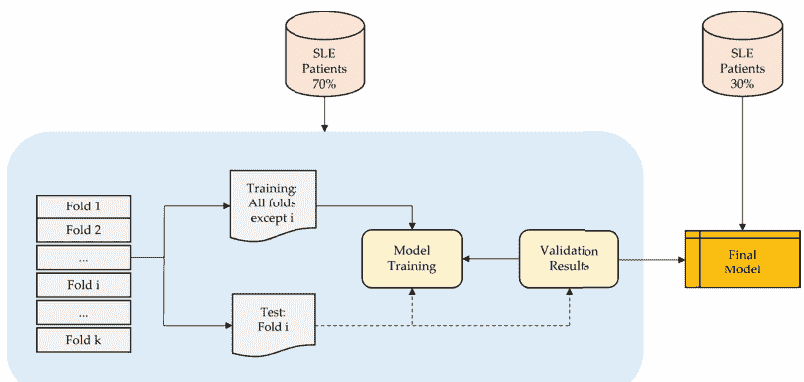

**图1。** 该图显示了本研究中用于SLE患者分类的遵循流程。

此外，已应用超参数优化技术来微调各方法的超参数。这些超参数值在训练阶段进行调整，以最大化ML方法的准确性。接受优化的超参数包括学习者、邻居数、距离度量、距离权重、核函数、框约束水平和多类方法等变量，每种都针对所使用方法的特定要求进行定制。贝叶斯优化被选为通过优化各种超参数的选择来增强各种方法性能的技术。召回值和AUC被用作性能指标。整个研究迭代了100次，以获得该过程的平均值和标准差。重要的是，应强调每次迭代中使用的数据均经过随机化，从而减轻样本中的噪声并确保获得统计上有效的结果 [29]。

#### 2.3. 性能评估

本研究采用了人工智能中最著名的指标来测试各方法的性能 [29]：平衡准确率（BA）、召回率、精确度、特异度（SP）、退化的Youden指数（DYI）[29]、受试者工作特征曲线（ROC）和曲线下面积（AUC）。F1分数确立为：

$$F_{1score} = 2\frac{Precision \cdot Recall}{Precision + Recall}$$ (3)

为测试模型的分类性能，使用了马修相关系数（MCC），其描述如下：

$$MCC = \frac{TP \cdot TN - FP \cdot FN}{\sqrt{(TP + FP)(TP + FN)(TN + FP)(TN + FN)}}$$ (4)

其中，TP为真阳性数，FP为假阳性数，TN为真阴性数，FN为假阴性数。最后，Cohen的Kappa系数（CK），CK是另一种估计模型性能的指标 [29]。

### 3. 结果

本研究对125名被诊断为SLE的患者进行了研究。其中，94名患者符合SLEDAI-2K评分低于四分的具体标准，因此被纳入研究。进一步分析显示，这94名患者中有77名表现出免疫缺陷迹象。这意味着，大约81.9%的SLEDAI-2K评分低于四分的患者表现出免疫缺陷迹象。

该队列患者的中位年龄为52岁，而诊断时的中位年龄为38岁。该群体主要为女性，有68名女性患者和9名男性患者。这些患者的疾病中位持续时间为14年。在数据收集时（见表1），50名患者（64.9%）正在接受皮质类固醇治疗，平均每日剂量为2.57 mg。此外，25名患者（34.9%）正在接受硫唑嘌呤、甲氨蝶呤和麦考酚酚酚酚酚酚酚酚等免疫抑制剂治疗。两名患者正在接受贝利木单抗治疗。值得注意的是，没有患者正在接受利妥昔单抗治疗。

同样，41名患者（53.2%）表现出免疫缺陷模式。在这些患者中，总共发生了51例严重感染。这些感染的细分如下：

- 17名患者因下呼吸道感染住院。
- 4名患者因上呼吸道感染住院。
- 9名患者接受了尿路感染治疗。
- 10名患者患有软组织感染。
- 4名患者患有消化道感染。
- 1名患者被诊断为结核性淋巴结炎。


表1提供了表现出免疫缺陷模式的患者特征概述。研究对象患者显示出多种免疫细胞计数的下降。这在NK细胞（先天免疫系统的一个组成部分）和CD19 B细胞（适应性免疫系统的一部分）身上尤其明显。后者包括IgG亚型和IgM，两者也都呈下降趋势。这些患者表现出多种免疫细胞水平降低，如表1所示，先天免疫系统中的NK细胞和适应性免疫系统中的CD19 B细胞（包括IgG亚型和IgM）出现了显著下降。

#### 表1. 免疫缺陷模式患者的特征。

| 免疫缺陷模式患者的特征 | |
|---|---|
| N | 77 |
| 中位年龄（岁） | 52 |
| 女性/男性 | 68/9 |
| SLE病程（年） | 14 |
| 糖皮质激素（n） | 50 (64.9%) |
| 免疫抑制剂（n） | 25 (32.4%) |
| 羟氯喹（n） | 37 (48%) |
| 严重感染（n） | 51 |
| 免疫缺陷模式（n） | |
| 白细胞（<4000 cL/µL ） | 9 |
| 淋巴细胞（<1500 cL/µL） | 28 |
| 中性粒细胞（<1800 cL/µL） | 9 |
| CD3（<700 cL/µL） | 10 |
| CD4（<300 cL/µL） | 6 |
| CD8（<200 cL/µL） | 3 |
| CD19（<100 cL/µL） | 23 |
| NK（<90 cL/µL） | 13 |
| IgK（<870 mg/dL） | 17 |
| IgG1（<383 mg/dL） | 3 |
| IgG2（<242 mg/dL） | 36 |
| IgG3（<22 mg/dL） | 16 |
| IgG4（<4 mg/dL） | 7 |
| IgA（117 mg/dL） | 8 |
| IgM（<60 mg/dL） | 20 |
| C3（<90 mg/dL） | 13 |
| C4（<10 mg/dL） | 6 |

该研究采用了一系列ML技术，以识别SLE人群中先天性和适应性免疫缺陷模式。这些技术得出的结果，结合几种用于识别免疫缺陷的ML算法，详细如下。所调查ML方法的BA、召回率、特异度、精确度和AUC等性能指标列于表2和表3中。两张表均详细汇总了不同ML方法在变量IgG、IgG2、IgG3、IgG4（表2）以及IgM、NK、CD19、CD3（表3）上的性能指标。这些变量与免疫球蛋白和免疫细胞群体相关，而评估的ML方法包括SVM、BLDA、DT、KNN和所提议的RF方法。结果提供了关于每种ML方法在预测或分类特定免疫学变量方面表现如何的见解，并根据这些指标对其优势进行了比较分析。数据的全面性有助于根据所需的性能标准，为每个变量选择最合适的方法。值得注意的是，所提议的RF方法在所有变量中始终表现优于其他方法，达到了最高准确率。KNN也表现出强劲的性能，尤其是在IgM和CD3方面。LR获得了最低的结果，而SVM、BLDA和DT通常表现出具有竞争力的结果，但准确率略低于RF和KNN。总之，评估强调了所提议方法在与免疫球蛋白和免疫细胞类型相关的变量中具有强大的性能，由于其一贯的高准确率、平衡的性能指标、集成学习优势以及对噪声数据的鲁棒性，它是分类SLE患者的首选模型。

#### 表2. 表格汇总了变量IgG、IgG2、IgG3和IgG4的BA、召回率、特异度、精确度和AUC值。

| 方法 | BA | 召回率 | 特异度 | 精确度 | AUC |
|---|---|---|---|---|---|
| SVM | 80.85 | 80.95 | 80.76 | 80.28 | 80.00 |
| BLDA | 78.11 | 78.20 | 78.02 | 77.55 | 78.00 |
| DT | 83.85 | 83.95 | 83.75 | 83.25 | 83.00 |
| LR | 70.02 | 69.75 | 68.84 | 68.95 | 68.42 |
| RF | 93.96 | 94.07 | 93.85 | 93.29 | 94.00 |
| KNN | 86.38 | 86.48 | 86.28 | 85.76 | 86.00 |

| 方法 | BA | 召回率 | 特异度 | 精确度 | AUC |
|---|---|---|---|---|---|
| SVM | 81.85 | 81.95 | 81.76 | 81.27 | 81.00 |
| BLDA | 77.37 | 77.46 | 77.28 | 76.82 | 77.00 |
| DT | 83.16 | 83.26 | 83.06 | 82.57 | 83.00 |
| LR | 69.51 | 69.24 | 68.33 | 68.44 | 68.42 |
| RF | 94.58 | 94.69 | 94.47 | 93.90 | 94.00 |
| KNN | 85.99 | 86.09 | 85.89 | 85.38 | 86.00 |

| 方法 | BA | 召回率 | 特异度 | 精确度 | AUC |
|---|---|---|---|---|---|
| SVM | 81.56 | 81.66 | 81.47 | 80.98 | 81.00 |
| BLDA | 79.16 | 79.25 | 79.06 | 78.59 | 79.00 |
| DT | 83.82 | 83.92 | 83.72 | 83.22 | 83.00 |
| LR | 69.44 | 69.17 | 68.27 | 68.38 | 68.42 |
| RF | 94.42 | 94.53 | 94.31 | 93.75 | 94.00 |
| KNN | 86.57 | 86.67 | 86.47 | 85.95 | 86.00 |

| 方法 | BA | 召回率 | 特异度 | 精确度 | AUC |
|---|---|---|---|---|---|
| SVM | 81.35 | 81.45 | 81.26 | 80.77 | 81.00 |
| BLDA | 78.93 | 79.02 | 78.83 | 78.36 | 78.00 |
| DT | 83.26 | 83.36 | 83.16 | 82.67 | 83.00 |
| LR | 70.15 | 69.88 | 68.97 | 69.08 | 68.42 |
| RF | 94.50 | 94.61 | 94.39 | 93.83 | 94.00 |
| KNN | 86.07 | 86.17 | 85.97 | 85.46 | 86.00 |

#### 表3. 表格汇总了变量IgM、NK、CD19和CD3的BA、召回率、特异度、精确度和AUC值。

| 方法 | BA | 召回率 | 特异度 | 精确度 | AUC |
|---|---|---|---|---|---|
| SVM | 81.24 | 81.34 | 81.15 | 80.67 | 81.00 |
| BLDA | 78.11 | 78.20 | 78.02 | 77.55 | 78.00 |
| DT | 83.35 | 83.45 | 83.25 | 82.76 | 83.00 |
| LR | 69.86 | 69.59 | 68.68 | 68.79 | 68.42 |
| RF | 94.80 | 94.91 | 94.69 | 94.12 | 94.00 |
| KNN | 86.38 | 86.48 | 86.28 | 85.76 | 86.00 |

##### NK细胞。

| 方法 | BA | 召回率 | 特异度 | 精确度 | AUC |
|---|---|---|---|---|---|
| SVM | 81.06 | 81.16 | 80.97 | 80.49 | 81.00 |
| BLDA | 77.52 | 77.61 | 77.43 | 76.97 | 77.00 |
| DT | 84.84 | 84.94 | 84.74 | 84.24 | 84.00 |
| LR | 69.51 | 69.24 | 68.33 | 68.44 | 68.42 |
| RF | 94.75 | 94.86 | 94.64 | 94.07 | 94.00 |
| KNN | 86.51 | 86.61 | 86.41 | 85.89 | 86.00 |

##### CD19 B细胞。

| 方法 | BA | 召回率 | 特异度 | 精确度 | AUC |
|---|---|---|---|---|---|
| SVM | 82.21 | 82.31 | 82.12 | 81.63 | 82.00 |
| BLDA | 76.89 | 76.98 | 76.80 | 76.34 | 76.00 |
| DT | 84.04 | 84.14 | 83.94 | 83.44 | 84.00 |
| LR | 69.65 | 69.38 | 68.47 | 68.58 | 68.42 |
| RF | 94.34 | 94.45 | 94.23 | 93.67 | 94.00 |
| KNN | 85.24 | 85.34 | 85.14 | 84.63 | 85.00 |

##### CD3 T细胞。

| 方法 | BA | 召回率 | 特异度 | 精确度 | AUC |
|---|---|---|---|---|---|
| SVM | 81.46 | 81.56 | 81.37 | 80.88 | 81.00 |
| BLDA | 77.21 | 77.30 | 77.12 | 76.66 | 77.00 |
| DT | 84.16 | 84.26 | 84.06 | 83.56 | 84.00 |
| LR | 70.41 | 70.14 | 69.22 | 69.33 | 68.42 |
| RF | 95.12 | 95.23 | 95.01 | 94.44 | 95.00 |
| KNN | 86.38 | 86.48 | 86.28 | 85.76 | 86.00 |

此外，表4和表5列出了所应用ML方法的性能指标，包括F1得分、MCC、DYI和Kappa值。所观察到的数值提供了关于模型在分类SLE患者方面有效性的见解。因此，在表4（变量IgG、IgG2、IgG3和IgG4）中，RF再次在所有指标中始终优于其他方法，表现出高F1得分、MCC、DYI和Kappa值。这表明RF在实现精确率和召回率之间的平衡权衡方面具有鲁棒性，体现了模型有效处理正例和负例的能力。同样，KNN也显示出具有竞争力的性能，而SVM、BLDA和DT在这些指标上表现略低，其中LR获得了最低的性能数值。在表5（IgM、NK、CD19和CD3）中，与免疫细胞类型相关的变量也呈现类似趋势，RF再次表现出卓越的性能，尤其是在实现高F1得分和DYI值方面尤为显著。这加强了RF在SLE分类中的适用性，表明其能够在真阳性、真阴性、假阳性和假阴性之间保持平衡。KNN也表现良好，但RF始终在各种变量中脱颖而出，成为表现最好的模型。

为了全面了解所提议系统与其他ML方法之间真阳性/假阳性率的权衡，还生成了受试者工作特征（ROC）曲线。为此，ROC曲线用于在各种阈值水平下量化灵敏度和1-特异度。如图2所示，图2以CD19变量为例展示了ROC曲线，利用RF的系统生成了最大的曲线下面积，表明具有更高的预测准确度。


#### 表 4. 该表展示了变量 IgG、IgG2、IgG3 和 IgG4 的 F1 分数、MCC、DYI 和 Kappa 值。

| 方法 | F1 分数 | MCC | DYI | Kappa |
|---|---|---|---|---|
| SVM | 80.61 | 71.74 | 80.85 | 71.98 |
| BLDA | 77.87 | 69.31 | 78.11 | 69.54 |
| DT | 83.60 | 74.40 | 83.85 | 74.65 |
| LR | 70.06 | 64.59 | 69.83 | 64.23 |
| RF | 93.68 | 83.37 | 93.96 | 83.65 |
| KNN | 86.12 | 76.65 | 86.38 | 76.90 |

| 方法 | F1 分数 | MCC | DYI | Kappa |
|---|---|---|---|---|
| SVM | 81.61 | 72.63 | 81.85 | 72.87 |
| BLDA | 77.14 | 68.65 | 77.37 | 68.88 |
| DT | 82.91 | 73.79 | 83.16 | 74.04 |
| LR | 69.54 | 64.12 | 69.32 | 63.76 |
| RF | 94.30 | 83.92 | 94.58 | 84.20 |
| KNN | 85.73 | 76.30 | 85.99 | 76.55 |

| 方法 | F1 分数 | MCC | DYI | Kappa |
|---|---|---|---|---|
| SVM | 81.32 | 72.37 | 81.56 | 72.61 |
| BLDA | 78.92 | 70.24 | 79.16 | 70.47 |
| DT | 83.57 | 74.38 | 83.82 | 74.62 |
| LR | 69.48 | 64.06 | 69.25 | 63.70 |
| RF | 94.14 | 83.78 | 94.42 | 84.06 |
| KNN | 86.31 | 76.81 | 86.57 | 77.07 |

| 方法 | F1 分数 | MCC | DYI | Kappa |
|---|---|---|---|---|
| SVM | 81.11 | 72.19 | 81.35 | 72.43 |
| BLDA | 78.69 | 70.03 | 78.93 | 70.27 |
| DT | 83.01 | 73.88 | 83.26 | 74.13 |
| LR | 70.19 | 64.72 | 69.96 | 64.35 |
| RF | 94.22 | 83.85 | 94.50 | 84.13 |
| KNN | 85.81 | 76.37 | 86.07 | 76.62 |

#### 表 5. 该表展示了变量 IgM、NK、CD19 和 CD3 的 F1 分数、MCC、DYI 和 Kappa 值。

| 方法 | F1 分数 | MCC | DYI | Kappa |
|---|---|---|---|---|
| SVM | 81.00 | 72.09 | 81.24 | 72.33 |
| BLDA | 77.87 | 69.31 | 78.11 | 69.54 |
| DT | 83.10 | 73.96 | 83.35 | 74.21 |
| LR | 69.90 | 64.45 | 69.67 | 64.08 |
| RF | 94.51 | 84.12 | 94.80 | 84.40 |
| KNN | 86.12 | 76.65 | 86.38 | 76.90 |

| 方法 | F1 分数 | MCC | DYI | Kappa |
|---|---|---|---|---|
| SVM | 80.82 | 71.93 | 81.06 | 72.17 |
| BLDA | 77.29 | 68.78 | 77.52 | 69.01 |
| DT | 84.59 | 75.28 | 84.84 | 75.53 |
| LR | 69.54 | 64.12 | 69.32 | 63.76 |

#### 表 5（续）

| 方法 | F1 分数 | MCC | DYI | Kappa |
|---|---|---|---|---|
| **NK.** | | | | |
| RF | 94.46 | 84.07 | 94.75 | 84.35 |
| KNN | 86.25 | 76.76 | 86.51 | 77.02 |
| **CD19.** | | | | |
| SVM | 81.97 | 72.95 | 82.21 | 73.19 |
| BLDA | 76.66 | 68.23 | 76.89 | 68.45 |
| DT | 83.79 | 74.57 | 84.04 | 74.82 |
| LR | 69.68 | 64.25 | 69.45 | 63.89 |
| RF | 94.06 | 83.71 | 94.34 | 83.99 |
| KNN | 84.98 | 75.63 | 85.24 | 75.89 |
| **CD3.** | | | | |
| SVM | 81.22 | 72.28 | 81.46 | 72.52 |
| BLDA | 76.98 | 68.51 | 77.21 | 68.74 |
| DT | 83.91 | 74.68 | 84.16 | 74.93 |
| LR | 70.45 | 64.96 | 70.22 | 64.59 |
| RF | 94.83 | 84.40 | 95.12 | 84.68 |
| KNN | 86.12 | 76.65 | 86.38 | 76.90 |

#### ROC

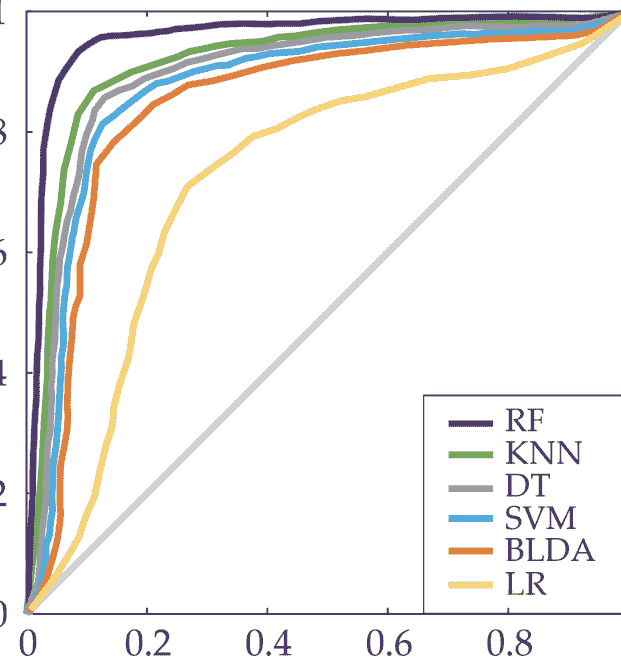

图 2. 变量 CD19 的五个评估机器学习预测器的 ROC 曲线示例。

在本研究中，还观察到用于训练模型的子集在训练指标中表现出高分。在对这些模型进行测试时，其分数出现了明显下降。尽管如此，如图 3 和图 4 所示，RF 系统表现为一个校准良好的模型，在训练中达到最佳点，既不过拟合也不过欠拟合。该方法始终能为新输入提供准确的预测。RF 系统的卓越性能显而易见，它通过在训练和测试阶段的雷达图中覆盖更大面积，超越了其他方法。

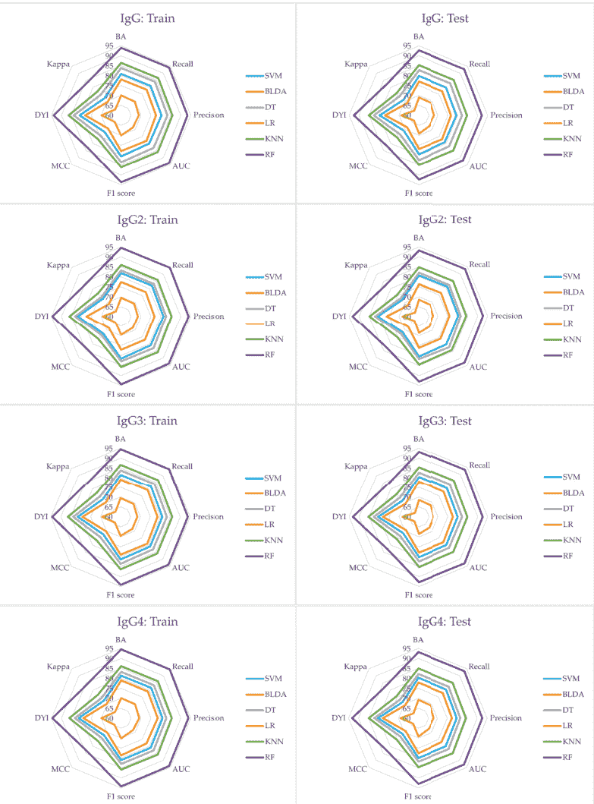

图 3. 该图分别展示了变量 IgG、IgG2、IgG3 和 IgG4 的雷达图。

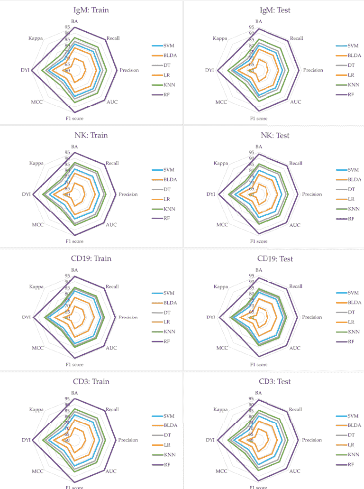

图 4. 该图分别展示了变量 IgM、NK、CD19 和 CD3 的雷达图。

### 4. 讨论

管理系统性红斑狼疮（SLE）患者的任务对于降低不可逆器官损伤的风险至关重要 [30,31]。这不仅对维持患者的健康相关生活质量至关重要 [32,33]，也对管理与 SLE 治疗相关的直接费用至关重要 [34,35]。然而，由于 SLE 的异质性，这项任务面临重大挑战，其特征是疾病进程的变化 [36,37]。因此，迫切需要提高 SLE 急性发作的准确性和分类，需要考虑到活动性的诱因可能是免疫缺陷情况下的感染。为满足这一需求，已开展了大量研究，包括近年来出现的最新研究 [31,33]。这些研究强调了针对严重狼疮表现（如狼疮性肾炎）的潜在治疗方法 [31]。尽管 SLE 存在多种治疗药物，但该病仍然造成显著的发病率 [31]。令人鼓舞的是，目前有多种治疗选择正在研究中 [31]。

在临床实践中，面部蝶斑的表现，加上患者体内抗 DNA 自身抗体的检测，通常引导医疗专业人员诊断为 SLE [38,39]。值得注意的是，SLE 表现出显著的表型多样性，包括全身性和局部性形式。免疫学和临床特征随时间的变化凸显了该疾病的动态特性 [33,40]。

已建立大量模型来估计 SLE 发生的概率，以便在将其与其他风湿病性疾病区分开时提供一定程度的信心 [41,42]。这些模型基于特征的性质和丰度利用无监督聚类，模仿诊断推理，尤其是在初次患者会诊期间 [41,42]。某些模型结合基因分析技术以改善对 SLE 患者的分类 [19]。最近的研究深入探讨了利用机器学习技术进行 SLE 分析，并将其方法论定制为所研究的特定数据集 [22,43,44]。例如，Jorge 等人 [20] 利用机器学习技术预测 SLE 患者的住院情况。

在本研究中，在所采用的所有机器学习分类器中，RF 方法表现出最强的分类性能。它展示了更高的准确性水平，并有助于识别 SLE 人群中的免疫缺陷模式。该方法提供可扩展性、快速执行以及其他增强其分类能力的有益特性 [45]。机器学习模型能够同时评估多个变量及其相互关系，在预测系统的开发中容纳非线性模式 [45]。此外，我们将所提系统的性能与表 2–5 中记录的各种机器学习算法进行了比较分析。值得注意的，RF 方法表现出显著的改进，优于表现较低的 DT、BLDA 和 SVM。尽管 KNN 方法接近我们所提的方法，达到 AUC = 86% 和召回率 = 86%，但 RF 表现出更优的性能，在 AUC 和 召回率 两项指标上都取得了约 94% 的显著数值。这一显著改进突显了 RF 方法在捕捉复杂模式和增强整体预测能力方面的有效性。

此外，图 3 和图 4 说明了所提系统性能良好的平衡图表，表明训练阶段和测试阶段之间存在微小差异，且无过拟合迹象。这使该系统成为一个可靠的工具，便于自动化分析以辅助 SLE 患者的分类。我们的结果证实了 RF 系统在精确预测 SLE 患者方面的有效性，使其成为支持 SLE 诊断的宝贵工具。

### 5. 结论

总之，由于这种难以捉摸的自身免疫性疾病的复杂性，使用 RF 等机器学习算法对 SLE 急性发作患者进行分类和快速检测至关重要。SLE 表现出一系列具有挑战性的症状，在早期阶段尤其难以准确诊断。SLE 中感染与自身免疫之间复杂的关系凸显了对预防措施以及对易感性增强的 SLE 患者进行早期感染检测的迫切需求。这种综合方法旨在应对 SLE 的多方面挑战，为改善患者护理提供更全面的理解。

RF 处理多样化数据集并提取复杂模式的能力使其非常适合识别 SLE 的微妙指标。该算法快速的信息处理能力实现了快速检测，从而允许及时干预和为 SLE 患者制定个性化治疗方案。鉴于 SLE 的罕见性和重要性，使用 RF 和类似的机器学习方法不仅能提高 SLE 活动性的诊断准确性，而且


也有助于改善患者预后、长期监测，并为这种毁灭性疾病制定更有效的医疗管理策略。

因此，本研究深入探讨了用于识别系统性红斑狼疮（SLE）患者人群中免疫缺陷模式的最佳机器学习技术。它确立了机器学习系统作为一种高度准确的工具，用于识别感染及其后续导致的SLE发作风险显著升高的个体中免疫参数水平降低的情况。此外，所提出的基于随机森林（RF）的系统在更大的AUC方面超过了其他研究的性能，从而证实了其卓越的预测准确性。

### Author Contributions

概念构想：I.U., Y.A. 和 J.M.；方法学：I.U., Y.A., A.M.T. 和 J.M.；正式分析：I.U., Y.A., A.M.T. 和 J.M.；调查：I.U., Y.A., A.M.T., J.B. 和 J.M.；撰写—原始草稿准备：I.U., Y.A., A.M.T. 和 J.M.；撰写—审阅与编辑：I.U., Y.A., A.M.T., J.B. 和 J.M.；监督：A.M.T. 和 J.M.；项目管理：J.M.；资金获取：Y.A. 所有作者均已阅读并同意发表的手稿版本。

### Funding

本研究由UCLM-Telefónica讲席和经济事务与数字化转型部（MINECO）资助，编号为PID2021-125122OB-I00。

### Institutional Review Board Statement

本研究已获得巴利亚多利德诊所医院伦理委员会的批准。

### Informed Consent Statement

已从所有参与研究的受试者处获得知情同意。

### Data Availability Statement

本研究中使用和/或分析的数据集可应合理请求向通讯作者获取。

### Acknowledgments

本作品由卡斯蒂利亚-拉曼查大学技术研究所、巴利亚多利德诊所医院（西班牙）以及UCLM-Telefónica讲席（西班牙）赞助。

### Conflicts of Interest

作者声明不存在任何利益冲突。

### References

- 1. Cortés Verdú, R.; Pego-Reigosa, J.M.; Seoane-Mato, D.; Morcillo Valle, M.; Palma Sánchez, D.; Moreno Martínez, M.J.; Mayor González, M.; Atoctegi Sáenz de Buruaga, J.; Urionagüena Onaindia, I.; Blanco Cáceres, B.A.; 等人. 西班牙系统性红斑狼疮患病率：是否高于其他国家此前报告的水平？ _风湿病学_ **2020**, _59_, 2556–2562. [PubMed] [PubMed]
- 2. Schmidt, R.E.; Grimbacher, B.; Witte, T. 自身免疫与原发性免疫缺陷：同一枚硬币的两面吗？ _自然评论风湿病学_ **2018**, _14_, 7–18. [CrossRef] [CrossRef] [PubMed]
- 3. Bandinelli, F.; Bombardieri, S.; Matucci, M.; Delle Sedie, A. 系统性红斑狼疮关节受累——肌肉骨骼超声能为我们提供什么？ _欧洲肌肉骨骼评论_ **2012**, _7_, 221–223.
- 4. Kariburyo, F.; Xie, L.; Sah, J.; Li, N.; Loftand, J.H. 美国新发系统性红斑狼疮患者的现实世界用药及经济结局。 _医学经济学杂志_ **2020**, _23_, 1–9. [CrossRef] [PubMed] [CrossRef]
- 5. Piga, M.; Arnaud, L. 系统性红斑狼疮的主要挑战：我们目前处于什么位置？ _临床医学杂志_ **2021**, _10_, 243. [CrossRef] [CrossRef]
- 6. Rees, F.; Doherty, M.; Grainge, M.; Davenport, G.; Lanyon, P.; Zhang, W. 英国系统性红斑狼疮的发病率与患病率，1999–2012年。 _关节炎风湿病年鉴_ **2016**, _75_, 136–141. [CrossRef] [PubMed] [CrossRef]
- 7. Adamichou, C.; Bertsias, G. 系统性红斑狼疮发作：诊断、风险因素与预防策略。 _地中海风湿病学杂志_ **2017**, _28_, 4–12.
- 8. Zhou, Y.; Wang, M.; Zhao, S.; Yan, Y. 基于机器学习的系统性红斑狼疮诊断：系统综述与荟萃分析。 _计算智能与神经科学_ **2022**, _2022_, 7167066. [CrossRef] [CrossRef]
- 9. Handelman, G.; Kok, H.; Chandra, R.; Razavi, A.; Lee, M.; Asadi, H. eDoctor：机器学习与医学的未来。 _内科医学杂志_ **2018**, _284_, 603–619. [CrossRef] [CrossRef]
- 10. Adamichou, C.; Nikolopoulos, D.; Genitsaridi, I.; Bortoluzzi, A.; Fanouriakis, A.; Papastefanakis, E.; Kalogiannaki, E.; Gergianaki, I.; Sidiropoulos, P.; Boumpas, D.T.; 等人. 在早期SLE队列中，ACR-1997、SLICC-2012和EULAR/ACR-2019标准将患者分为非重叠群体：同时使用所有三项标准可确保临床研究中最佳患者纳入，而其修改可实现更早的分类与治疗。 _关节炎风湿病年鉴_ **2020**, _79_, 232–241. [CrossRef] [CrossRef]
- 11. Suárez, M.; Martínez, R.; Torres, A.M.; Ramón, A.; Blasco, P.; Mateo, J. 基于机器学习的代谢相关脂肪性肝病胆囊切除术后肝纤维化个体化风险评估。 _临床医学杂志_ **2023**, _12_, 6489. [CrossRef] [PubMed] [PubMed]
- 12. Casillas, N.; Ramón, A.; Torres, A.M.; Blasco, P.; Mateo, J. 跨越六波大流行的重症COVID-19患者死亡率预测模型。 _病毒_ **2023**, _15_, 2184. [CrossRef] [PubMed] [CrossRef] [PubMed]
- 13. Soria, C.; Arroyo, Y.; Torres, A.M.; Redondo, M.Á.; Basar, C.; Mateo, J. 基于机器学习的精神分裂症患者分类方法。 _临床医学杂志_ **2023**, _12_, 4375. [CrossRef] [PubMed] [CrossRef] [PubMed]
- 14. Chen, Y.; Mao, Q.; Wang, B.; Duan, P.; Zhang, B.; Hong, Z. 医疗诊断中保护隐私的多类支持向量机模型。 _IEEE生物医学与健康信息学杂志_ **2022**, _26_, 3342–3353. [CrossRef] [PubMed] [CrossRef] [PubMed]
- 15. Sethi, M.; Ahuja, S.; Rani, S.; Bawa, P.; Zaguia, A. 基于高斯贝叶斯参数优化的深度卷积LSTM网络阿尔茨海默病分类。 _计算数学方法医学_ **2021**, _2021_, 4186666. [PubMed] [CrossRef]
- 16. Mahfouz, M.A.; Shourky, A.; Ismail, M.A. EKNN：一种融合连通性与密度的kNN集成分类器及其在癌症诊断中的应用。 _医学人工智能_ **2021**, _111_, 101985. [PubMed] [CrossRef]
- 17. Reges, O.; Krefnan, A.E.; Hardy, S.T.; Yano, Y.; Muntner, P.; Lloyd-Jones, D.M.; Allen, N.B. 用于维持早期成年期和中年期正常血压的基于决策树的分类：来自年轻成人冠状动脉风险发展研究（CARDIA）的研究结果。 _美国高血压杂志_ **2021**, _34_, 1037–1041. [CrossRef] [CrossRef]
- 18. Zhao, X.; Zhang, L.; Wang, J.; Zhang, M.; Song, Z.; Ni, B.; You, Y. 基于整合生物信息学分析的系统性红斑狼疮关键生物标志物与免疫浸润鉴定。 _转化医学杂志_ **2021**, _19_, 35. [CrossRef] [CrossRef]
- 19. Jiang, Z.; Shao, M.; Dai, X.; Pan, Z.; Liu, D. 基于生物信息学分析与机器学习的系统性红斑狼疮诊断生物标志物鉴定。 _遗传学前沿_ **2022**, _13_, 865559.
- 20. Jorge, A.M.; Smith, D.; Wu, Z.; Chowdhury, T.; Kostenbader, K.; Zhang, Y.; Choi, H.K.; Feldman, C.H.; Zhao, Y. 探索用于预测系统性红斑狼疮住院的机器学习方法。 _狼疮_ **2022**, _31_, 1296–1305.
- 21. Cheng, Q.; Chen, X.; Wu, H.; Du, Y. 三种血液/免疫系统特异性表达基因被认为是通过生物信息学分析诊断早期类风湿关节炎的潜在生物标志物。 _转化医学杂志_ **2021**, _19_, 18. [CrossRef] [PubMed] [PubMed]
- 22. Cicalese, P.A.; Mobiny, A.; Shahmoradi, Z.; Yi, X.; Mohan, C.; Van Nguyen, H. 基于不确定性引导的贝叶斯卷积神经网络的肾水平狼疮性肾炎分类。 _IEEE生物医学与健康信息学杂志_ **2020**, _25_, 315–324.
- 23. Aringer, M.; Brinks, R.; Dörner, T.; Daikh, D.; Mosca, M.; Ramsey-Goldman, R.; Smolen, J.S.; Wofsy, D.; Boumpas, D.T.; Kamen, D.L.; 等人. 欧洲抗风湿病联盟（EULAR）/美国风湿病学会（ACR）SLE分类标准项目表现。 _关节炎风湿病年鉴_ **2021**, _80_, 775–781. [CrossRef] [CrossRef] [PubMed]
- 24. Breiman, L. 随机森林。 _机器学习_ **2001**, _45_, 5–32. [10.1023/A:1010933404324] [CrossRef] [CrossRef]
- 25. Han, S.; Williamson, B.D.; Fong, Y. 改进两阶段抽样设计小数据集中的随机森林预测。 _BMC医学信息学与决策制定_ **2021**, _21_, 322.
- 26. Huang, A.; Zhou, W. 基于BLDA的P300电位分类方法。载于：第7届亚太医学与生物工程会议论文集，2008年4月22–25日，中国北京；Springer：德国柏林/海德堡，2008；第341–343页。
- 27. Huang, M. 线性回归的理论与实现。载于：2020年计算机视觉、图像与深度学习国际会议（CVIDL）论文集，2020年7月10–12日，中国重庆；第210–217页。
- 28. Kuchibhotla, A.K.; Brown, L.D.; Buja, A.; Cai, J. 线性回归全览。arXiv **2019**, arXiv:1910.06386.
- 29. Han, J.; Pei, J.; Kamber, M. 数据挖掘：概念与技术，第3版。Elsevier：荷兰阿姆斯特丹，2016。
- 30. Bruce, I.N.; O’Keeffe, A.G.; Farewell, V.; Hanly, J.G.; Manzi, S.; Su, L.; Gladman, D.D.; Bae, S.C.; Sanchez-Guerrero, J.; Romero-Diaz, J.; 等人. 系统性红斑狼疮患者损伤累积相关因素：来自SLICC启动队列的结果。 _关节炎风湿病年鉴_ **2015**, _74_, 1706–1713.
- 31. Liassis, S.N.; Staveri, C. 系统性红斑狼疮治疗的最新进展。 _医学前沿_ **2021**, _8_, 655100. [CrossRef]
- 32. Ugarte-Gil, M.F.; Mendoza-Pinto, C.; Rategui-Sokolova, C.; Pons-Estel, G.J.; Van Vollenhoven, R.F.; Bertsias, G.; Alarcon, G.S.; Pons-Estel, B.A. 达到缓解或低疾病活动状态与系统性红斑狼疮患者更好的预后相关：系统文献综述。 _狼疮科学与医学_ **2021**, _8_, e000542. [CrossRef] [CrossRef]
- 33. Yavuz, S.; Lipsky, P.E. 狼疮患者评估与管理的现状及未来展望。 _医学前沿_ **2021**, _8_, 682544.
- 34. Carter, E.E.; Barr, S.G.; Clarke, A.E. SLE的全球负担：患病率、健康差异与社会经济影响。 _自然评论风湿病学_ **2016**, _12_, 605–620. [CrossRef] [PubMed]
- 35. Aparicio-Soto, M.; Sánchez-Hidalgo, M.; Alarcón-de-la Lastra, C. 系统性红斑狼疮管理中饮食与营养因素的更新。 _营养研究评论_ **2017**, _30_, 118–137. [CrossRef] [PubMed] [PubMed]
- 36. Tselios, K.; Gladman, D.; Touma, Z.; Su, J.; Anderson, N.; Urowitz, M. 系统性红斑狼疮的疾病进程模式。 _狼疮_ **2019**, _28_, 114–122. [CrossRef] [PubMed] [PubMed]
- 37. Akhil, A.; Bansal, R.; Anupam, K.; Ankit, T.; Bhatnagar, A. 系统性红斑狼疮：病因发病机制的最新洞察。 _国际风湿病学_ **2023**, _43_, 1381–1393. [CrossRef] [CrossRef] [PubMed]
- 38. Larosa, M.; Iaccarino, L.; Gatto, M.; Punzi, L.; Doria, A. 系统性红斑狼疮诊断与分类的进展。 _临床免疫学专家评论_ **2016**, _12_, 1309–1320. [CrossRef] [CrossRef]
- 39. Aringer, M.; Johnson, S.R. 21世纪的系统性红斑狼疮分类与诊断。 _风湿病学_ **2020**, _59_, v4–v11. [PubMed] [CrossRef]
- 40. Inês, L.; Silva, C.; Galindo, M.; López-Longo, F.J.; Terroso, G.; Romão, V.C.; Rúa-Figueora, I.; Santos, M.J.; Pego-Reigosa, J.M.; Nero, P.; 等人. 系统性红斑狼疮分类：国际系统性红斑狼疮协作诊所标准与美国风湿病学会标准。一项来自真实世界国际系统性红斑狼疮队列2055名患者的比较研究。 _关节炎护理研究_ **2015**, _67_, 1180–1185. [CrossRef] [CrossRef]


41. Adamichou, C.; Genitsaridi, I.; Nikolopoulos, D.; Nikoloudaki, M.; Repa, A.; Bortoluzzi, A.; Fanouriakis, A.; Sidiropoulos, P.; Boumpas, D.T.; Bertsias, G.K. 狼疮还是否？系统性红斑狼疮风险概率指数（SLERPI）：一种简单、临床医生友好的基于机器学习的模型，用于辅助诊断系统性红斑狼疮。Ann. Rheum. Dis. 2021, 80, 758–766. [CrossRef]

42. Donner-Banzhoff, N. 解决诊断挑战：一种以患者为中心的方法。Ann. Fam. Med. 2018, 16, 353–358. [CrossRef]

43. Kinloch, A.J.; Asano, Y.; Mohsin, A.; Henry, C.; Abraham, R.; Chang, A.; Labno, C.; Wilson, P.C.; Clark, M.R. 利用机器学习定量人类狼疮管间质炎症中的原位体液选择。Front. Immunol. 2020, 11, 593177. [CrossRef]

44. Usategui, I.; Barbado, J.; Torres, A.M.; Cascón, J.; Mateo, J. 机器学习：一种用于检测系统性红斑狼疮免疫缺陷模式的新工具。J. Investig. Med. 2023, 71, 742–752. [CrossRef] [PubMed]

45. Chen, W.; Lei, X.; Chakrabortty, R.; Pal, S.C.; Sahana, M.; Janizadeh, S. 不同提升集成机器学习模型和新型深度学习与提升框架的评估，用于冲沟头部侵蚀敏感性。J. Environ. Manag. 2021, 284, 112015. [CrossRef] [PubMed]

免责声明/出版社说明：所有出版物中包含的声明、观点和数据仅属于各位作者和投稿人，而不属于 MDPI 和/或编辑。MDPI 和/或编辑对因内容中提及的任何想法、方法、说明或产品而导致的人身或财产伤害不承担任何责任。

## 从心电图中检测左室肥厚的最佳机器学习算法：综述

Simon W Rabkin  
不列颠哥伦比亚大学医学部心脏病学科，加拿大不列颠哥伦比亚省温哥华市月桂街2775号9楼 V5Z 1M9；simon.rabkin@ubc.ca；电话：+1-(604)-875-5847；传真：+1-(604)-875-5849

### 摘要

**背景：** 左室肥厚（LVH）是未来心血管事件的有力预测因子。**目标：** 本研究的目标是对用于识别 LVH 的机器学习（ML）算法进行系统综述，并根据测试敏感度、特异度、准确度、ROC 以及 LVH 的传统心电图标准对其进行比较。**方法：** 使用运算符“左室肥厚，心电图” AND 机器学习构建了检索式；然后系统地检索了 Medline 和 PubMed。**结果：** 共有 14 项研究利用心电图检查 LVH 的检测，并至少采用了一种 ML 方法。ML 方法包括支持向量机、逻辑回归、随机森林、GLMNet、梯度提升机、XGBoost、AdaBoost、集成神经网络、卷积神经网络、深度神经网络和反向传播神经网络。敏感度范围为 0.29 至 0.966，特异度范围为 0.53 至 0.99。九项研究将其与 LVH 的经典心电图标准进行了比较。ML 算法在敏感度上普遍高于 Cornell 电压、Cornell 乘积、Sokolow–Lyons 或 Romhilt–Estes 标准。然而，没有一种 ML 算法的特异度显著更好，且有四种更差。许多 ML 算法包含大量临床（年龄、性别、身高、体重）、实验室和详细心电图波形数据（P、QRS 和 T 波），这使得它们在临床筛查情况下难以使用。**结论：** 有十多种不同的 ML 算法可用于 12 导联心电图上 LVH 的检测，这些算法使用各种心电图信号分析和/或纳入临床和实验室变量。大多数在敏感度方面有所改善，但大多数在特异度方面也未能优于经典心电图标准。ML 算法应在相同的（标准）数据库上进行比较或测试。

关键词：左室肥厚；心电图；机器学习；人工智能

### 1. 引言

许多不同的团队都提出了机器学习模型，用于在不附加或附加额外临床和实验室数据的情况下评估心电图，以构建识别左室肥厚（LVH）的方法。LVH（即左心室质量增加）是未来心血管事件的有力预测因子 [1–3]。LVH 可作为（隐匿性）心血管疾病严重程度的标志物，从而识别中风风险增加，或者更直接地，通过限制心肌灌注导致心肌缺血和严重的心律失常 [4–8]。心电图已被用作指示 LVH 存在的标准数十年来，其中 QRS 电压增加被视为左心室质量增加的标志物 [9–16]。尽管心电图 QRS 电压标准并不是 LVH 的高度敏感指标 [17–25]，但预测 LVH 存在的重要性以及成本效益的必要性（即与更昂贵的超声心动图或 MRI 相比，使用低成本的心电图）使人们关注如何从心电图中提取更精确的 LVH 指标。这一必要性因将 12 导联心电图作为心血管疾病患者基础评估的一部分而得到凸显 [26,27]。

由于 LVH 识别的重要性、机器学习方法的差异以及每种方法中考虑的变量，对该领域进行综述的需求日益增加。元分析（旨在构建单一估计值或效应量）在机器学习等领域并不现实，因为在这些领域中，不同的算法在不同的数据集上采用不同的输入变量和分析技术。因此，深入综述是评估不同 ML 算法的最佳方法。本研究的目标是审查用于识别 LVH 的机器学习算法，重点关注敏感度、特异度和准确度等经典特征。同时还旨在评估每种 ML 算法与 LVH 传统心电图标准（特别是 Cornell 电压 [13]、Cornell 乘积 [28]、Sokolow-Lyons [9] 和 Romhilt-Estes [29] 标准）的比较情况。

### 2. 方法

#### 2.1. 文献检索

使用布尔运算符“左室肥厚 AND 心电图或 ECG” AND 机器学习连接的术语构建了检索式，以识别报告用于 LVH 诊断的机器学习方法的文章。Medline 和 PubMed 从创建日期起直到 2023 年 10 月 31 日进行了系统检索。使用《系统评价和元分析报告项目（PRISMA）》来进行检索 [30]（补充图 S1）。

对文章标题和摘要进行了评估以进行全文审阅。关于肥厚性阻塞性心肌病的论文被排除，因为该实体代表不对称性心脏肥厚，会以不同的方式改变心电图电压。排除标准如下：非英文研究、非初级研究、没有全文的研究、分析数据不足的研究、非人研究以及与调查主题无关的研究。该综述未注册，方案不提供访问。

#### 2.2. 数据提取与分类

数据提取由一名评审员执行。从每篇文章中收集以下项目：作者、发表年份、招募中心或抽样的临床试验、样本量、参与者的年龄和性别、LVH 的定义及其评估方法。提取了报告的敏感度、特异度、阳性预测值、阴性预测值、受试者工作特征曲线下面积（ROC）、总体准确度和 F1 分数。还提取了输入变量和所采用的 ML 技术。

### 3. 结果

共有 14 项研究利用心电图方法检查左室肥厚的检测，并至少采用了一种机器学习方法（表 1）。研究人群特征和输入变量的一些细节在表 1 中汇总。

Lin 和 Liu 评估了来自 2196 名年龄为 17 至 45 岁的军人的数据，并使用支持向量机（SVM）分类器作为机器学习方法 [31]。超声心动图 LVH 的患病率约为 6.5%。使用了 31 个输入变量，包括三个临床变量（年龄、身高和体重）以及 28 个心电图参数，例如心率、II 导联 P 波、PR 间期、QRS 间期、QT 间期和 QTc 间期的持续时间，以及 II 导联 P、QRS 和 T 波的轴，所有肢体导联 I、II、III、aVR、aVL、aVF 中 R 波的电压以及 aVL 导联 S 波的电压，以及所有胸前导联 V1–V6 中 R 波和 S 波的电压 [31]。该模型具有高敏感度（86.7%）。


#### 表 1. 研究、输入变量和机器学习方法汇总。

| 作者 | 人群 | 国家 | 样本量 | 性别（男性百分比） | 年龄（岁） | LVH 检测方法 | LVH 定义 | LVH | 变量 | 机器学习 |
|---|---|---|---|---|---|---|---|---|---|---|
| Lin & Lui 2020 [31] | 军事人群 | 台湾 | 2196 | 100 | 26 | 超声心动图 | ≥116 g/m² | 6.5% | 31 个参数（3 项临床参数 - 年龄、身高、体重；12 个导联的 R 波幅度，aVL、V1-6 的 S 波幅度）| 支持向量机分类器 (SVM) |
| Sparapani et al., 2019 [32] | 多民族 | 美国 | 4714 | 46 | | 磁共振成像 | 第 95 百分位数 | NA | 556 个 ECG 变量：PR 间期、P 轴、QRS 间期、QRS 轴，加上每个 ECG 的 552 个振幅和持续时间测量值 | 贝叶斯加法回归树 |
| De la Garza-Salazar et al., 2020 [33] | 医院 | 墨西哥 | 432 | 56 | 67 | 超声心动图 | >115 g/m²（男性） | 48% | ECG P 波、QRS 群和 ST 波 | C5.0 有监督机器学习算法，用于创建多层二叉决策树 |
| Kwon et al., 2020 [34] | 医院基础 | 韩国 | 21,286 | 49 | 59 | 超声心动图 | 男性 >132 g/m² | 21% | 年龄、性别、体重、身高和 ECG 特征，心率，房颤或房扑存在情况，QT、QRS 持续时间，R 波轴，T 波持续时间 | ENN、LR 和 RF |
| De la Garza-Salazar et al., 2021 [35] | 医院 | 墨西哥 | 439 | NA | 67 | 超声心动图 | 推定同 2020 年 | 46% | ECG 变量，包括 I 导联的 T 电压，aVF 导联的波峰至波峰 QRS 距离（QRS PPK），以及 aVL 导联的波峰至波峰 QRS 距离 | C5.0 有监督机器学习算法，用于创建多层二叉决策树 |
| Khurshid et al., 2021 [36] | 英国数据库 | 英国 | 32,239 | 47 | 64 | 磁共振成像 | | 2.6% | 67 个变量，包括临床变量、P 波、QRS 群和 T 波的 ECG 起始点、振幅和间期等 | LR、XGBoost、随机森林、AdaBoost、支持向量机 |
| Sabovcik et al., 2021 [37] | 一般人群 | 比利时 | 1407 | 49 | 51 | 超声心动图 | >115 g/m²（男性） | 19% | 血常规、血糖、血脂谱、激素（血浆肾素、瘦素、胰岛素、醛固酮和皮质醇）、矿物质。| |
| Angelaki et al. 2021 [38] | NA | 希腊 | 528 | 44 | 61 | 超声心动图 | >115 g/m²（男性） | 16.8% | 临床变量（性别、年龄、BMI 类别、BSA、高血压和身高）| |
| Lim et al., 2021 [39] | 军事人群 | 新加坡 | 17,310 | 100 | 18 | 超声心动图 | 女性 >95 g/m² 男性 >115 g/m² | 0.8% | 26 个选定的 ECG 衍生特征；临床变量为：体重、身高、体脂百分比和收缩压 | 随机森林 逻辑回归，GLMNet，随机森林，梯度提升机 |
| Zhao et al., 2022 [40] | 医院基础 | 中国 | 3120 | 42 | 65 | 超声心动图 | >115 g/m²（男性） | 56% | ECG 变量包括：QT 间期、平均 QRS 持续时间和 I 导联的 R 波 | CNN |
| Sammani et al., 2022 [41] | 医院基础 | 荷兰 | 2456 | 55 | 61 | 超声心动图 | 女性 >95 g/m² 男性 >115 g/m² | 0.8% | 实验室：Hgb、PLT、血脂、肌酐、Na、K；年龄、收缩压和体表面积；20 个 ECG 数据：p、QRS 和 T 波轴，pr、QRS、QT 和 QTe 持续时间，p、Q、R、S 和 T 波的峰值振幅 | XGBoost |
| Kokubo et al., 2022 [42] | 医院基础 | 日本 | 12,008 | 64 | 57 | 超声心动图 | 女性 >95 g/m² 男性 >101 g/m² | 16.5% | 19 个因素——临床（年龄、性别、身高和体重）和 ECG 特征（心率、节律、pr 间期、QT 间期、QRS 轴、P 波轴 | ENN |
| Naderi et al., 2023 [43] | 英国数据库 | 英国 | 37,534 | 48 | 64 | 磁共振成像 | >70 g/m²（男性） | 1.5% | 临床——V2、V5 和 V6 以及 V1、V2 导联的 QRS 电压；血压 | LR、RF |
| | | | | | | 超声心动图 | 女性 >55 g/m² | | 来自 I、II、V1-6 导联的 23 个 ECG 变量 | LR、SVM、RF |
| Liu et al., 2023 [44] | 军事医院 | 台湾 | 952 | 90 | | 超声心动图 | >115 g/m²（男性） | 18% | 24 个特征，由 ECG 信号输出中自动获得的 R 波峰和 S 波谷振幅组成 | 决策树、SVM 和反向传播神经网络 |

Sparapani 等人评估了来自 MESA（多民族动脉粥样硬化研究）的 3774 名参与者，这些参与者入组时无临床明显的心血管疾病，使用 ECG 和参与者特征来预测心脏磁共振成像中的左心室质量 [32]。共有四项全局 ECG 测量值（PR 间期、P 轴、QRS 间期和 QRS 轴），加上每个 ECG 的 552 个振幅和持续时间测量值，共计 556 个 ECG 变量。所采用的机器学习技术是贝叶斯加法回归树 (BART) [32]。该模型显示出最高的敏感性（29.0%），高于其他标准，包括索科洛-里昂标准（21.7%）、佩格罗-洛普레스蒂（14.5%）、康奈尔电压积（10.1%）和康奈尔电压（5.8%）。所有标准的特异性均 >93% [32]。

Garza-Salazar 等人开展了一项观察性、回顾性病例对照研究，纳入了其机构中连续成年患者的代表性样本数据，这些患者接受了 ECG 和超声心动图检查 [33]。他们评估了 432 名患者，其中 47% 患有 LVH [33]。ECG 变量包括所有 ECG 导联（I、II、III、aVL、aVF、aVR 和 V1–V6）中的 S 波电压和 R 波电压，V1 导联的 P 波持续时间和电压，左心房增大，V1 导联的 QRS 群持续时间，QRS 轴（使用 I 和 aVL 导联），V6 导联的内在偏转，以及“ST 紧张”（向下 ST 段压低和不对称 T 波倒置）[33]。除了使用逻辑回归 (LR) 模型外，还使用了有监督机器学习算法来创建多层二叉决策树，利用提供最大信息的 ECG 特征来将患者分类为患有 LVH [33]。他们的五层二叉决策树仅使用了六个预测变量，准确率为 71.4%，敏感性为 79.6%，特异性为 53% [33]。

De la Garza-Salazar 等人报告了另一项针对 439 名接受超声心动图和 ECG 检查患者的观察性、回顾性病例对照研究 [35]。十六个 ECG 参数，包括 I 导联的 T 电压、aVL 导联的波峰至波峰 QRS 距离（>1.235 mV）和 aVF 导联的波峰至波峰 QRS 距离（>0.178 mV），被输入到 C5.0 机器学习算法中，该方法定义了决策树结构模型（或标准）。他们的模型准确率为 70.5%，敏感性为 74.3%，特异性为 68.7%。

Kwon 等人开展了一项回顾性队列研究，纳入了 12,648 名接受 12 导联 ECG 和超声心动图检查的患者 [34]。该组 21% 的患者存在 LVH。开发了一种集成神经网络 (ENN)，结合了卷积神经网络 (CNN) 和深度神经网络 (DNN)。还开发了另外两种基于机器学习的算法——LR 和 RF。该模型使用来自 3162 名患者的 3162 个 ECG 开发。他们使用了四个临床变量（年龄、性别、体重和身高）以及 ECG 特征，如心率、房颤或房扑存在情况、QT 间期、QTc、QRS 持续时间、R 波轴和 T 波轴。此外，他们还使用了每个 12 导联中 5000 个数字的原始 ECG 数据。ENN 的 ROC 曲线下面积为 0.880，显著优于 Romhilt-Estes 计分系统、康奈尔电压标准和索科洛-里昂标准 [34]。

Lim 等人检查了 17,310 名年龄为 16 至 23 岁的男性军事新兵的 ECG 和超声心动图 [39]。超声心动图 LVH 的患病率为 0.82%。使用了多种机器学习模型（逻辑回归、GLMNet、随机森林和梯度提升机）。他们的临床变量为体重、身高、体脂百分比和收缩压。他们的 ECG 变量包括 QT 间期、平均 QRS 持续时间和 I 导联的 R 波，这些 ECG 参数未用于经典标准，但被认为对机器学习算法很重要，无论是单独包含 ECG 参数时，还是包含所有预测参数时均如此。考虑 AUC，机器学习方法表现更出色：逻辑回归（0.811）、GLMNet（0.873）、随机森林（0.824）和梯度提升机（0.800）。

两项研究使用了英国生物银行数据，纳入了 40 至 69 岁的个体，平均年龄 64 岁，其中 52% 为女性，这些个体的左心室质量指数通过 MRI 评估 [36]。Khurshid 等人还测试了马萨诸塞总医院/布里格姆医院数据库，但由于英国生物银行的可用信息更多，因此在本分析中选择了该数据库。Khurshid 等人在 32,239 名参与者上训练了一个机器学习模型 [36]。输入变量为


人口学因素，包括年龄、性别、种族、身高、体重和体质指数（BMI），以及 ECG 波形数据。其模型的灵敏度为 34%，特异度为 96% [36]。

Naderi 等人也探索了 UK Biobank [43]。LVH 患病率较低，具体为 1.5%。人口学因素包括年龄、性别和种族，身体测量包括身高、体重和体质指数（BMI）。临床变量包括血压，23 个 ECG 变量使用独立 ECG 导联（I、II、V1–6）。ECG 变量包括 ECG 波形数据。采用了三种受监督机器学习算法，即逻辑回归（LR）、支持向量机（SVM）和随机森林（RF）。对于 SVM 分类器，应用了高斯核函数来处理潜在非线性数据。三种模型在分类 LVH 时性能相当。使用逻辑回归分类 LVH 的准确率为 81%，灵敏度为 70%，特异度为 81%，AUC 为 0.86。SVM 分析显示准确率为 81%，灵敏度 72%，特异度 81%，AUC 0.85。RF 分析显示准确率 72%，灵敏度 74%，特异度 72%，AUC 0.83 [43]。

Sabovčik 等人评估了 1407 名个体（平均年龄 51 岁，51% 为女性），随机从一般人群中招募，其中 19% 的人经超声心动图测定存在左心室质量 [37]。使用了大量临床和实验室变量（血细胞计数、血糖、血脂、肾素活性、瘦素、胰岛素、醛固酮和皮质醇）。从 ECG 描记中提取了 P 波、QRS 群和 T 波的起始点、振幅和间期。他们使用五种标准 ML 方法（XGBoost、AdaBoost、RF、SVM 和 LR），基于 67 个临床、生化和 ECG 变量构建分类器。XGBoost（0.785）、RF 分类器（0.783）、AdaBoost（0.771）、SVM（0.783）和 LR（0.783）在预测 LVH 时的 ROC 曲线下面积（AUC）较高。年龄、体质指数、血压不同成分、高血压病史、抗高血压治疗以及各种心电图变量是预测 LVH 的主要特征 [37]。

Angelaki 等人评估了 528 名患有及未患原发性高血压但无其他心血管疾病指征的患者 [38]。经超声心动图评估，16.8% 的病例存在 LVH。使用了临床变量。每个导联的 ECG 波形测量包括峰值电压、QRS 群面积、平面额面 QRS–T 角和 QTc 持续时间。使用了一种由去相关决策树集合组成的随机森林 ML 算法。他们计算了 SHAP（SHapley Additive exPlanations）。高血压、年龄和 BMI 是预测 LVH 存在的最显著因素。所有 12 个导联上 QRS 群面积之和、平面额面 QRS–T 角和 QTc 持续时间等在预测风险方面很重要。对于 LVH 的识别，其模型的准确率为 87%，特异度为 75%，灵敏度为 97%，受试者工作特征曲线下面积（AUC/ROC）为 0.91 [38]。然而，一些患者并非 LVH，而是同心性重构 [38]。

Kokubo 等人分析了东京大学医院年龄在 18 岁及以上的患者数据（平均年龄 64.2 岁，57% 为男性），这些患者接受了超声心动图和 ECG 检查 [42]。LVH 定义为男性 LVMI > 101 g/m²、女性 > 85 g/m²，符合日本人群建议，且 16.5% 的病例存在 LVH [42]。数据源自 12,008 人的训练集。十九个因素——临床因素（年龄、性别、身高和体重）以及 ECG 特征（心率、心律、PR 间期、QT 间期、QRS 轴、P 波轴以及 V1、V2、V5 和 V6 导联的 QRS 电压）——被用作输入变量。他们开发了一个集成神经网络（ENN）模型，该模型由卷积神经网络（CNN）、深度神经网络（DNN）以及 LR 和 RF 方法组成，用于检测 LVH。对于 LVH 的检测，深度学习模型的 ROC 曲线下面积为 0.784，显著高于 LR、RF 或常规 ECG 标准 [42]。

Zhao 等人利用 3120 名入院一周内接受超声心动图和 ECG 检查的患者数据 [40]。输入变量包括临床因素（如年龄、性别和病史）；实验室因素（如血红蛋白、血小板计数、血脂、肌酐、Na、K⁺）；ECG 因素（如 AVL、V5 和 V6 导联中的 R 波，以及 V1 和 V3 导联中的 S 波）。ECG 最终数据集包含对照组和 LVH 组的 36,350 个 ECG 片段。他们构建并开发了基于卷积神经网络–长短期记忆网络（CNN-LSTM）的深度学习（DL）模型来检测 LVH。CNN-LSTM 模型预测 LVH 的曲线下面积（AUC）为 0.62，灵敏度为 68%，特异度为 57%。通过 12 导联 ECG 由 CNN-LSTM 模型预测 LVH 在男性患者中优于女性患者 [40]。

Sammani 等人开发了一种用于超声心动图检测 LVH 的 ML 算法，该算法利用了多种临床因素（年龄、收缩压和体表面积）以及 20 多个 ECG 数据变量（P、QRS 和 T 波轴、PR、QRS、QT 和 QTc 持续时间，三个不同 ECG 导联中 P、Q、R、S 和 T 波的峰值振幅）[41]。共有 26,954 名受试者（中位年龄 61 岁，55% 为男性），其中 0.8% 患有 LVH，在患有 LVH 的人中，极少数患有淀粉样变性；仅两人患有 Anderson-Fabry 病。XGBoost 是唯一使用的机器学习算法 [41]。

Liu 等人研究了一家军事医院中 952 名主要为男性的个体，对 24 个特征使用了反向传播神经网络（BPN），这些特征由 R 波峰和 S 波谷振幅组成，并从 ECG 信号输出中自动获得。该组发现超声心动图 LVH 的患病率为 18%。其灵敏度和特异度的组合是所有报道方法中最高的 [44]。

13 项中的 14 项研究报告了灵敏度和特异度。所有研究中 ML 方法的灵敏度范围很广。范围从 0.29 到 0.966（图 1）。最高灵敏度为 0.966，使用 Liu 等人（2023 年）提出的算法 [44]，其次是 Lin 和 Liu 提出的算法（0.867）[31]，再次是 De la Garza-Salazar 等人提出的算法 [33]。特异度范围从 0.53 到 0.99（图 2）。使用 Sammani 等人提出的算法发现的特异度最高 [41]，紧随其后的是 Liu 等人 [44] 和 Khurshid 等人 [36]。

九项研究报告了由 AUC 指示的总体评估，范围从 0.705 到 0.89，其中 Angelaki 等人 [38] 的算法报告了最高 AUC，其次是 Kwon 等人 [34]（图 3）。八项研究详细说明了总体准确率，其中 Liu 等人 [44] 的最高值为 0.961，其次是 Angelaki 等人 [38]（图 4）。次佳的是 Kwon 等人 [34]。不到一半（仅六项）研究报告了阳性和阴性预测值（图 4）。四项研究展示了它们的 F1 分数，这是综合考虑假阳性和假阴性的灵敏度（真阳性率）复合指标。数值范围从 0.294 [32] 到 0.3314 [31]，以及 0.458-0.488（取决于 ML 方法）[37]，再到 0.64，这是最高值，由 Zhao 等人（2022 年）报告 [40]。

### 灵敏度

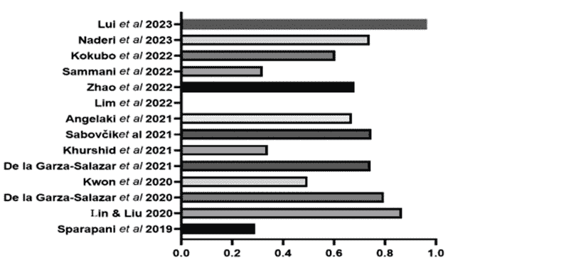

图 1. ML 算法对 LVH 的灵敏度。Lin & Liu 2020 [31]，Sparapani 等人，2019 年 [32]，De la Garza-Salazar 等人，2020 年 [33]，Kwon 等人，2020 年 [34]，De la Garza-Salazar 等人，2021 年 [35]，Khurshid 等人，2021 年 [36]，Sabovčik 等人，2021 年 [37]，Angelaki 等人，2021 年 [38]，Lim 等人，2021 年 [39]，Zhao 等人，2022 年 [40]，Sammani 等人，2022 年 [41]，Kokubo 等人，2022 年 [42]，Naderi 等人，2023 年 [43]，Liu 等人，2023 年 [44]。

### 特异度

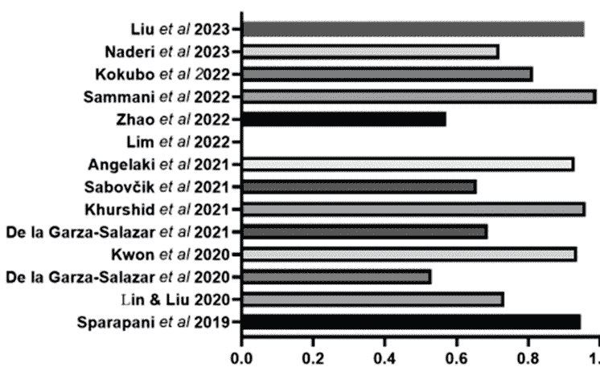

图 2. ML 算法对 LVH 的特异度。Lin & Liu 2020 [31]，Sparapani 等人，2019 年 [32]，De la Garza-Salazar 等人，2020 年 [33]，Kwon 等人，2020 年 [34]，De la Garza-Salazar 等人，2021 年 [35]，Khurshid 等人，2021 年 [36]，Sabovčik 等人，2021 年 [37]，Angelaki 等人，2021 年 [38]，Lim 等人，2021 年 [39]，Zhao 等人，2022 年 [40]，Sammani 等人，2022 年 [41]，Kokubo 等人，2022 年 [42]，Naderi 等人，2023 年 [43]，Liu 等人，2023 年 [44]。

### AUC

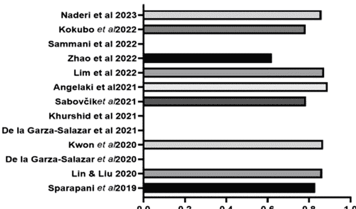

图 3. 那些报告此类数据的研究中 ML 算法对 LVH 的 AUC。Lin & Liu 2020 [31]，Sparapani 等人，2019 年 [32]，De la Garza-Salazar 等人，2020 年 [33]，Kwon 等人，2020 年 [34]，De la Garza-Salazar 等人，2021 年 [35]，Khurshid 等人，2021 年 [36]，Sabovčik 等人，2021 年 [37]，Angelaki 等人，2021 年 [38]，Lim 等人，2021 年 [39]，Zhao 等人，2022 年 [40]，Sammani 等人，2022 年 [41]，Kokubo 等人，2022 年 [42]，Naderi 等人，2023 年 [43]。


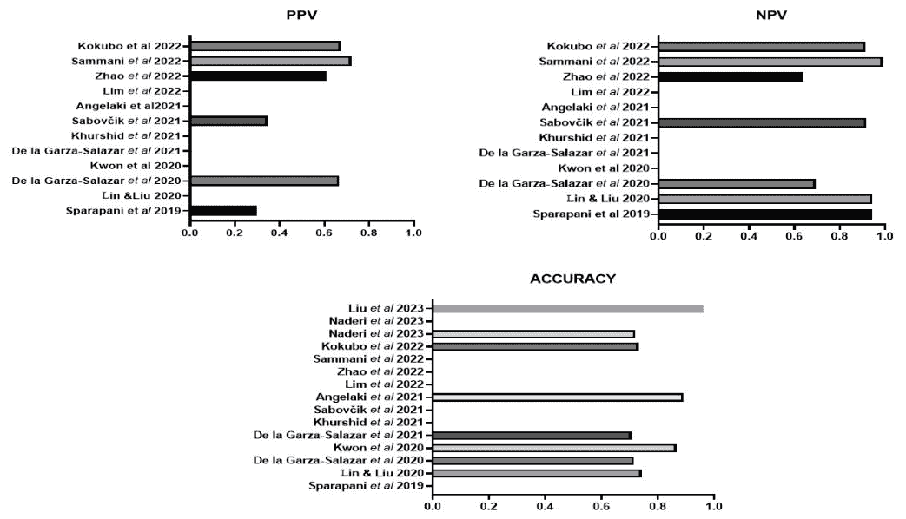

图 4. 报告此类数据的研究中，LVH 机器学习算法的阳性预测值 (PPV)、阴性预测值 (NPV) 和准确率。Lin & Liu 2020 [31]，Sparapani 等人，2019 [32]，De la Garza-Salazar 等人，2020 [33]，Kwon 等人，2020 [34]，De la Garza-Salazar 等人，2021 [35]，Khurshid 等人，2021 [36]，Sabovčik 等人，2021 [37]，Angelaki 等人，2021 [38]，Lim 等人，2021 [39]，Zhao 等人，2022 [40]，Sammani 等人，2022 [41]，Kokubo 等人，2022 [42]，Naderi 等人，2023 [43]，Liu 等人，2023 [44]。

三项研究使用了不同的机器学习算法并进行了比较。Kwon 等人发现，基于 ENN 的其 AI 算法在以 AUC 为指标时，明显优于 DNN、CNN、RF 和 LR 算法 [34]。使用相同的指标 (AUC)，Sabovčik 等人报告称，XGBoost 和 RF 分类器在预测 LVH 时表现出较高的受试者工作特征曲线下面积，数值在 77.7% 至 78.5% 之间，且这些方法优于 AdaBoost、支持向量机和逻辑回归 [37]。他们未采用 ENN 方法。Kokubo 等人发现深度学习模型 (ENN) 的数值为 78.4%，这明显高于逻辑回归和随机森林方法 [42]。因此，基于采用 ENN 的两项研究，与其他机器学习方法相比，ENN 具有竞争优势 [34,42]。

九项研究将其机器学习方法与经典 ECG 方法进行了比较。Zhao 等人的机器学习算法优于 Cornell 电压标准 (AUC 0.57，灵敏度 48%，特异度 72%) 和 Sokolow-Lyon 电压 (AUC 0.51，灵敏度 14%，特异度 96%) [40]。Liu 等人提出的机器学习算法报告的灵敏度、特异度和准确率数值优于 Cornell 电压标准、Sokolow-Lyon、Peguero-Framingham 和 Gubner 标准 [44]。在 De la Garza-Salazar 等人提出的两个机器学习算法中，第一个算法的结果优于 Romhilt-Estes 评分，准确率为 61.3%，灵敏度 23.2%，特异度 94.8% [33]，而第二个算法的准确率优于 Romhilt-Estes (57%)、Cornell (59%) 和 Sokolow-Lyon (53.9%) [35]。

八项研究报告，与使用 Romhilt-Estes 评分系统、Cornell 电压标准或 Sokolow-Lyon 标准进行评估相比，其机器学习算法具有更好的灵敏度 (图 5)。其中四项研究报告的特异度等于或优于经典 ECG 标准 [32,34,36,42] (图 6)。对于某些机器学习算法，特异度高于经典 ECG 标准，而其他算法则未发现显著差异。七项研究报告，与使用 Romhilt-Estes 评分系统、Cornell 电压标准或 Sokolow-Lyon 标准进行评估相比，其机器学习算法具有更好的 AUC (图 7)。

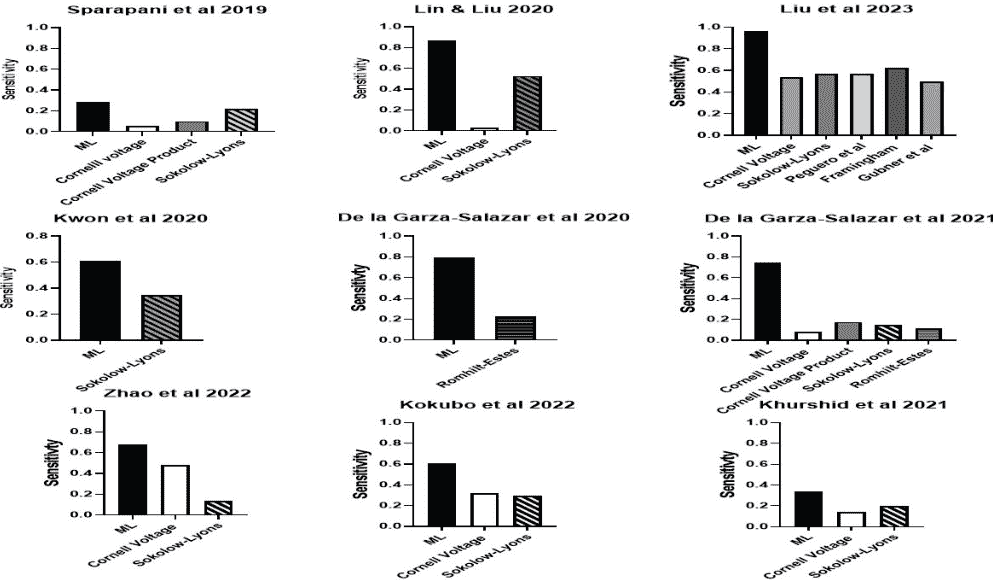

图 5. 报告此类数据的研究中，与标准 ECG LVH 标准相比，LVH 机器学习算法的灵敏度。Lin & Liu 2020 [31]，Sparapani 等人，2019 [32]，De la Garza-Salazar 等人，2020 [33]，Kwon 等人，2020 [34]，De la Garza-Salazar 等人，2021 [35]，Khurshid 等人，2021 [36]，Zhao 等人，2022 [40]，Kokubo 等人，2022 [42]，Liu 等人，2023 [44]。

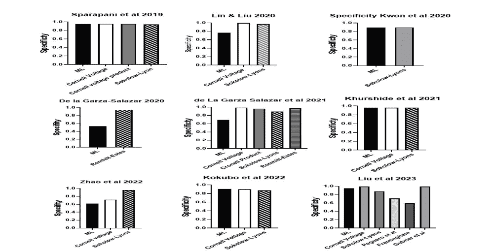

图 6. 报告此类数据的研究中，与标准 ECG LVH 标准相比，LVH 机器学习算法的特异度。Lin & Liu 2020 [31]，Sparapani 等人，2019 [32]，De la Garza-Salazar 等人，2020 [33]，De la Garza-Salazar 等人，2021 [35]，Khurshid 等人，2021 [36]，Zhao 等人，2022 [40]，Kokubo 等人，2022 [42]，Liu 等人，2023 [44]。

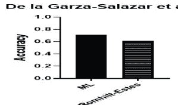

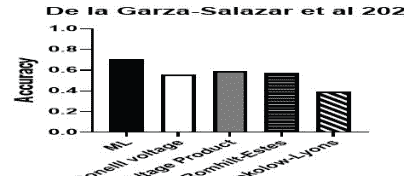

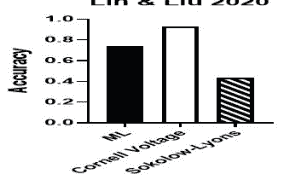

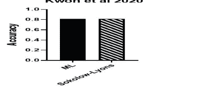

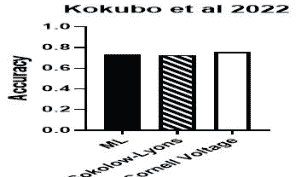

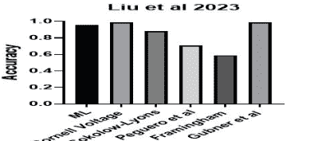

图 7. 报告此类数据的研究中，与标准 ECG LVH 标准相比，LVH 机器学习算法的准确率。Lin & Liu 2020 [31]，De la Garza-Salazar 等人，2020 [33]，Kwon 等人，2020 [34]，De la Garza-Salazar 等人，2021 [35]，Kokubo 等人，2022 [42]，Liu 等人，2023 [44]。

多项研究列出了其机器学习模型中的重要因素。忽略 QRS 电压后，Lin 和 Liu 报告称，LVH 的其他重要预测因子包括年龄、心率、PR 间期、未校正 QT 间期以及 II 导联中的 QRS 轴 [31]。Naderi 等人提出的算法中，收缩压和舒张压数值位列 LVH 前 40 个预测因子 [43]。Sammani 等人的机器学习模型中，年龄和血压是 LVH 的关键预测因子，此外还包括 P 波和 T 波特征 [41]。Sabovčik 等人的算法中，年龄、腰围、血压的不同成分、高血压病史、血清肾素和抗高血压治疗是 LVH 的主要预测因子 [37]。

### 4. 讨论

本研究展示了用于评估左心室质量增加或心脏肥厚存在的机器学习技术种类繁多。它展示了机器学习算法之间在灵敏度、特异度和预测准确性方面的差异。它进一步识别出算法之间输入变量的巨大差异。这些差异凸显了进行深入评估的必要性。

文献中源自心电图的左心室肥厚数据集在不同研究之间差异很大。两项研究的数据来自军事新兵，他们本质上是左心室肥厚患病率较低的年轻男性 [31,39]。有三项基于人群的研究，其中两项基于同一英国数据库，左心室肥厚患病率较高 [32,36,37,43]。有八项基于医院的研究，平均年龄最大且左心室肥厚患病率最高，男性比例在 42% 至 64% 之间 [33–35,38,40–42]，且有一家军事医院以男性为主 (90%) [44]。总体而言，男性和女性比例差异很大，但主要是因为年轻军事新兵研究和军事医院中男性占主导地位。年轻男性军事新兵可能无法推广到一般人群或住院的老年患者。不同研究之间的左心室肥厚患病率在 0.8% 至 48% 之间，可能影响了左心室肥厚检测的精确性。大多数研究使用超声心动图来评估左心室肥厚患病率，但亚洲或欧洲人群研究之间的左心室肥厚标准各不相同。

可根据机器学习算法选择区分不同分组的边界的方式对其进行分类。多个研究小组使用了支持向量机 [31,37,43]。支持向量机分类器可以使用线性或非线性函数，尽管通常选择线性函数。该方法中的决策边界称为最大边界分类器、最大边界超平面或最大边界超平面 [45]。其他研究依赖逻辑回归 [33]，这是一种尝试最大化条件似然性的更简单的方法；然而，它比支持向量机更容易受离群点影响，支持向量机主要优先考虑最接近决策边界的点。然而，逻辑回归和支持向量机通常得出相似的结果 [46]。一些研究使用了随机森林 [37,39,43]。随机森林是一种使用决策树集合的分类算法，每棵树依赖于独立采样的随机向量的值，泛化能力取决于每棵树的强度及其之间的相关性 [47]。在多种临床诊断条件下，随机森林的准确率最高，其次是支持向量机 [48]。

Angelaki 等人使用了 SHAP (SHapley Additive exPlanations)，这是一种博弈论方法，将最优信用分配与局部解释相关联，使用博弈论中的经典 Shapley 值及其相关扩展 [38]。多项研究使用了多种机器学习算法 [37,39]。一些研究人员采用了深度学习方法 [34,40,42]。心电图数据深度学习的爆炸式增长导致这样的结论：卷积神经网络与循环神经网络集成的混合架构取得了最佳结果 [49]。然而，除了数据集和方法视角的差异外，还有与可解释性、可扩展性和效率相关的一些新挑战和问题 [49]。这种混合组合在少数研究中用于左心室肥厚检测 [34,42]。

Liu 等人报告了非常高的灵敏度和特异度。通常，检测的灵敏度越高，其特异度越低。他们使用了详细的 QRS 分析，但其他未能达到同样高灵敏度和特异度的研究也使用了详细的心电图信号分析 [43]；例如，Zhao 等人在其最终数据集中拥有 36,350 个心电图片段 [40]，而另一种机器学习算法则使用了每个心电图 552 个幅度和持续时间测量值 [32]。Liu 等人 [44] 的研究结果显示了非常高的灵敏度和特异度，但这可能与他们的决定有关，即左心室肥厚病例太少“用于设计机器学习模型。因此，执行了心拍分割方法，即 Pan-Tompkins 技术，以增加心电图数据量以提高检测性能” [44]。

机器学习算法的关键测试是预测左心室肥厚的比较能力。最佳或最高灵敏度的是 Liu 等人提出的算法 [44]，其次是 Lin 和 Liu [31]，然后是 De la Garza-Salazar 等人 [33]。如果需要特异性诊断，使用 Sammani 等人提出的算法可获得最高特异度 [41]，紧随其后的是 Liu 等人 [44]，然后是 Khurshid 等人 [36]。然而，特异度高的算法通常灵敏度低。使用 ROC 曲线综合灵敏度和特异度表明，最佳方法可能是 Angelaki 等人的算法 [38]，其次是 Kwon 等人 [34]。多项研究比较了不同的机器学习模型来预测左心室肥厚 [34,39,42]。差异通常不大。两项研究比较了至少四种机器学习方法，两者均发现 ENN 具有最高 AUC；与其他机器学习方法相比，ENN 具有竞争优势 [34,42]。Kokubo 等人开发了一个集成神经网络 (ENN) 模型，由卷积神经网络 (CNN) 和深度神经网络 (DNN) 组成 [42]。Kwon 等人使用了深度神经网络 (DNN)。基于使用 ENN 的两项研究，这种机器学习方法 (ENN) 相对于其他机器学习方法具有竞争优势 [34,42]。

与左心室肥厚经典心电图标准的比较表明，机器学习算法通常比标准 Cornell 电压 [13]、Cornell 乘积 [28]、Sokolow-Lyon [9] 或 Romhilt-Estes 标准 [29] 对左心室肥厚的检测更具灵敏性。相比之下，一般而言，机器学习算法不比经典标准更具特异性，因为有四种机器学习算法


没有比这些左室肥大经典标准更好的，且有四种更差。Sparapani 等人[32]、Kokubo 等人[42]、Kwan 等人[34]和 Khurshid 等人[36]的机器学习算法特异度与经典心电图标准相当。

用于左室肥大检测的机器学习算法存在一个主要的理论问题，即使用了不同种类的输入数据。关于使用机器学习进行左室肥大诊断，有几种思路。首先，是机器学习是否可以基于QRS波群（尤其是QRS电压）改善左室肥大检测，这在历史上是心电图识别左室肥大的首次尝试[9]。第二种方法是利用心电图信号的所有方面。Romhilt 和 Estes [29] 的工作体现了这一点，他们在QRS电压基础上加入了QRS轴和ST-T波来识别左室肥大。因此，机器学习算法可以指向经典方法，以证明纳入其他心电图因素的合理性。在心电图评估中，纳入临床因素变得更加棘手。当纳入年龄和高血压病史时，灵敏度显著提高，但这是否是诊断中使用心电图的公平测试？加入大量临床和实验室变量，使问题进一步偏离了心电图的实用性，但满足了如何更准确预测左室肥大存在的问题。例如，Sabović 等人输入了大量临床和实验室变量，包括血常规、血糖、血脂、肾素活性、瘦素、胰岛素、醛固酮和皮质醇[37]。Zhao 等人包括了临床因素（年龄、性别和病史）以及实验室因素（如血红蛋白、血小板、血脂、肌酐、钠和钾）作为输入变量[40]。纳入如此广泛的临床和实验室数据，排除了将心电图作为左室肥大筛查测试的使用，因为要使用这些算法，通常无法获得的所有临床和其他实验室数据都必须输入。

由于方法学质量差和偏倚风险高，基于机器学习的预测模型研究受到了批评[50]。这种批评与经常未能“报告关键信息以帮助读者判断方法，并获得模型...内容的完整、透明和清晰图景”有关[51]。这种批评在评估用于左室肥大检测/诊断的机器学习算法时具有一定的道理。由于其复杂性，这类模型被贴上了“黑箱”的标签，当然与更可识别的回归模型相比[51]。例如，很难比较那些声称源自24个特征（这些特征由从心电图信号输出中自动获得的R波峰和S波谷幅度组成[44]）与原始心电图数据（每个12个导联有5000个数字[34]）的算法。认识到每项研究的局限性，讨论结果的意义是有价值的。首先，机器学习算法可以提高心电图检测左室肥大的灵敏度。提高灵敏度对筛查技术很重要，而心电图满足这一要求。其次，简单性证明使用仅依赖心电图变量的算法以补充关于左室肥大的心电图解读是合理的。第三，利用神经网络方法开发的算法似乎相对于其他机器学习方法具有竞争优势。

此分析存在几个值得讨论的局限性。首先，这些研究通常使用可用的“软件包”中的机器学习方法。Wallace 等人警告说，“近乎普遍地依赖‘袋外’方法可能会提供‘误导性结果’”[52]。其次，许多算法使用大部分或所有心电图导联的心电图变量，但在左室肥大检测中，多个导联的QRS标准通常提供相似的数据[53]。第三，并非所有出版物都提供了相同的输出以比较准确性、F1或ROC数据。第四，当一个算法使用大量实验室变量列表而另一个仅使用心电图因素时，难以比较和选择“最佳”机器学习算法。人们不得不思考，如果某一方法也包含大量实验室测试列表，它是否会更好。

总之，有必要重新强调心电图识别左室肥大的潜力，因为左室肥大是心血管事件的重要预测因素[3,8,19,24]，且更好的左室肥大检测方法将是一项重要贡献。几种机器学习算法提高了灵敏度，但与经典心电图标准相比，大多数算法并未提高左室肥大诊断的特异度。未来需要研究，以获得一种更标准化的方法，使用相同的数据集来评估和比较所有机器学习算法，确定每种算法的竞争优势并找出最佳算法。此外，将左室肥大诊断分为两个阶段——一个使用机器学习算法的心电图解读和第二个简单应用步骤——可以添加更多临床变量。

Supplementary Materials: 以下支持信息可从以下网址下载：https://www.mdpi.com/article/10.3390/bioengineering11050489/s1，图S1：系统评价和荟萃分析报告项目（PRISMA）。

Funding: 无需报告资助。没有赞助商或任何赞助商的贡献。

Data Availability Statement: 所用数据可在文献中获取。

Conflicts of Interest: 作者声明不存在利益冲突。

### Abbreviations

- SVM 支持向量机
- LR 逻辑回归
- RF 随机森林
- ENN 集成神经网络
- CNN 卷积神经网络
- DNN 深度神经网络
- AUC 受试者工作特征曲线下面积

### References

- 1. Levy, D.; Garrison, R.J.; Savage, D.D.; Kannel, W.B.; Castelli, W.P. Framingham心脏研究中超声心定测左心室质量的预后意义。N. Engl. J. Med. 1990, 322, 1561–1566. [CrossRef] [PubMed]
- 2. Brown, D.W.; Giles, W.H.; Croft, J.B. 左室肥大作为冠心病死亡率的预测因素及高血压的影响。Am. Heart J. 2000, 140, 848–856. [CrossRef] [PubMed]
- 3. Abdi-Ali, A.; Miller, R.J.H.; Southern, D.; Zhang, M.; Mikami, Y.; Knudtson, M.; Heydari, B.; Howarth, A.G.; Lydell, C.P.; James, M.T.; 等人. 左心室质量独立预测接受诊断性冠状动脉造影患者的死亡率和未来血运重建需求。JACC Cardiovasc. Imaging 2018, 11, 423–433. [CrossRef] [PubMed]
- 4. Rabkin, S.W.; Shieh, L.A.; Wood, D.A. 左心室质量对冠状动脉疾病患者舒张压目标的影响。Am. J. Hypertens. 2016, 29, 1085–1093. [CrossRef] [PubMed]
- 5. Chatterjee, S.; Bavishi, C.; Sardar, P.; Agarwal, V.; Krishnamoorthy, P.; Grodzicki, T.; Messerli, F.H. 左室肥大与持续性心律失常的荟萃分析。Am. J. Cardiol. 2014, 114, 1049–1052. [CrossRef]
- 6. Varvarousis, D.; Kallistratos, M.; Poulimenes, L.; Triantafyllis, A.; Tsinivizov, P.; Giannakopoulos, A.; Kyfidis, K.; Manolis, A. 动脉高血压中的心律失常。J. Clin. Hypertens. 2020, 22, 1371–1378. [CrossRef] [PubMed]
- 7. Rabkin, S.W. 关于理解高血压患者冠状动脉血流-左心室质量关系的思考。Curr. Cardiol. Rev. 2017, 13, 75–83. [CrossRef]
- 8. Yi, S.; Wang, F.; Wan, M.; Yi, X.; Zhang, Y.; Sun, S. 高血压患者心电图左室肥大预测中风：一项荟萃分析。J. Electrocardiol. 2020, 61, 27–31. [CrossRef]
- 9. Sokolow, M.; Lyon, T.P. 左室肥大中的心室复合波，经单极前胸导联和肢体导联获得。Am. Heart J. 1949, 37, 161–186. [CrossRef]
- 10. Koito, H.; Spodick, D.H. RV6:RV5电压比对左心室质量增加的准确性。Am. J. Cardiol. 1988, 62, 985–987. [CrossRef]
- 11. Crow, R.S.; Prineas, R.J.; Rautaharju, P.; Hannan, P.; Liebson, P.R. 轻度全身性高血压中心电图与超声心动图测定左心室质量的关系（轻度高血压治疗研究的结果）。Am. J. Cardiol. 1995, 75, 1233–1238. [CrossRef] [PubMed]
- 12. Levy, D.; Labib, S.B.; Anderson, K.M.; Christiansen, J.C.; Kannel, W.B.; Castelli, W.P. 左室肥大心电图标准灵敏度和特异度的决定因素。Circulation 1990, 81, 815–820. [CrossRef] [PubMed]
- 13. Casale, P.N.; Devereux, R.B.; Kligfield, P.; Eisenberg, R.R.; Miller, D.H.; Chaudhary, B.S.; Phillips, M.C. 心电图检测左室肥大：改进标准的开发和前瞻性验证。J. Am. Coll. Cardiol. 1985, 6, 572–580. [CrossRef] [PubMed]
- 14. Peguero, J.G.; Lo Presti, S.; Perez, J.; Issa, O.; Brenes, J.C.; Tolentino, A. 左室肥大诊断的心电图标准。J. Am. Coll. Cardiol. 2017, 69, 1694–1703. [CrossRef] [PubMed]
- 15. Pewsner, D.; Juni, P.; Egger, M.; Battaglia, M.; Sundström, J.; Bachmann, L.M. 动脉高血压中左室肥大诊断心电图的准确性：系统评述。Br. Med. J. Br. Med. J. Publ. Group 2007, 335, 711. [CrossRef] [PubMed]


- 16. Rautaharju, P.M.; Soliman, E.Z. 心电图左心室肥厚与不良心血管事件风险：批判性评析. J. Electrocardiol. 2014, 47, 649–654. [CrossRef] [PubMed]

- 17. Fagard, R.H.; Staessen, J.A.; Thijs, L.; Celis, H.; Birkenhäger, W.H.; Bulpitt, C.J.; de Leeuw, P.W.; Leonetti, G.; Sarti, C.; Tuomilehto, J.; et al. 收缩期高血压老年患者心电图电压及其系列变化的预后意义. Hypertension 2004, 44, 459–464. [CrossRef] [PubMed]

- 18. Kannel, W.B.; Gordon, T.; Castelli, W.P.; Margolis, J.R. 心电图左心室肥厚与冠心病风险：弗雷明汉研究. Ann. Intern. Med. Am. Coll. Physicians 1970, 72, 813–822. [CrossRef] [PubMed]

- 19. Rabkin, S.W.; Mathewson, F.A.L.; Tate, R.B. 表面健康男性的心电图与猝死风险. Br. Heart J. 1982, 47, 546–552. [CrossRef]

- 20. De Bacquer, D.; De Backer, G.; Kornitzer, M.; Blackburn, H. 男性和女性总死亡、心血管疾病及冠心病死亡中心电图发现的预后价值. Heart 1998, 80, 570–577. [CrossRef]

- 21. Lonn, E.; Mathew, J.; Pogue, J.; Johnstone, D.; Danisa, K.; Bosch, J.; Baird, M.; Dagenais, G.; Sleight, P.; Yusuf, S.; et al. 高危患者中心电图左心室肥厚与死亡率及心血管发病率的关系. Eur. J. Cardiovasc. Prev. Rehabil. 2003, 10, 420–428. [CrossRef]

- 22. Hsieh, B.P.; Pham, M.X.; Froelicher, V.F. 左心室肥厚心电图诊断标准的预后价值. Am. Heart J. 2005, 150, 161–167. [CrossRef] [PubMed]

- 23. Sullivan, J.M.; Vander Zwaag, R.V.; el-Zeky, F.; Ramanathan, K.B.; Mirvis, D.M. 左心室肥厚：对生存率的影响. J. Am. Coll. Cardiol. 1993, 22, 508–513. [CrossRef]

- 24. Hawkins, N.M.; Wang, D.; McMurray, J.J.V.; Pfeffer, M.A.; Swedberg, K.; Granger, C.B.; Yusuf, S.; Pocock, S.J.; Ostergren, J.; Michelson, E.L.; et al. 心力衰竭中心电图左心室肥厚的患病率及预后意义：CHARM研究的证据. Heart 2007, 93, 59–64. [CrossRef] [PubMed]

- 25. You, Z.; He, T.; Ding, Y.; Yang, L.; Jiang, X.; Huang, L. 一般人群中心电图左心室肥厚的预测价值：荟萃分析. J. Electrocardiol. 2020, 62, 14–19. [CrossRef] [PubMed]

- 26. Schlant, R.C.; Adolph, R.J.; DiMarco, J.P.; Dreifus, L.S.; Dunn, M.I.; Fisch, C.; Garson, A., Jr.; Haywood, L.J.; Levine, H.J.; Murray, J.A. 心电图检查指南。美国心脏病学会/美国心脏协会诊断与治疗心血管操作评估工作组（心电图学委员会）报告. Circulation Am. Heart Assoc. 1992, 85, 1221–1228. [CrossRef]

- 27. Unger, T.; Borghi, C.; Charchar, F.; Khan, N.A.; Poulter, N.R.; Prabhakaran, D.; Ramirez, A.; Schlaich, M.; Stergiou, G.S.; Tomaszewski, M.; et al. 2020年国际高血压学会全球高血压实践指南. J. Hypertens. 2020, 38, 982–1004. [CrossRef]

- 28. Okin, P.M.; Roman, M.J.; Devereux, R.B.; Kligfield, P. 通过简单电压-持续时长乘积心电图识别左心室质量增加. J. Am. Coll. Cardiol. 1995, 25, 417–423. [CrossRef]

- 29. Romhilt, D.W.; Bove, K.E.; Norris, R.J.; Conyers, E.; Conradi, S.; Rowlands, D.T.; Scott, R. 左心室肥厚诊断心电图标准的批判性评析. Circ. Am. Heart Assoc. 1969, 40, 185–196. [CrossRef]

- 30. Page, M.J.; McKenzie, J.E.; Bossuyt, P.M.; Boutron, I.; Hoffmann, T.C.; Mulrow, C.D.; Shamseer, L.; Tetzlaff, J.M.; Akl, E.A.; Brennan, S.E.; et al. PRISMA 2020声明：报告系统综述的更新指南. BMJ 2021, 372, n71. [CrossRef]

- 31. Lin, G.-M.; Liu, K. 基于机器学习结合人体测量学的心电图系统，用于筛查年轻成人左心室肥厚. IEEE J. Transl. Eng. Health Med. 2020, 8, 1800111. [CrossRef] [PubMed]

- 32. Sparapani, R.; Dabbouseh, N.M.; Gutterman, D.; Zhang, J.; Chen, H.; Bluemke, D.A.; Lima, J.A.C.; Burke, G.L.; Soliman, E.Z. 使用贝叶斯加法回归树检测左心室肥厚：MESA研究. J. Am. Heart Assoc. 2019, 8, e009959. [CrossRef] [PubMed]

- 33. De la Garza-Salazar, F.; Romero-Ibarguengoitia, M.E.; Rodriguez-Diaz, E.A.; Azpiri-Lopez, J.R.; Gonzalez-Cantu, A. 使用机器学习方法提高左心室肥厚心电图诊断准确率. PLoS ONE 2020, 15, e0232657. [CrossRef]

- 34. Kwon, J.-M.; Jeon, K.-H.; Kim, H.M.; Kim, M.J.; Lim, S.M.; Kim, K.-H.; Song, P.S.; Park, J.; Choi, R.K.; Oh, B.-H. 使用心电图检测左心室肥厚时人工智能与常规诊断标准性能的比较. EP Eur. 2020, 22, 412–419. [CrossRef] [PubMed]

- 35. De la Garza Salazar, F.; Romero Ibarguengoitia, M.E.; Azpiri López, J.R.; González Cantú, A. 基于计算机心电图数据和机器学习优化心电图以检测超声心动图左心室肥厚. PLoS ONE 2021, 16, e0260661. [CrossRef]

- 36. Khurshid, S.; Friedman, S.; Pirruccello, J.P.; Di Achille, P.; Diamant, N.; Anderson, C.D.; Ellinor, P.T.; Batra, P.; Ho, J.E.; Philippakis, A.A.; et al. 基于十二导联心电图的深度学习预测心磁共振导出的左心室质量和肥厚. Circ. Cardiovasc. Imaging 2021, 14, e012281. [CrossRef]

- 37. Sabovic, F.; Cauwenberghs, N.; Kouznetsov, D.; Haddad, F.; Alonso-Betanzos, A.; Vens, C.; Kuznetsova, T. 应用机器学习检测心脏重塑和功能障碍的早期阶段. Eur. Heart J. Cardiovasc. Imaging 2021, 22, 1208–1217. [CrossRef]

- 38. Angelaki, E.; Marketou, M.E.; Barmpatis, G.D.; Patrianakos, A.; Vardas, P.E.; Parthenakis, F.; Tsirolis, G.P. 无心血管疾病患者中通过机器学习检测异常左心室几何结构：一种基于心电图的方法. J. Clin. Hypertens. 2021, 23, 935–945. [CrossRef] [PubMed]

- 39. Lim, D.Y.; Sng, G.; Ho, W.H.; Hankun, W.; Sia, C.-H.; Lee, J.S.; Shen, X.; Tan, B.Y.; Lee, E.C.; Dalakoti, M.; et al. 赛前队列中超声心动图左心室肥厚的机器学习与经典心电图标准对比. Kardial. Pol. 2021, 79, 654–661.

- 40. Zhao, X.; Huang, G.; Wu, L.; Wang, M.; He, X.; Wang, J.-R.; Zhou, B.; Liu, Y.; Lin, Y.; Liu, D.; et al. 基于心电图的左心室肥厚深度学习评估. Front. Cardiovasc. Med. 2022, 9, 952089. [CrossRef]

- 41. Sammani, A.; Jansen, M.; de Vries, N.M.; de Jonge, N.; Baas, A.F.; Te Riele, A.S.J.M.; Asselbergs, F.W.; Oerlemans, M.I.F.J. 基于电子健康记录数据自动识别原因不明左心室肥厚患者，以改善靶向治疗和家庭筛查. Front. Cardiovasc. Med. 2022, 9, 768847. [CrossRef] [PubMed]

- 42. Kokubo, T.; Kodera, S.; Sawano, S.; Katsushika, S.; Nakamoto, M.; Takeuchi, H.; Kimura, N.; Shinohara, H.; Matsuoka, R.; Nakanishi, K.; et al. 使用深度学习从心电图中自动检测左心室扩张和肥厚. Int. Heart J. 2022, 63, 939–947. [CrossRef]

- 43. Naderi, H.; Ramírez, J.; van Duijvenboden, S.; Pujadas, E.R.; Aung, N.; Wang, L.; Anwar Ahmed Chahal, C.; Lekadir, K.; Petersen, S.E.; Munroe, P.B. 使用机器学习在英国生物库影像研究中基于十二导联心电图预测左心室肥厚. Eur. Heart J. Digit. Health 2023, 4, 316–324. [CrossRef]

- 44. Liu, C.-W.; Wu, F.-H.; Hu, Y.-L.; Pan, R.-H.; Lin, C.-H.; Chen, Y.-F.; Tseng, G.-S.; Chan, Y.-K.; Wang, C.-L. 使用心电图信号检测左心室肥厚. Sci. Rep. 2023, 13, 2556. [CrossRef]

- 45. Boser, B.; Guyon, I.; Vapnik, V. 最优边界分类器的训练算法. In Proceedings of the fifth Annual Workshop on Computational Learning Theory—COLT '92, Pittsburgh, PA, USA, 27–29 July 1992; ACM Press: New York, NY, USA, 1992; pp. 144–152.

- 46. Golpour, P.; Ghayour-Mobarhan, M.; Saki, A.; Esmaily, H.; Taghipour, A.; Tajfard, M.; Ghazizadeh, H.; Moohebat, M.; Ferns, G.A. 支持向量机、朴素贝叶斯与逻辑回归在评估冠状动脉造影必要性方面的比较. Int. J. Environ. Res. Public Health 2020, 17, 6449. [CrossRef] [PubMed]

- 47. Breiman, L. 随机森林. Mach. Learn. 2001, 45, 5–32. [CrossRef]

- 48. Uddin, S.; Khan, A.; Hossain, M.E.; Moni, M.A. 不同监督机器学习算法在疾病预测中的比较. BMC Med. Inform. Decis. Mak. 2019, 19, 281. [CrossRef]

- 49. Hong, S.; Zhou, Y.; Shang, J.; Xiao, C.; Sun, J. 心电图数据深度学习方法的机遇与挑战：一项系统综述. Comput. Biol. Med. 2020, 122, 103801. [CrossRef] [PubMed]

- 50. Andaur Navarro, C.L.; Damen, J.A.A.; Takada, T.; Nijman, S.W.J.; Dhiman, P.; Ma, J.; Collins, G.S.; Bajpai, R.; Riley, R.D.; Moons, K.G.M.; et al. 基于监督机器学习技术开发预测模型的研究中偏倚风险：系统综述. BMJ 2021, 375, n2281. [CrossRef]

- 51. Collins, G.S.; Dhiman, P.; Andaur Navarro, C.L.; Ma, J.; Hooft, L.; Reitsma, J.B.; Logullo, P.; Beam, A.L.; Peng, L.; Van Calster, B.; et al. 基于人工智能的诊断和预后预测模型研究报告指南（TRIPOD-AI）和偏倚风险工具（PROBAST-AI）制定方案. BMJ Open 2021, 11, e048008. [CrossRef]

- 52. Wallace, M.L.; Mentch, L.; Wheeler, B.J.; Tapia, A.L.; Richards, M.; Zhou, S.; Yi, L.; Redline, S.; Buysse, D.J. 医学中随机森林变量重要性指标的使用与误用：通过发作性中风预测的演示. BMC Med. Res. Methodol. 2023, 23, 144. [CrossRef] [PubMed]

- 53. Rabkin, S.W.; Zhou, J. 老年人群中左心室质量谱（从正常到增加）范围内基于心电图估计左心室质量. Cardiol. Res. Pract. 2024, 6634222. [CrossRef] [PubMed]

免责声明/出版者说明：所有出版物中包含的声明、观点和数据仅为各作者和撰稿人个人观点，不代表MDPI及/或编辑的观点。MDPI及/或编辑对内容中提及的任何想法、方法、说明或产品所导致的人身或财产伤害不承担责任。


## 探索诊断精确性与分诊熟练度：GPT-4与Bard处理常见眼科主诉的比较研究

Roya Zandi 1, Joseph D. Fahey 1, Michael Drakopoulos 1, John M. Bryan 1, Siyuan Dong 2, Paul J. Bryar 1, Ann E. Bidwell 1, R. Chris Bowen 1, Jeremy A. Lavine 1 and Rukhsana G. Mirza 1,*

- 1 西北大学费恩伯格医学院眼科部，美国伊利诺伊州芝加哥60611
- 2 西北大学费恩伯格医学院预防医学部生物统计学分部，美国伊利诺伊州芝加哥60611
- * 通信作者: r-mirza@northwestern.edu

摘要：在现代医疗时代，患者常常求助于互联网来解答健康相关的问题，而诊所面临着及时回应患者担忧的挑战。这促使有必要调查AI聊天机器人在眼科诊断和分诊方面的能力。在这项计算机模拟研究中，80份不同紧急程度和临床描述的模拟眼科患者主诉，通过系统性的3步提交流程同时输入到ChatGPT和 Bard中，要求聊天机器人进行分诊、诊断和评估紧急程度。三位眼科医生对聊天机器人的回答进行了评分。聊天机器人在眼科分诊方面明显优于诊断（90.0%适当分诊 vs. 48.8%正确主要诊断；p < 0.001），且GPT-4在适当分诊建议（96.3% vs. 83.8%；p = 0.008）、患者使用的评分者满意度（81.3% vs. 55.0%；p < 0.001）以及更低的潜在危害率（6.3% vs. 20.0%；p = 0.010）方面表现优于Bard。更多的描述符提高了GPT-4和Bard的诊断准确性。这些结果表明，聊天机器人不一定需要识别出正确诊断即可提供适当的眼科分诊，这些工具在辅助患者或分诊人员方面具有潜在效用；然而，它们不能替代专业的眼科评估或建议。

关键词：人工智能；眼科学；分诊；聊天机器人；ChatGPT；Bard；大型语言模型

### 1. 引言

对话式人工智能（AI）聊天机器人在过去几年中获得了显著的发展势头。OpenAI于2022年11月发布的Chat Generative Pre-trained Transformer（ChatGPT）和Google于2023年3月推出的Bard是两款公开可用的聊天机器人。这些系统使用大型语言模型（LLMs）来处理和生成类似人类语言的文本。LLMs是一个快速发展的技术领域，其中计算机模型在大规模数据上预训练，然后适应各种任务[1]。尽管今天有多种LLM可用，但由于ChatGPT和Bard的广泛存在和公开可用性，本工作将重点研究这两款。两个系统之间存在一些关键的操作差异。具体而言，ChatGPT使用GPT-3.5或GPT-4聊天机器人模型，而Bard使用PaLM 2（Pathways Language Model 2）。此外，Bard实时直接从Google获取数据，而ChatGPT基于2021年的数据运行，并必须搜索论文以收集信息[2,3]。

这些强大工具越来越多地被考虑用于医学领域的效率改进，包括支持临床实践、科学写作、图像分析或即时医疗建议等应用[4,5]。然而，它们并非没有风险。已有研究指出，由于驱动LLM的数据质量存在巨大差异，LLM可能会产生有偏见或有害的内容；特别是在医学领域，聊天机器人输出的质量与患者护理相关，因此备受关注[6]。最近，人们对探索这些LLM在医学中的能力表现出浓厚兴趣。早期研究表明，OpenAI的GPT-3.5在美国医学执照考试（USMLE）系列的三项考试中均达到了或接近及格水平[7]。随着新版本的推出，2023年3月发布的GPT-4被发现正确回答涉及沟通技巧、伦理、同理心和专业精神的USMLE问题的表现优于GPT-3.5[8]。更近期的研究比较了GPT-4和Bard在回答各种亚专业委员会考试式问题方面的表现，结果显示GPT-4优于Bard[9–11]。在眼科领域也有相关兴趣，其中一项研究表明GPT-4在回答眼科知识评估计划（OKAP）考试的练习题时表现出色，显著优于GPT-3.5[12]。

随着AI聊天机器人的发展，越来越多地被普通大众使用，并集成到常见的互联网搜索引擎中，评估其在患者护理旅程中的作用变得越来越迫切。患者寻求互联网上的健康信息是一个确立的趋势[13,14]，并且在联系医疗专业人员之前，他们常常首先转向互联网获取健康建议[15,16]。此外，患者在联系医疗保健提供者时通常面临很长的等待时间，在眼科领域尤其如此。一项最近的研究预测，到2035年，相对于需求，眼科医生将出现相当大的短缺[17]，急诊科的眼科覆盖有限，尤其是在农村地区[18]。因此，非眼科医疗提供者、繁忙的分诊呼叫中心以及患者可能会开始寻求技术解决方案，例如可以支持处理眼科主诉和分诊的AI聊天机器人。因此，彻底评估这些工具的优势和潜在风险至关重要。

近期研究开始探索AI聊天机器人作为眼部症状检查器或眼科分诊工具的能力。具体而言，Pushpanathan等人研究了GPT-3.5、GPT-4和Bard回答关于特定眼部症状的直接问题时的回答准确性和质量（未考察分诊能力），并发现GPT-4的准确性最高[19]。Lim等人专门针对与近视相关的查询对ChatGPT和Bard的性能进行了基准测试，也发现GPT-4具有更高的准确性[20]。Lyons等人将GPT-4、Bing Chat和WebMD症状检查器的分诊能力与眼科住院医师在24种眼科诊断中进行了比较。值得注意的是，GPT-4在诊断和分诊准确性方面与住院医师相当[21]。

在本研究中，我们旨在评估和比较GPT-4和Bard对40种临床诊断对应的常见眼科主诉的回应，这些主诉以模拟患者病例的形式呈现，并包含关于拟议诊断和分诊建议的针对性问题。我们还分析了提示描述性如何影响回答质量，以便更好地了解它们如何最好地应用于未来面向患者的环境。随着我们对这项技术的价值和局限性有了更好的理解，我们可以更接近于确定如何在日常社会中实施对话式AI，以满足提供及时、准确和安全的眼科健康信息以供患者使用和决策的需求。

### 2. 材料与方法

西北大学机构审查委员会确定，这项计算机模拟研究不涉及人类受试者。在数据收集时，GPT-4可通过ChatGPT Plus付费订阅公开使用，而Bard可免费访问。

#### 2.1. 眼科模拟患者提示的创建

我们系统地从患者的角度构建了眼科中常见的场景。确定了40种常见诊断，包括“不可漏诊的诊断”[22]，并平均分配到四个眼科亚专业组：前节/青光眼、神经眼科、儿童眼科/眼整形以及视网膜。每种诊断都指定了就诊紧急程度，分为当天、紧急（<1周）或非紧急（>1周）。为每种诊断创建了两个提示，一个包含三个关键临床描述符，另一个包含五个描述符（方案1）。描述符被定义为临床相关的信息片段，涉及以下任何内容：相关病史、发病时间、持续时间、侧别、特定眼部解剖结构的提及、视觉、色觉异常、疼痛、畏光、视觉障碍或任何其他临床特征。对于每个患者场景，有经验的眼科医生（P.B.、A.E.B.和R.C.B.）基于专家意见就预期诊断和紧急程度达成共识（补充表S1–S4）。

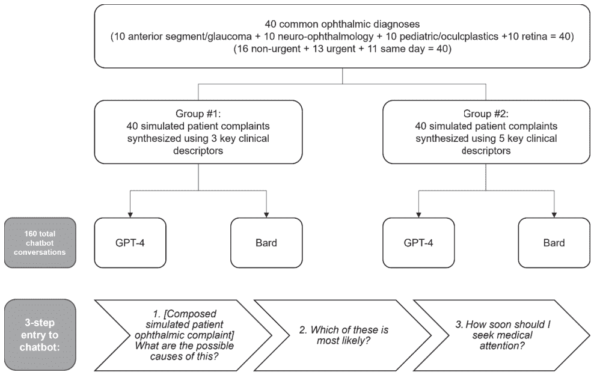

方案1. 聊天机器人提示总体研究设计流程图。

#### 2.2. 输入到人工智能聊天机器人

模拟患者提示在2023年6月14日至20日期间输入到AI聊天机器人中，使用的是GPT-4版本2023.05.24和Bard版本2023.06.07。尽管存在许多聊天机器人，包括微软Bing AI、Claude AI或Meta的LLaMA，但我们选择了这两款，因为它们在发表时是最常用和最常引用的聊天机器人之一，并且是公开可用的。每个提示都使用标准化的3部分逐步方法输入到聊天机器人中。首先，输入模拟患者场景，然后是问题“这个可能的原因是什么？”。第二次输入是“这些中哪个最可能？”。最后，第三个输入是“我应该何时寻求医疗帮助？”。在开始每个3部分输入之前，重置聊天机器人历史记录。这些连续问题旨在确保聊天机器人处理鉴别诊断、主要诊断并提供分诊建议。

#### 2.3. 聊天机器人回答的评分

为评估聊天机器人生成的回答，设计了一份七项问卷，同时使用4点李克特量表和二元（是/否）风格的问题（补充表S5）。在评分之前，从聊天机器人的回答中删除了聊天机器人标识符（例如，“我是由OpenAI开发的AI”），以消除潜在评分者偏见 toward


某特定聊天机器人。两位经验丰富的眼科医生对每个聊天机器人对话的诊断准确性和分诊建议的适当性（主要结局），以及鉴别诊断的相关性、对真实患者使用响应质量的满意度，以及响应可能对真实患者造成的潜在危害（次要结局）进行了评分。第三位经验丰富的眼科医生担任任何评分分歧的仲裁者。所有评分者均对聊天机器人来源保持盲法。为进行本分析，4点李克特量表中3或4分的响应视为“同意”，1或2分的响应视为“不同意”，以提供二元数据。

#### 2.4. 统计分析

为所有感兴趣的变量生成了描述性统计，报告了频数及百分比。为比较ChatGPT与Bard以及5个描述符和3个描述符之间的结局，在适当时使用了Pearson卡方检验或Fisher精确检验。使用相同方法对亚专科类别和紧急程度水平进行了子分析。将逻辑回归模型应用于主要结局，以提示词的详细程度为预测变量，并分别对ChatGPT和Bard拟合模型。模型性能使用曲线下面积（AUC）和受试者工作特性（ROC）曲线进行估计。所有分析均使用R版本4.3.1进行。

### 3. 结果

共向GPT-4和Bard提供了80个唯一条目，生成了总计160条聊天机器人生成的响应。其中40个条目包含3个提示词描述符，另外40个条目包含5个提示词描述符。这40个诊断被细分为四个亚专科类别（10例一般眼科，10例神经眼科，10例儿童眼科/眼整形，10例视网膜）和3个紧急程度水平（16例非紧急，13例紧急，11例当日就诊）（方案1）。GPT-4和Bard的诊断率（即，将正确诊断作为患者症状的最可能原因给出）分别为53.8%和43.8%（p = 0.2）。有趣的是，两个聊天机器人在提供分诊建议方面均明显优于提供正确的主要诊断（GPT-4：p < 0.001，Bard：p < 0.001）。GPT-4和Bard的总体适当分诊建议率分别为96.3%和83.8%（p = 0.008）（表1）。

表1. Bard和GPT-4的主要和次要结局。

| | Overall N = 160 1 | Bard N = 80 1 | GPT-4 N = 80 1 | p-值 2 |
| :--- | :--- | :--- | :--- | :--- |
| Bard和GPT-4的主要结局（总体） | | | | |
| 作为症状最可能原因的正确诊断 | 78 (48.75%) | 35 (43.75%) | 43 (53.75%) | 0.2 |
| 聊天机器人对话中某处存在正确诊断 | 125 (78.13%) | 58 (72.50%) | 67 (83.75%) | 0.085 |
| "有些"或"完全"适当的分诊建议 | 144 (90.00%) | 67 (83.75%) | 77 (96.25%) | 0.008 * |
| "完全"适当的分诊建议 | 123 (76.88%) | 55 (68.75%) | 68 (85.00%) | 0.015 * |
| Bard和GPT-4的次要结局（总体） | | | | |
| "有些"或"非常"相关的鉴别诊断 | 140 (87.50%) | 66 (82.50%) | 74 (92.50%) | 0.056 |
| 评分者对实际患者使用的聊天机器人响应质量"有些"或"非常"满意 | 109 (68.13%) | 44 (55.00%) | 65 (81.25%) | <0.001 * |
| 对患者潜在有害 | 21 (13.13%) | 16 (20.00%) | 5 (6.25%) | 0.010 * |

* p值 < 0.05。1 N（%）。2 Bard与GPT-4之间的Pearson卡方检验。

次要结局包括鉴别诊断的相关性、评分者对聊天机器人响应的满意度，以及专家对聊天机器人响应若提供给实际患者是否可能造成危害的意见。在全部160个响应中，鉴别诊断普遍相关（87.5%）。此外，评分者对109个响应表示满意（68.1%）；GPT-4的响应满意度显著高于Bard（分别为81.3% vs. 55.0%；p < 0.001）。评分者报告称，160个聊天机器人响应中有21个（13.1%）若提供给实际患者将构成危害；GPT-4的潜在危害率低于Bard（6.3% vs. 20.0%；p = 0.010）（表1）。

对3个描述符和5个描述符队列进行了额外的子分析。值得注意的是，提高提示词的描述程度显著提高了GPT-4和Bard的诊断率（GPT-4：分别为42.5% vs. 65.0%；p = 0.044，Bard：分别为32.5% vs. 55.0%；p = 0.043），但分诊建议未显著改善（表2）。然而，提示词描述程度预测适当分诊的模型性能，ChatGPT（AUC 0.587）优于Bard（AUC 0.523）（补充图S1）。值得注意的是，增加描述符数量（从3个增加到5个）使GPT-4的评分者满意度显著提高（70.0% vs. 92.5%；p = 0.010），但Bard未提高（47.5% vs. 62.5%；p = 0.2）（表2）。

表2. Bard和GPT-4在3个和5个描述符间的主要和次要结局。

| | **Bard** | | | **GPT-4** | | |
|---|---|---|---|---|---|---|
| | **3个描述符 N = 40** | **5个描述符 N = 40** | **p值** | **3个描述符 N = 40** | **5个描述符 N = 40** | **p值** |
| **Bard和GPT-4的主要结局（总体）** | | | | | | |
| 作为症状最可能原因的正确诊断 | 13 (32.50%) | 22 (55.00%) | 0.043 * | 17 (42.50%) | 26 (65.00%) | 0.044 * |
| 聊天机器人对话中某处存在正确诊断 | 29 (72.50%) | 29 (72.50%) | >0.9 | 30 (75.00%) | 37 (92.50%) | 0.034 * |
| "有些"或"完全"适当的分诊建议 | 33 (82.50%) | 34 (85.00%) | 0.8 | 38 (95.00%) | 39 (97.50%) | >0.9 |
| "完全"适当的分诊建议 | 24 (60.00%) | 31 (77.50%) | 0.091 | 32 (80.00%) | 36 (90.00%) | 0.2 |
| **Bard和GPT-4的次要结局（总体）** | | | | | | |
| "有些"或"非常"相关的鉴别诊断 | 35 (87.50%) | 31 (77.50%) | 0.2 | 36 (90.00%) | 38 (95.00%) | 0.7 |
| 评分者对实际患者使用的聊天机器人响应质量"有些"或"非常"满意 | 19 (47.50%) | 25 (62.50%) | 0.2 | 28 (70.0%) | 37 (92.5%) | 0.010 * |
| 对患者潜在有害 | 10 (25.00%) | 6 (15.00%) | 0.3 | 5 (12.50%) | 0 (0.00%) | 0.055 |

* p值 < 0.05。1 N（%）。2 Pearson卡方检验。3 Fisher精确检验；Pearson卡方检验。

还进行了进一步的子分析以比较GPT-4与Bard，结果显示，在考虑聊天机器人响应中任何位置列出正确诊断的响应时，GPT-4在5个描述符队列中优于Bard（92.5% vs. 72.5%；p = 0.019）。在生成相关鉴别诊断方面，GPT-4在5个描述符队列中也显著优于Bard（95.0% vs. 77.5%；p = 0.023）。满意度也显著高于Bard（3个描述符组：70.0% vs. 47.5%；p = 0.041，5个描述符组：92.5% vs. 62.5%；p = 0.001）。在5个描述符队列中，GPT-4对患者造成潜在危害的比例为零，Bard为15.0%（p = 0.026）（表3）。

表3. 3个和5个描述符队列中Bard与GPT-4的主要和次要结局。

| | **3个描述符** | | | **5个描述符** | |
|---|---|---|---|---|---|---|
| | Bard N = 40 | GPT-4 N = 40 | p值 | Bard N = 40 | GPT-4 N = 40 | p值 |
| Bard和GPT-4的主要结局（总体） | | | | | |
| 作为症状最可能原因的正确诊断 | 13 (32.50%) | 17 (42.50%) | 0.4 | 22 (55.00%) | 26 (65.00%) | 0.4 |
| 聊天机器人对话中某处存在正确诊断 | 29 (72.50%) | 30 (75.00%) | 0.8 | 29 (72.50%) | 37 (92.50%) | 0.019 * |
| "有些"或"完全"适当的分诊建议 | 33 (82.50%) | 38 (95.00%) | 0.2 | 34 (85.00%) | 39 (97.50%) | 0.11 |
| "完全"适当的分诊建议 | 24 (60.00%) | 32 (80.00%) | 0.051 | 31 (77.50%) | 36 (90.00%) | 0.13 |
| Bard和GPT-4的次要结局（总体） | | | | | |
| "有些"或"非常"相关的鉴别诊断 | 35 (87.50%) | 36 (90.00%) | >0.9 | 31 (77.50%) | 38 (95.00%) | 0.023 * |
| 评分者对实际患者使用的聊天机器人响应质量"有些"或"非常"满意 | 19 (47.50%) | 28 (70.0%) | 0.041 * | 25 (62.50%) | 37 (92.5%) | 0.001 * |
| 对患者潜在有害 | 10 (25.00%) | 5 (12.50%) | 0.2 | 6 (15.00%) | 0 (0.00%) | 0.026 * |

* p值 < 0.05。1 N（%）。2 Fisher精确检验；Pearson卡方检验。

对GPT-4–5个描述符队列的额外子分析表明，无论紧急程度和诊断亚专科如何，该聊天机器人在所有结局指标上的表现均相似（补充表S6和S7）。

### 4. 讨论

据我们所知，这是首个研究GPT-4和Bard对不同描述程度的模拟眼科主诉的诊断准确性和分诊建议适当性的工作。它还使用了最大规模的响应样本量。总体而言，聊天机器人在眼科分诊方面明显优于提供正确诊断；值得注意的是，GPT-4表现出较高的适当分诊率——这与另一项近期研究的数据一致[21]。我们的工作表明，GPT-4在适当分诊建议、专家认为可供患者使用的满意响应，以及不被认为会对真实患者造成危害的响应这三个领域中，均明显优于Bard。尽管子分析中的一些结果未达到统计学显著性，但这很可能是由于样本量较小。不过，应当强调的是，在5个描述符子分析中，GPT-4在将正确诊断视为最可能诊断或鉴别诊断中可能诊断之一方面，明显优于Bard（92.5% vs. 72.5%；p = 0.019）。这与近期研究一致，后者证明GPT-4在正确回答与眼部症状相关的问题[19]和近视相关查询[20]方面优于Bard。此外，我们的工作独特地揭示，增加聊天机器人输入的详细程度（更多描述符）通常能提高输出质量。应当强调的是，聊天机器人能够在不一定识别确切诊断的情况下提供适当的分诊建议，这使其更适合作为眼科分诊工具而非诊断工具。另一个需要考虑的关键问题是，这些聊天机器人在涉及不可漏诊的、威胁视力或生命的诊断（如动眼神经麻痹、眼内炎症或急性闭角型青光眼发作）时的表现。在这些情况下，人类可能受过训练，在向患者提供指导时要格外谨慎，而在此领域采用对话式AI工具可能取决于此类情况下的响应。在此，我们在最佳条件（5个描述符）下考察了表现更出色的聊天机器人（GPT-4）（5个描述符


prompts)，我们发现所有11个包含不可漏诊诊断的条目都得出了总体适当的分诊建议和回复，高级眼科医生对其用于患者使用感到满意。此外，在GPT-4-5描述符子组中，没有任何回复（0/40）被认为可能有害。在考虑这项技术未来用于患者的潜在应用（无论是作为自查工具，还是作为医护人员执行及时、适当、安全的患者分诊的辅助工具）时，这一点尤其有价值。

本研究中聊天机器人回复的中等样本量是其诸多优势之一。我们采用了高度系统化的方法来开发和输入所有聊天机器人条目，并在每个条目后重置聊天机器人历史记录，以消除数据收集过程中聊天机器人增长这一变量。此外，我们针对每次“对话”输入条目的3步方法试图利用这些聊天机器人的对话能力。最后，所有聊天机器人回复均在一周内收集，在此期间所有回复均由单一版本的GPT-4或Bard生成，随后进行了统计分析。

基于本研究的结果，当前技术状态下的聊天机器人回复前景看好，但不足以替代专业医疗建议，然而，只有少数聊天机器人回复（GPT-4比Bard更常见）包含这样的明确免责声明。GPT-4的一些示例包括：“我是由OpenAI开发的AI，虽然我可以帮助建议您症状的一些潜在原因，但我无法替代专业医疗建议”，“请注意，此建议不替代专业医疗建议。如有医疗问题，请务必咨询医疗保健提供者”或“请记住，虽然互联网可以提供有用的一般建议，但它无法替代能够亲自评估您孩子的医疗保健提供者的专业判断”。还应指出，在不到一半的GPT-4回复中（80条中的28条）以及仅一条Bard回复中，有关于自己是AI的特定评论；有趣的是，Bard仅在无法回复时才自称为AI[“我是一款基于文本的AI，无法提供协助。”]。在本研究中，我们从模拟患者的角度输入了聊天机器人提示；在未来，如果聊天机器人被提示在自称为AI生成的眼科分诊人员的同时回答问题，评估其回复会有何不同将是有价值的。尽管如此，聊天机器人作为AI认识自身局限性并建议寻求专业医疗评估的行为，是向可能已使用这项技术来回答自己健康相关问题的公众提供安全检查的重要要素。

### 5. 局限性

在考虑将此类技术用于临床应用之前，应使用更大的数据集进行进一步研究。本研究的另一个不足是对“描述符”定义相对主观，其中一些修饰词可能比其他修饰词更具信息性；尽管如此，我们的总体结果确实表明，更具描述性的聊天机器人提示是可取的。还必须强调的对话式AI的一般关切是生成“幻觉”的风险，即看似准确但实际上是错误的信息[23]。虽然我们的研究发现聊天机器人回复（尤其是GPT-4）通常无害，但我们没有专门调查幻觉性回复的数量。生成令人信服的错误信息的潜力是一个不应轻视的严重问题，应进一步探讨，尤其是随着这些软件不同迭代版本的开发。

### 6. 结论

在本研究中，我们评估了两款AI聊天机器人在眼科学中的应用；然而，随着这些工具在未来几年的使用日益增加，继续评估它们至关重要。随着GPT-4、Bard或其他大语言模型的未来迭代版本发布，每个版本都应重新测试。此外，更多评审员可以评估更大样本量的聊天机器人回复，以便对AI回复的差异性提供更大的问责。此外，未来研究中提示语的语言可以更加多样化，以允许用户的差异性。最后，可以通过一项纵向研究，跟踪患者的实时诊断以及聊天机器人在诊断和分诊方面的能力，来对聊天机器人的使用进行更深入的研究。

AI聊天机器人值得进一步研究的另一个方面包括将图像与患者关切的书面文本相结合，以评估在增加临床照片这一变量时，诊断准确性和分诊建议会如何变化。鉴于眼科学是一门高度依赖视觉的学科，评估眼睛的外部照片（即患者可以实际提供的那种照片）结合临床背景对聊天机器人回复的影响将很有趣。

虽然本研究揭示了GPT-4和Bard在眼科诊断和分诊领域的表现和潜在效用，但医学中对话式AI的更广泛科学理解仍处于起步阶段，因为与这些聊天机器人交互的方式无穷无尽。认识到向聊天机器人输入信息的最佳方法并评估生成回复的质量，对于推动对话式AI在患者中的实际应用（无论是作为自助分诊工具，还是作为医护人员的辅助分诊工具）至关重要。我们的结果表明，目前GPT-4优于Bard，并且聊天机器人输入需要更多的关键临床描述符。但只有在我们充分了解AI聊天机器人的优势和劣势，并能持续实现回复质量的高水平卓越之后，才应考虑将其纳入患者护理。随着世界迅速转向更广泛地使用对话式AI，以及临床环境对技术解决方案的更大需求，像本研究这样的调查研究的紧迫性只会增加。

### 补充材料

以下支持信息可在以下网址下载：https://www.mdpi.com/article/10.3390/bioengineering11020120/s1，表S1：前节/青光眼/综合模拟患者主诉汇编；表S2：神经眼科学模拟患者主诉汇编；表S3：儿科/眼整形模拟患者主诉汇编；表S4：视网膜模拟患者主诉汇编；表S5：评分聊天机器人回复的问卷；表S6：按紧急程度分层的GPT-4–5描述符队列主要和次要结局子分析；表S7：按亚专业分层的GPT-4描述符队列主要和次要结局子分析；图S1：Bard和GPT-4在提供分诊建议时的受试者工作特征曲线。

### 作者贡献

概念化：R.G.M.；数据策划：R.Z., J.D.F., M.D.和J.M.B.；资金获取：R.G.M.；正式分析：S.D.；调查：R.Z.；方法学：R.Z., M.D., P.J.B., A.E.B., R.C.B., J.A.L.和R.G.M.；项目管理：R.Z.和R.G.M.；软件：R version 4.3.1；监督：R.G.M.；验证：P.J.B., A.E.B.和R.C.B.；可视化：R.Z.和R.G.M.；写作—原始草稿准备：R.Z.和S.D.；写作—审阅和编辑：R.G.M.。所有作者均已阅读并同意出版的手稿版本。

### 资助

本工作部分由研究防止失明（Research to Prevent Blindness）的无限制部门拨款资助。JAL获得NIH资助K08 EY030923、R01 EY034486以及研究防止失明Sybil B. Harrington黄斑变性职业发展奖的支持。资助机构在研究设计、数据收集和分析、发表决定或手稿撰写中未发挥任何作用。

### 机构审查委员会声明

西北大学机构审查委员会确定本工作非人体研究，因此不需要伦理批准。

### 知情同意声明

不适用。

### 数据可用性声明

本研究中提出的原始贡献已包含在文章/补充材料中，进一步查询可联系通讯作者。

### 利益冲突

J.A.L.是基因泰克（Genentech, Inc.）的顾问。R.C.B.是Stream Dx, Inc.的联合创始人。R.G.M.已获得谷歌（Google Inc.）的研究支持。任何一方在研究设计、数据收集和分析、发表决定或手稿撰写中均未发挥任何作用。


### 参考文献

- 1. Tian, S; Jin, Q; Yeganova, L; Lai, P-T; Zhu, Q; Chen, X; Yang, Y; Chen, Q; Kim, W; Comeau, D.C. 生物医学和健康领域中 ChatGPT 和大型语言模型的机遇与挑战. *生物信息学简报.* **2024**, 25, bbad493. [CrossRef]
- 2. Singh, S.K.; Kumar, S; Mehra, P.S. ChatGPT 和 Google Bard AI: 综述. 在 2023 年物联网、通信与自动化技术国际会议（ICICAT）论文集中，线上，2023 年 6 月 23–24 日；第 1–6 页.
- 3. Thirunavukarasu, A.J.; Ting, D.S.J; Elangovan, K; Gutierrez, L; Tan, T.F; Ting, D.S.W. 医学中的大型语言模型. *自然医学.* **2023**, 29, 1930–1940. [CrossRef]
- 4. Casella, M; Montomoli, J; Bellini, V; Bignami, E. 评估 ChatGPT 在医疗保健中的可行性：多种临床和研究场景的分析. *医学系统杂志.* **2023**, 47, 33. [CrossRef] [PubMed]
- 5. Zheng, Y; Wang, L; Feng, B; Zhao, A; Wu, Y. 创新医疗保健：ChatGPT 在简化未来医院工作流程中的作用. *生物医学工程年鉴.* **2023**, 18, 1–4. [CrossRef] [PubMed]
- 6. Ouyang, L; Wu, J; Jiang, X; Almeida, D; Wainwright, C; Mishkin, P; Zhang, C; Agarwal, S; Slama, K; Ray, A. 利用人类反馈训练语言模型遵循指令. *神经信息处理系统进展.* **2022**, 35, 27730–27744.
- 7. Kung, T.H; Cheatham, M; Medenilla, A; Sillos, C; De Leon, L; Elepaño, C; Madriaga, M; Aggabao, R; Diaz-Candido, G; Maningo, J. ChatGPT 在 USMLE 中的表现：利用大型语言模型进行 AI 辅助医学教育的潜力. *PLOS 数字健康.* **2023**, 2, e0000198. [CrossRef] [PubMed]
- 8. Brin, D; Sorin, V; Vaid, A; Soroush, A; Glicksberg, B.S; Charney, A.W; Nadkarni, G; Klang, E. 比较 ChatGPT 和 GPT-4 在 USMLE 软技能评估中的表现. *科学报告.* **2023**, 13, 16492. [CrossRef]
- 9. Ali, R; Tang, O.Y; Connolly, I.D; Fridley, J.S; Shin, J.H; Sullivan, P.L.Z; Cielo, D; Oyeleso, A.A; Doberstein, C.E; Telfeian, A.E. ChatGPT、GPT-4 和 Google Bard 在神经外科口头委员会备考题库中的表现. *神经外科.* **2022**, 93, 1090–1098. [CrossRef]
- 10. Patil, N.S; Huang, R.S; van der Pol, C.B; Larocque, N. 基于文本的放射学知识评估中 ChatGPT 和 Bard 的比较表现. *加拿大放射学协会杂志.* **2023**. [CrossRef] [PubMed]
- 11. Noda, R; Izaki, Y; Kitano, F; Komatsu, J; Ichikawa, D; Shibagaki, Y. ChatGPT 和 Bard 在肾病学委员会续证自我评估问题中的表现. *medRxiv* **2023**. [CrossRef]
- 12. Teebagy, S; Colwell, L; Wood, E; Yaghy, A; Faustina, M. ChatGPT-4 在 OKAP 考试中的表现提升：与 ChatGPT-3.5 的比较研究. *学术眼科学杂志.* **2023**, 15, e184–e187. [CrossRef] [PubMed]
- 13. Thapa, D.K; Visentin, D.C; Kornhaber, R; West, S; Cleary, M. 在线健康信息对健康决策的影响：系统综述. *患者教育与咨询.* **2021**, 104, 770–784. [CrossRef]
- 14. Calixte, R; Rivera, A; Oridota, O; Beauchamp, W; Camacho-Rivera, M. 美国成年人健康相关互联网使用的社会和人口模式：健康信息国家趋势调查的二次数据分析. *国际环境研究与公共卫生杂志.* **2020**, 17, 6856. [CrossRef] [PubMed]
- 15. Hesse, B.W; Nelson, D.E; Kreps, G.L; Croyle, R.T; Arora, N.K; Rimer, B.K; Viswanath, K. 信任与健康信息来源：互联网的影响及其对医疗保健提供者的启示：来自首次健康信息国家趋势调查的发现. *内科医学档案.* **2005**, 165, 2618–2624. [CrossRef]
- 16. Fox, S.D. Maeve. 在 *健康在线 2013* 中；皮尤研究中心：美国华盛顿特区，2013.
- 17. Berkowitz, S.T; Finn, A.P; Parikh, R; Kuriyan, A.E; Patel, S. 美国眼科劳动力预测，2020–2035 年. *眼科学.* **2023**, 131, 133–139. [CrossRef]
- 18. Wedekind, L; Sainani, K; Pershing, S. 加州急诊科分诊和会诊中视网膜眼科供需的供给与感知需求. *JAMA 眼科学.* **2016**, 134, 537–543. [CrossRef]
- 19. Pushpanathan, K; Lim, Z.W; Yew, S.M.E; Chen, D.Z; Lin, H.A.H.E; Goh, J.H.L; Wong, W.M; Wang, X; Tan, M.C.J; Koh, V.T.C. 流行大型语言模型聊天机器人在回答眼部症状查询时的准确性、全面性和自我意识. *iScience* **2023**, 26, 108163. [CrossRef]
- 20. Lim, Z.W; Pushpanathan, K; Yew, S.M.E; Lai, Y; Sun, C.-H; Lam, J.S.H; Chen, D.Z; Goh, J.H.L; Tan, M.C.J; Sheng, B. 短视眼护理中大型语言模型性能基准测试：ChatGPT-3.5、ChatGPT-4.0 和 Google Bard 的比较分析. *eBiomedicine* **2023**, 95, 104770. [CrossRef]
- 21. Lyons, R.J; Arepalli, S.R; Fromal, O; Choi, J.D; Jain, N. 人工智能聊天机器人在眼科病症分诊中的表现. *加拿大眼科学杂志.* **2023**, 待出版. [CrossRef]
- 22. Deaner, J.D; Amarasekera, D.C; Ozzello, D.J; Swaminathan, V; Bonafede, L; Meeker, A.R; Zhang, Q; Haller, J.A. 眼科急诊科转诊和电话分诊诊断的准确性. *眼科学.* **2021**, 128, 471–473. [CrossRef]
- 23. Azamfirei, R; Kudchadkar, S.R; Fackler, J. 大型语言模型及其幻觉的危害. *危重病医学.* **2023**, 27, 120. [CrossRef] [PubMed]

**免责声明/出版者说明：** 所有出版物中包含的陈述、观点和数据仅由各作者和撰稿人负责，不代表 MDPI 和/或编辑。MDPI 和/或编辑对因内容中所述的任何想法、方法、说明或产品而导致的人身伤害或财产损失不承担责任。

## 类别不平衡情况下糖尿病预测的有效方法论

博里斯拉娃·托莱娃 1, 伊万·阿塔纳索夫 1, 伊万·伊万诺夫 1,* 和文森特·胡珀 2

- 1 索菲亚大学经济与工商管理学院, 圣克莱门特·奥赫里茨基, 1113 索非亚, 保加利亚; vrigazova@uni-sofia.bg (B.T.); iv.atanasov89@gmail.com (I.A.)
- 2 SP Jain 全球管理学院, 学术城, 迪拜 P.O. Box 502345, 阿拉伯联合酋长国; vincent.hooper@spjain.org
- * 通信作者: i_ivanov@feb.uni-sofia.bg

摘要：糖尿病会导致血糖水平升高，从而损害人体各个部位。糖尿病数据不仅用于深入了解治疗机制，还用于预测患病的可能性。本文提出了一种新方法论，用于在 PIMA 糖尿病数据集中观察到的严重类别不平衡情况下进行分类。所提方法论在定义分类模型之前采用两个新步骤，即重采样和随机打乱。该方法论采用两种适用于类别不平衡情况的交叉验证版本进行测试——k 折交叉验证和分层 k 折交叉验证。研究结果表明，在处理不平衡数据时，在训练/测试划分前随机打乱数据有助于提高估计指标。我们的方法论可以优于现有的机器学习算法和复杂的深度学习模型。应用所提方法论是预测带有类别不平衡的标签的一种简单快速方法。它不需要额外的类别平衡技术。它不涉及预先选择重要变量，从而节省时间并使模型易于分析。这使其成为对带有类别不平衡的数据进行初始和进一步建模的有效方法论。此外，我们的方法论展示了如何基于标准方法提高机器学习模型的有效性并使其更可靠。

关键词：类别不平衡；分类；交叉验证；重采样；随机打乱

### 1. 引言

糖尿病预测这一话题近来极为流行。糖尿病会导致血糖水平升高，从而损害人体各个部位。许多研究人员收集与导致糖尿病的生理、社会和环境因素相关的医学数据。这些数据不仅用于深入了解治疗机制，还用于预测患病的可能性。这种预测对于通过调整影响个体的相关因素来扭转糖尿病可能发展的进程非常重要。因此，糖尿病预测不仅对于减少病例数量至关重要，而且对于根据个体病例的具体情况为其制定更好的临床方法也至关重要。

本文旨在提出一种新方法论，根据一组生物和社会指标，预测个体随时间推移是否会患糖尿病。所提算法可创建有效的分类模型来预测糖尿病风险。


拟议的方法基于PIMA印第安人数据集中女性的公开糖尿病临床数据 [1]。我们的结果优于其他现有研究，并为研究人员提供每位患者的整体方法，扩展了实用工具。基于预测，公共卫生专家可以制定并实施针对糖尿病预防和治疗的具体策略。

使用新型计算技术预测糖尿病风险已成为学术文献中不断扩展的话题，并在医学中具有实际应用。许多此类技术集中在机器学习（ML）模型的应用上：决策树、支持向量机（SVM）、随机森林（RF）和朴素贝叶斯（NB）模型 [2]。例如，Traymbak 等人 [3] 使用 SVM 对 PIMA 糖尿病数据集进行建模，并实现了 73.86% 的高分类准确率、83% 的灵敏度和 56.60% 的特异性。在更高级的情况下，深度学习技术被应用于捕捉数据的潜在复杂性及其之间的连接 [2]。分类算法的选择取决于数据的复杂性。ML 和深度学习实验中最常用的数据集是 PIMA 印第安糖尿病数据集，尽管也存在其他数据集 [1]。一种有效的方法是应用集成和 bagging 方法来处理医疗数据集中机器学习的类别不平衡问题 [4,5]。高结果强调了集成和 bagging 方法在提升不平衡数据集上分类模型性能方面的作用。

例如，Zou 等人 [6] 将带有特征选择的 RF 分类器应用于 PIMA 糖尿病数据集。他们得出结论，特征缩减后的随机森林模型在 PIMA 数据集上实现了 77.4% 的最佳准确率。同一作者将 RF 模型应用于另一个关于糖尿病的临床数据集——Luzhou 数据集。随机森林以 80.8% 的准确率在 Luzhou 数据集上证实了其效率。Zhou 等人 [7] 也研究了 PIMA 数据集。他们构建了基于 Boruta 特征选择的集成学习模型。作者应用网格搜索方法优化拟议模型的参数。他们实现的准确率为 98.0%。Traymbak 等人 [3] 还将线性判别分析（LDA）、k-近邻（kNN）和 Adaboost 等机器学习模型应用于糖尿病预测。不同的方法受到评论并与医疗建模和预测的有效应用进行了比较 [8–11]。关于应用基于 SMOTE 的机器学习算法预测糖尿病的详细研究可见 [8,9]。此外，Wu 等人 [10] 基于局部可解释模型-不可知解释（LIME）对不平衡数据集应用了机器学习建模。事实上，LIME 是对每个样本独立应用和估计的。然后，将结论扩展到数据集。

深度神经网络（DNN）常用于复杂情况。深度神经网络是一种深度学习算法。它们结合了深度学习和神经网络的双重优势。深度神经网络显著提高了在人工智能（包括糖尿病预测）中应用的模型的能力和质量。通常，由于深度学习算法的灵活性以及捕捉和建模更复杂数据结构（例如 PIMA 糖尿病数据集中的结构）的能力，其往往优于机器学习算法 [2,12–16]。

无论选择哪种方法，模型估计都是评估分类模型性能的关键步骤，尤其是在处理像 PIMA 数据集这样的不平衡数据时。评估模型性能的标准工具是混淆矩阵和分类指标，例如准确率、精确率、特异性（召回率）、灵敏度和 F1 分数 [17–19]。混淆矩阵提供了关于两个类别被正确预测的程度的见解。混淆矩阵的元素表示为真阳性（TP）、假阳性（FP）、真阴性（TN）和假阴性（FN）。

精确率、特异性和灵敏度等指标可以根据混淆矩阵的元素计算，如 [17–19] 所示。特异性和灵敏度等指标提供了模型如何预测数据集两个类别的信息。这些指标的高值证实了模型的效率。准确率提供了分类模型整体性能的洞察。在本研究中，我们遵循分类评估的标准公式 [17–19]。

使用这些指标，我们将我们的方法与现有方法进行比较。我们表明，我们的方法可能优于其他现有的机器学习算法，同时产生与深度学习算法具有竞争力的结果。优势在于简单、结果易于解释以及模型性能提升。

下一节描述了在 PIMA 印第安糖尿病数据集上的拟议方法。结果部分详细介绍了我们实验在模型质量方面的结果，并考虑了关于该数据集的其他论文，而第 4 节得出结论。

### 2. 材料和方法

我们的方法应用于来自 [1,20] 的公开 PIMA 印第安糖尿病数据集。该数据集包含 768 个观测值和 9 个变量，针对美国亚利桑那州的女性患者。该数据集包含九个医学变量（预测变量）和一个目标变量。数据集的目标变量表示 268 个糖尿病阳性观测值。它们由值“1”表示，而值“0”用于糖尿病阴性观测值。负观测值的数量为 500。这个数据集代表了 ML 理论和实践中的类别不平衡问题 [21–23]。类别不平衡是分类问题中的一个问题，其中目标变量的一个类别占主导地位 [23]。PIMA 数据集的结构显示出严重的类别不平衡，因为标签“0”是主要类别，约占目标变量中观测值的 2/3。因此，PIMA 数据集中糖尿病的预测对类别不平衡敏感，需要使用适当的工具来处理。

本文提出了一种处理 PIMA 数据集中类别不平衡问题的新方法。为了解释新方法的结果，我们还使用经典方法进行了实验。第一种方法建模原始观测值，不对类别不平衡进行预处理。类别不平衡使用 Python 中名为“class_weight” = balanced 的内置参数来处理。这是一种在不预处理数据的情况下处理类别不平衡的标准工具。这是经典方法。第二种方法引入了新的数据预处理步骤，以在应用分类模型之前处理目标变量中的类别不平衡。我们方法的新颖之处在于，在交叉验证和模型拟合之前，将重新采样和数据洗牌作为预处理步骤。经典方法使用 k-折交叉验证进行测试，而拟议方法使用 k-折和分层 k-折交叉验证运行。

k-折交叉验证是最常用的验证策略。然而，它适用于没有类别不平衡的大型数据集。一些作者 [16,18] 认为，只有当数据集足够大时，k-折交叉验证才适用于有类别不平衡的数据集。“足够大”的定义未给出，但 PIMA 数据集的观测值少于 1000 个，因此可能被视为“小”数据集。由于“小”和“大”数据集的定义不明确，我们使用 k-折交叉验证和分层 k-折交叉验证测试了拟议方法。目的是了解哪种交叉验证策略对 PIMA 数据集更好。

拟议方法的另一个优势是独特的组合（1）重新采样和洗牌，（2）设置“class_weight” = “balanced”，以及（3）使用（分层）


k-折交叉验证作为处理类别不平衡问题的简单步骤，无需进一步复杂化分类模型。

图1展示了经典方法与拟议方法之间的差异。

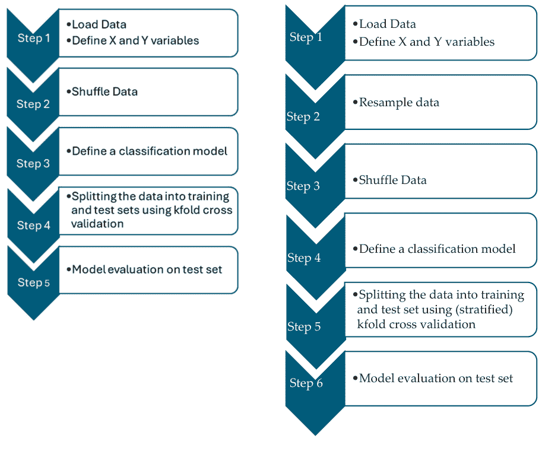

图1. (a)左图总结了方法论1，(b)右图总结了方法论2。

#### 2.1. 方法论1：算法1–3——经典方法

该研究通过算法1、2和3介绍了方法论1。算法1–3的方法如下：

- 步骤1：数据加载与初步处理——初始步骤涉及加载数据集并划分自变量（X）和因变量（y）。y变量转换为类别以便于分析。

- 步骤2：数据洗牌——所有自变量（X）和目标变量（y）的索引已被洗牌，以便在数据集中重新排列它们的位置。要执行洗牌，设置种子为99并使用numpy命令np.random.permutation，如下所示：

```python
np.random.seed(99)
permuted_indices = np.random.permutation(len(Y))
```

在训练-测试划分中采用随机洗牌，以确保训练集和测试集能代表整体数据集[24]。通过洗牌，数据被随机化，防止模型学习可能源于数据顺序而非变量间潜在关系的模式。

- 步骤3：定义两个分类模型——随机森林分类器（RF）和支持向量机模型（SVM），参数如下：
RandomForestClassifier(n_estimators = 50, max_depth = 5, random_state = 0,
class_weight = 'balanced')
SVC(C = 10, kernel = 'linear', gamma = 0.01, probability = True,
class_weight = 'balanced').
参数‘class_weight’设置为‘balanced’，因为y中存在类别不平衡。
此步骤中，参数以及模型类型均可更改。

- 步骤4：使用k-折交叉验证将数据分割为训练集和测试集——k-折交叉验证函数针对分类模型使用不同命令应用：
RF: KFold (n_splits = 4, shuffle = True, random_state = 555) （算法1），
SVM: KFold (n_splits = 4, shuffle = True, random_state = 763) （算法2），
SVM: KFold (n_splits = 5, shuffle = True, random_state = 673) （算法3）。

- 步骤5：在测试集上进行模型评估。使用混淆矩阵并根据公式[17–19]计算准确率、精确度、特异度和灵敏度来进行混淆矩阵-模型评估：

```
Accuracy = \frac{TP + TN}{TP + TN + FP + FN};
Precision = \frac{TP}{TP + FP};
Sensitivity (Recall) = \frac{TP}{TP + FN};
Specificity = \frac{TN}{TN + FP}
```

像特异度和灵敏度这样的指标提供了模型如何预测数据集两个类别的信息。这些指标的高值证实了模型的效率。

#### 2.2. 拟议方法论：算法4和5——带有类别不平衡数据预处理的分类

该方法论包含两个基本步骤：(a) 它应用两种方法来分割训练和测试子集，(b) 它应用支持向量机模型。算法4应用k-折交叉验证来分离训练和测试子集，而算法5应用分层k-折交叉验证以达到相同目的。算法4和5的方法如下：

- 步骤1：数据加载与初步处理——初始步骤涉及加载数据集并定义自变量（X）和因变量（y）。y变量转换为分类标签以便于分析。

- 步骤2：数据重采样——第二种方法论应用重采样程序，使用观测值来补充集合中较小的类别。目的是增加其数量，以避免两个类别在观测数量方面出现不平等。重采样函数按以下所示的参数应用：
resample(data2, replace = True, n_samples = 500, random_state = 605)

- 步骤3：数据洗牌——所有自变量（X）和目标变量（y）的索引被洗牌，以便在数据集中重新排列它们的位置。要执行洗牌，设置种子为31并使用numpy命令np.random.permutation，如下所示：
np.random.seed(31)
permuted_indices = np.random.permutation(len(Y))

- 步骤4：定义分类模型——定义一个支持向量机分类器，参数‘class_weight’设置为‘balanced’，因为y中存在类别不平衡。两种分类的设置如下所示：
SVC(C = 10, kernel = 'rbf', gamma = 'auto', probability = True, class_weight = 'balanced')
在此步骤中，参数以及模型类型均可更改。

- 步骤5：使用k-折交叉验证将数据分割为训练集和测试集——k-折交叉验证函数针对分类模型使用不同命令应用：
SVM: KFold (n_splits = 5, shuffle = True, random_state = 42) （算法4），
SVM: KFold (n_splits = 5, shuffle = True, random_state = 73) （算法5）。

- 步骤6：与方法论1的步骤5相同。

下一节将描述拟议算法的输出，并将结果与其他结果进行比较。

### 3. 结果

#### 3.1. 分类指标比较

我们的实验在一台配备1.50 GHz Intel(R) Core (TM)处理器和8 GB RAM的笔记本电脑上进行，运行Windows操作系统，在Anaconda环境中使用Python 3.7。结果讨论了两组方法论。第一种方法论由算法1–3表示，其中预处理阶段仅应用洗牌方法。而第二种方法论由算法4和5表示，包含洗牌方法和重采样方法。为了认为每种方法论的输出有效，准确率、精确度、灵敏度和特异度的值应足够高。各类别的结果可以平均，因此我们展示了每个算法的平均精确度、灵敏度和特异度。

如表1所示，第一种方法论的准确率分别为83.85%（算法1）、84.9%（算法2）和85.06%（算法3）。如表2所示，第二种方法论的准确率高得多。第二种方法论中的两个算法（4和5）的准确率分别为95.5%和90.5%。算法1–3被视为经典方法，与第二种方法论（一种新颖方法）相比表现不佳。

| 算法1 (%) | 算法2 (%) | 算法3 (%) |
|---|---|---|
| 随机森林 | SVM, KFOLD(N_SPLITS = 4) | SVM, KFOLD(N_SPLITS = 5) |
| 准确率 = 83.85 | 准确率 = 84.90 | 准确率 = 85.06 |
| 精确度 = 90.82 | 精确度 = 92.56 | 精确度 = 90.91 |
| 灵敏度 = 82.50 | 灵敏度 = 84.85 | 灵敏度 = 86.54 |
| 特异度 = 86.11 | 特异度 = 85.00 | 特异度 = 82.00 |

| 算法4 (%) | 算法5 (%) |
|---|---|
| 准确率 = 95.5 | 准确率 = 95.05 |
| 精确度 = 91.35 | 精确度 = 91.74 |
| 灵敏度 = 100.00 | 灵敏度 = 100.00 |
| 特异度 = 91.35 | 特异度 = 91.00 |

这一发现也从第一种方法论（算法1–3）与算法4和5的精确度、灵敏度和特异度比较中可见。当指标平均时（表1和表2），拟议的新颖方法论优于经典方法论。两种方法论的精确度相似——在90.82%至92.56%之间变化。所有算法的高值表明它们都在超过90%的病例中正确预测了阳性类别。然而，方法论1的灵敏度得分低于方法论2。第二种方法论的灵敏度为100%，而方法论1通过算法3达到最高灵敏度得分（86.54%）。如表1和表2所示，第二种方法论将灵敏度得分提高了超过13个百分点，这是显著改进。高灵敏度得分表明模型正确分类了每个类别的观测值。因此，拟议方法论比经典方法论更好地预测患者是否患有糖尿病。

第二种方法论也带来了更好的特异度。特异度展示了模型正确分类所有未患糖尿病患者的能力。拟议方法论中特异度的最高得分为91.35%（算法4），而算法1–3的特异度得分介于82%至86.5%之间。拟议方法论提高了模型正确预测健康患者病例的能力。经典方法论在82%至86.5%的病例中正确预测了健康患者。而拟议方法论在超过95%的病例中识别出了健康患者。

模型正确预测健康患者和识别病患能力的显著提升，导致算法4和5的整体准确率提高。因此，拟议方法论优于经典方法论的发现是模型整体性能改进的结果。拟议方法论中模型整体性能的改进可归因于两个因素。

第一个因素是处理类别不平衡问题。经典方法论不执行针对类别不平衡的数据预处理。它试图仅通过将Python参数‘class_weight’设置为‘balanced’来处理此问题。虽然这种方法提供了良好的结果，但我们的方法论为类别不平衡提供了一种有效的解决方案，显著提高了模型的分类能力。在将参数‘class_weight’设置为‘balanced’之前，先对数据进行洗牌和重采样的新颖步骤有助于使两个类别的分布更加均匀，从而以无偏的方式进行训练/测试划分，其中主导类别不影响划分。因此，处理类别不平衡问题被证明是模型质量的关键部分。

第二个因素是交叉验证的类型。如方法部分所述，一些作者建议在类别不平衡的相对较小的数据集上使用分层k-折交叉验证[23,25]。虽然没有给出‘小’和‘大’数据集的明确定义，但我们使用k-折（算法4）和分层k-折验证（算法5）交叉验证测试了拟议方法论。如表2所示，两种情况下的准确率和其他分类指标非常相似。一个关键发现是，这两种交叉验证类型均可用于该数据集，这进一步证明了我们的算法中没有过拟合。

另一个关键发现是，类别不平衡目标变量中分层和k-折交叉验证的适用性可能由数据的特征而非数据集的大小来定义。这一发现可在进一步的研究中探讨。第三个发现是，我们提出的方法论在处理类别不平衡问题的步骤方面是稳健的。处理类别不平衡问题的拟议步骤涉及对数据进行洗牌和重采样，并设置参数‘class_weight’ = ‘balanced’。我们使用k-折和分层k-折交叉验证测试了这些步骤，结果相似（表2）。这意味着，我们为PIMA数据集处理类别不平衡提出的新颖步骤是稳健的，并且不受用于训练和测试模型所选策略的影响。


拟方法论中的模型总体质量得到提升，这也通过混淆矩阵和 AUC–ROC 曲线所描述的各个类别的预测得到证实。

#### 3.2. Confusion Matrices and AUC-ROC Curves

ROC-AUC（接收者操作特性—曲线下面积）是评估二分类模型性能的另一项关键指标。ROC 曲线在各种阈值设置下将真阳性率（TPR）与假阳性率（FPR）进行对比绘制，而 AUC 则量化了模型区分类别的整体能力。与准确率不同，ROC–AUC 与阈值无关，即使在不平衡数据集上也保持信息性，因此是模型比较和选择的稳健工具。

表 3–5 展示了算法 1–3 的 AUC–ROC 曲线和混淆矩阵，表明经典方法论表现良好。准确率、精确度、灵敏度和特异度的高值是经典方法论得出正确预测的首个指标。混淆矩阵与 AUC–ROC 曲线共同证明了标准方法论的可靠性，因为它们也验证了模型的质量。

Table 3. Results from Methodology 1. Random Forest, (Algorithm 1). Authors’ calculations.

| Confusion Matrix | ROC Curve |
|---|---|
| [[100 20]<br>[10 62]]<br>ROC 曲线 AUC= 90.81% | ROC 曲线图 |

Table 4. Results from Methodology 1. SVM and kFold (n_splits = 4), (Algorithm 2). Authors’ calculations.

| Confusion Matrix | ROC Curve |
|---|---|
| [[112 20]<br>[9 51]]<br>ROC 曲线 AUC= 88.88% | ROC 曲线图 |

However, the data suffers from class imbalance. All tables related to methodology 1 (1, 3–5) show that the classical methodology performs well despite the class imbalance. But as shown in Tables 2, 6 and 7 the model can perform better when the class imbalance is handled appropriately. Therefore, handling class imbalance using the proposed methodology is a better approach in the PIMA dataset.

Table 5. Results from Methodology 1. SVM and kFold (n_splits = 5), (Algorithm 3). Authors’ calculations.

| Confusion Matrix | ROC Curve |
| :--- | :--- |
| [90 14]<br>[9 41]<br><br>ROC 曲线 AUC= 91.70% | ROC 曲线图<br>真阳性率 vs 假阳性率<br>图例：ROC 曲线（面积 = 0.9170），带线性核的 SVM 分类器 |

Table 6. Results from Methodology 2. Algorithm 4. Authors’ calculations.

| Confusion Matrix | ROC Curve |
| :--- | :--- |
| [96 0]<br>[9 95]<br><br>ROC 曲线 AUC= 97.62% | ROC 曲线图<br>真阳性率 vs 假阳性率<br>图例：ROC 曲线（面积 = 0.9762），带 RBF 核的 SVM 分类器 |

Table 7. Results from Methodology 2. Algorithm 5. Authors’ calculations.

| Confusion Matrix | ROC Curve |
| :--- | :--- |
| [100 0]<br>[9 91]<br><br>ROC 曲线 AUC= 96.80% | ROC 曲线图<br>真阳性率 vs 假阳性率<br>图例：ROC 曲线（面积 = 0.9680），带 RBF 核的 SVM 分类器 |

The proposed methodology classifies the minority class more accurately, while keeping the same prediction rate for the majority class as seen by the confusion matrices of Algorithms 4 and 5 (Tables 6 and 7). Tables 6 and 7 show that Algorithms 4 and 5 provide the best prediction for the two classes, although the results for individual classes are close to those from Algorithms 1 to 3. Therefore, the second methodology results in more accurate predictions of the two classes, especially the minority class. This finding is key as heavy class imbalance usually leads to better prediction of the majority class and poor prediction of the minor class. As Tables 6 and 7 show, the proposed two Algorithms (4 and 5) overcome the issue of class imbalance effectively and improve the overall quality of the model compared to the classical methodology.

#### 3.3. Comparison to Other Research

As Table 2 shows, Algorithm 4 achieves an accuracy of 95.50%, an overall precision of 91.43%, an overall sensitivity of 91.35%, and an overall specificity of 100.00%. Similarly, Gupta and Goel [18] have applied several machine learning models. Their best results are obtained from the Random Forest model. The estimated parameters have the following values: the accuracy is 80.52%, the precision value is 74.47%, the sensitivity value is 72.72%, and the specificity is 90.74%. The output from the algorithms we propose outperforms Gupta’s results as seen in Tables 2 and 8.

Table 8. Results obtained by Gupta et al. [18], Chang et al. [19], and Tigga et al. [21].

| Table 6. [18] (%) | Table 3. [21] (%) | Table 13. [19] (%) |
|---|---|---|
| Accuracy = 80.52 | Accuracy = 75.0 | Accuracy = 79.57 |
| Precision = 74.47 | Precision = 84.0 | Precision = 89.40 |
| Sensitivity = 72.72 | Sensitivity = 78.95 | Sensitivity = 81.33 |
| Specificity = 90.74 | Specificity = 66.10 | Specificity = 75.0 |
| | | ROC-AUC = 86.24 |

Table 8 also shows Tigga’s [21] and Chang’s [19] results on the PIMA dataset. Tigga’s [21] article does not apply techniques to handle class imbalance. Instead, they aim to find the most appropriate machine learning algorithm that can predict the patient’s condition correctly. Their findings suggest that the most appropriate machine learning algorithm for the PIMA dataset is the Random Forest classifier. Table 8 presents their results from the Random Forest. Compared to Gupta [18] and Chang [19], their results are worse in terms of accuracy and specificity. The second methodology we propose (Algorithms 4 and 5) outperforms Tigga’s results. A key finding in this case is that using a classifier like the Random Forest, which is known to work good with class imbalance, may not be enough to handle the bias coming from imbalanced classes

Table 8 also shows a similar case with the results of Chang [19]. They also aim to find the most appropriate machine learning model to accurately predict the PIMA dataset in the context of feature selection. They conclude that a naïve Bayes model works well when features are carefully selected, while Random Forest works better when more features are added. Although both Chang [19] and Tigga [21] conclude that the Random Forest is the most appropriate model for the PIMA dataset, Tables 2 and 8 show that Algorithms 4 and 5, proposed in this article, outperform the Random Forest. As shown by Tables 2 and 8, the second methodology outperforms all models used by Tigga [21] and Chang [19] (this paper presents their best results). This finding is also valid for Gupta’s [18] experiments.

The advantage of our methodology is its simplicity and fast calculation. Also, our methodology can be applied to larger or smaller datasets related to PIMA or any other diabetes dataset as we test two versions of cross validation. The k-fold cross validation, that is usually applied even in class imbalance datasets with the remark that the dataset should be large enough. We also provide a version of our methodology (Algorithm 5) with stratified k-fold cross validation, which is recommended for class imbalance in smaller datasets. Although in the case of the PIMA dataset, the type of cross validation is not the key for improved model performance, we propose two alternatives that can be the effective solution to class imbalance in other diabetes datasets with class imbalance.

Also, adding two simple steps (shuffling and resampling) before data preprocessing has proven to be an effective way to handle class imbalance as our results suggest. This finding extends the applications of shuffling and resampling in machine learning, which uncovers a new path for the discovery of new potential applications for the two of them.

We compare the results from Table 9 (based on the values of Table 7 [22]) to those obtained by Methodology 2. Table 10 presents the entries of confusion matrices when methodology 2 is applied. We calculate the percentage of the sum (FN+FP). The values are displayed in the last column of Tables 9 and 10. Thus, the values of Table 10 are smaller than the corresponding ones in Table 9. Thus, methodology 2 minimizes the sum of false cases (FN+FP).

Table 9. Entries of confusion matrices were obtained by Ejiyi and coauthors [22].

| Models | TP | FN | FP | TN | Total | (FN + FP)/Total (%) |
| :--- | :--- | :--- | :--- | :--- | :--- | :--- |
| Extra Tree | 141 | 12 | 18 | 129 | 300 | 0.1 |
| RF | 142 | 11 | 11 | 136 | 300 | 0.073 |
| AdaBoost | 142 | 11 | 5 | 142 | 300 | 0.053 |
| GB | 143 | 12 | 4 | 141 | 300 | 0.053 |

Table 10. Entries of confusion matrices after methodology 2. Our calculations.

| Models | TP | FN | FP | TN | Total | (FN + FP)/Total (%) |
| :--- | :--- | :--- | :--- | :--- | :--- | :--- |
| Algorithm 4 | 95 | 9 | 0 | 96 | 200 | 0.045 |
| Algorithm 5 | 91 | 9 | 0 | 100 | 200 | 0.045 |

Further on, applying the entries of confusion matrices the values of parameters accuracy, precision, sensitivity, and specificity are computed and presented in Tables 2 and 11.

Table 11. Results were obtained according to Table 6 [22].

| Models | Accuracy (%) | Precision (%) | Sensitivity (%) | Specificity (%) |
| :--- | :--- | :--- | :--- | :--- |
| Extra Tree | 90.0 | 88.68 | 92.20 | 87.76 |
| RF | 92.67 | 92.81 | 92.80 | 92.52 |
| AdaBoost | 94.67 | 96.60 | 92.80 | 96.60 |
| GB | 94.67 | 97.28 | 92.30 | 97.24 |

Ejiyi and coauthors [22] also experimented with the PIMA dataset. They aim to propose a robust methodology for diabetes prediction. Their approach is different from [18,19,21] as they perform feature extraction using the Shapley Additive Explanation (SHAP). Then, they use the subset of the most important features to find the most appropriate machine learning model. They conclude that Xgboost and Adaboost perform best with SHAP. Table 11 shows their results. Their results are better than [18,19,21] as seen in Table 8. However, this is not the case when comparing the values from Tables 2 and 11. The two tables demonstrate that methodology 2 achieves higher values of the metrics of accuracy, precision, and specificity than those obtained by Ejiyi and coauthors [22]. The measure sensitivity is 91.30%, which is slightly smaller than the corresponding value of 92.80% from Table 11. This point is another important finding as it demonstrates that combining complex techniques like SHAP, Xgboost, and Adaboost may handle class imbalance well, but a


更简单、更有效的方法论可能仍然存在。第二种提出的方法论是一种更简单、更有效的方法论示例，用于准确预测PIMA数据集中的目标，同时优于各种现有的机器学习算法和复杂方法论。

所提出方法论的另一个优势是其性能接近深度神经网络（DNN），而DNN在捕捉数据异常方面要灵活和可靠得多。然而，它们的使用更为复杂。如表8所示，所提算法4和算法5的准确率优于[2,13]。我们达到的最高准确率（表2）为95.59%，而DNN达到了98.07% [13,15,16]。DNN的准确率比我们高出约2.5个百分点，这是一个很小的差异。在灵敏度方面，所提方法论达到100%的结果，优于表9–11中的DNN模型。在特异性方面，我们取得了与Hounguê [2]相似的结果。

然而，经典模型（表1）未能以一种不损害模型预测能力的方式处理类别不平衡问题。因此，表1的结果与其他作者的结果（表12）以及所提方法论（表2）的结果不接近。这是另一个证据，表明处理类别不平衡是建模PIMA数据集的关键点。

表12. 其他作者通过深度学习模型获得了结果。

| 模型 | 指标 |
| :--- | :--- |
| DNN [12] | 准确率 = 94.39% |
| DNN [13] | 准确率: 98.04%<br>灵敏度: 98.80%.<br>特异性: 96.64% |
| DNN [14] | 准确率: 99.4% |
| DNN + DT [15] | 准确率: 98.07%<br>灵敏度: 95.52%<br>特异性: 99.29% |
| DNN + 10折交叉验证 [2] | 准确率: 89%<br>灵敏度: 87%<br>特异性: 91% |
| DNN [16] | 准确率: 98.07% |

如表2和表12所示，其他作者取得了与我们提出的方法论相似的结果，或者在某些情况下略好一些的结果。这些结果并不令人惊讶，因为深度学习模型也会捕捉数据中的非结构化连接，并利用它们来训练和测试模型。然而，机器学习模型基于观测值之间的距离来推导类别之间的边界。机器学习模型在建模结构化数据集方面更出色，而深度学习模型则捕捉数据中隐藏的复杂连接。

此外，机器学习模型在模型调优中需要研究人员更多的参与，而深度学习算法减少了研究人员在模型调优中的参与。因此，深度学习模型在调优模型时可能减少来自研究人员经验和知识的偏差。深度学习模型通常是机器学习模型的一个很好的替代方案，尤其是在复杂数据集中。深度学习模型通常优于机器学习模型。这就是为什么所提方法论的结果非常显著的原因。

一方面，我们提出的机器学习方法论提高了模型的分类能力，使得结果接近神经网络等复杂的深度学习模型。另一方面，我们达到了100%的特异性，这是表12中任何深度学习模型都未实现的结果。所提方法论（算法4和算法5）能够在100%的案例中正确识别非患者。我们提出的方法论也值得注意，因为它代表了机器学习算法预测能力的重大改进，使其可与深度学习模型相比。实现这一结果的关键在于我们提出的处理类别不平衡的步骤。

另一个重要事实是，表12中的作者没有提供他们的混淆矩阵来观察各个类别的性能。混淆矩阵是模型质量分析的重要组成部分。它们显示每个类别是否被正确预测以及正确程度。一个好模型的标志不仅是高分类指标（准确率、精确率、灵敏度和特异性），还包括对每个类别的正确预测。当分类指标很高，但混淆矩阵显示某个类别未被正确预测时，这可能是过拟合的迹象。因此，我们基于分类指标将我们的结果与其他作者进行比较，但对每个类别预测质量的比较无法彻底进行。尽管如此，我们使用一种更简单的方法论取得了与表8和表12相似的结果，这种方法论计算量不大，且运行不需要复杂的硬件设置。这一发现提出了所提方法论的另一个优势。

基于上述结果，关键发现是所提方法论与其他现有机器学习和深度学习算法具有竞争力。在某些情况下，所提方法论可以超越现有机器学习算法，同时与深度学习算法具有相似的性能。在定义分类模型之前对数据进行重采样和随机打乱可以改善类别不平衡情况下的分类预测能力。所提方法论可与k折交叉验证或分层交叉验证一起使用。在两种情况下，结果相似，这验证了两个创新步骤在改善类别不平衡预测中的重要性。这一结果也验证了其他作者[25–28]提出的假设，即k折和分层k折交叉验证均可用于类别不平衡分类。我们的结果还表明，在类别不平衡的情况下，数据集的大小可能不是确定交叉验证类型的关键因素，这为探索交叉验证在类别不平衡问题中的作用开辟了新领域。所提方法论不仅提高了模型的分类能力，还提高了模型对每个类别进行预测的能力。这使其在不进一步复杂化模型应用和解释的情况下，与深度学习模型具有竞争力。因此，我们认为所提方法论在处理PIMA糖尿病数据的类别不平衡问题方面是有效且高效的。

这项工作未来的一个扩展方向是在具有类别不平衡的更大数据集以及多标签分类上测试所提方法论。此外，所提方法论可以在具有许多特征且无需特征选择的数据集上进行测试。我们认为我们的方法论灵活且能够适应数据的特征，因为模型调优可以轻松进行。因此，所提方法论可以轻松适应其他数据集和多类分类。

尽管最近一些关注糖尿病预测各个方面的研究存在[29–32]，但它们使用了不同的数据集。这使得他们的结果与我们的结果无法比较。然而，在Mohanty [33]的出版物中分析了与我们相同的数据集。作者研究了若干机器学习模型和集成模型用于数据集的分类分析。论文[33]中提出的集成模型达到了以下数值：准确率84%，精确率80%，灵敏度92%，特异性77%（参见表19 [33]）。我们使用SVM模型的结果超过了这些数值（参见表2）。

### 4. 讨论

本文提出了一种简单且计算量不大的方法论，用于改善类别不平衡情况下分类模型对少数类别的预测能力。我们可以将本研究的关键发现总结如下：

- 1. 使用Python内置函数可以成功处理类别不平衡问题。使用的参数是‘class_weight’ = balance。但是，还需要采取额外步骤来处理类别不平衡，以便模型变得更高效。
- 2. 在处理不平衡数据时，在训练/测试划分之前对数据进行随机重采样和打乱有助于改善估计指标。无论使用哪种交叉验证类型，这一结果都是稳健的。
- 3. 应用我们提出的算法是预测具有类别不平衡标签的一种简单快速的方法。它不需要额外的技术来平衡类别。它不涉及预先选择重要变量，从而节省时间并使模型易于分析。这使其成为一种用于严重类别不平衡数据初始和进一步建模的有效算法。
- 4. 我们的算法不需要特征选择程序，从而避免了特征选择方法可能引入的偏差。
- 5. 如所示，可以使用两种类型的交叉验证。结果相似，表明交叉验证类型可能不是类别不平衡的关键。相反，消除主导类别影响的整体策略可能更为重要。
- 6. 尽管PIMA数据集的规模相对较小，但k折交叉验证和分层k折交叉验证都是合适的。这一发现与一些研究人员建议仅在大型数据集中使用k折交叉验证来处理类别不平衡的观点形成对比。我们强调，所使用的交叉验证类型可能取决于数据集的特征，而不是其规模。
- 7. 模型的这一特性使其能够灵活适应数据中的其他问题，而不仅仅是类别不平衡。因此，可以使用其他类型的交叉验证。

总之，在PIMA糖尿病数据集上测试所提方法论揭示了作为处理类别不平衡的数据处理步骤的重采样和打乱数据的重要性。凭借这一发现，我们扩展了重采样和打乱数据的应用，并在类别不平衡领域引入了一条新的学术研究路径。此外，我们的方法论展示了如何基于标准方法提高机器学习模型的有效性并使其更可靠。

目前，人工智能（AI）应用在医疗保健领域的使用正在快速增长。人工智能的实施使医疗保健专业人员能够更多地关注患者护理预筛查和个体治疗。结果，生活质量和康复率提高。因此，在医学中采用人工智能技术的法律和伦理后果问题变得相关。例如，Geantă等人[34]比较了医疗保健中人工智能模型的效率，以回答哪个平台更好地具备生成健康安全诊断模型的能力。他们发现，在某些医疗领域，ChatGPT 3.5生成的人工智能模型在诊断某些疾病方面可能比研究人员预定义的人工智能模型更可信和安全。然而，其他疾病使用研究人员定义的人工智能模型进行诊断和治疗更准确。因此，出现了一个伦理问题，即发现并确保使用最安全的人工智能算法来检测疾病。这导致了公众对医疗保健系统的信任[34–36]。然而，关于使用哪些人工智能模型是安全且合乎伦理的，医院如何更好地保护其收集的个人数据等问题 as


更先进 AI 模型的产物，以及如何在现实中对 AI 模型进行测试等问题也被提出。此类科学研究支持公众关于在医疗保健中使用 AI 的辩论，并旨在为构建 AI 医疗技术的连贯伦理框架产生新证据 [36]。因此，在将各 AI 模型用于诊断、治疗和预筛查之前，应提供其伦理、临床有效和安全应用的证明 [36]。

此外，在未来构建医疗数据集的机器学习分类方法时，我们将在以下方向扩展研究：(a) 我们将应用嵌套分层 k 折交叉验证，(b) 我们将引入额外的评估指标，如 Matthews 相关系数，(c) 我们将使用应用指标的置信区间。

作者贡献：概念化，B.T.、I.I. 和 V.H.；方法学，B.T. 和 I.I.；软件，B.T. 和 I.A.；验证，B.T.、I.A. 和 I.I.；正式分析，B.T.；调查，B.T. 和 V.H.；资源，B.T. 和 I.A.；数据整理，B.T. 和 I.A.；编写—原始草稿准备，B.T. 和 V.H.；编写—审阅与编辑，B.T. 和 V.H.；可视化，B.T.；监督，I.I.；项目管理，I.I. 和 V.H.；资金获取，V.H. 所有作者均已阅读并同意发表的稿件版本。

资助：本研究未获得外部资助。

机构审查委员会声明：本研究使用公开可用的数据进行，该数据不包含可识别的个人信息，因此不需要伦理批准。数据来源在数据可用性声明部分中描述。所有分析均按照相关伦理准则和法规进行。

知情同意声明：已从研究中涉及的所有受试者处获得知情同意。

数据可用性声明：本研究中呈现的数据可在此公开获取 https://www.kaggle.com/uciml/pima-indians-diabetes-database（访问日期：2024 年 10 月 7 日）以及在此 https://www.openml.org/search?type=data&status=active&id=43582&sort=runs（访问日期：2024 年 12 月 30 日）。

利益冲突：作者声明不存在任何利益冲突。

### 参考文献

- 1. Kaggle. 皮马印第安人糖尿病数据库。可在线查阅：https://www.kaggle.com/uciml/pima-indians-diabetes-database（访问日期：2024 年 6 月 30 日）。
- 2. Houngué, P.; Bigirimana, A. 基于 Pima 数据集的糖尿病预测：深度神经网络案例研究。J. Comput. Commun. 2022, 10, 15–28. [CrossRef]
- 3. Traymbak, S.; Issar, N. 基于 R 的产后糖尿病预测知识管理中的数据挖掘算法。Indian J. Comput. Sci. Eng. 2021, 12, 1542–1558. [CrossRef]
- 4. Gurcan, F.; Soylu, A. 从不平衡数据中学习：先进重采样技术与机器学习模型的整合以增强癌症诊断和预后。Cancers 2024, 16, 3417. [CrossRef] [PubMed]
- 5. John, A.; Insin, I.F.B.; Madni, S.H.H.; Muchtar, F.B. 基于主成分分析和可变集成机器学习算法的增强型入侵检测模型。Intell. Syst. Appl. 2024, 24, 200442. [CrossRef]
- 6. Zou, Q.; Qu, K.; Luo, Y.; Yin, D.; Ju, Y.; Tang, H. 基于机器学习技术的糖尿病预测。Front. Genet. 2018, 9, 515. [CrossRef]
- 7. Zhou, H.; Xin, Y.; Li, S. 基于 Boruta 特征选择和集成学习的糖尿病预测模型。BMC Bioinform. 2023, 24, 224. [CrossRef]
- 8. Alghamdi, M.; Al-Mallah, M.; Keteyian, S.; Brawner, C.; Ehrman, J.; Sakr, S. 使用 SMOTE 和集成机器学习方法预测糖尿病：Henry Ford 运动测试 (FIT) 项目。PLoS ONE 2017, 12, e0179805. [CrossRef] [PubMed]
- 9. Rezki, M.K.; Mazdadi, M.I.; Indriani, F.; Muliadi, M.; Saragih, T.H.; Athavale, V.A. 利用 C5.0、随机森林和 SVM 在糖尿病分类中应用 SMOTE 解决类别不平衡问题。J. Electron. Electromed. Eng. Med. Inform. 2024, 6, 343–354. [CrossRef]
- 10. Wu, Y.; Zhang, L.; Bhatti, U.A.; Huang, M. 用于个性化医疗建议的可解释机器学习：一种基于 LIME 的方法。Diagnostics 2023, 13, 2681. [CrossRef] [PubMed]
- 11. Kitova, K.; Ivanov, I.; Hooper, V. 中风数据集建模：机器学习分类方法的比较研究。Algorithms 2024, 17, 571. [CrossRef]
- 12. Mhaskar, H.N.; Pereverzyev, S.V.; Van der Walt, M.D. 糖尿病血糖预测的深度学习方法。Front. Appl. Math. Stat. 2017, 3, 14. [CrossRef]
- 13. Islam, I.A.; MIlon, M.I. 糖尿病预测：一种深度学习方法。Int. J. Inf. Eng. Electron. Bus. 2019, 11, 21–27. [CrossRef]
- 14. Zhou, H.; Myrzashova, R.; Zheng, R. 基于增强型深度神经网络的糖尿病预测模型。EURASIP J. Wirel. Commun. Netw. 2020, 2020, 148. [CrossRef]
- 15. Pham, T.; Tran, T.; Phung, D.; Venkatesh, S. 从医疗记录中预测医疗轨迹：一种深度学习方法。J. Biomed. Inform. 2017, 69, 218–229. [CrossRef]
- 16. Naz, H.; Ahuja, S. 使用 PIMA 印度数据集的糖尿病预测深度学习方法。J. Diabetes Metab. Disord. 2020, 19, 391–403. [CrossRef]
- 17. Kulkarni, A.; Chong, D.; Batarseh, F.A. 5—数据不平衡的基础及数据民主化的解决方案。载于《数据民主化》，第 1 版；Batarseh, F.A.; Yang, R., 编；Academic Press: Cambridge, MA, USA, 2020；第 83–106 页。[CrossRef]
- 18. Gupta, S.C.; Goel, N. 基于超参数调优机器学习技术的糖尿病预测建模与分析。Procedia Comput. Sci. 2023, 218, 1257–1269. [CrossRef]
- 19. Chang, V.; Bailey, J.; Xu, Q.A.; Sun, Z. 基于机器学习 (ML) 算法的 Pima 印第安人糖尿病分类。Neural Comput. Appl. 2023, 35, 16157–16173. [CrossRef] [PubMed]
- 20. Pima-Indians-Diabetes。可在线查阅：https://www.openml.org/search?type=data&status=active&id=43582&sort=runs（访问日期：2024 年 12 月 30 日）。
- 21. Tigga, N.P.; Garg, S. 使用机器学习分类方法预测 2 型糖尿病。Procedia Comput. Sci. 2020, 167, 706–716. [CrossRef]
- 22. Ejiyi, C.J.; Qin, Z.; Amos, J.; Ejiyi, M.B.; Nnani, A.; Ejiyi, T.U.; Agbesi, V.K.; Diokpo, C.; Okpara, C. 一种基于纳入 Shapley 的机器学习算法的糖尿病鲁棒预测诊断模型。Healthc. Anal. 2023, 3, 100166. [CrossRef]
- 23. Ivanov, I.; Toleva, B. 肝炎诊断预测算法。载于第 11 届计算机科学国际科学会议 COMSCI 2023 论文集，保加利亚索非亚，2023 年 9 月 18 日。
- 24. Agung, E.S.; Rifai, A.P.; Wijayanto, T. 基于卷积神经网络的 Emognition 数据集图像面部情绪识别。Sci. Rep. 2024, 14, 14429. [CrossRef]
- 25. Bhagat, M.; Bakariya, B. 基于训练-测试分割、K-折和分层 K-折方法的糖尿病数据集逻辑回归实现。Natl. Acad. Sci. Lett. 2022, 45, 401–404. [CrossRef]
- 26. Kolipaka, V.R.R.; Namburu, A. 用于作物产量预测的多模型 K-折验证，具有改进的稀疏数据聚类过程。Int. J. Intell. Syst. Appl. Eng. 2023, 11, 454–463。可在线查阅：https://ijisae.org/index.php/IJISAE/article/view/3300（访问日期：2024 年 12 月 20 日）。
- 27. Prusty, S.; Patnaik, S.; Dash, S.K. SKCV：用于宫颈癌预测的 ML 分类器分层 K-折交叉验证。Front. Nanotechnol. 2022, 4, N972421. [CrossRef]
- 28. Szeghelmy, S.; Fazekas, A.A. 不平衡学习中分层交叉验证和分布均衡分层交叉验证的使用比较研究。Sensors 2023, 23, 2333. [CrossRef] [PubMed]
- 29. Al Sadi, K.; Balachandran, W. 利用 7 层长短期记忆模型进行阿曼早期糖尿病检测和预防：一种创新方法。Bioengineering 2024, 11, 379. [CrossRef] [PubMed]
- 30. Gragnaniello, M.; Marrazzo, V.R.; Borghese, A.; Maresca, L.; Breglio, G.; Riccio, M. 基于 ECG 信号的无创 1 型糖尿病检测 Edge-AI 支持可穿戴设备。Bioengineering 2025, 12, 4. [CrossRef]
- 31. Fuss, F.K.; Tan, A.M.; Weizman, Y. 基于智能鞋垫的先进动态压力中心诊断：糖尿病患者与健康人的比较，用于诊断糖尿病周围神经病变。Bioengineering 2024, 11, 1241. [CrossRef]
- 32. Jiang, H.; Wang, H.; Pan, T.; Liu, Y.; Jing, P.; Liu, Y. 基于多种风险因素的智能糖尿病进展分析与管理移动应用程序和机器学习驱动方案。Bioengineering 2024, 11, 1053. [CrossRef] [PubMed]
- 33. Mohanty, P.K.; Francis, S.A.J.; Barik, R.K.; Roy, D.S.; Saikia, M.J. 在集成模型中利用 Shapley 加法解释进行糖尿病预测的特征选择。Bioengineering 2024, 11, 1215. [CrossRef]
- 34. Geantă, M.; Bădescu, D.; Chirca, N.; Nechita, O.C.; Radu, C.G.; Rascu, S.; Rădăvoi, D.; Sima, C.; Toma, C.; Jinga, V. 大型语言模型在提高前列腺癌素养方面的新兴作用。Bioengineering 2024, 11, 654. [CrossRef] [PubMed]


- 35. Bekbolatova, M.; Mayer, J.; Ong, C.W.; Toma, M. 人工智能在医疗保健中的变革潜力：定义、应用及伦理景观与公众视角的导航. 医疗保健 2024, 12, 125. [CrossRef] [PubMed]

- 36. Maccaro, A.; Stokes, K.; Statham, L.; He, L.; Williams, A.; Pecchia, L.; Piaggio, D. 消除迷雾：围绕基于人工智能的医疗器械的伦理问题范围文献综述. 个性化医学杂志 2024, 14, 443. [CrossRef] [PubMed]

**免责声明/出版者说明:** 所有出版物中包含的陈述、观点和数据仅代表个别作者和投稿人，而不代表 MDPI 和/或编辑。MDPI 和/或编辑对内容中提及的任何想法、方法、说明或产品所导致的人身伤害或财产损失不承担责任。

## 迈向透明医疗：在可解释人工智能中推进局部解释方法

Carlo Metta 1,*, Andrea Beretta 1, Roberto Pellungrini 2, Salvatore Rinzivillo 1 and Fosca Giannotti 2

1 信息科学与技术研究所 (ISTI-CNR), Via Moruzzi 1, 56127 皮萨, 意大利; andre.beretta@isti.cnr.it (A.B.); rinzivillo@isti.cnr.it (S.R.)
2 科学学院, 皮萨高等师范学校, P.za dei Cavalieri 7, 56126 皮萨, 意大利; roberto.pellungrini@sns.it (R.P.); fosca.giannotti@sns.it (F.G.)
* 通信作者: carlo.metta@isti.cnr.it

摘要: 本文聚焦于在医疗和医学环境中使用局部可解释人工智能 (XAI) 方法，特别是基于规则的局部解释 (LORE) 技术。文章强调了可解释性和透明度在 AI 系统中用于疾病诊断、患者预后预测及制定个性化治疗方案中的关键作用。在承认可解释性与模型性能之间存在复杂性和固有权衡的同时，我们的工作强调了局部 XAI 方法在提升医疗决策过程中的重要性。通过提供细粒度、针对具体病例的洞察，像 LORE 这样的局部 XAI 方法增强了医师和患者对机器学习模型及其结果的理解。本文回顾了医疗保健领域局部 XAI 的重要贡献，突出了其改善临床决策、确保公平性以及符合监管标准的潜力。

关键词: 人工智能；可解释人工智能；机器学习

### 1. 引言

人工智能 (AI) 技术的出现对医疗保健产生了变革性影响，在疾病诊断、患者预后预测以及定制化治疗方案的开发方面提供了前所未有的能力。然而，AI 算法日益增加的复杂性和不透明性放大了对其决策过程透明度和可解释性的需求。这导致了可解释人工智能 (XAI) 的兴起，特别是关注 LORE（基于规则的局部解释）[1] 等局部解释方法，以使医疗环境中的 AI 决策更加透明和可理解 [2,3]。

XAI 旨在为 AI 算法提供解释，使医疗专业人员能够了解 AI 生成决策和预测背后的依据。XAI 方法大致可分为两大类：全局 [4] 和局部 [5] 方法。虽然全局方法旨在解释 AI 模型的一般推理过程，但局部方法的目标是解释 AI 模型为何对特定实例（即特定患者的数据或特定个体的诊断图像）给出某个输出。应用局部 XAI 方法回应了对精确、逐病例解释的需求，这对于临床决策、提升患者护理以及在医疗服务提供者和患者中培养对 AI 系统的信任至关重要 [6–13]。

局部 XAI 在医疗保健中的重要性。人工智能在医疗保健中的应用因其潜力而受到赞誉，但也因其挑战（包括可解释性问题、潜在偏见和伦理问题）而受到审查 [14–16]。像 LORE 这样的局部 XAI 方法提供细致入微、针对特定实例的解释，这对于理解医疗环境中的复杂 AI 决策至关重要 [17]。这些解释不仅能增强对 AI 技术的信心，还有助于识别和纠正偏见，确保伦理使用，并遵守医疗法规 [18]。

局部层面的可解释性使医疗专业人员能够理解特定 AI 决策背后的推理过程，从而促进他们对 AI 系统的信任与合作。此外，局部解释在向患者阐明 AI 结果方面发挥着关键作用，使他们了解自身护理流程和决策方面的知识。

#### 在应用局部 XAI 时面临的挑战与机遇。

虽然局部 XAI 方法为增强医疗 AI 的可解释性提供了有前途的方法，但它们也带来了诸如维持模型性能以及确保解释对最终用户的相关性和可理解性等挑战。平衡医疗数据的复杂性与对可理解、可操作洞察的需求，需要创新方案和 XAI 技术的持续进步。

为应对这些挑战，本文探讨了多种局部 XAI 方法，重点强调了 LORE 方法的贡献，因其能够生成与个别病例相关的详细基于规则的解释。此类技术在将 AI 模型识别的复杂模式转化为可理解的信息方面至关重要，从而提升了 AI 的临床效用，并营造了协作式医疗环境。

#### XAI 项目的聚焦方法。

XAI 项目 (G.A. 834756) (https://xai-project.eu/, 访问于 2024 年 3 月 14 日) 是一个完全专注于开发可解释 AI 模型的 ERC 资助项目。在 XAI 项目中，最突出的研究领域之一是医疗 AI 中的局部可解释性 [19]，旨在改进和推广像 LORE 这样的方法，以实现更好的决策过程。通过专注于局部 XAI 技术的开发，该项目寻求满足医疗专业人员和患者的特定可解释性需求，确保 AI 系统不仅准确，而且透明和可信。

总之，本文对局部 XAI 方法在医疗保健中的作用进行了聚焦论述，说明此类方法如何克服复杂 AI 模型所带来的可解释性挑战。通过对 LORE 方法的详细案例研究和分析，本文旨在展示局部可解释性在改善患者护理、确保伦理 AI 使用以及提升医疗环境中 AI 技术接受度方面的切实益处。

### 2. 相关工作

在医疗环境中探索可解释人工智能 (XAI)，特别是通过像基于规则的局部解释 (LORE) [1] 这样的局部解释方法视角，已引起相当大的关注。本节深入探讨了医疗保健中 AI 模型可解释性和透明度的进展，强调了局部 XAI 方法及其对该领域贡献的重要性。

最近的努力旨在增强医疗 AI 模型的可解释性，Rajkomar 等人提出了一个“医疗可解释人工智能框架”，该框架集成了基于规则的模型、基于梯度的方法和注意力机制，以生成可解释的医疗预测 [20]。该框架在患者死亡率预测中的应用，使医疗专业人员能够从模型的决策过程中得出可操作的洞察，展示了全面 XAI 方法在临床环境中的效用。

Ribeiro 等人的 Anchor 方法代表了另一项值得注意的进步，它提供针对个别预测量身定制的基于规则的解释 [21]。通过专注于局部可信的解释，Anchor 方法使医疗从业人员能够更清晰地理解影响特定场景中 AI 预测的因素。其在各种医疗领域的应用凸显了该方法在局部层面提升可解释性方面的效果。

由 Lundberg 等人引入的 SHAP (SHapley Additive exPlanations) 框架利用博弈论为个别预测分配特征重要性值，从而详细展示每个输入如何影响模型输出 [22]。在医院再入院预测、疾病进展建模等语境下应用，以及


电子健康记录分析，SHAP在提升医疗AI的透明度和可解释性方面发挥了重要作用。

此外，像LIME（局部可解释模型无关解释）和LORE（局部基于规则的解释）这样的可解释性技术在医疗领域已得到广泛应用 [1,23]。LIME通过近似复杂模型决策边界来生成局部解释的方法，与LORE利用遗传算法为局部可解释预测器创建合成邻域的方法相辅相成。该预测器反过来促进了包含决策规则和反事实场景的有意义解释的生成，从而阐明了特定因素对结果的影响 [1]。这些技术已被应用于多种医疗领域，从疾病预测到医学影像和临床决策支持，展示了其多功能性和影响力。

Caruana等人在医疗环境中开发可理解模型（如肺炎风险预测和医院再入院）方面的工作，进一步凸显了为临床用途创建可解释AI系统的进展 [24]。通过采用决策树和基于规则的模型，他们的研究对该领域做出了重大贡献，既提高了临床实践中AI的透明度，也促进了其采用。

将领域知识和专家输入整合到XAI方法中标志着一个不断发展的研究方向，这有望丰富可解释性，并使AI决策过程与既定的医疗实践保持一致。技术创新与领域专业知识的这种结合对于推进本地XAI方法在医疗中的应用至关重要，确保AI辅助决策既透明又基于临床现实 [25]。

综上所述，医疗XAI的进步，特别是对本地方法的关注，凸显了对增强AI模型透明度和可解释性的日益增长的承诺。这些努力强调了该领域在开发不仅技术娴熟，而且对医疗专业人员和患者同样都可理解和可信赖的AI系统方面的进展，促进了更好的决策、患者护理和对监管标准的遵守。

### 3. 方法论

在讨论支持我们研究的具体方法论之前，将我们的工作置于人工智能技术（尤其是深度学习）的更广泛背景下至关重要。深度学习 [26] 作为机器学习的一个子集，已成为包括医疗在内的各个领域中的变革性力量。它是指开发能够基于数据进行学习并做出决策或预测的算法。这些算法被称为神经网络，旨在模拟人脑的架构和功能，处理大量数据以识别人类观察者不易立即察觉的模式和洞察。

如开创性著作 [27] 所阐述，深度学习涉及多层神经网络，它们从数据中学习和推理，以捕捉所处理信息的复杂性和微妙性。这种能力使深度学习在医疗领域特别有价值，因为分析和解释复杂医学数据的能力可以带来更准确的诊断、个性化的治疗方案，并最终改善患者预后。

项目中使用的关键方法论与由Guidotti等人引入的LORE方法相关 [1]。LORE是一个强大的框架，用于为机器学习模型生成本地和可解释的解释。LORE利用遗传算法创建合成邻域，作为训练本地可解释预测器的基础。该预测器捕捉模型决策过程的底层逻辑，从而能够推导出有意义的解释。

LORE的一个关键特征是其能够为个别预测提供透明且易于理解的解释。通过关注本地可解释性，LORE旨在解释特定预测背后的推理，而不是模型的整体行为。这使得它在实例级可解释性至关重要的情况下特别有用，例如在医疗和金融领域。

解释包含两个主要组件。首先，从本地可解释预测器的逻辑中推导出一个决策规则。这个决策规则揭示了影响模型决策的因素，提供了关于重要特征及其对应权重的洞察。这些信息有助于理解预测背后的关键驱动因素。此外，LORE作为解释的一部分生成一组反事实规则。这些反事实规则建议修改实例的特征，以导致不同的结果。通过提供更改输入变量的可操作建议，LORE使用户能够探索假设场景并理解小变化如何影响模型的预测。

LORE框架的可用性，连同附带代码（https://github.com/riccotti/LORE，访问于2024年3月14日），促进了其在各个领域的采用和实施。在接下来的章节中，描述了不同的研究项目。它们从不同角度利用LORE方法论。

#### 详细LORE框架

LORE的操作原则是通过在感兴趣的预测周围创建一个本地可解释模型，提供特定于实例的解释。它首先选择需要解释的实例。然后，它通过遗传算法生成一个模仿原始实例局部性的合成数据集。这个本地数据集用于训练一个简单的可解释模型（例如决策树），用于近似复杂模型在实例附近的行为。然后从这个可解释模型以规则的形式推导出解释，这些规则突出了特定实例的决策过程。

- **选择目标实例**：选择需要解释的特定预测或实例。
- **合成邻域生成**：利用遗传算法生成一个表示目标实例周围局部决策边界的合成数据集。
- **可解释模型训练**：在这个合成数据集上训练一个简单模型（如决策树），以捕捉复杂模型的局部决策逻辑。
- **解释推导**：从可解释模型中提取规则，以解释目标实例的预测。这些规则提供了哪些特征和条件影响决策的洞察。

LORE提供清晰、针对特定病例解释的能力，使其在医疗环境中非常有价值，在那里理解AI驱动的诊断或预后预测背后的依据至关重要。例如，LORE已被应用于解释在预测患者预后、理解疾病进展和个性化治疗方案中的AI决策。其可解释性支持临床决策，增强医疗从业者之间的信任，并促进患者沟通。

LORE主要通过强调在实例周围生成合成邻域来区别于其他XAI方法（如LIME或SHAP）。这种方法使LORE能够提供与当前特定病例直接相关的高度本地化解释。虽然LIME也关注本地可解释性，但它线性近似模型的决策边界，这可能不如LORE的方法有效地捕捉复杂的非线性关系。另一方面，SHAP提供全局解释，即基于特征对模型输出的贡献为特征分配重要性值。LORE的优势在于其详细的基于规则的解释，医疗专业人员可以更直观地理解特定患者病例的解释。

### 4. 医疗XAI框架

#### 4.1. DoctorXAI

一种基于本体论的方法，如在“Doctor XAI：一种用于黑盒序列数据分类解释的基于本体论的方法” [28] 中所述，旨在提供


对多标签、序列化、本体关联数据的黑箱预测的解释 [29]。该方法涉及使用本体，即知识的正式表示，以捕获特定领域的概念和关系 [30]。本文重点解释 Doctor AI [31]，这是一个多标签分类器，它以患者的临床病史作为输入，以预测下一次就诊。

更详细地说，该方法首先通过标准距离度量或基于本体的相似性选择真实邻域，即最接近待解释实例的数据点。然后通过扰动真实邻域来生成合成邻域，以保持局部性。挑战在于生成有意义的合成实例，这里作者利用 ICD-9 本体来确保邻域的表达能力。与其他技术不同，扰动不是直接应用于待解释的实例，以防止邻域中的同质性。遵循两条替代路径；见图 1：红色路径涉及正常扰动以及编码/解码步骤，以将数据转换为可解释模型，而蓝色路径涉及直接对序列数据进行本体扰动。在两条路径中，合成邻域由黑箱模型标记，并用于训练可解释模型，例如多标签决策树。然后从决策树中提取基于规则的解释。该方法通过针对结构化和序列数据的新颖贡献扩展了通用框架。这些组件可以根据待解释数据点的性质独立地集成到解释流程中。

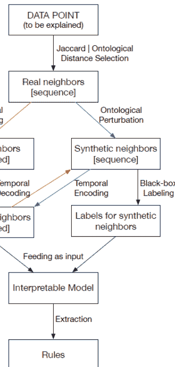

图 1. DoctorXAI 解释流程，来源 [28]。

作者使用 MIMIC-III 数据集 [32]，其中包含与 2001 年至 2012 年间在贝斯以色列狄康尼斯医疗中心重症监护室住院的超过 40,000 名患者相关的去标识化健康相关数据。在所进行的实验中，基于本体的方法与其他用于生成解释的现有方法进行了比较。可采用各种评估指标，如准确率、覆盖率和一致性，来评估该方法提供的解释的质量和可理解性。实验结果突显了基于本体的方法在为黑箱序列数据分类模型生成有意义解释方面的有效性。该方法展示了其捕获特定领域知识、提取相关特征并提供可解释解释的能力，这些解释能增强对基础决策过程的理解（DoctorXAI 演示：https://kdd.isti.cnr.it/DrXAI-viz/，2024 年 3 月 14 日访问）；见图 2。

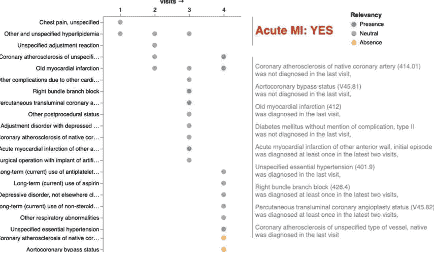

图 2. 向实验参与者展示的 DoctorXAI 解释。在图像中，不同的点代表患者的单次就诊，不同的颜色代表每个点对算法决策的相关性。与无关条件相关的点保持灰色，而被认为相关的点则描绘为蓝色。此外，DoctorXAI 以黄点突出显示患者临床病史中不存在但可能改变算法建议的任何条件。

DoctorXAI 已被证明能增强医生与机器学习模型的交互。在 Panigutti 等人 [33] 的工作中，作者对医生与配备 DoctorXAI 的基于 AI 的临床决策支持系统的交互进行了基于调查的严谨分析。结果表明，DoctorXAI 提供的解释增强了医生与基于 AI 的系统之间的信任。

#### 4.2. FairLens

AI 在关键领域（尤其是医疗保健）的广泛应用，将与意外偏差相关的挑战推到了前沿。这些偏差若不加检查，可能会产生深远的影响，尤其是当决策影响患者护理时。意识到这一点，在 [34] 中，作者介绍了 FairLens，这是一种旨在审计、发现和解释 AI 系统（尤其是临床环境中部署的系统）中偏差的工具。FairLens 的一般概述见图 3。

FairLens 根植于多步方法：

- 患者数据分层：在任何分析之前，该工具根据各种属性（包括年龄、种族、性别和保险类型）对可用患者数据进行分层。这种分层允许更细致地分析 AI 模型在不同患者亚组中的表现。

- 性能评估：分层后，FairLens 评估模型在这些亚组上的表现。它识别模型可能表现不佳或显示偏差的领域。这一步骤至关重要，因为它可以确定可能受模型决策不利影响的特定患者群体。

- 模型错误解释：超越单纯的识别，FairLens 深入探究模型错误背后的原因。使用先进的 XAI 技术，该工具确定患者临床病史中的哪些元素导致模型的不准确。这一步骤至关重要，因为它不仅突出了错误，还提供了关于发生原因的洞察。

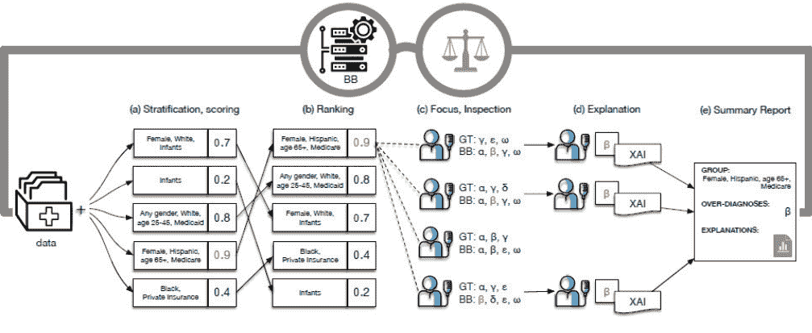

图 3. FairLens 流程，来源 [34]。

FairLens 流程是一个系统过程，可确保对 AI 模型进行全面审计。首先，根据预定义条件将患者数据分为各组。然后根据模型的性能对每个组进行评分，提供该亚组模型准确性的定量指标。

评分后，对各组进行排名。此排名作为指标，突出显示模型性能较低的组。选定的组（基于排名或专家输入）将接受详细检查。在此过程中，将模型预测与实际数据进行比较，以识别过度代表或代表不足的状况。

对于标记错误的状况，FairLens 提供解释。它识别经常被误分类的临床状况，并阐明影响这些误分类的患者病史中的元素。整个分析最终形成一份综合报告，详细说明研究结果，既提供鸟瞰视角，又提供深入洞察。

FairLens 在确保 AI 模型（尤其是医疗保健中的模型）免受有害偏差影响方面迈出了重要一步。通过提供系统方法和清晰流程，它为审计黑箱临床决策支持系统提供了强健的框架。该工具不仅能识别偏差，还能解释偏差的能力，使其对医疗保健专业人员而言非常宝贵，确保 AI 驱动的决策既准确又公平。

#### 4.3. MARLENA

机器学习模型，尤其是深度学习模型，已成为医疗保健中许多决策系统的核心。它们协助诊断、预测疾病传播，并帮助识别高风险患者群体。然而，这些模型固有的缺乏透明度可能导致不信任、潜在偏差，甚至法律后果。MARLENA（多标签基于规则的解释）[35] 作为解决可解释性挑战的方案引入。它旨在为多标签黑箱分类器做出的决策提供解释。模仿黑箱局部行为的主要思想与其他方法（如 LIME [23] 和 LORE [1]）共有。然而，这些方法中没有一种适用于解释多标签黑箱分类器。MARLENA 的概览见图 4。该新颖方法分解为三个主要步骤：

- 合成邻域生成：在解释决策之前，MARLENA 首先在问题实例周围创建一个合成邻域。该邻域中填充了与实例相似的数据点，确保解释具有局部性和相关性。

- 学习决策树：使用合成邻域，MARLENA 构建一棵决策树。决策树本质上是可解释的，因此适合此目的。

- 推导决策规则：从构建的决策树中，MARLENA 提供决策规则，为关于该实例的黑箱决策提供清晰简洁的解释。

核心方法围绕生成需要阐明的实例周围的邻域展开。这一点至关重要，因为解释旨在局部化，关注黑箱分类器关于该特定实例的行为。

为了生成这个邻域，MARLENA 采用两种策略。**构建核心真实邻域**：这涉及识别数据集中在特征空间和决策空间上都接近问题实例的真实实例。这个真实邻域为生成合成邻居奠定了基础。**生成合成邻居**：基于从真实邻域中得出的实例特征的经验分布，MARLENA 生成合成邻居。这些旨在模仿黑箱分类器在实例附近的行为。一旦邻域建立，MARLENA 将继续构建决策树和提取决策规则。

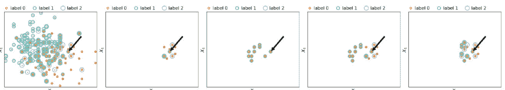

图 4. 来源 [35]。从包含三个不同标签的示例数据集开始，混合邻域生成的图形表示。（1st）一个数据集样本，箭头指出待解释的实例 x；混合邻域生成：（2nd）在特征空间上接近 x 的真实实例；（3rd）在目标空间上接近 x 的真实实例；（4th）前面实例集合的合并。统一的核心真实邻域：（5th）在特征空间和目标空间上都接近 x 的真实实例，即真实核心邻域。

MARLENA 为揭示多标签黑箱分类器做出的决策提供了一种结构化方法。通过专注于局部解释并利用像决策树这样的可解释模型，该方法确保提供的解释既有意义又相关。


#### 4.4. 国际皮肤成像协作

ABELE（对抗性黑盒解释器生成潜在例样）[36] 是一种与模型无关的局部解释器，它以图像和黑盒分类器作为输入，并返回一组例样图像和反例样图像，以及显著性图。

例样和反例样是合成生成的图像，分别与输入图像具有相同的分类结果和不同于输入图像的分类结果。可以通过视觉分析来理解决策原因。显著性图突出了输入图像中对分类有贡献的区域，以及将其推向另一类的区域。

ABELE 通过使用对抗性自编码器（AAE [37]）在潜在特征空间中生成邻域来工作。待解释的图像作为输入传递给 AAE，其中编码器使用潜在特征返回潜在表示。采用了最大化适应度函数的遗传方法来完成邻域生成。在这方面，ABELE 借鉴了 LORE 的潜在版本。

生成过程完成后，对于邻域中的任何实例，ABELE 通过查询鉴别器并将其解码为图像来检查实例的有效性。然后，它使用该图像查询黑盒分类器以获取类别。基于局部邻域，ABELE 构建一个在用黑盒分类器标记的邻域上训练的决策树分类器。代理树旨在局部模仿黑盒分类器在邻域中的行为。它提取决策规则和反事实规则，从而实现例样和反例样的生成。

ABELE 的整体有效性取决于所采用的编码器和解码器函数的质量。AAE 越好，解释就越现实和有用。

近年来，深度学习（特别是通过卷积神经网络 CNN）显著推进了皮肤癌病变的检测和诊断 [38–41]，其诊断准确率可与皮肤科医生相媲美。这一进展有望提高早期检测率，并扩大优质诊断服务的覆盖面。然而，这些模型在临床环境中的有效性取决于其可解释性及其决策的透明度，以确保医疗专业人员能够放心地将 AI 洞察整合到患者护理中。在 [42–45] 中，介绍了一个使用在 ISIC（国际皮肤成像协作）数据集上训练的 ResNet 分类器进行皮肤病变诊断的案例研究。该分类器的决策使用 ABELE 进行解释。

一个用户交互模块被实现为 Web 应用程序，以展示分类结果和相应的解释。该模块通过 RESTful 接口（https://kdd.isti.cnr.it/isic_viz/，访问日期：2024 年 3 月 14 日）与公开黑盒和 ABELE 功能的后端进行通信。应用程序的可视空间分为两个部分（参见图 5）。上半部分显示待分析的实例，左侧为 ResNet 返回的分类结果，右侧为 ABELE 返回的合成反例样图像。模块的下半部分显示四个例样，即由 ABELE 返回且具有 ResNet 分配给待分析实例的相同标签的一组图像。

由于图像分类任务的复杂性和数据集的局限性，对自编码器（特别是对抗性自编码器 AAE）的定制在此案例研究中至关重要。用于训练 ResNet 分类器 [46] 的 ISIC 数据集存在碎片化、不平衡、缺乏统一数字化和数据短缺等挑战。如果不解决这些问题而以标准方式训练 AAE，会导致性能不佳，主要原因是持续的模式崩溃。

为克服这些挑战，实现了一系列前沿技术，包括小批量鉴别（Mini Batch Discrimination）和去噪自编码器（Denoising autoencoders）。采用的 AAE 模型是渐进式增长 AAE（Progressive Growing AAE），它有助于实现高分辨率图像生成模型的更稳定训练。主要思想是从非常低分辨率的图像开始，逐步添加层块，同时增加生成器模型的输出大小和鉴别器模型的输入大小，直到达到所需的大小。在此情况下，所需大小为 224 × 224 像素。

潜在空间维度保持固定，因此鉴别器始终以相同大小的张量作为输入。逐层添加使得渐进式增长 AAE 先学习大规模结构，然后逐渐将注意力转移到更精细的细节上。这种方法大大减少了模式崩溃，并能生成多样且高质量的合成皮肤病变图像。

对 AAE 的定制是使其能够处理 ResNet 分类器所解决的复杂图像分类任务所必需的。在对所有三个网络结构（编码器、解码器和鉴别器）进行彻底微调后，具有 256 个潜在特征的渐进式增长 AAE 通过 RMSE 实现的重建错误度量范围为 0.08 到 0.24，具体取决于考虑的是最常见还是最罕见的皮肤病变类别。这种定制使 ABELE 能够生成有意义的解释，并可以在涉及真实参与者的调查中进行测试。

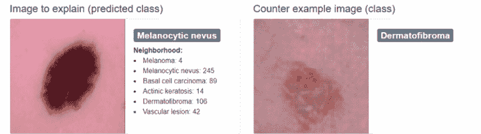

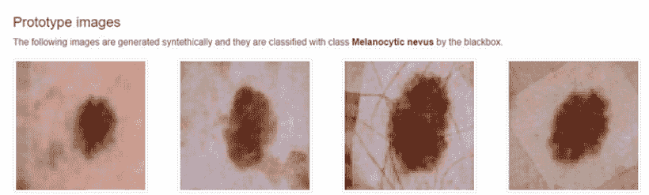

图 5. 用于展示分类及其对应解释的用户可视化模块。上半部分展示输入实例和一个反例样。下半部分展示与输入具有相同类别的四个例样。

一项调查涉及领域专家、初学者和非专业人员，以评估 ABELE 提供的解释的有效性。调查结果表明，使用解释会增加对自动化决策系统的信任和信心。这一现象在领域专家和受教育程度最高的人群中更为明显。在从 AI 模型那里收到错误建议后，领域专家往往会降低对该模型在未来分析中的信任。

该调查旨在验证 ABELE 为皮肤病变诊断返回的解释的有效性。主要目的是验证解释在协助医生和医学专家诊断和治疗皮肤癌方面的有效性，并调查他们对基于黑盒和解释器提供的解释的自动诊断模型的信心。

调查由十个问题组成，包含各个要点。参与者被展示了从数据集中随机选择的无标签皮肤病变图像及其由 ABELE 生成的解释。他们被要求利用解释将给定图像分类为两个给定类别中的一个。参与者还被展示了一张带标签的图像，并被要求量化他们对黑盒分类的信心程度。然后，同样的带标签图像连同 ABELE 返回的解释视觉辅助一起被展示，他们在查看解释后被要求再次量化自己的信心程度。参与者还被要求量化例样和反例样在多大程度上帮助他们按照 AI 的结果对皮肤病变图像进行分类，以及他们多大程度上信任这些解释。

调查结果支持这样一个假设：缺乏一致验证的解释方法并非有用。结果还突出了 ABELE 提供的自编码器潜在空间分析。潜在空间分析表明图像存在有趣的分离，希望这有助于将人类经常误分类的相似皮肤病变类别区分开来。

### 5. 讨论与结论

本文讨论了可解释人工智能（XAI）在医疗保健领域的集成和应用，重点关注 XAI 在医疗诊断和患者护理中的挑战、发展及未来方向。在 ERC XAI 项目期间，我们在理解医疗保健领域 XAI 的复杂动态、其潜在好处以及所固有的挑战方面取得了重大进展。

#### 挑战与克服策略。

项目期间遇到的主要挑战之一是医疗数据的复杂性，以及为基于 AI 的决策生成准确、可理解的解释的困难。医疗数据的异质性，加上医疗决策涉及的高风险，要求解释不仅在技术上准确，而且医疗专业人员也能轻松理解。为解决这一问题，我们采用了一种多方面的方法，将局部解释生成与形式验证方法相结合。这种方法确保了解释既与局部相关，又与分类器的逻辑在全球范围内保持一致，从而提高了医疗保健领域 AI 系统的可信度和可解释性。

#### 医疗保健中的重要性与挑战。

在医学领域，采用 XAI 方法面临着独特的挑战，包括确保患者隐私、处理高维数据以及对准确性的迫切需求。尽管存在这些挑战，XAI 在医疗保健中的重要性无论如何强调都不为过。详细且易于理解的 AI 解释使临床医生能够做出明智决策，增强患者信任，并提高医疗方案的整体有效性。通过 DoctorXAI 和 MARLENA 等项目，我们的工作表明，将 XAI 应用于从皮肤病变诊断到心脏风险评估等一系列医疗保健应用是可行且有价值的。

#### 未来方向与方法论。

展望未来，医疗保健领域的 XAI 即将迎来快速增长和创新。未来的方法论应着重于提高解释模型的鲁棒性和通用性，纳入更多样化的数据类型（例如基因组数据、电子健康记录），并探索新的解释形式（例如视觉解释、交互模型）。此外，还需要更多跨学科研究，结合数据科学、医学、心理学和伦理学的见解，开发不仅在技术上精湛，而且在伦理上可靠且与患者护理目标一致的 XAI 系统。

#### 将 XAI 与医学相结合。

医疗保健领域 XAI 的未来在于其作为决策支持系统的无缝集成，用于补充而非取代人类专业知识。要实现这一点，XAI 系统必须以开放性、透明性和可解释性为核心进行设计。这种方法将确保医疗专业人员能够信任并有效地使用 AI 建议，从而改善患者结局。

#### 建立医疗专业人员之间的信任。

为了在医疗从业者中建立和维护对 XAI 系统的信任，必须关注用户中心设计原则，确保解释与用户的专业水平相关、可操作且量身定制。避免过于复杂或晦涩的 AI 模型，而是强调解释的透明度和可靠性将是关键。此外，对医疗专业人员进行关于 AI 能力和局限性的持续教育和培训，将在营造 AI 与人类专业知识协同工作的协作环境方面发挥关键作用。


在我们对医疗保健领域可解释人工智能（XAI）的探索中，一个显著出现的方面是人机协作决策的必要性。这种共生互动强调了这样一种理念：人类判断与 AI 共同参与得越多，就能显著提升医疗决策的可解释性和伦理维度。人类洞察与 AI 分析能力的相互作用，有望将临床决策提升到新高度，在医疗服务提供者与其所依赖的技术之间培养更深层的信任与理解。此外，这种协作可以作为伦理 AI 使用的基石，确保决策不仅准确，而且透明，并与患者的价值观和需求保持一致。展望未来，人类专业知识与复杂 AI 算法的融合，对于在医疗保健复杂的伦理环境中导航至关重要，可确保 AI 辅助决策基于对患者护理的全面理解，从而强化医学的本质并凸显其深刻的人性化特征。

综上所述，将 XAI 融入医疗保健，对改善医疗诊断、患者护理和治疗效果充满巨大希望。通过继续应对挑战、发挥 AI 与人类专业知识的优势，并关注以患者为中心的结果，XAI 在医疗保健领域的未来光明。通过持续的研发，XAI 可以成为医学领域不可或缺的工具，提供支持临床决策的洞察与解释，并推动个性化医学的发展。

### 6. 未来与持续工作

我们迈向医疗保健领域 XAI 未来之际，对人机协作决策的强调将在塑造研发方向中发挥关键作用。我们即将开展的项目旨在深入研究那些不仅能提升 XAI 技术能力，还能增强其与临床环境中人类专业知识和伦理考量相契合的模型与框架。这将涉及开发能够直接将医疗专业人员的反馈纳入 AI 学习过程的系统，从而优化 AI 输出在实际情境中的准确性和适用性。此外，探索这些协作系统的伦理和监管影响将是基础性的。通过在医疗保健领域培育一种更具整合性的 AI 方法——让技术与人类专业知识相互补充——我们期待不仅能弥合 AI 潜力与其实际应用之间的差距，还能为开发既符合伦理责任又能高效提升患者护理效果的 AI 系统做出贡献。

我们概述了旨在进一步发展和扩展这一有前景领域的正在进行中的项目。

#### 6.1. 心脏风险评估器

在即将发表的工作中，我们提出了 VERIFAI-LORE，这是一个旨在提升基于 AI 的分类器的可信度和可解释性的框架。这是通过搜索式方法、机器学习解释、可满足性求解和定理证明的独特集成实现的。具体来说，它利用 LORE（局部基于规则的解释）通过在实例周围采样并构建决策树，为分类生成局部解释。这些解释包含逻辑规则和反规则，分别指示促成某一分类的属性以及导致不同分类的条件。

然而，认识到这些解释可能在某些实例上在本地有效但约束不足，VERIFAI-LORE 引入了一个形式化验证步骤。该步骤涉及将模型翻译成 Java，并以前置条件–后置条件对的形式编写 JML（Java 建模语言）合约，以通过定理证明来验证解释与分类器的一致性。这使得框架能够确保解释不仅在统计上有效，而且在所有可能输入上在逻辑上自洽，从而解决约束不足解释的挑战。

VERIFAI-LORE 框架中解释生成与形式化验证的集成，旨在为每个分类提供全局自洽且在本地有效的解释，从而提升分类器的可信度。该框架在急性冠状动脉综合征（ACS）预后的案例研究 [47] 中得到评估，展示了其提供带有相关置信水平并经过形式化验证一致性的分类和解释的能力。评估表明，对解释的 JML 合约进行检查，对于一致性解释平均耗时 12.6 秒和 304.5 MB，对于约束不足的解释平均耗时 68.7 秒和 326.5 MB，表明约束不足的解释出现频率较低。这有助于推进可信且可解释的分类。一个可视化界面（https://kdd.isti.cnr.it/cre_vue/#/，访问于 2024 年 3 月 14 日）已公开发布，允许用户根据输入自定义内容来评价解释质量。图 6 展示了与测试数据相关的结果的解释。

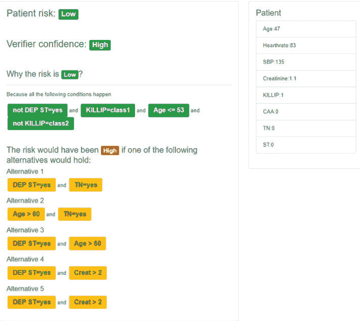

图 6. 用户可视化模块，用于展示与测试数据相关的分类及其对应的解释，该测试数据包括：年龄：47，心率：83，收缩压：135，肌酐：1.1，入院时心脏骤停：无，心电图 ST 段偏移：无，TN（异常心脏酶）：无，KILLIP 分级：无 CHF。

#### 6.2. 前列腺影像癌症 AI

这项正在进行的项目涉及将局部解释算法应用于另一种情境——前列腺癌 MRI 数据集 [48–51]。该数据集由佛罗伦萨 Careggi 医院前列腺癌科与 PI-CAI 大挑战（https://pi-cai.grand-challenge.org/，访问于 2024 年 3 月 14 日）合作收集，包含 T2 加权、表观扩散系数（ADC）和 DWI 磁共振图像。我们的目标是利用局部方法的强大功能，为复杂的影像分析生成有意义的解释，以改善对前列腺癌诊断的理解（图 7）。该项目不仅将专注于增强局部方法的可解释性，还将深入探索不同模态之间（即图像与表格数据）跨域解释的创新领域。通过这样做，我们计划弥合不同影像模态之间的差距，培养对前列腺癌诊断更具整合性和全面性的理解，从而有助于更有效的患者管理和治疗效果。

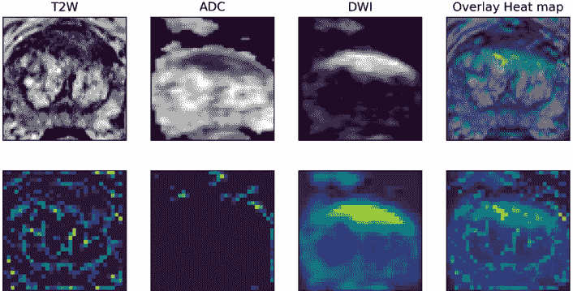

图 7. 从包含具有高级别前列腺病变的前列腺腺体的 T2W、ADC 和 DWI 图像的 3 通道多模态分类器中提取的显著性图。每个激活图表示各模态的贡献程度。

#### 6.3. 糖尿病学

一项与意大利比萨市 Cisanello 大学医院糖尿病科合作开展的即将启动的项目，探讨将可解释 AI 应用于描述肝移植前后患者状况的数据。利用包含术前和术后因素、约 450 名患者的相对较小的数据集，我们的目标是开发可解释 AI 模型，以回答关于肝移植对患者影响的一系列问题 [52]。我们将使用解释作为透镜来检视模型，调查对糖尿病发病、患者生存率和移植物生存率的可能影响。主要挑战包括高度不平衡的数据集，生存率显著高于死亡率，以及样本数量较少。我们计划谨慎应用数据平衡技术，以保持现实世界示例的完整性，从而使可解释 AI 技术仍能从预测模型中提取有意义的洞察。最终目标是识别有助于生存率的关键因素，并了解患者糖尿病状况与生存结果之间的关系，从而为医生提供发现新的可操作洞察的方法。

#### 6.4. DoctorXAI++

DoctorXAI [28] 已被证明对临床医生理解机器学习模型的决策以及增强对模型输出的信任非常有益 [33]。然而，鉴于模型性能和生成式 AI 技术的最新进展，DoctorXAI 架构的各个组件可以得到改进。本项目旨在通过将更现代的深度学习模型应用于附带 ICD10 本体学的更新 MIMICIV [53] 数据集，来改进 DoctorXAI。我们在此方向上进行的初步实验旨在调查 DoctorXAI 的合成邻域生成机制，并通过使用经过训练以近似原始数据分布的大型语言模型（LLMs）来改进该机制。LLMs 显示出从数据中直接学习原始本体学的潜力。这可能表明，LLM 既可用于进行预测，也可用于复制基于本体学的


explanations using only the raw ICD data. A general schema of our approach is shown in Figure 8.

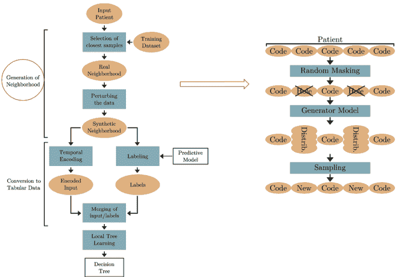

Figure 8. General schema of DoctorXAI++.

Author Contributions: Conceptualization, C.M., F.G., R.P., S.R. and A.B.; Data curation, A.B.; Funding acquisition, S.R. and F.G.; Methodology, C.M., A.B., R.P. and S.R.; Software, C.M., R.P. and S.R.; Validation, C.M., A.B. and R.P.; Visualization, C.M. and S.R. All authors have read and agreed to the published version of the manuscript.

Funding: This work is supported by the European Community under the Horizon 2020 programme, G.A. 871042 SoBigData++, G.A. 952026 HumanE AI Net, G.A. 101092749 CREXDATA, ERC-2018-ADG G.A. 834756 XAI, G.A. 952215 TAILOR, and the NextGenerationEU programme under the funding schemes PNRR-PE-AI scheme (M4C2, investment 1.3, line on AI), FAIR (Future Artificial Intelligence Research), and “SoBigData.it—Strengthening the Italian RI for Social Mining and Big Data Analytics”—Prot. IR0000013.

Conflicts of Interest: The authors declare no conflicts of interest.

### References

- 1. Guidotti, R.; Monreale, A.; Ruggieri, S.; Pedreschi, D.; Turini, F.; Giannotti, F. Factual and counterfactual explanations for black box decision making. IEEE Intell. Syst. 2019, 34, 14–23. [CrossRef]
- 2. Guidotti, R.; Monreale, A.; Ruggieri, S.; Turini, F.; Giannotti, F.; Pedreschi, D. A Survey of Methods for Explaining Black Box Models. ACM Comput. Surv. 2018, 51, 1–42. [CrossRef]
- 3. Molnar, C. Interpretable Machine Learning; Leanpub: Victoria, BC, Canada, 2020.
- 4. Saleem, R.; Yuan, B.; Kurugollu, F.; Anjum, A.; Liu, L. Explaining deep neural networks: A survey on the global interpretation methods. Neurocomputing 2022, 513, 165–180. [CrossRef]
- 5. Barredo Arrieta, A.; Díaz-Rodríguez, N.; Del Ser, J.; Bennetot, A.; Tabik, S.; Barbado, A.; Garcia, S.; Gil-Lopez, S.; Molina, D.; Benjamins, R.; et al. Explainable Artificial Intelligence (XAI): Concepts, taxonomies, opportunities and challenges toward responsible AI. Inf. Fusion 2020, 58, 82–115. [CrossRef]
- 6. Chaddad, A.; Peng, J.; Xu, J.; Bouridane, A. Survey of Explainable AI Techniques in Healthcare. Sensors 2023, 23, 634. [CrossRef] [PubMed]
- 7. Wang, C.; Liu, Y.; Wang, F.; Zhang, C.; Wang, Y.; Yuan, M.; Yang, G. Towards Reliable and Explainable AI Model for Solid Pulmonary Nodule Diagnosis. arXiv 2022, arXiv:2204.04219.
- 8. Boutorh, A.; Rahim, H.; Bendoumia, Y. Explainable AI Models for COVID-19 Diagnosis Using CT-Scan Images and Clinical Data. In Proceedings of the International Meeting on Computational Intelligence Methods for Bioinformatics and Biostatistics, Virtual, 15–17 November 2022; pp. 185–199.
- 9. Papanastasopoulos, Z.; Samala, R.K.; Chan, H.P.; Hadjiiski, L.; Paramagul, C.; Helvie, M.A.; Neal, C.H. Explainable AI for medical imaging: deep-learning CNN ensemble for classification of estrogen receptor status from breast MRI. In Proceedings of the Medical Imaging 2012: Computer-Aided Diagnosis, Houston, TX, USA, 16–21 June 2012; Volume 11314.
- 10. Jampani, V.; Uijwai, Sivaswamy, J; Vaidya, V. Assessment of computational visual attention models on medical images. In Proceedings of the Eighth Indian Conference on Computer Vision, Graphics and Image Processing (ICVGIP), Mumbai, India, 16–19 December 2012; Volume 80, pp. 1–8.
- 11. Farahani, F.V.; Fiok, K.; Lahijanian, B.; Karwowski, W.; Douglas, P.K. Explainable AI: A review of applications to neuroimaging data. Front. Neurosci. 2022, 16, 906290. [CrossRef] [PubMed]
- 12. Yoo, S.H.; Geng, H.; Chiu, T.L.; Yu, S.K.; Cho, D.C.; Heo, J.; Choi, M.S.; Choi, I.H.; Cung, Van C.; Nhung, N.V.; et al. Deep Learning-Based Decision-Tree Classifier for COVID-19 Diagnosis From Chest X-ray Imaging. Front. Med. 2020, 7, 427. [CrossRef] [PubMed]
- 13. Wang, C.; Liu, Y.; Wang, F.; Zhang, C.; Wang, Y.; Yuan, M.; Yang, G. Explainability of deep neural networks for MRI analysis of brain tumors. Int. J. Comput. Assist. Radiol. Surg. 2022, 17, 1673–1683.
- 14. Zhou, J.; Chen, F.; Holzinger, A. Towards Explainability for AI Fairness. In xxAI—Beyond Explainable AI: International Workshop, Held in Conjunction with ICML 2020, July 18, 2020, Vienna, Austria, Revised and Extended Papers; Holzinger, A., Goebel, R., Fong, R., Moon, T., Müller, K.R., Samek, W., Eds.; Springer International Publishing: Cham, Switzerland, 2022; pp. 375–386. [CrossRef]
- 15. Mitchell, M.; Wu, S.; Zaldivar, A.; Barnes, P.; Vasserman, L.; Hutchinson, B.; Spitzer, E.; Raji, I.D.; Gebru, T. Model Cards for Model Reporting. In Proceedings of the Conference on Fairness, Accountability, and Transparency (FAT*19), New York, NY, USA, 29–31 January 2019; pp. 220–229. [CrossRef]
- 16. Tonekaboni, S.; Joshi, S.; McCradden, M.; Goldenberg, A. Do no harm: A roadmap for responsible machine learning for health care. Nat. Med. 2019, 25, 1337–1340. [CrossRef]
- 17. Tonekaboni, S.; Joshi, S.; McCradden, M.; Goldenberg, A. What Clinicians Want: Contextualizing Explainable Machine Learning for Clinical End Use. arXiv 2019, arXiv:1905.05134.
- 18. Antoniadi, A.M.; Du, Y.; Guendouz, Y.; Wei, L.; Mazo, C.; Becker, B.; Mooney, C. Current Challenges and Future Opportunities for XAI in Machine Learning-Based Clinical Decision Support Systems: A Systematic Review. Appl. Sci. 2021, 11, 5088. [CrossRef]
- 19. Tjoa, E.; Guan, C. A Survey on Explainable Artificial Intelligence (XAI): Toward Medical XAI. IEEE Trans. Neural Netw. Learn. Syst. 2021, 32, 4793–4813. [CrossRef] [PubMed]
- 20. Rajkomar, A. Scalable and accurate deep learning with electronic health records. Npj Digit. Med. 2018, 1, 18. [CrossRef] [PubMed]
- 21. Ribeiro, M.T.; Singh, S.; Guestrin, C. Anchors: High-Precision Model-Agnostic Explanations. In Proceedings of the AAAI Conference on Artificial Intelligence, New Orleans, LA, USA, 2–7 February 2018; Volume 32.
- 22. Lundberg, S.M.; Lee, S.I. A unified approach to interpreting model predictions. Adv. Neural Inf. Process. Syst. 2017, 30, 4765–4774.
- 23. Ribeiro, M.T.; Singh, S.; Guestrin, C. Why should I trust you? Explaining the predictions of any classifier. In Proceedings of the 22nd ACM SIGKDD International Conference on Knowledge Discovery and Data Mining, San Francisco, CA, USA, 13–17 August 2016; pp. 1135–1144.
- 24. Caruana, R.; Lou, Y.; Gehrke, J.; Koch, P.; Sturm, M.; Elhadad, N. Intelligible Models for HealthCare: Predicting Pneumonia Risk and Hospital 30-day Readmission. In Proceedings of the 21st ACM SIGKDD International Conference on Knowledge Discovery and Data Mining, Sydney, NSW, Australia, 10–13 August 2015; pp. 1721–1730.
- 25. Larasati, R.; De Liddy, A.; Motta, E. Meaningful Explanation Effect on User’s Trust in an AI Medical System: Designing Explanations for Non-Expert Users. ACM Trans. Interact. Intell. Syst. 2023, 13, 30. [CrossRef]
- 26. Goodfellow, I.J.; Bengio, Y.; Courville, A. Deep Learning; MIT Press: Cambridge, MA, USA, 2016. Available online: http://www.deeplearningbook.org (accessed on 14 March 2024).
- 27. Zhang, W.; Yang, G.; Lin, Y.; Ji, C.; Gupta, M.M. On Definition of Deep Learning. In Proceedings of the 2018 World Automation Congress (WAC), Washington, DC, USA, 3–6 June 2018; pp. 1–5. [CrossRef]
- 28. Panigutti, C.; Perotti, A.; Pedreschi, D. Doctor XAI: An ontology-based approach to black-box sequential data classification explanations. In Proceedings of the Conference on Fairness, Accountability, and Transparency, Barcelona, Spain, 27–30 January 2020; pp. 629–639.
- 29. Poggi, A.; Lembo, D.; Calvanese, D.; De Giacomo, G.; Lenzerini, M.; Rosati, R. Linking Data to Ontologies. In Proceedings of the Journal on Data Semantics X; Spaccapietra, S., Ed.; Springer: Berlin/Heidelberg, Germany, 2008; pp. 133–173.
- 30. Chen, J.; Guo, C.; Lu, M.; Ding, S. Unifying Diagnosis Identification and Prediction Method Embedding the Disease Ontology Structure From Electronic Medical Records. Front. Public Health 2022, 9, 793801. [CrossRef]
- 31. Choi, E.; Bahadori, M.T.; Schuetz, A.; Stewart, W.F.; Sun, J. Doctor AI: Predicting Clinical Events via Recurrent Neural Networks. In Proceedings of the Machine Learning for Healthcare Conference, Los Angeles, CA, USA, 19–20 August 2016; pp. 301–318.
- 32. Johnson, A.E.W. MIMIC-III, a freely accessible critical care database. Sci. Data 2016, 3, 160035. [CrossRef] [PubMed]
- 33. Panigutti, C.; Beretta, A.; Giannotti, F.; Pedreschi, D. Understanding the impact of explanations on advice-taking: A user study for AI-based clinical Decision Support Systems. In Proceedings of the 2022 CHI Conference on Human Factors in Computing Systems (CHI'22), New York, NY, USA, 29 April 2022. [CrossRef]


34. Panigutti, C.; Perotti, A.; Panisson, A.; Bajardi, P.; Pedreschi, D. FairLens: 审计黑箱临床决策支持系统. *Inf. Process. Manag.* **2021**, *58*, 102657. [CrossRef]

35. Panigutti, C.; Guidotti, R.; Monreale, A.; Pedreschi, D. 为健康应用解释多标签黑箱分类器. 收录于《健康智能国际研讨会论文集》, Nashville, TN, USA, 2019年12月4日; Springer: Berlin/Heidelberg, Germany, 2019.

36. Guidotti, R.; Monreale, A.; Matwin, S.; Pedreschi, D. 通过在潜在特征空间中学习图像典范进行黑箱解释. 收录于《机器学习与数据库知识发现论文集》, Ghent, Belgium, 2020年9月14–18日; Brefeld, U., Fromont, E., Hotho, A., Knobbe, A., Maathuis, M., Robardet, C. (编); Springer: Cham, Switzerland, 2020; 第189–205页.

37. Makhzani, A.; Shlens, J.; Jaitly, N.; Goodfellow, I.J. 对抗自动编码器. *arXiv* **2015**, arXiv:abs/1511.05644.

38. Mirikharaji, Z.; Abhishek, K.; Bissoto, A.; Barata, C.; Avila, S.; Valle, E.; Celebi, M.E.; Hamarneh, G. 皮肤病变分割深度学习综述. *Med. Image Anal.* **2023**, *88*, 102863. [CrossRef] [PubMed]

39. Acosta, M.F.J.; Tovar, L.Y.C.; García-Zaprain, M.B.; Percybrooks, W.S. 基于深度学习技术的皮肤镜图像黑色素瘤诊断. *BMC Med. Imaging* **2021**, *21*, 6. [CrossRef] [PubMed]

40. Esteva, A.; Kuprel, B.; Novoa, R.A.; Ko, J.; Swetter, S.M.; Blau, H.M.; Thrun, S. 基于深度神经网络的皮肤科医生水平皮肤癌分类. *Nature* **2017**, *542*, 115–118. [CrossRef] [PubMed]

41. Gouda, W.; Sama, N.U.; Al-Waakid, G.; Humayun, M.; Jhanjhi, N.Z. 基于深度学习的皮肤病变图像皮肤癌检测. *Healthcare* **2022**, *10*, 1183. [CrossRef] [PubMed]

42. Metta, C.; Guidotti, R.; Yin, Y.; Gallinari, P.; Rinzivillo, S. 面向皮肤病变标记的图像分类器典范与反典范解释. 收录于《IEEE计算机与通信研讨会论文集》, Athens, Greece, 2021年9月5–8日.

43. Metta, C.; Guidotti, R.; Yin, Y.; Gallinari, P.; Rinzivillo, S. 皮肤病变分类器的典范与反典范解释. 收录于《HHAI2022：增强人类智力论文集》, Munich, Germany, 2022年6月13–17日; 第258–260页.

44. Metta, C.; Beretta, A.; Guidotti, R.; Yin, Y.; Gallinari, P.; Rinzivillo, S.; Giannotti, F. 通过可解释深度学习提升医学皮肤病变诊断的信任度与信心. *Int. J. Data Sci. Anal.* **2023**. [CrossRef]

45. Metta, C.; Beretta, A.; Guidotti, R.; Yin, Y.; Gallinari, P.; Rinzivillo, S.; Giannotti, F. 推进皮肤病诊断：用于增强皮肤病变分类的可解释人工智能. *Diagnostics* **2024**, *14*, 753. [CrossRef]

46. He, K.; Zhang, X.; Ren, S.; Sun, J. 图像识别深度残差学习. 收录于《2016年IEEE计算机视觉与模式识别会议论文集》(CVPR), Las Vegas, NV, USA, 2016年6月27–30日; 第770–778页. [CrossRef]

47. Al-Zaiti, S.; Besomi, L.; Bouzid, Z.; Faramand, Z.; Frisch, S.; Martin-Gill, C.; Gregg, R.; Saba, S.; Callaway, C.; Sejdić, E. 仅基于院前12导心电图的急性冠脉综合征机器学习预测. *Nat. Commun.* **2020**, *11*, 3966. [CrossRef] [PubMed]

48. Suh, J.; Yoo, S.; Park, J.; Cho, S.Y.; Cho, M.C.; Son, H.; Jeong, H. 基于可解释人工智能的前列腺活检决策支持工具的开发与验证. *BJU Int.* **2020**, *126*, 694–703. [CrossRef] [PubMed]

49. Hassan, M.R.; Islam, M.F.; Uddin, M.Z.; Ghoshal, G.; Hassan, M.M.; Huda, S.; Fortino, G. 基于深度学习可解释人工智能的超声和MRI图像前列腺癌分类. *Future Gener. Comput. Syst.* **2022**, *127*, 462–472. [CrossRef]

50. Ramírez-Mena, A.; Andrés-León, E.; Alvarez-Cubero, M.J.; Anguita-Ruiz, A.; Martinez-Gonzalez, L.J.; Alcala-Fdez, J. 基于基因表达的可解释人工智能用于预测和识别前列腺癌组织. *Comput. Methods Programs Biomed.* **2023**, *240*, 107719. [CrossRef]

51. Hamm, C.A.; Baumgärtner, G.L.; Biessmann, F.; Beetz, N.L.; Hartenstein, A.; Savic, L.J.; Froböse, K.; Dräger, F.; Schallenberg, S.; Rudolph, M.; et al. 交互式可解释深度学习模型用于MRI前列腺癌诊断. *Radiology* **2023**, *307*. [CrossRef] [PubMed]

52. Johnson, A.E.W.; Bulgarelli, L.; Shen, L.; Gayles, A.; Shammout, A.; Horng, S.; Pollard, T.J.; Hao, S.; Moody, B.; Gow, B.; et al. MIMIC-IV，一个可自由访问的电子健康记录数据集. *Sci. Data* **2023**, *10*, 1. [CrossRef] [PubMed]

**免责声明/出版者说明：** 所有出版物中包含的陈述、观点和数据仅为各作者和撰稿人个人的观点，而非MDPI及/或编辑的观点。MDPI及/或编辑对内容中提及的任何想法、方法、说明或产品所导致的人身或财产伤害不承担责任。

## 医学图像轻量级超分辨率技术：弥合质量与计算效率的差距

Akmalbek Abdusalomov 1, Sanjar Mirzakhalilov 2, Zaripova Dilnoza 2, Kudratjon Zohirov 3, Rashid Nasimov 4, Sabina Umirzakova 1,* and Young-Im Cho 1,*

- 1 加昌大学计算机工程系，京畿道城南市水井区13120，韩国；bobomirzaevich@gmail.com
- 2 塔什肯特以穆罕默德·阿尔·花拉子米命名信息技术大学计算机系统/信息与教育技术系，乌兹别克斯坦塔什干100200；mirzakhalilov86@tuit.uz (S.M.); zaripovada85@gmail.com (Z.D.)
- 3 塔什肯特以穆罕默德·阿尔·花拉子米命名信息技术大学卡希分校计算机系统系，乌兹别克斯坦塔什干100200；qzohirov@gmail.com
- 4 塔什干国立经济大学人工智能系，乌兹别克斯坦塔什干100066；rashid.nasimov@tsue.uz
- * 通信作者：sabinatuit@gachon.ac.kr (S.U.); yicho@gachon.ac.kr (Y.-I.C.)

摘要：医学影像在现代医疗保健中发挥着至关重要的作用，为诊断和监测各种医疗状况提供了非侵入性工具。然而，成像硬件的分辨率限制通常会导致次优图像，这可能阻碍临床决策的精确性。单图像超分辨率（SISR）技术通过从低分辨率（LR）图像重建高分辨率（HR）图像，提高了医学影像的视觉质量，从而提供了一种解决方案。本文提出了一种专门针对医学影像的改进型残差特征学习网络（RFLN）。我们的贡献包括：用标准残差块替换残差局部特征块，增加模型深度以改进特征提取，并引入增强型空间注意力（ESA）机制以优化特征选择。在医学影像数据集上的大量实验表明，与现有最先进的模型相比，所提模型在定量指标（如PSNR和SSIM）和定性视觉质量方面均实现了更出色的性能。改进型RFLN不仅能有效降噪，还能保留关键解剖细节，使其成为高精度医学影像应用的有前景解决方案。

关键词：医学影像；超分辨率；轻量级模型；残差学习

### 1. 引言

医学影像在现代医疗保健中起着关键作用，为诊断、监测和治疗各种医疗状况提供了非侵入性方法。随着对医学影像解读更高精度的需求与日俱增，提高医学影像分辨率已成为一项基本任务 [1]。高分辨率医学影像能更好地可视化复杂的解剖细节，帮助医疗专业人员做出准确诊断并规划有效治疗方案 [2]。然而，成像硬件的限制常常导致次优图像分辨率，因此开发先进的超分辨率技术势在必行。

单图像超分辨率（SISR）旨在从给定的低分辨率（LR）图像重建高分辨率（HR）图像，恢复对准确分析至关重要的精细细节 [3]。近年来，基于深度学习的方法在SISR任务中取得了显著改进，在视觉质量和计算效率方面均超越了传统方法 [4]。本文通过提出修改方案，专注于针对医学影像增强残差特征学习网络（RFLN）[5]


tailored specifically for the unique challenges posed by medical datasets [6]. The proposed model, an enhanced version of the RFLN, replaces the original residual local feature block with a standard residual block and introduces deeper layers for improved feature extraction, which is particularly suited for medical images, that often have only a single input channel. Our modifications aim to retain essential features while reducing irrelevant noise, thereby providing high-fidelity reconstructions, which are critical for medical applications. This paper details the architectural changes, the training methodology, and a comprehensive comparison with other state-of-the-art super-resolution models, demonstrating the superiority of the proposed model, both in terms of performance metrics and the visual results of medical imaging tasks.

The main contributions of this work are summarized as follows:

- We propose an improved version of the RFLN architecture tailored specifically for medical imaging. The modifications include replacing the residual local feature blocks with standard residual blocks and increasing the model depth to improve feature extraction and resolution quality.

- To further improve the feature refinement process, we integrate an enhanced spatial attention mechanism into the model. This helps focus on the most relevant areas of the input image, enhancing the overall quality of the super-resolved output, which is crucial for medical image interpretation.

- We conduct extensive experiments using specialized medical imaging datasets, demonstrating the efficacy of the proposed model in terms of both quantitative metrics and qualitative results. The proposed model outperforms existing state-of-the-art models, showcasing its potential for real-world medical applications.

- We provide a detailed analysis of the proposed model's performance compared to other leading SISR models. Our results highlight the advantages of our modifications in handling the unique challenges presented by medical images, such as the preservation of subtle anatomical details and noise reduction.

These contributions collectively advance the field of super-resolution for medical imaging, providing a robust framework that can significantly enhance the quality of medical images, ultimately aiding healthcare professionals in delivering accurate and effective diagnoses. In the following sections, we outline the structure of this paper: Section 2 reviews the related works in the field of single image super-resolution (SISR). Section 3 presents the methodology, detailing the proposed enhancements to the RFLN. Section 4 describes the experiments and results, while Section 5 discusses the findings and implications. Finally, Section 6 concludes the paper by summarizing the main contributions and future directions.

### 2. 相关工作

The field of SISR has seen considerable advancements in recent years, primarily due to the advent of deep learning-based methods [7]. Early approaches, such as bicubic interpolation [8] and sparse representation-based methods [9], laid the groundwork for SISR but were limited in their ability to capture complex textures and fine details. Traditional machine learning techniques, such as Sparse Coding-based Super-Resolution (SC-SR) [10] and Neighbor Embedding-based Super-Resolution (NE-SR) [11], provided some improvements over basic interpolation techniques but still struggled with high-frequency detail restoration. The introduction of convolutional neural networks (CNNs) marked a turning point for SISR. Dong et al. introduced the Super-Resolution Convolutional Neural Network (SRCNN) [3], which was among the first to demonstrate the potential of deep learning for super-resolution tasks. SRCNN utilized a straightforward architecture, achieving notable improvements in visual quality over traditional methods. Subsequent models, such as Very Deep Super-Resolution (VDSR) [12] and the Deep Recursive Convolutional Network (DRCN) [13], leveraged deeper architectures and recursive structures to further improve super-resolution performance. Generative adversarial networks (GANs) have also been employed to enhance the perceptual quality of super-resolved images [14]. The SRGAN [15] model was a pioneering effort that introduced adversarial loss to encourage the generation of high-frequency details [16], producing images that were perceptually closer to the ground truth. However, GAN-based models often suffer from instability during training and may introduce artifacts that compromise the accuracy of medical images, where precise detail is crucial.

More recent works have focused on residual learning and attention mechanisms [17] to address the challenges of high-fidelity image reconstruction. The authors of [18] introduced the Enhanced Deep Residual Network for Single Image Super-Resolution (EDSR), which discarded unnecessary layers and batch normalization to achieve better performance. The authors of [19] proposed the Residual Channel Attention Network (RCAN) [20], which leveraged channel-wise attention to adaptively refine features, leading to significant improvements in image quality [21]. These models have demonstrated the importance of focusing on key features while suppressing irrelevant information, an approach that aligns closely with the goals of our proposed method. The RFLN, which serves as the baseline for our work, utilizes residual local feature blocks to extract both local and global features [22]. The RFLN has shown promise in maintaining a stable gradient flow and capturing intricate details, making it effective for general SISR tasks [23]. However, medical imaging presents unique challenges, such as the need for high precision in areas with subtle anatomical details, which necessitates specialized modifications [24].

In the domain of medical imaging, several models have been proposed to enhance the quality of medical images specifically. The authors of [25] proposed a deep learning framework for MRI super-resolution [26], demonstrating the effectiveness of tailored loss functions for medical data. The authors of [27] introduced a semi-supervised framework, Mine your own Anatomy (MONA), which strategically utilizes dataset characteristics for improved segmentation. The authors of [28] presented a fuzzy neural block that converts images into a fuzzy domain, processes pixel uncertainty with fuzzy rules, and fuses these results with standard convolutional outputs. The authors of [29] proposed a novel Multimodal Multi-Head Convolutional Attention (MMHCA) module to enhance super-resolution for these scans. The module jointly applies spatial-channel attention via convolutions on concatenated input tensors, where the kernel size controls the spatial attention reduction and the number of filters manages the channel attention reduction. The authors of [30] proposed a novel UMIE approach that encodes HQ features directly into the enhancement process using a variation normalization module. This joint modeling of LQ and HQ domains ensures better guidance. The network is trained adversarial with a discriminator to ensure the output belongs to the HQ domain. The work outlined in [31] enhances traditional SR methods by incorporating a channel attention block specifically designed for high-frequency features, which are critical for detailed medical diagnostics. DRFDCAN utilizes a residual-within-residual architecture to improve inference speed and reduce memory usage without compromising image quality. The problem addressed in this study is the ability to enhance low-resolution medical images to high-resolution quality while maintaining computational efficiency. The limitations of existing medical imaging hardware often lead to images that lack sufficient resolution for precise clinical diagnosis. While recent advancements in SISR using deep learning have shown promise, many state-of-the-art models are computationally intensive and not suitable for practical deployment in medical environments. Therefore, the challenge lies in developing a lightweight, efficient SISR model that can effectively enhance image resolution without compromising quality or requiring extensive computational resources. This study aims to address these challenges by proposing an enhanced RFLN specifically tailored for medical imaging.

Previous methods in medical image enhancement face several limitations that are addressed by our model [32]. Many, like MRI super-resolution and MONA, struggle with generalization across different modalities and rely heavily on specific datasets [33]. Our model, with its deeper architecture and standard residual blocks, adapts better across various medical images. Additionally, noise mitigation in earlier approaches, such as fuzzy neural blocks, is less effective, while our model targets noise reduction without sacrificing important features. Computational complexity is another drawback, particularly in models


像 MMHCA 和 DRFDCAN 那样资源密集型 [34]。我们的模型通过使用增强空间注意力进行高效处理来简化这一过程。此外，像 DRFDCAN 这样的方法会以牺牲更大的结构完整性为代价来过分强调细节，而我们的方法实现了平衡。最后，与基于对抗的技术（如 UMIE，可能不稳定）不同，我们的模型提供稳定、一致的结果，且不会引入伪影。我们的模型为医学影像提供了一种更高效、适应性更强且更可靠的解决方案。

我们提出的模型通过增强 RFLN 架构以更好地适应医学影像应用，在此基础上进行了改进。通过将残差局部特征块替换为标准残差块并增加模型深度，我们的方法旨在保留关键特征，同时有效减轻噪声。此外，引入增强空间注意力（ESA）机制可确保模型聚焦于最相关的特征，从而提高重建图像的视觉质量和诊断实用性。

### 3. 方法论

在本节中，我们介绍了针对单图像超分辨率任务量身定制的增强 RFLN 模型。在我们的工作中，我们专门针对医学影像对模型进行了调整，用标准残差块替换了其残差局部特征块。第 3.1 节全面概述了基线模型，而第 3.2 节对所提出的修改和损失函数进行了详细的结构分析。

#### 3.1. 残差局部特征网络

RFLN 是一种深度学习模型，主要用于增强单图像超分辨率任务（图 1）。它利用残差学习的概念，该概念有助于专注于学习 LR 输入和 HR 输出之间的残差（或差异），而不是试图直接重建高分辨率图像。该技术已被证明能有效缓解梯度消失问题，从而实现更高效、更准确的深度网络训练。RFLN 架构的核心是残差局部特征块，这些块旨在从输入图像中提取并保留局部和全局特征。这些块协同工作，以捕捉图像各种尺度上的复杂细节，确保重建的高分辨率图像保持清晰度和精细纹理细节。该架构还包含多个卷积操作层，每个层后面都跟有非线性激活函数，它们共同促进图像分辨率的逐步优化。

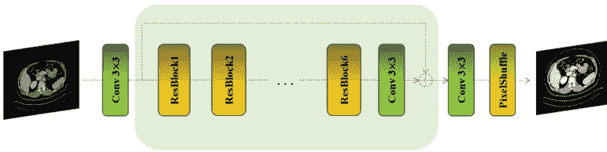

图 1. 修改后的 RFLN 架构。

网络中的残差局部特征块在保留关键图像特征的同时特别擅长抑制无关噪声，这对于高质量的图像超分辨率至关重要。本质上，RFLN 专注于学习图像中的局部依赖关系，而层间的残差连接确保网络在训练期间能够保持稳定的梯度流，防止更深层中的性能退化。此外，网络后期阶段集成上采样技术，以实现高分辨率输出的最终生成。这些方法通常涉及像素重排或反卷积，可确保在不引入显著伪影的情况下高效提高输出分辨率。通过利用这些技术，RFLN 可以实现精确且视觉效果良好的超分辨率，使其特别适用于需要高保真图像重建的应用。

#### 3.2. 拟议模型

其中每个块包含三个卷积层，卷积核大小为 3 × 3，每个卷积层都与 ReLU 激活函数配对，以向特征图引入非线性（图 2）。随后，一个连接层将块的输出与输入特征图相结合。

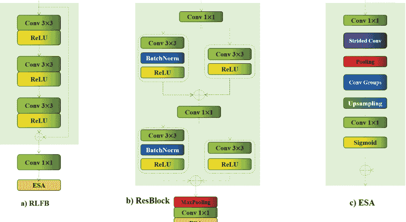

图 2. (a) RLFB：残差局部特征块；(b) ResBlock：修改后的 RLFB；(c) ESA：增强空间注意。

这些步骤之后是添加另一个卷积层和一个 ESA 块，它们有助于缩短推理时间。在所提架构中加入 ESA 块对于有效改进特征选择和提高重建图像质量至关重要。在医学影像中，保留微妙的解剖细节对于准确诊断至关重要，ESA 块有助于模型聚焦于输入图像中的这些关键区域。ESA 块通过有选择地强调重要的空间区域来工作，这增强了模型保留重要特征并减轻无关噪声的能力。通过捕捉局部和全局依赖关系，ESA 块使模型能够区分关键解剖信息和不太相关的背景特征。这种有针对性的注意力对于医学图像尤其有益，因为精确的特征提取可以极大地影响临床结果。使用 ESA 块最终会产生更高质量的超分辨率图像，具有卓越的视觉保真度，使其成为医学应用模型架构中不可或缺的组成部分。

在我们修改后的 ResBlocks 中，我们重新组织了整个模型，略微增加其深度以捕捉更全面的信息，因为我们正在处理通常只有一个输入通道的医学图像。这种调整允许更有效的特征提取，确保保留关键细节，这对于医学图像处理所需的精度至关重要。输入图像，$X_{input} \in R^{WxHxC}$，作为第一层进入 ResBlock1，如方程 (1) 所示：

```
\(F_{layer1} = F_{1x1}(X_{input})\) (1)
```

$F_{layer1}$ 构成初始层，该层包含一个具有 $3 \times 3$ 卷积核大小的单一卷积层，旨在提取低级特征：

$F_{layer2} = \max(0, x \cdot (BatchNorm(F_{3x3}(F_{layer1}))))$

方程 (2)，其中 $F_{layer2}$ 表示第二层，包含一个 $3 \times 3$ 卷积层，用于增强特征映射。随后是批量归一化，它通过重新中心化和重新缩放输入层来稳定学习过程。在批量归一化之后，应用 ReLU 激活函数来引入非线性，从而促进模型学习数据中复杂模式的能力：

$F_{layer3} = \max(0, x \cdot ((F_{3x3}(F_{layer1}))))$

$F_{layer4} = F_{1x1}(F_{concat}(F_{layer2}, F_{layer3}))$

方程 (3) 描述了配备 ReLU 激活函数和 $3 \times 3$ 卷积层的层，专门用于提取较粗的特征。同时，方程 (4) 说明了元素级连接过程，并结合了一个专门用于提取低级特征的层：

$F_{layer5} = \max(0, x \cdot (BatchNorm(F_{3x3}(F_{layer4}))))$

$F_{layer6} = \max(0, x \cdot ((F_{3x3}(F_{layer4}))))$

方程 (5) 和 (6) 复制了方程 (2) 和 (3) 中的相同块。在这些实例中，连接后的输入特征图恢复了一些信息，并为后续特征提取层提供了更复杂的特征。此外，元素级连接有助于特征图保留关键信息，防止关键细节的丢失：

$F_{layer7} = F_{concat}(F_{layer6}, F_{layer5})$

$F_{layer8} = F_{1x1}(MaxPooling(F_{layer7}))$

$F_{layer9} = F_{ESA}(F_{layer8})$

在方程 (7) 中，我们采用第二个连接层，随后应用池化层。这一步确保模型从输入特征图中捕获最关键或最具代表性的特征。具体来说，我们使用最大池化，它从特征图中的一组像素内选择最大值。这种方法有效，因为最大值通常代表独特的特征或形状特征，有助于对数据中重要空间层次结构进行稳健的识别和表示。在改进阶段，我们采用均方误差（MSE）损失。该指标在减少预测值和实际像素值之间的平方差异方面至关重要，这对于提高超分辨率结果的精度不可或缺。MSE 损失量化了真实值和预测值之间的平均平方差异。它通常表述如下：

$L_{MSE} = \frac{1}{N} \sum_i (y_i - y'_i)^2$

这一表达式强调了最小化平均平方误差的目标，从而提高超分辨率图像的保真度和质量。在方程 (10) 中，$y_i$ 表示地面真实高分辨率图像，而 $y'_i$ 表示预测的高分辨率图像。这些变量对于评估模型的性能至关重要


超分辨率模型，旨在减少实际输出与计算输出之间的差异，以提升图像质量。

### 4. 实验与结果

#### 4.1. 数据集

在我们的研究中，我们利用专门为超分辨率任务设计的数据集，例如 Figshare 和肾结石数据集。这些数据集经过精心构建，旨在促进复杂超分辨率模型的训练与评估。作为我们研究的组成部分，它们包含经过精心准备和标注的全面图像系列，以支持前沿图像增强技术的发展。这些数据集对于推进精确提升图像分辨率的技术至关重要，能够满足超分辨率应用的独特需求。每个数据集包含来自不同场景的多样化图像，并辅以详细的标注，勾勒出图像中的关键区域，从而提供对于优化模型准确性和性能至关重要的高质量数据。用于测试的数据集（即 Figshare 和 Kidney Stone）的特征如下所示。这些数据集经过精心挑选，旨在提供多样化的医学图像，确保所提模型能够在不同医学影像模态中得到有效评估（表 1）。

##### Table 1. 我们实验中使用的 Figshare 和 Kidney Stone 数据集特征。

| 数据集 | 图像数量 | 图像分辨率 | 模态 | 描述 |
|---|---|---|---|---|
| Figshare | 500 | 512 x 512 | CT 和 MRI | 用于超分辨率任务标注的多样化医学图像集，涵盖多个解剖区域。 |
| Kidney Stone | 300 | 256 x 256 | 超声 | 专注于肾结石图像的专用数据集，标注旨在提升超分辨率任务中的清晰度。 |

表 1 对所用数据集进行了清晰概述，详细说明了图像数量、分辨率、影像模态以及数据集内容的简要描述。包含这些信息有助于更好地复现本研究，并提升所用数据的透明度。

#### 4.2. 数据预处理

针对专为医学超分辨率任务定制的 Figshare 和 Kidney Stone 数据集，数据预处理阶段涉及一套经过严谨设计的流程，旨在增强所提模型的鲁棒性和准确性。最初，所有图像均调整大小以确保一致性，满足所提模型的特定输入要求，并保持数据集整体的一致性。考虑到医学影像的多样性，例如不同的模态和扫描质量，我们引入了一系列增强操作。这些调整包括随机旋转、翻转以及亮度和对比度的变化，有助于模拟现实世界医学环境中的多种条件。此外，为了复制常见的成像挑战（如噪声和轻微模糊，可能由机器不完善或患者移动引起），我们应用了高斯噪声和模糊。通过这一准备过程，我们旨在使模型适应可能遇到的潜在现实世界缺陷。

随后对每张图像进行归一化，将像素值标准化以符合所提模型的神经期望，从而促进稳定且高效的学习。如果数据集包含特定标注（例如肾结石周围的感兴趣区域），则会在图像变换后仔细调整这些标注以保持准确性。最后，为了确保全面训练并防止模型偏差，我们通过过采样或欠采样等技术平衡数据集，以充分代表各种医学状况（图 3）。

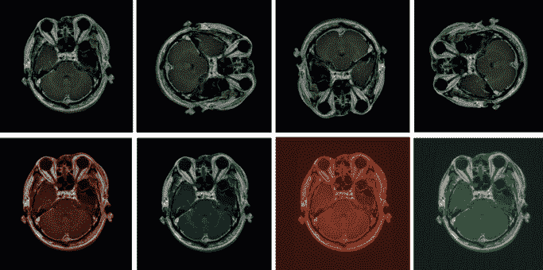

图 3. 数据预处理。

#### 4.3. 指标

在本文中，我们用于评估模型性能的主要指标是峰值信噪比（PSNR）和结构相似性指数测度（SSIM）。这些指标对于评估超分辨率处理后增强图像的质量至关重要。PSNR 用于测量信号最大可能功率与影响其表现保真度的任何损坏噪声功率之间的比率，在图像处理中，这意味着超分辨率图像中可感知的细节程度：

```
PSNR = 20 \cdot \log_{10} \left( \frac{MAX_I}{\sqrt{MSE}} \right) \quad \text{(11)}
```

其中 \(MAX_I\) 是图像的最大可能像素值（例如，8 位图像为 255），\(MSE\) 是原始图像与重建图像之间的均方误差。另一方面，SSIM 评估图像三个特性（亮度、对比度和结构）的视觉影响，从而提供更全面的图像质量和结构信息感知变化度量。这些指标在证明所提模型在提升医学图像分辨率方面的有效性方面起着关键作用，同时在计算效率与增强质量之间保持平衡：

```
SSIM(x, y) = \frac{(2\mu_x\mu_y + c_1)(2\sigma_{xy} + c_2)}{(\mu_x^2 + \mu_y^2 + c_1)(\sigma_x^2 + \sigma_y^2 + c_2)} \quad \text{(12)}
```

其中 \(\mu_x\) 和 \(\mu_y\) 分别是 \(x\) 和 \(y\) 的平均值，\(\sigma_x\) 和 \(\sigma_y\) 分别是 \(x\) 和 \(y\) 的方差，\(\sigma_{xy}\) 是 \(x\) 和 \(y\) 的协方差，\(c_1\) 和 \(c_2\) 是用于稳定弱分母除法的两个变量。

#### 4.4. 实验结果

图 4 和图 5 展示了应用于医学 MRI 图像的超分辨率技术的细致评估，重点关注大脑内的一个补丁区域。这些图像显示了一系列图像，包括原始扫描以及使用各种超分辨率模型（包括 SRCNN、SRGAN、VDSR [12]、基准模型和所提模型）后的增强结果。

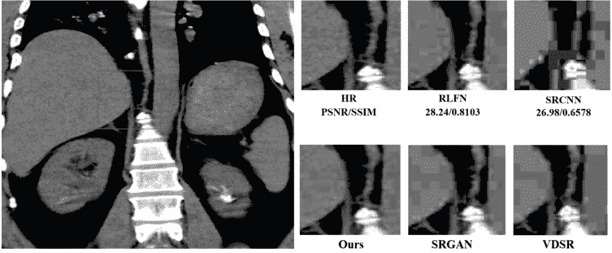

图 4. MRI 图像。

输入：噪声且低分辨率图像

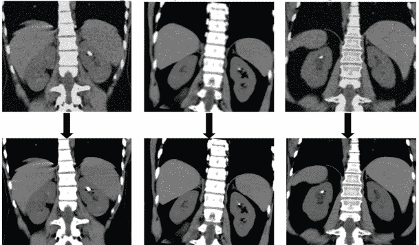

输出：高分辨率图像

图 5. 在噪声和低对比度条件下，所提模型的一系列对比。

该序列始于来自高亮区域的原始图像，该图像分辨率较低，特征不够清晰。随着序列推进，每个模型都试图改善图像的清晰度和细节。作为该领域的先驱模型之一，SRCNN 将图像增强至 PSNR 26.98 dB 和 SSIM 0.6578，VDSR [12] 将其进一步提升至 PSNR 27.56 dB 和 SSIM 0.7367，而 SRGAN 达到 PSNR 28.00 dB 和 SSIM 0.7812。在图 4、图 6 和图 7 中，这些结果几乎相同。在这组模型中，SRGAN 表现最为出色，达到 PSNR 28.45 dB 和 SSIM 0.8423，表明其在提升图像质量和结构保真度方面具有卓越能力。在 SRGAN 之后，VDSR [12] 达到 PSNR 27.96 dB 和 SSIM 0.7865，展示了其有效的分辨率增强特性。相反，尽管 SRCNN 是该领域的早期创新者，但其记录的 PSNR 为 27.14 dB，SSIM 为 0.6701。以轻量化架构著称的基准模型，出人意料地取得了更高的 PSNR 28.24 dB 和 SSIM 0.8103，证明了其在简单性下的高效性能。然而，所提模型超越了所有这些指标，以 PSNR 28.87 dB 和 SSIM 0.8803 提供了最高程度的优化。

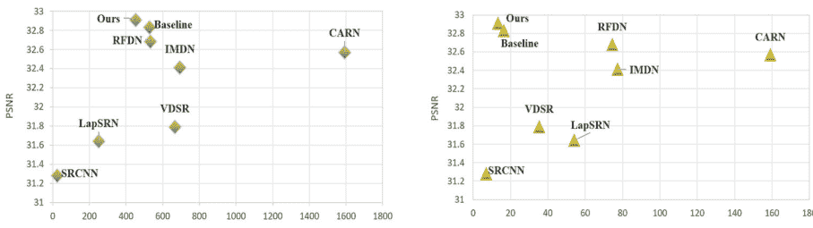

图 6. dataset1 的 PSNR、运行时间和参数说明。

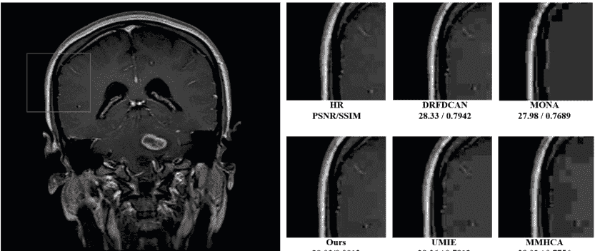

图 7. SOTA 模型的可视化对比。

图 5 在噪声和低对比度条件下展示了所提模型的一系列对比。这些示例突出了模型减轻噪声和增强微妙解剖特征的能力，证明了其在现实临床环境中使用的鲁棒性和可靠性。可视化示例清楚地表明，即使在具有显著噪声或低对比度等挑战性情况下（这些情况在临床实践中很常见），我们的模型也能有效提升图像质量。这进一步支持了我们的方法适用于高保真度至关重要的医学应用。

#### 4.5. 基准模型对比

表 2 对各种超分辨率模型进行了细致的对比，评估其在不同缩放因子下的性能，并通过运行时间以及图像质量指标 PSNR 和 SSIM 等参数展示其效率和效果。Dataset1 和 Dataset2 分别指代我们实验中使用的 Figshare 和 Kidney Stone 数据集。未引入其他数据集。我们已明确说明这一点，以确保手稿的清晰度和透明度。此外，我们对原始数据集进行了多项预处理修改。这些修改包括将图像调整大小以满足所提模型的输入要求，应用随机旋转、翻转和亮度调整等增强操作，以及添加高斯噪声以模拟真实条件。这些预处理步骤在数据预处理部分有详细说明，以全面了解数据集准备过程。


表 2. 基线模型比较结果。

| 规模 | 模型 | 参数 [K] | 运行时间 [ms] | 数据集1 PSNR/SSIM | 数据集2 PSNR/SSIM |
|---|---|---|---|---|---|
| 2× | SRCNN [3] | 24 | 6.92 | 31.28/0.9012 | 33.55/0.9312 |
| | VDSR [12] | 666 | 35.37 | 31.79/0.9056 | 33.78/0.9421 |
| | IMDN [35] | 694 | 77.34 | 32.41/0.9123 | 34.12/0.9512 |
| | RFDN [36] | 534 | 74.51 | 32.68/0.9154 | 34.45/0.9535 |
| | CARN [37] | 1592 | 159.10 | 32.57/0.9134 | 34.01/0.9486 |
| | LapSRN [38] | 251 | 53.98 | 31.64/0.9142 | 33.78/0.9356 |
| | Baseline | 527 | 16.41 | 32.83/0.9175 | 33.86/0.9369 |
| | Ours | 452 | 13.23 | 32.91/0.9188 | 34.07/0.9387 |
| 4× | SRCNN | 57 | 1.90 | 27.78/0.7120 | 28.45/0.7276 |
| | VDSR [12] | 666 | 8.95 | 27.89/0.7165 | 28.61/0.7287 |
| | IMDN [35] | 715 | 20.56 | 27.95/0.7810 | 28.98/0.7301 |
| | RFDN [36] | 550 | 20.40 | 28.12/0.8023 | 29.23/0.7453 |
| | CARN [37] | 1592 | 39.96 | 27.86/0.7712 | 28.52/0.7282 |
| | LapSRN [38] | 502 | 66.81 | 27.15/0.6813 | 28.34/0.7145 |
| | Baseline | 543 | 16.41 | 28.34/0.8230 | 29.37/0.7478 |
| | Ours | 468 | 13.23 | 28.46/0.8256 | 29.48/0.7513 |

在 2× 规模下，IMDN [35] 和 RFDN [36] 等模型展示了高质量的图像增强，其中 IMDN [35] 达到了显著高的 PSNR 和 SSIM 分数。SRCNN 虽然复杂度较低，参数最少，处理速度快，虽高效但在质量指标上略逊一筹（图 6）。VDSR [12] 和 CARN [37] 因复杂度更高，在图像质量上有所提升，但计算负荷也随之增加。所提模型通过在运行时间与高质量结果之间取得最佳平衡而脱颖而出，在该规模下两个数据集上均优于其他模型。当放大至 4× 时，所有模型的性能通常会下降，表明更高放大因子带来了更大的挑战。

然而，所提模型依然保持稳健的性能，在图像质量上超越其他模型，凸显了其在有效处理更重大超分辨率挑战方面的卓越设计。RFDN [36] 和基线模型也表现出可称道的性能，表明它们在速度与图像质量平衡至关重要的应用中具有潜在价值。两个数据集上模型性能的多样性凸显了根据特定应用需求选择模型的重要性，需考虑图像质量与计算效率之间所需平衡等因素。凭借其卓越的性能指标，所提模型体现了超分辨率技术的进步，有望在需要详细图像分辨率提升的应用中带来显著改进。

#### 4.6. 与 SOTA 模型的比较

本节将所提 RFLN 与医学影像领域的多种 SOTA 模型进行比较。评估在两个不同的数据集（Dataset1 和 Dataset2）上进行，使用 PSNR 和 SSIM 作为评估图像质量的主要指标。此外，通过测量运行时间比较了各模型的计算效率。2× 和 4× 放大因子下模型的性能总结于表 2 和表 3。结果突出了所提 RFLN 模型在保留解剖细节、减轻噪声以及提供更高视觉保真度方面相较于以往方法的优势。

表 3. 2× 放大因子下的性能比较。

| 模型 | 参数 (K) | 运行时间 (ms) | 数据集1 PSNR/SSIM | 数据集2 PSNR/SSIM |
|---|---|---|---|---|
| MRI 超分辨率 [18] | 1224 | 25.12 | 30.45/0.8921 | 32.78/0.9102 |
| MONA [19] | 1045 | 28.64 | 31.05/0.8998 | 33.22/0.9197 |
| 模糊神经块 [28] | 880 | 22.51 | 30.12/0.8823 | 31.90/0.9051 |
| MMHCA [29] | 1342 | 55.78 | 31.56/0.9045 | 33.64/0.9228 |
| UMIE [30] | 1605 | 68.32 | 31.78/0.9107 | 33.85/0.9285 |
| DRFDCAN [31] | 953 | 26.91 | 32.14/0.9175 | 34.05/0.9322 |
| 本法 | 452 | 13.23 | 32.91/0.9188 | 34.07/0.9387 |

在表 3 中，所提 RFLN 模型在两个数据集上均达到了最高的 PSNR 和 SSIM。该模型高效的残差学习和增强的空间注意力确保了高质量的图像重建，同时其运行时间是对比模型中最快的，体现了图像质量与计算效率之间的平衡。

在 4× 放大因子下，如表 4 所示，RFLN 模型继续优于其他方法，尤其是在 PSNR 指标上（该指标衡量超分辨率图像的清晰度和保真度）。图 6 展示了来自 Dataset1 的脑部 MRI 扫描补片中不同模型之间的视觉比较。我们的模型重建的图像表现出最佳的清晰度和结构准确性，与其他方法相比伪影更少。

表 4. 4× 放大因子下的性能比较。

| 模型 | 参数 (K) | 运行时间 (ms) | 数据集1 PSNR/SSIM | 数据集2 PSNR/SSIM |
|---|---|---|---|---|
| MRI 超分辨率 [18] | 1224 | 25.12 | 27.12/0.7521 | 28.95/0.7779 |
| MONA [19] | 1045 | 28.64 | 27.98/0.7689 | 27.78/0.7901 |
| 模糊神经块 [28] | 880 | 22.51 | 26.85/0.7456 | 28.62/0.7654 |
| MMHCA [29] | 1342 | 55.78 | 28.02/0.7756 | 27.86/0.7922 |
| UMIE [30] | 1605 | 68.32 | 28.36/0.7812 | 28.01/0.8027 |
| DRFDCAN [31] | 953 | 26.91 | 28.33/0.7942 | 29.22/0.8115 |
| 本法 | 468 | 13.23 | 28.46/0.8256 | 29.48/0.8513 |

尽管所有模型在更高放大因子下性能均有下降，但所提 RFLN 模型在保持图像质量方面仍保持优势，且参数更少、运行时间更短，使其非常适合临床部署。

### 5. 讨论

本文提出的实验结果证明了增强版 RFLN 在医学影像单图像超分辨率方面的有效性。所提模型在 PSNR 和 SSIM 等定量指标以及定性视觉评估方面，始终优于现有的最先进模型。本节将讨论关键发现、其影响以及当前方法的局限性。本研究的一个重要发现是，通过使用更深的残差块来增强特征提取的重要性。通过将原始的残差局部特征块替换为标准残差块并增加网络深度，该模型在提取和保留关键特征方面表现出显著改进。这对于医学图像尤为重要，因为捕捉精细的解剖细节对准确诊断至关重要。ESA 机制在提高模型整体性能方面也发挥了关键作用，使其能够更有效地聚焦于输入图像的相关区域，从而进一步提升超分辨率输出的质量。ESA 的集成在解决医学影像中的一项关键挑战（即区分重要的解剖特征和噪声）方面证明是非常有益的。医学图像通常包含对诊断至关重要的细微差异区域。通过引入 ESA，该模型能够优先处理这些区域，从而生成的超分辨率图像不仅具有更高的视觉保真度，还保留了对诊断至关重要的细节。这在 MRI 和 CT 扫描等应用中特别有用，图像清晰度直接影响临床结果。所提模型提供的视觉质量改进具有重要的临床意义，特别是在提高诊断准确性方面。我们的方法实现的增强分辨率可以带来更好的小病变检测效果，这些病变在低分辨率图像中通常难以识别。例如，在 CT 扫描中，该模型保留精细解剖细节的能力有助于早期发现小病灶，这对早期诊断和及时干预至关重要。同样，在超声成像中，更高的分辨率可以改善细微异常（如小肾结石或早期肿瘤）的可见性，从而带来更准确、更有信心的诊断。通过优化医学图像的视觉质量，我们的模型有望支持放射科医生和其他医疗专业人员识别那些可能被忽视的病理。这种增强不仅提高了诊断准确性，还对更有效的治疗规划和患者预后产生贡献。这些临床意义强调了我们方法超越单纯图像质量改进的价值，突出了其在为医疗专业人员提供精确可靠的图像增强工具方面的实用价值。

尽管结果令人期待，但当前方法仍存在几项值得进一步研究的局限性。首先，尽管所提模型相较于现有方法有显著改进，但计算复杂度仍然相对较高。模型深度的增加和注意力机制的引入增加了计算负荷，这可能限制模型在实时临床环境或计算资源有限的场景中的应用。未来工作可以专注于在不牺牲图像质量的前提下优化模型，以降低推理时间和计算需求。另一局限性是依赖特定数据集进行训练和评估。尽管所提模型在本研究使用的医学影像数据集上表现良好，但其推广到其他类型医学图像或成像模态的能力仍需进一步探索。医学影像数据可能因成像设备、采集协议和患者人口统计学特征等因素而存在显著差异。为确保鲁棒性和广泛适用性，未来研究应包含更多样化的数据集，并在其上评估模型性能。

### 6. 结论

本文介绍了一种专为医学影像单图像超分辨率设计的增强版 RFLN。通过引入更深的残差块、ESA 机制并增加模型深度，所提架构在从低分辨率医学图像重建高分辨率图像方面表现出显著改进。我们的实验结果表明，增强版 RFLN 在 PSNR 和 SSIM 等定量指标以及定性视觉评估方面均优于现有最先进模型。ESA 的集成在抑制噪声的同时聚焦于相关解剖特征方面发挥了关键作用，从而提升了超分辨率图像的诊断实用性。这些改进使所提模型特别适合医学应用，因为图像质量直接影响诊断准确性和患者预后。然而，计算量的增加


复杂性和对特定数据集的依赖性给未来工作带来了必须解决的挑战。优化模型以实现临床实时部署，并扩展其适用于多样化医学影像模态，是至关重要的下一步。通过解决这些局限性，我们相信所提模型可以在医学影像领域产生重大影响，为医疗专业人员提供更精确、更有效诊断所需的工具。

**作者贡献：** 方法学，A.A., S.U. 和 Y.-I.C.；软件，A.A., S.U., Z.D., K.Z., S.M. 和 R.N.；验证，Z.D., K.Z., S.M. 和 R.N.；正式分析，A.A., S.U., Z.D., S.M., K.Z. 和 R.N.；资源，Z.D., K.Z., Y.-I.C. 和 R.N.；数据管理，Z.D., S.M., K.Z., Y.-I.C. 和 R.N.；撰写—原稿，A.A., S.U., Z.D., K.Z., S.M., R.N. 和 Y.-I.C.；撰写—审阅与编辑，A.A., S.U., Z.D., K.Z., S.M., R.N. 和 Y.-I.C.；监督，Y.-I.C., A.A. 和 S.U.；项目管理，Z.D., K.Z., S.M., R.N. 和 Y.-I.C. 所有作者均已阅读并同意发表的稿件版本。

**资助：** 本研究由2022年韩国技术标准局资助。项目编号为 1415180835（基于AI学习与推理技术的国际标准技术开发）、1415181629（基于AI模型轻量化技术的国际标准技术开发）和 1415181638（BCI与AI互操作性标准化基础建立）。与本论文相关的任何通信应寄至 Young-Im Cho。

**机构审委会声明：** 不适用。

**知情同意声明：** 不适用。

**数据可用性声明：** 本研究中的原始贡献已包含在文章中，进一步询问可联系通信作者。

**利益冲突：** 作者声明不存在任何利益冲突。

### 参考文献

- 1. Lambert, B.; Forbes, F.; Doyle, S.; Dehaene, H.; Dojat, M. 可信赖的临床AI解决方案：面向医学图像分析深度学习模型不确定性量化的统一综述。*人工智能医学* **2024**, *150*, 102830. [CrossRef] [PubMed]
- 2. Bakhtiarnia, A.; Zhang, Q.; Isosifidis, A. 高效高分辨率深度学习：综述。*ACM计算机调查* **2024**, *56*, 181. [CrossRef]
- 3. Dong, C.; Loy, C.C.; He, K.; Tang, X. 使用深度卷积网络的图像超分辨率。*IEEE模式分析与机器智能汇刊* **2015**, *38*, 295–307. [CrossRef]
- 4. El-Shafai, W.; El-Nabi, S.A.; Ali, A.M.; El-Rabaie, E.S.M.; Abd El-Samie, F.E. 面向医学图像的传统与基于深度学习的去噪方法。*多媒体工具与应用* **2024**, *83*, 52061–52088. [CrossRef]
- 5. Kong, F.; Li, M.; Liu, S.; Liu, D.; He, J.; Bai, Y.; Chen, F.; Fu, L. 面向高效超分辨率的残差局部特征网络。载于2022 IEEE/CVF计算机视觉与模式识别会议(CVPR)论文集，美国路易斯安那州新奥尔良，2022年6月18–24日；第766–776页。
- 6. Ferdi, A.; Benierbah, S.; Nakib, A. 基于残差编码器-解码器的医学图像去噪架构。*多媒体工具与应用* **2024**, 1–18. [CrossRef]
- 7. Umirzakova, S.; Ahmad, S.; Khan, L.U.; Whangbo, T. 面向智慧医疗应用的医学图像超分辨率：全面综述。*信息融合* **2023**, *103*, 102075. [CrossRef]
- 8. Liu, J.; Gan, Z.; Zhu, X. 方向双三角插值——一种图像超分辨率的新方法。载于第3届多媒体技术国际会议(ICMT-13)论文集，中国广州，2013年11月29日–12月1日；第463–470页。
- 9. Wang, Y.H.; Qiao, J.; Li, J.B.; Fu, P.; Chu, S.C.; Roddick, J.F. 基于稀疏表示的MRI超分辨率重建。*测量* **2014**, *47*, 946–953. [CrossRef]
- 10. Liu, D.; Huang, T.S. 单图像超分辨率：从稀疏编码到深度学习。载于*通过稀疏和低秩建模的深度学习*；Wang, Z., Fu, Y., Huang, T.S. 编；Elsevier：美国马萨诸塞州剑桥，2019；第47–86页。
- 11. Mishra, D.; Majhi, B.; Sa, P.K.; Dash, R. 开发基于稳健邻域嵌入的超分辨率方案。*神经计算* **2016**, *202*, 49–66. [CrossRef]
- 12. Kim, J.; Lee, J.K.; Lee, K.M. 使用超深度卷积网络的精确图像超分辨率。载于2016 IEEE/CVF计算机视觉与模式识别会议(CVPR)论文集，美国内华达州拉斯维加斯，2016年6月27–30日；第1646–1654页。
- 13. Kim, J.; Lee, J.K.; Lee, K.M. 面向图像超分辨率的深度递归卷积网络。载于2016 IEEE/CVF计算机视觉与模式识别会议(CVPR)论文集，美国内华达州拉斯维加斯，2016年6月27–30日；第1637–1645页。
- 14. Tian, C.; Zhang, X.; Lin, J.C.W.; Zuo, W.; Zhang, Y.; Lin, C.W. 面向图像超分辨率的生成对抗网络：综述。*arXiv* **2022**, arXiv:2204.13620.
- 15. Ledig, C.; Theis, L.; Huszár, F.; Caballero, J.; Cunningham, A.; Acosta, A.; Aitken, A.; Tejani, A.; Totz, J.; Wang, Z.; et al. 使用生成对抗网络的单图像超分辨率的照片级真实感。载于2017 IEEE/CVF计算机视觉与模式识别会议(CVPR)论文集，美国夏威夷州檀香山，2017年7月21–26日；第4681–4690页。
- 16. Abdusalomov, A.B.; Nasimov, R.; Nasimova, N.; Muminov, B.; Whangbo, T.K. 使用GAN算法和人工智能评估合成医学图像。Sensors 2023, 23, 3440. [CrossRef]
- 17. Rasheed, Z.; Ma, Y.K.; Ullah, I.; Ghadi, Y.Y.; Khan, M.Z.; Khan, M.A.; Abdusalomov, A.; Alqahtani, F.; Shehata, A.M. 使用图像增强和卷积神经网络技术从MRI中进行脑肿瘤分类。Brain Sci. 2023, 13, 1320. [CrossRef] [PubMed]
- 18. Lim, B.; Son, S.; Kim, H.; Nah, S.; Mu Lee, K. 单图像超分辨率的增强深度残差网络。载于2017 IEEE/CVF计算机视觉与模式识别会议(CVPR)论文集，美国夏威夷州檀香山，2017年7月21–26日；第136–144页。
- 19. Zhang, Y.; Li, K.; Li, K.; Wang, L.; Zhong, B.; Fu, Y. 使用超深度残差通道注意力网络的图像超分辨率。载于欧洲计算机视觉会议(ECCV)论文集，德国慕尼黑，2018年9月8–14日；第286–301页。
- 20. Liu, Y.; Yang, D.; Zhang, F.; Xie, Q.; Zhang, C. 单图像超分辨率的深度循环残差通道注意力网络。Vis. Comput. 2024, 40, 3441–3456. [CrossRef]
- 21. Abdusalomov, A.; Umrizakova, S.; Safarov, F.; Mirzakhalilov, S.; Egamberdiev, N.; Cho, Y.I. 智能家居早期火灾检测的多尺度方法。Electronics 2024, 13, 4354. [CrossRef]
- 22. Yu, M.; Shi, J.; Xue, C.; Hao, X.; Yan, G. 基于深度学习的单图像超分辨率重建综述。Multimed. Tools Appl. 2024, 83, 55921–55962. [CrossRef]
- 23. El-Shafi, W.; Ali, A.M.; El-Nabi, S.A.; El-Rabaie, E.S.M.; Abd El-Samie, F.E. 基于深度学习的医学图像单图像超分辨率方法：综述。Multimed. Tools Appl. 2024, 83, 30467–30503. [CrossRef]
- 24. Liu, H.; Li, Z.; Shang, F.; Liu, Y.; Wan, L.; Feng, W.; Timofte, R. 基于深度学习的任意尺度超分辨率：全面综述。Inf. Fusion 2024, 102, 102015. [CrossRef]
- 25. Feng, C-M.; Yan, Y.; Yu, K.; Xu, Y.; Fu, H.; Yang, J.; Shao, L. 探索多对比度MR图像超分辨率的可分离注意力。IEEE Trans. Neural Netw. Learn. Syst. 2024, 35, 12251–12262. [CrossRef]
- 26. Ayaz, A.; Boonstoppel, R.; Lorenz, C.; Weese, J.; Pluim, J.; Breeuwer, M. 使用模拟训练数据进行有效的深度学习脑MRI超分辨率。Comput. Biol. Med. 2024, 183, 109301. [CrossRef]
- 27. You, C.; Dai, W.; Liu, F.; Min, Y.; Dvornek, N.C.; Li, X.; Clifton, D.A.; Staib, L.; Duncan, J.S. 挖掘你自己的解剖结构：在极少标签情况下重新审视医学图像分割。IEEE Trans. Pattern Anal. Mach. Intell. 2024, 46, 11136–11151. [CrossRef]
- 28. Wang, C.; Lv, X.; Shao, M.; Qian, Y.; Zhang, Y. 一种新型模糊层级融合注意力卷积神经网络用于医学图像超分辨率重建。Inf. Sci. 2023, 622, 424–436. [CrossRef]
- 29. Georgescu, M.I.; Ionescu, R.T.; Miron, A.I.; Savencu, O.; Ristea, N.C.; Verga, N.; Khan, F.S. 面向医学图像超分辨率的多模多头带有不同核大小的卷积注意力。载于2023 IEEE/CVF计算机视觉应用冬季会议(WACV)论文集，美国夏威夷州怀科洛亚，2023年1月2–7日；第2195–2205页。
- 30. He, C.; Li, K.; Xu, G.; Yan, J.; Tang, L.; Zhang, Y.; Wang, Y.; Li, X. Hqg-net：具有高质量引导的非配对医学图像增强。IEEE Trans. Neural Netw. Learn. Syst. 2023; 提前发表。
- 31. Umrizkova, S.; Mardieva, S.; Muksimova, S.; Ahmad, S.; Whangbo, T. 增强医学图像超分辨率：引入深度残差特征蒸馏通道注意力网络以实现优化性能和效率。Bioengineering 2023, 10, 1332. [CrossRef] [PubMed]
- 32. Huang, W.; Liao, X.; Chen, H.; Hu, Y.; Jia, W.; Wang, Q. 面向医学图像超分辨率的深度局部到全局特征学习。Comput. Med. Imaging Graph. 2024, 115, 102374. [CrossRef] [PubMed]
- 33. He, J.; Ma, H.; Guo, M.; Wang, J.; Wang, Z.; Fan, G. 2000年至2023年医学影像超分辨率研究：文献计量分析与可视化。Quant. Imaging Med. Surg. 2024, 14, 5109. [CrossRef] [PubMed]
- 34. Baranwal, N.; Singh, K.N.; Singh, A.K. 基于YOLO的医学图像联合加密与压缩的ROI选择及通过超分辨率网络重建。Future Gener. Comput. Syst. 2024, 150, 1–9.
- 35. Hui, Z.; Gao, X.; Yang, Y.; Wang, X. 具有信息多重蒸馏网络的轻量级图像超分辨率。载于第27届acm国际多媒体会议论文集，法国尼斯，2019年10月21–25日；第2024–2032页。
- 36. Liu, J.; Tang, J.; Wu, G. 轻量级图像超分辨率的残差特征蒸馏网络。载于2020年欧洲计算机视觉会议论文集，英国格拉斯哥，2020年8月23–28日；第41–55页。
- 37. Ahn, N.; Kang, B.; Sohn, K.A. 快速、准确且轻量级的级联残差网络超分辨率。载于欧洲计算机视觉会议(ECCV)论文集，德国慕尼黑，2018年9月8–14日；第252–268页。
- 38. Lai, W.S.; Huang, J.B.; Ahuja, N.; Yang, M.H. 快速准确的深度拉普拉斯金字塔网络超分辨率。载于2017 IEEE计算机视觉与模式识别会议(CVPR)论文集，美国夏威夷州檀香山，2017年7月21–26日；第624–632页。

免责声明/出版者说明：所有出版物中包含的声明、观点和数据仅为各作者和撰稿人个人的观点，而非MDPI和/或编辑的观点。MDPI和/或编辑对因内容中提及的任何想法、方法、说明或产品而导致的人员伤害或财产损失不承担任何责任。


## 通过强化学习和文本增强提高放射学报告生成的质量和多样性

Daniel Parres 1,*, Alberto Albiol 1 and Roberto Paredes 1,2

1 Campus de Vera, Universitat Politècnica València, Camí de Vera s/n, 46022 Valencia, Spain; alalbiol@iteam.upv.edu (A.A.); rparedes@prhlt.upv.es (R.P.)
2 Valencian Graduate School and Research Network of Artificial Intelligence, Camí de Vera s/n, 46022 Valencia, Spain
* Correspondence: dparres@prhlt.upv.es

摘要：深度学习通过采用视觉编码器–解码器（VED）框架，正在彻底改变放射学报告生成（RRG），该框架将 X 光片转换为详细的医疗报告。然而，传统方法通常生成多样性有限的报告，并且在泛化方面存在困难。我们的研究引入了强化学习和文本增强来解决这些问题，显著提高了报告质量和可变性。通过采用 RadGraph 作为奖励度量并创新文本增强，我们超越了 BLEU4、ROUGE-L、F1 CheXbert 和 RadGraph 等现有基准，在 MIMIC-CXR 和 Open-i 数据集上为报告准确性和多样性设定了新标准。我们的 VED 模型在 MIMIC-CXR 数据集上分别获得 66.2 的 CheXbert F1 分数和 37.8 的 RadGraph 分数，在 Open-i 上分别获得 54.7 和 45.6。这些成果代表了 RRG 领域的重大突破。所提方法的研究结果和实现旨在增强临床环境中的诊断精度和放射学解释，已在 GitHub 上公开发布，以促进该领域的进一步发展。

关键词：放射学报告生成；强化学习；文本增强；机器学习；深度学习；视觉变换器；胸部 X 光片；医学影像；文本生成

### 1. 引言

放射学报告生成（RRG）是一项具有挑战性的任务，其目标是解释放射图像并生成关于潜在患者病理的详细报告。与典型的计算机视觉（CV）任务（旨在识别图像中的物体）不同，RRG 侧重于诊断潜在病理并确定其存在、不存在或不确定性。此外，数据可用性有限和医疗报告的多样性带来了重大挑战。这项任务对于简化和改善患者护理至关重要，因为它使个人健康状况分析和疾病快速检测成为可能。此外，它还为医疗专业人员提供帮助和支持。RRG 任务与 [1] 等其他工作相似，其中复杂数据得到处理，并从该等数据训练的模型必须确保特定的安全标准。这种相似性源于需要开发能够精确诊断病理的模型，因为在这类问题中，患者的健康受到威胁。当前方法主要依赖深度学习（DL），具体来说是视觉编码器–解码器（VED）架构 [2–8]，并融入记忆 [9,10] 或强化学习（RL）[5,11,12] 等组件以提升性能。

本研究针对胸部 RRG 提出了一种两阶段纯变换器 VED 架构。第一阶段采用传统的负对数似然（NLL）训练，第二阶段专注于各种度量的 RL 优化。这些度量涵盖语义连贯性的嵌入式比较 [13]、病理描述的实体和关系图生成 [14] 以及 NLL。此外，我们还提出集成文本增强和硬负例挖掘技术。这种综合方法超越了当前的胸部 RRG 方法论，增强了报告的多样性、事实准确性、完整性以及模型的整体泛化能力。

本研究的主要贡献如下：

- 利用视觉编码器–解码器变换器框架和强化学习，提升放射学报告质量、事实准确性和完整性。
- 将文本增强引入训练工作流。该技术可通过生成新报告来利用数据稀缺性，从而提升多样性，相比现有技术平均提升三倍。
- 由于衡量生成报告质量存在挑战，我们专注于采用基于专业自然语言处理的度量来全面评估放射学报告。
- 在 GitHub 上开源我们的方法论 https://github.com/dparres/Diversifying-Radiology-Report-Generation（访问日期：2024 年 4 月 1 日），以推动临床环境中诊断精度和放射学解释的进步。

### 相关工作

近年来，深度学习技术推动了多种用于分类和检测 X 光片中病理的方法。该领域的显著研究包括 Schlegl et al. [15]，他们提出了一种用于分类断层扫描中组织模式的卷积网络（CNN），将报告中的语义描述作为标签。在此基础上，随后的神经网络模型被用于 X 光，例如 Shin et al. [16]，他们引入了用于胸部 X 光图像的 CNN 和用于标注的循环网络（RNN），并联训练以标注疾病、解剖结构和严重程度。其他方法，如 Moradi et al. [17]，则专注于通过串联 CNN 和 RNN 块来识别感兴趣区域的标注。值得注意的是，Rubin et al. [18] 使用并行训练的 CNN 分别处理正位和侧位胸部 X 光视图以估计可能的病理。在 TieNet [4] 等有影响力模型的推动下，以及来自 Li et al. [3]、Jing et al. [19] 和 Jing et al. [19] 的创新贡献，RRG 的兴趣不断增长，这些工作均利用预训练网络、共注意机制和检索策略模块等先进技术，用于高效的疾病分类和报告生成。

由于数据可用性有限且非结构化，加剧了正常–异常病例不平衡，并因放射学家报告的模糊性而更加复杂，放射学领域的深度学习应用面临障碍 [20]。AlexNet [21]、VGG-16 [22]、GoogLeNet [23] 和 ResNet [24] 等 CNN 模型主导着医学文本–图像挖掘，端到端训练越来越普遍 [20]。然而，模型比较受到数据集多样性的阻碍，尽管预计纳入放射学报告将不断增长 [20]。放射学报告风格多样且受偏见影响，给训练稳健模型带来挑战，且极少有数据集满足可扩展性和可访问性标准 [25]。大多数 RRG 系统专注于 X 光检查，针对 CT 扫描和 MRI 数据集的新兴应用各自面临独特挑战 [25]。

Alfargahly et al. [26] 引入了一种用于从胸部 X 光生成放射学报告的新技术，基于 DistilGPT2 [27]。该方法强调了更快的训练和更好的度量。尽管仍存在局限性，但建议发布更大的数据集以增强模型泛化并批判性地评估定量方法 [26]。Yang et al. [28] 提出了一种结合通用医学知识和特定医学知识并采用多头注意力机制用于胸部 RRG 的方法。此外，Pan et al. [29] 提出了一种通过跨模态多尺度特征融合生成胸部放射学报告的方法。该架构旨在增强位置敏感性和疾病表征。此外，这些进展为对齐尺度和集成知识图谱铺平了道路，提高了报告生成的准确性 [29]。Yang et al. [30] 引入了一个高度准确且自动化的放射学生成框架，配备一种新颖的自动医学知识更新机制，并通过多模态对齐方法进行增强。Zhao et al. [31] 提出了一种知识增强技术，利用字典形式的医学知识以及历史知识，并辅以多层对齐方法以减轻文本和图像之间的模态差异。Nicolson et al. [32] 引入了 CvT2DistilGPT2，利用卷积视觉变换器实现最佳编码器预热，并强调 GPT2 [33] 在解码器预热方面相对于 BERT [34] 的优越性。尽管这些提议具有创新性，但它们都依赖 BLEU 和 ROUGE-L 等度量进行比较，这些度量可能不完全适合测量病理的存在、不存在或不确定性。此外，这些度量未能考虑报告中病理之间的相互关系。生成报告中的单调性和重复性也是值得注意的因素，归因于 RRG 任务本身的固有困难。

由于人们对自动化 RRG 的兴趣日益增加，已针对胸部 RRG 任务设计了特定架构。Liu et al. [5] 提出了一种用于提取视觉特征的 CNN，随后是句子解码器和单词解码器，用于生成报告主题并撰写最终报告。该模型使用带有 CheXpert [35] 标签的 RL 进行微调。Chen et al. [9] 引入了记忆驱动的变换器，采用关系和记忆驱动层以增强信息保留和纳入解码器。同时，Chen et al. [10] 提出了一种基于跨模态记忆网络的 VED，利用共享内存来捕获和利用视觉–文本对齐。

Liu et al. [6] 和 Liu et al. [7] 提出利用非监督知识图构建来复制放射学家的模式以生成报告。聚焦于 RL，Miura et al. [11] 建议采用两个度量：一个确保生成领域实体（factENT），另一个保持连贯的实体描述（factENTNLI）。这些度量与 BERTScore [13]（一种语义等价度量）一起进行优化。Delbrouck et al. [12] 提出了一种利用 VED 的竞争性胸部 RRG 方法。该模型采用 DenseNet-121 [36] 作为光学编码器，并采用单层 BERT [34] 作为解码器。通过 RL 训练，优化涉及三个度量：RadGraph [14]、BERTScore 和 NLL。RadGraph 是一种神经网络，通过构建报告中实体和关系的图来形成语义注释。奖励是通过将假设的实体和关系与参考进行比较来计算的，从而产生更高质量的报告，超越 factENT 和 factENTNLI 达到的数值。这些提议采用面向胸部 RRG 的度量，以便比 BLEU 或 ROUGE-L 等度量更精确地比较报告质量。尽管这样做并且使用 RL 进行训练，报告仍然表现出重复性和缺乏多样性。

### 2. 材料与方法

本节介绍了胸部 RRG 任务的主要方法。首先，介绍了神经模型，并提出了四种不同的架构来分析最适合 RRG 任务的架构。随后，概述了模型的训练工作流。接着，引入了文本增强技术以利用数据稀缺性。最后一小节介绍了将使用的数据库以及用于比较模型和衡量生成报告质量的度量。

#### 2.1. 提议的架构

用于解决胸部 RRG 问题的我们的模型架构是 VED 模型，其中 Swin [37] 作为视觉模型，BERT [34] 作为语言模型或解码器。我们选择 Swin 是因为它在分类、目标检测和语义分割等各种计算机视觉任务中表现出色 [37]。与 ViT [38] 相比，Swin 的分层特性以及基于移动窗口的更高效注意力机制使其更适合 X 光分析。我们的模型同时使用基础版和小型版，分别表示为 SwinB 和 SwinS。这些架构已在 ImageNet [39] 上预训练，并具有三通道输入图像、宽度和高度均为 224 像素的特点。它们的架构深度分别为每层 2、2、18 和 2，补丁大小为 4。主要区别在于头的数量，SwinB 使用 4、8、16 和 32，而 SwinS 使用 3、6、12 和 24。


对于解码器模型，由于 BERT 在各种自然语言处理（NLP）任务中具有经过验证的有效性 [34,40,41]，因此选择了 BERT。然而，我们偏离了标准配置，仅采用三层、隐藏层大小为 1024，而非原始的 12 层。此外，我们的研究包括对两种不同解码器的分析：一种基于单词，词汇量约为 9.8k 个词；另一种基于子词，词汇量为 30k 个子词。通过交叉注意力层，实现了视觉模型与解码器模型的集成，从而能够将从 X 光片中提取的视觉特征引入解码器。这种集成允许报告的自回归生成。

根据此方法，拟用于胸部 RRG 分析的 VED 模型为 SwinB+BERT9k、SwinB+BERT30k、SwinS+BERT9k 和 SwinS+BERT30k。

#### 2.2. 训练工作流

在放射学场景中，每个患者研究通常会生成多张图像（例如前后位和侧位视图）。我们采用多图像方法来解决此问题，将每项研究限制为三张图像。这涉及将 Swin 编码器为每张图像提取的特征进行拼接，并在解码器中对其进行处理。此外，我们应用随机变换（包括平移、缩放、旋转以及亮度和对比度调整）来增强训练图像。

我们的训练过程包含两个阶段，如图 1 所示。在初始阶段，采用 NLL 损失函数，利用教师强制基于生成的假设和参考报告来训练模型。此阶段通常包含约十二个训练时代。随后，在第二阶段，使用自关键序列训练（SCST）算法 [42] 引入强化学习（RL）。SCST 对 VED 进行两次前向传递：贪婪解码和光束搜索多项式采样（采样解码）。第一次传递涉及通过贪婪解码进行推理以获得报告 Yg，且不计算梯度。与此同时，第二次传递采用采样解码，计算梯度以获得采样报告 Ys。

RL 旨在通过将特定指标用作奖励来优化这些指标。在我们的方法中，我们建议使用两个指标：BERTScore [13] 和 RadGraph [14]。BERTScore 能够有效改善模型中的语法和语义，而 F1RGER 有助于模型优先处理与病理相关的实体和关系。

在获得报告 Yg 和 Ys 后，必须为每个指标计算一个损失以进行优化（Lossmetric）。随后，此 Lossmetric 用于计算加权和以获得最终的 LossRL 并更新模型权重。方程 (1) 概述了推导 Lossmetric 的过程，其中使用参考报告 Yref 为 Ys 和 Yg 计算指标奖励。然后将这些奖励相减，并乘以生成 Ys 报告期间计算的概率的对数。

```
Loss_metric(Y_s, Y_g, Y_ref) = -(r_metric(Y_s, Y_ref) - r_metric(Y_g, Y_ref)) log(Pr(Y_s)) (1)
```

每个 Lossmetric 作为独立的加权项贡献给最终的 RL 损失，如方程 (2) 所示。为了获得用于更新模型权重的 LossRL，将 LossBERTScore、LossF1RGER 以及初始训练阶段使用的相同损失（即 LossNLL）相加。在我们的实验中，我们将 α = β = 0.495 和 γ = 0.010 设置为加权因子。

```
Loss_RL = αLoss_BERTScore + βLoss_F1RGER + γLoss_NLL (2)
```

#### 2.3. 文本增强

数据增强（DA）是解决数据有限的机器学习问题最普遍的技术。这种方法对提高泛化能力和改善数据利用率具有显著作用。然而，关于 RRG，重点主要放在增强输入图像上。据我们所知，此前没有方法研究过增强放射学报告的影响，这一技术被称为文本增强（TA）。在胸部 RRG 中，报告通常由不同的人以不同方式起草，缺乏特定模板，这导致了自然语言固有的显著差异性。目前，最先进的 RRG 算法面临着这一数据稀缺问题，通常会生成高度重复和单调的报告。

在本研究中，我们引入了一种旨在提高生成报告质量和多样性的 TA 技术。我们的 TA 方法涉及将参考报告拆分为短语，考虑到报告通常包含多个句子的典型结构。随后随机重组这些短语以创建新报告，同时保持原始诊断，如图 1 所示。该方法缓解了过拟合问题，并促进对提及病理的更有针对性的学习。此外，如后文所示，我们的 TA 显著提高了生成报告的质量、事实准确性和全面性。

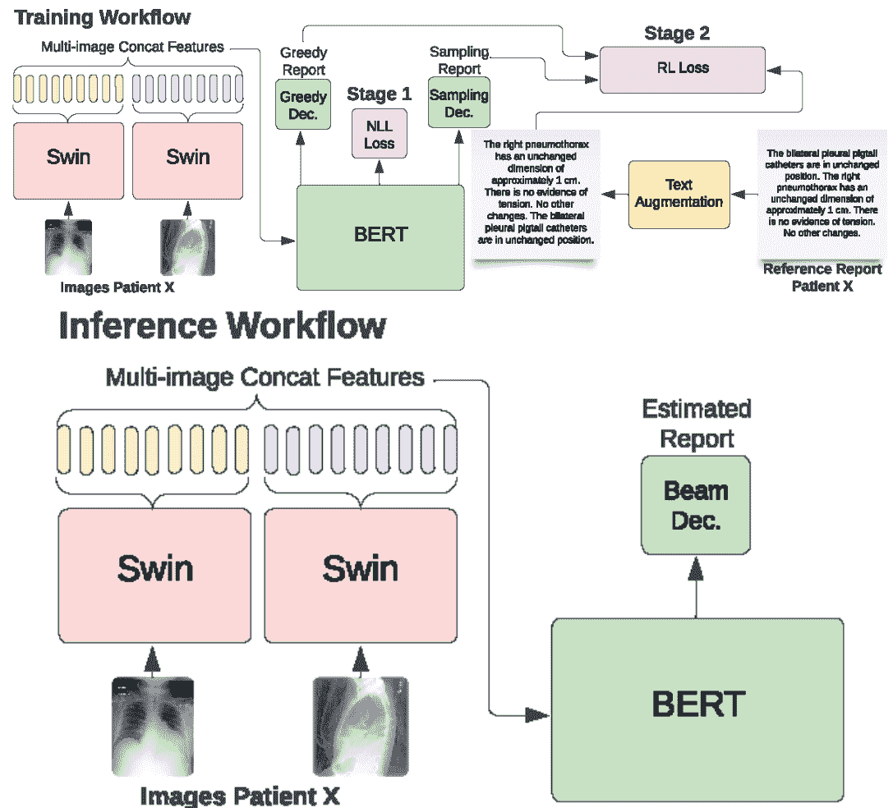

图 1. 使用 RL 和 TA 提高报告质量的训练工作流程。在初始阶段，NLL 训练采用教师强制。随后，在 RL 训练期间，SCST 算法利用来自两种不同解码策略（贪婪搜索和光束搜索多项式采样）的两个不同报告来计算奖励。在两个阶段中，对验证集和测试集的推理均使用光束搜索进行。

#### 2.4. 数据集和指标

为了评估我们模型的竞争力，我们使用了两个公开可用的数据集：MIMIC-CXR [43] 和 Open-i [44]。由于 Open-i 数据集规模相对较小，包含 3.3k 份报告，因此专用于测试。MIMIC-CXR 数据集包含 152k 份报告用于训练，2.3k 份用于验证，2.3k 份用于测试。工作流程涉及使用 152k 份报告进行训练，根据验证集上的最佳性能保存模型权重，最后使用这些权重对 MIMIC-CXR 和 Open-i 测试集进行推理。需要注意的是，在本研究中，模型专门设计用于生成报告的发现部分。此外，发现部分为空的样本被排除在考虑之外。

指标在比较模型中起着至关重要的作用，BLEU4 [45] 和 ROUGE-L [46] 目前被认为是用于报告的最广泛使用的面向自然语言生成（NLG）的指标。此外，还使用了两种专门针对胸部 RRG 设计的用于评估放射学报告质量的指标：F1CheXbert (F1cXb) [47] 和 F1RGER [12,14]。这些指标利用神经网络评估生成报告的质量，提供更高层次的语义评估。F1cXb 使用 CheXbert，这是一种能够在假设报告中识别 14 种 CheXpert [48] 病变（肺不张、心脏肥大、实变、水肿、心纵隔增大、骨折、肺病灶、肺密度增高、胸腔积液、肺炎、气胸、胸膜其他、支撑装置和无病变）的变压器模型，并根据参考报告中存在的病变计算 F1 分数。另一方面，F1RGER 使用变压器模型分析报告，为实体和关系生成图。它评估假设图和参考图中实体和关系结构之间的比较，以计算 F1 分数。

### 3. 结果

本节详细介绍了为开发胸部 RRG 模型所进行的实验。我们分析了拟议的架构，然后对有效的训练技术和策略进行了消融研究。最后，通过与最先进的模型进行比较来评估我们提案的竞争力。所有实验均使用配备 NVIDIA RTX 4090 GPU 的计算机进行。

#### 3.1. 我们架构的分析

本研究提出了四个 VED 模型，主要根据每个组件中的可训练参数数量进行区分。表 1 说明 SwinB+BERT30k 是最大的模型，而 SwinS+BERT9k 是最小的模型。其余两个模型处于相似的参数范围内。比较架构大小很有趣，因为由于医学报告的高度可变性和稀缺性，RRG 任务在数据有限的环境下运行。因此，训练参数数量较多的模型可能变得难以高效调优。参数数量，连同数据集的性质和大小，是有效学习以避免欠拟合和过拟合的关键因素。此外，表 1 中呈现的结果鼓励分析架构的哪些组件对于获得有意义的报告可能更为关键。

除了参数数量之外，表 1 还展示了 BLEU4、ROUGE-L、F1cXb 和 F1RGER 指标。这些指标是在所有四个模型中遵循相同的工作流程和超参数下获得的。在第一阶段（涉及 NLL 训练）中，我们以 3 × 10−4 的学习率进行 12 个时代的训练。随后，在第二阶段，对应于 RL 训练，我们以一个学习


5 × 10⁻⁵ 的速率。该学习率值至关重要，因为它允许基于先前训练改进结果的良好起点。学习率值已通过网格搜索进行经验探讨，用于第一和第二训练阶段的学习率值分别为 5 × 10⁻³、3 × 10⁻³、1 × 10⁻³、5 × 10⁻⁴、3 × 10⁻⁴、1 × 10⁻⁴、5 × 10⁻⁵、3 × 10⁻⁵、1 × 10⁻⁵、5 × 10⁻⁶、3 × 10⁻⁶ 和 1 × 10⁻⁶。RL 训练中高于 5 × 10⁻⁵ 的值会导致高度重复的报告，而低于该值的结果仅边际改善，无法实现与 NLL 训练相比显著更好的结果。第一和第二阶段的训练时代分别设置为 12 和 15，已被证明足以达到满意结果。由于任务的数据稀缺性和变异性，增加时代不会显著提高报告质量。在两个阶段中，学习率均线性降低，直到在时代结束时达到零。表 1 中展示的结果未使用图像数据增强、硬负例挖掘（HNM）或文本增强。

表 1. 在 MIMIC-CXR 和 Open-i 测试集上使用四种报告质量指标、每个时代的 RL 训练小时数以及参数数量进行架构对比。指标值以百分比（%）提供。粗体表示每个指标获得的最佳结果。

| 模型 | F1_CXB | F1_RG_ER | BLEU4 | ROUGE-L | 小时/时代 | 参数量 |
|---|---|---|---|---|---|---|
| MIMIC-CXR | | | | | | |
| SwinS+BERT9k RL | 61.1 | 34.9 | 11.5 | 25.9 | 12 | 109 M |
| SwinS+BERT30k RL | 61.4 | 34.3 | 11.3 | 25.2 | 24 | 130 M |
| SwinB+BERT9k RL | 63.1 | 35.4 | 11.7 | 26.5 | 14 | 147 M |
| SwinB+BERT30k RL | 62.9 | 35.1 | 11.6 | 26.5 | 30 | 168 M |
| Open-i | | | | | | |
| SwinS+BERT9k RL | 52.8 | 44.5 | 14.8 | 33.7 | - | 109 M |
| SwinS+BERT30k RL | 52.8 | 44.1 | 14.6 | 33.4 | - | 130 M |
| SwinB+BERT9k RL | 54.7 | 45.6 | 15.1 | 34.3 | - | 147 M |
| SwinB+BERT30k RL | 54.4 | 45.3 | 14.9 | 34.1 | - | 168 M |

关于 MIMIC-CXR 的报告指标，SwinB+BERT9k 模型脱颖而出，与其最接近的对照模型 SwinB+BERT30k 相比表现更出色，并且每个时代的训练时间缩短了 16 小时。对于 SwinS 模型，结果显示出相似性，尽管 BERT9k 变体在除 F1_CXB 之外的所有参数上均表现出边际更好的指标。有趣的是，两个 SwinS 和 SwinB 模型之间的 F1_CXB 几乎相同，表明编码器的大小对该指标的竞争力有直接影响。相反，选择基于词或基于子词的解码器确实会影响 BLEU4、ROUGE-L 和 F1_RG_ER 等指标。此外，采用基于词的模型可产生更好的指标并显著缩短训练时间，从而提高整体效率。Open-i 的结果也将 SwinB+BERT9k 模型评为最具竞争力，SwinS+BERT30k 评为竞争力最弱。这再次证实，基于词的模型在胸部 RRG 任务中能产生更好的结果。此外，SwinS 模型通过获得放射影像的最佳表示，展示了在报告生成方面的卓越能力。

基于分析结果，SwinB+BERT9k 成为胸部 RRG 中最具竞争力且高效的模型。然而，在数据受限的环境（如胸部 RRG）中，各种策略可能至关重要。本研究特别提出使用 TA 来利用报告并显著增加训练数据。然而，采用轻微旋转、缩放变化、平移、随机裁剪以及亮度和对比度调整等图像增强技术有助于充分利用图像数量。此外，由于大多数数据集通常包含比其他数据集更具挑战性的样本，HNM 是一个值得考虑的选项。在训练期间，误差大于平均误差加上其标准差的样本会在进入下一个时代之前被重新利用。

表 2. 我们最佳模型在 MIMIC-CXR 测试集上的消融研究。指标值以百分比（%）提供。粗体表示每个指标获得的最佳结果。

| 模型 | F1_CXB | F1_RG_ER | BLEU4 | ROUGE-L |
|---|---|---|---|---|
| SwinB+BERT9k NLL | 52.3 | 22.4 | 10.1 | 20.5 |
| + RL | 63.1 | 35.4 | 11.7 | 26.5 |
| + 图像增强 | 63.3 | 35.7 | 11.9 | 26.6 |
| + 硬负例挖掘 | 64.2 | 35.8 | 12.0 | 26.8 |
| + 文本增强 | 66.2 | 37.8 | 13.2 | 27.1 |

#### 3.2. 与最新技术对比

为评估我们顶级模型与其他最先进模型的竞争力，我们选取了在 MIMIC-CXR 和 Open-i 数据集上均取得最具竞争力结果的方案，详情如表 3 所示。表格分为两个部分：使用 NLL 训练的模型和使用 RL 训练的模型，并在表 2 所示的相同指标上进行对比。针对使用 RL 训练的模型优化的指标以括号标注。我们采用的基准模型是 SwinB+BERT9k，其使用 RL 和 TA，如表 2 所示。

结果强调了使用 RL 进行训练的重要性，因为使用 NLL 训练的模型表现较差。在 MIMIC-CXR 的 NLL 模型中，可以看到 Nicolson 等人 [32] 的方案获得最高 BLEU4 分数，并在 ROUGE-L 方面排名第二。Pan 等人 [29] 的方案获得最高 ROUGE-L 值。关于胸部 RRG 指标，由于其新颖性，并非所有方案都有注册值，因为图像标题指标（如 BLEU4 或 ROUGE-L）通常被使用。我们的方案获得了最高 F1_CXB 值，其次是 Delbrouck 等人 [12] 的模型；F1_RG_ER 值也观察到了这一趋势。与 Open-i 数据集的 NLL 模型相比，Miura 等人 [11] 获得了最高 BLEU4 分数，而 Chen 等人 [10] 获得了最高 ROUGE-L 分数。与 MIMIC-CXR 类似，在面向胸部 RRG 的指标中，我们的模型获得最高值，其次是 Delbrouck 等人 [12]。

表 3 还展示了使用 RL 训练的方法的结果。RL 奖励中使用的指标以括号标注。在 MIMIC-CXR 数据集中，显然 Miura 等人 [11] 报告的 BLEU4 分数在与使用 NLL 训练的模型相比时，两个模型均有所下降。然而，它仍能提升 F1_CXB 分数。关于 Delbrouck 等人 [12] 的模型，BLEU4 和 ROUGE-L 提升了约 1 分，其模型在 F1_CXB 和 F1_RG_ER 方面分别以 62.2 和 34.7 的分数获得第二佳成绩。同时，我们的 SwinB+BERT9k 模型在所有指标上均超越所有 RL 模型，展现出更优的质量、事实正确性和完整性。在 Open-i 数据集的情况下，也观察到类似趋势，与 Delbrouck 等人 [12] 相比，我们的模型在 F1_CXB 和 F1_RG_ER 方面分别高出约 9 分和 6 分。在此数据库中获得的良好结果展示了我们训练工作流对胸部 RRG 任务的泛化和适应能力。

在分析表 3 的结果后，很明显，比较 RRG 系统的常规方法依赖于图像标题指标（如 BLEU4 和 ROUGE-L）。因此，所有方案在其原始工作中都依赖面向自然语言生成的指标；然而，由于这些指标的新颖性，大多数方案缺乏面向胸部 RRG 的指标值。


尽管如此，面向NLG的指标在临床环境中可能缺乏精确度，因为它们无法衡量句法、语义或对报告含义的理解。因此，针对RRG任务定制的指标，如F1cXb和F1RG_ER，应运而生，用于评估报告中病理的存在、缺失或不确定性及其关系。这些面向胸部RRG的指标比面向NLG的指标能提供更准确的报告质量评估。例如，尽管Delbrouck等人 [12]与我们在MIMIC-CXR上的方法在BLEU4分数上差异极小，但使用面向胸部RRG的指标衡量时却观察到显著差距。面向NLG的指标在评估报告质量时的不精确性的另一个例子可见于Miura等人 [11]在MIMIC-CXR上训练的NLL和RL模型之间近乎相同的BLEU4分数，但F1cXb却存在12个点的差异。面向NLG的指标的高值并不能反映报告的质量，因为BLEU4和ROUGE-L都无法衡量所提及的病理是存在、缺失还是不确定。

表3. 我们的模型SwinB+BERT9k与MIMIC-CXR测试集和Open-i数据集上胸部RRG的顶尖最新模型的比较。指标值以(%)提供。粗体字表示每个指标获得的最佳结果。

| 最新技术 | 面向胸部RRG的F1cXb | 面向胸部RRG的F1RG_ER | 面向NLG的BLEU4 | 面向NLG的ROUGE-L |
|---|---|---|---|---|
| **MIMIC-CXR：NLL模型** | | | | |
| Yang等人 [28] | - | - | 11.5 | 28.4 |
| Pan等人 [29] | - | - | 11.2 | 28.8 |
| Yang等人 [30] | - | - | 11.1 | 27.4 |
| Zhao等人 [31] | - | - | 10.9 | 27.5 |
| Nicolson等人 [32] | - | - | 12.7 | 28.6 |
| Liu等人 [5] | 29.2 | - | 7.6 | - |
| Chen等人 [9] | 34.6 | - | 8.6 | 27.7 |
| Miura等人 [11] | 44.7 | - | 11.5 | - |
| Chen等人 [10] | 40.5 | - | 10.6 | 27.8 |
| Delbrouck等人 [12] | 44.8 | 20.2 | 10.5 | 25.3 |
| **我们的：NLL阶段** | **57.8** | **27.1** | 10.3 | 22.8 |
| **MIMIC-CXR：RL模型** | | | | |
| Miura等人 [11] (BERTscr+fact_ENT) | 56.7 | - | 11.1 | - |
| Miura等人 [11] (BERTscr+fact_ENTNLI) | 56.7 | - | 11.4 | - |
| Delbrouck等人 [12] (BERTscr+F1 RG_ER) | 62.2 | 34.7 | 11.4 | 26.5 |
| **我们的：RL阶段 (BERTscr+F1 RG_ER)** | **66.2** | **37.8** | **13.2** | **27.1** |
| **Open-i：NLL模型** | | | | |
| Miura等人 [11] | 32.2 | - | **12.1** | 28.8 |
| Chen等人 [10] | - | - | 12.0 | **29.8** |
| Alfarghaly等人 [26] | - | - | 11.1 | 28.9 |
| Donahue等人 [49] | - | - | 9.9 | 27.8 |
| Delbrouck等人 [12] | 33.1 | 26.4 | 11.4 | - |
| **我们的：NLL阶段** | 46.6 | **34.5** | 11.2 | 23.4 |
| **Open-i：RL模型** | | | | |
| Miura等人 [11] (BERTscr+fact_ENT) | 48.3 | - | 12.0 | - |
| Miura等人 [11] (BERTscr+fact_ENTNLI) | 47.8 | - | 13.1 | - |
| Delbrouck等人 [12] (BERTscr+F1 RG_ER) | 49.1 | 41.2 | 13.9 | 32.7 |
| **我们的：RL阶段 (BERTscr+F1 RG_ER)** | 54.7 | 45.6 | **15.1** | **34.3** |

### 4. 讨论

本研究介绍了一种高效的工作流，用于训练专门为胸部RRG设计的VED模型。该工作流在面向胸部RRG的指标上展现出卓越性能。一个关键发现在于我们对所提架构的分析，其中我们表明使用SwinB编码器能产生更优秀的X光片表征。值得注意的是，基于词的方法在解码器组件中比基于子词的方法更具竞争力。这一发现与当前大型语言模型（LLM）中常用的策略形成对比。然而，这种差异可以归因于胸部RRG任务中数据的固有变异性和稀缺性。此外，我们的消融研究强调了TA在有效利用数据执行此任务中的关键作用，与图像增强或HNM等策略相比，在指标上实现了显著改进。

RRG建议中普遍存在的一个问题是，其他最新方法生成的报告中经常出现高度重复和单调。通常，模型倾向于收敛到局部最小值，为大多数患者生成几乎相同的标准化报告。这种现象源于深度学习算法在一个中点上稳定，此时生成的报告广泛适用于大多数情况。这些报告遵循一个模板，以固定顺序和句法结构命名常见病理，而不考虑患者。因此，这种模式导致质量可疑的报告，常常忽略较少见的病理，从而削弱诊断模型的可靠性。

鉴于最新模型生成报告中存在高度重复和单调，我们提出使用N-gram在MIMIC-CXR测试集上分析报告多样性。该分析通过检查生成报告中存在的唯一N-gram数量来衡量多样性，如图2所示。具体地，我们将我们的模型生成的报告与Delbrouck等人 [12]所提出的方法生成的报告进行比较，该方法被公认为该领域最具竞争力的建议，如表3所述。图示与Delbrouck等人 [12]模型生成的报告相比，我们的生成报告具有显著更高的多样性。此外，我们的模型实现的多样性差异平均值约为其模型的近三倍。

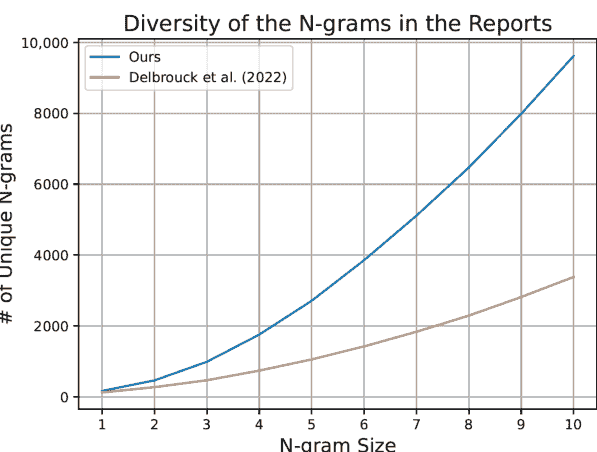

**图2.** 该图展示了使用MIMIC-CXR测试集生成报告中N-gram的多样性，涵盖了Delbrouck等人 [12]的建议和我们的方法。

因此，TA策略大幅增加了训练用报告的数量，并显著提升了VED模型的性能，正如面向胸部RRG的指标所显示的。我们TA-based方法的另一个质量优势在于其能够生成比以往方法更少重复、更多样的报告。我们通过表4中的SwinB+BERT9k报告示例及其对应的RadGraph实体来说明这一点。ANAT-DP表示报告中提到的解剖部位，而OBS表示与放射图像相关的观察，分类为确定存在（OBS-DP）、确定缺失（OBS-DA）或不确定（OBS-U）。尽管使用TA等技术改进了报告质量，特定的重复和单调依然存在。今后需要使用新的指标和策略来解决这个问题。

表4. 我们的使用RL和TA训练的SwinB+BERT9k模型生成的报告与MIMIC-CXR测试集上的参考报告的比较。第一个和第三个案例涉及一名其研究包含两幅图像的患者，而第二个涉及单幅图像。

| 图像 | 假设报告 | 参考报告 |
|---|---|---|
| **输入图像数 = 2**   | **F1**<sub>_RG_</sub>**ER** 63.6 % 心脏 ANAT-DP 轮廓 ANAT-DP 中度 OBS-DP 增大 OBS-DP 中度 OBS-DP 心脏增大 OBS-DP 与之前的放射照片相比未变 OBS-DP 。小量 OBS-DP 左侧 ANAT-DP 胸膜 ANAT-DP 积液 OBS-DP 存在 。存在轻度 OBS-DP 肺 ANAT-DP 水肿 OBS-DP 。右侧 ANAT-DP 下叶 ANAT-DP 可见增多的 OBS-DP 阴影 OBS-DP 。右侧 ANAT-DP 肺 ANAT-DP 可见轻度 OBS-DP 肺不张 OBS-DP 。无气胸 OBS-DA 。 | 与 ___ 相比，间期恶化 OBS-DP 中度 OBS-DP 肺 ANAT-DP 水肿 OBS-DP ，右侧 ANAT-DP 中度 OBS-DP 胸膜 ANAT-DP 漏液 OBS-DP 也略 OBS-DP 增加 OBS-DP 。小量 OBS-DP 左侧 ANAT-DP 漏液 OBS-DP 持续存在 。左侧 ANAT-DP 下叶 ANAT-DP 实质 ANAT-DP 阴影 OBS-DP 在上段 ANAT-DP 现在被 OBS-DP 增加的 OBS-DP 肺 ANAT-DP 水肿 OBS-DP 遮盖 OBS-DP 。中度 OBS-DP 心脏增大 OBS-DP ，无气胸 OBS-DA 。 |
| **输入图像数 = 1**  | **F1**<sub>_RG_</sub>**ER** 43.2 % 肺 ANAT-DP 容积 ANAT-DP 低 OBS-DP 。双肺 ANAT-DP 清晰 OBS-DP 。心脏纵隔 ANAT-DP 轮廓 ANAT-DP 正常 OBS-DP 。可见一根右侧 ANAT-DP 中央 ANAT-DP 静脉 ANAT-DP 导管 OBS-DP，导管尖端 OBS-DP 位于右侧 ANAT-DP 心房 ANAT-DP 。无局灶 OBS-DA 实变 OBS-DA、胸膜 ANAT-DP 漏液 OBS-DA 或气胸 OBS-DA 。心脏 ANAT-DP 大小 ANAT-DP 正常 OBS-DP 。 | 与最近的胸部X光片相比，已间歇放置一根右侧 ANAT-DP IJ ANAT-DP 中央 ANAT-DP 静脉 ANAT-DP 导管 OBS-DP，导管尖端投影于右侧 ANAT-DP 心房 ANAT-DP 上方。无气胸 OBS-DA 。双肺 ANAT-DP 清晰 OBS-DP 。右侧 ANAT-DP 半膈肌 ANAT-DP 持续抬高 OBS-DP 。右侧 ANAT-DP 上纵隔 ANAT-DP 上有不透X线 OBS-DP 透亮区 OBS-DP。 |
| **输入图像数 = 2**   | **F1**<sub>_RG_</sub>**ER** 27.6 % 肺 ANAT-DP 清晰 OBS-DP 。心脏纵隔 ANAT-DP 轮廓 ANAT-DP 正常 OBS-DP 。无局灶 OBS-DA 实变 OBS-DA、胸膜 ANAT-DP 漏液 OBS-DA 或气胸 OBS-DA 。心脏 ANAT-DP 大小 ANAT-DP 正常 OBS-DP 。纵隔 ANAT-DP 和门周 ANAT-DP 轮廓 ANAT-DP | 心脏 ANAT-DP 大小 ANAT-DP 正常 OBS-DP 。肺野 ANAT-DP 清晰 OBS-DP 。上纵隔 ANAT-DP 略 OBS-DP 扩宽 OBS-DP，但这可能是投射性 OBS-DP 的。患者轻度 OBS-DP 旋转 OBS-DP。建议四到六周后复查胶片以持续观察该区域。由于不同程度的旋转 OBS-DP，与先前检查 ___ 的比较较为困难 。 |

除了本任务固有的复杂性之外，专注于医学文本生成需要基于NLP模型分析和提出额外的面向胸部RRG的指标。探索评估参考报告与估计报告之间的新方法，可以促进对最新模型进行更全面的评估。本研究表明，F1cXb在验证生成的报告是否讨论病理方面很有用。


参考报告中存在的gies。此外，F1RG_ER 确保报告中存在、缺失和未知的病理状况得到正确关联。考虑到这些发现，这两个指标对于模型比较至关重要。虽然这些指标能有效高效地增强 RL 训练，但模型经常生成句子不完整的报告。这种缺陷在众多最先进的方案中很明显，尽管 TA 有效，但偶尔仍会发生。这种情况在表 4 中第三份报告的末尾有所体现。这种现象源于模型学习到特定句法结构可以有利于以胸部 RRG 为导向的指标（如 F1RG_ER），即使这些结构并不构成语法正确的句子。展望未来，我们主张进一步研究基于替代深度学习算法的新型指标，例如像 GPT-4 [50] 或 LLaMA [51] 这样的 LLM 模型。

针对现实世界 RRG 场景的所提方法的若干方面值得关注，包括多语言支持、报告标准化以及图像存档与通信系统（PACS）的改进。由于解码器模型主要使用英文单词运行，因此在其他语言中使用时会遇到特定困难。因此，有必要移除解码器模型的最后一层，并根据所需语言进行调整；然而，模型的其余部分保持与语言无关。另一个挑战在于不同机构在报告撰写方面缺乏标准化，导致报告指南存在差异。因此，RRG 模型可以帮助整合新的报告指南，以标准化和统一 RRG 数据库。此外，我们的方法可以增强 PACS，PACS 在医疗保健中常用于安全存储和传输电子图像和临床报告。与专家放射科医生合作，我们可以整合 RRG 模型以简化 PACS 内的流程，例如准备放射科医生可交互式纠正的自动草稿报告。这种方法可以提高诊断效率和专家协助时间，同时增强报告的标准化和同质化。

使用不同指标已凸显我们模型的优势和劣势。然而，另一个需要分析的重要方面是将所提工作流集成到临床环境中。鉴于系统依赖于 VED 深度学习模型，其部署只需要一台配备至少 12 GB 显存 GPU 的计算机。该模型专门用于不同位置视角的胸部 X 光片，例如前后位、侧位、后前位和侧卧位。因此，它可以整合和分析各种胸部 X 光片。

本工作的范围专注于胸部 X 光片。然而，我们的方法并不仅限于其在胸部 X 光片中的应用。所提方法具有灵活性和独立性，可应用于其他放射学场景。因此，我们的方法可以无缝适应不同身体部位的 X 光片。唯一需要修改的方面是 RL 训练期间的奖励优化。由于 F1RG_ER 主要专注于胸部相关病理，此指标应替换为与我们方法预期应用的放射学场景相关的另一指标。其余组件，如编码器、解码器、TA 和解码策略，与放射学场景无关。尽管该方法具有灵活性和独立性，但应用于其他放射学场景的主要限制取决于训练数据的可用性。获取大型数据集来训练 VED 模型对于提高报告质量和增强其在不同场景中的适用性至关重要。

### 5. 结论

由于数据可用性有限以及医疗报告的多样性和病理表达的差异，胸部 RRG 面临挑战。分析了四个基于 Transformer 的模型，突出了编码器作为关键组件，SwinB 是最佳选择。这种 Transformer 编码器在 RRG 中之前未被探索过。关于解码器，基于词的方法训练速度更快，并比基于子词的方法获得更具竞争力的结果。

引入了图像数据增强、硬负样本挖掘和 TA 等技术。研究表明，TA 是一种有效的方法，可以提高泛化能力以及生成报告的质量（涵盖多样性、质量、事实正确性和完整性），从而得到一个性能优于最先进技术的模型。此外，这种方法为基于更复杂 NLP 技术（例如 LLM 模型）的增强而开发的新 TA 方法铺平了道路。

此外，面向 NLG 的指标可能并非衡量报告质量的最佳选择，因为它们比较句子和单词时未考虑语义意义或相同诊断的替代表达。因此，基于专门用于胸部放射学报告的 NLP 模型的指标（如 F1cXb 和 F1RG_ER）在评估报告质量方面似乎至关重要。

### 作者贡献
调查，D.P.；方法论，D.P.；软件，D.P.；监督，A.A. 和 R.P.；写作—原稿，D.P.；写作—审阅和编辑，A.A. 和 R.P. 所有作者均已阅读并同意稿件的出版版本。

### 资助
该工作部分得到瓦伦西亚自治区通过博士前资助 CIACIF/2022/289 的支持，并得到 valgrAI—瓦伦西亚研究生院和人工智能研究网络及瓦伦西亚自治区的支持，并由欧洲联盟共同资助。

### 机构审查委员会声明
不适用。

### 知情同意声明
不适用。

### 数据可用性声明
本研究中使用的数据是公开可用的。

### 利益冲突
作者声明不存在利益冲突。

### References

- 1. Zhao, J.; Lv, Y.; Zeng, Q.; Wan, L. 基于在线策略学习的连续时间系统输出反馈最优控制. IEEE Trans. Circuits Syst. II Express Briefs 2024, 71, 652–656. [CrossRef]
- 2. Gale, W.; Oakden-Rayner, L.; Carneiro, G.; Bradley, A.P.; Palmer, L.J. 生成放射科医生质量的报告以实现可解释的人工智能. arXiv 2018, arXiv:1806.00340.
- 3. Li, Y.; Liang, X.; Hu, Z.; Xing, E.P. 医学图像报告生成的混合检索-生成强化代理. 在《神经信息处理系统进展》会议论文集中，蒙特利尔，BC，加拿大，2018年12月3–8日；第 1530–1540 页。
- 4. Wang, X.; Peng, Y.; Lu, L.; Lu, Z.; Summers, R.M. TieNet：用于胸部 X 光片中常见胸部疾病分类和报告的文本-图像嵌入网络. 在《IEEE 计算机视觉和模式识别会议论文集》中，盐湖城，UT，美国，2018年6月18–23日；第 9049–9058 页。
- 5. Liu, G.; Hsu, T.M.H.; McDermott, M.; Boag, W.; Weng, W.H.; Szolovits, P.; Ghassemi, M. 临床准确的胸部 X 光片报告生成. 在《第 4 届机器学习医疗保健会议论文集》中，安阿伯，MI，美国，2019年8月9–10日；第 249–269 页。
- 6. Liu, F.; Wu, X.; Ge, S.; Fan, W.; Zou, Y. 探索和提取放射学报告生成中的后验知识与先验知识. 在《IEEE/CVF 计算机视觉和模式识别会议论文集》中，纳什维尔，TN，美国，2021年6月20–25日；第 13753–13762 页。
- 7. Liu, F.; You, C.; Wu, X.; Ge, S.; Wang, S.; Sun, X. 用于无监督医学报告生成的自动编码知识图. 在《神经信息处理系统进展论文集》中，在线，2021年12月6–14日；第 16266–16279 页。
- 8. Windsor, R.; Jamaludin, A.; Kadir, T.; Zisserman, A. 低数据模式下放射学成像与报告的视觉-语言建模. 在《医学影像深度学习会议论文集》中，纳什维尔，TN，美国，2023年7月10日；第 53–73 页。
- 9. Chen, Z.; Song, Y.; Chang, T.H.; Wan, X. 基于记忆驱动 Transformer 生成放射学报告. arXiv 2020, arXiv:2010.16056.
- 10. Chen, Z.; Shen, Y.; Song, Y.; Wan, X. 用于放射学报告生成的跨模态记忆网络. arXiv 2022, arXiv:2204.13258.
- 11. Miura, Y.; Zhang, Y.; Tsai, E.B.; Langlotz, C.P.; Jurafsky, D. 提高图像到文本放射学报告生成的事实完整性和一致性. arXiv 2021, arXiv:2010.10042.
- 12. Delbrouck, J.B.; Chambon, P.; Bluethgen, C.; Tsai, E.; Almisa, O.; Langlotz, C.P. 基于语义奖励提高放射学报告生成的事实正确性. arXiv 2022, arXiv:2210.12186.
- 13. Zhang, T.; Kishore, V.; Wu, F.; Weinberger, K.Q.; Artzi, Y. BERTScore：使用 BERT 评估文本生成. arXiv 2020, arXiv:1904.09675.
- 14. Jain, S.; Agrawal, A.; Saporta, A.; Truong, S.Q.; Duong, D.N.; Bui, T.; Chambon, P.; Zhang, Y.; Lungren, M.P.; Ng, A.Y.; 等. RadGraph：从放射学报告中提取临床实体和关系. arXiv 2021, arXiv:2106.14463.
- 15. Schlegl, T.; Waldstein, S.M.; Vogl, W.D.; Schmidt-Erfurth, U.; Langs, G. 使用卷积神经网络从医学图像中预测语义描述. 在《医学影像信息处理会议论文集》中，英国斯凯岛，2015年6月28日–7月3日；第 437–448 页。


- 16. Shin, H.C.; Roberts, K.; Lu, L.; Demner-Fushman, D.; Yao, J.; Summers, R.M. 学习读取胸部 X 光片：用于自动图像标注的循环神经级联模型。载于 IEEE 计算机视觉与模式识别会议论文集，美国内华达州拉斯维加斯，2016 年 6 月 27–30 日；第 2497–2506 页。
- 17. Moradi, M.; Madani, A.; Gur, Y.; Guo, Y.; Syeda-Mahmood, T. 用于从文本自动生成图像标注的双模网络架构。载于医学影像计算与计算机辅助干预会议论文集，西班牙格拉纳达，2018 年 9 月 16 日；第 449–456 页。
- 18. Rubin, J.; Sanghavi, D.; Zhao, C.; Lee, K.; Qadir, A.; Xu-Wilson, M. 使用双卷积神经网络对正位和侧位胸部 X 光片进行大规模自动读取。arXiv 2018, arXiv:1804.07839.
- 19. Jing, B.; Xie, P.; Xing, E. 关于医学影像报告自动生成。载于计算语言学协会第 56 届年会论文集，澳大利亚墨尔本，2018 年 7 月 15–20 日；第 2577–2586 页。
- 20. Monshi, M.M.A.; Poon, J.; Chung, V. 放射学报告生成中的深度学习：一项综述。Artif. Intell. Med. 2020, 106, 101878. [CrossRef]
- 21. Krizhevsky, A.; Sutskever, I.; Hinton, G.E. 带有深度卷积神经网络的 ImageNet 分类。载于神经信息处理系统进展会议论文集，美国内华达州塔霍湖，2012 年 12 月 3–6 日；第 25 卷，第 1097–1105 页。
- 22. Simonyan, K.; Zisserman, A. 用于大规模图像识别的非常深的卷积网络。arXiv 2014, arXiv:1409.1556.
- 23. Szegedy, C.; Liu, W.; Jia, Y.; Sermanet, P.; Reed, S.; Anguelov, D.; Erhan, D.; Vanhoucke, V.; Rabinovich, A. 带卷积的更深网络。载于 IEEE 计算机视觉与模式识别会议论文集，美国马萨诸塞州波士顿，2015 年 6 月 7–12 日；第 1–9 页。
- 24. He, K.; Zhang, X.; Ren, S.; Sun, J. 图像识别的深度残差学习。载于 IEEE 计算机视觉与模式识别会议论文集，美国内华达州拉斯维加斯，2016 年 6 月 27–30 日；第 770–778 页。
- 25. Liao, Y.; Liu, H.; Spasic, I. 自动放射学报告生成的深度学习方法：一项系统综述。Inform. Med. Unlocked 2023, 39, 101273. [CrossRef]
- 26. Alfarghaly, O.; Khaled, R.; Elkorany, A.; Helal, M.; Fahmy, A. 使用条件变换器进行自动放射学报告生成。Inform. Med. Unlocked 2021, 24, 100557. [CrossRef]
- 27. Sanh, V.; Debut, L.; Chaumond, J.; Wolf, T. DistilBERT，BERT 的蒸馏版本：更小、更快、更便宜、更轻量。arXiv 2019, arXiv:1910.01108.
- 28. Yang, S.; Wu, X.; Ge, S.; Zhou, S.K.; Xiao, L. 知识很重要：带有通用和特定知识的胸部放射学报告生成。Med. Image Anal. 2022, 80, 102510. [CrossRef] [PubMed]
- 29. Pan, Y.; Liu, L.J.; Yang, X.B.; Peng, W.; Huang, Q.S. 基于跨模态多尺度特征融合的胸部放射学报告生成。J. Radiat. Res. Appl. Sci. 2024, 17, 100823. [CrossRef]
- 30. Yang, S.; Wu, X.; Ge, S.; Zheng, Z.; Zhou, S.K.; Xiao, L. 带有学习知识库和多模式对齐的放射学报告生成。Med. Image Anal. 2023, 86, 102798. [CrossRef] [PubMed]
- 31. Zhao, G.; Zhao, Z.; Gong, W.; Li, F. 带有医学知识和多层次图像-报告对齐的放射学报告生成：一种新方法及其验证。Artif. Intell. Med. 2023, 146, 102714. [CrossRef] [PubMed]
- 32. Nicolson, A.; Dowling, J.; Koopman, B. 通过利用热启动改进胸部 X 光片报告生成。Artif. Intell. Med. 2023, 144, 102633. [CrossRef]
- 33. Radford, A.; Wu, J.; Child, R.; Luan, D.; Amodei, D.; Sutskever, I. 语言模型是无监督多任务学习者。OpenAI 博客 2019, 1, 9.
- 34. Devlin, J.; Chang, M.W.; Lee, K.; Toutanova, K. BERT：用于语言理解的深度双向变换器预训练。arXiv 2019, arXiv:1810.04805.
- 35. Irvin, J.; Rajpurkar, P.; Ko, M.; Yu, Y.; Ciurea-Ilcus, S.; Chute, C.; Marklund, H.; Haghgoo, B.; Ball, R.; Shpanskaya, K.; 等. CheXpert：带有不确定性标签和专家比较的大型胸部 X 光片数据集。载于人工智能协会会议论文集，美国夏威夷州檀香山，2019 年 1 月 27 日–2 月 1 日；第 33 卷，第 590–597 页。
- 36. Huang, G.; Liu, Z.; van der Maaten, L.; Weinberger, K.Q. 密集连接卷积网络。载于 IEEE 计算机视觉与模式识别会议论文集，美国夏威夷州檀香山，2017 年 7 月 21–26 日；第 4700–4708 页。
- 37. Liu, Z.; Lin, Y.; Cao, Y.; Hu, H.; Wei, Y.; Zhang, Z.; Lin, S.; Guo, B. Swin Transformer：使用移位窗口的层次视觉变换器。载于 IEEE/CVF 国际计算机视觉会议论文集，加拿大不列颠哥伦比亚省蒙特利尔，2021 年 10 月 11–17 日；第 10012–10022 页。
- 38. Dosovitskiy, A.; Beyer, L.; Kolesnikov, A.; Weissenborn, D.; Zhai, X.; Unterthiner, T.; Dehghani, M.; Minderer, M.; Heigold, G.; Gelly, S.; 等. 一张图片抵得上 16x16 个词：大规模图像识别的变换器。arXiv 2020, arXiv:2010.11929.
- 39. Deng, J.; Dong, W.; Socher, R.; Li, L.J.; Li, K.; Fei-Fei, L. ImageNet：一个大规模分层图像数据库。载于 IEEE 计算机视觉与模式识别会议论文集，美国佛罗里达州迈阿密，2009 年 6 月 20–25 日；第 248–255 页。
- 40. Liu, Y.; Ott, M.; Goyal, N.; Du, J.; Joshi, M.; Chen, D.; Levy, O.; Lewis, M.; Zettlemoyer, L.; Stoyanov, V. RoBERTa：一种经过强健优化的 BERT 预训练方法。arXiv 2019, arXiv:1907.11692.
- 41. Lewis, M.; Liu, Y.; Goyal, N.; Ghazvininejad, M.; Mohamed, A.; Levy, O.; Stoyanov, V.; Zettlemoyer, L. BART：用于自然语言生成、翻译和理解的去噪序列到序列预训练。arXiv 2019, arXiv:1910.13461.
- 42. Rennie, S.J.; Marcheret, E.; Mroueh, Y.; Ross, J.; Goel, V. 图像字幕生成的自批判序列训练。载于 IEEE 计算机视觉与模式识别会议论文集，美国夏威夷州檀香山，2017 年 7 月 21–26 日；第 7008–7024 页。
- 43. Johnson, A.E.W.; Pollard, T.J.; Greenbaum, N.R.; Lungren, M.P.; Deng, C.Y.; Peng, Y.; Lu, Z.; Mark, R.G.; Berkowitz, S.J.; Horng, S. MIMIC-CXR-JPG，一个大型公开可用的标注胸部 X 光片数据库。arXiv 2019, arXiv:1901.07042.
- 44. Demner-Fushman, D.; Antani, S.; Simpson, M.; Thoma, G.R. 多模态生物医学信息检索系统的设计与开发。J. Comput. Sci. Eng. 2012, 6, 168–177. [CrossRef]
- 45. Papineni, K.; Roukos, S.; Ward, T.; Zhu, W.J. BLEU：一种用于机器翻译自动评估的方法。载于计算语言学协会第 40 届年会论文集，美国宾夕法尼亚州费城，2002 年 7 月 7–12 日；第 311–318 页。
- 46. Lin, C.Y. ROUGE：自动摘要评估包。载于文本摘要分支论文集，西班牙巴塞罗那，2004 年 7 月 4–10 日；第 74–81 页。
- 47. Zhang, Y.; Merck, D.; Tsai, E.B.; Manning, C.D.; Langlotz, C.P. 优化摘要的事实正确性：放射学报告摘要研究。arXiv 2020, arXiv:1911.02541.
- 48. Smit, A.; Jain, S.; Rajpurkar, P.; Pareek, A.; Ng, A.Y.; Lungren, M.P. CheXbert：使用 BERT 结合自动标注器和专家注释进行准确的放射学报告标记。arXiv 2020, arXiv:2004.09167.
- 49. Donahue, J.; Hendricks, L.A.; Rohrbach, M.; Venugopalan, S.; Guadarrama, S.; Saenko, K.; Darrell, T. 用于视觉识别和描述的长期循环卷积网络。IEEE Trans. Pattern Anal. Mach. Intell. 2017, 39, 677–691. [CrossRef]
- 50. OpenAI. GPT-4 技术报告。arXiv 2023, arXiv:2303.08774.
- 51. Touvron, H.; Lavril, T.; Izacard, G.; Martinet, X.; Lachaux, M.A.; Lacroix, T.; Rozière, B.; Goyal, N.; Hambro, E.; Azhar, F.; 等. LLaMA：开放且高效的基础语言模型。arXiv 2023, arXiv:2302.13971.

### 免责声明/出版者说明：

所有出版物中包含的声明、观点和数据仅由各个作者和撰稿人负责，与 MDPI 和/或编辑无关。MDPI 和/或编辑对因内容中提及的任何想法、方法、说明或产品而导致的人员或财产损害不承担任何责任。


## 基于集成技术的皮肤癌生存率预测优化

Erum Yousef Abbasi 1*, Zhongliang Deng 1, Arif Hussain Magsi 2, Qasim Ali 3, Kamlesh Kumar 4 和 Asma Zubedi 5

- 1 北京邮电大学无线网络定位与通信工程融合研究国家重点实验室，电子工程学院，北京 100876，中国；dengzhl@bupt.edu.cn
- 2 北京邮电大学网络与交换技术国家重点实验室，北京 100876，中国；ahmagsi@bupt.edu.cn
- 3 梅赫兰工程技术大学软件工程系，巴基斯坦贾姆舒罗 76062；qasim.arain@faculty.muet.edu.pk
- 4 北京邮电大学电子工程学院，北京 100876，中国；kamleshsoothar@gmail.com
- 5 北京邮电大学经济管理学院，北京 100876，中国；asmazubedi@bupt.edu.cn
- * 通讯作者：erumzubedi@bupt.edu.cn

Abstract: 利用高通量技术和人工智能（AI）开展癌症研究正在加速发展，以改善疾病诊断和靶向治疗。然而，高维度的复杂且不平衡数据对计算方法和多组学数据分析提出了重大挑战。本研究专注于皮肤癌预测及总生存概率分析。我们采用 Kaplan–Meier 估计器和 Cox 比例风险回归模型，利用基于高通量机器学习（ML）的集成方法。所提出的基于 ML 的集成技术应用于 ICGC 数据门户公开可用的数据集，专门针对皮肤黑色素瘤（SKCM）。我们使用了八种基准分类器，即随机森林（RF）、决策树（DT）、梯度提升（GB）、AdaBoost、高斯朴素贝叶斯（GNB）、极端随机树（ET）、逻辑回归（LR）和 Light 梯度提升机（Light GBM 或 LGBM）。该研究评估了所提集成方法在 SKCM 上的性能和生存分析。所提方法展示了有前景的结果，在准确率方面相较于传统方法优于其他算法和模型。具体而言，RF 分类器表现出了出色的精确率结果。此外，创建并训练了四种不同的集成方法（堆叠、袋装、提升和投票）以实现最佳结果。使用准确率、精确率、召回率、F1 分数、混淆矩阵和 ROC 曲线对性能进行了评估和解释，其中投票方法达到了 99% 的有前景的准确率。另一方面，RF 分类器达到了 99% 的出色准确率，表现出最佳性能。我们将所提研究与现有最先进的技术进行了比较，并在若干关键方面发现了显著改进。我们的方法不仅在准确率方面表现出优越的性能，还展示了显著的效率。因此，这项研究工作有助于以高准确率诊断 SKCM。

Keywords: 皮肤癌；黑色素瘤；机器学习；集成技术；特征选择

### 1. 引言

近年来，恶性疾病的激增已成为全球关键的健康问题。在这些恶性肿瘤中，皮肤黑色素瘤（SKCM）是最具侵略性的变种之一，需要进行深入的调查和理解 [1]。根据国际癌症研究署（IARC）报告，癌症是死亡的主要原因。报告显示，近 1000 万人死于各种类型的癌症 [2]。世界卫生组织（WHO）2023 年报告显示，癌症是第二大死亡原因（16%），其次是心血管疾病（27%）[3]。在这种情况下，疾病的早期诊断可以治愈并防止患者面临进一步的危险。一般来说，皮肤癌主要有两种形式：黑色素瘤（由黑色素细胞功能障碍引起的癌症）和非黑色素瘤皮肤癌（由表皮产生的细胞引起）[4]。在各种癌症类型中，SKCM 在过去十年中已成为最普遍的癌症之一 [5]，其肿瘤由黑色素细胞构成。它目前是全球主要的公共卫生问题，该病日益增长的患病率可能对世界人口和经济产生重大影响 [6]。然而，早期诊断和有效的肿瘤治疗使早期黑色素瘤患者的治愈率超过 90% [7]。导致皮肤癌数量增加的因素有几个。皮肤癌最常见的原因之一是紫外线（UV）照射 [8]。其他原因包括日晒、臭氧层破坏、遗传易感性等。

多项研究表明，SKCM 由转录和表观遗传因素异常引起，包括信使核糖核酸（mRNAs）和微核糖核酸（miRNAs）的表达、基因 CpG 岛甲基化模式的异常以及组蛋白修饰，这为黑色素瘤潜在分子生物标志物的发展打开了大门 [9,10]。作为皮肤黑色素瘤的预测指标，miRNA 表达在多项过去的研究中已被证实。

包括皮肤科在内的各个医疗领域已利用人工智能（AI），彻底改变了诊断和治疗过程。来自健康记录、医学影像、物联网传感器数据和文本的多样生物医学数据可用于预测 SKCM。具体来说，机器学习（ML）和深度学习（DL）在使用公开可用数据集预测疾病方面做出了重大贡献。最新的皮肤癌检测技术包括 AI 皮肤镜，它利用手持设备放大皮肤，使皮肤科医生能够详细检查痣和病变。ML 和 DL 算法需要用于分类的结构化数据，预测准确率较低，并且需要更多计算时间。由于相较于传统分析方法具有优势，AI 大大提升了医疗行业。AI 在医疗领域的应用正以越来越乐观的态度被采用，范围从加速新药研究到帮助医学诊断、治疗和行政支持。此外，将其作为临床决策的辅助工具可能有益 [11,12]。各种 ML 算法被用于在诊断疾病不同属性后预测不同疾病的早期阶段。这些疾病包括不同类型的癌症、糖尿病、肾脏疾病和其他疾病 [13]。具体来说，集成学习是一种结合多个基准模型以创建强大单一模型的学习方法。它降低了过拟合风险，并已在各个领域成功应用。常见的集成技术包括平均法、袋装、提升、堆叠和投票 [14]。传统集成学习在各个领域集成 ML 模型，但研究重点已转向 DL，专注于复杂模型并在各个领域集成它们 [15]。另一种最近的皮肤癌检测技术涉及反射共聚焦显微镜（RCM），这是一种非侵入性成像方法，可实现细胞水平的高分辨率皮肤成像。它帮助皮肤科医生可视化皮肤结构并识别异常细胞，无需活检程序。另一种最近的技术利用智能手机应用，其中移动应用使用智能手机摄像头进行皮肤自我检查。这些应用通常使用 AI 算法分析照片并提供风险评估。本研究的主要目标是利用 ML 算法提出四种集成方法来预测皮肤癌。我们在 ICGC 门户[16]上试验了五种转录组技术。在这项研究中，利用了三种特征——递归特征消除（RFE）、前向特征选择（FFE）和后向特征消除（BFE）——用于集成方法。本文讨论了基于使用转录组技术的 ML 算法的集成方法的五个阶段。


用于预测SKCM的数据。图1说明了我们综合研究的工作流程。图1（1）描绘了数据收集来源和5个不同的转录组技术数据集。图1（2）说明了预处理和分析步骤。我们使用MICE插补技术处理缺失数据，并应用三种方法进行最佳特征选择。图1（3）展示了我们研究的实验成果，使用不同的ML算法作为基准分类器来构建集成方法。使用Kaplan–Meier和Cox风险回归模型分析了总生存期。不同于现有文献中的传统方法，本研究利用各种ML技术来预测皮肤癌。这项工作的新颖之处在于其综合方法，将基于ML的高通量集成方法与多组学数据分析相结合，特别是解决高维复杂不平衡数据集带来的挑战。图1（4）显示了生物学解释和对比研究。

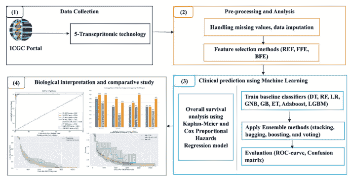

图1. 拟议研究的工作流程。

本研究的主要贡献如下：

- 我们评估了各种SKCM预测技术，考虑其在此背景下的适用性和有效性。
- 我们将RFE、FFE和BFE特征用于集成方法。
- 我们通过Kaplan–Meier估计器和Cox风险比例回归模型分析了总生存期（OS）分析和进展。
- 在此项研究工作中，我们使用了八种基准分类器，即随机森林（RF）、决策树（DT）、梯度提升（GB）、AdaBoost、高斯朴素贝叶斯（GNB）、极端随机树（ET）、逻辑回归（LR）和LightGBM。
- 我们应用ML算法使用各种选定特征来预测疾病。
- 我们训练了四种集成学习方法，包括堆叠、袋装、提升和投票，以获得最佳结果。

本文其余部分的组织如下：第2节详细描述了相关工作。在第3节中，我们提供了包含数据收集、预处理技术和分类方法的基于ML的材料和方法。第4节展示了所取得的结果和讨论。最后，第5节总结了本文。

### 2. 相关工作

近年来，癌症已成为一个不可否认的全球健康挑战。存在多种癌症类型，例如淋巴瘤、白血病、乳腺癌[17]、肺癌、皮肤癌等。早期皮肤癌检测对预后有显著影响，已利用了各种技术。从组织病理学检查到先进的影像学模式[18]，对优化预测模型的探索促使集成技术的整合。这篇文献综述深入探讨了皮肤癌检测方法论的多方面格局，重点关注集成技术在提高生存预测准确性方面不断演变的作用。另一方面，ML正在极大地推动包括医疗保健、车辆网络[19,20]、物联网（IoT）、电子商务等在内的各个领域的异常检测。ML和DL算法大大有助于识别皮肤癌，早期检测可能带来成功的治疗，使黑色素瘤成为一个重要的健康问题[21–24]。现有文献中已应用了各种ML和DL技术，例如[25]中，作者提出了一种基于卷积神经网络（CNN）的深度学习堆叠集成框架，用于利用迁移学习进行黑色素瘤皮肤癌检测。该模型使用多个CNN子模型和一个元学习者来预测恶性黑色素痣。该模型在识别良性和恶性黑色素瘤方面实现了95.76%的高准确率、95.60%的精确率、96.67%的召回率、94.67%的特异度、94.67%的F1得分和0.957%的曲线下面积（AUC）。虽然这项研究很重要，但未能取得更好的准确率。同样，[26]中的另一项工作提出了一种基于不平衡数据集的基于深度学习的皮肤癌检测系统。作者使用了包含七类皮损的MNIST: HAM10000数据集。为了对皮肤癌进行分类，作者采用了AlexNet、InceptionV3和RegNetY-320技术。然而，与我们提出的研究相比，所取得的准确率（91%）、F1得分（88.1%）和ROC曲线（95%）反映了较差的准确性。

此外，[27]中的作者使用公开可用的数据集HAM10000（包含七种皮肤癌类型）提出了一种基于CNN的皮肤癌检测系统。作者取得了以下结果：准确率（86%）、精确率（84%）、召回率（86%）和F-1得分（86%）。因此，所有取得的结果都在80%左右，这反映了所提研究的性能较差。[28]中的作者采用了一种基于CNN的方法，并使用了一个包含6705个良性样本、1113个恶性样本和2197个未知病变样本的HAM10000数据集。所提模型在训练集上达到了93.16%的准确率，在测试集上达到了91.93%的准确率。此外，作者平衡了两个类别的数据集，从而提高了分类的准确率。尽管在同一数据集上训练了多个迁移学习模型，但结果并未超过他们所提模型。[29]中的另一项类似工作提出了一种基于CNN的皮肤癌诊断，使用ISIC 2019数据集进行评估。这项工作基于一种多类分类系统，用于分类包括良性角化病、黑色素瘤、黑色素细胞痣和基底细胞癌在内的癌症类型。所取得的结果显示准确率为96.91%，与我们提出的研究相比效率较低。与我们的工作类似，[9]中的作者研究了三种与黑色素瘤预后相关的免疫相关mRNA（SUCO、BTN3A1和TBC1D2）。该研究使用单变量Cox回归和Kaplan-Meier分析来比较高危组和低危组之间的总生存概率，分析时间依赖性ROC曲线。然而，各种分类器的准确率低于我们取得的结果。

此外，参考文献[10]开发了一种结合ML和DL的工具，用于预测一种常见恶性肿瘤——皮肤切面恶性黑色素瘤（CMM）的短期生存期。该研究发现，性别、肿瘤部位、组织学类型、生长阶段和年龄等额外临床变量与总生存期有显著关联，DNN和RF模型显示出最佳预后性能，准确率分别为91%和88%。参考文献[30]分析了结直肠癌组织中m5C调节因子的mRNA表达，并识别出高突变频率。NOP2和YBX1在前列腺、胆囊、肺和肾癌中高度表达。NSUN6在胰腺癌中充当肿瘤抑制因子。紫外线辐射被确定为主要的环境驱动因素。[31]中的作者使用DL对HAM10000 ISIC数据集进行了训练，用于多类皮肤癌诊断。所提模型以96.26%的准确率检测皮损。

#### 现有研究的局限性

皮肤癌已成为当前研究的一个热门话题。大多数过去的研究偏好使用KM和Cox比例风险回归模型进行生存分析。与这些传统模型不同，我们的研究提出了集成方法来预测SKCM，并使用KM和Cox风险回归模型分析生存概率。表1展示了与我们所提研究相比的以往研究的局限性。

| Ref. | Method | Study Area | Dataset | Results | Limitations |
|---|---|---|---|---|---|
| [25] | 基于CNN的黑色素瘤皮肤癌检测 | 皮肤癌 | 开放获取数据集 | 95% | 未利用多组学 |
| [26] | 基于DL的皮肤癌检测系统 | 皮肤癌 | HAM 10000 | 91% | 所提研究的准确性较差 |
| [27] | 基于DL的黑色素瘤检测 | 皮肤癌 | HAM 10000 | 86% | 各种模型和数据集需要不同的超参数设置 |
| [28] | 基于CNN的皮肤癌检测 | 皮肤癌 | HAM 10000 | 91.93% | 本研究所用数据集规模有限，可能导致局部最优 |
| [29] | 基于DL的使用皮肤镜图像进行皮肤癌多类分类的框架 | 皮肤癌 | ISIC 2019 | 92% | 准确度较低 |
| [9] | CM的免疫细胞浸润模式 | SKCM | - | - | 该研究未利用任何ML/DL算法来展示更好的性能 |
| [10] | 基于DL的皮肤切面恶性黑色素瘤（CMM）短期生存 | SKCM | RNA-seq | 91% | 准确度较低 |
| [30] | 结直肠癌组织中m5C调节因子的mRNA表达 | 各种癌症类型 | RNA-seq | - | 未评估性能指标 |
| [31] | 基于DL的多类皮肤癌诊断 | 皮肤癌 | HAM 10000 ISIC | 96.26% | 本研究的准确度较低 |

表2描述了本文中使用的符号及其描述。

| Notation | Description |
|---|---|
| _A_ | 向后选择的输入特征集 |
| _B_<sub>0</sub> | 使用完整特征集初始化函数 |
| _w_ | 输出特征子集 |
| _r_ | 有限输入特征集 |
| _D_<sub>_w_</sub> | 输出特征集 |
| _T_<sup>+</sup> | 选择准则函数 |
| _g_<sub>_i_</sub> | 输出特征子集 |
| _L_ | 所需特征集 |
| _m_ | 有限输出特征集 |
| _X_ | 向前选择的输入特征集 |
| _X_<sub>0</sub> | 使用空集初始化函数 |
| _p_<sup>+</sup> | 选择准则函数 |


表 2.（续）

| 符号 | 描述 |
|---|---|
| \( h \) | 所需的特征集 |
| \( Z_t \) | 输出特征集 |
| \( z_b \) | 输出特征子集 |
| \( t \) | 输出特征子集的大小 |
| \( Pro \) | 事件发生的可能性 |
| \( t_i \) | 事件发生或未发生的时间 |
| \( Y \) | 生存函数的随机持续时间 |
| \( z_a \) | 患者数量 |
| \( c_a \) | 事件数量 |
| \( t_{ia} \) | 某一时间的生命风险 |
| \( d \) | 生存时间 |
| \( E(d \mid e) \) | 风险函数 |
| \( e_n \) | 因子集 |
| \( h_0(d) \) | 基准风险函数 |
| \( y_n \) | 协变量对受试者风险的影响度量 |

### 3. 材料与方法

本研究聚焦于总体生存分析及集成方法，以预测 SKCM，并在本文中描述为一种整合组学研究。所提议的整合模型生成训练有素的机器学习分类器，可作为 SKCM 预测和特征选择策略使用。我们提出的研究方法涉及多个步骤，如下所示：

#### 3.1. 数据集收集

我们最初从一个公开可用的来源 [16] 收集了数据集，以提出集成方法。如表 3 所示，数据集中包含五类多组学数据：捐赠者、简单体细胞突变、miRNA 测序、拷贝数体细胞突变和标本。我们的 471 名患者队列包括患者病史信息，如年龄、性别、生存期长度和捐赠者复发类型。拷贝数体细胞突变文件中有 377,735 个样本，miRNA 测序文件中有 369,409 个样本，所有样本均经过 Illumina HiSeq 验证平台检查并批准。简单体细胞突变文件中有 1,048,575 个样本，经过 Illumina GA 测序和 Illumina HiSeq 平台检查验证。标本文件中有 947 个样本。图 2 显示了良性和恶性样本。表 3 说明了数据集的详细描述。

表 3. 数据集描述。

| 类别 | 每类记录数 | 特征数 |
|---|---|---|
| 捐赠者 | 471 | 9 |
| 简单体细胞突变 | 1,048,576 | 12 |
| 拷贝数体细胞突变 | 377,735 | 3 |
| MiRNA 测序 | 369,409 | 5 |
| 标本 | 947 | 2 |
| 总记录数 | 1,797,138 | 31 |

良性皮肤生长物

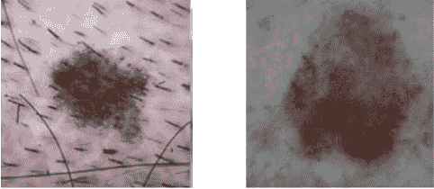

恶性皮肤生长物

图 2. 各种皮肤样本。

图 3 以图形形式描绘了数据集的详细说明，如下所示。

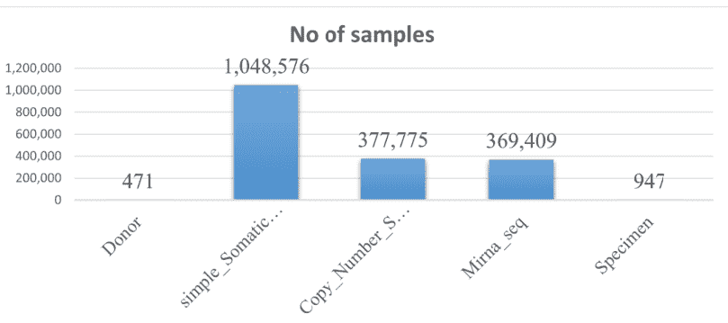

图 3. 数据集描述。

#### 3.2. 预处理

数据预处理在机器学习中发挥着重要作用，有助于获得更好的准确性结果。考虑到预处理的重要性，我们应用了各种预处理技术，包括去除噪声数据、将数据集划分为训练集和测试集以及特征选择。每种技术的详细内容如下。最初，我们去除了不可靠的噪声数据。缺失值评分超过 70% 和低于 10% 的特征被排除。缺失数据评分在 10% 以上且低于 70% 的特征被纳入 [32]。缺失数据使用多重插值链式方程（MICE）技术进行插补，该技术采用 k-近邻算法标准 [33]。本研究论文采用了广泛认可的高级 Python 编程语言。这些预处理技术共同有助于提升模型准确性和稳健性。去除噪声数据并选择相关特征，可确保后续机器学习模型在更清洁、更具信息量的数据集上进行训练，最终带来更好的预测性能。此外，这些预处理技术对结果的影响值得注意。通过系统地清洗数据并审慎选择特征，我们降低了模型过拟合的风险，并提高了对新的、未见数据的泛化能力。

#### 特征选择

精准健康利用基于临床和生物学数据的统计建模，更准确地预测患者预后。传统方法在处理大型数据集时面临困难，从而推动了各个领域的特征选择研究 [34]。以下方法能够改进模型性能、快速且经济高效地提供特征、便于数据可视化，并更好地理解数据生成过程。为了解决和减少学习任务的难度，特征选择旨在去除不相关或冗余的特征。为了选择最佳特征，我们应用了三种不同的特征选择方法，如下所述：

- 前向特征消除法（FFE）：FFE 方法是后向消除法的逆过程，从空特征开始，逐个添加特征，直至任何被排除的特征都能对模型结果产生显著贡献。最显著的特征最先被添加，然后使用新特征重新拟合模型。对所有剩余特征重新计算检验统计量或 p 值。从剩余特征中选择检验统计量最大的特征并将其添加到模型中 [35]。假设 X 是一个包含 n 个特征的输入特征集，可使用公式 (1) 定义。最初，我们有一个空特征集 X0 = ∅，其子集大小为 t，并初始化为空集，t = 0，其中 t 表示子集特征的大小，并可使用公式 (2) 定义。初始化输入变量后，我们有一个特征子集 Zt = z|b|b=1,2,3,...,t; zb∈X，该方法基于此重新拟合特征。让我们使用公式 (3) 定义特征子集。在公式 (4) 中，假设 p+ 为将查找 arg max (Zt + z) 的特征，其中 z ∈ X − Zt，并最大化我们的选择标准，这些标准与具有最佳得分的分类器相关联；得分可以是输出特征集 Zt 上的准确率、平均绝对误差（MAE）或残差平方 R²。此过程将持续，直到我们获得具有良好得分的所需特征集 h。迭代过程由公式 (5)–(7) 描述。公式 (5) 通过将最显著的特征 p+ 添加到现有子集 Zt 来更新特征子集 Zt+1。公式 (6) 增加变量 t 以继续迭代过程，而公式 (7) 在 t 达到所需特征集 h 时标记过程的终止。

```
X = {X1, X2, X3, ..., Xn}                                          (1)
X0 = ∅,   t = 0                                                (2)
Zt = {zb | b = 1,2,3, ..., t; zb ∈ X},   where t = {1, 2, 3, ..., n}   (3)
p+ = arg max(Zt + z) where, z ∈ X − Zt                         (4)
Zt+1 = Zt + p+                                                 (5)
t = t + 1                                                      (6)
t = h                                                          (7)
```

算法 1 展示了前向选择方法的过程。我们有输入特征 X，并希望获得最佳特征。这些特征将基于得分 Zt 的值进行选择。此方法从空集开始，然后使用良好得分拟合模型；同时，特征将被添加和更新。当获得所需特征集时，此过程将终止。

```
Algorithm 1 Forward feature elimination.
1: Input: X = {X1, X2, X3,..., Xn}
2: Output: Zt = {zb | b = 1,2,3,...,t; zb ∈ X}
3: Start
4: Prepare an empty array using (1)
5: Evaluate the fitness of the best feature using (4)
6: IF Zt + p+ > X0
7: Update the features using (5)
8: End If
9: t = t + 1
10: Repeat Step 2.
11: Terminate using (7)
12: End
```

- 后向特征消除法（BFE）：BFE 是一种简单的特征选择方法，从完整模型开始，删除特征，直至所有剩余特征都有显著贡献。最不显著的特征首先被删除，接着在不含已删除特征的情况下重新拟合模型并重新编译检验统计量 [36]。为了理解此方法的工作原理，我们有一个具有 r 个维度大小的特征集 A，可使用公式 (8) 进行解释。我们使用给定的特征集通过公式 (9) 初始化该方法。一旦输入变量被初始化，我们有一个特征子集 Dw，该方法基于此使用公式 (10) 重新拟合特征。假设 T- 为将查找 arg max (Dw - g) 的特征，其中 g ∈ A - Dw，并最大化我们与具有最佳得分的分类器相关联的选择标准；得分可以是 Dw 特征集上的准确率、MAE 或 R²。此过程将持续，直到我们获得具有良好得分的所需特征集 L。公式 (11)–(14) 详细说明了迭代特征消除过程涉及的步骤。

```
A = {A1, A2, A3, ..., Ar}                                                       (8)
D0 = A,   w = r                                                                 (9)
Dw = {gi | i = 1,2,3,...,w; gi ∈ A},   where w = {1, 2, 3, ..., m}              (10)
T- = arg max(Dw - g),   where g ∈ A - Dw                                        (11)
Dw+1 = Dw - T-                                                                  (12)
w = w + 1                                                                       (13)
w = L                                                                           (14)
```

算法 2 展示了后向选择方法的过程。该方法获取完整的输入特征集，计算分类器的得分，获取结果良好的特征，迭代重复步骤 3 直到达到所需的特征数量，然后终止。


#### 算法 2 后向特征消除。

1. 输入：\( A = \{A_{(1)}, A_{(2)}, A_{(3)}, ..., A_r \} \)
2. 输出：\( D_w = \{g_i \mid i = 1, 2, 3, ..., w; g_i \in A \} \)
3. 开始
4. 使用 (8) 从完整的输入特征集开始
5. 使用 (10) 评估最佳特征的适应度
6. 如果 \( D_w - T^- > B_0 \)
7. 使用 (11) 更新特征
8. \( w = w - 1 \)
9. 结束如果
10. 重复步骤 2
11. 使用 (14) 终止
12. 结束

##### c. 递归特征消除 (RFE)：
RFE 是一种基于学习模型和分类准确率选择最优特征子集的方法。我们已使用训练好的 RF 模型计算了特征重要性。算法 3 描述了 RFE 的过程。该方法作为一种排序程序工作。

#### 算法 3 递归特征消除。

1. 输入：
2. a. 训练集 W
3. b. C 个特征的集合 \( M = \{M_{(1)}, M_{(2)}, ..., M_C \} \)
4. c. 排名方法 \( N(W, M) \)
5. 输出：
6. 排名 J
7. 开始
8. 初始化训练集 W
9. 对 i 在 {1 : C} 中重复
10. 使用 \( N(W, M) \) 设置排名 C
11. \( M* \leftarrow\) M 中最后排名的特征
12. \( J(C - i + 1) \leftarrow M* \)
13. \( M \leftarrow M - M* \)
14. 结束

#### 3.3. 拟议方法学

与传统的检测和预测 SKCM 疾病的研究不同，我们的拟议研究利用集成方法（堆叠、装袋、提升和投票）。拟议研究包括最新的集成方法，以使用各种 ML 分类器预测 SKCM 疾病，并使用 Kaplan–Meier 和 Cox 比例风险回归模型分析总生存率。为了训练集成方法，我们最初创建并训练基线分类器（RF、GB、NB、LR、ET、AdaBoost、DT、LGBM）。性能按准确率、精确率、召回率和 F1 分数进行评估。生成了 ROC 曲线和混淆矩阵以说明性能。以下是基线分类器的详细信息。

- **RF:** RF 是一种功能强大的 ML 分类器，它使用多数投票机制融合多种 DT 输出。这种技术提高了解决方案的鲁棒性，特别是在具有挑战性的问题领域中。总体预测是通过计算单个 DT 生成的结果的平均值得出的。

- **GB:** 它是一种强大的集成学习 ML 分类器。与结合各种 DT 的 RF 不同，GB 创建一个序列 DT，每个后续树纠正错误。分类器通过迭代将弱学习器（通常是浅 DT）添加到集成中来优化损失函数。每棵树都经过训练，以强调模型表现不佳的实例，从而逐步完善整体预测能力。GB 以其高预测准确性和对各种数据类型的适应性而闻名，使其成为分类和回归任务的流行选择。

- **NB:** 它是一种简单的分类器，利用贝叶斯定理来预测未标记的数据点。它涉及计算与各种类别相关的先验概率并将其应用于最新数据。GNB 的简单性和计算效率源于特征独立性假设，使其成为分类任务的一种精简方法。

- **LR:** 它用于预测分类数据的概率。LR 使用逻辑函数在二元分类中计算概率，其中输出是二分的，代表两个类。它也被称为 Sigmoid 函数，将输入特征的线性组合转换为 0 到 1 之间的值，表示属于特定类的可能性。这使得 LR 特别适用于二元结果问题，例如垃圾邮件检测或医学诊断。

- **ET:** 它是一种与 DT 算法相关的集成学习方法。与 RF 类似，ET 开发一个 DT 森林用于预测。在 ET 中，对于 DT 的每个分割，ET 随机选择要分割的特征，从而导致集成中单个树之间更高的多样性。这种增加的随机性通常会产生更强健的模型，并且在减轻过拟合方面尤其有用。ET 因其在处理高维数据时的效率和准确性而闻名，使其成为一种有价值的分类器。

- **AdaBoost:** 这是一种用于回归和分类的流行集成学习分类器。它结合多个弱学习器的预测来创建高效且准确的预测模型。算法为每个数据点分配权重，并在每次迭代中关注错误分类的实例，调整其权重以在后续迭代中优先进行正确分类。

- **DT:** 它是一种广受认可的 ML 算法，根据特征值对样本进行分类评估。DT 创建过程包括评估训练样本并考虑最可靠的特征，以根据信息增益或基尼指数等原则将数据划分为子集。其目的是创建一棵能够根据可用特征精确预测新数据结果的树。

- **LGBM:** 这是一种用于高级 ML 任务的有效梯度提升框架。与传统的 GB 方法不同，它使用“叶向”树生长方法。该技术遵循扩展树的结构，集成导致损失函数最大减少的叶子，最终导致更快的训练时间。

算法 4 总体地解释了基线分类器和集成方法的训练。它描绘了集成模型的工作方式。最初，我们训练诸如 RF、DT、NB、GB、LGBM、LR 和 AdaBoost 等基础算法。然后我们训练四个集成方法，包括堆叠、装袋、提升和投票。这里，元算法 H 表示集成方法。

图 4 演示了我们研究的流程。数据收集后，缺失分数大于 70% 和小于 10% 的特征将被消除。任何缺失分数小于 70% 和大于 10% 的特征将被纳入，并将定义一组新特征。为了在新定义的特征中选择最佳特征，我们应用了三种不同的特征选择方法：RFE、FFE 和 BFE。我们的研究评估了四种集成方法和一个总生存分析，使用 Kaplan–Meier 估计器和 Cox 风险回归模型。要创建集成方法，我们必须首先创建并训练基线分类器。

```
Algorithm 4 ML-based ensemble methods.
1: Input:
2:   Training set R = {(y1, u1), (y2, u2), ..., (yv, uv)}
3:   Base algorithms G = {G1, G2, ..., Gs}
4:   Meta algorithm H
5: Output: Ensemble Model
6: Start
7: Step-1:
8:   Train the base algorithms by applying algorithms Gi to R
9:   For i = 1, 2, ..., k do
10:     Ei = Gi(R)
11:   End For
12: Step-2:
13:   Generate a new dataset for making predictions R
14:   For j = 1, 2, ..., n do
15:     Classify the training samples xj
16:     zij = Ei(xj)
17:   End For
18:   R = {yj, uj}, where yj = {z1jr z2jr ..., zsj}
19: End For
20: Step-3:
21:   Train the meta-algorithm H
22:   H = G(R)
23:   Return H
24: End
```

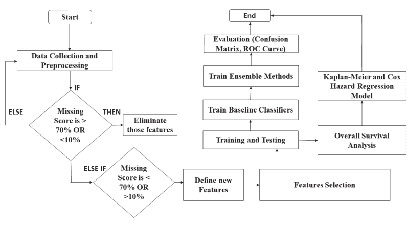

图 4. 拟议研究的流程图。

### 4. 实验结果

本研究的实验使用 Python 编程语言在 Windows 10 @ 1.80 GHz 上进行。本研究的动机是提出一种集成模型，利用不同的 ML 分类器预测 SKCM 疾病，并使用 Kaplan-Meier 和 Cox 风险回归模型分析总生存率。最初，我们应用了三种不同的特征选择方法，即 RFE、FFE 和 BFE，来选择最佳特征，如第 3 节中所讨论。

#### 4.1. 生存分析临床终点

本研究中检查了使用 Log-rank 检验的生存分析。

##### 4.1.1. Kaplan–Meier 估计器

用于估计事件（如死亡、疾病复发、新疾病实体的出现或不良反应）可能性的最流行的统计方法之一是生存分析 [37]。首先，我们需要了解生存函数才能理解生存分析。例如，将 Y 视为从研究数据集中获取的随机持续时间，该持续时间可以是无限的但不能是负值，生存函数可以表示为 Pro(t_i)，其中 Pro(t_i) 表示在时间 t_i 事件已经发生或尚未发生的概率。它表示按照方程 (15) 计算的生存函数。

Pro(t_i) = P(Y > t_i)

可以使用 Kaplan–Meier 估计器实现生存分析。可以使用 Kaplan–Meier (KM) 方法在每次事件发生时重新估计生存概率。这种非参数方法不为结果变量（例如时间）假设特定分布。这种方法非常简单，随着观察数量的增加，复杂性会增加。我们可以说，KM 方法的主要思想取决于观察到的事件时间，即将生存函数的估计分解为小块。每个间隔的概率可以使用以下方程 (16) 来制定：

Pro(t_i) = \prod_{t_i<a<t} \frac{Z_{(a - c_a)}}{Z_a}

其中 Z_a 表示在时间 t_i 时生命处于危险中的患者数量，c_a 表示在时间 t_i 时事件中发生的事件数量（参见图 5）。图 5 显示了患者的总生存分析。我们在诊断 SKCM 后发现患者的总生存概率具有显著性（p 值为 0.05）。图表显示，20 岁以上和 20 岁以下的生存概率较高。

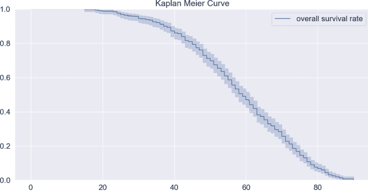

图 5. 总生存 (OS) 分析。

图 6 显示了患者的生存概率。我们发现男性患者的生存概率高于女性患者。20 岁及以下的男性患者具有较高的（约 0.8 或 80%）生存概率。80 岁以上和某些情况下低于 80 岁的患者具有较低的（约 0.2 或 20%）生存概率。


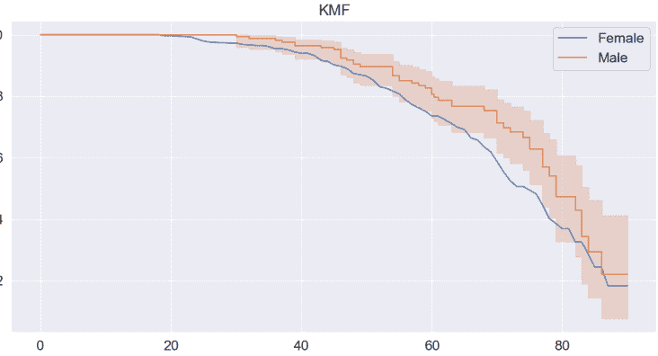

##### 图 6. 生存概率。

图 7 描述了不同患者年龄组的生存分析。我们分析发现，年龄组大于 30 岁且小于或等于 45 岁以及年龄组等于 45 岁的患者几乎重叠，且具有更高的生存概率（约 0.6 或 60% 及以上）。对于年龄组小于或等于 30 岁的患者，曲线显示概率从接近生存概率（0.1 或以上）开始逐步递增并稳步上升。当生存概率达到 0.5 或 50% 至 0.8 或 80% 之间时，所有年龄组重叠。

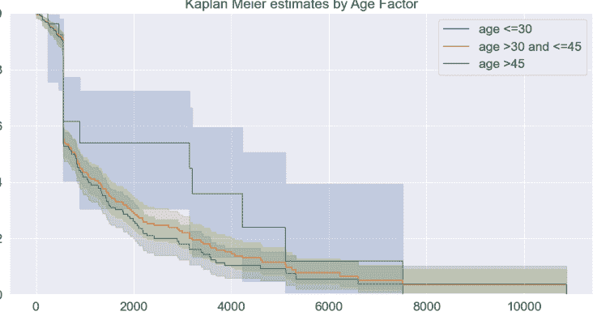

##### 图 7. 不同年龄组的生存分析。

图 8 描述了诊断后的生存进展和完全缓解。对于每个队列，有两条生存曲线。我们可以观察到，进展曲线以阶梯式增加。随着天数推移，进展概率逐渐增加。当生存概率达到 70% 至 85% 之间时，两条曲线重叠。然而，诊断后，患者开始恢复。

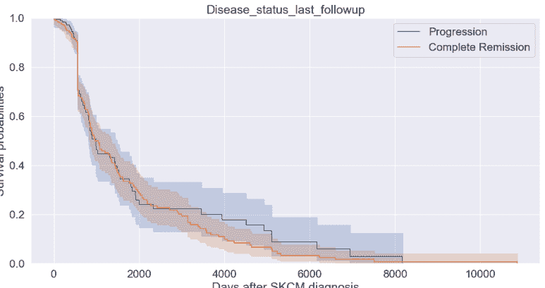

##### 图 8. 最后随访的生存概率。

##### 4.1.2. Cox 比例风险回归模型

比例风险模型由 David Cox 于 1972 年开发 [38]，使用比例风险假设来产生协变量效应的可靠估计。Cox 比例风险回归模型是一种半参数方法，用于估计比例风险模型中的权重。它使用梯度下降来拟合数据并最小化错误。该模型通过将患者的对数风险估计为其静态协变量的线性函数以及随时间变化的总体水平基线风险函数 [24] 来工作。它可以数学定义为公式 (17)。

```
E(d|e) = h_0(d) exp \left( \sum_{n=1}^e y_n(e_n) \right) (17)
```

其中

- d 表示生存时间；
- E(d|e) 表示由一组因素决定的风险函数，即 e1, e2, e3, ... en；
- h_0(d) 定义基线风险函数，表示当所有协变量为零时的事件概率。当所有 e_n 为零时，风险值等于 1。该模型假设协变量对风险的影响具有参数形式，而不假设基线；
- exp \left( \sum_{n=1}^b y_n(e_n) \right) 表示部分风险，作为一个随时间不变的标量因子，像普通回归中的截距一样增加或减少基线风险；
- 系数 (y1, y2, y3, ..., yn) 衡量协变量对受试者风险的影响。系数 b 的符号影响基线风险。正号表示更高风险，而负号表示更低风险。系数 b 的大小通过最大化部分似然来估计。它在整个研究期间假设比例风险比，提供更高的灵活性。该模型可以处理右删失数据，但不能直接处理左删失或区间删失数据。
- Cox 模型接受以下三个假设：
  - 1. 恒定风险比；
  - 2. 解释变量的乘积性；
  - 3. 个体受试者的独立失效时间。

表 4 描述了 Cox 比例风险回归。我们评估 Cox 风险模型和 log-rank 检验，以找到各组之间的风险比 (HR) 和显著关联。我们发现风险比 HR 的值 < 1，这意味着风险降低。显著性 (p-value) < 0.05 被视为找出各组之间关联的标准。我们观察到，协变量“最后随访时的年龄”和“间隔”的 p 值分别为 0.02 和 0.03，均小于显著 p 值 (0.05)。我们可以说各组之间存在关联。

##### 表 4. Cox 风险比例方法。

| 协变量 | 系数 | Exp (系数) | 标准误 (系数) | 系数下限 (95%) | 系数上限 (95%) | Exp 系数下限 (95%) | Exp 系数上限 (95%) | z | p | log2 (p) |
|---|---|---|---|---|---|---|---|---|---|---|
| 性别 | 0.02 | 1.02 | 0.10 | -0.17 | 0.21 | 0.84 | 1.23 | 1.02 | 0.10 | -0.17 |
| 状态 | -0.12 | 0.98 | 0.19 | -0.39 | 0.35 | 0.68 | 1.41 | 0.98 | 0.19 | -0.39 |
| 最后随访疾病状态 | -0.00 | 0.98 | 0.10 | -0.21 | 0.17 | 0.81 | 1.18 | 0.98 | 0.10 | -0.21 |
| 最后随访时的年龄 | -0.50 | 0.61 | 0.02 | -0.55 | -0.46 | 0.58 | 0.63 | 0.61 | 0.02 | -0.55 |
| 诊断 | -0.00 | 1.00 | 0.00 | -0.01 | 0.00 | 0.99 | 1.00 | 1.00 | 0.00 | -0.01 |
| 间隔 | 0.49 | 1.64 | 0.03 | 0.44 | 0.54 | 1.56 | 1.72 | 1.64 | 0.03 | 0.44 |

图 9 显示了不同协变量的风险比 (HR)。我们发现大多数协变量的 HR > 1，这意味着存在风险降低。只有一个协变量没有影响，因为 HR = 1。

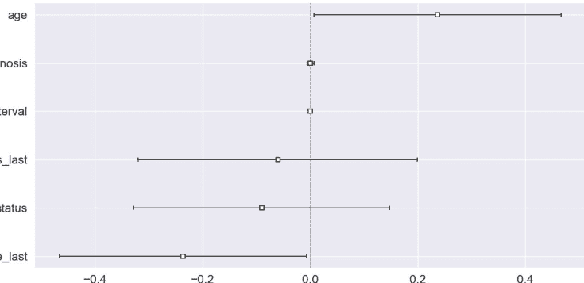

##### 图 9. 风险比。

##### 4.1.3. 基于 ML 的集成方法

我们训练了八种不同的 ML 分类器来创建集成模型。为了评估所提 ML 分类器的性能，我们使用了两种性能度量：ROC 和混淆矩阵。结果以准确率、精确率、召回率、F1 分数和 ROC 曲线呈现。评估包括四个性能指标：真阳性 (TP)，表示在阳性样本中准确分类 '良好声誉'；假阳性 (FP)，表示不属于该类的样本被误分类；真阴性 (TN)，表示准确分类阴性样本；假阴性 (FN)，表示样本实际上属于阴性类却被误分类为阳性。

表 5 比较了特征选择方法的性能。我们使用得分矩阵 r2 训练了 RF 分类器以选择最佳特征。RFE 方法的性能优于其他两种方法。

##### 表 5. 特征选择方法和得分。

| 特征选择方法 | 得分 |
|---|---|
| 后向特征消除 | 0.99993 |
| 前向特征消除 | 0.99988 |
| 递归特征消除 | 0.99400 |

表 6 描述了八种不同 ML 算法在测试数据集上的准确率、精确率、召回率和 F1 分数方面的性能。可以得出结论，大多数算法达到了最高 98% 的准确率。只有 AdaBoost 和 GNB 分别达到 97% 和 96% 的准确率。可以观察到，RF 达到的最高精确率为 98%，而 LR、GB、RF 和 light gradient boosting machine (LGBM) 获得的最高召回率为 99%。LR、GB 和 LGBM 达到了最高的 F1 分数。值得注意的是，上述性能指标是在测试数据集上评估的。

##### 表 6. ML 算法的性能指标。

| ML 算法 | 准确率 | 精确率 | 召回率 | F1 分数 |
|---|---|---|---|---|
| LR | 98% | 97% | 99% | 98% |
| DT | 98% | 96% | 98% | 97% |
| GB | 98% | 97% | 99% | 98% |
| RF | 99% | 98% | 99% | 99% |
| ET | 98% | 97% | 98% | 97% |
| AdaBoost | 97% | 96% | 95% | 90% |
| LGBM | 98% | 97% | 99% | 98% |
| GNB | 96% | 88% | 94% | 94% |

在图 10a 中，我们展示了 GNB 算法的混淆矩阵，显示其在正确预测 482 个样本中 96.05% 样本方面具有强健的准确性，只有 3.95% 的样本被不准确预测。另一方面，在图 10b 中，我们展示了 RF 算法的混淆矩阵。总共有 482 个样本，其中 99.38% 被准确预测，而 0.62% 被不准确预测。与其他相关研究（如 [9,10]）相比，我们的结果高度准确。

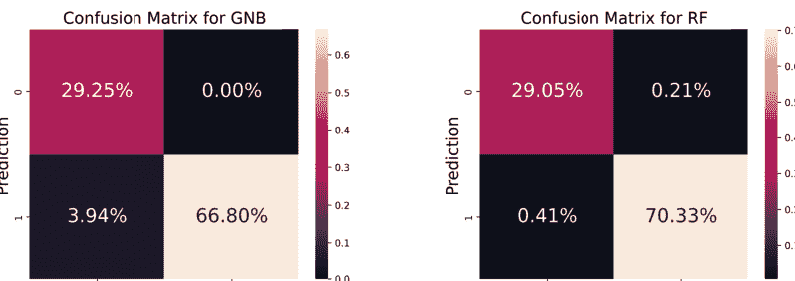

(a) GNB 的混淆矩阵 (b) RF 的混淆矩阵

##### 图 10. GNB 和 RF 算法的混淆矩阵。

在图 11a 中，我们展示了 LGBM 的混淆矩阵；分类器的性能在总共 482 个样本上进行了评估。分类器成功正确预测了 98.96% 的样本；只有 1.04% 的样本被不正确预测。图 11b 描绘了 LR 算法的矩阵。共有 482 个样本，其中 98.96% 被精确预测，而 1.04% 的样本被错误预测。


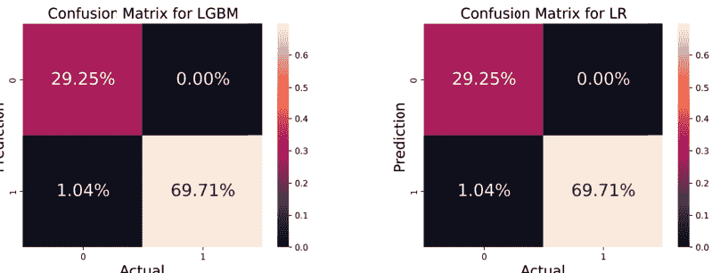

(a) LGBM 的混淆矩阵
(b) LR 的混淆矩阵

图 11. LGBM 和 LR 分类器的混淆矩阵。

在图 12a 中，我们展示了 AdaBoost 的混淆矩阵，分类器通过准确预测 482 个样本中的 99.59%（占总数 100%），令人印象深刻地实现了良好的准确率。相比之下，分类器错误地预测了 0.41% 的样本。图 12b 展示了 LR 算法的矩阵；该算法准确预测了 100% 样本中的 98.13%，仅有 1.87% 的样本被错误预测。分类器的性能可以从这些富有洞察力的图表中直观展现。

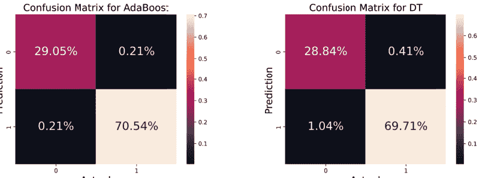

(a) AdaBoost 的混淆矩阵
(b) DT 的混淆矩阵

图 12. AdaBoost 和 DT 分类器的混淆矩阵。

图 13 描绘了 ET 和 GB 算法的混淆矩阵。图 13a 描绘了 ET 算法的矩阵。分类器准确预测了 100% 样本中的 98.76%，仅有 1.24% 的样本被错误预测。图 13b 确定了 GB 算法的混淆矩阵。分类器正确预测了 100% 样本中的 98.96%，分类器错误预测了总样本的 1.04%。

图 14 说明了特异性（假正率）和灵敏度（真正率）的 ROC 曲线。如果 ROC 曲线转向左上角，模型即可被分类或表现良好。大多数分类器转向左上角，这意味着分类器表现良好。从下图可以看出，LR、RF、AdaBoost 和 LGBM 达到了最高准确率，为 0.99，而 GB、DT 和 extra tree 的准确率为 0.98。只有 NB 分类器达到了 0.97 的准确率。可以得出结论，不同分类器的准确率存在微小差异。

这些集成方法是通过训练上述八个基础 ML 分类器生成的。可以观察到，如表 7 所示，堆叠和投票方法达到了最高的准确率，为 99%。记录的最高精确率为 98%，由堆叠方法获得。投票方法达到了最高的召回率以及 F1 得分，均为 99%。


(a) ET 的混淆矩阵
(b) GB 的混淆矩阵

##### 图 13. ET 和 GB 分类器的混淆矩阵。

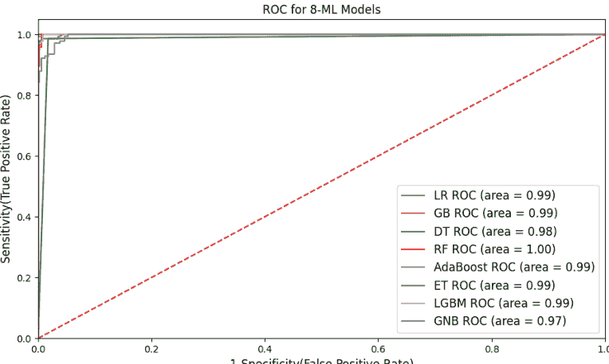

##### 图 14. ML 分类器的综合 ROC 曲线。

##### 表 7. 集成方法的性能指标。

| 集成方法 | 准确率 | 精确率 | 召回率 | F1 得分 |
|---|---|---|---|---|
| Bagging | 98% | 96% | 96% | 96% |
| Stacking | 99% | 98% | 97% | 96% |
| Boosting | 97% | 94% | 96% | 95% |
| Voting | 99% | 97% | 99% | 98% |

图 15 描绘了投票和堆叠集成方法的矩阵。从图 15a 来看，在 100% 的样本中，该方法准确预测了 98.76% 的样本，而 1.24% 的样本被错误预测。图 15b 显示了堆叠方法的矩阵。该方法正确预测了 99.17% 的样本，且仅有 0.83% 的样本被错误预测。

图 16 描绘了提升和袋装集成方法的矩阵。从图 16a 来看，在总共 100% 的样本中，97.51% 被正确预测，而 2.49% 被错误预测。图 16b 显示了袋装方法的矩阵。在这里，97.09% 的样本被正确预测，且仅有 2.91% 的样本被错误预测。

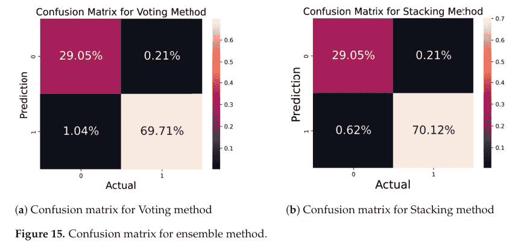


#### 4.2. 比较研究

本研究旨在利用 ML 分类器提出一种用于 SKCM 癌症预测的集成模型。为了构建集成模型，我们使用八种不同的 ML 分类器训练了四种不同的集成方法。下面对 ML 分类器和集成方法的性能进行了比较和讨论（参见图 17 和 18）。

表 8. ML 分类器的性能指标。

| ML 分类器 | 准确率 | 精确率 | 召回率 | F1 得分 |
|---|---|---|---|---|
| RF | 99% | 98% | 99% | 99% |
| GNB | 96% | 88% | 94% | 94% |
| LR | 98% | 97% | 99% | 98% |
| DT | 98% | 96% | 99% | 98% |
| GB | 98% | 97% | 99% | 98% |
| AdaBoost | 97% | 96% | 95% | 90% |
| ExtraTrees | 98% | 97% | 98% | 97% |
| LGBM | 98% | 97% | 99% | 98% |
| Bagging | 98% | 96% | 96% | 96% |
| Stacking | 99% | 98% | 97% | 96% |
| Boosting | 97% | 94% | 96% | 95% |
| Voting | 99% | 97% | 99% | 98% |


#### 4.3. 基准分类器标准误

表 9 说明了八个基准分类器计算得出的标准误。这一指标衡量了准确率、精确率、召回率和 F1 得分等性能指标的可靠性。值得注意的是，观察到准确率与标准误之间存在反比关系。表格分析表明，标准误最低的分类器在各种指标上的性能表现出更大的稳定性和一致性。

##### 表 9. 基准分类器标准误。

| 基准分类器 | 标准误 |
|---|---|
| LR | 0.45951 |
| DT | 0.45679 |
| GB | 0.459551 |
| RF | 0.45679 |
| ET | 0.45586 |
| AdaBoost | 0.45492 |
| LGBM | 0.45492 |
| GNB | 0.46127 |

图 19 显示了每个基准分类器关联的标准误。该指标为模型性能的稳定性提供了至关重要的洞察。在分类器中，GNB 的标准误略高于其他分类器。尽管如此，各算法之间的标准误仍存在细微差别。AdaBoost 和 LGBM 分类器显著地展现出最小的标准误。较小的标准误意味着在各种交叉验证中性能保持一致的可能性更高，而较高的标准误则暗示性能变异性更大。


##### 图 19. 基准分类器标准误。

表 10 展示了各个集成方法预测的标准误。在这些方法中，袋装方法的标准误最低，为 0.45397，表明其性能优于其他集成技术。

图 20 说明了四个集成方法产生的标准误。较高的标准误意味着模型性能的变异性增加。在这些方法中，投票方法的标准误最高，为 0.45861，表明模型性能的一致性较低。相反，袋装方法的标准误最低，为 0.45397，预示着模型性能更出色。

##### 表 10. 集成方法标准误。

| 集成方法 | 标准误 |
|---|---|
| Bagging | 0.45397 |
| Boosting | 0.45771 |
| Voting | 0.45861 |
| Stacking | 0.45679 |


##### 图 20. 集成方法标准误。

#### 4.4. 讨论

皮肤癌被认为是最危险的癌症类型之一。许多研究集中于早期检测、治疗方法和预防技术的建议。过去的许多研究都深入探讨了这些方面，特别侧重于采用 ML 和 DL 技术，这些技术在该疾病的早期检测和预后方面取得了有希望的结果。之前的研究主要集中在使用 DL 技术进行生存分析和早期检测。本研究提出四种集成方法（堆叠、袋装、提升和投票）来预测 SKCM，并使用 KM 和 Cox 比例风险回归模型分析生存概率。在构建涵盖堆叠、袋装、提升和投票的集成方法时，我们精心训练和测试了八个基准分类器：RF、LR、DT、GB、ET、AdaBoost、LightGBM（LGBM）和 GNB。这些方法的性能使用一系列指标进行了严格评估，包括准确率、精确率、召回率、F1 得分、混淆矩阵和 ROC 曲线。值得注意的是，我们的结果展示了准确率的巅峰，达到令人印象深刻的 99%，由堆叠和投票集成方法实现。这体现了本研究中所采用集成技术的稳健性和有效性。值得注意的是，在单个算法中，RF 表现为性能最佳的分类器，展现出卓越的预测能力。在多个指标上的这种卓越性能表明，我们提出的集成方法在 SKCM 预测领域具有潜在的适用性。较高的准确率，尤其是堆叠和投票方法，表明通过结合多样化的分类器，预测能力得到了协同增强。这些发现对于在皮肤癌背景下开发更可靠、更准确的预测模型具有重要意义。


### 5. 结论

本文采用Kaplan–Meier和Cox比例风险回归模型分析总生存期，并提出基于机器学习的集成方法来预测SKCM。收集了五个采用转录组技术的不同数据集。为选择最佳特征，使用了三种不同的特征选择方法，即REF、FFE和BFE。我们使用八个基础分类器（RF、DT、GNB、AdaBoost、GB、LR、ET和LGBM）训练并比较了四种集成方法（堆叠、袋装、提升和投票）。集成方法的性能借助ROC曲线、混淆矩阵、准确率、精确率、召回率和F1分数进行了评估。与其他分类器相比，RF的总体性能较好。算法的记录性能显示出轻微差异。在集成技术中，投票和堆叠策略得分最高。使用RF、LR、AdaBoost和LGBM实现了最高ROC，为0.99。RF分类器实现了最佳准确率，为99%，堆叠和投票方法实现了最高准确率，为99%。最后，本研究局限于特定数据集，可在各种数据集上进行评估以获得更好的结果。

### 未来工作

未来我们将调查用于皮肤癌早期检测和预后的深度学习方法。我们将调查该领域的其他多组学技术，并调查各种皮肤癌，以进一步找出疾病早期检测的方法。

### 作者贡献：概念化，E.Y.A. 和 A.Z.；方法论，E.Y.A.、Z.D.、A.H.M.、Q.A.、K.K. 和 A.Z.；软件，E.Y.A. 和 A.H.M.；验证，E.Y.A.、Z.D. 和 A.Z.；形式分析，K.K. 和 A.Z.；调查，Z.D.、A.H.M. 和 A.Z.；资源，E.Y.A.、Z.D.、A.H.M. 和 K.K.；数据整理，E.Y.A.、Z.D.、A.H.M.、Q.A. 和 A.Z.；撰写—原始草稿，E.Y.A.、A.H.M.、Q.A. 和 K.K.；撰写—审阅和编辑，Q.A. 和 K.K.；可视化，Q.A.；监督，Z.D.。所有作者已阅读并同意发表的稿件版本。

### 资助：本研究未获得外部资助。

### 知情同意声明：不适用。

### 数据可用性声明：本研究的数据可应要求提供。

### 利益冲突：作者声明不存在利益冲突。

### References

- 1. Wang, X.; Xiong, H.; Liang, D.; Chen, Z.; Li, X.; Zhang, K. SRGN在皮肤黑色素瘤（SKCM）及SKCM转移患者生存和免疫浸润中的作用。BMC Cancer 2020, 20, 378. [CrossRef] [PubMed]
- 2. Ervik, F.; Ferlay, J.; Mery, L.; Soerjomataram, I.; Bray, F. Cancer Today；国际癌症研究机构：法国里昂，2017。
- 3. 世界卫生组织。世界卫生统计；可视化摘要；世界卫生组织：瑞士日内瓦，2023。
- 4. Naik, P.P. 皮肤恶性黑色素瘤：早期诊断和管理综述。World J. Oncol. 2021, 12, 7. [CrossRef] [PubMed]
- 5. Carr, S.; Smith, C.; Wernberg, J. 黑色素瘤的流行病学和危险因素。Surg. Clin. 2020, 100, 1–12. [CrossRef] [PubMed]
- 6. Switzer, B.; Puzanov, I.; Skitzki, J.J.; Hamad, L.; Ernststoff, M.S. 2022年转移性黑色素瘤的管理：临床综述。JCO Oncol. Pract. 2022, 18, 335–351. [CrossRef] [PubMed]
- 7. Wu, Y.; Chen, B.; Zeng, A.; Pan, D.; Wang, R.; Zhao, S. 基于深度学习的皮肤癌分类：系统综述。Front. Oncol. 2022, 12, 893972. [CrossRef] [PubMed]
- 8. Leiter, U.; Keim, U.; Garbe, C. 皮肤癌流行病学：2019年更新。载于Sunlight, Vitamin D and Skin Cancer，Springer：美国纽约，2020；第123–139页。
- 9. Tang, Y.; Feng, H.; Zhang, L.; Qu, C.; Li, J.; Deng, X.; Zhong, S.; Yang, J.; Deng, X.; Zeng, X.; 等。基于免疫相关基因签名和临床变量的皮肤黑色素瘤新预后模型。Sci. Rep. 2022, 12, 20374. [CrossRef] [PubMed]
- 10. Cozzolino, C.; Buja, A.; Rugge, M.; Miatton, A.; Zorzi, M.; Vecchiato, A.; Del Fiore, P.; Tropea, S.; Brazzale, A.; Damiani, G.; 等。利用机器学习预测皮肤黑色素瘤的短期总死亡率。Discov. Oncol. 2023, 14, 13. [CrossRef]
- 11. Dildar, M.; Akram, S.; Irfan, M.; Khan, H.U.; Ramzan, M.; Mahmood, A.R.; Alsaiari, S.A.; Saeed, A.H.M.; Alraddadi, M.O.; Mah-nashi, M.H. 皮肤癌检测：基于深度学习技术的综述。Int. J. Environ. Res. Public Health 2021, 18, 5479. [CrossRef]
- 12. Son, H.M.; Jeon, W.; Kim, J.; Heo, C.Y.; Yoon, H.J.; Park, J.U.; Chung, T.M. 基于AI的伴有红斑皮肤病的定位和分类。Sci. Rep. 2021, 11, 5350. [CrossRef]
- 13. Verma, A.K.; Pal, S.; Kumar, S. 基于集成数据挖掘技术的特征选择皮肤病预测比较。Inform. Med. Unlocked 2019, 16, 100202. [CrossRef]
- 14. Guo, P.; Xue, Z.; Mtema, Z.; Yeates, K.; Ginsburg, O.; Demarco, M.; Long, L.R.; Schiffman, M.; Antani, S. 用于自动宫颈癌前筛查可靠性提升的宫颈图像选择集成深度学习。Diagnostics 2020, 10, 451. [CrossRef] [PubMed]
- 15. Mamun, M.; Farjana, A.; Al Mamun, M.; Ahammed, M.S. 基于集成学习技术和系统综述分析的肺癌预测模型。载于2022年IEEE世界AI IoT大会（AIIoT）论文集，美国华盛顿州西雅图，6–9 June 2022；第187–193页。
- 16. ICGC数据门户——皮肤黑色素瘤（SKCM）——美国项目。可在线查阅：https://dcc.icgc.org/releases/current/Projects/SKCM-US（访问日期：2023年11月27日）。
- 17. Aamir, S.; Rahim, A.; Aamir, Z.; Abbasi, S.F.; Khan, M.S.; Alhaisoni, M.; Khan, M.A.; Khan, K.; Ahmad, J. 基于监督机器学习技术的乳腺癌预测。Comput. Math. Methods Med. 2022, 2022, 5869529. [CrossRef] [PubMed]
- 18. Shah, S.A.; Tahir, A.; Ahmad, J.; Zahid, A.; Pervaiz, H.; Shah, S.Y.; Ashleibta, A.M.A.; Hasanal, A.; Khattak, S.; Abbasi, Q.H. 基于Wi-Fi和雷达成像的步态冻结发作识别传感器融合。IEEE Sens. J. 2020, 20, 14410–14422. [CrossRef]
- 19. Magsi, A.H.; Mohsan, S.A.H.; Muhammad, G.; Abbasi, S. 基于机器学习的车载命名数据网络利益洪水攻击检测系统。Electronics 2023, 12, 3870. [CrossRef]
- 20. Magsi, A.H.; Ghulam, A.; Memon, S.; Javeed, K.; Alhussein, M.; Rida, I. 基于机器学习的车载命名数据网络攻击检测与预防系统。Comput. Mater. Contin. 2023, 77, 1445–1465. [CrossRef]
- 21. Trang, K.; Nguyen, H.A.; TonThat, L.; Do, H.N.; Vuong, B.Q. 用于皮肤病识别的预训练深度学习模型集成投票方法。载于2022年IEEE控制与计算智能国际会议（CyberneticsCom）论文集，印度马朗，16–18 June 2022；第445–450页。
- 22. Verma, A.K.; Pal, S.; Tiwari, B. 基于集成方法和新型混合特征选择技术的皮肤病预测。Iran J. Comput. Sci. 2020, 3, 207–216. [CrossRef]
- 23. Thanika, M.R.; Edwin, E.B.; Ebenezer, V.; Sagayam, K.M.; Reddy, B.J.; Günerhan, H.; Emadifar, H. 基于集成机器学习技术与深度迁移学习的黑色素瘤分类混合方法。Comput. Methods Programs Biomed. Update 2023, 3, 100103.
- 24. Bradburn, M.J.; Clark, T.G.; Love, S.B.; Altman, D.G. 生存分析第二部分：多变量数据分析——概念和方法介绍。Br. J. Cancer 2003, 89, 431–436. [CrossRef]
- 25. Shorfuzzaman, M. 用于改进黑色素瘤皮肤癌检测的可解释堆叠深度学习模型集成。Multimed. Syst. 2022, 28, 1309–1323. [CrossRef]
- 26. Alam, T.M.; Shaukat, K.; Khan, W.A.; Hameed, I.A.; Almuqren, L.A.; Raza, M.A.; Aslam, M.; Luo, S. 针对不平衡数据集的高效深度学习皮肤癌分类器。Diagnostics 2022, 12, 2115. [CrossRef]
- 27. Alwakid, G.; Gouda, W.; Humayun, M.; Sama, N.U. 基于深度学习分类的黑色素瘤检测。Healthcare 2022, 10, 2481. [CrossRef] [PubMed]
- 28. Ali, M.S.; Miah, M.S.; Haque, J.; Rahman, M.M.; Islam, M.K. 一种利用带有迁移学习模型的深度卷积神经网络的改进皮肤癌分类技术。Mach. Learn. Appl. 2021, 5, 100036. [CrossRef]
- 29. Naeem, A.; Anees, T.; Fiza, M.; Naqvi, R.A.; Lee, S.W. SCDNet：一种基于深度学习的皮肤癌多类分类框架，利用皮肤镜图像。Sensors 2022, 22, 5652. [CrossRef] [PubMed]
- 30. Huang, M.; Zhang, Y.; Ou, X.; Wang, C.; Wang, X.; Qin, B.; Zhang, Q.; Yu, J.; Zhang, J.; Yu, J.; 等。利用机器学习的m5C相关签名用于皮肤黑色素瘤预后预测。J. Oncol. 2021, 2021, 6173206. [CrossRef] [PubMed]
- 31. Agrahari, P.; Agrawal, A.; Subhashini, N. 利用深度学习进行皮肤癌检测。载于Futuristic Communication and Network Technologies: Select Proceedings of VICFCNT 2020；Springer：德国柏林/海德堡，2022；第179–190页。
- 32. Wang, Y.; Singh, L. 分析缺失值和选择偏差对公平性的影响。Int. J. Data Sci. Anal. 2021, 12, 101–119. [CrossRef]
- 33. Mera-Gaona, M.; Neumann, U.; Vargas-Canas, R.; López, D.M. 评估MICE在特征选择中的多重插补影响。PLoS ONE 2021, 16, e0254720. [CrossRef] [PubMed]
- 34. Hambali, M.A.; Oladele, T.O.; Adewole, K.S. 微阵列癌症特征选择：综述、挑战和研究方向。Int. J. Cogn. Comput. Eng. 2020, 1, 78–97. [CrossRef]
- 35. He, Z.; Li, L.; Huang, Z.; Situ, H. 具有正向选择和后向消除的量子增强特征选择。Quantum Inf. Process. 2018, 17, 154. [CrossRef]
- 36. Chowdhury, M.Z.I.; Turin, T.C. 临床预测建模中的变量选择策略及其重要性。Fam. Med. Community Health 2020, 8, e000262. [CrossRef]


37. Abd ElHafez, S.; D'Arrigo, G.; Leonards, D.; Fusaro, M.; Tripepi, G.; Roumeliotis, S. 时间至事件数据分析方法：Cox回归分析。*氧化医学与细胞长寿* **2021**, 2021, 1302811. [CrossRef]

38. Nikulin, M.; Wu, H.D. *Cox模型及其应用*; Springer: 德国柏林/海德堡, 2016.

**免责声明/出版者说明：** 所有出版物中包含的陈述、观点和数据仅代表个别作者和撰稿人，而不代表 MDPI 和/或编辑。MDPI 和/或编辑对因内容中提及的任何想法、方法、说明或产品而导致的人员或财产损失不承担任何责任。

## 基于机器学习的集成特征选择与嵌套交叉验证在亚舍综合征 miRNA 生物标志物发现中的应用

Rama Krishna Thelagathoti, Dinesh S. Chandel, Wesley A. Tom, Chao Jiang, Gary Krzyzanowski, Appolinaire Olou 和 M. Rohan Fernando *

分子诊断研究实验室，感觉神经科学中心，男孩镇国家研究医院，美国内布拉斯加州奥马哈市 68010；ramakrishna.thelagathoti@boystown.org (R.K.T.); wesley.tom@boystown.org (W.A.T.); chao.jiang@boystown.org (C.J.); gary.krzyzanowski@boystown.org (G.K.); appolinaire.olou@boystown.org (A.O.) * 通讯作者：m.rohan.fernando@boystown.org

摘要：亚舍综合征（USH）是一种影响视力、听力和平衡的罕见遗传性疾病。识别可靠的生物标志物对于早期诊断和理解疾病机制至关重要。微小RNA（miRNAs）是基因表达的关键调节因子，有望作为 USH 的生物标志物。本研究旨在识别一组最小的 miRNA 子集，这些子集可作为生物标志物，有效地区分 USH 与对照组。我们采用集成特征选择技术，选择在至少三种算法中出现的顶级 miRNA。使用该子集训练和测试了机器学习模型，随后在独立的 10% 样本上进行验证。我们的方法确定了 10 种关键 miRNA 作为 USH 的潜在生物标志物。为了进一步验证其生物学相关性，我们进行了通路分析，揭示了与 USH 相关的显著通路。此外，我们的方法实现了高分类性能，准确率为 97.7%，灵敏度为 98%，特异度为 92.5%，F1 分数为 95.8%，AUC 为 97.5%。这些发现表明，将集成特征选择与机器学习相结合为 miRNA 生物标志物发现提供了一种稳健的策略，推进了 USH 诊断和分子理解。

关键词：集成特征选择；生物标志物发现；亚舍综合征；miRNA；机器学习；嵌套交叉验证

### 1. 引言

亚舍综合征是一种罕见的遗传性疾病，其特征是听力丧失、由于视网膜色素病变导致的进行性视力丧失，以及在某些情况下出现平衡问题 [1,2]。它是遗传性聋盲最常见的原因，约占同时出现听力和视力障碍病例的 50% [3]。亚舍综合征表现为多种临床亚型，每种亚型的症状严重程度和发病时间各不相同，使其诊断尤其复杂 [4]。症状的异质性以及与该综合征相关的各种基因突变使诊断变得具有挑战性，通常需要结合临床评估、听力学测试和基因筛查 [5,6]。

近年来，微小RNA（miRNAs）已成为诊断各种遗传性和复杂疾病（包括亚舍综合征）的有希望的生物标志物 [7,8]。miRNAs 是小型非编码 RNA 分子，可调节基因表达并在各种细胞过程中发挥关键作用 [9,10]。异常 miRNA 表达与多种疾病相关，包括癌症、神经系统疾病和遗传综合征 [10]。鉴于其在生物液体中的稳定性及其对某些病理状态的特异性，miRNAs 作为早期和准确诊断的潜在生物标志物备受关注。在亚舍综合征的背景下，对 miRNA 表达进行分析可以深入了解该疾病的分子机制，并有助于其检测 [7,11]。

尽管 miRNAs 对诊断具有巨大前景，但并非所有 miRNAs 对疾病进展的贡献都相同。识别与疾病最相关的 miRNA 最小子集对于诊断准确性和生物学理解都至关重要 [12–14]。更小的 miRNA 集可以提高诊断模型的可解释性，有助于更好地理解疾病的分子基础 [15–17]。从临床角度看，更小的 miRNA 集可降低诊断测试的复杂性和成本，使其更适用于大规模或常规筛查 [18]。此外，专注于更小、高度相关的 miRNA 子集有助于开发靶向疗法和个体化治疗 [15]。

特征选择技术在通过识别与任何疾病（包括亚舍综合征）最相关的 miRNAs 来降低 miRNA 数据集的维度方面发挥着重要作用 [12,13,15]。鉴于 miRNA 表达谱的高维度，选择最小特征集至关重要。罕见遗传疾病研究通常样本量相对较小。特征选择方法（如过滤法、包装法和嵌入式技术）可以帮助识别最具影响力的 miRNAs [19]。因此，选择一组紧凑的特征对于开发强健且可解释的模型至关重要。对于也是罕见遗传疾病的亚舍综合征，对 miRNA 数据应用特征选择可以帮助隔离与该疾病相关的关键 miRNAs，从而促进更高效、更准确的诊断过程。

鉴于亚舍综合征的复杂性以及来自表达谱分析的海量 miRNA 数据集，利用机器学习分类器实现诊断过程自动化至关重要。本研究提出了一种基于机器学习的方法，集成特征选择和嵌套交叉验证，以识别亚舍综合征自动检测所需的最小 miRNA 特征集。本研究有两个主要目标：（1）设计并开发一种结合嵌套交叉验证的集成特征选择方法，以用于分类的最小 miRNA 集；（2）利用一系列监督机器学习分类器来训练、测试和验证模型，以识别表现最好的模型。这种方法不仅减少了手动诊断所需的时间和劳动，还提高了预测的准确性和可靠性。此外，嵌套交叉验证在处理小数据集时尤其有益，因为数据获取往往面临挑战。

### 2. 相关工作

集成特征选择在基于 miRNA 的疾病分类中已被证明是一种有前途的方法，特别是对于高维数据集。研究表明，其能够识别能够提高诊断准确性和降低维度的最小 miRNA 子集。例如，Cai et al. (2015) 采用带有多个分类器的集成方法来区分肺癌样本和对照样本，实现了分类的增强鲁棒性 [20]。同样，Sarkar et al. (2021) 利用机器学习与生存分析相结合，识别了乳腺癌亚型特异性 miRNA 生物标志物，证明了诊断和预后精度的提高 [15]。这些方法凸显了集成策略在应对高维生物数据挑战方面的价值。

Lopez-Rincon et al. (2020) [21] 应用集成递归特征选择方法，识别循环 miRNA 作为各种肿瘤类型癌症分类的生物标志物。该方法通过确定与不同肿瘤类型相关的最小 miRNA 子集，提高了癌症分类的可解释性和可靠性 [21]。在相关研究中，Lopez-Rincon et al. (2019) [12] 开发了一种集成特征选择框架，用于识别癌症分类的 100-miRNA 签名。他们的自动化特征选择方法证明了集成特征选择在癌症分类中的可扩展性。然而，所选特征数量较多（100 种 miRNA）可能不适用于与较少 miRNA 相关的疾病，例如罕见遗传疾病 [12]。Colombelli et al. (2022) [22] 提出了一种混合集成特征选择方法，用于从转录组数据中识别 miRNA 生物标志物。这种混合设计能够进行更全面的候选生物标志物选择，提高模型的准确性和可解释性 [22]。

当前研究通过结合自适应集成特征选择方法和嵌套交叉验证，针对基于 miRNA 的分类（特别是亚舍综合征）克服了先前研究的局限性。这种新方法在特征选择和分类过程中贯穿使用嵌套交叉验证，以确保强健的特征选择和验证，并解决过拟合问题。此外，我们的方法会随着新数据的出现而动态更新最小特征集，因此特别适用于样本量通常较小的罕见遗传疾病（如亚舍综合征）。这种动态适应性和可扩展性的结合代表了基于 miRNA 的疾病分类的重大进步，与先前方法相比，提供了更可靠、更灵活的框架。

### 3. 材料与方法

本节概述了本研究所采用的方法。如图 1 所示，流程始于 miRNA 样本的预处理，随后采用集成特征选择方法结合嵌套交叉验证进行特征选择和模型训练。这种方法有助于识别表现最佳的模型和最小 miRNA 特征子集。然后使用这些特征对所选模型进行评估和验证，以评估其性能。此外，最小 miRNA 集还用于通路分析，以提取相关的生物通路。此外，本节还概述了本研究中使用的特征选择技术和机器学习分类算法。

#### 3.1. miRNA 样本提取与定量

对于研究中的每个样本，使用之前描述的方法 [7] 提取总 miRNA。简而言之，使用 QIAzol 试剂分离总 RNA，本研究中的 miRNA 样本收集自患者来源的 B 淋巴细胞系。使用 miRNeasy 组织/细胞先进微量试剂盒 (QIAGEN Sciences Inc., Germantown, MD, USA) 从细胞系中纯化 miRNA。对所有样本使用 NanoString nCounter 人类 v3 miRNA 表达检测 (货号 # CSO-MIR3-12, Bruker Corp., Billerica, MA, USA) 定量微小RNA表达。使用 R 中的 NanoString 质量控制仪表板 (NACHO) 包 [23] 对 miRNA 计数数据进行质量控制和批量归一化。这得到了一个包含 60 个样本中 798 种 miRNA 的 miRNA 计数矩阵，该矩阵用于后续机器学习分析。该队列中有 31 例亚舍样本和 29 例对照样本。


图1. 方法概览。

#### 3.2. 特征选择

特征选择，也称为特征缩减或变量子集选择，是从数据集较大的特征集中识别出最相关特征的最小子集的过程 [12,24]。在处理高维数据时，例如miRNA数据，选择一个小的、最优的子集来捕获整个数据集的关键信息而不丢失重要细节至关重要。这一过程是构建鲁棒学习模型的基础。特征选择的重要性在生物信息学和模式识别等领域已被广泛研究 [25,26]。通常，特征选择技术旨在最小化过拟合并增强模型性能，从而提高监督分类的预测准确性，并改善聚类任务中的簇检测。此外，它们有助于创建更快、更具成本效益的模型，同时也为产生数据的底层过程提供有价值的洞察 [16,27]。

在分类领域，特征选择方法可根据其特征选择策略分为三类：过滤法、包裹法和嵌入法。过滤法基于特定属性（如统计显著性）来选择特征的相关性。在选择任何机器学习模型之前先选择特征。这些技术计算效率高，有助于消除无关特征，从而简化模型且不会冒过拟合的风险 [28]。包裹法涉及使用特定的机器学习算法，通过反复训练模型来评估不同特征子集的性能。这种方法通常能产生针对模型定制的更好特征选择，但计算成本可能较高 [29]。嵌入法将特征选择集成到模型训练过程中，允许同时进行特征选择和模型优化。这种方法通常产生既高效又准确的模型，因为它们在选择过程中考虑了特征交互作用 [30]。

在处理miRNA表达谱数据集时，选择最相关的特征（miRNA）对于构建准确且可解释的模型至关重要 [12]。由于miRNA数据集的高维性以及通常较小的样本量，有效的特征选择方法可以大大增强模型性能并降低过拟合风险 [24]。研究表明，集成特征选择方法结合交叉验证技术可以有效识别最优的最小特征子集。这种方法既能提升模型性能，又能确保对未见数据进行鲁棒验证，同时降低过拟合风险，优于单特征选择技术 [15]。在本研究中，我们提出了一种结合嵌套交叉验证的集成特征选择方法，以识别用于分类的最小miRNA特征集。

#### 3.3. 集成特征选择算法

集成特征选择通过结合多个独立特征选择算法的结果来识别最优特征集 [31]。这种方法不同于单特征选择策略，后者使用单一方法识别关键特征。例如，单一方法可能会过滤掉低方差特征，或递归消除不贡献于模型性能的特征。相比之下，集成选择整合来自不同技术的最优特征集，以找到最佳的整体特征集。以往的研究表明，集成学习能产生更鲁棒的分类结果，并优于单特征选择方法，能够产生更优的最优特征集 [12,15–17,20–22]。在本研究中，我们选择了四种不同的特征选择方法，每种代表不同类别的技术，以确保特征选择的全面性。递归特征消除（RFE）源自包裹法，随机森林特征重要性（RF）是一种嵌入式方法，k-best方法（k-best）是一种过滤技术，以及最小绝对收缩和选择算子（LASSO）通过对某些系数施加惩罚来引入正则化。

##### 3.3.1. 递归特征消除

递归特征消除（RFE）是一种基于包裹法的特征选择方法，通过递归移除最不重要的特征来迭代选择最重要的特征 [32]。RFE的原理是使用所有可用特征训练模型，评估其重要性得分，然后递归消除最不重要的特征，直到达到所需的特征数量 [33]。RFE的目标是从数据集的完整特征列表中识别出最优特征子集。最初，使用完整特征集训练监督学习模型以预测目标值。随后，根据模型学到的参数评估每个特征的重要性，通过得分识别出不重要的特征。然后从数据集中消除重要性得分最低的特征。这一过程持续迭代，每次移除后重新训练模型，直到选择出所需数量的特征。

##### 3.3.2. 随机森林特征重要性

随机森林（RF）特征重要性属于嵌入式特征选择家族，根据每个特征在随机森林模型预测中的贡献来评估其重要性 [34]。RF特征重要性的主要目标是根据预测能力识别和排名特征，从而选择最具影响力的特征。随机森林模型通过使用数据集的自助聚合样本构建多个决策树来训练。在训练过程中，根据每个特征对模型预测准确性的贡献来评估其重要性，通常使用诸如基尼系数平均减少（MDG）或准确率平均减少（MDA）等指标 [35,36]。这种方法在有效选择重要特征的同时，保留了随机森林抗过拟合的鲁棒性优势。

##### 3.3.3. 最小绝对收缩和选择算子（LASSO）

LASSO是一种回归分析技术，结合了变量选择和正则化，以提高统计模型的预测准确性和可解释性。它通过最小化一个特定的目标函数来工作，该函数包括一个正则化项。在LASSO回归中，应用L1正则化，即根据系数的绝对值向模型添加惩罚项。这种正则化通过将不重要特征的系数推向零来鼓励模型的稀疏性。随着正则化参数的增加，更多系数被推向零，从而有效地从模型中移除不相关的预测器。结果是一个更简单、更具可解释性的模型，该模型在应用于未见数据时往往具有更好的泛化能力。这使得LASSO成为特征选择和模型简化的强大工具 [37]。

##### 3.3.4. K-Best特征选择

K-Best是一种基于过滤法的特征选择方法，用于评估每个特征与目标变量的相关性。该过程首先使用统计检验（如卡方检验、ANOVA F值或互信息）评估数据集中的所有特征。目标是识别出为预测目标变量提供最有用信息的前k个特征。选择过程可概述如下：

- 1. 对每个特征，使用选定的统计度量计算得分。
- 2. 按得分降序对特征进行排序。
- 3. 选择得分最高的前k个特征。

K-Best特征选择通过移除信息量较小的特征来降低数据集的维度。这在保留用于预测建模的最相关特征的同时，提高了模型性能 [28]。

#### 3.4. 机器学习技术概览

本节介绍了本研究中使用的机器学习技术列表，包括逻辑回归（LR）、随机森林（RF）、支持向量机（SVM）、极端梯度提升（XGB）和AdaBoost（ADB）。

##### 3.4.1. 逻辑回归

逻辑回归是一种用于二分类的统计方法，用于建模因变量（二元）与一个或多个自变量之间的关系。该方法使用逻辑函数估计概率 [38]。在此模型中，计算在给定特征的情况下目标变量等于1的概率。通过最大化似然函数来估计每个特征的系数，该函数衡量模型对观测结果的拟合程度 [39]。逻辑回归可用于通过估计给定miRNA概况对应特定疾病类别的概率来分类miRNA表达数据。其简单性和处理二元结果的能力使其成为基于miRNA表达水平预测疾病存在的宝贵工具。

##### 3.4.2. 随机森林

随机森林是一种用于分类的集成学习方法。它从数据集的自助聚合样本中构建多个决策树，并对它们的预测结果取平均 [40]。对于给定的数据集，随机森林创建多个决策树，每个使用


特征的随机子集。在训练期间，算法在每个节点上最小化基尼不纯度或熵，以有效地拆分数据 [35,36]。由于能够处理高维数据集且对过拟合具有鲁棒性，随机森林特别适用于 miRNA 数据分类。它通过对多个决策树预测结果进行平均来识别重要的 miRNA，这使其成为基于 miRNA 谱分类疾病的有用工具。

##### 3.4.3. 支持向量机 (SVM)

支持向量机 (SVM) 是一种监督学习算法，它在高维空间中构建一个超平面以分离不同的类别 [41]。它旨在找到最大化类别间边界的最优超平面。SVM 对于复杂且高维数据（如 miRNA 表达谱）的分类问题特别有效。由于其能够处理非线性关系，SVM 非常适合区分疾病谱和健康谱。核技巧允许 SVM 通过将输入空间转换为更高维的特征空间来捕捉这些非线性，这使其成为 miRNA 数据分类的一种强大方法 [42]。

##### 3.4.4. 极端梯度提升 (XGBoost)

XGBoost 是一种优化的梯度提升算法，它以序列方式构建模型，其中每个新模型纠正前一个模型所犯的错误。它旨在通过迭代调整模型来提高预测准确性，从而改善弱学习器的性能 [43]。该算法的目标函数结合了损失函数和正则化项，确保模型既准确又简单，避免过拟合。XGBoost 对于 miRNA 分类任务非常有效，因为它通过迭代提高预测准确性来增强弱学习器的性能。此外，其处理缺失值和不规则数据的能力使其成为基于 miRNA 的疾病分类的强有力选择，能够有效处理复杂的数据集 [44]。

##### 3.4.5. 自适应增强 (AdaBoost)

AdaBoost 是一种集成学习方法，它将多个弱分类器组合成一个强分类器 [45]。它通过顺序训练分类器来工作，每个新分类器都关注前一个分类器所犯的错误。该算法为每个实例分配权重，在每次迭代中增加被错误分类的实例的权重，帮助模型随时间改进。最终模型是每个弱分类器预测结果的加权和，其中每个分类器的权重由其准确性决定。AdaBoost 在 miRNA 分类中特别有用，因为它增强了模型预测疾病的能力。即使 miRNA 数据复杂或不平衡，它也能提高分类器的准确性，这使其成为数据可能存在噪声或具有挑战性的疾病分类任务的强有力选择 [46]。

#### 3.5. 结合嵌套交叉验证的集成特征选择

在本节中，我们介绍了结合嵌套交叉验证的集成特征选择方法，这是一种强健的方法学，旨在在最小化过拟合的同时识别最相关的特征。交叉验证是一种将数据划分为多个子集的技术。其中一些子集用于训练模型，而其他子集则保留用于测试或验证。此过程持续进行，直到每个子集都同时作为训练集和验证集 [41]。一种常用的方法是 k 折交叉验证，其中数据集被划分为 k 个大小相等的子集（折叠）。在此方法中，模型在 k-1 个折叠上训练，并在剩余的折叠上进行测试。

此过程重复 k 次，确保每个折叠至少被测试一次 [47]。通过为训练和测试使用不同的数据子集，交叉验证能够更准确地估计模型在未见数据上的性能 [48]。嵌套交叉验证涉及多层交叉验证，通常结构化为外层循环和内层循环 [49]。这种技术有助于减少过拟合并增强整体模型性能。

以下算法描述了我们提出的结合嵌套交叉验证的集成特征选择，如算法 1 所示。

#### 算法 1：结合嵌套交叉验证的集成特征选择

输入：miRNA 表达数据集 \( D \in \mathbb{R}^{N \times F} \)，其中 \( N \) 是样本数量，\( F \) 是 miRNA 特征数量。
输出：

- 最小 miRNA 特征集 \( F_{\text{minimal}} \)
- 最佳性能模型 \( M^* \)
- 所有验证集的平均性能指标

步骤 1. 初始化
\( F_{\text{minimal}} \leftarrow \varnothing \)
\( M^* \leftarrow \) None
设 \( p = \frac{N}{10} \)（即当 \( N = 60 \) 时为留 6 外交叉验证）
生成 \( p = 10 \) 个不重叠的折叠：\(\{ (T_i, V_i) \}_{i=1}^p \)，其中 \( T_i \in \mathbb{R}^{(N-p) \times F}, V_i \in \mathbb{R}^{p \times F} \)

步骤 2. 外层交叉验证（留 p 外）
对每个 \( i \in \{1, 2, ..., p\} \) 做
令 \( T_i \) 为外层训练集，\( V_i \) 为外层验证集

步骤 3. 内层交叉验证（分层 k 折）与特征选择
将 \( T_i \) 分成 \( k \) 个分层折叠：\(\{ (t_j, v_j) \}_{j=1}^k \)
对每个 \( j \in \{1, 2, ..., k\} \) 做
在 \( t_j \) 上进行特征选择：
应用 RFE、随机森林重要性、LASSO 和 SelectKBest
模型训练：
在 \( t_j \) 上训练分类器（LR、RF、SVM、XGBoost、AdaBoost）
模型评估：
在 \( v_j \) 上使用准确率、灵敏度、特异度、F1 分数和 AUC 进行评估
模型选择：
选择性能最佳的模型 \( M_j \)
更新特征集：
如果特征在 \(\ge 3\) 个内层折叠中被选中，则将其添加到 \( F_{\text{minimal}} \)
在内层折叠中选择出现频率最高的模型作为：
\( M^* = \text{argmax}_{M_j} \)（内层折叠中被选中的频率）

步骤 4. 外层折叠上的模型验证
使用 \( M^* \) 和 \( F_{\text{minimal}} \) 对 \( V_i \) 进行分类
使用准确率、灵敏度、特异度、F1 分数和 AUC 评估性能

- \( F_{\text{minimal}}\)—最终特征集
- \( M^*\)—最佳性能模型
- 所有 \( V_i, i = 1, 2, ..., p \) 上的平均性能指标

该方法学始于输入 miRNA 表达数据集，该数据集包含分类所需的样本和相关特征。第一步涉及初始化关键变量：N，样本数量；F，miRNA 特征数量；以及一个名为 𝐹minimal 的空集，用于存储分析期间识别的最小 miRNA 特征集。此外，变量 𝑀∗ 被初始化以保存评估后的最佳性能模型。为方便嵌套交叉验证过程，初始化了两个集合：外层训练集（由外层训练集 (T1, T2, …, Tp) 组成）和验证集（包括相应的验证集 (V1, V2, …, Vp)）。

第二步涉及执行留 p 外交叉验证（LPOCV），如图 2 所示，其中输入数据被分为外层训练集和验证集。该方法生成多个划分，每个外层训练集 (Ti) 包含总数据的 90%，而相应的验证集 (Vi) 包含剩余的 10%。此过程确保数据集中的每个实例最终都用于验证，为模型性能提供了一个强健的评估框架。

第三步，重点转向内层交叉验证和特征选择过程。对于每个外层训练集 Ti，采用分层 k 折交叉验证进一步划分数据。如图 2 所示，每个外层训练集 (Ti) 被分为多个内层训练集 (t1, t2, …, ti) 和相应的内层测试集 (v1, v2, …, vi)。随后，使用各种方法对每个内层训练集进行特征选择，例如递归特征消除 (RFE)、随机森林 (RF) 特征重要性、LASSO，以及使用 ANOVA F 分数作为统计指标来根据特征的判别能力对特征进行排序的 k-最佳方法。同时，包括逻辑回归 (LR)、随机森林 (RF)、支持向量机 (SVM)、极端梯度提升 (XGB) 和 AdaBoost (ADB) 在内的不同分类器在这些内层训练集上进行训练。每个模型的性能都使用关键指标（如准确率、灵敏度、特异度、F1 分数和 AUC）在相应的内层测试集上进行评估。在当前外层训练集中，在所有指标上实现最佳平均性能的模型被指定为 𝑀∗。此外，在所有迭代中一致出现至少 3 次的 miRNA 特征被追加到 𝐹minimal。

最后一步涉及验证所选模型和特征集。对于每个验证集 Vi，使用内层交叉验证中识别的 𝑀∗ 进行分类，利用前一步骤导出的最小 miRNA 特征集。然后在验证集上使用相同的指标评估该模型的性能：准确率、灵敏度、特异度、F1 分数和 AUC。

最终，该综合方法学的输出包括在所有内层 k 折中一致选定的最小 miRNA 特征集、基于所有内层训练集和测试集平均性能的最佳性能模型，以及在验证集上评估的该最佳模型的平均指标。这种结构化方法确保了一个全面且可靠的框架，用于识别重要的 miRNA 特征并实现准确的分类结果。

#### 3.6. 寻找富集通路

##### 3.6.1. miRNA 基因靶标预测

使用 TargetScanHuman 8.0 版本来预测与模型中 10 个 miRNA 匹配的结合位点的基因，结果得到 6115 个具有匹配 miRNA 靶点的基因 [50]。在这些基因中，572 个基因靶标的累积加权上下文分数 (CWCS) 小于 −0.5，表明基因抑制较强。所有 6115 个唯一基因靶标都包含在基因本体论富集分析和代谢通路分析中 [50]。


图 2. 基于嵌套交叉验证的集成特征选择概览。

##### 3.6.2. 基因本体富集与通路分析

R 包‘clusterProfiler’用于识别可能受模型中 miRNA 影响的基因本体（GO）和通路 [51]。对于基因本体富集分析，使用了‘enrichGO()’函数，调整后的 p 值阈值为 0.05，最小基因集大小为 5。使用 R 的‘enrichR’包，通过‘enrichr()’函数针对 Reactome 通路数据库识别受 miRNA 影响的通路 [52,53]。推测受影响的通路在调整后的 p 值阈值为 0.05 时被确定为显著。

### 4. 结果

本节从四个关键方面呈现结果，突出我们所提方法的有效性。首先，我们介绍通过集成特征选择方法识别的最小 miRNA 生物标志物集。其次，我们突出训练阶段选定的最佳模型及其性能指标。第三，对选定的最佳模型及其在验证集上的表现进行评估。最后，我们介绍基于选定 miRNA 特征的生物通路分析。

#### 4.1. 选定的最小 miRNA 特征集

我们通过集成特征选择方法结合嵌套交叉验证，识别出一个包含 10 个 miRNA 的最小特征集。与对照样本相比，这些 miRNA 对 Usher 综合征的分类有显著贡献。选定的 miRNA 为：hsa-miR-148a-3p, hsa-miR-183-5p, hsa-miR-146a-5p, hsa-miR-28-5p, hsa-miR-30c-5p, hsa-miR-551b-3p, hsa-miR-642a-5p, hsa-miR-181a-5p, hsa-miR-28-3p, hsa-miR-182-5p。

图 3 所示的 SHAP 汇总图说明了特定 miRNA 对模型输出的贡献，用于区分 Usher 综合征和对照样本。每个点表示给定样本中特定 miRNA 的 SHAP 值，颜色表示 miRNA 的表达水平（蓝色表示低，红色表示高）。x 轴上的位置显示特征对模型预测的影响：正值将模型推向预测 Usher 综合征，而负值推向对照。特征重要性图（图 4）揭示了单个 miRNA 对 Usher 综合征患者与对照样本之间分类决策的贡献。


图 3. 带有选定 miRNA 特征的 SHAP 汇总图。

各 miRNA 的关键观察：
- hsa-miR-148a-3p：在 SHAP 特征重要性中排名靠前，对 USH 预测有显著正向贡献，SHAP 值较高。换句话说，较高的表达水平（红色）会使 SHAP 值正向增加，强烈促进 Usher 综合征预测。
- hsa-miR-183-5p：在 SHAP 值范围内同时出现高表达和低表达值，表明贡献具有可变性。然而，总体而言，与对照相比，Usher 中的 miRNA 表达水平下调。
- hsa-miR-146a-5p：以正 SHAP 值对 Usher 预测做出贡献。在 Usher 中表达水平通常上调，在对照中下调。
- hsa-miR-28-5p、hsa-miR-28-3p 和 hsa-miR-182-5p：这些 miRNA 表现出相似的表达模式，即正 SHAP 值推向 Usher 预测，负 SHAP 值表明对对照预测有显著贡献。此外，较低的 SHAP 值表明表达水平在 Usher 与对照相比显著下调。
- hsa-miR-551b-3p 和 hsa-miR-642a-5p：呈现出正 SHAP 值的一致模式，表明它们在 Usher 预测中的重要性。这些 miRNA 在 Usher 中上调，在对照中下调。
- hsa-miR-30c-5p 和 hsa-miR-181a-5p：这两种 miRNA 在对照中的表达水平较高，在 Usher 中降低，对对照分类的 SHAP 值贡献为负。


图 4. 显示每个选定特征重要性的 SHAP 特征重要性图。

#### 4.2. 模型训练结果

对于模型训练，采用了五种机器学习分类器来使用 miRNA 数据分类 Usher 综合征：逻辑回归（LR）、随机森林（RF）、支持向量机（SVM）、XGBoost（XGB）和 AdaBoost（ADB）。我们为所有机器学习模型使用了各自库提供的默认超参数，包括随机森林的默认树数量和 SVM 的默认核函数。当前实现中未执行系统性超参数调优（例如网格搜索或随机搜索）。为了确保稳健的模型评估，实现了 p = 6（总样本的 10%）的 LPOCV 方法，共 10 次迭代。每次迭代中，54 个样本用于训练，6 个样本留出用于验证。对于内部训练，54 个训练样本使用分层 k 折交叉验证划分为 80% 的训练集和 20% 的测试集。在模型训练和测试过程中选定了重要特征，并使用验证集评估最终模型性能。表 1 说明了五个分类器在训练集和测试集上的性能指标，包括准确率、灵敏度、特异度、F1 分数和 AUC，而表 2 显示了最佳模型在验证集上的评估指标。它们是根据混淆矩阵计算的标准分类指标 [13] 得出的，如下所述。

| | 预测阳性 | 预测阴性 |
|---|---|---|
| **实际阳性** | TP | FN |
| **实际阴性** | FP | TN |

- TP = 真阳性（真阳性预测为阳性）；
- FN = 假阴性（真阳性错误预测为阴性）；
- FP = 假阳性（真阴性错误预测为阳性）；
- TN = 真阴性（真阴性正确预测为阴性）。

#### 性能指标公式

- 1. 准确率

  $$Accuracy = \frac{(TP + TN)}{(TP + TN + FP + FN)}$$

- 2. 灵敏度（召回率或真阳性率）

  $$Sensitivity = \frac{TP}{(TP + FP)}$$

- 3. 特异度

  $$Specificity = \frac{TN}{(TN + FP)}$$

- 4. F1 分数

  $$F1 score = \frac{2 * (Precision * Recall)}{(Precision + Recall)}$$

  where $$Precision = \frac{TP}{(TP+FP)}$$.

- 5. 曲线下面积（AUC）

  通过绘制真阳性率（灵敏度）与假阳性率（FPR）的 ROC 曲线计算得出，其中

  $$FPR = \frac{FP}{(FP + TN)}$$

##### 准确率

如表 1 所示，逻辑回归达到了最高平均准确率（0.98 ± 0.05，CI：0.95–1.00），并在所有迭代中始终表现良好，数值保持在 0.95 至 1.00 之间。SVM 也达到了 0.98 ± 0.05（CI：0.95–1.00）的平均准确率，随机森林紧随其后，为 0.97 ± 0.07（CI：0.92–1.00）。XGBoost（0.93 ± 0.15）和 AdaBoost（0.95 ± 0.15）显示出更大的变异性，其中 AdaBoost 表现出最不稳定的特征，有时准确率低至 0.84。尽管如此，AdaBoost 偶尔也能达到最高 1.0 的准确率。

##### 灵敏度

如表 1 所示，逻辑回归和随机森林在所有迭代中都保持了完美的灵敏度（1.00 ± 0.00），明显优于其他模型。SVM 表现出强劲但略低的灵敏度（0.95 ± 0.00）。XGBoost 和 AdaBoost 最不稳定，灵敏度范围从 0.67 到 1.0，标准差为 ±0.30，表明各次迭代之间存在不一致性。

##### 特异度

关于特异度（见表 1），AdaBoost 达到了完美的特异度（1.00 ± 0.00），其次是 XGBoost（0.97 ± 0.10）、逻辑回归和 SVM（0.97 ± 0.10）以及随机森林（0.93 ± 0.13）。然而，AdaBoost 显示出最高的方差，性能波动显著。相比之下，逻辑回归保持了方差较低的一致特异度，强化了其可靠性。

##### F1 分数

如表 1 所示，逻辑回归表现出最一致的性能，F1 分数为 0.99 ± 0.04（CI：0.95–1.00），反映了模型行为的稳健性。SVM 和随机森林也表现良好（均为 0.97–0.99），波动较小。XGBoost 的平均 F1 分数较低（0.89 ± 0.30），AdaBoost 显示出最显著的变异性（0.90 ± 0.30），偶尔会降至 0.90 以下。在分类器中，逻辑回归最稳定，使其成为基于 miRNA 的分类任务潜在更可靠的选择。

##### AUC

如表 1 所示，逻辑回归的 AUC 值在各次迭代中保持近乎完美（0.99 ± 0.10，CI：0.99–1.00），表明具有高且一致的鉴别能力。SVM 和随机森林也显示出强劲的 AUC 值（0.99 ± 0.03）。XGBoost 和 AdaBoost 表现出更多变异性，尽管两者在特定迭代中都达到了最大 AUC 1.00。

总体而言，逻辑回归在准确率、灵敏度、特异度、F1 分数和 AUC 方面表现出最一致和稳健的性能。相比之下，AdaBoost 表现出最不稳定的结果，在准确率、灵敏度和特异度方面常常落后于其他模型。这些结果表明，逻辑回归可能是基于 miRNA 的 Usher 综合征分类最合适的模型，在 LPOCV 过程的不同迭代中提供波动最小的可靠性能。

表 1. 模型训练结果，包括平均值 ± 标准差和 95% 置信区间。

| 模型 | 准确率 | 灵敏度 | 特异度 | F1 分数 | AUC |
| :--- | :--- | :--- | :--- | :--- | :--- |
| 逻辑回归 | 0.98 ± 0.05 (0.95, 1.00) | 1.00 ± 0.00 (1.00, 1.00) | 0.97 ± 0.10 (0.89, 1.00) | 0.99 ± 0.04 (0.95, 1.00) | 0.99 ± 0.10 (0.99, 1.00) |
| 随机森林 | 0.97 ± 0.07 (0.92, 1.00) | 1.00 ± 0.00 (1.00, 1.00) | 0.93 ± 0.13 (0.83, 1.00) | 0.97 ± 0.06 (0.93, 1.00) | 0.95 ± 0.03 (0.90, 1.00) |
| SVM | 0.98 ± 0.05 (0.94, 1.00) | 0.95 ± 0.00 (0.90, 1.00) | 0.97 ± 0.10 (0.89, 1.00) | 0.99 ± 0.04 (0.95, 1.00) | 0.99 ± 0.03 (0.93, 1.00) |
| XGBoost | 0.93 ± 0.15 (0.82, 1.00) | 0.90 ± 0.30 (0.67, 1.00) | 0.97 ± 0.10 (0.96, 1.00) | 0.89 ± 0.30 (0.66, 1.00) | 0.99 ± 0.03 (0.96, 1.00) |
| AdaBoost | 0.95 ± 0.15 (0.84, 1.00) | 0.90 ± 0.30 (0.67, 1.00) | 0.91 ± 0.00 (0.80, 1.00) | 0.90 ± 0.30 (0.91, 0.96) | 0.94 ± 0.13 (0.90, 1.00) |


表 2. 模型验证结果，包括均值 ± 标准差及 95% 置信区间)。

| 模型 | 准确率 | 灵敏度 | 特异度 | F1 分数 | AUC |
|---|---|---|---|---|---|
| 逻辑回归 | 0.97 ± 0.08 (0.93, 1.00) | 0.98 ± 0.07 (0.91, 1.00) | 0.93 ± 0.16 (0.91, 1.00) | 0.95 ± 0.10 (0.91, 1.00) | 0.97 ± 0.08 (0.92, 1.00) |
| 随机森林 | 0.60 ± 0.30 (0.38, 0.81) | 0.30 ± 0.42 (0.00, 0.60) | 1.00 ± 0.00 (1.00, 1.00) | 0.93 ± 0.12 (0.84, 1.00) | 0.60 ± 0.30 (0.38, 0.81) |
| 支持向量机 | 0.90 ± 0.21 (0.82, 1.00) | 0.93 ± 0.12 (0.86, 1.00) | 0.97 ± 0.07 (0.91, 1.00) | 0.98 ± 0.06 (0.93, 1.00) | 0.90 ± 0.21 (0.86, 1.00) |
| XGBoost | 0.50 ± 0.19 (0.36, 0.63) | 0.12 ± 0.31 (0.10, 0.35) | 0.90 ± 0.31 (0.67, 1.00) | 0.71 ± 0.28 (0.50, 0.91) | 0.50 ± 0.19 (0.36, 0.63) |
| AdaBoost | 0.48 ± 0.14 (0.37, 0.58) | 0.34 ± 0.20 (0.00, 0.36) | 1.00 ± 0.00 (1.00, 1.00) | 0.52 ± 0.07 (0.46, 0.58) | 0.48 ± 0.14 (0.37, 0.58) |

#### 4.3. 模型评估

采用 miRNA 数据对五种模型在分类 Usher 综合征样本中的性能进行了评估，评估过程涵盖 10 个验证集并进行了 10 次迭代，如表 2 所示。逻辑回归模型展现出准确率一致且波动极小，凸显了其在将 Usher 综合征样本与对照样本分类时的有效泛化能力。绝大多数迭代中，特异度始终接近 1.0，表明该模型在识别真阳性方面具有可靠性。虽然灵敏度表现出轻微波动，但仍足够稳定，足以证实该模型在正确分类对照样本方面的有效性。F1 分数（精确率与召回率的平衡）始终维持在 1.00 左右，变化极小，反映了该模型在保持真阳性率与精确率之间强平衡方面的稳健表现。此外，曲线下面积（AUC）几乎完美，始终保持在 0.97 至 1.0 之间。整体性能指标如下：平均准确率 97%，平均灵敏度 98.0%，平均特异度 93%，平均 F1 分数 95%，平均 AUC 97%。此外，逻辑回归在所有评价指标上均表现出稳定可靠的性能，使其成为基于 miRNA 的 Usher 综合征分类的合适且稳健的选择。

#### 4.4. 通路分析

ML 模型衍生的 10 个 miRNA 预计靶向 6115 个独特基因。总计，572 个基因被预计会受到关注 miRNA 的强烈抑制。有六个 GO 被标记为受影响（图 5）。在六个 GO 中，四个与神经元或轴突发育相关。其余两个 GO 与信号转导相关，RAS 蛋白信号转导和 GTPase 介导的信号转导均被预计会受到关注 miRNA 的抑制。包含 ML 模型 miRNA 靶向基因相关的前 10 条通路（图 6）。按综合得分排名的前两条通路均与神经元发育相关，印证了 GO 富集分析的发现（表 3）。


图 5. 面板 A 描绘了包含模型 miRNA 靶向基因的基因本体（GO）。在 BH 调整后的 p 值 ≤ 0.05 时，GO 被视为显著。点图中点的大小对应模型 miRNA 靶向的 GO 中的基因数量，而颜色对应调整后的 p 值。


图 6. 使用 Reactome 通路数据库，对与模型 miRNA 对应的基因靶点相关的通路进行 EnrichR 分析。Y 轴为 miRNA 相关基因的数量，X 轴为通路中的基因总数。图中的点代表不同的 Reactome 通路，这些通路可能受到模型 miRNA 的影响。通路根据 Reactome ID 着色，点的大小反映 –log10 (p 值)。

表 3. 预计会受到关注 miRNA 影响的前 10 条通路。基因计数是 ML 模型 miRNA 靶向的通路中的基因数量。通路中的基因是术语通路中的基因总数，后跟通路中受影响基因的百分比。p 值和调整后的 p 值来自 enrichR 结果，同时还包括 enrichR 输出的比值比和综合得分。显著性定义为调整后的 p 值 < 0.05，且综合得分 > 15。

| 术语 | 基因计数 | 通路中的基因 | 通路百分比 | p 值 | 调整后 p 值 | 比值比 | 综合得分 |
|---|---|---|---|---|---|---|---|
| MECP2 介导的转录调控 R-HSA-9896944 | 35 | 60 | 58.33 | 7.56 × 10⁻⁶ | 0.0015 | 3.19 | 37.64 |
| 神经系统 R-HSA-112316 | 164 | 386 | 42.49 | 3.91 × 10⁻⁷ | 0.0002 | 1.70 | 25.03 |
| 通用转录通路 R-HSA-212436 | 449 | 1190 | 37.73 | 3.28 × 10⁻⁸ | 0.0001 | 1.41 | 24.23 |
| 膜囊泡运输 R-HSA-199991 | 239 | 599 | 39.90 | 5.34 × 10⁻⁷ | 0.0002 | 1.53 | 22.07 |
| RHO GTPase 循环 R-HSA-9012999 | 180 | 441 | 40.82 | 2.55 × 10⁻⁶ | 0.0007 | 1.58 | 20.39 |
| 第二信使介导的细胞内信号转导 R-HSA-9006925 | 130 | 306 | 42.48 | 6.03 × 10⁻⁶ | 0.0013 | 1.69 | 20.34 |
| RNA 聚合酶 II 转录 R-HSA-73857 | 483 | 1312 | 36.81 | 3.31 × 10⁻⁷ | 0.0002 | 1.35 | 20.16 |
| 信号转导 R-HSA-162582 | 865 | 2465 | 35.09 | 1.47 × 10⁻⁷ | 0.0001 | 1.27 | 19.91 |
| 基因表达（转录） R-HSA-74160 | 524 | 1449 | 36.16 | 1.27 × 10⁻⁶ | 0.0004 | 1.31 | 17.83 |
| 囊泡介导的运输 R-HSA-5653656 | 245 | 637 | 38.46 | 9.82 × 10⁻⁶ | 0.0018 | 1.44 | 16.57 |

### 5. 讨论

本文提出的 Usher 综合征生物标志物发现方法，整合了集成特征选择与嵌套交叉验证，以确定一组最小的 miRNA 生物标志物。该最小生物标志物集代表了可可靠区分 Usher 综合征与对照样本的最小 miRNA 子集。然而，由于 Usher 综合征罕见，获取大样本量仍然是一项挑战，这可能会影响所选生物标志物的推广性。随着更多数据的可用，该方法旨在不断优化和更新生物标志物集，以提高其随时间推移的稳健性和生物学相关性。在更大数据集上进行未来验证将增强其临床适用性和可靠性。

通过采用嵌套交叉验证，该方法确保将数据集划分为训练集和验证集的过程是迭代进行的。训练集会经历额外的分层交叉验证，其中会测试多个验证集以生成稳定的性能指标。与单组验证相比，该过程提供了更可靠的特征选择和性能评估。集成特征选择与严格交叉验证的结合增强了所识别生物标志物的稳定性，确保其在数据有限的情况下仍可重复。

未来纳入更大样本量的研究将对进一步验证和优化所识别的 miRNA 生物标志物至关重要，从而推动其在 Usher 综合征早期诊断和治疗靶向中的潜在应用。该方法在外层循环中采用 LPOCV，在内层循环中采用分层 k 折交叉验证，以确保稳健的生物标志物选择。

### 6. 局限性与未来方向

虽然本研究利用 miRNA 表达谱对 Usher 综合征进行自动检测展现出了有前景的结果，但仍存在几个局限性。首先，所使用的数据集较小，反映了研究像 Usher 综合征这样的罕见遗传疾病所固有的挑战。小样本量可能会限制所识别最小特征集的稳健性和推广性，这可能无法完全捕捉更多样化人群中的变异性。此外，受年龄、遗传背景和环境因素等多种因素影响的 miRNA 表达异质性，可能会影响模型在不同人群中应用时的性能。另一个局限性在于 miRNA 数据本身；miRNA 提取和定量技术的差异可能会影响不同实验室或临床环境中结果的可重复性。

未来研究应着重于通过纳入多样化人群的样本并尽可能纳入纵向数据来扩展数据集。这将使特征选择方法能够捕捉更广泛的遗传变异范围，从而增强模型的推广性。此外，未来研究还应探索整合多组学数据（例如 mRNA、蛋白质和表观遗传数据），以提高预测准确性并捕捉与 Usher 综合征相关的复杂生物相互作用。另一个潜在方向是引入迁移学习或域自适应技术，以便在 miRNA 数据上训练的模型能够有效地应用于新的数据源或患者群体。在临床环境中进行验证也是必要的，以评估所提框架在实际诊断工作流中的实用性和可靠性。最后，随着更多样本的可用，探索基于深度学习的模型将很有价值，这些模型可能通过捕捉数据中的非线性关系来提高分类性能。

### 7. 结论

本研究提出了一种基于机器学习的方法，整合了集成特征选择和嵌套交叉验证，用于发现与 Usher 综合征相关的 miRNA 生物标志物。鑑于 Usher 综合征的罕见性，获取大型数据集具有挑战性。我们的方法旨在通过选择一组对样本量变化保持稳健的最小 miRNA 集，来最大化生物标志物识别的可靠性。集成特征选择组件整合了多个模型的结果，而嵌套交叉验证确保了严格的评估。与传统验证方法相比，这提供了更可靠的生物标志物选择。所识别的最小生物标志物集代表了开发基于 miRNA 的 Usher 综合征生物标志物的一个有希望的步骤，尽管其推广到更大、更多样化的数据集仍是一个未来目标。我们的结果表明，随着更多数据的可用，生物标志物集可以被优化和更新，从而增强其临床适用性。总体而言，本研究为小型复杂数据集中的特征选择和验证提供了一个稳健的框架，其潜在应用不仅限于 Usher 综合征，还可扩展到其他数据可用性有限的罕见遗传疾病。

**作者贡献：** 概念化，M.R.F. 和 R.K.T.；方法学，R.K.T. 和 W.A.T.；软件，R.K.T.；验证，R.K.T. 和 W.A.T.；正式分析，R.K.T. 和 W.A.T.；调查，C.J.，A.O. 和 D.S.C.；数据整理，W.A.T. 和 R.K.T.；撰写—原始草稿准备，R.K.T.；撰写—审阅和编辑，M.R.F.，W.A.T.，G.K.，D.S.C. 和 A.O.；可视化，R.K.T.；监督，M.R.F.；项目管理，M.R.F.；资金获取，M.R.F. 所有作者已阅读并同意出版的手稿版本。

**资助：** 本研究由瑞安基金会（Ryan foundation）的资助支持，地址：3100 E Willamette Lane, Greenwood Village, CO 80121，资助对象为 MRF。


### 机构审查委员会声明
不适用。

### 知情同意声明
不适用。

### 数据可用性声明
本研究中生成和分析的数据集可应要求向通讯作者合理请求获取。此外，用于分析的代码亦可应要求获取。

### 致谢
我们谨感谢美国内布拉斯加州奥马哈市内布拉斯加大学医学中心基因组核心设施的 Jennifer Bushing 在 NanoString miRNA 微阵列实验中提供的技术协助。UNMC 基因组核心设施部分获得国家普通医学科学研究所（NIGMS）INBRE-P20GM103427-19，以及国家癌症研究院和 Fred & Pamela Buffett 癌症中心支持资助 P30CA036727 的支持。本出版物的内容由作者全权负责，并不一定代表 NIH 或 NIGMS 的官方观点。

### 利益冲突
所有作者均声明不存在利益冲突。

### 参考文献

- 1. Spandau, U.H.; Rohrschneider, K. 德国 Usher 综合征的患病率和地理分布. Graefes Arch. Clin. Exp. Ophthalmol. 2002, 240, 495–498. [CrossRef] [PubMed]
- 2. Castiglione, A.; Möller, C. Usher 综合征. Audiol. Res. 2022, 12, 42–65. [CrossRef]
- 3. Boughman, J.A.; Vernon, M.; Shaver, K.A. Usher 综合征：来自两个高危人群的定义和患病率估计. J. Chronic Dis. 1983, 36, 595–603. [CrossRef]
- 4. Toms, M.; Pagarkar, W.; Moosaiee, M. Usher 综合征：临床特征、分子遗传学和进展性治疗. Ther. Adv. Ophthalmol. 2020, 12, 2515841420952194. [CrossRef]
- 5. Rijavec, N.; Novak Grubic, V. Usher 综合征与精神症状：精神病学管理的挑战. Psychiatr. Danub. 2009, 21, 68–71. [PubMed]
- 6. Tsilou, E.T.; Rubin, B.I.; Caruso, R.C.; Reed, G.F.; Pikus, A.; Hejtmancik, J.F.; Iwata, F.; Redman, J.B.; Kaiser-Kupfer, M.I. Usher 综合征临床 I 型和 II 型：眼部症状和体征能否区分两种类型？Acta Ophthalmol. Scand. 2002, 80, 196–201. [CrossRef]
- 7. Tom, W.A.; Chandel, D.S.; Jiang, C.; Krzyzanowski, G.; Fernando, N.; Olou, A.; Fernando, M.R. Usher 综合征细胞系的基因型特征和 miRNA 表达谱分析. Int. J. Mol. Sci. 2024, 25, 9993. [CrossRef] [PubMed]
- 8. Wang, S.; Xu, C.Y.; Zhu, Y.; Ding, W.; Hu, J.; Xu, B.; Guo, Y.; Liu, X. CLRN1（USH3A）中罕见转录本纯合子变异导致一个中国家庭中 Usher 综合征 3 型. Orphanet J. Rare Dis. 2024, 19, 349. [CrossRef]
- 9. Laguna, A.; Forte, S.; Giudice, A.; Arena, M.R.; Puglisi, P.L.; Giugno, R.; Pulvirenti, A.; Shasha, D.; Ferro, A. miRo：miRNA 知识库. Database 2009, 2009, bap008. [CrossRef]
- 10. Andersen, G.B.; Tost, J. 癌症中循环 miRNA 作为生物标志物. In Tumor Liquid Biopsies; Springer: Cham, Switzerland, 2020; pp. 277–298.
- 11. Thelagathoti, R.K.; Tom, W.A.; Jiang, C.; Chandel, D.S.; Krzyzanowski, G.; Olou, A.; Fernando, R.M. 基于 miRNA 表达谱的 Usher 综合征类型检测与分化网络分析方法：一项前瞻性研究. BioMedInformatics 2024, 4, 2271–2286. [CrossRef]
- 12. Lopez-Rincon, A.; Martinez-Archundia, M.; Martinez-Ruiz, G.U.; Schoenhuth, A.; Tonda, A. 基于集群特征选择的癌症分类 100-miRNA 签名自动发现. BMC Bioinform. 2019, 20, 480. [CrossRef] [PubMed]
- 13. Torres, R.; Judson-Torres, R.L. 研究技术简化：生物标志物发现的特征选择. J. Investig. Dermatol. 2019, 139, 2068–2074. [CrossRef] [PubMed]
- 14. Khalifa, W.; Yousef, M.; Saqr Demirci, M.D.; Allmer, J. 特征选择对植物 microRNA 一类和二类分类性能的影响. PeerJ 2016, 4, e2135. [CrossRef]
- 15. Sarkar, J.P.; Saha, I.; Sarkar, A.; Maulik, U. 基于机器学习的集成特征选择方法及随后生存分析，用于预测乳腺癌亚型特异性 miRNA 生物标志物. Comput. Biol. Med. 2021, 131, 104244. [CrossRef]
- 16. Saeys, Y.; Abeel, T.; Van de Peer, Y. 基于集群特征选择技术的稳健特征选择. In Machine Learning and Knowledge Discovery in Databases, Proceedings of the European Conference, ECML PKDD 2008, Antwerp, Belgium, 15-19 September 2008, Proceedings, Part II; Springer: Berlin/Heidelberg, Germany, 2008; pp. 313–325.
- 17. Seijo-Pardo, B.; Porto-Díaz, I.; Bolón-Canedo, V.; Alonso-Betanzos, A. 集群特征选择：同质和异质方法. Knowl.-Based Syst. 2017, 118, 124–139. [CrossRef]
- 18. Si, H.; Sun, X.; Chen, Y.; Cao, Y.; Chen, S.; Wang, H.; Hu, C. 循环 microRNA-92a 和 microRNA-21 作为原发性乳腺癌的新型微创生物标志物. J. Cancer Res. Clin. Oncol. 2013, 139, 223–229. [CrossRef] [PubMed]
- 19. Jović, A.; Brkić, K.; Bogunović, N. 特征选择方法及其应用综述. In Proceedings of the 2015 38th International Convention on Information and Communication Technology, Electronics and Microelectronics (MIPRO), Opatija, Croatia, 25–29 May 2015; pp. 1200–1205.
- 20. Cai, Z.; Xu, D.; Zhang, Q.; Zhang, J.; Ngai, S.M.; Shao, J. 基于集群特征选择和机器学习方法的肺癌分类. Mol. Biosyst. 2015, 11, 791–800. [CrossRef]
- 21. Lopez-Rincon, A.; Mendoza-Maldonado, L.; Martinez-Archundia, M.; Schönhuth, A.; Kranveldt, A.D.; Garssen, J.; Tonda, A. 用于癌症肿瘤分类的循环 miRNAs 基于机器学习的集群递归特征选择. Cancers 2020, 12, 1785. [CrossRef]
- 22. Colombelli, F.; Kowalski, T.W.; Recamonde-Mendoza, M. 用于从转录组谱中发现候选生物标志物的混合集群特征选择设计. Knowl.-Based Syst. 2022, 254, 109655. [CrossRef]
- 23. Canouil, M.; Bouland, G.A.; Bonnefond, A.; Froguel, P.; ’t Hart, L.M.; Slieker, R.C. NACHO：用于 NanoString nCounter 数据质量控制的 R 包. Bioinformatics 2020, 36, 970–971. [CrossRef]
- 24. Kotlarchyk, A.; Khoshgoftaar, T.; Pavlovic, M.; Zhuang, H.; Pandya, A.S. 通过结合多种特征选择技术识别癌症 microRNA 生物标志物. J. Comput. Methods Sci. Eng. 2011, 11, 283–298. [CrossRef]
- 25. Bashir, S.; Khan, Z.S.; Khan, F.H.; Anjum, A.; Bashir, K. 利用特征选择方法改善心脏病预测. In Proceedings of the 2019 16th International Bhurban Conference on Applied Sciences and Technology (IBCAST), Islamabad, Pakistan, 8–12 January 2019; IEEE: Piscataway, NJ, USA, 2019; pp. 619–623.
- 26. Fu, K.S.; Min, P.J.; Li, T.J. 模式识别中的特征选择. IEEE Trans. Syst. Sci. Cybern. 1970, 6, 33–39. [CrossRef]
- 27. Van Hulse, J.; Khoshgoftaar, T.M.; Napolitano, A.; Wald, R. 用于高维生物信息学数据的阈值特征选择技术. Netw. Model. Anal. Health Inform. Bioinform. 2012, 1, 47–61. [CrossRef]
- 28. Guyon, I.; Elisseeff, A. 变量和特征选择导论. J. Mach. Learn. Res. 2003, 3, 1157–1182.
- 29. Kohavi, R.; John, G.H. 特征子集选择的包装方法. Artif. Intell. 1997, 97, 273–324. [CrossRef]
- 30. Hastie, T.; Tibshirani, R.; Friedman, J.H. 《统计学习基础：数据挖掘、推断与预测》第 2 版; Springer: New York, NY, USA, 2009.
- 31. Bolón-Canedo, V.; Alonso-Betanzos, A. 特征选择的集成方法：综述与未来趋势. Inf. Fusion. 2019, 52, 1–12. [CrossRef]
- 32. Jeon, H.; Oh, S. 用于高效特征选择的混合递归特征消除. Appl. Sci. 2020, 10, 3211. [CrossRef]
- 33. Liu, W.; Wang, J. 包装法特征选择的递归消除–选举算法. Appl. Soft Comput. 2021, 113, 107956. [CrossRef]
- 34. Nguyen, C.; Wang, Y.; Nguyen, H.N. 结合特征选择的随机森林分类器用于乳腺癌诊断和预后. J. Biomed. Sci. Eng. 2013, 6, 551–560. [CrossRef]
- 35. Wang, H.; Yang, F.; Luo, Z. 随机森林变量重要性度量的内在稳定性实验研究. BMC Bioinform. 2016, 17, 60. [CrossRef]
- 36. Strobl, C.; Boulesteix, A.L.; Zeileis, A.; Hothorn, T. 随机森林变量重要性度量中的偏差：示例、来源与解决方案. BMC Bioinform. 2007, 8, 25. [CrossRef] [PubMed]
- 37. Tibshirani, R. 基于 lasso 的回归收缩与变量选择. J. R. Stat. Soc. B Stat. Methodol. 1996, 58, 267–288. [CrossRef]
- 38. Choudhary, R.; Ganiey, H.K. 监督机器学习算法综述. In Proceedings of the 2017 International Conference on Machine Learning and Data Science (MLDS), Noida, India, 14–15 December 2017; IEEE: Piscataway, NJ, USA, 2017; pp. 37–43.
- 39. Park, H.A. 逻辑回归简介：从基本概念到护理领域解释的侧重. J. Korean Acad. Nurs. 2013, 43, 154–164. [CrossRef]
- 40. Parmar, A.; Katariya, R.; Patel, V. 随机森林综述：一种集成分类器. In International Conference on Intelligent Communication Technologies and Internet of Things (ICICI) 2018; Springer International Publishing: Cham, Switzerland, 2019; pp. 758–763.
- 41. Lewis, M.J.; Spiliopoulou, A.; Goldmann, K.; Pitzalis, C.; McKeigue, P.; Barnes, M.R. nestedcv：用于快速实现带有嵌入式特征选择的嵌套交叉验证的 R 包，专为转录组学和高维数据设计. Bioinform. Adv. 2023, 3, vbad048. [CrossRef] [PubMed]
- 42. Pian, C.; Mao, S.; Zhang, G.; Du, J.; Li, F.; Leung, S.Y.; Fan, X. 基于支持向量机从 miRNA-靶点相互作用中发现与癌症相关的 miRNAs. Mol. Ther. Nucleic Acids. 2020, 19, 1423–1433. [CrossRef]
- 43. Zhang, X.; Li, T.; Wang, J.; Li, J.; Chen, L.; Liu, C. 基于 XGBoost 且准确率高的癌症相关长非编码 RNA 鉴定. Front. Genet. 2019, 10, 735. [CrossRef]
- 44. Liu, D.; Huang, Y.; Nie, W.; Zhang, J.; Deng, L. SMALF：基于堆叠自动编码器和 XGBoost 的 miRNA-疾病关联预测. BMC Bioinform. 2021, 22, 219. [CrossRef] [PubMed]


- 45. Crisci, C.; Ghattas, B.; Perera, G. 有监督机器学习算法及其在生态数据中的应用综述. *Ecol. Model.* **2012**, *240*, 113–122. [CrossRef]

- 46. Guan, D.G.; Liao, J.Y.; Qu, Z.H.; Zhang, Y.; Qu, L.H. mirExplorer：使用基于转移概率矩阵和组合特征的 AdaBoost 方法从基因组和下一代测序数据中检测微小RNA. *RNA Biol.* **2011**, *8*, 922–934. [CrossRef]

- 47. Zhong, Y.; He, J.; Chalise, P. 用于高维数据分类模型的嵌套和重复交叉验证. *Rev. Colomb. Estad.* **2020**, *43*, 103–125. [CrossRef]

- 48. Browne, M.W. 交叉验证方法. *J. Math. Psychol.* **2000**, *44*, 108–132. [CrossRef] [PubMed]

- 49. Zhong, Y.; Chalise, P.; He, J. 用于高维生物数据的嵌套交叉验证与集成特征选择和分类模型. *Commun. Stat. Simul. Comput.* **2023**, *52*, 110–125. [CrossRef]

- 50. McGeary, S.E.; Lin, K.S.; Shi, C.Y.; Pham, T.M.; Bisaria, N.; Kelley, G.M.; Bartel, D.P. microRNA 靶向效力的生物化学基础. *Science* **2019**, *366*, eaav1741. [CrossRef]

- 51. Wu, T.; Hu, E.; Xu, S.; Chen, M.; Guo, P.; Dai, Z.; Feng, T.; Zhou, L.; Tang, W.; Zhan, L.; et al. clusterProfiler 4.0，一种用于解释组学数据的通用富集分析工具. *Innovation* **2021**, *2*, 100141. [CrossRef] [PubMed]

- 52. Jassal, B.; Matthews, L.; Viteri, G.; Gong, C.; Lorente, P.; Fabregat, A.; Sidiropoulos, K.; Cook, J.; Gillespie, M.; Haw, R.; et al. Reactome 通路知识库. *Nucleic Acids Res.* **2020**, *48*, D498–D503. [CrossRef]

- 53. Kuleshov, M.V.; Jones, M.R.; Rouillard, A.D.; Fernandez, N.F.; Duan, Q.; Wang, Z.; Ma’ayan, A. Enrichr：全面基因集富集分析 Web 服务器 2016 更新. *Nucleic Acids Res.* **2016**, *44*, W90–W97. [CrossRef]

**免责声明/出版者说明：** 所有出版物中包含的声明、意见和数据仅为各作者和撰稿人个人的观点，而非 MDPI 和/或编辑的观点。MDPI 和/或编辑对因内容中提及的任何想法、方法、说明或产品而导致的人员或财产损失概不负责。

MDPI AG
Grosspeteranlage 5
4052 巴塞尔
瑞士
电话：+41 61 683 77 34

生物工程期刊编辑部
E-mail: bioengineering@mdpi.com
www.mdpi.com/journal/bioengineering


免责声明/出版者说明：本重印本的标题和前言部分由客座编辑自行决定。出版商对其内容或任何相关问题概不负责。所有单独文章中包含的声明、意见和数据仅为各编辑和撰稿人个人的观点，而非 MDPI 的观点。MDPI 对因内容中提及的任何想法、方法、说明或产品而导致的人员或财产损失概不负责。


学术开放获取出版
mdpi.com

ISBN 978-3-7258-4564-4

