# 云计算优化的机器学习与优化模型

---

## 前言

云计算是解决问题和为大型及计算密集型任务提供可靠计算平台的新趋势。该技术被银行、交易及许多电子商务企业等商业行业用于适应高请求率、全天候高可用，无系统故障。一旦发生故障，请求将迁移至不同的可靠服务器，同时通知用户，赋予系统容错行为。

随着机器学习和深度学习机制的引入，新一代计算优化算法也随之开始。新一代算法为改进现有模型带来了新的希望。云计算和雾计算涉及许多此类优化模型，随着系统性能的提升，这些模型也能得到改进。云计算的主要目标是以最少的计算时间和高可靠性，通过高质量的服务满足用户需求。随着迁移到云服务商的服务增加，云上的负载加重，导致系统出现故障和各种安全故障，从而降低了可靠性。云系统利用智能元启发式和预测算法，高效地为用户提供资源，以管理系统性能并规划即将到来的请求。智能算法帮助系统实时预测并为云环境寻找合适的资源，以最小的计算复杂度兼顾系统在低负载和过载条件下的性能。

因此，我们试图以本书《云计算优化中的机器学习与模型》的形式做出重大贡献。全书共包含 12 章。

### 第 1 章

涵盖云多层架构及其各种服务模型的总体介绍。本章介绍用于优化云服务的云虚拟化技术。它是云环境中的核心支撑技术。虚拟化借助虚拟化软件实现。该软件将真实的计算单元分离为若干个虚拟单元；任何设备都可以被简单地使用和管理。

### 第 2 章

探讨云管理现有基础设施负载的责任，以维持可靠性并为用户提供高质量服务。任务分配是优化云基础设施性能的关键特性之一。在本项工作中，我们提出了一种基于预训练神经网络的预测技术，根据以往的训练以及云的历史及其性能，为任务寻找可靠资源，从而在过载和低负载情况下优化性能。该工作的主要目的是减少故障，并通过减少调度时间、执行时间、平均开始时间、平均完成时间和网络负载来提供高性能。

### 第 3 章

聚焦于任务调度策略，旨在以最小的执行时间、网络成本和执行成本效益，实时提升性能。所提模型受天文学中的大爆炸-大挤压算法启发。该算法旨在通过减少调度延迟和网络延迟，以最小的资源成本完成任务，以最低的计算成本为用户提供高质量服务。

### 第 4 章

定义服务级别协议（`SLA`）在云中的作用。`SLA` 是一份结构化文档，规定了消费者的需求和提供商在特定条件下对该等服务的承诺，因此包含一系列必须满足的强制性条款，以确保服务持续进行。此外，`Web` 服务提供的服务与云提供的服务截然不同。本章讨论了 `SLA` 在云中的作用及其重要性。

### 第 5 章

探讨下一代深度学习和机器学习算法在云基础设施资源分配中的作用。本章综述了现有模型，包括自然启发式算法、神经启发式算法模型和元启发式算法。展示了现有工作的比较研究及云中的问题。最后，本章强调了这一点，并讨论了调节云性能的各种性能参数。

### 第 6 章

讨论云的多功能性，也称为伸缩，它允许通过自动伸缩对感兴趣的处理资源进行供应和取消供应。自动伸缩策略各异，包括框架、阶段和编程层面的不同细分。自动伸缩也与其他质量属性重叠，从而有助于服务级别协议，并经常应用建模和控制方法使自动伸缩度量具有通用性。

### 第 7 章

提出一个专注于任务分配中故障预测的模型。该预测模型基于自然启发式启发式方法和智能人工神经网络。该故障感知的基于 `ANN` 的模型侧重于主动的性能改进和可靠性测试。该模型在大规模数据中心中超越了现有的最先进的主动和被动故障感知调度技术。结果与讨论部分支持了故障感知的人脑和自然启发式模型的可靠性断言。

### 第 8 章

在改进多个性能参数的同时，提出了一种节能的虚拟机放置方案，采用多目标优化。因此，提出了一种反向传播神经网络-遗传算法（`BPGA`）模型，该模型在第一遍中使用非支配排序遗传算法（`NSGA`），在第二遍中使用反向传播神经网络，用于虚拟机在物理机上的放置。与传统的虚拟机放置算法（如装箱启发式算法和其他进化算法）相比，我们提出的模型在整个整合过程中显示出更好的能耗表现，且最小化了 `SLA` 违约。此外，该模型还旨在最小化虚拟机放置的总体成本。

### 第 9 章

聚焦于云数据中心的能源效率，这是云技术使用日益增加背景下的一个极其重要的问题。已有大量工作致力于解决该问题。虚拟机（`VM`）整合是大多数研究围绕的核心概念。元启发式算法在为虚拟机放置寻找近似最优解方面发挥着非常重要的作用。本章对现有的元启发式算法进行了全面分类。最后，对这些算法进行了比较分析，为研究人员提供该领域的洞见。

### 第 10 章

详述一种用于云的节能分层任务调度算法，以降低蜂窝节点的电力消耗。当节点超出传输范围时，作业将被重新调度。整体性能主要基于基于节点和流的平均延伸和包投递率进行估算。使用 `NS-2` 模拟器分析整体性能指标。

我们希望本书发表的成果能为云计算优化相关社区提供服务。

`MATLAB®` 是 The MathWorks, Inc. 的注册商标。如需产品信息，请联系：

The MathWorks, Inc.

3 Apple Hill Drive

Natick, MA 01760-2098 USA

电话：508 647 7000

传真：508-647-7001

电子邮件：info@mathworks.com

# Web

[www.mathworks.com](http://www.mathworks.com)


# 编辑

**Punit Gupta** 自 2018 年起担任印度拉贾斯坦邦斋普尔曼尼帕尔大学计算机与通信工程系副教授。他于 2010 年获得中央邦拉吉夫·甘地理工大学计算机科学与工程专业 `BTech` 学位。2012 年，他在 Jaypee 信息技术学院（视同大学）获得计算机科学与工程专业 `MTech` 学位，研究方向为“云计算中的信任管理”。他是 `MTech` 金牌得主。2017 年 2 月获博士学位。他在物联网、云计算和分布式算法方面拥有研究经验，并在知名期刊和国际会议上发表了 70 多篇研究论文。他目前担任印度计算机学会 (`CSI`) 会员、`IEEE` 会员和 `ACM` 专业会员。他与 Springer、IGI 等出版社合著了 15 本书。

**Mayank Kumar Goyal** 是印度 Sharda 大学的助理教授。他于 2012 年在 Jaypee 信息技术学院（视同大学）获得计算机科学与工程专业 `MTech` 学位。2019 年 2 月获博士学位。他在物联网、云计算和分布式算法方面拥有研究经验，并在知名期刊和国际会议上发表了 50 多篇研究论文。他目前担任印度计算机学会 (`CSI`) 会员、`IEEE` 会员和 `ACM` 专业会员。


**Sudeshna Chakraborty** 拥有 15 年的行业与学术综合经验。她是印度 Greater Noida Sharda 大学工程系计算机科学研究组组长兼副教授。她获得了计算机科学与工程博士学位，研究方向为神经网络和语义 `Web` 工程。她因教学获得多项奖项，并获得学者学会颁发的研究卓越奖和最佳论文发表奖 (`IEI`); 她曾担任主题演讲嘉宾、国际会议组织委员会成员、评审委员会成员、分会主席、工程师学会、`InSc` 和 `ATAL AICTE` 赞助的 `FDP` 及其他 `FDP` 的演讲者。她在机器人技术、太阳能和传感器领域申请了 8 项专利，担任了 2018 年巴黎 `IEEE` 会议 `ICACCE` 的主席，并在突尼斯 Springer 会议 `ICS2A` 上担任主题演讲嘉宾，还担任过西班牙智能技术与人工智能分会主席。她是 `IEEE` (USA)、`IEI` 和 `IETA` 等专业学会的活跃会员。

**Ahmed A. Elngar** 是埃及 Beni-Suef 大学计算机与人工智能学院的助理教授。他是 Beni-Suef 大学技术与信息研究中心主任。他担任 *Journal of Cyber Security and Information Management* (`JCIM`) 的主编。教授于 2016 年在埃及开罗阿兹哈尔大学理学院获得计算机科学哲学博士 (`PhD`) 学位。他在知名期刊和会议上拥有 30 多项研究成果。他还出版了 11 本由知名出版社发行的书籍。

# 贡献者

**Deepika Agrawal**  

信息技术系  

国家理工学院  

赖布尔，印度

**Vaishali Chourey**  

信息技术系  

Medi-Caps 大学  

印多尔，印度

**Sneha Agrawal**  

信息技术系  

国家理工学院  

赖布尔，印度

**Mayank Kumar Goyal**  

计算机科学与工程系  

Sharda 大学  

Greater Noida，印度

**Amit Kumar Bairwa**  

计算与信息技术学院  

曼尼帕尔大学斋普尔分校  

斋普尔，印度

**Punit Gupta**  

计算机通信与工程系  

曼尼帕尔大学斋普尔分校  

斋普尔，印度

**Sanjit Bhagat**  

曼尼帕尔大学斋普尔分校  

斋普尔，印度

**Sunil Kumar**  

计算机通信与工程系  

曼尼帕尔大学斋普尔分校  

斋普尔，印度

**Surbhi Chauhan**  

斋普尔工程与管理学院  

斋普尔，印度

**Tarun Jain**  

曼尼帕尔大学斋普尔分校  

斋普尔，印度

**Oshin Sharma**  

`CSE/IT` 系  

PES 大学  

班加罗尔，印度

**Jaya Krishna R.**  

计算与信息技术学院  

曼尼帕尔大学斋普尔分校  

斋普尔，印度

**Sanjay Kumar Sharma**  

计算机科学系  

Banasthali Vidyapith  

Banasthali，印度

**Dheeraj Rane**  

计算机科学与工程系  

Medi-Caps 大学  

印多尔，印度

**Vijay Kumar Sharma**  

计算与信息技术学院  

曼尼帕尔大学斋普尔分校  

斋普尔，印度

**Geetanjali Rathee**  

`CSE/IT` 系  

Jaypee 信息技术大学  

Waknaghat，印度

**Arjun Singh**  

计算与信息技术学院  

曼尼帕尔大学斋普尔分校  

斋普尔，印度

**Hemraj Saini**  

`CSE/IT` 系  

Jaypee 信息技术大学  

Waknaghat，印度

**Devesh Kumar Srivastava**  

计算机与通信工程系  

曼尼帕尔大学斋普尔分校  

斋普尔，印度

**Shally Vats**  

计算机科学系  

Banasthali Vidyapith  

Banasthali，印度

**Rohit Verma**  

`INSIGHT` 研究实验室 `SFI`  

都柏林城市大学  

都柏林，爱尔兰

**Falguni Sharma**  

曼尼帕尔大学斋普尔分校  

斋普尔，印度

# 机器学习与优化模型

## 云计算虚拟化导论

**DOI：** [10.1201/9781003185376-1](https://dx.doi.org/10.1201/9781003185376-1)

**作者：** Vijay Kumar Sharma, Arjun Singh, Jaya Krishna R, Amit Kumar Bairwa, and Devesh Kumar Srivastava

### 目录

- 1.1 导论
- 1.2 云模型
  - 1.2.1 公有云
  - 1.2.2 私有云
  - 1.2.3 社区云
  - 1.2.4 混合云
- 1.3 什么是虚拟化？
  - 1.3.1 虚拟化的优缺点
  - 1.3.2 面向云的虚拟化架构
  - 1.3.3 虚拟化在云计算中的意义
  - 1.3.4 虚拟化的类别及其影响
- 1.4 结论
- 参考文献

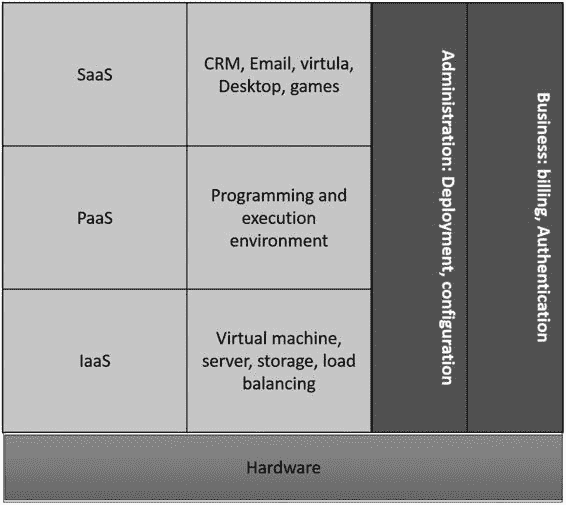

### 1.1 导论

云计算涉及集中式数据存储策略。客户端可以访问在线云服务或资源；因此，云计算可以最大程度地减少用户参与。图 1.1 和图 1.2 描绘了云计算的架构和服务。云架构包括硬件支持，如先进的数据中心和云服务 [1]。云服务架构包含以下三层：

#### a). 基础设施即服务

这位于底层，用于处理物理资源和虚拟资源，以及以网络、存储和计算能力形式提供的服务。网格计算也被称为 `IaaS`，由主节点和从节点组成。主节点分配工作负载，从节点运行工作负载 [1–3]。

#### b). 平台即服务

这为程序员提供开发框架，或帮助开发人员在提供商的平台上构建软件或功能。它是一个完全虚拟化的网络，用于一个或多个服务器、特定应用程序和操作系统 [1–4]。

#### c). 软件即服务

这是一种应用模型（例如 Google Apps 模型），其中软件运行在提供商的基础设施上 [1, 3, 4]。

### 图 1.1 云计算架构。

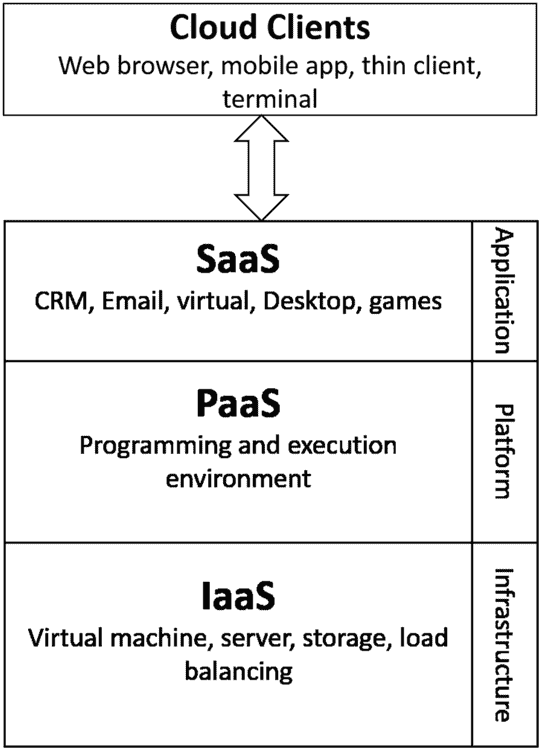

### 图 1.2 面向客户端的云服务模型。

以下定义阐述了云计算更广泛的范围。

**a.** 云计算是指一组基于互联网的应用程序，它们向最终用户提供计算资源（服务提供商基础设施，例如 Google Apps, Salesforce.com）。它可能托管在网格或效用计算系统中，但这对服务客户来说差别不大。

**b.** 云本质上是指从不稳定的本地存储向稳定可扩展环境的转变，从千兆字节的存储空间（个人电脑空间）向无限量的转变，以及从 Microsoft Office 向基于 `Web` 的办公软件的转变。与在自己的服务器上本地存储相比，云使在线存储成本更低、迁移更稳定。

**c.** 云计算的设计通常可分为三类站点：

*   **提供商。** 云提供商为云环境的用户提供其基础设施或平台。
*   **赋能者。** 这些公司专注于数据中心自动化和服务器虚拟化，并提供上述技术（`VMware`, `Citrix`, `Redhat`, `Intel`, `Sun`, `IBM` 等）。
*   **消费者。** 这些是利用资源并在当前云基础设施之上构建或改进其 `Web` 应用程序的企业。

### 1.2 云模型

云服务可分为公有云、私有云、社区云或混合云 [1, 2, 5, 6]。

#### 1.2.1 公有云

当通过网络提供的服务可供公众使用时，该基础设施被称为“公有云”。公有云服务可免费提供，也可按使用付费 [1, 3]。这些服务是动态的，但可通过互联网进行自助访问。它们主要由大型企业管理（例如 Amazon, Google App Engine）。

#### 1.2.2 私有云

私有云中的云服务仅由单一实体运行，无论是内部管理还是由第三方管理 [1, 4, 5, 7]。私有云项目需要高水平和高程度的努力来虚拟化市场环境，并重新评估当前的资源决策。

#### 1.2.3 社区云

社区云是一种云计算基础设施，由某一地理区域内的一组组织共享。

#### 1.2.4 混合云

混合云是由两个或更多云组成的结构，它们保持各自独立的实体，但相互连接，允许使用多种利用模型。利用云基础设施无缝集成和控制应用程序的能力是混合云的一个特征。

### 1.3 什么是虚拟化？

当今跨网络数据共享的指数级增长，需要使用编程模型通过多个分布式基础设施执行程序。这增加了对云的需求，导致云网络出现繁重的流量负载，因此我们使用虚拟化来优化云服务。虚拟化有多种定义方式，如下所示：

根据维基百科，“云中的虚拟化”是指创建硬件或软件资源的虚拟版本（即对实际资源的模拟）（即硬件平台、存储设备、操作系统等）。虚拟机（`VM`）的概念由 `IBM` 于 1960 年引入，旨在为其大型机提供同时、协同的访问。虚拟机给用户一种错觉，即他们可以直接访问物理机器。虽然虚拟化原理提高了全球各地 `CPU` 容量的可用性，但在客户计算机上执行的数据可能相距数千英里，导致数据获取和执行出现延迟。它在降低成本的同时最大化了资源利用率。

Rune Johan Andresen 将虚拟化定义为：虚拟化是一种将计算机算力划分为不同可执行环境的方法。更确切地说，它是一个软件层，使多个虚拟机实例呈现出真实计算机的外观 [8, 9]。

Susanta 和 Tzi-cker 将其描述为：一种利用特定硬件和软件分区方法论来合并或分离资源，以呈现一个（例如桌面虚拟化）或多个操作系统的技术 [10]。

`IBM` 将其定义为：它是实际资源替代品的开发，这些替代品执行相同的功能并具有相同的外部接口，但在属性上有所不同（例如大小、性能和成本）[11]。

Andi Mann 将其定义为：虚拟化是一种隐藏计算机资源物理特性，同时允许最终用户与之交互的方法。让单个物理资源充当多个逻辑资源就是一个例子 [12]。

William von H 将其定义为：虚拟化是持续隔离对真实物理服务的需求 [13]。

#### 1.3.1 虚拟化的优缺点

以下是虚拟化的应用场景，在这些场景中使用虚拟化会带来益处：

1.  多个同时运行的操作系统 [13, 14]。
2.  测试 [14, 15]。
3.  服务器整合 [12, 16, 17]。
4.  虚拟硬件 [13]。
5.  降低新硬件成本 [13, 18]。
6.  减少停机时间 [15, 18]。
7.  应用整合 [13–15, 19]。
8.  更好地利用现有硬件 [9]。
9.  沙箱 [13]。
10. 众多执行环境 [13]。
11. 调试 [13]。
12. 软件迁移 [13]。
13. 设备 [13]。
14. `IT` 基础设施成本降低 [18]。

以下是虚拟化的缺点：

- 信息泄露问题 [1, 13]。
- 虚拟化最大的缺点是开销，因为它会降低性能 [9, 13]。
- 不同平台和网络的管理是虚拟化最大的问题，因为它们反过来又增加了网络和调试的时间复杂度 [9]。

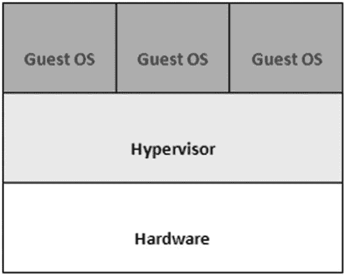

云计算中的虚拟化简介 ◾ **7**

图 1.3 云的虚拟化架构。

#### 1.3.2 云的虚拟化架构 [3–6]


1. 操作系统全权负责底层硬件。

2. 虚拟化架构中的管理程序/VMM 创造了这种假象。

3. 在虚拟化软件（即图 1.3 中的管理程序）的帮助下实现虚拟化。管理程序是一个软件层，它：

   a. 允许多个客户操作系统（虚拟机）同时在单个物理主机上运行。

   b. 它可以轻松地多路复用原始硬件属性，并为运行的客户操作系统提供硬件泛化。

#### 1.3.3 虚拟化在云计算中的重要性 [7]

1. 没有虚拟化也可以拥有云，但那将是复杂且昂贵的。

2. 云创造了“按需付费”和“无限可用性——想用多少用多少”的理念。

3. 只有后端具有高度的通用性和可靠性，这些理念才切合实际。在虚拟化环境中，这种效率是可用的。

4. 云计算在使用虚拟化时具有成本效益。

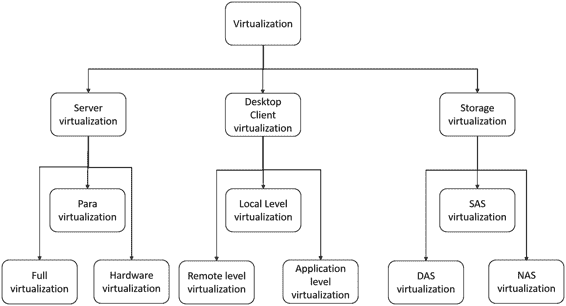

**8** ◾ ML 和优化模型

图 1.4 虚拟化类型。

#### 1.3.4 虚拟化的类别及其影响

服务器、桌面设备和磁盘虚拟化是虚拟化的三种形式。虚拟化技术的类型如图 1.4 所示。

##### A 类：服务器虚拟化

通过跨多个网络分割单个服务器的资源，服务器虚拟化使单台服务器能够处理多台服务器的功能。管理程序层通过以具有成本效益、高可访问性和高效的方式使用服务来提供这种方法。服务器虚拟化可分为三类 [20]：

a) 完全服务器虚拟化。

b) 半服务器虚拟化。

c) 硬件辅助服务器虚拟化。

###### 完全服务器虚拟化

在完全虚拟化中，VM 在物理机上一个隔离的操作系统内呈现出一个虚拟剧场的外观。为了更安全和私密的计算，客户操作系统与管理程序层分离。图 1.5 描绘了完全虚拟化和半虚拟化。

###### 半服务器虚拟化

在这种虚拟化中，客户操作系统需要修改，以便与管理程序协同工作。这种修改后的客户操作系统允许管理程序更有效地将计算资源调度给 VM，以提高性能。硬件和软件要求取决于管理程序。

**优点：**

- 与其他虚拟化技术相比，它显著提高了性能。

**缺点：**

- 需要修改 VM 操作系统。

###### 硬件辅助服务器虚拟化

硬件制造商正在迅速引入新功能，使虚拟化变得更简单。这种形式的虚拟化首次用于 IBM 的 VM/370 虚拟机，这是第一台虚拟机。它通过减少虚拟机的维护开销来加速性能，因此这种虚拟化被称为加速虚拟化 [21]。

**优点：**

- 提高性能。

- 产品作为服务器操作系统或设备进行分发。

**缺点：**

- 供应商必须在云中分发硬件兼容性列表 (HCL)，描述与虚拟化产品配合使用的硬件 [22]。

服务器虚拟化具有以下优点 [22]：

- 减少对物理服务器的需求 [23]。

- 减少服务器运行维护 [24]。

- 降低运营支出 [19]。

- 减少新服务的供应和组织 [24]。

- 缩短灾难恢复时间 [19]。

- 改善网络和应用安全性 [25]。

- 提高灵活性、可用性和性能 [25, 26]。

表 1.1 展示了完全虚拟化、半虚拟化和硬件辅助虚拟化在不同参数上的比较研究。

### 表 1.1 不同服务器虚拟化技术的比较

| **参数** | **完全虚拟化** | **半虚拟化** | **硬件辅助虚拟化** |

| :--- | :--- | :--- | :--- |

| **客户操作系统** | 未更改的客户操作系统 | 更改的客户操作系统，因此无法在本地硬件或其他版本的硬件上运行 | 未更改的客户操作系统 |

| **性能** | 良好的性能 | 在某些情况下更好 | 良好，并且随着时间的推移可能会提高，取决于硬件改进 |

| **使用者** | VMware, Microsoft | VMware, Microsoft, Xen | VMware, Xen, IBM |

| **对客户操作系统管理程序的依赖** | 无 | 无 | Xen Linux 仅在 Xen 管理程序上运行 |

云计算中的虚拟化简介 ◾ **11**

### 表 1.2 不同类型管理程序及其虚拟化的比较

| **序号** | **管理程序名称** | **完全虚拟化** | **半虚拟化** | **硬件辅助虚拟化** |

| :--- | :--- | :--- | :--- | :--- |

| 1 | KVM | 是 | 否 | 否 |

| 2 | Proxmox VE | 是 | 否 | 否 |

| 3 | Virtual Box | 否 | 是 | 是 |

| 4 | XEN | 否 | 是 | 是 |

| 5 | Open VZ | 否 | 否 | 否 |

表 1.2 显示了不同现有管理程序名称及其虚拟化类型。

##### B 类：桌面或客户端虚拟化 [22]

该技术使系统管理员能够虚拟地更新和监控桌面、移动设备和笔记本电脑。有许多基于 X Window 系统的窗口管理器程序，用于支持多个虚拟桌面应用程序。这些程序使用户能够在不同桌面（例如移动设备、笔记本电脑、计算机桌面等）之间切换，并可以显示特定应用程序的输出 [13]。客户端虚拟化分为以下三种类型：

1. **远程或服务器托管虚拟化**：托管在服务器上，由客户端网络管理。

2. **本地客户端虚拟化**：操作系统被加密和虚拟化，并在本地桌面客户端上运行。借助这种虚拟化，用户能够管理其桌面设置。

##### 3. 应用虚拟化

这提供了在单个虚拟化桌面机器上运行应用程序的多种方式。

桌面虚拟化的性能受以下多种方式影响：

1. 它取决于从总部交付给客户端的业务线应用程序的距离。

2. 它是简化了管理并降低了应用程序生命周期成本吗？

**12** ◾ ML and Optimization Models

桌面虚拟化面临一些问题，分类如下：

i. 应用程序问题。

- 网络中客户端/服务器应用程序性能缓慢。

- 应用程序的远程访问。

- 本地安装应用程序的安全性。

- 共驻应用程序的不兼容性。

- 数百或数千台 PC 上的频繁应用程序更新。

- 维护数据中心的用户数据，而非 PC 上的数据。

ii. 桌面问题。

- 桌面生命周期管理成本。

- 桌面管理。

##### C 类：存储虚拟化

这是一项新兴技术，通过生成现有物理存储的逻辑抽象来简化存储管理并降低成本，因为 CPU 生成存储单元的物理地址，然后将其转换为逻辑地址。存储虚拟化提供逻辑地址的抽象 [9]。以下三种数据存储类型用于提供存储虚拟化。

a. **直接附加存储 (DAS)**：在 DAS 系统中，存储驱动器直接连接到主机计算机。

b. **网络附加存储 (NAS)**：这是一种存储单元，通过网络将请求机器连接到服务器。

c. **存储区域网络 (SAN)**：一种存储单元被称为 SAN。它用于在独立服务器之间交换数据，以加快网络速度。

存储虚拟化借助管理程序软件提供。管理程序可以直接操作主机计算机的硬件。

## 云计算中虚拟化技术简介 ◾ 13

### 1.4 结论

云计算是当今数字世界中需求旺盛的技术。大多数用户使用云服务是因为其高性能和计算能力。许多类型的软件用于优化云；虚拟化就是其中之一。虚拟机是云计算中必不可少且关键的部分。通过在隔离环境中使用多个操作系统，这些虚拟机将管理复杂性降至最低。没有虚拟化，云计算的概念虽然可行，但将是低效且不灵活的。虚拟化是一种控制操作系统的尝试。

### 参考文献

[1] Y. Sharma, H. Gupta and S. K. Khatri, "A Security Model for the Enhancement of Data Privacy in Cloud Computing," 2019 Amity International Conference on Artificial Intelligence (AICAI), 2019, pp. 898–902.

[2] J. Szefer and E. Keller, "Eliminating the Hypervisor Attack Surface for More Secure Cloud," 18th ACM Conference on Computer and Computer Security, New York, USA, 2011, pp. 401–412.

[3] F. Wan, N. Chang and J. Zhou, "Design Ideas of Mobile Internet Desktop System Based on Virtualization Technology in Cloud Computing," 2020 International Conference on Advance in Ambient Computing and Intelligence (ICAACI), 2020, pp. 193–196.

[4] Vijay Varadharajan and Udaya Tupkula, "Security as a Service Model for Cloud Environment," *IEE Transactions on Networking and Service Management*, Vol. 11, 2014.

[5] Cong Wang and Sherman S.M. Chow, "Privacy-Preserving Public Auditing for Secure Cloud Storage," *IEEE Transaction on Computers*, vol. 62, 2013.

[6] Claudia Canali and Riccardo Lancellotti, "Balancing Accuracy and Execution Time for Similar Virtual Machines Identification in IaaS Cloud," IEEE 23rd International WETICE Conference, 2014, pp. 137–146.

[7] Durairaj M. and Kannan P., "A Study on Virtualization Techniques and Challenges in Cloud Computing", *International Journal of Scientific & Technology Research*, Vol. 3, 2014.

[8] Rosenblum M. and Garfinkel T., "Virtual Machine Monitors: Current Technology and Future Trends," *Computer*, 2005, pp. 39–47.

[9] Li Bignag, Shu Jiwu and Zheng Weimin, "Design and Implementation of a Storage Virtualization System Based on SCSI Target Simulator in SAN", *Tsinghua Science and Technology*, Vol. 10, 2005, pp. 122–127.

[10] Susanta Nanda and Tzi-cker Chiueh, *A Survey on Virtualization Technologies*, Department of Computer Science SUNY at Stony Brook, 2012, pp. 201–220.

[11] IBM, *IBM Systems Virtualization Version 2 Release 1*, International Business Machines Corporation, 2005.

**14** ◾ ML and Optimization Models

[12] Andi Mann, *Virtualization 101: Technologies, Benefits, and Challenges*, Enterprise Management Associates, Inc. 2006.

[13] William von H., *Professional Xen Virtualization*, Wiley Publishing, Inc., 2008.

[14] Qian Lin, Zhengwei Qi, Jiewei Wu, Yaozu Dong and Haibing Guan, *Optimizing Virtual Machines Using Hybrid Virtualization*, Elsevier Inc., 2012.

[15] Jeanna N., Eli M., Todd D., Wenjin H., Jeremy B., Patrick F. and Brendan J., *Running Xen: A Hands-On Guide to the Art of Virtualization*, Prentice Hall, 2008.

[16] B. Harris and N. Altiparmak, "Monte Carlo Based Server Consolidation for Energy Efficient Cloud Data Centers," 2019 IEEE International Conference on Cloud Computing Technology and Science (CloudCom), 2019, pp. 263–270.

[17] Jeanna N., Eli M., Todd D., Wenjin H., Jeremy B., Patrick F. and Brendan J., *Running Xen: A Hands-On Guide to the Art of Virtualization*, Prentice Hall, 2008.

[18] Serjeant A., "Building a Case for Server Consolidation," *VM World*. Presentation, Oct. 2005.

[19] HP, *Server Virtualization Technologies for x86-based HP Blade System and HP ProLiant Servers Technology Brief*, 3rd edition, Hewlett-Packard Development Company, L.P., 2009.

[20] Matthew Overby, *A Survey of Virtualization Performance in Cloud Computing*, University of Minnesota Duluth, 2014.

[21] Keith Adams and Ole Agesen, "A Comparison of Software and Hardware Techniques for x86 Virtualization", ACM, San Jose, CA, October 21–25, 2006.

[22] Radhwan Y Ameen and Asmaa Y. Hamo, "Survey of Server Virtualization", *International Journal of Computer Science and Information Security*, Vol. 11, No. 3, 1–10, 2013.

[23] Wolf C. and Halter E., *Virtualization from the Desktop to the Enterprise*, Apress, 2005.

[24] VMware, *Reducing Server Total Cost of Ownership with VMware Virtualization Software*, VMware, Inc., 2006.

[25] Ravi G Singh, *Server Virtualization and Consolidation: A Case Study*, IBM Corp., 2007.

[26] IBM, *IBM Systems Virtualization Version 2 Release 1*, International Business Machines Corporation, 2005.

# ML and Optimization Models

## 基于深度学习的优化

10.1201/9781003185376-2

#### 第 2 章

## 多层云中的机器学习、基于深度学习的优化

### Punit Gupta and Mayank Kumar Goyal

## 目录

### 2.1 简介

在对快速计算能力需求日益增长的这一代，云计算是满足未来需求并同时管理数据中心性能的最佳解决方案。云计算环境中的资源分配取决于资源使用情况、资源成本和调度器策略，以提高系统性能。局部或全局最优点提供了解决方案 [1, 2]。用户需求可直接在真实的云计算环境中测试，但这会增加额外成本；例如，Microsoft Azure 和 Amazon EC2 提供真实的测试环境。可扩展仿真可降低成本。云计算通过互联网利用虚拟资源提供动态服务 [2]。文献综述中提出了多种反应性技术，用于处理可靠和不可靠虚拟机上小任务执行的失败率。因此，在我们的研究工作中，我们专注于一种具有成本效益的主动容错策略。它分别包括基于预测的、基于标准的策略。这些方法侧重于历史日志、启发式、元启发式以及具有高可靠性的单目标和多目标分配。我们的重点领域包括云环境中基于预测的主动容错感知调度 [2]。Charity 等人专注于资源可靠性的主动方法，包括计算、存储和网络资源的配置参数 [3–6]。

C. Zhao 等人展示了生物启发策略，可减少资源过度配置的开销。作者专注于使用生物启发遗传方法进行独立任务映射 [4]。

在本文中，我们介绍了一种主动的、预测性的、功耗感知的容错高效调度技术，该技术基于结合 BB-BC 算法和前馈神经网络的混合方法。这也被称为基于容错 ANN（人工神经网络）的调度。结果表明，所提出的技术提高了虚拟机的可靠性。


### 2.2 相关工作

云计算是现代工业以可承受的成本、在可扩展且灵活的环境中实现高性能的一个有前景的选择。在现实世界中，云是各种服务的异构组合，按使用付费模式为用户提供各种存储、网络和处理服务。云计算负责按照对用户的承诺，以最低成本执行用户的高计算任务，而不妥协任何质量指标 [7–10]。为了管理这些任务，调度在提高云性能和用户服务质量方面发挥着重要作用。

S. G. Damanal 等人 [11] 揭示了云计算环境中虚拟机的状态。作者还将主动负载均衡器视为工作的重点领域。还有空间实施支持动态环境和可扩展仿真的策略。研究人员描述了私有云的负载均衡方案。性能衡量标准包括利用率标准。作者主要关注用于可扩展云性能衡量的生物启发元启发式技术 [12]。

作者考虑了自然启发的蚁群优化和粒子群优化技术，以改善服务质量 [13, 14]。Kalra 等人宣称了一项关于元启发式算法的综述 [15]。Beheshti Z. 等人解释了用于云调度的基于种群的元启发式算法，包括遗传算法、`PSO`、`ACO` 等 [16–19]。作者还提出了各种用于最优全局解的优化标准。

Genez 等人 [20] 提出了一种使用性能指标完工时间、成本和带宽的混合云工作流调度器。H. R. Faragardi 等人 [21] 提出了一种新颖的工作流调度资源配置机制。性能使用 IaaS 云上的完工时间性能指标进行衡量。Q. Wu 等人 [22] 建模了多目标进化调度技术，并专注于完工时间和经济成本的同时优化。V. Arabnejad 等人 [23] 引入了一种预算截止时间感知调度技术。作者还使用敏感性分析研究了所提技术的新颖性。S.K. Mishra 等人 [24] 专注于可扩展云场景中的两级配置。配置涵盖了任务到虚拟机的映射和虚拟机到主机的映射。性能使用功耗进行衡量。N. Mansouri 和 M. M. Javidi [25] 提出了一种基于作业类型和成本的作业调度技术。性能使用数据密集型和计算密集型作业的响应时间进行衡量。Y. Lu 和 N. Sun [26] 提出了一种资源感知的负载均衡任务调度技术。优化指标包括例如节能和资源利用率。所提技术支持绿色计算环境。我们的主要目标专注于利用恒定的 IaaS 云，在云计算环境中实现节能、时间和成本的权衡。在本节中，详细综述

### 2.3 建议方法论

该算法基于大爆炸-大挤压优化和人工神经网络的基本原理工作。

建议的模型将任务列表和虚拟机列表作为模型的输入。建议的模型分为以下阶段：

1. 初始化。
2. 数据集准备。
3. 模型准备。
4. 训练。
5. 反向传播。
6. 任务调度。

#### 2.3.1 初始化

在该模块中，定义了所有参数，如输入层、隐藏层和输出层的数量，以及每层中的若干神经元：`学习率`、`变异率`、`种群大小`、`进化代数`、`输入层神经元数`、`输出层神经元数`、`隐藏层神经元数`、`激活函数`。该阶段使用这些参数定义了建议模型的效率和准确性。

#### 2.3.2 数据集准备

在该阶段，使用大爆炸-大挤压算法准备训练阶段的数据集，以平均虚拟机利用率、网络延迟和执行时间作为适应度函数，同时提高网络、能效和完工时间。完整算法见第 2.3.1 节。该阶段接收一个任务列表，该列表是各种任务的异构组合，以及一个作为资源可用的虚拟机列表。输入被送入建议的修改版 BB-BC 算法。该算法旨在以最少的进化代数和变异次数找到全局最优解。建议的感知功耗和网络的模型同时照顾网络延迟和资源利用率，以提高系统的功耗表现。

```
j = n
fitness_value i = Σ (α * Network_cost tj + β * Completion_time j + γ * (1 / Failure_rate i))
j = 1
Where α + β + γ = 1.
```

```
n
Total_Execution_time = Σ Task_Length i / MIPS j
i = 1
```

公式 2.1 表示线性加权函数，其中网络成本的权重因子为 `α`，总执行时间的权重因子为 `β`。执行时间使用公式 2.2 进行测量。

#### 2.3.3 模型准备

在该模块中，使用初始化阶段的参数设计神经网络。模型由具有激活函数的输入层、隐藏层和输出层组成；输入层和隐藏层以这样的方式调整权重，使得网络的输出与训练数据集的预期输出相似。

自适应双层感知机模型的输出呈现处理用户请求的虚拟机标识。它使用前馈和反向传播方法来达到目标值。基于三层人工神经网络的模型提高了天文启发式遗传算法的性能。人工神经网络使用不同的学习率进行训练。输出的准确性取决于训练参数。网络有若干层，每层有若干节点。性能受训练机制影响。

#### 2.3.4 训练

在该阶段，设计的神经模型使用在训练数据集准备阶段准备的 80% 训练数据进行训练。该阶段很重要，因为它负责设置神经网络的权重，这决定了神经网络的准确性。

训练过程初始化权重和偏置参数。该过程重复进行，直到达到目标值。建议模型的目标值包括实例标识，它以最小的完工时间完成任务。训练过程预测未知变量的适当值。训练机制包括基于误差修正的机制和基于记忆的机制。最优训练的神经网络提供具有准确性、稳定性和正确性的最优全局解。可用数据应通过应用经验法则进行分类，即 80% 的可用数据用于训练，其余数据用于输出验证。激活函数 `Leaky ReLU` 用于隐藏层，Sigmoid 函数用于输出层。

#### 2.3.5 反向传播与误差修正

此阶段的目标是通过调整输入层和隐藏层神经元的权重以达到预期输出，从而提高神经网络的准确性。

建议模型遵循误差修正学习机制。误差修正学习机制使用代价函数 (`δk`) 提高服务质量。目标是利用如图 2.1 所示的 ANN 模型信号流图来最小化代价函数。误差修正学习机制使用公式 2.3 测量误差。

```
ek(n) = dk(n) - yk(n)  (2.3)
```

```
δk = 1/2 * ek(n)²  (2.4)
```

在公式 2.3 和公式 2.4 中，参数 `dk(n)` 表示预期输出，`yk(n)` 表示实际输出，`ek(n)` 是误差，`δk` 是用于 ANN 模型学习过程的代价函数。

#### 2.3.6 任务调度

在该阶段，使用经过适当训练的感知机模型进行任务调度，以提高调度时间、能效和任务的总执行时间。

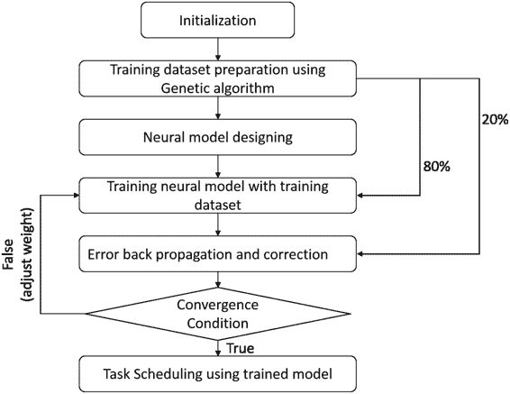

**图 2.1** 云中建议的 BB-BC ANN 调度技术流程图。

#### 2.3.7 大爆炸-大挤压算法步骤

建议的算法认为云是各种服务提供商的异构组合，它们提供具有不同成本、资源和性能的服务。云控制器和任务调度策略负责在服务提供商上寻找合适的资源，以在最短时间、最低执行成本和规定的服务质量下完成任务。建议的算法旨在涵盖上述所有性能参数。

建议的算法分为四个模块：

- 模块 1：初始化/种群生成。
- 模块 2：适应度评估。
- 模块 3：交叉/质心 + 变异。
- 模块 4：大挤压。

##### 2.3.7.1 阶段 1：初始化/种群生成

在该阶段，完成种群和其他基本参数的初始化，其中种群被视为一个完整的调度方案，由使用泊松分布生成的任务组成，因为任务在现实世界中的发生是完全随机的。概率分布函数如下式 2.8 所示。

```
p(X = x) = e^(-λ) * λ^x / x!
where x = 0, 1, 2, 3...  (2.5)
```

其中 `x` 是表示种群规模（即任务数量）的自然数。`λ` 是请求到达率，通常大于零。在此阶段，初始化 `p` 个种群，并将随机 VM 分配给任务。这些种群最终构成一组预定义的随机生成任务，且每个种群中的个体均使用随机 VM ID 进行初始化。在此阶段之后，将为每个种群初始化适应度值，该值定义了每个调度方案的性能和服务质量。

##### 2.3.7.2 阶段 2：适应度评估

该阶段从评估每个种群的适应度值开始，如下所示。适应度在判断调度方案是否参与下一代进化中起着重要作用。在 BB–BC 中，适应度也被称为调度方案的质量。在所提出的算法中，适应度函数定义如下：

适应度值 `i` 定义为第 `i` 个种群的适应度，其中适应度函数是每个任务在 VM 上的成本与执行时间之和，`j` 表示任务数量。

其中 `α` + `β` = 1。

```
j = n
fitness_value_i = Σ (a * Network_cost_tj + b * Completion_time_j) + g * (1 / Failure_rate_i)
j=1
```

任务完成时间变量使用公式 2.6 进行测量，其中 `Task_Length` 是任务的指令数，`VM_MIPS` 是 VM 的每秒百万指令数（MIPS），`PE` 是处理器数量。

```
Network_cost_i = Network_delay_i
```

```
Failure_rate_i = Task_failed_count_i / T_D
```

故障模拟取决于概率分布函数。`Task_failed_count` 涉及一段时间 `ΔT` 内的度量。

公式 2.7 定义了在特定 VM 上执行任务期间所用资源的成本。在此阶段，评估所有调度方案的质量，然后进行进化。进化是一组在每次进化中重复的步骤，包括选择、交叉、变异和大爆缩阶段。

##### 2.3.7.3 阶段 3：交叉/质心与变异

在此阶段，选择两个最优解。第一个解是成本最低的解，第二个解是适应度值最接近所有解质心的解，质心使用公式 2.9 计算。质心指平均解或解空间中的平均位置，与最优解和最差解相比，它被认为是最稳定的。质心称为 `xc`。

```
xc = (Σ (1/fi) * xi) / (Σ (1/fi))
i=1 to N
```

`xc` 是 n 维空间中的一个点，其中 `N` 是种群数量。`fi` 是 `N` 维空间中的第 `i` 个解。第二适应度最优解是最接近质心的解，即适应度值最接近质心的解。

###### 2.3.7.3.1 交叉

该阶段从选择阶段获取两个最优解，并执行多点交叉，即在两个选定解之间交换随机点。该阶段旨在从两个最优解中设计出更好的解。

###### 2.3.7.3.2 变异

在此阶段，发现的第三优解利用基于交换的变异，将其多样性在搜索空间中扩散到其他种群的候选解中。

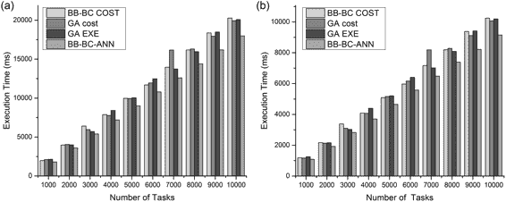

##### 2.3.7.4 阶段 4：大爆缩

该阶段通过移除适应度值最差（即适应度值最高）的种群，发挥着重要作用。重复阶段 2、3 和 4，直到仅剩下一个最优解。

图 2.3 展示了所提出模型的流程图。

### 2.4 实验结果

在本工作中，我们专注于采用天文感知和人脑启发的方法来增强性能。在本节中，对所提出模型的性能进行评估。任务调度评估使用许多标准。许多指标如下所示：

- 平均开始时间（毫秒）。
- 总执行时间/完工时间（毫秒）。
- 平均完成时间（毫秒）。
- 网络延迟（毫秒）。

#### 2.4.1 使用制造数据的结果

本小节通过缩放负载来说明结果，以研究在欠载和过载条件下的性能。图 2.2(a) 和 (b) 展示了执行时间随任务和资源缩放变化的对比。天文感知和人脑启发的 BB–BC ANN 优于最先进的方法。图 2.3(a) 和 (b) 展示了 BB–BC ANN 随任务和资源缩放的平均开始时间变化。

图 2.2 (a) 五个虚拟机的执行时间对比。(b) 十个虚拟机的执行时间对比。

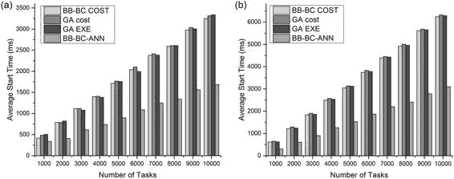

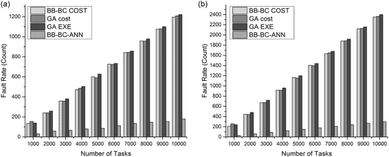

图 2.3 (a) 五个虚拟机下平均开始时间与任务缩放的对比。(b) 十个虚拟机下平均开始时间与任务缩放的对比。

图 2.4(a) 和 (b) 展示了随用户任务增加、在五个和十个虚拟机下的任务失败数量研究。图 2.5(a) 和 (b) 展示了随用户任务增加、在五个和十个虚拟机下的任务完成数量研究。图 2.4 和 2.5 表明，与现有算法相比，所提出的算法在故障环境中表现更好，完成了更多任务。

图 2.6(a) 和 (b) 展示了随任务负载增加并按虚拟机缩放资源计算出的结果。与现有方法相比，所提出的算法在网络感知和故障感知环境中表现更好。

图 2.4 (a) 五个虚拟机的任务失败数量。(b) 十个虚拟机的任务失败数量。

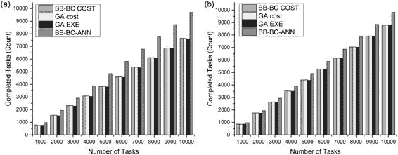

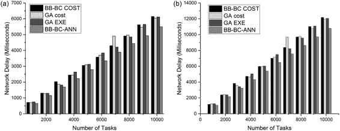

图 2.5 (a) 五个虚拟机的任务完成数量。(b) 十个虚拟机的任务完成数量。

图 2.6 (a) 五个虚拟机的网络延迟对比。(b) 十个虚拟机的网络延迟对比。

#### 2.4.2 使用真实数据集的实验结果

在本节中，使用来自并行工作负载的真实数据集进行仿真。下面列出的所有仿真均在五台和十台机器缩放下进行。性能随负载增加（即任务数量）进行评估。对比对象为现有的 BB–BC 成本以及遗传算法的其他两种变体。图 2.7(a) 和 (b) 展示了使用所提出的 BB–BC ANN、BB–BC 成本以及遗传算法的其他两种变体将任务提交到虚拟机的情况。性能使用平均开始时间进行度量。图 2.8(a) 和 (b) 展示了使用所提出的 BB–BC ANN 和最先进的现有方法的平均完成时间的变化。平均完成时间作为性能指标。图 2.9(a) 和 (b) 展示了执行时间方面的对比结果

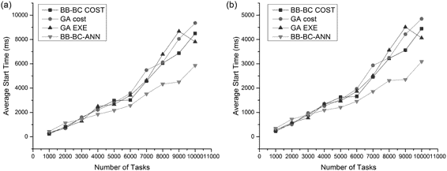

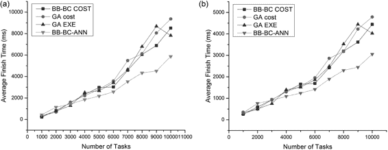

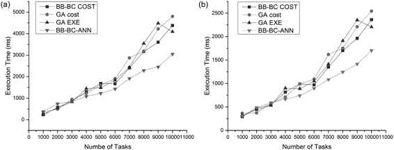

### 图 2.7

(a) 平均启动时间与五台虚拟机的对比。(b) 平均启动时间与十台虚拟机的对比。

### 图 2.8

(a) 平均完成时间与五台虚拟机的对比。(b) 平均完成时间与十台虚拟机的对比。

### 图 2.9

(a) 执行时间与五台虚拟机的对比。(b) 执行时间与十台虚拟机的对比。

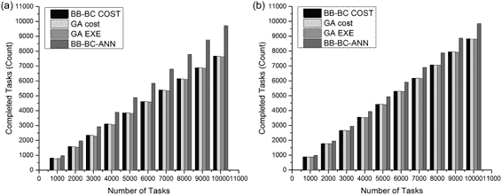

### 表 2.1 仿真参数

| 超参数 | 值 |
| :--- | :--- |
| 隐藏层 | 1，隐藏单元 = 3，学习率 = 0.2 |
| 变异率 | 0.15 |
| 进化代数 | 100 |
| 种群大小 | 100 |
| 隐藏层数量 | 3 |
| 输出层神经元数 | 50/100 |
| 每个隐藏层神经元数 | 50 |
| 激活函数 | Leaky ReLU 激活函数 = `f(x) = { a * x if x ≤ 0, x if x > 0 }` 其中 `a = .01` |

作为性能矩阵。结果是在任务负载不断增加并按虚拟机扩展资源的情况下计算得出的（表 2.1）。

与现有方法相比，所提出的算法在网络内和故障感知环境中表现更好。

图 2.10 (a) 和 (b) 显示了以完成任务数作为性能矩阵的对比结果。结果是在任务负载不断增加并按虚拟机扩展资源的情况下计算得出的。图 2.11 (a) 和 (b) 显示了以任务失败数作为性能矩阵的对比结果，其中系统故障使用泊松分布随机发生。该性能矩阵表明，如图 2.12 所示，所提出的算法减少了网络负载和执行时间，从而提高了系统性能和服务质量，优于现有算法。

### 图 2.10

(a) 完成任务数与五台虚拟机的对比。(b) 完成任务数与十台虚拟机的对比。

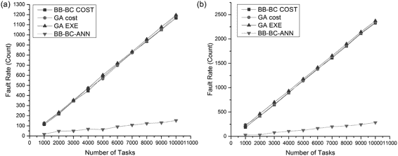

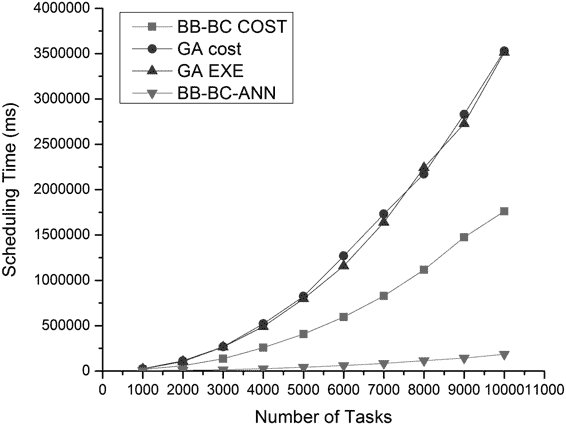

### 图 2.11

(a) 任务失败数与五台虚拟机的对比。(b) 任务失败数与十台虚拟机的对比。

### 图 2.12

仿真时间与五台虚拟机的对比。

显示了以毫秒为单位的仿真时间作为性能矩阵的对比结果。结果是在任务负载不断增加的情况下计算得出的，所提出的 BB–BC ANN 的性能优于传统算法，因为传统算法需要大量迭代来寻找最佳解，而所提出的算法是一个训练好的神经网络，针对某一场景只需训练一次。

### 2.5 结论

本文提出了一种基于人脑特征和优化方法的、受天文学和神经科学启发的虚拟机分配给用户请求的方法。所提出的算法试图利用机器学习技术提高云环境的容错能力，同时提高系统性能。结果与讨论部分表明，BB–BC ANN 优于现有的元启发式技术。对所提出算法的研究是在扩展任务负载和资源的情况下进行的。

未来的工作可侧重于数据中心网络中的虚拟机分配。所提出算法的缺点是神经网络需要在一段时间后使用更新的即将到来的任务进行重新训练，以克服训练模型的衰减。然而，与现有算法的总仿真时间之和相比，该训练时间将短得多。未来，该算法可能改善云环境中的功耗和可扩展性。所提出的算法被证明在 COVID-19 形势下云环境的过载和欠载条件下表现更好，并且在欠载和负载条件下均优于任何现有算法。

### 参考文献

1. A. Beegom and M. Rajasree, A particle swarm optimization based pareto optimal task scheduling in cloud computing, in International Conference in Swarm Intelligence. Springer, 2014, pp. 79–86.
2. N. A. B. M. Shaari, T. F. Ang, L. Y. Por, and C. S. Liew, Dynamic pricing scheme for resource allocation in a multi-cloud environment, *Malaysian Journal of Computer Science*. 30(1) (2017), 1–11.
3. A. Liu and Z. Wang, Grid task scheduling based on adaptive ant colony algorithm, in International Conference on Management of e-Commerce and e-Government, 2008. ICMECG’08. IEEE, 2008, pp. 415–418.


4. C. Zhao, S. Zhang, Q. Liu, J. Xie, and J. Hu, Independent tasks scheduling based on the genetic algorithm in cloud computing, in 5th International Conference on Wireless Communications, Networking, and Mobile Computing, 2009. WiCom’09. IEEE, 2009, pp. 1–4.

5. A. Suresh and R. Varatharajan, Competent resource provisioning and distribution techniques for cloud computing environment, *Cluster Computing*. (2017), 1–8.

6. B. Kruekaew and W. Kimpan, Virtual machine scheduling management on cloud computing using artificial bee colony, In Proceedings of the International MultiConference of engineers and computer scientists, 1 (2014), 1–5.

7. Jin X, Zhang F, Wang L, Hu S, Zhou B, and Liu Z, Joint optimization of operational cost and performance interference in cloud data centers, *IEEE Transactions on Cloud Computing*. 5(4) (Jun 25, 2015), 697–711.

8. J. Yu and R. Buyya, Scheduling scientific workflow applications with deadline and budget constraints using genetic algorithms, *Scientific Programming*. 14(3–4) (2006), 217–230.

9. S. G. Domanal and G. R. M. Reddy, An efficient cost optimized scheduling for spot instances in a heterogeneous cloud environment, *Future Generation Computer Systems*. 84 (2018), 11–21.

10. J. Gu, J. Hu, T. Zhao, and G. Sun, A new resource scheduling strategy based on a genetic algorithm in cloud computing environment, *Journal of Computers*. 7(1) (2012), 42–52.

11. Domanal SG and Reddy GR. Optimal load balancing in cloud computing by efficient utilization of virtual machines. In 2014 Sixth International Conference on Communication Systems and Networks (COMSNETS), Jan 6, 2014, pp. 1–4.

12. K. Kaur, A. Chhabra, and G. Singh, Heuristics based genetic algorithm for scheduling static tasks in the homogeneous parallel system, *International Journal of Computer Science and Security (IJCSS)*. 4(2) (2010), 183–198.

13. X. Lu and Z. Gu, A load-adaptive cloud resource scheduling model based on ant colony algorithm, in IEEE International Conference on Cloud Computing and Intelligence Systems (CCIS). IEEE, 2011, pp. 296–300.

14. J. J. Liang, A. K. Qin, P. N. Suganthan, and S. Baskar, Comprehensive learning particle swarm optimizer for global optimization of multimodal functions, *IEEE Transactions on Evolutionary Computation*. 10(3) (2006), 281–295.

15. M. Kalra and S. Singh, “A review of metaheuristic scheduling techniques in cloud computing,” *Egyptian Informatics Journal*. 16(3), 275–295.

Deep Learning-Based Optimization ◾ **31**

### 参考文献

[16] J. Fu, H. Zheng, and T. Mei, "Look closer to see better: Recurrent attention convolutional neural network for fine-grained image recognition," in *Proceedings of the IEEE Conference on Computer Vision and Pattern Recognition*, 2017, pp. 4438–4446.

[17] Z. H. Zhan, X. F. Liu, Y. J. Gong, J. Zhang, H. S. H. Chung, and Y. Li, "Cloud computing resource scheduling and a survey of its evolutionary approaches," *ACM Computing Surveys*, vol. 47, no. 4, pp. 1–22, 2015.

[18] A. Beloglazov, J. Abawajy, and R. Buyya, "Energy-aware resource allocation heuristics for efficient management of data centers for cloud computing," *Future Generation Computer Systems*, vol. 28, no. 5, pp. 755–768, May 2012.

[19] Z. Beheshti and S. M. Shamsuddin, "A review of population-based meta-heuristic algorithms," *International Journal of Advances in Soft Computing and Its Application*, vol. 5, no. 1, pp. 1–35, Mar. 2013.

[20] T. A. L. Genez, L. F. Bittencourt, N. L. S. Da Fonseca, and E. R. M. Madeira, "Estimation of the available bandwidth in inter-cloud links for task scheduling in hybrid clouds," *IEEE Transactions on Cloud Computing*, vol. 7, pp. 62–74, 2019.

[21] H. R. Faragardi, M. R. Saleh Sedghpour, S. Fazliahmadi, T. Fahringer, and N. Rasouli, "GRP-HEFT: A budget-constrained resource provisioning scheme for workflow scheduling in IaaS clouds," *IEEE Transactions on Parallel and Distributed Systems*, vol. 31, pp. 1239–1254, 2020.

[22] Q. Wu, M. Zhou, Q. Zhu, Y. Xia, and J. Wen, "MOELS: Multiobjective evolutionary list scheduling for cloud workflows," *IEEE Transactions on Automation Science and Engineering*, vol. 17, pp. 166–176, 2020.

[23] V. Arabnejad, K. Bubendorfer, and B. Ng, "Budget and deadline aware e-science workflow scheduling in clouds," *IEEE Transactions on Parallel and Distributed Systems*, vol. 30, pp. 29–44, 2019.

[24] S. K. Mishra, D. Puthal, B. Sahoo, P. P. Jayaraman, S. Jun, A. Y. Zomaya, and R. Ranjan, "Energy-efficient VM-placement in cloud data center," *Sustainable Computing: Informatics and Systems*, vol. 20, pp. 48–55, 2018.

[25] N. Mansouri and M. M. Javidi, "Cost-based job scheduling strategy in cloud computing environments," *Distributed and Parallel Databases*, vol. 38, pp. 365–400, 2020.

[26] Y. Lu and N. Sun, "An effective task scheduling algorithm based on dynamic energy management and efficient resource utilization in green cloud computing environment," *Cluster Computing*, vol. 22, pp. 513–520, 2019.

[27] S. Sawant, "A genetic algorithm scheduling approach for virtual machine resources in a cloud computing environment," Master’s Theses and Graduates Research, Paper 198, Master’s Projects, San Jose State University, 2011.

[28] P. Singh, P. Dimri, G. Saroha, and V. Barthwal, "A load balancing analysis of cloud base application with different service broker policies," *IJCA*, vol. 135, no. 10, pp. 11–15, 2019.

[29] M. Kalra and S. Singh, "A review of meta heuristic scheduling techniques in cloud computing," *Egyptian Informatics Journal*, vol. 3, pp. 275–295, Jan. 2015.

[30] A. Maas, A. Hannun, and A. Ng, "Rectifier nonlinearities improve neural network acoustic models," in *International Conference on Machine Learning (ICML)*, 2013.

[31] S. Pang, W. Li, H. He, Z. Shan, and X. Wang, "An EDA-GA hybrid algorithm for multi-objective task scheduling in cloud computing," *IEEE Access*, vol. 7, pp. 146379–146389, 2019.

## 第 3 章：多层云中基于神经网络的资源分配模型

**Rohit Verma and Punit Gupta**

DOI: [10.1201/9781003185376-3](https://dx.doi.org/10.1201/9781003185376-3)

## 目录

- 3.1 简介
- 3.2 相关工作
- 3.3 提出的模型
  - 3.3.1 模型设置
  - 3.3.2 数据集生成
  - 3.3.3 模型准备
  - 3.3.4 训练
  - 3.3.5 反向传播与误差修正
  - 3.3.6 任务调度
  - 3.3.7 大爆炸-大挤缩算法步骤
    - 3.3.7.1 初始化
    - 3.3.7.2 评估
    - 3.3.7.3 选择
    - 3.3.7.4 交叉
    - 3.3.7.5 变异
    - 3.3.7.6 大挤缩
    - 3.3.7.7 停止条件
  - 3.3.8 结果与讨论
- 3.4 结论与未来工作
- 参考文献

### 3.1 简介

云本质上是一种分布式计算环境，具有可扩展、按需付费和可靠的特性。旨在提供实时计算的云应用需要一个高效且具有成本效益的计算环境，以便为用户提供更好的性价比和可靠的解决方案。云计算环境中的资源分配取决于所用资源、资源成本以及调度器策略，以提高系统性能。局部或全局最优点提供了解决方案 [1, 2]。用户需求可以直接在真实的云计算环境中进行测试，但这会增加额外成本；例如，Microsoft Azure 和 Amazon EC2 提供真实的测试环境。可扩展的仿真可以降低成本。云计算通过互联网利用虚拟资源提供动态服务 [2]。云服务提供商为最终用户提供网络、计算和存储设施即服务。A. Liu 等人利用蚁群优化方法，结合虚拟计算环境和最终用户体验的信息 [3]。

Radojevic 等人建议为客户端节点之间设置的连接时间设定一个阈值。资源配置技术遵循虚拟机与中央资源监视器之间映射的特性。带宽和延迟这两个属性用于选择算子或成本感知适应度值测量。受自然启发的生物技术遵循遗传方法，该方法利用选择算子有助于任务分配的优化。遗传方法考虑大爆炸（有限搜索空间），包含局部最优和全局最优解。作者宣称提高了吞吐量，并利用元启发式算法提高了云的能效。

### 3.1 简介

算法 [4]。当用户请求增加时，作者并未关注时间和成本之间的权衡。

云的快速弹性特性可同时处理多个请求。弹性策略包括可扩展云计算环境的自动、响应式和主动特性 [5]。该调查有助于在资源可用性和用户满意度方面进行服务等级协议 (SLA) 管理 [6, 7]。成本感知技术基于优化方法“大爆炸-大挤压”，使用优化标准、任务完成时间和资源利用成本。启发式方法支持可扩展云环境中的高效资源分配 [8, 9]。所提出的模型主要侧重于相对于现有静态、动态和元启发式技术的性能改进 [10–16]。该模型旨在提供一种具有成本效益的解决方案，以寻找能够以最短执行时间和最低计算成本完成任务的计算资源，从而以最高效的方式计算实时应用程序的数据，并为用户提供更好的 QoS。

### 3.2 相关工作

云计算以多种形式成为一项新兴技术。本节展示了任务调度的研究。这项技术仍在不断发展，其中计算范式将应用软件封装在虚拟机和数据中心中。在现实世界中，云是各种服务提供商的异构组合，它们按“按使用付费”模式向用户提供各种存储、网络和处理服务。云计算负责按照对用户的承诺，以高计算能力和最低成本执行用户任务，且不降低任何质量指标。为了管理此任务，调度在提高云性能和用户服务质量方面发挥着重要作用。动态调度算法提供比静态调度技术更好的服务质量 [17]。调度算法的显著优势在于实现高性能计算和最优系统吞吐量。X. Jin 等人提出了一种通用技术，可捕捉时间和成本之间的权衡 [18]。

任务根据优先级映射到中央处理器上。这取决于任务的突发时间。Domanal 等人 [19] 展示了静态环境下的负载均衡策略。服务质量通过平均响应时间来衡量。尽管如此，仍有利用元启发式技术高效分配虚拟机的空间 [20]。S.G. Damanal 等人 [21] 揭示了云计算环境中虚拟机的状态。作者还将主动负载均衡器作为工作的重点领域。还有实施支持动态环境和可扩展仿真的策略的空间。研究人员描述了私有云的负载均衡方案。性能衡量标准包括利用率标准。作者主要关注用于可扩展云性能衡量的生物启发式元启发式技术 [22]。

作者提出了基于蚁群的自然启发式算法和粒子群模型，以改进云资源分配的性能 [23, 24]。Kalra 等人提供了关于先来先服务 (FCFS)、局部搜索算法、随机爬山法 (SHC) 以及带有遗传算法 (GA) 的软计算方法的详细调查 [17, 25–27]。作者还展示了用于最优全局解的各种优化标准。


作者主要关注任务在虚拟机上的映射。通过使用多个性能衡量参数，服务质量得以进一步提升。N. Panwar 等人关注可扩展云计算环境中的任务调度。作者专注于一种混合方法。该混合方法称为 TOPSIS-PSO 技术。性能以完工时间和资源成本来衡量。结果仅使用捏造的数据集生成。P.Y. Zhang 和 M.C. Zhou 关注一种两阶段调度策略。所提出的策略与云计算中广泛采用的技术进行了比较，即 max-min 和 min-min 任务调度技术 [28]。Z.H. Zhan 等人 [29] 关注资源供给中最先进方法的综合调查。这种混合方法与修正的成本感知 BB-BC 和生物启发智能系统进行了比较。生物启发智能系统神经-GA 和神经-BB-BC-成本感知技术改进了性能指标。

Singh 等人提出了一个用于云任务分配的模型。BB-BC-成本模型用于改进资源分配 [30]。Wei 等人提出了一种用于多资源分配的异构资源分配方法。多资源分配包括虚拟机分配 [31]。Wu 等人提出了一种利用性能指标成本和完工时间的多目标进化列表调度方法 [32]。上述大多数讨论的工作可归类为改进成本和时间的算法，但不存在同时尝试改进这两个参数的算法。因此，本工作旨在同时改进这两个性能参数，以向客户提供最低成本，并在云基础设施端管理高性能。

表 3.1 提供了云任务调度现有技术的比较研究 [36–42]。比较根据现有方法考虑的性能参数对算法进行了分类，即成本、执行时间、利用率和功耗。研究发现，大多数工作一次只关注一个参数，但如果考虑所有参数，则无法实现效率。上述比较研究……

### 3.3 建议模型

本节展示了用于云基础设施任务分配的建议算法。建议的 BB–BC ANN 成本感知技术的创新之处在于增加执行时间、成本和收敛率。它提供了一种具有快速收敛率的全局最优解，为客户提供了高性价比的解决方案。为克服现有成本感知调度算法的缺点，提出了一种成本感知 BB–BC ANN 算法。

建议的成本感知 BB–BC ANN 技术基于天文学中的宇宙理论。建议的成本高效大爆炸-大挤压任务调度方法受宇宙演化假说的启发，根据该假说，宇宙始于大爆炸，并分裂成各个部分，这些部分在单一力量的吸引下朝向单一的黑洞点。在第二阶段，强壮健康的部分结合在一起，不健康的部分被移除，宇宙将在一个稳定的宇宙中汇聚于单一点。

建议的算法认为云是各种服务提供商的异构组合，它们提供具有不同成本、资源和性能的服务。云控制器和任务调度策略负责在服务提供商上寻找合适的资源，以在最短时间、最低执行成本和规定的服务质量下完成任务。建议的算法旨在涵盖上述所有性能参数。

建议的算法分为两部分：训练模型准备和预测。训练模型准备阶段分为以下所列阶段：

1. 模型设置。
2. 数据集生成。
3. 模型设计。
4. 训练。
5. 反向传播。
6. 任务分配。

#### 3.3.1 模型设置

在此阶段，完成训练模型基本参数的初始化，其中定义了输入层、输出层和隐藏层的神经元数量，以及隐藏层的数量，最后是激活函数。

除此之外，BB–BC 的输入参数也被定义，包括种群大小、变异率和学习率。该模块定义了训练模型的可扩展性和准确性。

#### 3.3.2 数据集生成

在此模块中，使用建议的模型生成用于模型训练和测试的数据集。该模块定义了模型以最低成本和执行时间预测最佳全局解的准确性。

用于生成具有定义的成本感知适应度函数的数据集的建议 BB–BC 算法定义于第 3.3.7 节。建议模型的输入是资源和任务的配置。其中资源指具有成本和可用资源的主机和虚拟机配置。

该算法旨在以最少的进化和变异次数找到全局最优解。建议的模型同时照顾成本和资源利用率，以改善系统的功耗。

```
j = n
```

```
适应度值 = Σ(i=1 to j) (α × 成本 + β × 任务完成时间_j)  (3.1)
```

其中 `α + β = 1`。

```
总执行时间 = Σ(i=1 to n) (任务长度 / MIPS)  (3.2)
```

公式 3.1 定义了适应度函数，即计算成本和执行时间按 `α` 和 `β` 定义的比例求和，其中 `α` 和 `β` 之和为 1。

#### 3.3.3 模型准备

在此阶段，使用设置阶段定义的参数定义人工神经网络（`ANN`）。模型将输入层、输出层和隐藏层的神经元数量作为输入。模型还将隐藏层的数量作为输入。激活函数用于初始化和调整神经元的权重，并且在误差传播期间也负责调整进一步的权重。输入层的激活函数是 S 型函数。

建议的 `ANN` 模型使用前馈网络和反向传播来调整权重，以使模型拟合目标数据集。`ANN` 模型的准确性取决于数据类型、隐藏层数量和神经元数量。数据集之间的依赖性越高，所需的隐藏层和神经元数量就越多。

#### 3.3.4 训练

在训练阶段，阶段 2 生成的数据集被分为两部分，即训练数据集和测试数据集，比例为 80/20%，其中 80% 的数据用于训练模型，20% 的数据用于测试和误差传播，以通过迭代提高模型的准确性。该阶段通过在每次迭代中调整神经元的权重来定义模型的准确性。

训练过程旨在获得定义的最小适应度值并相应地设置权重。由建议的 BB–BC 算法生成的训练数据集旨在同时寻找最低成本和执行时间，并用于训练 `ANN` 模型。

隐藏层使用激活函数 `Leaky ReLU`，输出层使用 S 型函数。激活函数在数据集训练中起着重要作用，它定义了模型拟合的准确性。

#### 3.3.5 反向传播与误差修正

此阶段的目标是通过调整输入层和隐藏层神经元的权重以达到预期输出，从而提高神经网络的准确性。该阶段在权重调整方面起着重要作用，使模型更加准确并更精确地预测值。该过程改善了期望值与实际值之间的差距；在我们的案例中，即寻找成本和执行时间最低的资源。

```
e = - Σ_k (d_k(n) - y_k(n))  (3.3)
```

```
d = 1/2 Σ_k e_k²(n)  (3.4)
```

#### 3.3.6 任务调度

在此阶段，经过适当训练的感知机模型被用于任务调度，以减少调度时间、功耗效率、成本以及任务的总执行时间。

#### 3.3.7 大爆炸-大挤压算法步骤

所提出的算法认为云是各种服务提供商的异构组合，这些提供商提供具有不同成本、资源和性能的服务。云控制器和任务调度策略负责在服务提供商上寻找合适的资源，以在最短时间和执行成本内，并按定义的服务质量完成任务。所提出的算法旨在涵盖上述讨论的所有性能参数。

所提出的算法分为七个模块：

*   **模块 1：** 初始化。
*   **模块 2：** 评估。
*   **模块 3：** 选择。
*   **模块 4：** 交叉。
*   **模块 5：** 变异。
*   **模块 6：** 大挤压/虚拟机上任务分配的优化。
*   **模块 7：** 停止条件。

##### 3.3.7.1 初始化

在此阶段，所有所需参数均按表 3.2 所示进行初始化。算法的输入在此阶段定义。

##### 3.3.7.2 评估

在此阶段，为每个调度生成适应度值，该调度也称为一个种群。适应度在识别该调度是否将参与下一代进化中起着重要作用。在 BB-BC 中，适应度也称为调度的质量。在所提出的算法中，适应度函数定义如下：适应度值 *i* 定义为第 *i* 个种群的适应度，其中适应度函数是在虚拟机上每个任务的成本与执行时间之和，其中 *j* 表示任务数量，且 *α* + *β* = 1。

```
fitness value i = Σ (j=1 to n) [α * cost_tj + β * task_completion_time_j]  (3.6)
```

任务完成时间变量使用公式 3.7 进行测量，其中 `Task_Length` 是任务中的指令数，`VM_MIPS` 是虚拟机的 MIPS，`PE` 是处理器数量。

```
task_completion_time_i = Task_Length_i / (VM_MIPS_i × PE_i)  (3.7)
```

```
cost_i = Network_delay_i + task_completion_time_i × ((ram_size_cost_Per_Ram) + (mips_cost_Per_Mips) + (Number_Of_Pes_cost_PerSecond) + w_b(cost_Per_Bw))  (3.8)
```

公式 3.8 定义了在特定虚拟机上执行任务期间所用资源的成本。

在此阶段，使用公式 3.2 所示的适应度函数评估所有调度的质量。进化是一组在每次进化中重复的步骤，包括选择、交叉、变异和大挤压阶段。所提出的适应度函数是一个针对成本和执行时间的多目标函数，这反过来提高了系统的利用率。

##### 3.3.7.3 选择

在此阶段，选择两个最佳解。第一个解是成本最低的解，第二个解是适应度值最接近所有解质心的解，即适应度值最接近质心的解。质心或收缩算子使用公式 3.9 计算。质心用 *xc* 表示。其值使用以下公式计算：

```
xc = (Σ (i=1 to N) (x_i * f_i)) / (Σ (i=1 to N) f_i)  (3.9)
```

第二个最佳解是最接近质心的解。这两个解参与下一次进化，包括交叉和变异，以改进下一代并在解空间中找到下一个最佳解。

##### 3.3.7.4 交叉

此阶段以选择阶段的两个最佳解作为输入，并执行多点交叉，即在两个选定解之间交换随机点。此阶段旨在利用选择阶段的两个输入解设计出更好的后代解。

##### 3.3.7.5 变异

在此阶段，发现的第三个最佳解通过在搜索空间中基于交换的候选解变异，将其多样性扩散到其他种群中。交换以较低的变异率执行，这有助于保留染色体的核心特征。此步骤类似于现实世界中的生物变异。

##### 3.3.7.6 大挤压

此阶段通过在每次评估中减少搜索空间直到仅剩一个元素，在提高性能和增加找到最佳解的概率方面起着重要作用。此步骤首先从评估阶段找出适应度值最高（最差）的一个最差解。具有最差适应度的解将从种群中移除。此阶段减少了每次评估中的解的数量，这类似于算法的大挤压阶段，即只有最适者能在进化中生存，最差者将被淘汰。这种减少将减少即将到来的进化中评估和选择阶段所消耗的时间。

##### 3.3.7.7 停止条件

所提出算法的停止条件是进化代数和剩余解的数量，以先达到者为准；否则重复阶段 3.2、3.3、3.4、3.5 和 3.6，直到仅剩一个最佳解或完成进化代数。该条件定义了：如果种群规模非常大，则进化代数为停止条件；否则如果种群达到一个，即仅剩一个解，则认为该解为最佳解。图 3.1 和 3.2 展示了所提出算法的模型和流程图。

表 3.2 显示了所提出算法所考虑的所有参数。

#### 3.3.8 结果与讨论

仿真使用 `Cloudsim 3.0` 执行。仿真使用工作负载追踪进行实时任务仿真，该追踪为来自并行工作负载存储库的免费开源数据集，格式为 `SWF` 格式的工作负载文件。

在本节中，对所提出模型的性能评估进行了实施。许多标准用于任务调度评估。许多指标如下所示：

*   总执行时间（毫秒）。
*   平均完成时间（毫秒）。
*   成本（$）。
*   网络延迟（毫秒）。
*   功耗（kWh）。

图 3.3 和 3.4 展示了 200 个任务、10 个虚拟机、 3 个数据中心以及不断增加的种群规模的比较研究，以寻找更好的解。该图将所提出的算法与现有

### 基于神经网络的资源分配

#### 实验结果与分析

本实验对比了成本感知遗传算法和以执行时间为适应度函数的遗传算法。结果表明，随着种群规模的增加，找到更优解的概率也随之增加。与现有算法相比，所提出的模型产生的总执行时间和平均完成时间最少。**图 3.4** 展示了在虚拟机（`VM`）和数据中心数量保持不变的情况下，针对 200 个任务随种群规模增加的执行时间对比研究。

此处，采用平均完成时间和执行时间作为性能参数，以评估所提出算法的时间性能。

**图 3.5** 展示了在保持资源恒定的情况下，随负载增加（即任务数量增加）的平均完成时间对比研究。

本实验旨在研究在欠载和过载条件下，负载（即任务数量的增加）对完成时间和执行时间的影响。结果表明，所提出的算法表现更优。

**图 3.6** 展示了随任务数量增加的资源执行成本对比研究，其中所提出的模型在三个虚拟机的情况下优于现有工作。该研究展示了在欠载和过载条件下完成时间和执行时间的改进，其中所提出的算法被证明优于现有算法。

**图 3.7 和 3.8** 展示了以成本为性能指标、使用十个虚拟机的相同对比研究，旨在研究所提出算法在过载和欠载条件下的行为。所提出的算法在两种场景下均表现更优。**图 3.8** 展示了以平均成本为性能指标的对比研究，旨在研究随种群规模增加（即算法的搜索空间）所提出算法的性能。所提出的算法被证明优于现有模型。**图 3.9** 展示了网络延迟作为性能参数的对比研究，因为所提出的算法考虑了网络延迟。由于总执行时间是等待时间、网络延迟和执行时间之和，所提出的算法在减少网络延迟方面优于现有模型。

大多数现有工作仅考虑执行时间，这是一个不完整的性能指标。**图 3.10** 展示了现有算法与所提出的生物启发式算法的功耗对比。所提出的算法优于时间感知和成本感知的生物启发式遗传技术。通过使用嵌入在生物启发式方法内部的 BB-BC 算法，遗传方法的性能得到了提升。

### 3.4 结论与未来工作

本文提出了一种用于云基础设施任务调度的高效任务调度方案。预测模型优于遗传算法和现有技术。结果部分表明，该预测模型在云 IaaS 的任务调度方面表现优于现有技术。

本工作仅专注于使用 BB-BC 算法进行云任务调度，采用完成时间、开始时间和成本作为性能指标进行结果对比。该工作提出了一个具有高服务质量的模型。在未来的工作中，所提出的模型将用于主机上的资源调度和迁移方法，以更好地利用资源，在最优资源条件下改善云应用的运行成本。

### 参考文献

1. M Rajasree and AA Beegom, "A particle swarm optimization based pareto optimal task scheduling in cloud computing," in *International Conference in Swarm Intelligence*. Springer, 2014, pp. 79–86.

2. NABM Shaari, LY Por, TF Ang, and CS Liew, "Dynamic pricing scheme for resource allocation in a multi-cloud environment," *Malaysian J. Comput. Sci.*, 2017, vol. 30(1), pp. 1–11.

3. Z Wang and A Liu, "Grid task scheduling based on adaptive ant colony algorithm," in *International Conference on Management of e-Commerce and e-Government*, 2008. ICMECG'08. IEEE, 2008, pp. 415–418.

4. Sheikh HF, Fan D., and Ahmad I, "An evolutionary technique for performance-energy-temperature optimized scheduling of parallel tasks on multi-core processors," *IEEE Transactions on Parallel and Distributed Systems*, 2015 Apr 9, vol. 27(3), pp. 668–81.

5. Mladenow A., Strauss C., and Kryvinska N, "Towards cloud-centric service environments," *Journal of Service Science Research*, 2012 Dec 1, vol. 4(2), pp. 213–234.

6. Zhang F, Hwang K, Cao J, Li K, and Khan SU, "Adaptive workflow scheduling on cloud computing platforms with iterative ordinal optimization," *IEEE Transactions on Cloud Computing*, 2014 Aug 21, 3(2), pp. 156–68.

7. Venticinque S, Di Martino B, Aversa R, Rak M, and Petcu D, "A cloud agency for SLA negotiation and management," in *European Conference on Parallel Processing*, 2010 Aug 31, pp. 587–594.

8. Guo L, Zhao S, Shen S, and Jiang C, "Task scheduling optimization in cloud computing based on heuristic algorithm," *Journal of Networks*, 2012 Mar 1, vol. 7(3), pp. 547–567.

9. Rawat PS, Saroha GP, and Dimri P, "Virtual machine allocation to the task using an optimization method in cloud computing environment," *International Journal of Information Technology*, 2018, pp. 1–9.


# 参考文献

10. A Suresh and R Varatharajan, "Competent resource provisioning and distribution techniques for cloud computing environment," *Cluster Computing*, 2017, pp. 1–8.

11. B Kruekaew and W Kimpan, "Virtual machine scheduling management on cloud computing using artificial bee colony," 2014, vol. 1, pp. 1–5.

12. Craciun C and Frincu ME, "Multi-objective meta-heuristics for scheduling applications with high availability requirements and cost constraints in multi-cloud environments," in *2011 Fourth IEEE International Conference on Utility and Cloud Computing*, 2011 Dec 5, pp. 267–274.

13. Wickremasinghe B, Buyya R, and Calheiros RN, "Cloudanalyst: A cloud-sim-based visual modeler for analyzing cloud computing environments and applications," in *2010 24th IEEE International Conference on Advanced Information Networking and Applications*, 2010 Apr 20, pp. 446–452.

# 基于神经网络的资源分配

## 参考文献

[14] K Chandrasekaran, CT Joseph, and R Cyriac, “A novel family genetic approach for virtual machine allocation,” *Procedia Computer Science*, 2014, vol. 46(Icict), pp. 558–565.

[15] Zhang S, Zhao C, Liu Q, Xie J, and Hu J, “Independent tasks scheduling based on genetic algorithm in cloud computing,” in 2009 5th International Conference on Wireless Communications, Networking and Mobile Computing, 2009 Sep 24, pp. 1–4.

[16] P Rawat, “A survey and analysis with different resource provisioning strategies in cloud environment,” vol. 1, pp. 339–345.

[17] M Kalra and S Singh, “A review of metaheuristic scheduling techniques in cloud computing,” *Egyptian Informatics Journal*, vol. 16(3), pp. 275–295.

[18] Jin X, Zhang F, Hu S, Zhou B, Wang L, and Liu Z, “Joint optimization of operational cost and performance interference in cloud data centers,” *IEEE Transactions on Cloud Computing*, 2015 Jun 25, vol. 5(4), pp. 697–711.

[19] SG Domanal and GRM Reddy, “An efficient cost optimized scheduling for spot instances in a heterogeneous cloud environment,” *Future Generation Computer Systems*, vol. 84, pp. 2018.

[20] J Gu, J Hu, T Zhao, and G Sun, “A new resource scheduling strategy based on a genetic algorithm in cloud computing environment,” *Journal of Computers*, 2012, vol. 7(1), pp. 42–52.

[21] Reddy GR, and Domanal SG, Optimal load balancing in cloud computing by efficient utilization of virtual machines. In 2014 Sixth International Conference on Communication Systems and Networks (COMSNETS), 2014 Jan 6, pp. 1–4.

[22] K Kaur, G Singh, and A Chhabra, “Heuristics based genetic algorithm for scheduling static tasks in the homogeneous parallel system,” *International Journal of Computer Science and Security*, 2010, vol. 4(2), pp. 183–198.

[23] X Lu and Z Gu, “A load-adaptive cloud resource scheduling model based on ant colony algorithm,” in 2011 IEEE International Conference on Cloud Computing and Intelligence Systems. IEEE, 2011, pp. 296–300.

[24] JJ Liang, AK Qin, PN Suganthan, and S Baskar, “Comprehensive learning particle swarm optimizer for global optimization of multimodal functions,” *IEEE Transactions on Evolutionary Computation*, 2006, vol. 10(3), pp. 281–295.

[25] Beloglazov A, Buyya R, and Abawajy J, “Energy-aware resource allocation heuristics for efficient management of data centers for cloud computing,” *Future Generation Computer Systems*, 2012 May 1, vol 28(5), pp. 755–68.

[26] Beheshti Z and Shamsuddin SM, A review of population-based meta-heuristic algorithms. *International Journal of Advances in Soft Computing and Its Application*, 2013 Mar 1, vol. 5(1), pp. 1–35.

[27] MA Rodriguez and R Buyya, “Scheduling algorithm for scientific workflows on clouds,” 2014, vol. 2(2), pp. 222–235.

[28] PY Zhang and MC Zhou, “Dynamic cloud task scheduling based on a two-stage strategy,” *IEEE Transactions on Automation Science and Engineering*, 2018, 15(2), pp. 772–783.

[29] ZH Zhan, YJ Gong XF Liu, J Zhang, HSH Chung, and Y Li, “Cloud computing resource scheduling and a survey of its evolutionary approaches,” *ACM Computing Surveys*, 2015, 47(4), pp. 1–22.

[30] Rawat, PS, Dimri, P, Kanrar, S, and Saroha, GP, “Optimize task allocation in cloud environment based on big-bang big-crunch. *Wireless Personal Communications*, pp. 1–44.

[31] Wei, L, Foh, CH, He, B, and Cai, J, “Towards efficient resource allocation for heterogeneous workloads in IaaS clouds,” *IEEE Transactions on Cloud Computing*, 2018, vol. 6(1), pp. 264–275.

[32] Wu, Q, Zhou, M, Zhu, Q, Xia, Y, and Wen, J, “MOELS: Multiobjective evolutionary list scheduling for cloud workflows,” *IEEE Transactions on Automation Science and Engineering*, 2020, vol. 17(1), pp. 166–176.

[33] C Zhao, Q Liu, J Xie, S Zhang, and J Hu, “Independent tasks scheduling based on the genetic algorithm in cloud computing,” in 5th International Conference on Wireless Communications, Networking, and Mobile Computing, 2009. WiCom’09. IEEE, 2009, pp. 1–4.

[34] Y-C Lee, C-W Chiang, C-N Lee, and T-Y Chou, “Ant colony optimization for task matching and scheduling,” *IEE Proceedings-Computers and Digital Techniques*, vol. 153(6), pp. 373–380.

[35] J Yu and R Buyya, “Scheduling scientific workflow applications with deadline and budget constraints using genetic algorithms,” *Scientific Programming*, vol. 14(4), pp. 217–230.

[36] Kumar BA and Ravichandran T, “Time and cost optimization algorithm for scheduling multiple workflows in hybrid clouds,” *European Journal of Scientific Research*, 2012 Oct, vol. 89(2), pp. 265–75.

[37] DC Devi and VR Uthariaraj, “Load balancing in cloud computing environment using improved weighted round robin algorithm for nonpreemptive dependent tasks,” 2016, vol. 2016, pp. 1–8.

[38] SHH Madni, Y Coulibaly, MSA Latiff, and SM Abdulhamid, “Recent advancements in resource allocation techniques for cloud computing environment: a systematic review,” *Cluster Computing*, 2017, vol. 20(3), pp. 2489–2533.

[39] OK Erol and I Eksin, “A new optimization method: Big Bang-Big Crunch,” *Advances in Engineering Software*, 2006, vol. 37(2), pp. 106–111.

[40] GM Jaradat and M Ayob, “Big Bang-Big Crunch optimization algorithm to solve the course timetabling problem,” in Proceedings of the 2010 10th International Conference Intelligent Systems Des. Appl. ISDA’, 2010, vol. 10, pp. 1448–1452.

[41] Firdhous M, Hassan S., and Ghazali O, “Modeling of cloud system using Erlang formulas,” in The 17th Asia Pacific Conference on Communications, 2011 Oct 2, pp. 411–416.

[42] Zhang Y, Wang X, and Wang Y, “Greenware: Greening cloud-scale data centers to maximize the use of renewable energy,” in ACM/IFIP/USENIX International Conference on Distributed Systems Platforms and Open Distributed Processing, 2011 Dec 12, pp. 143–164.

# 第 4 章：云计算中可用性与可靠性的考量

**Dheeraj Rane, Vaishali Chourey, Rohit Verma and Punit Gupta**

DOI: `10.1201/9781003185376-4`

## 目录

- 4.1 简介
- 4.2 相关工作
- 4.3 云计算 SLA 中的可用性与可靠性
  - 4.3.1 可用性
  - 4.3.2 可靠性
- 4.4 结论
- 参考文献

### 4.1 简介

本文旨在对定义云计算 QoS 的参数——可用性和可靠性——提出系统性的描述。可以验证是否符合最低服务标准。

# 可用性、可靠性的考量

熟练运用这些形式化概念。这是开发云服务等级协议（SLA）完整蓝图以及决定 SLA 在监控云服务和确保 QoS 中成功应用的数学理解的长期过程中的第一步。

DOI：[10.1201/9781003185376-4](https://dx.doi.org/10.1201/9781003185376-4)

### 4.2 相关工作

云计算可被视为 Web 服务及其概念的延续[[16]](#index_split_001.html#p85)。网格计算[[11]](#index_split_001.html#p85)也可被视为云计算的“智力表亲”，以效用计算为基础[[17]](#index_split_001.html#p85)。因此，我们将关于 SLA 模板的文献综述分为三类：(a) 网格 SLA，(b) Web 服务 SLA 和(c) 效用计算 SLA。由于云相关的 SLA 问题仍在涌现，背景可能包括网格和面向服务架构（SOA）的 SLA。以下是对当前 SLA 框架[[18]](#index_split_001.html#p85)的调查，并附带了关于在云场景中定义新 SLA 范围的讨论。

开放网格论坛[[19]](#index_split_001.html#p86)描述了`WS-Agreement`，这是一种用于发布服务提供商能力、基于模板创建协议以及在运行时跟踪协议执行的语言和协议。它改进了传统的服务发现和使用模型，如通用描述、发现与集成（UDDI），因为它使服务用户能够发现可用服务、使用服务并动态协商服务的效率。最初没有协商过程，但现在`WS-Agreement`可覆盖 SLA 生命周期的所有五个阶段。应注意，该项目的范围仅限于 Web 服务和网格计算。


# Web 服务等级协议（`WSLA`）

Web 服务等级协议（`WSLA`）是 Keller 等人于 2003 年建立的一个系统[[2]](#index_split_001.html#p84)，用于定义和跟踪 Web 服务的服务等级协议。`WSLA`框架包括一种基于 XML Schema 的可扩展和可扩充语言，以及一个运行时架构，该架构包含许多可外包给第三方以保证完全客观性的 SLA 监控服务。客户和提供商可以使用`WSLA`来识别广泛的 SLA，确定 SLA 参数及其计算方式，并将它们链接到受控资源检测。一旦接收到 SLA 规范，`WSLA`监控服务将自动配置以实施 SLA。在定义跨组织和组织内部 SLA 参数到 XML 方面，`WSLA`具有很大的通用性。然而，它不支持多级 SLA。

Lamanna[[3]](#index_split_001.html#p84)提出了一种语言（`SLAng`），用于为应用服务提供场景生成 SLA，在该场景中，客户向服务提交请求，服务处理请求并向网络返回响应。`SLAng`将规范分为两组：通用标准和 ASP 标准。`SLAng`的语义使用基本元对象工具（`EMOF`）进行定义，这是一种类似于 UML 的建模语言。模型有助于使 QoS 参数更易理解。SLA 元素的存在也限制了模型中可发现的行为类型。对象约束语言用于定义约束。

### WS-Agreement

Andrieux[[1]](#index_split_001.html#p84)、Web 服务等级协议（`WSLA`）Keller[[2]](#index_split_001.html#p84)、`SLAng` Lamanna[[3]](#index_split_001.html#p84)和 Web 服务提供语言 Tosic[[4]](#index_split_001.html#p85)是几个著名的 Web 服务（`WSOL`）SLA 结构。用于实现的术语、考虑的条件、应用限制的方式以及适配的生命周期各不相同。由于 Web 服务和云计算都建立在面向服务架构之上，它们在 SLA 方面有很多共同点。然而，由于云计算服务实现模型的多样性（例如 `SaaS`、`PaaS` 和 `IaaS`），必须考虑许多额外的标准[[5–10]](#index_split_001.html#p85)。

本章组织如下：下一节通过证明 SLA 的必要性以及可用性和可靠性在云计算中的重要性来奠定基础。第 4.2 节详述了关于云计算中 SLA、可用性和可靠性的相关工作。第 4.3 节提供了可用性和可靠性的清晰定义。第 4.4 节总结了本章。

存在许多适用于与云计算概念相似的技术的 SLA 模板，如 Web 服务、网格和效用计算。大多数相关技术的模板要么特定于这些技术，要么正在开发中，要么缺少云所需的 SLA 生命周期的几个特性。确实，这些 SLA 模板无法以其原始形式应用于云计算环境。表 4.1 给出了三种技术[[10–15]](#index_split_001.html#p85)的比较，即云计算、网格计算和 Web 服务。这一对比揭示了 Web 服务提供的服务与云提供的服务截然不同。Web 服务是一种应用程序，它暴露了一个可使用标准 Web 技术访问的功能，并遵循 Web 服务标准。这意味着 Web 服务只是云计算服务模型（2010）之一 `SaaS` 中的一个小概念。同样，网格计算和云之间也存在差异。这些差异主要与服务模型、多级 SLA、虚拟组织、任务规模、可扩展性等有关。因此，当前的 SLA 模型无法处理云应用的多样性。

此外，它们局限于 QoS，具体指成本和性能分析，并未考虑风险、信任或绿色计算等若干非功能性问题。所有这些都增加了对云计算专用 SLA 模板的需求。

### 表 4.1 云计算、网格计算和 Web 服务的比较

| **考量因素** | **云计算** | **网格计算** | **Web 服务** |
| :--- | :--- | :--- | :--- |
| 计算方式 | 独立或并行 | 独立 | 并行 |
| 服务类型 | `SaaS`、`PaaS` 和 `IaaS` | 通常为基础设施 | B2B 服务 |
| SLA | 是 | 有限 | 是 |
| 多级 SLA | 是 | 否 | 否 |
| 协议 | TCP/IP、SOAP、REST | MPI、MPI-CHG、GIS、GRAM | SOAP、REST |
| 虚拟化 | 是 | 有限 | 否 |
| 虚拟组织 | 否 | 是 | 否 |
| 互操作性 | 有限 | 是 | 是 |
| 不同服务模型 | 是 | 主要与基础设施需求相关 | 主要为 B2B，最终用户不参与 |
| 资源处理 | 集中式和分布式 | 分布式 | 集中式 |
| 任务规模 | 取决于服务模型。从小到大不等 | 单一大型 | 小型 |
| 可扩展性 | 完全 | 有限 | 否 |
| 多租户 | 是 | 是 | 否 |
| 应用应用 | 中小企业和交互式数据检索 | HPC | 仅限于 B2B 数据检索 |
| 标准化 | 否 | 是 | 是 |
| 软件依赖 | 独立领域 | 依赖应用软件 | 独立 |
| 平台 | 服务模型 | 必须使用符合网格标准的软件 | 独立 |
| 操作系统 | 运行多个操作系统的 Hypervisor | 标准操作系统 | 标准操作系统 |
| 故障管理 | 强（虚拟机可迁移） | 有限 | 有限 |
| 用户友好性 | 高 | 低 | 因 B2B 性质，无与最终用户交互 |
| 安全性 | 必需 | 仅针对非用户需求 | 几乎安全 |

# 可用性与可靠性的考量

### 4.3 云 SLA 中的可用性与可靠性

由于底层实现的差异，由类似云计算技术实施的 SLA 无法以其原始形式显式用于云计算。因此，云 SLA 中必须具备的特性和参数将受到限制。同时，也必须引入若干新特性以适应不断变化的技术领域和时代。例如，随着云计算的广泛采用，信任应成为 SLA 的关键组成部分。本节列出了云 SLA 中应包含的主要参数，并从云的角度对其进行定义。本研究重点关注与 CSLAT（云服务）相关的四项需求：可用性、互操作性、可靠性和信任。此外，还建议了一个模板，该模板整合了指定参数，旨在弥合当前 SLA 模板与规范之间的差距。文中还给出了云 SLA 中应解决的问题清单。

#### 4.3.1 可用性

对于在云中拥有资源的组织而言，可用性是一个重要关注点。如果云上服务的可用性不被高度重视，云计算环境的优势将荡然无存。尽管技术不断进步，近几年仍发生了许多中断事件，表明此类疏漏不容忽视。因此，组织适当发展云计算的动因之一，是在保持同等服务质量的前提下，实现极致的潜在可用性 [21–23]。

当请求使用某设备时，可用性是指其按预期执行的可能性。换句话说，可用性表示设备在需要时不会发生故障或需要维修的可能性。基于这一概念，可用性可被视为可靠性的一种行为表现。然而，在确定可用性时，除了可靠性外，还应考虑系统的可维护性（维护的容易程度）。这意味着在估算可用性时，我们也应考虑系统的停机时间。系统的可用性由停机时间决定，Sericola 和 Bruno（1999）将其作为研究对象：

*   **瞬时可用性**：系统在时刻 `t` 可用的概率。
*   **平均可用性**：在指定时间段内系统可用的时间比例。
*   **稳态可用性**：当 `t` 趋于无穷大时可用性函数的极限。
*   **运行可用性**：与可用性类似，但也包含各种停机时间，如管理停机时间、计划维护停机时间和后勤停机时间。

在所有定义的变体中，瞬时可用性适用于云计算中的实时系统或关键事务，在这些场景中，特定时间点的可用性至关重要。此外，利用瞬时可用性函数，也可以确定平均可用性和稳态可用性等其他可用性数值。

下一节将讨论预测云服务可用性的当前方法，随后介绍我们提出的方法。可用性追踪是预测可用性的常用方法。在这种情况下，该技术是在历史数据中搜索趋势以预测主机的可用性。可视化工具可用于发现特定趋势。随后利用 `k-means` 等聚类算法来区分具有不同模式的机器。使用两个计算每个维度上不相等值比例的二进制向量来确定主机与质心之间的相似性。随后，使用位向量生成一段较长时期内大部分主机可用性的良好可靠描述，同时检测当前的每日和每周趋势。这些模式通常会在数周内以微小变化复制。因此，位向量观察到的模式极有可能在近期内复现。基于 Jaccard 指数的预测方法 [24] 是检测历史数据趋势的另一种方法。为了预测方案中特定机器的可用性，该方法使用懒惰学习算法在历史数据的序列模式中寻找最佳匹配。

在志愿者计算和网格计算等环境中，用户自由共享资源，可以检测历史模式以预测特定主机未来的可用性，此类方法适用。然而，由于云计算是营利性业务，以与网格和志愿者计算相同的方式预测可用性无法产生可靠结果。我们提出了一种利用概率分布和可用资源预测可用性的方法。我们的方法考虑了以下因素：

*   `n`：系统中运行单元的数量。
*   `η`：备用单元的数量。
*   `λ_i`：第 `i` 个单元的故障率。
*   `µ_i`：第 `i` 个单元的修复率。
*   `m(u)`：修复概率分布函数。
*   `tr`：故障单元被备用单元替换的平均时间。

如果将云视为一个系统，其可用性主要由其组件的可用性决定，这些组件包括 CPU、基础设施（服务器）、应用、平台和网络。对于三种服务模型，预测云可用性时对特定组件的依赖程度可能不同（表 4.2）。由于这些组件按顺序相关，特定服务模型的可用性由以下公式给出（公式 4.1）：

```
n
A_s(t) = ∏ A_i(t)
i=1
```

其中 `A_s(t)` 为服务模型可用性，`A_i(t)` 为服务模型第 `i` 个组件的可用性。马尔可夫模型可用于

### 表 4.2 云可用性背景下各组件的可用性关注点

| 服务器 | 平台 | 应用 | CPU | 网络 |
| :--- | :--- | :--- | :--- | :--- |
| **IaaS** | 需要 | 不需要 | 不需要 | 需要 | 需要 |
| **PaaS** | 需要 | 需要 | 不需要 | 需要 | 需要 |
| **SaaS** | 需要 | 需要 | 需要 | 需要 | 需要 |

# 计算单个云组件的可用性

首先，必须将组件的状态描述为状态空间（`S`）。

`S = [s0, s1, ..., sh]` (4.2)

`S` 中状态的数量由 `η`（备用单元的数量）决定。

定义状态后，可以使用故障率（`λi`）和修复率（`µi`）（Chow 1975）绘制状态图。此外，故障率和修复率均为时变的，将分别根据故障率和修复率的概率分布函数而变化。为此，可以使用指数、Pareto 和 Weibull 概率分布函数（Charles 2010）。此处的假设是：设备处于给定状态的可能性仅取决于其当前所处的状态。

`P(st | st-1, ..., s1) = P(st | st-1)` (4.3)

`η` 个节点的状态图如图 4.1 所示。每个节点代表系统可能的许多状态之一。例如，节点 `s0` 代表一切正常工作的良好状态，而节点 `sη` 代表 Markov 过程结束的故障状态。

**图 4.1 状态转移图**

状态 `s1` 到 `sη-1` 也被视为有效状态，只是在这些状态下只有少数备用单元处于运行状态。转换路径的每个分支都标有故障率 `λi`，表示导致状态变化的故障。修复率（`µi`）可以用同样的方式进一步映射。这些速率被称为转移概率，因此简写为：

`q(x, y) = P(st+1 = x | st = y) for x, y ∈ S` (4.4)

通过将这些转移概率组合成矩阵 `{q(s, s')}` 形成转换核。此处，元素（`si`, `sj`）是从状态 `si` 到状态 `sj` 的转移率，其中 `si ≠ sj`。对于 `si = sj`，该元素为该行所有其他值之和的负值（Charles 2010）。可以指定一个向量来表示时间 `t` 时可能状态间的可用性分布。

`p(t) = [Ps0(t), Ps1(t), ..., Psh(t)]` (4.5)

时间 `t` 时组件处于状态 `s0` 的概率由 `Ps0(t)` 给出。假设时间单位 1 时的机器可用性为 100%。由于状态 `s0` 表示系统完全运行且无故障，因此系统处于该状态的可能性为 1。这表示为：

`p(1) = [1, 0, 0, ..., 0]` (4.6)

因此，

`p(2) = p(1) * q` (4.7)

最后，推广公式 4.7 后，时间单位 `t` 的可用性可表示为：

`pt = p(1) * q(t-1)` (4.8)

上述公式给出了不同状态下可用性的分布。因此，组件可用性可以表示为有效状态概率之和，即：

`A = Σ(i=0 to h-1) P(si(t))` (4.9)

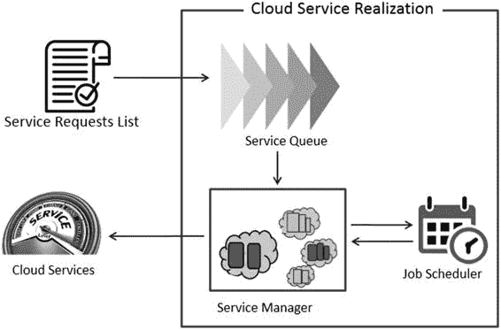

#### 4.3.2 可靠性

通常，可靠性被定义为：在指定运行条件下，待审查系统在给定时间段内或特定时间点按预期运行的可能性。可靠性是几乎所有提供商的云计算 SLA 中解决的最关键问题之一。另一方面，云服务提供商对其含义（涉及可用性、正常运行时间或弹性）、量化选项（网络、虚拟平台和服务器）、考虑的时间段以及保证条款（响应时间、解决时间）有着不同的看法 [15]。这种不确定性使客户面临风险，因此可靠性概念必须极其准确 [9]。

接下来，我们提出了一种识别各种参数的方法，这些参数可用于估算云服务的可靠性。图 4.2 展示了云计算系统的一个 SoA，这也是大多数当前云服务系统的常见表示。云管理系统（`CMS`）由一组服务器组成，可以是分布式的，也可以是集中式的。当客户请求特定云服务时，请求会被放入请求队列。`CMS` 调度器随后从队列中取出一个请求，并根据“资源管理器”的可用性信息将服务调度到一台服务器上。

**图 4.2 云计算管理系统**

我们首先检查各种故障类型，然后介绍我们预测可靠性的方法。

## 云计算设备故障

超时、溢出、数据资源丢失、软件故障、计算资源丢失、网络故障、数据库故障和硬件故障都是可能影响云服务可靠性的故障示例。所有这些故障简述如下。

**溢出**：请求队列中可保留的最大请求数应受到限制。相反，新请求将需要在队列中等待过长时间，增加与超时相关的故障可能性。当我们观察到队列已满时，新工作会被拒绝，用户无法接收服务，从而导致与溢出相关的故障。

**超时**：云服务的截止日期通常由应用协议或客户设置。当队列中的请求等待时间超过分配的时间时，会发生超时故障。因此，此类超时请求将从队列中移除，不影响后续请求。

**软件故障**：子任务是在不同资源上运行的软件程序，包含与软件相关的缺陷。

**数据库故障**：存放必要数据资源的数据库也可能发生故障，阻止子任务访问所需数据。

**硬件故障**：硬件用于提供计算和数据资源（如服务器），也可能发生故障。

**网络故障**：当子任务访问远程数据时，通信通道可能在物理或逻辑上被中断，导致网络故障，特别是在大数据集长时间发布时。

所有上述故障可分为两组，如下所示：

i) **请求阶段故障**：超时和溢出故障。

ii) **执行阶段故障**：数据库故障、网络故障、硬件故障和软件故障。

第 (i) 组故障可能发生在作业请求成功分配给计算或数据资源之前或之后；第 (ii) 组故障可能发生在作业请求成功分配后以及子任务执行期间。云服务可靠性建模可分为两部分：请求阶段可靠性建模和执行阶段可靠性建模。

## 请求阶段可靠性

我们考虑以下参数。

**请求队列容量（`N`）**：这是请求队列能容纳的最大请求数。此外，假设遵循到达率为 `λ` 的泊松过程。为简洁起见，我们将此概率 `P(x:λ)` 定义为 `λa`。

**服务截止时间（`Td`）**：这是从发送工作请求到作业完成所分配的时间量。

**平均服务时间（`µ`）**：请求由多个调度服务器处理。我们认为所有这些服务器是同构的

# 可用性与可靠性的考量

类似的设备、方案和结构。让我们考虑总共 `S` 台同构的计划服务器同时运行以服务请求。假设每台计划服务器完成一个请求所需的时间服从一个概率分布函数，该函数可通过检查服务的历史数据来确定。基于上述考量，我们将请求队列建模为马尔可夫过程，请求队列的马尔可夫建模示意图如图 4.3 所示。

在图 4.3 中，状态 `n` (`n` = 0, 1, …, `N`) 表示队列中的请求数量。注意，从状态 `n` 转移到状态 `n` + 1 的概率为 `λa`（`n` = 0, 1, …, `N` – 1）。然而，在状态 `N` 时新请求的到达会导致请求队列过载，因此该请求被丢弃，队列保持在状态 `N`。现在，以概率 `µr` 在截止时间 `Td` 内由一台计划服务器完成服务，会发生状态变化，该变化与服务调度器当前正在运行的服务数量成正比。另一方面，如果 `n` ≤ `S`，则 `n` 个请求可由 `S` 台计划服务器即时服务，因此任一请求的离开率等于 `nµr`。如果 `n` > `S`，只有 `S` 个请求由调度服务器同时服务，因此离开率为 `Sµr`。

设 `qn` 表示系统处于任意状态 `n` (`n` = 0, 1, …, `N`) 时的稳态概率。为了计算 `qn` 的值，我们必须求解以下等式：

对于 `n` = 0 或 1：

```
λa * q0 = µr * q1
```

(4.10)

对于 `n` = 1 到 `S` - 1：

```
λa * q(i-1) + (i + 1) * µr * q(i+1) = λa * qi + i * µr * qi
```

(4.11)

对于 `n` = `S` 到 `N` - 1：

```
λa * q(i-1) + S * µr * q(i+1) = λa * qi + S * µr * qi
```

(4.12)

对于 `i` = `N`：

```
λa * q(N-1) = S * µr * qN
```

(4.13)

由于系统在任何时刻都将处于某一状态，我们有：

```
Σ(i=0 to N) qi = 1
```

(4.14)

我们可以求解这些方程来确定 `qi` (`i` = 0, 1, …, `N`) 的值。

溢出故障不发生的概率为：

```
Σ(i=0 to N-1) qi
```

(4.15)

现在，考虑到计划服务器的服务时间服从概率分布函数，设为 `P(t)`，处于某一状态的作业在截止时间内完成服务的概率为：

```
Pr = ∫(0 to Td) P(t) dt
```

(4.16)

因此，超时或溢出不发生的概率为：


```
RStage1 = Σ(i=0 to N-1) qi * ∫(0 to Td) P(t) dt
```

(4.17)

该 `RStage1` 表示请求阶段的可靠性。

## 执行阶段可靠性

当硬件、软件、数据库或通信连接等一个或多个组件发生故障时，执行阶段即告失败。因此，每个组件都有其自身的故障率。值得注意的是，在运行过程中不会对软件源代码进行更改，因此软件故障率保持不变 [[14]](#index_split_001.html#p85)。在包含电子元件的硬件运行阶段，通常观察到恒定的故障率。如果 `λi` 是任意第 `i` 个元素的故障率，则 `τi` 为该元素运行 `τi` 时间时的可靠性 (Charles 2010)。

```
Ri = e^(-λi × Ti)
```

(4.18)

为了度量云服务中所用各类元素的执行时间，我们考虑了表 4.3 中提到的特性。我们可以根据上述要求度量各元素的执行时间，如表 4.4 所示。我们可以利用服务中各变量的故障概率来度量执行阶段的可靠性，如下式所示。

```
RStage2 = e^(-Σ(i=1 to Y) λi × ti)
```

(4.19)

因此，要使云基础设施成功部署，请求阶段和执行阶段都应具备相当的安全性。一旦确定了执行阶段和请求阶段的可靠性，我们将结合这两个阶段的可靠性以获得服务的可靠性：

```
RService = RStage1 * RStage2
```

(4.20)

### 表 4.3：云服务涉及的不同元素的特性描述

| **元素** | **参数** |
| :--- | :--- |
| 硬件 | 处理速度：`πi` (MIPS) |
| 软件 | 工作负载：`ωj` (指令数) |
| 数据资源 | 数据下载/上传量：`αk` (MB) |
| 通信 | 带宽：`βm` (bps) |

### 表 4.4：不同元素中时间组件的计算

| **元素** | **执行时间** |
| :--- | :--- |
| 软件 | `ti(software)` = `ωi` / `pj` (当第 `i` 个软件运行在第 `j` 个硬件上时) |
| 通信 | `tj(communication)` = `αi` / `βi` (当第 `m` 个通信链路在第 `i` 个数据资源上传输时) |
| 硬件 | `tj(hardware)` = Σ(software) + Σ(communication) (运行第 `j` 个软件和第 `k` 个通信链路) |
| 数据资源 | `ti` = Σ(communication) (数据资源的工作时间包含该资源被利用的总通信时间) |

### 4.4 结论

在基于云计算的服务供给中，服务质量是一个主要关注点。`SLA` 已被确认为确保云服务 `QoS` 的关键工件。本章旨在填补这一空白。所提出的关于可用性和可靠性等参数的详细内容被视为确保 `QoS` 的关键。在客户与提供商之间的云服务背景下计算这些指标的方法也进行了深入解释。此外，质量属性的详细分析提供了超越异构世界缺陷的能力。属性描述可用于云监控工具。

### 参考文献

[1] Wu, L., & Buyya, R. (2012). Service level agreement (SLA) in utility computing systems. In *Performance and Dependability in Service Computing: Concepts, Techniques and Research Directions* (pp. 1–25). IGI Global.

[2] Keller, A., & Ludwig, H. (2003). The WSLA framework: Specifying and monitoring service level agreements for web services. *Journal of Network and Systems Management*, 11(1), 57–81.

[3] Lamanna, D. D., Skene, J., & Emmerich, W. (2003, January). Slang: A language for defining service level agreements. In Ninth IEEE Workshop on Future Trends of Distributed Computing Systems, Proceedings (pp. 100–106). IEEE Computer Soc.

[4] Tosic, V., Patel, K., & Pagurek, B. (2002, May). Wsol—web service offerings language. In International Workshop on Web Services, E-Business, and the Semantic Web (pp. 57–67). Springer, Berlin, Heidelberg.

[5] Charles, E. (2010). *An Introduction to Reliability and Maintainability Engineering*. McGraw Hill, New York.

[6] Chow, D. K. (1975). Availability of some repairable computer systems. *IEEE Transactions on Reliability*, 24(1), 64–66.

[7] Patel, P., Ranabahu, A. H., & Sheth, A. P. (2009). Service level agreement in cloud computing. URL: https://corescholar.libraries.wright.edu/knoesis/78.

[8] Comuzzi, M., Kotsokalis, C., Spanoudakis, G., & Yahyapour, R. (2009, July). Establishing and monitoring SLAs in complex service based systems. In...

### 参考文献

[9] Dahbur, K., Mohammad, B., & Tarakji, A. B. (2011, April). A survey of risks, threats and vulnerabilities in cloud computing. In *Proceedings of the 2011 International Conference on Intelligent Semantic Web-services and Applications* (pp. 1–6).

[10] Rawat, P. S., Dimri, P., Gupta, P., & Saroha, G. P. (2021). Resource provisioning in scalable cloud using bio-inspired artificial neural network model. *Applied Soft Computing*, 99, 106876.

[11] Eng, K., Muhammed, A., Mohamed, M. A., & Hasan, S. (2020). A hybrid heuristic of variable neighbourhood descent and great deluge algorithm for efficient task scheduling in grid computing. *European Journal of Operational Research*, 284(1), 75–86.

[12] Ferrer, A. J., Hernández, F., Tordsson, J., Elmroth, E., Ali-Eldin, A., Zsigri, C., ... & Sheridan, C. (2012). OPTIMIS: A holistic approach to cloud service provisioning. *Future Generation Computer Systems*, 28(1), 66–77.

[13] Rawat, P. S., Gupta, P., Dimri, P., & Saroha, G. P. (2020). Power efficient resource provisioning for cloud infrastructure using bio-inspired artificial neural network model. *Sustainable Computing: Informatics and Systems*, 28, 100431.

[14] Goel, A. L., & Okumoto, K. (1979). Time-dependent error-detection rate model for software reliability and other performance measures. *IEEE Transactions on Reliability*, 28(3), 206–211.

[15] Hogan, M., Liu, F., Sokol, A., & Tong, J. (2011). NIST cloud computing standards roadmap. *NIST Special Publication*, 35, 6–11.

[16] Armbrust, M., Fox, A., Griffith, R., Joseph, A. D., Katz, R., Konwinski, A., ... & Zaharia, M. (2010). A view of cloud computing. *Communications of the ACM*, 53(4), 50–58.

[17] Nurmi, D., Wolski, R., Grzegorczyk, C., Obertelli, G., Soman, S., Youseff, L., & Zagorodnov, D. (2008). Eucalyptus: A technical report on an elastic utility computing architecture linking your programs to useful systems. In *UCSB Technical Report*.

[18] Jin, L. J., Machiraju, V., & Sahai, A. (2002). Analysis on service level agreement of web services. *HP*, June, 19, 1–13.

[19] Andrieux, A., Czajkowski, K., Dan, A., Keahey, K., Ludwig, H., Nakata, T., ... & Xu, M. (2007, March). Web services agreement specification (WS-Agreement). In *Open Grid Forum* (Vol. 128, No. 1, p. 216).

[20] Brandic, I., Music, D., Leitner, P., & Dustdar, S. (2009, August). Vieslaf framework: Enabling adaptive and versatile sla-management. In *International Workshop on Grid Economics and Business Models* (pp. 60–73). Springer, Berlin, Heidelberg.

[21] Schnorr, L. M., Legrand, A., & Vincent, J. M. (2010). *Visualization and Detection of Resource Usage Anomalies in Large Scale Distributed Systems* (Doctoral dissertation, INRIA).

[22] Sericola, B. (1999). Availability analysis of repairable computer systems and stationarity detection. *IEEE Transactions on Computers*, 48(11), 1166–1172.

[23] Theilmann, W., Happe, J., Kotsokalis, C., Edmonds, A., Kearney, K., & Lambea, J. (2010). A reference architecture for multi-level sla management. *Journal of Internet Engineering*, 4(1), 289–298.

[24] Rahman, M., Hassan, M. R., & Buyya, R. (2010). Jaccard index based availability prediction in enterprise grids. *Procedia Computer Science*, 1(1), 2707–2716.

## 第 5 章：面向多层云的基于神经网络和深度学习的资源分配模型

**Sanjit Bhagat and Punit Gupta**

DOI: [10.1201/9781003185376-5](https://dx.doi.org/10.1201/9781003185376-5)

## 目录

- 5.1 简介
- 5.1.1 云交付/部署模型
- 5.1.2 云服务/模型类型
- 5.1.3 云计算中的当前问题
  - 5.1.3.1 成本管理
  - 5.1.3.2 安全问题
  - 5.1.3.3 迁移
  - 5.1.3.4 性能
  - 5.1.3.5 多云（混合云）管理
  - 5.1.3.6 资源分配与管理
- 5.1.4 影响资源分配的因素
  - 5.1.4.1 资源扩展
  - 5.1.4.2 能源利用
  - 5.1.4.3 虚拟机（VM）迁移
- 5.2 神经网络简介
  - 5.2.1 人工神经网络（ANN）
  - 5.2.2 卷积神经网络（CNN）
  - 5.2.3 循环神经网络（RNN）
- 5.3 遗传算法简介
- 5.4 建议模型 1（用于优化的混合 GA 和朴素贝叶斯模型）
- 5.5 鲸鱼优化算法（WOA）
  - 5.5.1 数学模型
    - 5.5.1.1 阶段 1：包围猎物
    - 5.5.1.2 阶段 2：气泡网攻击（开发阶段）
    - 5.5.1.3 阶段 3：捕获循环（搜寻猎物（探索阶段））
- 5.6 相关工作
- 5.7 结论
- 参考文献

### 5.1 简介

深度学习算法具有通过过去的数据集进行学习并预测未来最佳可能解决方案的能力。因此，引入深度学习算法将使云计算在各个方面都更加可行，无论是成本、能源还是资源分配。基于过去数据集训练后做出的决策将提高准确性并最小化时间，因为无需人工干预。算法能够自我学习。所有云模型均可通过神经网络和深度学习概念实现；无需额外的常规算法。`人工神经网络`/`前馈神经网络 (ANN)`、`卷积神经网络 (CNN)` 和 `循环神经网络 (RNN)` 是用于开发这些智能算法的技术。

# 云计算正在快速发展，数据解读和复杂性也是如此。

通过常规程序和功能来处理如此大量的数据相当困难；这将花费很长时间和大量人力来处理数据。自学习算法是解决此问题的良方，因为它们能在极短的时间内以良好的可靠性水平处理、解读、总结并产出结果。云计算只是一个可扩展的系统，可随时处理任意数量的数据。由于大量数据正在被传输和处理到云端，技术和手段始终需要改进。这些智能算法将使云更加可靠、可扩展和分布式，同时使其在能源、成本和功耗方面更加高效。

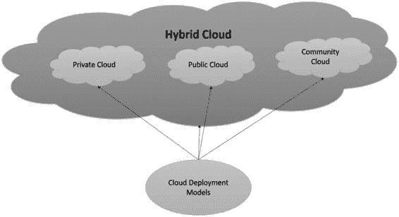

## 神经网络与深度学习 ◾ 75

在本章中，我们将重点关注资源分配问题及影响资源分配的因素。我们将讨论云计算、深度学习算法以及关于云计算和深度学习的一些综述工作，并提出混合模型。

#### 5.1.1 云交付/部署模型

根据 NIST 标准，云计算分为四种部署/交付模型（图 5.1）。

*   **公有云**：由第三方运营，通过互联网提供服务器和存储等资源。Microsoft Azure 就是公有云的一个例子。在公有云中，所有硬件、软件和基础设施均由提供商管理。用户只能通过 Web 浏览器访问这些服务并管理其账户。

*   **私有云**：顾名思义，这是一种专用云服务，资源专供单个企业或组织独家使用。私有云可以位于公司场地内，也可以付费由第三方专门为该组织进行管理。

*   **混合云**：结合了公有云和私有云，使数据和应用程序可以在公有云和私有云之间移动。它为现有基础设施提供了极大的灵活性和更多的部署选项。

图 5.1 云计算部署模型。

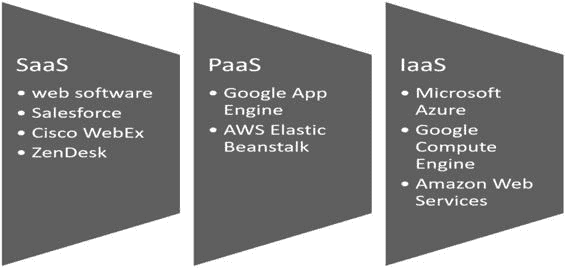

*   **社区云**：与上述定义的云类型不同，社区云专供具有共同关注点或共同目标的特定社区独家使用。

#### 5.1.2 云服务/模型类型

NIST 定义的三种服务类型为 `SaaS`、`PaaS` 和 `IaaS`，分别侧重于特定层：硬件、系统软件（平台）和应用程序。这三种服务模型描述如下（图 5.2）：

*   **软件即服务**：该服务按需通过互联网提供软件应用程序。用户无需在本地机器上安装。用户可通过 Web 浏览器访问该软件。用户无法控制该应用程序，只能使用。所有维护和更新均由提供商处理。


## 云计算服务模型

*   **平台即服务**：指提供用于开发、测试和交付软件应用程序环境的云服务。用户能够在所提供的平台上安装和操作应用程序。`PaaS` 包括服务器、存储、网络和开发工具等服务。

*   **基础设施即服务**：`IaaS` 将整个基础设施作为服务提供，可按需快速扩展或缩减，且您只需为所用内容付费。用户可购买、安装、配置和管理自己的软件、操作系统和任何应用程序，而基础设施由服务提供商管理。

**图 5.2** 不同服务层级的云服务提供商。

### 5.1.3 云计算中的当前问题

尽管云计算非常有能力处理组织的数据迁移，但不断增加的数据量和处理导致资源利用率低下，从而增加了成本、功耗和能耗。下面列出了一些常见的云计算问题。

#### 5.1.3.1 成本管理

云计算的分布式特性有助于为组织节省成本。云计算可帮助组织省钱，因为它们无需为硬件或资源进行额外投资。问题在于云计算的按需和可扩展特性，这可能导致对所需资源和成本的预测不准。

#### 5.1.3.2 安全问题

不断增加的数据量和组织迁移产生了重大的安全顾虑。安全正成为云计算中最主要的问题之一，因为组织无法看到存储数据的确切位置。这可能导致数据泄露问题。尽管安全性正在快速提高，但对于将敏感和专有数据迁移到云端，仍存在信任问题。

#### 5.1.3.3 迁移

将数据从本地移动到云端或反之的过程称为迁移。移动新应用程序是一个分步过程，相当简单，但将现有应用程序移动到云环境中仍是一项具有挑战性的任务。

#### 5.1.3.4 性能

已迁移到云端的组织完全依赖服务提供商，因为硬件资源没有物理实体，且缺乏对资源的控制。因此，无论是迁移过程还是资源分配过程，保持平稳的性能对云系统而言也是一项挑战。

#### 5.1.3.5 多云（混合云）管理

公有云在私密和机密数据的安全性和隐私方面仍不可完全信任。因此，私有云和公有云的混合成为组织的首选，它们可将机密数据存储在私有云中，其余数据存储在公有云中以节省成本和能源。管理此类云对服务提供商而言也是一项挑战。

#### 5.1.3.6 资源分配与管理

组织迁移增加了云环境的工作负载。尽管云技术正在快速改进，但由于难以维护这种灵活需求和服务方式下的性能，它仍不适合所有人。这可能会增加资源的成本和时间，且无法实现资源的合理利用。仍需要一种更好的方式来优化资源。

### 5.1.4 影响资源分配的因素

#### 5.1.4.1 资源扩展

扩展是指根据用户需求向上或向下调整资源的能力。不需要时减少资源，需要时增加资源；这会影响云系统的成本和能源效率。资源的合理管理将带来更好的云性能。`Gartner` 对自动扩展的定义如下：

> 自动扩展实现了可供应用程序使用的系统容量的自动扩张或收缩，是云 `IaaS` 和 `PaaS` 产品中一种普遍期望的功能。在可行的情况下，技术采购者应利用它使预置容量与应用程序需求相匹配并节省成本[[2]](#index_split_001.html#p108)。

从学术角度来看，自动扩展是云动态提供虚拟化资源的能力。云使用的资源可以自动增加或减少。

#### 5.1.4.2 能源利用

更好的能源利用是影响资源优化进而影响云性能的另一个主要因素。不断增长的需求

### 5.1.4.3 能源效率与成本

更好的性能将降低能源效率，从而导致成本增加。

由于数据中心的增加及其各种计算操作，有必要建立节能的资源分配机制。这些中心导致大量碳排放。`Ashkan Paya` 和 `Dan C. Marinescu` 在其论文《面向云生态系统的能量感知负载均衡与应用扩展》[3] 中提出了相关解决方案。资源的合理管理将带来节能的云系统。能源消耗的减少将降低运营支出，使云更具盈利能力。

#### 5.1.4.4 虚拟机（VM）迁移

云是一个分布式环境，用户可以将工作负载迁移到不同的机器以快速完成执行。虚拟化意味着在单个物理机器上运行多个逻辑机器。迁移过程中，`VM` 从一台物理机器移动到另一台。迁移可以是离线或在线（实时）。在离线迁移中，机器停止直到迁移过程完成；而在在线（实时）迁移中，客户端服务在迁移过程中不中断。实时迁移已被广泛用于减少能源消耗、负载均衡和动态资源分配。

要迁移 `VM`，必须将整个 `VM` 状态从源传输到目标。`VM` 包括持久存储、易失性存储、连接设备的状态以及虚拟 `CPU` 的内部状态。持久存储无需移动，因为它由网络附加存储（`NAS`）提供。`CPU` 状态和体积较小的虚拟设备状态可以轻松传输到目标主机。实时迁移的主要问题是主内存（即易失性存储）的传输，因为它包含千兆字节的数据 [4]。

云的重要性呈指数级增长。`Gartner` 预测云服务市场将在 2019 年增长 17.3%（达到 2062 亿美元），到 2022 年，90% 的组织将使用云服务 [2]（表 5.1）。

### 表 5.1 全球公共云服务收入预测（十亿美元）[2]

| Category | 2018 | 2019 | 2020 | 2021 | 2022 |
| :--- | :---: | :---: | :---: | :---: | :---: |
| Cloud Business Process Services (BPaaS) | 41.7 | 43.7 | 46.9 | 50.2 | 53.8 |
| Cloud Application Infrastructure Services (PaaS) | 26.4 | 32.2 | 39.7 | 48.3 | 58.0 |
| Cloud Application Services (SaaS) | 85.7 | 99.5 | 116.0 | 133.0 | 151.1 |
| Cloud Management and Security Services | 10.5 | 12.0 | 13.8 | 15.7 | 17.6 |
| Cloud System Infrastructure Services (IaaS) | 32.4 | 40.3 | 50.0 | 61.3 | 74.1 |
| **Total Market** | **196.7** | **227.8** | **266.4** | **308.5** | **354.6** |

## 5.2 神经网络简介

人工神经网络受人脑功能启发。`ANN` 是一组算法，其功能类似于人脑以识别模式。神经网络获取一些原始输入数据，并通过聚类、感知或标记来解释它。`ANN` 可以识别所有现实世界的对象和模式，如图像、声音、文本等。`ANN` 有助于未标记数据的分类、聚类和分组。

从展开的名称来看，`neural` 指人体中的脑细胞神经元，`network` 指相互连接的组件。人体中的神经元向大脑传递信号，但重要的是，人脑从经验中学习并基于过去的经验训练数据。同样，我们希望人工机器基于人脑的概念工作，称为神经网络。在人工神经网络中，将有人工神经元传递信号并训练数据以生成更好的输出。神经网络可用于人脑擅长的识别领域，如数据分类和模式识别。

**神经网络类型**：

*   **人工神经网络（`ANN`）。**
*   **卷积神经网络（`CNN`）。**
*   **循环神经网络（`RNN`）。**

### 5.2.1 人工神经网络（ANN）

这是最简单类型的神经网络。人工神经网络是不同层级的各种神经网络的集合。`ANN` 中的输入按前向方向处理。因此，`ANN` 也称为前馈神经网络。这些网络是通用函数逼近器，因为它们可以学习任何类型的非线性函数。通过为输入分配权重来生成输出进行映射。激活函数帮助网络理解输入和输出之间的关系。

`ANN` 具有以下三层（图 5.3）：

*   **输入层**：在 `ANN` 的输入层中，接收输入。接收到的输入被转发到下一层。在我们的案例中，输入将包含以下变量。
*   **隐藏层**：`ANN` 的隐藏层与外部世界没有连接；因此称为隐藏层。它处理由输入层转发的输入。
*   **输出层**：`ANN` 的输出生成由隐藏层处理的输出。

在我们的案例中：

```
vmlist = {1, 2, 3, ..., n}
tasklist = {1, 2, 3, ..., m}
```

是我们将传递给 `ANN` 算法的随机输入参数；隐藏层将处理输入数据并将其传递给下一层（如果可用）。在最后阶段，我们将获得输出数据集。这些基于学习的算法将从先前的数据集（训练数据集）中学习并预测问题的最优解。适应度函数充当隐藏层和输入层处理数据的阈值点。

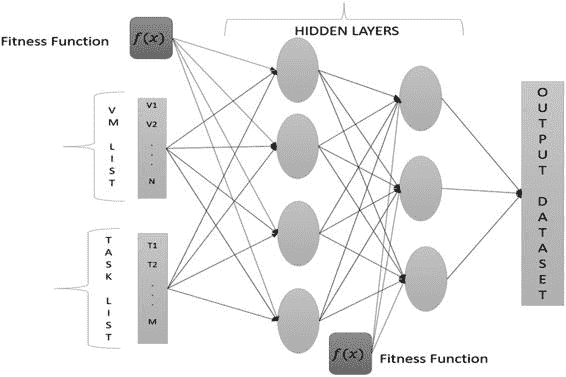

**图 5.3** 拟议模型的 ANN 架构。

### 5.2.2 卷积神经网络（CNN）

卷积神经网络主要用于图像分类。`CNN` 可以从图像生成数据，并能区分不同图像。`CNN` 的构建块是内核。内核也称为滤波器。使用卷积操作，内核或滤波器用于从输入中提取相关特征。

### 5.2.3 循环神经网络（RNN）


# Recurrent Neural Network

Recurrent Neural Network is an extended version of the Artificial Neural Network. Unlike `ANN` which processes forward at each layer, `RNN` adds an iterative constraint in the hidden layer. Therefore, through iterative constraints, we can access information from the previous iteration and train data based on past iterations. Because it has recurrent connections in the hidden layer, it is called a Recurrent Neural Network. The previous output is considered as input for the next layer.

- **Input Layer**: The input layer of `RNN` receives input.
- **Recurrent Layer**: In the recurrent layer, input is processed and iterated to generate better output.
- **Output Layer**: This layer generates the output processed by the recurrent layer.

将深度学习与云相结合的使用，与传统方法相比，必将产生更好的结果。上述算法根据其目标和工作方式进行分类。基本功能是提供带有某些权重和阈值点的输入，并将其传递给隐藏层，隐藏层将使用激活函数处理输入，然后产生输出。每一层都将拥有各自的偏置点。

## 5.3 遗传算法简介

该算法是一种基于搜索的启发式算法，它根据适应度标准选择对象以进行进一步处理。GA 由五个阶段组成：

### 5.3.1 初始种群

这是给定问题可能解的集合。集合中的每个元素都由某些参数表征。在确定初始种群时，应牢记多样性和种群大小。种群大小是一个随机向量。初始化可通过两种方式完成：

1. **随机初始化**：在没有先验知识的情况下随机给出解。
2. **启发式初始化**：根据某些已知的先验因素给出解；这可能导致解的相似性和多样性降低。

在我们的案例中，我们使用的是随机初始化。

```
VM_list = { mV1, mV2, mV3, ..., mVn }
Pn = { P1, P2, P3, ..., Pn }
```

图 5.4 是一个单一解；我们将从种群中生成一组 `n` 个解。

```
Sn = { [ Vm[List]1, P[n]1 ], [ Vm[List]2, P[n]2 ], ..., [ Vm[List]i, P[n]j ] }
S = { S1, S2, S3, ..., Sn }
```

**图 5.4** 虚拟机到种群向量的随机分配。

其中：

- `Vm` 是虚拟机数组。
- `P` 是种群集合。
- `Sn` 是解集。

确定初始种群后，将预定义的适应度函数应用于初始种群。

### 5.3.2 适应度函数

这是一个预定义函数，用于确定初始种群集合中各个元素的适应度。个体的选择基于适应度得分。适应度函数计算给定解的适应度应足够快，因为我们可能需要重复多次，直到找到最优解。根据情况，适应度可能是精确的，也可能是近似的。

应用适应度函数后，我们将获得由适应度函数确定的适合解列表（图 5.5）。

```
Fn = { S1, S3, ..., Sn }
```

`Fn` 是适合解的集合。

**图 5.5** 应用适应度函数后生成适合解集合。

### 5.3.3 父代选择

选择是遗传算法的关键部分，因为如果我们选择最适合的可能解，它可能会占据整个种群，从而导致**过早收敛**。良好的多样性维护对于 GA 的成功至关重要。有多种选择解的方法。

#### 5.3.3.1 适应度比例选择

在此方法中，每个解成为父代的概率与其适应度成正比。因此，适应度较高的解将有更高的被选中几率。此类选择有两种可能的模型：

1. **轮盘赌选择**：在轮子圆周上定义一个固定点。旋转后，停在固定点前方的区域被选为父代。适应度越高的解覆盖的区域越大，因此被选中的几率越高。
2. **随机普遍采样**：我们将有多个固定点；因此所有父代将在一次旋转中被选中。

#### 5.3.3.2 锦标赛选择

在 `n` 向锦标赛选择中，从种群中选择 `n` 个个体解。重复该过程，直到选出最适合的父代。此方法也适用于负值。

#### 5.3.3.3 排序选择

当个体的适应度彼此非常接近时。在这种情况下，适应度值几乎不可考，因为所有集合具有相同的适应度值。优先选择排名较高者。

### 5.3.4 交叉

在此过程中，选择多个父代并生成一个或多个具有父代属性的集合。交叉以高概率应用。执行交叉有多种方式。

#### 5.3.4.1 单点交叉

此处从父代中选择一个随机点，并通过交换过程生成新解。

#### 5.3.4.2 多点交叉

这是单点交叉的进阶形式；在此我们将拥有多个随机点来生成新解。

#### 5.3.4.3 均匀交叉

此处没有随机点。我们通过抛硬币决定是否选择父代的属性。

#### 5.3.4.4 整体算术重组

这通过公式获取两个父代的加权平均值：

```
Child1 = a × x + (1 - a) × y
Child2 = a × x + (1 - a) × y
```

#### 5.3.4.5 Davis 顺序交叉 (OX1)

这是一种基于排列的交叉，将相对信息传递给新解。其工作原理如下：

1. 在父代中定义两个随机点，复制两点之间的片段并将其移至第一个新解。
2. 现在从第二个父代的第二个点复制未使用的内容并移至第一个解。
3. 以相反的父代方式重复第二个解的操作。

### 5.3.5 变异

此过程在父代解中进行随机的微小改动以生成新解。这旨在维持初始种群集合的多样性，且以低概率发生。最常用的变异有：

#### 5.3.5.1 位翻转变异

我们选择一些随机位并将其翻转以获得新解。主要用于二进制编码的 GA。

#### 5.3.5.2 随机设置

在此方法中，将一个随机整数值分配给随机选择的解。

#### 5.3.5.3 交换变异

这种基于组合的编码从父代中选择两个随机点并交换它们以生成新解。

#### 5.3.5.4 乱序变异

此处选择解的一个子集并对其进行乱序/洗牌以生成新解。

#### 5.3.5.5 逆序变异

类似于乱序选择变异，我们选择一个子集，但不是洗牌，而是反转列表以生成新解。

### 5.3.6 终止条件

当遗传算法提供一组解时，算法终止。开始时 GA 往往非常快，但在后期阶段会达到饱和点，此时改进非常微小。终止通常在我们非常接近最优解时进行。通常，终止时应考虑以下几点：

1. 连续 `n` 次迭代无改进时。
2. 如果达到绝对代数上限。
3. 当解达到预定义标准时。

## 5.4 提出的模型 1（用于优化的混合 GA 和朴素贝叶斯模型）

我们的目标是将这两种算法合二为一，生成一种混合算法，在节省任务总执行时间的同时提高预测能力，从而有助于在节省执行时间的前提下实现合理的资源优化（图 5.6）。

首先，我们将从所有可用的 VM 中生成一个随机列表并

## 5.5 鲸鱼优化算法 (WOA)

WOA 由 Jalili 和 Lewis 提出，用于优化数值问题 (Mir Jalili & Lewis, 2016)。它是一种模仿座头鲸行为的元启发式算法。其觅食行为被称为气泡网捕食。猎物是靠近水面的小鱼。觅食是通过沿圆周产生独特的气泡来完成的。整个过程分为三个阶段：珊瑚环（包围猎物）、拍尾（气泡网攻击方法（开发阶段））和捕获环（搜索猎物（探索阶段））。

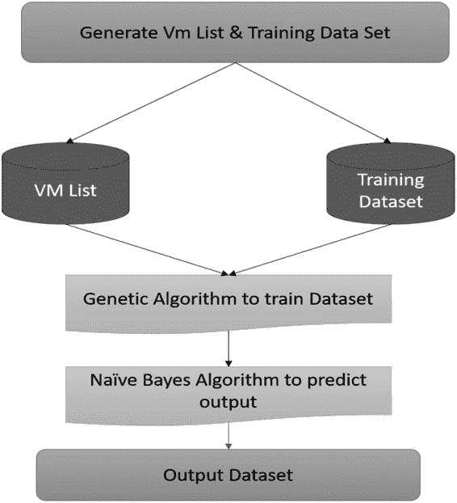

**图 5.6** 混合算法的建议模型。

### 5.5.1 数学模型

#### 5.5.1.1 第一阶段：包围猎物

第一阶段是识别猎物的位置并对其进行标记。当前最佳搜索代理被视为目标猎物。确定当前最佳解后，其他解将尝试更新其位置以向当前最佳解靠拢。该过程表述如下：

```
D = C × X*(t) - X(t)
X(t+1) = X*(t) - A × D
```

其中

- `t` 表示当前迭代次数。
- `X*` 是第 `t` 次迭代时迄今获得的最佳解的位置向量。
- `X` 是每个代理的位置向量。

系数向量 `A` 和 `C` 计算如下：

```
A = 2a × r - a
C = 2r
```

其中

- `a` 在迭代过程中线性从 2 递减到 0。
- `r` 是 [0,1] 区间内的随机向量。

#### 5.5.1.2 第二阶段：气泡网攻击（开发阶段）

开发阶段是两种方法的结合。

##### a) 收缩包围机制

该机制通过减小 `a` 的值来实现；`A` 的波动范围也随 `a` 减小。可以说，`A` 是区间 `[-a, a]` 内的随机值，其中 `a` 在迭代过程中从 2 递减到 0。

##### b) 螺旋更新位置

在此步骤中，在鲸鱼位置与目标之间建立一个方程，以产生螺旋状运动；方程如下：

```
D' = X*(t) - X(t)
X(t+1) = D' × e^(bl) × cos(2πl) + X*(t)
```

其中

- `D'` 是鲸鱼与目标之间的距离。
- `b` 是定义对数螺旋形状的常数。
- `l` 是 [-1,1] 区间内的随机数。

座头鲸在收缩圆圈的同时沿螺旋路径移动。如果我们假设在一次迭代中选择收缩包围或螺旋模型移动的概率各为 50%，则：

```
X(t+1) = X*(t) - A·D          if p < 0.5
X(t+1) = D' × e^(bl) × cos(2πl) + X*(t)  if p ≥ 0.5
```

其中 `p` 是 [0,1] 区间内的随机数。

#### 5.5.1.3 第三阶段：捕获环（搜索猎物（探索阶段））

在气泡网方法中目标未定义；因此猎物是随机搜索的。可以利用 `A` 的变化，当 `|A| > 1` 时，迫使搜索代理远离参考位置（鲸鱼）。搜索代理的位置将根据随机选择的解进行更新，而不是迄今为止的最佳解。

这可以表述为：

```
D = C × X_rand - X
X(t+1) = X_rand - A·D
```

其中 `X_rand` 是随机位置向量。

## WOA 算法（伪代码）

最初有一组随机解。在每次迭代中，搜索代理根据最佳解或随机选择的代理更新其位置。为了探索和开发，参数 `a` 从 2 递减到 0。

如果 `|A| > 1`，选择随机代理；如果 `|A| < 1`，选择迄今为止的最佳解来更新搜索代理的位置。

**伪代码**：

```
Input: data, max_iteration, population
Initialize whales population Xi (i = 1,2,3……..n)
Initialize A, C, l, a and p
Calculate the fitness of each search agent
X* = best agent at the beginning
While (It < max_iteration)
    for each search_agent
        if (p < 0.5)
            if (|A| < 1)
                update search agent with X(t+1) = X*(t) - A×D
            else if (|A| >= 1)
                select random search agent (X_rand)
                update the current search agent with X(t+1) = X_rand - A×D
            end
        else if (p >= 0.5)
            update the position of current search agent with X(t+1) = D' × e^(bl) × cos(2πl) + X*(t)
        Calculate fitness of each search agent
        Update X* if better agent found
    It = It+1
    Update A, C, l, a and p
end while
return X*
```

我们将提出一种结合 ANN 的改进鲸鱼优化算法，以实现更高的准确性和最小的响应时间（图 5.7）。

**图 5.7** WOA 和 ANN 的建议模型架构。

WOA 以虚拟机列表和适应度函数作为输入，连同其他参数。然后它为每次迭代生成一个最优解。该列表被传递给 ANN 算法用于学习，测试数据集将被传入 ANN 进行进一步预测。因此，它也将提高准确性和效率。

## 表 5.2 基于云和 ANN 方法的相关工作分析

| 作者 | 方法 | 结果/结论 |
| :--- | :--- | :--- |
| [1] Reshmi, R. and Saravanan | 基于高斯的自适应最小均方滤波器 (DoG–ALMS) | 该方法改善了网络的整体资源优化 |
| [2] Akki, P. and Vijayarajan, V. | 结合改进蝙蝠算法的优化神经网络/卷积神经网络 | 与传统蝙蝠算法相比，所提方法更节能 |
| [3] Jeddi, S. and Sharifian, S. | 基于小波变换和 GMDH 方法提出了一种预测高度波动工作负载的模型 | 更好的 CPU 扩展和调整 |
| [4] Chudasama, V. and Bhavsar | 一种基于双向 LSTM 的方法，预测算法 | 该模型比其他模型更接近实际资源需求。它能够优化 SLA 违规 |
| [5] AbdElminaam, D.S. and Toony | 将双链量子技术集成到遗传算法中 | 该优化模型提高了资源优化精度 |
| [6] Chen, S. and Fang, S | 基于 ANN 的实时调度方法 | 优化了实时调度的响应时间 |
| [7] Hasan, M. and Almamun, M. | 新型自适应资源分配架构 | 该模型在 QoS 满意度方面表现良好，且节能高效 |
| [8] Kholidy, H.A. | 基于群智能的预测方法 (SIBPA) | 实现了更高的准确性，具有良好的响应和吞吐时间，以做出更好的扩展决策 |
| [9] Lang, K. and Zhao | 基于改进 ANN 模型的云计算资源方法 | 预测了合理的资源调度精度 |
| [10] Saravanan, S. and Anbalagan | 集成深度强化学习和狮子算法 | 合理的资源分配 |

# 基于机器学习的预测模型以改进云 SaaS 中的云应用性能

**Falguni Sharma 和 Punit Gupta**

## 目录

- 6.1 简介
- 6.1.1 基本特征
- 6.1.2 云交付/部署模型
- 6.1.3 云服务/模型类型
- 6.2 云挑战
- 6.3 文献综述
- 6.4 比较分析
- 6.5 结论
- 参考文献

## 6.1 简介

术语“云”指的是网络上的一个巨大网络或空间。它是一项利用网络上的远程服务器来存储、开发、部署、维护和在线访问信息的创新技术，而非使用本地驱动器或机器。信息可以是任何内容，例如记录、图片、报告、声音、视频等，应有尽有。无论大小，所有 IT 组织在 IT 基础设施方面都遵循传统技术。所有 IT 组织都需要一个服务器室，这是组织的一项基本需求。服务器室由数据库服务器、邮件服务器、网络、交换机、防火墙、调制解调器、交换机、每秒查询数（`QPS`）方法（该方法处理服务器在给定时间内可解决的查询负载）、框架、高速互联网以及维护和支持工程师组成。在组织中建立此类基础设施并同时维护它需要大量的经济支持。为了解决传统 IT 基础设施的问题并降低 IT 基础设施成本，创新者发明了云计算方法（图 6.1）。

云计算技术通过互联网为用户提供虚拟机、服务器、数据中心等基础设施；用于软件开发和部署的平台；以及应用程序。云提供了云所有工作所依赖的部署模型和服务模型。云框架中使用了四种类型的部署模型：公有云、私有云、社区云和混合云。部署模型是根据环境的云基础设施所在位置来定义的。云中的所有服务均根据其服务类型被归类为三种服务模型。

云的服务模型包括：基础设施即服务（`IaaS`），提供虚拟化计算资源；平台即服务（`PaaS`），为开发人员提供平台以开发可轻松构建和运行的框架；以及软件即服务（`SaaS`），为云用户提供基于订阅或免费使用的授权应用程序和软件（图 6.2）。在 `PaaS` 中，开发人员无需基础设施即可运行或创建应用程序；可根据需要调用资源和 API。

机器学习是人工智能的扩展应用领域，它促进了系统在未被显式编程的情况下进行自动学习。人工智能之间的区别

**DOI**：[10.1201/9781003185376-6](https://dx.doi.org/10.1201/9781003185376-6)

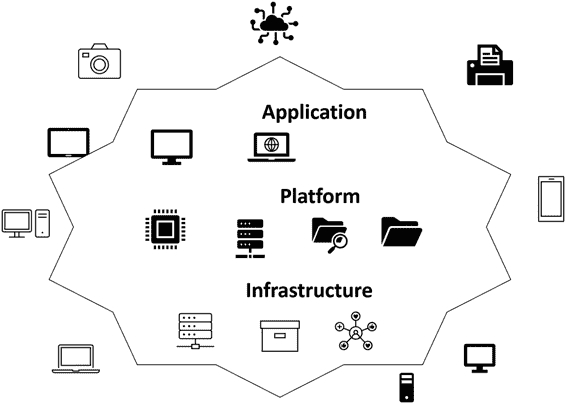

*图 6.1 云架构。*

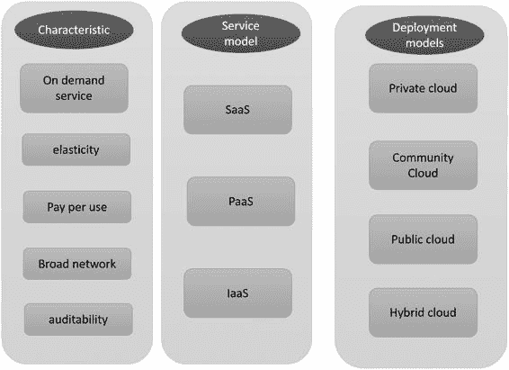

*图 6.2 服务模型。*

---

## 提出的模型 2（WOA 结合 ANN）

```
$ Vm list = Vm_1, Vm_2, Vm_3, ..., Vmn
$ TaskList = T_1, T_2, T_3, ..., Tn
$ random Vm = [1, 2, 3, ..., n]
```

**适应度函数**：

```
f(x) = Σ (i=1 to n) t[i] / VM[randomVm[i]]
```

其中 `t[i]` = 任务长度，`VM[randomVm[i]]` = 随机位置处的 `Vm`。

在上述参数的帮助下，`WOA` 将生成一个最优数据集解，该解将作为训练模块和测试集传递给 `ANN`，以基于训练产生最终的最优解。

### 5.6 相关工作


在表 5.2 中，我们讨论了一些基于云和学习算法的相关工作。

### 5.7 结论

该工作展示了利用自然启发算法和机器学习算法进行资源分配领域的当前最先进工作。比较表明，使用 `ANN`、`RNN` 或随机森林的基于机器学习的算法优于现有的自然启发算法和元启发式算法。该工作展示了各种问题和性能参数。该工作为研究人员提供了云中资源分配领域当前最先进工作的综述。

### 参考文献

1. Peter Mell, and Timothy Grance, "The NIST definition of cloud computing." Sep, 2011. [`csrc.nist.gov/publications/nistpubs/800-145/SP800-145.pdf`](http://csrc.nist.gov/publications/nistpubs/800-145/SP800-145.pdf)

2. Gartner Research, [`www.gartner.com/it-glossary/cloud-computing/`](http://www.gartner.com/it-glossary/cloud-computing/)

3. Reshmi, R., and D. Shanthi Saravanan. "Load prediction using (DoG–ALMS) for resource allocation based on IFP soft computing approach in cloud computing." *Soft Computing* 24, no. 20 (2020): 15307–15315.

4. Akki, Praveena, and V. Vijayarajan. "Energy efficient resource scheduling using optimization based neural network in mobile cloud computing." *Wireless Personal Communications* 114 (2020): 1785–1804.

5. Jeddi, Sima, and Saeed Sharifian. "A hybrid wavelet decomposer and GMDH-ELM ensemble model for network function virtualization workload forecasting in cloud computing." *Applied Soft Computing* 88 (2020): 105940.

6. Chudasama, Vipul, and Madhuri Bhavsar. "A dynamic prediction for elastic resource allocation in hybrid cloud environment." *Scalable Computing: Practice and Experience* 21, no. 4 (2020): 661–672.

7. AbdElminaam, Diaa Salama, Ahmed A. Toony, and Mohamed Taha. "Resource allocation in the cloud environment based on quantum genetic algorithm using Kalman filter with ANFIS." *IJCSNS* 20, no. 10 (2020): 10.

8. Chen, Shengkai, Shuliang Fang, and Renzhong Tang. "An ANN-based approach for real-time scheduling in cloud manufacturing." *Applied Sciences* 10, no. 7 (2020): 2491.

9. Hasan, Md, Md Almamun, and Shawkat Akbar. "An intelligent machine learning and self adaptive resource allocation framework for cloud computing environment." *EAI Endorsed Transactions on Cloud Systems* 6, no. 18 (2020).

10. Kholidy, Hisham A. "An intelligent swarm based prediction approach for predicting cloud computing user resource needs." *Computer Communications* 151 (2020): 133–144.

# 基于机器学习的预测模型

人工智能与机器学习的区别在于：人工智能以智能方式完成任务，而机器学习为机器提供数据使其自我学习。机器学习的扩展版本是深度学习，它利用神经网络和其他方法模拟人脑活动，应用于目标检测、目标识别、语音识别、语言翻译和决策制定。正如 Dey (2016) 在 *machine learning algorithms* [\[10\]](#index_split_002.html#p130) 中所观察到的（图 6.3），机器学习进一步分为三类：监督学习、无监督学习和强化学习。

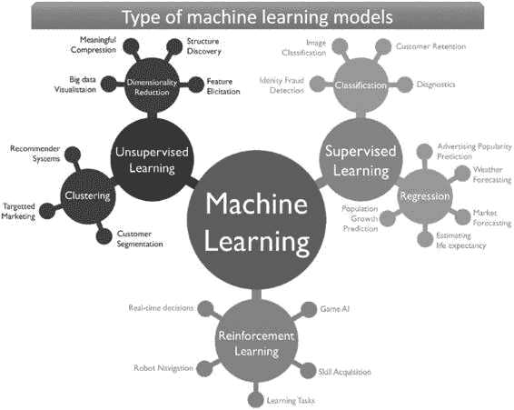

**图 6.3** 云中的机器学习方法。

机器学习中的预测模型是指能够利用过去或当前的可用数据提前预测事件发生的模型。神经网络、逻辑回归、随机森林和决策树是应用于云应用以提升现有系统性能的一些机器学习预测模型；例如，正如 Nikravesh 等人 (2017) 在 *autonomic prediction suite* [\[11\]](#index_split_002.html#p130) 中所述（图 6.4），决策融合技术和结构风险最小化被用于云应用中的资源可用性预测。

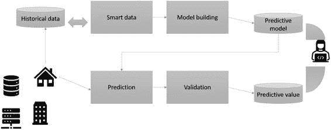

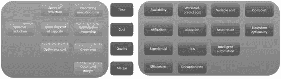

**图 6.4** 预测模型的工作原理。

**图 6.5** 云性能指标。

云计算涉足多个领域，如多云策略、超大规模数据中心、云安全、云备份与检索、基于云的网络服务和无服务器架构。云应用是指部署或开发在云环境中的软件或应用，而非托管在本地环境或机器上。为了提升云应用性能，研究人员随时间开发了大量算法。本章将讨论此类算法及其与现有框架的对比结果（图 6.5）。

投资回报率（ROI）是一种绩效衡量指标，用于评估或比较投资效率。正如 Skilton (2010, p.22) 在 *ROI from cloud computing* [\[12\]](#index_split_002.html#p130) 中所述，ROI 包含云计算 ROI 模型以高效完成此任务；为评估 SaaS 中云应用的性能，存在关键性能指标（KPIs）。KPIs 以云计算与传统 IT 及云计算解决方案为对比目标。正如 Lin (2013) 在 *performance indicator evaluation* [\[13\]](#index_split_002.html#p130) 中所述，云中的主要 KPIs 包括时间、成本、质量和盈利能力或利润率。本文将讨论三个云 KPIs：时间、成本和质量。

三种时间 KPIs 模型在决定 SaaS 中应用性能方面起关键作用：平均响应时间、最大响应时间、响应时间失败率。这三者均属于服务响应时间类型。平均响应时间应最小化，以提供 SaaS 中云应用的增强性能。下一个 KPI 是成本。成本取决于两个因素：获取成本和持续成本。云服务提供商为单项服务提供不同功能并定价是一大挑战。同一云服务提供商可能提供满足不同用户需求的不同 VM。最后一个 KPI 是质量。云服务质量取决于四个属性：相关性、实用性与可计算性、一致性和区分能力。正如 Garg (2013) 在 *future generation computer systems* [\[14\]](#index_split_002.html#p131) 中所述，每个属性在云弹性、准确性、透明度、适用性、可靠性、可用性、吞吐量和效率中均发挥着关键作用。

根据 NIST 定义，云模型具有五个基本特征、三种服务模型和四种部署模型；具体解释如下。

#### 6.1.1 基本特征

根据 NIST 定义，云的五个基本特征如下：

*   On-demand self-service（按需自助服务）。
*   Broad network access（广泛的网络访问）。
*   Resource pooling（资源池化）。
*   Rapid elasticity（快速弹性）。
*   Measured service（可度量服务）。

Source: Based on 'The NIST Definition of Cloud Computing', Special Publication 800-145, NIST, US [\[21\]](#index_split_002.html#p131).

#### 6.1.2 云交付/部署模型

根据 NIST 定义，云模型分为四种模型 [\[21\]](#index_split_002.html#p131)（图 6.6）：

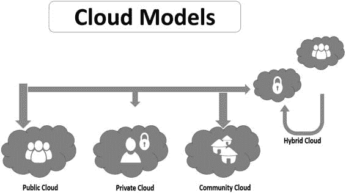

**图 6.6** 云部署模型。

*   **Public cloud（公有云）**：由第三方提供商提供。所有人均可通过互联网访问。公有云扩展迅速，访问便捷。维护由服务提供商负责。资源共享导致安全性、灵活性和对云环境的控制力降低。例如 `Amazon EC2` 和 `Google App Engine`。
*   **Private cloud（私有云）**：顾名思义，这是一种专用云服务，资源由单个实体或组织独占使用。由于资源不共享，提供高安全性。对云环境具有高灵活性控制权。比公有云昂贵，因为服务和维护须由组织自行负责。例如 `VMware`、`Microsoft`、`KVM` 和 `Xen`。
*   **Hybrid cloud（混合云）**：也称为“两全其美”。结合了公有云和私有云的最佳特性。提供更大灵活性、高安全性、更多功能、更多部署选项，且支持云爆发。成本较高，网络复杂。例如 `IBM`、`HP`、`Vmware`、`vCloud` 和 `eucalyptus`。
*   **Community cloud（社区云）**：集成不同类型的云以实现共同目的。社区云提供高安全性、可靠性和性能。可扩展性有限，成本较高。例如 `SolaS` 和 `VMware`。

#### 6.1.3 云服务/模型类型

正如 Mell (2011) 在 *NIST definition of cloud computing* [\[21\]](#index_split_002.html#p131) 中定义的三种云服务：IaaS、PaaS 和 SaaS，分别侧重于硬件、系统软件和应用（图 6.7）。

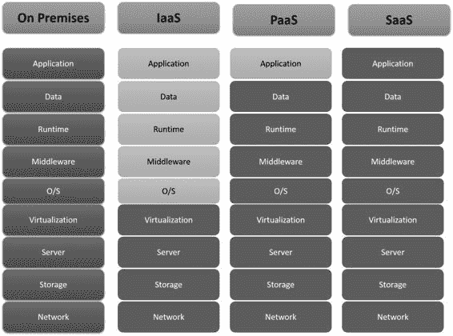

**图 6.7** 云服务控制对比。

*   **Software as a service (SaaS)**：通过互联网按需提供软件应用。用户无需在本地机器安装。用户可通过 Web 浏览器访问软件。用户无法控制应用，只能使用。所有维护和更新由提供商处理。
*   **Platform as a service (PaaS)**：指提供创建、测试、开发和部署产品应用环境的云管理。客户可在给定平台上引入和控制应用。PaaS 包含服务器、数据库、网络和开发工具等管理服务。
*   **Infrastructure as a service (IaaS)**：将整个基础设施作为服务提供，可在互联网上快速扩展，按使用付费。用户可购买、安装、配置和管理自己的产品、应用和软件、操作系统及任何应用，而基础设施由服务提供商管理。

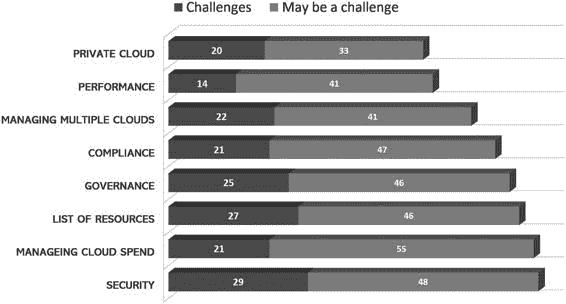

# 基于机器学习的预测模型

### 6.2 云计算挑战

云计算是一项独立的技术，用于管理资源以及信息的处理与监管。维护透明度、云计算的一致性面临着挑战和困难，且这些挑战日益增加。云计算可能面临资源优化、扩展、安全、维护等问题。

图 6.8 中 Rightscale（2018）的一项调查显示了云计算面临的挑战。

显而易见，云计算安全面临重大挑战，紧随其后的是云计算领域的其他挑战。为了提升云计算的运行效能，必须通过更好的解决方案克服所有这些挑战。

### 6.3 文献综述

### [1]

Raza 等人（2019）提出了一种用于比较分析的机器学习模型，其中讨论了 11 种机器学习分类方法。在其中一种机器学习方法中，应用了 Friedman 检验和 Nemenyi 事后检验，以识别分类器在训练数据集上十折交叉验证期间的性能差异，从而确定所有机器学习方法的最佳参数以获得最优解。SaaS 是云应用中基于应用的服务。

### [2]

Ahmed 等人（2018）提出了一种利用并行粒子群优化的优化模型来提高虚拟机性能的模型。该方法讨论了线性回归和神经网络机器学习方法，以实现虚拟机性能的提升。结果表明，与现有模型相比，所提模型针对基于云计算的高性能计算系统（HCS）中的慢性肾脏病，结果提升了 64%。

### [3]

Kirchoff 等人（2019）提出了监督机器学习工作负载预测技术，在各种云环境和配置下比较了 ARIMA、MLP 和 GRU 三种机器学习方法。获得的结果表明，这三种方法均适合短期预测。ARIMA 需要大量样本才能计算出最优结果，且耗时较长。在使用灵活性、对样本数量的敏感度、执行时间和准确性方面，GRU 在三者中取得了最佳结果。

### [4]

在文献 [4] 中，Esfahani 等人（2015）提出了一种基于知识的自适应调度器，利用定制的决策树算法进行资源分配，以最小化 SLA 违规并最大化利润。与之前的研究工作相比，该方法实现了 38.4% 的成本节约。

### [6]

Borkowski 等人（2016）提出了一种利用 ANN 反向传播机器学习预测模型来预测云资源利用率性能改进的方法。预测模型基于历史数据和真实世界数据集构建。评估结果显示，与简单回归方法相比，该方法提高了准确性。结果表明，对于中位数情况，该方法将预测误差降低了 20%；对于最佳情况，使用所提模型获得的预测误差减少了 89%。

### [7]

Alkalbani 等人（2016）在文献 [7] 中引入了五种监督机器学习预测方法，用于预测 SaaS 在线客户评论的情感。结果显示，使用支持向量机五折交叉验证方法获得了 92.37% 的准确率。与其他模型相比，该方法效果最佳。

### [8]

Tripathy 等人（2020）在文献 [8] 中提出了一种利用机器学习分类器针对 SaaS 进行 SQL 注入攻击检测的方法。使用五个特征时，该方法获得了 99.3% 的检测准确率；使用七个特征配合 AdaBoostClassifier 时，获得了 99.4% 的检测准确率。

### [15]

Sharkh 等人（2020）利用 TU Delft Bitbrains 追踪数据集，通过在数据集上应用机器学习方法，提出了一种新的云性能预测技术。预测的任何改进都会直接影响云客户和提供商的 KPI。线性回归方法针对平均绝对百分比误差磁盘写吞吐量产生了最优结果。支持向量机（SVM）学习方法针对均方根误差、网络接收吞吐量和网络发送吞吐量产生了最优结果，从而改善了云数据中心的云资源调度。

### [17]

Pandita 等人（2020）提出了一种神经网络机器学习故障预测模型方法。采用贝叶斯正则化人工神经网络方法预测应用性能，所提模型在 Google Cloud 选定数据集上获得的结果为 97.6%。

### [18]

Govindraju 等人（2020）提出了一种回归树模型，以获得虚拟机启动时间的性能准确率。使用 OpenStack 测试环境计算所提模型的效率。该模型以 91.81% 的平均准确率预测了虚拟机的启动时间。

### [19]

Shetty 等人（2020）在文献 [19] 中提出了一种针对云环境中医疗数据的监督机器学习预测方法，重点关注两个领域。第一，医疗领域算法的分析。预测模型在准确率、精确率、F1 值和召回率等性能指标上进行测试。计算结果显示，在其他监督机器学习方法中，随机森林预测模型获得了最佳结果。

### [20]

Sergue（2020）在文献 [20] 中提出了一种用于 SaaS 云服务模型的机器学习预测模型，采用线性回归和随机森林方法。对于特定场景，非线性随机森林回归技术获得的结果优于线性回归技术。

### [22]

Madni 等人（2020）提出了一种基于模糊理论和布谷鸟搜索的模糊布谷鸟搜索技术，以解决实时优化问题。在 IaaS 云中，FCS 解决了可靠性感知的资源调度问题。FCS 技术与遗传算法（GA）、蜜蜂算法（HB）和粒子群优化（PSO）进行了比较。结果显示，在故障率方面，FCS 比 GA、HB 和 PSO 产生了好 39.21% 的结果。

### [23]

Chen 等人（2020）提出了一种利用 QoS 预测模型和 PSO 运行时决策算法模型的自适应资源分配方法。使用相同的历史数据，该方法产生了好 15% 的结果。云应用资源分配的有效性提高了约 5–6%。

### [24]

Shahidinejad 等人（2020）提出了一个框架，该框架使用学习自动机作为决策者，将传入的动态工作负载卸载到云服务器上。另一种方法提出了一种边缘服务器供给方法，利用长短期记忆模型估算未来工作负载，并利用强化学习技术做出适当的扩缩容决策。

结果表明，所提出的框架提高了 CPU 利用率，并减少了执行时间和能耗。

### [25]

Hasan 等人 (2020) 提出了一种基于机器学习的自适应资源分配框架，以解决多维云资源中的问题。作者对资源分配框架中的 QoS 预测模型、改进蝙蝠算法 (IBA)、节能模型 (EEM)、改进上校选择算法 (MCSA) 和增强循环神经网络 (ERNN) 机器学习方法进行了比较。

(*续*)

**106** ◾ ML 和优化模型

**内容**

16


## 基于机器学习的预测模型

Morariu 等人 (2020) 为云环境中的操作调度和资源分配提出了预测性生产计划和预测性维护。作者引入了基于 AI 的方法，用于云生产中的现实感知和资源优化。所提出的方法还为能耗模式的预测提供了最优结果。

Mazidi 等人 (2020) 提出了一种利用 MAPE-K 循环和混合资源负载预测的方法，用于多层云应用的资源自动伸缩，以预测未来的资源需求。使用云模拟器获得的结果表明，该框架在运营成本、资源使用量和利润方面均有所提升。

Mazidi 等人 (2020) 提出了一种基于 KNN 的机器学习方法，利用 MAPE-K 循环为多层云应用自动伸缩资源。结果表明，所提出的框架降低了运营成本，并提高了资源利用率、响应时间和利润。

Osypanka 等人 (2020) 提出了一个框架，该框架采用异常检测机器学习 PSO 方法来实现最优成本资源配置。结果在 Microsoft Azure 环境中进行测试，显示使用实时数据在十个月内实现了 85% 的成本降低。

Kaur 等人 (2021) 提出了一种优化预测调度方法，该方法利用最优虚拟机结合了 TOPSIS 和群智能的特性。所提出的框架最小化了成本、执行时间和 SLA 违规，并改进了资源分配优化和可靠性。

Rawat 等人 (2021) 提出了一种机器学习算法，通过部署基于云的服务架构来管理最适合 SaaS 云环境中物联网安全参数的机器学习模型，从而提高 SaaS 云中应用程序的性能。

Rangra 等人 (2021) 为云机制中的大数据存储提出了一个框架，以在成本、时间和移动数字医疗 SaaS 应用程序的准确性方面提升性能。作者提出了一种深度学习方法来解决数字医疗中的问题，该方法涉及在云服务器上以优化格式进行计算的步骤。

Jha 等人 (2021) 提出了一个框架，通过应用机器学习模型来改进云环境中 SaaS 应用程序的性能。作者在海量实时数据集上工作，利用机器学习方法获得最优结果。

Paramsivapandi 等人 (2021) 提出了一个机器学习框架，用于在 SaaS 应用程序访问期间寻找数据读写的无错误解决方案。所提出的框架——一种混合循环数据驱动流算法 (HRD-DFA)，为应用程序访问期间的错误减少提出了最优解决方案。

### 表 6.1 用于云优化的各种模型的广泛研究

| **作者** | **方法** | **结果/结论** |
| :--- | :--- | :--- |
| **1** Raza 等人 (2019) | 使用了 K-NN、朴素贝叶斯、逻辑回归、Rocchio、感知机、Ridge、SGD、决策树、SVM、被动攻击、逻辑回归预测模型。 | 在所提出的场景中，逻辑回归获得了最高性能。 |
| **2** Ahmed 等人 (2018) | 线性回归、神经网络、云、VM 性能、慢性肾脏病诊断和预测模型、基于并行粒子群优化 (PPSO) 的云计算 HCS 的 VM 性能优化模型。 | 执行时间性能提升 50%。实时数据检索系统效率提升 5.2%。CKD 预测中混合模型的准确率 97.8%。总体性能比同类现有模型好 64%。 |
| **3** Kirchoff 等人 (2019) | ARIMA、MLP、GRU、云、维护 QoS、避免 SLA、超参数用作样本。 | 这三种技术都适合短期预测。ARIMA 需要更多样本、需要更新、需要为每个序列重新计算且耗时。在使用灵活性、执行时间、对样本数量的敏感度和准确性方面，GRU 在三者中取得了最佳结果。 |
| **4** Esfahani 等人 (2015) | 决策树、截止时间、预算、长度、惩罚率。 | 减少了 SLA 违规，仿真结果表明，所提出的算法提供了高达 38.4% 的显著成本节约。 |
| **6** Borkowski 等人 (2016) | 在 travis、Cl、GitHub 数据集上应用 ANN、反向传播、多元线性回归方法，以获得云资源分配预测，进行按任务和按资源级别的性能分析。 | 在典型情况下，所提出的模型将预测误差降低了 20%，在最佳情况下提升了 89% 以上。 |
| **7** Alkalbani 等人 (2016) | SVM、朴素贝叶斯、朴素贝叶斯 (核)、KNN、决策树、SaaS 极性数据集、空间向量算法五折交叉验证、准确率、分类、精确率。 | 使用空间向量五折交叉验证方法，准确率达到 92.37%。 |
| **8** Tripathy 等人 (2020) | 随机森林分类器、深度 ANN、决策树、Tensorflow 线性分类器、Adaboost 分类器、优化线性分类器、梯度提升树分类器、使用机器学习模型检测云 SaaS 中的 SQL 注入攻击。 | 随机森林分类器在数据集上优于所有其他模型，准确率达到 99.8%。 |
| **15** Sharkh 等人 (2020) | 线性回归、SVM、随机森林、REP 树、深度学习、TU Delft Bitbrains 轨迹。 | 设计了一种基于机器学习预测器的云应用行为预测技术，使用线性回归和 SVM 获得了最优结果。 |
| **17** Pandita 等人 (2020) | 贝叶斯正则化人工神经网络、Google Cloud、参数：带宽、磁盘和内存。 | 可以看出，作为反向传播方法扩展的贝叶斯正则化 NN 算法，对于小数据集给出了最佳结果。它解决了过拟合问题，并组装了最概括的模型，可靠性地加以利用。BRANN 分别为 DS1 和 DS2 显示了 96.4% 和 97.6% 的卓越执行精度。 |
| **18** Govindraju 等人 (2020) | 回归树、VM 资源分配、VM OpenStack 测试启动环境、VM 启动预测的平均值、最小值、最大值。 | 准确率为 91.81%。 |

*(续)*

### 表 6.1 (续) 用于云优化的各种模型的广泛研究

| **作者** | **方法** | **结果/结论** |
| :--- | :--- | :--- |
| [[19]](#index_split_002.html#p131) **Shetty 等人 (2020)** | 朴素贝叶斯、决策树、随机森林、线性回归，以及准确率、精确率、F1 分数和召回率等性能指标。 | 随机森林获得最佳结果。 |
| [[20]](#index_split_002.html#p131) **Sergue (2020)** | 逻辑回归、随机森林、客户电话数据集、过采样、欠采样、时间序列交叉验证。 | 随机森林性能优于逻辑回归。 |
| [[22]](#index_split_002.html#p131) **Madni 等人 (2020)** | 模糊布谷鸟搜索技术、模糊理论、布谷鸟搜索算法，用于解决实时优化问题。FCS 解决 IaaS 云中可靠性感知的资源调度问题。 | FCS 获得的最优解好 39.21%。FCS 技术更适合 IaaS 云的可靠性感知资源调度。 |
| [[23]](#index_split_002.html#p131) **Chen 等人 (2020)** | QoS 预测模型和基于 PSO 的运行时决策算法。 | 比现有算法好 15%。云应用资源分配的有效性提高了约 5–6%。 |
| [[24]](#index_split_002.html#p131) **Shahidinejad 等人 (2020)** | 学习自动机作为决策者，将传入的动态工作负载卸载到边缘或云服务器。 | 提出的框架提高 CPU 利用率，减少执行时间，降低能耗。 |
| [[25]](#index_split_002.html#p131) **Hasan 等人 (2020)** | QoS 预测模型、改进的蝙蝠算法、节能模型、改进的上校选择算法、增强的循环神经网络。 | QoS 预测模型提高准确性，MCSA 最小化能量耗尽，增强的 RNN 实现快速资源分配。 |
| [[16]](#index_split_002.html#p131) **Morariu 等人 (2020)** | 长短期记忆神经网络、深度学习实时重新分配资源、检测异常。 | 信息存储在逻辑流中，神经网络经过训练可发现各层能耗正常模式下的可能异常或变化。 |

*(续)*

### 表 6.1（续） 云优化各类模型的广泛研究

| **作者** | **方法** | **结果/结论** |
| :--- | :--- | :--- |
| [[26]](#index_split_002.html#p131) **Mazidi 等人 (2020)** | MAPE-K 循环、Google 惩罚支付模型、混合资源负载预测算法、统计解决方案、风险感知算法。 | 运营成本降低，资源利用达到最优，具有成本效益。 |
| [[27]](#index_split_002.html#p132) **Mazidi 等人 (2020)** | K-NN 分析和标记 VM，MAPE-K 循环为多层云应用自动扩展资源。 | 降低运营成本，实现资源最优利用、响应时间和利润。 |
| [[28]](#index_split_002.html#p132) **Osypanka 等人 (2020)** | 异常检测、机器学习和 PSO。 | 在 Microsoft Azure 环境中十个月的观察期内，给定方法成功实现了 85% 的成本降低。 |
| [[29]](#index_split_002.html#p132) **Kaur 等人 (2021)** | 优化预测调度方法，结合群智能和 TOPSIS 的特点，为科学应用选择最优 VM。 | 使用给定方法获得的结果显示最小化了执行时间、成本、SLA 违约率。 |
| [[30]](#index_split_002.html#p132) **Rawat 等人 (2021)** | 随机森林分类器 (RFC) 用于特征选择；选定 15 个特征进行研究。应用五种机器学习模型：朴素贝叶斯、决策树、逻辑回归、KNN 和 DNN，以生成最优结果。 | 结果显示最佳工作模型为朴素贝叶斯，其次为 DT 和 LR。从运营角度看，KNN 和 DNN 不适合在 IoT 设备中使用。 |
| [[31]](#index_split_002.html#p132) **Rangra 等人 (2021)** | 利用深度学习方法提升云机制上大数据存储的性能，从而整体提高 SaaS 应用的性能和可靠性。 | 结果显示成本、时间和准确率等性能指标整体得到改善。 |

*(续)*

### 表 6.1（续） 云优化各类模型的广泛研究

| **作者** | **方法** | **结果/结论** |
| :--- | :--- | :--- |
| [[32]](#index_split_002.html#p132) **Jha 等人 (2021)** | 应用并比较了 SVM、决策树、朴素贝叶斯、随机森林、KNN 和逻辑回归等预测模型，以预测客户行为。 | 结果显示云应用的可靠性、质量和性能得到增强。 |
| [[33]](#index_split_002.html#p132) **Paramsivapandi 等人 (2021)** | 提出 HRD-DFA 监控云的数据流错误。在读写过程中生成系统检查。 | 结果显示提出的框架减少了读写过程中的数据流错误。 |

另见 表 6.1.

### 6.4 比较分析

见 表 6.2.

### 6.5 结论

云计算技术在企业和商业市场中日益普及。需要利用机器学习预测模型的有效资源分配算法，专门改进面向 SaaS 云服务模型的云应用。本文总结了利用机器学习预测模型进行资源分配和优化的技术及其在云环境中的影响。本文讨论的一些策略侧重于云优化，但缺乏故障感知技术。因此，本调查论文激励未来的研究人员为云系统提出更智能的故障感知和云可靠框架。

> **注意：** 源文本的最后一部分似乎是一个损坏的表格片段（可能是表 6.2 比较分析参数）。由于其缺乏语义连贯性和结构完整性，无法进行 Markdown 转换，故予以省略。


### 表 6.2 (续)

| 序号 | [26] | [27] | [28] | [29] | [30] | [31] | [32] | [33] |
| :--- | :--- | :--- | :--- | :--- | :--- | :--- | :--- | :--- |
| **作者** | Mazidi 等 (2020) | Mazidi 等 (2020) | Osypanka & Nawrocki (2020) | Pandita 等 (2020) | Govindaraju 等 (2020) | Shetty & Patil (2020) | Sergue (2020) | Mell & Grance (2011) |
| **建议算法/解决方案** | 自动资源分配 (风险/惩罚感知, 多层云) | 自动资源配置 (KNN 扩展, 优先级分配, 多层云) | 资源使用成本优化 (ML) | SLA 违规预测 (贝叶斯正则化) | VM 启动时间预测 (回归树, IaaS) | 医疗数据预测算法实现与分析 (云环境) | 客户流失分析与预测 (B2B SaaS, ML) | NIST 云计算定义 |
| **应用领域** | 多层云资源供给 | 多层云应用资源供给 | 云计算成本优化 | 云计算 SLA 管理 | IaaS 云 | 云环境医疗数据 | B2B SaaS | 云计算标准 |
| **关注指标** | 资源优化, 惩罚成本, 可靠性 | 资源优化, 性能, 可扩展性 | 成本优化 | 性能, 可靠性 (SLA) | 性能 (启动时间) | 性能, 准确率 | 业务分析 (流失率) | 定义, 架构 |
| **方法分类** | 自动资源分配, 多层 | 自动资源配置, 多层, ML | ML 优化, 成本 | ML 预测, SLA | ML 预测 (回归树) | ML 预测, 医疗 | ML 分析/预测, SaaS | 标准/框架 |
| **技术/模型** | 概率资源扩展, 风险感知 | KNN 资源扩展, 优先级分配 | ML (成本优化) | 贝叶斯正则化 | 回归树 | 预测算法 (分析/实现) | ML (流失预测) | NIST SP 800-145 |
| **环境/架构** | 多层云 | 多层云 | 云计算 | 云计算 | IaaS 云 | 云环境 | SaaS | 云计算 (通用) |
| **性能/质量指标** | 资源优化, 成本, 可靠性 | 性能, 可扩展性, 资源优化 | 成本减少 | SLA 违规检测准确率 | 预测准确率 | 算法性能, 准确率 | 预测准确率 | - |
| **安全/异常检测** | - | - | - | - | - | - | - | - |
| **自适应/自动化** | ✓ (自主, 自适应) | ✓ (自主, 自适应) | ✓ (ML 优化) | ✓ (预测) | ✓ (预测模型) | ✓ (预测) | ✓ (ML 分析) | - |

---

### 参考文献

1. Raza, M., Hussain, F. K., Hussain, O. K., Zhao 等 (2019). 基于用户评论多类文本分类的 SaaS 服务质量支柱评估机器学习模型比较分析. *Future Generation Computer Systems*, *101*, 341–371.

2. Abdelaziz, A., Elhoseny, M., Salama, A. S., & Riad, A. M. (2018). 用于改善云计算环境中医疗服务的机器学习模型. *Measurement*, *119*, 117–128.

3. Kirchoff, D. F., Xavier, M., Mastella, J., & De Rose, C. A. (2019, February). 云应用机器学习工作负载预测技术的初步研究. In *2019 27th Euromicro International Conference on Parallel, Distributed and Network-Based Processing (PDP)* (pp. 222–227). IEEE.

4. Motavaselalhagh, F., Esfahani, F. S., & Arabnia, H. R. (2015). 云计算中 SaaS 提供商的基于知识的自适应调度器. *Human-centric Computing and Information Sciences*, *5*(1), 1–19.

5. Pop, D. (2016). 机器学习与云计算：分布式和 SaaS 解决方案综述. *IEAT Technical Report*, pp. 1–12 (2012). arXiv preprint arXiv:1603.08767.

6. Borkowski, M., Schulte, S., & Hochreiner, C. (2016, December). 预测云资源利用率. In *Proceedings of the 9th International Conference on Utility and Cloud Computing* (pp. 37–42).

7. Alkalbani, A. M., Ghamry, A. M., Hussain, F. K., & Hussain, O. K. (2016, July). 使用监督机器学习技术预测 SaaS 在线评论的情感. In *2016 International Joint Conference on Neural Networks (IJCNN)* (pp. 1547–1553). IEEE.

8. Tripathy, D., Gohil, R., & Halabi, T. (2020, May). Detecting SQL injection attacks in cloud SaaS using machine learning. In *2020 IEEE 6th International Conference on Big Data Security on Cloud (BigDataSecurity), IEEE Intl Conference on High Performance and Smart Computing (HPSC) and IEEE Intl Conference on Intelligent Data and Security (IDS)* (pp. 145–150). IEEE.

9. Duvvuri, V. (2020). Minerva: A portable machine learning microservice framework for traditional enterprise SaaS applications. *arXiv preprint arXiv:2005.00866*.

10. Dey, A. (2016). Machine learning algorithms: A review. *International Journal of Computer Science and Information Technologies*, *7*(3), 1174–1179.

11. Nikravesh, A. Y., Ajila, S. A., & Lung, C. H. (2017). An autonomic prediction suite for cloud resource provisioning. *Journal of Cloud Computing*, *6*(1), 1–20.

12. Skilton, M., & Director, C. (2010). Building return on investment from cloud computing. In *White Paper*. The Open Group.

13. Lin, Y. K., & Chang, P. C. (2013). Performance indicator evaluation for a cloud computing system from QoS viewpoint. *Quality & Quantity*, *47*(3), 1605–1616.

14. Garg, S. K., Versteeg, S., & Buyya, R. (2013). A framework for ranking of cloud computing services. *Future Generation Computer Systems*, *29*(4), 1012–1023.

15. Sharkh, M. A., Xu, Y., & Leyder, E. CloudMach: Cloud computing application performance improvement through machine learning. In *2020 IEEE Canadian Conference on Electrical and Computer Engineering (CCECE)* (pp. 1–6). IEEE.

16. Morariu, C., Morariu, O., Răileanu, S., & Borangiu, T. (2020). Machine learning for predictive scheduling and resource allocation in large scale manufacturing systems. *Computers in Industry*, *120*, 103244.

17. Pandita, A., Upadhyay, P. K., & Joshi, N. (2020, February). Prediction of service-level agreement violation in Cloud computing using bayesian regularisation. In *International Conference on Advanced Machine Learning Technologies and Applications* (pp. 231–242). Springer.

18. Govindaraju, Y., Duran-Limon, H. A., & Mezura-Montes, E. (2020). A regression tree predictive model for virtual machine startup time in IaaS clouds. *Cluster Computing*, *24*(2), 1–17.

19. Shetty, S. K., & Patil, A. P. (2020, July). Implementation and analysis of predictive algorithms for healthcare data in cloud environment. In *2020 IEEE International Conference on Electronics, Computing and Communication Technologies (CONECCT)* (pp. 1–6). IEEE.

20. Sergue, M. (2020). Customer churn analysis and prediction using machine learning for a B2B SaaS company.

21. Mell, P., & Grance, T. (2011). *The NIST Definition of Cloud Computing*. *Institute of Science and Technology, Special Publication*, *800*, 145.

22. Madni, S. H. H., Abd Latiff, M. S., & Abdullah, A. H. (2020, July). Reliability aware resource scheduling based on fuzzy cuckoo search (FCS) technique for IaaS cloud. In *IOP Conference Series: Materials Science and Engineering* (Vol. 884, No. 1, p. 012053). IOP Publishing.

23. Chen, X., Wang, H., Ma, Y., Zheng, X., & Guo, L. (2020). Self-adaptive resource allocation for cloud-based software services based on iterative QoS prediction model. *Future Generation Computer Systems*, *105*, 287–296.

24. Shahidinejad, A., & Ghobaei‐Arani, M. (2020). Joint computation offloading and resource provisioning for edge‐cloud computing environment: A machine learning‐based approach. *Software: Practice and Experience*, *50*(12), 2212–2230.

25. Hasan, M., Almamun, M., & Akbar, S. (2020). An intelligent machine learning and self adaptive resource allocation framework for cloud computing environment. *EAI Endorsed Transactions on Cloud Systems*, *6*(18), 5–9.

26. Mazidi, A., Golsorkhtabaramiri, M., & Yadollahzadeh Tabari, M. (2020). An autonomic risk‐and penalty‐aware resource allocation with probabilistic resource scaling mechanism for multilayer cloud resource provisioning. *International Journal of Communication Systems*, *33*(7), e4334.

27. Mazidi, A., Golsorkhtabaramiri, M., & Tabari, M. Y. (2020). Autonomic resource provisioning for multilayer cloud applications with K‐nearest neighbor resource scaling and priority‐based resource allocation. *Software: Practice and Experience*, *50*(8), 1600–1625.

28. Osypanka, P., & Nawrocki, P. (2020). Resource usage cost optimization in cloud computing using machine learning. *IEEE Transactions on Cloud Computing*.


[29.] Kaur, G., & Bala, A. (2021). OPSA: An optimized prediction based scheduling approach for scientific applications in cloud environments. *Cluster Computing*, *24*, 1955–1974.

[30.] Alsharif, M., & Rawat, D. B. (2021). Study of machine learning for cloud assisted iot security as a service. *Sensors*, *21*(4), 1034.

[31.] Rangra, A., & Sehgal, V. K. (2021). On performance of big data storage on cloud mechanics in mobile digital healthcare. *International Journal of E-Health and Medical Communications (IJEHMC)*, *12*(5), 36–49.

[32.] Jha, P., & Sharma, A. (2021, January). Framework to analyze malicious behaviour in cloud environment using machine learning techniques. In *2021 International Conference on Computer Communication and Informatics (ICCCI)* (pp. 1–12). IEEE.

[33.] Paramsivapandi, M. S. K., & Nagarajan, S. (2021). Machine learning based hybrid recurrent data-driven flow algorithm of identify the risk of data flow error detection in cloud computing. *International Journal for Research in Applied Science & Engineering Technology*, *9*(2).


# ML and Optimization Models

10.1201/9781003185376-7

## 第 7 章：面向云架构的故障感知机器学习与深度学习算法

**Deepika Agarwal, Sneha Agrawal and Punit Gupta**

### 目录

- 7.1 简介
- 7.2 相关工作
- 7.3 相关工作成果
- 7.4 提出的模型
  - 7.4.1 初始化
  - 7.4.2 训练数据集准备
  - 7.4.3 多层感知机模型设计
  - 7.4.4 模型训练
  - 7.4.5 误差反向传播与修正
  - 7.4.6 任务调度
  - 7.4.7 提出的资源供给技术 Bat-ANN 算法
    - 7.4.7.1 蝙蝠优化方法
  - 7.4.8 提出的蝙蝠算法-ANN 任务调度算法

DOI: [10.1201/9781003185376-7](https://dx.doi.org/10.1201/9781003185376-7)

### 7.1 引言

系统的可靠性是通过系统的故障概率来衡量的[[4]](#index_split_002.html#p149)。在本文中，我们介绍了一种主动的、预测性的、功耗感知的、容错的高效调度技术，该技术基于蝙蝠算法和前馈神经网络的混合方法[[1]](#index_split_002.html#p148)。这也被称为基于 ANN 的容错功耗高效调度（`FTS-ANN`）。结果表明，提出的蝙蝠算法-ANN 技术提高了虚拟机的可靠性。本文组织结构如下。第 7.2 节简要回顾了聚焦于云环境中容错调度的相关文献。第 7.3 节阐述了提出的 `FTS-ANN` 技术。第 7.4 节展示了 `FTS-ANN` 与其他基于主动容错感知调度机制的静态、动态和元启发式技术相比的实验结果。还详细讨论了使用 `FTS-ANN` 模型的结果。最后，第 7.5 节涵盖了结论和工作的未来扩展。

### 7.2 相关工作

作者 Charity 等人提出了一种提高存储、计算和网络资源可靠性的技术[[2]](#index_split_002.html#p149)。系统设置测量每个虚拟机的信任级别，然后将云任务分配在更受信任的虚拟机上。提出的技术提供了稳定可靠的虚拟机分配[[3]](#index_split_002.html#p149)。其局限性在于作者仅关注主动方法。未探索反应式技术。Zhou 等人考虑了云服务的可靠性，包括基础设施即服务、平台即服务和软件即服务。作者利用数据中心网络拓扑和图论关键特性中的 K-容错保证，专注于主机上的虚拟机分配。作者考虑了云任务向可靠虚拟机的分配[[7]](#index_split_002.html#p149)。

进一步关注任务到虚拟机的分配将提高可靠性。

测试了一种蒙特卡洛故障测量技术，以探测云任务分配的未来趋势。托管在数据中心的虚拟机发生故障的几率，是基于随机性特征，使用概率 Weibull 故障分布来估计的。Rehani 等人提出了在可靠虚拟机上进行云任务分配；提出了一种故障感知资源预留技术，该技术使用可靠性作为基准测试参数[[5]](#index_split_002.html#p149)，[[6]](#index_split_002.html#p149)。

作者提出了一种容错感知调度系统，该系统减少了调度时间，因为具有较高信任级别的虚拟机被分配用于云任务调度[[8]](#index_split_002.html#p149)。因此研究人员观察到可靠性仍然是一个具有挑战性的问题。提出的工作将有助于我们提出一个具有更高显著性水平和信任水平的稳健模型。云中的调度问题属于 NP-hard 问题范畴。因此，这一显著问题通过自然启发式和元启发式技术得以解决，以实现大规模种群中的可靠分配。基于启发式技术的选择依赖于问题陈述，启发式算法的开发旨在最大化面向全球终端用户的云服务可靠性[[7]](#index_split_002.html#p149)。

准确性是在虚拟机上分配云任务的可靠性阈值下进行测量的。资源分配技术不同于由主机做出决策的集中式技术；在自然启发式方法中，数据中心分布式环境参与决策以实现性能指标。故障率的状态由主机上运行的虚拟机来测量[[9]](#index_split_002.html#p149)。虚拟机的可靠性通过考虑端到端延迟参数来确定。作者仅关注异构环境中的基于工作流的服务。Attiya 等人扩展了模拟退火算法，用于将云任务分配到计算节点。该工作的目标和创新点是方法论信任级别的提升，并通过与分支定界法对比计算其效率[[10]](#index_split_002.html#p149)。

作者提出了多种多目标算法，它们依赖于包括可靠性测试、功耗利用、完工时间、截止时间约束和按需资源可扩展性在内的多个性能评估指标。作者还描述了两个性能指标之间的权衡，即所呈现系统的完工时间和可靠性[[11, 12]](#index_split_002.html#p149)。

作者主要关注基于两个性能指标的优化。Zhang 等人提出了一种基于可靠性和功耗两个性能指标的遗传算法。在非均质环境中测试了自然启发式基于种群的技术。在非均质环境中随机生成调度方案[[13]](#index_split_002.html#p149)。所提模型的局限性在于解可能收敛于局部最优点。Fard 等人提出了一种最小化欧几里得距离的策略。性能指标包括完工时间、成本、功耗和可靠性优化[[14]](#index_split_002.html#p149)。结果仅使用自然启发式元启发式技术进行验证。性能指标可能通过基于神经计算的提出模型得到改进。这些结果可能有助于提出一种新的主动可靠调度技术。

Zhang 等人提出了一种利用功耗约束提高可靠性的新技术。性能测量参数使用基础设施即服务交付模型进行估计[[15]](#index_split_002.html#p150)。第二类故障感知供给包括反应式容错策略，它管理任务，当故障几率增加时不关注云任务执行。故障几率或故障率在数据中心层面增加。我们的目标包括抑制故障率并提高资源利用率。文献中提出了多种反应式方法，用于处理云任务执行时的故障和虚拟机可靠性评估。

Zhou 等人详细阐述了一种最优检查点算法[[16]](#index_split_002.html#p150)。开发的技术高效地选择数据中心内存储和恢复服务器的检查点。Zhou 等人开发了一种使用检查点的新技术。作者涵盖了两种算法：第一种是数据中心

### 7.3 相关工作的成果

相关工作的成果表明，研究人员专注于故障感知、基于检查点、成本感知和功耗感知的供给技术。最先进的方法适用于过载、欠载和平均负载条件。任务在虚拟机上的调度时间较高。元启发式技术利用制造和真实数据集提供局部最优解。所提出的故障感知功耗高效 `bat-ANN` 模型提升了最先进方法的性能。性能通过提供训练数据集的多重调度进行评估。

### 7.4 提出的模型

在综述部分，我们发现故障感知和功耗感知调度方法中存在各种挑战性问题。我们的主要目标是提出一个可靠的故障感知和功耗感知模型，该模型将考虑多变量目标参数。多变量参数评估所提出模型的性能，并利用最先进方法验证多层感知机模型的结果。多层感知机模型的准确性通过利用多重调度来训练提出的 `bat-ANN` 模型而得到提高。在本文中，我们引入了一种基于蝙蝠算法和前馈深度神经网络的混合任务调度技术。在最先进的方法中，研究人员提出了基于静态、动态和元启发式技术的调度机制。最先进的方法、遗传算法和粒子群优化技术，利用各种性能评估参数提供局部最优解。存在改进自然启发式技术性能的机会。性能指标具体包括功耗和故障。引入了功耗感知和故障感知调度，该调度利用提交给虚拟机的任务总执行时间，关注功耗、故障和效率。功耗感知和故障感知调度的可靠性通过神经计算模型得到提升。混合 `bat-ANN` 技术通过基于 `GA-ANN` 的任务调度技术进行验证。我们的目标是提升功耗高效 `GA-ANN` 技术的性能，该技术优于 `BB–BC-cost` 和简单的遗传成本感知及时间感知调度方法。本小节展示了用于故障感知调度技术服务质量改进的多层感知机模型的详细信息。

#### 7.4.1 初始化

在初始化阶段，定义了用于特征分类的输出层、输入层和隐藏层，以及每层中的感知机数量。还定义了相关参数、学习率、种群大小、变异率、进化代数，以及隐藏层和输出层中使用的激活函数。基于多层的提出模型的效率由这些初始化参数定义。

#### 7.4.2 训练数据集准备

在该阶段，利用适应度函数通过蝙蝠优化方法准备训练数据集，以增强总执行时间、故障率和功耗的性能指标。该阶段采用多种任务的异构组合以及作为资源可用的虚拟机列表。输入被提供给蝙蝠算法。

```
F(x) = a * Utilization + b * Total_Execution_time (7.1)
Where α + β = 1.

Total_Execution_time = Σ (Task_Length / MIPS) (7.2)
i=1 to n
```

训练数据集准备阶段的输出是一个预测调度，具有最短的执行时间和功耗以及低故障率。结果是任务 ID 和分配给 VM 的虚拟机 ID 的组合。该列表分为 80% 和 20% 两部分，其中前 80% 用于多层神经网络模型训练，后 20% 用于测试训练好的多层感知机模型并利用反向传播进行误差修正。

#### 7.4.3 多层感知机模型设计

在该阶段，利用初始化阶段的参数设计多层感知机模型。该模型分别由输入层、输出层和多个隐藏层组成。隐藏层和输出层分别使用 `Leaky Relue` 和 `sigmoid` 激活函数。图 7.1 也展示了多层人工神经网络。多层前馈神经网络的每一层包含多个节点。每层中的节点分为预激活（聚合）和激活（非线性）两部分。自适应多层感知机模型的输出呈现可靠的虚拟机标识，该标识以低故障概率处理用户请求或云小任务。它使用前馈神经计算模型来实现可靠虚拟机的目标值。利用最先进的可靠调度方法，测量生物启发式技术结合 ANN 的性能。人工神经网络使用不同的学习率进行训练。输出的准确性取决于用于训练的参数。感知机模型的性能取决于训练机制、层数（隐藏层）和节点数，以及感知机层面使用的激活参数。

最先进的方法涵盖了所有静态、动态和生物启发式元启发式技术，用于故障感知，并考虑在可靠虚拟机上进行高效资源分配。存在进一步提升服务质量的机会。通过结合人脑计算过程或人工神经网络的元启发式技术，优化标准可进一步改进。带有元启发式方法的人工神经网络比独立的自然启发式元启发式技术提供更好的结果。感知机及其连接强度（边权重）和偏置值针对输入数据集进行调整。调度序列为元启发式技术的不同进化或迭代生成。训练好的神经网络用于预测执行任务且无任何故障的适当虚拟机标识。输出层在学习或训练过程后生成合法输出。利用生物启发式元启发式方法的 ANN 模型获得更好的结果。感知机间的连接强度，以及模型利用云环境中的数据集进行训练。研究人员已尝试解决云计算中的故障感知作业调度问题。受启发的训练模型有助于云资源的最优分配。

#### 7.4.4 模型训练

在该阶段，设计的多层感知机模型使用 80% 的训练数据进行训练，以设计训练好的模型。该阶段负责设置神经网络的权重，这决定了多层神经网络的准确性和效率水平。模型的训练过程初始化权重和偏置参数。该过程重复进行，直到掌握目标值。所提模型的目标值包括虚拟机标识，即任务的最短完成时间。

训练过程预测未知变量的适当值。

训练机制包括基于误差修正的机制和基于记忆的机制。最优训练的多层神经网络提供具有准确性和稳定性的最优全局解。可用数据应通过应用经验法则进行分类，即 80% 的可用数据集用于训练，剩余 20% 的数据用于测试输出。隐藏层中节点的激活函数使用 Leaky Relue 激活函数进行测量。

**Leaky Relue 激活函数 = (7.3)**

```
f(x) = { 0.01*x if x < 0, x if x ≥ 0 }
```

服务质量使用优化标准功耗和故障率进行测量，以评估资源利用率。输入层将权重传递给隐藏层，隐藏层使用激活函数并将感知机的结果传递给输出层。主机的激活函数定义了主机的输出，该输出作为一组输入给出。激活函数的这一显著特征在计算人工神经网络中发挥着作用。公式 7.3 展示了概率激活函数，其中包含用于计算感知机值的 Leaky Relue 函数。所提基于 ANN 的功耗和故障感知资源供给技术包含两个输入、一个输出和多个隐藏层。该模型针对数据集或工作负载大小进行训练，即用户定义工作负载的十分之一。两个矩阵分别用于训练输入和训练输出。

训练输入大小 = `100 × 2`，训练输出大小为 `100 × 1`。

训练数据集的工作负载大小包含 100 个任务，占用户定义工作负载的 10%。

#### 7.4.5 误差反向传播与修正

此处我们的目标是获得期望输出。只有在设计出合适的神经网络后，才能获得期望输出。计算过程的前馈方法用于正向传播。隐藏层和输出层中每个神经元的计算均使用激活函数执行。**图 7.1** 展示了计算函数（激活函数）。相邻层的神经元通过连接权重和偏置相连。

所提模型遵循误差修正学习机制。误差修正学习机制使用代价函数 (`δk`) 提高服务质量。目标是利用 ANN 模型的信号流图（如**图 7.1**所示）最小化代价函数。误差修正学习机制使用公式 7.4 测量误差。


```
ek(n) = dk(n) - yk(n)  (7.4)
```

```
δk = 1/2 * ek(n)²  (7.5)
```

在公式 7.4 和公式 7.5 中，参数 `dk(n)` 表示期望输出，`yk(n)` 显示实际输出，`ek(n)` 为误差，`δk` 为 ANN 模型学习过程中使用的代价函数。

#### 7.4.6 任务调度

在该阶段，使用训练好的神经网络模型实时调度任务。多层感知机模型的准确性和效率取决于训练过程。训练过程取决于生成训练数据集的频率调谐蝙蝠优化技术。任务调度阶段专门使用性能指标功耗和故障率生成最优调度。

#### 7.4.7 所提资源供给技术 Bat-ANN 的算法

##### 7.4.7.1 蝙蝠优化方法

最先进的方法包括元启发式技术，为云环境中的调度问题提供最优解。自然启发式技术的性能可通过人工智能方法加以改进。在本文中，我们提出了一种混合技术，即 Bat-ANN。基于概率的优化技术与人工深度神经网络相结合。所提模型遵循微蝙蝠的回声定位特性。蝙蝠的回声定位行为被继承在所提的 Bat-ANN 模型中。Bat-ANN 混合技术提高了简单元启发式优化蝙蝠算法在云上任务调度中的性能。蝙蝠算法也称为频率调谐算法，为组合优化和调度提供最优解。每只蝙蝠在搜索空间中被分配一个随机频率。与蝙蝠算法相关的参数分别通过公式 7.6、7.7 和 7.8 获得。

```
fi = fmin + (fmax - fmin) * β  (7.6)
```

其中 `β ∈ [0, 1]`，`fmin` 表示第 `i` 只蝙蝠的频率。

```
vti = vt-1i + (xt-1i - x*) * fi  (7.7)
```

其中 `vti` 表示第 `i` 只蝙蝠在第 `t` 次迭代中的速度。

```
xti = xt-1i + vti  (7.8)
```

其中 `xti` 表示第 `i` 只蝙蝠在搜索空间中的位置。蝙蝠技术有助于训练神经网络。与简单的生物启发式、自然启发式和频率调谐技术相比，混合方法能取得更好的结果。蝙蝠算法初始化所有蝙蝠的频率、位置和速度。定义脉冲频率 `fixi`。脉冲发射率 `ri` 和响度参数 `Ai` 也被初始化。在简单的蝙蝠算法中使用以下步骤：

1. 初始化蝙蝠种群、其位置、速度、频率。
2. 初始化所有蝙蝠的回声定位参数。
3. 在 `xi` 处初始化脉冲频率 `fi`。
4. 初始化脉冲率 `ri` 和响度 `Ai`。
5. While (终止条件)。
   通过调整频率并更新速度和位置来生成新解。
6. End while。

#### 7.4.8 所提 Bat-ANN 任务调度算法

所提模型分为以下步骤：

1. 初始化。
2. 使用基于概率的蝙蝠优化技术准备训练数据集。
3. 设计深度神经网络并使用步骤 2 生成的训练数据集训练模型。
4. 使用训练好的模型在虚拟机上执行任务调度。
5. 生成最优调度。
6. 重复步骤 2-4，直到满足收敛条件。

### 7.5 结果与讨论

仿真使用 `Cloudsim 3.0` 进行。仿真采用真实任务模拟的工作负载追踪，该追踪为来自并行工作负载存储库的免费开源数据集，格式为 `SWF` 格式的工作负载文件（表 7.1）。

`bat-ANN` 模型的性能评估使用以下性能指标进行：

1. 总执行时间/完工时间（毫秒）。
2. 平均开始时间（毫秒）。
3. 平均完成时间（毫秒）。
4. 已完成任务数。
5. 失败任务数。

图 7.2 展示了所提 `bat-ANN` 模型的流程图。该流程图展示了所提算法 `bat-ANN` 的图示表示。它清晰地描绘了蝙蝠优化技术的作用以及多层感知机模型的边缘权重优化。因此，训练数据集是使用蝙蝠算法生成的。

虚拟机 ID 和云任务 ID 的输入数据集是通过自然启发的频率调谐进化技术提供的。

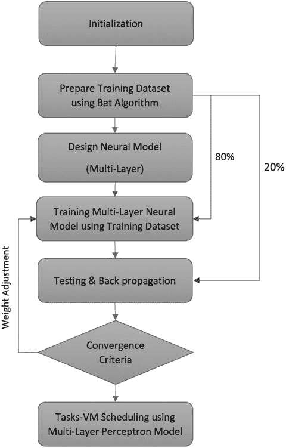

**图 7.2** 云环境中所提 bat-ANN 调度技术的流程图。

图 7.3(a)、(b) 展示了使用所提算法和现有方法，在五个虚拟机和十个虚拟机作为资源情况下，一组任务的平均开始时间的对比。结果表明所提算法优于现有算法。该研究评估了在负载增加和资源扩展情况下开始时间的性能。

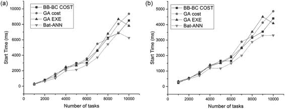

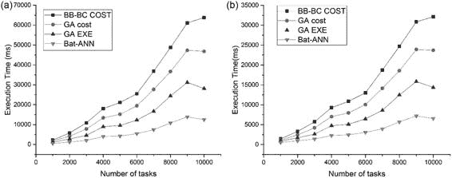

**图 7.3** (a) 五个 VM 下开始时间与任务数的对比。(b) 十个 VM 下开始时间与任务数的对比。

### 表 7.1 用户任务配置参数

| **任务参数** | **值** |
| :--- | :--- |
| 任务长度 | 200–40000 |
| 输入大小 | 300 字节 |
| 输出大小 | 300 字节 |
| PE | 1/2 |

图 7.4(a)、(b) 展示了使用所提算法和现有方法，在五个虚拟机和十个虚拟机作为资源情况下，一组任务的执行时间对比。结果表明所提算法优于现有算法。该实验旨在研究所提算法在欠载和过载条件下的性能。

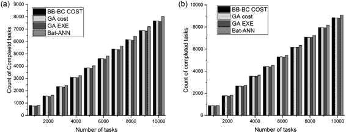

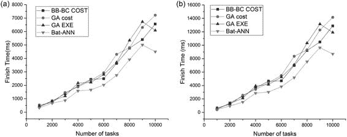

**图 7.4** (a) 五个 VM 下执行时间与任务数的对比。(b) 十个 VM 下执行时间与任务数的对比。

图 7.5(a)、(b) 展示了使用所提算法和现有方法，在五个虚拟机和十个虚拟机作为资源情况下，一组任务的完成时间对比。结果表明所提算法优于现有算法。该研究评估了在负载增加和资源扩展情况下完成时间的性能。

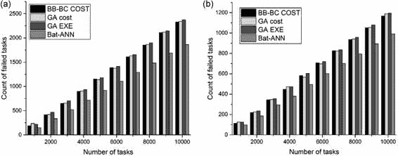

**图 7.5** (a) 五个 VM 下完成时间与任务数的对比。(b) 十个 VM 下完成时间与任务数的对比。

图 7.6(a)、(b) 展示了使用所提算法和现有方法，在五个虚拟机和十个虚拟机作为资源且数据中心负载不断增加的情况下，已完成任务的研究。结果表明所提算法优于现有算法。同样，该实验旨在寻找已完成任务数量的改进情况。

**图 7.6** (a) 五个 VM 下已完成任务数与任务数的对比。(b) 十个 VM 下已完成任务数与任务数的对比。

**图 7.7** (a) 五个 VM 下失败任务数与任务数的对比。(b) 十个 VM 下失败任务数与任务数的对比。

实验结果如图 7.7(a)和(b)所示，结果显示随着负载和资源的增加，性能得到了改进。

### 7.6 结论与未来工作

本文提出了一种用于云基础设施任务调度的高效任务调度方案。所提 `bat-ANN` 模型优于遗传算法和现有技术。结果部分表明，该模型在云 `IaaS` 环境下的表现优于现有技术。性能通过以下指标计算：平均完成时间（毫秒）、平均开始时间（毫秒）、总执行时间、故障率、已完成任务数和失败任务数。

本工作仅专注于使用蝙蝠算法进行云任务调度。该工作提出了一种具有高服务质量的容错模型。在未来的工作中，所提模型将用于主机上的资源调度和迁移方法，以通过最优资源更好地利用资源，改善云应用的运行成本。

### 参考文献

1. Ghrera SP 等. 面向云基础设施的功耗与故障感知可靠资源分配。*Physics Procedia* [互联网]. 78(2015 年 12 月), 457–63 (2016)。

2. Kathpal C. & Garg R. 云计算中故障容忍感知调度综述。*Information and Communication Technology for Competitive Strategies*, 275–283 (2019)。

3. T.J. Charity & G.C. Hua. 云计算中利用容错技术的资源可靠性。见：2016 年第 2 届下一代计算技术国际会议 (NGCT), 页 65–71. IEEE (2016)。

4. Li, K., Mei, J. 等. 异构计算系统的容错动态重调度。*J. Grid Comput*. 12 月 1 日;13(4), 507–25 (2015)。

5. Rehani, N. & Garg, R. 基于元启发式的云计算中可靠与绿色工作流调度。*Int. J. Syst. Assur. Eng. Manag.* 9(4), 1–10。

6. Qin, X. & Jiang, H. 一种用于在异构集群上执行的并行实时作业的动态可靠性驱动调度算法。*J. Paral el Distrib. Comput.* 65(8), 885–900 (2005)。

7. Zhou, A., Wang, S., Cheng, B., Zheng, Z., Yang, F., Chang, R.N., Lyu, M.R. & Buyya, R. 通过虚拟机放置优化增强云服务可靠性。*IEEE Trans. Serv. Comput.* 10(6), 902–913 (2016)。

8. Garg, R. & Rehani, N. 云中基于蒙特卡洛故障估计的可靠性感知工作流调度。见：国际通信与网络会议论文集, 页 139–153. Springer, Singapore (2017)。

9. Zhu, M.M & Cao, F. 面向端到端延迟约束下最大化可靠性的分布式工作流映射算法。*J. Supercomput.* 66(3), 1462–1488 (2013)。

10. Hamam, Y. & Attiya, G. 面向最大化分布式系统可靠性的任务分配：一种模拟退火方法。*J. Paral el Distrib. Comput.* 66(10), 1259–1266 (2006)。

11. Dongarra, J.J., Jeannot, E., 等. 用于在异构系统上优化完工时间和可靠性的双目标调度算法。见：第十九届 ACM 并行算法与架构研讨会论文集, 页 280–288. ACM (2007)。

### 参考文献

[12.] Wang, X., Yeo, C.S., Buyya, R., Su, J. 基于信誉和前瞻遗传算法优化工作流应用的完工时间和可靠性。*Fut. Generat. Comput. Syst.* 27(8), 1124–1134 (2011)。

[13.] Zhang, L., Li, K., 等。异构计算系统中能耗与可靠性的双目标工作流调度。*Inf. Sci.* 379, 241–256 (2017)。

[14.] Fard, H.M., Prodan, R., Barrionuevo, 等。异构环境中工作流调度的多目标方法。载于：2012 年第 12 届 IEEE/ACM 集群、云和网格计算国际研讨会论文集 (CCGRID 2012)，第 300–309 页。IEEE Computer Society (2012)。

[15.] Zhang, L., Li, K., Xu, Y., 等。异构集群中并行任务调度的能量节约与可靠性最大化。*Inf. Sci.* 319, 113–131 (2015)。

[16.] Li, J., Zhou, A., & Sun, Q., 云计算系统中基于检查点技术的可靠性增强。*China Commun.* 14(7), 1–10 (2017)。

---

## 第 8 章：基于反向传播神经网络和遗传算法的节能虚拟机放置

**作者：** Oshin Sharma, Hemraj Saini, and Geetanjali Rathee

DOI：[10.1201/9781003185376-8](https://dx.doi.org/10.1201/9781003185376-8)

## 目录

- 8.1 简介
- 8.2 传统虚拟机放置工作
- 8.3 系统模型
  - 8.3.1 数据中心框架
  - 8.3.2 能耗建模
- 8.4 问题建模与求解
  - 8.4.1 多目标虚拟机放置问题
  - 8.4.2 虚拟机放置优化
- 8.5 拟议的节能 BPGA 优化模型
  - 8.5.1 第一阶段：非支配排序遗传算法 (NSGA)
- 8.6 性能评估
  - 8.6.1 实验设置
  - 8.6.2 仿真结果与对比
- 8.7 结论与未来展望
- 参考文献

---

### 8.1 简介

云计算的普及可为电子科学、电子商务及其他众多领域提供服务器、网络、存储和应用程序等多种服务。云计算的这种架构是一个巨大的虚拟化资源池，这些资源随时可用且易于访问，例如平台、硬件和服务（如内存、`.Net`、`CPU`、`Java`、电子邮件和人力资源等）。这些资源池按使用付费模式进行供给，云服务提供商通过服务等级协议 (`SLA`) 提供资源的可用性和保障 [[1]](#index_split_003.html#p171)。

数据中心的部署需要消耗大量能源来运行多台服务器，并为数据中心内部使用的电子设备提供冷却。据数据中心知识报告 [[2]](#index_split_003.html#p171) 显示，数据中心 55%的能耗源于数据设备和服务器，30%源于冷却设备。这些数据中心维护成本极高，此外还对环境造成不利影响。

虚拟化是最适用的技术，它在处理服务器/虚拟机整合、自动伸缩、节能、负载均衡等问题时能提供更好的 QoS [[3]–[8]](#index_split_003.html#p171)。虚拟化技术在单台物理机上运行多个操作系统，从而解决资源利用率低和能源利用效率低的问题。数据中心广泛使用各种工具来实施虚拟化技术，例如 `VMware`、`KVM`、`XEN` 等 [[9, 10]](#index_split_003.html#p171)。虚拟机的不当分配会降低性能和服务质量。虚拟机的迁移及其向合适物理机的映射，可以降低数据中心的能耗并提供良好的 QoS，进而减少 SLA 违约 [[11]](#index_split_003.html#p171)。虚拟机到物理机的适当映射可减少硬件使用量，提高资源利用率以及电力和能源效率 [[12]](#index_split_003.html#p172)。图 8.1 展示了利用虚拟化技术进行虚拟机放置的场景，其中我们评估了八台物理机 (`PMs`)。

这些物理机的利用率从 15%到 50%不等。因此，最优虚拟机放置过程的主要目标是将虚拟机映射到物理机上，通过提高其利用率来减少所用物理机的数量，并将其余物理机切换到休眠模式或关闭。

云环境中的工作负载具有动态性；因此，研究人员提出了许多不同的启发式算法，考虑了贪心算法的扩展，如首次适应、最佳适应、首次适应递减和最佳适应递减，以解决此问题，例如功耗感知最佳适应递减 (`PABFD`) [[13]](#index_split_003.html#p172)、修正最佳适应递减 (`MBFD`) [[14]](#index_split_003.html#p172)、`TPOSIS` [[15]](#index_split_003.html#p172)、`EPOBFD` [[4]](#index_split_003.html#p171) 等。然而，这些贪心算法无法保证生成最优解，因为它们容易陷入局部最优，且由于单点搜索策略，很难找到全局最优解。因此，处理这些问题最有力的方法是基于种群的进化计算 (`EC`) 算法，如遗传算法 (`GA`)、蚁群优化 (`ACO`)、粒子群优化 (`PSO`) 等。

本文的贡献如下：

- 一种用于虚拟机放置以实现节能的元启发式方法。
- 拟议的 `BPGA` 在虚拟机整合过程中采用生物启发式优化。
- 拟议的 `BPGA` 模型已在 `CloudSim` [[16]](#index_split_003.html#p172) 中进行测试，表明其适用于异构数据中心。
- 该研究提供了经典装箱技术与新型元启发式技术（如遗传算法、蚁群优化和多目标优化）的广义对比。

手稿其余部分的结构安排如下：第 8.2 节介绍虚拟机放置或虚拟机整合的最相关工作。

### 8.2 传统虚拟机放置工作

在本节中，我们将讨论与虚拟机迁移和放置相关的先前及最相关的工作，这些工作旨在解决数据中心内与能耗、SLA 违约及其他性能参数相关的问题。云计算的这一领域已有大量研究，在这些研究中，上述问题在不进行虚拟机迁移或进行虚拟机迁移的情况下均得到了处理，并被视为最佳技术。但在数据中心内，虚拟机迁移的过程对于能源管理而言并非一帆风顺，因为它涉及用于实施的整体虚拟机整合过程。此外，虚拟机整合过程包含四个不同步骤 [[14]](#index_split_003.html#p172)。所有这些步骤均可高效管理数据中心的能源问题。作者们研究了不同的启发式以及元启发式技术来处理这些问题。首个面向虚拟化数据中心能源管理的架构由 Nathuji 等人 [[17]](#index_split_003.html#p172) 开发，该架构利用虚拟机实时迁移的概念将虚拟机整合到单台服务器上。Lim 等人 [[18]](#index_split_003.html#p172) 还提出了利用虚拟机动态迁移到更少宿主机上进行虚拟机整合的过程，用于虚拟化环境中的能源管理。随后，Goiri 等人 [[19]](#index_split_003.html#p172) 提出了一种面向利润的多目标虚拟机放置算法，该算法从能效、SLA 违约和虚拟化开销方面考虑了迁移后数据中心的性能。类似地，Verma 等人 [[20, 21]](#index_split_003.html#p172) 和 Ghribi 等人 [[22]](#index_split_003.html#p172) 提出了虚拟机放置和虚拟机分配算法，旨在通过考虑数据中心性能及迁移成本，最小化所用宿主机数量并降低能耗。


Beloglazov 等人 [[14, 23, 24]](#index_split_003.html#p172) 利用虚拟机迁移的概念，根据当前资源利用率 [[25–29]](#index_split_003.html#p173) 提出了用于虚拟机动态分配的能量感知启发式算法。Bila 等人 [[30]](#index_split_003.html#p173) 倡导了一种新的整合技术，通过迁移空闲虚拟机来降低能耗。Zohu 等人 [[31]](#index_split_003.html#p173) 的工作旨在通过利用网络和存储资源提高云服务的可靠性；他们的算法利用数据中心网络架构的特性来最小化网络资源使用量，但我们的工作不同于利用这些资源，而是专注于提高内存和 CPU 资源的使用率。为此，虚拟机将被放置在由我们的 `BPGA` 模型选择的节点上，同时保持数据中心的能效和性能。为了实现虚拟机的最优放置或迁移，考虑内存利用率和处理器利用率等当前资源至关重要。根据文献 [[14, 32]](#index_split_003.html#p173) 观察，这些资源是主要的功耗单元。所提出的 `BPGA` 模型也能在内存和处理器两个层面高效处理能量优化。此外，它还通过最小化所用宿主机数量和虚拟机迁移次数来提高资源利用率。虚拟机放置通过将空闲或自由资源隔离并将其关闭或置于睡眠模式，有助于降低其能耗。关注节约空闲或闲置资源是为了提高能效并降低 [[33]](#index_split_003.html#p173) 中定义的 SLA 违约率。在最近一篇关于虚拟机整合的综述 [[34]](#index_split_003.html#p173) 中，Khichar G. S. 等人还提出了一种使用背包技术的 `MC_MC` 算法以减少迁移和能耗，而在 [[35]](#index_split_003.html#p173) 中，Bajoria V. 等人提出了一种不同的策略以最小化能耗，该策略同时考虑了算法的成本效率和时间效率。成本效率通过优先考虑 CPU 利用率来提供，而时间效率则通过优先考虑性能退化来提供。Li Z. 等人 [[36]](#index_split_003.html#p174) 基于反共置约束提供了虚拟机放置方案，他们提出了一种基于 PageRank 的算法，以寻找最佳的虚拟机-物理机映射，实现宿主机的充分利用并达到最低能耗。Maiyza A. I. 等人 [[37]](#index_split_003.html#p174) 提出了用于虚拟机迁移的 `MMTMC2` 算法，以改进整体虚拟机整合过程。他们的思路是维持云数据中心中的实时迁移数量和网络负载。

随着云环境提供的分布式服务复杂性不断增加，提出一些更可持续、更可扩展、适用于异构环境的技术变得至关重要。此外，这些技术还能应对日益严重的能源危机。

当前的研究工作侧重于生物启发式计算和元启发式技术来处理这些问题，因为它们具有自动调整搜索空间的能力，尽管它们拥有庞大的搜索空间。

本研究旨在实现能耗与服务质量（QoS）之间的最优平衡。因此，与以往工作相比，我们提出的 `BPGA` 方法具有以下主要差异：首先，所呈现的虚拟机整合模型关注持续整合过程中能耗与宿主机工作负载稳定性之间的平衡。其次，结合反向传播使用 `NSGA` 多目标优化或一组帕累托最优解来训练神经网络，这本身就是相较于以往文献的一项创新。再次，在解空间（如种群）中搜索最终最优结果由 `BPGA` 执行，它不仅保证全局优化结果，还能加速进化过程。最后，结合两个不同阶段的虚拟机整合共同保证了结果的可靠性。我们在两个不同数据集上进行了大量实验，结果表明改进的 `BPGA` 在不降低 QoS 的前提下降低了能耗。与我们之前的工作不同，此处我们使用了 PlanetLab 数据集和 Bitbrains [[38]](#index_split_003.html#p174) 数据集来验证 `BPGA` 模型。

## 8.3 系统模型

系统模型由异构资源组成，例如以每秒百万条指令数定义的 CPU 利用率、网络带宽、磁盘容量以及数据中心内的内存（RAM）。数据中心框架我们在实验中使用的框架如图 8.2 所示，同样地，能耗和功耗模型在第 8.3.2 节中有详细解释。

### 8.3.1 数据中心框架

我们工作中用于虚拟机（VM）放置优化的框架如图 8.2 所示，其中我们有两个主要组件用于在物理机器上实现节能的虚拟机分配：（1）虚拟机放置分析器和（2）SLA 管理器。虚拟机分析器检查服务器上的资源可用性以分配虚拟机，而 SLA 管理器在每次放置后检查违规程度并通知分析器。

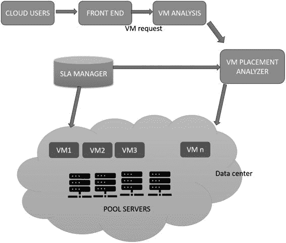

**图 8.2** 虚拟化数据中心框架。

### 8.3.2 能耗建模

内存占用、磁盘存储、网络接口和 CPU 等不同组件都会导致能耗。文献 39 中表明，服务器的功耗与 CPU 利用率之间存在线性关系。

由于工作负载的变化，服务器的 CPU 利用率可能随时间而变化，因此 CPU 利用率表示为时间的函数 `U(t)`。因此，物理服务器的总能耗（`EC`）可以计算为一段时间内功耗的积分 14。在公式 8.1 和公式 8.2 中，`PC_busy` 表示机器满负荷运行时的功耗，`PC_idle` 表示机器空闲或利用率为 0% 时的功耗值。对于我们的模拟，表 8.1 显示了服务器空闲和满负荷时的功耗。

这些服务器的功耗数据取自 SPECpower 基准测试 40。

**144** ◾ ML and Optimization Models

**表 8.1** 服务器功耗 (kWh) [60]

| **服务器** | **空闲** | **10%** | **20%** | **30%** | **40%** | **50%** | **60%** | **70%** | **80%** | **90%** | **100%** |
| :--- | :---: | :---: | :---: | :---: | :---: | :---: | :---: | :---: | :---: | :---: | :---: |
| HPProLiant G4 | 86 | 89.4 | 92.6 | 96 | 99.5 | 102 | 106 | 108 | 112 | 114 | 117 |
| HPProLiant G5 | 93.7 | 97 | 101 | 105 | 110 | 116 | 121 | 125 | 129 | 133 | 135 |
| IBMServerX3250 | 41.6 | 46.7 | 52.3 | 57.9 | 65.4 | 73 | 80.7 | 89.5 | 99.6 | 105 | 113 |
| IBM Server x3550 | 58.4 | 98 | 109 | 118 | 128 | 140 | 153 | 170 | 189 | 205 | 222 |
| Acer AT150 F1 | 65.4 | 113 | 125 | 136 | 150 | 165 | 183 | 199 | 215 | 229 | 244 |
| Acer AR320 F1 | 39.6 | 47.3 | 55 | 63.4 | 71.9 | 80.3 | 89.8 | 97.9 | 107 | 116 | 124 |

```
EC = ∫_{t0}^{t1} P(U(t)) dt
```

(8.1)

```
PC_i = { (PC_busy_i - PC_idle_i) × U_i + PC_idle_i,  U > 0
       { 0, otherwise
```

(8.2)

## 8.4 问题建模与求解

在本节中，我们将讨论虚拟机放置的建模及其使用多目标优化的求解方法。已使用 `NSGA` 进行虚拟机的最优映射。

### 8.4.1 多目标虚拟机放置问题

基于种群的方法是多目标优化的关键特征。在此基础上，我们在虚拟机选择中使用了帕累托支配的概念。

多目标优化问题可以通过一组 `n` 个目标来求解。根据问题的不同，这些目标需要被最大化或最小化（在我们的案例中为最小化）。

```
minimize f(X) = {f(X1, X2,..., Xn)}
```

(8.3)

公式 8.3 表示最小化问题，其中 `X` 代表决策变量。多目标优化的解并不能为所有目标提供最优解。帕累托最优解在这种情况下最为合适，它们提供折衷结果。这些折衷解拥有一组非支配解，进而为多个目标提供最佳解 41。

如果解空间 'sp' 中的解 `S` 不存在其他解 `P` 支配解 `S`，则称解 `S` 为帕累托最优。此外，如果以下两个方程均成立，则解 `S` 支配解 `P`，或者解 `S` 拥有比 `P` 更好的非支配等级，即 `RS < RP`（`S` 和 `P` 的等级）：

*条件 1*：如果解 `S` 对于所有目标都与解 `P` 一样好：

```
∀ j ∈ [1,2... n] . fj(S) ≤ fj(P)
```

(8.4)

*条件 2*：如果解 `S` 对于至少一个目标严格优于 `P`：

```
∃ j ∈ [1,2... n] . fj(S) < fj(P)
```

(8.5)

所有不被任何其他解支配的解称为非支配解，它们共同构成解空间中的一个前沿，称为非支配前沿；非支配前沿中的解集称为帕累托最优解。

该概念中最繁琐的步骤是找到非支配解集。在我们的工作中，使用以下步骤 [58] 来寻找非支配解集，其中有 `Z` 个解，每个解有 `N` 个目标：

* **步骤 1**：从 `i = 1` 开始。
* **步骤 2**：使用上述条件针对所有 `N` 个目标，比较解 `Si` 和 `Pi` 的支配等级。
* **步骤 3**：如果 `Si` 被 `Pi` 支配，则将 `Si` 标记为被支配，并通过增加 `i = i++` 转到步骤 2。
* **步骤 4**：如果已考虑所有解（`i = 1` 到 `Z`），则转到下一步；否则通过增加 `i` 转到步骤 2。
* **步骤 5**：未被标记为被支配的解即为非支配解。

### 8.4.2 虚拟机放置优化

此处虚拟机放置已被优化，需要将 `V` 个虚拟机映射到 `M` 个物理机器上。假设每个虚拟机请求 `Ci` 量的 CPU 利用率，`Thuj` 为 CPU 利用率阈值，`Memi` 为每个虚拟机请求的内存量，`Thmj` 为内存利用率阈值。我们还引入了两个变量 `Lij` 和 `Qj` 用于研究虚拟机的分配。基于这些假设，我们最小化了一些目标，如迁移次数、SLA 违规和数据中心成本。因此，虚拟机放置问题可以形式化为：

**能耗**：

```
EC = ∑_{j=1}^{M} ∑_{j=1}^{M} ∑_{i=1}^{V} [ Xj × (PC_busy_j - PC_idle_j) × Lij × Ci + PC_idle_j ]
```

(8.6)

**SLA 违规**：

```
SLAV = (1/M) ∑_{j=1}^{M} [ (1/V) ∑_{i=1}^{V} (Tsi / Tai) ] × [ ∑_{j=1}^{M} (Cdj / Crj) ]
```

(8.7)

**使用的主机数量**：

```
yj = 1 if ∑_{i=1}^{V} ∑_{j=1}^{M} Qji ≥ 1
yj = 0 otherwise
```

(8.8)

**迁移次数**：

```
MC = 1 - (∑_{j=1}^{M} MCj) / (MC_P - ∑_{j=1}^{M} MCj1)
```

(8.9)

**成本函数**：

```
CT = ∑_{t=to}^{T} ∑_{j=0}^{M} ∑_{j=1}^{M} (CTP × tp + CTV × SVtj)
```

(8.10)

在公式 8.7 中，SLA 违规的计算方式为：`Tsi` 是主机经历 100% 利用率的总时间，`Tai` 表示主机保持活跃的时间，`Cdj` 是由迁移引起的性能下降估计值，`Crj` 是虚拟机的总 CPU 容量。为了在公式 8.8 中最小化主机数量，我们引入了决策变量 `Xji`，它表明主机 `j` 是被使用（`yj = 1`）还是未被使用（`yj = 0`）。成本函数计算为 `CTPtp` 和 `CTVtp`，其中 `CTP` 是电力成本，`tp` 是时间周期（单位时间的能量），`CTV` 是单位时间的 SLA 违规成本。

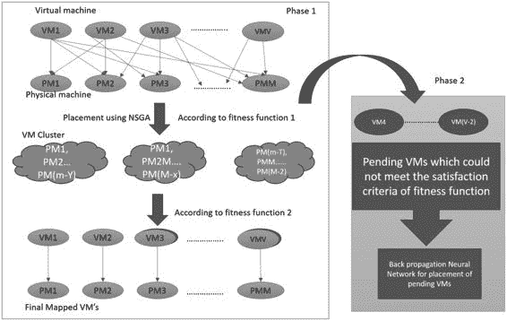

**节能虚拟机放置** ◾ **147**

## 8.5 拟议的节能 BPGA 优化模型

在[42, 43]中，我们讨论了 VM 合并的前三个步骤，并在此提出了一种用于能量最小化和资源利用率提升的 BPGA VM 放置方法。通过减少活跃机器数量来最小化能耗，直接促进了绿色计算。

当前工作提出了一种面向云数据中心的能量感知虚拟机放置（VMP）技术，该技术基于遗传算法（NSGA）和生物神经网络（BPNN），称为 BPGA 模型，如图 8.3 所示。该技术旨在将我们从之前的工作[43]中选定的虚拟机放置到另一台活跃主机上，使其映射通过减少数据中心内活跃主机的数量来最小化能耗。该 BPGA 模型分两遍工作。这两遍的细节讨论如下：

**图 8.3 用于 VM 放置的 BPGA 模型。**

**148** ◾ ML and Optimization Models

### 8.5.1 Pass 1: Non-Dominated Sorting Genetic Algorithm (NSGA)

**步骤 1.** 最初，我们可以将任意 VM 映射到任意机器上，但满足约束 11 非常重要，即每个 VM 需要映射到单个机器上。

$$ \sum_{j=1}^{M} X_{ji} = 1 \quad \forall j \in PM \land \forall i \in VM \tag{8.11} $$

**步骤 2.** 将计算虚拟机请求的资源总量以及提供资源的物理机容量，并检查它们是否满足适应度函数 1。如果满足，则计算适应度函数 1 的值并创建 VM 集群，其中 VM 将根据其排名排序[44]。VM 集群意味着这些集群中的 PM 是 VM 映射的选项。此外，如果这些约束不被 VM 满足，则那些待处理的 VM 将在不检查目标函数 2 的情况下转发给 Pass 2。

**适应度函数 1：资源容量**

CPU（$C$）和内存利用率（$Mem$）是我们工作中考虑的两个主要资源。在遗传算法的染色体表示中，基因数组的每个值代表一个虚拟机的放置目的地。对于第 $j$ 台物理机，假设它可以承载 $m$ 个虚拟机，则第 $j$ 台物理机上承载的 VM $m$ 的资源维度数组可表示为：$[C_{j1}, C_{j2}, \dots, C_{jm}]$ 和 $[Mem_{j1}, Mem_{j2}, \dots, Mem_{jm}]$。资源属性的总值为：$RC_j = C_j + Mem_j \tag{8.12}$

$$ Fitness_1 = F_1 = \frac{1}{RC_j} \tag{8.13} $$

**算法 1 BPGA 模型 Pass 1 使用 NSGA**

```
1  Input: VM list, Host list
2  Output: VM-PM placement map
3  Allocated host = null, Cando_List = null, min_energy = MAX
4  Tournament size[][] = null  // tournament size will be equal to VM count * host count
5  Objective1.NSGA = find_fit(Host capacity, VM requirements)
6  For each VM in VM List
7      For Hostcount = 1: Hostcount
8          If (Host_fulfill(VM requirements))
9          {
10             Cando_List[Hostcount][0] = host_id
11             Cando_List[Hostcount][1] = VM-id
12          }
13          Else
14          {
15             BPNN()
16          }
17      End for
18  End for each
19  Objective 2.NSGA = selection_best_fit(Cando_List[])
20  If host.containing.VM > 1  // if VM has more than one PMs available for mapping
21      For each host in Cando_List[]
22          If (host.Energy < min_energy)
23          {
24              Allocated hosts = host
25              Min_energy = Energy
26          }
27  Return VM-PM Placement map (Allocated hosts)
```

**步骤 3.** 如果目标函数 1 满足，则从上述生成的 VM 集群中，每个虚拟机都有多台物理机可用于映射。因此，该步骤通过计算适应度函数 2 的值提供虚拟机到物理机的最终映射，作为 VM 目的地的物理机将根据其在集群内适应度值的排名进行排列，并根据该值，从每个 VM 集群中选择物理机用于虚拟机的放置。能耗值已在适应度函数 2 中计算（图 8.4）。

**适应度函数 2：能耗**

$$ Fitness_2 = F_2 = \frac{1}{\sum_{j=1}^{M} ENC_{total}} \tag{8.14} $$

**图 8.4 BPGA 模型的伪流程和交互图。**

### 算法 2：BPGA 模型 Pass 2 使用 BPNN


## 算法 2：BPGA 虚拟机放置模型

```
1  Input : VM List, Host List
2  Output: VM-PM Placement map
3  TrainSet[][]
4  For each host in Host List
5      For (i = 1 to 11)  // value of power consumption of servers on 11 different condition from idle to 100% utilized
6          Train_Set[host][i] = host[condition(i)]
7      End for
8  End for each
9  Total Epochs = 500  // total number of possible iterations
10 Initialize gradient_satisfied = 0
11 Term_Weight[][]
12 While (gradient not satisfied)
13     For each data in Train_Set[][]
14         Term_Weight[i, f] = a * data + b  // a and b are arbitrary values
15     End for
16 End While
17 MT = Mean(Term_Weight)
18 If (MT < gradient)
19 {
20     Term_weight = Term_weight + s
21 }
22 Else
23 {
24     Gradient_satisfied = 1
25 }
26 If (gradient_satisfied = 1)  // neural training is complete
27 {
28     Test_Set[VM][i] = VM[conditions(i)]  // utilization of VM on 11 different conditions from idle to 100% utilized
29 }
30 For each VM in Test_Set
31     Allocated_Host = Simulate(Test_Set, Train_Set)
32     Assign VM to Allocated_Host
33 Return PM-VM Placement map (Allocated_host)
```

**步骤 1**：最初生成用于梯度的随机变量。在第一次迭代中 `gradient_satisfied` 为零，如果梯度满足则变为 1。根据表 8.1，服务器从 0 到 100% 的利用率值被用作 `Term_Weight[][]` 矩阵的输入权重。公式 8.15 显示了梯度满足的约束，其中 `a` 和 `b` 是随机整数值。

$$ \text{if } (gradient\_satisfied == 0) \quad Term\_Weight = generate\_Term\_Weight(data) = a \times (data) + b \quad \text{(random integer values for a and b)} \tag{8.15} $$

**步骤 2**：在此步骤中，将在隐藏层中检查权重的平均值和梯度。如果平均权重的随机变化小于梯度的值，则权重值将按公式 8.16 计算的 `s` 值增加。首先，我们将找到 `Term_Weight` 的平均值（称为 `MT`）并将其与梯度进行比较。

$$ Term\_Weight = Term\_weight + s \quad \text{Where s is random change if } MT < gradient $$

$$ \text{gradient\_satisfied = 1 otherwise} \tag{8.16} $$

**步骤 3**：现在，神经网络已训练足够以用于新的输入集。与 `Train_Set` 类似，`Test_Set` 矩阵包含服务器从空闲到 100% 利用率的 11 种不同条件下 VM 的能耗。`Test_Set` 矩阵将连同 `Train_Set` 矩阵进一步传递给模拟函数，以分配算法 3 中提到的最合适的主机。

### 算法 3：神经网络模拟函数

```
1  Input: Test_Set, Train_Set
2  Output: Allocated_Host
3  Initialize Tts, Trs = 0
4  Tts = Test_Set
5  Trs = Train_Set
6  [r] = size(Trs)
7  For (i = 1 to r)
8      MT = Mean(Trs)
9      MR = Mean(Tts)
10     If (MT < MR)
11     {
12         Allocated_Host = i
13     }
14 End for
```

## 8.6 性能评估

为了评估 `BPGA` 虚拟机放置模型带来的性能提升，我们将其与三种现有的参考算法进行了比较：`PABFD`、`GA` 和 `ACO`。这些参考算法简要描述如下：

## 表 8.2 服务器配置

| **服务器** | **CPU 型号** | **内存 (GB)** | **频率 (MHz)** | **核心数** |
| :--- | :--- | :--- | :--- | :--- |
| IBM Server x3250 | Intel Xeon X3480 | 8 | 2,933 | 4 |
| IBM Server x3250 | Intel Xeon X3470 | 16 | 3,067 | 12 |
| Acer AT150 F1 | Intel Xeon 5670 | 12 | 2,933 | 12 |
| Acer AR320 F1 | Intel Xeon 3470 | 8 | 2,933 | 4 |
| HP ProLiant G4 | Intel Xeon 3040 | 4 | 1,860 | 2 |
| HP ProLiant G4 | Intel Xeon 3075 | 8 | 2,933 | 2 |

## 表 8.3 虚拟机实例 [45]

| **虚拟机类型** | **CPU (MIPS)** | **内存 (GB)** |
| :--- | :--- | :--- |
| 特大型 (高内存) | 3,000 | 6 |
| 中型 (高 CPU) | 2,500 | 0.85 |
| 特大型 | 2,000 | 3.75 |
| 小型 | 1,000 | 1.7 |
| 微型 | 500 | 0.613 |

### 8.6.1 实验设置

我们选择了 `CloudSim` 仿真平台作为实验环境，因为在真实的云环境中进行实验非常困难。数据中心环境由 800 台具有 6 种不同配置的服务器组成。表 8.2 提供了这些服务器的配置，表 8.3 展示了我们在此使用的五种不同的虚拟机实例。

此外，对于仿真环境，我们采用了来自 `CoMoN Project` 十天数据的真实工作负载 [46]。

### 8.6.2 仿真结果与比较

在本节中，我们讨论了由 `BPGA` 模型放置后的能耗、迁移次数和使用的主机数量。我们使用 PlanetLab 数据集（如图 8.5–8.8 所示）将结果与 `GA`、`ACO` 和 `PABFD` 进行了比较。图 8.5 描绘了在每次运行中虚拟机增加时，`BPGA` 使用的主机数量较少。

图 8.6 显示了与 `PABFD`、`GA` 和 `ACO` 相比，`BPGA` 进行的迁移次数较少。正如图 8.7 所示，`BPGA` 找到了具有最小能耗的虚拟机-物理机最佳匹配。

## 8.7 结论与未来展望

绿色计算是当前非常热门的研究领域。数据中心中对计算资源、应用和存储不断增长的需求是碳排放的主要来源。因此，有效的能源管理对数据中心非常有帮助。如今，大多数研究人员正在实施生物启发式方法来应对这一能源危机。因此，我们也结合 `BPNN` 使用多目标优化，以实现虚拟机在数据中心服务器上的最优放置。

我们提出了一种 `BPGA` 和能量感知模型用于虚拟机放置，以最小化主机使用量。该模型采用分治法寻求该问题的最优解。该问题分两遍求解，第一遍使用 `NSGA`，第二遍使用 `BPNN` 进行最合适的虚拟机放置。

在本工作中，我们使用 `CloudSim` 对所提模型进行了仿真；未来我们希望在提供真实基础设施的 `CloudStack` 上开展工作。此外，考虑到数据中心的不同网络拓扑，其网络结构也是几个可以做出贡献的研究方向。

### 参考文献

[1] Md Hasanul Ferdaus, Manzur Murshed, “Energy-aware virtual machine consolidation in IaaS cloud computing”, *Cloud Computing*, pp. 179–208, 2014.

[2] Perspectives I, “Using a total cost of ownership (TCO) model for your data center”, 2013. URL: `http://www.datacenterknowledge.com/archives/2013/10/01/using-a-totalcost-of-ownership-tco-model-for-your-data-center/`, last accessed: 02-01-2014.

[3] Saurabh Kumar Garg, Srinivasa K. Gopalaiyengar, Rajkumar Buyya, “SLA-based resource provisioning for heterogeneous workloads in a virtualized cloud datacenter”, in Proceedings of 11th International Conference on Algorithms and Architectures for Parallel Processing, pp. 371–384, 2011.

[4] Nguyen QH, Nam T, Nguyen T, “Epobf: Energy efficient allocation of virtual machines in high performance computing cloud”, *Journal of Science and Technology*, Vol. 51(4B), pp. 173–182, 2013.

[5] Nakku K, Jungwook C, Euiseong S, “Energy-credit scheduler: An energy-aware virtual machine scheduler for cloud systems”, *Future Generation Computer System*, Vol. 32, pp. 128–137, 2014.

[6] Atefeh K, Saurabh K, Rajkumar B, “Energy and carbon-efficient placement of virtual machines in distributed cloud data centers”, in *Euro-par 2013 Parallel Processing. Lecture Notes in Computer Science*, Vol. 80(97), Springer, Berlin, pp. 317–328, 2013.

[7] Sheikh H, Tan H, Ahmad I, Ranka S, Bv P, “Energy- and performance-aware scheduling of tasks on parallel and distributed systems”, *ACM Journal of Emerging Technology in Computing Systems*, Vol. 8(4), pp. 1–37, 2012.

[8] George Kousiouris, Tommaso Cucinotta, Theodora Varvarigou, “The effects of scheduling, workload type and consolidation scenarios on virtual machine performance and their prediction through optimized artificial neural networks”, *Journal of Systems and Software*, Vol. 84, pp. 1270–1291, 2011.

[9] Haikun L, Hai J, Cheng X, Xiao L, “Performance and energy modeling for live migration of virtual machines”, *Cluster Computing*, Vol. 16(2), pp. 249–264, 2013.

[10] Zhang W, Song Y, Ruan L, “Resource management in internet-oriented data centers”, *Journal of Software*, Vol. 23(2), pp. 179–199, 2012.

[11] Hongjian Li, Goufeng Zhu, Chenghuan Cui, Hong Tang, Yusheng Dou, Chen He, “Energy-efficient migration and consolidation of virtual machines in data centers for cloud computing”, *Journal of Computing*, Vol. 98, pp. 303–317, 2016.

[12] Fabio Lopez Pires, Benjamin Baran, “Multi-objective virtual machine placement with service level agreement: A Memetic algorithm approach”, In Proceedings of 6th International Conference on Utility and Cloud Computing, pp. 203–210, 2013.

[13] Beloglazov A, Buyya R, “Optimal online deterministic algorithms and adaptive heuristics for energy and performance efficient dynamic consolidation of virtual machines in Cloud data centers”, *Concurrency Computation: Practice and Experience*, Vol. 24, pp. 1397–1420, 2012.

[14] Beloglazov A, Abawajy J, Buyya R, “Energy-aware resource allocation heuristics for efficient management of data centers for cloud computing”, *Future Generation Computing System*, Vol. 28, pp. 755–68, 2012.

[15] Ehsan Arianyan, Hassan Taheri, Saeed Sharifian, “Novel energy and SLA efficient resource management heuristics for consolidation of virtual machines in cloud data centers”, *Computers and Electrical Engineering*, Vol. 47, pp. 222–240, 2015.

[16] Buyya R, Ranjan R, Calheiros RN, “Modeling and simulation of scalable cloud computing environments and the cloudSim Toolkit: Challenges and opportunities”, in Proceedings of the 7th High Performance Computing Simulation Conference (HPCS 2009), Leipzig, Germany, pp. 1–11, pp. 21–24. IEEE Press, New York, 2009.

[17] Nathuji R, Schwan K, “Virtualpower: Coordinated power management in virtualized enterprise systems”, *ACM SIGOPS Operating Systems Review*, Vol. 41(6), pp. 265–278, 2007.

[18] Lim MY, Rawson F, Bletsch T, Freeh VW, “PADD: Power aware domain distribution”, in Proceedings of the 29th IEEE International Conference on Distributed Computing Systems (ICDCS’09), Montreal, pp. 239–247, 2009.


# 云计算中面向能效的元启发式算法

**Shally Vats, Sanjay Kumar Sharma and Sunil Kumar**

DOI: [10.1201/9781003185376-9](https://dx.doi.org/10.1201/9781003185376-9)

---

## 参考文献

[19] Goiri I, Berral JL, Fitó O, Julià F, Nou R, Guitart J, Gavalda R, Torres J, “Energy-efficient and multifaceted resource management for profit-driven virtualized data centers”, *Future Generation Computer System*, Vol. 28(5), pp. 718–731, 2012.

[20] Verma A, Ahuja P, Neogi A, “pMapper: Power and migration cost aware application placement in virtualized systems”, in Proceedings of the 9th ACM/IFIP/USENIX International Conference on Middleware (Middleware’08), Leuven, Belgium, pp. 243–264. Springer, Berlin, 2008.

[21] Verma A, Dasgupta G, Nayak T, De P, Kothari R, *Server Workload Analysis for Power Minimization Using Consolidation*, p. 28, USENIX Association, Berkeley, CA, 2009.

[22] Ghribi C, Hadji M, Zeghlache D, “Energy efficient VM scheduling for cloud data centers: Exact allocation and migration algorithms”, in Proceedings of 13th IEEE/ACM International Symposium on Cluster, Cloud, and Grid Computing, 2013. doi[:10.1109/CCGrid.2013.89](http://dx.doi.org/10.1109/CCGrid.2013.89)

[23] Beloglazov A, Buyya R, “Energy efficient resource management in virtualized cloud data centers”, in Proceedings of 10th IEEE/ACM International Conference on Cluster, Cloud and Grid Computing, pp. 826–831, 2010. doi[:10.1109/CCGRID.2010.46](http://dx.doi.org/10.1109/CCGRID.2010.46)

[24] Beloglazov A, Buyya R, “Energy efficient allocation of virtual machines in cloud data centers”, in 10th IEEE/ACM International Conference on Cluster, Cloud and Grid Computing (CCGrid), Melbourne, Australia, pp. 577–578, 2010.

[25] A Anand, J Lakshmi, and SK Nandy, “Virtual machine placement optimization supporting performance SLAs”, in Proceedings of the 5th IEEE International Conference on CloudComputing Technology and Science (CloudCom ’13), Bristol, UK, pp. 298–305, December 2013.

[26] J Dong, H Wang, X Jin, Y Li, P Zhang, and S Cheng, “Virtual machine placement for improving energy efficiency and network performance in IaaS cloud”, in Proceedings of the 33rd IEEE International Conference on Distributed Computing Systems Workshops (ICDCSW ’13), IEEE, Philadelphia, PA, pp. 238–243, July 2013.

[27] T Ferreto, CAF De Rose, H-U Heiss, “Maximum migration time guarantees in dynamic server consolidation for virtualized data centers”, in *Euro-Par 2011 Parallel Processing, Vol. 6852 of Lecture Notes in Computer Science*, pp. 443–454, Springer, Berlin, Germany, 2011.

[28] IS Moreno, R Yang, J Xu, T Wo, “Improved energy efficiency in cloud datacenters with interference-aware virtual machine placement”, in Proceedings of the 11th IEEE International Symposium on Autonomous Decentralized Systems (ISADS ’13), IEEE, Mexico City, pp. 1–8, March 2013.

[29] Sekhar J, Jeba G, “Energy efficient VM live migration in cloud data centers”, *International Journal of Computer Science and Network*, Vol. 2(2), pp. 71–75, 2013.

[30] Bila N, Lara ED, Joshi K, Lagar-Cavilla HA, Hiltunen M, Satyanarayanan M, “Jettison: Efficient idle desktop consolidation with partial vm migration”, in Proceedings of the 7th ACM European Conference on Computer Systems. EuroSys ’12, New York, pp. 211–224, 2012.

[31] Zhou A, Wang S, Zheng Z, Hsu C, Lyu M, Yang F, “On cloud service reliability enhancement with optimal resource usage”, in *IEEE Transactions on Cloud Computing*, vol. 99, pp. 1–1, 2014. doi[:10.1109/TCC.2014.2369421](http://dx.doi.org/10.1109/TCC.2014.2369421).

[32] Minas L, Ellison B, *Energy Efficiency for Information Technology: How to Reduce Power Consumption in Servers and Data Centers*, Intel press, 2009.

[33] Nidhi Jain Kansal, Inderveer Chana, “Energy-aware virtual machine migration for cloud computing: A firefly optimization”, *Journal of Grid Computing*, Vol. 14, pp. 327–345, 2016.

[34] Khichar GD, Gupta G, Singh R, Rathi R “Maximum correlation with migration control based on modified knapsack (MC_MC) approach for VM selection for green cloud computing”, in 8th International Conference on Cloud Computing, Data Science & Engineering, 2018.

[35] Bajoria V, Katal A, Agarwal Y “An energy aware policy for mapping and migrating virtual machines in cloud environment using migration factor”, in 8th International Conference on Cloud Computing, Data Science & Engineering, 2018.

[36] Li Z, Shen H, Miles C, “PageRankVM: A pagerank based algorithm with anti-collocation constraints for virtual machine placement in cloud datacenters”, in 38th International Conference on Distributed Computing Systems, 2018.

[37] Maiyza AI, Hassan HA, Sheta WM, Sadek NM, Mokhtar MA, “And user’s SLA-aware consolidation in cloud datacenters”, in IEEE International Symposium on Signal Processing and Information Technology, 2017.

[38] S Shen, VV Beek, A Iosup, “Statistical characterization of business-critical workloads hosted in cloud datacenters”, in 15th IEEE/ACM International Symposium on Cluster, Cloud and Grid Computing, IEEE, pp. 465–474, 2015.

[39] X Fan, W Weber, L Barroso, “Power provisioning for a warehouse-sized computer”, in Proceedings of the 34th Annual International Symposium on Computer Architecture, pp. 13–23, 2007.

[40] SPEC power benchmarks, Standard Performance Evaluation Corporation, Retrieved from [`www.spec.org/benchmarks.html#power`](http://www.spec.org/benchmarks.html#power)

[41] Kumar D, Mishra KK, “Multi-objective optimization using co-variance guided Artificial Bee Colony”, in *Journal of Information Science and Engineering*, Vol. 32, 2016.

[42] Sharma O, Saini H, “VM consolidation for cloud data centers using median based threshold approach”, in Proceedings of twelfth international multi-conference on information processing (IMCIP), Vol. 89, pp. 27–33, 2016.

[43] Sharma O, Saini H, “Energy efficient virtual machine consolidation for cloud datacenters using analytic hierarchy process”, in *International Journal of Advanced Intelligence and Paradigms*, Vol. 10(4), pp. 401–422, 2018.

[44] Caglar F, Shekhar S, Gokhale A, “iPlace: An intelligent and tunable power-and performance aware virtual machine placement technique for cloud –

[45] Amazon 弹性计算云 (EC2)，检索自 [`aws.amazon.com/ec2/instance-types`](http://aws.amazon.com/ec2/instance-types)

[46] Park K, Pai VS, “CoMon: 一个用于 PlanetLab 的大多可扩展监控系统”, *ACM SIGOPS 操作系统评论*, 卷 40, 页 65–74, 2006.

---

## 目录

*   9.1 简介
    *   9.1.1 云计算的基本特征
    *   9.1.2 云服务模型
*   9.2 云技术：虚拟化
    *   9.2.1 云中的功耗
    *   9.2.2 虚拟机整合
*   9.3 用于虚拟机放置的元启发式算法
    *   9.3.1 模拟退火
    *   9.3.2 蚁群优化
    *   9.3.3 粒子群优化
    *   9.3.4 遗传算法
    *   9.3.5 生物地理学优化 (BBO)
    *   9.3.6 蜜蜂优化
    *   9.3.7 蝙蝠优化
*   9.4 结论
*   参考文献

---

### 9.1 简介

随着云计算的出现，将计算作为一种公用事业来使用的梦想已成为现实。云允许您以各种服务的形式使用所有计算资源 [1]。所有这些服务都非常灵活，提供了易用性。在云计算中，云是互联网的隐喻，这意味着可以借助互联网获取计算服务。由于互联网是云计算的骨干，所有服务都与位置无关，即访问服务只需要互联网连接，您可以从世界任何地方获得访问权限。关于云计算有许多描述，但标准定义由 NIST [2] 给出：云计算是一种模型，用于实现普遍、便捷、按需的网络访问，进入可配置的计算资源共享池（例如网络、服务器、存储、应用程序和服务），这些资源可通过最少的管理工作或服务提供商交互快速配置和释放。

#### 9.1.1 云计算的基本特征

云计算有五个基本特征，这些特征的存在使云系统区别于网格计算和分布式计算等其他计算环境。

**图 9.1** 展示了云的这些特征。

*   **可度量服务**：此功能允许用户仅为其使用的服务付费。云系统中存在计量能力，用于度量提供给用户的服务。提供商和用户均可监控资源使用情况。会针对每个应用程序度量资源利用率，以便据此进行计费。
*   **快速弹性**：此功能使云服务在使用方面具有灵活性。云服务可根据用户需求进行配置或释放。云系统的更好性能需要资源的快速扩展/缩减。
*   **按需自助服务**：此特征允许云用户在无需云服务提供商干预的情况下访问云服务。可使用 Web 自助服务来请求云数据中心的资源。在云计算中，用户可以增加或减少其服务需求（如存储、服务器等），而无需人工干预。
*   **资源池化**：多租户成为可能归功于此功能。为了服务大量用户，云中会创建一个资源池。该资源池应足够大且灵活，以容纳多个租户。此外，云为所有客户提供了一层抽象，使服务独立于资源的物理位置。
*   **广泛网络访问**：云服务可通过其遍布全球的广泛网络进行访问。这些服务可通过标准机制访问，这些机制使用异构的瘦或厚客户端平台，例如工作站、笔记本电脑、平板电脑和手机。此功能确保在任何情况下没有人会脱离环路。

#### 9.1.2 云服务模型

根据提供给用户的服务类型，云可分为三种服务模型。**图 9.2** 展示了服务模型。

*   **软件即服务**：这是一种通过互联网提供软件功能的模型。访问此模型的用户无需安装软件及进行维护。他/她可以直接借助互联网浏览器使用任何应用程序。Google Docs 是一个非常流行的例子。
*   **平台即服务**：该模型供应用程序开发人员使用，他们可以直接开始开发应用程序，而无需担心其工作平台（如操作系统、服务器端脚本语言等）的安装。Google App Engine 和 Hadoop 是该模型非常著名的例子。
*   **基础设施即服务**：每当有人需要计算基础设施（如计算机、网络、存储等）时，则使用此模型。所有资源均通过虚拟化由用户访问。Google Compute Engine 是此类云模型的一个例子。

## 9.2 云技术：虚拟化


在云数据中心为每个用户单独配置资源是不可行的；因此，云服务提供商有必要引入一种机制，在多个用户之间共享资源，而不

# 虚拟化与用于虚拟机放置的元启发式算法

虚拟化是解决用户隐私泄露问题的方案。借助虚拟化，云服务提供商能够以更少的数据中心硬件容纳大量用户。虚拟化创建各种虚拟机，它们共享底层物理机的实际资源。这是在虚拟机监视器（`VMM`）的帮助下完成的，`VMM` 将计算环境与物理资源分离开来。图 9.3 表明，可以在单个硬件平台上创建多个虚拟机，其中所有虚拟机彼此完全隔离。

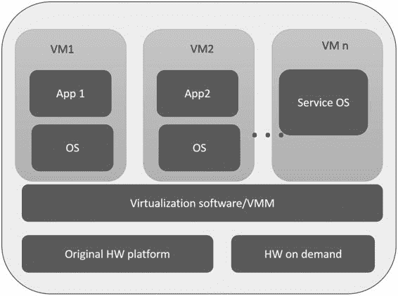

**图 9.3** 云中的虚拟化。

云虚拟化帮助云提供商向用户提供其应用程序的标准版本。虚拟化提供了云资源池的统一视图。虚拟机不依赖于底层硬件。`VMM` 在虚拟机和物理机之间提供解耦。它将虚拟机的状态保存在一个文件中。因此，虚拟机可以像文件一样轻松地从一台物理机迁移到另一台物理机。这一特性在云计算中发挥着重要作用。

虚拟化是云计算的核心。每当有新的用户请求到来时，都会创建一个虚拟机来满足该请求。通过虚拟化，用户之间相互隔离。

## 9.2.1 云中的功耗

云的广泛接受使其规模急剧扩大。因此，云数据中心包含大量设备。IT 基础设施及其冷却系统消耗大量电力，导致高昂的电费账单。电费账单是运营成本的主要部分。每个云提供商都试图降低运营成本，以实现高投资回报。因此，电源管理在云中起着至关重要的作用，因为运营成本的很大一部分源于功耗。在 IT 基础设施中，服务器是主要的功耗消费者。在本章中，我们将交替使用“服务器”和“物理机”这两个术语。因此，目前大多数研究工作仅考虑服务器消耗的功率。它们都采用了线性功耗模型。据观察，物理机 CPU 利用率从空闲状态增长到完全利用状态，与能耗呈线性关系 [[3]](#index_split_003.html#p196)。因此，物理机的功耗 `PPM` 可以用其 CPU 利用率来表示，如公式 9.1 所示。

```
PPM = (pmax - pmin) * UCPU_p + pmin
```

**(9.1)**

其中 `pmax` 是最大工作负载下的功耗，`pmin` 是最小工作负载下的功耗（工作负载可以为 0）。

据观察，空闲服务器消耗 70% 的能量 [[3]](#index_split_003.html#p196)。因此，公式 9.1 可修改为公式 9.2 所示。

```
PPM = (0.3 * UCPU + 0.7) * pmax
```

**(9.2)**

同样，虚拟机的功耗也可以计算。在服务器上审慎地放置虚拟机可以非常高效地节省电力。低资源利用率导致功耗 [[4]](#index_split_003.html#p196)。据观察，云数据中心服务器的利用率大部分时间保持在 10% 到 50% 之间 [[5]](#index_split_003.html#p196)。因此，服务器大部分时间处于利用率不足或空闲状态。记录显示，即使是空闲服务器也消耗其峰值负载功耗的 70% [[3]](#index_split_003.html#p196)。因此，可以关闭空闲服务器以节省电力。虚拟机整合是此类节省云数据中心中利用率不足的服务器所消耗能量的最著名方法。

## 9.2.2 虚拟机整合

在虚拟机整合中，服务器的利用率得到优化。空闲的物理机被关闭。虚拟机整合试图将一定数量的虚拟机分配给最少数量的物理机。使用虚拟机整合，云服务提供商可以实现其资源的优化利用。在虚拟机整合中，虚拟机从一台物理机重新定位到另一台物理机，以实现资源的最佳利用。这有助于动态资源管理。当虚拟机整合到最少数量的物理机上时，空闲的物理机可以被关闭以节省能源。虚拟机整合过程如图 9.4 所示。

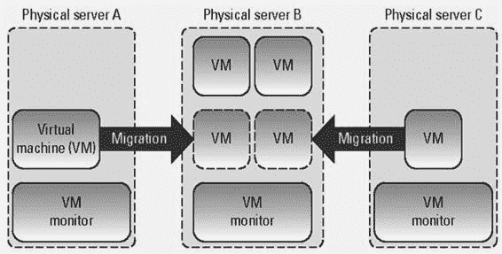

**图 9.4** 虚拟机整合过程。

## 9.3 用于虚拟机放置的元启发式算法

虚拟机放置任务被视为 NP-hard 问题，因此无法找到最优解。虚拟机的最优放置始终是云服务提供商面临的挑战性任务。元启发式算法在这方面可以提供很大帮助。利用这些算法，可以获得接近最优的解。元启发式是一种高层的、与问题无关的算法框架，它提供了一组准则或策略，用于开发启发式优化算法。

元启发式算法受现实生活问题解决方案的启发。根据解的数量，元启发式算法大致可分为两类，如图 9.5 所示。

*   **基于单解**：在这种类型的元启发式方法中，仅采用一个候选解。应用的启发式仅尝试改进该解。此类元启发式的典型例子包括模拟退火和引导局部搜索。
*   **基于种群**：这在搜索空间中考虑多个候选解，并尝试同时修改多个解。蚁群优化、粒子群优化和遗传算法是著名的例子。

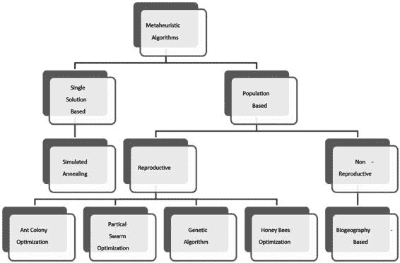

**图 9.5** 元启发式算法的分类。

### 9.3.1 模拟退火

这是一种用于在大搜索空间中优化函数的技术。它受物理退火过程启发，即材料被加热然后冷却以转化为所需的结构。该过程从某个随机解（称为初始解）开始。此时温度设置为 `T0`。有三种降温规则，即：线性降低、缓慢降低和几何降低。根据所使用的模型，可以采用其中任意一种。温度迭代降低，直到达到终止条件。然后选取一个邻域解并将其视为新解。如果旧解和新解的成本函数之差大于 1，则新解更好，否则保留旧解。该过程持续直到达到终止条件。

**算法：模拟退火**

```
取一个随机解 Soln0
设置温度 = T0
当 (未达到终止条件) 执行
    降低温度
    找到 Soln0 的一个邻域解 Soln1
    如果 (fitness(Soln1) 优于 fitness(Soln0))
        Soln0 = Soln1
结束当
返回 Soln0
```

### 模拟退火用于虚拟机放置

Wu 等人 [\[6\]](#index_split_003.html#p196) 首先将模拟退火应用于寻找云数据中心中虚拟机的最优放置以节省能源。所提出方法的名称是基于模拟退火的虚拟机放置（`SAVMP`）。该方法分为四个部分。第一部分在某些约束条件下找到虚拟机在物理机上的放置配置。生成初始配置的一个邻域配置。然后在第三部分，计算新配置的能量偏差。在最后一部分，进行温度调度。该方法与 `FFD` 进行了比较，结果发现 `SAVMP` 消耗的能源更少。

Rajabzadeh 等人 [\[7\]](#index_split_003.html#p196) 提出了一种虚拟机管理方法。它在马尔可夫链模型中使用并行模拟退火进行虚拟机放置。有两个管理器，称为全局管理器和局部管理器。全局管理器负责虚拟机迁移和整合，而局部管理器检测过载/低载/临界条件并选择用于迁移的虚拟机。当主内存的大部分被占用时会发生临界条件，因为这可能导致 `SLA` 违规。初始种群由一个物理机列表组成，不包括低负载和过载的物理机，这是通过四分位数间距完成的。然后考虑待迁移的虚拟机，条件是虚拟机的数量应与列表中物理机的数量相同。最初采用随机分配方案并计算其适应度值。适应度函数计算特定虚拟机放置后能源消耗的增加量。初始温度设置为 `T0`。作者设计了自己的模型来设定初始温度。为种群中的每个成员生成若干邻居，并计算它们的适应度值。根据模拟退火比较规则，种群中的每个成员都与其邻居进行比较，如果邻居胜出，则将其添加到主种群中。该过程迭代直到达到终止条件。该工作在 `CloudSim` 上进行仿真，并与 `LRMMT` 和 `LRMC` [\[8\]](#index_split_003.html#p196) 进行比较。结果发现其性能优于比较算法。

Marotta 等人 [\[9\]](#index_split_003.html#p197) 提出了一种基于模拟退火的虚拟机整合方法。他们选取了一组物理机 `j` 和一组虚拟机 `m`。问题定义为：给定分配到一组物理机上的一组虚拟机，需要找到虚拟机的迁移方案，使得新的活跃物理机集合消耗的功率与迁移次数的线性组合最小。算法包含一个扰动阶段，通过迁移单个虚拟机（称为扰动），从当前解找到一个新解。虚拟机迁移使用期望指数完成，该指数是虚拟机利用率的 `Sigmoid` 函数。该算法与 `FFD` 和 `Sercon` [\[10\]](#index_split_003.html#p197) 进行了比较，并在 Java 实现中消耗了更少的功率。

### 9.3.2 蚁群优化

蚁群算法是一种用于优化问题的概率技术。它由 Marco Dorigo 在 1990 年代提出。它基于蚂蚁在寻找食物与蚁群之间路径时的觅食行为。在此过程中，蚂蚁会识别出两者之间的最短路径，如图 9.6 所示。在图 9.6 中有两条到达食物的路径。基于路径上的信息素，所有蚂蚁在时间 `T = 3` 时都选择了通往食物的较短路径。

**算法：蚁群优化**

```
生成若干解（蚂蚁），称为种群
初始化信息素轨迹和参数
将每只蚂蚁放置在起始节点
当（未达到终止条件）执行
    对每只蚂蚁 a 重复执行
        根据状态转移规则选择下一个节点
        更新信息素
    结束循环
直到每只蚂蚁都有一个解
更新最优解
结束循环
返回最优解
```

X. F. Liu 等人 [\[11\]](#index_split_003.html#p197) 提出了一种使用蚁群算法进行虚拟机放置的方法。结合顺序交换迁移后，该方法称为 `OEMACS`。它考虑了两种资源，即 CPU 和内存，用于检查物理机容量以分配虚拟机。功耗仅针对 CPU 计算。邻接矩阵用于获取虚拟机和物理机的映射。`ACO` 寻找虚拟机到物理机的映射，使得处于活跃状态的物理机数量最小，以优化功耗。信息素包含关于虚拟机之间关系的信息。整合虚拟机的标准是将相关的虚拟机分配在同一物理机上。最初虚拟机和物理机具有一对一映射。在每次迭代中，利用信息素生成的解使物理机数量减少。顺序交换操作用于平衡物理机的资源利用率，即从过载物理机迁移虚拟机。结果表明，所提算法在同构和异构环境中均表现良好。

Aryania 等人 [\[12\]](#index_split_003.html#p197) 提出了一种基于蚁群系统的节能感知虚拟机整合（`EVMCACS`）。它考虑两种资源：CPU 和内存，将物理机分为四类，即正常负载、低负载、高负载和预测高负载。在虚拟机整合过程中，它还考虑了迁移虚拟机所消耗的能量，该能量近似为虚拟机大小的函数。所提算法与 `ACSVMC` [\[13\]](#index_split_003.html#p197) 进行了比较，发现在关机物理机数量、虚拟机迁移次数和 `SLA` 违规方面，性能优于比较算法。

Fares 等人 [\[14\]](#index_split_003.html#p197) 设计了一种虚拟机放置方法以降低数据中心的功耗。在他们的工作中，他们提出了一种嵌入在蚁群优化中的新启发式算法，用于将虚拟机放置在物理机上。该方法将首次适应递减 [\[14\]](#index_split_003.html#p197) 的解作为初始信息素的值。识别特定虚拟机的最佳物理机的启发式算法不仅考虑功耗，还考虑 CPU 利用率和 CPU 容量。该算法分两个模块工作。第一个模块为每只蚂蚁找到最佳解，第二个模块尝试改进全局最优解。该方法在三个参数上进行评估，即节能、可扩展性和运行时性能。该方法与两种现有算法进行了比较，结果表明它优于比较算法。

### 9.3.3 粒子群优化

粒子群优化由 Kennedy 于 1995 年设计。这是一种基于种群的随机算法。它基于鱼群或鸟群的行为。在优化问题中，粒子群是候选解的集合。单个潜在解称为粒子。粒子有两个特征，即位置和速度。粒子可以相互作用以找到最佳解。每个粒子都有一个适应度值，该值通过目标函数计算得出。

每个粒子都知道自身的最佳性能和群体的最佳性能。基于最佳性能，每个粒子改变其速度，从而相应地改变位置。图示表明，最初鸟儿朝一个方向飞行，随后根据全局最优改变了其方向（图 9.7）。

**图 9.7** 粒子群优化。图示表明，最初鸟儿朝一个方向飞行，随后利用粒子群优化根据全局最优改变了其方向。

**算法：粒子群优化**

```
用随机位置和速度初始化粒子。

当（未达到终止条件）时 执行
    对每个粒子 p 执行
        计算适应度(p)
        如果 (适应度(p) 优于 个体最优(p))
            设置 个体最优(p) = 适应度(p)
        结束 如果
        如果 (个体最优(p) 优于 全局最优)
            全局最优 = 个体最优(p)
        结束 对于
    对每个粒子 p 执行
        更新 p 的位置和速度
    结束 对于
结束 当

返回 全局最优
```

Xiong 等人 [15] 基于粒子群优化提出了一种用于能量优化的 VM 放置算法，称为基于粒子群优化的多资源能量效率算法（`MREE-PSO`）。共有 `n` 个 VM 和 `m` 个 PM。粒子即为 VM。粒子的位置向量定义为 `Xti = (xti1, xti2, ..., xtij, ..., xtim)`，其中 `t` 表示迭代次数，`i` 代表第 `i` 个可能的解，`j` 是 VM 的序号。借助一个 `m*n` 的 0-1 矩阵更新所有粒子的位置。如果特定 VM 分配给指定 PM，则条目为 1，否则为 0。

`P` best 和 `G` best 分别是个体最优和全局最优的向量。个体适应度函数和全局适应度函数的值分别设为 0.8 和 0.7，以避免局部最优。当迭代次数达到预定义数字时停止。最后一次迭代中找到的映射被视为 VM 在 PM 上的最终放置。该算法在 `CloudSim` 上进行仿真，结果显示与其他算法相比具有能效优势。

Aruna 等人 [16] 提出了一种用于将 VM 放置到 PM 上的粒子群优化方法，目标是最小化功耗。他们使用了 CPU 的线性功耗模型来计算功耗。他们基于条件 `N < M` 选取了 `N` 个 VM 和 `M` 个 PM。因此粒子具有 `N` 维向量。每个维度可映射到一组离散值，上限为 `M`。每个粒子初始被分配随机位置和速度。每个粒子的当前位置称为个体最优。适应度函数是每个粒子能耗之和，旨在将其最小化。根据个体最优和全局最优，使用位置和速度更新的通用方程更新每个粒子的位置和速度。因此，通过迭代实现了寻找 VM 放置方案的目标，使所用 PM 的功耗最小化。该算法在 `CloudSim` 上仿真，结果优于非功耗感知方法。

Ibrahim 等人 [17] 提出了一种基于粒子群优化的功耗感知技术（`PAPSO`），以确定迁移 VM 的近似最优放置。该技术不仅试图降低 PM 的功耗，还照顾到 `SLA` 违规问题。这是通过将过载 PM 的数量保持在尽可能低的水平来实现的。该过程考虑除过载 PM 以外的 PM 集合以及待迁移的 VM 集合。生成映射并计算其适应度值。该技术在 `CloudSim` 上实现，并与功耗感知最佳适应递减算法进行比较。结果显示，在能耗和 `SLA` 违规方面均表现更优。

### 9.3.4 遗传算法

遗传算法是一种基于查尔斯·达尔文自然进化理论的搜索启发式算法。遗传算法分五个阶段进行，即：初始种群、适应度函数、选择、交叉和变异。一组个体被视为初始种群。所有个体都有称为基因的定义参数。基因经历变异和交叉以产生更好的下一代。产生的个体通过适应度函数测试，最优个体被选中进行繁殖。因此，通过迭代我们得到下一代的最优个体，并在达到目标后停止。

**算法：遗传算法**

```
生成具有随机个体的种群

当（未达到终止条件）时 执行
    对每个个体 i 执行
        计算适应度(i)
    结束 对于
    选择最优个体
    对选定个体应用交叉
    对选定个体应用变异
    用更优个体更新种群
结束 当

返回 最优个体
```

Tang 等人 [18] 提出了一种混合遗传算法（`HGA`），以功耗高效的方式放置 VM。该过程考虑了 PM 消耗的能量以及 PM 的通信网络。它为 PM 使用了三层架构。目标是最小化 PM 的能耗以及 VM 之间发生的通信能耗。存在一些可行性条件，如 PM 的 CPU 和内存容量。该过程从种群中取出每个个体并检查可行性条件。如果不合格，则应用修复过程使其可行，并计算其适应度值。为了配对个体解，应用了轮盘赌选择过程。为了产生后代，使用了偏向均匀交叉。该过程持续直到找到最佳解。该工作用 Java 实现，结果优于标准遗传算法。

Zhao 等人 [19] 提出了一种新颖的 VM 放置算法，结合了遗传算法和禁忌搜索算法，统称为 `GATA`。在该工作中，集合 `V` 表示 VM 集合，`H` 表示 PM（宿主机）集合。目标是找到一个集合 `H' ⊆ H`，使其能容纳所有现有 VM，且 `H'` 中 PM 的功耗最小，负载均衡以满足 `QoS`。VM 放置方案用等长实数编码表示。如果有 `n` 个 VM 和 `m` 个 PM（考虑 `n < m`），则初始种群为 VM 到 PM 的随机分配，使得每个 PM 仅分配一个 VM。因此当达到 `m` min 时过程将停止。

### 9.3.5 生物地理学优化（BBO）

生物地理学是研究物种在地理空间分布的学科。它由 Simon 于 2008 年提出。它研究不同栖息地之间物种的迁移，其中每个栖息地与一个栖息地适宜性指数（`HSI`）相关联。`HSI` 基于适宜性指数变量（`SIVs`）。高 `HSI` 的栖息地具有高迁出率和低迁入率。在优化中，每个候选解称为一个栖息地。候选解的适应度值即为其 `HSI`。该算法与 `GA` 的主要区别在于它不涉及繁殖。

**算法：生物地理学优化**

```
生成一组随机栖息地

对每个栖息地 Hi 执行
    计算每个栖息地的 HSIi。
结束 对于

按 HSI 升序排列栖息地

当（未达到终止条件）时
    更新每个栖息地的物种数量
    计算所有栖息地的迁入率和迁出率
    应用迁移和变异以获得解的更新栖息地集合
end while

return best solution
```

Zheng 等人 [\[20\]](#index_split_003.html#p197) 提出了一种基于 `BBO` 的多目标虚拟机放置方法，称为 `VMPMBBO`。其在虚拟机放置中的目标是在约束条件下最小化能耗和资源浪费，该约束条件为：托管在特定物理机 (`PM`) 上的虚拟机 (`VM`) 的资源需求不会超过该物理机的资源。该方法与三种现有的多目标方法进行了比较，并在合成数据上进行仿真后发现效果更好。


# 元启发式算法

## 表 9.1：面向节能虚拟机放置的元启发式方法

| 方法 | 显著特点 | 文献中的主要贡献 | 局限性 |
| :--- | :--- | :--- | :--- |
| **模拟退火** | • 降低能耗<br>• 虚拟机放置优化<br>• 基于马尔可夫链的并行算法<br>• 动态虚拟机管理 | [6], [7], [9] | • 对比实验不详尽<br>• 需要参数调优<br>• 可扩展性有限 |
| **粒子群优化** | • 虚拟机放置<br>• 降低能耗<br>• 混合方法<br>• 多目标优化 | [11], [15], [17] | • 过早收敛<br>• 参数敏感性<br>• 陷入局部最优 |
| **遗传算法** | • 执行时间<br>• 性能<br>• 时间复杂度<br>• 成本<br>• 开/关机制<br>• CPU 利用率<br>• 性能 | [18], [19], [20], [21], [23] | • 计算复杂度高<br>• 收敛速度慢<br>• 参数调优困难 |
| **生物地理学优化** | • 能耗<br>• 绿色计算<br>• 迁移减少<br>• 工作流调度 | [25] | • 相关文献有限<br>• 过早收敛 |
| **和声搜索优化** | • 能源<br>• 绿色计算<br>• 完工时间<br>• 网络<br>• SVM 集成<br>• 混合方法 | [26] | • 参数敏感性<br>• 收敛速度慢 |
| **蝙蝠算法** | • 能耗<br>• 工作负载均衡<br>• 成本降低<br>• 资源利用率 | [27] | • 勘探能力有限<br>• 参数依赖性 |

### 9.4 结论

元启发式算法在资源优化方面发挥了重要作用，从而节省了云数据中心运行中的能源。

研究人员尝试了不同类型的元启发式算法来降低能耗。这些算法已被应用于虚拟机放置，以实现机器整合。然而，它们并非适用于所有场景的解决方案。因此，有必要确定特定元启发式算法的适用性。本章为文献中关于云数据中心节能运行领域元启发式算法的主要贡献提供了合理的见解。**表 9.1** 展示了旨在降低能耗的现有元启发式算法的对比视图。在大多数研究中，网络设备消耗的能源未被考虑在内。此外，在大多数情况下，对比分析并不详尽。因此，未来的工作可以致力于解决这些问题。

### 参考文献

[1] R. M. Al-Dwairi, N. Al-Tweit, and K. Zyout, "Factors influencing cloud computing adoption in small and medium E-commerce enterprises in Jordan," *ACM Int. Conf. Proc. Ser.*, vol. 16, no. 1, pp. 73–78, 2018.

[2] P. Mell and T. Grance, "The NIST definition of cloud computing," *NIST Spec. Publ.*, vol. 145, p. 7, 2011.

[3] X. Fan, W.-D. Weber, and L. A. Barroso, "Power provisioning for a warehouse-sized computer," in *Proceedings of the 34th Annual International Symposium on Computer Architecture - ISCA '07*, 2007, vol. 35, no. 2, pp. 13–23.

[4] A. Beloglazov, R. Buyya, Y. C. Lee, and A. Zomaya, *A Taxonomy and Survey of Energy-Efficient Data Centers and Cloud Computing Systems*, 1st ed., vol. 82. Elsevier Inc., 2011.

[5] A. Barroso, Luiz and H. Urs, "The case for energy-proportional computing," *Case Energy-Proportional Comput.*, vol. 40, no. 12, pp. 33–37, 2007.

[6] Y. Wu, M. Tang, and W. Fraser, "A simulated annealing algorithm for energy efficient virtual machine placement," in *Conference Proceedings - IEEE International Conference on Systems, Man and Cybernetics*, 2012, pp. 1245–1250.

[7] M. Rajabzadeh and A. T. Haghighat, "Energy-aware framework with Markov chain-based parallel simulated annealing algorithm for dynamic management of virtual machines in cloud data centers," *J. Supercomput.*, vol. 73, no. 5, pp. 2001–2017, 2017.

[8] A. Beloglazov and R. Buyya, "Optimal online deterministic algorithms and adaptive heuristics for energy and performance efficient dynamic consolidation of virtual machines in cloud data centers," *Concurr. Comput. Pract. Exp.*, vol. 24, no. 13, pp. 1397–1420, 2012.

### 参考文献

[9] A. Marotta and S. Avallone, “A simulated annealing based approach for power efficient virtual machines consolidation,” in *Proceedings - 2015 IEEE 8th International Conference on Cloud Computing, CLOUD 2015*, 2015, pp. 445–452.

[10] A. Murtazaev and S. Oh, “Sercon: server consolidation algorithm using live migration of virtual machines for green computing,” *IETE Tech. Rev.*, vol. 28, no. 3, pp. 212–231, 2011.

[11] X. F. Liu, Z. H. Zhan, J. D. Deng, Y. Li, T. Gu, and J. Zhang, “An energy efficient ant colony system for virtual machine placement in cloud computing,” *IEEE Trans. Evol. Comput.*, vol. 22, no. 1, pp. 113–128, 2018.

[12] A. Aryania, H. S. Aghdasi, and L. M. Khanli, “Energy-aware virtual machine consolidation algorithm based on ant colony system,” *J. Grid Comput.*, vol. 16, no. 3, pp. 477–491, 2018.

[13] F. Farahnakian et al., “Using ant colony system to consolidate vms for green cloud computing,” *IEEE Trans. Serv. Comput.*, vol. 8, no. 2, pp. 187–198, 2014.

[14] F. Alharbi, Y. C. Tian, M. Tang, W. Z. Zhang, C. Peng, and M. Fei, “An ant colony system for energy-efficient dynamic virtual machine placement in data centers,” *Expert Syst. Appl.*, vol. 120, pp. 228–238, 2019.

[15] Xiong, A. P. and C. X. Xu, “Energy efficient multiresource allocation of virtual machine based on PSO in cloud data center,” *Math. Probl. Eng.*, vol. 2014, pp. 1–12, 2014.

[16] P. Aruna and S. Vasantha, “A particle swarm optimization algorithm for power-aware virtual machine allocation,” in *6th International Conference on Computing, Communications and Networking Technologies, ICCCNT 2015*, 2015, pp. 1–6.

[17] A. Ibrahim, M. Noshy, H. A. Ali, and M. Badawy, “PAPSO: A power-aware VM placement technique based on particle swarm optimization,” *IEEE Access*, vol. 8, pp. 81747–81764, 2020.

[18] M. Tang and S. Pan, “A hybrid genetic algorithm for the energy-efficient virtual machine placement problem in data centers,” *Neural Process. Lett.*, vol. 41, no. 2, pp. 211–221, 2015.

[19] D. M. Zhao, J. T. Zhou, and K. Li, “An energy-aware algorithm for virtual machine placement in cloud computing,” *IEEE Access*, vol. 7, pp. 55659–55668, 2019.

[20] Z. Qinghua, L. Rui, and X. L, “Virtual machine consolidated placement based on multiobjective biogeography-based optimization,” in *15th IEEE/ACM Intl. Symp. on Cluster, Cloud and Grid Computing*, 2015, pp. 687–696.

[21] Liu, Jialei, Wang, Shangguang, Zhou, Ao, & Yang, Fangchun, “A virtual machine placement policy via biogeography-based optimization in the cloud,” in *IMCOM '18: Proceedings of the 12th International Conference on Ubiquitous Information Management and Communication*, 2018, vol. 54, pp. 1–8. [10.1145/3164541.3164553](http://dx.doi.org/10.1145/3164541.3164553).

[22] E. Koc et al., “Bee algorithm a novel approach to function optimisation,” *Manuf. Eng. Cent.*, vol. 0501, no. September, pp. 1–12, 2005.


[23] Sharma P., Kumari R., and Aulakh I.K., “Task-aware energy-efficient framework for mobile cloud computing,” in Tuba M., Akashe S., Joshi A. (eds) *ICT Systems and Sustainability. Advances in Intelligent Systems and Computing*, 2020, vol. 1077. Springer.

[24] S. Guo, J. Liu, Y. Yang, B. Xiao, and Z. Li, “Energy-efficient dynamic computation offloading and cooperative task scheduling in mobile cloud computing,” *IEEE Trans. Mob. Comput.*, vol. 18, no. 2, pp. 319–333, 2019.

[25] Y. Liu, P. Fan, J. Zhu, L. Wen, and X. Fan, “High-efficient energy saving processing of big data of communication under mobile cloud computing,” *Int. J. Model. Simulation, Sci. Comput.*, vol. 10, no. 4, pp. 1–11, 2019.

[26] Y. Gu and C. Budati, “Energy-aware workflow scheduling and optimization in clouds using bat algorithm,” *Futur. Gener. Comput. Syst.*, vol. 113, pp. 106–112, 2020.

[27] Raghavan, S., Sarwesh, P., Marimuthu, C., and Chandrasekaran, K., “Bat algorithm for scheduling workflow applications in cloud,” in *2015 International Conference on Electronic Design, Computer Networks & Automated Verification (EDCAV)*, 2015.


# 机器学习与优化模型

10.1201/9781003185376-10

## 第 10 章

# 面向云资源效率的智能可扩展算法

**Arjun Singh, Punit Gupta, Vijay Kumar Sharma, Tarun Jain and Surbhi Chauhan**

## 目录

- 10.1 绪论 — 185
- 10.2 能量受限的云基础设施 — 187
- 10.3 文献综述 — 187
- 10.4 问题识别与提出的解决方案 — 188
  - 10.4.1 剩余电池电量估算 — 190
  - 10.4.2 设备功耗估算 — 190
- 10.5 分层任务调度 — 190
  - 10.5.1 算法 — 191
  - 10.5.2 算法描述 — 192
- 10.6 所提方法的优势 — 193
- 10.7 仿真 — 193
  - 10.7.1 基于请求数量 — 195
- 10.8 结论 — 196
- 参考文献 — 198

### 10.1 绪论

在过去几年中，云计算彻底改变了世界，使设备从单纯的数据访问终端转变为能够处理和存储海量数据的设备。云计算旨在扩展随手可得的云服务，使其随时随地可通过移动设备访问。云用户可以利用移动设备有限的资源。目前，大多数云环境并不考虑移动设备。云对于下一代而言将是真正无处不在且游牧的。因此，云的集成对于影响可用资源和拓宽所提供服务的范围至关重要。云设备受限于处理能力、电池寿命和存储容量。这些限制导致应用执行缓慢并降低可操作性。云环境中的设备既可作为云架构资源的消费者，也可作为框架资源提供者。由于移动设备在电力和处理能力方面的各种约束，将它们作为资源提供者（而不仅仅是消费者）集成到云或集群中非常困难。将设备集成到云中有三种技术：

a) 移动设备只是云系统中可用资源的接口，不提供任何服务。

b) 细胞单元中的 CPU、内存和存储等原始资产被用于完成云环境中的任务。该方案仅将细胞单元视为实现目标的传统资源。

c) 该方案旨在提升细胞单元中的服务，以协助细胞云中的细胞服务，并使细胞单元能够提供服务。该模型实现了最全面的集成，在此模型中，细胞单元既可以是服务的客户，也可以是服务的载体。这种集成可能会在云计算环境中开启增强这些设备细胞特性的可能性。

一种用于解决困难的科学和工程问题的分布式计算基础设施被称为云。它通过大规模资源共享和创新应用与传统分布式计算结构区分开来。拥有不同所有者的无数资源的聚合体是计算云。最近，这种结构已得到改进，以控制多个细胞单元，从而提供无缝的计算能力和存储容量供应。负载均衡或作业调度问题是对作业进行环保分配并利用闲置设备的资源，这是此类云计算系统的一个基本考量。作业分配器将作业分配给可访问的资源，并尝试优化特定的整体性能指标，例如截止时间或收益最大化[n [1–4]](#index_split_003.html#p213)。

DOI: [10.1201/9781003185376-10](https://dx.doi.org/10.1201/9781003185376-10)

### 10.2 能量受限云基础设施

当资源基于云时，受限的电池容量将成为约束，电力或能源管理将成为问题。由于设备是异构的，电池能力也可能是异构的。为了最大化系统的整体性能和成本效益，HC 机器中资源和任务的异构性得到了开发[d [5–7]](#index_split_003.html#p213)。一个重要的研究难题是如何将资源分配给任务，并对任务在资源上的执行顺序进行排序，以提高细胞云的某项性能标准，这被称为映射或资源分配。资源分配关注于在特定设备上分配资源[e [8–10]](#index_split_003.html#p213)。

本章实现了一些参数和资产，以提供资源管理的解决方案并使其节能高效。最后，对类似方法进行了适当的计算，然后提供了极大极小算法和调度资源。

为了提供更好的理解，本章在第 10.1 节中给出了适当的介绍，随后是第二区中现有工作的描述。然后本章描述了问题，并在第 10.3 节中为该问题提供了最佳答案。最后，本章在最后一节中给出了结论。

### 10.3 文献综述

Li Chunlin 等人[. [11]](#index_split_003.html#p213) 为细胞云提出了基于费用的分布式能量受限资源分配优化，该问题被表述为效用优化问题。该问题可分解为两个子问题。两个子问题之间的相互作用通过定价变量进行管理。效用基于其分配的资源（包括计算和通信资产）以及所用的能量，这激励了一种耦合效用模型。在该模型中，效用是分配资源和消耗能量的函数。Abdul Aziz 等人[. [12]](#index_split_003.html#p213) 为功耗感知调度算法提出了多种启发式方法。该算法用于将具有既定任务的作业调度到计算云上。文中提到一种功耗感知调度方案，通过将计算设备的状态改为休眠或离线来降低能耗。选择是一项艰巨的挑战，因为每个答案都有其自身的优缺点。成本最低的实现具有最低能耗的优势；然而作业的响应时间较高。另一方面，最小响应启发式方法以最大功率保持最低响应时间。可以设计启发式方法来计算两个目标特征之间的权衡，并帮助选择消除两个极端的中间答案。这种方法的根本缺点是它无法在异构云环境中运行。Nikolaos D. Doulamis 等人[. [13]](#index_split_003.html#p213) 提出了一种新的公平调度算法，并将其与最早截止时间优先 (`EDF`) 和先来先服务 (`FCFS`) 等其他调度方案进行了对比。该算法采用极大极小公平共享方法，为用户提供经验证的访问。当资源不短缺时，该算法为每个项目分配足够的计算能力，使其能在截止时间内完成。当发生拥塞时，核心思想是减少分配给任务的 CPU 核心数，使每个用户获得的资源份额与用户的权重成比例。权重可被描述为用户对基础设施的贡献、其愿意为服务支付的费用，或任何其他社会经济考量。

### 10.4 问题识别与提出的解决方案

Arjun Singh 和 P. Chakrabarti [ [14]](#index_split_003.html#p213) 为细胞云系统提出了基于蚁群的发现和移动感知信任管理。最初，根据距离、CPU 速度、可用带宽和剩余电池电量等参数，使用蚁群优化在网络中选择超级云节点。这些选定的节点被用于资源发现机制。为了配合移动管理系统加强安全性，采用了知识库声誉收集方法[d [15]](#index_split_003.html#p214)。通过仿真结果，作者表明所提方法环保且提供更高的安全性。一个必要的困难是在给定细胞云环境和预选架构时，将计算任务和通信事务调度到目标架构上。这包括：

- 将任务和通信事务的分配分别映射到特定的计算和通信资源上。
- 确定它们在共享资源上的执行顺序，这被称为调度问题。调度问题的答案对整个机器的能耗有巨大影响。由于架构的异构性，将相同的挑战分配给不同的处理因素会导致截然不同的计算电力消耗。
- 对于特殊分配，任务间通信量和路由路径可能会显著波动，从而导致通信能耗出现截然不同的值[n [17–19]](#index_split_003.html#p214)。

尽管调度问题是研究的传统主题，但几乎所有现有工作都侧重于最大化整体性能通过调度过程。所开发的算法现在不适用于实时嵌入式应用，在这类应用中，一个常见的目标是在严格的整体性能约束下限制设备的功耗。

此外，大多数现有工作在调度过程中忽略了处理器间通信因素，或者假设其与通信量成正比，而没有考虑到诸如通信拥塞等可能在任务执行期间动态变化的细微影响。图 10.1 展示了蜂窝云网络的结构。

**图 10.1** 网络中移动云的架构。

#### 10.4.1 剩余电池电量估算

时间 `t` 后，节点消耗的功率 (`Pc(t)`) 计算如下：

```
Pc(t) = DPtx * a1 + DPrx * a2  (10.1)
```

其中：

- `DPtx` = 时间 `t` 后节点发送的数据包数量。
- `DPrx` = 时间 `t` 后节点接收的数据包数量。

#### 10.4.2 设备功耗估算

时间 `t1` 后，设备使用的功率 (`Pa(t1)`) 计算如下：

```
Pa(t1) = Dax * a1 + DPrx * a2  (10.2)
```

其中：

- `DPqx` = 时间 `t1` 后节点发送的数据包数量。
- `DPrx` = 时间 `t1` 后节点接收的数据包数量。

### 10.5 分层任务调度

节点的配置文件包含以下字段：

- `Mnid1` (云节点 ID)
- `Imgsid1` (I-MGS ID)
- `Speed1` (设备速度)
- `no_tasks1` (当前正在执行的任务)
- `wload1` (设备工作负载)
- `power1` (节点电量等级)
- `ntasks1` (当前任务详情)
- `status1` (节点状态)

对于每个任务，存储以下详细信息：

- `Tid1` (任务 ID)
- `Tsize1` (所需内存大小)
- `Exectime1` (执行时间)

#### 10.5.1 算法

- 每当一个 MN 想要执行一组任务 `{ Tj, j = 1,2,…, k }` 时，它会将任务详情提交给其 SGN。
- SGN 使用以下公式估算其 MN `{ MNi, i = 1,2,…, n }` 的工作负载：
- 如果 `Pai` 是设备的初始电池电量，则设备在时间 `ta` 的剩余电池电量 [[9]](#index_split_003.html#p213) 可按如下方式计算：

```
Pares = Pai - Pac(tc1)
```

```
Wload_ia = CWload_ia + Σ (j=1 to k) (tsize_ja / power_ia)
```

其中 `CWload_ia` 是设备的工作负载。

```
Wload_ia = CWload_ia + Σ (j=1 to k) (tsize_ja / power_ia)
```

其中 `CWload_ia` 是设备的当前工作负载。

- `power_ia` 是设备的功率，`tsize_ja` 是任务 `ja` 的大小。

因此总工作负载为：

```
TaWload = Σ (i=1 to n) Wload_i
```

- 设 `avg_A` 为云的平均工作负载，`T` 为可容忍的工作负载限制。
- 如果 `Wload_ia > avg + T`，则 `MNi` 的状态被观察为过载 (`OVERLOADED`)。
- 如果 `Wload_ia < avg_A`，则 `MNi` 的状态被观察为欠载 (`UNDERLOADED`)。
- 如果 `Wload_ia ≥ avg_A` 且 `Wload_ia ≤ avg_A + T`，则该设备被标记为平衡 (`BALANCED`)。

- 设 `n_ul`、`n_ol` 和 `n_bl` 分别表示欠载 MN 的数量、过载 MN 的数量和平衡 MN 的数量。
- 然后 SGN 检查以下条件：

```
If n_tasks > (n_ul + n_bl), then split the tasks into subtasks as s_task_A = n_tasks / (n_ul + n_bl)
Otherwise, don't split the task.
```

- SGN 仅将子任务分配给欠载和平衡的 MN。
- 如果没有欠载和过载的 MN，SGN 会向另一个 SGN 发送请求，附带待执行的剩余任务详情。
- 然后 SGN 将此请求转发给另一个 SGN。
- 重复相同的过程，直到所有子任务都成功分配。
- 一旦子任务执行完毕，相应的 MN 将完成的任务返回给请求的 MN。
- 如果任何一个被分配的 MN 移出范围，则其任务将按上述相同方式重新调度到另一个 MN。

#### 10.5.2 算法描述

每当一个 MN 希望执行一组任务时，它会将任务详情提交给其 SGN。SGN 使用以下公式估算其 MN 的工作负载：

```
Wload_i = CWload_i + Σ (j=1 to k) (tsize_j / power_i)
```

这里的工作负载用任务量度和蜂窝节点的电池能量来表示。因此，可以选择工作负载最小且电池能量较多的蜂窝节点来执行任务。

蜂窝节点的状态根据平均工作负载被标记为平衡、过载或欠载。如果工作负载高于平均工作负载与可容忍工作负载限制之和，则蜂窝节点的状态被标记为过载。另一方面，如果工作负载介于平均工作负载与平均工作负载加可容忍限制之和之间，则该蜂窝节点被视为平衡。在标记蜂窝节点的状态后，SGN 检查任务数量是否大于欠载蜂窝节点数量与平衡蜂窝节点数量之和，并将任务拆分为子任务。否则，任务不拆分为子任务。

如果工作负载小于平均工作负载，则节点被标记为欠载。SGN 仅将子任务分配给欠载和平衡的 MN。如果没有欠载和过载的 MN，SGN 会向其 I-MGS 发送请求，附带待执行的最终任务详情。

### 10.6 所提方法的优势

i. 它最小化蜂窝节点的电力消耗。
ii. 由于它是分层的，工作可以重新分配或重新调度。
iii. 由于任务被分解为子任务并并行完成，它减少了执行时间和内存大小。
iv. 如果蜂窝节点移出范围，其分配可以重新调度。此处工作负载已表示。

### 10.7 仿真

`NS2` [[20] i](#index_split_003.html#p214) 用于仿真建议的算法。图 10.2 o 提供了仿真中使用的示例网络拓扑。在该仿真中，30 个网格节点部署在 1,000 米 × 1,000 米的区域内，仿真时间为 50 秒。在所有 30 个网格节点中，20 个节点充当蜂窝网格节点（图 4 中标记为 'G'），10 个节点充当超级网格节点（图 4 中标记为 'SG'）。假设每个蜂窝网格节点以相同的平均速度独立移动。蜂窝网格节点的速度为 2 m/s。所有节点具有相同的传输距离 250 米。对于服务发现，使用服务级协议 (`SLP`)。一个 `SLP` 服务代理连接到节点以提供服务，`SLP` 代理连接到请求服务的用户。在该仿真中，用户向相关网格节点发送服务请求。超级网格节点选择与服务请求匹配的网格节点，并根据我们的算法分配任务。

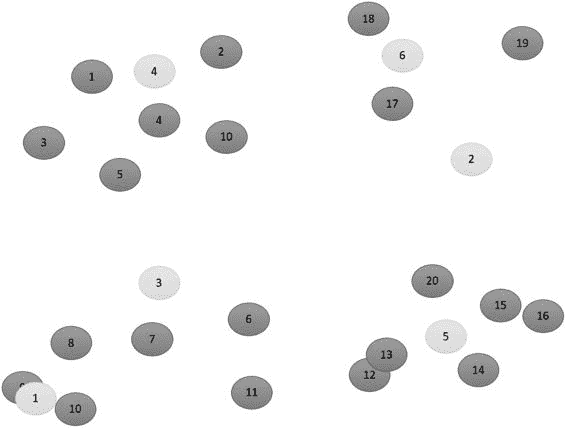

**图 10.2** 仿真拓扑。

仿真设置和参数总结在表 10.1 中。

一项研究从任务大小和电池电量方面展示了

# 智能可扩展算法

## 仿真参数


表 10.1 中的云节点 in Table 10.1。因此，可以选择工作负载最小且电池电量较多的云节点来执行任务。云节点的状态根据平均工作负载标记为平衡、过载或欠载。如果工作负载大于平均工作负载与可容忍工作负载限制之和，则云节点的状态标记为过载。另一方面，如果工作负载介于平均工作负载与平均工作负载加可容忍工作负载限制之和之间，则认为该云节点处于平衡状态。标记完云节点的状态后，SGN 检查任务数量是否大于欠载云节点数量与平衡云节点数量之和，并将任务拆分为子任务。否则，任务不拆分为子任务。如果工作负载小于平均工作负载，则节点标记为欠载。SGN 仅将子任务分配给欠载和平衡的 MN。如果没有欠载和过载的 MN，SGN 会将剩余待执行任务的详细信息发送给其 I-MGS。能量约束分层任务调度 (ECHTS) 算法与 EDF 技术 13 进行了比较。根据以下指标评估算法的性能：

- **平均延迟**：测量每个客户端在获取请求服务时发生的平均延迟。
- **数据包投递率**：成功数据传输的节点数量之比。
- **能量消耗**：所有云网格节点消耗的平均能量。
- **吞吐量**：接收端获得的平均吞吐量。 [](#index_split_003.html#p211)

### 表 10.1 仿真参数

| 参数 | 值 |
| :--- | :--- |
| 网格节点数量 | 20 |
| 超级网格节点数量 | 10 |
| 区域大小 | 1000 × 1000 |
| Mac | 802.11 |
| 无线电范围 | 250 m |
| 仿真时间 | 50 sec |
| 服务发现协议 | SLP |
| 服务器应用 | SLPsa |
| 客户端应用 | SLPua |
| 速度 | 10 m/s |
| 客户端 | 4 |
| 请求负载 | 10 到 50 kb |
| 请求数量 | 1,2,3,4 和 5 |

#### 10.7.1 基于请求数量

请求数量从 1 变化到 5，负载为 10 kb。对于两个请求，将请求负载从 10 变化到 50 kb。

图 10.6 s 展示了 ECHTS 和 EDF 技术在不同速率场景下的延迟。我们可以得出结论，我们提出的 ECHTS 方法的延迟比 EDF 方法低 45%。

图 10.7 展示了 ECHTS 和 EDF 技术在不同速率场景下的投递率。我们可以得出结论，我们提出的 ECHTS 方法的投递率比 EDF 方法高 19%。

图 10.8 s 展示了 ECHTS 和 EDF 技术在不同速率场景下的吞吐量。我们可以得出结论，我们提出的 ECHTS 方法的吞吐量比 EDF 方法高 18%。

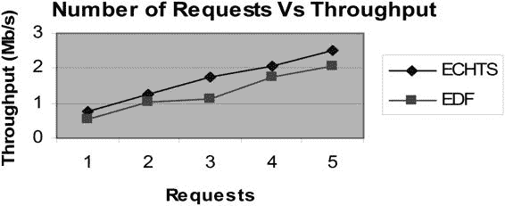
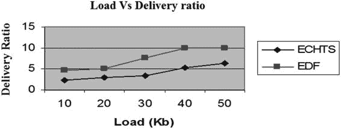
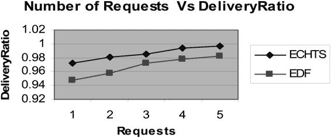

**图 10.3** 请求 vs 延迟。
**图 10.4** 请求 vs 投递率。
**图 10.5** 请求 vs 吞吐量。

### 10.8 结论

在本章中，提出了一种用于云网格的强度受限分层任务调度算法，以降低小区节点的电力消耗。当小区节点移出传输范围时，任务将被重新调度。由于需要解决截止日期约束和设备异构性，调度至关重要。总体性能基于平均延迟（降低）、数据包投递率（提高）、公平性和带宽（略微提高）以及能量消耗（基于节点和流降低）进行估算。通过仿真，使用 NS-2 仿真器分析了性能指标。

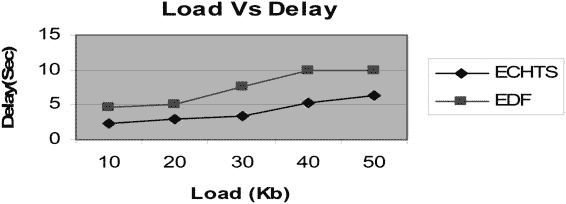
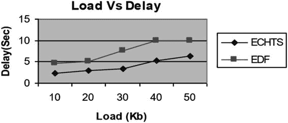
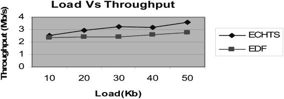

**图 10.6** 负载 vs 延迟。
**图 10.7** 负载 vs 投递率。
**图 10.8** 负载 vs 吞吐量。

### 参考文献

1. Rodriguez Juan Manuel, Alejandro Zunino, and Marcelo Campo “Cloud grid seas: simple energy-aware scheduler,” in Proceedings of the 3rd High-Performance Computing Symposium-39th JAIIO, 2010.
2. Ghosh, Preetam, Nirmalya Roy, Sajal K. Das, and Kalyan Basu “A game theory based pricing strategy for job allocation in cloud grids,” in Proceedings of the 18th International Parallel and Distributed Processing Symposium, p. 82. IEEE, 2004.
3. Li, Chunlin, and Layuan Li “Simultaneous optimization of application utility and consumed energy in cloud grid,” *Computing and Informatics*, 29.6 (2012): 1117–1140.
4. Ghosh, Preetam, et al. “A pricing strategy for job allocation in cloud grids using a non-cooperative bargaining theory framework,” *Journal of Parallel and Distributed Computing*, 65.11 (2005): 1366–1383.
5. Sim, Kwang Mong “A survey of bargaining models for grid resource allocation,” *ACM SIGecom Exchanges*, 5.5 (2006): 22–32.
6. Khan, Samee Ullah, and Cemal Ardil “Energy efficient resource allocation in distributed computing systems,” in International Conference on Distributed, High-Performance and Grid Computing, 2009.
7. Prosperi, Francesco, Mario Bambagini, Giorgio Buttazzo, Mauro Marinoni, and Gianluca Franchino. “Energy-aware algorithms for tasks and bandwidth co-allocation under real-time and redundancy constraints.” In Proceedings of 2012 IEEE 17th International Conference on Emerging Technologies & Factory Automation (ETFA 2012), pp. 1–8. IEEE, 2012.
8. Kim, Jong-Kook, Howard Jay Siegel, Anthony A. Maciejewski, and Rudolf Eigenmann. “Dynamic resource management in energy constrained heterogeneous computing systems using voltage scaling,” *IEEE Transactions on Parallel and Distributed Systems*, 19.11 (2008): 1445–1457.
9. Tekbiyik, Neyre, Tolga Girici, Elif Uysal-Biyikoglu, and Kemal Leblebicioglu. "Proportional fair resource allocation on an energy harvesting downlink-part II: algorithms,” arXiv preprint arXiv:1205.5153 (2012).
10. Malla, Samip, Birendra Ghimire, Mark C. Reed, and Harald Haas. “Energy efficient resource allocation in OFDMA networks using ant-colony optimization,” in International Symposium on Communications and Information Technologies (ISCIT), 2012, pp. 889–894, IEEE, 2012.
11. Li, Chunlin, and Layuan Li. “Energy constrained resource allocation optimization for cloud grids,” Elsevier, 2009.
12. Aziz, Abdul, and Hesham El-Rewini, *Power Efficient Scheduling Heuristics for Energy Conservation in Computational Grids*, Springer, 2011.
13. Doulamis, Nikolaos D., Anastasios D. Doulamis, Emmanouel A. Varvarigos, and Theodora A. Varvarigou. “Fair scheduling algorithms in grids,” *IEEE Transactions on Parallel and Distributed Systems*, 18.11 (2007): 1630–1648.
14. Singh Arjun, and Chakrabarti P. “Ant based resource discovery and mobility aware trust management for cloud grid systems,” in IACC IEEE 3rd International Conference, pp. 637–644, Feb 2013.

### 参考文献

[15.] Preetam Ghosh, and Sajal K. Das. “Mobility-aware cost-efficient job scheduling for single class grid jobs in a generic cloud grid architecture,” *Future Generation Computer Systems*, In Press, Corrected Proof, 2009.
[16.] Chunlin Li, and Layuan Li. “Energy constrained resource allocation optimization for cloud grids,” *Journal of Parallel and Distributed Computing* 70.3 (2010): 245–258.
[17.] W. X. Shen, C. C. Chan, E.W. C. Lo, and K. T. Chau. “Estimation of battery available capacity under variable discharge currents,” *Journal of Power Sources* 103.2 (2002): 180–187.
[18.] Ming-Chiao Chen, Jiann-Liang Chen, and Teng-Wen Chang. “Android/osgi-based vehicular network management system,” *Computer Communications*, In Press, Corrected Proof, 2010.
[19.] Ashish Agarwal, Douglas O. Norman, and Amar Gupta “Wireless grids: Approaches, architectures, and technical challenges,” *Working Chapters 4459–04*, Massachusetts Institute of Technology (MIT), Sloan School of Management, 2004.
[20.] 网络模拟器：`http://www.isi.edu/nsnam/ns`


## 索引

**缩写**, 63
**BB–BC-cost**, 123
**准确**, 40, 64
**BC-cost**, 36
**参与者**, 78
**蜜蜂**, 37, 79, 105, 176, 177, 180
**采用**, 59
**生物地理优化 (BBO)**, 175, 176
**AI**, 146
**基于 AI**, 106
**Amazon**, 2, 4, 16, 34, 101
**分类**, 80, 103, 108
**分析**, 17, 56, 69, 92, 103, 105, 107
**客户端**, 2, 3, 5, 11, 34, 36, 38, 58, 79, 102, 111–114, 179–181, 104, 163, 195
**退火**, 121, 167–169, 179
**客户端/服务器**, 12
**蚂蚁**, 17, 34, 37, 59, 103, 139, 167, 170–172
**云微数据中心**, 121, 122, 129, 179, 188
**云**, 5, 75, 111, 112, 186, 187
**基于蚂蚁**, 188
**CloudSim**, 44, 129, 139, 140, 153, 156, 169, 173, 174, 177, 152, 153, 171
**蚁群优化 (ACO)**, 17, 139
**CloudStack**, 156
**架构**, 2, 7, 45, 56, 58, 59, 81, 91, 92, 96, 98, 106, 114, 138, 140, 141, 175, 189
**集群**, 149, 186
**聚类**, 60, 80
**系数**, 89
**人工神经网络 (ANN)**, 16, 20, 21, 24–26, 29, 30, 38–41, 45, 74, 80, 81, 91–93, 104, 107, 108, 124, 125, 127
**复杂性**, 13, 141
**核心**, 153, 188
**成本**, 5, 7, 8, 12, 16, 17, 19–23, 26, 34–44, 48–50, 56, 74, 77, 78, 96, 99–101, 104, 106, 107, 110, 113, 114, 122, 123, 127, 133, 140, 141, 146, 147, 155–156, 165, 168, 178–180, 187
**骨干**, 162
**后端**, 7
**背景**, 177

## 索引

## 反向传播

18–20, 38, 40, 104, 107

## 成本感知

34, 36, 38, 39, 45, 49
108, 124, 127, 142

## 基于成本

17

## 蝙蝠算法

92, 105, 109, 120, 123, 124, 126–129
133, 177, 178, 180

## COVID-19

30

## 蝙蝠算法-人工神经网络

120, 123, 127–130, 133
141–143, 145, 147, 148, 153, 166,
171–173, 175, 186, 188

## 蝙蝠

128, 177, 178

## 贝叶斯

105, 108

## 交叉

23, 41, 43, 85, 86, 174, 175

## BB-BC

16, 19, 21, 22, 25, 26, 29, 30, 36,
38–40, 42, 45, 46, 49

## 交叉/中心

21, 23

## 截断

186

## 数据集

18, 26, 36, 65, 74, 81, 106, 108,
122–125, 129, 142, 153
174, 178, 179

## 截止时间感知

17

## 启发式

16, 82, 83, 121, 142, 167, 171,
174, 178, 179

## 层次化

190, 193, 194, 196

## 处理

74, 103, 139, 142

## 高性能

35

## 证明

60

## 桌面

5, 8, 11–13

## 幻觉

5, 7

## 灾难

10

## 移民

175, 176

## 停机时间

6, 60

## 无限

7

## 无穷

60

## 经济

17

## 弹性

34, 100, 163

## 关键性能指标 (KPIs)

99, 100

## 能量感知

78, 141, 147, 154,
171, 178

## K-均值

60

## 能量受限

187, 194

## KNN

108, 110, 111

## 进化

18, 22, 23, 28, 42–44, 125, 174

## 基于 KNN

106

## 进化的

36, 37, 129, 139, 142

## 知识


# 索引

## 数字

**83, 114, 138, 188**

## A

**基于进化** 17

**基于知识** 104, 112

**执行** 35, 190

## K

**k 阶** 69

**执行** 5, 6, 16, 18–24, 26, 27, 35–45

**库马尔** 1, 161, 47–50, 65, 66, 68, 69, 79, 87, 104–110, 122–124, 129, 131, 133, 180, 186, 187, 189, 190, 192, 193

**KVM** 11, 101, 138

## 索引

## 层

**层** 2, 5, 7, 8, 18–20, 28, 39, 40, 42

**图表/展品** 124, 126, 129

**探索** 80–82, 109, 123–126, 152

**线性** 90

**可扩展性** 19, 104, 105, 107–109, 143, 166

**Linux** 180

**失败** 10

**狮子** 23, 28, 61, 130, 133, 180

**失效** 92

**对数** 68

**故障** 89

**响度** 63, 65

**故障感知** 128, 177, 178

**降低** 25, 28, 111, 122–123, 125–127, 129, 131

**故障** 141

**维护** 123

**容错** 60, 77, 107, 141

**元启发式** 16, 120

**防火墙** 140

**元对象** 96

**适应度** 58

**方法论** 18, 21–24, 34, 39–45, 81–82, 84, 85, 87, 91, 93, 124, 148–149

**方法论** 5, 122–123

**度量** 18, 69, 121, 169, 173–175

**灵活性** 26, 48, 113, 186

**小蝙蝠** 10, 75, 101, 104, 107

**食物/猎物** 128

**多维** 177

**融合** 105, 113

**多目标** 98

**模糊** 16, 36–38, 43, 121, 139, 140, 142, 144, 154, 176

**多变量** 105, 109, 113

**基于高斯** 123

**变异** 92

**地理** 18, 19, 21, 23, 28, 39, 41–43, 86, 87, 174, 176

**已处理** 4

**负面** 2, 4, 76, 140

**处理** 63, 85

**网络感知** 19, 124

**基于网络** 19, 34, 35, 37, 39, 41, 43, 45, 47, 49, 51, 123

**可靠性** 7, 16, 55–57, 59–61, 63–69, 74, 100, 106, 109–114, 120–123, 141

**神经** 16, 18–20, 29–30, 34–35, 37, 39–41, 43, 45, 47, 49, 51, 74–75, 77, 79–83, 85, 87, 89, 91–93, 97–98, 104–105, 107–109, 113, 122–129, 142, 147, 151–152

**可靠性感知** 105, 109, 113

**可靠** 16, 34, 61, 74, 111, 120, 121, 123–125

## 索引

## R

**革命性的** 186

## N

**神经遗传算法** 36

**鲁棒** 121

**神经启发式** 30

**鲁棒性** 176

**神经元** 18, 20, 28, 39, 40, 42, 80, 127

**数值** 87

## S

**可扩展性** 30, 39, 56, 101, 106, 114, 172, 179

**可扩展的** 3, 16, 17, 34–36, 57, 58, 74

**开源** 44, 129, 125, 139, 142, 185–187, 189, 191, 193

**OpenStack** 105, 108

**最优** 19, 39, 104, 106, 108, 110, 111

**调度器** 16, 17, 104, 114, 142, 166

**敏感性** 104, 107

**服务级别** 193

## P

**范式** 35

**面向服务的** 56, 58, 59

**粒子** 17, 36, 37, 104, 107, 112, 114, 123, 139, 167, 172–174, 179

**SOAP** 57

**软件即服务** 3, 97

**模式** 61, 80, 193

**有监督的** 98, 104, 105

**按使用付费** 4, 16, 34, 35

**综述** 17, 34, 36, 58, 103, 111, 141

**平台即服务** 2, 56, 57, 62

**群体** 17, 36, 37, 92, 104, 106, 107, 110, 112, 114, 123, 139, 167, 172–174, 179

**平台** 6, 64, 96, 97, 101, 102, 163, 76, 78, 79

**泊松** 22, 28, 66

**SWF** 44, 129

**极性** 108

**交换机** 96

**策略** 2, 16, 17, 21, 34, 35, 38, 41, 122, 141, 176

**合成** 176

**种群** 18, 21–24, 28, 39, 41–45, 47, 48, 50, 82–86, 90, 121, 123, 128, 139, 169, 170, 174–178, 180, 195–197

**阈值** 34, 121, 145, 146

**吞吐量** 34, 35, 92, 100, 104, 178

**精度** 105, 108, 109, 113

**超时** 65, 67

**概率的** 22, 23, 120, 126, 170

**拓扑** 120, 122, 156, 193, 194

**概率** 63, 68

**TOPSIS-PSO** 36

**概率** 43, 45, 60–62, 66, 67, 85–87, 124

**训练** 20, 80, 82, 87, 128, 129, 152

**专有的** 77

**训练集** 152

## 索引

**协议** 57, 58, 65, 193, 195

**事务** 60, 188

**已置备** 78, 138, 162, 163

**传输** 86

**置备** 10, 16, 17, 34, 36, 105, 113

**调优** 127–129

**脉冲** 177

**欠载** 24, 30, 48, 122, 131, 191–194

**量子** 92

**工具** 3, 187

**利用率总计** 124

**实时** 34, 35, 44, 60, 92, 105–107, 109

**已利用** 60, 64, 69, 108, 143, 150–152, 129, 179, 189, 166, 188

**虚拟化** 3–13, 57, 79, 138, 140–142

**工作站** 163, 164–165

**WS-Agreement** 56, 58

**虚拟机 (VMs)** 13, 22, 45, 48, 57, 83, 87, 100, 104, 107, 110, 138, 140–142, 144, 146, 148, 149, 152–155, 164, 167, 169, 171, 173–175, 177, 180

**Xen** 10, 11, 101, 138

**至强** 153

**至强 x3480** 153

**可视化** 60

**vmlist** 81

**年份** 60, 185

**VM_MIPS** 22

**产出** 61

**VMware** 4, 10, 101, 138

**Zhan** 36

**浪费** 176, 180

**Zhang** 36, 121, 122

**工作流** 37, 180

**Zhao** 16, 92, 175

**工作负载** 2, 26, 44, 68, 104, 105, 112, 126, 127, 129, 142, 143, 166, 190–194

**Zheng** 176

**Zohu** 141

---

# 文档大纲

*   封面
*   副标题页
*   丛书页
*   扉页
*   版权页
*   目录
*   前言
*   编辑
*   贡献者

## 第 1 章 云计算中虚拟化导论

*   1.1 导论
*   1.2 云模型
    *   1.2.1 公有云
    *   1.2.2 私有云
    *   1.2.3 社区云
    *   1.2.4 混合云
*   1.3 什么是虚拟化？
    *   1.3.1 虚拟化的优缺点
    *   1.3.2 面向云的虚拟化架构 [3–6]
    *   1.3.3 虚拟化在云计算中的意义 [7]
    *   1.3.4 虚拟化的类别及其影响
*   1.4 结论
*   参考文献

## 第 2 章 多层云中基于机器学习、深度学习的优化

*   2.1 导论
*   2.2 相关工作
*   2.3 建议方法论
    *   2.3.1 初始化
    *   2.3.2 数据集准备
    *   2.3.3 模型准备
    *   2.3.4 训练
    *   2.3.5 反向传播与误差修正
    *   2.3.6 任务调度
    *   2.3.7 大爆炸-大挤缩步骤
        *   2.3.7.1 阶段 1：初始化/种群生成
        *   2.3.7.2 阶段 2：适应度评估
        *   2.3.7.3 阶段 3：交叉/质心与变异
        *   2.3.7.4 阶段 4：大挤缩
*   2.4 实验结果
    *   2.4.1 使用模拟数据的结果
    *   2.4.2 使用真实数据集的实验结果
*   2.5 结论
*   参考文献

## 第 3 章 多层云中基于神经网络的资源分配模型

*   3.1 简介
*   3.2 相关工作
*   3.3 提出的模型
    *   3.3.1 模型设置
    *   3.3.2 数据集生成
    *   3.3.3 模型准备
    *   3.3.4 训练
    *   3.3.5 反向传播与误差修正
    *   3.3.6 任务调度
    *   3.3.7 大爆炸-大挤缩算法步骤
        *   3.3.7.1 初始化
        *   3.3.7.2 评估
        *   3.3.7.3 选择
        *   3.3.7.4 交叉
        *   3.3.7.5 变异
        *   3.3.7.6 大挤缩
        *   3.3.7.7 停止条件
    *   3.3.8 结果与讨论
*   3.4 结论与未来工作
*   参考文献

## 第 4 章 云计算中的可用性与可靠性考量

*   4.1 简介
*   4.2 相关工作
*   4.3 云 SLA 中的可用性与可靠性
    *   4.3.1 可用性
    *   4.3.2 可靠性
*   4.4 结论
*   参考文献

## 第 5 章 面向多层云的基于神经网络与深度学习的资源分配模型

*   5.1 简介
    *   5.1.1 云交付/部署模型
    *   5.1.2 云服务/模型类型
    *   5.1.3 云中的当前问题
        *   5.1.3.1 成本管理
        *   5.1.3.2 安全问题
        *   5.1.3.3 迁移
        *   5.1.3.4 性能
        *   5.1.3.5 多云（混合云）管理
        *   5.1.3.6 资源分配与管理
    *   5.1.4 影响资源分配的因素
        *   5.1.4.1 资源扩展
        *   5.1.4.2 能源利用
        *   5.1.4.3 虚拟机（VM）迁移
*   5.2 神经网络简介
    *   5.2.1 人工神经网络（ANN）
    *   5.2.2 卷积神经网络（CNN）
    *   5.2.3 循环神经网络（RNN）
*   5.3 遗传算法简介
*   5.4 提出的模型 1（一种用于优化的混合 GA 和朴素贝叶斯模型）
*   5.5 鲸鱼优化算法（WOA）
    *   5.5.1 数学模型
        *   5.5.1.1 阶段 1：包围猎物
        *   5.5.1.2 阶段 2：气泡网攻击（开发阶段）
        *   5.5.1.3 阶段 3：捕获循环（搜寻猎物（探索阶段））
*   5.6 相关工作
*   5.7 结论
*   参考文献

## 第 6 章 基于机器学习的预测模型以提升云 SaaS 中云应用性能

*   6.1 简介
    *   6.1.1 基本特征
    *   6.1.2 云交付/部署模型
    *   6.1.3 云服务/模型类型
*   6.2 云计算挑战
*   6.3 文献综述
*   6.4 比较分析
*   6.5 结论
*   参考文献

## 第 7 章 面向云架构的故障感知机器学习与深度学习算法

*   7.1 简介
*   7.2 相关工作
*   7.3 相关工作成果
*   7.4 提出的模型
    *   7.4.1 初始化
    *   7.4.2 训练数据集准备
    *   7.4.3 多层感知机模型设计
    *   7.4.4 模型训练
    *   7.4.5 误差反向传播与修正
    *   7.4.6 任务调度
    *   7.4.7 提出的资源配置技术 Bat-ANN 算法
        *   7.4.7.1 蝙蝠优化方法
    *   7.4.8 提出的 Bat-ANN 任务调度算法
*   7.5 结果与讨论
*   7.6 结论与未来工作
*   参考文献

## 第 8 章 使用反向传播神经网络和遗传算法的节能虚拟机放置

*   8.1 简介
*   8.2 传统虚拟机放置工作
*   8.3 系统模型
    *   8.3.1 数据中心框架
    *   8.3.2 能耗建模
*   8.4 问题建模与求解
    *   8.4.1 多目标虚拟机放置问题
    *   8.4.2 虚拟机放置优化
*   8.5 提出的节能 BPGA 优化模型
    *   8.5.1 过程 1：非支配排序遗传算法（NSGA）
*   8.6 性能评估
    *   8.6.1 实验设置
    *   8.6.2 仿真结果与比较
*   8.7 结论与未来展望
*   参考文献

## 第 9 章 云计算中用于能效的元启发式算法

*   9.1 简介
    *   9.1.1 云计算的基本特征
    *   9.1.2 云服务模型
*   9.2 云技术：虚拟化

# 目录

## 第 9 章 云中虚拟机部署的元启发式算法

### 9.1 简介

### 9.2 问题建模

#### 9.2.1 云中的功耗

#### 9.2.2 虚拟机整合

### 9.3 用于虚拟机部署的元启发式算法

#### 9.3.1 模拟退火算法

#### 9.3.2 蚁群优化算法

#### 9.3.3 粒子群优化算法

#### 9.3.4 遗传算法

#### 9.3.5 基于生物地理学的优化算法 (BBO)

#### 9.3.6 蜜蜂优化算法

#### 9.3.7 蝙蝠优化算法

### 9.4 结论

### 参考文献

## 第 10 章 云中资源效率的智能可扩展算法

### 10.1 简介

### 10.2 能量约束云基础设施

### 10.3 文献综述

### 10.4 问题识别与提出的解决方案

#### 10.4.1 剩余电池电量估算

#### 10.4.2 剩余电池电量估算

### 10.5 分层任务调度

#### 10.5.1 算法

#### 10.5.2 算法描述

### 10.6 提出方法的优势

### 10.7 仿真

#### 10.7.1 基于请求数量

### 10.8 结论

### 参考文献

## 索引
