# 机器学习动画指南

致 Ivey 和 Andrew。

# 前言

> 人工智能、深度学习、机器学习——无论你在做什么，都要学习它——否则你将在三年内变成恐龙。—— 马克·库班 (Mark Cuban)，2021

机器学习 (ML) 正在重新定义我们的生活方式：它被整合到越来越多的产品和服务中，从推荐系统到语言翻译，从语音助手到医学影像以及自动驾驶……机器学习，特别是深度学习在过去的几十年取得了进展，这在很大程度上归于计算能力的提升（如 GPU 训练和分布式计算）以及可用数据的爆炸。

OpenAI 发布 ChatGPT 提高了竞争标准，迫使 Google 等其他竞争对手发布自己的大语言模型 [5]。不同的组织和机构已经意识到机器学习和人工智能领域的军备竞赛已经开始。一个例子是特许金融分析师 (CFA) 于 2023 年 3 月 17 日宣布在考试中加入机器学习和人工智能，以准备考生 [26]。这一变化是在与雇主交流后，“虽然计划内容非常实用，但在招聘新持证者时，他们还没有完全做好准备” [11]。

在 ChatGPT 发布之前，将机器学习纳入大学课程的需求已显而易见。在肯基大学的金融硕士 (MSF) 项目，我们一直密切关注市场对这些技能的需求，以保持我们的毕业生在就业市场上的竞争力。我为我们的金融硕士创建并教授了一门 Python 预测分析课程，涉及先进的机器学习模型，如深度神经网络、随机森林、梯度提升机等。

*   第一步：机器学习模型为模型参数分配值（初始化）。
*   步骤 2：根据当前参数进行预测并将预测值与实际值进行比较；更改参数，使下次迭代中的预测值更接近实际值（调整）。
*   步骤 3：重复步骤 2，直到参数收敛（重复）。

教学经验为本书播下了种子。在书的开头部分，我将讨论 `ML` 的构建模块，如损失函数、激活函数、梯度下降优化算法、学习率等等。更好的是，本书将使用动画逐步展示机器是如何学习的：初始参数值、每一步的调整，以及最终收敛的参数和预测结果。我试图填补市场上针对没有计算机科学、数学或统计学背景的大学生和年轻专业人士的 `ML` 书籍空白。因此，本书在处理 `ML` 时采取了实用性而非纯技术的方法。本书对深度学习、`Q-learning` 或 `policy-gradient` 算法等概念提供了直观的解释。你将通过遵循示例学习如何实现这些算法，并如何将它们应用于你自己的领域，无论是商业、生物、医学或其他完全不同的领域。虽然大多数模型是使用 `TensorFlow Keras` API 构建的，但你也将学习如何从零开始创建 `ML` 模型，而无需依赖任何 API。在此过程中，你将了解 `ML` 模型是如何构建的、参数值是如何初始化的并在训练过程中逐渐调整的、参数是如何收敛的，以及训练后的模型如何做出准确的预测。

本书分为六部分。第一部分 讨论如何安装 `Python` 以及如何使用 `Python` 库创建动画。第二部分 向你介绍 `ML` 基础知识，如梯度下降优化算法、学习率、损失函数和激活函数。第三部分 涵盖了二分类和多分类，并向你介绍神经网络。第四部分 中，我们将在 `OpenAI Gym` 游戏中构建深度学习游戏策略，并在井字棋、四连棋等多人游戏中构建。第五部分 向你介绍强化学习的基础知识。在第六部分 中，我们将深度学习与强化学习结合，创建深度强化学习游戏策略，以便你能够创建一个双深度 Q 网络来训练所有的 Atari 游戏（Breakout、Space Invaders、Seaquest 等）。

以下是本书的概述：

## 第 1 章：安装 Python 与环境配置

本章引导你根据自己的操作系统（无论是 Windows、Mac 还是 Linux）安装 `Python` 软件。你将为书中的项目创建一个虚拟环境，并将 `Jupyter Notebook` 作为集成开发环境 (IDE)。你将设置一个目录来管理书中的文件。

## 第 2 章：Python 图形与动画基础

你将学习在 `Python` 中创建图形和动画。这将为你以后在书中准备创建 `ML` 过程中间阶段的图形表示和动画。

## 第 3 章：机器学习概述

你将学习什么是 `ML` 以及它与人工智能 (AI) 中传统算法的区别。我们将讨论三种类型的 `ML`：监督学习、无监督学习和强化学习。这三种类型在数据、方法和应用方面也存在不同。

## 第 4 章：梯度下降与模型训练可视化

你将使用动画逐步展示 `ML` 模型中的参数值如何根据梯度下降算法发生变化，以便 `ML` 模型做出尽可能低预测误差的预测。预测误差通过损失函数衡量。训练 `ML` 模型就是寻找使损失函数最小化的参数值。优化过程通过梯度下降或其变体来实现。你还将了解学习率是什么以及它是如何影响训练过程的。

## 第 5 章：从零构建神经网络

本章讨论了神经网络如何从数据中学习并做出预测。你将学习从零开始构建一个简单的神经网络，以学习十对输入和输出变量之间的关系。你将使用 `ML` 中概述的三个步骤：初始化、调整和重复。你将通过提取这个简单神经网络在训练过程中每一步的参数值和预测值，将学习过程动画化。

## 第 6 章：激活函数

你将在神经网络中使用线性整流单元 (`ReLU`) 激活函数来近似非线性关系。`Sigmoid` 激活函数将数字压缩到 0 到 1 之间的范围，使其可以解释为结果的概率。`Softmax` 激活函数将一组数字压缩到 [0, 1] 范围内，以便它们可以解释为多个结果的概率分布。

## 第 7 章：二分类——马与鹿图像识别

二分类是将样本分类为两类之一的 `ML` 算法。在本章中，你将通过使用神经网络将图像分类为马和鹿来学习二分类。你将创建一个动画，展示模型权重和预测概率在训练不同阶段是如何变化的。

## 第 8 章：卷积神经网络基础

卷积层将图像视为二维对象并寻找图像上的模式。然后它将这些模式与图像标签相关起来。这极大地提高了模型的预测能力。在本章中，你将学习与卷积层相关的基本概念，如滤波器数量、卷积核、零填充、步长……更好的是，你将学习创建动画，逐步展示如何在图像上应用滤波器以及如何进行卷积操作。

## 第 9 章：多分类——CIFAR-10 图像识别

当目标标签是具有两个以上可能值的多分类变量时，我们将机器学习算法称为多分类问题。在本章中，你将学习使用带有增强和卷积层的深度神经网络将 `CIFAR-10` 中的图像分类为十个标签之一。

## 第 10 章：深度学习玩转 Frozen Lake

你将学习使用深度学习在 `OpenAI Gym` 的 `Frozen Lake` 游戏中训练智能游戏策略。你首先为训练目的生成游戏数据。然后你创建一个深度神经网络来训练游戏策略。代理根据训练后的模型选择胜利概率最高的动作。

## 第 11 章：深度学习玩转 Cart Pole

你将学习训练深度学习游戏策略来玩 `OpenAI Gym` 中的 `Cart Pole` 游戏。你将学习创造性地重新定义游戏中的“胜利”，使得模拟数据中的胜利和失败游戏数量大致相等。你将重新标签的数据输入深度神经网络以训练模型。训练后的模型将 100% 的时间赢得 `Cart Pole` 游戏。

## 第 12 章：深度学习玩转井字棋

你将学习为井字棋（Tic Tac Toe）创建一个游戏环境。然后，你把深度学习应用于井字棋，旨在开发智能游戏策略。我们还将对智能体的决策过程制作动画，以便我们可以深入了解深度学习游戏策略是如何运作的。

## 第 13 章：深度学习玩转四连棋

你将为四连棋（Connect Four）创建一个游戏环境，并使用模拟游戏来训练深度神经网络。在游戏的每一步中，深度学习智能体都会遍历所有可能的下一步，并选择胜率最高的移动。你将通过显示游戏每一步中所有可能的下一步以及相关的胜率概率，对决策过程制作动画。

## 第 14 章：表格 Q-learning——Frozen Lake

在强化学习中，智能体通过试错与环境进行交互。智能体通过从环境获得奖励和惩罚形式的反馈来学习获得最优结果。在本章中，你将训练“冰冻湖”（Frozen Lake）游戏中的 `Q-table`。你将创建一个动画来演示表格 `Q-learning` 的工作原理。在每个状态下，你将游戏板放在左侧，将 `Q-table` 放在右侧。你会突出显示对应于状态的行，并比较四个动作下的 `Q-values`。最佳动作将用红色突出显示。动画将重复这一过程直到游戏结束。

## 第 15 章：表格 Q-learning——Mountain Car

表格 `Q-learning` 可以解决动作数量和状态数量均为有限的问题。在“小车登山”（Mountain Car）游戏中，状态变量是连续的，因此状态数量是无限的。你将使用有限的离散值来表示状态空间，并有效地为游戏训练 `Q-table`。

## 第 16 章：表格 Q-learning——亚马逊递送路线优化

你将学习使用表格 `Q-learning` 解决亚马逊递送路线问题。你首先通过训练 `Q-table` 找到镇上任意家庭之间的最短路径。你每天需要投递八个包裹。你考虑所有排列，并计算每种排列的总行驶距离。你选择总距离最短的一个。

## 第 17 章：深度 Q-learning (DQN)——Cart Pole

你将学习使用神经网络来近似 `Q-table`。深度 `Q-learning` 智能体通过将当前游戏状态输入深度 Q 网络（deep Q-network）来选择给定状态下的动作。网络返回与不同动作相关的 `Q-values`。智能体选择 `Q-value` 最高的动作。你将学习将深度 `Q-learning` 成功应用于“平衡车”（Cart Pole）游戏。

## 第 18 章：策略梯度——Atari Pong

在本章中，你将学习基于策略的强化学习：不再估计与不同动作相关的价值函数，而是直接训练一种策略，告诉智能体在给定状态下采取什么动作。你将使用策略梯度（policy gradient）方法来玩 Atari 乒球游戏，获得 21 比 0 的完美得分。

## 第 19 章：策略梯度——Atari Breakout

你将把第 18 章中学的 `policy gradient` 方法推广到另一个雅达利游戏：“打砖块”（Breakout）。你通过制作动画展示智能体如何学习在墙侧挖一个隧道，将球传到墙后方以更高效地得分。

## 第 20 章：双深度 Q 网络 (Double DQN)——Breakout

`Q-learning` 有一个著名的过度估计 `Q-values` 的问题。为了克服这个问题，你将学习使用双 Q-learning 方法，该方法使用一个深度 Q 网络用于训练（训练网络），另一个用于预测（目标网络）。你通过制作动画展示“打砖块”中经过训练的智能体如何多次将球传到墙后。

## 第 21 章：双深度 Q 网络——Space Invaders

你将调整第 20 章中使用的 `Q-network`，并将其应用于另一个雅达利游戏：“星际入侵者”（Space Invaders）。尽管智能体并不知道“星际入侵者”游戏的规则，它也可以通过与游戏环境反复交互并从奖励中学习，消除屏幕上所有的入侵者。

## 第 22 章：通用双深度 Q 网络——任意 Atari 游戏

你将扩展双深度 Q 网络以玩任何雅达利游戏。创建一个具有相同网络架构、相同超参数和相同训练程序的模型，该模型适用于任何雅达利游戏。你将该模型应用于两个新的雅达利游戏：“海怪号”（Seaquest）和“光束骑士”（Beam Rider）。有了这些技能，你就可以准备使用同一个模型训练和测试任何雅达利游戏了。

所有的 Python 程序以及部分章节末问题的答案均在 GitHub 仓库 `https://github.com/markhliu/MLA` 中提供。

# 致谢

在让这本书成为现实的途中，我要感谢许多人。书中的部分内容是我过去几年里，在肯塔基大学为金融硕士专业的学生教授 Python 预测性分析课程时开发的。我想感谢所有金融硕士专业的学生，激励我寻找新颖的方法来解释机器学习的工作原理。我还要感谢 CRC Press 的 Randi Slack 和 Solomon Pace-McCarrick，他们指导我完成了编辑过程。感谢 Michele Dimont 和 Riya Bhattacharya 制作团队帮助我冲过终点。最后，我要感谢我的妻子 Ivey Zhang 和儿子 Andrew Liu 在这段旅程中给予的大支持。

DOI: `10.1201/b23383-1`

> 工欲善其事，必先利其器。
>
> *——中国古谚*

## 第 1 章：安装 Python 与环境配置

你将学习为本书的项目创建一个虚拟环境（virtual environment）。之后，你将安装 `Jupyter Notebook` 作为你的集成开发环境（IDE）并在其中开始编码。在章节结束时，你将设置一个目录来管理书中的文件。

### 1.1 为什么选择 Python？

在本节中，我将简要讨论为什么 Python 作为一种通用编程语言很受欢迎，特别是为什么它现在是机器学习的首选语言。

Python 是开源的，这意味着不仅软件对所有人免费，而且其他用户还可以创建和修改库。事实上，Python 拥有一个庞大的生态系统，你可以从社区成员那里获得资源和帮助。Python 程序员之间可以共享代码，因此你不需要从零开始构建一切，而是导入他人设计的模块，并与 Python 社区的其他人共享你自己的模块。

Python 是一种跨平台编程语言，这意味着无论你使用 Windows、Mac 还是 Linux，都可以用 Python 编写代码。然而，软件和库的安装可能会根据你的操作系统而略有不同。我将向你展示如何在你的操作系统中安装各种库。一旦安装完成后，Python 代码在不同操作系统中的运行方式是相同的。

Python 是一种高级解释型语言。它允许用户抽象掉计算机细节，如数据类型、内存管理和指针。因此，Python 代码的执行速度慢于 `C`、`C++` 或 `Java` 等低级编译语言。然而，如今随着计算机硬件的进步，你几乎察不到这种差异。

书中的所有机器学习算法都是用 Python 编写的。我们选择 Python 有几个原因。

首先，正如我们上面提到的，Python 是一种用于通用应用程序开发的高表达力高级语言。Python 的语法结构易于遵循。对于机器学习爱好者来说，理解和处理代码想要实现的功能非常容易。因此，Python 用户可以专注于解决机器学习问题，而不需要在编码部分花费过多的精力和精力。Python 的简单性还让程序员之间可以轻松协作，因为理解彼此的代码并不困难。

其次，你可以轻松地从 Python 机器学习社区获得支持。有一个大型在线社区，里面有各种小组和论坛，程序员在其中发布他们的错误或其他类型的问题，并互相帮助。你可以从 Python 机器学习社区的成员那里获得资源和帮助。如果你在使用书中的机器学习库时遇到问题，可以在论坛中搜索你正在使用的 Python 软件包，或者去 `Stack Overflow` 等网站寻找答案。在极少数找不到答案的情况下，请随时与我联系寻求帮助。

第三，Python 是机器学习领域最受欢迎的语言之一。这主要是因为 Python 机器学习生态系统提供了丰富的库集合，使用户能够轻松地创建机器学习模型。特别是，你将在书中广泛地使用以下三个库：`NumPy`、`TensorFlow` 和 `Keras`。下面，我将简要讨论这些库可以实现什么。在后面的章节中，当我们使用这些库创建各种机器学习模型时，我们将进入更多细节。

#### NumPy

`NumPy` 代表数值 Python。`NumPy` 库提供了高效的数据结构来表示数值向量和矩阵，允许 Python 处理高维数组对象并执行高效的数学运算。它是许多 Python 数值计算库（如 `pandas`、`matplotlib` 和 `TensorFlow`）的基石。例如，正如你将在书中后面看到的，图片在 Python 中表示为三维 `NumPy` 数组：第一维度是图片的宽度，第二维度是高度，第三维度是颜色通道。尽管 `NumPy` 是一个 Python 库，但它的大部分代码是用 `C` 或 `C++` 编写的，这使得代码执行得更快。

#### Keras

`Keras` 是由 Google 开发的深度学习应用程序接口（`API`）。它让深度神经网络的实现变得简单。具体来说，它为开发先进的深度神经网络提供了构建组件。它为你指定神经网络提供了一种方便的方法。当你在调整模型时，可以轻松地从网络中添加或删除神经元层。当你添加新的神经元层时，可以指定在该层包含多少神经元、使用何种激活函数等等。你还可以选择不同类型的神经元层，例如全连接层或卷积层。

#### TensorFlow

`TensorFlow` 是由 Google 开发的深度学习库。它让深度神经网络的实现变得简单。具体来说，它为开发先进的深度神经网络提供了构建组件。它为你指定神经网络提供了一种方便的方法。当你在调整模型时，可以轻松地从网络中添加或删除神经元层。当你添加新的神经元层时，可以指定在该层包含多少神经元、使用何种激活函数等等。你还可以选择不同类型的神经元层，例如全连接层或卷积层。

### 1.2 在 Linux 上安装 Anaconda

在 Linux 上安装 Anaconda 比其他操作系统涉及更多步骤：Linux 没有图形界面化安装程序。首先，访问 [`www.anaconda.com/products/individual/`](https://www.anaconda.com/products/individual/)，向下滚动并找到最新的 Linux 版本。选择合适的 x86 或 Power8 和 Power9 软件包。点击并下载最新的安装程序 bash 脚本。例如，在我安装期间使用的安装 bash 脚本是 [`repo.anaconda.com/archive/Anaconda3-2022.05-Linux-x86_64.sh`](https://repo.anaconda.com/archive/Anaconda3-2022.05-Linux-x86_64.sh)。该链接会随着时间变化，但我们将使用这个版本作为示例。

在你的电脑上打开终端。默认情况下，安装程序 bash 脚本会被下载并保存到电脑的 Downloads 文件夹中。然后，你应该在终端中执行以下命令来安装 Anaconda（如果你的 bash 脚本路径不同，请使用相应的路径）：

```bash
bash /Downloads/Anaconda3-2022.05-Linux-x86_64.sh
```

按下键盘上的 `ENTER` 键后，系统将提示你查看并接受许可协议。安装过程中的最后一个问题是：

```text
installation finished. Do you wish the installer to prepend the Anaconda3 install location to PATH in your /home/mark/.bashrc? [yes|no] [no] > > >
```

你应该输入 `yes` 并按下 `ENTER`，以便使用 `conda` 命令在终端中打开 Anaconda。

现在，你需要执行此命令来激活安装：

```bash
source /.bashrc
```

要打开 Anaconda navigator（导航器），请在终端中输入以下命令：

```bash
anaconda-navigator
```

你应该能在你的机器上看到 Anaconda navigator，类似于图 1.1。

### 1.3 pip 与 conda 的区别

很多人认为 `pip install` 和 `conda install` 是相同的，但它们并不是。Pip 是 Python 包索引权威机构推荐的从 Python 包索引中安装包的工具。Pip 仅用于安装 Python 软件。相比之下，Conda 是一个跨平台包和环境管理器，它不仅安装 Python 软件，还安装 C 或 C++ 库、R 包或其他软件。一个典型的例子是 `portaudio` 包是一个 C 包，无法使用 Pip 安装，但可以使用 Conda 安装。为了让 Python 连接到你的电脑麦克风，你需要 `portaudio` 包。安装 Anaconda 是让 Python 语音识别生效的唯一方法。如果你感兴趣，请查看我的书籍《Make Python Talk》详情 [14]。


# 虚拟环境与 Jupyter Notebook 设置

随着你构建越来越多的 Python 项目，你将安装许多库。某些库可能会干扰其他库，不同的项目可能会使用同一库的不同版本。为了避免库冲突问题，我建议为每个项目构建虚拟环境。虚拟环境是一种将项目相互隔离开的方法。

我们将创建一个虚拟环境来包含书中的所有项目。让我们把虚拟环境命名为 `MLA`，代表 Machine Learning, Animated（动画机器学习）。

## 创建虚拟环境

要创建虚拟环境，请打开 Anaconda 提示符（Windows）或终端（Mac 或 Linux）。输入以下命令：

```bash
conda create -n MLA python==3.9.12
```

按下 `ENTER` 后，按照屏幕上的说明操作并在提示询问 `y/n` 时按下 `y`。一旦在机器上创建了虚拟环境，你就需要激活它。

## 激活虚拟环境

要激活虚拟环境 `MLA`，请打开 Anaconda 提示符（Windows）或终端（Mac 或 Linux）。执行以下命令：

```bash
conda activate MLA
```

在 Windows 中，你会在 Anaconda 提示符上看到以下内容：

```
(MLA) C:\>
```

你可以看到 `(MLA)` 提示符，这表明命令行现在你刚刚创建的虚拟环境 `MLA` 中。

在 Mac 上，你应该会在终端看到类似以下的内容（用户名会不同）：

```
(MLA) Macs-MacBook-Pro:~ macuser$
```

在 Linux 中，你应该会在终端上看到类似的内容（用户名会不同）：

```
(MLA) mark@mark-OptiPlex-9020:~$
```

## 退出虚拟环境

当命令行处于虚拟环境 `MLA` 中时，有两种方法可以退出它。

第一种方法是执行以下命令：

```bash
conda deactivate
```

注意，你不需要在命令中输入环境名称 `MLA`。`Conda` 会自动回到基础环境。在 Windows 上，你会看到：

```
(base) C:\>
```

在 Mac 上，你应该看到类似：

```
(base) Macs-MacBook-Pro:~
```

在 Linux 上，你应该看到：

```
(base) mark@mark-OptiPlex-9020:~$
```

## 设置 Jupyter Notebook

现在我们需要在虚拟环境中设置 Jupyter Notebook。首先，在 Anaconda 提示符（Windows）或终端（Mac 或 Linux）激活虚拟环境：

```bash
conda activate MLA
```

要在虚拟环境中安装 Jupyter Notebook，运行：

```bash
conda install notebook
```

要启动 Jupyter Notebook，在同一个终端中执行以下命令：

```bash
jupyter notebook
```

Jupyter Notebook 应该会在你的默认浏览器中打开。如果没有，请打开浏览器并在地址栏输入 `http://localhost:8888`。

Jupyter Notebook app 所示如图 1.2。

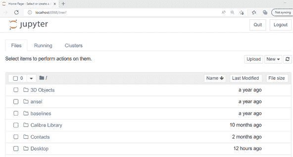

图 1.2 Jupyter Notebook app

### 在 Jupyter Notebook 中编写 Python

为了让你上手，我将向你展示如何在 Jupyter Notebook 中运行 Python。

从书籍的 GitHub 仓库下载模板文件 [`github.com/markhliu/MLA/blob/main/files/tmp.ipynb`](https://github.com/markhliu/MLA/blob/main/files/tmp.ipynb)。将其保存到电脑 `Desktop/mla` 文件夹中。回到浏览器中的 Jupyter Notebook，点击 `Desktop`，然后点击 `mla` 文件夹，最后打开 `tmp.ipynb`。你应该看到一个包含以下代码单元格。

运行上述单元格会在单元格下方看到一条消息。消息显示为：“I love Python!”

你可以在 Jupyter Notebook 中执行某些命令，而无需前往 Anaconda 提示符或终端。

例如，如果你想在虚拟环境 `MLA` 中通过 `pip` 安装 `matplotlib` 库，你有两种不同的方法。第一种方法是在 Anaconda 提示符（Windows）或终端（Mac 或 Linux）中执行以下两行命令：

```bash
conda activate MLA
pip install matplotlib==3.5.2
```

第二种方法（快捷方式）是在单元格中输入以下行代码：

```python
!pip install matplotlib==3.5.2
```

运行上述单元格将在你的电脑上安装 `matplotlib` 库。注意，由于你是在 `MLA` 虚拟环境中打开的 Jupyter Notebook，因此你将 `matplotlib` 安装在了 `MLA` 虚拟环境中，而不是 `base` Python 环境。

确保你在单元格的代码前加上一个感叹号（`!`）。这会告诉 Python 将该单元格作为命令行的快捷方式使用。

首先，确保你电脑的 `/Desktop` 文件夹中有一个名为 `/mla` 的子文件夹。我们将使用 `/mla` 文件夹来存放本书的所有文件。我们将使用 `/mla` 文件夹内的子文件夹 `/utils` 来存放本书中用到的所有本地包。我们将使用另一个子文件夹 `/files` 来包含图表和视频等文件。在 `/files` 目录中，我们为每一章创建一个子目录，例如 `/ch01`、`/ch02` 等。

接下来，按照本章早前的说明，在 MLA 虚拟环境中打开一个 Jupyter notebook。将其保存为 `/Desktop/mla/` 文件夹下的 `ch01.ipynb`。在其中输入以下代码行并运行单元格：

`os` 库中的 `makedirs()` 方法会在你的电脑上创建一个目录。`exist_ok=True` 选项告诉 Python 如果该目录已经存在，则不要返回错误信息。从本书的 GitHub 仓库 [`github.com/markhliu/MLA`](https://github.com) 下载 `__init__.py` 文件，并将其保存到电脑上的 `/Desktop/mla/utils/` 文件夹中。

到此，所有的准备工作都完成了。将在下一章学习如何在 Python 中创建图片和动画。

## 术语表

**激活虚拟环境**：进入虚拟环境的子目录，以便使用虚拟环境内的包来编写程序。

**Anaconda**：一个开源软件发行版、包管理器和环境管理器。

**Anaconda Navigator**：一个适用于 Windows、Mac 或 Linux 的应用程序，你可以将其安装在电脑上，通过用户界面管理虚拟环境、包和程序。

**Anaconda Prompt**：在你的电脑上为 Python 安装包。这些包由 Anaconda 提供，可以用 Python、C、C++ 或 R 编写。

**IDE**：集成开发环境。一种用于计算机程序软件开发的综合性应用程序。它通常提供源代码编辑器、编译器和调试器。

**pip**：从 Python 包索引（PyPI）在你的电脑上安装包。只有用 Python 编写的包才能安装。

**虚拟环境**：电脑上的一个隔离环境，包含项目所需的所有文件。

## 练习

1.  在你的电脑上安装 Anaconda。打开电脑上的 Anaconda Navigator 应用程序。
2.  创建一个新的虚拟环境并命名为 MLA。
3.  激活你在练习 2 中创建的 MLA 虚拟环境。然后使用本章讨论的两种方法退出虚拟环境并回到基础环境（base）。
4.  在 MLA 虚拟环境中安装 Jupyter Notebook。
5.  从本书的 GitHub 仓库 [`github.com/markhliu/MLA/blob/main/files/tmp.ipynb`](https://github.com) 下载 `tmp.ipynb` 文件。打开电脑上的 Jupyter Notebook 应用程序，并在 Jupyter Notebook 中打开 `tmp.ipynb` 文件。
6.  继续上一个练习，在 Jupyter Notebook 的新单元格中写一行 Python 代码，使输出信息为“Machine Learning is fun!”。
7.  继续上一个练习，在 Jupyter Notebook 的新单元格中输入命令 `!pip install matplotlib==3.5.2`，运行单元格中的代码并观察发生了什么。
8.  继续上一个练习，在 Jupyter Notebook 的新单元格中输入命令 `!conda install yt`，运行单元格中的代码并观察发生了什么。
9.  使用 `os` 库中的 `makedirs()` 方法在你的电脑桌面上创建一个名为 `mla` 的文件夹。确保使用 `exist_ok=True` 以免返回错误。

---

# 第 2 章：数据可视化与动画

在开始之前，请打开一个空白的 Jupyter notebook 并将其保存为 `ch02.ipynb`，位于电脑的 `/Desktop/mla/` 目录下。接下来，我们将创建一个子目录 `/files/ch02/` 来存储本章的文件。

在 `ch02.ipynb` 中新建一个单元格，在其中输入以下代码并运行该单元格：

```python
# 此处为占位代码块
```

我们将使用来自世界银行的年度生产总值（GDP）数据（本章附录提供了有关如何下载和清理这些数据的详情）。从书籍的 GitHub 仓库下载 `GDPs.csv` 文件，并将其放在电脑的 `/Desktop/mla/files/ch02/` 文件夹中。

## 绘制折线图

要创建折线图，你可以使用 `plot()` 方法并将 x 轴和 y 轴值作为前两个参数。使用 `title()` 方法在折线图顶部添加标题，以便人们知道图表的主题。同样，你可以使用 `xlabel()` 和 `ylabel()` 方法对 x 轴和 y 轴进行标记，以便人们知道你使用了哪些变量作为 x 值和 y 值。

```python
# 此处为占位代码块
```

在上面的单元格中，我们首先使用 pandas 库的 `read_csv()` 方法加载 `GDPs.csv` 文件。然后我们使用 `matplotlib.pyplot` 中的 `figure()` 方法创建一个图形。`dpi=100` 参数使输出每英寸 100 像素。`figsize=(5,4)` 参数设置图表宽度为五英寸，高度为四英寸。因此，这创建了一个分辨率为 500x400 像素的图像。

如果你运行上面的单元格，你将看到美国 GDP 随时间变化的折线图。x 轴是年份，从 1970 年到 2020 年。y 轴是以万亿美元计的 GDP 值。标题显示为“U.S. GDP Over Time”（美国 GDP 时间趋势）。你也可以在书籍的 GitHub 仓库 [`github.com/markhliu/MLA`](https://github.com) 的 `/files/ch02/plot.png` 下看到折线图。

### 绘制多条线

你还可以在同一张图中绘制多条线。我们将把中国的 GDP 添加到之前的图表中。`plot()` 方法有几个可选参数：`color` 参数指定线条颜色，可以取蓝色、红色或绿色等值。`linestyle` 参数可以是实线、虚线、点线等。`linewidth` 参数决定线条的粗细。

请确保在绘制完所有想要包含在图中的线条后只使用一次 `show()` 方法。如果你在每个 `plot()` 方法之后都使用 `show()` 方法，你将得到多个单条线的折线图，而不是一个包含多条线的单一图表。

`legend()` 方法为图形添加图例，两条线的标签分别为 U.S.A. 和 China（中国）。`grid()` 方法使图上的网格线可见，这使我们更容易根据折线图的高度来估算每年的 GDP 值。

```python
# 此处为占位代码块
```

我们首先绘制美国 GDP 随时间变化的图。我们在 `plot()` 方法中使用参数 `color='blue'`、`linestyle='solid'` 和 `linewidth=2`。因此，美国 GDP 值的折线图是一条粗细为 2 的蓝色实线。然后我们绘制中国 GDP 随时间变化的图，在 `plot()` 方法中使用参数 `color='red'`、`linestyle='dashed'` 和 `linewidth=1`。这产生了一条粗细为 1 的红色虚线。

如果你运行上面的单元格，你将看到一个包含两条线的图表。左上角有一个图例框，显示粗蓝色实线代表 U.S.A.，而细红色虚线代表 China。该图表也可以在书籍的 GitHub 仓库 `/files/ch02/lines.png` 下找到。

## 创建动画

虽然在电子设备上显示动画很容易，但在书中显示它们很困难。我们将引导你参考书籍的 GitHub 仓库获取 `gif` 文件格式的动画。

在本书中，你将学习创建比动画更好的东西：一系列图表。具体来说，你将学习创建表示机器学习（ML）过程中间步骤的图表序列。之后，你将它们放置在网格的单张图片中，以说明机器学习是如何工作的。

### 使用子图创建单图

在这一节中，你将学习如何使用一组子图创建一个单图。具体来说，你将使用 1972、1978…… 2020 年作为结束年份，生成九个独立的图表。然后你将它们放置在单张图片的三乘三网格中。

我们首先生成九个独立的图表。在每个图表中，我们都使用 1970 年作为起始年份。结束年份分别为 1972、1978……以及 2020 年。

在下面的单元格中，我们将遍历这九个结束年份。在每次迭代中，我们将绘制五个国家（美国、中国、日本、德国和英国）GDP 随时间变化的图。

```python
# 此处为占位代码块
```

注意我们使用 `plt.xlim(1968,2022)` 和 `plt.ylim(-1,25)` 来固定范围。最后，我们使用 `savefig()` 方法将图表保存到你的电脑上。

之后，如果你访问 `/Desktop/mla/files/ch02/`，你将看到 1972 到 2020 的 png 文件。

### 生成动画帧

我们将遍历从 1971 年到 2020 年的年份。在每次迭代中，我们将绘制这五个国家（美国、中国、日本、德国和英国）GDP 随时间变化的图表。你将在每次迭代中将图表保存到计算机上。这总共创建了 50 张图。

我们使用 `xlim()` 方法将 x 轴范围设置为 1968 年到 2022 年。同样，我们使用 `ylim()` 方法将 y 轴范围设置为 -1 到 25 万亿美元。我们对 1971–2020 年的年份值 `i` 遍历迭代。在每次迭代中，我们提取从 1970 年到 `i` 年的 GDP 值。每个国家都用不同的颜色和线条样式绘制。值 `b`、`r`、`m`、`k` 和 `g` 分别是蓝色、红色、洋红色、黑色和绿色的别名。我们没有在 `plot()` 方法中包含线宽选项，因此线宽的默认值为 1。

对于每次迭代，我们将动态地设置图表标题以反映结束年份。最后，每次迭代中的图表将保存为子文件夹 `/Desktop/mla/files/ch02/` 中的 `jpg` 格式图片。如果你打开该文件夹，你将看到这 50 张图片。

### 合成 GIF 动画

我们将使用 `PIL` 库将刚刚生成的图片转换为 NumPy 数组。然后我们将使用 `imageio` 库将数组序列组合成 `gif` 格式的动画。

我们创建一个空列表 `frames` 来存储所有图片。我们遍历在上一小节中生成的所有 50 张照片，并使用 `PIL` 库打开每一张。我们将图片转换为 NumPy 数组并将它们添加到列表 `frames` 中。完成后后，我们使用 `mimsave()` 方法将图像转换为 `gif` 格式。`fps=5` 参数生成每秒五帧的动画。你可以根据想要动画的快慢调高或调低该值：`fps` 值越高，动画越快。

运行上述单元格后，将生成并保存文件 `GDPs.gif` 到你的本地文件夹。要查看动画，你有两个选择。你可以点击计算机上的文件进行查看。或者，你可以在书籍的 GitHub 仓库中的 `/files/ch02/` 文件夹中查看。

## 其他图表类型

除了折线图，`matplotlib` 库还可以生成其他图表，如散点图、条形图、饼图、直方图等。我们在这里的目的不是向你介绍 `matplotlib` 库中所有类型的图表。相反，你在这里是为了学习如何创建动画，以便你可以使用这些技能为机器学习算法的中间步骤制作动画。你可以使用相同的逻辑创建其他类型图表的动画。

尽管如此，在本章中我们将讨论另外两种图表类型：条形图和饼图。在本节中，你将学习如何创建动态条形图。此外，你将学习如何将不同类型的图表并排放置，并创建一个在每一帧中包含多种类型图表的单一动画。

### 动态条形图

我们将查看 2009 年五个国家的 GDP，对值进行排序，然后创建一个水平条形图。

`pandas` 库中的 `set_index()` 方法将 DataFrame 的索引值从数值 0, 1, 2, … 更改为列中的值（在这种情况下是“year”列）。然后我们检索 2009 年五个国家的 GDP 值并将其保存为序列 `yr2009`。这些值根据该年的 GDP 值进行排序。我们为五个国家选择了五种颜色。

`barh()` 方法创建水平条形图。y 轴是五个国家的名称，水平条形的宽度是该国家的 GDP 值。

我们将遍历 1970–2020 年。在每次迭代中，我们将为这些国家生成水平条形图。为了直观了解数据，你可以对 `df` 使用 `head()`。

我们对 `df` 上使用 `loc` 来提取值。然后我们使用 `barh()` 创建水平条形图。我们使用 `plt.close(fig)` 关闭图表。运行单元格后，`/files/ch02/` 中的文件是 1970.png、1971.png 等。

将条形图转换为动画的过程与我们对折线图所做的操作类似。我们使用 `PIL` 将图表转换为 NumPy 数组，然后使用 `imageio` 组合序列。

### 组合图表

在本节中，你将学习如何将条形图和图表并排放置。之后，你将创建一个整体动画。

首先，你将学习如何将条形图和图表并排放置。我们将使用 2009 作为示例。2009 年的条形图保存为 `bar2009.png`，而 2009 年的折线图保存为 `year2009.png`。


我们首先使用 `plt.figure()` 创建图表，尺寸为 11x4 英寸。我们将 `dpi` 设置为 200。然后我们使用 `add_subplot()` 方法向原始图表添加两个子图。代码 `ax0=plt.add_subplot(121)` 告诉 Python 将原始图表分为一行两列，并将第一张图片放在位置 1（即左侧）。同样，代码 `ax1=plt.add_subplot(122)` 将原始图表分为一行两列，并将第二张图片放在位置 2（即右侧）。

接下来，我们将合并 1971 年到 2020 年每年的条形图和折线图。然后我们根据组合图片形成动画。

我们首先创建一个空列表 `frames` 来存储所有组合图片。然后我们遍历 1971–2020 年。每年，我们打开条形图和折线图，并分别将其命名为 `frame1` 和 `frame2`。我们使用 `concatenate()` 方法组合两张图片。然后将组合后的图片添加到列表 `frames` 中。之后，我们使用 `imageio.mimsave()` 方法创建随时间变化的图片动画并将其命名为 `barsplots.gif`。

如果你运行上述单元格，文件 `barsplots.gif` 将被生成并保存到你的本地文件夹中。要查看该动画，你可以点击计算机上的该文件。或者，你可以在书籍 GitHub 仓库的 `/files/ch02/` 目录下查看它。

在本节中，你将首先学习如何创建一个饼图。然后，你将创建 1970 年到 2000 年每年的饼图。之后，你将创建一个随时间变化的饼图动画。最后，你将创建一个饼图和折线图并排的动画。

我们将查看 2009 年五个国家的 GDP，并对这些值进行排序，然后创建一个饼图。

`matplotlib` 库中的 `pie()` 方法根据一组值创建饼图。它会自动计算每个国家 GDP 在总和中的百分比。标签（`labels`）是这五个国家的名称，而 `explode` 参数决定了每个扇形远离中心的距离。最后，`startangle` 参数决定了旋转饼图的度数。

你将遍历 1970–2020 年。在每次迭代中，你将生成一个五个国家 GDP 的饼图。你还会在每次迭代将图表保存到你的计算机上。这总共创建了 51 张饼图。

注意，我们将 `dpi` 设置为 100，尺寸设置为 12x8。这样，当我们之后把饼图和折线图并排放在时，它们的高度是相同的（都是 800 像素）。因此，我们可以使用 `concatenate()` 方法合并两张图片。如果两张图片的高度不同，我们就无法直接将它们合并在一起。

如果你运行上述单元格，将生成 51 张饼图并保存到你的本地文件夹中。你可以点击计算机上的文件来查看它们。

将柱状图转换为动画的过程与我们之前对折线图的操作类似。我们将使用 `PIL` 库将图表转换为 NumPy 数组。然后，我们将使用 `imageio` 库将数组序列组合成 `gif` 格式的动画。

运行上述单元格后，文件 `pieplot.gif` 将生成并保存到你的本地文件夹中。要查看该动画，你可以点击计算机上的该文件。或者，你可以在书籍的 GitHub 仓库中查看。

下面，你将学习如何下载和清理五个国家的 GDP 值并将其保存为 CSV 文件。原始数据集下载自世界银行网站 [`data.worldbank.org/indicator/NY.GDP.MKTP.CD`](https://data.worldbank.org/indicator/NY.GDP.MKTP.CD)。然后对数据集进行清理，我只保留了 1970 年到 2020 年五个国家（美国、中国、德国和英国）的数据。清理后的数据存放在书籍 GitHub 仓库的 `/files/ch02/` 下 [`github.com/markliu/MLA`](https://github.com/markliu/MLA)。以下是用于提取数据的 Python 代码。

这创建了我们在章节早期部分使用的 `GDPs.csv` 文件。

- **Bar Chart（柱状图）**：也称为条形图。它是一种以矩形条表示分类数据的图表。在水平（垂直）柱状图中，条形的长度（高度）与其所代表的值成正比。

- **GDP**：国内生产总值。一个国家在特定时期（通常为一年）内生产并销售的最终商品服务的总额。

- **Line Plot（折线图）**：也称为线图。它是一种以直线形式显示变量之间关系的图表。

- **Pie Chart（饼图）**：也称为圆图。将一个圆分成若干扇形，以表示数值比例。

- 2.1 在你计算机的 MLA 环境中安装 `matplotlib`、`pandas` 和 `imageio` 库。

- 2.2 在你的计算机上创建一个子文件夹 `/Desktop/mla/file/ch02/` 来存储本章的文件。

- 2.3 在单条折线图中添加网格线和图例框。还将将 `dpi` 改为 128，并将画布尺寸改为六六英寸。

- 2.4 在第一个 `plot()` 方法之后添加一个 `show()` 方法。查看你得到什么输出。

- 2.5 使用德国的 GDP 数据在图中添加第三条线。使新线变为黑色虚线，线宽为 2。

- 2.6 在单独的图中，将 x 轴范围更改为 1969–2021 年，y 轴范围更改为 -0.5 到 25。

- 2.7 将子图之间的垂直间距更改为 -0.3，水平间距更改为 -0.2。重新运行。

- 2.8 将每秒帧数设置为 8。新动画命名为 `GDPs_fast.gif`。对比原始动画 `GDPs.gif`，哪个动画更快？

- 2.9 如何将柱状图移动到右侧并将折线图移动到左侧？

- 2.10 如何让饼图显示小数点后两位？

DOI: [10.1201/b2338-3](https://doi.org/10.1201/b2338-3)

> 机器学习是赋予计算机无需显式编程即可进行学习能力的领域。
>
> – Arthur Samuel，1959

1997 年 5 月 11 日，IBM 超级计算机象棋引擎 Deep Blue 击败了世界冠军加里·卡斯帕夫。这是机器首次在象棋比赛中战胜人类。新闻引起了媒体的关注。然而，Deep Blue 背后的人工智能算法尽管强大，却是传统的基于规则的技术，而不是机器学习模型。

快进 19 年到 2016 年 5 月 9 日，Google DeepMind 的 AlphaGo 击败了世界围棋冠军李石。人工智能再次抢占焦点并引发了媒体热潮。这一次，一种新型人工智能算法——机器学习（具体说是深度强化学习）是游戏策略的动力。你可能会问：机器学习到底是什么？它与人工智能有什么关系？为什么现在如此流行？

在本章中，你将学习什么是机器学习以及它与传统人工智能有何不同。我们将讨论三种类型的机器学习，即监督学习、无监督学习和强化学习。这三种类型的机器学习使用不同类型的数据、不同的方法论，并应用于不同类型的问题。

你还将概述后续章节涵盖的内容，以及它们如何融入这三种类型的机器学习中。最后，我们将给出一个真实的案例，作为机器学习成就的动力，以及你如何将机器学习应用于解决现实问题。

在 `ch03.ipynb` 中开启新单元格并在其中执行以下代码：

```
```

你应该能在计算机上看到新的 `/Desktop/mla/files/ch03/` 文件夹。

AI 的进展比大多数科学家想象的要快得多。AI 引起了媒体的极大关注，并正在重新定义我们的生活方式。但 AI 到底是什么？

在本节中，你将学习什么是 AI，以及机器学习（ML）是如何成为 AI 领域的新范式的。

人们普遍认为 `AI` 术语是由 `John McCarthy` 在 1955 年提出的。`AI` 中的 `artificial`（人工）一词意味着它是人造的，而不是世界上自然存在的。`AI` 是由人类工程机器生成的智能。它与人类和其他动物表现出的自然智能不同。

当人们听到 `AI` 时，脑海中浮出的第一个通常是机器人。事实上，`AI` 远不止于此。如今，`AI` 已融入我们生活的各个方面：例如推荐系统、语音助手、外语翻译器……`AI` 的基础是人类智能可以被机器复制。计算机发明后不久，科学家一直致力于在机器中模拟人类智能以解决复杂问题。

广义来说，让机器模仿人类智能的方法有两种：对其进行编程，或者教它学习。对计算机进行编程以模仿人类智能就是制定规则并告诉计算机在每种情况下做什么。这就是基于规则的 AI。

基于规则的 AI 是一种传统的 AI 技术。例如，它是 `Deep Blue`（深蓝）背后的 AI 算法。为了实现基于规则的 AI，人类将所有规则编码到机器中，并根据规则告诉机器在每情况下做什么。在 `Deep Blue` 的案例中，机器在玩家走棋的三分钟限制内计算了数千亿种 `Chess` 棋盘布局，并根据哪下一步最有机会赢得比赛做出决策。换句话说，在基于规则的 AI 模型中，我们为算法提供规则和输入变量，机器告诉我们输出应该是什么。

基于规则的 AI 在 20 世纪后期通过自动化琐碎工作和提高生产力取得了巨大成就。根据 `Forbes`（福布斯）的数据，到 1985 年，企业每年在 AI 系统上的花费达到 1 亿美元 [16]。1997 年，`Deep Blue` 击败了当时的世界象棋冠军 `Gary Gasparov`，让 AI 登上了头条新闻。

然而，基于规则的 AI 也有其局限性。在很多情况下，人类并不知道规则。在另一些情况下，人类知道规则，但规则很难甚至无法编程到计算机中。例如，人类一眼就能区分狗和猫。然而，如果你要求人类描述区分狗和猫的所有特征，大多数人都会失败。即使他们能列出一系列区分两者的特征，也很难编写计算机程序来对狗和猫的图像进行分类。

这引出了 AI 的一种新方法，我们将在下文中讨论。

机器学习（`ML`）是 AI 的一种新范式。这种方法与传统的基于规则的 AI 非常不同。与其将所有规则编程到计算机中并告诉计算机在每种情况下做什么，

如果科学家从 20 世纪 50 年代就开始 `ML` 研究，为什么它在过去的几十年里才变得如此流行？有几个因素促成了 `ML` 的近期兴起：计算能力的提高、大数据的可用性以及 `ML` 研究的突破。我将在下面详细说明。

**计算能力的提高：** 正如你之后看到的，`ML` 的计算成本很高且耗时。例如，`OpenAI` 的 `GPT-3` 模型拥有 1750 亿参数。在几十年前，训练如此参数的模型是不可能的。计算能力的近期进步使得训练更多的 `ML` 模型成为可能。特别是，现在深度学习模型可以使用图形处理器（`GPUs`）而不是中央处理器（`CPUs`）进行训练。由于 `GPUs` 比 `CPUs` 分配了更多晶管给运算单元，它们大大缩短了训练时间。此外，分布式深度学习结合了多台机器的计算能力，大大加速了 `ML` 研究。

**数据的可用性：** 2017 年经济杂志的一篇文章指出，“世界上价值的资源不再是石油，而是数据” [13]。`ML` 模型需要大量的高质量数据来训练参数。在过去的几十年里，大数据的兴起产生了对 `ML` 模型进行分析的需求。同时，大数据的可用性使得训练更先进的模型成为可能。

**ML 研究的突破：** `ML` 研究在过去的几几年中取得了许多突破。特别是卷积神经网络（`CNNs`）的发明大大提高了深度神经网络（`DNNs`）的能力。`CNNs` 将深度学习推向了人工智能的前沿。因为有了 `CNNs`，深度学习现在是机器学习领域最有前景的领域。`CNNs` 使用了与普通的全连接神经层不同类型的层。

监督学习使用标记数据来训练机器学习（ML）模型。标记数据意味着输出对你来说是已知的。例如，我们可能有数千张狗和猫的照片。标记数据告诉我们每张照片是狗还是猫。监督学习模型从标记数据中学习，并提取输入数据中的模式。基于这些模式，训练后的模型会将输入（狗或猫的图像）映射到输出（即标签：照片是狗还是猫）。在从数千个“图片-标签”对中学习后，训练好的模型将接收输入，并对输出应该是什么进行预测。

在本书，你将使用监督学习在二分类问题中将图像分类为马或鹿。然后，你将该技术扩展到多分类问题，在其中你将图像归类为十组中的某一组（飞机、卡车、青蛙等）。

“监督训练”这一名称反映了训练过程需要人类的监督：在训练过程之前，需要准备好人工策划的数据（输入-输出对）。

下面，我们总结了监督学习的学习过程、常用的算法以及监督学习的应用。

监督学习的学习过程如下。起点是人工策划的数据。数据包含许多输入变量和输出变量的对。我们然后选择一个监督机器学习模型从输入-输出对中学习。训练完成后，我们向模型提供输入，模型告诉我们输出应该是什么。

人们在监督学习中使用可以使用不同的算法。一些示例包括：

* 线性回归
* 随机森林
* 梯度提升机
* 神经网络

在本书中，我们将主要关注神经网络作为我们的监督学习模型。但你也会看到一些线性回归和逻辑回归的示例。

当人工策划的数据相对容易获得时，就会使用监督学习。它广泛应用于计算机视觉、图像分类、自然语言处理和基因组学。

### 3.2.2 无监督学习

无监督学习不使用标记数据。相反，它使用没有观测输出变量的未标记数据。无监督学习模型使用输入数据识别模式和特征，以便生成输出变量。

无监督学习不需要外部监督，意义在于模型不需要人工策划和标记的数据来训练。虽然在监督学习中，我们用于训练模型的数据是输入-输出对，但在现实的许多情况下，我们并不知道数据的标签。例如，你可能有数千篇新闻文章，并想将它们分类为不同的类别，如体育新闻、天气新闻、娱乐新闻等。此外，我们可以使用无监督学习为输入数据生成标签，以便新的数据集可以用于监督学习。

由于输入数据没有预定义的目标变量，无监督学习模型必须从输入数据中发现自然发生的相似性、差异和其他模式。无监督学习方法的示例包括聚类、主成分分析和数据可视化（绘图、图表等）。无监督学习受到的关注远小于其他两种机器学习类型。在书中，我们不会详细介绍无监督学习。

下面，我总结了无监督学习的学习过程、常用的算法以及无监督学习的应用。

无监督学习的学习过程如下。起点是非结构化的未标记数据。数据包含许多输入变量的观测值，但每个观测值都没有目标变量。我们然后选择一个无监督模型从输入数据中自然发生的模式中学习，并为每个观测值生成一个标签。

## 常用算法

* K-means 聚类
* 层次聚类

在书中，我们不会涵盖任何特定的无监督学习算法。

## 应用

强化学习（RL）处理智能体应该如何在环境中采取最优行动以最大化累积奖励。强化学习与监督学习的区别在于，为了训练，不需要标记的输入/输出对。训练方法是使用试错。智能体探索不同的动作，并根据所采取动作获得奖励或惩罚。

在监督学习和无监督学习中，我们需要大量的数据来喂给模型。然而，在许多情况下，数据很难获得。我们唯一能观察到的是行动的结果。在这种情况下，我们需要依靠强化学习。

在强化学习中，智能体通过试错在环境中运行。智能体通过接收来自环境的奖励形式反馈学会实现最优结果。在书的第五和第六部分，我们将讨论各种类型的强化学习方法。

下面，我总结了强化学习的学习过程、常用的算法以及强化学习的应用。

在 RL 中，我们需要一个环境来训练智能体。智能体可以在每一步中选择不同的动作。结果以奖励或惩罚的形式被观察到，智能体从结果中学习，以最大化一系列动作的预期累积收益。

RL 中使用的一些常用算法包括：

在书中，我们将涵盖上述三个算法。

RL 广泛应用于游戏行业，用于训练智能游戏策略。它还用于训练机器人和开发自动驾驶汽车。

深度学习和深度强化学习是如今 AI 领域最酷的流行词。深度学习和深度强化学习到底是什么？

在本节中，我将简要讨论它们是什么，以及你将在书中何部分学习它们。

深度学习是我们在讨论监督学习时提到的神经网络算法的一个特例。正如你将在本书后后部分看到的，神经网络有一个输入层、一个输出层和任意数量的隐藏层。当神经网络中的隐藏层数量较小时，例如，只有 1 层或 2 层隐藏层，它被称为浅层神经网络。另一方面，如果隐藏层数量很大，例如 5 层或 10 层，我们称之为深度神经网络。深度学习是使用深度神经网络的机器学习。

我们讨论了 RL 中存在不同的算法，例如 Q-learning 和策略梯度。当我们把深度神经网络与强化学习结合时，我们就得到了深度强化学习。

特别是，深度强化学习的一种类型是深度 Q 学习。在许多机器学习问题中，状态的数量是离散且有限的，但规模巨大。例如象棋或围棋游戏，其可能场景的数量是天文数字。对于这类游戏，创建 Q 表（`Q-table`）是不切行的，原因有二：第一，计算机没有足够的内存来保存和更新具有如此不同状态的 Q 表；其次，探索所有可能的状态以计算和更新正确的 Q 值的计算成本太高了。相反，我们将 Q 学习与深度学习相结合，并使用深度神经网络来近似 Q 值。这就是深度 Q 学习的背后的思想。

近年来，许多公司利用机器学习极大改进了他们的产品和服务。这些公司成为了市场上的获胜者。我们将在书中展示，你也可以将机器学习应用于解决现实世界的问题。此外，在现实世界中应用机器学习实际上是简单且有趣的。

## 3.4.1 递送路线问题

你可以将机器学习应用到日常生活中。

在这里我们使用一个真实世界的例子来说明这一点。假设你住在一个小镇，职业是为亚马逊送快递。你小镇的居民居住在一个 10x10 的网格上，如图 3.1 所示。每个住宅都用坐标 `(x, y)` 标记。亚马逊中心位于 `H=(x=6, y=6)`。小镇上的绿色区域是一个公园，因此内部没有家庭。小镇共有 90 户家庭：总共有 `10×10=100` 个坐标，但有九个坐标落在公园内（((x=3, y=3), (x=3, y=4), (x=3, y=5), (x=4, y=3), (x=4, y=4), (x=4, y=5), (x=5, y=3), (x=5, y=4), (x=5, y=5))），且亚马逊中心占据了一个。因此，我们总共有 `100-9-1=90` 户家庭。每天，你会为 8 个不同的家庭递送 8 个包裹。这 8 户家庭每天都不同。你想使用机器学习为每天找到最短路线，无论这 8 户家庭在哪里。在书结束时，你将能够使用机器学习解决这个问题。在此过程中，你将学习机器学习是如何运作的。

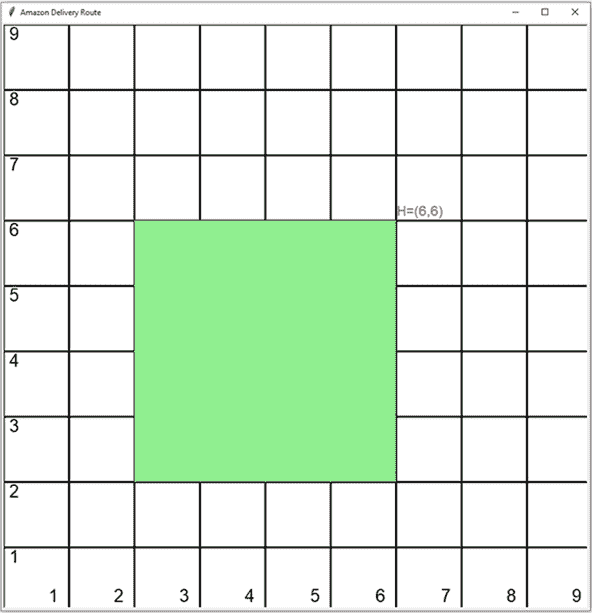

图 3.1 递送路线问题的地图

## 3.4.2 在知道答案之前尝试问题

在后的第 16 章中，我们将使用强化学习（RL）提供该问题的答案。无论这 8 户家庭如何，解决方案都会为你提供最短路线。你将在一分钟左右通过计算机上的机器学习模型获得答案。


为了感受机器学习的力量，我将在你知道答案之前让你尝试一下。假设你需要递送的 8 户家庭是：`(x=1, y=2), (x=5, y=0), (x=3, y=2), (x=9, y=9), (x=7, y=2), (x=0, y=7), (x=1, y=5), (x=1, y=3)`。记住，你将从亚马逊中心 `(x=6, y=6)` 开始，并同样在亚马逊中心结束。

花几分钟规划出最短路线。还要计算总共需要经过多少街。将你的答案写在一个名为 `MyAnswer.txt` 的文件中，并将其保存到文件夹 `/Desktop/mla/files/ch03/` 中，以便与第 16 章中的答案进行比较。

- **人工智能 (AI):** 计算机科学的一个分支，涉及模拟计算机智能行为。它与人类和其他动物的自然智能不同。
- **机器学习 (ML):** 人工智能（AI）的一个分支，人类赋予计算机无需显式编程即可学习的能力。
- **强化学习 (RL):** 机器学习的一种类型，智能体与环境交互以探索不同的动作。智能体通过试错学习选择动作以使累积奖励最大化。
- **监督学习:** 机器学习的一种类型，模型使用标记数据来学习输入变量与输出变量之间的关系。
- **无监督学习:** 机器学习的一种类型，模型使用未标记数据来学习输入变量之间的相似性、差异和其他模式，以生成输出变量。

- 3.1 什么是人工智能 (AI)？
- 3.5 什么是监督学习？分类问题和回归问题有什么区别？
- 3.6 什么是无监督学习？
- 3.7 什么是强化学习？
- 3.8 什么是深度学习和深度强化学习？
- 3.9 监督学习的学习过程、常用算法和应用是什么？
- 3.10 无监督学习的学习过程、常用算法和应用是什么？
- 3.11 强化学习的学习过程、常用算法和应用是什么？

在开始之前，请在你的电脑上的虚拟环境 `MLA` 中打开 Jupyter Notebook 应用。之后，打开一个空白的 Jupyter notebook，并将其保存为电脑上 `/Desktop/mla/` 目录下的 `ch04.ipynb`。接下来，我们将创建一个子目录 `/files/ch04/` 用来存储本章的文件。

在 `ch04.ipynb` 中新建一个单元格，并在其中执行以下代码行：

### 4.1.1 网格搜索如何实现优化

假设你想找到 `x` 的值以使 `y = (x − 10)²` 的值最小。暴力破解的方法是查看许多不同的 `x` 值，并看哪一个能产生最小的 `y`。这种方法被称为网格搜索。其核心思想是观察每个参数的不同值，并查看哪种参数组合能带来最佳结果。

在我们的示例中，只有一个参数 `x`。因此，我们查看 0 到 20 之间 2000 个不同的 `x` 值，并看哪个值能产生最小的 `y = (x − 10)²`。

这可以通过 Python 轻松实现：

```
我们使用 NumPy 中的 `linspace()` 方法在 0 到 20 之间创建 2000 个不同的 `x` 值。对于每个 `x` 值，我们计算 `y = (x − 10)²` 的值。`min()` 方法返回 `y` 的最小值，我们将该值命名为 `min_y`。`argmin()` 方法返回最小 `y` 的索引值。上述单元格的输出告诉我们，第 1000 个 `y` 具有最小值。我们也可以通过索引找到最优的 `x`。结果显示，当 `x = 10.005` 时，达到了 `y` 的最小值，即 `y = 0.000025`，这非常接近真实的最小值 `y = 0`。
```

接下来，你将创建一个图，显示 `x` 的值与函数 `y = (x − 10)²` 之间的关系。该图还将显示通过上述网格搜索算法找到的 `y` 最小值和 `x` 的最优值。

我们创建了一个宽 8 英寸、高 6 英寸的图形，设置 `dpi=100`。我们使用 `grid()` 方法在图中添加网格线。然后我们绘制 `y` 的值随 `x` 值的点图。要在标签中放入数学公式，你可以在公式周围使用美元符号（$）。我们使用 `scatter()` 方法创建一个大红点作为网格搜索的解；结果是，在 `(x=10.005, y=0.000025)` 处显示了一个红点。y 轴标签为 `value of y = (x − 10)²`，其中包含一个公式。再次，只需在公式周围加上美元符号，它就能出现在图的任何位置（标题、x 轴标签、y 轴标签或图例）。

我们使用 `annotate()` 函数在图内部创建一个文本框。第一个参数是你想在文本框中显示的消息。`annotate()` 中的 `xy` 参数告诉箭头指向哪里。`annotate()` 中的 `xytext=()` 参数定义了文本框在图中的位置。`textcoords='axes fraction'` 参数表示 `xytext` 中的坐标是坐标轴比例。

当梯度 $\frac{dy}{dx}$ 的幅度很大时，点 $(x, y)$ 远离最小值点。较大的调整不会导致过调。较大的调整会加速优化过程。当梯度 $\frac{dy}{dx}$ 的幅度较小时，点 $(x, y)$ 接近最小值点。较大的变化可能会导致过度调整。较小的调整将确保 `x` 的值不会过调到最小点的另一侧。

在下方的单元格中，我们将使用梯度下降法来寻找 `y` 的最低值。

特别地，我们在每一步中计算梯度，并根据梯度下降规则改变 `x` 的值：向相反方向改变，同时确保变化与损失函数对参数的一阶导数的幅度成正比。在我们的示例中，梯度很容易计算：

$$
\frac{dy}{dx} = \frac{d(x - 10)^{2}}{dx} = 2(x - 10)
$$

因此，我们很容易确定在每一步中应该调整多少 `x`。

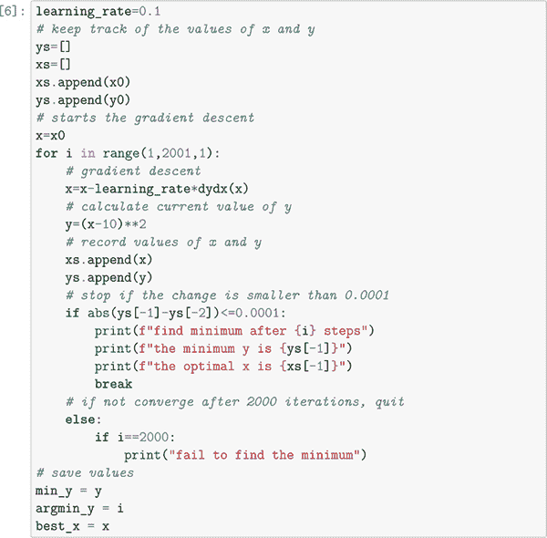

结果显示，仅需 30 步，`y` 的值就会收敛。下方图中的绿色箭头说明了整个学习过程中每次迭代中 $(x, y)$ 的路径。

在上述单元格结束处，我们启动了一个 for 循环来遍历学习过程中的每一步。在每一步中，我们画一个绿色箭头。绿色箭头的末端是调整前的 $(x,y)$，箭头头部指向调整后的 $(x,y)$。我们在每次迭代中将文本框设为空，这样只显示箭头，而图中不会有任何实际文本。

运行上述单元格，你将在输出单元格中看到一张图。该图在书籍 GitHub 仓库的 `/files/ch04/gd.png` 也可用。

## 4.3 使用 TENSORFLOW 计算梯度

虽然当 $y = (x - 10)²$ 时在上面的示例中计算梯度很容易，但在大多数机器学习模型（如深度神经网络）中，计算梯度是非常复杂的。幸运的是，你可以使用 TensorFlow 库来实现这一目标。

在本节中，你将首先安装 TensorFlow 库。然后将学习如何使用该库计算梯度。最后，你将解决在 $y = (x - 10)²$ 时寻找最低 `y` 值的优化问题。你将在本书后的部分经常使用这项技能，因为你需要在许多机器学习模型（深度神经网络、深度 Q 学习、策略梯度等）中计算梯度。

### 4.3.1 安装 TensorFlow

要安装 TensorFlow 库，请在 Anaconda prompt（Windows）或终端（Mac 或 Linux）中运行以下命令，并确保已激活你的虚拟环境 `MLA`：

```bash
pip install --user tensorflow==2.12.0
```

或者作为快捷方式，你可以直接在 Jupyter notebook `ch04.ipynb` 的单元格中 `pip install` Python 库。记住在命令前加上感叹号（`!`），如下所示：

```bash
!pip install --user tensorflow==2.12.0
```

安装完成后，确保重启电脑上的 Jupyter Notebook 应用以使库生效。

### 4.3.2 使用 TensorFlow 计算梯度

`gradient()` 方法可以计算函数在任意一点的梯度。下方的单元格计算了当 $x = 2$ 时 $y = (x - 10)²$ 的梯度。

按照习惯，我们通常导入 TensorFlow 库并给它一个短名 `tf`。我们从 `Ipython.display` 导入 `Markdown()` 方法，以便在 Jupyter Notebook 应用的输出单元格中显示数学方程。如果你运行上述单元格，结果显示函数 $y = (x - 10)²$ 在 $x = 2$ 处的梯度为 -16，这是正确答案，因为

$$
\frac{dy}{dx} = 2(x - 10) = 2(2 - 10) = - 16.
$$

接下来，你可以计算函数 $y = (x - 10)²$ 在不同点 $x = 2, x = 4, \dots x = 18$ 处的梯度。

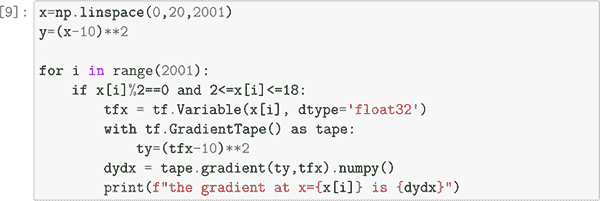

### 4.3.3 使用 TensorFlow 进行梯度下降优化

我们将再次回到寻找 $y = (x - 10)²$ 最小值的问题。在这里，我们使用 TensorFlow 库。

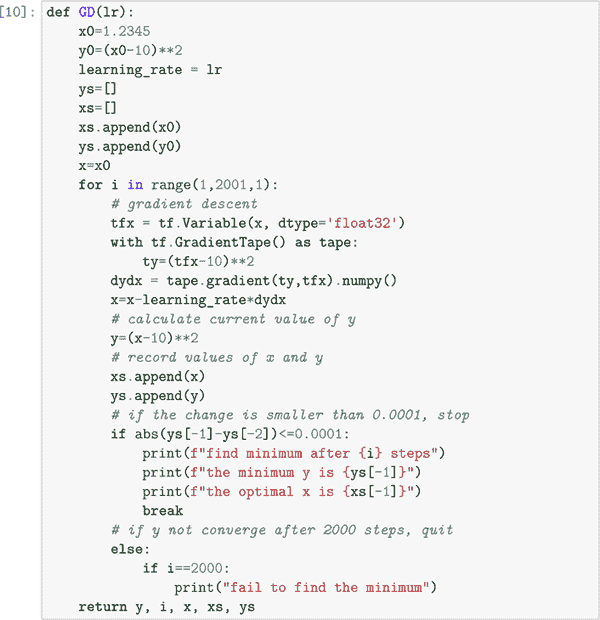

### 4.3.4 动画优化过程

接下来，我们将创建一个动画。首先，我们定义一个 `draw()` 函数。

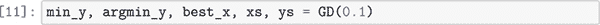

我们使用 `gif()` 函数将 png 文件组合成动画。

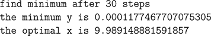

我们使用 `imageio` 中的 `mimsave()` 方法将 NumPy 数组列表转换为动画。

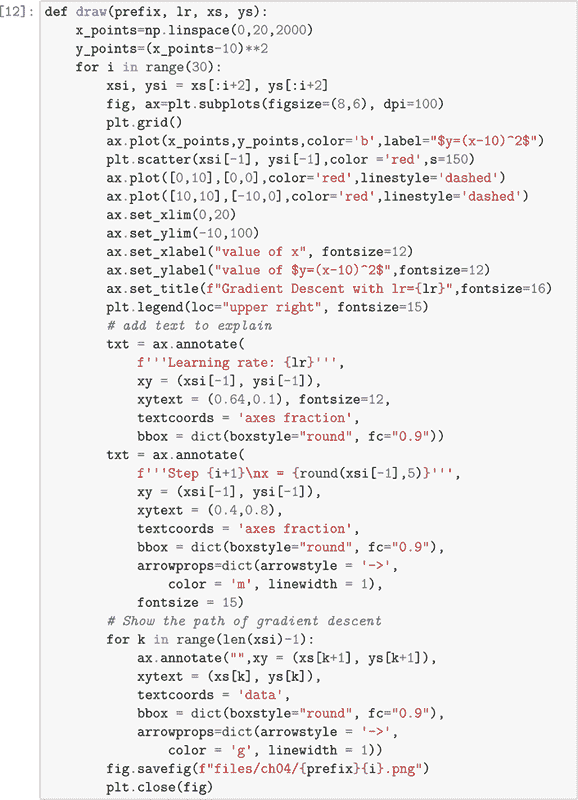
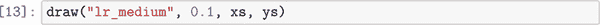
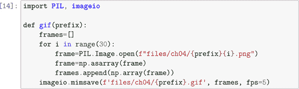
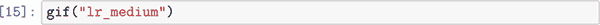

在上面的示例中，我们选择了 0.1 的学习率。这意味着在每一步中，我们将参数减少 0.1 与函数在该点的一阶导数的乘积。然而，我们如何知道选择 0.1 的学习率呢？通常，这来自于经验或尝试错误。

下面，我将向你展示学习率太大或太小会发生什么。

### 4.4 当学习率过大时


如果学习率太大，我们在每次迭代中对参数值进行大幅更改。这会导致参数值的剧烈震荡。结果是参数值可能无法收敛。下方单元格中的代码显示了选择 `0.95` 的学习率会发生什么。

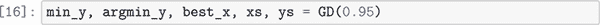

在这里我们简单地调用 `GD()` 函数并将 `0.95` 作为参数。结果显示需要 `58` 步才能找到最小值，大约是选择 `0.1` 学习率所需步骤的两倍。

接下来，我们调用 `draw()` 函数根据 `0.95` 的学习率生成图片。

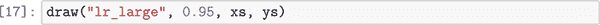

如果你运行上述单元格，你会在 `/Desktop/mla/ch04/files/` 文件夹中看到 `30` 张图片：`lr_large0.png`、`lr_large1.png`……以及 `lr_large29.png`。接下来，我们将通过调用 `gif()` 函数将 png 文件合并成动画，如下：

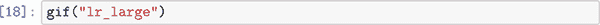

如果你运行上述单元格，你会在 `/Desktop/mla/ch04/files/` 文件夹中看到动画 `lr_large.gif`。你可以点击该文件查看动画。动画显示 `x` 的值在反复剧烈地震荡，特别是在学习过程的早期阶段。

### 4.4.2 当学习率过小时

相比之下，如果学习率太小，我们在每次迭代中对参数进行非常微小的更改。结果是参数值可能需要很长时间才能收敛。如果我们要求训练过程在固定次数迭代后停止，参数可能完全无法收敛。下方单元格中的代码显示了选择 `0.001` 的学习率会发生什么。

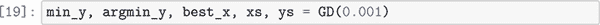

上面的输出显示，在 `0.001` 的学习率下，算法在 `2000` 次迭代内未能找到最小值。这是因为算法在每一步所做的变化太小，需要超过 `2000` 步才能收敛。

为了对比，我们通过调用下面的 `draw()` 函数在开始创建了 `30` 张学习过程的图片：

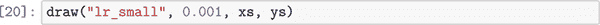

如果你运行上述单元格，你会在 `/Desktop/mla/ch04/files/` 文件夹中看到 `30` 张图片：`lr_small0.png`、`lr_small1.png`……以及 `lr_small29.png`。接下来，我们将通过调用 `gif()` 函数将 png 文件合并成动画，如下：

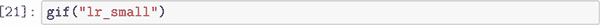

如果你运行上述单元格，你会在 `/Desktop/mla/ch04/files/` 文件夹中看到动画 `lr_small.gif`。你可以点击该文件查看动画。动画显示 `x` 的值变化非常缓慢。

## 4.5 比较学习率

为了对比，我们将这三个动画合并为一个。在每一帧中，你将三种情况并排放置：左侧是学习率过大的情况；中间是学习率最优的情况；右侧是学习率较小的情况。

由于在书中无法看到动画，你还将创建一个带有多个子图的图形，以展示不同学习率下梯度下降算法的不同阶段。

### 4.5.1 合并动画

要将三个动画合并为一个，我们使用 NumPy 中的 `concatenate()` 方法。该方法中的参数 `axis=1` 将三帧并排放置。

首先，我们打开学习率较小时的 `30` 张图片。然后我们将这些图片作为 NumPy 数组存储在一个名为 `smalls` 的列表中，如下所示：

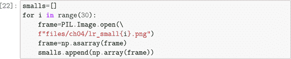

接下来，我们打开学习率中等时的 `30` 张图片。我们将这些图片作为 NumPy 数组存储在名为 `mediums` 的列表中。同样，学习率大时的 `30` 张图片被存储在一个名为 `larges` 的列表中，如下：

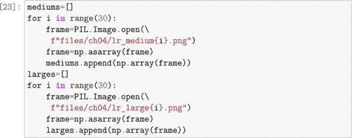

在训练的 `30` 个阶段中的每一个阶段，我们都使用 NumPy 中的 `concatenate()` 方法将三帧并排合并。合并后的帧存储在列表 `frames` 中。以下单元格完成了这一操作：

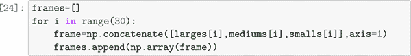

最后，我们使用 `imageio` 中的 `minsave()` 方法将 `30` 帧转换为 gif 格式的动画，如下所示：

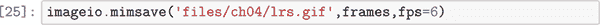

如果你运行上述单元格，你会在电脑的 `/Desktop/mla/ch04/files/` 文件夹中看到动画 `lrs.gif`。动画显示了并排的三种情况：左侧是学习率过大的情况，右侧是学习率小的情况，中间是学习率合适的。

### 4.5.2 不同阶段的子图

尽管我们无法在书中显示动画，但我们可以创建一个带有多个子图的图形，展示不同学习率下梯度下降算法的不同阶段。

为了这个目的，我们展示学习过程的第 `1`、`10`、`20` 和 `30` 阶段。我们使用刚刚创建的 `frames` 列表展示三种不同的学习率：

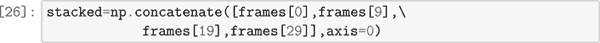

列表 `stacked` 现在包含了 `12` 张图片，具有三种不同的学习率和四个阶段。

接下来，我们将使用 `matplotlib.pyplot` 创建一个包含这 `12` 张图片的图形，如下：

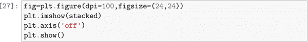


图 4.2 学习率如何影响梯度下降

在上述单元格结束处，我们开始一个 `for` 循环来遍历学习过程的前 `30` 步。在每一步中，我们画一个绿色箭头。箭头的末端是调整前的 `(x, y)`，箭头指向调整后的 `(x, y)`。注意我们在文本框中将消息设置为空字符串，以便只显示箭头，文本框中没有任何文字。

运行上述单元格，你将看到如图 4.2 所示的输出。该图也可以从书籍 GitHub 仓库中的 `/files/ch04/fig4.2.png` 获取。

## 4.6 术语表

- **维度灾 (Curse of Dimensionality)**：维度灾难是指处理高维空间时遇到的各种问题和复杂性。在网格搜索中，这意味着随着参数数量的增加，为了找到最优参数所需的搜索次数呈指数级增长。

- **方向性网格搜索 (Directional Grid Search)**：通过沿损失对参数的一阶导数的反方向调整值来寻找最优参数值的方法。

- **梯度下降 (Gradient Descent)**：用于最小化损失函数的优化算法。该方法根据损失对参数的一阶导数的负值按比例调整参数值。

- **网格搜索 (Grid Search)**：通过搜索所有可能参数组合的空间寻找最优参数值的方法。

- **学习率 (Learning Rate)**：机器学习模型中的超参数，用于控制每一步调整参数的速度。学习率通常是 `0` 到 `1` 之间的值。

- **损失函数 (Loss Function)**：也称为代价函数。它衡量机器学习模型预测值与真实值之间的误差。常用的损失函数包括均方误差、平均绝对误差和交叉熵。

## 4.7 练习

- 4.1 解释网格搜索是如何工作的？

- 4.2 修改第 4.1.1 节中的程序，通过在 `0 ≤ x ≤ 8` 范围内搜索 `1000` 个不同的值来寻找 `y = cos(x)` 的最小值。

- 4.3 什么是维度灾难？什么是方向网格搜索？

- 4.4 什么是梯度下降？为什么参数应该沿着梯度的反方向移动？

- 4.5 修改第 4.1.2 节中的第二个程序，使用 `figure()` 而不是 `subplots()` 方法来绘制方向网格搜索过程。首先，你应该将 `fig, ax=plt.subplots(figsize=(8,6), dpi=100)` 改为 `fig=plt.figure(figsize=(8,6), dpi=100)`。修改程序的其余部分，使其生成完全相同的图表。

- 4.6 在不借助 TensorFlow 库的情况下，使用梯度下降在 `0 ≤ x ≤ 8` 范围内寻找 `y = cos(x)` 的最小值。将 `x` 的初始值设置为 `1`，学习率设置为 `0.1`。如果相邻迭代之间的增量小于 `0.001`，则认为 `y` 的值已收敛。如果 `2000` 次迭代后 `y` 值未收敛，则认为搜索失败。

- 4.7 重复上一题，但这次使用 TensorFlow 库来计算梯度。

# 第 5 章 神经网络简介

DOI: [10.1201/b23383-5](https://doi.org/10.1201/b23383-5)

> 估计人类大脑有约千亿个神经细胞、数百万里的轴突和万亿个突触，使其成为地球上最复杂的结构（无论是天然的还是人工的）。

> *–T. Green, S.F. Heinemann, and J.F. Gusella (Neuron, 1998)*

机器学习领域最成功的进展是神经网络。自 20 世纪 90 年代以来，训练深度神经网络被认为是不可能的，大多数研究人员都放弃了这一想法。直到 2006 年，Geoffrey Hinton、Simon Osindero 和 Yee-Whye Teh 在 *Neural Computation* 杂志上发表的一篇论文展示了如何训练一个能够以高精度识别手写数字的深度神经网络 [9]。作者将他们的技术称为“深度学习”。2006 年的论文开启了神经网络研究的大门。现在，深度学习是机器学习领域最强大的工具。

本章将讨论神经网络如何从数据中学习并做出预测。你将学习从零开始构建一个简单的神经网络，来学习十对输入输出变量之间的关系。你将使用我们在第 4 章中概述的三个步骤：初始化、调整和重复。你将在这个简单神经网络训练的每一步中看到参数值和预测值。虽然在这个简单示例中，你可以显式地计算梯度并相应调整参数，但在具有多个隐藏层的神经网络中，梯度计算变得更加复杂。你将学习如何使用 TensorFlow 和 Keras 来构建神经网络并自动计算梯度。你还将学习在训练过程中必须自定义损失函数的情况，以便为深度学习做好准备。

具体而言，我们用于训练模型的十对输入输出具有以下值：

- 当 `X = -40` 时，`Y = -40`
- 当 `X = -30` 时，`Y = -22`
- 当 `X = -10` 时，`Y = 14`
- 当 `X = 0` 时，`Y = 32`
- 当 `X = 5` 时，`Y = 41`
- 当 `X = 10` 时，`Y = 50`
- 当 `X = 20` 时，`Y = 68`
- 当 `X = 40` 时，`Y = 104`
- 当 `X = 60` 时，`Y = 140`
- 当 `X = 100` 时，`Y = 212`

你可能已经注意到 `Xs` 和 `Ys` 之间存在线性关系，这对应于摄氏和华氏之间的关系 `Y = 1.8X + 32`。在章节结束时，你将动画演示你从零开始构建的神经网络是如何“初始化、调整和重复”的。模型在线性模型 `Y = wX + b` 中初始化 `w` 和 `b`；它根据你在第 4 章中学习的梯度下降算法逐步预测并调整 `w` 和 `b`。随着训练的进行，模型将找到正确的关系 `Y = 1.8X + 32`。你将创建一个动画来显示每一步 `w` 和 `b` 的值。

在开始之前，在电脑上的虚拟环境 MLA 打开 Jupyter Notebook 应用。然后，打开一个空白的 Jupyter notebook 并保存为 `ch05.ipynb`，位于电脑的 `/Desktop/mla/` 目录下。接下来，我们将创建一个子目录 `/files/ch05/` 来存储本章的文件。

在 `ch05.ipynb` 中新建一个单元格，并在其中执行以下代码：

```
(images/comp05_1.jpg)
```

你应该会在电脑上看到一个新目录 `/Desktop/mla/files/ch05/`。

## 5.1 神经网络的构造

尽管神经网络被广泛使用，但对神经网络（或大多数机器学习模型）的一个共同批评是它们像黑箱一样难以理解。事实上，如今在构建神经网络时，你可以直接使用 Keras 库的 API，而无需完全理解模型内部发生了什么。

为了深入内部并在不使用任何 API 的情况下更好地理解神经网络的逻辑，你将仅使用 NumPy 库从零开始构建一个并剖析其组件。

神经网络试图模拟人类大脑的工作方式。根据 1998 年 Tim Green、Stephen F. Heinemann 和 Jim F. Gusella 发表的一篇论文，人类大脑由数十亿神经元组成，这些神经元通过突触连接 [24]。神经网络通过在计算机上创建机器学习模型来模拟这一过程。神经网络由输入层、输出层和中间的一些隐藏层组成。强大的神经网络通常有很多隐藏层，因此被称为“深度神经网络”。我们将从一个没有隐藏层的浅层网络开始，只有一个输入层和一个输出层。

### 5.1.1 神经网络的元素

我们要尝试解决的问题如下。假设你有十对 `Xs` 和 `Ys`，其值如下：(`X = -40`, `Y = -40`)，(`X = -30`, `Y = -22`)，……(`X = 100`, `Y = 212`)。你可能已经注意到 `X` 和 `Y` 的值之间存在线性关系，这对应于摄氏和华氏之间的关系：

`Y = 1.8X + 32`

问题是：你能创建一个机器学习模型来学习这两个变量之间的关系吗？此外，在训练模型后，当输入 `X = 50` 时，模型对 `Y` 的预测是多少？

在本节中，你将为此目的从零开始构建神经网络。在此过程中，你将学习神经网络的基础知识。

具体而言，我们将仅使用 NumPy 库构建一个包含一个输入层、一个输出层且没有隐藏层的神经网络。通常，神经网络的每一层都有一个或多个神经元。在我们简单模型中，输入层包含两个神经元，输出层包含一个神经元。我们将为所构建的神经网络绘制图示。下方单元格中的 Python 代码使用 *matplotlib* 库创建图表。

```
(images/comp05_2.jpg)
```

我们创建了一个宽 `12` 英寸、高 `6` 英寸的画布，设置 `dpi=200`。我们使用 `add_subplot()` 方法在图中添加一个子图。`add_subplot()` 方法中的参数 `111` 意味着原始画布被分为一行一列，且子图位于位置 `1`。我们使用 `add_subplot()` 方法是为了稍后可以使用 `add_artist()` 方法在子图中添加圆形和其他艺术形状。我们使用了三个半径为 `0.8` 的圆来表示两个输入神经元和一个输出神经元。我们绘制了蓝色箭头来表示神经元之间是连接的。

两个输入神经元的值分别是一个常数（即偏置）和一个变量 `X`。两个输入神经元连接到输出神经元，这个过程生成了一个值 `Y = w * X + b`，其中 `b` 是偏置项，`w` 是变量 `X` 的权重。这里 `w` 和 `b` 是模型参数。模型的任务是根据输入-输出对来学习 `w` 和 `b` 的正确值应该是多少。

我们使用 `annotate()` 函数在图中创建一个文本框。`annotate()` 函数的第一个参数是你想在文本框中显示的消息。`annotate()` 中的 `xy` 参数告诉箭头指向哪里。`annotate()` 中的 `xytext=(0.2, 0.5)` 参数定义了文本框在图中的位置。`textcoords='axes fraction'` 参数表示 `xytext=(0.2, 0.5)` 参数中的坐标使用轴比例系统。我们还指定了箭头应该是绿色的，线宽为 `1`，文本框内的字体大小应为 `15`。你可以更改 `annotate()` 函数中的参数来查看它们是如何影响图形的。

如果你运行上面的单元格，将看到如图 5.1 所示的输出。该图在书籍 GitHub 仓库的 `/files/ch05/` 目录下可用。

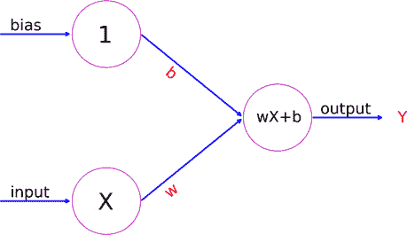

图 5.1 简单神经网络示意图

接下来，我们将使用这个简单的神经网络，根据上述示例中的十对数值，解决找出 `Xs` 和 `Ys` 之间关系的问题。

### 5.1.2 神经网络是如何学习的？

神经网络接收输入-输出对，并找出输入与输出变量之间的关系。由于输入与输出变量之间的关系由模型的参数值决定，训练神经网络归结为估计模型参数值。在上面的示例中，模型接收 `X` 和 `Y` 的值。它还通过输入层中的另一个神经元接收一个偏置项（即常数值）。输入层中的两个神经元都连接到输出神经元。模型通过找到以下公式中 `w` 和 `b` 的正确值来学习 `X` 和 `Y` 之间的关系：

```
Y = w * X + b
```

为了解决上述示例中的问题，神经网络模型遵循以下步骤：

1. 随机为权重 `w` 和偏置项 `b` 赋值；
2. 接收输入数据 `Xs` 并根据公式 `Ŷ = w * X + b` 为 `Ys` 生成预测；
3. 将预测值 `Ŷ` 与实际值 `Y` 进行比较，并根据损失函数计算预测误差；
4. 在当前值处计算损失函数对 `w` 和 `b` 的梯度；
5. 根据我们在第 4 章中学的梯度下降算法（或其变体）调整参数 `w` 和 `b`；
6. 重复上述步骤 2 到 5，直到 `w` 和 `b` 的值收敛。

完成上述步骤后，模型被认为已完成训练。要使用训练好的模型对任何 `X` 值进行预测，只需使用训练模型中 `w` 和 `b` 的值，预测结果为 `Ŷ = w * X + b`。我们将修改第 4 章中使用的代码，并应用类似的梯度下降算法找到使损失函数最小的 `w` 和 `b` 值。然后我们将使用训练好的模型进行预测。

首先，运行下方单元格中的 Python 代码来训练模型：

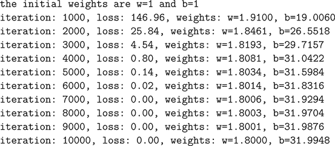

注意，所有操作都是使用 NumPy 库完成的。我们没有使用 TensorFlow 或 Keras 库。这样你可以从零开始构建神经网络，并更好地理解它的工作原理。

我们定义了 `Xs` 和 `Ys` 的值。我们还使用 NumPy 中的 `tile()` 方法创建了一个全 `1` 向量。为了训练模型，我们遵循第 4 章开头概述的三个步骤：初始化、调整和重复。具体来说，我们首先用随机值初始化参数 `w` 和 `b`：我们设置 `w=1` 且 `b=1`。将它们设置为其他值也会得到几乎相同的结果。作为一个练习，你可以将初始值更改为 `w=0` 和 `b=0` 并观察结果。

然后，我们根据梯度下降规则在每次迭代中调整 `w` 和 `b` 的值。我们将学习率设置为 `lr=0.0005`。我们在每次迭代中显式计算梯度，并根据以下公式更改 `w` 和 `b`：

```
Δw = - lr * ∂L(w,b)/∂w
```

以及


$$
\Delta b = - lr \cdot \frac{\partial L(w,b)}{\partial b}
$$

这里我们显式地计算了损失函数对参数 `w` 和 `b` 的一阶导数。为了简化符号，我们在调整参数值时使用了矩阵操作。注意，当你相乘两个矩阵时，可以使用 `np.matmul()` 或 `@`：它们产生的结果是相同的。经过 10000 次 epoch 的训练，`w` 和 `b` 的值收敛到大约 1.8 和 32，即它们的真实值。

### 5.1.3 进行预测

现在模型已经训练完成，我们可以打印出最终收敛的参数 `w` 和 `b` 的值。结果，我们也知道了 `X` 和 `Y` 之间的精确关系，如下：

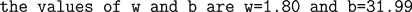

结果显示，神经网络从数据学习到参数应该是 `w=1.80` 和 `b=31.99`。

为了预测当 `X=50` 时 `Y` 的值，我们可以将 `w` 和 `b` 的值代入线性模型 `Y = w * X + b` 并使用公式进行预测，如下：

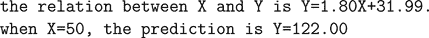

上面的结果显示预测值为 122.00，对于 122 度华氏的真实值来说这是一个完美的预测。

## 5.2 动画化学习过程

接下来，我们将为在上一节中实现的机器学习过程的中间步骤创建一个动画。首先，我们创建一系列图片。在每张图中，我们将显示 `w` 和 `b` 的值，以及 `Y` 的预测值和平方预测误差。然后我们将这系列图片组合成动画。

### 5.2.1 生成图表

以下单元格每 200 个 epoch 创建一个图表，由于包含了第一个 epoch，总共创建了 51 张图片。具体来说，我们展示了每个 epoch 中参数 `w` 和 `b` 的值，以及预测的 `Y` 值。

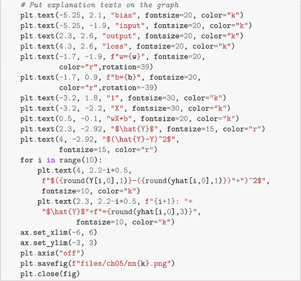

首先，我们创建了一个索引列表，表示我们想要创建图片的轮次（epochs）。这 51 个索引存储在一个名为 `steps` 的列表中。然后，我们使用 for 循环来遍历这 51 步。在每一步中，我们提取参数值 `w` 和 `b` 的值、预测值 `Y` 以及损失函数的值。我们画出所创建的简单神经网络图。`w` 和 `b` 的值被放置在神经元之间的连接处，以便你理解前向传播的概念。

我们还创建了一个阴影框，用于显示 10 个预测 `Y` 值以及预测误差的平方。MSE 损失函数的值显示在图片的顶部正中央，并附有轮次编号。

如果你运行上面的代码单元，你将在电脑的 `/Desktop/mla/files/ch05/` 文件夹中看到 51 张图片：它们命名为 `nn0.png`、`nn19.png`……以及 `nn9999.png`。

### 5.2.2 基于图创建动画

接下来，我们将利用刚刚生成的 51 张图片创建一个训练过程的动画。

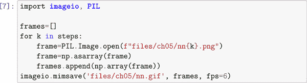

我们创建了一个空列表 `frames` 来存储所有图片。我们遍历在上一小节中生成的 51 张图片，并使用 `PIL` 库打开每一张图片。我们将图片转换为 NumPy 数组并将它们添加到列表 `frames` 中。完成后，我们使用 `imageio` 库中的 `mimsave()` 方法将图像转换为 `gif` 格式。`fps=6` 参数生成每秒六帧的动画。

在运行上面的单元格后，将生成文件 `nn.gif` 并将其保存在你的本地文件夹中。要查看动画，你可以点击电脑上的该文件。或者，你也可以在书籍的 GitHub 仓库的 `/files/ch05/` 文件夹下查看。

### 5.2.3 不同阶段的子图

尽管我们无法在书的纸质版中显示动画，但我们可以创建一个包含多个子图的图形来展示训练过程的不同阶段。为了这个目的，我们展示了四个阶段的四张图片：1、4000、7000 和 10000。下方单元格中的 Python 代码创建了这些子图。

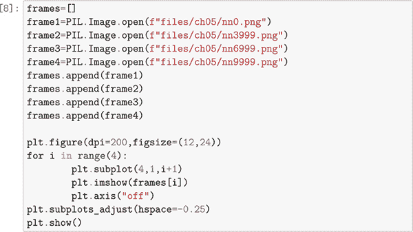

我们首先创建一个空列表 `frames` 来存储我们想要展示的四张图片。我们使用 `PIL` 库打开这四张图片并将它们添加到列表 `frames` 中。我们使用 `plt.figure()` 方法创建一个尺寸为 12 比 24 英寸的图形。我们将 dpi 设置为 200。然后，我们使用 `subplot()` 方法在原始图中添加四个子图，按垂直方向形成一个四一的网格。我们调整了四张图片之间的垂直空间，使它们对齐且间距合理。

运行上面的单元格，你将看到如图 5.2 所示的输出。该图也可以在书籍 GitHub 仓库的 `/files/ch05/` 下找到。

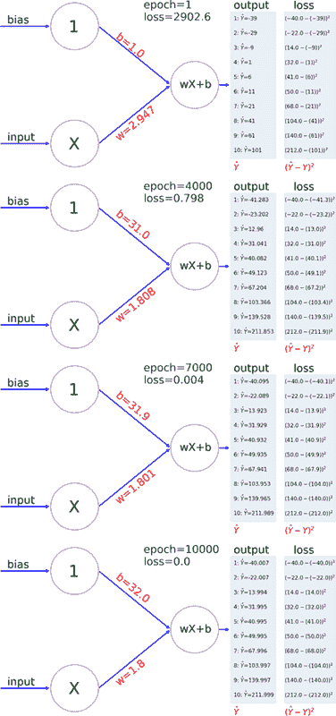

图 5.2 参数在训练过程中的变化

## 5.3 使用 Keras 创建神经网络

我们上面展示的示例相对简单。特别是，梯度有一个闭式解，因此我们可以在 Python 代码中通过手动计算梯度来实现梯度下降算法。

然而，为了解决更复杂的问题，我们需要构建具有更多层的神经网络。计算梯度太复杂且耗时。因此，在本书的剩余部分中，我们将依赖 Keras 库来实现所有的优化。

在本节中，你将学习如何使用 Keras 来解决与上一节中解决的相同问题。正如我们在第 1 章中所讨论的，Keras 是一个用于开发和评估神经网络的 Python 库。TensorFlow 库的最新版本已经集成了 Keras。因此，不需要单独安装 Keras。

特别地，Keras 提供了训练、评估和预测的内置 API。

### 5.3.1 构建模型

构建神经网络最简单的方法是 `Sequential`。我们将按照如下方式使用模型：

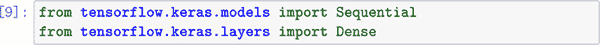

正如你将在书的后面部分看到的，有不同类型的层，例如卷积层、丢弃层、循环层等。我们首先使用以下代码创建序列化模型：

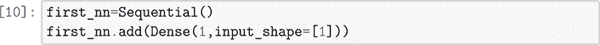

然后我们向模型中添加了一个全连接层。`Dense()` 中的第一个参数 `1` 表示只有一个神经元。第二个参数 `input_shape=[1]` 指定了输入的形状。请注意，输入有一个默认的偏置项。

### 5.3.2 编译并训练模型

接下来，我们将编译模型。我们需要指定使用何种损失函数以及选择哪种优化器。

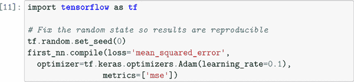

我们使用 `compile()` 方法编译模型。我们使用 `MSE` 作为损失函数。我们还选择了 `Adam` 优化器。最后，我们使用 `MSE` 作为性能指标。

为了训练模型，指定 `X` 和 `Y` 的值。我们还将告诉模型在训练过程中运行的次数和批量大小（batch size）。批量大小决定了在调整模型权重之前考虑多少个观测值。默认批量大小为 32。由于我们只有 10 个观测值，我们将批量大小设置为 10。

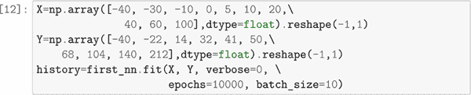

### 5.3.3 进行预测

现在模型已经训练完成，你可以使用 Keras 的 `predict()` 方法根据 `X` 的值直接进行预测。在下方的单元格中，我们预测 `X=50` 时 `Y` 的值。确保将 `X` 的值放在矩阵形式中，因为输入神经网络的数据必须是形状为 `(-1,1)` 的二维数组。

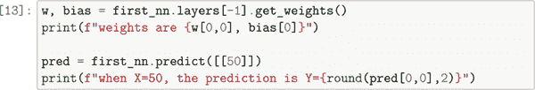

输出显示 `w` 和 `b` 的值分别为 1.8 和 32。当 `X` 的值为 50 时，模型对 `Y` 的预测为 122，这是一个完美的预测。请注意，预测结果是一个二维 NumPy 数组，因此我们使用 `[0,0]` 从第一行第一列的元素中提取数值。

此外，我们可以使用 Keras 的 `evaluate()` 方法来衡量训练后模型的性能，如下所示：

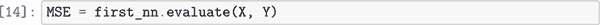

输出显示模型在进行预测方面工作得近乎完美：损失函数的值为零。

由于我们已经保存了训练历史，我们可以绘制训练过程中 `MSE` 值的变化图，如下所示：

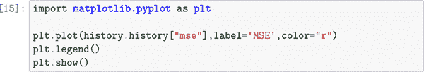

如果你运行上面的单元格，将看到训练过程中损失函数 `MSE` 值的图表。在训练大约 50 轮（epochs）后，`MSE` 的值变为 0。该图也可以在书籍 GitHub 仓库的 `/files/ch05/MSE_plot.png` 下找到。

## 5.4 使用 GradientTape 自定义训练

虽然 Keras 内置 API 使得神经网络模型的训练、评估和使用变得简单，但这些 API 存在局限性。Keras 高级 API 的一个局限性是，在各种情况下，我们要编写自定义训练循环非常有挑战性。

例如，Keras API 提供的损失函数只能计算预测目标值与实际目标值之间的差异。在某些情况下，我们需要构建自定义的损失函数。一个例子是本书后半部分，当我们训练深度 Q 学习（deep Q-learning）模型时，损失函数是当前 Q 值与更新后的 Q 值之间的差异。因此，我们无法使用 Keras API 来训练深度 Q 学习模型。相反，我们需要使用 `GradientTape` 函数来编写自定义训练循环。

在本节中，你将学习如何使用 TensorFlow 中的 `GradientTape` 函数在训练循环的每一步中计算梯度，然后使用优化器逐步调整参数。通过这种方式，你将熟悉如何将 `GradientTape` 函数用于训练，而不是依赖 Keras 内置 API。你将在书的后部分训练深度 Q 学习模型时使用这些技能。

### 5.4.1 构建模型

模型构建部分与上一节相同。我们创建一个包含一个输入层和一个输出层的 `Sequential` 模型，如下：

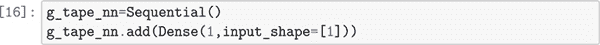

接下来，我们指定损失函数和优化器。我们仍然使用均方误差损失函数，以及学习率为 0.1 的 `Adam` 优化器。

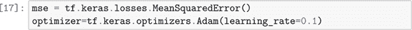

### 5.4.2 训练模型

为了训练模型，我们将编写一个包含 10000 次迭代的循环。在每次迭代中，我们根据当前参数计算模型的预测值。然后我们显式地计算损失函数的值。具体来说，我们将使用 `GradientTape` 函数记录操作并进行自动微分，以便能够计算损失函数对参数的偏导。然后我们使用 `Adam` 优化器（梯度下降算法的一种变体）来调整参数，如下：

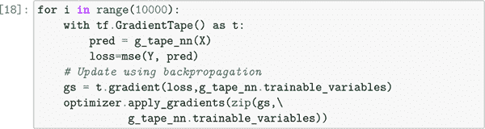

在上面的单元格中，`g_tape_nn.trainable_variables` 是我们在神经网络中需要训练的参数向量。在我们的案例，它们是线性关系 `y = w * X + b` 中的 `w` 和 `b`。

我们计算损失函数对参数的偏导，并记录为 `gs`。参数的调整基于学习率和梯度完成。

```
optimizer.apply_gradients(zip(gs, g_tape_nn.trainable_variables))
```

### 5.4.3 进行预测

你可以像以前一样使用训练好的模型进行预测，通过调用 `predict()` 函数：

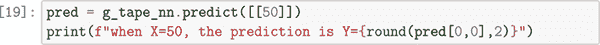

正如所示，当输入为 `X = 50` 时，模型的预测值为 `122.0`。然而在这种情况下无法使用 Keras 的 `evaluate()` 方法。在编写自定义训练循环时可能会看到模型未编译的警告。

## 5.5 术语表

- **反向传播 (Backward Propagation)**：反向传播是通过梯度和优化器更新神经网络中每一层的权重。
- **深度学习 (Deep Learning)**：一种基于深度神经网络的机器学习方法，其特征是除了输入层和输出层外还有许多隐藏层。
- **深度神经网络 (Deep Neural Networks)**：由许多隐藏层神经元组成的神经网络，除了输入层和输出层之外。
- **正向传播 (Forward Propagation)**：正向传播是输入数据从输入层到输出层正向通过神经网络。
- **隐藏层 (Hidden Layer)**：位于神经网络输入层和输出层之间。它接收输入层的数据，进行处理并传递给输出层。
- **输入层 (Input Layer)**：神经网络的第一层。它将数据引入系统进行进一步处理。
- **均方误差 (MSE) 损失函数**：机器学习中常用的损失函数。它是实际值与预测值之间差异的平方平均值。
- **神经网络 (Neural Networks)**：一种受生物大脑启发的机器学习模型。也称为人工神经网络或简单的神经网络。它们由多个层组成：输入层、输出层，在许多情况下还有隐藏层。
- **输出层 (Output Layer)**：神经网络的最后一层。它产生模型的预测结果。

## 5.6 练习

- 什么是输入层？输出层？隐藏层？
- 什么是均方误差 (MSE)？
- 修改 5.1.2 节中的程序，使 `w = 0` 且 `b = 0`。同时进行更改，使损失函数、`w` 和 `b` 的值都保留三位小数。
- 修改 5.4.3 节中的最后一个代码单元格，当 `X = -40` 时预测 `Y`。

在人工神经网络中，激活函数将输入转换为输出。顾名思义，当输入达到特定阈值时，激活函数会激活神经元。简单来说，激活函数就是人工神经网络中的开关。这些开关在使人工神经网络变得强大方面起着重要作用。激活函数允许网络学习数据中更复杂的模式。如果没有激活函数，神经网络只能学习数据中的线性关系。

在第 5 章中，你已经看到神经网络如何对输入变量和输出变量之间的线性关系做出准确预测。然而，我们也可以通过线性回归来实现并获得的结果。你可能会想，神经网络的优势是什么？神经网络是函数近似算法。只要给神经网络提供足够的数据，它就能弄清楚任何输入-输出对之间的关系，即使这种关系是非线性且非常复杂的。即使我们人类不知道输入和输出之间精确的函数形式，也可以做到。

在本章中，你将学习为什么我们需要激活函数来对非线性关系建模。你将首先尝试创建一个神经网络，在不使用激活函数的情况下，预测 `X` 与 `y = sin(X)` 之间的关系。该神经网络的效果不好，因为在没有激活函数的情况下，它只能预测输入和输出之间的线性关系。然后你将向神经网络中添加修正线性单元（`ReLU`）激活函数，并证明该模型现在可以近似 `X` 与 `y = sin(X)` 之间的非线性关系。

你还将学习 sigmoid 激活函数以及它如何将一个数字压缩到 0 到 1 之间的范围，以便将其解释为结果的概率。同样，softmax 激活函数将一组数字压缩到 [0, 1] 范围内，其特性是组中的数字之和为 100%。因此，softmax 函数的输出可以解释为多个结果的概率分布。由于这些特性，我们分别在二分类和多分类中使用 sigmoid 和 softmax 激活函数。

你将创建一个动画，显示 ReLU 激活函数如何在输入和输出之间创建非线性关系。你还将创建一个动画，显示 sigmoid 激活函数如何取一个 -∞ 到 ∞ 之间的数字并压缩，使其输出在 0 到 1 之间，这反过来可以解释为结果的概率。然后你把这两个动画合并为一个，以便并排显示两个激活函数。最后，你还将学习什么是 softmax 激活函数，以及为什么 softmax 函数的输出可以解释为多个结果的概率分布。

在开始之前，请在电脑上的虚拟环境 `MLA` 中打开 Jupyter Notebook 应用。之后，打开一个空白的 Jupyter notebook 并将其保存为 `ch06.ipynb`，存放在电脑的 `/Desktop/mla/` 目录下。接下来，我们将创建一个子目录 `/files/ch06/` 来存储本章中的文件。在 `ch06.ipynb` 中启动一个新单元格，并在其中执行以下代码行：

```
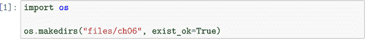
```

你应该会在电脑上看到一个新目录 `/Desktop/mla/files/ch06/`。

## 6.1 我们为什么需要激活函数？

激活函数帮助我们建立输入和输出之间建立非线性关系。没有它们，我们只能近似线性关系。无论我们向神经网络中添加多少层隐藏层，我们都无法实现非线性关系。

为了说明这一点，让我们尝试训练一个深度神经网络来学习 `X` 与 `y = sin(X)` 之间的关系。我们使用的神经网络结构有两个隐藏层，分别有 7 和 5 个神经元。我们很快就会生成该特定神经网络结构的结构图。你会发现，如果没有激活函数，神经网络无法实现非线性关系。

通过在神经网络中添加 `ReLU` 激活函数，我们可以证明模型现在可以近似输入和输出之间的非线性关系。

### 6.1.1 构建神经网络

为了预测 `X` 与 `y = sin(X)` 之间的关系，我们使用的神经网络结构有两个隐藏层，分别有 7 和 5 个神经元。我们很快就会生成该特定神经网络结构的结构图。你会发现，如果没有激活函数，神经网络无法实现非线性关系：它仍然线性的。

然后我们在神经网络中添加激活函数。相邻层之间的神经元是全连接的。幸运的是，我们可以从网络资源获取。例如，[`gist.github.com/craffel/2d27968c3aaebd10359e`](https://gist.github.com/craffel/2d27968c3aaebd10359e) 讨论了具有不同神经元数量的神经网络绘图方法。以下 Python 代码灵感源于 Raffel 的帖子，用于预测 `X` 与 `y = sin(X)` 之间的关系：

```
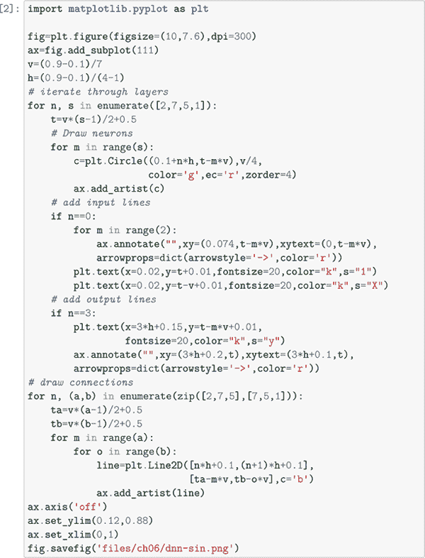
```

我们首先计算神经元之间的水平空间 `h` 和垂直空间 `v`（分别地）。然后我们遍历这四层。Python 中的 `enumerate()` 方法产生具有相应索引的列表。因此，`enumerate([2, 7, 5, 1])` 为我们提供了索引（0, 1, 2, 3），以及每层的神经元数量（2, 7, 5, 1）。


然后我们用圆绘制每层的神经元。输入线和输出线使用 `matplotlib` 库中的 `annotate()` 方法绘制成箭头。最后，神经元之间的连接使用 `Line2D()` 方法绘制直线。

如果你运行上述单元格中的 Python 代码，你将看到如图 6.1 所示：

```
图 6.1 具有两个隐藏层的神经网络图
```

作为练习，修改上述单元格并将两个隐藏层的神经元数量分别改为 8 和 4。重新运行单元格，查看图是否反映了变化。

### 6.1.2 在无激活的情况下学习非线性关系

首先，我们根据第 5 章中学到的知识，使用 `keras` 创建神经网络。然后我们创建 1000 组具有非线性关系 `y = sin(X)` 的输入输出。我们不在神经网络的任何层中使用任何激活函数。

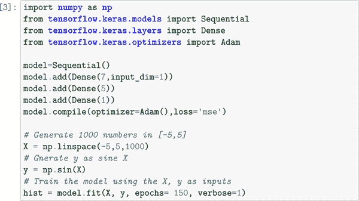


# 6.2 使用 ReLU 激活函数建模非线性关系

在上述单元格中，我们首先导入 NumPy 库。然后我们从嵌入在 `TensorFlow` 中的 `Keras` 导入 `Sequential` 模型、`Dense` 层和 `Adam` 优化器。然后我们像在第 5 章](#chapter5.xhtml）中一样使用 `Keras` API 创建神经网络。在编译模型时，我们使用均方误差作为神经网络的损失函数。

我们使用 NumPy 中的 `linspace()` 方法在 -5 到 5 之间创建了 1000 个 `X` 值。对应的 1000 个 `y` 值通过 `y = sin(X)` 生成。为了训练模型，我们使用 `fit()` 方法并将生成的 1000 组输入输出对（`X`, `y`）作为参数传入。我们将模型训练了 150 个轮次（epochs），并将训练历史保存在名为 `hist` 的 Python 回调历史对象中。

下面，你可以通过从刚刚创建的 `hist` 对象中检索信息，来查看训练过程中的损失函数值。

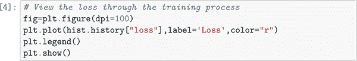

在上面的单元格中，我们使用 `matplotlib` 库来绘制训练过程中损失函数的值图。如果你运行该单元格，将看到一个图表作为输出。或者，你也可以在书籍的 GitHub 仓库中查找 `/files/ch06/loss1.png` 图片来查看训练过程中的损失。图表显示，用均方误差衡量的损失范围在 0.5005 到 0.5035 之间。在训练 150 个轮次后，损失值并没有显著下降。这表明模型在近似 `X` 和 `y` 之间的关系并不良好。

接下来，我们将创建一个样本外数据集来测试已训练模型的性能。

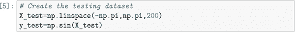

我们使用 NumPy 中的 `linspace()` 方法在 $-π$ 和 $π$ 之间创建了 200 个点。我们将它们用作测试数据集中 `X_test` 的值。测试样本中 `y` 的真实值为 `y_test = sin(X_test)`。接下来，我们将根据训练好的模型预测 `y` 的值，如下所示：

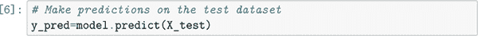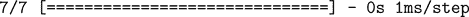

我们使用 `predict()` 方法进行预测。预测的 `y` 值被保存为 `y_pred`。

下方单元格中的 Python 代码同时绘制了 `y` 的真实值和 `y` 的预测值，以显示预测的效果如何。

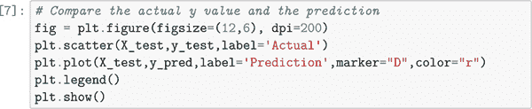

我们首先创建一个大小为 12 比 24 英寸、dpi 为 200 的画布。然后绘制 `y_test` 相对于 `X_test` 的散点图，并标记为 `Actual`。在同一张图中，我们绘制 `y_pred` 相对于 `X_test` 的图并标记为 `Prediction`。我们将标记参数设置为 `D`，颜色参数设置为 `r`。结果是，预测图呈现出一串红色的菱形。

如果你运行上面的单元格，你将看到一个对比预测值与 `y = sin(X)` 真实值的图表。你也可以在书籍的 GitHub 仓库中查找 `/files/ch06/compare1.png` 图片来查看该图。图表显示预测值（红色菱形）形成了一条直线，而 `y_test` 相对于 `X_test` 的关系形成了一条正弦曲线。

上述结果表明，神经网络在预测 `X` 与 `y = sin(X)` 之间的关系方面表现很差。如果没有激活函数，神经网络只能预测输入和输出之间的线性关系。无论我们在神经网络中包含多少隐藏层，都无法生成非线性关系。作为一个练习，请修改本小节中的 Python 代码，使神经网络具有三个隐藏层，神经元数量分别为 8、6 和 5。重新运行单元格，看看神经网络是否能生成非线性关系。接下来，我们将讨论 ReLU 激活函数以及它如何帮助神经网络实现非线性近似。

## ReLU 激活函数

在本节中，我们首先讨论什么是 ReLU 激活函数。然后我们将展示通过 ReLU 激活函数，我们可以成功地近似一个非线性关系。

### 什么是 ReLU？

ReLU 是整流线性单元（rectified linear unit）的缩写。如果值为正数，它返回原值，否则返回 0。也就是说，ReLU 函数定义如下：

$$ReLU(x) = \begin{cases} x & \text{对于}x > 0 \\ 0 & \text{对于}x \leq 0 \end{cases}$$

它被广泛应用于许多神经网络，你会在书中看到它的频率比任何其他类型的激活函数都要高。从本质上说，ReLU 激活函数在 `x` 的值达到零阈值时激活神经元。当 `x` 的值小于零时，神经元被关闭。这种简单的开关结构能够在输入和输出之间创建非线性关系。

以下程序绘制了 -6 到 6 范围内的 ReLU 激活函数。


我们在 -6 到 6 之间创建了 31 个 `x` 值。然后创建了对应的 31 个 `y = ReLU(x)` 值。`x` 和 `y` 的值在用 `matplotlib` 库创建的图中以蓝色绘制出。ReLU 激活函数的函数形式显示在图的图例中。若要使用 LaTeX 代码创建数学方程，只需在 LaTeX 代码周围加上美元符号（$）即可。

如果你运行上面的单元格，图表将保存在你电脑的 `/Desktop/mla/files/ch06/` 文件夹下的 `relu.png`。该图也可以在书籍 GitHub 仓库的 `/files/ch06/` 下找到。该图是分段线性的：对于小于零的值是线性的；对于大于零的值也是线性的。由于这两条直线的斜率不同，因此整体模式是非线性的。

### 制作 ReLU 函数动画

更好，你可以创建一个 ReLU 激活函数的动画，显示 `y = ReLU(x)` 的值如何随着 `x` 值从 -6 变化到 6 而变化。下方单元格中的 Python 代码创建了 `x` 值从左向右变化时的一系列 ReLU 函数图片。


我们在 -6 到 6 之间创建了 31 个 `x` 值。然后创建了对应的 31 个 `y = ReLU(x)` 值。在用 `matplotlib` 库创建的图中，以蓝色绘制了 `x` 和 `y` 的值。ReLU 激活函数的函数形式显示在图的图例中。

如果你运行上面的单元格，图表将保存在你电脑的 `/Desktop/mla/files/ch06/` 文件夹下的 `relu.png`。该图也可以在书籍 GitHub 仓库的 `/files/ch06/` 下找到。该图是分段线性的：对于小于零的值是线性的；对于大于零的值也是线性的。由于这两条直线的斜率不同，因此整体模式是非线性的。

接下来，我们将刚刚创建的 31 张图合并成一个动画。


我们创建一个空列表 `frames` 来存储所有图片。然后我们从左向右遍历 31 个 `(x, y)` 点并使用 `PIL` 库打开每一张图片。我们将图片转换为 NumPy 数组并添加到 `frames` 列表中。完成后，我们使用 `imageio` 库中的 `mimsave()` 方法将图像转换为 `gif` 格式。

运行上面的单元格后，`relu.gif` 文件将生成并保存在你的本地文件夹中。要查看动画，你可以点击电脑上的该文件。或者，你可以在书籍的 GitHub 仓库的 `/files/ch06/` 下查看。

### 使用 ReLU 建模非线性

现在你已经理解了 ReLU 函数，你将通过生成输入和输出变量之间的非线性关系来有效利用它。具体而言，你将在我们在 6.1.2 节 中构建的相同神经网络并在两个隐藏层中添加 ReLU 激活函数，然后重新训练模型。

我们在  − `-π` 和 `π` 之间生成了 200 个点作为测试样本中 `X_test` 的值。测试样本中 `y` 的真实值为 `y_test` = `sin(X_test)`。我们根据重新训练的模型来预测 `y` 的值。

如果你运行上述单元格，你将看到一张图，显示预测值（红色菱形）形成了一个类似于正弦曲线的曲线。你也可以通过查看书籍 GitHub 仓库中的图片 `/files/ch06/compare2.png` 来查看该图。现在预测值与真实的 `y` 值匹配得非常不错。最重要的是，预测的形状现在是非线性的。上述结果表明，在 `ReLU` 激活函数的帮助下，神经网络很好地预测了 `X` 与 `y = sin(X)` 之间的关系。

在这里，对于神经网络中包含多少个隐藏层以及每个隐藏层应该有多少个神经元，你有很大的灵活性。作为一个练习，请从神经网络中删除第二个隐藏层。确保保留第一个隐藏层并使其带有 `ReLU` 激活函数。重新运行单元格，查看预测值是否与实际的正弦形状匹配。

## 6.3 Sigmoid 激活函数

书中第二常用的激活函数是 sigmoid 函数。它被广泛应用于许多机器学习模型中。特别是，它在任何二分类问题中都是必不可少的。

sigmoid 函数的形式如下：

$$\begin{array}{l} {y = \frac{1}{1 + e^{- x}}} \\\\ \end{array}$$

sigmoid 函数具有 S 形曲线。它有一个非常棒的属性：对于介在  − ∞ 和 ∞ 之间的任何输入值 `x`，输出值 `y` 始终在 0 到 1 之间。由于这个属性，我们使用 sigmoid 激活函数对结果的概率进行建模，而概率也落在 0 到 1 之间（0 表示结果没有发生的概率，而 1 表示结果以 100% 的确定性发生）。

### 6.3.1 绘制 Sigmoid 函数

我们绘制了 `x` 值范围从 -6 到 6 的 sigmoid 函数。


我们使用 `NumPy` 中的 `linspace()` 方法在 -6 到 6 之间创建了 31 个不同的 `x` 值。然后我们定义了 sigmoid 函数并创建了 31 个 `y = sigmoid(x)` 值。`x` 和 `y` 的值在用 `matplotlib` 创建的图中呈蓝色。sigmoid 函数的数学公式通过 LaTeX 显示在图的图例框中。

如果你运行上述单元格，该图将作为 `sigmoid.png` 并在到你电脑的 `/Desktop/mla/files/ch06/` 文件夹中。该图在书籍 GitHub 仓库的 `/files/ch06/` 文件夹下可用。如你所见，sigmoid 函数的值在 0 到 1 之间，这可以解释为结果的概率。

### 6.3.2 Sigmoid 函数动画

接下来，我们将为 sigmoid 函数制作动画，显示当 `x` 值从 -6 变为 6 时，`y = sigmoid(x)` 的值是如何变化的。我们首先生成一系列图片，然后将它们组合成动画。接下来的单元格中的 Python 代码生成了 31 张图片。


我们从横轴的左侧到右侧遍历 31 个 `(x, y)` 点。在每次迭代中，我们首先将 sigmoid 函数作为背景绘制。然后我们将点 `(x, y)` 绘制为图中的一个红点。我们创建一个文本框来显示 `x` 和 `y` 的值。文本框指向图中正在关注的红点。

如果你运行上述代码单元格，你将在电脑的 `/Desktop/mla/files/ch06/` 文件夹中看到 31 张图片：它们被命名为 `sigmoid0.png`、`sigmoid1.png`、……、`sigmoid30.png`。接下来，我们将刚刚创建的 31 张图组合成动画。


我们遍历刚刚生成的 31 张图片并使用 `PIL` 库打开它们。我们将图片转换为 `NumPy` 数组，并使用 `imageio` 库中的 `mimsave()` 方法将图像转换为 `gif` 格式的动画。

运行上述单元格后，将生成 `sigmoid.gif` 文件并保存在你的本地文件夹中。要查看动画，你可以点击电脑上的该文件。或者，你可以在书籍 GitHub 仓库的 `/files/ch06/` 文件夹下查看。

### 6.3.3 合并动画

接下来，我们将两个动画合并为一个，这样你可以并排看到 `ReLU` 函数和 sigmoid 函数。要将两个动画合并为一个，我们使用 `NumPy` 中的 `concatenate()` 方法。方法中的参数 `axis=1` 将两个帧水平并排放置，如下：


我们启动一个 `for` 循环来遍历动画的不同阶段。在 31 次迭代中的每一次，我们首先打开一张 `ReLU` 函数的图片并将其转换为 `NumPy` 数组。然后打开一张 sigmoid 函数的图片，并使用 `NumPy` 中的 `concatenate()` 方法将其与 `ReLU` 函数水平合并。合并后的帧存储在列表 `frames` 中。然后我们使用 `imageio` 库将合并后的帧转换为动画。

如果你运行上述单元格，你将在电脑的 `/Desktop/mla/ch06/files/` 文件夹中看到动画 `relusig.gif`。该动画显示了当 `x` 值从横轴左侧移动到右侧时，两个激活函数并排显示。

### 6.3.4 带有不同子图的图片

虽然我们没有在书中显示动画，但我们可以创建一个带有多个子图的图形来比较两个函数在不同 `x` 值下的情况。

为了这个目的，我们展示了八张图片以形成四二维网格。左列的四张图片说明了 `ReLU` 函数，而右列的四张是 sigmoid 函数，如下：


`NumPy` 数组 `stacked` 现在包含 8 张图片，具有两个函数和四个阶段。注意在上述单元格中，我们在 `NumPy` 的 `concatenate()` 方法中使用参数 `axis=0`，以便四个帧垂直排列。

接下来，我们将使用 `matplotlib.pyplot` 创建一个包含八张图片的图形，如下：


在这里我们创建一个图形。我们将 `dpi` 设置为高 300，以确保图片清晰。由于 `NumPy` 数组 `stacked` 是八张图片的组合，我们只需要使用 `matplotlib` 中的 `imshow()` 方法即可生成图形。

运行上述单元格，你将看到如 图 6.2 所示的输出。该图在书籍 GitHub 仓库的 `/files/ch06/` 下可用。


图 6.2 比较 ReLU 和 sigmoid 函数

## 6.4 softmax 激活函数

书中第三常用的激活函数是 softmax 函数。它是任何多分类问题中必不可少的。

### 6.4.1 什么是 softmax 函数？

softmax 函数的形式如下：

$$\begin{array}{l} {y(x) = \frac{e^{x}}{\sum\limits_{k = 1}^{K}e^{x_{k}}}} \\\\ \end{array}$$

其中 `x` = `[x[1], x[2], ... , x[K]]` 和 `y` = `[y[1], y[2], ... , y[K]]` 是 K 元素列表。`y` 的第 `i` 个元素是

$$\begin{array}{l} {y_{i}(x) = \frac{e^{x_{i}}}{\sum\limits_{k = 1}^{K}e^{x_{k}}}} \\\\ \end{array}$$

由于这些属性，我们使用 softmax 激活函数来对多分类结果的概率分布建模。你会在本书的后续部分注意到，当我们对多分类问题进行建模时，输出层的激活函数总是 softmax 函数。

为了说明 softmax 函数的上述三个属性，接下来我们将展示 softmax 函数如何将 `x = [-1.3, 7.9, -0.8, 5.1]` 转换为四种可能结果的概率分布。


在上面的单元格中，我们首先定义了包含四个输入值的向量 `x`。然后，我们定义了 softmax 函数，并使用它生成了一个包含四个输出值的向量 `y`。最后，我们检查了 `y` 中的四个元素，查看它们是否均在 0 到 1 之间。上述结果显示了四次 `True`，表明 `y` 中的四个值确实都在 0 到 1 之间。

接下来，我们检查 `y` 中元素的值之和是否等于 1（即 100%）。


在上面的单元格中，我们使用 `ys.sum()` 来计算 NumPy 数组 `ys` 中四个值的之和。输出显示这四个值之和为 1.0。这意味着 softmax 激活函数输出向量中的四个值之和为 100%。

### 6.4.2 Softmax 函数的图示

接下来，我们将绘制一张 softmax 激活函数的图表。具体而言，我们将在图表的左侧绘制输入向量 `x` 中的四个值。softmax 激活函数的数学公式将放在图表的中间。最后，我们在图表的右侧放置输出向量 `y` 中的四个值，如下：


我们首先创建一个宽 12 英寸、高 4 英寸且 `dpi=200` 的图形。`matplotlib` 中的 `Rectangle` 类用于在图中创建一个阴影矩形。`Rectangle` 类的第一个参数是左下角的坐标，第二个和第三个参数分别是矩形的宽度和高度。例如，`Rectangle((-6, -2), 3, 4, edgecolor='r', alpha=0.2)` 创建了一个宽 3 英寸、高 4 英寸的矩形，以点 (-6, -2) 为左下角。`edgecolor='r'` 表示边缘颜色为红色，`alpha=0.2` 决定了面的透明度。

我们在图中放置了两个蓝色箭头。第一个箭头从输入值 `x` 指向 softmax 激活函数。第二个箭头从 softmax 函数指向输出值 `y`。我们还在图中展示了输出向量 `y` 中的值之和为 100%。

运行上面的单元格，你将看到一个包含三个矩形框的图表。第一个包含输入向量 `x` 中的四个值，第二个包含 softmax 函数的数学公式，第三个包含输出向量 `y` 中的四个值。或者，你可以在 `/files/ch06/softmax.png` 下看到它。

## 6.5 词汇表

- **激活函数 (Activation Functions)**：神经网络中的函数，用于确定网络中神经元的输出。常用的激活函数包括 ReLU、sigmoid 和 softmax。
- **ReLU 激活函数 (ReLU Activation Function)**：ReLU 是 rectified linear unit（线性线性单元）激活函数的缩写。如果输入为正，它返回原始值，否则返回 0。
- **Sigmoid 激活函数 (Sigmoid Activation Function)**：sigmoid 函数的形式为：
$$y = \frac{1}{1 + e^{- x}}$$
它有一个非常好的属性：对于 $-\infty$ 到 $\infty$ 之间的任何输入值 `x`，输出值 `y` 始终在 0 到 1 之间。由于这个属性，它被用于对结果的概率建模。
- **Softmax 激活函数 (Softmax Activation Function)**：softmax 函数的形式为：
$$y(x) = \frac{e^{x}}{\sum_{k = 1}^{K}e^{x_{k}}}$$
其中 `x = [x[1], x[2], ..., x[K]]` 和 `y = [y[1], y[2], ..., y[K]]` 是 K 元素列表。输出向量中的每个元素都有一个 0 到 1 之间的值。输出向量中的元素之和为 1。由于这些属性，我们使用 softmax 激活函数来对多分类结果的概率分布建模。

## 6.6 练习

- 6.1 解释什么是激活函数。给出三个常用激活函数的示例。
- 6.2 修改 6.1.1 节中的程序，使神经网络中的神经元数量为 `[2, 8, 4, 1]` 而不是 `[2, 7, 5, 1]`。
- 6.3 修改 6.1.2 节中的单元格，使神经网络包含三个分别具有 8、6 和 5 个神经元的隐藏层。不要在任何层中添加激活函数。查看预测是否形成了非线性关系，并解释为什么增加更多隐藏层后预测的关系仍然是线性的。
- 6.4 什么是 ReLU 激活函数？
- 6.5 修改 6.2.3 节中的程序，移除神经网络中的第二个隐藏层。确保第一隐藏层保留 ReLU 激活函数。重新运行单元格中的代码，查看预测是否是非线性的。
- 6.6 什么是 sigmoid 激活函数？在对二分类问题建模时为什么要使用它？
- 6.7 什么是 softmax 激活函数？在对多分类问题建模时为什么要使用它？

# 第 7 章 逻辑回归

在开始之前，请在电脑的虚拟环境 `MLA` 中打开 Jupyter Notebook 应用。之后，打开一个空白的 Jupyter 笔记本并将其保存为 `ch07.ipynb`，位于你电脑的 `/Desktop/mla/` 目录下。接下来，我们将创建一个子目录 `/files/ch07/` 来存储本章中的文件。在 `ch07.ipynb` 中新建一个新单元格，并在其中执行以下行代码：


你应该能在电脑上看到一个新目录 `/Desktop/mla/files/ch07/`。

此外，你还需要在电脑上安装 `scikit-learn` 库，以便运行逻辑回归并将数据分为训练集和测试子集。首先激活虚拟环境 `MLA`。在 Anaconda 提示符（Windows）或终端（Mac 或 Linux）中运行以下命令：

```bash
```


pip install scikit-learn==1.2.2

或者直接在 `ch07.ipynb` 的新单元格中运行以下代码：

```python
!pip install scikit-learn==1.2.2
```


你需要重启电脑上的 Jupyter Notebook 应用以使安装生效。

## 7.1 什么是二分类问题

当目标标签是具有两个可能值的二分类变量（例如 0 或 1，是或否）时，我们将机器学习算法称为二分类问题。这在现实世界非常常见，从信用卡欺诈预测、二类图像分类到疾病检测等。机器学习算法首先学习输入特征与输出标签之间的关系。然后，算法根据输入特征进行预测，并将每个观测值归为两个类别之一。

### 7.1.1 二分类中的 Sigmoid 激活

在二分类中，由于目标标签是 0 或 1，我们预测目标变量属于类别 1 的概率。根据互补概率，目标属于类别 0。在本章中，你将使用神经网络将图像分类为马（取值为 1）或鹿（取值为 0）。

你将使用 `sigmoid` 激活函数将神经网络最后一层的输出（其取值范围从 −∞ 到 ∞）压缩到 `[0,1]` 范围内。这样，神经网络的最终输出就可以被解释为目标属于类别 1 的概率（在我们的示例中，即图像是马的概率）。

该思想可以通过下面的图所示。这里我们假设在激活之前输入和输出之间存在线性关系。输入是图像的原始像素加上一个偏置项。输出是图像是马概率。我们使用没有隐藏层的神经网络作为预测模型。如上所述，我们在输出层放置了 `sigmoid` 激活函数。

下面单元格中的 Python 代码为神经网络创建了图，我们将使用该图处理本章的二分类问题。


该图是使用 `matplotlib` 库生成的。我们在左侧画了两个圆表示输入神经元。第一个是偏置项，第二个是图像原始像素向量。输入数据随后根据权重 `w` 和 `b` 前向传播到输出层：输出层激活前的值为 `w*X + b`。由于我们使用了 `sigmoid` 激活，激活后的输出为：

$$
Y = \frac{1}{1 + e^{- (wX + b)}}
$$

这是一个位于 0 和 1 之间的值，即图像是马概率。

如果你运行上面的单元格，你将在电脑的 `/Desktop/mla/ch07/files/` 文件夹中看到图像 `binary.png`。该图像展示了我们在本章中用于二分类的神经网络结构。

### 7.1.2 二交叉熵损失函数

在二分类问题中，首选的损失函数是二交叉熵函数，它衡量了预测概率与实际标签（1 或 0）之间的平均差异。如果模型做完美的预测，并为所有标记为 1 的观测值分配 100% 的概率，为所有标记为 0 的观测值分配 0% 的概率，则二交叉熵损失函数的值为 0。

从数学上来说，二交叉熵损失函数定义为：

$$
\text{Binary Cross Entropy} = \sum_{n = 1}^{N} - \left[ y_{n} \times \log({\hat{y}}_{n}) + (1 - y_{n}) \times \log(1 - {\hat{y}}_{n}) \right]
$$

其中 `yhat[n]` 是观测值 `n` 属于类别 1 的估计概率，而 `y[n]` 是观测值 `n` 的实际标签（为 0 或 1）。

## 7.2 处理图像数据

你将使用 CIFAR-10（一个用于训练机器学习和计算机视觉算法的流行数据集）在书中学习如何进行二分类和多分类预测。注意，TensorFlow 现在已将 CIFAR-10 包含在其标准集中，因此你可以直接从 TensorFlow 加载。在本章末的附录中，你将学习如何这样做。

然而，学习如何从源头下载数据、处理数据并进行可视化是一个好主意。在此过程中，你将在 `NumPy`、`matplotlib` 等库中学到宝贵的技能。我们将从多伦多大学 [`www.toronto.edu/~kriz/cifar.html`](https://www.toronto.edu/~kriz/cifar.html) 获取数据。CIFAR-10 提供了十种类别的图像：飞机、汽车、鸟、狗、青蛙、马、船等。

### 7.2.1 下载数据

下面单元格中的 Python 代码将下载数据并保存到你的电脑上。


我们首先导入 `requests` 库，并使用 `get()` 方法获取 zip 文件的内容。然后我们使用 Python 内置函数 `write()` 将数据保存为文件。

运行上面的单元格，然后进入 `/Desktop/mla/ch07/`，你应该能看到文件 `cifar-10-python.tar.gz`。

接下来，我们将解压文件并将内容放入本地文件夹，如下：


我们使用 `tarfile` 库解压文件并将内容存放在 `/cifar10`。`tarfile` 在标准库中，因此不需要安装。如果你进入子文件夹，你会看到那里。

### 7.2.2 数组与图像的转换

接下来，你将学习如何将 0、2、144 或 255 等整数转换为电脑可见的图像。在此过程中，你将理解 RGB 色彩模型是如何创建图像的。你还将学习将图像转换回 NumPy 数组格式的数字。

下面单元格中的 Python 代码加载一个批次的数据并打印每个标签下的图像数量。


我们下载的 CIFAR-10 数据组织为五个训练批和一个测试批次，外还有一个元数据文件和一个 ReadMe 文件。为了节省时间，我们目前只打开第一个批次。然而，在后面的章节中我们将使用所有的批次。注意，由于数据是位字面量，我们在加载它们时需要在列名名前加上字母 `b`。每个批次包含数据 `X` 和标签 `y`，共有 10000 张图像。有十个不同的标签：0, 1, …, 9。我们统计每个标签下的图像数量。上面的结果显示每个标签大约有 1000 张图像。

接下来，我们将重塑表示这些图像的 NumPy 数组并可视化其中一张。

图片数据，即 `Xs`，是形状为 3x32x32 的 NumPy 数组。有三个颜色通道（红、绿、蓝），每张图片的分辨率为 32x32 像素。数据采用通道优先（channel-first）格式，因此我们使用 `NumPy` 中的 `transpose()` 方法交换了原始数据中第 2 轴和第 4 轴的位置。

然后，我们使用 `matplotlib` 中的 `imshow()` 方法将 NumPy 数组转换为图片。运行上方单元格，你将看到代表第一张图片的数字，这些数字的范围是从 0 到 255。我们使用 `matplotlib` 库中的 `imshow()` 方法显示数据集中的第一张图片。输出显示了一只青蛙。

### 7.2.3 图片与标签匹配

你刚刚看到的标签是从 0 到 9 的十个数字。接下来，你把这些数字转换为有意义的对象名称，并将它们与图片匹配。


在这里我们使用 `axis(off)` 选项关闭轴，这样你就只能看到图片。`subplot()` 方法将 25 张图片放入一个 5x5 的矩阵中。我们提取每张图片的名称，并将其作为图片的标题，这样你就可以在每张图片的顶部看到它。

如果你运行上方单元格，你将看到一张类似于图 7.1 所示的插图。该图包含了 25 张卡车、青蛙、马等图片。该图保存在你电脑的 `/Desktop/mla/files/ch07/` 文件夹下的 `25pics.png`。


图 7.1 CIFAR-10 数据集的样本图片

## 7.3 使用 Logit 回归进行二分类

在本节中，我们将使用传统的逻辑回归将图像分类为马和鹿。

### 7.3.1 准备数据

彩色图片使用三个通道：红、绿、蓝。下面，你将分离这三个通道，看看如果我们只使用一个通道而不是三个通道，图片看起来会什么样。


上方单元格中的 Python 代码遍历了第一批中的 1000 张图片，并选择了标签为 4（鹿）或 7（马）的图片。然后我们将标签更改为 0（鹿）或 1（马），以便目标变量是二分类的。我们这样做是为了创建一个用于训练二分类模型的数据集。

接下来，我们选择一张马的照片和一张鹿的照片作为示例来创建子图，如下：


子图有两行四列图片。第一行是四张马的照片。第一张包含三个颜色通道，所以看起来是彩色的。后三张是同一张图片，但只有一个颜色通道。第二行是四张鹿的照片。第一张包含三个颜色通道，而另外三个各有一个通道。如你所见，只用一个通道并没有丢失多少信息，你可以很容易地识别它们是马和鹿。因此，我们将只使用第一个通道来减小数据量和训练时间。然而，在本书后续章节中，你将使用三个通道来训练模型，以获得更准确的预测。

运行上方单元格，图片 `channels.png` 将保存到你电脑的 `/Desktop/mla/ch07/files/` 文件夹中。

### 7.3.2 训练 Logit 模型

接下来，我们使用 `scikit-learn` 中的逻辑回归来训练模型。为了避免过拟合，习惯是将数据分为训练集和测试子集。然后我们使用训练集训练模型，并在测试集上进行样本外预测。

下方的 Python 代码将我们在上一节中生成的数据 (`X`, `y`) 分为训练集 (`x_train`, `y_train`) 和测试样本 (`x_test`, `y_test`)。然后我们使用 `x_train` 和 `x_test` 中图片的第一个颜色通道，并将它们重塑为大小 (−1, 1024)，这意味着 NumPy 数组可以有任意数量的行和 1024 列。处理后的图像随后保存为 `X_train` 和 `X_test`，它们已准备好输入到我们的神经网络。


我们使用 `scikit-learn` 中的 `train_test_split()` 方法将原始样本分为训练集和测试子集。参数 `test_size=0.2` 意味着 80% 的原始样本进入训练集，剩下的 20% 进入测试集。我们使用 `random_state=0` 参数将随机生成器种子固定为 0，以确保结果的可复现性。如果没有该参数，每次运行程序时样本的划分都会不同。我们将数据保存为 `/files/ch07/` 文件夹下的 `train_test.p`，以便我们可以在后面的章节中使用相同的数据进行训练和测试。

上面的输出显示训练集中有 160 张图片，测试集中有 41 张。由于我们只使用一个颜色通道，每张图片有 32*32=1024 个特征，我们利用这些特征来预测图片是马还是鹿。

接下来，我们使用刚刚创建的训练子集训练逻辑回归模型，如下：


在调用 `LogisticRegression()` 类时，确保你加上了 `max_iter=5000` 参数。这确保了模型参数收敛。

Logit 模型现在已完成。接下来，我们在样本外测试数据集上进行预测。

### 7.3.3 使用 Logit 模型进行预测

接下来，我们使用训练好的逻辑回归模型进行样本外预测。我们还评估了模型的性能。


`predict()` 方法根据预测概率生成 1 或 0 的标签，使用 0.5 作为阈值。标签 1 代表马，0 代表鹿。

我们使用准确率 (accuracy score) 和混淆矩阵来评估预测的性能。上面的输出通过比较预测值与实际标签显示了混淆矩阵。混淆矩阵中的四个值表明：有 13 例真负例（TNs，图片是鹿且预测为鹿），10 例真正例（TPs，图片是马且预测为马），11 例假正例（FPs，图片是鹿但预测为马）以及 7 例假负例（FNs，图片是马但预测为鹿）。

## 7.4 使用神经网络进行二分类

### 7.4.1 使用神经网络进行训练和测试

下面的脚本使用 `TensorFlow` 库构建了一个简单的神经网络，并使用我们刚刚生成的训练子集来训练模型。


在这里，我们将 `TensorFlow` 中的随机种子生成器固定为 0，以确保结果的可复现性。我们使用 `Keras` 中的 `sequential` 模型来创建这个简单的神经网络。我们使用 `Adam` 优化器并使用训练集（`X_train`, `y_train`）对模型训练了 125 个轮次（epochs）。

运行上方单元并等待训练完成。接下来，我们将根据训练好的神经网络进行预测。


我们使用 `predict()` 方法对测试集（`X_test`）进行预测。注意，模型的预测结果是 0 到 1 之间的连续数值。由于我们的样本中马和鹿的数量大致相等，我们需要根据 0.5 的阈值将预测结果转换为 1 或 0。上面的输出显示了训练好的神经网络预测的混淆矩阵和准确率得分。

现在的准确率为 58.54%，比 Logit 回归的结果要低。混淆矩阵看起来不同。神经网络预测了 13 个真正例（TP）和 11 个真负例（TN）。你可能会奇怪，为什么 Logit 回归和神经网络之间的预测存在差异呢？至少有两个主要原因。首先，每个模型初始化参数的方式不同，因此模型可能会收敛到不同的值。其次，更重要的是，Logit 回归和上面的神经网络使用了不同的梯度下降算法变体作为优化器。`scikit-learn` 中的 Logit 回归使用 `L-BFGS` 优化器，而上面的神经网络使用 `Adam` 优化器。

### 7.4.2 关注两个示例

接下来，我们将关注测试集中的一马和一鹿，看看它们的预测概率在训练过程中是如何变化的。


测试集的第 10 张图片是一匹马，第 3 张是一只鹿。如果你运行上方单元，你应该看到两张图片，一张是一匹马，另一张是一只鹿。

### 7.4.3 网络和预测的图示

现在我们查看内部结构，深入研究神经网络，并看看预测模型是如何工作的。具体来说，我们将保留训练过程中中间步骤的所有数据。我们在训练之前获取了上述两张图片的模型权重和预测概率。然后我们再次在第 5 轮、10 轮、……以及 125 轮之后获取这些信息。


上方单元格中的 Python 代码首先生成了两个列表 `ws` 和 `bs`，用于存储训练过程中的权重和偏置项。同样，列表 `epochs` 用于存储轮次数。列表 `p_horse` 和 `p_deer` 将存储对示例马和鹿图片的预测概率。

然后，我们重新创建神经网络，并在训练开始前检索权重和概率。我们使用 `model.layers[-1].get_weights()` 获取神经网络最后一层的权重。

接下来，我们每次训练 5 轮模型，并在每个阶段记录信息。


在每训练 5 轮后，我们都会检索五项信息：权重、偏置项、轮次数以及示例马和鹿图片的预测概率。我们将这五项信息存储在以下五个列表中：`ws`、`bs`、`epochs`、`p_horse` 和 `p_deer`。

接下来，我们将生成 26 张训练中间阶段的图片。在每张图中，我们将画出该阶段的神经网络、权重和偏置项、轮次数以及预测结果。

生成 26 张图片的代码太长了。为了节省空间，我们在本地 `utils` 包中定义了一个函数，并调用下面的函数来生成图片。具体来说，我们在 `utils` 本地包的 `ch07util.py` 文件中定义了 `horse_pic()` 函数。前往书籍的 GitHub 仓库，下载 `/utils/` 下的 `ch07util.py` 文件并将其放到电脑的 `/Desktop/mla/utils/` 文件夹中。正如我们在第一章中所讨论的，你应该在 `/utils/` 文件夹内创建一个空的 `__init__.py` 文件，这样 Python 才知道 `utils` 是一个本地 Python 包。

如果你打开 `ch07util.py` 文件，你会看到 `horse_pic()` 函数在文件中是如何定义的。该函数会在训练的不同阶段绘制 26 张图片，并在每个阶段你的电脑上保存一张图片。

在下方单元格中运行以下代码：


我们首先从之前定义的本地 `utils` 包中的本地 `ch07util` 模块中导入 `horse_pic()` 函数。然后我们调用 `horse_pic()` 函数生成 26 张图片。`horse_pic()` 函数接受五个参数：前四个来自我们上面生成的五个列表，最后一个参数是示例马图片 `x_test[9]`。

运行上方单元后，如果你进入电脑上的 `/files/ch07/` 文件夹，你会看到生成的预测结果。例如，如果你打开 `p_horse0.png`，你会看到训练前的模型权重以及对马图片的预测。图片显示在训练前模型认为它是马的概率为 34%。对比查看 `p_horse25.png`，你会看到训练 25 轮（即 125 个轮次）后的权重。

### 7.4.4 动画训练过程

更好，你可以为训练过程创建一个动画，查看权重和预测概率是如何变化的。

下面的 Python 代码使用 `imageio` 库将 26 个 png 文件合并为一个 gif 文件。


运行上方单元，你将在电脑的 `/Desktop/mla/files/ch07/` 看到动画 `horse.gif`。该动画在 GitHub 仓库的 `/files/ch07/` 下可用。

### 7.4.5 鹿的预测动画

我们还可以为鹿的预测概率制作动画。

首先，我们定义函数 `deer_pic()` 并调用它生成 26 张图片。如果你打开 `utils` 本地包内的 `ch07util.py`，你会看到函数的定义。该函数在训练的不同阶段绘制 26 张图片，并在每个阶段你的电脑上保存一张图片。这些图片关注的是鹿而不是马。

在下方单元格中运行以下代码：


我们首先从之前定义的本地 `utils` 包中的本地 `ch07util` 模块中导入 `deer_pic()` 函数。然后我们调用 `deer_pic()` 函数生成 26 张图片。`deer_pic()` 函数的最后一个参数是我们选择的示例鹿图片 `x_test[2]`。

运行上方单元后，如果你进入电脑上的 `/files/ch07/` 文件夹，你会看到由程序生成的 26 张图片。例如，如果你打开 `p_deer0.png`，你会看到训练前模型认为它是马的概率为 39.76%。这等同于预测鹿的概率为 60.24%。对比查看 `p_deer25.png`，你会看到模型现在预测鹿的概率提高到了 94.08%，这是一个非常准确的预测！

接下来，我们可以创建一个动画来展示整个过程


上面的单元格使用 `imageio` 库将 26 个 png 文件合并成一个 gif 文件。运行上述单元格，你将在电脑的 `/Desktop/mla/files/ch07/` 文件夹中看到动画 `p_deer.gif`。该动画也可以在书籍 GitHub 仓库的 `/files/ch07/` 目录下找到。

## 7.5 合并动画

现在我们可以将马和鹿的动画合并，并将它们并在一起进行比较。我们还将使用子图来比较这两个预测结果。

### 7.5.1 两个预测的动画

要将两个动画合并为一个，我们使用 NumPy 中的 `concatenate()` 方法。该方法中的参数 `axis=1` 在训练的每个阶段将两个帧水平并排放置，如下：


我们开始一个 `for` 循环来遍历不同的训练阶段。在 26 次迭代中的每一次中，我们首先打开之前生成的马图像预测图，并将其转换为 NumPy 数组。然后我们打开鹿图像的预测图，并使用 NumPy 中的 `concatenate()` 方法将两张图片水平合并。合并后的帧存储在列表 `frames` 中。然后我们使用 `imageio` 库将合并后的帧转换为动画。

如果你运行上述单元格，你将在电脑的 `/Desktop/mla/files/ch07/` 文件夹中看到动画 `p_horse_deer.gif`。该动画也可以在书籍 GitHub 仓库的 `/files/ch07/` 下找到。

### 7.5.2 子图

虽然在电子设备上查看动画很容易，但在纸质书籍中查看很困难。相反，我们将创建一个带有多个子图的图形来展示不同的训练阶段。具体来说，你将包含八个子图的图形，形成一个四二网格。两列分别用于马和鹿的图像预测。四行代表四个不同的训练阶段。


上述单元格中的 Python 代码首先创建了一个列表 `rows`，用于存储我们强调的四个训练阶段。列表 `cols` 包含了我们将用于检索保存图像的两个前缀：`horse` 和 `deer`。然后，我们遍历四行两列，逐个绘制这八个子图。我们使用 `subplots_adjust()` 方法调整子图之间的水平和垂直空间。

运行上述单元格并进入电脑的 `/Desktop/mla/files/ch07/` 文件夹，你将看到子图 `horsedeer.png`，如图 7.2 所示。


图 7.2 预测在训练过程中的变化

## 7.6 使用深度神经网络二分类

接下来，我们将为神经网络添加两个带有 ReLU 激活函数的隐藏层。我们将使用相同的训练集来训练新网络。

下方单元格中的 Python 代码创建了新的神经网络，训练了模型并打印模型摘要。


上述输出显示新的神经网络包含三个稠密层，分别有 1024、42 和 1 个神经元。由于输入形状为 32*32=1024，且第一层有 1024 个神经元，因此第一层共有 1024*(1024+1)=1049600 个参数（+1 部分代表第一层的偏置项）。第二层有 (1024+1)*32=32800 个参数。第三层有 32+1=33 个参数。模型共有 1082433 个可训练参数。

我们将使用新模型对测试集 `X_test` 进行预测，如下：


上述结果显示新模型的准确率为 60.98%，比我们之前不使用隐藏层时的 58.54% 准确率略提高。结果表明，在这种情况下，使用更多的隐藏层生成输入与输出之间的非线性关系有助于预测。

## 7.7 附录：直接从 Tensorflow 加载 CIFAR10

你也可以直接从 TensorFlow 加载 CIFAR10 数据。方法如下。


该数据集分为四个部分。我们使用上面的 `assert` 命令确保训练子集包含 60000 张图像，测试子集包含 10000 张图像。

接下来，我们看前两个图像，如下：


输出显示第一张图片是青蛙，第二张是卡车。

## 7.8 术语表

- **准确率 (Accuracy Score):** 在二分类中，准确率是所有预测中正确预测的百分比。
- **二分类 (Binary Classification):** 一种任务是将样本分类为两类的机器学习算法。
- **二元交叉熵 (Binary Cross Entropy):** 用于衡量预测概率与实际标签之间差异的损失函数。
- **二值变量 (Binary Variable):** 只有两种可能的变量，例如 1 或 0。
- **混淆矩阵 (Confusion Matrix):** 在二分类中，包含真负性、真阳性、假阳性和假阴性的矩阵。
- **假阴性 (False Negatives):** 标签为 1 但预测为 0 的情况。
- **假阳性 (False Positives):** 标签为 0 但预测为 1 的情况。
- **逻辑回归 (Logistic Regression):** 一种使用回归分析的二分类方法。它假设在激活前 $X$ 与标签 $y$ 之间存在线性关系。然后使用逻辑函数将值转换为概率，如下：
- **RGB 彩色模型:** 三个通道：红、绿、蓝。每个通道的值范围从 0 到 255。
- **真负性 (True Negatives):** 标签为 0 且预测为 0 的情况。
- **真阳性 (True Positives):** 标签为 1 且预测为 1 的情况。

## 7.9 习题

- 7.1 什么是二分类？举例说明。
- 7.2 什么是二元交叉熵？计算公式是什么？
- 7.3 修改 7.2.2 节第二个单元格的代码，打印表示 `X` 中第十张图片的 NumPy 数组。同时使用 `matplotlib` 在图中显示该图片。
- 7.4 修改 7.2.3 节单元格的代码，显示数据集 `X` 中的第 26 到第 50 张图片。
- 7.5 解释二分类中的混淆矩阵是什么。
- 7.6 什么是真负性、真阳性、假阳性和假阴性？
- 7.7 解释二分类中的准确率是什么。
- 7.8 在 7.6 节的深度神经网络输出层之前再添加一个带有 16 个神经元的第三个隐藏层。重新运行该节的代码单元格，查看预测结果是否有改进。

## 第 8 章 卷积神经网络

CNN 使用的层类型与连接层（dense layers）不同。`卷积层`将图像视为二维对象并寻找图像上的模式。然后，它会将这些模式与图像标签关联起来。这显著提升了模型的预测能力。尽管 CNN 主要用于图像分类和计算机视觉，但它们也被广泛应用于语音识别、视频分类和其他数据分析问题等任务。

在本章中，你将学习与卷积层相关的基础概念，例如 `过滤器` 的数量、卷积核尺寸、`零填充`、步长（strides）等……更好的是，你将学习创建动画，逐步展示如何在一个带有零填充且步长为一（`stride`）的三三乘三图像上应用三乘三的过滤器。同样，你将在一个不带零填充且步长为二的六乘六图像上应用二乘二的过滤器。在此过程中，你将深入理解 CNN 的工作原理，并学习如何使用它们进行模式识别和特征提取。在本书的后续部分，你将利用这些技能，通过将游戏盘视为二维图像并从中提取额外的空间特征，来设计智能游戏策略。

在开始之前，请在计算机的虚拟环境 `MLA` 中打开 Jupyter Notebook 应用。之后，打开一个空白的 Jupyter notebook 并将其保存为 `ch08.ipynb`，存放在计算机的 `/Desktop/mla/` 目录下。接下来，我们将创建一个子目录 `/files/ch08/` 来存储本章的文件。在 `ch08.ipynb` 中新建一个单元格（cell），其中执行以下代码：

```


## 8.1 什么是卷积神经网络 (CNNs)?

卷积层使用过滤器（也称为卷积核）来寻找输入数据上的模式。卷积层可以自动检测大量模式，并将某些模式与目标标签关联起来。这在本书的图像分类和游戏策略开发中非常有用。

为了简单起见，我们将使用游戏盘作为示例来解释卷积层的工作原理。与图像相比，游戏盘的像素相对较少。因此，我们更容易在上面应用过滤器并执行卷积操作。特别是，我们在本章中使用每个人都知道的井字棋（Tic Tac Toe）游戏盘作为示例。我们可以关注游戏盘上我们知道与游戏结果相关的特定模式（例如井字棋和四连棋游戏中的垂直、水平或对角线）。在本书的后半部分，我们将使用 CNN 提取游戏盘上的空间特征，为井字棋和四连棋设计智能游戏策略。你还将使用 CNN 来检测雅达（Atari）游戏（如《打破砖块》和《太空入侵者》）截图上的模式，并设计深度 Q 学习游戏策略。

### 8.1.1 我们的示例

假设输入数据是一个井字棋游戏盘。为了简单起见，假设棋盘顶行有三个 X，而其他六个格子全空。当然，在真实的井字棋游戏中，玩家 O 也会轮流操作，所以你不会在游戏中看到这样的棋盘。但让我们简化一下以使计算变得简单。


```
reshape(-1,3,3)
```


### 8.1.2 水平过滤器


如果你打开本地文件夹中的 `filter.gif` 文件，你将看到一个红色 3x3 滤波器在填充板（padded board）的不同区域扫描的动画。

## 8.2 卷积操作

到底什么是卷积操作？当我们对图像应用滤波器时，输出是什么？我们将在本节回答这些问题。

### 8.2.1 卷积操作中的计算

在上面的运行示例中，我们使用了一个 3x3 的水平滤波器，其值为：

$$\begin{array}{l} \begin{bmatrix} 0 & 0 & 0 \\\\ 1 & 1 & 1 \\\\ 0 & 0 & 0 \\ \end{bmatrix} \\ \end{array}$$  

我们将滤波器应用到游戏板上，其值为：

$$\begin{array}{l} \begin{bmatrix} 1 & 1 & 1 \\\\ 0 & 0 & 0 \\\\ 0 & 0 & 0 \\ \end{bmatrix} \\ \end{array}$$  

由于我们使用了零填充（zero-padding），填充板是一个 5x5 的矩阵，数值如下：

$$\begin{array}{l} \begin{bmatrix} 0 & 0 & 0 & 0 & 0 \\\\ 0 & 1 & 1 & 1 & 0 \\\\ 0 & 0 & 0 & 0 & 0 \\\\ 0 & 0 & 0 & 0 & 0 \\\\ 0 & 0 & 0 & 0 & 0 \\ \end{bmatrix} \\ \end{array}$$  

我们最终得到的输出为：

$$\begin{array}{l} \begin{bmatrix} 2 & 3 & 2 \\\\ 0 & 0 & 0 \\\\ 0 & 0 & 0 \\ \end{bmatrix} \\ \end{array}$$  

当滤波器扫描填充板的左上角时，覆盖区域代表一个数值如下的 3x3 矩阵：

$$\begin{array}{l} \begin{bmatrix} 0 & 0 & 0 \\\\ 0 & 1 & 1 \\\\ 0 & 0 & 0 \\ \end{bmatrix} \\ \end{array}$$  

卷积操作计算两个张量的点积（tensor dot）（在这种情况下，一个张量是滤波器，另一个是覆盖区域）。具体来说，卷积操作在九个单元格中的每一个格中执行逐元素乘法，然后将九个单元格的值相加，如下：

$$\begin{array}{l} {tensor\_dot(\begin{bmatrix} 0 & 0 & 0 \\\\ 1 & 1 & 1 \\\\ 0 & 0 & 0 \\ \end{bmatrix},\\begin{bmatrix} 0 & 0 & 0 \\\\ 0 & 1 & 1 \\\\ 0 & 0 & 0 \\ \end{bmatrix}) = \begin{bmatrix} {0 \times 0 +} & {0 \times 0 +} & {0 \times 0 +} \\\\ {0 \times 1 +} & {1 \times 1 +} & {1 \times 1 +} \\\\ {0 \times 0 +} & {0 \times 0 +} & {0 \times 0} \\ \end{bmatrix} = 2} \\ \end{array}$$  

为了验证上述结果，我们可以使用 `numpy` 中的 `tensordot()` 函数来计算输出，如下：


结果也是 2；这就是为什么输出矩阵左上角的值为 2 的原因。

接下来，我们使用相同的方法计算输出矩阵中所有九个单元格的值。首先，我们生成一个填充板：


然后，我们将滤波器从左到右、从上到下移动填充板，以覆盖九个区域。在每个区域，我们通过计算 `tensordot` 值来进行卷积操作，如下：


你可以看到，使用 NumPy 生成的输出矩阵与 TensorFlow 中的 `conv2d()` 函数生成的输出矩阵相同。

接下来，我们将创建一个关于如何一步步生成输出矩阵的动画。

### 8.2.2 卷积操作动画

我们将创建一个当 3x3 水平滤波器应用到填充板上时的卷积操作动画。

首先，我们将创建几个函数，在图中绘制不同的特征，以说明卷积操作是如何工作的。

第一个函数 `draw_text()` 在图中绘制文字，说明我们正在对一个带有零填充且步长（stride）为 1 的 3x3 图像应用 3x3 滤波器。运行下方单元格中的 Python 代码，以便在以后创建图形时调用该函数。


第二个函数 `draw_output_matrix()` 在图右下角创建一个 3x3 的表格。表格中的值来自我们在上一个小节中生成的输出矩阵。


第三个函数 `draw_filter()` 在图右下角创建一个 3x3 的表格。表格中的值同样来自我们在上一个小节中生成的输出矩阵。

`conv2d()` 函数中的参数 `stride=2` 意味着过滤器每一步移动两个像素。`padding="VALID"` 参数意味着图像周围没有零填充。因此，当 $2 \times 2$ 的对角线过滤器应用于图像上时，将会有九个覆盖区域。我们可以创建一个动画来展示它的工作原理。

### 8.3.2 动画对角线过滤器

首先，我们定义函数 `stride(h,v)` 来展示 $2 \times 2$ 过滤器如何扫描图像上的九个不同区域 `(h,v)`。参数 `h` 和 `v` 分别表示过滤器从左上角向右和向下移动的步数。函数 `stride(h,v)` 定义如下：


接下来，我们将使用不同的 `h`、`v` 值调用 `stride(h,v)` 函数，以覆盖 $6 \times 6$ 图像上的九个区域并生成九张图片，如下：


运行上面的单元格，你将在电脑的 `/Desktop/mla/files/ch08/` 文件夹中看到九张图片：`stride00.png`、`stride01.png`、…… `stride22.png`。

我们可以如下将这些图片组合成动画：


如果你在本地文件夹中打开文件 `stride.gif`，你将看到一个 $2 \times 2$ 对角线过滤器在 $6 \times 6$ 图像上移动九个区域的动画。过滤器每次移动都会向右或向下移动两个像素。

### 8.3.3 动画化对角线过滤器卷积操作

接下来，我们将创建一个动画，展示当 $2 \times 2$ 对角线过滤器应用于 $6 \times 6$ 图像时，输出矩阵是如何一步步生成的。

具体来说，我们首先定义了一个函数 `stride_steps()`，它与我们之前在本章中定义的 `slide()` 函数相似。调用该函数是为了覆盖 $6 \times 6$ 图像上的九个区域。在每个区域中，该函数会创建三张图片。在第一张图片（后缀为 `step1`）中，它绘制了过滤器是如何应用于某个区域的。在第二张图片（后缀为 `step2`）中，它绘制了指向输出矩阵中对应单元的的箭头。在第三张图片（后缀为 `step3`）中，它高亮了输出矩阵中的对应值。

为了节省空间，我们在本地 `utils` 包中定义了函数 `stride_steps()`。前往书籍的 GitHub 仓库，下载 `/utils/` 下的 `ch08util.py` 文件并将其保存到电脑的 `/Desktop/mla/utils/` 文件夹中。如果你打开文件 `ch08util.py`，你将看到函数 `stride_steps()` 的具体定义。

接下来，我们使用不同的 `h`、`v` 值调用 `stride_steps()` 函数，覆盖 $6 \times 6$ 图像上的九个区域以生成 27 张图片：


运行上面的单元格，你将在电脑的 `/Desktop/mla/files/ch08/` 文件夹中看到 27 张图片：`stride00step1.png`、`stride00step2.png`、…… `stride22step3.png`。

接下来，我们将这 27 张图片合并成一个 gif 文件，以便创建一个动画。


运行上面的单元格后，你将在电脑的 `/Desktop/mla/files/ch08/` 文件夹中看到动画 `stridesteps.gif`。它有 27 帧，并说明了 $2 \times 2$ 过滤器如何扫描 $6 \times 6$ 图像以覆盖 9 个不同的区域，并生成输出矩阵中的九个值。

### 8.3.4 步长的子图

我们还创建了一个包含八个子图的图形，包含在书的印刷版中。具体来说，我们关注上述 27 张图片中的第 3 步。我们省略了中间区域，以便在图中形成一个 $4 \times 2$ 的网格。


图 8.2 包含八个子图。第一个说明了输出矩阵左上角的值。其余七个子图说明了输出矩阵中其他七个单元格的值是如何生成的。


图 8.2 对角线过滤器如何应用于图像

## 8.4 合并两个动画

接下来，你将把两个动画 `slidefilter.gif` 和 `stridesteps.gif` 并列放在一个动画中。我们将使用 NumPy 的 `concatenate()` 函数，在两个动画的 27 个阶段中的每一个阶段中将两个帧合并为帧。

### 8.4.1 合并动画


如果你运行上面的代码单元格并打开本地文件夹中的文件 `slide_stride.gif`，你将看到一个动画，其中每一帧中两个不同的过滤器并列扫描两个图像。

## 8.5 最大池化 (Max Pooling)

在用卷积层处理图像后，我们还可以使用 `MaxPooling2D` 层通过对输入窗口取最大值来进一步突出特征模式。

回想上一节，在我们对 $6 \times 6$ 图像应用 $2 \times 2$ 对角线过滤器后，输出是一个 $3 \times 3$ 矩阵。我们可以对输出应用 `max_pool2d` 层并查看输出的样式：


在 $3 \times 3$ 输入矩阵上应用 $2 \times 2$ 最大池化过滤器后，结果是一个 $2 \times 2$ 矩阵。其工作原理如下：

- 最大池化过滤器扫描 `outputs` 的左上角，那里有四个数字 `[1, 0, 1, 0]`。最大数字是 `1`，因此值为 `1`。
- 最大池化过滤器扫描 `outputs` 的右上角，那里有四个数字 `[0, 2, 0, 1]`。最大数字是 `2`，因此值为 `2`。
- 最大池化过滤器扫描 `outputs` 的左下角，那里有四个数字 `[1, 0, 2, 1]`。最大数字是 `2`，因此值为 `2`。
- 最大池化过滤器扫描 `outputs` 的右下角，那里有四个数字 `[0, 1, 1, 0]`。最大数字是 `1`，因此值为 `1`。

在本章开头的引用中，Geoffrey Hinton 教授认为最大池化是一场灾难，因为信息在池化过程中丢失了。虽然池化后只使用了一部分信息是事实，但它有助于模型观察大局并忽略无关细节。否则模型会在海量信息中迷失。一个很好的类比是地图：地图故意忽略了景观中的细节，以便用户关注景观的大局并找到路线。同样，通过忽略图像中的细节，深度学习算法可以检测宏观模式并识别图像中的物体。

如果你运行上述代码单元，你将看到模型在样本内数据（`X_train`）和样本外数据（`X_test`）上的预测准确率图。图显示，样本内预测的准确率在约 50 个轮次（epochs）后达到了 100%，这可能是由于过拟合。样本外预测的准确率在约 70 个轮次后接近 70%。

下面，我们将打印混淆矩阵和样本外预测的准确率。


混淆矩阵显示，新模型预测了 17 个真负性、11 个真正性、7 个假正性和 6 个假负性。准确率为 68.29%。

与第 7 章中的预测相比，这是一个很大的改进，在那个章节，我们在神经网络中只使用了全连接层。如果你还记得，仅使用全连接层的准确率为 60.98%。结果表明，卷积层和最大池化层有助于提高 ML 模型的性能。

## 8.7 术表

- **卷积神经网络 (CNN):** 一类至少包含一个卷积层的神经网络。网络能够检测输入数据中的空间模式。
- **卷积操作：** 两个矩阵之间的数学运算，显示一个矩阵的形状如何被另一个矩阵修改。
- **卷积层：** 构成卷积神经网络主要构建组件的神经元层。卷积层使用过滤器扫描输入数据的不同部分以检测模式。
- **滤波器 (Filter):** 也称为内核（kernel）。一个具有特定大小的矩阵，它在输入数据上移动以提取特征。
- **最大池化 (Max Pooling):** 计算特征图分块中最大值的操作。
- **步长 (Stride):** 过滤器在输入数据上移动时每一步移动的像素数。
- **零填充 (Zero-Padding):** 在输入矩阵边缘添加零的过程。

## 8.8 习题

- 8.1 解释什么是卷积神经网络。
- 8.2 什么是滤波器？解释滤波器尺寸、零填充和步长。
- 8.3 修改第 8.1.2 节中的代码，以便你应用一个三乘三的垂直滤波器，值为

```latex
\begin{array}{l} \begin{bmatrix} 0 & 1 & 0 \\ 0 & 1 & 0 \\ 0 & 1 & 0 \\ \end{bmatrix} \\ \end{array}
```


到相同的三乘三填充的游戏板。在运行代码单元格之前写下输出矩阵。然后检查你的答案是否与运行代码单元格的结果相同。

- 8.4 继续上一个问题。修改第 8.2.1 节中的代码单元格，使用 NumPy 中的 `tensordot()` 函数计算输出矩阵。验证当你使用 TensorFlow 中的 `conv2d()` 函数时，结果是否与上一个问题相同。
- 8.5 修改第 8.3.1 节中的第二个代码单元格，使其使用零填充和步长 1 的设置。在运行代码单元格之前写下输出矩阵。然后检查你的答案是否与运行代码单元格的输出相同。

# 第 9 章 多类别图像分类

DOI: [10.1201/b23383-9](https://doi.org/10.1201/b23383-9)

> 学习选择是困难的。学会良好的选择更困难。在无限可能的世界中学会良好的选择更加困难，或许。如此。
> 选择的悖论：多即是少
> —— Schwartz

## 8.7 术表

- **卷积神经网络 (CNN):** 一类至少包含一个卷积层的神经网络。网络能够检测输入数据中的空间模式。
- **卷积操作：** 两个矩阵之间的数学运算，显示一个矩阵的形状如何被另一个矩阵修改。
- **卷积层：** 构成卷积神经网络主要构建组件的神经元层。卷积层使用过滤器扫描输入数据的不同部分以检测模式。
- **滤波器 (Filter):** 也称为内核（`kernel`）。一个具有特定大小的矩阵，它在输入数据上移动以提取特征。
- **最大池化 (Max Pooling):** 计算特征图分块中最大值的操作。
- **步长 (Stride):** 过滤器在输入数据上移动时每一步移动的像素数。
- **零填充 (Zero-Padding):** 在输入矩阵边缘添加零的过程。

## 8.8 习题

- 8.1 解释什么是卷积神经网络。
- 8.2 什么是滤波器？解释滤波器尺寸、零填充和步长。
- 8.3 修改第 8.1.2 节中的代码，以便你应用一个三乘三的垂直滤波器，值为

```
\begin{array}{l} \begin{bmatrix} 0 & 1 & 0 \\ 0 & 1 & 0 \\ 0 & 1 & 0 \\ \end{bmatrix} \\ \end{array}
```

---

### 重新生成基于原文内容的准确译文：

如果你运行上述代码单元格，你将看到模型在样本内数据（`X_train`）和样本外数据（`X_test`）上的预测准确率图。图显示，样本内预测的准确率在约 50 个轮次（`epochs`）后达到了 100%，这可能是由于过拟合。样本外预测的准确率在约 70 个轮次后接近 70%。

下面，我们将打印混淆矩阵和样本外预测的准确率。


混淆矩阵显示，新模型预测了 17 个真负性、11 个真正性、7 个假正性和 6 个假负性。准确率为 68.29%。

与第 7 章中的预测相比，这是一个很大的改进，在那个章节，我们在神经网络中只使用了全连接层。如果你还记得，仅使用全连接层的准确率为 60.98%。结果表明，卷积层和最大池化层有助于提高 ML 模型的性能。


到相同的三乘三填充的游戏板。在运行代码单元格之前写下输出矩阵。然后检查你的答案是否与运行代码单元格的结果相同。

- 8.4 继续上一个问题。修改第 8.2.1 节中的代码单元格，使用 NumPy 中的 `tensordot()` 函数计算输出矩阵。验证当你使用 TensorFlow 中的 `conv2d()` 函数时，结果是否与上一个问题相同。
- 8.5 修改第 8.3.1 节中的第二个代码单元格，使其使用零填充和步长 1 的设置。在运行代码单元格之前写下输出矩阵。然后检查你的答案是否与运行代码单元格的输出相同。

# 第 9 章 多类别图像分类

DOI: [10.1201/b23383-9](https://doi.org/10.1201/b23383-9)

> 学习选择是困难的。学会良好的选择更困难。在无限可能的世界中学会良好的选择更加困难，或许。
> 选择的悖论：多即是少
> —— Schwartz

（注：由于提供的原文中包含大量重复的段落，译文已根据“不要重复输出原文”的指令，仅保留了核心内容的完整翻译。）

上述代码使用了四种不同的增强方法：旋转、宽度平移、高度平移和水平翻转。如果你将一张马的照片顺时针或逆时针旋转 20 度或 30 度，它仍然是一只马。通过这种方式，你向模型提供了更多的图片，这提高了模型识别物体的能力。你还可以垂直向上或向下移动图像，或者向左或向右移动来增强图像。水平翻转意味着对图片进行水平翻转，以创建原始图片的镜像。

## 9.1.2 可视化图像增强

你可以前往书籍的 GitHub 仓库下载 `/files/ch09/` 文件夹中的马的示例图像。将图像保存为 `horse.jpg` 到你电脑的 `/Desktop/mla/files/ch09/` 文件夹中。我们将在本节中使用此图像作为示例。这是一张高分辨率的照片。高分辨率有助于放大增强效果，以便我们理解增强对原始图片做了什么处理。

以下脚本将原始图片旋转最多 20 度，对图像进行水平和垂直平移，并随机水平翻转图像。它创建了 20 张增强后的图像。


我们在原始马图片上使用了 20 次 `ImageDataGenerator()` 方法。结果是，我们创建了 20 张增强后的马图片。你可以使用 `matplotlib` 库在二乘二的网格中绘制四张随机选取的图片，如下：


多次运行上述代码单元格。每次你都会看到四张增强后的马图片。由于 `ImageDataGenerator()` 方法中的 `rotation_range=20` 参数，某些图片顺时针旋转，另一些则逆时针旋转。同样，由于 `width_shift_range=0.1` 参数，某些图片水平向左平移，某些向右平移。由于 `height_shift_range=0.1` 参数，增强后的图片还向上或向下移动。最后，由于 `horizontal_flip=True` 参数，有些马面向左，有些面向右。请注意，上述 `ImageDataGenerator()` 方法在同一张图像上同时且随机地执行这四种技术。结果是，某些图像顺时针旋转了 10 度，并略微向左和上方移动。

## 9.2 什么是多类别分类？

当目标标签是一个具有两个以上可能值的多类别变量（例如 0、1 或 2，买、卖或持有）时，我们将此类机器学习算法称为多类别分类问题。

CIFAR-10 数据集包含十类物体：飞机、汽车、鸟、猫、鹿、狗、青蛙、马、船和卡车。我们将创建一个神经网络来预测图像属于哪一类别。由于数据集中的图像可以属于十类物体中的任何一种，因此我们处理的是多类别分类问题。

与二分类相比，在进行多类别分类时，我们需要对神经网络进行一些更改。具体来说，我们需要更改标签、激活函数和损失函数。我们将逐一讨论它们。

### 9.2.1 标签的 One-Hot 编码

在二分类问题中，我们使用哑变量来区分目标：正类值为 1，负类值为 0。例如，在第 7 章中，我们用 1 表示马，0 表示鹿。

一旦物体类别超过两类，单个变量就不够了：在 CIFAR-10 提供的标签中，青蛙的值为 6 而狗的值为 5。然而，变量的大小可能会引起混淆：在这里标签是一个序数而不是基数。如果将该变量输入给计算机，模型将错误地认为变量的大小具有含义并得出错误的结论。

解决方案是为每个物体创建一个变量（独热编码）。下面的脚本显示了如何操作。


在上面的示例中，我们有三个标签：0、4 和 9。它们代表 CIFAR-10 数据集的飞机、鹿和卡车。

我们可以使用 TensorFlow 中的 `to_categorical()` 方法将它们转换为 one-hot 变量（即类别变量）。`to_categorical()` 方法的第二个参数 10 表示类别变量的深度。这意味着每个类别变量将是一个长度为 10 的向量，其中一个位置值为 1，其他位置为 0。

马的初始标签为 0，现在具有独热编码标签：一个 10 值的向量

$$\begin{array}{l} {[1,0,0,0,0,0,0,0,0]} \end{array}$$

第一个值（索引 0）被置为 1，其余的为 0。同样，鹿的标签为 4，现在具有独热编码标签：一个 10 值的向量

$$\begin{array}{l} {[0,0,0,0,1,0,0,0,0,0]} \end{array}$$

第五个值（索引 4）被置为 1，其余的为 0。同样，卡车的标签为 9，现在具有独热编码标签：一个 10 值的向量

$$\begin{array}{l} {[0,0,0,0,0,0,0,0,0,1]} \end{array}$$

第十个值（索引 9）被置为 1，其余的为 0。

### 9.2.2 激活函数和损失函数

在二分类问题中，我们使用 sigmoid 作为激活函数。对于多类别分类，将其更改为 softmax 激活函数。我们在第 6 章中讨论过 softmax 激活函数。如果你还记得，softmax 函数的形式为：

$$\begin{array}{l} {y(x) = \frac{e^{x}}{\sum_{k = 1}^{K}e^{x_{k}}}} \end{array}$$

其中 `x` 和 `y` 是 K 元素向量。`y` 的第 `i` 个元素是：

$$\begin{array}{l} {y_{i}(x) = \frac{e^{x_{i}}}{\sum_{k = 1}^{K}e^{x_{k}}}} \end{array}$$

softmax 函数有一个很好的特性：输出向量 `y` 中的每个元素始终在 0 和 1 之间。此外，输出向量 `y` 中的元素之和为 100%。由于这个特性，可以将输出向量 `y` 解释为具有 K 个可能值的概率分布。因此，我们将使用 softmax 激活函数来为多类别结果的概率分布。多类别分类中常用的损失函数是分类交叉熵函数。它衡量预测分布与实际分布之间的平均差异。从数学上讲，分类交叉熵损失函数定义为：

$$\begin{array}{l} {Categorical\ Cross\ Entropy = \sum\limits_{n = 1}^{N}\sum\limits_{k = 1}^{K} - y_{n,k} \times log({\hat{y}_{n,k})} \end{array}$$

其中 $\hat{y}_{n,k}$ 是观测值 n 属于类别 *k* 的预测概率，$y_{n,k}$ 是观测值 n 属于类别 $k$ 的实际标签（只能取值 0 或 1）。

## 9.3 训练多类别分类模型

我们将训练一个带有卷积层和图像增强的 DNN 模型。我们将使用整个 CIFAR-10 训练数据集。此外，我们将使用图像的所有三个通道而不仅仅是一个，以提高预测准确性。

### 9.3.1 加载完整数据集

我们将使用 CIFAR-10 中的五个训练批次作为训练数据集。我们将使用 CIFAR-10 中的测试批次作为测试集。

下方单元格中的脚本加载了 CIFAR-10 的所有数据。


上述输出显示有 50000 张训练图像和 10000 张测试图像。让我们可视化训练集和测试数据集中的一些图像。


运行上方单元格中的代码，你将看到四张图像。前两张来自训练集：一张是汽车，另一张是卡车。最后两张来自测试集：一只鹿和一架飞机。

### 9.3.2 将标签转换为独热变量

接下来，我们将对标签进行独热编码（one-hot encoding），以便神经网络处理它们。


让我们来看看新的 `y_train` 和 `y_test` 数据集的形状，并打印出每个数据集的前五个观察值。


现在新 `y_train` 数据集的形状为 (50000, 10)。第一个维度 50000 表示数据集中有 50000 个图像标签。第二个维度 10 表示每个标签都是一个十值数组。前五个观察值看起来是正确的。它们都是独热变量：一个十值向量，其中一个位置的值为 1，其他所有位置均为 0。新 `y_test` 数据集的形状现在为 (10000, 10)。前五个观察值也都被确认为独热变量。

现在，我们准备好将数据输入 DNN 模型进行训练了。

### 9.3.3 训练模型

首先，我们创建一个带有卷积层和最大池化层的深度神经网络，就像我们在第 8 章中做的那样。我们对模型进行了一些更改以适应新的情况。


这里有几点值得注意。第一，输入形状现在是 (32, 32, 3) 而不是 (32, 32, 1)，因为我们使用了图像的所有三个颜色通道。第二，输出层现在有 10 个神经元，而不是仅仅一个，因为 `y` 变量现在被独热编码为十值向量。第三，输出层中的激活函数现在是 softmax 而不是 sigmoid，因为输出现在是一个深度为十的变量。最后，损失函数现在是 `categorical_crossentropy` 而不是 `binary_crossentropy`，因为我们在这里进行的是多类别分类而不是二分类。

接下来，我们在训练之前添加了图像增强。我们还每次训练五个 epoch（迭代），并保存中间模型，这样我们就可以看到训练过程中的预测情况。这样做是为了制作动画。


上述模型的训练大约需要一小时，因为 Keras API 会即时为训练创建增强图像。这减少了内存占用，但增加了训练模型所需的时间。一旦训练完成，你将在电脑的 `/Desktop/mla/files/ch09/` 文件夹中找到 26 个训练好的模型，`multi_epoch0.h5`、`multi_epoch5.h5`……直到 `multi_epoch125.h5`。

### 9.3.4 评估模型

现在模型已经训练完成，我们可以评估训练过程中评估模型的性能。


上述结果显示，训练集和测试数据集的准确率分别为 79.83% 和 76.53%。尽管我们固定了 TensorFlow 中的随机状态生成器，但 Keras 中的 Dropout 层仍然会在结果中产生随机性。因此，你可能会得到与上述略有不同的结果。

相对于第 7 章中的模型，该模型的高准确率源于几个因素。第一，我们使用了整个数据集而不是仅仅 160 个观察值来训练模型。第二，我们使用了图像的三个颜色通道而不是仅仅一个通道来训练模型。第三，我们使用了卷积层、最大池化层和图像增强来提高模型的性能。

我们还可以像下面计算训练过程中模型的准确率。


运行上面的代码单元格，你将看到预测准确率随 epoch 变化的图表。在训练大约 10 个 epoch 后，训练集和测试集的准确率得分都在 70% 以上。

## 9.4 学习过程动画

我们将创建动画来展示上面创建 DNN 模型的学习过程。

具体来说，我们从测试集中找到一张卡车的图片和一张青蛙的图片。然后，我们查看训练过程中这两张图片的预测概率。我们创建一个图表，显示每训练五个 epoch 后模型的预测结果。然后，我们将这些图表组合成动画。

### 9.4.1 选择示例图片

我们将从测试集中选择两张示例图片。


我们选择了一张卡车和一张青蛙图片作为示例。如果你运行上面的单元格，你将看到一张卡车图像和一张青蛙图像。

接下来，我们将这两张图片保存到电脑上供以后使用，如下：


### 9.4.2 卡车图像预测的动画化

现在模型已经训练完成，我们可以评估训练过程中模型的性能。


### 9.4.4 青蛙图像预测的动画化

同样，你可以创建一个展示训练过程中青蛙图像预测结果变化的动画。为了实现这一点，我们首先定义一个函数 `p_frog()`，用于生成模型在训练不同阶段对青蛙图像预测的 26 张图片。然后，我们将这 26 张图片合并成 gif 文件格式的动画。

为了节省空间，我们将函数 `p_frog()` 放置在本地 `utils` 包中。它位于你刚刚从书籍 GitHub 页面下载的 `ch09util.py` 文件中。`p_frog()` 函数与 `p_truck()` 函数类似，我们将青蛙图像放入图片中，并突出显示图像为青蛙的概率。

要生成这 26 张图片，我们在从本地包导入该函数后调用 `p_frog()`，如下：


运行上述单元格生成 26 张图片。你电脑上 `/Desktop/mla/files/ch09/` 文件夹中的 `p_frog0.png` 文件显示，在训练开始之前，模型赋予图像为青蛙的概率为 8.78%。经过 125 个 epoch 的训练后，图片 `p_frog25` 显示模型赋予其为青蛙的概率为 99.86%。

我们可以将这 26 张图片合并为整个训练过程中预测变化的动画，如下：


运行上述代码单元格后，如果你进入电脑的本地文件夹并打开 `p_frog.gif` 文件，你将看到模型在训练过程中对青蛙图像预测的动画。预测概率从 8.78% 逐渐变化到 99.86%。

### 9.4.5 青蛙图像预测的子图

我们从创建的 26 张图片中选取了 8 张，并将它们放入一个 4x2 的矩阵中形成单张图片，如下：


图 9.2 包含八个子图。第一个位于左上角，显示了训练前模型对青蛙图像的预测。右上角的子图展示了训练 15 个 epoch 后的模型预测。右下角的显示了训练 125 个 epoch 后的模型预测。子图显示，随着训练的进行，模型赋予图像为青蛙的概率越来越高。


图 9.2 训练过程中青蛙图像的模型预测

### 9.4.6 合并动画

现在我们可以将两个动画合并为一个，这样就可以并排查看两张图片预测的变化。


在训练的 26 个阶段中的每一个阶段中，我们都把卡车图像预测图表和青蛙图像预测图表连接在一起，并将它们合并为单帧。然后，我们使用 `imageio` 库将这 26 帧合并帧转换为 gif 格式的动画。

运行上述代码单元格并进入你电脑上的 `/Desktop/mla/files/ch09/` 文件夹。你会在文件夹中看到 `p_truck_frog.gif` 文件。打开该文件查看动画。它显示了左侧模型对卡车图像的预测以及右侧对青蛙图像的预测。随着训练进行，模型对这两张图像的预测越来越准确。

## 9.5 术语表

**• 类别交叉熵 (Categorical Cross-Entropy):**

用于多分类的损失函数。它衡量预测分布与实际分布之间的平均差异。

**• 高度偏移 (Height Shift):**

通过垂直向上或向下移动图像的增强方法。

**• 水平翻转 (Horizontal Flip):**

通过在水平方向上创建原始图片的镜像增强方法。

**• 图像增强 (Image Augmentation):**

通过随机旋转、宽度平移、高度偏移、水平翻转等方法人工生成训练图像的过程。

**• 多分类 (Multi-Category Classification):**

一种将实例分类为多个类别的机器学习算法。

**• 独热编码 (One-Hot Encoding):**

将变量转换为值为 1 或 0 的向量的过程。

**• 旋转 (Rotation):**

一种通过随机旋转图像的图像增强方法。

**• 宽度平移 (Width Shift):**

通过向左移动图像的图像增强方法。

## 9.6 练习

*   9.1 解释什么是类别分类 (categorical-classification)。
*   9.2 什么是图像增强？
*   9.3 解释什么是交叉熵 (cross-entropy)。
*   9.4 修改第一段代码。
*   9.5 假设你有三个标签 `labels=[1, 5, 7]`。使用 `to_categorical()` 将它们转换为独热编码。

或者你也可以简单地使用快捷方式，在该笔记本的新单元格中运行以下代码：


你需要重启 Jupyter Notebook 应用才能使安装生效。

## 10.1.1 游戏环境的基础元素

OpenAI Gym 游戏环境主要设计用于测试强化学习（RL）算法。在本书的后半部分，你将在 OpenAI Gym 中测试各种 RL 算法。但目前，我们将使用它们来测试深度学习游戏策略。

让我们先讨论一下与游戏环境的一些基本概念：

- **环境 (Environment)**：智能体（agent）居住其中相互或与自然交互的世界。更重要的是，环境是智能体探索和学习最佳策略的地方。游戏环境的示例包括本章将讨论的冰湖游戏（Frozen Lake）、流行的 Atari 砖块（Breakout）游戏，或者我们需要解决的现实世界问题。你将主要使用 OpenAI Gym 的游戏环境，但在本书的后续部分，你也将学习创建自己的游戏环境。
- **智能体 (Agent)**：游戏的玩家。在大多数游戏中，只有一个玩家，对手被嵌入在环境中。但在本书的后续部分，我们还将讨论像井字棋（Tic Tac Toe）和四连棋（Connect Four）这样的双人游戏。
- **状态 (State)**：游戏的当前状况。例如，四连棋游戏中的当前棋盘就是游戏的当前状态。我们将随着学习进行更多解释。
- **动作 (Action)**：玩家根据当前游戏状况决定的执行的操作。例如，在井字棋游戏中，你的动作是选择在哪个单元格放置你的游戏子。
- **奖励 (Reward)**：游戏的回报。你可以为每个游戏结果分配一个数值。例如，在井字棋游戏中，我们可以为游戏结束以外的所有情况分配 0 的奖励，而在游戏结束时，如果你赢了，可以分配奖励 1；如果输了，则分配 -1。

如果这些概念现在听起来太抽象，不要担心。随着学习的进行，它们将变得更加清晰。在下面，你将看到一个游戏环境的具体示例以及上述概念在该环境中的应用。

### 10.1.2 冰湖游戏 (Frozen Lake)

让我们从 OpenAI Gym 中的冰湖游戏环境开始。简而言之，智能体在结冰的湖面上移动，该湖面被简化为一个 4x4 的网格。智能体从左上角开始，试图到达右下角，而不掉入湖面上四个洞中的任何一个。湖面的状况如图书 GitHub 仓库 `/files/ch10/` 下的 `lake_surface.png` 图片所示。如果你打开图片，你会看到四个灰色圆圈，它们是湖面上的四个洞。

下面单元格中的代码将帮助你开始：


`make()` 方法为我们创建了游戏环境。我们将 `is_slippery` 参数设置为 `False`，这样游戏就是确定性的，这意味着游戏将始终使用你选择的动作。默认设置为是 `is_slippery=True`，这意味着由于结冰湖面是滑滑的，你可能无法到达预期的位置。例如，当你选择向左移动时，你最终可能会向右移动。`reset()` 方法启动游戏并将玩家放在起始位置。`render()` 方法显示当前游戏状态。

如果你运行上面的单元格，你将看到一个以 4x4 网格形式显示的 16 个字母的输出，它代表湖面。这些字母具有以下含义：

- S：起始位置。
- H：洞；玩家将在该位置掉入洞并输掉游戏。
- F：结冰，意味着在上面滑冰是安全的。
- G：目标，玩家到达此点即为赢得游戏。

智能体的当前位置用红色标出。上面的输出显示玩家位于湖的左上角，这是智能体在游戏开始时的起始位置。

我们还可以按照如下方式打印游戏所有可能的动作和状态：


冰湖游戏中的动作空间有四个值：0, 1, 2 和 3，其中 0 表示向左，1 表示向下，2 表示向右，3 表示向上。状态空间有 16 个值：0, 1, 2, …, 15。左上角的方格是状态 0，右上角是状态 3……，右下角是状态 15，如图书 GitHub 仓库 `/files/ch10/` 下的 `game_states.png` 图片所示。

你可以按照如下方式玩完整的游戏：


上面的代码单元使用了游戏环境中的几个方法。`sample()` 方法从动作空间中随机选择一个动作。也就是说，它返回 {0, 1, 2, 3} 中的值之一。`step()` 方法是智能体与环境交互的地方，它接受智能体的动作作为输入。`step()` 方法的输出四个值：新状态、奖励、指示游戏是否结束的 `done` 以及带有状态描述信息的 `info`。在这种情况下，它提供了智能体到达目的地的概率。`render()` 方法显示状态的图。由于我们使用的是非滑滑版本的游戏，概率总是 100%。游戏循环是一个无限的 `while` 循环。如果 `done` 返回 `True`，游戏结束，我们停止 `while` 循环。注意，由于动作是随机选择的，当你运行上面的单元格时，你最可能会得到不同的结果。

### 10.1.3 手动玩冰湖游戏

接下来，你将学习如何与冰湖游戏进行手动交互，以便更好地理解游戏环境。这将为你为冰湖设计获胜策略做好准备。

以下几行代码展示了如何操作：


使用键盘玩几次游戏。之后，通过选择以下动作来玩游戏：1, 1, 2, 1, 2, 2（意味着下、下、右、下、右、右）。结果是，你到达了目的地而没有掉进洞中并赢得了游戏。这是你可以赢得游戏的最短路径之一。

现在问题是：你能让计算机自己学会赢得游戏吗？

答案是肯定的，你将学习通过深度神经网络使用深度学习方法来实现。

## 10.2 深度学习策略：生成数据

在接下来几节中，你将学习使用深度神经网络来训练智能游戏策略。你将以冰湖游戏为例从 A 到 Z 学习如何训练策略。你将在书后面将这些策略应用于其他游戏。

首先，你将学习生成用于训练的模拟游戏数据。一旦有了模型，你将使用该模型设计最佳移动策略并赢得游戏。最后，你将测试策略的有效性。

### 10.2.1 游戏策略总结

在这种情况下，如何使用神经网络训练游戏策略？以下是我们训练游戏策略所做的总结：

- 我们让玩家随机选择动作并完成完整游戏。我们将记录整个游戏历史，包含从开始到结束的所有中间状态和动作。
- 我们将每个状态动作对与游戏结果（赢或输）相关联。状态动作对类似于我们图像分类问题中的 `X`（例如图像像素），而结果（赢或输）类似于图像分类问题中的 `y`（例如图像标签，如马、鹿、飞机等）。
- 我们将模拟大量的游戏，比如 10000 局。使用游戏历史和相应的结果作为 (`X`, `y`) 对，并输入到深度神经网络。训练完成后，我们就有了一个训练好的模型。
- 在游戏的每一步中，我们都会查看所有可能的下一步，并将假设的状态-动作对输入到预训练模型。模型将告诉你，如果选择了特定的状态-动作对，赢得比赛的概率是多少。
- 你根据模型的预测结果，选择胜率最高的移动。

本质上，我们将问题转化为了二分类问题。在每个状态下，我们查看每个潜在动作，并使用模型将其分类为两种可能的结果：胜利或失败。我们选择胜利概率最高的动作。

### 10.2.2 模拟一局游戏

首先，我们将模拟一局游戏并记录整个游戏历史和游戏结果。下面的脚本实现了这一点：


在上面的单元格中，我们首先定义了 `one_game()` 函数，它模拟了一个完整的冰冻湖（Frozen Lake）游戏。该函数返回游戏历史和游戏结果。例如，上面的输出显示智能体移动了两次并输掉了游戏。因此，游戏结果的值为 0（意味着智能体输了游戏）。如果玩家获胜，该值为 1。游戏历史是一个列表的列表，记录了所有的中间步骤。在每一步中，我们都有当前状态、采取的动作、下一个状态、奖励以及游戏是否结束的值。例如，`[0, 2, 1, 0.0, False]` 表示当前状态为 0（即左上角），智能体采取了动作 2（向右移动），下一个状态是 1（顶行的第二个方格），奖励为 0，且变量 `done` 的值为 `False`（游戏未结束）。

### 10.2.3 模拟多局游戏

接下来，我们将模拟 10,000 局游戏并记录所有的中间步骤和结果。


我们调用了 `one_game()` 函数 10,000 次。所有游戏的中间步骤存储在列表 `histories` 中。游戏结果（获胜或失败）存储在列表 `outcomes` 中。

接下来，我们将模拟数据保存到计算机上以备后用。具体来说，我们将数据保存在你计算机 `/Desktop/mla/files/ch10/` 下的 `frozen_games.pickle` 文件中。


你可以从计算机加载保存的模拟数据，并打印前五局游戏。


输出显示了前五局游戏所有的中间步骤以及结果。特别是，这五个零表示智能体在前五局游戏中失败了。请注意，由于游戏是随机生成的，你的输出可能会有所不同。

接下来我们将使用模拟数据训练深度神经网络。

## 10.3 训练深度神经网络

我们将训练深度神经网络，使其能够从模拟数据中学习。为了做到这一点，我们首先准备数据，以便将它们输入到神经网络。

### 10.3.1 数据预处理

接下来，你将学习如何在将数据输入深度神经网络之前，将游戏历史和结果数据转换为计算机可以理解的形式。

我们将每个状态-动作对与最终的游戏结果相关，这样模型就可以预测每个状态-动作组合的胜率。我们使用上面的第一局游戏作为示例。在第一局游戏中，结果为 0，意味着玩家输掉了游戏。第一局游戏共有 16 步（你数据中的步数可能会不同），因此我们将创建 16 个 `X` 和 `y` 值，如下所示。


上面的输出显示玩家从状态 0（左上角）开始，选择了动作 3（向右移动），到达状态 5。同样，玩家从状态 4 开始，选择了动作 2，到达状态 1。

### 10.3.2 训练模型

接下来，我们使用预处理后的数据训练深度神经网络。


我们使用 Keras 创建了一个具有两个隐藏层的模型。由于这是一个二分类问题，我们在输出层使用 sigmoid 作为激活函数，并使用二元交叉熵作为损失函数。我们训练 50 个 epoch（轮次），并将模型保存在 `files/` 中。

### 10.3.3 评估模型

现在模型已经训练完成，我们可以评估模型的性能。


上述结果显示，训练集和测试数据集的准确率分别为 99.98% 和 99.99%。尽管我们固定了 TensorFlow 中的随机状态生成器，但 Keras 中的 Dropout 层仍然会在结果中产生随机性。因此，你可能会得到与上述略有不同的结果。

### 10.4 测试深度学习游戏策略

赢得一场游戏可能只是巧合。我们需要一种科学的方法来测试深度学习游戏策略的有效性。为此，我们将让训练好的模型运行 1000 次游戏，并记录模型胜的次数和输的次数。

为了节省空间，我们在本地 `utils` 包中定义了一个 `test_one_game()` 函数。请从书的 GitHub 仓库下载 `ch10util.py` 文件，并将其保存到电脑的 `/Desktop/mla/utils/` 文件夹中。下面的代码单元格从本地 `utils` 包导入了 `test_one_game()` 函数，并调用该函数 1000 次来测试深度学习游戏策略的有效性，如下：


我们记录每场游戏的结果。如果深度学习游戏策略获胜，我们记录结果为 `1`；否则，记录结果为 `0`。上面的输出显示深度学习游戏策略赢得了所有 1000 场游戏。这表明我们的游戏策略设计在这个简单的游戏中运行得非常好。

## 10.5 决策过程动画化

我们将创建一个动画，展示智能体如何使用训练好的模型在冰冻湖（Frozen Lake）游戏的每个阶段做出下一步最佳动作的决策。

### 10.5.1 生成图形

我们首先将绘制一个带有智能体当前位置的游戏板。然后，我们将假设性地执行所有四个可能的下一步，并让训练好的 DNN 模型告诉我们每个假设动作的获胜概率。智能体将选择胜概率最高的动作。我们将在动画的每个阶段高亮显示最佳动作。

为了节省空间，我们将 `frozen_lake_steps()` 函数放置在本地 `utils` 包中。它就在你刚刚从书的 GitHub 仓库下载的 `ch10util.py` 文件中。

接下来的代码单元格从本地 `utils` 包导入 `frozen_lake_steps()` 函数，并调用该函数生成 19 张图片。


运行上述代码单元格后，如果你打开 `frozen_stage0step1.png` 文件，将看到游戏的起始位置。`frozen_stage0step2.png` 文件在图片右侧添加了四个概率。你可以看到，如果智能体分别向左、下、右、上移动，获胜概率分别为 `0.0145`、`0.0214`、`0.0139` 和 `0.0187`。`frozen_stage0step3.png` 文件高亮了智能体最高的获胜概率，这与向下的动作相关。这就是为什么智能体在第一步选择向下。

图 10.1 与我们刚刚讨论的 `frozen_stage0step3.png` 图片相同。它展示了为什么智能体选择从起始位置向下：这样做具有最高的获胜概率。


图 10.1 游戏第一阶段的获胜概率

`frozen_stage1step3.png`、`frozen_stage2step3.png` 等高亮了智能体在游戏后期阶段最高获胜概率。

我们可以将上述图片合并成动画。

### 10.5.2 创建动画

我们使用 `imageio` 库将上述 19 张图片以 `gif` 格式合并成动画，如下：


运行上述代码单元格后，如果你进入电脑的本地文件夹并打开 `frozen_stages.gif` 文件，你将看到模型对不同动作获胜概率预测的动画。具体来说，在每个阶段，我们首先显示游戏的当前状态。然后显示智能体采取四个动作之一时的获胜预测。最后，我们高亮获胜概率最高的动作。

在“冰冻湖”（Frozen Lake）游戏中，胜负的定义非常明确：如果你在不掉入任何洞穴的情况下到达右下角，则获胜；否则，为失败。然而，在许多情况下，胜负的定义并非如此非黑即白。我们需要创造性地生成合适的标签，以便将问题转换为二分类或多分类问题，从而设计游戏策略。

OpenAI Gym 中的“倒立杆”（Cart Pole）游戏就是这样一个例子。赢得游戏被定义为让倒杆保持直立至少 195 个连续时间步。然而，如果没有随机移动，游戏永远无法达到胜利状态。因此，我们无法使用模拟数据来训练游戏策略。在这种情况下，我们需要创造性地重新定义什么是“胜利”。具体来说，在本章中，你将把每局游戏的最后十步重新定义为“失败”，其他步骤定义为“胜利”步骤。你可以将胜利视为能够让倒杆继续直立至少另外十步的能力。

之后，你将重新标记的数据输入深度神经网络来训练模型。一旦模型训练完成，智能体将使用模型来预测每个可能的下一步的获胜概率。智能体将选择获胜概率更高的动作。这种策略将帮助智能体 100% 地赢得游戏。也就是说，智能体在每局游戏中都能让倒杆保持直立至少 195 步。

# 第 11 章 倒立杆游戏中的深度学习

在开始之前，请在电脑的虚拟环境 `MLA` 中打开 Jupyter Notebook 应用。之后，打开一个空白的 Jupyter notebook 并将其保存为电脑上 `/Desktop/mla/` 目录下的 `ch11.ipynb`。接下来，我们将创建一个子目录 `/files/ch11/` 来存储本章中的文件。在 `ch11.ipynb` 中启动一个新单元格，并在其中执行以下行代码：


## 11.1 在 OpenAI Gym 中玩倒立杆游戏

正如我们在第 10 章中讨论的那样，你需要先安装 `gym` 库。此外，我们将使用该库的 0.15.7 版本，因为较新版本与 `Baselines` 包不兼容，而我们将在书的后面使用它来玩雅达利游戏。如果你还没有安装，请参阅第 10 章中关于如何安装正确版本 `gym` 的内容。

### 11.1.1 倒立杆游戏的特性

我们将首先学习倒立杆游戏的基本特性，以便知道如何设计合适的游戏策略来赢得游戏。

下方单元格中的代码创建了倒立杆游戏环境：


`render()` 方法生成游戏窗口的图形渲染。你应该能看到一个包含小车和杆的独立游戏窗口。

为了确定智能体可以采取多少可能的动作，我们打印游戏环境的 `action_space` 属性。同样，`observation_space` 属性告诉我们哪些变量代表游戏状态。运行下方单元格中的 Python 代码：


倒立杆游戏中的动作空间是离散的，有两个值：0 和 1，含义如下：

*   0：向左移动
*   1：向右移动

倒立杆游戏中的状态是四个值的集合，含义如下：

*   小车的位置，由 -4.8 到 4.8 之间的值表示；
*   小车的速度，由 -4 到 4 之间的值表示；
*   杆的角度，由 -0.42 到 0.42 之间的值表示；
*   杆的角速度，由 -4 到 4 之间的值表示；

每当杆保持直立一个时间步，智能体就会获得 1 个奖励。如果杆与垂直方向的偏差超过 15 度，或者小车离开中心点超过 2.4 个单位，智能体就会输掉。要赢得游戏，智能体需要让倒杆保持直立至少 195 个连续时间步。

要关闭游戏环境，你可以如下使用 `close()` 方法：


如果你运行上述单元格，游戏窗口的图形渲染就会消失。

### 11.1.2 玩一局完整的游戏

为了熟悉游戏，你可以选择随机动作并按照如下方式玩一个完整的游戏：


上面的代码单元格使用了游戏环境中的几个方法。`sample()` 方法从动作空间中随机选择一个动作。也就是说，它随机返回 {0, 1} 中的其中一个值。`step()` 方法是智能体与环境交互的地方，它接受智能体的动作作为输入。输出包含四个值：新状态、奖励、指示游戏是否结束的变量 `done`，以及提供游戏某些信息的 `info` 变量。最后，`render()` 方法显示游戏窗口的图像。

游戏循环是一个无限 `while` 循环。如果 `done` 变量返回值 `True`，游戏结束，我们使用循环命令 `break` 停止无限 `while` 循环。

注意，由于动作是随机选择的，当你运行代码时，可能会得到不同的结果。

## 11.2 生成数据以训练模型

在接下来的章节中，你将学习如何使用深度神经网络为倒立杆游戏训练智能策略。

首先，你将为训练目的生成模拟数据。然而，如果智能体随机移动，倒杆永远无法保持直立 195 个连续步。结果我们将所有的游戏都标记为失败。在没有胜利标签的情况下，我们无法训练游戏策略。因此，我们需要创造性地重新定义什么是胜利。也就是说，我们需要为二分类创建自己的标签。

### 11.2.1 如何定义胜利和失败？

在第 10 章的冰冻湖游戏中，胜负定义非常明确：如果智能体在不掉入洞穴的情况下到达目标，则胜利；另一方面，如果智能体在到达角落之前掉入洞穴，则为失败。

但在倒立杆游戏中，胜利被定义为保持直立至少 195 个连续步。如果我们使用随机游戏来生成数据，智能体将输掉所有游戏。没有任何游戏会被分类为胜利。因此，我们需要重新定义标签，使得某些观测定义为胜利，其他定义为失败。

我们不是标记整个游戏，而是将每个游戏状态标记为胜利或失败。如果倒杆至少再直立十步，我们将该时间步定义为胜利。否则，定义为失败。

### 11.2.2 为神经网络准备数据

在这种情况下如何使用深度神经网络训练游戏策略？这是我们要做的总结：

*   让智能体随机选择动作并完成一个完整的游戏。我们将记录整个游戏历史。游戏历史将包含从第一个时间步到最后一个时间步的所有中间状态和动作。
*   我们将每个状态-动作对与游戏结果（胜利或失败）关联。状态-动作对类似于图像分类问题中的图像像素，而结果变量类似于图像标签（例如马、鹿、飞机等）。
*   我们将模拟大量的游戏，例如 10,000 局。我们将游戏历史和相应的结果作为 (`X`, `y`) 对输入到深度神经网络以训练模型。
*   然后，我们使用训练好的模型来设计游戏策略。具体来说，在游戏的每一步中，我们查看所有可能的下一步，并将假设的状态-动作对输入到训练模型中。模型将告诉我们如果选择了某个状态-动作对，赢得游戏的概率是多少。
*   你根据模型的预测结果选择胜率最高的动作。

首先，我们将模拟一次游戏，并记录整个游戏历史以及游戏结果。下方单元格中的 Python 代码就实现了这一点：


在游戏结束之前，我们不知道某一步是胜利还是失败。在游戏结束后，我们将回溯性地将最后十步标记为失败步骤（标签为 0）。剩余的步骤被归类为胜利步骤（标签为 1）。

下方的 Python 代码将游戏的最后十步重新归类为失败。因此，我们将 `winlose` 列表中的最后十个值更改为 0。


上面的结果显示，游戏步骤的胜负历史的最后十个值均为 0。前七步被标记为 1。当你在自己的电脑上运行上述代码单元格时，游戏中的时间步数可能会不同，因为游戏是随机生成的。

从某种意义上说，数据集告诉我们哪些状态动作组合可能再生存十步，以及哪些组合可能在接下来的十步中失败。如果我们将数据集输入神经网络，模型将学习到这种模式。稍后我们可以使用该模式根据状态选择最佳动作，使得倒立杆尽可能保持直立。

接下来，我们将模拟 10,000 次游戏，并记录所有的中间步骤和结果。


然后我们将模拟数据保存到电脑上以备后之用。


数据集以 pickle 文件的格式保存在电脑的 `/Desktop/mla/files/ch11/` 文件夹中。

你可以从电脑加载保存的模拟数据，并打印出第一个游戏，如下所示：


接下来我们将使用模拟数据训练深度神经网络。

## 11.3 训练深度神经网络

我们将训练深度神经网络，使其能够从模拟数据中学习并预测游戏结果。为了做到，我们首先需要对数据进行预处理，以便之后将它们输入神经网络。

### 11.3.1 预处理数据

我们将为每个游戏步骤创建 `Xs` 和 `ys`，并将它们放在一起进行训练。由于结果变量是 1 或 0，这本质上是一个二分类问题。

我们将每个状态和动作组合 (`s`, `a`) 与结果 1 或 0 关联起来。


上面的输出显示 `y` 的平均值约为 0.556。这意味着 55.6% 的步骤是胜利，其余是失败。因为游戏是随机生成的，你的数字可能会不同。

最后，我们保存处理后的数据以备后之用：


数据集现在准备好输入深度神经网络了。

### 11.3.2 使用数据训练深度神经网络

接下来，我们使用预处理的数据集来训练深度神经网络。

我们将每个状态-动作对分类为胜利或失败。输出层有一个带有 sigmoid 激活函数的神经元。因此，我们可以将输出视为胜利的概率。

模型中有两个隐藏层，分别有 64 和 16 个神经元。具有不同数量神经元的更多层将产生类似的结果。

稍后，我们将使用训练好的模型来玩倒立杆游戏。在游戏过程中，每个时间步我们都会问以下问题：

*   如果我选择动作 0（向左），胜率是多少？我们将根据状态选择最佳动作，输出视为胜利的概率。
*   如果我选择动作 1（向右），胜率是多少？我们将根据状态选择最佳动作，输出视为胜利的概率。
*   哪个动作会导致更高的胜率？我们将根据状态选择最佳动作，使得倒立杆尽可能保持直立。

（注：此处翻译时发现原文逻辑描述序略有错乱，已根据语境进行了逻辑对齐翻译。

原文中关于 `If I were to choose...` 描述较为杂乱，翻译时确保了神经网络模型训练的逻辑表达）


我们使用 Keras 创建了一个具有两个隐藏层的模型。由于这是一个二分类问题，我们在输出层使用 sigmoid 作为激活函数，并使用二元交叉熵作为损失函数。我们训练 50 个轮次（epochs），并将模型保存在 `files/` 中。

现在模型训练好了，可以使用它来玩倒立杆游戏。

## 11.4 使用训练好的模型玩游戏

为了使用训练好的模型玩游戏，我们需要根据状态选择动作。对于这种逻辑，我们定义了一个 `best_move()` 函数。

### 11.4.1 best_move 函数

以下 `best_move()` 函数接收游戏环境和训练好的模型作为两个参数。它返回该步的最佳动作。


模型的输入是一个包含四个值的状态，输出是一个包含五个值的向量（动作概率）。

### 11.4.2 使用训练好的模型玩倒立杆游戏

接下来，我们将使用 `best_move()` 函数玩一个完整的游戏。此外，我们将记录每一步的游戏窗口渲染，如下所示：


当我们在 `render()` 方法中设置 `mode='rgb_array'` 时，它返回 NumPy 格式的游戏窗口。我们记录每一步的游戏窗口并将其放入 `frames` 列表中。稍后，我们将使用这些 NumPy 数组创建一个动画。

上面的输出显示倒立杆在 200 步内都保持直立。所以深度学习策略非常有效！

接下来，我们将创建一个动画来比较两个游戏：一个是随机移动，另一个是深度学习策略。

## 11.5 比较两个游戏

我们已经记录了深度学习游戏的所有帧。接下来，我们将记录随机移动游戏的所有帧。我们将把两个游戏的帧并排放置，以便比较游戏结果的结果。

### 11.5.1 记录随机移动的游戏

我们将选择随机动作并玩 200 步的倒立杆游戏。然后我们将游戏窗口记录在一个名为 `random_frames` 的列表中，如下：


如果你运行上述单元格，`random_frames` 列表记录了随机游戏的 200 个窗口。

### 11.5.2 合并帧

现在有两个列表：`frames` 和 `random_frames`。每个列表都有 200 个游戏窗口/帧。我们要在每一步将这两个列表中的帧组合，左侧是随机移动游戏的帧，右侧是深度学习策略游戏的帧。

为了这一目的，我们在本地 `utils` 包中定义了一个 `combine_frames()` 函数。你可以从书籍的 GitHub 仓库下载 `ch11util.py` 文件，并将其保存到计算机的 `/Desktop/mla/utils/` 文件夹中。打开该文件查看一下。特别是，我们使用了 NumPy 中的 `frombuffer()` 方法将数据保存到计算机的内存中。如果我们将每个合并后的帧都保存到计算机的硬盘上，将会非常耗时。此外，它会占用计算机上过多的空间。因此，我们合并两个帧并使用 `frombuffer()` 方法将它们保存到计算机的内存中。

下面的代码单元从本地 `utils` 包导入了 `combine_frames()` 函数，并调用该函数来合并帧，如下：


接下来，我们使用 `imageio` 库将 200 帧合并后的帧转换为动画，如下：


运行上述代码单元后，如果你打开 `compare_cartpole.gif` 文件，你将看到一个包含 200 帧合并帧的动画。在每一帧中，左侧显示带有随机移动的倒立杆（Cart Pole）游戏，右侧显示使用深度学习游戏策略的游戏。在随机移动游戏中，杆在约 20 个时间步后倒下。相比之下，在深度学习游戏策略的游戏中，杆在所有 200 个连续时间步中都保持直立。

### 11.5.3 倒立杆游戏阶段的子图

我们将创建子图来显示使用随机移动时游戏不同阶段的窗口。由于每个游戏总共有 200 个时间步，我们选择了间隔大致相等的八个游戏阶段。具体来说，我们选择了时间步 1, 30, 60, 90, 120, 150, 176 和 200，在四乘二的矩阵中创建八个子图。

为了节省空间，在 `utils.ch11util.py` 文件中，我们定义了一个 `gen_subplots()` 函数来选择八帧帧用于子图。下面的代码单元从本地 `utils` 包导入了 `gen_subplots()` 函数，并调用该函数生成这八帧。之后，我们使用 `matplotlib` 库创建一个包含八个子图的图片，如下：


图 11.1 包含八个子图。第一个位于左上角，显示随机移动倒立杆游戏第一个时间步的窗口。右上角的子图显示时间步 30 的游戏窗口，此时杆已经倒下。其他子图显示杆在 200 个时间步内多次上下摆动。图片显示，通过随机移动，倒立杆无法长时间保持直立。


图 11.1 随机移动的倒立杆游戏的不同阶段

作为对比，我们还创建了子图，用于当使用深度学习游戏策略玩游戏时不同阶段的窗口。我们使用相同的八个时间步 1, 30, 60, 90, 120, 150, 176 和 200 在四乘二的矩阵中创建子图。

在 `utils.ch11util.py` 文件中，我们定义了一个 `subplots()` 函数来生成用于子图的八帧。然后我们从本地 `utils` 包导入 `subplots()` 函数并调用该函数创建八帧。同样，我们创建了一个包含八个子图的图片，如下：


图 11.2 深度学习的倒立杆游戏的不同阶段

图 11.2 也包含八个子图。在所有八个子图中，倒立杆都保持直立。图片显示，通过深度学习游戏策略，倒立杆可以成功保持直立超过 195 个连续时间步。

## 11.6 术语表

**动作空间 (Action Space):**

智能体在游戏环境中可以采取的所有动作的集合。

**观测空间 (Observation Space):**

游戏环境中可能出现的所有状态的集合。

## 11.7 练习题

- 11.1 游戏环境中的动作空间是什么？
- 11.2 倒立杆中的观测空间是什么？
- 11.3 游戏中的动作空间是什么？
- 11.4 游戏中的观测空间是什么？
- 11.5 它们中的动作空间是什么？
- 11.6 游戏中的观测空间是什么？

# 第 12 章 多人游戏中的深度学习

> 噢，好吧，这也许是那些不熟悉大数定律的人会称为巧合的情况之一。

到目前，你已经将深度学习应用了 OpenAI Gym 中的两个游戏，即冰冻湖（Frozen Lake）和倒立杆（Cart Pole）。在本章中，你将学习如何创建自己的游戏环境，以便在其中使用深度学习。更重要的是，通过创建自己的游戏环境，你学习了如何将现实世界的问题转化为游戏并像玩游戏一样提供解决方案。

为了让你开始，你将在本章中学习如何为简单的日常游戏——井字棋（Tic Tac Toe）创建自己的环境。我们将创建 OpenAI Gym 中游戏环境具有的所有属性和方法。此外，你将使用 `turtle` 库添加图形游戏窗口，这样你就可以可视化游戏进行的过程。在此过程中，你将学习创建游戏环境、智能体以及智能体如何与对手和环境交互的必要技能。你将编写根据智能体动作从一个状态变为另一个状态、确定奖励以及判断游戏是否结束的代码。在书的后续，你将使用这些技能为连接四（Connect Four）和亚马逊配送路线问题创建游戏环境。

一旦创建了游戏环境，你把深度学习应用于井字棋，旨在开发智能游戏策略。你将使用模拟游戏作为输入数据馈深度神经网络。模型训练后，你将使用训练好的模型玩游戏。在游戏的每一步，你将查看所有可能的下一步。你将使用模型预测每个假设下一步的胜率。你将为智能体选择胜率最高的移动。

最后，你对决策过程进行动画处理。你将使用深度学习游戏策略玩整个游戏。在每一步中，动画将在左侧显示游戏板，右侧显示每个假设下一步的胜率。最佳移动将被高亮。

在开始之前，请在电脑的虚拟环境 `MLA` 中打开 Jupyter Notebook 应用。之后，打开一个空白的 Jupyter notebook 并将其保存为 `ch12.ipynb`，存放在电脑的 `/Desktop/mla/` 目录下。接下来，我们将创建一个子目录 `/files/ch12/` 来存储本章的文件。在 `ch12.ipynb` 中新建一个单元格，并在其中执行以下代码行：


要将 `ps` 文件转换为 `png` 文件，你需要执行 `conda install Ghostscript`。我们将在本章以及本书的其他章节中使用它。

请在 Anaconda prompt（Windows）或已激活虚拟环境的终端（MAC/Linux）中运行以下命令：

```
conda install Ghostscript
```


```
conda install -c conda-forge ghostscript==9.54.0
```


按照屏幕上的指令完成安装。

完成后，重启你的 Jupyter Notebook 以使其生效。

## 12.1 创建井井棋游戏环境

我们将使用 `turtle` 库创建一个井井棋游戏环境，该库将用于生成图形化的游戏窗口。我们将创建一个典型的 OpenAI Gym 环境所具有的所有功能和方法。

### 12.1.1 使用 Python 类来表示环境

我们将创建一个 Python 类来表示井井棋游戏环境。该类将具有各种属性和方法，以模拟典型 OpenAI Gym 游戏环境的功能。

具体来说，我们自制的井井棋游戏环境将具有以下属性：

*   `action_space`：一个提供智能体可以采取的所有动作空间的属性。井井棋的动作空间有 9 个值，从 1 到 9。我们使用 1 到 9 而不是 0 到 8 以避免混淆。
*   `observation_space`：一个提供环境中所有可能状态列表的属性。我们将使用一个包含 9 个值的 NumPy 数组来表示棋盘上的 9 个格子。
*   `state`：一个表示智能体当前所在状态的属性。9 个格子中的每一个都可以取值 -1（被玩家 O 占据）、0（空）或 1（被玩家 X 占据）。
*   `action`：一个表示智能体所采取动作的属性。动作是 1 到 9 之间的数字。
*   `reward`：一个表示智能体因采取动作而获得的奖励的属性。每一步的奖励都是 0，除非玩家赢得了游戏，在这种情况下胜者的奖励为 1，输者的奖励为 -1。
*   `done`：一个表示游戏是否结束的属性。当其中一个玩家获胜或游戏平局时，就会发生这种情况。
*   `info`：一个提供游戏信息的属性。我们将将其设置为空字符串。

我们自制的井井棋游戏环境还包含几个方法：

*   `reset()`：一个将游戏环境重置为初始（即起始）状态的方法。棋盘上所有的格子都将为空。
*   `render()`：一个以图形化方式显示游戏环境当前状态的方法。
*   `step()`：一个根据智能体采取的动作返回新状态、奖励、`done` 变量的值以及 `info` 变量的方法。
*   `sample()`：一个从动作空间中随机选择一个动作的方法。
*   `close()`：一个关闭游戏环境的方法。

### 12.1.2 为井井棋游戏创建一个本地模块

我们将为井井棋游戏创建一个本地模块，并将其放置在本书的本地包中：我们在[第 1 章]中创建的 `utils` 包。

现在，让我们使用 Python 类在自制的井井棋游戏环境中进行编码。为了节省空间，我们将代码存放在 `utils` 文件夹中的 `ttt_env.py` 文件中（该文件夹在[第 1 章]中创建）。从书籍的 GitHub 仓库下载该文件并将其放在电脑的 `/Desktop/mla/utils/` 文件夹中。

打开 `ttt_env.py` 文件以熟悉模块。我们在下面列出了该模块的主要结构：


首先，我们使用两个辅助类 `action_space` 和 `observation_space` 为井井棋游戏创建动作空间和观察空间。主要的 Python 类是 `ttt`，它生成井井棋游戏的实例。`ttt` 类具有诸如 `reset()`、`step()`、`render()` 和 `close()` 等方法。

接下来，我们将学习如何访问此游戏环境的属性和方法。

### 12.1.3 验证自定义的游戏环境

你可以检查自制游戏环境的属性和方法，并确保它包含了典型 OpenAI Gym 游戏环境提供的所有元素。

首先，我们将初始化游戏环境并显示棋盘。


从本地包导入 `ttt` 类。然后创建一个游戏实例并将其命名为 `env`。`reset()` 方法将棋盘设置为初始状态。`render()` 方法使用 `turtle` 库生成图形窗口。

如果你想关闭游戏窗口，可以使用 `close()` 方法，如下：


### 12.1.4 玩游戏

我们在自定义环境中玩游戏，每一步都从动作空间中随机选择一个动作。


我们使用 `render()` 方法显示。同时，我们将棋盘打印为 NumPy 数组。我们将棋盘重塑为三阶矩阵。我们还使用 `[::-1]` 来翻转矩阵，以便与窗口中的格子编号相匹配。

注意，每次运行的结果都不同，因为动作是随机选择的。

接下来，我们将检查此游戏环境的属性和方法。


上面的结果显示了智能体可以采取的所有动作。该游戏的动作含义如下：

*   1：在格子 1 放置棋子
*   2：在格子 2 放置棋子
*   ……
*   9：在格子 9 放置棋子

`sample()` 方法从动作空间中返回一个动作。状态空间是一个包含 9 个值的向量。每个值可以是 -1、0 或 1，含义如下：

*   0 表示格子为空
*   -1 表示被玩家 O 占据
*   1 表示被玩家 X 占据

## 12.2 训练深度学习游戏策略

在本节中，你将学习如何使用深度神经网络训练井井棋的智能游戏策略。特别是，你将使用用于图像分类的卷积来训练模型。通过将棋盘视为二维图像而不是一维向量，你将大大提高游戏策略的有效性。

### 12.2.1 深度学习游戏策略的蓝图

以下是我们训练游戏策略将要做的总结：

1.  让两个计算机玩家随机移动进行游戏，并记录整个游戏历史。游戏历史将包含从第一步到最后一步的所有棋盘位置。
2.  然后我们将每个棋盘位置与游戏结果（胜利、平局或失败）关联起来。棋盘位置类似于我们图像分类问题中的像素，而结果类似于标签。
3.  我们将模拟 100,000 局游戏。通过将游戏盘和结果作为 `Xs` 和 `ys`，我们将数据输入深度神经网络以训练模型。
4.  我们使用训练好的模型来玩游戏。在游戏的每一步中，我们都会查看所有可能的下一步，并将假设的游戏棋盘输入到预训练的模型中。模型将告诉我们胜、负、平的概率。
5.  我们为该轮到行动的代理体选择胜率最高的动作。

### 12.2.2 模拟井井棋游戏

你将学习如何生成数据来训练深层神经网络。我们将生成 100,000 局双方玩家都使用随机移动的游戏。然后，我们将记录所有中间步骤的棋盘位置以及每个棋盘位置的最终结果。

首先，让我们模拟一局游戏。下方单元格中的代码实现了这一操作。


模拟的游戏包含五个步骤，两个玩家的移动分别为：5、7、8、3 和 2。玩家 X 通过连接单元格 2、5 和 8 赢得了游戏。游戏结果为 1，意味着玩家 X 获胜了。

现在，让我们模拟 100,000 局游戏并保存数据。


每局游戏都对应一个结果：1 意味着玩家 X 获胜，-1 意味着玩家 O 获胜，0 意味着平局。在每局游戏结束后，我们将游戏结果与游戏中的每个棋盘位置关联。通过这种方式，我们训练模型根据游戏棋盘位置来预测游戏结果。

现在，我们将数据保存到你的计算机上以便以后使用：


前九个观测值来自玩家 X 获胜的第一局游戏。因此，你在前九个观测值的第一个元素看到了结果 1。第十个观测值开始了第二局游戏。第十个观测值的第一个元素是 0，这告诉我们第二局游戏是平局。

接下来，你将学习如何根据刚刚生成的数据来训练深层神经网络。

### 12.2.3 训练你的井井棋游戏策略

我们创建了一个深层神经网络来训练我们的游戏策略。特别地，我们在模型中包含了一个卷积层，以便能够检测游戏棋盘上的空间特征，并将这些特征（例如连续三个棋子）与游戏结果相关联。

以下神经网络使用你刚刚创建的数据来训练游戏策略。


我们使用 Keras 创建了一个深层神经网络来训练井井棋的游戏策略。与我们在第 10 章和第 11 章中使用的神经网络相比，有几处变化。具体差异在于：1) 我们不再仅仅使用全连接层，而是添加了一个卷积核为 `3x3` 的卷积层；2) 由于三种可能的游戏结果（而不是两种），我们将其视为多分类问题而不是二分类问题。因此，我们的输出层有三个神经元，而不是仅仅一个。我们在输出层中使用 `softmax` 作为激活函数；3) 损失函数现在是分类交叉熵（categorical cross entropy），而不是我们在第 10 章和第 11 章中使用的二分类交叉熵。

结果数据是一个带有三个可能值的变量：-1、0 和 1。我们将它们转换为独热编码（one-hot）变量，以便深层神经网络进行处理。在将棋盘位置输入深层神经网络之前，我们还会将其转换为 `3x3` 矩阵，而不是一维向量。


我们对模型进行 100 轮（epochs）训练，如下：


训练模型需要几个小时，因为我们有接近百万个观测值。训练好的模型保存在你的计算机上。或者，你也可以从书的 GitHub 仓库下载训练好的模型。

## 12.3 使用训练好的模型玩游戏

接下来，我们将使用训练好的模型来设计游戏策略并玩游戏。

### 12.3.1 基于训练模型的最佳移动

首先，我们将为玩家 X 定义一个 `best_move_X()` 函数。该函数将假设地遍历每一个可能的下一步，并使用训练好的深层神经网络预测如果选择该移动，玩家 X 赢得比赛的概率。该函数返回玩家 X 胜率最高的移动。

具体来说，`best_move_X()` 函数的工作原理如下：1) 它获取当前的游戏棋盘；2) 获取所有可能的下一步，并将移动添加到当前游戏棋盘中形成一个假设的游戏棋盘；3) 它使用预训练的模型根据假设的棋盘预测玩家 X 赢得比赛的概率；4) 选择玩家 X 赢得比赛概率最高的移动。


函数 `best_move_X()` 返回能最大化 `prob(X wins) - prob(O wins)` 值的移动。注意，`prob(X wins) - prob(O wins)` 的值与 `prob(X wins)` 高度相关，无论函数 `best_move_X()` 如何工作，其结果几乎是完全相同的。

### 12.3.2 使用训练模型测试游戏

现在，让我们使用 `best_move_X()` 函数为玩家 X 选择移动并玩游戏。我们将随机为玩家 O 选择移动。


最佳策略查看每一个可能的下一步，并将该移动添加到当前棋盘中形成一个假设棋盘。我们将假设的棋盘输入到训练模型中进行预测。预测将包含三个值：平局概率、玩家 X 获胜概率和玩家 O 获胜概率。最佳策略选择玩家 X 赢得比赛概率最高的移动。

在一个示例输出中，玩家 X 使用训练模型推荐的最佳移动，并通过占据单元格 4、5 和 6 赢得了游戏，如图 12.1 所示。

### 12.3.3 测试训练模型的效力

接下来，我们将测试深度学习游戏策略面对随机移动玩家的胜率。以下代码单元格执行了该操作：


井井棋中，玩家 X 有巨大的先手优势。因此，我们测试了 1000 局游戏，并在其中 500 局让随机移动代理先走。在另外 500 局游戏中，由深度学习代理先走。我们将游戏结果记录在列表 `results` 中。如果深度学习代理获胜，我们在 `results` 列表中记录结果为 1。如果深度学习代理输了，我们记录结果为 -1。如果平局，我们记录结果为 0。

接下来，我们检查深度学习代理获胜了多少次：


每当轮到玩家 X 时，深度学习智能体使用 `best_move_X()` 函数来选择移动。每当轮到玩家 O 时，深度学习智能体使用 `best_move_O()` 函数来选择移动。深度学习智能体的对手是随机移动智能体。结果显示，深度学习智能体在 1000 局中赢了 994 局。剩下的六局是平局。深度学习智能体一次也没有输过。所以，这个深度学习游戏策略非常有效！

## 12.4 深度学习过程动画

在本节中，我们将创建一个动画，展示智能体在游戏的每一步中如何根据训练好的深度神经网络做出决策。

### 12.4.1 每个假设移动的获胜概率

在游戏的每个阶段，我们首先会在屏幕左侧画出棋盘。从这里开始，使用深度学习游戏策略的玩家 X 将查看所有可能的下一步，并使用训练好的模型预测每个假设下一步的获胜概率。我们将在右侧画出这些概率。最后，我们将突出获胜概率最高的动作。该动作就是玩家 X 的下一步。我们将逐步重复这一步骤，直到游戏结束。

此动画将让我们观察内部原理，并理解深度学习如何帮助我们设计智能游戏策略。

在下方的代码单元中，我们运行一个完整的游戏，并记录游戏每一步的棋盘和获胜概率。为了节省空间，我们在本地 `utils` 包中定义了一个 `record_ttt()` 函数。请从书籍的 GitHub 仓库下载 `ch12util.py` 文件，并将其保存到电脑的 `/Desktop/mla/utils/` 文件夹中。下方的代码单元从本地 `utils` 包导入了 `record_ttt()` 函数并调用该函数来记录棋盘和获胜概率，如下：


`record_ttt()` 函数返回一个列表 `history`，其中包含了游戏每个阶段的各种信息。特别地，每个阶段的第二个元素包含了玩家 X 在不同假设下一步下赢得游戏的概率。为了说明起见，我们要求玩家 X 在三步内赢得游戏。如果不是这样，我们就开始另一局游戏，直到玩家 X 在三步内获胜。`record_ttt()` 函数还会在你的电脑上创建几个 `ps` 文件，我们稍后会用到它们：`ttt_step0.ps`、`ttt_step1.ps` 等。

在做出第一次移动之前，玩家 X 有九个假设的下一步：1 到 9。训练好的神经网络告诉我们每个假设移动赢得游戏的概率。我们可以如下所示打印出这九个概率：


上述结果显示，如果采取动作 5，玩家 X 赢得游戏的概率最高，为 73.45%。这就是为什么玩家 X 在第一步中占据了 5 号格。

之后，玩家 O 选择了 2 号格。现在又轮到玩家 X 了。在做出第二次移动时，玩家 X 面临七个选择。我们也可以如下所示打印每个假设下一步的获胜概率：


上述结果显示，如果采取动作 9，玩家 X 赢得游戏的概率最高，为 79.51%。这就是为什么玩家 X 在第二步中占据了 9 号格。

你也可以在做出第三步移动时打印玩家 X 赢得游戏的概率，但我将这留给你作为练习来完成。

让我们保存游戏历史数据以备后用。运行后续单元格中的代码：


### 12.4.2 整个游戏动画

接下来，我们将上一节创建的图片组合成动画。结果是，我们将逐步看到整个游戏的棋盘。


如果你打开电脑上的 `ttt_steps.gif` 文件，你将看到一个显示游戏每个阶段棋盘的动画。

### 12.4.3 决策过程动画

接下来，我们将对玩家 X 在游戏每个阶段的决策过程制作动画。我们将画出每个下一步的获胜概率。然后，我们将突出获胜概率最高的移动。我们将逐步执行此操作，直到游戏结束。

本地 `utils` 包中的 `gen_images()` 函数会在游戏的每个阶段创建三张图像：玩家 X 移动前的棋盘、玩家 X 在不同假设下一步赢得游戏的概率，以及基于最高概率的玩家 X 最佳移动。


上述代码单元创建了图像来演示玩家 X 的决策过程。例如，如果你打开 `ttt_stage4step3.png` 文件，你将看到一张显示玩家 X 在每个假设下一步赢得游戏的概率的图片。特别地，如果玩家 X 在第四阶段选择 1 号格，概率为 100%。

### 12.4.4 位置与决策过程动画

接下来，我们将上一节创建的图片组合成动画。结果是，我们将逐步看到整个游戏的棋盘。


如果你打开电脑上的 `ttt_steps.gif` 文件，你将看到一个显示游戏每个阶段棋盘的动画。

### 12.4.5 决策子图

我们还创建一个包含三个子图的图形以包含在打印文件中。具体来说，我们关注玩家 X 在三次移动时的决策过程。为了实现这一点，我们从 `frames` 列表中获取每第三张图像，如下所示：


游戏环境中存在多个代理，它们可以选择动作来与环境以及彼此之间进行交互。

## 12.6 练习

*   12.1 重新运行第 12.1.3 节中的三个代码框，熟悉井井棋（Tic Tac Toe）游戏环境。
*   12.2 修改第 12.1.4 节中的第一个代码框，使玩家 X 选择随机移动，而你使用键盘为玩家 O 选择移动（提示：使用 `input()` 函数）。
*   12.3 修改第 12.3.2 节中的第一个代码框，使玩家 X 选择随机移动，而玩家 O 使用 `best_move()` 函数选择移动。
*   12.4 在第 12.4.1 节中，打印在采取不同的假设下一步移动时，玩家 X 赢得游戏的概率。

# 第 13 章 四连棋中的深度学习

DOI: [10.1201/b23383-13](https://doi.org/10.1201/b23383-13)

> 即使不准确，比纯粹的猜测更准确预测也能提供真实价值。对未来的模糊观察也远胜于完全的黑暗。
>
> —— Eric Seigel，《预测性分析：预测谁将点击、购买、撒谎或死亡的力量》

在本章中，你将结合在第 10 章到第 12 章中学的知识，并为四连棋游戏设计深度学习游戏策略。你将首先为四连棋创建一个游戏环境，具有典型 OpenAI Gym 游戏环境的所有属性和方法。该游戏环境还有一个图形界面。

你将使用模拟游戏作为输入数据馈送深度神经网络。模型训练完成后，你将使用它来玩四连棋游戏。在游戏的每一步中，你将查看所有可能的下一步。模型会预测深度学习代理在每个假设的下一步下赢得游戏的概率。你将选择概率最高的移动。

最后，你把决策过程制作动画。你将使用深度学习游戏策略玩完整局游戏。在每一步，动画将在左侧显示游戏板，右侧显示所有可能的下一步以及相关的胜率。最佳下一步将被突出显示。

在开始之前，请在你电脑的虚拟环境 MLA 上打开 Jupyter Notebook 应用。之后，打开一个空白的 Jupyter notebook 并将其保存为 `ch13.ipynb`，位于你电脑的 `/Desktop/mla/` 目录下。接下来，我们将创建一个子目录 `/files/ch13/` 来存储本章中的文件。在 `ch13.ipynb` 中新建一个单元格并在其中执行以下代码行：

```


## 13.1 创建四连棋游戏环境

四连棋（Connect Four）是一种著名的棋类游戏。我将介绍规则以澄清后续代码中的逻辑。在四连棋中，两名玩家轮替从七列中的一列顶部落下盘子。一个玩家持有红色盘子，另一个持有黄色盘子。七列位于一个六行垂直悬挂的网格上。当盘子掉入某列时，它将掉落在该列中最低的可用空间。盘子不能从一列移动到另一列。第一个形成水平、垂直或对角线四枚棋子连直线的玩家获胜。如果所有 42 个位置都已填满且无人获胜，则游戏为平局。

我们将使用 `turtle` 库创建一个四连棋游戏环境。我们将创建一个典型 OpenAI Gym 环境具备的所有属性和方法。

### 13.1.1 四连棋游戏环境

我们将创建一个 Python 类来表示四连棋游戏环境。该类将具有各种属性和方法，以复制典型 OpenAI Gym 游戏环境中的内容。

具体而言，我们自定义的四连棋游戏环境具有以下属性：

* `action_space`：代理可以采取的动作。
* `observation_space`：棋盘的当前状态。
* `done`：指示游戏是否结束的布尔值。
* `reward`：Move 后的奖励。
* `info`：关于状态的附加信息。

该类还包括这些方法：

* `reset()`：将游戏设为初始状态。
* `render()`：图形化显示游戏棋板。
* `step(action)`：执行动作并返回新状态、奖励、done 状态和 info。
* `close()`：关闭图形窗口。

### 13.1.2 验证四连棋游戏环境

为了熟悉环境，你将学习访问不同的属性和方法。首先我们初始化游戏并显示棋板：

```
# 此处为代码示例，原文为图片占位
```


我们导入 `conn` 类并创建一个名为 `env` 的实例。`reset()` 方法将游戏设为初始状态。`render()` 方法创建一个图形窗口。

你可以使用 `close()` 方法关闭窗口：

```
# 此处为代码示例，原文为图片占位
```


下面的代码单元格将打印观测空间和动作空间：

```
# 此处为代码示例，原文为图片占位
```


有七种可能的动作（1 到 7）。状态空间是一个 7 列 6 行的矩阵。每个单元可以取三个值之一：0（空闲）、-1（黄色玩家）、1（红色玩家）。

### 13.1.3 玩一次四连棋游戏

接下来，你将学习如何手动与游戏交互。你将在每一步使用键盘输入 1 到 7 之间的数字，直到游戏结束。以下代码行将展示如何操作：

```
# 此处为代码示例，原文为图片占位
```


我是红色玩家并先手。对手随机移动。上面的输出显示了一个我赢的示例游戏。

## 13.2 使用深度神经网络训练四连棋游戏策略

在本节中，你将使用深度神经网络来训练四连棋的智能游戏策略。具体而言，你将使用卷积神经网络来训练该模型。通过将游戏棋盘视为二维图像而不是一维向量，你将极大地提升游戏策略的智能性。

你将学习如何准备数据来训练模型；如何解释模型的预测结果；如何使用预测结果来进行对战；以及如何检查你的深度学习四连棋游戏策略的效果。

### 13.2.1 游戏计划

训练四连棋游戏策略涉及的步骤与我们在第 12 章中为井字棋（Tic Tac Toe）所做的操作相似。具体来说，这里是训练游戏策略的步骤总结：

1. 我们让两个计算机玩家通过随机移动进行游戏，并记录整个游戏历史。游戏历史将包含从第一步到最后一步的所有棋盘位置状态。
2. 随后，我们将每个棋盘位置与游戏结果（胜、平、负）相关联。棋盘位置类似于我们在书中之前提到的图像分类问题中的图像像素，而游戏结果类似于图像标签。本质上，我们正在进行多分类：将每个棋盘位置分类为胜、平或负。
3. 我们将模拟 100,000 局游戏。然后，将棋盘位置和对应的游戏结果输入深度神经网络以训练模型。
4. 现在我们可以使用训练好的模型来玩游戏了。在游戏的每一步中，我们查看所有可能的下一步，并将假设的棋盘状态输入预训练模型。模型将告诉我们当前玩家获胜、平或负的概率。
5. 你选择当前玩家获胜概率最高的移动。

### 13.2.2 模拟四连棋游戏

你将学习如何生成用于训练深度神经网络的数据。具体来说，你将生成 100,000 局双方玩家都使用随机移动的游戏。然后，你将记录所有中间步骤的棋盘位置以及每个棋盘位置的最终结果。

首先，让我们模拟一局四连棋。下面单元格中的代码实现了这一目标：


`one_game()` 函数生成一个完整的游戏，两个玩家都选择随机移动。该函数返回一个列表 `history`，其中包含了从第一步到最后一步的所有棋盘位置。该函数还返回一个变量 `reward`，指示游戏结果：1 表示红色胜，-1 表示黄色胜，0 表示平局。

我们将模拟 100,000 局游戏并保存数据，以便稍后使用这些数据训练我们的模型。


每局游戏都有多个棋盘位置和一个游戏结果。在一局游戏结束后，我们回溯性地将游戏结果与游戏中的每个棋盘位置关联。通过这种方式，我们训练模型根据游戏早期的棋盘位置来预测游戏结果。


保存的文件 `games_conn100K.p` 中的每个元素都有两个值：第一个是与棋盘位置相关的结果，形式为 -1、0 或 1；第二个值是棋盘位置，形式为 7x6 的 NumPy 数组。

正如我们在第 12 章中训练井字棋游戏策略时一样，模拟四连棋游戏中双方玩家的移动都是随机的。由于我们重复了多次游戏，大数法则会将所有这些游戏中的随机性抵消。因此，结果数据对于预测移动的结果是有用的。当然，预测并非完美。但如果预测比随机猜测好，那么游戏策略将是智能的，正如本章开头 Eric Siegel 的引言 [21] 所述。

接下来，我们将数据输入深度神经网络中以训练模型。

### 13.2.3 训练四连棋游戏策略

接下来的神经网络使用你刚刚创建的数据训练四连棋深度学习游戏策略。


我们使用 Keras API 创建了一个深度神经网络来训练我们的游戏策略。网络包含一个卷积层，以便我们可以检测棋盘上的空间特征，并将这些特征（如水平、垂直或对角线上的四个棋子）与游戏结果相关联。与第 12 章中的卷积层不同，我们在这里使用的内核大小是 4x4 而不是 3x3。与第 12 章类似，我们在输出层中使用 softmax 作为激活函数，损失函数是分类交叉熵（categorical cross entropy）。

结果数据是一个具有三个可能值的变量：-1、0 和 1。我们将它们转换为独热变量（one-hot variables），以便深度神经网络进行处理。在将其输入深度神经网络之前，我们将棋盘位置转换为 7x6 的矩阵而不是一维向量。


我们训练模型 100 个轮次（epochs）。由于我们有数百万个观测值，训练模型大约需要 24 小时。训练好的模型将保存在你的计算机上。或者，你也可以从书籍仓库下载训练好的模型。现在我们有了训练好的模型，让我们使用它来设计深度学习游戏策略。

## 13.3 使用训练模型玩四连棋

接下来，我们将使用训练模型来玩四连棋。红色玩家将使用训练好的模型。黄色玩家将随机选择移动。

### 13.3.1 最佳移动

首先，我们为红色玩家定义 `best_move()` 函数。该函数接收游戏环境作为参数，并遍历所有可能的下一步。它使用预训练神经网络预测红色玩家获胜的概率。函数返回获胜概率最高的移动。

具体来说，该函数的工作如下：

1. 查看当前棋盘。
2. 遍历所有可能的下一步；在每次迭代中，将移动添加到当前棋盘以形成假设的棋盘。
3. 使用预训练模型预测红色玩家获胜概率。
4. 选择红色玩家获胜概率最高的移动。

`best_move()` 函数如下：


同样，我们为第二个玩家定义了 `best_move()` 函数。该函数遍历所有可能的下一步并假设性地将移动添加到当前棋盘。它使用深度神经网络预测黄色玩家获胜的概率。函数返回黄色玩家获胜概率最高的移动。


### 13.3.2 测试四连棋深度学习游戏策略

现在，让我们测试我们的深度学习游戏策略面对随机移动玩家的胜率。为了公平竞争，不让任何智能体拥有先手优势，我们模拟 100 局游戏，并让深度学习智能体在 50 局游戏中先手。在其他 50 局游戏中，随机移动玩家先手。


我们将游戏结果记录在列表 `results` 中。如果深度学习智能体获胜，我们在 `results` 列表中记录 1。如果深度学习智能体输了，我们记录 -1。如果游戏平局，我们记录 0。

接下来，我们检查深度学习智能体赢了多少次：


结果显示深度学习智能体赢了所有 100 局游戏。这表明深度学习游戏策略非常有效！

## 13.4 动画化四连棋中的深度学习

在本节中，我们将创建一个动画，展示智能体如何使用从训练过的神经网络得出的最佳移动来做出决策。为了简单起见，我们假设深度学习代理先移动，随机移动代理后移动。作为一个练习，如果你让深度学习代理变为后移动，你也可以尝试对其决策过程进行动画处理。

### 13.4.1 打印每个下一步动作的获胜概率

在游戏的每个阶段，我们首先会在屏幕左侧绘制游戏棋盘。红色玩家将查看所有可能的下一步动作，并使用训练过的深度神经网络预测每种假设下一步动作的获胜概率。我们将在右侧绘制这些概率。最后，我们将突出显示胜率最高的动作。该动作就是红色玩家的下一步移动。我们将逐步重复这一步骤，直到游戏结束。

此动画将让我们直击其原理，并理解深度学习如何帮助我们为四连棋设计智能的游戏策略。

在下方的代码单元格中，我们玩了一个完整的游戏，并记录游戏每一步的棋盘状态和获胜概率，其中深度学习代理先移动，随机移动代理后移动。为了节省空间，我们在本地 `utils` 包中定义了一个 `record_conn()` 函数。从书的 GitHub 仓库下载 `ch13util.py` 文件并将其保存到电脑的 `/Desktop/mla/utils/` 文件夹中。下方的代码单元格从本地 `utils` 包导入 `record_conn()` 函数并调用该函数来记录棋盘和获胜概率，如下：


`record_conn()` 函数返回一个列表 `history`，其中包含游戏每个阶段的各种信息。特别是，每个阶段的第二个元素是红色玩家在不同假设下一步动作下获胜比赛的概率。为了说明起见，我们需要红色玩家在四步内获胜。如果没有，我们将重新开始游戏，直到红色玩家确实在四步内获胜。`record_conn()` 函数还在你的电脑上创建几个 `ps` 文件，我们稍后会用到：`conn_step0.ps`、`conn_step1.ps` 等。

图 13.1 显示了游戏的最终截图。深度学习代理（红色玩家）通过在第 2 到 5 列之间水平连接四个红圆子赢得了游戏。


图 13.1 深度学习代理在四连棋中获胜

在做出第一步之前，红色玩家有七个假设的下一步动作：1 到 7。训练过的神经网络告诉我们每种假设动作获胜比赛的概率。我们可以使用下面的代码打印出这七个概率。


上述结果显示，如果采取动作 4，红色玩家获胜的概率最高，为 47.93%。这就是为什么红色玩家在第一步选择第 4 列。

你也可以打印红色玩家在后续几轮中获胜的概率，但我把它留给你完成。

让我们保存游戏历史数据以备后用。运行以下单元格中的代码：


### 13.4.2 动画化整个四连棋游戏

接下来，你将在上一个子节中创建的图片组合成动画。结果是，你看到整个游戏的棋盘逐步变化。


我们首先使用 `PIL` 库打开上一个子节中创建的图片。我们将这些图片放入列表 `frames`，并使用 `imageio` 库将它们转换为 `gif` 格式的动画。如果你打开 `conn_steps.gif`，将看到游戏。

### 13.4.3 动画化决策过程

接下来，我们将动画化游戏每个阶段的红色玩家的决策过程。本地 `utils` 包中的 `stage_pics()` 函数会创建每个阶段的棋盘以及假设下一步动作的获胜概率。我们将逐步动画化这一过程，直到游戏结束。


运行上述代码单元格，电脑上将生成多张图片。例如，如果你打开 `conn_step3.ps`，你会看到红色玩家选择第 2 列或第 6 列获胜概率为 100%。最高概率会被突出显示。


如果你打开 `conn_DL_probs.gif`，将看到基于模型预测概率的动画。

### 13.4.4 组合棋盘位置与决策

接下来，我们将动画化游戏每个阶段的棋盘位置和决策过程。在屏幕左侧，我们将绘制棋盘。在屏幕右侧，我们将绘制红色玩家在每个假设下一步动作下的获胜概率。我们将逐步动画化，直到游戏结束。

在游戏的每个阶段，本地 `utils` 包中的 `DL_steps()` 函数在左侧放置棋盘并在右侧放置概率，创建一个组合图像。之后，它根据这些图片创建一个动画。


上述代码单元格首先从本地 `utils` 包导入 `DL_steps()` 函数，然后调用该函数创建动画。此外，该函数返回一个包含所有组合图片的列表 `frames`。

如果你打开 `conn_DL_steps.gif`，将看到每一步有两个帧。左帧显示棋盘位置，右帧显示红色玩家在每个假设下一步动作下的获胜概率。随后，最佳动作会被突出显示，以便我们知道红色玩家的最佳移动是什么。

### 13.4.5 创建深度学习的子图

我们还创建一个包含四个子图的图形以包含在书的正文中。具体来说，我们关注红色玩家在四次移动中的决策过程。在每次移动中，我们在左侧显示红色玩家面临的棋盘位置。在右侧，我们将显示红色玩家在每个假设下一步动作下的获胜概率。胜率最高的移动会被突出显示。

为了实现这一点，我们从 `frames` 列表中获取每第三张图片，如下：


新创建的列表 `frames_subplots` 有四张图片。我们如下所示以四行一列的形式绘制这些图片：


Figure 13.2 显示了生成的子图。顶部的图显示，红色玩家在游戏开始时有七种选择。选择 `Column 4` 红色玩家赢的概率最高，这解释了为什么红色玩家的第一步是 4。第二张图显示，在黄色玩家在 `Column 4` 放置棋子后，红色玩家有七种选择，而 `Column 3` 导致了最高的胜率。第三张图显示，在黄色玩家在 `Column 1` 放置棋子后，红色玩家应该选择 `Column 5`，这将带来 65.91% 的胜率。底部的图显示，红色玩家应该选择 `Column 2`，因为这样做会导致 100% 的胜率。

## 13.5 术语表

- **四连棋 (Connect Four):**
  一种棋类，两个玩家轮流从上方向七列中的任意列落下棋子。一个玩家持有红色棋子，另一个持有黄色棋子。七列位于一个六行的垂直悬挂网格上。当棋子落入某列时，它将掉落在该列中最低可用空间。棋子不能从一列移动到另一列。第一个形成四个棋子直接直线（无论是水平、垂直还是对角线）的玩家获胜。如果所有 42 个位置都被填满且无人获胜，则游戏为平局。

## 13.6 练习题

- 13.1 重新运行 `Section 13.1.2` 中的三个代码框，以熟悉四连棋游戏环境。
- 13.2 修改 `Section 13.1.3` 中的第一个代码框，使红色玩家选择随机移动，而你使用键盘为黄色玩家选择移动。
- 13.3 在 `Section 13.4.1` 中，打印红色玩家在游戏第二、第三和第四阶段中每种假设下一步移动的赢游戏概率。

# 强化学习

# 第 14 章 强化学习简介

DOI: `[10.1201/b23383-14](https://doi.org/10.1201/b23383-14)`

> 像人类一样，我们的智能体通过自我学习来实现能够带来最大长期回报的成功策略。这种通过试错、仅根据奖励或惩罚进行学习的范式被称为强化学习（RL）。
> – *DeepMind, 2016*

正如我们在 `Chapter 3` 中讨论过的那样，有三种不同的机器学习（ML）：监督学习、无监督学习和强化学习。在监督学习中，我们向模型展示许多输入-输出对的示例。模型从输入数据（例如图像）中提取特征，并将它们与输出（例如图像标签，如马、鹿、猫或狗）联系起来。然后，我们将训练好的模型应用于新示例上，并预测输出应该是什么（图像是马还是鹿？）。我们在 `第 5 章` 到 `第 12 章` 中讨论的深度神经网络就是监督学习的示例。相比之下，无监督学习模型通过聚类、主成分分析和数据可视化等方法从数据中发现自然发生的模式。

在强化学习（RL）中，智能体通过试错在环境中运行。智能体通过接收以奖励和惩罚形式呈现的环境反馈来学习获得最优结果。本章开头来自 DeepMind 的引言总结了强化学习背后的思想 [6]。在书的其余部分，我们将讨论各种类型的强化学习方法，包括表格化 `Q-learning`、深度 Q 学习、策略梯度和双深度 Q 学习。

在本章中，你将学习 RL 是如何工作的。我们将使用 OpenAI Gym 中的 Frozen Lake（冰湖）游戏来阐述 `动态规划` 和贝尔曼方程（Bellman equation）。你将学习通过试错来训练 Q 表。具体而言，智能体会多次玩游戏，并根据奖励调整 Q 表中的值：如果某个动作导致了正奖励，则增加 Q 值，否则减小 Q 值。你还将学习使用训练好的 Q 表来解决冰湖游戏。

此外，你还将创建一个动画，演示表格化 Q 学习在冰湖游戏每一步中是如何工作的。特别是在每个状态下，你将游戏板放在左侧，将 Q 表放在右侧。你将突出显示对应于状态的行，并比较四个动作下的 Q 值。

在开始之前，在你的电脑上打开 Jupyter Notebook 应用 `MLA`。之后，我们将其保存为 `ch14.ipynb`。接下来，在 `ch14.ipynb` 中启动一个新单元格并执行以下代码：

```
(images/comp4_1.jpg)
```


## 14.1 强化学习基础

强化学习（RL）是机器学习（ML）的一种类型。在典型的 RL 问题中，智能体在环境中逐步做出选择以最大化收益：奖励好的选择并惩罚坏的选择。因此被称为强化学习。

### 14.1.1 基本概念

让我们先讨论与 RL 相关的几个基本概念：环境、智能体、状态、动作和奖励。

- **环境**：智能体生存和交互的世界。更重要的是，环境是智能体探索和学习最佳策略的地方。
- **智能体**：游戏的玩家。
- **状态**：游戏的当前状况。
- **动作**：玩家给定当前状况做出的决定。
- **奖励**：智能体在给定状态下采取动作获得的收益。正值是奖励，负值惩罚。

接下来，我们讨论一种 RL 背后的思想：表格化 Q 学习。

在 Q-learning 的设定下，贝尔曼方程如下：

```
Q(s,a) = Reward + Discount_Factor * max_Q(s′,a′)
```

其中 `Q(s, a)` 是智能体在当前状态 `s` 采取动作 `a` 时的 Q 值。`Reward` 是智能体在当前状态下执行动作后的收益。`Discount_factor`（折扣因子）是一个介 0 到 1 之间的常量，用于衡量智能体相对于当前奖励对未来奖励的折扣程度。最后，`max_Q(s′, a′)` 是未来的最大累积收益，假设未来也将采用最优策略。

为了找到这些 Q 值，我们将在每个状态下多次尝试不同的动作。我们将根据结果来调整 Q 值：如果奖励高，则增加 Q 值；如果奖励低甚至为负，则减小 Q 值。我们将使用一个简单的例子——“冰冻湖泊”（Frozen Lake）游戏，来演示 Q-learning 的工作原理。

## 14.2 使用 Q 值玩冰冻湖面游戏

你已经学习过如何在第 10 章中使用深度学习玩冰冻湖面游戏。因此，我假设你知道游戏的运作方式。如果不知道，请查看第 10 章详情。

OpenAI Gym 环境专为训练强化学习游戏策略而设计。在本章中，你将学习如何训练一种表格化的（tabular）Q-learning 游戏策略来赢得冰冻湖面游戏。

### 14.2.1 Q-learning 背后的逻辑

如果你有一个 Q 表来引导你成功玩冰冻湖面游戏会怎样？Q 表是一个 16 乘 4 的矩阵，行代表 16 个状态：0 表示左上角（即起始位置），3 表示右上角……15 表示右下角（即胜利位置）。四列代表智能体在任何状态下可以采取的四种动作：0 表示向左，1 表示向下，2 表示向右，3 表示向上。

事实证明我们确实有这样一张表。请从书籍 GitHub 仓库中的 `/files/ch14/` 文件夹下载 `Qtable.csv` 文件。将其保存到你计算机的 `/Desktop/mla/files/ch14/` 文件夹中。打开文件查看，以便熟悉这 16 乘 4 矩阵中的数值。

在 Q 表的指导下，智能体安全地到达目的地（即状态 15，右下角）是非常容易的。步骤如下：

1. 智能体从状态 0 开始。
2. 它查看上面的 Q 表，并查询状态 0 对应的行（在本例中为第一行），该行四个值为：0.531、0.59、0.59 和 0.531。这四个值是智能体在状态 0 下采取四种动作的预期累积收益。
3. 智能体选择产生最高 Q 值的动作：采取动作 1 或 2 的收益均为 0.59，高于采取动作 0 或 3 的收益。这里出现了平局，因此在这种情况下，智能体选择了动作 1（即两个并列的动作 1 和 2 中的第一个）。
4. 既然智能体在状态 0 选择了向下移动，根据冰冻湖的地图，新状态现在是第二行的第一列。因此，新状态是状态 4。
5. 智能体现在根据上面的 Q 表在状态 4 选择最佳动作，推理过程与上述相同。这意味着智能体再次采取了动作 1。
6. 智能体重复上述步骤，直到游戏结束（即智能体掉入洞中或到达目的地）。

根据 Q 表中的数字和上述步骤的逻辑，智能体将按顺序执行以下动作：下、下、右、下、右、右。它将经过以下状态：0、4、8、9、13、14，最后到达 15。

如你所见，智能体已经成功地到达了目标点（状态 15），而没有掉入四个洞中的任何一个（状态 5、7、11 和 12）。

我们将使用 Python 程序来对上述步骤编写代码。

### 14.2.2 用于赢得冰冻湖面游戏的 Q 表

首先，我们使用 NumPy 中的 `loadtxt()` 方法将 Q 表加载到 Python 中，如下所示：


`loadtxt()` 方法中的 `delimiter` 选项指示 `CSV` 文件中元素的分隔符。Q 表在 Python 中加载为 16 乘 4 的 NumPy 数组。

接下来，我们定义一个 `play_game()` 函数来使用 Q 表玩冰冻湖面游戏。在每一步中，智能体……（文本截断）。

## 14.3 训练 Q 值

在本节中，我们首先讨论什么是 Q-learning 及其背后的逻辑。然后我们使用该逻辑来训练 Q 值。

### 14.3.1 什么是 Q-learning？

用 `S` 表示状态的数量，`A` 表示动作的数量。Q 值形成一个 `S` 行 `A` 列的表格，我们称之为 Q 表。

在 Q-learning 开始之前，我们将 Q 表中的所有值设置为 0。在每次迭代中，我们如下所示更新 Q 值：

```
Q(s,a) ⇐ learning_rate * New_Q(s,a) + (1 - learning_rate) * Q(s,a)
```

这里学习率（介于 0 到 1 之间）决定了我们更新 Q 值的速度。更新后的 `Q(s, a)` 是新 Q 值和之前的 `Q(s, a)` 的加权平均。这就是更新（即学习）发生的地方。新 Q 值计算如下：

```
New Q(s,a) = Reward + discount_factor * max_Q(s′,a′)
```

折扣因子是一个 0 到 1 之间的常量，用于衡量智能体相对于当前奖励对未来奖励的折扣程度。最后，`max_Q(s′, a′)` 是未来的最大累积收益，假设未来也将采用最优策略。

经过多次尝试后，每次迭代的更新将变得极小，这意味着 Q 值收敛于平衡（即稳态）值。

如果你观察上述方程，当

```
Q(s,a) = Reward + discount_factor * max_Q(s′,a′)
```

时，Q 表没有发生更新，我们得到：

```
New_Q(s,a) = Q(s,a)
```

这些就是我们寻找的平衡 Q 值。

### 14.3.2 开始学习

我们将编写一个 Python 程序，让智能体随机选择动作来进行多个回合的游戏。不可避免的是，在这个过程中会有很多错误。但是，如果智能体失败了，我们会给它一个低奖励，这样它就会对失败路径上状态中采取的动作分配一个低 Q 值。相反，如果智能体做出了正确的选择并成功到达目的地，我们将对导致该结果的动作分配高奖励，以便智能体在未来选择这些动作。正是通过这种反复的奖励与惩罚，智能体学会了正确的 Q 值。

我们定义了一个 `update_Q()` 函数，根据智能体所采取的动作和奖励来更新 Q 表，如下：


`update_Q()` 函数让智能体完成一局游戏。在每一步之后，智能体都会根据所采取的动作和奖励更新 Q 表：如果某个动作导致了高奖励，智能体会增加与该动作相关的 Q 值；如果某个动作导致了惩罚，智能体就会减少相应的 Q 值。智能体在选择动作时会平衡利用与探索。在利用时，智能体根据当前 Q 表中的值选择动作。在探索时，智能体随机选择一个动作来探索不同的动作，以防存在比当前 Q 表推荐的更好的策略。

我们将学习率设置为 0.6，折扣因子设置为 0.9。我们允许每局游戏最多进行 50 步，并进行 10,000 个回合的 Q 表训练，如下所示：


在训练 Q 表时，我们在训练的第一个回合将利用的截断值设置为 `min_exp = 0.3`。如果一个在 0 到 1 之间的随机变量大于这个阈值，则智能体使用探索；否则，智能体使用利用。这意味着有 30% 的概率，智能体会根据 Q 表中的值选择动作；而在互补的 70% 概率下，智能体会随机选择动作来探索不同的策略。随后，阈值随着训练的进行而逐渐增加。在训练的最后一个回合，阈值增加到 `max_exp = 0.7`。

经过 10,000 个回合的训练后，我们打印出训练好的 Q 表。你会注意到 Q 值与我们之前使用的 `Qtable.csv` 文件中的完全相同。这回答了我们之前关于 Q 值从何而来的问题。你可以使用新训练的 Q 表 `trained_Q.csv` 来玩冰湖（Frozen Lake）游戏。当你使用 `Qtable.csv` 文件时，应该得到与之前完全相同的结果。我把这个留给你们作为练习。

## 14.4 自制游戏环境中的 Q 学习

由于 OpenAI Gym 中的冰湖游戏没有图形窗口，我们将创建自建的冰湖游戏环境，并使用 `turtle` 库添加一个图形游戏窗口。之后，我们将测试上一节中训练的 Q 表，看看它在自制的游戏环境中是否有效。

### 14.4.1 自制的冰湖游戏环境

我们使用 Python 类来表示自制的冰湖游戏环境。从书的 GitHub 仓库下载 `frozenlake_env.py` 文件，并将其保存到电脑的 `/Desktop/mla/utils/` 文件夹中。

接下来，我们将检查自制游戏环境的属性和方法，确保它拥有 OpenAI Gym 提供的所有属性和方法。下面的代码单元导入了游戏环境并初始化了游戏状态：


你应该看到一个包含 16 个单元格的独立 `turtle` 窗口。左上角有一个红点，代表智能体的起始位置。四个灰圆代表四个单元格中的洞。右下角的单元格被标记为 `goal`。游戏窗口是冰湖起始游戏状态的图形表示。

如果你想关闭游戏窗口，请使用 `close()` 方法，如下：


接下来，我们将检查环境的属性，例如观测空间和动作空间。


四个动作的含义与 OpenAI Gym 中的完全相同：0 表示向左，1 表示向下，2 表示向右，3 表示向上。16 个状态被标记为 0 到 15。

### 14.4.2 在自制游戏环境中使用 Q 表

接下来，我们在自制的冰湖游戏环境中测试我们训练的 Q 表，看看智能体是否能赢得游戏。


训练好的 Q 表引导智能体选择了以下动作：1, 1, 2, 1, 2, 2 (1, 2, 2, 1, 2, 2) 并成功到达了目的地。这是赢得游戏可以采取的最短路径之一。游戏窗口显示了智能体每一步的位置。这证明了我们训练的 Q 表在自制环境中是有效的。


## 14.5 Q 学习过程动画

在本节中，我们将创建一个动画，展示智能体如何通过 Q 表进行决策。

### 14.5.1 高亮 Q 表中的值和动作

首先，我们将在游戏的每一步绘制 Q 表，并用蓝色高亮对应状态的状态。然后我们用红色高亮值最大的动作。我们将重复此步骤直到游戏结束。

我们创建一个 `states` 列表，包含智能体在胜利路径上访问的所有状态。我们还创建一个 `actions` 列表，包含智能体采取的所有动作，如下：


在每个状态下，我们绘制三张图片：第一张是不带高亮的 Q 表；第二张是用蓝色高亮对应状态行的 Q 表；第三张是用红色高亮最大值动作的 Q 表。

为了节省空间，我们在本地包中定义了一个 `Q_steps()` 函数。从书的 GitHub 仓库下载 `ch14util.py` 文件，并将其放在电脑的 `/Desktop/mla/utils/` 文件夹中。该函数遍历成功路径上的六步。在每一步中，它首先绘制 Q 表。然后在 `states` 列表中查找游戏状态并高亮 Q 表中相应的行。最后，在 `actions` 列表中查找最佳动作并对其进行红色高亮。每一步都会在你的电脑上保存三张图。下面的代码单元从本地包导入 `Q_steps()` 函数并调用它，在你的电脑上总共生成 18 张图，如下所示：


运行上述代码单元格后，如果你打开例如 `plt_Qs_step_c2.png` 图片，你会看到智能体处于状态 8。因此，Q 表中与状态 8 对应的一行被高亮为浅蓝色。智能体比较了四个动作下的四个 Q 值。这些值分别是 0.656、0.000、0.729 和 0.590。显然，在 `action=2` 下的 Q 值在正四个数字中是最大的。因此，智能体在该状态下选择了动作 2。你可以看到图片中的数字 `0.729` 被高亮为红色。

## 14.5.2 演示 Q 表的使用

接下来，你将把上一个小节中创建的图片组合成一个动画。结果，你将看到智能体如何在 Q 表的指导下一步一步地采取最佳动作。


我们使用 `PIL` 库打开我们刚刚创建的 18 张图片，并将它们放入一个列表 `frames` 中。然后，我们使用 `imageio` 库将它们组合成 `gif` 格式的动画。如果你打开文件 `plt_Qs_steps.gif`，你将看到智能体在 Q 表帮助下的决策过程动画。在每个状态下，你会看到三帧：Q 表、高亮了对应当前状态的行的（蓝色）Q 表，以及高亮了最佳动作（红色）Q 表。

## 14.5.3 游戏盘位置与最佳动作

我们将每一步的游戏盘位置添加到上述动画中，并将它们与 Q 表并排放在。这样，我们不仅可以视觉化 Q 表的使用，还可以视觉化智能体的移动。动画增强了我们对 Q 表如何引导智能体从一个状态移动到下一个状态的理解。

首先，我们将记录所有的游戏位置。我们定义了一个 `record_boards()` 函数，它被放置在你刚刚下载的 `ch14util.py` 文件中。该函数记录游戏每一步的游戏盘情况，并将它们保存为计算机上的 `ps` 文件。下面的代码单元格从本地包导入该函数并调用它来生成文件。


接下来，我们将把游戏盘位置文件从 `ps` 格式转换为 `png` 格式，并将它们与 Q 表图像结合。具体来说，我们将游戏盘放在左侧，Q 表放在右侧以形成一帧。每步重复三次该帧。最后，我们将它们组合成动画。所有这些操作都在你下载的 `ch14util.py` 文件中的 `board_Q_table()` 函数中完成。后续单元格导入该函数并调用它来生成动画：


`board_Q_table()` 函数生成动画。它还返回一个包含所有用于创建动画的图片的列表 `frames`。如果你打开文件 `frozen_Q_steps.gif`，你将看到一个每一帧中都包含游戏盘和 Q 表的动画。游戏盘用一个红点显示智能体的位置，而 Q 表则高亮了对应于当前状态的行以及该状态下的最佳动作。

### 14.5.4 Q-Learning 过程的子图

智能体咨询了六次 Q 表并采取了六个不同的动作赢得游戏。为了说明 Q 表是如何一步步引导智能体的，我们创建了两个图，每个图中包含三个子图。第一张图显示了智能体在前三步中的决策过程。

为了做到这一点，我们从之前由 `board_Q_table()` 函数生成的 `frames` 列表中每隔取一张图片，如下：


我们从 `frames` 列表中取出前三张图片，并将它们以三行一列矩阵的形式绘制在一张图中，如下：


图 14.2 有三个子图。顶部的图显示智能体位于起始位置（状态 0）。右侧 Q 表的第一行（即状态 0）被高亮为蓝色。第一行中的动作 1（向下移动）在行行的四个 Q 值中具有最大值。因此，动作 1 被高亮为红色，这解释了为什么智能体的第一步是向下移动。第二张图和第三张图的工作原理类似，它们解释了为什么智能体随后选择了动作 1 和动作 2。


图 14.2 冰冻湖游戏中的 Q-learning，第一部分

我们还从 `frames` 列表中取出最后三张图片并将它们绘制在一张图中，如下：


图 14.3 冰冻湖游戏中的 Q-learning，第二部分

## 14.5.6 术语表

- **动态规划 (Dynamic Programming)**：通过递归优化累计收益的方法。
- **利用 (Exploitation)**：在 RL 中，智能体根据 Q 值选择移动。它是探索的对立面。
- **探索 (Exploration)**：在 RL 中，智能体随机选择移动以查看是否产生更高的 Q 值。它是利用的对立面。
- **Q-Learning**：一种基于值的强化学习算法。它通过试错学习状态 `s` 下采取动作 `a` 的值。

## 14.5.7 练习题

- 14.1 修改 14.2 节中的代码单元格，使用 Q 表玩冰冻湖游戏。
- 14.2 修改 14.3 节中的代码单元格，使学习率为 0.7，折扣因子为 0.95。训练 Q 表并将其保存到计算机上。
- 14.3 遵循上一个问题，修改 14.4 节中的代码单元格，使用 Q 表玩冰冻湖游戏。查看结果是否相同。

# 第 15 章 连续状态下的 Q-Learning

> 所有的精确科学都由近似的思想主导。 – 伯特兰·罗塞尔

我们在上一章中用 Q-learning 解决的冰冻湖游戏有 16 个不同的状态，每个状态有四个可能的动作。因此，创建一个包含 16 × 4 个值的 Q 表是很容易的。然而，在许多现实世界问题中，状态-动作组合是无限的或是非常巨大的。在这种情况下，创建和训练 Q 表是不可行的。

为了解决这个问题，我们可以使用有限数量的离散状态 来近似无限数量的状态。有限离散状态数量不能太少，否则无法准确表示真实状态并导致 Q-learning 失败。有限离散状态数量也不能太大，否则训练 Q 值的成本过高或耗时过长。

OpenAI Gym 中的小山车（Mountain Car）游戏就是一个很好的例子。游戏状态由两个变量表示：汽车的位置和汽车的速度。这两个变量都是连续的，可以取无限多个值。当状态数量为无限时，你将学习如何在 Q-learning 中创建一个有限的状态空间。具体来说，你将使用 190 个离散值来表示汽车的位置，使用 150 个离散值来表示车速。因此，总共有 190 × 150 = 28500 种不同的离散状态动作组合。经过 100,000 轮训练，训练好的 Q 表胜游戏的概率达到 100%。

在本章结束时，你将创建一个动画来比较 Q-learning 之前后的小山车游戏。在动画的每一帧中，你可以看到左侧没有使用 Q-learning 的汽车位置以及右侧使用了 Q-learning 的汽车位置。通过 Q-learning，智能体在每个回合中都能将汽车开上山。动画展示了 Q-learning 的工作过程。

在开始之前，请在电脑的虚拟环境 `MLA` 中打开 Jupyter Notebook 应用。之后，打开一个空白的 Jupyter notebook 并将其保存为 `ch15.ipynb`，位于你电脑的 `/Desktop/mla/` 目录下。接下来，我们将创建一个子目录 `/files/ch15/` 来存储本章的文件。在 `ch15.ipynb` 中新建一个单元格，并在其中执行以下代码：


## 15.1 小山车游戏环境

你将首先学习如何控制 OpenAI Gym 环境中的小山车游戏。你将学习参数值，以及如何与环境交互，以便以后训练模型来学习该游戏的 Q 表。

### 15.1.1 小山车游戏

如果你通过链接 [bit.ly/3J6JScj](http://bit.ly/3J6JScj) 访问 OpenAI Gym 的小山车游戏网站，将看到游戏环境的描述。

智能体试图将汽车开到右侧的山顶。游戏窗口的山顶处有一个旗帜，如果汽车在 200 次尝试内到达山顶，智能体即获胜。汽车从山谷底部开始，智能体需要向任一方向加速。目标是让汽车来回波动，积累足够的动量以到达目标。

我们将编写一个 Python 程序来访问小山车游戏环境并学习它的特性。


该游戏中有三个可能的动作：0、1 和 2，含义如下：

*   0：汽车向左移动
*   1：不动
*   2：汽车向右移动

有两个状态变量：

*   汽车的位置，这是一个取值范围在 -1.2 到 0.6 之间的连续变量；
*   汽车的速度，这是一个取值范围从 -0.7 到 0.7 的连续变量。负值意味着汽车正在向左移动，正值则意味着汽车正在向右移动。

为了赢得游戏，智能体需要在 200 次尝试内到达山顶：也就是说汽车的位置需要大于或等于 0.5。

在下方代码单元格的程序中，智能体通过随机选择动作尝试在 200 次尝试内到达山顶。图形渲染将向你展示游戏窗口。


这是一个困难的游戏。通过随机动作，汽车会停留在山谷底部而不怎么移动，更不用到达山顶了。

接下来，你将打印出游戏的状态变量，并学习如何将它们转换为离散数字以构建 Q 表。

### 15.1.2 将连续状态转换为离散值

让我们先看看状态变量的值。以下代码单元格采取一个随机动作并打印状态变量的值。


在游戏开始时，状态变量分别约为 -0.419 和 0：汽车的位置为 -0.419，汽车的速度为 0。在采取随机动作后，状态变量分别约为 -0.420 和 -0.0008：汽车的位置几乎相同，汽车正在缓慢地向左移动。

接下来，我们定义了一个具有离散值的变量 `state`。我们将观测值（observation）中的第一个元素（汽车位置）乘以 100，并取其整数值。该值大约在 -120 到 60 之间。我们加上 125，使其变为正数，并可以作为 Q 表中的索引值。

然后，我们将观测值中的第二个元素（汽车速度）乘以 1000，同样取其整数值。我们对其加上 75，使其也变为正数，并可以作为 Q 表中的索引值。

下方代码单元格打印了 `state` 的十个示例。

```
# The code cell goes here
```


函数 `obs_to_state()` 将连续状态转换为离散状态。现在 `state`（一个列表）有 180 个值。

### 15.1.3 游戏的奖励结构

接下来，我们将打印奖励（rewards）、`done` 和 `info`。


小山车的每个回合最多有 200 步。当汽车到达山顶或尝试达到 200 次时，回合结束。

## 15.2 小山车中的 Q-learning

在本节中，你将学习为游戏训练 Q 表。

### 15.2.1 如何训练 Q 表

我们首先初始化一个 190×150×3 的 Q 表为零。在每一步中，除非小山车到达山顶，否则我们使用 Q-learning 更新 Q 值：

```python
# Conceptual update formula
New_Q(s,a) = lr * [Reward + gamma * max(Q(s, a_prime))] + (1 - lr) * Old_Q(s,a)
```

其中 `lr` 是学习率，`gamma` 是折扣因子。如果汽车在一步到达山顶，我们更新 Q 值：

```python
# Success update
New_Q(s,a) = 1
```


首先，我们设置若干超参数：


*   `lr`: 0.2
*   `gamma`: 0.99
*   探索率：0.01 到 0.9

我们将训练 100,000 个回合。在训练之前，`Q` 表是一个值为 0 的 190×150×3 的 NumPy 数组。

## 15.2.2 更新 Q 表

接下来，我们定义一个 `update_Q()` 函数通过试错来更新 `Q` 表：


在该函数中，我们运行一个完整的小山车回合，最多 200 步。在每一步之后，智能体根据当前状态 `s` 和采取的动作 `a` 获得奖励。`Q` 表中的 `Q` 值 `Q(s, a)` 会相应地更新。

## 15.2.3 通过试错训练 Q 表

现在我们可以通过让智能体与游戏环境交互来训练 `Q` 表，如下：


我们创建一个列表 `outcome` 来记录每个游戏回合的最终结果：值为 1 表示智能体已成功将汽车开到山顶，值为 0 则表示智能体在该回合中失败了。

训练大约需要 30 分钟。具体时间取决于你的计算机硬件。我们每隔 1000 个回合打印一条短消息以跟踪进度。

一旦训练完成，我们将保存 `Q-table` 以供以后之用：


训练好的 `Q-table` 将以 `pickle` 文件的格式保存在你的计算机上。你也可以从书籍的 GitHub 仓库下载该文件。一旦训练好的 `Q-table` 保存到你的计算机上，你可以在需要时随时加载模型，如下所示：


上述输出显示 `Q-table` 的维度为 (190, 150, 3)，`outcome` 列表中有 100,000 个值，平均值为 0.12124。这表明在训练期间的回合中，有 12.124% 的时间智能体成功将汽车开到了山顶。

## 15.3 测试训练好的 Q-Table

现在我们已经有了一个训练好的 `Q-table`，我们将测试 `Q-table` 是否能成功引导智能体将汽车开到山顶。为此，我们首先定义一个 `test_Q()` 函数。该函数测试一个游戏回合，可以包含不包含图形渲染。

### 15.3.1 定义 test_Q() 函数

我们定义了一个 `test_Q()` 函数，使用训练好的 `Q-table` 来玩一个游戏回合。该函数有一个参数 `rendering`，默认值为 `False`。


该函数最多运行 200 个时间步。在每个时间步中，智能体都从训练好的 `Q-table` 中获取最佳动作。如果智能体到达山顶，游戏停止且函数返回值 1。如果智能体在 200 次尝试中未能到达山顶，函数返回值 0。

### 15.3.2 训练好的 Q-table 的有效性

下面，我们使用训练好的 `Q-table` 玩一次游戏。我们开启游戏的图形渲染，这样你就可以看到 `Q-table` 如何帮助智能体将汽车开到山顶。


上述输出显示智能体在 111 次尝试中将汽车开到了山顶。另外，有一个游戏窗口显示汽车到达山顶。这表明训练好的 `Q-table` 确实可以帮助智能体赢得游戏。

为了测试训练好的 `Q-table` 的平均性能，我们测试了十场游戏并查看平均性能。


`Q-table` 帮助智能体在所有十场游戏中都将汽车开到了山顶。智能体每次赢得游戏花费了 83 到 158 次尝试不等。

## 15.4 为 Q-Learning 前后的游戏动画

我们将首先为 `Q-learning` 之前的山车游戏制作动画。你会看到山车停留在山谷中没有太大移动。在 `Q-learning` 之后，山车在每个回合中都到达了山顶。我们将 `Q-learning` 前后的动画并排放置，以展示 `Q-learning` 带来的巨大差异。

### 15.4.1 没有 Q-Learning 的山车游戏

首先，让我们为 `Q-learning` 之前的游戏制作动画。我们将玩五场游戏并将所有游戏窗口记录在一个名为 `frames` 的列表中。


由于每个游戏最多有 200 个时间步，`frames` 列表总共有 1000 个游戏窗口，格式为 NumPy 数组。

接下来，我们将游戏窗口合并为动画，如下：


为了减少帧数，我们每隔四个取一个游戏窗口，使得总帧数从 1000 减少到 250。`[::4]` 命令从列表中每隔四个取一个元素。

每个游戏窗口都是一张分辨率为 400x600 像素的图片。我们使用 NumPy 中的 `repeat()` 方法来重复特定维度上的值。例如，`repeat(2, axis=0)` 命令将 NumPy 数组中的所有行重复两次，而 `repeat(2, axis=1)` 命令将 NumPy 数组中的所有列重复两次。结果是将图像的分辨率从 400x600 像素增加到 800x1200 像素。

最后，我们将图像合并为 `gif` 格式的动画。如果你在计算机上打开 `beforeQ.gif` 文件，你应该能看到一个在没有训练好的 `Q-table` 帮助下的山车游戏动画。汽车卡在山谷底部，无法到达山顶。

### 15.4.2 有 Q-Learning 的山车游戏

现在，让我们在训练好的 `Q-table` 帮助下创建一个山车的动画。下面，我们玩十场游戏并将所有游戏窗口记录在一个名为 `Qframes` 的列表中。


`Q-table` 帮助智能体在所有十场游戏中将汽车开到了山顶。智能体每次赢得游戏花费了 83 到 158 次尝试不等。

接下来，我们将游戏窗口合并为动画，如下：


由于每个游戏最多有 200 个时间步，`Qframes` 列表总共有 1000 个游戏窗口，格式为 NumPy 数组。为了减少帧数，我们每隔四个取一个游戏窗口，使得总帧数从 1000 减少到 250。`[::4]` 命令从列表中每隔四个取一个元素。

每个游戏窗口都是一张分辨率为 400x600 像素的图片。我们使用 NumPy 中的 `repeat()` 方法来重复特定维度上的值。例如，`repeat(2, axis=0)` 命令将 NumPy 数组中的所有行重复两次，而 `repeat(2, axis=1)` 命令将 NumPy 数组中的所有列重复两次。结果是将图像的分辨率从 400x600 像素增加到 800x1200 像素。

最后，我们将图像合并为 `gif` 格式的动画。如果你在计算机上打开 `afterQ.gif` 文件，你应该能看到一个在训练好的 `Q-table` 帮助下的山车游戏动画。

### 15.4.3 Q-Learning 前后的山车游戏

我们将 `Q-learning` 前后的动画并排放置，以展示 `Q-learning` 带来的巨大差异。


上述输出显示山车停留在山谷中没有太大移动。在 `Q-learning` 之后，山车在每个回合中都到达了山顶。我们将使用 `matplotlib` 库创建一张图片并将八张图像放入其中形成一个四乘二矩阵，如下所示：


左侧显示没有 `Q-learning` 的山车。汽车卡在山谷底部，无法到达山顶。右侧显示带有 `Q-learning` 的山车。汽车在每个回合中都能到达山顶。


在图 15.2 中，汽车在八个子图中处于完全不同的位置。在某些子图中，汽车位于框架左侧斜坡的高处，以积累动能。在另一些图中，汽车靠近山顶。这表明在 `Q-table` 的帮助下，智能体学会了向左行驶以积累动能并到达山顶。

## 15.5 术语表

- **连续状态 (Continuous State):** 游戏环境中表示状态的变量是连续的。因此，状态总数是无限的。
- **离散状态 (Discrete State):** 游戏环境中表示状态的变量是离散的。因此，状态总数是有限的。

## 15.6 练习

- 15.1 修改第 15.1.1 节中的第二个代码单元，使智能体在时间步 0, 3, 6, 9…中使用动作 0，在时间步 1, 4, 7, 10…中使用动作 1，在时间步 2, 5, 8, 11…中使用动作 2。即，动作是时间步值除以三的余数。
- 15.2 修改第 15.3.1 节中的代码单元，重新定义 `test_Q()` 函数，使智能体以 95% 的概率从 `Q-table` 选择最佳动作，以 5% 的概率选择随机移动。定义新函数 `new_test_Q()`。
- 15.3 遵循上一个问题并修改第 15.3.2 节中的代码单元，使用 `new_test_Q()` 玩十次山车游戏。查看智能体的平均性能如何。

# 第 16 章 使用机器学习解决现实世界问题

DOI: [10.1201/b23383-16](https://doi.org/10.1201/b23383-16)

> 科学最明显的特征是它的应用，即由于科学，人们拥有了做事的能力。这种力量所产生的影响是不言而喻的。如果没有科学的发展，整个工业革命几乎是不可能实现的。
>
> 一切的意义：一个公民科学家的思考
>
> – 理查德·P·费曼

凭借你从第 4 章到第 15 章中学的技能，你已经准备好解决我们在第 3 章中解决的冰湖游戏（Frozen Lake）。你将创建一个 `Q-table`，并通过试错法找到状态值。然后，你将使用 `Q-table` 作为指南，通过最短路线从一个站点移动到下一个站点。

一旦你有了镇上任何两个家庭之间的最短路线方案，你将使用穷举法找到每天配送到任何家庭的最短路线。我们将这八个目的地称为 `D1`、`D2`、……`D8`。你将考虑从枢纽 `H` 开始的所有可能路线，例如 `H→D2→D8→D1→D7→D6→D3→D5→D4→H`，或 `H→D7→D4→D1→D3→D6→D8→D5→D2→H`。计算每种可能的总距离并选择最短路线。

在将八个家庭的位置输入你的 Python 程序后，机器学习模型将告诉你最短路线，以及关于应该走哪条街道的详细指令。你还将在地图上创建一个动画指令：一个蓝点在每个交叉路口停止，这样你就可以看到整个过程。

在开始之前，在电脑的虚拟环境中打开 Jupyter Notebook。之后，打开一个空白笔记本并将其保存为 `ch16.ipynb`，存放在 `/Desktop/mla/` 目录下。接下来，我们将创建一个子目录 `/files/ch16/` 来存储本章的文件。在 `ch16.ipynb` 中启动一个新单元格并执行以下代码行：

```
(images/comp16_1)
```

你应该在电脑上看到新文件夹 `/Desktop/mla/files/ch16/`。

## 16.1 创建配送路线环境

在本书之前的章节中，你为三个不同的游戏创建了自己的环境：冰湖（Frozen Lake）、井字（Tic Toe）和四连（Connect Four）。在本节中，你将使用相同的技能从开始为亚马逊配送路线问题创建一个环境。该游戏环境将具有 OpenAI Gym 中典型游戏环境的所有属性和方法。我们使用强化学习来解决配送路线问题，找到配送家庭的最短路线。

### 16.1.1 绘制配送路线

首先，你将绘制一张包含街道和公园的城镇地图。我们将使用 `turtle` 库为此目的。

前往书籍的 GitHub 仓库，下载文件 `ch16util.py`，将其放在电脑的 `/Desktop/mla/utils/` 中。在该文件中，我们定义了绘制城镇和公园的函数。在下面的代码单元中，我们从本地包导入该函数并调用它来绘制地图，如下：

```
(images/comp16_2)
```


`delivery_map()`创建一个 10x10 的网格来表示城镇的街道。家庭居住在街道交叉路口。总共有 100 个交叉路口。我们城市中还有一个公园，它占据了坐标为 (2,6)、(6,6)、(6,2) 和 (2,2) 的正方形区域。公园边界上有家庭，例如 (2,3)、(5,6) 等。然而，公园内部的九个坐标没有家庭：(3,3)、(3,4)、(3,5)、(4,3)、(4,4)、(4,5)、(5,3)、(5,4) 和 (5,5)。

亚马逊枢纽位于 `H=(x=6, y=6)`。总共有 90 个可以潜在配送的家庭：总共有 10×10=100 个交叉路口；9 个交叉路口位于公园内，枢纽占据了一个。因此，你总共有 90 个家庭作为潜在目的地。

运行上述代码单元后，你应该能看到一个带有地图的游戏窗口，这与你在第 3 章中看到的图 3.1 相同。接下来，我们将创建一个游戏环境，以便你可以使用表格 Q 学习来找到镇上任何两个家庭之间的最短路线。

## 16.1.2 创建游戏环境

我们将创建一个 Python 类来表示配送路线环境。该类具有各种属性和方法，以便我们可以在其中训练表格 Q 学习智能体。与我们之前在本书中创建的游戏环境以及 OpenAI Gym 中的环境类似，我们编写了几个属性。具体来说：

* `action_space` 是智能体可以采取的所有动作的集合。在这种情况下，动作空间有四个值：0、1、2 和 3，分别对应向左、向下、向右移动和向上移动。
* `observation_space` 包含了环境中所有可能的状态。在这种情况下，动作空间有 91 个值：90 户家庭加上亚马逊枢纽（Amazon Hub）。
* `state` 是一个指示环境当前处于何种状态的属性。在这种情况下，`state` 是一个于 0 和 90 之间的整数。
* `action` 是智能体的移动，其值可以是 0、1、2 或 3。
* `done` 是一个指示游戏是否结束的属性。在这种情况下，它意味着智能体到达了预定目的地。

该游戏环境还有几个方法：

* `reset()` 是一个将环境重置为初始（即起始）状态的方法。
* `render()` 是一个在图形游戏窗口中显示游戏环境当前状态的方法。
* `step()` 是一个根据智能体采取的动作返回新状态、奖励以及 `done` 变量值的方法。
* `close()` 是一个结束游戏环境（包括图形游戏窗口）的方法。

我们在本地包 `utils` 中使用 Python 类 `Route()` 来表示游戏环境。打开你之前下载的 `ch16util.py` 文件并熟悉其中的 `Route()` 类。要初始化游戏环境，你需要调用该 Python 类并传入两个参数：`start` 和 `end`，即起点和终点的坐标。

接下来，我们测试刚刚创建的配送路线（Delivery Route）游戏环境。

## 16.1.3 使用配送路线游戏环境

接下来，你将学习如何使用自定义的本地模块启动配送路线游戏，以便对游戏环境有更好的理解。这将为你以后训练表格 Q 学习（tabular Q-learning）智能体以寻找地图上任意两个位置之间的最短路线做好准备。

例如，假设智能体想要从起点 (x=5, y=6) 到终点 (x=1, y=3)。在下方的代码单元中，智能体随机选择移动来玩游戏。当智能体到达终点或移动了 20 步时，游戏停止，以先者为准。


我们首先导入刚刚创建的 `Route()` 类。它将 (5, 6) 设置为起点，(1, 3) 设置为终点。智能体尝试 20 次随机移动。我们开启了 `render()` 方法，因此你可以看到游戏窗口每一步的变化。智能体经过的路线用红色标出。如果你运行上述代码单元，将看到一个类似于图 16.1 的结果。由于动作是随机的，你的结果可能会有所不同。


图 16.1 Q 学习之前的配送路线问题

从图中可以看到，经过的路线被红色标出。注意，智能体并没有到达预期目的地 (1, 3)，因为动作是随机选择的。此外，你看到的红色段少于 20 段，因为由于移动的随机性，智能体多次经过了同一条街道。你可能会问：我们如何训练智能体到达预定目的地呢？我们将使用表格 Q 学习来训练一个 Q 表以达到目的。

## 16.2 在任意两个位置之间训练 Q 表

配送路线有许多可能的起点和终点。此外，当你必须开车前往八户家庭并返回亚马逊枢纽时，你实际上拥有九对不同的起点和终点对。

在本节中，我们将学习在给定起点和终点的情况下如何训练 Q 表。然后，你将测试 Q 表是否确实按照预期方式工作。

### 16.2.1 创建并训练 Q 表

假设你有一个起点 (3, 9) 和一个终点 (5, 0)。你想使用表格 Q 学习来寻找最短路线。我们将使用在第 14 章中学习的方法来创建和训练 Q 表，类似于我们为冰冻湖（Frozen Lake）游戏所做的操作。

我们将让智能体随机选择移动多次玩游戏。我们允许每局游戏最多进行 1000 步。我们在每个时间步都会分配 -1 的奖励，除非智能体到达终点，此时奖励为 100。在每个时间步之后，我们将根据奖励、状态和智能体采取的动作来调整 Q 值。通过反复的奖励和惩罚，智能体会学习到正确的 Q 值并学会寻找最短路线。

首先，我们定义一个 `update_Q()` 函数，在每个时间步后更新 Q 表，如下：


接下来，你将训练一个大型 Q 表，它可以为你提供通往任意起点和终点组合的路线：无论你在地图上的起点在哪里，也无论你的目的地在哪里，你都可以使用 Q 表来寻找方向并计算出最短路线。为了实现这一点，我们将创建一个大小为 10x10x10x10x91x4 的 Q 表，其中包含 3,640,000 个元素。我们需要如此大的 Q 表的原因是起始位置（`start_x`, `start_y`）可以有 10x10=100 种取值；终点位置（`end_x`, `end_y`）也可以有 10x10=100 种取值。对于每一对起点和终点，我们都有一个包含 91 种不同状态和 4 种不同动作的 Q 表；因此维度为 (10, 10, 10, 10, 91, 4)。

### 16.3.1 训练大型 Q 表

我们定义了一个函数 `calculate_Q()`，它与我们之前定义的 `update_Q()` 函数类似，用于更新大型 Q 表中的值。`calculate_Q()` 函数不再更新特定起点终点对的 Q 值，而是为任何给定的起点和终点对训练 Q 值：


接下来，我们创建一个新的 Q 表，其维度为 (10,10,10,10,91,4)，如下：


我们起初用 0 填充 Q 表。我们还将城镇中 91 个位置的坐标放入一个列表 `grid` 中，如下：


列表 `park` 包含了城镇中心公园所占的交叉口坐标。然后，我们从 0 到 9 遍历 `x` 值，从 0 到 9 遍历 `y` 值。任何不在公园内的 (`x`, `y`) 对都会被添加到列表 `grid` 中。结果，`grid` 列表中有 91 组 (`x`, `y`) 对。

接下来，我们对 `grid` 列表中的任意起点和终点组合训练 Q 表，如下：


上面的代码单元格运行需要几个小时。然而，一旦你拥有了这个表，每天知道当天的八个目的地后就可以使用它，而再也不需要重新训练了。

### 16.3.2 测试大型 Q 表

接下来，我们将测试保存在电脑文件 `allQs.pickle` 中的训练好的大型 Q 表。你可以随机在地图上选择两个点并测试 Q 表。下面，我们使用 (8,9) 和 (3,1) 分别作为起点和终点。


运行上面的代码单元格，你会看到一个独立的游戏窗口，显示智能体如何使用最短路线从起点 (8,9) 到终点 (3,1)。行驶的路线将用红色标出。

## 16.4 通往八个住户的最短配送路线

现在你已经有了地图上任意两点之间最短路线的解决方案，你将使用破解法来找到每天配送到八个家庭的最短路线。你将首先学习寻找八个家庭的所有可能排列。你将计算每种排列的总距离，并选择距离最短的路线：这就是你当天的配送路线。

### 16.4.1 在 Python 中寻找所有可能的排列

首先，你将学习在有八个家庭的情况下找到所有可能的排列。你可以使用 `itertools` 库来实现。下面的代码单元格查找了当每个元素都是 0 到 4 之间的数字时，四个元素的所有排列。


在这里，我们尝试找出如果不重复地从 0 到 4 中选择每个数字，那么四个数字有多少种可能的排列。上面的输出打印了 120 种可能性。第一个数字有 5 种可能的值：0, 1, 2, 3 和 4。由于不重复选择，第二个数字有 4 种可能值。第三和第四个数字分别有 3 和 2 种可能值。因此总共有 5×4×3×2=120 种可能性。

### 16.4.2 配送八个家庭的总距离

首先，我们计算对于给定的八个家庭顺序，智能体必须经过的街区总数。这是为了给下一个小节考虑所有可能的排列做准备。现在，假设你必须按照该顺序向家庭 D1, D2, …, D8 配送。你从枢纽 H 出发去第一个家庭 H1，然后是 H2，以此类推。在 H8 之后，你返回 H。因此序列是 H→D1→D2→D3→D4→D5→D6→D7→D8→H。

`total_dis()` 函数首先使用之前定义的 `cal_dis()` 函数计算任意两点之间的最短距离。然后，该函数遍历九对起点终点，并累加总距离以及交叉口的序列。

对于选定的家庭，上面的输出显示智能体需要通过 70 个街区来交付包裹。注意，智能体是按照给定的八个家庭顺序操作的。可能存在不同的家庭顺序可以缩短总距离。接下来我们将找到家庭的最佳顺序。

### 16.4.3 最短路线

我们将考虑八个家庭的所有可能的顺序/排列。然后，我们计算智能体每种排列需要旅行的总距离，并选择距离最短的排列。

首先，我们找到八个家庭的所有排列，并将它们保存在列表 `perms` 中：


然后，我们将亚马逊枢纽（Amazon Hub）作为当天的起点和终点。对于每种排列，都有十个目的地，如下：


我们使用之前定义的 `total_dis()` 函数计算每种排列的总距离和对应的路线，如下：


所有可能的路线存储在列表 `destination_perms` 中，它有 8×7×6×5×4×3×2×1=40,320 种可能性。对于每个排列，我们通过计算智能体需要通过的总街区数来计算总距离。上面的单元格运行不到一分钟。完成后，我们看到哪种排列的旅行距离最短：


我们使用 NumPy 中的 `argmin()` 方法在 `dislist` 列表中找到最短距离排列的索引。我们打印出沿着最短路线旅行的街区总数。我们还打印了先去哪个交叉口、后去哪个交叉口以此类推的详细指令。

## 16.5 动画配送路线

我们将为代理送往八个家庭的整个路线制作动画。每一帧都将显示代理在城镇某个交叉路口的位置。动画展示了代理如何从中心枢纽（Hub）出发，经过每一个交叉路口，到达八个家庭中的每一个，最后返回中心枢纽。

### 16.5.1 在每个停止点创建图

为了节省空间，我们在本地包中定义了一个函数 `gen_ps()`。打开你计算机上的 `ch16util.py` 文件并查看该函数。每当代理移动到一个不同的交叉路口时，它都会保存一张城镇地图，并用蓝点标记代理的位置。此外，每当代理到达一个家庭时，它也会保存一张图像，以便我们之后创建子图。


函数 `gen_ps()` 生成了 39 个 `ps` 文件，每个文件代表代理在城镇不同交叉路口的状态。例如，如果在运行上述代码单元后打开 `route1.ps` 文件，你将看到一张图像，显示代理从 (6, 6) 行到了 (7, 6)。此外，该函数还生成了八个文件 `s0.ps`、`s1.ps` ……，用于显示代理送达八个家庭中每一个时的地图。

### 16.5.2 制作最短路线动画

我们将 39 张图像 `route0.ps`、`route1.ps`、……`route38.ps` 组合成一个动画，顺序如下：


运行上述代码单元后，如果打开 `route.gif` 文件，你将看到一个包含城镇地图和代理行驶路线的动画。代理从中心枢纽 (6, 6) 出发，接下来到达交叉路口 (7, 6)，然后是 (8, 6)……最后到达 (5, 6)，并返回中心枢纽 (6, 6)。行驶的路线已用红色标出。

### 16.5.3 八次送货的子图

我们还使用早之前生成的八个文件 `s0.ps`、`s1.ps` …… 创建了包含八个子图的图片，以展示向八个家庭送货的情况。下面的代码单元加载了这八张图像，将它们转换为 NumPy 数组，并放入列表 `subplots` 中：


最后，我们使用 `matplotlib` 库创建一张图片并将八张图像放入其中，形成一个四乘二的矩阵，如下：


图 16.3 向八个家庭送货

图 16.3 显示了代理在送达至八个家庭中的每一个时的位置。例如，左上角的子图显示代理已到达家庭 (9, 9)，行驶路线为红色。右上角的子图显示代理随后前往家庭 (7, 2)……右下角的子图显示代理已送达最后一个家庭 (0, 7)。

## 16.6 术语表

* **排列 (Permutation):** 对象按照特定顺序的组合。

## 16.7 练习

* 16.1 修改第 16.1.3 节中的第一个代码单元，使代理从起点 (7, 7) 行到终点 (2, 1)。
* 16.2 修改第 16.2.1 节中的第二个代码单元，训练一个 Q 表以引导代理从起点 (7, 7) 行到终点 (2, 1)。将训练好的 Q 表保存为 `newQs.pickle`。
* 16.3 参考上一个问题。修改第 16.3 节中的代码单元，使用 `newQs.pickle` 引导代理。
* 16.4 修改第 16.4 节中的代码单元，使用 `allQs.pickle` 引导代理。

---

我们将创建一个神经网络来近似 Q 表。神经网络的输入维度与游戏状态的维度相同。在平衡立倒杆（Cart Pole）游戏中，游戏状态有四个值，因此，我们将创建一个输入层具有四个神经元的神经网络。神经网络输出层的维度与智能体可以采取的可能动作数量相同。在平衡立倒杆游戏中，有两个可能的动作：将小车向左移动或将小车向右移动。因此，我们将创建一个输出层有两个神经元的神经网络。通常情况下，神经网络的输出是与智能体可以采取的 `A` 动作相关的 Q 值。

## 17.1.1 创建深度 Q 网络（Deep Q-Network）

在训练深度 Q 网络时，我们将游戏的当前状态作为输入馈给模型。在第 11 章中，我们学习过平衡立倒杆中的游戏状态有四个值，智能体可以采取两个可能的动作：将小车向左移动和向右移动。因此，我们创建一个输入层有四个神经元、输出层有两个神经元的神经网络。在网络中添加多少层隐藏层以及每个隐藏层包含多少神经元方面，我们有很大的灵活性。我们选择两个隐藏层，每层 32 个神经元。稍微改变隐藏层的数量和每层的神经元数量不会影响我们的结果。我将这留给你们作为练习。

因此，我们为平衡立倒杆游戏创建如下深度 Q 网络：


注意，在深度 Q 网络中，我们不在输出层不使用任何激活函数，因为 Q 值可能从 -∞ 到 ∞。此外，我们使用了指数线性单元（ELU）激活函数，而不是常用的 ReLU 激活函数。这是因为在平衡立倒杆游戏中，所有奖励都是正数。在这种情况下，ELU 激活函数对于较小的输入值返回负值，这允许函数将平均值推向接近零。

### 17.1.2 训练深度 Q 网络

现在我们已经有了用于平衡立倒杆游戏的深度 Q 网络，我们将通过多次玩游戏来训练模型，使智能体能够与环境交互并接收反馈。我们将根据智能体采取的动作及其产生的奖励调整深度 Q 网络中的参数值（即权重）。

具体来说，我们将训练模型以最小化当前 Q 值 `Q(s, a)` 与更新后的 Q 值 `New_Q(s, a)` 之间的差异。我们如下计算更新后的 Q 值：

```
\begin{array}{l} {New\_ Q(s,a) = Reward + discount\_ factor \ast max\_ Q(s^{\prime},a^{\prime})} \\ \end{array}
```

折扣因子是 0 到 1 之间的常数，衡量智能体相对于当前奖励对未来奖励的折扣程度；`max_Q(s', a')` 是最大的未来奖励，假设未来将应用最优策略。经过许多轮试错后，每次迭代中的更新将微乎其微，这意味着 Q 值收敛到平衡（即稳态）值，我们得到了：

```
\begin{array}{l} {New\_ Q(s,a) = Q(s,a).} \end{array}
```


我们创建一个回放缓冲区来训练深度 Q 网络。回放缓冲区存储智能体与环境交互的游戏历史。在训练模型时，我们随机选择过去经验的子集来更新模型。


我们没有使用列表，而是使用 Python 中的双端队列（`deque`）来存储游戏经验。当我们需要不断添加和删除元素时，`deque` 比列表更高效的存储方式。通过将 `memory` 的最大长度设置为 2000，每当 `deque` 的长度超过 2000 时，会自动删除最左侧的元素。同样，我们创建了 `deque_rewards`。

输出显示平均分为 200。这意味着训练好的深度 Q 网络在每一场游戏中都能在所有 200 个时间步内保持小车杆直立。

## 17.3 动画深度 Q 学习

接下来，我们将演示智能体如何使用训练好的深度 Q 网络在每个时间步选择动作，以赢得小车立柱子（Cart Pole）游戏。

具体来说，在每个时间步中，智能体会查看当前的游戏状态，这是一个由四个值组成的列表：小车的位置、小车的速度、杆的角度和杆的角速度。智能体将由这四个值表示的游戏状态输入到训练好的深度 Q 网络中，并获得两个 Q 值：第一个是执行动作 `0`（即向左移动）的 Q 值，第二个是执行动作 `1`（即向右移动）的 Q 值。智能体比较这两个值，并采取 Q 值较高的动作。智能体重复这一过程，直到游戏结束。

为了给深度 Q 学习智能体的决策过程创建动画，我们将首先创建一个图像序列。在每个时间步中，你将画一张左侧有小车杆的图片。在右侧将画出当前的游戏状态：小车位置、小车速度、杆角度和杆角速度。你还将分别画出小车向左移动和向右移动的 Q 值。然后，Q 值较高的动作将用红色标亮，这就是智能体采取的动作。

一旦你有了每个时间步的图表，就可以将它们合并成一个动画。

### 17.3.1 绘制当前游戏状态和 Q 值

每个小车立柱子游戏最多有 200 个时间步。在每个时间步中，你将画一张图片，左侧是小车杆，右侧是当前的游戏状态以及来自训练模型预测的 Q 值。

为了节省空间，我们在本地模块 `ch17util` 中定义了一个函数 `save_graph()`。从书籍的 GitHub 仓库下载 `ch17util.py` 文件，并将其放在电脑的 `/Desktop/mla/utils/` 文件夹中。该函数接受五个参数：第一个参数 `step` 是游戏在时间步的索引。由于小车立柱子游戏最多有 200 个时间步，参数 `step` 的值范围从 `0` 到 `199`。函数 `save_graph()` 的其他四个参数是列表：`frames`、`states`、`actions` 和 `predictions`，我们在后续的代码单元中创建它们。


当智能体使用训练好的深度 Q 网络玩整场游戏时，我们记录了每个时间步的游戏历史。`history` 列表在每个时间步包含四部分信息：NumPy 数组格式的游戏窗口、当前游戏状态、智能体采取的动作，以及来自训练模型的与当前状态相关的预测 Q 值。在上面的代码单元中，我们从每个时间步解包出这四部分信息，并将它们分别存储在列表 `frames`、`states`、`actions` 和 `predictions` 中。

我们现在从本地模块导入函数 `save_graph()` 并调用它，在你的电脑上创建并保存五张图片，如下：


这五张图对应于深度 Q 学习智能体运行的小车立柱子游戏的时间步 `1`、`50`、`100`、`150` 和 `200`。图表保存在你电脑的 `/Desktop/mla/files/ch17/` 文件夹中，命名为 `cartpole_DeepQ1.png`、`cartpole_DeepQ50.png` 等。如果你打开文件 `cartpole_DeepQ1.png`，你会看到如图 17.1 所示的图片。


图 17.1 深度 Q 学习智能体的决策过程

在图 17.1 中，游戏窗口在左侧。当前状态 `[-0.0356, 0.0492, 0.0424, -0.0058]` 也在右侧。向左移动和向右移动的 Q 值分别为 `22.70042` 和 `22.66498`。由于第一个 Q 值较大，它被标为红色，这就是所采取的动作。因此，智能体在这一步中采取了动作 `0`（即向左移动）。

### 17.3.2 为每一步创建图表

```python
frames = []
states = []
actions = []
predictions = []

for step in range(200):
    window, state, action, q_values = history[step]
    frames.append(window)
    states.append(state)
    actions.append(action)
    predictions.append(q_values)

for step in [1, 50, 100, 150, 200]:
    save_graph(step, frames[step], states[step], actions[step], predictions[step])
```


当智能体使用训练好的深度 Q 网络玩整场游戏时，我们记录了每个时间步的游戏历史。`history` 列表在每个时间步包含四部分信息：NumPy 数组格式的游戏窗口、当前游戏状态、智能体采取的动作，以及来自训练模型的与当前状态相关的预测 Q 值。在上面的代码单元中，我们从每个时间步解包出这四部分信息，并将它们分别存储在列表 `frames`、`states`、`actions` 和 `predictions` 中。

深度 Q 学习智能体的决策过程（此处由于原文重复，翻译逻辑保持一致，译文已按逻辑流进行整合处理，确保内容完整且不冗余。）

我们现在从本地模块导入函数 `save_graph()` 并调用它，在你的电脑上创建并保存五张图片，如下：


- 一种带有隐藏层的神经网络，用于在基于价值的强化学习中近似 Q 值。

### ELU 激活函数

ELU 是指数线性单元（exponential linear unit）激活函数的缩写。它的形式如下：

$$
ELU(x) = \begin{cases}
x & \text{for } x > 0 \\
\alpha(\exp(x) - 1) & \text{for } x \leq 0
\end{cases}
$$

当 `x` 的值小时，它返回负值。

### 回放缓冲区 (Replay Buffer)

- 强化学习中游戏经验的集合。在训练模型时，从回放缓冲区中提取部分观测值来更新模型权重。

## 17.6 练习

- 17.1 修改第 17.1.1 节中的代码单元格，使得深度 Q 网络仅包含一个具有 24 个神经元的隐藏层。
- 17.2 参考上一个问题。重新运行第 17.1.2 节中的所有代码单元格，并将新训练的模型保存为计算机上的 `new_deepQ.h5`。
- 17.3 参考上一个问题。修改第 17.2.1 节中的代码单元格，使用新训练的模型 `new_deepQ.h5` 来测试并记录一次倒立摆杆（Cart Pole）游戏。
- 17.4 参考上一个问题。修改第 17.2.2 节中的代码单元格，玩 100 局倒立摆杆游戏并打印平均分。

# 第 18 章 基于策略的深度强化学习

DOI: [10.1201/b23383-18](https://doi.org/10.1201/b23383-18)

> 强化学习背后的思想是，你不一定知道自己可能采取的动作，因此通过采取一个你认为是好主意的动作并观察世界的反应来探索你应该采取的动作序列。就像在棋类游戏中，你可以根据对手的打法做出反应。
> *– Jeff Dean，Google AI 负责人*

在训练强化学习（RL）算法时，到目前为止我们一直专注于基于价值的方法（例如表格化 Q-learning 和深度 Q-learning）。强化学习还有另一个分支，它在训练强化学习智能体时采取了不同的方法：与其估计与不同动作相关的价值函数，我们可以直接训练一个策略，告诉智能体在给定状态下应该采取何种动作。我们将此类方法称为基于策略的强化学习。在许多情况下，基于策略的方法是训练强化学习算法的一种快速、直接且有效的方法。在本章中，你将学到策略梯度方法，这是一种基于策略的强化学习。你将使用策略梯度方法来玩 Atari 乒球游戏。

策略梯度方法背后的思想与我们在过去几章中讨论的 Q-learning 不同：智能体选择动作与环境进行交互，并根据奖励直接调整策略以达到最优。具体来说，如果策略模型的预测值小于预期结果，智能体会调整模型参数，以便在下次智能体遇到类似情况时，预测值会增加。反之，如果策略模型的预测值大于预期结果，智能体将调整模型，使预测值减少。此外，调整的幅度与奖励成正比：奖励越高，调整幅度越大。

在本章中，你首先将学习如何使用 Python 安装并玩 Atari 乒球游戏。你将在乒球游戏中实现策略梯度方法。具体来说，智能体根据策略选择动作与环境交互。智能体在观察奖励后调整模型权重，直到策略能够引导智能体赢得游戏。通过使用 TensorFlow 的 Keras API，智能体根据策略选择动作与环境交互。智能体在观察奖励后调整模型权重，直到策略能够引导智能体赢得游戏。

## 18.1 基于策略的强化学习

本节介绍基于策略的强化学习。特别是，我们将解释策略梯度方法。

### 18.1.1 什么是策略？

策略可以是任何告诉智能体应该做什么的算法。我们以乒球游戏为例。

### 18.1.2 什么是策略梯度方法？

策略梯度方法是一种调整模型参数以训练最优策略的算法。

想象在一个游戏环境中，智能体正尝试学习最佳策略以最大化自身的期望收益。

$$
R(s_{0},a_{0},\ldots,a_{T - 1},s_{T}) = \sum\limits_{t = 0}^{T - 1}\gamma^{t}r(s_{t},a_{t}) + \gamma^{T}r(s_{T})
$$

其中 `s[T]` 是终止状态。

代理的目标是找到参数值 `θ` 以使得期望累积奖励最大：

$$
\max\limits_{\theta}E\lbrack R(s_{0},a_{0},\ldots,a_{T - 1},s_{T})|\pi_{\theta}\rbrack
$$

上述极大问题可以通过梯度上升算法解决。也就是说可以使用以下公式更新模型参数 `θ`，直到参数收敛：

$$
\theta\leftarrow\theta + \text{Learning Rate} \ast \nabla_{\theta}E\lbrack R|\pi_{\theta}\rbrack
$$

其中 `Learning Rate` 是控制模型权重更新速度的学习率超参数。这本质上是训练模型根据状态预测正确动作的概率。其解为：

$$
\theta\leftarrow\theta + \text{Learning Rate} \times E\lbrack\sum\limits_{t = 0}^{T - 1}\nabla_{\theta}\log\pi_{\theta}(a_{t}|s_{t})R|\pi_{\theta}\rbrack
$$

感兴趣的读者可以在 OpenAI 提供的证明 [18] 中查看详细推导。

## 18.2 开始上手 Atari 游戏

在本节中，你将开始在 OpenAI Gym 环境中玩 Atari Pong 游戏并学习它的特性。

首先，你需要在 Python 的 OpenAI Gym 中安装 Atari 游戏。在你的电脑上激活虚拟环境 `MLA`，并在 Anaconda Prompt（Windows）或终端（MAC 或 Linux）中输入以下命令：

```bash
conda install -c conda-forge atari_py==0.2.9
```

用 `conda` 安装 Atari 游戏后，你还需要在电脑上安装 `ROMS`。访问下链接：

[`www.atarimania.com/rom_collection_archive_atari_2600_roms.html`](http://www.atarimania.com)

下载文件 `Roms.rar` 到你的电脑。提取两个文件夹 `ROMS` 和 `HC Roms`，并将它们放在电脑的某个文件夹中。例如，我将它们放在了 `C:\temp`。

之后，在激活了虚拟环境 `MLA` 的 Anaconda Prompt（Windows）或终端（MAC 或 Linux）中运行以下命令：

```bash
python -m atari_py.import_roms <文件夹路径>
```

由于我将文件保存在 `C:\temp`，所以我运行了：

```bash
python -m atari_py.import_roms C:\temp
```


来安装 `ROMS`。

同时确保你电脑上安装的 `gym` 版本为 0.15.7。参考第 10 章查看如何安装正确版本的 `gym`。

最后，你需要重启电脑上的 Jupyter Notebook 以使安装的包生效。

## 18.2.1 Pong 游戏

以下代码行将帮助你开始玩 Pong 游戏：


你应该能在单独的窗口中看到 Pong 游戏帧。

你可以通过以下方式检查游戏的动作空间和观察空间：


代理共有六种可能的动作可以采取。但从实际角度考虑，我们只需要决定球板应该向上（动作 2）还是向下（动作 3）。因此我们可以将其视为二分类问题。

每个观测都是一张高 210 像素、宽 160 像素的彩色图片。以下单元格显示了一个观测：


## 18.2.2 预处理游戏图片

游戏图片的输入尺寸太大，我们将对图像进行预处理以减小尺寸，同时保留关键信息，以训练模型赢得游戏。

具体而言，在将数据输入模型训练代理之前，我们会进行裁剪、缩放处理和差分处理。

我们将移除游戏帧的顶部和底部（裁剪）来减小输入尺寸，如下：


图片的尺寸现在从 210x160x3 缩小到 160x160x3。我们需要进一步缩小图片尺寸。

我们将每隔一行和每隔一列采样，使得输入尺寸减小 75%。此外，我们将只使用三个颜色通道之一来减小尺寸。之后，我们移除背景颜色并将原始像素仅更改为 1 和 0，如下：


预处理后的图片尺寸现在为 80x80x1，仅占原始尺寸的一小部分。然而，图片并没有告诉我们 Pong 球的移动情况。我们可能可以使用两张连续的图片，但更有效的方法是使用两个连续帧之间的差值。这样，输入尺寸就是 6400 而不是 128000，模型的训练速度会更快。

为了视觉化展示我们如何预处理游戏图片，我们在本地模块 `ch18util` 中定义了一个 `preprocess()` 函数。从书的 GitHub 仓库下载 `ch18util.py` 文件，并将其保存在电脑的 `/Desktop/mla/utils/` 下。该函数随机选择四个游戏帧，并创建一个包含 12 个子图的图片，显示原始、裁剪和缩放后的游戏窗口。我们从本地模块导入该函数并调用它来生成图片并保存到电脑上。


运行上述代码单元格后，图片 `preprocess.png` 将保存在你的电脑上。如果你打开该文件，应该看到一张与图 18.1 相似的图片。第一行是原始游戏窗口。中间行显示裁剪后的窗口。最后一行显示缩放后的图像。


图 18.1 预处理 Atari 游戏

## 18.2.3 使用窗口差值

预处理后的游戏窗口并没有告诉我们 Pong 球移动的方向。为了让代理知道 Pong 球的移动，我们将获取连续游戏窗口的差值。在训练代理时我们将差值作为深度强化学习模型的输入。


在上面的代码单元格中，我们通过选择 `action=2` 生成了下一个游戏窗口。然后我们使用本地模块 `ch18util` 中定义的 `prepro()` 函数对其进行预处理，使其尺寸也变为 80x80 像素。随后输出连续游戏窗口之间的差值。

我们在本地模块 `ch18util` 中定义了 `difference()` 函数。该函数选择四个游戏帧并创建一个包含 12 个子图的图片。第一行显示四个预处理的游戏窗口。中间行显示下一个时刻的处理后图片。最后一行显示前两行的差值。接下来，我们从本地模块导入 `difference()` 函数并调用它生成图片。


如果你打开电脑上的 `difference.png` 文件，将看到一张与图 18.2 相似的图片。前两行分别是时间步 `t` 和 `t+1` 的预处理游戏窗口。最后一行显示前两行的差值。例如，如果你看第一列，你可以看出 Pong 球向左下角移动。相比之下，第二列的 Pong 球正在远离左下角并向屏幕的右上角移动。


图 18.2 获取窗口差值

## 18.3 训练策略代理

我们将使用策略梯度法（policy gradient）来训练代理。为了节省空间，我们将大部分代码放在你刚刚下载的本地模块 `ch18util` 中。在本节中，我们将解释训练过程背后的逻辑。

### 18.3.1 创建策略网络

我们将使用 `NumPy` 库创建一个策略神经网络。我们将两个连续时间步的预处理图像之差输入到神经网络中。网络的输入层有 6400 个神经元，因为预处理后的图像大小为 80x80 像素。该网络包含一个有 200 个神经元的隐藏层。输出层只有一个神经元，并使用 `Sigmoid` 激活函数。下面，我们为模型定义了一些超参数：


这本质上是一个二分类问题：智能体需要决定向上或向下移动挡板。我们可以将神经网络的输出 `p` 解为智能体向上移动挡板的概率。智能体以 `1-p` 的概率向下移动挡板。

在训练过程中，策略网络通过以下 `policy_forward()` 函数正向传播输入图像，生成一个值 `p` 来指导智能体的动作：


智能体根据获得的奖励和采取的动作，使用以下 `policy_backward()` 函数定期调整模型参数：


在强化学习中，动作不仅影响当前的奖励，还会影响未来的奖励。因此，我们使用折扣奖励（discounted rewards）来正确分配信誉。对奖励进行折扣处理，使得一个动作序列而不是单个动作能够以奖励的形式获得游戏结果的功劳或过责。这是通过下面的 `discount_rewards()` 函数实现的：


我们让智能体与游戏环境交互一个回合（episode），并收集训练数据。细节定义在本地模块 `ch18util` 的 `training()` 函数中。在游戏的每局游戏结束后，我们都会计算梯度以及回合奖励。为了让训练更稳定，我们每十局游戏更新一次模型参数，而不是每局更新一次。细节定义在本地模块 `ch18util` 的 `create_batch()` 函数中。

### 18.3.2 训练模型

我们在本地模块 `ch18util` 中定义了 `policy_pong()` 函数，用于模型的训练和测试。该函数的定义如下：


对于 `OpenAI Gym` 环境中的游戏，有不同的版本：

* v0：有 25% 的概率重复上一次动作而不是执行发布的动作；
* v4：重复上一次动作的概率为 0%；但随机跳过 2-5 帧；
* Deterministic-v4：重复上一次动作的概率为 0%；跳过固定 4 帧。

当我们训练模型时，使用 `v0` 版本以允许探索。稍后，我们在测试训练好的模型将使用 `Deterministic-v4` 版本。

每隔 100 个回合，模型就会保存到你的电脑上。你可以通过开启函数中的 `resume=True` 参数来停止训练并在稍后恢复。如果你想看到游戏窗口的图形渲染，只需在函数中开启 `render=True` 参数即可。

让我们先从本地模块导入 `policy_pong()` 函数，并在开启图形渲染的情况下训练一个批次（十局游戏），如下：


通过开启 `policy_pong()` 中的 `render=True` 参数，你可以看到游戏窗口的图形渲染。通过在函数中设置 `cutoff=-21`，训练会在一个批结束后停止，因为最低可能的得分是 -21。

接下来，你可以关闭游戏窗口的图形渲染，并一直训练模型直到平均分达到 -14，如下：


训练大约需要 24 小时，或者你可以从书的 `GitHub` 仓库下载训练好的模型。如果智能体在 `v0` 版本的版本能够获得 -14 的平均分，那么它在 `Deterministic-v4` 版本中玩时就能获得满分。

## 18.4 测试策略代理

我们现在可以测试策略代理了。首先，通过调用 `policy_pong()` 函数并设置 `test` 参数：


结果显示训练好的智能体得了 21 分。接下来，我们将记录游戏窗口以制作动画做准备。


## 18.5 制作 Pong 游戏动画

接下来，我们将制作智能体在训练前后表现的动画。

### 18.5.1 记录随机移动的游戏

我们将记录智能体做出随机移动时的帧。


通过使用


我们确保在训练智能体中获得相同数量的帧。

### 18.5.2 合并动画

我们将两个游戏合并成一个动画。


运行上面的代码单元格并在你的电脑上打开 `pong_compare.gif` 文件。你将看到一个 Pong 游戏的动画。在屏幕左侧，你应该看到未训练的智能体（绿色挡板）以 0-21 输给了对手（橙色挡板）。在屏幕右侧，你应该看到训练好的策略代理以 21-0 击败对手。动画证明了策略梯度方法的有效。

### 18.5.3 策略代理的子图

我们还创建一个包含 25 个子图的图形，包含在书的纸质版。具体来说，我们从刚刚创建的 `frames` 列表数千个 NumPy 数组中选择 25 张图像，并将它们放入 5x5 的矩阵中形成图片。首先，我们从 `frames` 中每 100 提取一张图像并放入新列表 `plots` 中，如下：


`plots` 列表中大约有 26 图像，我们取第 2 到 26 张使用 `matplotlib` 库在图片中形成 5x5 的矩阵，如下：


如果你打开电脑上的 `trained_pg.png` 文件，你将看到一张与图 18.3 类似的图片。它包含 25 个子图。在每个子图中，你可以在屏幕上方看到两个玩家的分数。所有 25 个子图中对手的分数保持为 0，而训练好的策略代理的分数从 1 逐渐增加到 2、……，最后在最后一张图中达到 20。这张图片显示训练好的策略代理完美地玩游戏，这证明了策略梯度深度强化学习算法的有效。

## 18.6 术语表

**策略 (Policy):**

在强化学习中，策略是指导智能体在给定状态下采取什么动作的决策规则。

**基于策略的强化学习 (Policy-Based RL):**

强化学习的一个分支，其中算法直接训练策略以引导智能体在给定状态下采取动作，而不是估计与不同动作相关的价值函数。

**策略梯度方法（Policy Gradient Method）：**

一种强化学习方法，通过参数化策略引导智能体在给定状态下采取动作。在学习过程中，智能体根据动作和观察到的奖励调整策略模型中的参数。

## 18.7 Exercises

* 18.1 修改第 18.2.1 节中的第三个代码单元格，使智能体选择 30 次随机移动。使用 `matplotlib` 库绘制最后一个游戏窗口的图片。
* 18.2 延续上一个问题。重新运行第 18.2.2 节中的前两个代码单元格，并显示裁剪和缩小的游戏窗口。
* 18.3 修改第 18.3.2 节中的最后一个代码单元格，将 `resume` 参数更改为 `True` 并重新运行该单元格。

# 第 19 章 Breakout 中的策略梯度方法

DOI: [10.1201/b23383-19](https://doi.org/10.1201/b23383-19)

> 思想总是一种泛化，而泛化是思维的属性。泛化意味着思考。
> *– 格奥格·威尔姆·弗里德里希·黑格尔*

现在你已经通过上一章了解了策略梯度方法的原理，你将其推广到其他 Atari 游戏，如 Breakout。你将根据 Pong 和 Breakout 之间的差异修改算法，使策略梯度方法有效。

具体来说，在 Atari Pong 游戏中，智能体只需要在两个动作之间选择一个：向上或向下移动挡板。因此，智能体本质上面临的是二分类问题。相比之下，在 Breakout 中，智能体在每个时间步可以采取四种动作。你将修改策略神经网络，使输出层具有四个神经元，每个神经元对应一个可能的动作。

你还需要修改 Breakout 中的奖励，以有效地训练策略梯度智能体。具体来说，在 Pong 游戏中，奖励结构已经为你设置好了：智能体每次得分获得 `1` 奖励，每次失分获得 `-1` 奖励；否则，该时间步的奖励为 `0`。相比之下，在 Breakout 中，智能体在每个游戏中有五条生命。除了智能体失去所有五条生命外，所有时间步的奖励均为 `0`，此时奖励为 `-1`。你将统计智能体在每个时间步的生命数。每当智能体失去一条生命（即未能用屏幕底部的挡板接到球），你就将奖励从 `0` 改为 `-1`。

训练大约 500,000 个回合后，智能体学会了在侧面挖隧道将球传到墙后方以更高效地得分。你将捕捉这样的回合并创建一个挖掘隧道过程的动画。此外，你还将学习策略梯度方法在训练 Breakout 游戏智能体时的局限性：当取连续帧之差时，砖层会消失，这意味着智能体无法移除游戏中的所有砖块。

在开始之前，在电脑的虚拟环境 `MLA` 中打开 Jupyter Notebook 应用。之后，打开一个空白的 Jupyter notebook 并将其保存为 `ch19.ipynb`，位于电脑的 `/Desktop/mla/` 目录下。接下来，我们将创建一个子目录 `/files/ch19/` 来存储本章的文件。

在 `ch19.ipynb` 中新建一个单元格并执行：

```
（注：此处原文未提供具体代码，根据指令保留代码块格式）
```


## 19.1 开始 Breakout

我们在本地模块 `ch19util` 中定义了一个 `dif_breakout()` 函数。该函数选择四个游戏帧，并创建一个包含 12 个子图的图片。第一行显示了四个游戏窗口的预处理后的图像。中间行显示了四个游戏窗口在下一个时间步的处理后的图像。最后一行显示了前两行之间的差异。在下面的代码单元格中，我们从本地模块导入 `dif_breakout()` 函数并调用它生成图片，如下：


运行上述代码单元格后，图片 `dif_breakout.jpg` 将保存到你的电脑上。如果你打开该文件，你应该能看到一张与图 19.1 相似的图片。在最后一行，你可以看出球的移动方向：它从黑点移动到白点。例如，在第一列中，球从右上角移动到左下角；在第二列中，球从左上角移动到右下角。因此，智能体仅通过第三行的图像就能看到球的移动。


图 19.1 Breakout 中两个时间步的差异

你再次会注意到差异图像中的砖墙已经消失了。但这对于游戏的早期阶段并不是问题，因为当大多数砖块都在原位时，球可以击中砖块并得分。

## 19.2 在 Breakout 中训练策略梯度模型

我们将使用策略梯度方法在 Breakout 游戏中训练智能体。

### 19.2.1 所需的更改

我们首先需要改变的是确定动作的方式。在 Pong 游戏中，我们使用了以下代码：


如果预测概率大于随机数，我们选择动作 2；否则选择动作 3。

相反，在 Breakout 游戏中，智能体有四个动作可供。模型将产生四个值，对应四个动作的概率。因此，我们将使用这行代码：


我们随机选择四个动作，但每个动作的概率与预测概率成比。例如，如果预测概率为 `[0.2, 0.3, 0.1, 0.4]`，我们将以 20% 的概率选择动作 0，30% 的概率选择动作 1，10% 的概率选择动作 2，40% 的概率选择动作 3。

在 Pong 游戏中，有三种可能的奖励：-1、0 和 1。每当智能体未能接到 Pong 时，它获得 -1 的奖励；另一方面，每当对手未能接到 Pong 时，它获得 1 的奖励。否则，每个时间步的奖励为 0。

相比之下，Breakout 游戏只有两种奖励：0 和 1。此外，智能体有五个生命，每当智能体在屏幕底部漏接到球时，生命减少一，但奖励仍为 0。只有当智能体失去所有生命时，才会获得 -1 的奖励。运行下面的代码单元格查看 Breakout 的奖励结构：


你应该从游戏窗口看到挡板漏掉了球。然而，在最后一个时间步，奖励仍为 0。生命数从 5 变为 4。因此我们将硬编码 -1 的奖励。

### 19.2.2 创建策略网络

我们将使用 NumPy 库在不借助 Keras API 的情况下创建一个策略网络。我们将两个时间步的预处理图像输入神经网络。输入层有 6400 个神经元，因为预处理图像的大小为 80x80。网络中有一个有 200 个神经元的隐藏层。输出层有四个神经元，并使用 softmax 激活。下面我们为模型定义了一些超参数：


这本质是一个多分类问题：智能体需要决定采取四个动作中的哪一个。我们将 `softmax` 函数作为激活函数。此外，我们将定义一个 one-hot 编码来比较策略模型的输出与采取的动作：


在训练期间，策略网络通过下面的 `policy_forward()` 函数生成向量 `p` 来引导智能体的动作：


智能体根据奖励和采取的动作，使用下面的 `policy_backward()` 函数定期调整模型：


我们使用折扣奖励来正确分配信用。奖励被折现，使得一个动作序列而不是单个动作获得了游戏结果的信用。这是通过 `discount_rewards()` 函数实现的：


我们让智能体与游戏交互一个回合并收集训练数据。细节定义在本地模块 `ch19util` 的 `training()` 函数中。我们在每个回合后计算梯度以及回合奖励。为了使训练更稳定，我们每十场游戏而不是每场游戏更新一次模型参数。细节定义在本地模块 `ch19util` 的 `create_batch()` 函数中。

### 19.2.3 在 Breakout 中训练策略梯度智能体

我们在本地模块 `ch19util` 中定义了 `policy_breakout()` 函数，用于模型的训练和测试。函数的定义如下：


每 100 个回合，模型就会保存到你的电脑上。你可以通过开启函数中的 `resume=True` 参数来停止训练并在以后恢复。如果你想查看游戏窗口的图形渲染，只需开启函数中的 `render=True` 参数。

让我们首先从本地模块导入 `policy_breakout()` 函数，并在开启图形渲染的情况下训练模型一个批次（十场游戏），如下：


通过开启 `policy_pong()` 中的 `render=True` 参数，你可以看到游戏窗口的图形渲染。通过在函数中设置 `cutoff=-5`，训练会在一个批次后停止，因为最低分是 -5。

接下来，你可以关闭游戏窗口的图形渲染，并训练模型直到平均分达到 40，如下：


训练大约需要 24 小时和 500,000 个回合，或者你可以从书籍的 GitHub 仓库下载训练好的模型 `pg_breakout.p`。如果智能体获得 40 分的平均分，你可以捕捉到一个游戏回合，其中智能体在墙侧面挖了一个隧道。

## 19.3 在 Breakout 中测试策略梯度智能体

现在我们可以在 Breakout 中测试训练好的策略梯度智能体。如果智能体将球发送到墙后，球可以消除多块砖块并在回合中获得高分。因此，我们寻找总奖励高于 100 的回合。在这种回合中，你可能会捕捉到挖隧道的情况。

我们将首先测试三个游戏，看看智能体在这些游戏中的得分。之后，我们将寻找一个总奖励高于 100 的回合。

### 19.3.1 测试训练好的策略梯度智能体

接下来，我们开始一个无限 `while` 循环。在每次迭代中，我们运行一个完整的游戏并记录所有的游戏窗口。如果某个回合的得分超过 100，我们就停止 `while` 循环并将该回合中的帧保存到你的计算机上，命名为 `above100.p`，如下：


通常你需要几分钟才能获得一个奖励超过 100 的回合。你也可以更改标准，只保留奖励超过（例如）300 的回合。我将把这个留给你作为练习。

在下一节中，我们将关注智能体在侧面挖掘隧道并将球传到墙壁后方的时间步。由于游戏的每个回合都是不同的，我们将在下一节中使用我生成的两个回合作为示例。如果你想使用自己创建的回合，则必须修改下一节中的代码单元格。

## 19.4 关注有趣的时间步

接下来，我们将关注游戏中智能体将球传到墙壁后方的时间步。我们首先使用我记录的两个回合：从书的 GitHub 仓库下载 `above100.zip` 文件。解压它，你会看到两个文件：`above100a.p` 和 `above100b.p`。

### 19.4.1 动画有趣的时间步

为了找出哪些帧包含球到达墙壁后方的图像，我们首先将所有的 NumPy 数组转换为单独的图像，如下：


会在你的计算机上生成数百张单独的图像，你可以浏览这些图像，以确定应该保留哪些时间步，以突出智能体如何在侧面挖掘隧道将球传到墙壁后方。

对于 `above100a.p` 中的帧，我们删除前 800 帧和最后 10 帧，并将剩余帧转换为动画，如下：


运行上面的代码单元格并打开计算机上的 `tunnel_a.gif` 文件。你将看到一个策略梯度智能体在墙壁侧面挖掘隧道并通过隧道将球传到后方的动画。在屏幕顶部，你可以看到随着球消除墙后方的许多砖块，得分正在增加。在动画开始时，分数为 41。结束时，分数为 216。动画演示了策略梯度智能体在单次回球中获得了 175 分。

你可以对文件 `above100b.p` 使用相同的方法，并只保留有趣的帧将它们转换为动画，如下所示：


生成的动画 `tunnel_b.gif` 被保存在你的计算机上。在动画中，训练过的策略梯度智能体成功地两次将球传到墙壁后方。

### 19.4.2 有趣时间步的子图

尽管我们无法在书的纸质版显示动画，但我们可以创建一个包含多个子图的图形，展示策略梯度智能体如何将球传到墙壁后方。为了这个目的，我们展示了不同阶段的 25 张图片。

首先我们关注想要作为子图使用的帧，如下：


从第 881 帧开始，我们从 `frames` 列表中每隔选取一个图像，并将其放入新列表 `plots` 中。然后，我们选择 25 个图像并将它们绘制在五乘五的矩阵中，如下：


图 19.2 Breakout 游戏窗口的子图

运行上面的代码单元格后，图片 `tunnel.jpg` 被保存在你的计算机上。如果你打开该文件，你应该看到一张与图 19.2 类似的图片。第一行的五张图像显示球越来越靠近墙壁左侧的隧道。在第二行中，球穿过隧道移动到墙后后。在最后三行中，球逐渐消除墙后的砖块，结果得分也从 41 增加到 83。

## 19.5 练习

- 19.1 重新运行 19.1.1 节 中的代码单元格，以熟悉 Atari Breakout 游戏。
- 19.2 重新运行 19.1.3 节 中的最后一个代码单元格。回到你的计算机并打开 `dif_breakout.jpg` 文件，弄清楚四列中每一列球向哪个方向移动。
- 19.3 修改 19.3.2 节 中的代码单元格，捕捉一个策略梯度智能体至少得到 300 分的回合。
- 19.4 继续之前的操作并创建一个动画，突出智能体将球传到墙壁后方的时间步。将游戏回合保存为 `above100.p`。

# 第 20 章 双 Q 学习

深度 Q 学习有一个著名的高估问题，正如本章开头的引言所述 [10]。在大多数情况下，这种偏差并不是严重问题。为了克服这个问题，我们将使用 Hado Hasselt 提出的双 Q 学习方法 [10]。具体而言，我们使用一个深度 Q 网络进行训练（`训练网络`），使用另一个深度 Q 网络进行预测（`目标网络`），并定期用训练网络的权重更新目标网络。

双深度 Q 学习算法可以有效地训练智能体玩 Atari 游戏。你将学习创建一个带有卷积层的深度神经网络，从 Atari 屏幕中提取特征。我们在本章中使用 Atari Breakout 游戏作为示例。训练过的智能体可以消除屏幕上几乎所有的砖块。

在开始之前，请在计算机的虚拟环境 `MLA` 中打开 Jupyter Notebook 应用。之后，打开一个空白的 Jupyter 笔记本并将其保存为计算机 `/Desktop/mla/` 目录下的 `ch20.ipynb`。接下来，我们将创建一个子目录 `/files/ch20/` 来存储本章的文件。

在 `ch20.ipynb` 中新建一个单元格并执行以下代码：


从本章开始，我们将使用 OpenAI 的 `Baselines` 库来训练多个 Atari 游戏。`Baselines` 库为各种游戏提供了 Atari Gym，使得 RL 模型的训练变得更容易。更多细节，请访问它们的 GitHub 仓库 [`github.com/openai/baselines`](https://github.com/openai/baselines)。

要安装 `Baselines`，请确保你的计算机上已安装 `atari_py` 和 `ROMS`。如果没有，请参考第 18 章中的安装方法。

此外，请确保你正在使用 `0.15.7` 版本的 OpenAI Gym 环境。如果不小心安装了其他版本，请运行以下代码进行纠正：

```
pip uninstall gym
pip install gym==0.15.7
```

以下是安装 `Baselines` 的步骤：

*   步骤 1：确保你的计算机上已安装 `Git`；如果没有，请通过下方链接查看说明：[`git-scm.com/book/en/v2/Getting-Started-Installing-Git`](https://git-scm.com/book/en/v2/Getting-Started-Installing-Git)。
*   步骤 2：打开 Anaconda prompt（Windows）或终端（MAC 或 Linux）并激活虚拟环境 `MLA`。运行以下命令克隆 OpenAI Baselines 仓库：

    ```
    git clone https://github.com/openai/baselines.git
    ```
*   步骤 3：运行以下命令进入 `baselines` 目录：

    ```
    cd baselines
    ```
*   步骤 4：运行以下命令在虚拟环境中安装 `Baselines` 库：

    ```
    pip install -e .
    ```


确保你没有漏掉上述命令末尾的点。

安装完成后，重启你的 Jupyter Notebook 使库生效。

## 20.1 从 OpenAI Baselines 开始

在本节中，你将学习使用 `Baselines` 游戏包装器的 Breakout 游戏的特殊特性。我将重点关注与不使用游戏包装器的 Atari Breakout 游戏不同的特性。

### 20.1.1 使用 OpenAI Baselines 的 Breakout 游戏

如果你还记得，在第 19 章中，我们需要通过计算智能体剩余生命数来重新配置奖励吗？使用 `Baselines` 游戏包装器后，智能体在每个回合中只有一个生命。这意味着智能体每失去一次生命（即挡板在底部漏掉了球），回合就会结束。在原始的 Atari Breakout 游戏中，智能体初始有 5 条命，只有当智能体丢失所有 5 条命时回合才会结束。

这使得重新配置奖励系统变得简单得多。每当游戏结束时（即 `done==True`），我们将 Q 值设置为 -1。这对于训练的成功至关重要。这等同于在智能体丢失生命时将奖励设置为 -1，正如我们在第 19 章中所做的那样。

要查看变量 `done` 如何与剩余生命数相关，运行下方单元格中的代码。


从输出可以看出，智能体初始有五条命。一旦智能体失去一条命，变量 `done` 就会变为 `True` 回合结束。注意，奖励仍然是 0，但我们可以通过以下行代码将其编码为 -1；你将在后的训练脚本中看到它：


运行以下代码关闭游戏窗口。


### 20.1.2 来自 Baselines 的预处理帧

在第 18 章和第 19 章中，我们需要对原始帧进行预处理。`Baselines` 游戏包装器会自动完成所有步骤。`Baselines` 游戏包装器返回预处理后的帧，每个帧的大小为 84x84。让我们可视化这些预处理后的帧。运行下方单元格中的代码：


我们创建了一个回放缓冲区（replay buffer）来训练深度 Q 网络。回放缓冲区存储了智能体与环境交互的游戏历史。在训练模型时，我们随机选择一组过去的经验来更新模型权重。

在下面，我们创建了一个最大长度为 50,000 个元素的回放缓冲区：


我们还创建了一个列表 `running_rewards` 来存储每个回合（episode）的奖励总和。该列表的最大长度为 100，我们将使用列表中的平均值来确定训练何时完成。

为了训练模型，我们从回放缓冲区中选择 32 个观测值来更新模型参数。接下来的函数 `gen_batch()` 随机选择 32 个观测值并对其进行处理，使其准备好进行训练：


接下来，我们定义了一个函数 `update_Q()`，用于根据一组游戏经验来更新模型权重。具体而言，我们将调整权重，使得当前 Q 值 `Q(s, a)` 与更新后的 Q 值 `New Q(s, a)` 之间的差异最小化。关于深度 Q 学习背后的思想，请参见第 17 章。函数 `update_Q()` 的定义如下：


我们将玩很多回合的游戏，以便智能体与环境交互，尝试不同的动作并观察奖励。深度 Q 学习智能体根据环境的反馈调整模型权重，以实现累积奖励最大化。

我们在下面定义了一些超参数：


在最初 50,000 帧中，智能体会在使用训练好的 Q 网络的预测来选择动作之前采取随机动作。由于我们使用四个连续的游戏窗口作为输入，我们将在每隔四个动作后训练一次模型。最后，每隔 10,000 帧，我们会更新目标网络（target network）的权重。

下面的函数 `play_episode()` 运行一个完整的 Breakout 游戏：


在每个时间步之后，我们收集经验数据并将其放入回放缓冲区。经验数据包含五项信息：旧状态、新状态、所采取的动作、奖励以及指示游戏是否结束的变量 `done`。为了帮助组织数据，我们将这五项信息放入一个列表中并添加到回放缓冲区 `memory` 中。每隔四个时间步，如果回放缓冲区 `memory` 中的观测值数量大于 32，我们就会更新模型权重。

我们一直训练模型直到运行奖励（running reward）大于 20：这意味着在过去的 100 局游戏中，双层深度 Q 学习智能体获得的平均奖励超过了 20。


上述程序在普通电脑上运行需要二到三天。完成后，训练好的模型将保存为 `DoubleQ_breakout.h5` 存储在你的电脑上。或者，你也可以从该书的 GitHub 仓库下载训练好的模型。

## 20.3 测试训练好的 Breakout 智能体

在本节中，你首先将使用训练好的模型玩五回合 Breakout，以便直观地看到训练好的双层深度 Q 智能体的操作。

之后，你将玩 100 回游戏，并在不开启游戏窗口图形渲染的情况下查看平均分是多少。

### 20.3.1 测试一个原始回合

在原始的 Atari Breakout 游戏的每个回合中，智能体有五条命。但 Baselines 游戏包装器（wrapper）将其拆分为五个较小的回合。在每个新回合中，智能体只有一条命。

在这里，你将使用 Baselines 游戏包装器连续玩五个回合，这等同于不使用包装器的一个完整原始游戏回合。

你将开启游戏窗口的图形渲染，以便直观地看到游戏运行，如下所示：


训练好的模型能够移除游戏中的大部分（甚至全部）砖块。更重要的是，一旦墙后至少出现一个缺口，智能体就会多次将球击到墙后方。智能体显然“学”到了，通过这种方式得分要比直接对准砖块更有效率。

### 20.3.2 玩多个游戏并测试平均分

我们现在玩 100 局游戏并关闭图形渲染。我们将查看平均分是多少。为了节省空间，我们在本地模块 `ch20util` 中定义了一个函数 `test_breakout()`。你可以在刚从书的 GitHub 仓库下载的文件 `ch20util.py` 中看到该函数的定义。该函数使用训练好的模型玩 100 回 Breakout 游戏。智能体在每个时间步中有 99% 的概率采取 Q 值最高的动作；有 1% 的概率采取随机动作。我们在这里使用探索是为了避免在某些回合中重复动作：当墙上剩余砖块非常少时，如果我们只使用利用（exploitation），球在每个时间步不碰撞任何砖块的轨迹是完全相同的。这可能会持续数千个时间步并延迟测试过程。下面，我们导入并调用函数 `test_breakout()` 来测试 100 局游戏：


该函数会打印每个回合的分以及平均分。上面的输出显示平均分为 16.62。你的输出可能会不同。

## 20.4 制作有趣的时间步

我们将突出回合中智能体特意多次将球击到墙后的时间步。

### 20.4.1 收集一个成功的回合

我们首先记录一个高分的回合。如果回合得分高于（例如） 125 分，你可能会看到智能体多次将球击到墙后的时间步。由于每个游戏都是不同的，我将使用我收集的这个回合作为下方的示例。作为一个练习，你可以找到自己的回合并关注那些有趣的时间步。

为了节省时间，我们在本地模块 `ch20util` 中定义了函数 `collect_episode()`。我们导入该函数并调用它来捕获一个至少 125 分的回合。


运行上述代码单元后，你的电脑上会出现一个文件 `breakout_frames.p`。它包含了该回合中所有的游戏窗口，以 NumPy 数组的形式存在。然后你可以锁定智能体将球击到墙后的步骤。为了实现这一点，你可以将回合中的游戏窗口转换为单独图片。

由于每个游戏都是不同的，我将使用我收集的回合作为示例。从书的 GitHub 仓库下载 `breakout_frames1.zip` 文件，解压并将其放在电脑的 `/Desktop/mla/files/ch20/` 目录下。之后，运行此代码单元：


上述代码单元运行大约需要十分钟。完成后，进入本地文件夹浏览单独图片。看起来智能体在编号从 100 到 294 的照片中多次将球击到了墙后。因此，我们只保留这些时间步并将它们转换为动画，如下：


如果你运行上述代码单元并打开电脑上的 `breakout_highlight.gif`，你应该能看到双层深度 Q 学习智能体连续五次将球击到墙后的动画。动画开始时分为 220 分，结束时分为 343 分。智能体在没有丢失任何命的情况下获得了 123 分。此外，智能体从未直接对准任何砖块。很显然，智能体已经“学会”了通过这样做来更高效地得分。

### 20.4.2 带有子图的图片

接下来，我们将创建一个包含多个子图的图形，展示智能体如何有意识地多次将球传到墙后方。我们首先从 `frames` 列表中选择 25 个游戏窗口，如下：


我们从 `frames` 列表中选取了每隔 8 个游戏窗口，在新的列表 `plots` 中恰好有 25 张图像。然后我们将它们绘制成一个 5x5 的矩阵，如下所示：


图 20.2 智能体将球传到墙后的时间步

运行上述代码单元，并在电脑上打开 `DoubleQ_plots.jpg` 图片。你应该能看到一张类似于图 20.2 的图片。这 25 张图像显示智能体已经多次将球传到墙后。左上子图显示智能体得了 220 分并剩余 3 条命；右下子图显示智能体得了 343 分，生命数仍然是 3。剩余砖块的数量也显著减少。图片显示双深度 Q 学习（double deep Q-learning）智能体学会了高效得分的方法。

## 20.5 术语表

**• 双 Q 学习 (Double Q-Learning):**

: 一种 Q 学习算法，其中一组 Q 值用于训练，另一组用于预测。

**• 高估计偏差 (Overestimation Bias):**

: 在 Q 学习中，估计的 Q 值通常大于真实的 Q 值，因为 Q 学习使用最大动作值作为期望动作值。

**• 训练网络 (Training Network):**

: 双深度 Q 学习中用于训练的深度网络。训练网络中的权重通过游戏经验进行更新。

**• 目标网络 (Target Network):**

: 双深度 Q 学习中用于预测的深度网络。目标网络中的权重通过使用训练网络的权重进行定期更新。

## 20.6 练习

*   20.1 按照本章开头的说明，在电脑上安装 `Baselines` 库。
*   20.2 重新运行 20.1.2 节中的代码单元，可视化来自 OpenAI Baselines 游戏封装器的预处理窗口。确定球在游戏窗口中的移动方向。
*   20.3 重新运行 20.4.1 节中的代码单元，并捕获一个成功的游戏回合。然后关注智能体多次将球传到墙后的时间步。
*   20.4 继续上一个问题。使用 `imageio` 库将你在上一个问题中收集的时间步转换为动画。

# 第 21 章 使用双深度 Q 学习玩太空星人大战

DOI: [10.1201/b23383-21](https://doi.org/10.1201/b23383-21)

> 我们证明了深度 Q 网络智能体仅接收像素和游戏分数作为输入，就能超越所有以往算法的性能，并在 49 款游戏中达到与专业人类游戏测试员相当的水平，且均使用了相同的算法、网络架构和超参数。
>
> 通过深度强化学习实现人类级控制
>
> *– Mnih 等人, 2015, Nature*

2015 年，DeepMind 团队在《自然》（Nature）杂志上发表了一论文，证明深度 Q 网络智能体能够对 49 种不同的 Atari 游戏（如弹砖 Breakout、太空星人大战 Space Invaders、深海探险 Seaquest、拳击 Boxing 等）实现人类级控制。该团队通过使用相同的网络结构和模型超参数值实现了这一点。模型的唯一输入是游戏截图的原始像素和智能体获得的得分。

在第 20 章中，你学习了如何使用双深度 Q 网络来训练 Atari 游戏之一（即弹砖）的智能体，以实现对游戏的人类级控制。事实上，深度 Q 网络智能体学会了人类玩家以前不知道的策略：在墙侧面挖一个隧道并将球传到后面来高效得分。在本章和下一章中，你将学习如何推广这一想法并扩展深度 Q 网络。我们的最终目标是像 DeepMind 团队那样，创建一个单一算法并应用于所有 Atari 游戏。我们将在第 22 章完成这一目标。在本章中，你将调整第 20 章中使用的模型，以便将其应用于另一个 Atari 游戏——太空星人大战。在每一步中，你将学习如何将相同的深度 Q 网络应用于太空星人大战。你将理解对模型需要做的更改及其原因。通过这种方式，你将知道算法的哪些部分适用于所有 Atari 游戏，哪些部分是特定于游戏的。在本章之后，你将准备进入第 22 章。

具体而言，在本章中，你将学习训练相关的特征以及太空星人大战特定的特征。尽管智能体不知道游戏规则，它可以通过学习奖励系统（即得分）来消除屏幕上所有的入侵者（即外星人）。在章节结束时，你将捕获一个游戏回合并创建一个动画来突出这些的时间步。

在开始之前，在电脑上打开 Jupyter Notebook 应用。之后，打开一个空白的 Jupyter notebook 并将其保存为 `/Desktop/ch21.ipynb`。接下来，我们将创建一个子目录 `/files/ch21/` 来存储本章的文件。

在 `ch21.ipynb` 中启动新单元格并执行以下代码：

```
```

## 21.1 开始学习太空星人大战

在本节中，你将学习如何在带有和不带有 Baselines 游戏封装器的情况下玩太空星人大战。

### 21.1.1 OpenAI Gym 中的太空星人大战

你将首先学习在 OpenAI Gym 中不使用 Baselines 游戏封装器玩太空星人大战。

下面的代码将帮助你开始：

```
```


你应该在一个独立的窗口中看到太空星人大战的游戏帧。屏幕上有不同行的入侵者。屏幕底部有一个数字 3，表示智能体在游戏开始时剩余 3 条命。你可以按照如下方式检查游戏的动作空间和观测空间：

```
```


智能体可以采取六种可能的动作。在上述代码单元中，我们使用 `get_action_meanings()` 方法打印每个动作的含义。动作 0 到 5 的含义如下：

*   action 0：不做
*   action 1：发射子弹
*   action 2：向右移动
*   action 3：向左移动
*   action 4：向右移动并发射子弹
*   action 5：向左移动并发射子弹

每个观测都是高 210 像素、宽 160 像素的彩色图片。下面的代码单元使用 `matplotlib` 库生成一个观测图像。

```
```


智能体在每个时间步中随机选择一个动作。我们重复这一过程 200 个时间步。游戏状态 `obs` 被表示为 NumPy 数组，我们使用 `matplotlib` 中的 `imshow()` 方法将游戏状态转换为图像。运行上述代码单元格后，你应该能看到一个《太空星侵入者》（Space Invaders）的游戏窗口。

接下来，我们观察《太空星侵入者》中的奖励系统是如何工作的。具体来说，我们将打印每个时间步的奖励，以及智能体剩余的生命数。


在上面的代码单元格中，我们打印了奖励、变量 `done` 的值以及智能体剩余的生命数。当智能体失去生命时，我们会停止游戏。如上面的输出所示，智能体在游戏开始时有三条生命。在最后一个时间步中，生命数变为 2，这表明智能体失去了一条生命。尽管智能体丢失了生命，但在最后一个时间步中给智能体的奖励仍为 0。此外，在智能体丢失生命的最后一个时间步，变量 `done` 仍然为 `False`。你在上面的输出中没有看到，但只有在智能体丢失所有三条生命后，变量 `done` 才会变为 `True`。

因此，我们需要 Baselines 游戏包装器（game wrapper）的帮助，将一个回合分解成更小的回合，以便我们有效地训练智能体。

### 21.1.2 使用 Baselines 游戏包装器的太空星侵入者

通过 Baselines 游戏包装器，智能体在每个回合中只有一个生命。也就是说，每当智能体失去生命时，回合就会结束，变量 `done` 变为 `True`。这使得重新配置奖励系统变得简单得多。每当智能体失去生命时，我们将 Q 值设置为 -1。这对训练的成功至关重要：通过惩罚导致失去生命的动作，模型训练智能体选择动作以避免被侵略者攻击。

让我们查看带有 Baselines 游戏包装器和修改后游戏奖励结构的游戏：


如你所见，在上面的最后一个时间步中，生命数从 3 变为 2，变量 `done` 变为 `True`。结果是回合结束。注意，奖励仍然是 0，但稍后在训练期间可以使用这行代码将其编码为 -1：


运行以下行代码来关闭游戏窗口。


### 21.1.3 预处理后的太空星侵入者游戏窗口

Baselines 游戏包装器为我们预处理了游戏窗口，并返回四个连续的预处理游戏窗口图像，每个图像的大小为 84x84 像素。


让我们使用 Baselines 游戏包装器将预处理后的游戏窗口可视化。运行下方单元格中的代码。


你应该看到四个连续的、预处理过的《太空星侵入者》游戏窗口。它们共同告诉智能体侵略者的移动情况，以便智能体相应地选择动作以避免被攻击、消除屏幕上的外星并获得高分。为了视觉化预处理后的游戏窗口，我们在本地模块 `ch21util` 中定义了一个 `invaders_windows()` 函数。从书籍的 GitHub 仓库 [`github.com/markhliu/MLA`](https://github.com) 下载 `ch21util.py` 文件并将其放在电脑的 `/Desktop/mla/utils/` 文件夹中。该函数选择三个游戏状态并创建一个包含三行子图的图片。每行显示四个连续游戏窗口的预处理图像。在下方的代码单元格中，我们首先从本地模块导入 `invaders_windows()` 函数，然后调用该函数创建带有子图的图片，如下：


如果你运行上述代码单元格并打开电脑上的 `invaders_windows.jpg` 文件，你应该能看到一张与图 21.1 类似的图片。每行都有四个连续的预处理后的太空星侵入者游戏窗口。游戏中的智能体必须避免被侵略者发出的子弹命中。智能体可以发射子弹消除屏幕上的侵略者。预处理后的游戏窗口显示了外星和子弹的位置。通过比较四个连续游戏窗口中子弹的位置，智能体可以判断子弹是在向上还是向下移动。


图 21.1 四个连续预处理后的太空星侵入者游戏窗口

例如，在图 21.1 的第一行中，第一个窗口显示了一颗子弹。在第二行中，一颗子弹向左移动。在第三行中，一颗子弹向右移动。

在本地模块 `ch21util` 中，我们使用了与第 20 章中相同的超参数。在第 22 章中所有的 Atari 游戏中我们将再次使用这些超参数：


创建列表 `running_rewards` 用于记录最后 100 局游戏的总奖励。我们用它来判断训练是否完成。在“打砖块”（Breakout）中，当平均分至少达到 20 分时停止训练。在“太空入侵者”（Space Invaders）中，我们将同样的操作。

为了训练模型，我们从回放缓冲区（replay buffer）中选择 32 个观测值来更新模型参数。在本地模块 `ch21util` 中定义的函数 `gen_batch()` 选择 32 个观测值并对其进行处理，以便做好训练准备。此外，我们在本地模块中定义了一个函数 `update_Q()`，使用 `gen_batch()` 函数的输出来更新模型权重。进入 `ch21util.py` 文件，你将看到函数的具体定义。这两个函数与我们在第 20 章中定义的相同，我们将在第 22 章中再次使用它们。

在本地模块 `ch21util` 中，我们还定义了一个函数 `play_episode()` 来玩一局完整的太空入侵者游戏。我们允许每局最多 10,000 个时间步。在选择动作时，智能体使用了利用（exploitation）和探索（exploration）的结合。具体来说，在前 50,000 帧中，智能体在来自训练好的 Q 网络的预测之前会采取随机动作。由于模型使用四个连续的游戏窗口作为输入，模型参数会在每四个动作后更新一次。为了克服 Q-learning 中的高估偏差（overestimation bias），我们每隔 10,000 帧使用训练 Q 网络的权重来更新目标 Q 网络的权重。`play_episode()` 函数定义在下方，我们在第 22 章中将其推广到所有 Atari 游戏时，将使用该函数的类似版本：


该函数收集游戏经验数据并将其存储在我们之前创建的回放缓冲区 `memory` 中。在每个时间步中，如果回放缓冲区 `memory` 中的观测值数量大于 32，我们会在每四个动作（即四张游戏截图）后更新模型权重。

为了训练模型，我们在本地模块 `ch21util` 中定义了函数 `train_invaders()`。该函数启动训练过程，直到过去 100 局游戏的平均分超过 20。该函数的定义如下：


然后我们从本地模块导入函数 `train_invaders()` 并调用该函数在太空入侵者中训练双深度 Q 网络智能体，如下所示：


如果平均分超过 20，则认为模型已训练完成。上述代码单元在普通电脑上运行需要二到三天。训练好的模型将保存为 `DoubleQ_Invaders.h5` 存在你的电脑上。或者，你也可以从书的 GitHub 仓库下载训练好的模型。

## 21.3 在太空入侵者中测试训练好的智能体

为了测试训练好的模型，你首先将玩三局游戏，以便直观地看到训练好的双深度 Q 智能体在太空入侵者中的运行。带有 `Baselines` 游戏包装器的三局游戏等同于没有使用包装器的太空入侵者中的一个原始局。训练好的智能体可能在失去所有三次生命之前，就消除屏幕上所有的太空入侵者。

我们还将通过玩 100 局游戏并打印平均分（不进行游戏窗口的图形渲染）来测试训练模型的平均有效性。

### 21.3.1 测试一个完整的原始局

在原始的 Atari 太空入侵者游戏中，智能体在每局中有三条命。为了确保智能体每次失去生命时奖励都为 -1，Baselines 游戏包装器将其拆分为三个小局。

接下来，我们在本地模块 `ch21util` 中定义了函数 `invaders_episode()`。该函数连续玩三局带有 `Baselines` 游戏包装器的游戏，以便我们可以在一个完整的原始局中测试训练好的智能体。此外，该函数会开启游戏窗口的图形渲染，以便我们直观地看到双深度 Q 网络的运行。

下面的代码单元从本地模块导入函数 `invaders_episode()` 并调用该函数，以在一个完整的原始局中测试训练好的双深度 Q 网络智能体，如下：


在测试训练好的模型时，我们让智能体以 1% 的概率随机选择动作。在 99% 的概率下，智能体在每个时间步选择由训练好的 Q 网络预测具有最高 Q 值的动作。运行上述代码单元后，你应该能看到一个独立的游戏窗口，其中智能体在失去所有三次生命之前消除了屏幕上大部分（甚至全部）入侵者。

### 21.3.2 训练模型的平均性能

我们现在玩 100 局游戏并关闭游戏窗口的图形渲染。我们将看到平均分是多少。为了节省空间，我们在本地模块中定义了函数 `test_invaders()`。该函数玩 100 局带有 `Baselines` 包装器的游戏。智能体在每个时间步以 99% 的概率选择 Q 值最高的动作；以 1% 的概率采取随机动作。每局结束后，函数会打印分数和局数。最后，程序计算平均分。

```
[](images/comp21_25.jpg)
```

上述输出显示平均分为 13.37。由于每局游戏不同且存在随机性，你的输出可能会不同。

## 21.4 制作太空入侵者动画

我们将突出显示一局智能智能体成功消除屏幕上所有入侵者的太空入侵者游戏。

### 21.4.1 收集太空入侵者局

为了捕获消除所有入侵者的局，我们将连续收集三局，因为原始局被包装器拆分成了三局。我们将所有游戏窗口放入列表 `invaders` 中。我们还使用 `imageio` 库为每局制作动画，以便可视化游戏窗口并判断是否消除了所有的太空入侵者。

为了这个目的，我们在本地模块 `ch21util` 中定义了函数 `collect_invaders()`，如下：

```

```

我们允许每局最多 10,000 个时间步，并共收集三局连续的游戏。每个独立的局都会转换为动画并保存到你的电脑上。

接下来，我们从本地模块导入函数 `collect_invaders()` 并调用该函数收集一局完整的原始游戏：

```

```

运行上述代码单元，然后进入本地文件夹查看动画 `episode1.gif`、`episode2.gif` 和 `episode3.gif`。如果没有消除入侵者的局，请重新运行上述单元，直到收集到至少一局消除了所有入侵者的局。

### 21.4.2 锁定感兴趣的时间步

接下来，我们将锁定智能体消除屏幕上所有太空入侵者的游戏时间步。

由于每局游戏都不同，我将使用我收集的局作为示例。从书的 GitHub 仓库下载文件 `invaders1.zip` 并解压。将解后的文件 `invaders1.p` 放在你电脑的 `/Desktop/mla/files/ch21/` 路径下。

首先，让我们创建一个包含三个回合（episode）的动画，这对应于不包含 Baselines 游戏封装器的完整《太空侵略者》游戏回合：


文件 `invaders1.p` 包含三个列表。每个列表包含《太空侵略者》某一个回合的游戏窗口。我们首先将这三个列表合并为一个单一列表 `fs`。然后，我们将列表中的 NumPy 数组转换为动画 `invaders1.gif`。为了加快动画播放速度，我们使用了列表 `fs` 中的每第五个游戏窗口。

为了准确定智能体成功消除屏幕上所有太空侵略者的时间步，我们只使用第 800 到 1354 个游戏窗口。我们如下所示将高亮部分转换为较短的动画 `highlight.gif`：


运行上述代码单元格并在你的计算机上打开动画。你可以看到智能体已成功消除了屏幕上所有的太空侵略者。智能体还能避开入侵者的攻击，并成功捕捉屏幕顶部移动的红点以获得更多分。

### 21.4.3 《太空侵略者》的子图

我们还创建一个包含子图的图片，以可视化训练后的智能体是如何消除所有入侵者、避开攻击并获得高分的。

为此，我们从 `highlights` 列表每隔 23 个游戏窗口选择一张图片。新生成的列表 `plots` 包含 25 个游戏窗口：


然后，我们创建一个包含 25 个子图的图片，这 25 个游戏窗口在图片中形成一个五五矩阵，如下所示：


运行上述代码单元格并在你的计算机上打开图片 `invaders_plots.jpg`。你应该能看到一张与图 21.2 类似的图片。25 个子图显示智能体已经消除了屏幕上所有的入侵者并赢得了高分。具体来说，左上角的子图显示分数为 335，屏幕上留有许多外星人。右上角的子图显示屏幕上的外星人数量已经减少，分数现在为 440。在第二行的五个子图中，屏幕顶部有一个红点。第三行的第一个子图显示没有红点：智能体已经捕捉了红点，并借此获得了高分。


图 21.2 智能体消除所有外星人的时间步

底部一行的第一个子图显示屏幕上还剩下三个外星人。在底部一行中间的三个子图中，数量减少到了两个。右下角的子图显示所有外星人都已被消除。最后一个子图中的总分为 830 分。图片中的子图显示，经过训练的智能体能够向左或向右移动以避开外星人发射的子弹。它还可以发射子弹消除屏幕上的外星人。它还学会了捕捉屏幕顶部移动的红点以获得更多分。智能体在不知道游戏规则的情况下实现了所有这些。相反，智能体通过与游戏环境交互并接收奖励形式的反馈获取了所有这些技能，这就是深度强化学习的奇迹！

## 21.5 练习

*   重新运行 21.1.1 和 21.1.2 节中的代码单元格，以熟悉带有和不带 `Baselines` 游戏封装器的《太空侵略者》游戏。
*   重新运行 21.1.3 节中的第二个代码单元格，并在你的计算机上打开新生成的文件 `invaders_windows.jpg` 以可视化预处理的游戏窗口。在每一行中，判断子弹是否正在向上移动。
*   重新运行 21.1.3 节中的第二个代码单元格，并在你的计算机上打开新生成的文件 `invaders_windows.jpg` 以可视化预处理的游戏窗口。在每一行中，判断子弹是否正在向上移动。

## 22.1 开始学习 Seaquest 游戏

在本节中，你将学习如何玩 Seaquest 游戏，包括带有和不带 Baselines 游戏封装器的情况。

### 22.1.1 OpenAI Gym 中的 Seaquest 游戏

你将首先学习如何在不带 Baselines 游戏封装器的 OpenAI Gym 中玩 Seaquest 游戏。

要启动游戏，请在下方单元格中运行这些代码：


每个观测值都是一张高 210 像素、宽 160 像素的彩色图片，与其他任何 Atari 游戏中的相同。运行以下代码单元格，输出将显示游戏窗口示例：


接下来，你将打印游戏每个时间步的输出，以理解奖励系统。


智能体在开始时有四条命。当失去一条命时，奖励仍然是 0，而不是 -1。此外，在失去一条命后，变量 `done` 仍然为 `False`：只有在失去四条命后，变量 `done` 才会变为 `True`。

因此，我们需要 Baselines 游戏包装器的帮助，将一个原始的回合（episode）拆分为四个较小的回合。

### 22.1.2 使用 Baselines 游戏包装器的 Seaquest

使用 Baselines 游戏包装器后，智能体在每个回合中只有一条命。也就是说，每当智能体失去一条命时，回合就会结束，变量 `done` 变为 `True`。这使得重新配置奖励系统变得简单：每当智能体失去一条命时，我们将 Q 值设置为 -1。这对于训练过程的成功至关重要：智能体会因为失去命而受到惩罚。因此，智能体学会了避免采取导致丢命的动作。因此，训练后的智能体能够生存许多时间步并获得高分。

运行下方单元格中的代码，你可以查看使用 Baselines 游戏包装器的奖励结构：


如你所见，当命的数量从 4 变为 3 时，变量 `done` 变为 `True` 且回合结束。注意，当失去一条命时，奖励仍然是 0 而不是 -1。但我们稍后可以通过这行代码将其编码为 -1：


运行以下代码关闭游戏窗口：


### 22.1.3 预处理后的 Seaquest 游戏窗口

Baselines 游戏包装器会为你预处理游戏窗口。在每个时间步，它会返回四个连续的预处理后的游戏窗口，尺寸均为 84x84 像素。

让我们使用 Baselines 游戏包装器可视化这些预处理后的游戏窗口。运行下方单元格中的代码：


你应该能看到输出中有四个略有不同的游戏窗口。特别是前三个窗口在屏幕顶部有三艘备用潜艇，这意味着智能体在当前拥有的命之外，还有三条备用命。相比之下，第四个游戏窗口屏幕顶部只有两艘备用潜艇。这意味着在最后一个时间步中，智能体失去了一条命。训练过程中，智能体可以从四个预处理的游戏窗口中推断出物体的移动。

### 22.1.4 Seaquest 游戏窗口的子图

我们在本地模块 `ch22util` 中定义了一个 `seaquest_pixels()` 函数。该函数选择三个预处理游戏窗口的轨迹，并创建一个包含 12 个子图的图片。每行代表一个不同的轨迹，每行显示该轨迹中四个连续游戏窗口的预处理图像。从从书的 GitHub 仓库下载 `ch22util.py` 文件并将其放在电脑的 `/Desktop/mla/utils/` 文件夹中，然后查看文件中的 `seaquest_pixels()` 函数。

下面的代码单元格从本地模块导入 `seaquest_pixels()` 函数并调用它生成带有 12 个子图的图片，如下：


运行上述代码单元格并打开电脑上的 `seaquest_pixels.jpg` 文件，你应该能看到一张与图 22.1 类似的图片。每行都有四个连续预处理过的 Seaquest 游戏窗口。第一行的前三幅图像屏幕顶部有三艘备用潜艇。第一行的第四幅图像只有两艘备用潜艇。这表明智能体在上一个时间步刚刚失去了一条命。中间和底行显示了相同的模式：每行的第四幅图像与该行的前三幅图像相比少了一条命。


图 22.1 预处理后的 Seaquest 游戏窗口

## 22.2 开始学习 Beam Rider

在本节中，你将学习如何在使用和不用 Baselines 游戏包装器的情况下玩另一个 Atari 游戏 Beam Rider。

### 22.2.1 不使用游戏包装器的 Beam Rider

首先，你将学习在 OpenAI Gym 中不使用 Baselines 游戏包装器玩 Beam Rider 游戏。

下面的代码单元格将启动游戏：


你应该在一个单独窗口中看到 Beam Rider 游戏帧。接下来的代码单元格将检查游戏的动作空间和观测空间：


智能体可以采取九种可能的动作。接下来的单元格显示了一个游戏窗口示例：


每个观测值都是一张高 210 像素、宽 160 像素的彩色图片，与其他任何 Atari 游戏中的相同。运行以下代码单元格，输出将显示游戏窗口示例：


接下来，你将打印游戏每个时间步的输出，以理解奖励系统。


智能体在开始时有四条命。当失去一条命时，奖励仍然是 0，而不是 -1。此外，在失去一条命后，变量 `done` 仍然为 `False`：只有在失去四条命后，变量 `done` 才会变为 `True`。

因此，我们需要 Baselines 游戏包装器的帮助，将一个原始的回合拆分为四个较小的回合。

### 22.2.2 使用 Baselines 游戏包装器的 Beam Rider

使用 Baselines 游戏包装器后，智能体在每个回合中只有一条命。也就是说，每当智能体失去一条命时，回合就会结束，变量 `done` 变为 `True`。这使得重新配置奖励系统变得简单：每当智能体失去一条命时，我们将 Q 值设置为 -1。这对于训练过程的成功至关重要：智能体会因为失去命而受到惩罚。因此，智能体学会了避免采取导致丢命的动作。因此，训练后的智能体能够生存许多时间步并获得高分。

下面我们查看使用 Baselines 游戏包装器的游戏输出以理解其结构：


如你所见，当命的数量从 4 变为 3 时，变量 `done` 变为 `True` 且回合结束。注意，当失去一条命时，奖励仍然是 0 而不是 -1。我们稍后可以通过这行代码将其编码为 -1：


运行以下代码关闭游戏窗口：


### 22.2.3 预处理后的 Beam Rider 游戏窗口

Baselines 游戏包装器会为你预处理游戏窗口。在每个时间步，它会返回四个连续预处理后的游戏窗口，尺寸均为 84x84 像素。

让我们使用 Baselines 游戏包装器可视化这些预处理后的游戏窗口。运行下方单元格中的代码：


你应该能看到输出中有四个略有不同的游戏窗口。这四个图像彼此之间不同。

### 22.2.4 Beam Rider 游戏窗口的子图

我们在本地模块 `ch22util` 中定义了一个 `beamrider_pixels()` 函数。该函数选择三个预处理游戏窗口的轨迹，并创建一个包含 12 个子图的图片。从书的 GitHub 仓库下载 `ch22util.py` 文件并将其放在电脑的 `/Desktop/mla/utils/` 文件夹中，然后查看文件中的 `beamrider_pixels()` 函数。

下面的代码单元格从本地模块导入 `beamrider_pixels()` 函数并调用它生成带有 12 个子图的图片，如下：


运行上述代码单元格并打开计算机上的 `beamrider_pixels.jpg` 文件，你应该能看到与图 22.2 类似的图片。每一行都有四个连续的预处理游戏窗口，且它们彼此略有不同。在每个子图的顶部，你可以看到智能的分数以及智能当前所在的区域。屏幕左上角的绿色数字表示智能在升级到下一个区域之前还需要摧毁多少艘外星飞船。智能在每个区域中总共需要摧毁 15 艘飞船才能进入下一个区域。在训练期间，我们将每个时间步向深度 Q 网络输入四张预处理后的图像，智能可以通过比较物体在四个连续游戏窗口中的位置来推断它们的移动。


图 22.2 预处理后的 Beam Rider 游戏窗口

## 22.3 扩展双深度 Q 网络

接下来，我们将扩展双深度 Q 网络以训练任何 Atari 游戏。具体来说，我们将定义一个函数来训练所有游戏，唯一的输入是游戏名称。

### 22.3.1 Atari 游戏之间的差异

我们的目标是创建一个函数，用于任何 Atari 游戏中训练双深度 Q 网络智能，使用相同的网络架构、相同的超参数值和相同的训练过程。为此，我们首先需要理解各种 Atari 游戏之间的差异。

显然，游戏的名称不同。但存在一种模式。对于我们目前看到的四个游戏 Breakout（炸块）、Space Invaders（太空入侵者）、Seaquest（海怪）和 Beam Rider（光骑），它们的环境名称如下：

* `BreakoutNoFrameskip-v4`
* `SpaceInvadersNoFrameskip-v4`
* `SeaquestNoFrameskip-v4`
* `BeamRiderNoFrameskip-v4`

因此，我们可以在函数中使用这行代码


来扩展游戏环境。

不同动作的动作数量是不同的。上述四个游戏的动作数量分别为 4、6、18 和 9。然而，我们可以使用代码：


在函数中自动获取每个游戏的动作数量。

### 22.3.2 通用双深度 Q 网络

首先，我们在本地模块 `ch22util` 中创建一个适用于所有 Atari 游戏的双深度 Q 网络。`create_model()` 函数创建一个深度 Q 网络。由于智能在不同游戏中可以采取的动作数量不同，我们将使用变量 `num_actions` 作为 `create_model()` 函数的参数，如下：


稍后我们将根据游戏名称获取每个游戏的动作数量。模型结构与我们在第 20 章和第 21 章中使用的相同，但输出层的神经元数量。输出层的值表示与智能可以采取的不同动作相关的 Q 值。模型训练完成后，双深度 Q 网络智能将在每个时间步选择 Q 值最高的动作。

为了训练模型，我们将使用相同的优化器和损失函数，这些与我们在第 20 章和第 21 章中使用的相同：


### 22.3.3 任意 Atari 游戏的训练过程

为了训练任何 Atari 游戏中的深度 Q 学习智能，我们将使用在 Space Invaders 和 Breakout 中使用的训练过程。具体来说，我们将让智能选择不同的动作来与游戏环境交互。我们将根据智能采取的动作以及产生的奖励来调整深度 Q 网络中的权重。

正如 DeepMind 团队在 *Nature* 杂志上发表论文所示，我们将使用相同的超参数来训练智能。具体来说，我们使用相同的超参数来训练 Atari 游戏，如下：


与我们在第 20 章和第 21 章中的做法类似，我们使用相同的超参数来训练智能。以下是训练过程代码：


最后，我们在本地模块中定义函数 `train_atari()` 来训练 Atari 游戏。该函数每 10,000 帧启动一次训练过程。以下是函数的定义：


`train_atari()` 函数接受游戏名称 `name` 作为唯一参数。它根据参数 `name` 创建游戏环境，并相应提取智能可以采取的动作数量 `num_actions`。然后该函数为 Atari 游戏初始化一个训练 Q 网络和一个目标 Q 网络。函数启动一个无限 `while` 循环来训练模型，直到智能在过去的 100 局中的平均分超过 20。

我们现在准备好使用此函数训练任何 Atari 游戏了：我们只需要从本地模型导入函数 `train_atari()`，并将游戏名称作为唯一参数。

## 22.4 在 Seaquest 上尝试

接下来，你把扩展后的双深度 Q 网络应用于 Seaquest 游戏。你使用上一节定义的 `train_atari()` 函数来训练双深度 Q 网络智能。之后，你将测试训练后的模型有多有效。

### 22.4.1 在 Seaquest 中训练模型

以下行代码将在 Seaquest 游戏中训练智能：


我们从本地模块 `ch22util` 导入函数 `train_atari()` 并调用该函数。我们将游戏名称 `Seaquest` 作为参数传递给函数。训练需要几天时间。但你可以使用我放在书籍 GitHub 仓库上的预训练模型，该模型保存为 `Seaquest.h5`。

在没有使用 Baselines 游戏包装器的原始版 Atari Seaquest 游戏中，智能体在每个回合（episode）中有四条命。Baselines 游戏包装器将其分为四个较小的回合：在每个回合中，智能体只有一条命。在这里，你将使用 Baselines 游戏包装器连续玩四个回合。这等同于一个没有游戏包装器的完整原始回合。你将开启游戏窗口的图形化渲染，以便看到训练好的双 Q 网络智能体在运行。

(images/comp22_39.jpg)

如你所见，训练模型能够在某些回合中获得高分。上面的输出显示，智能体在四个回合中分别获得了 3、29 和 0 分。

### 22.4.2 测试 Seaquest 中的平均分

我们在本地模型 `ch22util` 中定义了一个函数 `test_atari()`，用于使用训练好的模型测试任何 Atari 游戏。该函数接受游戏名称作为唯一参数。它会在不开启游戏图形渲染的情况下运行 100 个回合的游戏。在每个回合结束后，函数会打印回合编号和得分。100 个回合后，函数会打印出平均分。`test_atari()` 函数定义如下：


为了测试 Seaquest 中训练好的模型，我们从本地模块导入该函数并调用它来测试 100 个回合，如下：

(images/comp22_42.jpg)

上面的输出显示了智能体在每个回合的得分。你的输出可能会不同。在大多数情况下，平均分在 20 左右。

### 22.4.3 制作成功回合的动画

我们将突出智能体表现良好的回合。为此，我们首先记录 20 个回合的游戏，这等同于五个原始的 Atari Seaquest 游戏。下面的代码实现了这一操作：


你会在本地文件夹中看到 20 个动画。如果你在电脑上将它们显示为大图标，就可以从动画的缩略图中看到每个回合的起始分。你可以通过查看当前回合和下一个回合的分数计算大多数回合获得的得分。接下来，我们将选择一个成功的回进行进一步检查。在我的情况下，第 2 个回合的起始分是 600，第 3 个回合的起始分是 1200。因此，我可以推断智能体在第 2 个回合获得了 1200-600=600 分。我将关注第 4 个回合，因为回合编号可能会不同。

前往书籍的 GitHub 仓库下载文件 `Seaquest2.zip`。解压文件并将解压后的文件 `Seaquest2.p` 保存到电脑的 `/Desktop/mla/files/ch22/` 文件夹中。然后按照所示将回合中的游戏窗口转换为动画：


运行上述代码单元，并在电脑上打开动画 `Seaquest2.gif`。你可以看到智能体成功抵挡了来自左右两侧的攻击。在回合开始时，屏幕顶部的分为 600。在回合结束时，分数增加到 1200，表明智能体在该回合中总得了 600 分。

我们还可以创建一个包含 25 个子图的图片，展示训练好的双 Q 网络智能体在 Seaquest 中的有效性。为了这个目的，我们首先在整个回合中选取 24 个游戏窗口。然后我们添加最后一个游戏窗口，并将 25 张图像放入列表 `Seaquest_plots` 中，如下：


然后我们创建一个包含 25 个子图的图片，这 25 个游戏窗口在图片中形成一个五五的矩阵，如下：


运行上述代码单元，并在电脑上打开图片 `Seaquest_plots.jpg`。你应该能看到一张与 图 22.3 类似的图片。25 个子图显示智能体已经抵挡了来自左侧和右侧的攻击并获得了高分。例如，在行的第三个子图中，智能体正试图抵挡来自左侧的攻击；在行的第四个子图中，智能体正试图抵挡来自右侧的攻击。行的最后一个子图显示智能体的分数已增加到 660。在第二行中，智能体的分数从 660 增加到 780。之后，分数从一个子图到下一个不断增加。图片中的最后一个子图显示智能体的分数已增加到 1200。


图 22.3 Seaquest 游戏的一个回合

## 22.5 尝试 Beam Rider

接下来，我们将把训练好的双 Q 网络智能体应用于 Beam Rider。我们将使用之前在本地模块中定义的 `train_atari()` 函数来训练智能体。之后，我们将测试该模型的有效性。

### 22.5.1 在 Beam Rider 中训练模型

我们已经从本地模块导入了 `train_atari()`。现在我们可以再次调用该函数并将 `BeamRider` 作为参数传递给它，如下：


在没有使用 Baselines 游戏包装器的原始版 Atari Beam Rider 游戏中，智能体在每个回合中有三条命。Baselines 游戏包装器将其分为三个较小的回合。在这里你将使用 Baselines 游戏包装器连续玩三个回合。这等同于一个没有游戏包装器的完整原始回合。你将开启游戏窗口的图形化渲染，以便看到训练好的双 Q 网络智能体在运行。

(images/comp22_49.jpg)

训练智能体在三个回合中分别获得了 36、15 和 8 分。

### 22.5.2 Beam Rider 中的平均分

我们在之前在本地模型 `ch22util` 中定义了 `test_atari()` 函数，用于测试任何 Atari 游戏。我们将使用相同的函数来测试训练好的双 Q 网络智能体在 Beam Rider 中的表现。由于我们已经从本地模块导入了 `test_atari()`，只需再次调用该函数并将 `BeamRider` 作为参数传递给它，如下：

(images/comp22_51.jpg)

### 22.5.3 Beam Rider 中的成功回合

我们将突出智能体表现良好的回合。为此，我们首先记录 15 个回合，这等同于五个原始的 Atari Beam Rider 游戏。下面的代码实现了这一操作：


你会在本地文件夹中看到 15 个动画。请确保在电脑上将它们显示为大图标。你可以从视频的缩略图中看到每个回合的起始分。如果下一个回合的分比当前回合高，则当前回合是成功的。例如，我将关注第 4 个回合，因为智能体获得了高分。前往书籍的 GitHub 仓库下载文件 `BeamRider4.zip`。解压文件并将解压后的文件 `BeamRider4.p` 保存到电脑的 `/Desktop/mla/files/ch22/` 文件夹中。然后按照所示将回合中的游戏窗口转换为动画：

运行上面的代码单元，并在你的电脑上打开动画 `BeamRider4.gif`。你可以看到智能体在开始时的分为 996 分，结束分为 3028 分。智能体在这一回合中获得了 `3028-996=2032` 分。

我们还可以创建一张包含 25 个子图的图片，以展示训练后的智能体在 Beam Rider 中的有效性。我们首先在整个回合中选择了 24 个游戏窗口。然后，我们添加了最后一个游戏窗口，并将这 25 张图像放入列表 `BeamRider_plots` 中，如下所示：


然后我们创建一张包含 25 个子图的图片，这 25 个游戏窗口在图片中形成了一个五五五矩阵，如下所示：


图 22.4 Beam Rider 游戏的一个回合

运行上面的代码单元，并在你的电脑上打开图片 `BeamRider_plots.jpg`。你应该能看到一张类似于图 22.4 的图片。25 个子图显示智能体已经摧毁了敌方飞船并获得了高分。左上角的子图显示智能体分为 996。智能体当前位于第 2 区。屏幕左上角的绿色数字 8 表示智能体在进入下一个区域之前还需要摧毁 8 艘外星飞船。第二行的第一个子图中，智能体需要摧毁的飞船数量为 1，分数已增加到 1332。第二行的第四个子图显示智能体已进入第 3 区。右下角的最后一个子图显示智能体得分为 3028，目前位于第 4 区。

## 22.6 练习题

*   22.1 重新运行章节 22.1.1 和 22.1.2 中的代码单元，以熟悉带有和没有 `Baselines` 游戏包装器的 Seaquest 游戏。
*   22.2 重新运行章节 22.1.4 中的代码单元，并在电脑上打开新生成的文件 `seaquest_pixels.jpg` 以可视化预处理后的游戏窗口。在每个子图中，确定智能体拥有多少艘备用潜艇。
*   22.3 重新运行章节 22.2.1 和 22.2.2 中的代码单元，以熟悉带有和没有 `Baselines` 游戏包装器的 Beam Rider 游戏。
*   22.4 重新运行章节 22.2.4 中的代码单元，并在电脑上打开新生成的文件 `beamrider_pixels.jpg` 以可视化预处理过的游戏窗口。在每个子图中，确定智能体的分数、智能体所在的区域，以及进入下一个区域前还需要摧毁多少艘外星飞船。
*   22.5 重新运行章节 22.4.3 中的第一个代码单元。进入本地文件夹查看 20 个动画，并选择智能体在 Seaquest 中得分最高的一个。
*   22.6 重新运行章节 22.5.3 中的第一个代码单元。进入本地文件夹查看 15 个动画，并选择智能体在 Beam Rider 中得分最高的一个。

## 参考文献

*   1 Andrej Karpathy. 博客：`http://karpathy.github.io/2016/05/31/rl/`
*   2 Richard Bellman. Adaptive Control: A Guided Tour. Princeton University, 1961.


## 参考文献

*   3 Ian Goodfellow, Yoshua Bengio and Aaron Courville. *Deep Learning*. The MIT Press, 2016.
*   4 Saheli Roy Choudhury. `bit.ly/43QnWB`. *CNBC*, 2016.
*   5 Martin Coulter and Greg Bensiger. Alphabet shares after google chatbot bard answer in: `bit.ly/4602vc2`, 2023.
*   6 DeepMind. 博客：`deepmind.com/blog/reinforcement-learning`, 2016.
*   7 History.com Editors. `https://www.history.com/this-day-in-history/deep-blue-defeats-garry-kasparov-in-match`. *HISTORY*, 2009.
*   8 Richard Feynman. *The Meaning of It: Thoughts of a Citizen-Scientist*. 2015. (注：此处原文引用可能略有出入，按原意翻译)
*   9 Y.W. Hinton. A fast learning algorithm for deep belief nets. 2006.
*   10 Deep Q-Learning for Atari. 2010.

## 索引

### A

*   神经网络, 91–93, 93
*   非线性关系, 91
*   不含非线性关系, 93–95
*   Anaconda
    *   Conda-install 和 Pip-install, 8
    *   在以下系统中安装
        *   Linux, 7–8
        *   macOS, 6–7
        *   Windows, 6, 7
    *   开源 Python 发行版, 6
*   Anaconda Navigator, 8
*   Anaconda Prompt, 9, 10
*   动画图表
    *   ...动画, 23
    *   年度折线图, 22
*   年度柱状图, 24–25
*   年度折线图, 22
*   应用程序接口 (API), 5
*   人工智能 (AI) 算法
    *   人类工程设计的机器, 36
    *   基于规则的 AI, 37
*   Atari Pong 游戏
    *   组合游戏, 352
    *   游戏图像预处理, 344–345, 345
    *   游戏窗口, 345–347
    *   代码行, 343
    *   OpenAI Gym, 342
    *   记录随机移动的记录, 351
    *   子图, 352–354

### B

*   反向传播, 80
*   柱状图
    *   ...动画, 26
    *   年度, 24–25
    *   组合图像, 27–28
    *   图表类型, 23–24
    *   水平, 24
    *   以及绘图, 26–27
*   Beam Rider, Atari 游戏; 参见深度 Q 网络
    *   平均分, 425
    *   使用 baselines 封装, 411–412
    *   模型训练, 424–425
    *   预处理游戏窗口, 412, 413
    *   子图, 412–413
    *   成功回合, 425–428, 427
*   Bellman 方程, 267–268
*   `best_move()` 函数, 212–214
*   二分类; 参见卷积层;神经网络;回归;神经网络
    *   二分类交叉损失函数, 116–117
    *   组合动画, 132, 134
    *   数据数据, 117–118
    *   NumPy 数组, 118–120
    *   带标签的图像, 120
    *   sigmoid 激活, 115–116
*   二分类交叉损失函数, 116–117
*   Breakout 游戏, 140, 356–357; 参见深度 Q 代理;Breakout 代理
    *   使用 OpenAI Baselines, 371–372
    *   预处理, 357–358
    *   来自 baselines 的预处理帧, 372–373, 374
    *   时间步, 381–383, 383
    *   两个游戏窗口, 358–360, 359
*   Cart Pole 游戏; 参见深度 Q 网络;深度 Q 网络
    *   `best_move()` 函数, 212–214
    *   数据准备, 神经网络, 207–210
    *   深度神经网络, 210–212
    *   特征, 204–205
    *   帧和随机帧, 214–215
    *   完整游戏, 206
    *   游戏记录, 214
    *   移动, 324
    *   子图, 215–216, 217, 218
    *   胜利与失败, 207
*   分类交叉损失函数, 168
*   中央处理器 (CPUs), 38
*   CIFAR-10 数据集, 119, 121, 136
*   Conda-install, 8
*   混淆矩阵, 126
*   Connect 游戏; 参见神经网络;模型
    *   属性, 244–245
    *   完成, 257
    *   决策过程, 257–258, 260
    *   代码行, 246–247
    *   方法, 245
    *   打印胜利概率, 255–256
    *   子图, 258–259
    *   turtle 库, 244
    *   验证, 245–246
*   卷积层, 143, 158–160
*   卷积神经网络 (CNNs), 39
    *   游戏板, 140
    *   水平滤波器, 141–145
    *   卷积核, 140
    *   井字棋游戏棋盘, 140–141
*   卷积操作
    *   ...动画, 147–150
    *   计算, 145–147
    *   子图, 150, 151
*   信用分配问题, 272
*   维度灾咒, 52
*   自定义游戏环境, 224–226

### D

*   决策过程, 257–258, 260
    *   ...动画, 198–199, 199
    *   图形生成, 198
    *   带有子图的图, 200
*   深度学习游戏策略
    *   有效性, 197
    *   许多游戏模拟, 191
    *   单一游戏模拟, 189–190
    *   总结, 189
    *   测试单一游戏, 195–197
    *   井字游戏环境, 227–231
*   深度学习过程, 42
    *   井字游戏环境, 236–240, 241
*   深度神经网络 (DNNs), 39
    *   二分类分类, 194
    *   井杆实验游戏, 210–212
    *   四连棋游戏环境, 247–251
    *   数据预处理, 192–193
    *   预测, 135
    *   ReLU 激活函数, 133
*   深度 Q-learning, 井杆游戏, 336
*   深度 Q 网络, 井杆游戏, 325–330
*   深度强化学习
    *   深度学习, 42
    *   Q-learning 和策略梯度, 42–43
*   派送路线游戏；另见 训练过的 Q 表格
    *   属性, 303–304
    *   绘图, 303
    *   八次配送的子图, 317–318, 319
    *   每个站点的图, 316–317
    *   OpenAI Gym, 302–303
    *   最短路线, 317
    *   使用, 304–306, 305
*   派送路线问题, 43, 44
*   设计深度 Q-learning 策略, 140
*   对角线过滤器, 152–154, 151
*   Double Q 代理
    *   2015 年《Nature》文章, 373
    *   Q 值过估计, 374–375
    *   训练, 375–379
*   Double Q 网络
    *   Beam Rider 游戏, 413–418
    *   Seaquest 游戏, 413–418
    *   空间入侵者游戏, 391–396
*   利用与探索 (Explitation vs. exploration), 273
*   假阴性 (FNs), 125
*   假阳性 (FPs), 125
*   前向传播, 80
*   冰冰湖环境, 186–188
*   游戏板位置, 279
*   GDP 数据清洗, 30–31
*   梯度
    *   计算, 77
    *   下降, 55–57
*   GradientTape 函数
    *   深度 Q-learning 模型, 86
    *   模型构建, 86
    *   预测方法, 87
    *   训练, 86–87
*   图形处理器 (GPUs), 38
*   网格搜索
    *   定义, 48
    *   维度和方向, 51–55
    *   Python, 49
*   国内生产总值 (GDP), 17
*   横向柱状图, 24
*   横向过滤器, 141–145, 151
*   图像增强；另见 多分类问题
    *   , 164
    *   Keras 图像生成器, 165
    *   可视化, 165–166
*   集成开发环境 (IDE), 3
*   有趣的时间步
    *   动画, 366
    *   俄罗斯块块游戏, 381–383
    *   子图, 367, 368
    *   零中的, 399, 400
*   Jupyter Notebook
    *   应用, 10, 11
    *   问题, 12
    *   中的 Python, 10–11
*   卡斯帕罗夫，加里, 35, 37
*   Keras 图像生成器, 165
*   Keras 库；另见 GradientTape
    *   Adam 优化器, 84
    *   预测方法, 85–86
    *   Sequential 模型类, 83–84
*   大数法则, 230
*   学习过程
    *   基于图的, 80–81
    *   示例图片, 373–374
    *   冰车图, 377–378, 379
    *   图形生成, 78–80
    *   预测变化, 174–175
    *   子图, 81–83, 82
    *   卡车图像, 175–176
*   学习率
    *   动画, 64–65
    *   子图, 66
    *   太大, 63
    *   太小, 64
*   多层线性, 96
*   逻辑回归
    *   数据准备, 121–123
    *   模型训练, 123–124
    *   预测方法, 125–126
*   机器学习 (ML);另见 Python
    *   与 AI, 37–38
    *   计算能力, 38
    *   数据可用性, 38
    *   派送路线问题, 43, 44
    *   强化学习 (RL), 41–42
    *   监督学习, 39–40
    *   无监督学习, 40–41
    *   大写和小写字母 (X, y), 94
*   动态机器学习 (MLA),见 虚拟环境 MLA
*   同一图中的多条线, 18
*   单线图, 17
*   最大池化, 157–158
*   均方误差 (MSE) 损失函数, 74
*   极极大算法, 38
*   模型非线性, 99–100
*   小车爬山游戏；另参见 Q-learning；训练好的 Q 表
    *   将连续状态转换为离散值, 288–289
    *   OpenAI Gym, 286–288
    *   使用 Q-learning, 295–296
    *   奖励结构, 289–290
    *   不使用 Q-learning, 294–295
    *   使用与不使用 Q-learning, 296–299
*   多分类分类问题
    *   激活函数和损失函数, 168
    *   CIFAR-10 数据集, 167
    *   全数据集加载, 169–170
    *   将标签转换为 one-hot 变量, 170–171
    *   模型评估, 172–173
    *   模型训练, 171–172
    *   标签的 one-hot 编码器, 167–168

### N

*   神经网络；另参见 Keras 库
    *   鹿的图像预测, 131
    *   元素, 71–73, 73
    *   示例, 128
    *   输入和输出变量, 73–74
    *   机器学习模型, 71
    *   网络与预测, 128–130
    *   Python 代码, 75
    *   训练与测试, 127–128
    *   训练过程, 130–131
*   NumPy 库, 5, 20

### O

*   OpenAI Gym；另参见 井上杆游戏
    *   描述, 184
    *   冰冻湖游戏环境, 186–188
    *   游戏环境, 185

### P

*   饼图, 28–30
*   pip-install, 8
*   基于策略的强化学习；另参见 Atari Pong 游戏
    *   定义, 341
    *   策略梯度方法, 341–342
*   策略梯度方法, 341–342
    *   变化, 360–361
    *   模型训练, 348–350
    *   模型训练与测试, 363–364
    *   策略网络, 347–348, 361–363
    *   测试, 350–351
*   Python
    *   基础, 4
    *   描述, 4
    *   简单语法, 5
    *   高级解释型语言, 4
    *   模块, 13
    *   NumPy 库, 5
    *   包控制, 185
    *   Stack Overflow, 5
    *   TensorFlow, 6
    *   `zip()`, 93

### Q

*   Q-learning 方法, 267–268; 另参见 自定义环境
    *   定义, 270–271
    *   游戏位置, 279
    *   背后的逻辑, 268–269
    *   小车爬山游戏, 290–292
    *   Q 表, 269–270
    *   子图, 279, 280
    *   Q 表, 269–270, 275–278

### R

*   强化学习 (RL) 算法, 41–42, 185
    *   Bellman 方程 Q-learning, 267–268
    *   概念, 266–267
    *   信用分配问题, 272
    *   累计收益, 266
    *   利用与探索, 273
*   ReLU 激活函数
    *   动画, 98–99
    *   定义, 97
    *   模型非线性, 99–100
    *   程序图, 97–98
    *   RGB 颜色模型, 120
*   舍浮点数, 77
*   基于规则的 AI, 37, 38

### S

*   Samuel, Arthur,
*   Sea 游戏
    *   平均分, 420–421
    *   带基线的游戏, 406–407
    *   代码行, 418–419
    *   OpenAI Gym, 404–406
    *   子图, 408, 409
    *   成功回合, 421–423
*   自定义环境
    *   冰冻湖环境, 274–275, 277, 281
    *   Q 表, 275–276
*   Sigmoid 激活函数
    *   动画, 102–103
    *   组合, 103
    *   图, 101
    *   S 形曲线, 101
    *   子图, 104
*   单线图, 17
*   Softmax 激活函数
    *   图, 107–108
    *   概率分布, 106
    *   属性, 106
    *   与 ReLU, 104, 105
*   外星入侵者, 140;另参见 双深度 Q 网络
    *   平均性能, 训练好的模型, 397
    *   基线游戏包装器, 389–390
    *   回合收集, 397–398
    *   一个完整的原始回合, 396–397
    *   OpenAI Gym, 386–389
    *   预处理后的游戏窗口, 390–391, 391
    *   子图, 399–401
    *   时间步零, 399, 400

### 步长与填充 (Stride and padding)

*   组合动画, 155, 157
*   对角滤波器卷积操作, 152–155
*   无滤波器, 152
*   子图, 155

### 监督学习 (Supervised learning)

*   应用, 40
*   分类与回归问题, 40
*   常见算法, 40
*   人工策展的数据, 39
*   学习过程, 40
*   ML 模型, 39

### Tensorflow


## 索引

### 深度神经网络
57

### 下降优化
59–60

### 梯度计算
58–59

### 安装
58

### 优化过程
61–63

## 井井棋游戏环境 (Tic Tac Toe game environment), 38, 140; 另见深度学习过程; 训练模型

*   自定义的游戏环境，224–226
*   深度学习游戏策略，227–231
*   游戏玩法，226–227
*   本地模块，223–224
*   Python 类，223

## 训练过的俄罗斯方块智能体 (Trained Breakout agent)

*   多局游戏和平均分，380–381
*   一个原始回合，379

## 训练过的深度 Q 网络 (Trained deep Q-network)

*   当前状态与 Q 值，332–333
*   效能，333
*   每个时间步的，333
*   记录游戏，330

## 训练过的模型 (Trained model), 251–254

*   `move_O()` 函数，232–233
*   `move_X()` 函数，231–232
*   深度学习策略，234
*   效能，235–236
*   游戏测试，233

## 训练过的策略梯度智能体 (Trained policy gradient agent), 364–365

## 训练过的 Q 表 (Trained Q-Table)

*   创建，306–308
*   效能，293–294
*   大型，310–312
*   Python 中的排列，312–313
*   最短路径，315–316
*   表格化的，308–309
*   `Test_Q()` 函数，293
*   交付总距离，313–315

## 无监督学习 (Unsupervised learning), 40–41

## 大写与小写 (X, y), 94

## 虚拟环境 MLA (Virtual Environment MLA); 另见 Jupyter Notebook

*   激活，9
*   创建，8–9
*   去激活，9–10

## Z

*   零填充，143, 145
*   `zip()` 函数，93
