# 医疗系统中数据分析的机器学习应用


## 编者简介

  

### 苏德什纳·查克拉伯蒂博士

加尔戈蒂亚大学计算机科学与工程系教授，印度大诺伊达，北方邦  

苏德什纳·查克拉伯蒂博士目前担任加尔戈蒂亚大学计算机科学与工程系教授及数据分析和深度学习研究小组负责人，地点在印度大诺伊达，北方邦。她拥有超过20年的丰富学术和行业经验。作为杰出教授，她获得过多项奖项，包括研究卓越奖、印度工程师学会颁发的工程师奖等。她还担任过主旨演讲者、国际会议组织委员会成员、评审委员会成员、印度工程师学会会议主席，以及InSc-和AICTE培训与学习（ATAL）学院赞助及其他教师发展项目的演讲者等。她在机器人、太阳能和传感器领域申请了八项专利。她在巴黎主持了IEEE会议，包括计算机与通信工程国际会议（ICACCE）、创新计算机与通信国际会议（ICICC）、网络安全与人工智能国际会议（ICCSAI）以及结构与建筑国际会议（ICS42025）（ICS24）。查克拉伯蒂博士在之前的多个组织机构（沙尔达大学、马纳夫拉奇纳大学、孟买大学、林加亚学院、印度特许财务分析师学院[ICFAI]等）的学术和研究人员工业界对接方面发挥了重要作用。她在Scopus和SCI索引的高影响力期刊及国际会议上发表了150多篇论文。她已出版20项专利，其中5项已获授权。她正在指导多所大学的五名博士生，其中两名已成功完成博士学位，此外还指导多名研究生和本科生。同时，她还获得了NAAC、NBA、QAA、WASC、UGC、IAU、IET等机构的权威认证。她拥有计算机科学与工程的MTech和博士学位，专业领域是神经网络和语义网络工程。  

  

### 乔特斯纳·辛格博士

印度昌迪加尔SVKM's NMIMS代理主任兼NMIMS昌迪加尔STME副院长  

乔特斯纳·辛格博士持有BE、MTech和博士学位，在教育行业拥有超过22年的经验。她曾担任过多个高级学术和行政职务，如主任、副院长（学生事务），涉及库鲁克舍特拉、北卡普大学、阿米蒂大学、劳埃德集团、IIILM等机构，等等。  

她目前担任NMIMS昌迪加尔代理主任以及NMIMS昌迪加尔校区工程与技术学院副院长。  

辛格博士专攻计算机科学与工程，并持有来自威普罗（Wipro）、IBM、Deeplearning.AI、宾夕法尼亚大学和密歇根大学等知名机构的数据科学、Python、机器学习、人工智能、计算思维和战略思维专业认证。她还完成了由威普罗（Wipro）组织、戴尔卡耐基协会（Dale Carnegie & Associates）认证的高影响力教学技能认证。  

在辉煌的职业生涯中，她主持过多个研讨会，承担过政府资助的项目，并推出了多项大学层面的倡议。她在知名期刊和会议上发表和展示了高质量的研究成果，并精通C、C++、Python等编程语言。  

她还在人工智能、物联网和智能系统领域申请了五项以上专利。  

作为一位成就斐然的作者，她出版了多部系所教材，包括《软件项目管理实验手册》、FOCP和《数据结构》。她对学术界的贡献在2020年获得Coding Ninjas颁发的“教育火炬手”奖项时得到认可。  

  

### 普拉文·库马尔·舒克拉博士

印度斋普尔，拉贾斯坦邦，玛尼帕尔大学斋普尔分校物联网与智能系统系副教授  

普拉文·库马尔·舒克拉博士于2012年毕业于博帕尔拉克希米·纳兰技术科学学院。他于2015年从维洛尔技术学院（VIT）获得控制与自动化工程硕士学位，并于2021年从印度国家理工学院（NIT）赖布尔分校获得脑机接口博士学位。2024年，他在印度理工学院（IIT）甘地纳加尔分校完成博士后研究。拥有超过8年的学术和研究经验，舒克拉博士目前担任玛尼帕尔大学斋普尔分校物联网与智能系统工程系教授（选定等级）。他获得了印度科学与技术部（DST）在东盟-印度合作研发计划下提供的410万卢比研究资助。舒克拉博士拥有令人印象深刻的研究组合，在知名期刊、会议和书籍章节中发表了超过45篇论文，涵盖脑机接口、医学图像处理、数据挖掘、机器学习和深度学习等领域。此外，他已发表六项专利，其中三项已获授权，并编辑了一本书。他积极参与学生指导，目前指导两名博士生、三名M.Tech学生和15名B.Tech学生。迄今为止，他已成功指导20名B.Tech和M.Tech候选人。舒克拉博士还担任《IEEE生物医学与健康信息学杂志》和《残疾与康复：辅助技术》等权威期刊的审稿人。  

  

### 普拉森吉特·查特吉博士

印度西孟加拉邦，豪拉，MCKV工程学院研究与咨询院长  

普拉森吉特·查特吉博士目前担任MCKV工程学院（NAAC A级认证自治学院）机械工程教授兼研究与咨询院长，位于印度西孟加拉邦豪拉，他获得贾达夫普尔大学工程学博士学位，并完成博士后  


巴西和挪威的研究。他拥有超过 8800 次引用和 147 篇发表在国际知名期刊及会议上的研究论文，在智能决策、供应链管理、优化、可持续性和风险分析方面编著了 54 多本书籍。他连续入选 Elsevier-Scopus 和斯坦福大学全球前 2% 科学家榜单的“运筹学”领域。查特吉博士开发了多种广受引用的 MCDM 方法，如 MARCOS、RAFSI、SRP 和 PRASIAS。他曾担任多种 SCIE 和 Scopus 索引期刊的客座编辑，并与 Springer、CRC Press、Scrivener-Wiley 和 Apple Academic Press 等出版社主持多个国际图书系列。他获得了众多奖项，包括 IEOM 2018（巴黎）最佳论文轨道奖、Elsevier 杰出审稿人奖以及大学金奖。作为一位专注的研究导师，他积极在 NIT Patna 和 Aliah University 等机构担任联合导师，指导博士研究生，专注于先进的决策技术和可持续性研究。

## Contributors

**诗瓦姆·阿格瓦尔**
梅格纳德·萨哈技术学院计算机科学与工程系，加尔各答，印度

**托希尼·阿格拉瓦尔**
VIT博帕尔大学计算机科学工程与人工智能学院，中央邦，印度

**桑迪亚·阿瓦斯蒂**
ABES工程学院计算机科学与工程系，加济阿巴德，北方邦，印度

**罗希特·班萨尔**
Vaish工程学院管理系，罗赫塔克，哈里亚纳邦，印度

**普拉奇·巴特**
VIT博帕尔大学计算机科学工程与人工智能学院，中央邦，印度

**吉亚萨·比什特**
VIT博帕尔大学计算机科学工程与人工智能学院，中央邦，印度

**苏德什纳·查克拉博蒂**
伽尔戈蒂亚大学计算机科学与工程系，大诺伊达，北方邦，印度

**普拉提克·考拉西亚**
Ajay Kumar Garg工程学院信息技术系，加济阿巴德，北方邦，印度

**索维克·达斯**
印度理工学院，卡拉格普尔，西孟加拉邦，印度

**阿吉特什·高塔姆**
伽尔戈蒂亚工程与技术学院计算机科学与工程系，大诺伊达，北方邦，印度

**阿希什·加格**
印度理工学院，卡拉格普尔，西孟加拉邦，印度

**帕拉维·戈尔**
伽尔戈蒂亚工程与技术学院计算机科学与工程系，大诺伊达，北方邦，印度

**阿甘·达斯·戈斯瓦米**
VIT-AP大学电子工程学院，安得拉邦，印度

**查比·古普塔**
阿米蒂大学阿米蒂商学院与金融学院，诺伊达，印度

**苏瓦姆·古普塔**
梅格纳德·萨哈技术学院计算机科学与工程系，加尔各答，印度

**帕拉维·贾恩**
伽尔戈蒂亚大学计算机科学与工程系，大诺伊达，北方邦，印度

**凯沙夫·考希克**
莎尔达大学计算机科学与工程学院下属网络安全与密码学中心，大诺伊达，印度

**甘尼什·库马尔·M**
VIT-AP大学电子工程学院，安得拉邦，印度

**阿尼尔·库马尔**
伽尔戈蒂亚大学，大诺伊达，北方邦，印度

**阿马尔迪普·库马尔**
印度理工学院，卡拉格普尔，西孟加拉邦，印度

**维马尔·库马尔**
马丹·摩汉·马拉维亚技术大学计算机科学与工程系，戈拉克普尔，北方邦，印度

**维伦德拉·库什瓦**
VIT博帕尔大学计算机科学工程与人工智能学院，中央邦，印度

**J·马蒂**
印度理工学院，卡拉格普尔，西孟加拉邦，印度

**保万·库马尔·马尔**
马丹·摩汉·马拉维亚技术大学计算机科学与工程系，戈拉克普尔，北方邦，印度

**苏巴希斯·蒙达尔**
大扬南达·萨加尔大学计算机科学与工程系（人工智能与机器学习），班加罗尔，印度

**维普尔·纳拉扬**
马丹·摩汉·马拉维亚技术大学计算机科学与工程系，戈拉克普尔，北方邦，印度

**M·尼兰贾纳穆尔蒂**
M.S. 拉麦亚技术学院计算机应用系，班加罗尔，卡纳塔克邦，印度

**芬西·帕利塞里**
克里斯坦大学德里 NCR 校区法学院，德里，印度

**甘纳帕蒂·潘达**
C.V. 拉曼全球大学电子与通信工程系，布巴内斯瓦尔，奥里萨邦，印度

**克里蒂·帕拉沙尔**
克里斯坦大学德里 NCR 校区法学院，德里，印度

**阿迪亚沙·拉特**
C.V. 拉曼全球大学计算机科学与工程系，布巴内斯瓦尔，奥里萨邦，印度

**斯韦塔·罗伊**
ABES工程学院计算机科学与工程系，加济阿巴德，北方邦，印度

**迪甘塔·森格普塔**
遗产技术学院计算机科学与工程系，加尔各答，印度

**阿努帕玛·夏尔玛**
Ajay Kumar Garg工程学院信息技术系，加济阿巴德，北方邦，印度

**普拉文·库马尔·舒克拉**
曼尼帕尔大学斋普尔物联网与智能系统系副教授，斋普尔，拉贾斯坦邦，印度

**帕拉维·辛格**
图形时代（被认可为大学）生物技术系，德拉多恩，北阿坎德邦，印度

**尚塔努·辛格**
伽尔戈蒂亚工程与技术学院计算机科学与工程系，大诺伊达，北方邦，印度

**带拉杰什·库马尔·辛格**
伽尔戈蒂亚工程与技术学院电子与通信工程系，大诺伊达，北方邦，印度

**拉姆·辛格**
共生应用科学大学银行、金融服务与保险管理学院，印多尔，印度

**希万吉·辛格**
VIT博帕尔大学计算机科学工程与人工智能学院，中央邦，印度

**索姆亚·辛哈**
图形时代（被认可为大学）生物技术系，德拉多恩，北阿坎德邦，印度

**阿卡什·斯里瓦斯塔娃**
图形时代（被认可为大学）生物技术系，德拉多恩，北阿坎德邦，印度

**普兰特·斯里瓦斯塔娃**
Ajay Kumar Garg工程学院信息技术系，加济阿巴德，北方邦，印度

**斯瓦尼塔·斯里瓦斯塔娃**
马丹·摩汉·马拉维亚技术大学计算机科学与工程系，戈拉克普尔，北方邦，印度


### Anjay Mani Tripathi

Department of Computer Science and Engineering, Galgotias University, Greater Noida, Uttar Pradesh, India

### Nivedita Upadhyay

Department of Biotechnology, Graphic Era (Deemed to Be University), Dehradun, Uttarakhand

### Ashish Yadav

Department of Computer Science & Engineering, Galgotias College of Engineering and Technology, Greater Noida, Uttar Pradesh, India

## Abbreviations

- AB 自适应梯度提升
- ACC 准确率
- AGm 调整几何均值
- AI 人工智能
- ANN 人工神经网络
- AUC 曲线下面积
- AUROC 受试者工作特征曲线下面积
- AV 房室
- BLPOC 带限相位仅相关
- BNB 伯努利朴素贝叶斯
- BRF 平衡随机森林
- CAD 冠状动脉疾病
- CADD 计算机辅助药物设计
- CBT 认知行为技术
- CHD 冠心病
- CNN 卷积神经网络
- CoV 冠状病毒
- CRP C 反应蛋白
- CT 计算机断层扫描
- CV 交叉验证
- CVD 心血管疾病
- CWT 连续小波变换
- DAS28 28 关节疾病活动度评分
- DL 深度学习
- DMARD 疾病修饰抗风湿药
- DT 决策树分类器
- DWT 离散小波变换
- ECC 边缘认知计算
- ECG 心电图
- EER 能源效率比
- EHR 电子健康记录
- ESR 红细胞沉降率
- FCM 模糊 c-均值分割
- FDA 食品药品监督管理局
- FFT 快速傅里叶变换
- FKP 指关节纹理
- FN 假阴性
- FP 假阳性
- GAN 生成对抗网络
- GB 梯度提升
- GNB 高斯朴素贝叶斯
- GORP 梯度序关系模式
- HCPs 医疗保健专业人员
- HD 心脏病
- HF 心力衰竭
- HGB 基于直方图的梯度提升
- HTS 高通量筛选
- ICA 独立成分分析
- ICG 阻抗心电图
- ICU 重症监护室
- IDF 逆文档频率
- IoT 物联网
- JSN 关节间隙狭窄
- KNN K 近邻
- KOA 膝骨关节炎
- LASSO 最小绝对收缩和选择算子
- LBDD 基于配体的药物设计
- LDA 线性判别分析
- LGIC 局部全局信息组合
- LR 逻辑回归
- LSTM 长短期记忆
- MCG 磁心图
- MFCC 梅尔频率倒谱系数
- MFRT 修正有限拉登变换
- ML 机器学习
- MR 磁共振
- MTX 甲氨蝶呤
- NB 朴素贝叶斯
- NER 命名实体识别
- NLP 自然语言处理
- NLTK 自然语言工具包
- OA 骨关节炎
- OCLPP 正交复杂局部保持投影
- ODEs 常微分方程
- OLDA 正交线性判别分析
- PCA 主成分分析
- PDEs 偏微分方程
- PE 精确率

| Abbreviation | Definition |
| --- | --- |
| PLI | 电源线接口 |
| QSAR | 定量构效关系 |
| RA | 类风湿性关节炎 |
| RANSAC | 随机样本一致性 |
| RCC | 肾细胞癌 |
| RE | 召回率 |
| RF | 随机森林 |
| RFID | 射频识别 |
| RMFRD | 现实世界蒙面人脸识别数据集 |
| RNN | 循环神经网络 |
| ROC–AUC | 受试者工作特征–曲线下面积 |
| SARS-CoV-2 | 严重急性呼吸道综合征冠状病毒 2 |
| SBDD | 基于结构的药物设计 |
| SBVS | 基于结构的虚拟筛选 |
| SGORP | 星形梯度序关系模式 |
| SMOTE | 合成少数类过采样技术 |
| STFT | 短时傅里叶变换 |
| SURF | 加速稳健特征 |
| SVC | 支持向量分类器 |
| SVM | 支持向量机 |
| TEO | 蒂格能量算子 |
| TF | 词频 |
| TN | 真阴性 |
| TP | 真阳性 |
| VEGF | 血管内皮生长因子 |
| VHA | 虚拟健康助手 |
| VoIP | 互联网协议语音 |
| VR | 虚拟现实 |
| WLE | 加权线性嵌入 |
| XGB | 极端梯度提升 |
| XGBoost | 极端梯度提升 |

Taylor & Francis Group
http://taylorandfrancis.com

## Acknowledgment

编辑们谨感谢所有参与本项目的人员，以及更具体地说，参与评审过程的作者和审稿人。没有他们的支持，本书将无法成书。

首先，编辑们要感谢每一位作者的贡献。我们衷心感谢那些为本书投入时间和专业知识的章节作者。

其次，编辑们感谢审稿人在提升章节质量、连贯性和内容呈现方面所做出的宝贵贡献。

最后，但同样重要的是，编辑们对整个 Apple Academic Press 团队表示最诚挚的感谢，特别是对 Ashish、Sandra 和 Rakesh 的大力合作、激励与支持表示感谢。

*The Editors*


Taylor & Francis Group
http://taylorandfrancis.com

## Preface

欢迎阅读 _Machine Learning Applications for Data Analysis in Healthcare Systems_。本书全面探讨了机器学习与医疗保健之间强大的交叉领域。它研究了机器学习技术对医疗数据分析的不断变化的影响，改变了我们应对医学挑战、改善患者预后和提升医疗系统的方式。

医疗行业产生海量数据，从电子健康记录和医学影像到基因组测序和可穿戴设备。然而，这些数据的真正价值不在于其规模，而在于所能提供的洞察。机器学习算法为我们提供了解锁数据中隐藏模式和知识的手段，使我们能够做出明智决策、识别高风险患者，并为更好的医疗结果个性化干预措施。

本书旨在弥合理论与实践之间的差距，提供专为医疗应用定制的机器学习技术的广泛理解。无论您是医疗专业人员、数据科学家、研究人员，还是对技术在医疗领域的潜力感兴趣的人，本书都将成为一份宝贵资源。

本书强调机器学习技术的实践实施，并辅以现实世界的案例研究和示例。它还探讨了在医疗领域实施机器学习相关的伦理考量和挑战，确保负责任和合乎伦理的实践始终处于讨论的前沿。

本书 _Machine Learning Applications for Data Analysis in Healthcare Systems_ 旨在为读者提供在医疗背景下理解和应用机器学习所需的知识和工具。通过关注关键原则、现实挑战和实践案例研究，本书赋予读者有效使用机器学习技术的能力，并能够为患者和社会的医疗系统改进做出有意义的贡献。

让医疗领域的机器学习探索开始吧！

本书包含 13 章，涉及医疗系统中数据分析的机器学习应用的不同方面。

本书第 1 章探讨了机器学习技术在分类重症监护室（ICU）心力衰竭患者住院死亡率中的应用，在资源有限的环境中使用有限的历史数据。通过采用先进的算法和特征工程，它旨在开发一个可靠且易于访问的预测模型。这项研究侧重于解决数据稀缺带来的挑战，旨在增强风险评估并为临床决策提供信息，从而改善 ICU 环境中的患者预后和资源分配。

本书第 2 章探讨了机器学习及其在疫情预测中的潜力。通过利用先进算法和数据驱动方法的力量，它旨在更准确、更快速地预测和识别潜在的疾病爆发。它探讨了各种方法、数据来源和预测模型，强调早期检测和主动响应策略的重要性，以减轻传染病对公共卫生和全球福祉的毁灭性影响。

第 3 章探讨了一款旨在分析和预测个人抑郁症的移动应用程序的开发。通过利用数据驱动方法和机器学习算法的力量，该应用旨在提供一款易于访问且用户友好的工具，用于抑郁症状的早期检测和监测。它涉及整合各种数据来源，包括自我报告信息和智能手机传感器数据，以提高抑郁症预测的准确性和可靠性。最终目标是为个人和医疗专业人员提供一项宝贵资源，用于主动心理健康管理。

第 4 章全面回顾了基于机器学习的分析在临床实践中早期检测早期类风湿性关节炎（RA）和骨关节炎（OA）的应用。通过考察现有文献和研究，我们探讨了先进算法在识别这些致残性关节疾病的关键生物标志物和指示性模式方面的潜力。该综述强调了早期诊断对有效管理和干预策略的重要性。本章旨在为将机器学习方法整合到常规临床工作流中提供有价值的见解和指导，最终改善患者预后和生活质量。

第 5 章着重评估使用深度学习和机器学习方法进行心脏病分类的性能。通过分析和比较各种算法和模型的有效性，我们旨在


识别诊断心脏疾病最准确、最可靠的技术。评估涵盖了多样化的数据集、特征工程策略和性能指标，揭示了不同方法的优势和局限性。本章提出的研究结果为该领域的研究人员和从业者提供了宝贵的洞察，旨在利用先进的分析方法提升心脏疾病的早期检测和管理。

# 第6章

探讨人工智能（AI）在医疗保健领域的应用，重点介绍其优势和挑战。通过考察现实世界中的用例，我们深入探讨了包括机器学习和深度学习在内的AI技术如何革新医疗保健服务、诊断、治疗和患者预后。本章讨论了AI的潜在优势，例如提高准确性、效率和个性化护理。然而，我们也探讨了围绕数据隐私、伦理、算法可解释性以及集成到现有医疗系统中的挑战。本章旨在全面概述利用AI推动医疗保健变革性进步所面临的机遇与障碍。

# 第7章

探讨利用基于结构和配体的药物设计计算方法设计和开发抗癌药物分子。通过使用先进的计算技术，我们探索广阔的化学空间，以识别具有增强疗效和减少副作用的潜在药物候选物。本章强调了基于结构和基于配体的方法在合理药物设计中的重要性，重点关注分子建模、虚拟筛选和定量构效关系（QSAR）分析。这项研究旨在加速新型抗癌药物的发现和优化，最终为抗击癌症和改善患者预后做出贡献。

# 第8章

对智能医疗保健系统进行全面综述，探讨其设计、实施及其对医疗保健服务的影响。通过考察先进技术（如物联网（IoT）、可穿戴设备和数据分析）的集成，我们深入探讨智能医疗保健的变革潜力。综述涵盖多个方面，包括远程患者监护、远程医疗、电子健康记录和医疗管理系统。此外，我们还讨论了智能医疗保健系统的优势、挑战及未来前景，旨在为有兴趣利用技术改善患者护理和预后的研究人员、政策制定者和医疗保健专业人员提供宝贵的洞察。

# 第9章

探讨技术赋能的智能医疗保健在塑造智能社会5.0方面的变革潜力。通过集成物联网（IoT）、人工智能（AI）和大数据分析等尖端技术，本章探讨智能医疗保健系统如何改善患者护理、优化资源利用，并使个人能够掌控自身健康。本章讨论了技术赋能医疗保健的各种应用，包括远程患者监护、个性化医疗和预测分析。此外，还探讨了与实施智能社会5.0相关的社会影响、伦理考量和挑战。这项研究旨在激发创新解决方案，推动医疗保健向更智能、更可持续的未来演进。

# 第10章

介绍ELM-HC，这是一种基于机器-人类交互模型的心跳分类新方法。通过结合机器学习算法和人类专业知识的优势，我们探讨协作决策如何提高心跳分类的准确性和可解释性。本章讨论了开发ELM-HC所使用的方法论、模型架构和数据预处理技术。此外，我们还探讨了该方法在医疗环境中的潜在应用，例如心律失常诊断和心血管风险评估。这项研究旨在弥合自动机器学习模型与人类专业知识之间的差距，为改善心脏健康监测和患者护理提供一个有价值的工具。

# 第11章

提出一种结合自然语言处理与基于Bow-Tie的风险评估方法，用于分析事故报告。

# 第12章

介绍关于使用指关节纹理技术识别人员的新兴生物特征识别方法的背景。

# 第13章

利用深度学习和图像处理算法处理口罩检测问题。通过结合双线性插值Resnet-50、双边滤波和模糊C均值分割。

我们谨向父母表衷心的感谢，他们始终如一的支持和鼓励对我们的学术追求起到了关键作用。他们对我们的信念一直是不竭的动力来源。

我们还要感谢同事和朋友们的宝贵贡献，他们在整个过程中提供了指导、深入的讨论和合作努力。他们的专业知识和反馈对塑造本书内容起到了关键作用。

最后，我们向将参阅本书的读者、研究人员和医疗保健专业人员表示感谢。我们真诚希望本书内分享的知识和见解能够激发在机器学习与医疗保健数据分析交叉领域的进一步探索、创新和进步。

让我们共同拥抱机器学习的变革力量，为数据驱动方法彻底改变医疗系统、从而改善患者预后和福祉的未来铺平道路。

——编者


## Taylor & Francis

Taylor & Francis Group

http://taylorandfrancis.com

# 第1章

## 基于资源受限数据集的心力衰竭患者住院死亡率分类

DIGANTA SENGUPTA^{1*}, SUBHASH MONDAL^{2}, SUVAM GUPTA^{3}, and SHIVAM AGARWAL^{3}

^1计算机科学与工程系，Heritage Institute of Technology，加尔各答，印度
^2计算机科学与工程系（人工智能与机器学习），Dayananda Sagar University，班加罗尔，印度
^3计算机科学与工程系，Meghnad Saha Institute of Technology，加尔各答，印度

*通讯作者

## 摘要

对住院死亡率研究提出的真正挑战来自不同患者群体的异质数据。这促使本研究采用传统机器学习（ML）算法分析包含48个特征的异质数据并分类住院死亡率。回顾性队列主要关注心力衰竭患者。十二种ML算法已部署在公开可用的数据集上进行二分类。研究使用的数据集资源受限程度高且不平衡；因此设计了一个新的数据预处理单元。除了标准实现外，还进行了超参数调整和堆叠实现。交叉验证后，基于直方图的梯度提升算法的观察准确率为95.45%。超参数调优模型的准确率在梯度提升分类器中观察到为96.55%。堆叠模型的准确率为96.43%，ROC-AUC得分为0.977，召回值为0.964，F1-Score为0.977。堆叠模型的假负率为0.56%。由于死亡率分析是本研究的主题，我们声称假负值验证了分类的鲁棒性。所有ML算法的性能已与现有文献进行了比较。

## 1.1 引言

心力衰竭是一种复杂的临床疾病，由于结构性或功能性心脏病变导致心室充盈或血液泵入体循环受阻。按定义，即无法满足循环的系统化需求。这意味着心脏的收缩期或舒张期存在某些异常，妨碍了心脏的功能，并可能导致日后严重后果。它在全球影响着许多人，相关死亡率与日俱增。全球估计患病人数约为2600万，并导致全球医疗费用不断上升。心力衰竭是一种常见、昂贵且可能致命的疾病，死亡率约为4%–7% [1]，是住院和再住院的主要原因之一。成人和老年人的心力衰竭率分别约为2%–3%和6%–10%，并在未来几年持续上升。此外，心脏病确诊一年后的死亡率约为35%。

当今，许多机器学习（ML）模型和严重程度评分被用于医疗领域，但其中大部分结果不理想，无法有效预测死亡率 [2]。最近，许多机器学习（ML）模型和严重程度评分被用于医疗领域，但其中大部分结果不理想，无法有效预测死亡率。使用ML方法进行疾病分类的结果在80%以上 [3]。

我们唯一的目的是提供一个能够正确预测个人幸存于这种致命状况可能性的模型。


这将有助于为高死亡率风险人群提供额外护理，配备我们只能在重症监护室（ICU）中找到的正确医疗监护和设备。因此，这里提出了一种堆叠集成模型，由六个基学习者（随机森林 [RF]、极端梯度提升 [XGB]、支持向量机 [SVM]、K-最近邻 [KNN]、决策树分类器 [DT]、自适应梯度提升 [AB]、梯度提升 [GB] 和直方图梯度提升 [HGB]）以及作为元学习者的光梯度提升机（LGBM）组成，这些模型是我们从12种ML分类算法的池子中选出的，例如 AB、GB、LGBM、SVM、RF、逻辑回归（LR）、DT、XGB、HGB、高斯朴素贝叶斯（GNB）、伯努利朴素贝叶斯（BNB）和 KNN。

各种拟议的ML模型在与ICU患者住院死亡率预测相关的大多数情况下表现不够显著 [4]。在这方面，我们观察到许多困难，即所有医疗数据集有两个共同点：高度不平衡且包含大量缺失值 [5, 6]。由于不规则采样，数据提取是控制数据集中高比例缺失值的更具挑战性的任务 [7]。数据不平衡使训练过程更加繁琐，进而恶化了模型在预后预测结果方面的性能 [8]。此外，Anand et al. [9]指出，每种算法都有其自身的优点和缺点。因此，在应用任何算法之前，我们对数据进行了彻底处理，填补了所有缺失值，并对数据进行了平衡和缩放，以确保结果不会以任何方式受到偏见或退化的影响 [10, 11]。

数据预处理后，我们将数据划分为训练集和测试集，并使用带有10倍交叉验证（K-fold cross-validation, CV）的训练数据训练了上述所有12种ML算法，然后测试了所有模型。在此之后，我们对效果较好的模型进行了精细调整。随后，在对堆叠集成模型的元学习者和基学习者的多种不同调优模型组合进行测试和评估后，当使用LGBM作为元学习者，RF、XGB、SVM、KNN、DT、AB、GB和HGB作为基学习者时，我们获得了最佳结果。因此，我们将其宣布为拟议模型，该模型达到准确率0.982、F1分数0.977、受试者工作特征曲线下面积（AUROC）0.977、召回率0.969、精确率0.984、Cohen kappa 0.955、标准差0.64。

## 1.2 ML算法背景

### 1.2.1 支持向量机

SVM是一种属于监督式ML算法类别的算法，适用于解决分类和回归任务 [12]，但主要用于分类任务。该算法在根据输入数据绘制的数据点之间划出一条称为超平面的清晰分界线，并基于相应超平面做出的区分来对数据进行分类。与基于树的其他算法相比，该算法训练速度快。它也可以用于行和列众多的数据集。它通常对于数据点之间区分容易做出的数据集能给出良好结果。

### 1.2.2 随机森林

该算法属于监督式ML算法类别，主要用于回归和分类类型问题 [13]。在训练数据上生成多个决策树（DT），然后将得票最多或最普遍的结果视为最终结果。由于RF通过随机方式选择数据，利用多个DT来训练算法，因此它确保每个数据都为准确模型形成贡献有意义的见解，从而产生高效结果。它还通过考虑大多数投票来确保模型不会过拟合。

### 1.2.3 决策树

它是一种应用跨越多个不同领域的工具 [14]。该算法也是ML监督算法家族的一部分，用于处理回归和分类问题。它是最基础的算法，构成了许多不同ML算法（如RF、梯度增强树、XGB等）的基础。它可以处理类别数据和数值数据。该算法的每个节点都代表一个待决策，以便进一步深入树中并到达表示分类任务结果或结局的叶子节点。它以信息增益、基尼指数和熵等概念为重点来分裂其节点。其目的是划分整个特征空间，从中推断出有意义的信息，并创建有助于构建整体模型的决策节点，从而预后预测问题的结局。

### 1.2.4 逻辑回归

LR是监督ML算法家族中一个健壮的成员，实现简单 [15]。每当讨论二分类任务时，它总会被用到，因为它基于仅有两种结果（零或一）的Sigmoid函数。它执行、解释无忧，且训练效率很高。它不在特征空间中对类别分布做出任何假设，并且可以轻松扩展到多类。我们还可以将默认阈值0.5自定义为0到1之间的任何数字，以满足问题需求并取得更好的性能。

### 1.2.5 高斯朴素贝叶斯

GNB也是一种基于朴素贝叶斯原理和高斯正态分布的监督ML算法 [16]。它通常用于分类任务，但如果对算法做一些修改，也可以用于回归任务。在处理连续数据时，通常假设与每个类别相关的连续值是按照正态分布分布的。与其他算法相比，它在数据量较少的数据集上也能给出较高的准确率，因为它不需要大量数据进行训练。它可以用于高维数据集，因为其训练时间非常短，并且对异常值不敏感，这使其成为一种高度健壮、高效且可靠的算法。

### 1.2.6 伯努利朴素贝叶斯

BNB是另一种基于朴素贝叶斯原理并使用伯努利分布来预测结果的算法 [16]。由于基于伯努利分布，当数据不连续时，它会被用到。在此算法中，所有特征都被赋予相同的优先级，并且由于特征之间不相关，它们可以独立地参与最终结果的预后预测，没有特征需要担心被落下，因为模型会因为这样做而惩罚自身。它将连续值搁置，只考虑离散或不连续数据。与其他分类算法相比，它速度极快，因为它将每个特征及其相应的二进制值单独处理，并明确地因缺少任何特征而惩罚模型，这对于推测结果至关重要。由于其快速预测能力，它可以用于实时预测，并且对无关特征不敏感。

### 1.2.7 K-最近邻

KNN是一种仅基于直觉的算法，即属于同一组的数据会对同一组新数据点的结果产生相似影响 [17]。该算法属于监督式ML算法类别，主要用于分类用例。它没有任何参数可以根据数据集进行训练，而是存储它接收到的所有数据，并在分类时使用所有这些存储的数据。它是最简单的ML算法之一，与基于树的算法相比，训练所需时间较少。也可以通过对底层算法做一些更改，将其用于回归问题陈述。

### 1.2.8 自适应增强分类器

自适应增强是最基础的增强集成算法，也属于监督式ML算法类别，可用于分类和回归用例 [18]。它使用多种类似的模型来预测最终结果。用于构建该模型的模型也被称为弱学习者。每个被附加到模型并带有更新权重值的弱学习者，都试图降低前一个模型整体的误差，最终，由于这一点，模型的整体性能会提高，因此它可以更准确地预测结果。与DT相比，它已被证明能取得更好的结果，因为聚合使其更加健壮并提高了模型的整体性能。


### 1.2.9 梯度增强

这是机器学习中最稳健的算法之一 [19]。GB 是一种机器学习程序，广泛应用于回归和分类任务。它提供了一种预后模型，本质上是弱预测模型集成的决策树体现。GB 通常优于 RF，因为它通过在前序模型的缺陷上每次构建新模型来最小化错误。梯度增强树以分层方式构建，与其他增强程序类似，但通过优化可随机微分的损失函数来泛化其他程序。使用 GB 算法可以降低模型的偏差误差，因此提高了我们二分类任务中预测结果的效率，进而提高了整体模型的准确率。

### 1.2.10 光梯度提升机

LGBM 是另一种属于受监督机器学习家族的提升算法，因其性能更佳而在工业界广泛使用 [20]。它内存利用率极高，相较于大多数机器学习算法，训练耗时更少。它既可用于分类也可用于回归场景。该算法基于树，能够快速降低整体模型的误差，因为它始终尝试以叶子优先（leaf-wise）方式分割节点，从而以叶子优先方式构建模型，并继续生长高损失的叶子以降低损失。这就是为什么它优于其他基于树且按层级（level-wise）分割的算法的原因。LGBM 算法使用直方图将连续特征值分桶到不同的箱中，从而提升训练速度；同时也减少了内存使用。与 XGB 相比，它在处理大规模数据集时同样高效，且训练时间显著缩短。所有这些特性使该算法成为我们数据集的最佳选择。

### 1.2.11 基于直方图的梯度增强

HGB 被引入作为 GB 算法在数据集训练过程中极其耗时的替代方案 [21]。当数据行数众多时，GB 会减慢训练过程。为了克服这一缺点，引入了 HGB，它同样使用树构建，并将连续输入数据转换为单独的离散数据包，存储在类直方图结构中，从而在树形成过程中节省时间。这种使用直方图的模型构建方法将整体模型训练时间缩短了数倍。该 ML 集成同样属于受监督机器学习类别，可用于分类和回归任务。该近似器对缺失（NaN）值具有原生支持。

### 1.2.12 极端梯度增强

XGB 是一种受监督的机器学习算法，可用于分类和回归场景。它旨在高效执行任务，使用简便且灵活 [22]。在 GB 框架下，它应用机器学习算法。XGB 以迅速且精确的方式解决多种数据科学任务，因为它提供了树的并行提升（也称为 GBDT、GBM）。凭借在基于树的机器学习算法中更出色的性能和速度，它是一种流行的 GB 集成方法。它能智能高效地管理超过内存容量的大型数据集的内存，支持并行处理，拥有多种有助于减少过拟合的正则化方法，具有良好的缓存优化，支持自动树剪枝（即决策树在内部达到特定限制后不再生长），内置交叉验证，并在一定程度上能处理异常值和缺失值。所有这些特性使 XGBoost 适合我们的数据集。

## 1.3 相关工作

在文献 [1] 中，作者提出了一种列线图，能够预测入住医院 ICU 的心力衰竭患者的住院死亡率。在数据预处理部分，他们使用各自特征列的均值填充了数据集中所有缺失值。他们在研究中使用的 ML 算法为 (XGB) 和最小绝对收缩与选择算子 (LASSO) 回归。他们还使用了 GWTG-HF 风险模型。最终，他们选择 XGB 作为最终模型，因为它优于其他模型，其接收者操作特征曲线下面积为 0.8416。

在文献 [23] 中，作者提出了一种堆叠集成模型，用于预测入住 ICU 患者的死亡率。他们在一个带时间戳的 10,664 名患者（包含 80 个特征）数据集上使用了五种不同的算法，即 KNN、LR、用于降维的线性判别分析、DT 和多层感知机。从最重要的特征列中创建了六个不同的数据子集。在采用任何欠采样技术平衡数据集之前，数据通过处理缺失值、使用归一化以及移除数据集中存在的任何噪声进行了彻底的预处理。他们的模型在实现堆叠模型（其中 LR 作为元学习器）后实现了性能提升。使用 k 折交叉验证评估过程，他们获得了 AUROC 93.3%、精确率 96.4%、准确率 94.4%、召回率 91.1% 和 F1 分数 93.7%。

在文献 [24] 中，作者提出构建一个决策能力远优于其他现有模型的模型，以便恰当地将 ICU 床位分配给有需要的患者。他们使用两种算法训练模型，即线性判别分析分类器和 SVM。在训练阶段之前，使用卡方分布对数据进行精细处理，并使用 SMOTE（合成少数类过采样技术）来处理数据集的不平衡特性。共使用 12 个特征来预后预测死亡率，并使用 k 折交叉验证（k=5）来评估 SVM 模型。在该章节展示的模型中，SVM 表现更好，召回率为 69%，准确率为 77%，假阳性率（0.5）。

在文献 [25] 中，他们提出了一种用于预测拔管失败的模型。他们用于构建模型的 ML 算法是 LGBM。他们还表明，该算法优于 LR、XGB、ANN 和 SVM 等算法。在数据处理部分，他们移除了缺失值大于 40% 的特征，并使用各自列的均值填充其余特征。他们还使用皮尔逊相关系数丢弃了重复数据。最后，他们在通过 SAPS、XGBoost 和 LGBM 对 68 个特征进行特征重要性分析后获得的前 36 个特征上训练了 LGBM。他们获得了准确率 (80.2%)、灵敏度 (74.77%)、特异度 (83.94%) 和 AUROC (81.98%)。

在文献 [26] 中，作者提出了一种使用平衡随机森林 (BRF) 对 ICU 患者进行住院死亡率预测的模型。他们考虑了不平衡数据带来的复杂性。他们从 MIMIC-III 数据库获取数据，从中选取了七个不同的时间序列数据，并从每个时间序列中提取了六个统计特征，共贡献 716 个特征，并在此基础上应用了 LR 和 BRF。该算法的超参数使用调整几何平均值 (AGm) 进行调整。使用 BRF 算法创建的模型优于 LR 模型，因为它能够以较高的结果对较小类别（即样本数量较少的类）进行分类，相比于 LR 或任何其他基准模型，其召回率为 69.52%、AUC (73.68%) 和 AGm (75.58%)。

## 1.4 拟议方法论

在本节中，我们讨论了用于构建机器学习模型的数据集、用于稳定和清理数据集以提高机器学习模型性能的不同数据预处理技术，并提出了一种基于集成堆叠的机器学习模型，以预测 ICU 中心力衰竭患者的死亡率。拟议模型的工作流程图如图 1.1 所示。

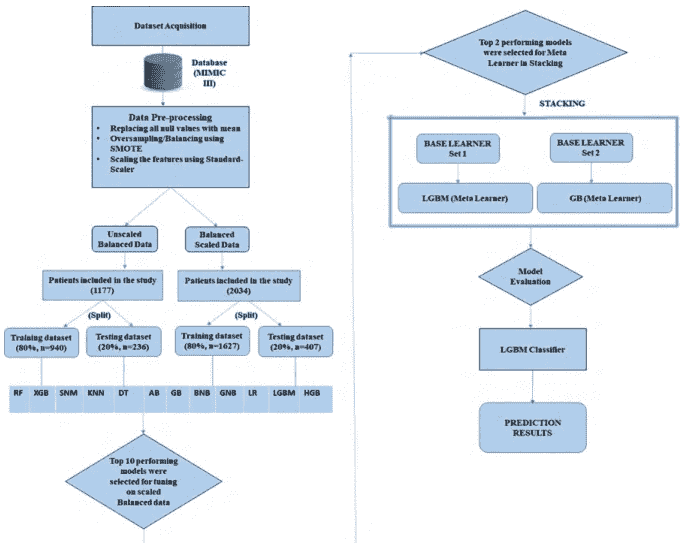

图 1.1 拟议工作流程图。


### 1.4.1 数据集获取

我们分析了心衰患者ICU死亡率数据集 [27]，了解到该数据集共有 1177 名患者的实例，包含 51 个特征，其中 558 名男性和 618 名女性。死亡病例总数为 159 例，其中 80 名男性和 79 名女性。总体而言，总存活率为 86.5%，死亡率为 13.5%。由于 "group" 和 "id" 列对预测结果无用，因此从我们的数据集中丢弃了这两列。包含空值实例的数据集特征详情见表 1.1。图 1.2 中的热图也展示了所有特征之间的相关性。

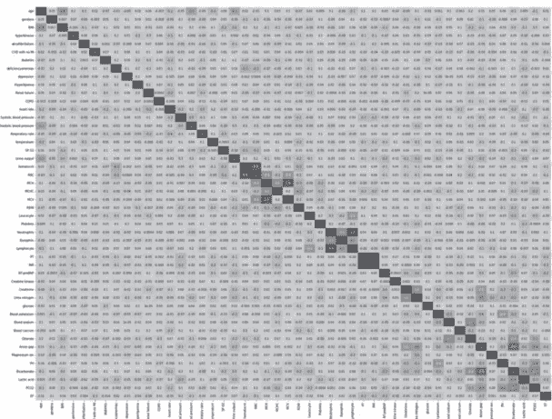

图 1.2 特征相关性热图。

### 1.4.2 数据预处理

为清理数据集，我们在构建稳定且高性能的机器学习模型之前执行了一些数据预处理方法，以针对不同指标。

表 1.1

| 索引 | 特征 | 数据类型 | 非空值 | 缺失值 | 空值百分比 |
| --- | --- | --- | --- | --- | --- |
| 1. | 分组 | int64 | 1177 | 0 | 0 |
| 2. | ID | int64 | 1177 | 0 | 0 |
| 3. | 结果 | float64 | 1176 | 1 | 0.08 |
| 4. | 年龄 | int64 | 1177 | 0 | 0 |
| 5. | 性别 | int64 | 1177 | 0 | 0 |
| 6. | BMI | float64 | 962 | 215 | 18.27 |
| 7. | 高血压 | int64 | 1177 | 0 | 0 |
| 8. | 心房颤动 | int64 | 1177 | 0 | 0 |
| 9. | 无心梗的冠心病 | int64 | 1177 | 0 | 0 |
| 10. | 糖尿病 | int64 | 1177 | 0 | 0 |
| 11. | 缺乏性贫血 | int64 | 1177 | 0 | 0 |
| 12. | 抑郁症 | int64 | 1177 | 0 | 0 |
| 13. | 高脂血症 | int64 | 1177 | 0 | 0 |
| 14. | 肾衰竭 | int64 | 1177 | 0 | 0 |
| 15. | COPD | int64 | 1177 | 0 | 0 |
| 16. | 心率 | float64 | 1164 | 13 | 1.10 |
| 17. | 收缩压 | float64 | 1161 | 16 | 1.36 |
| 18. | 舒张压 | float64 | 1161 | 16 | 1.36 |
| 19. | 呼吸频率 | float64 | 1164 | 13 | 1.10 |
| 20. | 体温 | float64 | 1158 | 19 | 1.61 |
| 21. | SpO2 | float64 | 1164 | 13 | 1.10 |
| 22. | 尿量 | float64 | 1141 | 36 | 3.06 |
| 23. | 血细胞比容 | float64 | 1177 | 0 | 0 |
| 24. | RBC | float64 | 1177 | 0 | 0 |
| 25. | MCH | float64 | 1177 | 0 | 0 |
| 26. | MCHC | float64 | 1177 | 0 | 0 |
| 27. | MCV | float64 | 1177 | 0 | 0 |
| 28. | RDW | float64 | 1177 | 0 | 0 |
| 29. | 白细胞 | float64 | 1177 | 0 | 0 |
| 30. | 血小板 | float64 | 1177 | 0 | 0 |
| 31. | 中性粒细胞 | float64 | 1033 | 144 | 12.23 |
| 32. | 嗜碱性粒细胞 | float64 | 918 | 259 | 22.01 |
| 33. | 淋巴细胞 | float64 | 1032 | 145 | 12.32 |
| 34. | PT | float64 | 1157 | 20 | 1.70 |
| 35. | INR | float64 | 1157 | 20 | 1.70 |
| 36. | NT-proBNP | float64 | 1177 | 0 | 0 |
| 37. | 肌酸激酶 | float64 | 1012 | 165 | 14.02 |
| 38. | 肌酐 | float64 | 1177 | 0 | 0 |
| 39. | 尿素氮 | float64 | 1177 | 0 | 0 |
| 40. | 葡萄糖 | float64 | 1159 | 18 | 1.53 |
| 41. | 血钾 | float64 | 1177 | 0 | 0 |
| 42. | 血钠 | float64 | 1177 | 0 | 0 |
| 43. | 血钙 | float64 | 1176 | 1 | 0.08 |
| 44. | 氯化物 | float64 | 1177 | 0 | 0 |
| 45. | 阴离子间隙 | float64 | 1177 | 0 | 0 |
| 46. | 镁离子 | float64 | 1177 | 0 | 0 |
| 47. | pH | float64 | 885 | 292 | 24.81 |
| 48. | 碳酸氢盐 | float64 | 1177 | 0 | 0 |
| 49. | 乳酸 | float64 | 948 | 229 | 19.46 |
| 50. | PCO₂ | float64 | 883 | 294 | 24.98 |
| 51. | EF | int64 | 1177 | 0 | 0 |

#### 1.4.2.1 处理缺失值

从表 1.1 可以看出，许多特征存在空值。任何列中的缺失值数量均未超过 25%。因此，需要对其进行填充，以避免精度下降或出现任何偏差行为。出于此考虑，我们根据结果列（即目标列）中的结果 "alive" 或 "dead"（分别由 "0" 和 "1" 表示）将数据分为两部分。然后，使用策略属性设置为 "mean" 的 Simple Imputer 处理每个分离结果数据中所有缺失的特征值，"mean" 表示各自特征列的均值。处理完所有缺失值后，将数据集合并，最后从数据集中分离出结果或目标列。

#### 1.4.2.2 平衡数据

从图 1.3 呈现的数据可以看出，我们的数据高度不平衡，死亡与存活的比例约为 1:6。这意味着我们的数据高度不平衡，需要平衡数据，以避免模型向多数类偏差并从而降低整体性能。对该数据集的研究表明，我们需要平衡数据以实现模型的最佳性能。众所周知，执行数据平衡程序有两种方法：一种是欠采样，它会随机选择多数类的数据并将其删除，直到两类数据数量相等；另一种是过采样，它通过复制少数类中存在的数据来增加少数类的数据，直到两类数据数量相等。我们拒绝了欠采样技术，因为在删除数据值时，可能会删除一些对模型结果形成具有有意义洞察的数据，因此我们选择了过采样技术，并使用 SMOTE 平衡了我们的数据。应用 SMOTE 后，数据分布见表 1.2。

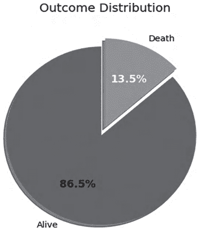

表 1.2 平衡前后的数据分布

| | 0 (存活) | 1 (死亡) |
|---|---|---|
| 平衡前 | 1017 | 159 |
| 平衡后 | 1017 | 1017 |

现在我们有两个数据集，一个不平衡，另一个平衡。然后，我们使用 sklearn [28] 的训练-测试划分对两个数据集分别按 80% 和 20% 的比例创建了训练集和测试集。划分后的数据分布见表 1.3。

表 1.3 形成训练和测试集划分后的数据分布

| | 训练集 | 测试集 |
|---|---|---|
| 平衡 | 1627 | 407 |
| 不平衡 | 940 | 236 |

#### 1.4.2.3 数据缩放

从我们的数据集可以看出，数据差异很大，最小值和最大值之间的差距非常大。因此，这可能会增加整体模型训练时间，或者导致模型向具有巨大正值或负值的数据或特征偏差，从而使我们的模型更容易过拟合，进而降低整体模型性能——这是我们不希望看到的。了解未缩放数据带来的后果后，我们考虑对数据集进行缩放，然后在缩放后的数据上训练模型，以使模型更稳健并减少整体训练时间。因此，我们决定使用 Standard Scaler 对不平衡和平衡数据集的训练数据和测试数据进行缩放。应用 Standard Scaler 后，我们的数据集特征值彼此接近，并开始在 -1 到 1 之间范围内变化。

### 1.4.3 模型训练

完成所有预处理步骤后，我们使用训练数据训练了 AB、GB、LGBM、XGB、LR、SVM、HGB、GNB、BNB、KNN、RF 和 DT 算法，然后在平衡和不平衡数据集的测试集上测试了我们的模型，并使用七种不同的性能评估指标（如 ROC–AUC 得分、Cohen kappa、\(F_1\) 得分、精确率、召回率、\(K\)-折平均准确率和标准差）评估了每个模型的性能，并将结果存储在表 1.4 和 1.5 中以供将来参考。在训练和测试数据集上训练和评估模型时，我们使用了 10 折 \(K\)-折交叉验证。XGB 在不平衡数据集上达到了 92.02% 的最佳准确率，而 HGB 在默认超参数调整下在平衡数据集上达到了 96.31 的更好准确率。

| 模型 | 准确率 | 精确率 | 召回率 | F1 分数 | Cohen's Kappa 分数 | ROC–AUC 分数 | 标准差 |
| :--- | :--- | :--- | :--- | :--- | :--- | :--- | :--- |
| XGB | 92.02 | 94.44 | 48.47 | 64.15 | 60.13 | 74.03 | 1.60 |
| GB | 91.70 | 93.75 | 42.85 | 58.82 | 54.60 | 71.18 | 2.76 |
| LGBM | 91.38 | 93.75 | 42.85 | 58.82 | 54.60 | 71.18 | 1.93 |
| HGB | 91.27 | 93.33 | 40 | 56 | 51.70 | 69.75 | 2.01 |
| AB | 89.04 | 76 | 54.28 | 63.33 | 58.16 | 75.65 | 2.52 |
| LR | 88.93 | 57.14 | 34.28 | 42.85 | 35.70 | 64.90 | 2.74 |
| RF | 88.93 | 75 | 85.71 | 15.38 | 12.73 | 54.03 | 1.60 |
| SVM | 88.40 | 0 | 0 | 0 | −0.83 | 49.75 | 1.30 |
| KNN | 87.66 | 50 | 57.14 | 10.25 | 7.44 | 52.36 | 1.36 |
| BNB | 85.21 | 43.18 | 54.28 | 48.1 | 37.83 | 70.92 | 3.85 |
| DT | 85.00 | 42.85 | 34.28 | 38.1 | 28.70 | 63.16 | 4.05 |
| GNB | 84.57 | 40.54 | 42.85 | 41.66 | 31.17 | 65.95 | 2.48 |

| 模型 | 准确率 | 精确率 | 召回率 | F1 分数 | Cohen's Kappa 分数 | ROC–AUC 分数 | 标准差 |
| :--- | :--- | :--- | :--- | :--- | :--- | :--- | :--- |
| HGB | 96.31 | 96.48 | 96.48 | 96.48 | 93.11 | 96.56 | 0.88 |
| LGBM | 96.62 | 96.48 | 96.48 | 96.48 | 93.11 | 96.55 | 0.73 |
| RF | 96.27 | 95.94 | 94.97 | 95.45 | 91.14 | 95.56 | 1.35 |
| GB | 94.65 | 95.50 | 95.98 | 95.74 | 91.64 | 95.82 | 1.03 |
| XGB | 95.14 | 95 | 95.47 | 95.24 | 90.66 | 95.33 | 0.75 |
| SVM | 93.24 | 94.5 | 94.97 | 94.74 | 89.68 | 94.84 | 1.68 |
| AB | 90.16 | 91.13 | 92.96 | 92.04 | 84.27 | 92.16 | 2.06 |
| LR | 86.54 | 86.2 | 90.95 | 88.51 | 76.92 | 88.51 | 2.48 |
| GNB | 85.62 | 82 | 86.93 | 84.4 | 68.57 | 84.33 | 2.08 |
| KNN | 86.17 | 79.2 | 99.5 | 88.2 | 74.1 | 87.25 | 1.6 |
| BNB | 85.86 | 85.3 | 87.44 | 86.35 | 72.97 | 86.51 | 2.54 |
| DT | 84.76 | 86.63 | 87.94 | 87.3 | 74.93 | 87.48 | 3.51 |


在不平衡和平衡数据集上表现最佳的 ML 模型及其对应的混淆矩阵和 ROC–AUC 曲线如图 1.4 和 1.5 所示。

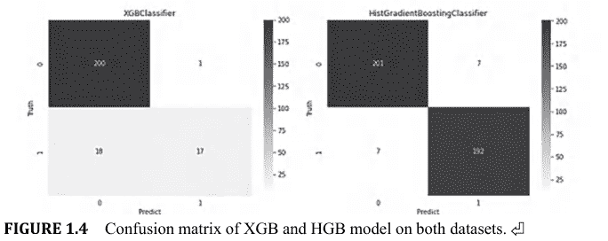

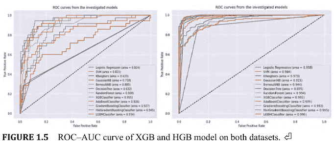

### 1.4.4 模型调优

在开发任何模型时，模型可能无法发挥其全部潜力，从而导致次优解。调优有助于在不过拟合或与实际结果偏差过大的情况下，释放给定问题上任何模型的最大潜力。模型调优是通过更改和选择最佳超参数值来实现的，这些值可为给定问题提供最优结果。选择正确的超参数非常重要，因为它高度影响模型的结果。超参数值并非我们可以预测的内容。然而，我们可以从之前的类似问题中获取这些值，或使用试错法，但这样做有很大机会得到次优结果。因此，对需要寻找最适合超参数的模型应用随机搜索交叉验证（Random Search CV）或网格搜索交叉验证（Grid Search CV）等超参数优化技术。在此技术中，最佳拟合的超参数值从提供给超参数优化技术的值池中选择。

因此，我们考虑使用随机搜索交叉验证（Random Search CV）来调优我们的 ML 模型，以获得模型的最佳性能。如前所述，我们也向该技术提供了一组值池，它从中随机选择不同的参数组合，使用这些参数集训练模型并记录结果。最终，它返回产生最佳结果的一组超参数。在调优所有模型后，我们获得了表 1.6 中所示的超参数值。

## 表 1.6 调优后的超参数

| 模型 | 超参数 |
| :--- | :--- |
| 逻辑回归 | {'solver': 'liblinear', 'penalty': 'l1', 'C': 0.1} |
| K 近邻 | {'weights': 'uniform', 'n_neighbors': 8, 'metric': 'manhattan'} |
| 随机森林 | {'n_estimators': 150, 'min_samples_split': 3, 'min_samples_leaf': 1, 'max_features': 'log2', 'max_depth': 12, 'criterion': 'gini'} |
| 决策树分类器 | {'min_samples_leaf': 10, 'max_depth': 10, 'criterion': 'gini'} |
| 支持向量机 | {'kernel': 'rbf', 'gamma': 0.1, 'C': 10} |
| 极端梯度提升分类器 | {'min_child_weight': 1, 'max_depth': 15, 'learning_rate': 0.1, 'gamma': 0.0, 'colsample_bytree': 0.3} |
| 自适应提升分类器 | {'n_estimators': 200, 'learning_rate': 0.1} |
| 梯度提升分类器 | {'subsample': 0.5, 'n_estimators': 1000, 'max_depth': 7, 'learning_rate': 0.1} |
| 直方图梯度提升分类器 | {scoring = 'f1_micro', random_state = 0, max_iter = 400, max_depth = 50, learning_rate = 0.3, l2_regularization = 0} |
| 轻量梯度提升分类器 | {'lambda_l1': 4.642350800200348e-07, 'lambda_l2': 0.0016049159794705925, 'num_leaves': 219, 'feature_fraction': 0.5067625451535447, 'bagging_fraction': 0.5737271342724937, 'bagging_freq': 5, 'min_child_samples': 5} |

表 1.7 展示了使用上述所有选定 ML 模型的最佳参数调优后的模型结果。GB 模型（准确率最高为 97.48%，AUC 分数为 0.97）对应的混淆矩阵和 ROC–AUC 曲线如图 1.6 所示。

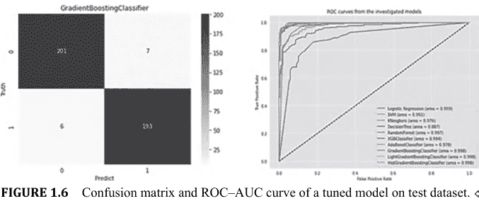

| 调优模型 | 准确率 | 精确率 | 召回率 | F1 分数 | Cohen 卡帕 | ROC–AUC 分数 | 标准差 |
| :--- | :--- | :--- | :--- | :--- | :--- | :--- | :--- |
| GB | 97.48 | 96.5 | 96.98 | 96.74 | 93.61 | 96.81 | 0.89 |
| LGBM | 96.99 | 97.47 | 96.98 | 97.23 | 94.59 | 97.3 | 0.64 |
| HGB | 96.99 | 96.46 | 95.98 | 96.22 | 92.62 | 96.31 | 0.64 |
| XGB | 96.12 | 96.04 | 97.49 | 96.76 | 93.61 | 96.82 | 0.72 |
| RF | 95.51 | 96.97 | 96.48 | 96.73 | 93.61 | 96.8 | 0.73 |
| SVM | 94.6 | 99.46 | 92.46 | 95.83 | 91.12 | 96 | 1.4 |
| AB | 89.36 | 89.32 | 92.46 | 90.86 | 81.82 | 90.94 | 1.41 |
| KNN | 87.34 | 80.74 | 99 | 88.94 | 76.03 | 88.2 | 2.05 |
| LR | 86.91 | 86.41 | 89.45 | 87.90 | 75.93 | 88 | 2.07 |
| DT | 81.44 | 84.3 | 81 | 82.56 | 66.54 | 83.24 | 2.3 |

### 1.4.5 堆叠

在得到表 1.8 所示的所有调优模型在平衡数据上的性能后，我们构建了两个堆叠集成模型：一个以 GB 作为元学习器，另一个以 LGBM 作为我们的元学习器，因为它们是我们表现最好的两个模型。我们将 RF、XGB、SVM、KNN、DT、AdaBoost、LGBM 和 HGB 作为 GB 堆叠模型的第一组基础学习者，并将 RF、XGB、SVM、KNN、DT、AdaBoost、GB 和 HGB 作为 LGBM 堆叠模型的第二组基础学习者，然后评估了它们的性能，如表 1.8 所示。从两组结果中，我们发现带有 LGBM 的堆叠集成模型优于梯度提升模型，因此选择它作为我们的拟议模型。相应的混淆矩阵和 ROC–AUC 曲线如图 1.7 和 1.8 所示。

| 实际 \ 预测 | 0 | 1 |
|---|---|---|
| 0 | 206 | 2 |
| 1 | 7 | 192 |

| 实际 \ 预测 | 0 | 1 |
|---|---|---|
| 0 | 205 | 3 |
| 1 | 6 | 193 |

图 1.7 GBM 和 LGBM 堆叠模型的混淆矩阵。

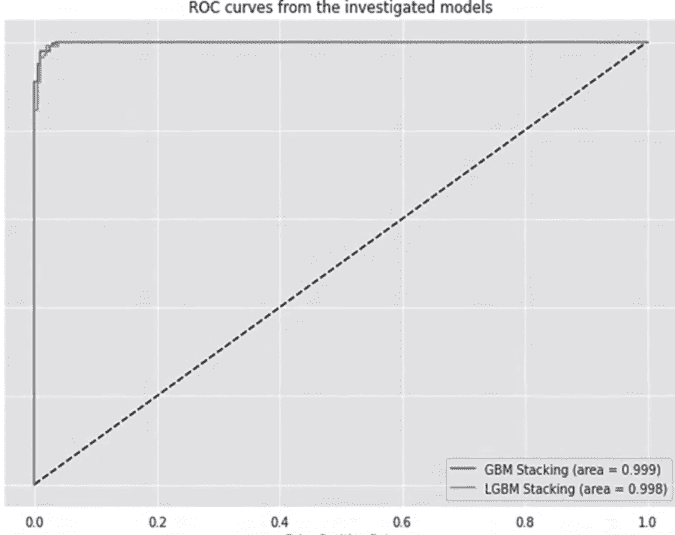

图 1.8 GBM 和 LGBM 堆叠模型的 ROC–AUC 曲线。

## 表 1.8 测试平衡数据上调优 ML 模型结果的性能矩阵

| 元学习器 | 准确率 | 精确率 | 召回率 | F1 分数 | Cohen 卡帕分数 | ROC–AUC 分数 | 标准差 |
|---|---|---|---|---|---|---|---|
| LGBM | 98.22 | 98.47 | 96.98 | 97.72 | 95.57 | 97.77 | 0.64 |
| GB | 97.91 | 98.97 | 96.48 | 97.71 | 95.57 | 97.76 | 0.87 |

## 1.5 比较分析

表 1.9 展示了现有文献的结果分析，就作者在其提案中声称的结果而言。此外，表 1.10 展示了我们的提案与文献中对照方法的比较分析。

## 表 1.9 现有文献的结果分析

| 参考文献 | 使用的算法 | 声称的结果 |
|---|---|---|
| [1] | XGB, LASSO 回归 | 高 AUC，广泛的净收益阈值范围 |
| [23] | KNN, LR, MLP, DT, LDA | 更高精确率，更高准确率，更高 F1 分数，更高召回率，更高 AUROC |
| [24] | SVM, LDA | 更高准确率和高精确率，随机森林 |
| [25] | LGBM | 高准确率和特异性 |
| [26] | LR, 平衡随机森林 | 少数类的高召回率 |

## 表 1.10 现有文献的比较分析

| 参考文献 | 准确率 | 精确率 | 召回率/灵敏度 | F1 分数 | 特异性 | ROC–AUC | Cohen 卡帕分数 |
|---|---|---|---|---|---|---|---|
| [1] | 76.00 | | 87.00 | | 72.00 | 0.85 | |
| [23] | 94.40 | 96.40 | 91.10 | 93.70 | | 0.93 | |
| [24] | 77.00 | | 69.00 | | | | |
| [25] | 80.23 | | 74.85 | | 83.27 | 0.81 | |
| [26] | | | 37.17 | | | 0.85 | |
| 拟议模型 | 98.22 | 98.47 | 96.98 | 97.72 | | 0.98 | 95.57 |

## 1.6 结论

在本章中，我们提出了一个堆叠模型，它能够以高准确率分类心力衰竭患者的 ICU 死亡率，因为我们的模型取得了出色的性能，例如在 10 折交叉验证中 K 折平均准确率为 98.22%，ROC–AUC 分数为 0.98。我们的模型构建在来自 Kaggle 的数据集上，该数据集源自 MIMIC-III 数据库。它共有 1177 个患者实例和 51 个特征。我们的研究总共包含 12 个 ML 算法，从中我们选择了九个算法来构建我们的堆叠集成分类器。这九个算法是在对所有算法结果进行多组全面研究后选定的。我们的堆叠分类器将 LGBM 作为第 1 层或元学习者，将 SVM、AB、GB、DT、KNN、HGB、RF 和 XGB 作为第 0 层或基础学习者。我们提出的堆叠分类器优于本研究中先前提出的大多数基准分数和 ML 模型。


## KEYWORDS

- 住院死亡率
- 心力衰竭患者
- 机器学习
- 异构数据集
- 回顾性研究

## REFERENCES

- 1. Li F, Xin H, Zhang J, Fu M. 重症监护室心力衰竭患者住院死亡率预测模型：基于机器学习的MIMIC-III数据库回顾性分析. BMJ Open 2021;11:e044779.
- 2. Amin Morid M, Liu Sheng OR, Abdelrahman S. 基于患者的早期ICU死亡率预测预测建模框架. ArXiv:2017;10.
- 3. Pollard TJ, Mark RG, Johnson AEW. 危重症医学中的可重复性：死亡率预测病例研究. PMLR;2017;68:361–376.
- 4. Arzeno NM, Lawson KA, Duzinski SV, Vikaloa H. 设计保留临床知识的最佳死亡率风险预测评分. 生物医学信息学杂志. 2015;56:145–156.
- 5. Liu J, Chen XX, Fang L, Li JX. 基于不平衡高维ICU大数据的死亡率预测. 工业计算机. 2018;98:218–225.
- 6. Andrew Taylor R, Pare JR, Venkatesh AK, Mowafi H. 脓毒症急诊科患者住院死亡率预测：一种基于本地大数据的机器学习方法. 学术急诊医学, 2016;23:269–278.
- 7. Nielsen AB, Nielsen AP, Kaas-Hansen BS, Schierbeck J. 重症监护室患者死亡率的动态可解释机器学习预测：电子病历中高频数据的回顾性研究. 兰塞特数字健康, 2020;2:e179–e191.
- 8. Alves T, Laender A, Veloso A, Ziviani N. 使用域自适应进行ICU死亡率风险动态预测. 2018 IEEE国际大数据会议(Big Data). 2018;1328–1336.
- 9. Anand RS, Stey P, Jain S, Biron DR. 使用机器学习和严重程度指数预测糖尿病ICU患者死亡率. AMIA转化科学峰会论文集, 2018;2017:310–319.
- 10. Alpaydin E. 组合模式分类器：方法和算法. In Kuncheva LI, Alpaydin E (Eds.), Combining Pattern Classifiers: Methods and Algorithms. 2nd edn. Wiley: Hoboken, 2014, Vol. 18, No. 3.
- 11. Slubana B, Lavrač N. 关联集成多样性与性能：类噪声检测研究. 神经计算, 2015;160(C):120–131.
- 12. Cortes C, Vapnik V. 支持向量网络, 1995.
- 13. Breiman L. 随机森林, 机器学习, 2001:45–52.
- 14. Quinlan JR. 决策树归纳. 1986;1:81–106.
- 15. Cramer JS. 逻辑回归的起源, Tinbergen Institute工作文件第2002-119/4号. 2002.
- 16. Hand DJ, Yu K. 白痴贝叶斯——并非如此愚蠢? 国际统计评论, 2001;69:385–398.
- 17. Anava O, Levy K. K*-最近邻：从全局到局部. 神经信息处理系统. 2016:4923–4931.
- 18. Freund Y, Schapire RE. 提升简介. 日本人工智能学会杂志. 1999;14(5):771–780.
- 19. Friedman JH. 贪婪函数近似：一种梯度提升机. 统计学年鉴, 2001;29:1189–1232.
- 20. Ke G, Meng Q, Finley T, Wang T. LightGBM：一种高效梯度提升决策树. 第31届神经信息处理系统会议(NIPS 2017), 美国加州长滩 2017, 第30页.
- 21. Guryanov A. 用于构建分段线性决策树梯度提升集成的直方图算法，图像分析、社交网络和文本. AIST 2019. 2019:11832.
- 22. Chen T, Guestrin CE. XGBoost：一种可扩展的树提升系统. KDD ’16：第22届ACM SIGKDD知识发现与数据挖掘国际会议论文集. 2016, 第785–794页.
- 23. El-Rashidy N, El-Sappagh S, Abuhmed T, Abdelrazek S, El-Bakry HM. 重症监护室死亡率预测：一种改进的患者特定堆叠集成模型. IEEE Access, 2020;8:133541–133564.
- 24. Ahmad F, Ayub H, Liaqat R, Ali Khan A. 使用机器学习模型进行ICU患者死亡率预测. 2021国际布尔班应用科学与技术会议(IBCAST) 2021, 第372–376页.
- 25. Chen T, Xu J, Ying H, Chen X. 使用轻量梯度提升机预测重症监护室患者拔管失败. IEEE Access, 2019;7:150960–150968.
- 26. Li L, Liu G. 基于类别不平衡学习的大型医疗MIMIC数据集中ICU患者住院死亡率预测. 2020年第5届IEEE国际大数据分析会议(ICBDA). 2020, 第90–93页.
- 27. Shahane S. 基于机器学习的MIMIC-III数据库住院死亡率预测回顾性分析. 2021. [Online]. https://www.kaggle.com/saurabhshahane/in-hospital-mortality-prediction?select=data01.csv
- 28. Pedregosa F et al., Scikit-learn：Python中的机器学习. 机器学习研究杂志. 2011;12:2825–2830.

# CHAPTER 2

## 使用Facebook Prophet预测流行病爆发（COVID-19）

KESHAV KAUSHIK

网络安全与密码学中心，沙尔达大学沙尔达计算机科学与工程学院，印度大诺伊达

*通讯作者

## ABSTRACT

由严重急性呼吸综合征冠状病毒2（SARS-CoV-2）引起的COVID-19大流行已席卷全球，造成了空前的社会和经济破坏。与SARS等其他冠状病毒相比，它具有高的人传人传播性。预测COVID-19流行病的未来轨迹对于及时制定适当的预防和控制策略至关重要。在抗击流行病的斗争中，检测病毒传播速度的能力至关重要。在随机时间监测传播率可能有助于公共政府规划人类安全和应对大流行影响的政策。最近的研究提出了传播动态模型，以更好地解释特定人群中的病毒传播并提供预防措施。可使用时间序列模型有效分析COVID-19疾病特征和累计感染人数。历史上，流行病传播一直被建模为类似于流体流动或热传导的速率问题。要模拟疾病传播，必须知道感染率；要建模死亡和治愈，必须知道移除百分比。本章重点介绍了大流行病概述和Facebook Prophet模型。本章还将向读者介绍用于预测大流行的拟议AI框架。

## 2.1 大流行病（COVID-19）简介

2019年12月初在中国湖北省武汉市爆发的近期肺炎疫情[1]，由世界卫生组织认定为“2019-nCoV”或“2019新型冠状病毒”或“COVID-19”的一种新冠状病毒（CoV）引发。冠状病毒[2]因其突起的刺突蛋白而得名，这些蛋白赋予其类似王冠的结构。病毒的生物学取决于刺突成分。刺突组件是病毒的部分，它附着在人类细胞上并允许其感染，从而使病毒得以繁殖并传播到其他细胞。2019-nCoV的确切起源、来源和生物储存地尚不明确，尽管怀疑其具有致病性，且由于与蝠冠状病毒[5, 13]的序列相似性，蝙蝠可能是罪魁祸首。根据先前[3]对严重急性呼吸综合征(SARS)-和中东呼吸综合征(MERS)-冠状病毒的流行病学研究，蝙蝠是主要储存宿主，榈叶狸或浣熊犬是SARS-CoV的中间（或易感）宿主，单峰骆驼是MERS-CoV的单峰骆驼。

当感染者呼吸含病毒的飞沫和非常微小的颗粒时，COVID-19 [4] 传播。其他人可能吸入这些颗粒，或者它们可能沉积在他们的眼睛、鼻孔或嘴巴上。在某些情况下，它们可能污染它们接触的表面。与感染者距离在6英尺以内的人感染该疾病的风险很高。根据现有信息，COVID-19的潜伏期为2–14天。当个体与确认的COVID-19携带者接触14天后仍然健康时，他们将不会受到伤害。本章[5]强调了在未来大流行预防中使用区块链。它还涵盖了一些可能有助于抗击COVID-19的基于区块链的应用。

COVID-19尚未有成功的治疗方法。重要策略包括对症和支持性治疗，例如维持生命体征、氧合水平和心率，并处理菌血症或器官衰竭等后果。科学家[6]为人口最稠密的前十个国家创建了COVID-19疫情爆发预测算法。使用九种不同的机器学习技术，所提出的预测模型预计未来五天内将出现的新病例数量。COVID-19的传播


本章[7]描述了受影响最严重的前10个国家的情况。中国之后，欧洲是受灾最严重的大陆。本研究验证并研究了确诊病例、活跃病例、康复病例和死亡病例的特征，以及接下来几天的疫情预测。一些国家的按州统计数据验证了当前病例，并还调查了死亡病例。

本研究[8]评估了七种广泛使用的机器学习方法预测登革热爆发的能力。共使用八项性能指标来评估这些方法。LogitBoost 集成模型的分类准确率最高，达到92%，敏感度和特异度分别为90%和94%。COVID-19 疫情非常复杂的结构，以及各国之间行为的差异，表明机器学习可能是建模疫情爆发的一种有用技术。本作品[9]作为早期的基准测试练习，展示了机器学习如何用于进一步的研究。该作品还表明，通过结合机器学习和 SEIR 模型，可以在疫情预测方面实现真正的创新。

基于在中国观察到的趋势，使用机器学习模型[10]预测了印度的COVID-19疫情。该模型基于2020年1月22日至2020年4月3日收集的数据，旨在预测报告病例数、康复病例数和死亡病例数。对于预测模型，采用时间序列预测方法。基于模型[11]预测阿尔及利亚COVID-19可能的疫情高峰和规模，对于解决COVID-19的艰难时期和毁灭性局面至关重要。更好地了解疾病动态将对COVID-19的管理和预防带来实质性益处。据我们所知，疫情爆发的独特特征限制了所有现有模型的应用。本研究[12]提供了一种新的随机模型，以考虑COVID-19的独特传播和预防，并捕捉中国大陆采取的预防措施的后果。

## 2.2 Facebook Prophet 简介与数据可视化

Facebook Prophet [13] 是一种开源时间序列建模方法，融合了传统和创新的基础。它在对多季节时间序列建模方面取得了成功，同时避免了其他方法的一些缺点。Facebook Prophet 时间序列数据预测技术具有一个额外约束，能够适应非线性趋势，包括年度、月度和日度季节性，以及节假日效应。它通常适用于具有大量季节性变化和多个季节历史信息的时间序列。Facebook Prophet 在 Facebook 的众多应用中被广泛使用，以提供用于规划、控制和目标设定的准确估计。它能容纳不完整的信息和趋势修改，并通常能处理异常值。Prophet 方法为用户提供了大量调整和微调预测的选项。

在本章中，作者评估了一个用于大流行爆发预测的 Facebook Prophet 模型。作者首先获取了一个 COVID-19 数据集并进行了可视化，以找出 2020 年各国 COVID-19 病例数量的图表（图 2.1）。进一步的可视化是为了找出检测次数和死亡人数（图 2.2）。

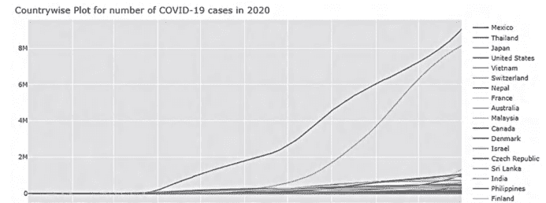

图 2.1 各国 COVID-19 病例数量图表。

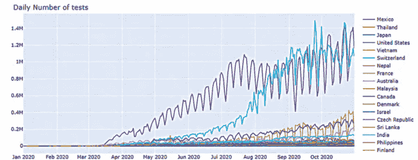

图 2.2 COVID-19 每日检测次数。

图 2.3 显示了因 COVID-19 导致的死亡人数图表，观察发现美国的死亡人数急剧上升。这类可视化帮助政府机构制定政策并采取一些预防措施来应对大流行。

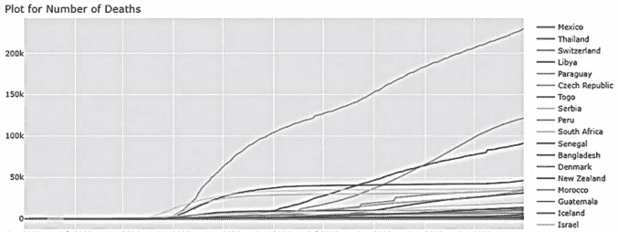

图 2.3 因 COVID-19 导致的死亡人数。

## 2.3 构建基于 AI 的框架以预测大流行

数据可视化之后，Facebook Prophet 模型被训练。作者预测了 31 天，因此数据框架包含训练所包含的日期。在图 2.4 中，绘制了印度 2020 年 3 月至 2020 年 11 月期间的预测数据图表。如您在此图中所示，COVID-19 病例数从 2020 年 3 月到 2020 年 11 月急剧增加。

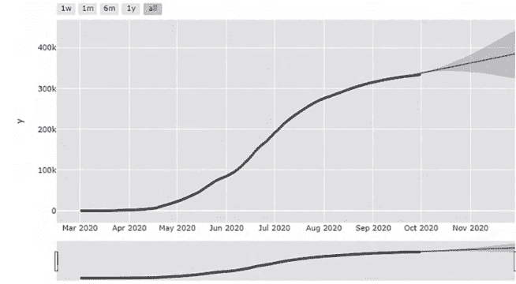

图 2.4 印度预测数据图表。

此后，在图 2.5 中绘制了变化点以可视化预测数据。此功能帮助我们识别模型推断的趋势修改。

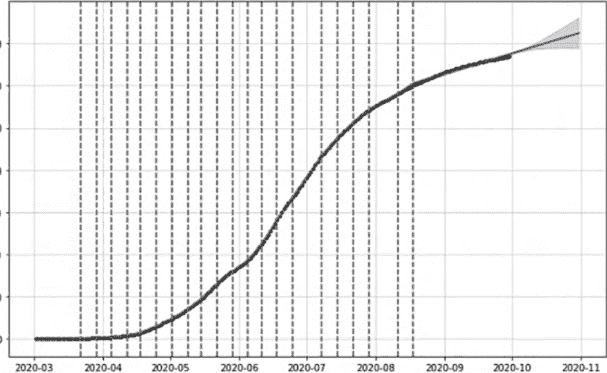

图 2.5 图表上的变化点图表。

## 2.4 分析训练模型的性能

最后，分析了训练模型的性能，并绘制了原始值与预测值的对比图。训练模型能够生成未来 31 天和未来 60 天的预测。在图 2.6 中，进行了模型预测与基准真值（即实际发生在现实生活中的情况）的比较分析。

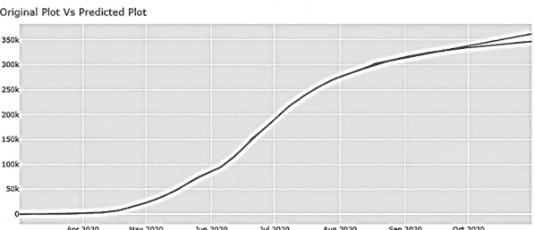

图 2.6 原始图表与预测图表的对比。

本章所用数据的唯一问题是我们没有大量历史信息，例如 CoV 大流行始于 2020 年 3 月左右。因此，我们从 3 月到 10 月或 11 月的所有信息都相当有限。

## 2.5 结论

CoV 的传播已使文明处于灭绝的边缘。此外，未来的传播增长和分布事件必须进行研究和预测。机器学习方法在大流行病的调查和预测中至关重要。机器学习技术也可能有助于检测流行病模式。在本章中，作者讨论了疫情爆发（COVID-19）的兴起，以及 Facebook Prophet 模型如何帮助预测疫情爆发。本章将对机器学习爱好者、医疗保健专业人员、博士研究者、研究人员和学生有所帮助。

## 关键词

- 冠状病毒
- COVID-19 疫情
- Facebook Prophet
- 严重急性呼吸综合征
- 中东呼吸综合征

## 参考文献

1. Fong SJ, Dey N, Chaki J. COVID-19 简介. 在《人工智能冠状病毒爆发》中. 2021; 第 1 页, https://doi.org/10.1007/978-981-15-5936-5_1.
2. COVID-19 基础知识. CDC. https://www.cdc.gov/coronavirus/2019-ncov/your-health/about-covid-19/basics-covid-19.html (2022 年 4 月 12 日访问).
3. Wu YC, Chen CS, Chan YJ. COVID-19 爆发：概述. 中华医学杂志 2020;83(3):217–220, https://doi.org/10.1097/JCMA.0000000000000270.
4. Bhattraju PK 等人. 西雅图地区危重患者中的 Covid-19 — 病例系列. 新英格兰医学杂志 2020;382(21):2012–2022, https://doi.org/10.1056/NEJMOA2004500.
5. Kaushik K, Dahiya S, Singh R, Dwivedi AD. 区块链在预防大流行中的作用. 在: 2020 年 IEEE 第 17 届移动自组织和智能系统国际会议论文集，MASS 2020，2020 年 12 月，第 32–37 页，https://doi.org/10.1109/MASS50613.2020.00014.
6. Khakhraria A 等人. 使用机器学习预测人口稠密国家的 COVID-19 爆发. 数据科学年鉴 2021;8(1):1–19, https://doi.org/10.1007/S40745-020-00314-9/TABLES/3.
7. Yadav D, Maheshwari H, Chandra U. 最易感国家 COVID-19 爆发预测. 环境科学与管理全球期刊 2020;6(COVID-19 特刊):11–20, https://doi.org/10.22034/GJESM.2019.06.SI.02.
8. Iqbal N, Islam M. 登革热爆发预测的机器学习：不同知名度分类器的性能评价. Informatica 2019;43(3):363, https://doi.org/10.31449/INF.V43I3.1548.
9. Ardabili SF 等人. 基于机器学习的 COVID-19 爆发预测. 算法 2020;13(10):249, https://doi.org/10.3390/A13100249.
10. Tiwari S, Kumar S, Guleria K. 印度冠状病毒疾病—2019 的爆发趋势：一项预测. 灾难医学与公共卫生准备 2020;14(5):e33–e38, https://doi.org/10.1017/DMP.2020.115.
11. Bentout S, Chekroun A, Kuniya T. 阿尔及利亚 2019 年冠状病毒疾病（COVID-19）爆发的参数估计和预测. AIMS 公共卫生 2020;7(2):306, https://doi.org/10.3934/PUBLICHEALTH.2020026.
12. Zhang Y, You C, Cai Z, Sun J, Hu W, Zhou X-H. 基于现实随机模型的 COVID-19 爆发预测. medRxiv 2020; , https://doi.org/10.1101/2020.03.10.20033803.
13. 使用 Facebook Prophet 进行时间序列分析：它如何工作以及如何使用 | 作者 Mitchell Krieger. 向数据科学. https://towardsdatascience.com/time-series-analysis-with-facebook-prophet-how-it-works-and-how-to-use-it-f15ecf2c0e3a (2022 年 4 月 12 日访问).


# 第 3 章

## 用于分析和预测人类抑郁症的移动应用

VIRENDRA KUSHWAH、PRACHI BHATT、TOSHINI AGRAWAL、JIGYASA BISHT 和 SHIVANGI SINGH

VIT 博帕尔大学计算机科学工程与人工智能学院，博帕尔，中央邦，印度

*通信作者*

## 摘要

抑郁症是一种普遍的心理健康问题，全球影响超过 2.64 亿人。其特征是情绪变化和情感反应波动，可为短期或长期。若不治疗，抑郁症会显著干扰日常功能并降低个人潜力，有时甚至会像身体疾病一样使人丧失劳动能力。及时诊断和治疗对于管理抑郁症至关重要。虽然市面上有多种心理健康应用，但其中许多拥有付费高级功能，导致无力承担费用的用户无法使用。其中一款应用 Mood Path 会追踪情绪模式并提供健康评估，帮助用户管理消极思维，侧重于正念技能而非身体锻炼。相比之下，我们的应用采用更全面的方法，通过分析用户输入并推荐个性化治疗方案。该应用免费使用，作为应对抑郁症的个人可及的电子健康工具。该应用强调治疗和康复，提供用户友好的界面，允许使用日常语言轻松交互。为确保应用始终有益，它包括预定治疗，帮助用户管理焦虑和消极思维。这种方法最大限度地降低了过度使用的风险，同时促进长期心理健康改善。

## 3.1 引言

与治疗师一样，该应用通过与用户互动，让用户对自己的情绪感到自在，并基于分析（通过提问——问答环节）追踪症状，并根据其所处的抑郁症等级将其分类，最后应用使用冥想、瑜伽、听有声书、提供健康饮食图表等不同方法推荐治疗方案，所有内容均根据用户量身定制，以帮助其康复。

### 3.1.1 动机

抑郁症已影响超过 2.64 亿人，因为它是一种遍布全球的常见疾病。

全球范围内，各个年龄段的人都可能因突出原因而受苦。由于数字仍在日益增加，它已成为全球总体疾病指数的一个促成因素。由于存在虐待、年龄因素、家庭成员死亡、某些药物等多种原因，可能导致人试图自杀。每年约有 80 万人死于自杀。

自杀是 15–29 岁年龄段高死亡率的第二大原因。发展中国家和欠发达国家面临较高比率，但由于对此缺乏了解和认知，不幸未能获得太多帮助。借助本应用，我们希望尽可能多地帮助人们。

### 3.1.2 方法

本应用以我们应用的标志（即“不必担心”）开启，随后显示励志名言以激励用户。励志名言之后是登录页面，用户在其中输入“姓名”、“电子邮件地址”和“密码”。这样做是为了让应用能够区分不同用户，从而保障用户数据安全。登录页面之后是问卷页面，应用会向用户提出某些问题，帮助检测用户抑郁症的严重程度。抑郁症等级的确定通过一个积分（此处为“星星”）系统完成，即用户给出的每个答案都会被分配一定的积分。

在我们的应用中，我们设计了一个积分（或星星）系统：如果用户获得的积分（或星星）在 0 到 3 之间，则检测为轻度抑郁；如果积分（或星星）在 4 到 9 之间，则为中度抑郁；如果积分（或星星）超过 9，则为极度抑郁。该积分（或星星）系统对用户不可见，以免影响其情绪。在应用确定抑郁症等级后，应用会向用户推荐如听歌曲、冥想等任务。这有助于用户转移当下的抑郁或悲伤思绪。此外，如文献 [5] 所述，应用应友好且色彩丰富，以便用户享受使用过程，并且比帮助改善抑郁的书籍更经济实惠；我们的应用完成后将尝试免费提供。我们的应用还会向用户推荐个性化饮食图表，如果用户遵循该图表，可以保持健康。

### 3.1.3 工作目标

- 确定用户的抑郁症等级。
- 推荐有助于他们克服抑郁症的任务。
- 对用户的电子健康进行适当检查。
- 减轻他们的压力。

## 3.2 相关工作

“数字精神科医生”：该研究提出了焦虑和抑郁症类应用应得出的准确结果，并明确规定它们应专注于单一障碍而非集体障碍，而我们的应用正是如此，因为它纯粹专注于抑郁症及其治疗。该研究的局限性包括实验中使用的术语可能不特别反映用户可能使用的术语。例如，用户可能会使用“焦虑”、“抑郁”或“担忧”，而非“人际治疗”。第二个局限性是该研究存在一些异常，因为描述不一定与应用的功能一致。

“寻找抑郁症应用：抑郁症应用市场的回顾与内容分析”：作者在其中提到，编码如果主要目的应分为自我评估、症状监测、精神教育等。他们提到，某些提供治疗音频的应用使用多媒体作为抑郁症催眠治疗的目的，但我们的应用提供的音频治疗仅用于聆听然后放松，使内心平静，因为它包含用于不同冥想练习的有声书、播客和舒缓音乐。在作者测试和检查的 243 款应用中，只有 4.1%（即仅 10 款）提供精神疗愈和娱乐，因此为对该群体做出贡献，我们的应用也相应提供有趣的瑜伽练习和激动人心的音频故事供聆听。此外，局限性在于结果可能未能代表全球所有应用，因为一些应用仅服务于本地或受限区域。对该应用的第二个局限性是，该研究仅关注基于抑郁症的应用，而排除了非抑郁症应用，尽管国际商业与技术学院是抑郁症最常见的治疗方法之一，但主要出现在非抑郁症应用中。在文献 [7] 中，研究结果表明社交媒体使用量与抑郁症风险成正比，即社交媒体使用量越高，抑郁症风险越高，且在青少年女孩中显著更高。为了控制抑郁症风险，提出了早期检测系统。在文献 [8] 中，调查了抑郁症人群对在线支持论坛的需求。该研究对人群进行调查，134 人参与，报告了他们的经历和查询，如治疗和服务、药物、了解抑郁症等。

此外，一篇题为“抑郁症和焦虑症患者中的健康应用使用情况：一项主题编码调查研究”的论文报告称，健身和营养是大多数应用的强项，主要集中在体重管理、饮食图表和不同类型的锻炼等健康习惯上。本文关注心理健康应用的用户类型，而非应用提供了什么，以了解客户对虚拟治疗的期望。该研究的局限性包括部分参与者过去接受过治疗或在实验期间参与其中。此外，人口统计特征为美国中西部地区，由高收入、上层社会背景的女性组成。

论文“IntelliCare：一种用于抑郁症和焦虑症治疗的多元技能型应用套件”介绍了“IntelliCare”应用，这是一套基于不同类型的


抑郁症患者所需的要求。它包含“Boost Me”，可提供积极活动来提升用户的情绪；同样，iCope 是用户可以找到一系列放松、正念音频录音的地方，以感受平静与安宁，而且像这样的应用在一个单一应用中还有很多。然而，其局限性在于结果取自已经在好转的样本。其次，辅导协议产生了冲突，因为它建议使用所有应用，而不是基于用户的频繁使用。

在论文 [6] 中，题为“澳大利亚全科医生中移动健康应用的当前知识与采用情况：调查研究”，他们调查了许多澳大利亚执业医生，其中提供了见解，即大多数健康应用是为患者推荐的，并且其中超过 50% 是与心理健康相关的应用。这项调查帮助我们激发了开发此应用的动力。他们的局限性包括回复率非常低，并且存在未明确处理以确保准确性的选择偏差。

在一篇名为“智能手机应用：未来开发的评审与循证建议”的论文中，他们再次调查和分析了可以融入进一步创新心理健康应用的方法。他们提到的因素是，如果应用是为那些尚未寻求治疗的人设计的，那是受到赞赏的。这样他们就可以轻松在家中舒适地获得帮助。此外，他们提到应用应该能够允许用户对其治疗提供的时间表进行一些定制，这就是为什么我们分离了此功能。

Ekinci [9] 研究了导致埃及青年抑郁症的变量，一项研究发现，抑郁症的主要原因是焦虑，并且埃及女性青年的抑郁症显著较高。与美国青年相比，埃及青年的抑郁症平均得分较高。

在论文 [10] 中，该研究完全基于使用抽样方法对中学生进行抑郁症水平预测，依据是体育参与情况、性别、年龄和社会经济地位。

此外，像“Happify”这样的免费应用为抑郁症患者提供的较少，它拥有不同类型的游戏和活动，可以缓解你的情绪，属于积极心理学，旨在让你感觉更好，但仅限短时间。该应用的局限性在于它只关注心智投入而非身体投入，虽然它需要运动，但不如特定锻炼期间所需的那样有效。

此外，还有一个名为“Relieve Depression Hypnosis”的应用，它提供视觉、音频和节奏工具来达到平静，可用于冥想或睡眠。它有助于消除限制全神贯注和决心的负面潜意识想法。其局限性在于它只关注想法而非改善身体方面。此外，应当知道，如果某人拥有健康的生活方式，可能会感到更自信。

此外，另一个应用“What's up”提供习惯追踪器，而不提供任何类型的治疗，这与我们的应用类似，我们的应用仅在表面上提供治疗，而不是详细的许可治疗。他们提供口袋疗法，正如 Dr. Raichback 在文章“25 best apps for depression”中所说：“这些应用程序允许隐私和保密，并可为那些可能太羞耻而不愿承认自身心理健康问题的个人提供安全保障。”此外，正如 Promod Kerkar, M.D. 在 Pain Assist. 上所写，那些专注于自我治愈而非高度合成药物的应用程序。该应用的局限性在于使用论坛时存在登录问题。

## 3.3 EXISTING SYSTEM

现有工作，例如 Talk Life 应用，允许您成为支持小组呼叫的一部分，或能够遇到一个会倾听、交谈并帮助您减少悲伤和孤独感的人。名为 Sanvello 的应用为用户提供呼吸练习，可以帮助减轻压力、平衡情绪、控制焦虑问题和管理愤怒。同样，认知行为技术（CBT）应用程序进行评估，以检查您在参加评估测试方面的优势和劣势，并为其记录日记。此外，如关于日记所提及的，它可以是基于文本的或基于日志的，其中可以记录时间段和所做的冥想练习，以跟踪改善情况。

### 3.3.1 DRAWBACKS AND ISSUES IN EXISTING WORK

对超过 100 款抑郁症应用程序进行了一项研究，分析发现仅 35% 具有临床有效性，并且其中甚至只有 3% 根据临床标准实际上是准确的。它还指出，通过五星级评分对这些应用程序的忽视和缺乏有效信息。总体而言，这些结果表明，从临床质量角度来看，这些杀手级应用程序中仍然存在严重且被过度忽视的挑战。日益达成的共识是，大多数商业上可用的应用程序不是循证的，这可能非常危险。每个人在经历抑郁症时，对每个问题的看法都不同，并且在这方面有不同的立场，一个单一的应用程序为给定问题提供基本的立场/解决方案，可能无法实现目的。

症状监测被高度赞扬为对有心理问题的人有帮助和支持。尽管如此，提供此功能的应用程序并不多，在这方面，即使有些应用程序提供，它们也不会给出准确的官方输出。由于某些应用程序可能只能帮助不超过两周，因此对这些应用程序产生依恋和习惯对患者来说可能非常危险，因为在不再获得相同环境后，他们可能会感到虚弱，即使他们在使用这些应用程序期间有所改善。

根据关于抑郁症应用程序的已发表论文，导致现有工作出现问题的因素大多与生活方式相关，如营养、压力（财务和数字方面）、一致的健身常规和饮食，基本上是使人从早晨起床到晚上睡个好觉都保持健康的日常活动，而在患抑郁症时改善这一点正是驱使他们下载这些应用程序的原因。最后，应用程序非常昂贵，包含高级套餐，用户很难负担。

## 3.4 PROPOSED SYSTEM

我们以安全的方式为最终用户设计了移动应用程序。它为用户提供灵活性，以便浏览应用程序的各种功能，并且我们压缩了大量文件。此外，CBT 是一种心理治疗，其中受焦虑、抑郁、惊恐发作或进食障碍困扰的人会接受治疗，以识别扰乱其心灵的想法和负面思维模式。CBT 的一些部分还包括设定目标，这是我们应用程序的关键功能，用户在定制日程时可以设定每日和每周目标。起初，我们使用了一个启动活动功能。启动画面是 Android 中一个令人兴奋的功能，被称为欢迎屏幕或用户对应用程序的第一次体验。启动画面为我们的系统带来专业外观。这里使用了延迟方法，用于固定页面的屏幕显示时间。在我们的应用程序中，我们使用了 3000 的延迟时间，这意味着第一页将在 3 秒后保持活动状态，然后移动到下一页/活动。

图 3.1 描绘了拟议应用模型的操作工作流程。拟议模型由分析、分离和推荐等模块组成。

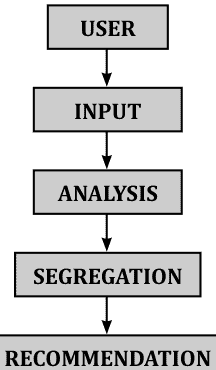

图 3.1 操作工作流。

图 3.2 显示了拟议移动应用程序的登录页面。在第二页上是我们的欢迎页面/活动，使用了两样东西。首先，代码是用 XML 编写的，并且我们在其中使用了一个图像按钮。在欢迎页面/活动上，有一个写有“点击此处”的图像。点击该页面后，它将移动到下一页/活动。然后，在登录页面/活动中，我们使用了共享偏好设置。共享偏好设置通过指向带有键值对的文件来提供简单方法，仅允许读取和写入它们。该文件由框架支持和处理，可以是私有的或共享的。我们存储了用户的 ID 和密码。然后，在问题部分，我们在 XML 部分中构建了问题，并在 Java 的主活动代码中编写了工作流程。并且在这里，我们完成了分析，以便我们可以根据用户的答案了解用户的抑郁症水平。导航栏用于提供

冥想、瑜伽、有声书和饮食图表等多种选项。在这里，这些内容按级别分类提及。在该页面/活动中使用了视频、有声书形式的音乐、咏唱和图像。这样，用户可以通过图像感到愉悦。


图 3.2 登录页面。

我们将应用分为三个模块。图 3.3 展示了基于查询的抑郁症分析。在此阶段，向移动应用用户发布问题，以识别和分析抑郁症水平。

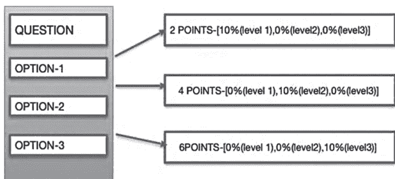

图 3.3 基于查询的抑郁症分析。

## 3.4.1 模块 1：输入

本模块包含四个页面，分别是 Logo 页面、包含励志名言的页面、登录页面，最后是欢迎页面。登录页面从用户处获取数据。Shared Preferences 方法() 是 login()，可存储少量数据。用户仅需登录一次以输入其详细信息。如果用户成功登录，则登录屏幕将不再出现。如果未按下提交按钮，则用户每次打开应用时都会再次看到该屏幕。登录页面的设计包含三个部分：姓名、邮箱 ID 和密码。这些需要通过键盘输入。

## 3.4.2 模块 2：分析

为该模块创建了两个 Java 活动，包含十一个问题，用户需要回答，这些问题与判断症状强度相关。在第一个 Java 活动中，问题和答案使用 get Answers() 进行说明，如果选择了答案则为 true，否则为 false。再次使用了 Shared Preferences()，因此相同的问题不会重复出现。此外，创建了一个名为 answerques() 的变量，如果变量为 true，则表示答案在时间（即 40 秒）前已提交，那么该问题将不再出现；否则，即如果用户花费超过 40 秒，则该问题屏幕将再次出现：
- (1) 前端
- (2) 后端

## 3.4.3 模块 3：分类与推荐

本模块包含后台部分，将分析部分分为三个阶段，即轻度、中度和重度，也就是等级 1、等级 2 和等级 3。当用户回答问题时，每个选项包含一定的分数，最后将分数相加并划分为三个等级。如果分数在给定范围内，则用户会被分配到相应等级，但用户不会知道。通过使用数据库，可以实现此功能，并且信息可以轻松存储在后台。

本模块包含四种治疗类型，分为三个级别。为每种治疗的每个级别创建了 Fragment，通过布局创建了活动（即页面设计），并通过 Java 文件执行内容。在创建 Java 文件的地方使用了 UI。在开发者创建的文件夹中，每个 Fragment 有两个 Java 文件。这两个文件是“java_fragment”和“java_viewmodel。”后者文件在需要在屏幕上打印内容时提供帮助。该文件用于从活动文件中执行应在屏幕上显示哪种设计。因此，音频和视频的执行通过“java_viewmodel”完成。此外，为了降低复杂性，为某一种治疗创建了另一个 Java 文件夹，其中为每个级别创建上述提到的文件，即“java_fragment”和“java_viewmodel”。例如，“java_fragment_level1”和“java_viewmodel_level1。”

### 3.4.3.1 有声书、播客和舒缓音乐

在此部分，创建了三个级别，包含这些内容以让用户平静并感到舒适。在名为 audio 的文件夹中创建了 Fragment_level1_audio 文件，其中通过 VolumeProvider() 方法提供调节音量选项。

### 3.4.2.2 饮食图表

饮食图表通过 OnclickListener() 简单提供，只需在导航栏中点击级别，在所有级别中都会提供满足晚餐、午餐和早餐营养需求的食物。

### 3.4.2.3 冥想

此处提供了多种冥想练习的音频，可以开始和暂停。从 Android Studio 导入了媒体播放器对象，然后调用了在媒体播放器类中定义的开始、停止和暂停函数。

### 3.4.2.4 瑜伽

此处会调用 on Create() 生命周期回调方法，其中创建了 mediaSessionCompat() 和 mediaControllerCompat() 类，并调用 stop() 和 pause() 函数来播放视频，视频包含不同的瑜伽姿势及其做法。设计包括渐变背景，并伴随视频和背景音乐播放，旨在激励用户。

## 3.5 结果讨论与分析

### 3.5.1 一般抑郁症分析图表

本研究包括若干横断面实验，总共有 41,344 名参与者。耳鼻喉科门诊患者的抑郁症状患病率最高（53.0%），其次是皮肤科门诊（39.0%）和神经科门诊（39.0% 和 35.0%）。根据亚组研究，不同专科中抑郁症和抑郁症状的患病率在 17.0% 至 53.0% 之间。发展中国家门诊患者的抑郁症和抑郁症状患病率高于发达国家门诊患者。此外，从 1996 年到 2010 年，门诊患者中抑郁症和抑郁症状的患病率显著下降 [2]。图 3.4 显示了一项关于抑郁症分析的调查。

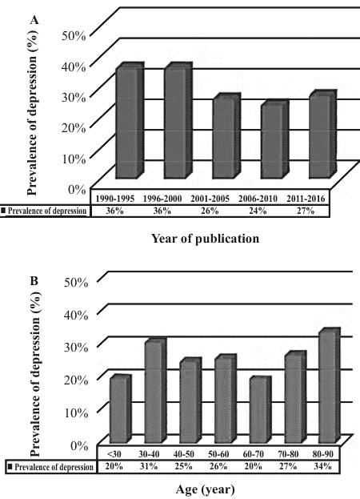

图 3.4 抑郁症分析调查。

图 3.5 显示了印度的抑郁症分析调查。该调查由 2015–2016 年国家心理健康调查完成；从该研究中显示，受精神问题（如抑郁症）困扰较多的年龄群体。同时还开展了关于精神障碍类型及人们所面临类型的研究。上述图表进一步展示了人们的压力水平。有多少人认为抑郁症是禁忌？政府就此开展了一项简要研究 [3]。

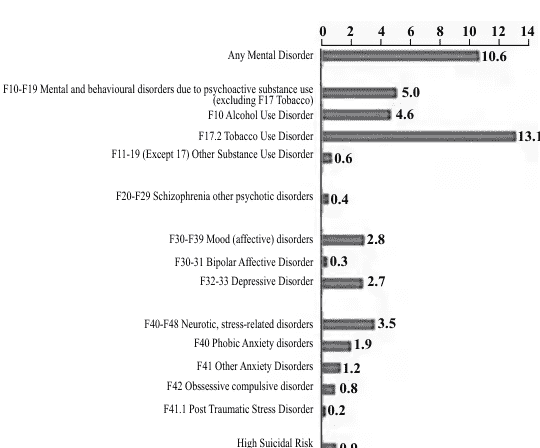

图 3.5 印度抑郁症分析调查。

### 3.5.2 印度抑郁症分析总体调查图表

已知应用之一是“Moodpath：抑郁症和焦虑”。该应用评分为 4.3。全世界许多人都使用过该应用。大多数人喜欢这个应用，因为它提供了他们一周或一个月的整体表现图表。它提供正能量名言，甚至允许其他用户分享想法。用户不喜欢这个应用，因为它没有提供适当的安全性。此外，人们还会传播消极情绪。

另一个已知应用是“Talk life：抑郁症和焦虑”。该应用用户评分为 4.3，成功率很高。根据用户评价，该应用在与外部用户沟通方面非常有支持性。该应用主要关注用户的心理健康及相关问题。在获取其他用户的通知方面存在许多阶段性问题，有时用户无法切换到其他应用，因为该应用中可能会丢失数据。人们最不喜欢这个应用的一点是，使用其许多功能需要付费。

这些是某些抑郁症分析应用的现有工作。我们分析了这些应用的缺点，并试图通过避免这些问题来改进我们的应用。我们的用户只需登录一次，所有详细信息都会被存储。此外，我们的应用管理良好，包含所有正面和励志的想法。

### 3.5.3 现有抑郁症分析应用的结果

现在有许多移动应用旨在克服抑郁症、改变人们的情绪并改善其健康生命周期。2014 年 8 月，全国范围内通过五个为期两周的广告波次筛选了 2923 人。总共有 626 名参与者被随机分配到三个研究组中，每组都配备 iPad 2.0 和智能手机（iPST，211 人；Project: EVO，209 人；Health Tips，206 人）。样本的平均年龄为 33.95 岁（SD 11.84），基线时样本的平均患者健康问卷（PHQ-9）得分为 13.64（SD 4.95），表明为轻度抑郁。我们样本中 PHQ-9 总分在 5 到 10 之间的人数百分比为 23.0%（144/626），而得分为 10 的人数百分比为 77.0%（482/626）。只有 11 名 PHQ-9 总分低于 5 的参与者在该工具第 10 项上报告的得分超过 2，尽管他们的基线总 PHQ-9 得分为 3.09（SD 0.83）[1]。

### 3.5.4 移动应用——无需担忧

图 3.6 显示了 Worry Not 易于使用的移动应用，用于分析和预测抑郁症。文献 [4] 中还提到，影响心理健康应用高效性的因素包括：应用应具有简单的用户界面，并且用户应能轻松浏览应用功能，而无需过度紧张。通过基于查询的分析预测人类抑郁症，并识别患者的抑郁症水平。相应地，将向患者提供治疗。


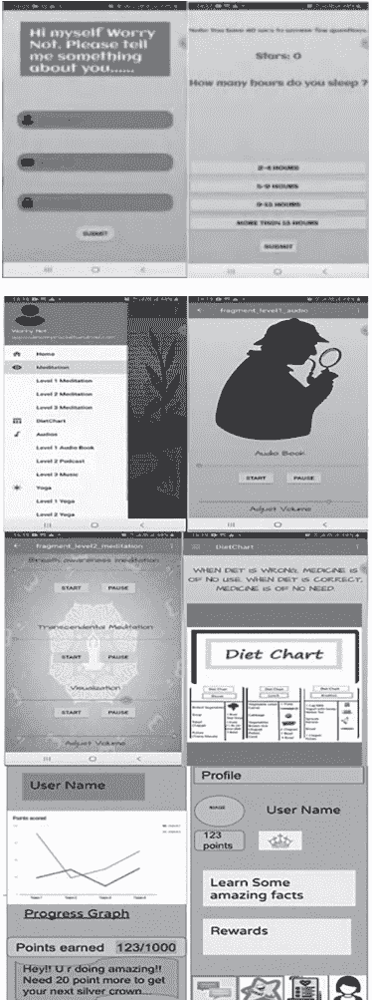

图 3.6 用于分析和预测抑郁症的用户友好型移动应用。

## 3.6 结论与未来工作

### 3.6.1 结论

我们的应用程序建立在这样一个事实之上：世界上有些人无法负担离线就医的昂贵治疗费用。因此，我们将其设计为在线化，并更具交互性，使用户不会感到与真实治疗过程脱节。我们的应用程序已经实现了所提想法，以达成上述设定的目标。我们将改进一些方面，使其更具吸引力和有效性。开发此应用程序时始终牢记用户为何会使用它，以及它在缓解抑郁症方面能带来多大益处。在当今的人机交互生活场景中，此类移动应用程序非常必要。

### 3.6.2 未来工作

- 制作创新方式，让用户可以玩游戏或进行活动，根据这些活动我们将在用户未察觉的情况下确定他们的水平。
- 通过治疗对用户进行图级监测。
- 通过以问候形式提供奖励，跟踪其行为和思维视角的变化。

### 关键词

- 移动健康 (mHealth)
- 电子健康 (eHealth)
- 抑郁症
- 认知行为技术
- 移动应用

### 参考文献

- 1. Arena PA, Hallgren KA, Jordan JT, Gazzaley A, Atkins DC, Heagerty PJ, Anguera JA. 移动应用在抑郁症中的应用与有效性：一项完全远程临床试验的结果. 医学互联网研究杂志 [电子资源] 2016;18(12):e330, https://doi.org/10.2196/jmir.6482
- 2. Wang J, Wu X, Lai W, Long E, Zhang X, Li W, Zhu Yi, Chen C, Zhong X, Liu Z, Wang D, Lin H. 门诊患者中抑郁症和抑郁症状的患病率：系统评价和荟萃分析. BMJ Open 2017;7(8):e017173. https://doi.org/10.1136/bmjopen-2017-017173
- 3. Srinivasa Murthy R. 印度2015–2016年全国心理健康调查. 印度精神病学杂志 2017;59(1):21–26. https://doi.org/10.4103/psychiatry.IndianJPsychiatry_102_17
- 4. Chandrashekar P. 心理健康移动应用有效吗：设计高效能心理健康移动应用的证据与建议. mHealth. 2018;4:6. https://doi.org/10.21037/mhealth.2018.03.02.
- 5. East ML, Havard BC. 心理健康移动应用：从渗透到扩散在心理健康社会系统中. JMIR Mental Health. 2015;2(1):e10. https://doi.org/10.2196/mental.3954.
- 6. Byambasuren O, Beller E, Glasziou P. 澳大利亚全科医生中移动健康应用的当前知识与采用情况：调查研究. JMIR Mhealth Uhealth. 2019;7(6):e13199. https://doi.org/10.2196/13199.
- 7. Tong Mok W, Sing R, Jiang X, See SL. 新加坡莱佛士女子学校：新加坡，新加坡，SG，社交媒体对抑郁症的影响. 第9届国际中文口语语言处理研讨会. 2014. https://doi.org/10.1109/ISCSLP.2014.6936690
- 8. Barney LJ, Griffiths KM, Banfield MA. 抑郁症患者的显性和隐性信息需求：对在线抑郁症支持论坛中报告问题的定性调查. BMC Psychiatry. 2011;88(2011).
- 9. Ekinci NE. 根据某些变量调查中学生的抑郁症水平. 亚洲教育与培训杂志. 2018;4:280–283. https://doi.org/10.20448/journal.522.2018.44.280.283
- 10. Ghareeb Ghareeb. 会议：世界心理健康联合会 在：开罗世界大会，开罗 埃及青少年与抑郁症相关的某些变量调查. 1987.


泰勒与弗朗西斯集团
http://taylorandfrancis.com

# 基于机器学习的早期类风湿性关节炎和骨关节炎临床检测分析——综述

GANESH KUMAR M. 和 AGAM DAS GOSWAMI*
VIT-AP大学电子工程学院，印度安得拉邦阿马拉瓦蒂
*通信作者

## 摘要

人们因类风湿性关节炎（RA）和骨关节炎（OA）而经历显著的健康不适。还有许多其他类型的关节炎影响人们的舒适度和效率。在使用计算机辅助诊断解决方案方面，以往研究集中在特定的数字成像解决方案和预测分析模型上，以准确识别问题。然而，随着机器学习（ML）模型使用量的增加，更准确预测的范围已经扩大。本章详细介绍了研究中讨论的一些关键模型，重点关注与RA和OA相关的文献。在理解研究范围方面，讨论部分提出了文献中发现的差距，以及生活方式因素的应用和更准确的检测过程以正确分类关节炎等某些关键方面，是研究的一些重要领域。未来研究的目标定义为专注于一组可能的进化算法和特征提取，这些可能有助于提高整体准确性。

## 4.1 引言

人工智能（AI）计算改变了开发的动态，并在改善人们生活质量方面发挥着重要作用。医疗保健解决方案就是这样一个领域，AI应用的范围已成为紧迫需求。存在着一系列独特的解决方案，AI的作用在其中突出，范围从制剂规划到研究再到临床护理。

预测建模解决方案正在成为当前医疗保健领域AI应用中更具建设性的部分，从诊断到治疗护理，它们有助于提高诊断和治疗的准确性。风湿性或肌肉骨骼疾病引起超过150种疾病，这种综合征对患者来说通常是进行性的和痛苦的。风湿性疾病可分为三类：关节疾病、脊柱疾病以及导致创伤性疾病的情况。一般来说，此类风湿性疾病在某些情况下会导致发病率和残疾，并造成巨大的医疗保健支出 [1]。

在应用机器学习（ML）模型的动态方面，医疗保健中ML模型使用被视为必要的关键领域之一是准确预测类风湿性关节炎（RA）。

根据RA和骨关节炎（OA）概述的简要说明，RA是一种影响关节、纤维组织、结缔组织及其他组织的慢性系统性疾病。它主要影响20至40岁之间的人群，即他们成年生活中最富有成效的年份。在大多数情况下，如果长期未被诊断，它会损害RA患者的健康活动能力 [2]。

OA是一种主要影响关节软骨的退行性关节疾病。在大多数情况下，问题表现在老年人和因过度体力劳动而身体承受压力的人身上。根据统计数据，OA是发达国家中10种最致残性疾病之一 [3, 4]。

事实是，存在多种类型的关节炎，OA和RA是其中最常见的两种。由于所讨论的两种关节炎的症状相似，因此需要更准确和适当的治疗来决定最佳治疗方案以解决这些问题 [5]。

膝骨关节炎（KOA）是人类膝关节的一种病症，主要影响软骨。软骨在腿部运动中起着重要作用。在OA中，软骨的顶层解体和退化，导致剧烈疼痛。OA是一种慢性关节疾病，引起疼痛、肿胀、僵硬和功能丧失。OA是一种病因不明的慢性疾病。

它是最常见的关节炎类型，其特征是软骨退化和骨质变化 [30]。OA早期难以诊断，因为有观点认为，在出现关节间隙狭窄和骨赘之前，首次改变发生在软骨下骨 [31]。因此，为了克服这种严重致残性疾病，早期检测、诊断和干预备受期望，因为早期治疗可以防止软骨和骨质分解。

因此，着眼于相似性的影响以及人为错误对问题的潜在重大影响，需要一个强大的模型，可以帮助医疗专业人员进行更准确的诊断，并建立一个有效的系统，以便针对关节炎类型进行适当的检测，实现快速周转分析。因此，本章的重点是对ML和非ML实践中当前可用于开发更适当类型系统的解决方案或模型进行详细回顾 [6]。

本章其他部分的重点是了解使用ML模型进行关节炎形式检测的文献可能的一组解决方案。

## 4.2 文献综述

本章的文献综述深入关注计算机辅助解决方案的现状、与现有模型相关的任何影响，以及应用组合的潜在范围，以改进现有模型或开发可持续的解决方案，从而提高诊断的准确性和充分性。

所选用的文献综述结构是专注于过去七年的研究数据，以同行评议期刊文章的形式，可有助于完成拟议研究。以下是文献综述的目标，这些目标为审查提供了指导。


### 4.2.1 研究目标

- 了解目前用于类风湿关节炎（RA）和骨关节炎（OA）诊断的计算机辅助解决方案的范围。
- 实验研究的结果成功关联了关节炎检测的条件，以便了解所提议的机器学习模型和分类器的有效性。
- 识别导致问题的症状或特征，并考虑变量或指标以实现更准确的检测。
- 因此，以下小节详细讨论了研究综述，重点关注上述目标。

### 4.2.2 相关工作

参考文献 [7] 的作者专注于机器学习模型如何有助于识别类风湿问题的动态。该研究讨论了各种潜在解决方案，例如有监督学习模型和无监督学习模型，这些方案可能有助于实现。该研究作为可能应用的全面综述，重点关注各种机器学习模型和分类器如何提供帮助的动态。该研究中讨论的另一个重要方面是系统综述的发展，这有助于理解机器学习解决方案如何基于数据作为系统性结果，用于决定患者的治疗条件。

参考文献 [8] 的作者讨论了机器学习模型如何有助于关节炎问题的早期检测。尽管如此，该研究概述了机器学习模型可以被视为关节炎检测有效解决方案的目的。该研究中讨论的大部分输入内容涉及机器学习模型的优缺点，解决方案如何对个人有帮助，以及为关键应用机器学习模型应采取的步骤。本章综述对机器学习模型的各个方面提供了两个关键见解，例如基于图像的检测和以数据为中心的检测、结构恢复、显著的数据压缩等。另一个重要收获是对参考文献的详细综述，引用了机器学习模型在心脏病学、肿瘤学、内分泌学和血液学等其他诊断领域的应用。该研究的发现可用于考虑解决方案如何在使用机器学习进行医疗诊断方面发挥实际作用，以改善总体结果。

Kataria 和 Ravindran [9] 详细概述了电子健康系统如何成为应对业务动态的深刻解决方案。考虑到各种应用系统、可穿戴设备和跟踪解决方案如何帮助医疗专业人员跟踪不同患者的关节炎水平，它指的是使用技术进行更好监测和治疗的实用方式。该模型还强调使用增强的数据分析模式，这有助于深入了解每个个体患者的健康状况，以及在宏观评估中使用数据来关注研究和治疗护理的数据分析动态。

关于数字健康倡导的一篇研究论文 [10] 讨论了各种新兴技术，例如可穿戴设备、模式研究、大数据分析、实时跟踪传感器等，如何帮助改善医疗管理的整体质量。该研究强调在类风湿关节炎治疗中使用传感器网络的重要性。这些可穿戴设备可以帮助跟踪患者数据，从而帮助改善临床试验和病情，进而提供更好的患者护理。尽管该研究更多是数字健康的综合性综述模型，但重点在于理解技术范围如何改善患者数据监测的底层条件，以及应用诊断模型以提高检测准确性的相关方法。

研究 [11] 的作者讨论了数学模型的条件以及对类风湿关节炎治疗具有重要意义的治疗条件，重点关注类风湿关节炎的定量预测建模应用。该研究的作者强调在早期识别类风湿关节炎问题的重要性，以便提供更有效的治疗。该研究中讨论的数学模型展示了随机和渐进分析模型等统计模型如何有用。

该研究讨论了普通微分方程（ODEs）和偏微分方程（PDEs）模型，强调了这些解决方案在过去二十年类风湿关节炎进展分析中的应用。该研究强调缺乏更多关注疾病进展生物学机制的研究。从上述情况来看，需要考虑的主要点是探讨一种可能的解决方案，即数学模型可以适应机器学习模型。如果是这种情况，探讨将 ODEs 和 PDEs 解决方案应用于患者类风湿关节炎检测的文献中机器学习模型的数量将会增加。

Sharon 等人 [12] 讨论了使用集成方法基于类风湿关节炎和骨科数据集对医疗障碍进行分类，其中提出了一种现代模型来使用集成模型确定类风湿关节炎。使用了白细胞分类来生成类风湿关节炎数据集。模型的特征提取基于使用电子图像传感器的数字显微镜获得的淋巴细胞。骨科数据集被用作训练分类器和测试所提议模型的主要基准图像数据集。

所提议的模型包含三个集成算法模型：Adaboost、Bagging 和 Random subspace。KNN（K-最近邻）和随机森林（RF）算法进行了修改。在该研究中，数据分类使用 10 倍交叉验证和留出设置进行建模。

根据该研究，在各种集成分类器中，准确率范围从 97.50% 到 94.84%。Bagging RF 被推荐为系统成功实施的有效算法模型。该研究清楚地表明，集成分类器模型在关节炎病情管理中被视为重要。

参考文献 [13] 中的研究专注于三级医疗类风湿关节炎患者。该研究使用包装特征选择算法来确定属性核心集。使用了四组不同的算法来验证模型的基于数据集的性能。模型的特征系统以 DAS28（28 个关节疾病活动度评分）缓解作为分析模型的关键因素。该模型中使用的机器学习模型包括 KNN、极端梯度提升（XGBoost）、RF 和逻辑回归（LR）。

尽管如此，该模型专注于特定和利基特征细分领域。然而，该研究指出，模型在 XGBoost 算法的情况下成功程度达到 72.7%，而用于分析的其他算法获得的准确率要低得多。总之，该模型是最有效的解决方案；然而，该解决方案在准确性方面不够重要，而准确性对模型至关重要。

研究 [14] 讨论了一种基于磁共振成像（MRI）报告的以影像为中心的机器学习模型，作者强调训练算法以显著优于所提议的条件。了解骨髓水肿和腱鞘炎的条件是所提议特征的重点。系统的数据研究涉及使用医院记录中的 1,700 次 MR 扫描作为匿名数据。该模型的一个关键含义是，与遵循任何特定模型（其中关键输入用于分析）不同，该模型鼓励对数据集进行定性理解。因此，很明显，所考虑的模型需要对进行准确分析所需的精度、灵敏度和特异性进行更具体的验证。

另一个进行了研究的关键领域是疾病活动度预测。研究作者考虑使用机器学习模型来了解参考文献 [15] 中患者面临的类风湿关节炎问题的程度。该研究的重要性在于描述机器学习问题的应用在类风湿关节炎领域如何激增。作为模型中影响因素讨论的关键挑战之一，是理解用于分析的数据质量中的差距，以及如果不使用正确的数据进行训练可能遇到的影响。从实际角度来看，该模型更具定性，并讨论了机器学习作为潜在解决方案及其带来的好处。

类风湿关节炎治疗中最具挑战性的问题之一是患者可能会出现病情急性发作。虽然可能性较低，但在此类问题普遍存在的情况下，可能会产生不良影响。因此，在研究 [16] 中，作者专注于使用电子病历推导的训练数据集，并采用各种分类器，如 KNN、RF、LR、堆叠元分类器和朴素贝叶斯分类器。模型的实验分析使用了 Kaggle 数据集，以确保对临床疾病活动度（DAS28 ESR）的受控实施和理解。为了使研究更加聚焦和独家，研究中的影响仅限于抗风湿病药物（DMARD）治疗。因此，该研究未专注于合成 DMARD。

Lin 等人 [17] 专注于使用电子病历来帮助用户深入了解人们潜在类风湿关节炎问题的早期和自动预测。该研究使用了电子病历和 Apache 临床文本分析与知识提取系统，利用支持向量机（SVM）分类器深入了解数据。基于对模型进行的卡方检验和其他统计分析，该研究中讨论的模型的实验研究表明具有中等准确度因素。

一项新研究 [18] 的作者试图评估机器学习模型如何利用一系列数据集来有效评估类风湿关节炎，这些数据集来自


大学医院。该研究使用了820条患者记录，探讨了在适当培训下如何提高模型的准确性。先前的克罗恩病活动性指数评分、红细胞沉降率（ESR）、C反应蛋白（CRP）水平和DMARDs是模型中ML分析所使用的关键变量。基于初步描述，得出结论：ML解决方案在RA检测中的应用是可行的。

一项近期研究 [19] 着重对比了ML模型与传统MTX（甲氨蝶呤）方法的疗效，指出了一组可用于有效预测的不同特征。逻辑回归因子被用于基于DAS28分析这些模型。该模型的关键分类器包括XGBoost、最小绝对收缩和选择算子（selection operator）以及RF模型。该模型的实验研究结果通过各种参数的性能进行评估。根据该研究，逻辑回归方法在81%的敏感率下表现更好，而当评估相似特征时，MTX的准确率约为69%。因此，该研究主张在ML中使用六个关键特征。

在一项于韩国进行的研究 [20] 中，作者通过分析评估患者RA病情的四个关键属性，将老年性与风湿病相关联：RA因子抗环瓜氨酰肽、肿胀关节计数和ESR。所提出的方案采用了一种模型，该模型使用K-means定期研究四个参数的阈值。该研究采用的方法不仅限于预测患者早期RA病情，还考虑了进展期。基于四个因素中两个因素（RF和AC）的阳性值，该研究能够估计类风湿性疾病的发生率。当RF和AC用作评估指标时，与模型讨论相关的实验研究指的是预测精度的提高。因此，ML方法可用于检测类风湿性疾病并改善老龄化社会的生活质量。

一项近期研究 [21] 专注于ML模型在OA中的应用，OA是一种更常见的发生在膝关节的关节炎问题。该模型讨论了用于预测膝关节间隙狭窄（knee-JSN）的两种方法的适用性。该研究中讨论的模型涉及使用聚类过程来识别处于非进展和进展JSN不同阶段的人群。一套稳健的特征选择方法，包括嵌入技术、包装法和过滤法，允许评估模型中使用的风险因素。该实验研究在评估单侧和双侧膝关节-JSN进展时的方法表明，当实例评估双膝而非单个膝关节状况时，准确率更高，达到83.3%。

根据研究 [22] 作者的说法，正在考虑一种针对OA的患者特异性分析和预测模型的新方法。该研究考察现有模型，以识别OA疾病早期检测中的差距。它强调了各种以分类器为中心的研究的分类，以及其准确性条件。对总结研究的回顾促使了更详细和隐性的研究，这些研究讨论了用于OA分析的大量ML模型。

Kokkotis 等人 [23] 讨论了一种进化ML方法，该研究利用一组重要的特征选择方法论针对KOA进展的风险因素。该模型解决两个主要挑战：数据库获取数据的维度和异质性问题，以及次要地，与非进展类相比，KOA进展类中观察到的不平衡问题。

该研究主要依赖Gen包装特征选择模型来应用特征以提高准确性。该研究使用遗传算法模型来提高进化模型的准确性。Shapley加法解释用于评估用于过滤特征选择效果的数据集。所提出的模型被宣传为一种有效的风险分层策略，当应用于KOA患者数据预测时，可以帮助进行更准确的分析。

一项关于KOA预测的近期研究关注患者对全膝关节置换术的需求。该领域的预测模型涉及一般人群中的KOA病情、KOA患者TKA结果的问题以及KOA患者膝关节置换术的风险。使用PubMed数据库，讨论了文献中的某些模型，强调了特征选择和可帮助更有效地评估患者KOA病情的算法条件方法的重要性。该模型的关键方面是定性总结的预后预测模型。该研究使用元分析方法来识别模型预测性能的定量指标。

另一项关注OA结构进展早期预警信号条件的研究提出了一种基于ML的新方案，重点在于早期检测进展情况。该研究侧重于基于体重指数的特征选择，使用基线血清水平的六种肽脂素及其各自的比率和炎症因素。该模型的关键数据是X光片和三个磁共振成像变量，可用于更有效的预测。ML特征分类方法论与五种不同的ML算法相结合。该研究进行的实验研究声称，在以性别为中心的分类器开发中，SVM具有更好的准确性条件 [24]。根据该研究，所提出的模型应用具有超过92%的准确率，以及早期阶段检测准确率。

其他重要模型 [22,24–29] 讨论了应用OA相关ML模型的条件。根据对这些研究的全面回顾，用于OA和RA分析的特征范围多种多样。预测需要更加准确，以改进可以帮助早期阶段诊断的解决方案。

## 4.3 挑战

- 其他身体声音，例如肌肉活动，难以与关节软骨声音区分开来。膝关节X光片对非预期缺陷极其敏感，这可能会使骨骼结构的研究复杂化。专家可能需要花更多时间来分析膝关节X光片并确定OA的存在。

- 手绘轮廓和关节区域裁剪用于感兴趣区域分割，这既繁琐又耗时。

- 膝关节X光片中软骨区域几何失真的主要原因是OA的进展，这可能会因图像获取拍摄、处理和数字化而被误表示。

- 从这类失真图像中提取重要区域可能会变得困难。

- 当图像因几何变形而失真时，恢复相关区域也很困难。

- 当前的成像方法，如X光、MRI和超声，在早期疾病中敏感度较低，因此，在诊断时OA通常已经进展，对其病因和进展的理解仍然有限。

## 4.4 问题陈述

OA是最常见的慢性关节疾病之一，有大量直接相关的风险因素。与其他类型的OA相比，KOA最为常见，且最常发生在55岁以上人群中，随着人们年龄达到65岁，该疾病的患病率逐渐增加。KOA在疾病早期难以诊断。为解决这一问题，我们正在开发一种基于集成学习的早期检测深度学习系统，该系统将使用KOA患者的X光/MRI数据集，以提供比以前工作更准确的结果。

## 4.5 拟议方法

OA的患病率正在增加，这部分是由于我们人口老龄化所致。目前，OA是通过患者报告的症状和X光片来诊断的。另一种选择是MRI，但这成本高昂，且在症状加重且患者被转诊至专科医生寻求外科意见之前很少使用。因此，KOA的有效管理和早期检测是一个关键的公共卫生问题，关系到广大民众以及各种临床医生和医疗管理人员。

许多研究人员已尝试使用X光和患者医疗数据来诊断OA，但结果不一致。通过这项拟议的想法/工作，我们将设计并实施一种集成学习方法，用于利用患者X光和医疗数据的混合数据集进行KOA早期检测，通过该方法，医生可以更准确、更快地预测OA及其程度。图像处理和AI将被用于创建一种低成本的方法。图4.1描绘了拟议的系统架构。


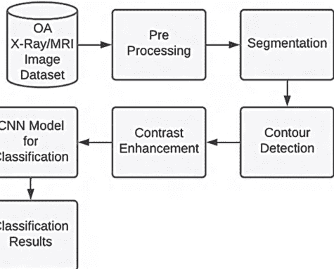

图 4.1 拟议系统架构。

## 4.6 拟议系统及其优势

在所参考的基础文章或早期工作（《基于CNN LSTM方法从X光图像分类膝骨关节炎严重程度的新方法》，作者Rima Tri Wahyuningrum及其他合著者）中，作者使用了X光图像数据集并实现了CNN模型，但所得准确率为75.28%。而在我们的拟议系统中，我们将使用包含X光/MRI的混合数据集，并结合先进的图像预处理和CNN模型，以获得更高的准确率，这将有助于在早期阶段以更准确的结果预测KOA。

## 关键词

- * 机器学习
- * 类风湿关节炎
- * 骨关节炎
- * 人工智能
- * 磁共振成像

## 参考文献

- 1. https://www.uofmhealth.org/conditions-treatments/cmc/difference-between-osteoarthritis-and-rheumatoid-arthritis#:~:text=Osteoarthritis%20occurs%20when%20the%20smooth,the%20body%20instead%20attacks%20intruders.
- 2. Wardito E, Purba HH, Purba A. 建设项目风险管理的系统动力学建模：系统文献综述. Operational Research in Engineering Sciences: Theory and Applications 2021;4(1):1–8.
- 3. Nelson AE, Fang F, Arbeeva L, Cleveland RJ, Schwartz TA, Callahan LF, Marron JS, Loeser RF. 膝骨关节炎表型分析的机器学习方法：来自FNIH生物标志物联盟的数据. Osteoarthritis and Cartilage 2019;27(7):994–1001.
- 4. Maarseveen TD, Meinderink T, Reinders MJ, Knota J, Huizinga TW, Kleyer A, Simon D, van den Akker EB, Knevel R. 类风湿关节炎患者的电子健康记录识别：算法管道开发与验证研究. JMIR Medical Informatics 2020;8(11):e23930.
- 5. Mate GS, Patil MS, Chavan MS, Harshada MS. 使用CNN进行类风湿关节炎自动预测. Journal of Architecture & Technology 2019;XI:18–23.
- 6. Stafford IS, Kellermann M, Mosotto E, Beattie RM, MacArthur BD, Ennis S. 自身免疫性疾病中人工智能和机器学习应用的系统综述. NPJ Digital Medicine 2020;3(1):1–1.
- 7. Hügle M, Oomuji P, van Laar JM, Boedecker J, Hügle T. 风湿病学中的应用机器学习和人工智能. Rheumatology Advances in Practice 2020;4(1):rkaa005.
- 8. Kim KJ, Tagkopoulos I. 风湿性疾病研究中机器学习的应用. The Korean Journal of Internal Medicine 2019;34(4):708.
- 9. Kataria S, Ravindran V. eHealth在识别非常早期炎症性风湿性疾病中的新兴作用. Best Practice & Research Clinical Rheumatology 2019;33(4):101429.
- 10. Kataria S, Ravindran V. 数字健康：风湿病学患者护理的新维度. Rheumatology International 2018;38(11):1949–1957.
- 11. Macfarlane FR, Chaplain MA, Effimie R. 理解类风湿关节炎的定量预测建模方法：简要综述. Cells 2020;9(1):74.
- 12. Sharon H, Elamvazuthi I, Lu CK, Parasuraman S, Natarajan E. 使用集成方法从电子图像传感器开发类风湿关节炎分类. Sensors 2020;20(1):167.
- 13. Venerito V, Angelini O, Fornaro M, Cacciapaglia F, Lopalco G, Iannone F. 预测正在使用生物制剂的类风湿关节炎患者持续缓解的机器学习方法. JCR: Journal of Clinical Rheumatology 2021;28(2):e334–e339.
- 14. Stoel BC. 早期RA检测中的人工智能. Seminars in Arthritis and Rheumatism 2019;49(3):S25–S28.
- 15. https://rheumatology.medicinemmatters.com/artificial-intelligence/devices-and-technology/machine-learning-treatment-rheumatic-disease/17540860
- 16. Vodencarevic A, Tasciar K, Hartmann F, Reiser M, Hueber AJ, Haschka J, Bayat S, Meinderink T, Knota J, Mendez L, Hagen M. 用于预测正在减少生物制剂的类风湿关节炎患者个体风险发作的先进机器学习. Arthritis Research & Therapy 2021;23(1):1–8.
- 17. Lin C, Karlson EW, Canhao H, Miller TA, Dligach D, Chen PJ, Perez RN, Shen Y, Weinblatt ME, Shadick NA, Plenge RM. 从电子病历中自动预测类风湿关节炎疾病活动性. PLoS One 2013;8(8):e69932.
- 18. Norgeot B, Glicksberg BS, Trupin L, Litiuv D, Gianfrancesco M, Oskotsky B, Schmukaj G, Yazdany J, Butte AJ. 基于电子健康记录数据的深度学习模型评估，用于预测类风湿关节炎患者的临床结局. JAMA Network Open 2019;2(3):e190606–e190606.
- 19. Gosselt HR, Verhoeven M, Bulatović-Çalasan M, Welsing PM, de Rotte MC, Hazes JM, Lafebver FP, Hoogendoorn M, de Jonge R. 复杂机器学习算法与多变量逻辑回归在预测类风湿关节炎对甲氨蝶呤临床反应不足方面旗鼓相当. Journal of Personalized Medicine 2021;11(1):44.
- 20. Yoo J, Lim MK, Ihm C, Choi ES, Kang MS. 使用机器学习预测类风湿关节炎的研究. International Journal of Applied Engineering Research 2017;12(20):9858–9862.
- 21. Ntiakolia C, Kokkotis C, Moustakidis S, Tsaopoulos D. 膝骨关节炎患者关节间隙狭窄进展的预测. Diagnostics 2021;11(2):285.
- 22. Jamshidi A, Pelletier JP, Martel-Pelletier J. 基于机器学习的膝骨关节炎患者特异性预测模型. Nature Reviews Rheumatology 2019;15(1):49–60.
- 23. Kokkotis C, Moustakidis S, Baltzopoulos V, Giakas G, Tsaopoulos D. 膝骨关节炎进展稳健风险因素识别：进化机器学习方法. In: Healthcare. Multidisciplinary Digital Publishing Institute, 2021, Vol. 9, No. 3, p. 260.
- 24. Bonakdari H, Jamshidi A, Pelletier JP, Abram F, Tardif G, Martel-Pelletier J. 用于早期膝骨关节炎结构进展患者筛查的预警机器学习算法. Therapeutic Advances in Musculoskeletal Disease. 2021;13:1759720X21993254.
- 25. Lazzarini N, Runhaar J, Bay-Jensen AC, Thudium CS, Bierma-Zeinstra SM, Henrotin Y, Baccardit J. 用于识别超重和肥胖女性膝骨关节炎发展新生物标志物的机器学习方法. Osteoarthritis and Cartilage 2017;25(12):2014–2021.
- 26. Widra P, Welsing PM, Ladel C, Loughlin J, Lafeber FP, Dop FP, Larkin J, Weinans H, Mobasheri A, Baccardit J. 基于不完整不平衡纵向数据的膝骨关节炎进展多分类器预测. Scientific Reports 2020;10(1):1–5.
- 27. Kokkotis C, Moustakidis S, Papageorgiou E, Giakas G, Tsaopoulos DE. 膝骨关节炎中的机器学习：综述. Osteoarthritis and Cartilage Open 2020;100069.
- 28. Tiulpin A, Klein S, Bierma-Zeinstra SM, Thevenot J, Rahtu E, van Meurs J, Oei EH, Saarakkala S. 基于X光片和临床数据的多模态机器学习膝骨关节炎进展预测. Scientific Reports 2019;9(1):1–11.
- 29. Jamshidi A, Leclercq M, Pelletier JP, Labbe A, Abram F, Droit A, Martel-Pelletier J. 使用机器/深度学习方法开发膝骨关节炎综合患者特异性疾病进展预测模型. *关节炎与风湿病学* 2019;71:111.
- 30. Goldring MB, Goldring SR. 骨关节炎发病机制中的关节软骨和下软骨骨. *纽约科学院年刊* 2010;1192(1):230–237.
- 31. Radin EL, Paul IL, Tolkoff MJ. 早期退行性关节病患者的下软骨骨变化. *关节炎与风湿病*. 1970;13(4):400–405.


## Taylor & Francis

Taylor & Francis Group

http://taylorandfrancis.com

# 第 5 章

## 基于深度学习和机器学习方法的心脏病分类性能评估

ADYASHA RATH¹* and GANAPATI PANDA²

¹计算机科学与工程系，C.V. Raman全球大学，布巴内斯瓦尔，奥里萨邦，印度
²电子与电信系，C.V. Raman全球大学，布巴内斯瓦尔，奥里萨邦，印度

*通讯作者

## 摘要

本章提供了从不同类型的数据来源中对受试者进行冠心病（CHD）早期检测的简要概述。它还提供了带有简要说明的单独框图，用于说明不同类型输入的机器学习（ML）/深度学习（DL）分类模型。本章涉及朴素贝叶斯（NB）、长短期记忆网络（LSTM）、生成对抗网络（GAN）以及GAN和LSTM集成模型的开发与性能评估。本章还提供了模拟DL/ML/集成模型所得的性能指标（包括准确率、F1得分和曲线下面积AUC）以及接收者操作特征（ROC）曲线。从模拟研究结果可以看出，与LSTM和NB模型相比，GAN模型在MIT-BIH ECG数据集上的准确率（0.978）、F1得分（0.975）和AUC值（0.981）方面表现最佳。此外，还观察到，使用GAN和LSTM方法开发的集成模型产生了


overall best performance having accuracy, F1-score and AUC values of 0.992, 0.987 and 0.984, respectively. It is expected that this chapter will provide a good exposure to the new researchers in this field.

## 5.1 引言

Cardiovascular disease (CVD), commonly known as heart disease (HD), is the main cause of global mortality. One-third of the total death in HD occurs below 70 years of age. The main causes of CVD are due to smoking, consumption of alcohol, obesity, overweight, high blood pressure, and abnormal glucose level. CVD mainly refers to disorders of heart and blood vessels. As per the World Health Organization, the number of deaths will substantially increase in the next 10 years.

This chapter presents a complete overview of types of HDs and the associated causes, the types of test features, the types of signals source from the body, the various common features extracted for detection purpose. In addition, the common methodology used for early detection of CVD as well as the various machine learning (ML) and deep learning (DL) methods employed are also presented. The standard databases which are mostly being used by HD research community have also been listed for convenience of carrying out further research in this field. The generalized training and validation schemes commonly used for the development of HD detection have been outlined. Some of the key results and findings reported in recent literature are also presented to have a complete understanding on CVD detection. It is expected that the materials that are presented subsequently in this chapter would be immensely useful for carrying out further research as well as for development of Internet of Things (IoT) and cloud computing-based HD diagnosis system.

## 5.2 目标与组织结构

The main objectives as well as the organization details of this chapter are presented.

### 5.2.1 目标

- 1. To provide an overview of the types of CVD and brief explanation on each type of CVD. To present various standard datasets which are universally used by the researchers as well as a list of various input signal and test data extracted from the patient for the diagnosis of CVD. To outline a list of standard feature extraction techniques that are usually employed for better diagnosis and for reduction of computational complexity.

- 2. To develop ML, DL, and IoT based as well as ensemble models for detection of CVD methods, respectively.

- 3. To present various ML and DL methods which are commonly being used for classifying normal and abnormal patients.

- 4. To provide sample simulation based results and few performance metrics to assess the efficacy of detection as well as to highlight the contribution of this chapter.

- 5. To mention future scope of research work on CVD detection.

### 5.2.2 组织结构

Section 5.3 deals with types of CVD, standard datasets, and various types of clinical tests and signals that are used for CVD detection. The various methods for features extraction and reduction as well as different commonly used ML and DL methods are also presented in Section 5.4. In Section 5.5, simplified schemes of ML, DL, and IoT-based CVD classification have been explained. It also presents a generalized ensemble model for CVD detection. Some simulation results in terms of plots, performance measures obtained from the experimental study are presented in Section 5.6. The contribution of this chapter is also outlined in the same section. Finally, the conclusion and future scope of the extension of the work are dealt in Section 5.7.

## 5.3 CVD 类型、临床测试、信号和标准数据集

This section lists and explains the various types of CVDs that usually human beings are attacked. In addition, the various clinical test information as well as types of signals extracted for the detection purpose has been presented. To facilitate further research the standard datasets have been documented. There are nine types of HDs which are presented in Table 5.1. It also explains briefly on each type of CVD.

| 序号 | 类型 | 定义/说明 |
| :--- | :--- | :--- |
| i. | VHD/HVD | VHD/HVD 包括狭窄、脱垂和反流。狭窄是由于瓣膜开口狭窄引起的。瓣膜关闭不当会导致脱垂。血液倒流会导致反流 |
| ii. | 肺栓塞 | 肺动脉中的阻塞会导致肺栓塞 |
| iii. | CAD/CHD/IHD | 心脏动脉（向心肌供血）狭窄是 IHD/CHD/CAD 的原因 |
| iv. | 先天性心脏病 | 这种 HD 是由于两个心腔之间隔膜缺损引起的。也可能是由于阻塞性缺陷阻碍血液自由流动引起的。青紫性 HD 是由于缺氧引起的。这种先天性 HD 从出生起就存在 |
| v. | 脑血管疾病 | 这种 HD 影响血管以及向大脑供血 |
| vi. | 外周心脏病 | 如果供应手臂和腿部的血管受影响，会导致外周 HD |
| vii. | 心肌病 | 如果心肌受影响，会导致心肌病 |
| viii. | 风湿性心脏病 | 链球菌会损害心肌和瓣膜。这会导致风湿性 HD |
| ix. | HF | 如果心脏不能将血液正常泵送到全身，就会发生 HF。这可能是由于心脏左侧和右侧的影响引起的 |

Notes: VHD: Valvular heart disease/HVD: heart valve disease, CAD: coronary artery disease, CHD: coronary heart disease, IHD: ischemic heart disease, HD: heart disease, HF: heart failure.

### 5.3.1 用于 CVD 检测的输入类型

For classification of CVD, various inputs from the subjects are fed separately to detect abnormality in the functioning of the heart. The features from these inputs are obtained by different techniques and subsequently these are used to the appropriate classifiers to detect the CVD. These are listed and explained in Table 5.2.

表 5.2 用于 CVD 检测的输入类型

| 类型 | 说明 |
|---|---|
| 临床测试 | 胸痛、静息血压、血清胆固醇、空腹血糖、静息心电图、最大心率、运动诱发的心绞痛 |
| ECG | ECG 是一个图形图，显示心脏电活动与时间之间的相互关系。它是由于心肌去极化和复极化引起的 |
| 心音 | 心音是由于心脏瓣膜猛然关闭时产生的湍流造成的 |
| ICG | 它是非侵入性的，用于测量胸部的总电导率。它随时间变化，以连续处理若干心脏动力学参数 |
| MCG | 它是一种测量心脏电流产生的磁场强度的技术 |
| CT 图像 | 它是一种用于检查向心脏供血动脉的非侵入性影像学检查。它用于诊断心脏状况 |

Notes: ECG: electrocardiogram, ICG: impedance cardiography, MCG: magnetocardiography, CT: computed tomography

### 5.3.2 CVD 检测的数据来源

The CVD detection models are developed through training process using standard data relating to CVD. Subsequently, these models are applied to diagnose the HD of a patient. These standard datasets have been collected and presented in Table 5.3 [1]. In many situations, real-life data are collected from various standard hospital sources preprocessed and passed through intelligent classifiers for detection. In addition, online medical data are obtained from patients at remote places and then transferred to doctors in standard hospitals through IoT platform.

表 5.3 标准 CVD 数据集详情 [1]

| 编号 | 标准 CVD 数据集详情 |
|:---:|---|
| 1 | UCI ML 存储库<br>i. 克利夫兰 HD 数据集<br>ii. 匈牙利 HD 数据集<br>iii. SPECTF 心脏数据集<br>iv. StatLog HD 数据集<br>v. 瑞士数据集<br>vi. 心脏病数据集<br>vii. SPECT HD 数据集<br>viii. 皮马印第安人糖尿病数据集 |
| 2 | STULONG 数据集 |
| 3 | MITDB 数据集 (PhysioNet) |
| 4 | MITBIH 心律失常数据集 |
| 5 | 圣彼得堡心脏病学心律失常数据集 |
| 6 | Z-Alizadeh Sani 数据集 |
| 7 | 阜外数据集 |
| 8 | PhysioNet 数据集 |
| 9 | PTB-ECG 数据集 |

## 5.4 特征提取、降维和分类技术

For efficient classification between normal and abnormal as well as to train the model faster, features/reduced features are fed. These features are obtained from either ECG, heart sound, speech, ICG, MCG, or CT images. The various methods of feature extraction are as follows: discrete wavelet transform (DWT) [2], Mel-frequency cepstral coefficients (MFCC) [3, 4], entropy [5], and artificial neural network (ANN) [6, 7]. If the number of features is large, feature reduction techniques such as Linear Discriminant Analysis (LDA) [8], Ruzzo–Tompia approach [9], and principal component analysis (PCA) [10, 11] are used for reducing the number of features. In some situations, features are selected based on contribution to classification accuracy in case of using bio-inspired techniques. Some standard features extraction and reduction methods which are used CVD detection have been listed in Table 5.4.


| 特征选择/特征提取 | 特征降维 |
|---|---|
| DWT [2] | LDA [8] |
| MFCC [3] | Ruzzo-Tompa 方法 [9] |
| 熵 [5] | 生物启发技术 |
| ANN [6] | PCA [10] |

分类任务对于检测异常心脏状况至关重要。常用的分类器既包括基于 ML 的方法，也包括基于 DL 的方法。表 5.5 列出了一些常用和最近使用的用于 CVD 检测的 ML 和 DL 技术。表 5.5 的左列展示了几种 ML 标准方法，而右列则指示了一些用于 CVD 的基于 DL 的分类器。

| ML 和 DL 技术 | |
|---|---|
| ANN [12] | ELM [13] |
| RF [14] | CRNN [15] |
| NB [12] | RNN [16] |
| DT [12] | CNN [17, 18] |
| SVM [12] | LSTM [19] |
| LR [12] | DBNN [20] |
| HMM [3] | GAN [21] |
| Boosted tree [22] | RBM [5] |
| AdaBoost [22] | Deep ANN [23] |

注释：ANN：人工神经网络，ELM：极端学习机，RF：随机森林，CRNN：卷积循环神经网络，NB：朴素贝叶斯，RNN：循环神经网络，DT：决策树，CNN：卷积神经网络，SVM：支持向量机，LSTM：长短期记忆网络，LR：逻辑回归，DBNN：深度信念神经网络；HMM：隐马尔可夫模型；GAN：生成对抗网络，RBM：受限玻尔兹曼机。

## 5.5 基于 CVD 检测的通用 ML、DL 和 IoT 平台分类器模型

### 5.5.1 基于 ML 的 CVD 检测器

在本节中，介绍了各种分类方案的通用框图。图 5.1 提供了一种用于检测 CVD 的自适应分类模型。该方案以 ECG 信号/心音/临床测试数据/ICG/MCG/CT 图像的样本作为输入。随后提取特征，如果需要，则对其进行降维以简化分类器。这些特征随后被输入到模型中用于检测。特征提取方法的列表如表 5.4 所示。提取的心脏病相关特征通过表 5.5 中列出的任何分类器进行处理。在监督学习方法中，计算的所需类别与预测类别之间的误差项被用于学习算法以更新分类器的训练参数。分类器成功训练后，参数被冻结。随后，使用未用于训练的患者特征集对训练好的模型进行验证。

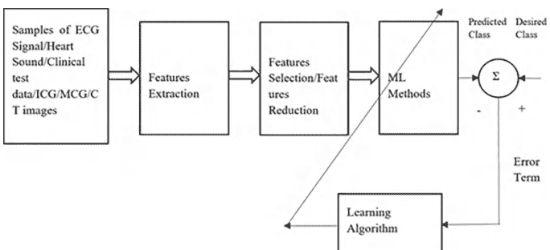

图 5.1 基于 ML 的 CVD 检测模型的通用框图。

### 5.5.2 基于 DL 的 CVD 检测器

为了获得更好的分类效果而获取所需特征是一项复杂的任务。如果所选特征不合适，分类准确率会下降。为了缓解这一问题，文献中报道了基于 DL 的分类器，它们本质上完成两项主要任务：特征提取和分类。通用基于 DL 的分类器的框图如图 5.2 所示。正如可以明显看出，单个块同时包含特征提取和分类器。例如，对于 CNN 分类器，一组卷积操作提取所需特征。池化操作减小特征向量的大小。

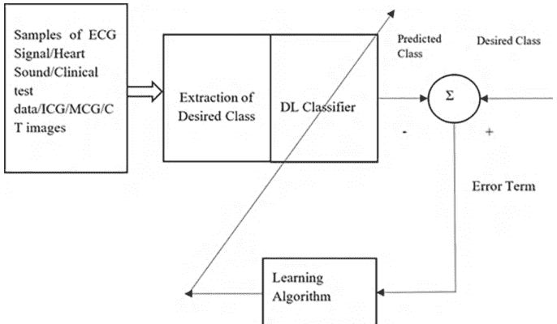

图 5.2 基于 DL 的 CVD 检测模型的通用框图。

### 5.5.3 基于 IoT 平台的 CVD 检测分类器

基于 IoT 平台的 CVD 检测模型如图 5.3 所示。第一个块包含从偏远地区患者处获得的直接非侵入式测试信号。提取的信号（ECG/声音信号/ICG/MCG/CT 图像）被离散化，样本通过传感器网络和网关传送到云数据中心。同样，样本通过预处理块，该块包含低通滤波器，随后是基于小波变换的去噪器。预处理后的数据随后用于提取特征，并随后用于 CVD 的分类。

### 5.5.4 基于 CVD 检测的集成分类器

通常，当使用某些标准数据集或不平衡数据集时，单个 ML 或 DL 方法达到的准确率可能不高。在这种情况下，如果 CVD 分类准确率需要

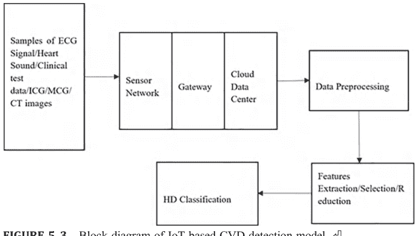

提高，则需要开发和使用集成模型，通过适当融合两个或三个分类器的预测输出。图 5.4 显示了集成 CVD 检测模型的通用框图。首先，使用标准心脏病数据集的特征分别训练两个 ML/DL 模型。这些训练好的 ML/DL 模型并行放置，每个单独模型的预测输出（由 W1 和 W2）加权，如图 5.4 所示。有许多方法可以优化这些权重。开发集成模型权重的一些常用方法包括

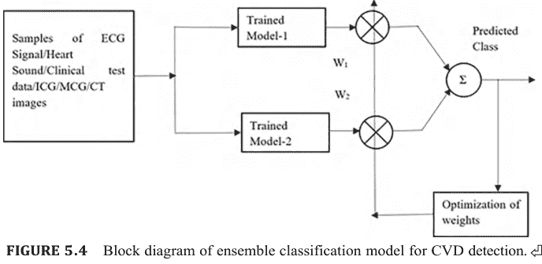

多数投票方案和基于生物启发的权重优化方案。在大多数情况下，集成模型在 CVD 检测中优于单个模型。

## 5.6 实验结果

通过使用 MIT-BIH HD 数据集模拟朴素贝叶斯（NB）、长短期记忆网络（LSTM）和生成对抗网络（GAN）模型，评估了训练和验证阶段的性能指标。此外，还使用同一数据集模拟了 LSTM-GAN 集成模型。已获得各种结果，详细内容已在参考文献 [18] 中介绍。为便于理解并开展该领域的进一步研究，本文的部分报告结果已在本节中提供。

基于 NB 的 CVD 检测模型在训练和验证阶段的准确率曲线对比如图 5.5 所示。正如预期所见，验证阶段的准确率低于训练阶段。训练过程中准确率稳步上升，直到模型训练成功后几乎达到一个恒定值。LSTM 模型的类似曲线如图 5.6 所示。对于基于 GAN 的 DL 模型，通过仿真研究得到了类似的准确率曲线，如图 5.7 所示。该曲线展示了 GAN 生成器和判别器部分的准确率对比。模型的 ROC 曲线非常重要，因为其曲线下面积（AUC）表示检测器的性能潜力。各种 ML 和 DL 模型的 ROC 曲线已通过仿真研究并使用 MIT-BIH 数据集获得。各种分类模型的比较 ROC 曲线如图 5.8 所示。同一图中还列出了每个模型对应的 AUC 值。需要注意的是，AUC 越高，模型的检测效率越好。来自仿真研究的 NB、LSTM、GAN 和 GAN-LSTM 集成模型的三个性能指标：准确率、$F_1$ 分数和 AUC 已列于表 5.6 中。从表 5.6 可以看出，GAN-LSTM 集成模型提供了最佳的分类性能，在准确率、$F_1$ 分数和 AUC 方面分别得到 0.992、0.987 和 0.984 的值。按这些性能的降序排列，第二、第三和第四名的模型分别是 GAN、LSTM 和 NB。为了评估这些模型的稳定性能，还应使用其他数据集进行仿真研究并分析结果。

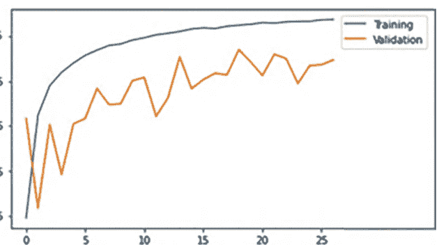

图 5.5 针对 MIT-BIH 数据集的 NB 模型准确率曲线比较 [18]。

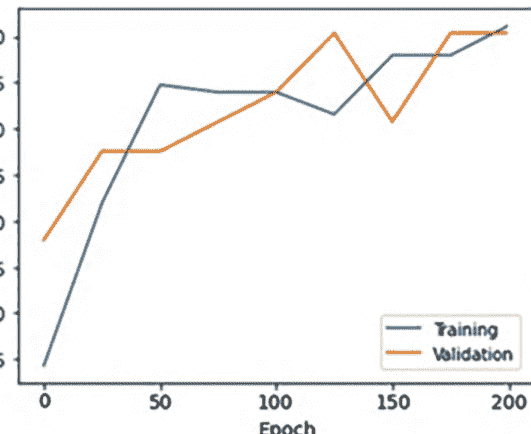

图 5.6 针对 MIT-BIH 数据集的 LSTM 模型准确率曲线比较 [18]。

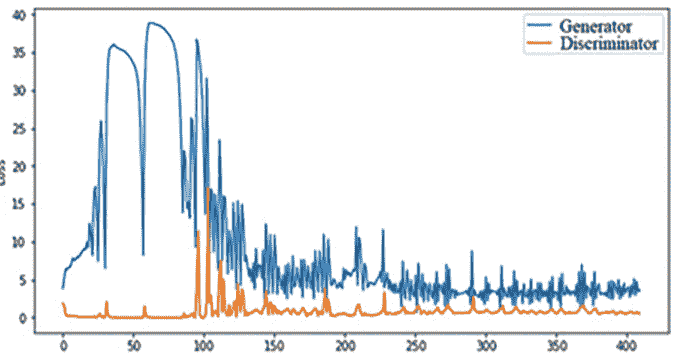

图 5.7 针对 MIT-BIH 数据集的 GAN 模型准确率曲线比较 [18]。

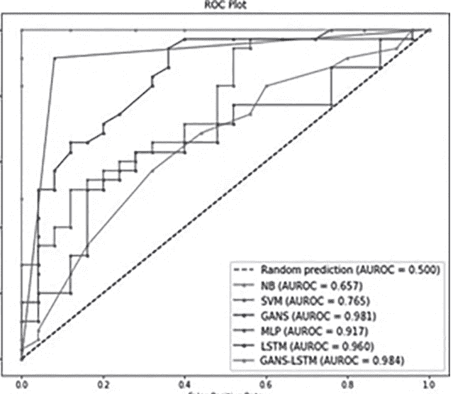

图 5.8 使用 MIT-BIH 数据集对不同模型的 ROC 曲线比较 [18]。


| 性能指标 | NB | LSTM | GAN | GAN-LSTM |
|---|---|---|---|---|
| 准确率 | 0.821 | 0.966 | 0.978 | 0.992 |
| F₁ 分数 | 0.817 | 0.937 | 0.975 | 0.987 |
| AUC | 0.657 | 0.960 | 0.981 | 0.984 |
| 表现最佳模型 | GAN-LSTM | | | |

## 5.7 结论与未来展望

已介绍了用于早期检测心血管疾病（CVD）的机器学习（ML）、深度学习（DL）和集成模型概览。这将有助于早期诊断，从而挽救许多生命。通过分析所呈现的仿真结果，可以证明 GAN–LSTM 集成模型优于单个深度学习模型以及机器学习模型。本章的文本以简化方式呈现，以便于有兴趣的研究人员和学习者在此重要且新兴的领域开展研究工作。要了解更多信息，各类论文的详细信息列在参考文献中。

## 关键词

- 基于 ML 的 HD 检测
- 基于 IoT 的 HD
- 基于 ECG 样本的 HD 检测
- 基于 ICG 的 HD 检测

## 参考文献

1. Rath A, Mishra D, Panda G 等. 心脏病机器学习与深度学习诊断的详尽综述. 多媒体工具与应用 2022;81:36069–36127.
2. Raj S. 用于远程实时心脏活动监测的高效基于 IoT 的平台. IEEE 消费电子汇刊 2020;66:106–114.
3. Kwak C, Kwon OW. 使用杂音可能性和隐马尔可夫模型状态可能性的心音信号心脏失调分类. IET 信号处理 2012;6:326–334.
4. Dash TK, Mishra S, Panda G 等. 使用生物启发型倒谱特征从语音信号中检测 COVID-19. 模式识别 2021;117:107999.
5. Al-Makhadmeh Z, Tolba A. 使用高阶玻尔兹曼模型利用 IoT 可穿戴医疗设备进行心脏病预测：一种分类方法. 计量 2019;147:106815–106815.
6. Guo C, Zhang J, Liu Y 等. 用于医疗物联网平台心脏病检测的带改进线性模型的递归增强随机森林 (RERF-ILM). IEEE Access 2020;8:59247–59256.
7. Dash TK, Solanki SS, Panda G. 使用生物启发和 ANN 技术的改进相位感知语音增强. 模拟集成电路和信号处理 2020;102(3):465–477.
8. Sengur A. 用于诊断心脏瓣膜疾病的基于线性判别分析和自适应神经模糊推理系统的专家系统. 专家系统与应用 2020;35:214–222.
9. Ali SA, Raza B, Malik AK 等. 基于 ruzzo-tompa 和堆叠遗传算法的心脏病预测的最优配置和改进的深度置信网络 (OCI-DBN) 方法. IEEE Access 2020;8:65947–65958.
10. Nilashi M, Ahmadi H, Minaf AA 等. 通过自组织映射和带增量更新的模糊支持向量机进行冠心病诊断. 模糊系统国际期刊 2020;22:1376–1388.
11. Dash TK, Solanki SS. 噪声语音噪声级分类中输入特征效应的研究. 科学与工业研究杂志 2019;78(12):868–872.
12. Li JP, Haq AU, Din SU 等. 电子医疗中使用机器学习分类的心脏病识别方法. IEEE Access 2020;8:107562–107582.
13. Liu Y, Guo X, Zheng Y. 基于心音特征的 HFpEF 识别的使用 ELM 分类器的自动方法. 医学系统杂志 2019;43:1–8.
14. Kwon JM, Kim KH, Jeon KH 等. 基于超声心动图的心脏病患者院内死亡率预测的深度学习. 超声心动图 2019;36:213–218.
15. Shuvo SB, Ali SN, Swapnil SI 等. CardioXNet：用于使用心音记录进行心血管疾病分类的新型轻量级深度学习框架. IEEE Access 2021;9:36955–36967.
16. Latif S, Usman M, Rana R 等. 使用深度学习进行异常心跳检测的心音图传感. IEEE 传感器期刊 2018;18:9393–9400.
17. Wang H, Shi H, Chen X 等. 用于自动心跳分类的改进卷积神经网络方法. 医学系统杂志 2020;44:35–35.
18. Rath A, Mishra D, Panda G 等. 使用深度学习方法从不平衡 ECG 样本中检测心脏病. 生物医学信号处理与控制 2021;68:102820–102820.
19. Faust O, Shenfield A, Kareem M, San TR, Fujita H, Acharya UR. 生物学和医学中的计算机. 2018;102:327–335.
20. Wolterink JM, Leiner T, Viergever MA 等. 用于低剂量 CT 噪声降低的生成对抗网络. IEEE 医学成像汇刊 2017;36:2536–2545.
21. Wang J, Liu C, Li L 等. 用于冠心病非侵入式检测的基于 Stacking 的模型. IEEE Access 2020;8:37124–37133.
22. Tuli S, Basumatory N, Gill SS, Kahani M, Arya RC, Wander GS, Buyya R. HealthFog：用于集成 IoT 和雾计算环境中心脏病自动诊断的基于集成深度学习的智能医疗保健系统. 未来生成计算机系统 2020;104:187–200.

# 医疗保健领域人工智能的应用：利益与挑战

RAM SINGH¹*, ROHIT BANSAL², and NIRANJANAMURTHY M.³
¹银行、金融服务与保险管理学院，Symbiosis University of Applied Sciences, Indore, India
²管理学院，Vaish Engineering College, Rohtak, Haryana, India
³计算机应用系，MS Ramaiah Institute of Technology, Bangalore, Karnataka, India
*通讯作者

## 摘要

人工智能（AI）的进步在当前商业中无处不在，日常生活也在持续地被应用于临床考量；AI 在临床考量中的使用可以帮助临床受益提供者在患者护理和行政周期的各个方面。大多数 AI 和医疗服务进步对医疗保健领域具有强大相关性，但它们支持的策略可能截然不同；而且尽管一些关于医疗保健中 AI 的文章表明，在医疗保健中使用 AI 可以在特定技术（例如诊断疾病）方面与人类一样出色或更出色，但在医疗保健中 AI 在广泛范围的临床任务中取代人类之前，将需要无数年。本章介绍了 AI 及其在医疗保健领域的应用、优势和挑战，并且还探讨了可从其使用中获得的几种不同类型的人工智能和医疗保健益处。

## 6.1 引言

“人工智能”术语首次于 1956 年在 Dartmouth College 的一次聚会上提出。1956 年至 1974 年间，AI 研究主要集中在解决数学和代数问题以及开发能够理解自然语言的系统上。1980 年至 1987 年间，专家系统流行起来——这些是基于专业知识设计用于回答问题或解决问题的程序。

对 AI 的兴趣曾一度下降，但于 1997 年因 IBM 的国际象棋电脑 Deep Blue 击败俄罗斯大师加里·卡斯帕罗夫而复苏。从那以后，几乎每一家主要科技公司以及参与医学研究或临床试验的科学机构都在追求用于诊断和治疗的 AI 驱动预测和处方工具。根据技术研究公司 Gartner 的数据，预计到 2021 年，75% 的医疗保健组织将投资于 AI 能力以提高整体性能。

AI 驱动的医疗工具为医生和患者提供了显著益处，并适用于广泛的医疗保健领域。除医学之外，AI 在金融、交通和制造等行业有众多应用，并正在改变企业做决策和处理复杂问题的方式。AI 技术用于对象、面部、语音和手写识别；虚拟现实和图像处理；自然语言处理、聊天机器人和翻译；电子邮件垃圾邮件过滤、机器人和数据挖掘等领域。根据市场情报公司 Tractica 的数据，到 2025 年，全球年度 AI 收入预计将增长至 368 亿美元。

### 6.1.1 人工智能

人工智能（AI）是指教导机器像人类一样思考和行动。它也可以用来描述任何表现出类人特征（如学习和解决问题）的机器。AI 的最佳特质是其做出决策并采取行动以实现目标的能力，而 AI 的一部分称为机器学习，意味着计算机可以学习并随


在没有他人帮助的情况下自主学习。重要的学习方式通过摄入大量无序信息（如文本、图像或视频），使个性化学习成为可能。

## 6.1.2 医疗保健行业

考虑医院内患者问题可能是最重要的领域，无论是从可创造的收益，还是从必须投入的工作量来看。临床考量包括医院、医疗工具、基础医疗、复诊预约、虚拟医生就诊、医疗旅游、健康保险和医疗用品。由于越来越多人使用医疗服务，印度的医疗保健行业正在快速增长。它主要分为公共和私营两个部分。政府在农村地区和一些城市提供基础医疗服务，而私营部门在城市和城镇提供更先进的医疗服务。印度拥有众多经验丰富的医生。与亚洲和西方其他国家相比，印度的医疗更便宜，且情况有所不同。在印度做一次手术大约比在西欧便宜10倍。预计到2025年，印度医疗保健行业将达到1938.3亿美元。收入增加、医疗保健改善、因生活方式导致疾病的人数增多，以及更多人能够获得保险，都是推动进步的重要因素。印度的医疗服务正在变得更加强大。2020财年，提供医疗服务所产生的收入增长了17.16%，达到7390亿美元。根据2020–2021年经济环境调查，2020财年医疗保险行业获得保险覆盖的人数有所增加。在2020财年，比哈尔邦、阿萨姆邦和锡金邦获得医疗服务的家庭增加了89%。2016年，该国共有393所阿育吠陀政府学校和221所顺势疗法政府学校。2020年4月，共有169,031个次级中心和33,987个初级卫生中心。预计到2022年，业务规模将达到3720亿美元。

## 6.1.3 AI 和机器学习

AI 是医疗保健中常用的一种机器学习类型。它是许多 AI 和医疗保健技术方法的核心，并有不同版本。在医疗保健中使用 AI 时，传统 AI 最常见的用途是精准医疗。能够根据患者特征和治疗计划预测哪种疗法效果最佳，对许多医疗保健组织来说是一大进步。医疗保健中的大多数 AI 应用（包括用于精准医疗的应用）都需要大量数据进行学习——从而能够准确预测结果并支持临床决策。这称为监督学习。医疗保健中使用深度学习的 AI 也用于语音识别，即自然语言处理（NLP）。简化版：医疗保健中的 AI 使用深度学习进行语音识别，称为 NLP。复杂的深度学习模型通常具有对人类观察者不重要的特征，因此如果没有正确的解释，很难理解模型的结果。

### 6.1.3.1 自然语言处理

理解人类语言一直是超过50年来计算机技术和医疗保健创新的目标。许多自然语言处理（NLP）系统使用技术来理解和分析文本，并将其翻译。AI 在医疗保健中用于帮助理解和组织医疗记录。这项技术可以分析患者病历，改善患者的护理质量和结果（图 6.1）。

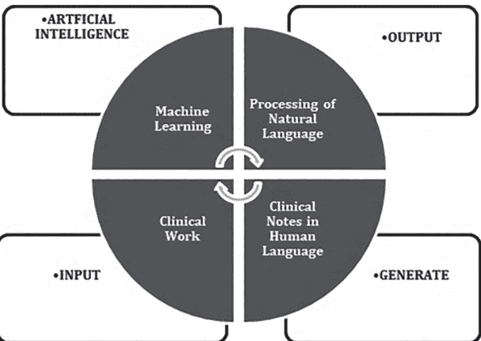

图 6.1 NLP 框架。来源：作者汇编。

### 6.1.3.2 基于规则的专家系统

先进系统依赖不同的 if-then 规则集，作为 1980 年代及以后医疗保健中 AI 的主要技术。即使在今天，AI 也被广泛用于医疗保健，帮助医生做出临床决策。许多电子健康记录系统（EHR）目前随其软件产品提供一套指南。主框架通常需要专家和设计人员在特定知识领域创建一套规则。它们在一定程度上效果良好，且易于遵循和衡量。随着规则数量的增加——尤其是超过几千条时——它们可能会相互冲突，导致系统崩溃或可靠性降低。此外，如果某个领域的规则发生重大变化，更新可能既困难又不公平。AI 正开始使用先进算法来解释数据，从而在医疗护理中取代基于规则的系统。

## 6.2 AI 与医疗保健

说医疗保健中 AI 的工作“有趣”还算是轻描淡写。AI 和机器学习可以改变医疗服务的提供方式。仍存在挑战，但这项技术的潜力巨大，以至于政府、医院和服务提供商应该投资于 AI 驱动的解决方案。从今天起，AI 和机器学习已准备好帮助医疗保健提供者使工作更高效、更具成本效益。进步正在通过使查找重要信息以进行决策和为患者提供更好的护理变得更容易、更快速，从而改变医疗服务。在医疗保健中使用 AI 可以使组织使用起来更便宜、更好。根据首席信息官的说法，AI 技术正在为医疗保健中的整个患者旅程带来重大变化。医疗保健中 AI 的使用着重于提高医疗保健提供者的效率和效果，并为住院患者和门诊患者提供更好的体验。它还有助于使后端流程更加有效和有组织。然而，医疗保健中 AI 的使用目前还不十分普遍，但我们希望很快改变这一现状。以下是 AI 和机器学习目前在医疗保健中的一些应用方式。

### 6.2.1 诊断和治疗应用

在过去50年中，医疗保健中的 AI 一直专注于查找和治疗疾病。遵循某些标准的早期框架能够准确分析和治疗感染，但在医疗护理中未被广泛接受。早期 AI 系统在诊断疾病方面并不比人类临床医生准确得多，而且通常无法与临床工作流程和电子健康记录（EHR）系统顺利集成。无论 AI 工具是基于规则的还是算法驱动的，由于难以与医疗保健专业人员的日常实践保持一致，以及受现有 EHR 平台技术限制，实施 AI 进行诊断和治疗规划仍然具有挑战性。与将 AI 融入医疗护理相关的问题，比这些理念的准确性构成了更大的障碍。大部分用于诊断和治疗患者的 AI 仅限于特定的护理领域，并来自特定的软件公司。一些销售 EHR 软件的公司开始在其产品中添加简单的 AI 医疗分析功能，但这仍处于早期阶段。要在独立 EHR 系统中使用 AI 进行医疗保健，公司必须要么自行进行大型集成项目，要么使用具备 AI 技能并能与其 EHR 协作的外部供应商。

### 6.2.2 行政应用

AI 可用于医院的管理和患者护理。但是，在医院使用 AI 并不像用于患者护理那样具有革命性。然而，医院行政管理中的 AI 可以带来重要的节约。计算机可以以多种方式支持医疗保健，包括处理保险索赔、管理患者记录和处理财务运营。AI 可用于医疗保健中，以整合不同数据库中的信息，用于病例和付款管理。担保人和供应商需要确保每天提交的众多病例准确无误。查找和修复编码问题和错误可以为每个人节省时间、金钱和资源。

### 6.2.3 促进医疗诊断

诊断错误导致约10%的患者死亡，并占所有医院并发症的6%至17%。尽管大多数医疗服务提供者（医疗保健专业人员 [HCPs]）非常有才华，但从各种角度来看，人类心智仍然充满不确定性。


作为 Beth Israel Deaconess 医学中心癌症研究所生物信息学主任 Andrew Beck 指出的那样：“确定患者淋巴结中是否存在转移性疾病，对病理学家来说是一项常规但至关重要的任务。使用传统方法，在显微镜下检查成千上万个正常细胞以识别仅有的少数恶性细胞，可能极其枯燥且充满挑战。”这就是 Beck 和他的团队构建一种机械化诊断工具的原因，该工具利用深度学习算法来区分恶性细胞和非癌细胞。在 2016 年的评估中，一种数字诊断工具达到了 92% 的成功率，仅比人类病理学家低四个百分点。此外，当 Beck 的团队将人类病理学家的调查与该机械化设备的检查相结合时，诊断成功率提高到显著的 99.5%。最终，Beck 认为他的分析仅仅是开始触及混合方法——结合人类专业知识和算法方法——可以为临床诊断提供的内容。他表示：“我们的结果表明，计算机所做的相当智能，而人类和机器解读的结合将导致更准确、更具临床意义的诊断，以指导治疗决策。”

## 6.2.4 改善医疗营销

当患者接受检查后，下一步是寻找能够治愈或可能缓解其病症影响的治疗方案。医疗专业人员（HCPs）显然对患者采用哪种支持性方案有重大影响；然而，直接面向患者的沟通——例如询问 X 药物——的重要性不容低估。不幸的是，制药行业往往最终与其核心受众背道而驰。事实上，一项研究发现，多达 45% 的患者认为制药公司不了解他们的真实需求。这与日常临床诊断面临的挑战类似，这种脱节主要是一个规模问题。在这个时代，监测患者行为是提供相关、个性化指导的第一步。这涉及从广泛的数据集中收集信息，包括临床数据——如医院记录、化验结果和医疗保健提供者笔记——以及媒体偏好、在线活动和人口统计信息等一般数据。然后，医疗营销人员必须从收集到的数据中提取有意义的叙述和见解，换句话说，就是“连接各个要点”，不仅要做一次，而是在整个营销活动过程中持续进行。有效地大规模执行这种数据驱动策略需要非凡的计算能力。即使是最熟练、经验最丰富的营销团队，也无法组织和分析有效患者定位所需的海量数据点。这就是 AI 驱动的预测分析工具变得不可或缺的地方。通过利用训练有素的预测算法，营销团队可以深入了解其目标患者人群的数据驱动洞察。这些见解超越了概括性细分，能够基于对患者过去行为、个人特征以及护理旅程中当前位置的细致分析，实现沟通策略——这些模式通常过于复杂或微妙，人眼或人类思维难以察觉 [11]。

## 6.2.5 降低用药依从性不足

1988 年至 1994 年间，美国约有 38% 的成年人正在服用至少一种处方药。在随后的二十年里，这一数字上升至 49%，主要是由服用三种或更多处方药的成年人数量增加 100% 推动的。根据 2016 年 10 月提交给美国医院协会的研究，处方药的年度总支出已达到 3095 亿美元，使其成为美国医疗经济中增长最快的部分。令人警觉的是，这笔支出中有很大一部分被浪费了。据估计，美国每年开出的 32 亿张处方中，多达 50% 没有按指示服用——甚至根本没有服用。用药依从性不足每年导致超过 2500 亿美元的不必要医疗成本，约占美国年度总医疗支出的 13%。就像制药公司使用算法工具来增强患者定位一样，医疗保健提供者（HCPs）可以利用类似的人工智能系统来解决这个问题，通过识别最有依从性不足风险的患者。社会经济地位、保险覆盖范围、自付费用以及开处方医生的专业等因素，都会影响患者偏离其治疗方案的可能性。AI 算法通过分析这些复杂变量，为 HCPs 提供了一个强大的解决方案，帮助他们主动支持那些可能需要额外干预以坚持其处方疗法的患者。借助此类系统提供的深刻洞察，HCPs 可以确定哪些患者需要额外协助以坚持其治疗。实际上，改进和更有针对性的沟通本身并不是解决用药依从性不足问题的全面方案，尽管如此，在临床护理中开展的研究表明，医护人员与患者之间沟通不畅会使不依从的风险高出 19%。

## 6.2.6 虚拟健康助手

虚拟健康助手（VHA）可以以多种方式主动帮助患者。例如，VHA 可以通过提供服药提醒来支持痴呆症患者，帮助他们坚持其处方治疗。此外，VHA 可以提供管理常见疾病的指导，并根据患者的特定健康需求提供个性化的饮食建议。VHA 还可以使用数据驱动的洞察来监测患者，使医疗专业人员能够通过发送药物续方和领取提醒，与患者和药房进行互动。他们甚至可以推荐预防性健康筛查。人工智能也被用于增强临床诊断——例如，北京公司 Infervision 的 AI 辅助医学影像目前被用于改善 CT 扫描和 X 射线的解读。虚拟健康助手代表了人工智能与高级决策支持系统的融合，利用大数据、NLP 和语音识别技术。这些功能对其有效吸引和帮助患者的能力起着重要作用。语音赋能的 VHA 将通过 [9] 改变向患者提供医疗服务的方式：

- 导航电子健康记录
- 导航诊断和处方选项
- 改善对健康数据记录的访问
- 改善患者出院和后续治疗
- 改善提供者之间的沟通

接下来是五种 VHA 技术可以改善医疗机构内患者参与度的方式。

### 6.2.6.1 自动呼叫系统和交互式语音应答系统 (IVRS)

VHA 正越来越多地用于在治疗前后监测患者。通过接收即将预约的文本和语音确认，VHA 有助于减少取消并尽量减少未结账单。在临床环境中，医疗组织正在将 VHA 与互联网语音协议（VoIP）技术结合使用，这由移动设备上 AI、深度学习、NLP 和语音识别应用程序日益普及所推动。

### 6.2.6.2 M-健康应用程序

医疗保健提供者正在鼓励患者使用智能设备来监测其健康进展、进行付款并管理日常生活的许多方面。一些在 Amazon Echo 等平台上提供的、配备 VHA 的健康应用程序，会提示患者使用智能手机请求处方续方、确认预约、跟踪健康指标，并在就诊前完成表格。Fitbit 等可穿戴健身设备允许患者监测心率和血压等生命体征。这些健康参数被上传到患者门户，可以通过虚拟助手轻松访问。

### 6.2.6.3 患者门户和健康自助终端

患者健康门户的采用继续以温和的速度增长。理想情况下，这些增强了虚拟助手的在线门户将作为集中式平台，患者可以在其中确认预约、完成病史和社会史表格、更新健康记录、查看化验结果，并使用语音和文本识别技术结清未付余额。自助终端也具有通过集成 VoIP 系统收集患者信息的巨大潜力。尽管此类技术有多种形式，医疗 IT 基础设施仍必须解决与数据安全和所收集信息的完整性相关的关键问题。


### 6.2.6.4 DISCRETE DATA

VHAs 可以与患者互动并以数字方式捕获其信息，随后可利用云技术和物联网连接设备对其进行实时验证和更新。当患者与虚拟助手交互时，对药房中心的查询可以与设施数据库中的现有记录进行交叉核对。一旦所有信息得到验证，即可无缝处理并集成到 EHR 系统中，从而消除了对纸质文档的需求。

### 6.2.6.5 ANYTIME ACCESS FROM ANYWHERE

对于老年群体中的某些人来说，进行口头沟通并伴有视觉协作，无疑比电话或电子通信更可行。VHAs 可通过网站、智能手机、平板电脑和计算机访问。这些系统能够识别回访患者并回忆最近的交互 [10]。

### 6.2.7 HEALTHCARE BOTS

医疗机器人主要设计用于支持患者参与和问责。这些机器人通常集成到自适应学习应用程序中，可以通过发送定向消息和回答健康相关问题来协助患者。它们还可以通过提供药物类型和推荐剂量的信息来帮助管理药物。医疗机器人的最新进展包括学习和模仿人类对话的能力、检测情绪以实现富有同理心的互动，以及将自然语言处理、情感分析和意图挖掘等技术整合到聊天机器人脚本中。一些机器人甚至可以执行复杂的图像识别任务，以分析医学图像、手写笔记和标准化标识符。除了聊天机器人之外，医疗保健领域的其他 AI 应用程序也在开发中，用于评估心音、为老年人提供伴侣机器人、挖掘医疗记录、设计治疗方案、协助重复性工作、进行咨询、帮助药物开发，并利用视觉数据进行医疗培训。

## 6.3 POTENTIAL BENEFITS

AI 正在快速渗透到医疗保健领域，发挥着重要作用——从自动化临床实践中的重复性和常规任务到管理患者和医疗资源。随着开发者设计 AI 系统来处理这些职责，出现了若干风险和挑战。这些包括系统错误可能对患者造成的潜在伤害、对数据隐私的威胁、与 AI 问责相关的问题等。解决这些问题需要复杂的解决方案，包括开发更好的评估框架、代表性数据集、由食品药品监督管理局等监管机构推动的社区驱动监督，以及医学教育改革，以帮助提供者适应技术驱动环境中不断变化的角色。尽管仍是一个新兴领域，但 AI 有望在医疗保健系统中发挥至少四种主要作用 [1]。

### 6.3.1 BREAKING THE BOUNDARIES OF HUMAN CAPABILITIES

临床 AI 最重要的用途是执行即使最著名的医疗保健提供者也无法完成的任务。例如，Google Health 正在开发一种能够提前两天预测严重肾损伤的程序。这种早期预警系统与当前的临床实践形成对比，后者通常只在损伤发生后才发现 [2]。通过更早地识别风险，这种 AI 驱动的方法有可能显著改善患者护理——超越仅靠传统观察通常所能实现的范围。

### 6.3.2 DEMOCRATIZING MEDICAL KNOWLEDGE AND EXCELLENCE

AI 还可以帮助将专家的专业知识和表现扩展到那些可能缺乏该水平熟练度的提供者。眼科和放射学等领域已成为关注的重点领域，尤其是因为基于 AI 的图像分析在这些领域取得了显著进展。一些系统可以分析眼睛图像，提供传统上需要眼科医生才能提供的诊断洞察。借助这些工具，全科医生——甚至患者——都能得出相似的结论。这种民主化至关重要，尤其是考虑到许多地区高技能专家短缺的问题 [3]。

### 6.3.3 THE MONOTONIC AI OF AUTOMATED MEDICAL PRACTICE

AI 可以自动化许多目前需要大量临床实践才能完成的 PC 操作。供应商已投入大量精力来跟踪电子病历、接收显示并执行控制台操作，甚至在检查室中也是如此 [4]。当 AI 系统将关键信息组织到患者记录中，并促进文档、叙述和数据协调时，它们可以显著减轻提供者的行政负担。这不仅节省了时间，还通过让双方更专注于有意义的临床互动来增强提供者—患者关系。最终，它改善了双方的护理质量和整体临床体验。

### 6.3.4 PATIENT AND MEDICAL RESOURCE MANAGEMENT

最后，AI 通常在幕后运行，但在资源分配和塑造医疗保健运营方面发挥着强大的作用。例如，AI 系统可以预测哪些任务可能需要额外的支持人员，识别哪些患者最能从有限的临床资源中受益，或者——更具争议的是——优化计费策略以符合有利的报销模式。

### 6.3.5 AI FACILITATES ACCESS TO HEALTHCARE

不幸的是，许多欠发达国家在许多领域仍落后于全球技术进步，医疗保健仍然是他们最大的挑战。居住在最偏远地区的人们面临被甩在后面的更大风险，因为他们难以获取和管理全方位的医疗保健服务和技术进步。世卫组织声称，对健康服务的不平等准入导致最富裕和最不发达国家之间预期寿命存在 18.1 年的差距。AI 创新可以在构建高效且响应迅速的医疗保健生态系统方面发挥关键作用。此类数字系统帮助患者了解自身症状并获取适当的治疗。近年来，开发了大量应用程序以加强国家和国际医疗保健组织之间的合作，从而能够更快地帮助有需要的人。例如，由智能技术驱动的 Ada 应用程序在 140 多个国家可用，扩大了易受伤害人群获取医疗指导的途径。值得注意的是，Ada 在全球大流行期间发挥了重要作用，使全球各地的个人能够对传染病进行自我评估，改善早期发现和响应。

### 6.3.6 AI TOOLS HELP IDENTIFY DISEASE RISKS EARLY

因为 AI 可以收集和存储隔离地点人员的信息，所以它可以使用这些数据来查看过去和当前的疾病。这种感染复杂性的相关性使临床医生能够得出更准确的结论。该应用程序已整理各种指征、结果和具体病例，所有这些都考虑到预测个人未来疾病的可能性。由 Google 附属公司 Verily 开发的一个著名应用程序专门用于诊断非传染性和遗传性遗传疾病。此类应用程序使健康专家能够预期可能的危险并采取适当措施加以规避，从今天开始采取适当措施。此外，预测性检查改善了医疗保健机构的运营管理。

### 6.3.7 AI ALGORITHMS CAN SAVE TIME AND MONEY

在临床检查系统中使用 AI 的另一个巨大优势是，它减少了分析和诊断患者所需的时间和精力。识别预示某些疾病存在的生物标志物对于早期诊断和治疗至关重要。先进的计算使生物标志物检测中涉及的大部分手动工作自动化，大幅减少了所需时间——可能挽救生命。计算比传统的成本估算方法更有用。随着这些技术进步融入医疗保健系统，患者可能不再需要接受昂贵的实验室检测。结果是，在各个时期完成内部审计培训的注册学生人数显著增加——比前一年增长了 88%。这一日益增长的兴趣反映了 AI 在医疗保健中扮演日益重要的角色。目前，多种 AI 算法已在整个领域证明具有广泛的益处 [12]。


### 6.3.7.1 NAIVE BAYES

朴素贝叶斯计算涉及贝叶斯假设并采用概率策略。与其他分类算法相比，该算法为每个类别使用一组先验概率。当引入新数据时，它会更新这些概率以计算所谓的后验概率。当你需要预测信息是否属于给定的类别列表时，这非常有用。

### 6.3.7.2 ARTIFICIAL NEURAL NETWORKS

这是一种受动物大脑中神经连接启发的深度学习算法，能够接收来自一层的信号并将其传输到下一层。这些人工神经网络可以通过分析模式来学习，通常无需人工干预。它们的应用多种多样——从协助病理学家进行诊断到进行生化分析。人工神经网络已成为医疗保健和生物医学研究各个领域中的强大工具。人工神经网络大致分为两类：卷积神经网络（CNNs）和循环神经网络（RNNs）。成像在医学中起着至关重要的作用，因为它使医生能够在症状出现之前就检测出疾病。为了支持早期诊断，巴氏涂片、乳腺X线摄影和结肠镜检查等多种筛查技术被广泛使用。CNNs在此领域已被证明特别有价值，因为它们非常适合医学图像分析中的二分类和多分类任务。相比之下，RNNs特别适用于临床时间序列数据中的模式识别，使其成为分析患者体征或心电图读数等序列的重要工具。

### 6.3.7.3 RANDOM FOREST

随机森林用于在训练期间构建多个决策树，用于分类和回归任务，有效解决了与单个决策树相关的过拟合问题。在医疗保健中，它通常用于根据患者病史预测疾病风险，也用于心电图和MRI数据的分析。

### 6.3.7.4 DISCRIMINANT ANALYSIS

它不仅是一种用于分析项目分类充分性的人工智能计算，还用于将一个项目分配给单个或多个组别；从早期确定糖尿病周围神经病变到优化静脉图像的分析特征，判别分析在医疗保健行业得到应用。它还用于电子健康记录管理系统以及检测精神健康障碍或认知障碍的迹象。

### 6.3.7.5 LOGISTIC REGRESSION

它主要用于二元分类。这种策略允许你检查一组因素并预测确定的结果。其主要应用包括预测客户终身价值、房产估值及其他预测任务。

### 6.3.8 AI AS UNIQUE AND UNRIVALLED ASSISTANCE IN SURGERY

有效的测试和检查一直在推动AI和先进机械在医疗程序中的应用兴趣，AI手术系统使得执行最微小、最精确的动作成为可能。因此，复杂的操作在几乎没有疼痛、血液流失和低并发症风险的情况下进行。此外，在这样的手术后，患者恢复得快得多。抗菌纳米机器人的部署有助于在手术前或手术后清除患者血液中的感染。除此之外，AI使外科医生能够获得关于患者当前状况的实时数据。这些由AI驱动的工具还有助于增强患者的信心——特别是在患者对在全身麻醉下接受手术可能存在焦虑或不确定性的情况下。总体而言，外科机器人的进步预计将显著提升市场价值，预测估计到2025年将达到240亿美元。

### 6.3.9 AI HELPS AUGMENT HUMAN ABILITIES AND SUPPORT MENTAL HEALTH

患者现在不仅可以从临床工作人员那里获得帮助，还可以从机器人那里获得帮助。外骨骼机器人等技术使个人能够在不依赖护理人员的情况下再次行走。AI驱动医疗保健的另一项重大突破是开发配备传感器的智能假肢，使患者能够体验到甚至可能超越其原有功能的肢体功能。对先进假肢的需求正在上升，这在一定程度上是由美国截肢者数量预计增加所推动的，根据截肢者联盟的数据，该数字预计到2050年将达到360万。

服务机器人也在支持老年或残疾患者进行日常任务方面发挥着至关重要的作用，有助于减少孤独感。所谓的陪伴机器人和对话机器人协助管理体温、血压和血糖水平等生命体征，并提供服药提醒。这些机器人中的许多都设计有个性分析功能，以支持心理健康，为患者（特别是那些与抑郁症作斗争的患者）提供情感安慰。

## 6.4 CHALLENGES AND RISK

虽然AI提供不同的预期好处，但也存在一些风险。

### 6.4.1 INJURIES AND ERROR

与医疗保健中AI相关的一个重大风险是，错误可能导致患者伤害或其他医疗并发症。例如，如果AI系统推荐不合适的药物、未能在放射学扫描中检测出肿瘤，或错误地对患者进行急诊护理优先级排序，后果可能很严重。虽然在当今不涉及AI的医疗保健系统中也已经发生医疗错误，但AI犯下的错误可能引发独特的担忧。

首先，患者和医疗保健提供者对软件造成的伤害与人为错误造成的伤害可能有不同的反应。其次，随着AI系统被更广泛地采用，单个系统中的关键缺陷可能同时对大量患者造成伤害，而不像个体提供者错误造成的伤害范围有限那样。

### 6.4.2 DATA AVAILABILITY

构建AI框架需要来自电子健康记录、药房记录、保险索赔记录或消费者生成的数据（如健身追踪器或购买历史）等来源的大量信息；然而，健康信息通常分散在各种系统中。事实上，除了刚才提到的收集之外，患者通常会看多个提供者并更换保险公司，导致信息被分割到不同的系统和多种格式中。这种分散增加了错误的风险，减少了可用数据集的范围，并增加了数据收集的成本——进一步限制了能够有效开发医疗AI解决方案的组织类型。

### 6.4.3 PRIVACY CONCERNS

另一组风险围绕患者隐私产生。对大型数据集的需求激励开发者从各种患者那里收集大量数据，这可能引发对潜在隐私侵犯的担忧。事实上，关于主要医疗系统与AI开发者之间数据共享做法的法律案件已经提起[5]。AI还带来了独特的隐私挑战：它可以推断从未明确提供过的敏感个人信息。例如，AI系统可能会根据用户计算机鼠标移动中的细微震动检测出帕金森病的早期迹象——即使该个人从未披露过这些信息。患者可能会将此类推断视为隐私泄露，特别是当这些预测对银行或人寿保险公司等第三方可访问时。

### 6.4.4 BIAS AND INEQUALITY

医疗AI系统中存在显著的偏见和不平等风险。这些系统从其训练数据中学习，如果该数据反映了现有的偏见，AI可能会延续甚至放大这些偏见。例如，如果大部分训练数据来自学术医学中心，那么由此产生的AI在治疗很少访问此类机构的群体患者时可能效果较差。同样，如果语音识别AI用于解释临床笔记，它可能在...时表现不佳


医疗保健提供者属于训练数据集中代表性不足的种族或性别 [6]。

即使AI由熟练从业者的准确数据训练，系统性偏见仍可能持续存在。例如，研究表明，与白人患者相比，黑人患者在历史上接受的疼痛治疗较少 [7]。在这样的记录上训练的AI系统可能会继续向非裔美国患者推荐较低剂量的止痛药——这并非出于医疗必要，而是由于根深蒂固的系统性偏见。此外，用于资源分配的AI工具可能会通过根据存疑的标准，将卫生系统认为“理想性较差”或“成本效益较低”的患者分配更少资源，从而加剧差距。

### 6.4.5 专业重塑

预计AI将显著重塑医疗行业，尤其是在放射学等许多任务可实现自动化的专科领域。虽然这可以提高效率和准确性，但也引发了人们对人类专业知识随时间减少的担忧。随着提供者越来越依赖AI，他们可能会丧失识别错误和做出明智决策所需的关键技能，从而可能削弱临床判断。将AI集成与持续的人类监督相平衡，对于保持医疗能力并确保安全、有效的护理至关重要 [8]。

### 6.4.6 涅槃谬误

最后还有一种危险需要注意。AI在改善医疗保健方面潜力巨大，但也面临重大风险和挑战。涅槃谬误是指当新技术与理想化的、无瑕疵的替代方案进行不公平比较，而不是与有缺陷的现状进行比较时产生的。尽管医疗AI并非毫无缺陷，但因其局限性而采取无所作为的做法，可能会导致现有系统的许多缺陷得以延续。审慎地采用AI可能会提供一条通往有意义改进的道路。

### 6.4.7 缺乏个人参与

运行中的机器人非常真实，不会被调整为对病人产生任何同情。少数专家认为这是一种负担。与普遍看法相反，人类能力——尤其是在个人互动方面——在医疗保健中仍然超越计算机。医生与病人之间的联系对于建立信任和支持有效治疗至关重要。虽然AI工具可以协助处理常规任务和轻微错误，但它们缺乏在关键时刻所需的同理心和判断力。与机器不同，医生可以选择超越严格的协议来挽救生命。

### 6.4.8 医疗保健工作者失业率上升

由于AI已经在惊人的规模上贯穿了整个临床护理过程，如今许多过去主要由个人执行的活动都可能由机器完成。聊天机器人和机器人可以提供情感支持、监测患者健康状况，甚至可以预测癫痫发作、脓毒症或心力衰竭等问题。虽然这引发了关于工作流失的担忧，尤其是在常规岗位上，但AI不太可能在不久的将来取代医疗专业人员。然而，AI系统已经展示了从X光片中检测疾病的能力，其准确性高于某些放射科医生。

### 6.4.9 存在错误诊断的可能性

准确的诊断依赖于大量、多样化且症状相似的人群数据。如果AI系统缺乏某些人口群体的足够数据，它可能会产生错误的诊断。经验不足的临床医生可能无法识别这些错误，导致不恰当的治疗。医疗错误已经导致美国每年近20万人死亡，相关成本估计为200亿美元。训练不足的AI工具可能会进一步增加这些风险。

### 6.4.10 社会偏见

如前所述，基于AI的系统无法完全理解人类语境或社会细微差别，这可能导致偏见结果。例如，AI算法可能会向低收入患者推荐昂贵的疗养院，而忽视其财务限制。此类机构的高昂费用使患者无力继续接受治疗，而专家可以考虑患者的社会和财务状况，选择最合适的治疗方案。

## 6.5 结论

AI在医疗保健中的关键挑战不在于其能力，而在于其融入日常临床实践。随着时间的推移，临床医生可能会转向需要独特人类判断的任务。真正的失败者可能是那些不愿意与AI协作的人。

尽管前景广阔，AI也无法解决印度医疗系统中根深蒂固的问题——如资金不足、监管不善以及社会文化障碍。虽然AI和医疗物联网正在全球范围内改善生活，但印度的采用却受到薄弱的数字基础设施、分散的私营部门以及各州和医疗保健提供者之间能力不均的阻碍。

已建立的城市医院可能率先受益，从而让服务不足的地区落后。许多小型诊所仍依赖基础数字工具。通常，AI解决方案是技术驱动而非问题驱动，未能满足当地需求——尤其是在缺乏可靠互联网的农村地区。

此外，用户和开发者之间正在形成日益扩大的数字鸿沟。如果没有包容性设计以及围绕数据安全和问责制的强有力保障措施，医疗保健领域的AI可能无法做到既安全又公平。

### 关键词

- 人工智能
- 机器学习
- 自然语言处理
- 电子健康记录
- 聊天机器人
- 医疗保健

### 参考文献

- 1. Aicha AN, Englebienne G, van Schooten KS, Pijnappels M, Kröse B. 基于日常生活躯干加速度计的老年人跌倒预测深度学习. Sensors 2018;18:1654.
- 2. Aronson S, Rehm H. 建立基于基因组的精准医学基础. Nature 2015;526:336–342.
- 3. Berg S. 探索助推理论以提高药物依从性. American Medical Association: Chicago, 2018. www.ama-assn.org/delivering-care/patient-support-advocacy/nudge-theory-explored-boost-medication-adherence.
- 4. Buchanan BG, Shortliffe EH. 基于规则的专家系统：斯坦福启发式编程项目的MYCIN实验. Addison Wesley: Reading, MA, 1984.
- 5. Char DS, Shah NH, Magnus D. 在医疗保健中实施机器学习——应对伦理挑战. The New England Journal of Medicine 2018; 378:981–983.
- 6. Commins J. 护士称分心使床边时间减少25 percent. HealthLeaders, 2010. www.healthleadersmedia.com/nursing/nurses-say-distractions-cut-bedside-time-25.
- 7. Davenport TH, Dreyer K. AI将改变放射学，但不会取代放射科医生. Harvard Business Review 2018. https://hbr.org/2018/03/ai-will-change-radiology-but-it-wont-replace-radiologists.
- 8. Davenport TH, Glaser J. 即时交付进入知识管理. Harvard Business Review 2002;80:107–11, 126.
- 9. Loria K. 将AI引入放射学. Radiology Today 2018;19:10. www.radiologytoday.net/archive/rt0118p10.shtml.
- 10. Low LL, Lee KH, Ong MEH et al. 预测30天再入院：LACE指数与新加坡内科患者回归模型的性能对比. BioMed Research International 2015;2015:169870.
- 11. McKinsey Global Institute. 一个可行的未来：自动化、就业和生产力. McKinsey Global Institute, 2017. www.mckinsey.com/~/media/mckinsey/featured%20insights/Digital%20Disruption/Harnessing%20%20automation%20for%20a%20future%20that%20works%20MGI-A-future-that-works-Executive-summary.ashx.
- 12. Vial A, Stirling D, Field M et al. 深度学习和放射组学特征提取在癌症特异性预测建模中的作用：综述. Translational Cancer Research 2018;7:803–816. https://analyticsindiamag.com/top-6-ai-algorithms-in-healthcare/.

# 基于结构和配体药物设计计算方法的抗癌药物分子设计与开发

PALLAVI SINGH*, SOMYA SINHA, AKASH SRIVASTAVA, and NIVEDITA UPADHYAY

生物技术系，Graphic Era (Deemed to Be University)，德赫拉敦，乌塔拉坎德邦，印度

*通讯作者

### 摘要

科学领域的不断进步反复凸显了药物发现与设计途径中的挑战。破译具有潜在有效治疗分子能力的重要先导分子，在采用实验技术进行药物发现过程时，需要10–14年时间，平均成本为500–650亿美元。为了缩短时间跨度，并以高精度加速寻找新型先导分子的成本效益方法，已开发出计算机辅助药物设计方法，这使得从活性分子到先导分子的鉴定过程变得更加容易。在本章中，我们将重点介绍各种计算方法、这些方法的进展、目标优化、验证和分子对接中涉及的算法，以及用于计算机辅助药物设计的2D和3D QSAR。此外，我们将审查蛋白质-蛋白质相互作用的抑制剂及其通过计算实现的药效团设计，这将展示其在药物发现中的作用。我们还将

机器学习在医疗保健系统数据分析中的应用：Sudeshna Chakraborty, Jyotsna Singh, Praveen Kumar Shukla, Prasenjit Chatterjee (Ed.) © 2026 Apple Academic Press, Inc. 与CRC Press (Taylor & Francis)合出版 DOI: 10.1201/9781179643193-7


旨在详细介绍可用于系统性进行虚拟筛选、药效团优化和药物靶点验证的广泛数据库和免费在线工具。

## 7.1 引言

早期针对已知疾病的新型药物主要通过随机筛选和天然产物功效观察来发现。直到20世纪80年代，这种随机筛选方法才促成了多种重要化学物质的发现。高通量筛选（HTS）非常适合针对特定分子靶点或细胞测试独立筛选多种药物，目前正在改进这一技术。HTS在药物发现中的精髓是通过环孢素A作为免疫抑制剂的发现而被强调的 [1]。渐进地，计算机辅助药物设计（CADD）的另一个成功应用范例是在使用ALLADIN [2]软件筛选1500种化学物质的化合物库后发现吉非替尼。

为了揭示耐药机制、寻找新型抗生素，并针对已知和未知靶点设计抗生素，CADD可以与湿实验技术相结合用于新型抗生素的设计。CADD方法计算速度更快、更准确且更经济 [3]。

解读表现出细菌生存所需特定通路的新型靶点是解决抗生素耐药性的关键选择之一。研究人员仍在寻找新型抗生素来对抗已确立的靶点，计算工具已在多项研究中有效用于此目的。CADD的基本流程始于对假设性靶点的生物学鉴定，该靶点的配体结合导致抗菌作用。在SBDD中，靶点的3D结构可通过X射线晶体学、核磁共振或同源建模确定。CADD-SBDD筛选建立在此基础上 [4]。主要重点是构效关系的开发，从而进一步改进化合物，而在无法获得所需3D结构时，则采用LBDD。

CADD能提供更高的实验聚焦度，在发现新药的同时节省时间和金钱。该领域最流行且应用最广泛的方法是*体外计算机模拟*方法。这些策略通常与*体外试验*数据的收集相结合，用于构建和评估模型。这些模型已广泛应用于具有靶点亲和力的新型化合物的开发与改进，以及对吸收、分布、代谢、排泄和毒性特征以及理化表征的阐释。

基于结构的虚拟筛选（SBVS）采用评分函数来量化配体与分子靶点之间非共价接触的力，以预测两个分子之间形成稳定复合物的理想相互作用模式 [5]。因此，SBVS软件的成功或失败在很大程度上取决于评分函数。

SBVS使用多种软件包执行，每种软件基于不同的算法并产生不同的结果。在最近十年中，一种名为共识虚拟筛选的新型SBVS方法已在多项研究中广泛应用，以提高SBVS精度并最大限度地减少这些试验中产生的假阳性数量。SBVS的运作需要目标蛋白的3D结构这一绝对前提。已构建虚拟数据库来存储分子的3D结构，例如蛋白质数据库。然而，实验获取3D结构并不总是可行。在这种情况下，同源建模允许根据氨基酸序列预测蛋白质的3D结构。

## 7.2 CADD方法

- LBDD（基于配体的药物设计）
- SBDD（基于结构的药物设计）

### 7.2.1 LBDD方法

当靶点结构未知时，LBDD方法经常应用于药物设计。它首先使用ChemSketch、Schrodinger等软件构建配体，并通过添加或删除新的官能团或查找Zinc数据库等数据库生成许多随机组合，以筛选出多种已知对目标蛋白或基因具有某些生物活性的配体。构建或找到有效的配体分子后，应用QSAR（定量构效关系）方法来估计这些分子的疗效和生物活性。QSAR方法包括2D QSAR和3D QSAR [6]。2D QSAR有助于识别和量化药物的理化性质，以及这些性质对药物生物活性的影响。3D QSAR考察分子的整体3D特征，而不仅仅是单个取代基。它围绕分子的最重要特性展开，例如其整体尺寸、形状和电学性质。分子的补充在3D QSAR中至关重要。QSAR分析基于以下事实：分子的电子、几何和拓扑性质控制其化学活性、物理和生物活性（即其几何、位阻和电子性质）。在QSAR中，我们将实验已知化合物的特性相关联，以检测我们正在尝试估计其疗效的新化合物的参数。在QSAR结果中，我们经常使用生物团和生物团等术语。生物团是显示某些生物活性的结构，而与之相反，生物团是缺乏任何生物活性的化学结构 [7]。QSAR是统计学、化学和生物学等多个领域的综合体。要开发QSAR模型，必须具备三个组成部分：（1）一个实验数据集，提供对已测试的多种化学品的性质和生物活性的见解（训练集），（2）关于分子结构的数据，其中包括该组化学品的许多描述符，以及（3）统计方法，即称为化学计量学方法的方法，用于调查和验证基本相关性 [8]（图7.1）。

- 活性配体的鉴定
- 合适分子描述符的鉴定
- 建立将分子描述符与活性相关联的数学表达式
- QSAR模型的构建与验证

图7.1 解释LBDD步骤的流程图。

### 7.2.2 LBDD中的虚拟筛选

虚拟筛选是一种计算技术，用于分析大型化学化合物库以寻找新的药物候选物。它广泛用于使用计算机工具自动评估大型化合物库。虚拟筛选基于Lipinski的五条法则探索生物分子的性质。只有基于Lipinski法则具有潜力成为药物候选物的分子才会被筛选出来并在虚拟筛选结果中给出。

虚拟筛选软件可以提供非常准确的结果，因为它们基于量子和分子物理规则。我们还可以使用免费在线提供的ChemSketch软件，通过添加或删除特定官能团来改变配体并构建新形式的配体。

ChemSketch是一款功能全面的结构编辑器，拥有各种工具和功能，可提供科学和化学信息的组合 [9]。

在ChemSketch中，我们需要绘制分子结构，从InChI字符串或SMILES字符串生成结构，或从ChemDraw复制/粘贴。（InChI程序包括生成InChI键的功能，InChI键是InChI字符串的浓缩25字符表示。这种紧凑表示显著扩展了InChI编码在结构指定和搜索中的应用，尤其是在互联网上。）ChemSketch中可用的工具可让我们非常轻松地包含以下功能。

- 插入氨基酸、芳香族化合物、类固醇、糖类等预绘制模板。
- 搜索包含超过170,000个系统名称、通用名称和商品名称的字典。
- 轻松绘制反应和复杂的化学方案（包括生物转化图）。
- 使用图形模板和工具传达化学和化学生物学概念（例如，化学键类型、Lewis结构、分子轨道、Newman投影、肽序列等）。
- 以各种标准文件和格式导入和导出结构文件。

常用于查找已知配体化学结构及其属性的数据库包括PubChem数据库和Zinc


数据库。PubChem 数据库于 2004 年推出，包含小化合物生物作用的数据。在美国国家生物技术信息中心的信息检索系统中，PubChem 被组织为三个受限数据库。这些是来自 PubChem [10] 的生物检测。PubChem 还具有一个用于化学结构相似性的快速搜索工具。Zinc 数据库是一个面向可商业化获取化学品的免费虚拟筛选数据库。在可直接对接的 3D 格式中，Zinc 拥有约 2.3 亿个化合物。我们可以在一分钟内搜索类似物，因为 Zinc 包含约 7.5 亿个可购买化合物 [11]。

## 7.2.3 基于结构的药物设计方法

大部分进展已在分子生物学领域取得，并在光谱结构测定方面取得了结构性进步。这些方法学已获得超过 10 万个蛋白质的三维结构 [12]。除了数据的存储和检索外，计算生物数据分析的复杂技术也已得到充分发展。生物信息学的进步和人类基因组计划的完成，由于无数靶蛋白的可及性，为药物开发铺平了道路。已知具有治疗作用的蛋白质的三维结构有助于识别结合腔，并构成了根据其结构进行药物设计的基础。SBDD 是一种快速的先导优化和发现过程，因为它掌管受体蛋白的三维结构，并在分子层面包含疾病信息 [13]。大多数计算技术，如分子模拟、分子对接和 SBDD，最常用于 SBDD。

SBDD 是一个递归过程，因为它经过多个循环，最终得到增强的药物分子并提交给医学评审机构。通常，药物前的任何检测都涉及四个阶段：阶段 1：发现；阶段 2：开发；阶段 3：临床；阶段 4：注册。在第一阶段，会识别出有效的治疗靶点和动态配体。可利用众多计算系统将包含小分子的海量数据记录与受体蛋白的结合位点进行对接。分子的排序是基于与结合位点的静电力进行打分系统来完成的。通过利用待靶分子的三维结构，可以对结合位点的静电引力特性进行深入考察，同时考虑腔泡、变位口袋和裂隙的存在。目前使用的 SBDD 方法会考虑治疗靶点结合腔的显著特征，以便能胜任地设计新配体 [14, 15]。第二阶段涉及最佳命中化合物的合成和优化 [16]。此外，排名靠前且与待靶蛋白具有高度亲和力的化合物会在生化检测中进行体外检验。这些分子作为配体干扰重要的细胞通路，从而导致具有预期药理和治疗效果的药物的开发 [17]。实验方法用于评估识别复合物的亲和力、效力和效能等生物学特性 [12]。随后的步骤涉及确定第一阶段获得的有效配体与受体蛋白复合物的三维结构。三维结构提供了关于负责分子识别和配体结合的分子间作用力的全面证据。对配体和蛋白质复合物的结构洞察有助于分析多种结合构象、识别未知结合口袋以及配体–受体蛋白相互作用；阐明因配体结合导致的构象改变；以及进行彻底的机制研究 [18]。随着时间的推移，多次重复增强了潜在药物分子的实用性和精确性。第三阶段包括待考虑的开发候选物的临床试验。通过临床试验阶段的化合物随后会被进入最后阶段，用于将药物分发到市场上供临床使用。

## 7.2.4 SBDD 中采用的结构预测技术

在 SBDD 期间，结构预测中使用了许多技术，包括比对建模（也称为同源建模）、线程识别法和从头建模。用于蛋白质三维结构预测建模的更广泛应用的技术是同源建模 [19]。在同源建模中，我们通过选择结构已知且序列相似度为 40% 或以上的模板蛋白，来预测未知查询序列的结构。

当仅有序列数据可用时，同源建模对预测蛋白质结构非常有用。当未知结构的靶蛋白在数据库中具有结构同源物时，可以使用模板来建模靶蛋白的结构。该方法由六个基本步骤组成：

- 模板选择：使用 FASTA 和 BLAST 进行序列比对，以寻找靶蛋白的模板蛋白。序列相似度应不低于 35%。
- 靶标-模板序列比对：在找到模板序列后，使用软件 T-coffee 和 PRALINE [20] 对查询序列与模板序列进行比对。
- 模型构建：它包括两个子步骤，即骨架模型构建和环建模。
- 模型构建后，使用 SCWRL 等算法进行侧链优化。
- 构建的模型通过模型优化程序进行优化。模型优化使用能量最小化函数。我们使用 GROMOS 等软件进行模型优化。
- 模型评估通过 PROCHECK 和 WHAT IF 进行。

在预测靶标的三维结构后，通过检查立体化学特性来关联模型是至关重要的，这通过使用 Ramachandran 图 [21] 评估预测结构来完成。这有助于确定扭转角 ψ 和 φ，并有助于了解肽的结构。应用 Ramachandran 图后，预测配体将结合的靶蛋白活性位点是一个关键步骤。多种免费可用的工具和软件用于活性位点或结合腔残基预测。这些方法基于相互作用能和范德华力的评估。Q-site finder 是一种用于活性位点预测的工具。Q-site finder 是一种常用于结合位点预测的基于能量的方法 [22]。在此方法中，使用甲基探针计算蛋白质的范德华相互作用能。采用具有有利能量的那些探针。这些探针簇根据其总相互作用能进行相应放置，此外相互作用的蛋白质残基会被功能注释以确定结合位点 [23]。

## 7.2.5 实施 SBDD 的在线工具

含小分子的化合物数据库制备通常可通过合成或购买获得，其具有诸如溶解性、在水相介质中的稳定性、存在用于与靶标生物活性化合物相互作用的适当官能团以及缺乏有害和不需要的基团等必要特征。已应用各种规则来确保“药物样性”，即“Lipinski 五元规则” [24]，该规则指出药物化合物应具有小于 500 的分子量、小于 5 的 log P 值（即亲油性）、少于五个氢键供体和少于 10 个氢键受体。此外，ADMET 研究（即药物分布、吸收、排泄、代谢和毒理学特性的综合选择）在药物设计过程的早期阶段明确建议进行。为了高效地根据上述标准筛选化合物集合，各种在线服务器已在技术上得到发展。

Chembioserver 是一个公开可用的在线应用程序，用于筛选和分选尺寸较小的分子 [25]。该在线应用程序的目的是利用其主要部分来制备组分，包括基本搜索、基于毒性的过滤、高级过滤、聚类、修改后的流水线，以及使用属性图可视化化合物的属性，从而提高进入体外检测的化合物的功效和质量。FAF-Drugs2 服务器是一个公开可用的工具，用于在计算上筛选化合物，同时考虑理化性质并识别重要的功能和不需要的基团 [26]。该工具在基于 Web 的服务器版本中提供有关所选化合物属性分布的各种图表 [27]。

化合物的数据集应首先在现实视图中进行三维表示处理。此外，拟用于 SBVS 的化合物应具有角度和键长，因为它们在对接过程中可能不会被重构。此外，它


必须摆脱溶剂分子、金属和反离子等伴随残留物，所有其他化合物都需要具有价态、适宜 pH 下的质子化状态以及互变异构状态 [28,29]。与对接相关的程序包括用于配体制备的 Autodock 软件工具 [30]、MAPS [31]、分子操作环境 [32]、LigPrep、HyperChem 和 Pipeline Pilot [34]。Grinter 等人 [34] 已创建一个工作流，用于准备执行对接操作的存储库，其中包括配体制备脚本，这些脚本可免费提供给学术界 [35]。

在两种方法中，CADD 的最后也是最关键的一步是分子对接。我们将在本章下一节了解分子对接、分子对接参数、涉及能量最小化的算法以及可用于进行分子对接的在线工具。

## 7.3 分子对接

分子对接是指将潜在配体安装在靶蛋白的活性位点，并产生最低能量、最佳匹配的分子构象。对接过程中会分析各种分子参数，并通过多轮迭代，利用 Newton–Raphson、最速下降和共轭梯度等方法学来最小化能量 [36]。分子对接生成大量对接结构和构象，随后利用评分函数特征对其进行分类。评分函数基于多个参数，如自由能、拓扑性质、电子结构、复合物稳定性、结合能、均方根偏差等 [37]。

准确的配体-受体结合构象依赖于以下两条规则：

- 构象空间，有助于寻找合适的结合区域。
- 每个预测的结合能与各构象相关联。

分子对接是一个多阶段过程，在达到最低能量状态时完成，在此过程中，通过各种评分函数检查配体结合情况。分子对接的目标是考察具有特定配体的基因组与已知 3D 结构靶标之间的可行结合 [38]。

对接需要完成三个基本特征：

- 结合位点的描绘，
- 与特定结合区域的配体固定，以及
- 评估特定配体-受体复合物之间的相互作用能量 [39]。

在许多情况下，进行分子对接之前需要药效团建模作为初步步骤。药效团是具有分子结构的官能团的三维排列。药效团建模是指生成活性官能团特定构象的模型，该模型源自为靶标选定的一组已知配体 [40]。该模型取决于位阻和电子特征。它使用涵盖以下步骤的算法：输入、构象搜索、特征提取、结构表示、模式识别和评分 [41]。它通常用于为对接研究筛选先导化合物。评分函数是数学工具，用于预测两个分子对接后的结合亲和力。

### 7.3.1 对接参数

对接基于其功能包含大量输入参数。我们需要检查可及表面积、作用于每个分子的力场参数、偶极矩、受体与配体之间的立体互补性以及配体和受体的理化性质。可以通过变化以下列出的不同参数来进行对接：

- 灵活配体：用于放松输入构象；具有锚点搜索、锚点大小和扭转驱动等参数 [42]。
- 取向配体：有助于取向搜索；通过匹配完成。
- 评分配体：对取向进行评分。
- 最小化配体：它最小化构象并提高效率。
- 多配体
- 化学筛选：允许基于 3D 结构快速筛选数据。
- 随机种子：用于对随机数生成器进行播种的数字 [43]。

### 7.3.2 对接算法

对接使用不同的搜索算法，有助于预测复合物的可能构象。这些算法基于某些参数。根据受体和配体的灵活性，搜索算法分为两种类型。

*刚体对接*：在此算法中，分子构象保持刚性，并通过改变配体的各种角度取向来安装配体。它也是对接中首先使用的方法，并整合了以下提到的功能，例如固定蛋白质和配体、帮助选择具有中等能量取向的分子，并且蛋白质-蛋白质对接也通过此完成。

*灵活对接*：这是最常用的对接形式。该配体是灵活的，但受体是刚性的。首先通过优化移动坚固部分来选择配体以变得灵活。在此过程中，键角、扭转角被修改，内部几何发生改变。

- 系统搜索算法提供结构变化，并快速改变配体构象。一些系统搜索算法的示例包括构象搜索、数据库、快速形状映射等。它们进一步分类为片段和穷尽搜索算法。穷尽搜索通过在给定时间内系统旋转所有可能的键和扭转角来阐明配体形式。基于片段的算法通过从所选感兴趣配体获得的片段逐步构建配体构象来完成 [44]。
- 蒙特卡洛算法在活性位点中创建配体的随机初始构型，并根据能量和其他参数对其进行评分。此后，进行微小的新更改，新构象再次接受评分。选择评分更高的更好的构象，也称为启动最小化程序 [45]。
- 遗传算法基于种群和生物进化原理 [46]。有一组参数根据平移、旋转和构象来决定蛋白质和配体的排列。
- 禁忌搜索算法：在此过程中，对配体的当前构型进行小的更改，并根据适宜性对其进行排名 [47]。

### 7.3.3 应用于分子对接的工具和软件

不同的程序使用不同的对接算法。大多数程序基于虚拟筛选。以下是对接中使用的主要程序：

- 1. AutoDock：一种建模模拟软件，在蛋白质-配体对接中非常有效。它是一种自动化工具，有助于预测小片段如何附着于已知 3D 结构的受体。它还应用于化学机制研究、X 射线晶体学、虚拟筛选和 SBDD。它包含两个程序，一个是 DOCK，另一个是 AUTOGRID [48,49]。URL: http://autodock.scripps.edu/
- 2. AutoDockVina：这是一个免费的分子对接程序，是 Autodock 的新一代，在速度和精度方面有所提升。它在内部为原子类型计算网格，并为它们预先计算网格图。它应用于先导优化、蛋白质对接等。URL: http://vina.scripps.edu/
- 3. DOCK：一种用于多种蛋白质结构的程序，使用类似的匹配算法来构建配体结合取向 [50, 51]。它使用 UCSF DOCK 的球形配体匹配算法来生成构象。
- 4. Glide：一种配体对接程序，可预测蛋白质-配体结合。它是进行 HTS 的最佳且可行的选择 [52]。URL: http://www.schrodinger.com/glide/
- 5. FlexX：一种高通量软件 [10,53–55]。URL: http://www.biosolveit.de/FlexX/

## 7.4 CADD 在抗癌药物开发中的应用

计算方法在现代新药发现中如同及时雨。由于已知其能涵盖药物发现的所有层级，因此发现它适用于治疗一种严重疾病——癌症，因为它需要较少的劳动力、较少的资源，并且通常是一个耗时较少的过程。更多时候，计算方法学已成为与癌症治疗药物开发相关的大多数情况中一个有前途的工具。在此，列出了计算方法用于小


这些分子已被发现对癌症治疗具有功效，或正在后期阶段用于临床试验。

Crizotinib 是采用 SBDD [56, 57] 概念开发的主要药物之一。该药物被视为一种高选择性且强大的 c-Met 双重抑制剂，于 2011 年获得美国食品药品监督管理局（FDA）批准 [58]。肝细胞生长因子（一种天然配体）及其受体已知在细胞信号传导中发挥关键作用 [59]。一种名为 c-Met 的蛋白质显著上调，已在多名患者的致癌过程中被观察到 [60]，且在实体瘤和血液恶性肿瘤中检测到 c-Met 信号传导异常。因此，已被证明 c-Met 是肿瘤学中一种强大且显著的靶点。

FDA批准的药物之一阿昔替尼（Axitinib）已作为治疗肾细胞癌（RCC）的一种新疗法 [61]。该药物的开发得益于利用SBDD策略，其中阿昔替尼作为抑制剂，与血管内皮生长因子（VEGF）激酶结构域中的DFG苯丙氨酸构象结合 [62]。VEGF家族在信号传导过程中占据位置，并进而参与血管生成过程。VEGF信号传导在细胞团块中被检测到，该信号传导过程在恶性疾病的发展中发挥作用。VEGF受体在VEGF信号传导过程中作为配体。这些受体被称为酪氨酸激酶家族，即FLT₁、KDR、FLK₁和FLT₄。用泛AKT激酶抑制剂阻断这些受体的作用机制以对抗激酶家族，已被证明是开发抗血管生成药物的有效方式。更近期地，Inlyta®（阿昔替尼）与KEYTRUDA®；培布利单抗（pembrolizumab）联合使用，已获批作为抗RCC药物 [63]。此外，NVP-AUY922；Luminespib已知对肺癌肿瘤治疗具有高度强效活性，从而在一致性试验中引导细胞水平上的插入和模型等突变。

## 7.5 计算机辅助药物设计相对于实验技术的优势

与传统湿实验室技术相比，CADD具有更为优越的效果。CADD技术能以更高比例识别具有所需特性的化合物，并增加化合物克服临床前测试障碍的机会。它减少了动物实验的需求，并缩短了对数百万个分子进行高通量筛选（HTS）所需的时间。基于结构和基于配体的方法是药物发现领域中主要应用的工具，但未来在于即将到来的协同技术，如蛋白质化学计量学。组合化学与蛋白质组学的融合，在CADD时代取得了显著成果。组学技术的整合以及机器学习算法的大规模加速发展，缩短了处理时间。云计算、数据挖掘、数据管理、大数据和人工智能的进步，增强了生物数据库中的数据存储和检索能力，从而加强了虚拟筛选和分子模拟。宏基因组学和宏转录组学使得一次性分批量分析环境样本成为可能，并进一步增加了服务器上可用的批量水平基因组序列和转录组。CADD在药物设计方面遥遥领先，未来在于生物数据处理与高端计算技术的整合。

## 7.6 结论

药物发现与开发的未来在于与虚拟筛选、先导化合物识别、优化、分子对接、药效团建模和分子建模相关的CADD技术的更高进步。借助可用的数据库和工具（如2D和3D QSAR），靶标结构的鉴定、验证以及先导分子的筛选已变得更加容易。可以使用这些进步更好地对抗癌症等危及生命的疾病。仍有必要进一步开发比分子动力学模拟和蒙特卡罗方法具有更高疗效的模拟算法。

## KEYWORDS

- 高通量筛选
- 计算机辅助药物设计
- 基于结构的虚拟筛选
- 基于配体的药物设计
- 定量结构–活性关系
- 分子对接

## REFERENCES

- 1. Kania R. 基于结构的阿昔替尼设计与表征。载于 Li R, Stafford JA (Eds.), 激酶抑制剂药物：药物发现与开发. Wiley: New York, 2009.

- 2. Kapetanovic IM. 计算机辅助药物发现与开发（CADD）：计算机化学-生物学方法。Chemical Biology Interact 2008;171:165–176. https://doi.org/10.1016/j.cb.2006.12.006

- 3. Blaney J. 基于结构的设计简史：我们如何走到今天，又将走向何方？Journal of Computer-Aided Molecular Design 2012;26:13–14. https://doi.org/10.1007/s10822-011-9518-x

- 4. Kitchen DB, Decornez H, Furr JR, Bajorath J. 虚拟筛选中用于药物发现的对接与评分：方法与应用。Nature Reviews Drug Discovery 2004;3:935–949. https://doi.org/10.1038/nrd1549

- 5. Sousa SF, Fernandes PA, Ramos MJ. 蛋白质-配体对接：现状与未来挑战。Proteins 2006;65:15–26. https://doi.org/10.1002/prot.21082

- 6. Alonso H, Bliznyuk AA, Greedy JE. 结合对接与分子动力学模拟用于药物设计。Medical Research 2006;26:531–568. https://doi.org/10.1002/med.20067

- 7. De Vivo M, Masetti M, Bottegoni G, Cavalli A. 分子动力学及相关方法在药物发现中的作用。Journal of Medicinal Chemistry 2016;59:4035–4061. https://doi.org/10.1021/acs.jmedchem.5b01684

- 8. Lima AN, Philot EA, Trossini GH, Scott LP, Maltarollo VG, Honorio KM. 用于新药发现的机器学习方法的应用。Expert Opinion on Drug Discovery 2016;11:225–239.

- 9. Wilson GL, Lill MA. 计算机辅助药物设计中基于结构和基于配体方法的整合。Future Medicinal Chemistry 2011;3:735–750. https://doi.org/10.4155/fmc.11.18.

- 10. Ferreira LG, dos Santos RN, Oliva G, Andricopulo AD. 分子对接与基于结构的药物设计策略。Molecules 2015;20:13384–13421. https://doi.org/10.3390/molecules200713384

- 11. Anderson AC. 基于结构的药物设计过程。Chemical Biology 2003;10:787–797. https://doi.org/10.1016/j.chembiol.2003.09.002.

- 12. Ferreira LG, Dos Santos RN, Oliva G, Andricopulo AD. 分子对接与基于结构的药物设计策略。Molecules 2015;20(7):13384–421. https://doi.org/10.3390/molecules200713384. PMID: 26205061; PMCID: PMC6332083.

- 13. Liona E, Spyrou G, Vassilatis DK, Cournia Z. 用于药物发现的基于结构的虚拟筛选：原理、应用与最近进展。Current Topics in Medicinal Chemistry 2014;14(16):1923–38. https://doi.org/10.2174/1568026614666140929124445. PMID: 25262799; PMCID: PMC4443793.

- 14. Mandal M, Boese B, Barrick JE, Winkler WC, Breaker RR. 核糖开关控制枯草杆菌及其他细菌中的基本生物化学途径。Cell 2003;113:577–586.

- 15. Wilson GL, Lill MA. 计算机辅助药物设计中基于结构和基于配体方法的整合。Future Medicinal Chemistry 2011;3(6):735–750.

- 16. Urwyler S. C类G蛋白偶联受体的变构调节：从分子见解到治疗视角。Pharmacological Reviews 2011;63(1):59–126.

- 17. Zhao Y, Wang L, Jin Y, Shi S. Fas配体调节牙髓干细胞的免疫调节特性。Journal of Dental Research 2012;91(10):948–954.

- 18. Lipinski CA. 避免投资于注定失败的药物。Current Drug Discovery Technologies 2001;1:17–19.

- 19. Liona E, Spyrou G, Vassilatis DK, Cournia Z. 用于药物发现的基于结构的虚拟筛选：原理、应用与最近进展。Current Topics in Medicinal Chemistry 2014;14:1923–1938.

- 20. Kalyaanamoorthy S, Chen YP. 用于增强先导化合物发现的基于结构的药物设计。Drug Discovery Today 2011;16:831–839. https://doi.org/10.1016/j.drudis.2011.07.006.

- 21. Tollenare JP. 基于结构的配体设计和分子建模在药物发现中的作用。Pharmacy World & Science 1996;18(2):56–62.

- 22. Plewcziński D, Lazniewski M, Augustyniak R, Ginalski K. 我们能信任对接结果吗？对PDB bind数据库中七种常用程序的评估。Journal of Computational Chemistry 2010;32(4):742–755. https://doi.org/10.1002/jcc.21643.

- 23. Jones G, Willett P, Glen RC, Leach AR, Taylor R. 灵活对接遗传算法的开发与验证。Journal of Molecular Biology 1997;267(3):727–748.

- 24. Athanasiadis E, Cournia Z, Spyrou G. ChemBioServer：用于药物发现中化学化合物筛选、聚类和可视化的基于Web的流水线。Bioinformatics 2012;28(22):3002–3003. https://doi.org/10.1093/bioinformatics/bts551. Epub 2012 Sep 8. PMID: 22962344.

- 25. Lagorce D, Sperandio O, Galons H, Miteva MA, Villoutreix BO. FAF-Drugs2：用于辅助药物发现和化学生物学项目的免费ADME/tox筛选工具。BMC Bioinformatics 2008;9:396. https://doi.org/10.1186/1471-2105-9-396. PMID: 18816385; PMCID: PMC2561050.

- 26. Lagorce D, Maupetit J, Baell J, Sperandio O, Tufféry P, Miteva MA, Galons H, Villoutreix BO. FAF-Drugs2服务器：用于准备电子化学化合物集合的多步引擎。Bioinformatics 2011;27(14):2018–20. https://doi.org/10.1093/bioinformatics/btr333. Epub 2011 Jun 2. PMID: 21636592.

- 27. Sadowski J, Rudolph C, Gasteiger J. 宿主-客体3D模型的生成。Analytica Chimica Acta 1992;265:233–241. https://doi.org/10.1016/0003-2670(92)85029-6.

- 28. Kalliokoski T, Salo HS, Lahtela-Kakkonen M, Poso A. 配体同构体和偶极体预测对基于结构的虚拟筛选的影响。Journal of Chemical Information and Modeling 2009;49(12):2742–8. https://doi.org/10.1021/ci900364w. PMID: 19928753.

- 29. Morris GM, Huey R, Lindstrom W, Sanner MF, Belew RK, Goodsell DS, Olson AJ. AutoDock4和AutoDockTools4：具有选择性受体灵活性的自动对接。Journal of Computational Chemistry 2009;30(16):2785–91. https://doi.org/10.1002/jcc.21256. PMID: 19399780; PMCID: PMC2760638.

- 30. MAPS，版本 3.4。巴黎，法国：Scienomics SARL；2014.


- 31. 加拿大 H3A 2R7：蒙特利尔，QC。分子操作环境（MOE）圣西大道，#910套房。2013.
- 32. LigPrep. 纽约，纽约：Schrödinger, LLC；2013.
- 33. HyperChem. HyperCube, 盖恩斯维尔，佛罗里达州.
- 34. Grinter SZ, Yan C, Huang SY, Jiang L, Zou X. 大规模文件制备、对接和评分自动化：使用2012年群体构效活性资源基准评估ITScore和STScore. 化学信息与建模杂志 2013;53(8):1905–14. https://doi.org/10.1021/ci400045v. 2013年5月21日在线出版. PMID: 23656179; PMCID: PMC3755023.
- 35. Kung PP, Jones RA, Richardson P. 克唑替尼（Xalkori）：非小细胞肺癌的首创ALK/ROS抑制剂. John Wiley & Sons, 2015.
- 36. Jiang F, Kim SH. “软对接”：分子表面立方体的匹配. 分子生物学杂志 1991;219(1):79–102.
- 37. Alonso H, Bliznyuk AA, Gready JE. 药物设计中对接与分子动力学模拟的结合. 药物研究评论 2006;26(5):531–568.
- 38. Subramanian J, Sharma S, B-Rao C. 基于结构的药物设计中柔性蛋白的建模与选择：p38 MAPK中的主链和侧链运动. 化学医药化学 2008;3(2):336–344.
- 39. Diller DJ, Merz KM Jr. 用于库设计和库优先级排序的高通量对接. 蛋白质 2001;43(2):113–124.
- 40. AskMayoExpert. 宫颈癌（成人）. 医疗教育与研究梅奥基金会：罗切斯特，明尼苏达州，2019.
- 41. Lobo RA et al. 宫颈恶性疾病. 在《全面妇科学》中. 第7版. 费城，宾夕法尼亚州：Elsevier; 2017. https://www.clinicalkey.com. (访问日期：2019年6月14日).
- 42. Niederhuber JE et al. 编. 宫颈、外阴和阴道癌. 在《阿贝洛夫临床肿瘤学》中. 第6版. Elsevier: 费城，宾夕法尼亚州，2020. https://www.clinicalkey.com. (访问日期：2019年6月14日).
- 43. AskMayoExpert. 他莫昔芬与CYP2D6（药物基因组学）. 医疗教育与研究梅奥基金会：罗切斯特，明尼苏达州，2017.
- 44. Toledo E et al. PREDIMED试验中高心血管风险女性的地中海饮食与侵袭性乳腺癌风险. JAMA内科医学 2015;175:1752.
- 45. 乳腺癌预防—患者版本（PDQ）. 国家癌症研究所. https://www.cancer.gov/types/breast/hp/breast-prevention-pdq. (访问日期：2017年6月28日).
- 46. Pruthi S et al. 高风险乳腺癌患者远程医疗咨询项目的成功实施. 梅奥诊所学报 2013;88:68.
- 47. Pruthi S（专家意见）. 梅奥诊所：罗切斯特，明尼苏达州，2017.
- 48. Warner KJ. Allscripts EPSi. 梅奥诊所：罗切斯特，明尼苏达州，2019.
- 49. Anders CK et al. ER/PR阴性、HER2阴性（三阴性）乳腺癌的流行病学、风险因素和临床处理方法. https://www.uptodate.com/contents/search. (访问日期：2019年5月3日).
- 50. Flint PW et al. 口腔恶性肿瘤. 在《卡明斯耳鼻喉科：头颈外科》中. 第6版. Saunders Elsevier: 费城，宾夕法尼亚州. 2015. https://www.clinicalkey.com. (访问日期：2018年11月28日).
- 51. Born J, Manica M, Oskoei A, Rodriguez Martinez M. PaccMannRL: 通过强化学习从转录组数据设计抗癌药物. 康奈尔大学出版社：纽约，2019.
- 52. Chan HCS, Wang J, Palczewski K, Filipsek S, Vogel H, Liu ZJ et al. 探索G蛋白偶联受体的新配体结合位点. 化学科学 2018;11. https://doi.org/10.1039/C8SC01680A
- 53. Chan HCS, Shan H, Dahoun T, Vogel H, Yuan S. 通过人工智能推进药物发现. 药理学趋势 2019;592–604. https://doi.org/10.1016/j.tips.2019.06.004
- 54. Chen X, Yan CC, Zhang X, Zhang X, Dai F, Yin J, et al. 药物-靶点相互作用预测：数据库、网络服务器和计算模型. 生物信息学简报 2016;696–712. https://doi.org/10.1093/bib/bbw066
- 55. Eskiler GG. 塔拉唑帕尼用于治疗BRCA阳性乳腺癌. 今日药物. 2019;459–467. https://doi.org/10.1358/dot.2019.55.7.3015642
- 56. Cui JJ, Tran-Dube M, Shen H, Nambu M, Kung PP, Pairish M, et al. 克唑替尼（PF-02341066）的结构基础药物设计，一种强效且选择性的双重抑制剂，针对间充质上皮转化因子（c-MET）激酶和间变性淋巴瘤激酶（ALK）. 药物化学杂志 2011;6342–6363. https://doi.org/10.1021/jm2007613
- 57. Cui JJ, Metigue M, Kania R, Edwards M. 病例研究：Xalkori™（克唑替尼），一种用于癌症治疗的强效且选择性的双重抑制剂，针对间充质上皮转化（MET）和间变性淋巴瘤激酶（ALK）. 药物化学年度报告 2013;421–434. https://doi.org/10.1016/b978-0-12-417150-3.00025-9
- 58. Christensen JG, Burrows J, Salgia R. C-Met作为人类癌症靶点及治疗干预抑制剂的表征. 癌症信使 2005;225:1–26. https://doi.org/10.1016/j.canlet.2004.09.044
- 59. Liu X, Yao W, Newton RC, Scherle PA. 针对癌症治疗的c-MET信号通路. 实验性药物专家意见 2008;17:997–1011. https://doi.org/10.1517/13543784.17.7.997
- 60. Meadows KL, Hurwitz HI. 临床中的抗-VEGF疗法. 科尔德斯普林港医学前沿 2012;2:27. https://doi.org/10.1101/cshperspect.a006577
- 61. Kania RS, Bender SL, Borchardt AJ, Cripps SJ, Hua Y, Johnson MD, et al. 用于抑制蛋白激酶的吡唑化合物及药理学组成物及其使用方法. 2016.
- 62. Atkins MB, Plimack ER, Puzanov I, Fishman MN, McDermott DF, Cho DC, et al. 晚期肾细胞癌患者阿昔替尼联合帕博利珠单抗：一项非随机、开放标签、寻找剂量和剂量扩展的Ib期临床试验. 肿瘤学柳叶刀 2018;19:405–415. https://doi.org/10.1016/S1470-2045(18)30081-0
- 63. Rong B, Yang S. 肺癌中Hsp90的分子机制与靶向治疗：新发现与进展（综述）. 国际肿瘤杂志 2018;52:321–336. https://doi.org/10.3892/ijo.2017.4214


## Taylor & Francis
Taylor & Francis Group
http://taylorandfrancis.com

# 智慧医疗系统：当前时代的迫切需求

ANUPAMA SHARMA¹, PRASHANT SRIVASTAVA¹, PRATEEK CHAURASIA¹, SHWETA ROY²*, and SANDHYA AVASTHI²

¹信息技术系，阿贾伊·库马尔·加尔格工程学院，加济阿巴德，北方邦，印度
²计算机科学与工程系，ABES工程学院，加济阿巴德，北方邦，印度

*通讯作者

## 摘要

智慧医疗系统是当前医疗状况的迫切需求。借助智慧医疗记录，医疗服务可以以系统和成功的方式进行管理。整合智慧区块链、人工智能增强和物联网（IoT）支持的医疗系统有助于医生将更多时间用于患者护理，并减少他们搜索临床信息的需求。在当今世界，患者需要出国就医以获得更好的治疗，但在治疗过程中他们面临许多问题；智慧医疗记录可能有助于减少此类问题。在医疗框架内，区块链网络充当跨医院、诊断实验室、制药公司和医疗从业者存储和交换患者数据的平台。区块链应用能够准确识别关键欺诈活动。它提供了一种独占的数据存储框架，确保最大安全性，缓解有关数据篡改的担忧。本章回顾了当今时代智慧医疗系统的迫切需求、构建此类智慧医疗系统所涉及的技术、产生智慧医疗系统的当前研究工作，以及增强此类系统以获取更多益处的进一步研究方向。研究人员可以通过分析该领域的进一步研究方向获益。

## 8.1 引言

人类健康状况的维持至关重要，有助于提升人类幸福与社会进步。它对国家经济的发展也必不可少。每天都会发生事故、疾病和危机，对疾病的治疗和诊断需求与日俱增。健康记录是根据各种来源确定的关于患者身心健康的临床信息汇编。如今，患者的病史、当前用药、检查、诊断、治疗、化验报告、过敏警告等都需要手动和数字化地进行维护。智慧医疗系统将能够使其完全实现数字化。

### 8.1.1 智慧医疗系统的迫切需求

医疗服务的提供对生命至关重要。必须有一种方法来减轻医疗系统的负担。由于系统的复杂性，该行业一直采用新技术较慢。由于即使是微小的行为在这个行业也可能产生巨大影响，以及利益相关者和投资方数量众多，每一步行动都必须经过慎重考虑。然而，随着世界不断借助智能技术改进，医疗保健也已成为技术的积极采用者。由于先进技术的重大贡献，此类系统正在提高患者安全性并降低医疗成本，因此成为当前的需求。医疗保健行业可能从迅速扩展的研究和技术中受益，因为它主要是数据驱动的。在某些情况下，世界各地的医生使用钢笔做手写笔记，并将信息离线存储在大量文档堆中，这使得在需要时难以访问重要信息。此类情况创造了对智能/先进医疗系统的需求。


### 8.1.2 智慧医疗系统相关的问题与挑战

智慧医疗系统的设计与实施可能面临各种问题和挑战。最具挑战性的要点如下：

- 1. 资金：智慧医疗系统面临许多挑战，包括资金问题。物联网基础设施昂贵且难以获取，这使其实施变得具有挑战性。智慧医疗系统的维护也需要资金。

- 2. 官僚主义：官僚主义在智慧医疗系统中是一项重大挑战。医疗领域的官僚主义是指有时会阻碍医疗系统效率的复杂行政结构、法规和流程。虽然官僚主义旨在确保合规性、质量控制和标准化，但医疗领域过度的官僚框架会导致各种挑战。组织和文化规范的改变往往比技术改变更具挑战性。

- 3. 医疗从业人员计算机操作能力有限：医疗从业人员缺乏或不具备计算机操作能力，可能会影响远程医疗、数据分析和其他数字医疗倡议的采用。如果没有足够的计算机知识，医疗专业人员可能难以高效地解释和使用数字健康数据，或利用技术驱动的患者管理工具。

- 4. 电力供应间歇性中断：远程医疗应用的成功可能受到不稳定电力供应的阻碍。不稳定的电力供应对成功的远程医疗服务构成重大挑战。电力供应的不规律性可能会中断关键的医疗服务，影响患者就诊、医疗设备功能和数据传输。这种不可预测性阻碍了为偏远或医疗资源匮乏地区提供一致且可靠的医疗服务的努力。

- 5. 安全与隐私：这是基于物联网的医疗系统中的一个严重问题，因为许多设备和协议被用于访问存储在云端的关键患者信息。医疗领域的安全与隐私至关重要，旨在保护敏感的患者数据免受未经授权的访问、泄露或滥用。

### 8.1.3 关键基础设施

可以使用可穿戴传感器监测人体的生理状况。包括体温、心率和呼吸率在内的重要指标都可以由传感器测量。可以添加更多血压和血氧传感器。传感器节点的信息在发送到外部站点之前先由中央节点处理。为了降低功耗，更倾向于使用仅执行单一功能的专用中央节点。

医疗领域才刚刚开始使用人工智能（AI）及相关技术。AI在关键医疗任务中的表现已被证明至少与人类相当。AI由多种不同的技术组成。数字数据可以通过区块链技术共享和记录，且不会被篡改。

## 8.2 智慧医疗系统的研究与开发现状

在智慧医疗系统及其开发领域正在进行大量研究工作。Chen et al. [1] 研究了处理患者紧急情况，并提出了基于边缘认知计算（ECC-based）的智慧医疗系统。使用认知计算，该系统可以跟踪和检查其用户的身体健康状况。此外，在整个边缘计算网络中分配计算资源时，它会调整每个用户的健康风险等级。试验结果表明，基于 ECC 的医疗系统可提供更好的用户体验，高效利用计算资源，并大幅提高患者在意外紧急情况中的生存率。Uddin [2] 提出了一种智能系统，用于在不住院的情况下监测患者活动，并可以使用物联网（IoT）、边缘物联网和云物联网等新技术实现。该工作在边缘设备上使用循环神经网络（RNN）技术，提出了一种基于可穿戴传感器的活动预测系统（即个人电脑或笔记本电脑）。系统的输入数据来自多种可穿戴医疗传感器，包括磁力计、加速度计、陀螺仪和心电图传感器。然后使用特征训练一个 RNN。训练好的 RNN 用于预测活动。为方便老年人、患者和残障人士使用简单的控制系统，Ismail et al. [3] 提出了一种基于语音识别的有效方法。为了快速访问部署在智能家居和医院中的物联网设备，而无需依赖集中式监督系统，正在开发一种低成本的语音识别系统。所提议的系统采用树莓派设备，实现基于语音命令的物联网通信，以便用户更容易地使用智能手机管理家用电器。该系统的主要目标是让用户更容易地通过基于语音命令的物联网通信连接家用电器。所提议的框架通过将混合支持向量机与动态时间规整算法相结合来改进语音识别。Ahad et al. [4] 对物联网在智慧医疗系统中的应用进行了综述。Tripathi et al. [5] 通过研究用户感知和前沿专家意见，考察了智慧医院系统（SHS）采用面临的社会和技术障碍。Haque et al. [6] 提出了一种智慧医疗系统，以解决当前医疗系统的问题。基于区块链技术的智能合同用于保护机密数据并维护隐私。智能合同可自动执行大量操作。因此，系统变得更加节省资源，因为它较少依赖体力劳动。已经确立，所保存的信息是准确的、不可更改的，并且始终需要适当的权威批准。此外，医疗已变得普遍可及、安全、去中心化和自动化。Li et al. [7] 在其研究中全面回顾了医疗行业大数据分析中机器学习技术的应用。此外，还强调了当前使用的方法的优势和劣势，以及许多研究难题。他们的研究将帮助政府组织和医疗专业人员了解智慧医疗机器学习大数据分析的最新发展。Li et al. [8] 提出了一种基于联邦学习的特殊三层（即用户、客户端、云等）架构 ADDetector，它通过解决数据、特征和模型层面存在的隐私泄露问题来实现隐私保护。Sujith et al. [9] 开发了一种基于区块链和深度学习的医疗系统。区块链框架的集成提高了患者保密性和数据隐私，防止针对患者的数据滥用。Syeda et al. [10] 讨论了智慧医疗及其应用，涵盖了开发技术（包括 AI、物联网、区块链、3D 打印和 5G 网络（AIB35））的意义和功能。Hameed et al. [11] 提出了一种理论上的自主医疗模型，将医院与患者的协作与整体医疗系统分离。所提议的概念利用多个区块链，包括全球区块链联盟（GBC），用于医院协作，构建一个全球医疗系统，患者不局限于特定地区的某些医院和医生。对于不需要太多医生参与或咨询的小问题，其他区块链（区域区块链联盟 [RBC]）针对患者所在地区进行了定制。RBC 是许可链，但 GBC 是无许可链。所提议的范式承诺了一个去中心化框架，使用户和其他各方更容易共享、交换和集成信息。

## 8.3 实施智慧医疗系统的技术与架构

机器学习和物联网为医疗打开了全新的大门。得益于颠覆性技术的发展，任何人在任何时间、任何地点的生理数据的收集和分析已成为可能。实施智慧医疗系统涉及各种技术和架构框架。这些系统涵盖了人工智能（AI）、物联网、区块链技术和云计算等尖端进展。这些技术的结合创造了一个复杂的架构，以革新医疗服务交付。

AI 驱动的算法分析患者数据，从而实现准确的诊断和个性化的治疗方案。包括可穿戴传感器在内的物联网设备监测生命体征，促进持续的健康跟踪。区块链技术确保医疗利益相关者之间安全且不可更改的数据共享，保护患者隐私和数据完整性。云计算促进大量数据存储以及跨医疗网络对信息的无缝访问。

这些技术的协同作用形成了增强医疗服务的强大架构。它实现了远程患者监测，简化了行政任务，并促进了用于更好健康结果的预测分析。在医疗架构中采用这些进步，有望为患者提供更高效率、可及性和医疗服务质量。

### 8.3.1 物联网

可穿戴传感器可用于监测人体的生理状态。技术允许中央节点处理来自传感器节点的数据


并将其转移到外部的另一个位置。为最大限度地降低功耗，首选仅执行单一任务的专用中心节点。

所有传感器都可能通过先进技术变得紧凑、便携且可穿戴。患者现在拥有一种非侵入式、舒适的解决方案，可以持续追踪其健康状况。患者可能更愿意通过智能医疗系统采用健康监测技术。如果连接摄像头或可植入传感器以获取患者的更新信息，此类系统会变得更加有用。当前模型推荐使用短程连接（如蓝牙）将传感器数据发送到智能手机进行处理。随后，患者的处理后信息可以使用短信或互联网通过远程连接（如长期演进）转移给医疗从业者，通常是医生。使用手机进行医疗更新的主要缺点是电池寿命。由于电池寿命短，手机经常需要充电；电池耗尽的患者将无法与医疗从业者保持联系。

使用传感器监测和收集患者生理数据，并使用射频识别（RFID）标签识别患者。这种基于物联网的RFID医疗监测设备允许从医院患者和老年人那里收集生理数据。环境传感器可以检测周围环境的物理参数，如有毒物质的存在、湿度和温度，这些参数可用于评估环境参数并分析其与个人健康的关系（图 8.1）。

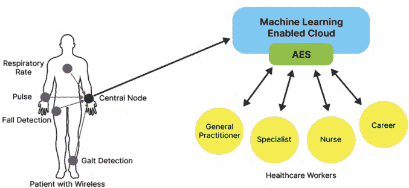

图 8.1 智能医疗系统框架。

物联网可用于构建智能医疗系统（SHS），该系统特别依赖RFID、无线传感器网络和智能移动设备，并通过低功耗无线个人区域网络相互互操作。智能医疗系统能够通过由包含超高频RFID功能的网络节点组成的超低功耗混合感知网络，实时采集环境条件和患者生理参数。感知数据被发送到控制中心，其中一个复杂的监控程序通过REST网络应用程序编程接口（API）为本地和远程用户提供该数据。

必须妥善保护患者的医疗信息，以防止未经授权的个人访问关于患者的敏感数据。早期关于医疗交付中物联网应用的大多数研究并未探讨保护存储在云中的患者医疗信息免受安全缺陷影响的重要性。高级加密标准（AES）是一种对称分组密码，用于加密敏感数据，并在全球的硬件和软件中部署，以保护机密信息。

## 8.3.2 人工智能与机器学习

人工智能及相关技术在医疗领域的应用刚刚开始成形。人工智能已被证明在医疗领域的关键活动中表现至少不亚于人类。医疗系统中的人工智能由多种不同技术组成。

患者手机等低功耗节点可以用于将从患者身体上的传感器收集的数据传输到云端。机器学习算法可以利用这些海量数据直接在云端部署，这些数据将快速产生并在云存储中持续增加。这些算法可以被设计用于筛选海量数据、发现此前未被识别的疾病模式，并提供诊断和治疗方案等功能。

## 8.3.3 区块链技术

区块链使共享和存储数字数据成为可能，同时防止其被篡改。智能医疗系统解决了当前医疗系统的局限性。基于区块链的智能合同用于保护隐私并保障敏感数据安全。众多任务可以通过智能合同自动执行。因此，系统使用的资源更少，因为其对人工劳动的依赖度较低。已证明数据可靠、不可篡改，且始终需要适当机构的批准。此外，医疗已实现自动化、去中心化、安全，并人人可及。

GBC旨在单一且设备完善的平台上主导所有与区块链相关的活动。GBC也可用于医疗协作。GBC能够建立一个全球医疗系统，使患者摆脱在选择医院和医生时的地理限制。其他称为RBC的区块链已根据患者所在位置进行调整，用于不需要大量医生互动或建议的轻微疾病。RBC是许可的，但GBC是无许可区块链。所提议的范式承诺一个去中心化框架，使用户和其他各方更容易共享、交换和集成信息（图 8.2）。

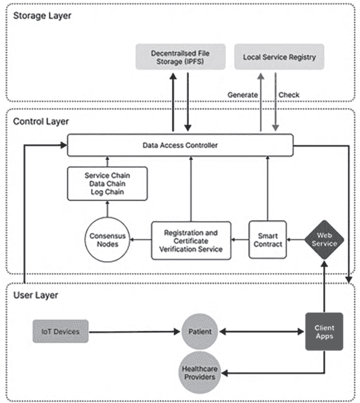

图 8.2 医疗领域的区块链架构。

## 8.4 医疗用例

医疗领域正随着技术进步以及根据患者当前情况的需求而大幅改善。患者需要为自己或为希望在繁忙日程中为患者提供特殊护理的亲属提供智能护理。物联网、区块链、人工智能、大数据等先进技术是接管当前医疗系统状况的有前途技术。智能医疗系统已开发为移动及其他电子设备的应用程序，以跟踪诊断和健康状况更新。患者可以通过此类智能医疗系统与医生进行快速简便的随访，并获得更高质量的治疗设施。真实的患者记录将用于后续治疗程序，患者将能够因这些先进技术而享受无忧的医疗服务。一些患者可能残疾或有身体局限，需要穿戴式设备来协助身体或获取关于身体参数的更新。智能医疗系统有各种医疗用例，如下所示。

### 8.4.1 医疗供应链管理

医疗供应链管理确保医院、诊所和药店在正确的时间拥有正确的物品。它涉及订购、存储和交付医疗物资等许多步骤，同时确保一切安全且质量良好。定义医疗供应链的各种集成如下：

- 流程协调与集成。
- 信息流的协调与集成。
- 规划程序的融合与协调。
- 内部与外部组织流程的融合。
- 基于市场策略的集成。
- 市场发展集成。

在医疗供应链管理中，区块链交易是监控药品和医疗产品整个转移过程的关键工具。由于每笔交易都记录在账本上并由区块链中的每个节点更新，因此可以轻松即时验证药品的来源、供应商和分销商。此外，区块链的分布式账本使官员和医疗专业人员能够确认和验证提供商的资质。就此而言，构建可靠的供应商网络以帮助医疗管理人员保护患者免受不可靠供应商的侵害，为区块链技术展现出巨大的潜力。此外，区块链技术承诺显著改善交易安全性、数据溯源、需求预测和欺诈预防。使用区块链技术，图 8.3 描绘了制药供应链流程。

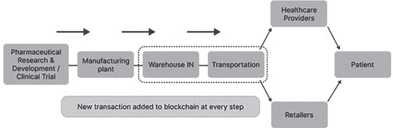

图 8.3 制药供应链管理流程。

### 8.4.1.1 药品可追溯性

- 第 1 步：开发新疗法或药物时，将启动涉及专利保护和大量临床测试的流程。这些数据记录在数字账本中，作为交易条目。
- 第 2 步：完成临床试验后，制造设施为原型测试和大规模生产获得专利。每个产品都会获得链接到额外区块链数据的唯一标识。
- 第 3 步：大规模生产和包装后，药品存储在仓库中以供未来分发。区块链记录时间戳、批号、条形码和有效期等详细信息。
- 第 4 步：运输细节，例如仓库之间（入库）的旅行时间、运输方式、授权代理及相关详情，也会记录在区块链中。
- 第 5 步：第三方分销网络将药品和医疗物资运输到医疗服务提供商或零售商。利用连接到所有分发端点的入库和出库仓库，区块链会随新交易进行更新。
- 第 6 步：医院和诊所等医疗机构将数据（批次和批号、产品所有者和有效期）输入区块链以进行身份验证并防止伪造。


Step 7: 商店在区块链内进行身份验证和验证时遵循与步骤 6 类似的程序。

Step 8: 随着区块链提供可验证的透明信息，患者能够在整个供应链流程中确保产品真实性。

### 8.4.1.2 药物安全

供应链参与者将被鼓励借助区块链的透明性，开展更好的测试、保持更好的温度控制，并确保其药品的真实性。这是因为区块链追踪技术使直接供应链参与者能够进行追踪。因此，在链条中定位欺诈发生的位置将变得容易，例如，当某个链条成员实施欺诈时。

According to Schindler, “If I have any product, I can attach a virtual token to it, which is stored on a blockchain.” Therefore, this token must be given with the product. Let us imagine a business manufactures 100 units of a product, each of which has a digital token kept in a blockchain. For instance, they are given to the wholesaler, and this transaction is recorded in the blockchain. The wholesaler then transfers it to a different distributor, and once more, this transaction is recorded. If the distributor, for example, adds 200 copies of the product falsely, the blockchain would make it clear that only 100 copies were made, and the fake ones would not have a token attached to them. Therefore, it would be quite simple for any recipient of those shipments to doubt the legitimacy of the bogus goods. Additionally, the originating company might reconsider its business relationships in order to eliminate the fraudulent distributor from its supply chain.

正如 Schindler 所说：“如果我有任何产品，我可以给它附加一个存储在区块链上的虚拟令牌。”因此，该令牌必须随产品一起提供。让我们设想一家企业制造了 100 个产品单位，每个产品都有一个存储在区块链中的数字令牌。例如，它们被交给批发商，并且这笔交易会记录在区块链中。随后，批发商将其转移给另一个分销商，同样，这笔交易也会被记录。例如，如果分销商虚假地添加了 200 个产品副本，区块链将清楚地表明只制造了 100 个副本，而假冒产品上没有附加令牌。因此，这些货物的任何收件人都很容易对假冒商品的合法性产生怀疑。此外，源头公司可能会重新考虑其业务关系，以便将欺诈性分销商从其供应链中剔除。

In addition to maintaining the integrity of the supply chain, this visibility and ability to trace products might also enable pharmacists or even patients to view the data directly, giving them confidence in their medications.

除了维护供应链的完整性之外，这种可见性和追踪产品的能力还可能使药剂师甚至患者能够直接查看数据，从而对其药物充满信心。

### 8.4.2 便于医疗人员维护记录

高效地维护记录对医疗人员提供优质护理大有裨益。通过电子系统简化记录保存流程，可以快速访问患者的病史，从而帮助进行准确诊断和量身定制的治疗。数字记录使医疗专业人员能够无缝监测患者的病情进展、用药情况和过敏史。此外，集中式数据库确保信息在各医疗机构之间可用，增强医疗团队之间的协调。高效的记录维护优化了行政任务，减少了文书工作，使员工能够更专注于患者护理。采用电子健康记录（EHR）或管理信息系统等先进技术，可以提高生产力，确保及时和准确的文档记录。这个有组织的数据存储库有助于医疗提供者之间进行明智的决策和高效沟通，从而提升整体医疗服务质量。

### 8.4.3 患者记录交换平台

一个用于共享患者记录的平台就像一个数字空间，医院、医生和诊所可以在其中交换关于一个人健康的重要信息。它很像一个大型、安全且保密的储物柜，用于存放您的健康数据，只有授权人员才能访问。这个储物柜安全且有条理地保存着您的所有医疗细节，例如您的检验结果、既往病史和所处方的药物。当您去不同的医生或医院时，他们可以打开这个储物柜查看之前发生了什么。这就像一本关于您健康的特殊书籍，所有您的医疗帮助者都可以阅读以了解您的病史。这种共享有助于参与您治疗的每个人更好地协作。他们可以了解您的健康史，制定治疗计划，并确保您得到正确的护理。这就像一个健康信息共享图书馆，只有受信任的人才能使用它来帮助您感觉更好。

### 8.4.4 辅助残障人士的自动化系统

区块链使得健康记录能够被正确使用，从而减少不必要的行政开支。此外，由于这项技术，监督关键健康信息共享的多个中介者的需求将下降。向人们提供高效、及时和充足的服务是医疗专业人员的主要职责。得益于区块链技术，医疗提供者将已经了解每位患者的病史。在区块链提供安全性和透明度的同时，物联网（IoT）和人工智能为智能医疗系统提供自动控制，这些系统可能确实能够协助残障人士。可穿戴计算是这一医疗用例的主要吸引力。

## 8.5 智能医疗系统设计方面

智能医疗系统对设计至关重要。此类系统有各种用例，并且在涉及的先进技术的协作中存在许多困难。在设计智能医疗系统时，需要关注以下设计方面。

### 8.5.1 数据收集与管理

从患者身体上的传感器收集的数据可以使用低功耗节点（例如他们的手机）发送到云端。机器学习算法可以在云端本身使用这些将快速产生并继续在云存储中增加的巨量数据进行部署。这些收集的数据将很快变成大数据，需要各种大数据工具来处理。

### 8.5.2 安全特性

严格的访问控制（包括多因素身份验证）将系统访问权限仅限于授权人员，从而增强数据机密性。基于人工智能的威胁检测会持续监控系统活动，及时识别和缓解潜在的安全威胁或异常。

遵守《健康保险可携性和责任法案》（HIPAA）和《通用数据保护条例》（GDPR）等严格的监管框架，确保遵守数据保护法律，优先保障患者隐私和权利。嵌入在 AI 算法中的隐私保护技术在分析过程中对患者数据进行匿名化处理，以保护机密性。

安全 API 促进不同医疗平台或系统之间的安全数据交换。定期的安全审计和评估可以识别漏洞，确保系统在不断演变的网络威胁面前具有韧性。针对医疗人员的网络安全实践持续培训计划可以降低人为错误风险和未经授权的访问。

### 8.5.3 隐私问题

严格使用对称密钥，医疗物联网数据和电子健康记录（EHR）被保密。整个链中只存在加密的医疗数据哈希。因此，对手只能从节点获得加密数据。

医疗数据使用对称密钥进行保护，该密钥额外使用来自 2048 位 Rivest–Shamir–Adleman 密钥对的授权用户的公钥进行加密。没有对称密钥，对手无法获取医疗数据。因此，该方案提供了高水平的数据隐私。

### 8.5.4 信息交换

图 8.4 中的范式承诺了一个去中心化框架，便于用户与其他各方之间的信息共享、交换和集成。患者健康信息与其他相关专家共享需要非常谨慎。智能医疗系统为这种敏感的患者健康相关报告和其他分析提供安全性和隐私性。

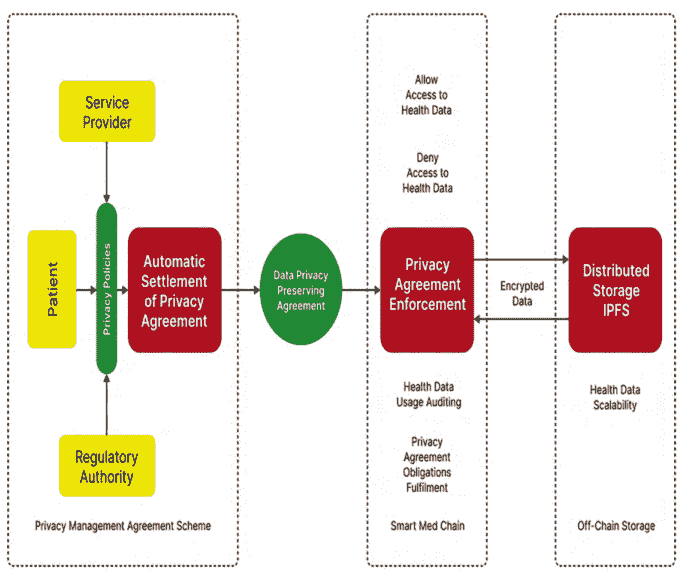

图 8.4 智能医疗中的数据隐私与安全性实现。

## 8.6 智能医疗系统的未来趋势

智能医疗系统的未来有以下趋势：

### 8.6.1 远程医疗服务的使用日益增加

远程医疗提供一系列服务，包括虚拟咨询、远程患者监测和远程医疗应用，促进及时和便捷地获取医学专业知识。其应用涵盖各种医疗领域，从初级保健到专科咨询、心理健康服务和慢性病管理。远程医疗由数字技术促成，能够远程访问医疗服务、咨询和监测，超越地理障碍。特别是受 COVID-19 大流行的推动，由于其便利性、可及性和效率，其受欢迎程度持续飙升。

### 8.6.2 数字健康来拯救

它利用技术让每个人的生活更轻松。想象一下，您使用手机或电脑在线预约医生，而不是去诊所。数字健康还包括帮助您跟踪健身、提醒您服药，甚至在紧急情况下立即为您连接医生的应用程序。它就像一个智能助手，时刻关注着您的健康。此外，它使医生能够快速共享信息，确保您获得尽可能好的护理。借助数字健康，住在偏远地区的人们也可以在不长途跋涉的情况下咨询医生。可穿戴设备和智能小工具可以监测患者的每一个动作，包括心率、卡路里摄入量、睡眠模式和活动持续时间。例如，可穿戴技术可以检测患者的异常心电图模式，并通知医务人员，从而降低更严重疾病的风险。它们已使个性化医疗的系统性进步成为可能，并且将在 2022 年及随后的年份中继续对医疗器械的进步至关重要。

### 8.6.3 数据科学与预测分析的改进

数据科学的进步通过解读扫描图像来检测身体异常，从而赋能医疗，帮助医生制定有效的


治疗策略。处理慢性病患者的海量数据具有挑战性，但也为医生提供了深刻的洞察。这包括识别潜在疾病的高危患者并收集全面的患者信息。数据科学和预测分析的发展有助于完成复杂任务，实现对海量医疗数据集的高效分析。通过利用这些技术，医疗专业人员能够更深入地了解患者状况，优化治疗方案，并预测潜在的健康风险。

### 8.6.4 人工智能的影响

AI 正在深刻地重塑医疗保健。它通过增强医学图像解读的准确性，彻底改变了诊断方式，帮助及时做出精确诊断。医疗机构的运营通过 AI 驱动的自动化得到简化，使医疗服务提供者能够更多地关注患者护理。AI 分析大量患者数据的能力使个性化治疗和预测分析成为可能，从而预见潜在的健康风险。此外，它还加速了药物发现和开发，加快了新药和新疗法的推出。由 AI 驱动的远程医疗解决方案促进了远程患者监护，确保获得优质护理，特别是在偏远地区。它在医疗保健研究中的作用至关重要，通过分析海量数据集来识别模式，推动医学突破。

### 8.6.5 网络安全网格

网络安全网格是一种旨在为各种数字环境提供更灵活、适应性强且响应迅速的安全措施的方法。与依赖集中式安全边界不同，网络安全网格专注于创建更动态、分布式的安全基础设施。它通过去中心化安全措施并将保护扩展到单个设备、人员、应用程序和服务（无论其位置如何）来实现这一点。过去的研究表明，当安全性仅集中在边界周围时，超过 34% 的数据容易受到网络本身的泄露和入侵。通过网络安全网格，许多企业预期网络安全将得到改善。根据一些研究，这种安全架构预计能够将安全事件造成的成本影响降低 90%。

### 8.6.6 云计算

医疗保健领域的云计算彻底改变了数据存储和管理，提供了具成本效益的按需服务。它降低了资本支出，提高了运营效率，并简化了共享医疗记录和开发远程医疗应用程序等任务。云端确保了安全、可扩展且易于访问的存储，促进了医疗服务提供者之间的无缝协作，同时简化了流程，以改善患者护理并优化资源利用。

### 8.6.7 区块链

每当联网设备参与任何类型的交易时，区块链系统都会生成相同的区块。每当一台计算机上的数据被访问、更新、共享或以其他方式处理时，所有设备上都会创建一个区块以本地存储数据。由于无法安全地访问和交换敏感的患者数据，医疗行业受到了严重影响。但为了真正的互操作性，区块链将在保持最严格安全标准的同时，提供极具灵活性的开放性。

### 8.6.8 虚拟、增强和混合现实

医疗保健领域取得了显著的技术进步，尤其是随着虚拟现实（VR）和增强现实的采用。这些技术对印度的医疗保健领域具有巨大的潜力。VR 在辅助视力康复方面显示出前景，可以应对癌症、自闭症和抑郁症等状况。在混合现实中，虚拟与物理领域的融合为临床医生提供了更全面地分析患者状况的独特机会。这些先进的教育工具使医疗专业人员能够提供更精确的治疗。

### 8.7 结论

医疗技术在各个方面都在不断进步。尽管该行业在安全性方面有所改善，但不断演变的威胁依然存在，因此需要关注预防而非反应。这种主动方法对于有效管理这些挑战至关重要。由于最新技术（如人工智能、机器学习和深度学习等）的支持和发展，医疗保健的质量和有效性预计将继续提高。这些技术促成的智能诊断可以更准确地定义患者的病情和疾病状态。这反过来又能够制定个性化的治疗方案。在专家背书下，软件可以引导精确的治疗路径。与了解系统需求和目标的熟练软件开发人员合作对于实现这些进步至关重要。

### 关键词

- 物联网
- 区块链网络
- 智能医疗系统
- 医疗专业人员
- 人工智能

### 参考文献

- 1. Chen M, Li W, Hao Y, Qian Y, Humar I. Edge cognitive computing based smart healthcare system. Future Generation Computer Systems. 2018;86:403–411.
- 2. Uddin MZ. A wearable sensor-based activity prediction system to facilitate edge computing in smart healthcare system. Journal of Parallel and Distributed Computing. 2019;123:46–53.
- 3. Ismail A, Abd El-Rezek S, El-Henawy IM. Development of smart healthcare system based on speech recognition using support vector machine and dynamic time warping. Sustainability. 2020;12(6):2403.
- 4. Ahad A, Tahir M, Aman Sheikh M, Ahmed KI, Mughhees A, Numani A. Technologies trend towards 5G network for smart health-care using IoT: A review. Sensors. 2020;20(14):4047.
- 5. Tripathi G, Ahad MA, Paiva S. S2HS—A blockchain based approach for smart healthcare system. In Healthcare. Elsevier. 2020, Vol. 8 (1), p. 100391.
- 6. Haque AB, Muniati A, Ullah PR, Musharhat S. An automated approach towards smart healthcare with blockchain and smart contracts. In 2021 International Conference on Computing, Communication, and Intelligent Systems (ICCCIS), IEEE. 2021, pp. 250–255.
- 7. Li W, Chai Y, Khan F, Jan SRU, Verma S, Menon VG, Li X. A comprehensive survey on machine learning-based big data analytics for IoT-enabled smart healthcare system. Mobile Networks and Applications. 2021;26(1):234–252.
- 8. Li J, Meng Y, Ma L, Du S, Zhu H, Pei Q, Shen X. A federated learning based privacy-preserving smart healthcare system. IEEE Transactions on Industrial Informatics. 2021;18(3).
- 9. Sujith AVLN, Saija GS, Mahalakshmi V, Nuhmani S, Prasanalakshmi B. Systematic review of smart health monitoring using deep learning and artificial intelligence. Neuroscience Informatics. 2022;2(3):100028.
- 10. Syeda MZ, Syeda DEH, Babbar H. The role of emerging technologies in smart healthcare. IoT-Enabled Smart Healthcare Systems, Services and Applications. 2022;1–17.
- 11. Hameed G, Singh Y, Haq S, Rana B. Blockchain-based model for secure IoT communication in smart healthcare. In: Emerging Technologies for Computing, Communication and Smart Cities. Springer: Singapore, 2022, pp. 715–730.

# 第 9 章

## 技术赋能的智能医疗，迈向智能社会 5.0

CHABI GUPTA¹, FINCY PALLISSERY², and KRITI PARASHAR²

¹Amity College of Commerce and Finance Amity University, Noida, India

²School of Law, Christ University Delhi NCR Campus, Delhi, India

*通讯作者*

## 摘要

在“智能医疗”背景下，诸如人工智能（AI）、物联网（IoT）、区块链、3D 打印和 5G 网络（统称为 AIB35）等新兴技术，正受到“智能医疗”提供商的大力探索，以全面推进发展。医疗领域要求科学家将智能解决方案应用于“智能老龄化”患者的日常生活中，以提高诊断和治疗程序的效率和精度。“智能老龄化”概念是指一个计划，通过采用高端技术解决方案来诊断和治疗疾病，使老年人能够享有更高质量的生活。医疗技术涵盖广泛的创新，包括联网设备、器械和程序，以及药物、药品和疫苗，旨在以经济的成本结构提供更高水平和质量的护理。本研究的目的首先是列出支撑“智能医疗”的主要技术，然后将其应用于几个重要领域。此后，我们阐述智能医疗中当前存在的问题，并尝试为这些问题提供潜在解决方案。在本章的最后部分，我们展望未来之路，评估智能医疗在构建智能社会 5.0 方面的前景。


## 9.1 简介与文献综述

我们身处信息时代。近年来，受技术和科学理论研究导向进步的推动，传统医学已逐渐数字化。智能与智慧医疗应运而生，利用了信息技术的最新发明[9]。智慧医疗不仅仅是简单的技术改进，更是一种在综合性、多层次尺度上影响医疗保健的变革[17]。医疗模式的变革（从诊断转向预防与护理）、信息构建的变革（从患者数据转向其他相关家庭因素）[4]、思维模式的变革（从一般护理转向个性化护理）以及支持理念与系统的变革，均是这一转向（从处方药到预防性医学）的表现。其口号是：明智行事，敏捷迈向智慧社会5.0[16]。

这些调整强调满足个人的特定需求，同时提升医疗覆盖的有效性[10]。因此，接受医疗与健康服务的总体体验得到显著改善，并指明了现代医学未来持续发展的方向[8]。

## 9.2 什么是技术赋能的智慧医疗？

“智能基础设施”一词指的是利用能够检测信息并通过网络传递信息的传感器的智能基础设施。超级计算机和云正越来越多地用于此目的。它们能够协调并整合许多社会系统，从而实现对人类文明的动态、精密管理[14]。趋势是朝向可穿戴式配件、物联网（IoT）和智能手机等监测设备发展，连接家庭和支持系统，这些系统能及时主动地做出智能响应，这被称为“智慧医疗”[12]。

为了确保有需要者获得所需服务，确保利益相关者基于准确信息负责任地行事，并促进资源的高效分配，智慧医疗有可能促进医疗保健所有利益相关者之间的互动[13]。因此，它是利用技术在医疗领域实现的先进信息建设水平[11]。

作为这项探索性研究的一部分，来自全国各地约460名经验丰富的医生（执业年限从10年到40年不等）接受了客观和主观的访谈。由于身份未被披露，他们能够毫无顾忌地自由发表意见。

## 9.3 赋能技术

多个利益相关者——包括医疗专业人员和患者、医疗机构以及学术研究组织——都参与认知医疗服务的提供。这是一个有机整体，涵盖众多维度，例如疾病预防与监测、疾病诊断与治疗、医院管理、医疗决策制定以及医学研究的开展。Ref. [3] 在其研究中主张，除了当代生物技术外，还有其他技术也构成了智慧医疗的基础，例如物联网、云计算、5G、人工智能（AI）等。Liu 等人[1]主张，这些技术在智慧医疗的各个方面被广泛使用。“智慧养老”的概念是指，患者可以佩戴类似配件的设备，持续监测生命体征；若出现任何偏差，设备会通过虚拟助手提醒寻求医疗援助，且可随时享用远程服务[15]。医生将其视为一种智能支持系统，能够改善诊断和处方。他们能立即获得生命体征数据；即使数据不够准确，也能让他们赢得时间优势。集成信息平台允许医疗专业人员定期记录患者数据。90%的医生同意，使用手术机器人和混合现实技术，更精准的手术已成为可能。48%的受访者表示，射频识别技术也被有效用于管理医院的设备和供应链。30%的医生建议，利用技术收集数据并进行后续分析，可更好地完成这一点。约60%的医生分享了使用移动医疗平台的经验，这正在改善患者体验。他们觉得，科学研究机构现在有可能采用AI或深度学习等技术，取代人工诊断、开药及及时向患者供药。约56%的医生宣称，这是采用这些方法的一项关键优势。医疗及相关风险可被最小化，医疗资源可得到更好地利用，不同地区之间的交流与协作可得到促进，并可通过智慧医疗选项促进远程自助医疗和用药。这项调查中47%的受访者表示，这些益处正通过在医疗各个方面利用这些技术得到有效实现。

疾病诊断与治疗已因AI、手术机器人、混合AI系统以及虚拟现实/增强现实等技术的应用而变得更加精密。借助AI构建临床决策支持系统，已取得多项成就，包括对多种罕见恶性癌症类型的精准检测。约76%的经验丰富的医生同意，AI生成的诊断在时间、准确性和精力方面优于人类医生。他们都支持新技术，但主张在受控和持续监测的方式下进行（95%）。

基于机器学习的系统通常高度专业化，特别是在诊断和放射成像领域。IBM的Watson是医疗决策支持技术的典型代表，并被广泛认为是智慧医疗系统最杰出、最具代表性的示例。该程序对癌症和糖尿病诊断的准确性有显著影响。约65%的医生认为，他们可以通过智慧医疗设备为患者提供基于算法的专家建议。医学专家的诊断被发现是准确的，漏诊和误诊罕见，及时开药和治愈已成为现实。基于智能诊断，患者状况和疾病状态可以被更准确地描述，这有助于制定特定治疗方案，且该软件已得到专家验证。实际治疗过程将更加精准。例如，借助智能放射组学，正在接受肿瘤治疗的患者在整个治疗过程中可接受放疗的动态监测。放疗方案可得到优化，疾病进展可得到监测，并可避免人工操作带来的不确定性。手术机器人的发展使得比以往任何时候都更高水平的手术成为可能。与传统内镜手术相比，患者报告更好的效果和更快的恢复时间，医生可以使用比传统内镜手术提供更大灵活性和兼容性的技术。远程手术的使用也将带来更高水平的便利性（84%）。

使用混合现实技术使制定和实施手术计划的过程更加简单直接。印度一家声誉医院的高级医生Rajesh Wirth博士报告称，虚拟世界、现实世界和系统用户通过与现有病例匹配结果形成一个循环。他预见，该技术的进一步发展将在临床实践、医学教育和研究以及沟通方面带来革命性转变。

不治之症、可能为绝症且治疗费用高昂的慢性疾病需要智慧医疗方案。另一方面，集中于医院和医生的传统健康管理模式无法妥善处理海量数据。约37%的医生对作为智慧医疗一部分正在实施的健康管理模式表示赞同，并更加强调患者在自行管理治疗方面日益增长的自主权。他们报告称，患者可以自行监测并立即将健康状况反馈给医生，从而实现及时干预和诊断。可植入或可穿戴的智能设备、智能家居以及由物联网技术连接的健康信息平台的发展，为这一问题提供了解决方案（94%）。可穿戴和可植入设备结合了先进的敏感传感器、芯片、引线和无线网络，可定期不时地感知和监测患者各项生理指标。这些设备还能减轻精神压力，增强患者信心，并与来自不同来源的其他数据交互，得出专家结论。约65%的医生建议转向频繁监测和控制程序，以获得准确诊断。经验表明，这降低了与诊断相关的风险，因为


这种疾病。约56%的人表示，智能手机、智能手表等互联设备的激增为这种监测创造了新平台。已有多次尝试将生物传感器集成到移动电话中。高性能智能手机的移动性不断提升，用户现在可以更轻松地使用这些设备监测周围环境和自身身体状况（83%）。

老年人或残障人士可以通过智能家居在家中获得支持。这些是专门的住宅或公寓，利用集成到建筑物居住基础设施中的传感器和执行器来监测租户的身体指标和周围环境。可开展的活动也有助于提升生活质量。约54%的医生认为，家庭自动化和健康监测是智能家居在医疗保健行业发挥作用的两个主要方面。需要护理的人现在能够减少对医疗专业人员的依赖，同时通过这些技术执行一些基本服务并收集健康数据，在改善家中生活质量的同时实现这一点（83%）。

应用程序和健康信息平台使患者能够主导自身医疗保健并自我管理病情。

确定个人患病可能性的传统方法是收集相关数据，将信息与法定州卫生指南进行比较，然后相应地进行诊断。这种方法耗时，需要持续监测，且无法给出准确精确的结果。在智慧医疗背景下，疾病风险预测被认为既是动态的又是个性化的。约67%的人表示，这使得患者及其医生能够参与进来，主动监测疾病风险，并根据自身监测结果开展量身定制的预防工作。最新的疾病风险预测模型使用可穿戴手表（例如，Apple、Mi）收集数据，并通过互连的应用程序将数据存储到云端，然后使用神经网络和算法分析结果（72%）。

此后，该模型利用短信平台以完美同步的方式向参与者传输预测结果。使用这些安全预防措施有产生积极结果的记录。它们为医生和患者提供支持，以便随时改变医疗实践和生活方式，同时还为决策者在建立区域医疗保健计划以降低疾病发生概率方面提供指导。

构成这些技术一部分的算法属于虚拟助手，而非有形的人或事物。在与用户交互时，机器人顾问采用语音激活或依赖海量信息的传感器等技术来聚合信息源，并在进行计算后提供个性化的响应，以满足用户的偏好或需求。约36%的医生认为，虚拟助手（例如Apple Siri、Google Assistant和Microsoft Cortana）可以协助患者完成各种活动，从设置提醒到自动化家庭，这些活动利用会话历史记录和语言理解技术。虚拟助手在互联医疗中承担的主要功能是充当通道，使患者、医生和医疗机构能够相互沟通。他们（36%）同意这将改善接受医疗服务的效率。通过患者的智能设备，虚拟助手可以快速而简单地将日常语言转换为使用医学术语的语言。患者可以挑选他们想要的服务。虚拟助手可以根据患者的过去数据记录使用相关信息。这有助于医生以更便捷的方式管理患者并协调医疗操作，从而让医生节省更多时间。约93%的医生建议在医疗机构中使用虚拟助手，这可以在劳动力和物质资源方面实现显著节省，同时改善对所有相关方需求的响应。他们（93%）同意利用新技术实现各虚拟助手之间的通信，这将显著提升使用医疗服务者的整体体验。虚拟助手在心理健康方面也提供帮助。这些助手还可以用于改善动物或宠物的健康。患者认为这些虚拟助手是重要的减压手段。

智慧医疗在生物制药企业中广泛应用于处方药生产与分发、账务记录、资产跟踪、供应链管理以及真伪甄别，以及其他类似任务。智慧医疗起源于美国。在此，约84%的医生报告称，利用RFID技术，现在可以为每个人提供唯一的RFID标签，并可通过手持设备轻松访问。这项活动有助于确保医院物资以安全、可靠、稳定和高效的方式运输。约78%的医生认为，集成管理平台可以实现服务提供、质量评估、评价指标、优化技术和绩效评估等任务。医疗费用在一定程度上得到降低，资源使用更加经济，专家解决方案长期可持续，专业医疗机构能够做出发展决策。就患者体验而言，他们可以接触到许多任务，例如体检系统、在线预约排期以及医生与患者之间的保密通信。此处约60%的受访医生报告称，由于这些自动化解决方案，患者的医疗治疗流程得到了简化。约89%的医生认为，患者等待时间更短，并获得了更加个性化的服务。简而言之，被调查的绝大多数（95%）医生同意，集成、进一步细化和更多自动化是未来智能医院和智慧医疗的三个首要任务。

## 9.4 分析与未来之路

智慧医疗的到来已促成了成熟理念和架构的发展。尽管如此，仍有很大的改进潜力，并且由于新技术和新问题的引入，许多新困难正在浮现。目前，智慧医疗领域缺乏宏观方向和纲领性指南。这导致发展目标模糊，最终造成资源浪费。此外，不同地点和不同组织的医疗机构没有相似的标准，并且在确保数据完整性的过程中需要进行变革[2]。由于数据量大且复杂，信息交换和消息传输都可能面临挑战。各种操作系统和硬件平台之间的兼容性问题也是另一困扰来源。患者认为智慧医疗缺乏适用的法律规范，并且存在个人信息泄露和隐私侵犯的危险[5]。即使对于一些有经验的用户，这些技术也可能具有挑战性。从技术角度看，一些与智慧医疗相关的技术进步仍处于探索阶段，需要大量资金来维护和更新。如果使用不当，也存在未知危险的可能性[7]。

因此，如果我们希望得到先前确定的挑战的答案，就必须关注两个不同的因素：法规和创新思维。首先，通过实施更新，相关技术走向成熟和稳定的过程可能会获得动力。提高从海量数据中提取意义的能力也是一项重要目标。建立共同的技术标准，以实现各平台和设备之间尽可能高的互操作性，是第二个关键步骤。通过这种方法，可以提高数据完整性并消除信息共享的障碍。最后，利用区块链等方法将是保证最高级别数据安全性和传输稳定性所必需的。关于法规问题，与该主题相关的许多领域的专家可能会合作，定义行业的发展目标。立法对于确保患者机密性和增强智慧医疗交付系统的安全性是必要的[18]。

综上所述，智慧医疗的前景非常乐观。更好的健康自我管理是可以为智慧医疗的个人用户提供便利的事情。在需要时，患者将能够获得及时和适当的医疗服务，并且服务本身将具有更高的个性化程度。智慧医疗有能力降低医疗机构的成本，减轻人力负担，实现数据和服务的精简组织，并提升患者体验。智慧医疗有潜力降低研究成本，缩短研究所花费的时间，并提高研究机构的整体生产力。智慧医疗可能会缓解传统观念中的医疗财富差距，推动医疗转型，鼓励实施预防技术，并减少社区医疗自主支出。这些都是智慧医疗可能影响的宏观决策方面[6]。尽管如此，


目前开发流程的处理方式仍存在一些问题。解决这些问题的答案不仅在于新技术的开发，还在于患者、医疗专业人员、医院以及专门从事新技术开发和迈向智慧社会5.0的公司之间的协作努力。

## 关键词

- 医疗智能化计算机化
- 医疗管理
- IoT
- 医疗器械
- 智慧养老
- 医疗技术

## 参考文献

- 1. Liu BH, He KL, Zhi, G. 大数据和人工智能对未来医疗模式的影响. 生命与环境科学期刊 (PeerJ) 2018;39:1–4.
- 2. Martin JL, Varilly H, Cohn J, Wightwick GR. 前言：打造更智慧星球的技术. IBM研究与开发杂志 2010;54(4):1–2.
- 3. Gong FF, Sun XZ, Lin J, Gu XD. 中国智能医疗建立的初步探索. 现代医院管理 2013;11(2):28–29.
- 4. Farahani B, Firoozi F, Chang V, Badaroglu M, Constant N, Mankodiya K. 面向雾驱动IoT电子健康：医疗和保健中IoT的前景与挑战. 未来生成计算机系统 2018;78:659–676.
- 5. Wang S, Summers RM. 机器学习与放射学. 医学图像分析 2012;16(5):933–951.
- 6. Senbekov M, Saliev T, Bukeyeva Z, Almabayeva A, Zhanaliyeva M, Aitenova N, ... Fakhradiyev I. 医疗保健中数字技术的最新进展和应用：综述. 远程医疗与应用国际杂志 2020;2020:8830200.
- 7. Ter-Akopov GN, Kosinova NN, Knyazev SA. 医疗保健中的数字技术：成就与前景. 在第1届国际科学会议“现代管理趋势与数字经济：从区域发展到全球经济增长”(MTDE 2019)中. Atlantis Press, 2019, pp. 321–325.
- 8. Laurenza E, Quintano M, Schiavone F, Vrontis D. 医疗行业数字技术采用的影响：基于案例的分析. 业务流程管理杂志 2018;24:1124–1144.
- 9. da Rosa VM, Saurin TA, Tortorella GL, Fogliatto FS, Tonetto LM, Samson D. 数字技术：它们在医疗服务韧性中的作用的探索性研究. 应用人体工程学 2021;97:103517.
- 10. Wang Q, Su M, Zhang M, Li R. 将数字技术与公共卫生相结合以对抗Covid-19大流行：数字医疗保健的关键技术、应用、挑战与展望. 环境研究与公共卫生国际杂志 2021;18(11):6053.
- 11. Tortorella GL, Saurin TA, Fogliatto FS, Rosa VM, Tonetto LM, Magrabi F. 医疗4.0数字技术对医院韧性的影响. 技术预测与社会变革 2021;166:120666.
- 12. Locsin RC, Soriano GP, Juntasopeepun P, Kunaviktikul W, Evangelista LS. 社会转型与老年人社会孤立：数字技术、护理、医疗保健. 同事 2021;28(5):551–558.
- 13. Osipov VS, Skryl TV. 数字技术对医疗保健交付效率的影响. 在医疗保健和环境辅助生活中的IoT中. Springer: 新加坡, 2021, pp. 243–261.
- 14. Haggerty E. 医疗保健与数字化转型. 网络安全 2017; 2017(8): 7–11.
- 15. Raimo N, De Turi I, Albergo F, Vitolla F. 医疗行业数字化转型的驱动因素：意大利医院的实证分析. 技术创新 2022;121:102558.
- 16. Jadhav VD, Moosafintavida DS. 医疗行业区块链及其在Covid 19数字技术转型中的应用和影响. 解放之声期刊 2020;9:479.
- 17. Hermes S, Riasanow T, Clemons EK, Böhm M, Krcmar H. 医疗行业数字化转型：探索新兴平台生态系统的兴起及其对患者角色的影响. 商业研究 2020.13(3):1033–1069.
- 18. Wu DD, Olson DL. 智能医疗服务评估. 在流行病风险管理中的运营与财务中. Springer: 查姆, 2020, pp. 101–121.


泰勒和弗朗西斯

泰勒和弗朗西斯集团

http://taylorandfrancis.com

# 第10章

## ELM-HC：基于机器–人类交互模型的心跳分类方法

VIPUL NARAYAN¹*, PAWAN KUMAR MALL¹, SWAPNITA SRIVASTAVA¹, PALLVI JAIN², VIMAL KUMAR¹, ANJEY MANI TRIPATHI², and SUDESHNA CHAKRABORTY²

¹Madan Mohan Malaviya技术大学计算机科学与工程系, 戈拉克布尔, 乌塔拉普拉德什邦, 印度 ²戈尔吉亚斯大学计算机科学与工程部, 大诺伊达, 乌塔拉普拉德什邦, 印度

*通讯作者

## 摘要

脑机接口是指将人类意图转换为可用于控制连接到体外设备的模式的过程。心电图(ECG)是心脏产生的电模式的可视化表示。ECG是一种重要的诊断工具，广泛用于心脏问题患者。ECG通常记录在带有网格的图表上。ECG记录中的网格由许多小的1毫米方块组成。每个小方框持续约40毫秒。随时间变化的经胸心脏电活动解释称为心电图。对心电图信号的评估表明心脏健康状况。为诊断心脏疾病，已使用了多种技术，包括快速傅里叶变换和小波变换。在本章中，极限学习机(ELM)与离散小波变换的结合产生了所谓的ELM-医疗模型。该模型主要由四个组件组成，即预处理、心跳分割、特征提取和心跳分类。我们提出的模型优于其他最先进的模型，达到了99.9%的准确率、98.9%的灵敏度和99.9%的特异度。

## 10.1 引言

心电图(ECG)以电形式测量心脏活动。它是生物电势随时间变化的可视化表示。导联连接到身体的某些部位，以在图表或计算机显示器的图表上记录(ECG)，具体取决于应用。人类心脏有四个腔室：右心房、左心房、左心室和右心室[1, 2]。上两个腔室为心房，下两个为心室。右心房中的窦房结是心跳通常开始的地方，负责向心脏传递电信号。房室结(AV结)在信号从心房传来时接收该信号[3–5]。下腔室的心室含有传导电流并将冲动传递到所有部分的纤维网络，与AV节点相连。必须准确追踪这一传播路径，以确保心脏正常工作。图10.1展示了ECG分类过程的概览。

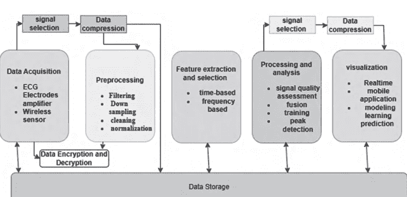

图10.1 ECG分类过程概览。

### 10.1.1 心电图波形

每次心跳的显示由具有规则间隔峰值和谷值的电脉冲组成。通过心脏的电波长度影响电活动(图10.2)。第二个要素是心肌承受的电活动水平，可用于识别任何过大或过度工作的心肌部分。ECG信号范围从0.05到100 Hz。P、Q、R、S和T代表构成信号的心电图的五个峰值和谷值。有时也会有U波。T波和P波以及QRS波群是使心电图分析最有效的部分，可以准确可靠地发现[7–9]。心脏的上两个腔室（两个心房）由P波激活，而心室。QRS波群和T波刺激心脏的下腔室。自动心电图信号分析的基本问题之一是QRS波群识别。检测到QRS波群后，对心电图信号进行彻底检查。P波、QRS波群和T波显示心房和心室的去极化和复极化[8,10,11]。基线是指P波出现之前的波形水平部分的电势线。心房肌肉去极化引起P波。QRS波群由同步的AV复极化和心室去极化产生。T波发生在心室复极化期间，而U波被认为是心室肌中的后电位。T波发生在心室复极化期间[12–15]。可以根据QRS波群的长度、幅度和形态检测心律失常、心肌感染、心室肥大、传导异常及其他疾病状态[16]。心脏平均每分钟跳动60–100次。低于正常的心率为心动过缓；高于正常的是心动过速（快心脏）(表10.1)。

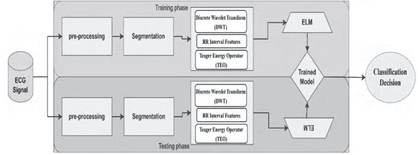

图10.2 ELM-医疗模型工作流程图。


| 右位心 | P波倒置 |
|---|---|
| 高钾血症 | 高耸T波，无P波 |
| 猝性心脏死亡 | 不对称心电图 |
| 窦房传导阻滞 | 心脏周期完全中断 |
| 心肌缺血 | T波倒置 |

## 10.2 文献综述

DeepSleepNet 是一种基于原始单导通道脑电图（EEG）的自动睡眠阶段评分深度学习模型 [17]。目前使用的大多数技术依赖于人工设计的组件，这需要事先具备睡眠分析专业知识。其中极少数在检索到的特征中融入了确定即将到来的睡眠阶段所需的时间信息，例如转换规则。在这个新模型中，卷积神经网络提取时不变特征，双向长短期记忆网络从脑电图片段中学习睡眠阶段转换规则。

研究 [18] 提出了一种选择母小波基函数的方法。该方法用于在小波域中去噪心电图信号，同时保留接近其全幅值的峰值信号幅度。基于小波的去噪心电图读数保留了原始诊断信息 [19]。

基于图的注意力模型利用注意力技术，根据数据量和本体结构，将医学概念描述为其本体祖先的组合。本研究 [20] 展示了使用混合神经网络模型对心电图搏动进行分类的方法。心电图信号采用离散小波变换（DWT）进行解剖，并推导统计特征来描述分布。

参考文献 [21] 中，作者使用来自公共数据库的原始和降噪心电图信号集进行了实验。该集中五种心跳各自的实例数量被人为增加，并通过滤波去除了高频噪声。CNN 使用增强数据进行训练，在原始和无噪声心电图中诊断心跳的准确率分别达到 94.03% 和 93.47%。

## 10.3 方法

### 10.3.1 心电图分析

心电图信号分析与识别长期以来一直是一个引人入胜的课题，该领域仍在持续研究中。对于心电图分析，已经开发出几种快速和短时傅里叶变换方法 [22]。

#### 10.3.1.1 快速傅里叶变换

```
X_k = \sum_{n=0}^{N-1} x_n e^{-i 2\pi k n / N} \quad (10.1)
```

展示了各种心电图波形模式的特征以及与每种类型相关的情况 [22]（表 10.2）。

| 异常 | 特征 |
|---|---|
| 心动过缓 | R–R 区间大于 1 s |
| 心动过速 | R–R 区间小于 0.6 s |
| 高钙血症 | QRS 区间小于 0.1 s |

其中 k 是 0 到 N – 1 之间的整数，其中有几种方法用于压缩心电图信号。

其中最重要的方法之一是 FFT。以下步骤构成了整个过程：

- 获取输入信号或心电图样本。
- 在进行压缩之前，会滤掉输入信号的低频分量。
- 使用逆 FFT 恢复原始信号。

然而，FFT 存在一种局限性，即无法提供频率分量的精确时间信息。这是 FFT 的一个缺点。

#### 10.3.1.2 短时傅里叶变换（STFT）

窗口化傅里叶变换，通常称为短时傅里叶变换（STFT），最早由 Dennis Gabor 于 1946 年提出，随后被称为 Gabor 变换 [28]。其开发目的是让 FFT 能够克服这一局限性。STFT 包含时间和频率信息。它确定信号的正弦频率和时变相位内容。与其他时频分析方法相比，基于 STFT 的频谱图是一个简单且高效的过程。它是将所需波形切分为不同短段的一种简单方法。然后，它使用常规傅里叶变换分析每个段。窗函数用于将一块信息与波形的其余部分分开，然后对该数据片段应用傅里叶变换。

这可以用频谱图或 STFT 表示。信号 x(t) 的 STFT 定义如 Equation 10.2 所示：

```
X(τ, f) = \int x(t) w(t-τ) e^{-i 2\pi f t} dt \quad (10.2)
```

其中高频特征由 T 表示。与 STFT 不同，连续小波变换（CWT）并不局限于正弦解析函数。可以选择符合数学标准的局部波形 [29]。

信号 x(t) 的 CWT 由 Equation 10.3 给出。STFT 中，w(t) 是一个持续时间为 T 且以时间点 t 为中心的窗口，它是窗口信号 x(t)w(t - τ) 的傅里叶变换 [16]。

```
W(a, b) = \frac{1}{\sqrt{a}} \int x(t) h(\frac{t-b}{a}) dt \quad (10.3)
```

STFT 的时频精度不理想。为了克服这一问题，采用了一种更好的技术。

#### 10.3.1.3 小波变换

y 轴缩放参数 a 和 x 轴移位参数 b 均与母小波 h(t) 相关。为了解释什么是 DWT：

```
W(j, k) = \Sigma \Sigma k x(k) e(n - k) (10.4)
```

这并未提供不同分辨率下的信号信息。

另一方面，小波变换具有一种称为“多分辨率”的特性，它通过允许窗口大小改变来提供时间和频率的信息 [30]。

法国地球物理学家 Jean Morlet 于 1982 年提出了小波。

术语“小波”指小波，小波变换的研究是分析地震信号的一种新方法。

理论家 Alex Grossmann 研究了小波变换逆公式 [28]。

作为分析瞬态、非平稳或时变信号的工具，小波是一种能量集中在时间上的微小波 [31]。

- 小波在频率和时域上具有有限范围。
- 像心电图这样的非平稳信号表现出频繁的电平变化和不均匀特性。
- 小波将信号分解为多分辨率分量。

小波变换是一种已被证明在多种应用中很有用的时-尺度表示，尤其是信号压缩。信号被分为与频率分量相关的若干尺度，每个尺度都经过一种特定分辨率的线性过程来进行检查 [32]。小波技术的另一个好处是有多种小波函数可供选择，这允许为分析信号选择最佳函数，而傅里叶分析则局限于一种特征形态，即正弦波。

#### 10.3.1.4 Teager 能量算子（TEO）

独立的 RR 区间分析无法捕捉非线性 RR 区间不一致性。Teager 能量算子（TEO）描述了能量跟踪 RR 区间的非线性行为。信号生成设备的能量、幅度包络和频率均被测量。产生具有不同频率但相同能量和幅度的信号所需的心电图能量可能会发生变化。高频信号使用更多能量。TEO 对源能量作出反应，显示传导通道不稳定性和 Teager 能量冲动。

#### 10.3.1.5 RR 区间特征

RR 区间中，R 是心电图波形的峰值，RR 是 QRS 复合波之间的间隔。在心律失常期间，非线性心电图成分的变化比线性等效成分更大。RR 区间易于计算且抗噪声。为了定义心跳的动态特性，从 RR 序列中提取了前 RR、平均 RR、后 RR 和局部 RR 区间。

#### 10.3.1.6 极限学习机（ELM）

极限学习机（ELM）是一种具有一个隐藏层的前馈神经网络，包含三层：输入层、隐藏层和输出层。图 10.3 显示了 ELM 的结构。ELM 使用与血压不同的参数。隐藏层的参数是随机生成的，而输出层的参数则通过应用最小二乘回归来解析计算。ELM 进行整体逼近。具有随机生成的隐藏层参数的网络能够以任意小的误差逼近任何受限非接触分段连续激活函数。

#### 10.3.1.7 数据集

本研究使用 PhysioNet MIT-BIH 心律失常和 PTB 诊断心电图数据库 [33] 的数据。我们还演示了如何将第一个数据库的数据成功迁移到第二个数据库以训练推理模型。在我们的所有测试中，输入是重新采样至 125 Hz 采样频率的心电图 II 导联。来自 47 名不同个体的心电图记录


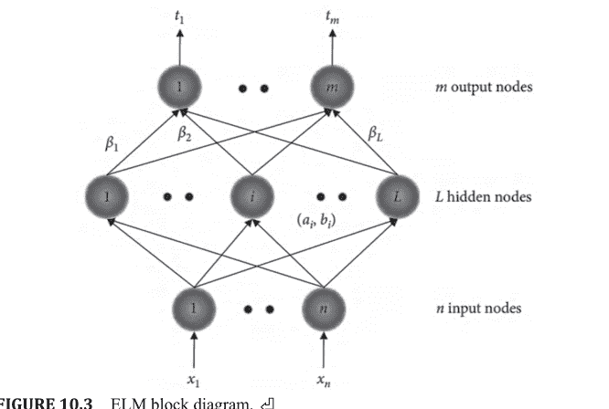

以 360 Hz 的采样率记录，用于 MIT-BIH 数据集。至少两名心脏病专家对每个脉搏进行注释。根据医疗仪器促进协会 EC57 指南，我们使用该数据集中的注释来定义五种不同的心拍类型 [34]。

表 10.2 按类别显示心拍注释映射。PTB 诊断数据集包含 290 人的心电图记录：148 例心肌梗死，52 例健康对照，其余患有七种不同的疾病。每个记录包含十二个 1000 Hz 心电图导联。本研究使用了健康对照组和心电图 II 导联（表 10.3）。

### 10.3.1.8 方法学

所提模型分为四个子方法：(1) 预处理、(2) 心拍分割、(3) 特征提取和 (4) 使用 ELM 的心拍分类。

### 10.3.1.8.1 心电图信号预处理

通常，基线漂移或电力线干扰 (PLI) 会影响心电图信号。为从心电图信号中消除这些形式的干扰，已提出许多方法 [18]。实验表明

| 类别 | 注释 |
|---|---|
| V | 室性早搏<br>室性逸搏<br>房性逸搏 |
| N | 正常<br>房室结逸搏<br>左/右束支传导阻滞 |
| F | 室性与正常融合<br>上室性早搏<br>房室结早搏 |
| S | 房室结早搏<br>异常房性早搏<br>房性早搏<br>起搏与正常融合 |
| Q | 起搏<br>未分类 |

基线漂移对发现心律失常有重大影响，并使专业人士难以处理心电图信号 [19]。PLI 是一种在记录心电图信号时发生的噪声类型，原因包括电极损坏、电极间电压差、患者移动、呼吸错误或电极间电阻。它是一种低频噪声，通常发生在 0 到 0.3 Hz 之间。要获得无噪声的心电图信号，需获取原始心电图信号并从中减去信号的期望值。

### 10.3.1.8.2 心拍分割

T 波、QRS 群和 P 波称为基准点。正确的心电图分割包括检测基准点的边界和峰值。单个脉冲包含 R 波峰及其周围 200 个采样点。该段大小包含了每个心跳的最多信息。

### 10.3.1.8.3 特征提取

选取了 RR 间期、DWT 和 Teager 能量算子特征，因为它们更好地表征了心电图的动态和形态变化。

### 10.3.1.8.4 心拍分类 (ELM)

在特征提取步骤中，提取小波时频和 RR 间期特征。使用这些特征对 ELM 进行 5000 个时代的训练。在下一阶段的研究工作中，我们将分析训练和测试过程的结果。

## 10.4 性能分析

性能分析基于四个参数进行：TP、TN、FP 和 FN，分别表示真阳性、真阴性、假阳性和假阴性。使用公式 10.5 计算“准确率”，如下所示。

### 10.4.1 准确率 (ACC)

准确率 (ACC) [35] 的计算方法是 TP (\(\alpha\)) 和 TN (\(\lambda\)) 记录总数除以实例总数 (\(\alpha\) = TP, \(\lambda\) = TN, \(\beta\) = FN, \(\Omega\) = FP)。使用公式 10.5 计算“准确率”，如下所示：

$$ACC = \frac{\alpha + \lambda}{\alpha + \lambda + \beta + \Omega}$$ (10.5)

### 10.4.2 精确率 (PE)

精确率 (PE) [36] 的计算方法是总真阳性 (\(\alpha\)) 记录数与实例总数 (\(\alpha\) = TP, \(\beta\) = FN) 的比值。“精确率”使用公式 10.6 计算，如下所示：

$$SN = \frac{\alpha}{\alpha + \beta}$$ (10.6)

### 10.4.3 召回率 (RE)

召回率 (RE) [37] 的计算方法是总真阳性 (\(\alpha\)) 记录数与真实实例总数 (\(\alpha\) = TP, \(\Omega\) = FP) 的比值。“召回率”使用公式 10.7 计算，如下所示：

$$RE = \frac{\alpha}{\alpha + \Omega}$$ (10.7)

该模型主要由三个组件组成：噪声滤波、噪声检测和分类。我们所提模型优于其他最先进的模型，达到 99.9% 的准确率、98.9% 的灵敏度和 99.9% 的特异度（图 10.4，表 10.4）。

### 所提模型与最先进技术的对比图

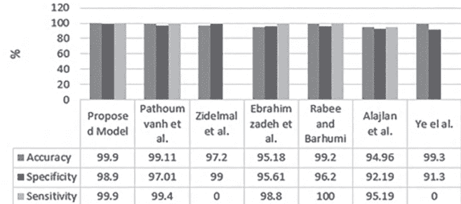

FIGURE 10.4 所提模型的结果分析。

表 10.4 所提模型与最先进方法对比表

| | 特征 | 类别数 | 维度 | 准确率 | 灵敏度 | 特异度 |
|---|---|---|---|---|---|---|
| 所提模型 | DWT + RR + TEO + ELM | 18 | 17 | 99.9 | 98.9 | 99.9 |
| Zidelmal 等人 | 频率含量 + RR + QRS | 2 | 13 | 97.2 | 99 | - |
| Ebrahimzadeh 等人 | HOS + 时间间隔 + DCT | 5 | 24 | 95.18 | 95.61 | 98.8 |
| Rabee 等人 | 小波多分辨率 | 14 | 251 | 99.2 | 96.2 | 100 |
| Alajlan 等人 | 二阶 HOS | 2 | 604 | 94.9 | 92.1 | 95.1 |
| Ye 等人 | WT + ICA + RR | 16 | 18 | 99.3 | 91.3 | - |
| Pathoumvanh 等人 | DCT | 5 | 5 | 99.11 | 97.01 | 99.4 |

## 10.5 结论

心电图是心脏产生的电活动模式的图形表示。该测试广泛用于有心脏问题的人，是一项重要的诊断工具。心电图通常在带有方格的图表纸上记录。心电图记录上的方格由许多微小的 1 mm 方块组成。每个小方块持续约 40 ms。对心电图进行图像处理和数值数据提取。对心脏电活动随时间变化的经胸壁解读称为心电图。对心电图信号的研究提供了关于心脏状况的详细信息。已采用多种方法（包括 FFT 和小波变换）来诊断心脏问题。本工作中，ELM 与离散小波变换相结合，形成了 ELM-医疗模型。该模型基本包含四个组件：预处理、心拍分割、特征提取和心拍分类。凭借 99.9% 的准确率，我们所提模型超越了现有最先进的模型，灵敏度为 98.9%，特异度为 99.9%。未来，该所提模型可应用于医学影像问题和不同模态。

## 关键词

- 心电图
- 连续小波变换
- 窦房结
- 房室结
- 傅里叶变换

## 参考文献

- 1. Gautam A, Kaur M. 基于连续小波变换 (CWT) 的心电图分析. IOSR Journal of Engineering 2012;2(4):632–635.
- 2. Nagendra H, Mukherjee S, Kumar V. 小波技术在心电图信号处理中的应用：综述. International Journal of Engineering, Science and Technology 2011;3(10):7432–7443.
- 3. Josko A, Rak RJ. 用于测试心电图分析仪的信号有效仿真. IEEE Transactions on Instrumentation and Measurement 2005;54(3):1019–1024.
- 4. Narayan V, Daniel AK, Rai AK. 面向无线传感器网络的能量高效双层簇基协议. In: 2020 International Conference on Electrical and Electronics Engineering (ICE3), 2020, pp. 574–579.
- 5. Narayan V, Daniel AK, Chaturvedi P. GFWOA: 一种基于模糊灰狼优化算法的 WSN 中簇头选择高效启发式算法. 2022.
- 6. Narayana KVL, Rao AB. 基于 MATLAB 的小波心电图 QRS 检测. Innovative Systems Design and Engineering 2011;2(7):60–69.
- 7. Saritha C, Sukanya V, Murthy YN. 基于小波变换的心电图信号分析. Bulgarian Journal of Physics 2008;35(1):68–77.
- 8. Narayan V, Daniel AK. 面向无线传感器网络的基于信任函数的簇头选择新方法. Scalable Computing Practice and Experience 2021;22(1):1–13.
- 9. Narayan V, Daniel AK. RBCHS: 无线传感器网络中基于区域的簇头选择协议. In: Proceedings of Integrated Intelligence Enable Networks and Computing, Springer, 2021, pp. 863–869.
- 10. Narayan V, Daniel AK. 无线传感器网络部署中的设计考虑因素与问题. Invertis Journal of Science & Technology 2020;101.
- 11. Pramanik S 等人. 商业智能中基于隐写术和密码学的新方法. In: Integration Challenges for Analytics, Business Intelligence, and Data Mining, IGI Global, 2021, pp. 192–217.
- 12. Narayan V, Daniel AK. 面向智能综合体和购物中心的物联网传感器监测系统. In: International Conference on Mobile Networks and Management, 2021, pp. 344–354.
- 13. Narayan V, Daniel AK. CHHP: 面向无线传感器网络的基于休眠与唤醒概念的覆盖优化与空洞修复协议. International Journal of System Assurance Engineering and Management 2022;1–11.
- 14. Choudhary S, Narayan V, Faiz M, Pramanik S. 面向移动自组织网络的基于模糊方法的稳定节能 AODV 路由协议. In: Software Defined Networking for Ad Hoc Networks, Springer, 2022, pp. 125–139.
- 15. Narayan V, Daniel AK. CHOP: 面向无线传感器网络的基于休眠与唤醒技术的最大覆盖优化与空洞修复问题求解协议. ADCAIJ Advances in Distributed Computing and Artificial Intelligence Journal 2022;11(2):159–178.
- 16. Supratak A, Dong H, Wu C, Guo Y. DeepSleepNet: 基于原始单通道脑电图的自动睡眠阶段评分模型. IEEE Transactions on Neural Systems and Rehabilitation Engineering 2017;25(11):1998–2008, https://doi.org/10.1109/TNSRE.2017.2721116.
- 17. Singh BN, Tiwari AK. 应用于心电图信号去噪的小波基函数最优选择. Digital Signal Processing 2006;16(3):275–287, https://doi.org/10.1016/j.dsp.2005.12.003.
- 18. Choi E, Bahadori MT, Song L, Stewart WF, Sun J. GRAM: 面向医疗表征学习的图注意力模型. In: Proceedings of the 23rd ACM SIGKDD International Conference on Knowledge Discovery and Data Mining, 2017, pp. 787–795.
- 19. Güler İ, Übeyli’ ED. 由组合神经网络模型设计的心电图心拍分类器. Pattern Recognition 2005;38(2):199–208, https://doi.org/10.1016/j.patcog.2004.06.009.


- 20. Acharya UR 等. 一种用于心跳分类的深度卷积神经网络模型. Computers in Biology and Medicine 2017;89:389–396, https://doi.org/10.1016/j.compbiomed.2017.08.022.
- 21. Muthuchudar A, Baboo SS. ECG信号分析涉及过程的研究. International Journal of Science and Research 2013;3(3):1–5.
- 22. Ranjan R, Giri VK. ECG信号分析的统一方法. International Journal of Soft Computing and Engineering 2012;2(3).
- 23. Karpagachelvi S, Arthanari M, Sivakumar M. ECG特征提取技术——调查方法. arXiv预印本. arXiv:1005.0957, 2010.
- 24. Haque AKMF. 基于小波的紧急医疗应用中ECG特征的改进检测. International Journal of Advance Innovations, Thoughts & Ideas 2012;1(2).
- 25. Singh P, Yadav OP, Yadav Y. 基于新型二维变换技术的ECG信号压缩实现. International Journal of Engineering and Advanced Technology 2012;1(6):167–170.
- 26. Dangi V, Parab A, Pawar K. 基于变换的ECG压缩技术分析. 收录于：电子与电气工程国际会议（AEEE 2012）论文集, 2012, pp. 33–37.
- 27. Sifuzzaman M, Islam MR, Ali MZ. 小波变换的应用及其与傅里叶变换相比的优势. Journal of Physical Sciences. 2009;13:121–134.
- 28. Addison PS. 小波变换与心电图：综述. Physiological Measurement 2005;26(5):R155.
- 29. Karthikeyan P, Murugappan M, Yaacob S. 基于小波阈值技术在人体压力评估中的ECG信号去噪. International Journal on Electrical Engineering and Informatics 2012;4(2):306.
- 30. Alfaouri M, Daqrouq K. 基于小波变换阈值的ECG信号去噪. American Journal of Applied Sciences 2008;5(3):276–281.
- 31. Mehta P, Kumari M. 基于小波变换的ECG信号QRS波群检测. International Journal of Applied Engineering Research 2012;7(11):1889–1893.
- 32. Wayne P 等. 太极拳、生理复杂性与健康老龄化步态. PhysioNet. https://doi.org/10.13026/q9q9-rr81
- 33. Mathunjwa BM, Lin YT, Lin CH, Abbod MF, Shieh JS. 基于迭代图和卷积神经网络的ECG心律失常分类. Biomedical Signal Processing and Control 2021;64:102262.
- 34. Mall PK, Singh PK, Yadav D. 基于GLCM的特征提取及利用机器学习技术对医学X射线图像进行分类. 收录于：2019 IEEE信息与通信技术会议, 2019, pp. 1–6.
- 35. Mall PK, Singh PK. BoostNet：一种提升深度学习模型在肌骨X射线图像上性能的方法. International Journal of System Assurance Engineering and Management 2022;1–15.
- 36. Irfan D, Tang X, Narayan V, Mall PK, Srivastava S, Saravanan V. 基于人工智能TOR方法的商场优质食品销售预测. Journal of Food Quality 2022;2022.


Taylor & Francis

Taylor & Francis Group

http://taylorandfrancis.com

# 基于事故叙述的蝴蝶结构分析：一种文本挖掘方法

ASHISH GARG, SOUVIK DAS*, AMARDEEP KUMAR, and J. MAITI

印度理工学院，哈拉格普尔，西孟加拉邦，印度

## 摘要

在本章中，我们提出了一种结合自然语言处理（NLP）与基于蝴蝶结的风险评估方法，用于分析事故或事件报告，为组织提供预防和保护措施。收集了某组织不同工作地点工人在不同场景下的500多篇事故/事件文本叙述。首先，我们应用了自训练的命名实体识别模型，从每篇文本叙述中找出涉及的对象以及事故或事件的潜在根本原因。其次，采用肘部法，发现可创建4–6个根本原因聚类。然后，利用术频率-逆文档频率向量化器和线性支持向量分类器，将根本原因分为四类，即人为因素、部件因素、管理因素和环境因素。为可视化这些事故/事件、根本原因及其类别，应用了蝴蝶结方法论。为每个潜在顶事件提出了预防和防护屏障。因此，本研究提供了一种定性风险评估方法，用于管理未来的风险事件。

## 11.1 引言

制造业及其他行业中事故或事件时有发生。如国际劳工组织所述，每年有超过2780万名职业工人因事故死亡[10]。导致致命事故的主要原因之一是石油、易燃气体等危险材料的存在[6, 9, 11]。这些职业事故以不同方式影响整个组织；因此，任何行业都应将利益相关者的安全放在首要位置。

当今工业4.0时代，各行业正通过多种手段收集大量数据。然而，要轻松获得结构化数据非常困难。此外，数据的价值来自分析及所产生的洞察。在制造业中，发现事故或事件报告是常见的事。这些报告由检验机构在事故发生后，与事故或事件的目击者共同编制。分析这些事故或事件报告可能会提供一些极佳的洞察或事故的潜在原因，有助于未来降低风险。例如，假设在分析事故报告后发现，机器日常运行前不定期检查是导致事故的主要原因之一。这些发现可能会导致将定期检查作为机器操作标准作业程序的强制性要素。

制造业中事故/事件报告分析的研究尚处于起步阶段。这些研究主要集中在基于自然语言处理（NLP）的工具和技术上。然而，将蝴蝶结分析等定量风险评估技术与NLP集成的情况在文献中很少被观察到。蝴蝶结是一种结合故障树和事件树的图形工具。故障树从上到下绘制，并从下到上进行定量分析；而事件树有助于分析风险控制措施，即安全屏障和事故后果。蝴蝶结对于识别任何事故的根本原因以及寻找风险控制系统之间的联系非常有用。因此，本研究的动机是借助NLP和蝴蝶结分析来分析事故报告。文本叙述分析结果与蝴蝶结模型的结合提供了改进的分析和更好的洞察。首先，对文本数据进行预处理，例如转换为小写、删除标点符号、删除停用词、分词、词干提取和词形还原，以将非结构化文本信息转换为所需格式，从而便于进行风险评估[7]。为寻找事故的根本原因，使用了自训练的命名实体识别（NER）模型。基本上，NER模型是从文本中提取关键实体的方法。但在应用NER模型之前，有必要对文本数据进行标注。超过450篇文本叙述已被标注。此外，还标记了事故/事件中涉及的两个所需实体，即根本原因和对象。通过使用肘部法和线性支持向量分类器（SVC）识别聚类数量，将因果句分为四个等级。发现整个语料库中出现频率最高的词（称为与事故相关的顶事件）是火灾、跌倒、滑倒和气体泄漏。与此同时，使用开源BowtieXP软件绘制了蝴蝶结图。蝴蝶结图提供了一种有效的风险评估流程，以系统地评估潜在风险。

## 11.2 文献综述

当今每个行业都希望通过减少事故或事件的数量来提高其安全性能。为此，有必要记录和分析事故/事件/差点发生的事故。为此，过去十年已利用NLP方法开展了若干研究。例如，文献[2]提出了包含与工作相关的伤害索赔的天真贝叶斯建模分工补偿。所提模型的准确率接近90%，但应用的准确性局限于伤害类别。Taylor等人[12]使用了天真贝叶斯模型和模糊模型来区分损伤的影响。Tixier等人[13]使用了随机梯度树提升算法和随机森林（RF）来预测施工现场根本原因类型、伤害类型、受影响身体部位和伤害严重程度，以分析与建筑相关的风险。用于风险分析的概率排序技能得分评级范围为0.236–0.436。Tixier等人[14]建议采用NLP方法从随机伤害的初步报告中提取信息，并获得0.95的准确率，但所提方法未能在


意外情况。Goh 和 Ubeynarayana [5] 使用了 RF、支持向量机 (SVM)、K 最近邻、线性回归和朴素贝叶斯 (NB) 算法，包括建筑危害的分类。其中，SVM 的 F1 分数在 0.45 到 0.92 之间，且比其他方法更高效。Chokor 等人 [3] 使用 K-means 方法对伤害报告进行分类。识别出的事故类型分别为“坠落”、“撞击”、“触电”和“运河坠落”。发现了四组伤害，每组代表一种风险类型。Fan 和 Li [4] 开展了基于标准的咨询流程文本提取研究，用于检索事故记录。结果表明，挖掘方法在召回率和准确率方面更为优越。Zou 等人 [16] 提出了一种带有语义查询扩展和向量空间模型的 NLP 方法，用于分析相似事故案例。剑桥大学开发了一种基于语义相似性的自动根本原因提取方法。为了转换非结构化文本数据，他们遵循了包括语义分析、形态分析、主谓宾提取和基于 NLP 的方法 [8] 在内的初步预处理。[1] 解释了绘制弓图的步骤。还使用弓图解释了根本原因、预防屏障、防护屏障和后果之间的关系。弓图提供了一种结构化的方式来可视化顶事件和后果事故/事件。然而，缺乏将 NLP 方法与传统定量风险评估技术（如弓图）相结合的文献 [15]。因此，在本研究中，我们试图整合 NLP 和弓图方法，分析事故报告的文本叙述。主要目标是利用 NLP 找出事故的根本原因，将事故根本原因分为四类：（1）人为因素，（2）管理因素，（3）环境因素，和（4）部件因素，最后制作弓图模型来可视化这些事故诱因。

## 11.3 方法论

为了实现上述目标，如图 11.1 所示，提出了一种集成方法论。

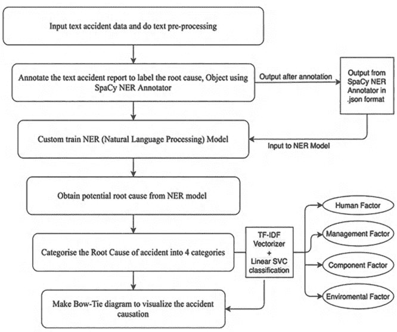

图 11.1 整体方法论。

### 11.3.1 数据预处理

停用词删除：从句子中删除停用词。由于这些词对文本信息无用，在应用分类模型前应将其删除。常见的停用词有“a”、“an”、“the”、“is”、“as”等等。在 Python 中，可以使用自然语言工具包 (NLTK) 轻松删除停用词。NLTK 的字典中有一个停用词列表；因此，我们可以先将整个语料库转换为单词列表，然后删除与 NLTK 字典中的停用词匹配的单词。

标点符号删除：删除文档中不必要的符号。我们删除未知字符和符号，如“#”、“!”、“$”，以便找到承载文本实际信息的词根。

转换为小写：为便于比较，转换为小写或大写。我们要么将整个语料库转换为小写，要么转换为大写。在 Python 中，可以使用函数 lower("string") 转换为小写，使用函数 upper("string") 转换为大写。

分词：将文本拆分为单词列表。在应用 NLP 之前，我们首先将文本分词为单词列表。这样做是因为可以通过分析单词来解释文本的含义。

词干提取：将派生词还原为词干/根词。这是一种归一化技术。它可以帮助我们在搜索整个语料库时找到相似单词。

词形还原：与词干提取类似，但返回实际的字典单词。因此，词形还原后得到的单词与原单词含义相近。

### 11.3.2 Spacy NER

NER 模型是一种预训练 NLP 模型，能够从文本中提取和分类关键信息。关键实体可以是单个单词或一系列单词，每个提取的关键实体都会被分类到预定义的类别/标签中。预训练 NER 模型的输出如图 11.2 所示。

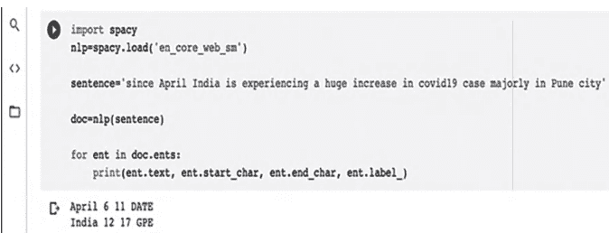

图 11.2 预训练 Spacy NER。

### 11.3.3 Spacy NER 标注

在使用自定义训练的 NER 模型时，我们首先需要预标注数据。我们进行标注，以便可以向我们的模型 (spacy NER) 添加新标签，然后之后该标签可以针对新文本/文档进行预测。预训练模型只能识别这类标签，例如 ["DATE," "PERSON," "TIME," "GPE," "PRODUCT," "ORG," "LOC," "MONEY"]。

我们首先进行了标注（图 11.3），并将标注数据作为输入提供给 NER 模型。我们从 spacy NER 标注器获得的标注数据是 JSON 格式，即字典列表。因此，我们使用自定义训练的模型来找出根本原因。

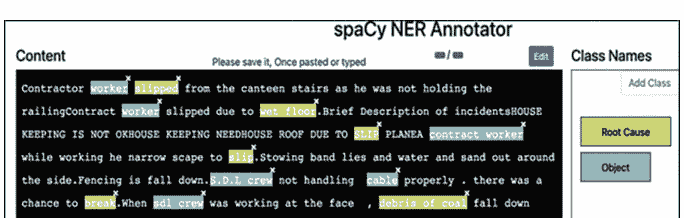

图 11.3 标注。

### 11.3.4 TF-IDF（词频-逆文档频率）计算

词频-逆文档频率 (TF-IDF) 让我们了解文档中哪个单词最重要。包含相似单词的文档将具有相似的向量，这对我们的机器学习模型很重要。最高的 TF-IDF 分数代表文档中罕见的单词。该分数因此生成所有单词的向量，并作为线性 SVC、朴素贝叶斯 (NB) 分类器等分类模型的输入。

TF：TF 是一种归一化方法。TF 的公式如下：

```
TF(t) = (number of times word “t” appears in a document)/(total number of words in the document)

t_{f_{i,j}} = \frac{n_{i,j}}{\sum_k n_{k,j}}
```

IDF：IDF 衡量一个术语的重要程度。基本上，它是为了降低在每个文档中出现非常频繁的标记（如“a”、“the”）的影响。

```
IDF(t) = log_e(total number of documents/number of documents with term t in it).
```

$idf\left(w\right)=log\left(\frac{N}{df_i}\right)$

TF-IDF：TF-IDF 只是 TF 乘以 IDF。

$w_{i,j}=tf_{i,j}\times log\left(\frac{N}{df_i}\right)$

对于每个事故文档，我们得到每个单词的 TF-IDF 值，TF-IDF 值越高，表示该单词越重要。因此，在每个文档中，我们通过查看该文档中 TF-IDF 值最高的单词来获取最重要的单词。该 TF-IDF 矩阵用作线性 SVC 的输入。

示例：让我们考虑以下两个句子：句子 1：煤块掉落但未造成人员受伤。句子 2：SDL 作业队滑倒但未造成人员受伤。

唯一单词列表：[coal, fell, down, but, no, injury, sdl, crew, slipped]

句子 1 中的单词计数 (n1) = 6

句子 1 中每个单词的词频如表 11.1 所示。TF(t) = (文档中单词 “t” 出现的次数)/(文档中单词总数)

| 句子 1 | 煤块 | 掉落 | 向下 | 但是 | 无 | 受伤 |
|---|---|---|---|---|---|---|
| TF | 1/6 | 1/6 | 1/6 | 1/6 | 1/6 | 1/6 |

同样，句子 2 中每个单词的词频如表 11.2 所示。

| 句子 2 | SDL | 作业队 | 滑倒 | 但是 | 无 | 受伤 |
|---|---|---|---|---|---|---|
| TF | 1/6 | 1/6 | 1/6 | 1/6 | 1/6 | 1/6 |

整个语料库中每个单词的 IDF 如表 11.3 所示。IDF(t) = logₑ(文档总数/包含术语 t 的文档数)。

表 11.3 整个语料库中每个单词的逆文档频率 (IDF)

| 唯一单词 | IDF |
| :--- | :--- |
| 煤块 | log(2/1) |
| 掉落 | log(2/1) |
| 向下 | log(2/1) |
| 但是 | log(2/2) |
| 无 | log(2/2) |
| 受伤 | log(2/2) |
| SDL | log(2/1) |
| 作业队 | log(2/1) |
| 滑倒 | log(2/1) |

句子 1 和句子 2 中每个单词的 TF-IDF 计算如表 11.4 所示。

表 11.4 句子 1 和句子 2 中每个单词的 TF-IDF 计算

| 唯一单词 | 句子 1 | 句子 2 |
| :--- | :--- | :--- |
| 煤块 | 1/6 × log(2/1) | 0 |
| 掉落 | 1/6 × log(2/1) | 0 |
| 向下 | 1/6 × log(2/1) | 0 |
| 但是 | 1/6 × log(2/2) | 1/6 × log(2/2) |
| 无 | 1/6 × log(2/2) | 1/6 × log(2/2) |
| 受伤 | 1/6 × log(2/2) | 1/6 × log(2/2) |
| SDL | 0 | 1/6 × log(2/1) |
| 作业队 | 0 | 1/6 × log(2/1) |
| 滑倒 | 0 | 1/6 × log(2/1) |

句子 1 和句子 2 中每个单词的 TF-IDF 如表 11.5 所示。

表 11.5 句子 1 和句子 2 中每个单词的 TF-IDF

| 唯一单词 | 句子 1 | 句子 2 |
| :--- | :--- | :--- |
| 煤块 | 0.301 | 0 |
| 掉落 | 0.301 | 0 |
| 向下 | 0.301 | 0 |
| 但是 | 0 | 0 |
| 无 | 0 | 0 |
| 受伤 | 0 | 0 |
| SDL | 0 | 0.301 |
| 作业队 | 0 | 0.301 |
| 滑倒 | 0 | 0.301 |


## 11.4 案例研究

### 11.4.1 数据集

我们在不同工作场所收集了超过 500 条事故文本数据。最初，文本为原始格式，因此首先进行了一些预处理：停用词移除、转换为小写和标点符号移除、分词、词干提取、词形还原，并将文本数据转换为所需的可用格式。约 450 条包含多行多句子的文本数据被手动标注，并以 json 格式存储，作为自定义训练 NER 模型的输入。

我们先对文本数据进行预标记，然后使用 TF–IDF 和线性 SVC 将其分为四个类别：(1) 人为因素、(2) 组件因素、(3) 管理因素和 (4) 环境因素。

在此之前，我们使用肘部法找出适合该文本数据的最佳聚类数量，得到的 k 值在 4–6 范围内。

### 11.4.2 数据可视化

图 11.4 是预处理后句子中出现频率最高的关键词的词云，例如

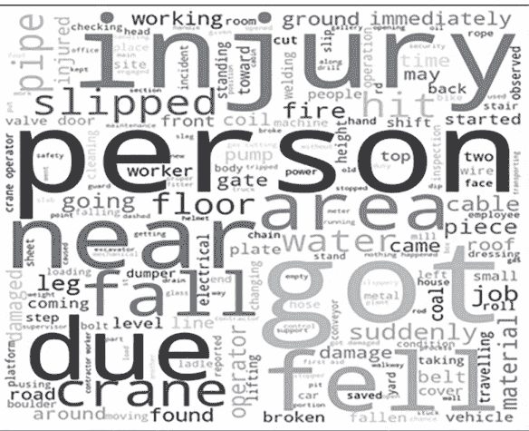

**图 11.4 词云。**

- 将文本转换为小写
- 移除停用词
- 移除错误字符
- 移除标点符号

总体而言，它大致表明哪个单词最重要。从图 11.4 中，我们可以提取顶级事件，如 [滑倒, 摔倒, 跌落, 破损, 损坏, 火灾]。

## 11.5 结果

### 11.5.1 自定义训练 NER 模型

我们使用自定义训练的 NER 模型找出根本原因和对象，并使用正则表达式找出目标句子。根本原因是可能导致事故的因素。从 NER 模型中我们发现，出现频率最高的根本原因词汇是 [fall, fall down, fell, slipped, gas leakage, hydraulic leakage, fire]（图 11.5）。

| | 潜在句子 | 根本原因 | 对象 | 目标句子 | 符号 |
|---|---|---|---|---|---|
| 0 | S.D.L crew not handling cable properly . there was a chance to break. | not handling | cable | S.D.L crew not handling cable properly . | X1 |
| 1 | When sdl crew was working at the face , debris of coal fall down near the worker but there was no injured | fall down | coal | debris of coal fall down near the worker but there was no injured | X2 |
| 2 | During sdf cable handling one sdl crew slipped but not injured. | slipped | cable | During sdf cable handling one sdl crew slipped but not injured. | X3 |
| 3 | During pipe extension the pipe filter was fell down but no injury. | fell down | pipe | During pipe extension the pipe filter was fell down but no injury. | X4 |
| 4 | when two sdl crew was going to the face suddenly side loose coal was fall and they were escape normally from injured. | fall | coal | when two sdl crew was going to the face suddenly side loose coal was fall and they were escape normally from injured. | X5 |

**图 11.5** 自定义 NER 模型的输出。

### 11.5.2 分类

我们将根本原因词分为四个故障级别，即人为因素、组件因素、环境因素和管理因素，使用 TF–IDF 矩阵作为线性 SVC 的输入。我们使用 450 条数据进行训练，其余 50 条用于测试。

我们观察到，导致大多数事故的因素是管理因素，而导致最少事故的是环境错误。在 50 起事故中，有 28 起是由于管理错误造成的（图 11.6a–c）。

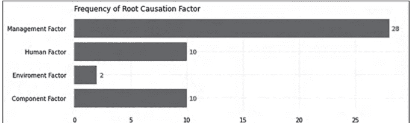

**图 11.6 (a) 频率分布。**

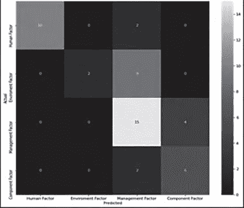

**图 11.6 (b) 混淆矩阵。**

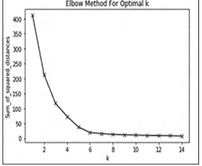

**图 11.6 (c) 肘部图。**

由于这是一个多类分类问题，线性 SVC 表现更好。我们从线性 SVC 模型中获得的准确率为 66%。从肘部法图中，我们得出了应该制作的聚类数量。

### 11.5.3 弓形图分析

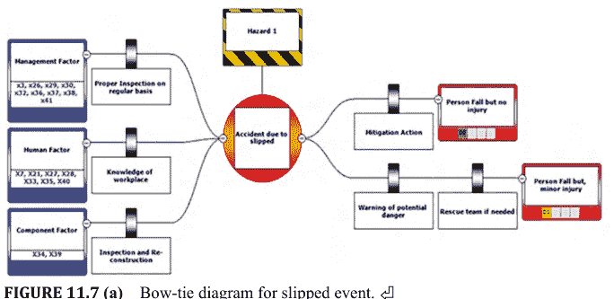

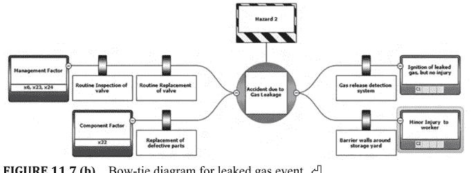

我们使用 BowTieXP 软件为每个顶级事件绘制了弓形图。我们观察到，大多数事故是由于管理错误造成的。顶级事件包括（滑倒、摔倒、跌落、破损、损坏、火灾、断裂）。图 11.7a 和 b 分别是导致事故的滑倒事件和气体泄漏事件的弓形图。我们为弓形图左侧的每个因素建议了防护屏障，并为事故已经发生的情况建议了防护屏障。此外，我们将根本原因分为四个层级的因素，如弓形图左侧所示。

## 11.6 讨论

我们从一个不同的工作场所收集了超过 500 条事故文本数据。数据包含原始文本数据，因此我们首先进行了诸如停用词移除、转换为小写和标点符号移除、分词、词干提取和词形还原等预处理，从而将数据转换为正确的可用格式。为了找出事故中涉及的根本原因和对象，我们在标记了根本原因和对象的 450 条标注文本数据上应用了自定义训练的 NER 模型。该自定义训练的 NER 模型获得的 F1 分数为 0.84，优于 F1 分数仅为 0.51 的预训练 NER 模型。此外，我们使用正则表达式技术找出同时包含根本原因词和对象的潜在句子。为了对包含因果词的文本进行分类，我们首先应用肘部法获取最优聚类数量，得到的输出为 4–6。线性 SVC 在 NB 和 RF 分类器上表现出较好的准确率。我们从线性 SVC 获得的准确率为 66%。最后，我们使用开源 BowtieXP 软件构建弓形图，以更好地可视化事故报告。此外，我们在整个语料库中找到出现频率最高的单词，即与事故相关的顶级事件，如火灾、跌落、滑倒和气体泄漏。在顶级事件的左侧，我们为威胁提出了预防措施，右侧提出了缓解措施，以便我们可以防止未来的危险或伤害。

## 11.7 结论

在工作场所，工人会经历不同程度的压力。众所周知，如今事故在每个工作场所都经常发生。在这项研究中，我们采用了 NLP、TF–IDF 向量化器线性 SVC 和定性弓形图分析的综合方法。我们的方法不同于其他基本的定量风险分析方法，如词性标注和预定义的命名实体模型，这些方法也能够从文本中进行信息提取。在标注了超过 450 条文本数据后，我们应用了自定义训练的 NER 模型，从而获得了优于预定义 NER 模型的 F1 分数。对于分类，我们使用了 TF–IDF 向量化器和线性 SVC 模型。线性 SVC 的准确率优于 NB 和 RF 分类器等其他模型。此外，当我们考虑更多导致事故的事件要素（如天气和环境因素）时，准确率还会进一步提高。为了可视化这些事故/事件、根本原因及其类别，应用了弓形图方法。未来，所提方法可应用于不同领域，如医疗风险分析和组织内的适当安全管理。

## 致谢

我们感谢 IIT Kharagpur 的安全工程与分析卓越中心 (CoE-SEA) (www.iitkgp.ac.in/department/SE) 以及 IIT Kharagpur 工业与系统工程系的安全分析与虚拟现实 (SAVR) 实验室 (www.savr.iitkgp.ac.in) 为本工作提供实验/计算和研究设施。我们还要感谢工厂管理层在研究期间提供相关数据及其支持和合作。

## 关键词

- 事故/事件报告
- 根本原因
- 风险分析
- 自然语言处理
- 分类
- 弓形图分析

## 参考文献

1. Abdi Z, Ravaghi H, Abbasi M, Delgoshaei B, Esfandiari S. Application of bow-tie methodology to improve patient safety. International Journal of Health Care Quality Assurance 2016;29(4):425–440.
2. Bertke SJ, Meyers AR, Wurzelbacher SJ, Measure A, Lampl MP, Robins D. Comparison of methods for auto-coding causation of injury narratives. Accident Analysis and Prevention 2016;88:117–123.


- 3. Chokor A, Nagathanan H, Chong WK, Asmar, ME. 使用无监督机器学习分析亚利桑那州 OSHA 伤害报告. *工程程序* 2016; 145:1588–1593.

- 4. Fan H, Li H. 使用文本挖掘技术为建筑事故替代性争议解决检索相似案例. *建筑自动化* 2013;34:85–91.

- 5. Goh YM, Ubeynarayana CU. 建筑事故叙述分类：文本挖掘技术的评估. *事故分析与预防* 2017;108(July):122–130. 检索自 http://dx.doi.org/10.1016/j.aap.2017.08.026

- 6. Haslam RA, Hide SA, Gibb AGF, Gyi DE, Pavitt T, Atkinson S, Duff AR. 建筑事故的促成因素. 载于 *应用人体工程学*. 2005, Vol. 36, pp. 401–415.

- 7. Hickman L, Thapa S, Tay L, Cao M, Srinivasan P. 组织研究中的文本挖掘文本预处理：回顾与建议. *组织研究方法* 2020;25:114–146. https://doi.org/10.1177/1094428120971683

- 8. Kim S, Bracewell RH, Wallace KM. 使用语义相似性自动提取因果关系的框架. 载于：*2007 年 ASME 国际设计工程技术会议和计算机与信息在工程会议论文集，DETC2007*. 2008, Vol. 2 Part B, pp. 831–840.

- 9. Kim S, Lee J, Kang C. 韩国制造业中因卡压或挤压导致的工业事故分析：侧重于机械非例行作业. *安全科学* 2021;133(October 2020):104998.

- 10. Niu S. 人体工程学与职业安全卫生：ILO 视角. *应用人体工程学* 2010;41(6):744–753.

- 11. Singh V, Verma A. 制造业组织安全气候研究的回顾、简单元分析及未来方向. *国际职业安全与人体工程学杂志* 2020;26(4):678–704.

- 12. Taylor JA, Lacovara AV, Smith GS, Pandian R, Lehto M. 消防服务中的未遂事故叙事：贝叶斯分析. *事故分析与预防* 2014;62:119–129.

- 13. Tixier AJP, Hallowell MR, Rajagopalan B, Bowman D. 将机器学习应用于建筑伤害预测. *建筑自动化* 2016;69:102–114.

- 14. Tixier AJP, Hallowell MR, Rajagopalan B, Bowman D. 建筑安全自动化内容分析：从非结构化伤害报告中提取前兆和结果的自然语言处理系统. *建筑自动化* 2016;62(6):45–56.

- 15. Yang L, Li K. 基于文本弓形模型的铁路事故安全风险分析. 载于：*2020 年 IEEE 第三届安全生产与信息化国际会议论文集，IICSPI 2020*, 2020, pp. 200–204. https://doi.org/10.1109/IICSPI51290.2020.9332329

- 16. Zou Y, Kiviniemi A, Jones SW. 使用自然语言处理技术为建筑项目风险管理检索相似案例. *建筑自动化* 2017;80(September 2016):66–76.

# 第 12 章

## 在线应用中新兴人身识别特征的指关节纹理

BRAJESH KUMAR SINGH¹*, ANIL KUMAR², and SUDESHNA CHAKRABORTY²

¹加尔戈蒂亚工程技术学院电子与通信工程系，北方邦大诺伊达 ²加尔戈蒂亚大学计算机科学与工程系，北方邦大诺伊达，印度

*通讯作者

### 摘要

人类具有多种可用于身份识别的生物特征，如指纹、指静脉、手静脉、手几何特征、面部、虹膜、指关节纹、掌纹、耳廓、步态、视网膜等，但基于手的生物识别系统因其获取简便、易于使用以及领先的识别性能而备受认可。基于指纹的生物识别系统是较早且常用于人身识别/鉴别的类型。除了各种优势外，指纹特征有三个主要缺点。首先，对于种植者、工业劳动者、机械修理工、人力车夫等劳作密集人群，指纹纹路粗糙。第二，皮肤弹性在各个季节中并不恒定；第三，施加的拇指压力不尽相同，导致拇指皮肤的扩散情况各异，从而提取的特征集也各不相同。因此，匹配分数中会出现类内变化，导致系统性能下降。生物识别领域的研究人员考虑了上述指纹生物识别问题，如今使用指关节纹生物识别进行人身识别在生物识别研究界非常流行。本章介绍了这项新兴生物识别技术及可用于识别人员的识别方法概览。

## 12.1 引言

指关节纹（FKP）图像是指关节背面固有的皮肤图案，最近该图案因其高可接受性和可靠性而颇受欢迎并吸引了生物识别研究界的关注 [1]。FKP 获得的普及不仅源于可接受性和易用性，此外，它不像指纹那样粗糙，可使用普通分辨率成像设备轻松获取 [2]。

Woodard 和 Flynn [3] 是首批利用指关节表面来识别人员的学者。他们使用 Minolta 900/910 传感器创建了一个 3D 指背数据库。该传感器同时捕获并注册图像，尺寸分别为 640 × 480 和 640 × 480 的 24 位颜色强度。该传感器尺寸为 213 mm × 413 mm × 270 mm，重量约 11 kg。由于尺寸和重量较大，不适合用于商业生物识别系统。数据收集时，传感器放置在距离约 1.3 米的平坦墙面上，并用黑色布料覆盖。在进行数据收集之前，受试者被要求取下所有首饰，以确保传感器在与首饰反射表面接触时不会散射。实验期间，受试者被要求将右手贴在墙上，并在图像捕获期间保持该位置。之后，他们将手从墙上拿开，并放回同一位置。研究人员共收集了 1191 张手部范围图像，这些图像可公开获取。在这些图像中，第一张是尺寸为 640 × 480 像素的手部彩色图像样本。第二张图像使用多边形网格将同一手部图像的尺寸 640 × 480 取为伪强度，第三张图像是检测到的靠近指关节表面表征的表面细节。随后使用归一化相关系数比较图像的相似度。

2009 年，Kumar 和 Ravikanth [4] 开发了一种使用数码相机获取指背表面图像的系统。成像系统在均匀照明下对准白色背景，相机固定在距成像表面 20 厘米处。手部边缘物体的非均匀照明会降低获取图像的性能。这是通过在手部上方使用固定光源实现的。获取的 FKP 图像分辨率为 1600 × 200 像素。受试者被要求将手放在支撑物上，手背朝向传感器。

存在六指几何结构，每个有四根手指，因此使用 24 根手指来提取特征。特征包括手指长度、宽度、周长、面积以及关节特征。通过在手指背面应用子空间分析方法提取关节特征，并使用这些特征进行人员分类。尽管这些方法能够识别手指外表面的独特特征，但它们无法为实现高效系统提供切实可行的解决方案。

所提方法 [3] 侧重于 FKP 的 3D 形状信息，而非完全侧重于纹理信息，而参考文献 [4] 中使用的子空间分析方法可能无法提取 FKP 的高效特征。

### 12.2 FKP 识别算法

FKP 识别算法的最新方法可分为四类，即 (1) 基于子空间的方法、(2) 编码方法、(3) 其他方法和 (4) 近期趋势方法。下文将讨论其中一些算法。

### 12.2.1 基于子空间的 FKP 识别算法

基于子空间的技术用于将原始图像转换为低维子空间。生成的子空间通过学习和训练数据用作分类的特征向量。这些算法使用每个子空间从整个图像中提取全局信息。这些技术预计将使区域基于的


识别方法。该技术使用主成分分析（PCA）、线性判别分析（LDA）和独立成分分析（ICA）来提取子空间系数特征。它用于表示特征向量、特征匹配距离度量或分类器，也用于对提取的特征集进行降维。

一种称为加权线性嵌入（WLE）的新方法在文献[5]中被提出用于识别FKP。该方法将Fisher准则与流形学习准则相结合，从线性模型中提取特征。流形学习理论的概念指出，局部信息的重要性比非局部信息更显著。该概念已被实现，从数据集中提取了局部和非局部特征。作者使用高斯加权映射过程来结合非局部和局部信息。它通常用于寻找适合最大化估计加权类散迹的映射向量。分类基于最近邻分类器进行。作者还在掌印上测试了所提算法，并对PCA、LDA、LDE和WLE进行了比较研究。WLE在1000人的右侧食指上进行了测试，识别率达到78.2%。

在文献[6]中，作者提出了一种新的FKP识别工作，其中作者使用小波进行图像分析和模式识别，还使用PCA将Gabor特征降维到低维空间。此外，作者在PCA子空间中应用正交线性判别分析（OLDA）变换，使用最近邻对图像进行分类，并达到98%的准确率。本章还比较了单个手指的性能，并表明左侧食指的性能优于右侧食指。

一位作者提出了一种方法，该方法同时测量图像数据向量之间的距离和角度，以研究它们之间的相似性[7]。提出了一种专注于偏移图像空间的图像角度测量方法，以突出不同数据角度之间的差异。距离和角度均通过一种并行融合过程获得，该过程使用复局部保持投影来提取低维特征。正交复局部保持投影（OCLPP）是一种子空间方法，可以最大限度地减少每个图像中的冗余信息，并随机选择四张图像用于识别过程，识别率高达88%。作者还将所提工作与PCA、CPCA、CLPP和OCLPP等子空间方法进行了比较。基于子空间的技术汇总见表12.1。

| 序号 | 作者 | 特征提取 | 评估参数 | 结果 |
| :--- | :--- | :--- | :--- | :--- |
| 1 | Yin et al. [5] | WLE | KNN分类器 | 识别率78.2% |
| 2 | Wankou et al. [6] | Gabor和OLDA | KNN分类器 | 识别率98.06% |
| 3 | Jing et al. [7] | 正交复局部保持投影 | 融合角度和欧氏距离 | 识别率87.87% |

## 12.2.2 基于编码的FKP识别算法

在基于编码的技术中，FKP图像被分割成若干个子图像，并从每个细分图像中提取方向或边缘等信息。文献中提出了多种编码算法以提高FKP的识别性能。这些编码技术广泛用于掌印识别，并取得了良好的识别效果。指关节表面线条和褶皱非常丰富，且对每个人都高度独特。这些编码技术主要基于虹膜码的概念。

一项研究利用局部特征相对于全局特征来实现可靠的性能[8]。预处理步骤有助于最大限度地减少光照变化对纹理特征的影响，并提高整体性能。为了避免固有模运算的绕行问题，有限拉顿变换和修正的有限拉顿变换（MFRT）通常用于确定局部邻域区域中油脂线或关节线的方向。计算每个像素的主导方向，并将其编码为称为关节码的二进制位。使用归一化汉明距离来计算两个FKP之间的相似度测量，这些技术达到了98.6%的准确率。

提出了一种方法[9]来捕获FKP图像并自动将FKP图像与局部坐标系对齐。由于采集方法，FKP图像的底部是稳定的。因此，通过将此边界拟合为直线，将其视为ROI坐标系的x轴。建立了FKP凸度模型。得到的幅度在指节关节中心达到最小值，可用于设置坐标系的y轴。固定坐标系后，裁剪出大小为110 x 220的ROI子图像。然后使用Gabor滤波提取方向信息，并将信息以竞争码的形式表示。使用角度距离对两个FKP进行匹配，最终实现了1.09%的等错误率（EER）。

2010年开发了一种改进的竞争码和幅度码[2]。该方法使用Gabor滤波器提取幅度和方向信息。这些信息进一步用于建立基于竞争码的代码图。计算出的角度距离和幅度距离被融合，最小距离被视为最终距离。所提算法与一种标准编码算法进行了比较，结果表明性能更好。

提出了单原子码的概念[8]，以便从二维信号f(x,y)中快速提取特征。单原子信号定义为f(x,y)及其Riesz变换的组合，Riesz变换是2D欧几里得空间中希尔伯特变换的矢量值扩展。该代码表示从像素中提取的单原子信号的3位。它显示像素的相位信息和方向。该算法与FKP识别的最新方法相比，也表现出相似的准确率。

在文献[10]中，作者提出了一种具有高精度、鲁棒性和紧凑性优势的新编码方法。为了找到上述代码，Riesz变换用于识别和表征FKP图像的视觉模式，并使用二阶Riesz变换对局部补丁进行编码。开发了一种6位编码方案，即Riesz Compcode。这种Riesz Compcode是一种6位编码方案，结合了Riesz变换和Compcode在表征局部FKP特征方面的优势。在所提工作的匹配阶段计算归一化汉明距离，与另一种编码算法相比，该编码算法方案在识别精度方面表现更好。

Nigam et al. [11]使用局部斑点、边缘或角落指定区域周围的基于像素的特征信息来进行FKP识别。这种FKP识别技术对光照敏感，但对旋转不具鲁棒性。它提出了一种使用垂直码和水平码的新特征提取技术。所提工作分别沿x轴和y轴取导数来提取特征，并分别用vcode和hcode表示。提取的vcode和hcode由梯度序列关系模式（GORP）和星形梯度序列关系模式（SGORP）用于计算四种类型的特征，分别表示为vcode_GORP、hcode_GORP、vcode_SGORP和hcode_SGORP。这四个提取的特征形成一个特征向量，用于匹配。Zhang et al. [9]使用各种编码技术进行FKP身份验证，并在大型数据集上进行了测试，最终实现了领先的身份验证性能。基于编码的技术汇总见表12.2。

| 序号 | 作者 | 特征提取 | 评估参数 | 结果 |
|---|---|---|---|---|
| 1 | Zhang et al. [2] | MFRT | 归一化汉明距离 | 识别率98.6% |
| 2 | Lin et al. [8] | 基于Gabor滤波器的竞争码 | 角度距离 | EER 1.09% |
| 3 | Lin et al. [9] | 改进的竞争码和幅度码 | 角度距离 | EER 1.47% |
| 4 | Lin et al. [8] | 单原子码 | 汉明距离 | EER 1.72% |
| 5 | Lin et al. [10] | 基于Riesz变换的编码 | 汉明距离 | EER 1.26% |

## 12.2.3 其他识别算法

在文献中，使用多种图像处理技术从FKP中提取纹理特征、局部特征、全局特征和线特征，可以独立使用或组合使用。局部和全局组合信息提供了更多信息，从而获得更好的识别性能。

提出了一种称为局部全局信息组合（LGIC）的技术[12]，基于心理物理学和神经生理学研究，作者指出局部信息和全局信息对FKP识别都至关重要。局部特征是方向信息，由使用四个尺度和六个方向小波的Gabor滤波器提取。该程序适用于从具有丰富线状结构的图像中提取特征，并具有高精度、对光照强度变化的鲁棒性和计算效率高等优点。全局特征通过将Gabor滤波器的尺度增加到无穷大，并从变换后的FKP图像中获取傅里叶系数来提取。


匹配策略使用两个码图，一个是基于归一化汉明距离计算的角距离，另一个是用于测量图像傅里叶变换（全局信息）相似度的带限相位-only 相关（BLPOC）。因此，来自局部和全局特征的两个分别计算的匹配距离 d₁ 和 d₂ 按照匹配权重规则组合，该算法实现了低至 0.402% 的 EER。

在 Ref. [13] 中，作者尝试使用具有五种不同尺度和八种不同方向的 Gabor 滤波器组，从 FKP 图像中提取方向特征，并保持其他所有参数不变。此外，作者应用 PCA 进行特征维度降低。由于 PCA 与 LDA 的组合在特征选择方面效果良好，因此将 LDA 应用于 PCA 权重。使用欧氏距离进行匹配。所提出的 FKP 识别方法在所有四个手指图像上进行了测试，观察到右中指的识别率更好，为 75.25%。对所有手指进行了不同组合的特征级融合，最大识别率达到 98.79%。

一种新型 FKP 识别技术提出了一种基于加速稳健特征（SURF）[14] 的强健 FKP 特征提取和匹配算法。该新特征通过以下两个步骤提取：首先，基于 FKP 的局部凸方向图定义坐标系以对齐 FKP 图像并裁剪感兴趣区域。其次，使用快速 Hessian 检测器检测关键点，并根据检测到的关键点邻近圆区域内的 Haar 小波响应为其分配方向，为每个关键点构建方向不变描述子。在此匹配方法中，将第二近邻距离与第一近邻距离进行匹配。仅当两者之间的距离比小于 0.6 时才执行匹配。因此，得到了训练图像和模板图像两个关键点集之间的暂时对应关系。随机样本一致性（RANSAC）用于去除错误匹配，最终匹配对用于确定掌纹图像的一致性。该方法对旋转和尺度变换不变，为验证提供了 90.63% 的准确性和鲁棒性，为识别提供了 96.91%。

提出了一种使用单个 FKP 识别个体的新方法 [15]。该方法的一大优势是能够减少巨大的数据库大小，并且该方法通过描述具有灰度不连续性的图像边缘来训练分类器。在空间域中，使用大小为 3 × 5 的自定义卷积模板作为梯度算子，以最小化噪声并提取线条特征。随后，该方法用于防止在图像采集过程中因采集设备位置变化和不同站立姿势而做出错误决策。通过平移操作获得八张不同图像，加上一张原始图像，共九张图像，利用最大互相关系数原理来确认用户身份。在 FKP 上进行的实验在阈值为 30 时获得了 95.68% 的识别率，表明它是一种可靠且准确的生物特征。

Morales 等人 [16] 提出了一种 FKP 身份验证的新方法。在此技术中，作者使用 Gabor 变换来增强图像的方向信息，并使用 SIFT 描述子来提取和表示特征集。El-Tarhouns 等人 [17] 应用多尺度 LBP 和 PCA 技术从 FKP 图像中提取局部和全局特征，匹配尝试可以被视为全局和局部特征的组合。

在 Ref. [18] 中，作者提出了一种使用 FKP 和掌印生物特征的多模态生物识别系统。该模型从两者中提取了各种特征，并使用评分级融合将计算出的得分合并。进行了各种组合的实验，发现 SURF 加上双向经验模态分解特征提取技术可提供更好的性能。FKP 识别的其他技术汇总见表 12.3。

| 序号 | 作者 | 特征提取 | 评估参数 | 结果 |
|---|---|---|---|---|
| 9 | Le-Qing et al. [19] | 加速稳健特征（SURF） | RANSAC 匹配策略 | 识别率 96.91% |
| 10 | Zhang et al. [12] | LGIC 技术 | 汉明距离和 BLPOC | 识别率 99.31% |
| 11 | Zhao et al. [20] | 边缘检测 | 互相关系数 | 识别率 95.68% |
| 12 | Shariatmadar et al. [9] | Gabor 滤波器 + PCA + LDA | 欧氏距离 | 识别率 89.90% |

## 12.3 生物识别系统基本框图

最初，生物识别系统是一种模式识别系统，它从个体处获取生物特征数据，从数据中提取一组主要特征，将此特征集与数据库中保留的特征集进行比较，并基于比较结果做出决策。

因此，生物识别系统具有以下基本模块：原始数据采集模块、质量改进模块（预处理模块）、匹配模块、特征提取模块和数据库模块。图 12.1 描述了生物识别系统的基本框图。

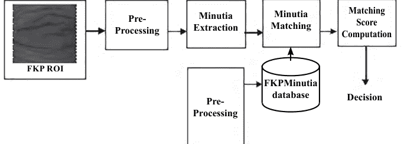

图 12.1 生物识别系统基本框图。

### 12.3.1 数据采集

可使用适当的传感器、相机或扫描仪从个体处获取原始数据。该模块必须能够获取高质量图像，以便生物识别系统能够提供良好的性能。

### 12.3.2 预处理

此模块的功能是评估前一阶段获得的原始数据的质量。可以对原始数据应用任何预处理算法以提高其质量，使其适合特征提取。

### 12.3.3 特征提取

接下来，在预处理图像上应用合适的算法来提取特征（预处理图像的紧凑表示），这些特征可用于唯一识别一个人。提取的特征存储为数据库中的模板。

### 12.3.4 匹配

对于给定的测试或查询图像，提取特征并将其与数据库中的保留模板进行比较，以衡量模板与声称人士提取特征之间的接近程度。然后根据观察到的接近度量，决定个体或用户是真实用户（授权或注册用户）还是冒充者（未授权用户）。

### 12.3.5 数据库

从原始生物特征数据中提取的特征集（即模板）连同一些附加信息（例如姓名、个人识别号、地址等）存储在数据库中，以表示用户。

## 12.4 作为 IoT 设备的硬件实现

树莓派是一台运行 Debian Linux 的小型卡片大小计算机。它易于使用和学习。只需添加一张简单的 SD 卡即可轻松安装树莓派的操作系统。SD 卡将包含操作系统，并将其插入 Pi 板中；为该板供电需要一个简单的 USB 移动充电器，之后只需连接键盘和鼠标，并通过 HDMI 电缆连接电视或计算机，即可使用。如果需要在 Windows 平台上工作，可能需要使用 PuTTY 和 VNC Viewer 应用程序在 Windows 平台上打开 Pi 桌面。现在，打开 Pi 桌面后，它可以执行多项操作，您可以发送电子邮件或创建电子表格。树莓派为我们提供了使用 Scratch 或 Python 进行编码的机会。由于此处我们正在使用光学指纹传感器 R307，需要导入多个库，例如 OpenCV 或其他库。树莓派包含一个命令提示符，可从中导入库。它包含 IDE，以便我们轻松编码并运行以查看功能是否正常工作。因此，我们可以在此开始工作；指纹传感器将捕获指纹图像并将其存储在 Pi 中，借助 OpenCV 将会


获取图像，并从中应用图像预处理（如二值化和细化）并提取特征，然后可以将其与已存储的特征进行匹配。

## 12.5 结论

在文献中，也有几种算法可用于识别 FKP 生物特征，与其他生物特征相比，该特征的识别潜力非常具有竞争力，而且由于该特征位于手指外表面，它不像指纹生物特征那样易损。该生物特征可用于设计用于在线人员验证的生物识别系统，作为物联网设备。

## 关键词

- 指关节纹
- 人员识别
- 生物识别系统
- 子空间方法
- 编码方法

## 参考文献

- 1. Zhang D, Guo Z, Lu G, Zhang L, Zuo W. 多光谱掌纹验证的在线系统. IEEE Transactions on Instrumentation and Measurement 2009;59(2):480–490.
- 2. Zhang L, Zhang L, Zhang D, Zhu H. 用于个人身份验证的在线指关节纹验证. Pattern Recognition 2010;43(7):2560–2571.
- 3. Woodard DL, Flynn PJ. 手指表面作为生物识别标识. Computer Vision and Image Understanding 2005;100(3):357–384.
- 4. Kumar A, Ch R. 使用指关节表面进行个人身份验证. IEEE Transactions on Information Forensics and Security 2009;4(1):98–110.
- 5. Yin J, Zhou J, Zhong J, Yang J. 加权线性嵌入及其在指关节纹和掌纹识别中的应用. In: 2010 International Workshop on Emerging Techniques and Challenges for Hand-Based Biometrics. IEEE, 2010, pp. 1–4.
- 6. Yang W, Sun C, Wang Z. 使用 Gabor 特征和 MMDA 进行指关节纹识别. Frontiers of Electrical and Electronic Engineering in China 2011;6(2):374–380.
- 7. Jing X, Li W, Lan C, Yao Y, Xi C, Lu H. 基于图像空间度量的指关节纹识别正交复杂局部保持投影. In: 2011 International Conference on Hand-Based Biometrics. IEEE, 2011, pp. 1–6.
- 8. Zhang L, Li H, Shen Y. 一种基于 Riesz 变换的指关节纹识别新编码方案. In: 2011 International Conference on Hand-based Biometrics. IEEE, 2011, pp. 1–6.
- 9. Zhang L, Zhang L, Zhang D. 指关节纹：一种新的生物识别标识. In: 2009 第 16 届 IEEE 国际图像处理会议 (ICIP). IEEE, 2009, pp. 1981–1984.
- 10. Zhang L, Zhang L, Zhang D. Monogeniccode: 一种用于指关节纹识别的新快速特征编码算法. In: 2010 International Workshop on Emerging Techniques and Challenges for Hand-Based Biometrics. IEEE, 2010, pp. 1–4.
- 11. Nigam A, Tiwari K, Gupta P. 指关节纹认证系统的多纹理信息融合. Neurocomputing 2016;188:190–205.
- 12. Zhang L, Zhang L, Zhang D, Zhu H. 指关节纹识别的本地和全局信息融合. Pattern Recognition 2011;44(9):1990–1998.
- 13. Shariatmadar ZS, Faez K. 基于 Gabor 特征融合的指关节纹识别新方法. In: 2011 第 4 届国际图像与信号处理大会. IEEE, 2011, Vol. 3, pp. 1480–1484.
- 14. Michael GKO, Connie T, Jin ATB. 基于非接触式方法的稳健掌纹和关节纹识别系统. In: 2010 第 5 届 IEEE 工业电子与应用大会. IEEE, 2010, pp. 323–329.
- 15. Zhang L, Zhang L, Zhang D. 基于带限相位-only 相关性的指关节纹验证. In: 国际计算机图像与模式分析会议, Springer: Berlin, Heidelberg, 2009, pp. 141–148.
- 16. Morales A, Travieso CM, Ferrer MA, Alonso JB. 基于方向增强的改进指关节纹认证. Electronics Letters 2011;47(6):380–381.
- 17. El-Tarhouni W, Shaikh MK, Boubchir L, Bouridane A. 基于多尺度平移局部二值模式的描述子用于指关节纹识别. In: 2014 第 26 届国际微电子会议 (ICM). IEEE, 2014, pp. 184–187.
- 18. Permual E, Ramachandran S. 基于掌纹和指关节纹识别方法的多模态生物识别系统. International Arab Journal of Information Technology (IAJIT) 2015;12(2).
- 19. Zhu L-Q. 基于 SURF 算法的指关节纹识别. In: 2011 第八届国际模糊系统与知识发现会议 (FSKD). IEEE, 2011, Vol. 3, pp. 1879–1883.
- 20. Zhao R, Li K, Liu M, Sun X. 基于单个关节纹图像的个人身份识别新方法. In: 2009 亚太信息处理会议. IEEE, 2009, Vol. 2, pp. 218–221.


泰勒·弗朗西斯集团
http://taylorandfrancis.com

# 基于深度学习与图像处理算法的口罩检测

PALLAVI GOEL<sup>1*</sup>, PRAVEEN KUMAR SHUKLA<sup>2</sup>, AJITESH GAUTAM<sup>1</sup>, ASHISH YADAV<sup>1</sup>, and SHANTANU SINGH<sup>1</sup>

<sup>1</sup>加尔戈蒂亚工程技术学院计算机科学与工程系，大诺伊达，北方邦，印度
<sup>2</sup>斋浦尔曼尼帕尔大学信息技术与智能系统系，斋浦尔，拉贾斯坦邦，印度

*通讯作者

## 摘要

近年来，由于冠状病毒具有传染性和潜在致命性，已成为人类极其令人担忧的健康问题。病毒通过呼吸传播，将病毒颗粒扩散到易感个体可吸入的表面，导致感染。因此，通过保持社交距离、勤洗手以及在公共场所戴口罩遮住面部，防止我们自己和周围他人感染至关重要。口罩在全球公共场所的广泛采用凸显了其在减轻病毒传播方面的重要性。在公共场所识别戴口罩的人变得越来越重要。本研究提出了一种新的口罩识别方法，将 ResNet-50 模型与双线性插值、双边滤波和模糊 C-Means 分割相结合。通过改善输入图像中的细节并分割面部和背景区域，我们的技术旨在提高口罩识别的可靠性。我们在公开可用的数据集上测试了我们的方法，发现其效果良好，结果令人鼓舞，准确率高。我们的方法在需要口罩检测的场景中具有潜在应用，例如机场、医院和公共交通工具。

## 13.1 引言

由于 COVID-19 疫情，世界各地的人们都需要采取措施防止其传播。口罩是防止病毒传播最有效的方式之一。但很难确保公共场所的每个人始终都戴口罩。在这种情况下，开发自动运行的口罩检测系统可以成为降低感染风险的关键部分。

在本章中，我们提出通过构建使用 ResNet-50、模糊 C-Means 分割和双线性插值的口罩检测系统来解决这个问题。拟议系统旨在自动判断图像中的人是否戴口罩。它可以添加到现有监控系统中以实时跟踪人员。总体而言，我们的研究表明使用深度学习技术和图像处理算法自动化口罩检测程序的潜力，为帮助遏制 COVID-19 传播提供了实用方案。

### 13.1.1 深度学习

它是机器学习的一个专门分支。深度学习训练多层神经网络来执行复杂任务。深度学习算法使用大量数据来自动学习用于准确预测和分类的特征和模式。

深度学习已经改变了计算机视觉、NLP、语音识别和机器人技术。深度学习为图像分类、对象识别、分割、语言翻译和语音合成提供了准确、可扩展的模型。

深度学习算法适合处理大数据，因为它们可以从大量数据中学习。深度学习还通过分析复杂数据集推动了药物开发、遗传学和个性化医学的发展。


## 13.1.2 CNN（卷积神经网络）

卷积神经网络（CNNs）用于图像分类和识别。CNNs 自动从图像中提取特征，这与传统神经网络不同。CNNs 使用卷积层将可学习的滤波器应用于输入图像。这些滤波器识别边缘和纹理，卷积层输出通过非线性激活函数路由以构建特征图。池化层对特征图进行下采样，以最小化其空间维度，同时保留最相关的特征。CNNs 以全连接层结束以对学习到的特征进行分类。带有随机梯度下降的反向传播通过修改滤波器权重和偏差来减少损失函数。

CNNs 在图像分类、目标识别和分割方面表现出色。自然语言处理、语音识别及其他应用也采用它们。

## 13.2 相关工作

关于口罩面部的三个数据集提案：口罩遮挡面部检测数据集、现实世界口罩面部识别数据集（RMFRD）以及合成口罩面部识别数据集 [1]。这些数据集将免费供学术界和工业界使用，以开发不同的口罩相关应用。目前，RMFRD 是世界上最大的现实世界口罩数据集 [2]。关于 CNN 中图像分割技术的研究与综述，涵盖基于区域、特征提取、聚类和弱监督学习，并预测了图像分割的发展趋势 [3]。在磁共振（MR）图像中实现一种使用计算机进行脑肿瘤检测和分割的技术，缩短分析时间，并显示肿瘤的确切位置和形状 [5]。开发一种技术赋能的无人机，用于口罩识别和社交距离监控，它使用更快的 R-CNN 模型来寻找未戴口罩的人并发送通知以保持人与人之间的距离 [7]。创建一种神经网络方法（区域提案网络），该方法与检测网络协作以共享全图像卷积特征，从而实现几乎零成本的区域提案，并在 PASCAL VOC 2007 和 2012 上获得最高目标检测性能 [9]。使用 MobileNetV2 架构进行口罩面部检测，采用两层最大池化和平均池化，具有高训练和验证准确率 [10]。使用 ResNet-50 架构作为超分辨率和分类器框架，采用基于任意三角变换的卷积与多层感知机进行肿瘤识别和分类，获得 98.14% 的准确率。

## 13.3 问题公式

### 13.3.1 问题陈述

COVID-19 促使我们重新思考日常生活。口罩是降低感染风险的一种流行且有效的方式。出于安全考虑，口罩检测设备需求旺盛。本项目旨在构建基于深度学习的口罩检测器，利用图像处理算法进行更好的优化，以防止冠状病毒传播。

### 13.3.2 问题描述

由于具有传染性且有时致命的特征，冠状病毒在近年来已成为主要的健康问题。呼气会将病毒颗粒转移到易感人群吸入的表面上，从而感染他们。我们必须避免人群、勤洗手并佩戴口罩以避免这种情况。由于人口密度巨大，印度是受公共口罩使用影响最严重的国家。

卷积神经网络可以检测大型工作场所中的口罩。现实世界数据用于训练模型，实时视频流用于验证模型。通过测试超参数、不同距离上的更多人数以及帧定位来确定模型的精度。还建议使用消毒剂和洗手。

## 13.4 系统设计

### 13.4.1 高级系统架构

- 1. 数据收集：收集戴口罩和未戴口罩人员的照片数据库。
- 2. 数据预处理：将现有数据集划分为训练、验证和测试三部分，调整照片大小，补充数据（旋转、翻转、更改亮度/对比度），并实现预处理图像算法。
- 3. 特征提取：使用预训练的 ResNet-50 模型从图像中提取特征。
- 4. 微调模型：通过添加更多层来调整模型，以区分“戴口罩”和“未戴口罩”的图像分类。
- 5. 模型评估：在验证集上评估模型性能，并对超参数进行必要的调整。
- 6. 部署：将模型部署为应用程序，可分析摄像头的实时视频或静态照片，判断其中的人员是否戴口罩，并作出相应响应（例如，提醒安全人员、拒绝进入建筑物等）。

### 13.4.2 系统架构

以下三个组件构成了所提议系统的整体（图 13.1）。

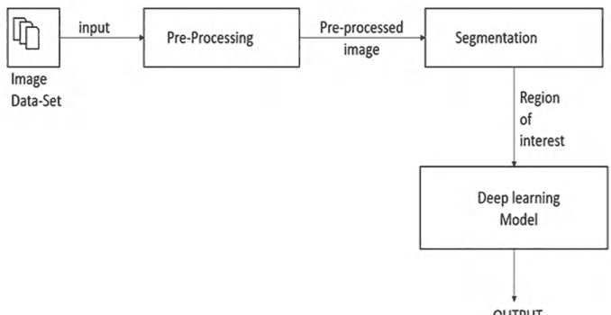

图 13.1 口罩检测系统架构。

### 13.4.3 数据集

为了本研究的目的，我们使用不同的数据集以产生更精确、更准确的结果。我们借助 Masked Face Net [12]、口罩面部数据集 [9]、口罩面部检测数据 [10]、口罩面部检测 [11] 12k 图像数据集以及口罩面部识别数据集和应用程序，来创建一个更准确的数据集。该数据集将包含超过 6000 张戴口罩人员的图像和大约 5100 张未戴口罩人员的图像。我们设计该数据集以同时包含普通口罩和医用口罩，每种口罩都有多种颜色和纹理。

该数据集旨在检测人员是否佩戴口罩。此外，本研究提出了一种从口罩到面部的可变形模型，可使用特定口罩创建更多带口罩的人脸图像。该数据集提供了一种允许口罩佩戴分析的分类粒度，使其成为口罩面部识别研究的宝贵资源（图 13.2）。

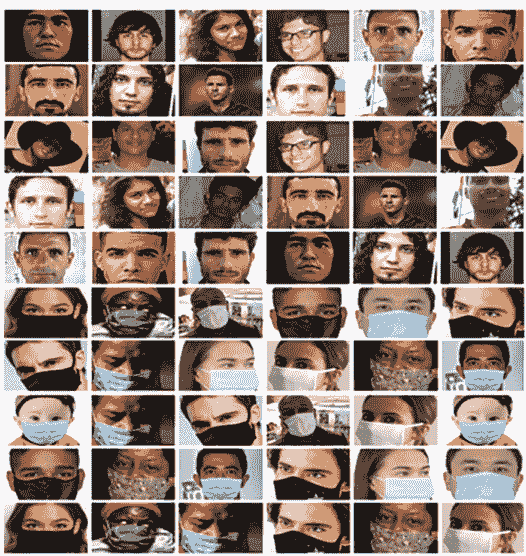

图 13.2 数据集视图。

### 13.4.4 预处理与分割

### 13.4.4.1 双线性插值

双线性插值在图像处理和计算机图形学中，用于估计常规网格上相邻像素之间的像素值。使用四个最近已知像素的加权平均值来估计未知像素的值。

该方法通过对未知像素与其附近已知像素之间的距离加权来估计像素值。方程使用每个已知像素到未知像素的权重。插值考虑了未知像素与已知像素的接近程度。

双线性插值有助于调整照片大小。放大图像时，该技术在已知像素之间估计新的像素值，与复制像素相比，能产生更平滑的结果。在缩小图像大小时，双线性插值可以估计像素值以保持图像质量（图 13.3）。

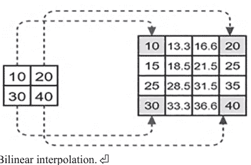

总的来说，双线性插值是一种简单且有效的方法，用于在图像处理和计算机图形学中估计像素值，尤其适用于希望相邻像素之间实现平滑过渡的情况。

### 13.4.4.2 双边滤波

图像处理中常使用双边滤波器。它基于像素的空间距离和强度距离对其加权并取平均。该滤波器在保留边缘、纹理和细小细节的同时平滑照片。

双边滤波器计算中心像素与周围像素之间的空间距离和强度距离。在计算强度距离时，像素值差异越大，权重越小。在欧氏距离计算中，更近的像素权重更大。将强度权重和距离权重相乘，可得到附近像素权重的加权平均。像素输出是周围像素的加权平均。附近强度相似的像素权重更大（图 13.4）。

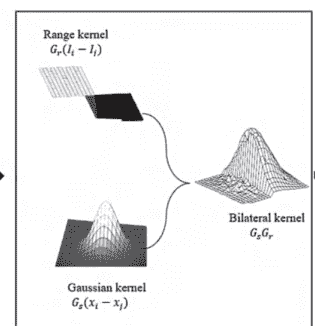

图 13.4 双边滤波器。

总的来说，双边滤波用于去噪、纹理去除和图像增强等图像处理应用。它在保留边缘和其他高频细节的同时平滑图像。

### 13.4.4.3 模糊 C-Means 分割

图像分割中常使用非监督的模糊 C-Means 分割（FCM）聚类算法。使用 FCM 方法，数据点可以以不同程度的隶属度属于多个簇。FCM 可以使用像素值对图像进行分区。每个像素的隶属度值反映其所属簇。

该算法迭代更新簇中心和隶属度值，直到收敛，旨在降低数据点与簇中心之间的距离。FCM 能够处理视觉模糊和重叠，因此适用于图像分割。


它非常灵活，因为它允许用户定义所需的簇数量，并可以与其他技术（例如地理信息）集成，以改进分割（图 13.5）。


图 13.5 模糊 C-均值分割。

总体而言，FCM 是一种用于图像分割的强大且广泛使用的算法，在处理复杂图像数据时提供灵活性和鲁棒性。

### 13.4.5 训练模型

本项目采用 ResNet-50 作为训练模型完成。ResNet-50 是一种深度神经网络架构，自 2015 年微研究院亚洲（Microsoft Research Asia）推出以来，在计算机视觉任务中广受欢迎。

这种 50 层架构是 ResNet 神经网络家族的一个变体，以其通过引入跳跃连接模型解决梯度消失问题而闻名。通过使信息能够从较早的网络层流向较后的网络层，这些跳跃连接有助于保留关键特征并减少梯度消失的影响。

ResNet-50 在各种基准数据集（包括 ImageNet、COCO 和 PASCAL VOC）上实现了尖端性能，使其成为图像分类、目标识别和分割应用的热门选择。此外，ResNet-50 架构被广泛用于迁移学习，即将预训练模型应用于训练数据较少的新数据集以对其进行训练。

总之，ResNet-50 是深度学习领域的一项重要进步。它为非常深的神经网络的训练提供了一种高效方法，并在各种不同的现有计算机视觉任务中取得了显著成果（图 13.6）。


图 13.6 ResNet-50 架构。

## 13.4 结果与讨论

每个时代的训练和验证损失与准确率如下所示。

| Epoch | Training Loss | Training Accuracy | Validation Loss | Validation Accuracy |
|---|---|---|---|---|
| I | 1.3198 | 0.9680 | 1.3290 | 0.9688 |
| II | 0.2265 | 0.9946 | 0.1878 | 0.9939 |
| III | 0.0809 | 0.9975 | 1.1236 | 0.9827 |
| IV | 0.1360 | 0.9957 | 1.3337 | 0.9653 |
| V | 0.0672 | 0.9975 | 0.2728 | 0.9913 |
| VI | 0.0312 | 0.9984 | 0.6057 | 0.9896 |
| VII | 0.0334 | 0.9988 | 0.1432 | 0.9948 |
| VIII | 0.0169 | 0.9990 | 0.2503 | 0.9913 |
| IX | 0.0169 | 0.9992 | 0.2863 | 0.9939 |
| X | 0.0105 | 0.9994 | 0.2636 | 0.9887 |
| XI | 0.0467 | 0.9979 | 0.4122 | 0.9801 |
| XII | 0.0045 | 0.9994 | 0.5453 | 0.9896 |
| XIII | 0.1585 | 0.9840 | 0.2636 | 0.9853 |
| XIV | 0.0899 | 0.9963 | 0.1852 | 0.9939 |
| XV | 0.0621 | 0.9957 | 1.3052 | 0.9809 |
| XVI | 0.0898 | 0.9973 | 0.7436 | 0.9740 |
| XVII | 0.0141 | 0.9988 | 0.5381 | 0.9887 |

在对模型进行训练后，我们在包含 923 张图像的训练数据集上对其进行了测试，它可以以 99.56 的准确率检测佩戴口罩和未佩戴口罩的人员（图 13.7）。

```
test_loss,test_acc=model.evaluate(test_generator,verbose=2)
print("\n test accuracy:",test_acc)
923/923 - 136s - loss: 0.1192 - accuracy: 0.9957 - 136s/epoch - 148ms/step
test accuracy: 0.9956663250923157
```

图 13.7 模型准确率分析。

我们的模型能够以更高的准确率检测佩戴口罩和未佩戴口罩的人员（图 13.8）。


图 13.8 结果。

## 13.5 结论

本研究总结了一种基于深度学习和图像处理的口罩检测方法。

CNN 提取并分类特征，而图像处理检测口罩。使用包含佩戴口罩和未佩戴口罩的图像的大型数据集测试了该策略。

所述方法能够准确检测面部口罩，误报率很低。该设备的实时检测非常适合机场、医院以及其他需要佩戴口罩的环境。

这项研究通过一种自动且可靠的面部口罩检测系统推进了计算机视觉和模式识别，并有助于应对 COVID-19 等传染病。该策略可能提高公共卫生水平和口罩佩戴合规性，从而增强安全性和幸福感。

佩戴不当或部分遮挡的口罩可能导致所提方法出现漏报。研究可以改进算法的鲁棒性。使用所提技术需要考虑隐私、伦理和人为因素。

总之，深度学习和图像处理算法可以检测面部口罩，进一步的研究可能会影响公共卫生和安全。

## 关键词

- COVID-19
- 双线性插值
- 面部口罩双边
- 滤波器
- 模糊 C-均值分割
- 深度学习
- ResNet-50

## 参考文献

- 1. Wang Z, Wang G, Huang B, Xiong Z, Hong Q, Wu H, Yi P, 等. 遮挡面部识别数据集及其应用. arXiv 预印本 arXiv:2003.09093 (2020).
- 2. Yuheng S, Hao Y. 图像分割算法概述. arXiv 预印本 arXiv:1707.02051 (2017).
- 3. Selvakumar J, Lakshmi A, Arivoli T. 使用 K-均值聚类和模糊 C-均值算法对脑部 MR 图像中的脑肿瘤分割及其面积计算. 在: IEEE-工程、科学与管理进步国际会议 (ICAESM-2012). IEEE, 2012, pp. 186–190.
- 4. Meivel S, Sindhwani N, Anand R, Pandey D, Alnuaim AA, Altheneyasan AS, Jabarulla MY, Lelisho ME. 使用物联网和 Faster R-CNN 算法进行口罩检测和社交距离识别. 计算智能与神经科学. 2022;2022:2103975.
- 5. Ren S, 等. Faster R-CNN: 面向带有区域建议网络的实时目标检测. 在: 神经信息处理系统进展. 2015, 第 28 卷.
- 6. Shiekh B. 面部口罩数据集，版本 1；2022 年 9 月. https://www.kaggle.com/datasets/ashishjangra27/face-mask-12k-images-dataset (2023 年 3 月 22 日访问).
- 7. Chakraborty A. 面部口罩检测数据，版本 1；2019 年. https://www.kaggle.com/datasets/aneerbanchakraborty/face-mask-detection-data/code (2023 年 3 月 14 日访问).
- 8. https://github.com/cabani/MaskedFace-Net
- 9. Jangra A. 面部口罩检测约 12K 图像数据集，版本 1；2020 年. https://www.kaggle.com/datasets/shiekhburhan/face-mask-dataset (2023 年 3 月 20 日访问).


Taylor & Francis
Taylor & Francis Group
http://taylorandfrancis.com

## 索引

- A
- 事故/事件/未遂事件, 174
  - 报告, 174
- AdaBoost, 56
- 自适应梯度增强 (AB), 3, 6
- 调整几何均值 (AGm), 10
- 高级加密标准 (AES), 132
- Amazon Echo, 92
- Apache 临床文本分析, 57
- Apple Siri, 151
- 人工智能 (AI) 计算, 52, 128
- 获得医疗保健, 95–96
- 诊断准确性, 147
- 行政应用, 88
- 随时访问, 93
- 自动化医疗实践, 95
- 益处, 93–99
- 成本效益, 96
- 数据可用性问题, 100
- Deep Blue, 84
- 知识民主化, 94
- 智能假肢开发, 98–99
- 诊断与治疗应用, 87–88
- 鉴别检查, 98
- 驱动自动化, 141
- 促进医学诊断, 88–89
- 在医疗保健中, 85–87, 128, 132
- 医疗机器人, 93
- 在医疗保健营销中, 89–90
- 混合 AI 系统, 147
- 在疾病风险识别中, 96
- 图像分析, 94
- 在学习和问题解决中, 84–85
- 在医疗程序中, 98
- 医疗工具, 84
- 自然语言处理 (NLP), 86
- 涅槃谬误, 101
- 医患关系及, 101–102
- 隐私担忧, 100
- 职业重组, 101
- 在降低用药依从性不足方面, 90–91
- 资源分配与管理, 95
- 受伤和错误风险, 99, 102
- 偏见和差距风险, 100–101
- 基于规则的专家系统, 87
- 社会偏见问题, 102–103
- 失业问题, 102
- 虚拟健康助手 (VHA), 91–93
- 人工神经网络, 97
- 增强现实 (AR), 142, 147
- AutoDock, 117
- AutoDockVina, 117
- 自动呼叫系统, 92
- Axitinib, 118
- B
- Bagging RF, 56
- 平衡随机森林 (BRF), 9
- 带限相位仅相关 (BLPOC), 196
- 伯努利朴素贝叶斯 (BNB), 3, 5–6
- 生物识别系统基本框图, 198
  - 数据采集, 198
  - 数据库, 199
  - 特征提取, 198–199
  - 匹配, 199
  - 预处理算法, 198
- 区块链系统, 142, 153
  - 智能合约, 132
- 基于蝴蝶结的风险评估方法, 174
  - 数据预处理, 177–178
  - 数据可视化, 182–183, 186
  - 集成 NLP, 176
  - 用于泄漏气体事件, 185
  - 故障层级, 183
  - 根本原因分析, 186
  - 用于滑移事件, 185


## C

- 心血管疾病 (CVD)，68。*另见* 计算机辅助 CVD 检测，研究
- 病因，68
- 早期检测，68
- 软骨，52–53
- 聊天机器人，84, 93, 102
- Chembioserver，113
- CHEMSKETCH 软件，109
- 云计算，142, 146
- c-Met 双重抑制剂，118
- 基于编码的 FKP 识别算法，193–195
- 认知行为技术 (CBT) 应用，38–39
- 计算机辅助药物设计 (CADD)，105–106
  - 优势，118–119
  - CADD-SBDD 筛选，106
  - 抗癌药物的开发，117–118
  - LBDD (基于配体的药物设计)，107–110
  - 分子对接，114–117
  - SBDD (基于结构的药物设计)，110–114
  - 结合湿实验技术，106
- 共识虚拟筛选，107
- 转换为小写，177–178, 182
- 卷积神经网络 (CNNs)，97, 205–206
- COVID-19 疫情，26–27, 204。*另见* Facebook Prophet Model
  - 按国家划分的图表，28
  - 管理与预防，27
  - 死亡人数，29
  - 传播，26–27
  - 对症与支持性治疗，26
  - 检测，28
  - 可视化，28–29
- 克唑替尼，118
- 克罗恩病活动指数，58
- 自定义训练的 NER 模型，183, 186
- CVD 检测，计算机辅助
  - 准确率图表，比较，77–79
  - 分类准确率，72–73
  - 分类，70–71
  - 基于深度学习的 CVD 检测模型，74–75
  - 集成分类模型，75–77
  - 未来展望，80
  - 使用的输入，70–71
  - 基于 IoT 平台的 CVD 检测模型，75–76
  - 特征提取方法，72–73
  - 基于机器学习的 CVD 检测模型，73–74
  - 目标，69
  - 性能指标，77–80
  - 接收者操作特征 (ROC) 图表，比较，79
  - 数据来源，71–72
  - 类型，69–70
- 网络安全网格，141–142

## D

- 数据提取，3
- 数据不平衡，3
- Debian Linux，199
- 决策树分类器 (DT)，3–5
- 深度学习算法，204
- DeepSleepNet，160
- 抑郁症，34
- 拟议的抑郁症分析-应用模型。*另见* 用于分析和预测抑郁症的移动应用，分析与研究
  - 有声读物、播客和舒缓音乐，43
  - Create() 生命周期回调方法，43
  - 饮食图表，43
  - 关注用户的心理健康和问题，45–46
  - 一般抑郁症分析图表，44–45
  - Java 活动，42–43
  - 登录页面，41–42
  - 冥想练习，43
  - OnClickListener()，43
  - 操作工作流，40
  - 基于查询的分析，41
  - 问题屏幕，42
  - 分类与推荐，42–43
  - Shared Preferences 方法()，41–42
  - 用户友好的移动应用，47
  - VolumeProvider() 方法，43
- 数字健康，140
  - 倡导，55
- 数字精神病学，35
- 疾病修饰性抗风湿药 (DMARD) 疗法，57
- 基于深度学习的 CVD 检测模型，74–75。*另见* CVD 检测，计算机辅助

## E

- 电子健康系统，55
- 心电图 (ECG)，158, 161–165
  - 准确率 (ACC)，166
  - 框图，165
  - 分类过程，158
  - 数据集，164–165
  - 特征提取，165
  - 心跳分类 (ELM)，166
  - 心跳分段，165
  - 文献综述，160
  - 性能分析，167–168
  - 精确率 (PE)，167
  - 召回率 (RE)，167–168
  - 信号预处理，165–166
  - 窦房结，158
  - 波形，159–160
- 电子健康记录 (EHR)，137
- 集成分类模型，75–77。*另见* CVD 检测，计算机辅助
  - GAN-LSTM 集成模型，77, 80
- 外骨骼机器人，98–99
- 极端梯度提升 (XGB)，3, 7–9
- 极端梯度提升 (XGBoost)
  - 算法，56
- 极端学习机 (ELM)，164

## F

- Facebook Prophet 模型，27–28
  - 训练模型的性能，30–31
  - 预测数据的可视化，29–30
- 口罩检测系统，204
  - 双边滤波，209–210
  - 双线性插值估计，209
  - 数据采集与预处理，206–207
  - 数据集，208
  - 模型部署，207
  - 检测设备，206
  - 特征提取，207
  - 模糊 C-均值分割 (FCM) 聚类算法，210–211
  - 时代损失和准确率，212
  - 系统架构，206–207
  - 训练模型，211–212
- FAF-Drugs2 服务器，113
- 快速傅里叶变换 (FFT) 方法，161–162
- 指关节纹理 (FKP)，190
  - 特征，191
  - 识别算法，191–197
  - 手指放置要求，190–191
- Fitbit，92
- FlexX，117
- 模糊 C-均值分割 (FCM)
  - 聚类算法，210–211

## G

- 加博滤波，194–195
- 高斯朴素贝叶斯 (GNB)，3, 5
- 通用数据保护条例，138
- 生成对抗网络 (GAN)
  - 模型，77
- 遗传算法，116
- 基尼系数，4
- Glide，117
- 全球区块链联盟 (GBC)，129–130, 133
- Google 助手，151
- Google Health，94
- 梯度提升 (GB)，3, 7
- 梯度序关系模式 (GORP)，195
- 基于图的注意力模型，160
- 格罗斯曼，Alex，163
- GWTG-HF 风险模型，8

## H

- Happify 应用，37
- 医疗机器人，93
- 医疗专业人员 (HCPs)，89
- 健康保险可移植性和责任法案，138
- 健康亭，92
- 健康记录，126
- 心脏病 (HD)。*参见* 心血管疾病 (CVD)
- 心力衰竭，2
  - 成人和老年人的发病率，2
- 高通量筛选 (HTS)，106
- 基于直方图的梯度提升 (HGB)，3, 7–8

## I

- IBM 的 Watson，148
- iCope，37
- 独立成分分析 (ICA)，192
- 印度医疗行业，85
- 使用 BRF 进行院内死亡率预测，模型，3
  - 数据平衡，14
  - 比较分析，21–22
  - XGB 和 HGB 模型的混淆矩阵，17, 20
  - 数据分布，15
  - 数据预处理方法，11
  - 数据集，11–13
  - 特征相关性热图，11
  - 缺失值处理，13
  - 超参数值，9–10, 17–18
  - K-折叠平均准确率，16
  - 方法论，10–21
  - 结果分布，14
  - 性能矩阵，19, 21
  - XGB 和 HGB 模型的 ROC-AUC 曲线，15, 17, 19–21
  - 数据缩放，15
  - 堆叠，19–20
  - 基于堆叠的 ML 模型，10
  - 训练和测试数据，15–17
  - 工作流程图，10
- 交互式语音应答系统 (IVRS)，92
- 基于 IoT 的 RFID 医疗监测设备，131
- 基于 IoT 平台的 CVD 检测模型，75–76

## K

- 卡斯帕罗夫，Garry，84
- 凯尔卡，Promod，38
- KEYTRUDA®，118
- K-折叠交叉验证评估过程，3, 9
- K 近邻 (KNN)，3, 6, 8, 56, 176
- 膝骨关节炎 (KOA)，52
- 知识提取系统，57

## L

- 最小绝对收缩和选择算子 (LASSO) 回归，8
- 词形还原，178, 182
- 基于配体的药物设计 (LBDD)，107–110
  - CHEMSKETCH 软件，109
  - 流程图，108
  - QSAR 分析，107–108
  - 虚拟筛选，109–110
- 轻量梯度提升机 (LGBM)，3, 7
- 线性判别分析 (LDA)，192, 196
- Lipinski 五规则，113
- 局部全局信息组合 (LGIC)，195
- 逻辑回归 (LR)，3, 5, 98
- LogitBoost 集成模型，27
- 长短期记忆 (LSTM) 模型，77
- Luminespib，118

## M

- 基于机器学习的 RA 和 OA 分析综述。*另见* 计算机辅助骨关节炎检测
  - 准确率条件，60
  - 分析准确率，58
  - OA 分析和预测模型，59
  - 检测中 ODE 和 PDE 求解的应用，55–56
  - 评估 RA 状况的属性，58
  - 挑战，60–61
  - 基于图像的检测和以数据为中心的检测，54
  - ML 模型，56
  - OA 结构进展，59–60
  - 目标，54
  - 膝关节间隙狭窄 (knee-JSN) 预测，58–59
  - 进展分析，55
  - 拟议模型，56
  - RA 治疗挑战，57
  - 膝关节置换风险状况，59
  - 传感器网络在治疗中的作用，55
  - 监督学习模型和非监督学习模型，54
  - 三级医疗 RA 患者，56
  - 了解骨髓水肿和腱鞘炎的情况，56–57
- 机器学习 (ML) 模型和严重程度评分，2
  - 算法，4–8
- 幅值码，194
- 宏基因组学，119
- 元学习器，3
- 宏转录组学，119
- 移动健康应用，92
- Microsoft Cortana，151
- 中东呼吸综合征 (MERS)-CoV，26
- MIMIC-III 数据库，9
- 基于机器学习的 CVD 检测模型，73–74。*另见* 计算机辅助 CVD 检测，研究
- 用于分析和预测抑郁症的移动应用，分析与研究。*另见* 拟议的抑郁症分析-应用模型
  - 音频治疗，36
  - 基于健身和营养，36
  - 埃及青年抑郁症的原因，37
  - 编码，35–36
  - 抑郁症程度的确定，34–35
  - 缺点和问题，38–39
  - 未来工作，48
  - 研究局限性，35–36
  - 文献综述，35–38
  - 动机依据，34
  - 口袋疗法，38
  - 拟议的应用模型，39–43
  - 缓解抑郁症催眠应用，38
  - 社交媒体使用与抑郁症风险，36
  - 精神治愈和娱乐，36
  - 症状监测，39
  - 治疗，36–38
  - 澳大利亚执业者的使用情况，37
  - “What’s up” 应用，38
- MobileNetV2 架构，205
- 修正的有限 Radon 变换 (MFRT)，193
- 分子对接，114–117
  - 基本特征，115
  - 灵活对接，116
  - 配体结合构象，114
  - 参数，115
  - 刚体对接，116
  - 评分函数特征，114
  - 搜索算法，116
  - 应用的工具和软件，117
- 单基因码，194
- 蒙特卡洛算法，116
- Mood Path，33, 45

## N

- 朴素贝叶斯计算，97, 176
  - 基于 CVD 检测，77
- 命名实体识别 (NER) 模型，175
- 自然语言处理 (NLP)
  - 基于 NLP 的工具和技术，174
- 自然语言工具包 (NLTK)，177
- 涅槃谬误，101

## O

- 职业事故，174
- OpenCV，199–200
- 作业机器人，101–102
- 常微分方程 (ODEs)，55–56
- 正交复杂局部保持投影 (OLCPP)，192–193
- 正交线性判别分析 (OLDA)，192
- 骨关节炎 (OA)，52
  - 病因，53
  - 诊断，53


- 骨关节炎检测，计算机辅助。
  - 另见 基于机器学习的RA和OA分析，MTX准确性综述，58优势，62挑战，60–61分类器，57 KOA早期检测，60–61风险因素评估，58–59元分析方法，59问题陈述，61拟议系统架构，61–62相关工作，54–60

### P

- Pan-AKT激酶抑制剂，118
- 纸质文档，93
- 偏微分方程 (PDEs)，55–56
- PASCAL VOC 2007和2012，205
- 患者健康门户，92
- 患者健康问卷 (PHQ-9)，46
- 帕博利珠单抗，118
- 药效团建模，115
- PhysioNet MIT-BIH心律失常，164
- 基于像素的特征信息，194
- 预测建模解决方案，52
- 主成分分析 (PCA)，192, 196
- 概率排序技能得分，175
- 蛋白质数据库，107
- PTB诊断心电图数据库，164
- PubChem数据库，109–110
- 标点符号删除，177, 182
- Python，199

### Q

- Q位点查找器，112

### R

- 射频识别 (RFID)，131, 152
- Raichback博士，38
- 随机森林 (RF) 算法，3–4, 56, 97, 175–176
- 随机样本一致性 (RANSAC)，196
- 树莓派，199
- 现实世界蒙面人脸识别数据集 (RMFRD)，205
- 循环神经网络 (RNNs)，97
- 远程手术，149
- ResNet-50，204, 206, 211–212
- 类风湿关节炎 (RA)，52
- Riesz变换和Compcode，194
- Rivest-Shamir-Adleman密钥对，139
- 机器人顾问，151
- RR间隔，164

### S

- Sanvello应用，38
- SAPS，9
- 安全API，138
- 服务机器人，99
- 严重急性呼吸综合征 (SARS)，26
- 短时傅里叶变换 (STFT)，162
- 智能老龄化，146
- 智能医疗系统，126, 151–152
  - 准确性，147
  - AI及相关技术的应用，132
  - 辅助残障人士，137
  - 数据采集与管理，138
  - 数据科学与预测分析，140–141
  - 迫切性，126
  - 未来，152–154
  - 未来趋势，140–142
  - 在医疗供应链管理中的应用，134–136
  - 健康信息共享，139
  - 健康监测，131
  - 基础设施，128
  - 问题与挑战，127
  - 记录维护，136–137
  - 患者记录共享平台，137
  - 隐私问题，138–139
  - 研究与开发，128–130
  - 安全特性，138
  - 用于药品安全，136
  - 实施的技术与架构，130–133
  - 用于药品可追溯性，134–136
- 智能家居，150
- 智能基础设施，146
- 智能放射组学，148–149
- 智能社会5.0，146
- SMOTE (合成少数类过采样技术)，9, 14
- Spacy NER，178–179
- 加速稳健特征 (SURF)，196
- 启动画面，39–40
- 星梯度序关系模式 (SGORP)，195
- 词干提取，178, 182
- 基于结构的药物设计 (SBDD)，110–114
  - 在同源建模中，112
  - 实施的在线工具，113–114
  - 对接过程，113–114
  - 递归过程，110
  - 步骤，110–111
  - 过程中的结构预测，111–113
- 基于结构的虚拟筛选 (SBVS)，107
- 基于子空间的FKP识别算法，191–193
- 超级计算机，146
- 支持向量分类器 (SVC)，175
- 支持向量机 (SVM)，3–4, 9, 176 分类器，57
- 外科机器人技术/机器人，98, 146–147, 149
- 症状监测，39
- 系统搜索算法，116
- 心脏收缩期或舒张期，2

### T

- 禁忌搜索算法，116
- Talk Life应用，38
- Teager能量算子 (TEO)，163–164
- 技术赋能的智慧医疗，146–147
- 远程医疗，140
- 词频-逆文档频率 (TF-IDF)，179–181
- 分词，178, 182

### U

- UCSF DOCK，117

### V

- 蛋白质范德华相互作用能，112
- 虚拟健康助手 (VHAs)，91–93
- 虚拟现实 (VR)，142, 147
- 互联网语音协议 (VoIP) 技术，92

### W

- 小波变换，163
- 弱学习器，6
- 可穿戴设备，140, 149
  - 用于健身，92
  - 传感器，130–132
- 加权线性嵌入 (WLE)，192
- 拉杰什·Wirth博士，149

### Z

- Zinc数据库，109–110

