# 物联网云数据分析的机器学习方法


## 前言

像云计算和雾计算这样的可持续计算范式能够以迅捷的方式处理与性能、存储和处理、维护、安全性、效率、集成、成本、能源和延迟相关的问题。根据统计数据，在未来几天内，数十亿的互联物联网设备将产生大量的实时数据。为了加速涉及收集数据的复杂计算和处理中的决策制定，这些设备连接到云或雾环境。由于机器学习服务在商业智能方面提供了最佳支持，组织一直在创建首批人工智能服务方面进行重大投资。全球各地的丰富研究导致了在计算平台上报告的大量进步。本书阐明了云计算和雾计算环境中的一些最佳实践及其各自的结果。鼓励将用于做出迅捷决策的商业智能实践、技术和创新作为该研究领域的一部分。

本书关注与大数据存储和分析、大规模数据处理、知识发现和知识管理、计算智能、数据安全和隐私、数据表示和可视化以及数据分析相关的各种研究问题。本文展示的技术利用工程和技术的商业智能优化各种行业流程。同时也揭示了基于云的嵌入式软件开发实践，以集成复杂的机器，从而提高生产力并降低运营成本。用于理解大数据并分析大量数据模式的各个行业的数据科学和分析实践也是本书的重要部分。

第 1 章侧重于大量信息的使用，这些信息使计算机能够基于项目理解执行非确定性分析。第 2 章解释了一种方法，用于建立认知干预的网络安全服务域与物联网 (IoT) 计算规范之间的交互式网络。第 3 章简要介绍了各种预测数据分析方法；第 4 章涵盖了云计算演进、适应性和关键新兴趋势的细节。第 5 章讨论了安全挑战以及用于解决这些挑战的方法，以及在使用云存储保护数据时各自的优缺点。第 6 章系统地审计了物联网系统的安全需求、攻击向量和当前安全响应，并针对解决物联网系统中各种安全问题的当前机器学习解决方案提供了见解，以及少数未来加密云分析要点。在第 7 章中，RSA 算法被实现为同态加密，作者试图通过实现同态 RSA 来降低其时间复杂度。第 8 章讨论了通过 CR 和 EH 技术使用智慧城市技术和物联网网络的挑战。第 9 章研究了四种著名的启发式任务调度算法 HEFT、CPOP、ALAP 和 PETS，并基于诸如计划长度、加速比、效率、资源利用率和成本等性能指标进行对比研究。第 10 章概述了云计算在智能工作系统和案例研究中的潜在应用；第 11 章提出了关于在人体区域网络 (DSCB) 中使用聚类双汇合点方法的研究。第 12 章综述了绿色云计算的全面文献，并揭示了该领域具有大量未来探索研究潜力的研究空白。在第 13 章中，提出了一种系统，该系统识别疾病，对其进行分类，并根据识别出的疾病类型做出反应，同时也描述了使用深度学习的预防措施。第 14 章旨在使用线性回归、循环神经网络 (RNN) 和长短期记忆 (LSTM) 单元预测五个部门——制药、银行、快速消费品、电力和汽车部门。第 15 章分析 Aadhaar 数据集并从中得出有意义的见解，这肯定会确保 fruitful 结果并促进即将到来的 NPR 更顺利地进行。第 16 章首先概述当前的区块链技术和联盟区块链框架，然后考虑区块链与蜂窝 5G 网络、大数据、物联网和移动边缘计算的应用。第 17 章展示了各种先进的机器学习方法如何用于现实生活场景中的不同应用。第 18 章探索了


拟人化的游戏化元素，主要探讨如何以更有利可图的方式在区块链赋能的过渡期医疗保健系统中实施这些元素。

Sachi Nandan Mohanty, 印度
Jyotir Moy Chatterjee, 尼泊尔
Monika Mangla, 印度
Suneeta Satpathy, 印度
Sirisha Potluri, 印度
2021年5月

## 致谢

编辑们谨向所有为本书贡献章节的作者致以最美好的祝愿并表达我们的感激之情。我们也感谢那些抽出宝贵时间审阅章节并及时反馈意见的领域专家。特别感谢那些花时间提供建议和改进意见的人，这些建议帮助我们完善了思路和方法，从而产出了更丰富的内容。我们特别感谢 Scrivener 出版社，感谢其出色的团队以鼓励、参与、支持、合作及贡献支持了我们本书的出版。

# 基于机器学习的数据分析

M. Deepika$^{1*}$ 和 K. Kalaiselvi$^{2}$

$^{1}$计算机系，计算科学学院，Vels 科学、技术与高级研究学院（原 Vels 大学），印度泰米尔纳德邦金奈

$^{2}$计算机应用系，计算科学学院，Vels 科学、技术与高级研究学院（原 Vels 大学），印度泰米尔纳德邦金奈

## 摘要

人工智能（AI）是一种技术混合体，而机器学习（ML）是高度个性化营销中最重要技术之一。AI ML 预设系统在无人干预的情况下重新评估和数据重新评估。其核心在于转变。正如 AI 的含义一样，对于每一种可能的动作/反应，人类程序员都不必编写代码；AI 机器编程可以评估和测试数据，以复制每一个客户产品，其速度和能力是无人能及的。我们一直在使用的技术已存在很长时间，但机器、基于云的服务以及 AI 对我们营销人员地位的影响近年来发生了变化。不同的信息和数据导向有助于实现多种技术改进。本章重点在于使用大量信息，使计算机能够基于项目理解执行非确定性分析。它还侧重于数据收集，有助于确保数据分析的准备就绪。它还定义了使用 ML 算法进行预测和分析的数据分析过程。与 ML 数据挖掘相关的问题也得到清晰解释。

**关键词：**大数据、数据分析、机器学习、机器学习算法、神经网络

机器学习是一个庞大且包含不同卓越服务计算的主题 [1]。它传统上与构建将思想连接起来以解决被改变问题的技术相关联。通常，系统试图解决一类问题，随后在困难空间中暴露系统实际因素的消耗。在该领域，将处理两三个一般性问题以及记录分析中使用的该方法。这些技术中的大量使用预定信息来展示模型。数据包含困难空间中影响因素的扩展。当模型准备就绪时，测试并审查了测试数据的使用。随后模型被用于输入信息以产生需求。

机器接收信息是人工大脑 [人工智能 (AI)] 的一项功能，它允许这些线路的结构吸收并改进来自除定制化之外的离开。机器主导工作场所发展计算机功能，这些功能可以进行评估并独立使用研究成果。学习方法始于识别数据（如痕迹和支持结合在方案中），在事实中实践结构，并在提供案例的前景中做出更优决策。主要因素是允许计算机在个人参与或辅助之外分离并正确修改执行 [2]。然而，利用 AI 的常见评估，文本被测量为口语的公共事件。受语义评估的政策反映了理解材料方法的个人能力。图 1.1 阐明了机器学习 (ML) 方法中的数据 分析过程，其中所有信息被收集、开发、存储并通过 ML 算法实现。

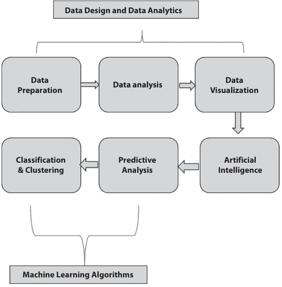

**图 1.1** 数据分析过程。

如今，海量数据存在于不同的地方。在线数据库的明显原因是代理人为了跟踪客户购买而建立的那些策略。由此产生的不同非明确的数据来源，且这些非明确来源通常提供巨大力量以实现非凡之事。考虑到作为海量记录的来源，这提升了计算机推理结果，使计算机能够以既定方式分离并迅速渴望结果。通过接收巨大的实际特征和事实碎片，它可以创建一个逐渐更认识自然环境方面的工作区域考虑机器，该工作区域考虑某些不均衡情况的可能性。所有测量的效果表明，意见以某种方式被误认为是电脑主导的方法。

由于认证的负担增加，优质产品的信誉持续成功，作为确保公司长期成功的关键主导因素。此外，在创建个性化视角时，多样性的数量以及评估组织和行动的奇怪性极大地扩展。业务四将模型连接到 AI，且信息和收集增长及技术的差异，包括信息物理系统、物联网 (IoT) 和 AI。CPS 以组合的计算和物理能力处理多种其他方法，允许通过新模态与人员关联。IoT 是下一代前沿创建的关键便利影响，通过数据和应用分析的对话技术定义一般关切的功能研究，以奖励实现物理和基本事物。

分布式处理消耗现有形式，因为它允许按需和重要地将区域引入到庞大且灵活可配置的资源群中。基于计算机的事实在收集方面存在严重限制，例如：合理评估、卓越评估、强烈自动化以及传感器，这些在通常的智能中被识别为过度的 AI 进步。最相关的 AI 推动之一是 ML，它为现代化事物和构建组装的方法开发和组织提供了极具可行性的方案。应用科学方法来创建无定形数据库，授权在黑暗系统和规则的仔细关注下离开以分发新数据。这将基于数据和计算机辅助预测未来结果的需求结构进展连接起来。

## 1.2 基于数据分析的物联网机器学习

硬件、软件和通信应用分析的快速进步推动了互联网相关明确设备的崛起，这些设备允许从当前现实中获得识别和记录估计。今年，估计正在使用的互联网相关设备总数将在 25 亿到 50 亿之间。随着这些数字的增长和应用分析变得越来越重要，分散的记录数量将增加。互联网相关设备（指 IoT）的发展继续通过引入真实世界和数字世界之间的系统和交流来扩展当前的互联网。尽管复制量巨大，IoT 通过其在时间和区域依赖方面的速度产生巨大信息，具有几种模态和多种估计质量。这些庞大真相的快速准备和评估是创建杰出 IoT 应用的最好方法。

本部分回顾了一组获取处理 IoT 数据挑战的计算机程序，重点考虑智能城市网络作为核心用例。关于此获取答案的关键任务是提出一个逻辑的工作区域考虑计算安排，解释如何利用不同方法处理数据以消除更高阶段的信息 [3]。

由于 IoT 将成为新数据最巨大的来源之一，估计分析将为使 IoT 应用更具洞察力承担巨大责任。数据分析是独特的连贯领域的混合，使用记录挖掘、计算机学习和不同技术从数据中发现结构和新信息碎片。这些技术融合了计算在许多特定领域中的广泛重要性。使用实际因素分析方法对地区的应用方法


## 6 用于物联网云数据分析的机器学习方法

信息分类，例如体积、排列和速度；信息模型，例如神经网络、请求和聚类方法；以及利用具有强大实际因素特征的 capable 计算 [4]。根据评论，首先，由于记录是由具有独特见解类型的显性来源创建的，尝试或提升能够处理实际因素特征的计数是基本且必要的。其次，持续产生信息源的惊人集合不再免于规模和速度带来的困扰。最后，寻找适合信息的名声数据模型是测试思想和对物联网数据进行更高评估的基本问题。

背后的原因是通过节省时间、必要性和资金，发展日益精彩的生态要素和顺畅的生活方式。通过这种发展，特定组织的成本可以降低。在物联网上运行的大型假设和大量研究使物联网成为近期的一种制造设计。物联网包含一个相互关联的单位，可以在彼此之间移动记录以更新其出现 [5]；这些改进精确展示，并且也是人类思想或信息。物联网包含四个关键部分：

- 传感器，
- 处理框架，
- 信息评估数据，以及
- 机器检测。

物联网中最新的进展始于 RFID 标签被更广泛地使用，通常被视为更低关注度的传感器变得越来越重要，开放网络机械态度被创造，并且口语交流显示得以平衡。物联网是在一系列技术的共同作用下构建的，而系统是其运行的目标且令人满意的环境。因此，口语交流显示是这项技术技能中必须更新的一部分。为这些对应关系规划并准备估算是一个基本挑战。为了应对这一挑战，必须应用出色的记录准备类型，例如边缘评估、圆圈分析和数据库中的物联网评估。遵循上述任何方法的选择取决于应用程序及其需求。模糊性和云处理是我们为在将其移动到不同事物之前准备和规划记录而获得的两种指示性技术。物联网的整体任务总结如下。首先，传感器和物联网单元从地球上聚合记录。接下来，数据从原始数据中分离出来。然后，记录通过互联网方式被设置为可以移动到不同事物、设备或服务器的状态 [6]。

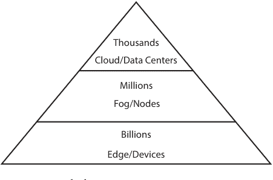

图 1.2 雾计算和边缘计算。

### 1.2.1 计算框架

物联网的另一个重要组成部分是处理信息的计算系统，其中最著名的是雾计算和云计算。物联网应用程序根据应用和处理区域使用这两种系统。在某些应用中，信息应在产生时进行处理，而在其他应用中，则不一定需要快速处理信息。在图 1.2 中，信息的即时处理以及支持它的组织和设计被称为雾计算。总体而言，这些被应用于边缘计算。

### 1.2.2 雾计算

这种计算的架构与将数据从数据中心任务移动到服务器框架相关联。这是基于框架服务器构建的。雾计算提供有限的计算、容量和组织服务，同时也为数据中心提供一致的洞察力和信息筛选。这种架构已经并且正在医疗健康和军事应用等重要领域实施。

### 1.2.3 边缘计算

在这种设计中，处理在远离中心、靠近组织边缘的地方运行 [6]。这种处理类型使数据能够首先在边缘设备上进行初步处理。边缘设备可能不会持续连接到安排，因此，它们需要一份主数据/参考数据的副本用于离线处理。边缘设备具有不同的特点，例如

- 提高安全性，
- 分析和清理信息，以及
- 存储局部数据以供区域使用。

### 1.2.4 云计算

在此处，用于处理的信息被发送到数据中心，经过分析和处理后变得可访问。这种设计具有高延迟和高负载调整，表明这种设计不适合处理物联网信息，因为大多数处理应以高速度运行。该信息的体积很大，大量数据处理将增加云服务器的 CPU 使用率。

### 1.2.5 分布式计算

这种建筑旨在规划大量数据。在物联网应用中，由于传感器大量产生数据，会面临大量数据挑战 [7]。为了克服这一现象，分散式计算旨在将数据隔离成包，并将组分配给不同的计算机进行处理。这种分散式计算具有诸如 Hadoop 和 Spark 等多种框架。在从云过渡到雾和遗留计算时，会发生以下现象：

1. 组织负载的减少，
2. 数据规划速度的提升，
3. CPU 使用的减少，
4. 关键性使用的减少，以及
5. 设置后续数据体积的能力。

由于智慧城市是物联网的主要应用之一，将在以下领域讨论智慧城市的最先进基本使用实例及其数据属性。

## 1.3 应用于数据分析的机器学习

人工智能对于信息分析评估始终至关重要，因为它已用于巨量的不同领域。人工智能的一个描述性典型是将揭示限制为一组大量的代表性事实，然后稍后用于查看相同的目标和决定性问题。没有必须明确地编程应用程序来解决问题。一个展示可以是这个现实斗争的描述。例如，可以使用客户购买来建立一个概要。因此，可以做出关于客户可能做出的此类购买的预测。这使得关系能够为客户修改通知和优惠券，并可能提供空置的客户体验。在图 1.3 中，安排可以通过多种具体方法之一执行。

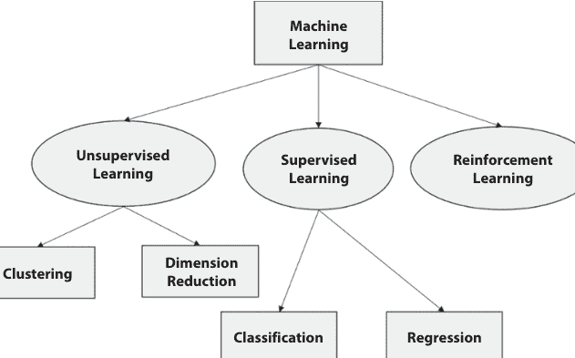

图 1.3 机器学习算法。

- 监督学习：模型是使用带有注释的、逐步的信息进行设置的，显示看到正确的结果。
- 无监督学习：信息不包含结果；相反，模型需要在孤立中发现关系。
- 半监督：获得一定数量的逐步信息与更大比例的未标记信息相结合。
- 强化学习：这类似于管理学习；至少，奖励被赋予足够的成果。

### 1.3.1 监督学习系统

许多受控制的工作领域正日益熟悉可用的计数。它们是决策树、线性矢量机和贝叶斯框架。它们都使用解释的数据集，该数据集融合了属性和正确答案。通常，使用训练和测试数据集。

### 1.3.2 决策树

用于获取关于决策树信息的计算收缩是一种用于创建预测的模型。它将某些识别映射到关于目标的决策。时间区间树始于反映特定状态或特征的分支。树的叶子代表结果，分支建议导致结果的部分。在评估挖掘中，决策树是用于收集的数据表示 [8]。例如，可以使用决策树来根据积极特征（例如支付程度和邮政编码）判断某人是否有可能购买某物。当目标变量采用持久特征（例如实数）时，该树被称为回归树。

树包含内部中心点和叶子。每个内部中心点代表 mannequin（模型）的一个组件，例如大量规划的重要程度或数字书籍是平装还是精装。从内部中心点发出的边缘描述这些特征的估算。每个叶子都被称为表示，并具有相关的概率路径。决策树便于理解且有用。为 mannequin 准备记录很简单，即使对于大型数据集也是如此。

### 1.3.3 决策树类型

树可以通过使用特征分离输入数据集的方法来教授。这通常基于递归结构开发，建议称为决策树的递归分配或自顶向下归纳。当中心点的特征是目标总和或递归不再包含重视时，递归受到限制。叶子在分析过程中代表一个分段的实际总和；同样可以创建多个灌木。有多种用于创建树的方法。这些方法被暗示为制服技术：在给定数据课程的情况下，重要的是多于一棵树来对数据进行建模。例如，树的建立同样可以确定银行是否有 ATM 电脑，而下一个内部中心点同样可以显示柜员的数量。树应制作以检测根部的柜员数量，而 ATM 的存在是一个内部中心点 [7, 8]。树结构中的差异可以选择条件在树上变化的程度。理解请求有不同的策略


即树的中心点。一种方法是选择能带来最大估算收益的属性；也就是说，选择最能迅速削弱常识性决策的维度。

### 1.3.4 无监督机器学习

独立的 PC 思考不使用数据备注；也就是说，数据集不包含预见的结果。尽管在熟悉独立学习算法方面存在差异，但将展示使用关联规则学习来描述这种学习方法的用法。

### 1.3.5 关联规则学习

作为感知数据项之间关联的流程，关联规则学习非常成功。它是所谓展示区隔评估的一部分。只要用户进行购买，这些购买极有可能涉及超过特定阈值的重要物品，当这种情况发生时，某些物品通常会被一起销售。关联规则学习是理解这些相关物品的一种方法。

### 1.3.6 强化学习

强化学习是机器学习的一个子类型，代表了当前关于神经框架和 PC 学习研究的重要组成部分。与无监督和监督学习不同，强化学习根据动作的结果来选择决策 [9]。这是一个目标导向的过程，通过获取关于流程的数据来实现，类似于世界各地许多家长和教育工作者的策略。教孩子找到一些解决方案并在考试中表现良好，目标是让他们获得极高的评估作为奖励。同样，强化学习可用于教机器做出选择，以追求完美的奖励。有两种或三种有助于 AI 的策略。人工智能将展示三种策略：

- 决策树：利用问题的特征作为内部决策节点，结果作为叶子，构建一棵树。
- 支持向量机：这是用于分类的工具，通过创建划分数据集的超平面来进行预测。
- 贝叶斯网络：这用于描述事件之间的概率关系。

## 1.4 机器学习中的实际问题

了解在管理需要 ML 的问题时可能面临的约束和可能次优条件的性质是基本的。对这些问题的性质、它们接近度的影响以及处理这些问题的技术将在接下来的章节讨论中加以说明。这里，图 1.4 简要介绍了我们面临的实际问题：数据质量和噪声：丢失值、重复值、由于人类或仪器记录错误导致的错误值，以及错误的排序是构建 ML 模型时需要考虑的一些基本问题。不解决数据质量问题可能会导致不准确或破碎的模型。在随后的章节中，重点介绍了这些问题的许多方面以及通过数据清洗克服它们的几种方法 [10]。

不平衡数据集：在许多现实世界的数据集中，训练信息中的标签存在不平衡。这种数据集的偏斜影响了学习的选择、算法的选择方法、性能评估和验证。如果没有使用正确的流程，模型可能会遭受广泛的偏差，并且学习并不高效。

数据量、速度和可扩展性：通常，大量信息以原始格式或高速度实时流形式存在。由于算法固有的限制或设备限制，或两者的结合，从完整信息中学习变得不可行。在安排减少数据集的大小以适应可用资源时，必须进行信息采样。采样可以以多种方式进行，每种采样形式都会引入偏差。必须利用不同策略（如分层抽样、改变测试大小、增加不同集合上的测试估算）来验证模型免受采样偏差的影响。利用大规模信息 ML 还可以克服数量和采样偏差。

过拟合：预测模型中的核心问题是模型未得到足够的泛化，而是被制作成尽可能拟合给定的训练信息。这导致模型应用于未见信息时表现贫乏。在随后的章节中描述了多种克服这些问题的方法。

维度诅咒：在处理高维信息（即具有许多特征的数据集）时，ML 算法的适应性成为一个真正的问题。增加信息更多特征的问题之一是引入了稀缺性，即除非特征数量的增加伴随着训练案例数量的指数级增加，否则特征空间的每个单位体积内的平均信息点更少。这可能会阻碍许多策略（如基于距离的算法）的性能。增加更多特征还可能会降低学习者的预测能力，如下面的图表所示。在这种情况下，需要更合适的算法，或者必须减少信息的维度 [11]。

## 1.5 数据获取

处理未正确设计或变量名称无法传达其预期目的的代码通常乐趣不多。但那些糟糕的信息会导致错误的结果。因此，数据获取是信息分析中的关键步骤。信息可从几种来源获取，但必须被恢复并最终处理，之后才能变得有价值。它可从各种来源获取。它可以在各种公开信息来源中作为简单记录找到，也可能以更复杂的形态存在于互联网上。在本章中，将展示如何从这些来源获取信息，包括不同的网站和一些社交媒体站点 [12]。

可以从下载记录或通过称为网络抓取的流程获取信息，该流程涉及提取网页的内容。它还探讨了相关主题网络爬虫，该流程涉及检查网站位置的应用程序，以确定其是否感兴趣，然后跟踪嵌入的链接以识别其他可能重要的页面。可以从社交媒体目的地提取数据。将展示如何从包括以下地点的站点提取信息：

- Twitter
- Wikipedia
- Flickr
- YouTube

从站点提取信息时，可能会遇到许多不同的信息组。最初，通过检查可能的信息来源来遵循不同的信息设计。需要这些信息来展示如何使用不同的信息获取技术获取信息。

## 1.6 理解数据分析应用中使用的数据格式

在检查信息设计时，它们指的是结构组织，与简单记录组织相对，后者对大多数开发人员可能并不明显。由于可用组的无限数量，无法检查所有可用组。相反，处理一些更常见的组，提供足够的示例以解决最普通的信息恢复需求。特别地，将展示如何恢复存储在该结构中格式的信息 [13]：

- HTML
- PDF
- CSV/TSV
- 电子表格
- 数据库
- JSON
- XML

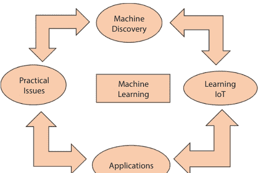

**图 1.4** 物联网应用中机器学习的问题。


这些设计中的少数几个在其他地方被充分维护和归档。XML 已使用很长时间，并且存在访问 XML 信息的成熟程序。对于此类信息，请概述可用的主要方法，并展示几个示例以说明其工作原理。这将为不熟悉该技术的用户提供对其性质的初步了解。最常见的信息格式是二进制文件。例如，Word、Excel 和 PDF 文件都以二进制形式存储。这些文件需要特殊的程序来提取数据。文本信息也非常常见。

## 1.7 数据清洗

现实世界中的数据通常杂乱无章且缺乏结构，在使用之前必须经过整理 [14]。数据可能包含错误，存在重复片段，格式不正确，或者相互冲突。处理这类问题的过程称为数据清洗。数据清洗也被称为数据塑形、刷洗、重塑或处理。数据合并（将来自多个来源的数据合并在一起）通常被视为一种数据清洗活动。它必须是干净的数据，因为基于错误数据的任何分析都可能产生误导性的结果。这旨在确保信息网格是高质量的数据。数据质量包括：

-   有效性：确保数据具有正确的形状或结构。
-   准确性：数据中的值能够代表数据集。
-   完整性：没有丢失的属性。
-   一致性：对数据的更改是同步的。
-   统一性：使用相同的测量单位。

完成相同的清洗任务通常有多种方法。该工具允许用户在数据集中进行检查并采用多种策略进行清洗。然而，对于每个需要清洗的数据集，它都要求用户与应用进行交互。这不利于自动化。这里将重点介绍如何使用代码方法来清洗数据。即便如此，清洗数据可能仍有不同的策略。展示不同的方法可以给用户提供关于如何执行的见解。

## 1.8 数据可视化

人类智能在识别视觉表示中的设计、模式和异常方面通常表现出色。许多数据分析问题中展示的大量数据可以使用可视化策略进行分析 [12–15]。可视化适用于广泛的受众群体，从研究人员到高层管理到客户。可视化是数据分析中的关键步骤，因为它允许我们以有效且有意义的方式构想大型数据集。对于较小的数值数据集，人们可能直接看出模式，但这个过程可能是压倒性的且令人困惑的。使用可视化工具帮助我们识别潜在的问题或初始数据结果，以及生成重要信息的有用转换。数据可视化便利性的一个例子在于异常值的存在。数据可视化使我们能够快速看到基本上超出我们预期的数据结果，并选择如何调整数据以构建干净且可用的数据集。这一过程使我们能够快速发现错误并在其成为问题之前处理它们。此外，可视化还允许我们轻松地对数据进行分类，并帮助研究人员以最适合其数据集的方式组织他们的请求。

## 1.9 理解数据分析的问题解决方法

数据分析涉及处理和评估大量记录，以形成用于生成预测或达到其他既定目标的模式。该过程通常包括构建和准备模型。解决这个问题的方法取决于问题的性质。无论如何，总体上，以下是评估计划中使用的关键高级操作 [11]：

-   获取数据：记录通常分散在多个组合中，并来自各种数据源。
-   清洗数据：一旦覆盖实际情况，通常会在用于分析之前对其进行替代和整理。同样，测量值必须被整理或清洗，以消除错误，发现异常值的根源，并无论何地将其整理成适合评估的形式 [12–17]。
-   分析数据：这可以使用多种方法完成，包括统计评估：这使用许多历史方法来处理以提供对数据的见解。它融合了基本程序和增强系统。
-   AI 估值：这些可以构建为 AI、神经网络和深度检查方法。机器推理方法通过可以分析特定任务或重新设计的模块进行描述；神经网络围绕模拟大脑神经结构的模型构建；深度思考试图在大量数据中看到更多重复层次的反射 [18]。
-   文本分析：这是一种特殊类型的评估，它处理自然语言以识别特征，例如人名和地名、内容部分之间的关联以及内容的预先警告估值 [19]。
-   数据表示：这是一个全面的分析工具。通过以可见格式显示数据，难以理解的一组数字可以立即被量化。
-   视频、图像和完整制作的检查与评估：这是一种越来越精确的评估类型，随着更高级的分析方法被看到以及更快的处理器变得可用，其普及程度正在提高 [20–23]。这与大多数普通内容制作和评估任务相比更具威胁性。

## 1.10 通过数据可视化增强理解并在数据分析中使用神经网络

对信息的评估有时会导致一系列数字，而对话这些数字会带来分析的最终结果 [24–26]。然而，对于大多数人来说，这种传达结果的方式并不总是自然的。理解结果的一种更有效方法是创建图表和轮廓来描述结果及其组成部分之间的关系。人类智慧在识别视觉描述中的计划、模型和特殊情况方面通常令人惊叹。在各种洞察分析困难中展示的庞大记录集合可以使用感知策略进行调查。表示适用于从专家到高层组织到商业的巨大范围的社会事务人群。

人工神经网络，计划称为神经网络组织，取决于大脑中发现的神经元。神经元也可以是一个具有树突连接其输入源和其他神经元的手机。根据输入源，指示给源的权重，神经元被授权，然后沿着树突向另一个神经元发送信号。一系列神经元可以被设置以响应大量传入信号 [27]。生成的神经元也可以是一个中心点，具有一个或多个突出的信息源和私有输出。每个输入都包含一个随时间调整的输出权重。神经网络可以通过将输入组织到系统中，唤起激活函数并评估结果来进行学习。

## 1.11 统计数据分析技术

这些技术从基本的冷血估计到前沿的离经叛道的评估模型不等。实际的评估可能是一个相当复杂的过程，需要仔细执行基本评估 [28]。它将从主要定量评估技术的简介开始，包括学习数据集的原始、均值、众数、中位数和标准差。线性回归评估是查看信息的基本方法。该框架制作了一条旨在促进数据集的线。处理直线的条件可以用来预测未来的行为。有几种类型的回归评估。样本大小验证包括感知协调精确历史评估所需的数据量。在处理大型数据集时，通常不需要使用整个集合。使用样本大小验证以确保它选择足够小的模型来控制并有效分离，但又足够大以决定性地解决我们的数据质量。使用数据子集来设置模型，并使用另一个子集来测试模型并不罕见。这有助于检查数据的精度和稳定性。模型大小选择不足的一些基本后果包括假阳性结果、假阴性结果，以及在不存在可量化显著性时识别它 [29]。


### 1.11.1 假设检验

假设检验用于测试关于数据集的某些疑虑或前提是否不可能由偶然发生。假设这种情况属实，那么最终的测试结果在量化上是显著的。执行假设检验绝对不是一项直接的任务。过去，受试者往往会得出他们接受为典型的结果。在旁观者效应中，也称为霍桑效应，结果往往是有偏差的，因为个体意识到他们正在被观察。由于人类直接评估的惊人特性，某些类型的量化测试特别容易受到偏差或退化的影响。

### 1.11.2 回归分析

回归分析对于识别数据中的模式至关重要。它展示了因变量和自变量之间的关联 [30]。自变量决定了因变量的估计值。每个自变量对因变量评估的影响可以是强烈的，也可以是微弱的。线性回归使用散点图中的一条直线来显示模型。非线性回归使用某种曲线来描述关联。循环压力可以被视为因变量，而各种成分则作为自变量。

## 1.12 文本分析和视觉及音频分析

内容评估可能是一个普遍的问题，并被精心设计为自然语言处理 [31, 32]。它被用于一系列独特任务，包括检查内容搜索、语言翻译、假设评估、对话确认和收集，以决定少数几个示例。由于特定性和口语中决定出的不规则性，分离的方法可能是危险的。

这些包括处理以下内容：

- 分词：将文本分解为单个标记或单词的过程。
- 停用词：这些是标准的短语，可能对规划来说并不基本。它们包括像 the, an, 和 to 这样的词。
- 命名实体识别：这是识别文本部分的过程，例如人名、地区或事物。
- 句法变体：这识别句子的语法成分，例如名词、动词、形容词等。
- 关联：在这里，它关注于识别文本片段如何相互认知，例如句子的主语和宾语。

单词、句子和条目的概念是突出的。然而，分离和分析这些片段并不总是那么直接。语料库中的时间跨度时不时暗示文本的组合。声音、图片和故事的使用是证明风险是日常存在中日益重要的视角 [33]。电话对话和机器对语音命令的反应是永恒的典型。人们直接与其他地方的人进行视频通话。照片和视频分享目标有着聪明的复制。利用来自一系列来源的图片、视频和声音的应用程序正在发现机会日益增加。

## 1.13 数据分析和并行的数学技术

应用程序的同步执行可以实现巨大的性能提升。在本节中，它将讨论在估算分析应用程序中可使用的多种策略。这些可以从低级逻辑计算到更高级的 API 以及明确的其他选项 [34]。

始终牢记，优化始于确保完成正确的使用执行方案。如果工具不再像用户预期那样工作，那么优化是徒劳的。工具的设计和所使用的计算方式同样比代码升级更确切、更基本。始终使用最适合计算的最优条件。然后应考虑代码升级。它不能解决本部分中的大量平滑化问题；相反，它将侧重于代码增强 [35]。

许多信息分析工作和辅助 API 使用结构练习来完成它们的任务。通常这些任务被包含在 API 内部，但有时也可能需要诚实地使用这些。无论如何，建议查看这些练习是如何增强的。为此，它将解释如何使用几种显著策略来监督系统增量。同步准备可以使用方法字符串来应用。设计师可以使用字符串和字符串池来提高应用程序的响应时间。当某些 CPU 或 GPU 不可用时，例如爱国主义的情况下，许多 API 将使用字符串。这里将不描述字符串的使用。然而，用户被假定拥有关于字符串和字符串池的重要数据。指导减少计算广泛用于信息分析应用程序。它将作为一种过程存在，以实现如此等效的设置，包括使用 Apach 的 Hadoop。Hadoop 是一种结构，有助于管理巨型数据集，并可以极大地减少巨大真实因子分析任务的根本处理时间。它将展示一种计算模型排列数据典型成本的方法 [36]。

### 1.13.1 使用 Map-Reduce

指导归约是一种在等效、分配方式处理巨大真实因子方案中的模型 [37]。该模型包含一个用于分离和组织数据的指南系统，以及一个用于总结数据的归约策略。指南归约框架非常出色，因为它通过跨多个服务器传递数据集的准备过程，同时对数据的小部分进行排序和标记。指南减少在多悬挂方式应用时提供了广泛的性能更新。在此部分中，它将展示 Apach 的 Hadoop 执行使用过程。Hadoop 是一个产品程序自然环境框架，有助于等效列表。指南减少作业可以在 Hadoop 服务器上运行，通常设置为组，以全面改进处理速度。Hadoop 有在 Hadoop 组内中心点上运行地图归约策略的跟踪器。每个中心点自主工作，跟踪器监控每个中心的进展并安排其输出以形成完整输出 [38]。

### 1.13.2 倾斜分析

倾斜评估是市场桶评估的核心。它可以发现由突出客户或社会事务通过策略执行的行为之间的共发生关联。在零售业中，情感评估可以帮助您弄清客户的购买行为 [39]。

这些体验可以通过明智地精心推销和升级销售策略来帮助支付，并可以帮助您创建可靠性计划、交易进步和削减价值计划。它将调整内部联盟规则，使其越来越熟悉规则和计算，例如支持度、提升度、Apriori 计算和 FP-增长计算。接下来，让我们使用 Weka 在市场数据集上进行我们的第一个情感评估，并找出一些关于如何解决随后规则的方案。最后，它将通过剖析关联规则学习如何在各个领域使用，例如 IT 运营分析、药物学和其他领域，来结束该部分。

### 1.13.3 市场购物篮分析

自现代化零售店引入以来，商店已经积累了很多数据 [36–40]。为了利用这种真实因子传达业务尊重，它们最初开发了一种方法来连接和混合数据，以理解业务的基本面。在这个详细程度上，零售商对每个在其商店购物的客户的市场购物篮具有直接可见性，不仅看到了购物车中购买的差异水平，还看到这些物品是如何相互关联的。这可用于驱动关于如何分离商店集合和商品，以及如何有效地整合某些物品熊（可能指“商品组合”或原文误译，此处保留原意逻辑），在内部和所有通过类别中，以驱动更加显著的排列和优势的决定。这些决定可以在整个零售连锁中完成，通过渠道技术，在附近保留水平，以及无论如何，对于具有假设定制宣传的有趣客户，他们识别出为每个客户提供的独特事物。

## 1.14 结论

在其核心，信息处理需要能够追捕和分析大量数学数据的能力。对无辅助知识、详细估计、分组评估策略以及使用经验、隔离和分布程序的发现进行了分析。每个部分专注于与引导和不准确学习相关的知识和思想的清晰和客观分析。这也与当前在职的各种类型的 AI 相熟悉。批判性地思考机器如何处理大量数据。AI 采用的方法决定了结果


学习阶段和结果正朝着这个方向发展。在计算之前，AI 系统可能完成许多任务。这决定了 AI 如何有效地测试和分析不同类型的证据，从而完成知识发现过程。

# 参考文献

- Pandit, A. and Radstake, T.R., Machine learning in rheumatology approaches the clinic. *Nat. Rev. Rheumatol.*, 2, 69–70, 2020.
- Kulin, M., Kazaz, T., De Poorter, E., Moerman, I., A survey on machine learning-based performance improvement of wireless networks: PHY, MAC and network layer. *Electronics*, 3, 318, 2021.
- Alsharif, M.H., Kelechi, A.H., Yahya, K., Chaudhry, S.A., Machine Learning Algorithms for Smart Data Analysis in the Internet of Things Environment: Taxonomies and Research Trends. *Symmetry*, 12, 1, 88, 2020.
- Liu, C., Feng, Y., Lin, D., Wu, L., Guo, M., Iot based laundry services: an application of big data analytics, intelligent logistics management, and machine learning techniques. *Int. J. Prod. Res.*, 58, 17, 5113–5131, 2020.
- Rocchetti, M., Delnovo, G., Casini, L. and Salomoni, P., A Cautionary Tale for Machine Learning Design: why we Still Need Human-Assisted Big Data Analysis. *Mobile Networks Appl.*, 25, 1–9, 2020.
- https://learning.oreilly.com/library/view/machine-learning-end-toend/9781788622219/index.html
- https://learning.oreilly.com/library/view/machine-learning/9780128015223/Cover.xhtml
- Zolanvari, M., Teixeira, M.A., Gupta, L., Khan, K.M., Jain, R., Machine learning-based network vulnerability analysis of industrial Internet of Things. *IEEE Internet Things J.*, 6, 4, 6822–6834, 2019.
- da Costa, K.A.P., Papa, J.P., Lisboa, C.O., Munoz, R., de Albuquerque, V.H.C., Internet of Things: A survey on machine learning-based intrusion detection approaches. *Comput. Networks*, 151, 147–157, 2019.
- Tuli, S., Basumatary, N., Gill, S.S., Kahani, M., Arya, R.C., Wander, G.S., Buyya, R., Healthfog: An ensemble deep learning based smart healthcare system for automatic diagnosis of heart diseases in integrated iot and fog computing environments. *Future Gener. Comput. Syst.*, 104, 187–200, 2020.
- Liang, F., Hatcher, W.G., Xiu, G., Nguyen, J., Liao, W., Yu, W., Towards online deep learning-based energy forecasting. *2019 28th International Conference on Computer Communication and Networks (ICCCN)*, IEEE, pp. 1–9, 2019.
- Ren, J., Wang, H., Hou, T., Zheng, S., Tang, C., Federated learning-based computation offloading optimization in edge computing-supported internet of things. *IEEE Access*, 7, 69194–69201, 2019.
- 13. Verma, A. and Ranga, V., Machine learning based intrusion detection systems for IoT applications. Wireless Pers. Commun., 111, 4, 2287–2310, 2020.
- 14. Msadiek, N., Soua, R., Engel, T., IoT device fingerprinting: Machine learning based encrypted traffic analysis. 2019 IEEE Wireless Communications and Networking Conference (WCNC), IEEE, pp. 1–8, 2019.
- 15. Tuli, S., Basumalary, N., Buyya, R., Edgelens: Deep learning-based object detection in integrated iot, fog and cloud computing environments. 2019 4th International Conference on Information Systems and Computer Networks (ISCON), IEEE, pp. 496–502, 2019.
- 16. Luo, X.J., Oyedele, L.O., Ajayi, A.O., Money, C.G., Akinade, O.O., Akanbi, L.A., Development of an IoT-based big data platform for day-ahead prediction of building heating and cooling demands. Adv. Eng. Inf., 41, 100926, 2019.
- 17. Zafar, S., Jangsher, S., Bouachir, O., Aloqaily, M., Othman, J.B., QoS enhancement with deep learning-based interference prediction in mobile IoT. Comput. Commun., 148, 86–97, 2019.
- 18. Min, Q., Lu, Y., Liu, Z., Su, C., Wang, B., Machine learning based digital twin framework for production optimization in petrochemical industry. Int. J. Inf. Manage., 49, 502–519, 2019.
- 19. Garg, S., Kaur, K., Kumar, N., Kaddoum, G., Zomaya, A.Y., Ranjan, R., A hybrid deep learning-based model for anomaly detection in cloud datacenter networks. IEEE Trans. Netw. Serv. Manage., 16, 3, 924–935, 2019.
- 20. Tiwari, R., Sharma, N., Kaushik, I., Tiwari, A., Bhusan, B., Evolution of IoT & Data Analytics using Deep Learning. 2019 International Conference on Computing, Communication, and Intelligent Systems (ICCIS), IEEE, pp. 418–423, 2019.
- 21. Sujatha, R., Nathiya, S., Chatterjee, J.M., Clinical Data Analysis Using IoT Data Analytics Platforms, in: Internet of Things Use Cases for the Healthcare Industry, pp. 271–293, Springer, Cham, 2020.
- 22. Potluri, S., Health record data analysis using wireless wearable technology device. IJARDCS, 10, 9, 696–701, 2018.
- 23. Mangla, M., Akhare, R., Ambarkar, S., Context-Aware Automation Based Energy Conservation Techniques for IoT Ecosystem, in: Energy Conservation for IoT Devices, pp. 129–153, Springer, Singapore, 2019.
- 24. Akhare, R., Mangla, M., Deokar, S., Wadhwa, V., Proposed Framework for Fog Computing to Improve Quality-of-Service in IoT Applications, in: Fog Data Analytics for IoT Applications, pp. 123–143, Springer, Singapore, 2020.
- 25. Potluri, S., IOT Enabled Cloud Based Healthcare System Using Fog Computing: A Case Study. J. Crit. Rev., 7, 6, 1068–1072, 2020.
- 26. Chatterjee, J., IoT with Big Data Framework using Machine Learning Approach. Int. J. Mach. Networked Collab. Eng., 2, 02, 75–85, 2018.
- 27. Chatterjee, J.M., Priyadarshini, I., Le, D.N., Fog Computing and Its security issues, in: Security Designs for the Cloud, IoT, and Social Networking, pp. 59–76, 2019.
- 28. Shri, M.L., Devi, E.G., Balusamy, B., Chatterjee, J.M., Ontology-Based Information Retrieval and Matching in IoT Applications, in: *Natural Language Processing in Artificial Intelligence*, pp. 113–130, Apple Academic Press, India, 2020.
- 29. Kumar, A., Payal, M., Dixit, P., Chatterjee, J.M., Framework for Realization of Green Smart Cities Through the Internet of Things (IoT), in: *Trends in Cloud-based IoT*, pp. 85–111, Springer, Cham, 2020.
- 30. Sujatha, R., Nathiya, S., Chatterjee, J.M., Clinical Data Analysis Using IoT Data Analytics Platforms, in: *Internet of Things Use Cases for the Healthcare Industry*, pp. 271–293, Springer, Cham, 2020.
- 31. Priya, G., Shri, M.L., GangaDevi, E., Chatterjee, J.M., IoT Use Cases and Applications, in: *Internet of Things Use Cases for the Healthcare Industry*, pp. 205–220, Springer, Cham, 2020.
- 32. Raj, P., Chatterjee, J.M., Kumar, A., Balamurugan, B., *Internet of Things Use Cases for the Healthcare Industry*, Springer International Publishing, India, 2020.
- 33. Garg, S., Chatterjee, J.M., Le, D.N., *Implementation of Rest Architecture-Based Energy-Efficient Home Automation System*, Security Designs for the Cloud, IoT, and Social Networking, 143–152, 2019.
- 34. Almusaylim, Z.A. and Zaman, N., A review on smart home present state and challenges: linked to context-awareness internet of things (IoT). *Wireless networks*, 25, 6, 3193–3204, 2019.
- 35. Almulhim, M. and Zaman, N., Proposing secure and lightweight authentication scheme for IoT based E-health applications. *2018 20th International Conference on Advanced Communication Technology (ICACT)*, IEEE, pp. 481–487, 2018, February.
- 36. Almulhim, M., Islam, N., Zaman, N., A Lightweight and Secure Authentication Scheme for IoT Based E-Health Applications. *Int. J. Comput. Sci. Netw. Secur.*, 19, 1, 107–120, 2019.
- 37. Alshammari, M.O., Almulhem, A.A., Zaman, N., Internet of Things (IoT): Charity Automation. *Int. J. Adv. Comput. Sci. Appl. (IJACSA)*, 8, 2, 166–170, 2017.
- 38. Mangla, M. and Sharma, N., Fuzzy Modelling of Clinical and Epidemiological Factors for COVID-19, *Research Square*, 1, 1–15, 2020.
- 39. Potluri, S., An IoT based solution for health monitoring using a body-worn sensor enabled device. *JARDCS*, 10, 9, 646–651, 2018.
- 40. Potluri, S., Health record data analysis using wireless wearable technology device. *JARDCS*, 10, 9, 696–701, 2018.

# 机器学习在具有网络免疫能力的物联网应用中的使用

Suchimita Sahoo¹* and Sushree Sangita Sahoo²  
¹印度鲁赖拉 Bijou Patnaik 科技大学  
²圣保罗学校（ICSE）计算机系，印度鲁赖拉

### 摘要

当今时代由物联网（IoT）或正在经历变革的“万维网”所主导，它将各种技术成就结合在一起。然而，随着其部署，它也面临着恶意威胁，这些威胁优先损害物联网设备的安全问题，从而证明它是当今计算智能基础设施中最薄弱的环节。数字网络安全问题已成为应对网络攻击的迫切需求。尽管已经出现了各种取得突破的学习方法，但本章重点讨论机器学习在网络安全中的应用，用于处理鱼叉式网络钓鱼以及检测并分类具有腐蚀性的恶意软件。它还探讨了利用该领域漏洞的方法，人工智能正凭借强大的力量侵蚀训练数据集。鉴于云是固有的进化，为了应对这些问题，本章将提供一种方法，以建立交互式网络，在认知上介入网络安全服务领域至物联网的计算规范。

**关键词：** 网络安全，机器学习，恶意软件检测，分类

### 2.1 引言

本章以 Clive James 的名言“只有当机器出故障时，你才会意识到它们有多强大”作为概览进行结构安排。

> *通讯作者：suchismita.sahoo86@gmail.com*


当前最大的担忧是数字安全，其重要性正达到顶峰；这是因为时代正在呈指数级不断数字化。同时，我们的可定制环境正在变得更加动态和可扩展，其不可避免的仓储因云计算成为主要关注点之一而有所分化。网络安全可被应用于掌控这一数字表面，而各种机器在网上的实际暴露为黑客实施欺诈提供了可乘之机，我们称之为网络犯罪。根据2020年BBC的最新报道，全球互联网用户数已达390万（注：此处原文数据可能有误，通常指数十亿，但依原文翻译），这极大地激发了网络犯罪呈指数级增长的机会。这是一种跨学科的预防手段，它通过物联网（IoT）的持续演变，涵盖诸如最小化或防止其影响的积极过程（如网络安全）。在物联网的增长中，存在少数与令人恐惧的局面相关的严重问题，特别是在安全、隐私以及技术环境的各个方面，这些问题已经开始以 rapid pace（高速率）移动相关领域。鉴于当下的迫切需求，我们的研究也侧重于将其作为每个相关数据库的基本实体，用于电子数据传输的每个设计属性，以便世界能够依赖技术作为增强维度的潜力，以通过关于云及其相关技术事实的受保护加密路径访问物联网的进步事实来接管世界。这场安全革命在其方法上可能很艰难，但无疑将是一次文艺复兴。

作为一个备受关注的事项，随着我们逐步推进高度先进的计算技术并将其应用于互联网，同时，对徘徊在万维网上方安全风险的感知也是一个需要探索的问题。几种加密技术正在推动在线赌博和欺诈行为，这妨碍了秘密信息在互联网上的转换。

因此，为了微调利用并进行改革，网络安全的概念需要以这样一种方式嵌入到影响预设的互操作性中，从而以主动方式恢复安全。网络安全展示了对违规活动一致性的同轴控制，支持对更强IT技能的正式预期，建议在日益分析威胁的情况下，强调对万维网的脆弱访问，并显著尝试保护数字信息的使用和集成。鉴于这是目前争议最大的话题，最近，机器学习能够解决冲突，并可以极大程度地绕过网络结构，在最新的数字基础设施上工作。

## 2.2 一些相关的影响术语

### 2.2.1 物联网（IoT）

从某种意义上说，物联网可以被列举为一个相互关联的计算媒介的合理系统，以及电子、机械和数字机器的关联，这些机器具有唯一标识符，并且具备通过网络传输数据的能力，无需人类介入，同时也适用于用户和计算机之间。

也可以将其视为大量全球连接设备的完美定义，这些设备形式多样，从传感器到智能手机，甚至超越这些范围。

物联网作为下一个革命性理念[1]而出现，它使全球数十亿设备通过分布式网络完全联网，以进行数据转换及其交换，这将提升我们日常生活质量。同时，云计算为便利且巨大的网络接入铺平了道路，使资源计算共享成为可能，从而在各个方面动态整合来自所有相关数据源的数据。在实施云计算和物联网时存在各种问题，而将云计算与物联网去碎片化（即整合/统一）是最有意义的方式之一，需要克服这些问题。云上可用的广泛资源可以有效服务于物联网事业，而通过以多样化和分布式方式克服其缺点并与现实世界对象互动，云计算可以通过增强其威力而获利。我们的研究提供了基于相互基础整合云计算和物联网的概述，以慷慨地应对网络犯罪，从而以采购的方式在其上实施机器学习方法算法。

物联网为广泛的设备、服务和应用程序提供了无处不在的连接性。这些包括智能计算机、智能手机、办公设备、无线启用汽车、照明系统、暖通空调（HVAC）、家用电器以及其他许多设备。要具备物联网功能，一个设备（“物品”）必须位于网络上并连接到通信节点。各种通信网络技术及其在完全连接网络（如3G、LTE、Wi-Fi、蓝牙、ZigBee、Z-wave和Sigfox）中的架构基础设施，为许多服务平台上的物联网部署提供了增强的连接服务[2]。

在过去十年中，互联网技术以前所未有的规模和速度革命性地改变了人与人之间的互连。下一场革命预计将塑造多样化对象之间的互连，从而形成专家所称的智能环境。

当我们从万维网（静态页面网络）发展到web2（社交网络）再到web3（普适计算或物联网），使用精细直观查询进行数据即取的需求继续显著增加。这个时期因此可以被称为后PC时代，其中智能手机和相关设备正在改变我们的环境以及“物品”（包括人类）的交互方式。新环境中的物品变得更加互动，同时在操作方式上也更具信息性。

### 2.2.2 物联网设备

物联网设备由传感器、执行器、工作框架、操作系统、框架编程、预加载应用程序和轻量级管理组成，将互联网技术与特征性设备聚合在一起。

例子包括PC、笔记本电脑、平板电脑和智能手机。

物联网设备通常是具有合理架构的小工具，集成了彼此通过互联网连接进行通信的软件，从而帮助程序员简单地去碎片化（简化/整合）科学世界[3]。

在当今时代，互联网及其相关设备正在迅速普及。它基本上包括所有数字装备精良的小工具。

它通常依赖于在所有方面与网络连接的能力。

该设备集成了所有最新的技术实体，如传感器和执行器，以及所有功能性软件设备。

当这两种功能合并在一起时，就创建了一个物联网设备。市场策略正在快速增加，它们在用户也快速增加的更高层级上获得人气。

**优势**

- 它促进了被称为机器对机器（machine-to-machine）交互的小工具之间的互动。
- 它实现了适当的自动化和控制。
- 去碎片化（简化/整合）操作将变得更为慷慨。
- 具备保护物联网的强有力特征。
- 节省时间。
- 减少手动执行任务，物联网作为一种成本节约方法接管了时间。

### 2.2.3 物联网服务

主要而言，物联网服务在云端提供，旨在让客户随时随地访问物联网对象[4]。这些服务的动态职责包括物联网过程自动化、设备管理、动态、信号处理等。

它包括适当的战略咨询，以及数据开发和分析、应用管理，目的是分享组织的问题以解决商业挑战，从而利用物联网技术的各种渠道[5]。

### 2.2.4 互联网安全

一个泛指网络安全的术语，也是计算机安全的一个分支，不仅涉及操作相关技术，如Web浏览器和万维网，也适用于其中突出显示的操作系统或整个网络。

保护我们的数字生活方式绝不仅仅是一项需求。

它被分配给许多策略，用于确保系统、设备和数据的完整性，防范攻击、伤害或未经授权访问，从而部署一系列战术以在全球范围内克服信息交换。

控制和实践预防及缓解对PC框架和系统的攻击，也可以涵盖更广泛的在该平台上的安全交易问题。

它是某种形式与信息技术基本技术进步、网络互联网络、虚拟现实以及云上的计算相关的去碎片化（整合/统一）。

它可以被穿孔理解为技术的描述性结构，以及保障网络、系统机构及其编程方法（与数据相关）的相关设计方法论，从而保护信息免受纯粹破坏所有可用结构的网络攻击，进而防止以未经授权的方式被访问。

数字安全是多种进步的集合，其各种实践旨在确保系统、PC框架和


不同的项目以及来自数字攻击的信息，进而通过其未经授权的访问权限实现。

网络安全的一些优势：
- 对网络空间的临机应变防护。
- 网络速度和防御能力的可信增长。
- 保护组织的数据。
- 保护计算机系统免受恶意软件、间谍软件等的侵害。
- 保护网络及其可用资源。
- 保护个人隐私信息。
- 对黑客和身份盗窃采取主动措施。
- 减少计算机系统的冻结和崩溃。
- 为用户提供私人空间 [6]。

存在一些网络安全问题：
i) 网络钓鱼攻击。
ii) IoT 勒索软件。
iii) 数据隐私监管的增加。
iv) 针对移动设备的网络攻击。
v) 自动化投资的增加。

网络安全展示了以下策略：
- 首先，采取适当措施保护软件信息及其包含信息的相对设备。
- 其次，强调主动防护各种威胁的定性状态。
- 第三，推断上述相关数据内容的脚本编写、其实施以及所需的数字化转型 [7]。

## 2.2.5 数据安全

数据安全是指在整个生命周期中屏蔽数据免受未经授权的访问和数据损坏的途径，从而确保应用程序没有解密信息代码的可能性。数据安全包括数据加密、令牌化、哈希和密钥管理实践，以确保跨所有应用程序和平台的信息安全。

此外，它可以被列举为一种通过接受大量控制措施、应用程序和策略来确保系统上的文档、数据库和记录的过程，这些策略识别不同数据集的总体重要性、其易受攻击性以及管理合规性要求，然后应用适当的保障措施以确保这些资源。

## 2.2.6 网络威胁

它采取多种形式，例如社会工程学、勒索软件和恶意软件。近期的技术进步为网络安全开辟了更多机会。然而，不幸的是，敌人也利用了这些进步。

对此概念术语的简要说明可以是潜在的负面行为或事件，通常由计算机框架和技术的脆弱性促进，通常来自互联网及其关联应用程序。

企业领导者必须设计安全策略来保护其组织。最好的系统是能够为端点、服务器群、系统和云环境提供稳定、基于预防的保险，其上限是无限的。

## 2.2.7 网络攻击

这个空间术语指的是试图通过暴露、修改、禁用、破坏以及获取对计算机系统、网络或基础设施的未授权访问来进行进攻性行动。

这是一种未授权访问，通常从一个或多个系统针对另一个系统、多个系统或网络发起。

它可以被分为两个更广泛的方面，一个是旨在通过将目标计算机击垮并使其脱离网络来禁用目标，另一个是旨在获得对计算机数据的特定访问权限并获取管理员隐私 [8]。

因此，攻击可以被列举为试图以未授权方式使用任何资产进行修改和获取访问权限的尝试。

这种被称为网络攻击的进攻性手段试图匿名化其起源，源自被称为网络武器的来源，这些来源已变得越来越危险 [9]。

## 2.2.8 恶意软件

这是一个强制性术语，用于非常有害的程序，同时也侵蚀系统服务器以及基于系统的恶意软件，用于其预期用途，它可以潜入技术墙壁并交替影响目标计算机 [10]。

这个独立片段可以强制程序一致地复制和传播自身，攻击者由此获得访问权限。

它可以涵盖所有指代恶意程序或文件的术语，通常用于病毒、勒索软件、间谍软件等类似情况。

## 2.2.9 网络钓鱼

这种伪装武器旨在在下载过程中获取电子邮件、链接甚至附件。通常，网络钓鱼尝试主要涉及以下两个广泛领域的工作，列举如下 [11]：
- 敏感信息移交：其目的是获取重要数据，攻击者可以据此突破账户。这种特定骗局的传统版本涵盖了攻击者引发的电子邮件，旨在诱使收件人输入其用户 ID 和密码，但看起来像是仿冒攻击者的网页，从而有望进入受害者的网页以接管恶意尝试。
- 下载恶意软件：这是网络钓鱼的另一种方法，旨在让受害者感染其自身的系统。通常，消息被发现以这种令人担忧的方式柔和且慷慨地定向，以便它们一致地潜入附件，通常捕获 zip 文件、文档等。

这个表演性术语作为社会工程学的一种形式，指的是迷惑性的尝试，通常通过电子邮件，欺骗用户交出实际可识别或基本数据（例如，密码或卡号）。

## 2.2.10 勒索软件

它也被称为加密程序，这与用于勒索个人或组织的恶意软件相关，通常通过覆盖编码记录或整个硬盘并请求付款来“解锁”信息。

这是一种具有可行性的恶意软件，就像潜入受害者的文件一样。然后，攻击者通过伪装成接管受害者系统的向量获取最常见的访问方式，通常这些是由社会工程学工具构建的。一旦下载，它们就会潜入系统文件。

在所有恶意软件中，其中一些激进的包括 NotPetva，它在感染时爆裂安全漏洞，甚至不需要追踪用户。

预防勒索软件通过一系列安全实践来拓宽安全通道，从而改善防御各种攻击的能力，保护操作系统免受多种脆弱攻击。

通常，操作系统需要打补丁并保持最新状态，从而确保最罕见的利用漏洞得到修复。

软件不应以管理员权限安装，以精确且次要地推断白名单软件并妥善备份。

勒索软件自 90 年代起就存在，但其影响在过去几年内因一些令人警惕的方法而加剧，例如比特币，这是最严重的犯罪行为之一。更多的包括加密锁（crypto locker）、特斯拉加密（teslacrypt）、Locky、WannaCry、BadRabbit，列表还在继续 [12]。

## 2.2.11 精准网络钓鱼

这是一种严格定向的网络钓鱼形式，将其本能不可避免地指向个人或企业，通常利用社会构建策略，使其看起来像是来自受信任的来源。

在这种形式中，攻击者试图通过特定个人精心制作诱人的消息，以便目标钩住信息网站，从而绑定目标，假装受害者的经理要求，例如，短时间内进行大额银行转账。

## 2.2.12 间谍软件

一种渗透性软件程序，旨在为网络犯罪分子、组织或国家行为体窃取信息或监控个人和结构，入侵设备以获取敏感信息，依赖于相关适用应用程序在各自设备上的行为特性。

间谍软件并不像蠕虫那样真正传播，因为受感染的框架通常不会试图与其他计算机通信或复制该产品 [13]。相反，间谍软件通过欺骗用户或利用软件弱点在系统上安装自身。

大多数间谍软件是在没有信息的情况下或通过误导策略安装的。间谍软件可能试图通过将自身与吸引人软件打包来欺骗用户。其他常见策略是利用特洛伊木马，即看似普通设备但实为其他东西的间谍设备，例如 USB 键盘记录器。这些设备实际上与设备作为存储单元连接，但能够记录键盘上的每次敲击。一些间谍软件创建者通过 Web 浏览器或其他软件中的安全漏洞感染系统。当用户浏览由间谍软件创建者构建的网页时，该页面包含攻击浏览器并强制下载和安装间谍软件的代码。

## 2.2.13 网络犯罪

随着越来越多的电脑用户与互联网相连，网络犯罪的可能性正在增长 [14]。

对此概念的一个显著说明可以是那些加密的计算机，它们促进了违规，但更常用来讨论所有类型技术赋能的犯罪行为。

网络犯罪分子还利用各种其他攻击向量，诱骗预定目标交出个人数据、登录凭据，甚至发送资金。我们曾看到攻击者获取电子邮件账户的认证信息，长时间研究受害者，然后在一切看似正常时，对同事和客户端发起针对性攻击以窃取资金 [15]。

尽管自计算机诞生之初就存在病毒和恶意软件的威胁，但对信息系统保护的意识和完整性直到互联网的敏感发展才站稳脚跟，由此展示了如此多机器在


网络为程序员提供了一块真正的试验场，用于测试他们的能力、传播网站、窃取信息或提交欺诈内容。这是我们现在倾向于将其判定为网络犯罪的一件事。

网络犯罪的类型：
- i) 病毒攻击
- ii) 网络色情
- iii) 在线赌博
- iv) 电子邮件诈骗
- v) 网络恐怖主义等。

## 2.2.14 物联网网络安全

正如 Roman *等人* 所指出，一个必须克服的关键挑战是安全，才能使物联网融入现实。物联网在安全方面面临的挑战与常规信息系统（IS）和安全目标（SO）相一致，即机密性、完整性和数据可用性。

物联网已成为制造商和集成商用来描述将各种设备连接到网络这一日益普遍趋势的笼统术语。有时，网络功能是添加到新硬件中的有益功能。例如，一种收集健康数据的保健工具可以立即将其传输到云端，或者一台独立的家用数字摄像头可以实时流式传输视频，主人可以从办公室访问这些视频 [16]。

然而，有时提供商能够在未包含必要安全措施的情况下连接设备，这对程序员、黑客和其他攻击者来说是一种理想的情况。直接访问系统的所有途径使网络犯罪分子能够更轻松地控制这些联网设备。当设备被攻破后，程序员可以窃取其持有的信息，或者将该设备用作针对其他受害者的攻击平台。

通常，薄弱的安全设置是攻击者进入设备的路径。例如，使用可预测密钥或根本没有任何验证的网络摄像头非常普遍，某些设备在不该在线的时间段被发现处于在线状态。当这种情况发生在制造或医疗环境中的工业硬件（例如工厂和医院）上时，这显然是荒谬的。如果这些工业机器需要远程访问，它们应该使用虚拟专用网络（VPN）连接。除了使用 VPN 外，还有许多安全的配置方法可能不需要这些设备直接暴露在互联网上。建议集成商始终遵循其行业在物联网方面的推荐做法。

此外，物联网的初级应用也将面临类似问题。比如说，联网的家庭或办公室打印机没有多大意义，因为这类机器不应该意外地暴露在网络上。如果用户需要远程打印，有多种更安全的选择，例如云打印服务或受保护的 VPN。当用于联网设备时，交换机也可以被视为物联网设备。家用和办公交换机已经存在多年，根据我们的经验，它们仍然是最常遭受攻击的物联网设备。因此，如果这种趋势保持不变，交换机最容易受到未来攻击。攻击者将交换机视为物联网设备，因为它们可能是攻击的入口点。因此，在本章中，我们也将讨论这些物联网设备。

## 2.2.15 IP 地址

IP（Internet Protocol，互联网协议）是一个分配给参与网络的设备的数字名称，作为特定机器的标识符；例如，152.16.0.140。

## 2.3 云概念模型

### 2.3.1 云

“云”这一术语起源于 20 世纪 90 年代的通信领域，当时提供商开始使用虚拟专用网络（VPN）服务进行数据通信 [17]。

云指的是可以通过网络访问的服务器，以及运行在这些服务器上的软件和数据库，其架构解释见 图 2.1。它自我定义为统治万维网，其中存储介质是应用程序运行的被动主题，这不仅转换了资源，还以在访问介质（即互联网）上运行的程序为例脆弱地定义了该概念，从而在用户设备与服务器上的应用程序和数据库之间创建了一个接口。

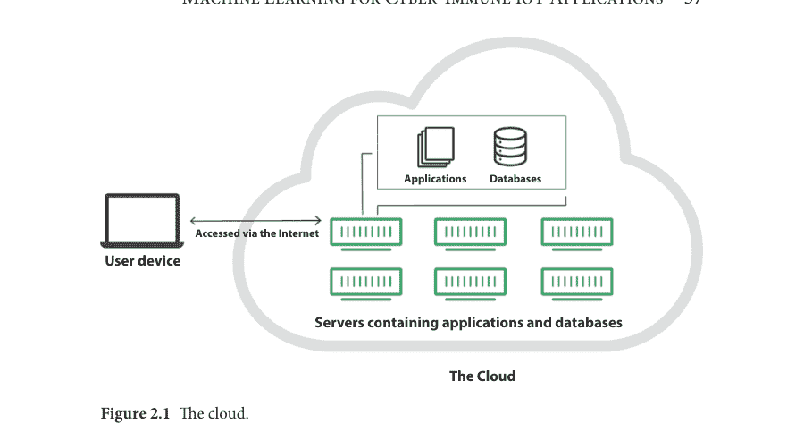

**图 2.1** 云。

这个术语本身是一个协作术语，涉及字面上的技术与技术方面雄心勃勃的趋势的逃散结合，它在存储方面修复了学习理论中的数据库，以实现更安全的访问。

### 2.3.2 云数据

云存储是一种架构模型，代表了加密的数字化信息数据库的潜在转换，它是计算机数据存储的模型，在逻辑可行性和分布式网络上的实现。架构存储跨越多个服务器（有时位于不同位置），物理环境通常由托管公司接管和控制。

云存储并不简单，因为它允许我们将记录和文件保存在离岸站点，我们需要通过公共和个人社区连接进行访问，以便将数据传输责任转嫁给云。提供商托管、保护、管理并维护服务器和相关基础设施，确保您随时可以访问所需信息 [18]。

云存储可以提供一种经济且灵活的选项，用于在本地硬盘驱动器或存储网络上保存文件。PC 硬盘驱动器只能存储有限量的数据。当用户容量不足时，他们必须将文档移动的外部存储设备。

通常，公司构建和维护存储区域网络以归档数据和文件。存储区域网络维护成本高昂，但随着保存数据的增加，组织需要投入资源增加服务器和基础设施，以满足加速的需求。

云存储服务提供灵活性，这意味着当您的数据量增加时可以扩展容量，或在必要时降低容量。通过在云中存储记录，您的组织通过以服务的形式支付存储技术和容量来节省成本，而不是投资构建和维持内部存储系统的资本支出。您只为实际使用的容量付费。虽然随着时间推移，由于数据量增加您的费用可能会增加，但您不需要过度预配存储系统以完全预期数据量的增加。

### 2.3.3 云安全

云计算安全，或更确切地说，云安全，指的是应用于保护虚拟 IP、应用程序、数据、程序以及云计算相关框架的一系列策略、技术手段、应用程序和控制措施。它是计算机安全、网络安全以及更广泛的数据安全的一个子领域 [19]。

### 2.3.4 云计算

这是计算机的增殖性隐含系统资源，当指基本数据存储时，它是通过云存储按需可用，并且计算能力不是特定活动管理的适当参与识别用户。

它被描述为一种模型，用于调整通用的、改进的、专注于信誉网络可用性至多变轻蔑，这位于一组可配置的计算资源中，包括网络、存储和服务器，应用规则及其各自的服务，可以提供适当的交互平台。这在 图 2.2 中描述为交互式组织模块。

它也可以被提出作为一种颠覆性的新兴技术，对包括 IT 在内的企业部门具有深远的意义，将其视为一个整体的正在形成的领域。

“绿色化”和节约成本是组织的关键关注点。


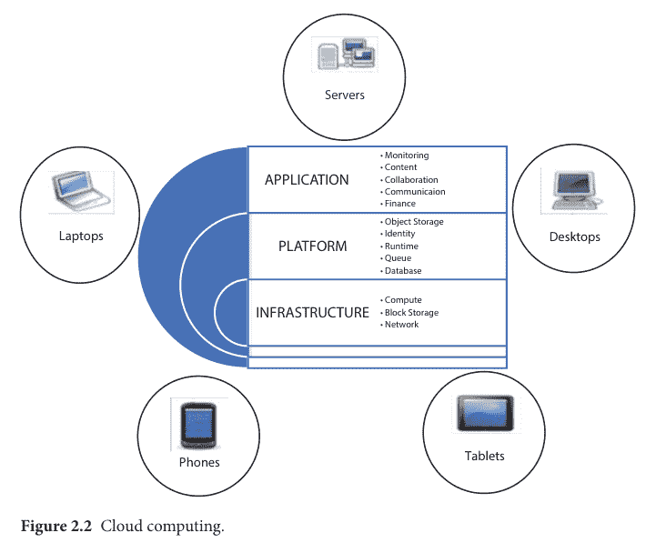

云计算在降低与IT相关的成本方面具有显著优势，包括极低的实施和维护成本；极低的硬件购买需求，减少了电力、冷却和资源存储空间的成本，并将这些职能转移给服务提供商；降低运营成本，以及放弃对未被使用的资源付费，仅对实际使用的可量化服务部分付费 [20]。

此外，由于拥有更加灵活和敏捷的计算平台，云计算还增强了组织的竞争力，从而具备使用高性能资源进行扩展的能力，并且其可用的数据源和信息是可靠的。

云计算有助于组织减少电力消耗并合理利用空间，从而促进可持续和环保的数据中心建设。

成本效益是云计算采用的关键调节因素。除此之外，其他主要益处还包括敏捷性中的可扩展性和灵活性，以实现更好的IT资源管理，并在更高效率和可靠性的基础上，加速业务管理的变革，包括高速开发和部署及其管理活动，以实现高规格的移动化和性能提升。

## 2.4 IoT 与云的集成

尽管物联网（IoT）和云计算是两种高度先进的技术且彼此不同，但它们已演变为生活的重要组成部分。预计它们的接受度和使用将以普遍的方式呈现，从而使其组件成为未来互联网的重要构成部分。物联网与云融合所形成的表现性范式被视为具有颠覆性，并能支持更大数量的应用环境 [21]。

当物联网与云集成时，被称为 CloudIoT 范式。这种表现性范式将物联网和云结合在一起，因此其在研究、挑战和广泛应用方面具有强制性深度。上述概念的架构和组织在图 2.3 中相对列出。

物联网大量产生海量数据，而云计算为相应数据的传输提供了途径。通过让开发者保持和访问远程数据，项目可以运行而不必延迟响应基于主题的项目工作，这可以作为优先任务之一被纳入。

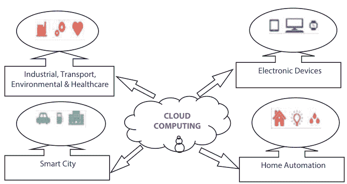

**图 2.3** 云计算与物联网的集成。

## 2.5 统治性的概念

### 2.5.1 人工智能

这一统一主题的思想过程是将推理应用于衡量以对人类表现的忠诚度来衡量成功的行为，其理想概念是指感知原因并采取行动的理性研究。我们的认知研究以相对方法利用这些最新技术产物的基础，即人工智能，并与机器学习理论和算法相互作用。这是命题逻辑的正式分析 [22]。这就是我们在研究中所采用的。

### 2.5.2 机器学习概述

机器学习被推导为一种结构研究，将主题呈现为人工智能的一个重要领域，其目标是在没有明确编程过程的情况下，赋予系统使用数据学习和发展的能力。

机器学习算法可以分类如下。

#### 2.5.2.1 监督学习

这是一种学习方法，它使用标记数据训练模型。这种学习技术的目标是训练模型，使得当应用新的给定数据时，我们可以预测输出。在这里，输入和期望的输出数据为预测未来事件铺平道路 [23]。为了准确预测，输入的数据被标记或标记为完美的假设。图 2.4 表示输出预测或分类的示意图。

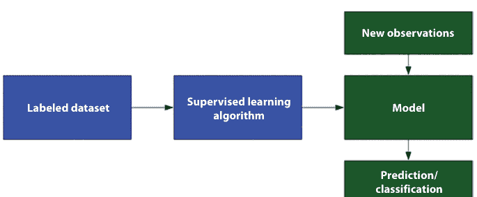

**图 2.4** 监督学习。

#### 2.5.2.2 无监督学习

无监督学习是机器学习方法中最精细的学习技术之一，它是多样化的一部分，其中未标记的输入数据推断所需模式 [24]。没有提供训练数据的规定，因此机器被要求自行学习。但与此同时，也确保机器能够在不预先提供数据信息的情况下进行数据分类。

无监督学习的目标是从给定的输入数据中发现结构前景和模式。它不需要任何监督来训练模型。相反，它从数据中自行发现模式。这种学习过程的结构可以参考图 2.5。其基本理念是让机器接触更大量的不同数据，并允许其从以前无法识别的见解中学习，以识别隐藏的模式。

类似地，从无监督学习算法中推导出的结果不一定有定义。相反，它反馈所提供数据集中无关的特征。

机器需要以自行学习的方式编程。机器需要理解并处理来自结构化数据和未结构化数据的独特见解。

无监督学习模型与监督学习技术相比，可能会提供不太准确的结果。

它包括各种算法，如聚类、K-近邻（KNN）和 Apriori 算法。

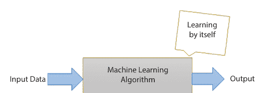

**图 2.5** 无监督学习。

### 2.5.3 机器学习在网络安全中的应用

- 即将到来的威胁和分类
- 计划的安全任务、自动化和用户分析优化
- 网络风险评分

### 2.5.4 机器学习在网络犯罪中的应用

- 未授权访问
- 逃避检测的恶意软件
- 鱼叉式网络钓鱼

### 2.5.5 机器学习与物联网相关环境中的网络安全

除了机器学习之外，网络安全系统会对模式进行适当分析，并学习方法来帮助关联类似攻击的预防方式以及对变化行为的回应。同时，它可以帮助网络安全团队主动参与威胁预防并被动响应实时主动攻击。它还可以减少花在计划任务上的时间，并启用用户和相关组织在类似方面更策略性地利用资源。机器学习可以以更简单和有效的方式接管网络安全，这似乎更具主动性但成本更低。但它只有在支持机器学习的底层数据提供清晰的环境图像时才能执行。正如人们所说，垃圾进，垃圾出 [25]。就相关研究而言，显式描述在实用函数中的条件算法方面具有很大灵活性，这些改变可以由相同的节点在评估决策网络时反映出来，该网络足够强大，可以容纳网络度量区域中的观察反射，当应用于物联网设备时，肯定会实现安全和安全的实质性扩散，并在卓越性方面与物联网设备并驾齐驱。

就辩论的诗句而言，如今互联网本身是一个不太安全的环境，这使得物联网设备更加不安全，但凭借技术知识和实施这些技术方面，我们可以实现转型，使其在上下文中具有可区分性。已发生几起高调事件，涉及将物联网设备作为更广泛僵尸网络攻击中的节点，突显了物联网的脆弱性。其中最优秀的例子之一是


Mirai 恶意软件在该特定年份实施了针对法国云计算网站 OVH 的最大规模 DDoS 攻击。此外，随着成熟度的提升，安全性往往会成为市场差异化因素。

一家提供终身安全升级的网际网络摄像机销售公司，其销售额可能超过一家从不提供此类服务的竞争对手 [26]。此外，许多风险在家庭和企业管理中都被激活。物联网（IoT）构成了以下非详尽列表：

- 数据安全
- 个人及公共物理安全风险
- 隐私问题，例如家用设备被黑客入侵
- 物联网设备增长带来的数据存储管理问题

## 2.5.6 分布式拒绝服务

分布式拒绝服务（DDoS）攻击可以被列举为一种恶意企图，通过向目标及其邻近的基础架构基础设施涌入大量互联网流量，从而破坏目标服务器、设施或网络的拥塞状态。

DDoS 攻击可以被视为一种针对被攻击流量的举措。从宏观层面来看，DDoS 攻击类似于拥塞，这会阻止对期望目的地的常规访问，而攻击者则试图获得网络上机器的权限以执行攻击。

计算机系统和其他各种机器（如物联网设备）被植入恶意软件，使每一个都变成僵尸或机器人。攻击主机对整个僵尸或机器人组具有完全控制权，这被称为僵尸网络（Botnet）。一旦建立起僵尸网络，攻击代理便能够通过以类似遥控器的方式向每个机器人传递最新指令来指挥这些机器。与此同时，如果受害者的 IP 地址被僵尸网络识别为目标，每个机器人都会通过向目标扩散请求作为回应，从而导致目标服务器可能因请求溢出而受损，进而对正常流量造成拒绝服务。这一切之所以发生，是因为每个特定的机器人都是合法的互联网工具，这使得从正常流量中区分出攻击流量变得非常困难 [27]。

## 2.6 相关工作

在此，我们呈现了一份分析报告，该报告从逻辑上保护了与政府、商业、工业或学术界等相关的各种个人利益视角，聚焦于物联网领域。作为这一机遇的一部分，围绕网络安全的威胁问题通过机器学习的概念得到操作和控制。本指南还审视了包括数据操纵、窃取识别和网络战争在内的警告。它还专注于当前与数据自主权、数字继承以及利用技术人才相关的问题。它还着眼于当下的紧迫需求，即通过教育和人工智能意识来协作缓解威胁的难题，从而在网络安全与计算机系统中数据神圣性相遇时，在隐私和安全术语之间保持平衡。

网络犯罪通过拒绝服务攻击、盗窃、勒索和操纵性破坏等多种灵活方式彻底改变现状。

研究还发现，在各类光纤路由器以及不断处理查询的网络中，虚拟地址作为数据通信的介质，允许软件深入预测并作为涵盖它的传感器显现。在此，我们可以思考 2018 年至 2019 年间在僵尸网络方面的最新发展。这是因为无论是个人计算机、笔记本电脑、平板电脑、网络摄像机，甚至是如今家庭中非常常见的 Wi-Fi 路由器，适度的安全设计都可视化了那些能够轻松绕过并促进恶意软件安装且能远程控设备的设备，这正是僵尸可以通过使用学习方法（作为训练数据集）进行训练，进而发起大规模 DDoS 攻击的地方。这最早见于澳大利亚统计局及普查网站被公开黑客入侵，随后是法国互联网服务提供商 OVH 遭受攻击。此处实施的概念可以通过指数级增加僵尸网络容量来完善，从而使源代码硬编码的 Shell 脚本范围应用于扫描 IP 范围，并试图在技术集成为安全转换到网络基础设施之前远程感知和测试数据集。因此，上述实施可能会产生极佳的效果。

随着机器学习作为对抗恶意攻击者的杠杆工具日益加速发展，与此同时，网络犯罪分子也全神贯注于获取新的的人工智能（AI）技术，以更好地进行数据分析和模式识别。因此，神经网络等机器学习算法也可以被视为一种尝试，用于研究和加速算法自动化过程的培训，从而增强打击网络犯罪的可能性。

还开展了多项研究，展示了可以基于 AI 驱动的机器学习算法的智能研究，这些算法不仅记录恶意软件签名，还可以替代需要人工干预的代码生成。一个引人注目的例子是微软最近的一项运营研究，旨在创建一个即使没有人工干预也能生成代码的 AI 系统。

分析算法将使物联网设备制造商能够确保识别需求，并对材料及其相关产品进行重新组织，这些产品在技术上已实现，旨在减少用户交互以及企业替代干预，这将确保信息报告报告了总网络事件中的很大一部分（约为 92%）。

这是因为，正如预计的那样，各种物联网赋能行业在保护敏感数据方面面临障碍。该研究是一种机制，允许无害成分无缝分离到物联网结构中，因此实施了“免疫自动化安全响应机制”。

## 2.7 方法论

为了整合技术方法，我们可以列举出方程方法，由于没有“银弹”，这些方法在作为威胁防御手段时受到机会的限制。无论是世界上任何领先的商业行为及其繁荣对应方，遭受网络犯罪都会因存在脆弱威胁而减缓 CPU 内的资源分配过程。

考虑到下一阶段的工作是威胁检测和分类，其中机器学习算法在基于模型的识别中发挥主要作用，数据集通过恶意活动模式进行训练。当数据集被代入方程并在坐标轴内测试时，这会呈现记录指标，以对实时威胁作出回应。这就是机器学习中的无监督学习算法方法在数据集中发现有趣模式的地方，从而识别出建议的恶意软件及其在云环境中基于使用聚类和关联算法的模式相关的犯罪行为。这些推导出的学习模式可以应用于 IP 瓶颈分类，从而进一步自动化删除系统非法入侵的过程方程。它还可以在云中导航以识别 DDoS 攻击中的行为模式。

突出多种机器检测系统分析在上下文主题（即网络犯罪）上漂浮的巨大机器学习技术 proliferation。我们的研究致力于利用机器学习算法的相对方法优先分配网络安全资源，以确定参与这些特定类型攻击的链接网络。这确实是一个优势，因为实施此类算法会产生基于网络领域知识的结果，其结果值是数据特定的。研究基于使用预期的 KNN 算法来聚类相似数据，以促进对连接在云上的物联网设备的丰富研究。它绝对有助于解码确定网络上的认知分析和强化警报，以补贴对涉及各种网络属性的智能窃取关联的风险考量。

此类模型产生的结果吞吐量可参考入侵检测的开创性行为，而物联网设备的保护可以通过旨在将相似目标分离到集群和场景中并防止测试期间数据篡改的机器学习模型来实现。此处使用的算法也可以用于常规系统操作，例如应用于如（葡萄酒和粘度）等数据集，这些数据集已被证明在语音识别、生物特征系统等方面做出了重大贡献。它通过学习模型及其数据集自动化复杂的网络犯罪及防御，这些模型和数据集作为处理持续入侵脆弱性的武器，用于在解决相关问题以及管理网络资源以平衡云内容偏好与对抗性使用认知人工智能方面保持强大力量。

来自两端的空间和时间数据的同步以及两端的功率和带宽分配，即物联网设备端和数据服务器阈值端，本身就是一种高性能智能计算，期望提供最佳的时态复杂度和空间复杂度。在物联网集合中建立的各个组件之间的每一种关系都涉及信息交换，这可以被称为网络安全的最佳方法


此处“漏洞”是指在劳动力人口拥有其访问权及服务的情况下，免受风险并处于安全关联状态的语境。

云在接收和处理信息以获取数据方面的效率几乎没有限制。作为一种更容易扩展的智能算法，它推动了基于模态的网络指标捕获的认证过程及其网络规范事实和即时共享模式；它在自动更新身份认证信息方面非常有用。

## 2.8 讨论与启示

确定很难百分之百地自动化安全任务，但我们对 KNN 的应用可以通过其基于数据的设计模型进行干预，该模型可以识别类似类型的攻击并最终与之对抗。它可以实现自动化，从而获得与物联网（IOT）设备通信的网络的授权访问权限，因此人类智能与人工智能的结合将产生大量以更高效率完成的通用输出。此外，为了丰富安全分析活动的内容，研究已进一步扩展到防御认知基础设施的可视化参数上，这些参数对安全向量机器具有强制性，这些机器可以以最大效率推断集群，从而创造出使我们在访问物联网设备时感到不便的人工智能产品。

在我们对计算智能的研究中，其对网络智能产生了深远影响，在分析和识别数字安全威胁以处理云端入侵者方面，针对各种应用工具，已着手进行安全设计和安全架构，以应对对数据的敌对篡改，而这无非是知识产权秘密。随着物联网丰富的基于网络现有系统面临漏洞，来自网络的云端入侵者迫使我们进行内省性的技术理念，对由高度恶意系统造成的受保护线程进行改造。

据粗略计算，到 2020 年底，连接设备数量将增加到 400 亿。但最新研究表明，由于我们正经历的疫情状况，这一数字可能进一步超过 600 亿。因此，当下亟待投入敏锐的研究和实施方案，以提供实时响应，应用机器学习技术和数据检索进行数据诊断、处理和分析，使决策准确且及时，这是该基于数据工作的目标。

## 2.9 结论

在这项战略研究中，所调查的范式包括物联网的安全方面，以及作为当今时代深思熟虑的关切和未来需要进一步关注的前瞻性问题。它涵盖了启用物联网设备的架构基础设施以及应用于机器学习算法的计算智能方法设计模型。它还审视了相关设备在云端漏洞的完美分析，通过认知智能技术事实和形式限制故障率。它还彻底更新了加密协议，使 IOT 设备能够在没有入侵威胁干预的情况下处理计算数据信号。它为我们提供了安全通信的动态功效，从而制定了解决上下文中安全问题的方案。此外，它清楚地反映了上下文中的安全，既包括防御也包括攻击。

机器学习算法作为网络武器和自动化工具，用于自动化相关的网络活动，利用这一点可以发挥对抗性机器学习的强大力量。这项研究可以作为未来资源动态分析现有安全解决方案并开发可扩展网络安全系统的更好基础。还观察到，提取的高阶可应用技术可以进一步修改，其中单个恶意节点可以向多个身份发出信号，从而降低其故障方案的有效性。

因此，我们可以简要总结如下：每当发生违规行为时，检测得越早、响应得越及时，在动态且易受影响的附带操作中，减少损失的机会就越大。

# 参考文献

- 1. Atlam, H.F., Alenezi, A., Alharthi, A., Walters, R.J., Wills, G.B., 物联网（iThings）以及 IEEE 绿色计算与通信（GreenCom）以及 IEEE 网络、物理与社会计算（CPSCom）以及 IEEE 智能数据（SmartData）。*IEEE 国际会议*，英国埃克塞特，2017，https://ieeexplore.ieee.org/document/8276823。

- 2. Tweneboah-Koduah, S., Skouby, K.E., Tadayoni, R., 针对物联网应用和服务领域的网络安全威胁，无线个人通信。国际期刊，94 卷，4 期，2017 年 6 月。Springer。https://www.softwaretestinghelp.com/iot-devices/

- 3. Hossain, Md. M., Fotohoul, M., Hasan, R., 关于物联网安全问题、挑战和开放问题之分析的研究。IEEE 第 11 届服务世界大会，美国纽约，2015 年 6 月，https://www.researchgate.net/publication/279801184_Towards_an_Analysis_of_Security_Issues_Challenges_and_Open_Problems_in_the_Internet_of_Things。https://www.snsoft.com/services/iot

- 4. Buch, R., Borad, N., Kalola, P., 网络安全与网络犯罪世界。STM 杂志，2018 年 8 月。https://www.researchgate.net/publication/327110771。

- 5. Saravanan, A. 和 Sathya Bama, S., 网络安全与第五代网络攻击综述。东方计算科学与技术杂志，12 卷，2 期，50–56 页，2019 年。

- 6. Fruhliger, J., 什么是网络攻击？最近的例子显示出令人不安的趋势，CSO |，2020 年 2 月 27 日。https://www.csoonline.com/article/3237324/what-is-a-cyber-attack-recent-examples-show-disturbing-trends.html

- 7. Wikipedia，https://en.wikipedia.org/wiki/Cyberattack。

- 8. Fruhliger, J., 恶意软件详解：如何预防、检测和恢复，CSO |，2019 年 5 月 17 日。https://www.csoonline.com/article/3295877/what-is-malware-viruses-worms-trojans-and-beyond.html

- 9. Fruhliger, J., 什么是钓鱼？这种网络攻击是如何工作的以及如何预防它，CSO|，2020 年 9 月 4 日。https://www.csoonline.com/article/2117843/what-is-phishing-how-this-cyber-attack-works-and-how-to-prevent-it.html

- 10. Fruhliger, J., 勒索软件详解：它是如何工作的以及如何移除它，CSO |，2020 年 6 月 19 日。https://www.csoonline.com/article/3236183/what-is-ransomware-how-it-works-and-how-to-remove-it.html

- 11. Wikipedia，https://en.wikipedia.org/wiki/Spyware

- 12. Gunjan, V.K., Kumar, A., Avadhanam, S., 印度网络犯罪调查。会议：ICACIT，2013 年。

- 13. https://www.ntsc.org/assets/pdfs/cyber-security-report-2020.pdf

- 14. Hilt, S., Kropotov, V., Mercès, E., Rosario, M., Sancho, D., 网络犯罪地下世界中的物联网，Trend Micro 研究，致 Raimund Genes，1963–2017 年。

- 15. Kaufman, L.M., BAE Systems，云计算世界中的数据安全性，Security & Privacy IEEE，ieeexplore.ieee.org，2009 年。

- 16. IBM 云教育，载于：云存储第 24 期，2019 年 6 月，https://www.ibm.com/cloud/learn/cloud-storage。

- 17. Wikipedia，https://en.wikipedia.org/wiki/Cloud_computing_security。

- 18. Carrol, M., van der Merwe, A., Kotzé, P., 安全云计算：优势、风险与控制。会议：南非信息安全（ISSA），IEEE Xplore，2011 年。

- 21. Survey, A., 云计算与物联网的集成。*未来世代计算机系统*，56 卷，2015 年。https://www.researchgate.net/publication/283236612_Integration_of_Cloud_computing_and_Internet_of_Things_A_survey。

- 22. Russel, S.J. 和 Norvig, P., *人工智能：现代方法*，第 2 版，Pearson Education, Inc., Dorling Kindersley (India) Pvt. Ltd.，2007 年。

- 23. Sethi, A., 监督学习与非监督学习，2020 年。https://www.analyticsvidhya.com/blog/2020/04/supervised-learning-unsupervised-learning/。

- 24. https://www.javatpoint.com/difference-between-supervised-and-unsupervised-learning

- 25. Perlm an, A., 机器学习在网络安全中日益增长的作用，2019 年 6 月 18 日。

- 26. Katz, H., 物联网网络安全挑战与解决方案，2019 年。

- 27. https://www.cloudflare.com/learning/ddos/what-is-a-ddos-attack/


# 在零售行业中运用机器学习方法进行预测性数据分析

Rakhi Akhare*, Sanjivani Deokar, Monika Mangla 和 Hardik Deshmukh

 Lokmanya Tilak 工程学院计算机科学与工程系（CSED），印度纳瓦穆巴伊

### 摘要

过去几十年间，零售业正在经历一场剧烈的变革。技术革命进一步重塑了零售业的面貌。因此，各行各业都致力于深入了解其客户，以制定业务策略。制定高效的业务策略能使企业吸引最多的客户，从而获得最大的市场份额。在本章中，作者旨在阐述预测性数据分析在零售业中的重要性。为了保持章节的完整性，简要介绍了预测性数据分析的各种方法。最后，作者探讨了在零售行业中运用机器学习（ML）方法进行预测性数据分析的情况，并展示了各种模型和技术及其各自的优缺点。作者还介绍了一些在零售业中利用 ML 的有前途的应用案例。最终，作者提出了一个旨在解决现有系统局限性的框架。该模型试图在预测性数据分析方面超越传统方法。

**关键词**：预测性数据分析、零售业、机器学习、电子商务

### 3.1 引言

在当今世界，由于巨大的技术进步，可以观察到每家企业的面貌都在经历剧烈的转型。

*通讯作者：rakhiakhare@gmail.com

此外，由于客户购物行为的改变，这场技术革命也影响了零售业的运营模式。结果，在过去几十年中，客户已从传统的店内购物转向通过在线平台、移动渠道甚至机器对机器（M2M）商务进行购物。推动这一商业转型的主要技术包括近期兴起的**人工智能（AI）**、**大数据**、**区块链**技术和**物联网（IoT）** [1, 2]。例如，像亚马逊和 Flipkart 这样的大型商业集团利用数据分析技术的进步，在零售业中展开了激烈的竞争以吸引客户。零售组织也在制定不同的业务和营销策略，以争取最大的客户份额。零售业一直利用数据分析能力，从选择、预算和需求等方面更好地了解其客户，从而使其能够提供高效且动态的客户服务。零售业通过获取有关其客户购买、位置及社交媒体数据的详细信息，获得了提供动态且用户特定服务的能力。在此，社交媒体数据是指客户发布的产品、服务或组织的意见和反馈，有助于其他潜在客户做出明智的购买决定。得益于大数据技术的进步，处理这种包含购买、位置和社交媒体的海量数据成为可能 [3, 4]。

与传统的**数据处理**技术相比，大数据是处理复杂、非结构化、多变量和海量数据的高效技术。基本上，大数据由四个 V 特征组成，即：速度（velocity）、规模（volume）、多样性（variety）和真实性（veracity）。大数据促进了此类复杂数据的有效分析，以揭示模式、关联和隐藏的模式。大数据的进步增强了其在零售业中的应用，因为它显著有助于制定未来的政策和业务策略 [3]。在大数据中发现有意义和有用信息的过程被称为**大数据分析（BDA）**。BDA 使行业能够收集和处理大数据，以发现基于事实和知情决策的洞察力 [5]。BDA 已证明其在包括零售业在内的各种领域中的潜力和能力。在零售业中，BDA 旨在通过推荐、优化的运营系统和改进的供应链管理（通过需求预测）来提升购物体验。如**图 3.1** 所示，BDA 可大致分为三类。

这里，**描述性分析**用于获取沿各种维度（如地区、产品等）的销售汇总信息 [6]。**处方性分析**使零售商能够制定最佳策略（如市场价格），以最大化业务绩效。

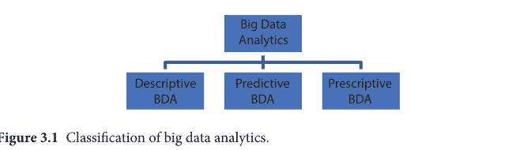

**预测性分析**利用过去几年的历史数据来创建经验预测 [7]。目前存在大量的技术和工具来执行 BDA。一些主要的技术包括**数据挖掘**、**优化方法**和**机器学习（ML）** [8]。本章的作者主要关注在零售业中用于 *预测性数据分析* 的 ML 方法。本章的结构安排如下。

章节的第 3.1 节简要介绍了预测性数据分析的概念及其在零售业中的需求。本节还提到了预测性数据分析的各种方法。第 3.2 节详细阐述了背景和相关工作。第 3.3 节讨论了零售业的预测性数据分析，并展示了使用 ML 进行预测性数据分析的各种模型。本节还讨论了相关的挑战和应用案例。作者在第 3.4 节中尝试提出一个预测性数据分析的框架。最后，第 3.5 节提出了结论和未来研究方向。

### 3.2 相关工作

本节介绍了 ML 在零售业背景下的背景和相关工作。ML 在零售业的应用自其诞生之初就已开始 [9]。然而，ML 的兴起在过去十年进一步推动了其在该领域的应用。ML 方法的主要应用在于预测零售业中的销售额、收入和库存需求。文献 [4] 中的作者指出，预测模型通常适用于估计和预测未来的观察值，并评估其可预测性水平。

文献 [10] 中的作者确定了在零售业中整合大数据的可能性。作者讨论了在零售业背景下使用贝叶斯方法和预测性分析。作者还提到了零售业中数据隐私的问题。文献 [11] 中的作者将这项研究向前推进了一步，他们使用了不同的 ML 技术来预测销售额。在 [11] 中，观察到将普通回归技术与提升（boosting）技术相结合比单纯的回归算法取得了更好的结果。基于相同的原则，文献 [12] 中的作者也使用 ML 方法利用历史销售数据来预测未来的销售额。作者讨论了各种销售预测方法，最终得出结论，梯度提升算法是该场景下最合适的模型，因为它实现了最高的准确性和效率。文献 [13] 中的作者还实现了一种用于回归堆叠（stacking）的方法，以进一步提高销售预测。文献 [14] 中的作者提出了一种使用 ML 技术每日优化定价的模型。所有这些预测模型都可以用于预测产品未来的需求和销售。文献 [15] 中的作者提出了一种使用每个部门的回归树的回归模型，以预测未来的需求。该模型的效率已通过最小二乘法回归、主成分回归以及其他类似的回归方法进行了验证。同样，文献 [15] 中的作者利用历史数据和 Rue La La 的专业知识，为每个产品 p 构建尺寸曲线，该曲线表示 p 每种尺寸的产品需求百分比。在此，作者还尝试了解决一个定价优化问题，旨在为每个产品设定一个主要价格，以最大化收入。

文献 [16] 中的作者提出了一个在零售业中执行需求分析的框架。所提出的框架由三个建模视图组成：业务视图、分析设计视图和数据准备视图。这些视图共同执行数据准备活动。文献 [17] 中的作者将描述性分析与数据挖掘结合应用于决策制定。这里值得一提的是，预测性数据分析采用了确定性的优化技术，例如决策树方法。

### 3.3 零售业中的预测性数据分析

每家零售业都旨在制定具有吸引力且高效的业务策略，以吸引最大比例的客戶。在过去几年中，零售业一直在使用历史数据来制定业务策略 [18]。在这个数据量巨大、发展迅速且竞争激烈的商业世界中，仅关注历史交易数据无法带来令人满意的结果 [19]。这种局限性通过预测性数据分析得以解决，这是一种利用大数据预测活动、行为和未来的有效方法


## 3.3.1 机器学习在预测性数据分析中的应用

预测性数据分析已成为任何企业的关键趋势。此外，由于数据量的指数级增长和激烈的竞争，预测性数据分析显得尤为必要。它有助于获得对客户、预算和库存的透彻了解。因此，预测性数据分析已得到广泛接受，并吸引了众多研究人员和学者。然而，在这种多维环境中，简单的回归类型方法不适合预测性数据分析，因此无法达到预期结果。因此，它采用机器学习（ML）来增强其能力 [20]。

以下是预测性数据分析中最主要的模型 [14]：
-   分类模型
-   聚类模型
-   异常值模型
-   时间序列模型

读者可参阅 [14] 了解这些模型的说明。所有这些模型都使用通用的预测算法。各种预测算法大致可分为两类，即机器学习（ML）和深度学习。机器学习主要处理表格数据，这些数据可能是线性的或非线性 的。基本上，深度学习也是机器学习的一个子集，但在处理音频、文本和图像时具有更好的优化性能。基于机器学习的预测建模使用各种算法。下面简要介绍了一些常见的算法 [21]。

**随机森林：** 这是机器学习中最流行的分类和回归算法，能够处理海量数据。随机森林实现了Bagging（装袋法），其中使用训练数据的子集来训练网络。可以使用另一个子集并行重复训练过程，从而获得强大的学习器。

**广义线性模型（GLM）：** 该模型缩小了变量列表，因此比普通线性模型表现更好。由于缩小了变量范围，其训练速度更快。该模型的局限性在于它需要相对庞大的训练数据集。

**梯度提升模型（GBM）：** 它生成使用决策树进行分类的模型。在这种方法中，每棵决策树都会纠正前一棵已训练决策树中存在的错误。由于它是逐棵构建决策树，因此耗时较长，但能提供更好的泛化能力。因此，它被用于包括雅虎在内的基于机器学习的排名系统中。

**K-Means（K均值）：** 这是一种流行且快速的算法，用于将数据点分类到不同的组中，以便同一组中的所有点都高度相似。这种分类的目标是最大化组内相似性并最小化组间相似性。

得益于上述算法，机器学习已被广泛接受并被认定为处理零售业中海量数据的高效选择。它使理解客户的复杂算法成为可能，从而提供以客户为导向的购物体验。随后的小节将讨论机器学习在零售业预测性数据分析中的应用。

如前所述，机器学习已被接受为零售业中预测性数据分析的高效且有效的选择。机器学习算法有助于识别零售业的宝贵客户。这些宝贵客户需要通过制定令人兴奋和有吸引力的策略来留住，这是任何商业实体成功的关键。机器学习还具有根据客户的喜好和历史定制个性化客户视图的功能 [22]。提供面向用户的客户视图的能力进一步提升了其在零售业的受欢迎程度。同样，它还可以用于预测所需的库存，从而最大限度地降低涉及的风险和不确定性 [23]。

零售业中用于预测性数据分析的机器学习基本模型执行多种功能。以下是对此的示例描述：

1.  它最初从与产品相关的各种来源收集数据用于训练目的。
2.  此后，选择一个算法来分析训练数据的特征。算法还能精确预测产品价格。
3.  随后是预测与产品实际价格相比的正确价格。
4.  机器学习算法不断调整预测机制，以最小化预测价格与实际价格之间的差距。
5.  预训练之后，是预测众多产品的价格，并且还考虑反馈回路以进一步提高模型的准确性。
6.  为了进一步完善模型，将新的产品数据添加到系统中。

上述步骤是在零售业中应用预测性数据分析的基本步骤。其应用的几个示例如下 [16]：

**机器学习用于需求预测：** 机器学习利用高计算能力处理高度波动的数据，以预测未来的需求。对于相同的预测，机器学习使用内部和外部信息源（结构化、半结构化和非结构化数据）以做出明智的决策。这些数据可能涉及历史数据、社交媒体数据等。在此，机器学习应用复杂的数学算法来揭示复杂且大数据集中的隐藏模式，从而提供可靠且准确的预测 [24]。

**机器学习用于预测性销售分析：** 预测性数据分析的另一个常见应用是了解客户购买背后的驱动动机及其在特定情况下的行为。同样，来自不同来源的数据会被聚合。聚合后的数据会被清洗，以确定当前场景的最佳预测算法。然后构建预测模型以识别各种因素之间的关系。随后监测该模型以衡量其准确性，目的是最大化其预测准确性。

**机器学习用于客户定制：** 利用机器学习，开发推荐引擎，根据每个客户的喜好和需求为其提供定制化视图。提供定制化视图确保客户保留在同一平台上。亚马逊拥有最好的推荐引擎，这极大地帮助其在竞争中胜出。

**机器学习用于供应链规划：** 由于机器学习可用于预测未来销售，因此也可用于尽管涉及多种不确定特征但仍能保持无忧的供应链管理。此外，它还可用于优化货物配送路线规划或仓库维护。机器学习算法建议的路线确保在成本、时间和碳排放方面相对于人类更有效地进行优化。

**机器学习用于价格优化：** 考虑到折扣金额、产品类型、竞争对手零售商和时间维度等多种因素，机器学习算法可用于预测产品的优化价格。在价格优化中使用机器学习比传统的价格优化方法能产生更准确的预测。它还可用于特定月份、季度或财年的收入预测 [25]。

## 3.3.2 用例

如前所述，机器学习已被应用于几家领先的零售行业，以在这个竞争激烈的商业世界中保持并超越。传统上，经理们会根据品牌质量、促销和折扣等各种因素来预测销售。经理们过去使用一系列回归来预测销售量。这种方法的有效性严重依赖于人脑的能力。传统方法甚至导致了低效的预测。这种低效性已通过整合机器学习方法得到完全解决。在本小节中，作者讨论了机器学习在零售业中应用的几个流行用例。

根据 [26]，一家跨国零售商开发了一个机器学习模型来预测促销对销售的影响。一个高效的模型将带来销售的大幅跃升。在这里，零售公司希望了解店内表现强劲和较弱的产品。在模型中，公司使用了多种变量，如折扣、促销持续时间、促销广告尺寸、产品放置和季节性等。在 [26] 中观察到，涉及多名数据分析师和一系列线性回归模型的传统方法以 30% 到 35% 的错误率预测结果。使用机器学习模型后，错误率降至 24%，并且预计随着时间推移错误率会进一步降低。因此，在预测模型中整合机器学习方法提供了令人兴奋和吸引人的结果。它有助于抑制慷慨促销和维持仓库库存所涉及的成本。使用类似的预测模型，Target Corp. 也观察到收入增长了 15%–30%。

知名零售商*沃尔玛*也已引入技术来了解客户需求并据此采取行动。该公司采用面部识别软件来了解结账时的体验水平（挫折、快乐和满意）。它还触发警报，让客户服务代表接近感到挫折的客户，以提供更优质的客户服务。使用这种面部识别模型消除了为提供优质客户服务而维持昂贵且合适的人员的需求。

*亚马逊*一直自豪地采用机器学习进行预测性数据分析以提高其销售额。亚马逊在业务管理的需求预测中获得了其卓越的效益 [27]。它还为其预期发货流程申请了专利，该流程预测特定地区或城市某产品的销售。亚马逊利用此信息将目标产品存储在最接近的仓库中。它还计划使用无人机在最短的时间内将产品交付给客户，从而提升购物体验。

作者们在 [28] 中介绍了预测性分析在*零售银行*部门的实施。在此，作者们声称，通过传统工具进行的预测性分析需要统计学的专门技能以及


数学。然而，在 R 语言中执行相同的操作要容易得多，R 是一种包含约 4,000 种机器学习算法的语言，涵盖从基础回归模型到高级模型。在银行业，预测分析可用于估算流失率和产品倾向。

## 3.3.3 局限性与挑战

机器学习已在包括零售业在内的各个领域得到了广泛部署。正如前文所讨论的，在零售业中，它也已被用于多种目的。尽管应用广泛，但它仍存在一些局限性和挑战。主要挑战在于处理来自不同来源的海量数据，这些数据包括结构化、半结构化甚至非结构化数据。从各种来源收集的大量数据通常质量较差，因此需要采用高效的数据清洗方法来提取有意义的数据 [17]。此外，还有一个挑战在于如何为这些海量数据维护严格的隐私和安全策略。还有一项挑战是获取受过训练且能力出众的专业人才，他们需要对未来的数据需求有前瞻视野，以便公司能够从历史数据中提取有用的见解。

## 3.4 提出的模型

在本节中，作者提出了一种在零售行业中使用机器学习方法进行预测数据分析和模型。在提出模型之前，作者试图彻底理解零售商的需求。据了解，零售商心中有各种需要由高效模型解决的问题。其中一些问题如下：

- 预测具有在线购买行为的人真正在线购买的概率是多少？
- 零售商应该关注哪部分客户群体？
- 哪些地理区域属于在线渠道，哪些属于线下渠道？

对零售商各项查询的详细理解有助于设计出高效的预测模型。在此，作者旨在设计一个提供多种功能的模型。其中一些功能如图 3.2 所示。

例如，所提出的模型可用于估计和预测特定地区特定产品的销售额。可以根据零售商的选择和需求在不同的抽象级别上执行。所提出的模型旨在寻找某个产品的潜在买家，即使购买概率很低。观察发现，如果模型针对更多客户，则可能会涉及一些额外成本，但不会错过任何可能的买家。作者的目标是不遗漏任何可能的客户，因为这可能会导致潜在客户的流失。所提出的模型还试图预测客户购买特定产品的可能性。这有助于针对潜在客户，从而带来收入的增长。

所提出的模型从各种来源收集数据，如社交媒体、历史数据和交易详情。来自不同来源的数据形式各异，因此需要在预处理阶段进行清洗。因此，来自各种来源的清洗后的数据被整合在一起，用于训练预测模型。模型的准确性在很大程度上取决于训练数据集的大小。所提出模型的基本结构如图 3.3 所示。

如图 3.3 所示，数据集成之后是为预测模型选择算法。有许多相关的算法，如回归、提升（boosting）或装袋（bagging），举几例而已。回归算法是任何预测模型的基本算法。提升算法以顺序和渐进的方式训练模型。这些算法执行分类和回归。提升算法基本上旨在识别弱学习者，这些弱学习者可以进一步改进，从而变成强学习者。梯度提升（Gradient boosting）和 AdaBoost 是两种常用的提升算法。这两种提升算法基本上在弱学习者的识别上有所不同。弱学习者基于错误率来识别。错误率取决于需要优化的参数。例如，如果模型试图预测销售额，则错误率将是预测销售额与实际销售额之间的差异。

随机森林回归也可用于预测问题，因为它能执行分类和回归。随机森林回归使用某些分类标准对数据进行分类。随后，使用均方误差（mean squared error）或平均绝对误差（mean absolute error）来衡量该分割的质量。它利用平均的概念来提高预测的准确性。

本章中的作者提出了使用自举聚合（bootstrap aggregating）机器学习算法，也称为装袋（bagging）算法。装袋算法旨在通过减少方差来提高机器学习算法的效率和准确性。使用装袋算法倡导实现高效且准确的预测模型。所提出模型的准确性随时间迅速提高。

### 3.4.1 案例研究

为了说明人工智能在零售业中的实施，本章中的作者考虑了一个案例研究。同样地，作者选取了一个关于零售商店的数据集。该数据集包含从 2011 年到 2015 年长达 4 年的观察数据。该数据集取自 kaggle (https://www.kaggle.com/jr2ngb/superstore-data)。所考虑的数据集有 16 个变量。在这 16 个特征中，10 个是分类特征，5 个是数值特征，1 个是日期特征，如下所示。

| # | 特征名称 | 非空值 | 数据类型 |
|---|--------------|----------|-------|
| 0 | 订单日期 | 51290 | datetime64[ns] |
| 1 | 客户姓名 | 51290 | object |
| 2 | 细分市场 | 51290 | object |
| 3 | 城市 | 51290 | object |
| 4 | 州 | 51290 | object |
| 5 | 国家 | 51290 | object |
| 6 | 类别 | 51290 | object |
| 7 | 子类别 | 51290 | object |
| 8 | 产品名称 | 51290 | object |
| 9 | 销售额 | 51290 | float64 |
| 10 | 数量 | 51290 | int64 |
| 11 | 折扣 | 51290 | float64 |
| 12 | 利润 | 51290 | float64 |
| 13 | 年 | 51290 | int64 |
| 14 | 月 | 51290 | int64 |
| 15 | 日 | 51290 | object |

所考虑的数据集中的观察值数量为 51,290。所考虑的零售商店主要经营三类产品，即办公用品、电子产品和家具。

首先，作者试图理解数据集中各种特征之间的相关性。同样地，作者采用了皮尔逊相关系数，它表示两个变量之间相关性的度量。其值介于 $-1$ 和 +1 之间。这里，负值表示负线性相关；0 表示无相关性，+1 表示正线性相关。数据集中各种属性之间的皮尔逊相关系数如图 3.4 所示。

此外，作者希望展示如何利用该数据集来了解其在全国范围内的客户群体。这有助于零售商理解其最大的市场份额位于该国，从而使其能够关注较弱的市场部分。可以通过按地区进行的分析来实现，如图 3.5 所示。该图显示了印度各州客户频率的直方图。从图 3.5 中可以看出，马哈拉施特拉邦拥有全国最多的客户，其次是北方邦。相反，曼尼普尔、特里普拉、昌迪加尔和本地因这些地方的客户数量最少。

可以进一步深入分析，以找出一个州内表现最好和最差的城市，从而精确识别特定区域或分支机构。

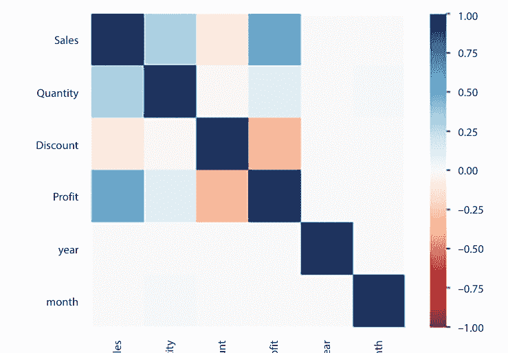

**图 3.4** 数据集中各种属性之间的皮尔逊相关系数。

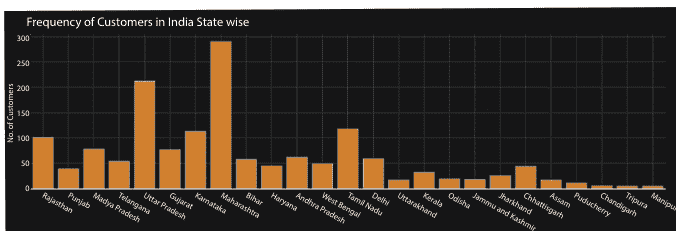

**图 3.5** 国家级（印度）客户频率的直方图。

这种深入分析的直方图如图 3.6 所示。对于马哈拉施特拉邦，显示该邦表现最好的城市是孟买、普纳、纳维克和那格普尔。

此外，从上述两个图表中可以看出，孟买拥有最多的客户。因此，零售商进一步有兴趣找出该城市中表现最好的产品。因此，零售商有兴趣


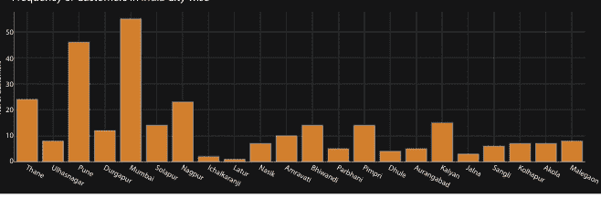

**图 3.6** 马哈拉施特拉邦城市层面客户频率直方图。

以找到沿产品维度的直方图。同样，从图 3.7 可以明显看出，办公文具类别在该城市的需求量最大。此外，在办公文具类别中，需求最高的子类别是存储用品和标签用品，其次是艺术用品以及其他文具产品，如信封、文件夹和纸张。沿产品维度的直方图展示在图 3.7 中。

此外，箱线图表示了每个细分领域中每个类别销售额的最小值、最大值和中位数。如图 3.8 所示，技术类别中最高的中位数来自消费者细分领域。同样，家具类别中最高的中位数来自企业细分领域。

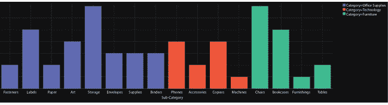

**图 3.7** 孟买沿产品维度的直方图。

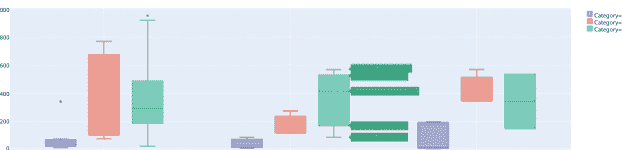

**图 3.8** 消费者细分领域中产品的箱线图。

家庭办公细分领域在办公文具方面的销售额最大，而办公文具中位数最高的是来自消费者细分领域。

为了分析观察到的销售额最高和最低的那一天，作者建议使用透视图，如图 3.9 所示。从图 3.9 可以明显看出，2011 年至 2015 年八月的每个周六都会经历最高销售额。然而，2011 年至 2015 年十一月的每个周一记录到的销售额最低。这有助于零售业了解其销售预测的情况。

最后，图 3.10 中的热图显示了全球各个国家的销售额。从图 3.10 可以清楚地看出，与美国相比，其他任何国家的销售额都较低，美国记录到的销售额最高。其次为法国和澳大利亚的销售额。这一分析有助于理解，零售业在东南亚地区以及大洋洲地区具有巨大的销售增长潜力。

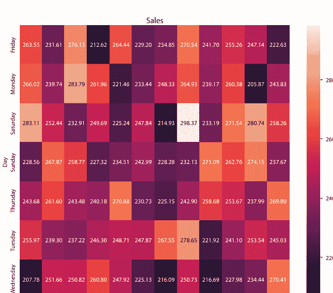

图 3.9 透视图。

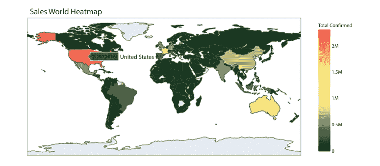

**图 3.10** 世界热图。

因此，从上述案例研究中可以清楚地看出，数据分析对零售业非常有帮助，因此除了其他许多有前景的领域外，它在零售业中具有巨大的潜力。

## 3.5 结论与未来展望

本章讨论了机器学习方法在零售业预测性数据分析中的潜力和能力。还简要介绍了各种模型。提出了几个用例，以便读者清楚地了解其在零售业中的应用范围。尽管已观察到广泛的应用，但仍存在一些挑战。正如上文讨论的那样，这些挑战必须通过推进研究来解决。

首先，研究人员必须致力于维护数据的安全性和隐私，因为数据是任何组织最宝贵的资产。工作还应朝着概念化大数据利用的方向进行，以惠及零售商和客户。研究必须朝着高效定制促销的方向推进，这基本上是在特定时间向特定客户发送特定产品的促销信息。定制促销的实施将进一步提高收入增长。此外，还必须准备好根据未来的行业需求和增长开发新的运营模式。

# 参考文献

1. Grewal, D., Motyka, S., Levy, M., 零售与零售教育的演进与未来. J. Mark. Educ., 40, 1, 85–93, 2018.
2. Mangla, M., Akhare, R., Ambarkar, S., 基于物联网生态系统的上下文感知自动化能源节约技术, in: 物联网设备能源节约, pp. 129–153, Springer, Singapore, 2019.
3. A vinash, B.M. 和 Babu, S.H., 大数据分析 – 其对零售业趋势变化的影响. Int. J. Adv. Res. Comput. Eng. Technol., 7, 4, 379– 382, 2018.
4. Souza, T.T.P., Kolchyna, O., Trelaven, P.C., Aste, T., 应用于金融的 Twitter 情感分析：零售业案例研究. arXiv preprint arXiv:1507.00784, 2015.
5. Akhare, R., Mangla, M., Deokar, S., Wadhwaa, V., 提出一种雾计算框架以改善物联网应用中服务质量, in: 物联网应用中的雾数据分析, pp. 123–143, Springer, Singapore, 2020.
6. Potluri, S., 基于雾计算的物联网云医疗系统：案例研究. J. Crit. Rev., 7, 6, 1068–1072, 2020.
7. Deokar, S., Mangla, M., Akhare, R., 用于连续健康监测的安全雾计算架构. In Fog Computing for Healthcare 4.0 Environments, pp. 269-290. Springer, Cham, 2021.
8. Mangla, M., & Sharma, N., 针对 2019 年冠状病毒病的临床和流行病学因素模糊建模, 2020.
9. Chatterjee, J.M., 使用机器学习的生物信息学. Global Journal of Internet Interventions and IT Fusion, 1, no. 1, 2018.
10. Bradlow, E.T., Gangwar, M., Kopalle, P., Voleti, S., 大数据和预测分析在零售业中的作用. J. Retail., 93, 1, 79–95, 2017, doi: 10.1016/j.jretai.2016.12.004.
11. Krishna, A., Akhilesh, V., Aich, A., Hegde, C., 使用机器学习技术进行零售门店销售预测. Proc. 2018 3rd Int. Conf. Comput. Syst. Inf. Technol. Sustain. Solut. CSITSS 2018, pp. 160–166, 2018, doi: 10.1109/CSITSS.2018.876765.
12. Cheriyian, S., Ibrahim, S., Mohanan, S., Treesa, S., 使用机器学习技术的智能销售预测. Proc. - 2018 Int. Conf. Comput. Electron. Commun. Eng. iCECE 2018, August 2018, 53–58, 2019, doi: 10.1109/iCECECOME.2018.8659115.
13. Pavlyshenko, B.M., 用于销售时间序列预测的机器学习模型. Data, 4, 1, 1–11, 2019, doi: 10.3390/data4010015.
14. Aktas, E. 和 Meng, Y., 零售业大数据实践探索. Logistics, 1, 2, 12, 2017, doi: 10.3390/logistics1020012.
15. Ferreira, K.J., Lee, B.H.A., Simchi-Levi, D., 在线零售商分析：需求预测和价格优化. Manuf. Serv. Oper. Manag., 18, 1, 69–88, 2016, doi: 10.1287/msom.2015.0561.
16. Nalchigar, S. 和 Yu, E., 业务驱动的数据分析：概念建模框架. *Data Knowl. Eng.*, 117, 2017, 359–372, 2018, doi: 10.1016/j.dak.2018.04.006.
17. Lam, D. 大数据中预测性分析的调查. Athabasca University, 2014.
18. Shankar, V., 零售业中的大数据与分析. *NIM Mark. Intell. Rev.*, 11, 1, 36–40, 2019, doi: 10.2478/nimmir-2019-0006.
19. Chatterjee, J.M., Kumar, R., Khari, M., Hung, D.T. & Le, D.N., 基于物联网的智能厨房系统. *Int. J. Eng. Manuf.*, 8, 4, 29, 2018.
20. Chatterjee, J., 使用机器学习方法的物联网大数据框架. *Int. J. Mach. Lear. Networked Collab. Eng.*, 2, 02, 75–85, 2018.
21. Belarbi, H., Tajmouti, A., Bennis, H., Mohammed, E.H.T, 零售业中大数据的预测分析. *1st Int. Conf. Comput. Wirel. Commun. Syst.*, December, 560–562, 2016.
22. Chatterjee, J.M., Kumar, R., Patnaik, P.K., Solanki, V.K., Zaman, N., 数据密集型环境中的隐私保护. *Tourism & Management Studies*, 14, 2, 72–79, 2018.
23. Farid, M., Latip, R., Hussin, M., Hamid, N.A.W.A., 基于粒子群优化调度技术的云计算工作流调度中 QoS 要求综述. *Symmetry*, 12, 4, 551, 2020.
24. Potluri, S., 基于身体佩戴传感器启用设备的物联网健康监测解决方案. *JARDCS*, 10, 9, 646–651, 2018.
25. Potluri, S., 基于云的设计与制造技术研究. *IJMPERD*, 8, 6, 187–192, 2018.
26. Chandramana, S., (PDF) 零售分析：使用商业分析驱动零售业成功. *Int. J. Res. Publ.*, 7, 4, 159–166, 2017.
27. Fuggetta, R., 品牌倡导者：将热情的客户转化为强大的营销力量. John Wiley & Sons, 2012.
28. Budale, D. 和 Mane, D., 零售银行业的预测分析. *International Journal of Engineering and Advanced Technology*, 2, 5, 508–510, 2013.


## 4.1 引言

在大众眼中，云计算是单一系统的抽象视图，该系统拥有无限的资源池，涵盖硬件、软件以及数字世界运营业务所需的其他互联网服务。自上世纪90年代诞生以来，互联网以惊人的速度发展，通过连接各类数字资产，成为日常生活和所有商业运营的不可或缺部分。随着5G技术和物联网（IoT）的演进，从计算机、平板电脑、手机、车辆到家用电器等各种数字设备如今都已互联，似乎所有设备都是通过互联网连接的单一系统的组成部分。分布式计算因其操作多样性正日益受到欢迎，它能在不损害完整性、容错性和安全性的前提下获得高性能和扩展能力 [1]。因此，云计算应运而生，在分布式计算和互联网连接的基础上留下了足迹。

传统IT行业在运营上是离散的，这意味着它们拥有各自位于独立场所的设置，并遵循各自的规则和法规，对组织外部的可见范围有限 [2]。它们既有自身的优点，也有限制。

### 本地（On-Premises）IT运营的优势 [3]
- 对基础设施拥有完全控制权：可以进行定制化设置。
- 拥有完全的数据可见性和控制力
- 高度安全
- 独立于互联网，运行于自身的内部网络连接上。

### 本地（On-Premises）IT运营的限制 [2]
- 高额资本支出：为了建立任何IT基础设施，组织必须购买所有硬件、授权软件，并获得当地当局的必要法律许可。
- 定期维护：不仅设置需要资本支出，在一段时间内维护它们也需要大量的资本支出，包括许可证续期、专职IT团队运营、备份、存储以及灾难恢复流程。
- 较长的实施时间：在升级IT基础设施时，安装服务器和软件需要花费大量时间。

## 4.1.1 云计算的定义

多年来，各组织从云计算的特性和范围角度给出了许多定义。但随着技术的发展，云计算正在不断精炼，其定义也在随之改变。

| NIST | Gartner | Forrester |
|---|---|---|
| • 一种模型，旨在通过互联网技术，以按需方式便捷地访问共享的可配置计算资源池（如网络、服务器、存储、应用和服务），这些资源可以快速配置和释放，且管理 effort 或与服务提供商的交互最少化。 | • 一种计算风格，其中大规模可扩展和弹性的IT驱动能力通过互联网技术以服务形式提供。 | • 一种标准化的IT能力，如软件、应用平台或基础设施，通过互联网技术以按使用付费和自助服务的方式提供。 |

## 4.1.2 云计算相对于本地IT运营的优势

为了克服本地IT运营的限制，采用云计算是最佳途径 [5]。以下是云计算相对于本地IT运营的特性，用于克服上述限制以实现顺畅的业务运营。

- 即插即用：无需担心物理位置和基础设施设置，只需连接到网页浏览器，即可从任何系统的任何地方进行访问。
- 经济实惠：由于初始设置没有巨额投资，任何人只需订阅云提供商的必要商品，即可建立初创企业的运营。
- 成本可预测：由于所有可用资产及其维护都有明确的费用结构，组织非常容易为任何项目制定预算
- 免除专职IT运营：由于所有服务都是可自维护的，用户无需担心硬件和软件的升级。云服务提供商负责所有这些升级和维护工作。
- 高可扩展性：云计算最具吸引力的优势之一是其惊人的可扩展性。无论任何类型或规模的组织，所有云用户都能轻松获得云计算可扩展性的益处。用户只需为其使用的部分付费。
- 快速部署：由于虚拟化是云计算的基本特性，基于云的应用可以轻松地在几小时内托管在虚拟服务器上，而本地部署所需时间远多于云部署。
- 高度标准化和合规性：许多不同的著名政府政策组织已制定了各种标准和合规性要求。根据各国政府政策和当地法律的不同，这些要求会有所不同 [2]。
- 更低的空间和能源成本：由于无需单独的基础设施设置，降低了组织的能源消耗成本，并有助于地球形成更绿色的环境。

## 4.1.3 云计算的局限性

- 连接性：互联网连接是云计算的强制要求。
- 长期成本：对于大型组织而言，在长期规划中，云计算成本可能高于本地设置。
- 对自有数据存储控制较少：由于一切都位于外部场所并处于云提供商的控制之下，数据所有者对数据的控制力将较弱。

## 4.2 云计算的历史

- 现代云计算源于50年前的技术——大型机。云计算的演进如**图 4.1**所示。
- 在1960年代，独立的大型机被建造出来，其目的是在大型机中完成所有计算和存储，而客户端终端只是通过连接到大型机来发送客户端请求并获取响应，而不进行任何处理的哑终端。
- 在1970年代，虚拟化概念被提出，即一个系统可以在另一个系统内运行。为了使虚拟化概念成为现实，硬件组件集合紧密耦合，使得多个操作系统或软件的安装成为可能 [4]。
- 在1980年代，客户端-服务器架构变得流行，服务器不再承担所有工作负载。尽管服务器承担了主要的工作负载，但客户端系统也有能力独立执行小部分工作，从而减轻服务器的工作负载以及整体响应时间。


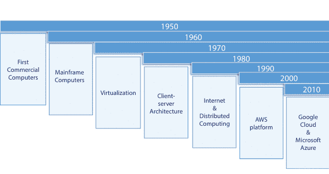

图 4.1 与云计算相关的技术演进 [3]。

- 在 20 世纪 90 年代，分布式系统概念逐渐发展成熟，其中集中式服务器的工作负载被分配给多个系统，从而减轻了集中式系统的瓶颈，以获得高可用性和高吞吐量。随着互联网的演进，软件应用不再强制要求运行在客户端系统上，而是可以在网络上的分布式系统中运行。这使得应用模块化的特性，其所有者或供应商可以对其进行控制，并且可以通过互联网向其他客户端提供服务。同样，硬件虚拟化也可以通过网络变得可行。
- 在 2000 年代，互联网被大规模采用，亚马逊开始推出其初始版本的云计算平台，即广为人知的 AWS（亚马逊云服务）。
- 在 2010 年代，其他云提供商开始崭露头角，例如微软的 Azure（Azure 云服务）和 Google Cloud（谷歌云），并且主要 IT 厂商开始采用云计算。

## 4.3 云计算的核心属性

- **弹性（Elasticity）：** 随着数据量的变化和增长、技术的演进以及业务的发展，组织必须以更快的节奏来配置和取消配置资源及软件服务，同时不阻碍业务的正常运行。云能力在**多租户**模型中实现弹性 [7]。

- **按需（On-Demand）：** 客户可以通过互联网连接，在任何时间点、从任何地方按需获取所需数量的资源和服务。资源的添加和移除都是按需进行的，无需为此支付额外费用 [10]。

- **提供商资源池（Provider Pooled Computing Resources）：** 云提供商获取并维护所有运行云服务的计算硬件。根据签署协议中所述的条款，它为云用户提供其所获取服务的保证正常运行时间。

- **计量服务使用（Metered Service Usage）：** 云为客户提供了一种灵活的订阅方式，用于其消耗的服务。云提供一种计量服务方法，通过精心设计的前端模型，在任意时间点向用户展示资源消耗和计费金额的透明度。该模型帮助用户跟踪其在云服务上的资金合理使用。计量服务的优势如下：
    - 自动工作负载确保在空闲时间无需支付费用，而无需释放服务。
    - 如果服务消耗超过用户设定的限制，它会创建警报并通知用户。这有助于用户不必每次都手动跟踪消耗情况，从而专注于业务。
    - 此服务还建议在资源使用不当或存在未使用的存储空间时重新设计资源分配。

- **广泛网络接入（Broad Network Access）：** 云服务可以通过互联网连接，从任何类型的设备（如台式机、笔记本电脑、手机和平板电脑）访问，无论其地理位置如何 [11]。

- **易于维护（Easy Maintenance）：** 服务器是自动维护的，这意味着它们由云提供商维护，而不影响用户的正常运行时间。此外，升级是自动更新的，使服务更加高效。

- **多业务（Multi-Business）：** 由于分布式网络和虚拟化特性，云计算在并行处理和资源共享方面非常高效。这使得云能够在多个业务线之间轻松运作，而无需重复构建环境。图 4.2 展示了云计算的特性。

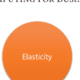


图 4.2 云计算特性。

## 4.4 云计算模型

为了更好地理解云计算，基于资源的物理分布和服务原则，定义了不同的模型。主要定义了两种模型 [6]：

- 云部署模型
- 云服务模型

### 4.4.1 云部署模型

根据云基础设施的构建方式，NIST（美国国家标准与技术研究院）将部署模型大致分为四个子类：公有云、私有云、混合云和社区云。这些模型的定义考虑了云基础设施在云提供商和用户之间的所有权。在将业务流程迁移到云端之前，组织必须评估不同的参数，如现有基础设施、基础设施所有权、过渡期间的成本投入以及与云计算的未来连续性。图 4.3 详细说明了云部署模型。

- **公有云（Public Cloud）：** 这种云是一种开放服务，可供公众和所有组织使用。云提供商拥有云的唯一所有权，通常用于非关键性的通用应用、电子邮件服务和文件共享应用。基础设施的实际物理位置对所有用户都是隐藏的，尽管用户可以选择不同的地理位置来运行其服务 [13]。

- **私有云（Private Cloud）：** 私有云是部署在组织内部场所或外部场所的部署，云由组织内的各个团队或专用的第三方云提供商管理。基础设施专门服务于所有者的组织，并满足该组织的需求。建立和维护私有云需要大量的投资和时间。当隐私和安全是最关键的因素时，私有云是最合适的选择。通常用于处理关键应用的组织和政府机构，如国防和情报部门。

- **混合云（Hybrid Cloud）：** 由于组织的并非所有运营都是关键的，组织可以通过部署私有云和公有云来建立混合云。混合云降低了基础设施的成本。此外，组织可以兼得两种云的好处：通过私有云获得关键运营的安全性和隐私，通过公有云获得非关键应用的灵活性 [9]。

- **社区云（Community Cloud）：** 此模型支持社区内通过云共享计算机资源；例如，大学之间就某些研究领域进行合作，或一个国家内的警察部门通过社区云共享信息。对云的访问限制在社区成员内 [21]。

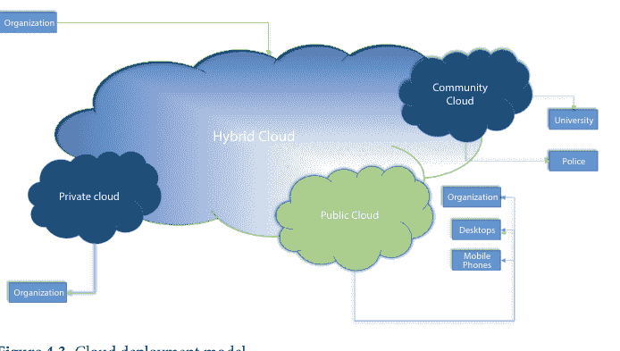

### 4.4.2 云服务模型

基本上有三种类型的云服务模型：IaaS、PaaS 和 SaaS，根据云中可用的服务类型提供。云服务模型架构请参考图 4.4。

- **IaaS（基础设施即服务）：** 在此模型中，云提供商建立并管理所有 IT 基础设施，并为用户创建一个抽象层，使其能够使用底层硬件而不影响性能并隐藏其物理存在 [9]。
    - 它基本上包括由供应商提供的硬件服务，这些供应商已经配置了所有必需的硬件，如虚拟机、存储和网络组件。用户只需订阅并使用网络上的所需或分配的硬件组件，而无需担心其底层设置。
    - 它简化了 IT 经理的工作。
    - 它可供网络上的任何设备使用。
    - 可以快速配置和取消配置新的计算资源，而不影响其他 IT 服务。
    - 用户必须在抽象层之上工作，因此不需要本地计算基础设施。
    - 对于在 IaaS 上构建基础设施的组织，所需的本地 IT 资源占地面积更小。
    - 由于基础设施设置必须由云提供商完成，因此本地能源消耗更少。
    - 它提供复杂的服务以便轻松使用。

- **PaaS（平台即服务）：** 它基本上是一个访问系统，其中所有必需的应用程序都在运行，形成一个环境，软件开发可以在此环境中进行，而无需担心底层已安装应用程序的兼容性。平台应用程序包括 Web 服务器、数据库服务器和应用程序服务器，以及帮助用户在可用平台框架上构建自己的应用程序的开发软件 [13]。
    - 它基本上减轻了 IT 开发者的工作负担。
    - 它支持自定义应用程序的设计。
    - 它可供网络上的任何设备使用。
    - 可以快速配置和取消配置新和现有应用程序及所需资源。
    - 不需要服务器基础设施。
    - 用户专注于业务而非底层平台设置和升级，因此上市时间更快。
    - 它可按需提供，不需要时也可以轻松停用。
    - 它消除了因 IT 采购而产生的浪费时间。
    - 它还简化了创建、测试和更新应用程序的过程。

- **SaaS（软件即服务）：** 它帮助组织不必构建所有所需的软件，而是访问由其他专业组织已经构建或可用的软件，因此它们不需要购买、安装、更新或维护软件 [15]。它们只需通过互联网订阅并使用即可。

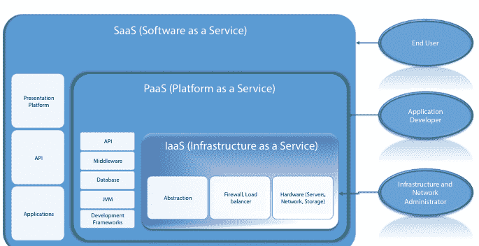

图 4.4 云服务模型。


- 它有助于最终用户或应用程序开发人员将注意力更多地集中在业务上，而非应用程序本身。
- 允许用户利用现有的应用程序。
- 可以快速地 provision（配置）或 de-provision（回收）用户资源。
- 网络上的任何设备都可以访问。
- 应用程序的授权、监控和管理由提供商自行完成。

- **XaaS（一切即服务）：** 除了这三种基本的云服务之外，还存在其他专业化的云服务，它们随着时间推移不断成长，以满足业务需求。这被称为 XaaS（一切即服务或万物皆服务）。这些服务帮助企业获得了那些在没有云集成情况下无法访问的服务利益 [10]。以下是随着时间发展起来的几种 XaaS 服务。
    - **DaaS（数据即服务）：** DaaS 是一种数据管理策略，提供数据、存储、处理、集成以及分析服务。以下是 DaaS 的优势。
        - 数据可按需获取，且以加密格式提供。
        - 数据存储和处理速度更快。
        - 数据的物理位置独立于用户。
        - 兼容任何类型的物理存储设备。
    - **STaaS（存储即服务）：** 云提供商为愿意通过网络托管其数据的供应商提供存储空间。公有云存储方法包括备份和灾难恢复、块存储、SSD 存储以及块数据传输。使用 STaaS 的优势包括以下内容：
        - 降低存储成本。
        - 灾难恢复。
        - 可扩展性：可以在不降低性能的情况下，按任意程度添加资源。
        - 自动同步：文件将在设备之间自动同步。
    - **SECaS（安全即服务）：** 在这种模式下，云提供商通过互联网将安全服务集成到组织的基础架构中。它包括保护组织免受病毒、恶意软件、入侵者攻击以及其他安全管理事件的服务。云提供商还提供服务，以保护订阅供应商的单个系统或整个网络系统。
    - **DRaaS（灾难恢复即服务）：** DRaaS 是云中的一种备份服务模式，旨在保护应用程序和数据免受任何不可预测灾难的影响。DRaaS 与业务连续性计划（BCP）和灾难恢复计划（DRP）相关，允许组织在云上的任何地点照常开展业务。它允许应用程序在虚拟机上运行，从而实现持续复制和备份。DRaaS 的好处如下：
        - 多站点副本：即使灾难发生在多个地理位置，也能确保 100% 的可用性。
        - 透明度：数据保护不仅限于某个平台或供应商。
        - 粒度：云用户具有灵活性，可以选择数据保护要求，以节省不必要的备份成本。
    - **CaaS（通信即服务）：** 它是 SaaS 服务的一部分。所有通信基础设施，如连接、内容上传以及通信平台管理，均由云提供商管理，以确保通信系统的容错性 [11]。
        - CaaS 的例子包括 VoIP（互联网协议语音）或互联网电话解决方案、互联网视频会议。
    - **BPaaS（业务流程即服务）：** 各公司正努力以自己的方式实现业务流程自动化。但云 BPaaS 提供了一种通用软件包解决方案，包含可应用于许多不同应用环境的业务逻辑、数据和流程。此流程在组织内保持一致。例如，薪资、电子邮件服务、包裹运输或管理客户信用。该服务基于 IaaS、PaaS 和 SaaS 设计。云为 BPaaS 提供了面向业务的接口，隐藏了所有业务复杂性，且所有法规合规事宜均由云提供商处理。
    - **AIaaS（人工智能即服务）：** 为了分析大数据并使业务更高效，人工智能和机器学习正成为大多数业务不可或缺的组成部分。但将 AI 融入业务是一项极具挑战性的任务，需要专业知识，因此许多组织虽然需要却无力实施。因此，为了避免这些困难，云提供了名为 AIaaS 的人工智能服务。一些常见的 AIaaS 类型如下：
        - 机器人和数字助手：包括聊天机器人。
        - 认知计算 API：有助于在应用中加入特定技术或服务，而无需从头编写代码。包含自然语言处理（NLP）、计算机语音或视觉、翻译、搜索、映射和情感检测等示例。
        - ML 框架服务：这些服务使公司能够利用 ML 模板、预构建模型和拖放工具，在没有大数据环境的情况下注入机器学习能力。
    - **POCaS（概念验证即服务）：** 以传统方式验证 POC 通常耗时且消耗资源。由于 POC 是商业创意实施的初始试用版本，总是存在结果不成功的可能性。因此，为了避免这种初始成本和耗时，云提供了 POCaaS 服务，使业务利益相关者能够在现实世界中验证其创意的可行性。
        - 云 POCaaS 的例子是 CloudShare。

## 4.5 云计算架构的核心组件：硬件与软件

- **云数据中心：** 云数据中心不同于传统数据中心。其基础设施分布在不同的地理位置。数据在不同地理位置之间进行分片和复制，以实现容错 [27]。
    - 它提供高可扩展性和高可靠性系统。
    - 数据中心战略性地部署在成本效益高的区域，以降低基础设施成本。
    - 它被设计成模块化数据库框架。
- **虚拟化：** 它是最重要的技术驱动力。它允许云执行基本操作，如资源管理、优化、负载均衡和隔离。多个虚拟操作系统运行在单个物理计算机上。资源的设计旨在无论其物理位置如何，都能得到优化和高效访问。资源也可按需获取或以随用随付的定价模式获取 [8]。
- **云 API：** 它充当用户与云服务及资源之间的层。API 层提供了访问、控制和管理已配置资源的接口。REST（表述性状态转移）模型常用于云 API 设计。
- **云存储：** 由于云存储需要由大型用户群通过云服务商提供的基于 Web 的 HTTP 接口并发访问，因此其设计具备高安全性、可靠性、可用性和效率。
- **云数据库：** 传统数据库最适合关系型 DBMS，因为其数据量有限。但云计算非常适合非关系型数据库，如键值数据库、面向对象的数据库，这些数据库可以轻松扩展，并且能够处理任意容量的数据而不影响访问性能 [4]。

## 4.6 云采用需要考虑的因素

由于云服务涵盖了 IT 运营的许多领域，并采用随用随付策略，许多组织正在考虑将其 IT 设置从本地迁移到云端。由于敏捷方法论被许多组织广泛接受，较长的项目生命周期被划分为多个小周期，部署生命周期也大幅缩短 [16]。这迫使许多组织重新考虑建立耗时的大型 IT 基础设施，转而采用通过云提供的快速部署模式，以实现平稳的业务运营。

### 4.6.1 评估云基础设施

以下场景最适合考虑使用云基础设施而非传统设置 [27]。

- **以最小预算启动：** 由于业务需要持续过程和改进，而连续性取决于初始成功，因此在项目初期在基础设施上投入大量资金不是一个明智的决定。因此，采用云有助于业务：
    - 以最小预算设置流程。
    - 快速配置和回收资源与流程，从而留出更多时间专注于业务。
    - 不为任何基础设施故障额外增加成本。
- **处理波动或不可预测的业务负载模式：** 在传统 IT 设置模式中，基础设施需要应对业务最高级别的负载。因此，由于负载不可预测，大部分时间资源处于低利用率或未使用状态，但 IT 成本始终高昂。但云计算具有灵活性，只需为实际消耗的资源付费，而非为获取的资源付费 [12]。
- **通用共享系统资源或服务：** 与业务核心功能无关的通用应用或服务，如存储基础设施、备份和电子邮件，可以通过云等外部系统以更低的价格提供服务。
- **高昂的基础设施管理或运营成本：** 云允许分别管理基础设施和服务。云在任何时间点都能自动从故障中恢复应用或资源，对业务几乎无影响，停机时间极少。

### 4.6.2 评估云提供商

根据业务和技术标准，组织必须选择云提供商，因为有许多云提供商在不同的服务和标准方面表现最佳。以下是选择最佳云服务提供商时应考虑的参数 [15]。

- **平台成熟度：** 平台应具备丰富性，以更好地进行应用开发。
- **技术对齐：** 云提供商提供的技术应与组织拥有的技术专业知识相一致。


- 运营一致性：应建立适当的服务水平协议和合规性要求，以确保数据的安全性和可访问性。
- 地理一致性：尽管云服务不受地理限制，但企业在考虑云服务器提供商提供服务的区域数量时，必须兼顾数据保护合规性，并遵循当地主管部门允许的标准。

### 4.6.3 评估云安全

在评估云计算解决方案时，考虑数据安全至关重要，因为数据存储在云基础设施中的异地位置。企业对自身数据的控制权较弱。因此，数据安全始终是一个担忧点。由于数据传输始终通过互联网进行，数据可能易受第三方控制[14]。为克服安全顾虑，云计算解决方案提供以下主要数据安全机制：

- 加密：在从云访问或在云中存储数据时，数据始终处于加密格式。
- 密码身份验证：为了保护数据免受任何类型的被动或主动攻击，系统始终设置多层身份验证机制。
- 基本身份管理：身份管理基本上是指管理访问云上的数据、资源和服务所需的个人唯一身份。它防止未授权访问，并降低访问云数据时的安全风险。
- 数据监管合规：指使用云中数据时规定的规则和法规。这些合规要求是通过客户与云提供商之间相互协议形成的既定规则。
- 敏感数据处理：由于组织对数据没有控制权，云提供商必须确保，无论如何，此信息都不会暴露给未授权方。

### 4.6.4 评估云服务

企业必须评估云提供商提供的服务[9]是否与其所需服务相匹配，同时考虑以下属性：

- 可扩展性：容量资源应易于在服务提供商的基础设施上扩展，并且应基于订阅。
- 网络连接：服务应是基于互联网的主机服务，并根据业务需求保持灵活性。
- 实施速度：由于云服务是内置且灵活的，它应能即时部署并立即提供资源可用性。
- 绿色性：由于云架构基于共享资源，它在很大程度上减少了功耗。
- 控制：与企业内部服务器部署模式相比，企业对自身数据和服务的直接控制较少，但应保证保护。
- 互操作性：由于云服务被多个供应商使用，因此服务互操作性应便捷。
- 合规：在选择云服务之前，应彻底审查与个人数据的安全性和隐私相关的监管合规要求。

### 4.6.5 评估云服务级别协议 (SLA)

SLA 概述[8]了以下内容：

- 服务范围：定义了对云提供商技术支持的期望水平。
- 服务可用性：定义了服务正常运行时间的期望。
- 客户要求：对于使用云的组织类型（如私营组织和政府组织），SLA 是不同的。
- 支付方式：对于所使用的服务类型，应明确定义所有付款频率和订阅费。

### 4.6.6 云采用的局限性

尽管云服务商保证了通过高度安全的网络实现无限可扩展性和技术多样性，但仍有一些组织不愿将其所有基础设施和服务迁移到云端，或者仅将非关键业务迁移到云端。以下是云采用的一些局限性[16]。

- 完全保证的可靠、高质量服务：尽管云提供商保证了可靠性和高质量，但云仍然完全依赖于互联网延迟和通用硬件。互联网速度和基础设施不在云提供商的控制范围内，且因国家而异，取决于该国互联网服务提供商（ISP）提供的服务质量。同样，云计算的完全可扩展性仍未得到充分测试，因为许多业务运营尚未迁入云端。
- 按使用量付费模式附加项：企业必须仔细比较本地部署与云采用的成本，同时考虑到在长期内支持、灾难恢复、应用修改和数据丢失保险所需的额外成本（在两种情况下均存在）。
- 采用的工作成本：由于云技术的采用需要企业及其客户具备不同的技能集，需要评估训练用户使用该技术所需的时间和金钱，并与云采用带来的利润边际进行权衡。
- 业务数据安全和隐私：由于在第三方管理下失去控制权，组织在迁移到云端时，必须考虑其在不同大洲运营时应用的业务政策[17]。
- 合规：在采用云之前，必要的日志记录、审计和法律程序必须在 SLA 中到位。
- 存储数据的地理位置：由于云主要依赖于互联网，因此在业务运营期间大量数据必须通过互联网传输，这可能会影响业务流程的性能。为了获得更好的性能，尽管实际物理位置是抽象的，但数据应驻留在距离业务运营最近的云数据中心。

## 4.7 通过云进行业务转型

- 如今，所有行业的企业都在转变其业务模式，并将软件作为其业务模式的重要维度进行整合，以应对不断变化的商业世界和客户认知。
- 传统组织结构主要基于业务功能和流程转换的重要性，其范围有限。但随着数字化的引入，业务流程变得与业务功能同等重要。
- 例如，像 OLA 和 UBER 这样的汽车租赁公司，现在已从手动执行结构转变为全自动软件系统，通过多个并发设备实现从预订到付款再到追踪车辆信息的全流程自动化。这些公司在建立 IT 基础设施和流程上投入了大量资金。
- 同样，制造业也在预算中分配较大比例用于系统自动化，这使其在既定预算和时间下实现了更高的产出和无错误的系统操作。软件已成为从初创公司到大型企业的每家公司的业务不可或缺的组成部分。
- 随着数字化成为业务不可分割的一部分，随着业务和工业的增长，数据变得庞大，管理数据的复杂性也随之增加。数据不仅数量快速增长，而且在多样性、速度等其他维度上也在快速增长。详细的数据增长情况清晰地体现在图 4.5 中。
- 随着数据变成大数据，组织投入大量努力来管理和利用数据，以提升业务盈利能力和未来增长[18]。
- 需要分析数据并通过应用智能将其转化为有意义的业务知识。为此，必须应用各种技术/算法/工具使数据变得有用[13]。因此，在考虑以下方面时，数字化转型是必要的：
  - 获得效率提升
  - 增加盈利能力
  - 跟上竞争对手的步伐
  - 未来生存

## 4.8 云计算的主要新兴趋势

云不再仅仅是资源和服务提供商。它正在改变自身以应对业务流程部署中遇到的所有挑战。以下是一些主要趋势，它们使云从服务提供商转变为业务转型的入口。

- 技术
- 商业模式
- 产品转型
- 客户互动
- 员工赋能
- 数据管理与保障
- 使一切数字化
- 通过注入 AI 和 ML 构建智能云系统
- 创建超融合基础设施

### 4.8.1 技术趋势

各种最新技术被添加到云中，以为云内的应用程序开发提供广泛的技术选择。图 4.6 展示了云计算的关键新兴趋势。

- 边缘计算：这是一种分布式计算机制，数据存储和计算需要在更接近的地方进行

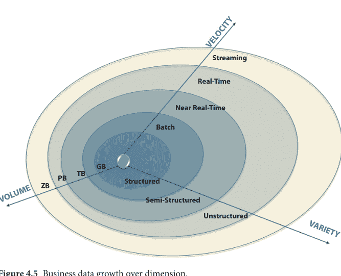


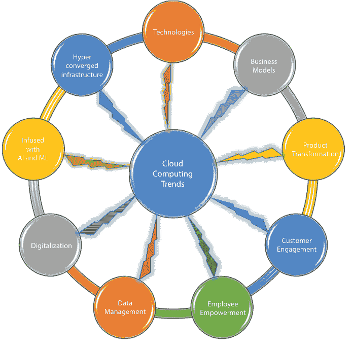

图 4.6 关键出现趋势。

请求位置。将边缘计算纳入云可改善响应时间并最小化云中的网络负载。它有助于减少云服务高峰使用时的网络拥塞 [19]。

-   **无服务器计算：** 用户始终在虚拟服务器上工作，即底层资源根据可用性动态分配。它增强了云的弹性和可扩展性。它具有成本效益并产生高生产力。
-   **分布式计算：** 分布式计算是将较大任务分解为较小任务并在多个节点上同时执行且不影响完整性重新组装结果的技术。由于云运行在分布式节点架构上，实施分布式
-   **实时分析：** 在处理海量数据分析（如流数据分析和车辆跟踪系统）时，由于具有高的处理容量，云将是良好的选择 [11]。
-   **高速连接性：** 5G技术有助于提供低延迟高带宽网络。因此，通过采用最新的连接网络服务，云性能将得到显著提升。

## 4.8.2 商业模式

商业模式是定义的关键趋势，着眼于商业视角而非技术视角的云 [20]。在云中使用商业模式的三大主要益处。

-   **灵活利用：** 可以轻松地提供和撤销资源。季节性的资源高需求可以高效处理。因此，节省商业成本。
-   **驱动业务敏捷性：** XaaS（如DaaS、CaaS和SECaaS）允许企业按需使用多种服务来满足其需求。
-   **更快的创新：** 由于实施和维护的便利性，新的应用程序可以以敏捷模式进行开发和测试。

## 4.8.3 产品转型

云提供多种服务来构建高度集成、可扩展和有弹性的产品，使企业保持在当前市场的前沿。开发的产品内置AI赋能并具备分析解决方案的能力 [22]。

## 4.8.4 客户参与

由于可用技术的多样性，可以开发以客户为中心的产品。

-   **高视觉体验：** 交互式视觉内容，如AR（增强现实）和VR（虚拟现实），吸引更多客户对商业产品的关注。添加此类内容需要高处理能力，而云计算可以提供此类设施。
-   **基于物联网的解决方案：** 云服务和互联网互为补充。因此，云可以良好地管理物联网解决方案，如家庭自动化、制造自动化，并丰富客户体验 [26]。
-   **独立于地点和设备：** 客户只需通过适当的身份验证机制登录，即可在任何地点和任何设备上使用产品。

## 4.8.5 员工赋能

在像新冠疫情这样的疫情期间，员工被迫改为居家办公而非在办公室场所工作，在那里没有内部基础设施可用。云正在帮助人们远程高效工作。所有必需的应用程序和服务都可以通过云网络轻松获取。应用程序开发人员可以离线构建代码并通过云集成到业务中。

## 4.8.6 数据管理与保证

云拥有设计良好的框架来管理组织数据。云提供强大的安全性和明确的合规性以保护数据。云可以解决数据增长和运营规模问题 [24]。

## 4.8.7 数字化

将所有业务流程纳入信息技术范围内使业务更有意义。整合来自多个业务单元的数据帮助组织采取积极主动的未来决策并使业务领先于竞争对手 [21]。

## 4.8.8 构建智能云系统

将AI和ML融入业务流程后，云可以集成更多的功能 [25]。

-   系统将紧密集成到云中
-   增强可扩展性
-   使开发具备敏捷性
-   分析解决方案将成为业务的组成部分
-   将人工智能纳入云的每个部分提升更好的决策能力
-   主动识别和定义安全风险及其解决方案
-   使云更加健壮和值得信赖

## 4.8.9 创建超融合基础设施

这是一种IT框架模型，其中存储、网络和服务集成并作为一个单一平台运行，而不牺牲可扩展性。这种基础设施的主要好处如下。

-   **更低成本：** 数据存储必须在商品级低成本硬件上进行，而不是昂贵的数据中心设置，以降低基础设施成本。
-   **更小且高效的IT团队：** 所有基础设施可以由组织在虚拟服务器上进行管理，复杂操作由云提供商管理。因此，商业组织不需要大型技术专业团队来管理基础设施。
-   **简单策略和更容易的支持：** 企业无需管理基础设施，并从服务提供商处获得支持。
-   **稳健的数据保护：** 超融合软件旨在处理所有类型的数据丢失或故障。备份、恢复和复制是内置属性。

## 4.9 案例研究：将数据仓库迁移到云为强生公司提升性能

Teradata 是一家久负盛名且知名的 EDW（企业数据仓库）解决方案提供商，通过过去40年来为许多主要商业供应商（如宝洁、eBay、通用汽车和波音）提供本地部署的 EDW 硬件和软件解决方案，建立了其声誉。著名的制药和医疗保健公司强生（J&J）也采用了 Teradata 提供的 EDW 数据存储系统，这是最被采用的数据仓库解决方案。

2017年初，尽管强生的数据分析团队使用本地部署的 EDW 系统，但仍面临许多挑战，以应对300 TB的存储量，其中包括50个业务应用和2,500名分析用户，每月处理超过2亿个查询。因此，强生数据和高级经理 Irfan Siddiqui 决定将 EDW 系统从本地部署迁移到云。但当时，云并不流行，Teradata 系统尚未准备好采用云计算服务。

因此，Siddiqui 决定使强生成为主要利益相关者中第一家采用云的公司，使用 Teradata 作为他们的数据仓库解决方案，并同意为 Teradata 在云中制作概念验证（POC）。他们带着许多需要回答的问题开始进行 POC，例如*“如何迁移？”、“应用程序性能如何？”、“正常运行时间是多少？”、“数据安全和系统稳定性如何？”*，以及最重要的*“这如何使强生受益？”*。令他们惊讶的是，在 AWS 上将空间扩展至 80 TB 仅花了20分钟，而本地部署至少需要6个月才能扩展。这是他们的“顿悟时刻”，并成为进一步采用云转型的动力。

作为一种预防措施，最初，强生将其所有数据仓库工作负载迁移到云端，同时保留分析应用程序和可视化工具（如 Informatica、Talend、Tibco 和 Qlik）在本地。此外，他们在短时间内将许多应用程序迁移到了云端。到2019年底，他们将其大多数应用程序迁移到云端，几乎移除了所有本地数据仓库硬件系统。将业务和应用程序转型到云不仅帮助他们降低成本和维护烦恼，还将应用程序性能提高了60%。

尽管存在关于云迁移的所有挑战和问题，云采用的百分比逐年增加，预计到2022年将达到44%的市场份额。

## 4.10 结论

由于其多功能性和在技术和商业采用方面的非凡协作能力，云正在获得越来越多的关注。但云仍处于其幼稚状态。云的采用率仍低于总基础设施的20%。由于平台独立性、功能丰富性和易于集成到业务中，企业采用了不同的云服务。在云中启动业务最小化了初始IT基础设施成本和部署时间，同时提高了性能。本文涵盖了云采用的关键趋势，描述了其优点和局限性。根据当前趋势，云计算似乎不仅在未来商业世界中拥有光明的前景，而且它也将成为日常生活中必要的一部分。


# 参考文献

- Maggiani, R., 沟通顾问，Solari 传播公司 (2009)，《云计算正在改变我们的沟通方式》。IEEE 国际专业会议，IPCC，美国夏威夷威基基，第 1–4 页和第 22 页，2009 年。
- Zhao, F. 和 Kirche, E., 继续采用本地部署还是转向按需采用？中小企业 ERP 采用实证研究，收录于：人机交互。用户与使用情境。HCI 2013。计算机科学技术丛书，第 8006 卷，M. Kuroso（编），Springer，柏林，海德堡，2013 年，https://doi.org/10.1007/978-3-642-39265-8_55。
- Fisher, C., 云计算与本地部署计算。《美国工业与商业管理杂志》，Scientific Research Publishing，中国，第 8 卷，第 1991–2006 页，2018 年。
- Nikhil, D., Dhanalaxmi, B., Reddy, K.S., 云计算的演变及其对大数据分析的贡献，收录于：创新数据通信技术及应用。ICIDCA 2019。数据工程与通信技术丛书，第 46 卷，J. Raj, A. Bashar, S. Ramson（编），Springer，查姆，2020 年，https://doi.org/10.1007/978-3-030-38040-3_38。
- Abadi, D.J., 云中的数据管理：局限性与机遇。IEEE 数据工程通讯，第 32 卷，第 3–12 页，2009 年，2009 年 3 月。
- Prajapati, A.G., Sharma, S.J., Badgujar, V.S., 关于云的一切：系统综述。IEEE 智能城市与新兴技术国际会议 (ICSCEVT)，孟买，2018 年，第 1–6 页，2018 年。
- Gong, C., Liu, J., Zhang, Q., Chen, H., Gong, Z., 云计算的特征。2010 年第 39 届 IEEE 并行处理国际会议研讨会，圣地亚哥，加利福尼亚州，2010 年，第 275–279 页，2010 年。
- Shawish, A. 和 Salama, M., 云计算：范式与技术，收录于：互操作性集体智能：技术与应用。计算智能研究丛书，第 495 卷，F. Xhafa 和 N. Bessis（编），Springer，柏林，海德堡，2014 年。
- Nwobodo, I., 云计算：模型、服务、效用、优势、安全问题及原型，收录于：无线通信、网络与应用。电气工程笔记丛书，第 348 卷，Q.A. Zeng（编），Springer，新德里，2016 年，https://doi.org/10.1007/978-81-322-2580-5_110。
- Widjajarjo, A., Supangkat, S.H., Gondokaryono, Y.S., Prihatmanto, A.S., 云计算参考模型：基于应用画像和资源分配的服务可用性建模。2012 年云计算与社会网络国际会议 (ICC CSN)，万隆，西爪哇，2012 年，第 1–4 页，2012 年。
- Naseer Qureshi, K., Bashir, F., Iqbal, S., 车载自组网（VANET）的云计算模型。IEEE 第七届云网络国际会议 (CloudNet)，东京，2018 年，第 1–3 页，2018 年。
- Smith, A., Bhogal, J., Sharma, M., 云计算：企业与教育应用的考量因素。IEEE，未来物联网与云国际会议，西班牙巴塞罗那，2014 年，第 302–307 页，2014 年。
- Mahapatra, P.K., Tripathy, A.R., Tripathy, A., Mishra, B., 保护云端图像隐私的安全模型，收录于：数据科学与管理进展。数据工程与通信技术丛书，第 37 卷，S. Borah, V. Emilia Balas, Z. Polkowski（编），Springer，新加坡，2020 年。
- El-Gazzar, R.F., 企业云计算采用问题文献综述，收录于：通过 IT 为所有人创造价值。TDIT 2014。IFIP 信息与通信科技进展丛书，第 429 卷，B. Bergvall-Kåreqbom 和 P.A. Nielsen（编），Springer，柏林，海德堡，2014 年。
- Zied Milian, E., Spinola, M.M., Gonçalves, R.F., Leme Fleury, A., 针对学术控制系统分析云计算采用的优势、挑战与障碍，收录于：生产管理系统进展。全球 - 本土世界中创新且基于知识的生产管理。APMS 2014。IFIP 信息与通信科技进展丛书，第 439 卷，B. Grabcot, B. Vallespir, S. Gomes, A. Bouras, D. Kiritisis（编），Springer，柏林，海德堡，2014 年，https://doi.org/10.1007/978-3-662-44736-9_68。
- Zhao, F., Scheruhn, H.J., von Rosing, M., 文化差异对云计算采用的影响，收录于：人机交互。应用与服务。HCI2014。计算机科学技术丛书，第 8512 卷，M. Kuroso（编），Springer，查姆，2014 年，https://doi.org/10.1007/978-3-319-07227-2_74。
- Rai, R., Sahoo, G., & Mehjuz, S. 探索影响云计算采用的因素：关于云迁移的系统研究。SpringerPlus，德国，4(1), 1-12, 2015。
- Hosseinian-Far, A., Ramachandran, M., Slack, C.L., 云计算、大数据、雾计算、物联网和智能生活的新兴趋势，收录于：面向智能未来的技术。M. Dastbaz, H. Arabnia, B. Akhgar（编），Springer，查姆，首次在线发布，2017 年 9 月 6 日，2018 年，https://doi.org/10.1007/978-3-319-60137-3_2。
- Rimal, B.P. 和 Lumb, I., 新兴网络化时代云计算的兴起，收录于：云计算。计算机通信与网络。N. Antonopoulos 和 L. Gillam（编），Springer，查姆，首次在线发布，2017 年 6 月 3 日，2017 年，https://doi.org/10.1007/978-3-319-54645-2_1。
- Menychtas, A., Kousiouris, G., Kyriazis, D., Varvarigou, T., 最小化新兴云计算平台中的技术复杂性，收录于：Euro-Par 2010 并行处理研讨会。Euro-Par 2010。计算机科学技术丛书，第 6586 卷，M.R. Guarracino（编），Springer，柏林，海德堡，2011 年，https://doi.org/10.1007/978-3-642-21878-1_74。
- Shi, Y., Yang, H.H., Yang, Z., Wu, D., 教育中云计算的趋势，收录于：混合式学习。理论与实践。ICH L 2014。计算机科学技术丛书，第 8595 卷，S.K.S. Cheung, J. Fong, J. Zhang, R. Kwan, L.F. Kwok（编），Springer，查姆，2014 年，https://doi.org/10.1007/978-3-319-08961-4_12。
- Sehgal, N.K. 和 Bhatt, P.C.P., 云计算的未来趋势。收录于：云计算，Springer，查姆，首次在线发布，2018 年 3 月 24 日，2018 年，https://doi.org/10.1007/978-3-319-77839-6_12。
- Garg, D., Sidhu, J., Rani, S., 云计算安全的新兴趋势：文献计量分析，第 13 卷，第 223–231 页，IEEE，发表于 IET Software，2019 年，英国，doi: 10.1049/iet-sen.2018.5222。
- Yadav, P.K., Sharma, S., Singh, A., 大数据与云计算：新兴视角与未来趋势。IEEE，智能计算技术中的问题与挑战国际会议 (ICICT)，印度加济阿巴德，2019 年，第 1–4 页，2019 年。
- More, N.S. 和 Ingle, R.B., 绿色计算在节能技术方面的挑战。IEEE 新兴趋势与 ICT 创新国际会议 (ICET)，浦那，2017 年，第 73–76 页，2017 年。
- Jindal, F., Mudgal, S., Choudhari, V., Churi, P.P., 物联网的新兴趋势。IEEE 第五届 HCT 信息技术趋势 (ITT)，阿拉伯联合酋长国迪拜，2018 年，第 50–60 页，2018 年。
- Sunyaev, A. 和 Sunyaev, A., 云计算。第 7 章，收录于：互联网计算，Springer，查姆，首次在线发布，2020 年 2 月 13 日，2020 年，https://doi.org/10.1007/978-3-030-34957-8_7。
- https://www.cloudpro.co.uk/it-infrastructure/8290/how-johnson-johnson-boosted-its-performance-by-lifting-teradata-to-aws.

# 云计算中敏感数据的安全性

**Kirti Wanjale**¹*，**Monika Mangla**² 和 **Paritosh Marathe**²

¹Vishwakarma 信息技术学院，计算机工程系，印度浦那

²Lokmanya Tilak 工程学院，计算机工程系，印度新孟买

## 摘要

在当今数据驱动的世界中，云计算是最重要的技术之一。它允许行业扩展大型计算资源和数据存储设施，而无需强制依赖底层硬件。这些服务基于订阅制提供，定价取决于提供的数据存储和计算设施，价格可能会随所需资源的扩容或缩容而变化。随着大型及小型公司纷纷转向数据驱动方法以提供优质的客户服务，一种普遍趋势是向云计算转移，以获取更快、更便宜且可用性最大化的数据和计算资源，同时允许按需快速扩容和缩容。这种方法在提升应用程序的功能和可扩展性的同时，具有降低成本的巨大潜力，并允许多个实体在同一项目中协作。这使得新兴行业能够以较低的成本扩展新软件的生产规模，且无需在硬件上进行前期投资。由于高性能计算和存储单元的可用性，软件产品的生产和部署速度也可能加快，这些单元在传统条件下可能无法获得，却包含诸如客户数据以及公司关键数据等敏感信息，这些数据托管在外部云存储服务器上。数据存储设施由 CSP（云服务提供商）在多个物理位置进行管理。因此，传统的安全


诸如防火墙等措施不足以确保数据的安全，尤其是在数据泄露会导致个人、道德和财务损害的情况下。因此，对于与公司运营相关的敏感数据，存在强烈的保护需求。必须实施多种安全措施以确保上述数据的安全性。本章讨论安全挑战以及解决这些挑战所使用的方法，并阐述这些方法在保护云存储数据方面的各自优缺点。

**关键词：** 云计算，数据安全，隐私，敏感数据

## 5.1 引言

云计算是一种无处不在的按需模型，用于提供计算资源，特别是数据存储和计算单元设施。这些资源以方便的方式提供给用户，无需用户直接参与[1, 2]。其目标是以快速可靠的方式，以较低的成本提供大量计算资源和数据存储设施，且无需购买物理硬件。

### 5.1.1 云计算的特性

- 按需自助服务：允许用户通过简单灵活的方法，根据需求获取资源。最初，用户会获得一定数量的资源，用户可根据需求扩展这些资源。用户可以选择所需资源的数量并相应付费。
- 资源池化：指由云服务提供商（CSP）维护的IT资源池（存储、内存和GPU），允许根据用户需求进行资源的动态分配和重新分配。
- 通用网络访问：通过广域网络访问级别，用户可以连接其云。其目标是通过各种接口和设备提供对云服务，需要多种协议和API服务，让用户通过多种技术访问云。
- 位置无关：允许用户无论身在何处均可访问云服务。
- 低维护和高可靠性：用户无需执行任何维护工作，同时可确保获得稳定可靠的服务。
- 快速扩展（高可扩展性）：允许用户在请求时增加所使用的资源数量，并在需求减少时释放资源。
- 计量服务：按使用量付费的服务让用户只需为实际使用部分付费，而非固定的订阅费。

云服务提供商以特定的模式部署资源，这些模式由目标组织的需求和要求定义。云资源可在网络上部署，在某些情况下，网络会对其实施限制。

### 5.1.2 云服务的部署模型

以下是云服务中一些广泛使用的部署模型：

- 私有云：专供组织内部使用。因此，组织的所有成员均可使用云数据和服务，但组织外的人员无法访问该云。
- 公有云：面向公众开放使用。在此模式下，所有云服务均通过互联网提供，云本身由云服务提供组织拥有。
- 社区云：社区云专为具有共同利益（如安全、策略、使命或合规性考量）的特定一组消费者或组织提供，因此他们需要类似的资源。
- 混合云：是前述类型（私有云、公有云和社区云）的组合，通过某些标准协议绑定在一起，以确保数据和资源的可移植性。

这些模型作为开发组织云服务的指南。然而，用户如何使用这些模型是另一个问题。因此，云服务提供商提供不同的模式，说明服务如何“交付”给用户使用[1, 4, 5]。

### 5.1.3 云交付模型的类型

- 软件即服务（SaaS）：此层赋予消费者使用供应商提供的应用程序的能力。这些应用程序通过客户端界面（如Web浏览器）提供。提供商可能根据用户对应用程序的使用情况（可能是分级制）收取基于会员身份的订阅费。除了少数特定于用户的应用配置外，从软件应用到底层硬件的所有其他事项均由服务提供商管理[1]。
- 平台即服务（PaaS）：此层为用户提供使用编程语言创建和部署应用程序所需的所有必要库、服务和工具。用户控制已部署的应用程序及应用程序的配置设置。从平台（操作系统）到网络、服务器等底层硬件的所有其他事项均由提供商控制[1]。
- 基础设施即服务（IaaS）：此层为用户提供选择处理单元、存储及其他开发部署应用程序所需基本资源的能力。除了底层IT资源和云基础设施外，用户控制操作系统、库、存储和已部署的应用程序，并对网络（例如主机防火墙配置）拥有有限的控制权[1]。

## 5.2 云中的数据

技术的进步正推动世界走向数字化。这导致了各种类型数据的巨大生成，无论是个人数据还是应用程序相关数据。这使得数据存储成为云提供的最重要服务之一。由于向数字化转变，用户已将数据迁移到云存储，以获得低成本、大容量以及在全球任何地方轻松访问的优势。这可能包括个人数据、客户数据和公司数据。

存储在云上的数据可能是敏感的，对公司运营或用户信息具有至关重要的意义。此类数据必须受到保护，防止未经授权的访问、数据损坏或任何形式的数据泄露或损坏，进而导致客户不满和公司运营受损。因此，随着用户无法控制数据存储的逻辑和物理方面，对云计算安全的关注日益增加。用户不知道给定数据在物理上存储在哪里，也无法控制用于存储数据的方法，这导致对数据安全问题的不信任[6, 8, 9]。

云提供商负责数据的安全性、存储、完整性及可靠访问。云提供商必须确保以下几点。

- 保密性：保护数据不被未经授权的方访问，并仅允许授权的方访问数据。
- 完整性：确保数据在存储或传输过程中不被以任何方式篡改或修改，并仅允许授权的方复制、删除或修改数据。
- 身份验证：在允许访问存储的数据之前，通过采用各种身份识别策略来确认用户身份。
- 可用性：允许用户随时在任何地方持续访问数据和服务。
- 授权：允许用户选择其他方可以访问哪些数据，以及他们是否可以修改或删除数据。

### 5.2.1 数据生命周期

云架构提供了许多优势，如更便宜、更高效的定量数据存储以及更快的计算单元。因此，可能会创建、存储和处理大量数据，这些数据从不同类型的数据到来自各种源的数据输入不一。图5.1展示了数据生命周期。因此，我们可以说数据本身作为一个单元具有生命周期。它包括六个阶段。数据从创建到结束，会经过一系列阶段或“相位”，这些阶段构成了数据单元的生命周期。这些阶段定义了一般在数据上执行的任务，并可根据所需粒度细分为多个阶段。大致而言，这六个阶段如下：

- 数据生成：涉及从最终用户或其他来源（从各种来源收集）创建数据。
- 数据传输：涉及从外部来源或在企业边界内部传输数据。


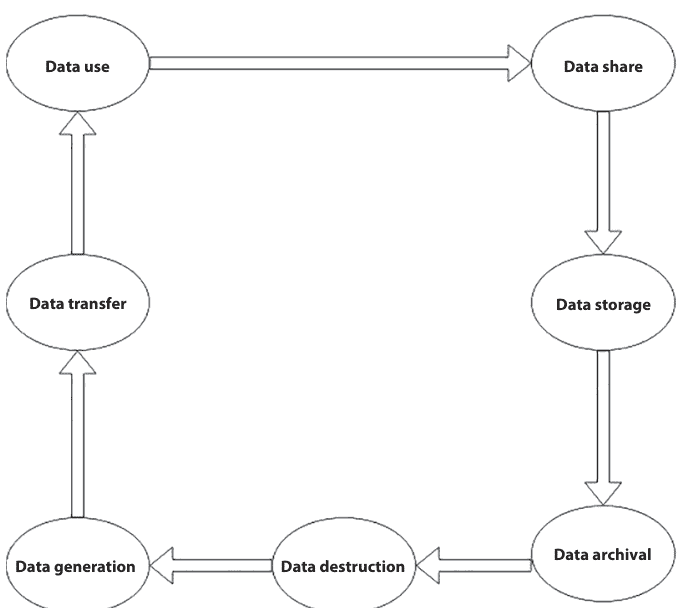

**图 5.1** 数据生命周期。

- **数据使用**：这涉及对从源获取并处理过的数据进行处理。
- **数据共享**：这涉及基于访问控制在企业内部或外部进行数据共享。
- **数据存储**：这涉及将数据存储在本地或以就绪模式存储，以供活跃流程使用。在此阶段，数据可能会被频繁使用或引用。
- **数据归档**：这涉及将数据离线存储，因为它不需要用于任何活跃流程，且没有对其执行任何操作。将其存储以备数据未来可能的使用。
- **数据销毁**：这涉及当数据不再有任何用途时销毁所有数据。从所有物理介质中删除整个数据及其现有副本。

一旦数据被创建，它可以在生命周期的任何阶段之间自由移动。然而，必须确保生命周期所有阶段的数据安全。根据数据在各阶段的状态，这些阶段可以分类为以下三个阶段。

- **使用中的数据**：数据生成、数据使用、数据销毁
- **传输中的数据**：数据共享、数据传输
- **静止中的数据**：数据存储、数据归档

（注意：数据销毁可以被视为其独立的阶段；然而，为方便起见，我们可以将其归类为使用中的数据。）

## 5.3 云计算中数据的安全挑战

如前所述，云计算具有若干优势。另一方面，它也面临一些构成安全威胁并可能导致云中数据安全受损的安全挑战。本节讨论与数据安全相关的挑战。我们可以根据这些挑战所涉及的目标领域将其分为三类。这三个部分在图 5.2 中说明如下：

- 与静止中数据相关的安全挑战
- 与使用中数据相关的安全挑战
- 与传输中数据相关的安全挑战

| **静止中的数据** | **使用中的数据** | **传输中的数据** |
|---|---|---|
| 数据持久性、CSP 责任、访问控制、安全数据、数据复制、数据销毁 | 安全计算、数据持久性、机器隔离、可验证计算 | 数据泄露、数据外包、数据迁移、数据丢失 |

**图 5.2** 与静止中数据、使用中数据和传输中数据相关的问题。

### 5.3.1 与静止中数据相关的安全挑战

静止中的数据指的是维护在云持久存储中的数据。CSP（云服务提供商）为数据所有者提供高度可扩展和可定制的存储实例，当不需要时，这些存储是不可靠的并会被移除。持久存储为数据的长期存储提供了可靠的存储解决方案。然而，在这两种情况下，数据都存储在远离用户的位置。位置引发了安全挑战 [11, 13, 14]。

**数据持久性**：云计算的标准模型包括根据需求分配和释放资源。这意味着将业务交易所需的数据托管在云服务器上。

工作完成后，资源从公司使用的集群中释放。可能会出现这种情况：在业务流程中使用过的数据可能在存储被释放后仍然存在，并且可能在网络中可访问。这种类型的安全故障被称为*数据持久性*。

**数据复制**：托管在云中的数据受制于 CSP 提供的硬件。这包括可用的网络、处理器和存储。它可能具有自身的一组漏洞。这些漏洞可能被利用来复制数据或 VM（虚拟机本身）。

**访问控制**：数据是一项资产。它可能需要同一组织内的多方使用。这需要细粒度的访问控制。访问控制指的是根据任何一方的角色授予其读取、写入或以任何方式操纵数据的权利。不规则的访问控制可能导致对敏感数据的未授权访问，这些数据可能被恶意方破坏。

**安全数据**：保护数据本身是必要的。未加密的数据很容易读取，在发生未授权访问的情况下，它可能真正损害组织，因为数据可以立即被利用。任何对策可能都太慢，无法防止造成的损害。

**CSP 责任**：硬件故障可能导致数据损坏和丢失。因此，CSP 必须采取措施来避免此类故障。CSP 可以利用如冗余存储等设施，以保护组织免受不必要的数据丢失。在云故障的情况下，CSP 必须建立万无一失的策略，特别是对于在 CSP 云上存储敏感数据并为此订阅的组织。CSP 责任的另一个问题是组织和 CSP 之间的低级别信任。与之相关的一个问题是验证数据是否被 CSP 意外或恶意操纵。

**数据销毁**：数据完成其用途后必须被删除。CSP 必须能够安全地删除数据。未能做到这一点可能会导致数据暴露给其他用户以及任何可能获得驱动器访问权限的人。

### 5.3.2 与使用中数据相关的安全挑战

使用中数据也称为处理中的数据。在此阶段，数据可能保留在主存储中。此阶段要求数据解密以进行处理，因此失去了大部分保护。因此，它是数据最脆弱的阶段。为了应对数据安全挑战，以下是一些安全措施 [15, 16]。

**安全计算**：通常，出于安全原因，组织可能更愿意在自己的资源上计算数据。然而，这可能会导致额外的数据传输成本进出云。为了避免这种情况，最好以安全的方式直接在云上计算数据，以避免暴露给攻击者。这被称为安全计算。

**机器隔离**：虚拟化是云计算中最突出的技术。虚拟化允许多个 VM 共享硬件资源，从而从 CSP 的角度允许更高水平的资源利用率。此外，它带来了自身可被利用的缺陷。VM 在运行时，并发利用同一网络上的相同 CPU、主存储和次级存储。这可能引入数据中的非恶意波动，并为恶意攻击者提供新的攻击途径。他们可能尝试与他们想要攻击的机器定位在相同的物理资源上。

**可验证计算**：可验证计算向组织保证数据已按预期计算，没有任何操纵。这与 CSP 和组织之间的信任相关，涉及安全计算数据以及对资源使用的核算。

### 5.3.3 与传输中数据相关的安全挑战

与静止中的数据不同，传输中的数据指的是移动中的数据。因此，它指的是数据通过网络从一个位置移动到另一个位置或传输期间的数据状态。数据可以从云客户端的本地存储移动到 CSP 的存储，反之亦然。数据也可以在多个云系统之间移动。

**数据迁移**：CSP 可能会将数据从一个数据中心移动到另一个数据中心，以实现更好的资源利用率、更快的网络性能和更低的延迟。然而，CSP 必须遵守所有当地法规并履行 CSP 与组织之间达成的所有协议。

**数据外包**：CSP 可能出于成本最小化和资源不足的原因，选择将数据存储和任务委托给其他 CSP。其他 CSP 可能没有必要的保护级别，或者没有与主要 CSP 和组织相同的协议。这引入了另一个攻击向量。

**数据丢失**：数据丢失可能由修改、删除、加密密钥丢失以及其他自然原因（如地震、海啸或火灾）引起。数据丢失可能是恶意的，也可能不是。

**数据泄露**：数据泄露可能由于身份验证或授权不当以及不可靠的加密而发生。

## 5.4 云中与网络相关的横向问题

一些与数据安全相关的问题跨越上述所有三个领域。组织要求高速数据传输速率和低延迟。这需要建立复杂的网络以提供用户所需的规格。许多 CSP 还为基于图形用户界面（GUI）的数据访问和管理提供基于浏览器的用户登录平台给用户提供访问。然而，这为网络本身引入了另一个攻击向量，以获取存储在云上的敏感信息 [7]。以下问题涉及可能被用来获取对数据的恶意访问的网络攻击。

**SQL 注入攻击**：CSP 通常在 SQL 数据库中维护数据库是常见的。这包括存储帐户的用户 ID 和登录信息。在此攻击中，攻击者渗透恶意代码以获得对数据库的未授权访问，从而访问敏感数据 [10]。

**跨站脚本（XSS）攻击**：在此攻击中，攻击者将恶意脚本放入用户端的网页中，以便将其重定向到攻击者的网站。这使攻击者能够访问存储在浏览器中的敏感数据，如登录凭据和密码。它还使攻击者能够在目标计算机上执行恶意代码并获得控制。也可以通过使用存储型 XSS（将代码永久插入由 Web 应用程序管理的源代码）或反射型 XSS（立即将恶意代码反射到用户计算机）来实现 [12]。


钓鱼攻击：在这类攻击中，攻击者利用云服务。在此过程中，攻击者将目标重定向到一个伪造的网站，该网站被制作得与原始网站完全相似。目标使用其凭据访问云。这些凭据被攻击者窃取，并用于获取云访问权限。

中间人攻击（MITM）：在这类攻击中，攻击者在用户和云之间进行“窃听”，以监听两者之间传输的流量。攻击者可能会尝试通过解密或窥探数据流量来获取通信访问权限。它还可能重定向数据流量，以执行其他恶意活动。

包装攻击：当用户通过 Web 浏览器请求虚拟机（VM）时，Web 服务器会生成一个 SOAP 消息。该 SOAP 消息包含 XML 包，其中携带服务器与浏览器之间需要通信的信息。然而，XML 包会被签名，以验证浏览器和服务器之间的信任。通常，这是通过放置在头部中的数字签名来实现的。在包装攻击中，攻击者通过中间人攻击复制 SOAP 消息。保留包含签名的头部，但更改内容。然后将其作为授权用户发送给服务器，使攻击者能够获取云访问权限。

域名服务器（DNS）攻击：通常，用户通过其域名访问服务器，该域名进一步映射到其 IP 地址。在 DNS 攻击中，攻击者错误地将流量转发到其他恶意网站。它还可能使用 DNS 投毒，通过访问目标计算机向其插入代码。

## 5.5 数据保护

针对数据的攻击始终存在。外国行为者、黑客和恶意个人试图获取敏感数据，以伤害组织和客户的用户，或针对组织本身实施企业间谍活动。另一种类型的攻击向量可能存在于心怀不满的员工中，他们可能成为恶意的内部人员。

将有更多新技术需要实施，这些技术可能具有多个入口点。即使是遗留系统也可能存在零日漏洞，黑客可利用这些漏洞获取数据访问权限。绝对的保护是不可能的。实施某些功能会向系统中引入一些故障。黑客总是试图获取敏感数据的访问权限。不过，如果我们不能完全阻止他们，我们可以采取一些措施来减缓他们的行动。以下技术可以确保抵御大量攻击向量。

## 数据加密

数据加密是指对数据进行编码的过程。该过程使用“密钥”作为方法，将被称为明文的原始数据转换为称为密文的另一种格式，并将其转回。

授权实体可以使用密钥将密文解密回明文以供使用。虽然没有密钥也可以解密数据，但解密使用良好算法加密的数据需要大量的时间和计算资源。一些现有的算法如下。

## 数据加密标准

数据加密标准（DES）于 1977 年基于 Horst Feistel 的 Feistel 密码建立。它对每个 64 位的块应用 56 位的密钥 [3]。该加密标准提交给国家标准局（National Bureau of Standards），是第一个被 NIST（国家标准与技术研究院）批准的加密标准，并被推广为标准安全方法。该方法通常需要 16 轮，并以各种模式工作。尽管该算法使用“强”加密设计，但发现它不适用，因为它容易被破解。因此，它已被更强大的高级加密标准（AES）所取代，如图 5.3 所示。

## 三重数据加密系统

在三重数据加密系统（3DES）中，它将对数据块应用 DES 算法三次，因此得名 3DES。TDES 使用 64 位的块大小，并运行 48 个处理轮。

## 高级加密标准

AES 也被称为 Rijndael 密码，并使用对称密钥加密方法。AES 是一种块密码算法，使用可变长度的密钥大小，即 128、192 或 256 位。标准密钥大小为 256 位 [3]。与 DES 相比，AES 是一种快速、灵活且有效的加密算法。与密钥大小类似，轮数也会变化，对于 128、192 和 256 位，分别为 10、12 和 14 轮。该算法使用替换、置换和直接更改。因此，金融组织和世界各地各种安全框架都采用 AES 作为加密标准，因为其增强了安全性和可靠性。图 5.4 和 5.5 解释了 AES 加密和 AES 解密方法。

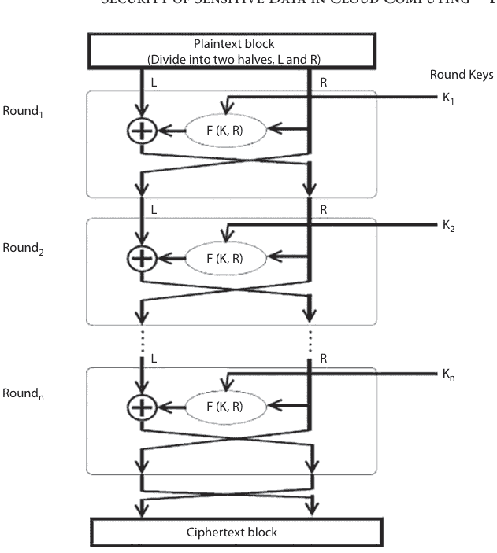

**图 5.3** 高级加密标准（AES）。

## RSA

RSA 算法是最早提出的密码密钥加密技术之一，于 1973 年提出，它使用两个相互关联的密钥。在这里，公钥是公开共享的，而私钥仅由用户保留。在此算法中，公钥和私钥对使用两个大素数生成。在 RSA 中，密文通过乘法发现明文，反之亦然 [3]。

## Diffie-Hellman 密钥交换

Diffie-Hellman（D-H）是一种交换加密所用密钥的方法。首先，使用隐藏的私钥在两个参与者之间进行通信。然后，利用该私钥获取公钥，该公钥在两个没有关于彼此历史信息的最终用户之间共享。最后，通过共享密钥计算出一个第三方密钥，黑客无法找到该密钥。

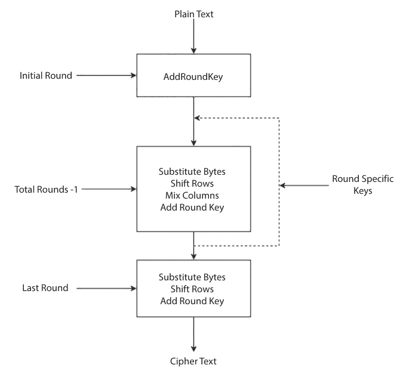

**图 5.4** AES 加密。

## DSA

DSA 是一种用于交换数字签名的技术，用于消息的身份验证。它基于 ELGamal 方案，并使用离散对数问题来实现模幂运算的代数属性。DSA 由 NIST（国家标准与技术研究院）引入，用于检测源发送到接收者的数据中发生的未授权更改。它还需要一个公钥和私钥来解决该问题。它还有助于避免消息的抵赖，因为传输必须使用公钥进行签名。

## Blowfish

它是一种对称加密算法。它具有 64 位的块密码。它由 Bruce Schneier 于 1993 年开发。它对于具有大型数据存储的 32 位大型机是有效的。与 DES 相比，它速度较快。密钥长度可在 32 到 448 位的范围内不同。它基于 Feistel 密码，并具有大的 S 盒和复杂的密钥轮方案，使算法难以破解。

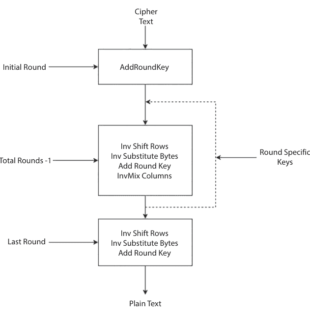

**图 5.5** AES 解密。

## RC5

它是一种对称加密算法。它具有可变块（32、64 和 128 位）大小，但通常是 128 位块。此外，它有 12 轮。其总体结构又是 Feistel 密码的结构。RC5 算法用于云计算中数据的加密。它也可以用于数据传输，以确保传输期间的安全性。然后我们可以确信数据的传输将被加密。即使在传输过程中数据被窃取，也没有相关的密钥可以轻易用于破解它。

## 椭圆曲线密码算法

椭圆曲线密码学（ECC）于 1985 年作为一种与公钥密码学相比的方法被引入。与 RSA 相比，这种方法由于使用较小的密钥大小来获得相同的安全级别，因此相对更安全且高效。尽管公钥算法提供了一种在网络的多个参与者之间共享密钥的方法。该方法基于离散对数，其难以破解，因此如图所示在图 5.6 中获得的增强安全性。为了增强读者的理解，各种算法的比较分析在表 5.1 中展示。

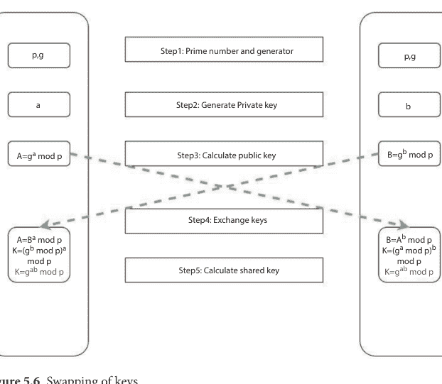

## 5.6 更严格的 IAM 控制

身份和访问管理（IAM）是云安全的重要组成部分之一。它确保授权实体对云提供的所有其他数据和服务具有适当的访问权限，并拒绝所有其他方的访问。

IAM 通常遵循 PARC 模型。具体而言：

- P = 主体（用户、组、程序）
- A = 操作（创建、读取、更新、删除）
- R = 资源（操作系统、网络、文件）
- C = 条件（时间、日期、操作系统类型等）


# 表 5.1 算法比较。

| 属性 | DES | 3DES | AES | Blowfish | RC5 | RSA | DSA | Diffie-Hellman |
| :--- | :--- | :--- | :--- | :--- | :--- | :--- | :--- | :--- |
| 开发商/年份 | 1975年的IBM | 1978年的IBM | 1998年的Daeman, Rijmen | 1998年的Bruce Schneir | 1994年的Ronald Rivest | 1977年的Rivest, Shamir, Adleman | 1991年的NIST | 1976年的Diffie-Hellman |
| 密钥长度 | 56 | 112 | 128, 192, 256 | 32-448 | 128 | 1,024-4,096 | -- | 1,024 |
| 分组长度 | 64 | 64 | 128 | 64 | 64 | -- | -- | -- |
| 轮数 | 16 | 48 | 10, 12, 14 | 16 | 12 | 1 | -- | -- |
| 加密类型 | 分组 | 分组 | 分组 | 分组 | 分组 | 非对称分组 | -- | -- |
| 算法类型 | Feistel网络 | Feistel网络 | 替换置换 | Feistel网络 | Feistel网络 | Feistel网络 | -- | -- |
| 针对攻击的安全性 | 暴力破解 | 暴力破解，选择明文攻击，已知明文攻击 | 暴力破解 | 字典攻击 | 暴力破解 | 暴力破解，时序攻击 | -- | Logjam攻击 |

IAM（身份与访问管理）必须定义得当，以便主体在适当的条件下拥有授权资源。IAM由组织定义。然而，这些IAM的执行是由CSP（云服务提供商）完成的。因此，定义所有相关方的所有IAM策略成为一个复杂的问题，特别是每个CSP都有自己独特的执行方式。

策略必须定义得当，以免向无关方（无论其性质是否恶意）授予未经授权的访问权限。

## 网络安全

针对数据的攻击通常通过网络发生。因此，保障网络安全是实现强数据安全的当务之急。因此，我们必须采取适当措施来保护网络免受基于网络的攻击。

部分措施如下：

- 对登录输入数据进行净化
- 使用适当的身份验证和授权
- 使用适当的SSL（安全套接层）配置
- 使用适当的DNS安全措施，例如域名系统安全扩展（DNSSEC）
- 使用入侵检测系统（IDS）/入侵预防系统（IPS）
- 使用基于地址解析协议（ARP）的嗅探器检测技术
- 定期清理和清除Cookie（浏览器数据）
- 通过适当利用浏览器的安全策略
- 通过创建专用会话并使用其他身份验证机制，如双因素身份验证（2FA）
- 实施备份策略以避免数据恢复问题
- 使用安全的Hypervisor（虚拟机监控器）和适当的Hypervisor监控
- 实施适当的VM隔离
- 使用主动内容过滤
- 使用Web应用程序漏洞检测技术
- 使用异常检测系统以识别非正常行为

## 5.7 结论与未来展望

数据是当今市场最重要的商品之一。数据决定了组织的运作方式以及组织及其客户的偏好。数据推动了新技术和功能的创建。它预测了组织在开发市场利基时可能采取的下一步行动。数据决定了市场的走向，进而决定了其利润。因此，我们可以说我们正处于一个以数据为中心的世界。组织经常受到各方攻击是常见现象。

恶意黑客、外国国家行为者、企业、竞争对手以及许多其他方攻击组织以获取利润或进行商业间谍活动。这不仅会给组织带来不良后果，还会给其客户和关联的第三方带来影响，其代价可能不仅仅局限于经济损失。因此，组织保护自身数据以保护自身、其客户和子公司变得至关重要。因此，组织有必要采取必要的预防措施，将这些各方拒之门外。组织和CSP都必须努力对数据进行加密，并证明网络能够抵御数据泄露，以保护自身及其利益。

网络战被认为是战争的下一种形式。政府、企业、恶意黑客和其他相关方相互攻击，以获得经济杠杆并评估彼此的进展。根据敏感数据的性质，大型公司和外国政府可能会针对组织及其成员，以获取该数据的访问权限。针对组织成员的攻击很常见，目的是获取组织内部网络的访问权限。如今，由于更强的加密、防火墙和网络安全实践，仅仅“黑入”一个网络已不再容易。该方可能需要针对现有员工，以揭示其在网络中的访问权限和登录信息。这被称为社会工程学攻击。与直接黑入高度安全的网络相比，这仍然是较简单的方式之一。因此，我们可以说一个组织与其最薄弱的环节（即其成员和用户）一样强大。未来展望探讨了社会工程学攻击及其通过员工培训进行预防的方法，并通过适当的访问控制减少损害。

# 参考文献

- 1. Amara, N., Zhiqui, H., Ali, A., 云计算安全威胁及其缓解技术。*国际网络使能分布式计算与知识发现会议*，2017。
- 2. Mangla, M., Suneeta, S., Bhagirathi, N., Sachin Nandan, M., 编。*云计算与物联网的集成：基础、分析与应用*。John Wiley & Sons, 2021。
- 3. Prakash, G.L., Prateek, Dr. M., Singh, Dr. S., Singh, II, 使用密钥轮换进行数据加密和解密算法以保障云系统中的数据安全。*国际信号传播与计算机技术会议*，2014。
- 4. Potluri, S., Monika, M., Suneeta, S., Sachin Nandan, M., 云计算环境中DDoS攻击的检测与预防机制。收录于*2020年第11届国际计算、通信和网络技术会议（ICCCNT）*，第1–6页。IEEE, 2020。
- 5. Akhare, R., Mangla, M., Deokar, S., Wadhwa, V., 拟议的雾计算框架以改善物联网应用的服务质量。*物联网应用的雾数据分析*，第123–143页。Springer, Singapore, 2020。
- 6. Moghaddam F, F., Karimis, O., Alrashdan, M.T., 云计算环境中应用实时加密的比较研究。*IEEE第2届国际云网络会议（CloudNet）论文集*，美国旧金山，第185–189页，2013。
- 7. Liu, W., 云计算安全问题及策略研究，收录于：*2012年第2届国际消费者电子通信和网络会议（CECNet）*，第1216–1219页，2012。
- 8. Behl, A. and Behl, K., 云计算安全问题分析。*IEEE信息通信技术世界大会*，2012。
- 9. Ko, R.K.L. *等*，Trustcloud：云计算中问责制和信任的框架。*IEEE服务世界大会*，2011。
- 10. 云计算-ENISA-信息安全的好处、风险和建议。*ENISA*，2009。
- 11. CSA：著名的九大云计算顶级威胁。*云安全联盟*，2013。
- 12. Archana, M. and Shashtry, M., 云计算安全算法综述。*国际科学与工程学研究杂志*，4:1, 1490–1495, 2018。
- 13. Chen, D. and Zhao, H., 云计算中的数据安全和隐私保护问题。*国际计算机科学与工程会议*，2012。
- 14. Omotosho, OI., 云计算安全综述。*国际计算科学与移动计算杂志*，8:9, 245–257, 2019。
- 15. Y.Y.D.W. Anyi Liu, SQLprob：一种基于代理的预防架构。*2009年ACM应用计算研讨会论文集*，2009。
- 16. Vogt, P., Nentwich, F., Jovanovic, N., Kirda, E., Kruegel, C., Vigna, G. 使用动态数据污迹和静态分析进行跨站脚本攻击预防。*在NDSS中*，2007, 12, 2007。


# 面向物联网云数据解析的云密码学

N. Jayashri $^{1*}$ 和 K. Kalaiselvi $^{2\dagger}$

$^{1}$应用计算机系，M.G.R.教育与研究机构，印度泰米尔纳德邦金奈

$^{2}$应用计算机系，计算科学学院，威尔斯科学、技术与高级研究院（前身为威尔斯大学），印度泰米尔纳德邦金奈

## 摘要

潜在的物联网（IoT）将对我们的商业和社会生活产生深远且审慎的影响。物联网系统的关注焦点通常是一种资产义务，这使得它们将重点放在数字攻击诱饵上。因此，广泛的努力被投入到识别当代物联网中的安全和隐私问题中，主要通过传统密码学方法来实现。然而，物联网中心点的显著特性使其成为通过远程系统发送的对象间组织和协作的主要目标，以满足作为联合元素设定给它们的目标，从而实现大数据使用的更高级别领域。此外，基于远程系统的创意，平台和物联网都可能快速且共同地成长。在本节中，它系统地审查了物联网系统的安全需求、攻击向量以及当前的安全响应。它还提供了关于当前机器学习解决方案在解决物联网系统各种安全问题方面的见解，以及一些未来密码学云分析的重点内容。

**关键词：** 物联网，云计算，大数据，安全，隐私

### 6.1 引言

基于云的组织介绍为成员带来许多障碍。当成员转向使用云组织和开放云组织时，系统开发的大部分受到笑话对象（CSP）的云提供商直接影响。这些不利因素中的一些可以通过组织[1]来解决并应被解决。这些组织活动需要明确描述CSP（可能是协会）的所有权和承诺以及关联方的客户工作。安全管理员也必须能够确定用于充分定义关联方的安全状况的检查和保险措施。尽管如此，根据资产、风险和机会筛查系统，以及根据所需的数据保护级别，必须执行适当的安全控制，而组织的一些大规模模式则对组织内的交易思考视而不见[2]。这包括以下内容：

- 安全策略执行
- 计算机中断识别与响应
- 虚拟化安全管理

云安全董事会也可以开发先进能力，并使用可量化的基于云的信息框架进行刑事调查。在本报告中，利用修改后的危险和云数据缺失时，需要迅速且清晰的明确性。此外，云安全管理员将通过在实践中使用机器人技术以及在互操作性安全、操作设计、会计、交付和API区域等使用更好的服务器管理级别来进行改进。API旨在控制云资源，而GUI框架和远程API必须弄清楚如何编录和无过滤[3]。董事会可以处理信息安全应用，以通过灵活性控制大量交易，因为费用模型发生而投入更多，使用和供应，按需，并将数据委托给管理员的云操作活动。

### 6.2 云计算软件安全基础

当将组织的基本数据委托给在拓扑上未分布的云阶段时，安全是一个主要考虑因素。除了常规的IT数据框架安全措施外，通过在整个开发生命周期发展中将安全结构化到软件编程中，云表面将不可思议地降低。需要安全的三个特性如下[4]。

- **成瘾性：** 通常在多种条件下运行或有效工作的软件，即使在针对或操作危险主机时也是如此。
- **信任度：** 包含一些可能威胁产品可靠性的基线错误或故障的程序。它也应该与虚假推理无关。
- **生存能力：** 容易受到威胁且对威胁视而不见的程序，并且可以尽可能容易地反弹，具有在预测环境中假设的最少恶意性。

数据认证的七个相关规则包括保密性、真实性、入口、保证、同意、检查和责任。

保密性、完整性和可用性：数据框架的匿名性、巧妙性和可用性有时被称为CIA三要素，是云服务安全的基本组成部分。

#### 保密性

这引入了故意或意外数据泄露的可能性。云保护与精神数据、匿名网络、行为分析、编码和推理领域相关[5]。

- **知识产权（IP）权利：** IP融合了技术、策略和创造性、旋律性和信息性实践。确保判断技能信号和授予创新技术的专利法规保护精神保护。知识产权得到保证。
- **隐蔽通道：** 秘密通道允许通过非法和意外的通信手段共享信息。揭露网络可以通过对消息进行节奏或使用未声明方式的电源结构来实现。
- **流量分析：** 干预测试可能是通过检查通信行动持续时间、节奏、方向和意图来满足的无疑问的秘密泄露设计，如果结合的话。广泛的对应和大量行动爆发表明重大事件正在发生。行动审查的对策包括近恒定的通信速率措施，以保护流量的源和目标区域。
- **加密：** 加密涉及在拦截当天对笔记进行混淆，使其无法被非法材料搜索。解码消息所需的整体工作量（工作数字）可能是加密质量和编码估计质量以及质量的过程。
- **推理：** 推导通常与样本的效率相关。产品利用设备和设备详细信息以消耗保持在高级别安全水平的材料的能力得以建立。

### 6.3 安全管理

应用概念包括在有效安全管理中实践云计算。云安全的适当管理和行政，如监控、无能审查、法律调整、事件响应、灾难恢复、消化不良恢复和工会安排，可能会考虑管理和行政问题。正确使用和分析云安全控制可以改善这些系统并保护它们。分类原则指出了私营部门使用的那些适用于云数据的分类法律如下[6]。

**公开信息：** 类似未分类信息的资料；由于数据可用，来自不兼容组织的知识混合。虽然其未经授权的自由会削弱其政策，但它不应以积极或不利的形式影响组织、其成员或其客户。

**敏感数据：** 在分类级别上比正常数据更相关的资料。由于未经授权的修改，此信息受到不准确分类的保护。这是一种情报课程，需要对保护未经授权的修改或消除保密性做出无与伦比的承诺。知识需要比以往更正确和准确地重新审查。

**私人数据：** 此功能指提交供组织使用的某些信息。公司和员工未经授权的放纵可能导致诚实和敌对的影响。

**机密信息：** 此协议适用于有意为合伙关系预期的最重要贸易信息。它似乎对接受投资者、其投机者、其员工或其客户而言是真实和敌对的。尽管关于几乎未知生产的数据被分类为未识别、市场优势和融合课程。


控制措施：云安全检查旨在将入侵的后果降至最低，并将漏洞减少到合理的范围。在此背景下，组织需要评估攻击的影响以及失败的风险。窃取现金、声誉受损以及物理破坏是承诺感知数据不幸事件的指标。分析不同风险场景并创建代理对计算出的可能灾难的易受攻击性的方法称为危害分析（RA）。作为可行的对策，控制措施起著[7]的作用。

## 6.4 密码学算法

我们是否天真地认为不需要提供基本安全措施即可保障安全？在这个数千万人直接通信的时代，安全性是一个重要议题，并且越来越多地被用作贸易平台。安全方面是复杂的，用户的基本需求包括众多用于安全业务、私人通信和密码保护交易的应用程序。因此，加密是必要的，因为它提供了加密消息环境。密码学的主要决定在于阻止对安全信息的未经授权访问[8]。密码学涉及在第三方存在的情况下对安全通信方法的研究和分析。隐藏的研究和分析隐藏在密码学中。它是将明文转化为密文的工艺和同情心。在密码学语言中，通信被称为明文。认证被称为加密，以便消息的内容不被外部来源暴露。认证过程实际上是一个用于标记发送者的消息或签署ID的数字和类型，确保初始消息或电子邮件的含义被修改。数字签名是其他人无法复制的，易于传输，并且可以自动同步。原始签名消息不能被拒绝，因为能够确保它经过认证。数字签名的使用可能允许在任何类型的通信中使用，无论是隐藏的还是非隐藏的，指示加密消息或解密文本，使接收者确信发送者的身份并证明消息是一致的，暗示消息是初始的或未被更改的[9]。

### 6.4.1 密码学的类型

对称密钥密码学：这也被称为主密钥、秘密密钥或单密钥加密。在同一过程中使用相同的密钥进行加密和解密来发送和接收[10]。对称密钥分为两部分：第一，块密码数据块，然后被分离成位并用作加密和解密。第一个是块密码数据层。例如，块密码是AES，最常见的对称算法技术是三次DES。其次，流密码在给定部分上操作。这也是一种违反信任的威胁，并将秘密密钥传输到不安全的网络。对称代码提供许多好处，因为编码更容易。与公钥加密相比，单密钥加密不需要太多计算机资源。使用单个秘密密钥与所有利益相关者通信。当密钥被破解时，仅影响分发者和受益者之间的消息。其他人的通信保持安全。

非对称密钥密码学：也被称为公钥加密。有两种类型的密钥，一个是公钥加密主密钥，另一个是私钥解密密钥。只有消费者/设备知道私钥，而公钥由任何希望通信的人使用。它们比对称算法稍快且更容易受到攻击，但使密钥共享更方便。对于非对称密码，其速度和防御强度是主要问题。RSA、椭圆曲线、Diffie-Hellman密钥算法和数字签名是流行的非对称密码。非对称密钥方法的优势在于它们克服了密码学的密钥问题。公钥和孤立密钥的出版商保留秘密[11]。公钥加密需要使用数字签名来确保通信来自特定来源。数字签名的记录无法更改而不取消签名。

### 算法

#### DES

在1970年代，当美国政府需要保护和敏感信息安全时，建立了DES。然而，根据NIST的看法，没有一个是可以接受的。1974年，IBM开发了一个基于Host-Fiestal的算法，在1973-1974年被称为Lucifer密码。机器编码系统（DES）是用于数据编码的对称块密码。它基于IBM提出的Lucifer算法。在1970年代及后来的1975年代，DES得到开发，它需要一组明文长度，并通过若干操作转换为密文。

## Blowfish

Bruce Schneider在1993年发明了Blowfish，并用于多个加密产品。Blowfish的变长密钥从0到448位，理想情况下从32到448位。它具有64位块大小和16轮Feistel槽，使用大型S盒。Blowfish利用循环密钥和块芯片的几种变体生成所有S盒。由于复杂的关键检查，这提高了块密码的安全性，并且可以被称为最安全的对称算法。

#### 3-Way

Joan Daemen在1994年开发了一种块密码。在广泛的硬件平台上，它表现非常好。该算法的密钥持续时间为96位，并使用32位字来测量它，因此它的名称是3-Way。3-Way的块大小是96位，S-P网络是11轮。

#### GOST

作为一种国家标准化策略，苏联政府创建了一种GOST块密码。GOST在64位块大小上操作，密钥大小为256位。GOST是具有S盒算法的32轮Feistel网络。新的增强加密标准（AES）最初被称为更新版本。该算法被开发作为DES的替代。它使用52个子密钥，每个长度为16位。定义的块大小为64位，具有8轮。

#### LOKI 97

原始设计是LOKI 89或LOKI 91，作为DES的替代品，每个分别使用从Xbox到S盒再到扩展表的差异化。

#### RC2

RC2由对称密钥块密码创建，Lotus通过Lotus Notes技术提供支持。RC2是64位、可变密钥，具有16轮的块大小。

## RC5

1994年，RC5作为对称块处理器被创建。RC5是一种快速块密码，适用于硬件应用。轮数、文本尺寸和一个地下重要变量在RC5中。它广泛使用事实，需要革命。

#### RC6

RC6是从RC5创建的升级版本，提供比RC5更好的攻击保护。

#### 信息隐藏引擎 (ICE)

Kwan开发了一种知识案例引擎（ICE）对称块密码，该密码在1997年1月的快速系统加密研讨会上介绍。Feistel架构是64位，类似于DES，除了它结合了主依赖置换的原则，有助于抵抗线性和差异化攻击。ICE的标准版本可用于64位块，并包含16轮加16个子密钥的64位密钥。一种称为Thin-ICE的快速安装模型操作于64位8轮块，具有64位密钥和开放式的16n和64位ICE-n模型。ICE输入是64位，分为两部分，即32位。32位子密钥的右半部分和60位子密钥在每轮F函数中取值，此值与左侧进行异或，然后交换。重复所有但最后一部分，扩展部分，主置换，Xor操作，S盒，置换机制和密钥调度，其中转换被省略，半部分被连接，并制定密文[12]。

图6.1中解释的算法比较基于处理和尺寸的不同模式。

| 算法 | 模式 | 处理 | 尺寸 |
| :---: | :---: | :---: | :---: |
| DES | 是 | CBC, CFB, ECB, OFB | 否 | 初始 64 到 56 位 |
| 3-DES | 是 | 否 | 三次增加然后DES |
| AES | 是 | CTR | 否 | 可变 |
| BlowFish | EBC | CBC | 否 | 可变 |
| GOST | OFB | CFB | 否 | |
| B-REA | CBC | 是 | 否 | |
| Square | N/A | 是 | 可变 |
| SERPENT | N/A | 是 | 可变 |
| Shark | N/A | 是 | 固定 |
| IDEA | N/A | 是 | 固定 |
| CRYPT ON | N/A | 是 | 可变 |

**图 6.1** 算法比较。


## KASUMI

KASUMI 是一种 64 位密码块算法，也是一个 128 位硬件知识优化单元，其 KASUMI 理念最初源自 MISTY1 算法。KASUMI 是一种八轮类 Feistel 网络结构，其轮函数不可逆，且围绕由 128 位固定密钥程序派生出的 16 个子密钥组成 [31]，每一轮函数均使用 [13]。KASUMI 主要用于通用移动通信系统（UMTS）、GSM 和通用分组无线业务（GPRS）等移动通信系统。

## Threefish

非对称芯片块由 Bruce Schneier、Jesse Walker、Niels Ferguson、Stefan Lucks、Doug Whiting 和 Mihir Bellare 于 2008 年推出。Threefish 与 blowfish 相同。然而，Threefish 使用三个密钥：256、512 和 1,024 位，且字符串大小相同。它通常有 72 轮，但在 1,024 部件下运行时为 80 轮。除了这两点外，Threefish 还是一种可调块密码，即密钥一、偏移值和消息节点是三个参数。偏移值用于加密消息块。为了避免时序攻击，Threefish 不使用 S 盒或其他表搜索 [14]。

## 6.5 安全通信

由于云应用的创建涉及对通信安全的重新评估，它仅限于在企业内部存储资产之间提供受监督的安全通信。这些信号对于移动信息和静态知识都至关重要。提供机密性、敏锐性、可访问性和合法性的结构、传输技术、传输设计以及安全措施，是安全云通信的一部分。安全的云计算将确保以下几点 [15–17]：

**机密性：** 它确保隔离人员能够检索信息。如果私有企业数据被故意展示或设备权限被误用，可能会发生分类信息丢失。用于确保隐私的媒体通信组件的一部分如下 [18]：
- 网络保护惯例。
- 网络身份验证管理。
- 数据加密管理。

**完整性：** 它确保知识不因管理不善或恶意行为而改变。信任是指确保发出的信件被接受，且回应未被故意或意外修改。消息来源的不可抵赖性原则也以崇敬的方式表达。部分可信选民应如下：
- 防火墙控制。
- 消息安全管理。
- 入侵位置管理员。

**可用性：** 它允许已接受的客户端在需要的时间和地点访问系统或网络，并保持该功能在需要时可访问。此外，还回顾了确保安全管理员可以按需使用安全措施这一保证。用于确保可访问性的部分要素应如下：
- 对信息访问的故障抵抗力，如更新和多余圆圈结构。
- 合适的工作流程登录和视图。
- 安全程序和系统组件安全且互操作性。

## API

影响通信的常见漏洞，如脆弱的反病毒计算机程序、无人值守的计算平台、贫困的密码、脆弱的验证组件和缺乏中断检测，必须受到更严格的分析，并且必须利用适当的 API [19]。

## 虚拟专用网络

虚拟专用网络（VPN）是保护互联网通信的另一个关键策略。通过建立两个中心之间的安全连接，模拟私有网络的点对点特性，将生成 VPN。VPN 可用于对云的安全、不安全访问，两个系统之间的受保护接口，或网络内的安全信息隧道。连接中承载个人信息的部分被称为隧道。它可以被称为安全的编码隧道，尽管由于加密可能使用也可能不使用，因此更具体地定义为标准隧道。连接信息被键入或填充了一个报头，以提供指导细节来模拟点对点。数据通常为了隐私而被拆分。这个被扰码的连接部分被称为真实的私有计算机系统。图 6.2 展示了一个共享 VPN 配置，通过 Internet 远程访问组织内部网的示例 IP 对话。组织的路由器名称为 192.168.123.2 [20]。

网络到网络以及客户端到网络是云计算至关重要的两种常见 VPN。这些 VPN 形式在以下各节中展示。

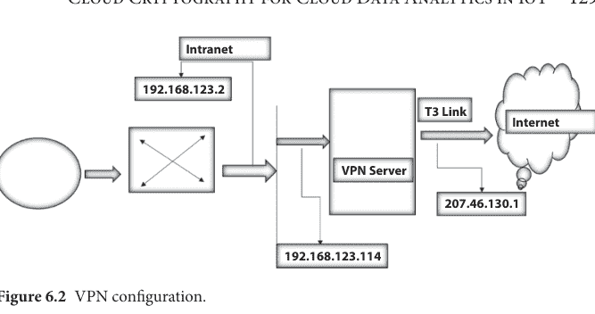

**图 6.2 VPN 配置。**

## 远程访问 VPN

可以设计 VPN 通过公开网络提供对业务资源的隐藏访问，以维护隐私和连续性。它允许较远的用户，无需推动客户端建立间隙，即可使用本地 ISP 通过本地 ISP 可访问网络上的任何内容，并拨打第三方的 800 电话。VPN 程序通过 ISP 邻域连接在客户拨号和网络上的业务 VPN 服务器之间建立虚拟私有关系。较远的 VPN 客户端链接在图 6.2 中发生 [21]。

## 网络对网络 VPN

两个系统，可能是更大的公司 LAN 和遥远办公室 LAN，通常通过网络与 VPN 相关联。该伙伴关系可以使用专用的互联网线路或无线拨号。然而，如果 VPN 服务器全天候可访问，则作为 VPN 服务器运行的业务中心交换机必须通过专用线程与当地 ISP 连接。VPN 计算机程序利用该连接在办公室交换机和业务中心网络交换机之间建立 VPN 隧道。在图 6.3 中，使用网络 VPN 隧道与基础公司办公室关联的部门机构似乎无法访问 [22]。

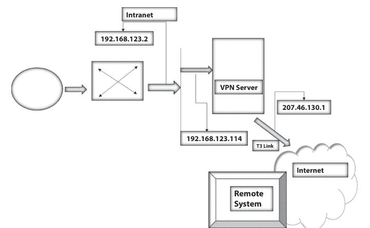

**图 6.3 远程访问 VPN 配置。**

## VPN 隧道

隧道可能是一种将一个实体传输到另一个组织信息的技术，并带有额外报头 [23]。额外报头提供方向信息，以便标准有效载荷可以访问中间网络，如图 6.4 所示。隧道客户端和隧道服务器必须使用相同的隧道系统来建立隧道。隧道技术的创新可能基于第 2 层惯例或第 3 层隧道惯例。这些层对应于开放系统互连（OSI）。类型例如。作为加密/解密隧道的替代方案以及 VPN 的使用是不被预期的。如果需要高安全标准，则应在 VPN 中使用最基础可能的加密，如图 6.5 所示，并且隧道应方便。

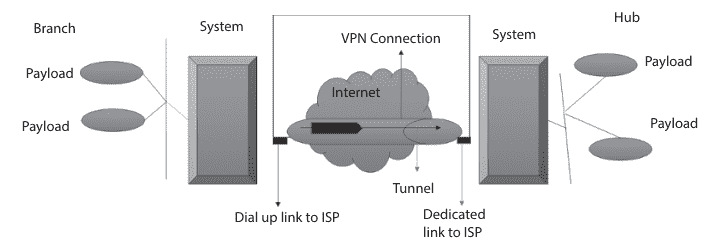

**图 6.4 网络对网络 VPN 配置。**

与 IP 报头相比，IPsec 以 IPsec 为特征，是一个著名的网络隧道协议。IPsec 在允许多个同时隧道的 OSI 参考面板组装层上运行。IPsec 提供了刮擦和验证 IP 信息的能力。包含 IPv6 标准，并作为当前 IPv4 的补充。您可以通过公司移动内部网或像互联网这样的自由 IP 互联网，在 IPsec 隧道模式下通过打字 IP 报头来破解和转换无线数据包 [24]。IPsec 认证报头（Ah）使用 ESP（ESP）功能来认证和评估源和一致性，而不进行加密。发送方和接收方都知道 IPsec 代码。

## 公钥基础设施和加密密钥管理

云可以交换信息以加密通信，跟踪与其他秘密恶意软件网络的连接，并使用和保留它。准备密码将用于将人员连接到公钥，以便进行安全密钥编码。证书颁发机构（CA）作为律师识别人员的身份并发放凭证，以确保已接受的申请人是公开可用的。凭证由合格个人用其私钥进行检查。因此，接收者在打开文件时作为发送者被识别。在所谓的加密资源（PKI）中，正在实施计算机化徽标和许可证以及其他电子商务机构 [25]。它们使电子交易易于跟踪、保密、秘密和否认。

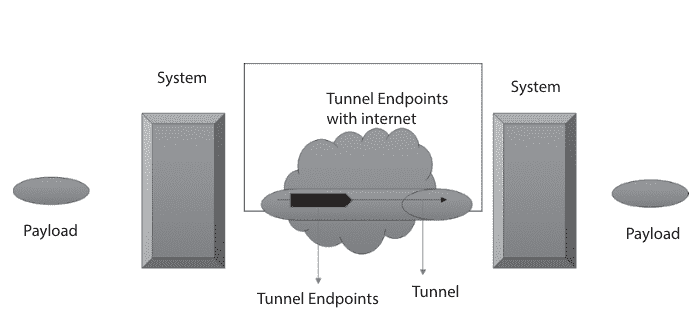

**图 6.5 一个 VPN 隧道和有效载荷。**


## 数字证书

公钥基础设施（PKI）的核心元素是数字证书和资格管理。请记住，专门设计的证书旨在表明个人的公钥——展示在清晰的“钥匙串”上——确实属于该个人，这一点在图 6.6 中有所说明。重要的第三方证书颁发机构（CA）保证该人员的姓名与公钥相匹配，并提供用于验证这一事实的证书。CA 通过仔细识别个人的公钥及关联信息来完成证书的签发。商店与 CA 之间的协议、许可证和吊销列表（CRL）应存储在仓库中。商店决定如何分配这些任务。在会议上，商店会与其他商店、CA 和客户会面。CA 持有 CRL 及其许可证。客户在某个阶段将使用这些材料 [26]。

## 密钥管理

与物理钥匙相同的安全措施被用于保护处理加密密钥时区域或变体的安全性 [27]。以下领域代表密钥管理的组成部分。

## 密钥分发

由于对称密码密钥难以传递，非对称密码系统将分发秘密密钥。另一种方式是将秘密密钥传递给个人会议、稳定的旗帜持有者，或通过其他安全的交换网络进行密钥交换。另一种选择是删除秘密密钥，并使用另一个秘密（即密钥加密密钥）向预期接收者提供一个被擦除的秘密主密钥 [28]。这些主要编码密钥可以物理分发，但无需经常分散。密钥还可以部分分割成不同的部分，每个部分可以通过单独的介质传输。在昂贵方案中的密钥分发可能导致实际问题，因为 N(N – 1)/2 是一个被称为多密钥公司的 N 人方案。为了控制主要传输问题，使用公钥密码学或开发和交易会话密钥，这对于会话及其长度是必需的。主要密钥可以通过使用旧密码生成新密码来更换。如果你可能需要拥有一个秘密密钥，爱丽丝和邦斯可以使用相同的变更过程（一种哈希算法）。

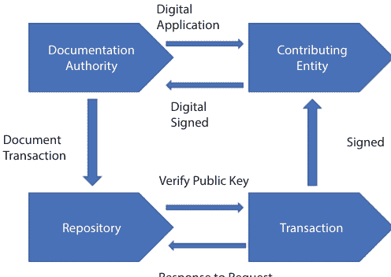

图 6.6 使用数字证书的交易。

## 多密钥

一个私钥总是对应多个公钥和远程密钥之间的匹配。密钥可以为不同的安全级别提供不同的大小。对于仔细标记的记录，可以使用较大的密钥计算量，而对于加密，可以使用较小的密钥指示器。个人还可能被要求使用独特的签名在不同部分或职责中签署消息。一个关键匹配可用于公司，另一个用于个人目的，还有另一个用于其他一些操作，例如作为校董会的一部分 [29]。

## 分布式与集中式密钥管理

CA 可以是集中式密钥权力机构。它可以是一个颁发证书并维护 CRL 的密钥区域。可选的密钥管理是分布式的，旨在熟悉客户之间建立“信任链”或“信誉网络”。他们可以假设每个公钥都是必要的，因为他们彼此了解。其中一些客户可以识别其他用户，并接受他们的公钥。从首次接触开始，链条会进一步延伸 [30]。这一过程发生在一个基于人们相互理解和尊重的松散验证系统中。

## 6.6 身份管理与访问控制

识别和访问是安全云评估的关键能力 [31]。带有客户端名称和密码的编程系统是管理角色的最佳方式。然而，实际的角色管理需要根据云计算的要求提供更高的安全性、识别和控制。它应概述产品特征，如生物识别或智能卡，这些可能被用户输入或使用，并决定已接收的非法内容。

## 身份管理

这种安全的识别是大多数控制框架的基础。识别是客户向数据库发送角色时的行为，通常以用户登录 ID 的形式呈现。客户对交错操作的责任由法律确立。用户 ID 应具有一定的类型，不应由显赫人士出售。在大型组织中，客户 ID 遵循类似的要求，例如在最终头衔后开始。ID 不应代表用户的职位或特征，以升级并减少入侵者可访问的数据量。认证确认个人的声明身份是真实的，通常通过利用客户的隐藏登录密码来执行。确认基于三种类型的数据。类别 1：例如，个人可识别的 PIN 码或秘密密钥。类别 2：拥有 ATM 卡或智能钱包。用于对比的某物 [32]。类别 3：有时，第四种元素用于这种重复（例如，独特的指纹识别或视网膜检查）。你做的事情可以归类为你手机上的名字或各种短语。双因素认证允许在验证过程中使用三种变量中的两种。

## 密码

密码必须受到保护，因为它们可能被滥用。在理想情况下，密码应像过去一样使用 [33]。这种“一次性密码”，或 OTP，非常安全，因为每个新连接都需要一个新的秘密词。一个秘密词对应于每个用户名，称为秘密无效词。动态密码是每次登录都会变化的密码。密码也可以从一个极端修改到另一个极端。根据需要验证的数据的关键性和密码执行的频率，密码可能需要每周、每年或基于其他基础进行修改。当然，密码使用得越频繁，被破解的可能性就越大。通常比给定秘密词的字数长的字符分配可能是口令。口令通过门转换为秘密计算机词。入站授权设备或后端评估设备可以针对所有这些建议执行测试，并支持不同的工作站或主机。各种设备，如按钮、存储卡和智能卡，可以提供密码。

## 令牌

令牌被用作提供密码的小型手持设备。下一种类的基本四种令牌类型将会到来：

- 令牌是标准的隐藏陈述。
- 通过编写晦涩的秘密短语，所有者验证令牌。
- 如果秘密短语正确，令牌将证明所有者拥有数据框架。

基于时钟的令牌，一种同步动态隐藏表达式，创建一个额外的、罕见的、固定的时间奖励（这与有效性服务器上的类似秘密词相关（此密钥是一个隐藏棒周期））。一个神秘的秘密密钥安装在工作站中，与所有者的锁一起。工作集或框架中的数据搜索识别所有者的神秘密钥和锁，并且段验证输入的秘密密钥是合法的，并且它安装在时间窗口内。

## 异步令牌，挑战-反应

- 一个异常的测试字符串从工作站或系统到达，连同最强的 PIN，所有者将字符串输入到令牌中。
- 令牌基于使用 PIN 的字符串进行计数，产生一个答案识别，然后放入工作站或系统中。
- 工作站或框架上的认证方法提供了与令牌等同的评估，该令牌使用用户的 PIN，并验证所有者输入的性能和有效性。

## 存储卡

存储卡提供非易失性数据容量，但它们没有就绪状态。滚动密码和其他关联信息存储在独特的记忆卡中。存储卡图像是蜂窝电话卡和 ATM 卡。

## 智能卡

智能卡使持有卡比存储卡更有效率。电池和芯片存储在信用卡设施中，并用于保存数字化数字、私钥、密码和其他个人信息。


## 生物特征识别

生物特征识别是一种替代方案，可采用更精确或更复杂的方式对代码进行验证。生物特征识别强调的是搜索因子 3——你本身即特征。生物特征识别被定义为一种机器人装置，用于指示或评估活人的生理或行为特征的差异。生物特征识别中的身份可以是对一系列丢失图像中个人特征的一对一比对。评估可以是验证个人身份声明的一次尝试 [34]。生物特征识别用于在物理检查中识别证据，并在可靠测试中对其进行验证。

- 生物特征识别中有三个基本执行指标：
  - 假拒识率（FRR）或 I 类错误——有效主题被错误拒绝的比例。
  - 假识别率（FAR）或 II 类错误——无效对象被错误识别的比例。
  - CER——FRR 增加至 FAR 的点。CER 越大，设备效率越高。

此外，必须测试包括注册期、吞吐量率和可靠性在内的额外变量，以提高生物特征识别系统的准确性。注册期是首先通过检查生物特征来与系统注册所需的时间。大约为 2 分钟，直至入口点。为说明需要，真值标记提供了独特的指纹帧，每指高质量照片最高可达 250 KB。如果在法医应用下寻找异常庞大的数据库，此数据级别是足够的。指印扫描的创新中不得省略绝对特殊标记，或者由该独特指纹导出的特征应以小格式处理，需要约 500 到 1,000 字节的存储空间。可能需要注册数据服务，因为某些生物特征，如语音和签名，会随时间变化。输出速率是系统定义并分离或识别个人的速率 [35–38]。

宝贵的吞吐量率是每减少 10 个主体的区域。可接受性是指在使用框架时的保护、易用性以及身体和心理上的安心感。在某些情况下，牡蛎中体液的交换可能是眼部过滤系统的问题。在作为语料库暗示的区域内，组装的生物特征照片是不完整的。收集未包含在图像数据库中。潜在的混乱来源包括图像的混淆和错误标记以及与图像数据库相关的其他身份问题。同样，图像分组的过程和意图应带有坚持不懈的控制焦点进行 [39]。这些图像是在入学计划的背景下拍摄的，对于这些区域中生物特征收缩的正确运动至关重要。

## 6.7 自主安全

自主计算指的是一个自管理软件系列，其中计算机结构被重新配置并自我修复。完全实现自动计算需要数年时间，但它提供了可以改善特定数据系统和云存储安全性的技术。自主系统收集和数据解释数据以及建议或更新协议的能力，有助于提高安全性和从危险事故中恢复 [40]。

## 自主系统

自主系统专注于一个独立的、自主的、自管理的神经系统，它跟踪身体的变化并保持内部平衡。因此，考虑到网络的困扰，自主计算机系统尝试自我维持以维持补救操作。此类系统需要具备提供直接支持、决策技能和治疗练习的能力，并创建一个和谐的正常运行环境。需要单独处理的场合示例包括以下各项：

- 恶性爆发
- 硬件或软件的故障
- CPU 的极端使用
- 影响力的欺骗
- 管理法规
- 人员的不希望故障
- 与其他结构的通信
- 学习应用程序

自我管理是自主系统的基本定义，通过它编程系统在面对外部和内部变化的条件时保证一致的角色，确定修订的需要，执行程序，执行重复测试，执行中等产品，并识别和覆盖一般问题的情形。

## 自主保护

自主自我保护包括对有害状态的认知以及缓解该状态的操作。这些程序结构还应建立起来，以预测有形数据生产中的问题并采取纠正措施。独立安全解决方案框架基于组织知识、相关资源能力、数据积累、场景复杂度以及对相关程序的影响。自主计算特征，如更改必要认证的质量或更新加密密钥的决策，将考虑到当前的安全状况和系统的安全环境。安全环境基于从网络或系统管理模块获得的数据，然后提取以提供请求安全位置的更高表示。自主系统中常被低估的概念是配置更改，此外，旨在解决其他计算领域的独立实验可能会产生安全漏洞。

## 自主自我修复

IT 系统处理和恢复的方式可能会有问题，可能耗时，通常需要大量努力。自主自我修复系统可以在没有人工干预和识别系统缺陷的情况下区分和修复软件问题。云描述了五个基本特征、三种模型优势和四种模型组合。正如轮询所述，五个关键特征如下：

- 按需自助服务
- 通用网络访问
- 预留挂载
- 位置个性化
- 快速动力
- 低效实施

模板套件如下：

- 软件即服务（SaaS）——已通过网络查询完成客户请求。
- 平台即服务（PaaS）——组织客户云请求。
- 基础设施即服务（IaaS）——交付费用、数据、网络容量和其他主要计算功能。

独立管理将记录和跟踪数据并评估问题领域。这种方法有时由独立领导者指导，该领导者通过支持症状和缓解活动以及具有良好定义的界面来管理资产组件的计算。受控组件控制其内部状态，并具有与其他计算机组件确定的性能特征和关系。自我修复治疗的目标是确保组件满足其程序的要求。

## 6.8 结论

云计算安全可以是云计算机系统的关键组成部分。云使用的可靠性取决于可靠的计算机工具、良好的字符管理和控制方法，使执行安全。本章侧重于云系统的数据认证，该系统依赖于传统概念（隐私、连通性和知识），并在地域、物理和动态上实施。本质上稳定的程序计划和执行要求提供最小的益处、债券交易、深入保护、保护和开放设计。使用计算机程序要求进行计算机设计、调度参数、代码磨练、安全执行和衰减方法以及安全软件测试对于安全云程序也很重要。渗透测试、功能测试、运行测试和漏洞测试是成本效益高的软件类型。使用云服务的主要问题是企业云服务器应用和信息的可用性。它为云提供了可靠的源框架。在线资源可能是建立云信任系统的重要要求。域构建需要可靠的自管理管理员，他们可以有效地处理云用户资源，无需任何人为参与。

# 参考文献

1. 《云计算重点领域安全指南》V3.0，177 页，2011 年 (http://www.cloudsecurityalliance.org/guidance/csguide.pdf)。
2. 信息保证技术分析中心 (IATAC)，信息保证技术分析中心 弗吉尼亚州 Falls Church，2007 年 7 月 31 日。
3. Komoroff, M. 和 Baldwin, K., 美国国防软件保证计划。软件安全保证：现状报告 (sar)。信息保证技术分析中心 (IATAC) 弗吉尼亚州 Herndon。2005 年 9 月 13 日，(https://acc.dau.mil/CommunityBrowser.aspx?id=25749)。


4. Goertzel, K., Winograd, T. 等人，*增强开发生命周期以产生安全软件*，草稿版本 2.0，美国国防部软件数据与分析中心，纽约州罗马市，2008年7月。

5. Saltzer, J.H. 和 Schroeder, M.D., *计算机系统中的信息保护*。第四届 ACM 操作系统原理研讨会，1974年10月。

6. Davis, F. F., *信息系统安全工程：系统开发生命周期的关键组成部分*。ACM SIGAda Ada Letters, 24, 4, 13–18, 2004。

7. Goertzel, K., Winograd, T. 等人，*增强开发生命周期以产生安全软件*，第1卷，第 i–iv 页，美国国防部，2008。

8. van Lamsweerde, A., Brohez, S., De Landtsheer, R., Janssens, D., *从系统目标到入侵者反目标：安全需求工程中的攻击生成与消解*，载：*高保障需求研讨会论文集*，蒙特雷湾，加利福尼亚州，2003年9月8日，第 49–56 页。

9. 美国注册会计师协会 (AICPA), *对内部使用开发或获得的计算机软件成本进行会计核算*，AICPA 立场声明 (SOP) 第 98-1 号，*计算机软件对商业实践和标准的演变*。法律、伦理和监管问题学会，19，1998年3月，www.aicpa.org。

10. ISACA, *信息系统审计与控制协会关于尽职专业关怀的信息系统审计指南*，2008年3月1日。Mangla, M., Akhare, R., Ambarkar, S., *基于物联网生态系统的上下文感知自动化节能技术*，载：*物联网设备节能*，第 129–153 页，Springer，新加坡，2019。

11. Akhare, R., Mangla, M., Deokar, S., Wadhwa, V., *提议用于改进物联网应用服务质量 (QoS) 的雾计算框架*，载：*物联网应用的雾数据分析*，第 123–143 页，Springer，新加坡，2020。

12. Deokar, S., Mangla, M., Akhare, R., *用于连续健康监测的安全雾计算架构*，载：*4.0 环境下的医疗雾计算*，第 269–290 页，Springer，查姆，2021。

13. Potluri, S., *云计算中基于服务质量 (QoS) 的任务调度算法*。国际电气与计算机工程杂志 (Int. J. Electr. Comput. Eng.), 7, 2, 1088–1095, 2017年4月。

14. Potluri, S., *使用工具包 Clouds 的云计算中高效混合 QoS 驱动任务调度算法*。IJRDCS, 12-特刊, 1270–1283, 2017。

15. Potluri, S., *云基础设计与制造技术的研究*。IJMPERD, 8, 6, 187–192, 2018。

16. Potluri, S., *谷歌云平台中的容器软件虚拟化*。IJITEE, 8, 7, 2430–2432, 2019年5月。

17. Potluri, S., *云环境中相互依赖和独立任务基于 QoS 的任务调度策略仿真*，载：*智能智能计算与应用*，第159卷，第 515–525 页，2019年5月。

18. Potluri, S., *制造过程自动化中基于服务质量 (QoS) 的云端模型*，载：*网络与系统讲习指南*，第32卷，第 231–240 页，2019。

19. Potluri, S., *云计算环境中基于 QoS 任务调度的优化模型*。IJECS, 18, 2, 1081–1088, 2020。

20. Potluri, S., *使用雾计算的物联网使能的云基础医疗系统：一个案例研究*。J. Crit. Rev., 7, 6, 1068–1072, 2020。

21. Potluri, S., *改进基于服务质量 (QoS) 的云服务排名和推荐模型*。TELKOMNIKA 电信、计算、电子与控制，18, 3, 1252–1258, 2020年6月，经 Kementristekdikti 认证为第一级，法令编号：21/E/KPT/2018。

22. Potluri, S., *用于云数据的混合 PSO 任务选择和推荐系统*。测试工程与管理 (Test Eng. Manage.), 83, 10210–10217, 2020年3月–4月。

23. Potluri, S., *用于云服务数据的混合自适应 PSO 和基于 QoS 的机器学习模型*。测试工程与管理 (Test Eng. Manage.), 83, 23736–23748, 2020年5月–6月。

24. Le, D.N., Kumar, R., Nguyen, G.N., Chatterjee, J.M., *云计算与虚拟化*，John Wiley & Sons，印度，2018。

25. Jha, S., Kumar, R., Chatterjee, J.M., Khari, M., *计算互联网与物联网之间协同握手方法迈向智慧世界：2009–2017年综述*。电信系统 (Telecommun. Syst.), 70, 4, 617–634, 2019。

26. Chatterjee, J.M., Kumar, R., Khari, M., Hung, D.T., Le, D.N., *基于物联网的智慧厨房系统*。国际工程与制造杂志 (Int. J. Eng. Manuf.), 8, 4, 29, 2018。

27. Sujath, R., Chatterjee, J.M., Hassanien, A.E., *印度 COVID-19 大流行的机器学习预测模型*。随机环境研究与风险评估 (Stochastic Environ. Res. Risk Assess.), 1, 34, 2020。

28. Chatterjee, J., *使用机器学习方法的物联网大数据框架*。国际机器学习与网络化协作工程杂志 (Int. J. Mach. Learn. Networked Collab. Eng.), 2, 02, 75–85, 2018。

29. Moy Chatterjee, J., *雾计算：云计算新时代的开端*。国际工程技术研究杂志 (Int. Res. J. Eng. Technol. (IRJET)), 4, 05, 735, 2017。

30. Iwendi, C., Bashir, A.K., Peshkar, A., Sujatha, R., Chatterjee, J.M., Pasupuleti, S., Jo, O., *使用增强随机森林算法预测 COVID-19 患者健康*。公共健康前沿 (Front. Public Health), 8, 357, 2020。

31. Kumar, A., Chatterjee, J.M., Diaz, V.G., *一种新颖的混合方法：结合支持向量机 (SVM)、自然语言处理 (NLP) 和概率神经网络用于电子邮件钓鱼检测*。国际电气与计算机工程杂志 (Int. J. Electr. Comput. Eng.), 10, 1, 486, 2020。

32. Chatterjee, J.M., Priyadarshini, I., Le, D.N., *雾计算及其安全问题*，载：*云、物联网和社会网络的安全设计*，第 59–76 页，2019。

33. Choudhri, A., Chatterjee, J.M., Garg, S., *医疗保健中的物联网：简要概述*，载：*生物医学工程中的物联网*，第 131–160 页，学术出版社，印度，2019。

34. Chatterjee, J.M., *使用机器学习的生物信息学*。全球互联网与融合交互杂志 (Global J. Internet Interw. Fusion), 1, 1, 28–35, 2018。

35. Shri, M.L., Devi, E.G., Balusamy, B., Chatterjee, J.M., *物联网应用中的基于本体论的信息检索与匹配*，载：*人工智能中的自然语言处理*，第 113–130 页，Apple Academic Press，印度，2020。

36. Radhakrishnan, S., Lakshminarayanan, A.S., Chatterjee, J.M., Hemanth, D.J., *使用支持向量机和决策树的森林数据可视化和土地测绘*。*地球科学信息 (Earth Sci. Inf.)*，1–19, 2020。

37. Jain, V. 和 Chatterjee, J.M. (编著)，*医疗视角的机器学习：机器学习与医疗保健*，第13卷，Springer Nature，印度，2020。

38. Chatterjee, J.M., *使用统计神经网络模型预测印度 COVID-19 死亡率*。*公共健康前沿 (Front. Public Health)*，8, 441, 2020。

39. Kumar, A., Payal, M., Dixit, P., Chatterjee, J.M., *通过物联网 (IoT) 实现绿色智慧城市框架*，载：*基于云的物联网趋势*，第 85–111 页，Springer，查姆，2020。

40. Sujatha, R., Nathiya, S., Chatterjee, J.M., *使用物联网数据分析平台的临床数据分析*，载：*医疗保健行业的物联网用例*，第 271–293 页，Springer，查姆，2020。

# 云计算中经典密码学的问题与挑战

Amrutanshu Panigrahi $^{1*}$, Ajit Kumar Nayak $^{2}$ and Rourab Paul $^{1}$

$^{1}$ 印度布巴内斯瓦尔 S'OA 大学 I.T.E.R. 计算机科学与工程专业

$^{2}$ 印度布巴内斯瓦尔 S'OA 大学 I.T.E.R. 计算机科学与工程与信息技术专业

### 摘要

云计算如今因其提供可扩展且按需的资源访问而吸引了不同用户的注意。由于大量用户可以同时访问各种云资源，因此云环境中存在的每个用户都会面临威胁。随着云计算的兴起，安全成为首要关切。密码学在维护不同用户之间共享信息的基本属性（如保密性、完整性和可用性，即 CIA）方面发挥着关键作用。传统密码学提供了一种用户之间安全的信息交换方式。数据可以通过使用某种密钥共享，该密钥用于在发送方加密数据，并在接收方解密数据。在传统密码学中，在云数据上执行的任何操作都需要解密过程，这会在云平台中暴露机密数据。这些问题由同态加密 (HE) 技术解决。该技术使云用户能够直接在加密数据上执行操作，例如更新和排序。部分同态加密 (PHE) 和完全同态加密 (FHE) 是 HE 的两种可用变体，用于克服传统密码学系统的问题。本研究基于不同的传统密码学和 HE 技术，以及实施期间面临的问题和挑战。在本文中，RSA 算法作为 HE 进行实施。此外，作者试图通过实施同态 RSA 来降低 RSA 算法的时间复杂度。

*关键词：* 密码学，同态加密，RSA，PHE，FHE

*$^{*}$ 通讯作者：amrutansup89@gmail.com*


## 7.1 引言

云计算是当今发展最快的技术之一，正如云服务提供商所证实的那样，例如亚马逊的 S3 和 EC2 [1]、微软 Azure [2] 以及 Rackspace [3]。这并不令人意外，因为分布式计算允许整合无数的虚拟资源（例如，处理能力和存储），以增强（整合后）资源的可行性和效用。云用户可以通过 Web 连接（即按需服务）全天候访问这些资源，并采用按使用量付费的计划。如今的云计算吸引了不同用户的关注，因为它提供了可扩展的按需资源访问。许多用户因其可扩展的行为而对云计算感兴趣。它基于按需原则向用户提供 [4] 服务。云计算的亮点如下。

- 增强的网络访问：利用这一特性，云服务提供商实现了通用性属性。通过此方式，用户无论身处何地，都可以访问和存储云端的数据。在提供此类属性的同时，管理员维护着从云端获取资源的延迟和访问时间 [1]。
- 资源池化：云的多租户架构特性使多个用户可以同时使用。来自用户端的负载从专用硬件和软件中提取，并提交给不同的虚拟机（VM），以平衡每个处理器上的负载。云服务提供商依赖特定的硬件来维护云资源的安全性 [5]。
- 灵活性和可扩展性：传统架构不支持扩展，但云的资源池化特性具有动态扩展存储容量的灵活性，这有助于避免来自多租户用户的瓶颈问题 [3–5]。
- 位置无关性和稳健性：云服务提供商利用各种技术来避免停机，例如在不同区域运行时优化访问时间。用户可以随时从云端存储和检索数据，而无需关心其所属位置。此特性使服务更加高效。除上述功能外，云服务不易受到单点故障的影响，因为它利用不同地理区域的多个虚拟机和处理器来为从各个数据中心收集的不同用户请求提供服务 [5]。
- 按需服务：诸如 Amazon AWS 和 Azure 等知名云服务提供商使得终端用户可以一键访问资源。云计算的这一特性增强了云的按需容量，从而使该平台成为客户的自助服务平台。但为此，管理员会对访问施加某些限制，以提供某种程度的云资源安全 [6]。
- 安全性：这是云计算最重要的特性。由于大量用户正在访问云资源，信息存在脆弱性的风险。因此，云服务提供商使用加密机制在公共云中安全地存储和操作数据。

### 7.1.1 问题陈述与动机

云存储存在许多漏洞，使得 CIA（机密性、可用性和完整性）属性难以维持。云框架的信息安全严重依赖云服务提供商及其应用的安全机制，但仍需制定策略来筛查漏洞并保护数据和资源 [7]。

经典密码学和同态密码学是维持信息安全的两种流行方法。在经典密码学中，有多种方法可用于保护信息的 CIA。其实现非常容易，但存在若干缺点，增加了研究人员实现时的难度。经典密码学的优点包括对专用硬件的需求较少。但在通信和数据串接过程中，秘密密钥的使用起着至关重要的作用。密钥的大小有时非常大，这也增加了时间方面的计算复杂性。该方法的另一个缺点是，每次用户想要对现有数据进行修改时，都必须检索并解密数据。只有在解密后，才能应用修改。因此，在修改过程中，攻击者可以访问数据并滥用这些数据，导致无法维持 CIA 属性。由于这一最大缺点，研究人员和云服务提供商正在关注同态密码学。这些问题通过同态加密（HE）技术得到解决。该技术允许云用户对加密数据本身进行操作，如更新、排序等。部分同态加密（PHE）和全同态加密（FHE）是克服传统密码系统问题的两种可用变体。

这项研究基于不同的传统密码学和 HE 技术以及实施过程中面临的问题和挑战。在本文中，RSA 算法作为经典密码学技术以及同态技术进行实现。此外，作者试图通过实现同态 RSA 来降低 RSA 算法在执行加密和解密时的时间复杂性。

### 7.1.2 贡献

- 分析可用的经典安全措施，并考虑不同参数分析其在云计算环境中应用时的性能，指出在将这些措施用于在云环境中存储数据时发现的不完善之处。
- 确定和分析当前云计算环境中的关注点、漏洞和威胁，进而找出针对现有问题的可行解决方案。
- 实现同态 RSA 和传统 RSA 密码系统，作为解决云计算提出问题的方案，并衡量这些协议的性能。

## 7.2 密码学

在这个技术已渗透生活各个角落的现代世界中，信息安全在有效存储数据时变得至关重要。信息隐私涉及对寻求保护的信息进行受控访问。有三个被用作安全方面的关键因素，对于确保数据安全至关重要，即机密性、完整性和可用性。密码学是一种隐藏数据的方法，其目的是使其仅对数据的真实接收者可用，而其他闯入者无法访问；密码系统就是处理数据加密和解密的框架 [7, 8]。与现在不同，以前的密码学主要与加密相关，这主要用于数据加密。传统的加密策略会在信息传输到接收端的过程中保护信息，但在数据计算进行时则不然。该策略包括在计算过程中保护数据，这成为采用传统方法保护数据的主要缺点 [9]。同态加密是此类加密的一种，其中原始明文或信息不被暴露，且可以在密文上执行主观计算。

### 7.2.1 密码学分类

密码学机制被分为两组，即经典密码学和同态密码学。这两种密码学机制具有不同的数据保护方法，但并不注重降低加密和解密过程的计算复杂性。这些策略完全依赖于用于加密和解密的密钥。计算时间取决于密钥大小和消息大小。随着密钥和消息大小的增加。尽管如此，这些方法如今被视为解决云计算中数据威胁的解决方案。图 7.1 展示了密码学机制的详细分类。

#### 7.2.1.1 经典密码学

在经典密码学中，密钥用作基本参数。通过使用该参数，发送方和接收方解释数据。在此技术中，在发送数据之前，必须使用一个或多个称为密文的关键将其转换为加密格式。然后，


**图 7.1** 密码学分类。


## 7.2.1.1.1 哈希加密
在这种加密方式中，通常使用一个 CHF 或**密码哈希函数**来生成消息摘要，该摘要也被称为**密文**。该消息摘要随后用于进一步的通信。一旦消息被转换为摘要，实际上就不可能从摘要中恢复**明文**。有多种流行的哈希技术，如 MD4、MD5、SHA-1 和 SHA-2，可用于从明文生成消息摘要 [31]。

## 7.2.1.1.2 对称密钥加密
在这种加密中，**明文**通过使用在发送方和接收方之间共享的密钥转换为**密文**，以便解密该密文。在加密和解密过程中使用相同的密钥，该密钥在共享密文之前与预期接收方共享。AES、DES、三重 DES、Blowfish 和 RC4 等少数流行技术被用作对称密钥加密方法。该机制的主要特点如下 [29]：

- 由于密钥尺寸小，处理过程更快。
- 加密和解密过程需要生成的密钥数量较少。
- 处理器的功耗较低。

在将经典加密作为解决方案时面临的主要挑战描述如下。

- 密钥交换：在开始通信之前，客户端和服务器之间必须交换密钥，这需要安全的密钥协商策略。
- 信任：由于相同的密钥用于加密和解密，因此发送方和接收方必须相互信任，否则通信过程无法实现。

## 7.2.1.1.3 非对称密钥加密
在通信过程中将使用两个不同的密钥，即**私钥**和**公钥**。公钥用于加密数据，而秘密密钥用于解密数据。在开始通信过程之前，私钥仅与接收方交换。加密数据后，公钥会在网络中可用，以便将攻击者分散，使其无法访问仅负责解密消息的私钥。RSA、Paillier 和 Elgamal 等各种可用技术被用于公钥加密。该机制的特点如下 [8]：

- 加密和解密过程使用不同的密钥。
- 功耗较高。
- 公钥的使用阻止了攻击者从密文中恢复明文。

## 7.2.1.2 同态加密
为了克服对称密钥和非对称密钥加密的局限性，开发了同态加密技术。该技术允许用户在将数据存储在云端后对加密文本进行操作。这种 HE 技术也可以被称为处理现代安全机制时的关键概念。根据 HE 技术的定义，如果用户拥有消息 M，则只需应用可用技术来获取密文 C。生成 C 后，用户只能对 C 执行更新，如加法、乘法、删除等。它可以进一步分为三个子类，即部分同态加密 (PHE)、有限同态加密 (SWHE) 和全同态加密 (FHE) [31, 32]。

### 7.2.1.2.1 部分同态加密
这种 HE 技术仅允许用户执行一种操作，即加法或乘法运算。现有的技术 RSA 被称为乘性 PHE，而 Paillier 被称为加性 PHE。

### 7.2.1.2.2 有限同态加密
这种同态技术允许无限制地执行一种操作，但第二种操作受到限制。如果 SWHE 允许多次加法操作，则支持有限次数的乘法操作，反之亦然。

### 7.2.1.2.3 全同态加密
FHE 与 PHE 和 SWHE 的区别在于，它支持大量的乘法和加法运算。通常，FHE 执行多次加法和乘法运算。DGHV 和 BGV 是两种著名的可用 FHE 技术。

## 7.3 云计算中的安全
云安全，也称为云计算安全，包括保护计算资产（如软件、硬件和数据）免受内部和外部安全攻击的方法和技巧。由于多租户架构，多个客户端同时操作以存储或对存储的数据执行某种操作。如果资产未受到保护，则可以实现 CIA 特性。云资产的安全性将依赖于提供第 7.2 节中讨论的加密方法的 ServiceProvider。对于转向云的组织而言，严格的云安全是基础。威胁不断演进并变得更加现代化，云计算面临风险。因此，与提供针对框架调整的最高级别安全的云提供商合作是基础。云计算安全取决于所使用的云服务类型。根据云服务，存在四种不同的安全流程，如下所示：

- 公有云的安全性由公有云服务提供商控制。
- 私有云的安全性由公共服务提供商控制。
- 私有云服务的特性由特定管理员控制。
- 混合云服务的特性

## 7.3.1 云计算对安全的需求
随着云计算的出现，安全成为主要关注点 [3]。在云计算中，同时有多个用户访问云资源，这将间接影响。加密在维护不同用户之间共享信息的基本属性（如 CIA）方面起着关键作用。CIA 代表机密性、完整性和可用性。

- **机密性**：它指的是为存储在服务器端的云客户端信息提供的安全性。为了机
密性，服务器使用两种基本功能，即加密和解密。加密是将原始数据隐藏在可读格式中称为密文的过程。每当客户想要对存储的信息执行某些操作时，它必须解开信息，这称为解密。服务器通过使用某些密钥实现这两个过程。根据使用的密钥，加密过程分为两组：对称密钥和非对称密钥加密。在对称方法中，使用单个密钥用于加密和解密过程。而在非对称密钥中，公钥用于加密过程，私钥用于解密过程。因此，服务提供商将使用各种可用技术来实现公有云中的机密性 [6]。

- **完整性**：完整性是保持存储信息一致性的过程。一旦信息从客户端存储在服务器端，在所需时间提供正确信息就成为服务提供商的全部责任。只有在防止未经授权的攻击保护数据的情况下，服务提供商才能实现这一点。这是云计算最重要的特性，因为客户端存储的信息在传输过程中必须保持不变。有一些技术可用于检查数据的原始性。最常见的过程是使用哈希技术。通过这种方法，最初会向客户端提供一个哈希值。在所需时间检索数据后，客户端需要检查该哈希值。


如果哈希值发生了变化，则数据已被篡改；否则，数据是安全且未被修改的[6]。

-   可用性：可用性是指在正确的时间获取正确的信息的过程。这一特性允许云客户端将信息和数据存储在服务器上，以便在需要时进行访问。一旦数据存储在服务器端，云服务提供商便确保客户端能够在需要时获取正确且未被修改的信息。这可以通过两种不同的过程来实现，即授权（authorization）和身份验证（authentication）。身份验证是验证用户身份的过程，而授权是赋予客户端适当访问权限的过程。身份验证可进一步分为两类：单向身份验证和双向身份验证。在单向身份验证中，客户端必须提供凭据，服务提供商据此识别其身份；双向身份验证则实现了客户端与服务提供商之间的双向通信。在成功提交客户端凭据后，服务器将发送一次性密码（OTP）以确认实际希望访问存储资源的客户端身份[6]。

## 7.3.2 云计算安全面临的挑战

由于数据是由第三方存储在云中的，因此在处理云资产时存在威胁的可能性。云计算的多租户架构存在许多挑战，讨论如下。

-   数据可见性：客户端可以从任何地方和任何类型的设备访问数据。因此，在计算环境中存在大量多样化设备的情况下，监控流量是最具挑战性的。
-   数据控制：当组织将其数据存储在云中时，它会借助第三方云服务提供商。因此，组织管理员对存储在云服务器中的数据拥有较少的控制权。
-   数据泄露：在处理公共云时，始终存在数据被盗的风险。本地泄露是指第三方为攻击存储数据而采取的一系列行动。

数据泄露会导致配置错误，从而阻碍云服务提供商维护信息安全中CIA属性。

-   数据恢复：如果存储的数据丢失，服务提供商必须维持完善的恢复策略，以确保组织能够正常开展业务活动。

## 7.3.3 云计算安全的优势

云安全在将完整数据集存储在云中的组织中发挥着重要作用。以下特性使安全成为每个客户端的吸引点。

-   DDoS攻击防护：分布式拒绝服务攻击是在处理云存储时的主要问题。安全解决方案致力于避免大量威胁组织数据集的流量。定期监控流量可降低对存储数据集的DDoS攻击程度。
-   数据安全：由于多租户架构的存在，多个客户端可以同时进行计算。安全模型实施一些协议，在交易和存储过程中对数据进行加密。
-   定期合规：顶级安全模型通过更换密钥定期更新安全机制，以消除密钥被劫持的可能性。如果密钥不受漏洞影响，则客户端数据和资产将是安全的。
-   灵活性：如同态加密等技术通过允许用户操作加密数据来提高灵活性。对于任何类型的操作，客户端只需解密数据即可降低计算过程中数据丢失的风险。
-   可用性和支持：适当的安全机制的存在确保了客户端随时随处都可访问数据和资产。在存储和计算过程中，安全机制完全监控整个过程，以防止任何类型的数据泄露发生在资产上。一旦检测到任何类型的威胁，服务器将迁移数据以保护数据安全。

## 7.3.4 文献综述

本节简要综述了不同的加密模型及其发现与关键参数。表7.1展示了现有不同加密模型的详细研究。

### 表 7.1 比较性文献综述。

| 论文 | 方法论 | 结果或发现 | 使用的参数 |
| :--- | :--- | :--- | :--- |
| [9] | 实验工作 | 基于身份的密码学，消除了传统公钥基础设施（PKI）框架中的混淆声明板。 | 用户与服务提供商之间的密钥大小和证书交换。 |
| [10] | 实验工作 | 一种同态密码系统 | 明文和密文公钥 |
| [11] | 基于模型的工作 | 用于防止安全攻击的IBTE模型 | 授权概念 |
| [12] | 实验工作及对各种可用模型的综述 | 用于高效存储客户端信息的 securely 云存储协议（SCSP） | 云强度及DDoS攻击 |
| [13] | 基于模型的工作 | 一种防止攻击的云计算数据挖掘框架 | 公钥和私钥 |
| [14] | 基于模型的工作 | 一种绿色云网络，将减少服务器开销和存储在云中的数据成本 | 访问时间以及存储数据的成本 |

| 论文 | 方法论 | 结果或发现 | 使用的参数 |
| :--- | :--- | :--- | :--- |
| [15] | 综述工作 | 关于不同领域现有同态密码学的综述 | 信息的同态加密 |
| [16] | 实验工作 | 一种密文方法，基于属性的加密，以实现获取权限和共享访问权限的适应性指定，同时兼具灵活性和细粒度访问控制 | 公钥和私钥，通信过程中的证书交换 |
| [17] | 基于模型的工作以及将开发的模型与现有模型进行比较的综述工作 | 一个ABE过程，将加快加密过程。 | 作为属性的明文和密文 |
| [18] | 综述工作 | 不同的HE算法及其在云计算环境中的应用 | 使用不同算法对信息进行HE |
| [19] | 回顾工作 | 用于审查在各类研究文章中开展和检索的工作的PRISMA清单和CQA方法 | 同态特性 |
| [20] | 实验工作。 | 使用同态密码系统处理来自客户端的反馈。 | FPGA |

| 论文 | 方法论 | 结果或发现 | 使用的参数 |
| :--- | :--- | :--- | :--- |
| [21] | 基于模型的工作 | 一种防止重复以提供强隐私保护的云存储审计方案 | 云存储 |
| [22] | 基于模型的工作 | 一个针对公共云中数据存储隐私与效率之间不同差距的DTT系统 | 云存储 |
| [23] | 基于综述的工作 | 同态加密特性的详细结构，用于在云环境中实施 | 全同态加密和部分同态加密 |
| [24] | 实验工作。 | 使用同态密码系统加密数据的无损模型 | 加密数据时的失真因子。 |
| [25] | 综述工作 | 关于Paillier算法同态特性的详细研究 | 全HE和部分HE特性 |
| [26] | 基于模型的工作 | 一种在云中存储图像数据的安全模型 | 云存储，图像，FHE，PHE |
| [27] | 基于模型的工作 | 一种以加密格式在公共云中存储视频的安全模型 | 全同态加密和部分同态加密视频数据 |


## 7.4 云计算中的经典密码学

在本节中，对现有的经典密码学机制（如 RSA、AES、DES 和 Blowfish）进行了详细研究。

## 7.4.1 RSA

RSA 是一种非对称密钥密码学，在加密过程中使用公钥，在解密过程中使用私钥。它包含三个不同的阶段，分别是密钥生成阶段、加密阶段和解密阶段 [35]。

密钥生成

- 1. 选择两个素数 P 和 Q
- 2. 计算 $N = P \times Q$
- 3. 计算 $\varphi\left(N\right) = (P - 1) \times (Q - 1)$
- 4. 选择 e，使得 $gcd(\varphi\left(N\right), e) = 1$
- 5. 计算 $d = e^{-1}\, mod\, \varphi\left(N\right)$
- 6. 选择 e 作为公钥，d 作为私钥

加密过程
设 M 为需要存储的明文，C 为计算得出的密文。则 C 可以通过以下方式计算：

- 1. $C = M^{e}\, mod\, N$

解密过程
可以通过以下方式从密文 C 中恢复明文 M：

- 1. $M = C^{d}\, mod\, N$

## 7.4.2 AES

AES 作用于 128 位数据块，采用三种不同的密钥长度，分别为 128、192 和 256 位 [32, 33]。它有四个不同的阶段，如下所示：

- 替代字节（Substitution Byte）：明文的每一位被 8 位 S 盒中的替代位所替换。
- 行移位（Shift Row）：该操作以行为单位进行。每一行的元素通过特定的偏移量进行乱序。第一行保持不变，第二行的元素向左移位 1 位，第三行的元素向左移位 2 位，同理，第四行的元素向左移位 3 位。
- 列混合（Mix Column）：在此阶段，每一列通过线性函数映射以重构一个新的输入矩阵。
- 轮密钥加（Add Round Key）：在此步骤中，将子密钥与输入矩阵进行异或运算以获得密文。

在加密过程中，上述过程按顺序执行；但在解密过程中，上述过程按相反顺序执行。

## 7.4.3 DES

它利用了 16 轮 Feistel 密码结构，输入明文大小为 64 位。它将整个明文分为两个相等的块，每块为 32 位。对于加密过程，它使用了一个轮密钥生成器，该生成器从可用的 56 位密钥中取出 48 位的子密钥。一个块与子密钥结合，而另一个块保持不变，以获取下一段文本。子块大小为 32，子密钥大小为 48 位，因此 DES 使用 P-BOX 将块大小从 32 位扩展为 48 位。操作完成后，扩展后的块再次借助 S-Box 压缩回 32 位。此过程重复 16 次以获取密文。

## 7.4.4 Blowfish

Blowfish 是 DES 算法的一种替代方案。在此协议中，每个周期采用从 32 位到 448 位的可变密钥长度来获取密文。Blowfish 技术的输入块大小为 64 位。由于其不受专利保护且可自由用于所有用途，因此它正变得越来越流行。

## 7.5 同态密码系统

在本节中，研究了 Paillier 和 RSA 两种同态加密技术。这两种策略都是部分同态的。RSA 支持乘法同态性质，而 Paillier 支持加法同态性质。

### 7.5.1 Paillier 密码系统

它由 Paillier 于 1999 年发明。这是一种支持加法同态性质的公钥密码学。它包含三个阶段，分别是密钥生成、加密和解密阶段 [34]。

密钥生成

- 1. 选择两个素整数 P 和 Q
- 2. 计算 N = P × Q
- 3. 计算 $\lambda = \text{lcm}(P - 1, Q - 1)$
- 4. 找到 g，使得 $gcd(L(g^{\lambda} \bmod n^2), n) = 1$

L 可以定义为 $\frac{x-1}{n}$，其中 x 是明文。

- 5. 计算 $\mu = L(g^{\lambda} \bmod n^2)^{-1} \bmod n$
- 6. 公钥 = (n, g)，私钥 = ($\lambda, \mu$)

加密

- 1. M 是明文
- 2. 选择一个随机整数 r，使得 $0 < r < n$
- 3. $C = g^M r^n \bmod n^2$

解密

- 1. $M = L(C^{\lambda} \bmod n^2) \cdot \mu \bmod n$

#### 7.5.1.1 加法同态性质

设 E 为加密函数，M1 和 M2 为两个可供加密的明文，则

$E(M1 + M2) = E(M1) + E(M2)$

C1 和 C2 分别是 M1 和 M2 的两个密文，使用两个随机变量 r1 和 r2，则

$C1, C2 = g^{(M1 + M2)} (r1 \cdot r2)^n \bmod n^2$

### 7.5.2 RSA 同态密码系统

密钥生成 [35]

- 1. 选择两个素数 P 和 Q
- 2. 计算 $N = P \times Q$
- 3. 计算 $\phi(N) = (P-1) \times (Q-1)$
- 4. 选择 e，使得 $gcd(\phi(N), e) = 1$
- 5. 计算 $d = e^{-1} \bmod \phi(N)$
- 6. 选择 e 作为公钥，d 作为私钥

加密过程
设 M 为需要存储的明文，C 为计算得出的密文。则 C 可以通过以下方式计算：

- 1. $C = M^{e} \bmod N$

解密过程
可以通过以下方式从密文 C 中恢复明文 M：

- 1. $M = C^{d} \bmod N$

#### 7.5.2.1 乘法同态性质

设 E 为加密函数，M1 和 M2 为两个可供加密的明文，则

$E(M1, M2) = E(M1) \cdot E(M2)$

C1 和 C2 分别是 M1 和 M2 的两个密文，则

$C1, C2 = (M1 \cdot M2)^{e} \bmod n$

## 7.6 实现

在这篇研究文章中，作者们尝试在 java 环境中实现经典 RSA、Paillier 同态机制和 RSA 同态机制。计算对存储数据执行某些更新操作所花费的时间，并表明同态加密技术的运行时间远快于经典密码学。使用内存分析器来测量上述算法在操作期间使用的内存。上述算法已在 java 中实现，系统配置为 8GB RAM、Windows 10 操作系统和 1TB HDD，并使用 ECLIPSE JVM 内存分析器来跟踪算法使用的内存。需要导入 java 的 Security、IO 和 UTIL 包才能成功执行算法。图 7.2 和 7.3 分别显示了经典 RSA、Paillier 同态加密和 RSA 同态算法的运行时间和内存利用率比较。

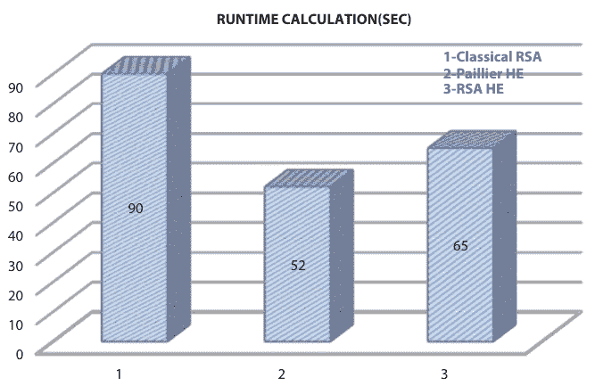

**图 7.2** CRSA、Pallier HE 和 RSA HE 的运行时间。

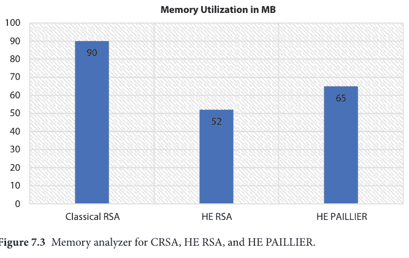

**图 7.3** CRSA、HE RSA 和 HE PAILLIER 的内存分析。

## 7.7 结论与未来展望

本研究旨在调查经典密码学及同态密码系统的特点。在对经典密码学中的存储数据执行某些操作时，与同态加密系统相比，计算所花费的时间更长。因为在经典密码学中，必须先对密文进行解密，然后才能执行操作，所以计算时间较高。与经典密码学不同，同态加密系统允许用户直接对密文进行操作，这有助于减少计算时间。在这项工作中，作者实现了经典 RSA 以及 HE RSA 和 HE Paillier，用于加密后执行乘法或加法。结果表明，经典 RSA 的时间高于另外两种。在这项工作中，我们还讨论了密码学在云计算中的重要性，以及经典密码学中所面临的缺点，这些缺点通过应用同态密码学得到了消除。

RSA 和 Pallier HE 密码系统的计算时间取决于密钥大小。如果密钥大小更大，计算时间和成本也将严重增加。这项工作的未来展望是减少在云计算环境中应用同态加密系统时的时间复杂度。

# 参考文献

- 1. Wang, G. and Ng, T.E., The impact of virtualization on network performance of amazon ec2 data center, in: 2010 Proceedings IEEE INFOCOM, 2010, March, IEEE, pp. 1–9.
- 2. Wilder, B., Cloud architecture patterns: using microsoft azure, O’Reilly Media, Inc., North Sebastopol, CA, 2012.
- 3. Serrano, N., Gallardo, G., Hernantes, J., Infrastructure as a service and cloud technologies. IEEE Software, 32, 2, 30–36, 2015.
- 4. Zhou, T., Shen, J., Li, X., Wang, C., Shen, J., Quantum cryptography for the future internet and the security analysis, in: Security and Communication Networks, 2018.


# 参考文献
- 5. Murali, G. 和 Prasad, R.S.，使用量子密码学比较云和本地环境中的加密算法，载于：2017年能源、通信、数据分析和软计算国际会议 (ICECDS)，IEEE，第 3749–3752 页，2017年。
- 6. Vignesh, R.S., Sudharsun, S., Kumar, K.J.，量子计算的局限性与经典密码学的通用性：一项比较研究，载于：2009年第二届环境与计算机科学国际会议，IEEE，第 333–337 页，2009年。
- 7. Shabir, M.Y., Iqbal, A., Mahmood, Z., Ghafour, A.，云计算中经典加密技术的分析。Tsinghua Sci. Technol.（清华大学科学学报），第21卷，第1期，第 102–113 页，2016年。
- 8. Kulkarni, G., Gambhir, J., Patil, T., Dongare, 云计算中的安全方面，载于：2012年 IEEE 计算机科学与自动化工程国际会议，IEEE，第 547–550 页，2012年。
- 9. Ryan, M.D.，云计算安全：科学挑战与解决方案综述。J. Syst. Software（系统软件期刊），第86卷，第9期，第 2263–2268 页，2013年。
- 10. Gagged, G. 和 Jaisakthi, S.M.，云计算相关安全担忧概述，载于：*Smart Intelligent Computing and Applications*（智能计算与应用），第 85–94 页，Springer，新加坡，2020年。
- 11. Salavi, R.R., Math, M.M., Kulkarni, U.P.，各种加密技术综述：从传统密码学到全同态加密，载于：*Innovations in Computer Science and Engineering*（计算机科学与工程创新），第 295–305 页，Springer，新加坡，2019年。
- 12. Zhang, Y., Yu, J., Hao, R., Wang, C., Ren, K.，在共享大数据的身份基于云存储审计中实现高效的用户撤销。IEEE Trans. Dependable Secure Comput.（IEEE 可靠与安全计算汇刊），第17卷，第3期，第 608–619 页，2018年。
- 13. Elhabob, R., Zhao, Y., Sella, I., Xiong, H.，面向车联网的高效无证书公钥密码学及其相等性测试。IEEE Access，第7卷，第 68957–68969 页，2019年。
- 14. Deng, H., Qin, Z., Wu, Q., Guan, Z., Deng, R.H., Wang, Y., Zhou, Y.，用于公共云中加密数据灵活共享的身份基加密转换。IEEE Trans. Inf. Forensics Secur.（IEEE 信息取证与安全汇刊），第15卷，第 3168–3180 页，2020年。
- 15. Yang, Y., Huang, Q., Chen, F.，基于 RLWE 问题的安全云存储。IEEE Access，第7卷，第 27604–27614 页，2018年。
- 16. Qiu, S., Wang, B., Li, M., Liu, J., Shi, Y.，迈向加密云数据上实用隐私保护频繁项集挖掘。IEEE Trans. Cloud Comput.（IEEE 云计算汇刊），第8卷，第1期，第 312–323 页，2020年。
- 17. Liao, Y., Zhang, G., Chen, H.，在绿色云计算中为终端用户和云服务器实现属性基加密方案成本高效的委托解密。IEEE Access，第8卷，第 20862–20869 页，2020年。
- 18. Alaya, B., Laouamer, L., Mislini, N.，同态加密系统陈述：趋势与挑战。Comput. Sci. Rev.（计算机科学综述），第36卷，第 100235 页，2020年。
- 19. Ahuja, R. 和 Mohanty, S.K.，一种可扩展的属性基访问控制方案，支持云存储中访问权限的灵活委托与共享。IEEE Trans. Cloud Comput.，2017年。
- 20. De, S.J. 和 Ruj, S.，面向移动云的高效去中心化属性基访问控制。IEEE Trans. Cloud Comput.，第8卷，第1期，第 124–137 页，2020年。
- 21. Min Zhao, E. 和 Geng, Y.，用于云计算的同态加密技术。Proc. Comput. Sci.（计算机科学程序），第154卷，第 73–83 页，2019年。
- 22. Alloghani, M., Alani, M.M., Al-Jumeily, D., Baker, T., Mustafina, J., Hussain, A., Aljaaf, A.J.，关于同态加密技术现状与进展的系统综述。J. Inf. Secur. Appl.（信息安全与应用期刊），第48卷，第 102362 页，2019年。
- 23. Tran, J., Farokhi, F., Cantoni, M., Shames, I.，针对物理系统实现基于同态加密的安全反馈控制。arXiv 预印本 arXiv:1902.06899，2019年。
- 24. Shen, W., Su, R., Hao, Y.，支持强隐私保护的去重轻量级云存储审计。IEEE Access，第8卷，第 44359–44372 页，2020年。
- 25. Liu, L., Chen, R., Liu, X., Su, J., Qiao, L.，迈向云环境中实用隐私保护的决策树训练与评估。IEEE Trans. Inf. Forensics Secur.，第15卷，第 2914–2929 页，2020年。
- 26. Brakerski, Z.，全同态加密基础，载于：*Providing Sound Foundations for Cryptography: On the Work of Shafi Goldwasser and Silvio Micali*（为密码学提供坚实基础：论 Shafi Goldwasser 和 Silvio Micali 的工作），第 543–563 页，2019年。
- 27. Zheng, S., Wang, Y., Hu, D.，基于同态密码系统的无损数据隐藏。IEEE Trans. Dependable Secure Comput.，第18卷，第2期，第 692–705 页，2019年。
- 28. Joshi, S.，一种用于云端数据安全存储的高效 Paillier 加密技术，载于：2020年第四届智能计算与控制系统国际会议 (ICICCS)，IEEE，第 145–149 页，2020年。
- 29. Asuncion, A.E.C., Guadalupe, B.C.T., Yu, W.E.S.，同态人脸图像加密与操作实现与分析，载于：2019年第四届多媒体系统与信号处理国际会议论文集，第 158–166 页，2020年。
- 30. Yan, X., Lu, X., Liu, L., Ding, W., Liu, H.，利用视觉密码学的同态性质，载于：*Cryptography: Breakthroughs in Research and Practice*（密码学：研究与实践中的突破），第 416–427 页，IGI Global，美国，2020年。
- 31. Babitha, M.P. 和 Babu, K.R.，使用 AES 加密的安全云存储，载于：2016年自动控制与动态优化技术国际会议 (ICACDOT)，IEEE，第 859–864 页，2016年。
- 32. Khanezaei, N. 和 Hanapi, Z.M.，基于 RSA 和 AES 加密算法的云计算服务框架。2014年 IEEE 系统、流程与控制会议 (ICSPC 2014)，吉隆坡，第 58–62 页，2014年。
- 33. Mudepalli, S., Rao, V.S., Kumar, R.K.，使用 Blowfish 加密对云密文检索的高效数据检索方法。2017年智能计算与控制系统国际会议 (ICICCS)，马杜赖，第 267–271 页，2017年。
- 34. Paillier, P.，基于复合次数剩余类的公钥密码系统，载于：*International conference on the theory and applications of cryptographic techniques*（密码学理论与应用国际会议），Springer，柏林，海德尔堡，第 223–238 页，1999年。
- 35. Rivest, R.L., Shamir, A., Adleman, L.，一种获取数字签名和公钥密码系统的方法。*Commun. ACM*（ACM 通讯），第21卷，第2期，第 120–126 页，1978年。

# 基于云的数据分析用于监测智慧环境

D. Karthika
计算机科学系，计算科学学院，Vels 科学技术与先进研究院（前身为 Vels 大学），印度，泰米尔纳德邦，金奈

### 摘要

无线通信取得了巨大进步。这些发展激发了新的无线连接和网络范式。例如，研究界正在关注 5G 在无线网络中自动移动通信的应用。最近的一个章节重点介绍了物联网 (IoT) 的概念，它是 5G 无线网络的关键元素，旨在将每个单元（如无线传感器节点和家用电器）连接到互联网。随着这些技术的发展，它们被应用于不同的现实世界问题。在众多相关应用领域中，最独特的是对人群进行高效且智能的监控。智慧城市是一种通过从城市系统中提取信息来采取管理措施的愿景。通过使用数据和通信技能来跟踪和控制这些过程，可以实现这一愿景。之所以使用物联网，是因为它可以将城市的所有基础设施集成到互联网中。

**关键词：** 云计算，数据分析，物联网，智慧城市，无线技术

### 8.1 引言

无线网络可用于医院、高速公路、火车和电力供应等，以构建如这些一般的网络。为了让城市传感器传递读数，地方政府需要互联网接入。发达世界利用知识和网络技术进行重要数据管理 [1]。

邮箱：d.karthi666@gmail.com

城市电网、智能交通、智能通信、智能建筑、智能住房和智能服务将整个城市社区的愿景联系起来。主要结构被解读，并通过改进的公共管理和环境排放评估收集信息，包括替代知识分析技术。为了实现这一目的，传感器被部署到主要城市区域，如电力网、水和灌溉系统以及石油和天然气水库、火车、道路、学校、医院、车站和机场等。洞察是当今基础设施的主要主题之一，它促进了社交网络的流行趋势甚至技术进步。苹果产品也包括智能手机、系统和平板电脑。社交媒体、移动设备和笔记本电脑的发展以前所未有的方式改变了生活方式，但洞察改变了企业生活，比以往任何时候都更为深刻。由各种类型网络产生的新系统方面的普及为企业提供了有用的知识和信息。业务智能 (BI) 一词，作为结果仓库的关键方面，最终被采纳并回归其根源 [2]。

所有操作——包括结果集成、污染和清洗、调度和数据管理、跟踪和研究独特类型、咨询服务、销售和控制团队以及系统中心用户——仍然包含在 BI 中。为使用智能技术和视频/音频通道创建了一个大型、多样且全面的数据集合。使用传感器设备和网络来跟踪感兴趣的现象，具有各种图形和异构测量。这也保存、传播和分析数据用于某些目的，包括环境服务、空气质量安全和风险管理。多年来，企业一直在积累数据收集，在大数据集上运行此类数据分析，并主要开发数据处理工具 [3]。然而，数据生产、信息管理和技术增长脱节的方法经历了近期变化，为企业提供了不同的市场地位。在这种情形下，可扩展的方法应整合供应商、生产者、服务提供商和零售商的活动。本节重点在于数据收集和现代系统，主要提出用于城市环境活动的监测。物联网 (IoT) 连接到数百万个物理传感器和设备，以提供异构、复杂和非结构化数据。全球许多商业和科学项目专注于物联网数据处理，以抵消成本以及数据维护和建模结果。

强大的数据库网络基础设施可以有效处理大型程序，而云计算在物联网范式中可以发挥至关重要的作用。云存储还提供广泛的规模处理和存储功能。因此，我们建立了一个基于大数据存储的云


一种可以在不同智能环境（例如智慧城市、家庭安全、灾害预防）中实施和运行的架构。通过相关的流程、方法、培训和认证，BI 作为一个行业已经成长、成形，并已成为所有大型公共和私营企业中不可或缺的组成部分。BI 不同于文档和存储。BI 和分析利用数据挖掘、分析和模拟来提供对未来的洞察。将 BI 作为假设的伞式概念被具体数据内容所取代将是低效的。这部分提供了详细的逐步分析方法，BI 将构成其基础。因此，重要的是要将两种含义区分开来，并确保这两个术语的使用[4]。

## 8.2 智能建筑环境监测

有效保护定义了环境健康识别与监控的发展和实践。技术、工程和材料科学的进步为环境监测工作中使用越来越创新的仪器开辟道路。传感器节点的可用性使得上市速度加快，这对于新网络应用的开发至关重要。从成本角度看，嵌入式传感器在移动设备上与特定应用的硬件保持紧密关联[5]。保护智能建筑环境有多个要求，同时也存在一些限制和困难。监控区域和应用场景都会影响需求和挑战；监控目标、采样率和整体实施成本是系统设计决策中需要考虑的参数。与此同时，无线网络与复杂环境变化的共存是对任何已提出方案的挑战。

### 8.2.1 智能环境

各章节深入解析了关键智能场景（如智能家庭、健康管理和智能城市）的主要特性和功能，并展示了向智能工厂的演进。两个对称的数据库因其独特的规模和复杂性而被选用，例如从个人到企业，从单一用户到多用户，以及不同的“智能化”目标。虽然确实存在其他类型的智能环境，但我们聚焦于这四个领域，将其作为反思性的用户案例。家庭可以容纳智能技术，主要有以下三个原因：
- (i) 现代家庭已经包含了许多技术，尽管它们往往不互联或互操作性不强；
- (ii) 受控的环境；以及
- (iii) 在原则上愿意对技术方案进行投资并允许其访问的房主[6]。

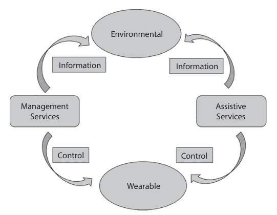

图 8.1 智能环境信息系统。

智能家庭在基础设施方面属于标准范畴。它们通常被归类为资金和行政系统。智能家庭辅助系统旨在为用户提供实际的帮助，支持其在家庭和日常职责方面的生活。例如，如果看电视或听音乐是个人用户的关切事项，智能家庭可能会根据消费者的需求，通过计算机自动化产生噪声示例来协助灯光和互动计算机的准备与设置，例如开启洗衣机等。当用户是老年人、残障人士或病人时，辅助服务可以量身定制以满足其独特需求，例如环境支持服务或电子健康服务。技术服务覆盖了智能家庭的特殊功能。

例如，人们的健康与保护或家庭能源管理，例如通风调节、太阳能电池板储能或电气和照明设备的控制，这些在满足能源供应需求的同时最小化能源使用。虽然智能家庭服务在具体功能上具有特殊性，但它们通常建立在情境感知框架的应用层上，这些框架关注共同的功能和机制。此外，房屋的组成部分，如窗户、门、电气系统、空调系统、能源生产网络、传感器、家用电器等，构成了家庭控制系统的基础。然而，更高级的服务公司还需要客户的数据，这些数据可以通过结合环境可持续且紧凑的摄像头（例如智能手机）来访问，这些摄像头通常与用户的设备配对[7]。

需要这些额外的传感器来获得全面的用户历史记录，这对于将智能家庭转化为智能用户友好环境至关重要。此类详情的示例包括用户的位置（通过定位系统）、用户的物理环境（通过可穿戴传感器）或用户的行为。然而，无法直接通过分析传感器的原始数据来访问这些高层知识。这需要由通常基于信号处理、机器学习和/或数据分析的适当算法进行评估。从方案和新通信技术（ICT）的角度来看，这些网络和应用的全频谱至少促进了全面且多样化的物联网网络实施。所有这些技术必须覆盖巨大的设备/政府数据收集、存储和综合频谱，并包含对信息展示配置、监督和治理的足够支持，以及家庭机械运动测试的结果[8]。

## 8.3 智慧健康

在过去 20 年里，由于传感器价格的显著下降以及信号处理技术和数据集成/质量方面的进步，智能环境和网络的应用迅速扩展。

### 8.3.1 解决方案的通用描述

图 8.2 中描述的通用架构涉及启用的技术及其在医疗保健中的应用。几种插入和/或佩戴在个人身上的设备可以在其环境中持续收集任何数据并分析这些数据，因此您提供给患者的第一详细内容或输入是提醒医务人员、家属或其他指定人员该状况[9]。这些方法也可用于监测特定环境下的医疗保健，例如手术后监测，或者让个人意识到更广泛、更健康、更自立的生活，例如老年人或残障人士。

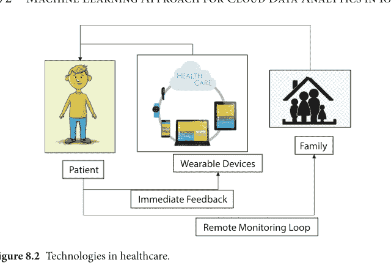

图 8.2 医疗保健技术。

### 8.3.2 困境检测

通过临床数据或背景/用户活动对人们进行持续跟踪，可以描述个体的身体状况，并提高对疼痛或许多危险状况的警报。另一个重要原因是，尽管在发展中国家这一点很重要，但老年人人口的减少是独立存在的。例如，这是德国家庭和医疗急救中最常见的来源之一。需要开发系统来分析、监测并考虑哪种类型的人会被发送寻求支持（医疗或普通公民）。跌倒检测是物联网和智能社区的主要应用之一，也是近年来健康应用中的一个全面研究课题。跌倒诊断最常见的方法之一是使用个体佩戴的惯性传感器。

随着近年来可用设备的多样化和技术的发展，惯性运动检测器在检测跌倒方面变得可行。例如，手持式传感器（IMU、GPS 等）相互融合，试图理解基于活动传感器算法的预警意识和避免误报。然后的一种方法是附加额外的 IMU 功能，例如在家庭内部使用 PIR 传感器，在检测到事件后的几分钟内测试个人行为。此后几年，在这种情况下使用录制设备的做法有所增加。深度摄像头将提供更多信息，并更容易评估移动主体和静止伪影。它可以用于情境分析、行为检测以及此类不规则跌倒场景[8–10]。


至于2D相机，提供了图形艺术信息的城市数据，并分析了不同发现的相关性以及针对剩余待完成工作所取得的实际改进。最后，还有其他形式的解决方案，例如基于家用集成雷达传感器的系统。坠落（考虑到两种形式的跌倒）往往非常危险且要求苛刻。另一种形式的情况，例如在心脏和心房颤动中观察到的。它可以通过智能手机相机甚至现在的智能手表进行追踪。该检测涉及世界上最常见的中风之一，目前正通过电话和手表进行研究。像回归这样的案例也可以被检测到并用于评估抑郁症。该设备可能需要干预，以尽快避免个人状况恶化。

### 8.3.3 绿色保护

正如前面强调的那样，智能住宅在过去几年一直是研究的重大挑战和热点话题 [11]。尽管如此，城市医疗保健中心的数据可用于确立人类行为并检测个人健康的变化，以识别保护退化的迹象。在这种情况下，在不确定的实验中正确分割数据、使用非常不同的数据类型进行大规模多模态分析、将结构适应于我们所跟踪的人的方式、低级行为和高级别已识别活动的数据问题，以及不同类型的识别效率和能力，都是许多挑战。动作识别对于智能住宅中与健康相关的应用程序非常重要，因为它为个人的福祉、与效果的互动以及使用老年量表（如ADL）提供了基础。

这些问题相当复杂，因为第一个挑战是执行的活动确实更难识别，其次，执行不仅取决于个人，还取决于其完成的相关性。这导致了设计和分析的非常复杂的模型。然后从这些检测和识别中复制属性。第一类是评估状态，例如，在家中被监视的个人针对特定问题的状态。评估展示了个人问题的演变，以确定他或她是否不再能独立生活。第二类型的应用程序是帮助个人在适当关注其残疾/疾病的情况下进行这些活动。这可以改善居住条件和家庭关系。

### 8.3.4 医疗预防/辅助

所有带有健康解决方案的细胞传感器旨在预防或帮助面临特定状况的人。依赖性是我们医疗保健系统最大的成本之一，希望其中一部分能够被修改 [12]。许多工作侧重于考虑不同类型的支持。例如，老年人提供了一种结合移动应用程序的系统，该应用程序允许护理人员提供环境指导，并且智能手机支持个人日常生活。这些技术需要经验，以便能尽快对客户有用。它通常与客户共同设计。患有慢性病或持续性障碍的个人状态的评估或增强确实是一个主要症状。在像糖尿病这样的慢性病情况下，某些电子设备和应用程序可能很有帮助。

这些系统通常依赖于测量设备和/或移动设备以及许多其他电子元件，其目的是帮助人们管理和控制慢性疾病的负担，或调节药物依从性。在像房子这样的内部事物中，战术也可以每天应用 [13]。该应用的目标是分析睡眠标准，以便可以观察和/或量化改进，从而诊断异常。为此，传感器和压力表被安装在床上。为了改善或恶化个人的居住条件，有必要长期发展其需求。例如，可以获得某些数据，以长期跟踪这些数据的性质，并在紧急情况下可能发出警报，如前所述。

## 8.4 5G 数字网络与宽带网络

分布式能源（DER）向配电网络的渗透率不断增加，例如电动汽车、光伏和风力涡轮机，改善了双向能量流，并使客户习惯变得不那么可预测 [14]。这种可观察性可以通过实时监测配电网来实现，其中联网技术可以将基础设施转变为智能电网。该系统使用精密的中/低压相位测量仪器，并通过公共传输网络进行安全的数据共享。

### 8.4.1 基于物联网的智能电网技术

物联网（IoT），这个强大且高效的连接系统，包括数据恢复、收集、传输和存储，是最新的数字通信技术之一。现代社会将最先进的技术定义为监测能源、自动化车辆和家用电器，并管理电力、水和天然气消耗。与其他通信技术相比，物联网技术有几个优点。其中之一是，通过提高能源消耗和成本，系统使用可以变得更加高效 [15]。此外，ICT技术是保证服务公司业务连续性所必需的。最近的物联网创新由提供商、服务供应商和企业家领导，物联网技术被用于智能电网和其他创意领域，如智慧城市发展、智能建筑和智能住宅。

在本章中，物联网网络开发和系统架构得到了彻底分析 [16]。提出了一些创新解决方案，包括除了Lorawan之外的宽带执行、互联网接入、移动数据-A和区块链（NB-IoT）、低可持续能量以及ZigBee和以太网（BLE）。这两种技术大大增强了未授权频段的长期通信能力。最重要的LPWAN技术是LoRa，它提供Semtech增强的、Sig Fox增强的、超窄带增强的（UNB）、新的增强weightless通信、LTE-M机器类型（LTE-M）和NB-IoT 3GPP。部署最多的LPWAN设备是LoRa和UNB，因为它们使用未授权的频率带。LoRaWAN是一个独立的LoRa策略，适合星形和单元拓扑。

### 8.5 新兴智慧城市通信网络

近年来，能源需求增长迅速，电气设备数量和规模稳步增加。同时，在活性细分领域正在发生重大变化，这主要归因于从传统到风能的转变、可持续能源策略以及更高效的可再生微型发电 [17–19]。

有效的电力网络运行取决于输出和使用的协调，这是对网络控制的一个主要挑战。电网布局从大型制造单元位于电网土地上的分层和中心布局演变为更本地化的一次性、本地处理系统。结果是与间歇性可再生资源相比，能源供应更加稳健且成本更低。能源库存已增加。需要一个广泛的管理框架，用于实时测量、预测和监控专业知识，以有效协调效率和用途。最简单且

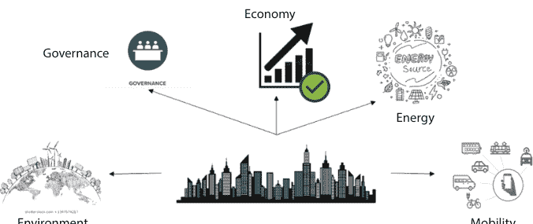

**图 8.3** 智慧城市通信网络。

细致的发展环境是智能定居点。它涵盖了气候、经济、流动性、电力、规划、治理和其他行业等不断增长的领域。

在图 8.3 中，许多相关关注点，包括一系列管理员，如城市经理、监督者、服务提供商和居民，可能存在竞争优先级。智能社会不仅是一个技术挑战，也是一个最复杂和异质性发展障碍出现的地方，技术倾向于解决特定的需求和期望。在ICT方面，发展分为10个领域和问题，涵盖了从电子旅游、电子文化、电子政务、智能资源到智能网络、电子健康到福祉的各种智慧城市。结合政治问题，技术和开放技术的难度将阻碍智慧城市的发展。因此，毫不意外的是，对于智能城市而言，技术系统的信息共享和知识作为技术促进者非常重要 [20]。

在这方面最近的进展是新参与式传感范式的实施，在来自城市的（廉价）数据传感位置，包括用户本人、用于个人智能手机的移动应用程序。此外，允许客户创建智能城市具有巨大好处，同时消除或完全移除与在城市中构建和管理毛细血管传感设备相关的成本。然而，这些技术的相对复杂性决定了它们远离标准化，并且已经尝试了若干独立的智慧城市研究计划。


## 8.5.1 RFID 技术

即便涵盖广泛的频率范围、通信协议和设备实现，RFID 仍是最广为人知的概念。因此，包括 ISO、ITU 和 IEC 在内的多个国际组织，以及像 DIN（德国）、JIS（日本）和 SINIAV（巴西）等地区性组织，都在采用 RFID 技术。新应用标签旨在消除对 MI fare 或 RAIN RFID 等非典型字母数字模型的误用，但这反而进一步混淆了 RFID 的复杂性。一种常见做法是指向使用相同频段的 [应用程序](https://example.org)，以便为跨 RFID 技术范围提供有意义的导航参考 [21]。

## 8.5.2 标识符方案

正如前文所指出的，RFID 将促进一种标准化的方法来解释从标签派生的标识符，以开发透明的物联网（IoT）系统，这些系统通常涉及多个利益相关方并促进灵活运营。相比之下，针对各种物质对象、位置甚至数字事物的特定标签方案早已广泛使用，使得从财务或组织角度来看，基于“白板”（clean slate）理念在物联网领域实施 RFID 是不可行的。在识别数千个已处理对象时，主要通用用途包括授权分销商协议（EPC）、Sg-1 和 EPCglobal、ISO/ITU 标准下的对象标识符（OID）、在日本广泛使用的通用 ID，以及许多常用于二维码和条形码扫描编码的其他系统。虽然不可能详细涵盖这些方案中的每一个，但发现所有方案都保持条理性，呈现出可比的结构。具体而言，一个程序以定义后续代码的前缀开始，即在 EPC 上下文中，前缀 00110000 是一个 96 位的序列化全球贸易对象（SGTIN-96）整数。其余代码通常按层级组织，以促进区域和组织之间的数据共享分配。

## 8.6 智慧城市物联网平台分析系统

如今，几乎所有类型的传感器都具备 WLAN 连接，这使得设备具备将数据传输和接收能力融入我们日常生活的连通性。物联网（IoT）是一个概念，它使人们可以在任何时间、任何地点与物品进行交互。物联网广泛应用于各种应用，如家居自动化、医疗保健、交通和开发。通过散布在城市各处的传感器数据，随着物联网技术的出现，这些数据变得可用。大数据技术和机器学习算法使市民和决策者能够利用这些城市数据来提供服务与解决方案 [22]。

## 8.7 智慧城市中的智能停车管理

可以公允地说，穿过社区前往另一侧的人们只占城市交通的一小部分。许多想要驾车前往城镇另一端的市民并不移动车辆，而是绕着该区域行驶以防止拥堵 [23]。因此，我们可以公平地假设，包括出租车在内的几乎所有人都需要花费几分钟甚至更长的时间。根据城市不同，他们平均可能花 30 秒到 20 分钟寻找停车位。因此，我们可以推断停车对城市拥堵有显著贡献。随着城市人口增长，道路上的车辆数量增加，当今社会面临全球性交通瘫痪的巨大挑战。

## 8.8 智慧城市系统与服务的安全保障：基于风险的解析方法

关键基础设施（CI）是维持社会基本功能生存所必需的电力、服务和交通组件。智能基础设施也是一个生态系统，它纳入智能解决方案以管理其资源并提高服务质量。土地管理包括废物管理、水资源管理和能源管理。技术标准包括电子政务和公用事业、城市交通和组网。这与鼓励经济增长和改善专业城市居民生活质量的目的一致。智慧城市面临的另一个问题是 CI 子系统产生的数据量。任何针对智慧城市网络安全策略的类型、重要性和灵活性都会使此类需求多样化。因此，提供者和最终用户需要愿意采用任何网络安全方法。可用性被定义为消费者活动的效率和效果 [24]。一个有效的系统满足用户的需求。在此意义上，实施网络安全融合中心需要一种创造性策略，以使用户能够做出知情决策，并提供关于后续发展的全面深度信息。包含在标准内部文件中的记录可以创建逻辑假设。

## 8.9 虚拟集成存储系统

从多种异构监控基础设施（MIs）中收集服务器，并断开管理不同类型信息的数据库设备功能。这涵盖了在分布式云网络中用于通过独特规则提供灵活且高效的混合数据库系统的 DO-SS 和 OO-SS 实例。MI 访问通过 GUI 处理存储进行收集 [25]。这是不同数据库和通信系统之间的交互。它们是接口。负责虚拟数据的知识管理员处理所有收集的数据，改善远程信息，为不同类型的网络选择正确的存储设备，并最终将存储添加到存储系统中。身份管理员和访问管理模块实施认证功能，以控制用户身份并提供访问数据和服务的指导。RESTFUL API 允许注册用户访问数据。

信息管理器（Info Manager）的核心功能包括 1) 数据提取和 2) 数据改进。系统：云服务器管理员负责 MI 数据处理。程序管理者的结果抽象功能对于解决数据碎片化问题至关重要。这以简洁的逻辑描述呈现所有跟踪和感知数据。分布式工作器交互并反映练习设置，其中所有操作（例如，数据处理）都被工件（例如，跟踪设备）观察。OGC 传感器网络使能（SWE）项目已采取重要初步措施，用于基于网络的感知数据发现、分发和分析。它指出了通过统一系统接口实现传感器服务互操作性的规范。基础传感器网络的复杂性、其联系信息和若干硬件组件是保护顶层构建设备中的 SWE 资源的关键 [26]。

他们扩展 SWE 定义以定义当前包含在论文中的云内数据。虽然 SWE 构建于感知历史中以澄清发现，但他们也专注于对象管理、查询自动化和恢复。特别是，OO-SS 规范依赖于元数据 [27–30]。出于监控目的，遵循 SWE 要求的抽象数据对于将组织与其上下文连接起来并为最终用户提供无缝查询接口是必要的。为此，数据的丰富性允许与 SWE 要求兼容的上下文感知元数据扩展每个对象的信息模式。去年，将监控系统整合到云中并分发消息内容以交付内容的 OGC-SWE 标准受到了密切关注。

本文反思了数据存储问题，并提出了一种新的数据处理和组织方法。两个不同的 SWE 标准指传感器观测设备（SOS）和传感器警报服务（SAS）。具体而言，SOS 规范定义了传感器系统中请求、过滤、观测收集和数据的经验，而 SAS 标准描述了传感器发布和订阅观测的接口。SOS 操作员和 SAS 助手分别属于数据管理器的一部分，如图 8.4 所示。

正如 SWE 指南指出的，它们被设计以满足预期。此外，SOS 官员支持所有以良好定义格式识别、查看和捕获传感器的功能。定义随后按照 SWE 传感器的 O&M（观测与测量）要求传输 [31–33]。传感器提供用于定义传感器系统和过程的模型和 XML 模式，而 O&M 提供反映效果估计和感知情况的 XML 模式和模型。满足需要高级环境信息服务的云用户需求的网络是 SAS 官员的主要任务。它根据订阅发布模型提供信息。对于观测类别（由在特定 MI 中发现的特定现象表征）的发布，用户可以通过发布的 SWE-SAS XML 文档和与其相同发布相关的一个或多个评论访问。

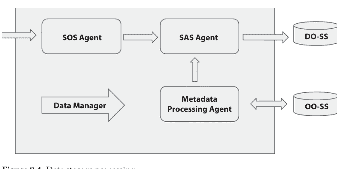

图 8.4 数据存储处理。


这些构造不能在 SWE 文件中定义，但仅通过订购相关元数据即可用于指定组织内容，以符合 SWE 规范。这改善了产品的地理定位（例如，到达时间和地点、用户及到期时间）。该地理定位信息由 SAS 机构提供的 DO-SS 给出。在数据增强流程之后，对象由信息管理器部分发送至 OO-SS。因此，数据对象为存储、数据库和恢复过程的维护而被隔离：元数据的描述放置在 DO-SS 中，而申请人则保留在 OO-SS 中。从最终用户的角度来看，程序被发送至 DO-SS。当数据用于监控服务时，会查找并计划请求。用户向系统提交其申请，DO-SS 收集相关信息。当获得的援助是一个实体时，恢复过程还将提供 OO-SS 条目的密钥。

## 8.10 卷积神经网络（CNN）

与其他版本的神经网络（如多层感知机 MLP）相比，CNN 旨在接收许多数组作为输入，然后使用局部场卷积运算符通过复制瞳孔的图像感知来处理信息。它在解决计算机视觉问题方面表现出优异的生产力，例如图像分类、检测和解释。它在许多方面也是有用的，包括混合语音频谱表示、与传统的 DCT 变换和压缩感知方法相比的 VLSI 物理设计，以及从各种变化条件的图像中识别癌症。此外，一些顶级玩家最近在一场由 CNN 发起的与 AlphaGo 的混淆对局中进行了围棋比赛。但 CNN 的架构正变得更为广泛和复杂，以获得良好的统计性能并实现日益具有挑战性的目标。与此同时，高分辨率传感器将更多像素压缩到一张图像中 [35–37]。CNN 的制备和生产非常昂贵，且由于其速度慢而受限于实施。

尽管其概念 CNN 已研究过效率和竞争力，但似乎因为它具有良好的工业性能，最近显得更加受到关注。任何公司都引入了深刻知识，这可以常规地用于 CNN。谷歌第二代的张量处理单元（TPU）是为 TensorFlow 构建的，具有峰值性能和 28 MB 片上内存，算力为 92 TFLOPS。它支持整数和浮点计算，使深度学习更有效。NVIDIA 以一个用于数据密集型汽车产品的免费许可证启动，引入了一个名为 NVIDIA 深度学习加速器（NVDLA）的开源项目。这些不同的结构共享四个关键特性，包括权重共享、局部连接、池化和多层使用。有几个广泛使用的层，包括卷积层、降采样层和完全纠缠层。一般来说，在数据之后有一个协同进化层。降采样层仍然与协同进化层并行。为了最大化 CNN 的范围，这种差异也会发生。

## CNN 通信技术

虽然 RFID 系统主要用于识别实体，但 CNN 用于环境中的物理交互。许多较小的传感器执行器是类似计算机的 CNN 工具，如用于前 10kB 的 RAM 和 8/15 位处理器，以及功率限制，其中许多运行在有限的能源上（例如纽扣电池）[34]。在每个部分中讨论了 CNN 中的主要有线或数字通信技术。在大多数情况下，PHY 和 MAC 来自这些技术中的许多，尽管有些被描述为表 8.1 中更大协议栈的一部分。

### 8.10.1 IEEE 802.15.4

无线个人区域网（WPAN）是一个为部署的管理和调节而构建的硬件设备家族。第一版在 2003 年是一个重要里程碑，当时最初建立了开放、专注且经济的连接，重点在于可访问性和低能量使用。该平台更为常见，是有效网络部署的基础，包括 IPv6 和非 IP 通信方法，如 ZigBee。尽管如此，时间分隙信道蹦跳（TSCH）模式被设计用于在特定行业上下文中解决漏洞。标准协议栈通常用于像 ISA 100.11a 和无线 HART TSCH 这样的工业应用。

### 8.10.2 BLE

蓝牙主流、低能版本于 2010 年推出。BLE 将部分重用蓝牙，并且 BLE 可以使用标准蓝牙的系统以低额外成本激活。因此，BLE 将利用其在智能手机上的广泛存在，从周围的捕获和传感器收集数据或向其发送命令。移动设备也可用作通信传感器、驱动器和互联网的介质。BLE 也已成为可穿戴设备、平板电脑和其他消费电子设备的世界领先供应商。

表 8.1 CNN 中的技术。

| 模型 | 层大小 | 配置 | 特性 | 参数大小 | 应用 |
| :--- | :--- | :--- | :--- | :--- | :--- |
| LeNet | 7 层 | 3C-2S-1F-RBF 输出层 | - | 60,000 | 文档识别 |
| AlexNet | 8 层 | 5C-3S-3F | 局部响应归一化 | 60,000,000 | 图像分类 |
| NIN | - | 3mlpconv-全局平均池化 | mlpconv 层：1C-3MLP；全局平均池化 | - | 图像分类 |
| VGG | 11-19 层 | VGG-16: 13C-5S3F | 通过堆叠的 3 x 3 核增加深度 | 133,000,000 至 144,000,000 | 图像分类和定位 |
| ResNet | 可以非常深（152 层） | ResNet-152: 151C2S-1F | 残差模块 | ResNet-20: 270,000; ResNet-1202: 19,400,000 | 图像分类；目标检测 |
| GoogleNet | 22 层 | 3C9 Inception-5S1F | Inception | 6,797,700 | 图像分类；目标检测 |

### 8.10.3 ITU-T G.9959 (Z-Wave)

ITU-T G.9959 是一个设定 Z-Wave 较低层级的标准。Z-Wave 被设计为家庭自动化专有协议栈。

### 8.10.4 NFC

NFC 系统是一种短距离（例如，最大 0-10 cm）无线系统。由于它最大限度地减少了未授权用户收集数据的能力，因此提供了固有的安全特性。NFC 为支付应用提供多种形式的通信，例如卡模拟、读卡器模式或对等接触。

### 8.10.5 LoRaWAN

LoRaWAN 是新组的未授权有线设备。广域低功耗（LWGN）网络。LoRaWAN 使用物理层 LoRa 基础设施来提高多达 10 km² 的连通性。基于拓扑的网关为诸如传感器等 10 万个设备收集数据，提供低基础设施成本以受益于快速传输速度和比特率。网关提供低基础设施成本。

### 8.10.6 Sigfox

Sigfox 也提供广泛的低基础设施覆盖，并且以高成本成为领先的 LPWAN 无线技术。该技术由 Sigfox 公司在未授权频段运行。它基于星型拓扑和与其他 LPWAN 技术相同的 10 平方连接频谱。你可以获得数英里。

### 8.10.7 NB-IoT

窄带物联网（NB-IoT）通常被认为是 LPWAN 网络中的一种新技术。它基于一系列许可，并允许在单个基本平台上使用多个低比特设备。在 Release 13 规范中，NB-IoT 由 3GPP 定义。

### 8.10.8 PLC

电力线协议（PLC）定义了电力网网络作为通信工具使用的技术。PLC 基于有线网络，但受到其干扰，因此对类似介质的错误共享具有抵抗力。智能家居应用通常是 PLC 模型，如 IEEE 1901.2 或 ITU-T G.9903 低比特率，以及相关应用，如智能电网。

### 8.10.9 MS/TP

主从/令牌传递（MS/TP）是属于标准家族 BACnet 建筑自动化的有线设备。目前，电网电源


授予 MS/TP 电话。虽然本文列出的功能不像其他经过审查的技术那样受到限制，但 MS/TP 设备受到限制，并且根据物理层 RS-485 的要求提供较小的比特率。

## 8.11 挑战与问题

智能环境中物联网解决方案面临的以下障碍是互操作性和标准化、集成与个性化，以及身份识别和虚拟化。

### 8.11.1 互操作性与标准化

物联网定义的主要动力来自跨越所有层（无论是事实标准还是法律标准）的标准发展，从物理层到应用层。某些标准已被引入，但在智能环境中仍在持续演变 [39]。不同机器之间的互操作性非常重要，例如在工业 4.0 网络化性能的智能连接背景下。为解决这一问题，OPC UA 提供了一个论坛，用于在用户和系统之间进行免费、可扩展和透明的信息交换。OPC UA 使用标准传输协议并进行编码以确保通信，例如在嵌入式控制器之间作为高端商业服务环境。它从安全角度为用户、客户端和服务器提供警报和事件通知，以监控和检查其联系的可靠性。通常，某些工厂管理和自动化设备以及交付网络对时间敏感。

规范通常不如智能行业成熟，而在其他领域，如智能家居、智能安防或智慧城市，规范总是很多。虽然规范的普及证明了技术的成熟度，但另一方面，需求的广泛多样性和许多重大重叠表明市场具有竞争力，正在快速增长，并且仍在寻找平衡。对于需求的产品模糊性在用户看来是积极的，并减少了未来制造商的锁定，但需求往往不便于互操作的事实导致标准锁定。如果在一个快速发展的行业中协议迅速过时，锁定可能是麻烦的，并可能阻碍未来的业务改革 [40]。因此，各种物联网标准的互操作性在特定语境下（例如，通过识别适当的网关）可能变得至关重要。

### 8.11.2 定制与适应

日益增长的个人化趋势对可访问性和互操作性提出了更高的要求，无论是在休闲还是在智能市场环境中 [41–43]。当前的网络和连接问题发生在运作良好的传感器和执行器网络上，以便让物联网能够由各种利益相关者直接操作，如蜂窝设备、雾计算、边缘计算和技术。一个基本问题是如何通过算法改变数据处理，并为解决方案的用户或任何获得最佳可能接口的人提供支持。在前面的章节中，我们看到，尽管通过大量努力解决了这个问题，但仍然有一些障碍使传感器和执行器能够在环境中协同工作。可靠且经过验证的知识可用性，以及容易安装、学习和维护，是采用和长期使用现代技术重要性的两个特征 [44]。

移动家居环境、联网房屋和创意制造等两个因素至关重要，当设备在上述情况下不被丢弃时。设备被指出容易因安全或健康而被丢弃，因为原本启发人们意识的意识使信息不足以鼓励长期使用的设备。例如，如果操作跟踪程序未检测到操作（该程序识别不符合您使用标准的行为），事物将不会被包含（例如，用于健身应用的错误 IMU/心率调整要求）。这就是为什么此类设备在最初几天“学习”消费者操作方式的原因。另一个标志是困难。例如，该领域的一些实验试图构建机制，以监测家中老年人的活动，以检测行为变化。

最佳部分是一个新方案相对简单操作、引入和服务。部署和维护是硬件和设计的关键问题。然而，嵌入式算法有助于使其更容易使用。在此问题的初期有持续的研究工作。目的是利用软件痕迹和所谓的隐含用户反馈来持续改变系统的行为。此类建议是操作员对系统的评论，指出他不喜欢的行为，或用户的行为与系统的行为相匹配。确定个人如何居住在智能环境中以检测数据中的此类差异仍然成本很高，并且对于此类系统的用户体验和可靠性至关重要。

### 8.11.3 实体识别与虚拟化

为了创建集成且日益复杂的连接网络，物联网技术结合了多个元素和功能。组织识别是完成该任务并确保完全集成的系统设计和完成的关键因素，并且信任在可扩展和复杂的操作中得以保持。这也暗示了正式物联网识别的必要性，以及支持代理代码解析和相关元数据实现。请记住，物联网组织可能会整合广泛的异构材料、制造对象和设备、站点、人员和其他生物体的风格、大气和环境，以及建筑位置。尽管有几种解释指出接触身份的使用已经实施，但这不是一个通用解决方案，即通信的一般狭窄范围、多介质关系以及个人之间的手术关系。然而，代理识别是在创建高效的测试信任关系和调节物联网公司与应用之间对机密信息的访问方式时的核心元素。最后，实体识别是物联网中组织虚拟化的关键特征，是互操作性中不可或缺的阶段，因为它可以与物理和电子资产进行监控和同步。

### 8.11.4 智能环境中的大数据问题

我们集成的云存储系统为服务器提供异构控制和连接 [45]。这允许用户展示其对度量比例、时间间隔、信息本地化和标准数据接收设计的需求。为了解释我们的主要设计方法，我们必须首先强调数据管理分析中需要解决的关键问题。投资管理包括全球各地的各种社区在智能环境中。大多数模型会指导站点定位器共享他们的知识。例如，租户有可用于网络感知的信息。云存储提供商在这种情况下有兴趣将此信息集成到系统中，因为用户同时也拥有一组资源和数据库。监控系统管理员和云存储提供商之间的协议类型超出了其影响范围，但我们想强调，在如此复杂的情况下，跟踪网络数据是极其异构的。

## 8.12 物联网大数据平台的未来趋势和研究方向

推进地球上的产品互联网和联网事物，在深刻复杂且复杂的环境下产生引人入胜的需求，受到真实研究的约束。工件之间的数据处理和协作不断扩展，以满足网络中的高需求以及需要存储和传输的数据。连接协议不仅需要允许高容量流量，还需要在有线或无线连接中断时维持主题之间的通信。还应设计新的策略来存储、扫描和检索在这些设置中使用的数据。物联网创建像事物、人员、气候、网络和治理等系统。城市系统充满了定性知识，通过其经济、社会和人类活动快速最大化资源效率。基于技术，它将扩展重要的社区网络，如公共安全、交通、政府、社会保障、教育和健康服务 [43]。

确定和实施资源可用性及打印、订阅/通知程序也将改善复杂结构的管理。为了对联合倡议进行理性决策，需要改进的测试设施。使用破碎的有机方法也会提高数据准确性。我们中的许多人会难以与他们进行谈判。必须开发现代解决方案，以确保兼容、自主、灵活、可靠和可信赖的商品。它们关注新的通用结构、层次结构和去中心化。同时，在高性能智能设备和物联网网络之间寻求最佳的任务分配。解决物联网级别的隐私和保护问题的新结构和程序，如基础设施。改进的保护策略可以专注于上下文感知控制框架。需要现代的节能、能效和自我可持续方法。在寻找新的节能系统和技术方面，研究人员可以探索分析结构从其环境中提取能源的潜力。

高效地存储、排序、定位和复制大数据不可避免地需要开发专门的硬件和基础设施，以实现更好的实时数据访问和 improved 数据基础设施效率 [44]。大数据云系统很有趣。这种方法优于集中式管理，后者无法适应复杂、完整和维度的问题。组织层面的自我就业也很重要。创建和组织大型环境，使得


如果自主物品能对上下文变化引发的事件做出响应，推广物联网（IoT）将更为容易。产品短缺和能源消耗源自特定条件。需要采用新的方法来高效管理能源，并在不同层面（从设计层面到网络路由层面）建立连接。一项挑战在于如何实施策略并评估解决方案的质量。最后，为了维护机密性、隐私性、完整性和可用性，需要解决相关问题。

## 8.13 案例研究

本章提供了一个案例研究，展示了工业 4.0 物联网、云、边缘计算和大数据技术如何将传统冷却器转变为交互设备，从而创造额外价值。本实验基于需求、设计和测试提供了技术开发（见表 8.2）。

一个由技术赋能的智能产品和服务（SPS）网络。在智能家居中使用物联网旨在最大化资源使用、提供稳定性、实现高级维护并优化成本效益系统。案例研究聚焦于麦德林、安蒂奥基亚冰箱的大规模生产。该项目是一个拥有 70 多年运营历史的成熟工厂中物联网赋能项目组合的一部分。将普通家用电器转换为智能设备所需对当前生产线的影响最小化。虽然本文以冰箱作为典型家用电器进行重点讨论，但相同的流程也可以使其他电器（如洗衣机）变得智能化。由于存在诸如网络连接、受限功能、数据量、数据结构、响应时间以及最重要的是将定制物联网使能板集成到每个家用电器中的可能性等相似性，该工业案例研究可以扩展到所有智能家用电器，并且其他家用电器也可以执行建议的实施。在家庭应用中，使用单个物联网中间设备和移动应用程序。针对各种设备执行了多项用户接受测试，但目标是向所有电器系统提供优化的智能家居解决方案。在本部分中，您可以找到物联网终端使能的智能家电网络的各种方面。最后，物联网模拟和云技术至关重要。整个章节解决了当前挑战、PCB 设计、网络连接（Wi-Fi 和蓝牙）、边缘计算、硬件架构、软件工程、物联网平台、实时安全性、仪表板、应用程序和移动应用开发。

| 物联网平台 | 功能 | 服务 | 实际生活产品 |
| :--- | :--- | :--- | :--- |
| AWS IoT | 连接物品、安全交互、数据处理，甚至产品、服务和系统的离线交互；HTTP 网络套接字 MQTT | PaaS SaaS IaaS | 消息可以路由到 AWS 端点，例如 Lambda、Kinesis、S3、机器学习、DynamoDB、CloudWatch 以及内置 Kibana 集成的 Elastic search Service |
| Azure IoT | 易于与 ERP/SAP、CRM/销售力和 Microsoft Dynamics 集成；远程监控、预测性维护、连接工厂设备；HTTP AMQP MQTT | PaaS SaaS IaaS | Tetra Pak（确保食品和饮料的安全）、Rockwell Automation（更智能的工业机器）、ABUS（安全守卫开发）、Kennametal（材料科学创新） |
| Google Cloud IoT | 利用 Google 的骨干网并与 Google 的 Web 处理、分析和机器智能集成；MQTT HTTP GCM | PaaS SaaS IaaS | Com Philips, Spotify, Zulty, Scitis, Airbus, GOJEK（物流和支付）, Oden（物联网制造）, Motorola, Ocado（通过机器学习改善客户服务和运营） |
| IBM Watson IoT | 机器学习、自动化数据处理、分析实时物联网数据、支持 Raspberry Pi 的物联网应用开发；MQTT | PaaS SaaS IaaS | （改善 3350 万名成员的健康结果）、KONE（连接 200 万部电梯）、ISS（管理全球 25,000 栋建筑）、Teradyne（跟踪设施利用率） |
| 开源物联网 | 分析平台允许在云中聚合、可视化和分析实时数据流。HTTP REST MQTT | PaaS | WSO2 为移动项目带来灵活性。它为制造商提供开发连接产品的能力，以及丰富的集成和智能分析功能。 |

## 8.14 结论

本章讨论了通过 CR 和 EH 技术使用智慧城市技术和物联网网络面临的挑战。智能电网依赖于异构和多尺度通信网络来纳入新应用和服务。为了理解这一点，智能电网运营商需要重点关注如何最好地利用这些新的数字创新来满足其日常网络需求，并分享他们在确定紧迫性方面的经验。作为一种先进的基于风险的计算机网络安全策略，这通过大数据融合中心解决方案帮助减少了网络安全风险暴露。流行的智慧城市应用具有云支持、连接协议、安全机制、存储系统和预测能力。虽然预测在我们的日常生活中很重要，但大约一半的框架具有预测能力。这使得智慧城市梦想能够实现，因为系统可以通过通信技术来理解、评估和实施。这使得在公共设施、服务、电信、零售、能源、水等方面的社区管理更加智能和高效。

# 参考文献

1. Abhishek, R. 等, SPAR TaCuS: 智能城市紧急流量的服务优先级自适应性基于软件定义网络. 国际智慧城市会议 (ISC2) 论文集, 特伦托, 第 1–4 页, 2016.
2. Alparslan, M. 等, 带有可再生能源的微电网对次级配电网的影响. 应用能源, 201, 308–318, 2017.
3. Aydeger, A., Akkaya, K., Ulugac, A.S., 基于 SDN 的智能电网通信韧性. 网络功能虚拟化和 SDN IEEE 会议论文集, 演示轨道, 2015.
4. Aydeger, A., Akkaya, K., Cintuglu, M.H., Ulugac, A.S., Mohammed, O., 软件定义网络用于智能电网主动配电网中的弹性通信. 智能电网通信的 IEEE ICC SAC 论文集, 2016.
5. Cai, Z., Liu, F., Xiao, N., Liu, Q., Wang, Z., 演变网络的虚拟网络嵌入. IEEE GLOBECOM 论文集, 第 1–5 页, 2010.
6. Cankaya, H.C., 作为下一代软件为中心通信网络方法的 SDN. OSP, 33, 2, 1–12, 2015 年 2 月.
7. Cerroni, W. 和 Collegati, F., 基于云的边缘网络中虚拟网络功能的实时迁移. IEEE 国际通信会议 (ICC 2014) 论文集, 第 2963–2968 页, 2014.
8. Chiossi, M., Clarke, D., Willis, P., Feger, J., Bughenhagen, M., Khan, W., Fargano, M., Chen, C., Huang, J., Benitez, J., Michel, U., Damker, H., Ogaki, K., Fukui, M., Shimano, F., Delisle, D., Loudier, Q., Kolias, C., Guardini, I., Demaria, E., López, D., Salguero, F.J., Ruhl, F., Sen, P., '网络功能虚拟化；入门白皮书'. *SDN 和 OpenFlow 世界大会论文集*, 2012.
9. Chowdhury, N., Rahman, M., Boutaba, R., 协调节点和链路映射的虚拟网络嵌入. *IEEE INFOCOM 论文集*, 第 783–791 页, 2009.
10. Dorsch, N., Kurtz, F., Georg, H., Hageling, C., Wietfeld, C., 用于智能电网通信的软件定义网络：应用、挑战和优势. *2014 年 IEEE 国际智能电网通信会议 (SmartGridComm) 论文集*, 意大利威尼斯, 2014 年 11 月 3–6 日, 第 422–427 页, 2014.
11. Aguilar, S., Vidal, R., Gomez, C., 使用蓝牙低功耗的随机传感器数据收集. *传感器*, 17, 1, 159, 2017.
12. Akl, A., Chikhaoui, B., Mattek, N., Kaye, J., Austin, D., Mihailidis, A., 聚类家庭活动分布以自动检测老年人轻度认知障碍. *环境智能与智能环境杂志*, 8, 4, 437–451, 2016.
13. Al-Fuqaha, A., Guizani, M., Mohammadi, M., Aledhari, M., Ayayash, M., 物联网：关于使能技术、协议和应用的综述. *IEEE 通信综述与教程*, 17, 4, 2347–2376, 2015.
14. Amato, G., Bacciu, D., Broxvall, M., Chessa, S., Coleman, S., Di Rocco, M., Dragone, M., Gallicchio, C., Gennaro, C., Lozano, H., McGinnity, H., Micheli, A., Ray, A.K., Renteria, A., Saffioti, A., Swords, D., Vairo, C., Vance, P., 智能家居的机器人无处不在认知生态学. *智能机器人系统杂志*, 80, 1, 57–81, 2015.
15. Aziz, A.A., Klein, M.C., Treur, J., 单极抑郁复发预防的整合性环境代理模型. *环境智能与智能环境杂志*, 2, 1, 5–20, 2010.
16. Bacciu, D., Chessa, S., Gallicchio, C., Micheli, A., 关于物联网中机器学习服务的需求，载于：*ACM 国际会议论文集*, ACM, 2017.
17. Baldeijns, G., Claes, V., Debard, G., Mertens, M., Devriendt, E., Milisen, K., Tournoy, J., Croonenberghs, T., Vanrumste, B., 使用视频摄像头的自动化家庭步态转移时间分析. *环境智能与智能环境杂志*, 8, 3, 273–286, 2016.
18. Baños-Gonzalez, V., Afaqui, M.S., Lopez-Aguilera, E., Garcia-Villegas, E., IEEE 802.11 ah: 应对物联网挑战的技术. *传感器*, 16, 11, 1960, 2016.
19. Baronti, P., Pillai, P., Chook, V.W., Chessa, S., Gotta, A., Hu, Y.F., 无线传感器网络：关于现状以及 802.15.4 和 ZigBee 标准的综述. *计算机通信*, 30, 7, 1655–1695, 2007.


20. Bellavista, P., Chessa, S., Foschini, L., Gioia, L., Girolami, M., 人类赋能的边缘计算：将人群作为移动边缘计算的动态扩展。*IEEE Commun. Mag.*, 56, 1, 145–155, 2018。

21. Bernardino, S., Freitas Santos, J., Cadima Ribeiro, J., 欧洲文化首都的遗产对城市“智能化”的影响：以吉马良斯 2012 为例。*J. Conv. Event Tour.*, 19, 138–166, 2018, Taylor & Francis。

22. Bleser, G., Steffen, D., Weber, M., Hendeby, G., Stricker, D., Fradet, L., Marin, E., Ville, N., Carré, F., 面向老年人的个性化运动训练师。*J. Ambient Intell. Smart Environ.*, 5, 6, 547–562, 2013。

23. Bormann, C., Castellan, A.P., Shelby, Z., CoAP：一种面向数十亿微型互联网节点的应用协议。*IEEE Internet Comput.*, 16, 2, 62–67, 2012。

24. Callaghan, V. 和 Higras, H., 前言，专题：智能家居。*J. Ambient Intell. Smart Environ.*, 2, 1, 207–209, 2010。

25. Cardone, G., Cirri, A., Corradi, A., Foschini, L., ParticipAct 移动群体感知 Living Lab：智慧城市测试平台。*IEEE Commun. Mag.*, 52, 10, 78–85, 2014。

26. Castro-Jul, F., Diaz-Redondo, R.P., Fernández-Vilas, A., 在自组织参与式感知中协同评估城市警报。*Comput. Networks*, 131, 129–143, 2018。

27. Cesta, A., Cortellessa, G., Fracasso, F., Orlandini, A., Turno, M., 支持老年人及其照护者的 AAL 系统的用户需求与偏好。*J. Ambient Intell. Smart Environ.*, 10, 1, 49–70, 2018。

28. Chahuaro, P., Fleury, A., Portet, F., Vacher, M., 基于音频和家庭自动化传感器的在线人类活动识别：现实智能家居中序列与非序列模型的比较 1。*J. Ambient Intell. Smart Environ.*, 8, 4, 399–422, 2016。

29. Chin, J., Callaghan, V., Ben Allouch, S., 物联网：从以用户为中心和智能环境角度反思过去、现在和未来。*J. Ambient Intell. Smart Environ.*, 11, 1, 45–69, 2019。

30. Potluri, S., 云计算中基于服务质量（QoS）的任务调度算法。*Int. J. Electr. Comput. Eng.*, 7, 2, 1088–1095, 2017 年 4 月。

31. Potluri, S., 使用工具包：Clouds 在云计算中实现高效的混合 QoS 驱动任务调度算法。*IARDCS, 12-Special Issue*, 8, 1270–1283, 2017。

32. Potluri, S., 云计算环境中基于 QoS 的任务调度优化模型。*IJECS*, 18, 2, 1081–1088, 2020。

33. Le, D.N., Kumar, R., Nguyen, G.N., Chatterjee, J.M., *云计算与虚拟化*, John Wiley & Sons, Hoboken, USA, 2018。

34. Moy Chatterjee, J., 雾计算：云计算新纪元的开端。*Int. Res. J. Eng. Technol. (IRJET)*, 4, 05, 735, 2017。

35. Akhare, R., Mangla, M., Deokar, S., Wadhwa, V., 提出的用于改进物联网应用中服务质量（QoS）的雾计算框架，载于：*面向物联网应用的雾数据分析*, 第 123–143 页, Springer, Singapore, 2020。

36. Chatterjee, J.M., Priyadarshini, I., Le, D.N., 雾计算及其安全问题，载于：*云、物联网及社交网络的安保设计*, 第 59–76 页, 2019。

37. Kumar, A., Payal, M., Dixit, P., Chatterjee, J.M., 通过物联网（IoT）实现绿色智慧城市的框架，载于：*基于云的物联网趋势*, 第 85–111 页, Springer, Cham, 2020。

38. Sujatha, R., Nathiya, S., Chatterjee, J.M., 使用物联网数据分析平台的临床数据分析，载于：*物联网在医疗行业中的应用案例*, 第 271–293 页, Springer, Cham, 2020。

39. Priya, G., Shri, M.L., GangaDevi, E., Chatterjee, J.M., 物联网应用案例与应用，载于：*物联网在医疗行业中的应用案例*, 第 205–220 页, Springer, Cham, 2020。

40. Almusaylim, Z.A. 和 Zaman, N., 智能家居现状与挑战综述：关联情境感知物联网（IoT）。*Wirel. Netw.*, 25, 6, 3193–3204, 2019。

41. Almulhim, M. 和 Zaman, N., 提出一种面向基于物联网的电子健康应用的轻量级安全认证方案，载于：*2018 年第 20 届高级通信技术国际会议 (ICACT), 2018*, 2 月, IEEE, 第 481–487 页。

42. Almulhim, M., Islam, N., Zaman, N., 一种面向基于物联网的电子健康应用的轻量级且安全的认证方案。*Int. J. Comput. Sci. Netw. Secur.*, 19, 1, 107–120, 2019。

43. Alshammari, M.O., Almulhem, A.A., Zaman, N., 物联网（IoT）：慈善事业自动化。*Int. J. Adv. Comput. Sci. Appl. (IJACSA)*, 8, 2, 166–170, 2017。

44. Potluri, S., 使用配备可穿戴传感器设备的基于物联网的健康监测解决方案。*JARDCS*, 10, 9, 646–651, 2018。

# 云平台中启发式任务调度算法的性能指标比较

**Nidhi Rajak**\* 和 **Ranjit Rajak**

*计算机科学与应用系,*
*沙加尔·哈林辛格·古尔中央大学，中央邦*

### 摘要

云计算是一项近期备受追捧的技术和基础设施范式，正被应用于科学和技术的各个领域。该技术基于互联网，并应用“按需付费使用计算资源”这一原则。任务调度是云计算领域的研究热点，可以定义为将任务映射到虚拟机的过程，且应给出总的最短调度长度，即在云服务器上最小化整体执行时间。在此，使用了一种非常特定的图，称为有向无环图（DAG），来表示调度问题中的应用。DAG 被定义为任务集合及其带有数值的通信链接的集合。本章研究了四种著名的任务调度算法启发式方法，如 HEFT、CPOP、ALAP 和 PETS，并基于*调度长度、加速比、效率、资源利用率*和成本等性能指标找出它们的比较研究结果。

**关键词**：有向无环图（DAG）、向上秩、向下秩、云计算、加速比

### 9.1 引言

技术是动态的，它正在改变当前需求，以顺应未来的需求。计算能力在每个领域都以快速增长，需要比早期的计算技术更快地解决。简单问题可以很容易地使用顺序机器等常规系统进行求解，但大型或复杂问题则难以轻易解决，且耗时较长。因此，为了克服这个问题，人们开发了许多计算系统，如超级计算，但成本高昂。如今，云计算时代是计算机科学领域的研究热点之一。硬件成本每天都在下降，这是由云计算的使用所推动的。一项 [1] 在 2011 年发现，云计算是未来前景公司和组织的前十大技术之一。云的评价如图 9.1 [2] 所示。

云的评价包括虚拟化、自动化和服务体系结构三个方面。云计算的主要关注点是在计算领域更好地利用资源，并优化技术的使用。云计算 [1] 可视作两件事，即计算范式和分布式架构。云计算平台有许多目标 [3, 4]，例如以安全且快速的方式处理信息，提供合适的数据存储，以及通过互联网进行所有计算服务。

将任务调度到可用资源上是云计算范式中当前的研究主题之一。它被正式定义为一种将任务分配到虚拟机的机制，方式是减少处理时间的总体消耗并提高系统性能。任务调度是 NP 完全问题 [5, 6] 的一个例子。关键的组成部分 [7] 对于

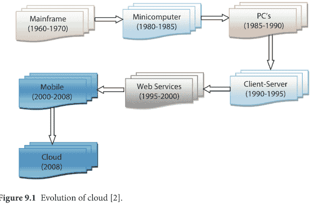


任务调度过程如下：云服务器（处理器）性能、将任务选择到云服务器上，以及任务在云服务器上的执行顺序。任务调度分为两个基本部分，即静态[8]和动态调度[9]。

本章重点关注任务调度算法中四种著名的启发式方法，即CPOP、ALAP、HEFT和PETS算法。这些算法作为基准，用于在云计算环境中与任何新提出的算法进行比较。后续章节将通过示例详细阐述这些启发式算法的详细信息。算法的比较分析使用性能指标，如调度长度、加速比、效率、调度长度比、资源利用率和成本。

## 9.2 工作流模型

工作流模型用于表示应用程序，它由有向无环图（DAG）表示，并形式化地定义为 $W_G$ = $(T, E, W)$，其中

- $T$ = ${\mathrm{X}_1, {\mathrm{X}_2, {\mathrm{X}_3},...,{\mathrm{X}_n}\}$ 是固定数量的第 $n$ 个任务。
- $E$ = ${\mathrm{e}_i, \mathrm{e}(\mathrm{X}_i, \mathrm{X}_j)\}$ 是任意两个任务 $\mathrm{X}_i$ 和 $\mathrm{X}_j$ 之间的边。
- $W$ = ${{(X_i, X_j) | X_i, X \in T}\}$ 是两个任务 $\mathrm{X}_i$ 和 $\mathrm{X}_j$ 之间边的数据传输时间。

任务之间的依赖关系必须维持，这被称为优先约束。每个DAG都有一个入口任务和出口任务。给定DAG的入口任务 $X_i$ 定义为 pred($X_i$) = $\Phi$，这意味着 $X_i$ 没有任何父任务。类似地，出口任务 succ($X_i$) = $\Phi$，表示没有任何子任务。一个简单的DAG模型如图9.2所示。

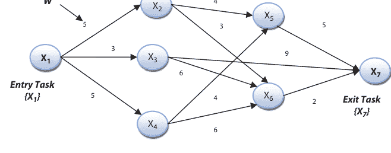

图 9.2 简单DAG模型。

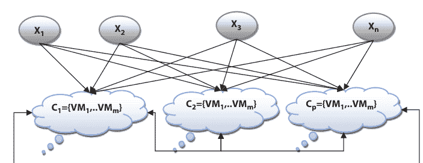

图 9.3 任务与虚拟机的映射。

## 9.3 系统计算模型

该模型由云服务器表示，这些云服务器使用快速网络以全双工模式进行通信。云服务器记为 $S_G = \{C_s\}$，其中 $C_s = \{C_1, C_2, \dots, C_p\}$ 是有限的第 $p$ 个云服务器的集合，每个云服务器 $C_1 = \{\text{VM}_{1,1},\dots,\text{VM}_{1,m}\}$，$C_2 = \{\text{VM}_{2,1},\dots,\text{VM}_{2,m}\}, \dots$，$C_p = \{\text{VM}_{p,1},\dots,\text{VM}_{p,m}\}$ 由一个或多个虚拟机组成。这里，云服务器的虚拟机是异构平台，它们以不同的速度工作。如果两个任务 $T_i$ 和 $T_j$ 在同一 $S_G$ 中通信，则不考虑其通信时间；否则，将予以考虑。

图 9.3 显示了任务到相应云服务器的映射。

## 9.4 调度的主要目标

工作流模型调度的主要目标是减少虚拟机上的总体执行时间。其数学表示如下：

$$Sch_{\text{length}} = \min \{CTT(Exit Task X_{exit}, Virtual Machine M)\}$$

其中 CTT 是任务的完成时间。

## 9.5 调度的任务计算属性

这些属性在将任务分配到虚拟机时起着重要作用，以下详细讨论了七个属性 [26]：

- **预计计算时间 (ECT)** [10, 26, 27]

$$ECT_{ij} = \begin{bmatrix} ECT_{11} & ECT_{12} & \dots & ECT_{1n} \\ ECT_{21} & ECT_{22} & \dots & ECT_{2n} \\ \dots & \dots & \dots & \dots \\ ECT_{m1} & ECT_{m2} & \dots & ECT_{mn} \end{bmatrix}$$

其中 $ECT_{ij}$ 为 $X_i$ 在 VM$_j$ 上的值。

- **平均 ECT (AECT)** [11, 26, 27] 对于任务 $X_i$ 定义为

$$AECT_i = \frac{\sum_{j=1}^{m} ECT_{i,j}}{m}$$

- **关键路径 (CP)** [12, 13, 26, 27] 是从 X$_{entry}$ 到 X$_{exit}$ 的最长链接，如下所示：

$$CP = \max_{path \in DAG} \{length(path)\}$$

$$length(path) = \sum_{Xi \in T} AECT(Xi) + \sum_{e \in E} T_c(X_i, X_j)$$

- **最早开始时间 EST** [14, 26, 27] 如下所示：

$$EST(X_i, VM_j) = \begin{cases} 0 & if \; X_i \in X_{entry} \\ \max_{X_j \in pred(X_i)} \{EFT(X_j, VM_j) + MET(X_i) + T_c(X_i, X_j)\} & otherwise \end{cases}$$

- **最小执行时间 MET** [15, 26, 27] 定义如下：

$$MET(X_i) = min.\{ECT(X_p, VM_m)\}$$

- **最早完成时间 EFT** [15, 26, 27] 定义如下：

$$EFT(X_p, VM_j) = ECT_{ij} + EST(X_p, VM_j)$$

- **静态级别 SL** [13, 15, 26, 27]：可以定义如下：

$$SL(X_i) = AECT(X_i) + \max_{X_j \in Succ(X_i)}\;\{SL(X_j)\}$$

## 9.6 性能指标

启发式算法的比较基于以下性能指标：*调度长度、调度长度比、加速比和效率、资源利用率以及成本*。

- **i. 调度长度** [15]：这是一个重要的比较指标，因为它给出了给定DAG中任务的总体执行时间。形式上，调度长度定义为给定DAG的出口任务在可用虚拟机上所需的最短时间，即：

$$Scheduling Length = Min.\;\{EFT(T_{exit}, VM)\}$$

- **ii. 调度长度比 (SLR)** [15–17]：它是调度长度与给定DAG中关键路径（$CP_{min}$）任务的最小ECT之和的比值，即：

$$SLR = \frac{Scheduling Length of Algorithm}{\sum_{T_j \in CP_{min}} Min(ECT_{i,j})}$$

- **iii. 加速比** [17]：它定义为给定DAG上所有任务在最少时间内运行的虚拟机上ECT之和与调度长度的比值，即：

$$Speedup = \frac{Min.\left[\sum_{j=1}^{m} ECT_{i,j}\right]}{Scheduling Length}$$

其中 $m$ 是虚拟机数量。

- **iv. 效率** [17]：它定义为*加速比*与虚拟机总数量的比值，即：

$$Efficiency = \frac{Speedup}{m} \times 100$$

- **v. 资源利用率** [18]：这是云计算的重要指标，其主要目标是最大化资源利用率。通过平均资源利用率（ARU）进行计算。

$$ARU = \frac{\sum_{i=1}^{m} T(VM_i)}{Scheduling Length \times m} \times 100$$

其中 $T(VM_i)$ 是虚拟机 i 完成给定DAG中所有任务所需的时间。

- **vi. 成本** [19]：该指标由以下公式定义：

$$Cost = \sum E_{ij} \times C(VM_j)$$

其中 $E_{ij}$ 是 $X_i$ 在 $VM_j$ 上的运行时间，$C(VM_j)$ 是 $VM_j$ 每单位时间的成本。

## 9.7 启发式任务调度算法

本节将讨论云计算环境中四种著名的启发式调度算法，如HEFT [20]、CPOP [20]、ALAP [12]和PETS [21]，如图9.4所示。这些启发式算法用作标准算法，以便利用各种性能指标与任何新算法进行比较。所有四种启发式算法都基于任务的优先级属性，并根据其优先级分配到机器上。算法的详细信息将在后续章节中介绍。

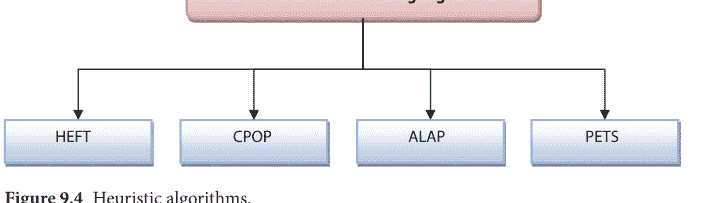

### 9.7.1 异构最早完成时间 (HEFT) 算法

HEFT [20] 是异构平台的一种列表调度类型，它具有良好的性能，具有理想的调度长度。它工作在两个不同的阶段，如下所示：

**第一阶段：任务优先级**

任务的顺序（升序或降序）称为任何任务的优先级。HEFT算法使用向上排名方法来计算给定DAG中任务的优先级。该方法也称为b-level（底层）属性。它用 $U^{Rank}$ 表示，并基于任务的平均执行时间和平均通信时间。任务优先级的计算将从出口任务开始，并向上移动到DAG。形式上，它表示为 [20]：

$$U^{Rank}(X_i)=\begin{cases} AET(X_i)+\max_{X_j\in\mathrm{SUC}(X_i)}\left(CT_{i,j}+U^{Rank}(X_j)\right)&\text{if }X_i\neq X_{exit}\\ AET(X_{exit})&\text{if }X_i=X_{exit}\end{cases}$$

其中：

- $X_i$ 是给定DAG中的任务
- $X_{exit}$ 是给定DAG中的最后一个任务
- $CT_{i,j}$ 是任务 $X_i$ 和 $X_j$ 之间的通信时间
- SUC 是 $X_i$ 的有限直接后继集合
- AET 是任务 $X_i$ 的平均执行时间，可以用以下公式表示：

$$AET(X_i)=\frac{\sum_{j=1}^{m} ECT_{i,j}}{m}$$

**一个示例**

本节通过DAG$_1$ [14, 26, 27] 的详细例子（如图9.5所示）和ECT详细阐述了任务优先级阶段


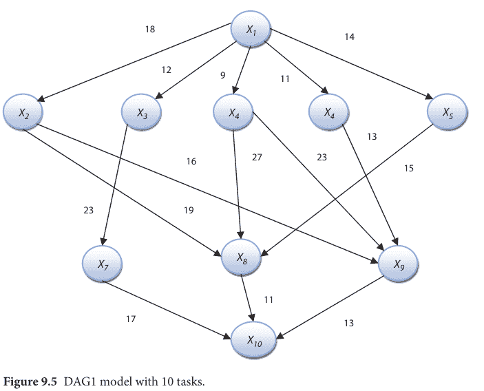

**图 9.5** 包含 10 个任务的 DAG₁ 模型。

[14, 26, 27] 任务的价值也在表 9.1 中给出。DAG₁ 包含 10 个任务 $\{X_1, X_2, \dots, X_{10}\}$，具有单一入口和单一出口任务，并考虑两台云服务器 CS₁ 和 CS₂。CS₁ 由两个虚拟机 VM₁ 和 VM₂ 组成。类似地，CS₂ 由一个虚拟机 VM₃ 组成。

给定 DAG₁ 中任务的向上等级（URank）计算将从出口任务 $X_{10}$ 开始，并向 DAG₁ 的上方移动。计算的详细信息 [20] 见表 9.2。

**表 9.1** DAG₁ 模型的 ECT [14, 26, 27] 矩阵。

| | $X_1$ | $X_2$ | $X_3$ | $X_4$ | $X_5$ | $X_6$ | $X_7$ | $X_8$ | $X_9$ | $X_{10}$ |
|---|---|---|---|---|---|---|---|---|---|---|
| **CS₁** | **VM₁** | 14 | 13 | 11 | 13 | 12 | 13 | 7 | 5 | 18 | 21 |
| **CS₁** | **VM₂** | 16 | 19 | 13 | 8 | 13 | 16 | 15 | 11 | 12 | 7 |
| **CS₂** | **VM₃** | 9 | 18 | 19 | 17 | 10 | 9 | 11 | 14 | 20 | 16 |

**表 9.2** DAG₁ 任务向上等级的计算。

| 任务($X_i$) | AET($X_i$) | $U^{Rank}(X_i)$ 的计算 |
|---|---|---|
| $X_{10}$ | $AET(X_{10}) = \frac{21+7+16}{3} = 14.67$ | 由于任务 $X_{10}$ 是出口任务，因此其 $U^{Rank}(X_{10})$ 为 $AET(X_{10}) = 14.67$，即 $U^{Rank}(X_{10}) = AET(X_{10}) = 14.67$。 |
| $X_9$ | $AET(X_9) = \frac{18+12+20}{3} = 16.67$ | $U^{Rank}(X_9) = AET(X_9) + \max_{X_k \in Succ(X_9)} (CT_{9,10} + U^{Rank}(X_{10}))$<br>$U^{Rank}(X_9) = 16.67 + 13 + 14.67 = 44.334$<br>$X_9$ 的唯一后继是 $X_{10}$。 |
| $X_8$ | $AET(X_8) = \frac{5+11+14}{3} = 10$ | $U^{Rank}(X_8) = AET(X_8) + \max_{X_k \in Succ(X_8)} (CT_{8,10} + U^{Rank}(X_{10}))$<br>$U^{Rank}(X_8) = 10 + 11 + 14.67 = 35.667$<br>$X_{10}$ 是 $X_8$ 的唯一后继。 |
| $X_7$ | $AET(X_7) = \frac{7+13+11}{3} = 11$ | $U^{Rank}(X_7) = AET(X_7) + \max_{X_k \in Succ(X_7)} (CT_{7,10} + U^{Rank}(X_{10}))$<br>$U^{Rank}(X_7) = 11 + 17 + 14.67 = 42.667$<br>$X_{10}$ 是 $X_7$ 的唯一后继。 |
| $X_6$ | $AET(X_6) = \frac{13+16+9}{3} = 12.667$ | $U^{Rank}(X_6) = AET(X_6) + \max_{X_8 \in suc(X_6)} (CT_{6,8} + U^{Rank}(X_8))$<br>$U^{Rank}(X_6) = 12.667 + 15 + 35.667 = 63.333$<br>$X_8$ 是 $X_6$ 的唯一后继。 |
| $X_5$ | $AET(X_5) = \frac{12+13+10}{3} = 11.667$ | $U^{Rank}(X_5) = AET(X_5) + \max_{X_9 \in suc(X_5)} (CT_{5,9} + U^{Rank}(X_9))$<br>$U^{Rank}(X_5) = 11.667 + 13 + 44.334 = 69.00$<br>$X_9$ 是 $X_5$ 的唯一后继。 |
| $X_4$ | $AET(X_4) = \frac{13+8+17}{3} = 12.667$ | $X_8$ 和 $X_9$ 是 $X_4$ 的两个后继。<br>通过 $X_8$ 和 $X_9$ 计算向上等级。仅取直接后继之间的最大值。<br>$U^{Rank}(X_4) = AET(X_4) + \max_{X_8, X_9 \in suc(X_4)} \{ (CT_{4,8} + U^{Rank}(X_8)), (CT_{4,9} + U^{Rank}(X_9)) \}$<br>$U^{Rank}(X_4) = 12.667 + \max_{X_8, X_9 \in suc(X_4)} [62.667, 67.334]$<br>$U^{Rank}(X_4) = 12.667 + 67.334 = 80.00$ |
| $X_3$ | $AET(X_3) = \frac{11+13+19}{3} = 14.334$ | $U^{Rank}(X_3) = AET(X_3) + \max_{X_7 \in suc(X_3)} (CT_{3,7} + U^{Rank}(X_7))$<br>$U^{Rank}(X_3) = 14.334 + 23 + 42.667 = 80.00$<br>$X_7$ 是 $X_3$ 的唯一后继。 |
| $X_2$ | $AET(X_2) = \frac{13+19+18}{3} = 16.667$ | $X_8$ 和 $X_9$ 是 $X_2$ 的两个后继。通过 $X_8$ 和 $X_9$ 计算向上等级。仅取直接后继之间的最大值。<br>$U^{Rank}(X_2) = AET(X_2) + \max_{X_8, X_9 \in SUC(X_2)} [(CT_{2,8} + U^{Rank}(X_8)), (CT_{2,9} + U^{Rank}(X_9))]$<br>$U^{Rank}(X_2) = 16.667 + \max_{X_8, X_9 \in SUC(X_2)} \{54.667, 60.334\}$<br>$U^{Rank}(X_2) = 16.667 + 60.334 = 77.00$ |
| $X_1$ | $AET(X_1) = \frac{14+16+19}{3} = 13$ | $X_4, X_5, X_6$ 是 $X_1$ 的三个后继。通过 $X_2, X_4, X_5$ 和 $X_6$ 计算向上等级。仅取直接后继之间的最大值。<br>$U^{Rank}(X_1) = AET(X_1) + \max_{X_2, X_4, X_5, X_6 \in SUC(X_1)} U^{Rank}(X_i)$<br>$U^{Rank}(X_1) = 13 + 95 = 108$<br>\{95, 92, 89, 80, 77, 33\} |

上表计算了给定 $DAG_1$ 中任务的向上等级 $U^{Rank}$，所有 10 个任务的 $U^{Rank}$ 值如下所示：

$$U^{Rank}(X_1) = 108, \ U^{Rank}(X_2) = 77, \ U^{Rank}(X_3) = 80, \ U^{Rank}(X_4) = 80,$$
$$U^{Rank}(X_5) = 69, \ U^{Rank}(X_6) = 63.33, \ U^{Rank}(X_7) = 42.667, \ U^{Rank}(X_8) = 35.667, \ U^{Rank}(X_9) = 44.333, \ U^{Rank}(X_{10}) = 14.667$$

使用 $U^{Rank}$ 计算给定 $DAG$ 的任务优先级，并根据 $U^{Rank}$ 值以降序排列。任务的排序为 $X_1, X_3, X_4, X_2, X_5, X_6, X_9, X_7, X_8$ 和 $X_{10}$。这些任务将在算法的下一阶段用于分配。

### 第二阶段：虚拟机选择

该阶段用于根据*任务优先级阶段*中计算的优先级选择任务，并将这些任务调度到合适的虚拟机中，以实现任务的最佳完成时间。

虚拟机选择基于两个重要属性：EST [14] 和 EFT [15]。这些属性的详细信息如下：

*最早开始时间 EST* [26, 27] 定义如下：

$$EST(X_i, VM_j) = \begin{cases} 0 & \text{如果 } X_i \in X_{entry} \\ \max_{X_j \in pred(X_i)} \{ EFT(X_j, VM_j) + MET(X_i) + CT_{i,j} \} & \text{其他情况} \end{cases}$$

*最小执行时间 MET* [22, 26, 27] 定义如下：

$$MET(X_i) = min.\{ ECT(X_j, VM_j) \}$$

*最早完成时间 EFT* [26, 27] 定义如下：

$$EFT(X_i, VM_j) = ECT_{ij} + EST(X_i, VM_j)$$

### 一个示例

任务的排序为 $X_1, X_3, X_4, X_2, X_5, X_6, X_9, X_7, X_8$ 和 $X_{10}$。根据上述属性和表 9.1 中给出的 ECT 值，这些任务将被分配到可用的虚拟机上。在任务分配过程中，必须保持任务之间的优先级约束。

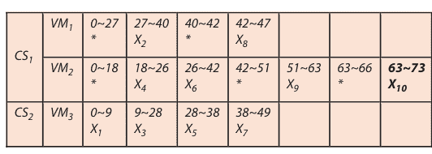

这里，考虑两台云服务器 $\mathrm{CS}_1$ 和 $\mathrm{CS}_2$。$\mathrm{CS}_1$ 由两个虚拟机 $\mathrm{VM}_1$ 和 $\mathrm{VM}_2$ 组成。$\mathrm{CS}_2$ 由一个虚拟机 $\mathrm{VM}_3$ 组成。为此，使用甘特图 [23] 表示任务到 VM 的分配，如图 9.6 所示。HEFT 算法为给定包含 10 个任务的 DAG 生成了 73 个单位的调度长度。

## 9.7.2 处理器上的关键路径 (CPOP) 算法

CPOP 算法 [20] 是另一种标准的启发式算法，用于与提出的算法进行比较。与 HEFT 算法一样，该算法也分为两个阶段运行，即任务优先级和虚拟机选择。但是，确定给定 $\mathrm{DAG}_1$ 中任务优先级的方法基于两个等级值的总和，即向上等级和向下降级。CPOP 算法中的任务要么是临界路径任务，要么是非临界路径任务。临界路径任务将分配到具有最小执行时间的同一机器上，而非临界任务在分配到同一机器时没有此类条件。它们将根据任务的 EST 和 EFT 属性进行分配。它有一个优先队列，按照秩值总和维持。

**第一阶段：任务优先级**

该阶段再次分为三个主要部分，即优先级划分、临界路径任务和临界路径虚拟机。这些部分的详细信息如下：

- **a. 优先级划分**

任务优先级基于给定 $\mathrm{DAG}_1$ 中任务的向上等级 $U^{Rank}$ 和向下降级 $D^{Rank}$。它可以表示为 [20]：

$$T^{Priority}(X_{i})=U^{Rank}(X_{i})+D^{Rank}(X_{i})$$


其中

$$U^{Rank}(X_{i}) = \begin{cases} AET(X_{i}) + \max _{X \in \operatorname{SUC}(X_{i})} \left(CT_{i, j} + U^{Rank}(X_{j})\right) & \text{if } X_{i} \neq X_{\text{exit}} \\ AET\left(X_{\text{exit}}\right) & \text{if } X_{i} = X_{\text{exit}} \end{cases}$$

$$U^{Rank}(X_{i}) = \begin{cases} \max _{X_{j} \in \operatorname{PRE}(X_{i})} \left\{D^{Rank}(X_{j}) + AET(X_{j}) + CT_{i, j}\right\} & \text{if } X_{i} \neq X_{\text{entry}} \\ 0 & \text{if } X_{i} = X_{\text{entry}} \end{cases}$$

其中 $PRE(X_{i})$ 是任务 $X_{i}$ 的有限前驱集。$D^{Rank}(X_{i})$ 的正式定义是从 $X_{\text{entry}}$ 到 $X_{i}$ 的最大距离，并且避免了平均执行时间 AET($X_{i}$) 的干扰。

### b. 关键路径任务

它有一个关键路径长度 $\left|\mathrm{C}^{\mathrm{p}}\right|$，这是给定 DAG 中从 $X_{\text{entry}}$ 到 $X_{\text{exit}}$ 的最长路径的长度。$\left|\mathrm{C}^{\mathrm{p}}\right|$ 的值为 $X_{\text{entry}}^{Priority}(X_{\text{entry}})$。此阶段还识别了给定 $\mathrm{DAG}_{1}$ 的关键路径任务，表达如下：

它由 $CP_{\mathrm{SET}}$ 指定，并根据文献 [24] 计算如下：

```
Step 1: CP_SET = {X_entry}
Step 2: X = X_entry
Step 3: while X != X_exit then
        Find successors of X as X_j
        If T_j^Priority(X) = |C^P| then
            CP_SET = CP_SET U {X}
        Otherwise
            X = X_j
        End While.
Step 4: stop.
```

该算法有助于计算给定 DAG 关键路径上的所有任务。

### c. 关键路径 VM

它识别出在计算所有关键路径任务 $\mathrm{CP}_{\mathrm{SET}}$ 时执行时间最短的虚拟机，即在同一 VM 上执行 $\mathrm{CP}_{\mathrm{SET}}$，公式为：

$$CP^{VM} = \min_{X_i \in CP^{SET}} \{ \sum ECT(X_i) \text{ on VM} \}$$

# 一个示例

考虑与图 9.5 中所示相同的 DAG₁ [14, 26] 示例，以及表 9.1 中给出的任务 ECT [14] 值。DAG₁ [27] 由 10 个任务组成，具有单一入口任务和单一出口任务，并考虑了两台云服务器 CS₁ 和 CS₂。CS₁ 包含两个虚拟机 VM₁ 和 VM₂。同样，CS₂ 包含一个虚拟机 VM₃。给定 DAG₁ 的任务向下秩（$D^{Rank}$）的计算将从入口任务 $T_{entry}$ 开始，并沿给定 DAG₁ 向下移动。向下秩（$D^{Rank}$）计算 [24] 的详细信息如表 9.3 所示，任务优先级 $T^{Priority}$ 的计算如表 9.4 所示。

$|CP|$ 的值为 108，关键路径任务 $CP^{SET}$ 将是 $\{X_1, X_2, X_9, X_{10}\}$，并且这些任务在 VM₂ 上执行所需的最短执行时间为 54。因此，在调度给定 DAG₁ 的任务时，所有 $CP^{SET}$ 任务都分配在 VM₂ 上。

# 第二阶段：VM 选择

此阶段包括就绪队列（RQ），它由给定 DAG₁ 的入口任务初始化。任务从 RQ 中逐个移除，如果移除的任务 T 属于 $CP^{SET}$，则将其调度到 $CP^{VM}$ 中的虚拟机上；否则，将其调度到执行时间（EFT）最短的虚拟机上。$T_i$ 的所有后继任务 $T_j$ 将根据 $T^{Priority}$ 的值插入 RQ。在分配到虚拟机时必须始终保持前置约束，否则给予下一个低优先级任务机会。

# 一个示例

按照 COP 算法的顺序，给定图 9.5 中 DAG₁ 的任务顺序为 $X_1, X_2, X_3, X_7, X_4, X_5, X_6, X_8, \text{ and } X_{10}$。任务的 ECT 值在表 9.1 中给出。在这里，考虑两台云服务器 CS1 和 CS₂。CS₁ 包含两个虚拟机 VM₁ 和 VM₂。CS₂ 包含一个虚拟机 VM₃。为此，使用甘特图 [23] 来表示任务在 VM 上的分配，如图 9.7 所示。COP 算法为包含 10 个任务的给定 DAG₁ 生成了 86 个单位长度的调度时长。

# 表 9.3 DAG₁ 任务的向下秩计算。（续）

| Task($X_{i}$) | AET($X_{i}$) | Computation of $D_{Rank}^{*}(X_{i})$ |
| :--- | :--- | :--- |
| $X_{1}$ | $\begin{aligned} AET(X_{1}) &= \frac{14+16+19}{3} \\ &= 13 \end{aligned}$ | $X_{1}$ 是入口任务，其向下值为 0，即 $D_{Rank}^{*}(X_{1}) = 0$ |
| $X_{2}$ | $\begin{aligned} AET(X_{2}) &= \frac{13+19+18}{3} \\ &= 16.667 \end{aligned}$ | $X_{1}$ 是 $X_{2}$ 的唯一前驱任务。 <br>$\begin{aligned} D_{Rank}^{*}(X_{2}) &= \max_{X_{j} \in PRE(X_{2})} [D_{Rank}^{*}(X_{j}) + AET(X_{j}) + CT_{j}] \\ &= 0 + 13 + 18 = 31 \end{aligned}$ |
| $X_{3}$ | $\begin{aligned} AET(X_{3}) &= \frac{11+13+19}{3} \\ &= 14.334 \end{aligned}$ | $X_{1}$ 是 $X_{3}$ 的唯一前驱任务。 <br>$\begin{aligned} D_{Rank}^{*}(X_{3}) &= \max_{X_{j} \in PRE(X_{3})} [D_{Rank}^{*}(X_{j}) + AET(X_{j}) + CT_{j}] \\ &= 0 + 13 + 12 = 25 \end{aligned}$ |
| $X_{4}$ | $\begin{aligned} AET(X_{4}) &= \frac{13+8+17}{3} \\ &= 12.667 \end{aligned}$ | $X_{1}$ 是 $X_{4}$ 的唯一前驱任务。 <br>$\begin{aligned} D_{Rank}^{*}(X_{4}) &= \max_{X_{j} \in PRE(X_{4})} [D_{Rank}^{*}(X_{j}) + AET(X_{j}) + CT_{j}] \\ &= 0 + 13 + 9 = 22 \end{aligned}$ |
| $X_{5}$ | $\begin{aligned} AET(X_{5}) &= \frac{12+13+10}{3} \\ &= 11.667 \end{aligned}$ | $X_{1}$ 是 $X_{5}$ 的唯一前驱任务。 <br>$\begin{aligned} D_{Rank}^{*}(X_{5}) &= \max_{X_{j} \in PRE(X_{5})} [D_{Rank}^{*}(X_{j}) + AET(X_{j}) + CT_{j}] \\ &= 0 + 13 + 11 = 24 \end{aligned}$ |
| $X_{6}$ | $\begin{aligned} AET(X_{6}) &= \frac{13+16+9}{3} \\ &= 12.667 \end{aligned}$ | $X_{1}$ 是 $X_{6}$ 的唯一前驱任务。 <br>$\begin{aligned} D_{Rank}^{*}(X_{6}) &= \max_{X_{j} \in PRE(X_{6})} [D_{Rank}^{*}(X_{j}) + AET(X_{j}) + CT_{j}] \\ &= 0 + 13 + 14 = 27 \end{aligned}$ |

# 表 9.3 DAG 任务的向下秩计算。（续）

| Task($X$) | AET($X$) | Computation of $D^{Rank}(X)$ |
| :---: | :---: | :---: |
| $X_7$ | $AET(X_7) = \frac{7+13+11}{3} = 11$ | $X_6$ 是 $X_7$ 的唯一前驱任务。<br>$D^{Rank}(X_7) = \max_{X_j \in PRE(X_7)} [D^{Rank}(X_j) + AET(X_j) + CT_{j,7}] = 27 + 12.667 + 22.534 = 62.534$ |
| $X_8$ | $AET(X_8) = \frac{5+11+14}{3} = 10$ | $X_2, X_3$ 和 $X_6$ 是 $X_8$ 的三个前驱任务。<br>$D^{Rank}(X_8) = \max_{X_j \in PRE(X_8)} \{ [D^{Rank}(X_2) + AET(X_2) + CT_{2,8}], [D^{Rank}(X_3) + AET(X_3) + CT_{3,8}], [D^{Rank}(X_6) + AET(X_6) + CT_{6,8}] \} = 66.667$ |
| $X_9$ | $AET(X_9) = \frac{18+12+20}{3} = 16.67$ | $X_2, X_4$ 和 $X_5$ 是 $X_9$ 的三个前驱任务。<br>$D^{Rank}(X_9) = \max_{X_j \in PRE(X_9)} \{ [D^{Rank}(X_2) + AET(X_2) + CT_{2,9}], [D^{Rank}(X_4) + AET(X_4) + CT_{4,9}], [D^{Rank}(X_5) + AET(X_5) + CT_{5,9}] \} = 63.667$ |
| $X_{10}$ | $AET(X_{10}) = \frac{21+7+16}{3} = 14.67$ | $X_7, X_8$ 和 $X_9$ 是 $X_{10}$ 的三个前驱任务。<br>$D^{Rank}(X_{10}) = \max_{X_j \in PRE(X_{10})} \{ [D^{Rank}(X_8) + AET(X_8) + CT_{8,10}], [D^{Rank}(X_9) + AET(X_9) + CT_{9,10}] \} = 93.333$ |

# 表 9.4 DAG 1 中任务优先级 $T^{Priority}$ [20] 的计算。

| Task($X_i$) | $U^{Rank}(X_i)$ | $D^{Rank}(X_i)$ | $T^{Priority}(X_i) = U^{Rank}(X_i) + D^{Rank}(X_i)$ |
| :--- | :--- | :--- | :--- |
| $X_1$ | 108 | 0 | 108 |
| $X_2$ | 77 | 31 | 108 |
| $X_3$ | 80 | 25 | 105 |
| $X_4$ | 80 | 22 | 102 |
| $X_5$ | 69 | 24 | 93 |
| $X_6$ | 63.33 | 27 | 90.33 |
| $X_7$ | 42.66 | 62.33 | 105 |
| $X_8$ | 35.66 | 66.66 | 102.33 |
| $X_9$ | 44.33 | 63.66 | 108 |
| $X_{10}$ | 14.66 | 93.33 | 108 |

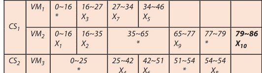

图 9.7 任务分配的甘特图。

## 9.7.3 尽可能晚（ALAP）算法

ALAP [12] 是一种适用于异构和同构平台的调度算法。该算法有两个阶段：任务优先级排序和 VM 选择。

### 任务优先级排序阶段

任务优先级排序阶段计算为给定 $DAG_{1}$ 中任务 $X_{i}$ 的*关键路径* $C^{Path}$ 与*向上秩* $U^{Rank}$ 之间的差值。它可以表示为

$$T^{Priority}(X_{i}) = C^{Path} - U^{Rank}(X_{i})$$


$C^{\text{Path}}$ 是从入口任务到出口任务的路径长度，其中“长度”取最长值。该属性在 [13] 中表述如下：

$$C^{\text{Path}} = \max_{\text{path} \in \text{DAG}_i} \{ \text{length(path)} \}$$
$$\text{length(path)} = \sum_{X_i \in X} \text{AECT}(X_i) + \sum_{X_i, X_j \in E} C^{\text{Time}}(X_i, X_j)$$

其中：

- *AECT($X_i$)* [20] 是任务 $X_i$ 的平均预计计算时间，其计算方法如下：
  $$\text{AECT}(X_i) = \frac{\sum_{j=1}^m \text{ECT}_{i,j}}{m}, \quad \textit{其中 } m \text{ 为虚拟机总数。}$$
- *$C^{\text{Time}}(X_i, X_j)$* 是任务 $X_i$ 和 $X_j$ 之间的通信时间。
- $E$ 是 DAG 的有限边集合。
- $X$ 是 DAG 的有限任务集合。

$U^{\text{Rank}}(X_i)$ 是从 $X_i$ 到 $X_{\text{exit}}$ 任务的最长路径，且包含 $T_i$ 的执行时间。向上排名也被称为 *底层（Bottom Level (B-Level)）*。$U^{\text{Rank}}(X_i)$ 的表述如下：

$$U^{\text{Rank}}(X_i) = \begin{cases} \text{AET}(X_i) + \max_{X_j \in \text{SUC}(X_i)} (CT_{i,j} + U^{\text{Rank}}(X_j)) & \text{若 } X_i \neq X_{\text{exit}} \\ \text{AET}(X_{\text{exit}}) & \text{若 } X_i = X_{\text{exit}} \end{cases}$$

其中：

- $X_i$ 是给定 DAG 中的任务。
- $X_{\text{exit}}$ 是给定 DAG 中的最后一个任务。
- $CT_{i,j}$ 是任务 $X_i$ 和 $X_j$ 之间的通信时间。
- SUC 是 $X_i$ 的有限直接后继集合。
- AET 是任务 $X_i$ 的平均执行时间，其表达式为：
  $$\text{AET}(X_i) = \frac{\sum_{j=1}^m \text{ECT}_{i,j}}{m}$$

## 虚拟机选择阶段

在计算了给定 DAG$_{1}$ 中任务的优先级后，这些任务将被排序，以便在云服务器的虚拟机中进行调度。

此阶段根据最小 EST（最早开始时间）和 EFT（最早完成时间）属性来决定特定虚拟机的选择。EST 和 EFT 属性的详细说明如下：

最早开始时间 EST [26, 27] 定义如下：

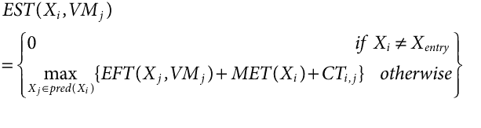

最小执行时间 MET [22, 26, 27] 定义如下：


最早完成时间 EFT [26, 27] 定义如下：


## 一个示例

考虑图 9.5 中所示的 DAG$_{1}$ [14, 26, 27]，以及表 9.1 中给出的任务 ECT [14, 26, 27] 值。该 DAG$_{1}$ 包含 10 个任务，具有单入口和单出口，并考虑了两台云服务器 CS$_{1}$ 和 CS$_{2}$。CS$_{1}$ 由两个虚拟机 VM$_{1}$ 和 VM$_{2}$ 组成。同样，CS$_{2}$ 由一个虚拟机 VM$_{3}$ 组成。

任务的临界路径在图 9.8 中用红色粗线表示，$C^{\text{Path}}$ 的值为 108。给定 DAG$_{1}$ 中任务 $X_{i}$ 的任务优先级 $T^{\text{Priority}}$ 的详细计算过程见表 9.5。

给定图 9.5 中的 DAG，将任务 $X_{i}$ 的 $T^{\text{Priority}}$ 按升序排序，顺序为 $X_{1}$、$X_{3}$、$X_{4}$、$X_{2}$、$X_{5}$、$X_{6}$、$X_{9}$、$X_{7}$、$X_{8}$ 和 $X_{10}$。任务的 ECT 值见表 9.1，该值用于将这些任务分配到虚拟机时作为参考。这里，考虑两台云服务器 CS$_{1}$ 和 CS$_{2}$。CS$_{1}$ 由两个虚拟机 VM$_{1}$ 和 VM$_{2}$ 组成。CS$_{2}$ 由一个虚拟机 VM$_{3}$ 组成。为此，使用甘特图 [23] 来表示任务到虚拟机的分配情况，如图 9.9 所示。ALAP 算法为给定的包含 10 个任务的 DAG 生成了 73 个时间单位的调度长度。

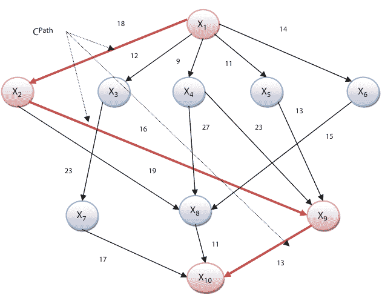

图 9.8 包含 10 个任务的 DAG 模型。

表 9.5
| 任务($X_j$) | $U^{\text{Rank}}(X_j)$ | $T^{\text{Priority}}(X_j) = C^{\text{Path}} - U^{\text{Rank}}(X_j)$ |
|---|---|---|
| $X_1$ | 108 | 0 |
| $X_2$ | 77 | 31 |
| $X_3$ | 80 | 28 |
| $X_4$ | 80 | 28 |
| $X_5$ | 69 | 39 |
| $X_6$ | 63.33 | 44.667 |
| $X_7$ | 42.66 | 65.333 |
| $X_8$ | 35.66 | 72.333 |
| $X_9$ | 44.33 | 63.667 |
| $X_{10}$ | 14.66 | 93.333 |

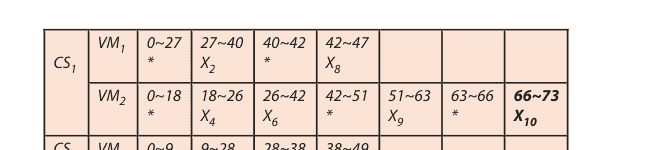

图 9.9 任务分配的甘特图。

## 9.7.4 性能有效任务调度（PETS）算法

PETS [21] 算法在三个阶段运行，包括任务级别排序、任务优先级设定以及虚拟机选择。

#### 第一阶段：任务级别排序

此阶段用于查找具有相应任务的级别，并从给定 DAG 的顶部到底部进行遍历。每个级别由多个独立任务组成，这些任务将按其出现的级别进行排序和分组。例如，如图 9.5 所示的给定 DAG 的任务级别排序被划分为四个级别。Level_1 由入口任务 $X_1$ 组成，Level_2 由中间任务 $X_2, X_3, X_4, X_5, X_6$ 组成，以此类推，其余两个级别也类似。任务级别的排序见表 9.6。

#### 第二阶段：任务优先级设定

此阶段用于计算给定 DAG$_{1}$ 中任务的优先级并将其分配给这些任务。有三种属性 [21] 被设计用于计算任务优先级，这些属性分别是：平均执行时间（AET）、数据通信时间（DCT）和前驱任务排名（PTR）。这些属性的详细说明如下：

任务 $T_i$ 的 AET 定义为 $\text{AET}(X_i) = \frac{\sum_{j=1}^{m} \text{ECT}_{i,j}}{m}$。例如，图 9.5 中所示的给定 DAG 的任务的 AET，使用表 9.1 中该 DAG 的 ECT 值。AET 计算的详细信息见表 9.7。

表 9.6 任务级别排序。

| 级别 | 任务组 |
| :--- | :--- |
| 1 | $\{X_1\}$ |
| 2 | $\{X_2, X_3, X_4, X_5, X_6\}$ |
| 3 | $\{X_7, X_8, X_9\}$ |
| 4 | $\{X_{10}\}$ |

表 9.7 AET 计算。

| 任务($X_{i}$) | $X_{1}$ | $X_{2}$ | $X_{3}$ | $X_{4}$ | $X_{5}$ | $X_{6}$ | $X_{7}$ | $X_{8}$ | $X_{9}$ | $X_{10}$ |
| :--- | :--- | :--- | :--- | :--- | :--- | :--- | :--- | :--- | :--- | :--- |
| $AET(X_{i}) = \frac{\sum_{j=1}^{3} ECT_{i,j}}{3}$ | 13 | 16.67 | 14.34 | 12.67 | 11.67 | 12.67 | 11 | 10 | 16.67 | 14.67 |

任务 $\mathrm{X}_{i}$ 的 $DCT$ 定义为在每一级中 $\mathrm{X}_{i}$ 的直接后继任务 $\mathrm{X}_{j}$ 的通信时间之和。其表达式 [21] 如下：

$$
DCT(\mathrm{X}_{i})= \left\{\begin{array}{cl}\sum_{j=1}^{s}\ CT(\mathrm{X}_{i},\mathrm{X}_{j}), & \text{若 } \mathrm{X}_{i} \neq \mathrm{X}_{exit}\\ 0 & \text{若 } \mathrm{X}_{i}=\mathrm{X}_{exit}\end{array}\right.
$$

其中 $s$ 是下一级别中任务的总数。

$\mathrm{DAG}_{1}$ 中任务 $DCT$ 的一个示例见图 9.5。$\mathrm{X}_{1}$ 有五个后继任务 $\mathrm{X}_{2}, \mathrm{X}_{3}, \mathrm{X}_{4}, \mathrm{X}_{5}$ 和 $\mathrm{X}_{6}$，$\mathrm{X}_{1}$ 与其所有后继任务之间的通信时间 $CT$ 之和为 64。同样，每一级中其余任务的 $DCT$ 计算过程见表 9.8。

任务 $\mathrm{X}_{i}$ 的 $PTR$ 是 $\mathrm{X}_{i}$ 的直接前驱 $\mathrm{X}_{j}$ 的最大排名，其计算方法 [21] 如下：

$$
PTR(\mathrm{X}_{i})= \left\{\begin{array}{cl}\max_{\mathrm{T}_{j} \in PRE(\mathrm{T}_{i})}\ \{RANK(\mathrm{X}_{j})\} & \text{若 } \mathrm{X}_{i} \neq \mathrm{X}_{entry}\\ 0 & \text{若 } \mathrm{X}_{i}=\mathrm{X}_{entry}\end{array}\right.
$$

其中 $PRE$ 是 $\mathrm{X}_{i}$ 的直接前驱任务。

任务 $\mathrm{X}_{i}$ 的 $RANK$ 基于该任务的 AET、DCT 和 PTR 计算得出。其计算公式如下：

$$RANK(\mathrm{X}_{i})=Round\{AET(\mathrm{X}_{i})+DCT(\mathrm{X}_{i})+PTR(\mathrm{X}_{i})\}$$

表 9.8 DCT 计算。

| 任务($X_{j}$) | $X_{1}$ | $X_{2}$ | $X_{3}$ | $X_{4}$ | $X_{5}$ | $X_{6}$ | $X_{7}$ | $X_{8}$ | $X_{9}$ | $X_{10}$ |
| :--- | :--- | :--- | :--- | :--- | :--- | :--- | :--- | :--- | :--- | :--- |
| DCT($X_{j}$) | 64 | 35 | 23 | 50 | 13 | 15 | 17 | 11 | 13 | 0 |

表 9.9 PTR、RANK 和优先级的计算。

| 级别 | 任务($X_i$) | DCT($X_i$) | AET($X_i$) | PTR($X_i$) | RANK($X_i$) | 优先级 |
|---|---|---|---|---|---|---|
| 1 | $X_1$ | 64 | 13 | 0 | 77 | 1 |
| 2 | $X_2$ | 35 | 16.67 | 77 | 129 | 2 |
| | $X_3$ | 23 | 14.34 | 77 | 115 | 3 |
| | $X_4$ | 50 | 12.67 | 77 | 140 | 1 |
| | $X_5$ | 13 | 11.67 | 77 | 102 | 5 |
| | $X_6$ | 15 | 12.67 | 77 | 105 | 4 |
| 3 | $X_7$ | 17 | 11 | 115 | 143 | 3 |
| | $X_8$ | 11 | 10 | 140 | 161 | 2 |
| | $X_9$ | 13 | 16.67 | 140 | 170 | 1 |
| 4 | $X_{10}$ | 0 | 14.67 | 170 | 185 | 1 |

每一级中任务的优先级由其排名值决定。如果一个任务在其级别中拥有最大的排名，那么它的优先级在该级别的任务中也将是最高的。给定 DAG${}_{1}$（见图 9.5）中任务的 PTR、RANK 和优先级的详细信息见表 9.9。

#### 第三阶段：虚拟机选择

在计算了给定 DAG${}_{1}$ 中任务的优先级后，这些任务将被排序，以便在云服务器的虚拟机中进行调度。

此阶段根据最小 *EST* 和 *EFT* 属性来决定特定虚拟机的选择。*EST* 和 *EFT* 属性的详细说明如下：

最早开始时间 EST [26, 27] 定义如下：

$$
EST(X_{i},VM_{j})
=
\left\{
\begin{array}{ll}
0 & \quad 若 \ X_{i} \in X_{entry} \\
\max_{X_{j} \in pred(X_{i})}\{EFT(X_{j},VM_{j}) + MET(X_{i}) + CT_{i,j}\} & 否则
\end{array}
\right\}
$$

最小执行时间 MET [22, 26, 27] 定义如下：

$$
MET(X_{i}) = \min\{ECT(X_{i}, VM_{j})\}
$$


| | VM$_1$ | 0~21 * | 21~32 X$_3$ | 32~44 X$_5$ | 44~51 * | 51~56 X$_8$ | 56~63 X$_7$ |
| :--- | :--- | :--- | :--- | :--- | :--- | :--- | :--- |
| CS$_1$ | VM$_2$ | 0~18 * | 18~26 X$_4$ | 26~44 * | 44~56 * | 56~63 * | 63~70 X$_{10}$ |
| | VM$_3$ | 0~9 X$_1$ | 9~27 X$_2$ | 27~36 X$_6$ | | | |
| CS$_2$ | | | | | | | |

图 9.10 任务分配的甘特图。

最早完成时间 EFT [26, 27] 定义如下：

$EFT(X_i, VM_j) = ECT_{ij} + EST(X_i', VM_j')$

### 示例说明

按照优先级排序，图 9.5 中 DAG$_1$ 的任务顺序为 X$_1$、X$_9$、X$_2$、X$_3$、X$_6$、X$_5$、X$_7$、X$_8$、X$_7$ 和 X$_{10}$。任务对应的 ECT 值列于表 9.1 中，这些值用于将任务分配至虚拟机。在此，我们考虑两个云服务器 CS$_1$ 和 CS$_2$。CS$_1$ 包含两个虚拟机 VM$_1$ 和 VM$_2$，而 CS$_2$ 包含一个虚拟机 VM$_3$。为此，使用甘特图 [23] 来表示任务在虚拟机上的分配情况，如图 9.10 所示。对于包含 10 个任务的给定 DAG，PETS 算法生成了 70 个单位的调度长度。

## 9.8 性能分析与结果

使用两个有向图 DAG$^1$ 和 DAG$^2$（如图 9.5 和 9.11 所示），对 HEFT、CPOP、ALAP 和 PETS 四种启发式算法进行了分析。本文在前一节中讨论了六项性能指标，并将其用作比较这四种启发式算法的依据。根据各算法，在章节开头计算了 DAG$^1$ 的所有启发式算法的调度长度。其他性能指标，如效率、加速比、SLR 和资源利用率，均基于调度长度。DAG$^1$ 的成本表如表 9.10 所示 [25]。

同样，计算了 DAG$^2$ 的所有四种启发式算法的调度长度，其余指标的值也列在表格中。DAG$^1$ 和 DAG$^2$ 的 ECT 表分别如表 9.1 和表 9.11 所示，而 DAG$^2$ 的成本表如表 9.12 所示。

六项性能指标的值显示在表 9.13 中 [25]。四种启发式算法所有性能指标的图形表示如图 9.12 至 9.17 所示。

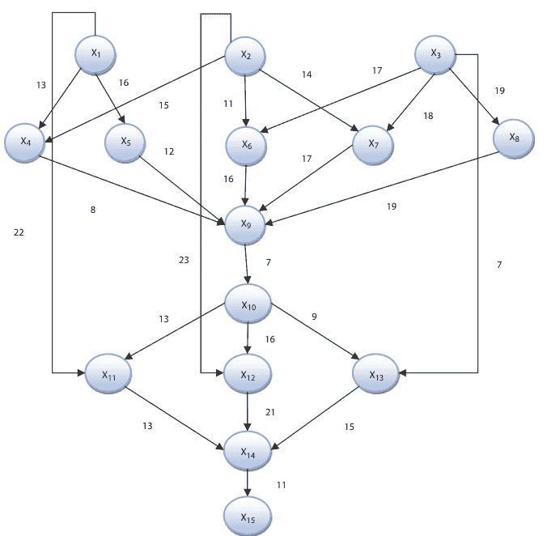

**图 9.11** 包含 15 个任务的 DAG$_2$ 模型。

**表 9.10** DAG$^1$ 的虚拟机速率。

| 虚拟机 (VM) | VM$_1$ | VM$_2$ | VM$_3$ |
| :--- | :---: | :---: | :---: |
| 成本/单位时间 | 1.71 | 1.63 | 1.21 |

**表 9.11** DAG$_2$ 模型的 ECT [15, 27] 矩阵。

| | $X_1$ | $X_2$ | $X_3$ | $X_4$ | $X_5$ | $X_6$ | $X_7$ | $X_8$ | $X_9$ | $X_{10}$ | $X_{11}$ | $X_{12}$ | $X_{13}$ | $X_{14}$ | $X_{15}$ |
| :--- | :---: | :---: | :---: | :---: | :---: | :---: | :---: | :---: | :---: | :---: | :---: | :---: | :---: | :---: | :---: |
| CS$_1$VM$_1$ | 17 | 14 | 19 | 13 | 19 | 13 | 15 | 19 | 13 | 19 | 13 | 15 | 18 | 20 | 11 |
| CS$_1$VM$_2$ | 14 | 17 | 17 | 20 | 20 | 18 | 15 | 20 | 17 | 15 | 22 | 21 | 17 | 18 | 18 |
| CS$_2$VM$_3$ | 13 | 14 | 16 | 13 | 21 | 13 | 13 | 13 | 13 | 16 | 14 | 22 | 16 | 13 | 21 |
| CS$_3$VM$_1$ | 22 | 16 | 12 | 14 | 15 | 18 | 14 | 18 | 19 | 13 | 12 | 14 | 14 | 16 | 17 |

**表 9.12** DAG$^2$ 的虚拟机成本。

| 虚拟机(VM) | VM$_1$ | VM$_2$ | VM$_3$ | VM$_4$ |
| :--- | :---: | :---: | :---: | :---: |
| 成本/单位时间 | 1.72 | 1.52 | 1.69 | 1.65 |

**表 9.13** 对比结果。

| | **性能指标结果** | | | | | |
| :--- | :--- | :--- | :--- | :--- | :--- | :--- |
| **DAG 模型** | **调度算法** | **调度长度** | **加速比** | **效率 (%)** | **SLR** | **资源利用率 (%)** | **成本/单位时间** |
| | HEFT | 73 | 1.74 | 58.00 | 1.78 | 77.12 | 258.65 |
| **DAG$^1$** | CPOP | 86 | 1.48 | 49.22 | 2.09 | 77.51 | 301.12 |
| | ALAP | 73 | 1.74 | 58.00 | 1.78 | 77.16 | 258.65 |
| | PETS | 70 | 1.81 | 60.33 | 1.71 | 80.47 | 265.39 |
| | HEFT | 152 | 1.52 | 38.00 | 1.71 | 69.73 | 702.75 |
| **DAG$^2$** | CPOP | 164 | 1.41 | 35.25 | 1.84 | 64.93 | 694.92 |
| | ALAP | 155 | 1.49 | 37.25 | 1.74 | 72.74 | 751.53 |
| | PETS | 152 | 1.52 | 38.00 | 1.71 | 65.13 | 666.43 |


**图 9.12** 调度长度。


**图 9.13** 加速比。


**图 9.14** 效率。


**图 9.15** SLR。


**图 9.16** 资源利用率。


**图 9.17** 成本。

## 9.9 结论

本章讨论了 HEFT、CPOP、ALAP 和 PETS 四种启发式算法。这些算法被用作标准算法，以便与任何新提出的算法进行比较。所有四种启发式算法都通过 DAG 进行了详细研究和说明，其中 DAG$^2$ 分别包含 10 个和 15 个任务。这些算法利用多种属性来确定给定 DAG 中任务的优先级。基于六项性能指标，对包含 10 个和 15 个任务的两种 DAG 分别进行了启发式算法的比较研究。

# 参考文献

- 1. Hashizume, K., Rosado, D.G., Fernández-Medina, E., Fernandez, E.B., An analysis of Security Issues for Cloud Computing. J. Internet Serv. Appl., 4, 1, 5, 1–13, 2013.
- 2. Pachghare, V.K., Cloud Computing, PHI, Delhi India, 2016.
- 3. Zhao, G., Liu, J., Tang, Y., Sun, W., Zhang, F., Ye, X., Tang, N., Cloud Computing: A Statistics Aspect of Users. First International Conference on Cloud Computing (CloudCom), Beijing, China, Springer Berlin, Heidelberg, pp. 347–358, 2009.
- 4. Zhang, S., Zhang, S., Chen, X., Huo, X., Cloud Computing Research and Development Trend. Second International Conference on Future Networks (ICFN’10), Sanya, Hainan, China, IEEE Computer Society, Washington, DC, USA, pp. 93–97, 2010.
- 5. Gary, M.R. and Johnson, D.S., Computer and Intractability: A Guide to the theory of NP Completeness, W.H freeman, San Francisco CA, 1989.
- 6. Yadav, A.K. and Mandoria, H.L., Study of Task Scheduling Algorithms in the Cloud Computing Environment: A Review. Int. J. Comput. Sci. Inf. Technol., 8, 4, 462–468, 2017.
- 7. Kaur, R. and Kaur, R., Multiprocessor Scheduling using Task Duplication Based Scheduling Algorithms: A Review Paper. Int. J. Appl. Innov. Eng. Manage., 2, 4, 311–317, April, 2013.
- 8. Chung, Y.-C. and Ranka, S., Applications and Performance Analysis of a Compile-Time Optimization Approach for List Scheduling Algorithms on Distributed Memory Multiprocessors. Supercomputing '92: Proceedings of the 1992 ACM/IEEE Conference on Supercomputing, Minneapolis, MN, USA, pp. 512–521, 1992.
- 9. Srinivas, G.N. and Musicus, B.R., Generalized Multiprocessor Scheduling for Directed Acyclic Graphs, in: Third Annual ACM Symposium on Parallel Algorithms and Architectures, pp. 237–246, 1994.
- 10. Zanywayingona, F.N. and Yang, Y., Effective Task Scheduling and Dynamic Resource Optimization based on Heuristic Algorithms in Cloud Computing Environment. KSIITrans. Internet Inf. Syst., 11, 12, 5780–5802, 2017.
- 11. Haidri, R.A., Katti, C.P., Saxena, P.C., Cost Effective Deadline Aware Scheduling Strategy For Workflow Applications on Virtual Machines in Cloud Computing. J. King Saud Univ. – Comp. Info. Sci., 32, 6, July 2020.
- 12. Kwok, Y.-K. and Ahmad, I., Static Scheduling Algorithms for Allocating Directed Task Graphs to Multiprocessors. ACM Comput. Surv., 31, 4, 1–88, December, 1999.
- 13. Sinnen, O., Task Scheduling for Parallel Systems, Wiley Interscience Pulation, Hoboken, New Jersey, 2007.
- 14. Kumar, M.S., Gupta, I., Jana, P.K., Delay-based workflow scheduling for cost optimization in heterogeneous cloud system. Tenth International Conference on Contemporary Computing (IC3), Noida, pp. 1–6, 2017.
- 15. Gupta, I., Kumar, M.S., Jana, P.K., Efficient Workflow Scheduling Algorithm for Cloud Computing System: A Dynamic Priority-Based Approach. Arab. J. Sci. Eng., 43, 12, 7945–7960, 2018.
- 16. Hwang, K., Advanced Computer Architecture: Parallelism, Scalability, Programmability, TMH Publishing Company, New Delhi, 2005.
- 17. Akbar, M.F., Munir, E.U., Rafique, M.M., Malik, Z., Khan, S.U., Yang, L.T., List-Based Task Scheduling for Cloud Computing. IEEE International Conference on Internet of Things (iThings) and IEEE Green Computing and Communications (GreenCom) and IEEE Cyber, Physical and Social Computing (CPSCCom) and IEEE Smart Data (SmartData), Chengdu, pp. 652–659, 2016.
- 18. Kalra, M. and Singh, S., A Review of Metaheuristic Scheduling Techniques in Cloud Computing. Egypt. Inform. J., 16, 3, 275–295, 2015.
- 19. Benalla, H., Ben Alla, S., Touhafi, A., Ezzati, A., A Novel Task Scheduling Approach Based On Dynamic Queues And HybrId Meta-Heuristic Algorithms for Cloud Computing Environment. Cluster Comput., 21, 4, 1797–1820, 2018.


20. Topcuoglu, H., Hariri, S., Wu, M.-Y.，异构计算中性能高效且低复杂度的任务调度。*IEEE Trans. Parallel Distrib. Syst.*，13, 3, 260–274, 2002年3月。
21. Ilavarasan, E. 和 Thambidurai, P.，面向异构计算环境的低复杂度高性能任务调度算法。*J. Comput. Sci.*，3, 2, 94–103, 2007。
22. Xavier, S. 和 Jeno Lozesum, S.P.，云环境中多种工作流调度算法综述。*Int. J. Sci. Res. Publ.*，3, 2, 1–3, 2013年2月。
23. http://www.gantt.com/
24. Prajapati, K.D., Raval, P., Karamta, M., Potdar, M.B.，云计算中虚拟机调度算法的比较。*Int. J. Comput. Appl.*，83, 15, 12–14, 2013年12月。
25. Rajak, N. 和 Shukla, D.，使用优先级属性分析云环境中工作流调度算法的性能。*Int. J. Adv. Sci. Technol.*，28, 16, 1810–1831, 2019。
26. Rajak, N. 和 Shukla, D.，云环境中面向DAG的高效任务调度策略，载于：*Ambient Communications and Computer Systems*。Advances in Intelligent Systems and Computing，vol. 1097, Y.C. Hu, S. Tiwari, M. Trivedi, K. Mishra (Eds.), Springer, Singapore, 2020。
27. Rajak, N. 和 Shukla, D.，云环境中任务调度的新方法，载于：*Social Networking and Computational Intelligence*。Lecture Notes in Networks and Systems，vol. 100, R. Shukla, J. Agrawal, S. Sharma, N. Chaudhari, K. Shukla (Eds.), Springer, Singapore, 2020。

# 使用基于云的数据分析的智能环境监测模型：一项综合研究

Pradnya S. Borkar 和 Reena Thakur*
Jhulelal 理工学院，计算机科学与工程系，印度，那格浦尔

# 摘要

物联网（IoT）的概念近年来应运而生并迅速增长。其主要目标是通过云将现实世界中的事物连接到互联网。因此，诸如温度、水分、湿度和降雨等不同类型的信息可以通过使用数据分析方法在稍后进行处理以识别这些信息，并为智能环境监测制定有效的决策和方法。同样，在线购物商人使用通过各个在线购物云平台通过服务器收集的在线数据来分析哪些产品需求更大等。通过基于云的数据分析，经济系统的反射性转变将在未来几年成为可能，这可以被视为一个可靠、可持续且稳健的系统。现代化的转变只有通过持续使用信息技术和通信技术来管理和整合整个系统才能实现。因此，通过提供数据的并行处理和分布式数据存储，云计算被视为使这种整合成为可能的一种新兴技术。由于物联网的快速升级，工业4.0得以发展，为了应对大量数据存储及其处理的问题，云服务提出了数据存储和管理策略的变体。随着云和物联网组合支持，许多领域的工作方式变得更加容易。本章讨论了各种挑战和_issues。

*通讯作者：rina151174@gmail.com

本章描述了根据应用需求而变化的通信技术。如今的工作场景和生活方式已被物联网和云的组合所征服。它已触及人类生活的每一个小部分，从健康监测、农业、智能工业、智能家居、计量、视频监控等。本章是为那些希望凭借详细知识开始基于云的数据分析研究、编制挑战和 issues、组织、研究方向并使用云进行总结的读者而设计的。本章讨论了云计算在智能工作系统中潜在应用的概述和案例研究。它还描述将支持智能环境的关键技术和创新。章节的组织顺序遵循包括引言、挑战和_issues、数据模型和应用等小节。

关键词：物联网（IoT），云计算，环境监测

## 10.1 引言

物联网是计算机化和通信的范式，其中日常生活中的物体与互联网连接。这种联系通过整合资源受限的服务（包括设备和传感器）得到协助，使智能系统能够获取物理领域知识，处理这些信息，或执行物理世界行为。物联网的辅助包括操作源管理、增加的吞吐量以及为人类提供更高质量的生活 [1]。因此，物联网是智能环境发展的受益者 [2]，包括智能家居、城市、健康以及工厂。各种技术领域的进步正在构建物联网（IoT）和可管理的智能环境。众多且已出现的解决方案提供了各种特性和质量权衡，这使得识别最合适的物联网通信方法以及为特定智能环境带来更好的结果变得困难。由于所有智能环境都收集和进行处理信息并据此行动，不同的独特智能环境处于各种水平。此外，各种垂直领域（例如，农业、天气预报、健康和在线购物）带来了各种需求，并因此影响了技术选择，进而影响数据在特定上下文中的管理方式以及信息处理方法。

最近，物联网以及云计算在当今人们中很常见（IoT）。此外，研究人员正在整合物联网和云计算。随着这种趋势的进一步进展，相关设备的数量在不久的将来可能比结合的人类数量多几倍。到2012年，预计有二十户家庭将产生比2008年整个互联网使用所产生的更多的互联网流量 [5]。

### 10.1.1 物联网

Kevin Ashton（1998年）首先介绍了物联网，它反映了互联网和无处不在的计算的即将到来 [5]。这种技术变革反映了通信和可访问性的愿景。在物联网中，一个事物是地球上的个人或物理实体，具有唯一标识符（UID）、专家设备，以及通过非通信无用物品和通信系统通过网络传输数据的能力。物联网包括也连接到微小物品的小项目或设备，任何人都可以访问，并且可以是互联网的一部分。物体通过数据传输（主要通过射频识别标签）成为互联网上的通信节点。事物不仅是实体，而且是执行某些人类及环境活动的电子实体。此外，物联网是硬件和软件的模型，还包括连接性和社会维度 [6]。特别是，三层物联网架构，包括网络感知层、应用层和感知层；然而，一些 [7, 8] 还添加了诸如业务层和中间件层等层。物联网的基础是无处不在的计算基础，由三个组件组成 [14]：(a) 中间件，(b) 硬件，和 (c) 呈现。根据 [15] 和 [14] 中的作者，物联网环境中涉及三个因素。根据 [19] 中的作者，物联网架构由三层组成：网络、感知和应用。图 10.1 显示了物联网的架构 [19]。

物联网架构中最底层是感知层，它收集环境数据，其主要目标是在大气层后识别数据。数据感知量和数据收集在感知层完成 [9]，检测器、RFID 标签、带条形码的标签、GPS 和传感器仅存在于这一层。其主要目标是定义对象/物品以及数据收集。

由无线和有线系统组成的层（网络）收集感知层提供的工程技术数据。网络收集最底层的输入，然后将其传输到互联网。它充当网络管理或处理信息的中心。它可能包含一个网关，该网关有两个接口，其中一个与传感器网络关联，另一个与互联网关联。

网络层然后将数据传递给中间件层，即第二底层。服务管理和数据存储是这一层的主要目标。其另一项任务包括执行任务和自动


**图 10.1** 物联网架构。

基于结果做出决策。接下来，中间件层的结果提供给应用层 [8]。

该层由抽象系统组成，这些系统与最终客户进行沟通以满足其需求。该层再次从中间件层收集信息，并提供全球技术解决方案。此外，应用层以智慧城市、健康、农业、交通、车辆追踪、家庭及许多其他应用的形式引入事实 [8]。

业务层是最高层，包括从其他层提供的服务中获利。应用层提供数据，这些数据随后被处理为知识，转化为有意义的服务，并且将从现有服务中生成新服务。

事实上，物联网是异构的。物联网的动态性、智能性和多功能性使其成为对创新需求巨大，但也使物联网变得不稳定和不安全。目前，环境领域仅有早期应用，例如在线颗粒物源监测和室内环境控制系统。环境物联网涵盖环境科学；然而，它在环境分析、建模和管理中有许多潜在应用。

## 10.1.2 云计算

信息技术的最新发展——云计算，将桌面计算带到整个网络，用户无需担心管理或调节任何设备。在云计算术语中，客户只需忍受使用服务的费用，称为“按使用付费”。云计算将智能手机变成主要的数据中心。云计算是一种高级的并行计算、分布式和网格计算 [10]。云计算提供四种类型的服务：PaaS（平台即服务）、SaaS（软件即服务）、IaaS（基础设施即服务）和 NaaS（网络即服务）[11]。SaaS 指的是通过互联网运行，基于按使用付费提供给用户的服务 [12]。用户无需保存、安装和管理程序。相反，SaaS 服务提供商只需互联网连接即可访问在云中预留的服务。PaaS 提供一个用于创建软件和服务的框架，并拥有所需的所有工具和设施 [13]。NaaS 为用户提供虚拟网络。

### 云计算的特性

- 1. 它规模极其庞大。云存储平台目前拥有超过十亿台计算机，包括微软、IBM、雅虎、亚马逊和 IBM 等数十亿其他“云”站点。
- 2. 虚拟化
  该特性允许用户从任何站点使用各种终端采购应用程序。资产需求来自“互联网”，而不是特定的固定对象。
- 3. 资源池化
  这意味着现在云托管使用多云模型来调动计算能力，以向各种客户维持服务。实际上存在各种分配和重新分配的虚拟和物理服务，这些服务依赖于客户的需求。特别是，客户无法影响或了解所提供资源的区域，但可以在更高层级指定位置。
- 4. 按需自助服务
  这指的是云计算的一项有效且至关重要的功能，因为用户可以持续跟踪服务器吞吐量、功能和分配的网络容量。消费者还可以利用此功能控制计算资源。
- 5. 低维护需求
  服务器易于控制，其延迟非常小；此外，除了少数情况外，没有停机时间。根据需求，云计算通过使其越来越强大而出现进步。新功能比旧功能更设备兼容，执行更可能，并修复了错误。
- 6. 大规模网络访问
  使用移动设备和互联网访问，消费者可以连接云中的数据或将其发布到云中的任何位置。通过互联网检索时，这些功能跨网络提供。
- 7. 高可靠性
  数据库中的大量数据保存在云中，以防止数据丢失并提高可靠性。使用云比使用本地计算机更真实。云计算不是关于特定应用程序，这可以在“云”的指导下与其他不断变化的应用程序一起构建，“云”能够同时支持各种正在运行的应用程序。
- 8. 高可扩展性
  “云”的大小可以有力地扩展，以实现软件要求和消费者规模发展 [18]。

## 10.1.3 环境监测

这是对决定环境状况和趋势的物理世界测量的收集。这对于人类健康安全、环境可持续性和政策增长至关重要。在许多领域，数据监测系统被广泛使用，特别是在气象站的情况下。作者提出了 [3] 实时、本地测量和自动气象站。他们的系统中连续测量几个环境因素。结果通过 Blynk 平台在 Android 和 iOS 应用程序中展示。系统由位于室内和室外的两部分组成。作者在 [4] 中展示了另一个气象站。硬件设备基于 Zigbee 无线技术和 Arduino 板。它监控气象数据，包括空气温度和气压。

物联网和云的集成使用将与广泛控制实体和正确部署在该区域的传感器之间的执行高速信息技术有关。其他一些应用可能对应于水位（对于池塘、河流和废水）、空气蒸气压、土壤温度和其他品质的持续和持久分析。图 10.2 显示了物联网、云和环境监测之间的关系。


**图 10.2** 物联网、云与环境监测之间的关系。

一些潜在的例子包括暗区入侵检测、火灾-红外辐射或动物识别 [16]。这种性质的其他应用领域包括农业知识转移和智能监测、智能作物管理、食品安全监测、有效收获以及森林检测和追踪 [17]。

基于云的数据服务能够克服低能量通信扇区的频率能量要求以及无处不在、快速检索最终用户数据 [16]。此外，它允许管理由传感器流式实时数据产生的复杂事件。

环境监测对于保护环境和人类健康至关重要。随着人口持续增长，工业化和能源利用继续增长，尽管在控制污染方面取得了重大进展，但持续的污染产生仍然是不可避免的。因此，对环境监测的需求一如既往地巨大。需要继续进步监测系统的创建、部署和自动化，以提高监测软件的准确性和成本效益。现在，产生更多具有教育和技能以有效开发和操作监测设备并管理监测系统的科学家和研究人员至关重要。

## 10.2 背景与动机

供需比率的急剧变化不平等，象征着环境、动量、运输、电信和营销等领先指标，已影响了人类的日常生活。为了处理这些不平等，在现代技术社会中，连接已经扩大，用户不仅连接到互联网，而且事物也连接在一起，这就形成了物联网这一术语。这是可能的，因为智能设备在制造和通信技术方面的进步。在“物联网”的世界中，人和事物通过通信模式相互连接，这导致研究人员专注于智能设备。像传感器、电池、芯片等计算部件已变得显著更小、相当有效、更节能，但成本更低。无线网络现在变得更快，最耗能，且更宽。这些发展允许将计算技术几乎集成到任何物品、机器或环境中。这些智能对象以多种多样的方式连接，无论其元素状态如何，都有潜力向最终用户提供服务。为了这些对象和人的有效通信，需要设计原型和模式。许多其他人已经将他们与物联网设备联系起来：智能手机。如今，许多其他智能设备已变得对用户、企业以及城市可及：监测你的健身和健康的智能可穿戴设备，作为助手支持的语音激活监控器，真正读取如何以及何时保护你个人放松同时节约能源的智能恒温器，根据附近车辆或行人数量自发增强或变暗的智能路灯等。为了处理所有这些组件一起，存在各种挑战和将在 10.2.1 节中讨论的问题。同样，各种通信技术和存储系统在 10.2.2.1 节中讨论。各种技术和数据模型在 10.2.3 节中解释，随后在 10.2.6 节中应用。

### 10.2.1 挑战与问题

物联网解决方案的主要问题在智能环境中被认为如下：a. 互操作性和标准化；b. 适应性和个性化；以及 c. 实体识别和虚拟化。


## 互操作性与标准化

从物理层到更高层的所有层面的标准制定，在很大程度上定义了物联网（IoT）的内涵。其中大多数标准在智能环境中具有实际意义，并仍在不断发展演变。例如，在工业 4.0 背景下，互联生产要求各类机器在智慧城市、健康、农业和工厂等智能场景中具备互操作性。OPC UA 提供了一个稳定、开放且可扩展的平台，用于实现高效的机器对机器（M2M）通信，以应对这一挑战。OPC UA 通常采用特定的传输模式和编码方式以确认连接，如嵌入式控制系统和高端创新服务环境 [20]。这限制了事件、告警和警报的结构化功能，但同时也为用户、客户端和服务器提供了认证能力，从而从安全角度保护其通信内容的机密性。许多用于监控、自动化以及生产网络的工业系统通常对时间敏感。因此，许多网络遵循 IEEE-TSN（时间敏感网络）统一标准 [21]，以确保制造系统中的特定时间供应。在其他场景如智慧城市、健康或家居中，制造过程可能不像智能工业那样具有创新性，但依然可见且丰富。此外，规范的存在验证了技术的自我意识，同时也证明了大量标准体系以及它们之间常存在的显著冲突。

从物联网提供商的角度来看，缺乏标准化和互操作性意味着服务提供商受限于单一供应商提供的物联网平台或软件，且必须继续使用，这可能带来更高的运营成本、产品性能问题以及可靠性风险的潜在隐患 [39]。不同物联网系统之间的一致性缺失，暂时阻碍了物联网服务供应商生态系统的发展，直到物联网行业变得更加成熟。特别是，对于小型企业而言，支持所有多种设备的异构接口成本非常高。

学术界和工业界均强调了互操作性作为物联网领域重大挑战的重要性。通过标准化，工厂试图解决物联网互操作性方面的挑战，如图 10.3 所示。


## 个性化与适应性

近期向个性化发展的趋势正在引发对透明度和互操作性的日益重视，这在奢侈品和专业智能环境中尤为突出。独立运行良好的感知和控制网络必须面对适应性和网络化的新挑战，以便向物联网网络开放给各类利益相关者、领域和技术，从而实现定制化。一个重大问题在于如何通过存储的数据改变算法方法，以便为解决方案的用户提供最佳体验，或为从处理中获取知识的人提供支持。对于新兴创新的长期采用和使用，有两个因素至关重要：它们必须提供有价值且经过验证的信息，并且这些信息的设置、识别和保存应相对容易。例如，智能环境（智慧城市、智能家居和智能制造）或健康领域；所有这些方面对于不限制技术发展都至关重要。在健康或安全方面，设备通常被认为会被迅速弃用 [22]，因为个人在初期受到响应方式的激励，但仅此信息不足以激励长期使用。例如，如果活动监测系统无法感知一个人所做的运动量，是因为确定该运动量的阈值未能整合个人的使用习惯。因此，在最初几天，这类设备将“学习”个人的行为方式。另一个例子是疼痛。研究人员的目标是开发一种系统，能够观察老年人日常在家中的活动，以察觉其行为的变化并预测任何未来的健康问题。这是基于此类痛苦或热量控制的关键问题，因为没有人需要过多的警告，但我们也不能遗漏任何病例。下一个重要属性是其在最新技术下的主观易用性、安装和维护。安装和适当的维护在很大程度上是一个设计和技术问题。然而，对于易用性而言，嵌入式算法可能发挥一定作用。一些研究小组（如 [23–25]）正在通过此问题，目前正在进行中，并处于初始阶段。其意图是通过使用设备轨迹来持续改变系统的操作，以及所谓的主观和客观用户输入。分析社会在智能世界中如何良好运作以识别这些数据异常，成本高昂但对于客户体验和设备效率至关重要。如果我们希望在住宅护理领域更广泛地使用和分发智能环境和声景，这些系统必须易于使用和以人为本，而非相反。

## 虚拟化与实体识别

物联网系统将各个方面和功能整合在一起，创建具有复杂性的互连结构，由多个互连的支持部分组成。实体识别是应对这种不确定性的核心方面，确保成功安装和监控完全功能的组织，并确保在灵活和响应式环境中的可靠运行。此外，这表明需要通用的物联网识别以及支持服务，以解决和将实体代码与相关数据关联起来。物联网对象可以广泛集成异构的物理对象、制造物品和设备、地点、个人及其他生物动植物，以及物理环境和位置。实体识别是物联网对象虚拟化的必要前提，由于它具备监测和配置数字与物理资源的能力，因此被称为推动互操作性的成功创新。

## 机器对机器通信

机器对机器通信可以分为四个主要组成部分，如表 10.1 所示：收集数据的传感器层；中继收集信息的交互单元/层；分析信息的计算单元/层；以及采取行动的服务层。由于传感器未来的巨大用途，另一个挑战是传感器技术，它需要极少甚至零精力来维护和部署。根据 [26]，许多内部丰富的计算计划因传感器实施复杂且电池更换需求而减少；另一个挑战是低功耗传感器设计。随着互联网连接设备数量的增加，隐私和安全问题也随之产生 [27]。连接设备可以产生数据海洋。据思科公司称，在 2008 或 2009 年，互联网上的物品数量超过了人类数量 [28]，这是一种每年都在加速的现象。因此，在未来，机器产生的数据总量将达到更大数量级。

### 表 10.1 M2M 的主要组成部分及其挑战。

| 类别 | 组成部分 |
| :--- | :--- |
| 服务 | - 为顺畅的人类交互和稳健的人际互动提供计算支持<br>- 提升生态系统创造力的通用框架 |
| 计算 | - 预先确定问题的答案<br>- 高效的设备分布和云端智能 |
| 通信 | - 零能耗效率努力以连接大量静止和移动设备<br>- 完整的数据隐私和安全 |
| 传感器 | - 更低功耗，因此无需更换电池<br>- 安装和处理系统时零接触 |


## 10.2.1 数据库管理面临的挑战
该领域的主要挑战在于巨大的基础设施潜力。特别是，环境不确定性使得拥有足够的分析资源来应对不断上升的环境因素变得困难。此外，还涉及安全问题，因为风险可能源于由受感染系统或通信系统缺陷引发的数据泄露所导致的安全违规。

### 规模、尺寸与索引
IoT事实的规模和复杂度将是巨大的。数据必须通过可靠的本地权限进行处理。社区的所有者必须确定哪些资源和数据将对全球网络开放。因此，IoT可以在多个层面运行：公共和私有。用户可以通过公共互联网私密或公开地访问数据。根据拥有权和级别，数据质量可能会发生变化。逐步地，信任和可信度机制为用户提供有关信息质量的信息。

### 查询语言
依赖于结构化数据的**结构化查询语言**（SQL）是最突出的例子。此外，还有一些关于与半结构化数据相关的查询语言的建议，这对于互联网上可用的数据更为有用 [31-37]。

### 异构性与集成
在[38]中，作者将缺乏可扩展的理想设计模型以及在不同种类的无处不在设备上进行部署的模型视为实现IoT现实过程中最大的挑战之一。

### 其他挑战
如今，IoT通过快速存在的互联网网络，通过更高的连接性和功能性在改变人类生存方面发挥了重要作用。如今，IoT变得更加主观和具有预测性，将技术域和模拟域相结合，创造了当今高度个性化、通常具有预测性的文化。尽管前景广阔，IoT即将解决三个重要问题，例如统一的接口规范、隐私和保护。此外，除非这些标准可用于智能设备，否则IoT的开发过程将会缓慢。如果未解决任何IoT关节相关的数据安全防护问题，不仅会阻碍IoT的增长，还可能导致诉讼和社会安全问题。

与可持续发展相关的大数据的作用在能源领域最为明显，该领域正面临着与碳排放节约相关的生产率和环保问题 [29]。此外，可再生和分布式能源生产的使用是减少二氧化碳排放的关键组成部分，因为能源电网活动占全球排放的四分之一 [30]。

然而，仍存在一些技术障碍需要在完整的IoT梦想转变为现实之前解决。其中最重要的问题包括互联网使用范式、身份证明、行为和性能、操作和异构性，以及保护、信任和隐私机制技术。经典处理是一个竞争问题，例如并发、事务处理、进程间和状态通信。

[35]中的作者将IoT范式问题分为三个更广泛的领域：技术挑战、社会经济挑战和环保挑战。

研究人员目睹了多个基于云的IoT系统的引入，以消费和处理由传感器生成的大数据。其主要目的通常是利用从最终消费者那里收集到的洞察来提供改进的服务或信息。然而，设计和实施此类平台提出了新的研究挑战。对复杂多样的无界观察源的聚合、处理和利用通常具有挑战性。

## 10.2.2 用于设计基于云的数据分析的技术
智能环境需要各种支持和服务来管理、存储和收集来自不同来源的数据进行处理。这些来源主要涉及在智能环境中使用的设备。在智能环境中使用的各种技术如下。表10.2描述了技术挑战以及架构和异构性。

表10.2 技术挑战以及架构和异构性。

| 技术挑战 | 架构和异构性 |
| :--- | :--- |
| 1. 使用发现服务定义<br>2. 发明框架由一个定义明确的数据库和一组Web服务接口组成 | 1. 带有电子软件代码的全球IoT架构<br>2. 与对象名称的操作 |
| 1. 提供类似于OSI模型的架构<br>2. 无处不在的端到端基础设施 | 1. 物层<br>2. 适配层<br>3. 互联网和应用层 |
| 1. 面向IoT的分层架构<br>2. 作者概述了五个层次 | 层次：<br>1. 应用<br>2. 中间件<br>3. 协调和骨干<br>4. 访问<br>5. 边缘技术 |
| 1. 观察客户、创建者、服务提供商和网络服务提供商的观点<br>2. 指定接口，支持协议和必要的标准 | 层次：<br>1. 对象传感<br>2. 数据交换<br>3. 信息集成<br>4. 应用服务 |
| 任何意图架构都分层以反映IoT设备 | 层次：<br>1. 边缘技术<br>2. 访问网关<br>3. 互联网<br>4. 中间件<br>5. 应用 |
| 1. 基于人类神经和SOF结构的IoT架构<br>2. 提出两种IoT架构模型：系统和通用 | 1. 管理和统一类脑数据中心<br>2. 分布式控制节点，类似于脊髓<br>3. 网络和传感器 |

### 10.2.2.1 通信技术
有各种无线和有线技术；技术集包括 IEEE 802.11 (Wi-Fi)、数字增强无绳电信超低能耗 (DECT-ULE)、BLE (蓝牙低功耗)、LoRaWAN、Sigfox、ITU-T G.959、NFC (近场通信)、窄带 IoT (NB-IoT) 和 IEEE 802.15.4 [16]。

- **IEEE 802.11 (Wi-Fi)**

IEEE 802.11 也被称为 Wi-Fi，是一个成功的无线局域网 (WLAN)。其设计中包含电源节省机制，但考虑到其总体功耗策略和复杂性，它不是能源受限设备的选项。就 IEEE 802.11 在致动器或传感器应用中的使用而言，IEEE 802.11 已通过增加范围、降低比特率、低功耗等方式进行修改。

- **蓝牙低功耗 (BLE)**

由于部分可重复使用的蓝牙硬件，BLE 在智能手机中广泛使用，并用于从周围的传感器和致动器发送和接收数据。推动流行蓝牙的技术也可以促进低成本 BLE。BLE 于 2010 年作为经典蓝牙的低功耗变体推出 [40]。

- **数字增强无绳电信超低能耗 (DECT-ULE)**

DECT-ULE 是用于室内移动电信数据和语音的系统。它是 DECT 的低能耗变体。鉴于 DECT 设备的良好可及性 [41]，建议允许家庭 DECT-ULE 中致动器或传感器与网关之间的交互。

- **LoRaWAN**

LoRaWAN 是一种未授权的无线频段技术，属于低功率广域网的发展类别。LoRaWAN 使用 LoRa 物理层技术，将通信范围扩展到 10 公里。基于收集网关的这种星形拓扑，它几乎提供了来自数千万个节点的低数据，包括传感器通信成本，代价是密集的消息传递和有限的数据速率 [42]。

- **Sigfox**

作为 LPWAN 的另一种无线技术选择是 Sigfox。通过降低速率和通信速率，它在长距离上覆盖了几乎最大数量的设备。该技术的使用在未授权频段上管理。对于这种无线技术，星形拓扑概念通常是更可取的。通信范围约为 10 公里。这家同样被称为 Sigfox 的公司已经成功推广了这种无线技术 [42]。


### ITU-T G.9959
ITU-T G.9959 是 Z-Wave 技术的基础层。它是一个开放标签平台。Z-Wave 作为一种商标化技术出现，专门针对智能家居应用开发 [43]。

### 近场通信 (NFC)
近场通信在 10 厘米的小范围内运行。它禁止未经授权的设备捕获传输数据，因此这一特性提供了固有的安全性。NFC 允许不同的通信模式，如点对点通信、支付应用和读卡器模式 [44]。

### 窄带物联网 (NB-IoT)
LPWAN 技术的另一个类别是 NB-IoT，它被视为一项新兴技术 [45]。它专注于可用许可频谱，并在 3GPP 发布 13 中被识别。在低比特率下，对于单个基站，它为大量设备提供支持。

### IEEE 802.15.4
为了允许观察以及无线个人区域网络的监控和控制应用，IEEE 802.15.4 是一个优秀的无线技术家族。在其发布的第一版本中，这是一种开源的低速率、选定连接性技术，专注于低能耗和简洁性 [46]。它被预测为一种通用技术，因此并未专门针对任何特定领域进行设计。它支持基于非 IP 和 IPv6 协议的协议，例如已发展为实际应用协议架构基础的 Zigbee。

## 10.2.3 基于云的数据分析技术与模型

本章描述了设计基于云的数据分析应用所使用的关键技术和模型。这里存在的模型基于 NoSQL 数据库管理系统、MapReduce 和工作流。

### 10.2.3.1 用于数据分析的 MapReduce

互联网连接设备的主要挑战在于处理海量输入数据。谷歌 [47] 提出了 MapReduce 程序来处理如此大量的数据。如今，MapReduce 已被引入并证明是处理各种领域中大数据的高效应用，如图像处理、博客爬取、金融分析、数据分析、数据挖掘、社交机器学习、银行、生物信息学、医疗应用和语言建模。事实证明，MapReduce 被公认为云计算环境中重要的编程模型。

MapReduce 专注于数据局部性特征，将计算任务定位在输入数据附近以优化性能。与关系数据库管理系统 (RDBMS) 不同，MapReduce 在分布式或并行环境中使用多台机器处理大量半结构化或非结构化数据。MapReduce 的这一特性有助于容忍机器故障。为了在多台机器上分析大量数据，MapReduce 通常用于实现可扩展数据分析的算法和框架。

#### 10.2.3.1.1 MapReduce 假设

MapReduce 模型的假设指出，用户需要声明一个 *Map* 函数和一个 *Reduce* 函数，这些函数用于将输入数据转换为输出数据的任何应用中。Map 函数形成一个包含键和值的对，并创建一个包含键和值的中间对列表。中间值可能具有相同的中间键，然后由 *reduce* 函数进行合并。

任何在 MapReduce 中的应用需遵循的步骤如图 10.4 所示。

- 1. 作业描述符指定要执行的 MapReduce 作业。作业描述符包含输入数据的信息，即可以使用分布式文件系统访问的位置。
- 2. 主节点根据从作业描述符获取的信息，在各种机器上启动各种映射器和归约器进程。例如，在同一时刻，读取输入数据的进程被启动并开始读取输入数据。该输入数据进一步被分区为分割集；然后，这些分割被分配给不同的映射器。
- 3. 如果获得分区数据，每个映射器方法执行作业描述符的 Map 函数以生成中间键值对列表。这些对进一步根据键进行分组。


图 10.4 通用 MapReduce 应用执行阶段。

- 4. 这些聚类后的键值对进行评估，并对具有相同键的对应用相同的归约器方法。因此，每个归约器进程执行作业描述符描述的归约函数。归约器进程然后将相同的键组合以生成较小的值集。
- 5. 最后，从每个归约器进程获得的结果形成最终输出数据，在根据任务描述符标识的位置收集后交付。

在大型数据存储系统如数据中心和计算机集群中，分布式文件系统 (DFS) 是 MapReduce 系统访问数据的广泛可接受的结果。

#### 10.2.3.1.2 MapReduce 框架

为了分析大量数据并开发并行应用，Hadoop 是常用的 MapReduce 实现，并且该框架采用于使用各种计算机语言开发并行和分布式应用程序。

各种 Hadoop 框架如下：

- a) Hadoop 分布式文件系统 (HDFS)
  - 该分布式文件系统 (DFS) 提供故障的自动恢复容错。
  - 它允许异构操作系统和硬件兼容性。
  - Hadoop 还支持结果的高性能和可靠性。
- b) Hadoop YARN
  - 此框架专门用于调度和集群资源管理。
- c) Hadoop Common
  - 它提供支持 Hadoop 其他模块的基本工具。通过 2013 年 YARN 的推出，Hadoop 正从一个批处理程序转变为运行广泛数据应用程序的批处理程序框架，包括图分析、内存和流处理。

#### 10.2.3.1.3 MapReduce 算法

所有主要的数据挖掘算法，如支持向量机 (SVMs) [48]、K 均值 [49]、C4.5 [50] 和 Apriori [51]，在过去几年中已在 MapReduce 中重新配置。Chu 等人 (2007) 表明，MapReduce 在多种学习算法（如朴素贝叶斯、新构建的网络和概率聚类期望最大化）中，随着处理器数量的增加表现出线性加速。

### 10.2.3.2 数据分析工作流

该过程包括一系列必须执行的操作、任务或活动，以实现目标并达成结果。例如，数据分析的工作流可以描述为预处理、分析、解释和后处理的系列阶段。流程可以作为程序在功能阶段开发，并可以用范式或计算机语言陈述。在 WMS 中更常用的编程框架被称为有向无环图 (DAG)。

#### 10.2.3.2.1 云工作流管理系统

对于许多数据分析应用，工作流已在高性能计算系统上构建 [52]。其中，许多应用基于并行计算概念，而有些则是基于网格的。

### 10.2.3.3 NoSQL 模型

由于技术的快速变化，海量数据需要在不同的网络环境中进行管理。为了控制如此大量的数据，关系数据库存在一些限制，导致分析和查询性能下降 [53]。许多关系数据库在多个服务器上管理海量数据时扩展性较低。

已观察到 NoSQL 数据库具有额外的可扩展性，因为它不需要手动处理信息或额外的数据库管理。

#### 10.2.3.3.1 NoSQL 主要特性

NoSQL 的重要特性如 [54] 所示如下：

- 它能够在多个服务器上进行水平扩展操作。
- 可以支持在多台服务器上的数据复制以及分区。
- 它维护一个简单的接口用于调用，无 SQL 绑定。
- 它有效地管理 RAM 和分布式索引以存储数据。
- 它能够在运行时添加新属性。
- 它不支持 ACID 事务特性。

#### 10.2.3.3.2 各种 NoSQL 系统

有各种可用的 NoSQL 数据库；它们彼此各异，就所提供的解决方案而言。一些 NoSQL 数据库的示例如下：

- 为了提供键值存储，作者在 [55] 中使用亚马逊的 Dynamo。
- 为了存储文档，MongoDB [56] 是最佳示例。
- 为了处理可扩展记录存储，使用 Google 的 Bigtable [57]。

主要特性和框架描述如表 10.3 所示。表 10.4 展示了用于各种数据模型的算法比较 [133]。


## 表 10.3 基于关键特征和框架的数据模型描述

| 序号 | 模型 | 关键特征 | 框架 |
| --- | --- | --- | --- |
| 1. | MapReduce | 1. 处理云计算环境中的大量数据。 | Hadoop |
| 2. | NoSQL | 1. 不需要手动处理信息。 2. 支持在多台服务器上进行数据复制和分区。 | MongoDB, Google's Bigtable |
| 3. | 工作流 | 1. 以阶段形式运行，如预处理、分析、解释、后处理等。 | 有向无环图 (DAG) |

## 表 10.4 用于各种数据模型的各种算法对比

| 序号 | 算法 | 特征 | 搜索时间 |
| --- | --- | --- | --- |
| 1. | R-Tree R*-Tree | 性能瓶颈 | O($3^D$) |
| 2. | 最近邻搜索 | 在搜索对象处于高维空间时，发现成本很高 | 随搜索空间的大小呈指数级增长 |
| 3. | 决策树 C4.5 | 在整个数据集中，实践局部贪心搜索 | 观察到耗时较少 |
| 4. | 分层神经网络 | 高准确率识别数据 | 耗时较少 |

## 10.2.4 数据挖掘技术

数据挖掘中的许多方法和算法正被用于探索数据库中的知识。

### 分类

分类可能是最常用的数据挖掘方法，它使用一组预分类实例来提出一种能够对整个记录群体进行分类的机制。数据分类的过程包括学习和排序。在学习过程中，分类算法分析训练样本。在分类中评估分类规则正确性的数据是测试数据。如果规则在精度上是可接受的，则可以将其应用于新的数据元组 [58]。

### 聚类

无监督分组，称为聚类，也被视为一种数据探索，其中没有提供标记数据。聚类技术的主要目标是将未标记的数据组区分为某种有限的、隔离的集合，这些集合包含自然和未知的数据结构。通常，聚类不会为提供由特定概率分布生成的未观测样本的精确表征做出安排。一般而言，基于以下两个方面可以对聚类进行分类：

- 硬聚类：在硬聚类中，同一实体可能只指代一个簇。
- 软聚类：在这种聚类中，同一实体将指代多个簇 [59]。

### 回归

回归方法也可用于预测。分析回归将用于关联变量之间的关系。参数是先前指定的重要变量；响应变量已被试图预测。许多现实世界的问题不仅仅是假设，例如，如果依赖于几个具有复杂交互作用的自变量，则预测非常困难。因此，还使用更多样化的技术来预测未来值。神经网络 (NNs) 可用于构建分类和回归模型 [60]。

### 关联规则

关联以及相关性通常用于从海量数据中识别经常一起使用的产品。这种类型的方案支持公司采取明确行动，如目录设计、交叉营销和消费者行为研究 [61]。主要目标聚焦于与经常共存的产品相关的规则，这些规则用于交叉销售、购物篮分析 (MBA) 和根本原因分析 (RCA)。这样做的目的是从海量数据中的数据对象之间生成定义连接关系的有价值信息。

### 神经网络

NN 是一个由相互连接的输入组件或针对每个关系的输出组件组成的集合，因此具有可用的容量。此外，在学习过程中，通过改变权重，它可以估算输入项集的正确类标签。随后，NN 被用于通过复杂数据提取见解，然后可以利用它们提取模式。它们经过精心设计，适用于连续评估的输入和输出。NN 是一种流行的挖掘算法，用于在大数据集中检测模式和趋势，对于预测或预测状况非常有用 [62]。

### CURE 算法

CURE 算法是一种包含数据集划分的层次聚类算法。组合了聚类和随机排序来处理大型数据库。对于该算法，递增的子集被部分聚类，该子集先前是从抽取的数据集数组中广泛划分的。相反，选择性的簇被再次聚类以建立最优簇 [63]。

### BIRCH（平衡迭代缩减与使用层次结构进行聚类）

BIRCH 方法是一系列层次聚类算法。由于它降低了输入/输出活动的数量，因此通常特别用于大型数据库。聚类是一种数据挖掘算法，通过分组共同项目来轻松地对数据进行分类。因此，簇是一组实体的集合，内部是一致的，但与其他簇对象明显不同 [64]。

### K-均值聚类算法

这是最简单的算法之一，也是一种无监督学习算法，用于非常有效地解决具有挑战性的基于簇的问题。这种方法使用另一种简单且易于操作的方法将给定的数据集分类为该簇集 [65]。基于 K-均值的方案，由于对它们之间的关系洞察较少，被用于组合各种相互连接的观察。在这样一个 n 维空间中，可以使用少数选定的特征来表示现实生活中的对象，其中 n 表示用于定义簇的属性总数 [66]。完成后，算法将在向量空间中选取 k 个点。

## 10.2.5 机器学习

这些技术通过机器学习技术来表达。人工神经网络 (ANN)、随机森林 (RF)、决策树 (DT) 和支持向量机 (SVM) 是常用于农业管理的流行 ML 技术。

- **人工神经网络 (ANN)：** 自 20 世纪 90 年代中期以来，ANN 主要用于模式识别 (PR) 以及农业中的属性映射 [67, 68]。ANN 也是分类和回归的流行方法，例如作物特征估算 [69]、降雨量和温度值 [70]、土壤特性 [71]、灌溉支持水含量 [70]、施肥优化率 [72] 和作物 [70]。作为参考，[71] 中提出了一种确定土壤田地特性和土壤成分变异性的方法。ANN 已被证明是被广泛接受的且更可靠的，但获得的预测结果无法真正标准化。研究将 ANN 视为估算作物产量的有效工具，因为变量之间的关系是复杂且未知的 [73, 74]。
- **高级神经网络：** 如自适应神经模糊推理系统 (ANFIS) 和深度学习 (DL) 方法 (DLM)，这些已经出现以解决传统 ANN 的一系列缺点 [75, 70]。ANFIS 消除了农事活动的典型模糊性，以其高效的高维性而闻名。DLM 在泛化方面取得了出色的成功，并且比传统 ANN 学习速度快得多。ANN 的不可行方法、不确定性和计算复杂性导致了更容易训练的可能想法，如 RF、DT 和支持向量机，这些在农业预测应用中具有巨大的潜力 [77]。
- **支持向量机 (SVM)：** 与一些额外的核方法不同，训练集具有正的临界概述能力，并且对噪声高度适应。[78] 中的作者建议了一种初级预防


基于支持向量机（SVM）的甜菜病害检测方法，利用了光谱植被指数。支持向量回归被用于提取一致的植被特征、土壤制图以及估值，但这需要更多的计算训练 [79]。

- 决策树（DT）：决策树常用于分类应用，但指定的变量也可以取自连续土壤变量 [76] 的值。研究人员使用分类和回归树（CART）方法来预测作物变异性对土壤性质管理和变异技术的响应。梯度提升（Gradient boosting）是与决策树（DTs）常用术语，它增加了更大的灵活性，并且系统用于数据建模中的监控 [80]。
- 决策树（DT）是一种基于树数据结构的机器学习（ML）分类器，可用于具有程序化建模方法的监督学习；每个内部节点都标记有一个输入特征，而连接节点与其子节点（children）的弧则标记有定义从根节点到叶节点下行路径的输入数据条件。
- 随机森林（RFs）：这些方法能够纠正决策树容易过拟合的习惯，因此其在属性制图应用中被广泛知晓，确保了更高的效率和更高的预测性能 [81, 82]。随机森林（RFs）的训练时间相对较短，且易于参数化。
- 深度学习（DL）：这是一种非常有效的方法，它通过扩展经典人工神经网络（ANN）来增加模型的复杂性（“深度”）。深度学习最著名的用途是图像分类 [83]。例如，深度神经网络与卷积神经网络（CNNs）相关，并常见于图像检索中，因为它使用一种称为卷积的数学实践以非字面方式解释图像 [84]。这使得这些网络能够识别部分被遮挡的物体。此外，这些复杂的神经网络容易过拟合，拥有大量特征且完全由密集层连接。深度学习需要大型数据集才能使系统正常工作并可被接受。

### 表 10.5 智慧城市中智能数据的特征。

| 序号 | 智慧城市/智能环境用例 | 数据类型 | 数据处理地点 |
| :--- | :--- | :--- | :--- |
| 1 | 智能交通 | 流数据或海量数据 | 边缘 |
| 2 | 智能医疗 | 流数据或海量数据 | 云或边缘 |
| 3 | 智能环境 | 流数据或海量数据 | 云 |
| 4 | 智能天气预报 | 流数据 | 边缘 |
| 5 | 智能公民 | 流数据 | 边缘 |
| 6 | 智能农业 | 流数据 | 边缘 |
| 7 | 智能家居 | 历史数据或海量数据 | 云 |
| 8 | 智能空气控制 | 历史数据或海量数据 | 云 |
| 9 | 智能公共场所监控 | 历史数据 | 云 |
| 10 | 智能人类活动控制 | 流数据或历史数据 | 边缘或云 |

### 机器学习及其算法的重要性

表 10.5 详细展示了智能环境、其数据类型以及这些数据处理的位置 [132]。

### 应用

重要的是，借助研究人员的帮助，智能环境也受到了关注，但这些智能环境是智慧城市中最重要的一些特征 [104]。水、绿地、空气质量、废物管理、污染控制、废物管理、能源节约和城市树木控制在 [105-110] 中被共同研究以塑造智能环境。表 10.6 给出了智能环境中机器学习算法的概述。图 10.5 展示了智能环境的应用。

### 表 10.6 智能环境中机器学习算法的概述。

| 序号 | 机器学习算法 | 数据处理任务 |
| :--- | :--- | :--- |
| 1 | 前馈神经网络 (FFNN) | 分类或回归或特征提取或聚类 |
| 2 | 支持向量机 (SVM) | 分类 |
| 3 | 随机森林 (RFs) | 回归或分类 |


### 图 10.5 智能环境的应用。

- 智能农业

物联网（IoT）在农业中非常关键。在农业中，物联网通常用于监测土壤、调节水分、指定肥料水平、跟踪作物生产、识别感染等。可以监测传感器、硬件、软件和一些设备。农民能够跟踪农场并在任何地方输送水。还有其他应用，如智慧农业、农用飞机、牲畜追踪和智能耕作。它减少了人力、能源和努力。它也被称为精准农业。

有许多因素影响农业系统，如气候条件、土壤条件、作物感染和杂草控制，以及水资源。数据稀缺限制了当前模型整合重要因素的能力，且其可靠性足以获得用户的信任。强调数据分析的机器学习技术即使有大量数据可用也常面临困难。表 10.7 描述了用于智能农业的机器学习方法的强项及局限性。

在过去十年中，从作物传感器、手持设备或无人机等探测器收集的农业数据呈指数级增长。具有高质量光谱、空间和时间分辨率数据的存在将处理出详细且稳健的表征。智能农业的目标已成为收集关于表土和植物不可预测性的证据，并对细尺度的变化做出反应。大数据的使用旨在支持这一目标，但存在许多挑战。

| 强项 | 弱点 |
| :--- | :--- |
| 对于数据源输入表现优异，例如假设或受控数据的传统数据库 | 需要追踪低质量和不准确的数据<br>需要数据转换和聚类技术 |
| 不声称理论上的预设关联 | 做出非常好的数据假设<br>尽管田间存在变异性，仍得结论认为同质性<br>无法永远保证成功的结果 |
| 利用以下方式进行理性且定制的决策：<br>估计产量<br>作物形态和识别特征<br>土壤产品估算<br>疾病和杂草检测<br>气候和天气预测 | 需要大量的田间知识-空间和时间任务，例如，无法应用指导原则，难以覆盖所有相关因素<br>训练需求可能是技术性且耗时的<br>需要专家专业知识，例如用于建模 |

- 智慧城市

智慧城市代表了多个最富有、更强大且最复杂的智能环境场景 [85, 86]。它包括许多领域，如环境、金融、连接性、资源、发展、组织以及其他一些领域，提出了广泛的相关挑战，并涉及不同的利益相关者，包括城市官员、管理者、提供商和居民，这些利益相关者可能存在相互矛盾的诉求。显而易见，智慧城市本身不仅是一个新的挑战，而且其问题与挑战可能因异构性而更加复杂，许多期望和关切必须通过技术发展来解决。从信息通信技术（ICT）角度来看，创新也是横向贯穿所有领域和问题，解决一系列电子旅游场景 [87]、电子健康 [92]、电子文化 [88]、智能能源 [90]、电子政务 [89]、智能出行 [91] 等问题，仅举几例。与政治问题 [94] 一起，技术挑战的复杂性以及可获取的技术 [93] 是阻碍智慧城市创建的障碍。因此，难怪技术标准和解决方案的兼容性具有首要意义，特别是在物联网领域，它被普遍认为是智能城市的重要技术推动力 [95]。

- 智能工厂与工业 4.0

工业 4.0 是一个不断发展的行业趋势，正在获得赋能人工智能和环境驱动技术的优势 [96]。由于在智能家居和办公室等应用领域中流行用于获取、处理并对各种相关数据源进行操作，智能自动化生产系统也可以从这些技术中受益。智能技术解决方案在工业界的引入导致了数字化。这一新范式通常被称为第四次工业革命-工业 4.0 [97, 98] 和未来工厂 [99]。它设想了智能工业，其中使能制造的物联网和信息物理系统 [100] 为通过智能系统和实践生产智能系统奠定基础。通过利用机器对机器（M2M）通信、传感器技术 [101] 和机器学习 [102, 103] 的新兴进展，智能设备可以


在受到有限社会干扰的情况下，准备、监控并优化其各自的制造方法。对工业物联网（IIoT）数据 [97] 检索能力的提升，使得商业应用能够在任何时间、任何地点和任何平台上运行。智能制造过程的密集型数据特性实际上能够实现对多个流程和活动全面、及时且准确的记录路径，这在以前是不可能的。其结果是，物理世界和数字世界变得紧密互连。

### 智能家居与智能计量

基于家庭的网络被描述为消费者主要行为的区域：云和物联网（IoT）在家庭环境中具有广泛的应用，互联嵌入式设备和云的整合允许典型的家庭操作自动化。尽管如此，软件与硬件物品的整合允许将普通对象转变为知识机器，这些机器可以通过集成于 Web 的 web 界面显示资源。大多数智能家居系统都包含传感器网络，将智能设备连接到互联网，以远程监控其活动（例如，监控设备的电力使用以改善电力消耗习惯 [111]）或远程控制（例如，电力和空调管理 [112]）。通常，智能照明因其对研究社区产生重大关注而受到重视 [113, 114]；电力消耗占全球电力使用量的 19%，并解释了约 6% 的整体温室气体排放 [115]；智能高层建筑管理系统已被证明可节约高达 45% 的照明能耗 [114]。在这种情况下，云是创建可扩展应用程序的最佳选择，只需少量代码即可实现 [116]，并提供原生网络无法触及的任务所需工具 [117]。在此意义上，开发应用时需要解决许多问题，这些问题主要与可靠性和一致性短缺有关。基于 web 的家用设备和通信也可以统一 [111]。此外，需要设备识别例程以允许简单发现电器。还存在关于设备不可随时访问、设备检测错误以及 QoS 可变性的可靠性问题 [116]。

## 视频监控

监控视频正在成为当今城市重要的安全与防护功能。配备智能视频分析的智能摄像头可以追踪城市中的活动以确保安全和安保，并通过获取可疑活动提供警报系统。在 [117] 中，作者通过呈现包括火灾事件早期检测、非法行为、人群估计和智能停车系统的视频内容，介绍了并专注于视频监控。这项研究专注于具有更好输出和事件监控及警报生成优势的视频分析机器学习技术。

## 智能能源与智能电网

智能电力和电力系统是构建智慧城市结构的核心组成部分；这些是综合能源发展计划的主要部分，因为它们不仅能促进可再生能源和交通电气化的引入，还能允许与能源相关的新增值服务。电网现在覆盖城市的每个区域，但随着通过能力和数据传输扩展其容量，未来的城市化进程和设施不仅连接其“内部技术活动”也将被纳入电网。向清洁能源和可持续城市过渡需要大量资本投资，在阶段中简捷表达。物联网与云计算可以高效结合，甚至在本地包括广域的异构系统中提供智能能源输送和利用管理。

通常，参与这些系统的物联网节点具有感知、处理和通信资源，但资源最少。因此，计算活动可以从云充分请求，其中更详细和动态的决策正在完成。云接受通过提供自护理框架和允许客户参与及合作操作来增加健壮性，实现分布式发电、电能质量及需求响应 [118]。云计算使得来自多个源的大量信息和数据能够通过广泛网络分析并存储。

## 天气预报

作者 [119] 记录并分析了气候站在 10 年时间段内的每日最高和最低气温、湿度以及降雨强度，以支持决策并预测农民在选择作物和水资源时的降雨。在 [119] 中，作者使用了具有相当集合学习能力的神经网络模型，但作者也注意到需要快速开发技术和软件来管理大量数据。

农业与变化气候的关系是双向的。虽然农业深受气候和环境的影响，但它确实是影响气候变化的经济部门之一。智能农业可以通过对田间时空需求的特定跟踪来最小化排放。对土壤、水、肥料和昆虫的正确管理将大幅减少排放，同时保护作物并降低生产成本。创新的机器学习方法在模拟生态、气候和环境领域中的复杂非线性问题上已证明有用 [120]。图 10.6 展示了使用物联网的各种医疗保健应用和解决方案。

## 医疗保健应用

由于人口和慢性病增加，医疗保健服务的需求更大。当医疗保健服务无法触及时，情况会更加危险；社会的主要部分将受到影响并容易患上各种疾病。

近期技术可以通过使用物联网在医疗保健服务中的应用来解决此问题，使医疗保健服务可以在口袋里拥有并以较低成本可用。随着这项技术的实施，常规体检现在可以在家门口甚至患者家中进行。云与物联网在医疗保健系统中的结合支持数据存储和监控的更大灵活性。

一些医疗保健应用讨论如下：

- **血糖检测**
  借助植入设备的传感器，可以进行血糖检测。由于代谢疾病，血液中的糖分水平升高并长期保持高位。这种血糖监测有助于患者了解葡萄糖强度变化，从而可用于安排喂食时间 [122]。支持传感器的设备提供适当的葡萄糖监测和感知。不过，该领域仍需要一些重大创新。

- **血压监测**
  为了监督良好健康，血压计与无线设备结合的启用智能移动设备成为血压检测系统的一部分 [123]。设计用于血压检测的设备依赖于电子设备的适当功能。通常，血压设备主体由机械组装体制成，结合电子数字系统设备单元及编程计算系统 [124]。

- **心电图监测**
  心电图记录心脏电活动，包括基本脉搏估计并确保关键节律，如心肌缺血、延迟 QT 间期研究和多面心律失常 [125]。协助心电图的互联网设施的计算方法和技巧可以在最高程度上使用 [126]。与心肺能力相关的异常信息始终可检测 [127, 128]。在整合条件下，基于心电图消息基础语言分析的全面识别软件存在于相关层互联网系统工具中，安排心电图图数据的评估 [129, 130]。


**图 10.6** 物联网医疗保健解决方案概念图 [121]。


### 体温监测

观察体温是结合物联网与移动应用程序所提供的医疗设施之一。使用嵌入在比特版本 [131] 中的体温传感器，移动互联网计算系统的概念得以实现。对于体温检测，基础框架使用计算机程序进行记录和传输。特别是对于婴儿，在宝宝生病期间监测体温非常重要，以避免任何不适情况；也可以佩戴式传感器进行监测。

### 血氧饱和度监测

该设备设计用于连续监测患者的血氧饱和度，并通过计算参数提供关于患者健康状况的通知。该设备使用一种医用传感器，该传感器会产生光电容积脉搏波（photoplethysmogram），从中我们可以测量肌肉中的血氧饱和度和血容量差异。使用硬件滤波器，该模拟波形得到进一步分析，以获取 SpO2 值和心率。这些值通过基于 Atmega32 的 SoC 中的 A2D 转换器进行扫描，但会在系统中持续保存和上传。

## 10.3 结论

物联网与云计算的结合被视为技术的巨大进步。借助该技术，世界似乎只需单击一下即可触达，需求也能瞬间满足。由于物联网的快速升级，工业 4.0 得以发展；为了解决大量数据存储及其处理问题，云计算推出了多种数据存储和管理策略。借助物联网与云计算的结合，许多领域的工作方式变得更加便捷。本章讨论了各种挑战和问题。通信技术根据本章描述的应用需求而变化。如今的工作场景和生活方式已被物联网与云计算的结合所征服。它已渗透到人类生活的各个细微部分，从健康监测、农业、智能工业、智能家居、计量、视频监控等。还讨论了大多数用于数据分析的算法。不同的数据模型，如 MapReduce 和 NoSQL，可用于分析数据并根据系统需求处理数据存储，这些已在本文中展示。

# 参考文献

1. Góme\textsuperscript{2}, C., Paradells, J., Bormann, C., Crowcroft, J., 从 6LoWPAN 到 6Lo：扩展物联网中 IPv6 支持技术的宇宙。IEEE Commun. Mag., 55, 12, 148–155, 2017。
2. Cook, D.J. and Das, S.K., 我们的环境有多智能？最新技术现状的回顾。Pervasive Mob. Comput., 3, 2, 53–73, 2007。
3. Farhat, M. et al., 用于实时本地测量的低成本自动气象站。Eur. Eng. Technol. Appl. Sci. Res., 7, 3, 1615–1618, 2017。
4. Saini, H.S. et al., 基于 Arduino 的自动无线气象站，带有远程图形应用程序和警报。第 3 届 IEEE 信号处理与集成网络国际会议 (SPIN-2016)，2016 年 2 月。
5. Chen, Y.-K., 物联网的挑战与机遇，载于：第 17 届亚洲及南太平洋设计自动化会议论文集，美国加利福尼亚州圣克拉拉，2012 年 1 月 30 日 – 2 月 2 日。
6. Kortuem, G., Kawsar, F., Fitton, D., Sundramoorthy, V., 物联网的智能对象和构建模块。IEEE Internet Comput. J., 14, 1, 4451, 1–2 月，2010。
7. Wu, M. et al., 物联网架构研究，载于：第 3 届先进计算机理论与工程国际会议论文集，中国北京，2012 年 8 月 20–22 日。
8. Khan, R., Khan, S.U., Zaheer, R., Khan, S., 未来互联网：物联网架构、潜在应用及关键挑战，载于：第 10 届信息技术前沿国际会议论文集，巴基斯坦伊斯兰堡，2012 年 12 月 17–19 日。
9. Uckelamann, D., Harrison, M., Michahelles, F., 物联网架构设计，Springer-Verlag Berlin Heidelberg，西班牙，ISBN 978-3-642-19157-2，2011。
10. Zhang, S. et al., 云计算研发趋势，载于：未来网络国际会议论文集，中国三亚，2010 年 1 月 22–24 日。
11. Ma, W. et al., 云计算应用综述与研究，载于：第 7 届计算机科学和教育国际会议论文集，中国武夷山，2012 年 11 月 2–4 日。
12. Jadeja, Y. et al., 云计算——概念、架构与挑战，载于：计算、电子与电气技术国际会议论文集，印度纳格科尔，2012 年 3 月 21–22 日。
13. Zhou, M. et al., 云计算时代的服务：综述，载于：第 4 届国际通用通信研讨会论文集，中国北京，2010 年 10 月 18-19 日。
14. Gubbi, J., Buyya, R., Marusic, S., Palaniswami, M., 物联网（IoT）：愿景、架构元素和未来方向。Future Gener. Comput. Syst., 29, 7, 1645–1660, 2013。
15. Atzori, L., Iera, A., Morabito, G., 物联网：综述。Comput. Networks, 54, 15, 2787–2805, 2010。
16. Gomez, C., Chessa, S., Fleury, A., Roussos, G., Preuveneers, D., 物联网使能智能环境：以技术为中心的视角。J. Ambient Intell. Smart Environ., 11, 23–43, 2019。IOS Press。
17. Gomez, C., Oller, J., Paradells, J., 蓝牙低功耗概览与评估：一种新兴的低功耗无线技术。Sensors, 12, 9, 11734–11753, 2012。
18. Watteyne, T., Palatella, M., Grieco, L., 在物联网（IoT）中使用 IEEE 802.15.4e 时隙信道跳跃（TSCH）：问题陈述。RFC 7554, 2015。互联网工程任务组 (Internet Engineering Task Force), <https://hal.inria.fr/hal-01208395>
19. M. Knight, 无线安全 - Z-Wave 有多安全？Comp. & Control Eng. J., 17, 6, 18-23, 2006 年 1 月。
20. Henssen, R. and Schleipen, M., OPC UA 与 AutomationML 之间的互操作性。Proc. CIRP, 25, 297–304, 2014。
21. Kehler, S., Kleineberg, O., Heffernan, D., IEEE 802.1 时间敏感网络 (TSN) 容错概念的比较，载于：新兴技术与工厂自动化 (ETFA)，巴塞罗那，第 1–8 页，IEEE, 2014。
22. Clawson, J., Pater, J.A., Miller, A.D., Mynatt, E.D., Mamykina, L., 不再佩戴：研究 craigslist 上个人健康追踪技术的放弃现象，载于：2015 年 ACM 普适与无处不在计算国际联合会议论文集，ACM, 第 647–658 页, 2015。
23. A.-B. Karami, A., Fleury, 在自适应和用户依赖的一步决策中使用反馈，载于：第 25 届国际人工智能联合会议 (IJCAI-16) 研讨会“交互式机器学习”，AAAI Press/国际人工智能联合会议，第 5 页, 2016。
24. Karami, A.B., Fleury, A., Boonstraert, J., Lecouche, S., 用户在环中：利用用户反馈的自适应智能家居 – 现状与未来方向。Information, 7, 2, 35, 2016。
25. Rashidi, P. and Cook, D.J., 让用户保持在循环中：使智能家居适应用户。IEEE Trans. Syst. Man Cybern. – Part A: Syst. Hum., 39, 5, 949–959, 2009。
26. Beckmann, C., Consolvo, S., LaMarca, A., 需要一些组装：支持家庭普适计算环境中的终端用户传感器安装，UbiComp 2004, LNCS 3205, 第 107–124 页, 2004。
27. Cha, I., Shah, Y., Schmidt, A.U., Leicher, A., Meyerstein, M.V., M2M 通信中的信任。*Veh. Technol. Mag., IEEE*, 4, 3, 69–75, 2009 年 9 月。
28. CISCO, 物联网将如何改变一切，http://youtube/mf7HxU0ZtR_Q CISCO, 物联网将如何改变一切，http://youtu.be/mf7HxU0ZtR_Q（YouTube 信息）。
29. Zhou, K., Fu, C., Yang, C., 大数据驱动的智能能源管理：从大数据到深度洞察。*Renewable Sustain. Energy Rev.*, 56, 215–225, 2016。
30. Letouze, E. and Jüttig, J., 官方统计、大数据与人类发展：迈向新的概念和操作途径。Data-Pop Alliance 白皮书系列，与 PARIS21(Article) 合作，17, 与 PARIS21(Article) 合作，2014。
31. Abiteboul, S., 查询半结构化数据，载于：*第 6 届数据库理论国际会议，ICDT’97*，第 1186 卷，Springer，希腊德尔菲，LNCS，第 1–18 页，1997。
32. Chamberlin, D., Robie, J., Florescu, D., Quild：用于异构数据源的 XML 查询语言，载于：*WebDB (非正式论文集)*，第 53–62 页，2000，(可在 http://www.research.att.com/conf/webdb2000/ARTICLES/4. pdf 获取)。
33. Heuer, A. and Pribe, D., 整合结构化与半结构化数据及 IR 技术的查询语言，载于：*第 11 届数据库与专家系统应用国际研讨会*，IEEE, 2000。
34. Cardelli, L. and Ghelli, G., 基于环境逻辑的查询语言，载于：*ESOP’01 (受邀文章)*，(可在 http://www.luca.demon.co.uk 获取)。
35. Ni, W. and Ling, T.W., Glass：用于半结构化数据的图形查询语言，载于：*DASFAA*，第 363 页，2003。
36. Liu, L., Du, C., Shi, X., Song, H., Lin, Z., 数字图书馆中基于 RDF 的信息表示与查询，载于：*第一届 IEEE 信息技术及其在教育中的应用国际研讨会*，07, 2007, ISTIAE。
37. Cao, Z., Wu, Z., Wang, Y., UMQ：一种统一的多媒体查询语言，载于：*第三届 IEEE 信号图像处理技术与基于互联网的系统国际会议*，2007, SITS’07。
38. Rellerey, J.S., Duller, M., Gilmer, K., Maragkos, D., Papageorgiou, D., Alonso, G., 物联网的软件织网，载于：*IoT 2008: 第一届物联网国际会议*，第 4952 卷，Springer，瑞士苏黎世，LNCS，英国，第 87–104 页，2008。
39. Macaulay, T., *RIoT 控制：理解和管理风险以及物联网*，Morgan Kaufmann，英国，2016。
40. Castro-Jul, F., Díaz-Redondo, R.P., Fernández-Vilas, A., 在临时参与式感知中协同评估城市警报。*Comput. Networks*, 131, 129–143, 2018。
41. Cesta, A., Cortellessa, G., Fracasso, F., Orlandini, A., Turno, M., 支持老年人及其照顾者的 AAL 系统的用户需求与偏好。*J. Ambient Intell. Smart Environ.*, 10, 1, 49–70, 2018。


42. Chahuara, P., Fleury, A., Portet, F., Vacher, M., 基于音频和家居自动化传感器的在线人类活动识别：现实智能家庭中序列与非序列模型的比较。*J. Ambient Intell. Smart Environ.*, 8(4), 399-422, 2016.

43. Gomez, C. 和 Paradells, J., 无线家庭自动化网络：架构与技术综述。*IEEE Commun. Mag.*, 48(6), 92-101, 2010.

44. Hong, Y.G., Choi, Y.H., Youn, J.S., Kim, D.K., Choi, J.H., 近场通信中的IPv6数据包传输。互联网草案（正在进行的工作），草案名称：Draft-ietf-6lonf-09, 2015, 2020-08-23.

45. Wang, Y.-P.E., Lin, X., Adhikary, A., Grovlen, A., Sui, Y., Blankenship, Y., Bergman, J., Razaghi, H.S., 3GPP窄带物联网简介。*IEEE Commun. Mag.*, 55(3), 117-123, 2017.

46. Baronti, P., Pillai, P., Chook, V.W., Chessa, S., Gotta, A., Hu, Y.F., 无线传感器网络：现状以及802.15.4和ZigBee标准的综述。*Comput. Commun.*, 30(7), 1655-1695, 2007.

47. Dean, J. 和 Ghemawat, S., MapReduce：大型集群上的简化数据处理。第六届USENIX操作系统设计与实现研讨会（OSDI/04），美国旧金山，2004.

48. Sun, Z. 和 Fox, G., 基于MapReduce的并行SVM研究。国际并行与分布式处理技术与应用会议，美国拉斯维加斯，第16-19页，2012.

49. Ekanayake, J., Pallicara, S., Fox, G., 用于数据密集型科学分析的MapReduce。第四IEEE国际e-Science会议（e-Science’08），美国印第安纳波利斯，第277-284页，2008.

50. Gongqing, W., Haiguang, L., Xuegang, H., Yuanjun, B., Jing, Z., Xindong, W., MReC4.5：基于MapReduce的C4.5集成分类。ChinaGrid年度会议，ChinaGrid ’09，中国，第4卷，第249-255页，2009.

51. Lin, M., Lee, P., Hsueh, S., 基于MapReduce的Apriori频繁项集挖掘算法，收录于第六届国际 ubiquitous 信息管理会议（ICUIMC ’12）论文集，美国纽约，2012.

52. Talia, D., 科学工作流系统：概念与工具，ISRN软件工程，伦敦，2013.

53. Abramova, V., Bernardino, J., Furtado, P., 哪种NoSQL数据库？性能概述。*OJDB*, 1(2), 17-24, 2014.

54. Cattell, R., 可扩展的SQL和NoSQL数据存储。*SIGMOD Rec.*, 39(4), 12-27, 2010.

55. De Candia, G., Hastorun, D., Jampani, M., Kakulapati, G., Laksrman, A., Pilchin, A., Sivasubramanian, S., Vosshall, P., Vogels, W., Dynamo：Amazon的高可用键值存储，收录于第21届ACM SIGOPS操作系统原理研讨会（SOSP ’07）论文集，ACM，美国纽约州纽约市，第205-220页，2007.

56. Plugge, E., Hawkins, T., Membreley, P., *MongoDB权威指南：面向云计算和桌面计算的非SQL数据库*，第1版，Apress出版社，美国加州伯克利，2010.

57. Chang, F., Dean, J., Ghemawat, S., Hsieh, W.C., Wallach, D.A., Burrows, M., Chandra, T., Fikes, A., Gruber, R., Bigtable：一种用于结构化数据的分布式存储系统。*OSDI*, 2006.

58. Berkhin, P., *数据聚类挖掘技术综述*，Accrue Software，1045 Forest Knoll Dr., 美国加州圣何塞，95129，2002.

59. Nikam, V.B. 和 Patil, V., 使用Map Reduce框架研究云计算中的数据挖掘算法。*J. Eng. Comput. Appl. Sci. (JEC&AS)*, 2(7), 65–70, 2013年7月.

60. Voas, J. 和 Zhang, J., 云计算：是美酒还是新瓶旧酒？，*Database Systems Journal*, *IEEE Internet Comput. Mag.*, 1(3), 71, 2012.

61. Sucahyo, Y.G., CISA：数据挖掘与商业智能导引，MANSIgera, Shivanigoel, 数据挖掘——技术、方法与算法：工具及其有效性综述。*Int. J. Comput. Appl.*, 113(18), 22–29, 2015年3月.

62. Kanungo, T., Mount, N.S., Wu, A.Y., 一种高效的k-Means聚类算法：分析与实现，*IEEE Trans. Pattern Anal. Mach. Intell.*, 24(7), 881–892, 2002年7月.

63. Nikam, V.B. 和 Patil, V., 使用Map Reduce框架研究云计算中的数据挖掘算法，*Journal of Engineering, Computers & Applied Sciences (JEC&AS)*, 第2卷，第7期，2013.

64. Geng, X. 和 Yang, Z., 云计算中的数据挖掘。*International Conference on Information Science and Computer Applications*, ISCA, 2013.

65. Mell, P. 和 Grance, T., *NIST云计算定义*，美国商务部，特别出版物，计算机安全部门信息技术实验室国家标准与技术研究院，美国，800-145.

66. Talia, D. 和 Trunfio, P., 分布式数据挖掘任务如何作为知识服务蓬勃发展。*Commun. ACM*, 53, 132–137, 2010.

67. Kimes, D.S., Nelsen, R.F., Salas, W.A., Skole, D.L., 从SPOT HRV数据映射次级热带森林和森林年龄。*Int. J. Remote Sens.*, 20(18), 3625–3640, 1999.

68. Wang, F., 在农业土地适宜性评价中地理信息系统对人工神经网络的应用。*Environ. Plan. A: Economy Space*, 26(2), 265–284, 1994.

69. Diamantopoulou, M.J., 作为松树皮材积估算替代工具的人工神经网络。*Comput. Electron. Agric.*, 48(3), 235–244, 2005.

70. Bendre, M.R., Thool, R.C., Thool, V.R., 通过ICT在精准农业中的大数据：使用神经网络方法预测降雨量，收录于*信息通信技术国际会议论文集。智能系统与计算进展*，S. Satapathy, Y. Bhatt, A. Joshi, D. Mishra (编)，第165–175页，2016.

71. Lahoche, F, Godard, C., Fourty, T., Lelandaïs, V., Lepoutre, D., 一种基于神经网络的预测土壤组分变异性的创新方法，收录于第6届精准农业及其他精准资源管理国际会议论文集，第803–816页，2003，检索自 http://www.grignon.inra.fr/economie-publique/publi/innovative_approach.pdf.

72. Pokrajac, D. 和 Obradovic, Z., 精准农业中基于神经网络的肥料优化软件，收录于国际神经网络联合会议（IJCNN '01）论文集，2001.

73. Meersmans, J., De Ridder, F., Canters, F., De Baets, S., Van Molle, M., 一种用于评估区域尺度（比利时佛兰德）土壤有机碳（SOC）空间分布的多重回归方法。*Geoderma*, 143(1–2), 1–13, 2008.

74. Paswan, R.P. 和 Begum, S.A., 用于预测作物产量的回归和神经网络模型。*Int. J. Sci. Eng. Res.*, 4(9), 98–108, 2013，检索自 https://www.ijser.org/researchpaper/Regression-and-Neural-Networks-Modelsfor-Prediction-of-Crop-Production.pdf.

75. Chandra Deka, P., Patil, A.P., Kumar, P.Y., Naganna, S.R., 使用SVM和ELM估算印度潮湿和半干旱地区的露点温度。*J. Hydral. Eng.*, 24(2), 190–197, 2018.

76. Chlingaryan, A., Sukkarieh, S., Whelan, B., 精准农业中作物产量预测和氮素状态估算的机器学习方法：综述。*Comput. Electron. Agric.*, 151, 61–69, 2018.

77. Sridharan, M. 和 Gowda, P., 统计机器学习算法在精准农业中的应用，收录于第7届亚大精准农业会议论文集，2017.

78. Rumpf, T., Mahlein, A.-K., Steiner, U., Oerke, E.-C., Dehne, H.-W., Plümer, L., 基于高光谱反射率的支持向量机进行植物病害的早期检测与分类。*Comput. Electron. Agric.*, 74(1), 91–99, 2010.

79. Tuia, D., Verrelst, J., Alonso, L., Perez-Cruz, F., Camps-Valls, G., 用于遥感生物物理参数估算的多输出支持向量回归。*IEEE Geosci. Remote Sens. Lett.*, 8(4), 804–808, 2011.

80. Colin, B., Clifford, S., Wu, P., Rathnaswamy, S., Mengersen, K., 使用提升回归树和遥感数据驱动决策制定。*Open J. Stat.*, 7(5), 859–875, 2017.

81. De Castro, A., Il, Torres-Sanchez, J., Peña, J.M., Jimenez-Brenes, E.M., Csillik, O., Lopez-Granados, F., 一种基于UAV影像用于作物行内和行间早期杂草映射的自动随机森林-OBIA算法。*Remote Sens.*, 10(3), 285, 2018.

82. Rahmati, O., Pourghasemi, H.R., Melesse, A.M., 基于GIS的数据驱动随机森林和最大熵模型在地下水...

82. 潜力映射：伊朗 Mehran 地区案例研究。*Catena*, 137, 360–372, 2016.

83. Kamilaris, A. 和 Prenafeta-Boldu, F.X., 农业中的深度学习：一项综述。*Comput. Electron. Agric.*, 147, 70–90, 2018.

84. Andrea, C., Mauricio Daniel, B.B., Jose Misael, J.B., 通过卷积神经网络进行精确的杂草和玉米分类，载于：*2017 IEEE 第二次厄瓜多尔技术章节会议*，2017，doi: 10.1109/ETCM.2017.8247469.

85. Streit, N., 超越只有市场的城市：重新定义“智能一切”范式。*J. Ambient Intell. Hum. Comput.*, Springer-Verlag GmbH Germany, 2018.

86. Streit, N., Charitos, D., Kaptein, W., Böhlen, M., 环境智能的主要挑战及其对设计环境和智能社会的影响。*J. Ambient Intell. Smart Environ.*, 11, 1, 87–107, 2019.

87. Tripathy, A.K., Tripathy, P.K., Ray, N.K., Mohanty, S.P., iTour：智能旅游的未来：用于智能城市游客独立出行的物联网框架。*IEEE Consum. Electron. Mag.*, 7, 3, 32–37, 2018.

88. Bernardino, S., Freitas Santos, J., CadimaRibeiro, J., 欧洲文化之都的遗产对城市“智能化”的影响：吉马良斯 2012 案例。*J. Conv. Event Tour.*, 19, 138–166, Taylor & Francis, 2018.

89. Lv, Z., Li, X., Wang, W., Zhang, B., Hu, J., Feng, S., 智能城市的政务服务平台。*Future Gener. Comput. Syst.*, 81, 443–451, 2018.

90. Maser, M., Bompard, E.F., Profumo, F., Hadsdjaïd, N., 智能城市的智能（电力）电网：评估其角色和社会影响。*Proc. IEEE*, 106, 4, 613–625, 2018.

91. Zawieska, J. 和 Pieriegud, J., 智能城市作为可持续流动性和交通脱碳的工具。*Transp. Policy*, 63, 39–50, 2018.

92. Cook, D.J., Duncan, G., Sprint, G., Fritz, R.L., 利用智能城市技术使医疗保健更智能化。*Proc. IEEE*, 106, 4, 708–722, 2018.

93. Silva, B.N., Khan, M., Han, K., 迈向可持续的智能城市：关于智能城市趋势、架构、组件和开放挑战的综述。*Sustain. Cities Soc.*, 38, 697–713, 2018.

94. Krišý, M., 走向对控制论城市主义的批判：智能城市与控制社会。*Plan. Theor.*, https://journals.sagepub.com/toc/plta/17/1, 第 17 卷，第 1 期，390–397，2016.

95. Zanella, A., Bui, N., Castellani, A., Vangelista, L., Zorzi, M., 智能城市的物联网。*IEEE Internet Things J.*, 1, 1, 22–32, 2014.

96. Preuveneers, D. 和 Ilie-Zudor, E., 未来的智能工业：关于工业 4.0 中新兴趋势、研究挑战和机遇的综述。*J. Ambient Intell. Smart Environ.*, 9, 3, 287–298, 2017.

97. Gilchrist, A., *工业 4.0：工业物联网*, Springer, 纽约, 2016.

98. Lee, J., Bagheri, B., Kao, H.- A., 基于工业 4.0 制造系统的信息物理系统架构。*Manuf. Lett.*, 3, 18–23, 2015.

99. Karnouskos, S., Colombo, A.W., Bangemann, T., Manninen, K., Camp, R., Tilley, M., Stulka, P., Jammes, F., Delsing, J., Eliasson, J., 一种赋能未来协作云工业自动化的基于 SOA 的架构，载于：IECOn 2012–IEEE 电力电子学会第 38 届年会，IEEE，第 5766–5772 页，2012。

100. Monostori, L., Kádár, B., Bauernhansl, T., Kondoh, S., Kumara, S., Reinhart, G., Sauer, O., Shuh, G., Sihn, W., Ueda, K., 制造中的信息物理系统。*CIRP Ann.*, 65, 2, 621–641, 2016.

101. Verma, P.K., Verma, R., Prakash, A., Agrawal, A., Naik, K., Tripathi, R., Alsabaan, M., Khalifa, T., Abdelkader, T., Abogharaf, A., 机器对机器（M2M）通信：综述。*J. Netw. Comput. Appl.*, 66, 83–105, 2016.

102. Perez, R.A., Lilkeney, J.T., Koh, S.W., 用于动态制造环境的机器学习。*ACM SIGICE Bull.*, 19, 3, 5–9, 1994.

103. Priore, P., de la Fuente, J., Puente, J., Parreno, J., 用于柔性制造系统动态调度的机器学习算法比较。*Eng. Appl. Artif. Intell.*, 19, 3, 247–255, 2006.

104. An, J., Le Gall, F., Kim, J., Yun, J., Hwang, J., Bauer, M., Zhao, M., Song, J., 使用自适应语义适配器实现全球物联网支持智能城市互操作性。*IEEE Internet Things J.*, 6, 3, 5753–5765, 2019 年 6 月.

105. Zhang, F., Kang, L., Xinyan, X.U., Shen, J., Zhou, A.L.U., 无线自组网中基于功率控制和稳定性的路由协议。*J. Inf. Sci. Eng.*, 33, 4, 979–992, 2017.

106. M.A., A.R., M.H., И, A.M.S., 动态激光扫描技术在城市树木监测、定位和分类中的应用。*Int. J. Inf. Process. Manage.*, 2, 1, 148–159, 2011 年 1 月.

107. Anagnostopoulos, T., Kolomvatsos, K., Anagnostopoulos, C., Zaslavsky, A., Hadjiefthymiades, S., 评估智能城市中高优先级垃圾收集的动态模型。*J. Syst. Software*, 110, 178–192, 2015 年 12 月.

108. Corbett, J. 和 Mellouli, S., 在城市中赢得可持续发展目标（SDG）之战：一个集成的信息生态系统如何有助于实现 2030 年可持续发展目标：在城市中赢得可持续发展目标之战：一个集成的信息生态系统。*Inf. Syst. J.*, 27, 4, 427–461, 2017.

109. Castelli, M., Gonçalves, I., Trujillo, L., Popović, A., 一种用于臭氧浓度预测的进化系统。*Inf. Syst. Front.*, 19, 5, 1123–1132, 2017 年 10 月.

110. Park, J., Lim, S.B., Hong, K., Pyeon, M.W., Lin, J.Y., 基于实时交通监控的排放监测系统的应用。*Int. J. Inf. Process. Manage.*, 4, 1, 51–57, 2013 年 1 月.

111. Chen, S.-Y., Lai, C.-F., Huang, Y.-M., Jeng, Y.-L., 物联网云网络上的智能家用电器识别，载于：无线通信与移动计算会议（ICWMC），2013 年第 9 届国际会议，IEEE，第 639–643 页，2013。

112. Han, D.-M. 和 Lim, J.-H., 使用 IEEE 802.15.4 和 ZigBee 的智能家庭能源管理系统。*IEEE Trans. Consum. Electron.*, 56, 3, 1403–1410, 2010. Ye, X. 和 Huang, J., 基于云的智能家居框架，载于：计算机科学与网络技术（ICCSNT），2011 年国际会议，2011 年 12 月，第 2 卷，第 894–897 页。

113. Martinano, L., 用于节能的智能照明控制，载于：智能数据获取与高级计算系统（IDAACS），2011 年 IEEE 第 6 届国际会议，2011 年 9 月，第 1 卷，第 132–138 页。

114. Castro, M., Jara, A., Skarmeta, A., 智能城市的智能照明解决方案，载于：高级信息网络与应用研讨会（WAINA），2013 年第 27 届国际会议，2013 年 3 月，第 1374–1379 页。

115. Kamilaris, A. 等，智能家居与万物互联。*Int. J. Ad Hoc Ubiquitous Comput.*, 第 7 卷，第 3 期，第 147–154 页，2011。

116. Niedermayer, H., Holz, R., Fahl, M.-O., Carle, G., 关于使用家庭网络和云计算构建未来物联网，载于：未来互联网——FIS，第 70–80 页，慕尼黑，德国，Springer，2010。

117. Babanne, V., Mahajan, N.S., Sharma, R.L., Gargate, P.P., 基于机器学习的智能监控系统。2019 年第三届 I-SMAC 2019 国际会议。

118. Yun, M. 和 Yuxin, B., 物联网（IoT）在智能电网应用中的架构和关键技术研究，载于：能源工程进展（ICAEE），2010 年国际会议，IEEE，第 69–72 页，2010。

119. Bendre, M.R., Thool, R.C., Thool, V.R., 通过 ICT 在精准农业中使用大数据：使用神经网络方法进行降雨预测，载于：信息和通信技术国际大会论文集。智能系统进展，第 165–175 页，2016。

120. Chandra Deka, P., Patil, A.P., Kumar, P.Y., Naganna, S.R., 使用 SVM 和 ELM 估算印度潮湿和半干旱地区的露点温度。*J. Hydraul. Eng.*, 24, 2, 190–197, 2018.

121. Bhattacharya, M., Kar, A., Malick, R.C. 等，互联网辅助计算在疾病预测和生物建模中的应用：现代医学趋势，物联网（IoT）生态系统原理：深入范式（第 1-20 页），Springer International Publishing。

122. Z.J. Guan，物联网用躯体数据血糖采集传输装置。*中国专利* 202(838), 653, 2013。

123. Dohr, A., Modre-Opsrian, R., Drobics, M., Hayn, D., Schreier, G., 用于环境辅助生活的物联网，载于：2010 年第七届信息技术：新一代国际会议，IEEE，第 804–809 页，2010。

124. T. Xin, B. Min, J. Jie，基于物联网的随身血压/心率/血氧监测定位智能终端。*中国专利* 202(875), 315, 2013。


# 机器学习与云计算在智能医疗领域的进展

Aradhana Behura$^{*}$，Shibani Sahu$^{\dagger}$ 和 Manas Ranjan Kabat$^{\ddag}$

印度奥里萨邦桑巴尔普尔布尔拉，比尔·苏伦德拉·塞伊科技大学

## 摘要

无线传感器网络（WSN）的一个重要应用是无线体域网（WBAN），它利用云计算和聚类（作为机器学习的一部分）的帮助来监测健康。传感器可以测量人体的某些参数，无论是外部还是内部。由于传感器节点（SNs）体积很小，其资源通常非常有限。因此，WBAN 方案的一个基本设计要求是最低能耗。生物传感器节点（BSNs）或简称为 SNs 是 WBAN 的主要支柱。它用于感知与健康相关的数据，如心率、血压、血糖水平、人体心电图（ECG）和肌电图，并将这些读数传递给实时健康监测系统。例如，测量心率和体温，或记录长时间的心电图。还有其他许多传感器放置在衣物上、直接贴在人体上或植入皮下，用于测量体温、血压、心率、ECG、脑电图（EEG）、呼吸频率等。不断增长的健康监测需求和人群的自我意识推动了开发低功耗、最大寿命基于网络的路由协议的需求。WBAN 的医疗应用提供了持续监测人体的有效途径。例如，传感器监测到血糖突然下降后，可以向执行器发送信号以开始注射胰岛素，我们从图 11.3 和 11.7 中了解到这一点。WBAN 还可以用于为残疾人提供帮助。瘫痪患者可以配备用于确定腿部位置的传感器，或附着在神经上的传感器。此外，位于腿部的执行器可以刺激肌肉。传感器数据与执行器之间的交互使恢复运动能力成为可能。

关键词：云计算、机器学习、无线体域网（WBANs）、双汇点

### 11.1 引言

在 Internet 的早期阶段，“云”这个词被用作隐喻，用来描述复杂的电话网络是如何连接的。现在，许多人和组织将其称为“THE cloud”，但它不是一个单一实体，也不只存在于一个地方。那么，它到底是什么？云是一种计算模型，其中服务器、网络、存储、开发工具甚至应用程序（apps）都通过互联网启用。组织无需进行重大投资来购买设备、培训员工和提供持续维护，其中一些或所有需求都由云服务提供商处理。

美国国家标准与技术研究院（NIST）定义了云计算环境的五个关键特征：

- **互联网接入**
  在公共云环境中，用户通过互联网连接“插入”数据和应用程序，从而随时随地访问。
- **计量服务**
  云通常是按使用付费的，你只需为你使用的部分付费。想象一下公用事业公司如何计量水、电或气体的使用量并根据消费量收费。云也是一样的。
- **按需自助服务**
  可以迅速请求和配置服务，无需手动设置和配置。
- **共享资源池化**
  云通常使用多租户模型。这意味着单个应用程序由多个用户共享。因此，而不是为每个用户创建应用程序的副本，多个用户或“租户”可以根据其特定需求配置应用程序。
- **快速弹性**
  云平台具有弹性。随着需求的变化，组织可以快速轻松地扩展其资源使用水平。

无线体域网（WBANs）是旨在互连生物传感器或执行器与人体之间的 WSN。一个重要的例子是帮助视障人士。由微传感器矩阵组成的人造视网膜可以植入到视网膜表面下的眼睛中。人造视网膜将电信号转化为神经信号。在公共安全领域也可以找到 WBAN，数据被消防员、警察或在军事环境中使用。WBAN 监控例如空气中的毒物水平，如果检测到危及生命的水平，则警告消防员或士兵。引入 WBAN 还可以更有效地调整专业运动员的训练计划。所有这些领域都能有效操纵 WBAN，因为由于每个节点电池容量的限制，它需要低功耗，而且它还要求低延迟和高可靠性通信。

患者如何能知道他的疾病，如果他呆在另一个国家，他可以借助医生的帮助。这种机制还帮助他节省时间和空间。图 11.1 介绍了疾病架构和消息传递，并描述了人体中使用的双汇点。考虑到这一点，最终，在当代以及人们在日常生活中调整它。嵌入或可穿戴的无线传感器节点基于 QoS（服务质量）在人体内构建 WBAN。传感器独立工作以感知不同的人体结构信息，通过无线方式向外部服务器传输用于医疗目的 [1]。利用传感器观察身体的物理要素，如呼吸率、心率、血压、身体运动、葡萄糖水平、体温等。这些收集的身体要素，例如短级别改进后的或新鲜代表，无线发送至基地/汇点站以进行其他检查和精化 [2, 3]。人体状态通过传感器节点持续观察，并且感知信息被检查以进行最佳测量。如果某些要素超过标准（阈值）范围，传感器具有发送警报信号的能力 [4]。因此，在此，我们研究在身体区域网络内部利用聚类的双汇点技术（DSCB）。这在有效利用节点电池持续时间方面对于延长网络寿命非常重要。此外，通过利用两个汇点节点，确保节点向前节点或汇点的连接。在此协议中，我们分析了双汇点伴随聚类技术的使用。利用聚类技术稳定了汇点节点的网络负载。最多，与等效簇头相对的节点向其传感信息以及另一数据传输到由簇头（CH）命名的固有指定汇点节点。通过与单一汇点 WBAN 进行比较，它忽略了其中一个汇点的流量。通过双汇点有助于保持节点与人体手臂和腿部的连接。通过转发信息，每个传感器节点选择在相邻个体之间的最佳中继节点。这取决于数据传输和汇点节点之间的距离测量；然后，这种传输速率对于路由至关重要。根据动机，利用路由、剩余能量以及传输功率计算成本函数。还计算 SNR 链路，并且在搜索传感器节点所需的传输功率时利用。这些要素确保了节点资源的熟练使用，以提高网络容量。

由于大量研究，WBAN 发生了演变。举个例子，通过利用传感器、云和机器学习技术，可以对个人（户外）身体体能、血压和心脏病等疾病进行检查 [5]。视网膜内的传感器（人造视网膜芯片）[6–8] 可以嵌入以帮助一名盲人再次看到。通过使用 WBAN，患有心脏病 [9]、哮喘、糖尿病、阿尔茨海默病和帕金森病等的患者可以得到处理 [10]。在传统的健康计划中，患者有必要留在医院内，但 WBAN 允许这些患者通过其正常的日常时间表继续。它减轻了制药工作成本和基础设施成本。通过使用


图 11.1 体内用于数据传输的聚类过程 [1]。

# 参考文献

1. Drew, B.J., Califf, R.M., Funk, M., Kaufman, E.S., Krucoff, M.W., Laks, M.M., Macfarlane, P.W., Sommargren, C., Swiryn, S., Van Hare, G.F., 医院环境中心电图监测的实践标准：美国心脏协会心血管护理、临床心血管病学和年轻人心血管疾病理事会的科学声明：由国际计算机化心电图学会和美国重症监护护士协会认可。*Circulation*, 110, 17, 2721–2746, 2004.
2. Dash, P., 心电图监测。*Indian J. Anaesth.*, 46, 4, 251–260, 2002.
3. Yang, L., Ge, Y., Li, W., Rao, W., Shen, W., 为轮椅使用者设计的家庭移动健康系统，收录于：2014 年 IEEE 第 18 届计算机支持协作工作国际会议（CSCWD）论文集，IEEE，第 609–614 页，2014。
4. Agu, E., Pedersen, P., Strong, D., Tulu, B., He, Q., Wang, L., Li, Y., 智能手机作为医疗设备：评估促成因素、益处和挑战，收录于：2013 年 IEEE 物联网网络与控制国际研讨会（IoT-NC），IEEE，第 48–52 页，2013。
5. M.-L. Liu, L. Tao, Z. Yan, 基于物联网的心电图监测系统。*Chin. Patent* 102(764), 118, 2012.
6. Mukhopadhyay, S.C., 用于人体活动监测的可穿戴传感器：综述。*IEEE Sens. J.*, 15, 3, 1321–1330, 2014。
7. Ruiz, M., García, J., Fernández, B., 体温及其作为生命常数的重性。*Rev. Enferm. (Barcelona, Spain)*, 32, 9, 44–52, 2009。
8. Mahdavinejad, M.S. et al., 用于物联网数据分析的机器学习：综述。*Digital Commum. Networks*, 4, 3, 161–175, 2018 年 8 月。
9. Thilaseswari, B., 大数据分析工具和技术的比较研究。*Int. J. Adv. Networking Appl. (IJANA)*, 08, 05, 61–66, 2017。


## 11.1 引言

在这种技术中，疾病的远程检测得以更早发生。健康监测结构被用于允许人类连续执行日常活动，最终改善其生活水平 [11–13]。针对 WBAN 的普遍需求，一个重要要素是监测老年人的健康状况。全球人口正在增长，同时每天保护健康的成本也在增加。在未来 50 年内，老年人比例预计将从 10% 适度增长到 20% [8, 10, 14]。此外，在地球最西部（西方），退休人口与劳动力的比率正在下降。人类总数也在增加。总之，这些因素促使引入 WBAN，以支持提升生活健康计划。移动医疗（M-health）以及远程医疗 [6] 在这一概念中获得诸多益处。

从图 11.1 中，我们可以了解到体内用于数据传输的聚类过程。为了聚类目的，我们可以使用 C-means、K-means 以及优化聚类（例如 K-PSO）算法。最终，在 2001 年，WBAN 的研究集中在各种技术上。这些包括硬件及设备技术、网络层技术、MAC 层技术以及 WBAN 内部的安全性 [15]。换句话说，上述这些领域是建立 WBAN 技术的主要技术领域，并指明了哪些已成为研究者感兴趣的话题。作为 WBAN 在调查时的关键参数，有一个被称为路由技术的话题。WBAN 中的这类路由技术必须考虑各种领域，因为这种网络配置发生在人体内。首先，传感器的传输功率是否过量，这对人体有害，并且这会消耗过量的电池电量 [16]。其次，由于作为人体分类的传感器预测，舒适地产生可用空间注意力（路径损耗/衰落）、噪声以及干扰，因此带宽是可变的，并且传输受协议限制的约束。第三，传感器节点与解剖结构相连，由于身体的运动，伴随着与其他节点的不连续性而具有可传输性。第四，由于传感器节点电池寿命的限制，其方法性使用被称为更严格的问题 [17]。无论传感器节点电池电量是否耗尽，信号传输的可能性可能存在或不存在 [18]。

由于资源限制（处理能力、内存以及电池电量）、低传输范围以及路径损耗，需要一种组织良好的节能路由协议来维护 WBAN [19]。各种传感器节点位于人体的多个位置。可移动的人体结构导致传感器节点之间的相对位置变化。举例来说，可移动的人体也会导致节点之间以及汇节点之间的断开连接。这会导致包丢失率大幅上升。链路效率 WBAN 中的稳定高吞吐量多跳协议（SIMPLE）是多跳路由协议之一 [20]。通过实现高效能耗以及网络的高跳数，该协议利用路由以及剩余能量元素来选择下一跳。即便如此，使用单个汇节点，断开连接的问题依然持续存在。在距离感知中继能量（DARE）高效路由协议中，医院单元中的患者受到各种解剖要素的观察 [21]。它利用位于单元不同位置的移动汇节点。通过减少能量消耗，位于患者胸部的一个体内中继节点被用于接收来自其他节点的信息并将其传递到汇节点。与其他传感器节点相比，体内中继节点具有更多的能量。当汇节点位置不在人体解剖内部时，与朝向汇节点的邻节点相比，远程节点消耗更高的能量。早期的分类声明对更多传统 WSN 的路由协议提出了一个糟糕的要求。为了在 WBAN 中执行系统性路由，必须触及严格的运行需求。这些包括网络加入持续时间、能量效率、解剖分类以及位置调整管理。通常，网络加入持续时间应考虑结合这些解剖分类，以实现平衡性能以及保证高效的 WBAN 控制。此外，WBAN 的集成伴随着云计算在近期成本效益以及数据操作结构中显示出来的趋势。这有助于提升这一隐性医院主题在未来。基于云技术的 WBAN 策略具有更多优势，如提高效率、更大性能、实用性和更高的可靠性，但是，它仍处于起步阶段，并且可能存在各种反对意见以及实际问题 [22]。目前，市场上有重复药物，这对人体健康危险。因此，基于物联网的应用出现在手机上。通过手机应用程序，我们可以预测哪种药物对我们的健康有害 [28]。

## 11.2 WBAN 架构综述

WBAN 架构模型分为四个层面 [7]，如图 11.2 所示。第一个层面（层面 1）称为 BAN 层面，在一个受限的生理区域中结合使用各种无线传感器节点，从而形成一个无线个人区域网络（WPAN）。


**图 11.2** 使用 UNet 架构进行图像分割 [2, 18]。

这取决于通过以下方式将传感器节点放置在人体解剖结构中所拥有的风格：缝合在织物内的可穿戴传感器、微小标记（体表传感器）或放置在人体内部（体内传感器）。人体解剖结构持续被这些传感器感知所需元素，并将其发送到一个面向另一项研究的外部服务器。节点具有在传输之前进行本地处理的能力，这是基于按需的。上层的一个节点在本地发送通过传感器节点收集的信息，或者将其中继到名为汇的中间协调器 [23]。

信噪比（SNR）、接收机噪声系数（RNF）以及人体路径损耗（BPL）是影响传感器节点传输功率的三个重要组成部分。SNR 基于传输链路标准。RNF 组成部分基于设备。不同的设备由此产生不同的结果。此接收机在使用以及放射性系统方面影响 BPL [24, 25]。在层面 2 上，有各种客户与设备的交互（客户交互层面），它们主要充当接入点（AP）。传感器节点感知的信息通过该层面发送到一个位于医院的处理服务器，如制药服务器。基于所使用的无线传输协议，层面 2 持有各种基于蓝牙的设备，如智能手机或 PDA。这些设备向层面 3 获取以及发送信息。由于对人口众多的观察，通过一个 AP 配备家庭中的各个区域，这些区域也连接到一个有线或无线网络，如 Wi-Fi [12]。

层面 3 携带决策测量单元（DMU）。它通过万维网连接到位于医院后端的制药服务器。因此，它执行主要计算任务。DMU 的主要任务是收集信息，对其进行过滤以及分析以做出决策。层面 4 是这种架构的最终层面，称为层面 4。它向工作人员提供医疗管理实用程序以进行监控。通过 DMU 处理的信息与远程制药服务器通信。在医院内，它定位服务器，医生在该服务器上基于获得的数据构建正确的结论。该层面主要提供两项不同任务，称为医疗管理服务以及紧急服务。

## 11.3 建议策略

### 11.3.1 系统概述

通过指示图 11.1，研究论文中有 DSBС 路由协议。网络寿命的扩展侧重于 DSBС 协议，扩展吞吐量以及关联。为了实现这些目标，它使用聚类话题。每个簇拥有一个预定且连接的 CH，充当汇节点，服务于该簇的成员。CH 获取来自簇成员的信息，并收集并将其发送到邻居入口。通过利用这两个汇节点，它提供朝向连接在 hands else feets（此处原文可能有误，推测为手部或脚部）的可变节点的直接关联。此外，这稳定了单个汇节点的负载


节点。此后，为了感知信息，每个节点将此信息直接或通过发送节点传向汇聚节点。发送节点使用代价函数（CF）进行选择。该函数针对每个邻近节点进行计算，其值取决于来自汇聚节点的路径、发射功率以及剩余能量。同时也会检验信噪比（SNR）和链路标准。为发送节点选择邻近节点中最低的CF值。

## 11.3.2 动机

我们在文献综述中讨论的内容表明，大多数提出的策略都利用汇聚节点，该节点获取传感器节点的信息感知，并在积累后将其发送终端服务器。此外，WBAN（身体区域网络）内部几乎没有协议，利用聚类技术。因此，出现了一些缺乏意识的问题，例如：

- 首先，当所有传感器节点同时转发信息时，尤其是当信息紧急时，汇聚节点上可能存在多种流量现象。
- 其次，WBAN对单一汇聚节点的忽视在汇聚节点充当主要枢纽时表现为绝对的单点故障。
- 第三，当多个传感器节点按时转发信息时，汇聚节点的性能会退化，这表明短传输比率。
- 第四，为了最大化解剖描述，需要多个传感器节点以及是否使用集群提议，这可能在一个汇聚节点上产生负担。
- 第五，在某些图中需要视距（LOS）传输，但当解剖部位处于运动状态时无法实现。

因此，我们提出了一种路由策略，称为DSCB，以控制WBAN中上述缺陷。在DSCB协议中，减少了路径损耗后果，实现了网络负载均衡以及视距传输的实现。通过使用聚类技术以及在人体两个汇聚节点处的形成，实现了边缘的优势。

## 11.3.3 DSCB 协议

我们在该部分提出的建议路由策略被称为双汇聚节点软件定义网络提案，利用身体区域网络（BAN）内的聚类（DSCB），通过应用两个汇聚节点之间的聚类策略来提高WBAN的性能。

### 11.3.3.1 网络拓扑

DSCB将两个汇聚节点（称为S1和S2）放置在人体解剖结构的10个传感器节点之间。汇聚节点S1和S2与人体上其他分布的传感器不同。与进一步比较，汇聚节点拥有优越的资源，如电池容量、发射功率和内存。四个传感器节点分布在人体的前部，伴随S1作为其集群头（CH），另外四个传感器节点位于人体后部，伴随S2作为其集群头（CH）。当一个节点位于左手后方时，另一个节点位于右手的 anterior（前部）。腰部定位S1，腰椎定位S2。这些连接到手部的节点是可移动部分，通过视距传输连接到两个汇聚节点中的一个。节点1到4以及可能的5由S1联合组成集群1，而节点6到9以及可能的10由S2联合组成集群2。如果检测到紧急信息，则直接转发给相关的CH；否则，如果信息不紧急，将在选择邻近节点中的发送节点后，通过多跳传输追踪该信息。图11.3展示了建议的DSCB协议拓扑结构。

### 11.3.3.2 启动阶段

在该阶段 [26]，两个汇聚节点（S1和S2）广播数据包，即携带其ID和位置的“Hello”包。在接受到数据包后，每个传感器节点传输携带ID、位置和剩余能量的“Reply”信息。通过此过程，每个节点加上两个汇聚节点获取有关其他所有节点的数据。这有助于寻找邻近节点。

### 11.3.3.3 集群演化

随后，完成邻近识别后，下一个过程是基于之前交换的“Hello”和“Reply”文本中的数据进行的集群演化。两个汇聚节点被各自的集群头（CH）识别为独立的集群。CHs从传感器接收感知的信息，将其合并，并转发给邻近的AP。


云计算在身体区域网络领域的作用 [9, 20]。

集群演化对每个集群成员的位置遵循周期，在CHs的帮助下利用TDMA协议发生。

### 11.3.3.4 感知信息阶段

传感器节点的激活仅在分配的时间段内发生，或者传感器节点拥有休眠方式。当传感器节点变得活跃时，它初始化以感知信息。首先检查该信息感知的重要性。如果是关键的，则直接发送到汇聚节点；否则，通过多跳发送到汇聚节点。

### 11.3.3.5 转发者选择阶段 [26, 27]

DSCB通过链路SNR、与汇聚节点的相对距离 ($d_i$)、剩余能量 ($E_{Rn}$) 以及发射功率 ($T_P$) 来计算发送节点。

考虑SNR的阈值估算在DSCB协议中具有默认值，即“1”。如果一个传感器节点感知少量且非紧急的信息，它从附近的表中选择一个节点。然后，累加到汇聚节点的多跳数以选择靠近汇聚节点的直接路径。如果多跳数为零，则该节点被视为直接连接到汇聚节点，因此传输直接发生，没有中间发送节点。或者，如果链路SNR小于1，则拒绝该节点作为转发器，并记录其自身数据。如果链路SNR大于1，则计算该节点的成本函数（FC）。为了计算传感器节点的剩余能量 ($E_{Rn}$)，我们使用以下方程：

$$
\begin{gather*}
\mathrm{E}_{\mathrm{Rn}}=\mathrm{E}_{\mathrm{In}}-\mathrm{E}_{\mathrm{Cn}}\tag{11.1}
\end{gather*}
$$

其中n表示使用的节点数量，$\mathrm{E}_{\mathrm{Rn}}$ 称为剩余能量，$\mathrm{E}_{\mathrm{In}}$ 称为初始能量，以及 $\mathrm{E}_{\mathrm{Cn}}$ 称为节点能耗，计算方程如下。

$$
\begin{gather*}
\mathrm{E}_{\mathrm{Cn}}=\mathrm{E}_{\mathrm{Tr}}+\mathrm{E}_{\mathrm{Re}}+\mathrm{E}_{\mathrm{Cty}}\tag{11.2}
\end{gather*}
$$

其中 $\mathrm{E}_{\mathrm{Tr}}$ 和 $\mathrm{E}_{\mathrm{Re}}$ 分别是节点收发器无线电在信息传输和接收期间的能耗数量，以及 $\mathrm{E}_{\mathrm{Cty}}$ 称为由节点电子电路产生的能耗。节点 $\mathrm{n}_{\mathrm{j}}^{\mathrm{i}}$ 在设置周期 $\mathrm{P}_{\mathrm{su}}$ 内吸收的能量，从时间0开始，以及每轮消耗的能源 $\mathrm{E}_{\mathrm{Rnd~j}}^{\mathrm{i}}(\mathrm{ti})$ 是

$$
\begin{gather*}
\mathrm{E}_{\mathrm{Rnd~j}}^{\mathrm{i}}(\mathrm{ti})=\int_{\mathrm{ti}}^{\mathrm{ti}+\mathrm{Psu}}\mathrm{E}_{\mathrm{Cnj}}^{\mathrm{i}}(\mathrm{t})d t\tag{11.3}\\
=\int_{\mathrm{ti}}^{\mathrm{ti}+\mathrm{Psu}}\left(\mathrm{E}_{\mathrm{Trj}}^{\mathrm{i}}(\mathrm{t})+\mathrm{E}_{\mathrm{Rej}}^{\mathrm{i}}(\mathrm{t})+\mathrm{E}_{\mathrm{Ctyj}}^{\mathrm{i}}(\mathrm{t})\right)d t\tag{11.4}
\end{gather*}
$$

其中 $\mathrm{E}_{\mathrm{Rnd~j}}^{\mathrm{i}}$ = 节点 $\mathrm{n}_{\mathrm{j}}^{\mathrm{i}}$ 在周期 $\mathrm{P}_{\mathrm{su}}$ 期间每个循环所需的能量。

为了找到传输和接收所需的能量值，我们使用这些方程：

$$
\begin{gather*}
\mathrm{E}_{\mathrm{Tr}}(\mathrm{k}, \mathrm{di})=\mathrm{E}_{\mathrm{Tr-Cty}} * \mathrm{k}+\mathrm{E}_{\mathrm{Tr-am}}(\mathrm{k}, \mathrm{di})\tag{11.5}
\end{gather*}
$$


$E_{Tr}(k, di) = E_{Tr-Cty} * k + \epsilon_{am} k di^2$ (11.6)

$E_{Re}(k) = E_{Re-Cty} * k$ (11.7)

其中“di”是指接收器 Re 和发射器 Tr 之间的总距离。$E_{Re}$ 和 $E_{Tr}$ 分别表示接收器和发射器处理每个数据包所消耗的能量。同样，$E_{Re-Cty}$ 和 $E_{Tr-Cty}$ 分别表示考虑到接收器和发射器的电子电路后，处理每一个比特所消耗的能量估算值。k = 数据包长度，其中 $\epsilon_{am}$ = 射频放大器类型。通过与人体的内部组织进行对比（相对于基于地面的网络），损耗系数为 $l_o$；因此，方程 (11.6) 写作 $l_o$ 如下：

$E_{Tr}(k, di, l_o) = E_{Tr-Cty} k + \epsilon_{am} n k di^{l_o}$ (11.8)

$P_n \cdot T = \frac{SNR}{\beta}$ (11.9)

其中 $P_n \cdot T$ = 无线信号的发射功率，以及 $\beta$ = 路径损耗参数。为了计算某个传感器节点与其附近的传感器节点或汇聚节点之间的总距离 di，使用以下方程：

$di(n, D_{ts}) = \sqrt{(P_n - P_{D_{ts}})^2 + (Q_n - Q_{D_{ts}})^2}$ (11.10)

$F_n \cdot C = \frac{di}{E_{Rn} * P_n \cdot T}$ (11.11)

其中 $F_n \cdot C$ 是某节点的成本函数。在计算邻近的 FC 之后，记录了该节点，并计算了下一个最近的 FC。FC 最小的邻近节点被选为转发器（图 11.4）。

### 11.3.3.6 能耗与路由阶段

同时利用两个汇聚节点的一个重要优势在于，汇聚节点的更多节点经历了直接的传输跨度。在利用单跳传输时，数据包数据可以迅速到达，带来较短的延迟。在 DSCB 中，直接传输发生在多种情况下。在某些情况下，该协议基于路由动机选择发送节点。消耗


在利用传感器节点进行多跳传输时的能耗如 [18] 所示：

E$_{Tr-Mu(k,di)}$ = n*(E$_{Cty}$ + E$_{am}$)*K*L$_{EN}$   (11.12)

E$_{Re-Mu(k)}$ = (n-1)*(E$_{Cty}$ + E$_{am}$)*K   (11.13)

E$_{Tot-Mu}$ = E$_{Tr-M}$ + E$_{Re-Mu}$   (11.14)

其中，E$_{Tr-Mu}$ 和 E$_{Re-Mu}$ 分别代表在多跳传输中利用发射器和接收器分别进行传输和接收所需的能量。k = 比特维度，di = 汇聚节点与传感器节点之间的距离，E$_{Cty}$ = 发射器和接收器电子电路所需的能量，E$_{am}$ = 为了将 k 个比特放大到距离 di 所需的能量，n = 节点数量，L$_{EN}$ = 通过传输介质在通信时产生的能量损耗。直接通信的能耗如 [5] 所示：

$\mathrm {E } _ { \mathrm {T r - d i } \, ( \mathrm { k , d i } ) } = ( \mathrm {E } _ { \mathrm {C l y } } + \mathrm {E } _ { \mathrm {a m } } ) \cdot \mathrm { k } ^ { * } \mathrm { L } _ { \mathrm { E } } \qquad \qquad \qquad ( 1 1 . 1 5 ) $

$\mathrm {E } _ { \mathrm {T o t - d i } } = \mathrm {E } _ { \mathrm {T r - d i } } \qquad \qquad \qquad \qquad \qquad \qquad \qquad ( 1 1 . 1 6 ) $

其中 $\mathrm { E } _ { \mathrm {T r - d i } \, ( \mathrm { k , d i } ) }$ = 直接传输的传输能量。

## 11.4 基于 CNN 的图像分割（UNet 模型）

医学图像分割是指在医疗物联网（IoTM）领域中，在二维或三维图像中自动或半自动地检测边界的过程。医学图像分割的主要难点在于医学图像的高变异性。例如，CT 图像包含大量的噪声和复杂的边界。在此，我们讨论了用于 CT 图像分割的自适应全密集（AFD）神经网络。通过在 UNet 结构中增加横向连接，它可以自适应地从所有层中提取各种特征。它使用集成训练来提取多轮训练输出中的更多边缘信息。为了解决复杂的大型医学图像数据，需要多次上下采样过程来提取不同区域的语义信息特征。由于从大规模网络中获取全局信息比较困难，往往会出现欠拟合。使用共享编码器结构来组合 UNet 的多层是一种常见方法；然而，即使多层集成在同一个网络结构中，解码器结构的不同层仍然保持独立，无法提高网络对浅层特征的使用率。从图 11.2 中，我们可以简要了解 UNet 的架构。

在开始时，对于每个注册节点，BS（基站）记录每个检测点生成的密码密钥。此外，BS 记录每个确认用户，然后生成密码密钥。通过将检测器节点的身份与传输时间戳 TS 关联起来，当传感器节点向基站（BS）注册时，它存储传感器节点的记录。为了对某些线程提供额外的安全性和可靠性，BS 传输注册数据。网络中所有存在的传感器节点在接收到来自 BS 的传输消息后，通过终止它们的确认应答进行回复。相反地，如果传感器节点未接收到任何消息，它将不会向 BS 转发确认应答。BS 会立即向所有静默节点重新传输信息。对于所建议的方法，假定 BS 不进行任何跟踪。为了观察患者的生理数据，以及对患者进行追踪和检测以管理药物管理和医生的传感器

网络已与现代医疗中心相关联。不同的用途包括葡萄糖水平检测器、器官扫描、一般健康监测以及癌症检测。虽然无线生物医学传感器植入人体前景广阔，但面临着诸如超低安全性、安全性和系统可维护性极低等重大挑战。

在这种用于执行饱和检测的无线组网中，WSN（无线传感器网络）由许多相互连接检测点组成，被用于健康和环境监测、监控及安全等多种用途。检测器网络是一种检测、计算和通信的基础设施，存在于我们的日常生活中，允许检测、响应自然环境中的情况。检测器的范围从较小的被动微型检测器（如“智能尘埃”）到较大范围（如天气感知）不等。它们的计算资源与互联网系统完全独立，这体现了这些系统及其设备和应用的特性。无线传感器网络的一个重要方式是对于相同的事件集，它具有各种传感器以产生感知数据。对于传统的自组网，已经提出了各种算法和协议，但它们并不匹配特殊特性。检测器网络是无线网络的一种近期类型，与蜂窝网络和 MANET 等常规网络完全分离。与常规网络类似，为了提高高带宽效率和 QoS，会执行任务管理、路由和移动性管理。在高移动性情况下，这些网络表现出优于吞吐量或延迟特性。

由于电池组可以根据需要更换，能耗是一个不同的关注事项。因此，检测器网络被创建为几个用于独立工作的点。在 MANET 和蜂窝网络中，与偏向多媒体消息相比，拥塞具有统计特性。数据速率非常低，仅为 1–100 kb/s。目标是延长网络系统的寿命，与忽略通过激进的能源管理连接性退化的常规网络不同，因为电池通常不能在没有恶劣或内部区域的操作中进行更换。在传感器网络中，消息分布主要是一方向的，从传感器点到汇聚点。

WSN 与传统无线网络之间的差异如下是 WSN 的一些特点：

- 检测点紧密放置。
- 检测点容易发生故障。
- 检测点在内存、能源和计算能力方面受到限制。


*   传感器网络拓扑结构可能会频繁变化。
*   无线传感器网络（WSN）中的检测点数量级不同，例如，与另一种传统 Wi-Fi 网络中的点相比，其数量级更大。
*   在自组织网络通信量最大的地方，数据主要利用一种广播通信原型。
*   节点分布在二维空间中，且部署后无法充电。
*   节点是准静态的。
*   这些完全取决于节点在相同范围内广播时的通信间隔。
*   节点基于本地信息做出决策。
*   如果节点具有位置感知能力，可以利用 GPS、信号强度或方向来描述其位置。
*   节点之间的能耗是不均衡的。

传感器网络不对以下事项做任何假设：
*   网络长度和厚度。
*   节点的分布。
*   节点内部能耗的分离。
*   网络的同步。

这种模型和上述假设对于许多实际网络来说是正确的。在传感器网络中，传感器节点收集其本地信息并将其传输到数据中心。通常，消息是位置相关的，因此节点通过 GPS 或其他手段了解自身位置。然而，密度是未知的。根据优先级别转发图像小波系数是该建议技术的根本知识。利用渐进式图像转发尝试，通过该技术保持效率。为了组织许多优先级的数据包，小波图像压缩在源端提供。假设图像尺寸为 M × N 像素，且图像被退化为 r 个分辨率级别，则二维离散小波变换（2D-DWT）被持续应用于 r - 1 个级别。同样，可以执行数据包优先级。为了获得每个优先级的降低值，这是可选的，仅针对主要级别 0，这是图像能量的重要组成部分。

我们在此方法中利用基于图像请求的场景。在有多跳传输的情况下，请求由主站建立，然后通过中间节点传输。在请求通信过程中，每个复杂的传感器节点都在其内存中保存每个请求参数。非常关键的请求参数包括图像质量（QoI），其保持优先级别 PL 和 Pc、压缩比、信噪比（PSNR）和速率。在达到特定处理级别时，可以基于无线实现获取请求参数。

## 11.5 物联网医疗保健中的新兴趋势

云计算、移动应用和可穿戴设备方面不断涌现的趋势促进了物联网在使医疗保健成为智能和个性化系统方面的作用。各种医疗设备、传感器以及诊断和成像设备可被视为构成物联网核心部分的智能设备或物体。

### 挑战

*   受限的数据处理方法
*   唯一标识
*   动态和自适应的自配置互操作性
*   集成到信息网络中

### 受限的数据处理方法

使用类似手动或自动工具等介质将原始数据转换为有意义的输出信息的过程如下：

*   转换是将数据转换为另一种格式。
*   验证是确保提供数据干净、正确和有用。
*   排序是按某种顺序和/或不同集合排列项目。
*   聚合是将多个数据块组合在一起。
*   分析是数据的收集、组织、分析、解释和呈现。
*   报告是列出详细或汇总数据或计算的信息。
*   呈现数据有助于做出决策。

### 唯一标识的特征

图 11.3 介绍了雾服务器。聚合数据由决策框架进行处理和评估，异常测量值触发警报系统。物联网方案具有基于框架熟悉的智能交叉点。物联网接口的设备允许操作员查询策略、显示其位置，并在配置、控制和数据管理设置的内涵中远程控制它们。

由于物联网有能力以极低的成本快速向消费者提供应用，因此在医疗领域获得了巨大的声誉。一个重要的应用是利用物联网和云计算技术帮助专家提供更具效率的诊断过程。具体而言，在这里，我们研究利用物联网和云的**心电图（ECG）信息分析**。互联网连接的细微发展及其在任何时间从任何设备的可获得性，使物联网成为创建健康监测框架的诱人选择。ECG 信息分析和监测构成了通常适用于此类情况的情形。ECG 代表心脏心肌收缩动作的重要表现。这种动作产生一个精确的波形，该波形在某些阶段后重复，代表心率。

ECG 信号状态的分析是一个关键问题，是处理以识别冠状动脉疾病的最广泛认可的过程。物联网技术允许远程监测患者的心率、实时数据分析、通知医疗支持人员，以及专家必须揭示这些数据可能存在的危险情况 [1]。因此，处于危险中的患者可以在前往急救中心进行 ECG 信号分析的情况下接受检查。与此同时，专家和治疗可以立即得知需要他们关注的相关案例。

### 动态和自适应

物联网方案具有基于框架熟悉的智能交叉点。借助可以调整其方法以应对夜间或白天的监控摄像头，摄像头可以切换从低分辨率到高分辨率的方法。

物联网设备应在软件/硬件配置和资源利用方面进行自我管理：

1.  能源
2.  通信
3.  带宽
4.  介质访问

### 自配置

基于物联网的仪器具有自配置能力，允许大量计划协同工作以提供令人信服的功能性。这些类型的设备具有构建自身、安排网络，然后以最少或无客户干预获取最新软件更新的能力。自配置主要包含邻居和服务发现、网络组织和资源供给活动。

### 互操作性

物联网设备提供大量可互操作的通信协议，并且能够与其他智能物联网设备互连，同时也借助基础设施。

### 集成到信息网络

在医疗保健领域，WBAN（无线身体区域网络）已成为一项显著技术，能够提供更优策略用于在诊所、避难所甚至家中对现有患者健康进行实时监测。最近，WBAN 引起了巨大兴趣，并在医疗机构调查的技术中名列前茅，因为其在临床科学中的基本作用和广泛的利用范围。WBAN 涉及小型传感器节点之间在不断变化的环境中的通信，因此仍有许多问题需要解决。一些严重的问题包括物理层问题、互操作性和可扩展性问题、可靠性、资源管理、易用性、能耗和 QoS 问题。本调查论文涵盖了 WBAN 研究的最新趋势的广泛综述，利用智能方法为一些严重问题提供前瞻性答案，并提出了基于认知无线电（CR）的 WBAN 架构的建议构思。因此，可以使用基于认知的方法将传统 WBAN 架构修改为可扩展、更可靠和高效的 WBAN 框架。WBAN 是一种基于射频（RF）的无线系统管理技术，用于互连具有传感器或执行器功能的多个小节点。这些节点在人体表面或内部几厘米的近场区域内工作，以支持各种医疗领域和非医疗领域应用 [1]。WBAN 技术在医学和人类社会保障领域极具吸引力 [2–5]。此外，在生物医学领域也做出了巨大贡献，并

其他逻辑区域 [6]。此外，其在非恢复性领域（如个人设备和私人娱乐）中的应用也十分广泛。大量研究工作正专注于 WBANS（无线体域网络）。研究的主要议题包括系统规模、结果精度、节点密度、供电、可扩展性、数据传输率、能耗以及实时通信。由于 WBAN 节点体积小巧，它们使用微型电池。因此，系统必须高效节能地运行，以延长能量源的寿命。该领域的大部分工作集中在开发更节能的 MAC 协议方面。目前，传感器系统的 MAC 协议设计主要有两种方法。第一种是基于竞争的 MAC 协议设计。此类 MAC 协议的例子是载波侦听多路访问-冲突避免 (CSMA/CA)。这种结构要求节点在传输数据前获取信道访问权。基于 CSMA/CA 的协议优点包括无需时间同步限制、易于适应网络变化以及具有良好的可扩展性。另一种方法是基于调度的 MAC 协议。此类协议的例子是基于 TDMA（时分复用）的协议，其中信道访问时间被分配给不同的用户。因此，多个用户获得独立的传输时段。这些时段的长度可以是固定的或可变的。使用时分隙控制器 (TSC) 来分配这些时段。这种方法的优势在于减少了非活跃侦听、开销和干扰。基于 TDMA 的方法非常适用于节能 MAC 协议 [21]。[26] 提出了一种新颖的心跳驱动 MAC 协议。该协议基于 TDMA，用于体传感器网络 (BSNs)。该工作利用心跳节奏进行时间同步，从而通过避免与时间同步参考信号传输相关的能耗，提供了一种节能的 MAC 层。利用机器人为电池充电并传输数据可以显著延长无线传感器网络的使用寿命。在此方案中，机器人的路径由路径点控制，并且高亮显示了每个传感器可以调整区域的范围。我们结合角度下降和“多旅行推销商问题”算法，将路径点移向传感器节点可以被充电的区域，同时确保路径点彼此靠近。一个辅助性的无线体域网络 (WBAN) 需要维持很长时间，但传统的可更换电池无法支撑如此长时间的运行。能源是 WSN 可持续性的主要障碍。大部分能耗用于 (i) 传感数据的无线传输，以及 (ii) 从源传感器到汇点的长距离多跳传输。本文探讨了如何利用不断发展的无线能量传输技术，通过使用自动无人驾驶车辆 (UVs) 来支持 WSN。这些 UV 将数据传输距离从长距离缩短为短距离，收集检测到的数据，并为 WSN 充电。

## 11.6 分层健康物联网模型

该协议旨在作为多种类型的通信智能协议标准，以满足扩展灵活性和智能系统互操作性的需求；然后，它提供多种服务，如融合、本地存储数据聚合、过滤、控制、压缩和分析。智能电子健康协议模型已应用于雾计算原型，处理分层结构设计以及额外的响应式方案。它作为最终用户和云系统之间的中间模块，通过提供基于优先级的服务来实现优势。图 11.4 描述了各种类型的医疗传感器、连接性、数据存储、设备管理、数据分析以及用户界面。图 11.5 介绍了现代电子健康协议。

## 11.7 IoT 在大数据分析中的作用

大数据平台允许整合和存储与医疗保健相关的大量多样化信息。图 11.6 描述了 IoT 在大数据分析中的作用。

这最终可以提供以下内容：

- 高度可配置的信息整合警报，用于实时疾病参与信息定制


图 11.5 现代电子健康协议 [27]。


图 11.6 IoT 和大数据在医疗中心的作用 [27]。


借助解析器的帮助；此外，该系统提供自动化的消息分析，并将数据传输给患者。

## 11.8 分层无线体域网络架构

通过使用云计算，患者可以与医生进行沟通，并且 WBAN 架构基本上是一个三层系统，如图 11.7 所示 [21]。

它由部署在身体上的多个生物传感器组成。第一层由体传感器节点组成，无线通信系统（设备）成为第二层，医疗中心或特定应用中心成为第三层。第一层由能够进行感知、处理和通信的智能节点组成。使用的一些传感器包括用于监测心脏活动的 ECG（心电图）传感器、用于监测肌肉活动的 EMB（肌电图）传感器、用于监测的血压传感器和倾斜传感器，以及许多其他传感器。一旦我们从生物传感器中收集到所需参数的数据，就会将其传输到个人数字助理 (PDAs)。通常，PDAs 位于生物传感器的传输范围内。然后，PDA 将数据传输到第二层，第二层可以是 IEEE 802.15.6（用于植入节点）、IEEE 802.15.4（ZigBee）、IEEE 802.11（Wi-Fi）或 IEEE 802.15.1（蓝牙）等。在第二层中，WBAN 传感器节点通过 Zigbee 或 Bluetooth、ZigBee、IEEE 802 以及超宽带 (UWB) 技术、ZarlInk 技术和 ANT 协议（自适应网络拓扑）等拥有接口。Wi-Fi 无法提供数据包投递的时间保证，而启用信标功能的 ZigBee 通过支持 GTS 可以提供实时通信。Zigbee 速率慢可以被视为一个缺点。它通过移动电话网络（2G、GPRS 和 3G）或 WLAN——互联网连接到医疗服务器。其功能如下：

- 注册传感器节点的类型和数量。
- 管理网络信道共享、时间同步，处理数据并向 BS（基站）发送数据。

接下来，在第三层中，我们有一组端点（PDAs），它们连接到一个大型数据库系统，在该系统中，特定应用程序的数据由领域专家进行分析。WBAN 中的通信通过传感器节点进行。这些节点消耗的能量倾向于在一段时间后耗尽；因此，恢复或更换这些传感器节点的电池变得至关重要。在第三层中，主要功能包括：

- 验证用户；
- 将患者数据保存到医疗记录中；
- 分析数据；
- 识别严重的健康病例以便联系急救人员；
- 向用户转发新指令。

因此，我们需要一个能提供低能耗和最大网络寿命的系统。节点聚类是其中一种解决方案，其中从源到汇点的直接传输数量较多。通常，聚类方法适用于需要连续传感器数据流的监测应用。WBAN 正在成为医疗保健、体育、军事和定位跟踪领域中极其重要的技术。由于其便携性、实时监测、低成本和实时反馈等特性，它具有更广泛的应用领域。高效的数据通信和有限的能量


资源是WBAN（身体区域网络）面临的一些主要问题。尽管WBAN的通信技术近期取得了进展，但数据包传输的可靠性，尤其是紧急和关键数据传输的可靠性，仍然是一个重大挑战。这可能是因为WBAN中现有的大多数技术都使用单信道进行数据传输，且不具备智能性。认知绑定信道为紧急和高压状况提供了高数据速率。WBAN由低功耗传感器节点组成，这些节点部署在人体表面或内部，用于监测各种生理参数。它提供患者的日常活动和健康状况信息。WBAN在医疗应用和医疗保健中有着广泛的应用。在医疗在线监测环境中，WBAN为监测、患者和医疗专业人员提供了低成本和灵活性。随着近年来的技术进步，医疗保健和监控都发生了更多变革。尤其是通信技术和微电子领域的进展，促使了越来越多的个人健康监测和先进的医疗保健产品出现，这些产品在社会中已经广泛可用。各种传感器应用和系统被开发出来，具备广泛的功能，包括心跳、体温、适当的胰岛素水平、心电图，甚至无线起搏器。先进的电信技术引入医疗保健环境以及无线通信解决方案在医疗保健产品中的使用，提高了用户和医疗服务提供者的易用性和可访问性。在医疗领域，WBAN在监测患者健康状况以进行早期诊断方面发挥着重要作用。这些传感器感知人体活动并将其发送到簇头或协调器节点。簇头是一个高功率节点，它从相邻节点收集信息并发送到基站或医生。大量可植入人体的传感器节点，每个传感器执行其自身功能，如恐惧检测、心跳、血压等。在WBAN中，某些事件需要高数据速率传输，例如在紧急情况下，需要高数据速率将患者健康信息发送到监控单元。在无线通信中，CR（认知无线电）是一种收发器，它感知频率频谱并能够连接空闲的相邻信道以实现高数据速率。在CR中，PU（主要用户，即传输数据的主要用户）拥有使用信道的最高优先级。如果PU未使用信道且信道空闲，则分配给SU（次要用户）。许多WBAN共存，其中多个WBAN与医疗人员进行定期健康监测通信。这些WBAN由低功耗传感器节点组成，数据速率较低。它们始终依赖单一信道。由于多个相邻WBAN和附近的IoT设备，共存干扰会影响系统的可靠性和整体性能。然而，WBAN中存在许多挑战，其可靠性受到资源有限的无线传感器节点的影响。此外，由于传感器技术、低功耗电子和低功耗射频设计的出现和进步，小型、相对廉价且低功耗的传感器（称为微型传感器）得以开发，并可通过无线网络连接。这些无线微型传感器网络代表了从环境中提取数据的新范式，并支持对各种环境进行可靠监测，应用包括监控、机器故障诊断以及化学/生物检测。设计此类网络时有两个主要挑战，即通信带宽和能量，与上述相同约束的任何有线网络环境相比，这种WBAN网络在这方面受到显著限制。这些约束要求采用创新设计技术以高效利用可用带宽和能量。为了设计良好的无线微型传感器网络协议，了解与传感器应用相关的参数至关重要。虽然评估传感器网络协议特性的方式有很多种，但我们使用以下指标。它们如下：

1.  **部署便捷性**
    传感器网络可能包含数百或数千个节点，并且可能需要部署在偏远或危险的环境中，使用户能够以其他方式无法实现的方式提取信息。这要求节点即使在缺乏已建立的网络基础设施和预定义节点位置的情况下也能相互通信。

2.  **系统寿命**
    这些网络应尽可能长时间地运行。给节点电池充电可能不便或不可能。因此，节点的各个方面，从硬件到协议，都必须设计得极其节能。

3.  **延迟**
    传感器网络的数据通常对时间敏感，因此及时接收数据非常重要。

4.  **质量**
    微型传感器网络中“质量”的概念与传统无线数据网络大不相同。对于传感器网络，最终用户不需要网络中的所有数据，因为1) 相邻节点的数据高度相关，使数据冗余；2) 最终用户关心的是关于正在监控的环境中发生的事件的高级描述。因此，网络的质量基于聚合数据集的质量，所以协议应针对传感器网络独特的、特定于应用的质量进行优化设计。

众所周知，云计算有许多潜在优势，许多企业应用和数据正迁移到公共云或混合云。但就一些业务关键型应用而言，组织，尤其是大型企业，仍不愿将其迁移到云端。云计算市场份额的大小仍远低于预期。从消费者的角度来看，云计算的安全问题，特别是数据引用和隐私保护问题，仍然是采用云计算服务的主要障碍。

- 云计算是通过网络向客户端提供托管服务。它是现有技术和技术的新基础设施范式的汇编，提供可扩展性、弹性、业务敏捷性、更快的启动时间、降低的管理成本以及技术的即时可用性。

## 云服务模式

云服务的部署基于基础设施即服务、软件即服务和平台即服务等服务。

## 云交付模式

- 混合云：这是两个或多个具有独特实体的云的混合。
- 公共云：它包含公司内部的大部分资源，并保存大量敏感信息。
- 社区云：云基础设施由多个云共享，即多个云的集合。它支持具有共同关注点的具体社区。

WBAN的应用可以根据应用领域进行分类。下文表11.1列出了WBAN的主要应用领域 [21]。

### 表 11.1 WBAN应用领域。

| 应用 | 示例 | QoS（服务质量）要求 |
|---|---|---|
| 远程医疗 | 远程健康监测 | 可靠性 |
| | 紧急救援 | 延迟 |
| | 慢性疾病监测 | 安全性 |
| | 疾病预防和检测 | 功耗 |
| | 日常活动监测 | |
| | 术后居家康复监测 | |
| 康复 | 日常生活和康复 | 可靠性 |
| | | 延迟 |
| | | 功耗 |
| 辅助生活 | 老年人辅助生活 | 可靠性 |
| | 家庭治疗 | 延迟 |
| | | 安全性 |
| 生物反馈 | 用户生物反馈活动 | 可靠性 |
| | | 功耗 |

1. **WBAN用于医疗治疗和诊断**

   WBAN在疾病诊断或治疗方面具有无数的可能性。许多研究人员在这方面开展了研究。

   - **远程患者监测**
     远程医疗和远程患者监测是WBAN的主要应用。远程医疗意味着利用信息技术对位于远程位置的患者进行诊断和治疗。WBAN使得能够为远处位置的患者提供某些医疗保健服务成为可能。利用远程医疗，可以服务越来越多的患者。身体传感器从身体收集信号并将其传输给远程医生进行加工。医生可以使用这些信息估算健康状况并进行医疗诊断和开处方。这将创建一个智能医疗保健系统。可以监测患者的日常活动以收集人体 vital 参数。


### 康复
通过康复治疗手段，患者可以恢复其正常的功能能力。适当的康复措施和疗法能够使经历过卒中的人独立活动。这些患者会持续接受监测，以维持正确的运动模式。WBAN在此领域的主要应用包括传感器多样化、数据融合、实时反馈以及通过持续监测身体活动的设备进行的居家康复保健。这将提高对某些生理活动的认知。

### 生物反馈
通过WBAN，可以对人体进行远程监测。传感器收集的数据可以被访问，从而从身体获取宝贵的参数。患者可以通过生物反馈机制来关注和维持自己的健康，例如温度分析、血压检测、心电图等。生物反馈意味着通过持续监测身体活动的设备来维护和改善健康。这将提高对某些生理活动的认知。

### 辅助生活
这有助于提高生活质量。辅助生活技术使得老年人和残障人士能够在各自的家中得到监测。这将降低医疗保健成本。通过这些设备和技术，可以恰当地评估人们的健康状况。

### WBAN在职业运动员训练计划中的应用
WBAN还能使职业运动员的训练计划得到更有效的调整。

### WBAN在公共安全及防止医疗事故中的应用
每年约有98,000人死于由人为错误导致的医疗事故。传感器网络可以维护以往医疗事故的日志，并在相同事故再次发生时发出通知，从而减少许多医疗事故。

### WBAN在保障制服人员安全中的应用
WBAN可用于消防员、警察或军事环境。WBAN监测空气中的有毒物质水平，并在检测到危及生命的水平时警告消防员或士兵。

### WBAN在消费电子中的应用
除了纯粹的医疗应用外，WBAN还可以包括MP3播放器、头戴式（计算机）显示器、麦克风、摄像头、先进的人机接口（如神经接口）、游戏用途以及虚拟现实等设备。

## 11.9 结论

我们讨论了WBAN；在此，传感器节点连接着我们的身体。如果我们身体出现任何问题，信息会传输给医生，然后医生通过云系统将与健康相关的问题转交给专家。在此，我们已经讨论了云计算、机器学习和无线传感器网络在智慧医疗保健中发挥的重要作用。我们讨论了一种密集连接的编码器-解码器结构，该结构共享编码器并集成不同深度的解码器。多个解码器的输出通过密集连接结构进行关联。此外，我们还讨论了使用UNet结构针对浅层和深层特征的自适应分割算法。

两个数据集之间的水平和垂直比较验证了该模型在复杂边界分割方面的优势。实验表明，深度特征自适应分割算法可以有效利用不同深度的信息以及由不同深度解码器生成的分割结果，并从中学习最终的分割结果，从而提高图像分割的准确性。

# 参考文献

1. Haddad, O., Khalighi, M.A., Zvanovec, S., Adel, M., Channel characterization and modeling for optical wireless body-area networks. *IEEE Open J. Commun. Soc.*, 1, 760–776, 2020.
2. Qureshi, K.N., Din, S., Jeon, G., Piccialli, F., Link quality and energy utilization based preferable next hop selection routing for wireless body area networks. *Comput. Commun.*, 149, 382–392, 2020.
3. Huai, M., Liu, B., Yu, N., Xiong, L., Wang, C., Efficient and privacy-preserving authentication scheme for wireless body area networks. *J. Inf. Secur. Appl.*, 52, 102499, 2020.
4. Alzaharani, B.A., Irsad, A., Albeshrì, A., Alsubhi, K., A provably secure and lightweight patient-healthcare authentication protocol in wireless body area networks. *Wireless Pers. Commun.*, 117, 1, 47–69, 2020.
5. Amjad, O., Bedeer, E., Ali, N.A., Ikki, S., Robust Energy Efficiency Optimization Algorithm for Health Monitoring System With Wireless Body Area Networks. *IEEE Commun. Lett.*, 24, 5, 1142–1145, 2020.
6. Raj, A.S. and Chinnadurai, M., Energy efficient routing algorithm in wireless body area networks for smart wearable patches. *Comput. Commun.*, 153, 85–94, 2020.
7. Li, H.B., Takahashi, T., Toyoda, M., Mori, Y., Kohno, R., Wireless body area network combined with satellite communication for remote medical and healthcare applications. *Wireless Pers. Commun.*, 51, 697–709, 2009.
8. Yang, G., Wu, X.W., Li, Y., Ye, Q., Energy efficient protocol for routing and scheduling in wireless body area networks. *Wirel. Netw.*, 26, 2, 1265–1273, 2020.
9. Mehrani, M., Attarzadeh, I., Hosseinzadeh, M., Deep-learning based forecasting sampling frequency of biosensors in wireless body area networks. *J. Intell. Fuzzy Syst.*, (Preprint), 1–33, 2020.
10. Hang, S. and Xi, Z., Design and Analysis of a Multi-channel Cognitive MAC Protocol for Dynamic Access Spectrum Networks, in: *Proceedings of the IEEE Military Communications Conference (MILCOM 2008)*, San Diego, CA, USA, 16–19 November 2008, pp. 1–7.
11. Javaid, N., Abbas, Z., Fareed, M.S., Khan, Z.A., Alrajeih, N., M-ATTEMPT: a new energy-efficient routing protocol for wireless body area sensor networks. *Proc. Comput. Sci.*, 19, 224–231, 2013.
12. Nadeem, Q., Javaid, N., Mohammad, S.N., Khan, M.Y., Saffraz, S., Gull, M., SIMPLE: stable increased throughput multi-hop protocol for link efficiency in wireless body area networks, in: *2013 eighth international conference on broadband and wireless computing, communication and applications BWCCA*, pp. 221–226, 2013.
13. Ahmad, A., Javaid, N., Qasim, U., Ishfaq, M., Khan, Z.A., Alghamdi, T.A., RE-ATTEMPT: a new energy efficient routing protocol for wireless body area sensor networks. *Int. J. Distrib. Sens. Netw.*, 10, 4, 464010, 2014.
14. Ahmed, S., Javaid, N., Akbar, M., Iqbal, A., Khan, Z.A., Qasim, U., LAEEBA: link aware and energy efficient scheme for body area networks, in: *2014 IEEE 28th international conference on advanced information networking and applications AINA*, pp. 435–440, 2014.
15. Tang, Q., Tummala, N., Gupta, S.K.S., TARA: thermal-aware routing algorithm for implanted sensor body networks, in: Proceedings of 1st IEEE international conference on distributed computing in sensor systems, pp. 206–217, 2005.
16. Ahmed, S., Javaid, N., Yousaf, S., Ahmad, A., Sandhu, M.M., Imran, M., Khan, Z.A., Alrajeh, N., Co-LAEEBA: cooperative link aware and energy efficient protocol for wireless body area networks. *Comput. Hum. Behav.*, 51, 1205–1215, 2015.
17. Cai, X., Li, J., Yuan, J., Zhu, W., Wu, Q., Energy-aware adaptive topology adjustment in wireless body area networks. *Telecommun. Syst.*, 58, 139–152, 2014.
18. Kim, D., Kim, W.Y., Cho, J., Lee, B., EAR: An Environment-Adaptive Routing Algorithm for WBANs, in: Fourth International Symposium on Medical Information and Communication Technology, pp. 1–4, 2010.
19. Wang, J., Cho, J., Lee, S., Chen, K.-C., Lee, Y.-K., Hop-based energy aware routing algorithm for wireless sensor networks. *IEEE Trans. Commun.*, 93, 2, 305–316, 2010.
20. Zhou, J., Cao, Z., Dong, X., Xiong, N., Vasilakos, A.V., 4S: A secure and privacy-preserving key management scheme for cloud-assisted wireless body area network in m-healthcare social networks. *Inf. Sci.*, 314, 255–276, 2015.
21. Abidi, B., Jilbab, A., Mohamed, E.H., Wireless body area networks: A comprehensive survey. *J. Med. Eng. Technol.*, 44, 3, 97–107, 2020.
22. Achour, M.H., Mohammed, M.A.N.A., Rachedi, A., On the issues of selective jamming in IEEE 802.15. 4-based wireless body area networks. *Peer Peer Netw. Appl.*, 14, 1, 135–150, 2021.
23. Ullah, A., Said, G., Sher, M., Ning, H., Fog-assisted secure healthcare data aggregation scheme in IOT-enabled WSN. *Peer Peer Netw. Appl.*, 13, 1, 163–174, 2020.
24. Domingos, D., Respicio, A., Martinho, R., Reliability of IoT-aware BPMN healthcare processes, in: *Virtual and Mobile Healthcare: Breakthroughs in Research and Practice*, pp. 793–821, IGI Global, 2020.
25. Behura, A. and Kabat, M.R., Energy-Efficient Optimization-Based Routing Technique for Wireless Sensor Network Using Machine Learning, in: *Progress in Computing, Analytics and Networking*, vol. 1119, H. Das, P.K. Pattnaik, S.S. Rautarai, K.-C. Li, (Eds.), pp. 483–496, AISC, Singapore, Springer, Singapore, 2020, https://doi.org/10.1007/978-981-15-2414-1_49.
26. Vimalarani, C., Subramanian, R., Sivanandam, S.N., An enhanced PSO-based clustering energy optimization algorithm for wireless sensor network. *Sci. World J.*, 2016, 2016, https://doi.org/10.1155/2016/8658760.
27. Sung, W. and Chiang, Y., Improved Particle Swarm Optimization Algorithm for Android Medical Care IOT using Modified Parameters. *J. Med. Syst.*, 36, 6, 3755–3763, 2012.


28. Behura, A., Behura, A., Das, H., 基于机器学习的假冒产品检测分析与预防以及预包装覆盖率评估，载于：*计算、分析与网络进步*。AISC, 第 1119 卷, H. Das, P.K. Pattanaik, S.S. Rautaray, K.-C. Li, (编), 页 483-496, Springer, 新加坡, 2020, https://doi.org/10.1007/978-981-15-2414-1_49.

# 12 绿色云计算研究——综述

**Meenal Agrawal**$^{1*}$ **和** **Ankita Jain**$^{2}$
$^{1}$D. A. V. V., 印度印多尔 (M.P.)
$^{2}$印度印多尔 (M.P.) Shri Vaishnav 管理学院, DAVV

## 摘要

云计算正在演变为一种重要的信息通信技术。尽管计算变得日益普及，但归因于计算的能耗正在攀升，这标志着绿色计算基础的确立。换言之，绿色云计算 (GCC) 是一种互联网的数据中心架构，其目标是减少数据中心的功耗，同时从用户的角度确保性能。绿色计算的一个重要特征是节约能源或减少碳足迹。它支持广泛的在线监控、虚拟机实时迁移和虚拟机放置优化。这种系统响应使用高峰期，并根据需要扩展或收缩云资源，从而改变资源的可用性。本文综述了关于 GCC 的综合文献，并指出了研究空白，以进一步探索这个具有大量研究潜力的领域。

**关键词**：云计算，绿色云计算，能耗，绿色信息，绿色计算

### 12.1 引言

信息通信技术 (ICTs) 在整个生命周期对地球的影响已被考虑在内，旨在推进绿色和可持续的变化。云计算的基础因其卓越的可扩展性、高可用性和可靠性而受到关注。在低碳能源对社会环境兼容性的背景下，这意味着绿色云计算 (GCC) 的基础架构受到了工业界和学术界的广泛关注和研究。换言之，云计算需要变绿，这意味着云服务反映了在大量使用能源标准下的能源利用，然后被称为 GCC。

GCC 的关键目的是重复使用和再利用。这种计算有助于通过减少不可再生能源的使用来获得接近的注册速度。云计算是 ICTs 的一个工作领域，为环境保护带来了各种新挑战。绿色信息技术 (Green IT) 的进步有各种应用领域；因此，它们提供灵活性，可靠且稳固，并提供几乎零成本的精英服务。绿色信息技术的颠覆改造了数字系统架构，并为经济及机械优势提供了令人鼓舞的环境保护可能性。这些类型的进步有可能提高能源效率并减少碳足迹和 (电子废弃物)。这些先进的特性可以将分布式计算转变为绿色分布式计算。

### 12.2 云计算

云计算是技术或信息技术 (IT) 服务公司使用的一种模型，用于通过异构网络的最终用户支持来提供处理需求。云计算正在向全球用户基于实用程序提供 IT 服务。它支持来自消费者、逻辑和商业领域的应用托管。

#### 12.2.1 云计算：按需外包 - 按使用付费

根据维基百科，云处理是一系列计算概念的集合，其中大量计算机持续共享以向用户提供一致体验，仿佛他/她正在使用单一巨大的资源。时间共享框架是当时处理它的方式。甚至广播公司也开始提供 VPN (虚拟专用网络) 而不是专用连接，这些专用连接在 QoS (服务质量) 方面很一般，但在 20 世纪 90 年代相对便宜。

### 12.3 云计算的特征

- 高敏捷性
- 成本效益
- 设备独立性
- 位置独立性
- 可持续性
- 安全性
- 可扩展性
- 可靠性
- 多租户

### 12.4 绿色计算

绿色计算被称为可持续环境计算的研究与实践。这种绿色计算通过减少总体强度利用来实现。这种工作可以通过改造系统框架来减少服务器、交换机和链路数量，或通过应用不同的电源利用计划和示例来完成。

随着对计算机资源需求的增加，各种基于云的服务器群正在迅速扩大。与此同时，更多服务器群正在出现，这些服务器群的能源利用也在增加。在具有最小性能开销的基于服务器群的云中，能源感知调度方法、可变资源管理、实时迁移以及总体系统效率中最低限度的虚拟机结构将得到极大改善。

GCC 有助于碳绿色云结构，这集中于外来者理念，包括两种类型的库存，称为绿色份额和碳排放。这些仓库帮助我们提供和使用来自客户和供应商的绿色组织。绿色专家从绿色份额文件获取组织，并根据最低 CO2 排放进行预订组织。

### 12.5 绿色云计算

GCC 方案不仅可以节约能源，还可以降低运营成本并增强环境可持续性。云计算正在向全球所有客户提供基于实用程序的服务。为云计算应用创建的服务器群消耗大量能源，导致高运营成本和向地球排放大量二氧化碳。这导致了大量的强度使用和环境中危险气体比例的增加。云是一个流动的処理结构，包含各种互连和虚拟化的计算机。绿色云注册用于实现不仅是有利可图的计算和计算系统的使用，而且限制能源使用。它也被称为 GREEN IT。

当前评估的汇合点是提供有关印度各种 GCC 研究的广泛文献研究。当前研究同样基于已调查和应用的重大问题。本文没有为 GCC 提供新的答案。然而，本文从 GCC 的重大问题开始，覆盖有效的文献审查，最后以提供评估机会和给出建议及结论结束。

### 12.6 云计算模型

由于对 PC 资源需求的增加，基于云的服务器群正在不可思议地扩大。由于出现更多服务器群，这些服务器群的能源利用也总体增加。除了高能源利用外，通过二氧化碳排放的形式对自然产生影响。

通过执行资源共享，这种计算可以实现可靠性和规模经济。有两种主要的云计算模型：

1. 基于服务
2. 基于部署

### 12.7 云服务模型

a. SaaS
b. PaaS
c. IaaS

图 12.1 显示了建议的云服务模型。

#### 云服务模型


**图 12.1** 云服务模型。

a. SaaS：云计算架构的最上层，这是一种产品交付模型，提供按需访问应用程序，被称为“按需软件”，通常按每次使用付费的基础进行定价。

b. PaaS：它促进使用部署，而无需承担购买、处理硬件和软件以及提供托管功能的费用。它可能同样包括应用结构、应用开发、测试和部署的设施。

c. IaaS：它将计算机作为虚拟机介绍，并提供额外资源，例如虚拟集合中的镜像、块和基于记录的维度、防火墙、委托负载均衡器和 IP 地址。

### 12.8 云部署模型

云计算通常通过不同组织提供的多种类型服务的多样化组合来体现。云计算依赖于使用通过互联网赋能的设备来共享资源，这些设备允许多个应用程序的容量 图 12.2 显示了建议的云部署模型。


## 云部署模型


*图 12.2* 云部署模型。

## 12.9 绿色云架构

在绿色云计划中，客户需要通过另一种被称为“绿色权限”（green authority）的中间件来引入其云需求组织，该中间件负责管理最绿色云提供商对客户请求的保障。绿色请求分为三种类型：

- 软件
- 平台
- 基础设施

## 12.10 云服务提供商

云计算服务是提供者的角色，它们通过互联网提供 IT 支持。云计算是一个术语，用于描述通过网络存储和访问数据。它不在您的 PC 硬盘上存储任何数据。云计算允许您从远程服务器访问数据。云计算服务涵盖完整应用程序、开发平台、服务器、存储以及虚拟桌面。市场上有不同类型的云计算服务可用，例如 Amazon Web Service (AWS)、Microsoft Azure、Google Cloud Platform、IBM Cloud Services、Kamatera、Vultr、DigitalOcean、Rackspace、Alibaba Cloud、Oracle Cloud、MassiveGrid、LiquidWeb、VMware 和 Salesforce。图 12.3 展示了建议的云架构模型。

## 云基础设施


## 12.11 绿色云计算的特性

- 大规模可扩展性
- 高度可靠且容错
- 即时应用组织
- 云内和云间负载均衡
- 高度虚拟化和标准化的基础设施

## 12.12 绿色云计算的优势

- 减少时间和成本
- 直观更新
- 可靠性和容错性
- 易用性
- 改进存储
- 灵活性
- 减少活力使用（注：原文 vitality 疑为 energy 误用，此处译为“活力/能量”以保持忠实，但语境下应为“能源”）
- 减少峰值操作期间计算资产的能源使用
- 在非活动操作期间保存能源
- 使用环保的能源来源
- 减少计算资产的不利影响
- 减少计算浪费
- 无需安装或更新软件或硬件
- 可从任何浏览器和任何地点访问
- 无限制使用
- 始终在线
- 卓越的服务质量

## 12.13 绿色云计算的局限性

- 主要的限制是获取那些使云计算更具效率所需的组件的显著成本（例如冷却设备和碳排放评级表）。
- 测试系统所显示的高效率在实际操作中非常难以执行。
- 服务器农场中包含的设备维护也是一个主要限制。

图 12.4 展示了建议的云与环境可持续性。


图 12.4 云与环境可持续性。

## 12.14 云与环境可持续性

这些进展目前已被商业化定义为云计算，它提供按使用付费的计费模式，将计算作为效用（utility）。商业组织传统上在计算机获取和支持方面投入了大量的资本和时间。

## 12.15 与云数据中心相关的统计数据

对于希望拥抱商业知识创新和其他广泛技术解决方案的组织来说，云技术至关重要，因为基于原因获取这些硬件和软件可能是一个风险责任，尤其是对于需求和要求不断变化的组织而言。随着技术不断进步，对服务器农场的迫切需求持续出现。虽然技术进步是确定的，但解释如何使其对自然环境造成的噪音减少始终是一个挑战。

预计服务器农场将在 2020 年消耗 730 亿千瓦时电力。因此，服务器农场的效率和可持续性成为一个重要的环境问题。

## 12.16 数据中心对环境的影响

在当今时代，服务器农场是我们机械需求中至关重要且核心的部分。然而，其环境影响可能是它们的负担。《纽约时报》的一篇文章指出，仅一个服务器农场消耗的电力就可能超过一个中等规模城镇。此外，许多人很难看到服务器农场可能对地球造成的伤害。本质上，服务器农场是一堆紧密堆叠的计算机，全天候运行，因此会发热。这就带来了冷却系统的需求。冷却大量计算机的系统使用能源并消耗石油衍生物，这增加了碳排放。

LinkedIn 上的一篇文章指出，服务器农场导致了 17% 的总碳足迹。运行这些中心所需的电力约为 300 亿瓦特。此外，这些服务器浪费 90% 的能源，因为它们全天候以全极限运行。

最近的调查显示，到 2020 年底，碳排放足迹将增加 20%。这种排放主要源于用于实现云计算架构的数据中心。服务器农场和新的技术选择是造成这种碳排放的主要原因。这些数据中心利用云能量来服务用户产生的请求，这种能量使用是碳排放的根本原因。

## 12.17 虚拟化技术

虚拟化是当今时代的关键技术。它涉及资源、成本和能源的节约。图 12.5 展示了建议的虚拟化技术和产品模型。


## 12.18 文献综述

Akhare 等人 [1] 提出了一个旨在通过在雾层提供降低的延迟和负载均衡来改善 QoS（服务质量）的框架。这种 QoS 的改进是通过数据聚合和负载均衡的帮助实现的。Mangla 等人 [10] 的研究结果指出了环境法规的收紧以及公众对气候变化关注的增加。Bindhu 和 Joe [4] 阐述了使用 GCC（绿色云计算）的优势，该优势在于解决运营成本降低的问题，并减少碳足迹及其对自然的影响。他们使用了数据挖掘工具和带有限制满足问题（CSP）的自动扩展。Potluri 等人 [14] 讨论了在制造部分用于使制造过程自动化的不同云模型，以及如何使用云来评估制造系统中的服务质量。Chatterjee 等人 [5] 对伴随物联网在家具和厨房生产行业中兴起所带来的要素提供了见解。通过实施物联网概念，公司目前正在评估内部数据和能力范围如何与日益发展的数字环境所跟踪的新技术要求相关，并通过协调内部探索，他们在继续发展的同时研究物联网及相关产品。Kumar 等人 [8] 介绍了一种针对基于传输控制协议/互联网协议（TCP/IP）的移动云应用的在线感知能源资源。在此过程中，他们确定了服务器农场中能源使用的来源，并提出了高级解决方案。

Radu [15] 讨论了云计算对环境保护的贡献，例如运营成本的降低对自然保护以及碳足迹的减少。Farooqi 等人 [7] 讨论了一些针对家庭用户以及云服务器农场的创新思路，以减少热量和 CO$_{2}$ 的排放，他们还研究了另一种测量服务器农场功率和电力的热量估算方法。

Patil 和 Kharade [13] 分析了从云中提取结果的高效方法，以节省能源、成本和资源，从而能够实现所有目标。他们审查了采用绿色计算技术不仅从道德或良好的角度，而且从业务角度来看都是有意义的。Mankotia 和 Bhardwaj [11] 强调了绿色计算与云、能源提升技术以及在绿色数据现代化领域由专家提出的贡献性审查研究的决定和需求。

Kumar 和 Shekhar [9] 认定，云计算不仅为 Web 用户提供了实用性、生产力和灵活性，GCC 还提供了能源高效的计算。在这篇论文中，研究人员认定了一项涵盖服务以及对公众友好的环境的 GCC 审查。Doraya [6] 解释了绿色计算的概念，其中所有可用的资源都应以高效且对周围环境友好的方式使用。他讨论了云计算的一些特征，这些特征使其成为一种绿色计算方式，


然而，有一些问题需要解决，以使云计算成为绿色云计算（GCC）。Asvate 等人 [2] 指出，利用能源和条件来促进 GCC 节约整体能源使用与数据通信系统有关。

Sandhu 等人 [16] 讨论了如何通过各种算法实现绿色计算，这些算法可以减少云服务器群的能源使用，从而逐步降低 $CO_{2}$ 的排放。他们还发现，当需要此类能源时，这种算法带来了一些研究挑战。Tawade [18] 分析了评估 GCC 基础设施的新思路。这些思路使我们能够降低服务器群的能源成本，从而推动一个强大且具有竞争力的云计算行业。许多最终用户将从降低的能源账单中受益。这项研究还支持自然资源，提供绿色且具成本效益，并减少碳排放，同时需要对虚拟化资源管理进行改进。

Pandia [12] 检查了云计算的基础设施，这些基础设施包含在服务器群中，以受益于这些进步。各种策略，如云计算服务器群的计算资源虚拟化和休息调度，提高了云计算的能源效率。Sheme 和 Fresheri [17] 发现了关于云计算能源效率增强和意识领域的研究设计。

Trely 等人 [3] 调查了适合服务器群的绿色网络，然后阐明了绿色调度算法，以促进现有系统中能源使用和 $CO_{2}$ 排放水平的减少。Beloglazov 和 Buyya [19] 专注于虚拟机以减少能源使用。一位作者提出了一种动态重分配策略用于虚拟机，并关闭未使用的服务器，这使得真实云计算数据中心中产生巨大的能源节省。

## 12.19 主要目标

- 当前工作的目标是了解 GCC 的不同组成部分。
- 了解云结构和架构。
- 阐明云计算的概念及其绿色方面。
- 获取关于各种云服务提供商及其运作方式的知识。

## 12.20 研究缺口

据称，环境保证方面的研究是一个具有优势和挑战的测试。沿着这一路径进行的所有复杂工作都是重要的，并随后带来有益的结果。绿色信息通信技术在此领域中至关重要。GCC 是一个重要因素。在云计算的安全性和 GCC 提供的服务质量方面存在重要的研究缺口。质量包括满足用户需求并符合环境安全要求。

在绿色云结构方面发现了另一个缺口。绿色云结构有两类挑战：技术性和非技术性。与 GCC 相关的技术角度涉及软件设计、虚拟化策略和热感知管理流程。非技术角度涉及与地球有关的预测以及内部和国际规范，以及组织的内部方针和方法。

文献明显表明，大多数关于 GCC 的研究在性质上越来越理论和理论化。因此，除了计算和理论研究外，还需要在印度等发展中国家进行精确研究，旨在产生大量关于 GCC 的数据，以便研究人员和专业组织可以严重利用这些数据，以满足 GCC 的特定可持续发展需求。

## 12.21 研究方法

这是一项主观研究，概念是通过二手数据的方法创建的。在这项研究中，没有进行计数或测量（非数值数据）。相反，这项研究的主要目标是通过观察的科学方法创建和概念化模型、结构和假设。它试图解释并回答与研究主题相关的“为什么”和“如何”问题。通过大量观察，通过对记录、论文、杂志和日记中的文章进行内容分析，确定了关于 GCC 的新配方、设计和模型。

## 12.22 结论与建议

当前研究集中关注绿色云计算的不同组成部分。如今，云计算是一种适应现有技术的新模式，以提高各类资源的使用效率。使用此类技术的结果是多样的。简而言之，这些服务的专业合作以及关注环境保护的各个组织认可的研究作者，对云计算对生态系统影响的正面和负面部分都发表了看法。换言之，借助 ICT，云计算有可能与地球建立和谐的关系。

云计算对于选择云服务的用户来说是一个强大的创新平台。云计算公司可以提供更节能、更强大且更快的服务。云服务提供商需要最大限度地减少对电力需求的使用，并在利用可持续能源方面取得进步，而不仅仅是寻求成本最小化。建议研究人员可以发现其他特征和因素，从而扩大 GCC 的使用。GCC 的许多用户和专业公司将深刻受益于此类研究的发现；因此，研究人员可以在其进一步研究中开展关于 GCC 的研究。

## 12.23 进一步研究的范围

进一步研究的扩展将是安排软件所需的基本任务，在不同级别（OS、编译器、算法和应用）支持结构广泛的能源能力。此外，为了使绿色云数据中心得到强化，云服务提供商需要理解并检查现有的数据中心电力和冷却计划、服务器及其冷却要求的电力使用，以及设备资源使用，以实现最佳效率。第三，为数据中心内应用的调度和资源供应安排广泛的行动计划。最后但同样重要的是，该承诺也适用于提供商和客户双方，以确保新兴技术不会带来不可逆性。

# 参考文献

- 1. Akhare, R., Mangla, M., Deokar, S., Wadhwa, V., Proposed Framework for Fog Computing to Improve Quality-of-Service in IoT Applications, in: Fog Data Analytics for IoT Applications, pp. 123–143, Springer, Singapore, 2020.
- 2. Asvale, O., Jadhav, Y., Kale, P., Tiwataan, N., Survey on Green Cloud Computing Data Centers. Int. J. Adv. Comput. Sci. Cloud Comput., 3, 1, 20–24, 2015.
- 3. Atrey, A., Jain, N., N.Ch.S.N., I., A Study on Green Cloud Computing. Int. J. Grid Cloud Comput., 6, 6, 93–102, 2013.
- 4. Bindhu, D. and Joe, M., Green Cloud Computing Solution for Operational Cost Efficiency and Environmental Impact Reduction. J. ISMAC, 1, 2, 120–128, 2019.
- 5. Chatterjee, J.M., Kumar, R., Khari, M., Hung, D.T., Le, D.N., Internet of Things based system for Smart Kitchen. Int. J. Eng. Manuf., 8, 4, 29, 2018.
- 6. Doraya, D., A Review Paper on Green Cloud Computing-A New form of Computing. Int. J. Adv. Res. Comput. Sci. Software Eng., 5, 7, 1165–1167, 2015.
- 7. Farooqi, A.M., Nafis, M.T., Usvub, K., Comparative Analysis of Green Cloud Computing. Int. J. Adv. Res. Comput. Sci., 56–60, 2017.
- 8. Kumar, M., Gupta, D., Jain, S., Research Paper on Green Cloud Computing. Int. J. Sci. Res. Dev., 437–439, 2018.
- 9. Kumar, S. and Shekhar, J., Green Cloud Computing: An Overview. In Proceedings of International Multi Track Conference on Sciences, Engineering & Technical Innovations (IMTC-14), 1–4.
- 10. Mangla, M., Akhare, R., Ambarkar, S., Context-Aware Automation Based Energy Conservation Techniques for IoT Ecosystem, in: Energy Conservation for IoT Devices, pp. 129–153, Springer, Singapore, 2019.
- 11. Mankotia, S. and Bardwaj, A., A Study on Green Cloud Computing. Int. J. Innovative Res. Comput. Commun. Eng., 14339–14343, 2016.
- 12. Pandy, S.S., Green Cloud Computing. Int. J. Inf. Comput. Technol., 431–436, 2014.
- 13. Patil, P.S. and Kharade, D., A Study on Green Cloud Computing Technologies. Int. J. Innovative Res. Comput. Commun. Eng., 4, 6, 11141–11148, 2016.
- 14. Potluri, S., Rao, K.S., Lakshmi, A.V., Quality of Service-Based Cloud Models in Manufacturing Process Automation, in: Innovations in Computer Science and Engineering, pp. 231–240, Springer, Singapore, 2019.
- 15. Radu, L.D., Green Cloud Computing: A Literature Survey. Symmetry, 1–20, 2017.
- 16. Sandhu, G.S., Khurmi, D., Hudiarra, D., Green Cloud Computing: A Boon to Technology. Int. J. Comput. Sci. Technol., 31–33, 2015.


17. Sheme, E. 和 Fresheri, N.，文献综述：云计算能耗研究及报告。*ICT 创新网络 Proceedings*，第 105–110 页，2013 年。

18. Tawade, S.S.，绿色云：新兴趋势及其影响。*国际工程技术研究杂志 (IRJET)*，1650–1654，2015 年。

19. Beloglazov, A. 和 Buyya, R.（编辑），云数据中心中虚拟机的节能分配。*第 10 届 IEEE/ACM 集群计算与网格国际会议 (CCGrid) 论文集*，5 月 17–20 日，IEEE 计算机学会，澳大利亚墨尔本，2010 年。

# 植物病害的智能防治

**Reshma Banu¹, G.F Ali Ahammed² 和 Ayesha Taranum¹\***

¹信息科学与工程系，GSSS 工程技术女子学院，KRS 路，Metagalli，印度迈索尔

²计算机科学工程系，维斯瓦瓦拉亚技术大学研究生院，印度迈索尔

### 摘要

随着农业部门在社会经济生活中扮演着重要角色，植物病害识别在印度正在成为一个新兴领域。早期，植物病害检测采用的是非理性的方法。随着专业化发展的推进，已创造并提出了通过最简化的周转时间实现可靠技术的方案，用于早期识别植物感染。本文提出将机器学习应用于农业领域，为基于智能手机拍摄植物图像来分析作物病害这一问题提供特定解决方案。在快速加剧的生态难题（例如水资源短缺、气候变化、食物供应、安全以及不利自然效应带来的担忧）的背景下，可持续农业是适应快速增长人口的关键步骤。合理的耕作范围不仅包括短期的产量增加，还包括效率导向的资源利用。

**关键词：** 植物，卷积神经网络 (CNN)，获取， Verticillium（ Verticillium 枯萎病致病菌）

### 13.1 引言

天空中的蝗灾!!! 农民的巨大困扰——2020 年 5 月 30 日，这是某份受人尊敬报纸的标题。古吉拉特邦是当前危机的震中，过去两周内超过 6000 公顷的土地受到影响。令人不安的是，贪婪的蝗群对芥末、蓖麻、孜然、茴香、小麦等作物造成了破坏，使无数农民的命运处于风险之中。新闻报道说，中央政府和邦政府的约 45 个团队正在古吉拉特邦北部喷洒杀虫剂以消除害虫。据报道，政府还计划在受灾地区启用无人机喷洒，以对抗这一麻烦制造者。官员告诉《印度时报》，蝗群已影响约 3200 公顷 [1]。该官员表示，拉贾斯坦邦的良好降雨导致叶片和水分充足，这吸引了沙漠蝗。人们发现农民们在田间使用过时的方法，用巨大的噪音驱赶蝗虫。

根据农业部的蝗虫预警组织 (LWO)，印度有四种源自当地的蝗虫物种；其中沙漠蝗（Schistocerca gregaria）是最主要的害虫物种。LWO 通报称，小型沙漠蝗群“一天消耗的粮食相当于大约 10 头大象、25 只骆驼或 2500 人的摄入量”。

植物病害识别在印度正在成为一个新兴领域，因为农业部门在社会经济生活中占有重要地位。早期，植物病害疾病 [2] 的检测使用的是非理性方法。随着专业化发展的推进，已创造并提出了通过最简化的周转时间实现可靠技术的方案，用于早期识别植物感染。图 13.1 提供了病害样本。


图 13.1 植物病害样本 1。

针对农业领域智能防治的应用，为基于植物图像分析作物病害这一问题提供特定解决方案，这些图像是使用智能手机拍摄的 [4]。在快速加剧的生态难题（例如水资源短缺、气候变化、食物供应、安全以及不利自然效应带来的担忧）的背景下，可持续农业是适应快速增长人口的关键步骤。合理的耕作可能性具有快速修复的产量增加和胜任力资源开发 [5]。

重点在于使用智能防治算法检测和诊断作物病害。智能防治阐述计算机编程，使其能够利用数据或过去经验来优化性能标准 [6]。它被认为是最具活力和进步的技术形式。图 13.2 提供了水稻植物病害样本。

智能防治实时处理海量数据和模式的能力正在帮助创建新的问题解决框架。农业正在快速变化，随之而来的还有病害传播格局的改变。它发现了影响植物中新致病菌株入侵和持久性的因素 [7, 8]。目前的诊断程序涉及专家前往世界各地，通过观察叶片上的负载迹象来直观评估植物。这种方法被认为存在冲突且带有主观性；对于某一特定植物，专家对评级持不同意见并不罕见。如果农民发现叶片颜色或图案发生异常变化，他必须采集样本并将其带到实验室。在农村地区，农业实验室可能无法在所需时间提供服务。这是一项枯燥且乏味的任务；有时，提供的解决方案可能也不够准确 [9]。


提出了一种基于智能手机的症状框架，农民可以利用它来逐步获取田地的健康状况 [10, 39]。农民使用智能手机拍摄病害叶片的照片，将其上传到服务器，并查看以不适程度和严重等级为单位的结论。图 13.3 提供了第三个植物病害样本图像。

该应用可由农民用于田间多种植物，以预测范围状况并安排适当的干预措施，使用智能防治算法专注于检测和诊断作物病害可以更快且更准确 [11]。

目标是在农业领域提出智能防治的应用，检测作物病害诊断的特定问题，并基于使用智能手机拍摄的植物图像提供建议措施。由于农业在社会经济生活中发挥着重要作用，植物病害识别在印度正在成为一个新兴领域。在早期，植物病害检测 [12, 13] 使用的是非理性方法。随着专业化发展的推进，已创造并提出了通过最简化的周转时间实现可靠技术的方案，用于早期识别植物感染。我们建议将机器学习应用于农业部门，这将提供基于使用智能手机拍摄植物图像来分析作物病害问题的特定解决方案 [14, 40]。

在快速加剧的生态难题（例如水资源短缺、气候变化、食物供应、安全以及不利自然效应带来的担忧）的背景下，可持续农业是关键步骤


图 13.3 植物病害样本 3。


## 13.2 现有系统

- 在现有系统中，如果农民发现叶片颜色或图案发生异常变化，他必须采集样本并将其送到实验室 [19]。
- 在农村地区，农业实验室可能无法在需要的时间提供相关服务。
- 这是一项枯燥且繁琐的工作；而且，当地提供的安排可能同样不够准确。

## 13.3 拟议系统

- 农民使用智能手机拍摄病变叶片的照片，将其上传至服务器，并获取关于疾病及严重程度级别的结果 [20]。
- 该应用程序可用于田间不同植物的检测，使农民能够预判田间健康状况并制定合适的策略 [43]。
- 引入一种基于智能手机的监测设备，农民可以使用它实时获取田间健康状况。

## 13.4 概念目标

- 使用机器学习检测和分类各种作物疾病。
- 提供检测疾病并建议立即采取措施的解决方案。
- 实施移动应用程序以辅助生产者。

## 13.5 操作要求

操作先决条件表征框架或其组件的能力，其中该能力被描述为输出和信息来源之间的行为决定。有用的先决条件可能包括估算、技术细节、信息控制、处理以及其他特定的特征，这些特征定义了框架旨在实现的目标 [44]。“用于植物病害检测的机器学习”的操作要求如下：

1. 图像采集：图像采集是生成叶片照片视觉特征的数字化编码表示。系统的第一阶段是图像采集，因为必须获取图像才能应用不同的处理方法 [21]。
2. 图像分割：图像分割方法是将数字图像划分为许多区域。目标是将图像分割过程简化，以提供有效的结果 [22, 45]。
3. 特征提取：在图像处理中，特征提取从初步信息开始，产生确定的特征，这些特征旨在有用且无冗余，促进后续的学习和预测步骤，有时还指导循环，以便更好地供人类理解 [46]。
4. 比较：这是一种由欧氏距离正式定义的分类技术。当生成带有标签的数据时，算法会产生一个最优超平面，该平面用于对新实例进行分类 [47]。
5. 卷积神经网络 (CNN)：当图像通过一个卷积层时，初级层的输出成为第二层的输入。这通常会在每个交替的卷积层中发生。在每次卷积运算之后，都会增加一个非线性层。这是一种激活操作，引入了非线性特性 [23, 24, 48]。如果没有这种属性，网络将不具备足够的强大能力，并会提供一个基于模型响应变量的输出。

## 13.6 非操作要求

非功能性需求评估方案的精确行为过程。它应与解释特定行为或功能的-functional requirements（功能性需求）进行对比。“用于植物病害检测的机器学习”的主要非操作要求如下：

- 适应性：应用程序中的功能应设计为确保可访问性，并应完全兼容 Marshmallow 及以上版本，安装在所有智能手机上。
- 易用性：应用程序用户友好，每位农民都能在其手机上下载该应用程序，并利用植物叶片进行病害检测。
- 快速响应：农民将患病植物叶片照片上传到应用程序的服务器，照片将与叶片数据库进行比对，相应的输出结果立即可用。
- 可维护性：管理员可以维护在云服务器中累积的完整数据。大量图片存储在数据库中，维护所有这些图片是一个必要的功能。如有需要，他可以删除用户并添加新图片。
- 效率：所有核心组件都应能够提供最优化性能。

## 13.7 设计描述

在此设计阶段，构建系统的架构。此阶段始于需求阶段传递的需求报告，并指导需求进入开发阶段。工程定义了工具、其接口及其实践。工程是可交付的结构文档。结构文档阐述了实现需求的安排 [49]。系统工程师通常负责两个主要部分：系统分析和系统结构。在系统分析中，更注重理解当前系统的细节 [50, 53]。结构文档阐述了实现需求的安排。系统工程师通常负责两个基本部分：系统分析和系统结构。在系统分析中，更强调理解当前或拟议系统的细节，并确定拟议系统是否具有吸引力，以及当前系统是否需要改进 [51, 52]。

需求确定和具体特点包括分析。这包括为所有系统组件制定计划，然后将这些需求映射到软件结构上。传统方法是通过系统流图对转换后的数据进行排序，这有助于未来的系统改进并促进与用户的沟通。然而，系统流图是一个物理系统，而不是一个智能系统。结构框架中最基本的因素可能是产品质量 [25, 26]。传统方法是通过系统流程图编写转换后的数据，这些图表支持未来的系统进步并促进与用户的沟通。然而，系统流图代表的是一个物理系统，而不是一个智能系统。也许，最基本的因素是框架设计，它影响产品质量 [54, 55]。

## 13.8 系统架构

如图 13.4 所示的系统架构描述了系统的流程。在拍摄照片后，它被发送到云端，即 Keras（神经网络 API）连同 TensorFlow（由 Google 提供的软件库）一起以二进制格式发送到云中的服务器，这将被转换为灰度


图 [26] 展示了使用 CNN 模型训练的图片。在分类任务中，使用的 CNN 模型包含许多卷积层，每经过一次卷积，准确率都会随之提高。

图片被表示为像素的二维数组，通过每个位置的数值量来体现。为了确定像素与图像位置的对应关系，CNN 模型将像素值与图片中的相关像素估值相乘 [27, 56]。随后，它累加所有对应的乘积值，并除以卷积核（element）中像素的总数。在比较两张图片时，如果任何像素值不匹配，则表明图片不匹配。为了完成整个过程，该操作会重复执行，将特征与所有可能的图像块进行对齐比较。

### 13.8.1 模块特性

需遵循以下分步程序：

- 图像获取
- 图像处理
- 特征提取与分割
- 图像处理
- 图像分割
- 分类

**图像获取**

图像获取是为视觉描述创建数字化的图像。方案的主要阶段是图像获取，因为必须先获取图像才能应用各种处理方法。这包括图像的处理和压缩。

**图像处理**

对数字图像进行分析和操作以提升质量。其中包括加载图像、增强对比度、将 RGB 转换为 HSB 以及提取特征。

**特征提取与分割**

在图像处理中，特征提取始于估算主要信息，这些信息应具有确定性质，旨在具备指导意义且非重复性，便于后续的数据解缠步骤，并有助于更准确的人工解读 [28, 57]。

图像分割是将数字图像划分为多个区域的过程。分割的目的是简化和转换图像的描述，从而提供更丰富且更易于分析的方法 [29, 58]。

**分类**

分类包含利用任意分类器进行训练和测试的两个阶段。在训练阶段，使用特征值及其特定的目标值来训练分类器。随后，使用该已训练的分类器对图像特征进行分类 [30, 31]。

### 13.8.2 卷积神经网络

当图像通过卷积层时，第一层的输出会成为第二层的输入。此外，这在每一层卷积层中都会发生 [32, 59]。在每次卷积操作之后，会添加非线性层。该层包含一个激活函数，用于结合非线性特性。如果没有这一特性，系统就不会足够独特，也就无法对响应变量进行预测。

### 13.8.3 用户应用

- 登录页面：注册完成后，用户将进入登录页面，并提供电子邮件地址和密码以进入活动页面。
- 上传图片：在活动页面中，用户可以选择上传患病叶片的图片。图片的像素范围被设定为一个阈值，用户需要上传相同范围的图片。
- 清除图片：如果用户想要更换已上传的图片，用户可点击清除选项并上传其他图片。

## 13.9 设计图表

### 13.9.1 高层设计

流程图是一种描绘过程、系统或计算机算法的图形。它们用于设计和开发简单的过程或项目。与其他类型的图表一样，它们有助于直观展示正在发生的情况，帮助理解流程，甚至可能发现流程中更细微的特征，包括缺陷和瓶颈。

存在多种类型的流程图，每种类型都有其特定的框图和文档说明。

图 13.5 展示了用户的流程图，用户通过电子邮件和密码登录移动应用程序。在活动页面中，用户上传并提交图片。图片的像素范围被设定为一个阈值；用户需要上传相同范围的图片 [33, 34]。图片上传后，开始图像处理，进行去噪和转换为灰度图片。灰度图片用于提取特征，如叶片的颜色、梯度、宽度和高度。提取的特征将根据病害类型进行分类。结果展示给用户，描述病害名称 [35, 60]。

### 13.9.2 低层设计

该图按顺序展示了对象之间的交互。

图 13.6 展示了用户的时序图，用户通过电子邮件和密码登录移动应用程序。在活动页面中，用户上传并提交图片。图片的像素范围被设定为一个阈值；用户需要上传相同范围的图片 [36]。图片上传后，开始图像处理；进行去噪和转换为灰度图片。灰度图片用于提取特征，如叶片的颜色、梯度、宽度和高度 [37, 38]。提取的特征对病害类型进行分类。结果展示给用户，描述病害名称。


**图 13.5** 用户流程图。


**图 13.6** 用户时序图。

### 13.9.3 测试用例

表 13.1 提供了针对该项工作所执行的测试用例。

| 测试用例编号 | 描述 | 预期输出 | 实际输出 | 结果 |
| --- | --- | --- | --- | --- |
| 1 | 图片像素不在 0 到 255 的范围内 | 上传一张在 0 到 255 范围内的图片 | 上传一张在 0 到 255 范围内的图片 | 成功 |
| 2 | 图片像素在 0 到 255 的范围内 | 开始处理图片 | 开始处理图片 | 成功 |
| 3 | 上传的图片不属于概念中选择的五种作物 | 显示消息“上传指定作物的图片” | 显示消息“上传指定作物的图片” | 成功 |
| 4 | 上传的图片不是 jpeg 格式 | 显示消息“上传 jpeg 格式的图片” | 显示消息“上传 jpeg 格式的图片” | 成功 |
| 5 | 互联网连接不可用 | 显示消息“需要互联网连接” | 显示消息“需要互联网连接” | 成功 |

## 13.10 对比与截图

图 13.7 显示，当用户首次点击移动应用程序时，将被引导至注册页面，并被要求填写姓名、电子邮件地址以及设置密码等详细信息。

图 13.8 展示了注册过程；用户将被引导至登录页面，输入电子邮件地址和密码以进入活动页面。

图 13.9 显示了活动页面，用户可以选择上传患病叶片的图片。图片的像素范围被设定为一个阈值；用户需要上传相同范围的图片。

图 13.10 展示了用户如何上传水稻患病叶片图片。

图 13.11 显示了图片上传后的步骤。开始图像处理，进行去噪和转换为灰度图片。

图 13.12 展示了如何从上传的图片中提取特征，灰度图片用于提取特征，如叶片的颜色、梯度、宽度和高度。提取的特征将分类病害类型。

图 13.13 提供了结果的洞察，结果展示给用户，描述病害名称。当上传患病水稻叶片图片时，结果显示为 Bacterial Folio Blight（水稻细菌性叶斑病）。

在图 13.14 中，当上传患病水稻叶片图片时，结果显示为 Brown Folio Spot（水稻叶斑病）。

在图 13.15 中，当上传患病水稻叶片图片时，结果显示为 Verticillium wilt of cotton（棉花Verticillium枯萎病）以及相应的建议措施。

在图 13.16 中，描述了当上传健康叶片图片时，分类结果显示为未发现病害。


**图 13.7** 用户注册页面。


**图 13.8** 用户登录页面。


## 上传图片


提交

清除

**图 13.9** 从用户处获取图片。

## 上传图片


提交

清除

## 结果

**图 13.10** 将图片上传到应用程序。


**图 13.11** 对上传的图片进行处理。


**图 13.12** 提取上传图片的特征。

## 上传图片


提交

清除

## 结果

细菌性叶斑病

**图 13.13** 分类结果后显示为细菌性叶斑病。

## 上传图片


提交

清除

## 结果

褐色叶斑病

**图 13.14** 分类结果后显示为褐色叶斑病。


## 结果：棉花 verticillium 枯萎病。建议措施：使用溴甲烷


**图 13.15** 分类结果后显示为棉花 verticillium 枯萎病，并附带建议措施。


## 结果：未找到疾病


**图 13.16** 当上传健康叶片图片时，分类结果显示为未找到疾病。

## 13.11 结论

该自适应应用程序能够提供精细的结果，并告知农民图片中包含的是健康叶片还是不健康叶片。如果叶片患病，则会显示特定的疾病及需要采取的预防措施。所提出的系统识别疾病，对其进行分类，并响应识别出的疾病类型，同时描述所需的预防措施。CNN 提供更好的分类，确保对患病叶片的正确检测。农民可以利用此应用程序进行疾病的早期检测，从而降低作物失败率。

未来的工作之一包括执行一种低功耗、首次离线类型的实用应用程序，该应用程序可以提供基本检查，以便在应用程序在网络上运行到设备后被批准。该移动应用程序侧重于关注水稻、马齿苋（ragi）、小麦、棉花和玉米的疾病。该应用程序可以通过包含各种植物及其疾病的数据试验来改进。

# 参考文献

- 1. Mangla, M., Akhare, R., Ambarkar, S., Context-Aware Automation Based Energy Conservation Techniques for IoT Ecosystem, in: *IoT 设备的能量守恒*, pp. 129–153, Springer, 新加坡, 2019.
- 2. Akhare, R., Mangla, M., Deokar, S., Wadhwa, V., Proposed Framework for Fog Computing to Improve Quality-of-Service in IoT Applications, in: *IoT 应用中的雾数据分析*, pp. 123–143, Springer, 新加坡, 2020.
- 3. Deokar, S., Mangla, M., Akhare, R., A Secure Fog Computing Architecture for Continuous Health Monitoring, in: *4.0 环境下的医疗雾计算*, pp. 269–290, Springer, Cham, 2021.
- 4. Potluri, S., Quality of Service based Task Scheduling Algorithms in Cloud Computing. *Int. J. Electr. Comput. Eng.*, 7, 2, 1088–1095, 2017年4月.
- 5. Potluri, S., A study on technologies in cloud-based design and manufacturing. *IJMPERD*, 8, 6, 187–192, 2018.
- 6. Potluri, S., Software virtualization using containers in google cloud platform. *IJITEE*, 8, 7, 2430–2432, 2019年5月.
- 7. Potluri, S., Simulation of QoS-Based Task Scheduling Policy for Dependent and Independent Tasks in a Cloud Environment, in: *智能智能计算与应用*, vol. 159, pp. 515–525, 2019年5月.
- 8. Potluri, S., Quality of Service-Based Cloud Models in Manufacturing Process Automation, in: *Lecture Notes in Networks and Systems*, vol. 32, pp. 231–240, 2019.
- 9. Potluri, S., Optimization model for QoS based task scheduling in cloud computing environment. *I JEECS*, 18, 2, 1081–1088, 2020.
- 10. Potluri, S., IOT Enabled Cloud Based Healthcare System Using Fog Computing: A Case Study. *J. Crit. Rev.*, 7, 6, 1068–1072, 2020, ISSN-2394-5125.
- 11. Potluri, S., Improved quality of service-based cloud service ranking and recommendation model. *TELKOMNIKA Telecomun. Comput. Electron. Control*, 18, 3, 1252–1258, 2020年6月, ISSN: 1693–6930, accredited First Grade by Kemeristekdikti, Decree No: 21E/KPT/2018 DOI: 10.12928/TELKOMNIKA.v18i3.11915.
- 12. Potluri, S., A Hybrid PSO Based Task Selection and Recommended System for Cloud Data. *Test Eng. Manage.*, 83, 10210–10217, 2020年3月-4月, ISSN: 0193-4120.
- 13. Potluri, S., A Hybrid Self-Adaptive PSO and QoS Based Machine Learning Model for Cloud Service Data. *Test Eng. Manage.*, 83, 23736–23748, 2020年5月-6月, ISSN: 0193-4120.
- 14. Le, D.N., Kumar, R., Nguyen, G.N., Chatterjee, J.M., *云计算与虚拟化*, John Wiley & Sons, 美国, 2018.
- 15. Jha, S., Kumar, R., Chatterjee, J.M., Khari, M., Collaborative handshaking approaches between internet of computing and internet of things towards a smart world: a review from 2009–2017. *Telecommun. Syst.*, 70, 4, 617–634, 2019.
- 16. Chatterjee, J.M., Kumar, R., Khari, M., Hung, D.T., Le, D.N., Internet of Things based system for Smart Kitchen. *Int. J. Eng. Manuf.*, 8, 4, 29, 2018.
- 17. Sujath, R., Chatterjee, J.M., Hassanie, A.E., A machine learning forecasting model for COVID-19 pandemic in India. *Stochastic Environ. Res. Risk Assess.*, 34, 1, 2020.
- 18. Chatterjee, J., IoT with Big Data Framework using Machine Learning Approach. *Int. J. Mach. Learn. Networked Collab. Eng.*, 2, 02, 75–85, 2018.
- 19. Moy Chatterjee, J., Fog computing: beginning of a new era in cloud computing. *Int. Res. J. Eng. Technol. (IRJET)*, 4, 05, 735, 2017.
- 20. Iwendi, C., Bashir, A.K., Peshkar, A., Sujatha, R., Chatterjee, J.M., Pasupuleti, S., Jo, O., COVID-19 Patient Health Prediction Using Boosted Random Forest Algorithm. *Front. Public Health*, 8, 357, 2020.
- 21. Kumar, A., Chatterjee, J.M., Diaz, V.G., A novel hybrid approach of SVM combined with NLP and probabilistic neural network for email phishing. *Int. J. Electr. Comput. Eng.*, 10, 1, 486, 2020.
- 22. Sannakki, S.S. and Rajpurhit, V.S., Classification of Pomegranate Diseases Based on Back Propagation Neural Network. *Int. Res. J. Eng. Technol. (IRJET)*, 2, 02, 2015.
- 23. Banu, R., Modeling of Secure Communication in Internet-of-Things for Resisting Potential Intrusion, in: *3rd Computational Methods in Systems and Software*, vol. 2, Springer, Cham, 2019, https://link.springer.com/chapter/10.1007/978-3-030-31362-3_38.
- 24. Banu, R. and Taranum, A., Framework for Secured Transmission between communicating nodes with the internet host in IOT. Int. J. Disaster Recovery Bus. Contin. (IJDRBC), 11, 1, 1370-1380, 2020.
- 25. Chatterjee, J.M., Priyadarshini, I., Le, D.N., Fog Computing and Its security issues. Security Designs for the Cloud, Iot, and Social Networking, pp. 59–76, 2019.
- 26. Choudhuri, A., Chatterjee, J.M., Garg, S., Internet of Things in Healthcare: A Brief Overview, in: Internet of Things in Biomedical Engineering, pp. 131-160, Academic Press, 2019.
- 27. Chaki, J., Parekh, R., and Bhattacharya, S., Plant leaf recognition using texture and shape features with neural classifiers, Pattern Recognition Letters, 58, 61-68, 2015.
- 28. Shri, M.L., Devi, E.G., Balusamy, B., Chatterjee, J.M., Ontology-Based Information Retrieval and Matching in IoT Applications, in: Natural Language Processing in Artificial Intelligence, pp. 113-130, Apple Academic Press, 2020.
- 29. Yun, S., Xianfeng, W., Shanwen, Z., Chuanlei, Z., Pnn based crop disease recognition with leaf image features and meteorological data. Int. J. Agric. Biol. Eng., 8, 4, 60, 2015.
- 30. Jain, V. and Chatterjee, J.M. (Eds.), Machine Learning with Health Care Perspective: Machine Learning and Healthcare, vol. 13, Springer Nature, 2020.
- 31. Chatterjee, J.M., COVID-19 Mortality Prediction for India using Statistical Neural Network Models. Front. Public Health, 8, 441, 2020.
- 32. Kumar, A., Payal, M., Dixit, P., Chatterjee, J.M., Framework for Realization of Green Smart Cities Through the Internet of Things (IoT), in: Trends in Cloud-based IoT, pp. 85-111, Springer, Cham, 2020.
- 33. Sujatha, R., Nathiya, S., Chatterjee, J.M., Clinical Data Analysis Using IoT Data Analytics Platforms, in: Internet of Things Use Cases for the Healthcare Industry, pp. 271-293, Springer, Cham, 2020.
- 34. Priya, G., Shri, M.L., GangaDevi, E., Chatterjee, J.M., IoT Use Cases and Applications, in: Internet of Things Use Cases for the Healthcare Industry, pp. 205-220, Springer, Cham, 2020.
- 35. Raj, P., Chatterjee, J.M., Kumar, A., Balamurugan, B., Internet of Things Use Cases for the Healthcare Industry, Springer International Publishing, 2020.
- 36. Garg, S., Chatterjee, J.M., Le, D.N., Implementation of Rest Architecture-Based Energy-Efficient Home Automation System, in: Security Designs for the Cloud, Iot, and Social Networking, pp. 143-152, 2019.
- 37. Kumar, P.S., Kumar, A., Rathore, P.S., Chatterjee, J.M., An On-Demand and User-Friendly Framework for Cloud Data Centre Networks with Performance Guarantee, in: Cyber Security in Parallel and Distributed Computing: Concepts, Techniques, Applications and Case Studies, pp. 149-159, 2019.
- 38. Chatterjee, J.M., Kumar, R., Pattnaik, P.K., Solanki, V.K., Zaman, N., Preservação de privacidade em ambiente intensivo de dados. Tour. Manage. Stud., 14, 2, 72-79, 2018.


- 39. Tripathy, H.K., Acharya, B.R., Kumar, R., Chatterjee, J.M., “机器学习中大数据：社会应用的开发方法”勘误，载于*Big Data Processing Using Spark in Cloud*，E1–E1页，Springer，新加坡，2018。
- 40. Barbedo, J.G.A., 用于检测、量化和分类植物病害的数字图像处理技术。*Springer Plus*, 2, 660, 1–12, 2013。
- 41. Agrawal, G.H., Galande, S.G., Londhe, S.R., 利用物联网进行叶片病害检测和植物气候参数监测。*Int. J. Innov. Res. Sci. Eng. Technol.*, 4, 10, 9927–9932, 2015。
- 42. Almusaylim, Z.A. 和 Zaman, N., 智能家居现状与挑战综述：与情境感知物联网（IoT）的联系。*WIREL. NETWORKS*, 25, 6, 3193–3204, 2019。
- 43. Almulhim, M. 和 Zaman, N., 针对基于物联网的电子医疗应用提出一种安全轻量级认证方案。载于*2018 第20届高级通信技术国际会议 (ICACT)*，2018年2月，IEEE，481–487页。
- 44. Almulhim, M., Islam, N., Zaman, N., 基于物联网电子医疗应用的轻量级安全认证方案。*Int. J. Comput. Sci. Netw. Secur.*, 19, 1, 107–120, 2019。
- 45. 使用无线传感器技术。*Int. J. Adv. Res. Electr., Electron. Instrum. Eng.*, 3, 12, 2014。
- 46. Bharwad, V.S. 和 Dangarwala, K.J., 植物病害检测的最新研究趋势。*Int. J. Sci. Res.*, 4, 12, 843–845, 2015。
- 47. Potluri, S., 一种基于物联网的利用体戴传感器启用设备进行健康监测的解决方案。*JARDCS*, 10, 9, 646–651, 2018。
- 48. Potluri, S., 使用无线可穿戴技术设备进行健康记录数据分析。*JARDCS*, 10, 9, 696–701, 2018。
- 49. Banu, R. 和 Taranum, A., 利用模式分析检测TCP Xmas扫描。*第三届电气、电子通信、计算机技术与优化技术国际会议*，2018年12月。
- 50. Nguyen, V.V., Pham, B.T., Vu, B.T., Prakash, I., Jha, S., Shahabi, H., Tien Bui, D., 用于滑坡易发性建模的混合机器学习方法。*Forests*, 10, 2, 157, 2019。
- 51. Tripathy, H.K., Acharya, B.R., Kumar, R., Chatterjee, J.M., 机器学习中大数据：社会应用的开发方法。载于*Big Data Processing Using Spark in Cloud*，143–165页，Springer，新加坡，2019。
- 52. Islam, M., Dinh, A., Wahid, K., 使用图像分割和多类支持向量机检测土豆病害。*2017 IEEE 第30届加拿大电气与计算机工程会议 (CCECE)*，IEEE 期刊。
- 53. Patil, S.B. 和 Bodhe, S.K., 使用图像处理测量叶片病害严重程度。*Int. J. Eng. Technol.*, 3, 5, 297–301, 2011。
- 54. Patil, S. 和 Chandavale, A., 植物病害检测方法综述。*Int. J. Sci. Res.*, 4, 2, 1392–1396, 2015。
- 55. Ampatzidis, Y, De Bellis, L., Luvisi, A., iPathology: 植物及植物病害的机器人应用与管理。*Sustainability*, 9, 6, 1010, 2017。
- 56. Breukers, A., Kettenis, D.L., Mourits, M., Wref, W.V.D., Lansink, A.O., 基于个体的模型在植物生产链中疾病传播分析中的应用：以马铃薯褐腐病为例。*Acad. Sci.*, 90, 1–3, 112–131, 2006。
- 57. Ghosal, S., Blystone, D., Singh, A.K., Ganapathysubramanian, B., Singh, A., Sarkar, S., 用于植物压力表型分析的可解释深度机器视觉框架。*PNAS*, 115, 18, 4613–4618, 2018。
- 58. Pantazi, X.E., Moshou, D., Tamouridou, A.A., 通过图像特征分析和单类分类器在不同作物物种中自动检测叶片病害。*Comput. Electron. Agric.*, 156, 96–104, 2019。
- 59. Prakash, B. 和 Yerpude, A., 植物病害识别综述。*Int. J. Adv. Res. Comput. Sci. Softw. Eng.*, 15, 3, 313–317, 2015。
- 60. Keoh, S.L., Kumar, S.S., Tschofenig, H., 保障物联网安全：标准化视角。*IEEE Internet Things J*, 1, 3, 265–275, 2014。

# 使用基于机器学习的**数据**分析预测股市

**Maheswari P.** 和 **Jaya A.**\*\*

*印度金奈 B.S Abdur Rahman Crescent 科学与技术研究所计算机应用系*

### 摘要

经济是任何国家建立的基石，在股市中建立资产是财务的晴雨表。晴雨表是代表市场趋势的数据点。印度股市有两个交易所，其中最古老的证券交易所是孟买证券交易所（BSE）。就交易量而言，国家证券交易所是最大的证券交易所。交易所是股票买卖的实际价格场所。而指数则是对衡量更广泛的股票市场或股票市场中某一行业变化的公司股票的分组。印度市场的两个指数是 Sensex 和 Nifty。以前，股市预测通常由金融专业人士进行。如今，随着数据分析和机器学习技术的进步，计算机专业人员也加入了预测的行列。机器学习和数据分析是最具存在的近期技术之一。

本研究旨在预测五个行业，包括制药、银行、快速消费品、电力和汽车行业。从选定的五个行业中，选择了以下公司：制药行业：Cipla 和 Torrent Pharma；银行行业：ICICI 银行和 SBI；FMCG（快速消费品）行业：ITC 和 Hindustan Unilever；电力行业：Adani Power Ltd. 和 Power Grid Ltd；以及汽车行业：Mahindra & Mahindra 和 Maruti Suzuki Ltd.

上述公司的股价通过机器学习技术，即线性回归，以及深度学习技术，即长短期记忆（LSTM）进行预测。使用上述技术，股价预测更为准确，因此有助于投资者获得更高的利润。

\* *通讯作者：jayavenkat2007@gmail.com*

**关键词：** 股市，预测，线性回归，长短期记忆（LSTM），机器学习，深度学习

### 14.1 股市简介

世界正在走向数字化。互联网给金融业务世界带来了革命。在前十名国家中，印度以超过 5.6 亿互联网用户位居第二，数据截至 2020 年<sup>1</sup>。互联网是创造重大范式转变的最具创新性的技术之一。它在哲学上影响了观众观看电影、收听音乐、购买商品、交易商品和沟通的方式。它还尤其对投资者产生了极其积极的影响。在互联网技术诞生之前，投资者最明智的选择是去当地图书馆研究财务著作和分析股票、债券和共同基金等证券的公司。

投资者直接接触公司获取最新财务报告的需求可能会花费更多的时间，并且就大型财务报告的邮资而言成本高昂。投资者由公司的关系部门指导，需要等待财务报告印刷出来。借助互联网，投资者可以立即从美国证券交易委员会（SEC）网站上找到财务报告。

股市是全球金融体系的心脏。组织需要股市来为其业务筹集资金。投资者受到监管机构的保护，并受到信誉保证。因为股市是金融体系的核心组成部分。在牛市期间，投资者倾向于投资，这也将提高市场价值。熊市会产生相反的效果。由于这种投资活动的减少，经济可能会放缓。

股市是公开发行公司的股份买卖和发行场所。公司希望与公众分享其资产和收益，因为它需要资金。组织要么从某人那里获取现金，要么通过出售组织的一部分（即发行股票）来筹集资金。


## 14.1.1 股价的影响因素

股价受到众多变量的影响，这些变量可以估算股价的涨跌。股价的波动最终影响了股票的买家和卖家。

-   供需关系
-   盈利与预期
-   经济指标
-   行业状况
-   追逐大盘股
-   新闻
-   市场情绪
-   疫情（COVID-19）

如今，在疫情期间，股市预测变得越来越复杂。本研究旨在提高股价预测的准确性，并为投资者最大化利润。新的金融科技（Fintech）创新使得投资和交易变得越来越数据驱动。机器学习使我们能够更高效地验证、测试和执行这些策略。机器学习利用历史数据进行学习，然后预测趋势。数据分析和机器学习是该行业中最极致的领域之一。其中之一就是预测股市。

股市很难预测。就在几个月前，股市交易仍处于高位。名为“冠状病毒”的黑天鹅突然袭击，使牛市一落千丈。2020年3月25日，在印度，我们的总理纳伦德拉·莫迪先生宣布实施为期3周的全国家封锁，并表示保持社交距离是打破感染循环的唯一途径。[2] 在冠状病毒出现之前，“保持社交距离”和“封锁”这些词鲜为人闻。许多国家被迫实施封锁，以防止公民不必要的流动。由于社交距离问题和行动限制，各个国家人民的福祉和经济正面临威胁。全球GDP大幅下降 [3]。病毒的影响每天都在加剧，吞噬了过去十年国家的经济增长。投资者必须忍受机构停滞不前的现实。世界经济被不确定性的厚重乌云所笼罩。

> ^2www://economictimes.indiatimes.com

表现最好的主要行业是制药、生命科学和病理学行业。无论是儿童、成人还是老年人，随着COVID-19的蔓延，大多数人都希望手边有充足的药物或医疗设施。一旦疫苗成功研发，我们当前制药行业的形态将永久改变。每一个人都需要接种一剂，而满足这一需求的重任将落在我们的制药行业肩上。这些人将为崇高事业做出贡献，但他们因此致富也是板上钉钉的事。

本文其余部分包括以下内容：第14.2节提供了关于使用机器学习、深度学习和数据分析进行股票预测的相关研究背景。第14.3节提出了一个金融预测框架。第14.4节讨论了实施过程及结果分析。第14.5节提供了结论及未来改进方向。

## 14.2 相关工作

在 [1] 中，预测模型使用了 Auto-ARIMA 和 Holt-Winters 模型。投资组合优化带来了更高的利润并减少了损失。这帮助了个人和企业投资者。[2] 中的研究工作预测了 GOOGL 和 NKE 资产的未来价值。基于 LSTM 的 RNN 提案显示了具有前景的结果。研究找到了适合其资产的最大化预测准确度的最佳数据长度和训练期集合。

在 [3] 中，作者提出了一种预测 COVID-19 传播的数值模型。该模型利用了线性回归 (LR)、多层感知机 (MLP) 和向量自回归 (VAR)。模型显示，MLP 模型的性能优于 LR 和 VAR。在 [4] 中，作者提出了一种训练循环神经网络的系统。他们使用了过去5年的谷歌股价数据。模型使用了每天的开盘价和收盘价。简单的情绪分析具有40%的市场收益不一致性解释能力。

在 [5] 中，作者构建了深度学习混合股市预测模型 CEEMD-PCA-LSTM。提案中的模型使用 CEEMD 作为顺序平滑和分解模块。PCA 减少了分解后 IMF 成分的维度。LSTM 预测了每个模块下一个交易日的收盘价。

在 [6] 中，作者提出了深度股票趋势预测神经网络 (DSPNN)，这是一个构建目标股票市场指标向量的模块。信息模块聚类了投资者的交易行为档案和交易特征矩阵，构建了投资者在目标股票及相关股票上的交易行为。单只股票在中国A股市场的准确率为60%。

在 [7] 中，作者应用 ARIMA 来获取历史分布规则。所提方法基于历史价格信息来评估未来股票波动的分布可能性，从而避免巨大损失。[8] 使用 WEKA 工具统计了厄瓜多尔证券交易所 (BVQ 和 BVG) 中用于经济数据的各种算法。

在 [9] 中，作者提出了一个利用历史股价帮助投资者未来的框架。所提技术收集、转换、分析数据并向投资者展示结果。在 [10] 中，作者使用的方法是基于 Hadoop 的管道，它从过去的数据中学习，并根据流式更新预测美国股票。

在 [11] 中，作者指出有监督机器学习是有限的，仅解释了基本面。在 [12] 中，作者借助新闻标题预测股票。通过计算极性分数进行预测，使用了情绪分析。在 [13] 中，论文中所有的观察和推断都是计算、分析和使用机器学习的预测。

在 [14] 中，作者使用每日收盘价实施了人工神经网络、SVR、RF 和 LSTM。SVR 方法获得的准确率高于神经网络。

在 [15] 中，作者精细测量了 ARIMA 的边界，并尝试了外生特征的各种融合，并通过测试评估发现谷歌趋势信息的接近性总体上改善了估计值。在 [16] 中，作者提出了一种基于投资者对股份看法的算法。证券交易所是一个客户观点至关重要的领域。专家的观点极大地影响了想要进入市场的交易者。基于无监督和监督学习的方法有助于更好地发现结果。

在 [17] 中，基于比较研究，作者实施的和支持向量机 (SVM) 被证明是预测股价最有效和可实现的模型，尤其是在推文观点方面。利用机器学习系统估计廉价款相对于基准调查，进一步影响了公众情绪的范围。

在 [18] 中，作者将 VADER、SentiWordNet 和 TextBlob 应用于 StockTwits 信息，以检查它们是否能提高情绪分析的精度。逻辑回归、线性 SVM 和朴素贝叶斯分类作为起点，与结合基于词典的原型和机器学习模型的结果相关联。由于我们的结果，除了 VADER 在从 StockTwits 等金融社交网络中移除评估方面优于 AI 技术的事实外...。在 [19] 中，作者应用了描述性统计和变异分析以及集中趋势，并将数据绘制成直方图。

在早期阶段，利用机器学习、数据分析和深度学习进行股市预测背后的思想已得到讨论。基于这些思想，所提出的系统已得到实施。

## 14.3 金融预测系统框架

金融预测系统框架定义了概念上的金融预测系统。图 14.1 展示了从一个阶段到另一个阶段的控制流，这有助于预测股价。

### 14.3.1 概念金融预测系统

所提出的概念金融预测系统包含三个阶段。第一阶段是历史数据。在金融预测系统中，历史数据使用 Python 库 pandas 读取器从 Yahoo Finance 网站获取。获取的数据包括60天的每日频率历史数据，用于预测相应股票的收盘价。第二阶段包括一个机器学习模块和一个深度学习模块。在机器学习模块中，使用 LR 模型预测股票的收盘价。在深度学习模块中，使用长短期记忆 (LSTM) 预测给定股票的收盘价。第三阶段包括股价预测和可视化。


**图 14.1** 概念金融预测系统。


## 数据来源

本研究利用历史股价预测尼夫蒂（Nifty）上市公众公司的股价。历史价格数据通过 Python 库 `pandas_reader` 从雅虎财经（Yahoo finance）获取。本研究中，使用收盘价来预测股价。线性回归（LR）模型和长短期记忆（LSTM）模型使用了制药、银行、快速消费品（FMCG）、电力和汽车这五个行业过去 60 天的价格数据。在选定的五个行业中，选择了以下公司：制药行业：西普拉有限公司（Cipla Limited）和托伦特制药（Torrent Pharma）；银行行业：印度国家产业投资和公司银行（ICICI Bank）和印度国家银行（SBI）；FMCG 行业：印度烟草公司（ITC）和联合利华印度（Hindustan Unilever）；电力行业：阿达尼电力有限公司（Adani Power Ltd.）和电力网格有限公司（Power Grid Ltd.）；汽车行业：马恒达（Mahindra & Mahindra）和铃木印度有限公司（Maruti Suzuki Ltd.）。本研究涵盖了从 2020 年 4 月 28 日到 2020 年 7 月 30 日不同公司的股票³。制药、银行、FMCG、电力和汽车等行业中各选定公司的股价收盘价，均使用线性回归（LR）和长短期记忆（LSTM）进行预测。

³ https://in.finance.yahoo.com/

## 示例数据集

数据集包含日期、开盘价、最高价、最低价、收盘价、总成交量和成交额（Lacs）等属性。日期表示相应股票的交易日。开盘价和收盘价分别代表相应股票的初始价格和结束价格。最高价和最低价代表相应股票的最高价格和最低价格。成交量代表在交易日整个市场中该股票执行的交易总数。图 14.2 展示了在金融预测系统中使用的示例数据集。

### 14.3.2 基于机器学习的金融预测系统框架

线性回归（LR）是机器学习的一种基本类型，其中我们训练一个模型，基于某些属性预测股价行为。在机器学习模块中，使用了线性回归算法。线性回归是回归分析的一种度量。它是一种监督学习。回归分析是一种预测建模系统，有助于投资者发现用作输入的属性与目标变量之间的关联。


**图 14.2** 金融预测系统中使用的示例数据集。

线性回归提供了一種強大的統計方法來發現某些屬性之間的關聯。儘管它對異常值以及依賴屬性略有複雜性，但線性回歸為線性關聯創建了極具競爭力的預測精度。成本函數用於發現 $a_0$ 和 $a_1$ 的最佳值，這些值將提供適合股票收盤價的最佳直線。這將最小化預測股價與實際股價之間的誤差。成本函數又稱為均方誤差（MSE）函數。圖 14.3 展示了幫助預測股票收盤價的線性回歸控制流。


**图 14.3** 金融预测系统中线性回归的示意图。

#### 14.3.2.1 *使用线性回归预测给定股票数据的收盘价算法*

以下算法描述了使用线性回归预测收盘价的过程。

输入数据：来自雅虎财经的特定股票的日期、开盘价、收盘价、最高价、最低价和成交量。

- 步骤 1：*开始*
- 步骤 2：*导入 Sklearn 库*
- 步骤 3：*导入 pandas 库*
- 步骤 4：*加载特定股票的数据集*
- 步骤 5：*声明变量 x 和 y*
- 步骤 6：*划分训练数据和测试数据*
- 步骤 7：*使用 x_train 和 y_train 拟合回归器*
- 步骤 8：*寻找回归系数并预测测试数据*
- 步骤 9：*打印均方根误差*
- 步骤 10：*可视化折线图。*
- 步骤 11：*停止执行*

输出数据：可视化特定股票的收盘价。准确地预测了收盘价。

### 14.3.3 **基于深度学习的金融预测系统框架**

深度学习模块是一种无需人类监督即可学习的机器学习方法。神经网络用于执行机器学习模块的过程。在本研究中，LSTM 用于预测给定股票的收盘价。LSTM 模型是用于时间序列数据的强大模型。该模型可以预测任意数量的未来步骤。它由单元状态、隐藏状态、输入门、遗忘门和输出门组成。为了实现股价预测，TensorFlow 提供了一个良好的子 API（称为 RNN API）。图 14.4 展示了 LSTM 的示意图。


**图 14.4** 金融预测系统中长短期记忆（LSTM）的示意图。

#### 14.3.3.1 使用长短期记忆预测给定股票收盘价的算法

以下算法描述了使用 LSTM 预测收盘价的过程。

输入数据：来自雅虎财经的特定股票的日期、开盘价、收盘价、最高价、最低价和成交量。

- 步骤 1：开始
- 步骤 2：导入所有必需的库
- 步骤 3：加载特定股票的数据集
- 步骤 4：特征提取，在此阶段，特征被引入神经网络
- 步骤 5：在训练神经网络阶段，信息被输送到神经网络，并通过分配任意偏置和质量来训练信息以用于预测。
  - 步骤 5.1：优化器在提高模型准确性方面起着至关重要的作用。拟议模型使用 Adam（自适应动量估计）来加速算法达到最低价格。它根据每个属性的过去梯度计算自适应学习率。
  - 步骤 5.2：正则化是训练模型的另一个重要方面。此阶段确保权重不会过大，从而避免过拟合。拟议模型使用 Tikhonov 正则化。
  - 步骤 5.3：Dropouts（随机失活）用于创建更强的神经元，并允许计算趋势，而无需专注于任何单个神经元。
- 步骤 6：输出生成，此层通过输出层 RNN 生成输出值，并与目标值进行比较。使用反向传播算法减小获得的输出值。
- 步骤 7：可视化：金融预测系统的滚动分析通常用于评估系统在一段时间内的强度。

输出数据：可视化特定股票的收盘股价。准确地预测了收盘股价。

## 14.4 结果实现与讨论

金融预测系统框架利用了线性回归模块和 LSTM 模块。该系统框架使用来自雅虎财经网站的特定股票的日期、开盘价、收盘价、最高价、最低价和成交量。使用算法来预测给定股票的收盘价。系统框架旨在预测制药、银行、FMCG、电力和汽车这五个行业。在选定的五个行业中，选择了以下公司：制药行业：Cipla 和 Torrent Pharma；银行行业：ICICI Bank 和 SBI；FMCG 行业：ITC 和 Hindustan Unilever；电力行业：Adani Power Ltd. 和 Power Grid Ltd.；汽车行业：Mahindra & Mahindra 和 Maruti Suzuki Ltd.。

### 14.4.1 制药行业

在全球范围内，印度是仿制药的主要来源。印度制药行业在世界市场上占有重要地位，供应全球 50% 以上的疫苗需求，美国 40% 的仿制药需求，以及英国 25% 的所有药品。印度拥有大量科学家和工程师，具有引导该行业发展的潜力。印度制药公司供应了全球用于对抗艾滋病（获得性免疫缺陷综合征）的 80% 的反逆转录病毒药物⁴。

⁴ https://www.ibef.org/industry/pharmaceutical-india.aspx

#### 14.4.1.1 *西普拉有限公司（Cipla Limited）*

西普拉有限公司是一家跨国公司，在印度、美国、南非及国际市场上生产和销售制药产品。该公司处理用于呼吸疾病、心血管疾病、关节炎、糖尿病、体重控制和抑郁症治疗的各个领域的制药原料和配方⁵。

⁵ https://www.cipla.com


图 14.5 和 14.6 分别展示了使用线性回归（LR）和长短期记忆网络（LSTM）模型预测西普拉公司（Cipla）制药行业收盘价的实际股价与预测股价。线性回归和长短期记忆网络的均方根误差（RMSE）值分别为 4.05 和 5.19。


### 14.4.1.2 托伦特制药有限公司（Torrent Pharmaceuticals Limited）

托伦特制药有限公司在中枢神经系统（CNS）、抗感染疼痛管理、糖尿病学以及心血管领域具有强大的实力^6。

图 14.7 和 14.8 分别展示了使用线性回归模块和长短期记忆网络模型预测托伦特公司制药行业收盘价的实际股价与预测股价。线性回归和长短期记忆网络的均方根误差值分别为 18.93 和 38.05。

## 14.4.2 银行业

银行板块是一个持有金融资产的经济部门。银行板块包括政府对银行活动的监管、保险、债务、股东服务以及信用卡。该部门拥有 20 家公共部门银行和 22 家私营部门银行^7。

### 14.4.2.1 ICICI 银行

印度工业信用投资有限公司（ICICI）银行是一家印度跨国私营银行及金融服务机构。它在印度拥有 5,275 家分支机构和 15,589 台自动取款机^8。

图 14.9 和 14.10 分别展示了使用线性回归模型和长短期记忆网络模型预测 ICICI 银行有限公司银行业收盘价的实际股价与预测股价。线性回归模型和长短期记忆网络模型的均方根误差值分别为 4.36 和 6.20。

### 14.4.2.2 印度国家银行

印度国家银行是一家全球性的开放区域银行和预算管理服务机构。它是印度最大的银行，其资产市场份额为 23%，占存款和贷款市场的 25%^9。

图 14.11 和 14.12 分别展示了使用线性回归模型和长短期记忆网络模型预测印度国家银行银行业收盘价的实际股价与预测股价。线性回归和长短期记忆网络的均方根误差值分别为 1.63 和 1.96。

^6 https://www.torrentpharma.com/
^7 https://www.ibef.org/industry/banking-india.aspx
^8 https://www.icicibank.com/
^9 https://www.onlinesbi.com


图 14.7 收盘价预测——托伦特制药有限公司（线性回归）。


图 14.8 收盘价预测——托伦特制药有限公司（长短期记忆网络）。


**图 14.9** 收盘价预测——ICICI 银行（回归）。

测试得分：6.20 RMSE


**图 14.10** 收盘价预测——ICICI 银行（长短期记忆网络）。


**图 14.11** 收盘价预测——SBI 银行（回归）。


**图 14.12** 收盘价预测——SBI 银行（长短期记忆网络）。

## 14.4.3 快速消费品板块

快速消费品（FMCG）也称为消费品包装商品（CPG），这类商品销售速度快，价格适中偏低。产品包括非耐用的家庭用品，如包装食品、糖果、化妆品、干货、水果、蔬菜、牛奶、口香糖、苏打水及其他消耗品^10。

^10 https://www.ibef.org/industry/fmcg.aspx

### 14.4.3.1 ITC 有限公司

印度帝国烟草有限公司（ITC）是一家私营部门公司，业务涵盖快速消费品、酒店、农业综合企业、信息技术、包装及纸板。ITC 是领先的快速消费品营销商^11。

图 14.13 和 14.14 分别展示了使用线性回归模型和长短期记忆网络模型预测 ITC 有限公司快速消费品行业收盘价的实际股价与预测股价。线性回归和长短期记忆网络的均方根误差值分别为 1.98 和 2.96。

### 14.4.3.2 印度联合利华有限公司

印度联合利华有限公司（HUL）是一家英荷跨国公司。它是联合利华在印度的子公司。其产品包括饮料、食品、清洁剂、个人护理产品、快速消费品和净水器。其产品组合在 20 个类别中拥有 35 个产品品牌^12。

图 14.15 和 14.16 分别展示了使用线性回归模型和长短期记忆网络模型预测印度联合利华有限公司快速消费品行业收盘价的实际股价与预测股价。线性回归和长短期记忆网络的均方根误差值分别为 12.71 和 37.98。

## 14.4.4 电力行业

电力行业是世界上多元化程度最高的行业之一。在亚洲，印度排名第四。电源分为常规和非常规来源。常规来源包括天然气、石油、水力、煤炭、褐煤和核能。非常规来源包括太阳能、生活垃圾、风能、太阳能（注：原文此处重复，保留原意）以及农业能^13。

### 14.4.4.1 阿达尼电力有限公司

阿达尼电力有限公司是印度最大的私营火电生产商。它是全球首家在京都议定书清洁发展机制（CDM）下注册的基于燃煤超临界热动力项目的组织^14。

图 14.17 和 14.18 分别展示了使用线性回归模型和长短期记忆网络模型预测阿达尼电力有限公司电力行业收盘价的实际股价与预测股价。线性回归和长短期记忆网络的均方根误差值分别为 0.24 和 0.76。

11 https://www.itcportal.com
12 https://www.hul.co.in/
13 https://www.ibef.org/industry/power-sector-india.aspx
14 https://www.adanipower.com


**图 14.13** 收盘价预测——ITC（回归）。


**图 14.14** 收盘价预测——ITC（长短期记忆网络）。

### 14.4.4.2 印度电力电网有限公司

印度电力电网有限公司是印度领先的电力传输服务机构。电力电网是印度的一家马哈拉施特拉邦国有企业。其原始名称为国家电力传输有限公司。其输电网络长度为 153,635 线路公里^15。

^15 https://www.powergridindia.com/


图 14.15 收盘价预测——印度联合利华有限公司（回归）。


图 14.16 收盘价预测——印度联合利华有限公司（长短期记忆网络）。

图 14.19 和 14.20 分别展示了使用线性回归模型和长短期记忆网络模型预测印度电力电网有限公司电力行业收盘价的实际股价与预测股价。线性回归和长短期记忆网络的均方根误差值分别为 0.90 和 1.86。


测试得分：0.76 RMSE


**图 14.19** 收盘价预测——印度电力电网有限公司（回归）。


**图 14.20** 收盘价预测——印度电力电网有限公司（长短期记忆网络）。

## 14.4.5 汽车产业

印度是第五大汽车业国家，2019 年销量达到 381 万辆，并且是第七大商用车制造商。它也是近期重要的汽车出口国，预计将保持强劲增长^16。

### 14.4.5.1 马恒达有限公司

马恒达有限公司是一家印度跨国汽车制造公司。它是全球最大的车辆制造商和最大的拖拉机制造商。其业务涉及印度及国际市场的汽车和农机业务。它与福特汽车公司有战略联盟^17。

图 14.21 和 14.22 分别展示了使用线性回归模型和长短期记忆网络模型预测马恒达有限公司汽车产业收盘价的实际股价与预测股价。线性回归和长短期记忆网络的均方根误差值分别为 5.65 和 10.50。

### 14.4.5.2 铃木汽车印度有限公司

铃木汽车印度有限公司过去被称为铃木实业公司。它是印度的汽车生产商。它是日本铃木汽车公司的控股子公司，持股比例为 56.21%。它还参与二手车销售、汽车融资及车队管理业务^18。

图 14.23 和 14.24 分别展示了使用线性回归模型和长短期记忆网络模型预测铃木汽车印度有限公司汽车产业收盘价的实际股价与预测股价。线性回归和长短期记忆网络的均方根误差值分别为 43.26 和 517.77。

## 14.4.6 线性回归模型与长短期记忆网络模型预测对比

表 14.1 比较了各支股票收盘价的预测情况。准确度通过均方根误差（RMSE）值计算得出。

基于线性回归模型和长短期记忆网络模型的表现可以得出结论：线性回归模型的误差低于长短期记忆网络模型。最后，表 14.1 表明，通过比较均方根误差值，关于收盘价的预测

^16 https://www.ibef.org/industry/india-automobiles.aspx
^17 https://www.mahindra.com
^18 https://www.marutisuzuki.com/


图 14.21 收盘价预测——Mahindra & Mahindra Limited（线性回归）。


图 14.22 收盘价预测——Mahindra & Mahindra Limited（LSTM）。

使用 LR（线性回归）的预测效果优于使用 LSTM（长短期记忆网络）的收盘价预测结果。股票价格的预测是在疫情期间（COVID-19）进行的。根据表 14.1，与负向股票（如 Torrent Pharmaceuticals Limited、Hindustan Unilever Limited、Mahindra & Mahindra Limited 和 Maruti Suzuki Limited，其 RMSE 值较高）相比，LR 模型和 LSTM 模型在预测 Adani Power、Power Grid Corporation of India、ITC、SBI、Cipla 和 ICICI 等正向股票时更为准确，因为这些正向股票的 RMSE 值非常低。由于全国封锁导致工厂关闭、50% 的员工受到限制、生产/供应物流中断以及社交距离限制，这些因素严重影响了负向板块的股票价格，使得这些公司更多受到了 COVID-19 的影响。


## 表 14.1 线性回归模型与长短期记忆（LSTM）模型的 RMSE 值比较。

| 序号 | 公司名称 | 线性回归 | 长短期记忆（LSTM） |
| --- | --- | --- | --- |
| 1 | Cipla Limited | 4.05 | 5.19 |
| 2 | Torrent Pharmaceuticals Limited | 18.93 | 38.05 |
| 3 | ICICI Bank | 4.36 | 6.20 |
| 4 | SBI Bank | 1.63 | 1.96 |
| 5 | ITC | 1.98 | 2.96 |
| 6 | Hindustan Unilever Limited | 12.71 | 37.98 |
| 7 | Adani Power Limited | 0.24 | 0.76 |
| 8 | Power Grid Corporation of India Limited | 0.90 | 1.86 |
| 9 | Mahindra & Mahindra Limited | 5.65 | 10.50 |
| 10 | Maruti Suzuki India Limited | 43.26 | 517.77 |

## 14.5 结论

提出的系统采用 LR 和 LSTM 单元用于精确的预测技术。它帮助投资者预测股票价值。股票价格是在疫情期间（COVID-19）计算的。通过比较 RMSE 值，使用 LR 模型的收盘价预测比 LSTM 模型具有更高的准确性。总之，结果表明实际股票价格与预测股票价格之间存在强相关性。在疫情期间，正向股票的预测非常准确，即 LR 模型中的 RMSE 为 (0.24)，LSTM 模型中的 RMSE 为 (0.76)。在负向股票中，除 Maruti Suzuki 外，其他所有股票的预测值与实际股票价格之间仅有轻微偏差。Maruti Suzuki 在 5 月将产量削减了 98%，这是受冠状病毒影响所致[^19]。

[^19]: https://www.business-standard.com/article/companies/maruti-cuts-production-by-98-in-may-amid-coronavirus-pandemic-120060901484_1.html

### 14.5.1 未来增强

股票市场交易的吸引力正在迅速提升，这激励研究人员发现新的方法来预测股票价格。未来的研究包括讨论论坛和经济新闻馈送。堆叠式 LSTM 和 CNN LSTM 模型可用于预测股票价格。为了提高准确性并最小化误差，必须考虑其他因素，如新闻标题、行业状况、收益和市场情绪。

# 参考文献

- 1. Roy, S., *利用数据分析进行股票市场预测与投资组合优化。数据挖掘中的计算智能。智能系统与计算进展*, 第 990 卷, 367–381 页, 新加坡, 斯普林格出版社, 2020。
- 2. Moghar, A. 和 Hamiche, M., *使用 LSTM 循环神经网络进行股票市场预测。统计方法与人工智能国际研讨会 (IWSMAI 2020)*, 第 170 卷, ScienceDirect Procedia Computer Science, 1168–1173 页, 2020。
- 3. Sujath, R., Chatterjee, J.M., Hassaniien, A.E., 印度 COVID-19 大流行机器学习预测模型。*Stochastic Environ. Res. Risk Assess.*, 34, 959–972, 2020。 https://doi.org/10.1007/s00477-020-01827-8。
- 4. Sarkar, A., Sahoo, A.K., Sah, S., Pradhan, C., *LSTMSA：一种结合 LSTM 和情绪分析预测股票市场的新方法。计算机科学、工程与应用国际会议 (ICCSEA)*, Gunupur, 印度, 1–6 页, 2020。
- 5. Zhang, Y., Yan, B., Aasma, M., 一种新颖的深度学习框架：使用 CEEMD 和 LSTM 进行金融时间序列的预测与分析。*Expert Syst. Appl.*, 159, 113609–113630, 2020。
- 6. Long, J., Chen, Z., He, W., Wu, T., Ren, J., 深度学习与知识图谱相结合预测股票价格趋势的集成框架：在中国证券交易所市场的应用。*Appl. Soft Comput.*, 91, 106205, 2020 年 6 月。
- 7. Wang, F., Li, M., (IEEE 会员), Mei, Y., Li, W., 时间序列数据挖掘：一种基于大数据分析方法的案例研究，大数据技术在智能交通中的应用特别栏目，IEEE Access 出版物 2020 年 1 月 14 日, 第 8 卷, 14322–14328 页, 2020。
- 8. Edgar, P., Torres, P., Hernández-Álvarez, M., *使用机器学习技术预测股票市场数据*, Á. Rocha 等 (编), ICITS 2019, AISC 918, 539–547 页, 瑞士斯普林格自然, 2019。
- 9. Al Armouty, B. 和 Fraihs, S., 用于股票市场交易的商业智能与数据分析框架。2019 年第二届计算科学新趋势国际会议 (ICTCS), 2019。
- 10. Peng, Z., 利用大数据分析进行股票分析与预测。2019 年 IEEE 智能交通、大数据与智慧城市国际会议 (ICITBS), 2019。
- 11. Pahwa, K. 和 Agarwal, N., 使用监督式机器学习的股票市场分析。机器学习、大数据、云计算与并行计算国际会议 (Com-IT-Con), 印度, 2019 年 2 月 14 日-16 日, ©IEEE, 2019。
- 12. Kompella, S. 和 Chilukuri, K.C., 使用机器学习方法进行股票市场预测。Int. J. Comput. Eng. Technol. (IJCET), 10, 3, 20–30 页, 2019 年 5 月-6 月, IAEME 出版。
- 13. Vats, P. 和 Samdani, K., 金融市场中机器学习技术的研究。系统计算自动化与网络 2019 国际会议论文集, 2019, 978-1-7281-1524-5。
- 14. Nikou, M., Mansourfar, G., Bagherzadeh, J., 使用 DEEP 学习算法预测股票价格及其与机器学习算法的比较, John Wiley & Sons, Ltd, 第 26 卷, 第 4 期, 151–203 页, 2019 年 10 月/12 月, 2019 年 9 月 20 日。
- 15. Carta, S., Medda, A., Pili, A., Recupero, D.R., Saia, R., 结合自回归积分滑动平均 (ARIMA) 模型与 Google Trends 数据预测电子商务产品价格。Future Internet, 11, 5, 2019。
- 16. Borole, R., Govilkar, S., Doble, D., Sonawane, M., 使用机器学习的股票预测营销。Int. J. Adv. Res., Ideas Innovations Technol., 5, 1, 28, 4, 63–83 页, 2019。
- 17. Mankar, T., Hotchandani, T., Madhwani, M., Chidrawar, A., Lifna, C.S., 基于社交情绪和机器学习的股票市场预测。发表于智能城市与新兴技术国际会议 (ICSET), IEEE, 2018。
- 18. Sohahung, S., Petty, N., Wang, D., 金融情绪词典分析。第 12 届 IEEE 语义计算国际会议, 2018。
- 19. Alraddadi, R., John Wiley & Sons 中的股票价格统计分析。J. Emerg. Trends Comput. Inform. Sci., 6, 1, 38–47 页, 2015。

## 网络引用

- 1. www.internetworldstats.com/top20.htm
- 2. https://economictimes.indiatimes.com/news/politics-and-nation/india-will-be-under-complete-lockdown-starting-midnight-narendramodi/articleshow/74796908.cms
- 3. https://in.finance.yahoo.com/
- 4. https://www.ibef.org/industry/pharmaceutical-india.aspx
- 5. https://www.cipla.com/home
- 6. https://www.torrentpharma.com
- 7. https://www.ibef.org/industry/banking-india.aspx
- 8. https://www.icicibank.com/
- 9. https://www.onlinesbi.com/
- 10. https://www.ibef.org/industry/fmcg.aspx
- 11. https://www.itcportal.com/
- 12. https://www.hul.co.in/
- 13. https://www.ibef.org/industry/power-sector-india.aspx
- 14. https://www.adanipower.com/
- 15. https://www.powergridindia.com/
- 16. https://www.ibef.org/industry/india-automobiles.aspx
- 17. https://www.mahindra.com/
- 18. https://www.marutisuzuki.com/
- 19. https://www.business-standard.com/article/companies/maruti-cuts-production-by-98-in-may-amid-coronavirus-pandemic-120060901484_1.html


# Pehchaan：分析“ Aadhar 数据集”以促进即将进行的 NPR 的顺利进行和高效运作

Soumyadev Mukherjee, Harshit Anand, Nishan Acharya, Subham Char, Pritam Ghosh and Minakhi Rout*

卡林伽理工学院（视为大学）计算机工程学院，  
印度奥里萨邦布巴内什瓦尔

## 摘要

印度政府已批准 3941.35 亿卢比用于维护国家人口登记册（NPR）。一国的“常住居民”反映在 NPR 中。任何在过去六个月里住在某地区或计划在未来六个月住在该地区的人都被称为“常住居民”。“Aadhar”是一个由 12 位数字组成的真实身份号码，居住在该国境内或持有印度护照的人士可以根据其人口统计信息和生物特征信息自愿申请发行。分析“ Aadhar 数据集”并从中得出有意义的见解，肯定能确保有益的结果，并促进即将进行的 NPR 的顺利进行。本研究中“ Hadoop”的唯一目标是存储和处理大量半结构化数据。因此，我们提出的工作使用“ Hadoop”来处理收集的数据。使用 MapReduce 处理输入数据，最终将结果加载到 Hadoop 分布式文件系统（HDFS）中。

**关键词：** 国家人口登记册, aadhar, 身份危机, UIDAI, 大数据, hadoop, mapreduce, HDFS, tableau

*通讯作者：minakhi.rout@kiit.ac.in

### 15.1 引言

印度政府即将出台一项计划，在全国范围内维护和更新“国家人口登记册”（NPR）。COVID-19 的突然爆发使整个程序停了下来。让我们来看看 NPR 是什么。NPR 包含该国常住居民的名单。根据 1955 年《公民身份法》以及 2003 年颁布的《公民身份规则》，该名单从包括*潘查亚特*（村级行政区）和郊区在内的基层一直维护到州和国家层面。居住在印度的每个人都必须成为 NPR 的一部分。任何在过去 6 个月里住在某地区或计划在未来 6 个月住在该地区的人都被称为“常住居民”。

印度目睹了针对《公民身份修正案法》（CAA）的许多抗议。人们认为，当 CAA 与“国家公民登记册”结合时，“身份危机”将是其明显的后果。涉及 CAA 的抗议迫使各邦政府暂时暂停数据收集过程，以便促进 NPR。当局担心社会的特定阶层可能会成为受害者。NPR 不仅仅是一次人口普查工作；有许多其他理由足以令人担忧，这可能导致政府扣押其居民并严格监控他们的活动；这一转变对该国的宪法权利和世俗形象构成了重大威胁。“Aadhar”与 NPR 的关联在这里起着至关重要的作用。

我们都担心有一天我们的身份会受到威胁。作为这个国家的一部分，每个个人的愿望都是称自己/她为这个国家的公民。“Aadhar”已经发放给了大多数人，但存在某些例外和异常，如果不加以处理，将在政府面前提出一个巨大的问题。很快，该国的登记总署预计会要求印度独特身份认证机构（UIDAI）检查人员的身份，使他们成为最近计划的 NPR 过程的一部分，否则重新收集生物特征信息将是一项繁琐的任务。然而，尽管许多人作为这个国家的一部分已经很久了，但尚未验证他们的“Aadhar”身份。你认为他们也是公民吗？他们难道不配被称为印度人吗？他们配。

可能遇到的问题：

-   **丢失的 Aadhar：** 很多时候，个人会丢失他们的 Aadhar 卡。例如，拉古尔（Raghur），一位居住在普里附近的渔民，在“法尼”气旋中丢失了他的 Aadhar 卡，且未重新发行。
-   **无关和虚假的 Aadhar 号码：** 拥有虚假身份是一种罪行；然而，重复的 Aadhar 号码流传的故事不再是不言而喻的故事了。众所周知，许多人持有多张卡片，对良好的治理构成重大威胁。
-   **未被承认的移民：** 在许多边境州，如阿萨姆邦，由于许多移民从孟加拉国强行进入该州，因此未发放 Aadhar 卡。来自缅甸的“罗兴亚人”也遇到了类似的问题。
-   **链接问题：** 许多无辜的人错过了截止日期。来自库塔克的癌症患者 Ahalya 无法参与该过程，因为她没有人在那里支持她并带她去办理手续。
-   **生物特征更新：** 个人的生物特征信息随时间逐渐变化，必须更新以避免异常。然而，大量不正确的身份凭证对该国的进展构成了巨大问题。

以下步骤将解决这些问题：

1.  找出对 Aadhar 数据库相关异常更敏感的年龄组并解决它们。
2.  确定被接受的 Aadhar 卡数量，并直接促进 NPR。
3.  确定各州、各区及街区未被接受的 Aadhar 卡数量及其原因。
4.  验证生物特征和其他个人凭证，如未验证则进行更新。
5.  检查手机号码是否与 Aadhar 关联。
6.  通过将结果传递给 UIDAI，解决有效公民的所有特殊性。
7.  向全国传播一条社会信息，即无需恐慌，对数据的适当分析将产生有意义的见解，保护你的身份并帮助政府解决冲突。

### 15.2 基本概念

Hadoop 提供五种守护进程，每种守护进程都拥有一个 Java 虚拟机：A) DataNode，B) NameNode，C) JobTracker，D) Secondary NameNode，和 E) TaskTracker。一个存储数据和元数据，DataNode 和 NameNode 是 HDFS 的一部分，而监控和执行任务的 TaskTracker 和 JobTracker 是 MapReduce 层的一部分（图 15.1）。


图 15.1 Apache Hadoop 架构。

Hadoop 核心架构包括以下内容：

-   **MapReduce：** 这是一种使用“Hadoop”实现的编程方法。它已被改进用于处理和分析大型数据集，从而促进可扩展性、可靠性和容错性。“Map 阶段”和“Reduce 阶段”用于数据分析和解剖。图 15.2 展示了 MapReduce 框架。


图 15.2 MapReduce 框架。

-   **Hadoop 分布式文件系统（HDFS）：** 它促进数据存储，并确保高可靠性、可扩展性和容错性。它结合了根据查询进行扩展的存储资源，且成本极低。HDFS 与 MapReduce 协同工作。无论基本结构如何，它考虑音频、视频、图片或文本等任何格式的数据，并默认确保大带宽。Hadoop 主从架构如图 15.3 所示。


图 15.3 Hadoop 主从架构。

我们在项目中使用 HDFS，原因如下：

-   **大型数据集：** 印度目前人口超过 13 亿；如果我们想分析那么多人的数据，数据集将非常庞大。如此巨大的数据量无法由普通文件系统处理。因此，为了获得流畅的工作流，我们需要使用 HDFS。
-   **数据复制：** 我们正在处理大型数据集，因此像硬件故障、节点崩溃等不幸情况的发生相当常见。在这种情况下，可能会发生数据丢失。为了解决这类问题，HDFS 提供了一种称为数据复制的功能。数据通过在集群中的多台机器上创建块的副本进行复制。
-   **可扩展性：** 我们在这个工作中的主要目标使用 Hadoop 分析“ Aadhar”数据集，并促进 NPR 的更流畅维护。因此，为了使该项目成为一个动态项目，它必须具备可扩展性，因为每年我们可能需要向数据集中添加新的 Aadhar 数据。这可以通过使用 HDFS 实现。在 HDFS 中，我们可以通过向系统添加更多机架或集群来扩展基础设施。
-   **数据本地性：** 在旧系统中，数据被带到应用层，然后进行处理。在这项研究工作中，由于数据量巨大，将数据带到应用层会降低整体性能。在 HDFS 中，我们将分析部分获取到数据节点，即数据所在的位置。因此，使用 HDFS，我们不是移动计算逻辑，而是将数据传输到计算逻辑处。


## 15.3 文献调研与技术研究

表 15.1 文献综述。

| 序号 | 作者及年份 | 标题 | 提出的方法 | 综述 |
| :--- | :--- | :--- | :--- | :--- |
| 1 | Mohit Dayal *等人* (2016) [1] | Aadhaar 卡片数据集的原子化——一项大数据挑战。 | 使用“Hadoop 集群”和“Pig Latin”分析 UIDAI 数据集的各种查询。 | - Apache Pig 没有显式的数据模式。<br> - 完全分布式 Hadoop 集群实现。 |
| 2 | D. Durga Bhavani *等人* (2019) [2] | Hadoop 生态系统中的 Aadhaar 卡片数据集大数据分析。 | 在 UIDAI 数据集中，使用 Hadoop 和 Hive 构建模型以观察因货币废除和 PAN 关联导致的注册波动。 | - 行级更新和实时查询不太可能得到处理。<br> - Hive 延迟通常非常高。<br> - 不支持子查询。 |
| 3 | R. Jayashree (2020) [3] | 使用大数据分析 Aadhaar 卡片数据集。 | 使用 Sqoop (SQL + Hadoop) 和 Hive 为献血者详细信息检索和犯罪调查提供原型。 | - 从 RDBMS 到 Hadoop 的数据传输效率低下。<br> - 高度依赖市场调研。<br> - 在处理子查询和内联查询时存在问题。 |
| 4 | K. Ranya *等人* (2019) [4] | Aadhaar 卡片欺诈检测中的大数据应用。 | 使用朴素贝叶斯 (NB)、c4.5 和反向传播 (BP) 分类的数据挖掘技术来识别导致欺诈的模式。 | - 使用 BP 时可能会出现网络瘫痪。<br> - 数据模型可能会出现过拟合。 |
| 5 | Mrs. Lakshmi Piriya S. 等人 (2018) [5] | 基于 Aadhaar 的数据迁移、分析与性能使用大数据分析的数据科学。 | 建议在大模型校准中使用 HDF5，在数据清洗中使用 Data Wrangler，在数据分析中使用 R，以及在架构测试中使用 MapReduce 工具。 | - 解决方案晦涩，而非阐述清晰的方法。<br> - 基于统计摘要和数据质量可视化。 |

## 15.4 提出的模型

数据集被划分为较小的块，主要由“Map 阶段”并行处理，随后是“Reduce 阶段”。Hadoop 框架将“Map 阶段”的输出进行整理，然后将其传递给“Reduce 阶段”以启动并行 reduce 任务。文件系统存储处理后的结果。该模型基于已进行的文献调研提出，请参阅表 15.1 以获取详细的文献综述。

MapReduce 从 HDFS 检索数据。它以键值对的形式接收输入数据集，并进一步分解以进行有效分析。然后，拒绝的数量映射到相应的州并相应地洗牌。每个州被拒绝的条目数量是减少的输出。最终结果发送给当局以采取纠正措施。请参阅图 15.4 以查看输入数据集的快照。

在我们的研究中，我们将使用五个 MapReduce 关键函数来获得所需的输出/结果。每个功能的作用如下：

- **UID_Mapper.java**：过滤标题并写入 mapper 输出。
- **UID_Reducer.java**：聚合每个州的值并输出按州划分的标识。
- **Sort_Mapper.java**：接收来自上一个 UID_Mapper – Reducer 阶段的输出，并将 (x,y1) 和 (x,y2) 对洗牌为 (x,(y1,y2)) 形式。
- **Sort_Comparator.java**：对输出进行排序并按降序减少。
- **Sort_Reducer.java**：将 (x,y) 对交换为 (state,count) 格式并产生输出。
- **Driver.java**：它是 MapReducer 作业的主驱动程序。请参阅图 15.5 以了解 MapReduce 作业中涉及的详细步骤。

用例图概述了利用屏幕上的角色和用例的框架的实用性（图 15.6）。这里的角色是公民、系统管理员，以及注册、报名、登录、支持、下载、检查有效性等是各种用例。类图（图 15.7）断言了框架的静态结构。我们使用的各种类包括 Aadhar_Base，Appointment (appli_id, date, and time)，Verification (Verification_id, status_id, application_id) 等。ER 图显示了实体之间的关系，在这里它们是公民、注册机构、主管、CIDR、UIDAI 管理员和政府（图 15.8）。


图 15.4 输入数据集快照。


图 15.5 MapReduce 作业。


图 15.6 用例图。


图 15.7 类图。


图 15.8 实体关系图。

## 15.5 实现与结果

在完成深入研究后，我们发现使用 Hadoop 对 ‘Aadhar’ 数据集进行原子化的以下输出。图 15.9、15.10 和 15.11 分别表示年龄直方图、年龄对数直方图和按性别划分的 Aadhar 申请者。这可以帮助政府查明申请被拒绝的原因，即不批准背后的原因。这也可以帮助 UIDAI 管理员修改现有数据库，从而有助于消除歧义并澄清混淆。因此，可以确保即将到来的 NPR 计划更顺利地进行。图 15.12、图 15.13 和图 15.14 分别表示每个州的总体申请百分比、每个州生成的 Aadhar 卡片百分比和每个州被拒绝的 Aadhar 卡片百分比。与 Aadhar 卡片关联的电子邮件和移动电话的百分比可以在图 15.15 和图 15.16 中找到。


图 15.9 年龄直方图。


图 15.10 年龄对数直方图。


图 15.11 按性别划分的 Aadhar 申请者。


图 15.12 每个州的总体申请百分比。


图 15.13 每个州生成的 Aadhar 卡片百分比。


图 15.14 每个州被拒绝的 Aadhar 卡片百分比。


## 15.6 结论

在完成分析后，当局可以采取及时措施来应对在 ‘Aadhar’ 数据集中观察到的异常，而公民也将随之松了一口气。模糊的结果将被过滤掉，帮助州和中央政府解决冲突。提出的想法是试图解决 CAA 后长期存在的困境。观察发现，Aadhar 的女性申请者数量少于男性申请者。还注意到，许多 Aadhar 申请被拒绝，且许多已批准的申请包含模糊的结果，显示出注册过程的低效。当务之急是解决所有异常，并确保即将到来的 NPR 计划更顺利地进行。让我们每一个人都为成为这个美丽国家的一员而感到自豪，让我们共同欢呼，“我的 Aadhar，我的身份”（Mera Aadhar, Meri Pehchaan）。

# 参考文献

1. Dayal, M. and Singh, N., An Atomization of Aadhaar Card Data Set-A Big Data Challenge. International Conference on Computational Modeling and Security, CMS, 2016.
2. Durga Bhavani, D., Rajeswari, K., Srinivas Naik, N., Big Data Analytics on Aadhaar Card Dataset in Hadoop Ecosystem, in: First International Conference on Artificial Intelligence and Cognitive Computing. Advances in Intelligent Systems and Computing, vol. 815, R. Bapi, K. Rao, M. Prasad (Eds.), Springer, Singapore, 2019.
3. Jayashree, R., Analysis of Aadhaar Card Dataset Using Big Data Analytics, in: Emerging Trends in Computing and Expert Technology. COMET 2019. Lecture Notes on Data Engineering and Communications Technologies, vol. 35, D. Hemanth, V. Kumar, S. Malathi, O. Castillo, B. Patrut (Eds.), Springer, Cham, 2020.
4. Kou, Y., Lu, C.-T., Sirwongwattana, S., Huang, Y.-P., Survey of fraud detection techniques, in IEEE International Conference on Networking, Sensing and Control (IEEE, 2004), vol. 2, pp. 749–754, 2004.
5. Lakshmi Priya, S. and Sri Nithi, T., Aadhar Based Data Migration, Analysis and Performance using Big Data Analytics and Data Science. International Conference on Computing Intelligence and Data Science (ICCIDS 2018), Department of Computer Studies Sankara College of Science and Commerce Saravanampatti, Coimbatore.
6. Howe, D., Cestanzo, M., Fey, P., Gojobori, T., Hannick, L., Hide, W., Hill, D.P., Kania, R., Schaeffer, M., St Pierre, S., Twigger, S., White, O., Rhee, S.Y.


大数据：生物学库的 future。《自然》，国际科学周刊，455，47–50，2008年9月4日。

7. Lynch, C., 大数据：你的数据如何增长？《自然》，国际科学周刊，455，7209，28–29，2008。

8. Jacobs, A., 大数据的病理。*Commun. ACM - 盲人如何与技术交互*，52，8，36–44，2009年8月。

9. Meena, I., Aravind, R., Sarker, V., Sanjudharajan, M.S., 基于 Hadoop 框架的医疗保健分析。*IJSART*，4，14，300–306，2018。

10. Linda, B, 社会保障号码验证组件、隐私态度及通知实验的分析，载：2000年人口普查测试、实验与评估项目报告，2003。

11. Madhavi, V., 基于 MapReduce 的集群并行处理。*Int. J. Distrib. Parallel Syst. (IJDPIS)*，3，1，167–179，2012。

12. Wu, X., Zhu, X., Wu, G.Q., Ding, W., 基于大数据的数据挖掘。*IEEE Trans. Knowl. Data Eng.*，26，1，97–107，2014。

13. Abawajj, J., 大数据多样性景观的综合分析。*Int. J. Parallel Emergent Distrib. Syst.*，30，5–14，2015。

14. Matturdi, B., Zhou, X., Li, S., Lin, F., 大数据安全与隐私：综述。*IEEE Trans. Content Min.*，2014。https://doi.org/10.1109/access.2014.2362522

15. Miller, H. 和 Morck, P., 从数据到决策：大数据的价值链。*IT Professional*，15，1，57–59，2013。

16. Fisher, D., DeLine, R., Czerwinski, M., Drucker, S., 与大数据分析的交互。*Interactions*，19，3，50–59，2012年5月，期刊版。

17. Tan, P.-N., Kumar, V., Steinbach, M., 数据挖掘导论，第一版，2012。

18. Dufraasne, B., Warmuth, A., Appel, J. 等，介绍磁盘数据迁移，载：DS8870 数据迁移技术，第 1–16 页，IBM Redbooks，2017。

19. Xia, D., Li, H., Wang, B., Li, Y., Zhang, F., 基于 MapReduce 的大数据驱动交通流量预测最近邻方法。*IEEE Trans.*，2169–3536，2016。https://doi.org/10.1109/access.2016.2570021

20. Boyd, D. 和 Crawford, K., 关于大数据的六点启示。社会科学研究网络：互联网时间十年：互联网与社会动态研讨会，2011年9月21日。

# 区块链、蜂窝网络和物联网资源优化中的深度学习方案：开放挑战与当前解决方案

Upinder Kaur$^{1*}$ 和 Shalu$^{2}$

$^{1}$ 阿卡尔大学计算机科学系，印度旁遮普邦塔兰德维·萨博
$^{2}$ 巴巴·法里德学院计算机科学系，印度旁遮普邦巴蒂纳

### 摘要

区块链是一种新兴技术，旨在分布式系统中促进去中心化服务，并以分布式方式增强安全性、隐私性、透明度、可靠性和鲁棒性。本章首先概述了当前的区块链技术和联盟区块链框架，随后探讨了区块链与蜂窝 5G 网络、大数据、物联网及移动边缘计算的应用。接着，我们涵盖了机器学习和深度学习方面，以在区块链应用中引入智能。此处，我们从现有技术在资源管理和分配技术方面的开放挑战，以及在未来的网络、物联网和移动边缘计算中使用基于机器学习和深度学习的资源分配技术的动机开始讨论。最后，我们全面研究了现有的基于机器学习和深度学习的区块链资源优化与分配技术及其在未来蜂窝网络、物联网和移动边缘计算中的应用。我们还提供了一个框架，利用机器学习和深度学习方法，结合区块链技术，用于未来蜂窝网络、物联网和移动边缘计算的资源优化和分配。结论还涉及机器学习和深度学习在智能资源优化与分配技术中的未来研究方向。

**关键词：** 区块链、深度学习、资源优化、移动边缘计算、物联网、蜂窝网络、机器学习

\*通讯作者：drupinder2016@gmail.com

### 16.1 引言

在本章中，我们提出了将区块链技术整合到各种应用中并采用深度学习方法的理念。作为新兴技术的区块链是一个开放的数据库，基于去中心化计算，具有不可变性、透明度、更高的安全性和可靠性。文献 [2, 3] 的作者提出了用于下一代蜂窝网络的区块链，以实现高效管理频谱的动态访问，从而降低成本。其他一些作者 [53] 利用区块链技术用于车辆边缘网络。他们使用区块链智能合约设计车辆网络中的数据共享技术。他们使用了基于挖矿的工作量证明，这需要大量的资源和能源消耗。在文献 [6] 中，作者讨论了移动边缘计算解决方案，以提升通信速度，并在异构网络和设备对设备（D2D）通信中提供无缝通信。文献 [8–10] 的作者提出了缓存方案，以解决移动边缘计算中的回传拥塞问题。他们还提出了一些卸载策略，以在异构网络情况下最小化任务持续时间。由于新兴 5G 蜂窝网络在时变特性、信道、需求方面具有多样性，且存在异构性，优化移动边缘服务器上的计算资源和缓存问题面临巨大挑战。一些研究人员致力于高性能计算算法，以满足即将推出的蜂窝网络的需求。

人工智能（AI）分支在处理 5G 蜂窝网络、区块链和物联网（IoT）及其他新兴技术方面的问题方面具有巨大潜力。一些研究人员致力于将区块链与 AI 整合到无线网络中，以实现智能网络。AI 可以与云计算、蜂窝网络、移动边缘计算网络和物联网网络相整合，以促进智能和安全的资源管理。AI 的一个分支，强化学习（RL），更具通用性，它处理的是问题解决方法和显式编程。RL 可以顺序处理，并通过观察结果和行为自动调整策略。文献 [11] 中的作者专注于深度强化学习（DRL）方法，以解决移动边缘计算中的缓存问题。此外，作者 [12] 设计了一种应用程序，以解决网络规模扩展和深入特征发现的问题。作者 [13] 提出了一种基于深度学习的流量控制算法，潜在地减少了卸载时间。其他一些研究人员致力于开发未来代际网络与区块链集成的安全和智能框架。

机器学习时代激发了 DRL 在各个研究领域的大量兴趣。文献 [21–24] 中的作者介绍了用于计算机视觉、资源优化、模式识别和语音合成的深度学习发展模型。其中一些作者对深度学习方案的应用和开放问题进行了综合报告。其他作者总结了 DRL 的原理、进化方法、架构和核心算法。文献 [26] 强调了深度神经网络在区块链、物联网和蜂窝网络中的显著成就。此外，[78] 对深度学习的更多应用领域进行了综述。作者 [32] 进一步阐明了深度学习在移动边缘计算、物联网和区块链中的潜力及其流行应用。

### 16.1.1 目标

迄今为止，已出版了众多关于机器学习与区块链整合在新兴技术不同方面应用的研究文章。一些研究人员提出了全面的综述，重点在于机器学习在特定领域和应用区域中与区块链的整合。拟议章节涵盖了基于深度学习的方法在与物联网和 5G 蜂窝网络整合区块链方面的基本方面细节。

有一些综述文章提供了区块链和 5G 网络的整合，作者 [8] 提供了区块链在安全 5G 网络资源管理中的应用。作者 [7] 关注了区块链在工业 4.0 中的潜力。此外，[10] 提出了区块链在处理智能技术（如物联网、智能电网和医疗保健）隐私问题中的应用分析。作者 [9] 提出了用于 5G 物联网应用的区块链。其他一些研究人员提出了关于 D2D 缓存技术用于内容共享和 5G 网络的系统性综述。我们的工作与其他工作不同，我们的研究主要集中在深度学习技术与区块链的整合架构、研究挑战以及 5G 蜂窝网络和物联网的未来方向。本章与现有论文的对比见表 16.1。


# 表16.1 区块链与机器学习现有综述的比较。

| 参考文献 | 标题 | 技术 | 主要贡献 | 局限性 |
| :------- | :------- | :------- | :------- | :------- |
| [1] | 移动与无线通信网络中的深度学习：一项综述 | 物联网、机器学习、区块链 | 作者对移动和无线通信网络、物联网、信号处理中的深度学习技术进行了详细研究 | 讨论了深度学习方法，但未涵盖区块链应用 |
| [2] | 基于区块链的智能应用中的机器学习采用 | 机器学习、区块链、智能应用 | 作者重点关注将机器学习与区块链和智能应用相结合的使用 | 他们忽略了深度学习方法的运用 |
| [3] | 面向工业自动化的5G赋能物联网区块链 | 区块链、5G、物联网 | 作者提出了针对各种应用（如智能家居、智慧城市、工业4.0）中5G赋能物联网的区块链的全面视角 | 未考虑机器学习和深度学习 |
| [4] | 用于蜂窝和物联网网络资源管理的机器学习 | 机器学习、深度学习、物联网、5G网络 | 在这项研究中，作者提供了物联网和5G网络中机器学习的分类学和方法 | 他们未涉及区块链技术 |
| [5] | 基于深度学习的物联网用于安全智慧城市 | 深度学习、物联网、区块链、智慧城市 | 在这项研究中，作者提出了SDN与智慧城市区块链技术的结合方法论流程 | 他们仅涵盖了区块链和物联网技术 |
| [6] | 未来网络中基于区块链的自适应资源分配 | 移动边缘计算、区块链、深度强化学习 | 在这项研究中，作者提供了未来无线网络的系统性框架、开放问题及未来方向 | 他们忽略了物联网技术 |
| [7] | 面向工业5G网络的区块链 | 区块链、5G及物联网网络 | 作者提供了关于5G网络和工业4.0中区块链应用的内容 | 缺少机器学习、深度学习及特定用例 |
| [8] | 面向5G网络管理的区块链 | 区块链、深度强化学习 | 在这项研究中，作者提出了5G网络资源管理和深度学习技术中区块链的采用 | 他们忽略了聚焦于其他5G技术、D2D通信、物联网 |
| [9] | 面向无人机的区块链 | 区块链技术、无人机 | 作者提出了利用区块链解决无人机网络问题的观点 | 他们忽略了在5G网络领域区块链应用的研究 |
| [10] | 区块链与5G网络 | 区块链技术、D2D通信 | 他们对5G中的D2D通信进行了完整的综述 | 他们忽略了对区块链在其他5G服务中作用的关注 |
| 本文 | 面向5G蜂窝和物联网网络资源管理及深度学习技术的区块链 | 区块链、物联网、深度学习、5G蜂窝网络 | 在此，我们提出了一项关于5G蜂窝和物联网网络中区块链与深度学习集成的全面综述 | |

### 16.1.2 研究贡献

所提出的工作涵盖了将深度学习应用于区块链应用及其与物联网和5G蜂窝网络结合的所有概念。本章的研究贡献如下：

-   我们回顾了现有关于区块链赋能物联网和5G蜂窝网络服务的综述。
-   我们系统地讨论了使用机器学习和深度学习在5G和物联网网络中进行资源管理的潜力。
-   基于本研究，我们总结了开放问题、研究挑战及未来的研究方向。

### 16.1.3 章节组织

本章的组织结构如下。16.1节介绍了本章的引言。16.2节详述了与区块链、物联网、5G、机器学习和深度学习相关的背景细节。第16.3节详细说明了总结的架构和分类学。第16.4节探讨了开放问题、研究挑战及未来的研究方向。在第16.5节中，我们对本章进行了总结。

## 16.2 背景

在本章中，我们展示了现有综述的分析，并提供了区块链在蜂窝网络和物联网应用中及其局限性带来的优势。参考文献[14]中的作者解释了区块链技术及其关键要求、共识算法以及具有优缺点的区块链平台。参考文献[42]中的作者对去中心化区块链共识机制下的BFT（拜占庭容错）策略、其他挖矿协议和混合协议进行了详细研究。在参考文献[13]中，作者对无许可区块链技术进行了完整的综述，并观察了系统设计采用的系统性能、参与成本和拓扑以提高区块链技术的效率。此外，在参考文献[43]中，作者研究了区块链技术中的安全因素、认证、隐私、访问控制、资源利用和质量保证。参考文献[44–47]中的作者提供了区块链技术在智慧城市、边缘计算、物联网中应用的全面视角，这些应用具有提高效率、可追溯性、更高的透明度以及低成本系统安全性的优势。

在参考文献[49–52]中，作者详细介绍了机器学习方法在无线传感器网络、光通信网络、认知无线电网络和软件定义网络中的应用。参考文献[45, 54]中的一些作者研究了将深度学习应用于通信网络的不同层级和物联网网络以增加智能的应用。他们提供了通信网络中用于流量分类和网络控制的机器学习技术的综述。在参考文献[57–59, 70]中，作者解决了数据挖掘和检测系统中的安全问题、威胁和机器学习方法。他们还涵盖了监控安全威胁的关键安全问题。如今，机器学习技术被认为是在与其他技术集成方面具有前景的技术。机器学习和区块链都通过集成用于物联网、5G蜂窝网络和云计算中，以提高整体性能。参考文献[61]中的作者提供了集成方案。

### 16.2.1 区块链

区块链技术是一种分布式账本技术，可以提供不可变的交易集合。它是一种更安全、更可靠且更透明的技术。区块链中的所有交易都在防篡改账本中进行管理。它还拥有一种共识机制，用于将新块附加到链上。它提供了通过分布式交易治理策略来管理不诚实方的充分机会。该技术的关键特征包括去中心化、隐私、透明性、可审计性和不可变性。由于其在各种应用中的潜力，它在移动网络、云计算、物联网、移动边缘计算和基础设施运营商中受到了广泛关注。基于分布式账本的技术[22]使用分布式数据库来组织哈希树，实现不可逆和防篡改的交易管理。其共识机制确保了交易的完整性并保证了一致性。共识机制的性能参数包括交易吞吐量、安全性和可扩展性，这些也取决于应用场景。工作量证明、BFT和权益证明是常用的共识机制。

分布式账本技术可造福所有即将出现和新兴的技术。区块链中的透明性对于最终用户和服务提供商都具有价值。这是一种理想的技术，用于追踪所有已发生交易的历史。这些功能有助于带来革命性的变化，以提高当前系统的效率和可靠性[32]。在论文[33]中，作者将区块链作为云上的基础设施即服务（BaaI, Blockchain as a Infrastructure）提出，并证明了交易可以以分布式方式进行，而无需中央管理。进一步，他们孵化了BaaI（区块链作为基础设施），管理了最终用户和服务提供商之间的强链接。为此，区块链充当分布式资源管理技术中的骨干，并保持透明的交易记录。这为新的


区块链应用中的资源管理——5G 网络、物联网、云计算等。自动化区块链技术为各个领域提供了完整的资源管理应用。

## 16.2.2 物联网 (IoT)

新兴技术物联网将互联网与物体相集成，被称为物联网技术。它是一种强大的技术，能够感知、执行动作、动态行为以及实现更好的网络互联。物联网设备随处可见——智能家居、智能车辆、智能交通系统、智能电网、智能电子健康等。物联网应用会产生大量异构数据。物联网具有几个关键特征：它是一个高度动态的环境，需要高算力计算设备来确保物联网设备的高效功能，并且需要联合系统来进行物联网设备的安全资源管理。物联网的动态特性有助于在广阔地理区域内运行，但需要更具可扩展性的模型和低延迟响应时间算法。它可以与其他技术集成——云计算、区块链、移动边缘计算，用于部署数据接入带宽、处理以及更好的资源管理服务。物联网设备提供大范围的地理局部性，并可以扩展资源以增强物联网设备的实时服务能力。它们可以在去中心化的分布式网络中工作，是未来电子设备、微电网等有前景的技术。

## 16.2.3 5G 未来代际蜂窝网络

5G 通常被称为下一代蜂窝通信网络。5G 技术具有三大主要服务——增强型移动宽带、超低时延通信与高可靠性，以及大规模 MIMO。即将部署的下一代移动网络，其 5G 网络的关键特征包括：速度达 10 Gbps 的高数据速率，针对大规模机器通信的高可扩展性，网络切片和软件定义网络，更好的网络虚拟化，以及设备间通信。区块链和机器学习在 5G 蜂窝网络中的集成，为管理实施中的研究挑战提供了广阔的视角。在此，我们涵盖了基于深度学习和区块链技术的 5G 蜂窝资源管理。

## 16.2.4 机器学习和深度学习技术

机器学习是一个边界术语，分类为监督学习、无监督学习和强化学习（RL）技术。其中，监督学习是一种技术，我们可以进行估计，然后基于未知参数进行预测。用于监督学习的现有技术包括贝叶斯分类器、支持向量机、决策树、随机森林等。无监督学习与之前提到的相反，它们以启发式方式使用。这里，数据是无标签的，并用于训练数据。强化学习是一种从环境中学习的技术。Q 学习是最常用的深度学习技术之一。机器学习用于多种应用，如负载均衡、频谱共享、传感器设备管理、信道利用、能量交易等。

## 16.2.5 深度强化学习

深度强化学习（DRL）是能够解决复杂问题的人工智能分支。它是一种顺序学习技术，可以根据策略进行调整并给予相应的奖励。它们主要关注马尔可夫决策过程，该过程由环境组成并拥有一组智能体 [14, 15]。机器学习通过深度学习遵循基本范式学习。智能体通过应用有意义的动作发挥重要作用。此外，动作提供反馈以改进输出动作，因为当智能体与环境设置交互时，它会获得奖励作为反馈信号。主要目标是获得优化解决方案。最近，这种方法在广泛的应用范围内获得了普及。深度强化学习技术有两个主要类别——基于模型和基于模型自由 [16]。

在基于模型的深度学习方法中，智能体可以访问模型环境。环境函数帮助智能体预测概率和转换状态。通过理解环境，智能体可以预测更好的选择。这种方法有助于规划策略。文献 [18] 的作者提出了基于模型的预测控制，其中智能体预测环境并给出最优解。智能体学习环境并在系统的每次交互后准备新计划。在其他研究领域 [19]，作者使用基于模型的深度学习来训练智能体，并利用智能体的经验给出可能的解决方案。一些可用的最佳深度学习技术如图 16.1 所示。


**图 16.1** 深度学习技术。

在基于模型自由的深度学习方法中，智能体学习真实情况并利用环境的各个方面。这是最佳方法，因为训练可以被智能体利用的复杂模型是可行的，并且可以孵化多个奖励因素。主要议程是使用最佳优化解决方案训练智能体。深度学习吸引了研究人员，其中大量的可能状态可以作为反馈输出被考虑。基于模型自由的方法包括深度 Q 网络、异步优势演员-评论家、深度策略梯度和分布式近端策略优化。在 [107–110] 中，作者将深度学习应用于人工智能游戏、自动驾驶和机器人。在 [19] 中，作者提供了深度思维（DeepMind）针对 Atari 电子游戏的解决方案。此外，[80] 研究了以演员为中心的机制，其中不同的演员部署在不同的 CPU 线程上。因此，它提高了 CPU 处理中智能体的训练。在 [73] 中，作者提出了分布式近端策略优化。他们在线性多线程 CPU 上实施了这种方法，并应用不同的策略来训练智能体。许多其他研究人员应用了深度学习来解决更复杂的问题。在 [110] 中，使用基于游戏的智能体击败了实时多智能体游戏中的对手。在 [110–112] 中，作者关注马尔可夫决策过程以训练切换策略、网络路由、跟踪控制系统等。深度学习在高维度下高效工作的能力使其在下一代计算中更为有用。

## 16.3 区块链、蜂窝和物联网网络中资源管理的深度学习

本节介绍了深度学习方法与区块链集成在 5G 蜂窝网络和物联网网络中的当前解决方案。深度学习是基于人工神经网络的机器学习技术，其输入层和输出层之间有多个层。深度神经网络根据环境训练数据集并据此执行动作。这在解决问题方面具有巨大潜力——预测、分类、资源分配、归类、语音合成、自然语言处理等。深度学习使用的过程是执行特征提取，然后在各种层中进行进一步分类。存在多个层，首先发现模式，然后识别复杂问题以优化后续层的解决方案。大量数据可以使用深度学习进行排列和管理。由于这是一种用于高级特征提取的强大技术，它适用于区块链、物联网和 5G 网络，因为它可以利用不同的深度学习模型利用大量无标签数据。一些现有的深度学习模型如图 16.1 所示。深度玻尔兹曼网络具有两层神经元，文献 [42] 的作者将其用于网络通信。他们建议深度学习减少了复杂任务的复杂性。它与区块链技术、5G 网络、SDN、物联网和云应用等具有巨大潜力。在深度学习中，智能体自行学习，并通过最大化产生长期奖励的努力来体验解决方案。其主要缺点是需要大量数据进行训练和测试后才能应用于任何应用。在 [43, 44] 中，作者介绍了深度神经网络在各种领域的应用。文献 [45] 的作者提出了用于物联网网络预测分析的深度学习。其他一些研究人员在 [46, 47] 中介绍了高级深度 Q 学习技术。后续部分提供了使用机器学习和深度学习技术在区块链、未来代际网络和物联网网络中进行的总结研究。


## 16.3.1 5G蜂窝网络中的区块链资源管理

区块链技术主要有三种类型：公有链、私有链和联盟链。表16.2展示了未来代际通信网络中的区块链服务。公有链是一种传统方法，任何人都可以参与。汇总的架构视图如图16.2所示，涉及区块链、物联网、5G网络和深度学习方法的融合。私有链由某些特定组织控制，而基于联盟的区块链使用许可节点来创建新区块。一般来说，区块链由三个组件组成——交易、区块记录和共识算法。当交易发生时，它会被加密并进行数字签名。区块通过加密手段打包成防篡改的节点区块。共识算法有助于使区块失效，并确保一致性顺序。在未来代际通信网络中，网络安全是一个大问题。因此，区块链的应用被认为是实现安全和隐私保护的未来网络的关键。区块链有潜力提升5G蜂窝网络服务。在本章中，我们总结了区块链为5G蜂窝网络提供的服务细节。表16.2提供了5G蜂窝网络中区块链关键服务的详细信息。区块链在未来代际通信网络中的融合承诺带来更好的服务，包括数据共享、网络虚拟化资源管理、资源管理、联邦学习、隐私服务和频谱管理。主要焦点在于利用区块链的安全且不可变的去中心化透明服务潜力，应用于未来代际通信网络。

本节介绍了未来代际网络中的资源，并详细讨论了区块链与机器学习–深度学习在资源管理中的前景。

## 16.3.2 用于物联网网络资源管理的深度学习区块链应用

深度学习的普及鼓励研究人员开发深度学习在新兴技术中的应用。文献[48]中的作者提出了实现深度学习Q学习方法的认知物联网网络。这有助于优化多通道传输的数据包，从而提高了物联网网络的整体网络效率。一些作者研究了基于[49–51]深度学习在频谱共享和感知中的应用。一些作者还展示了深度技术在MIMO和NOMA技术中的应用。类似地，其他作者[52]构建了用于物联网网络负载预测和平衡的深度神经网络。在[53]中，作者提出了一种使用主要用户和次要用户进行频谱管理的深度学习技术，并创建了一个自动化学习平台。此外，在[54]中，提出了一种深度循环神经网络方法，用于信道选择、频谱接入和载波感知。他们声称

### 表16.2 5G未来代际通信网络中的区块链服务。

| 资源 | 参考文献 | 技术 | 发现 |
| :--- | :--- | :--- | :--- |
| 数据收集与共享 | [11–14, 34] | 区块链、物联网、DRL、5G | - 提出了去中心化存储管理的存储和共享方案<br>- 提出了工业物联网的安全共享方案<br>- 提出了区块链与雾计算的融合用于数据共享<br>- 提出了能量高效的框架用于安全数据收集和共享<br>- 提出了基于DRL的方法，其中区块链支持的效率提升数据共享和收集方案，利用以太坊区块链和DRL用于5G网络，并创建了相同的环境。 |
| 设备到设备通信 | [31, 30] | 区块链、DRL、5G网络 | - 提出了在移动设备上缓存内容并使用ML减少数据流量<br>- 提出了使用区块链和5G网络的DRL方法来解决资源管理 |
| 网络虚拟化资源管理 | [15–17, 37] | 区块链和5G蜂窝网络 | - 提出了支持虚拟运营商(MVNO)无线资源虚拟化的区块链方法<br>- 提出了安全的虚拟机编排系统<br>- 提出了基于区块链的网络资源虚拟化架构<br>- 提出了基于DL的区块链资源管理框架 |
| 联邦学习 | [21, 22, 27, 36] | 区块链和5G蜂窝网络 | - 提出了基于区块链的联邦学习架构<br>- 提出了基于区块链的不可抵赖和防篡改联邦学习方法<br>- 提出了基于深度学习的深链(Depth Chain)框架<br>- FDC——用于区块链应用中数据协作的联邦DRL方法 |
| 频谱管理 | [23–26, 30] | 区块链和5G蜂窝网络 | - 提出了CRN中的安全频谱共享<br>- 提出了基于区块链的安全频谱感知平台<br>- 提出了带区块链的非授权频谱共享方案<br>- 提出了使用区块链和5G网络的DRL方法来解决资源管理 |
| 资源管理 | [18–20, 28–40] | 区块链、物联网、深度学习、云计算 | - 提出了移动边缘计算架构<br>- 提出了物联网的基于区块链的资源分配策略<br>- 提出了区块链无线接入网络<br>- 提出了使用深度学习的网络资源管理<br>- 提出了使用深度学习的方法在未来代际网络中自适应资源分配<br>- 提出了基于安全频谱的激励方案<br>- 提出了带DRL和区块链的智能资源管理方案<br>- 区块链赋能未来代际网络的资源管理和共享 |
| 内容缓存 | [30, 38] | DRL、区块链、5G网络 | - 提出了使用区块链和5G网络的DRL方法来解决资源管理<br>- 提出了DRL区块链方法以解决开放挑战 |
| 能源交易 | [32, 33, 35, 39, 41] | DRL、ML、区块链、5G网络 | - 提出了用于智能车辆和带区块链能源交易机制的ML方法<br>- 提出了带ML和区块链技术的V2V能源交易框架<br>- Deepcoin——用于智能电网中能源交易的区块链和DRL<br>- 提出了带DRL和区块链的智能资源管理方案<br>- 提出了证明深度学习用于能源回收区块链 |


**图16.2** 深度学习与区块链技术融合的架构简化视图，赋能物联网和5G代际网络。

### 表16.3 物联网网络中使用深度强化学习/机器学习区块链方法的资源管理摘要分类。

| 资源 | 参考文献 | 技术 | 发现 |
| :--- | :--- | :--- | :--- |
| 车辆网络中的资源分配 | [56, 57, 113] | 物联网、区块链、机器学习、DRL | - 提出了用于车辆到车辆通信的带DRL方法的重新定位映射<br>- 用于车辆网络物联网资源分配的DRL技术<br>- 用于车辆网络编排的基于资源分配的DRL算法 |
| 频谱共享 | [53, 55] | 物联网区块链、DRL | - 基于深度Q学习的频谱共享<br>- 提出了多单元技术功率分配 |
| 内容缓存 | [114] | 物联网、DRL、区块链 | - 用于多时间尺度资源管理中缓存替换技术的DRL框架 |
| 流量调度和占空比 | [58, 59, 82] | 物联网、DRL、ML | - 使用机器学习提出了能量高效的资源调度<br>- 使用物联网网络中的深度Q学习提出了智能家居资源调度技术<br>- 提出了实时尺度下的基于ML的流量调度。 |


## 表 16.3 使用基于深度强化学习/机器学习的区块链方法进行物联网网络资源管理的分类总结。（续）

| 资源 | 参考文献 | 技术 | 研究结果 |
| :------- | :--------- | :--------- | :------- |
| 服务质量资源分配 | [60–63] | 物联网、机器学习、无线网络 | - 机器学习和云技术在无线网络中用于资源分配和波束管理<br>- 提出了一种监督/无监督机器学习的混合方法以优化体验质量（QoE）<br>- 用于物联网网络能源效率的机器学习方案<br>- 基于深度强化学习（DRL）算法的方法用于感知物联网网络中的推理和噪声 |
| 功率分配 | [64] | 物联网、区块链、机器学习 | - 提出了一种基于机器学习的方法，用于利用 LoRa 在物联网设备中进行低功耗传输 |
| 干扰管理 | [65–68] | 物联网、5G 网络 | - 用于物联网和 5G 网络功率和干扰管理的 Q 学习算法<br>- 提出了一种用于检测无线信道干扰水平的机制<br>- 提出了在物联网网络实时流量中的干扰检测和识别模型 |
| 设备对设备通信 | [71-77] | 机器学习、物联网、区块链 | - 致力于提高频谱效率和能源效率<br>- 阐述了设备对设备通信问题：缓存、安全和隐私<br>- 用于分布式设备对设备系统中资源分配的基于机器学习的方法<br>- 提出了基于 Q 学习的用于设备对设备网络中最优资源分配的技术<br>- 基于深度强化学习（DRL）的方法，用于改进并为设备对设备通信网络提供最优资源分配<br>- 基于 Q 学习的物联网网络功率资源管理和减少能耗的方法 |
| 聚类和数据聚合 | [75-80] | 机器学习、深度强化学习、物联网 | - 提出了基于 k-均值聚类算法减少聚类时间并提高效率的算法<br>- 提出了用于入侵检测系统（IDS）管理的主动学习支持向量机（SVM）的混合机器学习方法<br>- 提出了使用机器学习进行多层聚类以用于入侵检测<br>- 用于处理基于密度的聚类的 SAX 机器学习技术<br>- 提出了使用机器学习（INSTRUCT）的物联网设备访问控制机制<br>- 提出了用于车联网中资源分配和簇头选择的深度 Q 学习方案 |
| 资源和小区选择 | [81–85] | 机器学习、深度强化学习、区块链、物联网 | - 提出了用于多频段频谱感知的基于深度强化学习（DRL）的算法<br>- 用于多个主要用户感知方案的极端机器学习算法。并获得准确的复杂信道状态<br>- 用于机器学习过程中异构频谱状态的贝叶斯机器学习技术<br>- 提出了用于物联网网络的智能频谱移动性管理模型<br>- 使用 TACL 算法展示了两种不同模式之间的频谱移动性 |
| 流量和移动模式 | [86–90] | 深度强化学习、区块链、物联网 | - 展示了使用机器学习方法的物联网流量分类<br>- 展示了使用机器学习 SVM 和 BP 方法分析实时分组头的细节<br>- 用于物联网网络流量预测的基于深度强化学习（DRL）框架<br>- 展示了使用深度强化学习方法进行正交频分复用（OFDM）信道估计和信号检测<br>- 基于深度强化学习的流量学习模型，捕捉流量路径检测和转发 |
| 异构网络 | [62, 91–93] | 机器学习、区块链、物联网 | - 提出了用于异构网络移动性管理的基于机器学习的方案<br>- 展示了用于减少能耗的基于模糊逻辑的方法<br>- 用于异构网络无线接入的机器学习框架<br>- 提出了使用机器学习在认知无线电网络中进行资源分配的技术 |
| MIMO | [94–100] | 机器学习、深度强化学习、区块链、物联网 | - 提出了基于机器学习的贝叶斯学习方法来解决信道估计问题<br>- 提出了用于 MIMO 信道估计问题的基于机器学习的 Artificial Neural Networks（ANN）方法<br>- 提出了用于解决 MIMO 导频污染问题的基于深度强化学习（DRL）的方法<br>- 展示了用于 MIMO 系统中链路自适应的基于机器学习的算法<br>- 提出了用于 MIMO 系统中调制方案和编码率的基于机器学习的算法<br>- 用于处理大规模 MIMO 系统中分组问题的基于机器学习的方法<br>- 用于 MIMO 网络中波束分配的基于机器学习的方法 |
| NOMA | [101–106] | 机器学习、深度强化学习、区块链、物联网 | - 用于 NOMA 技术频谱性能和处理多用户的基于机器学习的方法<br>- 展示了用于解决 NOMA 网络问题的基于深度强化学习（DRL）的方法<br>- 提出了使用基于 DRL 的方法在基站（BS）中处理多用户的 NOMA 技术<br>- 他们使用了基于机器学习的在线自适应滤波器用于 NOMA 传输<br>- 用于 NOMA 传输中传输和动态下载的基于 Q 学习的技术<br>- 他们展示了使用机器学习方法对多小区网络进行 NOMA 管理<br>- 用于处理异构物联网网络的 NOMA 技术，采用基于 DRL 的 RNN 模型 |

使用深度学习方法最大化网络吞吐量。在表 16.3 中，我们总结了分类以及用于物联网网络资源管理的基于深度学习的区块链技术。表 16.3 提供了在机器学习方法支持下，赋能区块链的物联网网络中资源管理技术的总结。

## 16.4 未来研究挑战

在本节中，探讨了在采用机器学习方法和深度强化学习方法来解决 5G 未来代网络和物联网网络资源管理中区块链应用的各种问题时所面临的开放研究挑战。这些开放挑战与新兴的区块链技术以及未来代 5G 和物联网网络互操作性相关问题有关。机器学习方法将如何帮助解决问题，随后是使用机器学习和深度强化学习技术与区块链技术结合的问题。与此相关的研究挑战在图 16.3 中给出。

### 16.4.1 区块链技术

未来具有前景的技术——区块链，在区块链网络中提供了有限数量的节点。因此，可扩展性是服务基于区块链赋能的 5G 和物联网网络时的一个主要


**图 16.3** 开放研究挑战和未来方向。

问题。我们还需要共识协议来确保区块链技术的有效性。由于区块链的发展，标准平台和专家的可获得性非常有限。因此，需要更多的技能来解决不同应用领域中区块链的新兴问题。其他所有研究问题将在下面讨论。

#### 16.4.1.1 可扩展性

区块链在物联网和 5G 蜂窝网络中的可扩展性成为一个主要问题，其中缺乏需要服务的用户，且需要扩展规模。区块链与物联网和 5G 蜂窝未来代网络的集成需要具有高计算能力，以处理大量数据和交易。在 [106] 中，作者解决了在维护共享信道和资源通道以及并行维护多个交易链时可扩展性的问题。


因此，可扩展性需要处理去中心化分布式网络中所有交易的高速处理。计算能力受限于应用领域中可用的资源。因此，当用户对交易的需求增长并需要独立的交易通道时，交易的可扩展性才具有价值。此外，这些技术中可扩展性的处理仍然是一项具有挑战性的任务。混合区块链、物联网网络、资源通道以及新兴技术中的混合共识仍是一个未解决的挑战。各种机器学习模型已被训练以解决可扩展性问题。对可扩展性问题的不当处理会导致交易处理延迟。当前的机器学习和深度强化学习（DRL）技术是使用有限容量的数据集进行训练的，这些数据集在处理可扩展性问题方面存在显著困难。因此，在这个多用途环境中，需要更多多样化的算法作为框架来解决可扩展性困难。

## 16.4.1.2 高效的共识协议

在区块链环境中，区块链共识协议位于区块链环境的中层。在 [107–109] 中，提出了几种共识协议，如学习证明、工作量证明、有用工作量证明、训练质量证明和深度强化学习证明。在区块链共识协议中，分配工作的有效性由验证者委员会进行验证。此外，共识排名和共识块将发送给验证者，以便经过若干次迭代后达成共识。因此，解决区块链中这些庞大的基于哈希值的计算需要复杂的计算能力。在 [107] 中，作者提出了使用深度强化学习方法验证区块链交易并训练数据集的深度强化学习证明。只有当针对同一事务生成深度强化学习模型时，才会创建有效的交易块证明。此外，在 [110] 中，作者提出了有用工作量证明，以使用深度强化学习训练模型验证基于区块链的加密货币，并在训练模型超过其阈值限制时挖掘新块。因此，需要适当的共识机制来解决这些不断增长的挑战。

## 16.4.1.3 技能和专家缺乏

在区块链技术中，缺乏熟练的人员和研究员，他们仍在不同领域的各种区块链应用的模型、架构和框架方面开展工作。因此，这影响了该技术的普及程度。

## 16.4.2 物联网网络

## 16.4.2.1 物联网和 5G 数据的异构性

两种网络的异构性质在为各种应用提供服务时存在多个兼容性问题。在物联网网络和 5G 蜂窝网络中生成的数据是异构的且多维的，因此无法预测其确切特征和信息。因此，在训练此类数据时，需要进行预处理，如清洗、排序和预处理，因为这种多样化数据的融合会导致错误预测。因此，这在异构环境中训练数据集以及选择测试数据集的特征方面起着重要作用。例如，智能家庭物联网网络的数据是由传感器和人类生成的。但是，此应用中使用的数据必须在某个中心服务器处收集，该服务器将来自不同来源的数据结合并相应地训练，以便能够应对数据异常并实现更高的预测准确率。

## 16.4.2.2 可扩展性问题

新兴的区块链技术在区块链节点数量方面存在许多可扩展性瓶颈，这也制约了性能。一些研究人员指出，由于块大小限制，节点交易的处理时间巨大。因此，在将区块链集成到不断发展的多样化物联网网络中时，可扩展性是主要问题。

## 16.4.2.3 安全和隐私问题

物联网设备产生的大量数据面临更大的安全和隐私威胁。区块链集成到物联网网络在存储到公共账本之前也需要经过验证，而隐私保护仍然是一个主要问题。一些研究工作致力于针对资源特定的计算和存储服务采用轻量级加密算法，以确保物联网设备的数据安全和隐私。少数区块链网关旨在保护物联网设备中用户的安全。

## 16.4.3 5G 未来代网络

## 16.4.3.1 异构性

在 5G 蜂窝网络中生成的数据是异构的且多维的，因此无法预测其确切特征和信息。因此，在训练此类数据时，需要进行预处理，如清洗、排序和预处理，因为这种多样化数据的融合会导致错误预测。因此，这在异构环境中训练数据集以及选择测试数据集的特征方面起着重要作用。研究人员关注这一问题，并一些提出的解决方案使用机器学习方法优化具有区块链支持的 5G 网络中的异构性。

## 16.4.3.2 安全和隐私

在 5G 蜂窝网络中，利用区块链解决方案存在重大的安全和隐私问题。现有解决方案严重遭受严重的安全问题困扰。接受区块链涉及各种安全和隐私问题，且共识协议开发在部署到实时 5G 蜂窝网络之前需要进行大量测试。研究人员研究了遭受严重安全攻击的共识协议。他们还指出，由于代码不当，智能合约需要关键分析。因此，针对安全威胁集成区块链用于 5G 解决方案的安全和隐私是一个未解决的挑战。

## 16.4.3.3 资源利用

研究人员强调在未来代 5G 网络中高效利用资源调度和优化。为了管理 5G 蜂窝网络中的多个异构资源，研究人员提供了具有机器学习的区块链框架。其中一些人为工作量证明区块链共识协议提供了解决方案。资源处理涉及设备对设备通信、软件定义网络（SDN）和网络虚拟化，高效的 5G 和区块链之间的协调是高效解决方案所需的。只有少数研究人员在此方面探索了共识协议。因此，具有区块链支持的 5G 网络资源利用的定量分析是一个敏感的研究问题。

## 16.4.4 机器学习和深度学习

构建智能系统的趋势对机器学习和深度学习技术产生了巨大变化。由于新物联网网络的出现，在实时分析中训练机器学习和深度学习技术以达到更高的抽象级别是非常困难的。研究人员致力于构建新的深度学习系统，用于区块链和新兴的 5G 和物联网网络。

## 16.4.4.1 可解释性

当我们应用深度强化学习模型时，可解释性需要获得对机器学习模型的深入见解。它们需要根据物联网和未来代网络的区块链策略进行训练，以做出所有准确的决策和预测。深度强化学习技术的训练需要对深度学习模型有适当的见解，以便进行正确的预测。诸如人工神经网络、深度神经网络、卷积神经网络（CNN）和循环神经网络（RNN）等深度学习模型更难解释结果。为了获得更高的准确率，需要进一步开发能够解释且具有高超率率的模型。深度强化学习模型的整体性能可以通过计算能力、学习能力、可靠性和更高准确率等参数来量化。现有的算法可以通过重复的实验测试数据和训练集进行改进。

## 16.4.4.2 机器学习和深度强化学习技术的训练成本

实验模型所需的数据集需要进行训练。但训练机器学习和深度强化学习模型的成本，特别是对于实时数据应用。训练需要保持数据集处于最新状态，以便进行准确预测。数据集的整体重新训练是实时数据环境中持续学习过程。系统模型框架需要用于初始数据训练过程，并保持学习过程处于连续模式以维持准确率水平。因此，提供初始训练的成本取决于用于该过程的深度学习模型的复杂性，因为还需要足够的数据来训练用于测试目的。

## 16.4.4.3 数据集的可用性缺乏

机器学习和深度强化学习模型/算法完全取决于训练数据集的数量。新兴技术依赖于实时数据集的收集。与训练实际数据集相比，人工合成数据集是一项具有挑战性的任务。特定应用领域中适当数据集的可用性缺乏也导致了另一个主要问题，即异构环境中数据集的一致性。


## 16.4.4.4 强化学习方法中的雪崩效应

这是安全算法所期望的特性，即输入的微小变化也会反映在输出中。机器学习和强化学习方法的使用，帮助系统从这些易受攻击的潜在安全威胁中进行训练。因此，在实际训练数据之前需要进行预处理。在参考文献 [112] 中，作者讨论了确保输入数据集完整性的保证。因此，需要对实际的数据量和训练输入数据集采取必要的措施以维持其完整性。

## 16.4.5 一般性问题

## 16.4.5.1 安全与隐私问题

在新兴技术中，由于大数据集的可用性，通信面临着安全和隐私问题。这一点的关键在于，作为一种安全技术，区块链仍然遭受着各种应用领域的攻击——如参考文献 [110] 所述，以太坊平台的安全遭到破坏，导致价值 5000 万美元的以太币丢失。由此带来的共识区块链引发了严重的以太坊平台问题。研究人员提出了多种机器学习方法来解决这些问题。其中一些专注于入侵检测，并开发基于强化学习的机制，以显著解决安全和隐私问题。

## 16.4.5.2 存储

区块链技术存在开放的研究领域，因为物联网设备网络和 5G 蜂窝网络将产生大量数据。因此，在物联网和 5G 蜂窝网络中集成区块链不能直接使用分布式账本。特定的信息需要在交易验证之前单独存储。处理存储需求的概念是将区块链与更好的分布式数据库相结合，这些数据库可以在区块链节点中容纳大量数据。一些研究还提出了“区块链存储即服务”。区块链中的区块被复制，需要更多的存储空间来完成交易。这给赋能的区块链物联网和 5G 技术带来了主要的顾虑和负担，限制了其参与区块链系统的程度。

## 16.4.5.3 可靠性

机器学习和强化学习算法的特性对数据变化非常敏感。对抗性学习中使用的预测机制会改变动作和奖励。因此，任何模型和算法的可靠性都取决于数据集，且数据变化也会导致输出变化。即使是微小的变化也可能导致输出预测的巨大改变。因此，任何模型/算法的可靠性涉及学习算法的输入以及数据的进一步处理，其分类策略会改变结果。在参考文献 [111] 中，作者预测在训练数据集中添加噪声也可以操纵结果。攻击者可以针对机器学习和强化学习算法及其模型，基于其特征选择进行攻击。他们指出，攻击者通过附加特征操纵输入数据集，从而获得期望的结果。因此，物联网网络中的资源分配策略需要适当的可靠性检查。在物联网网络中，如果资源分配策略和数据……

## 16.4.5.4 多任务处理方法

这种方法取决于特定问题域的复杂性。机器学习和强化学习模型需要根据所需的具体数据类型进行训练。如果问题域不断变化，那么解决方案应包含重新评估，并且需要保留数据模型。有时，对于如物联网和 5G 蜂窝网络中的实时应用（例如交通模式），需要对数据模型进行重构；在训练数据和保留变更时会出现困难。因此，根据应用领域，所提出的模型或算法必须经过其多任务处理方法测试。问题域的复杂性和深度可能不同，在不同应用中的决策灵活性也有所差异。

## 16.5 结论与讨论

区块链是一种新兴技术，区块链与机器学习和强化学习方法在下一代 5G 网络和物联网网络中的集成具有重大影响。在本章中，我们探讨了随着机器学习和强化学习在区块链中的出现所带来的机遇，以赋能 5G 下一代通信网络和物联网网络。这项工作受机器学习和强化学习向未来智能技术发展的日益趋势所驱动。在本章中，我们展示了区块链赋能的 5G 和物联网网络领域现有综述的比较研究。我们还提供了机器学习、深度学习、区块链、资源管理、物联网以及下一代 5G 通信网络的背景知识。然后，我们提供了利用机器学习和深度学习技术进行资源管理服务的分类法，用于区块链集成、在区块链中集成物联网以及区块链集成 5G。在这里，我们专注于智能资源管理，而非传统方法。5G 代网络中的资源管理分类法总结在表 16.2 中，并提供了使用相应技术的现有解决方案。涉及的资源包括网络虚拟化、资源管理、数据收集和共享服务、联邦学习以及频谱管理。主要关注点是利用机器学习和深度学习来解决相关问题。同样，在物联网网络中处理的资源包括车联网中的资源分配、频谱共享、内容缓存、流量调度、QoS、功率分配、推理管理、设备到设备通信、小区选择、MIMO、NOMA 以及流量移动模式。表 16.3 提供了区块链赋能物联网网络中资源管理的分类法。机器学习和深度学习在智能资源分配和管理以及决策过程中的集成，特别是针对大规模、多样化、异构、复杂、分布式的动态 5G 和物联网网络。新兴技术的异构性需要智能可扩展性、高效且可靠的网络。最后，我们总结了在将机器学习和强化学习方法与区块链集成以赋能 5G 下一代网络和物联网网络方面存在的开放问题和研究挑战。我们在图 16.3 中根据技术和一般问题对开放研究挑战进行了分类。我们详细提供了区块链、物联网网络、5G 网络以及利用机器学习和深度学习的未来研究挑战。现有研究工作的研究结论表明，将区块链与机器学习和深度学习相结合，有望在实际中赋能新兴的大型全异构 5G 下一代网络和物联网网络。

主要发现是区块链在提供去中心化、不可篡改和透明交易方面的潜力，并消除了集中式的网络资源管理。此外，它还涵盖了机器学习技术在智能资源管理中的重要性，并提供更好的网络服务。最后，区块链可被接受用于建立区块链赋能的 5G 和物联网服务。区块链的可用性提升了新兴技术的形态和未来。本章对于研究利用机器学习和深度学习方法在 5G 和物联网区块链赋能网络中的资源管理服务的人员将有所帮助。

# 参考文献

- Zhang, C. *et al.*, DL in Mobile and Wireless Networking: A Survey. *IEEE Commun. Surv. Tut.*, 21, 3, 1–67, 2019.
- Bhatia, Q. *et al.*, ML Adoption in Blockchain-Based Smart Applications: The Challenges, and a Way Forward. *IEEE Access*, 8, 474–489, Dec 2019.
- Mistry, I. *et al.*, Blockchain for 5G-enabled IoT for industrial automation: A systematic review, solutions, and challenges. *J. Mech. Syst. Signal Process.*, Elsevier, 135, 1–21, 2020.
- Hussain, F. *et al.*, Machine Learning for Resource Management in Cellular and IoT Networks: Potentials, Current Solutions, and Open Challenge. *J. IEEE Commun. Surv. Tut.*, 22, 2, 1–26, 2019.
- Singh, S.K. *et al.*, A Deep Learning-based IoT-oriented Infrastructure for Secure Smart City. *J. Sustain. Cities Soc.*, 60, 1–22, 2020.
- Guo, F. *et al.*, Adaptive Resource Allocation in Future Wireless Networks with Blockchain and Mobile Edge Computing. *J. Trans. Wireless Commun.*, 19, 3, 1689–1703, 2019.
- Jovovi, I. *et al.*, Innovative application of 5G and blockchain tech. *J. Endorsed Trans. Netw. Intell. Syst.*, 18, 6, 1–6, 2019.
- Dai, Y. *et al.*, Blockchain and DRL empowered intelligent 5G beyond. *IEEE Netw.*, 33, 3, 10–17, 2019.
- Mehta, P. *et al.*, Blockchain envisioned UAV networks: challenges, solutions, and comparisons. *J. Comput. Commun.*, 151, 518–538, 2020.
- Prerna, D. *et al.*, D2D content caching techniques in 5G: a taxonomy, solutions, and challenges. *J. Comput. Commun.*, 153, 48–84, 2020.
- Zhang, Y. *et al.*, A blockchain-based framework for data sharing with fine-grained access control in decentralized storage systems. *IEEE Access*, 6, 38437–38450, 2018.
- Krieger, U.R. *et al.*, A fog comp. architecture to share sensor data using blockchain functionality, in: *Int. Con. IEEE ICFC*, pp. 31–40, 2019.
- Zhang, X. *et al.*, Adaptive blockchain-based electric vehicle participation scheme in smart grid platform. *J. IEEE Access*, 6, 25657–25665, 2018.
- Nguyen, C. *et al.*, Secrecy Performance of the UAV enabled cognitive relay network, in: *IEEE Third Int. Conf. on ICCIS*, pp. 117–121, 2018.
- Alshammari, A. *et al.*, Edge computing enabled resilient wireless network virtualization for the internet of things, in: *proc. of IEEE Third Int. Con. on CIC*, pp. 155–162, 2017.
- Pujolle, G. *et al.*, Securing virtual machine orchestration with blockchains, in: *First Cyber Security in Networking Conference*, pp. 1–8, 2017.
- Rebello, G.A. *et al.*, Securing configuration management and migration of VNF using blockchain, in: *IEEE/IFIP NOMS*, p. 1–9, 2018.
- Chen, L. *et al.*, 2. Etra: efficient three-stage resource allocation auction for mobile blockchain in edge computing, in: *proc. of 24th Int. Con. on ICPADS*, IEEE, pp. 701–705, 2018.


# 参考文献

- 19. Leung, V.C. 等人，基于移动边缘计算和区块链的视频转码与交付资源分配，载于：IEEE 全球通信会议论文集，第 1–6 页，2018 年。
- 20. Wang, J. 等人，区块链 RAN 的原型设计与测试，载于：IEEE 通信研讨会论文集，第 1–6 页，2019 年。
- 21. Bennis, M. 等人，区块链赋能的本地联邦学习。IEEE 通信杂志，24 卷，6 期，1279–1283 页，2019 年。
- 22. Niyato, D. 等人，可靠联邦学习的激励机制：结合信誉与契约理论的联合优化方法。IEEE 物联网杂志，6 卷，6 期，10700–10714 页，2019 年。
- 23. Bilën, S.G. 等人，区块链赋能的 CRN 频谱接入，载于：无线电信号处理研讨会论文集，第 1–6 页，2017 年。
- 24. Zubow, A. 等人，用于频谱感知即服务（SSaaS）的智能合约。IEEE 认知通信与网络事务杂志，5 卷，3 期，648–660 页，2019 年。
- 25. Gazda, J. 等人，基于区块链的 5G 及更高级别智能网络管理，载于：第三届 AICT 国际会议论文集，第 36–39 页，2019 年。
- 26. Samdanis, K. 等人，论多接入边缘计算：新兴 5G 网络边缘云架构与编排综述。IEEE 通信调查与教程，19 卷，3 期，1657–1681 页，2017 年。
- 27. Zhang, J. 等人，深度链：基于区块链激励的可审计和隐私保护的深度学习，IEEE 可靠与安全计算事务早期访问，1–1 页，2018 年。
- 28. Guo, S. 等人，可信云-边缘网络资源管理：面向物联网的 DRL 驱动的服务功能链编排。互联网事物杂志，7 卷，7 期，1–13 页，2019 年。
- 29. Guo, F. 等人，融合区块链和移动边缘计算的 FWN 自适应资源分配。IEEE 无线通信事务杂志，19(3) 卷，1–15 页，2019 年，文章编号 2956519。
- 30. Dai, Y. 等人，区块链与深度强化学习赋能的 5G 及更高级别智能。智能网络：认知计算机器学习杂志，33 卷，3 期，1–10 页，2019 年 5 月。
- 31. Kang, J.J. 等人，用于车辆边缘计算和网络中安全高效数据共享的区块链。IEEE 物联网杂志，99 卷，1 期，1–13 页，2018 年。
- 32. Kang, J. 等人，利用联盟链实现插电式混合动力车辆（PHEV）之间本地化 P2P 电力交易。IEEE 工业信息事务杂志，13 卷，6 期，3154–64 页，2017 年。
- 33. Li, Z.Z. 等人，用于工业物联网安全能源交易的联盟区块链。IEEE 工业信息事务杂志，14 卷，8 期，3690–3700 页，2017 年。
- 34. Liu, C.H. 等人，基于深度强化学习的工业物联网区块链赋能数据收集与共享。IEEE 工业信息事务杂志，15 卷，6 期，1–11 页，2018 年。
- 35. Ferrag, M.A. 等人，DeepCoin：一种新颖的基于深度学习和区块链的智能电网能源交换框架。IEEE 工程与管理事务杂志，67 卷，4 期，1–13 页，2019 年。
- 36. Yin, H. 等人，FDC：物联网数据协作的安全联邦深度学习机制。IEEE 物联网杂志，7 卷，7 期，1-12 页，2020 年。
- 37. Garg, S. 等人，基于深度学习的安全 SDN 区块链框架。IEEE 工业信息事务，17 卷，1 期，1-11 页，2020 年。
- 38. Jameel, F. 等人，区块链赋能的 IIoT 网络中的强化学习：最新进展与开放挑战综述。MDPI 可持续性杂志，12 卷，12 期，1-12 页，2020 年。
- 39. Xu, C. 等人，基于区块链的云数据中心智能资源管理。IEEE 云计算杂志，4 卷，6 期，1-10 页，2017 年。
- 40. Xu, H. 等人，区块链赋能的 6G 通信资源管理与共享。数字通信网络杂志，6 卷，3 期，261-269 页，2020 年。
- 41. Chenli, C. 等人，基于深度学习的共识能量回收区块链，载于：区块链与加密货币国际会议，2019 年 5 月，IEEE。
- 42. Chen, Z. 等人，大数据深度学习综述，IF，42 卷，146-157 页，2018 年。
- 43. Vassanelli, S. 等人，深度强化学习在生物数据中的应用。IEEE 神经网络与学习系统事务，29 卷，6 期，2063-2079 页，2018 年 6 月。
- 44. Saad, W. 等人，物联网中的通信学习方式：有限资源与异质性，IEEE Access，4 卷，7063-7073 页，2016 年 11 月。
- 45. Budinska, B.B. 等人，启发式和多智能体方法解决调度问题的优缺点。IFAC，33 卷，13 期，367-372 页，2000 年 5 月。
- 46. Debbah, M. 等人，深度学习时代的无线网络设计：基于模型、基于 AI，或两者兼有？载于：电气与系统科学工程期刊，arXiv:1902.02647v1，1-43 页，2019 年 2 月。
- 47. Gong, S. 等人，深度强化学习在通信和网络中的应用：综述，载于：IEEE 通信调查与教程，21 卷，4 期，3133-3174 页，2018 年。
- 48. Song, Y. 等人，面向认知物联网的新型基于深度学习的传输调度机制。IEEE 物联网杂志，5 卷，4 期，1-1 页，2017 年。
- 49. Cho, D. 等人，深度协作感知：基于 CNN 的协作频谱感知。IEEE 通信技术事务，68 卷，3 期，1-1 页，2019 年。
- 50. Kim, M. 等人，深度协作感知：基于 CNN 的协作频谱感知。IEEE 车辆技术事务，68 卷，3 期，3005-3009 页，2018 年。
- 51. Niyato, D. 等人，认知 Hnet 中基于深度强化学习的调制和编码方案选择。IEEE 无线通信事务，18 卷，6 期，3281-3294 页，2018 年。
- 52. Kim, J.M. 等人，物联网中基于深度学习的负载均衡方案，载于：集群计算期刊，20 卷，第 873-878 页，Springer，2016 年 10 月。
- 53. Du, X. 等人，未来移动网络的资源管理：架构与技术，载于：计算机网络期刊，Elsevier，129 卷，2 期，392-398 页，Elsevier，2018 年。
- 54. Saad, W. 等人，LTE-U 系统中的主动资源管理：深度学习视角，CoRR，卷号 abs/1702.07031，2017 年。
- 55. Hossain, E. 等人，多小区网络下行功率分配的深度 Q 学习方法，见 https://arxiv.org/pdf/1904.13032.pdf，2019 年 4 月。
- 56. Hossain, E. 等人，多小区网络无线电资源分配的深度学习，CoRR，https://arxiv.org/pdf/1904.13032v1.pdf，2018 年。
- 57. Yin, H. 等人，面向互联车辆的集成网络、缓存和计算：一种深度强化学习方法。IEEE 车辆技术事务，67 卷，1 期，44-55 页，2018 年 1 月。
- 58. George, N.K. 等人，基于强化学习方法的家用电器调度对比，载于：2016 第二届当代计算与信息国际会议（IC3I），第 253-258 页，2016 年 12 月。
- 59. Hu, P. 等人，基于深度强化学习的蜂窝网络流量调度，载于：AAAI，2018 年。
- 60. Verbe len, T. 等人，用于协作移动云实例中高效稳定资源分配的离散事件仿真，载于：仿真建模实践与理论，第 50 卷，第 109-129 页，2015 年。
- 61. Zorzi, M.M. 等人，无线系统中基于 QoE 的视频准入控制和资源分配的机器学习方法，载于：2014 第 13 届地中海自组织网络研讨会，第 31-38 页，2014 年 6 月。
- 62. Shihada, B. 等人，5g 异构云 RCN 中能效资源分配的增强机器学习方案，载于：IEEE 第 28 届个人、室内及移动无线通信国际研讨会（PIMRC），第 1-7 页，2017 年 10 月。
- 63. Alizadeh, M. 等人，基于深度强化学习的资源管理，载于：第 15 届 ACM 网络热点主题研讨会论文集，HotNets 系列，第 50-56 页，2016 年。
- 64. Sidhu, R. 等人，通过嵌入式机器学习和 Lora 为物联网供电，载于：2018 IEEE 第四届物联网世界论坛，第 349-354 页，2018 年 2 月。
- 65. Fan, Z., Gu, X., Nie, S., Chen, M., 基于监督学习和非监督学习的 D2D 功率控制，载于：第三届 IEEE 计算机与通信国际会议（ICCC），第 558-563 页，2017 年。
- 66. P.L. 等人，在 WSN 中利用机器学习进行自适应干扰抑制。IEEE 传感器杂志，18 卷，21 期，8820-8826 页，2018 年。
- 67. Gidlund, M. 等人，实时干扰识别监督学习：在物联网设备中嵌入共存感知。IEEE Access，7 卷，835-850 页，2019 年。
- 68. Wang, X. 等人，M1oT 网络中用于牧场拥堵最小化的协作分布式 Q 学习。IEEE 通信快报，23 卷，4 期，1-1 页，2019 年。
- 69. Ansari, R., 11, 5G 设备对设备网络：技术、挑战与前景。IEEE 系统杂志，12 卷，4 期，3970-3984 页，2018 年 12 月。
- 70. Vucetic, B. 等人，本地化小小区缓存：基于评分数据的机器学习方法。IEEE 通信事务，67 卷，2 期，1663-1676 页，2019 年 2 月。
- 71. Maghsudi, S. 等人，通过校准预测的无遗憾多臂赌博机学习进行网络辅助设备对设备通信的信道选择。IEEE 无线通信事务，14 卷，3 期，1309-1322 页，2015 年 3 月。
- 72. Miyamaga, Y. 等人，Hnets 蜂窝网络中设备对对（D2D 对）联合信道和功率电平选择的自主基于学习算法。IEEE 通信事务，64 卷，9 期，3996-4012 页，2016 年 9 月。
- 73. Luo, Y. 等人，CN 中基于 Q-Learning 的设备对设备通信动态资源分配，载于：2014 第 11 届小波与多媒体技术信息处理国际计算会议，第 385-388 页，2014 年 12 月。


# 参考文献

74. AlQerm, I. 等，使用增强在线学习实现多层 5G 网络中的节能功率分配。IEEE 车辆技术汇刊，66 卷，12 期，11086–11097 页，2017 年 12 月。
75. Thakral, A. 等，一种用于改进 k 均值聚类的归一化预测分析新技术，收录于：2016 年信息技术国际会议——下一代 IT 峰会（主题-IoT：连接你的世界），32–36 页，2016 年。
76. Kumari, V.V. 等，一种基于主动学习 SVM 和模糊 c 均值聚类的半监督入侵检测系统（IDS），收录于：I-SMAC（物联网中的社交、移动、分析和云）国际会议，481–485 页，2017 年。
77. Khan, A. 等，一种在物联网中分类数据流的新学习方法，收录于：2014 年 IEEE 国家软件工程会议，61–66 页，2014 年。
78. Ochiai, H. 等，nstruct：一种基于聚类的互联网物联网网络中有效通信识别方法，收录于：第五届物联网国际会议：系统、管理与安全，2018 年 10 月，228–233 页。
79. O.Y.-J. 等，一种用于识别的半监督多层聚类模型。科学直接出版，DCN，4 卷，4 期，227–286 页，2018 年 11 月。
80. Pourkhalili, A. 等，一种基于集群且具备学习型资源管理的车载云架构。JSC，71 卷，4 期，1401–1426 页，2015 年 4 月。
81. Koivunen, V. 等，一种用于节能协作多频带频谱感知的强化学习方法，收录于：IEEE 机器学习信号处理国际研讨会，59–64 页，2010 年 8 月。
82. Kuang, H. 等，一种针对具有多个主用户的认知无线电网络使用极限机器学习的协作频谱感知方法，收录于：IEEE 第三届先进 IT、电子与自动控制会议，536–540 页，2018 年。
83. Vuetic, B. 等，异构网络中移动协作频谱感知：一种贝叶斯机器学习方法。IEEE 信号处理汇刊，66 卷，21 期，5634–5647 页，2018 年。
84. Li, Z., Wu, W., Liu, X., Qi, P.，一种基于机器学习改进的认知无线电网络协作频谱感知模型。IET 通信汇刊，12 卷，19 期，2485–2492 页，2018 年。
85. Kumar, S. 等，一种基于迁移演员-评论家学习的智能频谱管理方法，用于认知无线电网络中的无码率传输。IEEE 移动计算汇刊，17 卷，5 期，1204–1215 页，2018 年。
86. T.T. 等，用于动态流量工程的流量预测，2015 年 7 月，85 卷，Elsevier，34–60 页。
87. Xu, X. 等，一种基于学习的多模型集成框架用于动态交通流预测，85 卷，407–430 页，Springer，2018 年 3 月。
88. Qiao, M. 等，一种基于机器学习的实时多应用网络流量识别方法。J. Ann.，9377 页，473–480 页，2015 年。
89. Y, 等，基于学习的网络路径规划用于流量工程，92 卷，59–67 页，Elsevier，2018 年 9 月。
90. Juang, B.H. 等，深度学习在 OFDM 系统信道估计和信号检测中的强大能力。IEEE 无线通信快报，7 卷，1 期，114–117 页，2018 年 2 月。
91. Omar, M.S. 等，5G 混合网络中的多目标优化。IEEE 物联网汇刊，5 卷，3 期，1588-1597 页，2018 年 6 月。
92. Vasudeva, K. 等，一种用于赫兹网络（hetenets）节能运行的模糊逻辑博弈论方法，收录于：IEEE 通信国际会议工作坊，552-557 页，2017 年 5 月。
93. Perez, J.S.，用于 5G 异构网络的机器学习辅助认知速率选择，收录于：国际黑海通信与网络会议，IEEE，1-5 页，2017 年。
94. Ting, P. 等，大规模 MIMO 的信道估计——使用高斯混合贝叶斯学习。IEEE 无线通信汇刊，14 卷，3 期，1356-1368 页，2015 年。
95. Zhao, Y. 等，基于 MIMO 通信系统中 SVM 的移动定位，收录于：信息、网络与自动化国际会议，2 卷，V2-360 页，IEEE，2010 年。
96. Choi, J. 等，一种基于深度学习 5G 大规模 MIMO 系统的导频分配方案。IEEE 通信快报，22 卷，4 期，828-831 页，2018 年。
97. Gao, X. 等，基于机器学习的 MIMO 系统链路自适应方法，收录于：第 29 届个人、室内和移动无线电通信国际研讨会，1226-1231 页，IEEE，2018 年。
98. Heath, R.-W. 等，通过监督学习和信噪比排序实现卷积编码 MIMO-OFDM 无线系统中的自适应。IEEE 车辆技术汇刊，59 卷，1 期，114-126 页，2010 年。
99. Maciel, T.-F. 等，大规模 MIMO 系统中资源分配和 SDMA 分组的低复杂度解决方案，收录于：IEEE 第 15 届 ISWCS，1-6 页，2018 年。
100. Wang, J. 等，一种由 CC 辅助的资源分配机器学习框架。IEEE 网络汇刊，32 卷，2 期，144-151 页，2018 年。
101. Higuchi, K. 等，面向未来蜂窝无线电接入的 NOMA，收录于：IEEE 第 77 届（VTC 春季会议），1-5 页，2013 年。
102. Ding, Z. 等，NOMA：常见误区与关键问题。IEEE 无线通信，19 卷，1536-1284 页，2018 年，arXiv 预印本 arXiv: 1809.07224。
103. Sari, H. 等，一种有效的非正交多址接入方案。IEEE 车辆技术汇刊，67 卷，9 期，8440-8450 页，2018 年。
104. Poor, H.V. 等，存在智能干扰情况下的基于强化学习的 NOMA 功率分配。IEEE 车辆技术汇刊，67 卷，4 期，3377-3389 页，2018 年。
105. Mohajer, A. 等，NOMA 异构网络中高效资源分配的新方法：多标准绿色资源管理。应用人工智能，32 卷，7-8 期，583-612 页，2018 年。
106. Liu, M. 等，深度认知视角：基于 NOMA 且具备不完美 SIC 的物联网异构网络资源分配。IEEE 物联网汇刊，6 卷，2 期，2885-2894 页，2018 年。
107. Li, B. 等，具有 PoDL 的能量回收区块链，收录于：IEEE 区块链与加密货币国际会议论文集，IEEE，2019 年 5 月 14-17 日，arXiv 预印本 arXiv:1902.03912，2019 年。
108. Maharjan, S. 等，区块链与联邦学习——用于工业物联网中隐私保护的数据共享。IEEE 工业信息汇刊，69 卷，4 期，4298-4311 页，2019 年。
109. Saez, Y. 等，Coin. AI- 一种用于基于区块链分布式深度学习的 PoOW 方案。MDPI 熵学杂志，21 卷，723-740 页，2019 年，arXiv 预印本 arXiv:1903.09800。
110. Siegel, D. 等，理解 DAO 攻击，网络。http://www.coindesk.com/understanding-dao-hack-journalists, 2016 年。
111. Agrawal, R. 等，在大型数据库中挖掘项目集之间的关联规则。ACM-Signod 通讯，22 卷，2 期，207-216 页，1993 年。
112. Raman, R.K. 等，通过区块链网络促进机器学习与计算模拟中的分布式信任。arXiv 预印本杂志，1-13 页，2018 年，链接- arXiv:1810.11126。
113. Ye, H. 等，迈向智能车联网：机器学习框架，收录于：IEEE 互联网汇刊，6 卷，124-135 页，2019 年。
114. Tabassum, H. 等，多小区网络中用于无线电资源分配的深度学习，收录于：IEEE 网络杂志，33 卷，第 6 期，188-195 页，2018 年。

# 结合人工智能新视角的无监督学习

Riya Sharma, Komal Saxena 和 Ajay Rana*

*阿美蒂信息学院，阿美蒂大学（北印度邦），印度诺伊达*

### 摘要

人工智能（AI）不断演进，在数据管理 and 智能学习方面，许多新一代技术正在涌现。在本章中，我们将讨论无监督学习在人工智能领域中作为主要关注点不断演变的多种方法。无监督学习的数据分布的潜在模型或隐藏结构在于，任何数据集仅由没有相应输出变量的输入数据组成。作为一种机器学习任务，这种类型的学习包含多种隐藏模式或潜在结构，为了更严谨地学习数据，这些结构共同作用于输入数据。随后在了解应用之后，您将看到最先进的开源人工智能技术正在如何演变，这些技术可以将机器学习项目提升到下一个水平。这涉及一系列不同的开源机器学习平台列表，这些平台能够将无监督数据作为机器学习框架使用。其中一些列出了如下，您稍后将获得更简要的概述，包括 TensorFlow、Keras、Scikit-learn、Microsoft Cognitive Toolkit 等。由于无监督学习也用于从不同数据集推断，这些数据集同样包含未标记响应的数据。深入探讨无监督学习的应用，您还将发现新的机器学习算法，这些算法将在即将到来的市场中得到更广泛的应用。

**关键词**：TensorFlow，无监督，认知，推断，标记响应，机器学习，开源

*\*通信作者：ajay\_rana@amity.edu*

[/content]
</think>

[content]
# 参考文献

74. AlQerm, I. 等，使用增强在线学习实现多层 5G 网络中的节能功率分配。IEEE 车辆技术汇刊，66 卷，12 期，11086–11097 页，2017 年 12 月。
75. Thakral, A. 等，一种用于改进 k 均值聚类的归一化预测分析新技术，收录于：2016 年信息技术国际会议——下一代 IT 峰会（主题-IoT：连接你的世界），32–36 页，2016 年。
76. Kumari, V.V. 等，一种基于主动学习 SVM 和模糊 c 均值聚类的半监督入侵检测系统（IDS），收录于：I-SMAC（物联网中的社交、移动、分析和云）国际会议，481–485 页，2017 年。
77. Khan, A. 等，一种在物联网中分类数据流的新学习方法，收录于：2014 年 IEEE 国家软件工程会议，61–66 页，2014 年。
78. Ochiai, H. 等，nstruct：一种基于聚类的互联网物联网网络中有效通信识别方法，收录于：第五届物联网国际会议：系统、管理与安全，2018 年 10 月，228–233 页。
79. O.Y.-J. 等，一种用于识别的半监督多层聚类模型。科学直接出版，DCN，4 卷，4 期，227–286 页，2018 年 11 月。
80. Pourkhalili, A. 等，一种基于集群且具备学习型资源管理的车载云架构。JSC，71 卷，4 期，1401–1426 页，2015 年 4 月。
81. Koivunen, V. 等，一种用于节能协作多频带频谱感知的强化学习方法，收录于：IEEE 机器学习信号处理国际研讨会，59–64 页，2010 年 8 月。
82. Kuang, H. 等，一种针对具有多个主用户的认知无线电网络使用极限机器学习的协作频谱感知方法，收录于：IEEE 第三届先进 IT、电子与自动控制会议，536–540 页，2018 年。
83. Vuetic, B. 等，异构网络中移动协作频谱感知：一种贝叶斯机器学习方法。IEEE 信号处理汇刊，66 卷，21 期，5634–5647 页，2018 年。
84. Li, Z., Wu, W., Liu, X., Qi, P.，一种基于机器学习改进的认知无线电网络协作频谱感知模型。IET 通信汇刊，12 卷，19 期，2485–2492 页，2018 年。
85. Kumar, S. 等，一种基于迁移演员-评论家学习的智能频谱管理方法，用于认知无线电网络中的无码率传输。IEEE 移动计算汇刊，17 卷，5 期，1204–1215 页，2018 年。
86. T.T. 等，用于动态流量工程的流量预测，2015 年 7 月，85 卷，Elsevier，34–60 页。
87. Xu, X. 等，一种基于学习的多模型集成框架用于动态交通流预测，85 卷，407–430 页，Springer，2018 年 3 月。
88. Qiao, M. 等，一种基于机器学习的实时多应用网络流量识别方法。J. Ann.，9377 页，473–480 页，2015 年。
89. Y, 等，基于学习的网络路径规划用于流量工程，92 卷，59–67 页，Elsevier，2018 年 9 月。
90. Juang, B.H. 等，深度学习在 OFDM 系统信道估计和信号检测中的强大能力。IEEE 无线通信快报，7 卷，1 期，114–117 页，2018 年 2 月。
91. Omar, M.S. 等，5G 混合网络中的多目标优化。IEEE 物联网汇刊，5 卷，3 期，1588-1597 页，2018 年 6 月。
92. Vasudeva, K. 等，一种用于赫兹网络（hetenets）节能运行的模糊逻辑博弈论方法，收录于：IEEE 通信国际会议工作坊，552-557 页，2017 年 5 月。
93. Perez, J.S.，用于 5G 异构网络的机器学习辅助认知速率选择，收录于：国际黑海通信与网络会议，IEEE，1-5 页，2017 年。
94. Ting, P. 等，大规模 MIMO 的信道估计——使用高斯混合贝叶斯学习。IEEE 无线通信汇刊，14 卷，3 期，1356-1368 页，2015 年。
95. Zhao, Y. 等，基于 MIMO 通信系统中 SVM 的移动定位，收录于：信息、网络与自动化国际会议，2 卷，V2-360 页，IEEE，2010 年。
96. Choi, J. 等，一种基于深度学习 5G 大规模 MIMO 系统的导频分配方案。IEEE 通信快报，22 卷，4 期，828-831 页，2018 年。
97. Gao, X. 等，基于机器学习的 MIMO 系统链路自适应方法，收录于：第 29 届个人、室内和移动无线电通信国际研讨会，1226-1231 页，IEEE，2018 年。
98. Heath, R.-W. 等，通过监督学习和信噪比排序实现卷积编码 MIMO-OFDM 无线系统中的自适应。IEEE 车辆技术汇刊，59 卷，1 期，114-126 页，2010 年。
99. Maciel, T.-F. 等，大规模 MIMO 系统中资源分配和 SDMA 分组的低复杂度解决方案，收录于：IEEE 第 15 届 ISWCS，1-6 页，2018 年。
100. Wang, J. 等，一种由 CC 辅助的资源分配机器学习框架。IEEE 网络汇刊，32 卷，2 期，144-151 页，2018 年。
101. Higuchi, K. 等，面向未来蜂窝无线电接入的 NOMA，收录于：IEEE 第 77 届（VTC 春季会议），1-5 页，2013 年。
102. Ding, Z. 等，NOMA：常见误区与关键问题。IEEE 无线通信，19 卷，1536-1284 页，2018 年，arXiv 预印本 arXiv: 1809.07224。
103. Sari, H. 等，一种有效的非正交多址接入方案。IEEE 车辆技术汇刊，67 卷，9 期，8440-8450 页，2018 年。
104. Poor, H.V. 等，存在智能干扰情况下的基于强化学习的 NOMA 功率分配。IEEE 车辆技术汇刊，67 卷，4 期，3377-3389 页，2018 年。
105. Mohajer, A. 等，NOMA 异构网络中高效资源分配的新方法：多标准绿色资源管理。应用人工智能，32 卷，7-8 期，583-612 页，2018 年。
106. Liu, M. 等，深度认知视角：基于 NOMA 且具备不完美 SIC 的物联网异构网络资源分配。IEEE 物联网汇刊，6 卷，2 期，2885-2894 页，2018 年。
107. Li, B. 等，具有 PoDL 的能量回收区块链，收录于：IEEE 区块链与加密货币国际会议论文集，IEEE，2019 年 5 月 14-17 日，arXiv 预印本 arXiv:1902.03912，2019 年。
108. Maharjan, S. 等，区块链与联邦学习——用于工业物联网中隐私保护的数据共享。IEEE 工业信息汇刊，69 卷，4 期，4298-4311 页，2019 年。
109. Saez, Y. 等，Coin. AI- 一种用于基于区块链分布式深度学习的 PoOW 方案。MDPI 熵学杂志，21 卷，723-740 页，2019 年，arXiv 预印本 arXiv:1903.09800。
110. Siegel, D. 等，理解 DAO 攻击，网络。http://www.coindesk.com/understanding-dao-hack-journalists, 2016 年。
111. Agrawal, R. 等，在大型数据库中挖掘项目集之间的关联规则。ACM-Signod 通讯，22 卷，2 期，207-216 页，1993 年。
112. Raman, R.K. 等，通过区块链网络促进机器学习与计算模拟中的分布式信任。arXiv 预印本杂志，1-13 页，2018 年，链接- arXiv:1810.11126。
113. Ye, H. 等，迈向智能车联网：机器学习框架，收录于：IEEE 互联网汇刊，6 卷，124-135 页，2019 年。
114. Tabassum, H. 等，多小区网络中用于无线电资源分配的深度学习，收录于：IEEE 网络杂志，33 卷，第 6 期，188-195 页，2018 年。

# 结合人工智能新视角的无监督学习

Riya Sharma, Komal Saxena 和 Ajay Rana*

*阿美蒂信息学院，阿美蒂大学（北印度邦），印度诺伊达*

### 摘要

人工智能（AI）不断演进，在数据管理和智能学习方面，许多新一代技术正在涌现。在本章中，我们将讨论无监督学习在人工智能领域中作为主要关注点不断演变的多种方法。无监督学习的数据分布的潜在模型或隐藏结构在于，任何数据集仅由没有相应输出变量的输入数据组成。作为一种机器学习任务，这种类型的学习包含多种隐藏模式或潜在结构，为了更严谨地学习数据，这些结构共同作用于输入数据。随后在了解应用之后，您将看到最先进的开源人工智能技术正在如何演变，这些技术可以将机器学习项目提升到下一个水平。这涉及一系列不同的开源机器学习平台列表，这些平台能够将无监督数据作为机器学习框架使用。其中一些列出了如下，您稍后将获得更简要的概述，包括 TensorFlow、Keras、Scikit-learn、Microsoft Cognitive Toolkit 等。由于无监督学习也用于从不同数据集推断，这些数据集同样包含未标记响应的数据。深入探讨无监督学习的应用，您还将发现新的机器学习算法，这些算法将在即将到来的市场中得到更广泛的应用。

**关键词**：TensorFlow，无监督，认知，推断，标记响应，机器学习，开源

*\*通信作者：ajay\_rana@amity.edu*


## 17.1 引言

理解机器学习的主要目标在于区分和调查信息及完整性中的规律性和条件。主成分分析（PCA）和聚类是无监督学习计划的两个例子，通常用于了解信息及应用 [1]。与监督学习计划类似，无监督学习从有限的训练信息样本中继续。这意味着学习概念是随机因子，依赖于特定的（不规则的）训练插入。这是关于权力和推测的问题：学习到的概念对训练集中的变化和噪声有多强大，以及它们在另一个（测试）数据集上的表现如何？推测是监督学习理论中的一个关键主题，并且已有重大进展 [2]。最近最普遍相关的数学结果由 Murata 等人发布，描述了持续定义的有向计算的渐近推测能力。本文旨在将 Murata 等人的理论扩展到无监督学习，并展示如何利用它来增强 PCA 和聚类的推测性能 [3]。

基于 Hadoop 和 NoSQL 的当前应用程序扩展给 IT 团队带来了新的运营挑战，涉及安全、合规性和工作流，从而阻碍了 Hadoop 和 NoSQL 的更广泛采用 [4]。异常的数据量以及在复杂多云环境中管理数据的复杂性进一步加剧了这一问题 [5]。幸运的是，基于人工智能（AI）的无监督学习数据和管理工具的最新进展正在帮助组织应对这些挑战，从而凸显了对无监督学习的离散需求 [6]。当前大数据的庞大体积和多样性适合采用基于 AI 的方法，这减轻了 IT 团队日益增长的负担，否则这将变得不可理喻。这给项目带来了多种可能破坏采用 NoSQL 和 Hadoop 等更现代平台益处的风险，这也是我认为 AI 可以帮助 IT 团队应对数据管理挑战的原因 [7]。接下来，让我们更详细地看看这些关键运营挑战？从安全和审计的角度来看，这些框架的项目可用性仍在快速演变，以适应对严格和细粒度数据访问控制、验证和授权的不断增长需求，从而带来一系列挑战 [8]。

首先，Kerberos、Apache Ranger 和 Apache Sentry 代表了确保 Hadoop 和 NoSQL 数据库安全的几个工具；然而，通常它们被认为在实施和管理方面令人困惑且性质困难 [9]。这可能只是产品发展的一个特征，也是试图解决的复杂任务的内在复杂性 [10]。然而，这种认识仍然存在。其次，对个人可识别信息（PII）进行分类并防止泄露是一项挑战，因为大数据平台上实现 PII 的生态系统尚未成熟到能够获得完全同意的信心阶段 [11]。

## 17.2 机器学习在数据管理可能性中的应用

对于关心安全存储、协议和成功 SLA 的 CIO 和 CISO 来说，很难区分数据不断增长的维度和变化，而且指望官员或层级的一组管理员和数据科学家来解决这些遭遇也不具说服力 [12]。幸运的是，机器学习可以通过无监督算法提供帮助。

可以指定一个深度学习或机器学习观测部门来实现这一目标 [14]。大致而言，机器/深度学习方法可以归类为无监督学习、监督学习或强化学习：

- 监督学习包含从已“标记”的数据中学习，其中每个数据概念的“排列”和“结果”预先识别 [15]。
- 同样，无监督学习，如 k 均值聚类，将在数据“未标记”时使用，这是数据无系统性的另一种表述方式 [16]。
- 机器学习依赖于系统中不同的规则或限制部分，以调节一种众所周知的策略来实现目标。

确定何种方法用于解决哪个问题，是伴随机器学习的关键框架 [17]。例如，可以像随机森林这样的监督学习设备用于为组织创建一线或基线，以定义什么机构代表“正常”行为 [18]，通过查看相关特征，然后使用该前沿或基线来检查偏离该基线的异常。此类解决方案可用于感知组织的威胁恐惧 [19]。这主要适用于分类正在缓慢演变的错误发生和威胁，以及不会一次性编码数据的情况，而是随时间逐步进行 [20]。

然而，作为训练数据中用于典型重建的未标记数据的初始阶段，解释的监督学习方法在某些情况下是无用的 [21]。而在无监督学习的情况下，可能表现为正常和合适的适应，这是一种替代方法，可能会导致更精确的模型结果，包括将标签分配给未标记数据的预处理操作，使其能够用于监督学习 [22]。数据参与的另一个动力阶段是使用深度学习方法，如前文所述，对 PII 数据进行分类、标记和掩码 [23]。为达到此目的，可以使用使数据具有一致性、表达性和静态意识形态的方法，借助深度学习理解组织中使用的精确格式（即使是传统 PII 类型 [24]）。卷积神经网络（CNNs）已积极用于图像处理，因此发现其在 PII 同意方面的使用是获取信息的另一个有趣机会 [25]。

## 17.2.1 基本机器学习术语

在我们深入探讨 AI 的多种形式之前，不妨先看看一个基本且广泛用于 AI 的指导，帮助我们形成我们所熟悉的观念：电子邮件或垃圾邮件过滤通道 [26]。我们需要构建一个轻松的系统将消息作为输入，并适当地将其分类为“垃圾邮件”或“非垃圾邮件”。这是一个直截了当的分类问题 [27]。

这里有一些 AI 术语作为补充：该问题的输入因子是消息的内容 [29]。这些输入因子也称为特征、指标或自由变量。我们要试图预测的输出变量是“垃圾邮件”或“非垃圾邮件”的标记 [30]。这也称为目标变量、从属变量或响应变量（或者由于这是一个主要的分类问题）。

这种排列模型 AI 训练本身的集合被称为训练集；因此，每个不同的模型都应被称为训练案例或测试，如图 17.1 所示 [31]。


图 17.1 机器学习算法的工作机制 [167]。

在整个训练过程中，AI 试图最小化其成本函数或错误率，或者更强烈地说，最大化其价值函数——在这种情况下，该比例有效地安排进消息 [32]。该 AI 在训练期间有效地优化最低错误率。其错误率通过对比 AI 的预测名称和真实名称来确定 [33]。然而，我们最关心的是 AI 如何概括其对从未见过的消息的训练 [34]。对于 AI 来说，利用在训练集中学习到的知识来安排从未见过的消息将是一个真正的挑战 [35]。这种推测错误或测试外错误是我们评估 AI 解决方案的主要关注点。该集绝不能预测被识别为*测试集*或*保留集*（因为数据从练习中扣留）的情况 [36]。如果我们必须选择多个*保留*集，因为数据是从练习中扣留的 [36]。这可能是一个中间保留，可以称为*验证*集 [37]。

为了使其完全有效，AI 中使用的训练数据（即经验集）用于改进其错误率的方法（*性能* [38]）在标记垃圾邮件（*任务*）时，最终可以产生一个成功的标准，以何种方式告知*经验*在形成错误循环中如何被泛化 [39]。


## 17.2.2 基于机器学习的规则

利用基于原则的方法，我们可以规划一个具有明确标准以获取垃圾邮件的垃圾邮件过滤器，例如带有“u”而非“you”、“4”而非“for”、“立即购买”之类的横幅消息等 [40]。然而，随着捣乱者改变其垃圾邮件策略以规避这些标准，这种框架在一段时间后将难以维护。如果我们使用基于规则的框架，我们将不得不频繁地手动更改规则，仅为了保持最新 [41]。同样，考虑到我们需要制定所有标准以使此框架良好运行，这在思维上将是过度的 [42]。

与其使用基于标准的方法，我们可以利用 AI 对电子邮件数据进行训练，从而制定规则来准确地将恶意电子邮件识别为垃圾邮件。这种基于 AI 的框架也可以随时间自动调整 [43]。这种框架的训练和维护成本要低得多 [44]。在这个简单的电子邮件问题中，我们也许可以手工制定规则，但对于一些问题，手工制定规则在某种程度上并不可行 [45]。例如，考虑设计自动驾驶车辆，想象一下为车辆可能在每种情况下如何行动制定规则 [46]。这是一个棘手的问题，除非车辆能够根据自己的经验自我学习和调整。我们还可以将 AI 框架用作分析或数据发现工具，以深入了解我们试图解决的困难问题 [47]。例如，在电子邮件垃圾邮件过滤器模型中，我们可以了解哪些单词或短语最能预测垃圾邮件，并识别新出现的恶意垃圾邮件模式。

## 17.2.3 无监督方法与监督方法

AI 领域的这一部分有两个核心，即监督学习和无监督学习，以及许多连接这两种方法的子核心线程 [48]。在监督学习中，AI 智能体可以获得标记，并利用这些标记来改进其在某些算法评估上的表现。在电子邮件垃圾邮件过滤器问题中，我们有一个包含所有电子邮件内容的消息数据集 [49]。我们还知道这些消息中哪些是垃圾邮件，哪些不是（即所谓的标签）[50]。这些标签对于帮助监督学习 AI 将垃圾邮件消息与其他消息区分开来非常有用。

就像无监督学习的情况一样，标签不可用。因此，AI 智能体的任务定义不明确，且表现无法如此明显地衡量 [51]。考虑电子邮件垃圾邮件过滤器问题，这次没有标记。现在，AI 智能体将试图理解消息的基本结构，将消息数据库分成若干组，使得同一组内的消息彼此相似，但与不同组中的消息不同 [52]。

这个无监督学习问题比监督学习问题定义得更为模糊，且对于 AI 操作者来说更难理解 [53]。然而，一旦得到妥善解决，其解决方案则更为强大 [54]。原因如下：单点（无监督）学习 AI 可能会发现一些稍后被标记为“垃圾邮件”的组——但 AI 也可能发现稍后被标记为“重要”或归类为“家庭”、“专业”、“新闻”、“购物”等的群体 [55]。换句话说，由于问题没有精确定义的任务，AI 智能体可能会发现远超我们最初寻找范围的有趣模式。此外，这种无监督框架在发现未来新数据中的新模式方面优于监督框架，使得单个解决方案基于前瞻原则运作。这是监督学习的强度 [56]。无监督学习的优缺点在于，对于任务定义明确、我们在时间上拥有不常变动的良好定义结构以及足够大、易于获取的标记数据集的任务，监督学习将胜过无监督学习 [57]。然而，对于模式未知或不断变化的问题，或者我们没有足够大的标记数据集的问题，无监督适应则真正表现出色。

与其被标记引导，监督学习通过学习其训练数据背后的隐藏骨架来工作 [58]。这是通过尝试生成基于作为数据集样本的可用数量模型，以便对数据具有明确且无可争议的描述的边界来实现的。例如，所有看起来像椅子的图像将被聚集在一起，所有看起来像狗（mutts，指混种狗或流浪狗）的图像将被聚集在一起，等等 [59]。显然，单点学习 AI 本身无法将这些组命名为“椅子”或“狗”，但由于相似的图像被聚集在一起，人类就有了更简单的标记任务。与其手动标记数百万张图像，人类可以手动标记所有独特的组，或者应用于每个组内所有成员的名称 [60]。在初步训练之后，如果 AI 中的监督学习发现不属于任何已命名组的图像，AI 将为未分类的图像创建单独的组，从而触发对新的、尚未标记的图片组信息的命名。监督学习使原本无法管理的问题变得更加可行，并且在发现记录在案的训练数据以及未来数据中隐藏的模式方面敏捷得多 [61]。此外，我们现在拥有了一种针对地球上存在的海量未标记数据宝藏的 AI 方法 [62]。尽管无监督学习在理解特定的、定义不明确的问题方面不如监督学习熟练，但它更擅长处理更开放的强 AI 类型问题，并对这些数据进行汇总。同样重要地，无监督学习可以解决数据科学家在构建 AI 解决方案时遇到的大量基本数据问题 [63]。

### 17.3 使用机器学习改进无监督学习的解决方案

AI 的最新成就得益于大量数据的可用性、计算机硬件和基于云资源的进步，以及 AI 算法的进步。然而，这些胜利主要在于狭义的 AI 问题，例如图像分类、计算机视觉、语音识别、自然语言处理和机器翻译 [64]。为了解决更具目标导向的 AI 问题，我们需要扩展无监督学习的测量方式。让我们探讨数据研究人员在构建信息解决方案以设计监督学习时遇到的最常见挑战，正如我们在图中所见，数据是如何被转换并作为处理后输出的 [65]。

#### 17.3.1 标记数据的不足

如果 AI 仍是一种火箭传输，那么数据就是燃料，没有火箭的部件和发动机，火箭就无法飞行 [66]。然而，并非所有数据都是等同的。就使用监督算法而言，我们需要大量的标记数据，这有时会导致更高的生成成本。通过监督学习，我们可以自动标记未标记的模型 [67]。以下是其工作机制，根据约束条件，我们将所有模型分组，然后应用来自标记指南的标记到同一组内的未标记项上，这可以在上述图 17.2 中看到。未标记的模型将获得与其最相似的已标记模型的标记 [68]。


**图 17.2** 机器学习的数据处理。

#### 17.3.2 过拟合

如果 AI 算法基于训练数据学习了一个过于复杂的函数，它可能在预留集中从未见过的情况下表现不佳，例如*验证集*或*测试集* [69]。在这种情况下，算法已经过拟合了训练数据，并从数据中分离出了大量噪声 [70]，并且具有较差的泛化错误。因此，算法是在死记硬背训练数据，而不是学会如何基于数据运行。为了实现这一点，我们可以引入无监督学习作为一种分布 [71]。分布是一种用于降低 AI 算法复杂度的过程，帮助其捕捉数据中的信号而不过多地改变噪声 [72]。这是一种分布类型。与其直接将原始输入数据送入监督学习算法，我们可以送入我们生成的原始数据的另一种描述。

#### 17.3.3 深入观察无监督算法

现在，如果我们专注于那些我们仍没有分类标签的问题。与其尝试做出预测，无监督学习算法将试图熟悉数据的基本分布 [73]。

##### 17.3.3.1 降维

在一组被称为降维算法的算法中，将原始高维数据扩展到低维空间，筛选出不太相关的特点并保留；然而，尽可能保留许多有趣的特点 [74]。降维允许无监督学习 AI 更有效地识别模式，并且更轻松地


## 17.3.3.2 主成分分析（PCA）

这种揭示信息隐藏属性的方法，旨在区分那些特征排列在解释数据观测值变异方面通常具有显著意义的特征 [79]。并非所有特征都是等价的——对于某些特征，数据集中的数值变化不大，这些特征在解释数据集方面的作用较小 [80]。而对于不同的特征，数值可能会剧烈波动——这些特征值得以更高粒度的数据细节进行调查，以建立更好的模型；这种配置将数据区分开来 [81]。

根据主成分分析（PCA）算法，计算结果在于找到数据的低维表述，同时尽可能保留合理的方差量 [82]。保留的维度数量显著小于原始*数据集*（即特征总数）的维度数量。这在低维空间中丢失了部分方差，但隐藏的数据结构变得更易于区分，从而可以更有效地执行如聚类等任务 [83]。因此，随后将研究 PCA 的一些变体。这些包括比常规更小的线性变体（例如经典 PCA）、非线性变体（例如核 PCA）以及稀疏变体（例如稀疏 PCA） [84]。

## 17.3.4 奇异值分解（SVD）

处理数据基础知识的另一种方法是：将原始特征矩阵的维度降低到一个较小的维度，使得原始结构可以通过较小维度网络中部分向量的线性组合来重建，这种方法被称为奇异值分解（SVD） [85]。为了创建较小维度的矩阵，SVD 保留了原始框架中数据量最大（即具有最高奇异值）的向量。较小维度的矩阵捕捉了原始特征空间中最显著的组成部分 [86]。

#### 17.3.4.1 随机投影

一种类似的降维算法涉及将点从高维空间投影到低维空间，其方式使得点之间的距离得以良好保留 [87]。这可以使用*任意高斯矩阵*或*随机稀疏矩阵*来完成 [88]。

#### 17.3.4.2 Isomap（等距映射）

这是一种机器学习方法，该算法通过估计每个点与其邻居之间的测地线或弯曲距离（而非欧氏距离）来学习数据的几何内在结构 [89]。然后，该算法使用此方法将实际的高维空间嵌入到低维空间 [90]。这将高维信息植入一个仅具有少数维度的空间，使得变换后的信息可以被可视化 [91]。在这个低维空间中，相似的事件被显示得更近，而不同的事件被显示得更远。

## 17.3.5 字典学习

一种被称为字典学习的方法涉及学习基本信息的表述 [92]。在此上下文中，分量是基本向量，数据集中的每个样本被表示为权重向量，并可以重建为基分量的加权和。这种无监督学习创建的基本分量被称为字典 [93]。

通过构建这样的字典，该算法可以高效地识别原始特征空间中最显著的基本分量，以填充那些具有最多非零负载的部分。那些重要性较低的基本分量将拥有较少的非零负载 [94]。与 PCA 一样，字典学习非常适合学习数据的基本结构，这在分离数据和识别有趣模式方面很有用 [95]。无标记数据的一个常见问题是，给定特征中嵌入了许多独立的信号 [96]。利用独立成分分析（ICA），我们可以将这些混合信号分离成其独立的部分。分离完成后，我们可以通过混合我们创建的独立成分来重建任何原始特征 [97]。ICA 通常用于信号处理任务（例如，在繁忙咖啡馆的录音中区分各个人的声音）。

## 17.3.6 隐狄利克雷分布（LDA）

无监督学习还可以通过理解为什么数据集的某些部分彼此相似来解释数据集 [98]。这需要学习数据集中隐藏的分量——一种称为隐狄利克雷分布（LDA）的方法。例如，考虑包含许多单词的文本报告。文档内的这些单词并非完全随机；相反，它们显示出一定的结构 [99]。这可以表示为不可见的分量，称为主题。训练后，LDA 可以用少量主题来解释给定的报告，其中每个主题都有一套最常用的单词 [100]。这是 LDA 可以捕捉到的隐藏结构，帮助我们更好地理解和解释以前未结构化的文本语料库 [101]。

## 17.4 用于前沿无监督机器学习的开源平台

如上所述的机器学习的所有模式都非常有用，并且在提供卓越的客户体验方面看起来很有前景 [102]。不断发展的动态商业元素进一步推动了机器学习模式的相关性。人工智能（AI）技术正在迅速改变我们生活的几乎所有方面。正如我们传递信息的方式，我们用于传输数据的方法也越来越依赖于这些技术。鉴于这些快速进步，大量的能力和资源被投入到加速技术发展之中 [103]。以下是 7 个最佳开源 AI 技术的清单，您可以使用它们将您的 AI 项目提升到下一个水平 [104]。

### 17.4.1 TensorFlow

最初于 2015 年发布，TensorFlow 是一个开源 AI 系统，易于使用并可部署在多种平台上。它是维护得最好且使用最广泛的 AI 系统之一 [105]。TensorFlow 由 Google 创建，以支持其研究和生产目标，目前被包括 Dropbox、eBay、Intel、Twitter 和 Uber 在内的许多公司广泛使用。TensorFlow 支持 Python、C++、Haskell、Java、Go、Rust，以及最近支持的 JavaScript [106]。您也可以找到其他编程语言的外部软件包。该结构允许您使用流图创建神经网络（以及许多其他计算模型） [107]。

### 17.4.2 Keras

最初于 2015 发布，Keras 是一个旨在简化深度学习模型创建的开源软件库。它用 Python 编写，可以运行在其他 AI 技术之上，例如 TensorFlow、Microsoft Cognitive Toolkit (CNTK) 和 Theano [108]。Keras 以其易用性、模块化和易于扩展而闻名。如果您需要一个允许简单快速原型的 AI 库，支持卷积和递归系统，并且在 CPU（中央处理单元）和 GPU（图形处理单元）上都理想运行，那么 Keras 是合理的 [109]。

### 17.4.3 Scikit-Learn

最初于 2007 年发布，Scikit-Learn 是一个为 AI 创建的开源库。这个传统结构用 Python 编写，突出展示了几个 AI 模型，包括分类、回归、聚类和降维 [110]。Scikit-Learn 建立在另外三个开源项目之上——Matplotlib、NumPy 和 SciPy——并专注于数据挖掘和数据分析 [111]。

- 编程与开发
- Red Hat 开发者博客
- 编程速查表


## 17.4.4 Microsoft 认知工具包

Microsoft 认知工具包（近期常被称为 CNTK）最初于 2016 年发布，它是一个能够让你的 AI 项目迈上新台阶的 AI 框架 [112]。微软表示，该开源系统适合“训练深度学习算法以模拟人脑运作”。Microsoft 认知工具包的主要优势包括能够处理来自 Python、C++ 或 Brain Script 数据的高度先进功能、高效的资源利用能力、与 Microsoft Azure 集成的简便性，以及与 NumPy 的互操作性 [113]。

## 17.4.5 Theano

Theano 最初于 2007 年发布，是一个开源 Python 库，允许你轻松构建各种 AI 模型 [114]。由于它可能是最成熟的库之一，因此被视为推动深度学习发展的行业标准 [115]。

其核心在于，它允许你简化定义、优化和评估数学表达式的过程。Theano 适合将你的结构转换为高效的代码，该代码可与 NumPy、高效的本机库（例如 BLAS）和本机代码（C++）集成 [116]。此外，它针对 GPU 进行了优化，提供高效的符号微分，并配备了广泛的代码测试功能 [117]。

## 17.4.6 Caffe

Caffe（快速特征嵌入卷积架构）最初于 2017 年发布，是一个专注于表现力、速度和模块化的 AI 系统 [118]。该开源系统使用 C++ 编写，并配有 Python 接口。Caffe 的主要优势包括激发创新的表现力设计、促进动态发展的广泛代码、加速行业部署的快速执行能力，以及促进发展的充满活力的社区 [119]。

## 17.4.7 Torch

Torch 最初于 2002 年发布，是一个提供广泛深度学习算法的 AI 库 [120]。该开源系统在处理 AI 项目时提供高级的适应性和速度，同时避免造成不必要的复杂性。它使用脚本语言 Lua 编写，并配有简单的 C 实现 [121]。Torch 的一些关键优势包括 N 维数组、直接多项式数学计划、数值优化计划、高效的 GPU 支持，以及对 iOS 和 Android 平台的支持 [122]。

# 17.5 无监督学习的应用

机器学习的影响非常引人注目，因为它引起了众多组织的关注，无论其行业类型如何 [123]。从某种角度来看，机器学习确实改变了企业的基础，使其变得更好 [124]。

根据 Statista 公布的数据，2019 年第一季度在这一技术领域投入了 285 亿美元，这凸显了机器学习的巨大规模。考虑到机器学习的重要性，我们整理了一些将在 2020 年开辟市场新路的趋势 [125]。以下是备受期待的机器学习趋势，它们将改变全球企业的基础 [126]。

## 17.5.1 数字数据的监管

在当今时代，信息就是一切。不同技术的兴起推动了信息的优化 [127]。无论是汽车行业还是制造业部门，信息的产生速度都非同凡响。然而，问题是：“所有的信息都是相关的吗？” 为了解开这个谜团，可以利用机器学习，因为它可以通过建立云结构和服务农场对任何数量的信息进行分类 [128]。它根据信息的重要性进行过滤，提升有用信息，而丢弃其余部分 [129]。从而，它节省了时间，允许组织管理消耗。在 2020 年，将产生大量信息，企业需要机器学习对重要信息进行排序，以提高生产力 [130]。

## 17.5.2 语音助手中的机器学习

根据 2019 年 eMarketer 的研究，预计美国将有 1.118 亿人为了各种目的使用语音助手。因此，很明显语音助手是企业的重要组成部分 [131]。Siri、Cortana、Google Assistant 和 Amazon Alexa 是智能个人助理的一些流行实例。AI 与 AI 结合（此处原文如此，可能意指 AI 与其他技术结合），有助于以最高精度执行操作 [132]。因此，机器学习将帮助轻松执行复杂且至关重要的任务，同时提高效率。预计 2020 年，不断扩展的研究和投资领域将主要致力于生产定制的机器学习语音支持 [133]。

## 17.5.3 用于有效的市场营销

根据 2019 年 eMarketer 的研究，预计美国将有 1.118 亿人为了各种目的使用语音助手 [134]。因此，很明显语音助手是企业的重要组成部分 [135]。Siri、Cortana、Google Assistant 和 Amazon Alexa 是智能个人助理的一些流行实例 [136]。AI 与 AI 结合（此处原文如此，可能意指 AI 与其他技术结合），有助于以最高精度执行操作。因此，机器学习将帮助轻松执行复杂且至关重要的任务，同时提高效率。预计 2020 年，不断扩展的研究和投资领域将主要致力于生产定制的机器学习语音支持 [137]。

## 17.5.4 网络安全的进步

最近，互联网变得非常热门。根据 Panda Security 宣布的消息，程序员每天进行大约 23 万次恶意软件测试，制作恶意软件的目标始终非常明确 [138]。此外，随着电脑、系统、项目和服务农场的使用，检查恶意软件攻击变得越来越困难。

## 17.5.5 更快的计算能力

行业专家已经开始了解人工神经网络的实力，这是因为我们所有人都可以预期支持关键思维框架所需的算法成就 [139]。在这里，AI 和机器学习可以解决那些需要研究和动态限制导向的复杂问题 [140]。此外，当所有这一切被解读清楚时，我们可以期待经历爆炸式的计算能力。Intel、Hailo 和 Nvidia 等公司已经配备通过定制硬件芯片来启用当前神经网络处理并阐明 AI 算法计算能力的功能 [141]。

当组织解释运行机器学习逻辑算法的处理能力时，我们可以期待观察到更多的算力社区，它们可以投资于创建沿边缘的数据源设备 [142]。

## 17.5.6 结语

毫无疑问，我们可以说机器学习正在逐步变得主流，而在 2020 年，我们将体验到这项创新技术的相关应用 [143]。为什么不呢？借助机器学习，企业可以预测需求并做出快速决策，同时依托先进的机器学习方案 [144]。管理复杂任务并保持准确性是业务成功的关键，而机器学习在这方面做得非常出色 [145]。

# 17.6 使用机器学习算法的应用

## 17.6.1 线性回归

要理解此算法的工作原理，请想象一下如何按重量递增的顺序排列任意木材原木 [146]。有一个技巧；然而——你无法称量每一根原木。你需要仅通过观察原木的高度和粗细（视觉分析）来确定其重量，并利用这些可见指标的组合对它们进行排序 [147]。线性回归就是这样回事。

在此过程中，通过拟合到一条线上，在自变量和因变量之间建立关系。这条线被称为回归线，由线性方程 Y = a*X + b 表示。在此方程中，

- Y – 因变量
- a – 斜率
- X – 自变量
- b – 截距

这些常数 a 和 b 是基于最小化数据点与回归线之间距离平方和的结果而得出的 [148]。


## 17.6.2 Logistic Regression（逻辑回归）

逻辑回归通过拟合数据到 logit 函数来估计事件发生的可能性，也被称为 logit 回归 [149]。逻辑回归用于从大量独立变量中评估离散值（通常如 0/1 这样的二值变量）。它通过拟合数据到 logit 函数来预测事件发生的可能性。此外，它也称为 logit 回归 [150]。

- 引入交互项
- 剔除特征
- 使用正则化方法
- 使用非线性模型

## 17.6.3 Decision Tree（决策树）

它是当今最著名的人工智能算法之一；这是一种用于界定问题的监督学习算法 [151]。该算法在处理离散型和连续型依赖变量时均表现良好。在此算法中，我们根据最重要的特征/独立变量将总体拆分为至少两个同质集合 [152]。

## 17.6.4 Support Vector Machine (SVM)（支持向量机）

在 SVM 中，每个特征元素被视为 n 维空间中的一个点，其值为分离特征，并提供特定关联的比率。这些被称为分类器的线被选择用来分割数据并在图上绘制 [153]。

## 17.6.5 Naive Bayes（朴素贝叶斯）

朴素贝叶斯分类器假设类别中某个特定组件的存在与其他特征的存在无关 [154]。即使这些特征彼此相关，朴素贝叶斯分类器在计算特定结果的概率时也会将这些属性视为独立。朴素贝叶斯模型易于构建，并且对于大型数据集非常有用 [155]。它很简单，并且已知能胜过甚至深度复杂的决策策略 [156]。

## 17.6.6 K-Nearest Neighbors（K 近邻）

为此，KNN 可用于分类和回归。然而，在业界，KNN 更常用于分类问题。K 近邻是一个简单的算法，它存储所有可用案例，并通过其 k 个邻居的大多数投票将新案例进行分类 [157]。

- 在决定采用 KNN 之前，必须反思以下几点
  - KNN 计算开销较高
  - 变量必须归一化，否则高范围变量可能会使算法产生偏差
  - 数据仍需要预处理。

## 17.6.7 K-Means（K 均值）

它简单且易于将给定的数据索引划分为特定数量的组。此外，它是一种无监督算法。簇内的数据点是同质的，与异质组不同 [158]。

K 均值如何构建组：

- K 均值算法选择 k 个中心样本
- 每个数据点加入具有最近质心的簇
- 它根据当前组成员生成新的质心。

根据上述质心，解决每个数据点的最近距离。此过程重复进行，直到质心不再变化 [159]。

## 17.6.8 Random Forest（随机森林）

随机森林是一组决策树的集成术语。随机森林是一组决策树 [160]。为了根据特征对另一个项目进行分类，每棵树给出一个结果，我们表示该树投票支持该类别。每棵树的设置和构建方式如下：

- 如果训练集中的案例数量为 N，则随机抽取 N 个案例的样本。该样本将作为构建树的训练集 [161]。
- 如果有 M 个输入变量，选择一个数 m << M，使得在每个节点，从 M 中随机选择 m 个变量，并且在这 m 个变量上最佳分裂用于分割该节点 [162]。在此过程中，m 的估计被认为是无限的。每棵树都尽可能深度地构建 [163]。没有剪枝。

## 17.6.9 Dimensionality Reduction Algorithms（降维算法）

在当今时代，企业和政府部门以及研究机构正在存储和分析大量的数据 [164]。作为数据科学家，你知道这些原始数据包含大量信息，挑战在于梳理重要的结构和因素。

## 17.6.10 Gradient Boosting Algorithms（梯度提升算法）

梯度是一种提升算法，当我们要处理大量数据以做出具有高预测能力的预测时使用，如下图所示 17.3 [165]。提升（Boosting）实际上是一组学习算法，通过组合若干基础估计器的数量来提高优于单个估计器的稳健性 [166]。


# 参考文献

1. Destefanis, G., Barge, M.T., Brugiapaglia, A., Tassone, S., 使用主成分分析 (PCA) 来表征牛肉。Meat Sci., 56, 3, 255–259, 2000.
2. Destefanis, G., Barge, M.T., Brugiapaglia, A., Tassone, S., 使用主成分分析 (PCA) 来表征牛肉。Meat Sci., 56, 3, 255–259, 2000.
3. White, T., Hadoop: 终极指南, O’Reilly Media, Inc, O’reilley, 43–79, 2012.
4. Nandimath, J., Banerjee, E., Patil, A., Kakade, P., Vaidya, S., Chaturvedi, D., 使用 Apache Hadoop 进行大数据分析，载于：2013 IEEE 第 14 届信息复用与集成国际会议 (IRI)，IEEE，第 700–703 页，2013.
5. Steiner, J.G., Clifford Neuman, B., Schiller, J., II, Kerberos: 开放网络系统的身份验证服务，载于：Usenix Winter，第 191–202 页，1988.
6. Kohl, J.T., Clifford Neuman, B., Theodore, Y., Kerberos 身份验证服务的演变，IEEE，经许可从分布式开放系统重印，F.M.T. Braiden 和 D. Johansen (eds.)，第 78–94 页，1994.
7. Burrell, J., 机器如何“思考”：理解机器学习算法中的不透明性。Big Data Soc., 3, 1, 430, 2016, 2053951715622512.
8. Demsar, J., Zupan, B., Leban, G., Curk, T., 欧洲：从实验机器学习到交互式数据挖掘，载于：欧洲数据挖掘与知识发现原则会议，Springer，柏林，海德堡，第 537–539 页，2004.
9. Maloof, M.A. (Ed.), 计算机安全的机器学习和数据挖掘：方法与应用，Springer Science & Business Media，Springer，第 47–64 页，2006.
10. Dunjko, V. and Briegel, H.J., 量子领域的机器学习与人工智能：近期进展综述。Rep. Prog. Phys., 81, 7, 074001, 2018.
11. Sym, N. and Sharma, A., 等待第四次工业革命的复兴销售：销售研究与实践中的机器学习和人工智能。Ind. Market. Manage., 69, 135–146, 2018.
12. Kovačević, A., Dehghan, A., Filannino, M., Keane, J.A., Nenadic, G., 结合规则和机器学习从临床叙述中提取时间表达式和事件。J. Am. Med. Inf. Assoc., 20, 5, 859–866, 2013.
13. Baldwin, J.F., Lawry, J., Martin, T.P., 广义模糊规则在机器学习和自动知识发现中的应用。Int. J. Uncertainty Fuzziness Knowledge-Based Syst., 6, 05, 459–487, 1998.
14. Baldwin, J.F., Lawry, J., Martin, T.P., 广义模糊规则在机器学习和自动知识发现中的应用。Int. J. Uncertainty Fuzziness Knowledge-Based Syst., 6, 05, 459–487, 1998.
15. Love, B.C., 比较有监督和无监督类别学习。Psychon. Bull. Rev., 9, 4, 829–835, 2002.
16. Fritzke, B., 生长细胞结构——一种用于无监督和监督学习的自组织网络。Neural Networks, 7, 9, 1441–1460, 1994.
17. Radford, A., Metz, L., Chintala, S., 使用深度卷积生成对抗网络进行无监督表示学习。arXiv 预印本 arXiv:1511.06434, 2015.
18. Hastie, T., Tibshirani, R., Friedman, J., 无监督学习，载于：统计学习要素，第 485–585 页，Springer，纽约，纽约，2009。
19. Abdullah, M., Iqbal, W., Erradi, A., Web 应用程序自动分解为微服务的无监督学习方法。J. Syst. Software, 151, 243–2575, 2019.
20. Kim, Y.S., Nick Street, W., Menczer, F., 通过进化搜索进行无监督学习中的特征选择，载于：第六届 ACM SIGKDD 知识发现和数据挖掘国际会议论文集，第 365–369 页，2000。
21. Yang, Y., Liao, Y., Meng, G., Lee, J., 用于无监督学习的混合特征选择方案及其在轴承故障诊断中的应用。Expert Syst. Appl., 38, 9, 11311–11320, 2011.
22. Novotney, S., Schwartz, R., Ma, J., 使用少量标注数据进行无监督声学和语言模型训练，载于：2009 IEEE 国际声学、语音和信号处理会议，2009 年 4 月，IEEE，第 4297–4300 页。
23. Wang, J., Zhu, X., Gong, S., Li, W., 用于无监督行人再识别的可迁移联合属性-身份深度学习，载于：IEEE 计算机视觉与模式识别会议论文集，第 2275–2284 页，2018。
24. Dietterich, T., 机器学习中的过拟合和欠计算。ACM Comput. Surv. (CSUR), 27, 3, 326–327, 1995.
25. Jbabdi, S., Sotiropoulos, S.N., Savio, A.M., Graña, M., Behrens, T.E.J., 多壳扩散 MRI 数据的基于模型分析用于纤维束追踪：如何克服过拟合问题。Magn. Reson. Med., 68, 6, 1846–1855, 2012.
26. Bartlett, P.L., Long, P.M., Lugosi, G., Tsigler, A., 线性回归中的良性过拟合。Proc. Natl. Acad. Sci., 117, 48, 30063–30070, 2020.
27. F. Weng 和 L. Zhao, 最大熵建模中数据稀疏性和数据过拟合的统一处理。美国专利 8,700,403，2014 年 4 月 15 日签发。
28. Oates, T., PERUSE: 一种在时间序列中寻找重复模式的无监督算法，载于：2002 IEEE 国际数据挖掘会议，2002 年 12 月，IEEE，第 330–337 页。
29. Hinton, G.E., Dayan, P., Frey, B.J., Neal, R.M., “醒-睡”算法用于无监督神经网络。Science, 268, 5214, 1158–1161, 1995.


30. Solberg, T.R., Sonesson, A.K., Woolliams, J.A., Meuwissen, T.H.E., 降低维度以预测全基因组育种值. Genet. Sel. Evol., 41, 1, 1–8, 2009.

31. Hinton, G.E. and Salakhutdinov, R.R., 使用神经网络降低数据维度. Science, 313, 5786, 504–507, 2006.

32. Gandhi, J., Basu, A., Hill, M.D., Swift, M.M., 高效内存虚拟化：降低嵌套页遍历的维度, 收录于: 2014年第47届IEEE/ACM国际微体系结构研讨会, IEEE, 柏林, 页码 178–189, 2014.

33. Wold, S., Esbensen, K., Geladi, P., 主成分分析. Chemometr. Intell. Lab. Syst., 2, 1–3, 37–52, 1987.

34. Abdi, H. and Williams, L.J., 主成分分析. Wiley Interdiscip. Rev.: Comput. Stat., 2, 4, 433–459, 2010.

35. Schölkopf, B., Smola, A., Müller, K.-R., 核主成分分析, 收录于: 国际人工神经网络会议, Springer, 柏林, 海德堡, 页码 583–588, 1997.

36. Golub, G.H. and Reinsch, C., 奇异值分解与最小二乘解, 收录于: 线性代数, 页码 134–151, Springer, 柏林, 海德堡, 1971.

37. Van Loan, C.F., 广义奇异值分解. SIAM J. Numer. Anal., 13, 1, 76–83, 1976.

38. Mairal, J., Ponce, J., Sapiro, G., Zisserman, A., Bach, F.R., 监督字典学习, 收录于: 神经信息处理系统进展, 页码 1033–1040, 2009.

39. Tasic, I. and Frossard, P., 字典学习. IEEE Signal Process. Mag., 28, 2, 27–38, 2011.

40. Kreutz-Delgado, K., Murray, J.F., Rao, B.D., Engan, K., Lee, T.-W., Sejnowski, T.J., 用于稀疏表示的字典学习算法. Neural Comput., 15, 2, 349–396, 2003.

41. Blei, D.M., Ng, A.Y., Jordan, M., II, 潜在狄利克雷分配. J. Mach. Learn. Res., 3, Jan, 993–1022, 2003.

42. Krestel, R., Frankhauser, P., Nejdl, W., 用于标签推荐的潜在狄利克雷分配, 收录于: 第三次ACM推荐系统会议论文集, 页码 61–68, 2009.

43. Aksu, D., Üstebay, S., Aydin, M.A., Atmaca, T., 使用监督学习技术比较分析和Fisher分数特征选择算法进行入侵检测, 收录于: 国际计算机与信息技术研讨会, Springer,  Cham, 页码 141–149, 2018.

44. Huang, J., Lin, A., Narasimhan, B., Quartermous, T., Agnes Hsiung, C., Low-Tone, H., Grove, J.S. et al., 树结构监督学习与高血压的遗传学. Proc. Nat. Acad. Sci., 101, 29, 10529–10534, 2004.

45. Abadi, M., Agarwal, A., Barham, P., Brevdo, E., Chen, Z., Citro, C., Corrado, G.S. et al., Tensorflow: 在异构分布式系统上进行大规模机器学习. arXiv 预印本 arXiv:1603.04467, 2016.

46. Girija, S.S., Tensorflow: 在异构分布式系统上进行大规模机器学习. 软件可从 tensorflow.org 获取, 39, 9, 2016.

47. Gulli, A. and Pal, S., 使用 Keras 进行深度学习, Pack Publishing Ltd, 215–224, 2017.

48. Jin, H., Song, Q., Hu, X., Auto-keras: 一个高效的神经架构搜索系统, 收录于: 第25届ACM SIGKDD国际知识发现与数据挖掘会议论文集, 页码 1946–1956, 2019.

49. Seide, F., 主旨演讲: Microsoft认知工具包背后的计算机科学: 一个用于Windows和Linux的开源大规模深度学习工具包, 收录于: 2017 IEEE/ACM代码生成与优化国际研讨会 (CGO), IEEE, 页码 xi–xi, 2017.

50. Pathak, S., He, P., Darling, W., 使用认知工具包进行可扩展的深层文档/序列推理, 收录于: 第26届国际万维网伴行会议论文集, 页码 931–934, 2017.

51. Mei, T. and Zhang, C., 用于智能视频分析的深度学习, 收录于: 第25届ACM国际多媒体会议论文集, 页码 1955–1956, 2017.

52. C. Brockett, E. Breck, W. Dolan, 无监督学习习语/翻译变体及其选择性应用. 美国专利 7,552,046, 颁发于 2009年6月23日.

53. Netzer, Y., Wang, T., Coates, A., Bissacco, A., Wu, B., Ng, A.Y., NIPS深度学习与无监督特征学习研讨会, 2011 于 Google 出版物.

54. G.W. Brown, 数字数据传输的功率调节方法及装置. 美国专利 6,226,356, 颁发于 2001年5月1日.

55. Yeung, K., ‘Hypernudge’: 大数据作为设计型调节的一种模式. Inf. Commun. Soc., 20, 1, 118–136, 2017.

56. Sokol, K. and Flach, P.A., Glass-Box: 通过与语音启用虚拟助手对话，使用反事实陈述解释人工智能决策, 收录于: IJCAI, 页码 5868–5870, 2018.

57. R. Sepe Jr, 用于智能机器控制的上下文学习语音控制. 美国专利 6,895,380, 颁发于 2005年5月17日.

58. C.O. Emmett II, Deborah Dahl, and Richard Mandelbaum. 语音激活虚拟助手. 美国专利申请 13/555,232, 提交于 2013年1月31日.

59. Forkour, G., Hounkpatin, O.K.L., Welp, G., Thiel, M., 使用遥感变量对西非布基纳法索西南部土壤属性进行高分辨率测绘：机器学习与多元线性回归模型的比较. PloS One, 12, 1, e0170478, 2017.

60. Chu, C.-T., Kim, S.K., Lin, Y.-A., Yu, Y.Y., Bradski, G., Olukotun, K., Ng, A.Y., 多核机器学习的Map-reduce, 收录于: 神经信息处理系统进展, 页码 281–288, 2007.

61. Chen, J., de Hoogh, K., Gulliver, J., Hoffmann, B., Hertel, O., Ketzler, M., Bauwelinck, M. et al., 比较线性回归、正则化和机器学习算法以开发全欧洲细粒物和二氧化氮空间模型. Environ. Int., 130, 104934, 2019.

62. Witten, I.H. and Frank, E., 数据挖掘: 实用的机器学习工具与技术及其Java实现. ACM Sigmod Rec., 31, 1, 76–77, 2002.

63. Chaudhuri, K. and Monteleoni, C., 隐私保护的逻辑回归, 收录于: 神经信息处理系统进展, 页码 289–296, 2009.

64. Cheng, W. and Hüllermeier, E., 结合基于实例的学习和逻辑回归用于多标签分类. Mach. Learn., 76, 2–3, 211–225, 2009.

65. Bui, D.T., Tuan, T.A., Klempe, H., Pradhan, B., Revhaug, I., 浅层滑坡灾害的空间预测模型：支持向量机、人工神经网络、核逻辑回归和逻辑模型树的有效性比较评估. Landslides, 13, 2, 361–378, 2016.

66. Dietterich, T.G. and Kong, E.B., 决策树算法的机器学习偏差、统计偏差和统计方差. 技术报告, 俄勒冈州立大学计算机系, 1995.

67. Dietterich, T., 机器学习中的过拟合与计算不足. ACM Comput. Surv. (CSUR), 27, 3, 326–327, 1995.

68. Tong, S. and Koller, D., 支持向量机主动学习及其在文本分类中的应用. J. Mach. Learn. Res., 2, Nov, 45–66, 2001.

69. Xueqiong, Z., 统计学习理论与支持向量机导论. Acta Autom. Sin., 26, 1, 32–42, 2000.

70. Rebentrost, P., Mohseni, M., Lloyd, S., 用于大数据分类的量子支持向量机. Phys. Rev. Lett., 113, 13, 130503, 2014.

71. Rodriguez-Galiano, V., Sanchez-Castillo, M., Chica-Olmo, M., Chica-Rivas, M., 用于矿产远景预测的机器学习模型：评估神经网络、随机森林、回归树和支持向量机. Ore Geol. Rev., 71, 804–818, 2015.

72. Zhang, C. and Ma, Y. (编), 集成机器学习: 方法与应用, Springer Science & Business Media, Springer, 35–86, 2012.

73. Qi, Y., 用于生物信息学的随机森林, 收录于: 集成机器学习, 页码 307–323, Springer, 波士顿, 马萨诸塞州, 2012.

74. Mascaro, J., Asner, G.P., Knapp, D.E., Kennedy-Bowdoin, T., Martin, R.E., Andersson, C., Higgins, M., Dana Chadwick, K., 两个“森林”的故事：随机森林机器学习辅助热带森林碳测绘. PloS One, 9, 1, e85993, 2014.

75. Konkar, A., Madhukar, A., Chen, P., 通过基底编码尺寸缩减外延和岛状形成临界厚度的增强来创建三维受限纳米尺度应变结构. MRS在线程序库存档, 卷 380, 1995.

76. Duplantić, G. and Nižić, B., 用于维度正则化单圈N点费曼积分的约化方法. Eur. Phys. J. C-Part. Fields, 35, 1, 105–118, 2004.


77. Konkar, A., Rajkumar, K.C., Xie, Q., Chen, P., Madhukar, A., Lin, H.T., Rich, D.H., *在非平面图案化 GaAs (001) 衬底上生长制备三维受限的 GaAs 和 InAs 体积的 In-Situ 制备*。**J. Cryst. Growth**, 150, 311, 1995.

78. Gadde, A. 和 Yan, W., 将 4d 指标降至 S 3 配分函数。*J. High Energy Phys.*, 2012, 12, 3, 2012。

79. Shin, E.-C., Craft, B.D., Fegg, R.B., Phillips, R.D., Eitenmiller, R.R., 通过主成分分析 (PCA) 对 Runner 型花生品种脂肪酸轮廓的化学计量学方法。*Food Chem.*, 119, 3, 1262–1270, 2010。

80. Reich, D., Price, A.L., Patterson, N., 遗传数据的主成分分析。*Nat. Genet.*, 40, 5, 491–492, 2008。

81. Song, F., Guo, Z., Mei, D., 使用主成分分析的特征选择，载于：*2010 年系统科学、工程设计及制造信息国际会议*，第 1 卷，IEEE，第 27–30 页，2010 年。

82. Yu, P., 层级聚类分析 (HCA) 和主成分分析 (PCA) 在饲料结构和饲料分子化学研究中的应用，使用基于同步辐射的傅里叶变换红外 (FTIR) 显微光谱学。*J. Agric. Food Chem.*, 53, 18, 7115–7127, 2005。

83. Lasaponara, R., 关于使用主成分分析 (PCA) 评估 SPOT/VEGETATION NDVI 时间序列的年际植被异常的研究。*Ecol. Model.*, 194, 4, 429–434, 2006。

84. Schmidt, M., Rajagopal, S., Ren, Z., Moffat, K., 奇异值分解在时间分辨大分子 X 射线数据分析中的应用。*Biophys. J.*, 84, 3, 2112–2129, 2003。

85. Shen, H. 和 Huang, J.Z., 使用奇异值分解分析呼叫中心到达数据。*Appl. Stochastic Models Bus. Ind.*, 21, 3, 251–263, 2005。

86. Van Der Veen, A.-J., Deprettere, E.D.F., Lee Swindlehurst, A., 使用奇异值分解的子空间信号分析。*Proc. IEEE*, 81, 9, 1277–1308, 1993。

87. Kakarala, R. 和 Ogunbona, P.O., 使用奇异值分解的多分辨率形式进行信号分析。*IEEE Trans. Image Process.*, 10, 5, 724–735, 2001。

88. Oviatt, S., Cohen, A., Weibel, N., Hang, K., Thompson, K., 多模态学习分析数据资源：数学语料库和编码文档的描述，载于：*第三次国际数据驱动重大挑战研讨会关于多模态学习分析的会议录*，第 414 卷，2014 年。

89. Srimarlu, A., Lin, J., Oviatt, S., 动态自适应手势预测数学领域专业知识，载于：*2019 年国际多模态交互会议*，第 105–113 页，2019 年。

90. Samimi, A., Zarinabadi, S., Kootenaei, A.H.S., Azimi, A., Mirzaei, M., 由于辛烷值提升单元反应器最优温度而需要连续复苏的石脑油加氢处理装置优化。*Adv. J. Chem., Section A: Theor. Eng. Appl. Chem.*, 3, 2, 111–180, 2020。

91. Oviatt, S., Cohen, A., Weibel, N., Hang, K., Thompson, K., 多模态学习分析数据资源：数学语料库和编码文档的描述，载于：第三次国际数据驱动重大挑战研讨会关于多模态学习分析的会议录，第 414 卷，2014 年。

92. Musco, C. 和 Musco, C., 用于更强更快近似奇异值分解的随机块 Krylov 方法，载于：神经信息处理系统进展，第 1396–1404 页，2015 年。

93. Jackson, G.M., Mason, I.M., Greenhalgh, S.A., 三轴记录的奇异值分解主分量变换。Geophysics, 56, 4, 528–533, 1991。

94. Zhu, P., Hu, Q., Zhang, C., Zuo, W., 用于无监督特征选择的耦合字典学习，载于：第三十届 AAAI 人工智能会议，2016 年。

95. Ganche, M.J., Ghodsi, A., Kamel, M.S., 核化监督字典学习。IEEE Trans. Signal Process., 61, 19, 4753–4767, 2013。

96. Jing, X.-Y., Hu, R.-M., Wu, F., Chen, X.-L., Liu, Q., Yao, Y.-F., 用于识别的非相关多视图判别字典学习，载于：第二十八届 AAAI 人工智能会议，2014 年。

97. Han, T., Jiang, D., Sun, Y., Wang, N., Yang, Y., 基于字典学习和稀疏表示分类的旋转机械智能故障诊断方法。Measurement, 118, 181–195, 2018。

98. Pu, J. 和 Zhang, J.-P., 通过字典学习和稀疏表示实现超分辨率。Pattern Recognit. Artif. Intell, 23, 3, 335–340, 2010。

99. Wu, F., Jing, X.-Y., You, X., Yue, D., Hu, R., Yang, J.-Y., 用于图像分类的多视图低秩字典学习。Pattern Recognit., 50, 143–154, 2016。

100. Mairal, J., Bach, F., Ponce, J., 任务驱动字典学习。IEEE Trans. Pattern Anal. Mach. Intell., 34, 4, 791–804, 2011。

101. Zhang, Y., Shum, H.P., Han, J., Shao, L., 使用可迁移字典学习从任意视图进行动作识别。IEEE Trans. Image Process., 27, 10, 4709–4723, 2018。

102. Mogha, M., 基于 IOT 的机器学习。CYBERNOMICS, 2, 1, 29–32, 2020。

103. Sharma, R., SCM：一种结合机器学习的仓库数据方法。CYBERNOMICS, 2, 1, 15–19, 2020。

104. Koehn, P., Hoang, H., Birch, A., Callison-Burch, C., Federico, M., Bertoldi, N., Cowan, B. 等人，Moses：统计机器翻译的开源工具包，载于：第 45 届 ACL 年会交互式海报和演示会议录，计算语言学协会，第 177–180 页，2007 年。

105. Smilkov, D., Thorat, N., Assogba, Y., Yuan, A., Kreger, N., Yu, P., Zhang, K. 等人，Tensorflow.js：面向 Web 及更广泛领域的机器学习。arXiv 预印本 arXiv:1901.05350, 2019。

106. Hope, T., Resheff, Y.S., Lieder, I., 学习 TensorFlow：构建深度学习系统的指南，O’Reilly Media, Inc, 第 113–150 页，2017 年。

107. Awan, A.A., Bédor, J., Chu, C.- H., Subramoni, H., Panda, D.K., 使用 TensorFlow 和 CUDA 感知 MPI 的可扩展分布式 DNN 训练：特征、设计及性能评估，载于：2019 年 IEEE/ACM 集群、云与网格计算国际研讨会 (CCGRID)，IEEE，第 498-507 页，2019 年。

108. Ramasubramanian, K. 和 Singh, A., 使用 Keras 和 TensorFlow 进行深度学习，载于：使用 R 进行机器学习，第 667-688 页，Apress, Berkeley, CA, 2019 年。

109. Gharibi, G., Tripathi, R., Lee, Y., Code2graph：为 Python 源代码自动生成静态调用图，载于：第 33 届 ACM/IEEE 自动化软件工程国际会议录，第 880-883 页，2018 年。

110. Vasiliev, I., Slater, D., Spacagna, P., Roelants, P., Zocca, V., Python 深度学习：使用 Pytorch, Keras 和 TensorFlow 探索深度学习技术和神经网络架构，Packt Publishing Ltd, 第 68-77 页，2019 年。

111. Khan, A., I 和 Al-Badi, A., 工业物联网的开源机器学习框架。Proc. Comput. Sci., 170, 571-577, 2020。

112. Xiong, W., Wu, L., Alleva, F., Droppo, J., Huang, X., Stolcke, A., “微软 2017 年对话语音识别系统，载于：2018 年 IEEE 声学、语音和信号处理国际会议 (ICASSP)，第 8 期，4 月，IEEE，第 5934-5938 页，2018 年。

113. Komar, M., Yakobchuk, P., Golovko, V., Dorosh, V., Sachenko, A., 基于 Caffe 框架用于图像识别的深度神经网络，载于：2018 年 IEEE 第二届数据流挖掘与处理国际会议 (DSMP)，IEEE，第 102-106 页，2018 年。

114. Gelichi, S. 和 Sabbionesi, L., 在帝国边境喝咖啡和吸烟。奥斯曼时期斯塔里巴尔的咖啡和烟草，第 6 卷，All'Insegna del Giglio, 第 43-57 页，2014 年。

115. Ji, Z., Hg-caffe：支持 fp16 的移动和嵌入式神经网络 GPU (opencl) 推理引擎。arXiv 预印本 arXiv:1901.00858, 2019。

116. Yamamoto, M. 和 Murayama, S., 作为激发源的 UHF 火炬放电。Spectrochim. Acta Part A: Mol. Spectrosc., 23, 4, 773-776, 1967。

117. Collobert, R., Bengio, S., Mariéthoz, J., Torch：一个模块化的机器学习软件库。No. REP_WORK. Idiap, 2002。

118. Saifutdinov, A., II 和 Fadeev, S.A., 外部声波对等离子体火炬射流的影响。J. Phys.: Conf. Ser., 1328, 1, 012067, 2019。IOP Publishing。

119. Lötsch, L., Lerch, F., Djaladetti, R., Tegner, I., Ullsch, A., 通过交互式 R 工具箱 (Umatrix) 使用无监督机器学习识别疾病特异性的复杂生物标志物模式。Big Data Anal, 3, 1, 1-17, 2018。

120. Zhou, C., Ieritano, C., Hopkins, W.S., 利用无监督机器学习技术增强盆地跳跃：在光谱学和离子迁移率中的应用。Front. Chem., 7, 5195, 2019。

121. Simeone, O., 机器学习简介及其在通信系统中的应用。IEEE Trans. Cognit. Commun. Networking, 4, 4, 648-664, 2018。


122. Davis II, R.L., Greene, J.K., Dou, F., Jo, Y-K., Chappell, T.M., 利用无人飞机系统采集的植物图像数据分析中无监督机器学习的实际应用。*Agronomy*, 10, 5, 633, 2020.

123. Hocking, A., Beach, J.E., Sun, Y., Dacey, N., 利用无监督机器学习的星系形态自动分类法。*Mon. Not. R. Astron. Soc.*, 473, 1, 1108–1129, 2018.

124. Jaeger, S., Fula, S., Turk, S., Mol2vec: 具有化学直觉的无监督机器学习方法。*J. Chem. Inf. Model.*, 58, 1, 27–35, 2018.

125. Jadrich, R.B., Lindquist, B.A., Piñeros, W.D., Banerjee, D., Truskett, T.M., 用于离格系统相变检测的无监督机器学习。II. 应用。*J. Chem. Phys.*, 149, 19, 194110, 2018.

126. Chen, Y., Zhang, M., Bai, M., Chen, W., 通过无监督机器学习提高地震数据集的信噪比。*Seismol. Res. Lett.*, 90, 4, 1552–1564, 2019.

127. Christophers, M., Belghith, A., Weinreb, R.N., Bowd, C., Goldbaum, M.H., Saunders, L.J., Medeiros, F.A., Zangwill, L.M., 在光学相干断层扫描中由无监督机器学习识别的视网膜神经纤维层特征可预测青光眼进展。*Invest. Ophthalmol. Visual Sci.*, 59, 7, 2748–2756, 2018.

128. Yeung, K., 算法监管：批判性审视。*Regul. Gov.*, 12, 4, 505–523, 2018.

129. Liu, Q., Zhu, H., Liu, C., Jean, D., Huang, S-M., Khair ElZarrad, M., Blumenthal, G., Wang, Y., 机器学习在药物开发和监管中的应用：现状与未来潜力。*Clin. Pharmacol. Ther.*, 107, 4, 726–729, 2020.

130. Liu, Q., Zhu, H., Liu, C., Jean, D., Huang, S-M., Khair ElZarrad, M., Blumenthal, G., Wang, Y., 机器学习在药物开发和监管中的应用：现状与未来潜力。*Clin. Pharmacol. Ther.*, 107, 4, 726–729, 2020.

131. Nasirian, F., Ahmadian, M., Lee, O.-K.D., 基于人工智能的语音助手系统：从交互和信任角度进行评估, 2017.

132. Sokol, K. and Flach, P.A., 玻璃盒：通过对话解释基于反事实陈述的人工智能决策——与语音虚拟助手的对话，载于：*IJCAI*, 页. 5868–5870, 2018.

133. Hoy, M.B., Alexa, S., Cortana, 及其他：语音助手的简介。*Med. Ref. Serv. Q.*, 37, 1, 81–88, 2018.

134. Morel, B., 人工智能与网络安全的未来，载于：*第4届ACM安全与人工智能研讨会论文集*, 页. 93–98, 2011.

135. Wirkkuttis, N. and Klein, H., 网络安全中的人工智能。*Cyber Intell. Secur. J.*, 1, 1, 21–23, 2017.

136. Thrall, J.H., Li, X., Li, Q., Cruz, C., Do, S., Dreyer, K., Brink, J., 放射学中的人工智能和机器学习：机遇、挑战、陷阱以及成功标准。*J. Am. Coll. Radiol.*, 15, 3, 504–508, 2018.

137. Rosten, E., Porter, R., Drummond, T.E., 更快且更好：一种机器学习的角点检测方法。*IEEE Trans. Pattern Anal. Mach. Intell.*, 32, 1, 105–119, 2008.

138. Ravi, D., Wong, C., Deligianni, F., Berthelot, M., Andreu-Perez, J., Lo, B., Yang, G.-Z., 用于健康信息学的深度学习。*IEEE J. Biomed. Health Inf.*, 21, 1, 4–21, 2016.

139. Mathieu, M., Henaff, M., LeCun, Y., 通过FFT快速训练卷积网络。*arXiv预印本 arXiv:1312.5851*, 2013.

140. Frie, T.-T., Cristianini, N., Campbell, C., 核-Adatron算法：一种快速且简单的支持向量机学习程序，载于：*机器学习：第十五届国际会议（ICML98）论文集*, 页. 188–196, 1998.

141. Klein, A., Falkner, S., Bartels, S., Hennig, P., Hutter, F., 大规模数据集上机器学习超参数的快速贝叶斯优化，载于：*人工智能与统计*, 页. 528–536, PMLR, 2017.

142. Biamonte, J., Wittek, P., Pancotti, N., Rebentrost, P., Wiebe, N., Lloyd, S., 量子机器学习。*Nature*, 549, 7671, 195–202, 2017.

143. Kohl, N. and Stone, P., 用于快速四足运动控制的机器学习，载于：*AAAI*, 第4卷, 页. 611–616, 2004.

144. Caulfield, A.M., Grupp, L.M., Swanson, S., Gordon：使用闪存构建用于数据密集型应用的快速、低功耗集群。*ACM Sigplan Notices*, 44, 3, 217–228, 2009.

145. Hinton, G.E., Osindero, S., Teh, Y.-W., 深度信念网的快速学习算法。*Neural Comput.*, 18, 7, 1527–1554, 2006.

146. Rodríguez, A.C., Kacprzak, T., Lucchi, A., Weiler, A., Scier, R., Fluri, J., Hofmann, T., Réfrégier, A., 基于生成对抗网络的快速宇宙网模拟。*Comput. Astrophys. Cosmol.*, 5, 1, 4, 2018.

147. Huang, X. and Pan, W., 基于基因表达数据的线性回归和两类分类。*Bioinformatics*, 19, 16, 2072–2078, 2003.

148. Papadopoulos, B., Tsagarakis, K.P., Yannopoulos, A., 废水处理项目的成本和土地函数：典型简单线性回归与模糊线性回归。*J. Environ. Eng.*, 133, 6, 581–586, 2007.

149. Leiva Fernández, A.J. and O'Valle Barragán, J.L., 用于在UT2004中实现机器人AI的基于决策树的算法，载于：*自然与人工计算之间的相互作用国际工作会议*, Springer, Berlin, Heidelberg, 页. 383–392, 2011.

150. Farid, D., Harbi, N., Rahman, M.Z., 结合朴素贝叶斯和决策树用于自适应入侵检测。*arXiv预印本 arXiv:1005.4496*, 2010.

151. Stone, P. and Veloso, M., 使用决策树置信因子进行多智能体控制，载于：*第二届国际自主智能体会议论文集*, 页. 86–91, 1998.

152. Takahashi, F. and Abe, S., 基于决策树的多类支持向量机，载于：第九届国际神经信息处理会议论文集，2002. ICONIP02, 第3卷, IEEE, 页. 1418–1422, 2002.

153. Roth, A.M., Topin, N., Jamshidi, P., Veloso, M., 保守Q改进：用于可解释决策树策略的强化学习。arXiv预印本 arXiv:1907.01180, 2019.

154. Zhang, M.-L. and Zhou, Z.-H., 一种基于k近邻算法的多标签分类算法，载于：2005 IEEE粒度计算国际会议, 第2卷, IEEE, 页. 718–721, 2005.

155. Tan, S., 用于不平衡文本语料的邻居加权k近邻。Expert Syst. Appl., 28, 4, 667–671, 2005.

156. Sun, S. and Huang, R., 一种自适应k近邻算法，载于：2010第七届国际模糊系统与知识发现会议, 第1卷, IEEE, 页. 91–94, 2010.

157. Raikwal, J.S. and Saxena, K., 在医学数据集上评估SVM和k近邻算法的性能。Int. J. Comput. Appl., 50, 14, 447, 2012.

158. Li, B., Yu, S., Lu, Q., 用于文本分类的改进k近邻算法。arXiv预印本 cs/0306099, 2003.

159. Li, C., Zhang, S., Zhang, H., Pang, L., Lam, K., Hui, C., Zhang, S., 使用k近邻算法对胃癌淋巴结转移进行分类。Comput. Math. Methods Med., 2012, 447, 2012.

160. Farshad, M. and Sadeh, J., 基于单端电压使用k近邻算法的输电线单相故障精确定位方法。IEEE Trans. Power Delivery, 27, 4, 2360–2367, 2012.

161. Wang, A.-P., Wan, G.-W., Cheng, Z.-Q., Li, S.-K., 用于在线学习的增量学习极端随机森林分类器。Ruanjian Xuebao/J. Software, 22, 9, 2059–2074, 2011.

162. Yoo, S., Kim, S., Kim, S., Kang, B.B., AI-Hydra：一种使用随机森林和深度学习的先进混合方法用于恶意软件分类。Inf. Sci., 546, 420–435, 2021.

163. Burges, C.J.C., 特征提取和降维的几何方法——导游，载于：*数据挖掘与知识发现手册*, 页. 53–82, Springer, Boston, MA, 2009.

164. McInnes, L., Healy, J., Melville, J., Umap：用于降维的统一流形逼近和投影。arXiv预印本 arXiv:1802.03426, 2018.

165. Zhang, T., Tao, D., Li, X., Yang, J., 用于降维的补丁对齐。IEEE Trans. Knowl. Data Eng., 21, 9, 1299–1313, 2008.

166. Ye, J., Janardan, R., Li, Q., Park, H., 通过广义不相关线性判别分析进行特征约简。IEEE Trans. Knowl. Data Eng., 18, 10, 1312–1322, 2006.

167. https://twitter.com/hashtag/supervisedmachinelearning

168. https://data-flair.training/blogs/machine-learning-tutorial/


# 基于区块链的人格化游戏化过渡医疗系统的预测建模

Deepa Kumari*, B.S.A.S. Rajita, Medindrao Raja Sekhar, Ritika Garg
and Subbhakranta Panda
*印度特伦甘纳邦海得拉巴，BITS-PILANI 海得拉巴分校，CSIS 系，海得拉巴*

## 摘要

本研究旨在深入探讨人格化游戏化元素，主要研究如何在区块链赋能的过渡医疗系统中以更有效的方式实施这些元素。过渡医疗服务针对的是患有哮喘、癌症、糖尿病和/或肾移植等终身疾病的人群。有必要建立有条理的系统，同时我们需要配备相应的资源，以确保所有有需要的人都能体验到低成本（或高效益）的医疗过渡。

人格化界面完全被认可为将游戏元素或物流应用于医疗等非游戏场景，通过提供有趣和激动人心的环境来实现。据观察，实际上适合患者的游戏或基于 Web 的应用非常少。因此，存在一种具有区块链架构的界面，以便我们可以获得健康数据安全，并通过奖励机制（即通过活动的代币化）获得保持健康的动力。

概念框架预计将提出将游戏化、拟人化和区块链应用集成到过渡医疗系统中。此外，有条理系统的输出（奖励积分）将有助于预测患者的健康状况。

**关键词**：拟人化、游戏化、区块链、过渡医疗、预测模型、以太坊、智能合约

*\* 通讯作者：p20190020@hyderabad.bits-pilani.ac.in*

## 18.1 引言

医疗设施的全面提供有助于利用和实现良好的健康状态，这是一个发达国家的标志。自独立以来，印度在医疗设施方面取得的进步很少或有限。尽管存在医院和卫生所等公共医疗机构，但每天它们都无法满足印度庞大人口日益增长的需求。在印度，获得医疗机会的主要不足取决于三个因素：供给、效用和满足度。但是，这些因素之间的巨大差距使其成为一个未被利用的系统，设施不可用。因此，迫切需要设计医疗系统，将新兴技术创新整合起来，以围绕新的患者护理模式进行转变。因此，本章向读者介绍了一个新的理解层面和实践，通过在不同层级的医疗系统中获取、整合、分析、保护和交流医疗数据，从而提供医疗服务截然不同的改善。

### 18.1.1 过渡医疗服务及其挑战

最近，过渡医疗服务已出现，旨在根据 2010 年《可负担医疗法案》提高质量并降低成本。过渡医疗，也称为护理过渡 [16]，被定义为从一个医疗环境到另一个环境或家庭过程中的医疗保健的系统化和连续性。护理过渡存在于医疗专家和医疗机构之间，因为在其不可治愈或急性疾病的持续期间，其行动和护理需求会发生变化。

换句话说，过渡医疗是指管理一个人的健康状况，使其熟悉相关知识以实现自我依赖，然后将其从医院护理转变为自我护理的服务 [28]。这种现象属于患有某些终身疾病（如哮喘、癌症、糖尿病和/或肾移植）的人。这种长期治疗有时需要人们从一个医疗环境转移到另一个医疗环境，例如从儿科治疗到成人医疗 [42]。因此，对于这类人来说，维持其在过渡过程中的参与度可能会带来沉重负担。例如，一个在年轻时患急性病的个体最初需要临床护理，随着时间推移，治疗范式转向家庭成员。

随着时间推移，这通常转变为自我护理。肯定，这种长期治疗会对个人的心理健康和家庭其他成员产生负面影响。这也可能由于各种因素而发生，如心理变化、医疗人员及其专业知识的改变。因此，需要一种针对个人的身体和精神状况的定向流程，以应对过渡医疗系统。

## 18.2 过渡医疗中的游戏化：一个新模型

技术通过游戏化应用可以发挥重要作用，特别是在过渡医疗服务中，通过为患者的护理提供有利的游戏，最好是刺激精神和身体健康。最重要的是，游戏化一直被证明是一个强大的工具，以非常高的水平吸引其用户 [47]。许多开发商和现在都在投资游戏化医疗系统 [40]。游戏化在商业、健康、机构贸易等非游戏领域很受欢迎 [49]。它通过定期锻炼和健康饮食积极激励个人过健康的生活方式。同样，Fitbit、Jawbone UP、Nike Training Club 等使用小工具来跟踪健康活动和睡眠得分，这些活动链接到在线门户，游戏玩家可以跟踪他们的活动并及时管理他们的生活方式。它侧重于通过结合模拟游戏来实现目标，以更有效的方式提高患者的参与度、动力和表现，同时执行特定的指定工作 [45]。它利用游戏元素和动态来调节游戏的方式，使常规活动更令人愉快和有趣。它还有助于促进自我管理技能的认知、学习和行为方面。

在游戏动态进展中，我们有某些游戏机制，如成就、等级、积分、徽章、奖杯和排行榜。随着互联网及其应用的广泛使用，提供医疗项目的方法有助于鼓励人们在自己的博客中记录日常活动，在社交媒体上上传照片和视频，以及参与在线调查。有三种游戏动态：进展、反馈和行为。因此，是时候将新出现的 Avatar（化身）概念添加到游戏化中，以增加健康、玩家的乐趣和兴奋感。

### 18.2.1 带有游戏化的人格化界面

在一些最近的研究中，显然将人格化与游戏化相结合会对玩家的健康产生积极影响 [41]。一种类似于 Avatar 的人形表示，尽管设计具有人类特征，但实际上并非人类，称为*拟人化*。人格化界面很受欢迎，用于将游戏元素或物流应用于医疗或教育等非游戏场景，通过提供有趣和激动人心的环境 [2]。Avatar，即人形表示，被认为具有积极影响，并提供一个可信赖的界面进行交流。这种机制极大地激励和鼓励用户维持其参与度。使用拟人化智能体满足双重目的 [7]。首先，我们可以与虚拟智能体交谈（互动），其次，我们可以微妙地增加任务的自动化。术语“智能体”通常指执行多项活动而无需任何人类干预的软件智能体，即高度独立。这些智能体具有不同的形式，以开发外观和感觉。它们包括 3D 人形表示、3D 非人形表示（具有类人特征）、2D 人形表示和 2D 卡通式非人形表示（具有类人特征）。

在任何研究工作中隐含 Avatar 都有某些优点。首先，对于新手用户来说，理解 Avatar 的功能性要方便得多。其次，它也有助于吸引用户的注意力，因为研究发现，面对面互动的人可以在在线问卷调查上花费更多时间并犯更少的错误，而文本问卷则不然。第三，对我们来说，说问题比打字更有效率。第四，我们，用户不需要经历痛苦的代码和复杂的函数，因为这些事情由智能体自己处理。在某种程度上，显然患有残疾的人在线玩游戏和虚拟世界时使用 Avatar 作为在线角色，以保持他们的匿名性 [14]。这有助于克服不同的感觉、社会孤立、耻辱，并能长期生存于医疗状况。肯定，我们已经观察和分析了游戏化的使用正在通过增加学习和基于常规的健康生活方式过程而获得流行。基于常规健康活动分发奖励积分的区块链添加将使自我护理更具吸引力。


## 18.2.2 区块链中的游戏化

区块链被定义为一组通过密码学链接连接在一起、以安全且去中心化的方式包含不同信息的块 [34]。从技术角度看，它以防篡改的架构存储记录。2008 年，中本聪（Satoshi Nakamoto）发明了比特币协议，这标志着全球网络系统从集中式向去中心化系统转变的革命。事实上，该领域的成就已引起学术界的关注，因为健康和社交护理中的人文问题在区块链系统及其生态系统中被赋予了更高的优先权以进行进一步研究。在比特币技术出现之后，区块链激发了研究者致力于部署各种合约 [34]，在一个通用技术平台上工作的兴趣。

与比特币不同，以太坊具有智能合约的额外功能，因此有助于构建和部署去中心化应用程序。智能合约将合同协议嵌入软件和硬件中，使得运行在以太坊上的代码可以控制有价值的数字资产或 ETH [25]。它还能在不涉及利益相关者的情况下执行交易，因此对侵权者的介入来说非常复杂或昂贵。以太坊通常在支付交易费用后运行智能合约代码。然后，EVM（以太坊虚拟机）在每个节点上执行以字节码（Solidity）编写的智能合约。部署后，任何人都无法更改代码，这不仅有助于降低交易费用，还能在任何故障发生时处理主要风险。以太坊基于对其底层功能的基本理解而运行，并且可以通过使用以太坊钱包、作为浏览器的 Mist 以及作为插件的 Metamask 来实现交互。然而，由于用户和提供商对该平台尚未广泛接受，因此很难预测其潜在的未来应用。

区块链生态系统处理用户的人道主义和薪酬问题，导致去中心化网络中出现意想不到的结果。它在没有安全违规威胁的情况下建立了信任和诚信的纽带。将奖励积分等功能添加到游戏应用程序和网站是近期的趋势。同样，Metal Token [39]、HoToKen、Sandblock、STORM 和 POINToken 是用于在区块链上处理代币和激励的系统。

-   HoToKen: https://www.hotoken.io/
-   Sandblock: https://medium.com/sandblock
-   STORM: https://stormx.io/loyalty-program/
-   POINToken: https://medium.com/@point_token/the-point-token-systemgamification-and-achievements-for-the-Blockchain-bc368978e36

这些系统能够通过使用加密代币提供区块链的好处，例如数据记录的安全性、透明度、不可变性以及交易。此账本将存储区块链的资产（以奖励和积分的形式），跨越多个用户。

因此，区块链的出现使在线参与度中游戏化的潜力达到了前所未有的高度。因此，在区块链技术中纳入针对健康问题的游戏化是非常有价值的。这种整合有助于通过健康参与者获得奖励积分来提供激励机制，并探索在游戏化区块链系统中表现。在未来几年，区块链技术将成为医疗保健提供不可或缺的环境 [1, 37]。目前，由于加密货币和忠诚度项目的可用性较低，我们在将区块链技术作为游戏化解决方案的适当利用方面处于落后状态。实际上，保持患者的参与和动力是一项非常繁琐的工作。游戏化和区块链技术的 combined effort（协同努力）将有可能克服患者参与度的问题。后续章节将解释影响患者内在或外在动力的因素。

## 18.2.3 区块链中的拟人化游戏化：动机因素

以化身（Avatars）形式出现的拟人化界面与游戏化相结合，帮助健康参与者在与应用交互时增加动力或持续参与 [46]。与区块链的整合有助于医疗活动的代币化，为患者提供额外的乐趣和娱乐。根据专家的观点，当健康参与者在虚拟环境中预见自己的真实自我时，他可以与其化身角色建立联系。预计当人们受到激励时，他们的意志力会促使他们遵循基于常规的生活方式，或在需要时帮助他们改变行为或习惯 [43, 44]。因此，我们期望在过渡性医疗保健人群中发生类似的转变，在那里他们的健康参与度可以得到改善 [48]。为了理解游戏对动机的影响 [46, 47]，我们需要查看动机理论。

有几种动机理论影响健康参与者的行为，以鼓励他们进行自我护理。它们被归类为马斯洛需求层次论、ARCS 动机设计模型和自我决定理论。

马斯洛需求层次论 [45] 指出，人们的需求通常激励他们采取行动。它通过一个由五个层级组成的分层金字塔来表示。生理需求位于底层，而自我实现位于顶层。每当较低层级的需求（称为匮乏性需求）在较高层级的需求（称为成长性需求）得到满足之前得到满足时，它可能会影响人的行为。存在一些内在激励因素（自主性、精通和目的），它们可以受到马斯洛需求层次论满足程度或多或少的影响 [45]。基本上，这些内在激励因素旨在通过学习和创造新事物（精通）并通过照顾自己（目的）来塑造我们的生活（自主性）。

在 ARCS（注意力、相关性、信心、满足度）动机模型 [47] 中，这四个因素被用作通过学习活动发展健康参与者动机的指导方针。这一点很重要，因为患者应该充分了解自己的健康状况，以便他们能够照顾自己。总体而言，它充当了一个问题解决构造，我们可以识别并解决与所提供指令相关的动机问题。首先，定义**注意力**以捕捉患者的兴趣，刺激查询行为，从而保持患者的注意力。其次，**相关性**意味着实现患者需求的过程，以及他们对目标的积极态度。第三，**信心**指的是建立对成就的积极预期，增强患者在其能力方面的动机，并认可他们为取得成功所付出的实际努力和能力。第四，**满足度**通过用奖励积分强化成就，并通过提供有价值的机会让患者使用他们的创新知识或技能来定义。

自我决定理论（SDT）由 Deci [48] 和 Ryan [49] 提出，他们讨论了在面对胜任、有效和自主的心理需求，以及获得掌握新开发事物技能时面临的挑战。它关注以简单健康的方式支持人类行为的内在潜力。这种动机理论包括胜任、关联和自主等内在倾向。胜任可以描述为控制后果并掌握事物的需求。关联指的是互动、联系和对他人的关怀体验。自主指定了满足和自我整合的艺术。动机可以分为外在动机和内在动机。在外在动机中，患者执行任务或活动是为了在活动期间获得奖励或利益。但是，在内在动机中，患者实际上是


在参与活动时因更深层的投入和更高的坚持性而享受其中。

### 18.3 现有相关工作

随着电子健康数据的进步，病人数据保护法规的出台为健康数据革命开辟了新机遇，同时也使得患者健康数据更易于访问和共享。除此之外，利用区块链技术可以解决敏感健康数据保护的严峻问题，该技术能确保数据安全和交易，并实现与医疗保健机构的顺利集成。许多研究人员在拟人化、游戏化以及过渡医疗系统中的区块链技术领域提出了宝贵的研究成果。为了方便快速且高效地探索初步设计思路，我们在上述领域以表格形式呈现了相关研究人员的工作。

| 作者 | 论文标题 | 贡献 |
| --- | --- | --- |
| P. Zhang 等人 [1] | FHIRChain：应用区块链安全、可扩展地共享临床数据 | 他们首先讨论了国家健康信息技术办公室（ONC）的要求，然后通过构建一个名为 FHIRChain（快速医疗互操作性资源）的基于区块链的去中心化应用来解决这些挑战，从而实现大规模远程医疗数据的共享。 |
| Banks 等人 [2] | 情绪、拟人化、真实感、控制感：玩家-化身交互（PAX）综合指标的验证 | 他们提出了一种 PAX（玩家-化身交互）系统，该系统在 MMO 玩家与游戏化身之间建立相关性，并从心理学发散视角发挥作用。他们关注不同的心理因素，如支付敏感性和自主性中的拟人化使用。 |
| Baranaowski 等人 [3] | *为真而玩。视频游戏与健康相关行为改变的故事* | 他们展示了玩电子游戏对健康相关行为产生的积极影响。他们还考虑了游戏元素及衡量标准，以便系统地将这些元素应用于游戏结果中。 |
| Barata 等人 [4] | *利用游戏化和虚拟世界提高学生创造力* | 他们关注如何通过将化身结合到游戏化中更好地提高学生的自主性和创造力。为此，他们还展示了一门由学生在虚拟环境中执行的游戏化课程，该课程提高了他们的成绩表现。 |
| Bartneck 等人 [5] | *机器人拟人化、生命感、喜爱度、感知智能和感知安全度的测量工具* | 他们通过选取特定元素对人机交互（HRI）进行了计算调查。他们实施了问卷调查，并在语义差异量表上提炼了结果。这一方法帮助他们分析了 HRI 标准化测量工具的需求。 |
| Bickmore 等人 [6] | *花时间关怀：通过虚拟护士代理赋能低健康素养的住院患者* | 他们展示了用于教育和咨询住院患者的虚拟护士代理。这些患者大多健康素养较低，但通过与虚拟护士互动，他们更容易遵循护理健康的指示。 |
| Birk 等人 [7] | 通过数字游戏中化身认同激发内在动机 | 他们讨论了使用化身游戏来提高玩家内在动机的方法。他们对 126 名参与者玩定制游戏进行了分析，发现自主性、沉浸感和享受度急剧增加，从而对他们的健康和行为也产生了积极影响。 |
| Bogost 等人 [8] | 为什么游戏化是胡说八道 | 他们争辩称，在我们的虚拟环境中，游戏化要么好要么坏以使其有用。他们认为，使用游戏化与真相无关；它只是为了给人印象深刻或掩盖事实，并在此过程中从中获益。 |
| Brewer 等人 [9] | 利用游戏化激励儿童在实验室环境中完成实证研究 | 他们针对小型用户在移动交互（通过触摸或手势交互）中遇到的挑战实施了一种解决方案。他们还与年幼的儿童进行了研究，从实证研究中识别出不同的挑战。他们提出了经验证的技术，利用游戏化来增加参与度。 |
| JH Brockmeyer 等人 [10] | 游戏参与度问卷的开发：衡量电子游戏游玩中参与度的度量 | 他们讨论了玩电子游戏时的深度投入，并认为目前缺乏衡量这种主观体验的方法。出于此分析目的，他们通过开发游戏参与度问卷（GEQ）进行调查。 |
| CM Fox 等人 [11] | 游戏参与度问卷的开发：衡量电子游戏游玩中参与度的度量：对评审的回应 | 他们提出论点，指出衡量人类属性发展的工具很少，且难以计算有意义的维度。为此，他们还执行了序数水平数据的分析，并讨论了对定性数据和定量数据均必须转换为等时间间隔的需求。 |
| Akrolu 等人 [12] | 课程中的游戏化：对参与度和学业成绩的影响 | 他们通过实施游戏化来观察教育领域中积极行为（如参与度和动机）的影响从而进行了演示。他们通过观察学生在学习中做出的承诺的关联性提供了证据。 |
| Catrambone 等人 [13] | 快速测验：增强学习的游戏化方法 | 他们对拟人化代理进行了研究，发现我们可以利用拟人化代理来系统化研究。他们讨论了基于代理的界面中影响感知的重要因素。 |
| Cheon 等人 [14] | 化身：老年人的虚拟面孔 | 他们从用户在虚拟环境中与化身交互的角度研究了人机交互（HCI），并讨论了针对老龄化人群的行为。 |
| Dahl 等人 [15] | 衡量游戏手感如何受玩家化身加速和减速的影响 | 他们还讨论了游戏手感，即对游戏控制的感觉，这对于游戏设计师理解玩家在游戏中体验至关重要。 |
| Daneman 等人 [16] | 继续前行：1型糖尿病青少年向成人护理的过渡 | 他们讨论了从早期年龄到青少年医疗保健的转移，在此过程中他们面临在不同环境中进行自我护理的某些困难。他们还阐述了过渡医疗系统旨在促进其身心健康的有计划、目的明确的运动。 |
| Mull 等人 [17] | 使用 3D 化身作为在线销售员的探索性研究 | 他们检查了消费者使用 3D 动画化身代替销售员时的体验。他们在在线零售商处与虚拟销售员互动时调查了 120 名参与者。 |
| Seaborn 等人 [18] | 游戏化理论与行动：综述 | 他们描述了游戏化在学术界、商业、信息研究、教育、人机交互（HCI）和健康领域的应用。他们讨论了不成熟的理论应用和学术经验所需的标准化指南。 |
| Barbieri 等人 [19] | 最优预测模型选择 | 他们讨论了基于准确性和平方误差损失选择模型，以便提供更好的未来预测。他们通过贝叶斯方法分析了其模型以获得最优结果。 |
| Laud PW 等人 [20] | 预测模型选择 | 他们描述了从现有可能模型中选择最佳模型的问题。他们从预测贝叶斯的角度描述了忽略给定模型的先验细节以及每个模型中参数详细解释的方法。 |
| Tsung-Ting Kuo 等人 [21] | ModelChain：在私有区块链网络上的去中心化隐私保护医疗预测建模框架 | 他们描述了一个名为 ModelChain 的新框架，其中他们将其健康模型中集成了区块链技术。他们还描述了在以太坊网络上保持健康数据隐私的额外特性。他们设计了一种名为“信息证明”的新算法来评估在线学习，以增强机构之间的互操作性。 |


| 郭宗廷等人 [22] | 生物医学和医疗保健应用中的区块链分布式账本技术 | 他们讨论了比特币及其底层区块链技术。他们还通过关注改进记录管理和先进的医疗研究流程，概述了最新的区块链医疗应用。 |
| R. Deng 等人 [23] | CrowdBC：基于区块链的去中心化众包框架 | 他们在以太坊平台上开发了“弱手证明”（PoWH 3D），用户通过购买代币来应对 10% 的佣金费用，卖方一侧的情况也类似。通常，这笔费用会根据平均费率在代币持有者之间进行分配。与此类似，许多新游戏被开发出来，例如 PoWL、PoWD 和 PoWC。 |
| Slomiany SD 等人 [24] | 多阶段多押注骰子游戏、游戏设备及方法 | 他们设计了 BetDice（一款掷骰子游戏），游戏玩家的胜负由掷骰子决定。这里的一个优势是，智能合约会从 1 到 100 中随机选择一个目标数字，从而确保对玩家的公平性。由于运行在 EOS 链上，它是著名的 DApp（去中心化应用）之一，因此无需支付 gas 费或遭受时间延迟。 |
| Kharif O [25] | CryptoKitties 热潮压垮以太坊网络处理能力 | 他设计了 CryptoKitties，这是在以太坊平台上开发的一款模拟游戏，其中不同的功能实现在小猫咪（kitties）身上。2017 年创下了记录，产生了大量活跃用户，引起了巨大轰动并导致以太坊网络堵塞。 |
| Lee J 等人 [26] | *基于区块链的游戏是为了娱乐，还是为了投机？——CryptoKitties 中玩家行为的实证分析* | 他们讨论了 Etheremon，这是一款同样在以太坊上模拟的游戏，从可玩性的角度来看，它是《宝可梦》的更好版本。除此之外，怪物类型和技能系统是 Etheremon 中的扩展功能，使游戏变得更加有趣。因此，玩家可以捕捉和训练 Etheremon，以便相互对战。 |
| Min T 等人 [27] | *区块链游戏：综述* | 他们开发了 EOS Knights，这是在 EOS 平台上模拟的游戏，玩家可以选择角色与游戏中的怪物进行战斗，但如果虚拟玩家在游戏中失败，他们就需要处理在游戏中赚取的物品。玩游戏策略类似于：如果虚拟玩家在游戏中配备更多的武器，那么他们将获得更多奖励，从而在游戏中更强大。 |
| Gordon 和 Catalini [28] | *医疗领域的区块链技术：促进向以患者为中心的互操作性转变* | 他们通过赋予数字访问权限、保护网络中的患者隐私、确保数据不可变性以及管理海量健康数据，讨论了区块链医疗系统的能力。 |
| Daisuke 等人 [29] | *利用区块链技术实现防篡改的移动健康* | 他们进行了实验分析，将健康数据注册到 Hyperledger Fabric 区块链平台，为此，他们通过智能手机获取了病历。 |
| Anuraag 等人 [30] | *实施区块链以实现高效医疗：系统综述* | 他们讨论了区块链中的医疗管理。他们研究了在云系统中利用区块链管理健康记录的安全性和隐私。他们提出了区块链在医疗领域的潜在好处和局限性，但并未进行系统的实际实施和评估。 |
| Rouhani 等人 [31] | *MediChainTM：一个安全去中心化的医疗数据资产管理* | 他们提出了一种方法，指出了区块链类型的局限性，并讨论了 Hyperledger 区块链平台在医疗数据管理系统中的效用。 |
| Wu 和 Tsai [32] | 迈向医疗保健系统的区块链：应用双线性配对技术以确保数据共享中的隐私保护和准确性 | 他们提出了两种基于网络安全的算法，同时也适用于分布式健康数据系统。他们讨论了为安全目的制定医疗保健系统的安全规则和法规。 |
| Shen 等人 [33] | MedChain：通过区块链实现高效的医疗数据共享 | 他们设计了一个名为 MedChain 的系统，通过 P2P 网络将健康数据整合到区块链技术中。MedChain 通过医疗服务生成健康数据，这些数据可以从云系统中的不同来源访问。 |
| Khezr 等人 [34] | 医疗领域的区块链技术：全面综述及未来研究方向 | 他们研究了管理健康数据时面临的各项挑战，以及使用区块链技术各自的解决方案。他们通过展示围绕区块链技术的不同可能用例，讨论了分布式账本技术的最新研究进展。 |
| Litchfield 等人 [35] | 医疗信息管理系统的挑战及区块链解决方案综述 | 他们提出了一些健康数据安全和隐私方面面临的挑战。他们还讨论了通过区块链技术解决这些问题的方案。 |
| Vora 等人 [36] | BHEEM：一个基于区块链的安全电子病历框架 | 他们提出了一种区块链技术，以保护电子健康记录（EHR）免受患者详细信息和健康数据泄露的影响。分析其框架以观察在满足患者、医疗专业人员以及利益相关者需求方面的表现。 |
| Zhang 等人 [37] | 医疗领域的区块链技术用例 | 他们展示了医疗区块链的不同用例。他们通过提供有效的医疗设计，阐明了区块链医疗系统的潜在好处。 |
| Siyal 等人 [38] | 区块链技术在医学和医疗中的应用：挑战与未来展望 | 他们通过合理化整个流程，研究了智能合约对医疗单位的重要性。他们讨论了健康数据的敏感性，以及区块链在利用安全账本技术减少数据丢失和防止数据伪造方面的潜力。 |

## 18.4 框架

在此，我们提出了一个概念框架（参见图 18.1）。该模型由两个模块组成。第一个模块解释了拟人化游戏化界面在区块链技术背后的工作原理，其中借助基于以太坊平台的智能合约，为每一位健康玩家生成代币（奖励）。该拟人化界面在底层去中心化应用程序架构中集成了游戏化层，是区块链工作量证明（POW）在游戏元素上的体现。第二个模块解释了健康结果的预测模型，其中奖励积分作为输入进行评估。通过该框架，健康玩家无需熟悉令人头疼的挖矿过程，因为我们封装了技术细节，以创建更具吸引力的趣味环境（Ganache GUI）。借助这种游戏化挖矿，健康玩家可以在进行与健康相关的活动时赚取奖励积分，并与其他健康玩家进行比较，体现竞争意识。这些奖励积分将通过使用预测模型决定每位玩家的健康状况，从而帮助他们实现追求更好健康的目标。让我们看看所提出框架各组件的功能。


图 18.1 拟人化游戏化区块链赋能过渡医疗系统的预测模型框架。

### 18.4.1 健康玩家

健康玩家是指患有一些慢性健康问题的人。为了分析奖励积分和健康预测，我们选取了 200 名患者的健康数据作为样本。我们选取了那些患有慢性疾病（如糖尿病、哮喘、脑瘫和癌症）的儿童和年轻人。


## 18.4.2 数据收集

数据包括患者的详细信息，如年龄、体重、身高，以及每日活动记录，例如步行公里数、心率、锻炼、血压、睡眠评分和药物摄入情况。各组的年龄涵盖了儿童期、成年期和老年期。

## 18.4.3 拟人化游戏化层级

拟人化游戏化的目标是让用户意识到其健康生活方式的影响，从而促进健康的**行为改变**，培养韧性，并增加与疾病作斗争的动力 [6]。我们认为，在游戏化中，使用游戏进度奖励、奖杯、徽章和积分这种流行技术，如果这些奖励没有真实的评估价值，并不适合吸引社区内的健康玩家 [4]。相反，这看起来像是一种人为的成就形式。因此，通过使用代币为积分增加真实价值（数字货币）有着迫切的需求。为此，我们需要创建一个开放标准，使代币存储在区块链上，这样一组健康玩家可以轻松地将赚取的代币存储在其以太坊钱包中。这些代币可以在网络商店中兑换，作为访问健康玩家的支付手段，这有助于创建可持续的代币经济和社区。但众所周知，医疗数据始终被视为敏感信息，需要防止未经授权的访问。因此，医疗领域游戏化的主要挑战是保护患者隐私和医疗数据安全。从各方面来看，我们建议采用区块链技术，使用基于以太坊平台的智能合约在该层级中创建不可更改且更安全的使用方式。智能合约是代码的基本构建模块，它们自动执行协议和商业目的的条件，例如以安全的方式运行游戏玩法。

## 18.4.4 以太坊

以太坊是一个开源网络，如今因其去中心化应用程序（DApp）仓库而在活跃用户中非常流行。区块链技术的演进始终为我们的需求清单带来新事物。这得益于共识算法，它们使区块链共识序列彼此关联。这些算法有助于通过投票机制做出多数群体决策，以包含或支持某个新个体加入该特定群体。目前，以太坊平台使用工作量证明（POW）共识算法。POW 对于防止欺诈并使信任成为可能的安全至关重要。但是，它要求所有节点参与交易，以便新节点的验证能够工作。此外，它还存在一些问题，例如需要更大的计算能力，且未实现纯粹的去中心化。理想情况下，去中心化应用程序旨在识别账本记录中的插入异常、更新异常和缺失属性。这是通过用 Solidity 编写的智能合约的主要元素来实现的。对于智能合约的部署，我们选择 Remix 网络（或 Kovan 网络），要在测试网 ethers 上部署，我们需要使用燃气（gas）支付。使用燃气支付是为了减少计算力的使用以及执行交易的时间。有时，恶意运营商和复杂合约可能导致服务器端出现无限循环。这些可支付的交易费用通常由用户对每单位燃气的意愿决定。

### 18.4.4.1 基于以太坊的医疗智能合约

基于以太坊平台的智能合约由“Nick Szabo”于 1993 年提出。它是一种状态机，需要通过挖矿过程的事务来改变状态。它还可以执行逻辑操作。广义上讲，它用于保护用高级编程语言 Solidity 编写的信息，然后将其编译为“字节码”，即以太坊虚拟机（EVM）。然后，该合约由所有参与节点通过使用其以太坊虚拟机来执行。因此，每个节点都在点对点网络上持有事务副本及其历史记录。它还维护当前“状态”的跟踪记录，以便健康玩家执行的每一项活动都可以用于赚取奖励积分。因此，EVM 完成合约的执行，并遵守开发者引入的规定。

### 18.4.4.2 以太坊智能合约的安装

安装私有区块链网络的步骤如下：

- 1. 首先，我们安装 NodeJS 以提供 web3 JavaScript 环境。
- 2. 然后，我们安装 Geth 终端，在此我们用 Go 语言编写整个命令。
- 3. 之后，我们安装 Git 终端窗口，类似于 Linux。
- 4. 最后，我们安装以太坊钱包（存储和管理以太坊账户和交易）或 Metamask 钱包（用于转账和充值以太币的扩展程序）。

## 18.4.5 奖励模型

奖励模型用于缓冲根据每日医疗活动评估的奖励积分。它基于推式流量方法工作，以相应地向所有健康玩家分配奖励。该方法计算每小时花在执行活动和操作链上计算开销上的奖励，并在很大程度上起到作用。它可以处理在给定时刻 $t$ 更多的健康玩家，其中活跃的健康玩家正在从事医疗活动，例如进行锻炼和服用药物，在给定时间线 $T$ 中创建分配事件。对于每个健康玩家，

```
totalreward$_{j}$ = sum$_{t}$reward$_{jt}$ = activities$_{j}$ * sum$_{t}$ $\frac{reward}{T_{t}}$
```

也就是说，每个健康患者的总奖励是根据其在给定时间线顺序中的例行医疗活动计算的，这些奖励按时间顺序存储在表中，并进一步用于预测模型。

## 18.4.6 预测模型

由于在多个核心上运行数千个模型的运行能力的增加，存在许多高效且经济实惠的预测模型。重要的是预测模型对于给定输入数据集的适用性。因此，这完全取决于预测目标所需的性质。我们采用了不同的机器学习算法来设计模型。它们包括线性回归、逻辑回归、支持向量机（SVM）、人工神经网络等；不同的机器算法适用于不同性质的数据。当我们想要预测连续值时使用线性回归。逻辑回归被认为是用一个或多个描述变量对二项结果进行建模的一种更强大的统计方法。它通过使用逻辑函数估计分类因变量之间的关系。接下来是 SVM，可用于二元分类，也可以间接用于多类分类。它可以用于线性和非线性决策边界。最后一个是人工神经网络，可用于多类分类和非线性决策边界。我们选定模型的实施取决于为患者健康预测提供最佳准确性的因素。

## 18.5 实现

本节清楚地展示了我们的研究任务，以及我们的概念框架验证研究目标的过程。它解释了研究的目的及其背后的方法论，最后通过结果分析部分评估我们发现的可靠性。

## 18.5.1 方法论

最初，拥有其化身角色的健康玩家参与游戏应用，通过执行医疗活动来发布挑战，然后使用跟踪器更新记录。健康玩家最初获得可变代币。然后，基于以太坊平台的智能合约通过应用逻辑操作来计算奖励积分（代币）。执行的每项活动都会导致代币的创建，被视为奖励积分。这些奖励积分是根据奖励模型中 aforementioned 公式计算的（参见第 18.4.5 节）。那些真诚参与游戏玩法并彻底执行每项活动的健康玩家会收集最多的奖励积分。相应健康玩家存储的奖励积分进一步用于健康预测分析。

通常，预测模型包含不同的阶段，包括数据准备、数据质量、降维、模拟、预测和结果分析。在第一阶段，我们在数据集上应用主成分分析（PCA）技术。PCA 方法是一种无监督机器学习算法，用于减少描述我们数据集的特征数量。除此之外，PCA 方法旨在尽可能保留信息的同时降低维度。接下来，在第二阶段，我们对测试集执行变换、居中和缩放特征。我们根据更好的准确率比较逻辑回归和 SVM 模型。然后，在第三阶段，我们为患者的健康预测选择具有最佳准确率的相关 ML 模型。


## 18.5.2 结果分析

在开始处理我们的健康数据集之前，我们首先需要考虑部署智能合约的环境。我们希望使用一个在本地机器上运行的区块链，它不需要互联网连接，并且最重要的是，它能提供我们所需要的所有以太币（Ethers）并能即时挖块。因此，我们选择Ganache作为本地区块链。在这里，我们可以看到一个账户列表，包括它们的地址、以太币余额以及其他相关信息（见图18.2）。这些账户及其地址实际上用于与该区块链进行交互，此外，我们还有一个在本地网络中执行的交易列表（见图18.3）。

我们可以在Ganache图形界面中查看交易的可视化情况。然后，Web3JS用于在交易验证完成后将数据块发送到链上。存储的奖励表随后被预测模型使用。主成分分析（PCA，见图18.4）用于特征降维，通过从大量特征中提取重要特征来实现。我们图形化地展示了特征相关性的热图。图18.5展示了逻辑回归和支持向量机（SVM）等不同机器学习算法的性能。

逻辑回归模型和SVM模型的性能基于四个指标进行评估：F1分数、召回率（recall）、精确率（precision）和准确率（accuracy），如以下图表所示（见图18.5A和B）。F1分数对于不平衡的类别分布更为合适，在评估模型时比准确率更受青睐。其次是精确率，它反映相关输出的情况；而召回率则显示输出是否被正确分类。因此，就这四个指标而言，逻辑回归的表现优于SVM（见图18.5A和B）。


用于进行交易的账户。


逻辑回归的接收者操作特征曲线（ROC曲线，见图18.5C）有助于确定最佳截止值，以预测新的观察结果是“失败”还是成功。如图所示，AUC为0.83表明预测患者健康状况的能力非常出色。由于逻辑回归的准确率达到了79%，这对于我们提出的模型来说是相当可观的，因此被认为表现更好。可以得出结论，逻辑回归模型更适合用于预测患者的健康状况。

| **图18.5A. 逻辑回归** |
|---|
| | 精确率 | 召回率 | F1分数 | 支持度 |
| 0 | 0.82 | 0.90 | 0.86 | 107 |
| 1 | 0.70 | 0.55 | 0.62 | 47 |
| 准确率 | | | 0.79 | 154 |
| 宏平均 | 0.76 | 0.73 | 0.74 | 154 |
| 加权平均 | 0.78 | 0.79 | 0.78 | 154 |

| **图18.5B. 支持向量机** |
|---|
| | 精确率 | 召回率 | F1分数 | 支持度 |
| 0 | 0.77 | 0.94 | 0.85 | 107 |
| 1 | 0.73 | 0.34 | 0.46 | 47 |
| 准确率 | | | 0.76 | 154 |
| 宏平均 | 0.75 | 0.64 | 0.65 | 154 |
| 加权平均 | 0.75 | 0.76 | 0.73 | 154 |


**图18.5** 不同机器学习算法用于计算最佳预测模型的输出。(A) 逻辑回归。(B) 支持向量机。(C) 逻辑回归中的ROC曲线。

## 18.5.3 效度的威胁

正如每一枚硬币都有两面；提出的框架也有其局限性。以太坊的一个主要问题是可扩展性；每个智能合约和交易在验证之前，必须协调网络中的每个节点进行处理。在速度方面，以太坊将其最大容量限制为每秒15笔交易和每天100万笔交易，这清楚地表明了其局限性。

由于以太坊的可扩展性问题，研究人员正在致力于EOS，它可扩展至每秒数百万笔交易。这将有可能提高处理现实世界应用的标准。因此，EOS有助于将医疗保健行业变革为最具可扩展性的区块链网络。

## 18.6 结论

本章介绍了拟人化的基础概念，该概念可与游戏化机制相结合，以更好地帮助过渡期医疗保健患者。展示了以太坊区块链游戏化及其激励机制的实现，它促使健康玩家以有利可图的方式关注自身健康。我们展示了在计算给健康玩家的奖励过程中，节点交易实验结果。此外，我们还展示了选定的预测模型在预测任何患者健康结果方面的表现。

# 参考文献

- Zhang, P., White, J., Schmidt, D.C., Lenz, G., Rosenbloom, S.T., FHIRChain: applying Blockchain to securely and scalably share clinical data. Comput. Struct. Biotechnol. J., 16, 267–278, 2018.
- Banks, J and Bowman, N.D., Emotion, anthropomorphism, realism, control: Validation of a merged metric for player–avatar interaction (PAX). Comput. Hum. Behav., 54, 215–223, 2016.
- Baranowski, T., Buday, R., Thompson, D.I., Baranowski, J., Playing for Real. Video Games and Stories for Health-Related Behavior Change. Am. J. Prev. Med., 34, 1, 74–82, 2008.
- Barata, G., Gama, S., Fonseca, M.J., Gonçalves, D., Jorge, J., Improving student creativity with gamification and virtual worlds, in: Proceedings of the First International Conference on Gameful Design, Research, and Applications - Gamification '13 (ACM), pp. 95–98, 2013.
- Bartneck, C., Kulic, D., Croft, E., Zoghbi, S., Measurement Instruments for the Anthropomorphism, Animacy, Likeability, Perceived Intelligence, and Perceived Safety of Robots. Int. J. Soc. Rob., 1, 1, 71–81, 2009.
- Bickmore, T.W., Pfeifer, L., Jack, B., Taking the time to care: empowering low health literacy hospital patients with virtual nurse agents, in: Proceedings of the SIGCHI Conference on Human Factors in Computing Systems (ACM), pp. 1265–1274, 2009.
- Birk, M.V., Atkins, C., Bowey, J.T., Mandryk, R.L., Fostering Intrinsic Motivation through Avatar Identification in Digital Games, in: Proceedings of the 2016 CHI Conference on Human Factors in Computing Systems - CHI '16, pp. 2982–2995, 2016.
- Bogost, I., Why Gamification is Bullshit, in: The Gameful World. Approaches, Issues, Applications, S.P. Walz and S. Deterding (Eds.), pp. 65–80, The MIT Press, Cambridge, 2015.
- Brewer, R., Anthony, L., Brown, Q., Irwin, G., Nias, J., Tate, B., Using Gamification to Motivate Children to Complete Empirical Studies in Lab Environments, in: Proceedings of the 12th International Conference on Interaction Design and Children (ACM), pp. 388–391, 2013.
- Brockmyer, J.H., Fox, C.M., Curtiss, K.A., McBroom, E., Burkhart, K.M., Pidruzny, J.N., The development of the Game Engagement Questionnaire: A measure of engagement in video game-playing. J. Exp. Soc. Psychol., 45, 4, 624–634, 2009.
- Fox, C.M. and Brockmyer, J.H., The development of the game Engagement Questionnaire: A measure of engagement in video game playing: Response to reviews. Interact. Comput., 25, 4, 290–3, 2013.
- Çakıroğlu, Ü., Başbüyük, B., Güler, M., Atabay, M., Memiş, B.Y., Gamifying an ICT Course: Influences on Engagement and Academic Performance. Comput. Hum. Behav., 12, 10, 98–107, 2016.
- Cheong, C., Cheong, F., Filippou, J., Quick Quiz: A Gamified Approach for Enhancing Learning, in: Proceedings of the 17th Pacific Asia Conference on Information Systems (PACIS 2013), pp. 1–14, 2013.
- Cheong, Jung, Y., Theng, Y., Avatar: A Virtual Face for the Elderly, in: Proceedings of the 10th International Conference on Virtual Reality Continuum and Its Applications in Industry (VRCAI '11), ACM, New York, NY, USA, pp. 491–498, 2011.
- Dahl, G. and Kraus, M., Measuring how game feel is influenced by the player avatar's acceleration and deceleration, in: Proceedings of the 19th International Academic Mindtrek Conference on - AcademicMindtrek '15, pp. 41–46, 2015.
- Daneman, D. and Nakhla, M., Moving on: transition of teen with type 1 diabetes to adult care. Diabetes Spectr., 24, 1, 14–18, 2011.
- Mull, I., Jamie, W., Moon, E., Lee, S.-E., An exploratory study of using 3D avatars as online salespeople. J. Fash. Mark. Manage., 19, 2, 154–168, 2015.
- Seaborn, K. and Fels, D.I., Gamification in theory and action: A survey. Int. J. Hum.-Comput. Stud., 74, 14–31, 2015.
- Barberio, M.M. and Berger, J.O., Optimal predictive model selection. Ann. Stat., 32, 3, 870–97, 2004.
- Laud, P.W. and Ibrahim, J.G., Predictive model selection. J. R. Stat. Soc.: Ser. B (Methodol.), 57, 1, 247–62, 1995.
- Kuo, T.T. and Ohno-Machado, L., Modelchain: Decentralized privacy-preserving healthcare predictive modeling framework on private Blockchain networks. arXiv preprint arXiv:1802.01746, 28, 3, 340–456, 2017.
- Kuo, T.T., Kim, H.E., Ohno-Machado, L., Blockchain distributed ledger technologies for biomedical and health care applications. J. Am. Med. Inf. Assoc., 24, 6, 1211–20, 2017.
- Deng, R., Liu, J.-N., Zhang, Y., Xiang, Y., Yang, A., Li, M., Hou, L., Weng, J., Lu, W., CrowdBC: A Blockchain-based Decentralized Framework for Crowdsourcing. IEEE Trans. Parall Distrib. Syst., 11, 1–8, 2018.
- S.D. Slomiany, L.E. Demar, D.F. Brown, Inventors, Multi-stage multi-bet dice game, gaming device, and method. United States patent US 7,811,165. Patent, 2010.


# 参考文献

- Kharif, O., CryptoKitties 狂热使以太坊网络处理能力不堪重负，载于：*彭博社*，第 4 卷，第 34–42 页，2017 年。
- Lee, J., Yoo, B., Jang, M., 基于区块链的游戏是娱乐游戏还是投机工具？CryptoKitties 中玩家行为的实证分析，载于：*电子商务研讨会*，Springer，Cham，第 141–148 页，2018 年。
- Min, T., Wang, H., Guo, Y., Cai, W., 区块链游戏：综述，载于：*2019 年 IEEE 游戏会议（CoG）*，第 6 卷，第 1–8 页，2019 年。
- Gordon, W.J. 和 Catalini, C., 用于医疗保健的区块链技术：促进向患者驱动的互操作性过渡。*计算结构生物技术杂志*，16，224–230，2018 年。
- Daisuke, I., Kashiyama, M., Ueno, T., 使用区块链技术实现防篡改的移动医疗。*JMIR 移动健康与卫生*，5，111–121，2017 年。
- Vazirani, A.A., O’Donoghue, O., Brindley, D., Meinert, E., 实施区块链以实现高效医疗：系统综述。*医学互联网研究杂志*，21，439–451，2019 年。
- Rouhani, S., Butterworth, L., Simmons, A.D., Humphry, D.G., Deters, R., MediChainTM：一种安全去中心化的医疗数据资产管理系统，载于：*2018 年 IEEE 国际物联网会议论文集*，第 3 卷，第 332–340 页，2018 年。
- Wu, H.T. 和 Tsai, C.W., 迈向医疗系统的区块链：应用双线性配对技术以确保数据共享中的隐私保护和准确性。*IEEE 消费者电子*，8，65–71，2018 年。
- Shen, B., Guo, J., Yang, Y., MedChain：通过区块链实现高效的医疗数据共享。*应用科学*，9，1207–1215，2019 年。
- Khezr, S., Moniruzzaman, M., Yassine, A., Benlamri, R., 医疗中的区块链技术：全面综述及未来研究方向。*应用科学*，19，9，1736–1742，2019 年。
- Litchfield, A.T. 和 Khan, J., 医疗信息管理系统问题及区块链解决方案综述，载于：*CONF-IRM*，第 454 卷，第 3452–3460 页，2019 年。
- Vora, J., Nayyar, A., Tanwar, S., Tyagi, S., Kumar, N., Obaidat, M.S., Rodrigues, J.J., BHEEM：一种基于区块链的电子健康记录安全框架，载于：*2018 年 IEEE 全球通信会议研讨会（GC Wkshps）论文集*，阿联酋阿布扎比，第 1 卷，第 10–18 页，2018 年。
- Zhang, P., Schmidt, D.C., White, I., Lenz, G., 医疗中区块链技术的应用案例，载于：*计算机进展*，第 111 卷，第 1–41 页，Elsevier，荷兰阿姆斯特丹，2018 年。
- Siyal, A., Junejo, A., Zawish, M., Ahmed, K., Khalil, A., Sourou, G., 区块链技术在医学和医疗中的应用：挑战与未来展望。*密码学*，3，3–11，2019 年。
- D.J. McCauley 和发明人，RZ Management Inc，受让人。制造装饰性金属老虎机代币的方法。美国专利 US 6,616,983，2003 年 9 月 9 日。
- Kuramoto, I., Ishibashi, T., Yamamoto, K., Tsujino, Y., 站起来，英雄们！拥挤公共交通上站立人群的游戏化，载于：计算机科学讲义系列，第 8013 卷，第 538–547 页，Springer，柏林，海德堡，2013 年。
- Otake, K., Sumita, R., Oka, M., Shinozawa, Y., Uetake, T., Sakurai, A., 一种利用游戏化改善动机的支持系统提案。Lect. Notes Comput. Sci.（计算机科学讲义），8531，571–580，2014 年。
- Wilson, A.S. 和 McDonagh, J.E., 一种旨在鼓励患有长期病证的年轻人产生积极医疗行为的游戏化模型，载于：EAI 认可的基于游戏的学习事务，第 14(2) 卷，第 303–311 页，2014 年。
- Johnson, D., Deterding, S., Kuhn, K.A., Staneva, A., Stoyanov, S., Hides, L., 游戏化：为动机而设计。在 Google Scholar 数字图书馆。互联网干预，19，4，14–21，2012 年。
- Hamari, J., Koivisto, J., Sarsa, H., 游戏化有效吗？——关于游戏化实证研究的文献综述，载于：第 47 届夏威夷国际系统科学会议（IEEE），第 43 卷，第 3025–3034 页，2014 年。
- Maslow, A.H., 人类动机理论。*心理学评论*，50，370–380，1943 年。
- Pink, D., 关于我们动机真相的惊人事实，第 5 卷，第 445–460 页，Riverhead，纽约，2009 年。
- Keller, J., 面向学习与绩效的动机设计：ARCS 模型方法，第一版，第 1(1) 卷，第 54–64 页，Springer，纽约，2010 年。
- Deci, E. 和 Ryan, R., 人类行为中的内在动机与自我决定，第 1(1) 卷，第 34–42 页，Plenum Press，纽约，1985 年。
- Ryan, R. 和 Deci, E., 自我决定理论与内在动机、社会发展和幸福感的促进。*美国心理学家*，55，68–78，2000 年。

## 索引

- 3-way（三路），126
- 5G 网络，398
  - 通信，403
  - 内容缓存，405
  - 数据收集与共享，403
  - 设备到设备通信，403
  - 能源交易，405
  - 联邦学习，403
  - 异构性，416
  - 可解释性，418
  - 网络虚拟化管理，403
  - 资源利用，417
  - 频谱管理，404
- Aadhar（印鉴生物识别系统），375
- 准确性，464
- AdaBoost，63
- Adani 电力，347, 353, 357, 363, 366, 369, 371
- 高级加密标准，110
- AES，124, 126, 157
- AI（人工智能），1–3, 7, 11, 16, 22, 54
- Alaas，83
- Alluring，330
- Amazon AWS，145
- 分析
- 拟人化，465–467
- Apache Hadoop，378
- APIs（应用程序接口），120, 128
- 应用，253
  - 血压监测，260
  - 体温监测，261
  - 心电图监测，260
  - 葡萄糖水平检测，260
  - 医疗保健，259, 260
  - 血氧饱和度监测，261
  - 智慧城市，256
  - 智能能源与智能电网，258
  - 智能工厂与工业 4.0，256
  - 智能农业，254
  - 智能家居与智能电表，257
  - 视频监控系统，258
  - 天气预报，258
- 机器学习的应用，
  - 规则，434
  - 术语，432
  - 无监督与有监督，434
- 无监督学习的应用，
  - 进展，444
  - 高效营销，444
  - 快速计算，444
  - 语音助手中的机器学习，443
  - 监管，443
  - 结语，445
- 使用机器学习算法的应用，
  - 决策树，446
  - 降维，448
  - 梯度提升，448
  - k 均值，447
  - k 最近邻，447
  - 线性回归，445
  - 逻辑回归，446
  - 朴素贝叶斯，446
  - 随机森林，447
  - SVM（支持向量机），446
- ARCS 模型，465, 480–481
- 人工智能，41
- 尽可能晚执行（ALAP）算法，213–215
- 关联规则学习，10
- 非对称密钥密码学，149
- 汽车，347, 353, 357, 368
- 自主保护，138
- 自主安全，137
- 自主自愈，138
- 自主系统，137
- 化身（Avatar），463, 465–466
- 平均资源利用率（ARU），201
- 细菌性斑枯病，336
- Bagging（装袋法），63
- 银行业，347, 353, 357, 359
- BDA，54
- 大数据，54
- 生物识别技术，135
- BLE（低功耗蓝牙），182
- 块密码，124–127
- 区块链，397, 479, 482–483
  - 共识协议，415
  - 分布式账本技术，397
  - 资源管理，402
- 爆裂加密算法（Blowfish），112, 126, 158
- Bootstrap（自助法），63
- BPaaS，82
- 褐色叶斑病，336
- 牛市，348, 349
- 商业智能（BI），168
- CaaS，82
- 心脏与心房颤动，173
- 证书颁发机构（CA），132
- 挑战与问题，234
  - 数据管理挑战，239
  - 互操作性与标准化，235
  - 机器对机器通信，238
  - 个性化与适应性，236
  - 虚拟化与实体识别，237
- 慢性疾病或持久性疾病，174
- CIA，151–152
- Cipla 有限公司，353, 357–358, 371
- 公民身份修正案法案（CAA），376
- 古典密码学，147–149
- 分类，63
- 云，36
- 云计算，7, 26, 27, 38, 39, 144, 167, 196–197, 230
  - 云计算的特性，231
- 云计算优于本地 IT 运营，73–74
- 云数据，37
- 云部署模型，77–79
- 云服务商，103
- 云安全，38
- 云服务模型，79–83
- 云存储，37
- 云存储服务，38
- 基于云的数据分析技术与模型，243
  - 有向无环图（DAG），245, 248
  - Hadoop，245–247
- MapReduce 用于数据分析，243
- MapReduce，243–245
- NoSQL，243, 247, 248, 262
- 集群演化，282
- 通信技术，241
  - 低功耗蓝牙（BLE），242
  - 数字增强无绳通信超低功耗（DECT-ULE），242


## 索引

- IEEE 802.11（Wi-Fi），242
- IEEE 802.15.4，243
- ITU-T G.9959，243
- 窄带物联网（NB-IoT），243
- 近场通信（NFC），243
- Sigfox，242
- 社区云，101
- 机密信息，122
- 卷积神经网络（CNN），181, 323, 329, 331, 342
- 云计算的核心属性，75-77
- 云计算架构的核心组件，83-84
- 冠状病毒，349, 374
- 成本，201
- 隐蔽通道，121
- 2019 冠状病毒病（COVID-19），349, 350, 369-371
- 处理器上的关键路径（CPOP）算法，208-210
- 跨站脚本（XSS）攻击，108
- 密码学，119, 120, 123, 124
- 密码算法，123
- 加密货币挖矿，33
- CSP（云服务提供商），119, 120
- CSP 问责制，106
- 维度灾难，12
- 网络攻击，31
- 网络犯罪，26, 27, 33
- 网络安全，26, 30, 43, 45
- 网络威胁，31
- 网络战，117
- 网络融合，178
- DaaS，81
- 数据采集，12
- 数据分析，1-4, 7, 13-17, 19
- 数据解析，167, 347-350, 352, 354, 356, 358, 360, 362, 364, 366, 368, 370, 372
- 数据归档，103
- 数据泄露，108
- 数据清洗，14, 63
- 数据销毁，104, 107
- 数据加密标准（DES），110
- 数据格式，13
- 数据集成，63
- 数据生命周期，103, 104
- 数据丢失，108
- 数据挖掘，55, 248, 250
    - BIRCH（平衡迭代归约和聚类使用层次结构），250
    - 聚类，249, 250, 254, 255
    - K-means 聚类算法，250
- 数据外包，108
- 数据持久性，106
- 数据迁移，108
- 数据表示，16
- 数据安全，30
- 数据可视化，15
- DDoS，153
- DDoS 攻击，45
- 决策树，9, 56
- 深度学习，
- 需求预测，59
- DES，124, 126, 158
- 描述性分析，56
- 沙漠蝗虫（Schistocerca gregaria），324
- Diffie-Hellman 密钥交换，111
- 数字证书，132
- 数字网络 5G，175
- 数字安全，26, 29
- 有向无环图（DAG），197, 201, 220
- 分布式计算，7
- 分布式拒绝服务（DDoS），44
- 域名系统（DNS）攻击，109
- DRaaS，82
- DRL，399
    - 资源管理，401
- DSA（数字签名算法），112
- 双汇（Dual sink），274
- E-business（电子商务），53
- 经济，347–349
- 边缘计算，6
- 效率，200–201
- 椭圆曲线密码学（ECC），113
- 嵌入式传感器，169
- 环境监测，232
- 错误率，60
- 估算计算时间（ECT），199–200
- 以太坊，465, 480–481
- 醚类，462–463
- 评估云基础设施，84–85
- 评估云提供商，85–86
- 评估云安全，86
- 评估云服务等级协议（SLA），87
- 评估云服务，86–87
- 外在动机，463
- F1 分数，464, 466
- 面部识别，60
- 云采用需要考虑的因素，84
- 快速消费品，347, 362
- FHE，150
- 金融预测系统，352–353, 355–357
- 雾计算，6
- 游戏元素，466
- 游戏化，482
- GBM，57
- GLM，57
- GOST，125
- 梯度提升算法，56
- 绿色云计算（GCC），308
- 绿色防护，173
- GUI 处理，179
- Hadoop，7, 20
- Hadoop 分布式文件系统（HDFS），378–379
- 哈希密码学，148
- HE，149
- 健康玩家，466–467
- 异构最早完成时间（HEFT）算法，202–203, 207–208
- 启发式算法，201
- 任务调度算法的启发式方法，195–224
    - 启发式任务调度算法，201–203, 207–215, 217–220
    - 调度的主要目标，198
    - 性能分析和结果，220
    - 性能指标，200–201
    - 系统计算模型，198
    - 用于调度的任务计算属性，198–200
    - 工作流模型，197
- 印度联合利华有限公司，363, 365
- 直方图，383
- 混合云，101
- 假设检验，18
- IaaS，79
- IAM（身份和访问管理），114
- ICICI 银行，347, 353, 357, 359–361, 371
- 身份管理，133, 134
- 不平衡数据集，11
- 激励，467
- 信息和通信技术（ICTs），307
- 信息隐藏引擎（ICE），126
- 基础设施即服务（IaaS），102
- 知识产权（IP）权利，121
- 智能家庭，170
- 互联网，348, 373
- 互联网安全，29
- 内在动机，467
- 投资者，347–351, 353, 371
- IoT（物联网），3–5, 7, 11, 27, 40, 54, 167, 228–230, 234, 398
    - 聚类和数据聚合，409
    - 内容缓存，407
    - D2D 通信，409
    - 异构网络，411
    - 推理管理，408
    - MIMO，411
    - 移动模式，411
    - NOMA，412
    - 功率分配，408
    - QoS 资源分配，408
    - 资源和小区选择，410
    - 资源管理，402
    - 车载网络中的资源管理，407
    - 安全与隐私，416
    - 频谱共享，407
    - 流量调度，407
- IoT 网络安全，35
- IoT 设备，28
- IoT 服务，29
- IP 地址，36
- ITC，347, 353, 357, 363–364, 369, 371, 374
- ITU-T G.9959（Z-Wave），183
- KASUMI，127
- Keras（神经网络 API），330
- 密钥分发，132
- 云计算的关键新兴趋势，89–94
- 密钥管理，132
- K-means，57
- 学习分析，20
- 最小二乘回归，56
- 云计算的局限性，74
- 云采用的限制，87–88
- 线性回归（LR），350
- Lockwood，349, 373
- 蝗虫，324
- 蝗虫预警组织（LWO），324
- 逻辑回归，467
- LOKI97，125
- 长短期记忆（LSTM），347, 352, 356, 371
- LoRaWAN，183
- M2M，54
- 机器隔离，107
- 机器学习，26, 27, 41, 43, 53, 251, 253, 255, 256, 258, 259, 347–375, 399
    - 人工神经网络（ANN），251
    - 支持向量机（SVMs），251
- 机器学习技术，47, 49
- 马恒达有限公司，368–371
- 恶意软件，32
- 中间人攻击（MITM），109
- MapReduce，378
- 基于市场的分析，21
- Maruti Suzuki India 有限公司，368, 370–371
- 马斯洛需求层次理论，467
- 均方误差（MSE），354
- 存储卡，135
- ML（机器学习），1–3, 11, 12
- ML 模型，467
- 动机，466, 479–480
- MS/TR，183
- 多密钥，133
- 国家人口登记（NPR），375
- NB-IoT，183
- 网络安全，116
- 网络到网络 VPN，129
- NFC，183
- NIST（美国国家标准与技术研究院），112
- NVIDIA 深度学习加速器（NVDLA），182
- 开源平台，
    - caffe，442
    - keras，441
    - microsoft cognitive toolkit，442
    - scikit learn，441
    - tensor flow，441
    - theano，442
    - torch，442
- 异常值，57
- 过拟合，12
- PaaS，80
- Paillier 密码学，159
- 大流行病，349, 369, 371
- PARC 模型，114
- 密码，134
- 高效任务调度（PETS）算法，217–220
- 制药业，347, 350, 353, 357
- PHE，149
- 网络钓鱼，32
- 网络钓鱼攻击，109
- 平台即服务（PaaS），102
- PLC，183
- POCaaS，83
- 电力，353, 357, 363–369, 371
- 印度国家电网有限公司，364–365, 367, 371
- 精确度，481
- 预测性数据解析，53, 55
- 预测模型，482
- 处方性分析，54
- 私有云，101
- 私有数据，122
- 概率，61
- 公有云，101
- 公共信息，122
- 公钥基础设施（PKI），132
- Python，352–353
- R 语言，61
- 随机森林，63
- 勒索软件，33
- RC 2，125
- RC 5，125
- RC 6，126
- RC5（Rivest 密码 ver.5）算法，113
- 召回率，484–485
- 回归，56
- 回归分析，18
- 强化学习，8, 10
- 远程访问 VPN，129
- 资源池化，100
- 资源利用率，201
- 零售行业，53
- 奖励，484–485
- RFID，5
- RFID 技术，177
- RGB 到 HIS（色调、饱和度、强度），332
- ROC 曲线，485
- RSA，157
- RSA（Rivest、Shamir 和 Adleman）算法，111
- RSA 同态，160
- SaaS，80
- 销售分析，59
- 规模处理，168
- 调度长度比（SLR），200
- SECSa8，81
- 安全计算，107
- 安全管理，122
- 自我决定理论，484
- 敏感数据，122
- 传感器警报服务（SAS），180
- 传感器观察设备（SOS），180
- 序列化全球贸易对象（SGTIN-96），177
- Sigfox，183
- 智慧城市，167
- 智能合约，484
- 智能环境，169
- 社交距离，349, 370
- 社会工程学，117
- 软件即服务（SaaS），102
- 解决方案，
    - 近距离观察，437, 438
    - 字典学习，439
    - 不充分性，436
    - 过拟合，437
    - SVM，439
    - 潜在性，440
    - 使用 ml，436
- 鱼叉式网络钓鱼，33
- 加速比，200
- 间谍软件，33
- STaaS，81
- 印度国家银行，359, 362
- 股票市场，347–373
- 监督学习，8, 41
- 供应链，59
- SVM，484
- SWHE，150
- 对称加密，112
- 对称密钥密码学，124, 148
- 句法搭配，18
- 用于设计基于云数据的技术，240
- 张量处理单元（TPU），181
- TensorFlow（Google 的软件库），330
- Three fish，127
- 时间序列，57
- 时隙信道跳跃（TSCH）模式，182
- 令牌，135
- Torrent Pharmaceuticals Limited，359–360, 369, 371
- 流量分析，121
- 通过云转型业务，88–89
- 过渡性医疗保健，484
- 三重数据加密标准（3DES），110
- 泛在计算，28
- 泛在网络布置，100
- UIDAI，377
- Unet，279
- 无监督学习，8, 10, 42
- 可验证计算，107
- 棉花枯萎病，336
- 虚拟化，84
- 可视化，352, 355–357
- VPN（虚拟专用网络），35, 128–131, 308
- VPN 隧道，130
- 无线体域网络，273
- 无线技术，167
- WLAN，177
- 包裹攻击，109
- XaaS，81
- Yahoo 财经，352–353, 355–357
