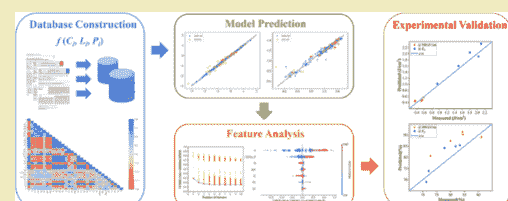
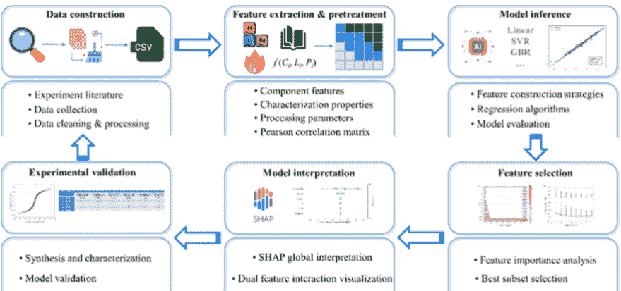
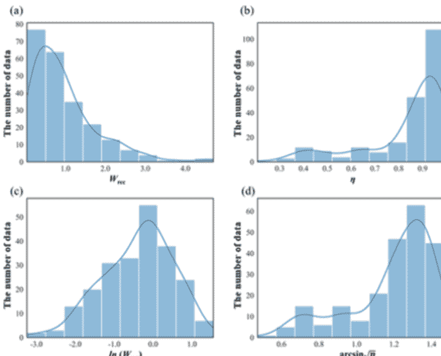
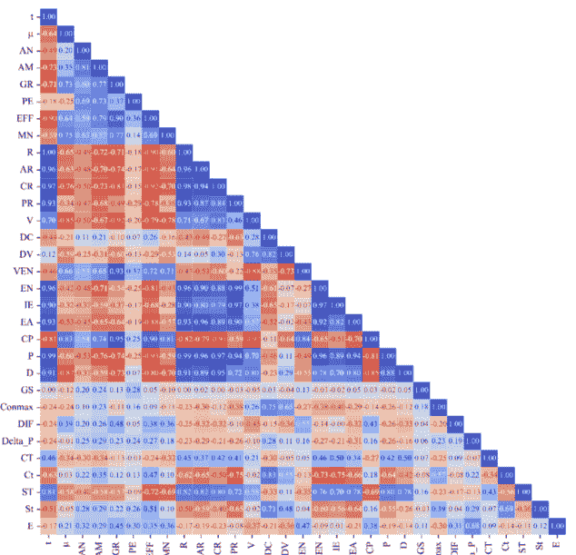
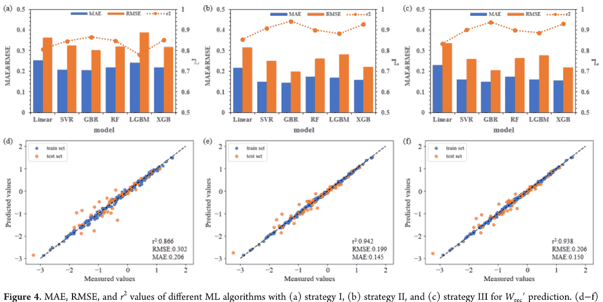
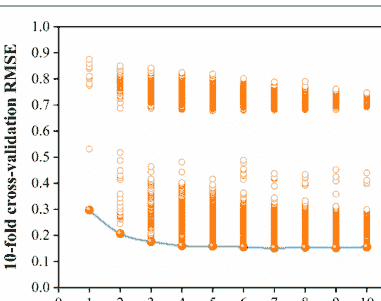
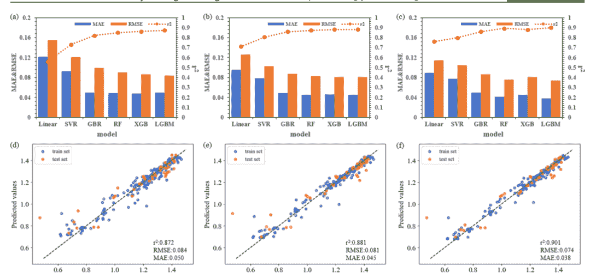
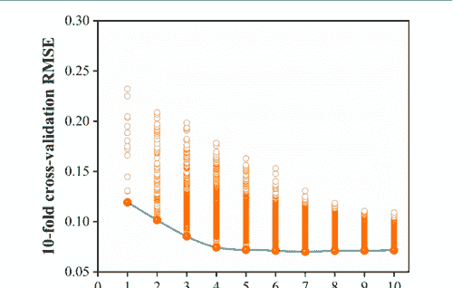
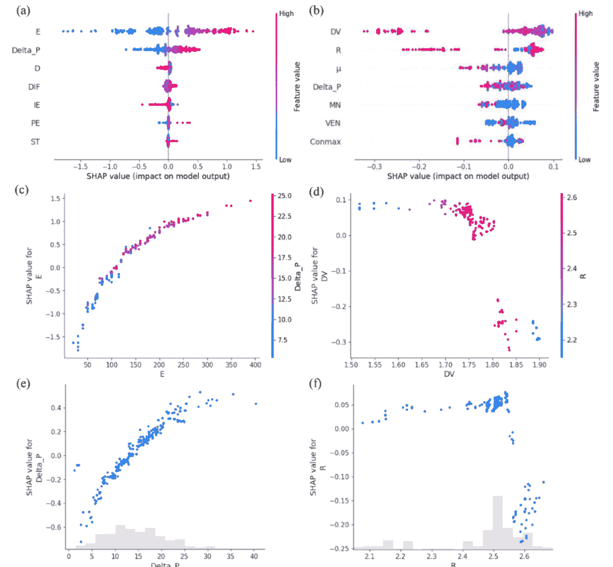
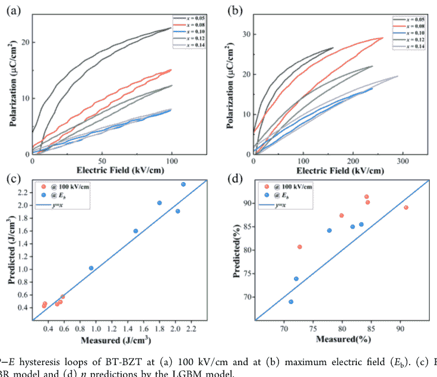

# 机器学习辅助的BaTiO3–BiMeO3陶瓷储能性能加速研究


## 摘要
具有优异储能性能的介电材料的探索一直是材料科学领域的研究热点。开发一种能够准确预测陶瓷储能特性的技术方法，将显著加速储能材料研究的进程。在本研究中，采用机器学习方法，旨在准确预测BaTiO3–BiMeO3（BT-BMO）铁电陶瓷的储能密度（Wrec）和储能效率（η）。最初，通过查阅相关已发表文献，建立了BT-BMO块体陶瓷储能性能的数据集。基于组分元素的理化特性、相关属性信息及烧结工艺参数，构建了三种不同的特征向量空间。随后，构建了多种机器学习算法模型来训练和预测Wrec和η。对于储能密度的预测，GBR模型的10倍交叉验证决定系数（r²）和均方根误差（RMSE）分别为0.974和0.142。对于储能效率的预测，LGBM模型的10倍交叉验证r²和RMSE分别为0.894和0.068。为增强模型的可解释性，引入了Shapley增量解释方法，揭示并简要分析了影响目标性能的重要特征。最后，对未包含在数据集中的xBaTiO3–(1 – x)Bi(Zn2/3Ta1/3)O3材料体系进行了实验合成和测试。实验结果发现与模型预测接近，从而验证了该方法的有效性。本研究提供了一种新方法，可加速具有优异储能性能的介电材料的开发。



## 关键词
机器学习, BaTiO3–BiMeO3, 储能性能

## 引言

作为经典的储能电子器件，介电陶瓷电容器因其高功率密度、快速充放电速率和高热稳定性而被广泛研究。1–5 然而，相对较低的储能密度限制了它们的应用。考虑到铅基陶瓷的环境问题，开发具有优异储能性能的无铅陶瓷是一个极具重要意义的问题。已知，介电材料的总能量密度（W）、可回收储能密度（Wrec）和效率（η）可通过极化-电场（P-E）滞后回线计算。6 目前，线性介电体（LDs）、铁电体（FEs）、反铁电体（AFEs）和弛豫铁电体（RFEs）正在积极研究用于储能应用。7–11 在这些材料中，RFEs是理想的储能材料，具有高最大极化（Pmax）、中等击穿强度（Eb）和低剩余极化（Pr）。基于BaTiO3的RFE陶瓷是无铅储能介电体的主导分支之一。被公认为“弱耦合弛豫体”12的BaTiO3–BiMeO3（BT-BMO）[Me = Sc3+, (Mg1/2Ti1/2)3+, (Ni2/3Nb1/3)3+等]陶瓷通常表现出纤细的P-E回线，具有可忽略的Pr和高η。有报道指出，引入BMO有三个优势：（1）它降低烧结温度，抑制晶粒生长，并提高密度，从而增加材料的Eb；（2）它有助于形成极性纳米区域，增强基于BT的陶瓷的弛豫行为，从而降低其Pr；（3）Bi 6s和O 2p轨道的杂化可以增加材料的Pmax。13–15 已广泛承认，引入适当的BMO可以增强基于BT的陶瓷的储能性能。然而，BMO组成有众多可能的元素组合，而且掺杂含量和加工参数肯定会影响最终的储能性能。通过传统的试错方法寻找合适的材料体系是一个巨大的挑战。




图1. 本工作中用于储能性能的机器学习工作流。

机器学习（ML）作为人工智能的一个分支，近年来在材料科学家中引起了日益关注。16–18 这种关注度的激增很大程度上归功于ML从数据集中提取有价值见解并自主改进其计算模型的能力，从而产生可显著推动材料科学领域发展的可靠结果。19 对于材料性质预测，ML方法利用材料组成、基本元素性质或结构参数作为输入（x），将感兴趣的性质作为输出（Y），这相当于构建Y = f(x)的函数形式。20 使用训练有素的ML模型可以节省试错方法带来的时间和人力成本，加速新材料的发现，并揭示性能、组成和结构之间的潜在关系。21 大多数已发表的工作涉及将ML方法与现有材料数据库22–24和第一性原理计算相结合，以预测材料的固有性质。25–30 然而，将ML方法与实验相结合为优化实验过程、探索物理机制以及更有效地加速新材料研究提供了一条途径。例如，Qiao等人提出了一种结合ML和有限元法（FEM）的框架，以优化复杂陶瓷零件的注塑成型工艺。31 为了确定铁电材料最重要的描述符，He等人在包括无铅、含铅陶瓷和反铁电体在内的不同材料体系中采用了回归和分类学习，然后从46个决定铁电性的潜在描述符中筛选出三个描述符。32 Yuan等人提出了ML自适应设计策略，以寻找具有增强储能密度或电致应变的基于BaTiO3的多组分固溶体，显著减少了识别具有更高Wrec或电致应变化合物所需的实验迭代次数。33,34 在本工作中，提出了一种结合三种特征构建策略的ML方法，利用涵盖材料组成、表征性能和烧结工艺参数的数据构建回归模型，以预测BT-BMO陶瓷的Wrec和η。开展了系统而全面的比较分析，以严格评估这些模型的性能，并确定回归任务中最有效的策略和模型。关键特征采用多步选择方法（包括Pearson相关矩阵、重要性分析和最佳子集方法）进行严格评估。通过这些方法，在不牺牲精度的前提下降低了特征空间的维度，从而提高了模型训练的效率。此外，通过采用Shapley增量解释（SHAP）方法35，增强了模型的透明度和可理解性，揭示了模型输入和输出之间的关系，这对于理解模型的决策过程和解释结果至关重要。此外，进行了实验合成以验证模型的预测能力，证实了该方法的可靠性和实际适用性。我们的研究将ML技术与实际应用相结合，确保对BT-BMO陶瓷中Wrec和η进行稳健、可解释和可靠的估计，为实际实验场景提供有价值的见解。

## 实验部分

一般来说，可以通过使用ML算法的代理模型（f）建立材料特征（x_i）与目标属性（y）之间的关系，可表示为y = f(x_i)。图1说明了用于预测储能性能的ML模型的工作流程，包括数据收集、特征构建与选择、模型建立与评估、模型解释和实验验证。

**数据收集与处理。** 当利用数据驱动的ML方法预测特定性质时，创建高质量数据集对于构建稳健的ML模型是必不可少的。数据编纂涉及跨越数十年的关于BaTiO3–BiMeO3弛豫铁电陶瓷的一系列已发表文献研究。为减少不同实验方法和表征带来的潜在不确定性，本研究中收集的数据仅来源于通过常规固相反应法合成的块体陶瓷样品。

从已发表文献中收集了28种BT-BMO材料体系的数据，其中BMO包含单一三价金属离子（Me = Al3+, Y3+, Yb3+等）、二元三价金属离子（Me = (Mg1/2Ti1/2)3+, (Ni2/3Nb1/3)3+等）以及多组分固溶体系统。12,14,15,36–58 这28种材料中的每一种在数据集中的条目数量都不同，取决于BMO的含量和施加的电场。Wrec和η的数据分布




图 2. (a) $W_{rec}$、(b) $\eta$、(c) 对数缩放的 $W_{rec}$ ($W_{rec}'$) 和 (d) 反正弦平方根 $\eta$ ($\eta'$) 的数据直方图和核密度估计。

如图 2a,b 所示。大部分 $W_{rec}$ 值位于小于 2.0 的范围内，大部分 $\eta$ 值位于大于 0.8 的范围内。为了使数据分布接近正态分布并提高机器学习模型的性能，对目标属性进行了数据变换。测试了多种变换方法，最终发现对 $W_{rec}$ 应用对数缩放变换、对 $\eta$ 应用反正弦平方根变换效果最佳。为方便起见，在以下内容中，令 $W_{rec}'$ 表示 $W_{rec}$ 的对数缩放值，$\eta'$ 表示 $\eta$ 的反正弦平方根值。$W_{rec}'$ 和 $\eta'$ 的数据分布直方图和核密度曲线分别如图 2c 和 2d 所示。图 2c 中的数据分布接近正态分布，而图 2d 中的数据分布并不呈现完全正态分布。然而，在尝试了各种变换方法后，这已经是我们选择的最接近正态分布的变换结果。鉴于得到的分布，回归模型预计将表现出高可预测性。[59]

通常，文献中提供的数据仅包含性能较好的数据，因此利用 WebPlotDigitizer 和 Engauge Digitizer [60,61] 工具从文献图表中提取了额外数据。在此数据集中，存在成分相同但性能不同的同一材料的数据，这可归因于煅烧和烧结工艺或施加电场的差异。在数据收集阶段，不可避免地会出现材料成分相同但性能不同的情况。如果烧结工艺相同时性能差异较小，则保留该数据。但是，即使烧结工艺参数相似，如果性能差异显著，则会删除该数据。经过仔细检查后，此类数据点仍保留在数据集中，以确保偏差在合理范围内。数据处理后，构建了包含 227 个 BT-BMO 样品的数据集，用于进一步的回归学习和分析。

## 特征构建

为了构建高精度机器学习模型并全面探讨成分、物理性质和烧结工艺如何影响 BT-BMO 的储能性能，我们收集了材料元素信息 ($C_i$)、表征性质 ($L_i$) 以及与煅烧和烧结工艺相关的实验参数 ($P_i$) 的数据。

元素信息特征源自易于获取的元素信息。基于对弛豫铁电体的领域知识，选取了 20 个描述符来表示 A 位和 B 位元素的性质，涵盖原子质量、原子半径、电负性等描述符（详细信息见支持信息）。为了准确描述每个成分，我们将 A 位和 B 位信息的加权比率作为特征，并将材料描述符定义如下：[32]

```
$$X_{A/B} = \frac{X_A}{X_B} = \frac{\sum_{i \in A} f_i^X X_i}{\sum_{i \in B} f_i^X X_i}$$
```

其中，$f_i$ 是化学成分中元素的摩尔分数，$X$ 是元素的性质。通过使用等式 1 计算 A 位和 B 位信息的比率，得到了 16 个材料描述符，如支持信息表 S1 的前 16 行所示。此外，电负性 (EN)、第一电离能 (IE)、电子亲和力 (EA) 和伪势核半径 (PR) 主要用于比较阳离子和阴离子之间的差异；我们通过等式 2 定义了材料描述符 X：[32]

```
$$X = ([X_A - X_O] + |X_B - X_O|)/2$$
```

其中，$X_O$ 表示氧的信息。此外，添加了反映钙钛矿结构稳定性的容忍因子 ($t$) 和八面体因子 ($\mu$)。由于每个 BT-BMO 化合物都是固溶体，使用固溶体中 BT 和 BMO 比例的加权分数来计算表示整个复合材料的特征，由等式 3 定义：

```
$$X_{solid solution} = (1 - x)X_{BT} + xX_{BMO}$$
```

由于数据库包含不同电场下相同成分的数据，电场 ($E$) 也必须是一个不可或缺的特征。因此，通过等式 1–3 得到的 22 个特征连同 $E$ 共同构成了策略 I ($C_i$) 的特征池。



图 3. 原始 31 个特征的 Pearson 相关系数矩阵。

每种材料表征性质的特征 ($L_i$) 从文献中提取，包括平均晶粒尺寸 (GS)、最大介电常数 ($\varepsilon_m$)、经修正的居里-魏斯定律 (等式 4) 计算的弛豫弥散度 ($\gamma$) 以及施加电场下的最大和剩余极化 ($P_{max}$ 和 $P_r$)。根据等式 5，$P_{max}$ 和 $P_r$ 合并为单个特征 $\Delta P$ 并放入特征池。这些特征提供了每种材料的微观结构、介电性质、弛豫行为和极化特性。因此，策略 II ($L_i + C_i$) 的特征池总共包含 27 个特征。

```
1/\varepsilon_r - 1/\varepsilon_m = (T - T_m)^\gamma / C
```

```
\Delta P = P_{max} - P_r
```

陶瓷的制造工艺会显著影响材料的微观结构，尤其是 BT-BMO 材料。由于 Bi2O3 的熔点相对较低 (825 °C)，加工不当会导致异常晶粒生长和晶界处空洞的形成，从而对储能性能产生不利影响。因此，从已发表的论文中提取了每种材料的加工参数以扩展特征池 ($P_i$)，包括煅烧温度 (CT)、煅烧时间 (CT)、烧结温度 (ST) 和烧结时间 (ST)。因此，策略 III ($P_i + L_i + C_i$) 的特征池包含 31 个特征。特征的详细列表显示在支持信息的表 S1 中。

当数据集中的特征数量较多时，模型复杂度会相应增加，这会影响模型训练效率，并可能导致模型过拟合。采用物理知识、Pearson 相关系数和特征重要性分析方法相结合的方式，对特征空间进行降维。利用 Pearson 相关系数矩阵识别高度相关的特征，如图 3 所示。红色和蓝色分别表示两个特征之间的负相关和正相关，颜色越亮表示相关性越高。通常，特征之间 Pearson 相关系数的绝对值超过 0.8 被认为表明它们之间存在强相关性。对于强相关特征组，仅保留一个特征以避免冗余。在特征选择和消除过程中，我们既依赖物理知识，也依赖模型的特征重要性反馈。考虑到文献中报道的 BT-BMO 陶瓷的煅烧和烧结时间 (CT 和 ST) 大多在 2–4 h 范围内且变化不大，因此将这两个特征从最终特征池中排除。各策略的最终特征池如表 1 和表 2 所示。

**表 1. 各策略针对** $W_{rec}'$ **模型的最终特征池**

| 策略 | 最终特征池 |
|---|---|
| I | AM, PE, MN, DV, VEN, D, IE, E |
| II | AM, PE, MN, DV, VEN, D, IE, E, GS, Conmax, DIF, $\Delta P$ |
| III | AM, PE, MN, DV, VEN, D, IE, E, GS, Conmax, DIF, $\Delta P$, CT, ST |

**表 2. 各策略针对** $\eta'$ **模型的最终特征池**

| 策略 | 最终特征池 |
|---|---|
| I | $\mu$, AM, PE, MN, R, DV, VEN, E |
| II | $\mu$, AM, PE, MN, R, DV, VEN, E, GS, Conmax, DIF, $\Delta P$ |
| III | $\mu$, AM, PE, MN, R, DV, VEN, E, GS, Conmax, DIF, $\Delta P$, CT, ST |

## 模型建立与评估

采用合适的推理模型被认为是机器学习的关键部分。不存在普遍适用于所有问题的最优 ML 模型；相反，每个特定问题都需要特定的 ML 模型来分析。[62] 六种典型模型通过每种特征构建策略进行训练，以预测对数缩放的储能密度值 ($W_{rec}'$) 和反正弦平方根 $\eta$ 值 ($\eta'$)，包括线性回归算法 (linear)、带径向基的支持向量回归




功能核算法 (SVR)、梯度增强回归算法 (GBR)、随机森林算法 (RF)、LightGBM算法 (LGBM) 和 XGBoost算法 (XGB)。数据被随机划分为 20% 的测试集和 80% 的训练集。为评估回归模型的性能，本研究采用了包括决定系数 (r²)、平均绝对误差 (MAE) 和均方根误差 (RMSE) 在内的常用统计指标，分别由式 6–8 定义。

\( r^2 = 1 - \frac{\sum_{i=1}^{n} (\hat{y}_i - y_i)^2}{\sum_{i=1}^{n} (y_i - \bar{y})^2} \) (6)

\( \text{MAE} = \frac{1}{n} \sum_{i=1}^{n} |\hat{y}_i - y_i| \) (7)

\( \text{RMSE} = \sqrt{\frac{1}{n} \sum_{i=1}^{n} (\hat{y}_i - y_i)^2} \) (8)

其中，n、y_i、\(\hat{y}_i\) 和 \(\bar{y}\) 分别表示数据集中的观测数量、实际值、预测值和实际值的均值。r² 值在 0 到 1 之间，越接近 1 表示模型精度越高。MAE 和 RMSE 表示预测值与实际值之间的差异，MAE 和 RMSE 接近于零表明预测与测量一致。

## 结果与讨论

### 储能密度回归模型

六种采用不同策略的 W_rec' 回归模型的评估指标如图 4a–c 和表 3 所示。显然，与使用策略 I 构建的模型相比，使用策略 II 和策略 III 构建的所有模型性能均得到显著提升。这主要是因为特征集不仅包含元素特征信息，还包含相关属性信息和制造工艺信息。然而，策略 II 与策略 III 之间的模型性能差异不显著，可能是由于数据集中 CT 和 ST 值的变化很小。显然，GBR 和 XGB 模型的 r² 值更高，且相比其他模型具有更低的 MAE 和 RMSE 值。

| 模型 | r² | MAE | RMSE |
|---|---|---|---|
| 策略 I | | | |
| 线性 | 0.807 | 0.253 | 0.362 |
| SVR | 0.846 | 0.207 | 0.324 |
| GBR | 0.866 | 0.206 | 0.302 |
| RF | 0.848 | 0.219 | 0.321 |
| LGBM | 0.780 | 0.241 | 0.387 |
| XGB | 0.851 | 0.218 | 0.318 |
| 策略 II | | | |
| 线性 | 0.854 | 0.217 | 0.315 |
| SVR | 0.908 | 0.150 | 0.250 |
| GBR | 0.942 | 0.145 | 0.199 |
| RF | 0.899 | 0.174 | 0.262 |
| LGBM | 0.883 | 0.17 | 0.282 |
| XGB | 0.928 | 0.158 | 0.221 |
| 策略 III | | | |
| 线性 | 0.834 | 0.230 | 0.336 |
| SVR | 0.901 | 0.160 | 0.259 |
| GBR | 0.938 | 0.150 | 0.206 |
| RF | 0.898 | 0.175 | 0.263 |
| LGBM | 0.886 | 0.160 | 0.278 |
| XGB | 0.930 | 0.157 | 0.218 |

在策略 II 中，GBR 模型的 r² 值达到 0.942，而在策略 III 中，GBR 模型的 r² 值为 0.938。各策略中最佳模型在训练和测试上的拟合结果如图 4d–f 所示。将预测的 W_rec' 作为测量 W_rec' 的函数进行绘图，数据点围绕对角线的分布表明训练模型具有良好的预测能力。为增强模型的可信度，在策略 II 和策略 III 中均对所有模型进行了 10 倍交叉验证。GBR 模型表现最佳，10 倍交叉验证的 r² 为 0.974。所有模型的详细结果载于支持信息，表 S2。在此之前，模型采用贝叶斯优化方法进行了超参数优化，这也是机器学习工作中至关重要的一部分。63,64 算法参数、参数范围、优化值以及优化前后模型性能的对比分别反映在表 S3 和表 S4 中。

为进一步筛选最重要的特征向量，采用了包装法来识别最优特征子集。在此方法中，通过构建不同维度的特征子集，在不同特征维度下测试模型的精度。例如，对于二维特征子集有 (k(k − 1))/2 个不同的特征子集，对于三维特征子集有 (k(k − 1)(k − 2))/6 个不同的特征子集（k 为特征数量）。我们生成了所有包含 1–10 个特征的 15,913 个特征子集，并使用 GBR 模型计算它们的 10 倍交叉验证 RMSE。比较各模型的交叉验证 RMSE，并选择最佳模型。如图 5 所示，随着特征数量的增加，性能起初得到提升



图 5. 基于所有包含 1–10 个特征的可能子集的 GBR 模型十倍交叉验证 RMSE。

，但当使用超过 7 个特征时，10 倍交叉验证 RMSE 会略微增加。为更好地展示不同特征子集之间的性能差异，进一步计算了不同特征子集的 10 倍交叉验证 r² 值，并发现 4 元组到 8 元组特征集的 r² 值也呈现小幅波动；r² 值列于表 S5。为增强模型的可解释性，应在不显著影响模型精度的前提下尽可能降低特征空间的维度。因此，为后续研究选择了最佳 4 元组特征子集。该最优 4 元组特征子集具体包括 E、ΔP、AM 和 IE。

### 储能效率回归模型

用于预测储能密度的相同方法和步骤也应用于预测储能效率。六种采用不同策略的 η' 回归模型的评估指标如图 6a–c 和表 4 所示。在此任务中，线性模型和 SVR 模型的性能不尽理想，而 LGBM 模型表现出较好的可预测性。在策略 III 中，LGBM 模型的 r² 分数为 0.901。策略 III 的所有六个模型均优于策略 I 和策略 II，表明通过引入实验参数相关特征可以提升模型性能。各策略中最佳模型在训练和测试上的拟合性能如图 6d–f 所示。从图中可以看出，在高值区域，预测值与测量值较为接近，而在低值区域存在若干异常点，预测值与测量值之间存在一定差异。这可能归因于训练集中低 η' 区域的数据量有限。大多数研究倾向于报告高储能效率的数据，导致低 η' 区域的数据样本匮乏。由于机器学习是一种数据驱动方法，数据质量显著影响模型精度。21 数据分布不均在一定程度上导致模型在预测储能效率时表现不佳。同样，在这部分工作中，也进行了 10 倍交叉验证和超参数优化，以提供更可靠的性能评估。详细结果载于支持信息，表 S6–S8。

我们生成了所有包含 1–10 个特征的 15,913 个特征子集，并使用 LGBM 模型计算它们的 10 倍交叉验证 RMSE。如图 7 所示，随着特征数量的增加，性能起初得到提升，但当使用超过 7 个特征时，观察到 RMSE 略微增加。还为 4 元组到 8 元组的不同特征子集计算了 10 倍交叉验证 r² 值，如表 S9 所示。研究发现，使用最优 5 元组和 7 元组特征子集时预测性能最佳，而使用 4 元组子集时性能略有下降。遵循上述相同原则，我们为后续工作选择了最优五维特征子集。最佳 5 元组特征子集为“R、DV、VEN、GS 和 ΔP”。

### 模型可解释性

在机器学习和深度学习领域，模型可解释性是一个重要课题。尽管深度神经网络和集成模型等复杂模型在预测性能方面表现出色，但由于难以解释其决策过程，它们常被视为黑盒模型。65 Shapley 加法解释 (SHAP) 是一种旨在解决此问题的工具，通过分配特征重要性值来解释模型输出。SHAP 的核心概念源于合作博弈论中的夏普利值，用于公平分配合作中多个参与者带来的收益。35 SHAP 方法将这一概念引入机器学习模型的解释中，以计算每个特征对模型预测结果的贡献。在本工作中，采用 SHAP 方法来解释 W_rec 和 η' 的回归模型，从而实现对特征对目标属性影响的可视化和理解。图 8a 和 8b 分别展示了 W_rec 和 η' 最佳特征子集回归模型的 SHAP 蜂群摘要图。每个点对应数据集中的一个化合物，更深的红色对应更高的特征值，而更深的蓝色则表示更低的特征值。SHAP 值使我们能够了解每个特征对模型预测结果的具体贡献。当特征值的 SHAP 值为正时，意味着该特征值对模型目标属性的预测有正面影响，反之亦然。




图 6. 不同 ML 算法在 (a) 策略 I、(b) 策略 II 和 (c) 策略 III 下用于 η′ 预测的 MAE、RMSE 和 r² 值。(d–f) 各策略中最佳回归模型在训练和测试数据集上的性能。

| 模型 | r² | MAE | RMSE |
|---|---|---|---|
| 策略 I | | | |
| linear | 0.560 | 0.122 | 0.155 |
| SVR | 0.731 | 0.093 | 0.121 |
| GBR | 0.822 | 0.050 | 0.099 |
| RF | 0.851 | 0.049 | 0.090 |
| XGB | 0.862 | 0.048 | 0.087 |
| LGBM | 0.872 | 0.050 | 0.084 |
| 策略 II | | | |
| linear | 0.712 | 0.096 | 0.126 |
| SVR | 0.805 | 0.079 | 0.103 |
| GBR | 0.859 | 0.049 | 0.088 |
| RF | 0.874 | 0.045 | 0.083 |
| XGB | 0.881 | 0.046 | 0.081 |
| LGBM | 0.881 | 0.045 | 0.081 |
| 策略 III | | | |
| linear | 0.760 | 0.089 | 0.115 |
| SVR | 0.798 | 0.078 | 0.105 |
| GBR | 0.860 | 0.050 | 0.087 |
| RF | 0.894 | 0.042 | 0.076 |
| XGB | 0.879 | 0.045 | 0.081 |
| LGBM | 0.901 | 0.038 | 0.074 |



图 7. 基于包含 1–10 个特征的所有可能子集的 LGBM 模型的十倍交叉验证 RMSE。

从图 8a 可以观察到，影响 W_rec′ 预测模型的两个最重要特征是 E 和 ΔP，它们都是衡量电容器储能性能的重要参数。随着它们的值增大，会得到更大的 W_rec′，这与我们的物理知识一致。图 8c,e 可视化了 E 值和 ΔP 值的趋势，以及相应的 SHAP 值。可以观察到，随着 E 值增大，ΔP 值也增大，同样，E 的 SHAP 值也增大。当 E 值超过约 120 时，相应的 SHAP 值均为正，表明更高的施加电场更有利于实现更高的储能密度。当 ΔP 值超过 15 时，大部分相应的 SHAP 值也为正，表明更大的 ΔP 值更可能导致更高的储能密度。

从图 8b 可以观察到，影响 η′ 预测模型的两个最重要特征是 DV 和 R。为了更好地可视化特征与 SHAP 值之间的关系，为 LGBM η′ 模型生成了 DV 和 R 的 SHAP 依赖图，如图 8d 所示。可以观察到，当 DV 值超过 1.81 时，倾向于使储能效率朝较低值方向变化。这意味着，为了获得具有高储能效率的基于 BaTiO3 的陶瓷材料，有必要将价电子距离的值控制在 1.81 以下。如图 8f 所示，当离子半径的值超过 2.55 时，也会对 η′ 模型预测产生负面影响。

实验验证。为了验证模型能否准确应用于实际实验，合成并表征了一系列 xBaTiO3-



图 8. 基于 (a) 7 元组子集 GBR W_rec' 蜂群回归模型和 (b) 7 元组子集 LGBM η' 回归模型的 SHAP 蜂群摘要图。(c) GBR W_rec' 模型的 E 和 ΔP SHAP 依赖图。(d) LGBM η' 模型的 DV 和 R SHAP 依赖图。(e) GBR W_rec' 模型的 ΔP 值 SHAP 散点图。(f) LGBM η' 模型的 R 值 SHAP 散点图。

(1 - x)Bi(Zn2/3Ta1/3)O3 (BT-BZT) 陶瓷已合成并表征（实验详情见支持信息）。在我们的数据集中，一些数据涉及将 Nb5+ 与其他离子一起复合掺入 BaTiO3 的 Ti 位点。值得注意的是，Ta5+ 与 Nb5+ 具有相同的价态和离子半径（0.64 Å），但关于弛豫铁电陶瓷材料储能性能的报告有限。与 Nb2O5（≈3.4 eV）相比，Ta2O5 具有更宽的带隙（≈4 eV），可以有效减少漏电流和能量损失，从而提高击穿场强和储能效率。44 数据集中涉及 Nb5+ 离子的大部分数据涉及其与 Zn2+ 的组合，例如 Zn2/3Nb1/3。当时，对已发表文献的检索未找到任何关于 xBaTiO3-(1 - x)Bi(Zn2/3Ta1/3)O3 的相关数据。因此，选择了 BT-BZT 材料体系进行实验验证。将模型的预测输出与实际实验结果进行比较，以评估模型的有效性。图 9a,b 描绘了 BT-BZT 陶瓷在 100 kV/cm 和最大电场（Eb）下的单极 P–E 回线。与其他 BT-BMO 材料体系类似，随着 BZT 的引入，P–E 回线变得纤细，呈现材料铁电性能从标准铁电向弛豫型转变的特性。W_rec' 和 η' 的预测结果经过数学变换以获得预测的 W_rec 和 η。不同电场下的预测输出和实际结果的比较如图 9c,d 所示，并列于表 5。模型对 Eb 表现出更高的预测精度，因为数据集中大部分数据是在



### 表 5. 最佳子集回归模型在 100 kV/cm 和 Eb 下的预测 Wrec 和 η 值与实验值的比较

| BT-xBZT | 实测值 | 预测值 | 误差 | 实测值 | 预测值 | 误差 |
|---|---|---|---|---|---|---|
| Wrec @ 100 kV/cm | | | | Wrec @ Eb | | |
| x = 0.05 | 0.553 | 0.491 | 11.21% | 0.94 | 1.02 | 8.5% |
| x = 0.08 | 0.582 | 0.574 | 1.37% | 1.5 | 1.6 | 6.67% |
| x = 0.10 | 0.359 | 0.466 | 29.8% | 2.03 | 1.91 | 5.91% |
| x = 0.12 | 0.512 | 0.455 | 11.13% | 1.8 | 2.02 | 12.2% |
| x = 0.14 | 0.348 | 0.426 | 22.4% | 2.1 | 2.33 | 10.95% |
| η @ 100 kV/cm | | | | η @ Emax | | |
| x = 0.05 | 0.727 | 0.807 | 11% | 0.712 | 0.69 | 3.09% |
| x = 0.08 | 0.799 | 0.874 | 9.38% | 0.721 | 0.739 | 2.49% |
| x = 0.10 | 0.91 | 0.891 | 2.09% | 0.833 | 0.855 | 2.64% |
| x = 0.12 | 0.842 | 0.914 | 8.55% | 0.818 | 0.85 | 3.91% |
| x = 0.14 | 0.844 | 0.902 | 6.87% | 0.778 | 0.842 | 8.22% |

训练集是在 Eb 下导出的。Wrec 和 η 的大部分预测结果与实验值的误差在 10% 范围内。因此，认为本研究中的模型在很大程度上是准确和可靠的，这有助于加速具有高储能性能的新型材料 BT-BMO 的开发。

## 结论

在本研究中，开发了结合不同特征构建策略的 ML 模型，用于预测 BT-BMO 材料体系的储能密度和效率，从而使我们能够探索材料组成、相关性能、烧结参数与储能性能之间复杂的关系。通过严谨分析，比较了用于预测 BT-BMO 陶瓷 Wrec' 和 η' 的不同特征构建策略，结果表明，包含多维有用信息的特征能使机器学习模型实现更优性能。基于策略 III 建立的 Wrec' GBR 回归模型和 η' LGBM 回归模型表现出高准确性。为了增强结果的可信度，我们进行了十倍交叉验证。GBR Wrec' 模型的十倍 r2 值为 0.974，LGBM η' 模型的十倍 r2 值为 0.894。这表明这些模型具有出色的预测能力，证实了其在预测中的稳健性和可靠性。为了识别最重要的特征并进一步提高训练效率，分别使用包装法为 Wrec' 和 η' 预测模型寻找了最优特征子集。引入了 SHAP 方法以增强模型的可解释性，结果总体上与我们的物理


知识。使用此方法，我们识别出影响模型的关键特征，并进行了简要分析。为验证我们方法的可行性，通过制备未包含在数据集中的xBaTiO3-(1 − x)Bi(Zn2/3Ti1/3)O3材料体系进行了实验验证。模型预测值与实验值之间的误差范围在可接受范围内，表明我们的方法具有一定的实用价值。我们相信，我们的方法也可以扩展到其他材料体系，如线性介电体和反铁电体。此外，未来的工作将探索集成遗传编程方法以实现多目标优化。

## 相关内容

### 支持信息

支持信息可免费获取，网址为 https://pubs.acs.org/doi/10.1021/acssuschemeng.4c10430。

- 特征详细列表、W_rec' 和 η' 预测的10倍交叉验证评估指标、超参数优化详情、使用不同特征子集的W_rec' 和 η' 预测的10倍交叉验证 r^2，以及实验详情（PDF）
- 储能密度和效率数据集（XLSX）

## 作者信息

### 通讯作者

郝华 – 武汉理工大学材料合成与加工先进技术国家重点实验室、材料科学与工程学院、国际材料科学与工程学院，中国武汉430070；中国广东实验室佛山先进能源科学与技术仙湖实验室、仙湖氢谷，中国佛山528200；orcid.org/0000-0003-3264-4647；电子邮件：haohua@whut.edu.cn

刘汉兴 – 武汉理工大学材料合成与加工先进技术国家重点实验室、材料科学与工程学院、国际材料科学与工程学院，中国武汉430070；orcid.org/0000-0002-8625-4866；电子邮件：lhxhp@whut.edu.cn

### 作者

刘健 – 武汉理工大学材料合成与加工先进技术国家重点实验室、材料科学与工程学院、国际材料科学与工程学院，中国武汉430070

熊培丰 – 武汉理工大学材料合成与加工先进技术国家重点实验室、材料科学与工程学院、国际材料科学与工程学院，中国武汉430070

李娇娇 – 武汉理工大学材料合成与加工先进技术国家重点实验室、材料科学与工程学院、国际材料科学与工程学院，中国武汉430070；orcid.org/0000-0002-6255-5250

完整联系信息可在以下网址查阅：https://pubs.acs.org/10.1021/acssuschemeng.4c10430

## 作者贡献

刘健和熊培丰对本工作均等贡献。刘健：概念构建、数据收集、调查、软件、数据分析和原稿撰写；熊培丰：样品实验与表征、数据收集和软件；李娇娇：稿件修改；郝华：监督、资金获取和稿件修改；刘汉兴：监督和项目管理。

## 注记

作者声明不存在竞争性财务利益。

## 致谢

本工作得到中国国家重点研发计划（编号：2023YFB3812200）、中国自然科学基金（项目编号：52472135）和广东省基础与应用基础研究基金（编号：2022B1515120041）的支持。

## 参考文献

- (1) Yao, Z.; Song, Z.; Hao, H.; Yu, Z.; Cao, M.; Zhang, S.; Lanagan, M. T.; Liu, H. 均匀/非均匀结构介电体及其储能性能. 先进材料 2017, 29, No. 1601727.
- (2) Wang, D.; Fan, Z.; Zhou, D.; Khesro, A.; Murakami, S.; Feteira, A.; Zhao, Q.; Tan, X.; Reaney, I. M. 基于铋铁酸盐的无铅陶瓷及多层结构具有高可回收储能密度. 《材料化学杂志A》 2018, 6, 4133.
- (3) Li, J.; Li, F.; Xu, Z.; Zhang, S. 超高储能密度和效率的多层无铅陶瓷电容器. 先进材料 2018, 30, No. 1802155.
- (4) Liu, Q.; Hao, H.; Guo, Q. H.; Shen, Z. H.; Wang, J.; Cao, M. H.; Yao, Z. H.; Liu, H. X. 通过结构优化提高基于BaTiO3的多层陶瓷电容器的击穿强度. 稀有金属 2023, 42 (8), 2552–2561.
- (5) Li, D.; Jiang, X.; Hao, H.; Wang, J.; Guo, Q.; Zhang, L.; Yao, Z.; Cao, M.; Liu, H. 用于储能电容器的基于BaTiO3薄膜的非晶/晶体工程. ACS可持续化学与工程 2022, 10 (4), 1731–1740.
- (6) Qi, H.; Xie, A.; Zuo, R. 用于卓越储能电容器的局部结构工程无铅铁电介质：综述. 储能材料 2022, 45, 541–567.
- (7) Li, D.; Guo, Q.; Cao, M.; Yao, Z.; Liu, H.; Hao, H. A/B位掺杂对PZO储能薄膜反铁电性的影响. 微结构 2023, 3 (1), No. 2023007.
- (8) Luo, B.; Wang, X.; Tian, E.; Song, H.; Wang, H.; Li, L. 无铅CaTiO3–BiScO3线性介电陶瓷的增强储能密度和高效率. ACS应用材料与界面 2017, 9, 19963–19972.
- (9) Dong, X.; Chen, H.; Wei, M.; Wu, K.; Zhang, J. 掺杂YNbO4的BaTiO3陶瓷的结构、介电和储能性能. 合金与化合物杂志 2018, 744, 721–727.
- (10) Yan, Z.; Zhang, D.; Zhou, X.; Qi, H.; Luo, H.; Zhou, K.; Abrahams, I.; Yan, H. 基于银铌酸盐的高储能密度无铅陶瓷. 《材料化学杂志A》 2019, 7, 10702–10711.
- (11) Long, C.; Zhou, W.; Song, H.; Zheng, K.; Ren, W.; Wu, H.; Ding, X.; Liu, L. 通过创建高度动态极性纳米区和内在导电，同时实现基于BaTiO3的介电陶瓷的超高储能密度和效率. 材料学报 2023, 256, No. 119135.
- (12) Ogiara, H.; Randall, C. A.; Trolier-Mckinstry, S. BaTiO3-BiScO3陶瓷的弱耦合弛豫行为. 美国陶瓷学会杂志 2009, 92, 110–118.
- (13) Kumar, N.; Patterson, E. A.; Frömling, T.; Cann, D. P.; Nino, J. C. BaTiO3-Bi(Zn1/2Ti1/2)O3陶瓷中的导电机制. 美国陶瓷学会杂志 2016, 99, 3047–3054.
- (31) Qiao, L.; Zhu, J.; Wan, Y.; Cui, C.; Zhang, G. 基于有限元的机器学习方法用于优化工艺参数以生产碳化硅陶瓷复杂零件. 陶瓷国际 2022, 48 (12), 17400−17411.
- (14) Wang, Q.; Gong, P. M.; Wang, C. M. 在BaTiO3−Bi(Zn1/2Zr1/2)O3弛豫铁电体中同时实现高可回收储能密度和大能量效率. 陶瓷国际 2020, 46 (14), 22452−22459.
- (15) Jiang, X.; Hao, H.; Zhang, S.; Lv, J.; Cao, M.; Yao, Z.; Liu, H. 由Bi(Mg1/2Zr1/2)O3改性的基于BaTiO3陶瓷的增强储能和快速放电性能. 欧洲陶瓷学会杂志 2019, 39 (4), 1103−1109.
- (16) Zhou, Q.; Xu, F.; Gao, C.; Zhang, D.; Shi, X.; Yuen, M. F.; Zuo, D. 机器学习辅助高熵陶瓷力学性能预测和描述符-性能相关性分析. 陶瓷国际 2023, 49 (4), 5760−5769.
- (17) Gong, J.; Chu, S.; Mehta, R. K.; Mcgaughey, A. J. H. 用于陶瓷中电热温度变化预测的XGBoost模型. npj 计算材料 2022, 8, 140.
- (18) Boiko, D. A.; Macknight, R.; Kline, B.; Gomes, G. 基于大型语言模型的自主化学研究. 自然 2023, 624, 570−578.
- (19) Raccuglia, P.; Elbert, K. C.; Adler, P. D. F.; Falk, C.; Wenny, M. B.; Mollo, A.; Zeller, M.; Friedler, S. A.; Schrier, J.; Norquist, A. J. 利用失败实验进行机器学习辅助材料发现. 自然 2016, 533, 73−77.
- (20) Gu, W.; Yang, B.; Li, D.; Shang, X.; Zhou, Z.; Guo, J. 通过机器学习加速高精度无铅高性能压电陶瓷设计. 先进陶瓷杂志 2023, 12 (7), 1389−1405.
- (21) Shen, Z.; Liu, H.; Shen, Y.; Hu, J.; Chen, L.; Nan, C. 储能材料中的机器学习. 交叉材料 2022, 1 (2), 175−195.
- (22) Jain, A.; Ong, S. P.; Hautier, G.; Chen, W.; Richards, W. D.; Dacek, S.; Cholia, S.; Gunter, D.; Skinner, D.; Ceder, G.; Persson, K. A. 评论：材料计划：加速材料创新的材料基因组方法. APL材料 2013, 1, No. 011002.
- (23) Curtarolo, S.; Setyawan, W.; Wang, S.; Xue, J.; Yang, K.; Taylor, R. H.; Nelson, L. J.; Hart, G. L. W.; Sanvito, S.; Buongiorno-Nardelli, M.; Mingo, N.; Levy, O. AFLOWLIB.ORG：来自高通量从头计算的分布式材料性质库. 计算材料科学 2012, 58, 227−235.
- (24) Saal, J. E.; Kirklin, S.; Aykol, M.; Meredig, B.; Wolverton, C. 基于高通量密度泛函理论的材料设计与发现：开放量子材料数据库（OQMD）. JOM 2013, 65 (11), 1501−1509.
- (25) Kim, C.; Pilania, G.; Ramprasad, R. 机器学习辅助ABX3钙钛矿内在介电击穿强度预测. 物理化学杂志C 2016, 120 (27), 14575−14580.
- (26) Li, C.; Hao, H.; Xu, B.; Zhao, G.; Chen, L.; Zhang, S.; Liu, H. 基于工具变量的ABO3钙钛矿带隙预测渐进学习方法. 《材料化学杂志C》 2020, 8 (9), 3127−3136.
- (27) Li, C.; Hao, H.; Xu, B.; Shen, Z.; Zhou, E.; Jiang, D.; Liu, H. 改进的基于物理的钙钛矿材料结构描述符使机器学习精度更高. 计算材料科学 2021, 198, No. 110714.
- (28) Chen, L.; Xu, B.; Chen, J.; Bi, K.; Li, C.; Lu, S.; Hu, G.; Lin, Y. 基于集成机器学习的热电材料内部和带隙特性相关性分析. 《材料化学杂志C》 2020, 8 (37), 13079−13089.
- (29) Li, J.; Qi, X.; Zhang, Z.; Wang, Y.; Dang, L.; Li, Y.; Wang, L.; Zhang, J. 用于温和条件下高效CO2环加成催化的离子液体筛选：结合机器学习和DFT的方法. ACS可持续化学与工程 2024, 12, 17512.
- (30) Wang, Y.; Li, S.; Meng, K.; Zhang, Y.; Fang, Z.; Sun, S. 通过两步机器学习和高通量实验探索PET的室温降解反应. ACS可持续化学与工程 2024, 12 (14), 5415−5426.
- (32) He, J.; Li, J.; Liu, C.; Wang, C.; Zhang, Y.; Wen, C.; Xue, D.; Cao, J.; Su, Y.; Qiao, L.; Bai, Y. 机器学习识别的铁电性材料描述符. 材料学报 2021, 209, No. 116815.
- (33) Yuan, R.; Tian, Y.; Xue, D.; Xue, D.; Zhou, Y.; Ding, X.; Sun, J.; Lookman, T. 使用机器学习和实验设计加速搜索低场下大储能的基于BaTiO3陶瓷. 先进科学 2019, 6 (21), No. 1901395.
- (34) Yuan, R.; Liu, Z.; Balachandran, P. V.; Xue, D.; Zhou, Y.; Ding, X.; Sun, J.; Xue, D.; Lookman, T. 使用主动学习加速发现基于BaTiO3压电材料中的大电致应变. 先进材料 2018, 30 (7), No. 1702884.
- (35) Lundberg, S. M.; Lee, S.-I. 解释模型预测的统一方法. 神经信息处理系统会议录；2017, 30. DOI:.
- (36) Wei, M.; Zhang, J.; Wu, K.; Chen, H.; Yang, C. BiMO3（M = Al, In, Y, Sm, Nd, 和 La）掺杂对BaTiO3陶瓷介电性能的影响. 陶瓷国际 2017, 43 (13), 9593−9599.
- (37) Li, W. B.; Zhou, D.; Pang, L. X.; Xu, R.; Guo, H. H. 新型基于钛酸钡的高能量密度和快速放电性能电容器. 《材料化学杂志A》 2017, 5 (37), 19607−19612.
- (38) Wang, T.; Jin, L.; Li, C.; Hu, Q.; Wei, X. 用于储能应用的弛豫铁电BaTiO3-Bi(Mg2/3Nb1/3)O3陶瓷. 美国陶瓷学会杂志 2015, 98 (2), 559−566.
- (39) Zhou, M.; Liang, R.; Zhou, Z.; Dong, X. 新型基于BaTiO3的弛豫铁电陶瓷中结合高能量效率和快速充放电能力用于储能. 陶瓷国际 2019, 45 (3), 3582−3590.
- (40) Zhao, H.; Yang, X.; Pang, D.; Long, X. 通过调制BaTiO3-Bi(Ni2/3Ta1/3)O3无铅陶瓷中的场致应变增强储能效率. 陶瓷国际 2021, 47 (16), 22734−22740.
- (41) Zhou, M.; Liang, R.; Zhou, Z.; Dong, X. 具有高储能密度、高功率密度和优异稳定性的新型基于BaTiO3的无铅陶瓷电容器. 《材料化学杂志C》 2018, 6 (31), 8528−8537.
- (42) Zhao, X.; Zhou, Z.; Liang, R.; Liu, F.; Dong, X. 用于温度稳定性应用的无铅(1-x)BaTiO3-xBi(Zn2/3Ti1/3)O3弛豫陶瓷中的高能量储能性能. 陶瓷国际 2017, 43 (12), 9060−9066.
- (43) Wu, L.; Wang, X.; Li, L. 用于储能的无铅BaTiO3-Bi(Zn2/3Nb1/3)O3弱耦合弛豫铁电材料. RSC进展 2016, 6 (17), 14273−14282.
- (44) Zhao, P.; Wang, H.; Wu, L.; Chen, L.; Cai, Z.; Li, L.; Wang, X. 用于储能应用的高性能弛豫铁电材料. 先进能源材料 2019, 9 (17), No. 1803048.
- (45) Yi, X.; Ji, C.; Chen, G.; Yang, H.; Yong, H.; Fu, C.; Cai, W.; Gao, R.; Fan, T.; Wang, Z.; Deng, X. 烧结方法和BiAlO3掺杂剂对BaTiO3-BiYbO3陶瓷介电弛豫和储能性能的影响. 固体状态物理A 2020, 217 (2), No. 1900721.
- (46) Chen, G.; Fan, T.; Yang, H.; Fu, C.; Gao, R.; Deng, X.; Wang, Z.; Fan, P.; Cai, W. BiAlO3掺杂剂和烧结方法对基于BaTiO3陶瓷的微结构、介电弛豫特性和铁电性能的影响. 应用物理A 2019, 125 (6), 433.
- (47) Zhou, L. F.; Lei, X. W.; Zhao, L.; Hussain, M. I.; Zhao, G. Z.; Zhang, B. P. 基于BiFeO3−BaTiO3的无铅铁电陶瓷的相结构和储能性能. 陶瓷国际 2019, 45 (16), 20266−20275.
- (48) Li, W. B.; Zhou, D.; Xu, R.; Pang, L. X.; Raney, I. M. BaTiO3-Bi(Li0.5Ta0.5)O3无铅陶瓷及具有高储能密度和效率的多层结构. ACS应用能源材料 2018, 1 (9), 5016−5023.
- (49) Joseph, J.; Du, Y.; Cheng, Z.; Zhang, S. 用于储能应用的低温烧结无铅介电xBiScO3-(1-x)BaTiO3. EcoMat 2023, 5 (5), No. e12331.


- (50) Shen, Z.; Wang, X.; Luo, B.; Li, L. 用于储能应用的BaTiO3-BiYbO3钙钛矿材料. J. Mater. Chem. A Mater. 2015, 3 (35), 18146–18153.

- (51) Wei, M.; Zhang, J.; Zhang, M.; Yao, Z.; Chen, H.; Yang, C. 高能量密度电容器用BaTiO3-BiYbO3钙钛矿材料的弛豫行为. Ceram. Int. 2017, 43 (6), 4768–4774.

- (52) Wang, L. M.; Liu, Q. X.; Zhou, D. (1-x)BaTiO3-xBi(Li1/2Hf1/2)O3 (0.08 ≤ x ≤ 0.14)陶瓷的介电和储能性能. Mater. Lett. 2021, 283, No. 128823.

- (53) Li, X.; Chen, X.; Sun, J.; Zhou, M.; Zhou, H. 具有高能量密度和快速放电性能的新型无铅陶瓷电容器. Ceram. Int. 2020, 46 (3), 3426–3432.

- (54) Li, W. B.; Zhou, D.; Liu, W. F.; Su, J.; Z. Hussain, F.; Wang, D. W.; Wang, G.; Lu, Z. L.; Wang, Q. P. 用于高效率储能应用的高温BaTiO3基三元介电多层. Chemical Engineering Journal 2021, 414, No. 128760.

- (55) Liu, Z. G.; Li, M. D.; Tang, Z. H.; Tang, X. G. 无铅Bi(Mg1/2Hf1/2)O3改性BaTiO3陶瓷中增强的储能密度和效率. Chemical Engineering Journal 2021, 418, No. 129379.

- (56) Si, F.; Tang, B.; Fang, Z.; Li, H.; Zhang, S. 一种具有改进储能性能和脉冲放电性能的Bi(Mg1/2Sn1/2)O3改性BaTiO3基新型陶瓷. J. Alloys Compd. 2020, 819, No. 153004.

- (57) Hu, Q.; Tian, Y.; Zhu, Q.; Bian, J.; Jin, L.; Du, H.; Alikin, D. O.; Shur, V. Y.; Feng, Y.; Xu, Z.; Wei, X. 通过纳米级极化失配和重构，在BaTiO3-Bi(Mg1/2Ti1/2)O3弛豫铁电陶瓷中实现超高储能性能. Nano Energy 2020, 67, No. 104264.

- (58) Yuan, Q.; Li, G.; Yao, F. Z.; Cheng, S. D.; Wang, Y.; Ma, R.; Mi, S. B.; Gu, M.; Wang, K.; Li, J. F.; Wang, H. 在域工程BaTiO3-Bi(Mg0.5Zr0.5)O3无铅弛豫铁电体中同时实现温度不敏感的高能量密度和效率. Nano Energy 2018, 52, 203–210.

- (59) Wu, M.; Tikhonov, E.; Tudi, A.; Kruglov, L.; Hou, X.; Xie, C.; Pan, S.; Yang, Z. 通过可解释机器学习进行深紫外非线性光学材料的目标驱动设计. Adv. Mater. 2023, 35, No. 2300848.

- (60) Rohatgi, A. WebPlotDigitizer 3.3版本；2014年。http://arohatgi.info/WebPlotDigitizer/app.

- (61) Mitchell, M.; Muftakhidinov, B; Winchen, T; Wilms, A; van Schaik, B.; badshah; Mo-Gul; Jędrzejewski-Szmek, Z.; kensington; kylsoewer; markummitchell/engauge-digitizer: 对齐点的12.2版本指南. Zenodo: 2020. DOI: .

- (62) Horvitz, E.; Mulligan, D. 机器学习：趋势、展望与前景. Science 2015, 349 (6245), 253–255.

- (63) Vakkaria, V.; Shah, M.; Nair, P.; Borade, H.; Sahlo, P.; Wankhede, V. 通过集成优化的可解释AI和堆叠LSTM模型估算锂离子电池放电容量. Batteries 2023, 9 (2), 125.

- (64) Nair, P.; Vakkaria, V.; Shah, M.; Kumar, Y.; Woźniak, M.; Shafi, J.; Fazal Ijaz, M. 用于可靠锂离子电池放电容量预测的AI驱动数字孪生模型. Int. J. Intell. Syst. 2024, No. 8185044.

- (65) Liu, Y.; Tan, X.; Liang, J.; Han, H.; Xiang, P.; Yan, W. 钙钛矿太阳能电池和组件材料的机器学习：关键技术与前景. Adv. Funct. Mater. 2023, 33, No. 2214271.


