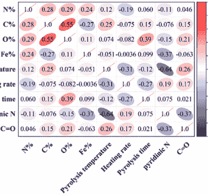
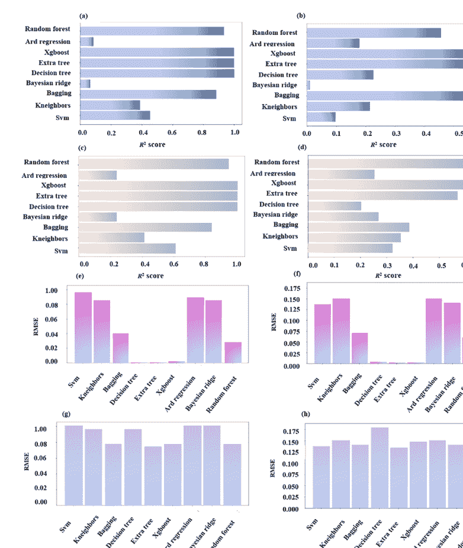
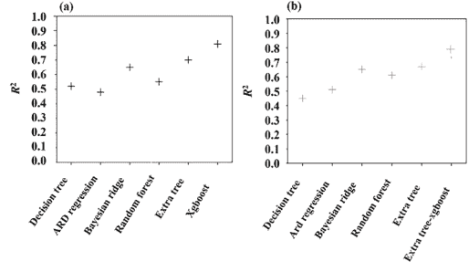
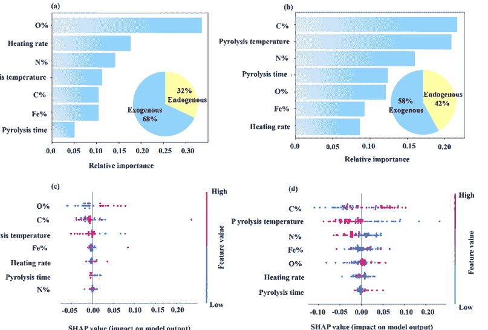
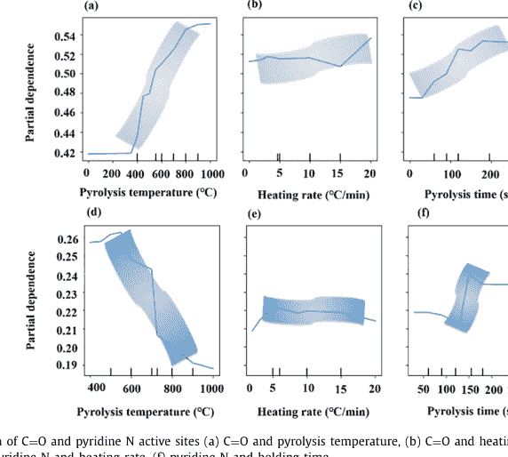
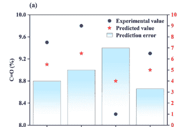
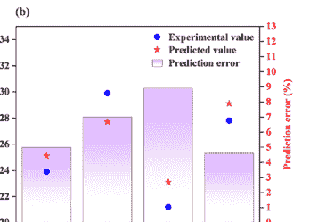

# 机器学习辅助构建污泥基催化剂中的C=O和吡啶N活性位点

# 摘要

催化剂表面活性位点的类型和数量决定了催化活性。本研究采用机器学习辅助利用污泥废物构建 C=O 和吡啶氮活性位点。提出了包括 C%、N%、O%、Fe%、热解温度、升温速率和热解时间在内的反应性描述符。构建并优化了决策树、额外树、极限梯度提升 (XGB)、自动相关性确定和贝叶斯岭回归模型。其中，XGB 模型在预测催化剂表面 C=O 位点方面表现出优异的准确性。此外，还开发了结合额外树和 XGB 的集成模型来预测吡啶氮，R² 值高达 0.80，最小均方根误差 (RMSE) 为 0.1386。集成模型与单个模型相比准确性提高了 17%。该模型能够对 C=O 和吡啶氮的构建条件进行高通量筛选。研究发现，热解温度 500–800 °C、升温速率 10–20 °C/min 和加热时间 120–200 min 有利于 C=O 活性位点的生成。对于吡啶氮位点，热解温度在 400 °C 至 600 °C 之间、升温速率 5–10 °C/min、热解时间约为 150 min 为最佳。实验验证表明，两种模型均表现出优异的预测性能，所有情况下预测误差均低于 10%。该研究提供了一种辅助构建 C=O 和吡啶氮活性位点的方法，有利于指导污泥催化剂的设计。

污水污泥 (SS) 是废水处理的副产物，已引起广泛关注。SS 的安全处置成为污水处理厂关注的关键问题之一。目前，全球干固体污水污泥的年产量约为 5300 万吨。然而，>80% 未得到妥善处理，对环境构成潜在威胁 [1,2]。因此，迫切需要有效措施来管理 SS。污泥富含有机物，通常需要在焚烧发电或供热前进行脱水。此外，污泥的矿物组成与粘土相似，因此污泥可用作生产陶粒等建筑材料的原料，替代部分粘土资源。此外，污泥富含氮、磷和钾，可用作有机肥料改善土壤质量 [3]。为实现可持续发展，SS 的资源化利用已成为首选方案 [4]。

幸运的是，热处理通过将污泥废物转化为功能性生物炭 [5,6] 提供了一种高效且环保的高值回收方法。利用 SS 作为碳基催化剂制备的原料被视为污泥减量和资源回收的新途径 [7–9]。

先进氧化工艺 (AOPs) 广泛应用于污染物去除和能量转换。具有 sp² 杂化的碳原子和富含电子的官能团，如 C–O 和 C=O，可作为过一硫酸盐 (PMS) 活化的界面位点。sp² 杂化碳作为高效的电子传输介质，可通过电子转移活化 PMS，生成硫酸根自由基 (SO₄•⁻) 和羟基自由基 (•OH) [10]。吡啶氮作为路易斯碱性位点向 C–S₂O₈²⁻ 复合物中的亲电氧转移电子，导致 O–O 键断裂并生成 SO₄•⁻ 和 O₂•⁻ [11]。此外，高石墨化碳晶格中 π 电子离域和丰富的结构缺陷增强了不成对电子迁移并促进 PMS 中 O–O 键的断裂，进一步促进 SO₄•⁻ 和 •OH 的形成。C=C 键由于其自由离域的 π 电子，也可活化 PMS 生成 SO₄•⁻ 和 •OH。此外，高浓度 sp² 杂化碳结构和 C=O 基团可高效向 PMS 转移电子，引发 SO₄•⁻ 的生成，随后 SO₄•⁻ 与 H₂O 或 OH⁻ 反应形成 •OH。单线态氧 (¹O₂) 可通过 SO₅•⁻ 与 H₂O 的反应生成 [12]。研究表明，由于富含碳和其他元素，SS 是生物炭生产的有前景的原料 [13–15]。SS 衍生的碳基材料具有复杂的孔结构、大比表面积 [16]、丰富的官能团（如羟基、羧基和氨基）和优异的表面电荷分布 [17]。表面羟基可通过氢键与 PS 结合，释放电子并通过氧化还原反应活化 PS，最终生成 SO₄•⁻；羰基 C=O 基团也可通过亲核加成和与 PMS 通过过氧化物中间体的相互作用生成 ¹O₂。

氨基可导致负结合能或高/低电子密度区域，形成表面结合反应复合物 [18]。SS 基碳材料已成功用于去除各种污染物的氧化还原过程，包括染料、重金属、除草剂、酚类、药物和抗生素 [19–22]。值得注意的是，SS 原料中 Fe 影响吡啶氮活性位点的形成 [23]。在热解过程中，原料中的铁氧化物最初诱导焦炭中蛋白质来源氮转化为含氮官能团（如吡咯氮、四元氮和氮氧化物），从而将氮固定在焦炭中。随着热解温度升高，α-Fe 形成并与半焦中的吡啶氮反应进一步生成 FeₓN。随着热解温度进一步升高，FeₓN 分解并转化为 N₂ [23]。此外，原料中 Fe 的存在有利于 C=O 活性位点的形成 [24]。Fe 促进污泥衍生碳表面结构缺陷的生成，这些缺陷是 C=O 形成的优异位点。因此，Fe 在催化活性位点的构建中起着至关重要的作用。此外，不同热解参数（如升温速率、热解温度和气氛）下 SS 的碳化过程涉及各种组分之间的复杂链式反应。在当前科学条件下，很难观察热解过程中中间体和官能团的变化，这阻碍了活性位点形成机理的阐明，进而影响活性位点的精确调控。

机器学习 (ML) 模型利用大数据分析和机器学习算法，可以揭示隐藏信息和复杂非线性关系 [25–27]。ML 使污泥衍生碳催化剂组成、制备参数与活性位点形成之间复杂相关性的建立成为可能。目前，ML 已用于预测催化活性位点 [28]。例如，Gao 等人采用传统 ML 模型预测生物炭基 C–C/C=C、C=O 和缺陷活性位点 [29]。相比之下，Wang 等人利用 ML 技术增强生物炭对过硫酸盐的非自由基活化 [30]。然而，需要注意的是，Fe 对 C=O 和吡啶氮活性位点的形成有显著影响 [23,24]，这一因素尚未在现有的活性位点预测 ML 模型中考虑。此外，传统模型面临某些挑战。例如，已显示随机森林在某些噪声分类或回归问题上会过拟合。对于具有不同取值数量的属性的数据，具有更多值划分的属性往往对随机森林产生更大影响。因此，在高维稀疏数据中，随机森林生成的属性重要性评分可能不可靠 [31,32]。值得注意的是，集成多个模型可以提高预测精度和稳定性 [31]。

模型集成在处理不平衡数据方面特别有效；当数据中存在噪声或其他不确定性时，集成模型可以通过平均多个模型的预测结果来减轻影响。模型集成在处理小数据集或高复杂度模型时尤其有益。集成模型可以降低过拟合风险 [33]。此外，集成模型可以处理各种数据类型，从而提高模型的整体泛化能力。因此，迫切需要开发能够准确预测含 Fe 污泥衍生碳催化剂表面关键活性位点的新的模型。

在本研究中，结合大数据和人工智能探索了能够从 SS 的复杂组成和热解参数中预测活性位点的描述符。提出了同时包含内在因素（如包括 Fe 的原料组成）和外在因素（如制备参数）的描述符。该描述符可以加速具有优异活性的 SS 基碳催化剂的筛选过程。此外，通过采用 Shapley 可加性解释 (SHAP) 分析和重要性排序，阐明了 SS 组成、热解参数与活性位点之间的关系。通过部分依赖图分析，确定了 SS 基碳催化剂中活性位点生成的热解时间、温度和升温速率的最佳条件。开发了两种 ML 模型：XGB 模型和结合 XGB 与 Extra Tree 的集成模型。基于多维因素与活性位点之间建立的关系，总结了内在反应性描述符。该反应性描述符可以减少制备具有目标活性位点的 SS 基碳催化剂所需的试错时间。所提出的描述符也可扩展以辅助构建 SS 衍生催化剂中的其他活性位点。

使用上述填充数据（支持信息中的 Text S2），我们重建了数据库，然后进行了 Pearson 相关系数 (PCC) 分析。如图 1 所示，蓝色表示两个变量之间较弱的线性关系，而对角线上的红色块代表自相关，其中 PCC 值为 1。首先，没有单一变量与目标变量 C=O 和吡啶氮表现出高度线性关系，表明需要复杂模型。此外，除了热解温度外，大多数变量均未显示出高度相关。由于热解温度可通过文献同时获得，因此无需进行降维。如上所述，研究选择了三种不同的预处理方法：标准化、PCA 和不预处理。XGB 方法被选为 sam-

图 2. 不同机器学习预测的 C=O 和吡啶 N 的 R² 值：(a) C=O 训练集，(b) 吡啶 N 训练集，(c) C=O 测试集，(d) 吡啶 N 测试集；不同机器学习算法预测 C=O 和吡啶 N 的 RMSE 值：(e) C=O 训练集，(f) 吡啶 N 训练集，(g) C=O 测试集，(h) 吡啶 N 测试集。

## 表 1

不同预处理方法的影响。

| 预处理方法 | RMSE | R² |
|---|---|---|
| 原始 | 0.1543 | 0.60 |
| 标准化 | 0.1412 | 0.62 |
| PCA | 0.1774 | 0.56 |

为了比较不同预处理方法的影响，所有其他超参数均设置为相同值。如表 1 所示，标准化预处理同时获得了最高的 R² 和最低的均方根误差（RMSE）。标准化预处理可能是因为，一旦变量被设定为相似的数值范围，每个特征变量比在原始数据中更突出 [34,35]。PCA 方法可以降低输入变量的维度，但由于 PCA 可能掩盖特征，因此存在降低精度的风险 [36]。因此，研究选择标准化作为预处理方法。

使用数据集作为输入，对九种常用的 ML 算法（SVM、K-Neighbors、Bagging、Decision Tree、Extra Tree、XGB、ARD Regression、Bayesian Ridge 和 Random Forest）进行了评估和比较，以预测污泥基催化剂活性位点的性能（支持信息中的表 S1）[37–39]。计算了训练集和测试集的 R² 和 RMSE 值以评估预测精度（支持信息中的文本 S3）。如图所示，三种 ML 算法（Decision Tree、Extra Tree、XGB）的训练 R² > 0.90（图 2a 和 c），表明 ML 算法已使用训练数据集得到良好训练。在训练 R² 良好的三种 ML 算法中，XGB 对 C=O 和吡啶 N 的 R² 验证值最高，分别为 0.58 和 0.62（图 2b 和 d）。相比之下，XGB 受异常值影响较小，对不平衡数据具有更强的处理能力。较低的 RMSE 值也表明 XGB 算法相对于其他算法的优势（图 2e–h）。基于筛选结果，选择 XGB 算法进行进一步优化，以构建预测污泥基催化剂中 C=O 和吡啶 N 活性位点的 ML 框架。

图 3. 贝叶斯优化后机器学习算法在测试数据集上的 R²：(a) C=O 和 (b) 吡啶 N 活性位点。

使用贝叶斯优化来优化 ML-XGB 框架以提高预测精度 [40,41]。树的数量（n_estimators 参数）通常会随着模型变得更稳健而提高模型性能，减少随机性。然而，过多的树会增加计算时间，而性能提升有限。max_depth 参数决定树的最大深度，是模型复杂性的关键因素。增加最大深度允许模型学习更复杂的模式，但可能导致过拟合。learning_rate 参数表示较低的学习率，导致模型更缓慢地学习数据模式，需要更多的 n_estimators 进行训练，但可能增强最终模型性能。subsample 参数使用样本的一部分训练每棵树，这是一种通过仅使用部分数据实现的方差减少技术。colsample_bytree 决定每棵树使用的特征比例，通过为每棵树随机选择特征来提高鲁棒性。

在 100 次迭代后（支持信息中的文本 S4），获得了最佳超参数值（支持信息中的表 S2）。ML-XGB 框架预测 C=O 活性位点的平均 R² 验证值从 0.58 提高到 0.79，预测吡啶 N 活性位点时从 0.62 提高到 0.70，表明优化进一步提高了预测精度。优化后的 ML-XGB 框架的 R² 验证值的变化小于优化前，表明其对数据变化具有更强的预测鲁棒性。此外，使用优化后的 ML-XGB 框架对 Decision Tree、Extra Tree、XGB、ARD Regression 和 Bayesian Ridge 机器学习算法进行了优化。在所有优化模型中，ML-XGB 框架具有最高的 R² 验证值，证实了其相对于其他模型的优越预测性能（图 3）。使用多个兼容的学习算法/模型进行单一任务的集成学习可以获得更好的预测性能。集成 XGB 和 Extra Tree 模型并进行进一步的贝叶斯优化，得到了最佳参数（表 S2）。集成模型的平均 R² 验证值在预测吡啶 N 活性位点时从 0.70 提高到 0.80。然而，在模型输入中移除 Fe 含量后，R² 值从 0.80 下降到 0.63。

由于 ML 通常被视为“黑箱”模型，因此使用解释来检查框架是否捕捉到了结构特征与反应性之间的关系 [42,43]。ML 模型在预测 SS 碳基催化剂表面的活性位点时表现出高精度。为了更好地指导活性位点的设计，从两个角度评估了内源性和外源性因素的重要性及其与活性位点的相关性。

首先，对构建的 ML 模型进行了解释，并可视化了特征的重要性，展示了它们如何影响 SS 表面的活性位点。

特征重要性和 SHAP 是解释 ML 框架最常用的方法之一（支持信息中的文本 S4）[44–46]。这些方法可以展示每个特征的方向和贡献（例如正贡献或负贡献）。如图 4a 所示，对于 C=O 活性位点，内源性因素 O% 和外源性因素加热速率是最具影响力的特征。在其他因素中，N%、热解温度和 C% 具有中等重要性，而 Fe% 的重要性相对较低。热解时间对模型预测的影响最小。同样，如图 4c 所示，在所有指纹因子中，O% 因子的相关系数最高，其次是保持时间。O% 特征表现出最大的正变化，其中较高的 O% 值（红色点）通常会导致 C=O 活性位点含量的增加。C% 和热解温度在零附近呈现宽分布，表明这些因素具有复杂的影响。加热速率和热解时间也在零附近呈现宽分布。N% 的特征值最低，特征点集中在零线附近，对 C=O 活性位点的生成贡献最小。

对于吡啶 N，如图 4b 所示，内源性因素 C% 和外源性因素热解温度是最关键的特征，分别对模型影响贡献 24.1% 和 22.9%。在其他因素中，热解时间、O%、Fe% 和加热速率具有中等重要性。同样，如图 4d 所示，内源性因素 C% 和外源性因素热解温度对吡啶 N 影响最大。对于 C%，较高的值（红色点）通常会增加吡啶 N 活性位点的含量。热解温度特征点主要分布在零线的左侧。较高的特征值不利于吡啶 N 的形成。加热速率和热解时间的影响相对集中在零附近，表明贡献平衡。这些见解不仅阐明了影响活性位点预测的关键因素，还为优化 SS 碳基催化剂的设计提供了宝贵的指导。通过利用该模型，研究人员可以在未来的研究中节省与实验条件相关的精力和成本，同时提高催化剂性能。

PDP 分析揭示了某些预测因子对目标响应特征的部分依赖性（文本 S4）。对于 C=O 官能团，部分依赖于热解温度在约 400 °C 时开始逐渐增加，然后从 500 °C 起急剧上升。较高的温度导致 C=O 活性位点含量的增加（图 5a）。加热速率的部分依赖性相对稳定，波动极小，表明在该范围内加热速率对预测的 C=O 影响相对较小（图 5b）。至于热解时间，部分依赖性随时间稳步增加，在 120 至 200 分钟之间达到峰值，从而导致 C=O 活性位点含量的增加（图 5c）。因此，加热速率对 C=O 的形成影响相对较小，而较高的热解温度（500–800 °C）和较高的加热速率（10–20 °C/min）有利于 C=O 的形成。

对于吡啶 N，部分依赖于热解温度在 400–600 °C 左右最高，但随着温度继续升高，部分依赖性下降（图 5d）。600 °C 以上的温度通常会导致吡啶 N 活性位点含量的减少。加热速率的部分依赖性显示出适度的增加，在约 5–10 °C/min 时达到峰值，然后略微下降或稳定（图 5e）。适中的加热速率与吡啶 N 活性位点含量的增加相关，但非常高的加热速率不会导致增加

图4. 特征重要性：(a) C=O；(b) 吡啶氮；以及SHAP值：(c) C=O；(d) 吡啶氮。

图5. C=O和吡啶氮活性位点的部分依赖图：(a) C=O与热解温度；(b) C=O与升温速率；(c) C=O与保温时间；(d) 吡啶氮与热解温度；(e) 吡啶氮与升温速率；(f) 吡啶氮与保温时间。

吡啶氮活性位点含量对热解时间的部分依赖在约150 min前持续增加，之后略有下降并趋于稳定（图5f）。这表明，约150 min的最佳热解时间可提高吡啶氮活性位点含量，继续延长时间不会带来进一步的显著提升。因此，约400–600 °C的热解温度、5–10 °C/min的升温速率和约150 min的热解时间有利于吡啶氮活性位点的形成。所开发的ML模型展示了预测活性位点含量的能力。在不同热解条件下制备了四种SC（补充材料Text S1），并分析了SC样品的元素组成和活性位点分布。SC的制备和表征详情见补充材料中的表S3和表S4。通过XPS测量对SC样品的化学组成和活性位点分布进行了分析（补充材料图S1）。高分辨率C1s谱峰被解卷积为284.7、285.5、286.5和288.8 eV处的四个峰，分别对应C–C/C=C、C–N/C–O、C=O和O–C=O [47]。类似地，高分辨率N1s谱峰被解卷积为398.5、399.8和400.8 eV处的三个峰，分别对应吡啶氮、吡咯氮和石墨氮 [48]。测得的 C=O

图6. 活性位点的实测与ML预测含量：(a) C=O，(b) 吡啶氮。

含量在四个样品中分别为9.51%（SC1）、9.82%（SC2）、8.19%（SC3）和9.31%（SC4）。吡啶氮含量分别为23.90%（SC1）、29.91%（SC2）、21.22%（SC3）和27.79%（SC4）。使用ML模型预测四个样品中的活性位点含量，所有样品C=O位点的预测误差均低于10%，平均误差小于5.1%（图6a）。对于吡啶氮，预测误差分别为5.1%（SC1）、7.2%（SC2）、8.9%（SC3）和4.6%（SC4），平均误差为6.38%（图6b）。显然，该模型能够准确预测污泥衍生生物炭催化剂中的活性位点。

本研究开发了一种XGB模型来预测C=O活性位点的反应活性，并提出了一种结合Extra Trees和XGB的集成机器学习模型来预测吡啶氮。提出了一种新描述符，整合了与原料组成（包括铁）相关的内在因素和与制备参数相关的外在因素。模型结合该描述符，能够有效预测污泥（SS）衍生碳催化剂表面的C=O（R²=0.79，RMSE=0.0812）和吡啶氮（R²=0.80，RMSE=0.1386）活性位点。实验验证表明，C=O和吡啶氮活性位点的平均预测误差分别为5.1%和4.6%。此外，实现了对C=O和吡啶氮活性位点制备参数的高通量筛选。对于C=O活性位点，O%和升温速率作用最为显著，其次是N%和热解温度。同时，C%和Fe%影响中等，热解时间对总体影响的贡献最小。此外，C=O活性位点的最佳热解条件确定为热解温度500–800 °C、升温速率10–20 °C/min、加热时间120–200 min。对于吡啶氮活性位点，C%和热解温度起主导作用，其次是N%和保温时间。同时，O%和Fe%影响中等，升温速率贡献最小。吡啶氮的最佳热解条件确定为热解温度400–600 °C、升温速率5–10 °C/min、热解时间约150 min。为精确制备高活性污泥衍生碳催化剂奠定了坚实基础。

# 利益冲突声明

作者声明，他们不存在任何已知的、可能影响本文所报告工作的竞争性经济利益或个人关系。

# CRediT作者贡献声明

Xu He：写作—审阅与编辑、写作—初稿、方法论、形式分析、概念化。Wenjie Gao：写作—初稿、形式分析。Jinglei Xu：写作—审阅与编辑、写作—初稿。Zhanjun Cheng：写作—审阅与编辑。Wenchao Peng：写作—初稿。Beibei Yan：写作—审阅与编辑。Guanyi Chen：写作—初稿、概念化。Ning Li：写作—审阅与编辑、写作—初稿、形式分析。

# 致谢

本工作得到了天津市青年科技人才（第二层次）（No. QN20230214）、天津大学攀登计划（No. 2023XPD-0006）、国家自然科学基金（No. 52100156）和城市轨道交通数字化建设与测评技术国家工程研究中心（No. 2023HJ02）的资助。

# 补充材料

与本文相关的补充材料可在在线版本中找到，doi:10.1016/j.cclet.2025.111019。

# 参考文献

- [1] Y. Duan, N. Gao, A.T. Sipra, et al., J. Hazard. Mater. 424 (2022) 127293.
- [2] Y. Li, H. Yu, L. Liu, et al., J. Hazard. Mater. 420 (2021) 126655.
- [3] W. Zheng, Y. Shao, S. Qin, Sustainability 16 (2024) 6710.
- [4] S.S.A. Syd-Hassan, Y. Wang, S. Hu, S. Su, et al., Renew. Sustain. Energy. Rev. 80 (2017) 888-913.
- [5] E. Agrafioti, G. Bouras, D. Kalderis, et al., J. Anal. Appl. Pyrolysis 101 (2013) 72-78.
- [6] J. Lu, Q. Lu, L. Di, et al., Chin. Chem. Lett. 34 (2023) 108357.
- [7] J. Xu, Y. Yu, K. Ding, et al., Water Sci. Technol. 77 (2018) 1410-1417.
- [8] Z.X. Xu, H. Song, P.J. Li, et al., J. Hazard. Mater. 398 (2020) 122833.
- [9] W. Hu, J. Tan, G. Pan, et al., Sci. Total Environ. 728 (2020) 138853.
- [10] Y. Wang, W. Peng, J. Wang, Appl. Catal. B 310 (2022) 121342.
- [11] P. Zhang, Y. Yang, X. Duan, ACS Catal. 11 (2021) 11129-11159.
- [12] H. Zhang, Z. Yan, J. Wan, Colloids Surf. A: Eng. Asp. 654 (2022) 130174.
- [13] N. Li, Y. Ye, H. Dai, Water Res. 235 (2023) 119926.
- [14] C. Zhang, N. Ding, Y. Pan, et al., Chin. Chem. Lett. 35 (2024) 109579.
- [15] J. Wang, Z. Liao, J. Ifthikar, et al., Chemosphere 185 (2017) 754-763.
- [16] S. Singh, V. Kumar, D.S. Dhanjal, et al., J. Clean. Prod. 269 (2020) 122259.
- [17] X. Pei, X. Peng, X. Jia, et al., J. Hazard. Mater. 419 (2021) 126446.
- [18] L. Kou, Y. Wang, L. Zhao, et al., Chem. Eng. J. 411 (2021) 128459.
- [19] M.M. Mian, G. Liu, H. Zhou, et al., Sci. Total Environ. 744 (2020) 140862.
- [20] Z. Liu, S. Singer, Y. Tong, et al., Renew. Sustain. Energy. Rev. 90 (2018) 151174.
- [21] Y. Liu, S. Yang, S. Liu, et al., J. Anal. Appl. Pyrolysis 182 (2024) 106696.
- [22] Y. Liu, S. He, B. Huang, et al., J. Energy. Chem. 70 (2022) 511-520.
- [23] J.H. Kim, J.K. Shin, H. Lee, et al., Water Res. 207 (2021) 117821.
- [24] S. Russo, M.D. Besmer, F. Blumensaat, et al., Water Res. 206 (2021) 117695.
- [25] Z. Li, S. Zou, Z. Wang, et al., Chin. Chem. Lett. 35 (2024) 110526.
- [26] J. Li, X. Liu, H. Wang, et al., Chin. Chem. Lett. 35 (2024) 108596.
- [27] W. Gao, N. Li, Z. Cheng, et al., Bioresour. Technol. 408 (2024) 131156.
- [28] R. Wang, S. Zhang, H. Chen, et al., Environ. Sci. Technol. 57 (2023) 4050-4059.
- [29] M.A. Ganaie, M. Hu, A.K. Malik, et al., Eng. Appl. Artif. Intell. 115 (2022) 105151.
- [30] X. Dong, Z. Yu, W. Cao, et al., Front. Comput. Sci. 14 (2020) 241-258.
- [31] B. Deng, P. Chen, P. Xie, et al., Chem. Eng. Sci. 267 (2023) 118368.
- [32] D. Wu, D. Zhang, S. Liu, et al., J. Chem. Eng. J. 399 (2020) 125878.
- [33] A. Smith, A. Keane, J.A. Dumesic, et al., Appl. Catal. B 263 (2020) 118257.
- [34] F. Rodrigues, N. Ortelli, M. Bierlaire, et al., IEEE. Trans. Intell. Transp. Syst. 23 (2022) 3126-3136.

[35] S. Mangalathu, S.H. Hwang, J.S. Jeon, et al., Eng. Struct. 219 (2020) 110927.
[36] A. Altmann, L. Tolosi, O. Sander, et al., Bioinformatics 26 (2010) 1340-1347.
[37] F. Zhang, X. Yang, Remote Sens. Environ. 251 (2020) 112105.
[38] G. Louppe, L. Wehenkel, A. Sutera, P. Geurts, Understanding variable importances in forests of randomized trees, in: B. Schölkopf, J. Platt (Eds.), Advances in Neural Information Processing Systems, MIT Press, Cambridge, 2013, pp. 312-320.
[39] P. Antwi, J. Li, J. Meng, Bioresour. Technol. 257 (2018) 102-112.
[40] O.B. Ayodele, H.S. Auta, N.M. Nor, Ind. Eng. Chem. Res. 23 (2022) 3126-3136.

[41] F.L. Gewers, G.R. Ferreira, H.F. De Arruda, ACM Comput. Surv. 23 (2022) 3126-3136.
[42] S. Zhong, Y. Zhang, H. Zhang, Environ. Sci. Technol. 56 (2022) 681-692.
[43] Q. Lu, S. Tian, L. Wei, Sci. Total. Environ. 856 (2023) 159171.
[44] R. Huang, C. Ma, J. Ma, Water Res. 205 (2021) 117666.
[45] X. Wang, Y. Jin, S. Schmitt, ACM Comput. Surv. 55 (2023) 1-36.
[46] Z. Li, Comput. Environ. Urban. Syst. 96 (2022) 101845.
[47] Y. Yu, N. Li, C. Wang, J. Colloid. Interface. Sci. 619 (2022) 267-279.
[48] R. Andrade, M. Vieira, M. Silva, Chem. Eng. J. 23 (2022) 3126-3136.

