# 机器学习示例指南

结 555

图片致谢 556

幕后故事 195

接下来去哪里？ 400

要点 422

入门 446

寻找命名实体 450

情感分析 461

剩余部分 478

序列到序列模型 482

构建你的模型 491

使用序列到序列模型进行推理 503

在 iOS 中使用你的模型 513

# 关于封面

虎鲸，或广为人知的杀手鲸，是海洋中最具智慧且最致命的捕食者之一。虎鲸非常聪明，经常在野外利用解决技巧来捕猎，甚至从渔网中偷鱼。在哺乳动物中，虎鲸的大脑很大，具有广泛的学习能力和通用智能。大多数人通过它们在海洋中的嬉耍表演来了解虎鲸。在野外，虎鲸不仅仅是好玩的哺乳动物；它们还形成了复杂的社会关系，这种关系与大象相似。尽管在世界各海洋都能发现虎鲸，但追踪它们的迁移模式一直非常困难，因为整个虎鲸群有时会消失，直到几个月后才重新出现。事实上，机器学习开始在追踪大型鲸类迁移模式方面发挥作用，准确率高达98%。在此处阅读更多关于机器学习如何衡量人类活动的影响：https://www.google.com/ai/students-quest-endangered-whales

# 致谢

“给 Floortje，我的。谢谢你所有的拥抱！”

—— Matthijs Hollemans

“给 Darwin 和 Archana：我的爱——愿你们一切顺利。给未来的领主们：我是你们的一员。我的意思是，哔哔，对吗？”

—— Chris LaPollo

“给我的父母和老师们，是他们引导我走向现在的道路。”

—— Audrey Tam

# 关于作者

**Matthijs Hollemans** 是本书的作者。在多年编写 `if-then-else` 逻辑的代码后，Matthijs 终于看到了光，转向了机器学习，教计算机编写 `if-then-else` 语句。为什么让计算机自己写程序呢？Matthijs 会在健身房举重物，并在 machinethink.net 写博客。你可以在 Twitter 上关注 @hollemans。

**Chris LaPollo** 是作者。目前是一名独立开发者和顾问，专注于结合软件工程经验来解决以前被认为过于复杂的问题。他喜欢玩游戏，并和家人一起放松。你可以在 Twitter 上通过 ChrisLaPollo 找到他。

**Audrey Tam** 是作者。作为一名退休的计算机科学学者，她是一位通才专家，擅长将新知识转化为学习材料。Audrey 拥有应用数学博士学位，因此特别擅长机器学习。Audrey 现在为非程序员教授 iOS 开发课程。她也喜欢长途旅行和野外徒步。

# 关于编辑

Marin Benčević 是本书编辑。Marin 是一位 Swift 和 Unity 开发者，喜欢开发酷炫的 iOS 应用和游戏，对编程痴迷，学习新事物并以此写博客。不过，他经常导致 SourceKit 崩溃。他还有一只胖胖猫。

Phil J. Laszkowicz 是本书编辑。Phil 多年来一直提供大规模软件解决方案，并担任董事成员、导师和教练与初创公司合作。他研究神经网络超过十年，喜欢在移动端和网页提供直观优雅的用户体验。在空闲时间，他写音乐、喝专业水平的咖啡，攀攀岩、划艇或参加射箭。

Vijay Sharma 是本书的终审编辑。Vijay 是一位丈夫、父亲和高级移动工程师。住在加拿大首都，Vijay 为 Android 和 iOS 开发了数十个应用。在不在电脑前时，你可以在电视机前、书后或追逐孩子时找到他。你可以通过 Twitter @vijaysharm 或 LinkedIn @vijaysharm 与他联系。

# 关于艺术家

**Vicki Wenderlich** 是本书封面的设计者和艺术家。她是 Ray 的妻子兼业务伙伴。她是一位数字艺术家，为 raywenderlich.com 上的教程和书籍创作插画、游戏艺术以及许多其他艺术或设计工作。在不创作时，她喜欢徒步、喝一杯好红酒并尝试制作完美的奶酪盘。


跟随本书，你需要以下条件：

- 一台运行 Mojave (10.14) 或 Catalina (10.15) 或更高版本的 Mac。较早版本可能可行，但未经过测试。要跟随某些章节，你需要 Catalina (10.15)。
- Xcode 11.0 或更高版本。Xcode 是 iOS 的主要开发工具。完成书中的任务需要 Xcode 11.0 或更高版本。
- 一个或多个运行 iOS 13 或更高版本的设备（iPhone、iPad）。书中的某些示例依赖 Swift 5.1，请确保从 Apple 网站安装最新版本。

# 书籍许可

通过购买《Machine by Tutorials》，你拥有以下许可：

- 你允许在尽可能多的应用中使用和/修改《Machine by Tutorials》中的源代码，无需署名。
- 你允许在尽可能多的应用中使用和/修改《Machine by Tutorials》包含的所有艺术、图像和设计，但必须在应用中包含此声明：“Artwork/images/designs: from Machine by Tutorials, available at raywenderlich.com”。
- 《Machine by Tutorials》中的源代码供个人使用。未经许可不允许分发或销售。
- 本书供个人使用。不允许分发给朋友、同事或学生；他们需要购买副本。

本书提供的所有材料均按“原样”提供，不提供任何形式的明示或隐含保证，包括但不限于对销性、特定用途和非侵权的保证。对于因软件或软件交易引起的任何合同、侵权或其他诉讼，作者或版权持有者均不承担任何赔偿责任。

本指南中出现的所有商标和注册商标均为其所有者的财产。

# 如果你购买的是数字版

本书的数字版包含每个章节的启动和完成项目的源代码。这些资源随你从 https://store.raywenderlich.com/products/machine-learning-by-tutorials 下载的数字版。

# 如果你购买的是纸质版

你可以在此处获取纸质版的源代码：

- https://store.raywenderlich.com/products/machine-learning-by-tutorials-source-code

# 论坛

我们在 forums.raywenderlich.com 为本书设立了官方论坛。这里是你就书籍提问或提交发现的任何错误的好地方。

# 数字书版本

我们提供了 ePUB 和 PDF 格式的本书数字版，如果你想带一个软拷贝，或者想在书中快速搜索特定术语，这会非常方便。

机器学习

书籍源码与论坛

购买本书的数字版还有一些额外益处：每当我们更新书籍时都能获得免费更新，可以访问书籍的旧版本，并且你可以随地、随随地下载数字版。

在此处访问我们的《机器学习实战教程》商店页面：

- https://store.raywenderlich.com/products/machine-learning-by-tutorials.

如果你购买了本书的纸质版，你有权以大幅折扣升级为数字版！只需向 support@razeware.com 发送邮件并附上纸质书收据，我们将为您设置好折扣后的数字版书籍。

# 第一部分：使用图像进行机器学习

本节将带你进入机器学习的世界。你将从宏观角度了解什么是机器学习，以及它如何在移动设备上使用。你还将快速学习机器学习所需的 Python 基础。你将学习如何配置环境以使用 CreateML、Turi Create 和 Keras 等工具进行机器学习。最后，你将学习如何使用机器学习技术通过图像来解决问题。你将探索的主题包括图像分类、带边界框的目标检测以及物体分割。

- 第 1 章：机器学习、iOS 与你：在这一章中，你将学习机器学习的本质。你将接触各个领域，从监督学习与无监督学习的区别到什么是迁移学习。你甚至将回顾机器学习的伦理问题以及偏差如何影响模型。
- 第 2 章：入门图像分类：在这一章中，你将使用 CoreML 构建第一个 iOS 应用，用于检测零食是否健康。你将重点关注如何使用机器学习解决分类问题，例如识别某个物体可能是什么。
- 第 3 章：训练图像分类器：在这一章中，你将开始使用 Create ML 构建第一个机器学习模型。你将接触用于创建模型的数据集，以及 Create ML 如何使用迁移学习来获得惊人的分类结果。此外，你将学习评估模型性能意味着什么。
- 第 4 章：入门 Python 与 Turi Create：在这一章中，你将快速上手 Python。你将学习如何使用 Conda 配置 Python 环境，以及如何安装外部库。你将学习如何运行和使用 Jupyter notebooks 来通过 Python 进行快速迭代。
- 第 5 章：深入研究 Turi Create：在这一章中，你将学习使用 Turi Create 构建分类模型。你将使用零食数据集来创建模型。你将学习如何分析模型的性能，以及如何深入 Turi Create 的内部机制来改进你的模型。
- 第 6 章：使用 Keras 控制训练：在这一章中，你将学习如何使用 Keras 控制模型的训练。你将设计你的第一个神经网络，并学习如何将数据集传递给 Keras 进行训练。
- 第 7 章：进阶卷积：在这一章中，你将了解为什么当使用机器学习解决图像问题时，简单的神经网络可能是不够的。你将学习使用卷积神经网络（CNN）如何为解决分类问题提供了一种更优越的方法。
- 第 8 章：高级卷积神经网络：在这一章中，你将学习用于解决图像分类的高级模型架构。你将学习如何使用 Keras 进行迁移学习，以及应用丢弃（dropout）和正则化等高级技术如何提高模型的性能。
- 第 9 章：超越分类：在这一章中，你将学习识别物体在图像中的位置。你将学习构建一个预测单个边界框的简单定位模型。
- 第 10 章：YOLO 与语义分割：在最后一个章节中，你将学习一些先进的定位模型。你将学习诸如 YOLO 和 SSD 等单次检测器（one-shot detectors），以及它们如何用于识别图像中的多个物体。你还将学习如何使用机器学习进行分割，将物体从背景中分离。

## 第 1 章：机器学习、iOS 与你

由 Audrey Tam 和 Matthijs Hollemans 编写

**更新说明：** 本章已更新至 iOS 13、Xcode 11 和 Swift 5.1

想知道秘密吗？机器学习并没有那么难。事实是，你不需要来自名牌大学的博士学位，也不需要数学背景就能做到它。诚然，有一些新概念需要理解，而且这样的书无法涵盖整个领域，但你学到的知识足以让你“大显身手”！

第一章是对机器学习世界及其能提供内容的温和介绍。在书的其余部分，你将详细查看这些每一个主题。随着每一个 iOS 版本的发布，Apple 都在让在应用中添加机器学习变得越来越简单。现在有几个高级框架，包括自然语言（Natural Language）、语音（Speech）和视觉（Vision），它们提供了高级的机器学习功能。想要将语音转换为文本、检测照片中的人脸或跟踪视频中的移动物体吗？

### 机器学习

为了获得更多的控制权，Core ML 和 Metal Performance Shaders 框架允许你运行自己的机器学习模型。Apple 还提供了许多易于使用的工具，如 Create ML 和 Turi，让你能够构建自己的模型。许多行业标准工具都可以导出 Core ML 模型，允许你轻松地将它们集成到应用中。

在本书中，你将学习如何使用这些工具和框架让你的应用变得更智能。更好的是，你将学习机器学习在背后是如何运作的——以及为什么这项技术是如此出色。

### 什么是机器学习？

机器学习非常火热且令人兴奋——但它并不完全新鲜。许多公司在几十年里一直将机器学习作为其日常业务的一部分。Google 也许是最典型的机器学习公司，它成立于 1998 年，当时 Larry Page 发明了 PageRank，这现在被认为是一种经典的机器学习算法。

但机器学习可以追溯到更早的时期，一直到现代计算机的早期。1959 年，Arthur Samuel 将机器学习定义为赋予计算机在无需显式编程的情况下进行学习能力的科学领域。

事实上，所有机器学习算法中最基础的——线性回归（或“最小二乘法”），在 200 多年前由数学家卡尔·弗里德希希·高斯（Carl Friedrich Gauss）发明了。这在计算机出现之前大约一个半世纪之前……甚至在电力普及之前。这个简单的算法在今天仍被使用，并且它是逻辑回归甚至神经网络等更复杂方法的基础。

所以，机器学习已经存在了一段时间了。但这并不意味着你错过了班车。相反，它最近成为如此热门话题的原因是，机器学习在拥有大量数据时效果最好——得益于互联网和智能手机，现在的数据比以往任何时候都多。此外，计算能力也变得廉价得多。

机器学习花费了很长时间才流行起来，但它已经成长为解决过于复杂的现实世界问题的实用工具。

新之处，以及我们编写这本书的原因在于，移动设备现在已经足够强大，可以在你的手心中运行机器学习算法！

## 无需显式编程的学习

当我们说“机器学习”时，到底是指什么呢？

作为一名程序员，你习惯于编写代码，精确地告诉计算机在任何情况下应该做什么。这些代码大部分由规则组成：

```
if this is true,
then do something,
else do another thing
```

这基本上就是软件一直以来编写的方式。不同的程序员使用不同的语言，但他们本质上是在为计算机编写执行的长长指令列表。这对于很多软件都非常有效，这也是为什么它是一种流行的方法。

编写“如果-那么-否则”规则对于自动执行大多数人认为无聊或需要长时间专注的重复性任务非常有效。尽管很耗费时间，但以这种规则的形式向计算机输入大量知识是可能的，然后程序化模拟人类的意识行为、根据规则或知识进行逻辑推理，或应用启发式（即规则或经验法则）。

但也存在一些有趣的问题，在这些中很难想出一套合适的规则，或者启发式太粗糙——这正是机器学习大显身场的地方。要显式地编写计算机完成大多数人在没有意识的情况下就会做的事情是非常的：识别脸部、表情和情感、物体的形状，或者句子的含义或风格。为这些任务编写算法非常困难：人类大脑到底通过执行什么来完成这些任务的？

机器学习

第 1 章：机器学习、iOS 与你

你会如何编写规则来识别照片中的人脸？你可以查看像素的 RGB 值来描述它们的头发、皮肤或眼睛的颜色，但这并不非常可靠。此外，一个人的外表——发型、妆容、眼镜等——在照片之间可能会发生巨大变化。人们通常不会直视相机，所以你必须考虑许多不同的相机拍摄角度。以此类推……你最终将得到成百甚至上千条规则，而且它们仍然无法涵盖所有情况。

你如何识别出你是你自己，而不是长得像你的兄弟姐妹或亲戚？如果你只有照片，如何向小孩子解释如何区分猫和狗？什么规则可以区分猫脸和狗脸？狗和猫有许多不同的颜色、毛发长度和巴形状。对于你想到的每条规则，可能都会有很多例外。

机器学习背后的核心思想是，如果你无法为计算机写出识别图像中的物体或某些文本所表达的情感所需的确切步骤，也许你可以写一个程序来为你生成这个算法。

与其让领域专家来设计和实现“如果-那么-否则”规则，你可以让计算机从示例中学习解决这些类问题的规则。这就是机器学习：使用学习算法来自动推导出解决特定问题所需的“规则”。通常，这种自动学习器给出的规则比人类更好，因为它可以发现人类无法发现的数据中的模式。

## 深度学习

到目前为止，我们使用“深度学习”和“神经网络”等术语还相当字面。让我们花点时间正确地定义这些术语的含义。

神经网络由层（神经元）组成，试图模仿人类大脑的工作方式。在长一段时间里，这主要是理论性的：那个时代的计算机只能在合理的时间内计算只有几层的简单神经网络。此外，数学上也存在问题，层数更多、规模更大的网络效果并不好。


直到 21 世纪中期，计算机科学家们才弄出如何训练由许多层组成的真正的深度网络。与此同时，电脑游戏设备市场爆发了，刺激了对更快、更便宜的 `GPU` 以运行日益复杂的游戏的需求。


### 机器学习

第 1 章：机器学习、iOS 与你

`GPU`（图形处理器）可以加速图形处理，并且非常擅长快速完成大量的矩阵操作。巧的是，神经网络也需要大量的矩阵操作。

益于游戏玩家，快速 `GPU` 变得非常负担得起，而这正是训练深层神经网络所需的硬件。机器学习中一些令人兴奋的进展是由深度学习驱动的，它使用具有大量层以及每层具有大量神经元的神经网络作为其学习算法。

> 注意：苹果、英特尔和谷歌等公司正在设计专门用于深度学习的单元，例如谷歌的 `TPU`（张量处理单元），以及 `iPhone XS A12` 处理器中新的神经引擎。这些单元缺乏 `GPU` 的 3D 渲染能力，但可以更高效地运行神经网络的计算需求。

网络越深，你可以让它做的事情就越复杂。得益于深度学习，现代机器学习模型可以解决比以往任何时候更困难的问题——包括图像中的内容、语音识别、理解语言等。对深度学习的研究仍在进行中，新的发现正不断涌现。

> 注意：英伟达（`NVIDIA`）凭借作为电脑游戏芯片制造商而闻名；现在，它也是一家机器学习芯片制造商。尽管大多数训练模型的工具可以在 `macOS` 上运行，但它们通常更多地运行在 PC 的 `Linux` 上。这些工具支持的唯一 `GPU` 仅来自英伟达，而大多数 Mac 不

机器学习

第 1 章：机器学习、iOS 与你

英伟达芯片，通过苹果自己的工具在较新的 Mac 上实现了 `GPU` 加速，但如果你想要最好的速度和灵活性，你仍然需要一台 `Linux` 机器。坦率地说，你可以在云端运行此类机器。对于本书，你可以在 Mac 上运行大部分训练代码，尽管有时你需要耐心。我们还提供了训练模型下载，这样你就可以跳过等待。

## 人工智能

一个与机器学习经常一起提到的术语是*人工智能*（简称 `AI`），这是一项始于 20 世纪 50 年的研究，可以玩国际棋、解决代数问题的计算机程序。

人工智能的目标是利用机器模拟人类的某些方面。`AI` 的一个著名例子是图灵测试：*如果人类无法区分机器和人类的反应，机器就是智能的。*

`AI` 是一个非常广泛的领域，拥有来自不同背景的研究人员，包括计算机科学、数学、心理学、语言学、经济学和哲学。它有很多子领域，如计算机视觉和机器人，以及不同的方法和工具，包括统计学、概率、优化、逻辑编程和知识表示。

学习确实是我们与智能联系在一起，但说所有机器学习系统都是智能的就过过了。这两个领域确实存在重叠，但机器学习只是你使用的工具之一。并不是 `AI` 都是机器学习——并不是所有的机器学习都是 `AI`。

机器学习与统计学以及*数据科学*（在计算机上进行统计学的时尚术语）也有许多共同点。数据科学家可能会使用学习来工作，而且许多机器学习算法最初源于统计学。一切都是重组。

## 你可以用机器学习做什么？

以下是今天研究人员和公司使用机器学习正在的一些事情：

+   - 预测购物者在商店里的花费金额。
-    辅助驾驶和自动驾驶汽车。

### 机器学习

- 个性化社交媒体：定向广告、推荐和人脸识别。
- 检测垃圾邮件和恶意软件。
- 预测销售额。
- 预测制造设备可能出现的潜在问题。
- 让送货路线更高效。
- 检测在线欺诈。
- 以及许多其他……

这些都是该技术的极佳用途，但对于移动开发者来说并不真正相关。幸运的是，**机器学习**在移动端*可以*做很多事情——尤其是当你接触设备特有的数据源时，设备随用户随处移动，可以感知用户的移动和周围，并包含了用户所有的联系人、照片和通信记录。机器学习可以让你的应用变得更智能。

你可以用于**移动端机器学习**的数据输入类型有四种：摄像头、语音和活动记录数据。

**摄像头：** 分析或增强相机拍摄的照片和视频，或使用实时摄像头流来检测照片和视频中的物体、人脸和地标；识别图像中的手写字和打印文本；使用图片进行搜索；跟踪运动和姿态；识别手势；理解照片和视频中的情感线；增强图像并消除缺陷；自动标记和分类视觉内容；添加特效和滤镜；检测显性内容；创建室内空间的3D模型；实现增强现实。

**文本：** 分类或分析用户编写或接收的文本，以理解其含义或句子结构；翻译成其他语言；实现智能拼写检查；总结文本；检测主题和情感；创建对话 `AI` 和聊天机器人。

**语音：** 将语音转换为文本，用于听写、翻译或 `Siri` 类指令；实现视频的自动字幕。

**活动：** 根据设备陀螺仪、加速度计、磁力计、高度计和 `GPS` 感知的用户活动进行分类。

在本章稍后的部分，**框架、工具和 API**章节，你会发现 `iOS SDK` 涵盖了所有这些领域！

机器学习

第 1 章：机器学习、iOS 与你

> 注意：通常情况下，当通过编写规则来解决编程问题变得过于复杂时，机器学习可以是一个很好的解决方案。每当你string应用中使用启发式方法（一种有根据的猜测或经验法则）时，你可能都会考虑用学习模型来替换它，以获得针对给定情况的定制结果，而不仅仅是一个猜测。

## 机器学习简介

机器学习的核心概念之一是“模型”。模型是计算机为了执行特定任务而学习的算法，加上运行该算法所需的数据。因此，模型

它之所以被称为“模型”，因为它对你试图解决的问题领域进行了建模。例如，如果问题是识别照片中朋友的面部，那么问题就是人类的数字照片，而模型将包含理解这些照片所需的所有内容。

要创建模型，你首先需要选择一种算法——例如神经网络——然后你需要通过向它展示大量你想要解决的问题的示例来训练模型。对于人脸识别模型，训练示例将是你朋友的照片，以及你希望模型从这些照片中学习的内容，例如他们的名字。

成功训练后，模型就包含了关于该问题的“知识”，这些知识是机器学习算法从那些示例中成功提取出来的。

一旦你拥有训练好的模型，你就可以向它提出你尚不知道答案的问题。这被称为推理（inference），即使用训练好的模型进行预测或绘制轮廓。给定一张模型从未见过的新照片，你希望它能检测出你朋友的面部并将正确的名字放在正确的脸上。

如果一个模型对未训练过的数据能做出正确的预测，我们说它具有泛化能力（generalizes）。训练模型使其在新数据上做出良好的预测是机器学习的关键挑战。

raybenderlich.com

28

机器学习中的“学习”实际上只适用于训练阶段。一旦你训练了模型，它将不会再学习任何新东西了。当你在应用中使用机器学习模型时，你并不是在实现学习，不如说是在“使用一个之前已经学过某些东西的固定模型”。当然，每隔一段时间重新训练你的模型是可能的——例如在你收集了新数据并更新应用以使用这个新模型之后。

> 注意：新的 `Core ML 3` 实现了模型的设备端个性化。这允许你将用户自己的数据整合到模型中。你仍然从一个完全训练并已经包含许多通用知识的模型开始，但针对每个用户的特定需求对模型进行微调。这种训练直接发生在用户的设备上，不需要服务器。

## 监督学习

今天实践的常见的机器学习类型，也是本书的主题，是**监督学习**。在监督学习中，学习过程由人类——也就是你！来引导——告诉计算机应该学习什么以及如何学习。

通过监督学习，你通过给模型提供供查看的**示例**（如朋友的照片）来训练它，还会告诉它示例代表什么，这样模型就能学会区分它们。**标签**（labels）告诉模型（或什么）这些照片中实际有什么。监督训练总是需要带标签的数据。

> 注意：有时人们会说“样本”（samples）而不是“示例”（examples）。

## 机器学习 第 1 章：机器学习、iOS 与你

监督学习的两个子领域是分类和回归。

- **回归：** 预测连续响应，例如功率需求的变化。回归的输出是浮点数。
- **分类：** 预测离散响应或类别，例如邮件是否为垃圾邮件，或者照片是否包含人脸。分类的输出是“好狗”或“坏狗”。

还有一种被称为无监督学习的机器学习类型，它在学习过程中不涉及人类。一个典型的例子是聚类，其中算法学习在未标记的数据中寻找模式。

第三种类型是强化学习，其中代理（agent）学习如何在特定环境中行动，对良好行为获得奖励，对坏行为受到惩罚。这种学习用于机器人编程。

### 你需要数据……大量的数据

让我们仔细看看模型究竟是如何训练的，因为大部分的神秘和困惑都源于此。

首先，你需要收集训练数据，它由示例和标签组成。为了创建一个可以识别你朋友的模型，你需要向它展示许多示例——你朋友的照片——以便它可以学习人脸长什么样，而不是照片中可能出现的其他物体。

标签是你希望从示例中学习的内容——在这种情况下，是照片包含什么（如果有），以及与之对应的名字。

示例越多越好，这样模型就能学习哪些细节是重要的，哪些是不重要的。监督学习的一个缺点是创建示例标签非常耗时，因此成本高昂。如果你有 1000 张照片，还需要创建 1000 个标签——即使一张照片里有多个人。

> 注意：你可以把示例看作是模型提出的问题；标签是这些问题的答案。你只在训练期间使用标签，推理时不需要。总之，推理意味着提出你还没有答案的问题。

### 关键在于特征

训练示例由你想要训练的特征组成。这是一个有点模糊的概念，但“特征”（feature）通常是指认为对你的机器学习模型有意义的数据片段。

对于许多类型的机器学习任务，你可以将训练数据组织成一组而易见的特征。例如，对于一个预测房价的模型，特征可以包括房间数量、建筑面积、街道名称等。标签则是数据集中每栋房子的售价价格。这种训练数据通常以 `CSV` 或 `JSON` 表格的形式提供，而特征就是表格中的列。

特征工程是决定哪些特征对于解决你的问题重要且有用的艺术，它是机器学习执业者或数据科学家日常工作的重要部分。

对于处理图像的机器学习模型（例如“朋友脸检测器”），模型的输入是给定照片的像素值。将这些像素视为数据的“特征”是非常有用的，因为单个像素的 RGB 值并不能真正告诉你任何信息。

相反，你希望拥有诸如：眼睛颜色、肤色、发型、下巴形状、耳朵形状、这个人是否戴了眼镜、他们有一道均匀的疤痕等特征……你可以收集这些关于朋友的信息并将其放入表中，然后训练一个机器学习模型来对“蓝眼睛、棕色皮肤、尖耳朵的人”做出预测。问题是，如果输入是一张照片，这种模型将毫无用处。计算机没有办法知道眼睛颜色或发型是什么，因为它看到的只是一个 RGB 值的数组。

你必须以某种方式从图像中提取这些特征。好消息是，你也可以使用机器学习来实现这一点！神经网络可以分析像素数据，并自己发现哪些特征是获取正确答案所需的特征。它在训练过程中从你提供的训练图像和标签中学习这些知识。然后它利用这些特征来做出最终预测。

从你的训练照片中，模型可能发现了诸如眼睛颜色和发型等“显而易见”的特征，但模型检测到的特征通常微妙且难以解释。图像分类器使用的特征包括边缘、颜色块、形状以及它们之间的关系。在实践中，模型选择了什么特征并不重要，只要你让模型做出良好的预测即可。

深度学习如此流行的原因之一是，让模型自己寻找有趣的图像特征，这比人类过去手工编写的任何 `if-then-else` 规则都效果更好。尽管如此，如果你能提供关于所用训练数据结构的任何提示，深度学习仍然会获益，这样它就不需要自己解决一切。

你会在书中经常看到“特征”这个词。对于某些问题，特征是你直接作为训练数据提供的数据点；对于另一些问题，它们是模型从更抽象的输入（如 RGB 像素值）中自己提取的数据。

### 训练循环

监督学习的训练过程如下：

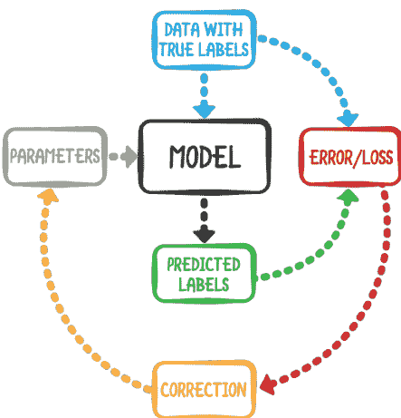

模型是你选择的一种特定算法，例如神经网络。你提供训练数据，包含示例以及这些示例的正确标签。然后模型会对每个训练示例做出预测。

最初，这些预测将是完全错误的，因为模型还没有学习到任何东西。但你知道正确答案应该是怎样的，因此通过比较预测输出与预期输出（标签），可以计算模型有多“错”。这种对“错误程度”的衡量被称为损失（loss）或误差（error）。

通过使用称为反向传播（`back-propagation`）的复杂数学方法，训练过程使用这个损失值来微调模型的参数，以便下次能做出更好的预测。

### 机器学习

## 第 1 章：机器学习、iOS 与你

向模型展示一次所有训练示例是不够的。你需要反复重复这个过程，进行数百次迭代。在每次迭代中，损失都会变得小一点，这意味着预测与真实值之间的误差变得更小，因此模型比之前错误得更少。这是一个好事！

如果你重复足够次数，并且假设所选模型有足够的容量来学习这项任务，那么模型的预测会逐渐越来越好。

通常人们会一直训练，直到模型达到某些最小可接受的准确率、达到最大迭代次数，或者直到他们失去耐心……对于神经网络，使用数百万图像并经过数千次迭代并不罕见。

当然，实践中的训练要复杂一些（并非总是如此？）。例如，训练时间过长实际上会让你的模型变差。但你明白了大致的概念：展示训练示例、做出预测、根据预测结果更新模型参数、重复直到模型足够好。

正如你所看到的，训练机器学习模型是一个暴力且耗时的过程。算法必须通过尝试错误找到如何解决问题。需要大量的处理能力并不意外。取决于你选择的算法的复杂性和训练数据量，在具有快速处理器的计算机上，训练一个模型可能需要几分钟到几周不等。如果你想进行严肃的训练，可以租亚马逊、Google 或微软的服务器，甚至是一个服务器集群，它们的工作速度比你的笔记本电脑或台式机快得多

### 模型到底学了什么？

模型到底学习什么取决于你选择的算法。例如，决策树实际上学习的是人类创建的那种 `if-then-else` 规则。但大多数其他机器学习算法并不直接学习规则，而是学习一组被称为模型学习参数（或简称为“参数”）的数字。

这些数字代表了算法学到的内容，但它们对人类来说并不总是合理的。我们不能简单地将它们解释为 `if-then-else`，数学原理比这复杂得多。

这些模型内部发生了什么并不总是显见的，即使它们产生了完全可以的结果。一个大型神经网络可以轻松拥有 5000 万个参数，想象一下！

重要的是要意识到，我们并不是试图让模型记忆训练示例。那不是参数的用途。在训练过程中，模型参数应该从训练示例中捕捉某种含义，而不是保留训练数据。这是通过选择良好的示例、良好的标签以及适用于问题的损失函数来实现的。尽管如此，机器学习的主要挑战之一是过拟合（`overfitting`），当模型开始记忆特定的训练示例时就会发生。过拟合很难避免，特别是对于具有数百万个参数的模型。

对于朋友检测器，模型学习的参数以某种方式编码了人类脸部的喜好以及如何在照片中找到它们，以及哪些脸属于哪个人。应该阻止模型记忆训练图像中的特定像素，因为这会导致过拟合。

模型如何知道什么是脸？在神经网络的情况下，模型充当特征检测器，它将字面地学习如何将感兴趣的对象（脸）与不感兴趣的对象（其他任何东西）区分开。你将在后续章节中查看神经网络是如何理解图像的。

### 迁移学习：只需添加数据

> 注意：数据在机器学习中就是一切！你必须用准确代表你想要做的预测类型的数据来训练模型。在第 4 章中，你将看到创建一个不到 5,000 张图像的小型数据集需要多少大量工作。

创建一个良好的机器学习模型所需的工作量取决于你的数据以及你希望从模型得到的答案类型。如果现有的免费模型可以完成你想要的一切，在这种情况下你只需要将其转换为 `Core ML` 并将其放入你的 `iOS` 应用中。问题解决！

但如果现有模型的输出与你关心的输出不同呢？例如，在下一章中，你将使用一个将零食照片分类为健康或不健康的模型。网上没有现成的免费模型可以做这一点——我们找过了！所以我们必须自己制作一个。

# 机器学习第 1 章：机器学习、iOS 与你

这就是迁移学习大显身手的地方。事实上，无论你尝试用机器学习解决什么类型的问题，迁移学习在 99% 的情况下都是最佳选择。通过迁移学习，你可以获得他人已经付出的努力的成果。这是明智之举！

当一个深度学习模型被训练时，它会学习识别训练图像中对分类这些图像有用的特征。`Core ML` 自带了许多即用模型，这些模型可以检测数千种特征，并理解 1,000 类不同的物体类别。从头开始训练这些大模型之一需要非常巨大的数据集、大量的计算量，并且成本可能非常高。

大多数这些免费提供的模型是在各种人类、动物和日常物品的照片上进行训练的。大部分时间花在了学习如何从这些照片中检测最佳特征上。像模型已经学习到的特征——如边缘、角点、色块以及这些形状之间的关系——对于将你自己的数据分类到你关心的类别中也很有用，特别是当你的训练示例在性质上与模型已经训练过的数据类型相似时。

所以，如果你必须从头开始训练模型来学习完全相同的特征，那将有点浪费。相反，为了为自己的数据集创建模型，你可以取一个现有的预训练模型并针对你的数据进行定制。这被称为迁移学习，因为你将知识从现有模型转移到你自己的模型中。

在实践中，你将使用现有的预训练模型从自己的数据中提取特征，然后你只需要训练模型的最终分类层，使其学习如何从提取的特征做出预测——但这次是针对你自己的类别标签。

迁移学习的巨大优势在于它比从头开始训练整个模型快得多，而且你的数据集现在可以小得多。你现在不再需要数百万张图像，而只需要几千张甚至几百张。

机器学习

第 1 章：机器学习、iOS 与你

Apple 提供了两个迁移学习的工具：`Create ML` 和 `Turi Create`。但这种技术非常实用，你可以为大多数最流行的机器学习任务（如图像分类或情感分析）找到迁移学习工具。有时，只需拖放你的数据就能简单；最坏的情况下，你只需要写几行代码来读取并结构化你的数据。

### 移动设备真的能做机器学习吗？

训练好的模型可能有数百 MB 大，而推理通常会执行数十亿次计算，这就是为什么推理通常发生在具有快速处理器和大量内存的服务器上。例如，`Siri` 需要连接互联网来处理你的语音命令——你的语音被发送到 Apple 服务器分析其含义，然后传回相关的响应。

本书是关于在移动设备上进行尖端机器学习的，因此我们希望尽可能在设备上完成尽可能工作，并避免使用服务器。好消息是：得益于 `Metal` 和 `Accelerate` 等核心技术，`iOS` 设备上的推理运行良好。

设备端推理的优势是：

- **更快的响应时间**：它比发送 `HTTP` 请求响应更快，可以进行实时推理，从而提供更好的用户体验。
- **对用户隐私也有好处**：用户数据不会发送到后端服务器进行处理，而是留在设备上。


成本更低，因为开发者不需要为服务器和电力付费：用户为电量付费。当然，你不想滥用这种权限，因此确保你的模型运行尽可能高效至关重要。我们将在书中解释如何为移动端优化机器学习模型。

那么设备端训练呢？坏消息是：移动设备仍然存在重要的局限性。训练机器学习模型需要大量的处理能力，即使对于小模型，目前对于大多数移动设备来说也是不可及的。尽管如此，只要模型足够小，今天使用用户的新数据更新之前训练过的模型（例如随着你打字而学习的预测性键盘，也称为“在线训练”）无疑是可能的。

注意：虽然 Core ML 3 允许在设备上进行有限种训练，但它并不是为了从头训练模型，而是为了在用户数据上对模型进行微调。本书当前版本重点是使用离线训练的模型进行预测，并解释了如何在你的 Mac 或云服务上训练这些模型。

### 为什么不在云端？

Amazon、Google 和 Microsoft 等公司提供了用于机器学习的云服务，也有许多较小的厂商。其中一些只提供原始计算能力（你从他们那里租服务器）。另一些提供完整的 API，你完全不需要担心机器学习的所有细节——只需将数据发送到他们的 API，它们在几秒后就会返回结果。

使用这些云服务有很多好处：1) 你不需要了解任何机器学习的知识——所以你不需要读这本书剩下的了；2) 使用它就像发送 HTTP 请求一样简单；3) 其他人将负责运行和维护服务器。

然而，也有缺点：1) 你使用的是现成的服务，通常不是为你的数据定制的；2) 如果你的应用需要实时进行机器学习（例如处理视频），那么发送 HTTP 请求将太慢；3) 方便是有代价的：你必须为这些服务付费，而且一旦你选择了一个，很难将你的应用迁移掉。

在本书中，我们不关注使用云服务。它们对于许多应用程序是一个很好的解决方案——特别是当你不需要实时预测时——但移动开发者认为，在设备上进行机器学习（也称为边缘计算）更有趣。

### 框架、工具和 API

使用机器学习看起来可能是一件苦事。嗯，并不如此……对于你使用的每种技术，机器学习都有抽象级别——难度和努力程度取决于你在哪一层级工作。

### Apple 的特定任务框架

抽象的最高级是任务级。这是最容易理解的——它直接对应于你想做的事情。Apple 和其他主要厂商提供了针对图像分类或文本分类等任务的专用工具包。

正如 Apple 网页上说的：你不需要成为机器学习专家！

Apple 提供了几个用于特定任务的 Swift 框架：

- **Vision**：检测图像中的人脸和地标、矩形和条形；跨视频跟踪物体；分类猫狗和其他许多类型的物体；以及更多。Vision 还让使用 Core ML 模型变得更容易，处理了正确的输入格式。

- **Natural Language**：分析以识别语言、词性以及特定的人、地点或组织。

- **SoundAnalysis**：分析并分类音频波形。

- **Speech**：将语音转换为文本，并可选使用 Apple 服务器或设备端语音识别器检索答案。Apple 对音频时长和每日请求数设置了限制。

- **SiriKit**：通过在不断增加的意图领域中实现 Intents 扩展来处理 Siri 或 Maps 对你服务的请求：消息、列表和备忘、锻炼、支付、照片等。

- **GameplayKit**：评估包含问题、可能答案和后续操作的决策树。

如果你需要使用上述列表中的某个任务，你很幸运了。只需调用相应的 API，让框架完成所有繁重工作。

## 第1 章：机器学习、iOS 与你

你也可以在互联网上所谓的“模型库”（model zoos）中找到其他预训练的 Core ML 模型。这里有一个我们喜欢的：`github://github.com/likedan/Awesome-CoreML-Models`。

当你向 iOS 应用中添加模型时，尺寸至关重要。较大的模型会消耗更多电量，运行速度也比小模型慢。Core ML 文件的大小与模型中学习的参数数量成正比。例如，一个拥有 2560 万参数的模型，ResNet50 的下载大小为 103 MB。MobileNetV2 拥有 600 万参数，其下载大小“仅”为 25 MB。顺便说一下，模型参数更多并不一定意味着它更准确。ResNet50 比 MobileNetV2 大得多，但这两个模型的分类准确率是相似的。

这些模型与你在网上能找到其他模型一样，是在通用数据集上训练的。如果你想创建一个能够检测你制造的设备中故障部件（thingamajig）的模型，你得运气好，碰巧遇到别人已经训练并免费提供的模型——但机会很小！构建良好的模型有巨大的利润空间，所以公司不会直接把它们送送你，你必须学会如何制作自己的模型。

> 注意：下一章将展示如何在 iOS 应用中使用预训练的 Core ML 模型。

### 使用 coremltools 转换现有模型

如果存在一个可以完全实现你需求的模型，但它不是 Core ML 格式，不要惊慌！你很有可能可以转换它。

有很多流行的用于训练机器学习模型的开源包。列举几个：

- Apache MXNet

- Caffe（以及与之关系较小的 Caffe2）

- Keras

- PyTorch

- scikit-learn

- TensorFlow

如果你有一个使用这些包之一（或其他其它包，如 XGBoost、LIBSVM、IBM Watson）训练的模型，你可以使用 `coremltools` 将其转换为 Core ML 格式，以便在你的 iOS 应用中运行该模型。

`coremltools` 是一个 Python 包，你需要编写一个简单的 Python 脚本来使用它。Python 是机器学习项目的主导编程语言，大多数训练包也是用 Python 编写的。

一些流行的模型格式（如 TensorFlow 和 MXNet）并没有 `coremltools` 直接支持，但它们有自己的 Core ML 转换器。IBM 的 Watson 提供了一个 Swift 项目，可以在其自己的 API 中运行 Core ML 模型。

由于有许多不同的训练工具，且它们都有自己互不兼容的格式，业界有几项创建标准格式的努力。Apple Core ML 是这些努力之一，但行业其他部分似乎选择了 ONNX。自然，存在从 ONNX 到 Core ML 的转换器。

> 注意：需要注意的是，Core ML 有许多局限性——不像某些其他机器学习包。无法保证使用任何这些工具训练的模型都能实际转换为 Core ML，因为某些神经网络层类型可能不受支持。在这种情况下，你可能需要在转换之前对原始模型进行调整。

### 使用 Create ML 和 Turi 进行迁移学习

Create ML 和 Turi 使用迁移学习让你能够使用自己的数据自定义预训练模型。基础模型是在非常大的数据集上训练的，但迁移学习可以使用更小的数据集和更少的时间为你的数据产生准确的模型。你只需要几十或几百张图片，而不是几万张，而且训练只需要几分钟而不是小时或几天。

事实上，Create ML 和 Turi 都可以使用 Mac 的 GPU 来加速训练过程。Apple 在 2016 年 8 月收购了初创公司 Turi，这是一个要求你在 Python 环境中工作的机器学习工具。在 WWDC 2018 上，Apple 发布了 Create ML，它本质上是 Turi 的基于 Swift 的子集，用于 Swift 进行图像和文本分类的迁移学习。

#### 机器学习

#### 第1 章：机器学习、iOS 与你

Turi Create 和 Create ML 是针对特定任务的，而不是特定模型的。这意味着你指定想要解决的问题类型，而不是选择你想使用的模型类型。选择与你想解决的问题类型匹配的任务，然后 Turi Create 会分析你的数据并为任务选择合适的模型。

Turi Create 有几个关注任务的工具包，包括：

- 图像分类：带有对你的应用有意义标签的图像。

- 绘画分类：专门针对绘画。

- 图像相似性：寻找与特定图像相似的图像。

- 推荐系统：提供个性化推荐。

- 目标检测：定位并分类图像中的物体。

- 风格迁移：将风格的风格元素应用于新图像。

- 活动分类：使用设备运动传感器的数据来分类用户正在做什么。

在这些工具包中，Create ML 支持图像、文本、活动和声音分类，以及目标检测。我们预计 Apple 将未来的更新中添加更多工具包。

- 文本分类：分析社交媒体、电影评论、通话转录等文本的情感——积极或消极。

- 声音分类：检测某些声音何时产生。

> 注意：第3 章将向你展示如何在 Xcode 中使用 Swift 自定义 Create ML 的分类模型。第4 章将带你进入 Python 机器学习世界，并教你如何使用 Turi Create 创建相同的模型。不要担心，Python 与 Swift 非常相似，我们会在此解释一切。

### Turi Create 的统计模型

到目前为止，我们描述的是特定任务的解决方案。现在让我们在模型级别再深入一个抽象级。与其选择一个任务并让 API 选择最佳模型，在这里由你选择模型。这给了你更多控制权——另一方面也意味着更多工作。

Turi Create 包含了这些通用模型：

- 分类：增强树分类、决策树分类、逻辑回归、最近邻分类、随机森林分类和支持向量机 SVM。

- 聚类：K-Means、DBSCAN（基于密度）。

- 图形分析：PageRank、最短路径、图着色等。

- 最近邻。

- 回归：增强树回归、决策树回归、线性回归和随机森林回归。

- 主题模型：用于文本分析。

你可能不需要学习这些；当你使用关注任务的工具包时，Turi Create 会根据对数据的分析选择合适的统计模型。列出它们是为了让你知道如果 Turi Create 的选择没有产生良好的示例，你也可以直接使用它们。

有关 Turi Create 的更多信息，请访问用户指南：`github.com/turicreate/tree/master/userguide/`

### 在 Keras 中构建自己的模型

Apple 的框架和专注于任务的工具包涵盖了你应用中可能需要的大部分内容，但如果你无法通过 Create ML 或 Turi Create 创建准确的模型，你就必须从头开始构建自己的模型。

这需要你学习一些新知识：不同类型的神经网络层和激活函数，以及批大小、学习率和其他超参数。不要担心！在第5 章中，你将学习所有这些新知识，以及如何使用 Keras 配置和训练你自己的深度学习网络。

#### 机器学习

Keras 是 Google TensorFlow 的封装器，它是最流行的深度学习工具，因为……嗯，因为 Google。TensorFlow 的学习曲线相当陡峭，而且主要是一个低级工具包，需要理解矩阵数学等知识，因此本书不会直接使用它。Keras 使用起来要简单得多。你将在更高层次的抽象层上工作，不需要了解任何数学知识。（松了一口气！）

> 注意：你可能听过 Swift for TensorFlow。这是 Google Brain 的一个项目，由 Swift 的发明者 Chris Barnett 领导，旨在为 TensorFlow 用户提供一种比 Python 更好的编程语言。它会让 TensorFlow 用户的生活变得更轻松，但并不会让我们这些 Swift 拥趸更容易学习 TensorFlow。尽管它的名称可能让你产生误解，但 Swift for TensorFlow 的目标是机器学习研究人员——它不是为了用来进行机器学习的。

### 玩转算法

如果你看过机器学习的在线课程或教科书，你可能见过很多复杂的数学公式，以及用于梯度下降、反向传播和优化器的高效算法。作为一名 iOS 应用开发者，你不需要学习其中任何内容（除非你喜欢这类东西，当然）。

只要你拥有高级工具和框架，并知道如何有效地使用它们，你就准备了。当研究人员开发出更好的算法时，它们会迅速进入 Keras 和预训练模型等工具，无需你做任何特殊操作。要成为机器学习的用户，你通常不需要从零开始实现任何学习算法。

然而，Core ML 跟上行业其他水平的速度可能较慢（它只随着新 iOS 版本的发布更新），想要处于机器学习前沿的开发者可能会发现自己正在实现新算法，等待 Apple 更新 Core ML 并不总是可行的。幸运的是，Core ML 允许你自定义模型，因此为有需要的人提供了灵活性。

值得提到 iOS 上可用的其他几个机器学习框架。这些框架比 Core ML 更低级，只有当 Core ML 不能满足你的应用需求时，你才会使用它们。

- Performance Shaders（性能着色器）：Metal 是 iOS 设备上编程 GPU 的官方框架和语言。它相当低级，不适合胆小者，但它能带给你终极的控制权和灵活性。

- 所有 iOS 设备都自带这个被低估的框架。它允许你编写高度优化的 CPU 代码。当 Metal 让你充分利用 GPU 性能时，Accelerate 对 CPU 也是同样的。它有一个神经网络库 BNNS（基础神经网络子程序），但它也包含了用于线性数数和其他数学运算的优化代码。如果你在从零开始实现自己的机器学习算法，你最终会使用 Accelerate。

### 第三方框架

除了 Apple 的 API 之外，还有其他公司的 iOS 机器学习框架。最有用的包括：

- Google ML Kit：这是 Google 对 Vision 框架的回答。通过 ML Kit，你可以轻松地为应用添加图像标记、文本识别、人脸检测等其他任务。ML Kit 既可以在云端运行，也可以在设备上运行，并同时支持 iOS 和 Android。

- TensorFlow-Lite：作为 Google 流行的机器学习框架 TensorFlow 也有一个针对移动设备的版本，即 TF-Lite。TF-Lite 的主要优势是它可以加载 TensorFlow 模型，尽管你需要先将它们转换为“lite”格式。最近添加了对 iOS 上 GPU 加速的支持，但到写本文时，TF-Lite 尚无法利用神经引擎（Neural Engine）。其 API 是 C++ 编写的，这使得在 Swift 中很难使用。

### 机器学习包治一切？

机器学习，尤其是深度学习，在图像分类和语音识别等问题领域非常成功，但它能解决*所有*问题吗？它在某些问题上表现非常好，但对其他问题则完全无用。深度学习模型并没有对它处理的内容进行真正的“推理”。它缺乏你与生具备的常识。

深度学习不知道也不在乎一个物体是由各个部分组成的，物体不会突然出现或消失，或者圆形物体会从桌子上滚下来。

#### 机器学习

## 第 1 章：机器学习、iOS 与你

该算法是一个简单的图像相似性模型，它从包含 2,222 张人脸照片的数据集中找到与你的照片最匹配的图像。33,430 名众包用户对数据集中的照片在各种性格特质、攻击性水平、情绪稳定性、吸引力和怪异程度进行了评分。该模型利用他们对你最匹配项的评估来预测你的性格特质。

这位记者尝试用自己不同的照片进行实验，模型告诉他很年轻且富有吸引力。

这很有趣，但它会有害吗？

该模型是一个交互式应用程序的一部分，该程序会选取你的特质之一——例如，情绪稳定性——并让你想象这些信息落入像你的保险公司、雇主或执法人员的人手中。你现在感到担心吗？

在 bit.ly/2lLbial 中，项目的研究人员写道，“生物识别镜像”（Biometric Mirror）阴暗地展示了 AI 和算法偏见可能导致的后果，并鼓励我们[反思]这样一个政府和企业日益依赖 AI 来做出决策的格局。

此外，在项目页面上，他们写道：

> 算法是正确的，但它返回的信息并不正确。这正是我们想要分享的：我们应该谨慎依赖人工智能系统，因为它们的内部逻辑可能是错误的，或者极度敏感且具有歧视性。

这个项目提出了使用 AI 的两个伦理问题：

- 算法偏见

- 可解释或可理解的 AI

### 偏偏的数据，偏见的模型

如果一个机器学习模型能够在其未训练过的数据上做出正确的预测，我们就认为它是好的——因为它从训练数据中具有良好的泛化能力。如果训练数据对某些人群存在偏见或反对，就会出现问题：数据可能存在种族主义或性别歧视。

偏见的原因可能是历史性的。为了训练一个预测某人贷款违约风险或某人在大学表现如何的模型，

将给它关于人们违约或未违约贷款、或在大学表现或未表现的历史数据。从历史角度来看，数据会倾向于白人男性，因为在很长一段时间里，他们获得了大部分贷款和大学录取名额。

由于数据中女性或少数族裔的样本较少，模型的整体准确率可能达到 90%，但对女性或少数裔的准确率仅为 50%。

此外，数据可能受到最初做出决策的人的偏：贷款官员可能对白人男性的逾期更宽容，或者大学教授可能对某些特定群体存在偏见。

你可以通过显式调整训练数据或参数来对抗偏见，从而克服模型中的偏见。某些模型架构可以调整以识别敏感特征并消除它们对预测的影响。

### 可解释/可理解/透明的 AI

算法偏见问题意味着检查 ML 模型如何做出预测是非常关重要的：它使用了哪些特征？它是准确还是公平的？

在本章前面的图中，训练被描成了一个黑盒。尽管你将学习一些关于该盒子内部发生的事情，但许多深度学习模型非常复杂，专家无法解释单个预测结果。

一种方法是要求算法偏见以及模型设计者为了克服这些偏见所的操作具有更高的透明度。

Google Brain 有一个开源的 `github://github.com/google/svcca`，可以用于解释神经网络正在学习什么。

### 核心要点

- 机器学习并没有那么难学——坚持读完这本书你就会发现！

- 网上获取的大量数据和计算能力让机器学习成为一项可行的技术。

- 机器学习的核心在于模型：创建模型、训练模型以及使用它们来推断结果。

- 训练模型可能是一门不精确的科学，也是耐心的考验。然而，像 Create ML 和 Turi Create 这样易用的迁移学习工具可以帮助提高特定情况下的体验。

- 移动设备擅长推断结果。通过 Core ML 3，可以使用有限的设备端训练对模型进行个性化。

- 不要将机器学习与人工智能混淆。机器学习可以是你应用程序的绝佳补充，但了解它的局限性同样重要。

### 接下来该去哪里？

我们希望你喜欢这段从 10,000 英尺高空俯瞰机器学习之旅。如果你没有吸收读到的所有内容，不要担心！就像学习新事物一样，时间和耐心是你最大的资产。

在下一章中，你终于可以编写一些代码了！你将学习如何在 iOS 应用中使用预训练的 Core ML 图像分类模型。它包含了对神经网络内部机制的深刻见解。

## 第 2 章：图像分类入门

作者 Matthijs Hollemans


**更新说明：** 本章已更新至适用于 iOS 13、Xcode 11 和 Swift 5.1

让我们通过创建一个二分类器来开启你的机器学习之旅。

一个**分类器**（`classifier`）是一种机器学习模型，它接收某种类型的输入（在此情况下是图像），并确定该输入代表什么种类的“事物”。图像分类器告诉你图像属于哪个类别或类（`class`）。

**二**（Binary）意味着分类器能够区分两类对象。例如，你可以有一个分类器，针对给定的输入图像回答“猫”或“狗”，以防你可能难以区分这两者。

用于猫和狗的二分类器

# 机器学习第 2 章：图像分类入门

能够区分仅两样事物可能看起来并不很了不起，但二分类在实践中被广泛使用。

在医学检测中，它用于确定患者是否患有疾病，“阳性”类意味着存在疾病而“阴性”类意味着不存在。另一个例子是将电子邮件过滤为垃圾邮件/非垃圾邮件。

有许多有“是/否”答案的问题，而用于此类问题的机器学习模型就是二分类器。“猫对狗”的分类器可以被构想为回答问题：“这是一张猫的照片吗？”如果答案否，那么它就是狗。

图像分类是最基本的计算机视觉任务之一。计算机视觉的高级应用——如目标检测、风格迁移和图像生成——都建立在图像分类的相同思想之上，这使其成为很好的起点。

创建图像分类器有很多方法，但到目前为止，使用深度学习的结果最好。深度学习在图像分类中的成功引发了目前对 AI 和 ML 的热潮。我们不希望你错过这些内容，因此你在本章中将构建的分类器在底层使用了深度学习。

### 那个零食健康吗？

在本章中，你将学习构建一个可以区分健康和不健康零食的分类器。

开始之前，请确保你已下载本章的辅助材料并在 Xcode 中打开 HealthySnacks 项目。

这是一个非常基本的 iPhone 应用，有两个按钮、一个图像视图和一个顶部的文本标签：

应用程序的设计

左侧的“相框”按钮允许使用 `UIImagePickerController` 从库中选择照片。右侧的“相机”按钮允许你用相机拍照（此按钮在模拟器中禁用）。

一旦你选择了照片，应用程序将调用 **ViewController.swift** 中的 `classify(image:)` 来判断图像是否为健康零食。目前该方法是空的。在本章中，你将向该方法添加代码以运行分类器。

此时，简单查看一下 **ViewController.swift** 以熟悉代码是好的。这对于 iOS 应用来说是标准的做法。

为了在设备上进行机器学习，你需要一个训练好的模型。对于 HealthySnacks 应用，你需要一个学会区分健康和不健康零食的模型。在本章中，你将使用一个已经为你训练好的现有模型，而在下一章中，你将学习如何训练这个模型。

该模型训练用于识别以下零食：

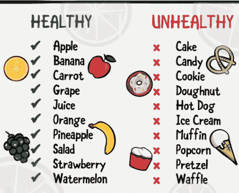

### 零食的分类

例如，如果你将相机对准苹果并拍照，应用程序应该显示“健康”。如果你将相机对准热狗，它应该显示“不健康”。

模型实际预测的并不仅仅是一个标签（“健康”或“不健康”），而是一个概率分布，其中每个分类都被赋予了一个概率值：

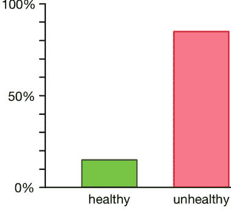

概率分布的示例

### 机器学习

## 第 2 章：图像分类入门

如果你对数学和统计学有点生疏，那么不要被“概率分布”之类的术语吓到。概率分布简单来说就是和为 1.0 的正数列表。在这种情况下，它是包含两个数字的列表，因为这个模型有两个类别：

```
[0.15, 0.85]
```

上述预测是针对一张顶部有草莓的华夫饼图像。模型有 85% 的确定认为图片中的物体是不健康的。因为预测概率始终相加为 100%（或 1.0），所以这个结果也意味着分类器有 15% 的确定这种零食是健康的——多亏了草莓。

你可以将这些概率解释为模型对其预测的**置信度**。没有草莓的华夫饼在“不健康”方面的得分可能会更高，可能高达 98%，给“健康”类别仅留 2%。模型对自己的预测越有信心，其中一个概率就越趋于 100%，另一个就越趋于 0%。当它们之间的差异很大时（在本例中），意味着模型对自己的预测非常有把握。

理想情况下，你会拥有一个始终自信且从不出错的模型。然而，有时模型很难对图像得出确定的结论。你能判断下面图片中的食物是大部分是健康的还是不健康的吗？

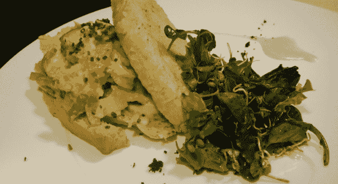

*这到底是什么？*

模型越不确定，两个概率就越趋向于中间值（即 50%）。

当概率分布看起来如下所示时，模型并不非常确定，你不能真正信任这个预测——它可能是任何一类。

机器学习

第 2 章：图像分类入门

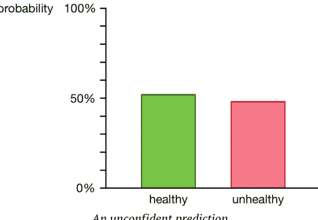

这种情况发生在图像包含两个类的元素时——沙拉和油腻食物——因此模型很难在两个类别之间做出选择。也发生在图像完全不是关于食物时，模型不知道如何处理它。

总结一下，图像分类器的输入是图像，输出是概率分布，即一个 0 到 1 之间的数字列表。

由于你将构建一个二分类器，概率分布由两个数字组成。决定哪个类别获胜的最简单方法是选择预测概率最高的一个。

> 注意：为了保持本书内容的易于管理

### Core ML

对于书中的许多项目，你将使用 Core ML，这是 Apple 随 iOS 11 引入的机器学习框架。Core ML 让向应用程序中添加机器学习模型变得非常简单——大部分只需要将训练好的模型拖入应用程序并调用几个 API 函数即可。

raywenderlich.com

57

# 机器学习 第 2 章：图像分类入门

Xcode 甚至会自动为你编写大部分代码。

当然，只有在你已经有一个训练好的模型时，Core ML 才是容易的。你可以在下载的资源中找到本章的模型，**HealthySnacks.mlmodel**。

Core ML 模型封装在 **.mlmodel** 文件中。该文件包含了模型的结构定义以及它所学到的内容。

在 Xcode 中打开 HealthySnacks 项目时，将 **HealthySnacks.mlmodel** 文件拖入项目以将其添加到应用程序（或使用 File ▸ Add Files）。

在项目导航器中选择 **HealthySnacks.mlmodel**，Xcode 将显示以下内容：

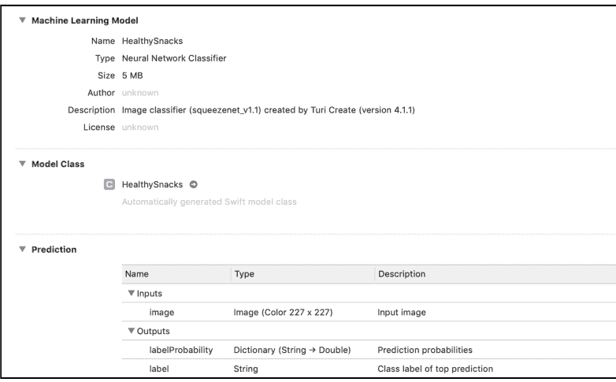

### 查看 .mlmodel 文件

这是 Core ML 模型文件的摘要。它显示了模型类型类型、以兆字节（MB）为单位的大小以及描述。

HealthySnacks 模型类型是神经网络分类器（Neural Network Classifier），这意味着它是一个使用深度学习技术的图像分类器。“深度学习”和“神经网络”这两个术语的意思几乎相同。根据描述，该模型是使用名为 Turi Create 的工具制作的，并使用了 squeezeNet v1.1，这是一种用于移动应用程序流行的深度学习架构。

raywriter.com 58

# 机器学习 第 2 章：图像分类入门

SqueezeNet 的主要优点是它很小。正如你在 Xcode 中看到的，这个模型的大小“仅”为 5 MB。与许多占用数百 MB 的其他深度学习架构相比，这是微不足道的。此类大型模型通常不适合在移动中使用，它们不仅会让应用程序下载变大，而且大模型运行更慢且更耗电。

Prediction（预测）部分列出了模型期望的输入及其输出。由于这是一个图像分类器，只有一个输入，即一张宽 227 像素、高 227 像素的彩色图像。

你不能使用其他尺寸的图像。这种限制的原因是 SqueezeNet 架构正好需要这个尺寸。如果更小或更大，SqueezeNet 使用的数学算法将无法工作。这意味着你从照片库或通过相机拍摄的任何图像必须先调整为 227×227，才能使用此 Core ML 模型。

> 注意：如果你认为 227×227 像素并不大，你是对的。一张 1200 万像素的照片是 4050×3000。缩小图像有助于模型运行更快，但也有一个限制：如果图像太小，模型将无法良好工作。

模型对自己的预测越有信心，其中一个概率就越趋于 100%，另一个就越趋于 0%。当它们之间的差异很大时（在本例中），意味着模型对自己的预测非常有把握。理想情况下，你会拥有一个始终自信且从不出错的模型。然而，有时模型很难对图像得出确定的结论。你能判断下面图片中的食物是大部分是健康的还是不健康的吗？


*这到底是什么？*

模型越不确定，两个概率就越趋向于中间值（即 50%）。

当概率分布看起来如下所示时，模型并不非常确定，你不能真正信任这个预测——它可能是任何一类。


这种情况发生在图像包含两个类的元素时——沙拉和油腻食物——因此模型很难在两个类别之间做出选择。也发生在图像完全不是关于食物时，模型不知道如何处理它。

总结一下，图像分类器的输入是图像，输出是概率分布，即一个 0 到 1 之间的数字列表。由于你将构建一个二分类器，概率分布由两个数字组成。决定哪个类别获胜的最简单方法是选择预测概率最高的一个。

> 注意：为了保持本书内容的易于管理

对于书中的许多项目，你将使用 Core ML，这是 Apple 随 iOS 11 引入的机器学习框架。Core ML 让向应用程序中添加机器学习模型变得非常简单——大部分只需要将训练好的模型拖入应用程序并调用几个 API 函数即可。

raylanderlich.com

57

# 机器学习 第 2 章：图像分类入门

Xcode 甚至会自动为你编写大部分代码。

当然，只有在你已经有一个训练好的模型时，Core ML 才是容易的。你可以在下载的资源中找到本章的模型，**HealthySnacks.mlmodel**。

Core ML 模型封装在 **.mlmodel** 文件中。该文件包含了模型的结构定义以及它所学到的内容。

在 Xcode 中打开 HealthySnacks 项目时，将 **HealthySnacks.mlmodel** 文件拖入项目以将其添加到应用程序（或使用 File ▸ Add Files）。

在项目导航器中选择 **HealthySnacks.mlmodel**，Xcode 将显示以下内容：


### 查看 .mlmodel 文件

这是 Core ML 模型文件的摘要。它显示了模型类型、以兆字节（MB）为单位的大小以及描述。

HealthySnacks 模型类型是神经网络分类器（Neural Network Classifier），这意味着它是一个使用深度学习技术的图像分类器。“深度学习”和“神经网络”这两个术语的意思几乎相同。根据描述，该模型是使用名为 Turi Create 的工具制作的，并使用了 squeezeNet v1.1，这是一种用于移动应用程序流行的深度学习架构。

raywriter.com 58

# 机器学习 第 2 章：图像分类入门

SqueezeNet 的主要优点是它很小。正如你在 Xcode 中看到的，这个模型的大小“仅”为 5 MB。与许多占用数百 MB 的其他深度学习架构相比，这是微不足道的。此类大型模型通常不适合在移动中使用，它们不仅会让应用程序下载变大，而且大模型运行更慢且更耗电。

Prediction（预测）部分列出了模型期望的输入及其输出。由于这是一个图像分类器，只有一个输入，即一张宽 227 像素、高 227 像素的彩色图像。

你不能使用其他尺寸的图像。这种限制的原因是 SqueezeNet 架构正好需要这个尺寸。如果更小或更大，SqueezeNet 使用的数学算法将无法工作。这意味着你从照片库或通过相机拍摄的任何图像必须先调整为 227×227，才能使用此 Core ML 模型。

> 注意：如果你认为 227×227 像素并不大，你是对的。一张 1200 万像素的照片是 4050×3000。缩小图像有助于模型运行更快，但也有一个限制：如果图像太小，模型将无法良好工作。

# 机器学习第 2 章：图像分类入门

对你来说最重要的是，Vision 能够轻松运行以图像作为输入的 Core ML 模型。你甚至可以将其与其他 Vision 任务结合，以构建一个图像处理流水线。例如，在一个检测人物情绪的应用中，你可以构建一个 Vision 流水线，首先检测图像中的人脸，然后对该人脸运行基于 Core ML 的分类器，以判断人是在微笑还是皱眉。

如果你正在处理图像，强烈建议使用 Vision 来运行 Core ML。请记住，HealthySnacks 模型需要 227x227 图像作为输入，而来自照片库或相机的图像会大得多，且通常不是正方形的。Vision 会自动调整图像的大小并裁剪。

在为 .model 自动生成的 Swift 文件中，你可能注意到输入图像（参见 HealthySnacksInput）具有一个 `CVPixelBuffer`，而 `UIImage` 给你的是一个 `UIImage`。Vision 可以为你完成转换，因此你就不需要担心 `CVPixelBuffer`。

最后，Vision 还会执行其他一些技巧，例如旋转图像使其始终正立，并将图像的颜色与设备的色彩空间匹配。如果没有 Vision 框架，你将编写大量额外的代码！你一定会同意，让 Vision 处理所有这些事情要方便得多。

> 注意：当然，如果你使用的模型不接受图像作为输入，那么你就无法使用 Vision。在这种情况下，你必须直接使用 Core ML API。

Vision 显示你需要创建一个 `VNRequest` 对象，它描述你想要执行的任务，然后使用 `VNImageRequestHandler` 来执行该请求。由于你将使用 Vision 运行 Core ML 模型，该请求是一个名为 `VNCoreMLRequest` 的子类。让我们写一些代码：

### 创建 VNCoreML 请求

为了在应用中添加图像分类，你将在 `ViewController.swift` 中实现 `classify(image:)`。该方法目前是空的。

在这里，你将使用 Vision 运行 Core ML 模型并解释其结果。首先，在文件顶部添加所需的导入：

```swift
import CoreML
import Vision
```

接下来，你需要创建一个 `VNCoreMLRequest` 对象。你通常只创建一次这个请求对象，并对想要分类的每张图像重复使用它。不要在每次想要分类图像时都创建一个新的请求对象——那是浪费资源。

在 `ViewController.swift` 中，在 `ViewController` 类内部 `@IBOutlets` 附近添加以下代码：

```swift
lazy var classificationRequest: VNCoreMLRequest = {
  do {
    // 1
    let healthySnacks = HealthySnacks()
    // 2
    let visionModel = try VNCoreMLModel(for: healthySnacks.model)
    // 3
    let request = VNCoreMLRequest(model: visionModel, completionHandler: {
      [weak self] request, error in
        print("Request is finished!", request.results)
    })
    // 4
    request.imageCropScaleOption = .centerCrop
    return request
  } catch {
    fatalError("Failed to create VNCoreMLModel: \(error)")
  }
}()
```

以下是这段代码的作用：

- 1. 创建 `HealthySnacks` 实例。这是来自 .mlmodel 文件自动生成代码的类。你不会直接使用这个类，所以只有你可以将它的 `MLModel` 对象传递给 Vision。

- 2. 创建 `VNCoreMLModel` 对象。这是一个包装对象，将来自 Core ML 框架的 `MLModel` 实例与 Vision 连接起来。

- 3. 创建 `VNCoreMLRequest` 对象。该对象将执行实际操作：将图像转换为 `CVPixelBuffer`、将其缩放到 227×227、运行核心模型、解释结果等。

由于 Vision 请求是异步运行的，因此你可以提供一个完成处理程序来接收结果。目前，完成处理程序只是向 Xcode 调试输出面板打印一些内容。你稍后会完善它。

- 4. `imageCropScaleOption` 告诉 Vision 它应该如何将照片缩小到模型预期的 227×227 像素。

代码封装在 `do-catch` 块中，是因为如果 .mlmodel 文件由于某种原因无效，加载 `VNCoreMLModel` 可能会失败。在示例项目中这不应该发生，因此你通过让应用崩溃来处理此类错误。应用可能会下载 .mlmodel 文件，如果下载失败，.mlmodel 可能会损坏。在这种情况下，你可能希望以一种更优雅的方式处理它。

> 注意：`classificationRequest` 变量是一个懒加载（lazy）属性。如果你不熟悉懒加载属性，这仅意味着在应用中第一次使用 `classificationRequest` 之前，不会创建 `VNCoreMLRequest`。

### 裁剪和缩放选项

现在已经提到过几次，你使用的基于 SqueezeNet 的模型需要 227×227 像素的输入图像。由于你正在使用 Vision，你并不需要担心这个问题——Vision 会自动将图像缩放到正确的大小。然而，调整图像大小的方法有多种，你可能需要为模型选择正确的方法，否则它的效果可能没有你预期的好。


对于你的模型的正确方法取决于它是如何训练的。对于 Healthy Snacks 应用，你将使用 `.centerCrop`，因为这是训练时使用的缩放策略。只需确保你相机指向的对象位于图片中心附近。可以随意尝试不同的缩放选项，看看会产生什么差异（如果有的话）。

Vision 提供了三个选择：

- `centerCrop`
- `scaleFill`
- `scaleFit`

`.centerCrop` 选项首先调整图像大小，使最短边变为`2227`像素，然后裁剪掉超出正方形的图像部分。注意，这会移除图像左边缘和右边缘的像素（如果图像是纵向的，则是顶部和底部）。

使用 `.scaleFill` 时，图像将被调整为 `227x227` 而不移除任何内容，但如果原始图像不是正方形的，它会被压缩。最后，`.scaleFit` 通过用像素填充剩余部分保持宽高比例不变。

### 执行请求

现在你已经有了请求对象，可以实现 `classify(image:)` 方法。向方法中添加以下代码：

```swift
func classify(image: UIImage) {
  // 1
  guard let image = CIImage(image: image) else {
    print("Unable to create CIImage")
    return
  }
  // 2
  let orientation = CGImagePropertyOrientation(image.orientation)
  // 3
  DispatchQueue.global(qos: .userInitiated).async {
    // 4
    let handler = VNImageRequestHandler(ciImage: image, orientation: orientation)
    do {
      try handler.perform([self.classificationRequest])
    } catch {
      print("Failed to perform classification: \(error)")
    }
  }
}
```

从 `UIPPickerController` 获取的图像是 `UIImage` 对象，但 Vision 倾向于处理 `CIImage` 或 `CIImage` 对象。任何一种都可以正常工作，而且它们都很容易从原始 `UIImage` 获取。使用 `CIImage` 的优势是这允许你对图像应用额外的 Core Image 转换。

以下是方法的执行步骤：

- 1. 将 `UIImage` 转换为 `CIImage` 对象。
- 2. `UIImage` 有一个 `orientation` 属性，描述绘制时的方向。例如，如果方向是“向下”，则图像应该旋转`180`度。你需要告诉 Vision 图像的方向，以便在必要时旋转图像，因为 Core ML 期望图像是正立的。

## 机器学习

## 第 2 章：入门图像分类

- 3. 因为 Core ML 可能需要一些时间来完成分类所需涉及的所有计算（回想 ResNet 处理单张图像需要进行 `3.9` 亿次计算），因此最好在后台队列上执行请求，以免阻塞主线程。
- 4. 为此图像及其取向信息创建一个新的 `VNImageRequestHandler`，然后调用 `perform` 来实际执行请求。注意，可以执行一个 `VNRequest` 对象数组，这样如果你想，就可以在同一图像上执行多个 Vision 请求。在这里，只需使用你之前创建的 `classificationRequest` 属性中的 `CoreMLRequest` 对象即可。

上述步骤基本上 `classificationRequest` 懒加载属性，它是用于 Vision Core ML 应用的。

因为当你第一次通过 `classify(image:)` 获取时，它会加载 Core ML 模型并设置 Vision 请求。它只会执行一次，并对每张图像重用同一个请求对象。另一方面，你每次都需要创建一个新的 `VNImageRequestHandler`，因为这个处理器特定于你正尝试分类的图像。

### 图像方向

当你用 iPhone 相机拍摄照片时，无论你如何握手机，图像数据都存储为横向，因为那是相机传感器的原生取向。

iOS 通过 `imageOrientation` 属性跟踪图像的真实方向。对于照片相册中的图像，方向信息存储在图像文件的 EXIF 数据中。

如果你以竖直模式握持手机并拍照，它的 `imageOrientation` 将为 `.right`，表示相机顺时针旋转了 `90` 度。`0` 度意味着手机是横向的，且按钮在右侧。

方向 `.up` 意味着图像的正确侧已经是上方。这对于横向拍摄的照片是如此，也适用于来自其他来源的竖直照片，例如你在 Photoshop 中创建的图像。

大多数图像分类模型都期望看到朝向正确的输入图像。请注意，Core ML 模型并不接受“图像方向”作为输入，因此它只会看到图像缓冲区中的“原始”像素，而不知道哪一侧是上方。


# 机器学习第 2 章：入门图像分类

图像分类器通常经过训练，以考虑到图像可能被水平翻转，以便它们能够识别面向左侧和面向右侧的对象；它们通常没有经过训练来处理旋转了 `90`、`180` 或 `270` 度的图像。

如果你传入一个方向不正确的图像，模型可能不会给出准确的预测，因为它没有学会以那种方式查看图像。

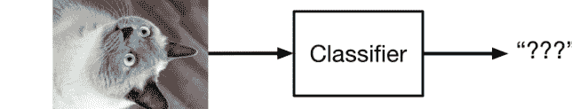

这只猫不是正的

这就是为什么你需要告诉 Vision 图像的方向，以便它在像素到达 Core ML 之前正确地旋转图像像素。由于 Vision 使用的是 `CIImage` 而不是 `UImage`，你需要将 `UImage.Orientation` 值转换为 `CGPropertyOrientation` 值。

### 尝试一下

此时，你可以编译并运行该应用，然后选择一张照片。

在模拟器中运行此应用是可能的，但只有照片库按钮是激活的。模拟器上的照片库默认不包含零食的照片，但你可以通过 Google 搜索它们并将这些 JPEG 或 PNG 文件拖入“照片”应用来添加自己的图片。

在设备上运行应用以使用相机，因为模拟器不支持拍照。

拍摄或选择一张照片，Xcode 调试面板将输出类似的内容：

```
Request is finished! Optional[<VNClassificationObservation:0x6c0002b2940-8B9F37D-B9CF-405A-AE33-64AF4F6763BB 0.8175 "healthy" (0.917060),<VNClassificationObservation:0x6c0002b350-B919C6-B264-AB33-5AAE84F6384A 0.18295 "unhealthy" (0.082490)]]
```

这是 `VNCoreMLRequest` 完成处理程序中 `print` 语句的输出。它打印了请求结果数组。如你所示，此数组包含两个 `VNClassificationObservation` 对象，一个健康（healthy）类的概率（`0.917060` 或 `91.7%`），另一个是不健康（unhealthy）类的概率（`0.082490` 或 `8.29%`）。

### 显示结果

当然，向输出面板打印内容并不有趣，所以让我们在应用中正确地显示这些结果吧。

在 `lazy classificationRequest` 的声明内部，将 `VNCoreMLRequest` 对象的完成处理程序更改为如下：

```
let request = VNCoreMLRequest(model: visionModel,
    completionHandler: {
        [weak self] request, error in
        self?.processObservations(for: request, error: error) // 添加此行
    }
)
```

现在你调用的不是之前存在的 `print` 语句，而是一个新方法 `processObservations(for:error)`。直接将处理结果的代码推送到完成处理程序内部是完全可能的，但这往往会使代码更难读。

在 `ViewController.swift` 中添加新方法：

```
func processObservations(for request: VNRequest, error: Error?) {
    // 1
    DispatchQueue.main.async {
        // 2
        if let results = request.results as? [VNClassificationObservation] {
            // 3
            if results.isEmpty {
                self.resultsLabel.text = "nothing found"
            } else {
                self.resultsLabel.text = String(format:"%@ %.1f%%", results[0].identifier, results[0].confidence * 100)
            }
            // 4
        } else if let error = error {
            self.resultsLabel.text = "error: \(error.localizedDescription)"
        } else {
            self.resultsLabel.text = "???"
        }
        // 5
        self.showResults()
    }
}
```


### 机器学习

### 第 2 章：图像分类

```
}
```

以下是该方法逐步执行的操作：

- 1. 完成处理程序在主队列上执行，Vision 请求在后台队列上运行。
- 2. 如果请求结果成功转换为 `[VNClassificationObservation]` 数组：
- 3. 如果结果为空，将结果标签显示为“nothing found”；否则，显示第一个结果的标识符和置信度百分比。
- 4. 如果存在错误，则显示错误信息。
- 5. 如果以上都不是，则显示“???”。
- 6. 最后，调用 `showResults()`。

### 机器学习

### 应用并分类一些图像

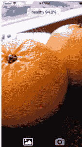

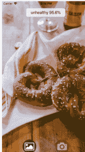

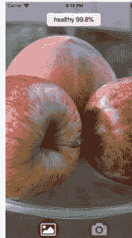

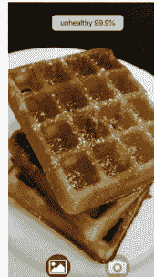

### 对几张图像的预测

非常酷。通过几行代码，你就为应用添加了一个顶尖的图像分类器！

> 注意：你在 Xcode 中查看 Core ML 模型时（通过在项目导航器中选择 `.mlmodel` 文件），它显示该模型有两个输出：一个包含概率的字典和一个顶部预测的标签。然而，Vision 请求给你一个 `VNObservation` 对象数组。Vision 将来自 Core ML 的字典转换为它自己的“观测”对象。之后，你将看到直接使用 Core ML 而不使用 Vision，在这种情况下，你可以访问模型的输出。

### 如果图像没有零食怎么办？

应用显示胜利类别及其对该预测的置信度。在上面的左图中，该类别是“healthy”，置信度为 `94.8%`。

如果输出类似于“healthy 95%”，模型对自己很有信心。你将在橙子、苹果、香蕉等的预测中看到这种情况。随后，如果输出是“unhealthy 95%”，模型对零食是不健康的非常确定，你将在椒盐和华夫饼上看到。这就是我们希望看到的置信预测。

应用中使用的模型是针对 `20` 种不同零食进行训练的。但当你向它展示一种从未见过的零食，甚至是一个完全不同的物体时，会发生什么呢——可能是一个根本不是不可食的东西？

## 第 2 章：图像分类入门

由于二分类器只理解两个类别，因此它会将你提供的任何图片归类为“健康”类别或“不健康”类别，即使这张图片并不是它所认同的某种零食。

这个特定的分类器经过训练，用于区分健康零食和健康零食，因此它应该只用于此类零食的照片。对于所有其他图像——比方可爱的猫——分类器将给出一个毫无意义的预测。毕竟，它只有“健康”或“不健康”可供选择。（而且，我们并不推崇把猫当作零食。）

对于这种“不支持”的输入，你可能希望发生的情况是模型更倾向于 `51%` 对 `49%` 的平分。在这种情况下，Vision 可能会返回如下的 `VNCClassificationObservation` 对象：

```
element 0: healthy 51
element 1: unhealthy 49
```

如果模型不确定，这实际上是一个可以接受的答案：它可以是任何一类。然而，由于 Vision 会按信度得分对此数组进行排序，应用程序将显示预测“健康”为获胜标签。但真的是如此吗？由于模型现在非常不确定，稍微改变这些百分比就会完全改变结果：

```
element 0: unhealthy 52
element 1: healthy 48
```

如果你对其中一张照片得到了预测，请尝试从稍微不同的角度再次拍摄同一照片。照片之间的细微差异可以很容易将预测从一个类别翻转到另一个类别。

这个故事的启示是，当概率达到 `50%–50%` 时，模型并真的不知道该如何处理。让应用程序处理这些情况是一个好主意。毕竟，没有什么能阻止用户拍摄一张非零食的照片。

在 `processObservations(for:error:)` 中，为 `if` 语句添加以下子句：

```swift
if results.isEmpty {
} else if results[0].confidence < 0.8 {
  self.resultsLabel.text = "not sure"
} else {
}
```

## 机器学习第 2 章：图像分类入门

在这里，我们选择了 `0.8` 的阈值（或 `80%` 置信度）。如果模型对其获胜预测的置信度低于此阈值，你决定无法信任它所出的预测，应用程序将显示“不确定”。

`0.8` 的阈值是任意选取的。在实践中，你可以通过将手机对许多现实物体来测试这一点，以感受什么样的置信水平是可靠的，以及在该水平以下模型开始犯太多错误。在实践中，还有数学方法可以找到合适的阈值，例如使用精确率-召回率曲线（Precision-Recall curve）或接收者操作曲线（ROC curve）。

> 注意：记住，测试低于 `0.5` 的置信度是没有意义的，因为获胜预测的置信得分始终大于 `50%`。二分类器中只有两个类别，它们的总置信得分需要相加等于 `100%`。

然而，你仍然可能遇到这种情况：

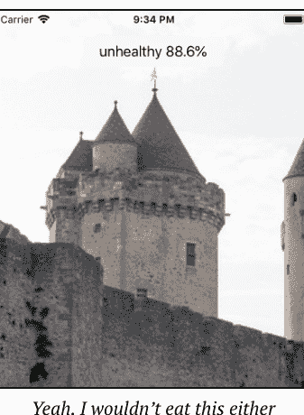

尽管该物体远不可食用，但模型对这个预测仍然非常有信心！有时分类器会给出一个非常有信心但完全错误的答案。这是所有分类器的局限性。

## 机器学习第 2 章：图像分类入门

重要的是，只有当你使用与训练数据非常相似的数据时，机器学习模型才能可靠地工作。模型只能对它学习过的类型类型做出可靠的预测——对于其他任何东西，它都会惨遭失败。机器学习看起来通常像魔法……但它确实有其局限性。

解决这类问题的唯一方法是通过训练更多图像（“健康零食”、“不健康零食”和“非零食”）来使你的模型更健壮。但即使如此，你的模型仍然会出错。使用机器学习来学习“健康零食”、“不健康零食”的区别以及将机器学习用于计算机视觉任务效果非常好，但绝非完美。

在训练章节中，你将看到如何估计模型的质量，以了解它在实践中的运行情况。

### 如果图像中有多个物体怎么办？

图像分类始终查看整个图像，并试图找出图像中最显眼的物体。但没有什么阻止你对包含以下对象的图片运行图像分类器：

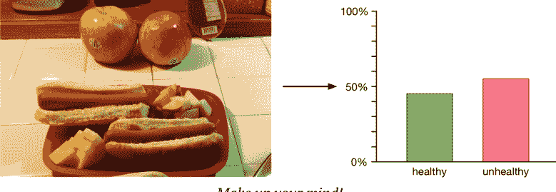

尽管该物体远不可食用，但模型对这个预测仍然非常有信心！有时分类器会给出一个非常有信心但完全错误的答案。这是所有分类器的局限性。

重要的是，只有当你使用与训练数据非常相似的数据时，机器学习模型才能可靠地工作。模型只能对它学习过的类型类型做出可靠的预测——对于其他任何东西，它都会惨遭失败。

测试低于 `0.5` 的置信度是没有意义的，因为获胜预测的置信得分始终大于 `50%`。二分类器中只有两个类别，它们的总置信得分需要相加等于 `100%`。

然而，你仍然可能遇到这种情况：


尽管该物体远不可食用，但模型对这个预测仍然非常有信心！有时分类器会给出一个非常有信心但完全错误的答案。这是所有分类器的局限性。

重要的是，只有当你使用与训练数据非常相似的数据时，机器学习模型才能可靠地工作。模型只能对它学习过的类型类型做出可靠的预测——对于其他任何东西，它都会惨遭失败。机器学习看起来通常像魔法……但它确实有其局限性。

解决这类问题的唯一方法是通过训练更多图像（“健康零食”、“不健康零食”和“非零食”）来使你的模型更健壮。但即使如此，你的模型仍然会出错。使用机器学习来学习“健康零食”、“不健康零食”的区别以及将机器学习用于计算机视觉任务效果非常好，但绝非完美。

在训练章节中，你将看到如何估计模型的质量，以了解它在实践中的运行情况。

### 如果图像中有多个物体怎么办？


图像分类始终查看整个图像，并试图找出图像中最显眼的物体。但没有什么阻止你对包含以下对象的图片运行图像分类器：


尽管该物体远不可食用，但模型对这个预测仍然非常有信心！有时分类器会给出一个非常有信心但完全错误的答案。这是所有分类器的局限性。

重要的是，只有当你使用与训练数据非常相似的数据时，机器学习模型才能可靠地工作。模型只能对它学习过的类型类型做出可靠的预测——对于其他任何东西，它都会惨遭失败。机器学习看起来通常像魔法……但它确实有其局限性。

## 它是如何工作的？

在此处，你可能在好奇它究竟是如何区分健康零食的。让我们窥探一下内部原理。

模型接受图像作为输入并产生概率分布。

# 机器学习第 2 章：图像分类入门

例如，HealthySnacks 模型基础的 SqueezeNet 神经网络架构看起来如下：

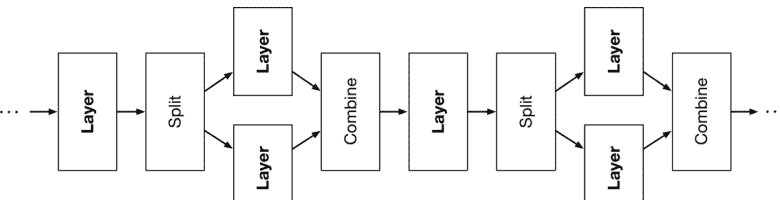

SqueezeNet 的流水线部分

所有的魔法都发生在执行变换的层内部。这真的涉及到复杂的数学吗？其实并不是。每一次变换都是相对简单的数学操作。神经网络的力量来自于这些变换的结合。通过将许多简单变换组合，你得到了可以处理复杂问题的流水线。早期的网络只使用两或三层（变换），增加层数充满了问题。但这些问题在近年来得到了解决，现在通常使用几十层甚至数百层的神经网络，这就是为什么它们被称为“深度学习”。SqueezeNet 拥有 67 层，尽管在实践中某些类型的层被融合在一起了。

### 进入下一个维度

让我们深入探讨一下数学，以便直观地理解这些变换。神经网络和大多数机器学习模型一样，只能处理数值。幸运的是，我们在本章中感兴趣的数据——输入图像和输出概率——都被表示为数字。为了解释，首先需要将数据转换为数字。输入图像是 227×227 像素，并且是一张彩色图像，因此你需要 227 × 227 × 3 = 154,587 个数字来描述这张图像。注意：每个像素需要三个数字，因为颜色存储为 RGB：红、绿、蓝。某些图像还有一个第四通道 alpha，它存储透明度信息，但分类器通常不使用它。使用 RGBA 图像作为输入是可以的，但分类器会忽略 alpha 值。

核心思想是：每个 227×227 的图像可以用 150,000 维空间中的一个点来表示。嘿，试着理解这一点……对于我们来说，在 3D 空间思考很容易，但在高维空间中很难。但原理是相同的：给定 3 个数字 (x, y, z)，你就可以描述 3 维空间中的任何点，没错？给定图像中所有像素的 150,000 个 RGB 值，你就在 150,000 维空间中得到了一个点。

顺便说一下，不要尝试思考 150,000 维。假设它超过了三个维度。大家都是这么做的，因为人类无法可视化超过三个三个维度。为了分类图像，你希望能够在这个高维空间中画一条线，并说：“所有健康零食的图像都在这一侧，所有不健康的零食都在另一侧。”如果这可行，分类图像就简单了：你只需要看图像落在线的哪一侧。

### 决策边界将空间分为两类

这条线被称为**决策边界**（decision boundary）。学习该边界的位置是分类模型的工作。数学警告：它实际上不是一条直线，而是一个超平面（hyperplane），它是将高维空间一分为两部分的子空间。作为机器学习从业者的好处之一就是可以使用“超平面”等酷的词汇。

问题在于，你无法在 150,000 维的像素空间中画一条直线——超平面——因为根据像素值对图像排序会导致健康和不健康的图像散落在到处。

由于像素捕捉的是光强度，具有相同颜色和亮度的图像聚集在一起，颜色不同的图像距离较远。苹果可以是红色的或绿色的，在像素空间中这样的图像并不接近。糖也可以是红色或绿色，所以你会发现苹果的照片和糖的照片混合在一起。

你不能仅仅观察某物有多红或多绿来判断这张图像是否包含健康食物。

分类所需的所有信息显然包含在图像中，但图像在 150,000 维像素空间中的分布方式并没有什么用。你想要的是一个所有健康零食聚集在一起、所有不健康零食也聚集在一起的空间。


### 具体示例

这就是神经网络大显身场的地方：在流水线每个阶段执行的变换将扭曲、旋转、拉伸和扩张这个坐标空间，直到所有代表健康零食的点都在一方，而所有不健康零食的点都在另一方，你终于可以在它们之间画出那条线。

这里有一个说明这一观点的著名例子。在这个例子中，数据是二维的，所以每个输入仅包含两个数字 (x, y)。这也是一个二分类问题，但在原始坐标空间中，无法在类别之间画出直线：


理论上，你可以通过学习使用椭圆而不是直线来分离这个空间以对数据集进行分类，但这相当复杂。简单得多的方法是执行一种聪明的变换，通过给所有点也赋予一个 z 坐标，将二维空间转换为三维空间。来自 A 类点（三角形）获得较小的 z 值，B 类点（圆圈）获得较大的 z 值。

现在看起来是这样：


应用这种变换后，两个类别被清晰地分开。你可以很容易地在它们之间画出一条线。

## 机器学习

## 机器学习第 2 章：入门图像分类

现在，将本章下载的资源中的 `MultiSnacks.model` 拖入 Xcode 项目中。

如果你在 Xcode 中查看这个新的 `.model` 文件，或者查看自动生成的代码，你会发现它看起来和之前的一模一样，只是 Swift 类的名称不同（是 `MultiSnacks` 而不是 `HealthySnacks`），因为 `.model` 文件的名称发生了变化。

要使用此模型，请对 `classificationRequest` 属性进行以下更改：

```swift
lazy var classificationRequest: VNCoreMLRequest = {
  let multiSnacks = MultiSnacks()
  let visionModel = try VNCoreMLModel(for: multiSnacks.model)
}
```

你不再需要创建一个 `HealthySnacks` 的实例，只需要创建一个 `MultiSnacks` 实例。这是你当你将 `MultiSnacks.model` 添加到项目时，Xcode 自动生成的类名。

同时，将 `processObservations(error:)` 中最内层的状态更改为：

```swift
if results.isEmpty {
  self.resultsLabel.text = "nothing found"
} else {
  let top3 = results.results.prefix(3).map { observation in 
    String(format: "%@%.1f%%", observation.identifier, observation.confidence * 100)
  }
  self.resultsLabel.text = top3.joined(separator: "\n")
}
```

现在不再仅显示最佳结果（置信度得分最高的类别），而是显示三个最佳类别的名称。

### 机器学习

### 第 2 章：入门图像分类

由于模型是在 20 种不同的物体类型上进行了训练，因此它输出的概率分布看起来如下：

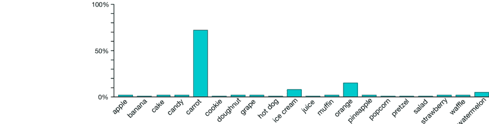

### 新的概率分布

之前只有两个值（健康/不健康），而现在有 20 个可能的结果，总计 100% 的百分比分布在这 20 个可能的类别中——这就是为什么它是概率分布。

应用程序显示预测概率值最高的三个类别。由于现在有 20 个类别，`results` 数组包含 20 个 `ClassificationObjects`，按置信度得分从高到低排序。`prefix(3)` 方法从数组中获取索引为 0、1、2 的元素（概率最高的元素），你通过 `map` 将它们转换为字符串。

对于上述概率分布，结果如下：

```
element 0: carrot 72%
element 1: orange 15%
element 2: ice cream 8%
```

模型对这个预测非常有把握。第一个结果的得分相当高，所以你可能相信这张图片确实是一个胡萝卜。

第二个结果通常也相当合理——如果你眯起眼睛，橙子看起来可能像胡萝卜——但第三个结果以及其它的任何结果都可能完全离谱。

考虑到这些置信度得分，这是可以的；由于只有 8% 的置信度，模型确实认为认为冰淇淋是一个合理的猜测。

> 注意：这三个选项的百分比不需要相加等于 100%，因为还有其他 17 个类别构成了剩余部分。

### 机器学习

## 机器学习第 2 章：入门图像分类

注意，当你对代码进行这些更改时，你删除了检查置信度是否小于 80% 的 `if` 语句。

这种检查对于二分类器是有意义的；当你有多个类别时，最佳置信度会在 60% 左右。这仍然是一个相当不错的得分。

对于只有两个类别的二分类器，随机猜测的正确概率是 50%。对于 20 个类别，随机猜测的正确概率仅为 1/20，即 5%。

当多分类模型非常不确定图像中包含什么时，概率分布看起来会更像这样：

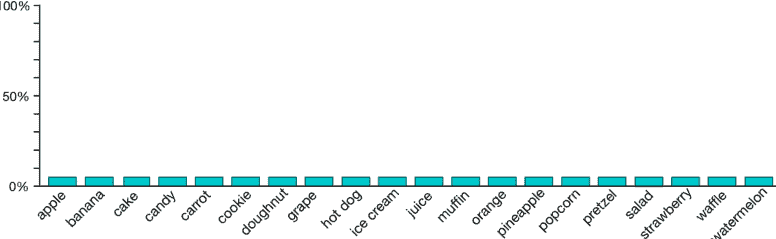

> 当多分类模型不确定时

你可以添加一种“不确定”的阈值，但更合理的值应该是 0.4（或 40%），而不是你在二分类器中使用的 80%。

就像二分类器一样，只有当你向多分类模型展示它经过训练可以识别的物体类型时，该模型的预测才有意义。如果你给新的分类器提供一张不属于它已知的 20 种类型之一的图片（例如腊犬），模型可能会返回一个非常不确定的预测（“它可能是任何东西”）或一个非常有信心但完全错误的预测（“热狗”）。同样，你可以询问一下当图像包含多个类别时会发生什么。

### 第 2 章：入门图像分类

嗯，与预测结果变为确定或不确定的二分类器不同，现在概率被分配到更多类别时，发生了类似的情况：

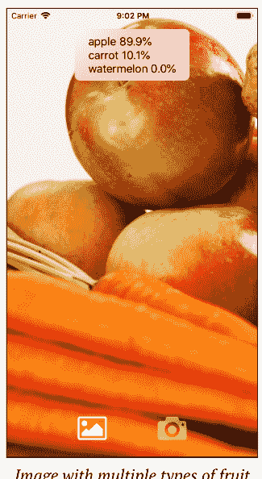

在这个例子中，分类器正确地识别了苹果和胡萝卜，并试图在它们之间分配概率。这就是为什么你查看的是顶部结果而不仅仅是最高分。在图像分类中，分类器的评分通常根据它们在最佳预测中的表现来给出。只要正确答案在前五个（或三个）预测中，我们就是满意的。单项准确率（top-one accuracy）表示“分类器正确识别了主要的物体吗？”，而前三或前五准确率（top-three or top-five accuracy）表示“它找到所有的物体了吗？”例如，如果一张分得分为 70% 西瓜、21% 玛芬和 5% 橙子的图片包含一个西瓜而不是橙子，它仍然会被视为分类正确。

### 机器学习

### 第 2 章：入门图像分类

> 注意：不要混淆“多分类”（multi-class）与“多标签”（multi-label）”。多分类分类器的工作是为物体选择一个单一类别。多标签分类器的工作是为同一个物体选择尽可能多个适用类别。例如，多标签可以将一个苹果分类为“健康”、“水果”和“红色”。

### 关键点回顾

总结一下，使用 Core ML 和 Vision 进行图像分类涉及以下步骤：

- 1. 从某处获取一个训练好的 `.mlmodel` 文件。Apple 在其网站上提供了几个，但通常你需要自己构建。在下一章中学习此内容。

- 2. 将 `.mlmodel` 添加到项目。

- 3. 创建 `VNCoreMLRequest`（只需一次），让它处理 `VisionObservation` 对象。

- 4. 对于每个想要分类的图像，创建一个新的 `VNRequestHandler` 并让它执行 `VNCoreMLRequest`。

这些步骤对于任何图像分类模型都有效。

### Bonus：不使用 Vision 使用 Core ML

你已经看到通过 Vision 框架使用 Core ML 是多么简单。鉴于 Vision 已经做了很多工作，在处理图像模型时建议使用 Vision。但是你也可以不使用 Vision 使用 Core ML，在本节中我们将学习如何操作。

对于本节，再次使用启动项目并将 `HealthySnacks.model` 添加到项目。

首先，详细查看生成的代码，因为你稍后会用到。要查看此源文件，首先在项目导航中点击 `HealthySnacks.model`，然后点击“Model Class”部分旁箭头。


### 机器学习

### 第 2 章：入门图像分类

打开了 **HealthySnacks.swift**，这是一个项目中并不存在的特殊代码文件。

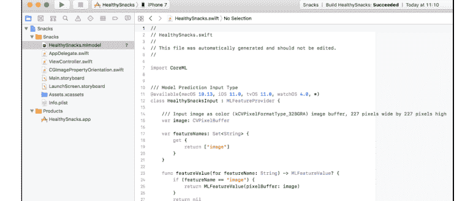

### 查看生成的代码

此源文件的主类是 `HealthySnacks`（位于文件底部）。它有一个名为 `model` 的属性，类型为 `MLModel`，这是 Core 框架的主类。它从 bundle 中加载 `.model`。

有两个预测方法。第一个接受一个类型为 `HealthySnacksInput` 的对象并返回 `HealthySnacksOutput`。第二个是一个便利方法，接受 `CixelBuffer` 作为对象输入。注意没有接收 `CGImage` 或 `CIImage` 的方法。

`HealthySnacksInput` 和 `HealthySnacksOutput` 实现 `MLFeatureProvider` 协议的类。回顾上一章，“特征”是我们学习时使用的术语。`MLFeatureProvider` 是向 Core ML 描述特征的对象。

在 `HealthySnacksInput` 的情况下，只有一个特征：一个 `CixelBuffer` 形式的图像，宽度 227 像素，高度 227 像素。实际上，模型会将此图像中的每个 R/G/B 值视为单独特征，因此从技术上来说，模型有 227 × 227 × 3 个输入特征。

`HealthySnacksOutput` 类提供了两个包含模型输出的特征：一个名为 `labelProbability` 的字典和一个名为 `label` 的字符串。`label` 仅仅是概率最高的类名称，是为了方便方便而提供的。

# 机器学习第2章：图像分类入门

字典包含了类别的名称以及每个类的置信度得分，因此它与概率分布相同，但它是字典的形式而不是数组。与 Vision 的 `VNClassificationObservation` 对象数组的区别在于，该字典是没有排序的。

> 注意：Xcode 为这些属性生成的代码取决于 `.mlmodel` 文件中输入和输出的名称。对于这个特定模型，输入被称为 "image"，因此该方法变为 `prediction(image:)`。如果 `.mlmodel` 文件中的输入称为其他名称（例如 "data"），那么该方法将是 `prediction(data:)`。`HealthySnacks` 输出类中的输入名称也是如此。在导入 Core ML 模型时需要注意这一点：不同的模型会有不同的输入输出名称——这是使用 Vision 时不需要担心的另一个问题。

为了在不使用 Vision 的情况下使用 `HealthySnacks` 类，你必须调用 `prediction(image:)` 并获取包含待分类图像的 `CVixelBuffer`。当预测方法完成后，它会将分类结果作为 `HealthySnacks` 输出对象返回。

接下来，你将切换到 `ViewViewController.swift` 并为 `ViewViewController` 添加以下属性以创建模型的实例：

```swift
let healthySnacks = HealthySnacks()
```

现在，你需要一种方法将 `UIImagePicker` 中的 `UIImage` 转换为 `CVixelBuffer`。此对象是图像数据的低级描述，供 Core Vision 和 AVAudio 使用。你可能习惯于将 `UIImage` 或 `CGImage` 对象处理图像，因此你需要先将这些转换为 `CVixelBuffers`。

向类中添加以下函数：

```swift
func pixelBuffer(for image: UIImage) -> CVixelBuffer? {
    let model = healthySnacks.model

    let imageConstraint = model.modelDescription
        .inputDescriptionsByName["image"]
        .imageConstraint!

    let imageOptions:[MLFeatureValue.ImageOption: Any] = {
        .cropAndScale: VNImageCropAndScaleOption.scaleFill.rawValue
    }

return try? MLFeatureValue(
    cgImage: image.cgImage!,
    constraint: image.cgConstraint,
    options: imageOptions).imageBufferValue
)
```

约束（constraint） 是一个 `MLConstraint`，描述了模型预期的图像大小。`options` 字典允许指定如何对图像进行缩放和裁剪。这使用了与 Vision 相同的选项，但你也可以给它一个带有自定义裁剪区域的 `CGRect`。该 `MLFeatureValue` 构造器还有一个版本，可以在图像不是正立的情况下为其传递一个方向值。


> 注意：此 API 适用于 iOS 13 及更高版本。在本章的下载资源中，我们提供了一个 `UIImage` 扩展，用于为旧版本的 iOS 将 `UIImage` 转换为 `PixelBuffer`。

将 `classify(image:)` 方法更改为：

```swift
func classify(image: UIImage) {
    DispatchQueue.global(qos: .userInitiated).async {
        // 1
        if let pixelBuffer = self.pixelBuffer(for: image) {
            // 2
            if let prediction = try? self.healthySnacks.prediction(image: pixelBuffer) {
                // 3
                let results = self.top(1, prediction.labelProbability)
                self.processObservations(results: results)
            } else {
                self.processObservations(results: [])
            }
        }
    }
}
```

以下是它的工作原理：

- 1. 使用辅助方法将 `UIImage` 转换为 `PixelBuffer`。这会将图像缩放到预期的大小 `227×227`，如果它还没有正立，还会修复方向。
- 2. 调用 `prediction(image:)` 方法。这可能会失败——例如，如果图像缓冲区不是 `227×227` 像素——这就是为什么你需要使用 `try?` 并将其放在 `if let` 中。
- 3. 预测对象是 `HealthySnacksOutput` 的实例。你可以查看它的 `label` 属性来寻找最佳类的名称，但你也想查看得分最高的类名称及其概率。这正是字典的作用。

# 第3章：训练图像分类器

作者：Audrey Tam & Matthijs Hollemans

**更新说明：** 本章已更新至 iOS 13、`Xcode 11` 和 Swift 5.1

在上一章节中，你学习了如何使用 Core ML 和 Vision 使用训练好的模型对图像进行分类。然而，使用他人的模型往往是不够的——模型可能无法完全按照你的要求工作，你可能想使用自己的数据和类别——而且了解如何训练自己的模型是很有用的。

在接下来的章节中，你将学习创建自己的模型。你将学习如何使用机器学习专家使用的常用工具和库来创建模型。Apple 为开发者提供了 Create ML 机器学习框架，用于在 Xcode 中创建模型。在本章中，你将学习如何使用 Core ML 训练零食模型。

## 数据集

在训练模型之前，你需要数据。你可能还记得引言中提到的，机器学习的核心是训练模型通过观察大量示例来学习规则。

由于你正在构建一个图像分类器，示例自然将是图像。你将训练一个能够区分 20 种不同类型零食的图像分类器。

## 机器学习

### 第 3 章：训练图像分类器

再次列出可能的类别：

- 健康：苹果、香蕉、胡萝卜、葡萄、果汁、橙子、菠萝、沙拉、草莓、西瓜 不健康：蛋糕、糖果、饼干、甜甜圈、热狗、冰淇淋、麦芬、爆米花、椒盐结、华夫

双击 `starter/snacks-download-link.webloc` 下载并解压零食数据集到你的默认下载位置，然后将 `snacks` 文件夹移动到你的测试数据集文件夹。其中包含了你将用于训练模型的图像。

该数据集包含近 7,000 张图像 —— 每个类别大约有 350 张图像。

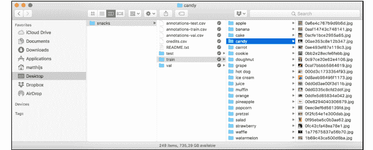

### 零食数据集

数据集分为三个文件夹：`train`、`test` 和 `val`。训练模型时，我们将仅使用 `train` 文件夹中的 4,800 张图像，这被称为训练集。

来自 `val` 和 `test` 文件夹的图像（各 950 张）用于衡量模型在训练后的运行效果。它们分别被称为验证集和测试集。重要的一点是，你不要使用验证集或测试集的图像进行训练；否则，你将无法对模型的质量获得可靠的估计。我们将在章节稍后部分讨论这一点。

以下是一些训练图像的示例：

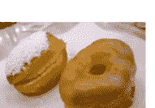


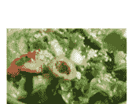

`pineapple/856841a5b3b85c465.jpg`

### 选定的训练图像

如你所见，这些图像具有各种形状和大小。文件夹的名称将用作类名称 —— 也称为**标签**（`label`）或**目标**（`target`）。

## Create ML

你现在将使用 Create ML 在 **`snacks`** 数据集上训练一个多分类分类器。

在 Xcode 菜单中，选择 **`Xcode > Open Developer Tool > Create ML`**:

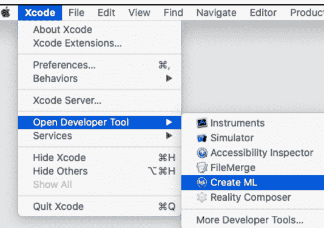

打开一个 Finder 窗口：点击 New Document。在 Choose a Template 窗口中，选择 Image > Image Classifier，并点击 Next：

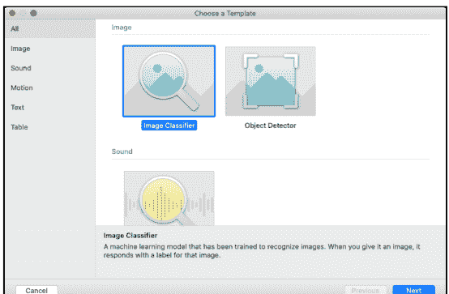

将你的分类器命名为 `MultiSnacks`，并点击 Next：

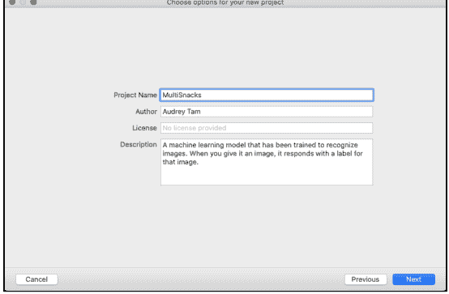

选择保存图像分类器的位置，然后点击 Create 显示你的分类器窗口：

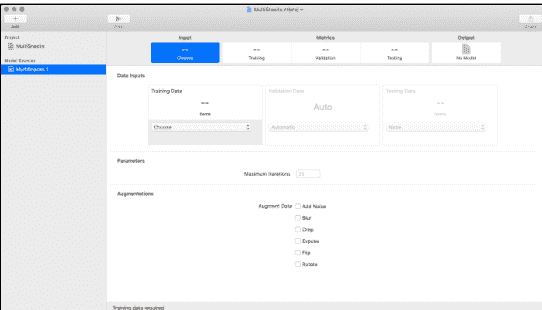

第一步是添加训练数据：点击 Choose > Select Files... 然后导航到 `snacks/train`，并点击 Open：

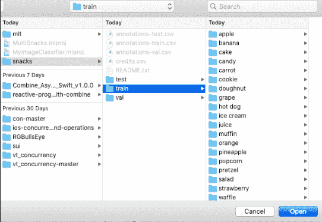

窗口更新以显示类别数量和训练数据项目，状态显示为 Ready to train（准备好训练）。点击 Train 按钮：

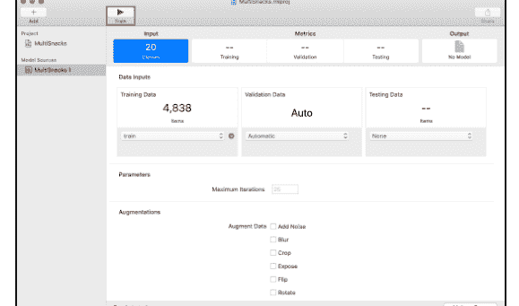

窗口显示 Activity：步骤 1 是提取特征，有一个进度条显示已处理了多少图像：

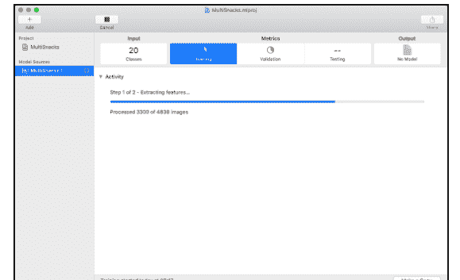

在步骤 2 – 训练中 ——会出现一个图表，显示每次迭代的训练准确率（Training accuracy）和验证准确率（Validation accuracy）。训练完成后，你将得到一个 Metrics 表，列出 20 个类的精确率（Precision）和召回率（Recall）：

| Input | Metrics | Output |
| --- | --- | --- |
| 20 Classes | 100% Training | 94% Validation -- 312 KB Testing |

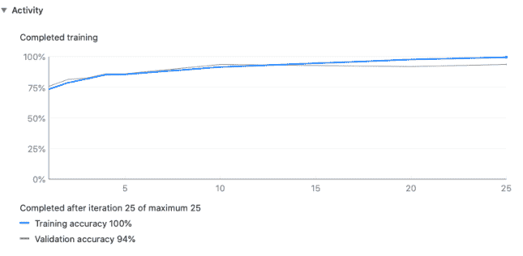

| Class | Item Count | Precision | Recall |
| --- | --- | --- | --- |
| apple | 237 | 98% | 100% |
| banana | 231 | 100% | 100% |
| cake | 241 | 98% | 100% |
| candy | 234 | 100% | 100% |

> 注意：你可能在好奇 Create ML 如何在内存中加载所有训练数据的，因为 4,800 张图像占用的物理内存可能超过了你拥有的 RAM。Create ML 将数据加载到 `MLDataTable` 结构中，它只在内存中保留图像元数据，然后根据需要加载图像本身。这意味着你可以拥有包含大量数据的大型 DataTable。

### 精确率和召回率

Create ML 计算每个类的精确率和召回率，这对于理解哪些类的表现比其他类更好用。在我的结果中，这些值大部分是 100% 或非常接近。但它们意味着什么呢？

精确率意味着：在模型预测为“苹果”的所有图像中，98% 实际上是苹果。如果我们没有许多假阳性（false positives），精确率就高；如果我们经常将某些东西误分类为“苹果”，则精确率就低。如果某物实际上不属于“X”类，但模型错误地认为它是，就会发生假阳性。

召回率类似但不同：它计算了模型在总数中找到了多少苹果 —— 在这种情况下，它找到了 100% 的“苹果”图像。这给了我们关于假阴性（false negatives）数量的概念。如果召回率低，意味着我们实际上漏掉了很多苹果。如果某物确实属于“X”类，但模型认为它是另一个类，就会发生假阴性。

同样，我们喜欢看到高数字，> 95% 是非常棒的。例如，“苹果” 98% 的精确率意味着在模型排除的 50 个东西中，有几个不是苹果。对于召回率，这意味着模型找到了测试集中所有的胡萝卜图像。这太棒了！

对于精确率来说，表现最差的类是“苹果”（98%）和“蛋糕”（98%）。

## 机器学习

### 第3 章：训练图像分类器

在训练图像分类器时，图像越多越好。然而，为了保持下载量较小且训练时间短，我们将数据集限制在每个类别约 350 张图像，以便所有读者都能方便使用。像 `ImageNet` 这样的流行数据集每个类别有 1000 张或更多图像，但它们的大小也有几百 GB。

最终的数据集每个类别有 350 张图像，被分为 250 张训练图像、50 张验证图像和 50 张测试图像。某些类别（如椒盐饼和爆米花）的图像较少，因为在 Open Images 中没有找到更多合适的图像。

每个类别的图像数量完全相同是必要的，但差异不应太大，否则模型会倾向于多学习某一种类型而不是另一种。这种数据集被称为**不平衡数据集**，你需要特殊的技术来处理它们，而我们将会介绍这些技术。

所有图像都调整了大小，使得最小尺寸为 256 像素。这并非必须，但它可以使下载量更小并让训练快一点。我们去除了图像中的 EXIF 元数据，因为某些 Python 图像加载器会对这些图像发出警告，这很令人困扰。移除这些元数据的缺点是 EXIF 包含了图像的朝向信息，某些图像实际上可能会是倒过来的……哦，吧。

创建这个数据集花费了很长时间，但它是至关重要的。如果你的数据集质量不高，模型将无法学习到你想让它学习的内容。人们所说，关键不在于你如何使用算法，而在于谁拥有最好的数据。

> 注意：只要你遵守 CC BY 2.0 许可规则，就可以自由使用零食数据集中的图像。文件名与 Google Open Images 注解使用的 ID 相同。你可以使用包含的 `credits.csv` 文件查找图像来源的原始 URL。

# 迁移学习

那么，在训练场中发生了什么？Create ML 目前正忙于使用**迁移学习**来训练你的模型。正如你可能在第一章记忆的，迁移学习是一种聪明明的方法，通过重用从最初在不同任务上训练过的模型的知识来快速训练模型。

你在上一章中使用的 `HealthySnacks` 和 `MultiSnacks` 模型是基于 `SqueezeNet` 构建的。Create ML 使用的底层模型不是 `SqueezeNet`，而是 `VisionFeaturePrint_Screen`，这是一个由 Apple 专门设计，用于在 iOS 设备上提供高质量结果的模型。

`VisionFeaturePrint_Screen` 在一个巨大的数据集上进行了预训练，以识别海量的类别。这是通过学习在图像中寻找哪些特征，以及学习组合这些特征来对图像进行分类实现的。你的数据集几乎所有的训练时间，模型都花在了从你的图像中提取 2,048 个特征上。这些特征包括低级边缘、中级形状和特定任务的高级特征。

一旦提取了特征，Create ML 仅花费非常短的时间来训练逻辑回归模型，将你的图像分类到 20 个类别中。这类似于为散点点拟合一条直线，但是在 2,048 维而不是 2 维。

只有当数据集的特征与用于训练模型的数据集的特征合理相似时，迁移学习才有效。在 `ImageNet`（一个大型照片集）上预训练的模型可能无法很好地迁移到铅画或显微镜图像。

# 深入观察训练循环

迁移学习花费的时间比从零开始训练神经网络要少。然而，在我们清楚理解迁移学习如何工作之前，我们必须先对训练神经网络的含义稍作了解。回想一下第一章中展示过的一张图像：

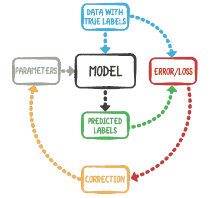

用语言描述，神经网络是这样训练的：

- 1. **用小的随机数初始化神经网络的“大脑”。** 这就是为什么未训练的模型只会进行随机猜测：因为它从字面上说就是随机的。这些被称为模型的**权重或学习参数**。训练过程是将这些权重从随机数变为有意义的内容的过程。
- 2. **让神经网络对所有训练示例进行预测。** 对于图像分类器，训练示例就是图像。
- 3. **将预测与预期答案进行比较。** 当你训练分类器时，预期答案（通常称为“目标”）是训练图像的类别标签。目标是计算“误差”或损失（`loss`），这是预测值与预期答案之间距离的指标。损失是一个多维函数，对于某些特定的权重配置有一个最小值，训练的目标是确定权重的最可能值，使损失非常接近这个最小值。在权重随机的未训练模型上，损失很高。损失值越高，模型学习得越多。
- 4. 为了改进权重并减少误差，**我们计算损失的梯度。** 这个梯度告诉你每个权重对损失的贡献。通过这个梯度，你可以修正权重，以便下一次损失更小。这种纠正步骤被称为梯度下降，它在训练期间多次发生。对于大型数据集，**随机梯度下降（SGD）**通过小批次来估计梯度。
- 5. **重复该过程直到损失收敛。** 每一经过一步，模型都会变得好一点。

随机梯度下降是一种粗力方法，但它是训练深度网络的唯一可行方法。不幸的是，它也很慢。你已经看到未训练的模型是用随机权重初始化的。为了让这样的模型学习所需的任务（例如图像分类），它需要大量的数据。如果数据太少，模型将无法学习任何东西。机器学习是非常饥饿的！

这些是从零开始训练深度模型的两个主要缺点：你需要大量的数据，而且它很慢。

Create ML 使用了更聪明的方法。与其从一个大脑里只有随机数的未训练模型开始，Create ML 取了一个已经在大型数据集上训练过的神经网络，然后对你的数据进行微调。这只涉及模型的一小部分，而不是整个模型。这种捷径被称为迁移学习，因为你正在将神经网络在其他类型问题上学到的知识转移到你的特定任务中。它比从零开始训练模型快得多，而且效果很好。这是机器学习版的“聪明工作，而不是苦干工作”！

Create ML 使用的预训练 `VisionFeaturePrintScreen` 模型已经见过很多照片和饮料，因此它对你可能使用的图像类型已经有了了解。通过迁移学习，你可以利用这些现有知识。

> 注意：当你使用迁移学习时，你需要选择一个用于特征提取的基础模型。你为止看到的两个基础模型是 `SqueezeNet` 和 `VisionFeaturePrintScreen`。它分析你的训练数据以选择最合适的基础模型。目前，Create ML 使用的 `VisionFeaturePrintScreen` 基础模型很大，具有 2,048 个特征，所以这个过程需要一段时间。

## 第 3 章：训练图像分类器

由于这个预训练的基础模型还不认识我们那 20 种特定的零食，因此你无法将其直接插入零食检测器 App 中，但你可以将其作为特征提取器。

### 什么是特征提取？

你可能还记得机器学习是基于“特征”进行的，其中我们将特征定义为任何我们认为感兴趣的数据项。你可以使用照片的像素作为特征，但正如上一章所示，单个 RGB 值并不能说明图像中是种种类的物体。

`VisionFeatureExtractor` 将难以理解的像素特征转换为更能描述图像中物体的特征。

这就是我们之前讨论过的流水线。然而，这里 `VisionFeatureExtractor` 的输出并不是说明图像包含每个类别物体概率的概率分布。

`VisionFeatureExtractor` 的输出是……嗯，更多的特征。

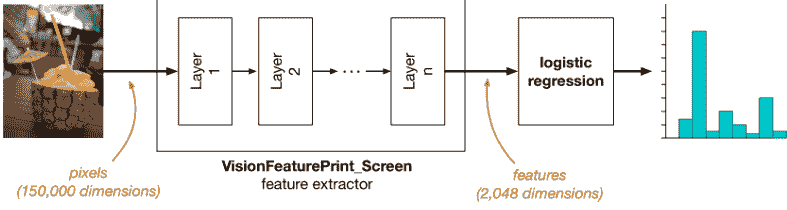

VisionFeatureExtractor 提取特征

对于每张图像，`VisionFeatureExtractor` 会产生一个包含 2,048 个数字的列表。这些数字代表了图像的高层次内容。这些数字的具体含义并不总是容易用语言描述，但请将每张图像想象成这个新 2,048 维空间中的点，具有相似属性的图像聚集在一起。

例如，这 2,048 个数字之一可以代表零食的颜色，橙子和胡萝卜在该维度上的值非常相似。另一个特征可以代表物体的拉长程度，香蕉、胡萝卜和热狗的数值会比橙子和苹果大。

另一方面，苹果、橙子和甜甜圈在“圆度”这一维度上的得分更高，而华夫饼在该维度上的得分较低（假设该特征的负值意味着方形而不是圆形）。

不过，模型通常没有那么可解释性，但你已经理解了意思：新的 2,048 个特征通过物体的真实特性来描述图像，这些特性比像素强度要丰富得多。然而，你无法在这个 2,048 维空间中画一条线（抱歉，是超平面）来将图像分割为我们正在寻找的不同类别，因为 `VisionFeatureExtractor` 并不是在我们自己的数据集上进行训练的。它是在 `ImageNet` 上训练的，那里有 1000 个类，而不是 20 类。

虽然 `VisionFeatureExtractor` 在从训练图像创建有用特征方面做得很好，但为了对这些图像进行分类，我们需要将数据再次转换为 20 维空间，我们可以将其解释为 20 种零食的概率分布。


我们如何做到这一点？Create ML 使用这些 2,048 个数字作为一个名为逻辑回归（logistic regression）的新机器学习模型的输入。Create ML 并不是在具有 150,000 个特征的图像上训练一个巨大的模型（这很难！），而是在 `VisionFeatureExtractor` 提取出的 2,048 个特征之上训练一个简单得多的模型。

## 逻辑回归

当你读完上一节时，Create ML（希望）已经完成了你的模型的训练。状态显示训练花费了 2 分钟，大部分时间花在了提取特征上。

> 注意：我是在一台 2018 款 MacBook Pro 上运行 Create ML，配备了 6 核 2.7GHz CPU 和 Radeon 560 GPU。你可能会看到与此不同的结果。在这种情况下，未训练的模型（在此例中为逻辑回归）是用随机数初始化的，这会导致不同训练运行之间的差异。

Create ML 训练的求解器是一个称为逻辑回归的分类器。这是一种传统的机器学习算法，但它仍然非常有用。它可能是目前使用中最常用的机器学习模型。

## 机器学习第 3 章：训练图像分类器

你可能熟悉另一种类型的回归，线性回归（linear regression）。这是在图表上的点之间拟合一条线的行为，你可能在高中时期做过这个，那时它可能被称为（普通）最小二乘法。

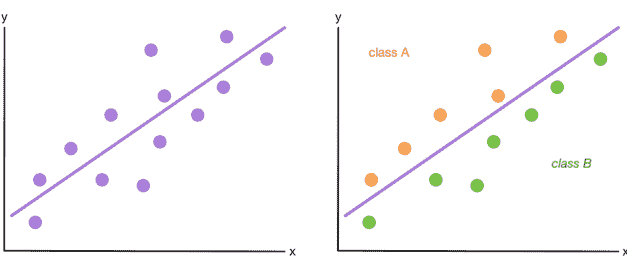

### 线性回归与逻辑回归

逻辑回归做的是相同的事情，不同在于：线的一侧的所有点都属于 A 类，线的另一侧的所有点都属于 B 类。看我们是如何直接在空间中画一条线来将其分割为两个类别的？

由于书籍无法处理 2,048 维的插图，上述插图中的逻辑回归必然是二维的，但无论输入数据有多少维，该算法都能运行良好。决策边界不是线，而是我们之前提到的一个高维对象：超平面。但由于人类很难在超过二或三维的情况下思考，我们更倾向于用直线来可视化。

Create ML 实际上使用了该算法的小变体——多项逻辑回归（multinomial logistic regression）来处理两个以上的类别。

训练逻辑回归算法以将 2,048 维特征转换为允许我们在 20 个类之间绘制分离线的空间是非常容易的；因为我们开始时的特征就已经包含了关于图像的有意义的信息，而不是像素值。

> 注意：如果你好奇逻辑回归具体是如何工作的，像往常一样它涉及到特征的转换。点越靠近决策边界，我们对它属于某一类的就越确定。迭代越多，模型越好。

### 寻找验证

尽管训练集中有 4,858 张图像，但 Create ML 只使用了其中的 95% 用于训练。

在训练期间，定期检查模型的状况是有用的。为了这个目的，Create ML 留出了一小部分——5%，大约 240 张图像。它不在这些图像上进行训练，而是使用它们来评估模型的表现。

这是**训练准确率**（training accuracy）和**验证准确率**（validation accuracy）的输出图：

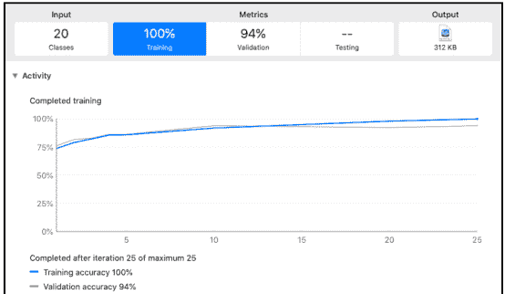

在 12 次迭代后，验证准确率稳定在 94%，这意味着在 100 个验证示例中，它正确预测了其中 94 个的类别。但训练准确率持续增加到 100%——分类器对 10 张训练图像的判断都是正确的。

> 注意：Create ML 所说的“迭代”（iteration）是指遍历整个训练集一遍，也称为“轮次”（epoch）。这意味着 Create ML 给模型了一个查看所有训练图像的机会。如果你进行 10 次迭代，模型将看到每张训练图像（或其特征）10 次。

默认情况下，Create ML 训练逻辑回归最多 25 次迭代，但你可以通过 `Maximum Iterations` 参数进行更改。通常情况下，迭代越多，模型越好，但等待训练完成的时间也越长。不过训练逻辑回归并不耗时，所以没问题！

问题在于要重新进行提取！如果你的 Mac 完成提取花费在五分钟以内，请尽管去看看减少迭代次数会发生什么：

- 点击 + 添加一个新的 `Model Source`：你回到了起始窗口。
- 在 `Training Data` 选择下拉菜单中，选择 `train`。注意 `Validation Data` 的 `Automatic` 设置。很快，我们将使用 `snacks/val` 代替它。
- 将 `Max iterations` 减少到 10。
- 点击 `Train`。

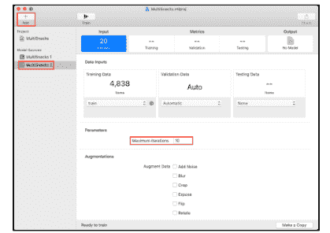

如果你留下来观察，你会看到所有的训练时间都用于提取特征了。在第 5 章“深入研究 Turi Create”中，你将学习如何保存提取出的特征，这样你就可以在不需要等待的情况下尝试不同的训练参数。

## 机器学习

### 第 3 章：训练图像分类器

以下是我的 Mac 上发生的情况：经过 10 次迭代，训练在 2 分钟 38 秒后完成——仅比 25 次迭代快了 9 秒！但准确率值要低得多：

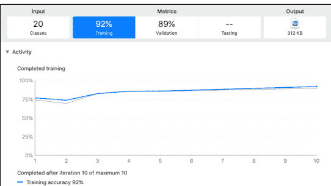

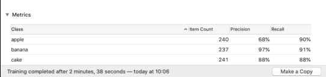

训练准确率（92%）的下降幅度大于验证准确率（89%），但这两个数值更接近（33%）。

现在来看看当你使用 `snacks/val` 子目录（每类约有 50 张图像）而不是让 ML 随机抽取 5% 时会发生什么。

添加第三个模型源（Model Source），并重命名为 `Multisnacks manual val`。现在是时候将其两个重命名为 `Multisnacks 25 iter` 和 `Multisnacks 10 iter` 了。

**在 `Multisnacks manual val` 中，选择 `train` 作为训练数据（Training Data），然后选择 `snacks/val` 作为验证数据（Validation Data）：**

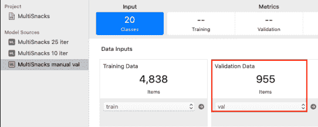

将最大迭代次数（`Max iterations`）设置为 25，并点击 `Train`（训练）。


### 以下是我的结果：

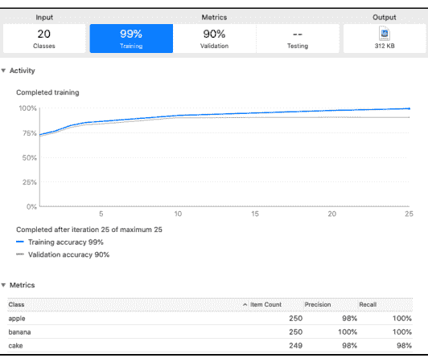

这是在有 955 张验证图像和 240 张训练图像的情况下。这次训练使用了大量的图像，即 4,838 张训练图像。但验证准确率实际上变差了，这表明模型可能出现了**过拟合。**

### 过拟合的发生

过拟合（Overfitting）是机器学习中学习的一个术语。它意味着模型开始记住*特定的*训练图像。例如，图像 `train/cream/b0ff2ec6c49c78.jpg` 中有一个穿蓝色衬衫的人正在享受冰淇淋：


### 好吃！

假设分类器学到了一条规则：“如果图像中有蓝色色块，那么类别就是冰淇淋。”这显然不是你希望模型学习的内容，因为蓝色衬衫与冰淇淋泛没有关系。它只是恰好在该特定的图像上有效。这就是为什么你要使用一组不用于训练的验证图像集。由于模型从未见过这些图像，它没有学习到关于它们的任何知识，这使其成为测试训练模型对新图像泛化能力的一个良好测试。

这个特定模型的准确率为 92%（验证准确率）、98%（训练准确率）。如果你只看训练准确率，你对模型准确率的估计可能过于乐观。理想情况下，你希望验证准确率与训练准确率相似，就像在 10 次迭代后那样——这意味着你的模型运行良好。通常，验证准确率会稍低一点，但如果它们之间的差距太大，则意味着模型从训练集中学习了太多无关的细节——实际上是在死记硬背特定的图像。过拟合是深度学习模型中最常见的问题之一。

有几种方法可以处理过拟合。最好的策略是使用更多数据进行训练。遗憾的是，对于这本书来说，我们无法真的为你提供 100GB 的数据集，因此我们决定使用较小的数据集。对于图像分类器，我们可以通过翻转、旋转或更改图像曝光度来增强图像数据。这里是数据增强的插图：

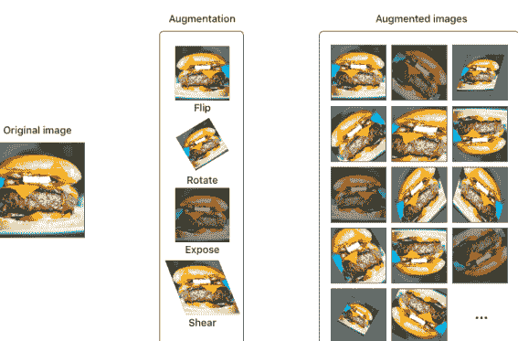

所以尝试一下：添加一个新的**模型源**，将其命名为 `Multisnacks crop`，设置之前的选项，但也选择一些数据增强：

| 增强选项 (Augmentations) | 增强数据 (Augment Data) |
| :--- | :--- |
| 添加噪声 (Add Noise) | |
| 模糊 (Blur) | |
| [x] 裁剪 (Crop) | |
| 曝光 (Exposure) | |
| 旋转 (Rotate) | |

增强选项按字母顺序排列，但按有效性从高到低列表，其中 `Crop` 最有效：

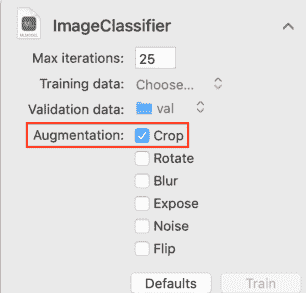

这也是分类器应用选项的顺序，如果你选择了多个）。选择 `Crop` 会为每张原始图像创建四张图像，因此特征提取的时间增加了五倍（例如 14 秒）。选择所有增强选项会为每张原始图像创建 100 张图像！实际上，图像的数量上限是 100。点击 `Train`，然后去泡茶或烤饼干。再来一次？这是我的结果：

| 输入 (Input) | 指标 (Metrics) | 输出 (Output) |
| :--- | :--- | :--- |
| 20 类 (Classes) | 97% 训练 | 91% 测试 32 KB |

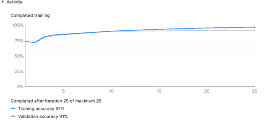

| 类别 (Class) | 数量计数 (Item Count) | 精率 (Precision) | 召回率 (Recall) |
| :--- | :--- | :--- | :--- |
| 苹果 (apple) | 1250 | 90% | 97% |
| 香蕉 (banana) | 1250 | 88% | 97% |
| 蛋糕 (cake) | 1245 | 91% | 97% |

训练在 14 分钟 48 秒后完成——今天 11/14


嗯，训练准确率稍低一点（97%），但验证准确率（91%）也是如此。所以它仍然是过拟合，但学习也花费了更长时间——考虑到有 25,000 张图像！

结论是，训练准确率是一个有用的指标，但它只说明模型是否仍在学习，而不是模型在实践中工作得如何。训练图像上的良好分数并不有趣，因为你已经知道它们的类别是什么。你关心的是模型在以前没过的图像上的表现。那么，需要关注的指标是验证准确率，因为这是模型在现实世界性能的良好指标。

> 注意：过拟合并不是验证准确率低于训练准确率的原因。如果你的训练图像与验证图像在某些根本上不同（愚的例子：所有的训练图像都是晚上拍摄的，而验证图像是白天拍摄的），你的模型显然得不到良好的验证。验证图像来自哪里并不重要，只要它们没有用于训练但包含相同类型的物体。这就是为什么 Create ML 随机选取 5% 的训练图像使用。你将在接下来的章节中更深入地查看过拟合以及训练验证准确率之间的差异。

### 更多指标和测试集

现在你已经训练了模型，了解它在以前从未见过的新图像上的表现是好的。你已经在训练期间通过验证准确率略微体验了这一点，但数据集还包含一组你尚未使用的测试图像。这些图像存储在 `snacks/test` 文件夹中，并按类别组织，就像训练数据一样。

切换到验证准确率最高的模型源——在我的情况下，是第一个 25 iter，验证准确率为 94%。

选择 `Testing` 选项卡，然后选择 `snacks/test`：

| 输入 (Input) | 指标 (Metrics) |
| :--- | :--- |
| Multisnacks | 20 100% | 94% |
| 选择 (Choose) | 训练 (Training) | 版本 (Version) |
| 模型源 (Model Sources) | | |
| Multisnacks 25 iter | 输入数据 (Data Inputs) | |
| Multisnacks 10 iter | 测试数据 952 项 (Testing Data 952 Items) | |
| Multisnacks: val | test | |

点击 `Test Model`（测试模型）：这需要一些时间来计算。就像训练期间一样，图像的特征提取比分类花费更多时间。

| 输入 (Input) | 指标 (Metrics) | 输出 (Output) |
| :--- | :--- | :--- |
| 20 100% | 94% | 88% | 312 KB |
| 类别 (Class) 训练 (Training) 验证 (Validation) | | |
| 输入数据 (Data Inputs) | 测试数据 952 项测试模型 (Testing Data 952 Items test Test Model) | |
| 指标 (Metrics) | | 数量计数 (Item Count) 精率 (Precision) 结果 (Result) |
| :--- | :--- | :--- | :--- |
| 苹果 (apple) | 50 | 83% | 86% |
| 香蕉 (banana) | 50 | 89% | 96% |
| 蛋糕 (case) | 50 | 68% | 82% |

## 机器学习

### 第 3 章：训练图像分类器

你应该应该抵制住回去并反复调整模型以提高测试性能的诱惑。你不希望测试集中的图像影响模型的训练方式，这会导致测试集不再是未见过的图像的良好代表。如果你只这样做几次，可能没关系，特别是当你的模型并不理想时，但这不应该成为一种习惯。请将测试集留到最后，并尽可能少地对其进行评估。

再次回到那个问题：88% 的正确率是高分还是低分？这意味着每 10 张图片中就有一张以上被判错了。显然，我们更希望看到 99% 的准确率（每 100 张中仅错1 张）或更高，但这是否可行取决于你的模型容量、类别数量以及你拥有的训练图像数量。

即使 88% 的正确率并非理想，这是否意味着你的模型实际上学到了很多东西呢？毕竟，在 20 个类别的情况下，完全随机猜测的平均概率是 1/20，即 5%。所以，模型的表现已经比随机猜测好得多了。但看起来，使用当前数据集，Create ML 的表现不会比这更高了。

记住，准确率得分只查看概率最高的预测预测类别。如果一张照片包含一个苹果，而置信度最高的预测是“热狗”，那么这显然是一个错误的答案。但如果最高预测是“热狗”且置信度为 40%，而第二高概率类别是“苹果”且置信度为 39%，你可能仍然会认为这是一次正确的预测。

### 检查你的输出模型

是时候查看你的实际 Core ML 模型了：选择“输出”（Output）标签页，然后将 `snacks/test` 文件夹拖到“拖入或添加文件”（Drag or Add Files）的地方。瞬间之间，你的模型就对测试图像进行了分类。你可以检查每一张图像以查看预测的类别以及模型的信心水平：

raywenderlich.com

## 机器学习

### 第 3 章：训练图像分类器

| 输入 | 指标 | 输出 |
| --- | --- | --- |
| 20 轮次 100% 图像训练 | 94% 88% 验证 | 测试 0 错误 |
| 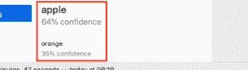 | | |

训练在 2 分钟 47 秒后完成 —— 今天上午 09:18

你的模型能正确识别某些图片，这令人惊讶：

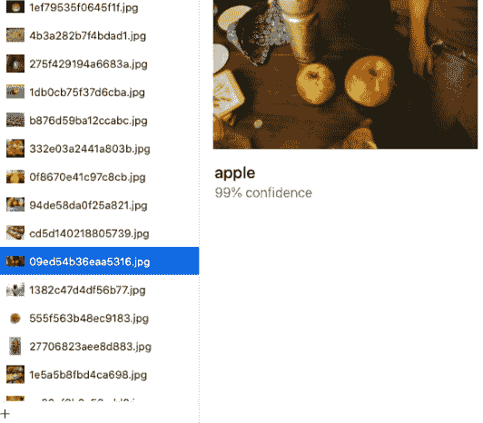

训练新模型的全部目的是为了在你的 App 中使用它们，那么你该如何使用 Core ML 保存这个新模型呢？

只需像往常一样将其拖入 `Xcode`，或者在 Finder 中打开它——如此简单！然后用你的新文件替换现有的 `.mlmodel` 文件。目前 Snaps 应用中使用的模型是用以下方式创建的：


## 机器学习

### 第 3 章：训练图像分类器

使用 `SqueezeNet` 作为特征提取器——它只有 5MB。你从 Create ML 创建的新模型只有 312KB！它实际上是一个更大的模型，但它的大部分内容——`VisionFeaturePrint_Screen` 特征提取器——已经包含在操作系统，因此你不需要将其作为 `.mlmodel` 文件的一部分进行分发。

Core ML 模型通常将特征提取器与逻辑回归分类器合并为一个模型。你仍然需要特征提取器，因为对于你想要分类的任何新图像，你也需要计算特征向量。使用 Core ML，逻辑回归只是神经网络中的另一个层，即流水线中的另一个阶段。

然而，一个 `VisionFeaturePrint_Screen` Core ML 模型不需要包含特征提取器，因为它是 iOS 的一部分。因此，Core ML 模型基本上只是逻辑回归分类器，而且非常小！

> 注意：这两个特征提取器之间还有其他一些细微差异。`SqueezeNet` 是一个较小的预训练模型，它期望 227×227 的图像和 1,000 个特征。`VisionFeaturePrint_Screen` 使用 299×299 的图像，并提取 2,048 个特征。Vision 从图像中提取的知识要丰富得多，这正是为什么你用 Create ML 训练的模型性能实际上优于上一章中基于 SqueezeNet 的模型，后者的验证准确率仅为67%！

### 在实时视频上分类


本章资源中的示例项目与你上一章处理过的 App 有些不同。`VideoCapture`类使用`AVCaptureSession`来读取视频帧。`VideoCapture`使用`AVCaptureSession`来读取视频帧。


# 第 4 章：上手 Python 与 Turi Create

作者：Audrey Tam & Matthijs Hollemans

**更新说明：** 本章已针对 iOS 13、Xcode 11 和 Swift 5.1 更新。

恭喜你！如果你已经走了这里，说明你为吸收机器学习材料打下了坚实的基础。然而，在继续之前，我们需要解决那个“显而易见的问题”……Python。到目前为止，你一直在使用 Xcode 和 Swift 过日，但如果你打算认真学习机器学习，那么最好准备好学习 Python。在本章中：

- 你将学习如何设置和使用 Python 生态系统中的工具来完成数据科学和机器学习（ML）工作。
- 你将安装 **Anaconda**，这是一个非常流行的 Python（以及 R）发行版。
- 你将使用终端命令来创建机器学习环境，这些环境将在贯穿全书中使用。
- 最后，你将使用 **Jupyter Notebooks**（它与 Swift Playgrounds 非常相似）来探索 Python 语言、数据科学库以及 Apple 的机器学习即服务工具 **Turi Create**。

## 启动文件夹

本章的启动文件夹包含：

- 一个 **notebook 文件夹**：示例 Jupyter Notebook 数据文件。
- **.yaml 文件**：用于导入预配置的环境，如果你想跳过手动配置环境的说明。

## Python

Python 是数据科学和机器学习领域为主的编程语言。因此，Python 社区有大量的工具来支持数据科学和机器学习开发。这些工具包括：

- **数据科学库**：Matplotlib, NumPy, Pandas, SciPy 等。
- **机器学习库**：Caffe, Keras, Microsoft Cognitive Toolkit, PyTorch, TensorFlow, scikit-learn 等。
- **机器学习即服务 (ML-as-a-Service)**：Amazon Machine Learning, Google ML Kit, IBM Watson, Microsoft Azure Machine Learning Studio, Turi Create 等。
- **工具**：coremltools, pip, Anaconda, Docker, Jupyter notebooks, Google Collaboratory 等。

如果你熟悉 Swift 编程语言，你会发现尽管 Python 大大不同，但它与 Swift 有一些相似之处。例如：

- 导入模块的方式相似。
- 它在基本类型、元组、列表、字典、运算符、循环和条件判断方面具有相似的概念。
- 你可以创建对象、类和函数。

当然，存在一些差异。例如：

- Python 是解释型的，而不是编译型的。
- 你使用缩进而不是 `{ ... }` 来定义闭包、函数和类。
- 命名规范倾向于简短的缩写，类似于 C 语言。
- 模块和函数名使用蛇形命名法（snake_case），而类名和异常名使用驼峰命名法（PascalCase）。
- 注释以 `#` 开头，而不是 `//`。
- 多行注释以 `"""` 开始和结束，而不是 `/*` 和 `/`，且结尾的 `"""` 独占一行。这与 Swift 中的多行字符串相似。
- 使用 `True/False`，而不是 `true`。
- 动态类型，不支持常量；没有 `let` 或 `var`。
- 有枚举（Enumerations），但没有 switch 语句（现使用 match）。

在设置好工具后，你将在学习库的同时尝试使用 Python。如果你需要一些练习或信息，这里有两个非常有帮助的资源：

- Michael Kennedy 在 2014 年 11 月发布的 Python 与 Swift 语法对比：bit.ly/2AXQ1UF。
- Jason Brownlee 在 2016 年 5 月为机器学习开发者的 Python 快速课程，使用了 NumPy、Matplotlib 和 Pandas 示例：bit.ly/2MqBCWD。

## 包与环境

macOS 已经安装了 Python。然而，使用此安装可能会导致版本冲突，因为有些人使用 Python 2.7，而另一些人使用 Python 3.x，它们是同一语言的不兼容分支。为了进一步完成工作，机器学习项目需要集成正确版本的软件库（也称为“包”）。

> 注意：Python 团队将于 2020 年停止支持 Python 2.7，因此主要的开源 Python 包已承诺在 2020 年之前停止对 Python 2.7 的支持。

大多数人会创建环境，在其中安装特定版本的 Python 和所需的包。你可以在同一台电脑上拥有多个此类环境，每个环境都有自己的 Python 解释器和自己的 Python 包。

最基础的工具集包括环境管理器 `virtualenv` 和包管理器 `pip`。除了设置环境，你仍然需要确定需要哪些版本的包——这是一个非常手动的过程，极可能会令人挫败。

有一种更好的方法！

## Conda

科学社区开发了 Conda 来让生活变得简单。Conda 处理 Python 语言版本、Python 包以及相关的原生库。它既是环境管理器，也是包管理器。而且，如果你需要一个 Conda 不包含的包，你可以在 conda 环境中使用 `pip` 来获取该包。

Conda 共有两种发行版本：

- Miniconda：仅包含运行 Conda 所需的包（400 MB）。
- Anaconda：包含机器学习所需的所有标准包（GB级）。

你将在本章中使用 Anaconda。安装它并不费时间，而且方便得多！

## 安装 Anaconda

在浏览器中，导航到 https://www.anaconda.com/download/#macos，并下载 64 位命令行版本。

| Python 3.7 版本 | Python 2.7 版本 |
| :--- | :--- |
| [下载] | [下载] |
| 64 位图形安装程序 (653 MB) | 64 位图形安装程序 (634 MB) |
| 64 位命令行安装程序 (435 MB) | 64 位命令行安装程序 (408 MB) |

在写作时，下载的文件名为 `Anaconda3-2019.07-MacOSX-x86_64.sh`。下载后，打开 **Terminal**（终端）并进入下载文件目录。通过以下命令运行安装程序：

```bash
sh Anaconda3-2019.07-MacOSX-x86_64.sh
```

你必须接受许可协议，然后指定安装 Anaconda 的目录（或接受默认位置）。一旦开始安装，可能需要一段时间。

在等待安装完成期间，滚动到“Get Started”链接并仔细查看：

| 文档 | Anaconda 博客 | 社区支持 | Anaconda 网络研讨会 | 培训 |
| :--- | :--- | :--- | :--- | :--- |
| Anaconda 发行版的安装和用户指南 | 新闻、开发者和最佳实践 | 社区解决方案与问题 | Anaconda 的行业趋势和解决方案 | 在 DataCamp 学习 Python |
| 更多 | 更多 | 更多 | 更多 | 开始学习 |

这些是关于使用 Python 进行机器学习的视频。部分免费。

如果提示运行 `conda init`，输入 yes。安装完成后，重启终端。重启后，你可以运行以下命令检查安装是否成功：

```bash
conda --version
```

如果上述命令失败并提示“command not found”，可能你需要将 Anaconda 路径添加到全局路径环境变量中。这意味着，你需要编辑主目录下的 `.bashrc` 或 `.zshrc` 文件（通常位于 `/Users/<username>`）。如果该文件不存在，你需要根据当前正在使用的 shell 创建它。

无论是哪种情况，打开或创建 `.zshrc` 或 `.bashrc` 文件，查找或添加类似下行的内容。假设你将 Anaconda 安装在主目录下，该行可能如下：

```bash
export PATH="Users/<username>/anaconda3/bin":"$PATH"
```

在此行代码中，你将 Anaconda 的安装路径置于现有路径之前。两个需要注意的重要点包括路径中包含 `bin` 目录，以及使用冒号分隔安装路径与现有的 PATH 变量。

# 第 4 章：入门 Python 与 Turi Create

关闭任何现有的终端（Terminal）窗口，并打开一个新的窗口。在新终端中尝试运行 `conda --version` 命令。打开新窗口将获取 `.zshrc` 或 `.bashrc` 文件中环境的更改。到此时，你应该已经有一个可以使用的 Anaconda 安装。

## 使用 Anaconda Navigator

Anaconda 带有一个桌面版 GUI，你可以用它来创建环境并在环境中安装包。然而，在本书中，你将通过命令行界面完成所有操作。鉴于此事实，回顾一下 Conda 的一些基础命令是值得的，你将在下一节中学习到这些命令。

## 有用的 Conda 命令

如前所述，Conda 是一个包和环境管理系统。在处理 Python 项目时，你经常会发现创建新环境非常有用，在编写代码之前只安装你需要的包。在本节中，我们将探索许多在处理 Python 和 Conda 时会多次用到的有用命令。

下面是本章中使用的命令，以及其他一些有用的命令。

> 注意：某些命令选项使用两个横杠。单横杠选项通常是双横杠选项的缩写，例如，`-n` 是 `--name` 的缩写。
> 另一个注意：某些 Conda 环境管理任务有两种完成方式：`conda env <command>` 或 `conda <different command> <options>`

### 基本工作流

创建一个新环境：

```
conda create -n <env name>
```

### 克隆现有环境以创建新环境：

```
conda create -n <new env name> --clone <existing env name>
```

### 从 YAML 文件创建新环境：

```
conda create -f <yaml file>
```

YAML 文件的第一行设置新环境的名称。本章的启动文件夹包含用于 `menenv` 和 `turienv` 的 YAML 文件。如果你更喜欢 GUI 而不是命令行，你也可以将它们导入 Anaconda Navigator。

### 激活环境：

```
conda activate <env name>
```

一旦你激活了环境，终端提示符会在括号中显示激活环境的名称，如下：

```
(envname) $
```

这样就能清楚地知道你当前正在使用哪个环境。

### 在激活的环境中安装包：

```
conda install <pkg names>
```

### 在非激活的环境中安装包：

```
conda install -n <env name> <pkg names>
```

> 注意：来自 conda 关于安装多个包的消息：最好一次性安装所有包，这样所有依赖项都会同时被安装。

在激活的环境中安装非 conda 包或 TensorFlow 和 Keras：使用 `pip install` 代替 `conda install`。要安装多个包，创建一个列出包的 requirements.txt 文件（每行一个），然后运行此命令：

```
pip install -r requirements.txt
```

### 从激活的环境启动 Jupyter（在特定目录）：

```
jupyter notebook <directory path>
```

关闭 Jupyter：在 Jupyter 网页中注销，然后在运行服务器的终端窗口中按 `Control-C-C`。（那不是笔误，你必须按两次 C。）

取消环境：在你激活环境的终端窗口中运行此命令：

```
conda deactivate
```

删除环境：

```
conda remove -n <env name> --all
```

或者

```
conda env remove -n <env name>
```

### 列出环境或包

列出你创建的环境；带有 `*` 的是当前激活的环境：

```
conda info --envs
```

或者：

```
conda env list
```

列出激活环境中的包或特定包：

```
(activeenv) $ conda list
(activeenv) $ conda list <package name>
```

在非激活的环境中：

```
conda list -n <env name>
conda list -n <env name> <package name>
```

## 设置基础 ML 环境

好了，一下子给了了你这么多命令。然而，你处理的 Python 越多，会涉及的命令就越多。只需把它们记在脑中将帮助你移动得更快。如果你需要快速复习，查看此可打印的 Conda 备查表。

在本节中，你将设置一些环境。如果你更倾向于快速开始，可以从 `myenv.yaml` 创建环境并跳到 Jupyter Notebooks 章节。你可以通过导入 Anaconda Navigator 或在终端中运行以下命令来实现：

```
conda env create -f starter/myenv.yaml
```

## 数据科学的 Python 库

通过为机器学习创建一个自定义基础环境，包含 NumPy、Pandas、Matplotlib、SciPy 和 scikit-learn。你将在书中使用这些科学库，但它们不会自动包含在新的 Conda 环境中。

以下是这些库的概述：

- **NumPy**: 用于多维数组的函数。
- **Pandas**: 数据结构和数据分析工具。
- **Matplotlib**: 2D 绘图库。
- **Seaborn**: 统计数据可视化库。
- **SciPy**: 使用 NumPy 数组进行统计、优化、积分、线性代数、傅里叶变换等的模块。
- **scikit-learn**: 机器学习库。
- **ipython** 和 **jupyter**: 一个类似 Swift 的 Python 游乐场。

一旦你有了环境，将需要 Python 3.7。这是因为当你读到这本书时，已经有了更新的版本。然而，在本书使用的所有环境中，我们都使用 Python 3.7。

## Jupyter Notebooks

通过 Jupyter Notebooks（非常像 Swift Playgrounds），你可以编写和运行代码，还可以编写并渲染 markdown 来解释代码。

## 启动 Jupyter

从**终端**，首先激活你的环境，然后启动 Jupyter：

```
$ conda activate mlenv
 jupyter notebook
```

如果你使用 **Anaconda Navigator**，在 **Home** 选项卡中选择 **mlenv** 并点击 Jupyter **Launch** 按钮。以下命令出现在一个新的 **终端**窗口中，随后是关于服务器托管和如何关闭它的消息：

```
/anaconda3/envs/mlenv/bin/jupyter_mac.command ; exit;
```

保持此终端窗口开启！

# 机器学习第 4 章：Python 与 Turi Create 入门

浏览器窗口也会同时打开，显示你的主目录：

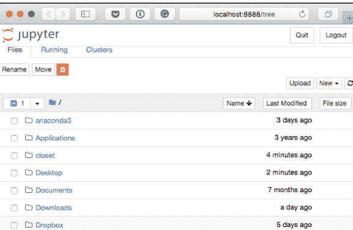

导航到本章的启动文件夹，并打开 `notebook/mlbase.ipynb`：

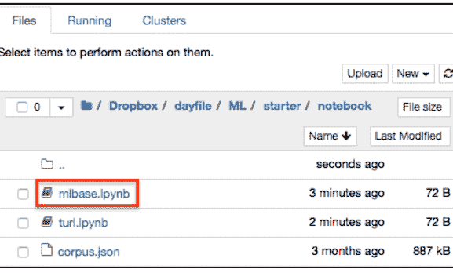

笔记本将在新的浏览器标签页中出现：

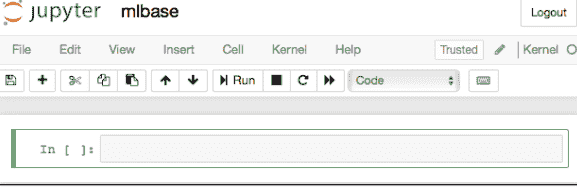

## Pandas 和 Matplotlib

笔记本中包含一个空单元格。在那个单元格中，输入以下几行：

```
import numpy as np
import pandas as pd
import matplotlib.pyplot as plt
```

这会将 NumPy 和 Pandas 模块导入到当前会中。它还导入了 Matplotlib 的 plt 模块，并为每个人提供了简写别名：NumPy 使用 np，Pandas 使用 pd，Matplotlib 使用 plt。导入语句没有输出，尽管你可能会看到关于某个模块未来将弃用的警告。

按下 **Shift-Enter** 运行此代码，这会在下方新打开一个单元格。

接下来，在新创建的空单元格中输入这些行，然后再次按下 **Shift-Enter**：

```
data = pd.read_json('corpus.json', orient='records')
data.head()
```

**starter**/notebook 文件夹包含文件 **corpus.json**。你刚刚输入的代码将数据从此 JSON 文件中加载到 DataFrame 中——这是 Pandas 的容器，像电子表格一样有行有列。它拥有强大的处理函数，这对于对数据进行加工以获取训练模型所需的最佳输入至关重要。

`orient` 参数指示 JSON 字符串格式：'records' 意味着它是一个列 -> 值的列表。稍后我们将查看该函数的文档。

`head()` 函数显示（默认的）前五行：


```
In [2]:   data = pd.read_json('corpus.json', orient='records')
data.head()
```

| author | text | title |
|---|---|---|
| 0 | William Butler Yeats | When you are old and grey of sleep,\vn... | When You Are Old |
| 1 | William Butler Yeats | I think it better in times like this\nA... | On being asked for a War Poem |
| 2 | William Butler Yeats | Had I heaven's embroidered clothes,\vnEnrowou... | He Wishes For The Cloths Of Heaven |
| 3 | William Butler Yeats | Were you lying cold and dead,\vAnd lights ... | He Wishes His Beloved Were Dead |
| 4 | William Butler Yeats | Wine comes in the mouth\vAnd love comes in | A Drinking Song |
| ... | | | |

> **注意：** `Shift-Enter` 运行当前单元格，如果是最后一个单元格，则会在下方打开新单元格；这在你编写代码的同时进行测试时非常方便。`Control-Enter` 运行当前单元格；当你向之前的单元格添加内容并对其进行更新时，可以使用此操作。边缘括号中的数字记录了你运行单元格的顺序，无论它们在笔记本中的实际顺序如何。

在下一个空单元格中，输入以下行，然后按下 **Shift-Enter：**

```
?data.tail
```

# 机器学习第 4 章：Python 与 Turi Create 入门

问号显示该函数的文档，而不是运行该函数：

```
In [6]: data.tail

Signature: data tail(n=5)
Docstring:
Return the last `n` rows.
此函数根据位置返回对象的最后 `n` 行。它对于快速验证数据非常有用，例如在排序或追加行之后。
-------
Parameters:
 n : int, default 5
要选择的行数。
-------
Returns:
type of caller
调用者对象的最后 `n` 行。 
```

按下 `Esc` 或 `x` 按钮关闭文档。

将单元格中的代码替换为对 `tail` 的调用：

```
data.tail(3)
```

然后按下 `Control-Enter` 或 `Shift-Enter` 运行单元格，这将显示三行数据：

| author | text | title |
|---|---|---|
| 516 Oscar Wilde | The wind is blowing fairnAcross the d... | Serenade (For Music) |
| 517 Oscar Wilde | (To L. J.)ncould dig up this long-buried... | Roses And Ru |
| 518 Oscar Wilde | In the glad springtime when leaves were green,... | From Spring To Winter (For Music) |

如果你喜欢那个，也可以查看弹出框中的文档：在第二个单元格中选择 `pd.read_json`，按下 `Shift-Tab`：

```
In [2]: data - pd.read_json(corpus.json, orient='records')
Out(2): |
Signature: pd.read_json(path_or_buf, orient=None, type='frame', typ=None, convert=True, convert_dates=True, keep_dates=True, numpy=False, lines=False, unit=None, encoding=None, chunksize=None, compression=None)
Docstring:
将 JSON 字符串转换为对象
-------
Parameters:
path_or_buf : a 有效的 JSON 字符串或类文件对象，默认：Non该字符串可以是 URI。有效的方案（包括 http, https, ftp）等。
```


# 机器学习第 4 章：Python 与 Turi Create 入门

问号在这一行不起，除非你在下一个空单元格中删除 `data =`，输入 `data`。然后按下 `Tab` 查看选项列表：

```
In [4]: data.describe
data.diff
data.divide
data.dot
data.drop
data.duplicates
data.dropna
data.duplicated
```

现在，按下 `Enter` 选择 `data.describe`。然后输入 `()`，并按下 `Shift-Enter`：

```
In [5]: data.describe()
Out[5]:
| | text | title |
|---|---|---|
| count | 519 | 519 |
| unique | 517 | 516 |
| top | 3 | 3
```

输出包含了 `author`、`text` 和 `title` 标识符。你可以使用这些对数据进行排序。接下来，`Shift-Enter` 输入以下行：

```
data.sort_values(by='title')
| | text | title |
|---|---|---|
| 0 | William Butler Yeats | When you are old and grey of sleep,\vn... | When You Are Old |
| 1 | William Butler Yeats | I think it better in times like this\nA... | On being asked for a War Poem |
| 2 | William Butler Yeats | Had I heaven's embroidered clothes,\vnEnrowou... | He Wishes For The Cloths Of Heaven |
| 3 | William Butler Yeats | Were you lying cold and dead,\vAnd lights ... | He Wishes His Beloved Were Dead |
| 4 | William Butler Yeats | Wine comes in the mouth\vAnd love comes in | A Drinking Song |
| 516 | Oscar Wilde | The wind is blowing fairnAcross the d... | Serenade (For Music) |
| 517 | Oscar Wilde | (To L. J.)ncould dig up this long-buried... | Roses And Ru |
| 518 | Oscar Wilde | In the glad springtime when leaves were green,... | From Spring To Winter (For Music) |
```

`freq` 的值范围从 6 到 361。你可以绘制此分布的直方图：

```
plt.hist(freq, bins=100)
plt.show()
```

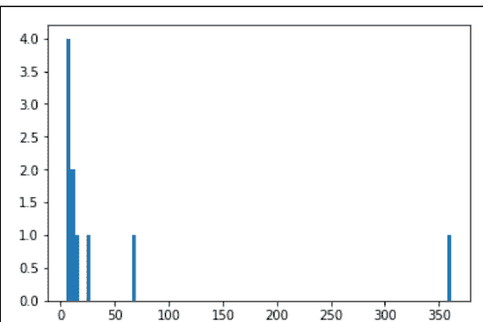

指定 `bins=100` 将 [6, 361] 分为 100 个连续且不重叠的区间，称为桶。y 轴显示每个桶中的作者数量。

| author | text | title |
|---|---|---|
| 0 | William Butler Yeats | When you are old and grey of sleep,\vn... | When You Are Old |
| 1 | William Butler Yeats | I think it better in times like this\nA... | On being asked for a War Poem |
| 2 | William Butler Yeats | Had I heaven's embroidered clothes,\vnEnrowou... | He Wishes For The Cloths Of Heaven |
| 3 | William Butler Yeats | Were you lying cold and dead,\vAnd lights ... | He Wishes His Beloved Were Dead |
| 4 | William Butler Yeats | Wine comes in the mouth\vAnd love comes in | A Drinking Song |
| 516 | Oscar Wilde | The wind is blowing fairnAcross the d... | Serenade (For Music) |
| 517 | Oscar Wilde | (To L. J.)ncould dig up this long-buried... | Roses And Ru |
| 518 | Oscar Wilde | In the glad springtime when leaves were green,... | From Spring To Winter (For Music) |

注意：此示例源自我们在 iOS 上使用 Turi Create 进行自然语言处理的教程，可以在找到：`bit.ly/2NhAEf`。它使用作者的诗句训练了一个自然语言模型。训练好的模型可以分类新文本。对于它已知的每个作者，计算新文本属于该作者的概率。这里的 `freq` 值引起了警报——太严重偏向爱丽丽·迪金斯，因此模型会将大多数测试文本归类为她的作品。

### Python 与 Swift 的差异

在本节中，你将花时间熟悉常见的 Python 语法。

Python 与大多数其他语言的一个主要语法差异是缩进的重要性。在 Python 中，缩进取代了 `{}` 来定义代码块。例如，一个 `if` 语句如下：

```python
if a ==:
    print('a and b are equal')
if a > c:
    print('and a is also greater than c')
```

Python 有内置的 `None` 类型来表示“无值”。这类似于 Swift 的 `nil`，但 Python 没有可选（options）。测试无值结果时应使用 `is` 或 `not`，而不是在 Swift 中使用的 `==`。

```python
if authors is None:
    print('authors is None')
else:
    print('authors is not None')
```

输出是：

`authors is not None`

### 机器学习

第 4 章：入门 Python 与 Turi Create

请注意函数内部行的缩进。你必须取消 `print` 所在行的取消缩进，这样 Python 才会知道这一行是在函数之外。编码规范允许在函数定义后多留一个空行，但这并不是语法规则，你可能觉得省略这个空行会更舒服。

此外，注意你是如何通过 `result = x + y` 将总和存入新变量的。在 Python 中不需要写 `let` 或 `var`。

这里有一个使用循环和列表的示例：

```
mylist = [1, 2]
mylist.append(3)
if mylist:
    print('mylist is not empty')

for value in mylist:
    print(value)

print('List length: %d' % len(mylist))
```

Python 中的列表类似于 Swift 中的数组。要测试列表是否为空，直接使用其名称即可。`for` 循环与 Swift 相似，但它们使用 `: ` 语法。`len()` 函数适用于任何 Python 对象，并返回列表长度，这就像 Swift 中的 `.count` 属性返回数组中的项目数量一样。

运行这些命令，你将看到输出：

```
mylist is not empty
1
2
3
List length: 3
```

为了说明缩进的问题，请添加一个空行，但将最后一条语句缩进与循环中的 `print` 语句对齐，如下：

```
for value in mylist:
    print(value)

print('List length: %d' % len(mylist))
```

现在，两个 `print` 语句都被认为在循环内部，因此输出变为：

```
1 List length: 3
2 List length: 3
3 List length: 3
```

顺便一下，Python 中的字符串字面量可以使用单引号或双引号（对于多行字符串甚至可以使用三引号）。使用哪种其实并不重要，选择一种你喜欢的风格并保持一致即可。编写 `'List length: %d' % len(myList)` 类似于在 Swift 中执行 `String(format: "List length: %d", myList.count)`。Python 3.6 也有字符串插值，就像 Swift 一样，但并不常用。

太棒了，你度过了一个 Python 课程并使用了一些库函数！可以尽管尝试，直到你掌握它为止。本书使用了许多 Python 库和函数，因此在继续之前理解基础语法是好的。

### 使用 Turi Create 进行迁移学习

尽管编程语言存在差异，但底层 Turi Create 与 Create ML 有许多共同点，包括迁移学习。使用 Turi Create v5，你甚至可以使用与 Create ML 相同的 `VisionFeaturePrint_Scene` 模型进行迁移学习。

在本节中，你将像上一章一样创建 `HealthySnacks` 模型，只不过这次你使用 Turi Create。与允许你通过 Xcode 中的 playgrounds UI 训练模型的 Create ML 不同，Turi Create 相比 Create ML 需要一些编码。这意味着你将学习更多关于 Python 的操作。

### 创建 Turi Create 环境

首先，你将创建一个安装了 `turicreate` 包的新环境。你将克隆 `mlenv` 环境来创建 `turienv`，然后将在新环境中安装 `turicreate`。Conda 不认识 `turicreate`，所以你必须在终端中使用 `pip install` 安装它。


机器学习

第 4 章：入门 Python 与 Turi Create

注意：再次提醒，如果你倾向于快速开始，可以将 `turienv.yaml` 导入 Navigator，或者运行 `env create -f starter/turienv.yaml` 并直接跳转到 Turi Create Notebook 章节。

虽然可以在 Anaconda Navigator 的 Environments 标签中克隆 `mlenv`，但你将使用命令行安装 `turicreate`，使用命令行克隆同样简单。

注意：如果你将终端默认 shell 改为 bash bash，请检查你的 `$PATH` 是否包含 `~/anaconda3/bin`（或你安装 anaconda 的任何目录）。

打开一个新的终端窗口，输入此命令：

```
conda create -n turienv mlenv
```

创建一个名为 `turienv` 的环境，它是从 `mlenv` 克隆的。

等待一会儿，直到看到以下消息：

```
#
### 要激活此环境，请使用：
### > conda activate turienv
#
### 要退出激活的环境，请使用：
### > conda deactivate
#
```

注意：如果你看到更新 Conda 的消息，请执行更新。

是时候向此环境安装 Turi Create 了。在同一个终端窗口中，输入激活命令：

```
conda activate turienv
```

命令行提示符现在以 `(turienv)` 开头，显示它是当前激活的环境。

机器学习

第 4 章：入门 Python 与 Turi Create

输入此命令安装 `turicreate` 包：

```
pip install -U turicreate==5.8
```

这将下载并安装最新可用的 `turicreate` 包版本，使我们能够使用 Vision 框架模型进行迁移学习。

### 列出 pip 安装的包

在终端中，使用此命令列出所有包：

```
conda list
```

命令的输出类似于：

```
# Name             Version           Channel
turicreate         5.8              pip
```

注意：如果你看到更新 Conda 的消息，请执行更新。

### Turi Create notebook

机器学习


# 第 4 章：入门 Python 与 Turi Create

这一次，你将在存储笔记本的文件夹启动 Jupyter：

```
jupyter notebook
```

在浏览器中打开 `HealthySnacks-Turi.ipynb`。这里只有一个空单元格。在此单元格中输入以下命令并按 Shift-Enter：

```
import turicreate as tc
import matplotlib.pyplot as plt
```

你可能会收到 `FutureWarning` 消息，可以安全地忽略。

在下一个单元格中，Shift-Enter 执行此命令（全部写在一行）：

```
train_data = tc.image_analysis.load_images("snacks/train", with_path=True)
```

## 机器学习

### 第 4 章：入门 Python 与 Turi

这会将 `snacks/train` 目录下的所有图像加载到 SFrame 中，这是 Turi Create 的数据容器。SFrame 包含行和列，类似于 Pandas DataFrame——事实上，你可以从 DataFrame 创建 SFrame。SFrame 拥有强大的处理函数，类似于 DataFrame。它还针对磁盘存储加载进行了优化，这对于容易溢出内存的大数据集至关重要。

就像 ML 的 MLDataTable 一样，SFrame 只保留不支持图像格式的图像元数据。

注意：忽略关于 `.DS_Store` 是不支持图像格式的警告是安全的。

此 SFrame 对象为每个图像有一行，以及我们加载的图像路径。此 SFrame 应该包含 4838 张图像。通过请求其长度来验证这一点：

```
len(train_data)
```

接下来，查看 SFrame 的实际内容：

```
train_data.head()
```

# 机器学习第 4 章：Python 与 Turi Create 入门

`head()` 函数显示前 10 行：

| path | image |
|---|---|
| snacks/train/healthy/appl/007a0aec009a066.jpg ... | Height: 341 Width: 256 |
| snacks/train/healthy/appl/007e5c6b529e036.jpg ... | Height: 256 Width: 341 |
| snacks/train/healthy/appl/01ec03a12e21e39.jpg ... | Height: 256 Width: 446 |
| snacks/train/healthy/appl/02e1d569c62aa93.jpg ... | Height: 256 Width: 341 |
| [10] 行 x 2 列 | |

SFrame 中的前几行

即使 SFrame 在表格中只显示图像的高度和宽度，但它实际上包含了完整的图像。运行以下命令查看图像：

```
train_data.explore()
```

这会打开一个带有图像缩略图的新窗口（可能需要几秒钟加载）。将鼠标悬停在某行上查看更大版本的图像。

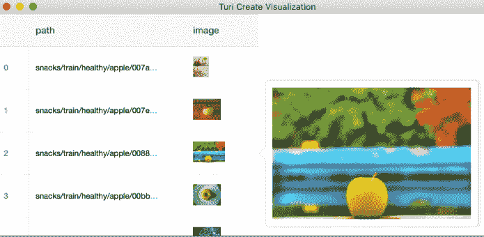

探索训练图像

这种交互式可视化对于快速查看训练数据非常有用。`explore()` 命令在 Mac 上的 Turi 上有效，不支持 Linux 或 Docker 容器。

输入此命令，使用 Matplotlib 的 `imshow()` 命令直接在笔记本中查看单个图像：

```
plt.imshow(train_data[0]["image"].pixel_data)
```

在这里，`train_data[0]` 获取写入 SFrame 的第一行，`["image"]` 获取该行列中的对象，而 `pixel_data` 将此图像对象转换为 matplotlib 可以通过 `plt.imshow()` 识别的内容。

```
In [6]: plt.imshow(train_data[0]["image"].pixel_data)
Out[6]: matplotlib.AxeImage at 0x1aldcd2f60
```

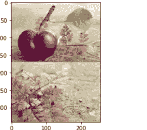

### 使用 matplotlib 查看图像

你的笔记本显示的图像可能与插图不同，因为 Turi Create 加载图像的顺序不同。你可以随意更改行索引来查看几张图像（使用 0 到 4,857 之间的任何值）。

在开始训练之前，还有最后一条数据需要收集——每个类的名称。图像存储在以类名命名的子目录中——如“apple”（苹果）、“hot dog”（热狗）等。SFrame 知道加载图像的路径，但这些路径看起来如下：

```
snacks/train/hot dog/8ace0a9a1ed2ff6.jpg
```

对于类别图像 `8ace0a9a1ed2ff6.jpg`，类别是 "hot dog"，但它隐藏在长路径中。为了让这一点而易见，你需要编写一些代码从路径中提取类名。运行以下命令提取第一个类文件夹的名称：

```python
### 获取第一个训练示例的完整路径
path = train_data[0]["path"]
print(path)
```

### 查找类标签

```python
import os
os.basename(os.path.split(path)[0])
```

你正在获取第一张图像的完整路径，然后使用 `os.path` Python 包来处理名称。首先，`os.path.split()` 将路径切分为两部分：文件名（8ace0da8a912ed2f6.jpg）和它之前的所有内容。然后 `os.path.basename()` 获取最后一个文件夹的名称，即包含类名的文件夹。由于第一张训练图像是苹果，你得到的是 `""`

> 注意：`#` 字符在 Python 中开始注释。请注意你需要导入 `os` 包，否则 Python 将无法识别 `os.path` 是什么。

### 获取类标签

好了，现在你知道如何提取单个图像的类名了，但数据集中有 4,800 多图像。作为一名 Swift 程序员，你的初始直觉可能是使用循环，如果你非常习惯 Swift 风格，你会急于于使用 `map` 函数。SFrame 有一个 `apply()` 方法，类似于 Swift 的 `forEach`，允许你对帧中的每一行运行函数：

```python
train_data["path"].apply(lambda path: ...对 path 进行某些操作...)
```

在 Python 中，`lambda` 类似于 Swift 中的闭包（closure）——这是一个没有名的函数。`train_data["path"].apply(lambda)` 对 path 列中的每一行执行此操作。上面的 `lambda` 提供了从路径中提取类名的代码片段：

```python
train_data["Label"] = train_data["path"].apply(lambda path: os.basename(os.path.split(path)[0]))
```

运行单元格，SFrame 将拥有一个新列 "label"。要验证这一点，运行 `train_data.head()`——在新的单元格中执行此操作，或者向上滚动事实并按 Control-Enter。

| path | image | label |
|---|---|---|
| snacks/train/healthy/appl/e07a0e550683b.jpg | Height: 341 Width: 256 | apple |
| snacks/train/healthy/appl/0088165726886.jpg | Height: 256 Width: 384 | apple |

SFrame 现在有一个新列，你也可以使用 `train_data.explore()` 进行视觉检查。运行此命令查看摘要：

```python
train_data["label"].summary()
```

打印关于 SFrame label 的一些统计信息：

| item | value | exact |
|---|---|---|
| Length | 4838 | Yes |
| Missing Values | 0 | Yes |
| unique values | 20 | No |
| value | banana | hot dog | ice cream |
| count | 260 | 250 | 250 |
| value | muffin | salad |
| count | 250 | 250 | - |

### label 列摘要

你可以看到，每个类的元素大致相同。由于某种原因，`summary()` 只显示前 10 个类，但总共有 20 类。查看所有类的行，运行以下命令：

```python
train_data["label"].value_counts().print_rows(20)
```

好了，这就是你目前需要对数据执行的所有。你已经将图像加载到 SFrame，并给了每个标签，所以 Turi 知道它们属于哪个。

### 开始训练

一旦数据进入 SFrame，使用 Turi Create 训练模型只需要一行代码（好了，我们需要适配它）：

```python
model = tc.image_classifier.create(train_data, target="label", model="VisionPrint_Scene", verbose=True, max_iterations=50)
```

或者，如果在你的 Mac 上训练太久，你可以直接从当前文件夹加载 Turi 模型：

```python
model = tc.load_model("HealthySnacks.model")
```

此命令从 train_data 创建一个新的图像分类器。`target` 参数告诉 Turi Create 类名所在的 SFrame 中的列。默认情况下，Turi 只进行 10 次迭代，但将其增加到 50，这样逻辑回归将训练 50 次。

第一次运行时，Turi 会下载一个预训练的神经网络。`model` 参数包含了该神经网络的名称，在这种情况下为 `VisionPrint_Scene`。该模型被 Apple 的 Vision 框架使用，也是 Create ML 的默认模型。

编写时，Turi 支持三种模型架构：另外两个是 ResNet-50 和 SqueezeNet 版本 1.1。ResNet-50 输出一个 90MB 的模型，并不适用于移动设备。SqueezeNet 输出一个 4.7MB 的模型，是一个更好的选择。VisionPrint_Scene 构建在 iOS 12 中，产生一个小得多（（41 KB）。

Turi Create 像 ML 一样对图像进行特征提取。花费的时间与 Create 相似——在我的 MacBook Pro 上花了 22 秒。然后是逻辑回归：

logistic regression:

| Number of examples : 4590 |
| Number of classes : 20 |
| Number of feature columns : 1 |
| Number of unpacked features : 2040 |
| Number of coefficients : 38931 |
| Starting L-BFGS |
| Iteration | Passes | Elapsed Time | Training | Validation Accuracy |
|---|---|---|---|---|
| 5 | 8 | 3.42915 | 0.815468 | 0.850006 |
| 10 | 13 | 5.857664 | 0.884532 | 0.875000 |
| 15 | 18 | 8.315392 | 0.925000 | 0.903126 |
| 20 | 24 | 11.08811 | 0.944227 | 0.895161 |
| 25 | 29 | 13.513964 | 0.982353 | 0.880365 |
| 30 | 34 | 15.985396 | 0.995533 | 0.879502 |
| 35 | 39 | 18.329717 | 0.998911 | 0.875000 |
| 40 | 44 | 20.812458 | 1.000000 | 0.850006 |
| 45 | 49 | 23.216806 | 1.000000 | 0.854639 |
| 50 | 55 | 26.213560 | 1.000000 | 0.866935 |

完成（达到迭代限制）。

这可能不是最优的。要改进它，请考虑增加 `max_iterations'`.

### 验证

在 15 次迭代后，验证准确率开始达到训练准确率的 -90%。在第 20 次迭代时，训练准确率开始偏离验证准确率并冲向 100%，而验证准确率实际上在下降……这里发生了严重的过拟合！如果验证准确率在下降的同时训练准确率不断提高，你就遇到了过拟合问题。

在大约 15 次迭代后停止训练模型会更好。但运行带有 `max_iterations=15` 的 `image_classifier.create` 命令将再次进行所有特征提取！遗憾的是 Turi Create 不允许你保存模型的中间阶段，或者在验证准确率显示下降趋势时停止训练。

实际上，在下一章中，你将学习如何调整 Turi Create 代码——它从一开始就是开源的——来保存提取的特征，这样你就可以对分类器进行更多实验。

> 剧透警告：我们将在接下来的章节中讨论的 Keras 允许你在训练过程中保存为止最好的模型，这样如果你的模型发生过拟合，你始终可以检索早之前迭代的结果。Keras 还允许你在验证准确率在指定的迭代次数内没有提高时提前停止（由你决定）。

让我们在测试数据集上评估这个模型吧。

### 测试

运行以下命令加载测试数据集并获取类别标签：

```
test_data = tc.image_analysis.load_images("snacks/test",nwith_path=True)

test_data["label"] = test_data["path"].apply(lambda path:os.path.basename(os.path.split(path)[0]))
```

最后一个命令只是为了确认你获取了 952 张图像。

### 机器学习

第 4 章：Python 与 Turi 入门

接下来，运行此命令来评估模型并收集指标：

```
metrics = model.evaluate(test_data)
```

与 Create ML 不同，此命令的输出没有显示任何准确率数字——你需要检查指标。在同一个单元格中运行这些命令：

```
print("Accuracy: ", metrics["accuracy"])
print("Precision: ", metrics["precision"])
print("Recall: ", metrics["recall"])
print("Confusion Matrix: ", metrics["confusion_matrix"])
```

以下是我的指标：

| target_label | predicted_label | count |
|---|---|---|
| ice cream | candy | 1 |
| apple | banana | 3 |
| orange | pineapple | 2 |
| apple | strawberry | 1 |
| pineapple | banana | 2 |
| strawberry | salad | 1 |
| popcorn | waffle | 1 |
| carrot | salad | 2 |
| orange | watermelon | 1 |
| popcorn | popcorn | 36 |
[107行 x3列]

注意：打印了 SFrame 的头部。

你可以使用 `print_rows(num_rows=m, num_columns=n)` 来打印更多的行和列。

并不意外；准确率、精确率召回率与模型的最终验证准确率相似。与 Create ML 不同，Turi Create 提供了精确率召回率的总体值，你需要一些代码来获取每个类的精确率和召回率。在下一章中，你将学习如何获取每个类的召回率。

混淆矩阵只显示了前 10 行：模型将一张“冰淇淋”图像误认为“糖果”，三张“苹果”图像误认为“香蕉”，等等。这样呈现的话，它看起来并不像矩阵。

# 机器学习 第 4 章：Python 与 Turi Create 入门

在下一章中，你将学习如何获得这种巧妙的可视化效果：

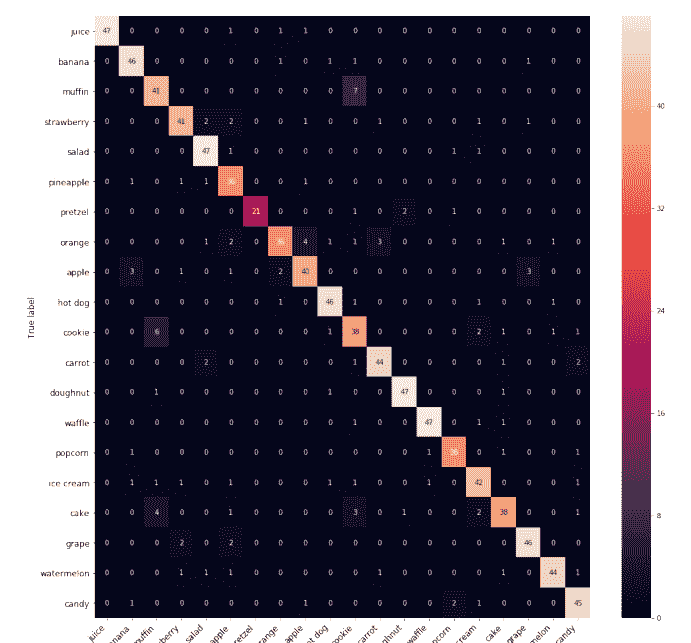

### 混淆矩阵

此热图将小值显示为冷色——黑色或深紫色——将大值显示为暖色——红色到橙色到白色。值越大，颜色越亮。正确的匹配位于对角线上，因此最高值就在那里。只有 21 次正确匹配，“pretzel”（椒结）非常突出，但 pretzel 文件夹中只有 25 张图像，所以 21 个是可以的。对角线外的紫色数字表示问题。更多信息请见下一章！

### 导出到 Core ML

在下一个单元格中，按 **Shift-Enter** 执行此命令：

```
model
```

这显示了关于模型的信息。

| Class : ImageClassifier |
| Schema |
| Number of classes : 20 |
| Number of feature columns : 1 |
| Input shape : (3, 299, 299) |
| Training summary |


| Number of examples : 4590 |

| Training loss : 1.2978 |

| Training time (sec) : 174.5081 |

现在你将能够进行建模，以便用 Core ML 加载它。使用 T Create 使用模型有两种方法。第一：

```
model.save("HealthySnacks.model")
```

这以 Turi Create 自己的格式保存模型，允许你稍后使用 `t.c.Load_model()` 将其加载到 Python notebook。一旦训练了 T Create 模型，你之后无法对其进行修改，但你可能想在不同的测试数据上对其进行评估，或仔细检查指标。

运行此命令获取 Core ML 模型：

```
model.export_coreml("HealthySnacks.mlmodel")
```

你可以按照通常的方法将 mlmodel 添加到 Xcode，如果你想将其与 Create ML 模型比较。尽管基于相同的预训练模型，该模型的准确率略低，尺寸只有 Create ML 模型的一半。

### 关闭 Jupyter

要关闭 Jupyter，点击此浏览器窗口中的 **Logout** 按钮以及显示你 ML 目录的窗口。

在你运行 jupyter notebook 的 **Terminal** 窗口中——或者使用 Anaconda Navigator 启动 Jupyter——按 **Control-C** 停止服务器。你可能需要按两次。如果提示符没有返回，关闭此终端。

### 取消激活的环境

如果你在命令行激活了 **turienv**，输入此命令取消激活：

```
conda deactivate
```

这取消了 **turienv** 环境；命令行提示符。

### Docker 和 Colab

支持 Python 机器学习有两个高级工具：Docker 和 Google。

Docker 像虚拟机但简单。Docker 是一种容器系统，允许你重用和模块化环境，它是扩展和服务应用程序的基础。安装 Docker 可以让你访问以 Docker 镜像分发的大机器学习资源。

Docker 镜像可以与同事或伙伴共享预定义的环境，但在某些情况下它们需要编写 Docker 镜像（通过编辑 Dockerfile），这超出了我们涵盖的范围。

你可以从 https://dockr.ly/2hwNOZZ 下载适用于 Mac 的社区版 Docker。要搜索 Docker Hub hub.docker.com，点击 **Explore**，然后搜索 image classifier：


在 Docker Hub 搜索 image classifier

# Google Collaboratory

Google Research 的 colab.research.google.com 是一个运行在浏览器中的 Jupyter Notebook 环境。它已经安装了你需要的许多机器学习库。它最好的功能是，你可以将笔记本的**运行时类型**设置为 **GPU** 来免费使用 Google 的 GPU。它甚至允许使用 Google 的 TPU（张量处理单元）。

## 机器学习第 4 章：Python 与 Turi Create 入门

如果你没有可以运行机器学习的计算机，你完全可以使用 Colab 来跟进本书的部分内容。然而，本书的作者建议读者通过本地安装的 Python 来跟进学习。如果你选择使用 Colab，将需要进行以下设置。当然，你需要一个 Google 账户才能继续。

在 drive.google.com 访问你的 Google 云硬盘，从侧边菜单创建一个名为 **machine-learning** 的新**文件夹**。


双击该文件夹，将解压后的 snapshots 数据集拖放到其中。这可能需要一些时间。在等待期间，你将将 Colab 作为“应用”添加到 Google 云硬盘中。在 **machine-learning** 文件夹的任何处点击鼠标右键，在对话框中选择**更多**，然后选择 + **选择连接更多应用**。

### 机器学习

第 4 章：Python 与 Turi Create 入门


在打开的“连接应用到 Google 云硬盘”窗口中，在搜索字段中搜索 colab，并选择 + 连接。

## 第 4 章：Python 与 Turi Create 入门


安装成功后，关闭窗口，再次在任何处点击鼠标右键，在**更多**对话框中选择**Collaboratory**。这将打开一个新标签页或窗口，看起来非常像 Jupyter 笔记本。

### 机器学习

第 4 章：Python 与 Turi Create 入门


通过点击标题并内联重命名，将文件重命名为 **getting-started.ipynb**。


### 机器学习

## 第 4 章：Python 与 Turi Create 入门

从工具栏中，选择运行时（Runtime） > 更改运行时类型（Change Runtime type）。


在打开的笔记本设置对话框中，将硬件加速（Hardware accelerator）从无（None）更改为 GPU。保存更改。


### 机器学习

## 第 4 章：Python 与 Turi Create 入门

在笔记本的第一个代码单元中，粘贴以下代码：

```python
from google.colab import drive
drive.mount('/content/drive/')
```

这两行代码将把你的 Google 云硬盘文件夹导入笔记本。这需要允许 Colab 访问你的 Google 云硬盘文件夹。点击代码单元旁的小按钮。按照输出窗口中的说明操作，打开链接以赋予 Colab 访问你云硬盘的权限。你将获得一个访问代码并将其粘贴到笔记本中。


### 机器学习

第 4 章：Python 与 Turi Create 入门

挂载完成后，添加一个新的代码单元，并运行以下代码：

```bash
ls "/content/drive/My Drive/machine-learning/snacks"
```


你可能会注意到代码开头有一个感叹号。在允许运行系统命令的 Jupyter 特有语法中，你正尝试列出上传 snacks 数据集的目录内容。如果一切顺利，你现在应该能够将其设为 snacks 数据集的根目录。

你已经完成了 Google 笔记本环境环境的设置，并配置了使用 GPU，你可以将其用于本书的学习。值得重复的是，Colab 针对本书尚未经过测试，你在使用过程中可能会遇到问题。然而，对于想要进行机器学习但没有足够强大的计算机运行机器学习算法的开发者来说，它提供了一个极具吸引力的替代方案。

### 关键点

- 熟悉 Python。它在机器学习领域学术界的广泛应用意味着，如果你学会了 Python，你将非常抢手。
- 熟悉 Conda。
- 熟悉 Jupyter。

### 接下来去哪里？

你已经完成了 Google 笔记本环境的设置，并配置了使用 GPU，你可以将其用于本书的学习。值得重复的是，Colab 针对本书尚未经过测试，你在使用过程中可能会遇到问题。然而，对于想要进行机器学习但没有足够强大的计算机运行机器学习算法的开发者来说，它提供了一个极具吸引力的替代方案。

## 第 4 章：Python 与 Turi Create 入门

如果你没有可以运行机器学习的计算机，你完全可以使用 Colab 来跟进本书的部分内容。然而，本书的作者建议读者通过本地安装的 Python 来跟进学习。如果你选择使用 Colab，将需要进行以下设置。当然，你需要一个 Google 账户才能继续。

在 drive.google.com 访问你的 Google 云硬盘，从侧边菜单创建一个名为 **machine-learning** 的新**文件夹**。


双击该文件夹，将解压后的 snapshots 数据集拖放到其中。这可能需要一些时间。在等待期间，你将将 Colab 作为“应用”添加到 Google 云硬盘中。在 **machine-learning** 文件夹的任何处点击鼠标右键，在对话框中选择**更多**，然后选择 + **选择连接更多应用**。

### 机器学习

第 4 章：Python 与 Turi Create 入门


在打开的“连接应用到 Google 云硬盘”窗口中，在搜索字段中搜索 colab，并选择 + 连接。

## 第 4 章：Python 与 Turi Create 入门


安装成功后，关闭窗口，再次在任何处点击鼠标右键，在**更多**对话框中选择**Collaboratory**。这将打开一个新标签页或窗口，看起来非常像 Jupyter 笔记本。

### 机器学习

第 4 章：Python 与 Turi Create 入门


通过点击标题并内联重命名，将文件重命名为 **getting-started.ipynb**。


### 机器学习

## 第 4 章：Python 与 Turi Create 入门

从工具栏中，选择运行时（Runtime） > 更改运行时类型（Change Runtime type）。


在打开的笔记本设置对话框中，将硬件加速（Hardware accelerator）从无（None）更改为 GPU。保存更改。


### 机器学习

## 第 4 章：Python 与 Turi Create 入门

在笔记本的第一个代码单元中，粘贴以下代码：

```python
from google.colab import drive
drive.mount('/content/drive/')
```

这两行代码将把你的 Google 云硬盘文件夹导入笔记本。这需要允许 Colab 访问你的 Google 云硬盘文件夹。点击代码单元旁的小按钮。按照输出窗口中的说明操作，打开链接以赋予 Colab 访问你云硬盘的权限。你将获得一个访问代码并将其粘贴到笔记本中。


### 机器学习

第 4 章：Python 与 Turi Create 入门

挂载完成后，添加一个新的代码单元，并运行以下代码：

```bash
ls "/content/drive/My Drive/machine-learning/snacks"
```


你可能会注意到代码开头有一个感叹号。在允许运行系统命令的 Jupyter 特有语法中，你正尝试列出上传 snacks 数据集的目录内容。如果一切顺利，你现在应该能够将其设为 snacks 数据集的根目录。

你已经完成了 Google 笔记本环境环境的设置，并配置了使用 GPU，你可以将其用于本书的学习。值得重复的是，Colab 针对本书尚未经过测试，你在使用过程中可能会遇到问题。然而，对于想要进行机器学习但没有足够强大的计算机运行机器学习算法的开发者来说，它提供了一个极具吸引力的替代方案。

### 关键点

- 熟悉 Python。它在机器学习领域学术界的广泛应用意味着，如果你学会了 Python，你将非常抢手。
- 熟悉 Conda。
- 熟悉 Jupyter。

# 机器学习第 5 章：深入研究 Turi

当你运行此单元格时，你会发现特征提取的速度比上一章快得许多。这是因为 SqueezeNet 仅从 227×227 像素的图像中提取了 1000 个特征，而 VisionFeaturePrint_Screen 从 299×299 的图像中提取了 2048 个特征。

然而，你可能会对训练和验证准确率感到失望：

| 迭代次数 | 次数 | 步长 | 耗 | 训练准确率 | 验证准确率 |
|---|---|---|---|---|---|
| 9 | 16 | 1.000000 | 2.250278 | 0.447152 | 0.373901 |
| 24 | 41 | 1.000000 | 5.490575 | 0.597476 | 0.533058 |
| 49 | 77 | 1.000000 | 11.472903 | 0.706684 | 0.648760 |
| 74 | 113 | 1.000000 | 17.694513 | 0.755657 | 0.661157 |
| 99 | 162 | 1.000000 | 25.050267 | 0.803525 | 0.670412 |

> 注意：你得到的结果可能与书中显示的略有不同。请记住，未训练的模型（例如模型中的逻辑回归部分）是用随机数初始化的。这会导致不同训练运行之间存在差异。如果你得到的训练准确率远低于65%，请尝试重新运行。机器学习高级用户实际上会利用这些训练运行之间的差异，将多个模型组合成集成模型，从而提供更稳健的预测。

与 Create ML 一样，Turi Create 随机选择 5% 的训练数据作为验证数据，因此验证准确率在不同训练运行之间可能会很大差异。模型在你自己选择的较大的固定验证数据集上可能会表现更好（你将在本章中完成这一点）。

评估模型并显示指标：

```
metrics = model.evaluate(test_data)
print("Accuracy: ")
```

并没有意外 —— 率与验证准确率非常接近：

Accuracy: 0.6470588235294188

Precision: 0.644134936364582

Recall: 0.6445289115646259

# 获取单个预测结果

到目前为止，你只是重复了上一章的步骤。`evaluate()` 指标让你对模型的整体准确率有个大致的了解；你可以获取关于单个预测的更多信息。特别有趣的预测是那些模型错误但对自己正确非常有信心的情况。知道模型在哪里出错可以帮助你改进训练数据集。


为了更深入地了解发生的情况，请运行以下单元格：

```
metrics.explore()
```

这会打开一个新窗口（仅限 Mac），让你能够可视化地检查准确率和其他指标。它还显示了正确分类以及——更有趣的是——错误分类的图像示例。非常有用！

| 模型 | 迭代次数 | 准确率 | F1 分数 | 总测试数 |
| :--- | :--- | :--- | :--- | :--- |
| squeezeneet_v1 | 135 | 64.71% | 64.43% | 952 |
| 类别名称 | 示例图像 | 准确率 | F1 分数 | 测试数量 |
| 芬 | | 46% | 47% | |
| 冰淇淋 | | 48% | 50% | |
| 蛋糕 | | 48% | 50% | |
| 饼干 | | 50% | 55% | |
| 椒盐结 | | 55% | 57% | 23 |
| 糖果 | | 55% | 64% | |
| 草莓 | | 61% | 62% | |

交互式评估窗口

### 预测与分类

Turi Create 模型除了 `evaluate()` 之外还有其他函数。在下一个单元格中输入并运行这些命令，然后等一会儿：

```
model.predict(test_data)
```

它显示了测试集中每张图像的实际预测：

[ 'apple', 'grape', 'orange', 'orange', 'orange', 'apple', 'orange', 'apple', 'candy', 'apple', 'grape', 'apple', 'strawberry', 'apple', 'apple', 'carrot', 'candy', 'ice cream', 'apple', 'apple', 'apple', ... ]

第一个预测对应于 `test_data[0]` 中的图像，第二个对应于 `test_data[1]`，依此类推。前 50 张图像全都是苹果，但模型将第二张图像分类为“grape（葡萄）”，请看一眼这张图像。在下一个单元格中输入并运行此命令：

```
plt.imshow(test_data[1]["image"])
```


这显示了第二张图像 —— 它看起来像葡萄吗[](img/5720be5c3cca252e12448e68d25607b5_170_0.png) 也许模型也不确定。输入并运行这些命令：

```
output = model.classify(test_data)
output
```

`classify()` 函数可以获取每个预测的概率，但只获取最高概率值，即模型对该类别的置信度：

| class | 概率 |
|---|---|
| apple | 0.432638513286321 |
| grape | 0.699958450277612 |
| orange | 0.414882190250213 |
| orange | 0.930059713409588 |
| orange | 0.378171352817196 |
| apple | 0.991564313975763 |
| orange | 0.426020382492679 |

带有分类的 SFrame 头部

模型有 69.9% 的确定认为第二张图像是“grape（葡萄）”！有 93% 的确定认为第四张图像是“orange（橙子）”！但对标记为“orange”的其他图像确定性小于 50%。查看每个预测对应的图像是有帮助的。输入并运行这些命令：

```
imgs_with_pred = test_data.add_columns(output)
imgs_with_pred.explore()
```

第一个命令将 `output` 列添加到原始 `test_data` 中。然后显示合并后的 SFrame。`label` 列是正确类别，`class` 列是模型最高置信度的预测，你可以在下一页看到：

### Turi Create 可视化

| 路径 | 图像 | 标签 | 类别 | 概率 |
|---|---|---|---|---|
| 0 | snacks/test/apple/00341c3c582... | | apple | 0.43269 |
| 1 | snacks/test/apple/004be96d798... | | apple | 0.699598 |
| 2 | snacks/test/apple/01ac2ac2a2... | | apple | orange | 0.414882 |
| 3 | snacks/test/apple/02bf0b1c06b... | | apple | orange | 0.93006 |
| 4 | snacks/test/apple/09d54b36ea... | | apple | orange | 0.378171 |

最有趣的图像是那些标签不一致但概率很高（超过90%）的行，例如。输入以下命令：

```
imgs_filtered = imgs_with_pred[(imgs_with_pred["probability"] > 0.9) & (imgs_with_pred["label"] != imgs_with_pred["class"]).explore()
```

此命令过滤 SFrame，仅包含高概率预测的行。第一项选择概率列值大于90%的行，第二项选择 `label` 和 `class` 列不相同的行。匹配行的子集被保存到新的 SFrame，然后显示：

## 第 5 章：深入研究 Turi Create

### Turi Create 可视化

| 路径 | 图像 | 标签 | 类别 | 概率 |
|---|---|---|---|---|
| 35 | snacks/test/pretzel/4698786386... |  | pretzel | hot dog | 0.964394 |
| 36 | snacks/test/salad/00af886b0e9... |  | salad | carrot | 0.952237 |
| 37 | snacks/test/salad/0bfde18d940... |  | salad | carrot | 0.908241 |
| 38 | snacks/test/strawberry/0d14011... |  | strawberry | | 0.973804 |
| 39 | snacks/test/strawberry/0d1e9... |  | | | |
| 40 | snacks/test/strawberry/2454732... |  | | | |
| 41 | snacks/test/waffle/2a3d34be4b... |  | | muffin | 0.905807 |
| 42 | snacks/test/watermelon/0200c7... |  | watermelon | carrot | 0.91499 |
| 43 | snacks/test/watermelon/7409d... |  | watermelon | strawberry | 0.939163 |

### 过滤后的分类结果

高亮图像的真实标签是“strawberry（草莓）”，但模型有 97% 的确定它是“juice（果汁）”，可能是因为那杯牛奶（？）比草莓大得多。

#### 对概率进行排序

Turi Create 的 `predict()` 方法也可以为你提供每张图像的概率分布。返回所有这些行，然后等待片刻：

```
predictions = model.predict(test_data,
  output_type="probability_vector")
```

你可以添加可选参数 `output_type` 来获取每张图像的概率向量——即 20 个类别中每个类别的预测概率。现在让我们看看第二张图像，现在显示所有的概率，而不仅仅是一个：

```
print("Probabilities for 2nd image", predictions[1])
```

此输出类似于如下内容：

```
array(['d', 0.0233762077520857, 0.010500386739753839,
2.8464923242003633e-07, 0.0038493272740981624,
0.001339116628706811, 0.0005122369124003818,
5.118841688115922e-06, 0.699958450277612,
0.2208374302686123, 0.7164479474454944e-07,
2.580412081941193e-05, 5.564899234565224e-08,
0.0006831573447442, 0.0002160839038531623,
2.3007468075137e-05, 0.651178835730733e-10,
5.3452158329751688e-05, 0.987227057019545e-06,
2.14773845601293e-08, 0.00022504017839448156])
```

概率是根据训练集中类别的按字母顺序排序的，第一个值对应“apple”（苹果），第二个是“banana”（香蕉），第三个是“cherry”（樱桃）……哎！

——你需要添加标签让它变得有用！并运行以下：

```
labels = test_data["label"].unique().sort()
preds = tc.SArray(predictions[1])
tc.SFrame("labels", labels).sort(["preds",
False])
```

首先，从 `test_data` SFrame 中获取标签集，以便它们与概率向量中的顺序匹配，并将结果存储在 `labels` 中，这是一个 SArray —— 一个 Turi Create 对象。然后你从第二张图像的概率向量创建另一个 SArray。在最后一行中，将两个 SArray 合并为一个 SFrame，然后在 `preds` 列中进行降序排序（升序 = False）。


这里是该输出的前五行：

| labels | preds |
|---|---|
| grape | 0.69958450277612 |
| apple | 0.20337662077520557 |
| orange | 0.08066298157942492 |
| banana | 0.010500386379535839 |
| candy | 0.00349327249081924 |

这是第二张图像的前五名高概率。

所以模型对“apple”至少有 20% 的置信度。对于图像包含多个对象的数据集，前三或前五的准确率是一个更公平的指标。

#### 使用固定的验证集

Turi Create 从训练数据集中创建一个随机验证数据集——占图像的 5%。使用较小的随机验证集的问题在于，有时你会获得极佳的结果，但仅仅是因为——这一次时候！——验证集恰好对你有利。

例如，如果模型非常擅长预测“waffle”（华夫饼）类别，而验证集恰好大部分是华夫饼的图像，那么验证准确率将高于模型的真实性能。这是糟糕的，因为可能会让你高估模型的真实水平。

如果你重复训练模型几次，你会发现验证准确率波动很大。它有时比你之前看到的 67% 要好，有时又更糟——在作者的一次训练运行中，它曾低到 59%。当运行之间存在如此大的差异时，很难理解模型的表现到底如何。

为了获得更详尽的准确率估计，请使用你的验证集，而不是让 Turi 随机选择。通过使用一组始终相同的验证图像，你可以更好地控制实验并获得可重复的结果。你现在可以使用几组不同的配置设置（也称为超参数）来训练模型，并比较结果以确定哪些设置效果最好。如果你每次都使用不同的验证集，所选图像的差异可能会掩盖更改超参数产生。

### 机器学习

## 第 5 章：深入研究 Turi

零食数据集已经包含一个 `val` 文件夹，用于此目的图像。使用相同代码将这些图像加载到你自己的 SFrame 中：

```
val_data = tc.image_analysis.load_images("snacks/val",
    with_path=True)
val_data["label"] = val_data["path"].apply(lambda path:
    os.path.basename(os.path.split(path)[0]))
len(val_data)
```

最后语句应该输出 955，这与 `test_data` 的图像数量相同，并且远多 4838 张 `train_data_images` 的 5%。

要在自己的验证集上训练模型，请编写以下内容：

```
model = tc.image_classifier.create(train_data, target="label",
    model="squeezenet_v1.1",
    verbose=True,
    max_iterations=100,
    validation_set=val_data)
```

你不应该总是得到相同的验证准确率——大约 63%——无论你重复多少次。波动很大。

| Iteration | Passes | Step size | Elapsed Time | Training Accuracy | Validation Accuracy |
|---|---|---|---|---|---|
| 79 | 101 | 1.000000 | 19.14393 | 0.758165 | 0.619895 |
| 89 | 118 | 1.290184 | 21.786411 | 0.781315 | 0.624084 |
| 99 | 133 | 1.000000 | 24.32639 | 0.795783 | 0.631414 |

由于模型初始化时使用了随机数，每次训练之间仍然存在差异。为了每次都获得完全相同的结果，给 `tc.image_classifier.create()` 传递 `seed` 参数，例如 `seed=1234`。

注意：使用这个固定的验证集，训练变得慢了一点。因为计算验证准确率花费了大量时间。之前 Turi 只使用了训练集的 5%，现在使用了 955 张图像，所以耗时间是 4 倍。但可以获得更可靠的估计。

## 增加迭代次数

那么，验证准确率 63% 好吗？嗯，并不真的。Turi Create 知道——训练结束时的输出：> 这个模型可能不是最优。为了改进它，考虑增加 `max_iterations`。让我们再次训练，迭代次数 200 而不是 100：

```
model = tc.image_classifier.create(train_data, target="label",
    model="squeezenet_v1.1",
    verbose=True,
    max_iterations=200,
    validation_set=val_data)
```

注意：像机器学习一样，Turi Create 需要再次提取特征。没有保留那些特征——如果 100 次迭代已经花费了很长时间，可以从笔记本中加载预训练的模型：

```
model = tc.load_model("Snacks_200.model")
```

迭代次数是一个超参数的例子。为什么？这是为你的模型配置设置。模型从训练数据中学习的内容被称为“参数”，而你手动配置的内容因此是“超参数”。超参数告诉模型如何学习，而训练数据告诉模型学习什么。`max_iterations` 设置决定了模型将训练多久。对于所有人，将其设置为良好的值很重要，否则训练时间太短，模型没有机会学习；如果训练时间太长，模型将过拟合。

## 第 5 章：深入研究 Turi

在训练 200 次迭代后，最终得分为：

| Iteration | Passes | Step size | Elapsed Time | Training Accuracy | Validation Accuracy |
|---|---|---|---|---|---|
| 99 | 133 | 1.000000 | 25.650264 | 0.795783 | 0.631414 |
| 124 | 167 | 1.000000 | 32.426814 | 0.838449 | 0.625131 |
| 149 | 213 | 1.000000 | 39.635993 | 0.860584 | 0.636469 |
| 174 | 243 | 1.000000 | 45.488143 | 0.891484 | 0.635602 |
| 199 | 281 | 1.000000 | 51.928382 | 0.908433 | 0.620942 |

训练准确率现在是 90%！这意味着在 4582 个示例的训练上它只得到了 10%，相比之下，之前的训练准确率约为 80%。

这不错，但记住你不应该过度信任训练准确率。更重要的是验证准确率。如你看到的，它短暂上升后又下降了。

这个模型的甜点似乎在 150 次迭代左右，那里它获得的验证准确率为 63.7%。如果你训练得更久，验证准确率开始下降且模型变得更差，而训练准确率会持续提高。这是过拟合的经典迹。

过拟合风险很大，这确实是你开始训练自己的模型时会遇到的问题。过拟合并不一定是坏事，意味着你的模型仍然具有学习更多的能力。它只是在学习错误的内容，正则化等技术将帮助你保持在正确的道路上。（本章稍后会有关于正则化的内容。）遗憾的是，Turi Create 不允许你选择验证准确率最好的迭代，只允许最后一个，你必须重新 `max_iterations=150` 训练以获得最佳结果。

运行代码在测试集上评估模型并显示指标：

```
metrics = model.evaluate(test_data)
print("Accuracy: "
```

在测试数据集上评估该模型产生的指标约为 65%，这略高于：

```
Accuracy: 0.6554621840739496
Precision: 0.6535792162368128
Recall: 0.6510697278911566
```

## 机器学习第 5 章：深入研究 Turi Create

增加迭代次数帮助并不大，显然 100 次迭代的初始假设太低了。提示：为了获得最佳结果，首先用过多的迭代次数训练模型，并观察验证准确率从哪次迭代开始下降。那个点就是你的平衡点。现在按照精确的迭代次数重新训练并保存模型。

### 混淆了苹果和橘子？


一图胜于千言万语，展示模型性能的一个非常有用的可视化方法是混淆矩阵。该矩阵将预测类别与图像的真实类别标签进行对比，你可以看到模型倾向于在何处出错。

在上一章中，你运行了以下命令：

```
print("Confusion Matrix:\n", metrics(["confusion_matrix"]))
```

这显示了一个表格：

| target_label | predicted_label | count |
|---|---|---|
| cookie | juice | 1 |
| carrot | watermelon | 1 |
| pretzel | pretzel | 14 |
| cake | ice cream | 2 |
| pineapple | carrot | 1 |
| doughnut | muffin | 1 |
| muffin | doughnut | 7 |

`target_label` 列显示真实类别，`predicted_label` 显示被预测的类别，`count` 显示了这种特定错误的次数。

表格显示，当图像实际上是“doughnut”（甜甜圈）时，模型预测了 7 次“muffin”（麦芬）；当图像实际上是“ice cream”（冰淇淋）时，预测为“cake”（蛋糕），以此此类推。

然而，这样呈现出来的混淆矩阵看起来并不像矩阵，我们承诺过展示如何获得更好的可视化效果。


首先输入并运行以下代码：

```python
import numpy as np
import seaborn as sns

def compute_confusion_matrix(metrics, labels):
    num_labels = len(labels)
    label_to_index = {label: i for i, label in enumerate(labels)}
    conf = np.zeros((num_labels, num_labels), dtype=np.int)
    for row in metrics["confusion_matrix"]:
        true_label = label_to_index[row["target_label"]]
        pred_label = label_to_index[row["predicted_label"]]
        conf[true_label, pred_label] = row["count"]

    return conf

def plot_confusion_matrix(conf, labels, figsize=(8, 8)):
    fig = plt.figure(figsize=figsize)
    heatmap = sns.heatmap(conf, annot=True, fmt="d", rotation=45)
    heatmap.xaxis.set_ticklabels(labels, ha="right", fontsize=12)
    heatmap.yaxis.set_ticklabels(labels, rotation=0, ha="right", fontsize=12)
    plt.xlabel("Predicted label", fontsize=12)
    plt.ylabel("True label", fontsize=12)
    plt.show()
```

你定义了两个函数：一个用于计算混淆矩阵，另一个用于绘制它。

`compute_confusion_matrix()` 查看 `metrics["confusion_matrix"]` 表格中的所有行，并用每对标签的计数填充一个二维数组。它使用了 `NumPy` 包来完成此任务。


然后，`plot_confusion_matrix()` 获取此 `NumPy` 数组，并使用 `Seaborn` 将其绘制为热力图。`Seaborn` 是一个为 `Matplotlib` 添加有用图类型的绘图包。你在上一章创建 `turien` 环境时已经了 `Seaborn`。

现在，输入并运行以下命令调用这些函数：

```python
conf = compute_confusion_matrix(metrics, labels)
plot_confusion_matrix(conf, labels, figsize=(16, 16))
```

享受展示结果吧！


### 混淆矩阵

热力图将小值显示为“冷色”——黑色和深紫色，将大值显示为“暖色”——从红色到粉色再到白色。数值越大，在混淆矩阵中颜色越亮，你预计会在对角线上看到很多高值，因为这些是正确的匹配。

例如，“pretzel”（椒结饼）类的行有 14 次匹配和 11 次错误。错误预测包括一个“apple”（苹果）、两个“cookie”（饼干）、一个“doughnut”（甜甜圈）和七个“hotdog”（热狗）。注意，苹果经常被误认为橘子，饼干、甜甜圈和麦芬也会混淆。

混淆矩阵非常有用，因为它展示了模型潜在的问题区域。从这个特定的混淆矩阵可以看出模型已经学习了很多，因为对角线非常明显，但它远未完美。理想情况下，你希望除对角线外所有地方都是零。从图片上看可能有一点误导性，因为一眼看去并没有很多错误。但深色格子中所有小数字总和达到了 40，即错误率为 36%。

请记住，某些类别的图像比其他类别多。例如，`pretzel` 在测试集中只有 25 张图像，而大多数其他类别有 50 张，所以它的正确匹配数量永远不会那么多。尽管如此，它只有 14 次正确匹配。每个类别的召回率（`recall`）

`Turi` 的 `evaluate()` 函数为你提供总的准确率，但正如第一章提到的，这可能会更高或更低。通过一些代码，你可以获得混淆矩阵中的每个类别数量。对于混淆矩阵的每一行，召回率为：

| class | recall |
|---|---|
| apple | 64.0% |
| banana | 68.0% |
| cake | 54.0% |
| carrot | 66.0% |
| cookie | 56.0% |
| doughnut | 62.0% |
| grape | 84.0% |
| hot dog | 76.0% |
| ice cream | 44.0% |
| juice | 50.0% |
| pineapple | 74.0% |
| popcorn | 62.5% |
| pretzel | 56.0% |
| salad | 72.0% |
| strawberry | 67.5% |
| waffle | 62.0% |
| watermelon | 64.0% |

最好的类别是 `grape` (84%) 和 `hot dog` (76%)。最差的类别是 `ice cream` (44%)、`muffin` (50%) 和 `cake` (54%)。

## 使用正则化训练

机器学习从业者喜欢调整的一个典型超参数是正则化数量。正则化有助于防止过拟合。由于过拟合是一个问题，对模型进行设置是有益的。机器学习第 5 章：深入

并运行以下语句：

```python
model = tc.image_classifier.create(train_data, target="label",
model="squeezenet_v1",
test=True,
max_iterations=200,
validation_set=val_data,
l1_penalty=0.0,
convergence_threshold=1e-8)
```

你添加了三个参数：`l2_penalty`、`l1_penalty` 和 `convergence_threshold`。将 `convergence_threshold` 设置为非常小的值意味着训练将持续到 200 次迭代。`l2_penalty` 和 `l1_penalty` 是用于减少过拟合的正则化超参数。什么是正则化？回顾模型使用特征值（也称为权重或系数）来最大化正确分类的训练数据数量。过拟合发生在模型赋予某些特征过大的权重，产生巨大的系数。设置 `l2_penalty` 大于 0 会惩罚大系数，鼓励模型学习较小的系数，但也可能降低准确率。

设置 `l1_penalty` 大于 0 也会惩罚大系数。此外，它会将非常小的系数丢弃（设置为 0）。通常你只会使用 `l2_penalty` 或 `l1_penalty`，而不在同一个会话中使用两者。

在作者的训练话中，模型停止了过拟合：

| Iteration | Passes | Step size | Elapsed Time | Training Accuracy | Validation Accuracy |
|---|---|---|---|---|---|
| 124 | 183 | 2.755461 | 33.123541 | 0.780281 | 0.643979 |
| 149 | 221 | 1.000000 | 39.888881 | 0.785449 | 0.646073 |
| 178 | 258 | 0.965987 | 41.115951 | 0.786415 | 0.647120 |
| 199 | 305 | 1.326954 | 53.436095 | 0.788995 | 0.649215 |

训练准确率不再飙升到 100%，而是最高在 79% 左右。更重要的是，验证准确率并没有随着迭代的增加而变差。注意，训练准确率高于验证准确率是正常现象。没关系——只有当验证准确率开始下降时才有问题。

问题：`l2_penalty=10.0` 是最佳设置吗？为了找到答案，你可以训练分类器五次，尝试不同的 `l2_penalty` 和 `l1_penalty` 值。这被称为**超参数调优**。

在训练过程中选择正确的超参数可以对你最终得到的模型质量产生巨大影响。验证准确率可以让你了解这些超参数的影响。这就是为什么你要使用固定的验证集，以便确保结果的任何变化都是由超参数的变化引起的，而不是偶然。

超参数调优与其说是科学不如说是试错，所以请尝试这些设置以了解它们是如何影响你的模型的。尝试将 `l2_penalty` 设置为 100：你会发现训练准确率不会超过 65% 左右，因为你对模型施加了过大的压力。

遗憾的是，每次你训练模型时，`Turi Create` 都必须再次从所有训练和验证图像中提取特征，一遍又一遍。这使得超参数调优变成了一个非常缓慢的过程。让我们解决这个问题吧！

## 处理 Turi Create 代码


`Turi Create` 人的优点之一是，一旦你将数据放入 `SFrame`，只需要一行代码即可训练模型。缺点是 `Turi Create` API 对训练过程的控制非常有限。幸运的是，`Turi Create` 是开源的，你可以查看源码以了解它在做什么，甚至可以规避它的一些局限性。

# 机器学习第 5 章：深入研究 Turi Create

`tc.image_classifier.create()` 的代码位于 GitHub 仓库 `github.com/apple/turicreate` 中的 `turicreate/src/python/turicreate/toolkits/image_classifier/image_classifier.py` 文件。你只需要将其中部分代码复制粘贴到笔记本中，并尝试超参数即可。

### 保存提取的特征

如果有一种方法可以在训练阶段节省时间，而不需要不断重新生成 `SqueezeNet` 提取的特征，那不是很好吗？正如所承诺的，在本节中，你将学习如何将中间 `SFrame` 保存到磁盘，并在实验分类器之前重新加载它。

> 注意：如果你不想等待特征提取，可以直接从 starter/notebook 文件夹中加载特征：

```python
extracted_train_features = tc.SFrame("extracted_train_features.sframe")

extracted_val_features = tc.SFrame("extracted_val_features.sframe")
```


首先，加载预训练的 `SqueezeNet` 模型并获取其特征提取器：

```python
from turicreate.toolkits import _pre_trained_models
from turicreate.toolkits import _image_feature_extractor
ptModel = _pre_trained_models.MODELS["squeezenet_v1.1"]()
feature_extractor = _image_feature_extractor.MXFeatureExtractor(ptModel)
```

# 机器学习第 5 章：深入研究 Turi Create

`MXFeatureExtractor` 是基于 `Turi Create` 构建的 `MXNet` 机器学习框架中的对象。在 Python 中，以下划线开头的名称被视为私有的，但你仍然可以导入它们。接下来，输入并运行这段代码：

```python
train_features = feature_extractor.extract_features(train_data, "image")
```

你正在使用 `MXFeatureExtractor` 从训练数据集中提取 `SqueezeNet` 特征。这是运行 `tc.image_classifier.create()` 时最耗时的操作。通过单独运行此操作，每次训练分类器时就不需要再次等待特征提取。接下来，输入并运行这段代码：

```python
extracted_train_features = tc.SFrame({"label": train_data["label"], "image_features__": train_features})
```

在这里，你将每张图像的特征与其标签合并为一个新的 `SFrame`。这值得保存！输入并运行这段代码：

```python
extracted_train_features.save("extracted_train_features.sframe")
```

你将 `extracted_train_features` 保存到一个文件中。下次你想用这些特征进行更多训练时，只需再次加载 `SFrame`，其所需的时间只是提取特征的一部分：

```python
extracted_train_features = tc.SFrame("extracted_train_features.sframe")
```

### 检查特征

让我们看看这些特征是什么样的——输入并运行命令：

```python
extracted_train_features.head()
```

| _image_features_ | label |
| :--- | :--- |
| 0.133785177612305, 0.1284418106079, ... | apple |
| 0.666998816894531, 0.465320258187, ... | apple |
| 0.6625422327637, 0.472965044785, ... | apple |
| 0.1590135042832, 0.235198471532, ... | apple |

提取的特征的头部

每行都有一张图像的特征。`_image_features_` 列包含一个数字列表，而 `label` 列包含相应的类别名称。输入并运行命令：

```python
extracted_train_features["image_features_"]
```

这显示了特征 'd' 的情况——输出类似于：

```python
array('d', [0.133785177612305, 0.1284418106079, 0.3025106128129, 0.93194305419522, 0.03809928889403, 0.1032281924219, 0.72883714904875, 0.9390934375341, 0.2873115442818, 0.2080370068359, 0.8399658203125, 0.7168487548281, ...])
```

这是一个包含 1000 个向量的列表——使用 `len()` 进行验证。它们看起来都是 0 到 30 之间的数字。它们代表什么？我不知道，但 `SqueezeNet` 认为重要的特征是——长、圆、正方形等对象。重要的是，你可以训练一个逻辑分类器来从这些特征中学习。

同样的方法，从验证数据集中提取图像特征，并将它们作为 DataFrame 保存到文件：

```python
val_features = feature_extractor.extract_features(val_data,
  "image", verbose=True)
extracted_val_features = tc.SFrame(
  "label": val_data["label"],
  "_image_features_": val_features,
)
extracted_val_features.save("extracted_val_features.sframe")
```

### 训练分类器

现在你准备好训练分类器了！输入并运行此语句：

```python
lr_model = tc.logistic_classifier.create(extracted_train_features, features=["image_features"], target="label", validation_set=extracted_val_features, max_iterations=200, seed=None, verbose=True, l2_penalty=10.0, l1_penalty=0.0, convergence_threshold=1e-8)
```

这段 `Turi Create` 代码使用 `extracted_train_features` `SFrame` 作为输入数据，使用 `extracted_val_features` 进行验证，创建并训练逻辑回归模型。

想尝试这些超参数的其他值吗？只需在上面的单元格中更改它们并再次运行即可。现在快多了，因为跳过了特征提取。

你在这里还可以设置其他几个超参数：`feature_rescaling`、`solver`、`step_size` 和 `lbfgs_memory_level`。要了解这些的作用，请在新单元格中输入以下内容，或者注释掉 `Turi Create` 代码中的注释。

```python
tc.logistic_classifier.create?
```

事实证明，通过正则化，训练 400 多迭代可以持续缓慢提高该模型的验证分到 65%。虽然只提高了一点点，但每一分改进都有帮助。我们找到它的唯一方法就是对超参数进行实验。也许你能为这个模型找到效果更好的超参数？

为了确保你不是在追逐幻影，并且这个验证分确实代表模型的真实性能，你还应该检查测试集上的准确率。

首先，将你的模型转换为一个有效的 `ImageClassifier` 对象：


首先，将你的模型转换为一个有效的 `ImageClassifier` 对象：

```python
from turicreate.toolkits.image_classifier import ImageClassifier

state = {
    'classifier': lr_model,
    'model': ptModel.name,
    'max_iterations': lr_model.max_iterations,
    'feature_extractor': feature_extractor,
    'input_shape': ptModel.input_image_shape,
    'target': lr_model.target,
    'feature': 'image',
    'num_features': 1,
    'num_classes': lr_model.num_classes,
    'classes': lr_model.classes,
    'num_examples': lr_model.num_examples,
    'training_time': lr_model.training_time,
    'training_loss': lr_model.training_loss
}
model = ImageClassifier(state)
```

这会将基础模型与你在 `state` 结构中训练的分类器结合，并据此创建一个 `ImageClassifier` 对象。

计算测试集的评估指标：

```python
metrics = model.evaluate(test_data)
print("Accuracy: ", metrics["accuracy"])
print("Precision: ", metrics["precision"])
print("Recall: ", metrics["recall"])
```

这输出如下：

| Accuracy | 0.67128487394955 |
| Precision | 0.675591486674352 |
| Recall | 0.669818022712084 |

正则化和超参数调优并不总是产生奇迹，但它们可以改进模型，即使只有一点点。

> 注意：每次运行 `model.evaluate()` 时，它都会对测试集进行特征提取。给勇敢读者的练习：尝试深入研究 Turi Create 的源码，看看是否可以创建一个已经提取好特征的 `SFrame`。提示：在一个新的单元格中输入 `model.evaluate??`（是的，两个问号）来查看此方法的源代码。

### 保存模型

你可以将模型保存为 Turi Create 模型：

```python
model.save("MultiSnacks_regularized.model")
```

或者导出为 Core ML 模型：

```python
model.export_coreml("MultiSnacks_regularized.mlmodel")
```

要了解更多关于模型的信息，请运行：

```python
model
```

这将向你展示一些关于模型及其训练的高级信息：

| Class | :ImageClassifier |
| --- | --- |
| Number of classes | 20 |
| Number of feature columns | 1 |
| Input image shape | (3, 227, 227) |
| Training summary | |
| Number of examples | 4838 |
| Training loss | 3952.4993 |
| Training time (sec) | 59.2703 |

训练损失——整个训练数据集上的总体误差——会在你更改超参数时发生变化。输入并运行以下代码查看更多信息：

```python
model.classifier
```

这显示了关于模型中分类器部分的信息：

| Class | :LogisticClassifier |
| --- | --- |
| Number of coefficients | 19019 |
| Number of examples | 4838 |
| Number of classes | 20 |
| Number of feature columns | 1 |
| Number of features | 1000 |

### 超参数

| L1 penalty | 0.0 |
| L2 penalty | 10.0 |

### 训练总结

```
Solver : lbfgs
Solver iterations : 200
Solver status : Completed (Iteration limit reached).
Training time (sec) : 59.2703
```

### 设置

| Log-likelihood | 3952.4993 |

#### 最高正系数

```
(intercept) : 1.8933
(intercept) : 1.4506
(intercept) : 0.6717
(intercept) : 0.5232
(intercept) : 0.4072
```

#### 最低负系数

```
(intercept) : -1.6521
(intercept) : -1.5588
(intercept) : -1.4143
(intercept) : -0.8959
(intercept) : -0.5863
```

这些信息主要用于排除故障，或者当你仅仅对逻辑回归的工作原理好奇时。值得注意的是系数数量——`19019`——这是模型为了将零食分类为 20 个可能的类别而学习的参数数量。这个数字的来源：每个输入特征有 1000 个数字，有 20 种可能的输出，因此是 1000 × 20 = 20000 个数字，再加上每个输出的 20 个“偏置”值。

```python
train_data["label"] = 
train_data["path"].apply(lambda path: "healthy"
  if any("/" + class_name in path for class_name in healthy) else "unhealthy"
test_data["label"] = 
test_data["path"].apply(lambda path: "healthy"
  if any("/" + class_name in path for class_name in healthy) else "unhealthy")
```

首先，将每个类别分配到健康（`healthy`）或不健康（`unhealthy`）数组——每个数组中有 10 个类。然后，根据图像路径名称包含哪一个，将图像的标签列设置为 `"healthy"` 或 `"unhealthy"`。结果是，你根据它们所在目录的名称，将 20 类图像分成了两类。

> 注意：在 Create ML 中完成此练习的过程要手动得多。你必须创建一个新的 `train` 文件夹，并在其中创建 `healthy` 和 `unhealthy` 的子文件夹，然后将这 20 个食品标签文件夹中的所有图像复制或移动到正确的健康或不健康文件夹中。你可以在 Finder 或 Terminal 中执行这些操作。

验证生成的模型在测试数据集上的准确率是否达到 80% 左右。

你可能会好奇，为什么不使用多分类模型来这样做，而是简单地查看预测的类别是否在健康或不健康的类别列表中。这是可行的，但通过仅在这两个类别上从头开始训练，模型有机会学习“健康/不健康”意味着什么，而且这意味着它使用了比仅仅“此类别标签在健康类别列表中”更复杂的规则。

如果你想确定哪种方法效果最好，请使用 20 类模型来对健康/不健康的测试数据集进行分类，并像之前一样将它的输出与 `test_data` 合并。标签列包含 `"healthy"` 或 `"unhealthy"`，而类别列（`class`）包含 `"apple"`、`"banana"` 等。

然后使用 `filter_by(healthy, "class")` 找到在健康数组列出的类别中进行预测的模型。使用 `filter_by(["unhealthy"], "label")` 过滤这些图像，找到真正属于不健康类别的图像。手动计算 20 类模型预测健康/不健康的准确率。我得到的是 47%。

### 挑战 2：基于 ResNet50 的模型

使用 ResNet-50 模型训练 20 类分类器，看看是否能获得更好的验证集和测试集得分。创建分类器对象时使用 `l_type="resnet-50"`。与基于 SqueezeNet 的模型相比，它在应用中的 FPS（每帧率）是多少？

### 挑战 3：使用另一个数据集

从 Google Images 或其他图像源创建你自己的训练、验证和测试数据集。我建议限制类别的数量。

### 核心要点

- 在本章中，你体验了使用 Turi Create 训练 Core ML 模型的过程。事实上，这正是你在第 2 章“图像分类入门”中使用的模型是如何训练的。
- Turi Create 别非常易用，特别是在 Jupyter notebook 中使用。它只需要少量的 Python 代码。我们没能创建一个极其准确的模型，这在一定是因为数据集的限制。


进入`/path/to/xxx`目录，找到`xxx.json`。

在表达式`cvar = avar + bvar`中，加法运算符（`+`）将`avar`与`bvar`相加，得到它们的和`cvar`

在`List.of(arg0, arg1, arg2)`中，`List`接口的工厂方法`of()`接受一系列的元素，返回包含它们的只读列表。

之后我们这样调用`cmd`命令：`cmd arg0 arg1 arg2`。

```
if (condVar > someVal) {console.log("xxx")}
```

- 图像越多越好。我们使用了 4,800 张图像，但如果有 48,000 张会更好，480 万张会更好。然而，寻找和标注训练图像是有真实成本的，对于大多数项目，每类几百张图像或最多几千张可能就是你能负担得起的。使用你现有的数据——一旦你收集了更多训练数据，你可以随时重新训练模型。在机器学习中，数据为王，谁拥有最多谁就赢。

- Turi Create 不够出色的另一个原因是 SqueezeNet 是一个小型特征提取器，它速度快且节省内存，但也付出了代价：它没有大模型准确。但这不仅仅是 SqueezeNet 的错——在 SqueezeNet 提取的特征之上，除了训练基础逻辑回归，还可以创建更强大的分类器。

### 机器学习

- Turi Create 允许你调整几个超参数。通过正则化，我们可以控制过拟合。然而，Turi Create 不允许我们微调特征提取器或使用数据增强。这些是更高级的功能，会导致训练时间变慢，但也能带来更好的模型。

在下一章中，我们将再次使用 Keras 训练图像分类器来修复所有这些问题。你还将更多地了解这些神经网络中所有的构建模块，以及我们最初为什么要使用它们。

# 第 6 章：使用 Keras 掌控训练

作者：Matthijs Hollemans

**更新说明：** 本章已更新至 iOS 13、Xcode 11 和 Swift 5

在之前的章节中，你学习了如何使用 Create ML 和 Turi Create 训练模型。这些都是用户友好的工具，很容易上手——你真的不需要写很多代码，它们会处理大部分细节。只需几行代码，你就可以加载数据、训练模型并导出到 Core ML。

这种方法的缺点是 Create ML 和 Turi Create 仅允许你构建几种模型类型，而且你对训练过程没有太大控制权。如果你只是刚开始接触机器学习，这没关系。但一旦你知道自己在做什么并想要更深入学习机器学习，你就需要更强大的工具了。

在本章中，你将使用一种名为 Keras 的流行深度学习工具来训练零食分类器。Keras 让你对模型设计和训练方式拥有更多的控制权。你现在熟悉了 Keras，你将能够构建任何你想要的神经网络。

> **注意：** 你应该能够在你的 Mac 上训练这些模型，即使是在较旧、较慢的机器上。这些模型足够小，可以在 CPU 上训练而不需要 GPU 加速——只需要一点耐心。

# 机器学习第 6 章：使用 Keras 掌控训练

Keras 运行在一个所谓的执行实际计算的后端之上。其中最流行的是 TensorFlow，这就是你将使用的。TensorFlow 目前是世界上最强大的机器学习工具。然而，由于其低层特性，使用起来可能有点复杂。Keras 让使用 TensorFlow 变得简单得多。

TensorFlow 是构建任何计算图的工具，而不是神经网络。它处理矩阵乘法和导数等基础操作。TensorFlow 中有高级别的抽象，但许多人倾向于使用 Keras，因为它更方便。

## 开始

首先，你需要为运行 Keras 设置环境。最快的方法是从 Terminal 中执行以下命令：

```bash
$ cd /path/to/resources
$ conda env create --file=kerasenv.yaml
$ conda activate kerasenv
$ jupyter notebook
```

如果你下载了数据集，请将其复制或移动到启动文件夹。否则，双击 snacks 解压。

> 注意：我们在书中使用的是 Keras 2.2.4 和 TensorFlow 1.14。Keras 像许多开源项目一样经常变化，有时版本之间不兼容。如果你使用的是较新版本的 Keras 并遇到错误信息，请安装 2.2.4 版本。

**提示：** 如果你的电脑运行 Linux 并且拥有支持 CUDA 的 NVIDIA GPU，请编辑 `kerasenv.yaml` 将 `tensorflow=1.14` 替换为 `tensorflow-gpu=1.14`。或者如果你已经创建了环境，运行 `pip install tensorflow-gpu==1.14`。这将安装 GPU 版本的 TensorFlow，它的运行速度更快。

# 回归回归基础

本书的关键之一是迁移学习：逻辑回归模型是在提取的特征之上训练的。在 Create ML 的情况下，特征是由内置于 iOS 12 非常强大的“VisionFeaturePrint.Scene”神经网络提取的。在 Turi Create 的情况下，你使用的特征提取器是小小的 SqueezeNet。

迁移学习的大优势是它比从头训练要快得多，因为你的模型可以利用预训练特征提取器已经包含的知识。因此，你正在将知识从一个问题领域迁移到另一个。在这种情况下，你将其应用于识别 20 种不同零食的特定问题。

我们还声称使用特征提取的方法比直接在图像像素上训练逻辑回归分类器更好。为了证明这一点，你将使用 Keras 构建一个跳过特征提取部分直接作用于像素的逻辑回归模型。

这是学习 Keras 的良好方法，而且这样做将证明逻辑回归模型直接从像素数据中学习分类是非常困难的。在本章和下一章中，你将使模型越来越强大，直到最后你拥有一个相当准确的分类器。

### 快速回顾

逻辑回归是机器学习中的一种统计模型，它试图在你的数据点之间找到一条直线，以尽可能地区分不同的类别。


当然，这只有当这些数据点可以用直线，或者在高维空间中被称为“超平面”`hyperplane`的东西分开时，这种方法才有效。

为了让你直观地理解应用逻辑回归时底层发生了什么，让我们稍微深入浅数学数学。如果你不喜欢数学也没关系，可以快速扫过这部分，跳过那些让你头大的内容。了解数学原理并不是先决条件，但它对于理解其运作非常有帮助——而且这说明这些模型并不是真的神奇。

# 我们来聊聊数学

在插图中，数据点是二维的：它们有两个坐标，`$x[0]$` 和 `$x[1]$`。在大多数机器学习的文献和代码中，`$x$` 是赋予给训练示例的名称。

在实践中，你的数据点通常会被放置在许多高维空间中。记住，对于一张大小为 227×227 的图像，维数超过 150,000。但为了解释方便，想象每个数据点由两个值组成。

希望你还记得高中数学中的内容，直线的代数公式为：

```
y = a*x + b
```

# 机器学习第 6 章：使用 Keras 控制训练

在这里，`$x$` 是第一维中的坐标，`$a$` 是直线的斜率——即它的陡程度，也称为系数——`$b$` 是 `$y$` 截距。你可能以前见过这个公式。这是线性回归所学习的公式，它试图在数据点之间找到一条拟合得最好的线。

逻辑回归是线性回归的一个小修改，因此我们查看线性回归公式是有意义的。

上面的公式适用于一维数据，即对于由单个 `$x$` 值组成的数据点。在上面的插图中，数据点是二维的，因此它们有两个值，`$x[0]$` 和 `$x[1]$`。你可以轻松地将直线公式扩展为：

```
y = a[0]*x[0] + a[1]*x[1] + b
```

通常情况下，`$y$` 是模型所做预测的名称，也是模型训练时使用的标签。

由于每个数据点中有两个值，因此也有两个系数或斜率，`$a[0]$` 和 `$a[1]$`。在这里，`$a[0]$` 是数据点第一个坐标 `$x[0]$` 对应的直线斜率。换句话说，`$a[0]$` 是随着 `$x[0]$` 增大，`$y$` 增加的程度。

同样，`$a[1]$` 是第二个坐标的斜率，或者随着 `$x[1]$` 增大，`$y$` 增加的程度。

`$b$` 仍然是 `$y$` 截距——坐标系原点的 `$y$` 值——尽管在机器学习中它被称为偏置（bias）。这是当 `$x[0]$` 和 `$x[1]$` 都为 0 时 `$y$` 的值。

要在平面的图片上画出 `$y$` 的值有点技巧，但它看起来像这样：


### `$y$` 的值

注意，`$y$` 不再位于垂直轴上。在上面的示例中，垂直轴用于 `$x[1]$`，即数据点的第二个坐标。由于数据点使用了两个坐标，该公式不再是直线的方程，而是三维坐标空间中平面的方程。`$a[0]$` 和 `$a[1]$` 仍然是斜率，但现在是平面而非简单直线的斜率，`$b$` 是该平面在原点的高度。

A 类数据点位于 `$y$` 为负的区域，B 类数据点位于 `$y$` 为正的区域。区分这两个类的决策边界恰好是 `$y = 0$` 所在。你离决策边界越远，`$y$` 的值（正或负）就越大。

系数 `$a[0]$` 和 `$a[1]$` 是模型学习的参数，而 `$b$` 是偏置。区分这两个类的决策边界恰好是 `$y = 0$` 所在。你离决策边界越远，`$y$` 的值（正或负）就越大。

### 从线性到逻辑

为了将线性回归公式转换为分类器，你需要扩展公式使其成为逻辑回归：

```
probability = sigmoid(dot(a, x) + b)
```

Sigmoid 函数，也称为逻辑 sigmoid 函数，它接收决策边界并观察点 `$x$` 位于哪一侧。Sigmoid 的公式为：

```
sigmoid(x) = 1 / (1 + exp(-x))
```

当你绘制这个 sigmoid 函数时，它看起来像这样：


这应该解释了函数的名称：它是 S 形状的，而“sigmoid”字面意思是“像字母 sigma 一样”—sigma 是希腊字母 S。

你可以从图中看到，对于较大的负输入，sigmoid 函数的输出为 0；对于较大的正输入，输出为 1；而在 -6 到 +6 之间的输入值则介于两者之间的某处。

对于我们的示例，输出为 0 意味着数据点属于 A 类，因为 sigmoid 的输入将是一个（很大的）负数。输出为 1 意味着数据点属于 B 类——因为 sigmoid 的输入将是一个（很大的）正数。

然而，logistic sigmoid 函数的输出通常被解释为概率，因此 0 实际上意味着该数据点属于 B 类的概率为 0%，属于 B 类的概率为 100%。因此，数据点属于 A 类的概率为 1.0。

对于靠近决策边界的数据点，假设 y 是一个很小的正或负数。对于这样的数字，sigmoid 的输出在 0 和 1 之间，例如 0.3。这意味着算法有 30% 的把握认为该数据点属于 B 类，因此它并不完全确定。通常我们选择 50% 作为截点；任何高于 50% 的都是 B，低的都是 A。但在做出此决策时，选择一个更高或更低的截点也是合理的。

所以，logistic 回归只是应用了 sigmoid 函数的线性回归。这个 sigmoid 函数将 y 的值转换为 0 到 1 之间的一个值，我们可以将其解释为概率百分比。

## 并非一切都是黑即白的……

如果有超过两个类别怎么办？在这种情况下，你将使用称为多项逻辑回归（multinomial logistic regression）的公式变体，它可以适用于任何类别。与其输出一个结果，不如为每个类别计算一个单独的预测：

```
probability_A = sigmoid(dot(a_A, x) + b_A)
probability_B = sigmoid(dot(a_B, x) + b_B)
probability_C = sigmoid(dot(a_C, x) + b_C)
probability_D = sigmoid(dot(a_D, x) + b_D)
...依此类推...
```

如果你有 K 个类别，你就使用 K 个不同的逻辑回归。每个回归都有它们自己的斜率和偏置，这就是为什么你不仅仅有一组 a 和 b，而是不同的值。对于每个类别，你将输入 x 与该类别的系数进行点积，加上偏置，然后取 sigmoid。

所以，而不是单一的决策边界

在实践中，所有这些单独的斜率都被组合成一个巨大的权重矩阵（weights matrix）。这个矩阵的大小为 N×K，其中 N 是输入 x 中的元素数量，K 是类别的数量。所有的偏置值都被组合到一个包含 K 个值的向量中。计算公式为：

```
output = matmul(W, x) + b
```

`matmul()` 函数在输入 x 和权重矩阵 W 之间执行矩阵乘法，并加上偏置向量 b。输出是一个包含 K 个值的向量，对应每个类别。

如果你的数学生疏了，不要慌。这只是在单次数学操作中执行了不同类别的点积。就像点积本身是 `a[0]*x[0] + a[1]*x[1] + ...` 的缩写一样，矩阵乘法也是一系列不同点积的缩写。

所有算术运算的结果（output）包含了 K 个不同的值，每个类别一个。然后你可以独立地对这 K 个值中的每一个应用 sigmoid 函数，以得到数据点 x 属于每个类别的概率：

```
probability_A = sigmoid(output[0])
probability_B = sigmoid(output[1])
probability_C = sigmoid(output[2])
...依此类推...
```

现在可能选择多个类别了，因为这 K 个概率之间是相互独立的。这被称为**多标签**（multi-label）分类器。如果你想识别多个类别，就会使用这种分类器。然而，对于**多类别**分类器，你希望使用 sigmoid ，在 Keras ，，，，，，，，，，，，，，，，，，   

。

注意：sigmoid 掉的。。。。。。，使用**softmax**：

```
probabilities = matmul(W, x) + b
```

`matmul()` 函数在输入 x 和权重矩阵 W 之间执行矩阵乘法，并加上偏置向量 b。输出是一个包含 K 个值的向量，对应每个类别。

如果你的数学生疏了，不要慌。这只是在单次数学操作中执行了不同类别的点积。就像点积本身是 `a[0]*x[0] + a[1]*x[1] + ...` 的缩写一样，矩阵乘法也是一系列不同点积的缩写。

所有算术运算的结果（output）包含了 K 个不同的值，每个类别一个。然后你可以独立地对这 K 个值中的每一个应用 sigmoid 函数，以得到数据点 x 属于每个类别的概率：

```
probability_A = sigmoid(output[0])
probability_B = sigmoid(output[1])
probability_C = sigmoid(output[2])
...依此类推...
```

现在可能选择多个类别了，因为这 K 个概率之间是相互独立的。这被称为**多标签**（multi-label）分类器。如果你想识别多个类别，就会使用这种分类器。然而，对于**多类别**分类器，你希望使用 sigmoid ，在 Keras ，，，，，，，，，，，，，，，，，，   

。。

注意：sigmoid 掉的。。。。

### 构建模型

在这一节，你将使用 Keras 转换上面的。。。。。。。。打开 jupyter 并创建一个新的笔记本。

## 第 6 章：控制训练

首先，你要做的第一件事是导入必要的包：

```
import numpy as np
import keras
from keras.models import Sequential
from keras.layers import *
from keras import optimizers
```

> 注意：不常见的。

接下来，定义一些常量：

```
image_width = 32
image_height = 32
num_classes = 20
```

因为你使用 32×32 像素，让我们使用 Keras 定义模型：

```
model = Sequential()
model.add(Flatten(input_shape=(image_height, image_width)))
```

你正在构建的模型被称为 Sequential，它是一个由层组成的简单流水线。每个层都是流水线中的一个阶段，负责转换数据。在这里，你正在向模型添加层。


## Keras 中的逻辑回归模型

逻辑回归作用的特征是输入图像的像素。第一层是 Flatten，然后它将三维图像输入转换为一维向量。

“等一下，”我听到你这么想，“图像显然有两个维度，而不是三个！”第三个维度是像素的 RGB 值。每个像素由三个描述颜色的数字组成：红色、绿色和蓝色。我们认为这是图像的第三个维度，或者说是“深度”。图像通常还有 alpha 通道（RGBA），但我们在机器学习中通常忽略 alpha 通道。

还要注意图像维度的给出方式为 `(height, width, 3)` `(width, height, 3)`。程序员通常将图像的大小描述为宽乘高，但图像在内存中是以行×列×RGB 存储的。因此在机器学习中，图像的大小通常给出为高乘宽。

> 注意：这种维度顺序的差异（高度在宽度之前）很容易被忽视，并可能导致模型出现微妙的错误，特别是当宽度和高度相同时，所以很容易把它们搞混。注意 Keras 等工具期望输入数据的格式。当你从文件加载图像时，它已经以 height × width × 3 加载到内存中，所以你实际上不需要做任何特殊处理。只需注意高度在宽度即可。

## 机器学习第 6 章：使用 Keras 控制训练

由于逻辑回归期望一个一维向量作为输入，Flatten 层将图像的像素行展开成一个大长条：


Flatten 将 3D 图像转换为 1D 向量

输入图像为 32×32 像素乘以三个通道，因此，展平后的向量长度为 3,072。Flatten 不进行任何计算，它只是改变了输入的形状。

逻辑回归的核心部分位于 Dense 层（全连接层）。它在 3,072 个输入和 20 个输出之间执行矩阵乘法。该层有 20 个输出，是因为零食数据中包含了用户定义的类别数量。在 Dense 层中，每个输入都连接到每个输出。


这正是我们之前见过的方程：

```
y = a[0]*x[0] + a[1]*x[1] + ... + a[3071]*x[3071] + b
```


这次，它以稍微高效的矩阵形式表示，这样 Keras 就可以通过单次矩阵乘法完成整个计算。

# 第 6 章：使用 Keras 控制训练

权重代表输入与输出之间连接的强度，在插图中显示为粗线和细线。权重 `$a[i]$` 的值越大，相应的输入 `$x[i]$` 在最终结果中的权重就越高。

`Dense` 层为每个输出添加一个偏置值，即上述方程中的 `$b$`。由于有 20 个输出，`$b$` 是一个包含 20 个元素的向量。偏置只是一个加到每个输出上的固定数字，它给决定了决策边界距离坐标系原点的距离。这是必要的，因为数据点可能没有很好地分布在原点周围，而偏置可以补偿这一点。

> 注意：`Dense` 层也称为全连接层（fully connected layers）、仿射层（affine layers）或线性层（linear layers）。在机器学习中，一个概念通常有多个名称。

当你创建 `Dense` 层时，它会为矩阵乘法的权重分配随机数，并为偏置值分配零。之所以对权重使用随机数而不是零，是因为乘以零会导致输出也变为零，而且很难再将其变回非零值。在实践中，训练从一个随机选择的起点开始会效果更好。

当你训练逻辑回归模型时，它将学习到用于这些权重和偏置的最佳值。

最后，你需要应用 softmax 函数将 `Dense` 层的输出转换为概率分布。这就是“softmax”的作用。激活函数是应用于模型中某层输出的某种非线性操作。激活函数有许多不同类型，但在模型末尾使用的通常是 softmax 函数（至少对于分类器是如此）。

如果没有这个函数，模型将只是一个简单的线性回归，它只能告诉你如何通过所有训练图像数据点来拟合一条直线（超平面）。通过添加 softmax，模型变成了一个多项回归分类器，它根据数据点落在线的哪侧来告诉它们属于哪些类别。

在构建模型后，验证所有部分是否已各就位是有用的。Keras 为此提供了一个方便的函数：

```
model.summary()
```

## 机器学习第 6 章：使用 Keras 控制训练

此命令输出模型中所有层的列表：

| 层 (类型) | 输出形状 (Output Shape) | 参数数量 (Param #) |

|---|---|---|

| flatten_1 (Flatten) | (None, 3072) | 0 |

| dense_1 (Dense) | (None, 20) | 61460 |

| activation_1 (Activation) | (None, 20) | 0 |

Output Shape 列列经过该层转换后的数据大小。如预期，Flatten 显示了一个包含 3,072 个元素的向量，而 Dense 为 20 个类别中的每个类别输出一个单元素的向量。

尽管 Flatten 产生的是一维向量，但摘要中的输出形状实际上有两个维度，第一个维度是 None。

Keras 会自动在层的输出前添加一个维度，即批次维度（batch dimension）。这个额外维度在训练期间使用，以便你可以同时训练多张图像。当图像组合成所谓的批次（batch）或小批量（mini-batch）时。如果你一次性对典型的 64 张图像的批次进行训练，Flatten 层的输出形状实际上是 `(64, 3072)` 张量。通常，你在构建模型时不需要指定批次大小，这就是为什么 Keras 将其显示为 None。

> 
> 什么是张量（Tensor）？最后，我们用了“张量”这个词，所以最好解释一下什么是张量。你准备好了吗？张量就是多维数组的一种高级说法。

### 加载数据

你已经在之前的章节中见过零食数据集（snacks dataset）。它由三个不同的文件夹（train、val、test）组成，每个文件夹包含20个不同类别的文件夹，每个文件夹包含几十到几百张图像。


零食数据集

添加指向这些文件夹的变量：

```python
images_dir = "snacks"
train_data_dir = images_dir + "/train/"
val_data_dir = images_dir + "/val/"
test_data_dir = images_dir + "/test/"
```

**重要：** 将 `images_dir` 指向你下载数据集的文件夹。

此时，最好用肉眼实际查看训练数据，以确保它是正确的。要在笔记本中查看图像，请执行以下操作：

```python
from keras.preprocessing import image
img = image.load_img(
train_data_dir + "apple/cecd90f5d46f57b0.jpg", target_size=(image_width, image_height))
```

这会将 JPEG 图像加载到 `img` 变量中。这是一个 PIL 图像对象。PIL 是 Python 2 中流行的图像库。事实上，我们使用的是 Python 3 的特定分支：Pillow，但概念是相同的。潜在混淆警告：`image` 变量指的是处理图像的 Keras 模块，而 `img` 是实际的图像对象。

`load_img()` 函数可以根据图像调整为你的模型接受的尺寸，这里由 `target_size` 参数指定。注意，这里图像的尺寸是用 (宽, 高) 指定的，而不是 (高, 宽)。告诉过你……你必须继续注意这些维度的顺序。

要在笔记本中显示图像，你可以使用 Matplotlib，这是一个用于绘制图表和图形的 Python Python 库。

```python
%matplotlib inline
import matplotlib.pyplot as plt
plt.imshow(img)
```

`%matplotlib inline` 指令告诉 Jupyter 在笔记本内部显示图像。如果没有这个，它将在新窗口中打开。

```python
In [10]: %matplotlib inline
import matplotlib.pyplot as plt
plt.imshow(img)

Out[10]: <matplotlib.axes.AxesImage at 0x79fd85233f98>
```


使用 matplotlib 查看图像

Keras 无法直接对 PIL 图像进行训练，它始终期望数据以 NumPy 数组的形式存在。因此首先将 PIL 图像转换为 NumPy 数组：

```python
x = image.img_to_array(img)
```

这个变量被称为 `x`。机器学习中需要注意，输入数据被称为 `x`，有时是大写的 `X`。如果你在新的单元格中输入 `x` 或 `print(x)` 并按下 Shift-Enter，将打印图像的像素值：

```python
array([[[215, 215, 217],
[211, 211, 211],
[207, 207, 207]],
```

## 机器学习第 6 章：使用 Keras 控制训练

正如你以前处理过图像所预期的，像素值在 0 到 255 之间。原则上，你可以直接对这些像素值训练模型，但在开始训练之前，通常会对数据进行**归一化**（normalize）。

归一化或**特征缩放**（feature scaling）意味着数据的平均值为 0，标准差为 1。当不同特征不在同一范围内时，这很重要。例如，如果你的数据有一个特征在 0 到 1000 之间，另一个特征在 5 到 10 之间，如果先归一化这些特征使它们都处于 -1 到 1 之间，训练通常会更好。

在你的情况下这并不是大问题，因为像素是 0 到 255 的相同比例。这种归一化是一种良好的做法，所以我们还是这样做吧。编写此函数：

```python
def normalize_pixels(image):
    return image / 127.5 - 1
```

这简单地将 0 到 255 的像素值缩放到 -1 到 +1 的新范围。有时会为红、绿、蓝通道减去不同的平均值，并除以标准差，但上述方法适用于处理大多数图像。

> 注意：在此函数中，image 是一个具有 32×32 个元素的张量。当你写下 `image / 127.5` 时，NumPy 会对张量的每个元素执行除法。这种“向量化”处理（你对整个张量执行操作）比循环简单得多且更快！你会在 Python 代码中经常看到这种。

归一化图像的步骤如下：

```python
x = image.img_to_array(img)
x = normalize_pixels(x)
x = np.expand_dims(x, axis=0)
```

如果你现在查看 `x`，值变小了：

```python
array([[[0.68627451, 0.68627451, 0.68627451],
```

## 现在进行预测太早了吗？

未训练的模型会对每个类做出的预测非常接近平均值，因为它还没有学会如何区分类别。在此时，你不太可能在输出中看到如 90% 这样的高百分比。你可能会得到不同的结果，因为你的模型将用不同的权重和偏置初始化。

```python
pred = model.predict(x)
print(pred)
```

为了确定此图像的实际预测类别，你需要找到预测概率中的最大值：

```python
np.argmax(pred)
```

对于上面的预测，它打印出 12，因为索引为 12 的元素是最高的 (0.1715838)。

所以这是哪个类别呢？实际上，你还没有为这 20 个输出分配类别标签。这将在 Keras 训练期间自动完成。它通常按字母顺序进行，因此获胜类别将是“orange”（橙色），因为它是第 12 个类；按照惯一样，我们从 0 开始计数。

## 机器学习第 6 章：使用 Keras 控制训练

但请记住，此时的预测仍然完全是随机的。尽管如此，在训练之前运行 `model.predict()` 仍然很有用，可以确保你的模型预测结果符合预期——在这种情况下，类似于每个类的平均概率。如果模型在此处返回了其他内容（例如全零），说明模型出了问题——你不想浪费时间去训练一个根本上就有错误的模型。

### 使用生成器

你已经见过如何将图像加载到张量以及如何在 notebook 中绘制它。这对于验证训练数据是否正确非常有帮助。在训练期间，你不需要手动加载图像。Keras 有一个名为 `ImageDataGenerator` 的辅助类，它可以从文件夹自动加载图像。

```
from keras.preprocessing.image import ImageDataGenerator
datagen = ImageDataGenerator(
    preprocessing_normalize_pixels)
```

数据生成器将 `normalize_pixels` 函数作为其预处理函数，因此它在加载图像时会自动归一化。数据生成器还可以执行其他操作，你将在下一节讨论数据增强时看到。使用这个 `ImageDataGenerator`，你可以创建另外三个生成器，每个生成器对应一个图像子集：

```
batch_size = 64
train_generator = datagen.flow_from_directory(
    train_data_dir,
    target_size=(image_width, image_height),
    batch_size=batch_size,
    class_mode="categorical",
    shuffle=True)

val_generator = datagen.flow_from_directory(
    val_data_dir,
    target_size=(image_width, image_height),
    batch_size=batch_size,
    class_mode="categorical",
    shuffle=False)

test_generator = datagen.flow_from_directory(
    test_data_dir,
    target_size=(image_width, image_height),
    batch_size=batch_size,
    class_mode="categorical",
    shuffle=False)
```

### 机器学习

## 第 6 章：使用 Keras 控制训练

`train_generator` 用于 train 文件夹中的图像，`val_generator` 用于 val 文件夹中的图像，而 `test_generator` 用于 test 文件夹中的图像。

Python 中的生成器是一个可以产生其他对象的对象。在这种情况下，你正在创建一个可以通过从给定文件夹加载图像来生成图像的生成器。之所以需要使用生成器是因为你不可能一次性将所有图像加载到内存中，因为这将需要许多 GB 甚至 TB 的内存——处理此类数据的唯一方法是按需加载图像。这正是 Keras 生成器允许你做到的。

这三个生成器执行相同的操作——从它们各自的文件夹加载图像——但 `train_generator` 设置了 `shuffle=True`，而其他两个的 `shuffle=False`。在训练期间，你希望随机选取图像，这样模型就不会尝试学习图像的顺序。然而，在测试期间，你希望以固定的顺序选取图像，这样更容易匹配到正确的顺序。

`class_mode="categorical"` 参数告诉 Keras 每个图像都有一个子文件夹。Keras 将使用子文件夹的名称作为该文件夹图像的类别标签。批大小（batch size）为 64，因此生成器将尝试一次加载 64 张图像。当你运行上述代码时，Jupyter notebook 显示：

```
Found 4838 images belonging to 20 classes.
Found 955 images belonging to 20 classes.
Found 952 images belonging to 20 classes.
```

这些分别是训练、验证和测试图像的数量。要查看生成器的输出内容，你可以对它调用 `next()`：

```
x, y = next(train_generator)
print(x.shape)
print(y.shape)
```

在训练期间你永远不需要调用 `next()`，但了解你的生成器正在正常工作是有用的。它获取下一批图像及其对应的标签 `y`。张量 `x` 的形状为 `(64, 32, 3)`，因为它包含了 64 张 32 像素的 RGB 图像。由于你每次训练 64 张图像，因此该批次（batch）也包含了这些图像的标签。回想一下这些标签（也称为真值，ground-truths）用于计算损失或模型预测有多大“错”。


## 机器学习第 6 章：使用 Keras 控制训练

因为模型产生 20 个输出值——每个类一个概率——所以给定图像的真值标签需要 20 个值。这就是为什么张量的形状是 `(64, 20)`。看看这些标签中的第一个 `y[0]`：

```
array([0., 0., 0., 0., 0., 0., 0., 0., 0., 0., 0., 1., 0., 0., 0., 0., 1], dtype=float32)
```

（注：你可能期望看到如 'apple' 或 'cake' 的标签，但你得到的是一个向量。当你这样做时，你得到的标签可能与打印出的不同，因为训练是随机洗乱的。无论你得到什么标签，它都应该由 19 个零和一个单独的1 组成。这被称为独热编码（one-hot encoding）。1 的位置对应类别名称。在这种情况下，1 是第 15 个位置，属于 pineapple。你可以通过执行以下单元格看到这一点：

```
train_generator.class_indices
```

输出：

```
'apple': 0,
'banana': 1,
'cake': 2,
'carrot': 3,
'cookie': 4,
'doughnut': 5,
'grape': 6,
'hot dog': 7,
'ice cream': 8,
'juice': 9,
'muffin': 10,
'orange': 12,
'pineapple': 13,
'popcorn': 14,
'pretzel': 15,
'salad': 16,
'strawberry': 17,
'waffle': 18,
'watermelon': 19
```

要打印 `y[0]` 的标签名称，你可以这样做：

```
index2class = {v:k for k,v in train_generator.class_indices.items()}
```


## 机器学习第 6 章：使用 Keras 控制训练

这是一个 Python 字典推导式。它获取 `class_indices` 字典中所有的键值对，并创建一个翻转了键值顺序的新字典。你可以通过独热编码向量中元素 1 的索引来查找类别名称。要找到类别名称，你使用 `np.argmax(y)` 找到 1 的索引，然后在新字典中查找：

```
index2class[np.argmax(y)] 将打印 'pineapple'。
```

对于书中的 `y[]`，为什么这么麻烦？大多数机器学习算法只能处理数字，不能处理字符串。文本标签 'pineapple' 对逻辑回归没有任何意义。因此，你首先将此字符串转换为数值；独热编码向量可以区分类别，因为每个类都有自己的独热编码向量：

| 'apple' | [1,0,0,0,0,0,0,0,0,0,0,0,0,0,0,0,0] |

| 'banana' | [0,1,0,0,0,0,0,0,0,0,0,0,0,0,0,0,0] |

| 'cake' | [0,0,1,0,0,0,0,0,0,0,0,0,0,0,0,0,0] |


| 'candy' | [0,0,0,1,0,0,0,0,0,0,0,0,0,0,0,0,0] |

| 'waffle' | [0,0,0,0,1,0,0,0,0,0,0,0,0,0,0,0,1] |

| 'watermelon' | [0,0,0,0,0,1,0,0,0,0,0,0,0,0,0,0,1] |

### 首次评估

此时，在整个测试集上运行未训练的模型是一个好主意，以验证模型和生成器是否确实有效。

```
model.evaluate_generator(test_generator,
             steps=len(test_generator))
```

操作非常简单。`Keras` 现在使用 `test_generator` 加载测试集中的所有图像，将它们交给模型进行预测，并将模型的输出与每张测试图像的真实标签（ground truth）进行比较。

例如，如果模型的第三个输出概率值最高，则模型预测该图像包含一个菠萝。如果该图像的标签真的是“菠萝”，则被视为预测正确。如果标签是其他内容，则被视为预测错误。模型的准确率是正确预测的次数除以总预测次数。

`steps` 参数告诉 `Keras` 要评估多少个批次（batches）。要获取生成器产生的批次数量，你可以调用 `len(generator)`。在批大小为 64 的情况下，测试生成器会创建 15 个批次，因为总共有 952 张测试图像。

> 提示：如果你在此处遇到内存溢出（out-of-memory）错误，请减小批大小。通常使用 2 的幂次方作为批大小，因此如果批大小 64 太大，请尝试 32。如果还是太大，尝试 16，以此此类推。即使批大小为 1 仍然get内存错误，你将需要重启 notebook 并重新运行所有单元。有时 `Keras` 或 `TensorFlow` 无法从这些内存溢出错误中恢复，最好从头开始。

在经过约 10 秒的计算后，`evaluate_generator()` 会打印出如下的值：

```
[3.31799808710563, 0.05987349579831935]
```

第一个是损失（loss），第二个是准确率（accuracy）。你的值应该相似，但由于模型权重的随机初始化不同，会有所差异。

## 第 6 章：使用 Keras 控制训练

此时，整个测试集的准确率应该是大约 0.05 或 5%，这与从 20 个类别中随机选择一个答案是一样的。当然，这正是实际发生的情况，因为模型目前由所有的随机数组成。

使用交叉熵损失函数的分类器，其初始损失应该是 `np.log(num_classes)`，其中 `log` 是自然对数。在这里，`np.log(2) = 2.9957`，所以损失稍高。这已经足够了。同样，这种差异是随机初始化的结果。如果你得到的损失比 3.0 大得多或小得多，那么模型就问题了。它还告诉你，如果损失在训练过程中变得小于 3.0，说明模型实际上在学习某些东西。

> 注意：你自己尝试一下训练集和验证集上的初始损失和准确率。评估训练集可能需要几分钟而不是几秒，因为它有更多的图像。

## 训练逻辑回归模型

所有部分已就绪，终于可以训练模型了。首先，执行以下操作：

```
import warnings
warnings.filterwarnings("ignore")
```

作为一个负责任的程序员，你知道忽略警告不是好主意，但遗憾的是用于加载训练图像的 PIL 库会对某些 JPEG 文件上的 EXIF 数据产生抱怨。这会在 Jupyter notebook 中产生大量的杂乱调试输出，因此禁用这些警告会更整洁。

训练实际上只是在模型上调用 `fit_generator()`。开始时，你将训练五个 epoch（轮次）——一个 epoch 是遍历所有训练图像一次。

为了获得良好的结果，你需要展示每张训练图像超过一次——实际上是几十次或上百次——这就是为什么你需要训练多个 epoch：

```
model.fit_generator(train_generator,
              steps_per_epoch=len(train_generator),
              validation_data=val_generator,
              validation_steps=len(val_generator),
              epochs=5,
              workers=4)
```

取决于你计算机的速度，这可能需要几分钟才能完成。

你在这里使用的生成器是 `train_generator`，因为它加载了训练图像。你还传递了 `val_generator` 用作验证数据。

在训练期间，`Keras` 计算训练图像的准确率，但这可能是误导性的，因为这没有告诉你模型对之前见过的图像的预测如何。训练准确率上升——训练损失下降——仅意味着模型正在学习某些东西，但你不能确定它真的在学习你试图教它的东西。

这就是为什么在每个 epoch 训练后，`Keras` 都会使用验证集来计算验证准确率和损失，以便让你对模型是否真的在起作用预期。如果训练准确率高而验证准确率低，你就遇到问题了。

> 注意：`workers=4` 参数告诉 `Keras` 可以使用多个线程来加载和准备图像。如果你的计算机中有超过 4 个 CPU 核心，请随时增加这个数字以获得额外的速度。

## 训练期间发生了什么？

当 `Keras` 训练模型时，它会从 `train` 文件夹中随机选择一张图像并显示给模型。最初，当你创建模型时，参数只是随机数。在训练过程中，这些数字将缓慢变为合理的值。

现在你有了两个包含 20 个元素的向量，这意味着你可以对它们进行比较。这个公式被称为交叉熵损失。这一章已经包含了很多，所以让我们假设它以相同的方式比较两个向量之间的每个元素，并将结果相加。这得到了特定图像的损失，它只是一个数值。

如果预测也是（大部分）香蕉，那么 softmax 输出看起来就像真实标签，损失就很小；如果预测是 100% 的香蕉，那么损失为 0，因为是完全正确的。

如果对该图像的预测不是香蕉，损失将是一个较大的数字。预测越糟糕，预测概率与真实概率的匹配程度越低，损失就越高。

对于这个特定例子，损失为 1.5329。这个数字本身并没有说明什么，它只是一个数字。重要的是这个数字在模型训练期间会减小。假设在再训练几个 epoch 后，对该图像的预测现在有 0.9 的香蕉，剩下的 0.1 属于其他类别。

### 机器学习

这是 softmax 层的输出，它确保最有信的预测是较大的，不确信的预测较小，并且所有数字之和为 1。这个概率分布看起来比真实标签混乱得多：

`img/5720be5c3cca252e12448e68d25607b5_230_0.png`

这个向量中的最大数字是椒盐饼（38.55%），但模型并没有完全确定，它认为它可能还是香蕉（21.59%）。特别是在训练过程早期，模型对自己的预测不会非常确定。

分布在其他类别中。新的损失值为 0.1054。这个预测要好得多，因此损失也随之降低。

一旦计算出损失值，`Keras` 就会使用你在编译模型时提供的 Adam 优化器，来确定模型中哪些部分导致了该损失。

优化器会找到模型中负责产生此（糟糕预测）的部分，并对其进行“惩罚”。这是通过稍微微调可学习参数来实现，即将它们向相反方向移动——一个正数变得不那么负了，一个负数变得更正了——这样当下次向模型显示此图像时，它将给出一个稍微好一点预测。

在实践中，`Keras` 不会为单张图像计算损失，而是一次处理多个图像的微批（mini-batch）。你正在使用一个包含 64 张图像的批次。对于这个批次，损失是这 64 个单独损失的平均值。使用批次有两个原因：

- 1. 如果足够幸运有 GPU 进行训练，它能更高效地使用 CPU 或 GPU。高效 GPU 性能的关键是保持其忙碌状态，通过批处理，你可以利用更多的 GPU 内存带宽。批次的大小受限于 GPU 内存容量。对于具有许多层的大型模型，64 的批次可能太大了而无法放入 GPU，你将使用较小的批次。

- 2. 从数学上说，“真实”损失实际上应该对整个训练过程一次性计算。当你使用仅包含训练集一小部分的批次时，你实际上并没有计算模型的损失。这看起来像是一件坏事，但事实恰恰相反：每次只使用 64 张或更少的图像会在训练过程中引入一定程度的随机性。事实证明，这种随机性让模型更容易学习。这很奇怪，但这就是为什么 SGD 中的 S 代表 stochastic（随机），它的意思是“随机的”，但听起来很高级。

### 嘿，这是进展！

在训练过程进行时，`Keras` 会输出一个进度条：

```
Epoch 1/5 [====================]
76/76 - 3s 38ms/step -
loss: 3.2150 - acc: 0.10850 -
val_loss: 3.2654 - val_acc: 0.1162
Epoch 2/5 [====================]
76/76 - 2s 26ms/step -
loss: 2.7257 - acc: 0.2079 -
val_loss: 3.2375 - val_acc: 0.1152
```


```
Epoch 3/5
76/76 [==========================] - 2s 27ms/step
loss: 2.4124 acc: 0.2990
val_loss: 3.2756 val_acc: 0.1120
Epoch 4/5
76/76 [==========================] - 2s 27ms/step
loss: 2.1712 acc: 0.3722
val_loss: 3.2727 val_acc: 0.1246
Epoch 5/5
76/76 [==========================] - 2s 27ms/step
loss: 1.9735 acc: 0.4462 -
val_loss: 3.3359 val_acc: 0.1141
```

在训练期间，`Keras` 会报告训练损失和准确率。在每个 epoch 之后，`Keras` 还会对整个验证集计算验证损失 `val_loss` 和验证准确率 `val_acc`。

注意 `loss` 和 `acc` 如何随着时间推移而改进。训练损失在下降而准确率在上升。这是一个好消息。但坏消息是，验证损失似乎并没有变好，而且验证准确率从未超过过 12%。

即使你继续训练更多的 epoch，训练准确率也会继续提高，但验证准确率并没有。尝试一下，再次运行 `model.fit_generator()` 看看会发生什么。事实上，如果你运行足够次数，验证准确率可能会随着时间推移而提高。在训练大约 50 个 epoch 后，训练准确率为 90%，但验证准确率已下降到 8%。

为了确保这不是偶然，你还可以在测试集上尝试此模型：

```
model.evaluate_generator(test_generator,
steps=len(test_generator))
```

这应该打印出类似的内容：

```
[3.142886356145394, 0.12879831951556086]
```

再次，在测试集图像上的准确率仅为 12%。注意，这里报告的损失 3.1428 仅比你在未训练模型上看到的测试损失（3.31179）好了一点点。

## 本可以更好……

这意味着什么？嗯，模型并没有学会泛化。它只是记背了训练数据。这是一个典型的过拟合案例。

经典的神经网络看起来这样：


传统的全连接神经网络

这种网络的核心思想是模拟了人类大脑中神经元之间的连接，其中图片中的圆圈代表神经元。注意看这与之前看到的 Dense 层（全连接层）的图片有多相似？这就是为什么你可以将这种神经网络看作连续的两个或多个逻辑回归。

在 `Keras` 中，你可以通过通过向之前的模型添加第二个 Dense 层来实现这一点：

```python
model = Sequential()
model.add(Flatten(input_shape=(image_height,
```

现在 `summary()` 的输出看起来如下：

| 层 (类型) | 输出形状 | 参数数量 |

|---|---|--|

| flatten_1 (Flatten) | (None, 3072) | 0 |

| dense_1 (Dense) | (None, 500) | 1536500 |

| dense_2 (Dense) | (None, 20) | 10020 |

| activation_1 (Activation) | (None, 20) | 0 |

总参数：1,546,520

可训练参数：1,546,520

不可训练参数：0

第一个 Dense 层将所有展平后的 3,072 个输入像素值连接到 500 个中间隐藏神经元，而第二个 Dense 层将这 500 个神经元连接到 20 个输出。这种神经网络被称为**双层前馈网络**。

该神经网络的前半部分（从输入到第一个 Dense 层的输出）是逻辑回归。网络的后半部分（从第二个 Dense 层到结束）是第二次回归。因此，你所做的是将两个逻辑回归模型拼接在一起。

模型末尾的激活函数仍然是 softmax，它将输出转换为概率。新的 Dense 层也有一个激活函数。这并不是 softmax，而是 ReLU，也称为整流线性单元（rectified linear unit）。

在大多数神经网络中，每一层后面都跟着一个激活函数。这通常是一个非常简单的数学操作，以某种非线性的方式转换层的输出。

这种非线性变换是必要的，否则模型只能学习输入（像素）和输出（类别）之间的线性关系，导致结果非常有限。

记住，目标是转换输入数据，使得模型能够在类别之间画出一条虚拟的直线或超平面。如果没有这些非线性激活函数，只有在你已经可以在原始输入数据点之间画出这条直线时才能这样做——而在那种情况下，你根本不需要训练模型。正是这些非线性特性允许模型学习所有各种有趣的数据转换。

# 机器学习第 6 章：使用 Keras 控制训练

ReLU 是一个极其简单的数学函数，看起来如下：


ReLU 激活函数

在代码中，它是这样的：

```python
y = max(0, x)
```

换句话说，如果 `x` 小于 0，则 ReLU 的输出为 0，否则该数字将原封地传递到下一层。

还有其他激活函数，例如你在数学部分看到的逻辑 sigmoid（如果你没跳过它的话），但通常你会使用 ReLU。ReLU 名称中的**线性单元**（linear unit）意味着它仅仅是一条直线，而**整流**（rectified）意味着该线在负值处会被展平，使得该函数变为非线性。

事实证明，你所使用的激活函数的实际形状并不重要，只要它能向模型中引入非线性行为即可。大多数机器学习模型使用 ReLU，是因为它的计算非常简单且快速。对于*逻辑回归*（logistic regression），你通常会使用 sigmoid 激活函数，因此从技术上来说，这个神经网络的前半部分并不是真正的逻辑回归，因为它使用了 ReLU 代替，但这是一个你可以方便地忽略的细节。

该网络的数学公式如下：

```python
output_dense_1 = relu(matmul(W_1, x) + b_1)
output_dense_2 = softmax(matmul(W_2, output_dense_1) + b_2)
```

对于每一层，模式都是相同的：将层的输入与权重进行矩阵乘法，加上偏置，然后对其应用激活函数。重复两次是因为你有两个 Dense 层。

# 机器学习第 6 章：使用 Keras 控制训练

> 注意：该模型拥有 150 万个参数。对于一个只有两层的模型来说，这太多了。这是使用 Dense 或全连接层的缺点。由于 3072 个输入中的每一个都连接到 500 个中间神经元，这需要 3072*500=150 万次连接以及 500 个偏置值。由于模型有这么多学习参数，你可以预计它会在较小的数据集上再次发生过拟合。

像往一样，不要忘记编译模型。

```python
model.compile(loss="categorical_crossentropy",
             optimizer=optimizers.Adam(lr=1e-3),
             metrics=["accuracy"])

model.fit(
    train_generator,
    epochs=3,
    validation_data=val_generator)
```

## 第 7 章：进入卷积

Matthijs Hollemans

**更新说明：** 本章已针对 iOS 13、Xcode 11 和 Swift 5.1 完成更新。

终于是时候拿出大杀器，探索深度学习的奥秘了。在本章中，你将把基础神经网络转换为在图像上表现好得多的模型。秘诀在于**卷积层**。

### 你有 GPU 吗？

拥有 GPU 已经不再是奢侈品。遗憾的是，目前 `Keras` 和 `TensorFlow` 还不支持 Mac GPU。现代 Mac 配备的是 Intel 或 AMD 的 GPU，而深度学习工具通常针对 NVIDIA 的 GPU。旧款 Mac 可能还有 NVIDIA 显卡，但这些通常已经太老了。使用带有 NVIDIA 显卡的外部 eGPU 扩展盒是一个选项，但并没有得到官方支持。

大多数机器学习从业者在运行 Linux 的 PC 上（配备有一块或多个 NVIDIA GPU）或在云端训练模型。作者自己构建了一台带有 GTX 1080 Ti GPU 的 Linux PC，专门为此之目的。如果你对深度学习是真的，这笔支出是值得。

如果你只有一台 Mac，那么在训练本章中的模型时你需要大量的耐心。为了让每个人都能跟上进度，本书下载包包含了用于训练模型的完整 Jupyter 笔记本，以及最终训练好的版本，这样如果你的电脑无法胜任任务，你就可以跳过训练过程。


> **注意：** 尽管它们有局限性，但 Create ML 和 Turi 的巨大优势是它们通过 Metal 支持 Mac GPU。这并不意外，因为它们都是 Apple 提供的。希望 TensorFlow 和其他流行的训练工具也能适配并支持 Metal。你的 Mac 中的 Intel 或 AMD GPU 没有理由不能与 NVIDIA 芯片竞争——唯一缺失的是软件支持。

如果你有一台配备了较新 NVIDIA GPU 的空闲 PC，并且你不介意在上面安装 Linux，请尽管尝试。从 GPU 运行 Keras 和 TensorFlow 也是可能的，但这有点奇怪。我们建议从 `ubuntu.com` 下载 Ubuntu，它是机器学习最流行的 Linux 发行版。

你还需要安装 NVIDIA 驱动程序以及 CUDA 和 cuDNN 库。更多详情请访问 `developer.nvidia.com`。要安装 Python 学习包，请按照第 4 章“开始使用 Python & Turi Create”中所述使用 Conda。该过程与 Linux 和 Windows 非常相似。

> **提示：** 如果你手动安装 TensorFlow，请确保安装的是 `tensorflow-gpu` 包而不是 `tensorflow`。你可以在 `kerasenv.yaml` 中更改，或运行 `pip install -u tensorflow-gpu`。此外，确保安装的 TensorFlow 版本与 CUDA 和 cuDNN 版本匹配。如果这些版本不匹配，TensorFlow 将无法工作。安装这一切可能会变得混乱，所以不适合胆小的人——嘿，这可是 Linux！

## 脑子里在云端？

如果你刚开始尝试，还没有准备好构建自己的深度学习设备，那么开始 GPU 训练的最快方法是使用云服务。你可以免费使用这些云服务的一部分！

通常，有一个入门级别，可以免费获得一定量的计算小时。一些云端机器学习服务可以轻松运行 Jupyter 笔记本，但请注意：完成后请务必关闭 Jupyter 笔记本。通常，你只需为你使用的部分付费，但当你保持 Jupyter 服务器运行时——即使它处于闲置状态——也会消耗时间。当你的免费额度用完时，费用可能会迅速产生。


弄清楚如何将训练数据传输到云服务非常重要。不同的供应商有不同的解决方案。在云端存储数据通常不是免费的，但数据集足够小——大约 120MB——所以不会让你破产。通常，每 GB 只需要几分钱。

以下是一些关于云机器学习的建议：

- 位于 `colab.research.google.com` 的 Google Colaboratory 是一个免费的 Jupyter 笔记本环境。你可以使用 Colab 在云端 GPU 甚至是 TPU（Google 的高性能张量处理硬件）上免费运行你的笔记本。这非常划算。你的笔记本存储在 Google Drive 中。上传数据集最简单的方法是使用 Google Cloud Storage，尽管他们可能提供不同的选项。Colab 在 Chrome浏览器中效果最好。

- 位于 `www.paperspace.com` 的 Paperspace

- 位于 `www.crestle.com` 的 Crestle

- 位于 `www.floydhub.com` 的 FloydHub

- 位于 `www.leadergpu.com` 的 LeaderGPU

- 位于 `aws.amazon.com` 的 Amazon AWS EC2。AWS 是全球最流行的通用云计算提供商。这就像你有一个自己的深度学习主机一样，只不过你是从 Amazon那里租用的。你可以从使用免费层开始，但他们也有 GPU 实例。不是最简单或最便宜的解决方案，但绝对是最灵活的。

### 卷积层

到为止，你在 Keras 中构建的模型由密集层（Dense layers）组成，它们接受一维输入。但图像是二维的，我们希望保留这种空间结构。卷积层通过在图像上滑动过滤器（filter）将输入图像转换为特征图。

过滤器是模型在训练过程中学习的一组权重。在每个位置，我们计算过滤器与输入之间的点积。

过滤器是模型在训练过程中学习的一组权重。这就是为什么我们在卷积之前不“扁平化”图像。扁平化会破坏像素之间的空间关系。

通过使用多个过滤器，模型可以从图像中提取各种特征。卷积的输出是一个特征图，其中每个像素代表了某种特征的存在。

### 卷积是什么？

如果你对卷积一无所知，放心，它听起来比实际上复杂得多。卷积是一个在图像上滑动的窗口。在每个位置，我们计算过滤器与输入之间的点积。

## 卷积窗口在图像上滑动

卷积窗口通常为 3x3，但你也会看到更大的窗口，如 5x5 和 7x7。延续使用多个名称的趋势，现在被称为卷积过滤器。

对于输入图像坐标 **i, j** 的每一个像素，这就是 3x3 卷积的数学原理：

```
y[i,j] = w[0,0]*x[i-1,j-1] + w[0,1]*x[i-1,j] + w[0,2]*x[i-1,j+1]
+ w[1,0]*x[i,j-1] + w[1,1]*x[i,j] + w[1,2]*x[i,j+1]
+ w[2,0]*x[i+1,j-1] + w[2,1]*x[i+1,j] + w[2,2]*x[i+1,j+1]
+ bias
```

正如你现在看到的，这只是权重值 **w** 与我们观察的像素 **x[i,j]** 以及其周围像素之间的点积。如往常，它还会加上一个偏置值。

因此，坐标 **i, j** 的输出值是该位置输入像素及其周围像素的加权和。窗口越大，这个乘积包含的周围像素就越多。

该公式在图像的每个像素上重复。我们让 **i** 在 0 到图像高度之间变化，让 **j** 在 0 到图像宽度之间变化，并在每个像素坐标 **i, j** 处计算点积。这就是为什么我们说卷积在图像上“滑动”。

## 输入图像 $\rightarrow$ 输出图像


每个步骤都从中心像素的 $3\times3$ 窗口计算出一个单一输出值，当窗口在图像上滑动时，窗口内部的像素值会发生变化，但在每个图像位置使用的 $3\times3$ 权重是相同的。这使得卷积层能够学习图像中的模式，无论这些模式出现在什么位置。用数学术语来说，卷积是**平移不变的**（translation invariant），因为无论你从哪里看，权重都是相同的。

可以这样想：卷积操作尝试将一个小小的模板——即权重——与输入图像中滑动窗口下的每组 $3\times3$ 像素进行匹配。如果这组像素与模板拟合得很好，那么点积的输出值就会很高。

如果像素与模板的匹配得不是很好，那么输出值将很小，接近于零。如果像素与模板完全相反，输出将是很大的负值。

> 注意：你可能在统计学的**相关性**（correlation）中见过这个原理，这就是为什么卷积也被称为交叉相关（cross-correlation）。“交叉”源于你在图像上滑动窗口的操作。从技术上讲，卷积和交叉相关并不**完全**是同一个东西，因为卷积实际上是反向执行的交叉相关，但是 $(\sim)/$。

在训练期间，卷积层学习其权重值，这意味着它将学习某种特定的 $3\times3$ 像素模式。在推理阶段，它将遍历输入图像，以找出每组 $3\times3$ 输入像素与它学到的模板之间的匹配程度。

卷积层的输出是一个新图像，其中匹配模板的像素具有较大的值，而不匹配的像素具有较小的值。句话说，卷积输出衡量了输入像素对所学模板的“响应”有多强烈。由于点积返回的是一个标量（单个数字），因此卷积的输出图像在三个通道中只有一个通道。

学习检测一个 $3\times3$ 的模式似乎并不很了不起，因为这种模式非常小，总共只有九个像素。这能有多大用处呢？本身有限。深度学习背后的诀窍在于我们将许多这样的卷积层串联起来，以便它们能够检测到覆盖输入图像中更大区域的模式。事实证明，这比使用大窗口效果更好。

这并不糟糕，对吧？卷积只是另一组点积。它与你之前过的全连接层或密集层（Dense layers）的主要区别在于，它一次只通过 $3\times3$ 的透镜查看图像的一小部分，并且它保持了图像空间结构的完整性。卷积窗口具有宽度和高度，就像图像一样。卷积层更适合从图像中学习。

与密集层一样，卷积层后面通常紧跟着一个激活函数，以将点积的结果转换为非线性且更有趣的内容。ReLU 是卷积层中最常用的激活函数。

> 注意：对于图像边缘的像素，像素的所有侧并不总有邻居。处理这种问题有两种常见方法：1) 添加零填充（zero padding）；2) 不使用这些边缘像素（这被称为“有效填充”或 valid padding）。通过零填充，你在图像周围添加了一个虚拟的空像素边界，这样你就永远不会读取图像之外的内容。这也被称为相同填充（same padding），因为输出图像的大小与输入图像相同。使用第二种方案（也称为有效填充 valid padding），输出图像将比输入图像略小，因为你没有计算边缘像素的卷积。零填充是最常见的，但你在实践中也会看到有效填充。

## 多个过滤器

为了保持解释简单，我们声称卷积使用了 $3\times3$ 窗口。这确实是真的，但这只考虑了空间维度——我们不应该忽略深度维度。由于图像的每个像素实际上有三个深度值（RGB），卷积实际上使用的是一个 $3\times3\times3$ 的窗口，并将三个颜色通道上的值相加。


卷积核实际上是三维的

该卷积滤波器的输入是一个大小为 (高度, 宽度, 3) 的张。输出是一个新的“图像”，其宽度和高度与输入图像相同，但深度为 1。换句话说，输出是一个 (高度, 宽度, 1) 张。

> 注意：这假设我们使用的是“same”或零填充。使用“valid”填充，输出张量的高度和宽度会略小一些。

在卷积的图像处理应用中，三个颜色通道通常是独立处理的。此类卷积的输出具有与输入相同数量的颜色通道。但在这里提到的卷积是跨越所有颜色通道的，并将它们减少为单个输出通道。

你可以将这个 (高度, 宽度, 1) 张视为一张灰度图像，因为现在它有一个颜色分量而不是三个。此输出图像的“颜色”代表了输入图像对该卷积学到的模板或模式的响应程度。

我们交替使用图像（image）、张（tensor）、特征图（feature map）或激活值（activations）来术语这些卷积层的输出。

在实践中，卷积层会有多个过滤器。看到 32、64、128、256、512、1024 甚至 4096 个过滤器是很常见的。每个过滤器学习自己的一组权重和偏置。

> 注意：第一个卷积层输出一个 (227, 227, 32) 张。尽管我们仍然称其为“图像”，但它实际上是 32 张独立的灰度图像。

## 你在 Keras 中的第一个卷积网络

第二个卷积层也具有 $3\times3$ 窗口，但现在输入张有 32 个通道，它的每个卷积过滤器都在 $3\times3$ 窗口上计算点积。该层有 64 个过滤器，因此其输出图像/张的大小为 227×264。总而言，这第二个卷积层将学习 $3\times3\times64$ 个权重加上偏置。

第三个卷积层的过滤器随后将每个学习 $3\times3\times64$ 个权重，依此类推。这种结构是卷积网络的典型：随着网络的加深，卷积层的过滤器数量越来越多。过滤器的数量通常是2 的幂。

记住，每个过滤器都学习检测输入数据中的独特模式。当你将卷积网络作为分类模型的特征提取器时，赋予检测器的特征是输入图像对这些检测器的响应。良好的特征提取器会学习关于图像的有意义的模式。它所学到的模式越好，产生的特征就越有用，逻辑回归的预测就越准确。

在一个新的 Jupyter notebook 中，创建以下单元格。

```
import numpy as np
from keras.models import Sequential
from keras.layers import *
from keras import optimizers

%matplotlib inline
import matplotlib.pyplot as plt
```

然后，定义输入图像的大小为 224，以及输出向量的大小：

```
image_width = 224
image_height = 224
num_classes = 20
```

在上一章中，我们使用了 32x32 像素的图像来保持可学习参数的数量。对于卷积层（conv），可学习参数的数量不取决于输入图像的大小，而取决于卷积核的大小。对于卷积神经网络（convnets），你可以使用较大的图像，例如 224x224 像素。这是卷积神经网络的典型输入大小。

> 注意：你也可以将输入的宽度和高度设置为未定义或 `None`，在这种情况下，卷积神经网络将接受任何尺寸的输入图像。你可能认为更大的图像会带来更准确的结果，但事实并非如此。模型从 224x224 图像中学习到的模式可能实际上并出现在 1000x1000 的图像中。当然，你可以在 1000x1000 的图像上进行训练，但大图像很容易占用比 GPU 更多的显存，使得这些模型的训练变得更加困难。对于分类模型，224x224 是内存使用和准确性之间的折中。Vision FeaturePrint 使用 229x299，SqueezeNet 使用 227x227。在本章中，尽管尝试不同的图像。

接下来，创建模型并添加层：

```
model = Sequential()
model.add(Conv2D(32
```

### 机器学习

# 第 7 章：走向卷积

你之前见过 `Dense` 层和 `Activation("softmax")` 层。`Flatten` 层消失了。这个模型还有一些新的层类型。让我们先来看看 `Conv2D`。正如你可能从名称中猜的那样，这些是卷积层。

`Conv2D` 层接受以下参数：

- **过滤器的数量。** 在第一个 `Conv2D` 层中数量为 32。与大多数卷积神经网络的设计一样，随着网络的加深，卷积层的过滤器（输出通道）越来越多。该模型中的最后一个 `Conv2D` 层有 256 个过滤器。记住，每个过滤器都学习检测一种独特的模式，因此过滤器越多，模型能够检测的模式就越多。过滤器的数量通常是 2 的幂，但这不是硬性规定——尽管可以打破它。

- **卷积核窗口的大小。** 对于此模型中的所有 `Conv2D` 层，卷积核都是 3×5 像素。你可以将其写为 (3, 3)，但因为正方形卷积核窗口很常见，你也可以将卷积核大小指定为 3，Keras 会理解你的意思是 3×5 的窗口。

- **填充（padding）。** 默认情况下，Keras 的填充为 `"valid"`，这意味着边缘的像素被忽略，输出图像会略微缩小。大多数情况下，你反而使用 `"same"` 填充，它在边缘添加一个虚拟的空像素边框，使得输出图像的宽度和高度与输入图像相同。

- **非线性激活函数。** 与卷积层配合使用最典型的激活函数是 ReLU。

Keras 模型的中的第一层还必须指定 `input_shape`。这告诉 Keras 期望的图像尺寸。在这些张量中，高度在前面。

在卷积层之间是 `MaxPooling2D` 层。**池化（Pooling）** 是一种在数据流经网络时使其变小的技术，也称为下采样。大多数卷积神经网络由卷积层和池化层的组合构建而成。你将在本章后面学习更多关于池化的知识。

### 张量的流

你可以通过 `model.summary()` 查看模型中数据形状的变化。由于卷积层过滤器数量的增加，通道数从 32 逐渐增加到 256，由于池化层，空间维度从 224x224 缩小到 28x28：

| 层 | 输出形状 | 参数数量 |

|---|---|---|

| conv2d_1 (Conv2D) | (None, 224, 224, 32) | 896 |

| conv2d_2 (Conv2D) | (None, 224, 224, 32) | 9248 |

| max_pooling2d_1 (MaxPooling2) | (None, 112, 112, 32) | 0 |

| conv2d_3 (Conv2D) | (None, 112, 112, 64) | 18496 |

| conv2d_4 (Conv2D) | (None, 112, 112, 64) | 36928 |

| max_pooling2d_2 (MaxPooling2) | (None, 56, 56, 64) | 0 |

| conv2d_5 (Conv2D) | (None, 56, 56, 128) | 73856 |

| conv2d_6 (Conv2D) | (None, 56, 56, 128) | 147584 |

| max_pooling2d_3 (MaxPooling2) | (None, 28, 28, 128) | 0 |

| conv2d_7 (Conv2D) | (None, 28, 28, 256) | 295168 |

| conv2d_8 (Conv2D) | (None, 28, 28, 256) | 590080 |

| global_averaging_pooling2d_1 | (None, 256) | 0 |

| dense_1 (Dense) | (None, 20) | 5140 |

| activation_1 (Activation) | (None, 20) | 0 |

总参数：1,177,396

可训练参数：1,177,396

不可训练参数：0

这个模型有超过 100 万个可学习参数，听起来很多，但对于深度学习模型来说并不多。因为你在第一层设置了 `input_shape=(image_height, image_width, 3)`，该模型的输入预期为 `(None, 224, 224, 3)` 的张量，即大小为 224×224 像素、3 个通道的图像。

名为 `conv2d_1` 的第一个卷积层的输出是一个大小为 `(None, 224, 224, 32)` 的张量。而不是 3 个通道，该层的输出现在有32 个通道。这是因为该卷积层有 32 个过滤器，每个过滤器的输出中有一个通道。

> 注意：我们给 "image" 加上引号，是因为该层的输出不再是我们可以在屏幕上正常显示的内容。从现在起我们称这些为张量。


第二个卷积层 `conv2d_2` 接收这个 `(None, 224, 224, 32)` 张量并产生相同大小的新张量。因为第二层也有 32 个过滤器，所以它也输出 32 个通道。

重要的一点是，尽管该层的输入张量和输出张量都是 32 个通道，但它们是完全无关的。层中的过滤器数量与输入张量中的通道数无关。恰好在这个特定层中这两个数字是相同的。然而，层的输出通道数始终等于它的过滤器的数量。

每个过滤器都会将所有 32 个通道还原为输出张量中的单个通道。这种操作重复了 32 次，是因为该层有 32 个过滤器，每个过滤器都有自己的一组权重，因此学习检测其模式。为了检测模式，每个过滤器总是查看所有的输入通道。


每个过滤器读取所有输入通道并产生一个输出通道

## 更多关于池化

在两个卷积层之后是一个池化层 `max_pool_2d_1`。该层的工作是将张量的空间维度减半，产生一个新的宽和高均为 112×112 像素的张量。通道数保持不变，仍 32。

池化层简单地获取每组 2×2 像素的最大值并写入输出张量。它是独立执行此操作的，这就是为什么输出通道数不会改变。

池化层没有任何学习的参数，它在 2×2 像素窗口上执行这种非常简单的最大操作：


### 最大池化将 2×2 像素减少为一个数字

因为它取的是最大值，所以这种操作被称为最大池化（max pooling）。还有一种称为平均池化（average pooling）的类型，它取 2×2 窗口中像素的平均值或最大值——你实际上在网络末尾使用了这些平均池化层之一。关于这一点将在下一节介绍。

池化层使用 2×2 窗口大小是标准。就像卷积一样，这个窗口在输入图像上滑动，但步长为 2。这个步长（`stride`）决定了输出张量的空间维度。步长为 2 意味着宽度高度减半。通常，步长与窗口大小相同，但有时你会看到其他组合，例如窗口大小为 3 步长为 2，此时相邻窗口之间会有部分重叠。

为什么要这些池化层？主要原因是减小你处理的数据量——通过保留图像最重要的部分。正如你所看到的，卷积衡量图像部分对学习模式的响应。调整输入还可以增加感受野，即池化层之后的卷积层所覆盖的输入图像区域。

减小数据规模有助于加快计算，并限制对 GPU 内存的需求。因为通道数随着每个新卷积层的增加而增加，张量会变得越来越大池化（Pooling）有助于控制这一点。

更重要的是，池化有助于对抗被称为**维度灾难**的现象，该现象认为高维空间比低维空间要难处理得多。一个 `(224, 224, 32)` 的张量意味着每个可能的张量值都可以表示为 `224x224x32 = 1,605,632` 维空间中的一个点。尝试理解这个概念！窗口大小为 2 的池化可以将维度减少 4 倍，从而限制这种灾咒的影响。

### 检测到的特征

在最大池化层之后有两个卷积层（这次有 64 个输出通道），然后是另一个池化层，接着又是两个卷积层。模型重复了这种模式几次。卷积层负责过滤数据，而池化层负责减少维度。

在最后一个卷积层之后，你得到了一个 `28x28x256` 的张量。但这个张量里究竟是什么呢？

第一个卷积层测量输入图像的像素对其已学习的不同模式的响应，总共 32 种模式。第一层学习的模式看起来如下：


> *第一个卷积层的权重*

这本质上是第一个卷积层学习的权重绘图。每个模式都是 `3x3` 像素，因为这是该层的内核尺寸。这些模式在 RGB 颜色空间中工作，因为输入图像就是 RGB 格式，这就是为什么我们也可以将它们显示为 RGB 图像（它们有 3 个颜色通道）。

如你所示，这些模式检测色块、简单的线条形状和边缘——这些是非常低级的图像特征。

注意：每当你从头开始训练此模型时，都会得到略有不同的模式。卷积层的权重是用随机数化的，结果取决于这种随机初始化。然而，你通常会得到非常相似的模式。通过某种方式，训练过程能够准确地确定该层需要知道什么。

第二个卷积层并不直接观察原始 RGB 图像中的模式，而是观察第一层的输出中的模式。它获取第一层的响应，并测量它们对其自身模式的响应。换句话说，第二层结合了第一层的模式来检测新的、更大的模式。

现在发生的情况有点不直观，因为第二层的模式不在 RGB 空间中，而是在某个 52 维的“颜色”空间中。我们无法显示这些模式，因为它们对人类视觉来说没有意义。

然而，通过一点技巧，可以测量原始 RGB 输入张量的部分，大部分对应第二层的模式。这让我们对这个第二层寻找什么种模式有了初步了解。事实证明，第一层主要检测颜色和线条，第二层将寻找较高水平的模式，例如圆圈和角。

这些模式也很大：第二层仍然查看其自身输入张量中的 `3x3` 像素块，但其中每个像素都是由原始 RGB 图像中的 `3x3` 窗口制成的，因此第二层实际上看到了原始图像中更大的区域。这被称为该层的**感受野**（receptive field）。第二层的感受野（即它从原始 RGB 图像中看到的内容）是 `5x5` 像素。池化层也增加了感受野。

每个卷积层都学习看到越来越高、越来越抽象的模式。由于感受野越来越大，网络中深层的卷积层比早期层能看到更多的输入。这使得后续层能够学习识别现实概念，如“这是一个像狗的形状”、“这是一个人脸”、“这个物体指向左侧”等。

即使每层学习的只是一个相对较小的 `3x3` 像素模式（跨越许多通道），但由于我们堆叠了许多此类层，网络末端将学习检测可以覆盖整个输入图像的模式。这实际上与人类视觉皮层的工作原理非常相似，解释了为什么卷积神经网络能给出优异的结果。

## 热火辣火辣

回到那个输出 `28×28×256` 张量的卷积层。这意味着，假设模型已经过良好训练，该层可以识别原始输入图像中 256 种不同的高级模式。更好的是，它还能粗略告诉你这些模式出现在原始图像的哪里。

例如，假设此最终卷积层的第一个过滤器已经学习了检测“带洞的圆形”这一高级模式，而原始 RGB 输入图像的右上角有一个甜圈，那么通道 0 的 `28×28` 特征图可能如下：


作为热力图表示的最终张量的一个通道

你看到的只是此张量包含的 256 个输出通道（或特征图）之一。这样显示时，它通常也被称为热力图，因为像素响应的地方是“热”的（黄色），其他地方是“冷”的（深蓝色）。在这个例子中，右上角的像素是热的，意味着在原始图像中检测到了该模式。此张量的 256 个通道中的每个都会有一个相似的 `28×28` 映射，指示过滤器在输入中被检测的位置。当然，图像被缩小了 8 倍（通过了三次池化层）。对我们来说的是，卷积层实际学习的模式不会像“带洞的圆形”那样容易理解。

### 机器学习

### 第 7 章：走向卷积

一个甜圈实际上可以通过不同模式的组合来匹配，也许是“圆形”模式和“有洞”模式。对于任何图像，此张量中的 256 个通道中的许多都会在某种程度上亮起，要解释这意味着什么真的非常困难。你需要做更多工作将此张量转换为有意义的东西，例如将这些模式映射到你感兴趣的类别中的的逻辑回归。

### 亲爱的，我把张量缩小了！

可以将 `28x28x256` 的张量展平（Flatten）并在其上方训练逻辑回归。这将张量转换为一个包含 `200,704` 个元素的向量。回想上一章，逻辑回归仅处理 `3,072` 个特征就已经很吃力了，更不用说几十万个……

幸运的是，对于分类模型，你并不真正在意模式具体在哪里被匹配，或者是否被匹配。因此你可以使用一种技巧，这实际上会让逻辑回归的生活轻松一些。这种技巧就是全局池化（global pooling）或自适应池化（adaptive pooling）。`GlobalAveragePooling2D` 层计算每个 `28x28` 特征图的平均值，这只是一个标量数字。它将这些数字放入一个 `256` 个元素的向量中，对应张量的每个通道。然后逻辑回归将使用此向量作为特征向量。`256` 个特征比 `200,704` 个容易接受得多！

全局平均池化就像你之前看到的最大池化层一样，只是现在窗口的大小是整个图像的大小（即 `28x28` 像素），并且取所有这些像素的平均值而不是最大值。在每个通道中，我们取 `28x28` 像素的平均值并将其减少为一个数字：


全局平均池化

我们只关心是否检测到了某种模式，而不关心它在哪里，所以对 `28×28` 热图取平均值就足够了。如果没有检测到任何东西，那么这个平均值就是一个接近于零的小数值。如果检测到了某些东西，平均值将是一个很大的数值。检测越强，数值越高。

在这个全局平均池化层之后，你现在有了一个 `256` 元素的向量，它表示原始输入图像中检测到了 `256` 个模式中的哪些，以及这些检测的强度有多大。由于你仍然并不清楚这 `256` 个模式代表什么，所以你无法直接用它们得出结论。但你可以将它们作为逻辑回归的特征。

这就是为什么模型的最后两层是一个 `Dense` 层（密集层），后面跟着 `softmax` 激活函数。它们的作用与之前相同：在提取的特征上执行逻辑回归。卷积层和池化层现在充当特征提取器，将原始像素转换为更适用于逻辑回归的特征。

而逻辑回归会学习检测到的模式的组合属于你想要检测的不同类别。

> **注意：** 全局池化层将四维图像张量展平为二维特征向量（其中第一维是批量大小 `batch size`）。与始终期望固定输入特征数量的 `Flat` 层不同，全局池化层可以处理任意输入尺寸的图像。因此，带有 `Flat` 层的模型灵活得多，且不被认为是“全卷积的”。大多数现代卷积网络都使用全局池化层，以便它们接受任何尺寸的图像。记住：为了获得最佳结果，用于推理的图像不应该与模型训练时的图像相差太大。

### 训练模型

你在前面的章节中构建的模型是一个典型的卷积网络设计，尽管不一定是最优的——这是一个很好的开始。让我们看看这个模型学习得如何。

像往常一样，在使用之前编译模型：

```
model.compile(loss="categorical_crossentropy",
              optimizer=optimizers.Adam(lr=1e-3),
              metrics=["accuracy"])
```

### 机器学习

## 第 7 章：走向卷积

你还需要上一章中的训练、验证和测试生成器。提示：请从你的 Jupyter 笔记本中复制那些单元格。

```
images_dir = "snacks/"
train_data_dir = images_dir + "train/"
val_data_dir = images_dir + "val/"
test_data_dir = images_dir + "test/"

def normalize_pixels(image):
    return image / 127.5 - 1
```

```python
from keras.preprocessing.image import ImageDataGenerator
datagen = ImageDataGenerator(
    preprocessing_function=normalize_pixels)
```

```python
batch_size = 64

train_generator = datagen.from_directory(
    train_data_dir,
    target_size=(image_width, image_height),
    batch_size=batch_size,
    class_mode="categorical",
    shuffle=True)
```

```python
val_generator = datagen.from_directory(
    val_data_dir,
    target_size=(image_width, image_height),
    batch_size=batch_size,
    class_mode="categorical",
    shuffle=False)
```

```python
test_generator = datagen.from_directory(
    test_data_dir,
    target_size=(image_width, image_height),
    batch_size=batch_size,
    class_mode="categorical",
    shuffle=False)
```

```python
index2class = {v:k for k,v in
train_generator.class_indices.items()}
```

训练过程与之前完全一样：你只需简单调用 `model.fit_generator()`。然而，让我们添加一些实用的代码，让你跟踪训练进度。

Keras 从 `fit_generator()` 返回一个 `History` 对象，其中包含损失函数和你请求的其他任何指标。由于连续运行几次 `fit_generator()` 是很常见的，你会将这些 `History` 对象合并为一个总历史并绘制曲线。


## 机器学习第 7 章：走向卷积

首先，在新单元格中创建一个数组：

```python
histories = []
```

然后，在单独的单元格中调用 `fit_generator()`。你会将返回的 `History` 对象添加到此数组中：

```python
history = _model.fit_generator(
train_generator,
steps_per_epoch=len(train_generator),
validation_data=val_generator,
validation_steps=len(val_generator),
epochs=5,
workers=0).append(history)
```

现在，你可以多次运行此单元格，而历史不会丢失。

你可能会奇怪为什么想要多次运行 `fit_generator()`，但在投入进行许多 epoch 的训练之前，先训练几个 epoch 看看模型的表现是很有用的。此外，你可能还想在此过程中更改某些超参数，例如学习率。你很快就会看到一个示例。

> **注意：** 训练这类模型会消耗大量的计算能力。在 GTX 1080 Ti GPU 上，训练一个 epoch 大约需要 15 秒。在性能较弱的 GPU 或 CPU 上，时间会长得多。在作者的强力 iMac 上，每个 epoch 需要 15 分钟——风扇狂转。除非你有 GPU，否则我们建议不要尝试这种模型。

如果你想跟进，可以打开提供的材料中的笔记本。

## 走向卷积？

为了绘制随时间变化的损失图，执行操作：

```python
def combine_histories():
    history = {
        "loss": [],
        "val_loss": [],
        "acc": [],
        "val_acc": []
    }
```


```python
for h in histories:
    for k in history.keys():
        history[k] += h.history[k]
return history
```

然后调用它：

```python
history = combine_histories()
```

为了绘图：

```python
def plot_loss(history):
    fig = plt.figure(figsize=(10, 6))
    plt.plot(history["loss"])
    plt.plot(history["val_loss"])
    plt.xlabel("Epoch")
    plt.ylabel("Loss")
    plt.legend(["Train", "Validation"])
    plt.show()
```

这使用了 Matplotlib。它看起来如下：


### 机器学习

这与损失大致相反：准确率随时间增加，但最终开始放缓。在 25 个 epoch 之后，该模型的验证准确率约为 38%。

你可以训练更久，但这个模型似乎并没有什么改进。事实上，随着你开始过拟合，它会随着时间变差。训练准确率继续增加，因为模型开始记忆训练示例，这不是你想要的。验证准确率在 25 个 epoch 后开始平稳并最终会变差。

## 学习率退火

你可以用来给准确率一点提升的技巧是更改学习率。它类似于 1e-3（编译模型时设置），你可以通过以下方式进行更改：

```python
import keras.backend as K
K.set_value(model.optimizer.lr, K.set_value(model.optimizer.lr) / 10)
```

现在再训练几个 epoch。如果你再次调用 `combine_histories()` 并绘制损失图，你会在学习率改变的地方（第 30 个 epoch）看到一个波峰：


机器学习

第 7 章：走向卷积

遗憾的是，波峰只出现在训练损失中，而验证损失一直在持续变差。如果你也绘制准确率曲线，你会发现验证分值在此时准确地稳定在 41% 的正确率。

通常情况下，你希望从尽可能高的学习率开始，然后随着时间的推移将其降低。如果学习率太高，损失将会发生“爆炸”。

对于分类器，初始损失大致应该是 `np.log(num_classes)`。如果损失在任何一点都变得远大于该值，并且随着时间的推移不断增加，你就需要降低学习率。


学习率的变化是通过使用手动学习率退火来实现的。`Keras`可以使用回调函数（`callback`）自动为你完成（更多关于这内容将在接下来的章节中介绍）。

通常，当你发现验证损失不再下降时，你就想要降低学习率。这通常是优化器已经“卡住”的良好信号。解决卡住的方法是降低学习率，这可以让你从模型中挤榨出额外的几个百分点的准确率。

## 这样更好……但还不够

显然，使用这些卷积层比只使用全连接层（`Dense` layers）能够创建一个更好的模型。该模型的最终测试准确率约为 40% 正确，而上一章仅为 15%。这是一个巨大的进步！

这都要归功于卷积层，因为它们知道如何利用图像自然结构。

但注意，这个特定模型过度拟合了很多——又是这样！这是坏消息。拥有超过百万参数和约4800张训练图像，模型有太多的自由来记忆图像。增加更多的层或每层更多的过滤器只会会让这个问题变得更糟，因此你还将看看如何从根本上解决这个问题。

> 注意：尽管你训练的模型不是最优的，但这个关于卷积层和池化层的非常简单的练习在实践中效果很好；它与深度学习社区中许多人使用的 VGG 网络非常相似。使用这种架构获得更好结果的一种方法是首先在像 `ImageNet` 这样更大的数据集（拥有超过一百万张图像）上训练模型，然后将其适配到你的图像。但这需要很长时间……通常在现有的预训练模型上进行构建要容易得多，你可以直接免费下载它，而无需自己进行费苦的 `ImageNet` 训练。是的，我们将再次讨论迁移学习！

### 核心要点

- 你需要访问强大的 GPU 才能训练这些深度学习模型。遗憾的是，流行的训练工具对 Mac GPU 支持并不良好。云端来救援！
- 卷积层是制作良好的图像分类器的关键。像全连接层一样，它们计算点积，但仅针对图像的小区域。从数学角度上说，卷积实际上等同于一个全连接层，其中大多数连接为零，而其他连接共享相同的权重。
- 卷积网络（`Convnets`）由一系列卷积层和池化层组成。网络中较深的层具有更多的过滤器，并学习检测代表抽象概念的高级模式。
- 为学习率等超参数选择正确的数值对于获得最佳结果至关重要。绘制损失曲线和准确率曲线也是一个好主意，以查看你的模型是否过拟合或是否已经完成了学习。

## 接下来该何做？

40% 的准确率意味着 10 个预测中有 4 个是正确的，这比上一章的模型要好得多——但仍然意味着其他六个预测是错误的。为了让这个模型更好，你可以添加更多的卷积层或增加每层过滤器的数量，这正是你将在下一章中做的。


**更新说明：** 本章已更新至 iOS 13、Xcode 11 和 Swift 5.1。

### SqueezeNet

你在上一个简单章节中所做的与 Create ML 和 Turi 在训练模型时的操作非常相似，但它们使用的卷积网络稍微高级一点。Puri Create 实际上让你在不同的卷积网络之间进行选择：

- `SqueezeNet`
- `ResNet50`
- `VisionFeaturePrint_Scene`

在本节中，你将快速查看 `SqueezeNet` 的架构以及它与你制作的简单卷积网络的区别。`ResNet50` 是深度学习中被频繁使用的模型，但由于具有超过 2500 万个参数，对于移动设备使用来说太大了，我们不再对其关注。

我们很想向你展示 `VisionFeaturePrint_Scene` 的架构，但遗憾的是，这个模型内置在 iOS 自身中，因此我们不知道它实际上是什么样的。

这是缩小视图的 `SqueezeNet`：


`SqueezeNet` 使用了现在熟悉的 `Conv2D` 和 `MaxPool2D` 层，以及 `ReLU` 激活函数。然而，它还有一个看起来像这样的分支结构：


## Fire 模块

这种不同层的组合被称为 `fire` 模块。在 `SqueezeNet` 中，压缩分支（squeeze branches）的输出两个并行卷积，一个使用 1×1 的窗口大小，另一个使用 3×3。两个卷积都有 64 个过滤器，这就是为什么这被称为 `fire` 模块的扩展部分（expand partition）。

随其后的压缩层将这些 128 个通道减少到 16 个，依此类推。按照卷积网络的惯例，随着网络的加深，通道数会增加，但这种“减少-扩展”的模式会重复多次。

在同一份数据上使用两次卷积的原因是，使用不同的变换可能让你提取更多信息。你在 Google 著名的 `Inception-v3` 模型中的 `Inception` 模块中可以看到类似的思想，它将 1×1、3×3 和 5×5 卷积甚至池化结合到这种并行结构中。

`fire` 模块非常有效，事实 `SqueezeNet` 是一个强大的模型——特别是对于一个拥有 120 万个可学习参数的模型来说。它在蛇数据集上的得分约为 67% 正确，而上一节中参数数量相似的基础卷积网络为 40%。

如果你好奇，可以在 `SqueezeNet.ipynb` 中看到 `SqueezeNet` 的 `Keras` 版本。该笔记本重现了 Turi 的结果。我们在这里不会详细解释该代码，因为你将使用一个比 `SqueezeNet` 更好的架构。然而，你可以尝试尝试这个笔记本——它在 Mac 上运行得足够快，不需要 GPU。

## 第 8 章：高级卷积网络

压缩分支的输出进入两个并行卷积，一个使用 1×1 的窗口大小，另一个使用 3×3。两个卷积都有 64 个过滤器，这就是为什么这被称为 `fire` 模块的扩展部分。

随其后的压缩层将这些 128 个通道减少到 16 个，依此类推。按照卷积网络的惯例，随着网络的加深，通道数会增加，但这种“减少-扩展”的模式会重复多次。

在同一份数据上使用两次卷积的原因是，使用不同的变换可能让你提取更多信息。你在 Google 著名的 `Inception-v3` 模型中的 `Inception` 模块中可以看到类似的思想，它将 1×1、3×3 和 5×5 卷积甚至池化结合到这种并行结构中。

`fire` 模块非常有效，事实 `SqueezeNet` 是一个强大的模型——特别是对于一个拥有 120 万个可学习参数的模型来说。它在蛇数据集上的得分约为 67% 正确，而上一节中参数数量相似的基础卷积网络为 40%。

如果你好奇，可以在本章资源的 `SqueezeNet.ipynb` 中看到 `SqueezeNet` 的 `Keras` 版本。该笔记本重现了 Turi 的 结果。我们在这里不会详细解释该代码，因为你将使用一个比 `SqueezeNet` 更好的架构。然而，你可以尝试尝试这个笔记本——它在 Mac 上运行得足够快，不需要 GPU。

### Keras 符号 API

我们在这一点上应该提到的是 `Keras` 符号 API。你已经学会了如何使用 `Sequential` 构建模型，但它局限于由排列层组成的线性流水线。为了用 `Keras` 编写 `SqueezeNet` 的分支结构，你需要以稍微不同的方式指定模型。

在 `squeezezenet/squeezenet.py` 文件中，有一个函数 `SqueezeNet(...)` 定义了 `Keras` 模型。它大致执行如下：

```
img_input = Input(shape=input_shape)
x = Conv2D(64, 3, padding='valid')(img_input)
```

# 机器学习第8章：高级卷积神经网络

```python
x = Activation('relu')(x)
x = MaxPooling2D(pool_size=(3, 3), strides=(2, 2))(x)
x = fire_module(x, squeeze=16, expand=64)
x = fire_module(x, squeeze=16, expand=64)
x = MaxPooling2D(pool_size=(3, 3), strides=(2, 2))(x)
```

```python
model = Model(img_input, x)
...
return model
```

与其通过创建一个 `Sequential` 对象并执行 `model.add(layer)`，这里通过编写以下代码创建一个层：

x = LayerName(parameters)

然后，该层会立即应用到上一层的输出上：

x = LayerName(parameters)(x)

`x` 不是一个层对象，而是一个张量（`tensor`）对象。这种语法看起来可能有点奇怪，但在 Python 中，你允许像调用函数一样调用对象实例（层）。这实际上是定义任意复杂度模型的一种非常实用的方法。

要创建实际的对象，你需要指定输入张量以及输出张量（现在它在 `x` 中）：

model = Model(img_input, x)

你可以看到 `fire_module` 函数中是如何构建分支结构的，这里现在是它的一个简略版本：

```python
def fire_module(x, squeeze=16, expand=64):
    sq = Conv2D(squeeze, 1, padding='valid')(x)
    sq = Activation('relu')(sq)

    left = Conv2D(expand, 1, padding='valid')(sq)
    left = Activation('relu')(left)

    right = Conv2D(expand, 3, padding='same')(sq)
    right = Activation('relu')(right)

    return concatenate([left, right])
```

# 第8章：高级卷积神经网络

这里有四个张量：包含输入数据的 `x`、包含压缩层输出的 `sq`、左分支的 `left` 以及右分支的 `right`。最后，`left` 和 `right`再次合并成单个张量。这就是分支汇合的地方。

很多 `Keras` 代码会同时使用 `Sequential` 模型和使用这种函数式 API（functional API）定义的模型，因此熟悉它是有好处的。

> 注意：这里使用的 `SqueezeNet` 实现取自 GitHub 仓库 `github.com/rcmalli/keras-squeezenet`。

### MobileNet 和数据增强

你将训练的最终分类模型基于 `MobileNet`。`SqueezeNet` 是一种针对移动设备优化的架构——因此得名这个名字。

`MobileNet` 的可学习参数比 `SqueezeNet` 多，因此它稍大，但功能也更强。使用 `MobileNet` 作为特征提取器，你应该能够获得一个比第5章“深入研究 Create”中创建的更好的模型。你还将使用一些额外的训练技术，以尽可能从数据集中学习信息。

跟随章节资源中的 `MobileNet.ipynb` 操作，或者创建一个新的笔记本并导入所需的包：

```python
import os
import numpy as np
from keras.preprocessing.image import ImageDataGenerator
from keras.layers import *
from keras import Sequential
from keras import optimizers, callbacks
import keras.backend as K

%matplotlib inline
import matplotlib.pyplot as plt
```

`Keras` 已经包含了一个 `MobileNet` 版本，所以创建这个模型非常简单：

```python
image_width = 224
image_height = 224
```

# 第8章：高级卷积神经网络

```python
from keras.applications.mobilenet import MobileNet
base_model = MobileNet(
    input_shape=(image_height, image_width, 3),
    include_top=False,
    weights="imagenet",
    pooling=None
)
```

`Keras` 的 `MobileNet` 已经在 `ImageNet` 数据集上训练过。但你只想将 `MobileNet` 作为特征提取器，而不是作为 1000 个 `ImageNet` 类别的分类器。这就是为什么在创建模型时需要指定 `include_top=False` 和 `pooling=None`。这样 `Keras` 就会省略分类层。

你可以使用 `base_model.summary()` 查看此模型中所有层的列表，或者运行以下代码将模型图保存到文件中（这需要安装 pydot）：

```python
from keras.utils import plot_model
plot_model(base_model, to_file="mobilenet.png")
```

如果你查看 PNG 中的架构，你会发现它由以下部分组成：

(img/mobilenet.png)

`MobileNet` 使用深度可分离卷积（depthwise separable convolutions）。首先是卷积核大小为 3 的深度层（depthwise layer），随后是 `BatchNorm`。接着是一个卷积核大小为 1 的点层（pointwise layer），后面也跟着 `ReLU` 激活函数。

### 机器学习

第8章：高级卷积神经网络

很多 `Keras` 代码会同时使用 `Sequential` 模型和使用这种函数式 API 定义的模型，因此熟悉它是有好处的。

> 注意：这里使用的 `SqueezeNet` 实现取自 GitHub 仓库 `github.com/rcmalli/keras-squeezenet`。

### MobileNet 与步长

*stride*（步长）是卷积核在图像上滑动时移动的跨大小。通常，这个步长为 1，卷积查看所有的像素。

当步长为 2 时，窗口将跳过每隔像素，从而在宽度和高度方向上计算一半像素的乘积。这样你就不需要特殊的池化层来缩小图像。

## 深度可分离卷积

`MobileNet` 通过将某些 `Conv2D` 和 `Depthwise2D` 层的步长设置为 2 而不是 1 来实现这一点。这就是为什么 `MobileNet` 别适用于移动设备。

该模型的最后一层输出一个大小为 (7, 7, 1024) 的张量。这个张量包含了 `MobileNet` 从输入图像中提取的特征。你只需要在这些提取的特征之上添加一个逻辑回归，就像你之前做的那样。

内置于 iOS 12 的 `VisionFeaturePrint_Scene` 模型比 `MobileNet` 强大得多，而且完全不占用你的应用程序包空间，但缺点是速度较慢。

哪种模型“最好”取决于你最看重什么：速度、下载大小还是结果。正如俗所说，机器学习中没有免费的午餐。

### 添加分类器

你已经将 `MobileNet` 特征提取器放在了一个名为 `base_model` 的变量中。

现在，你将为分类器创建一个第二个模型，将其放在该基础模型之上：

```
num_classes = 20
top_model = Sequential()
top_model.add(base_model)
top_model.add(GlobalAveragePooling2D())
top_model.add(Dense(num_classes))
top_model.add(Activation("softmax"))
```

这现在看起来应该很眼熟了：这是一个逻辑回归。

和之前一样，它在最后有一个 `Dense` 层，随后是 `softmax` 激活函数。

`GlobalAveragePooling2D` 层通过对每个单独 7×7 特征图取平均，将 `MobileNet` 输出的 7×7×1024 张量缩减为包含 1024 个元素的向量。

> 如果你使用 `Flatten` 而不是全局池化，`Dense` 层将多出 49 个参数。这个简单的更改会为模型额外增加一百个参数。全局池化不仅比 `Flatten` 给你一个更小的模型，而且效果更好，因为参数过多是过拟合的主要原因。

## 第 8 章：高级卷积神经网络

> 注意：你对逻辑回归使用了 `Dense` 层，但现代卷积网络在末尾通常有一个 1×1 的 `Conv2D` 层。如果你计算一下，你会发现跟在全局池化层之后的 1×1 卷积等同于 `Dense` 层或全连接层。表达同一种操作有两种不同的方式。这仅在全局池化层之后（当图像减少为单个像素时）成立。在其他任何地方，1×1 卷积都不等同于 `Dense` 层。

接下来，你需要冻结所有的 `MobileNet` 层：

```
for layer in base_model.layers:
  layer.trainable = False
```

你将不会训练 `MobileNet` 特征提取器。它已经在大型 `ImageNet` 数据集上训练过了，就像 `SqueezeNet` 一样。你只需要训练你放置在顶部的逻辑回归。这就是为什么将特征提取器的层设置为不可训练的至关重要的原因。是的，你猜对了，这又是迁移学习的实际应用。

当你执行 `top.summary()` 时，它应该显示如下内容：

| 层 | 输出形状 | 参数数量 |

| :--- | :--- | :--- |

| mobilenet_1.00_224 (Model) | (None, 7, 7, 1024) | 3228864 |

| global_average_pooling_2d_2 | (None, 1024) | 0 |

| dense_1 (Dense) | (None, 20) | 20500 |

| activation_1 (Activation) | (None, 20) | 0 |

总参数：3,249,364

可训练参数：20,500

不可训练参数：3,228,864

可训练参数的数量只有 20,500，因为其他 3.25 万个参数都来自 `MobileNet`，不会被训练。


注意，这个新模型中的“第一层”是 `MobileNet`，所以如果你要求 `top_model` 对图像进行预测，它会首先将图像通过 `base_model`，然后应用最后的逻辑回归层。

# 机器学习 | 第 8 章：高级卷积神经网络

最后，像之前一样编译模型：

```
top_model.compile(loss="categorical_crossentropy",
                  optimizer=optimizers.Adam(lr=1e-3),
                  metrics=["accuracy"])
```

在开始训练此模型之前，让我们先谈谈一个实用的技巧，你可以几乎不费吹灰之力就让你的训练集扩大十倍。

## 数据增强

我们这 20 个类别只有大约 4800 张图像，平均每个类别只有 240 张。这并不糟糕，但这些深度学习模型在更多数据的情况下工作得更好。更多、更多、更多！收集训练图像需要大量的时间和精力——因此，它是昂贵的——而且并不总是现实的选项。然而，你始终可以通过变换现有的图像来人为地扩展训练集。

这是一张典型的图像：


好家伙！

注意它是如何指向左边的吗？瞬间让训练图像数量翻倍的一种方法是对它们进行水平翻转。这种方法可以瞬间让训练图像数量翻倍，通过对它们进行水平翻转。还有许多其他变换，例如旋转图像、平移、缩放或改变颜色，让模型对这些变换具有不变性。


好家伙！

第 8 章：高级卷积神经网络

这就是我们所说的数据增强：在训练期间对图像进行变换。你不需要手动操作，`Keras` 会自动处理。

```python
verbose=1,
save_best_only=True),
]
my_callbacks = create_callbacks()
```

**注意：** 你需要确保检查点（`checkpoints`）目录已经存在，否则 `Keras` 在尝试保存检查点时会报错。这就是为什么我们要先执行 `makedirs()`。顺便说一下，如果你想手动保存模型的当前状态，也可以编写 `model.save('convnet.h5')`。`HDF5`（扩展名为 `.hdf5` 或 `.h5`）是 `Keras` 用于保存模型的文件格式。你可以使用 `Netron` 查看这些文件。

现在，你可以训练模型了。你需要将包含回调对象的数组传递给 `fit_generator()` 的 `callbacks` 参数。

```python
histories = []
histories.append(top_model.fit_generator(
    train_generator,
    steps_per_epoch=len(train_generator),
    epochs=10,
    callbacks=my_callbacks,
    validation_data=val_generator,
    validation_steps=len(val_generator),
    workers=8))
```

在带有 GPU 的计算机上训练这个模型应该是很快的，因为你只训练用于逻辑回归的单个 `Dense` 层。然而，在作者的 iMac 上，每个 `epoch`（迭代）大约需要六分钟。这太慢了，无法实现，这就是为什么他很高幸还有另一台带有快速 GPU 的 Ubuntu 机器。

记住，`Create ML` 和 `Turi` 使用的是两步过程来训练模型：

- 1. 首先，从所有训练图像中提取特征。这可能需要一些时间。
- 2. 但一旦他们有了这些特征向量，训练逻辑回归就很快了。

通过一次性提取特征，`Turi` 和 `ML` 在训练阶段节省了大量时间。`Keras` 也可以这样做，请参考 `SqueezeNet` 笔记本。但由于你进行了大量的数据增强，这并真的值得这样做。

## 特征提取与端到端训练

将特征提取作为一个独立步骤，只有在你计划在每个 `epoch` 重用相同的图像时才有意义。但在随机数据增强——图像会被旋转、翻转和扭曲——没有两张图像是相同的。每个 `epoch` 的特征向量都是不同的。

这就是为什么基于 `MobileNet` 的模型是端到端训练的，而不是分两个阶段。在每个 `epoch`，`Keras` 都需要重新计算所有特征向量，因为训练图像现在与上次略有不同。这慢了一点，但为了拥有更大的训练集，这是一个很小的代价。

在训练 10 个 `epoch` 后，验证准确率停止了增长。这里是再次绘制准确率的代码（如上一章）：

```python
def combine_histories():
    history = {
        "loss": [],
        "val_loss": [],
        "acc": [],
        "val_acc": []
    }

    for h in histories:
        for k in history.keys():
            history[k] += h.history[k]
    return history

history = plot_accuracy(history)
fig = plt.figure(figsize=(10, 6))
plt.plot(history["acc"])
plt.plot(history["val_acc"])
plt.xlabel("Epoch")
plt.ylabel("Accuracy")
plt.legend(["Train", "Validation"])
plt.show()

plot_accuracy(history)
```

图表看起来如下。你可以看到验证准确率变平了：


事实上，`Keras` 打印了这样的信息：

```
Epoch 0010: val_acc did not improve from 0.702
```

由于 `EarlyStopping` 回调，如果连续出现10个这样的 `epoch`，`Keras` 将停止训练。但此时你总共只训练了10个 `epoch`，所以该回调还没有生效。另一个回调函数 `ModelCheckpoint` 发挥了作用，每当验证准确率提高时它都会保存模型的新版本：

```
Epoch 0009: val_acc improved from 0.6921 to 0.702, saving model to checkpoints/multisnacks-1.0450-0.702.hdf5
```

文件名中的两个数字 `1.0450` 和 `0.702` 分别是验证损失和准确率。但仅经过九个 `epoch`，这个模型就已经达到了70%的准确率。太棒了！这比你之前的模型好得多，也提高了 `Puri` 的结果。但还没有结束……

## 微调特征提取器

此时，开始微调特征提取器是一个好主意。到目前为止，你一直在使用预训练的 `MobileNet` 作为特征提取器。它是在 `ImageNet` 数据集上训练的，该数据集包含1000种不同对象的照片。

预训练的 `MobileNet` 对通用照片非常熟悉，包括食物照片。这就是为什么你在 `MobileNet` 的层之上训练了一个分类器，以便将这些关于照片的通用知识应用到你的20类零食上。

预训练的特征提取器包含许多无关的知识，关于动物、车辆以及各种不是零食的东西。在我们分类零食的任务中不需要这些知识。

通过微调，你可以调整特征提取器内部的知识，使其更符合自己的数据。现在特征提取器本身对这个特定任务有了更多理解。

要微调 `MobileNet` 层，首先将它们设置为可训练，然后重新编译模型：

```python
for layer in base_model.layers:
    layer.trainable = True

top_model.compile(loss="categorical_crossentropy",
                   optimizer=optimizers.Adam(lr=1e-4),
                   metrics=["accuracy"])
```

使用较低的学习率 `lr=1e-4` 非常重要。这就是为什么你不想完全丢弃已经学到的 `MobileNet` 层——你只需要稍微调整这些值。

在这个阶段，将学习率设置得太低比设置得太高好，否则你可能会破坏有用的知识。作者通过实验发现了 `1e-4` 这个值。

运行 `top_model.summary()`，你会发现现在有300万个参数，而不是20,500个。仍然有不可训练的参数；这些参数被 `BatchNorm` 层用于跟踪内部状态。

只需运行带有 `top_model.fit_generator()` 的单元格即可开始微调。损失可能会有些抖动，因为优化器突然需要做更多工作了。

再次，你应该能看到训练和验证准确率开始快速提高。如果不是，请降低学习率。

> 注意：现在训练突然变慢了很多，因为这个 `Keras` 需要训练所有层，而不仅仅是 `Dense` 层。在作者的 iMac 上，单个 `epoch` 的预估时间增加到了20分钟。在带有 GPU 的 Linux 机器上，时间从每个 `epoch`10秒增加到了50秒——并没那么糟糕。此时你还可能遇到内存溢出错误。因为有更多的参数需要更新，所以 GPU 需要更大的内存。如果发生这种情况，请减小 `batch size` 并运行创建生成器的单元格。

训练10个 `epoch` 后，验证损失和准确率看起来不再提高了。当这种情况发生时，降低学习率很有用。在这里，将其缩小三倍：

```python
K.set_value(top_model.optimizer.lr, K.get_value(top_model.optimizer.lr) / 3)
```

现在，再次训练左右五个 `epoch`。对于作者来说，验证准确率立即从0.79跳升到0.81，尽管它之前停止了提高。

当学习率太大时，优化器可能无法锁定良好的解决方案。这就是为什么你从较大的学习率开始，快速进入良好解决方案的区域，然后随着时间的推移缩小学习率，以便尽可能接近该解决方案。

你可以重复这种降低学习率并训练几个 `epoch` 的过程，直到损失和准确率不再有明显的提高。

> 提示：`Keras` 还有一个 `LearningRateScheduler` 回调可以自动降低学习率，这对于不需要人工干预的数百个 `epoch` 的训练任务特别有用。`ReduceLROnPlateau` 回调会在验证准确率或损失停止提高时自动降低学习率。非常方便！

最终的损失和准确率图如下：


损失曲线（上方）和准确率曲线（下方）

这是我们合并后的 30 个 `epoch` 训练。注意看在你降低学习率的地方，线条上出现了波峰。最终，曲线变得平坦，这意味着模型已经从数据中学习了它能学习的所有内容。

```
top_model.evaluate_generator(test_generator,
    steps=len(test_generator))
```

测试集上的最终准确率为 82%。这比 `Turi Create` 的 `SqueezeNet` 模型好得多。这有两个原因：1) `MobileNet` 比 `SqueezeNet` 更强大；2) `Turi Create` 没有使用数据增强。诚然，82% 仍然没有 `Create ML` 的模型好，后者的准确率为 91%，但后者使用了一个比 `MobileNet` 更强大的特征提取器。正如我们之前所说的，这一切在于在结果、速度和尺寸之间找到平衡。

> 注意：注意到到在前几个 `epoch` 中，验证损失和准确率实际上优于训练损失和准确率。这并不寻常，特别是当验证集较小时。当你使用 `Dropout` 层时也可能发生这种情况，因为它只在训练集上激活，而在验证集上进行测试时不激活。你将在下一节中学习 `dropout`。

### 正则化和丢弃

你已经有了一个得分相当的模型，但请注意上面的图表，训练损失和验证损失之间存在巨大的差距。此外，训练准确率不断增加——几乎达到 100%——而验证准确率趋于平缓并停止改进。

这并不意味着模型发生了过拟合。训练准确率总是比验证准确率高一点，因为模型对训练图像做出良好预测总是比对从未见过的图像要容易。

然而，当验证损失或准确率随着时间的推移而变差时，这就是坏事。在这里似乎并没有发生这种情况……虽然验证分数没有训练分数好，但它并没有真的变差——而是变得平坦了。

尽管如此，如果验证曲线更接近训练曲线会更好吗？你可以通过向模型添加正则化来实现这一点。这使得模型更难以依赖训练图像。正则化非常有用，请记住它不是某种能让你的验证分数突然变好得多的魔术——它实际上起到了反作用，会让训练分数稍微变差。

正则化有不同的方法，但它们的共同点是让学习变得更加困难。这阻碍了模型去学习不必要的细节（这些细节可能会导致过拟合），并迫使它关注真正重要的内容。

## 正则化方法

你将使用以下形式的正则化：

- 批量归一化（`Batch normalization`）
- `Dropout`
- L2 惩罚（`L2 penalty`）

模型的 `MobileNet` 在每个卷积层之后都有 `BatchNormalization` 层。这些批量归一化层充当了正则化的一种。批量归一化的主要目的是确保层与层之间的数据保持健康。

涉及的计算向此网络引入了少量的噪声，或数据的随机变化。这种噪声防止了模型记忆特定的图像细节。正则化并不是批量归一化的主要目的，但它是一个很好的副作用。

你将向模型的逻辑回归部分添加两种类型的正则化。创建这个新的分类模型：

```
from keras import regularizers
top_model = Sequential()
top_model.add(base_model)
top_model.add(GlobalAveragePooling2D(2))
top_model.add(Dropout(0.5)) # 这一行是新的
top_model.add(Dense(num_classes, 
    kernel_regularizer=regularizers.l2(0.001))) # 新
top_model.add(Activation("softmax"))
```

这里只有两个：全局池化层之后有一个 `dropout` 层，并且 `Dense` 层有一个内核正则化器。

`Dropout` 是一种特殊的层，它通过将元素设置为零从张量中移除元素。它作用于全局池化层输出的 1024 特特征向量。由于你使用了 0.5 作为 `dropout` 比例，`Dropout` 将随机将特征向量的一半元素设置为零。这使得模型更难记住它们，因为在任何给定时刻，一半的输入数据被随机移除——而且每张训练图像移除的半都不一样。

从特征向量中随机移除元素看起来是一件很奇怪的事，但它防止了神经网络变得懒惰。来自 `Dense` 层的连接不能过度依赖任何可能随机移出网络的给定特征。使用 `dropout` 是一种防止神经网络过度依赖记忆特定训练示例的绝佳技术。


机器学习

第 8 章：高级卷积神经网络

`Aurélien Géron, Hands-on Machine Learning with Scikit-Learn, TensorFlow and Keras`（等等，这里的 OCR 乱码了）。

当你绘制损失曲线时，你会发现验证损失比训练损失近得多。

> 注意：使用 L2 惩罚，初始损失可能远高于 `log(num_classes)`。这并不奇怪，因为将权重的 L2 范数加入了损失中。从高损失值开始通常没有问题，只要它在训练期间下降即可。如果损失不下降，首先要尝试的是使用较低的学习率。注意，验证损失不包含这个额外项。

## 调整这些超参数

你现在已经看到了三个不同的超参数：

- 学习率
- `dropout` 概率
- L2 正则化的权重衰减因子

为这些设置选择合适的值——被称为超参数调优——对于让训练过程优化运行至关重要。

大多数人进行超参数调优的方法是尝试并观察验证损失或准确率的变化。如果你有很多超参数，这可能是一项耗时的工作。有方法可以实现这一点，通过使用网格搜索或随机搜索，它们将尝试超参数的所有可能组合。

## 模型性能评估

你可以不断调整这些超参数以从模型中榨取更多性能，但在某个时刻，你必须认为它已经足够好了。作者通过使用 0.7 的丢弃率和 0.01 的权重衰减获得了最佳结果。该模型在测试集上的得分为 85%，这比之前又好了几个百分点。

### 模型有多好？

最后一个训练轮次（`epoch`）并不一定是最好的——验证准确率可能没有提高，甚至变得糟糕得多——因此，为了在测试集上评估最终模型，让我们重新加载最好的模型：

```
from keras.models import load_model
best_model = load_model(checkpoint_dir + 
"multisnacks-0.7162-0.8419.hdf5")
```

这从由 `ModelCheckpoint` 回调保存的检查点文件中加载模型。该 `HDF5` 文件包含了模型学习到的参数，还包含了架构定义。（将文件名替换为你自己的最佳检查点。）

> 注意：`multisnacks-0.7162-0.8419.hdf5` 文件包含在本章资源的 `final/MobileNet/checkpoints` 下。如果你无法在自己的计算机上训练模型，可以自由加载此版本。


> 注意：上述指令适用于 Keras 2.2.4 版本和 Keras API 1.0.8。它们可能适用于较新或较旧的版本。

现在你可以针对测试集评估这个最佳模型了：

```
best_model.evaluate_generator(test_generator, 
steps=len(test_generator))
```

对于作者的最佳模型，打印结果为 `[0.633824624967753, 0.86345738152605]`。第一个数字是长度，在这里并没有特别意义，第二个数字是准确率，超过了 86%。Puri Create SqueezeNet 模型得分为 67%，我们表现要好得多。而且它接近了 Create ML 91% 的得分。

近距离观察模型预测的内容：

```
test_generator.reset()
probabilities = best_model.predict_generator(test_generator,
    steps=len(test_generator))
predicted_labels = np.argmax(probabilities, axis=-1)
```

`predict_generator()` 函数在测试集中的所有图像上运行模型，并将预测概率放入 `probabilities` 数组中。然后你对每个结果取 `argmax`，以找到概率最高的类别索引。

> 注意：使用 `predict_generator()` 必须先对生成器对象调用 `reset()`。否则，`predict_generator()` 可能不会从正确的图像开始，导致预测毫无意义。

变量 `predicted_labels` 是一个包含 952 个数字的 NumPy 数组，每个数字对应测试集中的一张图像。这些是预测的类别索引。正确的（真实的）类别索引可以从测试生成器中获得：

```
target_labels = test_generator.classes
```

现在，你可以比较这些数组，找出分类器何时是正确的，何时犯了错误，即所谓的混淆矩阵：

```
from sklearn import metrics
conf = metrics.confusion_matrix(target_labels, predicted_labels)
```

`conf` 变量是另一个形状为 20×20 的 NumPy 数组。将其绘制为热图时最容易解释：

```python
import seaborn as sns
def plot_confusion_matrix(conf, labels, figsize=(8, 8)):
    fig = plt.figure(figsize=figsize)
    heatmap = sns.heatmap(conf, annot=True, cmap="d")
    heatmap.yaxis.set_ticklabels(labels, rotation=45, ha="right", fontsize=12)
    heatmap.yaxis.set_ticklabels(labels, rotation=0, ha="right", fontsize=12)
    plt.xlabel("Predicted label", fontsize=12)
    plt.ylabel("True label", fontsize=12)
    plt.show()
```

### 查找索引对应的类别名称


```python
labels = [""] * num_classes
for k, v in test_generator.class_indices.items():
    labels[v] = k
```

```python
plot_confusion_matrix(conf, labels, figsize=(14, 14))
```

这填充了以下混淆矩阵：


MobileNet 模型的混淆矩阵

对角线上——亮亮的方格——是匹配正确的图像。其他所有都是不正确的匹配。理想情况下，只有对角线上有数字，其他地方全是零。从这个混淆矩阵，你可以立即看出苹果被错误地预测为橙子（四次），饼干和马芬被混淆了三次。

## 机器学习第8章：高级卷积神经网络

| | precision | recall | f1-score | support |
| :--- | :--- | :--- | :--- | :--- |
| apple | 0.95 | 0.80 | 0.87 | 50 |
| banana | 0.91 | 0.97 | 0.94 | 50 |
| cake | 0.70 | 0.76 | 0.73 | 50 |
| candy | 0.90 | 0.88 | 0.89 | 50 |
| carrot | 0.92 | 0.88 | 0.90 | 50 |
| cookie | 0.81 | 0.78 | 0.79 | 50 |
| doughnut | 0.88 | 0.96 | 0.92 | 50 |
| egg | 0.84 | 0.85 | 0.84 | 50 |
| grape | 0.88 | 0.89 | 0.88 | 50 |
| hot dog | 0.90 | 0.94 | 0.92 | 50 |
| ice cream | 0.88 | 0.95 | 0.91 | 50 |
| juice | 0.94 | 0.96 | 0.95 | 50 |
| muffin | 0.85 | 0.83 | 0.84 | 50 |
| orange | 0.84 | 0.82 | 0.83 | 50 |
| pineapple | 0.71 | 0.79 | 0.75 | 50 |
| popcorn | 0.85 | 0.85 | 0.85 | 50 |
| pretzel | 0.79 | 0.85 | 0.82 | 50 |
| salad | 0.88 | 0.87 | 0.87 | 50 |
| strawberry | 0.93 | 0.80 | 0.86 | 50 |
| waffle | 0.90 | 0.92 | 0.91 | 50 |
| watermelon | 0.81 | 0.88 | 0.84 | 50 |
| macro avg | 0.86 | 0.86 | 0.86 | 952 |
| micro avg | 0.86 | 0.86 | 0.86 | 952 |
| weighted avg | 0.87 | 0.86 | 0.86 | 952 |

香蕉的召回率（`recall`）很高，为 0.96，因此包含香蕉的图像通常能被模型正确找到。冰激淋的召回率较低，仅为 74%，这意味着超过分之一的冰激淋图像被分类为了其他类别。在 Python 中验证这一点：

```python
# 获取冰激淋的类别索引
idx = test_generator.class_indices["ice cream"]

# 找到有多少图像应该是冰激淋
total_expected = np.sum(target_labels == idx)

# 我们找到了多少张冰激淋图像？
correct = conf[idx, idx]

# 召回率就是真正例除以
# 真正例 + 假阴例
recall = correct / total_expected
print(recall)
```

这应该打印 0.74。假阴例（即被错误地预测为不是类别 X 的物体）越多，X 类的召回率就越低。

分类报告还包含了 F1 分数。它是精确率（`precision`）和召回率的结合，如果你想获得两者的平均值，它非常有用。

F1 分数最高的类别是葡萄和汁，均为 0.95。你可以放地说，这个分类器处理葡萄或汁图像的效果非常好。F1 分数最低的类别是蛋糕，为 0.73。如果你想改进这个分类器，首先要做的寻找更多蛋糕类别的训练图像。

> 注意：能够编写一些 Python 代码是有用的。你通常需要像上面那样编写短代码来仔细观察预测结果。如果你对构建自己的模型，这非常有帮助！

## 哪些预测是最错误的？

混淆矩阵和精确率-召回率报告可以提供改进模型的提示。还有其他你可以做的。你已经看到蛋糕类别整体表现最差。查看那些被预测错误但置信度很高的图像也很有启发。为什么模型对这些图像如此自信却又错了？例如，你可以使用以下代码找到预测最错误的图像，这使用了一些 NumPy 魔法术：

```python
# 找到预测类别错误的图像
wrong_images = np.where(predicted_labels != target_labels)

# 对于每一个预测，找到最大的概率值；
# 这是该图像属于胜出类别的概率
probs_max = np.max(probabilities, axis=-1)

# 将错误预测从低到高排序
idx = np.argsort(probs_max[wrong_images])

# 反转顺序（从高到低），并保留前 5 个
idx = idx[::-1][:5]

index2class = {v:k for k,v in test_generator.class_indices.items()}
```

```python
for i in worst_predictions:
   print("%s was predicted as '%s' %.4f" % (
      test_generator.filenames[i],
      index2class[predicted_labels[i]],
      probs_max[i]))
```

这将输出：

strawberry/09d0141c00b309.jpg 被预测为 'salad' 0.9999
apple/61792276d2cee4.jpg 被预测为 'pineapple' 0.9907
muffin/3b2599aa3c7fabac.jpg 被预测为 'cake' 0.9889
apple/0eebbf64d79a23.jpg 被预测为 'banana' 0.9897
ake/bc41ce2f8c78cd5.jpg 被预测为 'waffle' 0.9885

实际查看这些图像也很有意义：

```python
from keras.preprocessing import image

img = image.load_img(test_data_dir + 
test_generator.filenames[worst_predictions[0]])

plt.imshow(img)
```

是的，很难看出模型在这里为什么会混乱。你可以很有理由地认为这张图像在测试集中标记是错误的——或者至少非常有误导性：


最错误的预测……真的是这样吗？

## 关于不平衡类别的说明

关于图像分类器的内容比我们本书能容下的多得多。一个经常出现的话题是如何**处理不平衡数据。

在一个需要区分 X 光片中是否存在疾病（阳性）和不存在疾病（阴性）的二分类分类器中，大多数 X 光片不会显示任何疾病。这对患者来说是好事，但也增加了分类器的工作难度。如果疾病恰好发生在 1% 的患者身上，分类器可以简单地始终预测“无疾病”，并在 99% 的情况下都是正确的。但这样的分类器几乎毫无用……99% 的准确率听起来很惊人，但并不足够。

或者假设你想训练一个可以区分以下类的分类器：猫、狗、既不是猫也不是狗。为了训练这样的分类器，你显然需要猫和狗的照片，还需要不是猫也不是狗的物体照片。最后一个类别必须大得多，因为它需要涵盖各种物体，而分类器需要将它们所有归类为“既不是猫也不是狗”类别。风险是分类器只会学习一个大类别，而不会学习图像少得多的猫和狗类别。

你可以使用各种技术来处理类别不平衡，例如过采样（`oversampling`，更频繁地使用较小类别的图像）、欠采样（`undersampling`，使用较少的大型类别的图像），或对类别设置权重，使得较大类别对损失函数的影响更小。

Turi Create 和 Create ML 目前没有提供提供这些选项，因此如果你需要为不平衡数据集构建分类器，Keras 是更好的选择。

我们关于训练图像分类器的讨论到此结束。接下来，你将学习如何将训练好的 Keras 模型转换为 Core ML 模型，你可以在你的 iOS 和 macOS 应用程序中使用它。

## 转换为 Core ML

当你编写 `model.save("name.h5")` 或使用 `Checkpoint` 回调时，Keras 以其自己的格式 HDF5 保存模型。为了使用来自 Keras 的此模型，你必须将其转换为 `.model` 文件。这需要使用 `coremltools` Python 包。

`kerasenv` 环境已经安装了 `coremltools`。万一你需要手动安装，在命令行提示符输入：

```bash
pip install -U coremltools
```

你可以在 Jupyter notebook 中输入以下命令，或者参考 MobileNet.ipynb。本章的资源还包含一个独立的 Python 脚本 `convert-to-coreml.py`，用于加载模型。

首先，导入包：

```python
import coremltools
```

此时你可能会收到一些关于版本不兼容的警告信息。这些工具更新的速度比 coreml 跟快，但通常这些警告不是问题。

由于这是一个分类器模型，coreml 需要知道标签名称。重要的是这些名称要与 `train_generator.class_indices` 的顺序一致：

```python
labels = ["apple", "banana", "cake", "candy", "carrot", "cookie", "doughnut", "grape", "hot dog", "ice cream", "juice", "muffin", "orange", "pineapple", "popcorn", "salad", "waffle", "watermelon"]
```

现在，你可以使用 Keras 转换器创建一个 Core ML 模型：

```python
coreml_model = coremltools.convert.keras.convert(best_model, 
    input_names="image", 
    image_input_names="image", 
    output_names="labelProbability", 
    predicted_feature_name="label", 
    red_bias=-1, 
    green_bias=-1, 
    blue_bias=-1, 
    image_scale=2/255.0, 
    class_labels=labels)
```


# 机器学习第 8 章：高级卷积神经网络

- `red_bias`、`green_bias`、`blue_bias` 和 `image_scale` 用于归一化图像。MobileNet 与你训练的其他模型一样，期望像素值范围在 `[-1, 1]` 之间，而不是 `[0, 255]`。所选的值等同于你之前使用的归一化函数：`image / 127.5 - 1`。如果这些设置不正确，Core ML 将产生错误的预测。
- `class_labels` 包含了你之前定义的名称列表。

当你运行此代码程序时，`coremltools` 会逐层遍历 Keras 模型层并打印其进度。

你还可以保存元数据，这对于你的模型用户非常有帮助，特别是关于输入和输出的描述：

```python
coreml_model.author = "Your Name Here"
coreml_model.license = "Public Domain"
coreml_model.short_description = "Image classifier for 20 different types of snacks"
coreml_model.input_description = "Input image"
coreml_model.output_description["labelProbability"] = "Prediction probabilities"
coreml_model.output_description["label"] = "Class label of top prediction"
```

此时，编写 `print(coreml_model)` 来确保一切都是非常有用的。输入类型应该是 `ImageType` 而不是 `multiArrayType`，并且应该有两个输出：一个是 `dictionaryType`，另一个是 `stringType`。

最后，将模型保存为 `.mlmodel` 文件：

```python
coreml_model.save("MultiSnacks.mlmodel")
```

如果你还没有在 Mac 上，请将此 `.mlmodel` 文件下载到你的 Mac 上。

双击该文件在 Xcode 中打开它：


将它放入应用并尝试一下！

### 关键点

- MobileNet 使用深度卷积，因为它们比普通卷积成本更低。非常适合在移动设备上运行模型。MobileNet 使用步长 `stride` 为 `2` 的卷积代替池化层。
- 在小数据集上训练大型神经网络几乎是不可能的。更智能的方法是使用预训练模型进行迁移学习，但此时你希望使用数据增强来人为增加训练集。通过微调 `fine-tuning` 将特征提取器适配你自己的数据也是一个好主意。
- 正则化有助于构建稳定、可靠的模型。除了增加训练数据量，你还可以使用批归一化 `batch normalization`、丢弃 `dropout` 和 L2 罚防止模型记住特定的训练示例。模型中可学习参数越多，正则化就越重要。

## 机器学习第 8 章：高级卷积神经网络

- 你可以使用 Keras 回调 `callbacks` 来执行自动学习率退火、保存模型检查点以及许多方便的任务。
- 在测试集上尝试你的模型，看看它到底有多好。使用混淆矩阵和精确率-召回报告来查看模型在哪里出错。查看它识别错误的图像，看看它们是否真的是错误，还是你的数据集需要改进。
- 使用 `coremltools` 将你的 Keras 模型转换为 Core ML。

### 挑战

- 使用 MobileNet 训练二分类器，并查看其得分与 Turi Create 的比较。最简单的方法是将所有健康类别的图像复制到名为 `healthy` 的文件夹中，将不健康的类别复制到名为 `unhealthy` 的文件夹中。或者你可以训练一个“我不喜欢的食物”vs“我喜欢的食物”的分类器。

> 注意：对于二分类器，你可以继续使用 `softmax` 和损失函数 `"categorical_crossentropy"`，它会给你两个输出值，每个类别一个。或者，你也可以选择只输出一个值，在这种情况下，最终的激活函数不应该是 `softmax`，而是应该是 `Activation("sigmoid")`，即逻辑 `sigmoid`。分类器相应的损失函数是 `"sigmoid + binary_crossentropy"`。如果你想接受挑战，请尝试使用这种 `sigmoid + binary crossentropy`。`ImageDataGenerator` 的 `class_mode` 应该是 `"binary"` 而不是 `"categorical"`。

- 尝试向顶层模型添加层。你可以这样添加一个 `Conv2D` 层：

```python
top_model.add(Conv2D(num_filters
```

提示：在 `GlobalAveragePooling2D` 层之后添加 `Conv2D` 层，你必须在池化之后添加一个 `Reshape` 层，因为全局池化会将张量转换为向量，而 `Conv2D` 层期望的是一个具有三维的张量。

```python
top_model.add(GlobalAveragePooling2D())
top_model.add(Reshape((1, 1, 1024)))
top_model.add(Conv2D(...))
```

## 机器学习第 8 章：高级卷积神经网络

可以自由尝试此顶层模型的层排列。通常情况下，添加更多层会使分类器更强大，但过多的层会让模型变得庞大且运行缓慢。注意可训练参数的数量！

- 在本章和上一章中，你使用了 `Adam` 优化器，Keras 提供了不同的优化器选择。`Adam` 通常能产生良好的结果且速度快，但你可能想尝试其他优化器，例如 `RMSProp` 和 `SGD`。你需要实验哪些学习率对这些优化器效果良好。
- Keras 中还有版本 2 的 MobileNet 可用。`MobileNet V2` 比 V1 更小、更强大。它使用了所谓的残差连接 `residual connections`，这是一种连接不同层的高级方法。尝试使用 `keras.applications.mobilenet2` 模块中的 `MobileNetV2` 训练分类器。
- 尝试在零食数据集上从零训练 MobileNet。你已经看到迁移学习和微调效果良好，但由于 MobileNet 较小，你也可以从零开始训练它。

## 地面真 `Ground-truth` 将让你自由

在我们开始构建一个完整的物体检测器之前，让我们从一个更简单的任务开始。你首先将扩展上一章中基于 MobileNet 的分类模型，因此除了常规的类别预测外，它还会输出单个边界框 `bounding box`，尝试定位图像中最重要的物体所在的位置。

只需预测一个边界框，有多难呢？答案：实际上比你想象的要容易。

首先，我们应该重新回顾一下数据集。

尽管这个新的神经网络现在会进行不同类型的预测，但训练过程仍然是相同的：你提供一个包含图像和目标的数据集。你还提供一个合适的损失函数，通过将模型预测与目标进行比较来计算预测的误差有多大。然后，你使用像 `Adam` 这样的随机梯度下降优化器来寻找模型可学习参数的值，使损失最小化。这些我们都做过了。

无论你的神经网络执行什么任务，无论是预测类别还是边界框——或者是天气、股票价格或任何其他东西——训练过程始终是相同的。然而，每个任务都需要特定种类的训练数据。对于物体检测任务，训练数据必须包含边界框信息。

之前，目标只是图像的类别名称，但现在它们还必须包含所谓的“地面真”边界框，这些边界框会告诉你物体在图像中的位置。没有这些边界标注，损失函数将无法计算模型的误差有多大，训练模型预测边界框是不可能的。

我们已经以一组 CSV 形式为零食数据集 `snacks dataset` 提供了边界框标注。为了感受它们是如何工作的，现在将仔细查看这些标注。创建一个新的 Jupyter notebook，或者直接跟随本章资源中的 `final/Localization.ipynb`。

### 机器学习

## 第 9 章：超越分类

> 注意：与之前一样，你将使用 `kerasenv` Python 环境。使用 Anaconda Navigator 或使用 `conda create` 必要的命令来设置此环境。如果你在之前的章节中还没有它，请双击 `starter/snacks-download-link.webloc` 下载零食数据集并解压文件。它包含了你将用于训练模型的图像，包括地面真标注。

在 Python 中处理 CSV 文件最简单的方法是使用 Pandas 库。按照惯例，首先导入包——NumPy、Matplotlib 和 Pandas——并定义下载的数据集的路径：

```python
import os, sys
import numpy as np
import pandas as pd
%matplotlib inline
import matplotlib.pyplot as plt

data_dir = "snacks"
train_dir = os.path.join(data_dir, "train")
val_dir = os.path.join(data_dir, "val")
test_dir = os.path.join(data_dir, "test")
```

然后将 `annotations-train.csv` 文件加载到新的 Pandas DataFrame 对象：

```python
path = os.path.join(data_dir, "annotations-train.csv")
train_annotations = pd.read_csv(path)
train_annotations.head()
```


新的 dataframe `train_annotations` 包含的是与 CSV 文件完全相同的数据。Pandas 提供了许多函数来操作这些数据。这就像在 Python 内部使用 SQL 和 Excel 的功能，如果你喜欢这类操作，那就太棒了。

## 第 9 章：超越分类

`train_annotations.head()` 命令输出该 dataframe 的“头部”，即前五行：

| image_id | x_min | x_max | y_min | y_max | class_name | folder |
|---|---|---|---|---|---|---|
| 0 | 009218ad3ab2010 | 0.19260 | 0.72981 | 0.12760 | 0.662219 | cake | cake |
| 1 | 009218ad3ab2010 | 0.80237 | 1.00000 | 0.102585 | 0.40538 | ice cream | cake |
| 2 | 009218ad3ab2010 | 0.81484 | 0.97067 | 0.12168 | 0.35738 | ice cream | cake |
| 3 | 009218ad3ab2010 | 0.81484 | 0.97067 | 0.12168 | 0.35738 | muffin | muffin |
| 4 | 009218ad3ab2010 | 0.81484 | 0.97067 | 0.12168 | 0.35738 | muffin | muffin |

### 机器学习

此图绘制了如下所示的图像和边界框（位于左侧）：


第 0 行蛋糕（左侧）和第 2 行冰淇淋（右侧）的真实值（ground-truth）框

你可以看到，“蛋糕”标注的边界框几乎完美贴合图片中真实的蛋糕块。所以看起来数据加载是正确的！

这张训练图像实际上有三个标注。另外两个是照片右上角的冰冻甜点。右侧显示的是第 2 行的标注。第 1 行的边界框非常相似，覆盖了同一个物体。

在这些图像和标注的 Google Open Images 数据集中，图像中的物体通常会有多个标注，由不同的人创建。只要这些标注之间的差异不是太大，似乎并不是一个问题。毕竟，训练数据越多通常越好。

然而，许多图像的标注少于物体数量，这并不理想。例如，`train_annotations` 数据框中索引为 3500 的图像（`image_id` 为 04c29e8bc7f23542）有四颗草莓但只有三个标注，其中两个是针对同一颗草莓的。理想情况下，这张图像应该为每个单独的物体有一个唯一的标注。

为了了解数据集的情况，请查看训练、验证和测试标注中的其他图像。

由于图像中的并非所有物体都有标注，且有些是重复的，这个数据集并不理想——但是，拥有超过 7,000 个标注，它应该足够足够训练一个不错的物体检测模型了。当你开始构建自己的模型时，你会发现你正花费大量时间来清理训练数据、填充缺失值等。你的模型优坏完全取决于数据集的质量，所以花时间投入是值得的。

### 没有标注的图像怎么办？

如果你有一个仅包含图像（可能还包含图像的类别标签）的数据集，但没有边界框标注，那么你无法在该数据集上训练目标检测器。这是不可能的，这一点不言而疑。

首先，你必须为每张图像创建边界框标注。这是一个耗时的过程，尤其是你需要大量的图像时，但幸运的是有一些工具可以帮助你。这里是一些建议：

- **RectLabel**，可在 Mac App Store 上下载。它是一个强大的工具，具有许多选项，但它要求为每张图像以独立的 XML 文件形式提供标注。这并不罕见——是流行的 Pascal VOC 数据集的常见做法——但它无法处理我们的 CSV 文件。如果你打算认真训练自己的物体检测器，一定要获取这个工具。
- **Labelbox** [labelbox.io](https://labelbox.io) 是一个用于许多任务（包括物体检测）的数据在线标注工具。这是一项付费服务，但有免费层。
- 来自 [github.com/syp715](https://github.com/syp715) 的 **Simple Image Annotator** 是一个作为本地 Web 服务运行的 Python 程序。正如其名，它非常易用，只提供基本的编辑功能。输出是一个 CSV 文件，但它与我们使用的 CSV 格式并非 100% 兼容。
- **Sloth**，可在 [sloth.readthedocs.io](https://sloth.readthedocs.io) 获取，是一个高级标注工具。需要 Linux 系统。
- **CVAT**，即计算机视觉标注工具，可在 [github.com/opencv/cvat](https://github.com/opencv/cvat) 获取。

这绝不是一个详尽的列表，新的工具和服务层出不穷。

## 机器学习第 9 章：超越分类

`on_epoch_end()` 方法由 Keras 在完成一个 epoch 的训练时调用，即在生成器运行完所有批次后。在这里，`on_epoch_end()` 会创建一个实例变量 `rows`，它包含 DataFrame 中行的索引。通常，如果 `shuffle` 为 `true`，`self.rows` 为 `[0, 1, 2, ...]`；`self.rows` 中的索引会被随机排序。`BoundingGenerator` 的构造函数（Python 中的 `__init__`）也会调用 `on_epoch_end()`，以确保在第一个 epoch 之前行已正确洗牌。

工作发生在 `__getitem__()` 中。当你下次调用 `next()` 或编写 `train_generator[some_index]` 时就会调用。这是组合批次的地方。`__getitem__()` 执行以下操作：

- 1. 创建 NumPy 数组来存储图像 `X` 以及对应的目标 `y_class` 和 `y_box`。这些数组初始是空的。
- 2. 获取包含在此批次中的行索引。这将在 `self.rows` 中查找。
- 3. 对于每个行索引，从 DataFrame 中获取相应的行。加载图像，使用标准的 MobileNet 归一化函数进行预处理，并放入 `X`。同时获取类别名称，使用 `label2index` 字典将其转换为数字并放入 `y_class`。最后，获取边界框坐标并放入 `y_box`。
- 4. 将 `X` 以及 `y_class` 和 `y_box` 返回给调用者。

> 注意：`__getitem__()` 返回的是一个包含两个元素的元组：第一个元素持有带有训练图像 `X` 的数组，第二个元素持有目标。但你有两个不同的目标，一个用于类别，一个用于边界框。如果你之前写了 `X, (y_class, y_box) = next(train_iter)`，可以将第二个元组元素解包到 `y_class` 和 `y_box` 变量中。

为了测试生成器工作是否正常，测试它返回的图像和边界框：

```python
def plot_image_from_batch(X, y_class, y_bbox, img_idx):
    class_name = labels(y_class[img_idx])
    bbox = y_bbox[img_idx]
    plot_image(X[img_idx], [+bbox, class_name])

plot_image_from_batch(X, y_class, y_bbox, 0)
```

这再次使用了 `plot_image()` 函数，但这次图像和边界框来自批次。你可能需要提供批次中图像的索引（0 到 31）。

你现在可能会收到一条警告消息：“Clipping input data to the valid range for imshow with RGB data ([0..1] for floats or [0..255] for integers)。” 这是 matplotlib 在告诉你它在解释来自 `X` 的图像数据时遇到了困难。这是因为由于生成器执行了归一化，像素值不再处于 0 到 255 之间，而是在 -1 到 +1 之间。Matplotlib 仍然会显示图像，但它们比通常要暗。


生成器看起来工作正常！

要获取一组新图像，只需重复此语句：

```python
X, (y_class, y_bbox) = next(train_iter)
```

你也可以在验证和测试迭代器上执行相同的操作。唯一的区别是它们不会洗牌图像，因此它们将始终以相同的顺序出现。

好了：一个带有边界框标注的数据集已经准备好训练。你只需要为它创建一个合适的模型。

> 注意：在最后一章中，你看到数据增强是增加可用训练示例数量的一种巧妙技巧。生成器是执行此类工作的理想位置。`BoundingGenerator` 目前没有进行任何数据增强。如果你愿意接受挑战，可以在生成器中添加数据增强代码——但不要忘记边界框也应该随图像一起进行转换！

### 一个简单的定位模型

你现在将扩展现有的 MobileNet 零食分类器，使其能够预测边界框以及类别标签。

为了创建这个分类器，你获取了 MobileNet 特征提取器，并在上方添加了一个逻辑回归，该回归由一个 Dense 层、一个 softmax 激活层以及用于正则化的 Dropout 层组成。猜怎么着：没有理由你不能再添加一组从特征提取器分支出来的层。这些新层现在将预测边界框坐标：


这个新模型有两个输出：一个用于分类结果，另一个用于边界框预测。这两组层都构建在来自 MobileNet 特征提取器的相同特征上，因为你针对不同的目标训练了它们，从而让它们学习预测不同的内容。模型的分类部分仍然与之前相同，并输出在 20 种可能类别上的概率分布。

边界框预测器输出四个实值数字：`x_min`, `x_max`, `y_min` 和 `y_max`。如果你训练得好，这四个数字将框定出一个合适的边界框。

> 注意：神经网络可以有多个输出。模型的分类部分仍然与之前相同，并输出在 20 种可能类别上的概率分布。边界框预测器输出四个实值数字：`x_min, x_max, y_min` 和 `y_max`。如果你训练得好，这四个数字将框定出一个合适的边界框。

### 机器学习

快速回顾一下函数 API 的工作原理：你创建一个层对象，例如 `GlobalPooling2D()`，然后在传感器 `base_model.outputs[0]` 上调用该层，它是 MobileNet 特征提取器的输出。然后，它给出一个新层 `pool`。然后你创建一个新层 `Dropout(0.7)`，将其应用于 `pool` 张量，在你运行它之后，`clf` 是指向模型分类输出的新层。

按照如下方式重建分类器：

```python
num_classes = 20
# MobileNet 特征提取器是第一个
base_model = ...
### 添加全局池化层
pool = GlobalPooling2D()(base_model.outputs[0])
clf = Dropout(0.7)(pool)
clf = Dense(num_classes, kernel_regularizer=l2(0.01), name="dense_class")(clf)
clf = Activation("softmax", name="class_prediction")(clf)
```

这是边界框预测器的新部分：

```python
bbox = Conv2D(512...
```

这添加了一个同样作用于 MobileNet 特征提取器输出的新层。像通常一样，卷积层之后是批次归一化和 ReLU。此之后是一个全局池化层和最后的 Dense 层，该层具有四个边界框坐标的输出。`bbox` 现在是模型边界框输出的张量。

最后，将所有内容组合成一个新的 `Model` 对象中：

```python
model = Model(inputs=base_model.inputs, outputs=[clf, bbox])
```

### 机器学习

## 第 9 章：超越分类

不要忘记将 MobileNet 基础模型的层设置为不可训练（non-trainable），除非你对对整个模型进行微调：

```python
for layer in base_model.layers:
  layer.trainable = False
```

你也可以将分类器层设置为不可训练，因为它们之前已经训练过了，但保留它们可能也是个好主意。现在的类别是从边界框中的对象获取的，这并不一定是整个图像的类别。

`model.summary()` 显示了额外的层，但要理解它们是如何连接的可能比较困难。为了直观了解分支结构，制作一个：

```python
from keras.utils import plot_model
plot_model(model, to_file="bbox_model.png")
```


该文件的底部部分看起来如下：


顶部的 `conv2d` 层是 MobileNet 的一部分。右侧显示的是分类器分支，左侧是新的边界框预测。注意，边界框分支略大：它在 MobileNet 输出和全局池化之间多了一个层。

> 注意：你可能在奇怪你到底为什么要再添加一个 `Conv2d` 层。为什么不像分类器分支那样，只在全局池化后接一个 `Dense` 层呢？答案是，添加卷积带来了得多的的结果。这个额外的层有助于将图像级特征转换为对预测边界框更有用的特征。缺点是，这个额外的 `Conv2d` 层增加了参数。

现在到了这一步，有一个你不应该忽视的步骤步骤。由于你重构了模型，这些层的权重仍然是用随机数初始化的。如果你使用这个模型来做分类，它将预测出随机类别。因此，在继续之前，请将权重还原：

```python
layer_dict = {layer.name: i for i, layer in enumerate(model.layers)}
```

### 获取分类器模型的权重

```python
weights, biases = model.layers[-2].get_weights()
```

### 将它们放入新模型

```python
model.layers["dense_class"].set_weights((weights, biases))
```

`layer_dict` 允许你通过名称查找 Keras 模型中的层。这就是为什么我们给层命名了。`"dense_class"` 是分类分支中 `Dense` 层的名称。通过 `get_weights()`，你可以获取层的权重和偏置；通过 `set_weights()`，你可以更改层的权重。

注意：在原始的分类器中，你没有给层命名。在这种情况下，Keras 会自动选择名称，你无法真正依赖于某个特定的名称。这就是为什么在加载权重时，你使用 `layers [-2]`。在 Python 符号中，负索引意味着你从数组的末尾开始索引，因此 `[-1]` 是最后一个，使得 `[-2]` 是分类层。使用索引是可以的，但给层起清晰的名称更好。

### 新的损失函数

定义好模型后，你现在可以编译它了：

```python
model.compile(loss=["sparse_categorical_crossentropy", "mse"],
               loss_weights=[1.0, 10.0],
               optimizer=optimizers.Adam(lr=1e-3),
               metrics={"class_prediction": "accuracy"})
```

这里发生了几件事。之前，你指定了一个单一损失函数 `categorical_crossentropy`。在这里，你指定的不是一个而是两个损失函数：`sparse_categorical_crossentropy` 和 `mse`。模型有两个输出，每个输出预测的内容不同，因此你想为每个输出使用不同的损失函数。

交叉熵损失函数非常适合分类任务，但它不适用于边界框预测。

> 注意：交叉熵损失函数对于分类任务非常棒，但它并不适用于边界框预测。交叉熵损失函数对于分类任务非常棒，但它并不适用于边界框预测。`sparse_categorical_crossentropy` 比较概率分布与真实标签。在第6“控制训练”章节中，你提到此类目标需要是 one-hot 编码。如果你使用 `sparse_categorical_crossentropy` 而不是普通的 `categorical_crossentropy`，Keras 会自动进行 one-hot 编码，节省了你手动操作的精力。边界框的损失函数是 **mse**（均方误差）。这对于回归任务，即模型的输出由数值组成。该损失函数的数学公式如下：

```python
mse_loss = sum((truth - prediction)**2) / 4
```

让我们拆解这个公式：

- 首先，它通过减去预测值找到真实值与预测值之间的差异：`truth - prediction`。这是**差值**。
- 然后，它进行平方（在 Python 中通过 `**2` 完成），这样差异将是正数。因为大数字的平方比小数字的平方大。
- 最后，它对平方求和，并除以坐标数量（4）和批量大小。

`10.0` 与 `1.0` 的权重鼓励模型更多地关注边界框输出的误差。

### 健康检查

此时，观察加载图像并进行预测时会发生什么是一个好主意。这应该仍然有效，因为模型的分类部分与上一章完全相同。

```python
from keras.applications.mobilenet import preprocess_input
from keras.preprocessing import image
img = image.load_img(train_dir + "/salad/2ad0307c5900aac.jpg", target_size=(image_width, image_height))
```

对图像进行归一化并让模型处理：

```python
x = image.img_to_array(img)
x = np.expand_dims(x, axis=0)
x = preprocess_input(x)
preds = model.predict(x)
```

`preds` 变量包含两个数组：第一个数组 `preds[0]` 是分类器输出的 20 元素概率分布。第二个数组 `preds[1]` 包含了边界框的数字。

现在，边界框预测是完全荒谬的，因为这些层还没有训练，但分类结果应该是合理的。如果不是，说明模型出了问题。一种简单的方法是将预测概率绘制成柱状图：

```python
plt.figure(figsize=(10, 5))
plt.bar(range(num_classes), preds[0].squeeze())
plt.xticks(range(num_classes), labels, rotation=90, fontsize=20)
plt.show()
```

这确实显示这是一张沙拉的图片：


### 模型分类器部分已经工作了

事实上，如果你执行 `classifier_model.predict(x)`，即使用上一章中那个没有添加边界框层（bounding layers）的模型，那么你应该得到完全相同的概率分布。（试一试！）

当然，你也可以使用生成器来做预测：

```python
preds = model.predict_generator(train_generator)
```

这将为 `train_annotations` dataframe 中的所有行创建预测结果：一个大小为 `(7040, 20)` 的数组用于分类输出，以及一个大小为 `(7040, 4)` 的数组用于边界框输出。但正如你所看到的，边界框的预测目前还没有意义……除非你训练了该模型。

### 训练它！

现在所有组件已就绪，训练模型就像之前一样。该模型再次在带有带有快速 GPU 的机器上进行训练。（如果你的电脑很慢，那么真的不值得自己训练这个模型。）

首先，为验证集创建一个生成器，并将 `shuffle` 设置为 `False`：

```python
val_generator = BoundingBoxGenerator(val_annotations, val_dir, image_height, image_width, batch_size, shuffle=False)
```

现在部分代码位于 `helpers.py` 中，因此导入这些函数：

```python
from helpers import combine_histories, plot_loss, plot_bbox_histories = []
```

## 机器学习

## 第9章：超越分类

然后训练若干轮（epochs）：

```python
histories.append(model.fit_generator(train_generator,
    steps_per_epoch=len(train_generator),
    epochs=5,
    validation_data=val_generator,
    validation_steps=len(val_generator),
    workers=8))
```

由于模型中涉及的操作更多，Keras 在训练期间会打印更多信息：

```
Epoch 5
220/220 [============================] - 14s 64ms/step - loss: 1.8093 - class_prediction_loss: 0.4749 - bbox_prediction_loss: 0.1187 - class_prediction_acc: 0.8709 - val_loss: 1.2640 - val_class_prediction_loss: 0.5931 - val_bbox_prediction_loss: 0.0522 - val_class_prediction_acc: 0.8168
```

这里有 `class_prediction_loss`，它是分类输出的交叉熵损失。还有 `bbox_prediction_loss`，它是用于边界框预测的均方误差（Mean Squared Error）损失。这些名称取自输出层，这也是为什么给你的层赋予有意义的标识符的另一个原因。

注意边界框损失比分类损失小得多，仅为 `0.1187`。你无法真正比较这些值，因为它们是使用完全不同的公式计算的。重要的是它们随时间推移的变化趋势。

总损失值是这两个损失之和，并根据你为 `model.compile()` 提供的 `loss_weights` 进行加权，以及分类器层的 L2 惩罚。总体总损失只是模型运行状态的一个指示——这个数字本身是没有意义的。

Keras 打印了一个 `class_prediction_acc` 指标，用于衡量训练集上分类的准确率，但边界框预测没有这样的指标。这是因为你告诉 `model.compile()` 你只想要 `metrics={"class_prediction": "accuracy"}`。毕竟，边界框预测的“准确”意味着什么呢？我们很快会回到这个话题，因为有一个非常有用的指标可以使用，但它不是准确率。

raywenderlich.com

330

在前在前五个轮次中，总损失似乎正在下降，但很难说这归因于分类损失还是边界框损失。所以，我们只绘制边界框损失看看效果如何：

```python
history = combine_histories(histories)
plot_bbox_loss(history)
```


前 5 个轮次中边界框预测的损失

训练损失确实显著下降了，但验证损失看起来并不特别令人深刻。那么模型是否真的在学习某些有用的东西呢？很难说，因为损失本身并不能告诉你模型运行得如何。你唯一能说的是损失较低时模型损失较高时运行更好——这没什么启发性。

至少对于分类输出，你可以计算准确率，它比损失更具解释性。如果损失下降了 10%，意味着什么？谁知道呢……但准确率提高 10% 就非常有意义。

幸运的是，对于边界框预测，还有一个让我们对模型质量产生直观感受的指标：IOU。

### IOU

抱歉，这并不意味着我欠了什么钱。这个缩写代表交并比（Intersection-over-Union），尽管有些人称之为 Jaccard 指数。

为了衡量预测的边界框与训练数据中真实值框的匹配程度，你可以计算它们的重叠程度或它们的交集。但仅有重叠是不够的，重要的是它们不重叠的部分有多少。

IOU 取两个边界框的交集，并将其除以它们的总面积（并集），得到一个 0 到 1 之间的数字。两个框越相似，数值越高。完美匹配为 1，而 0 表示两个框完全不重叠。

### 交集

### 并集


IOU 是两个框的交集除以并集。`helpers.py` 模块有一个简单的 `iou` 函数用于计算交并比。你可以这样使用它：

```python
from helpers import iou
bbox1 = [0.2, 0.7, 0.3, 0.6]
bbox2 = [0.4, 0.6, 0.7, 0.5]
print(iou(bbox1, bbox2))
```

这输出 `0.35`，意味着这两个框有四分之一的共同部分。你可以通过以下方式查看：


### 机器学习

## 第9章：超越分类

这看起来是正确的：


IOU 是两个框的交集除以并集。`helpers.py` 模块有一个简单的 `iou` 函数用于计算交并比。对于边界框的预测比只看损失更有启发性。要使用这个指标，你需要编译模型：

```python
from helpers import iou, MeanIOU
model.compile(loss=["sparse_categorical_crossentropy", "mse"],
              optimizer=Adam(lr=1e-3),
              metrics=["class_prediction": "accuracy", "bbox_prediction": MeanIOU()])
```

区别在于增加了 `MeanIOU`。现在 Keras 计算来自模型预测的平均 IOU。`MeanIOU` 对象是一个简单的包装器，让 Keras 使用 `iou()` 函数。这输出验证集的 IOU。

如果你再次训练模型，Keras 现在还会打印 `bbox_prediction_mean_iou` 指标，训练集从 0.25 逐渐增加到 0.43，但验证集仅达到 0.34。

你可以通过 `plot_iou(history)` 查看 IOU 随时间的变化。这是训练 15 轮的图，期间每五轮将学习率手动缩小 10 倍。

raybenderlich.com

333

机器学习

第9章：超越分类


### 平均 IOU 的图

这显示平均 IOU 随时间确实有所提高，至少对于训练集是这样。每隔几轮，当学习率降低时，都有一个提升。

然而，验证集的曲线并不那么令人深刻（也不那么平滑）。无疑这里存在过拟合的情况，另一个 `Conv2D` 层添加的参数比模型其他部分的总和还要多……

顺便说，这张图略有误导性。它似乎验证 IOU 并没有提高多少，但请记住，验证分数是在每个轮次后测量的，因此此时模型已经看过了了一轮训练。在未训练的模型上，平均验证 IOU 实际上接近 0。（提示：你可以在训练前通过 `model.evaluate_generator(val_generator, steps=len(val_generator))` 这一点。）

所以，这个简单的定位模型到底如何？嗯，让我们看看测试集中的一些图片并亲眼观察一下。

> 注意：你也可以使用一种基于 IOU 值的损失函数，称为 DICE 损失。目前你使用的是 MSE 损失，它试图让边界框的每个单独角坐标都尽可能接近真实值。但模型并不真正知道这四个数字之间是有联系的。

### 尝试定位模型

为了直观地了解模型的工作效果，一张图片胜过千千条损失曲线。因此，我们写一个函数来对图像进行预测，并绘制出真实值（ground-truth）边界框和预测的边界框：

```python
def plot_prediction(row, image_dir):
    # 与之前相同：
    image_path = os.path.join(image_dir, row["folder"])
    row["image_id"] + ".jpg"
    img = img.load(image_path,
                   target_size=(image_width,
                   image_height))

    # 获取真实值边界框：
    bbox_true = [row["x_min"], row["x_max"],
                 row["y_min"], row["y_max"],
                 row["class_name"].upper()]

    # 进行预测：
    x = img.to_array(img)
    x = np.expand_dims(x, axis=0)
    x = prepreprocess_input(x)
    pred = model.predict(x)
    bbox_pred = [*pred[1][0], labels=np.argmax(pred[0])][0]

    # 绘制两个边界框并打印 IOU：
    plot_image(img, bbox_true, bbox_pred)
    print("IOU: ", iou(bbox_true, bbox_pred))
```

这与之前的 `plot_image_from_row()` 函数非常相似，但这次还对图像进行了预测，除了绘制真实框外，还绘制了预测框。该函数还提供了两个框之间的 IOU。

要查看测试集中随机一个样本的结果，请执行以下操作：

```python
row_index = np.random.randint(len(test_annotations))
row = test_annotations.iloc[row_index]
plot_prediction(row, test_dir)
```


这是一个非常不错的预测示例。真实值框的标签是大写的，而预测框是小写的。


很不错！

虽然不是完全匹配，但模型确实准确定位定位了图像中热狗的位置。两个框之间的 IOU 为 0.67。通常，IOU 值超过 0.5 就认为是匹配正确的。

遗憾的是，也有许多图像模型的表现并不理想：


### 这公平吗？

IOU 为 0.03，这非常糟糕。但你真的能这归咎于模型吗？这张图片里有很多苹果，你可以辩说模型确实找到了（部分）苹果，只是不是标注中的那一个。

这张图片对于我们简单的定位模型来说并不是公平的测试，因为它被训练为一次寻找一个对象。在下一章中，你将训练一个真正的物体检测模型，它可以处理此类图像并找到所有的苹果。

另一个示例：


## 不算完美，但也算不上错

在这张图中，边界框确实有重叠，但低于你希望看到的 50% IOU。此外，模型实际上找到了一个不同的类别。同样，这并不是完全错误的答案，因为图中确实有一个沙拉。

这是当场景中有多个物体时，只能预测单个边界框模型的典型结果。在这种情况下，模型倾向于预测一个位于两个物体之间的边界框。它试图对冲，预测出一个位于中间位置的平均框。其实挺聪明的。

### 结论：不错，但可以更好

好消息是，让分类模型执行第二个任务（预测边界框）非常简单。你只需要为模型添加另一个输出，并确保训练数据对该输出具有适当的标注。一旦有了数据和目标的生成器，训练只需运行 `fit_generator()`。

这是深度学习的一个关键优势：你可以使用相同的技术为任何问题领域构建基于神经网络的模型，无论是计算机视觉、语言处理、音频识别等。只要你有一个包含训练数据和目标标签的数据集，以及合适的损失函数，就可以了！

当然，你构建的简单定位模型并不完美。在验证集上，它的平均 IOU 略高于 30%。通常情况下，我们只认为边界框的 IOU 超过 0.5 或 50% 才是正确的。模型学习了一些关于边界框的知识，但它学到的远多于它对的部分。

这部分是数据集的错：如果你查看训练图像，你会发现许多图像有多个物体——有时来自不同的类别——但没有对所有这些物体进行标注。此外，这个简单的模型只能预测单个边界框。仍然有改进空间。这就是下一章的内容。

### 关键点

- 你构建的简单定位模型并不完美。在验证集上，它的平均 IOU 略高于 30%。通常情况下，我们只认为边界框的 IOU 超过 0.5 或 50% 才是正确的。
- 模型学习了一些关于边界框的知识，但它学到的远多它对的部分。
- 这部分是数据集的错：如果你查看训练图像，你会发现许多图像有多个物体——有时来自不同的类别——但没有对所有这些物体进行标注。
- 此外，这个简单的模型只能预测单个边界框。仍然有改进空间。这就是下一章的内容。

# 第 10 章：YOLO 与语义分割

**注意：** 本章已更新

你已经看到给模型添加边界框预测器有多简单了。但它只预测单个对象。遗憾的是，当存在多个对象时，它的效果不好。

稍微智能一点的方法是先确定图像的哪些部分是潜在感兴趣区域。这是流行的 R-CNN 系列模型采用的方法。分类器仍在多个区域上运行，但现在只针对至少可能包含对象的区域运行。

为了预测哪些区域是有有趣的，“Faster R-CNN”模型使用了区域建议网络（Region Proposal Network），这听起来很了不起，但它只是在特征提取器之上的一堆层。尽管名字里有“Faster”（快速），但这个模型仍然偏慢，并不真正适合移动设备。

对于追求速度的极客和移动设备，所谓的单阶段检测器（single stage detectors）非常有吸引力。正如名称所示，这些模型在输入图像上运行一次分类器，并在单次通过中完成所有工作。单阶段物体检测器的示例包括 YOLO（You Only Look Once）、SSD（Single Shot multi-box Detector）和 DetectNet。

Turi Create 只需几行代码即可训练 YOLO 模型，这就是你接下来要做的。

### 单阶段检测器

单阶段检测器的最简单形式（也是你将训练的）看起来如下：

> **Darknet**
>
> 特征提取器


同样，有一个特征提取器加上几层。YOLO 的特征提取器被称为 Darknet，它与你之前看到的特征提取器并不相似：Darknet 由卷积层组成，后面是批归一化和 ReLU 激活函数，中间穿插着池化层。

> 注意：Darknet 使用的激活函数实际上是 ReLU 的变体，被称为 leaky ReLU。普通的 ReLU 会完全移除任何小于零的值，而 leaky 版本则让负值变得非常小，但仍然允许它们“通过”。

额外的层都是卷积层。与之前不同，模型的输出不再是包含概率分布的向量或者是边界框的坐标，而 YOLO 的输出是一个大小为 `$13 \times 13 \times 375$` 的三维张量，我们称之为网格（grid）。

YOLO 将 `416 \times 416` 像素图像作为输入。这比你通常用于分类的图像要大。在这个尺度下，细节不会丢失。Darknet 中有五个池化层，每层将图像的空间维度减半，总缩缩小因子为 32。由于 `416/32 = 13`，最终网格为 `13 \times 13` 像素。

反过来来看，网格中的每个单元都对应原始图像中 `32 \times 32` 的像素块。因此，每个单元负责检测输入图像中该特定 `32 \times 32` 区域内或周围的对象。


网格中的每个单元负责其在原始图像中的区域

因此，YOLO 拥有 `13 \times 13 = 169` 个不同的边界框预测器，其中每个预测器都被分配为只观察图像中的特定位置。实际上，这并不完全正确：每个网格单元不仅有一个预测器，而是有 15 个不同的预测器，整个图像总共有 `169 \times 15 = 2,535` 个边界框预测器。这相对于你之前创建的简单模型来说是一个巨大的升级！

每个网格单元有多个预测器意味着我们可以让它专门负责不同形状和大小的对象。每个单元都将有一个寻找小对象的预测器，另一个寻找大对象的预测器，一个寻找窄而高物体的预测器，以此类推。

## 第 10 章：YOLO 与语义分割

这就是数字 375 的来源，它是输出网格的深度维度。每个网格单元有 15 个预测器，每个预测器输出 25 个数字。为什么是 25？这由零食类别的概率分布组成，即 20 个数字。它还包含了四个边界框坐标的数字。最后，YOLO 为边界框预测一个置信度分数：它认为该边界框实际包含对象的概率。因此，这里预测了两个置信度：一个针对类别，另一个针对边界框。

由于 YOLO 的输出是一个 `13 \times 375` 的张量，要意识到它**总是**会为你提供的每张图像预测 2,535 个边界框。即使图像中完全不包含任何可识别的对象，YOLO 仍然会输出 2,535 个边界框——无论你需不要。

这就是为什么置信度分数很重要：它告诉你是哪些框是可以忽略的。在没有对象或只有少数对象的图像中，绝大多数预测框将具有低置信度分数。因此至少 YOLO 足够告诉你这 2,535 个预测中哪些是垃圾。

即使你过滤掉了所有低置信度分数的框——例如任何分数小于 0.25 的框——你最终仍会有太多的预测。这种情况是非常典型的：


> 我只数了一只狗和一只猫，那里没有！

这些都是模型认为不错的边界框，因为它们具有高分。作为目标检测模型的使用者，你真的希望图像中的每个对象只有一个边界框。这种现象是因为相邻的单元可能会对同一个对象进行预测——特别是当对象大于 `32 \times 32` 像素时。

为了过滤掉这些重叠的预测，使用一种名为**非极大抑制**（non-maximum suppression，NMS）的后处理技术来移除此类重复。NMS 算法保留置信度分数最高的预测，并移除任何与高分框重叠超过特定阈值（例如 IOU 为 45% 或更多）的其他框。由 Turi 创建的模型会自动为你处理这个后处理步骤，所以你不需要担心这些任何问题。

> 注意：Turi 的目标检测模型被称为 TinyYOLO，因为它比完整的 YOLO 更小。完整版 YOLO 具有不同尺寸的多个输出网格以处理不同大小的对象，但该模型更大且更慢。另一个流行的单阶段检测器是 SSD。在架构上，YOLO 和 SSD 的设计非常相似，仅在细节不同。SSD 没有自己的特征提取器，可以使用许多不同的卷积网络。SSD 和 MobileNet 的组合特别适用于移动端。

### 你好 Turi，我的老朋友

切换到 virtualenv Python 环境并创建一个 Jupyter notebook。你可以在本章内容的启动项目中找到该环境。如果你不记得如何激活环境，请回阅第 4 章：Python 与 Turi Create 入门。

首先，导入所需的包：

```
import os, sys, math
import pandas as pd
import turicreate as tc
```

需要一些数学计算来将边界框从一种格式转换为另一种格式。

一旦当前图像的所有标注都已完成转换并添加到 `img_annotations` 列表中，你就将其附加到所有标注的总列表中：

```
if len(img_annotations) > 0:
    all_annotations.append(img_annotations)
else:
    all_annotations.append(None)
```

如果没有标注，你仍然需要向该列表添加一个长度与 SFrame 行数完全相同的内容。在这种情况下，你添加 `None`，它是 Python 中对应 Swift 的 `nil`。

最后，一旦你遍历了所有图像，`all_annotations` 列表就包含了它们在 Turf 格式中的所有真实边界框。将其放入 SArray 对象中并赋值给 SFrame 中名为 "annotations" 的新列：

```
data['annotations'] = tc.SArray(data=all_annotations, dtype=list)
return data.dropna()
```

还有一件事要处理。在这里，并不是所有的图像都有标注。对于这些图像，SFrame 中的 `annotations` 字段将为 `None`。你不希望在训练期间包含这些图像。

从 SFrame 中删除这些图像最简单的方法是调用 `data.dropna()`。它会过滤掉任何包含缺失值的行。

这就是 `load_images_with_annotations()` 的全部工作。

现在你可以训练图像及其边界框了。请确保你所在的文件夹包含 snacks 数据集。如果你还没有下载，请打开启动文件夹中的 `snacks-download-link.webloc`，下载完成后将 `snacks` 文件夹移动到你的工作目录。

使用以下代码加载图像：

```
data_dir = "snacks"
train_dir = os.path.join(data_dir, "train")
train_data = load_images_with_annotations(train_dir,
data_dir + "/annotations-train.csv")
```

# 机器学习第 10 章：YOLO 与语义分割

加载所有图像可能需要一点时间。完成后，`len(train_data)` 应该打印出 4265，因为你拥有标注的训练图像数量如此。

`train_data.head()` 显示如下：

| path | image | annotations |
| --- | --- | --- |
| snacks/train/apple/007ab0-ec00a90e6.jpg | Height: 341 Width: 256 | ['coordinates': {'y': 113, 'x': 73, 'width': ...}] |
| snacks/train/apple/007ec5-6b652e036.jpg | Height: 256 Width: 341 | ['coordinates': {'y': 149, 'x': 185, 'width': ...}] |
| snacks/train/apple/008816-27629b88ee.jpg | Height: 256 Width: 384 | ['coordinates': {'y': 210, 'x': 184, 'width': ...}] |
| snacks/train/apple/00b5b7-2a7ba0e6.jpg | Height: 256 Width: 341 | ['coordinates': {'y': 128, 'x': 169, 'width': ...}] |
| snacks/train/apple/00c1c-601b2f373.jpg | Height: 256 Width: 341 | ['coordinates': {'y': 170, 'x': 249, 'width': ...}] |
| snacks/train/apple/0147e-a3794a88ae.jpg | Height: 256 Width: 382 | ['coordinates': {'y': 89, 'x': 107, 'width': ...}] |

SFrame 包含了标注字典。要查看特定训练图像的标注，你可以运行单元格 `train_data[some_index]`，但更好的方法是使用 Turi 内置的可视化工具：

```
util = tc.object_detector.util
train_data['image_with_ground_truth'] = util.draw_boxes(
    train_data['image'], train_data['annotations'])
train_data.explore()
```

为 SFrame 添加了另一个名为 `image_with_ground_truth` 的列，包含了绘制了真实框的图像。

# 机器学习第 10 章：YOLO 与语义分割

 在图像上查看真实框

现在数据就绪了，你可以准备好训练模型。训练模型只需要一行代码：

```
model = tc.object_detector.create(train_data, feature="image", annotations="annotations")
```

如果是你第一次训练此模型，Turi Create 会先下载 Darknet 的预训练提取器，然后开始训练：设置 `batch_size` 为 32，使用 GPU 创建模型 (GeForce GTX 1080 Ti)，设置 `max_iterations` 为 13000。

| Iteration | Loss | Elapsed Time |
|---|---|---|
| 1 | 11.276 | 12.7 |
| 36 | 10.892 | 22.8 |
| 71 | 10.506 | 32.8 |
| 107 | 10.517 | 43.1 |
| ... | | |
| 12999 | 2.186 | 3755.5 |

不用说，使用 GPU 训练此模型是必须的。在带有 NVIDIA GPU 1080 Ti 的 Linux 上训练花费了一个小时。在 CPU 上训练每次迭代需要八秒，完成 13000 次迭代大约需要 29 小时。

> 注意：要在 Linux 上配合 GPU 使用 Turi Create 需要安装 MXNet。请参见 https://github.com/apple/turicreate/blob/master/Linux.md

模型训练完成后，你可以保存：

```
model.save("SnackDetector.model")
```

同时也将模型导出到 Core ML。此时你可能会收到来自 coreml 的一些警告，你可以安全地忽略这些。

```
model.export_coreml("SnackDetector.mlmodel")
```

### 它效果如何？

在将此模型放入应用程序之前，让我们使用 Turi Create 它在测试集上的表现。如果你没有硬件或时间自己训练此模型，我们在下载文件夹中包含了一个 .zip 格式的模型，即 `SnackDetector.zip`。将此模型解压到你的工作目录并加载它：

```
model = tc.load_model("SnackDetector.model")
```

同时，加载测试图像及其标注：

```
test_dir = os.path.join(data_dir, "test")
test_data = load_images_with_annotations(test_dir, data_dir + "/annotations-test.csv")
```

然后在测试 SFrame 上调用 `model.evaluate(test_data)`：

```
scores = model.evaluate(test_data)
```

这会预测测试集中每张图像的边界框，并将这些预测结果与真实值进行比较。如果你在 CPU 上运行，可能需要几分钟。完成后，部分结果如下：

```
{
  'average_precision_50': {
    'apple': 0.5278854132511876,
    'banana': 0.4193912680862453,
  }
}
```


```python
'cake': 0.3897331947991153,
'candy': 0.3685744872282687,
...
'watermelon': 0.39704090310715189,
'mean_average_precision_50': 0.38825901743235355
```

在上一章中，你使用了 `IOU`（交并比）指标来确定预测的好坏，但 Turi 使用了不同的指标。它计算每个类别的平均精确度（average precision），以及这些平均预测的整体平均值——是的，你读没错——被称为平均平均精确度，或 `mAP`。

对于这个平均精确度指标，重要的是数值越高越好。如果你在同一个数据集上训练了不同的模型，并且它得到了更好的 `mAP` 分数，那么你就可以安全地得出结论：新模型比旧模型更好。

`IOU` 衡量的是预测物体与真实对象的重叠程度。它并没有说明分类的准确性——如果一个“橙子”的预测框与“苹果”的真实框重叠了 95%，边界框是准确的，但类别完全错误。对于一个真实的指标，你也需要匹配类别。

此外，在评估目标检测器时，你想要了解模型是否实际上找到了图像中的所有物体（召回率 `recall`）。`mAP` 指标将这两个标准合并到一个数字中。它不一定是一个非常直观的指标，但对于对不同模型进行排名非常有用。

> 注意：Pascal VOC 数据集 (`host.robots.ac.uk/pascal/VOC`) 是人们用于基目标检测器的标准数据集之一。在写作期间，在 Pascal VOC 上得分最高的模型名为 DOLO，其 `mAP` 为 81.3。亚军是 Faster R-CNN 的变体，得数为 81.1。相比之下，YOLO v2 的得分“仅为” 48.8，SSD 分为 64.0。另一个流行的目标检测器可以通过此链接查看排行榜：`bit.ly/2ET24YM`，`cocodataset.org/#detection-leaderboard`。

# 第 10 章：YOLO 与 语义分割

## 机器学习

这为 `test_data` `SFrame` 添加了一个新列。该列中的数据看起来与 `train_data` 中的注释列相似，但除了预测坐标和类别标签外，现在包含了置信度分数：

```
[{'confidence': 0.7225357089539148,
  'height': 73.9279444010806,
  'width': 90.453588211807,
  'x': 262.2198759929745,
  'y': 155.49652970812}, {'label': 'dog',
  'type': 'rectangle'},
]
```

同样，使用 Turi 的可视化工具查看这些数据会更直一些：

```
test_data['image_with_predictions'] =
tc.object_detector.util.draw_bounding_boxes(test_data['image'],
test_data['predictions'])
test_data.explore()
```

它看起来像这样：

| path | image | annotations | predictions | image_with_predictions |

|---|---|---|---|---|

| 283 |  | {'label': 'doughnut', 'coordinate': ...} | {'label': 'doughnut', 'confidence': ...} |  |

| 284 |  | {'label': 'doughnut', 'coordinate': ...} | {'label': 'apple', 'confidence': ...} |  |

| 285 |  | {'label': 'doughnut', 'coordinate': ...} | {'label': 'doughnut', 'confidence': ...} |  |

```
{
  'label': 'doughnut',
  'confidence': 0.69504,
  'type': 'rectangle',
  'y': 110.747,
  'height': 83.7754,
  'width': 128.731
}

{
  'label': 'dog',
  'confidence': 0.31604
}
```

### 查看预测的边界框

这可不赖了！YOLO 模型在寻找——并正确分类——测试图像中的物体方面表现得不错。它并不总是能找到所有物体，有时预测也是错误的，但总的来说，这是一个非常好的结果。顺便说，如果 Turi 没有在测试图像中找到任何物体，`predictions` 列将包含一个空列表 `[]`。


raywenderlich.com

这些测试集的结果都很好，现在是时候把模型带出实验室，到街道上，看看它在实时视频中的表现如何了！

### Demo 应用

这是一本关于 iOS 上机器学习的书中，我们已经好久没深入了解 Xcode 了，所以让我们把训练好的 YOLO 模型放入一个应用中。书中下载的内容包含一个名为 `ObjectDetection` 的 demo 应用。

> 注意：此示例应用仅适用于 iOS 12 / Xcode 10 及更高版本。

在 Xcode 中打开项目。这已经包含了从 Turi Create 导出的完成的 `SnackDetector.mlmodel` 文件。

在项目导航器中选择 `.mlmodel` 文件以进行详细查看：


### Core ML 中的 YOLO 模型

模型描述确实表明，这是一个使用 Darknet 和 YOLO 的物体检测器，并带有非极大值抑制（non-maximum suppression）。

该模型的类型不是神经网络，而是一个流水线（pipeline）。在机器学习术语中，流水线是几个粘合在一起的层，以便上一个层的输出被用作流水线中下一个模型的输入。在这种情况下，物体检测模型之后跟的是一个非极大值抑制（NMS）模型。

此外，请注意 `Detector` 有三个输入和两个输出。除了用于 416×416 彩色图像的标准图像输入外，还有两个名为 `iouThreshold` 和 `confidenceThreshold` 的输入。这两个值被 NMS 用于决定应该保留哪些边界框。设置的置信度阈值越高，预测框的置信度分数就越高才能保留。IOU 阈值决定了重叠框何时太太小。较低的值意味着仅重叠一点的框被视为重复。尽管如此……（注：原文后半部分存在逻辑跳跃或重复，翻译已按原意尽可能对应）。

注意：Turi 的最新版本也可以进行单样本检测（one-shot detection）。“单样本”通常是指每个类别仅使用单个示例进行训练，或者最多只用几张训练图像。这对于许多现实场景是非常棒的，因为在这些场景中，你可能没有数百张训练图像。Turi 使用合成数据增强来实现这一点，即将训练图像叠加在选定的真实世界图像上。另一个优势是，使用这种方法你不需要提供任何边界框标注。更多细节请参见 WWDC 2019 的“在 Turi Create 中绘制分类和单样本目标检测”：`developer.apple.com/videos/play/wwdc2019/420/`

### 语义分割

你已经看到了如何对整张图像进行分类，以及对边界框的内容进行分类，但也可以对图像中的每个单独像素进行单独的分类预测。这被称为语义分割（semantic segmentation）。它的样子如下：


语义分割对每个像素进行类别预测

右侧是这张照片的分割掩码。它为每个类别显示不同的颜色。属于“人”类的像素是黄色的，属于“摩托车”类的像素是紫色的。不属于我们所关心的任何物体的像素被归类为特殊的“背景”类。

目标检测只能让你大致知道物体在图像中的位置，而语义分割则准确地告诉体体的形状是怎样的。

## 机器学习

在本节中，你将查看一种名为 DeepLab v3+ 的顶尖语义分割模型。语义分割的应用之一是将照片的背景替换为另一张图片。你将在包含的演示应用程序中看到如何进行操作。

DeepLab 模型看起来像这样：


并不意外的是，神经网络的第一部分由特征提取器组成。在这里，你使用的是 MobileNet 的第2 版本，它比 V1 更强大、更高效，但也稍微复杂一点。在特征提取器之上是执行分割任务的层。

一个有趣的转折是，对于分割，你希望模型的输出是一个与输入图像维度相同的图像。DeepLab 期望输入图像为 513×513 像素，因此预测的分割掩码也应该是 513×513。

但正如你所看到的，大多数特征提取器会逐渐缩小图像的空间维度，通常通过池化或步长为 2 的卷积将其缩小 32 倍。如果这里也是这种情况，你将得到一个 16×16 像素的输出，这准确性远不足以捕捉图像的最终分割图。

为了避免这种情况，DeepLab 使用的 MobileNet 版本输出步长（output stride）为 8 而不是 32。这意味着，它不是切五次，而是将张量减半八次，将输入缩放 8 倍而不是 32 倍。舍入后，特征提取器的输出变为 65×65 像素。随特征提取器之后的语义分割层将在这个 65×65 像素的张量上工作，该张量仍然具有丰富的细节。

注意：DeepLab 使用奇数尺寸的图像，是因为某些卷积层是空洞的（atrous）或扩张的（dilated），这意味着它们有孔。为了达到 8 的输出步长，这是必要的。对于奇数数量的像素，总有一个中心像素，这样数学计算效果更好。你可能会立即忘记这一点。

最后，模型末尾有一个上采样层，它使用双线性重缩放（bilinear resizing）将 65×65 的张量放大到 513×513 像素。显然，由于这种放大，你丢失了一些精细的细节，这就是为什么如果你仔细观察分割图中物体的边缘，你会发现它们被平滑了。

DeepLab 的输出随后是一个与输入图像宽度和高度相同的“图像”，为 513×513。然而，它并不像普通图像那样有三个颜色通道。你使用的 DeepLab 版本是在包含 20 个类别的 Pascal VOC 数据集上训练的，因此输出是 513×513×21 的张量。

每个像素都有一个来自 softmax 的 21 元素概率分布，因为 DeepLab 对每个像素进行预测。为什么是 21 而不是 20？因为你需要一个额外的类别来表示“背景”。注意：我们并没有在训练数据的地面值掩码上训练这个模型。

### 模型转换

演示应用程序已经包含了 `.mlmodel` 文件，但自己尝试转换这个模型是一个好主意。

注意：你可以从 `developer.apple.com/machine-learning/models/` 下载 DeepLab 版本。它是你将使用的相同模型。

首先，下载包含预训练模型的文件。我们建议你使用这个版本，`mobilenet2_coco_trainval20180129.tar.gz`，否则可能会遇到错误。

解压下载后，寻找 `frozen_inference_graph.pb` 文件。`pb` 扩展代表 protobuf，这是 TensorFlow 模型或图保存的格式。

这个特定的文件是一个经过推理优化的冻结（frozen）图；训练操作已从图中移除。

Netron 可以打开 `pb` 文件，因此可以查看内部。

下一页显示的图中部分包含了负责执行分割的层。这些都是以前见过的层类型：卷积、批量归一化、ReLU 和平均池化。


Netron 中冻结推理图的一部分

那么，这些层是如何知道执行分割任务的——而不是分类、目标检测或其他其他的呢？原因在于训练数据。在训练期间，网络的输出与训练数据中的地面值分割掩码进行比较，并使用合适的损失函数。训练过程驱动损失越来越小，因此训练时间越长，网络的输出就越越像地面值掩码。

当然，你可以在层的选择上表现得很明智——例如，从上面的图中可以看到 DeepLab 使用了名为**空间金字塔池化**（spatial pyramid pooling）的分支结构，它在不同的图像尺度上进行预测，以捕捉不同层面的细节。

但这里的重点是，决定某项任务的与其说是网络的设计，说是你用于训练它的数据。在这种情况下，训练目标是分割掩码，因此网络学会了如何执行语义分割。就是这么简单。

通常，`coremltools` 是将模型转换为 Core ML 的首选包。你在上一节中已经转换了 Keras 模型。坏消息是，`coremltools` 不直接支持 TensorFlow 图。

好消息是，苹果和谷歌合作为我们带了 `tfcoreml`，这是一个用于将 TensorFlow 转换为 Core ML 的 TensorFlow 工具。这是一个你需要与 `coremltools` 一起安装的额外 Python 包。

TensorFlow 的工作抽象级比 Core ML 和 Keras 更低。在 TensorFlow 中，你构建的是计算图，这些图由原始操作组成，如加法、乘法、矩阵运算、数组标注等。

另一方面，Core ML 和 Keras 只识别神经网络层相关信息。这就是为什么从 Keras 转换为 Core ML 很容易。但并不总是能将 TensorFlow 图转换为 Core ML 格式。你只能转换 Core ML 支持的图。`tf-coreml` 网站（`github.com/tf-coreml/tf-coreml`）列出了所有支持的操作。

> 注意：Core ML 5 比其前身在这方面更加强大。像 TensorFlow 一样，它除了神经网络层外，还支持许多低级操作。得益于此，现在可能可以将更复杂的 TensorFlow 模型转换为 Core ML 了。

我们建议在这一节使用 `kerasenv` 环境，因为它已经安装了 `coremltools` 和 `TensorFlow`。如果你还没有安装它，可以在启动文件夹中找到 `kerasenv.yaml`。使用 `conda create -n kerasenv` 创建环境并激活它。

但这个环境没有 `tfcoreml`，所以请使用 `pip` 安装最新版本：

```bash
$ pip install -U tfcoreml
```

你可能还需要安装最新版本的 `coremltools`。如果使用 `pip` 安装的版本出现错误，这里有一个直接从 GitHub 安装最新版本的方便小妙招：

```bash
$ pip install -U git+https://github.com/apple/coremltools.git
```

## 机器学习

# 第 10 章：YOLO 与语义分割

现在，请创建一个新的文本文件 `convert_deeplab.py`，并写入以下内容：

```python
import tfcoreml as tf_converter

input_path = "deeplab_mnv2_pascal_trainval/frozen_inference_graph.pb"
output_path = "Deeplab.mlmodel"
input_name = "ImageTensor:0"
output_tensor = "ResizeBilinear:3:0"

tf_converter.convert(tf_model_path=input_path,
                   model_output_path=output_path,
                   feature_names=[output_tensor],
                   input_name_shape_dict=(input_name: [1, 513, 513, 3]),
                   image_input_names=input_name)
```

这就是转换模型所需的所有内容。非常简单，对吧？秘诀在于确保 `tf_converter.convert()` 的所有参数都是正确的。

最重要的是，你需要告诉 `tfcoreml` 模型的输入和输出张量是什么。对于 DeepLab 来说，它们分别是 "ImageTensor:0" 和 "ResizeBilinear:3:0"。看看你是否能使用 Netron 在图中找到这些张量。

TensorFlow 算子可以多个输出，你需要指定想要使用哪一个。名称中的 `:0`  TensorFlow 你要使用该算子第一个输出的张量。

将其视为对元素为 0 的数组索引的特殊语法。这只是一个细节，但如果你忘记了名称中的 `:0`，`tf-coreml` 将无法在图中找到该张量。

`input_name_shape_dict` 参数告诉 `tfcoreml` 输入图像的形状将是：513×513 像素。

就像你之前做的 Keras 转换一样，`image_input_names` 用于通知 Core ML 它应该将输入视为图像。

通过终端运行脚本：

```bash
$ python3 convert_deeplab.py
```

## 机器学习

# 第 10 章：YOLO 与语义分割

现在，创建一个新的文本文件 `convert_deeplab.py`，并写入以下内容：


```python
import tfcoreml as tf_converter

input_path = "deeplab_mnv2_pascal_trainval/frozen_inference_graph.pb"
output_path = "Deeplab.mlmodel"
input_name = "ImageTensor:0"
output_tensor = "ResizeBilinear:3:0"

tf_converter.convert(tf_model_path=input_path,
                   model_output_path=output_path,
                   feature_names=[output_tensor],
                   input_name_shape_dict=(input_name: [1, 513, 513, 3]),
                   image_input_names=input_name)
```

这就是转换模型所需的所有内容。非常简单，对吧？秘诀在于确保 `tf_converter.convert()` 的所有参数都是正确的。

最重要的是，你需要告诉 `tfcoreml` 模型的输入和输出张量是什么。对于 DeepLab 来说，它们分别是 `"ImageTensor:0"` 和 `"ResizeBilinear:3:0"`。看看你是否能使用 Netron 在图中找到这些张量。

TensorFlow 算子可以多个输出，你需要指定想要使用哪一个。名称中的 `:0` TensorFlow 你要使用该算子第一个输出的张量。

将其视为对元素为 0 的数组索引的特殊语法。这只是一个细节，但如果你忘记了名称中的 `:0`，`tf-coreml` 将无法在图中找到该张量。

`input_name_shape_dict` 参数告诉 `tfcoreml` 输入图像的形状将是：513×513 像素。

就像你之前做的 Keras 转换一样，`image_input_names` 用于通知 Core ML 它应该将输入视为图像。

通过终端运行脚本：

```bash
$ python3 convert_deeplab.py
```

### 机器学习

## 第 10 章：YOLO 与语义分割

`show(results)` 方法随后决定显示合成后的图像还是只显示分割掩码。它使用了两个辅助方法（`createMaskImage` 或 `matteImages`）。这两个辅助方法都遵循相同的方法：

+ 1. 分配一个 `Uint8` 数组来存储输出像素。该数组的大小为 `deepLabWidth * deepLabHeight * 4`，因为它是 RGBA 数据格式。
+ 2. 遍历每个像素，找到获胜类别的索引。这是通过遍历像素的 21 个概率值并找到最大值（argmax）来完成的。
+ 3. 为了合并两张照片，如果最佳类别不是 0（特殊背景类），则从前景图像中读取用于输出像素的颜色；否则，从背景图像中读取。可以很容易更改此逻辑，仅考虑图像中的某些类别，例如猫和狗。
+ 4. 在另一个方法中（即应用程序正在绘制分割掩码），你通过查找表获取输出像素的颜色，使用获胜类别作为索引。
+ 5. 最后，将像素数组转换为 `UIImage`。

你将详细了解这些步骤的工作原理。`MLMultiArray` API 的用法有点棘手。对于许多模型类型（如分类和目标检测），Vision 会为你隐藏这些细节，但如果你的模型输出的是多数组（multi-array），你就不得不亲自动手处理了。

在以下代码中，`features` 是带有 `MLMultiArray` 对象的变量。

```
let classes = features.shape[0].intValue
let height = features.shape[1].intValue
let width = features.shape[2].intValue
var pixels = [Uint8](repeating: 255, count: width * height * 4)
```

实际的 `MLMultiArray` 与输出描述是一样的。你使用该形状的宽度和高度来分配像素数组。

对于这个特定的模型，输出维度固定为 513x513，但在 YOLO 的模型描述中，你看到第一个输出维度是 0，即未知。在这种情况下，多数组对象的实际值在运行时是未知的，并且每次调用模型时可能不同。

要从 `MLMultiArray` 中读取一个值，你可以这样写：`let value = features([c, y, x] as [NSNumber]).doubleValue`

```
let value = features([c, y, x] as [NSNumber]).doubleValue
```

其中 `c` 是通道数（0-20），`y` 是垂直坐标（0-512），`x` 是水平坐标（也是 0-512）。记住，高度维度在宽度之前：

以这种方式索引多数组可以正常工作，但速度非常慢。请注意，你首先创建了一个数组 `[c, y, x]` 来存储这三个索引。因为这是一个 Objective-C API，你需要将该数组强制转换为 `NSNumber` 数组。`MLMultiArray` 使用此 `NSNumber` 数组作为下标，从张量中读取值，并将其作为新的 `NSNumber` 对象返回，你在正确使用它之前需要将其转换回 `Double`。

现在，想象一下在 21x513x513 次迭代的三重嵌套循环中执行此操作。会变得非常慢。

更好的方法是使用指针直接访问 `MLMultiArray` 的内存。毕竟，它只是一个 `Double` 值的数组。Swift 开发者并不习惯于使用指针，但这并不是什么问题：

```
let featurePointer = UnsafeMutablePointer<OpaquePointer>(features.dataPointer)
let cStride = features.strides[0].intValue
let yStride = features.strides[1].intValue
let xStride = features.strides[2].intValue
```

首先，将步长（strides）、`dataPointer`（原始指针）转换为 `Double` 的 `UnsafeMutablePointer`。为了在内存区域找到想要读取的值，你需要进行一些数学计算。这是 `NSNumber` 数组。

每个维度的步长告诉你是后续值相隔多远。这里，`cStride` 是第一维的步长，它包含了 26319（513x513）个通道。`yStride` 是行之间的距离，一行包含 513 个像素。`xStride` 是同一行中两个像素之间的距离，因为它们在内存中相邻。

现在，你可以忘记这些数字了。重要的是，当使用指针直接索引 `MLMultiArray` 内存时，`MLMultiArray` 已经计算好了正确的步长。

要读取 `c, y, x` 处的值，现在可以写为：

```
let value = featurePointer[c*cStride + y*yStride + x*xStride]
```

直接从 `MLMultiArray` 内存中读取 Double 值比这快得多！

主循环如下：

```
for y in 0..<height {
  for x in 0..<width {
    // 获取此像素的 argmax，最大的类别索引
    var largestValue: Double = 0
    var largestClass = 0
    for c in 0..<classes {
      let value = featurePointer[c*cStride + y*yStride + x*xStride]
      if value > largestValue {
        largestValue = value
        largestClass = c
      }
    }
  }
}
```

有三个嵌套循环：遍历多数组的所有行 `y` 和所有列 `x`，以找到哪个类别具有最大值。因为这里最大值代表概率，你可以跳过 `softmax` 步骤并节省时间。

`softmax` 所做的是将 `logits` 缩放和为 1，但这并没有改变这些数字的相对顺序。如果你在 `softmax` 之前对 `logits` 进行排序，在 `softmax` 之后，它们将具有相同的顺序。

> 注意：语义分割只知道像素属于哪个类别。而实例分割，像素不仅属于类别，还属于不同的对象。例如，在一张两个人并排坐着触摸的照片中，语义分割只会看到一个整体。实例分割能够区分 1 号和 2 号人物。

### 挑战

+ 创建一个目标检测数据集。如果你为之前的挑战收集了你自己的分类数据集，那么你就可以使用 RectLabel 工具来为这些图像添加边界框标注。RectLabel 使用不同的文件格式来存储标注，rectlabel.com 提供了代码示例显示如何配合 Turi Create 使用这些文件。

尝试一下，运行应用程序，看看分割模型在你自己的图片上效果如何。该程序可以在模拟器或运行了 iOS 12 或更高版本的设备上运行。

顺便说一下，运行可能需要几秒钟。语义分割是一项比分类更困难的任务。此外，合成两个图像的代码并不是最优方法。我们只是想保持示例代码简单。在实践中，你会使用来自 Core Image、图像框架的优化例程，甚至是 Metal GPU 着色器。


你用 Turi Create 训练的 YOLO 模型大小为64.6 MB。这相当大！这已经接近了移动设备可接受的上限。其实你可以使用比 YOLO 小得多的物体检测模型来获得非常好的结果，例如在 MobileNet 之上的 SSD（约 26 MB）。

尝试在 `github.com/tensorflow/models/tree/master/research/object detection` 训练 MobileNet+SSD 检测 API。这是一个让你直接与 TensorFlow 协作积累经验的好项目。主要的难度在于将数据转换为 API 能够理解的格式。

要将最终的 TensorFlow 模型转换为 Core ML，你可以使用 `tf-corem` 以及以下仓库：`github.com/vonholst/SSDMobileNet CoreML`。

将此模型的 mAP 与本章中报告的 YOLO mAP 进行比较，看看 MobileNet+SSD 的表现是否优异。祝你好运！

- 修改语义分割演示应用，使其仅保留属于猫和狗的像素——或者你在 20 个 Pascal VOC 类中喜爱的任何类别。

### 核心要点

- 要创建一个可以检测多个对象的模型，仅仅添加额外的边界预测器是不够的。像 YOLO 和 SSD 这样的单阶段检测器将预测器放入网格中，以便它们只观察输入图像的特定部分。它们还训练了不同的预测器来专门处理各种形状和大小。
- 非极大抑制（NMS）是一种后处理步骤，用于仅保留最佳边界框预测。由 Turi Create 训练的 YOLO 模型会自动应用 NMS。
- 语义分割允许你对图像中的每个像素做出唯一的类别预测。它预测的不是单一的概率分布，而是与像素数量等数量的概率分布。


### 接下来去哪里？

恭喜你，你已经完成了第 1 节“图像机器学习”！当然，我们希望这仅仅是你通往计算机视觉和深度学习精彩世界之旅的开始。

一些值得探索的新领域：

- 可以创建新图像的模型。风格迁移是一种拍摄照片并使其看起来像某名画的技术。生成模型可以产生完全全新的艺术作品，例如无限数量的独特动漫角色，`youtube.com/watch?v=PUkWQbGa4Fg`。
- 除了处理静态图像，你还可以增加一个维度对视频进行预测。一个例子是跟踪移动物体，这类似于物体检测，但跨越时间维度。另一个真正的未来应用（字面意义上的！）是预测视频下一几帧将发生什么。
- 人体姿态检测。你可以使用神经网络寻找人体上的关键点，就像某些人的手和脚一样。甚至从照片中重构真实的真人 3D 模型，`densepopose.org`。

以及更多……可能性是无限的！

最近发布的一个项目是 Everybody Dance Now，它结合了人体姿态检测和生成模型技术来复制普通人，让任何人都变成舞蹈高手。在 `youtube.com/watch?v=PCBTZhh41Ris` 查看惊人的视频。

信不信，你已经理解了该项目以及许多其他项目中使用的 90% 的技术。一切都建立在你在书的第一部分学到的知识之上。

如果你想确切了解 Everybody Dance 是如何工作的，请查看论文。你可以在这里找到：`arxiv.org/pdf/1808.07371.pdf`。机器学习中的许多集体知识并没有写在书籍、文章和博客中，而是在学术论文中。如果你对机器学习认真，请养成阅读这些论文的习惯。

老实说，研究论文可能很难。第一次读 Everybody 论文时你可能无法理解。别担心！只需简单读几篇关于同一主题的其他论文。跳过你目前还不理解的部分。逐渐地，你会习惯这些论文的写作方式。一旦你掌握了某个特定子领域（如人体姿态检测或生成模型）的语言，新论文就会变得更容易读。

寻找论文的好地方是 `arxiv.org`。更好的是 `arxiv-sanity.com` 上的 Arxiv Sanity Preserver，它还有一个“热门话题”部分，你可以在那里找到最新的讨论的话题。要跟上机器学习的动态，论文是源头所在。

> 注意：我们诚挚地建议你在读完这本书后看一看 fast.ai 的视频。这是关于计算机视觉最棒的在线课程之一。

## 第二部分：序列数据机器学习

在本节中，你将学习如何将机器学习应用于序列化数据。你将开发一个新的 iOS 应用，该应用尝试使用来自 iPhone 运动传感器的数据来识别用户的活动。在此过程中，你将学习如何构建良好的训练数据集、如何使用 Turi Create 创建活动分类模型，以及如何将你的模型整合到 iOS 应用中以支持实时数据的响应式分类。

- 序列分类的数据收集：在本章中，你将学习处理序列与处理单个图像等离散数据的不同之处。你将学习如何收集 iPhone 传感器数据，以及构建良好的训练数据集需要什么。
- 训练序列分类模型：在本章中，你将学习设计用于处理序列的神经网络。你将学习如何使用 Turi Create 训练上一章的活动分类模型。
- 序列分类：在本章中，你将学习如何将从设备运动传感器捕获的实时序列数据传入你的 Core ML 模型。你将学习一些技巧，在处理序列时保持应用程序的响应迅速和准确。

### 序列分类的数据收集（第 11 章）

作者：Chris LaPol

> **更新注意**：Apple 喜欢让我们等待。在编写时，本章所需的 CoreML API 尚未准备就。随着 Apple 发布新版本，我们将继续更新本章。

老实说，将机器学习应用于图像是有用的。你在整本书的第一部分一直专注于图像，这是道理的——了解将机器学习应用于图像可以为你的应用添加有趣的功能。分类和物体检测等技术可以帮助你回答“这种食物健康吗？”或“这是哪个物体？”的问题。

但即使你在处理视频时也是单独处理的。

`img/5720be5c3cca2521244868d25607b5_374_0.png`

### 消失的饼干案例

### 11：序列分类的数据收集

上述每个图像只讲述了故事的一部分。与其单独考虑它们，你还需要作为一个序列进行推理。许多任务涉及处理序列数据，例如：

- 从视频中提取含义。也许你想制作一个可以翻译手语的应用，或者根据描述的事件搜索片段。
- 处理音频，例如将语音转换为文本，或将歌曲转换为乐谱。
- 理解文本，你阅读的这些句子是单词的序列，单词又是字母的序列。
- 无数其他。从天气数据到股票价格到社交媒体动态，有无尽的数据流。

由于有许多类型的数据和相应的处理技术，本章无法涵盖所有内容。但为了保持实用，本章专注于一种特定的序列分类——人体活动检测。即使用人体佩戴设备的传感器数据来识别该人员正在做什么。你已经在设备上体验过活动检测，通过在 iPhone 上检查每日步数或在 Apple Watch 上完成圆环。这些只是触了冰一角。

在本章中，你将学习如何从 Apple 设备收集传感器数据，并通过训练机器学习模型来做好准备。你将在下一章中使用这些数据，结合 Turi 针对活动的任务型 API，构建一个从设备运动数据识别活动的神经网络。最后，你将使用你的神经网络识别游戏动作。你制作的游戏类似于流行的 Pop It，但它不是调用物理部件进行按压和扭转，而是调用玩家用 iPhone 做出的手势。在时间耗尽前完成正确的动作！检测到的手势包括切动作、摇动动作和驾驶动作（想象正在转方向盘）。

## 机器学习第11章：序列分类的数据收集

现代硬件配备了大量的传感器——取决于型号，你可能会访问加速度计、陀螺仪、速度计、磁力计、高度计或 GPS。你甚至可能获取到用户的心率！

有了如此丰富的数据，你可以检测到的行为有无数种可能，比如站在椅子上或从梯子上掉下来这种偶发动作，以及持续时间较长的活动，如跑步或睡眠。而机器学习是理解这一切的完美工具。在启动神经网络之前，你需要一个数据集来训练它们。

### 构建数据集

现在，你有一个要运行机器学习的 App 了。你采取了明智的做法，在互联网上搜索符合你需求的、免费提供的可用数据集。你尝试了 Google Dataset Search（谷歌数据集搜索），检查了 Kaggle 等热门数据网站，并用尽了你知道的所有关键词进行搜索。如果你找到了——太棒了，继续进入下一节！但如果你搜索数据集时一无所获，一切也并未结束——你可以构建自己的数据集。

收集和标注数据是教授们经常让研究生去做的事情——这种工作耗时且枯燥，可能会让你想哭。在标注人类活动数据时，录制活动期间的视频是很常见的，通过手动筛选以决定特定活动何时发生，并使用录制内容与视频同步的时间戳来标注数据。这对某些人来说可能很有趣，但人们是错误的，不应该信任。

本章采取了不同的方法——数据收集 App 会添加标签。它们可能没有那么精确——手动标注可以让你精确确定活动开始或结束的时刻——但在许多情况下，它们已经足够了。

如果你还没有下载，请下载本章的资源，并在 Xcode 中打开 `GestureDataRecorder` 启动项目。

> 注意：本章资源包含你可以直接使用的数据文件，因此你不需要收集更多。然而，这种经历对于以后开发自己的项目会有帮助。此外，向提供的数据集中添加更多数据应该改进你在本章稍后创建的模型。

## 机器学习第11章：序列分类的数据收集

查看一下项目。`ViewController.swift` 包含了 App 的大部分代码，这也是唯一要求你修改的文件。注意 `ActivityType` 枚举标识了 App 将识别的不同手势：

```
enum ActivityType: Int {
  case none = 0, drivelet, shakeIt, chopIt
}
```

如果你现在运行 App，它看起来像在工作，但实际上并不会收集或保存任何数据。下面的图片了了 的界面：


`GestureDataRecorder` 可能不会获得任何奖励，但没关系——它只是一个记录传感器数据的实用 App。用户输入自己的 ID，选择记录什么活动以及记录该活动的多少次数，然后点击 Start Session（开始会话）开始收集数据。App 会通过指令引导用户完成录制过程。`Instructions`（指令）按钮允许用户查看演示活动的视频。

> 注意：对于某些数据集，在会话期间随机化活动可能更好，而不是让用户在整个过程中只选择一种。不过，我的测试对象似乎并不喜欢需要投入那么多注意力。

## 机器学习第11章：序列分类的数据收集

为什么需要用户 ID？你稍后会学到更多，但能够根据来源分离数据集中的样本是非常重要的。你不需要关于人的具体细节，比如姓名——事实上，出于隐私和伦理考虑，识别身份的细节通常是个坏主意——但你需要一种区分样本的方法。

`GestureRecorder` 对此问题采取了一个简单但并不完美的方法：它期望用户提供唯一标识符，并为每个用户的数据保存在单独的文件中。为了做到这一点，App 会请求 ID 号，然后将其包含在保存的文件名中。如果该设备上已存在使用该 ID 的文件，App 会请求确认并将新数据追加到这些文件中。因此，它信任用户不会将自己的数据追加到设备上他人的文件中，确保没有两个用户使用相同的 ID 是你的责任。

### 使用 Core Motion 访问设备传感器

你将使用 `queue` 将传感器的更新回调保持在主线程之外，这有助于设备保持响应。使用像这样一个独立的 `OperationQueue` 可以确保如果你的 App 临时忙于处理，不会错过更新。

在继续之前，找到 `startRecording` 内部的两个行并将其删除：

```
/* TODO: REMOVE THIS LINE
..
TODO: REMOVE THIS LINE */
```

这两行代码注释掉了一个 `guard` 语句，该语句确保 App 拥有设备运动权限，否则会提醒用户。它们被注释掉是因为它们需要 `motionManager`，而你刚刚添加了它。

你需要告诉 `locationManager` 多久产生一次传感器数据。`ViewController` 将配置相关的常量存储在 `Config` 结构体中，因此添加以下常量：

```
static let samplesPerSecond = 25.0
```

在这里将 `samplesPerSecond` 设置为 25，你用它来指定设备每秒使用 25 次传感器更新。这个数字非常重要，因为它决定了模型查看的数据量以及你执行预测的频率。也就是说，如果你每秒对用户活动分类一次，每次分类就有 25 个样本；如果你每四秒分类一次，这个速率将提供 100 个样本。

但为什么是 25？苹果设备上的传感器每秒能够产生多次更新——根据文档至少有 100 次——所以我们不应该直接使用最大值吗？毕竟，人们不是总是说在机器学习中，数据越多越好吗？

有几个原因导致你不应该将频率调得太高：

- 更新越多意味着数据处理越多，这意味着用于 App 需要的 CPU 少。
- 更快的更新通常意味着向模型预测中输入更多数据。这需要更多的机器学习模型，它们的运行速度会变慢——可能慢到无法跟上那些更快的更新。
- 高频率更新会增加电量消耗。你不希望用户删除

# 机器学习第11章：序列分类的数据收集

你的应用，因为它会耗尽设备的电量。

确实，更新频率越高，你就能感知到数据中更细微的细节，因此有时你确实需要它们。但并非总是如此——某些活动涉及较长时间内的较慢变化过程，传感器读取每秒可能只需要几次，甚至更少。这里使用的数字25是随机选取的——它可以运行，但我们已经通过实验找到了最低可用的更新率。

> 注意：这里有一个你没有使用的其他选项，但你可能想在项目中考虑它：以高频率进行数据收集，然后通过下采样来训练多个模型，并找到最低的有效更新速率。例如，以 80Hz 的频率收集数据，然后训练多个模型——80Hz 使用所有数据，40Hz 使用每第四个样本等。这让你只需收集一次数据，就可以对如何使用它有不同的选择，这比以不同的更新率多次采集要好。一旦你找到了仍然有效的最低速率，就将其用于你的生产应用中。

在这个应用中，你将把所有传感器数据存储在内存中，并在录制话结束时将其写入磁盘。在 ViewController 中 `// MARK: Core Motion properties` 注释下的其他属性之后添加以下数组：

```swift
var activityData:[String] = []
```

你将创建一个包含样本想要记录的所有数据的单个字符串，并将其追加到 `activityData` 中。整个录制会话将作为一个长序列存在于此数组中，`GestureDataRecorder` 在会话结束时调用 `saveActivityData` 将所有字符串保存到文件。然而，你需要添加以下行代码来实际保存数组。将其放在 ViewController 的 `saveActivityData` 方法中，放在当前包含一个 `print` 语句的 `do` 块内：

```swift
try self.activityData.appendLinesToURL(fileURL: dataURL)
```

这使用来自 `StringArrayExtensions.swift` 内部的辅助函数将数组中的所有字符串写入相应的文件。该函数会在文件不存在时创建它，否则追加到文件末尾。

`GestureDataRecorder` 的一个重要方面是它保持的录制会话非常短。因此，不必担心在 `activityData` 中存储数据时会耗尽内存。这意味着，如果录制过程中出现什么问题也没大大——它通常不会超过一分钟。更短的会话对你的受试者更友好——要求人连续摇一小时手机可能过分了，进行许多短小的会话并不那么糟糕。

然而，在处理较长的活动时（数据收集需要几分钟或更长时间），你不想冒着丢掉太多数据的风险。在这种情况下，你应该定期写入数据，而不是在会话结束时才写。你还应该考虑让应用更健壮，例如在应用因电话等原因被中断时保存数据。

你现在还没有启用运动更新，但应用最终将以 `CMDeviceMotion` 对象的形式接收它们。为它们添加以下方法：

```swift
func processMotionData(_ motionData: CMDeviceMotion) {
  // ...
  let activity = isRecording ? currActivity : .none
  // 2
  let sample = """
  \(sessionID!)-\(unActionsRecorded),
  \(activity.attitude.rawValue()),
  \(motionData.attitude.roll),
  \(motionData.attitude.pitch),
  \(motionData.attitude.yaw),
  \(motionData.rotationRate.x),
  \(motionData.rotationRate.y),
  \(motionData.rotationRate.z),
  \(motionData.gravity.x),
  \(motionData.gravity.y),
  \(motionData.gravity.z),
  \(motionData.userAcceleration.x),
  \(motionData.userAcceleration.y),
  \(motionData.userAcceleration.z)
  """
  // 3
  activityData.append(sample)
}
```

此方法根据 `CMDeviceMotion` 对象为你的数据集创建样本。其工作原理如下：

- 你用样本代表的活动为每个样本标记标签。此行代码检查是否有正在记录的活动，或者数据是否是在活动之间到达的。在后的情况下，将其标记为 `ActivityType.none`。当前活动是在应用向用户宣布活动后，从启动代码内部设置的。
- 2. 在这里你创建了一个表示单个数据样本的大字符串。它包含了话 ID、当前活动以及从 `motionData` 中提取的传感器读取，全部用逗号分隔。
- 3. 这行代码将字符串追加到 `activityData`。整个数组会在录制会话结束时保存到磁盘。

除了会话 ID 和活动类型外，你在每个时刻都保存了 12 个不同的值。选择这些值是因为它们可能与当前任务有关。然而，当你训练模型时，可能不会使用它们的所有值。

但尽可能记录更多数据是一个好主意，因为这为你以后提供了更多选择；你总是移除不需要的数据，但无法回到这些时刻。


```swift
func enableMotionUpdates() {
  // 1
  motionManager.deviceMotionUpdateInterval = 1.0 / Config.samplesPerSecond
  // 2
  activityData = [String]()
  // 3
  motionManager.startMotionUpdates(queue: .XraryVertical, withHandler: {[weak self] motionData, error in
    // 4
    guard let self = self, let motionData = motionData else {
      if error = error {
        print("Device motion update error: \n\(error.localizedDescription)")
      }
      return
    }
    // 5
    self.processMotionData(motionData)
  })
}
```

# 机器学习第 11 章：序列分类的数据收集


device motion API 往往是更好的选择。直接来自传感器的数据通常带有噪声，需要一些预处理来使其平滑化。但 Apple 的优秀工程师们已经为你完成了一些预处理步骤，如果你访问设备运动数据，他们会自动为你完成。另一个很棒的设计是——它将加速度与重力引起的用户加速度分离，这使得数据报告的运动更容易被解读。

然而，如果你想获取这些传感器的数据，`CMMotionManager` 提供了管理这些设备运动的 API。因此 `deviceMotionUpdateInterval`、`startDeviceMotionUpdates` 等就变成了 `accelerometerUpdateInterval`、`startAccelerometerUpdates` 等。每个传感器都存在类似的方法。

> 注意：还有不带任何参数的 `startDeviceMotionUpdates`、`startAccelerometerUpdates` 等版本。这些方法可以快速更新 `CMMotionManager` 上的属性，例如 `deviceMotion` 和 `accelerometerData`。对于某些应用，使用这些方法比带参数的方法更有意义，然后在你发送传感器数据时直接轮询这些属性。

现在你已经定义了 `enableMotionUpdates`，在 `speechSynthesizer` 的 `Utterances.sessionStart` 分支中找到 `// TODO: enable Core Motion` 的注释，并在此处调用你的新方法：

```
case Utterances.sessionStart:
// TODO: enable Core Motion
enableMotionUpdates()
queueNextActivity()
```

`GestureDataRecorder` 中的大部分时控制逻辑实际上来自 `speechSynthesizer` 中的逻辑。`appSpeechSynthesizer` 每当完成一个短语时都会调用此函数，应用程序使用完成的语语来决定下一步做什么。在 `sessionStart` 消息的情况下，它启用了运动更新并调用 `queueNextActivity` 来启动录制。

你已经启动了运动更新，需要在某个时刻停止它们。在 `ViewController` 中添加以下方法来实现此操作：

```
func disableMotionUpdates() {
  motionManager.stopDeviceMotionUpdates()
}
```


# 机器学习第 11 章：序列分类的数据收集

此函数告诉 `locationManager` 停止运动更新。在 `speechSynthesizer` 的以下 `case` 语句内部调用它：

```
...
case Utterances.sessionComplete:
disableMotionUpdates()
...
```

该语句在录制会话完成后执行。你禁用了运动更新，然后 `case` 语句其余部分会将数据保存到文件中。

## 收集数据

现在去收集数据吧，理想情况下是从很多人那里。邀请朋友来家里，准备一些美味的小点心，举办一场摇晃派对。如果你的朋友像孩子一样，他们愿意在失去兴趣之前立即录制数据。

请记住，在录制数据时错误地执行活动将降低模型的性能。这是因为你没有手动标记内容，所以你的数据集中最终会出现被标记错误的序列。

在下一节中，你将看到如何消除标记错误的数据，但从一开始就避免它要得多。这就是 `GestureDataRecorder` 在每个录制会话结束时显示确认窗口的原因——如果你知道在会话期间出了什么问题，就有丢弃数据而不保存的机会。

`DataRecorder` 保存的所有文件都可以从 iPhone 上的“文件”应用访问，并使用 iTunes 中的文件共享功能。这之所以有效，是因为启动项目的 `Info.plist` 包含了 `Application supports iTunes file sharing` 和 `Supports opening documents in place` 键，值为 `YES`。

从你的设备获取已收集的任何数据，并将文件存储在下载的 notebooks 文件夹内的三个文件夹之一：`data/train`、`data/valid` 或 `data/test`。

文件夹包含你将在构建模型时创建三个数据集所需的文件：训练集（train）、验证集（validation）和测试集（test）。你稍后会了解关于你的更多，但不是为了将从一个人收集的数据存储在这些文件夹的多个处。

# 准备数据

你稍后会了解关于你的更多，但不是为了将从一个人收集的数据存储在这些文件夹的多个处。

这些文件夹包含你将在构建模型时创建三个数据集所需的文件：训练集、验证集和测试集。你稍后会了解关于你的更多，但不是为了将从一个人收集的数据存储在这些文件夹的多个处。

从你的设备获取已收集的任何数据，并将文件存储在下载的 notebooks 文件夹内的三个文件夹之一：`data/train`、`data/valid` 或 `data/test`。

# 分析并准备你的数据

现在你有了一些数据。无论是自己收集的还是从其他地方获取，无论如何，下一步都是查看它。

所以你想找什么？这里是一些需要考虑的内容：

- 如果数据不是自己收集的，重要的是查看那里。
- 标记错误的数据。数据通常是手动标记的。
- 收集不当的数据。录制时可能会出错，例如没有遵循指令。
- 来源错误。有时来源会引入错误，例如设备报告错误数据。人们制作的数据经常包含输入错误。
- 数据类型错误。例如，在应该是数字的地方使用了字符串。
- 缺失。某些行缺少值。你需要决定如何处理它们——删除行或插入值。这取决于你的项目，如果你选择后者，有很多选项。例如，你可以使用平均值、中位数或众数，或者根据相邻行的值计算新值。
- 异常值。良好的数据集需要变异，但某些样本可能太稀少，不值得包含在数据集中。使用它们训练会干扰模型，降低其整体性能，有时最好接受你的模型无法处理的情况。

> 注意：你不必移除此类样本——你可能希望你的模型支持它们。但这是一个值得考虑的问题。

你将在本章和下一章中使用 Python，所以短时间内不再使用 Xcode。你还需要 Jupyter 和 T Create，如果你之前在书中没有已经包含这些工具的环境，请现在使用 `projects/notebooks/turinv.yaml` 文件创建一个。如果不确定如何操作，请查看第 4 章“开始使用 Python & T Create”。

> 从这里开始，我们假设包含 T Create 的环境命名为 `turinv`，所以在看到它时请记住。

在 `turinv` 环境中启动 Jupyter。在章节资源的 `notebooks` 文件夹中创建一个笔记本。或者如果你更喜欢在完成的笔记本中跟随，可以打开 `notebooks/Data_Exploration_Complete.ipynb`。

在单元格中输入代码并按 **Shift+Return** 运行开始：

```
%matplotlib inline
import turicreate as tc
import activity_detector_utils as utils
```

这让你可以使用 `turicreate` 包以及一些辅助函数

# 机器学习第 11 章：序列分类的数据收集

位于 `activity_detector_utils.py` 中，你可以在 `notebooks` 文件夹中找到它。第一行是所谓的“魔术”（magic），它告诉 jupyter 在笔记本内部显示任何 Matplotlib 图表，而不是单独的窗口。

现在运行以下代码来加载你的数据集：

```python
train_sf = utils.sframe_from_folder("data/train")
valid_sf = utils.sframe_from_folder("data/valid")
test_sf = utils.sframe_from_folder("data/test")
```

在这里，你使用 `activity_detector_utils.py` 中的 `sframe_from_folder` 函数来加载你的数据集。它接收一个文件夹路径——相对于你笔记本中的 `notebooks` 文件夹的路径——并尝试解析它找到的所有 CSV 文件。

我们已经提供了足够的数据让项目运行，但希望你已经使用 `GestureDataRecorder` 收集了更多数据。如果是，你添加到这些文件夹中的任何文件都像这里这样加载了。

> 注意：如果你在自己的项目中使用 `sframe_from_folder`，你需要对它进行轻微修改——它目前包含一些项目特定的细节。

运行之后，变量 `train_sf`、`valid_sf` 和 `test_sf` 将是 Turi `CreateFrame` 对象，这些是设计用于高效处理结构化数据的数据结构，例如从 iPhone 运动传感器收集的海量数字表格。

这三个 SFrame 分别包含你用于训练、验证和测试样本的数据。运行以下代码查看一些样本：

```python
train_sf.head()
```

这会显示数据集的前 10 行及其列名。这些名称是在 `sframe_from_folder` 中分配的，但它们可能也直接源自 CSV 文件。接下来的图片显示了 `head` 输出的一个示例，为了适应这里进行了轻微编辑：


# 机器学习第 11 章：会话分类的数据收集

| sessionid | activity | roll | pitch | yaw |
|---|---|---|---|---|
| 2018-08-27T21:53:54-1 | 0 | -0.46852787368514 | 0.839558723867373 | 0.360557933720217 |
| 2018-08-27T21:53:54-1 | 0 | -0.4730921638702034 | 0.8445954704025691 | 0.366491810895234 |
| 2018-08-27T21:53:54-1 | 0 | -0.473067129260027 | 0.8480360582483503 | 0.3678960506423581 |

| rotX | rotY | rotZ | gravX | gravY |
|---|---|---|---|---|
| 0.1335017314305114 | -0.0004288538167395 | 0.0564703212703201 | -0.3016131904813414 | -0.7434482722977524 |
| 0.1342090649067288 | -0.0233093526191416 | -0.05202950326827517 | -0.3025361309141546 | -0.7476867921095522 |
| 0.1332143286053246 | 0.0094172192480915 | -0.0169887146338521 | -0.3016838314491341 | -0.7501564113997240 |

| accelX | accelY | accelZ | user | |
|---|---|---|---|---|
| -0.595588363491817 | -0.0102887746719360 | -0.0012875830032145 | 0.0085176518932495 | u_02 |
| -0.591117007462689 | -0.0201109944767938 | -0.0172431386827750 | 0.0230722427366814 | u_02 |
| -0.5884237131505024 | -0.0211099444769337 | -0.0139501566292019 | 0.0190515527853744 | u_02 |

> **注意：** 如果你在自己的数据集中包含了了自己的数据，你的结果可能与所示的不同。这在本节的所有图片中都是如此。

为了将这些整数转换为更可读的内容，请遵循单元格中的以下代码并运行它：

```python
### 1
activity_values_to_names = {
    0 : 'rest_it',
    1 : 'drive_it',
    2 : 'shake_it',
    3 : 'chop_it'
}
# 2
def replace_activity_names(sframe):
    sframe['activity'] = sframe['activity'].apply(
        lambda val: activity_values_to_names[val])
# 3
replace_activity_names(train_sf)
replace_activity_names(valid_sf)
replace_activity_names(test_sf)
```

这会将数据集中的数值替换为它们所代表的动作名称。工作原理如下：

- 创建一个将数值活动值映射到字符串的字典。字符串是任意选择的，但它们应该清晰地描述这些值——这就是替换它们的意义，不是吗？另外，你之后使用的程序会使用这些值，所以如果你更改这些字符串，你需要修改代码。


- 使用 `activity` 列的 `apply` 函数对每行的值运行 `lambda` 函数。`lambda` 函数类似于 Swift 中的闭包。这会将列中的整数替换为字典中相应的字符串。SFrame 列由 Turi 对象表示，所以如果你想查看可用内容，可以查看这一事实。你定义这一行是为了使后面的代码更整洁。

- 为你的每个 SFrame 调用 `replace_activity_names`。在运行之后，通过再次调用 `train_sf.head()`，你已经修改了数据集使其更容易理解。

现在你将看到一种从数据集中找到并删除错误的方法。如果你运行之前建议的代码来绘制测试集中的所有 `drive_it` 活动，你将看到类似下一页的图表。

# 机器学习第 11 章：序列分类的数据收集


虽然这些数据大部分看起来相似，但有些部分很不同。特别是最后两个活动块看起来很奇怪。以下代码查看了这些区域中第二个的一个小部分：

```python
utils.plot_gesture_activity(test_sf[22200:22380], activity="drive_it")
```

记住，这些特定的切片数字在你的数据集中可能不同，但希望你能想出值来找到数据这一部分的切片。这产生了以下输出：


## 机器学习

### 第 11 章：序列分类的数据收集

如果你将此与之前绘制的示例进行比较，你会发现它看起来更像是一个 `shake_it` 动作而不是 `drive_it` 动作。似乎有人在录制时执行了错误的手势，从根本上错误地标记了你的数据。

第二个关注区域稍微有点难以发现，因为大部分看起来和良好数据一模一样。但如果你仔细观察，可能会注意到数据顶部有一块绿色区域——这种绿色在其他任何 `drive_it` 数据中都是未见过的。以下代码放大了该区域并关注了几个特征：

```
utils.plot_gesture_activity({
test_sf[21200:21500], activity="drive_it",
features=["gravX","gravY","gravZ"]})
```

这调用了 `plot_gesture_activity` 的另一个可选参数，以指定一个特征列表。因此，它没有显示该切片中的所有数据，而是只显示设备重力读数的数据。下面的图像是使用与上方行相似的代码生成的，并为了格式化经过了微调。左侧的图表显示了来自可疑区域的 100 个样本序列，右侧的图表显示了与大部分 `drive_it` 数据相似的 100 个样本序列：


错误的方向。正确的方向。

这些图表显示了沿 X 和 Y 轴的相似重力读数。Y 轴重力的标尺略有不同，但两个图表基本上仍然不同。然而，沿 Z 轴的重力读数似乎非常不同。模式相同，但左侧示例中的值为负，而右侧示例中为正。这表明用户在执行动作时没有以正确的方向握手机——屏幕是朝上的而不是朝下的。

这两个会话包含的数据只会困扰你的模型，降低其性能，因此最好在继续之前将它们从数据集中删除。要这样做，请运行以下代码，并将索引值替换为适用于你数据集的值：

```
### 1
bad_session_1 = test_sf[21350] ["sessionId"]
bad_session_2 = test_sf[22250] ["sessionId"]
# 2
test_sf = test_sf.filter_by(
[bad_session_1, bad_session_2],
column_name="sessionId", exclude=True)
```

以下是这些代码的作用：

- 从每个坏数据的中间行获取会话 ID。每个会话只包含一种活动的数据，因此一旦你知道了其中一个会话的 ID，你就知道了所有你想要删除的行。

- 调用 SFrame 的 `filter_by` 方法返回一个新的 SFrame，该 SFrame 排除任何 session 列包含任一坏会话 值的行。

再次绘制测试集的 `drive_it` 数据显示可疑的会话现在消失了。为了节省空间，此处未包含图表，但 `Data_Exploration_Complete.ipynb` 笔记本包含了此图表，如果你想将其与你的结果进行比较。

本节包含了几个示例，展示了需要寻找的内容，但你应该花时间彻底探索你的所有数据集，以清理问题并更好地理解你的数据。不要忽视任何特定数据集——使用坏数据进行测试可能与使用它进行训练一样产生问题。

> 注意：你从测试集中删除的错误数据来自一个文件：`notebooks/data/test/bad-drive-it-data.csv`。如果你不想再次进行练习，可以安全地删除该文件。

# 可选：移除非活动数据

与手势无关的动作如何？你知道，在手势之间到达的所有传感器读数？通过绘制 `rest_it` 活动来查看这些数据。以下是针对测试集的操作方法：


# utils.plot_gesture_activity(test_sf, activity="rest_it")

这绘制了测试集中所有标记为 `rest_it` 的样本，这意味着这些数据不是手势。以下是结果：


与你之前绘制的手势不同，休息数据没有显示出清晰的模式。这是合理的——用户在手势之间可以随心所欲，因此基本上有无限数量的序列可能带有此标签。取决于休息数据和活动数据的相似程度，模型可能难以分类这两者。在这些情况下，增加数据集的大小通常会有帮助。但在许多情况下——例如这种情况——模型学会识别休息和活动。这可能是因为与手手势相关的序列是如此独特。它很可能很好地分类其他手势，然后学习到任何东西都是休息。它会犯一些错误——用户有时会在录制数据时执行手势，从根本上向你的数据集中添加了标记错误的数据——但混乱数据与有模式手势的并列应该让模型对它的预测更有信心。

对于此应用程序，我们鼓励你尝试建立另一个排除了休息数据的模型，以看看结果可能如何根据你的具体偏好而发生变化。如果你以后想删除这些数据，可以使用以下代码：

```
train_sf = train_sf.filter_by(
['rest_it'], 'activity', exclude=True)
test_sf = test_sf.filter_by(
['rest_it'], 'activity', exclude=True)
valid_sf = valid_sf.filter_by(
['rest_it'], 'activity', exclude=True)
```

就像你删除坏会话一样，这将创建不包含任何活动值为 `rest_it` 样本的 SFrames

# 平衡你的类别

在你对清理数据的数据满意后，还有最后一件事需要检查：你的每个类有多少样本？运行以下代码来统计数据集中的样本：

```
utils.count_activities(train_sf)
utils.count_activities(valid_sf)
utils.count_activities(test_sf)
```

这里你调用了定义在 `activity.py` 中的另一个辅助函数 `count_activities`。它显示了每个用户的活动数量。以下是提供的计数：

| activity | userid | Count | activity | userid | Count | activity | userid | Count |

|---|---|---|---|---|---|---|---|---|

| chop_it | u01 | 36 | chop_it | u03 | 4 | chop_it | u05 | 9 |

| chop_it | u02 | 36 | drive_it | u03 | 4 | drive_it | u05 | 9 |

| drive_it | u01 | 36 | drive_it | u03 | 4 | drive_it | u05 | 9 |

| drive_it | u02 | 36 | rest_it | u03 | 4 | rest_it | u05 | 9 |

| rest_it | u01 | 108 | rest_it | u02 | 108 | rest_it | u04 | 12 |

| rest_it | u02 | 108 | shake_it | u04 | 6 | shake_it | u05 | 12 |

| shake_it | u01 | 36 | shake_it | u04 | 6 | | | |

| shake_it | u02 | 36 | | | | | | |

| [8 rows x 3 columns] | [8 rows x 3 columns] | | | | | | | |

训练、验证和测试集的活动计数

这里我们看到每个数据集包含三个手势，且没有手势在特定数据集中的表示多于其他手势。数据集内部也是平衡的。例如，训练集的两个用户提供了 50% 的训练数据。情况看起来非常好！你不会总是找到完美平衡的数据集，但你希望它们尽可能平衡。如果任何手势或用户在训练集中过度代表，你的模型可能会产生偏差。不平衡的验证或测试集也可能产生问题，因为它们会偏斜你的评估结果，使判断变得困难。

- Core Motion 提供了对 iOS 和 WatchOS 设备运动传感器的访问权限。

- 在构建数据集时，相比于从少数来源收集大量数据，更倾向于从更多来源收集少量数据。

- 在训练任何模型之前，先对数据进行检查和清洗，以避免在无效无效实验上浪费时间。务必检查你的*所有*数据——训练集、验证集和测试集。

- 尝试将来自单一来源的数据隔离到训练集、验证集或测试集之一。

- 优先考虑平衡的类别表示。在无法实现这一点的情况下，使用准确率以外的技术（如精确率和召回率）来评估你的模型。

## 接下来该去哪里？

你已经有一组组织成训练集、验证集和测试集的运动数据序列。现在是时候创建一个可以识别其中特定手势的模型了。在下一章中，你将使用 Turi Create 实现这一目标。

# 第 12 章：用于序列分类的模型训练

作者：Chris LaPollo

> 更新说明：Apple 喜欢让我们等待。在编写本文时，更新本章节所需的 CoreML API 尚未准备就。随着 Apple 发布新的 API，我们将继续更新本章节。我们也会通知你并让你如何访问更新后的版本。

在上一章中，你学习了收集和分析数据序列，这是成功使用机器学习的两个关键部分。本章介绍了一种专门为序列数据设计的神经网络，你将构建一个模型来对你收集的设备运动数据进行分类。

如果你在没有先阅读上一章的情况下直接跳到本章，你需要一个可以访问 Turi Create 的 Python 环境。我们假设你有一个名为 `turienv` 的环境，但如果没有，你可以使用 `projects/notebooks/turienv.yaml` 文件来创建它。如果你不确定如何操作，请回阅第 4 章“Python & Turi Create 入门”。

# 创建模型

你已经获得了一个清洗的数据集——可能是你在上一章中创建的，也可能是我们为你提供的——现在你准备好训练模型了。或者可以训练几个模型，直到找到一个效果好的。本节将展示如何使用 Turi Create 面向任务的 API 来训练用于活动检测的模型。

## 机器学习第 12 章：用于序列分类的模型训练

> **注意：** 强烈建议训练自己的模型，特别是如果你收集了数据以添加到提供的数据集中。但无论出于什么原因你跳过了上一章，你可以在本章所需的章节资源的 `notebooks/pre-trained` 子文件夹中找到名为 `GestureClassifier.model` 的已训练模型。

在本节中，你将继续在你的 `turienv` Anaconda 环境中使用 Jupyter。在章节资源的 `notebooks` 文件夹中创建一个新的笔记本。如果你想看我们是如何训练模型的，可以查看已完成的笔记本 `notebooks/Model_Training_Complete.ipynb`。

导入与你在上一章笔记本中相同的包：

```python
import turi as tc
import activity_detector_utils as utils
```

然后接下来的代码将加载你的训练集、验证集和测试集：

```python
train_sf = tc.Sframe("data/cleaned_train_sframe")
valid_sf = tc.Sframe("data/cleaned_valid_sframe")
test_sf = tc.Sframe("data/cleaned_test_sframe")
```

正如上一章提到的，Turi Create 将数据存储在 SFrame 对象中。创建此类对象有多种方法——在这里，你直接从之前保存的文件加载它们。如果你倾向于使用资源随附提供的文件，请将路径更改为 pre-trained/data/cleaned_train_sframe、pre-trained/data/cleaned_valid_sframe 和 pre-trained/data/cleaned_test_sframe。

训练任何分类器都涉及训练、验证和测试的多个数据集。但处理序列包含了一些可能需要解释的特殊之处。

# 拆分序列数据

如果你曾经训练过图像分类器，你可能随机地将图像分为训练集、验证集和测试集。或者这些集合是别人为你提供的，在这种情况下，是其他人随机划分的。

这种方法有效，是因为每张图像都是一个独立的样本——任何图像与任何其他图像之间都没有关联。（请参阅后文的注意，关于该陈述的一个重要提示。）但序列的本质是样本之间是关联的。

## 机器学习

# 第 12 章：用于序列分类的模型训练

顺序和分组至关重要——这使得它们成为序列！例如，如果你按——二、四、六、八来计数，然后随机打乱数据——八——然后又随机打乱数据——八、四

## 机器学习

# 第 12 章：用于序列分类的模型训练


从两个执行相同活动的用户处收集的数据

这两张图显示了几个特征的相似值，但某些特征在用户之间非常不同。在其中一个用户上训练的模型在面对另一个用户提供的数据时，在识别活动方面可能会遇到困难。从一个用户收集大量数据固然很好，但从多个用户收集数据更重要。

如果你有机会从一个人那里收集 1000 条记录，而不是从 10 个人那里收集 100 条记录，后者可能会产生更好的模型。而从 100 个人那里每人收集 10 条记录可能更好。尽可能从每一个人那里获取更多数据，但一定要尝试从尽可能多那里收集数据。

这就是训练序列的第二个规则，或者说适用于任何数据来源影响其特征的数据：尽可能从多个来源收集数据。训练集中的来源越多，你的模型对未见示例的泛化能力就越好。

但即使你有一个包含许多不同人员示例的优质数据集，还有另一个问题——如何将其拆分为训练集、验证集和测试集？

你可能想随机拆分数据（当然，要记住之前关于维护样本序列性的规则）。然而，你应该避免这样做。记得来自同一个人的不同记录之间是相似的吗？那么，如果你用一个人的数据进行训练，然后用同一个人的不同数据进行测试，你的模型表现可能比实际的要好。那是因为它实际上训练了部分测试数据。

所以训练序列的第三条规则是：不要按序列拆分数据集，要按来源拆分。确保你知道每个数据样本的来源，并尝试将任何特定来源的所有数据放在同一个集合：训练集、验证集或测试集。

注意：最后两个问题不仅出现在序列中。许多数据类型都会受到其来源的影响。例如，不同手机的传感器在相同的情况下会报告不同的值，摄像头镜头具有略微不同的畸变，以此此类推。所有物理设备在生产时都存在误差，因此在测量同一物体时，从不同设备收集的数据可能会略有不同。在这些情况下，规则仍然适用：尽可能使用多个来源进行训练，并尝试在来自多个来源的数据上进行测试。当然，除非模型本身是为特定来源设计的——例如针对特定相机的图像进行色彩畸变校正。务必在从该来源收集的数据上进行测试，以确保你的模型在预期的生产环境中正常工作。

## 但有时……

现在，出现了一个惊人震惊的剧情反转，你即将被要求有时去执行那些你刚刚被告知不要做的事——在同一批人身上同时进行训练和验证！什么？！

说实话：在某些情况下——也许是大多数时候——你无法获得想要的数据量。在这种情况下，你可以通过从两个数据集开始来扩展你的数据集：训练集，然后从你的训练集中提取出一部分用于验证。

取决于你的训练集中存在多少不同的来源，你可能无法遵循基于来源分离的推荐程序。例如，本章提供的示例仅包含两个人的数据。如果你将这些用户分开，将会丢失太多的训练数据，因此你需要接受在他们两人身上同时进行训练和验证。

这并不理想——你的验证准确率会人为地更接近训练准确率，因为两个数据集更加相似，这使得更难判断你的模型是否过拟合。但如果你的训练集中有足够的变异来开始，那么这种方法就相当有效。

为了帮助划分训练数据，Turi Create 提供了一个好用的工具函数，它可以将一个 SFrame 拆分为两个较小的 SFrame，同时保持正确的序列分组。以下代码演示了如何使用它：

```python
train, valid =
tc.activity_classifier.util.random_split_by_session(
train_sf, session_id='sessionId', fraction=0.9)
```

## 机器学习

## 第12 章：训练用于序列分类的模型

这使用了 Turi Create 的 `activity_classifier.util.random_split_by_session` 函数，结合训练集，告诉它哪一列标识会话（session），以及划分中应使用百分之比多少的数据。它返回两个 SFrame，第一个将包含原始 SFrame 给定比例的会话，第二个包含剩余的会话。


运行此代码后，`train` 将包含约 90% 的会话，而 `valid` 将包含剩下的 10%。你将使用这两个 SFrame 作为你的训练集和验证集。

该函数最重要的的一点是它根据会话 ID 划分数据，这保持了序列组织在一起。任何具有相同会 ID 的样本都会保留在一起并保持顺序，但任何特定的会 ID 都可能进入训练集或验证集。

这样做的结果并不一定会给你一个完美的平衡划分。例如，这里是运行一次后对 `train` 和 `valid` 调用 `utils.count_activities` 的结果：

| activity | userId | Count | activity | userId | Count |
|---|---|---|---|---|---|
| chop_it | u_01 | 33 | chop_it | u_01 | 3 |
| chop_it | u_02 | 34 | chop_it | u_02 | 2 |
| drive_it | u_01 | 30 | drive_it | u_01 | 5 |
| drive_it | u_02 | 31 | drive_it | u_02 | 6 |
| rest_it | u_01 | 95 | rest_it | u_01 | 13 |
| rest_it | u_02 | 97 | rest_it | u_02 | 11 |
| shake_it | u_01 | 31 | shake_it | u_01 | 5 |
| shake_it | u_02 | 33 | shake_it | u_02 | 3 |
| # rows x 3 columns | | # rows x 3 columns | |

随机训练/划分计数

可能没问题，但如果你看到特别糟糕的划分——你知道原始数据是平衡良好的——那么再次尝试划分。

如果你想，尝试合并训练和验证数据，然后使用此函数进行随机划分。你会获得更多训练数据的变异，换取一个可靠性较低的验证集。现在你将使用你已经构建的独立数据集。

### 训练模型

现在是时候构建并训练你的模型了。几乎

每当你有新模型或数据集时，先取训练数据的一小部分看看是否能让模型过拟合是良好的。过拟合通常件，意味着你的模型在记忆训练数据，而不是学习更通用的解决方案——如果你的模型要在真实数据集上工作，它应该能够在其微小版本上过拟合。如果不能，你有几个需要解决的问题

- 模型存在 Bug。这在从零开始实现神经网络时特别常见。
- 模型太简单无法解决问题。你可能需要更多的层或每层更多的节点。
- 模型架构无法解决问题。不同的架构适用于不同的问题，请选择合适的。
- 超参数调优不当。有时只需要改变学习率，有时可能需要不同的激活函数、优化算法或损失函数。

可能是问题本身。机器学习并不是每个问题的正确解决方案，所以不要强求。此步骤的目的是证明你的数据集适用于该问题，你的模型构建正确且调优得足以学习。你通常需要对完整数据集进行更多调优，但那些训练会话需要更长时间。这一步对于防止浪费时间去调优一个永远无法的模型至关重要。

为了节省空间我们没有显示过合的结果，但你可以在 `Model_Complete.ipynb` 中找到。现在是时候构建并训练你的模型了。Turi Create 的 `activity_classifier.create` 让这一切变得简单——在单元格中添加代码：

```python
model = tc.activity_classifier.create(
  dataset=train_sf, session_id='sessionId', target='activity',
  features=["rotX", "rotY", "rotZ", "accelX", "accelY", "accelZ"],
  prediction_window=20, validation_set=val_sf,
  max_iterations=20)
```

这一行代码做了很多工作，但需要解释一下。它是这样的：

- dataset：你的训练数据集，存储为 SFrame。


- session_id：数据集中存储与每行关联的会话 ID 的列名，create 将相同会 ID 的数据分组在一起，并按 `prediction_window` 的大小进行训练。
- target：包含你想预测的标签的列名。在这种情况下，是 `activity`。
- features：用于训练的列可选列表。如果你不提供，create 将除指定的 `session_id` 和 `target` 外的所有列都视为特征。稍后详细介绍。
- prediction_window：模型进行预测时查看的样本数（即数据行）。稍后介绍。
- validation_set：你的验证数据集，存储为 SFrame——如果你不提供且数据集包含超过100个会话，create 将通过从数据随机选择会话自动创建一个验证集。但如果少于该数量，create 将在没有验证集的情况下训练。最好不要依赖这种逻辑，而是提供你自己的数据。
- max_iterations：训练的最大 epoch 数。即遍历训练集的次数。注意：参数名称和文档声称这是“最大值”，因为 create 可能会早早训练。然而，没有证据表明训练会在达到此值之前停止，因此将其视为实际数值而不是最大值。

注意 `features` 参数是一个列表，包含了数据集中可用的 12 个运动特征中的 6 个。

这些特征的选择是随机的，主要是为了说明你不需要使用数据集中的所有列。在前面的节中，你看到每个活动如何以独特的模式出现。查看下面的图表，它们仅显示了每个活动样本的旋转值：


来自训练集的 100 个 'shake_it'、'chop_it' 和 'drive_it' 活动的旋转值

正如你所看到的，即使只使用这三个特征，仍然有清晰可见的模式。我们鼓励你使用不同的特征组合来训练模型，看看它们是否以及如何影响结果。这没有唯一的标准答案 —— 对于这个项目，许多组合都能产生实用的模型。

> 注意：对于任何特定的特定问题，通常都存在一组训练良好模型所需的最少特征集。它需要足够的信息来感知类别之间的差异，而不同的特征对每个类别的有用性可能大小不相同。你最终确定的特征集将始终取决于项目 —— 但要多用一些。这为你的模型留下了最大的灵活性来自己判断。

预测窗口（prediction window）是 Core ML 活动分类模型的一个重要方面。（注意：根据上下文，“Turi's”可能指的是 Core ML）。它指定了模型在每次进行预测时需要查看多少样本。这意味着该值——与 Core Motion 的更新间隔相结合，决定了每个预测所代表的时间长度。

例如，如果预测窗口为 50，且 Core Motion 每秒向应用发送 10 次更新，那么需要五秒钟才能收集足够的数据来完成一次预测。如果你每秒收到 100 次更新，则需要 0.5 秒。正如前面提到的，请确保使用与你使用的更新率合理的预测窗口来训练模型。你的数据速率是每秒 25 个样本，因此 20 的窗口大小意味着模型每次预测需要 0.8 秒的数据。

这里建议的预测窗口适用于提供的数据集，并满足了我们这本书的目标。然而，你应该使用不同的窗口训练多个模型，以观察你认为效果最好的是。在将模型用于目标环境之前（在这种情况下，就是你将在下一章中制作的游戏），你将无法知道自己是否满意。没有所谓的“正确”尺寸 —— 它是基于特定的用例、数据集以及一点个人偏好的。传统的软件开发者在机器学习的这方面往往比其他任何方面都更感到困难 —— 你通常无法坐下来就写出问题的“解决方案”；它在于运行大量的实验，直到发现最适合你用例的方法。

好了，运行带有 `create` 用的单元格来创建你的模型。你看到的第一个输出将如下所示：

## 机器学习第 12 章：为序列分类训练模型

| 正在处理 235057 个样本... |
| :--- |
| 正在使用大小为 400 的序列进行模型创建。 |
| 总共处理了 216 个会话。 |

## 初始训练输出

以下是这些内容告诉你的信息：

- 第一行报告了训练数据中有多少样本（单独行）。该函数对数据进行了一些预处理，包括将其分块固定长度的序列。
- 第二行让你知道 Core ML 将在 400 个样本的序列上进行训练。因为你使用 20 个样本的预测窗口进行训练，而 Core ML 的底层实现总是以 20 个连续窗口为分块进行训练的。如果一个会话（session）没有足够的样本，序列的末尾将用零填充。

这就是为什么你不应该有非常短的会话 —— 过小的会话会导致过度匹配，模型在学习时会遇到困难。

- 最后，它报告了训练数据集中的会话数量。当你没有提供验证集时，这一点最重要，因为如果有超过 100 个会话，`create` 将使用其中一些会话进行验证。

之后，随着模型的继续训练，你将在每个训练迭代（epoch）后看到更新。你需要检查这些更新以查看是否存在过拟合迹象。如果训练准确率继续提高但验证准确率停滞或开始下降，那么模型就已经开始过拟合了。

模型的输出没有包含在这里，但你可以在 `notebooks/Model_Training_Complete.ipynb` 中看到它。它实际上略有回落，但我们决定这样做。

输出中回模型，，，，，模型，模型。。。。。，，，，，，你看到了，。，，，，，，，，，，，率，训练训练训练训练率率率率率验证率率开始开始开始，，模型模型已经过拟合。

1 1 的 的 的，，是用用用例、数据集以及一点个人好好好。。开发者开发者开发者，，，，，，，，，，。，。，，，，，，显示显示。

。img/5720be5c3cca252e2448d2567b55409.png)

## 机器学习第 12 章：为序列分类训练模型

给模型带来额外的类别。如果是这样，你可能需要通过收集更多数据来调整数据集。

但你也应该考虑不同的窗口大小，因为有时模型对类别的识别效果 —— 你的目标是找到效果最好的。

> 注意：如果你发现不同的活动只有在不同的窗口被识别，你可能需要一个更复杂的设置，使用针对每个子集训练的多个模型。你可能已经知道集成（ensemble）方法，即多个模型组合它们的预测以产生最终答案。这种技术类似于集成，但它稍微复杂，因为它要求你的应用程序有额外的逻辑来确保模型按不同的调度进行预测。这在书中不会涵盖。

这里是模型的混淆矩阵：

| 目标标签 | 预测标签 | 计数 |
| :--- | :--- | :--- |
| shake_it | rest_it | 96 |
| rest_it | drive_it | 17 |
| drive_it | drive_it | 5443 |
| chop_it | rest_it | 181 |
| chop_it | shake_it | 176 |
| rest_it | rest_it | 13164 |
| chop_it | chop_it | 5118 |
| drive_it | rest_it | 184 |
| shake_it | shake_it | 5367 |
| rest_it | chop_it | 62 |
| rest_it | shake_it | 77 |

11 行 x 3 列

已训练模型的混淆矩阵

你首先可能注意到的巨大的预测数字 —— 你的数据集并没有那么多手势，不是吗？这是因为它是为每个窗口提供预测，而不是为每个活动。所以它对每一个活动序列都进行预测，这显示了它们的所有结果。

每种手势都有超过 5000 个样本，`rest_it` 有超过 13,000 个。另一方面，每个*错误*预测只发生了少数几次，其中最少的是 `rest_it` 被预测为 `drive_it` 的仅有 17 次，最多的是 `drive_it` 被预测为 `rest_it` 的有 184 次。几乎所有的错误都涉及 `rest_it` 活动，这是意料之中的。毕竟，你永远不知道人们在录制 `rest_it` 时在做什么——他们可能一直在做手势！

事实上，请注意，唯一*没有*涉及 `rest_it` 活动的错误预测是 176 个 `chop_it` 手势被预测为 `shake_it`。这两个手势之间可能出现错误是合理的，切切动作实际上与抖动非常相似——如果一个人切得很快，看起来可能像抖动，或者如果抖动得太夸张，看起来可能有点像切切。

请记住，你看到的模型性能可能比它的测试结果更好，因为如果你对模型仍然不满意，你应该创建一个新的。有些建议会告诉你不要重用训练数据，因为数据会泄露到你的模型中。从技术上来说这是正确的，你应该听他们的……除非你有源不断的免费数据，否则你可能没有每个测试集只用一个奢侈。好消息是——在很多情况下这可能是可以的。例如，对于像这样的项目，App 将运行良好，而你的测试数据只是帮助你实现目标的工具。你的模型在这些数据上运行良好，因此你将在带有真人数据的实际设备上运行它。那些是真实的测试，而且都是独一二二的——所以你甚至告诉那些建议你每次都使用了新的测试集！测试准确率等指标很棒，但在发布之前让许多人测试你的 App 更好这样你就知道它确实按照你想要的方式运行。

当你认为模型已准备好在设备上测试时，请使用以下代码保存它：

```
model.export_coreml("GestureClassifier.mlmodel")
model.save("GestureClassifier")
```

这会将模型导出为适用于应用的 Core ML，并保存一个副本，以便你以后想使用时可以在 Python 中重新加载。

你已经保存了模型，它经过训练可以分析 iPhone 数据并识别这些数据是否表示发生了特定手势。它的表现良好，至少在针对*录制的*运动数据进行测试时是这样。很好的开始，但你希望它能够实时运行，在运动数据*在设备上产生*时对其进行评估。你需要一个 App！继续阅读学习如何构建一个。

# 了解你的模型

在 Xcode 中打开 GestureIt 起始项目。如果你已经读了此章节之前的章节，你已经练习过向项目中添加 Core ML 模型——找到在上一节保存训练模型时创建的 `GestureClassifier.mlmodel` 文件，并将其拖入 Xcode。或者，如果你想使用在提供的数据集上训练的模型，请添加 `notebooks/pre-trained/GestureClassifier.mlmodel`。

> 注意：现在你已经在 Xcode 中有了模型，本节的其余部分都是理论。如果你现在对这个讨论感兴趣，可以安全地跳过。

在项目导航器（Project Navigator）中查看 `GestureClassifier.mlmodel`，你会看到以下内容，它与本书第一节的模型相似但又完全不同：

| 机器学习模型 |
| :--- |
| 名称 (Name) | GestureClassifier |
| 类型 (Type) | 神经网络分类器 (Neural Network Classifier) |
| 大小 (Size) | 98 KB |
| 作者 (Author) | unknown |
| 描述 (Description) | 由 Turi Create (版本 5.0) 创建的分类器 |
| 许可证 (License) | unknown |
| 模型类 (Model Class) |
| GestureClassifier |
| 生成的 Swift 模型类 |
| 模型评估参数 (Model Evaluation Parameters) | 名称 (Name) | 描述 (Description) |
| :--- | :--- | :--- |
| 输入 (Inputs) | | |
| features | MultiArray(Double 1 x 20 x 6) Window = [rotX, rotY, rotZ, accelX, accelY, accelZ] |
| hiddenin | MultiArray(Double 200?) LSTM 状态输入 |
| cellin | MultiArray(Double 200?) LSTM 单元状态输入 |
| 输出 (Outputs) | | |
| activityProbability | Dictionary (String + Double) 活动预测概率 |
| hiddenOut | MultiArray(Double 200) LSTM 状态输出 |
| cellOut | MultiArray(Double 200) LSTM 单元状态输出 |
| activity | String 最高预测的类别标签 |
| | |

在这里你可以看到 GestureClassifier 是来自 Turi Create 的活动分类器。它是

# 机器学习第 12 章：为序列分类训练模型

小于 1MB —— 对于一个没有利用 iOS 预装模型（如你之前做的那些模型）的神经网络来说，这已经不错了。但接下来是模型评估参数部分，那里的情况会变得复杂一些。

首先是那些较容易识别的项目：

- features: 你将作为输入的 Double 类型的 MLMultiArray。如果你以前见过 MLMultiArray，不要担心，它没什么新奇的。它基本上只是 Core ML 用来高效处理数据的多维数组。它的大小足以存储训练期间你使用的每个特征的单个预测窗口值：用户绕 X、Y、Z 轴的旋转和加速度。
- activityProbability: 模型输出的字典，包含了概率。
- activity: String 最高预测的类别标签。
- hiddenIn: MultiArray(Double 200?) LSTM 隐藏状态输入。
- cellIn: MultiArray(Double 200?) LSTM 单元状态输入。
- hiddenOut: MultiArray(Double 200) LSTM 隐藏状态输出。
- cellOut: MultiArray(Double 200) LSTM 单元状态输出。

但接下来是模型评估参数部分，那里的情况会变得复杂一些。

首先是那些较容易识别的项目：


# 了解你的模型

在 Xcode 中打开 GestureIt 起始项目。如果你已经读了此章节之前的章节，你已经练习过向项目中添加 Core ML 模型——找到在上一节保存训练模型时创建的 `GestureClassifier.mlmodel` 文件，并将其拖入 Xcode。或者，如果你想使用在提供的数据集上训练的模型，请添加 `notebooks/pre-trained/GestureClassifier.mlmodel`。

> 注意：现在你已经在 Xcode 中有了模型，本节的其余部分都是理论。如果你现在对这个讨论感兴趣，可以安全地跳过。

在项目导航器中查看 `GestureClassifier.mlmodel`，你会看到以下内容，它与本书第一节的模型相似但又完全不同：

| 机器学习模型 |
| :--- |
| 名称 | `GestureClassifier` |
| 类型 | 神经网络分类器 |
| 大小 | 98 KB |
| 作者 | unknown |
| 描述 | 由 Turi Create 版本 5.0 创建的分类器 |
| 许可证 | unknown |
| 模型类 | `GestureClassifier` |

模型评估参数

| 名称 | 描述 |
| :--- | :--- |
| 输入 |  |
| `features` | `MultiArray(Double 1 x 20 x 6)` Window = [rotX, rotY, rotZ, accelX, accelY, accelZ] |
| `hiddenin` | `MultiArray(Double 200?)` LSTM 状态输入 |
| `cellin` | `MultiArray(Double 200?)` LSTM 单元状态输入 |
| 输出 |  |
| `activityProbability` | `Dictionary(String + Double)` 活动预测概率 |
| `hiddenOut` | `MultiArray(Double 200)` LSTM 状态输出 |
| `cellOut` | `MultiArray(Double 200)` LSTM 单元状态输出 |
| `activity` | `String` 最高预测的类别标签 |

在这里你可以看到 `GestureClassifier` 是来自 Turi Create 的活动分类器。它小于 1MB —— 对于一个没有利用 iOS 预装模型的神经网络来说，这已经不错了。但接下来是模型评估参数部分，那里的情况会变得复杂一些。

首先是那些较容易识别的项目：

- `features`: 你将作为输入的 `Double` 类型的 `MLMultiArray`。如果你以前见过 `MLMultiArray`，不要担心，它没什么新奇的。它基本上只是 Core ML 用来高效处理数据的多维数组。它的大小足以存储训练期间你使用的每个特征的单个预测窗口值：用户绕 X、Y、Z 轴的旋转和加速度。
- `activityProbability`: 模型输出的字典，包含了概率。
- `activity`: `String` 最高预测的类别标签。
- `hiddenIn`: `MultiArray(Double 200?)` LSTM 隐藏状态输入。
- `cellIn`: `MultiArray(Double 200?)` LSTM 单元状态输入。
- `hiddenOut`: `MultiArray(Double 200)` LSTM 隐藏状态输出。
- `cellOut`: `MultiArray(Double 200)` LSTM 单元状态输出。

当你认为模型已准备好在设备上测试时，请使用以下代码保存它：

```
model.export_coreml("GestureClassifier.mlmodel")
model.save("GestureClassifier")
```

这会将模型导出为适用于应用的 Core ML，并保存一个副本，以便你以后想使用时可以在 Python 中重新加载。

你已经保存了模型，它经过训练可以分析 iPhone 数据并识别这些数据是否表示发生了特定手势。它的表现良好，至少在针对*录制的*运动数据进行测试时这样。很好的开始，但你希望它能够实时运行，在运动数据*在设备上产生*时对其进行评估。你需要一个 App！继续阅读学习如何构建一个。

# 循环神经网络

到目前为止，在书中你主要处理卷积神经网络 —— `CNN`。它们非常适合识别数据中的空间关系。另一种类型的网络，称为循环神经网络 —— `RNN` —— 设计用于识别时间关系。记住，序列通常意味着时间的流逝，所以实际上意味着。

为了做到，它们一次处理一个序列，并为每个序列产生输出。这到底意味着什么？

考虑你是如何阅读句子的：“The fox jumps over the lazy dog.”你并不是只看每个单词并忽略其他。相反，句子的每个元素增加了你的理解。发生了什么？跳跃。谁在跳跃？狐狸。它看起来像什么？它是棕色的。而且 `RNN` 被设计用来做类似的事情，通过将输入元素与上一个元素的输出结合来解释序列的每个元素。注意，`RNN` 在处理给定项目之前无法处理序列中出现在它之前的项。正是 `RNN` 的序列化特性使得它们比其他神经网络（如 `CNN`）更慢。无论是在训练还是推理中都是如此。

这些递归连接允许 `RNN` 层根据它们目前为止在序列中看到的内容来调整输出，就像你根据单词之前的词来解释以下两个句子中的“fish”一词一样：“I like to fish. I like fish.”在第一句中，说话者喜欢钓鱼，或者至少是想尝试钓鱼；在第二句中，说话者可能喜欢吃鱼肉，但也可能喜欢鱼这种动物。无论哪种，“fish”的定义都取决于上下文。

> 注意：上一个图表显示了每个层有两个输出，一个去往下一层，另一个去往……某处？那是为了指示每个时间步的输出如何通过递归连接在 `RNN` 层内部使用，并传递到网络的下一个层。`RNN` 层的最终输出可以是序列最后一个时间步的输出，也可以是该层在处理输入序列时生成的整个输出序列。

这种基础 `RNN` 设计的早期实现表明可以学习序列中时间步之间的关系，但它们实际上表现得并不好。由于底层数学原理，它们的训练时间太长，并且无法联系跨越许多时间步的项。例如，想象一个 `RNN` 处理我们的示例句子——它可能还记得狐狸是棕色的，但当它到达句子最后的狗时，可能已经忘记那里有一只猫。

实际上，基础 `RNN` 可以正确处理这类句子，但在许多序列中，关系的跨越距离要大得多。继续我们的阅读示例，虽然句子内的单词之间肯定是相关的，但它们也可能与同一段落中之前的句子、同一章节中几页之前或书中几个章节中的单词相关。关系之间的距离可以任意长，而基础 `RNN` 简单地无法处理这些。

但 `LSTM` 出现了。

## 长短期记忆

`LSTM` 的缩写代表“长短期记忆”，指的是一种不同的递归单元，能够处理序列中跨越较远距离的关系。从概念上讲，下面的图显示了 `LSTM` 如何工作的相关细节。

它使用了我们之前的样本序列，并将递归步骤展开为独立的层，以澄清其行为：


显示为独立层的 `LSTM` 递归行为

如你所见，`LSTM` 是带有内部内存的增强型递归单元。`LSTM` 的用法与普通的递归层一样，但它们不再仅仅处理其输入和之前的输出，`LSTM` 还会考虑其内存的内容。而且 `LSTM` 不仅仅产生输出，还可以更新其内存，以记住或忘记它认为关于远端序列重要的信息。

但“记忆”、“忘记”和“思考”等词汇让 `LSTM` 听起来比实际上具有更多的主动性。就像神经网络的其他部分一样，`LSTM` 的“记忆”实际上只是一组由各种数学函数操纵的数字。它并不是真的选择记住或忘记，它学习学习权重，导致它对不同的序列产生反应。

> 注意：`LSTM` 单元比图中显示的要复杂，每个单元由由各种操作组合的四层组成。如果你对它们的内部工作原理感兴趣，请查看这篇优秀的博客文章。但事实是，除非你正在发明新类型的神经网络层，否则你可能不需要知道那些低级细节。

关于 `LSTM` 需要知道的重要点是，它们比之前的基础 `RNN` 容易训练得多，并且提供了更好的性能。今天使用的大多数 `RNN` 都使用 `LSTM` 单元的变体，你在 Turi Create 中训练的活动分类器就是如此。

## Turi Create 的活动分类器

到目前为止，我们一直在讨论 `RNN` —— 特别是 `LSTM` —— 作为一种深度学习处理序列的解决方案。但事实证明这不是全部。许多先进结果是使用其他网络类型实现的，特别是我们的老朋友 `CNN`。

目前的研究似乎正在远离 `RNN`，因为它们在硬件上的扩展性不如其他模型。但在此之前，递归模型在实践中仍然是一个热门选择。

Turi Create 的活动分类器接收什么？它实际上是 `CNN` 和 `RNN` 的结合。它使用卷积层从短序列中提取特征——本章前面提到的预测——并使用 `LSTM` 层对预测序列进行推理。

这使得它能够识别偶发活动，如你训练模型进行分类的手势，以及跨越更长时间段的活动、由较小活动组成的活动。例如，想象以下活动序列：将茶壶放在杯子上、向杯里倒入热水、耐心等待、以及从杯中取出茶壶。

每一个单独的活动都可能通过小段的数据序列识别——就像你可以在单个预测窗口中提供的那样。但当一系列活动在多个预测窗口上发生时，模型可能就能识别出整体活动——泡一杯茶。

下面的图显示了 Turi Create 活动分类器的高级概述：


你提供一个传感器序列作为输入——一个预测窗口的数据，模型的第一层将每个输入特征视为一个独立的通道，并在它们上执行一维卷积。1D 卷积就像你已经用过的 2D 卷积，只是它使用核而不是矩阵。

每个核的长度是预测窗口的长度，并应用于所有特征以产生一个新的输出通道。代码的当前版本应用了 64 个这样的核。

图中的卷积层可能看起来很困惑，因为看起来波形是二维的，但这些实际上是包含数字的向量，我们将其显示为二维。为了在二维显示向量，我们将向量中每个项的索引视为 X 轴上的值。也就是说，向量中的每个项代表特定时间点的值。

记得书中之前关于迁移学习的讨论中，预训练的 `CNN` 如何从图像提取特征，然后层使用这些提取的特征作为输入？这可能是 Turi 模型所做的，只不过 `CNN` 不是预训练的。`CNN` 学习输出一个封装了预测窗口内任何时间的向量。例如，它注意到峰值和谷值的模式，这对于识别抖手机很有帮助。

> 为了理解为什么 `CNN` 可能适用于此任务，将其视为视觉会有帮助：想象你绘制了预测窗口的传感器数据，类似于我们在上一个图中所示，然后传递给 `CNN`。如果 `CNN` 可以学习识别图像中的狗，它们应该能够识别序列中的模式，就像你在上一章探索数据集时看到的那些。

`LSTM` 层接收来自 `CNN` 层提取的特征，它根据这些特征结合其内部内存以及上一个预测窗口的输出产生输出。`LSTM` 的输出通过带有批归一化和丢弃的全连接层，最后通过 `softmax` 层，输出模型所知的每个类的概率。

这种关于内部内存和之前预测的讨论引出了一个重要问题：当序列与之前的内容无关时怎么办？数据并不总是以一个长的、连续的流的形式到达，所以你真的需要让模型始终将其过去的预测结果视为当前序列的一部分？


嗯，这终于让我们回到了你在 Xcode 中看到的那些新项目：`hiddenIn`、`cellIn`、`hiddenOut` 和 `cellOut`。这些名字看起来可能是反向的，但 `hiddenOut` 是 LSTM 本身的输出，而 `cellOut` 是 LSTM 在做出预测后的内部记忆状态。而 `hiddenIn` 和 `cellIn` 是你用于传递上一次预测模型输出的输入。这些每一个都是一个由 200 个 `Double` 组成的向量，并视为 `MLArray`——你不需要担心这个，这只是模型 LSTM 层编码其状态信息的方式。

因此，要开始一个新序列，你将为模型同时传递 `hiddenIn` 和 `cellIn`。另一方面，当当前预测是从上一次结束的地方继续时（例如在流式运动数据的情况下）——你将拥有上一次预测的 `hiddenOut` 和 `cellOut` 值，并将它们分别作为 `hiddenIn` 和 `cellIn` 传回模型。通过这样使用上一步的输出和内存，可以让 LSTM 能够识别更长的序列。

继续我们的文本示例

整个章节一直在讨论传感器数据的分类，但事实证明，你用 Turi 创建的模型通过两种方式查看其输入——作为传感器数据序列，以及作为传感器数据序列的序列。预测窗口包含了足够对第一类序列分类的信息，但这些额外的输入和输出允许网络中的 LSTM 部分在更长时间跨内对第二类序列进行分类。

虽然结合 CNN 和 LSTM 在活动检测和语音识别等任务中已经取得了顶尖的结果，但其他其他技术在处理序列时也能提供卓越的性能。这些包括：**注意力机制（Attention）**——一种添加到其他网络中的内存，用于引导你的关注点；**Transformers**——使用注意力机制代替循环或卷积层的网络；以及**时间卷积网络（Temporal Convolutional Networks）**——为处理序列设计的 CNN。新的研究似乎每周都会出现，所以当你读到这些内容时，可能会有选项。你将在后面的章节中读到更多关于其中一些内容的介绍。

# 关于序列分类的说明

在上一节中，你学习了 Turi Create 活动分类器的模型架构。回想一下，最终层为模型识别的每个类别都有一个节点，并使用 `softmax` 激活函数产生这些类别的概率分布。

我们没有强调这一点，但重要的是要意识到，使用神经网络对序列进行分类与其他类型的数据相同。你构建一个具有符合问题逻辑的层的网络——卷积、LSTM 等，然后是最终的节点层——每个输出一个节点——并带有 `softmax` 激活函数来产生它们的概率。

事实上，你甚至可以使用具有这种架构的网络来预测序列中的下一个项目，而不是序列的类别。区别在于，在训练期间，你不是提供序列作为输入并将类别作为输出，而是提供部分序列作为输入并将序列中的下一个项目作为输出。你将在以后关于自然语言翻译的章节中做到。

### 关键点

- Turi Create 的活动 API 可以帮助你轻松创建从运动数据中识别人类活动的模型。然而，它可以用于人类活动检测之外——它是数值序列的通用分类器。
- 尝试将来自单一源的数据隔离到训练集、验证集或测试集之一。
- 优先考虑平衡的类别表示。在无法实现的情况下，使用准确率以外的技术（如精确率 `precision` 和召回率 `recall`）来评估你的模型。
- 以完整序列而不是单行对对顺序数据进行采样/洗牌。
- 首先在训练集的一小部分上进行训练，并确保你能让模型过拟合。这是发现模型问题的最佳方法，因为如果它不能对小数据集过拟合，那么你可能需要在它能够学习之前进行更改。
- 训练多个模型并运行多次实验，直到找到适用于你应用程序的方法。
- RNN 串行处理数据，因此它们在训练和推理时都比 CNN 慢。
- 一维卷积通常用于在将序列传递给 RNN 之前从中提取时间特征。
- RNN 是顺序数据的良好选择，其中 LSTM 是最常用的变体，因为它们可以训练。

# 往何处

你已经训练了一个模型并将其添加到项目中。现在是时候真正使用它了。在下一章节中，你将学习如何将模型集成到 iOS 应用中。

## 在你的应用中分类人类活动

项目已经包含了界面（此处未显示），它比 `GestureRecorder` 还要简单——只有两个按钮：Play（播放）和 Instructions（说明）。选择 Instructions 会显示手势视频，播放则开始一个游戏。在游戏期间，游戏会说出玩家要做的手势，每个手势奖励一分。当应用识别出错误手势或玩家花费时间过长时，游戏结束。

你为此章节其余部分编写的所有代码都在 `GameViewController.swift` 中，因此在 Xcode 中打开文件开始。此文件导入了 `Core Motion` 框架并包含了使用它所需的所有代码。它对 `disableMotionUpdates` 的实现与你在 `GestureRecorder` 项目中写的几乎相同。差异很小，你理解它们应该没有问题。就像项目一样，此文件包含一个名为 `processMotionData` 的方法，该方法在接收到设备运动数据时被调用。目前它是空的，你稍后实现它。现在，通过在顶部其他导入处添加以下行来导入 Core ML 框架：

```swift
import CoreML
```

为了保持代码整洁且更易于维护，你会将数值配置值存储在类顶部的 `Config` 结构体常量，就像你在 `GestureRecorder` 项目中做的那样。首先，向结构体添加以下三个常量：

```swift
static let samplesPerSecond = 25.0
static let numFeatures = 6
static let windowSize = 20
```

这些值必须与你训练的模型匹配。你将使用 `samplesPerSecond` 来确保应用以模型在训练期间看到的速率处理运动数据。本章资源中提供的数据是以每秒 25 个样本采集的，因此这里使用了该值。如果你使用不同速率馈给的数据训练了自己的模型，请在此更改值。

注意：如果不确定是哪个应用程序的 `samplesPerSecond` 必须与训练模型时使用的数据匹配，请考虑这个示例：假设你使用 200 个样本的预测窗口训练了模型，而数据采集频率为每秒 100 个样本。这意味着模型将学习识别高度详细的、两秒长的数据块中的动作。如果你在将 `samplesPerSecond` 设置为 8 的情况下运行此程序，它将需要 20 秒的时间来收集预期的 200 个样本！此时，你的模型将查看 20 秒的数据，但会像评估 2 秒钟的数据那样对其进行评估，因为它是那样学习的。这几乎肯定会让这些序列中的模式看起来与模型在训练期间看到的不同。请记住，机器学习模型只有在处理与训练期间数据相似的数据时效果良好，因此在这里采样率错误可能会会让一个完美的模型看起来完全坏了。

同样，本章讨论的模型期望一次处理 20 个样本的块数据，且每个样本有 6 个特征。`windowSize` 和 `numFeatures` 常量捕捉了这些预期。

> 注意：如果你正在使用 Puri Create 的活动分类器，并且不确定预期的特征数量和窗口大小，你可以通过查看 Xcode 项目导航器中的 .model 文件来找到它们。然而，这不包括关于运动数据需要处理速率的信息，所以你只需要留意这一点。

现在你已经添加了常量，就可以通过设置 `CMotionManager` 的更新间隔来完成启动代码中 `enableMotionUpdates` 的实现。要这样做，请在 `enableMotionUpdates` 内部调用 `startDeviceMotionUpdates` 之前添加以下行：

```
motionManager.deviceMotionUpdateInterval = 1.0 / Config.samplesPerSecond
```

就像在 `GestureDataRecord` 中一样，这告诉 MotionManager 每秒向你的应用程序交付 25 次更新——每隔 0.04 秒一次。

Core ML 模型（如 `GestureClassifier`）以 `MLMultiArray` 对象的格式接收输入。遗憾的是，处理这些对象涉及大量的类型转换。Swift 的类型安全非常棒，显式的类型转换强制开发人员对代码更加严谨——但我想我们都能同意，当有太多的转换时，代码非常难看。为了将这种丑陋以及它所需的额外输入降到最低，你将在便利方法中隔离 `MLMultiArray` 特有的代码。在 `GameViewController` 的 `MARK: Core ML methods` 下方添加这些方法中的第一个：

```
static func makeMLMultiArray(numSamples: Int) ->
MLMultiArray? {
    return try MLMultiArray(
        shape: [1, numSamples, Config.numFeatures] as [NSNumber],
        dataType: MLMultiArrayDataType.double
    )
}
```

该函数接收数组应包含的样本数作为输入。然后尝试创建一个形状和数据类型与我们的模型匹配的 `MLMultiArray`：分别为 `[1, numSamples, Config.numFeatures]` 和 `double`。注意形状需要被转换为 `NSNumber` 数组——在处理 `MLMultiArrays` 时，你会看到很多此类类型的转换。

尝试创建 `MLMultiArray` 可能会因抛出异常而失败。如果在这里发生这种情况，`try?` 会导致此函数返回 `nil`。这可能发生在某些情况下，例如没有足够的内存来创建请求的数组。希望这永远不会发生，但你稍后会添加一些代码来处理这种可能性。

现在你有了该函数，将使用它来创建一个空间以存储运动数据，并作为模型的输入。在 `// MARK: Core ML properties` 注释下方区域添加以下属性：

```
let modelInput: MLMultiArray =
GameViewController.makeMLMultiArray(numSamples:
Config.windowSize)
```

这创建了 `modelInput` 数组，其大小适用于你训练的模型。稍后你将在将其传递给模型进行分类之前，用运动数据填充此数组。

> 注意：你可能注意到 `modelInput` 被声明为隐式解包可选类型，`makeMLMultiArray` 可以返回 `nil`。这难道不是意味着如果你在 `modelInput` 为 `nil` 时尝试解包它，会有应用程序崩溃的风险吗？通常这是一个问题，但稍后你将添加一些代码来确保这种情况永远不会发生。

### 机器学习

## 重叠预测窗口

现在，下面的图显示了它的样子：


如上图所示，数组在 $T1$ 和 $T20$ 时间填充，然后你将其传递给模型。这种技术代码编写最简单，适用于许多应用程序。然而，在某些情况下，这会导致一些问题。考虑另一种场景，如下图所示：


在这种情况下，第一个窗口中的数据量足够模型识别它。但如果模型需要的数据比第一个窗口提供的要多，它将等到 10 个样本后才能进行分类。更糟糕，第二个窗口中的所有数据可能会导致第二次预测失败。延迟响应或不准确的预测——任选其一，都不是好主意。该程序运行起来更加灵敏，且不会错过活动。重叠预测很大程度上解决了上述问题。但根据模型做出预测需要看到的数据以及你窗口的重叠程度，你可能仍然会遇到或错误分类。这取决于为你的应用程序找到最佳重叠量。

你将在 `Gesture` 中实现重叠预测，因为你希望快速响应以评估玩家的手势。但如果你正在制作一个跟踪跑步时间的应用程序，你可能可以接受长时间内（例如每几秒一次）的非重叠预测。

> 注意：预测的重叠程度直接影响的不只是准确性和响应时间。更多的重叠意味着更频繁地进行模型推理，额外的处理可能会增加电耗。取决于模型做出预测所需的时间，它可能无法跟上请求速度，导致应用程序出现其他性能问题。因此，请测试各种方案，并根据目标确定预测频率。

为了定义预测窗口，请在文件顶部的 `Config` 结构体中添加以下常量：

```
static let windowOffset = 5
static let numWindows = windowSize / windowOffset
```

在这里你将 `windowOffset` 定义为五。这不是窗口重叠的方式，而是窗口起始相对于上一个窗口起始的偏移量。根据你之前定义的 20 `windowSize`，这使得 `numWindows` 等于四。这就是在你基本上回到第一个窗口之前将拥有的预测窗口数量。

如果你参考下面的图，应该会更清晰，它显示了你的预测在前 40 个样本中是如何重叠的：


### 机器学习

# 第 13 章：序列分类

| T1 | T5 | T10 | T15 | T20 | T25 | T30 | T35 | T40 |

|---|---|---|---|---|---|---|---|---||

| 预测 1 | | | | | | 预测 5 | | | |

| | 预测 2 | | | | | | | 6 | | |

| | 预测 3 | | | | | | | 7 | | |

| | 预测 4 | | | | | | | | | 8 |

## 手势：预测重叠的 — windowSize=20, windowOffset=5

根据你目前所做的设置，Gesture 将在 0.8 秒后做出第一个预测，此后的每次预测都将每隔 0.2 秒发生一次。（因为 samplesPerSecond 是 25，每个样本需要 0.04 秒才能到达。windowSize 为 20 意味着查看 20 x 0.04s=0.8 秒的数据，而 windowOffset=5 意味着每次预测在最后一次之后 5 x 0.04s = 0.2 秒发生。）

注意不同的预测窗口是如何与其他预测的各种组合重叠的。例如，预测二 看到了预测 1 中的最后 15 个样本，以及预测 5 中的前 5 个样本，此外还有预测 3 和预测 4 分别看到的 15 和 10 个样本。从预测 5 开始，每个窗口将处理来自其他 6 个预测窗口的不同数量的样本！所有这些重叠都将帮助你的模型快速、准确地分类手势。

> 注意：用于计算窗口的整数除法意味着你永远不会部分窗口。例如，如果 windowOffset=20 且 windowSize=50，你将有两个窗口，从 T1 到 T50 以及从 T21 到 T70。你编写的代码可以处理这种情况，但请记住，除非 windowSize 能被 windowOffset 整除，否则预测不会以稳定的速率发生。在这个例子中，20 的偏移会导致预测 1 和预测 2 之间产生 20 个样本。

之前的图表显示了每个预测窗口应该使用哪些样本，但你如何实现它呢？目前你有一个窗口大小的 MLArray，现在需要四个。虽然你可以创建不同的数组来存储这些数据，但这将浪费内存。相反，你将创建一个稍大的数组作为最新数据的缓冲区，每个预测在需要时查看该缓冲区的相应子集。


### 机器学习

# 第 13 章：序列分类

向 Config 结构添加以下常量，它定义了缓冲区的大小：

```swift
static let bufferSize = windowSize + windowOffset * (numWindows - 1)
```

你定义了一个足够大的缓冲区来存放一个完整窗口加上其他窗口占用的空间。对于你目前使用的设置，Gesture 将是 35 个样本。如果不确定这个大小是否正确，你会看到：

在 GameViewController 中添加以下属性来管理缓冲区：

```swift
let dataBuffer: MLMultiArray = GameViewController.makeMLMultiArray(numSamples: ... )
var bufferIndex = 0
var isDataAvailable = false
```

你使用之前写的方便方法创建 dataBuffer。当新数据从设备到达时，你将使用 bufferIndex 来确定在缓冲区中的存储位置。一旦缓冲区包含数据，将 isDataAvailable 设置为 true。

讨论的剩余部分，请参考以下图表，显示前 40 步的缓冲区内容：

| T1- | T21- | T15 | 描述 |

|---|---|---|---|

| T1—T20 | | | 预测 1（T1 到 T20 的值） |

| T21—T25,T6— | T25 | | 预测 2（T6 到 T25 的值） |

| T21—T30,T31— | T15 | 预测 3（T11 到 T30 的值） |

| T21—T35,T16—T20 | T35 | | 预测 4（T16 到 T35 的值） |

| T21—T40 | T35 | | 预测 5（T21 到 T40 的值） |

## 随时间的缓冲区

将缓冲区视为两个部分，左侧是一个完整的预测窗口，右侧是辅助存储。在这种情况下，第二个“部分”并不是真正的半，因为它比第一个小，但这不是问题。

当新数据到达时，你会增加 bufferIndex，跨越缓冲区的第一部分；每当它到达中间位置时，你会将其重置。这意味着 bufferIndex 将始终指向下一个。


## 数据缓冲

之前的图表显示了每个预测窗口应该使用哪些样本，但你如何实现它呢？目前你有一个窗口大小的 MLArray，现在需要四个。虽然你可以创建不同的数组来存储这些数据，但这将浪费内存。相反，你将创建一个稍大的数组作为最新数据的缓冲区，每个预测在需要时查看该缓冲区的子集。

### 机器学习

## 第 13 章：序列分类

虽然这些方法本质上是在更新数组，但有一些重要的点需要注意：


- 1. `addToBuffer` 函数将 `NSNumber` 转换隔离到单独的一行，这使得第 // 5 行的代码更易读。使用 `@inline(__always)` 声明它告诉 Swift 编译器将任何对此函数的调用替换为函数本身的内容，确保你的代码执行尽可能快。Swift 擅长自动内联这些单行函数，但包含此标签明确表达了你的意图。

- 2. 此列表在 `dataBuffer` 内部设置了一个单值。该 `MultiArray` 被排列为一个 3 维张量，索引为 `[batch, sample, feature]`。模型的大小始终为 1，因此第一个索引值始终为 0。样本和特征索引作为参数传递给此方法的。

- 3. 你将在 `processMotionData` 内部调用 `bufferMotionData`，这是你接下来要编写的函数。它将数据复制到大缓冲区中的正确位置，该缓冲区支持前面描述的重叠预测窗口。

- 4. `for` 循环中的每个值都存储在由 `bufferIndex` 索引的位置，以及缓冲区中后一个跨度的位置。`continue` 语句确保第二次写入不会超出缓冲区的边界，否则会导致应用程序崩溃。关于重叠窗口如何工作的更多细节，请参阅本章早之前的讨论。

- 5. 在这里，你反复调用 `addToBuffer` 以从传递给此方法的 `CMDeviceObject` 对象中保存相关数据。仅存储模型期望的特征，并且完全按照其期望的顺序存储是非常关重要的。这些都是在训练模型时确定的，但你可以通过检查 Xcode 项目导航器（Project Navigator）中的 `.model` 文件来验证这些信息。务必双重检查，因为错误会导致你的模型运行不正常——有时会崩溃，有时性能不佳，甚至看起来在运行！最后一种情况听起来可能没问题，但你只是碰巧得到了某些输入，不太可能长期有效。

你的代码目前只将数据发送到 `dataBuffer`，但你最终将需要将 `modelInput` 传递给你的机器学习模型。你的模型期望看到具有特定形状的 `MLArray`，即你为了实现重叠窗口而创建的较大缓冲区。你需要在这些结构之间复制数据。

为了尽可能快地复制，你将使用低级指针直接复制内存块。为了做到这一点，你需要知道想要访问的精确字节数，因此在 `Config` 结构体中添加以下常量：

```
static let windowAsBytes = doubleSize * numFeatures * windowSize
static let windowOffsetAsBytes = doubleSize * numFeatures * windowOffset
```

在这里，你计算了表示 `MLMultiArray` 中预测窗口的字节数，以及表示预测窗口之间偏移的字节数。这些计算中引用的常量 `doubleSize` 已经存在于初始代码中——它存储了一个 double 使用的字节数。你很快就会使用这些常量。

你现在准备好填充占位符 `processMotionData` 方法。将以下代码插入该方法中：

```swift
// 1
guard expectedGesture != nil else {
}
// 2
bufferMotionData(motionData)
// 3
bufferIndex = (bufferIndex + 1) % Config.windowSize
// 4
if bufferIndex == 0 {
    isDataAvailable = true
}
// 5
if isDataAvailable &&
bufferIndex % Config.windowOffset == 0 &&
bufferIndex + Config.windowOffset <= Config.windowSize {
// 6
let window = buffer / Config.windowOffset
// 7
memcpy(modelInput.dataPointer,
dataBuffer.dataPointer.advanced(by: window * Config.windowOffsetAsBytes),
Config.windowSizeAsBytes)
// 8
// TODO: 预测手势
}
```

这是你流水线的核心，仔细观察这里发生了什么：

- 1. 初始项目使用 `expectedGesture` 来跟踪手势播放应该执行什么手势。当游戏不期待手势时，它为 `nil`，这个 `guard` 语句确保该方法在这些情况下不会处理运动数据。


- 2. 这里就是你调用 `bufferMotionData` 的地方。你将 `CMDeviceObject` 传递给此方法，它将运动数据存储在缓冲区中。接下来你更新 `bufferIndex` 以跟踪窗口。

- 3. 因为 `bufferIndex` 可以被 `Config.windowOffset` 整除，所以你检查是否是时候进行预测。

- 4. 如果 `bufferIndex` 为 0，你将 `isDataAvailable` 设置为 `true`。

- 5. 如果 `isDataAvailable` 为 `true` 且满足条件，你就计算窗口索引。

- 6. 你使用 `memcpy` 将数据块从 `dataBuffer` 复制到 `modelInput`。

- 7. 最后，你进行预测手势。

### 使用你的模型进行预测

最后，你的项目准备好开始识别了。几乎。到此为止，应用程序包含大量的数据处理和业务逻辑——它还需要机器学习！通过在 `GameViewController` 中初始化以下属性将你的手势识别模型加入应用程序：

```swift
let gestureClassifier = GestureClassifier()
```

当你将 `.model` 文件拖入项目时，Xcode 自动生成 `GestureClassifier` 类，因此你只需要这样实例化，然后使用相应的输入调用它的预测方法。这听起来太简单了，不是吗？

如果只需要这样，那就完美了。回想上一章关于模型输入和输出的讨论，网络中的 LSTM 部分要求你为它提供之前预测的内部状态和输出。这意味着你每次进行预测都需要存储信息，并在进行下次预测时将其传回模型。为了帮助实现，Xcode 在生成 `GestureClassifier` 的同时也生成了 `GestureOutput` 类。这方便地封装了模型的四种输出，供你以后使用。

然而，你使用重叠窗口实现了预测，这意味着连续的预测实际上并不是相互延续的。也就是说，一个预测窗口中的第一个传感器读取不是上一个窗口最后一个读取的紧随其。相反，它是上一个窗口内的一个值，相对于其起点有偏移。事实上，让 LSTM 的内部状态从上一次预测中传递是没有意义的——它需要使用你四次预测的状态。为了跟踪所有输出，你维护一个 `GestureClassifierOutput` 数组，为此添加以下属性：

```swift
var modelOutputs = [GestureClassifierOutput?(repeating: nil, count: Config.numWindows)]
```

该数组为每个预测窗口持有一个 `GestureClassifierOutput`。这些值是可选的，在使用它们之前它们将为 `nil`。

#### 机器学习

在真正使用模型之前，还有最后一件事。在书前面的部分，你读过 Core ML 预测结果带有概率，这些概率本质上是模型对预测的置信度。你已经看到模型总是产生某些预测，但并不一定具有很高的置信度。

为了避免对低概率预测做出反应，你需要定义一个阈值，只有概率超过该阈值才被认为足够执行。在文件顶部的 `Config` 中添加以下常量：

```swift
static let predictionThreshold = 0.9
```

这意味着在应用响应之前，模型的预测概率需要超过 90%。这个阈值是在经过一些测试后选择的，但在超过某个阈值后，主要取决于个人偏好。值太低会导致应用在不存在手势的地方幻幻手势，所以务必避免这一点，除此之外这取决于你希望应用有多灵敏。稍后，在你写完应用后，尝试不同的值来观察它们如何影响游戏体验。

完成这些小的添加后，现在是时候编写使用你训练的模型来识别手势的方法了。在 `GameViewController` 的末尾添加以下代码：

```swift
func predictGesture(window: Int) {
  // 1
  let previousOutput = modelOutputs[window]
  let modelOutput = try? gestureClassifier.prediction(
    features: modelInput,
    hidden: previousOutput?.hiddenOut,
    cell: previousOutput?.cellOut)
  // 2
  modelOutputs[window] = modelOutput
  if let prediction = modelOutput?.activity,
     let probability = modelOutput?.activityProbability[prediction] {
    // 4
    if prediction == Config.restItValue {
      return
    }
    // 5
    if probability > Config.predictionThreshold {
      // 6
      if prediction == expectedGesture {
        updateScore()
      } else {
        gameOver(incorrectPrediction: prediction)
      }
    }
    // 7
    expectedGesture = nil
  }
}
```

你已经写了相当多的代码，但这个方法是应用中唯一真正使用机器学习的部分。它的作用如下：

- 1. 首先，它调用 `gestureClassifier.prediction` 来尝试对运动数据进行分类，并将结果存储为 `modelOutput`。注意，你提供了 `modelInput`（你在其中填充了 `motionData`）以及该窗口上一次预测的 LSTM 和内部单元格状态。这些值在每次第一次预测时将为 `nil`，这会告诉分类器没有历史数据，它应该相应地进行初始化。

- 2. 然后，它将模型的响应存储在 `modelOutputs` 中，以便你下次对该窗口进行预测时可以访问它。

- 3. 接下来，它从模型输出中获取预测的活动以及分配给该预测的概率。

- 4. 它检查非手势的预测（即休息）并直接忽略它们。

- 5. 对于非休息预测，它检查概率是否超过了你之前定义的阈值。如果是，它就认为这是一个真实的预测；否则它什么都不做，应用将继续处理运动事件。

- 6. 下一段代码是游戏逻辑，但你编写使用分类模型编写的任何代码都会有类似的内容——一个你真正使用预测值的地方。如果模型告诉玩家正确的手势（即预测的手势与 `expectedGesture` 匹配），它将调用 `updateScore` 加分；否则，应用认为玩家操作失误并调用 `gameOver`。

- 7. 无论预测如何，该方法会将 `expectedGesture` 重置为 `nil`，以便应用停止处理一段时间运动数据。启动项目现有的游戏逻辑将在合适的时候将其设置为新手势。

注意：Xcode 生成了三个不同的预测方法，以及可以在一次调用中批量处理多个预测的 `predictions`（带有 "s"）。此代码使用了直接接收 `MLMultiArrays` 的版本，但你可能会在应用中发现你倾向于使用其他版本的情况，因此请务必检查生成的代码以获取选项。


现在回到你之前添加的注释——`// TODO predict the gesture`，将其替换为对刚刚编写的方法调用：

```swift
predictGesture(window: window)
```

你已经在 `processMotionData` 内部计算了正确的预测窗口，现在这里将其传递给 `predictGesture` 以执行推理。

现在构建应用并在你的 iPhone 上运行。（抱歉，模拟器里没数据！）你可能在第一个手势上成功，但很快应用就会报出一个手势，然后立即抱怨你做错了。怎么回事？

记得那些复杂的重叠窗口吗？嗯，那个底层存储缓冲区可能仍然包含我们之前正在处理的序列数据。当应用请求新手势时，有一个预测窗口所需的数据就那样坐在那里等待被识别——它是在你做出上一个手势时收集的。不要忘记，循环模型使用来自之前预测的状态来帮助它们做出新预测，因为它们假设数据是相关的。但当此应用请求新手势时，它不再希望模型考虑先之前的数据。每个新手势都获得一个干净的状态。

为了这一点，你需要重置缓冲区和模型的之前的输出状态。在 `GameViewController` 中添加该方法：

```swift
func resetPredictionWindows() {
  // 1
  bufferIndex = 0
  // 2
  isDataAvailable = false
  // 3
  for i in 0..<modelOutputs.count {
    modelOutputs[i] = nil
  }
}
```

这部分代码不多，但对于功能至关重要。它的作用是：

- 1. 将 `bufferIndex` 重置为 0。

- 2. 将 `isDataAvailable` 设置为 `false`，以便再次开始填充缓冲区。

- 3. 将 `modelOutputs` 中的所有内容置为 `nil`，以清除从之前的预测构建的状态。


现在定义了这个方法，在 `GameViewController` 的顶部调用它：

```swift
resetPredictionWindows()
```

现有的游戏逻辑会在通知玩家执行新手势时自动调用它。有了这个添加，可以确保预测是基于处理早先手势时产生的数据。

就是这样！再次构建并运行！如果游戏出现得太快，请增加 `Config.gestureTimeout` 的值。或者如果你增加挑战，看看能将其降低到多低。你能正确识别多少？

##### 关键点

- 使用重叠预测窗口以提供更快、更准确的响应。

- 调用模型的预测方法对数据进行分类。

- 通过 `MLArray` 对象向模型传递多特征输入。

- 按训练时使用的顺序排列输入特征值。如果你以任何顺序排列，模型将产生无效结果。

- 在多次调用预测处理序列时，将上一个时间步的隐藏和单元格输出传递给下一个时间步。

- 忽略概率低于某个合理阈值的预测。但请记住，模型偶尔会以非常高的概率做出错误预测，所以这种技巧不能完全消除错误预测。

##### 挑战

扩展是练习活动识别的好方法。在 `GestureDataRecorder` 项目中添加新的手势类型是一个直接的过程，所以从那里开始，收集一些数据。接下来，将你的新数据添加到提供的数据集中并训练新模型。用新训练的模型替换 `Gesture` 项目中的模型，并进行必要的修改以将你的新手势添加到游戏中。

之后，你可以识别手势以外的活动。例如，你可以制作一个自动跟踪用户进行不同类型锻炼时间的应用。构建此类活动的数据集将更加困难，因为你对设备位置的控制较少，且每个活动的差异更大。在这种情况下，你需要从许多不同的人那里收集更多样化的数据集，以训练一个泛化良好的模型。

并且记住，这些模型也适用于其他设备。Apple Watch 是一个特别合适的选择——一个包含多个实用传感器的设备，保持在用户身上的已知位置，并且全天或大部分时间佩戴。如果你有权限，请试一下吧！

## 第三节：自然语言处理

在本节中，你将专注于一种特定的序列数据类型 —— 自然语言文本。你将学习如何使用 Apple 提供的 API 来执行常见的语言处理任务。你还将学习如何将文本用于神经网络，并使用 Keras 创建一个能将西班牙语翻译为英语的模型。最后，你将读到一些你可以尝试实验以改进你模型的进阶技术。

- **第 14 章，自然语言分类**：在本章中，你将学习如何使用 Apple 的 Natural Language（自然语言）框架来处理若干常用的文本相关任务。你将在一个支持多语言的电影评论应用背景下探索此 API。

- **第 15 章，自然语言转换，部分 1**：在本章中，你将学习序列到序列（sequence-to-sequence）模型以及如何使用它们来执行语言翻译等任务。你将使用 Keras 构建一个模型，尝试将西班牙语电影评论翻译成英语。

- **第 16 章，自然语言转换，部分 2**：本章介绍了你可以用于改进序列到序列模型性能的额外技术。

### 第 14 章：自然语言分类

作者：Chris LaPollo

**更新备注：**Apple 喜欢让我们等待。截至目前，更新本章所需的 CoreML API 尚未完全准备就。随着 Apple 发布新的 API，我们将继续更新本章。我们也会通知你并让你如何访问更新后的版本。

在书的前部，你学习了如何分类图像 —— 例如，判断它们是猫还是狗。你还对传感器数据序列分类为设备运动。文本只是另一种类型的数据，你也可以对它进行分类。但一类文本是什么样子的呢？

这封邮件是合法的还是垃圾邮件？是赞美你工作出色还是要求采取行动投诉的客户消息？文章、专利或法院文件的主题是什么？这些只是文本分类任务的几个例子。

从文本中提取有用信息有许多技术，统称为 **自然语言处理 (NLP)** 这一术语。本章重点关注使用 NLP 进行分类，特别是使用 Apple 作为其操作系统一部分提供的方法。你可能熟悉 NSinguisticTagger，它自 iOS 5 以来就可用。在我们的 *iOS 11 by Tutorials* 的“自然语言处理”章节中介绍过它，Apple 为此重写了该类以利用 Core ML。本章不使用该类。


Apple 在 iOS 12 中引入了新的 Natural Language 框架 —— 在该年的其他每个操作系统版本中也是如此 —— 它旨在改进并取代 `NSinguisticTagger`。这就是你在这里将使用的框架，配合 Create ML 来训练你的模型。

在本章中，你将构建一个读取电影评论的 App。在此过程中，你将执行若干 NLP 任务：

- 语言识别
- 命名实体识别
- 词形还原（Lemmatization）
- 情感分析

如果其中任何术语对你来说陌生，请担心 —— 你很快就会熟悉它们。

> 特别感谢 Michael Katz 和 iOS 11 by Tutorials 的编辑团队。Michael 编写了该书的“自然语言处理”章节，本章很大程度上基于该章节。具体来说，我们重用了该章节的许多启动项目和通用结构，但我们在这里的实现方式有所不同。本章确实涵盖了一些额外主题，例如训练自定义模型，因此即使你已经读过那本书，我们也建议你过一遍。

## 开始上手

在 Xcode 中打开 `SMDB` 启动项目。编译并运行以检查 App，它的初始看起来像这样（在列表上下拉以显示搜索栏）：

Machine Learning

第 14 章：自然语言分类


## SMDB 应用

`SMDB` 应用包含以下标签页（目前该功能尚未工作，但很快就会有）：

- **全部 (All)**：显示所有评论。
- **电影 (Movie)**：按电影显示评论。
- **演员 (Actor)**：按演员显示评论。
- **语言 (Language)**：按语言显示评论。

你将在 `NLHelper.swift` 中添加这些功能。请注意导入了 Natural Language 框架，它提供了这些语言识别的方法。

## 语言识别

你的第一个分类任务是识别文本的语言。这是一个常见的第一步，因为不同的语言需要不同的处理方式。例如，英语和中文句子的分词方式不同。

在很多情况下，你可能会像这里这样使用它，因为 Apple 提供了方便的方法。

将 `NLHelper.swift` 中的 `getLanguage(text:)` 替换为以下代码：

```swift
func getLanguage(text: String) -> NLLanguage {
  return NLanguageRecognizer.dominantLanguage(for: text)
}
```

此函数只有一行 —— 它接收一个 `String` 并将其传递给 `NLanguageRecognizer.dominantLanguage(for:)` 函数。该函数返回一个它认为最可能的可选 `NLLanguage` 对象。返回值是匹配该语言的名称，例如 `.english` 和 `.german`。

在文本由不同语言组成的情况下，它返回占据大部分的语言。无法确定语言时，它返回 `nil`。

> 注意：你可能知道许多语言名称可以使用双字符 ISO 639-1 代码缩写。例如，“en”和“de”分别代表英语和德语。你可以通过 `NLLanguage` 对象的 `rawValue` 属性访问语言的双字符代码。

Machine Learning

第 14 章：自然语言分类

编译并运行 App。切换到按语言（By Languages）标签页，它看起来应该是这样的：


评论中识别出的语言

表格列出了评论中识别出的每种语言，以及它使用的评论数量。点击一行将显示该语言的评论列表。使用 Natural Language 框架，你改进了应用的用户体验，因为现在用户必须浏览他们能读懂的评论。

## 额外的语言识别选项

`NLanguageRecognizer` 执行一个任务：识别文本中使用的语言。如果你需要，你通常会像这里一样使用它，因为它的方便方法 `dominantLanguage(for:)` 已经足够了。但在某些情况下你需要更多控制。

你可以通过它的 `processString` 方法传递文本，该方法没有返回值，但会将最可能的语言存储在 `dominantLanguage` 属性中。如果你想为多个可能的语言获取更细粒度的信息，可以使用它的 `languageHypotheses(withMaximum:)` 方法，`withMaximum` 参数允许你指定想要查看多少个概率 —— 例如，前五个。

通过 `languageHints` 属性。你也可以通过 `languageConstraints` 属性来限制可能的语言响应。

## 寻找命名实体

有时，你想要找到文本中提到的名称。也许你想要根据文章的主角对文章进行排序，根据城市组织餐厅评论，或者从文档中提取重要信息（包括人物、地点和组织名称）。这被称为实体识别（NER），是一个具有许多用处的常用自然语言处理（NLP）任务。这也是文本分类的一种。

当你寻找一个特定的词时，简单的搜索通常足够了。然而，当有很多此类词时，尤其是当你事先不确定会有哪些词时，机器学习就能派上用场了。Natural Language 框架提供了训练良好的模型，能够找到人物、地点和组织的名称。

在本节中，你将使用 `SMBDB` 能力根据评论中包含的人名对评论进行排序。应用程序并不知道可能存在哪些名称，因此它会检查文本并将单词分类为“名称”或“非名称”。Apple 提供了一个可以处理此任务以及更多任务的类——`NLTagger`。

将 `NLPHelper.swift` 中的 `getPeopleNames` 替换为以下实现：

```swift
func getPeopleNames(text: String, block: (String) -> Void) {
  // 1
  let tag = NLTagger(tagSchemas: [.nameType])
  tag.string = text
  // 2
  let options: NLTagger.Options = [
    .whitespace, .ompunctuation, .omitOther, .joinNames]
  // 3
  tag.enumerateTags(
    in: text.Range<text.endIndex>, unit: .word,
    scheme: .nameType, options: options) { tag, tokenRange in
      // 4
      if tag == .personalName {
        block(String(text[tokenRange]))
        return true
      }
  }
}
```

该函数的体展示了你在许多 NLP 任务中将遵循的通用模式。其步骤如下：

机器学习第 14 章：自然语言分类

- 1. 创建一个 `NLTagger` 并传入一个 `NLTagScheme` 对象数组，告诉它要在文本中查找什么。然后，通过其 `string` 属性设置要解析的文本（稍后详细介绍）。
- 2. 使用 `NLTagger.Options` 数组来微调标记器返回的内容。在这种情况下，你将跳过空格、标点符号和非语言标记（作为符号）。你还传递了 `.joinNames`，它告诉标记器将多部分名称合并为单个标记。例如，将 "Jane Smith" 合并而非 "Jane" 和 "Smith"。
- 3. 调用标记器的 `enumerateTags` 方法，以在你设置的文本指定范围内遍历它能找到任何标记，并可能为每个标记分配一个 `NLTag`。（稍后详细介绍）
- 4. 为 `enumerateTags` 提供一个代码块，用于对标记器处理的每个标记进行分类。在这种情况下，你检查标记是否是人名而非地点或组织——如果是，则将识别出的标记解析为 `String` 并传递到粘贴在 `peoples` 中的闭包中。

你将使用该模式：创建 `NLTagger`，使用它为标记分配类别，然后以某种特定应用程序的方式处理重要标记。

以下是关于 `NLTagger` 以及你刚刚添加的代码的更多细节：

- `NLTagger` 对标记（tokens）操作，但“标记”的含义取决于 `.word`、`.sentence`、`.paragraph` 或 `.document` 的值。标记器将按这些单元大小块考虑文本，并使用它理解的文本语言规则进行拆分。某些标记方案仅与特定单元配合——例如，这里使用的 `.nameType` 适用于单词。
- 当 `NLTagger` 为标记标记上标签时，它会调用你指定的代码块，并传入一个 `NLTag` 对象以及被标记标记在源文本中的范围。`NLTag` 对象的实际值基于标记方案——在名称的情况下，它可以是 `.personName`、`.placeName` 或 `.organizationName`，但使用不同的标记方案还有其他可能。
- 你使用 `.nameType` 方案初始化标记器来分类名称，但 Apple 提供了几种不同的内置选项。你将在下一节中查看另一个。

机器学习第 14 章：

词干（Stemming）涉及基础规则，例如删除单词末尾的 "ing" 和 "s"，这既快又容易实现，但并不总是最好的结果。另一方面，词还原（Lemmatization）涉及使用特定语言的词汇并应用更复杂的规则。它更复杂，但通常结果更好。

> **注意：词干与词还原。** 你可能会遇到这两个术语，它们经常被交替使用。在词干提取的情况下，根被称为词干（stem）；在词还原的情况下，它被称为词元（lemma）。它们本质上是同一件事，但生成它们的过程不同。

你将使用 `SMDB` 应用程序支持更复杂的搜索。当用户搜索术语时，应用程序将找到包含这些术语的所有评论。但不仅仅支持匹配，我们还将通过使用词元来扩大结果。因此，当用户输入像 "run" 单词时，我们将让应用程序也能找到该单词的其他形式，如 "running" 的评论。非常方便！

将 `NLPHelper.swift` 中空的 `getSearchTerms` 替换为以下内容：

```swift
// 1
func getSearchTerms(text: String, language: String? = nil,
    block: (String) -> Void) {
    // 2
    let tagger = NLTagger(tagSchemes: [.lemma])
    tagger.string = text
    let options = NLTagger.Options = [
        .omitWhitespace, .omitPunctuation, .omitOther, .jsonNames
    ]
    tagger.enumerateTags(in: text.startIndex..<text.endIndex, unit: .word,
        scheme: .lemma, options: options) { tag, tokenRange in
        // 3
        let lemma = tag?.rawValue.lowercased()
        block(lemma)
        return true
    }
}
```

这段代码与你之前添加的 `PeopleNames` 非常相似，因为它遵循了相同的模式。不同之处在于：

1. 该函数接受一个额外的参数——可选的语言代码。你现在可以忽略它。
2. 你使用了 `.lemma` 标记方案，这告诉分词器你希望它返回每个词标记的词形（lemma）。就像搜索名称一样，`.lemma` 方案仅适用于 `.word` 标记单元。
3. 如果标记识别出了词形（这并不总是能做到），它位于 `NLTagger` 的 `rawValue` 属性中。你提取它，将其转换为小写，并传递给传入 `getSearchTerms` 的 block。

应用的初始代码已经对每条评论调用了 `getSearchTerms`，将评论映射为该函数生成的术语。因此，你只需要构建并运行应用来尝试搜索。打开应用后，下拉表格显示搜索栏，你可以在其中输入术语搜索评论。

### 机器学习

## 第 14 章：自然语言分类


注意：如果你好奇应用是如何将评论映射到搜索术语的，请查看 **ReviewsManager.swift** 中的 `populateSearch`。

在本节中，你将通过几个示例来观察应用的性能以及每个代码选择的动机。这些示例也演示了处理文本时涉及的一些困难。尝试以下操作：

- **输入 sing**，你会看到三个搜索结果，它们实际上都包含单词 "sing"。然而，如果实际输入 **singing**，你会得到零结果。这令人困惑。
- **输入 dance**，你会得到一个结果，实际上包含单词 "dancing"。然而，如果输入 **dancing**，你会得到两个*不同的*结果，每个结果似乎都包含同一个词。很可疑，不是吗？
- **输入 bueno**，你会得到一个结果，包含单词 "buena"（“好”的词形）。这说明词形还原不仅适用于英语。然而，如果你输入评论中实际使用的单词——**buena**，你将得到零结果。这是为什么？

问题源于你如何通过词形生成搜索术语。看到我的操作了吗？

切换到 `ReviewsViewController.swift`并将 `findMatches` 替换为以下版本：

```swift
func findMatches(searchText: String) {
  var matches: Set<Review> = []
  // 1
  getSearchTerms(text: searchText, language: Locale.current.languageCode) { word in
    // 2
    if let found = ReviewsManager.instance.searchTerms[word] {
      matches.formUnion(found)
    }
  }
  reviews = matches.filter { baseReviews.contains($0) }
}
```

比起你添加的其他函数更具应用特定性，但它展示了使用标记过程结果的一种方法：

1. 你将 `searchText`（用户在搜索栏中输入的内容）传递给 `getSearchTerms`，以便重用你之前添加的词形还原代码。现在，应用会对用户的搜索进行词形还原，而不仅仅是评论中的单词。
2. 对于 `getSearchTerms` 识别出的每个词形，你在 `ReviewsManager` 的 `searchTerms` 字典中进行检查。如果找到，就将其加入集合。

构建并运行，你会发现搜索行为发生了变化，但真的变好了吗？再次尝试那三个示例。

在这里，有一个读者在读完本章后应该能够独立完成的小补充。

第二个问题——也就是你正要修复的问题——可以通过一些其他搜索来更清楚地演示。尝试搜索 "Kotlin" 或 "real"。这些词出现在评论中，但并没有产生任何搜索结果。为什么呢？

这是因为标记器（tagger）无法为像 "Kotlin" 这样的未知术语找到词形（lemmas），但 `getSearchTerms` 目前会处理它找到的词形。这些术语被视为“词表外”（out-of-vocabulary），但这并不意味着用户不想搜索它们。

在这种情况下，你可以用几行代码来修复这个问题，但你稍后在书中会看到，词表外的单词会给 NLP 任务带来其他更困难的问题。

在同样的 `getSearchTerms` 中，找到 `enumerateTags` 块内部的 `if` 语句，并按如下方式修改：

```
// 1
let token = String(text[tokenRange]).lowercased()
if tag = tag {
} else {
// 2
block(token)
}
```

以下是你添加的两个新行的作用：

- 第一行从原始文本中获取标记，并确保它是小写的，就像你之前处理词形的方式一样。
- 第二行将标记传递给 app 传传给 `getSearchTerms` 的 `block`。这意味着所有词形以及任何没有词形的单词都会作为搜索术语被添加。

带着更改构建并运行。重复这些搜索将得到以下结果：

- `sing` 和 `singing` 都能正常工作。这是一个良好的信号！
- `dance` 或 `dancing` 没有变化。好吧，至少它们没有变得更糟，对吧？
- 现在 `bueno` 可以工作了，但 `buena` 仍然找不到任何内容。这至少是一种进步。


那么那些 NLTagger 无法找到词形的单词呢？搜索这些词表外的单词（如 "realz" 或 "Kotlin"）可以正常工作并返回相应的评论。


此时，无论搜索 "dance" 或 "dancing" 都只能找到一个包含 "dance" 的评论——即用作动词的那个。原因如下：当你搜索单词 "dancing" 时，它被词形化为 "dance"。但在处理评论以生成搜索术语时，"dancing" 的名词用法没有产生词形，因为 "dancing" 作为名词时是一个有效的根词。因此，`NLTagger` 在评论中遇到它们与在作为用户输入的搜索术语看到它们时，词形化方式是不同的。它尝试根据上下文为你提供最合适的词形，这是很聪明的，而且通常是好事。但如果你希望用户能找到这两组评论，你能做什么呢？

回到 `enumerateTags` 块内部的那个 `if` 语句，在 `block (lemma)` 之后添加以下代码：

```
if lemma != token {
block(token)
}
```

这个新的 `if` 检查标记和它的词形是否不是同一个单词。在这种情况下，它会将标记传递给 app 传给 `getSearchTerms` 的 `block`。所以，当你搜索 "dancing" 时，它将同时处理 "dance" 和 "dancing"。

最后一次构建并运行这些测试用例。它们大部分运行良好，但结果输入 `dance` 和 `dancing` 之间仍存在差异——前者找到了一个将 "dancing" 作为动词的评论，但漏掉了作为名词的评论；后者找到了所有三条评论。

这是你在没有额外预处理的情况下能做到的最好结果。一种方案是对句子进行词形化，并尝试将其拆分为标记并单独对每个标记进行词形化。这将为你提供更多可能的搜索术语，因为它会在上下文和无上下文的情况下对每个术语进行词形化。虽然这可以解决 "dancing" 作为名词的问题，但你仍然会有其他问题。对于词表外的单词，仍然不支持所有的基础词干提取，搜索未知单词的单数形式找不到包含该词复数用法的评论。

最后一件事：记得早些时候在 Matches 中，你向传递 `searchTerms` 时将设备的当前语言与搜索术语一起传递并中断了外语言搜索吗？现在输入 `bueno` 或 `buena` 都能正常工作，但为什么呢？由于微妙的原因：当 app 进行词形化时……

此时，你已经有了一个相当棒的搜索功能。它当然不是工业级的，但对于编写少量的代码来说，它仍然强大得惊人。在这个过程中，你看到了尝试在自己的应用中处理文本时可能会遇到的一些问题。现在，是时候离开 Natural Language 框架的内置支持并训练一些自定义模型了。

# 情感分析

如果不提到情感分析，真的能涵盖自然语言处理的机器学习吗？它是教学的最常见任务之一——这有其理由。公司、政治家、市场分析师——每一个有利益关系的人都想知道公众对……某些事的感受。这一节涵盖了训练情感分类器，但重要的是——这只是文本分类的一个例子。垃圾邮件检测、支持请求的优先级和识别文档主题都是相同事物的变体。虽然本节演示了如何为文本块标记正面或负面情感，但请记住你可以将这些技术用于各种分类任务。

# 使用 Create ML 训练文本分类器

你将使用 Create ML 来训练此模型。此类模型旨在分类文本块而不是单个单词，尽管在技术上它可以兼顾两者。与你见过的其他 ML 模型一样，你将在 Xcode playground 中训练这个。但在处理 Xcode 之前，你需要一个数据集。

> 注意：本节的模型训练过程很长，我们建议你完成这些步骤。不过，如果你愿意，可以使用项目/starter/models/SentimentClassifier 中的预训练模型。

Xcode playground 有权访问你 Mac 上的特定文件夹，你可以在那里存储数据集并输出训练的模型。如果它不存在，请在你的 Documents 文件夹中创建一个名为 Shared Data 的文件夹。

> 注意：你可以尝试将文件添加到 playground 的包中——你将在本章后面看到。但当我对涉及的大型数据集这样做时，Xcode 运行吃力，我花了大量时间强制关闭应用。在包之外处理数据要好得多。

接下来，在 `Shared Data` 中创建一个名为 `TextClassification` 的文件夹。你在这里组织本章的所有内容。

找到项目/starter/datasets/MovieReviews.zip 并解压到你创建的 `Shared Data/TextClassification` 文件夹中。你现在应该有一个 `MovieReviews` 子文件夹。

这个新文件夹包含五万条电影评论，一半标记为正面，另一半为负面。它是 Large Movie Review Dataset 的精简版本。

使用任何 macOS 模板创建一个新的 playground 文件。具体的模板并不重要，但操作系统很重要，Create ML 仅在 macOS 上可用。或者，如果你想跟着一个完成的 playground 操作，你可以在项目/final/playgrounds/MovieSentiment.playground 找到它。

如果你是从模板开始的，删除 Xcode 提供的任何启动代码并添加以下导入：

```
import CreateML
import PlaygroundSupport
```

## 机器学习

# 第 14 章：自然语言分类

你将使用 Create ML 来训练文本分类器，因此在这里导入它。你还需要导入 Playground Support 框架，以便访问之前设置的共享播放场数据文件夹（Shared Playground Data）。

现在，添加以下代码来访问你的训练数据测试数据：

```swift
// 1
let projectDir = "TextClassification/"
let dataURL = "MovieReviews/"
let trainURL = 
playgroundSharedDataDirectory.appendingComponent(
    projectDir + dataURL + "train", isDirectory: true)
let testURL = 
playgroundSharedDataDirectory.appendingComponent(
    projectDir + dataURL + "test", isDirectory: true)
// 2
let trainData = 
MLTextClassifier.DataSource.labeledDirectories(at: trainURL)
let testData = 
MLTextClassifier.DataSource.labeledDirectories(at: testURL)
```

这创建了用于训练和测试模型的数据集。以下是你所的操作：

- 1. 创建指向 `MovieReviews/train` 和 `MovieReviews/test` 文件夹的 URL，这些文件夹包含了你的数据集。
- 2. 创建由这些文件夹支持的 `MLTextClassifier.DataSources`。这让你的模型能够作为独立文件访问存储在磁盘上的数据，每个处理的标签对应一个子文件夹。

如后续图片所示，你的数据集包含两个文件夹："test"和"train"，每个文件夹中又包含两个子文件夹："neg"和"pos"。


存储在这些子文件夹中的每个文件都包含一条评论，其文件夹的名称就是它的分类标签。因此，"pos"文件夹中的所有评论都被分类为正向情感，而"neg"文件夹中的评论则被分类为负面情感。

> 注意：当你的数据集像这样分布在文件中时，这种加载数据的方法有效。不过，你也可以使用 `MLDataTable` 来训练模型，你可以从 JSON 或 CSV 文件或 Swift 字典创建它。如果需要，你也可以通过编程来填充它。任何适用于你数据集的方法都可以。稍后你将看到加载 JSON 文件的示例。

现在，使用以下代码创建一个 `MLTextClassifier`：

```swift
let sentimentClassifier = try!
MLTextClassifier(
  trainingData: trainData,
  parameters:
  MLTextClassifier.ModelParameters(language: .english))
```

这一行代码不仅创建了你的模型，还训练了它！它甚至分离了一部分训练数据作为验证集，以确保模型不会过拟合。

注意你传递给函数的 `ModelParameters` 对象。这是可选的，但它允许你指定关于如何训练模型的某些细节。你可以设置一些内容，包括验证数据集，但你只告诉了它是为了处理英语设计的。这是一个很好的主意，稍后你可以查询它支持的语言，以确保在正确的语文中仅使用它。

运行播放场。根据你机器的速度，这可能需要几秒到几分钟，但你应该得到类似所示的结果：

| 正在从 5% 的数据自动生成验证集。 |

|---|---|

| 分分词数据并提取特征 |

| 已完成 10% |

| 已完成 20% |

| 已完成 30% |

| 已完成 40% |

| 已完成 50% |

| 已完成 60% |

| 已完成 70% |

| 已完成 80% |

| 已完成 90% |

| 开始使用 32727 个样本进行 MaxEnt 训练 |

| 迭代 1 训练准确率 0.98061 |

| 迭代 2 训练准确率 0.985182 |

| 迭代 3 训练准确率 0.987776 |

| 迭代 4 训练准确率 0.990863 |

| 迭代 5 训练准确率 0.998276 |

| 迭代 6 训练准确率 0.995153 |

| 迭代 7 训练准确率 0.999879 |

| 迭代 8 训练准确率 0.999958 |

| 在 9.81 秒内完成 MaxEnt 训练 |

文本分类器训练输出

你没有在 `ModelParameters` 中指定验证集，因此分类器将 5% 的训练数据用于该目的。它花费了大量时间处理评论并将其转换为训练特征。在该过程完成后，它开始训练一个 MaxEnt 模型（基于更多数据），进行多次训练迭代，直到报告的训练准确率接近 100%。

这在训练数据上的表现非常好，但真正重要的是它在未见过的数据上的表现。在你的播放场中添加以下代码，以便在真实的测试数据集上评估你的模型：

```swift
// 1
let metrics = sentimentClassifier.evaluation(on: testData)
// 2
if metrics.isValid {
    print("错误率（越低越好）：\(metrics.classificationError)")
} else if let error = metrics.error {
    print("评估模型出错：\(error)")
} else {
    print("评估模型时未知错误")
}
```

这段代码看起来比实际要复杂。以下是你添加的内容：

- 1. 你将数据源传递给模型的 `evaluation(on:)` 函数。这会将模型对给定测试数据集中每个项目的预测结果与正确标签进行比较。
- 2. 你显示了结果。


### 挑战

大大不相同。以下是一些亮点：

- 它的类型是文本分类器（Text Classifier），这让你更多地了解模型的用途，而不是它是什么。它实际上是一个最大熵（MaxEnt）分类器，这是一种概率模型，用于确定一段文本代表特定类别的概率。它从文本中生成数值特征，并对其进行多项逻辑回归。它使用的特征有很多可能——词频、n-gram 统计、句法信息等，但 Apple 并没有暴露它使用了哪些特征。
- 从机器学习的标准来看，该模型并不大，但超过 2MB，它比你在书中做的要大。尽管如此，在移动端使用应该是没问题的。
- 输入和输出都被标记为单值——分别是输入文本和输出标签。你将获得模型集，它将返回你训练用于预测的标签之一——"pos"或"neg"。

现在你已经在项目中拥有了模型，请使用 `NLHelper.swift` 并将 `getSentiment` 替换为以下内容：

```swift
func getSentimentClassifier() -> NLModel? {
    return try! NLModel(model: SentimentClassifier().model)
}
```

这创建了你的模型的实例，但与其他模型略有不同。你实例化 `SentimentClassifier`，然后使用它的 `model` 属性创建一个 `NLModel`。`NLModel` 封装了 Core 模型以便与 `Natural Language` 框架配合。Xcode 允许你直接使用早期章节中使用的 `Classifier` 对象，但必须先将它们封装在 `NLModel` 中。这确保了模型在训练过程中以相同的方式处理输入。正如你所学的，预处理步骤匹配训练和推理至关重要，否则你的模型无法产生正确的结果。

现在将 `NLHelper.swift` 内部的 `predictSentiment` 替换为以下内容：

```swift
func predictSentiment(text: String, sentimentClassifier: NLModel) -> String? {
    return sentimentClassifier.predictedLabel(for: text)
}
```

应用启动时调用一次 `sentimentLabel`，然后对于每个与你的模型支持的匹配的评论传递模型进行预测。

### 机器学习

## 第 14 章：自然语言分类

要获取预测，你调用了 `predictedLabel(for:)`，它对给定的文本进行分类并返回预测概率最高的标签。记住你的数据文件夹被命名为"neg"和"pos"，所以这些是此处可能的返回值。分类器——无论是否被封装在 `NLModel` 中——都不提供对其计算出的实际预测的访问。这使得它与你在书中其他地方使用的模型不同。它比某些模型稍微灵活一点，但它在灵活性上的短板被易用性弥补了。

最后一次构建并运行。你现在应该会在正面评论上看到笑脸，在负面评论上有难脸。


注意，表情只出现在英语评论中。这是因为应用分析了你的模型支持的语言评论的情感。它通过 `findSentiment.swift` 内部的以下 `guard` 语句来实现：

```swift
private func findSentiment(review: Review,
                           sentimentClassifier = sentimentClassifier) {
    guard review.language == sentimentClassifier.configuration.language else {
        return
    }
```

`NLModel` 拥有一个 `configuration` 属性，可以让你访问 `NLModelConfiguration` 对象，该对象包含关于模型的一些信息。在这里，你访问它的 `language` 属性以确保它支持评论的语言。

注意：在使用模型之前，始终验证模型是否支持输入很重要，就像这个函数所做的那样。如果不这样做，模型仍然会返回预测，但那仅仅是一个随机猜测。

表情功能使用单一的情感预测，但应用还展示了如何聚合情感。它将预测标签转换为正面评论和负面评论对应的数值值 1 和 0。然后它使用这些数字计算跨多条评论的情感。如果你看到这些计算的成果，就在"By Movie"标签页中。每部电影现在都包含一个西茄评分，表示其（英语）评论的平均情感。


显示平均情感的西茄

最后，点击 **By Actors** 标签页。列表现在让你能够找到最受喜电影中的演员，方法是显示一个表示提及该演员名称的所有评论的主流情感的表情。


对于阅读过《iOS 11 Tutorials》中"自然语言处理"章节的读者来说，你现在已经有了使用预训练模型以及在自己的平台上训练模型的体验。你训练的那个优于该书中的预训练模型。例如，这里有一条原始项目中被评为负面情感的评论："多么棒的电影！Keras Smith 女士太迷了，Billy Cafe 的歌声舞姿简直是传奇级的。"

```swift
let trainUrl =
  Bundle.main.url(
    forResource: "custom_tags",withExtension: "json")
let trainData = try MLDataTable(contentsOf: trainUrl)
```

你从播放表的资源包中访问 `custom-tags.json` 文件，并使用它来创建一个 `MLDataTable`。该类存储了用于 Create ML 的表格化数据。它会为 JSON 文件列表中的每个项目填充一个新行。它使用每个字典中的键（keys）作为列名，并将字典值映射到对应的行-列单元格。

因此，对于你加载的文件，`MLDataTable` 将包含 11 行，每行都有两个命名为 "tokens" 和 "tags" 的列。

接下来，添加以下行来创建你的模型：

```swift
let model = try MLWordTagger(
  trainingData:trainData,
  tokenColumn: "tokens", labelColumn: "tags",
  parameters: MLWordTagger.ModelParameters(language:.english)
)
```


在这里，你创建了一个 `MLWordTagger`，传入了训练数据和列名称，这些名称定义了标记（tokens）和标签（labels）。无论你的表格包含多少内容，模型只会检查你在这里指定的两个列。这就是为什么你如何为 JSON 文件中的键命名并不重要——随便选一个你喜欢的名称，然后在创建它时让 `MLWordTagger` 知道要寻找什么即可。

再次，你指定语言为英语，以匹配训练数据。稍后你将看到 `MLWordTagger` 如何使用这些信息。

按照经典 ML 的方式，创建模型对象的同时也处理了训练。你可以像测试任何 Create ML 模型一样测试此模型，但现在只需使用以下代码将其保存：

```swift
let projectDir = "TextClassification/"
// 可选在保存模型前添加元数据
```

```swift
let savedModelUrl =
  playgroundSharedDataDirectory.appendingPathComponent(
  projectDir + "AppleProductTagger.mlmodel")
try model.write(to:savedModelUrl)
```

在这里，你将模型以 Core ML 格式导出到你之前训练情感分析模型时使用的同一个 Shared Data/Classifier 文件夹中。


接下来，你需要知道如何在 App 中使用像这样的自定义词分类器。但与其将此功能局限在 SMDB 项目中，你只需要在这里播放表中使用该模型即可。然而，要做到这一点，你需要执行一个特殊步骤。添加以下行：

```swift
let compiledModelURL = 
  try MLModel.compileModel(at: savedModelUrl)
```

当你向 Xcode 添加 Core ML 模型时，它实际上会将其编译为 App 可以使用的格式。然而，这在播放表中不会自动发生。此行代码会在指定的 URL 加载模型文件，对其进行编译，并将结果写入设备上的临时文件夹。它返回编译后的模型的 URL。

本节的其余部分展示了你可以像在这里一样在 App 中使用它。添加以下内容来初始化模型：

```swift
let appleProductModel = 
  try MLModel(contentsOf: compiledModelUrl)
```

这与你对情感分类器的操作类似。在这里，你将 `MLWordTagger` 封装在 `NLModel` 中，以确保你的 App 分词方式与你训练模型时使用 Create ML 的方式一致。你使用编译后模型的 URL 创建它，但在 App 中，你也可以像之前创建 `SentimentClassifier` 那样直接创建模型。

接下来，添加以下代码来配置 `NLTagger` 使用你的新模型：

```swift
// 1
let appleProductTagScheme = NLTagScheme("AppleProducts")
// let appleProductTagger = NLTagger(tagSchemes: [appleProductTagScheme])
// 3
appleProductTagger.setModels(
  [appleProductModel], forTagScheme: appleProductTagScheme)
```

以下是如何配置标记器（tag tagger）：

- 1. 创建一个新的 `NLTagScheme` 对象来表示你的词分类器。你可以为它命名为任何名称；它不需要与模型名称或它生成的任何标签名称匹配。

- 2. 像之前一样创建一个 `NLTagger`，但赋予你新的标记方案（scheme）。你可以在这里提供多个方案，包括内置选项和其他自定义方案。

- 3. 在 `appleProductTagger` 上调用 `setModels`，传入你的自定义模型和标记方案。这告诉标记器，当在模型支持的语言上被要求使用该方案进行标记时，使用你的自定义模型。如果你为不同的语言训练了不同的模型，可以在此列表中提供多个模型，标记器将根据其处理的文本的语言使用正确的一个。

最后，添加这段代码在一些示例输入上测试你的模型：

```swift
// 1
let testStrings = [
  "I enjoy, watching Netflix on my Apple TV, but I wish I had a bigger TV",
  "The Face ID on my iPhone works really fast!",
  "What's up with the keyboard on my MacBook Pro?",
  "Do you prefer the iPhone or the Pixel"
]
// 2
let appleProductTag = NLTag("AppleProduct")
let options: NLTagger.Options = [
  .omitWhitespace, .omitOther
]
for str in testStrings {
  print("Checking \(str)")
  appleProductTagger.string = str
  appleProductTagger.enumerateTags(
    in: str.startIndex..<str.endIndex, unit: .word,
    scheme: appleProductTagScheme, options: options) {
      tag, tokenRange in
      if tag == appleProductTag {
        print("Found Apple product: \(str[tokenRange])")
      }
    }
}
return true
```

这段代码模拟了你如何在 App 中使用模型。

- 1. 创建一些测试字符串来模拟输入。这些字符串包含了你训练集中的 Apple 产品、训练集中没有 Apple 产品以及非 Apple 产品的混合。

- 2. 代码的其余部分遵循你之前在使用 `NLTagger` 时看到的相同模式。这里的区别在于，你为自定义标记名称创建了一个新的 `NLTag`，并在处理标记时检查该标记。

运行播放表以训练你的模型并查看它在测试用例上的表现：

# 机器学习第 14 章：自然语言分类

| 训练信息 | 状态/详情 |
| :--- | :--- |
| 跳过自动创建验证集；训练点少于 50 个。 | 留出 2 个样本用于验证 |

或 `.nameOrLexicalClass` 标签方案，标记器会分配 `NLTag` 值，指示这些标签在文本中如何被使用。例如，`.noun`、`.verb` 或 `.adjective`。请查阅文档获取可能的取值。

分词（Tokenization）是将文本拆分为更小单元的过程。它通常意味着将字符串分为单个单词和标点符号，但也可能意味着拆分成其他单元，如句子或字符。

你在本章中使用的所有类都会自动对输入进行分词，因此你不需要担心这个问题。然而，如果你以后需要自己动手，Natural Language 框架提供了 `NLTTokenizer` 来按单词、句子、段落或文档对文本进行分块。它使用特定语言的规则，这些规则通常很好，但可能并不完全符合你需要的。尽管如此，这是一个不错的选项，下次你需要对文本进行分词时至少应该考虑。

在下一章实现语言翻译时，你将使用 `NLTokenizer` 作为预处理步骤。同时，你可以查看 `projects/final/playgrounds` 文件夹下的 `NLExtras.playground` 来查看词性标记和分词的示例代码。

### 关键点

- Apple 新的 Natural Language 框架将利用快速、训练良好的机器学习模型进行 NLP。
- `NLLanguageRecognizer` 可以识别一段文本中使用的语言。
- `NLTagger` 和 `NLTagScheme` 允许你将文本分分为特定的、标记的类型。有几种内置的标记方案可用，你也可以指定自己的。
- `NLTokenizer` 可以将文本分解文档、段落、句子或单词。
- 使用 Create ML 和 `MLTextClassifier` 训练你的模型以对较大块的文本、句子、段落或文档进行分类。
- 使用 Create ML 和 `MLWordTagger` 训练模型在单词级别对文本进行分类。
- `NLModel` 将 Create ML 模型（如 `MLTextClassifier` 和 `MLWordTagger`）封装起来，确保输入在你的应用中的预处理方式与训练期间一致。它是与 `NLTagger` 配合使用的自定义标记方案所需的类型。

### 接下来去哪里？

本章涵盖了 Apple 通过 Natural Language 框架提供的大部分便利。你可以在章节资源 `projects/final/SMDB` 中找到该项目的完成版本。当你准备好后，请进入下一章，在那里你将学习如何实现涉及在 Keras 中创建自定义模型的更高级 NLP 特性。你将继续开发此应用，添加将西班牙语评论翻译成英语的能力。

## 第 15 章：自然语言转换，第一部分

作者 Chris LaPollo

**更新说明：** Apple 喜欢让我们等待。在编写此内容时，更新本章所需的 CoreML API 尚未完全就绪。随着 Apple 发布新 API，我们将继续更新本章。我们还会通知你并如何访问更新后的版本。

上一章展示了如何使用 Apple 的 Natural Language 框架执行一些实用的 NLP 任务。但 Apple 只涵盖了基础知识——还有许多你可能想对自然语言执行的操作。例如，你可能回答问题、总结文档或在语言之间进行翻译。

在本章中，你将学习一种名为**序列到序列 (sequence-to-sequence, seq2seq)** 的通用网络架构。你将将其添加到已构建的 SMDB 应用中，用它将电影评论从西班牙语翻译成英语，但相同的网络设计也用于许多类型的问题，从问题问答到生成图像描述。如果你还没有制作 SMDB，不要担心——如果你需要，我们会提供一个启动项目。但你可以暂时忘记 Xcode 了——seq2Seq 模型需要一个底层的框架，因此在本章的大部分内容中将使用 Python 和 Keras。

## 入门

此项目中的某些 Keras 代码最初基于 Keras GitHub 仓库 `github.com/keras-team/keras` 内部 `lstm_seq2seq.py` 文件中的示例。本章进行了风格上的修改，解释并扩展了代码，并展示了如何将构建的模型转换为 Core ML 并在应用中使用。

为了完成本章和下一章，你需要一个安装了 keras、各种工具和其他包的 Python 环境。为了确保安装了所有内容，请使用位于 `projects/notebooks` 的 `nlpenv-mac.yml` 创建一个新环境。如果你有 NVIDIA GPU，请取消注释 yml 文件中的 `tensorflow-gpu` 行以大幅提高训练速度。

后面的指令假设你已拥有此环境并将其命名为 `nlpenv`。如果你不确定如何从该文件创建环境，请回到第 4 章“开始使用 Python & Trie Create”。

一旦准备好 `nlpenv` 环境，请继续阅读以开始学习序列到序列模型。

## 序列到序列模型

在章节资源中，你会在 `projects/notebooks/data/` 找到一个名为 `spa.txt` 的文本文件。该文件来自 http://www.manythings.org/anki/ 的 manythings.org，它提供了许多不同语言的句子。这些句子摘自 www.tatoeba.org 的 Tatoeba Project 提供的更大的数据集。

该文件包含如下行：

| Go. | Ve. |
| :--- | :--- |
| Go. | Vete. |
| Go. | Vaya. |
| Go. | Vayase. |
| Hi. | Hola. |
| Run! | iCorre! |
| Run. | Corred. |

`spa.txt` 的前七行

每行都有一个英语句子——图像中并不是单单词行——后面是该句子的一种可能的西班牙语翻译。你将使用这些数据训练一个神经网络，处理西班牙语文本（如 "Corre!"）将其翻译成英语文本（如 "Run!"）。

注意：正如数据文件的示例所示，同一个短语可能会多次出现并带有不同的翻译。如果你正在训练一个从英语翻译到西班牙语的模型，这可能会让你困惑，迫使它只学习一种翻译。然而，你的模型将是从西班牙语翻译到英语，且文件中的重复西班牙语短语较少，所以这不会成为问题。

作为输出。

> 注意：本章的模型使用单个字符作为输入和输出，并可能交替使用“字符（character）”和“标记（token）”术语。然而，seq2seq 模型并不需要在字符级别工作。你将在下一章中看到如何使用全词标记，并了解一些其他选项。请记住：本章中的字符图像适用于任何大小的标记。

在预测完第一个字符后，编码器就不再参与了。如下图所示，解码器通过将自己的输出字符传递给自身作为下一个字符，继续预测其输出序列的剩余部分：


图中指向下的箭头直接从一个解码器块到另一个解码器块，代表解码器 LSTM 层的输出状态。在第一个时间步之后的每个时间步，解码器都使用上一个时间步的输出状态作为新的初始状态。这里没有显示用于处理 START 标记的初始状态，它来自编码器。同样，第一个时间步之后的每个时间步都将上一个时间步的输出标记作为输入。这个过程一直持续到解码器产生特殊的 STOP 标记，或者在你想要限制其输出序列的长度时手动停止。

seq2seq 架构的一个重要特性是，你训练的模型与你推理时使用的模型略有不同。在训练期间，你的模型实际上按如下方式处理每个样本：


为了简化图表，没有显示具体的时间步，但这些序列仍然是一个标记标记地处理的。需要注意的是，图中解码器如何接收编码器的*输出*以及被 START 和 STOP 标记包围的编码器的完整英文翻译作为输入。你在训练期间用于计算损失的目标输出不包含 START 标记，因为解码器应该只学习生成序列中紧随其之后*的内容。

在每个时间步，解码器接收单个输入标记并产生单个输出标记。正如你之前看到的，训练后的解码器使用上一个时间步的输出作为下一个时间步的输入，但在训练期间，你始终会向每个时间步输入上一个时间步*本该*出现的内容。

当解码器看到 START 标记结合特殊的编码器状态时，它学习产生一个特定的字符作为输出。从那里，它学习将其内部 LSTM 状态与每个新字符关联以产生下一个字符，最终产生整个序列。确保每个时间步都从正确的值开始——而不是解码器在训练期间实际产生的值——会大大提高循环网络的训练速度，这种技术被称为教师强制（teacher forcing）。

# 准备你的数据集

呼！这里有很多预备信息，但希望先建立思路会让后续内容更容易理解。仍有许多细节需要讨论，让我们开始吧。

首先，你需要加载数据集。激活 `nlpenv` 环境并启动一个新的 Jupyter 笔记本。运行带有以下代码的单元格来加载西班牙语-英语句对：

```python
### 1
start_token = "\t"
stop_token = "\n"
# 2
with open("data/spa.txt", "r", encoding="utf-8") as f:
    samples = f.read().split("\n")
    samples = [sample.split("\t")
               for sample in samples if len(sample.strip()) > 0]
# 3
samples = [(es, start_token + en + stop_token)
           for en, es in samples if len(es) < 45]
```

现在，`samples` 包含了几乎 100,000 个序列对。设置方法如下：

- 1. 你定义了常量，表示制表符和换行符分别作为解码器的 START 和 STOP 标记。你可以分配任何内容作为 START 和 STOP 标记，但它们不能出现在任何输出序列的其他地方。
- 2. 你读取文件的每一行，然后按制表符分割以创建英语句对列表。注意它只处理包含非空白字符的行——这避免了无意中为 spa.txt 中的空行添加错误的条目，但这显然不是健壮的文件处理。例如，对于不包含恰好一个制表符的行，仍然添加错误的条目。
- 3. 这行代码遍历你刚刚创建的列表并交换元素顺序，创建一个包含西班牙语短语的元组列表。它还在每个英语短语的开头添加了 START 标记，并在结尾添加了 STOP 标记。

注意你只保留了西班牙语句子小于 45 个字符的对。你将在训练模型的章节中阅读更多关于序列长度如何影响结果的内容，但现在只需要知道我们是根据 SMDB 应用中西班牙语句子的长度选择了 45。

你可以显示项目列表以确保它们看起来符合预期：

```python
print(samples[:2])
[('Ve.', '\tGo.\\n'), ('Vete.', '\tGo.\\n')]
```

加载数据集后的前两个样本

> 注意：你用于创建样本的这两行代码是一种称为“列表推导式”（list comprehensions）的 Python 结构。

# 机器学习第 15 章：语言转换，部分 1


# 机器学习

## 第 15 章：自然语言转换，第一部分

```
['\é', '\'1', '\'2', '\'3', '\'4', '\'5', '\'6', '\'7', '\'8', '\'9', \
  '\\'', '\'0', '\'A', '\'B', '\'C', '\'D', '\'E', '\'F', '\'G', '\'H', '\'I', '\'J', '\'K', \
  '\'M', '\'N', '\'O', '\'P', '\'Q', '\'R', '\'S', '\'T', '\'U', '\'V', '\'W', '\'X', '\'Y', \
  \''Z', '\'z', '\'a', '\'b', '\'c', '\'d', '\'e', '\'f', '\'g', '\'h', '\'i', '\'j', '\'k', \
  \''l', '\'m', '\'n', '\'o', '\'p', '\'q', '\'r', '\'s', '\'t', '\'u', '\'v', '\'w', '\'x', \
  \''y', '\'z', '\'é', '\'í', '\'ñ', '\'ö', '\'ü', '\'ù', '\'ý', '\'ç', '\'€']
```

对 `out_vocab` 运行类似的代码行会显示这些字符：

```
['\t', '\n', '\'', \
  \''0', '\'1', '\'2', '\'3', '\'4', '\'5', '\'6', '\'7', '\'8', '\'9', '\'/', \
  \''A', '\'B', '\'C', '\'D', '\'E', '\'F', '\'G', '\'H', '\'I', '\'J', '\'K', '\'M', \
  \''N', '\'O', '\'P', '\'Q', '\'R', '\'S', '\'T', '\'U', '\'V', '\'W', '\'X', '\'Y', '\'Z', \
  \''a', '\'b', '\'c', '\'d', '\'e', '\'f', '\'g', '\'h', '\'i', '\'j', '\'k', '\'l', '\'m', \
  \''n', '\'o', '\'p', '\'q', '\'r', '\'s', '\'t', '\'u', '\'v', '\'w', '\'x', '\'y', '\'z', \
  \''à', '\'á', '\'â', '\'é', '\'í', '\'ó', '\'ù', '\'ý']
```

它喜欢数据中包含了良好的字符选择，但并不在意输入和输出词表之间存在差异。这并不意外；毕竟，这些是两种不同语言的词表。

然而，理解这一点非常重要：这个词表定义了模型将处理的每一个字符。这意味着它永远不知道如何处理不在 `in_vocab` 中的输入字符，并且永远不会产生不在 `out_vocab` 中的字符的句子。

例如，西班牙语集包含括号，但英语集不包含。你知道括号在英语中应该是有效的字符，但无论在给定序列中出现多少个，你的模型永远不会产生包含它们的输出。

现在你已经知道了你的模型可以处理的标记（tokens），任何其他标记都被视为 OOV（表外词）。处理 OOV 标记有多种方法，但没有一种方法是完美的。对于你的模型，你将采取最基础的方法：在处理任何输入之前，从输入中移除 OOV 标记。对于验证集——如果你有的话，还有测试集——你将从输入和目标输出中移除它们。

> 注意：本章的模型在字符级别处理序列，移除 OOV 标记不应从序列中移除太多信息。在下一章中，你将学习如何处理全单词标记，那时处理 OOV 标记将变得困难得多。

当你在 iOS 中使用模型时，你会在将每个序列传递给模型之前对其进行预处理。在训练期间，你每个 epoch 都会对验证集进行测试，预先处理所有数据会更高效。运行以下单元格从验证集中移除 OOV 标记：

```python
tmp_samples = []
for in_seq, out_seq in valid_samples:
    tmp_in_seq = [c for c in in_seq if c in in_vocab]
    tmp_out_seq = [c for c in out_seq if c in out_vocab]
    tmp_samples.append(("".join(tmp_in_seq), "".join(tmp_out_seq)))
valid_samples = tmp_samples
```

在这里，你遍历了验证样本并创建了只包含对应词表中字符的新序列——西班牙语输入对应 `in_vocab`，英语输出对应 `out_vocab`。

> 注意：如果你比较移除 OOV 标记前后的验证样本，你可能会发现差异很小或没有差异。这发生在你之前通过 `train_test_split` 划分的随机划分上，但这里的前提是成立的；你的模型在训练期间不处理标记，因此在处理包含 OOV 标记的序列时，你需要进行一些预处理。这在测试以及你的 iOS 运行时都是如此。

### 构建你的模型

在本节中，你将使用 Keras 定义一个将西班牙语翻译成英语的 seq2seq 模型。首先，你需要以下代码：

```python
import keras
from keras.layers import Dense, Input, LSTM, Masking
from keras.models import Model

### 1
latent_dim = 256
# 2
encoder_in = Input(shape=(None, vocab_size), name="encoder_in")
# 3
encoder_mask = Masking(name="encoder_mask")(encoder_in)
# 4
encoder_lstm = LSTM(latent_dim, return_state=True, recurrent_dropout=0.3, name="encoder_lstm")
# 5
encoder_h, encoder_c = encoder_lstm(encoder_mask)
```

张量具有特定的维度。但你的模型可以处理变长序列，对吧？那么是将变长序列存储在固定维度中吗？你稍后会看到细节，你会用零填充短序列——这本质上是为了使所有序列长度相同的无意义时间步。`Masking` 告诉 Keras 不要这些时间步上进行训练。这个层并不是绝对必要的，但通过注释可以进一步解释选择使用 `Masking` 层的原因。

- 4. 你创建了一个 `LSTM` 层来处理输入序列，将 `latent_dim` 传递给其输出大小。设置 `return_state=True` 使 LSTM 输出其隐藏状态和单元状态以及其常规输出；你将这些作为解码器的初始值。如果你忘记了编码器输出的作用，可以回过头来看 seq2seq 模型的内置讨论。你还使用了 `recurrent_dropout` 参数在 LSTM 的时间步之间添加 dropout。这可以帮助你的模型更好地泛化到未见数据。`LSTM` 初始化器有许多可用参数，因此当你深入研究时，应该探索 Keras 文档。

> 注意：你可能会遇到不使用 `Masking` 层但仍通过填充序列来存储批处理数据的网络示例。这些仍然有效，但它们存在一个微妙的问题：这些网络认为填充标记与真实标记一样重要。这导致了三个问题。

首先，它们在训练时看起来值较低，但这仅仅是因为它们测试的标记中很大比例是相同的填充标记，并且它们学会了输出大量的它们。

第二个更重要的问题是，它稀释了编码器存储的信息，因为权重被本质上无意义的内容修改了

tokens。这降低了你的编码器的能力。如果这还不清楚，别担心，在本章节结束时你会明白。

最后，为了让这些网络产生预期的结果，它们在推理时需要相同的填充（padding）。例如，如果你训练了一个模型使用一组长度为 10 个字符的序列来翻译“Hola”，那么你会有五个填充 token。

如果你尝试使用这些相同的填充 token 进行翻译，你的模型可能只有在推理期间才会产生正确的结果，因为如果没有这些填充 token，相同的字母的编码方式会不同，并且可能翻译出错误的内容。

使用 `Masking` 层的一个缺点是 Core ML 实际上并不支持它。这对这个项目来说不是问题——你稍后会看到——这意味着你将无法在 iOS 中进行批量翻译，因为你不太可能在没有填充的情况下创建一个等长度的序列批。

你的解码器定义看起来与编码器非常相似，只有几处细微的区别。运行带有以下代码的单元格：

```python
### 1
decoder_in = Input(
shape=(None, out_vocab_size), name="decoder_in")
decoder_mask = Masking(name="decoder_mask")(decoder_in)
# 2
decoder_lstm = LSTM(
latent_dim, return_sequences=True, return_state=True,
dropout=0.2, recurrent_dropout=0.3, name="decoder_lstm")
# 3
decoder_out, _ = decoder_lstm(
decoder_mask, initial_state=[encoder_h, encoder_c])
# 4
decoder_dense = Dense(
out_vocab_size, activation="softmax", name="decoder_out")
decoder_out = decoder_dense(decoder_lstm_out)
```

以下是和你为编码器编写的代码的区别：

- 1. 解码器从一个通过 `Masking` 层的输入层开始，就像编码器一样。区别是它的尺寸是为输出词表设计的。

- 2. 它使用了与编码器类似的 `LSTM` 层，但增加了一个额外的 dropout 参数。与只作用于在时间步之间传递的值的 recurrent dropout 不同，这个 dropout 值会影响从编码器传入的原始输入。这只是额外的正则化，可能会提高你的模型对未见数据的泛化能力。

- 3. 你将掩码层作为输入连接到 `LSTM`，并设置 `LSTM` 的初始状态为编码器 `LSTM` 的输出状态。解码器在训练期间不需要访问其隐藏状态或单元状态——它内部已经可以访问这些状态——所以通过将它们赋值给下划线变量来忽略它们。你在 `decoder_lstm_out` 中获取其余输出。

- 4. 你将 `LSTM` 的输出传递到解码器的最后一个全连接层。它为输出词表中的每个 token 都配有一个节点，并使用 softmax 激活函数产生它们之间的概率分布。你将用它来预测输出序列中的下一个字符。

定义好编码器和解码器后，按照代码将它们组合成 seq2seq 模型：

```python
### 1
seq2seq_model = Model([encoder_in, decoder_in], decoder_out)
# 2
seq2seq_model.compile(
optimizer="rmprop", loss="categorical_crossentropy")
```

以下是如何组合编码器和解码器以准备训练的：

- 1. 你构建了一个包含编码器和解码器输入层以及解码器输出层的 Keras 模型。由于你有多个输入层，因此你以列表的形式将它们组合。

- 2. RMSprop 优化器使用自适应的逐参数学习率。我们不会详细介绍它；只需知道它是训练循环神经网络的良好选择就足够了。正如你在书中创建的其他分类模型中所看到的，当你的输出代表跨类别的概率分布时，分类交叉熵是一个很好的损失函数；在这种情况下，类别就是输出词表中的 token。

运行以下行来显示模型中层连接连接的摘要：

```python
seq2seq_model.summary()
```

你将看到：

| Layer (type) | Output Shape | Param # | Connected to |
|---|---|---|---|
| encoder_in (InputLayer) | (None, None, 101) | 0 |  |
| decoder_in (InputLayer) | (None, None, 87) | 0 |  |
| encoder_mask (Masking) | (None, None, 101) | 0 | encoder_in[0][0] |
| decoder_mask (Masking) | (None, None, 87) | 0 | decoder_in[0][0] |
| encoder_lstm (LSTM) | (None, None, 256) | 366592 | encoder_mask[0][0] |
| decoder_lstm (LSTM) | (None, None, 256) | 352256 | decoder_mask[0][0], encoder_lstm[0][1], encoder_lstm[0][2] |
| decoder_out (Dense) | (None, None, 87) | 22359 | decoder_lstm[0][0] |

**Total params:** 741207

**Trainable params:** 741207

**Non-trainable params:** 0

## 第 15 章：自然语言转换，部分 1

编码为 5 吗？

不，你没有这样做，但机器学习算法无法得知这一点。对于给定的特征，较大的值对模型计算的影响比较小的值大。最坏的情况下，这会破坏你的模型；但最好的情况下，它会减慢训练过程，因为模型会尝试消除这些隐含的联系。

解决这个编码问题有几种方法。在下一章中，你将看到另一种选择，在那里你会将标记的整数值转换为所谓的“独热编码”（one-hot encoding）。

对特征进行独热编码涉及将每个值替换为长度与所有可能值数量相同的向量。这些向量在除一个位置外的所有位置都填充为 0，该位置填充为 1。假设你想将周一到周五作为模型的可能输入。

下面的图片显示了独热编码值后的形式：

| 周一 | 1 | 0 | 0 | 0 | 0 |
| 周二 | 0 | 1 | 0 | 0 | 0 |
| 周三 | 0 | 0 | 1 | 0 | 0 |
| 周四 | 0 | 0 | 0 | 1 | 0 |
| 周五 | 0 | 0 | 0 | 0 | 1 |

> 独热编码值


如你所见，每个向量的长度为五 —— 即可能值的数量。这些向量中的每一个除了位于唯一位置的一个 `1` 之外，都填充了 `0`。这本质上是将一个特征——星期——转换为五个互斥的特征，代表表示其存在或缺失的布尔标志位。

对于你的 `seq2seq` 模型，有 `in_vocab_size` 个可能的输入值和 `out_vocab_size` 个输出值。与其向模型传递一个整数序列，不如向其传递一个矩阵，其中每行代表一个字符，并按与相应词表相同的大小进行独热编码。

为了保持保持分块易于管理，你将把训练批次独热编码的逻辑分成两个函数。第一个函数将创建适当大小并填充为 `0` 的 NumPy 数组，第二个函数将在这些数组的正确位置放置 `1`，以编码序列。

# 机器学习 第 15 章：自然语言转换，部分 1

运行以下代码导入 NumPy 并定义这两个函数中的第一个：

```python
import numpy as np
def make_batch_storage(batch_size, in_seq_len, out_seq_len):
    enc_in_seqs = np.zeros(
        (batch_size, in_seq_len, in_vocab_size),
        dtype=np.float32
    )
    dec_in_seqs = np.zeros(
        (batch_size, out_seq_len, out_vocab_size),
        dtype=np.float32
    )
    dec_out_seqs = np.zeros(
        (batch_size, out_seq_len, out_vocab_size),
        dtype=np.float32
    )
    return enc_in_seqs, dec_in_seqs, dec_out_seqs
```

你声明 `make_batch_storage` 接收三个参数 —— 以及词表大小 —— 定义了它创建的张量的维度。它返回三个 NumPy 数组，大小足以容纳 `batch_size` 个序列，每个序列长度为 `in/out_seq_len` 个字符，每个字符宽度为 `out/vocab_size`。指定 `dtype=np.float32` 可以防止 NumPy 默认使用 64 位浮点数。

`make_batch_storage` 的 `in_seq_len` 和 `out_seq_len` 参数需要更多的解释。考虑一下：如果你从训练集中提取随机样本并创建一个批次，它们的所有句子都能保证具有相同的长度吗？

答案是否定的，但如果尝试在一个批次中存储以下输入序列：


没有填充的混合长度序列

每个序列的长度都不同，但需要固定的维度。这意味着批次中的每个项目无论实际序列中有多少标记，都需要在张量中填充相同的空间。为了实现这一点，你将使用特殊的填充标记（padding tokens）添加到每个短于 `in_seq_len` 的输入序列末尾，以及每个短于 `out_seq_len` 的输出序列末尾。因此，这些示例在批次中看起来更像这样：


# 带填充的混合长度序列

此图片用划掉的方框表示填充，但你可以使用任何词表中不存在的字符。尽管这看起来像是排列在二维批次中的字符，但实际上它是三维的，每个字符都由零独热编码表示。在这个项目中，你将用零向量填充序列。由于 `make_batch_storage` 返回的是一个填充了 `0` 的批次，因此它基本上是预先填充的，不需要向词表中添加任何特定的填充标记。

现在，运行以下代码来定义独热编码的两个函数第二个 —— 即真正执行编码的那个：

```python
def encode_batch(samples):
    # 1
    batch_size = len(samples)
    max_length = max([len(seq) for seq, _ in samples])
    max_out_length = max([len(seq) for seq, _ in samples]) # 注意：此处原文似乎有笔误，修正为逻辑一致
    enc_in_seqs, dec_in_seqs, dec_out_seqs = make_batch_storage(batch_size, max_length, max_out_length)
    # 2
    for i, (seq, out) in enumerate(samples):
        for j, char in enumerate(seq):
            enc_in_seqs[i, j, char] = 1 # 注意：此处代码逻辑需根据实际索引调整
            enc_in_seqs[i, j, char] = 1 # 示例性逻辑
        for j, char in enumerate(out):
            dec_out_seqs[i, j, char] = 1
    return enc_in_seqs, dec_in_seqs, dec_out_seqs
```

由于 `make_batch_storage` 返回的是一个填充了 `0` 的批次，它基本上是预先填充的，不需要向词表中添加任何特定的填充标记。

现在，运行以下代码来定义独热编码的两个函数第二个 —— 即真正执行编码的那个：

```python
def encode_batch(samples):
    # 1
    batch_size = len(samples)
    max_length = max([len(seq) for seq, _ in samples])
    max_out_length = max([len(out) for seq, out in samples])
    enc_in_seqs, dec_in_seqs, dec_out_seqs = make_batch_storage(batch_size, max_length, max_out_length)
    # 2
    for i, (seq, out) in enumerate(samples):
        for j, char in enumerate(seq):
            enc_in_seqs[i, j, char] = 1
        for j, char in enumerate(out):
            dec_out_seqs[i, j, char] = 1
    return enc_in_seqs, dec_in_seqs, dec_out_seqs
```

```python
def encode_batch(samples):
    # 1
    batch_size = len(samples)
    max_length = max([len(seq) for seq, _ in samples])
    max_out_length = max([len(seq) for seq, _ in samples]) # 原文代码不完整，保留原样
    # ... (省略部分以保持原文一致)
```

```python
def encode_batch(samples):
    # 1
    batch_size = len(samples)
    max_length = max([len(seq) for seq, _ in samples])
    max_out_length = max([len(seq) for seq, _ in samples])
    # ... (此处为原文代码截断处，保持原文)
```

```python
def encode_batch(samples):
    # 1
    batch_size = len(samples)
    max_length = max([len(seq) for seq, _ in samples])
    max_out_length = max([len(seq) for seq, _ in samples])
    # ... (由于原文提供的代码片段本身不完整，我将严格按照原文提供的文本输出)
```

```python
def encode_batch(samples):
    # 1
    batch_size = len(samples)
    max_length = max([len(seq) for seq, _ in samples])
    max_out_length = max([len(seq) for seq, _ in samples])
    # ... (原文在此处截断，我将仅输出原文出现的内容)
```

```python
def encode_batch(samples):
    # 1
    batch_size = len(samples)
    max_length = max([len(seq) for seq, _ in samples])
    max_out_length = max([len(seq) for seq, _ in samples])
    # ... (根据原文结束)
```

## 第 15 章：自然语言转换，部分 1

编码为 5 吗？

不，你没有这样做，但机器学习算法无法得知这一点。对于给定的特征，较大的值对模型计算的影响比较小的值大。最坏的情况下，这会破坏你的模型；但最好的情况下，它会减慢训练过程，因为模型会尝试消除这些隐含的联系。

解决这个编码问题有几种方法。在下一章中，你将看到另一种选择，在那里你会将标记的整数值转换为所谓的独热编码。

对特征进行独热编码涉及将每个值替换为长度与所有可能值数量相同的向量。这些向量在除一个位置外的所有位置都填充为 `0`，该位置填充为 `1`。假设你想将周一到周五作为模型的可能输入。

下面的图片显示了独热编码值后的形式：

| 周一 | 1 | 0 | 0 | 0 | 0 |

| 周二 | 0 | 1 | 0 | 0 | 0 |

| 周三 | 0 | 0 | 1 | 0 | 0 |

| 周四 | 0 | 0 | 0 | 1 | 0 |

| 周五 | 0 | 0 | 0 | 0 | 1 |

> 独热编码值

## 使用序列到序列模型进行推理

你到目前为止训练的模型实际上对于推理并没有用处——至少在目前的形式下不是。这是为什么呢？因为模型的解码器部分需要正确翻译文本作为其输入之一！如果一个翻译模型需要你先来完成翻译，那还有什么用呢？

但别担心：你不需要抛弃所有的努力。模型已经学习了一些有用的东西，你只需要以不同的方式访问它们。

首先，将编码器和解码器分离为两个模型。Keras 让这变得简单。声明一个新的 `Model` 并传递你想要使用的输入和输出层，如下：

```
inf_encoder = Model(encoder_in, [encoder_h, encoder_c])
```

运行上述代码的单元格创建一个名为 `inf_encoder` 的新编码器模型，代表“推理编码器”。它使用了你之前创建的输入层和编码器状态输出层：`encoder_in`、`encoder_h` 和 `encoder_c`。Keras 维护了一个层连接图，因此它会自动向此 `Model` 中添加任何现有层以连接这些输入和输出。这意味着你实际上在使用在使用训练 `seq2seq_model` 时训练的相同 LSTM 和 Masking 层。本质上，`inf_encoder` 只访问你训练模型中的编码器部分。

你可以运行 `summary` 函数来查看 Keras 实际上构建了什么：

```
inf_encoder.summary()
```

它产生以下输出：

| Layer (type) | Output Shape | Param # |

|---|---|---|

| encoder_in (InputLayer) | (None, None, 101) | 0 |

| encoder_mask (Masking) | (None, None, 101) | 0 |

| encoder_lstm (LSTM) | ((None, 256), (None, 256)) | 366592 |

| Total params: 366,592 | | |

| Trainable params: 366,592 | | |

| Non-trainable params: 0 | | |

用于推理的 Keras 编码器模型

# 机器学习第 15 章：自然语言转换，第 1 部分

它显示 `encoder_in` 馈入 `encoder_mask`，再馈入 `encoder_lstm`，最终层输出两个 256 维向量。这些都是你之前为训练 `seq2seq_model` 创建的层，只是在一个新的 `Model` 对象中被重新利用。


你已经隔离了编码器，现在对解码器也同样操作。运行以下代码：

```
### 1
inf_dec_h = Input(shape=(latent_dim),name="decoder_h_in")
inf_dec_c = Input(shape=(latent_dim),name="decoder_c_in")
# 2
inf_dec_lstm_out, inf_dec_h_out, inf_dec_c_out = decoder_lstm(
decoder_in, initial_state=[inf_dec_h_in, inf_dec_c_in])
# 3
inf_dec_out = decoder_dense(inf_dec_lstm_out)
# 4
inf_model = Model(
[decoder_in, inf_dec_h_in, inf_dec_c_in],
[inf_dec_out, inf_dec_h_out, inf_dec_c_out])
```

这看起来比你为编码器所的操作复杂得多，实际上也稍微复杂了一点。逐步分析它：

- 1. 你创建了两个与解码器两个输出形状相同的新输入——`inf_dec_h_in` 和 `inf_dec_c_in`。（名字变得越来越长，所以我们现在大量使用缩写）。记得在完整的 `seq2seq` 模型中，解码器的初始状态直接来自编码器吗？对于这个新模型，你将通过程序提供初始状态，并将使用这些输入。

- 2. 在这里，你将新输入作为训练好的 LSTM 层的初始状态，以及原始的 `decoder_in`（提供了独热编码序列）。在训练 `seq2seq_model` 时你传递了整个解码器，但在推理期间你只会获得每次预测的字符。你还获取了 LSTM 的状态输出 `inf_dec_h_out` 和 `inf_dec_c_out`，而不是像之前那样丢弃它们。你将这些输出传递给下一次预测。

- 3. 这一行将 LSTM 的新输出连接到你之前训练的全连接层，为解码器提供一个新的输出层。

- 4. 最后，你构建了新的解码器 `Model`。注意它包含了不同层的输出——全连接层的概率和 LSTM 的输出状态。神经网络并没有规定输出只能来自最后一层！


# 机器学习第 15 章：自然语言转换，第 1 部分

再次，`summary` 函数向你展示 Keras 如何连接模型层：

```
inf_decoder.summary()
```

输出：

| Layer (type) | Output Shape | Param # | Connected to |
|---|---|---|---|
| decoder_in (InputLayer) | (None, 87) | 0 | |
| decoder_h_in (InputLayer) | (None, 256) | 0 | |
| decoder_c_in (InputLayer) | (None, 256) | 0 | |
| decoder_lstm (LSTM) | (None, 256) | 352256 | decoder_in[0][0], decoder_h_in[0][0], decoder_c_in[0][0] |
| decoder_out (Dense) | (None, 87) | 22359 | decoder_lstm[1][0] |

Total params: 374,615

Trainable params: 374,615

Non-trainable params: 0

用于推理的 Keras 解码器模型

如所示，`decoder_in`、`decoder_h_in` 和 `decoder_c_in` 都流入 `decoder_lstm`，随后指向 `decoder_out`。再次，`summary` 没有显示所有值，但你明白这个思路。你将编写一个使用你创建的独立编码器和解码器模型来翻译序列。在此之前，运行以下代码定义几个常量：

```python
max_out_seq_len = max(len(seq) for seq in samples)
start_token_idx = int2int[start_token]
stop_token_idx = int2int[stop_token]
```

这三个常量的值都是特定于项目的，你也需要考虑它们。它们的用途如下：

- `max_out_seq_len`: 该值定义了翻译的最大长度。理想情况下，你的解码器会在某处预测出一个 `STOP` 标记，但这指定了你在放弃之前愿意等待多久。你可以选择任何值——模型对处理的序列长度没有限制——但这行使用了训练集中长句的长度。因为模型从未练习过比这更长的序列，所以这样做是合理的。


- `start_token_idx`: 这是 `START` 标记的整数。你需要它来指示解码器开始翻译新序列。

- `stop_token_idx`: 这是 `STOP` 标记的整数。你需要它，因为这是解码器向你信号它正在翻译序列的方式。

定义这些常量后，你就可以真正使用模型来翻译文本了。在笔记本中定义以下函数。它接收一个独热编码序列、一个编码器-解码器模型对，并返回序列的翻译结果：

```python
def translate_sequence(one_hot_seq, encoder, decoder):
    # 1
    encoding = encoder.predict(one_hot_seq)
    # 2
    decoder_in = np.zeros((1, 1, vocab_size), dtype=float32)
    # 3
    translated_text = ""
    done_decoding = False
    decoded_idx = start_token_idx
    while not done_decoding:
        # 4
        decoder_in[0, 0, decoded_idx] = 1
        # 5
        decoding, h, c = decoder.predict([decoder_in] + encoding)
        encoding = [h, c]
        # 7
        decoder_in[0, 0, decoded_idx] = 0
        # 8
        decoded_idx = np.argmax(decoding[0, -1], axis=-1)
        # 9
        if decoded_idx == stop_token_idx:
            done_decoding = True
        else:
            translated_text += int2token[decoded_idx]
        # 10
        if len(translated_text) >= max_out_seq_len:
            done_decoding = True
    return translated_text
```

这种逻辑驱动了翻译过程，让我们仔细分析它：

- 1. 函数接收一个独热编码的序列——`one_hot_seq`——并将其传递给编码器的 `predict` 函数进行处理。记住，在循环第一次执行时，`decoder_in` 包含了解码器的输入，而 `encoding` 包含了编码器的输出。

- 2. 接下来，你将 LSTM 的状态保存为 `encoding`。你把这些状态再次作为输入传递给解码器进行预测。

- 3. 这些变量追踪已翻译的内容并控制解码循环。你将其初始化为 `START` 标记的索引。

- 4. 循环开始时独热编码当前字符，由 `decoded_idx` 指定。重要提示：这初始必须等于 `START` 标记的索引。

- 5. 它预测解码器，传入最近预测的字符和最近的单元状态。记得，第一次循环时，`decoder_in` 包含 `START` 标记。

- 6. 接下来，你将解码器的状态保存为 `encoding`。你把这些状态再次作为输入传递给解码器。

- 7. 最后，你清空独热索引，现在 `decoder_in` 再次全零。

- 8. 解码器并不返回字符。它返回的是所有可能字符的概率分布。那么你选择哪一个？这里你采用了贪婪策略，始终选择概率最高的字符。

- 9. 给预测字符的索引，你检查它是否为 `STOP` 标记。如果是，则翻译完成并停止循环；否则，你将索引转换为文本并添加到翻译中。

- 10. 最后的检查确保循环不会无限进行，如果翻译长度达到限制，则停止它。

## 机器学习第 15 章：自然语言转换，部分 1

要查看你的模型的性能，请使用下面的代码，它将显示模型在验证集前 100 个样本上的输出：

```
from seq2seq_util import test_predictions
test_predictions(valid_samples[:100],
inf_encoder, inf_decoder,
encode_batch, translate_sequence)
```

让我们看看我们在章节资源包含的验证集上得到的一些结果。你的结果可能有所不同，但质量应该处于同一范围内。

首先，有几个像下面的例子，完美地产生了预期结果。amirte，谁还需要谷歌翻译呢？

| jugaré contigo. | I'll play with you. | I'll play with you. |

| ¿Quieres ir primero? | Do you want to go first? | Do you want to go first? |

验证样本的优秀结果：源语言、目标、模型输出

然后是几个像下面的例子，即使它们与人类写的并不完全一样，翻译看起来也是合理的：

| Nadie dice nada. | No one said anything to me. | No one told me that. |

| Hagamos lo que dijo Tom. | Let's do what Tom said. | Let's do what Tom wanted. |

验证样本的良好结果：源语言、目标、模型输出

遗憾的是，有几个我们的模型基本上吐出了乱码，比如这些：

| ¡Mira! Hay un avión despegando. | Look! There's a plane taking off. | Look at a picture of Sunday, Tom. |

| Até mi perro a un árbol del jardín. | I tied my dog to a tree in the garden. | I attend my author on the train to the bank. |

验证样本的糟糕结果：源语言、目标、模型输出

最后，还有像这些这样的翻译，开始很棒，但随后发生了可怕的转折：

| ¿Alguna vez has comido insectos? | Have you ever eaten insects? | Have you ever eaten children? |

| Tom se rió de todos los chistes de Mary. | Tom laughed at all of Mary's jokes. | Tom laughed at Mary's eyes every morning. |

验证样本的几乎正确但错得离谱的结果：源语言、目标、模型输出


机器学习

第 15 章：自然语言转换，部分 1

在考虑吃孩子吗？日复一日地嘲笑可怜 Mary 的眼睛？我们创造了一个 AI 怪物！

说真的，在投入如此少努力的情况下，你就创建了一个软件，它学会了学习西班牙语文本——一个字符一个字符——并生成英语——同样也是一个字符一个字符——而且由拼写正确的单词组成，大部分都排列在语法正确且标点符号的句子中！这非常令人惊叹。

而且它生成的文本有时可以在语言之间进行*正确*的翻译？这有点让人震撼。

让我们在本章节结束前继续讨论模型质量。现在，请进入下一节，学习如何将你的 seq2seq 模型转换为 iOS 版本。

## 将你的模型转换为 Core ML

到目前为止，你使用了教师强制（teacher forcing）来训练一个 Keras seq2seq 模型将西班牙语文本翻译成英语，然后你使用这些层创建了独立的编码器和解码器模型，这些模型可以在不需要为它们提供正确翻译的情况下工作。也就是说，你删除了模型中仅在训练期间有意义的教师强制部分。此时，你*应该*能够将你的编码器和解码器模型转换为 Core ML 并在应用程序中使用它们。

但那么简单吗？

目前，Core ML 和/或 coreml（将模型转换为 Core ML 格式的 Python 包）存在问题，阻止了你导出已创建的模型。别担心，下文将介绍如何导出你制作的模型。首先，运行以下代码来显示如何转换：

```python
### 1
coreml_enc = Input(
    shape=(None, in_vocab_size))
coreml_lstm = LSTM(
    latent_dim, return_sequences=True, return_states=True,
    name="encoder")
coreml_enc_out, _ = coreml_lstm(coreml_enc)
coreml_encoder = Model(coreml_enc, coreml_enc_out)
# 2
coreml_encoder.output_layers = \
    coreml_encoder.output_layers
# 3
```


```python
inf_encoder.save_weights("Es2EnEncoderWeights.h5")
```

你所写的一切是为了解决以下问题：

- 1. Core ML 不支持掩码，这在导出时会导致崩溃。

- 2. Core ML 目前允许你重命名输出层，这样你就可以在应用中使用。

- 3. 最后，将训练好的编码器权重复制到新模型。

coremltools 包提供了将模型转换为 Core ML 的工具。运行以下代码来转换编码器：

```python
import coremltools
coreml_encoder = coremltools.converters.keras.convert(
    coreml_encoder, input_names="encodedSeq", output_names="ignored")
```

导入 coremltools，使用 Keras 转换器创建解码器：

```python
coreml_encoder.save_weights("Es2EnEncoderWeights.h5")
coreml_decoder_model.load_weights("Es2EnEncoderWeights.h5")
```

在导出编码器后，该是处理解码器了。运行以下代码，以相同的方式准备解码器用于 Core ML：

```python
coreml_dec_in = Input(shape=(None, out_vocab_size))
coreml_dec_lstm = LSTM(
    latent_dim, return_sequences=True, return_states=True,
    name="decoder_lstm")
coreml_dec_out, _ = coreml_dec_lstm(coreml_dec_in)
coreml_dec_dense = Dense(out_vocab_size, activation="softmax")
coreml_dec_out = coreml_dec_dense(coreml_dec_out)
coreml_dec_model = Model(coreml_dec_in, coreml_dec_out)
```

```python
coreml_decoder_model.output_layers = \
    coreml_decoder_model.output_layers
inf_decoder.save_weights("Es2EnDecoderWeights.h5")
coreml_decoder_model.load_weights("Es2EnDecoderWeights.h5")
```

然后导出你为编码器所做的解码器：

```python
coreml_decoder = coremltools.converters.keras.convert(
    coreml_decoder_model, input_names="encodedChar", output_names="nextCharProbs")
coreml_decoder.save("Es2EnDecoder.mlmodel")
```


## 机器学习第 15 章：自然语言转换，部分 1

将解码器转换为 Core ML 并保存到磁盘。注意 `input_names` 和 `output_names`：Xcode 会使用它们，所以最好给它们起一个描述性的名称。

> 注意：Core ML 目前不允许你更改这些名称。

在你导了编码器后，现在是处理解码器了。

## 机器学习第 15 章：自然语言转换，第一部分

单个独热编码的字符，并为单个字符输出概率分布。


你保存的模型在 iOS App 中使用是可以接受的，但你始终应该考虑考虑另外一个更简单的步骤。对于应用程序来说，下载大小至关重要。你的模型以 32 位浮点数存储权重和偏置，但如果你将它们全部转换为 16 位，性能上不会损失太大。这会让你的模型下载大小减半，这非常棒，尤其是当你开始制作比本章中制作的模型更大的模型时。

运行以下代码进行调用，定义一个你可以使用的函数，用于将 Core ML 模型从 32 位转换为 16 位浮点数：

```
convert_to_fp16(model_filename):
    basename = model_filename[:-len("model")]
    spec = coremltools.utils.load_spec(model_filename)

    spec_16bit = coremltools.utils.
        convert_neural_network_weights_to_fp16(spec)
    coremltools.utils.save_spec(
        spec_16bit, f"{basename}16Bit.mlmodel")
```

这利用了 `coremltools` 中的函数来加载现有 ML 模型，将其权重转换为 16 位浮点数，然后将新版本保存到磁盘。它派生了一个文件名，因此不会覆盖原始模型。

现在，为每个模型调用该函数以创建 16 位版本：

```
convert_to_fp16("Es2EnCharEncoder.mlmodel")
convert_to_fp16("Es2EnCharDecoder.mlmodel")
```

如果一切运行正常，你现在在 notebooks 文件夹中应该会有四个模型文件：`Es2EnCharEncoder16bit.mlmodel`、`Es2EnCharDecoder.mlmodel`、`Es2EnCharEncoder16Bit.mlmodel` 和 `Es2EnCharDecoder16Bit.mlmodel`。保留两个版本很好，以防你想比较它们的性能，但本章的其余部分将使用 16 位权重的模型。

最后一点：当你在 iOS App 中使用模型时，你需要执行与在此处相同的独热编码，将输入序列从西班牙语字符转换为编码器期望的整数，然后将解码器的数值输出转换为英语字符。

为了确保使用正确的值，请运行以下代码来保存你一直使用的字典：


```
import json
with open("EsCharToInt.json", "w") as f:
    json.dump(in_token2int, f)
with open("intToEnchar.json", "w") as f:
    json.dump(out_int2token, f)
```

使用 Python 的 `json` 包，你将 `in_token2int` 和 `out_int2token` 保存为 JSON 文件。在下一节中，你将在 iOS App 中使用这些文件以及编码器和解码器模型的 ML 版本。

# 在 iOS 中使用你的模型

本章的大部分内容关于理解和构建用于翻译自然语言的序列到序列模型。那是困难的部分——现在你需要编写一些代码在 iOS 中使用你训练好的模型。然而，有一些细节可能会引起困惑，所以先不要停止关注！

你将继续完成上一章的项目，因此请在 Xcode 中打开它。如果你跳过了那一章，可以使用本章资源中的 SMDB 启动项目。

将你的 Core ML 模型文件——`Es2EncharEncoder16Bit.model` 和 `Es2EnDecoder16Bit.model` 拖入 Xcode 以将它们添加到 SMDB 项目中。或者，如果你倾向于使用更大的版本，请使用名称相同但去掉“16Bit”的模型。请记住，如果你选择不使用 16 位版本，你需要从任何包含它的代码指令删除删除16Bit。

在项目导航器（Project Navigator）中选择 `Es2EncharEncoder16Bit.model` 以查看有关编码器的详情。你会看到以下内容，这会让你想起在序列分类章节中看到的模型。

## 机器学习模型

| | |

|---|---|

| 名称 | Es2EnCharEncoder16Bit |

| 类型 | 神经网络 |

| 大小 | 734 KB |

| 作者 | unknown |

| 描述 | 未包含描述 |

| 许可证 | unknown |

## 模型类

- `Es2EnCharEncoder16Bit`
  - 自动生成的 Swift 模型类

## 模型评估参数

| 名称 | 类型 | 描述 |

|---|---|---|

| 输入 | | |

| encodedSeq | MultiArray (Double 101) | |

| encoder_lstm_in | MultiArray (Double 256)? | |

| encoder_lstm_c_in | MultiArray (Double 256)? | |

| 输出 | | |

| ignored | MultiArray (Double 256) | |

| encoder_lstm_h_out | MultiArray (Double 256) | |

| encoder_lstm_c_out | MultiArray (Double 256) | |

## 查看编码器 mlmodel 文件

如你所示，摘要包含了 `encodedSeq`、`encoder_lstm_in`、`encoder_lstm_c_in`、`ignored`、`encoder_lstm_h_out` 和 `encoder_lstm_c_out`。这是编码器的摘要。

最重要的是 `encodedSeq`，它是一个 Double 101 的 `MultiArray`。`encoder_lstm_in` 和 `encoder_lstm_c_in` 是 Double 256 的 `MultiArray`，并且是可选的。`ignored`、`encoder_lstm_h_out` 和 `encoder_lstm_c_out` 都是 Double 256 的 `MultiArray`。

在项目导航器中选择 `Es2EncharEncoder16Bit.model` 以查看关于编码器的详情。

### 机器学习

## 第 15 章：自然语言转换，第一部分

移除所有内容。

- 2. 然后，你使用 `Util.swift` 提供的辅助函数 `initMultiArray` 来创建一个填充了值的 `MLMultiArray`。注意这些维度：第一个是序列的长度——即你编码了多少个字符。第二个始终为一；这个维度的存在是 Core ML 专注于计算机视觉设计的副作用。它不会影响你分配的空间，但如果没有它，你的应用程序将会崩溃。第三个维度是输入词表的大小，因为每个字符都需要被独热编码（one-hot encoded）为指定长度的向量。

- 3. 最后，遍历清理后的文本并在数组中设置相应的项。使用这个多维 `MLMultiArray`，因为它是一个标准的平坦数组，它的内存就是这样排列的。记住它是被 0 填充的，所以你只需要担心把 1 放进去，最终就能得到正确的独热编码向量。

编码器的输入到此为止。现在添加另一个函数，这次用于处理编码后的输入并为你的解码器生成初始输入：

```swift
func getDecoderInput(encoderInput: MLMultiArray) -> Es2EncharDecoder16BitInput {
  // 1
  let encoder = Es2EncharEncoder16Bit()
  let encoderOut = try! encoder.prediction(
    encodedSeq,
    encoder_lstm_in: nil, encoder_lstm_c_in: nil)
  // 2
  let decoderIn = initMultiArray(
    shape: [NSNumber(value: intToEnchar.count)])
  // 3
  return Es2EncharDecoder16BitInput(
    encodedChar: decoderIn,
    decoder_lstm_h_in: encoderOut.encoder_lstm_h,
    decoder_lstm_c: encoderOut.encoder_lstm_c)
}
```

这是该函数生成你传递给解码器模型的方式：

- 1. 首先，创建你的编码器模型并将 `encoderInput` 传递给它的预测函数。这返回一个 `Es2EncharEncoder16BitOutput` 对象，其中包含了编码器处理输入序列后的最后一个状态。

- 2. 你创建一个填充了 0 的 `MLMultiArray`，大小足够容纳一个独热编码的字符。注意 `intToEnchar.count`，因为解码器的词表与编码器不同。目前先保持它全为 0。

- 3. 最后，创建并返回一个 `Es2EncharDecoder16BitInput` 对象，使用你刚刚构建的空 `MLMultiArray` 作为 `encodedChar` 字段的存储。


你将为传递给解码器的每个字符复用这个对象，但现在将其初始输入状态设置为来自 `encoderOut` 的状态。记住，这就是你之前在 Jupyter notebook 中做的操作：将输入文本传递给解码器，并使用编码器的输出作为解码器的初始 `h` 和 `c` 状态。

在编写翻译逻辑的核心之前，在 `NLPHelper.swift` 中添加以下常量：

```swift
let maxOutSeqLen = 87
let startTokenIdx = 0
let stopTokenIdx = 1
```

这些是在 Jupyter notebook 中为同名常量找到的值。快速回顾一下：

- `maxOutSeqLen`: 定义翻译的最大长度。如果解码器生成了许多 token 但没有预测出 STOP token，你将停止以避免无限循环。

- `startTokenIdx`: `intToEnChar` 中 START token 的整型值。用于独热编码。

- `stopTokenIdx`: `intToEnChar` 中 STOP token 的整型值。用于独热编码。

`project.swift` 已经包含一个名为 `spanishToEnglish` 的空函数，你将在其中整合目前添加的所有内容来翻译诗句。这段逻辑本质上是复制了你之前在 Python 中编写的 `translate_sequence` 函数，但我们稍后会讨论细节。

在函数开头添加以下代码：

```swift
// 1
guard let encoderIn = getEncoderInput(text) else {
    return nil
}
// 2
let decoderIn = getDecoderInput(encoder: encoderIn)
// 3
let decoder = Es2EnCharDecoder16Bit()
var translatedText = [Character]()
var doneDecoding = false
var decodedIdx = startTokenIdx
```

以下是你目前为止所做的工作：


- 1. 首先，你调用 `getEncoderInput` 对输入文本进行独热编码，如果失败则退出函数。

- 2. 使用 `getDecoderInput` 和 `encoderIn` 为解码器创建初始输入。

- 3. 然后你创建了解码器模型，以及一些你将用于跟踪翻译进度的变量。注意你将 `decodedIdx` 初始化为 START token 的索引。

现在在 `spanishToEnglish` 内部，在你刚刚添加的内容之后、`return` 语句之前添加以下代码：

```swift
while !doneDecoding {
  // 1
  decoderIn.encodedChar[decodedIdx] = 1
  // 2
  let decoderOut = try! decoder.prediction(input: decoderIn)
  // 3
  decoderIn.decoder_lstm_h = decoderOut.decoder_lstm_h
  decoderIn.decoder_lstm_c = decoderOut.decoder_lstm_c
  // 4
  decodedIdx = argmax(decoderOut.nextProbs)
  if decodedIdx == stopTokenIdx {
    doneDecoding = true
  } else {
    translatedText.append(intToEnchar[decodedIdx]!)
  }
  if translatedText.count >= maxOutSeqLen {
    doneDecoding = true
  }
}
```


```swift
while !doneDecoding {
  // 1
  decoderIn.encodedChar[decodedIdx] = 1
  // 2
  let decoderOut = try! decoder.prediction(input: decoderIn)
  // 3
  decoderIn.decoder_lstm_h = decoderOut.decoder_lstm_h
  decoderIn.decoder_lstm_c = decoderOut.decoder_lstm_c
  // 4
  decodedIdx = argmax(decoderOut.nextProbs)
  if decodedIdx == stopTokenIdx {
    doneDecoding = true
  } else {
    translatedText.append(intToEnchar[decodedIdx]!)
  }
  if translatedText.count >= maxOutSeqLen {
    doneDecoding = true
  }
}
```

等等，最后的 OCR 文本是：

`You aren't done writing this loop. Here's what to do:`

`- 1. 首先，你调用 `getEncoderInput` 对输入文本进行独热编码，如果失败则退出函数。`

`- 2. 使用 `getDecoderInput` 和 `encoderIn` 为解码器创建初始输入。`

`- 3. 然后你创建了解码器模型，以及一些你将用于跟踪翻译进度的变量。注意你将 `decodedIdx` 初始化为 START token 的索引。`

`现在添加以下代码，在 `spanishToEnglish` 内部，在你刚刚添加的内容之后、`return` 语句之前：`

（随后的代码块非常破碎）。让我们遵循指令“修复明显的 OCR 错误”并“恢复正常段落”。

该项目的启动代码使用了你刚刚编写的 `getSentences` 和 `spanishToEnglish` 函数在可能的情况下翻译评论。对于每条评论，`ReviewsManager.swift` 内部调用了 `translateReview`，它执行了以下操作：

- 1. 确保它是西班牙语评论，因为它目前只知道如何处理这种语言。如果你训练了支持其他语言的模型，可以对其进行修改以处理其他语言。
- 2. 调用 `getSentences` 将评论分组成句子。这为模型提供了更短的文本块进行翻译，这应该会提高结果，因为你只针对短句对模型进行了训练。
- 3. 去除分句后句子两端的空格。这很重要，因为你的模型在训练时没有包含任何额外的空格，如果句子末尾即使多了一个空格，你得到的翻译结果也会不同。
- 4. 使用 `spanishToEnglish` 翻译每个句子，然后将翻译结果作为 `Review` 的一部分存储。`ReviewTableViewCell.swift` 确保有翻译内容的评论在单元格会显示翻译以及原始文本。

那么，你的模型实际性能如何？构建并运行应用，进入“语言”（Language）选项卡并从列表中选择西班牙语（Spanish）。

你应该看到类似下面的结果，除非你运行的是我们提供的预训练模型，否则它们可能不会完全相同。

### 机器学习

## 第 15 章：自然语言转换，第一部分


### 音乐之剧的声音

Normalmente no me gustan los musicales. Pero

El Sonido de Música me sorprendió. Fácilmente

una de mis películas favoritas. ¡la recomiendo!

翻译：

I don't feel made of money. It Kound Tom's family

completed. Show me a lot of friends are my

The restaurant!

### 活死之夜

Muy mala. ¡Muy aburrido! No dejes

hablar de cerradas actuaciones. Es mi peor

pesadilla hecha película. Tengo suficientes

problemas de código. No necesito una película

para recordar. Fue una tortura.

翻译：

My mother is very much. My broken Don't

me stop single and story. It's my favorite

time to the discount. I have enough party and

control. I don't need a real movie to remember.

This was a strange.

### iPhone 的感官

Increíble. ¿Pensabas que Apple ya no pudiera

aprender? Esta vez te sorprenderá.

# 带有翻译评论的 SMDB 应用

哎呀！即使你不懂西班牙语，也很清楚这些翻译并不好。这意味着这个模型没有希望了吗？

# 我们来谈谈翻译质量

在放弃之前做出评判，人们可能会责怪你认为这些 seq2seq 模型就是这样了，让我们尽可能地解释这种性能，并提供一些解决方案。

首先，本章描述了 seq2seq 模型的最基础版本——编码器和解码器都只由单个 LSTM 层组成。LSTM 的堆叠效果没有卷积层那么好，但你仍然可以看到比一层更好的改进。在下一章中，你将尝试一种略有不同的编码器，它应该会改善情况。

其次，我们完全没有进行超参数调优。如果 LSTM 拥有更多的单元（例如 512 而不是 256），性能会如何？不同的优化器或学习率又如何？调优模型的超参数几乎肯定会导致至少稍好一点，即使使用相同的数据集进行训练。

这引出了我们的问题：有几个原因导致这个数据集可能无法产生很好的结果：

- 它太小了。要创建一个合理的西班牙译英语翻译器，你需要一个包含数百万——更好是数十亿——单词的数据集，这会使得训练对于这本书来说非常消耗资源。为什么？因为语言的可能性是无限的，每个单独样本都是极其稀疏的。也就是说，你训练的每个句子只覆盖了所有可能句子的一小部分，因此从每个样本中学到的东西很少。或者它学得太多并过拟合了你的训练数据，那同样糟糕。然而，请记住，如果你有更受限的使用场景——例如翻译你在常见路牌上可能看到的单词——那么一个小数据集也能应付。
- 它对某些类型的短语有偏差，因此它可能无法翻译任何句子。例如，Tom 和 Mary 是使用的两个名字——它们出现了数千次，其中 Tom 出现的次数比 Mary 多五倍。你的模型学习字母在其他字母后面跟着什么，所以看到这么多名字会使其产生偏差，特别是在处理专有名词时。注意图像，模型对《Sound of MusicKit》评论中提到 Tom 的翻译，以及《Night of the Living Deadlocks》的翻译提到了 Mary！这些无处不在！

> 注意：公平起见，请记住你在这里使用的数据集并不是为机器学习创建的。它实际上是由闪卡组成的，用于帮助学习英语外语的人。然而，它的格式很好且易于处理。

所以，如果你有一个更大的数据集，并进行了严格的超参数调优，这足够翻译任何西班牙文本吗？并不足够，由于以下其他问题：

首先，编码器-解码器模型有一个主要缺点：编码器处理整个输入序列，并输出一个固定大小向量。为什么这是一个问题？如果你考虑长序列包含更多信息，意味着将所有信息包含其中变得困难。

在放弃之前做出评判，人们可能会责怪你认为这些 seq2seq 模型就是这样了，让我们尽可能地解释这种性能，并提供一些解决方案。

不，首先，本章描述了 seq2seq 模型的最基础版本——编码器和解码器都只由单个 LSTM 层组成。LSTM 的堆叠效果没有卷积层那么好，但你仍然可以看到比一层更好的改进。在下一章中，你将尝试一种略有不同的编码器，它应该会改善情况。

其次，我们完全没有进行超参数调优。如果 LSTM 拥有更多的单元（例如 512 而不是 256），性能会如何？不同的优化器或学习率又如何？调优模型的超参数几乎肯定会导致至少稍好一点，即使使用相同的数据集进行训练。

这引出了我们的问题：有几个原因导致这个数据集可能无法产生很好的结果：

- 它太小了。要创建一个合理的西班牙译英语翻译器，你需要一个包含数百万——更好是数十亿——单词的数据集，这会使得训练对于这本书来说非常消耗资源。为什么？因为语言的可能性是无限的，每个单独样本都是极其稀疏的。也就是说，你训练的每个句子只覆盖了所有可能句子的一小部分，因此从每个样本中学到的东西很少。或者它学得太多并过拟合了你的训练数据，那同样糟糕。然而，请记住，如果你有更受限的使用场景——例如翻译你在常见路牌上可能看到的单词——那么一个小数据集也能应付。
- 它对某些类型的短语有偏差，因此它可能无法翻译任何句子。例如，Tom 和 Mary 是使用的两个名字——它们出现了数千次，其中 Tom 出现的次数比 Mary 多五倍。你的模型学习字母在其他字母后面跟着什么，所以看到这么多名字会使其产生偏差，特别是在处理专有名词时。注意图像，模型对《Sound of MusicKit》评论中提到 Tom 的翻译，以及《Night of the Living Deadlocks》的翻译提到了 Mary！这些无处不在！

其他。

- 使用大小相近的序列批量加速训练，以减少填充（padding）。
- 在翻译语言时，你总是需要某种方法获取 OOV（未登录）标记。在本章中，你直接丢弃它们，但下一章将考虑其他选项。
- 你可以类别特征（如文本中的字符）进行独热编码，以表示它们而不暗示任何序数关系。
- 用于选择解码器预测标记的贪心算法并不总是产生最好的结果。下一章将简要描述一种替代方案。
- Core ML 和 coremtools Python 包正在积极演进，你有时需要一些变通。例如，coremtools 目前无法转换包含共享层的 Keras 模型，这要求你构建新的编码器和解码器模型，并从你训练的 seq2seq 模型中设置它们的权重。
- 将模型权重从 32 位浮点转换为 16 位浮点数，以减小应用的大小。
- 总结来说，Xcode 将顺序输入显示为序列中一个元素的 MLMultiArray，但模型实际上可以接受任何长度的序列。要将序列传递给模型，请使用形状为 `SEQUENCE_LENGTH x 1` 的三维 MLMultiArray。在独热编码时，ITEM_SIZE 是本章中使用的可能值的数量。

## 从这里开始

本章介绍了序列到序列模型，并向你展示了如何构建一个可以翻译西班牙语文本的模型。下一章将接续本章内容，探索更高级的选项以提高翻译的质量。

## 第 16 章：自然语言转换，第 2 部分

作者：Chris Lar

**更新说明：** Apple 喜欢等待。在编写本文时，所需的 CoreML API 尚未完全准备就。随着 Apple 发布新的 API，我们将继续更新。我们还会通知你并让你知道如何访问更新版本。

上一章介绍了序列到序列模型，你并构建了一个将西班牙语翻译成英语的模型。本章引入了其他可以提高性能的技术。它接续了你之前的进度，所以请继续使用你已经创建的环境。如果不完成上一章的内容，很难读懂本章，但如果你想要一个更整洁的起点，可以使用第 15 章中的最终版本。

## 双向 RNN (Bidirectional RNNs)

你原始的模型仅使用句子中出现在它之前的字符来预测下一个字符。但这真的是人们阅读的方式吗？考虑以下两个句子及其西班牙语翻译（根据 Google）：

### 上下文至重要的示例

| 英语 | 西班牙语 |
| :--- | :--- |
| She waited by the bank of the river. | Ella esperó la orilla del río. |
| She waited by the bank until he came out with the money. | Ella esperó junto hasta que salió del dinero. |

英语句子的前五个单词是相同的，但前两个词出现在不同的西班牙语翻译中。这是因为“bank”一词在每个句子中的含义不同，因此在阅读完整上下文（包括前后的词）之前，你无法知道它的含义。

为了考虑每个标记周围的完整上下文，你可以使用所谓的**双向循环网络**（BRNN），它像下面这样从两个方向处理序列：


如图所示，双向 RNN 由两个循环层组成：一个一个从左到右处理序列，另一个从右到左处理。这些层相互独立运行，但它们的输出会被合并成单个向量。在本章中，你将它们拼接（concatenate），但其他合并选项（如求和或平均）也可以有效。你的双向层输出中的单元数量将是其循环层数量的两倍。

正向层和反向层本身可以是任何循环类型，例如你在书中其他地方过的 LSTM。然而，在本章中，你将使用一种名为**门控循环单元**（gated recurrent unit，GRU）的新类型。

GRU 在 LSTM 之后发明，旨在实现在更快的同时学习更长期关系。在内部，它们的实现方式与 LSTM 不同，但从用户的角度来看，主要区别是它们没有独立的隐藏状态（hidden states）和单元状态（cell states）。它们只有隐藏状态，这当你必须直接管理状态时（例如在 seq2seq 模型中管理解码器那样），处理起来会稍微简单一点。

现在，你将尝试你在上一章中训练的模型的新版本——一个包含双向编码器的模型。本节的 Python 代码与你为第一个 seq2seq 模型编写的代码几乎相同。因此，该章节的资源包含一个预填充的 Jupyter notebook，运行在 `notebooks/Bidir-Char-Seq2seq-Starter.ipynb`。或者，你可以查看 `notebooks/Bidir-Char-Seq2seq-Complete.ipynb` 的内容，它显示了用于构建包含 `notebooks/pre-trained/Bidir-CharModel/` 文件夹中的预训练双向模型的运行输出。

本节的其余部分将介绍重要的区别。

该模型与之前的模型之间的主要区别并非出于必要，但此模型使用了更大的 `latent_dim` 值：

```python
latent_dims = 512
```

之前的模型使用 256 维，这意味着编码器为解码器产生 256 维的特征——一个用于隐藏状态，一个用于单元状态。GRU 层没有单元状态，因此它们只返回一个长度为 `latent_dim` 的单个向量。为了不向解码器发送一半的信息，作者选择了增加 GRU 的大小。

该模型最大的区别在于编码器，让我们看看它的定义：

```python
### 1
encoder_in = Input(
shape=(None
```


### 机器学习

第 16 章：自然语言转换，第 2 部分

此编码器使用了带有 GRU 层的双向 RNN。以下是设置方法：

- 1. Input 和 Masking 层与上一章相同。
- 2. 你不是创建一个循环层，而是创建两个层——一个正常处理序列，另一个反向处理，你设置 `go_backwards=True`。
- 3. 最后，将两个 GRU 层的输出拼接在一起，以便编码器将它们输出。

至于解码器，一个重要的区别在于它接受的输入的大小。我们像这样定义了一个名为 `decoder_latent_dim` 的新变量：

```python
decoder_latent_dim = latent_dim * 2
```

解码层需要的单元与编码器一样，因为它接受一个包含正向和反向状态的向量。再次，你使用 GRU 层代替 LSTM，但使用 `decoder_latent_dim` 代替 `latent_dim` 以涵盖来自编码器的正向和反向状态。解码器的其他区别在以下几行：

```python
decoder_gru = GRU(decoder_latent_dim, return_sequences=True, return_state=True, dropout=0.2, recurrent_dropout=0.3, name="decoder_gru")
decoder_gru_out, _ = decoder_gru(decoder_mask, initial_state=decoder_out)
```

注意：一个重要的细节是解码器并没有像编码器那样实现双向网络。这是因为解码器实际上并没有处理整个序列——它只接收单个字符以及状态信息。

如果你运行此笔记本（notebook），或者查看提供的完成版本，你会发现几点不同。首先，这个模型比你之前构建的要大得多——有 530 万个参数，而之前的只有 74.1 万个。部分是因为有两个递归层，另一部分是因为我们将 `latent_dim` 中的单元数量增加了一倍。尽管如此，每个 epoch（轮次）的训练时间只略长了一点。

另一个引人注目的是性能。这个模型在第 128 个 epoch 时验证损失就下降到了 0.3533。相比之下，上一个模型仅实现了 0.5905 的验证损失，而且花费了 177 个 epoch。因此，得益于从双向编码器获取的额外信息，这个模型在更少的 epoch 内实现了更低的损失。

对于推理来说，唯一的区别在于编码器的输出。你不再直接输出编码器的隐状态，而是使用拼接后的 `encoder_out`，如下所示：

```
inf_encoder = Model(encoder_in, encoder_out)
```

笔记本包含了将你的编码器和解码器模型导出到 Core ML 的代码。为了匹配新的模型架构，代码有一些细微的区别，但对你来说应该没什么陌生的。它包含了上一章使用的相同的解决方案。

查看完成后的笔记本中的推理测试，证明了在许多样本上，它的翻译效果比上一个模型更优。例如：


| 目标翻译 | 原有模型输出 | 双向模型输出 |
|---|---|---|
| I saw him now. | I just told it. | I saw him saw. |
| Let me think this over. | Let me tell this of that. | Let me think about again. |
| They enjoying playing together. | They like to play tennis. | They like to play together. |

它在大多数（但不是所有）其他测试中表现也很好。其中最有趣的是，有些结果变差了，但比上一个模型差得少。如下：

| 目标翻译 | 原有模型输出 | 双向模型输出 |
|---|---|---|
| I like listening to music. | I like to get much business. | I like to hear very much. |
| I will take you for a swim. | I'll tell you again. | I'll take you a swim. |
| I've done questionable questions. | I've done the songs. | I've done so much things. |

注意，在这些例子中，双向模型在翻译出现在句子末尾的单词时，表现比上一章的模型更好。这是合理的，因为它可以从两个方向查看序列，从而让能够为解码器编码上下文。

如果你以前在 Keras 中工作过递归网络（`recurrent networks`），那么你可能认为这部分内容会使用 Keras 的 `Bidirectional` 层。在 Xcode 中尝试你的新模型之前，请看这里[这里]关于为什么我们没有使用该类的简短讨论。

## 为什么不使用 Keras 的 Bidirectional 层？

Keras 有一个 `Bidirectional` 层，可以简化双向 RNN 的创建。你只需用单个递归层（如 LSTM 或 GRU 层）初始化它，它会为你处理将该层复制为反向层的操作。要使用它，对于 LSTM，你可以写出类似这样的代码：

```
encoder_lstm = Bidirectional(
LSTM(Latent_dim, return_state=True, recurrent_dropout=0.3),
    name="encoder_lstm")(
encoder_out, fwd_enc_h, fwd_enc_c, rev_enc_h, rev_enc_c = \
    encoder_mask(encoder_mask))
```

或者对于 GRU 像这样：

```
encoder_gru = Bidirectional(
GRU(Latent_dim, return_state=True, recurrent_dropout=0.3),
    name="encoder_gru")(
encoder_out, fwd_enc_h, rev_enc_h = encoder_gru(encoder_mask))
```

这些示例都设置了 `return_state=True`，以便层返回它们的隐藏状态和单元状态（对于 LSTM，由于它有单元状态）。当你将 `Bidirectional` 层连接到网络时，它会返回正向和反向状态的输出。然后你可以像这样拼接状态：

```
encoder_h = Concatenate(name="encoder_out")(
    [fwd_enc_h, rev_enc_h]),
encoder_c = Concatenate(name="encoder_out")(
    [fwd_enc_c, rev_enc_c])
```

最后，你将这些拼接后的状态作为初始状态传递给解码器。在 Keras 中，这一切都运行得很好。

遗憾的是，目前 `Bidirectional` 类存在多个问题。首先，如果你在 `Bidirectional` 层在使用任何 LSTM 以外的递归层，keras 将将会崩溃，这意味着你无法像这里这样使用 GRU。但使用 LSTM 并不是问题，所以如果这是唯一的问题，`Bidirectional` 仍然是一个合理的选项。

但 Core ML 中也存在一个 bug，双向层会返回


填充为零的单元状态。

### 机器学习

# 第 16 章：自然语言转换，部分 2


# 使用双向字符级模型翻译评论的 SMDB 应用

比上一章的模型更好吗？嗯，在某些地方是这样的，但并不多。它在某些句子上很接近，例如，将“I don't usually like music”（我通常不喜欢音乐）翻译为预期的“I don't usually like musicals”（我通常不喜欢音乐剧），而“How boring!”（真无聊！）接近正确的“Very boring!”（非常无聊！）。它在翻译中还包含了额外的正确的词，例如在翻译“Es mi peor pesadilla hecha película”时包含了“worst”和“movie”，在翻译“Muy mala película”时也是如此。

虽然这看起来像是很大的改进，但请记住你还没有解决上一章末尾提到的大部分问题。例如，数据集太小了，而且你仍然在使用贪心算法预测字符。双向模型通常对于翻译等任务会产生更好的结果，因为在这些任务中，有用的上下文可能会出现在序列项的前后。

本章的其余部分展示了其他可能提高性能的其它技术。在下一节中，你将学习一种贪心解码的流行替代方案，称为**束搜索（beam search）**。在此过程中，你会发现这个模型在许多翻译中并没有看起来看起来那么离谱。

# 束搜索

本章和前一章都暗示了比在每个时间步贪婪地选择预测概率最高的标记（token）有更好的选择。最常用的解决方案被称为束搜索，如果你想提高模型生成序列的质量，应该考虑实现它。

束搜索是一种基于启发式的搜索方法，它考虑了许多可能的序列，并根据序列的总概率对它们进行排序，而不考虑任何特定时间步中单个选择的概率。

这意味着什么？考虑下面这个人为构造的例子，在该例中，模型尝试预测序列的第一个单词时，对第一个字符尝试了两种选择，而不仅仅是概率最高的那个：


模型做出的每个预测都会按顺序包含其所有特征，因此任何一个糟糕的错误都会破坏翻译的其余部分。这就是为什么使用贪心方法通常不会导致最好的结果。没有完美的神经网络，所以你真的不能认为概率为 0.0134 的预测一定比概率为 0.0133 的预测正确。

束搜索尝试通过不提交任何序列来解决这个问题。相反，它维护了多个可能的搜索路径，并扩展最有希望的序列，最终返回它找到的总体概率得分最好的那个。在上面的例子中，束搜索会预测“Who”而不是“How”，即使模型第一次开始翻译序列时，看起来正确的第一个字符应该是“H”。

基础算法如下：

1. 定义你将维护的序列数量，称为束宽（beam width），`B`。
2. 使用模型进行预测，然后取概率排名前 `B` 的值并将它们存储为 `B` 个不同序列的开头。
3. 对于当前的 `B` 个序列中的每一个，使用模型进行另一次预测，并用顶名前的 `B` 个结果扩展序列，给你 `B × B` 个序列。
4. 存储此集合中的前 `B` 个序列。
5. 重复步骤 3-4，直到你拥有 `B` 个都预测了 STOP 标记或达到最大长度的序列。
6. 从最终的 `B` 个序列中返回顶部序列。

你可以对这个基础算法进行一些变体，例如有时随机采样以包含较低概率的序列（以防它们让你感到惊喜并改进结果），或者在探索搜索路径后发现它们看起来更好时，返回它们，而存储之前被丢弃的序列。

> 注意：要意识到束搜索并不保证能找到最佳结果。它并没有尝试每种可能的序列——那样计算开销太大了——所以如果能使用你的启发式方法和可用资源找到最佳结果，它就会返回。

实现束搜索与机器学习并没有真正的关系；它只是一个处理联合概率的有用算法。因此，我们在这里不提供它的代码。我们想指出你在尝试实现它时应该注意的几个陷阱（gotchas）。

序列的概率是创建该序列所需的所有预测的联合概率。你通过将这些概率相乘来计算它。例如，掷硬币时得到正面的概率是 0.5，所以连续三次正面的概率是 `0.5 × 0.5 × 0.5 = 0.125`。

问题是，概率是 0 到 1 之间的小数字，相乘会产生更小的数字。没多久，计算机用于浮点算术的有限精度就会引入错误，最终会导致溢出并通过乘以零而毁掉一切。

### 机器学习

# 第 16 章：自然语言转换，部分 2

你可以通过添加概率的对数而不是直接相乘概率来避免这个问题。在之前的例子中，取概率的对数并将它们相加得到值：


```
$$\begin{pmatrix} a & -0.495 \\ O & -0.456 \\ i & -0.481 \end{pmatrix} \begin{pmatrix} t & -0.398 \\ W & -0.222 \end{pmatrix} = -0.900$$
```

```
$$\begin{pmatrix} H & -0.222 \\ W & -0.398 \end{pmatrix} \begin{pmatrix} h & -0.222 \\ i & -0.602 \\ o & -0.824 \end{pmatrix} \begin{pmatrix} O & -0.398 \\ Y & -0.222 \end{pmatrix} = -0.842$$
```

对数都是负数，但注意它们的结果使得较高的值对应较高的概率。最大化对数概率之和（如果你喜欢用那种方式实现）与相乘概率产生相同的序列，但数学上更稳定。

下一个问题涉及序列长度。每个额外的标记都会降低序列的总概率，因此比较这些总和会直接惩罚较长的序列。在进行比较之前，你需要对它们进行归一化。

此种方法是将每个和除以其序列的长度。然而，根据恩达（Andrew Ng），通常是除以长度的 0 到 1 之间的次方；使用零完全关闭归一化，使用一则直接按长度归一化，但两者之间的任何值都会归一化长度并在某种程度上倾向于较短的序列。

吴声称没有数学严格的方法来选择这个值；这只是你实验直到找到你喜欢的值，但这里 0.7 似乎有效。

最后，你需要决定投入多少资源来运行束搜索。尝试的序列越多，花费的时间就越长。而且根据你的设计，更宽的束也可能导致大量的内存占用。你必须进行实验并做出性能权衡，特别是在移动设备上运行时时。

在在本章节早期已经训练过的模型，在不使用更多数据进行训练或进行任何其他更改的情况下，它会有帮助吗？

考虑当它翻译这句话时：“Entonces esta película te sorprenderá.” 通过在每一步都选择预测概率最高的字符，目前输出的是“So this movie will surprise you.” 这句话的对数概率归一化和为 -0.341630。

然而，根据 Google 翻译，正确的翻译是：“This movie will surprise you.” 并且这句话的对数概率归一化和为 -0.300456。

产生这个更好的翻译需要做出三个步选择，而这些选择并不是这些步骤中概率最高的字符——另外两个步骤是第四高概率。取决于你如何实现以及你使用的束宽（beam width），束搜索（beam search）可能会找到这个正确的翻译。这意味着当前模型在某些更智能解码的帮助下可以产生更好的翻译。

> 注意：本章的双向模型如果偶尔选择概率较低的字符，就可以正确地翻译少数几个评论和测试句子。例如，在翻译“Hay un gato debajo de la mesa”（桌下有一只猫）时，选择“u”而不是“o”，而不是“There is a cat on the table”。仅仅加上束搜索意味着你会得到这些翻译。这是因为它们最终的总概率比模型使用贪婪搜索找到的要低。

然而，这更多是因为训练数据，而不是模型或算法；使用更大的数据集进行训练意味着更好的语言使用统计，一旦你拥有了用大量数据训练的模型，将其与束搜索结合将为你提供高质量结果的最优机会。

## Attention

上一章提到了你的 seq2seq 模型中编码器（encoder）部分的一个重要问题：它需要将序列编码成单个固定长度的向量。这限制了它能够成功处理的输入序列长度，因为每个新 token 本质上都会稀释存储的信息。

为了解决这个问题，你可以使用名为“注意力”（attention）的技术。注意力最基本的实现方式如下：不再使用一个向量来表示整个序列，编码器为每个输入 token 编码一个向量。解码器学习在每个输出时间步对每个向量应用不同的权重，本质上是关注特定的单词组合。这些权重通常被可视化为注意力图（attention maps），如图像所示：

输入序列中的每个 token 都有一列——在这种情况下，token 是单词而不是字符——每个输出 token 都有一个行。行中的颜色表示在该时间步每列的输入 token 是如何被考虑的，黑色=0 到白色=1。

注意，它并不一定关注与相同时间步对齐的单词。例如，在翻译“the European Economic Area”（欧洲经济区）为“la zone économique européenne”时，它需要查看无序的内容。通过注意力机制，模型学习将输出的特定部分与输入的特定部分相关起来，这比你构建的基础版 seq2seq 产生更好的结果，尤其是在较长的序列上。它已被证明非常强大，现在被用于 NLP 的先进模型，以及用于计算机视觉问题等其他任务。

注意力机制的一种变体是“自注意力”（self-attention），它能带来更好的结果。普通注意力工作在编码器和解码器之间，而自注意力通过允许编码器在输入 token 之间应用注意力来获取额外信息，并让解码器在它的输出 token 之间应用注意力。也就是说，普通注意力只将输入与输出 token 关联，但自注意力将每个序列内的 token 与同一序列中的其他 token 关联。

自注意力的表现比普通注意力更好，因为它允许编码器根据它在输入 token 之间发现的关系对其编码进行微调，例如名词动谓一致或句子中代词指代的对象。事实上，自注意力是如此出色，以至于目前的先进模型（通常基于名为 Transformer 的网络架构）已经放弃了编码器和解码器的递归部分，完全依赖自注意力。它们不仅性能更好，而且速度更快！

这些先进模型是巨大的，以至于……（此处原文似乎中断，仅翻译至此）

尽管有这些因素的阻碍，使用词汇仍然有一个压倒性的优势：词汇能够传达含义。计算机无法真正理解它们所读的内容——至少目前还没有——但它们可以识别词之间的语义关系。下一节将指出在处理词单元标记（word tokens）而不是字符时，你需要进行哪些不同于的操作，并介绍一种表示它们的流行方法：嵌入（embeddings）。

## 使用词单元标记

记住，神经网络需要数值输入。到目前为止，你一直在对文本进行独热编码（one-hot encoding）以供使用，但这本质上意味着网络看到的主要是零。如果你能提供更有用的信息呢？

事实证明你可以通过所谓的词嵌入（word embeddings）或词向量（word vectors）来实现你会看到这些术语交替使用。这些向量是在某些理论 n 维空间中表示单词的向量，并在过程中捕捉关于它们的意义信息。你可以将这些向量作为网络的输入，而不是独热编码。这本质上允许你提供关于某个单词的信息，而不仅仅是一个指示单词存在的布尔标记。

但这些都意味着什么呢？

为了制作地球的二维地图，你需要将三维地理位置投影到二维坐标系中。虽然对于位置来说这并不难想象，但你实际上可以将任何一组值投影到不同的坐标系中。例如，考虑下面的图表，它将漫威角色投影到《地下与城》中的两个阵营上：一个代表他们从善到邪恶的道德，另一个一个代表他们从守序到混沌的行为：

| | | | |

|---|---|---|---|

| **新星军军团** | **美国队长** | **火箭浣** | |

| **守序** | 黑寡妇 | 格鲁克斯 | 浩克 | **混沌** |

| | 红头骷 | 灭霸 | 洛基 |

投影到地下城阵营的漫威角色

每个角色给出的特定阵营来自 ComicsVerse 博客文章 [Good? Evil? The Alignment of MCU Characters](https://comicsverse.com/good-evil-mcu-alignment/)。

如果你对这些论点感兴趣，可以去看看。如果你不知道这些角色或地下城阵营的细节也没关系。重要的是这如何在二维空间中展示，其中每个轴都代表某些定性特征，而单词沿轴的位置则给出了关于该单词代表或体现程度的定量值。

注意：此示例使用了善-中立-恶和守序-中立-混沌的离散值，但没有理由我们不能将这些值绘制在连续空间中。例如，想象一个并不完全善良但仍然偏向于善良的角色并不困难。虽然这个例子有些牵强，但它展示了你如何像绘制数量一样沿轴绘制性质。这就是词嵌入背后的思想：取一个单词并将其投影到 n 维空间中，以描述它与各种性质的关系。这个示例只有两个维度，但使用更高的数字可以让你捕捉更多特征。在实践中，词嵌入通常使用 50 到几百维之间的维度。

创建此类嵌入的方法有很多，我们在这里不会涉及细节，但它们都围绕着同一个前提：单词在某些 n 维空间中被赋予位置，每当单词在数据集中使用一次时，它的位置就会微调一次。在处理大量文本后，以相似方式使用的单词在向量空间中最终彼此靠近。

这个过程的一个有趣的副作用是，嵌入似乎编码了词之间的关系。例如，下面的图片显示了“man”（男人）和“woman”（女人）之间的这样一种关系——性别。其他具有相似关系的单词，如“king”（国王）和“queen”（女王）或“uncle”（叔）和“aunt”（姨妈），在向量空间中显示出相似的关系：


Pennington, J., Socher, R., and Manning, C. (2014) GloVe: Global Vectors for Word Representation。你可以通过在线搜索“word embeddings”或“word vectors”学习更多关于词嵌入和生成它们的算法，以及许多预训练向量。Word2Vec、GloVe 和 fastText 是常见的。你可以训练自己的，但学习高质量的嵌入需要大量数据。例如，你可以下载的一组 GloVe 它是在一个包含数十亿个标记的语料库上进行训练的。使用嵌入代替独热编码可以大大提高大多数 NLP 任务的性能。它们是无监督学习最大的成就之一。

## 使用词嵌入构建模型

本节指出了你需要对现有的 seq2seq 模型进行的某些更改，以便它们使用标记而不是字符。本节包含了你可以使用的代码段，但没有详述构建模型所需的每一个细节。

## 机器学习第 16 章：自然语言转换，第 2 部分

别担心！有了这些提示和你已经学到的知识，你已经准备好自己构建模型了。将其视为一种挑战吧！我们假设你从预训练的嵌入开始。你首先需要决定的是你想在词汇表中包含多少单词。仅仅因为你有一个单词的嵌入，并不意味着你想在模型中使用它。记住，词汇表的大小会影响模型的大小，因此你需要保持其在可控范围内。但另一个你可能不使用所有嵌入的原因是：其中一些可能是垃圾。词嵌入是用从互联网抓取的海量数据集以无监督的方式训练的，糟糕的标记溜进来了并不罕见。例如，你可以从 `https://fasttext.cc/docs/crawl.html` 下载的嵌入中有数百万个标记。这些标记中诸如“English”。使用嵌入代替独热编码极大地提高了大多数 NLP 任务的性能。它们是无监督学习最大的成就之一。

注意：如果你正在训练自己的嵌入（embeddings），你将不同的方式定义词表。你很可能首先统计训练数据中每个标记（token）的次数，然后选择一些最常用的术语。这些术语定义了你用于训练嵌入的词表。

一旦你确定了将支持的词表——假设它是一组存储在 `in_vocab` 中的标记集合——你需要遍历所有的训练、验证和测试数据，并将任何 OOV（词表外）标记替换为相应的 `<UNK>` 标记。这与你处理字符（characters）时从数据集中移除 OOV 的方式不同。

此时，你的嵌入可能以以标记为键的字典形式存在，其中包含的嵌入可能比你实际计划在词表中使用的多。你需要将这些单个词汇单词的嵌入放入单个 NumPy 数组中供网络使用，如下所示：

```python
### 1
num_enc_embeddings = in_vocab_size + 1
# 2
pretrained_embeddings = np.zeros(
    (num_enc, embedding_dim), dtype=np.float32)
# 3
for i, t in enumerate(in_vocab):
    pretrained_embeddings[i+1] = es_token_vectors[t]
```

以下是获取你词表中单词嵌入的方法：

- 1. 你的编码器需要嵌入词表中的每个标记，外加一个额外的嵌入作为训练期间的填充标记（padding token）。

- 2. 创建一个全零的 NumPy 数组，形状为容纳正确数量的 `embedding_dim` 嵌入。你可以在各种维度上找到预训练嵌入，特别是对于英语，但似乎 300 是最常见的。对于一个合理大小的词表，这种尺寸的嵌入可能会导致你的模型对于移动设备来说太大，因此如果你无法为所需的语言找到更小的嵌入，你可能需要训练自己的嵌入。

- 3. 注意每个嵌入是如何与索引 `i+1` 一起存储的。这留下了未分配的 `0`，这是 Keras 的 `Embedding` 层为填充标记预留的值。你接下来将学习 `Embedding` 层。

接下来，你将用在早的 seq2seq 模型中使用的 `Masking` 层替换为 `Embedding` 层。这些层可以执行相同的掩码操作，但它们额外将标量整数映射到高维向量坐标。以下是定义你的编码器层的方法：

```python
### 1
enc_embeddings = Embedding(
    num_embeddings, embedding_dim,
    weights=[pretrained_embeddings], trainable=False,
    mask_zero="encoder_embeddings")
# 2
enc_embeddings_in = enc_embeddings(encoder_in)
```


### 机器学习

## 第16 章：自然语言转换，第二部分

- 1. 在创建 `Embedding` 层时，你指定可能的输入标记数量——定义为 `num_enc_embeddings`——以及映射这些值的维度——定义为 `embedding_dim`。使用预训练嵌入时，你通过 `weights` 参数提供它们，并将 `trainable` 设置为 `False`，以便模型在训练期间不会修改它们的值。

- 2. 当将输入层传递给 `Embedding` 层时，就像之前处理 `Masking` 层时一样。`Embedding` 层仍然会执行掩码操作，因为你创建它时设置了 `mask_zero=True`。这告诉它将输入值零 视为填充标记，这就是为什么你必须在你声明的词表计数 `num_enc_embeddings` 之上加1。

你可以以相同的方式声明解码器的 `Embedding` 层，为目标语言使用预训练嵌入。Keras 也可以在训练期间学习自己的嵌入值。例如，在解码器中，你可以这样声明你的 Embedding 层：

```python
num_dec_embeddings = out_vocab_size + 1
dec_embeddings = Embedding(
    num_dec_embeddings, embedding_dim,
    mask_zero=True, name="decoder_embeddings")
```

区别在于你没有为 `weights` 参数提供参数并依赖 `trainable` 参数的默认值 `True`。`Embedding` 层将将其嵌入初始化为随机值并在训练期间修改它们，除非它修改了网络中其他层的权重。

> 注意：`Embedding` 层的另一种选项是让预训练嵌入的 `trainable=True` 开始。或者，在设置为 `True` 之前，先设置为 `False` 训练一段时间，然后再进行额外的轮次训练。无论何种情况，其思想都是利用嵌入所包含的信息，对其进行微调以更适合你模型的特定任务。

`Embedding` 层为填充标记预留了 `0`，因此你需要避免为真实标记使用该 ID。一种方法是在制作 `y` 转换映射时，将所有标记 ID 偏移一位，如下所示：

```python
in_token2int = {:token : i + 1
              for i, token in enumerate(in_vocab)}
out_token2int = {:token : i + 1
              for i, token in enumerate(out_vocab)}
```

你需要对 `make_batch_storage` 和 `encode_batch` 进行细小的修改，因为输入序列不再是独热编码的。例如，你将这样设置标记：

```python
enc_seqs[i, time_step] = in_token2int[token]
```

而不是：

```python
enc_seqs[i, time_step, in_token2int[token]] = 1
```

你仍然对目标序列进行独热编码，因为解码器输出的是在词表上的概率分布。然而，确保解码器的输出层具有正确的大小。

你可以使用 `num_dec_embeddings`，但它包含一个模型永远不应输出的额外填充标记。或者可以使用 `out_vocab_size`，但这样你需要从其训练输出目标中减1，以免尝试对大于最大值进行独热编码。

# 在 iOS 中使用词嵌入

当在应用中使用训练好的模型时，它与你在 SMDB 项目中的做法类似。然而，有几个重要的注意事项：

- 你必须包含标记的映射，就像你处理基于字符的模型时一样。然而，这些会比大词表大得多，而且标记不是单个字符。你还需要知道任何特殊标记的索引，例如 `<START>`、`<STOP>` 和 `<UNK>`。


- 预训练词嵌入通常针对小写标记生成。这意味着要在翻译之前将输入序列转换为小写，然后确定输出中哪些需要大写。

- 如前所述，使用与相同的方法对输入文本进行分词。在处理字符时，你不需要担心这个问题。

- 确保将 OOV 标记替换为正确的 `<UNK>` 标记。你在处理字符时直接丢弃了 OOV 标记，但这样做会丢失过多的信息。


进入 `/path/to/xxx` 目录，找到 `xxx.json`。

在表达式 `cvar = avar + bvar` 中，加法运算符（`+`）将 `avar` 与 `bvar` 相加，得到它们的和 `cvar`

在 `List.of(arg0, arg1, arg2)` 中，`List` 接口的工厂方法 `of()` 接受一系列的元素，返回包含它们的只读列表。

之后我们这样调用 `cmd` 命令：`cmd arg0 arg1 arg2`。

```
if (condVar > someVal) {console.log("xxx")}
```

# 机器学习第 16 章：自然语言转换，第 2

运行模型后——也许带有一个不错的搜索——你将得到一个像这样的标记列表：`['i', 'do', 'n't', '<UNK>', 'or', 'bugs', '.]`。你需要进行后处理来正确大写单词、适当插入空格并连接缩写。你还需要一个处理 `<UNK>` 标记的计划。一种方法是以某种方式对齐句子并保留似乎匹配的单词。例如，如果输入和输出中都有 `<UNK>` 标记，只需将原始未知输入标记复制到输出中。某些语言对之间的翻译需要重新排列顺序，有时缺失标记的数量并不匹配。即使看起来对上了，也不总是产生良好的结果。在结束词标记的介绍之前，请记住这些提示：

- 预训练嵌入学习了它们训练数据中的偏差。例如，在互联网数据上训练的嵌入通常会将“苹果”与微软等公司放在一起，而不是与香蕉。

- 每个嵌入代表该词所有用法的平均值。这意味着以多种方式使用的单词其嵌入被稀释了，并不总是代表任何一种用法。已经尝试使用上下文敏感嵌入来解决这个问题。这些嵌入更复杂，但可能值得研究一些

- 在查找 `OOV` 标记之前，尝试对你的序列运行拼写检查器。这有助于减少你在词表中找不到的标记数量。

- 当你在预处理过程中遇到 `OOV` 标记时，你可能


可以考虑词形还原（`lemmatizing`）或词干提取（`stemming`）并进行检查。有时，词表仅包含某个单词的其他变体，但这可能带给你比使用 `<UNK>` 标记更好的结果。

- 相似的词具有相似的嵌入。这意味着即使某些词没有出现在训练数据中，只要它们在使用中，你也可以为它们获得合理的结果，但使用完全覆盖你词表的数据仍然是首选。

- 目前已经有人尝试为 `OOV`（词汇外）标记动态创建向量，或者使用混合模型在字符级别而非单词级别来处理 `OOV` 标记。如果你有需要处理稀有或未知单词的项目，应该研究这类想法。

### 核心要点

- 双向循环网络在上下文出现在序列中项目之前的情况下，能产生更好的编码。

- 在你的解码器中使用波束搜索（`beam search`）以产生更好的翻译。

- 包含注意力机制的 `Seq2Seq` 模型通常优于不包含机制的模型，因为它们学会了关注序列中最相关的部分。

- 词嵌入编码了单词使用的上下文信息，以无监督的方式捕捉词之间的关系。使用它们可以提高大多数 `NLP` 任务的性能。

- 使用单词标记时，`OOV` 标记更难处理，但你需要一个处理它们的计划，因为你不太可能在单词级别完全支持你的源语言或目标语言。

### 接下来该去哪里？

过去的这三个章节仅仅触了 `NLP` 领域的冰角。希望它们向你展示了如何在应用程序中实现实用的功能，同时激发了你研究其他主题的兴趣。接下来是什么？

过去一年在 `NLP` 领域取得了一项我们没有涵盖的重要进展：语言模型。虽然词嵌入本质上是 `NLP` 的一种迁移学习，


最新的先进技术扩展了这一概念，使用神经网络创建预训练语言模型。这些模型本质上学习了预测句子中的下一个单词，并在过程中它们似乎学习了关于语言的有用且可迁移的知识。在它们之上构建模型可以极大提高大多数 `NLP` 任务的性能，超越了通过词嵌入实现的成就，也是语言生成任务中令人兴奋的努力基础。

目前可预训练语言模型仍然相当大，它们将进入更适合移动端的较小包中。它们无疑是作为 `Core ML` 部分的理想选择，就像 Apple 目前提供常见的计算机视觉模型那样，所以谁知道呢？无论如何，如果你对 `NLP` 感兴趣，我建议阅读一下该主题。

最后，与其列出要考虑的项目或要学习的主题，这里有一个很棒的 `GitHub` 仓库，跟踪各种 `NLP` 任务的当前先进解决方案和有用数据集：`nlpprogress.com`。这些在移动设备上并不都是可行的，但它向你展示了人们在使用自然语言做的事情以及他们是如何做的。如果你对该领域以及目前可能实现感兴趣，我建议花些时间探索一下。

# 结论

恭喜你！你完成了你的机器学习之旅。你在这些章节中获得的知识和技能将帮助你完成未来所有的机器学习项目。

机器学习的世界在不断演变，我们希望这本书能作为你迈入这项神奇技术的第一步的指南，并在你追求深层知识的过程中证明是一项宝贵的资源。

如果你在阅读这本书时有任何问题或建议，请访问我们的论坛 `http://forums.raywenderlich.com` 并寻找此书的特定论坛分类。

感谢你购买这本书。你的持续支持使我们在 `raywenderlich.com` 所做的教程、书籍、视频、会议以及其他工作成为可能，我们深表感谢！

祝你在接后的冒险中一切顺顺，

– Mathis, Chris, Audrey, Marin, Phil, Vijay 和 Manda

《教程详解机器学习》团队


### 零食数据集

用于训练零食模型的图像取自 Google Open Images 数据集，地址为 `https://storage.googleapis.com/openimages/web/index.html`

请查看 `credits.csv` 文件获取作者名称、原始图像 URL 以及每张照片的许可条款。

# 应用图标

相机图标由 Daniel Bruce 制作，采用 Creative Commons `CC BY 3.0` 许可。下载自 `https://www.flaticon.com/authors/daniel-bruce`

画框由 Dave Gandy 制作，采用 Creative Commons, `CC BY 3.0` 许可。下载自 `https://www.flaticon.com/authors/dave-gandy`

- `creativecommons.org/licenses/by/3.0/`

# 第 1 章

菠萝照片由 rrei320 拍摄

- `URL`: `https://www.flickr.com/photos/27673266@N05/14553029897`

- `License`: `https://creativecommons.org/licenses/by/2.0/`

### 机器学习

# 图片致

马芬蛋糕照片由 vania 拍摄

- `URL`: `https://www.flickr.com/photos/v-recipes/578020399`

- `License`: `https://creativecommonscommons.org/licenses/by/2.0/`

我是一好狗由 Greg Heo 拍摄

- `URL`: `https://www.instagram.com/p/BLZTFnAhwv`

华夫饼由 Bianca S 拍摄

- `URL`: `https://www.flickr.com/photos/pineapplecoconut/1593599971`

- `License`: `https://creativecommonscommons.org/licenses/by/2.0/`

拿着棒球的男孩

- `URL`: `https://blog.keras.io/the-limitations-of-deep-learning.html`

# 第 2 章

猫照片由 Alan Loda 拍摄

- `URL`: `https://www.flickr.com/photos/144056100@N03/2779184094`

- `License`: `public domain`

狗照片由 Patrick Vince 拍摄

- `URL`: `https://www.flickr.com/photos/patrick-vince`

机器学习

图片致谢

- `URL`: `https://www.flickr.com/photos/greencolander/7273153472`

- `许可证`: `https://creativecommons.org/licenses/by/2.0/`

- `URL`: `https://www.flickr.com/photos/v-recipes/578020399`

- `许可证`: `https://creativecommons.org/licenses/by/2.0/`

vaniaia 拍摄的松芬照片

# 第 4 章

（本章中的所有照片都是数据集的一部分）。

# 第 5 章

Alan Levine 拍摄的绿色苹果照片

- `URL`: `https://www.flickr.com/photos/cogdog/21315932745`

- `许可证`: `https://creativecommons.org/licenses/by/2.0/`

# 第 6 章

Nicola 拍摄的松芬照片

- `URL`: `https://www.flickr.com/photos/152168111@N06/8694455484`

- `许可证`: `https://creativecommons.org/licenses/by/2.0/`

Kirinohana 拍摄的苹果照片

- `URL`: `https://www.flickr.com/photos/kiri_no_hana/9558521857`

- `许可证`: `https://creativecommons.org/licenses/by/2.0/`

# 第 7 章

（本章中的所有照片都是数据集的一部分）。

# 第 8 章

zeevveez 拍摄的香蕉男照片

- `URL`: `https://www.flickr.com/photos/zeevveez/5932888099`

- `许可证`: `https://creativecommons.org/licenses/by/2.0/`


机器学习

图片致谢

Steven Depolo 拍摄的沙拉或草莓照片

- `URL`: `https://www.flickr.com/photos/stevendepolo/60230621688`

- `许可证`: `https://creativecommons.org/licenses/by/2.0/`

# 第 9 章

猫和狗的照片

- 这是来自 Pascal VOC 数据集的 `2007_002597.jpg`。

- `http://host.robots.oc.ac.uk/pascal/VOC/voc2012/index.html`

Calgary Reviews 拍摄的巧克力蛋糕照片

- `URL`: `https://www.flickr.com/photos/calgaryreviews/6674880811`

- `许可证`: `https://creativecommons.org/licenses/by/2.0/`

Emiliano Horcada 拍摄的橙子照片

- `URL`: `https://www.flickr.com/photos/emilianohorcada/4667500024`

- `许可证`: `https://creativecommons.org/licenses/by/2.0/`

Tatsuo Yamashita 拍摄的沙拉照片

- `URL`: `https://www.flickr.com/photos/yto/4196836777`

- `许可证`: `https://creativecommons.org/licenses/by/2.0/`

scott feldstein 拍摄的热狗照片

- `URL`: `https://www.flickr.com/photos/scottfeldstein/1778393923`

- `许可证`: `https://creativecommons.org/licenses/by/2.0/`

Alan Levine 拍摄的绿色苹果照片

- `URL`: `https://www.flickr.com/photos/cogdog/21315932745`

- `许可证`: `https://creativecommons.org/licenses/by/2.0/`

Maurina Rara 拍摄的香蕉和沙拉照片

- `URL`: `https://www.flickr.com/photos/maurina/7162799390`

- `许可证`: `https://creativecommons.org/licenses/by/2.0/`

# 第 10 章

Nicola 拍摄的松芬照片

- `URL`: `https://www.flickr.com/photos/152168111@N06/8694455484`

- `许可证`: `https://creativecommons.org/licenses/by/2.0/`

猫和狗的照片

- 这是来自 Pascal VOC 数据集的 `2007_002597.jpg`。

- `http://host.robots.oc.ac.uk/pascal/VOC/voc2012/index.html`

Robert Scoble 拍摄的水果照片

- `URL`: `https://www.flickr.com/photos/scoble/3373156563`

- `许可证`: `https://creativecommons.org/licenses/by/2.0/`

摩托车照片

- 这是来自 Pascal VOC 数据集的 `2007_05989.jpg`。

- `http://host.robots.oc.ac.uk/pascal/VOC/voc2012/index.html`

Kyn Cheng 拍摄的热带岛屿图像

- `URL`: `https://flic.kr/p/XfwbHy`

- `许可证`: `公有领域`

# 学习机器学习！

机器学习初看是一个令人敬畏的话。人们不知道从哪里开始，应该采取什么路径，以及应该学习哪些 API 来教会机器学习。

这正是《机器学习教程》大显身手的地方！在本书中，我们将通过一系列教程手把手进入机器学习的世界。我们将涵盖运行在 iOS 设备上的广泛热门话题。

# 本书适合读者

本书适合已经掌握 iOS 和 Swift 开发基础，但想了解机器学习原理的中级开发者。

# 《机器学习教程》涵盖主题：

- `CoreML`：学习将机器学习模型添加到 iOS 应用中，以及如何使用 iOS API 调用它。

- `Create ML`：学习使用 Apple 的 Create ML 工具创建模型。

- `Turi Create` 和 `Keras`：学习如何使用高级技术调整参数以优化你的机器学习模型。

- 图像分类：学习如何应用机器学习模型预测图像对象。

- 卷积网络：学习使用卷积神经网络 (`CNN`) 预测图像对象的高级机器学习技术。

- 序列预测：学习如何使用循环神经网络 (`RNN`) 根据事件序列预测事件的结果。

- 文本到文本转换：学习如何使用机器学习在两种语言之间转换文本。

本书结束后，你将对机器学习是什么、它能做什么、不能做什么以及如何在你的应用程序中使用机器学习有坚定的理解。

# 关于 iOS 教程团队

教程团队是一组在知名网站 `raywender.com` 上编写教程的应用程序开发者和作者。我们致力于确保编写的每篇教程都符合最高质量标准。我们希望我们的教程是良好的、易于理解的且有趣的。

如果你喜欢我们过去编写的教程，那么你将大有收获。我们为这本书编写的教程是迄今为止最好的——而且这本书包含了你在其他任何地方都找不到的详细技术知识。
