# 机器学习：概念、工具与数据可视化 (295 页)


Minsoo Kang

韩国 Eulji 大学

Eunsoo Choi

韩国 All4Land 有限公司

# 关于作者

## Min-soo Kang

Min-soo Kang教授任于 Eulji 大学医疗 IT 部门，担任 Eulji 大学医疗中心计算中心主任以及韩国人工智能协会主编。他与 Eulji 大学的风湿性关节科、检验医学科共同从事医疗领域的机器学习研究。Kang教授在光州大学控制与仪器工程系获得博士学位，目前正在研究物联网（IoT）和人工智能。他是汉阳大学的兼职教授，也是汉阳网络大学的信息通信工程教授。他曾担任韩国知识经济部的 RFID/USN 项目主管，负责国家研发项目的规划与评估。他的著作包括《使用 Microsoft Azure Machine Learning 入门机器学习》、《RFID 基础》（经首尔市教育长批准的教科书）、《使用 VHDL 进行数字电路设计》以及《RFID GL 资格考试（国家授权）》等。

Eun-soo Choi助理研究员

Eun-soo Choi助理研究员在 Eulji 大学医疗 IT 部门获得学士和硕士学位，撰写了关于数据预处理和混合机器学习的论文。他完成了微软深度学习 (CNTK) 课程和 Azure Machine Learning Studio 课程。他曾通过 MIIC（医疗情报研发中心），目前在智能空间研究中心担任免兵技术研究人员。现在，他正致力于基于深度学习的点云建模项目。此外，他还致力于基于 GIS 和 BIM 的机器学习应用。他的著作是《使用 Microsoft Azure Machine Learning 入门机器学习》。

# 前言

人工智能作为第四次工业革命的主要驱动力，将把我们发展成为一个智能社会，从工业、教育到医疗的一切都将互联。人工智能通过创造模拟人类智能的机器来增加人类的潜力。人工智能成功的案例包括：1997年“深蓝”号赢得象棋、2015年 AlphaGo 的胜利、自动驾驶汽车的测试行驶成功、具有语音识别功能并响应语音指令的人工智能音箱，以及辅助医生的人工智能诊断支持。人工智能领域正在许多兴奋的发展，该领域的研究人员不断增加；但“机器学习”和“深度学习”等术语及其模糊的定义，使得研究人员难以进入该领域。作者也记得进入该领域有多困难；他曾学习的是机器人学中的控制理论。有一点是可以肯定的，即使是非人工智能专业的也想使用人工智能。

对于那些在没有特定应用目标的情况下开始人工智能的人，他们会认为学术方法是必要的。这些方法可能从人工智能的历史到人工智能术语的定义，再到人工智能的逻辑、数学和算法。然而，那些对应用感兴趣并开始学习人工智能的人，可能会觉得实际问题更有趣。

本书首先是为那些不懂数学和理论的人编写的，其次是为那些尝试过开源方法但遇到困难的人编写的。

本书介绍了什么是人工智能，以及如何在应用中利用数据。对于那些不懂数学或控制的人，本书将告诉他们如何使用机器学习。选择开源方法有优缺点。由于是开源的，这种方法不需要费用，但在所需的库或算法方面会有限制。闭源和开源方法的区别类似于 Windows/iOS 用户与 Linux 用户之间的区别。Windows/iOS 用户为操作系统付费，但有更多程序选择和支持；另一方面，Linux 用户不需要为操作系统付费，但系统不方便且难以使用。希望您理解我对闭源和开源方法的解释。

学习工作室（Learning Studio）。国内外的实验室已经开发了许多人工智能程序，但作者选择的 Azure ML Studio 程序提供了丰富的功能，这些功能在书中将会用到。然而，你需要知道这会产生许可费用。对于开始学习 Azure 机器学习的初学者这里有一个建议：我们建议您利用 8 小时的试用版。读者可以期待在读完这本书后，能够理解人工智能，并将 AI 应用于自己的数据的结果进行可视化。

在开始之前，我想对 WSP 的官员，特别是 Sunny Chang 对本书的出版提供的帮助表示感谢。我还要感谢医疗智能信息中心的 Fergus Lee Dunne 教授、Song Seo-won 和 Kwak Young Sang。

《使用 Microsoft Azure Machine Learning Studio 开始机器学习》一书从人工智能的历史开始，并总结了机器学习知识的现状。它教导人工智能领域的初学者如何编写人工智能程序以及如何组织数据，即使他们并不具备所需的数学知识。关于数据可视化的部分教导读者如何以易于理解的方式展示他们的数据分析。

- 前言 vii

### 第一章 人工智能概述 3

- 1.2 人工智能的历史 3

- 1.2.2 人工智能的黄金时代 5

- 1.2.4 1969 年至1990 年的人工智能 10

- 1.3 人工智能的分类 12

- 1.3.2 弱人工智能 13

- 2.1 机器学习的定义 17

- 2.2 机器学习分类 20

- 2.3.1 分类 24

- 2.3.3 强化学习 27

- 2.5 机器学习与统计的区别 32

- 2.6.1 Kaggle 35

- 3.1.1 感机 42

- 3.2.1 DNN（深层神经网络） 45

- 3.2.3 RNN（循环神经网络） 48

- 4.1 AlphaGo 63

- 4.1.2 算法实现 67

## 第五章 Microsoft Azure Machine Studio

- 5.2 Microsoft Azure Machine Studio 注册 74

- 5.4 练习题

- 6.1 Microsoft Azure Machine Studio 实验配置与功能 73

- 6.3 使用 Azure Machine Studio 实验预测模型 87

- 6.3.2 数据集可视化 90

- 6.3.4 特征检测 95

- 6.3.6 使用新数据进行预测 102

### 第七章 使用 Azure Machine Studio 部署 Web 服务 107

- 7.2 使用 R 和 Python 语言的 Web 服务模型 114

- 7.2.2 用 Python 集成 Web 服务 120

### 第八章 使用 Azure Machine Studio 脚本集成创建预测模型 123

- 8.1.1 使用 R 脚本查看数据 123

- 8.2 Python 脚本集成 134

- 8.3 练习题 142

### 第二部分 练习 143

### 第九章 练习 145

- 9.1 使用回归预测汽车价格 145

- 9.2 分类新闻文章类别 152

- 9.3 使用异常检测探索信用风险组 161

- 9.4 预测早高峰期间江南站进出人数 172

9.5 心脏疾病预测 181

9.6 使用 K-Means 聚类寻找相似公司 195

9.7 练习题 201

# 第10章 可视化 205

10.1 可化的定义 205

10.2 数据可视化的目的与功能 205

10.2.1 数据可视化的目的 205

10.2.2 数据可视化的功能 206

10.3 练习题 207

11.1 Power BI 导论 209

11.2 下载并登录 Power BI Desktop 209

11.3 配置 Power BI Desktop 界面 212

11.4 数据导入 213

11.4.1 从 Data World 导入开放数据 213

11.4.2 导入 Excel 文件数据 219

11.5 Power BI 可视化图表导论 221

11.5.1 如何在 Power BI 中可视化 221

11.5.2 可视化图表的类型 223

11.6 使用 Azure Machine Learning 使用学习结果 234

11.6.1 Excel 文件 234

11.7 练习题 242

# 第12章在 Power BI 中使用 R 进行可视化 243

12.1 R 语言导论 243

12.2 如何使用 R 脚本编辑器 244

12.3.1 数值单变量图 247

12.3.2 类别单变量图 255

12.3.3 数值双变量图 262

12.3.4 类别双变量图 270

12.4 练习题 275

参考文献 277

# 第一部分

# 人工智能

本页特留白

# 第1章

## 人工智能总结

## 1.1 人工智能的定义

人工智能有多种定义，包括“机器制造的智能”以及“人类拥有的某些或全部智力的人工体现”。

人工智能的各种定义可以总结为：“配备了人类智能、能够理解人类判断、行为和认知的机器”。智能被认为是“能够应用先验知识和经验来完成具有挑战性的新任务的能力”。这最终可以被称为人类的智力能力。这种能力可以灵活地应对各种情况和问题，并且与学习能力有关。

学习能力是获取他人难以学习的技能或信息的能力，是更快或更广泛地学习相同内容的能力。虽然智能本身与个人所学的内容不同，但学术成就、智力思维和行为依赖于先验知识；因此，智能可以通过经验和学习发生改变。

因此，智能通常始于并定义为“解决问题的能力”。我们需要高水平的智能来解决各种问题。例如，当你下国际棋时，你将利用从各种文本、大量棋局和互联网获取的信息来做出预测，然后采取相应的行动。这些行为对人类的智能和思维要求很高，而思维正是这种基于智能的学习产生的。科学上对“思维”的解释将其广泛定义为“意识”，并全面识别为对对象的“经验”。经验也是一种过程的知识，通过这种过程，在某个领域有经验的人可以学习以获得专家声誉。因此，智能是对人类可能产生的思维的识别、分析和理解，而

机器学习：概念、工具与数据可视化

那些人工产生的内容被称为人工智能。要创造一台像人类一样思考的机器，有必要研究人类的思维和行为，包括听、说、看和行。这看起来可能很简单，但让计算机具有根据它听到或看到的内容进行听、说或的能力是一项非常困难的任务，模拟人类的思考也是如此。

因此，作为一种科学方法，需要类人的思维和行动。为了付诸实践，就像孩子通过自己的思考和行动进行经验性学习一样，需要对重复学习和实验的过程进行研究和调查。凯琳·McKeon 教授将人类的思维和行为分为四类：

- *类人思考的系统*

这是一种认知建模方法，用于由 Hodgeland（1985年）和 Bellman（1978年）定义的能够进行类人思考和决策的系统。Haugel（1985年）将这种方法描述为“让计算机思考的令人兴奋的新努力……在完全和字面意义上拥有心灵的机器”，而 Bellman（1978年）将其为“我们认为与人类思维相关的活动的自动化，如决策、解决问题、学习等活动”。这种方法的目的是创建一个基于人工智能的计算机模型，通过实际实验来模拟人类思维。

- *理性思考的系统*

这是一种思维法则的思考方法，用于由 Charniak 和 McDermott（1985年）以及 Winston（1992年）定义的具有感知、推理和行为等心理能力的系统，这些能力基于计算模型。这种方法有两个主要障碍。首先，将知识告知并用逻辑符号所需的正式术语陈述出来并不容易，特别是当信息少于 100 个时。其次，在原则上解决问题与在实践之间存在巨大差异。Charniak 和 McDermott（1985年）研究了使用计算模型模拟心理功能，而 Winston（1992年）研究了使感知、推理和行动成为可能的计算。

- *类人行动的系统*

这是一种图灵测试方法，由 Kurzweil（1990年）和 Rich 和 Knight（1991年）定义，其特征是一个允许机器在与人类交流时模仿任何行动的系统。Kurzweil（1990年）将其称为“创造执行人类才能完成的功能机器的艺术”，而 Rich 和 Knight（1991年）则将其称为“研究如何让计算机在人类方面做得更好”。

人工智能总结 5

- *理性行动的系统*

这是一种理性代理，具有通过计算模型进行智能行动的系统，由 Schalkoff（1990年）和 Luger 和 Stubblefield（1993年）定义。理性代理是指为了获得最佳结果而行动，或者在不确定的情况下获得最佳预期结果。因此，人工智能作为理性代理设计的一种形式，因为正确的推理只是实现理性的有效机制，而非必要条件。总之，人工智能是一个技术或科学领域，研究通过在计算机或系统中实现机器人类认知、推理和学习来产生智能。

## 1.2 人工智能的历史

### 1.2.1 人工智能的开端

人工智能的诞生于 1943 年，Warren McCulloch 和 Walter Pitts 开始研究人工智能。他们对 AI 的研究源于三个来源：脑部生理学和神经元功能的知识；根据 Russell 和 Whitehead 的命题逻辑形式化分析；以及图灵的计算理论。

# 6 机器学习：概念、工具与数据可视化

他们提出的人工智能模型是基于一种连接模型，其中神经元¹在突触中处理信息。当神经元受到另一个连接神经元的刺激时，它会被标记为开启或关闭。这种模型代表了神经元之间的工作关系，理论上讲，通过以网络的形式连接人工神经网络中的神经元，可以模拟人类脑较简单的功能运行方式。在人工智能方面，神经网络中使用的“神经元”是第一批神经元。这种“神经元”在概念上被定义为“提供足够刺激的命题”。

McCulloch 和 Pitts 还认为，学习的概念可以用来描述神经元相互连接的网络；1949年，赫布（Hebb）将这一概念命名为“赫布学习规则”。²1950年，在讨论机器智能可行性的同时，艾伦·图灵（Alan Turing）开发了图灵测试；1951年，克里斯托弗·斯特奇（Christopher Strachey）和迪特里希·普林斯（Dietrich Prince）在曼彻大学的 Ferranti Mark 1 机器上启动了他们的象棋程序。随后，在1959年，亚瑟·塞缪尔（Arthur Samuel）指出，“一个开发算法的研究领域允许机器从数据中学习并执行代码中未显式指定的动作”，这一进展足以定义机器学习并向该领域的研究人员提出挑战。图 1-1 展示了人工智能的历史。

1956年的达特茅人工智能会议标志着 AI 领域的开端，并让后世几代科学家产生了第一种直觉，即这种潜力技术必须以一种深远的方式对人类产生利益。1955年夏天，达特茅学院数学系副教授约翰·马卡西（John McCarthy）决定组织一个小组，来澄清和开发关于“思考机器”的观点。20世纪50年代初，“思考机器”领域有许多名称：控制论、自动机理论和复杂信息处理。然而，约翰·马卡西并没有关注自动机理论，而是选择了一个新名字——人工智能。该项目由马卡西、马文·明斯基（Marvin Minsky）、纳撒尼尔·罗彻斯特（Nathaniel Rochester）和克劳德·农（Claude Shannon）于1955年9月2日正式提出。该提案被认为引入了“人工”一词。

> ¹ 神经元（也称为神经元或神经细胞）是大脑和神经系统的基本单位，负责接收来自外部世界的感官输入，向我们的肌肉发送运动指令，并在中间每个步骤转换和调节电信号。

> ² 赫布学习规则是唐纳德·赫布（Donald Hebb）于1949年提出的一个假设。这是一种描述神经元活动如何影响神经元之间连接的学习规则，即突触可塑性。当细胞 A 的轴突足够近以兴奋细胞 B，并反复或持续地参与拟合时，其中一个或两个细胞中会发生某种生长过程或代谢变化，导致 A 作为触发 B 的细胞之一效率提高。

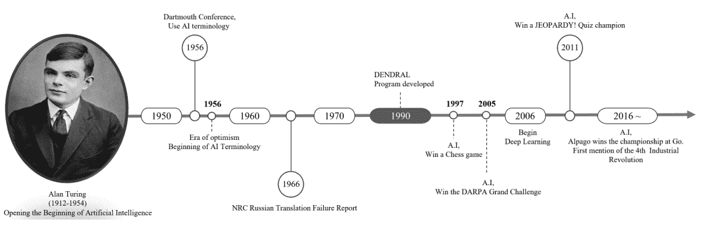

图 1-1 人工智能的历史


(a) 达特茅会议参与者

(b) 达特茅会议的 AI 创始人

**图 1-2** 达特茅会议的参与者

# 提案内容

我们提议在1956年夏天于新罕布什尔州汉诺威的达特茅学院进行一项为期2个月、10人的人工智能研究。该研究基于以下假设进行：学习的每一个方面或智能的任何其他特征都可以被精确描述，使得机器可以对其模拟。将尝试寻找机器如何使用语言、形式抽象和概念来解决目前仅限人类处理的问题，并自我完善。我们认为，如果一组经过仔细挑选的科学家共同工作整个夏天，可以在这些问题中的一个或多个上取得重大进展。

该提案讨论了计算机、自然语言处理、神经网络、计算理论、抽象和创造力。虽然 AI 在达特茅研讨会之后并没有产生显著结果，但研讨会不仅为研究的各个领域提供了直接的机会，还为美国麻省理工学院（MIT）、卡内基·梅隆大学、斯坦福大学和 IBM 的下一阶段研究奠定了基础。

### 1.2.2 早期人工智能

计算机和编程工具开发的下一个阶段特点是原始但基础的计算能力的出现。此时，诺威尔（Nowell）和西蒙（Simon）已成功开发出一种名为“通用问题求解器”（GPS）的系统，该系统可以改变计算中的许多因素，从而减少预期结果与期望结果之间的差异。GPS 是一个模拟人类解决问题过程的程序，与逻辑理论家（LT）不同。它是一个结合了搜索、目标导向行为和规则应用的推理程序。

GPS 成为第一个实现人工智能目标的程序——一个可以像人类一样思考的系统。从卡内基·梅隆大学开始，认知科学方法和收敛研究表明人类认知技能最终将与计算机相同，这仍然是今天认知科学的基础。这些方法在生物学、语言学、心理学和计算机科学领域得到了研究。

宣布人工智能开启马卡西在1958年从达特茅移动到 MIT 时取得了三大关键成就。首先是开发了人工智能编程语言 LISP，它成为了第二古老的编程语言。其次是引入了分时技术（Time Sharing），开始解决与计算机使用昂贵相关的问题。当时，使用计算机的费用很高；但分时意味着多个用户可以轮流短时间使用一台计算机。第三，在1958年，马卡西发表了他的第一本书《常常识程序》（Programs with Commonsense），这导致了完整的 AI 程序“建议者”（Advice Taker）的发展。该程序包含了知识表示和推理的所有基本原理，并在搜索过程中使用了这些知识来解决问题。

### 1.2.3 人工智能的停滞

从一开始，人工智能研究人员就预测了他们领域的成功，赫尔伯·西蒙（Herbert Simon）在1957年宣布“世界上拥有可以思考、学习和创造的机器”。西蒙的自信很大程度上基于人工智能系统在简单情况下成功执行的能力。然而，在所有情况下，当这些早期系统必须从更广泛的问题中选择时，它们成功执行变得变得更加困难，并暴露了自己的局限性。原因如下：


进入`/path/to/xxx`目录，找到`xxx.json`。

在表达式`cvar = avar + bvar`中，加法运算符（`+`）将`avar`与`bvar`相加，得到它们的和`cvar`

在`List.of(arg0, arg1, arg2)`中，`List`接口的工厂方法`of()`接受一系列的元素，返回包含它们的只读列表。

之后我们这样调用`cmd`命令：`cmd arg0 arg1 arg2`。

```
if (condVar > someVal) {console.log("xxx")}
```


图 2-8 显示了智能体执行的一系列过程，当智能体重复“观察-动作-奖励”交互时，这些过程共同导致了智能体从环境中获得的奖励最大化。智能体经历的“观察-动作-奖励”过程也被称为经验。许多领域的研究推动了强化学习，其中行为心理学和控制理论的影响最大。

行为心理学中的“试错”是人类和动物学习的原则，已应用于机器学习。智能体通过记住所有动作的奖励和惩罚来学习做出最佳决策。另一个对强化学习产生重大影响的研究领域是最优控制。

最优控制是一种于 20 世纪 50 年代末的理论，涉及设计一种能够优化动态系统效率的控制设备。动态系统优化问题用于对随时间演的每个过程做出最优决策。

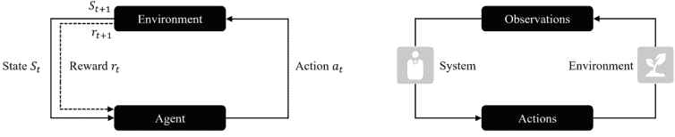

图 2-8 强化学习类型

美国数学家理查德·贝尔曼（Richard Bellman）通过引入马尔可夫决策过程（`MDP`）模型解决了离散时间问题。强化学习被用于对顺序事件做出决策，因为它是在随着事件的展开通过反馈来完成。

一些人认为，基于试错的学习过程与人类学习的方式非常相似，因此是人工智能的最佳模型。强化学习模型在游戏和机器人领域应用得最有效。在机器学习方面，强化学习可以被视为使用基于控制的方法的监督学习，而不是具有数学基础，但它有时被认为是无监督学习。

## 2.4 无监督学习

无监督学习是一种让计算机通过无标签数据进行学习，以发现数据中隐藏特征或结构的方法。之前描述的监督学习分类是基于标记训练数据集创建分类的判别器。这些判别器随后用于预测新未知数据的标签。相反，无监督学习对无标签数据进行分类，因此其目的是将数据集分成具有相同特征的组。无监督学习的一个代表性模型是聚类（`clustering`）。聚类模型是训练数据没有标签的模型。在聚类模型中，输入数据如何形成一个组至关重要。换句话说，聚类模型的功能是分析在没有标签的情况下获得的数据特征，并将具有相似特征的数据进行分组。除了缺少标签外，聚类模型与监督学习的分类模型具有相同的目的。换句话说，聚类模型对无标签数据进行分类。图 2-9 显示了分类与聚类的比较。

> `MDP`是一种随机过程，如果只给定当前状态，系统的未来将取决于过去的历史。它是当给定的某些 S（状态）、A（动作）时，继续处于当前状态（从第一个状态到当前状态）的概率。

| 分类 | 聚类 |
|---|---|
| 相似点 | 主要关注点是输入数据如何形成一个组 |
| 区别 | 有标记数据 | 无标签数据 |
| | 例：分类患者组 | 例：分类消费者类型 |

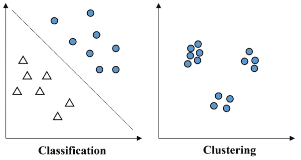

图 2-9 分类模型与聚类模型

从聚类算法的角度来看，聚类模型分为两大类。第一类是划分聚类技术，第二类是层级聚类。`k-means`、`k-medoids` 和 `DBSCAN` 是划分聚类的代表。

层级聚类通过凝聚聚类（`agglomerative clustering`）和分裂聚类（`divisive clustering`）来区分。聚类模型应用于许多领域。例如，区分人声和噪声以提高通话质量是无标签数据聚类的一个良好示例。在医学临床试验中，聚类模型可区分 `DRG`（疾病相关组）或 `HG`（住院医生组），还可以用于营销领域的客户细分。

最近，它被用于营销领域的市场和客户细分，而在 Facebook 等社交网络服务中，它被用于为兴趣相似的用户创建社区。Google 使用聚类模型将相同主题的新闻归类到同一类别。

### (I) K-means 聚类

`K-means` 算法是一种将给定数据分为 `k` 个簇的算法。它是最简单的无监督学习算法之一。它对无标签数据分组是为了最小化每个簇之间距离差的方差。在使用 `K-means` 算法时，我们不知道无标签数据中有多少簇，因此需要预先确定分类的簇数量。`k` 代表簇的数量。

确定要分类的簇数量后，初始化每个簇的初始质心。`k-means` 算法使用的质心是代表簇的假设，每个学习数据点成为其所属簇的参考点。初始质心是任意设置的，随着学习的进行，它会移动到每个簇的最优中心。图 2-10 显示了执行 `K-means` 算法的过程。

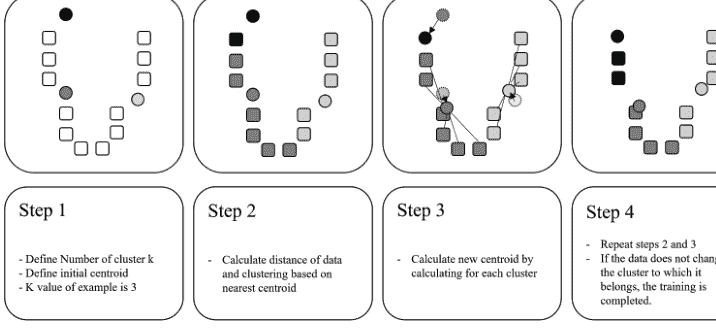

#### 步骤 1
- 定义簇数量 `k`
- 定义初始质心
- 示例的 `K` 值为 3

#### 步骤 2
- 根据最近的质心计算数据的聚类距离

#### 步骤 3
- 通过计算每个簇计算新的质心

图 2-10 `K-means` 聚类算法过程

4. 重复步骤 2 和 3，直到每个数据的聚类不再发生变化为止。

5. 如果所有学习数据所属的聚类没有发生变化，则学习完成。

像这样，`k-means` 模型计算学习数据的速度非常快。当训练数据的维度为 `$n$` 时，大多数算法的计算复杂度为 `O(n^2)` 和 `O(n log n)`，而 `k-means` 为 `O(n)`。因此，软件工程中程序的复杂度是通过计算具有最小复杂度的算法复杂度来得出的。

### (2) DBSCAN

与 `k-means` 算法类似，`DBSCAN`（基于密度的应用噪声空间聚类）是一种无监督学习模型，正如其名，是一种擅于识别噪声和离群数据的聚类模型。

`DBSCAN` 是基于密度的聚类算法，也是最常用的算法。

当产生聚类时，密集区域之外的数据被视为噪声或边界点。

在 `K-MEANS` 模型中，通过计算所有数据点到 `$K$` 个质心的距离，来确定数据点属于哪个聚类，以及每个数据点到哪个聚类中心距离最短，但如图 2-11 所示，`DBSCAN` 模型不考虑距离的概念，都认为具有特定密度的数据组为同一聚类。

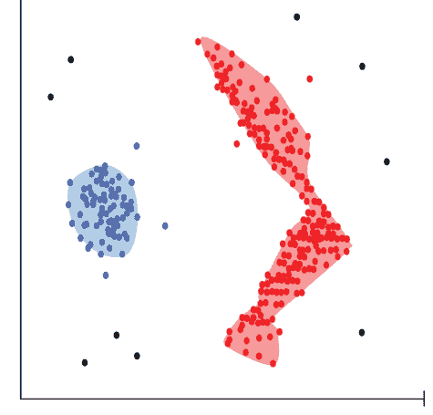

图 2-11 基于密度的聚类算法示例

## 2.5 机器学习与统计学原理的区别

许多研究人员可能对统计学中的回归分析熟悉。

最小二法估计是统计学中多元线性回归分析的代表性方法，它通过最小化每个观测值与超平面之间的距离来寻找回归系数，并验证它们的统计显著性。

机器学习也使用最小二法估计进行回归分析，但计算的进步使得人们更倾向于可以使用快速分析的梯度下降法。

梯度下降法在由权重组合绘制的误差面上选择任意权重。它通过输入数据并更新权重来进行，直到达到误差面上的最小值。

图 2-12 是一个显示根据学习过程从误差面到最小误差值的图表。

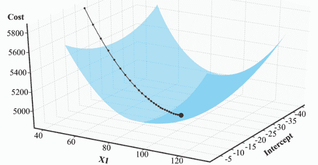

图 2-12 显示根据学习过程从误差面到最小误差值的图表

> 在机器学习的线性回归分析方程 `H(x) = Wx + b` 中，`W` 对应于自变量 `x` 的斜率。在统计学中它表示为回归系数，但在机器学习中表示为权重。

## 机器学习：概念、工具与数据可视化

| 数据收集 | 数据预处理 | 模型选择 | 模型训练 | 验证 | 评估 | 落地 |
| :--- | :--- | :--- | :--- | :--- | :--- | :--- |

**图 2-13** 机器学习流程

统计学学科通过验证统计显著性并检查变量之间的关系，以便利用给定数据来估算总体情况。

另一方面，机器学习基于数据进行归纳学习并修改权重。由于没有用于确定统计显著性的验证过程，为了确定机器学习的结果是否合适，必须通过构建由训练数据、验证数据和测试数据组成的集合来完成性能评估。图 2-13 显示了机器学习流程。

## 2.6 执行机器学习的注意事项

在利用机器学习进行分析时，考虑欠拟合和过拟合问题是非常重要的。欠拟合意味着模型过于简单，因此无法充分解释输入数据，导致预测能力较低。模型是否欠拟合可以根据代价（模型预测值与实际值之间的误差）来判断。在欠拟合的情况下，模型选择和获取额外的训练数据可以在一定程度上起到补偿。过拟合是指模型与训练数据拟合得过紧的情况。如图所示，模型在训练数据上的预测能力很高，但当应用于实际领域或测试数据时，结果是预测能力大幅下降。过拟合的根本原因是主要的机器学习算法是以归纳的方式构建模型的。如果你正在使用机器学习方法进行分析，必须经过一系列模型验证程序，并记住随时可能发生过拟合问题。

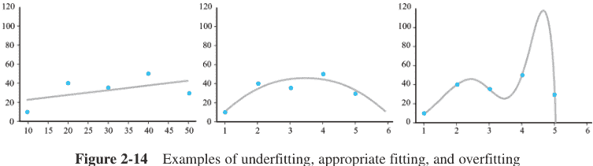

图 2-14 显示了各种学习状态。

## 2.7 机器学习资源

本章介绍了用于机器学习分析的数据源。

### 2.7.1 Kaggle

地址 `https://www.kaggle.com` 是 Kaggle 网站地址。Kaggle 是一个数据科学和机器学习网站。Kaggle 举办竞赛，数据科学家和全球公司在其中竞争，看谁能最高效地分类或预测。竞赛主题不断变化。由于获胜者的算法会在网站上展示，对于对机器学习感兴趣的研究人员来说这是一个很好的资源。

如果主题对研究人员感兴趣且数据难以获取，可以对上传到 Kaggle 的数据进行预测试，以指导总体方向并确定研究进度。对于举办的每场竞赛，Kaggle 都会上传竞赛数据集以及文本、图像和声音等多种数据供研究人员测试和分析。图 2-15 显示了 Kaggle。

### 2.7.2 公共数据

公共数据门户是一个整合管理公共机构创建数据的网站。此外，可以通过开放 API（`https://www.data.go.kr`）访问公共数据。

如果数据由公共机构持有但在公共数据门户未找到，可以联系公共机构或相关部门。

即使不使用公共数据门户，二级数据也由统计局和疾病控制中心等公共机构直接提供。在提交申请文件并缴纳费用后，即可下载并使用公共数据。从各机构下载的二级数据如下。除了下表列出的网站外，各领域也会发布数据。表 2-1 显示了二级数据。

表 2-1 代表性数据

| 数据 | 主题 | 机构 | 网站地址 |
| :--- | :--- | :--- | :--- |
| 国家健康保险大数据 | 健康与医疗 | 国家健康保险公司 (NHIS) | https://nhis.or.kr/bd/ayb01iv.do |
| 国家健康营养调查 | 健康与医疗 | 疾病控制中心 (KCDC) | https://khanes.cdc.go.kr/ |
| 青少年行为调查 | 健康、青少年 | 疾病控制中心 (KCDC) | https://yhs.cdc.go.kr/ |
| 韩国福利面板 | 福利、社会 | 韩国卫生福利研究院 (KIHASA) | https://www.koweps.re.kr/442/ |
| 韩国劳动收入面板 | 劳动 | 劳动研究院 (KLI) | https://www.kli.re.kr/klips/index.do |
| 职场面板调查 | 管理 | 劳动研究院 (KLI) | https://www.kli.re.kr/wps/index.do |
| 韩国女性家庭纵向调查 | 女性、社会 | 韩国女性发展研究院 (KWDI) | http://klowf.kdwi.re.kr |
| 统计地理信息服务 | 地理信息 | 统计局 (KOSTAT) | https://sgis.kostat.go.kr/view/index |
| 首尔调查 | 社会 | 首尔特别市政府 | http://data.si.re.kr/sisurvey |

## 2.8 练习题

Q1. 什么是机器学习？

Q2. 解释机器学习与数据挖掘之间的区别。

Q3. 描述监督学习和无监督学习。

Q4. 描述监督学习和无监督学习中使用的方法。

## 第 3 章

## 深度学习

## 3.1 深度学习的定义与概念

人工智能被定义为对人类判断、行动和认的理解，我们利用这些来赋予机器人类智能¹。最近关于机器学习和深度学习似乎存在很多困惑。因此，简单来说，人工智能是机器拥有人类智能的前提，它必须通过“学习”来产生这种人工智能。其中一类学习是机器学习，而深度学习是类似于机器学习神经网络的一类学习。图 3-1 显示了这些关系。


**图 3-1** 展示人工智能、机器学习和深度学习之间关系的图示

> ¹在人工智能中，机器指的是微型计算机、个人电脑、服务器等。

简而言之，深度学习是机器学习的一个子集，它将人类思维的方式引入计算机。它允许计算机自主学习，并基于用人工神经网络表示人类大脑的高级抽象。神经元是大脑中的神经细胞，是携带电信号信号的独特细胞。大脑是神经元的集合，约有 1000 亿个细胞和 100 万亿次连接。这些神经元相互连接，结果网络被称为神经网络，而人工创建的则被称为人工神经网络。图 3-2 显示了带有神经元的神经网络。

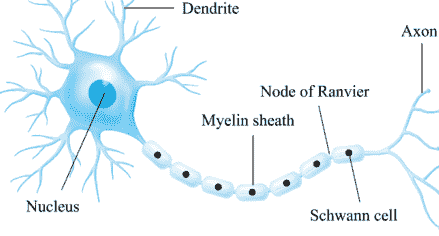

图 3-2 神经元

神经元从树突接收信号并通过轴突传输信号，神经元之间存在突触。只有高于或等于阈值的信号会被传输，信息以电信号的形式传输或存储。

人工智能的流程用数学术语和神经元形式表示，如图 3-3 所示。

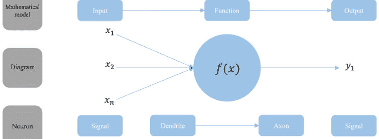

图 3-3 神经网络建模示例

> 抽象总结了大量数据或复杂数据的关键内容或功能

深度学习技术已被 Google、Facebook、Amazon 等全球 IT 公司广泛使用，并被认为在自然语言处理中特别有效，例如模式识别、照片识别、语音识别和机器翻译。

深度学习分为感知机、多层感知机和现有的深度学习模型。

### 3.1.1 感知机

神经网络的起源可以追溯到 Frank Rosenblatt 在 1958 年提出的感知机。感知机背后的概念是，对于 `$n$` 个输入，每个输入都被加权，并产生一个输出。这就是神经元以电信号传输信息的方式。也就是说，对于使用标记训练数据的监督学习模型，训练数据会调整每个输入的权重，直到预测值等于特征值对应的实际结果。当神经元接收到输入信号时，它通过树突和轴突传输信号，感知机对输入进行加权。图 3-4 显示了感知机的概念。

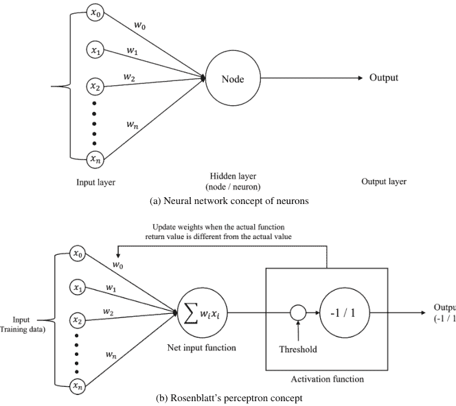

图 3-4 感知机的概念

图 3-4 中 (a) 和 (b) 的区别在于，在 (b) 中，为 `$n$` 个输入信号每一个分配了一个权重。当计算后的信号和超过阈值时，感知机输出 1，否则输出 0 或 -1。

由于权重划分了阈值的边界，权重充当了输入对输出影响程度的参数。因此，这可以被归类为线性分类模型，它区分了值在阈值之内和不在阈值的情况，因此它也可以被视为监督学习的形式。

换句话说，将输入值或神经元输入网络输入函数，进行加权并变为单个值。网络输入函数被定义为结合加权输入的一个函数，如果结果大于阈值，则输出 '1'，否则输出 '-1'（图 3-4）。感知机标志着人工神经网络的开始，但与所有开始一样，感知机在解决非常简单的 XOR 模型时开始显示出局限性。因此，多层感知机应运而生。

### 3.1.2 多层感知机

引入多层感知机是为了克服感知机的缺点。感知机无法学习如 XOR 这样的东西，但通过多层感知机，解决方案被证明是异常地简单。多层感知机有几层，而不只有一层。因此，它有许多称为隐藏层的中间层，隐藏层越多，分类能力的提升就越大。图 3-5 显示了多层感知机的概念。

多个感知机的引入解决了问题，但随着隐藏层数量的增加，权重也增加了，这种学习变得困难。为了解决这个问题，应用了类似于控制理论中反馈控制理论的反向传播法，使多层感知机学习成为可能。

在深度学习领域，对这些各种方法进行了持续研究，随着对旧控制理论方法的重新审视，新的人工神经网络出现了。玻尔兹机³ 作为一种无监督学习方法被提出并引起了学术界的关注。

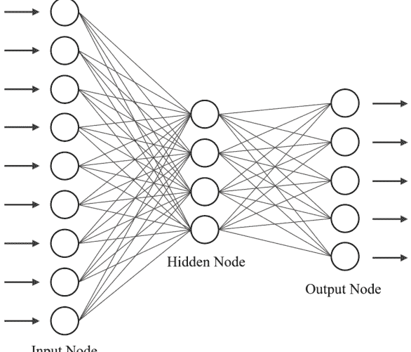

图 3-5 多层感知机概念图

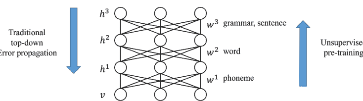

图 3-6 无监督学习的表示

图 3-6 显示，Hinton 和 Terry 先对无标记数据进行了充分的学习，然后进行监督学习。

这种方法解决了多层感知机的许多缺点，许多问题可以通过使用无标记数据进行无监督训练来解决。

## 机器学习：概念、工具与数据可视化

## 3.2 人工神经网络的类型

人工神经网络有很多类型。它们由多个复杂的输入、定向反馈回路（单向或双向）以及各种层组成。然而，人工神经网络通常分为 `DNN`（深度神经网络）、`CNN`（卷积神经网络）和 `RNN`（循环神经网络）。

### 3.2.1 DNN

从感知机的角度来看，人工神经网络包含至少一个输入和一个输出层，之间至少有一个中间层。但在 `DNN` 中，输入层和输出层之间有多个隐藏层。

基本上，`DNN` 是 `RBM`⁴，即一种去除了玻尔兹机层内连接的模型。`RBM` 是一种基于可见层和隐藏层组成的无向二分图形状机器，在通过先验学习进行某些修正后，通过微调过程计算最终权重。因此，即使没有足够的标记数据集，`DNN` 也是一种适用的方法。

图 3-7 显示了 `DNN` 模型。

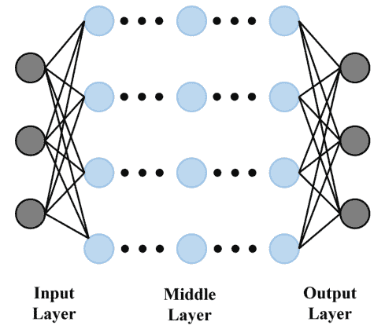

图 3-7 常见 `DNN` 模型

> ^4受限玻尔兹曼机（`RBM`）是 Geoff Hinton 提出的一种模型，可用于降维、分类、线性回归、协同过滤、学习和主题建模的算法。

深度神经网络被用于调整单个权重，以便为输入层输出所需的值。这可以通过机器学习中广泛使用的反向传播算法来学习，其优点是能够获得缓慢但稳定的结果。

### 3.2.2 CNN

卷积网络（`Convolutional Network`）是一种多层感知器类型，设计用于使用最少的预处理，它由一个或多个卷积层以及上方的一个公共的人工神经网络层组成。得益于这种预处理结构，与其他深度学习结构相比，它在视频和音频领域都取得了良好的性能。

图 3-8 显示了 `CNN` 的学习过程。

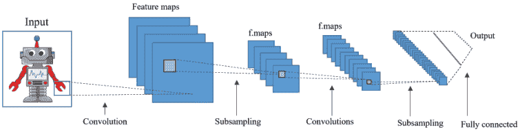

图 3-8 `CNN` 的学习过程

近年来，深度学习领域开发了 `CBDNs`（卷积深度置信网络）。它们的结构与 `CNN` 非常相似，并经常被用于图像处理和物体识别，因为图片的二维结构可以被 `CBDNs` 有效地分析。某些 `CBDNs` 使用 `DBNs`（深度置信网络）进行预训练。`CDN` 提供了一个可以用于各种图像和信号处理技术的通用结构。

### 3.2.3 RNN


RNN 循环神经网络的一个特点是其单元连接具有递归结构，它可以存储传入的输入数据和神经网络的当前内部状态，同时考虑过去的输入数据。因此，通过在神经网络内部存储状态来对随时间变化的动态特征进行建模，使其可以使用内部内存处理序列类型的输入，从而轻松处理具有时间变化特征的数据（如手写识别或语音识别）。

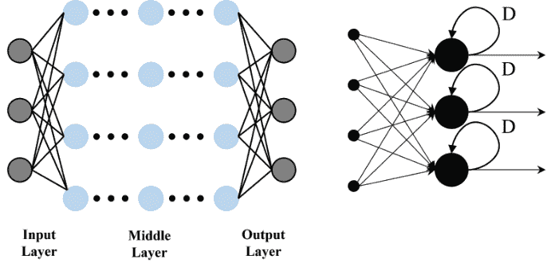

图 3-9 神经网络与 RNN 网络的比较

如图 3-9 所示，RNN 具有一种神经网络特定部分被重复、循环的结构。通常使用梯度下降、Hessian Free 优化和全局优化方法来训练 RNN。

## 3.3 练习习题

Q1. 什么是深度学习？

Q2. 什么是感知器？

Q3. 描述人工神经网络的类型。

# 第 4 章

## 案例研究

### 4.1 AlphaGo

AlphaGo 是由 Google 的 DeepMind Technologies Limited 开发的人工智能围棋程序。

2015 年 10 月，AlphaGo 在对阵欧洲围棋赛三届冠军范辉时五战全胜，成为第一个在不让子的情况下击败职业围棋选手的计算机。2016 年 3 月，它在五局制比赛中击败李世石，这是计算机程序首次在不让子的情况下击败职业棋手。尽管它在第四局中输给了李世石，但李世石在最后一局中认输，最终比分是 AlphaGo 4 比 1 胜。AlphaGo 被韩国棋协会授予了荣誉 9 段称号。此外，由于它被注册为在韩国举办的客座赛，它可能在某时刻参加韩国的比赛，尽管这种可能性不大。图 4-1 显示了所使用的 AlphaGo 系统。

围棋被认为比象棋等其他游戏更难被计算机胜，因为它巨大的分支因子使得使用 alpha 剪枝、树遍历和启发式搜索等传统 AI 方法变得极其困难。

然而，虽然数据和计算能力对 AlphaGo 的胜利至关重要，但 AI 学习算法是更决定性的因素。关键在于减少案例数量，原本这些案例几乎是无限的。因此，AlphaGo 的设计允许经过训练的 DNN（深度神经网络）通过蒙特卡洛树搜索（MCTS）做出最有利的决策。系统的神经网络最初是从人类棋法的专业知识中引导的。AlphaGo 最初通过尝试匹配记录的历史对局中专家选手的走法，使用一个包含约 3000 万步法的数据库来模拟人类棋法。通过应用这项技术，AlphaGo 可以在围棋上击败人类。

## 48 机器学习：概念、工具与数据可视化

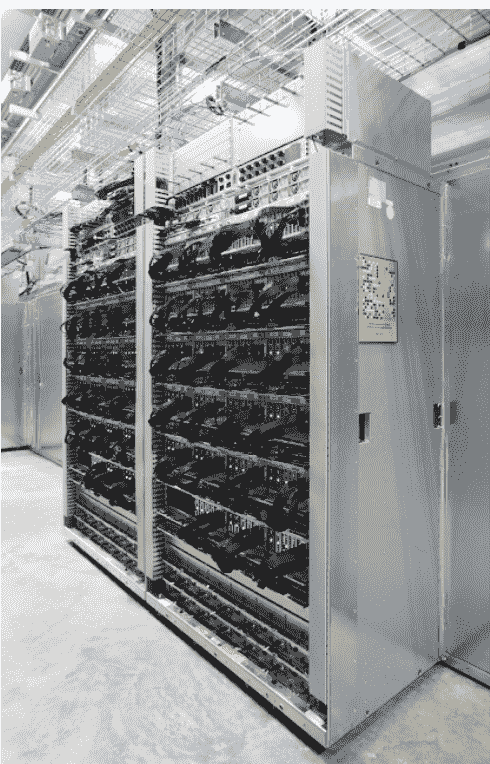

图 4-1 AlphaGo 系统

(来源: https://3.bp.blogspot.com/-_DoMQ00CuAQ/VzzPgbjhjOI/AAAAAAAACp4/5v6prECMLigEfJ23VigjPWXoH-IT05UgCLb/s640/tpu-1.png)

#### 4.1.1 系统配置

最初，在开发时期，宣布硬件使用使用 CPU 和 NVIDIA GPU 进行并行计算。AlphaGo 有两个版本：作为单台计算机运行的单版本，以及使用多个连接到网络的计算机的分布式版本。AlphaGo 的单版本使用 48 个 CPU 和 4-8 个 GPU 运行，在 500 局比赛（包括 Crazy Stone 和 Zen）中仅记录了一次失败。分布式版本由 1,202-1,920 个 CPU 和 176-280 个 GPU 组成。AlphaGo 的早期版本在不同数量 CPU 和 GPU 的硬件上进行了测试，以异步或分布式模式运行。每一步都被给予两秒的思考时间。所得 Elo 评分列如下。表 4-1 显示了 AlphaGo 早期版本的配置和性能。

## 表 4-1 配置与性能

| 配置 | 搜索线程 | CPU 数量 | GPU 数量 | Elo 评分 |
| --- | --- | --- | --- | --- |
| 单节点 | 40 | 48 | 1 | 2,181 |
| 单节点 | 40 | 48 | 2 | 2,738 |
| 单节点 | 40 | 48 | 4 | 2,850 |
| 单节点 | 40 | 48 | 8 | 2,890 |
| 分布式 | 12 | 428 | 64 | 2,937 |
| 分布式 | 24 | 764 | 112 | 3,079 |
| 分布式 | 40 | 1,202 | 176 | 3,140 |
| 分布式 | 64 | 1,920 | 280 | 3,168 |

## AlphaGo 范辉

2015 年 10 月，AlphaGo 的分布式版本击败了欧洲冠军范辉，他是一位 2 段（9 段）棋手，比分 5-0。在这场比赛中，AlphaGo 使用了 1202 个 CPU 和 176 个 GPU。这就是 AlphaGo 范辉。

## AlphaGo 李世石

2016 年 3 月，它在五局制比赛中击败了李世石，这是计算机程序首次在不让子的情况下击败职业棋手。尽管它在第四局中输给了李世石，但李世石在最后一局中认输，最终比分是 AlphaGo 4 比 1 胜。AlphaGo 被韩国棋协会授予了荣誉 9 段称号。此外，由于它被注册为在韩国举办的客座赛，它可能在某时刻参加韩国的比赛，尽管这种可能性不大。图 4-1 显示了所使用的 AlphaGo 系统。

> 如图 3-9 所示，RNN 具有一种神经网络特定部分被重复、循环的结构。梯度下降、Hessian Free 优化和全局优化方法通常用于训练 RNN。

## 50 机器学习：概念、工具与数据可视化


图 4-2 处理器单元

(来源: https://cloud.google.com/images/products/tpu-v3-alpha-2x.png)

> Elo 评分系统是用于计算象棋和游戏中玩家相对水平的方法。

匹配。人工智能的出现并不需要对大数据的学习，其意义在于，它为那些由于难以获取大数据而导致难以利用人工智能的领域提供了解决方案（这与围棋的情况不同）。

- Alpha Zero

AlphaZero 是一种通用的人工智能程序，可以作为算法应用于围棋、国际象棋等棋盘类游戏。AlphaZero 仅用两个小时就击败了 2017 年 CSA 世界冠军 Elmo 以及将棋；在象棋上花费数小时击败了 2016 年冠军 Stockfish；在围棋上花费了 30 小时击败了 AlphaGo Zero。

2017 年 12 月 14 日（美国时间），黄璐博士（DeepMind Technologies Limited 资深研究科学家）宣布，她将结束与 AlphaGo 的缘分，并将所有 AlphaGo 的资源转移到其他人工智能开发项目中。

#### 4.1.2 算法实现

在 AlphaGo 出现之前，人们认为围棋是计算机唯一无法从人类角度接近的类比类游戏。在此之前开发的基于人工智能的围棋与职业棋手对弈的棋法完全不同。因此，AlphaGo 使用了什么样的方法来与以往的算法拉开差距并击败世界顶级职业棋手？

让我们仔细观察一下围棋游戏的结构。

### AI 策略策略

让我们看看 AI 如何在 1 对 1 的棋盘游戏中处理问题。假设我们被要求创建一个人工智能，在不考虑游戏时间限制的情况下赢得棋盘比赛，而一局游戏可能会花费无限的时间。

由于没有时间限制，理想的方法是尽可能向远处看，并在当前状态下采取理想的行动方案。

最后，人们必须预测对方会对自己的走法做出什么。在解决此问题的算法中，极小极大算法（Minimax Algorithm）是最具代表性的之一。图 4-3 展示了一棵树来解释极小极大算法。

圆圈代表运行算法的玩家的移动，而正方形代表对手的移动。当考虑对手和运行算法玩家的所有可能移动时，后者在四步之后可能获得的分数被标记在第 4 层上。最高

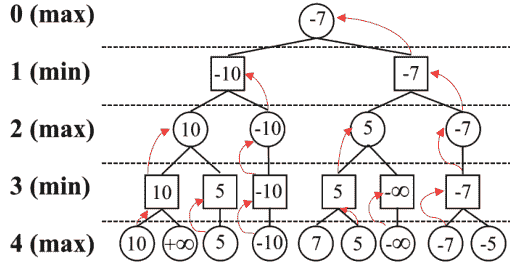

图 4-3 极小极大算法

运行算法的玩家可获得的最高分是 +无穷，这显然是该玩家最理想的结果。

然而，当然，如果对手是一个理性的玩家，他将以最小化运行算法的玩家所获得分数的方式行动。因此，运行算法的玩家将采取行动获得较小的 +10 分而不是 +10 或 +无穷。此外，在自己的回合中，运行算法的玩家和对手都会选择使分数最大化。

带着这种念头，当从第 1 层移动到第 0 层时，不应该选择获得左侧所示的 +10 或无穷的最高分，但在考虑对手的移动时，最佳行动方案将是追求最右侧的 -7 分。

在像围棋这种 1 对 1 的游戏中，这种行为被称为“理想选择”，而极小极大算法的应用体现在：你必须从对手提供的最坏数字中选择最好的，从而将可能的损失降至最低。最后，创建一个强大的 AI 需要一种能够高效导航这些搜索空间的算法，寻找比极小极大算法耗时更短且性能更好的行为。

人们已经提出了各种算法，如 Alpha-Beta 剪枝（alpha-beta pruning）和主变搜索（principal variation search）来寻找这种方法。以下方法是蒙特卡洛树搜索（MCTS），它是棋盘游戏应用最广泛的 AI，基于 AlphaGo。

- 蒙特卡洛树搜索 (MCTS)

在计算机科学中，蒙特卡洛树搜索（MCTS）是一种用于某些决策过程的启发式算法，最常用于游戏。这是“解决问题的概率方法”的通用术语。这种方法使用随机性来近似难以寻找复杂公式，而不是难以看到的巨大搜索空间。例如，假设你

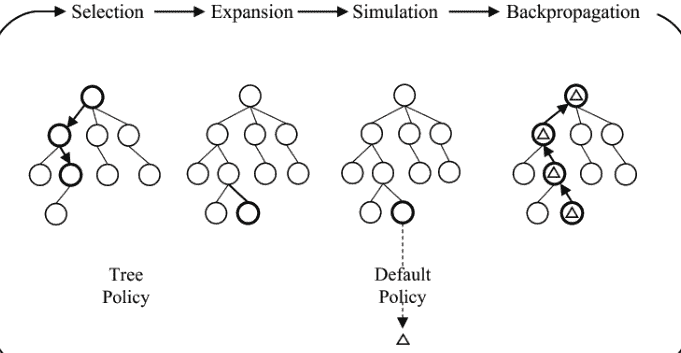

**图 4-4** 蒙特卡洛树搜索图

在一个 2x2 的正方形内画一个半径为 1 的圆，然后在这个正方形内随机画一个点，以计算圆内点数占总取点数的比例。之后，如果你画了很多点，该值最终将收敛于 $\pi/4$ 的值。

这是一个典型的蒙特卡洛方法示例，使用蒙特卡洛来计算周长的值。蒙特卡洛树搜索是一种旨在选择良好行动方案的算法，而不是在巨大的搜索空间中寻找复杂的公式。通过使用蒙特卡洛计算周长的值，蒙特卡洛树搜索是一种在不需要公式的情况下选择良好行动方案的算法。

让我们看看 MCTS 的基本形式，以及它是如何利用随机性构建树的。

蒙特卡洛树搜索图如图 4-4 所示。MCTS 有四个基本步骤：

- 选择（Selection）：从根节点开始，通过选择子节点中表现最好的节点到达叶节点。
- 扩展（Expansion）：如果到达叶节点且不是游戏终点，则为下一步创建一个子节点，并在它们中选择一个进行。
- 模拟（Simulation）：通过执行随机模拟来进行游戏，这被称为推演（rollout）。
- 回溯（Backpropagation）：根据模拟结果更新路径上的节点权重。

MCTS 重复这一步骤尽可能多次，以模拟可能采取的行动的胜率信息。在模拟可能采取的行动时，惊讶地发现，如果 MCTS 无限重复，结果将收敛于极小极大值。

然而，通常情况下，基础 MCTS 的收敛速度非常慢，因此需要一种减少搜索空间并更有效地寻找结果的方法。

MCTS 希望从收敛中获得的结果是每个节点的胜率。存在一个理论函数 $v^*$ 在给定游戏状态 $s$ 时计算赢得游戏的概率。当然，我们不知道这些函数的样貌以及它们如何工作，但我们可以假设这些函数的存在。相反，如果我们有一个可以近似 $v^*$ 的函数 $v(s)$，由于我们可以首先得到想要的结果，即使不进行 MCTS 也可以计算出理想移动。

- AlphaGo 流水线结构

到为止，我们学习了 AlphaGo 如何利用 MCTS 技术和通过深度学习学习的状态评估函数 $v(s)$ 熟练地导航状态-动作树，通过

深度学习。然而，实际上算法的计算方式比在此之前所看到的解释要复杂得多，而且并不是单一神经网络，而是由几个由互补结构组成的网络。

让我们先看看 AlphaGo 内部的神经网络是如何组织的。

首先，AlphaGo 有一个能够“预测当前状态下下一个落子位置”的网络（也就是说，它不仅预测对手会在当前状态下落在哪里，还预测我应该落在哪里）。在某些论文中，这被称为“策略网络”（policy network）。自然地，这个策略网络以 CNN（卷积神经网络）的形式存在，因此 AlphaGo 首先需要大量的数据。如前所述，CNN 需要大量的输入数据和相应的输出数据。为了获得输出数据，我们使用了来自“KGS”网站的围棋记录。

利用这些对局记录，总共提供了 3000 万条关于下一步落子位置的数据，这些数据被用于学习策略网络。此外，我们还准备并让 AlphaGo 学习了一个名为“终局策略”（Rollout policy）的网络，它可以比策略网络更快地计算相同的问题。

策略网络也非常有效。策略网络能够在不使用 MCTS（蒙特卡洛树搜索）的情况下以高胜率赢得比赛。然而，网络本身无法超越 AlphaGo。正如我们之前看到的，MCTS 的搜索需要一个“价值网络”（value network），即计算玩家在当前状态下是否能胜的 $v(s)$。价值网络具有与策略网络类似的 CNN。

然而，与策略网络不同，价值网络仅根据棋子的最后一个位置（作为末尾的输入）产生概率分布。为了学习这个网络，AlphaGo 保存了自对局游戏的数据记录，收集了胜负状态，将它们放入价值网络的学习数据中，并成功地完成了学习。因此，人们认为 AlphaGo 使用了策略网络、终局策略和价值网络来进行 MCTS。

每个网络按以下方式使用：

- **策略网络**：在原始的选择阶段，MCTS 使用选择最成功子节点的方法。然而，AlphaGo 的 MCTS 使用了一个术语，即“在当前状态下释放这枚棋子的概率”，该概率由策略网络计算。这使得它更倾向于高概率的动作。这可以被解释为 AlphaGo 实现了一种传统计算机算法无法实现的人类直觉。

MCTS 还通过对只访问一侧的玩家给予特定的惩罚，鼓励玩家向另一个方向搜索动作。这是为了防止搜索变得过于单一。

- **终局策略**：终局策略的性能远低于策略网络，但它具有计算速度快得多的优势。因此，在 MCTS 的评估阶段运行模拟时，会使用终局策略。

- **价值网络**：价值网络也被用于评估阶段。在评估阶段，终局策略和价值网络独立地计算分数，该状态的最终分数通过按特定比例两者相加得出。根据多篇论文，使用两者的组合（ELO 评分 2900）来相加分数，比仅使用策略网络（单机上 ELO 为 2450 和 2200）或价值网络要好。

在完成每一步的选择、扩展和评估过程后，将显示所选状态的评估分数。该分数用于更新回溯过程中访问的路径分数以及访问次数。在更新时间过去后，最终选择出 MCTS 树中被访问最多的状态位置。

上述描述的更新 MCTS 树的过程遗憾的是，它是通过分布式操作进行的。在最后一次开发中，AlphaGo 通过将计算分布在多个 CPU 和 GPU 上来执行 MCTS，而不是在单台计算机上执行计算，这变成了具有如此“神级”搜索能力的人工智能，事实证明超出了甚至职业围棋手的理解范围。

## 4.2 IBM Watson

Watson 以 IBM 的创始人兼首任首席执行官、工业家托马斯·J·沃森（Thomas J. Watson）命名。

Watson 是一个能够回答自然语言问题的计算机系统，由首席研究员大卫·费鲁奇（David Ferrucci）领导的研究团队为 IBM 的 DeepQA 项目开发。系统最初是为了回答问答节目《危险边缘》（Jeopardy!）中的问题，并在 2011 年 2 月 14 日的节目中登场。第一个在人类战斗中获胜的机器不是 AlphaGo。IBM 的深蓝（Deep Blue）击败了 1996 年世界象棋冠军加里·卡斯帕罗夫（Garry Kasparov）。AI Watson 是深蓝的升级版，在 2011 年击败美国问答节目最成功的两位冠军后，获得了《危险边缘》的决赛冠军。

2004 年，在与同事共进晚餐时，IBM 研究经理查尔斯·利凯尔（Charles Lickel）注意到餐厅陷入了沉默。他发现了这种嫉妒沉默的原因：肯·杰宁斯（Ken Jennings），他当时正处于《危险边缘》节目中成功的 74 场连胜记录中。几乎整个餐厅的人都在吃饭中停下，聚集在电视机前观看这一现象。利凯尔对问答节目作为 IBM 的一种可能挑战感兴趣，并将这个主意传了下去。2005 年，IBM 研究执行高管保罗·霍恩（Paul Horn）支持了利凯尔，推动他部门的某人接受与 IBM 系统玩《危险边缘》的挑战。Watson 的实际开发始于 2005 年，事实证明这是一个比实时分析语言的廉价迭代要困难得多的过程。最重要的是，它是第一个击败人类的人工智能系统。图 4-5 显示了 IBM“人机大战”挑战。

IBM 正在将 Watson 扩展到认知计算，将人工智能与机器学习相结合。

## 机器学习：概念、工具与数据可视化

此外，通过机器学习，IBM Watson 持续自我学习，通过语音识别、图像识别与人类语言交互进行进化。

Watson 和 AlphaGo 都是深度学习技术，分别在健康和游戏领域发挥重要作用。AlphaGo 的核心技术是用于聚类或分类对象的深度学习技术。AlphaGo 使用深度学习来实现价值网络（计算棋盘上的胜率）和策略网络（计算棋盘上的分数）。

Google DeepMind 使用深度学习系统 TensorFlow 创建了 Alpha。TensorFlow 是一个用于机器学习和深度学习的开源库。

这项技术允许 Google 将其通用算法 AlphaGo 应用于各种领域。TensorFlow 是我们所知的大数据平台。

Watson 的核心作用是建立专业领域的知识（如医学术语），并生成优化数据支持人类决策。当医疗人员输入临床信息时，Watson 会就患者的情况和可能的治疗方案提供建议。基于大量的诊断、患者记录、医学书籍等，Watson 自己做出判断并告知用户最有效的治疗方案。Watson 通过缩短解释患者信息和从医学文献中收集信息的时间（只需几分钟）来帮助治疗患者。表 4-2 IBM Watson 对比 Google AlphaGo

| IBM Watson | VS | AlphaGo |
|---|---|---|
| IBM | 开发公司 | Google DeepMind |
| 大卫·费鲁奇 | 开发者 | 弥斯·哈萨比 |
| 通过机器学习自我学习 | 学习方法 | 使用深度神经网络技术进行强化学习 |


| 2011 年赢得《危险边缘》问答赛 | 竞技记录 | 2016 年击败李世石 |

| NLP（认知计算） | 特性 | 决策系统 |

| 医疗、金融 | 主要应用领域 | 游戏、健康 |

| 云端 | 使用系统 | TensorFlow |

Watson 的技术水平足以分析非结构化数据，例如图片、视频、MRI 数据和患者移动轨迹，这些数据以前是难以分析的。

### Watson 是如何工作的？

在专家的指导下，Watson 收集开发基于语料库知识所需的信息。因此，收集此类语料库的任务是将相关文献引导至 Watson。为了构建语料库，需要人工干预来查看收集的信息，并丢弃过时、评估不佳或与领域相关性较低的信息。

这被称为内容策划（content curation）。为了让 Watson 正确学习，必须有效地执行内容策划。为了学习解释大量信息，需要专家培训。为了获得学习最优性能和搜索模式的能力，Watson 成为专家的伙伴，并通过机器学习进行自我训练。机器学习是人工智能用于实现类人推理的应用，它始于 1984 年 Douglas Lenat 发起的的人工智能项目 CYC。

例如，取“每棵树都是植物”和“植物最终会死亡”这两个陈述。

当被询问树是否死亡时，推理引擎（Inference Engine）可以得出确定结论并正确回答。专家以问/答格式将训练数据上传到 Watson，这些数据被用作验证数据。

图 4-6 显示了人工智能中的基于知识的代理。

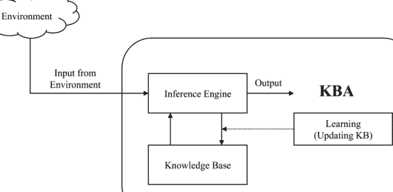

图 4-6 人工智能中的基于知识的代理

专家定期审查用户与 Watson 之间的交互，并向系统反馈以提高 Watson 解释信息的能力。这些规则是人工添加的。制定涵盖世界上所有差异知识的规则是不行的。但在 Watson 的情况下，这是通过自然语言处理自动完成的。毕竟，Watson 是在新信息发布时不断更新自身的系统，并通过处理语言来学习新事物。

## 4.3 练习题

Q1. 什么是 AlphaGo？

Q2. 描述作为 AlphaGo 算法实现的蒙特卡洛树搜索 (MCTS)。

Q3. 描述 AlphaGo 工作流 (Pipeline)。

Q4. 描述 IBM 实现的人工智能系统 Watson。

## 第 5 章

## Microsoft Azure Machine Studio

## 5.1 Microsoft Azure Machine Studio 简介

Azure 是微软的一款云计算平台，自 2010 年起投入服务。继 2011 年推出 PaaS 后，又于 2013 年推出了 IaaS 服务。在 Azure 平台提供的 600 多项服务中，本书将重点介绍其中之一：Azure Learning Studio。机器学习有很多开源库和工具，为什么要使用 Azure Learning Studio 呢？答案在于 Azure Learning Studio 解决了以下问题：

- 计算资源缺乏灵活性

- 配置用于学习的基于 GPU 的环境困难

- 学习工具的安装和设置困难

- 实验记录和版本控制困难

图 5-1 显示了 Azure Machine Learning 工作流。用户可以利用 Azure 平台实现云端数据收集和管理，并使用 Machine Learning Studio 轻松创建预测模型和构建 Web 服务。与现有云平台和机器学习工具不同，它提供了一个考虑用户便利性的易访问的 GUI 环境。图 5-2 显示 Azure ML Studio 可以以拖放的形式轻松创建块，这与传统的机器学习工具和库不同。此外，用 R 和 Python 语言编写的脚本可以插入并在块中使用。

## 机器学习：概念、工具和数据可视化

### Azure Machine Learning：基本工作流

从数据构建模型并使机器学习解决方案运行化

| 数据收集与管理 | 机器学习服务 | 嵌入式 ML 模型 |

| :--- | :--- | :--- |

| Blobs 与表格 (Azure Storage) | ML STUDIO | |

| Hadoop (Azure HDInsight) | Web 服务 | |

| 关系型数据 (Azure SQL Database) | 输出可以定期运行并连接数据库的 Web 服务 | 为应用或网站添加智能，或在 BI 工具中提供洞察 |

| 海量数据存储 (Azure Data Lake) | 创建机器学习模型 | |

**图 5-1** Azure Machine Learning 工作流

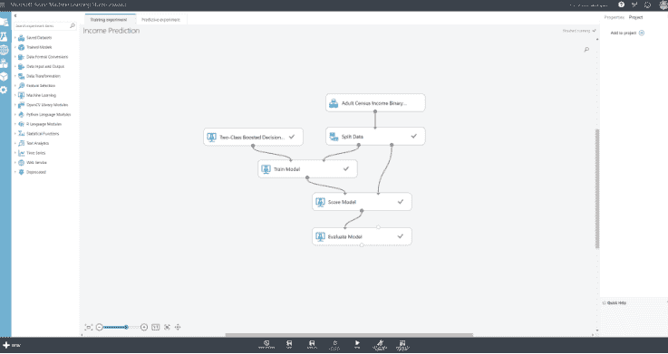

**图 5-2** Azure Machine Studio 实验画布

得益于其简单的结构，所有技能水平的用户都可以轻松创建和分发预测模型。结果可以可视化。图 5-3 显示了 Azure AI Gallery，用户可以在那里尝试其他用户开发的项目，或将其导入到自己的项目中进行修改。此外，用户可以在 Facebook 或 Twitter 等社交媒体上发布在 Gallery 中共享的项目，以寻求建议。

图 5-4 显示了 Azure Machine Learning 的整体能力。Azure Machine Learning 支持输入、输出和可视化，并准备了数据科学家常用的标准机器学习算法。用户可以开发并部署以下步骤：

Microsoft Azure Machine Learning Studio 65


图 5-3 Azure AI Gallery

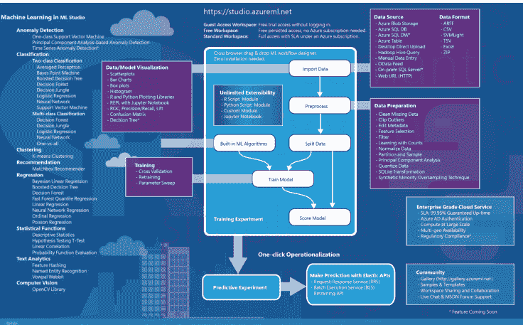

图 5-4 Azure Machine Learning Studio 图解

(1) 导入数据：用户可以获取用于模型训练的数据并将其导入 Azure 云进行多种用途。

(2) 数据预处理：用户可以对数据数据的情况进行预处理。

(3) 特征选择：为了训练模型，用户可以提取特征。

(4) 评估：训练后对模型进行评估。

(5) Web 服务部署：训练好的模型可以通过服务发布。

## 5.2 Microsoft Azure Learning Studio 注册

访问 `https://studio.azureml.net/` 并点击图 5-5 中框出的“Sign up here”链接。

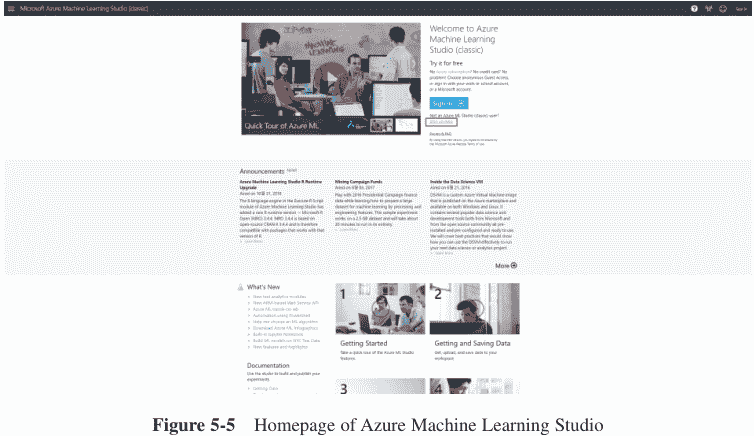

将弹出一个窗口，如图 5-6 所示。用户可以免费进入 8 小时，但建议使用 Microsoft 账户创建工作区来存储项目和实验数据。

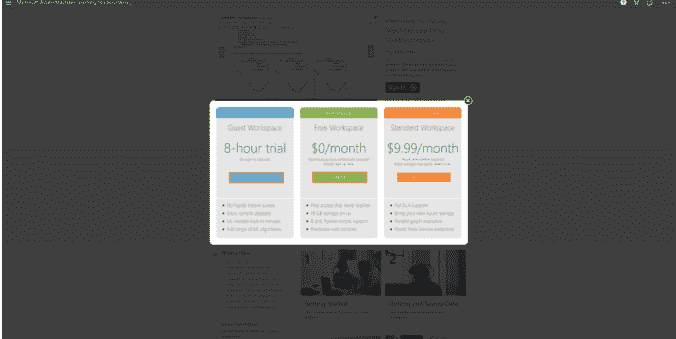

图 5-6 Azure Learning Studio 选择窗口

如果登录成功，你将看到图 5-7 所示的工作区。

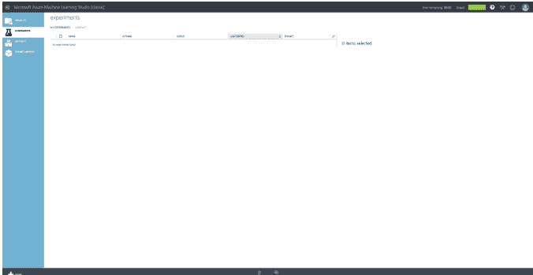

图 5-7 Azure Machine Studio 工作区

## 5.3 Microsoft Azure Machine Studio 功能介绍

点击图 5-8 中的“+ NEW”显示工作区功能

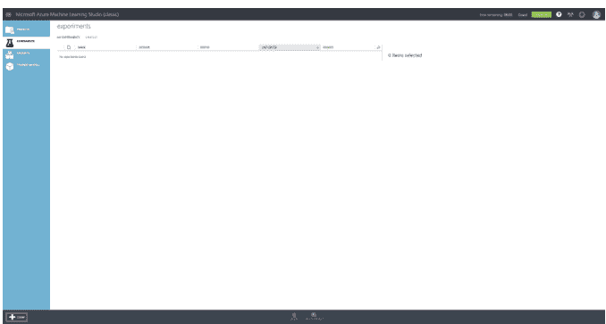

点击“+NEW”按钮查看图 5-9 所示的“DATASET”、“MODULE”、“PROJECT”、“EXPERIMENT”和“NOTEBOOK”功能。“DATASET”允许用户将实验数据文件上传到 Azure 云，供个人账户使用。用户还可以通过插入包含 Python 语言编写模块的压缩包 (`.zip`) 来 Python 脚本模块化。

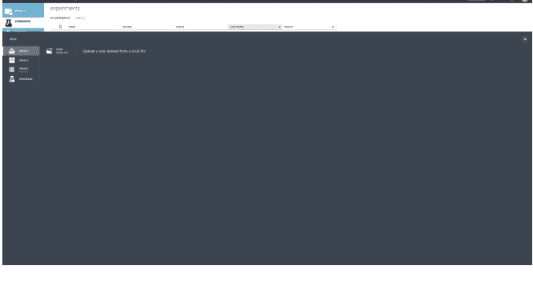

图 5-10 中的“MODULE”功能可以通过插入包含 R 语言编写脚本的压缩包 (`.zip`) 来 R 脚本模块化。用户还可以导入并使用微软在 Gallery 中发布的各种 R 语言编写的模块示例。

# 70 机器学习：概念、工具与数据可视化

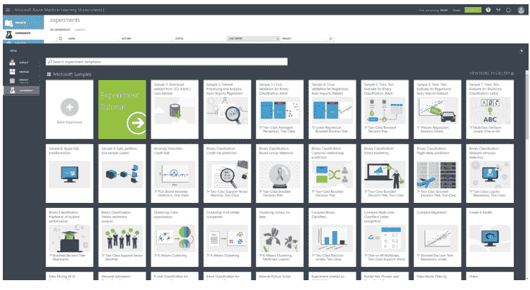

图 5-12 EXPERIMENT（实验）函数

| 功能 | 功能说明 |

| --- | --- |

| 已保存的数据集 | 包含使用 DATASET 函数保存的数据集和示例数据集的仓库 |

| 已训练模型 | 包含已训练模型的仓库 |

| 数据格式转换 | 转换数据格式（.arff, .csv 等）的功能 |

| 数据输入与输出 | 训练模型的数据输入、输出和导入 |

| 数据转换 | 用于训练数据的预处理（拆分、过滤、合并等） |

| 特征选择 | 根据统计数据或机器学习算法提取数量特征 |

| 机器学习 | 包含用于创建模型的算法。包含机器学习算法、训练和评估模型。 |

| OpenCV 库模块 | 有 OpenCV 库函数，这是一个图像处理库。 |

| Python 语言模块 | 可以运行 Python 脚本。 |

| R 语言模块 | 可以运行 R 脚本。 |

| 统计函数 | 包含描述性统计、统计检验、相关矩阵计算和重编码等统计函数。可以进行文本分析。 |

| 时间序列 | 可以使用时间序列异常检测。 |

| Web 服务 | 可以对 Web 服务进行输入/输出数据管理。 |

| 已弃用 | 将消失的函数集合。 |

表 5-2 中的算法可以方便地导入到导航调板的模块中。如果用户找不到所需的算法，可以使用 Python 和 R 脚本实现它，然后将包含已实现算法的模块放入实验中。

表 5-2 Azure 机器学习算法 (2018.1)

| 算法分类 | 算法 |

|---|---|

| 异常检测 | 单类支持向量机<br>基于 PCA 的异常检测 |

| 分类 | 多分类决策森林<br>多分类决策丛林<br>多分类逻辑回归<br>多分类神经网络<br>一对多（One-vs-All）多分类<br>二类平均感知器<br>二类贝叶斯点机<br>二类增强决策树<br>二类决策森林<br>二类决策丛林<br>二类局部深度支持向量机<br>二类逻辑回归<br>二类神经网络<br>二类支持向量机 |

| 聚类 | K-Means 聚类 |

| 回归 | 贝叶斯线性回归<br>增强决策树回归<br>决策森林回归<br>快速森林分位数回归<br>线性回归<br>神经网络回归<br>序回归<br>泊松回归 |

## 5.4 练习题

Q1. 解释 Azure Machine Learning Studio 的优势。

Q2. 解释 Azure Machine Learning Studio 支持的算法。

## 第 6 章

## 使用 Microsoft Azure Machine Learning Studio 创建预测模型

## 6.1 Microsoft Azure Machine Learning Studio 实验配置与功能

在开始教程之前，让我们看看实验中配置的界面。通过图 6-1 所示的数字检查功能描述。

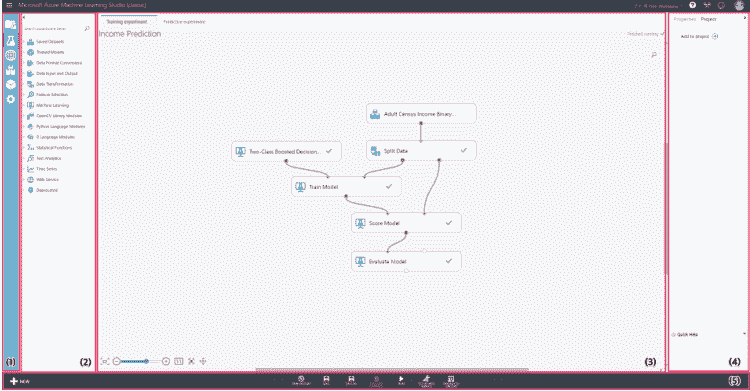

图 6-1 Azure Machine Learning Studio 实验配置

74 机器学习：概念、工具与数据可视化

(1) 类别 (Category)

管理数据集、实验等的侧边栏。

(2) 画板 (Palette)

包含项目主要功能的区域。

(3) 实验画布 (Experiment Canvas)

拖放工作流区域，可以在其中创建模型并进行实际分析。

(4) 属性 (Properties)

显示每个模块的属性。每个模块可能有不同的属性。

(5) 菜单 (Option Menu)

用户可以保存、执行和发布 Web 服务、库等。可以选择“+NEW”按钮来插入数据集、导入模块等。

## 6.2 Microsoft Azure Machine Learning Studio 实验教程

Microsoft 为 Azure Machine Learning Studio 提供了一个教程。如果用户点击“+ NEW”按钮并进入“EXPERIMENT”（实验）菜单，将显示如图 6-2 所示的“Experiment Tutorial”（实验教程）。

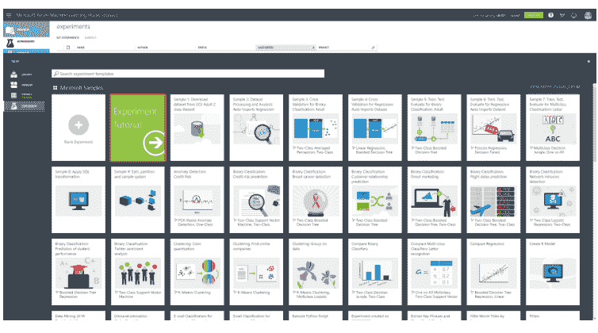

图 6-2 实验教程

用户可以通过点击“Experiment Tutorial”按钮开始教程。当模块被自动拖放时，系统会提供解释。

使用 Microsoft Azure Machine Learning Studio 创建预测模型 75

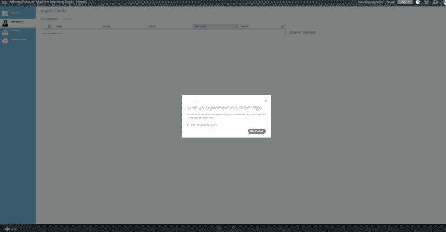

图 6-3 五步教程

点击图 6-3 中的“Get Started”（开始）按钮开始 5 步教程。

图 6-4 显示了教程的开始，鼠标会自动移动以创建一个空实验。如果没有空实验，用户无法使用 Azure Machine Learning Studio 创建预测模型。

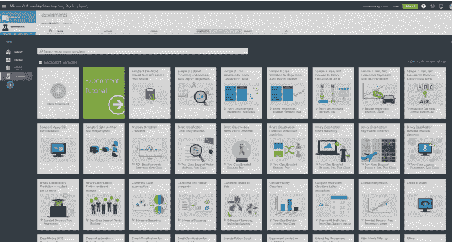

图 6-4 远程操作

76 机器学习：概念、工具与数据可视化

在图 6-5 中，实验名称已更改为“Prediction”（预测），教程提供了示例数据。用户可以通过点击“Visualize”（可视化）按钮来可视化数据。

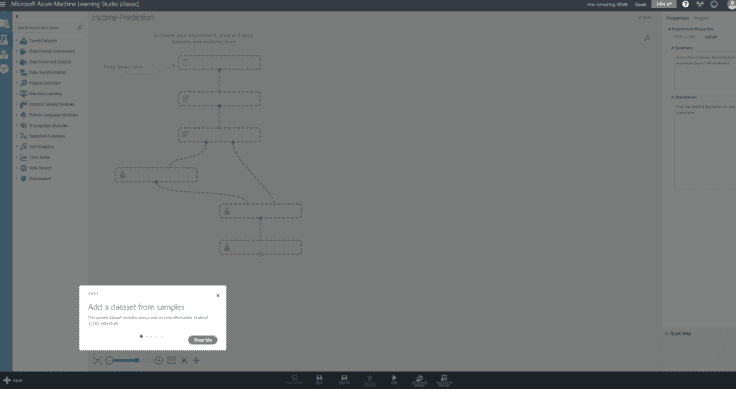

图 6-5 预测

78 机器学习：概念、工具与数据可视化

在图 6-6 中，导入了“Income”（收入）数据集。教程提供了机器学习的示例数据。

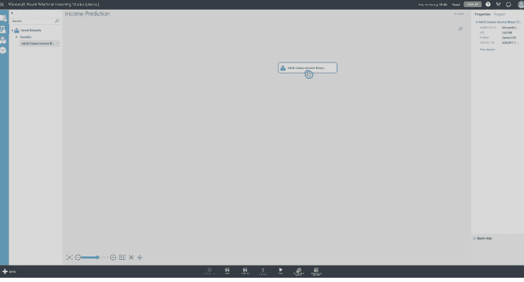

图 6-6 收入

使用 Microsoft Machine Learning Studio 创建预测模型 77

在图 6-7 中属性显示了行和列。用户可以通过可视化来查看数据。

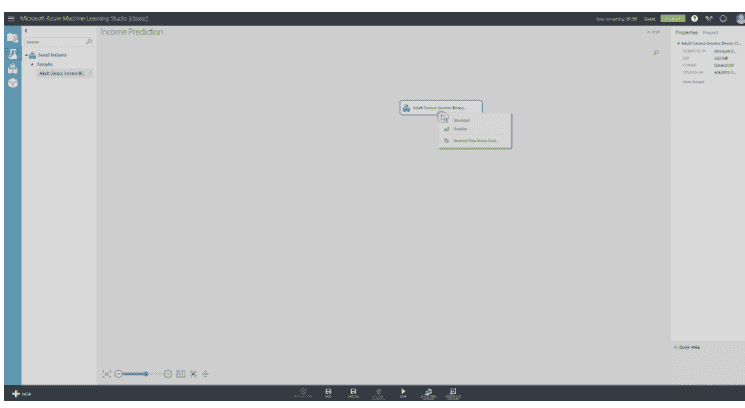

图 6-7 数据可视化

80 机器学习：概念、工具与数据可视化

图 6-9 建议划分数据以防止过拟合。通常是将数据按比例分为训练集和测试集。

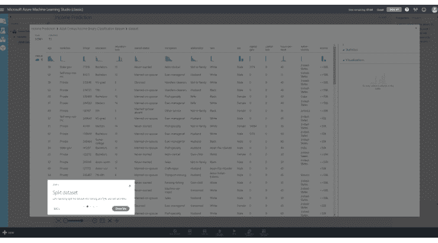

图 6-9 数据集划分

图 6-10 显示了数据集划分的随机种子。

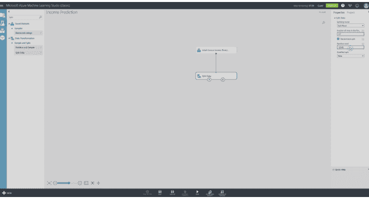

图 6-10 随机种子

使用 Microsoft Machine Learning Studio 创建预测模型 85

在“Split”（划分）属性窗口中输入参数。输入训练数据率 0.7 并输入一个随机种子值。随机种子是一个参数值，因为计算机本身是有逻辑组织的。图 6-11 显示数据集划分已完成，并建议了一个用于学习算法。本教程应用了二类增强决策树算法。需要关注的词是“Two-Class”（二类）。为什么你应该密切关注“二类”？让我们在教程的过程中仔细查看。

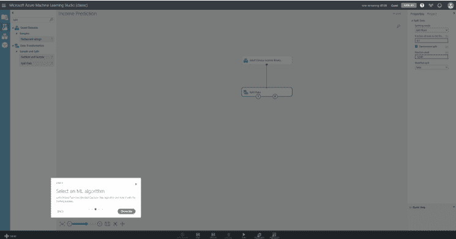

图 6-11 预测模型训练算法选择

图 6-12 显示将二类增强决策树算法放置在画布上，并将训练模型放置在画板上以训练数据。细心的读者可能已经注意到“Train Model”模块右侧的感叹号。由于应用二类增强决策树时没有定义标签列（Label Column），发生了错误。让我们通过属性窗口中的“Launch column selector”（启动列选择器）来设置标签列。

如图 6-13 所示，通过点击“Launch column selector”，标签列设置为“Income”。为什么“Income”包含了这么多属性值？原因在于“Income”的属性值是由 <= 50K 和 > 50K 组成的，因此在许多属性值中，预测值是与“Income”相关的两个值之一。这在某种程度上回答了之前关于“为什么是二类？”的问题。

## 80 机器学习：概念、工具与数据可视化

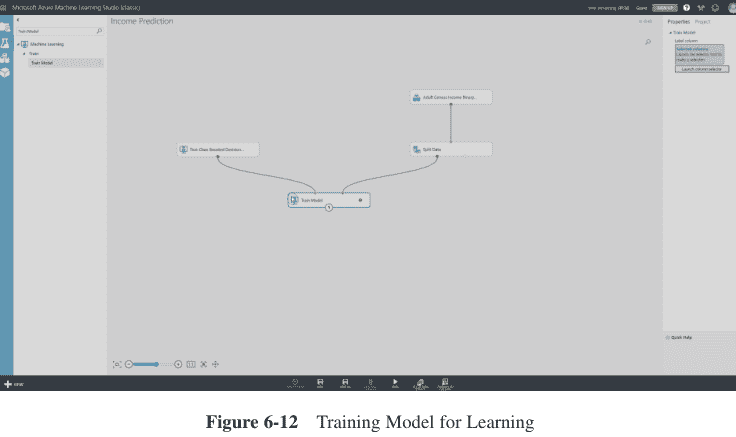

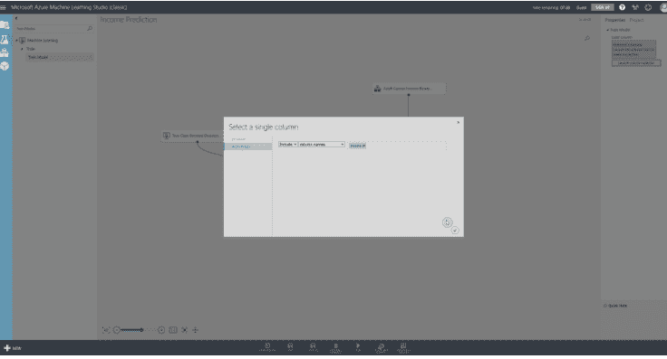

图 6-14 显示了选择“收入”（Income）列后错误消失。在图 6-15 中，程序建议使用训练模型和测试数据进行预测。点击“显示”（Show Me）按钮继续。

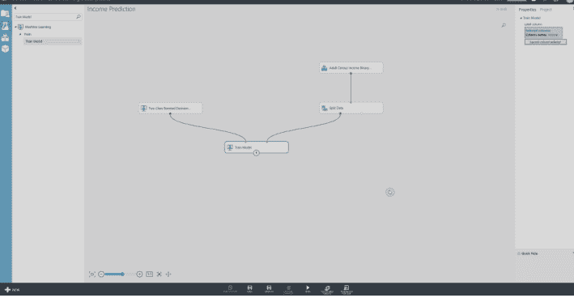

图 6-14 错误消失

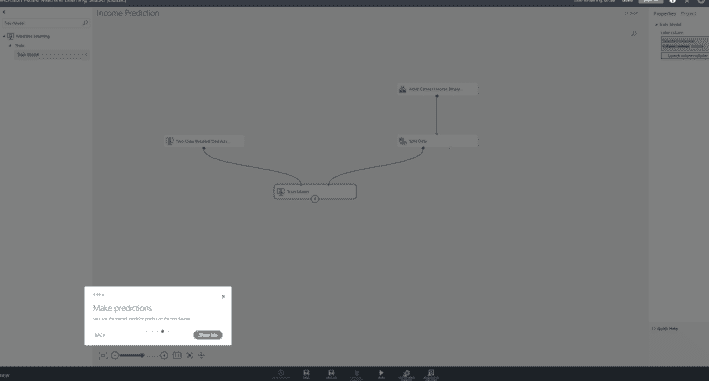

图 6-15 训练完成后建议进行预测

在图 6-16 中，将“评分模型”（Score Model）块放置在调色板上以便预测，并放置且连接“评估模型”（Evaluate Model）块以评估预测值。

在图 6-17 中，程序建议点击底部状态栏上的“运行”（Run）按钮同时运行训练和预测，因为预测模型已经完成。点击“显示”（Show Me）按钮继续。

## 82 机器学习：概念、工具与数据可视化

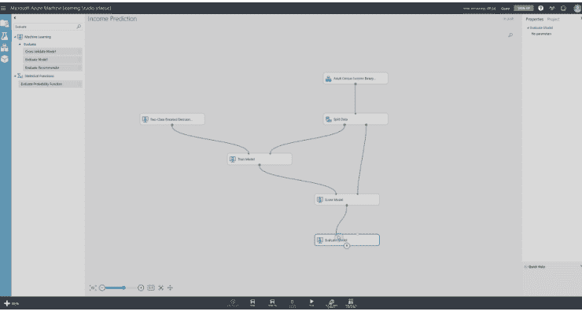

图 6-16 预测模型布局

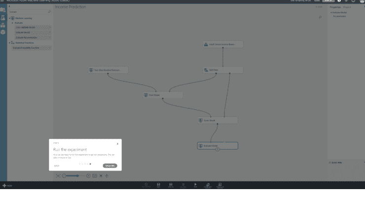

图 6-17 建议点击‘运行’进行预测

图 6-18 显示了通过按下“运行”按钮启动的模型训练。这是一个教程，但实际上世界上某处 Azure 云数据中心的服务器正在执行该操作。

图 6-19 显示除数据集外的所有块都打上了勾号，表示模型已完成训练并已执行预测。


## 使用 Microsoft Machine Learning Studio 创建预测模型

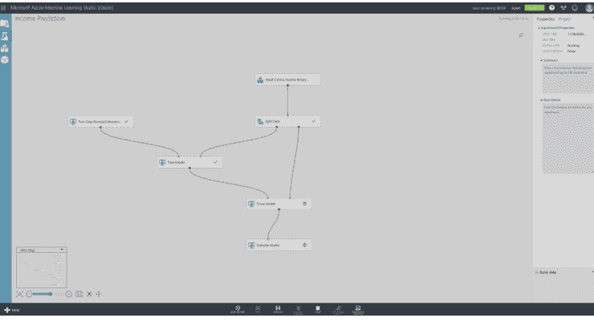

图 6-18 预测模型训练

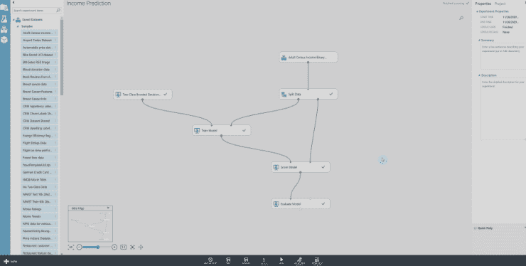

图 6-19 预测模型预测完成

图 6-20 显示了查看评分模型状态的过程，此时模型已完成训练并使用该模型进行了预测。所有模型都可以通过右键访问的“可视化”（Visualize）项目进行训练并执行预测。

## 机器学习：概念、工具与数据可视化

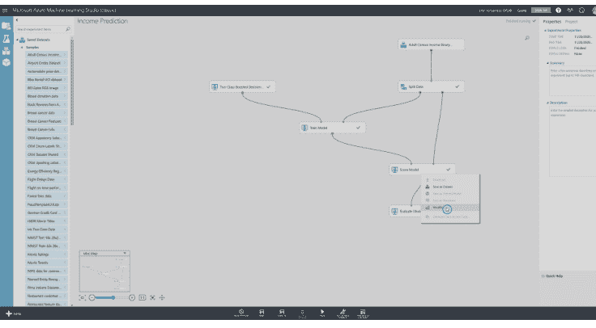

图 6-20 查看预测结果

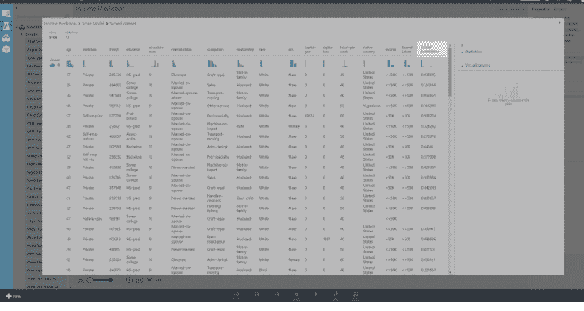

图 6-21 检查预测值

图 6-21 显示了检查评分模型计算的评分标签（Scored Labels）和评分概率（Scored Probabilities）的过程。你可以插入测试数据，并通过评分模型查看预测值以及该预测值的概率。

图 6-22 显示了评分模型的性能。你可以右键点击“评估模型”块，通过“可视化”项目查看你所评估的值。

## 使用 Microsoft Azure Learning Studio 创建预测模型

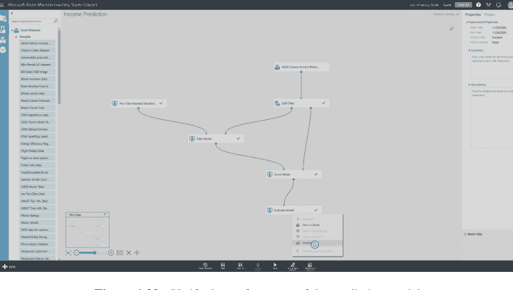

图 6-22 验证预测模型的性能

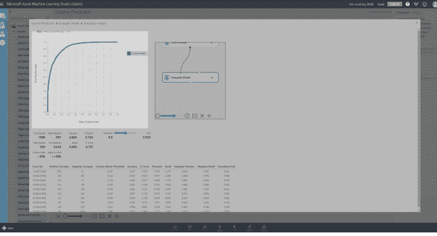

图 6-23 通过“评估模型”获取预测模型的 ROC 曲线

图 6-23 显示了模型的受者工作特征曲线。ROC 曲线显示真阳性与假阳性比例的图表。它是二分类模型预测性能的可视化。ROC 下方的面积越大，性能越好。当然，如果 ROC 面积为 1，你应该怀疑存在过拟合。

图 6-24 显示了通过‘评估模型’对模型性能的评估结果。表 6-1 是性能评估中使用的术语及其含义表。

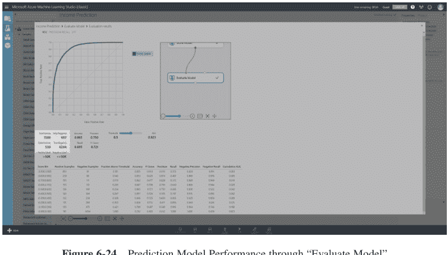

## 表 6-1 性能评估中术语和含义

| 术语 | 含义 |
| --- | --- |
| TP (True Positive) | 真阳性 |
| TN (True Negative) | 真阴性 |
| FP (False Positive) | 假阳性 |
| FN (False Negative) | 假阴性 |
| 准确率 (Accuracy) | (TP+TN)/(TP+TN+FP+FN) |
| 精确率 (Precision) | TP/(TP+FP) |
| 召回率 (Recall) | TP/(TP+FN) |
| F1 分数 (F1 Score) | 当数据不平衡时的一个指标 |

## 使用 Azure Learning Studio 创建预测模型


图 6-25 模型训练

图 6-25 显示了模型的完成。虽然教程只持续了三分钟，但世界上某处 Azure 云数据中心的服务器实际上在执行操作。

图 6-26 显示除数据集外的所有块都打上了勾号，表示模型已完成训练并已执行预测。

图 6-27 显示了检查评分标签标签的过程。

### 6.3.1 将数据导入 Azure

Azure Learning Studio 是基于云的，如果你想用自己的数据构建模型，就需要导入它。点击底部的“+”按钮继续。

## 机器学习：概念、工具与数据可视化


图 6-26 数据导入


图 6-27 数据导入

文件类型根据扩展名自动识别。数据导入完成后，可以在调色板上检查数据集。

## 机器学习：概念、工具与数据可视化


图 6-30 Azure Machine Studio 提供的示例

你也可以通过访问“示例”（Samples）菜单查看 Azure Machine Studio 提供的数据。

### 6.3.2 可视化数据集

在创建预测模型之前，请使用下链接的数据。下载并导入数据后继续。

`https://drive.google.com/file/d/1Ujp-SnVfA4USJbnUWqdiNzlB3SOWeY3/view?usp=sharing`

将数据集放在画布上（如图 6-31 所示），右键点击并点击“可视化”。如图 6-32 所示，你可以检查数据集的行数和列数，并根据所需的模型检查分布。

# 机器学习：概念、工具与数据可视化


|  |  |
| --- | --- |
| 平均值 | 5.8338 |
| 中位数 | 5.8 |
| 最小值 | 4.3 |
| 最大值 | 7.9 |
| 标准差 | 0.8336 |
| 唯一值 | 35 |
| 缺失值 | 0 |
| 特征类型 | 数值特征 |

图 6-33 通过数据可视化的统计结果

此外，你还可以检查图 6-33 所示选属性的统计信息和直方图。

### 6.3.3 数据预处理

一旦插入了实验数据并通过可视化进行了确认，就应该删除缺失或不必要的值。在设计实验之前对数据集进行预处理是非常重要的。因此，在应用机器学习算法之前，必须处理缺失值。

在预处理练习中，添加了一行缺少“物种（Species）”属性的数据，如图 6-34 所示。如果物种值缺失，我们应该删除所有行。

从调色板导入“选择数据集中的列（Select Columns in Dataset）”模块并使用“启动列选择器（Launch column selector）”包含所有列，如5所示。

## 使用 Microsoft Azure Machine Learning Studio 创建预测模型


图 6-34 缺失值


图 6-35 选择数据集中的列以检查缺失数据

机器学习：概念、工具与数据可视化

从调色板导入“清理缺失数据（Clean Missing Data）”模块，并将清理模式设置为“删除整行（Remove entire row）”，如图 6-36 所示。

在点击“运行（Run）”按钮并完成执行后，右键点击“清理缺失数据”模块（如图 6-37 所示），并将悬停在“清理后的数据集（Cleaned Dataset）”项上检查预处理后的数据。然后，点击“可视化（Visualize）”。


图 6-36 使用“清理缺失数据”进行数据预处理


图 6-37 预处理后的数据可视化


如图 6-38 所示，如果“物种”属性中的值缺失，请确认该行已删除。

### 6.3.4 特征定义

一旦处理了数据中的缺失值，就可以使用“数据集（Dataset）”模块中的“选择列（Select Columns）”来选择数据集中的属性值以便应用算法。当然，预处理时使用了“选择数据集中的列”，但在这里它是为了为了实现算法而选择属性值。

在调色板中放置“选择数据集中的列”模块，并通过“启动列选择器”包含花瓣长度（Petal.Length）、花瓣宽度（Petal.Width）和物种（Species）属性值以应用算法，如图 6-39 所示。寻找实现算法的属性值取决于数据科学家的。

### 6.3.5 机器学习算法的选择与实现

一旦选择了要应用于机器学习算法的属性值，你就从整个数据集中划分训练数据和测试数据，然后选择并实现合适的机器学习算法。

在导航调色板中放置一个“划分（Split）”模块，如图 6-40 所示，并使用 70% 作为训练数据。

让我们从调色板将多分类决策森林（Multiclass Decision Forest）导入画布，放置好它，然后查看“属性（Properties）”窗口。要实现的算法是多分类决策森林。属性窗口可以方便地修改算法参数。继续使用默认值，如图 6-41 所示。


使用 Microsoft Azure Machine Learning 创建预测模型


图 6-40 数据划分


图 6-41 多分类决策森林的属性

机器学习：概念、工具与数据可视化


图 6-42 训练选择

在导航调色板中放置“训练模型（Train Model）”模块，如图 6-42 所示，通过“启动列选择器”选择你想要的物种，进行如下连接，并点击“运行（Run）”按钮进行训练。一旦训练完成，右键点击“训练模型”模块并点击“已训练模型（Trained model）”项上的“可视化（Visualize）”按钮查看结果。图 6-43 显示了训练结果。

使用 Microsoft Azure Machine Learning Studio 创建预测模型


图 6-43 训练结果

机器学习：概念、工具与数据可视化


(c) 已训练的树 3


(d) 已训练的树 4

图 6-43（续）


图 6-43（续）


图 6-43（续）

### 6.3.6 使用新数据进行预测

由于模型已完成训练，剩余的 30% 测试数据可以应用于训练好的模型，以评估其预测效果。

使用 Microsoft Machine Learning Studio 创建预测模型


图 6-44 预测模型布局

放置“评分模型（Score Model）”模块，如图 6-44 所示，连接“训练模型”模块和“划分”模块，并点击“运行”按钮进行训练。让我们通过可视化检查预测的鸢尾花类型以及存储在测试数据中的鸢尾花类型。

如图 6-45 所示，你可以看到30% 的测试数据应用于预测模型。

要查看预测结果的评估，在画布上添加“评估模型（Evaluate Model）”模块，并将其与“训练模型”模块关联，如图 6-46 所示。然后按“运行”按钮执行。完成后，使用“可视化”检查模型评估结果。

机器学习：概念、工具与数据可视化


图 6-45 预测值


图 6-46 预测模型评估布局

使用 Microsoft Azure Machine Learning 创建模型

如图 6-47 所示，预测模型评估结果显示了准确率、平均精确率和平均召回率。

如图 6-48 所示，你可以通过比较实际数据与预测数据来进行可视化。

+   指标
* 总体准确率 0.977778
* 平均准确率 0.985185
* 微平均精确率 0.977778
* 宏平均精确率 0.979167
* 微平均召回率 0.977778
* 宏平均召回率 0.977778

图 6-47 预测模型评估结果


+   混淆矩阵

图 6-48 预测结果可视化

## 6.4 练习题

Q1. 说明在 Azure Machine Learning Studio 中创建预测模型的流程

Q2. 描述用于模型评估的 ROC（受试者工作）曲线

Q3. 描述用于模型评估的准确率、精确率、召回率和 F1 分数

## 第章

## 使用 Microsoft Azure Machine Learning Studio 部署 Web 服务

## 7.1 使用 Machine Learning Studio Web 服务部署教程创建预测模型

图 7-1 显示了预测模型教程的完成，并建议构建 Web 服务以远程使用预测模型。点击“显示（Show Me）”按钮进入教程部署 Web 服务


**图 7-1** Web 服务部署教程

# 机器学习：概念、工具与数据可视化

图 7-2 显示了点击“预测性 Web 服务[推荐]”来构建 Web 服务。在不进行任何配置的情况下，点击即可自动构建。

图 7-3 显示了模块是如何自动放置的，构建了一个 Web 服务输入和输出块。


# 使用 Microsoft Azure Studio 创建预测模型


图 7-4 输入值设置


图 7-5 在数据集中放置选择列以进行预测

图 7-4 显示程序建议用户应该将标签列（Label Column）输入值定义为收入属性以外的其他属性，以便预测二值化收入属性属性值。

# 机器学习：概念、工具与数据可视化

在图 7-6 中，用户必须决定输入哪些属性以便通过 Web 服务进行预测。通过从“所有列”中排除“收入（Income）”列来选择并勾选属性值。

在图 7-7 中，程序建议将输出值定义为“评分标签（Scored Labels）”和“评分概率（Scored Probabilities）”，将预测值输出到 Web 服务。


图 7-6 选择预测值


图 7-7 预测输出设置

# 使用 Microsoft Azure Machine Studio 创建预测模型

如图 7-8 所示，在画布上放置“在数据集中选择列”块，并将评分模型（Score Model）连接到 Web 服务的输出。然后点击“启动列选择器”来选择输出的评分标签和评分概率。

如图 7-9 所示，从“无列”开始选择并包含“评分标签”和“评分概率”列。勾选它们并点击底部菜单中的“运行”来训练你的 Web 服务模型。


图 7-8 预测值布局


图 7-9 预测值和评分概率列选择

# 机器学习：概念、工具与数据可视化

一旦你完成了训练（如图 7-10 所示），你就可以使用完成的 Web 服务。从底部菜单点击“部署 Web 服务”。点击图 7-11 中的“测试”按钮来预测完成的模型。

在弹出窗口中输入新的预测数据，如图 7-12 所示，并点击勾选按钮。


图 7-10 Web 服务部署方案


图 7-11 直接使用预测模型

# 使用 Microsoft Azure Machine Studio 创建预测模型


如图 7-13 所示，你可以在底部根据输入数据看到预测结果。


# 图 7-14 Web 服务部署教程完成

图 7-14 显示 Web 服务部署教程已完成。


## 7.2 R 和 Python 语言中的 Web 服务模型

一旦模型完成，就可以使用 R 和 Python 语言从外部访问。将通过一个教程解释将模型作为 Web 服务使用的过程。

如果你已经通过教程发布了 Web 服务，你可以看到它位于 Web 服务类别下的“收入预测 [预测性实验]（Income Prediction [Predictive exp.]）”，如图 7-15。

在连接 R 和 Python 之前，让我们点击图 7-16 中的“测试”按钮。

### 机器学习：概念、工具与数据可视化

如图 7-17 所示，将显示一个输入数据的弹出窗口。插入下方所示的值。在插入数据时，了解现有模型所使用的数据值类型是重要的。


图 7-17 预测数据输入弹出窗口

图 7-18 显示预测无错误。


图 7-18 预测成功

### 使用 Microsoft Azure Studio 创建预测模型 117

在图 7-19 中点击“新 Web 服务体验”以连接 R 和 Python。


图 7-19 Web 服务仪表板

加载窗口将弹出，并出现类别，如图 7-20 所示。点击“使用端点”。


图 7-20 Web 服务管理窗口

### 118 机器学习：概念、工具与数据可视化

图 7-21 显示了提供 API Key 各种值的基础消耗信息。提供的密钥是必要的，最好明智地保存它们。

#### 基础消耗信息

想知道如何消耗信息吗？

| 主密钥 | 密钥 |
| :--- | :--- |
| 想知道如何消耗信息吗？ | 查看此教程。 |
| 请求 | |
| 响应 | |
| 基础消耗信息 | |
| API 帮助 | |

进一步查看，有 Azure 的示例代码，如图 7-22 所示。


图 7-22 示例代码

### 使用 Microsoft Azure Studio 创建预测模型 119


图 7-23 点击执行

#### 7.2.1 使用 R 集成 Web 服务

R 程序可以从 `https://www.r-project.org/` 下载。使用的库是 `RCURL` 和 `rjson`。在 R 中使用 Web 服务需要主密钥和响应值。

如果你编写并运行上述代码，你可以看到来自 Azure Machine Studio 创建的预测，如图 7-24 所示。

```
source <- source("C:\Users\Desktop\azureWebService.R")
[i]<-"Result"
$Results
$ResultsOutput
$ResultsOutput[[i[1]]<-"Scored Labels"
[i]<-$SCORE

$ResultsOutput[[i[1]]<-"Scored Probabilities"
[i]<-"0.003552711531112"
```

### 120 机器学习：概念、工具与数据可视化


图 7-25 Azure Machine Studio Web 服务仪表板

当外部请求返回值时（如图 7-25 所示），你可以在仪表板上看到 Web 服务状态。

#### 7.2.2 使用 Python 集成 Web 服务

Python 语言（3 版本及以上）可以在 `https://www.python.org/` 下载。使用的库是 `urlib.request` 和 `JSON`。Python 3 无需下载任何库。在 Python 中使用 Web 服务需要主密钥和响应值。

如果你编写并运行上述代码，你可以在 Python 控制台中看到预测结果。

```
PS C:\Users\Desktop> python scored_model.py | 'C:\Users\Desktop\scored_model.py' | 'C:\Users\User\AppData\Local\Programs\Python3\python.exe' 'C:\Users\User\Desktop\extensions\azure_python.py'
$results = @(@{"output":{"scored_Probabilities":[0.886532711531112]}}}))
```

## 7.3 练习题

Q1. R 和 Python 语言用于 Web 服务的集成。请解释集成的优势。

Q2. R 和 Python 语言用于 Web 服务的集成。请解释集成过程。

## 第 8 章

## 使用 Microsoft Azure Machine Learning Studio 集成创建预测模型

## 8.1 R 脚本集成

如果你正在使用 Azure Machine Learning Studio 并希望应用给定算法块以外的算法，可以创建并使用 R 脚本块。

### 8.1.1 使用 R 脚本查看数据

在调板中，从调板检索“成人人口收入二分类”（Adult Census Income Binary Classification）数据集并将其放在画布上，如图 8-1 所示。同时放置“执行 R 脚本”（Execute R Script）块。

将数据集连接到“执行 R 脚本”块，如图 8-2 所示，点击右上角的按钮。

124 机器学习：概念、工具与数据可视化


图 8-1 使用 R 脚本的布局


图 8-2 R 脚本修改

Azure Machine Learning Studio 中的 R 脚本有两个映射的输入端口。如图 8-3 所示，仅连接了一个数据集以便检查数据。数据集 1 包含连接到第一个端口的数据。

使用 Microsoft Azure Machine Learning 脚本集成创建预测模型


图 8-3 R 脚本编辑

#### Source (8-3)

```
dataset1 <- maml.mapInputPort(1)
mydata <- dataset1[sample(1:nrow(dataset1), 50, replace=FALSE),]

data.set = mydata
print(mydata)
maml.mapOputPort("data.set");
```

之后，取 50 个 `dataset1` 值并将其放入“my data”中。你可以通过 `print` 函数检查整个样本数据。源可以在下方找到。

点击底部的“运行”（Run）按钮训练预测模型。之后，你可以通过点击“结果数据集”（Result Dataset）菜单中的“可视化”（Visualize）来检查提取的值，如图 8-4 所示。

图 8-5 显示 50 个 `dataset1` 值已正确输入。

## 图 8-4 使用 R 脚本的数据可视化


## 图 8-5 数据可视化结果


图 8-6 显示了通过 R 设备可视化由 R 脚本的 `head()` 函数提取的数据集部分。

使用 Microsoft Azure Machine Learning 脚本集成创建预测模型


图 8-6 R 脚本输出结果

### 8.1.2 使用 R 脚本实现决策树

在用 R 脚本应用决策树之前，让我们看看 iris 数据集。iris 数据由统计学家 Fisher 提供了三种鸢尾花（Setosa）、变色花（Versicolor）和毛尾花（Virginica）的花萼和花瓣长度，如图 8-7 所示。由于数据量小，iris 数据易于用于机器学习。

表 8-1 显示了 iris 数据集的描述。关于 iris 数据集的更多信息可以在 `https://archive.ics.edu/datasets/iris` 找到。

在创建模型之前，导入 iris 数据，如图 8-8 所示。iris 数据也作为样本数据在 Azure Machine Learning 中提供。

128 机器学习：概念、工具与数据可视化


Versicolor（变色花）

Setosa（鸢尾花）

Virginica（毛尾花）

图 8-7 iris 数据

## 表 8-1 iris 数据解释

| 列名 | 含义 | 数据类型 |
| --- | --- | --- |
| Species | 三种鸢尾花（Setosa, Versicolor, Virginica）之一 | String |
| Sepal.Width | 花萼宽度 | Number |
| Sepal.Length | 花萼长度 | Number |
| Petal.Width | 花瓣宽度 | Number |
| Petal.Length | 花瓣长度 | Number |


图 8-8 导入数据

使用 Microsoft Azure Machine Learning 脚本创建模型

插入数据集后，将来自调板的数据放在画布上，如图 8-9 所示。放置“在数据集选择列”（Select Columns in Dataset）块来定义算法。如图 8-10 所示放置后，点击“列选择器”（Column Selector）。


130 机器学习：概念、工具与数据可视化

选择所有列以应用算法，如图 8-11 所示。

放置“执行 R 脚本”（Execute R Script）块，如图 8-12 所示，点击 R 脚本属性上方的小方块来修改 R 脚本。在 R 脚本窗口底部输入代码，如图 8-13 所示。


图 8-11 用于算法的列选择


图 8-12 R 脚本修改

131 使用 Microsoft Azure Machine Learning 脚本集成创建预测模型


图 8-13 R 脚本编辑

#### Source (rpart)

```
library(rpart)
Dataset1 <- maml.mapInputPort(1)
irisData <- rpart(Species~Sepal.Length + Sepal.Width + Petal.Length + Petal.Width, method="class",
data=Dataset1)

print(irisData)
plot(irisData)
summary(irisData)

plot(irisData, uniform=TRUE, margin=0.1, compress=TRUE, main="Classification Tree")
text(irisData, use.n=TRUE, all=TRUE, cex=0.8, pretty=1)
data.set = Dataset1

maml.mapOutputPort("data.set")
```

使用图 8-14 中的可视化验证应用到 R 脚本的结果是完好的的。

你可以如图 8-15 所示看到结果没有问题。R Studio 和 Azure Machine Studio 的结果相同吗？

132 机器学习：概念、工具与数据可视化


图 8-14 决策树结果可视化


图 8-15 使用 R 脚本的决策树结果（Azure Machine Studio）

如图 8-16 所示，相同的结果已应用到 R Studio。图 8-17 显示了应用到 iris 数据的决策树可视化。可以看到三种鸢尾花根据标准进行了分类。

133 使用 Microsoft Azure Machine Learning 脚本集成创建预测模型

分类树：

rpart(formula = Species ~ Sepal.Length + Sepal.Width + Petal.Length + Petal.Width, data = irisData, method = "class")

树中实际使用的变量：

[1] Petal.Length.Petal.Width

根节点误差：100/150 = 0.6667

| CP | nsplit | rel | xerror | xstd |
|---|---|---|---|---|
| 1 | 50 | 0 | 1.00 | 1.24 | 0.046361 |
| 2 | 44 | 1 | 0.50 | 0.80 | 0.061101 |
| 3 | 01 | 2 | 0.06 | 0.09 | 0.029086 |

n= 150

图 8-16 使用 R 脚本的决策树结果（R Studio）


图 8-17 使用 R 的决策树可视化

134 机器学习：概念、工具与数据可视化

## 8.2 Python 脚本集成

Python 和 R 脚本一样，也可以与 Azure Machine Studio 集成。

放置并连接 iris 数据并点击“在数据集选择列”以集成 R 语言。要集成 Python 语言，选择要包含的所有列，如图 8-18 所示。

然后，从调板中导入并放置“执行 Python 脚本”（Execute Python Script）块，如图 8-19 所示。


图 8-18 用于算法的列选择


图 8-19 Python 集成的布局

## 使用 Microsoft Azure Machine Learning Studio 集成创建预测模型

要修改 Python 脚本，点击图 8-20 中 Python Script Properties 窗口右上角的框。

参考图 8-21 中“Execute Python”块的使用来理解其工作原理。


图 8-20 Python 脚本修改


图 8-21 Execute Python 块的使用方法

### 136 机器学习：概念、工具与数据可视化

在 Python Script 窗口底部输入代码，如图 8-22 所示。

当你完成 Python 脚本的编写后，点击底部菜单中的“Run”按钮完成学习。完成后，右键点击“Execute Python Script”块，然后点击 Python Device 项目上的“Visualize”以查看结果，如图 8-23 所示。

图 8-24 的结果显示数据已正确输出。


图 8-22 Python 脚本编辑

#### 源代码 (8-22)

```python
import pandas as pd
def azureml1_main(dataframe1 = None):
    print('Input pandas.DataFrame #1: \r\n\n{0}'.format(dataframe1))
    return dataframe1,
```

# 使用 Microsoft Azure Machine Learning Studio 集成创建预测模型 137


图 28-23 使用 Python 进行的数据可视化


图 28-24 使用 Python 脚本的数据输出结果

### 8.2.1 使用 Python 脚本实现 K-Means

使用“Select Columns in Dataset”块（如图 28-25 所示），选择要发送到“Execute Python Script”块的列。

然后从调色中导入并放置“Execute Python Script”块，如图 28-26 所示。


# 机器学习：概念、工具与数据可视化


图-8-25 用于实现算法的选择列


图-8-26 Python 集成布局

要修改 Python 脚本，点击图 8-27 中 `Python Script Properties` 窗口右上角的框。

要应用 `K-Means` 算法，将 `Sepal.Length` 和 `Sepal.Width` 的值设置为特征，如图 8-28 所示。上面的代码是为创建三个簇编写的。代码如下。

# 使用 Microsoft Azure Machine Learning Studio 集成创建预测模型 139


图 8-27 Python 脚本修改


图 8-28 Python 脚本编辑

# 源代码 (8-28)

```python
import pandas as pd
from sklearn.cluster import KMeans
def azureml_main(dataframe1 = None):
    feature = dataframe1[['Sepal.Length','Sepal.Width']]

    model = KMeans(n_clusters=3)
    model.fit(feature)
    predict = pd.DataFrame(model.predict(feature))
    predict.columns=['predict']

    r = pd.concat([feature,predict], axis=1)
print(r)
return dataframe1,
```

# 140 机器学习：概念、工具与数据可视化

使用图 8-29 中的可视化来验证应用于 Python 脚本的结果是否保持完整。

如图 8-30 所示，你可以看到取决于 `Sepal.Length` 和 `Sepal.Width` 值的 `Predict` 值。预测值是簇群组。


图 8-29 K-Means 结果可视化


图 8-30 使用 Python 脚本的 K-Means 结果

# 使用 Azure Machine Learning 脚本创建预测模型 141

| Sepal length | Sepal width | predict |
|---|---|---|
| 0 | 5.1 | 3.5 | 2 |
| 1 | 4.9 | 3.0 | 2 |
| 2 | 4.7 | 3.2 | 2 |
| 3 | 4.6 | 3.1 | 2 |
| 4 | 5.0 | 3.6 | 2 |
| 5 | 5.4 | 3.9 | 2 |
| 6 | 4.6 | 3.4 | 2 |
| 7 | 5.0 | 3.4 | 2 |
| 8 | 4.4 | 2.9 | 2 |
| 9 | 4.9 | 3.1 | 2 |
| 10 | 5.4 | 3.7 | 2 |
| 11 | 4.8 | 3.4 | 2 |
| 12 | 4.8 | 3.0 | 2 |
| 13 | 4.3 | 3.5 | 2 |
| 14 | 5.8 | 4.0 | 2 |
| 15 | 5.7 | 4.4 | 2 |
| 16 | 5.4 | 3.9 | 2 |
| 17 | 5.1 | 3.5 | 2 |
| 18 | 5.7 | 3.8 | 2 |
| 19 | 5.1 | 3.8 | 2 |
| 20 | 5.4 | 3.4 | 2 |
| 21 | 4.6 | 3.6 | 2 |
| 22 | 5.0 | 3.0 | 2 |
| 23 | 5.1 | 3.3 | 2 |
| 24 | 4.8 | 3.4 | 2 |
| 25 | 5.2 | 3.0 | 2 |
| 26 | 5.0 | 3.4 | 2 |
| 27 | 5.2 | 3.5 | 2 |
| 28 | 5.2 | 3.2 | 2 |
| 29 | 4.7 | ... | 2 |
| 120 | 6.9 | 3.2 | 1 |
| 121 | 5.6 | 2.8 | 0 |
| 122 | 7.7 | 2.7 | 1 |
| 123 | 6.3 | 2.7 | 1 |
| 124 | 7.2 | 3.3 | 1 |
| 125 | 6.7 | 3.2 | 1 |
| 126 | 6.2 | 2.8 | 0 |


图 8-31 使用 Python 的 K-Means

如图 8-31 所示，你可以看到应用于 Python 脚本的结果。

## 8.3 练习题

Q1. 燃料类型是什么？

Q2. 说明 Python 脚本如何提高准确性。

## 第 9 章 预测价格

数据集有 205 行，包含 26 个属性。

# 表 9-1 数据集

| Attribute | Distribution |
|---|---|
| Sepal length |  |
| Sepal width |  |
| predict |  |
| 0 | 5.1 | 3.5 | 2 |
| 1 | 4.9 | 3.0 | 2 |
| 2 | 4.7 | 3.2 | 2 |
| 3 | 4.6 | 3.1 | 2 |
| 4 | 5.0 | 3.6 | 2 |
| 5 | 5.4 | 3.9 | 2 |
| 6 | 4.6 | 3.4 | 2 |
| 7 | 5.0 | 3.4 | 2 |
| 8 | 4.4 | 2.9 | 2 |
| 9 | 4.9 | 3.1 | 2 |
| 10 | 5.4 | 3.7 | 2 |
| 11 | 4.8 | 3.4 | 2 |
| 12 | 4.8 | 3.0 | 2 |
| 13 | 4.3 | 3.5 | 2 |
| 14 | 5.8 | 4.0 | 2 |
| 15 | 5.7 | 4.4 | 2 |
| 16 | 5.4 | 3.9 | 2 |
| 17 | 5.1 | 3.5 | 2 |
| 18 | 5.7 | 3.8 | 2 |
| 19 | 5.1 | 3.8 | 2 |
| 20 | 5.4 | 3.4 | 2 |
| 21 | 4.6 | 3.6 | 2 |
| 22 | 5.0 | 3.0 | 2 |
| 23 | 5.1 | 3.3 | 2 |
| 24 | 4.8 | 3.4 | 2 |
| 25 | 5.2 | 3.0 | 2 |
| 26 | 5.0 | 3.4 | 2 |
| 27 | 5.2 | 3.5 | 2 |
| 28 | 5.2 | 3.2 | 2 |
| 29 | 4.7 | ... | 2 |
| 120 | 6.9 | 3.2 | 1 |
| 121 | 5.6 | 2.8 | 0 |
| 122 | 7.7 | 2.7 | 1 |
| 123 | 6.3 | 2.7 | 1 |
| 124 | 7.2 | 3.3 | 1 |
| 125 | 6.7 | 3.2 | 1 |
| 126 | 6.2 | 2.8 | 0 |

如图 9-9 所示，选择要通过学习预测的列。项目选择了并检查了价格值，因为目标是通过汽车数据集预测该值。

如图 9-10 所示，放置 `Score Model` 模块，并点击 `Run` 按钮进行学习。


图 9-9 选择预测值


图 9-10 查看预测值的模型布局

# 152 机器学习：概念、工具与数据可视化


学习完成后，右键点击 `Score Model` 模块查看可视化的预测结果。你可以在 `Scored Labels` 中看到预测值，如图 9-11 所示。

## 9.2 分类新闻文章类别

此示例使用 2004 年路透社数据集进行分类。此外，我们将比较基于多分类决策森林 `Multiclass Decision Forest` 和二分类决策森林 `Two-class Decision Forest` 的一对全分类器 `One-vs-All Classifier` 的应用。算法参数采用默认。本示例来自微软 AI Gallery。更多信息以及导入项目的详情，请访问下方链接。

https://gallery.courainelligence.com/Experiment/Multiclass-Classification-News-categorization-2

约有 23,000 个训练数据集和 781,000 多个测试数据集。现有数据集包含 103 个类别，属于以下四个大类：

- 企业-工业 `CCAT`
- 政府与社会 `GCAT`
- 经济与经济指标 `ECAT`
- 证券、商品交易与市场 `MCAT`

这四个值被用作标签。

### 多分类：新闻分类


图 9-12 通过 SAS 的样本数据


图 9-13 设置列名

该项目未提供样本数据，而是通过 Azure 平台的功能性 SAS 获取数据，如图 9-12 所示。因此，请使用上面的链接导入项目。

由于导入 SAS 的样本数据中列名未定义，请使用 `Edit Metadata` 功能将 `id` 和 `article` 分别更改为 `Col1` 和 `Col2`，如图 9-13 所示。

# 154 机器学习：概念、工具与数据可视化


图 9-14 修改数据列名


图 9-15 数据划分

同样，将中间的数据集更改为 `category` 和 `id`，如图 9-14 所示。

如图 9-15 所示，使用 `Split Data` 模块。将 `Splitting Mode` 设置为 `Regular Expression`。

## 练习 155


图 9-16 数据连接


图 9-17 去重值

为了比较多分类决策森林和一对全分类器，你需要将三个数据集合并为两个。使用 `Join Data` 函数根据 `id` 列的值进行数据连接，如图 9-16 所示。

为了避免合并后的数据集重复，使用 `Remove Duplicate Rows` 功能移除重复的 `id` 列，如图 9-17 所示。

# 156 机器学习：概念、工具与数据可视化


使用 `Feature Hashing` 将 `article` 转换为整数，如图 9-18 所示。

为了训练模型，使用 `Select Columns in Dataset` 选择 `id` 和 `article` 以外的列，如图 9-19 所示。

点击 `Launch Column Selector` 排除值。图 9-20 显示了 `Feature Hashing` 生成的值。


为了训练模型，如图 9-21 所示，安排 `Train Model` 模块和要应用的算法。二分类决策森林和一对全分类器位于左侧，多分类决策森林位于右侧。然后选择 `Launch column selector` 选择模型的结果。

# 158 机器学习：概念、工具与数据可视化


图 9-22 标签选择


图 9-23 R 脚本放置

选择 `Launch column selector`，你应该看到 `category` 作为结果。选择 `category` 并勾选完成，如图 9-22 所示。如图 9-23 所示，安排 `Score Model` 模块检查预测值，并使用 `Execute R Script` 函数。点击右上角的 `Edit Script` 按钮。

# 图 9-24 R 脚本编辑

# 图 9-25 R 脚本结果

编写 R 脚本以检查准确性，如图 9-24 所示。代码如下。

如图 9-25 所示，你可以看到将 R 脚本应用于数据集。

# 160 机器学习：概念、工具与数据可视化


图 9-26 R 脚本结果


图 9-27 评估模型

如图 9-27 所示，放置 `Score Model` 和 `Evaluate Model` 模块查看结果。

# 练习 161

### 指标

| Metric | Value |
|---|---|
| Overall accuracy | 0.75531 |
| Micro-averaged precision | 0.71436 |
| Macro-averaged precision | 0.75694 |
| Micro-averaged recall | 0.75531 |
| Macro-averaged recall | 0.69772 |
| F1-score | 0.73048 |

## 混淆矩阵


图 9-28 混淆矩阵

如图 9-28 所示，混淆矩阵显示了模型的结果。

## 9.3 使用异常检测探索信用组

此练习使用 Statlog 数据。我们将应用并比较异常检测算法：`PCA`、`One-Class Support Machine` 和决策森林。数据如下：

```
http://archive.uci.edu/ml/datasets/Statlog+German+Data
```

表 9-2 显示了德国数据的配置。

# 表 9-2 Statlog（德国数据）数据集

| 属性名称 | 值分布 |
|---|---|
| Col1 | 账户状态：A11: ... < 0 DM<br>A12: 0 <= ... < 200 DM<br>A13: ... >= 200 DM/工资，至少一年<br>A14: 无账户 |
| Col2 | 持续时间（月，数值） |
| Col3 | 信用历史：A30: 无贷款/已还清<br>A31: 本行贷款已还清<br>A32: 现有贷款已还清<br>A33: 过去曾逾期<br>A34: 关键账户/其他贷款（非本行） |
| Col4 | 目的：A40: 汽车（新）<br>A41: 汽车（旧）<br>A42: 家具/设备<br>A43: 收音机/电视<br>A44: 家电<br>A45: 维修<br>A46: 教育<br>A47: （假期——是否存在？）<br>A48: 重新培训<br>A49: 商业<br>A10: 其他 |
| Col5 | 贷款金额（数值） |
| Col6 | 储蓄账户/债券：A61: ... < 100 DM<br>A62: 100 <= ... < 500 DM<br>A63: 500 <= ... < 1000 DM<br>A64: ... >= 1000 DM<br>A65: 未知/无储蓄账户 |
| Col7 | 目前就业：A71: 失业<br>A72: ... < 1 年<br>A73: 1 <= ... < 4 年<br>A74: 4 <= ... < 7 年<br>A75: ... >= 7 年 |
| Col8 | 分期率占可支配收入的百分比（数值） |
| Col9 | 个人状况和性别：A91: 男性：离婚/分居 |

# 表 9-2（续表）

| 属性名称 | 数值分布 |
| --- | --- |
| Col10 | A92: 女性:离婚/分居/已婚<br>A93: 男性:单身<br>A94: 已婚/寡偶<br>A95: 女性:单身<br>其他债务人/担保人<br>A101: 无<br>A102: 共同申请人<br>A103: 担保人 |
| Col11 | 现居住时长（数值） |
| Col12 | 房产<br>A121: 房地产<br>A122: 若非A121: 建筑储蓄/人寿保险<br>A123: 若非A122: 汽车或其他（不在属性6中）<br>A124: 未知/无产 |
| Col13 | 年龄（数值） |


| Col14 | 其他分期付款<br>A141: 银行<br>A142: 商店<br>A143: 无 |

| Col15 | 住房<br>A151: 租租<br>A152: 自有<br>A153: 免费 |

| Col16 | 在此行的现有信用额度数量（数值） |

| Col17 | 职业<br>A171: 失业/无技能 — 非居民<br>A172: 无技能 — 居民<br>A173: 熟练员工/公务员<br>A174: 管理层/自雇/高素质员工/官员 |

| Col18 | 需要抚养的人数（数值） |

| Col19 | 电话<br>A191: 无<br>A192: 是，以客户名注册 |

| Col20 | 外国工人<br>A201: 是<br>A202: 否 |

| Col21 | 标签<br>1: 正常<br>2: 风险 |

# 机器学习：概念、工具与数据可视化

这些示例来自微软 AI 库。欲需更多信息和关于导入项目的细节，请访问以下链接。https://gallery.azure.ai//Anomaly-Detection-Credit-Risk-5

为了使工作流更清晰，如图 9-30 所示，将列名从“Col21”改为“Label”。

如图 9-31 所示，整个数据集分为 75% 的训练数据和 25% 的测试数据。


图 9-30 元数据编辑


图 9-31 数据划分

## 练习 165

异常检测学习包含单一类别（假设为 Normal）的数据。

使用正则表达式过滤器删除包含“Risky”标签的行，如图 9-32 所示。

从调色板中提取“单类支持向量机（One-Class Support Vector Machine）”模块，将 Trainer 节点设置为“Parameter Range”，并如图 9-33 所示设置参数值。


图 9-32 删除无用行


图 9-33 设置单类支持向量机参数

## 166 机器学习：概念、工具与数据可视化

从调色板中提取“基于 PCA 的异常检测（PCA-Based Anomaly Detection）”模块，将 Trainer模式设置为“Parameter Range”，并如图 9-34 所示设置值。

从调色板中提取“调优模型超参数（Tune Model Hyperparameters）”模块，并将“Specify Parameter Sweeping”值设置为“Entire grid”，如图 9-35 所示。


图 9-34 设置基于 PCA 的异常检测参数


图 9-35 调优模型超参数设置

从调色板中提取“训练模型（Training Model）”模块并进行连接，如图 9-36 所示。

从调色板中提取“评分模型（Score Model）”模块，如图 9-37 所示进行连接，并勾选输出中的“附加评分列（Append score columns）”。


图 9-36 用于学习的模型放置


图 9-37 评分模型放置

## 168 机器学习：概念、工具与数据可视化

预测概率值为负，如图 9-38 所示。由于概率不能为负值，必须进行修正。

因此，需要使用数据归一化（Normalize Data）函数修正负值。从调色板中提取“Normalize Data”模块并如图 9-39 所示进行连接。然后将转换方法改为“Logistic”，并选择“评分概率（Scored Probabilities）”。


图 9-38 特定模型


图 9-39 数据归一化

如图 9-40 所示，负概率值已变为正值。


图 9-40 归一化值

图 9-41 模型布局

图 9-41 显示了异常模型。点击“运行（Run）”按钮进行学习并查看结果。


## 练习 171

ROC 精度/召回率 LIFT


图92 训练模型的 ROC

| 评分分箱 (Score Bin) | 正样本 | 负样本 | 阈值以上 | 准确率 | F1 分数 | 精度 | 负召回率 | 累计 AUC |
|---|---|---|---|---|---|---|---|---|
| 0.800,1.000 | 5 | 0 | 0.000 | 0.700 | 1.000 | 0.000 | 0.700 | 0.000 |
| 0.600,0.800 | 5 | 0 | 0.000 | 0.700 | 0.625 | 0.503 | 0.500 | 0.700 |
| 0.500,0.600 | 7 | 1 | 0.068 | 0.706 | 0.520 | 0.610 | 0.575 | 0.720 |
| 0.400,0.500 | 12 | 2 | 0.104 | 0.716 | 0.297 | 0.517 | 0.755 | 0.220 |
| 0.300,0.400 | 28 | 5 | 0.542 | 0.608 | 0.462 | 0.433 | 0.556 | 0.769 |
| 0.200,0.300 | 25 | 8 | 0.685 | 0.530 | 0.333 | 0.333 | 0.420 | 1.000 |
| 0.100,0.200 | 0 | 10 | 1.000 | 0.300 | 0.462 | 0.300 | 1.000 | 0.000 |
| 0.000,0.100 | 0 | 0 | 1.000 | 0.300 | 0.000 | 0.000 | 0.000 | 0.000 |

图-93 评估结果

图-92 显示了训练模型的接收者工作曲线（ROC）。ROC 是一个显示真阳性与假阳性比例的图表。这允许我们评估训练模型的性能。图-43 显示了预测模型的评估结果。

## 9.4 预测早高峰期间江南站的流量人数

在本章中，我们将应用线性回归，根据公共数据门户提供的 1–4 号线（首尔地铁）出站统计数据，预测早高峰期间江南站的流量。

请访问下方网址获取地铁 1–4 号线的人数：

https://www.data.go.kr/dataset/15003169/fileData.do

这些数据是 2016 年 1 月 1 日至 2016 年 10 月 31 日期间江南站的流量数据；数据集行数为 610，且每个提供的数据集的属性不同。

数据集的组成如表 9-3 所示。

| 属性 | 属性描述 |
| --- | --- |
| 日期 | 乘客进出的时间 |
| 站名 | 乘客进出的站名 |
| 线路 | 乘客进出的线路名 |
| 类型 | 进出类型 |
| 折扣 | 乘客分布（普通、学龄、老人，2016年1-5月） |
| 时间 | 乘客进出的时间（单位：小时） |

### 表 9-4 预处理后的数据集

| 属性 | 属性描述 |
|---|---|
| Type | 上车或下车的类型（开启/关闭） |
| DoW (星期几) | 星期（周一~周日） |
| Time | 上车和下车的时间（05~02） |


图 9-44 预测模型所需的数据

在构建预测模型之前，检索预处理后的数据并按照图 9-44 所示放置。

## 174 机器学习：概念、工具与数据可视化


图 9-45 检查导入的数据


图 9-46 检查导入的数据集分布

右键点击数据集块以进行视视化，如图 9-45 所示，并检查数据是否完整以及所需数据是否已就位。

在使用图 9-46 中的数据集后，我们可以确认数据显示正常，且“Date（日期）”属性对于生成预测模型不是必需的。

在训练预测模型之前，您应该指定哪些属性用于学习。

图 9-47 用于训练预测模型的属性选择

图 9-48 排除训练预测模型时不需要的属性

检索“Select in Dataset”（在数据集中选择）块，如图 9-47 所示，然后点击右侧的“Launch column selector”（启动列选择器），以指定使用哪个属性来训练预测模型。

由于我们要使用除“Date”以外的所有属性来构建预测模型，请选择“ALL COLUMNS”（所有列）并使用排除函数排除“Date”，如图 9-48 所示。

## 176 机器学习：概念、工具与数据可视化


图 9-50 预测模型“Linear Regression（线性回归）”算法块和“Train Model（训练模型）”块的放置

如果您指定为某个属性训练预测模型，如图 9-49 所示，请放置一个“Split Data（分割数据）”块，通过将训练数据设置为70%，预测数据设置为30%来分割数据。

分割训练数据后，放置用于预测模型训练的“Train Model”块以及将应用于预测模型的算法“Linear Regression（线性回归）”块，如图 9-50 所示。

图 9-51 选择用于预测的属性

图 9-52 检查已训练的预测模型

放置块后，您需要通过点击“Train Model”块中的“Launch column selector”来设置您将学习的属性。

本章所需的数值是早高峰期间上车的人数。因此，目标是预测 07:00 到 08:00 之间的人数，因此选择 07-08 属性，如图 9-51 所示。

点击底部的“Run（运行）”按钮，当模型完成学习后，通过如图 9-52 所示的可视化检查已训练的模型。

## 178 机器学习：概念、工具与数据可视化


图 9-53 检查已训练预测模型中按特征划分的权重


图 9-54 已训练模型的预测放置

如图 9-53 所示，您可以检查应用算法的参数值以及每个属性学习到的权重。

现在预测模型已完成，放置用于预测的“Score Model（评分模型）”块，并将 30% 分割的数据连接到“Train Model”块，如图 9-54 所示。

## 练习 179


图 9-55 检查预测结果


图 9-56 检查预测值

如果点击底部的“Run”按钮后预测完成，让我们通过图 9-55 所示的可视化来检查预测结果。如图 9-56 所示，您可以查看 07:00 到 08:00 之间的估算人数。


现在预测已完成，如图 9-57 所示放置“Evaluate Model（评估模型）”块，并点击底部的“Run”按钮。

### 评估

| 指标 | |
|---|---|
| Mean Absolute Error（平均绝对误差） | 174 |
| Root Mean Squared Error（均方根误差） | 268.3 |
| Relative Absolute Error（相对绝对误差） | 0.0613 |
| Relative Squared Error（相对平方误差） | 0.007514 |
| Coefficient of Determination（决定系数） | 0.99246 |

### 直方图


图 9-58 评估结果

图 9-59 显示了对预测模型的评估。

## 9.5 心脏病预测

此练习使用支持向量机和逻辑回归树来预测心脏病的发生，心脏病数据可以通过此处获取：http://archive.ics.uci.edu/ml/machine-learning-databases/heart-disease/processed.cleveland.data

心脏病数据有 303 行，14 个属性。

这种练习可以在下表中找到：

### 表 9-5 心脏病数据集

| 属性名称 | 属性说明 |
|---|---|
| age | 年龄 |
| sex | 性别（1 = 男性；0 = 女性） |
| chestpain | 胸痛类型 - 1: 典型心绞; 2: 非典型心绞; 3: 放射性疼痛; 4: 无胸痛 |
| resting_pressure | 静息血压 |
| serum_cholesterol | 血清胆固醇（mg/dl） |
| fasting_blood_sugar | 空腹血糖（>120 mg/dl 为是） |
| resting_ecg | 静息心电图结果 - 0: 正常; 1: 有 ST 波异常或抬高; 2: 可能或明显的室肥厚 |
| max_heart_rate | 最大心率 |
| exercise_induced_angina | 运动诱发心绞（1 = 是；0 = 否） |
| st_depression_by_exercise | 运动引起的 ST 抑制 |
| slope_of_peak_exercise | 运动峰值斜率 - 1: 向上; 2: 平坦; 3: 向下 |
| number_of_vessels | 血管数量（0-3） |
| thal | 血管成像结果 - 3: 正常; 6: 固定缺陷; 7: 可逆性缺陷 |
| heart_disease_diag | 诊断结果（0 = 否；1-4 = 是） |

## 练习 183

### 心脏病预测


图 9-60 导入数据集

### 心脏病预测


图 9-61 设置属性名称

通过 URL 导入 UCI 数据集：http://archive.ics.uci.edu/ml/machine-learning-databases/heart-disease/processed.cleveland.data

数据已检索，但未定义属性名称。通过“Edit Metadata（编辑元数据）”块按顺序写入属性名称。输入的属性名称按顺序输入的。

图 9-64 数据类型转换


图 9-65 选择用于转换的列


图 9-64 显示了在训练预测模型之前，将指定属性转换为整数。

图 9-65 显示了如何设置要转换的列：“sex”、“chestpaintype”、“exercise_induces_angina”、“number_of_major_vessel”、“thal”、“slope_of_peak_exercise”、“fasting_blood_sugar”和“resting_ecg”。

## 机器学习：概念、工具与数据可视化

图 9-66 缺失数据的预处理


图 9-67 缺失数据的预处理范围


导入数据的预处理已完成，所有属性已通过“清理缺失数据”块进行搜索，以确保没有缺失数据。图 9-66 用 –1 填充了缺失数据。

图 9-67 显示了所有属性的缺失数据预处理。

## 练习 187

图 9-68 修改标签预处理的 R 脚本


图 9-69 编辑标签预处理的 R 脚本


当完成缺失数据预处理后，对用于创建预测模型的标签“heart_disease_diag”值的 R 脚本预处理如图 9-68 所示。


图 9-69 显示了一个 R 脚本，该脚本表示如果 `heart_disease_diag` 的值大于 0，则将其替换为 1。心脏诊断被改为 0（否）和 1（是），以便应用于二分类算法。

# 机器学习：概念、工具与数据可视化


## 图 9-70 设置特征数量


## 图 9-71 设置特征的目标列

图 9-70 显示应用于预测模型训练的属性减少到了八个。
图 9-71 是一个配置屏幕，用于将影响最大的八个特征减少到 `heart_disease_diag` 标签。

# 练习 189


## 图 9-72 数据划分


## 图 9-73 二分类 SVM 预测模型

图 9-72 显示了用于预测模型训练和预测的数据预处理和数据分割。70% 的数据被分配用于训练，30%的数据被分配用于预测。
图 9-73 显示了使用二分类支持向量机算法的预测模型安排。

# 190 机器学习：概念、工具与数据可视化


## 图 9-74 为预测模型设置标签


## 图 9-75 为预测模型设置标签

图 9-74 显示了如何通过应用二分类支持向量机算法确定模型的预测值。
图 9-75 显示了通过“启动列选择器”将 `heart_disease_diag` 列设置为预测模型的结果。

# 练习 191


## 图 9-76 多分类决策森林预测模型


## 图 9-77 调整模型超参数

图 9-76 显示了使用多分类决策森林算法的预测模型安排。
图 9-77 显示了使用“调整模型超参数”对给定算法和数据集的顶级参数 `heart_disease_diag` 进行经验性选择。对准确率进行了目标并应用。

# 192 机器学习：概念、工具与数据可视化


## 图 9-78 为预测模型设置标签


## 图 9-79 二分类决策预测模型

图 9-78 显示了如何使用多分类决策森林算法确定模型的预测值。与二分类支持预测模型一样，它被设置为 `heart_disease_diag`。
图 9-79 显示了使用二分类决策森林算法的预测模型安排。

# 练习 193


### 图 9-80 为预测模型设置

心脏病预测 > 评估模型 > 评估结果

| 指标 | |
| :--- | :--- |
| 总体准确率 | 0.846154 / 0.868132 |
| 平均准确率 | 0.846154 / 0.868132 |
| 微平均精确率 | 0.846154 / 0.868132 |
| 宏平均精确率 | 0.847523 / 0.86619 |
| 微平均召回率 | 0.846154 / 0.868132 |
| 宏平均召回率 | |
| 混淆矩阵 | |
| 预测类别 | 0 | 1 |
| :--- | :--- | :--- |
| 0 | |  |
| 1 | | |

### 9-81 二分类支持结果

图 9-80 显示了如何使用二分类支持算法确定模型的预测值。与二分类支持预测模型一样，它被设置为 `heart_disease_diag`。
图 9-81 显示了多分类的准确率、召回率。

# 194 机器学习：概念、工具与数据可视化

图 9-82 显示了二分类支持的 ROC 曲线。通过 ROC 曲线，如图 9-83 所示，它是良好的。

| 阈值 | 准确率 | 召回率 | F1 分 | LIFT |
| :--- | :--- | :--- | :--- | :--- |
| 0.000, 0.100 | 0.154 | 0.714 | 0.500 | 0.529 |
| 0.100, 0.200 | 0.226 | 0.758 | 0.710 | 0.637 |
| 0.200, 0.300 | 0.297 | 0.813 | 0.738 | 0.889 |
| 0.300, 0.400 | 0.385 | 0.791 | 0.711 | 0.771 |
| 0.400, 0.500 | 0.471 | 0.791 | 0.817 | 0.815 |
| 0.500, 0.600 | 0.484 | 0.802 | 0.780 | 0.727 |
| 0.600, 0.700 | 0.626 | 0.725 | 0.737 | 0.614 |
| 0.700, 0.800 | 0.736 | 0.637 | 0.668 | 0.751 |
| 0.800, 0.900 | 0.736 | 0.637 | 0.668 | 0.921 |
| 0.900, 1.000 | 0.458 | 0.589 | 0.418 | 1.000 |

## 9.6 使用 K-Means 聚类查找相似公司

本实践课程使用维基百科数据集应用 K-Means 算法来预测公司之间的相似性。
本练习取自 Microsoft AI Gallery。有关导入项目的更多信息，请访问下方链接：
https://gallery.azure.ai/Experiment/Clustering-Find-similar-companies-6

维基百科数据集的数据量少于 500 条。项目的维基百科数据集经过预处理。预处理包括：
- 移除 wiki 格式
- 移除非字母数字字符
- 将所有文本转换为小写
- 在已知的情况下添加公司类别

维基百科数据集包含三个属性：标题、类别和文本，如图 9-84 所示。


## 图 9-84 维基百科数据集

# 196 机器学习：概念、工具与数据可视化


图 9-85 特征哈希


图 9-86 实现 PCA 的 R 脚本

特征哈希是文本分析模型的一种方法，用于将文本转换为整数。在图 9-85 中，我们可以看到 `text` 属性被选为目标。
图 9-86 显示了实现主成分分析（PCA）的 R 脚本。点击右上角的“Script”按钮查看源码。


你可以像图 9-87 所示看到 R 脚本源码。现有文本属性 `text` 的值的维度较高，已应用 PCA 将其降至 10 维。
如图 9-88 所示，排除 `PC1` 以选择用于学习的属性。

# 198 机器学习：概念、工具与数据可视化


图 9-89 设置 K-Means 算法中的簇数量。


图 9-90 训练聚类模型

对于图 9-89 中的模型有两种 K-Means 算法。左侧 K-Means 算法的簇数量为 2，右侧 K-Means 算法的簇数量为 3。
与我们之前学的不同，聚类模型使用了不同的模块，即“Train Clustering Model”模块。图 9-90 显示通过属性 `PC2 ~ PC10` 应用了聚类。

# 199 练习题


图 9-91 聚类结果可视化


图 9-92 K-Means 结果可视化（右）

点击底部的“Run”完成课程。然后右键点击“Train Clustering Model”模块（如图 9-91 所示）查看可视化结果。
右侧 K-Means 算法模块中的簇数量定义为 3。图 9-92 显示三个簇成功出现。

# 200 机器学习：概念、工具与数据可视化


图 9-93 K-Means 结果可视化（左）

左侧 K-Means 算法模块中的簇数量定义为 2。图 9-93 显示两个簇成功出现。

# 9.7 练习题

Q1. 描述如何预处理缺失数据。
Q2. 解释在预测模型创建过程中划分数据的原因。

# 第三部分

# 可视化

# 第10 章

# 可视化

## 10.1 可视化的定义

在维基百科中，可视化定义为“创建图像、图表或动画以传递信息的任何技术”。数据可视化的最重要的一点是信息的传递。这种信息是通过数据可视化获取的信息。特别是在这个时代，数据可视化正引起大量的关注。原因有很多，但事实是视觉功能是人类感官中最强大的信息接收器，而且接收到的响应信息取决于其传输的最显著性。

## 10.2 数据可视化的目的与功能

### 10.2.1 数据可视化的目的

- (1) 数据分析
虽然可视化通常用于传递信息，但它也可以作为功能来使用。例如，你可以以某种方式进行可视化，以便轻松检查是否存在离群数据。此外，你可能绘制 Q-Q 图查看数值数据是否符合正态分布。
- (2) 分享数据分析结果
应该尽可能使用可视化方法来共享数据分析结果，以便向他人轻松传达数据的含义，或传播数据中处理后的信息。
通常，可以添加点、线、图例、标题和单位。通过这种方式，可以表达额外信息，从而在解释图表时避免错误。这有助于观众更快速地识别信息。

### 10.2.2 数据可视化的功能

- (1) 通信
通信是一种快速、容易传递数据中信息的功能，这可以通过可视化实现。通过以用户为中心制作图表，你可以使通信功能最大化。
- (2) 发现
发现是指通过展示信息来识别新事实。换句话说，它不是人们已经已知的信息，而是从未知数据中提供新事实的信息。特别是它是研究领域经常使用的功能。
- (3) 洞察
洞察是在信息可能被隐藏或已知的情况下，为了获得更好的理解对信息的表达。

## 10.3 练习题

Q1. 解释可视化的定义。
Q2. 解释可视化的目的。
Q3. 解释可视化的功能。

# 第11 章

# 使用 Power BI 进行可视化

## 11.1 Power BI 简介

除了成功构建预测模型外，良好地可视化结果同样重要。即使是显示良好预测的模型，如果结果不能容易解释，也可能无法传递。数据可视化帮助数据科学家向利益相关者或终端用户轻松解释预测模型的结果。Power BI 是一种业务分析解决方案，让你能够可视化数据、与组织共享洞察，或将数据导入应用程序或网站。

## 11.2 下载并登录 Power BI Desktop

登录 Power BI 需要用户需要工作或学校邮箱地址。Gmail 或 Hotmail 等个人邮箱帐户无法使用。访问 https://powerbi.microsoft.com/en-us/ 下载 Power BI Desktop。
点击图 11-1 所示的“START FREE”进行下载。
点击图 11-2 中的“DOWNLOAD FREE”按钮运行给定的 MSI 安装文件。如果你想安装不同的语言，或 32 位或 64 位版本的程序，点击“ADVANCED DOWNLOAD OPTIONS”获取安装文件。
填写图 11-3 所示的表单创建 ID 并登录。如果你已经有 Microsoft 账户，点击下方的“Sign in”按钮登录。
如图 11-4 所示，在弹出窗口中输入你的 Microsoft 账户登录。
图 11-5 显示登录成功。

# 210 机器学习：概念、工具与数据可视化


用业务智能创建数据驱动文化

## 图 11-1 Power BI 官方页面


## 图 11-2 下载页面

# Power BI Desktop

- 获取数据
- 最近源
- 打开报告
协作与共享
登录以发布报告、访问认证的数据集并在 Power BI 服务中共享内容。
开始使用
想购买 Power BI 许可证吗？立即购买
更新
查看 Power BI 本月更新的新功能和改进。
Power BI 博客
关注 Power BI 团队的最新消息、资源和更新。
论坛
访问 Power BI 论坛提问并与 Power BI 社区的其他用户互动。
教程想了解更多关于 Power BI 的信息吗？

## 图 11-3 登录弹出窗


## 图 11-4 登录窗口

# 212 机器学习：概念、工具与数据可视化


图 11-5 登录完成

## 11.3 配置 Power BI Desktop 屏幕

如图 11-6 所示，Power BI Desktop 有三个视图：报告、数据和模型。


图 11-6 配置 Power BI Desktop 屏幕

(1) 报告：用户可以使用创建的查询进行多页面的优秀可视化处理，并与他人共享。
(2) 数据：用户可以以数据模型的格式查看报告中的数据，这允许他们添加度量、创建新列并管理关系。
(3) 模型：用户可以获得数据模型中建立的关系的图形化表示，并根据需要进行管理或修改。

## 11.4 数据导入

Power BI Desktop 允许导入各种数据，包括数据库、在线服务和 Excel 表格。
从菜单栏中点击“获取数据”（Get Data）并选择“更多…”。点击可查看各种导入方法。

### 11.4.1 从 Data World 导入开放数据

通过“获取数据”菜单可以找到关于插入数据的额外支持，如图 11-7 所示。


图 11-7 额外的数据导入方法

# 214 机器学习：概念、工具与数据可视化


**图 11-8** Data World


**图 11-9** 从 Data World 导入数据的参数值输入弹出窗口

如图 11-8 所示，搜索并点击“Data World”。
为了如图 11-9 所示从 Data World 导入数据，用户必须在“所有”（Owner）、“数据集 ID”（Dataset Id）和“查询”（Query）字段中输入信息。

## 使用 Power BI 进行可视化 215


## 图 11-10 数据导入示例站点

图 11-10 中的链接如下。
https://data.world/jonloyen/an-intro-to-dataworld-dataset
强调该链接的原因是，如上述地址所示，“所有”（Owner）和“数据集 ID”（Dataset Id）字段对于从 Data World 导入开放数据关重要。
在上述链接中，“Jonloyen”所有者，“an-intro-to-dataworld-dataset”是数据集 ID。

# 216 机器学习：概念、工具与数据可视化


图 11-11 插入参数值从 Data World 导入数据


图 11-12 Data World 登录弹出窗口

提取上述链接的“所有”（Owner）和“数据集 ID”（Dataset Id），并将其输入图 11-11 所示的参数中。
如图 11-12 所示，从“Data World”导入数据需要一个账户。


登录后成功导入数据，会出现“加载”（Load）选项，如图 11-13 所示。
加载后，你可以检查 Data World 中导入的数据，如图 11-14 所示。

# 218 机器学习：概念、工具与数据可视化


图 11-15 Power BI 中的“Data World”数据


图 11-16 如何在 Power BI 中利用“Data World”数据

数据导入完成后，数据将出现在“字段”（Fields）面板中，如图 11-15 所示。
图 11-16 中的图表显示数据已无错误导入。

## 11.4.2 导入 Excel 文件

要导入 Excel 数据文件，点击“获取数据”菜单中的“Excel”按钮，如图 11-17 所示。支持的 Excel 文件扩展名为 .xl, .xlsx, .xlsm, .xlsb, .xls 和 .xlw。文本和 CSV 文件可以通过底部的“文本/CSV”按钮导入。
加载后，你可以检查 Excel 文件中输入数据的详情，如图 11-18 所示。


图 11-17 数据导入方法


图 11-18 成功

## 220 机器学习：概念、工具与数据可视化

数据导入完成后，数据将出现在“字段”（Fields）面板中，如图 11-19 所示。
图 11-20 中的表格显示数据已无错误导入。


## 11.5 Power BI 可可视化

为了从数据获取有意义的模式或洞察，应利用适用于数据集的可视化图表。Power BI 原生提供了这些可视化类型。

### 11.5.1 如何在 Power BI 中使用可视化

你可以通过 Power BI 的“可视化”（Visualizations）菜单方便地可视化插入的数据。“可视化”菜单位于图 11-21 的右上角。数据导入应在可视化之前完成。然后从可视化菜单选择图表进行应用。图 11-22 右上角的图表可以通过更改大小进行自由调整。


图 11-21 Power BI 提供的可视化

## 机器学习：概念、工具与数据可视化


图 11-22 如何应用 Power BI 可视化


图 11-23 Power BI 可视化结果

此外，通过将数据调整到图 11-23 中的“轴”（Axis）、“图例”（Legend）和“值”（Value）字段，可以轻松创建更详细的图表。

## 11.5.2 可视化图类型

图 11-24 显示堆叠条形图。堆叠条形图是水平堆叠元素的图表，有助于识别单个元素对总量的贡献。图 11-25 显示堆叠柱状图。堆叠柱状图是垂直堆叠元素的图表，有助于识别单个元素对总量的贡献。


图 11-26 显示聚集条形图。聚集条形图通过水平条形表示来比较单个数据值。
图 11-27 显示聚集柱状图。聚集柱状图通过垂直柱形表示来比较单个数据值。


图 11-26 聚集条形图


图 11-27 聚集柱状图

**图 11-28** 100% 堆叠条形图

**图 11-29** 100% 堆叠柱状图

图 11-28 显示 100% 堆叠条形图。100% 堆叠条形图将单个元素的和转换为 100%，代表水平条形中单个数据的权重。
图 11-29 显示 100% 堆叠柱状图。100% 堆叠柱状图将单个元素的和转换为 100%，代表垂直柱形中单个数据的权重。


## 226 机器学习：概念、工具与数据可视化


图 11-30 显示折线图。折线图适用于确定数据趋势。
图 11-31 显示面积图。面积图有助于识别数据随时间的变化幅度。


图 11-32 堆叠面积图


图 11-33 折线与堆叠柱状图

图 11-32 显示堆叠面积图。堆叠面积图有助于识别数据之间的趋势和贡献。
图 11-33 显示折线与聚集柱状图。当数据值较宽时，折线与聚集柱状图有助于理解数据。
图 11-34 显示折线与聚集柱状图。如果数据值范围很大，折线与聚集柱状图易于理解数据。
图 11-35 显示带形图。。带形图可以快速可视化排名最高的数据。

## 使用 Power BI 进行视觉化

图 11-36 显示了一个瀑布图。瀑布图用于比较通过增加或减少数值受影响的累积值。特别是，它被用于随时间序列或其他类别的测量值变化，以及当审计影响总值的重大变化时。
图 11-37 显示了一个散点图。散点图可以发现数字之间的相关性。如果你希望显示两个数值之间的关系，或者希望在 x、y 坐标系中绘制两个数值组，则它特别有用。


图 11-36 瀑布图


图 11-37 散点图

图 11-38 显示了一个饼图。饼图表示单个元素占整体的百分比。
图 11-39 显示了一个环形图。环形图与饼图相似，它们都表示部分与整体的关系。区别在于中心是空的，留有放置标签或图标的空间。


图 11-40 树状图


图 11-41 地图

图 11-40 显示了一个树状图。树状图将分级数据显示为一组嵌套的正方形。矩形按大小排序，最大的在左上，最小的在右下。特别是，它被用于表示大量的分级数据，或指示每个部分与整体之间的比例。
图 11-41 显示了一个地图。地图将位置数据链接到地图上，以比较量化数据的大小。


图 11-42 填充地图


图 11-43 漏斗图

图 11-42 显示了一个填充地图。填充地图使用阴影、色调和图案来指示特定值如何根据特定地点或区域而不同。它主要用于在地图上显示量化信息以及处理社会经济数据时。
图 11-43 显示了一个漏斗图。漏斗图用于可视化顺序连接的过程，即线性过程。


图 11-44 仪表盘

图 11-45 卡片

| Fri | | |
| :--- | :--- | :--- |
| 136001 | 260617 | |
| 07 - 08 | 08 - 09 | |
| Mon | | |
| 157561 | 294864 | |
| 07 - 08 | 08 - 09 | |
| Sat | | |
| 36990 | 78165 | |
| 07 - 08 | 08 - 09 | |
| Sun | | |
| 16368 | 26252 | |
| 07 - 08 | 08 - 09 | |

图 11-46 多行卡片

图 11-44 显示了一个仪表盘。仪表盘显示测量进度或目标 KPI 的单个值。图表的线条代表目标值，阴影代表朝目标的进度。
图 11-45 显示了一个卡片。卡片在磁贴上以大数字形式仅显示一个元素。它主要用于跟踪最核心的数字。
图 11-46 显示了多行卡片。多行卡片在磁贴上显示了几个元素的大量值。


图 11-47 KPI

图 11-47 显示了一个 KPI。KPI 是显示可衡量目标进展程度的图表。

## 11.6 在 Azure Machine Learning Studio 中使用学习结果

虽然预测性人工智能至关重要，但通过视觉化表达学习结果也至关重要。将数据导入 Power BI 并尝试使用 Excel 文件视觉化 Azure Learning Studio 的结果。

### 11.6.1 Excel 文件

放置“Convert to CSV”模块，如图 11-48 所示。


图 11-48 获取结果数据

点击“Run”按钮进行学习。然后，如图 11-49 所示，右键点击 CSV 文件。在“Get Data”菜单中点击“Excel”按钮。CSV 文件可以通过底部的“Text/CSV”导入，也可以选择文件。


图 11-49 下载 Excel


图 11-50 数据导入


图 11-51 Excel 数据导入

如图 11-51 所示，Excel 数据已成功导入。导入的数据可以在图 11-52 的右侧找到。


图 11-52 在 Power BI 中的 Excel 数据

图 11-53 显示了应用于簇图的导入数据。你可以根据星期几比较到达和离开的人数。结果显示有更多的人离开。图 11-54 显示了根据星期几由 Azure Learning Studio 预测的离开人数。如上方，结合 Azure Learning Studio 插入的数据带有标签，允许对实际值和预测值进行比较。


图 11-55 100% 堆叠柱图


图 11-56 查看项目

图 11-55 显示了应用于 100% 堆叠柱图的结果。你可以看到根据星期几来看，周日的离开人数是相对无偏的。图 11-56 显示的完整图表了实时项目。


图 11-57 饼图


图 11-58 查看项目

如图 11-57 所示，我们可以使用饼图查看整体数据的比例。此外，饼图还可以实时视觉化所选项目，如图 11-58 所示。


图 11-59 树状图


图 11-60 查看项目

图 11-59 显示了一个树状图。每天的离开人数可以看作一个矩形区域。“树状图”允许你如图 11-60 所示实时查看所选项目。由于其直观的外观，它有时被用作数据选择的按钮。


图 11-61 折线图


图 11-62 视觉化结果

图 11-61 显示了一个图表。从周一到周日可以看到明显的下降趋势。图 11-62 显示了应用结果。结合 Azure Learning Studio，可以导入数据并通过视觉和预测结果获取洞察。

## 11.7 练习题

Q1. 使用饼图视觉化以下数据。请写出比例。

| Data | 0 | 1 | 0 | 2 | 4 | 3 | 0 | 0 | 2 | 1 | 3 | 4 | 2 | 2 | 1 | 0 | 1 | 4 | 3 |

Q2. 使用 100% 堆叠柱图视觉化以下数据。

| Mon | Tue | Fri | Thu | Wed | Sat | Sun |
| :--- | :--- | :--- | :--- | :--- | :--- | :--- |
| 0 | 0 | 1 | 1 | 0 | 0 | 1 |
| 0 | 0 | 1 | 0 | 1 | 0 | 0 |
| 0 | 1 | 1 | 0 | 1 | 0 | 1 |
| 0 | 0 | 1 | 1 | 1 | 1 | 0 |
| 1 | 0 | 1 | 1 | 0 | 1 | 1 |
| 1 | 1 | 1 | 1 | 0 | 1 | 0 |
| 0 | 1 | 0 | 0 | 0 | 1 | 0 |
| 1 | 0 | 1 | 1 | 0 | 1 | 1 |
| 1 | 0 | 0 | 1 | 0 | 1 | 1 |
| 1 | 1 | 1 | 0 | 0 | 1 | 0 |

## 第 12 章

## 在 Power BI 中使用 R 进行可视化

### 12.1 R 介绍

如果用户继续使用 R Studio 部署 Azure Machine Learning Studio Web 服务，他们将能够顺利地进行。然而，在 Power BI Desktop 中使用 R 可视化对象时存在一些限制：
- 数据大小限制——用于 R 可视化对象绘图的数据限制为 150,000 行。如果选择了超过 150,000 行，则仅使用前 150,000 行，并在图像上显示消息。
- 计算时间限制——如果 R 可视化对象的计算超过五分钟，执行将超时并导致错误。
- 关系——与其他 Power BI Desktop 可视化对象一样，如果选择了来自没有定义关系的不同表的数据字段，将会发生错误。
- R 可视化会在数据更新、数据过滤和数据高亮时刷新。然而，图像本身是非交互的，且不能作为交叉过滤的源。
- 当你高亮其他可视化对象时，R 可视化对象会做出响应，但你无法点击 R 可视化对象中的元素来交叉过滤其他元素。
- 只有绘制到 R 默认显示设备的图表会在画布上正确显示。请避免显式使用不同的 R 显示设备。
- 在此版本中，32 位的 Power BI Desktop 不会自动识别 R 的安装，因此你必须手动提供 R 安装目录的路径，路径位于**选项 > 选项 > R 脚本**。

### 12.2 如何使用 R 脚本编辑器

点击图 12-1 右侧“可视化化”类别下的“R 脚本”。
R 脚本编辑器将出现，如图 12-2 所示。


图 12-1 R 脚本编辑器位置


图 12-2 R 脚本编辑器

导入数据，如图 12-3 所示，并在 R 脚本编辑器中点击你想要使用的数据。如果你勾选右侧要使用的数据，你可以看到脚本被自动修改。
你可以通过点击图 12-4 中的框运行修改后的 R 脚本。


# 图 12-3 在 R 脚本编辑器中导入数据


# 图 12-4 如何运行 R 脚本


图 12-5 R 脚本执行结果

你可以看到图 12-5 中执行的 R 脚本。

### 12.3 使用 Power BI R 脚本进行数据分析的可视化

在应用数据分析可视化之前，让我们学习学习变量。根据特征，变量分为数值型数据和分类数据。
长度、功率和数量等数值数据以数值形式表示，性别和区域等分类数据则以预设的级别表示。数值数据具有定量的属性数值值，而分类数据具有定性的属性级别。
根据变量的数量，图表可能会不同。单变量数据包含一个变量，多变量数据意味着由几个变量组成。
让我们利用 Power BI R 脚本功能，根据数据特征对数据分析进行可视化。


### 12.3.1 数值单变量图

在“获取数据”菜单中查找插入数据的额外支持，如图 12-6 所示。

搜索并点击“R 脚本”，如图 12-7 所示。


图 12-8 使用 R 脚本导入 tooth growth 数据

源 (12-8)

```
Tooth_data <- ToothGrowth
```

导入 R 支持的数据以创建数值单变量图。输入源，如图 12-8 所示。

- `ToothGrowth` 数据

`ToothGrowth` 数据集包含了一项研究维生素 C 对 60 只实验鼠牙齿生长影响的实验结果。每只动物接受了三种剂量水平的维生素 C 之一（0.5、1 和 2 mg/天），通过两种给药方法之一：橙汁或抗坏血酸（维生素 C 的一种形式，编码为 VC）。

`ToothGrowth` 数据的属性是“len”（意味着牙齿长度）、“supp”（意味着支持类型 VC 或 OJ）和“dose”（意味着毫克/天的剂量数）。

加载后，你可以检查 `ToothGrowth` 数据，如图 12-9 所示。

数据导入完成后，用户可以注意到数据现在出现在“字段”中，如图 12-10 所示。检查右侧的“字段”以将数据导入 R 脚本。


### 图 12-9 ToothGrowth 数据


### 图 12-10 ToothGrowth 数据

数值数据如重量是连续的。通常情况下，身高等数据符合正态分布。


### 图 12-11 ToothGrowth 数据


### 图 12-12 ToothGrowth 数据


### 图 12-13 ToothGrowth 分布


### 图 12-14 ToothGrowth 分布


### 图 12-15 ToothGrowth 分布


### 图 12-16 ToothGrowth 分布


### 图 12-17 ToothGrowth 分布

### 源代码 (12-19)

```
# dataset <- data.frame(dose, len, supp)
# dataset <- unique(dataset)

qqnorm(dataset$len, pch = 20)
qqline(dataset$len)
```

### 12.3.2 分类单变量图

点击“获取数据”（Get Data）菜单查找插入数据的更多支持，如图 12-20 所示。


图 12-20 额外数据导入方法

搜索并点击如图 12-21 所示的“R脚本”图标。生成示例数据以创建分类单变量图。在 R脚本窗口中输入以下源代码，如图 12-22 所示。

256 机器学习：概念、工具与数据可视化


图 12-21 R 脚本数据导入方法


图 12-22 生成示例数据

源代码 (12-22)

```
set.seed(1)
lang <- sample(x=1:5, size=100, replace=TRUE)
lang <- c("R", "JAVA", "Python", "C", "Swift")[lang]
Lang_data <- data.frame(lang)
```

加载后，你可以检查创建的示例数据，如图 12-23 所示。输入源代码后，你可以看到图表没有正常绘制，如图 12-24 所示。


图 12-23 示例数据生成完成


图 12-24 Power BI 中的 R 脚本错误

258 机器学习：概念、工具与数据可视化

### 源代码 (12-24)

```
# dataset <- data.frame(lang)
# dataset <- unique(dataset)

seed(1)
Lang_data.tab <- table(Lang_data)
barplot(Lang_data.tab,main="",col="Blue",xlab="Language",ylab="Number")
```

然而，在图 12-25 中，你可以看到 R Studio 运行正常。


图 12-25 R Studio


### 图 12-26 语言数据柱图

```
# dataset <- data.frame(lang)
# dataset <- unique(dataset)

set.seed(1)
lang <- sample(x=1:5, size=100, replace=TRUE)
lang <- c("R", "JAVA", "Python", "C", "Swift")[lang]
Lang_data <- data.frame(lang)
Lang_data.tab <- table(Lang_data)
barplot(Lang_data.tab,main="",col="Blue",xlab="Language",ylab="Number")
```

在 R 脚本窗口中输入以下源代码，如图 12-26 所示。由于导入过程中数据结构变化导致的错误，让我们利用 R Studio 的源代码作为解决此问题的手段。

260 机器学习：概念、工具与数据可视化


你可以检查柱图是否正在正常绘制。在 R 脚本窗口中输入下方源代码，如图 12-27 所示，以绘制相对比例柱图。

执行 R 脚本后，你可以看到相对比例柱图已经创建，如图 12-28 所示。


### 源代码 (12-28)

```
# dataset <- data.frame(lang)
# dataset <- unique(dataset)

set.seed(1)
lang <- sample(1:5, size=100, replace=TRUE)
lang <- c("R", "JAVA", "Python", "C", "Swift")[lang]
Lang_data <- data.frame(lang)
Lang_data.tab <- table(Lang_data)
Lang_data.prop <- prop.table(Lang_data)
barplot(Lang_data.prop,main="",col="Blue",xlab="Language",ylab="Number")
```

饼图用于介绍分类数据的分布。在 R 脚本窗口中输入以下源代码，如图 12-29 所示。


图 12-29 语言数据饼图

262 机器学习：概念、工具与数据可视化


图 12-30 语言数据饼图

源代码 (12-30)

```
# dataset <- data.frame(lang)
# dataset <- unique(dataset)
set.seed(1)
lang <- sample(x=1:5, size=100, replace=TRUE)
lang <- c("R", "JAVA", "Python", "C", "Swift")[lang]
Lang_data <- data.frame(lang)
Lang_data.tab <- table(Lang_data)
pie(Lang_data.tab, main="Language")
```

你可以看到饼图已经创建，如图 12-30 所示。

### 12.3.3 数值双变量图

在绘制数值图之前，你需要安装一个包来导入 Galton 数据。在 R Studio 中输入以下代码，如图 12-31 所示。设置下载区域，下载将开始。下载完成后，在 R Studio 中输入以下源代码，如图 12-32 所示。你可以通过 `dim()` 函数检查数据的结构。


图 12-31 插入 Galton 数据的包

```
install.packages("HistData")
```


图 12-32 插入 Galton 数据的包

```
library(HistData)
data(Galton)
dim(Galton)
```

机器学习：概念、工具与数据可视化

通过在 R 脚本窗口中输入以下源代码导入 Galton 数据，如图 12-33 所示。


### 源代码 (12-33)

```
library(HistData)
Galton_data <- data(Galton)
```

- Galton 数据

Galton (1886) 以表格形式展示了这些数据，显示了 205 对父母出生的 928 名成年子女及其父母身高的交叉表。我们视觉上平滑了双变量频率分布，显示出形成的同心类似椭圆，从而为相关性、回归和双变量正态分布奠定了基础。创建了一个包含 928 个观测值的数据框：

- parent：数值向量：父母身高（父亲和母亲的平均值）

- child：数值向量：子女身高


图 12-34 Galton 数据导入成功

加载后，你可以检查 Galton 数据，如图 12-34 所示。在 R 脚本中输入下方源代码，如图 12-35 所示，以分析父母与子女身高之间的关系。


图 12-35 父母与子女身高之间的关系

266 机器学习：概念、工具与数据可视化


图 12-36 父母与子女身高之间的关系

### 源代码 (12-36)

```
# dataset <- data.frame(child, parent)
# dataset <- unique(dataset)

plot(child ~ parent, data = dataset, pch = 19, main = "The relationship between the parent and child height")
```

图 12-36 间接显示存在相关性。让我们通过线性回归线来确保存在相关性。


图 12-37 父母与子女身高之间的回归线


图 12-38 父母与子女的回归线

在 R 脚本窗口中输入下方源代码，如图 12-37 所示，以绘制线性回归线。

图 12-38 的结果确认了正相关性。

### 源代码 (12-38)

```
# dataset <- data.frame(child, parent)
# dataset <- unique(dataset)

plot(child ~ parent, data = dataset, pch = 19, main = "The relationship between the parent and child height")
lm.fit <- lm(child ~ parent, data = dataset)
abline(lm.fit, col = "Blue")
```

之前的图似乎没有代表所有的 928 个数据点。由于它们重叠在同一个区域，让我们对散点图进行散化。在 R 脚本窗口中输入以下源代码，如图 12-39 所示。


图 12-39 父母子女身高的散点图

### 在 Power BI 中使用 R 进行可视化


图 12-40 父母与孩子身高散点图

### 来源 (12-40)

```r
# dataset <- data.frame(parent, child)
# dataset <- unique(dataset)
```

```r
plot(jitter(child, 3) ~ jitter(parent, 3), data = dataset, main = "The relationship between the parent and child height", xlab="parent", ylab="child")
```

图 12-40 显示了散点图上的点。

机器学习：概念、工具与数据可视化


### 来源 (12-41)

```r
# dataset <- data.frame(child, parent)
# dataset <- unique(dataset)

library(HistData)
dataset <- Galton
tab <- table(dataset)
x <- as.numeric(dimnames(tab)$parent)
y <- as.numeric(dimnames(tab)$child)
axis.grid <- expand.grid(x,y)
plot(axis.grid, tab, cex=sqrt(tab/pi), col="Blue", pch=19, main="The relationship between the parent and child height", xlab="parent", ylab="child")
```

图 12-41 显示了点的大小与其频率成正比。该图的表示方式与图 12-41 相同。它被称为气泡图。要应用气泡图，请在 R 脚本窗口中输入以下源码，如图 12-41 所示。

### 12.3.4 分类二变量图

在绘制分类二变量图之前，让我们通过导入 R Studio 提供的 Titanic（泰坦尼克号）数据来查看其结构。

### 在 Power BI 中使用 R 进行可视化 271


图 12-42 Titanic 数据结构

### 来源 (12-42)

```r
Titanic
```

在 R Studio 中输入以下源码，如图 12-42 所示。

- Titanic 数据

Titanic 数据集提供了关于“泰坦尼克号”客轮船在该次灾难性首次航行中乘客的命运相关信息，并根据经济地位（等级）、性别、年龄和幸存情况进行了总结。

272 机器学习：概念、工具与数据可视化


图 12-43 Titanic 数据堆叠柱图

### 来源 (12-43)

```r
par(mfrow = c(2,1))
barplot(apply(Titanic, c(4,1), sum), col =c("Red", "Blue"), main = "Number of Survivors by Seat Class")
legend("topleft", fill = c("Red", "Blue"), c("Death", "Survive"))
spineplot(margin.table(Titanic, c(1,4)), col = c("Red", "Blue"), main = "Number of Survivors by Seat Class")
```

图 12-43 显示了根据等级划分的幸存者和死亡人数以及比例。将以下源码输入 R Studio 以实现。


图 12-44 Titanic 数据堆叠柱图

### 来源 (12-44)

```r
par(mfrow = c(2,1))
barplot(apply(Titanic, c(4,2), sum), col = c("Red", "Blue"), main = "Number of Survivors by Sex")
legend("topright", fill = c("Red", "Blue"), c("Death", "Survive"))
spineplot(margin.table(Titanic, c(2,4)), col = c("Red", "Blue"), main = "Number of Survivors by Sex")
```

图 12-44 显示了根据性别划分的幸存者和死亡人数以及比例。将以下源码输入 `R Studio` 以实现。

## 274 机器学习：概念、工具与数据可视化


图 12-45 Titanic 数据堆叠柱图

### 来源 (12-45)

```r
par(mfrow = c(2,1))
barplot(apply(Titanic, c(4,3), sum), col = c("Red", "Blue"), main = "Number Survivors by Age")
legend("topleft", fill = c("Red", "Blue"), c("Death", "Survive"))
spineplot(margin.table(Titanic, c(3,4)), col = c("Red", "Blue"), main = "Number of Survivors by Age")
```

图 12-45 显示了根据年龄划分的幸存者和死亡人数以及比例。将以下源码输入 `R Studio` 以实现。

## 12.4 练习题

Q1. 解释数值数据与分类数据之间的区别。

Q2. 解释单变量数据与二变量数据之间的区别。

Q3. 解释 Q 图（即分位数点图）。

Michalski, Ryszard S., Jaime G. Carbonell, and Tom M. Mitchell (编). Learning: An Artificial Intelligence Approach. Springer Science & Business Media, 2013. 德国

Nilson, Nils J. Artificial Intelligence: A New Synthesis. Elsevier, 1998. 荷兰

Russell, Stuart, and Peter Norvig. “第 1.1 节：什么是 AI?” 于 Artificial Intelligence: A Modern Approach, 1–4. 马来西亚：Pearson Education, 2016. https://people.eecs.berkeley.edu/~russell/intro.html

Shai, Shalev-Schwartz and S. Ben-Dav Shai. Understanding Machine Learning: From Theory to Algorithms. 剑桥: Cambridge University Press, 2014. 英国

Silver, David, A Huang, Chris J. Maddison, Arthur Guez, Laurent Sifre, Serge van den Driessche, Ioannis Antonoglou, and Veda Panneersham. “通过深度神经网络和树搜索掌握围棋游戏.” Nature, 529 (7587) (2016): 484–489. doi:10.1038/nature.6961.

Su, Steph. “Jeopardy! IBM 挑战以及它告诉我们关于语言的信息” 最后修改于2011 年 2 月 25 日. http://stephsreads.blogspot.com/2011/02/jeopardy-ibm-challenge-and-what-it.html

Yang, Ki-cheol. Artificial Intelligence Theory and Practice. Hong Reung Publishing Company, 2018. 韩国
