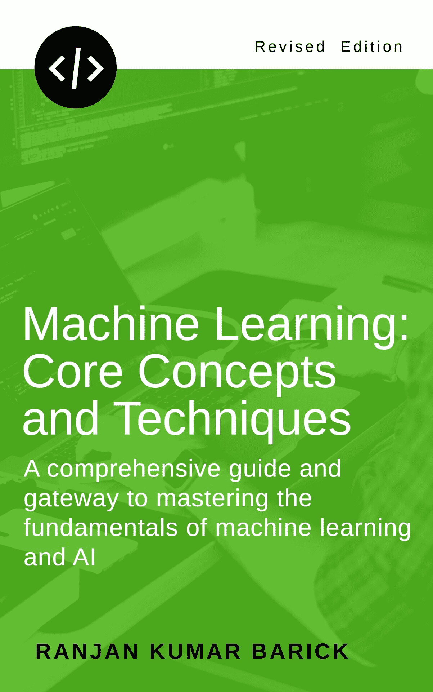

# 机器学习：核心概念与技术：掌握机器学习与人工智能基础的全面指南与入门




## 前言

“机器学习：核心概念与技术”

通过《机器学习：核心概念与技术》解锁数据驱动世界的秘密。本综合指南是掌握机器学习基础的入口，专为渴望探索人工智能变革力量的学生打造。

深入了解基本概念的生动解释，从基础算法到神经网络和强化学习等高级主题。通过实用示例和动手练习，你将获得应对现实世界挑战并在未来职业中做出明智决策的技能。

无论你是初学者还是希望加深理解，本书都能为你在不断发展的机器学习领域取得卓越成就提供知识。准备好将数据转化为洞察，并将洞察转化为影响力——你的旅程从这里开始！

作者 – Ranjan Kumar Barick

# 第 1 章：机器学习导论

## 1.1 什么是机器学习？

机器学习（`ML`）是人工智能的一个子集，专注于开发算法和统计模型，使计算机系统能够通过经验在特定任务上的性能得到提升。换句话说，机器学习允许计算机在无需显式编程的情况下从数据中学习。

机器学习背后的关键思想是创建能够自动识别数据中的模式并利用这些模式进行预测或决策的系统。这种方法在处理传统编程方法难以胜任的复杂问题时特别有用。

示例：考虑电子邮件垃圾邮件检测任务。不是手动编写规则来识别垃圾邮件（例如，“如果电子邮件包含‘尼日利亚王子’，则标记为垃圾邮件”），机器学习算法可以利用大量标记为垃圾邮件或非垃圾邮件的电子邮件数据集进行训练。算法学习识别与垃圾邮件相关的模式和特征，然后可以对新的、未见过的电子邮件进行高准确度的分类。

## 1.2 机器学习的类型

机器学习大致可分为三大类：

### 1.2.1 监督学习

在监督学习中，算法使用标记数据集进行训练，其中每个输入都与正确的输出配对。目标是学习一个函数，能够将新输入映射到正确的输出。

示例：

* 分类：根据内容和元数据预测电子邮件是否为垃圾邮件。
* 回归：根据面积、位置和卧室数量等特征预测房屋价格。

### 1.2.2 无监督学习

无监督学习处理未标记数据。算法尝试在没有预定义输出的情况下发现数据中的隐藏模式或结构。

示例：

* 聚类：根据购买行为将客户分组到不同的细分市场。
* 降维：在保留重要信息的同时减少数据集中的特征数量，例如压缩图像。

### 1.2.3 强化学习

强化学习涉及智能体通过与环境交互来学习决策。智能体以奖励或惩罚的形式获得反馈，并学习随着时间的推移最大化累积奖励。

示例：

* 计算机程序通过与自身对弈下棋并在赢得游戏时获得奖励来学习下棋。

## 1.3 机器学习的应用

机器学习在各个行业和领域有广泛的应用：

1. 医疗保健
   * 基于医学图像或患者数据进行疾病诊断
   * 药物发现与开发
   * 个性化治疗建议

示例：`IBM` 的 `Watson for Oncology` 使用机器学习分析患者病历和研究文献，以建议个性化的癌症治疗方案。

2. 金融
   * 信用卡交易中的欺诈检测
   * 算法交易
   * 信用评分与风险评估

示例：`PayPal` 使用机器学习算法实时检测欺诈交易，显著减少因欺诈造成的财务损失。

3. 营销与电子商务
   * 产品或内容推荐系统
   * 客户细分与定位
   * 流失预测与预防

示例：`Netflix` 的推荐系统使用机器学习根据用户的观看历史和偏好推荐电影和电视节目。

4. 交通运输
   * 自动驾驶汽车
   * 交通预测与路线优化
   * 车辆与基础设施的预测性维护

示例：特斯拉的 `Autopilot` 系统使用机器学习算法处理传感器数据并实时做出决策以实现自动驾驶功能。

5. 自然语言处理
   * 机器翻译
   * 情感分析
   * 聊天机器人与虚拟助手

示例：`Google Translate` 使用神经机器翻译在众多语言之间提供准确的翻译。

6. 计算机视觉
   * 人脸识别
   * 目标检测与跟踪
   * 图像与视频分析

示例：`Facebook` 的 `Deep Face` 系统使用深度学习在上传到平台的照片中进行人脸识别。

## 1.4 机器学习简史

机器学习领域在过去几十年中发生了显著演变：

1. 1950 年代-1960 年代：早期开端
   * 1950 年：艾伦·图灵提出图灵测试以衡量机器智能
   * 1957 年：弗兰克·罗森布拉特开发了感知器，这是一种早期的神经网络模型

2. 1970 年代-1980 年代：基于知识的系统与专家系统
   * 专注于基于规则的系统和符号人工智能
   * 决策树等机器学习算法的发展

3. 1990 年代-2000 年代：统计学习与支持向量机
   * 1995：随机森林算法由 Tin Kam Ho 提出
   * 1997：`IBM` 的 `Deep Blue` 战胜世界国际象棋冠军 Garry Kasparov

### 2000s-2010s: 大数据与深度学习复兴
* 2006：Geoffrey Hinton 提出深度学习技术
* 2012：`AlexNet` 赢得 ImageNet 竞赛，引发了对神经网络的 renewed interest

### 2010s-Present: 先进 AI 与广泛应用
* 2016：`Google` 的 `AlphaGo` 战胜世界围棋冠军 Lee Sedol
* 自然语言处理、计算机视觉和强化学习快速发展
* `ML` 在各个行业和日常应用中的集成

历史意义示例：`IBM` 的 `Deep Blue` 在 1997 年战胜 Garry Kasparov 是 AI 和 `ML` 历史上的一个里程碑时刻。它证明了机器可以在特定、复杂任务中超越人类，而这些任务曾被认为仅限于人类智能的专属领域。这一事件帮助激发了对 AI 和 `ML` 研究与开发的 renewed interest 和投资。

## 1.5 机器学习中的关键概念

为了完善我们的介绍，让我们简要介绍一些机器学习中的基本概念：

1. 特征和标签
   * 特征是用于进行预测的输入变量
   * 标签是我们试图预测的输出变量（在监督学习中）

2. 训练集、验证集和测试集
   * 训练集：用于训练模型
   * 验证集：用于调优超参数并防止过拟合
   * 测试集：用于评估最终模型的性能

3. 模型选择和评估
   * 为给定问题选择合适的算法
   * 使用适当的指标来评估模型性能（例如，准确率、精确率、召回率、F1 分数）

4. 偏差-方差权衡
   * 平衡模型拟合训练数据的能力（低偏差）与其泛化到新数据的能力（低方差）

5. 特征工程
   * 创建新特征或转换现有特征以提高模型性能

6. 超参数调优
   * 优化学习算法本身的参数（例如，学习率、神经网络中的隐藏层数量）

示例：在房屋价格预测任务中，特征可能包括平方英尺、卧室数量和位置。标签将是房屋价格。我们将数据集拆分为训练集、验证集和测试集，选择合适的算法（例如，线性回归或随机森林），进行特征工程（例如，创建“每平方英尺价格”特征），调优超参数，并使用均方误差或 R 平方等指标评估模型的性能。

这篇关于机器学习的全面介绍为后续章节中对特定算法、技术和应用的深入探索奠定了基础。

# Chapter 2: 机器学习基础

## 2.1 数学基础

### 2.1.1 线性代数

线性代数在机器学习中对于表示和操作数据以及理解许多 `ML` 算法至关重要。

关键概念：

1. 向量：有序的数字数组。在 `ML` 中，向量通常表示数据点的特征。示例：一栋房子可能表示为向量 `[1500, 3, 2, 250000]`，其中元素分别代表平方英尺、卧室数量、浴室数量和价格。

2. 矩阵：二维数字数组。在 `ML` 中，矩阵通常表示数据集或向量集合。示例：房屋数据集可以表示为矩阵，其中每一行是一栋房子，每一列是一个特征。

`Python`

```
[1500, 3, 2, 250000]
[1200, 2, 1, 200000]
[1800, 4, 3, 300000]
```

3. 矩阵运算：
   * 加法和减法
   * 乘法
   * 转置

示例：在主成分分析（`PCA`）中，我们使用矩阵乘法将数据投影到低维空间。

4. 特征值和特征向量：用于降维技术如 `PCA`。示例：在 `PCA` 中，协方差矩阵的特征向量代表数据的 principal components。

5. 范数和距离：用于衡量数据点之间的相似性。示例：欧几里得距离常用于 k-最近邻算法中寻找相似数据点。

### 2.1.2 微积分

微积分对于优化机器学习模型和理解它们如何学习至关重要。

关键概念：

1. 导数：衡量函数随输入变化而变化的程度。示例：在梯度下降优化中，我们使用导数来确定如何调整模型参数以最小化损失函数。

2. 偏导数：多变量函数中相对于一个变量的导数。示例：在多元线性回归中，我们计算损失函数相对于每个权重的偏导数以独立更新它们。

3. 梯度：偏导数向量。示例：损失函数相对于模型参数的梯度给出了损失最陡上升的方向。

4. 链式法则：用于计算复合函数的导数。示例：在神经网络中，链式法则用于反向传播中通过多层计算梯度。

5. 积分：用于概率论和一些 `ML` 算法。示例：在核密度估计中，我们使用积分来计算概率密度函数。

### 2.1.3 优化

优化是许多机器学习算法的核心，用于找到模型的最佳参数。

关键概念：

1. 目标函数：我们旨在最小化或最大化的函数。示例：在线性回归中，我们最小化预测值与实际值之间的均方误差。

2. 梯度下降：一种迭代优化算法，按梯度的负值成比例地迈出步伐。示例：随机梯度下降（`SGD`）通常用于训练神经网络。

3. 凸优化：处理具有单一全局最小值的凸目标函数。示例：均方误差损失的线性回归是一个凸优化问题。

4. 拉格朗日乘子：用于约束优化问题。示例：在支持向量机中，拉格朗日乘子用于在约束条件下找到最优超平面。

## 2.2 统计概念

统计学为从数据中进行推断提供了理论基础，这对机器学习至关重要。

### 2.2.1 概率论

1. 随机变量：其值取决于随机现象结果的变量。示例：在垃圾邮件分类任务中，标签（垃圾邮件或非垃圾邮件）可以被视为随机变量。

2. 概率分布：描述随机变量不同结果的可能性。
   * 离散分布（例如，伯努利、二项、泊松）
   * 连续分布（例如，正态/高斯、指数）

示例：人群中个体的身高通常遵循正态分布。

3. 联合、边缘和条件概率：示例：在朴素贝叶斯分类中，我们使用条件概率来预测给定特征值的类别标签。

4. 贝叶斯定理：将事件的条件概率和边缘概率联系起来。示例：朴素贝叶斯分类器使用贝叶斯定理来计算给定观测特征的类别概率。

### 2.2.2 描述性统计

1. 中心趋势度量：均值、中位数、众数 示例：在数据预处理中，我们可能会用特征的均值或中位数替换缺失值。

2. 离散度度量：方差、标准差、范围 示例：特征缩放通常涉及通过减去均值并除以标准差来标准化特征。

相关性和协方差：衡量变量之间的关系

示例：在特征选择中，我们可能会移除高度相关的特征以减少冗余。

### 2.2.3 推断统计

1. 抽样和样本统计量

示例：在自助法中，我们从数据集中创建多个样本来估计统计量的分布。

2. 假设检验：
   * 零假设和备择假设
   * p 值和显著性水平

示例：我们可能会使用假设检验来确定两个机器学习模型之间性能差异是否具有统计显著性。

3. 置信区间：很可能包含真实总体参数的值范围

示例：我们可以计算模型性能指标的置信区间以评估其可靠性。

4. 最大似然估计（`MLE`）：一种估计统计模型参数的方法

示例：在逻辑回归中，`MLE`常用于寻找最优系数。

## 2.3 机器学习的编程基础（以 Python 为主）

虽然机器学习概念与语言无关，但由于其简洁性和丰富的库生态系统，`Python` 已成为机器学习的事实标准语言。

### 2.3.1 Python 基础

1. 数据类型：`int`, `float`, `str`, `bool`, `list`, `tuple`, `dict`

示例：

```python
#### Feature vector for a house
house = [1500, 3, 2, 250000]

#### Dictionary representing a data point
house_dict = {
    'sqft': 1500,
    'bedrooms': 3,
    'bathrooms': 2,
    'price': 250000
}
```

2. 控制结构：`if-else`, `for` 循环，`while` 循环

示例：

```python
#### Simple decision tree logic
def classify_fruit(color, diameter):
    if color == 'red':
        if diameter < 7:
            return 'cherry'
        else:
            return 'apple'
    elif color == 'yellow':
        return 'banana'
```

3. 函数和模块

示例：

```python
def calculate_mse(y_true, y_pred):
    """Calculate Mean Squared Error"""
    return np.mean((y_true - y_pred) ** 2)
```

### 2.3.2 NumPy

`NumPy` 是 `Python` 中数值计算的基础。

1. 数组和数组操作

示例：

```python
import numpy as np

#### Create a feature matrix
X = np.array([[1500, 3, 2],
              [1200, 2, 1],
              [1800, 4, 3]])

#### Calculate mean of each feature
feature_means = np.mean(X, axis=0)
```

2. 广播

示例：

```python
#### Standardize features
X_standardized = (X - feature_means) / np.std(X, axis=0)
```

3. 线性代数运算

示例：

```python
#### Matrix multiplication for linear regression
weights = np.linalg.inv(X.T @ X) @ X.T @ y
```

### 2.3.3 Pandas

`Pandas` 对于数据处理和分析至关重要。

1. DataFrames 和 Series

示例：

```python
import pandas as pd

#### Create a DataFrame from a dictionary
df = pd.DataFrame({
    'sqft': [1500, 1200, 1800],
    'bedrooms': [3, 2, 4],
    'bathrooms': [2, 1, 3],
    'price': [250000, 200000, 300000]
})
```

2. 数据加载和保存

示例：

```python
#### Load data from a CSV file
df = pd.read_csv('house_data.csv')

#### Save processed data
df.to_csv('processed_house_data.csv', index=False)
```

3. 数据操作：过滤、分组、合并

示例：

```python
#### Filter houses with more than 2 bedrooms
large_houses = df[df['bedrooms'] > 2]

#### Calculate average price per square foot by number of bedrooms
price_per_sqft = df.groupby('bedrooms')['price'].mean() / df.groupby('bedrooms')['sqft'].mean()
```

### 2.3.4 Matplotlib 和 Seaborn

这些库用于数据可视化，这对于探索性数据分析和呈现结果至关重要。

1. 基础图表：线图、散点图、直方图

示例：

```python
import matplotlib.pyplot as plt
import seaborn as sns

#### Scatter plot of house prices vs. square footage
plt.figure(figsize=(10, 6))
plt.scatter(df['sqft'], df['price'])
plt.xlabel('Square Footage')
plt.ylabel('Price')
plt.title('House Prices vs. Square Footage')
plt.show()
```

2. 统计可视化：箱线图、小提琴图

示例：

```python
#### Box plot of prices by number of bedrooms
plt.figure(figsize=(10, 6))
sns.boxplot(x='bedrooms', y='price', data=df)
plt.xlabel('Number of Bedrooms')
plt.ylabel('Price')
plt.title('House Prices by Number of Bedrooms')
plt.show()
```

### 2.3.5 Scikit-learn

`Scikit-learn` 为许多机器学习算法和工具提供了统一的接口。

1. 数据预处理

示例：


```python
from sklearn.preprocessing import StandardScaler
scaler = StandardScaler()
X_scaled = scaler.fit_transform(df[['sqft', 'bedrooms', 'bathrooms']])
```

## 2. 模型训练和评估

示例：

```python
from sklearn.model_selection import train_test_split
from sklearn.linear_model import LinearRegression
from sklearn.metrics import mean_squared_error

#### Split data in to training and testing sets
X_train, X_test, y_train, y_test = train_test_split(X_scaled, df['price'], test_size=0.2, random_state=42)

#### Train a linear regression model
model = LinearRegression()
model.fit(X_train, y_train)

#### Make predictions and evaluate the model
y_pred = model.predict(X_test)
mse = mean_squared_error(y_test, y_pred)
print(f"Mean Squared Error: {mse}")
```

## 3. 交叉验证

示例：

```python
from sklearn.model_selection import cross_val_score

#### Perform 5-fold cross-validation
cv_scores = cross_val_score(model, X_scaled, df['price'], cv=5, scoring='neg_mean_squared_error')
print(f"Cross-validation MSE scores: {-cv_scores}")
print(f"Average MSE: {-cv_scores.mean()}")
```

这份机器学习基础的全面概述涵盖了理解和实现机器学习算法所需的核心数学、统计和编程概念。这些概念将在后续章节中得到应用和扩展，我们将深入探讨具体的机器学习技术和应用。

# 第 3 章：数据预处理和探索

## 3.1 数据收集和清洗

数据收集和清洗是任何机器学习项目中的基本步骤。数据的质量直接影响模型的性能。

### 3.1.1 数据收集

1. 数据来源：
* 数据库（例如，`SQL`，`NoSQL`）
* `API`
* 网络爬取
* 调查和表单
* 传感器和物联网设备

示例：收集房屋价格数据

```python
import pandas as pd
import requests

#### Collecting data from an API
api_url = "https://api.example.com/house_prices"
response = requests.get(api_url)
data = response.json()

#### Convert to DataFrame
df = pd.DataFrame(data)

#### Save to CSV
df.to_csv("house_prices.csv", index=False)
```

2. 数据抽样：
* 随机抽样
* 分层抽样
* 整群抽样

示例：分层抽样以确保不同房屋类型的代表性

```python
from sklearn.model_selection import train_test_split

#### Stratified split based on house type
train_data, test_data = train_test_split(df, test_size=0.2, stratify=df['house_type'])
```

### 3.1.2 数据清洗

1. 处理缺失值：
* 删除（列删除或成对删除）
* 插补（均值、中位数、众数或预测值）

示例：处理房屋价格数据中的缺失值

```python
#### Check for missing values
print(df.isnull().sum())

#### Fill missing numerical values with median
df['sq_ft'].fillna(df['sq_ft'].median(), inplace=True)

#### Fill missing categorical values with mode
df['house_type'].fillna(df['house_type'].mode()[0], inplace=True)
```

2. 处理异常值：
* 识别（`Z-score`，`IQR` 方法）
* 处理（移除、截断、转换）

示例：识别并截断异常值

```python
import numpy as np

def cap_outliers(s):
    q1, q3 = s.quantile([0.25, 0.75])
    iqr = q3 - q1
```

`lower_bound = q1 - (1.5 * iqr)`

`upper_bound = q3 + (1.5 * iqr)`

`return s.clip(lower_bound, upper_bound)`

`df['price'] = cap_outliers(df['price'])`

## 3. 处理不一致的数据

* 标准化格式（例如，日期、货币）
* 纠正拼写错误
* 解决冲突信息

示例：标准化日期格式

```python
df['sale_date'] = pd.to_datetime(df['sale_date'], format='%m/%d/%Y')
```

## 4. 处理重复数据

* 识别
* 删除或合并

示例：删除重复条目

```python
### Check for duplicates
print(df.duplicated().sum())

### Remove duplicates
df.drop_duplicates(inplace=True)
```

## 3.2 特征工程与选择

特征工程是通过创建新特征或转换现有特征来提高模型性能的过程。特征选择涉及为模型选择最相关的特征。

### 3.2.1 特征工程

1. 创建交互特征：将两个或多个特征组合起来创建新特征，以捕捉它们之间的交互。

示例：为每平方英尺价格创建交互特征

```python
df['price_per_sqft'] = df['price'] / df['sq_ft']
```

2. 分箱：将连续变量转换为分类变量。

示例：将房屋价格分箱为类别

```python
df['price_category'] = pd.cut(df['price'], bins=[0, 200000, 500000, 1000000, float('inf')],
                              labels=['Budget', 'Mid-range', 'High-end', 'Luxury'])
```

3. 独热编码：将分类变量转换为二进制向量。

示例：房屋类型的独热编码

```python
df_encoded = pd.get_dummies(df, columns=['house_type'], prefix='type')
```

4. 特征缩放：将特征的范围归一化到统一尺度。

示例：标准化数值特征

```python
from sklearn.preprocessing import StandardScaler

scaler = StandardScaler()
df[['sq_ft', 'price']] = scaler.fit_transform(df[['sq_ft', 'price']])
```

5. 文本特征工程：从文本数据创建数值特征。

示例：从房产描述中提取特征

```python
from sklearn.feature_extraction.text import CountVectorizer

vectorizer = CountVectorizer(stop_words='english')
description_features = vectorizer.fit_transform(df['description'])
```

### 3.2.2 特征选择

1. 过滤方法：基于统计度量选择特征。

示例：基于相关性的特征选择

```python
import seaborn as sns
import matplotlib.pyplot as plt

#### Compute correlation matrix
corr_matrix = df.corr()

#### Plot heatmap
plt.figure(figsize=(12, 10))
sns.heatmap(corr_matrix, annot=True, cmap='coolwarm')
plt.title('Feature Correlation Heatmap')
plt.show()

#### Select features with correlation to target above a threshold
target_corr = corr_matrix['price'].abs().sort_values(ascending=False)
selected_features = target_corr[target_corr > 0.5].index.tolist()
```

2. 包装方法：使用模型评估特征子集。

示例：递归特征消除

```python
from sklearn.feature_selection import RFE
from sklearn.linear_model import LinearRegression

model = LinearRegression()
rfe = RFE(estimator=model, n_features_to_select=5)
rfe = rfe.fit(X, y)
selected_features = X.columns[rfe.support_]
```

3. 嵌入方法：特征选择作为模型训练过程的一部分。

示例：`Lasso` 回归用于特征选择

```python
from sklearn.linear_model import Lasso

lasso = Lasso(alpha=0.1)
lasso.fit(X, y)
selected_features = X.columns[lasso.coef_ != 0]
```

## 3.3 探索性数据分析

探索性数据分析是分析并可视化数据以理解其主要特征的过程，通常使用统计图形和其他数据可视化方法。

### 3.3.1 单变量分析

检查单个变量的分布和统计数据。

示例：分析房屋价格的分布

```python
import matplotlib.pyplot as plt
import seaborn as sns

plt.figure(figsize=(10, 6))
sns.histplot(df['price'], kde=True)
plt.title('Distribution of House Prices')
plt.xlabel('Price')
plt.ylabel('Frequency')
plt.show()

print(df['price'].describe())
```

### 3.3.2 双变量分析

检查成对变量之间的关系。

示例：分析房屋面积与价格之间的关系

```python
plt.figure(figsize=(10, 6))
sns.scatterplot(x='sq_ft', y='price', data=df)
plt.title('House Price vs. Size')
plt.xlabel('Square Footage')
plt.ylabel('Price')
plt.show()

print(f"Correlation coefficient: {df['sq_ft'].corr(df['price']):.2f}")
```

### 3.3.3 多变量分析

同时检查三个或更多变量之间的关系。

示例：分析房屋价格、面积和卧室数量

```python
plt.figure(figsize=(12, 8))
sns.scatterplot(x='sq_ft', y='price', hue='bedrooms', size='bedrooms', data=df)
plt.title('House Price vs. Size, colored by Number of Bedrooms')
plt.xlabel('Square Footage')
plt.ylabel('Price')
plt.show()
```

## 3.4 数据可视化技术

数据可视化对于理解数据中的模式、趋势和关系至关重要。它是探索性数据分析和传达结果的重要组成部分。

### 3.4.1 基础图表

1. 折线图：用于显示随时间或其他连续变量的变化趋势。

示例：平均房屋价格随时间的变化趋势

```python
df['year'] = df['sale_date'].dt.year
yearly_avg_price = df.groupby('year')['price'].mean().reset_index()

plt.figure(figsize=(12, 6))
plt.plot(yearly_avg_price['year'], yearly_avg_price['price'])
plt.title('Average House Price Trend')
plt.xlabel('Year')
plt.ylabel('Average Price')
plt.show()
```

2. 条形图：用于比较不同类别之间的数量。

示例：按卧室数量的平均房屋价格

```python
plt.figure(figsize=(10, 6))
sns.barplot(x='bedrooms', y='price', data=df)
plt.title('Average House Price by Number of Bedrooms')
plt.xlabel('Number of Bedrooms')
plt.ylabel('Average Price')
plt.show()
```

3. 散点图：用于显示两个连续变量之间的关系。

示例：房屋面积与价格之间的关系

```python
plt.figure(figsize=(10, 6))
sns.scatterplot(x='sq_ft', y='price', data=df)
plt.title('House Price vs. Size')
plt.xlabel('Square Footage')
plt.ylabel('Price')
plt.show()
```

### 3.4.2 高级图表

1. 箱线图：用于显示变量在不同类别中的分布。

示例：按房屋类型的房屋价格分布

```python
plt.figure(figsize=(12, 6))
sns.boxplot(x='house_type', y='price', data=df)
plt.title('House Price Distribution by House Type')
plt.xlabel('House Type')
plt.ylabel('Price')
plt.xticks(rotation=45)
plt.show()
```

2. 热力图：用于可视化相关矩阵或其他二维数据。

示例：数值特征的相关热力图

```python
plt.figure(figsize=(10, 8))
sns.heatmap(df.select_dtypes(include=[np.number]).corr(), annot=True, cmap='coolwarm')
plt.title('Correlation Heatmap of Numerical Features')
plt.show()
```

3. 配对图：用于可视化数据集中成对关系。

示例：关键房屋特征的配对图

```python
sns.pairplot(df[['price', 'sq_ft', 'bedrooms', 'bathrooms']])
plt.suptitle('Pair Plot of Key House Features', y=1.02)
plt.show()
```

### 3.4.3 地理空间可视化

对于具有地理信息的数据集，地理空间可视化可以提供非常有价值的见解。

示例：在地图上可视化房屋价格

```python
import folium

#### Create a map centered on the mean latitude and longitude
m = folium.Map(location=[df['latitude'].mean(), df['longitude'].mean()], zoom_start=12)

#### Add markers for each house
```


```python
for idx, row in df.iterrows():
    folium.CircleMarker(
        location=[row['latitude'], row['longitude']],
        radius=5,
        popup=f"Price: ${row['price']:,.0f}, Sq Ft: {row['sq_ft']}",
        color='red',
        fill=True,
        fillColor='red'
    ).add_to(m)
```

### 保存地图

```python
m.save("house_prices_map.html")
```

## 3.5 降维

降维技术用于在保留尽可能多信息的同时减少数据集中的特征数量。这对于可视化、降噪和提高模型性能非常有用。

### 3.5.1 主成分分析（PCA）

`PCA` 是一种将数据转换到新的坐标系的技术，其中新的轴（主成分）按其解释的数据方差量的多少排序。

示例：对房屋特征应用 PCA

```python
from sklearn.decomposition import PCA
from sklearn.preprocessing import StandardScaler

#### Select numerical features
numerical_features = ['sq_ft', 'bedrooms', 'bathrooms', 'year_built']

#### Standardize the features
scaler = StandardScaler()
X_scaled = scaler.fit_transform(df[numerical_features])

#### Apply PCA
pca = PCA()
X_pca = pca.fit_transform(X_scaled)

#### Plot explained variance ratio
plt.figure(figsize=(10, 6))
plt.plot(range(1, len(pca.explained_variance_ratio_) + 1), np.cumsum(pca.explained_variance_ratio_))
plt.xlabel('Number of Components')
plt.ylabel('Cumulative Explained Variance Ratio')
plt.title('Explained Variance Ratio by PCA Components')
plt.show()
```

### 3.5.2 t-SNE（t-分布随机邻域嵌入）

`t-SNE` 是一种非线性降维技术，特别适合可视化高维数据。

示例：使用 t-SNE 可视化房屋数据

```python
from sklearn.manifold import TSNE

#### Apply t-SNE
tsne = TSNE(n_components=2, random_state=42)
X_tsne = tsne.fit_transform(X_scaled)

#### Visualize the result
plt.figure(figsize=(12, 8))
scatter = plt.scatter(X_tsne[:, 0], X_tsne[:, 1], c=df['price'], cmap='viridis')
plt.colorbar(scatter)
plt.title('t-SNE Visualization of House Data')
plt.xlabel('t-SNE Feature 1')
plt.ylabel('t-SNE Feature 2')
plt.show()
```

这份关于数据预处理和探索的全面概述涵盖了在构建机器学习模型之前准备和理解数据的必要步骤。这些技术对于确保数据质量并获得可为建模方法提供信息的见解至关重要。

# 第 4 章：监督学习：回归

回归是一种监督学习，其目标是基于一个或多个输入特征预测连续的结果变量。在本章中，我们将探讨各种回归技术、其数学基础、实现和应用。

## 4.1 线性回归

线性回归是最简单且最广泛使用的回归技术。它使用线性方程对因变量与一个或多个自变量之间的关系进行建模。

### 4.1.1 简单线性回归

简单线性回归涉及一个自变量和一个因变量。

数学表示：`y = β₀ + β₁x + ε`

其中：

* `y` 是因变量
* `x` 是自变量
* `β₀` 是 y 截距
* `β₁` 是斜率
* `ε` 是误差项

示例：基于居住面积预测房屋价格

```python
import numpy as np
import pandas as pd
import matplotlib.pyplot as plt
from sklearn.model_selection import train_test_split
from sklearn.linear_model import LinearRegression
from sklearn.metrics import mean_squared_error, r2_score

#### Load the data
df = pd.read_csv('house_data.csv')

#### Prepare the data
X = df['sqft_living'].values.reshape(-1, 1)
y = df['price'].values

#### Split the data
X_train, X_test, y_train, y_test = train_test_split(X, y, test_size=0.2, random_state=42)

#### Create and train the model
model = LinearRegression()
model.fit(X_train, y_train)

#### Make predictions
y_pred = model.predict(X_test)

#### Evaluate the model
mse = mean_squared_error(y_test, y_pred)
r2 = r2_score(y_test, y_pred)
print(f"Mean Squared Error: {mse}")
print(f"R-squared: {r2}")

### Visualize the results
plt.scatter(X_test, y_test, color='blue', alpha=0.5)
plt.plot(X_test, y_pred, color='red', linewidth=2)
plt.xlabel('Square Footage')
plt.ylabel('Price')
plt.title('Simple Linear Regression: House Price vs Square Footage')
plt.show()
```

### 4.1.2 多元线性回归

多元线性回归涉及两个或多个自变量。

数学表示：`y = β₀ + β₁x₁ + β₂x₂ + ... + βₙxₙ + ε`

示例：基于多个特征预测房屋价格

```python
#### Prepare the data
X = df[['sqft_living', 'bedrooms', 'bathrooms', 'floors']]
y = df['price']

#### Split the data
X_train, X_test, y_train, y_test = train_test_split(X, y, test_size=0.2, random_state=42)

#### Create and train the model
model = LinearRegression()
model.fit(X_train, y_train)

#### Make predictions
y_pred = model.predict(X_test)

#### Evaluate the model
mse = mean_squared_error(y_test, y_pred)
r2 = r2_score(y_test, y_pred)
print(f"Mean Squared Error: {mse}")
print(f"R-squared: {r2}")

#### Print coefficients
for feature, coef in zip(X.columns, model.coef_):
    print(f"{feature}: {coef}")
```

### 4.1.3 线性回归的假设

1. 线性：X 与 Y 之间的关系是线性的。
2. 独立性：观测值彼此独立。
3. 同方差性：残差的方差对于 X 的任何值都相同。
4. 正态性：对于 X 的任何固定值，Y 呈正态分布。

### 4.1.4 回归的评估指标

1. 均方误差（MSE）：预测值与实际值之间平方差的平均值。
2. 均方根误差（RMSE）：MSE 的平方根，与目标变量单位相同。
3. 平均绝对误差（MAE）：预测值与实际值之间绝对差的平均值。
4. R 平方（R²）：可由自变量预测的因变量方差的比例。

## 4.2 多项式回归

当自变量与因变量之间的关系是非线性时，使用多项式回归。

数学表示：`y = β₀ + β₁x + β₂x² + ... + βₙxⁿ + ε`

示例：使用多项式特征预测房屋价格

```python
from sklearn.preprocessing import PolynomialFeatures
from sklearn.pipeline import make_pipeline

#### Prepare the data
X = df['sqft_living'].values.reshape(-1, 1)
y = df['price'].values

#### Split the data
X_train, X_test, y_train, y_test = train_test_split(X, y, test_size=0.2, random_state=42)

#### Create and train the model
degree = 2
model = make_pipeline(PolynomialFeatures(degree), LinearRegression())
model.fit(X_train, y_train)

#### Make predictions
y_pred = model.predict(X_test)

#### Evaluate the model
mse = mean_squared_error(y_test, y_pred)
r2 = r2_score(y_test, y_pred)
print(f"Mean Squared Error: {mse}")
print(f"R-squared: {r2}")

### Visualize the results
X_plot = np.linspace(X.min(), X.max(), 100).reshape(-1, 1)
y_plot = model.predict(X_plot)
plt.scatter(X_test, y_test, color='blue', alpha=0.5)
plt.plot(X_plot, y_plot, color='red', linewidth=2)
plt.xlabel('Square Footage')
plt.ylabel('Price')
plt.title(f'Polynomial Regression (degree={degree}): House Price vs Square Footage')
plt.show()
```

## 4.3 正则化技术

正则化通过向损失函数添加惩罚项来防止过拟合。

### 4.3.1 岭回归（L2 正则化）

岭回归添加一个与系数大小平方成比例的惩罚项。

数学表示：`Loss = MSE + α * Σ(β²)`

#### 示例：岭回归用于房价预测

```python
from sklearn.linear_model import Ridge
from sklearn.preprocessing import StandardScaler

#### Prepare the data
X = df[['sqft_living', 'bedrooms', 'bathrooms', 'floors']]
y = df['price']

#### Split the data
X_train, X_test, y_train, y_test = train_test_split(X, y, test_size=0.2, random_state=42)

#### Scale the features
scaler = StandardScaler()
X_train_scaled = scaler.fit_transform(X_train)
X_test_scaled = scaler.transform(X_test)

#### Create and train the model
alpha = 1.0
model = Ridge(alpha=alpha)
model.fit(X_train_scaled, y_train)

#### Make predictions
y_pred = model.predict(X_test_scaled)

#### Evaluate the model
mse = mean_squared_error(y_test, y_pred)
r2 = r2_score(y_test, y_pred)
print(f"Mean Squared Error: {mse}")
print(f"R-squared: {r2}")

#### Print coefficients
for feature, coef in zip(X.columns, model.coef_):
    print(f"{feature}: {coef}")
```

### 4.3.2 Lasso 回归（L1 正则化）

Lasso 回归会添加一个与系数大小绝对值成比例的惩罚项。

数学表示：`Loss = MSE + α * Σ|β|`

#### 示例：Lasso 回归用于房价预测

```python
from sklearn.linear_model import Lasso

#### Create and train the model
alpha = 1.0
model = Lasso(alpha=alpha)
model.fit(X_train_scaled, y_train)

#### Make predictions
y_pred = model.predict(X_test_scaled)

#### Evaluate the model
mse = mean_squared_error(y_test, y_pred)
r2 = r2_score(y_test, y_pred)
print(f"Mean Squared Error: {mse}")
print(f"R-squared: {r2}")

#### Print coefficients
for feature, coef in zip(X.columns, model.coef_):
    print(f"{feature}: {coef}")
```

### 4.3.3 Elastic Net

Elastic Net 同时结合了 L1 和 L2 正则化。

数学表示：`Loss = MSE + α * (ρ * Σ|β| + (1-ρ)/2 * Σ(β²))`

#### 示例：Elastic Net 回归用于房价预测

```python
from sklearn.linear_model import ElasticNet

#### Create and train the model
alpha = 1.0
l1_ratio = 0.5
model = ElasticNet(alpha=alpha, l1_ratio=l1_ratio)
model.fit(X_train_scaled, y_train)

#### Make predictions
y_pred = model.predict(X_test_scaled)

#### Evaluate the model
mse = mean_squared_error(y_test, y_pred)
r2 = r2_score(y_test, y_pred)
print(f"Mean Squared Error: {mse}")
print(f"R-squared: {r2}")

#### Print coefficients
for feature, coef in zip(X.columns, model.coef_):
    print(f"{feature}: {coef}")
```

## 4.4 非线性回归技术

### 4.4.1 决策树回归

决策树可通过预测每个叶节点中样本的均值来进行回归任务。

#### 示例：决策树回归用于房价预测


```python
from sklearn.tree import DecisionTreeRegressor

#### Create and train the model
model = DecisionTreeRegressor(max_depth=5, random_state=42)
model.fit(X_train, y_train)

#### Make predictions
y_pred = model.predict(X_test)

#### Evaluate the model
mse = mean_squared_error(y_test, y_pred)
r2 = r2_score(y_test, y_pred)
print(f"Mean Squared Error: {mse}")
print(f"R-squared: {r2}")

#### Visualize the tree (requires graphviz)
from sklearn.tree import plot_tree
plt.figure(figsize=(20,10))
plot_tree(model, feature_names=X.columns, filled=True, rounded=True)
plt.show()
```

### 4.4.2 随机森林回归

随机森林是一种集成学习方法，它构建多个决策树并输出各个树的平均预测结果。

#### 示例：随机森林回归用于房价预测

```python
from sklearn.ensemble import RandomForestRegressor

#### Create and train the model
model = RandomForestRegressor(n_estimators=100, random_state=42)
model.fit(X_train, y_train)

#### Make predictions
y_pred = model.predict(X_test)

#### Evaluate the model
mse = mean_squared_error(y_test, y_pred)
r2 = r2_score(y_test, y_pred)
print(f"Mean Squared Error: {mse}")
print(f"R-squared: {r2}")

#### Feature importance
importances = model.feature_importances_
for feature, importance in zip(X.columns, importances):
    print(f"{feature}: {importance}")
```

### 4.4.3 支持向量回归（SVR）

SVR 使用与 SVM 分类相同的原理，但用于回归任务。

#### 示例：SVR 用于房价预测

```python
from sklearn.svm import SVR
from sklearn.preprocessing import StandardScaler

#### Scale the features
scaler = StandardScaler()
X_train_scaled = scaler.fit_transform(X_train)
X_test_scaled = scaler.transform(X_test)

#### Create and train the model
model = SVR(kernel='rbf', C=100, epsilon=0.1)
model.fit(X_train_scaled, y_train)

#### Make predictions
y_pred = model.predict(X_test_scaled)

#### Evaluate the model
mse = mean_squared_error(y_test, y_pred)
r2 = r2_score(y_test, y_pred)
print(f"Mean Squared Error: {mse}")
print(f"R-squared: {r2}")
```

## 4.5 时间序列回归

时间序列回归涉及基于先前观察到的值预测未来值。

### 4.5.1 自回归积分滑动平均模型（ARIMA）

ARIMA 是用于时间序列预测的流行模型，它明确地对数据中的自相关性进行建模。

#### 示例：ARIMA 用于月度房价预测

```python
import pandas as pd
import numpy as np
from statsmodels.tsa.arima.model import ARIMA
import matplotlib.pyplot as plt

#### Load time series data
df = pd.read_csv('monthly_house_prices.csv', parse_dates=['date'], index_col='date')

#### Fit ARIMA model
model = ARIMA(df['price'], order=(1, 1, 1))
results = model.fit()

#### Forecast future values
forecast = results.forecast(steps=12)

#### Plot the results
plt.figure(figsize=(12, 6))
plt.plot(df.index, df['price'], label='Observed')
plt.plot(pd.date_range(start=df.index[-1], periods=13, freq='M')[1:], forecast, label='Forecast')
plt.xlabel('Date')
plt.ylabel('House Price')
plt.title('ARIMA Time Series Forecast of House Prices')
plt.legend()
plt.show()

print(results.summary())
```

本综述全面介绍了回归技术，涵盖了各种回归模型的根本概念、实现和评估。这些技术构成了机器学习和数据科学中许多预测建模任务的基础。

# 第 5 章：监督学习：分类

分类是一种监督学习，其目标是根据一个或多个输入特征预测分类结果变量。在本章中，我们将探讨各种分类技术、其数学基础、实现和应用。

## 5.1 逻辑回归

尽管名称如此，逻辑回归是一种分类算法，而不是回归算法。它用于二元分类问题。

### 5.1.1 二元逻辑回归

二元逻辑回归对实例属于特定类别的概率进行建模。

数学表示：P(Y=1|X) = 1 / (1 + e^(-z)) 其中 z = β₀ + β₁x₁ + β₂x₂ + ... + βₙxₙ

#### 示例：预测客户是否流失

```python
import numpy as np
import pandas as pd
from sklearn.model_selection import train_test_split
from sklearn.linear_model import LogisticRegression
from sklearn.metrics import accuracy_score, confusion_matrix, classification_report
from sklearn.preprocessing import StandardScaler

#### Load the data
df = pd.read_csv('customer_churn.csv')

#### Prepare the data
X = df[['tenure', 'monthly_charges', 'total_charges']]
y = df['churn'].map({'Yes': 1, 'No': 0})

#### Split the data
X_train, X_test, y_train, y_test = train_test_split(X, y, test_size=0.2, random_state=42)

#### Scale the features
scaler = StandardScaler()
X_train_scaled = scaler.fit_transform(X_train)
X_test_scaled = scaler.transform(X_test)

#### Create and train the model
model = LogisticRegression()
model.fit(X_train_scaled, y_train)

#### Make predictions
```

`y_pred = model.predict(X_test_scaled)`

#### 评估模型

`accuracy = accuracy_score(y_test, y_pred)`

`conf_matrix = confusion_matrix(y_test, y_pred)`

`class_report = classification_report(y_test, y_pred)`

`print(f"Accuracy: {accuracy}")`

`print(f"Confusion Matrix:\\n{conf_matrix}")`

`print(f"Classification Report:\\n{class_report}")`

#### 打印系数

```
for feature, coef in zip(X.columns, model.coef_[0]):
    print(f"{feature}: {coef}")
```

### 5.1.2 多分类逻辑回归

对于多分类问题，我们使用诸如一对多 OvR 或 softmax 回归等技术。

示例：预测鸢尾花种类

```python
from sklearn.datasets import load_iris
from sklearn.linear_model import LogisticRegression
from sklearn.model_selection import train_test_split
from sklearn.metrics import accuracy_score, confusion_matrix, classification_report

#### Load the iris dataset
iris = load_iris()
X = iris.data
y = iris.target

#### Split the data
X_train, X_test, y_train, y_test = train_test_split(X, y, test_size=0.2, random_state=42)

#### Create and train the model
model = LogisticRegression(multi_class='ovr')
model.fit(X_train, y_train)

#### Make predictions
y_pred = model.predict(X_test)

#### Evaluate the model
accuracy = accuracy_score(y_test, y_pred)
conf_matrix = confusion_matrix(y_test, y_pred)
class_report = classification_report(y_test, y_pred, target_names=iris.target_names)

print(f"Accuracy: {accuracy}")
print(f"Confusion Matrix:\\n{conf_matrix}")
print(f"Classification Report:\\n{class_report}")
```

## 5.2 决策树

决策树是多功能的算法，可用于分类和回归任务。

### 5.2.1 决策树分类器

决策树分类器基于对输入特征的一系列问题做出决策。

示例：使用决策树预测客户流失

```python
from sklearn.tree import DecisionTreeClassifier
from sklearn.tree import plot_tree
import matplotlib.pyplot as plt

#### Create and train the model
model = DecisionTreeClassifier(max_depth=3, random_state=42)
model.fit(X_train, y_train)

#### Make predictions
y_pred = model.predict(X_test)

#### Evaluate the model
accuracy = accuracy_score(y_test, y_pred)
conf_matrix = confusion_matrix(y_test, y_pred)
class_report = classification_report(y_test, y_pred)

print(f"Accuracy: {accuracy}")
print(f"Confusion Matrix:\\n{conf_matrix}")
print(f"Classification Report:\\n{class_report}")

#### Visualize the tree
plt.figure(figsize=(20,10))
plot_tree(model, feature_names=X.columns, class_names=['No Churn', 'Churn'], filled=True, rounded=True)
plt.show()
```

### 5.2.2 决策树的优缺点

优点：

* 易于理解和解释
* 可以处理数值和分类数据
* 需要很少的数据准备

缺点：

* 可能创建过于复杂的树，导致泛化能力差
* 可能不稳定，因为数据中的微小变化可能导致完全不同的树

## 5.3 支持向量机 SVM

SVM 是一种强大且灵活的分类器，可在高维空间中找到最佳分离各类的超平面。

### 5.3.1 线性 SVM

线性 SVM 使用线性超平面来分离类别。

示例：使用线性 SVM 对鸢尾花进行分类

```python
from sklearn.svm import SVC
from sklearn.preprocessing import StandardScaler

#### Scale the features
scaler = StandardScaler()
X_train_scaled = scaler.fit_transform(X_train)
X_test_scaled = scaler.transform(X_test)

#### Create and train the model
model = SVC(kernel='linear')
model.fit(X_train_scaled, y_train)

#### Make predictions
y_pred = model.predict(X_test_scaled)

#### Evaluate the model
accuracy = accuracy_score(y_test, y_pred)
conf_matrix = confusion_matrix(y_test, y_pred)
class_report = classification_report(y_test, y_pred, target_names=iris.target_names)

print(f"Accuracy: {accuracy}")
print(f"Confusion Matrix:\\n{conf_matrix}")
print(f"Classification Report:\\n{class_report}")
```

### 5.3.2 非线性 SVM

非线性 SVM 使用核技巧将输入空间转换到更高维空间，使类别变得线性可分。

示例：使用 RBF 核的 SVM 对鸢尾花进行分类

```python
#### Create and train the model
model = SVC(kernel='rbf')
model.fit(X_train_scaled, y_train)

#### Make predictions
y_pred = model.predict(X_test_scaled)

#### Evaluate the model
accuracy = accuracy_score(y_test, y_pred)
conf_matrix = confusion_matrix(y_test, y_pred)
class_report = classification_report(y_test, y_pred, target_names=iris.target_names)

print(f"Accuracy: {accuracy}")
print(f"Confusion Matrix:\\n{conf_matrix}")
print(f"Classification Report:\\n{class_report}")
```

## 5.4 k-最近邻 k-NN

k-NN 是一种简单、基于实例的学习算法，根据其 k 个最近邻居的多数类别对数据点进行分类。

示例：使用 k-NN 对鸢尾花进行分类


```python
from sklearn.neighbors import KNeighborsClassifier

#### Create and train the model
model = KNeighborsClassifier(n_neighbors=3)
model.fit(X_train, y_train)

#### Make predictions
y_pred = model.predict(X_test)

#### Evaluate the model
accuracy = accuracy_score(y_test, y_pred)
conf_matrix = confusion_matrix(y_test, y_pred)
class_report = classification_report(y_test, y_pred, target_names=iris.target_names)

print(f"Accuracy: {accuracy}")
print(f"Confusion Matrix:\\n{conf_matrix}")
print(f"Classification Report:\\n{class_report}")
```

### 5.4.1 选择合适的 k

`k` 的选择会显著影响 `k-NN` 的性能。我们可以使用交叉验证来找到最佳的 `k`。

```python
from sklearn.model_selection import cross_val_score

k_range = range(1, 31)
k_scores = []

for k in k_range:
    knn = KNeighborsClassifier(n_neighbors=k)
    scores = cross_val_score(knn, X_train, y_train, cv=5, scoring='accuracy')
    k_scores.append(scores.mean())

plt.plot(k_range, k_scores)
plt.xlabel('Value of K')
plt.ylabel('Cross-Validated Accuracy')
plt.show()
```

## 5.5 朴素贝叶斯

朴素贝叶斯分类器是一类基于在特征之间施加强独立性假设的应用贝叶斯定理的简单概率分类器。

### 5.5.1 高斯朴素贝叶斯

高斯朴素贝叶斯假设特征服从正态分布。

示例：使用高斯朴素贝叶斯对鸢尾花进行分类

```python
from sklearn.naive_bayes import GaussianNB

#### Create and train the model
model = GaussianNB()
model.fit(X_train, y_train)

#### Make predictions
y_pred = model.predict(X_test)

#### Evaluate the model
accuracy = accuracy_score(y_test, y_pred)
conf_matrix = confusion_matrix(y_test, y_pred)
class_report = classification_report(y_test, y_pred, target_names=iris.target_names)

print(f"Accuracy: {accuracy}")
print(f"Confusion Matrix:\\n{conf_matrix}")
print(f"Classification Report:\\n{class_report}")
```

### 5.5.2 多项式朴素贝叶斯

多项式朴素贝叶斯常用于文本分类。

示例：使用多项式朴素贝叶斯进行文本分类

```python
from sklearn.feature_extraction.text import CountVectorizer
from sklearn.naive_bayes import MultinomialNB
from sklearn.model_selection import train_test_split

#### Sample text data
texts = ["This is a positive review", "Negative sentiment here", "I love this product", "Terrible experience", "Great service"]
labels = [1, 0, 1, 0, 1]  # 1 for positive, 0 for negative

#### Prepare the data
vectorizer = CountVectorizer()
X = vectorizer.fit_transform(texts)
X_train, X_test, y_train, y_test = train_test_split(X, labels, test_size=0.2, random_state=42)

#### Create and train the model
model = MultinomialNB()
model.fit(X_train, y_train)

#### Make predictions
y_pred = model.predict(X_test)
```

#### 评估模型

```python
accuracy = accuracy_score(y_test, y_pred)
conf_matrix = confusion_matrix(y_test, y_pred)
class_report = classification_report(y_test, y_pred, target_names=['Negative', 'Positive'])
print(f"Accuracy: {accuracy}")
print(f"Confusion Matrix:\n{conf_matrix}")
print(f"Classification Report:\n{class_report}")
```

## 5.6 分类评估指标

### 5.6.1 精确率

精确率是正确预测数与总预测数的比率。

```python
accuracy = accuracy_score(y_true, y_pred)
```

### 5.6.2 精确度

精确度是真正例占预测为正例总数的比率。

```python
from sklearn.metrics import precision_score
precision = precision_score(y_true, y_pred, average='weighted')
```

### 5.6.3 召回率

召回率是真正例占实际为正例总数的比率。

```python
from sklearn.metrics import recall_score
recall = recall_score(y_true, y_pred, average='weighted')
```

### 5.6.4 F1 分数

F1 分数是精确度和召回率的调和平均值。

```python
from sklearn.metrics import f1_score
f1 = f1_score(y_true, y_pred, average='weighted')
```

### 5.6.5 ROC 曲线和 AUC

接收者操作特征 ROC 曲线和曲线下面积 AUC 用于评估二分类器的性能。

```python
from sklearn.metrics import roc_curve, auc
import matplotlib.pyplot as plt

#### Compute ROC curve and AUC
fpr, tpr, thresholds = roc_curve(y_test, model.predict_proba(X_test)[:,1])
roc_auc = auc(fpr, tpr)

#### Plot ROC curve
plt.figure()
plt.plot(fpr, tpr, color='darkorange', lw=2, label=f'ROC curve (AUC = {roc_auc:.2f})')
plt.plot([0, 1], [0, 1], color='navy', lw=2, linestyle='--')
plt.xlim([0.0, 1.0])
plt.ylim([0.0, 1.05])
plt.xlabel('False Positive Rate')
plt.ylabel('True Positive Rate')
plt.title('Receiver Operating Characteristic (ROC) Curve')
plt.legend(loc="lower right")
plt.show()
```

## 5.7 处理不平衡数据集

不平衡数据集，即一个类别显著多于其他类别，会给分类算法带来挑战。

### 5.7.1 过采样

过采样涉及增加少数类中的实例数量。

示例：使用 SMOTE（合成少数类过采样技术）

```python
from imblearn.over_sampling import SMOTE

#### Apply SMOTE
smote = SMOTE(random_state=42)
X_resampled, y_resampled = smote.fit_resample(X, y)

#### Now use X_resampled and y_resampled for training your model
```

### 5.7.2 欠采样

欠采样涉及减少多数类中的实例数量。

示例：随机欠采样

```python
from imblearn.under_sampling import RandomUnderSampler

#### Apply random undersampling
rus = RandomUnderSampler(random_state=42)
X_resampled, y_resampled = rus.fit_resample(X, y)

#### Now use X_resampled and y_resampled for training your model
```

### 5.7.3 类别权重

`scikit-learn` 中的许多分类器都有一个 `class_weight` 参数，可以设置为 `'balanced'` 以自动按与类别频率成反比的方式调整权重。

```python
model = LogisticRegression(class_weight='balanced')
```

## 5.8 多分类策略

### 5.8.1 一对多 OvR

在 OvR 中，我们训练 N 个二分类器，每个分类器区分一个类别与其他所有类别。

```python
from sklearn.multiclass import OneVsRestClassifier
from sklearn
```

# 第 6 章：集成方法

集成方法是在机器学习中结合多个模型以创建比任何单一模型更准确、更稳健的预测的强大技术。通过聚合各种模型的优势并弥补其弱点，集成方法提高了整体性能并减轻了过拟合。本章深入探讨三类主要的集成技术：Bagging 和随机森林、Boosting（重点关注 AdaBoost 和梯度提升）以及 Stacking。

***

## 1. Bagging 和随机森林

### Bagging（自助聚合）

Bagging 是最简单但也非常有效的集成技术之一。Bagging 背后的思想是在训练数据的不同随机子集上训练基模型的多个实例（通常是决策树）。通过组合这些模型的预测，Bagging 降低了方差并提高了预测的稳定性和准确性。

* 自助采样：Bagging 通过有放回采样（称为“自助”采样）创建训练数据集的多个子集。每个子集用于训练基模型的一个独立实例。
* 聚合预测：对于分类问题，每个模型的预测通过多数投票组合。对于回归问题，预测结果取平均值。

示例：考虑基于各种医疗因素预测患者是否患有特定疾病的任务。使用单一决策树可能会导致过拟合，尤其是在数据嘈杂或不平衡的情况下。通过 Bagging，多个决策树在数据的不同子集上训练，最终预测基于所有树的多数投票。这减少了过拟合并提高了准确性。

### 随机森林

随机森林通过引入另一层随机性来扩展 Bagging 的思想。虽然 Bagging 在不同的数据子集上训练多棵树，但随机森林还在决策树的每个分裂点随机化特征选择。

* 随机特征选择：不是为每棵树使用所有特征，而是在每个分裂点选择一组随机特征，这可以防止对任何一个特征的过度依赖并降低各棵树之间的相关性。
* 结果聚合：与 Bagging 类似，所有树的预测结果被聚合（分类时通过多数投票，回归时通过平均）以做出最终预测。

示例：在营销活动预测问题中，目标是根据年龄、收入和过往购买等因素预测客户是否会对营销活动做出积极响应，可以训练随机森林。每棵树都会接触到这些特征的不同组合和客户子集，从而使模型比单一决策树更具泛化能力。

#### Bagging 和随机森林的优点：

* 方差降低：Bagging 通过平均预测结果降低了过拟合风险。
* 处理高维数据：随机森林在特征数量很多的情况下表现良好，因为随机特征选择减少了过拟合。
* 鲁棒性：随机森林对数据中的噪声和异常值具有很强的鲁棒性。

#### 缺点：

* 训练较慢：由于训练了多个模型，Bagging 和随机森林的训练时间可能比使用单一模型慢。
* 黑箱特性：与决策树等简单模型相比，随机森林更难解释。

***

## 2. Boosting

Boosting 是另一种强大的集成方法，但与独立训练模型的 Bagging 不同，Boosting 顺序构建模型。每个新模型都专注于纠正前一个模型的错误。这种迭代方法使 Boosting 在降低偏差和方差方面都非常有效。

### AdaBoost（自适应提升）

AdaBoost 是最早也是最流行的提升算法之一。AdaBoost 的核心思想是在每次迭代后，为被错误分类的实例分配更高的权重，为正确分类的实例分配更低的权重，从而迫使下一个模型专注于更困难的案例。

* 弱学习器：通常，AdaBoost 使用称为“弱学习器”的简单分类器（例如决策桩，即浅层决策树）。这些弱学习器单独使用时可能仅略优于随机猜测。

### Weight Updating

在每次迭代之后，被错误分类的实例会被赋予更高的权重，因此下一个弱学习器会更专注于训练这些更难预测的实例。

### Combining Predictions

最终的预测是通过对所有弱学习器的预测进行加权求和得到的，其中权重是根据各个模型准确率确定的。

Example: Suppose you're trying to classify whether a loan applicant is likely to default on a loan. Using `AdaBoost`, an initial weak classifier (like a decision stump) might make several misclassifications. In the next iteration, the algorithm assigns higher importance to those misclassified instances, and the next weak learner focuses more on those cases. This process repeats, and the final model is a combination of these weak learners, resulting in a stronger overall predictor.

### Gradient Boosting

`Gradient Boosting` is another form of boosting that generalizes `AdaBoost` by using gradient descent to minimize a loss function. Unlike `AdaBoost`, which assigns weights to misclassified instances, `Gradient Boosting` fits new models to the residual errors (i.e., the difference between the actual and predicted values) of the previous models.

#### Residual Errors

In each iteration, a new model is trained to predict the residual errors from the previous model's predictions, and the new model's predictions are added to the existing predictions.

#### Loss Function Optimization

`Gradient Boosting` minimizes a specified loss function (e.g., mean squared error for regression or log loss for classification) using gradient descent.


Example: In predicting housing prices, a single decision tree might not be able to capture all the relationships in the data, leading to errors in the predictions. `Gradient Boosting` can iteratively train new trees on these errors, gradually improving the model’s accuracy. After several iterations, the model's predictions will be much closer to the actual housing prices.

### Advantages of Boosting

* High Accuracy: Boosting can significantly reduce both bias and variance, leading to highly accurate models.
* Works with Weak Learners: Even simple models can be used as weak learners, which are sequentially combined to create a strong model.

### Disadvantages

* Overfitting: If not controlled properly (e.g., too many iterations or too complex learners), boosting can lead to overfitting, especially on noisy datasets.
* Slower Training: Since boosting is sequential, it can be slower to train than parallelizable algorithms like random forests.

---

## 3. Stacking

Stacking, or stacked generalization, is a more advanced ensemble technique where multiple models (often referred to as "level-0" models) are trained on the same dataset, and a "meta-learner" (a model at the next level) is used to combine their predictions.

### Diversity of Base Models

The base models can be of different types (e.g., decision trees, support vector machines, neural networks), each capturing different patterns in the data.

### Meta-Learner

The predictions from the base models are used as input to the meta-learner, which makes the final prediction. The meta-learner can be any type of model (e.g., logistic regression, a neural network).

Example: In a credit risk modelling problem, a stacking model might combine the predictions of a decision tree, a logistic regression model, and a gradient boosting model. The predictions from these models are fed into a meta-learner, such as a neural network, which uses the combined information to make the final prediction about whether a loan applicant is a risk.

### Advantages of Stacking

* Leverages Model Diversity: Stacking takes advantage of the strengths of different types of models, resulting in a more robust and generalized model.
* Flexibility: Different combinations of base models and meta-learners can be tried to achieve optimal performance.

### Disadvantages

* Complexity: Stacking can be complex to implement and requires careful tuning of both the base models and the meta-learner.
* Overfitting Risk: Without proper cross-validation, stacking can overfit the training data, especially when the meta-learner is too complex.

---

### Conclusion

Ensemble methods like bagging, boosting, and stacking have transformed machine learning by offering ways to build more accurate, robust, and flexible models. While they come with trade-offs in terms of complexity and training time, their ability to significantly enhance predictive performance makes them essential tools for tackling complex real-world problems. Whether dealing with noisy data, high-dimensional features, or complex decision boundaries, ensemble methods provide powerful solutions to some of the most pressing challenges in machine learning.

# Chapter 7: Unsupervised Learning

Unsupervised learning is a class of machine learning techniques used to discover patterns in datasets that do not have labeled outcomes. Unlike supervised learning, where the goal is to predict a specific target variable, unsupervised learning seeks to uncover hidden structures or relationships in the data without prior knowledge of what the output should be. The three primary areas of unsupervised learning we will explore are Clustering, Dimensionality Reduction, and Association Rule Learning.

---

## 1. Clustering

Clustering is a fundamental technique in unsupervised learning, where the objective is to group similar data points together based on a predefined distance or similarity metric. It is widely used in various fields such as marketing, biology, and image analysis to identify natural groupings or segments in the data.

### K-means Clustering

`K-means` is one of the most popular and simple clustering algorithms. The algorithm partitions the data into `K` clusters by minimizing the distance between data points and their corresponding cluster centroids. The number of clusters (`K`) is specified beforehand.

Steps in `K-means`:
1. Randomly initialize `K` centroids.
2. Assign each data point to the nearest centroid, creating `K` clusters.
3. Recalculate the centroids of these clusters based on the mean of the data points in each cluster.
4. Repeat the assignment and recalculation steps until the centroids do not change or a stopping criterion is met.

Example: Consider a retail store that wants to segment its customers based on their purchasing behaviour. Using `K-means` clustering, the retailer can group customers into segments like "high spenders," "occasional buyers," and "bargain hunters." By analysing the purchasing patterns of each group, the retailer can tailor marketing strategies accordingly.

Advantages of `K-means`:
* Simple and easy to implement.
* Efficient for large datasets.
* Works well when the clusters are approximately spherical and of similar size.

Disadvantages:
* Sensitive to the initial placement of centroids, which can lead to suboptimal clustering.
* The number of clusters (`K`) must be specified in advance.
* Struggles with clusters of irregular shapes or different densities.

### Hierarchical Clustering

Hierarchical clustering builds a hierarchy of clusters by either agglomerating (bottom-up) or dividing (top-down) the data. In agglomerative clustering, each data point starts as its own cluster, and pairs of clusters are merged based on similarity until a single cluster containing all data points is formed. In divisive clustering, the opposite happens, where all data points start in one cluster and are recursively split.

* Agglomerative Hierarchical Clustering: Merges clusters starting from individual data points.
* Divisive Hierarchical Clustering: Splits clusters starting from a single large group.

The results of hierarchical clustering can be visualized using a dendrogram, a tree-like diagram that shows the relationship between data points at different levels of clustering.

示例：在生物学中，层次聚类可用于根据遗传相似性对物种进行分组。树状图将说明物种之间的关系，关系密切的物种会在聚类过程中更早地被归为一组。

优点：
* 无需指定聚类数量。
* 生成树状图，提供不同粒度水平下数据结构的洞察。

缺点：
* 对大型数据集计算成本高。
* 对噪声和异常值敏感，尤其是在凝聚聚类中。

### DBSCAN（基于密度的噪声应用空间聚类）

`DBSCAN` 是一种基于密度的聚类算法，它将彼此紧密聚集的数据点（基于距离度量）分组，并将位于低密度区域的孤立点标记为异常值。

* 核心点：指定半径内具有最小邻居数量的点被视为核心点。
* 边界点：位于核心点半径范围内的点，但邻居不足以被视为核心点本身。
* 噪声点：不落在任何核心点半径范围内的点被视为噪声或异常值。

`DBSCAN` 无需预先指定聚类数量，并且可以发现任意形状的聚类。

示例：`DBSCAN` 在检测网络流量异常方面很有用。例如，在网络安全中，`DBSCAN` 可用于识别可能表明恶意行为的异常流量模式。合法流量会形成密集的聚类，而异常流量将被标记为噪声或异常值。

优点：
* 可以找到任意形状的聚类。
* 对噪声和异常值具有鲁棒性。
* 无需预先指定聚类数量。

缺点：
* 在密度变化的数据集上表现不佳。
* 对超参数选择敏感（例如，半径和最小点数）。

## 2. 降维

在许多现实世界的数据集中，特征（或维度）的数量可能非常庞大，使得难以有效地可视化、分析和建模数据。降维技术用于在保留数据底层结构和重要模式的同时减少特征数量。这不仅简化了数据集，还可以通过去除噪声和冗余信息来提高机器学习算法的性能。

### 主成分分析（PCA）

`PCA` 是一种线性降维技术，它将数据转换到新的坐标系中，其中轴（称为主成分）对应于数据中方差最大的方向。第一个主成分捕获最多的方差，第二个捕获第二多的方差，以此类推。通过只保留前几个主成分，我们可以在保留数据大部分重要信息的同时降低数据的维度。

`PCA` 的步骤：
1. 标准化数据（中心化和缩放）。
2. 计算数据的协方差矩阵。
3. 执行特征值分解以找到特征向量和特征值。
4. 特征向量是主成分，特征值表示每个成分解释的方差量。
5. 选择前 `K` 个主成分以降低维度。

示例：在基因组学中，研究人员经常处理具有数千个基因作为特征的数据集。`PCA` 可用于在保留数据变异的关键模式的同时减少特征数量。例如，`PCA` 可能会将数据从 10,000 个基因减少到仅 10 个主成分，使数据更易于分析和可视化。

`PCA` 的优点：
* 在保留方差的同时降低维度。
* 有助于高维数据的可视化。
* 通过减少噪声可以提高机器学习模型的性能。

缺点：
* 假设变量之间存在线性关系。
* 当重要信息存在于非线性关系中时可能表现不佳。

### t-SNE（t-分布随机邻域嵌入）

`t-SNE` 是一种非线性降维技术，特别适合可视化高维数据。与寻求保留全局结构的 `PCA` 不同，`t-SNE` 专注于保留数据点之间的局部关系。它通过对高维空间中点之间的相似性建模并将其映射到低维空间（通常为 2D 或 3D）来实现这一点。

* 局部结构：`t-SNE` 在捕获数据中的局部分组方面表现出色，使其成为可视化聚类的理想选择。
* 距离保持：它试图将高维距离映射到低维距离，同时最小化这些距离的失真。

示例：`t-SNE` 通常用于图像识别任务，以可视化不同图像之间的关系。例如，在手写数字的数据集中，`t-SNE` 可以将高维像素数据减少到 2D 地图，其中相似的数字聚在一起，更容易可视化不同数字类别的分组。

优点：
* 捕获非线性关系。
* 非常适合可视化高维数据中的聚类。

缺点：
* 对大型数据集计算成本高。
* 对超参数调优敏感（尤其是困惑度）。
* 由于算法中的随机性，结果在不同运行之间可能有所不同。

## 3. 关联规则学习


关联规则学习是一种用于在大规模数据集中发现变量之间有趣关系或关联的技术。它最常用于市场篮子分析，其目标是识别经常一起购买的商品。

## Apriori 算法

`Apriori`算法是用于关联规则学习的一种经典方法。它通过在数据中查找频繁项集（即经常一起出现的项目组）然后基于这些项集生成规则来运行。该算法使用自底向上的方法，从单个项目开始，逐步构建更大的项集，通过检查频繁模式。

* 支持：项集的支持度是指该项集出现在交易中的比例。
* 置信度：规则的置信度是指在前提已发生的情况下结论发生的可能性。
* 提升度：提升度衡量规则的强度与结论独立发生的频率相比。提升度大于 1 表示关联性强。

示例：在超市中，`Apriori`算法可用于发现诸如“如果顾客购买面包和黄油，他们很可能会购买牛奶”之类的规则。这些规则可用于交叉销售和推荐策略，例如将牛奶放置在面包和黄油附近。

`Apriori`算法的优点：

* 提供可解释的规则，可用于决策。
* 广泛用于市场篮子分析和推荐系统。

缺点：

* 计算成本高，尤其是在大型数据集上。
* 可能生成大量规则，其中许多不相关。

## FP-Growth 算法

`FP-Growth`（频繁模式增长）算法是用于挖掘大型数据集中频繁项集的`Apriori`算法的一种高效替代方案。虽然`Apriori`由于生成大量候选项集并反复扫描数据集而在计算上可能很昂贵，但`FP-Growth`通过使用更紧凑的数据结构`FP-tree`（频繁模式树）避免了这种情况。

### FP-Growth 的工作原理

1. 构建 FP-Tree：
   * 第一步是扫描数据集并识别频繁项目（满足最小支持阈值的项目）。
   * 数据集随后被压缩成树状结构（`FP-tree`），其中每个节点代表交易中的一个商品，而路径则代表一起购买的商品集合。交易中经常共同出现的商品在树中共享分支。

### Mining the FP-Tree

一旦构建了`FP-tree`，该算法就会递归地从树中挖掘频繁项集，而无需生成候选项集。

从最不频繁的项目开始，该算法探索条件`FP-trees`（仅包含特定项目的交易的原始树的子集）以提取频繁模式。

#### Example

考虑一个超市场景，其目标是找到“面包和黄油”或“牛奶和鸡蛋”之类的频繁项集。`FP-Growth`会首先基于所有交易构建一个`FP-tree`，其中“牛奶”和“面包”等频繁项目出现在根部附近，并与其它频繁项目共享分支。一旦树构建完成，算法就可以高效地探索所有频繁项集，而无需反复扫描数据集。

### Advantages of FP-Growth

* Efficiency: `FP-Growth`比`Apriori`快得多，尤其是在大型数据集上，因为它避免了昂贵的候选项集生成并减少了数据库扫描次数。
* Compact Representation: 通过使用`FP-tree`，`FP-Growth`将数据集压缩成一个更小的结构，使其更容易处理大量数据。
* Scalability: `FP-Growth`可扩展，可以处理具有大量交易和项目的庞大而复杂的数据集。

#### Disadvantages

* Memory Usage: 构建`FP-tree`可能需要大量内存，尤其是在非常大的数据集或具有高维度的数据集（许多唯一项目）上。
* Complexity: 虽然`FP-Growth`比`Apriori`更高效，但其实现更复杂，并且对于某些数据集构建`FP-tree`可能并不简单。

### Real-World Application

`FP-Growth`在市场篮子分析中被广泛使用，零售商寻求了解客户的购买习惯。例如，它可用于发现购买“尿布”的客户通常也会购买“婴儿湿巾”。这一见解可以带来更好的产品摆放或有针对性的促销。它还可用于推荐系统，例如根据过去的购买或经常一起购买的商品来推荐产品。

***

### Comparison: Apriori vs. FP-Growth

| Feature | Apriori | FP-Growth |
| --- | --- | --- |
| Approach | Generates candidate itemset and tests them iteratively | Uses a compressed FP-tree structure to mine frequent itemset directly |
| Efficiency | Slower due to repeated database scans | Faster due to compact tree structure and fewer database scans |
| Memory Usage | Generally lower memory usage | Can be memory-intensive if the FP-tree is large |
| Simplicity | Simple to implement | More complex to implement |
| Performance on Large Datasets | Performs poorly on large datasets | Performs well on large datasets |

***

### Conclusion

无监督学习技术如聚类、降维和关联规则学习是在没有显式标签的情况下发现数据中模式和见解的基本工具。每种技术都有不同的用途，从在数据中寻找组（聚类）、减少复杂性（降维）到识别变量之间的关系（关联规则学习）。这些方法在营销到生物学等各行各业和领域中被广泛使用，提供有价值的见解，可推动决策和战略。

# Chapter 8: Neural Networks and Deep Learning

神经网络和深度学习是现代人工智能（AI）和机器学习的核心。它们受人类大脑的结构和功能启发，由相互连接的节点（或神经元）层组成，这些节点处理输入数据以生成有意义的输出。在本章中，我们将探讨神经网络的基础概念，包括感知器和多层感知器（MLPs）、反向传播、卷积神经网络（CNNs）以及循环神经网络（RNNs）和长短期记忆（LSTM）网络。每种网络在解决各种现实世界任务中都发挥着关键作用，从图像识别到自然语言处理。

***

## 1. Perceptron’s and Multi-layer Perceptron’s (MLPs)

### Perceptron’s

感知器是最简单的神经网络类型，由单个神经元组成。它接收一组输入，对这些输入应用权重，求和，然后将结果通过激活函数以产生输出。感知器主要用于二元分类问题，其目标是将输入数据分配为两个可能的标签之一。

感知器组件：

1. Inputs: 感知器接收多个输入特征，`x1,x2,…,xn` `x_1, x_2, \dots, x_n` `x1​,x2​,…,xn​`。
2. Weights: 每个输入都有一个相关权重 `w1,w2,…,wn` `w_1, w_2, \dots, w_n` `w1​,w2​,…,wn​`，它决定输入的重要性。
3. Bias: 添加一个偏置项以移动激活函数，使其更灵活。
4. Activation Function: 感知器将输入的加权和通过激活函数（如阶跃函数）传递以产生二元输出。

Example: 考虑一个简单的感知器，用于将电子邮件分类为垃圾邮件或非垃圾邮件。输入可以是诸如特定关键词（“free”、“offer”）的存在或电子邮件长度等特征。感知器使用这些特征来决定电子邮件是否应被分类为垃圾邮件。

然而，感知器存在局限性，尤其是在处理线性不可分数据（如 XOR 问题）时。这就是多层感知器（MLPs）发挥作用的地方。

### Multi-layer Perceptron’s (MLPs)

MLPs 是一种前馈神经网络，由多个神经元层组成：输入层、一个或多个隐藏层和输出层。MLPs 通过引入非线性和允许更复杂的决策边界克服了单层感知器的局限性。

Architecture:

* Input Layer: 接收输入数据的第一层。
* Hidden Layers: 这些层包含应用权重和激活函数以转换输入的神经元。MLPs 通常使用 `RLU`（修正线性单元）激活函数来引入非线性。
* Output Layer: 最终层产生网络的输出。对于二元分类，这可以是具有 sigmoid 激活函数的单个神经元；对于多类分类，通常使用 `SoftMax`。

Example: `MLP`可用于根据年龄、体重和血糖水平等特征预测患者是否患有糖尿病。输入层接收这些特征，隐藏层学习数据中的复杂模式，输出层预测糖尿病的可能性。

MLPs 的优点：

* 可以处理非线性关系。
* 适用于回归和分类问题。

缺点：

* 需要大量数据集和计算能力。
* 如果未正确正则化（例如使用 dropout 或 L2 正则化），容易过拟合。

***

## 2. Backpropagation

反向传播是神经网络学习的核心。它是一种用于根据预测输出与实际输出之间的误差更新网络中神经元权重的算法。目标是最小化该误差，通常通过损失函数衡量（例如回归的均方误差或分类的交叉熵损失）。

### How Backpropagation Works

1. Forward Pass:
   * 输入数据逐层通过网络，每个神经元应用其权重和激活函数以产生输出。
2. Loss Calculation:
   * 一旦网络产生输出，损失函数就会计算预测输出与实际输出之间的误差。
3. 反向传播
   * 算法使用微积分的链式法则计算损失函数相对于网络中每个权重的梯度。该梯度指示权重应调整的方向以最小化损失。
4. 权重更新
   * 权重通过沿梯度相反方向迈出一个小步来更新（该步长由学习率控制）。该过程对多个迭代（`epochs`）重复进行，直到损失最小化。

示例：考虑训练一个`MLP`来对猫和狗的图像进行分类。最初，网络做出随机预测。在训练期间，反向传播根据误差（预测有多错误）调整权重，逐渐提高网络的准确性。

反向传播的优点：

* 高效地训练深度网络。
* 适用于任何可微分的损失函数和激活函数。

缺点：

* 在深度网络中容易出现梯度消失问题，其中梯度变得太小而无法进行显著更新，尤其是在深层使用 sigmoid 或 tanh 激活函数时。

* *

## 3. 卷积神经网络 (CNNs)

卷积神经网络（`CNNs`）是一种专门用于处理网格状数据（如图像）的神经网络类型。`CNNs`利用数据的空间结构高效地检测边缘、纹理和物体等模式，使其在图像分类、目标检测和图像分割等任务中特别有效。

### CNNs 的关键组件

1. 卷积层：
   * 与将每个神经元与每个输入像素完全连接不同，`CNNs`使用一组滤波器（或核）在输入图像上滑动，应用卷积操作。这捕获图像中的局部模式（例如边缘或纹理）。
   * 每个滤波器检测不同的特征，每个卷积层使用多个滤波器。
2. 池化层：
   * 卷积之后，`CNNs`通常应用池化操作（例如最大池化）来减小特征图的空间维度，使网络更具计算效率并降低过拟合风险。
3. 全连接层：
   * 在经过数层卷积和池化之后，网络提取的高级特征会传递给全连接层进行分类或回归。
4. 激活函数：
   * 通常，在每个卷积层之后应用 `RLU` 激活以引入非线性。

示例：`CNN`可用于对手写数字进行分类（如 `MNIST` 数据集）。网络的卷积层将学习检测边缘和曲线等特征，池化层将降低维度，而全连接层将预测数字的标签。

CNNs 的优点：

* 有效识别图像、视频和其他空间数据的模式。
* 与全连接网络相比减少了参数数量，使其训练更高效。

缺点：

* 需要大量标记数据集进行训练。
* 计算成本高，尤其是在大图像或深度网络的情况下。

* *

## 4. 循环神经网络 (RNNs) 和长短期记忆 (LSTM)

循环神经网络（`RNNs`）旨在处理顺序数据，其中输入的顺序很重要。与前馈网络不同，`RNNs`在其架构中有循环，允许它们保留先前输入的记忆，这使其适用于时间序列预测、语言建模和语音识别等任务。

### 循环神经网络 (RNNs)

`RNNs`通过维护一个隐藏状态来处理顺序数据，该隐藏状态捕获来自先前时间步的信息。在每个时间步，隐藏状态根据当前输入和先前的隐藏状态进行更新，使网络能够从不同长度的序列中学习。

* 前向传播：
  * 对于序列中的每个时间步，`RNN`更新其隐藏状态并产生输出。
* 通过时间的反向传播 (BPTT)：
  * 误差通过网络向后传播到每个时间步，使网络能够从过去和现在的信息中学习。

示例：在语言建模中，`RNN`可以通过使用先前单词的信息来预测句子中的下一个单词。例如，如果输入是 "The cat sat on the," `RNN`将预测下一个单词很可能是 "mat."

RNNs 的局限性：

* 梯度消失问题：与深度网络中的反向传播类似，`RNNs`在处理长序列时也会遭受梯度消失问题，尤其难以学习长期依赖关系。

#### 长短期记忆 (LSTM)

`LSTMs`是一种特殊的`RNN`，旨在解决梯度消失问题并更好地捕获数据中的长期依赖关系。`LSTMs`使用门控来控制信息流，使网络能够随着时间的推移“记住”或“忘记”信息。

* 遗忘门：决定从单元状态中丢弃哪些信息。
* 输入门：控制要添加到

#### 长短期记忆 (LSTM)

长短期记忆（`LSTM`）网络是一种循环神经网络（`RNN`）类型，专门设计用于处理梯度消失问题，使模型能够学习顺序数据中的长期依赖关系。`LSTMs`特别适用于上下文或先前数据点对于做出准确预测至关重要的任务，例如时间序列预测、语音识别和自然语言处理（`NLP`）。

#### 为什么使用 LSTM？

标准`RNNs`遭受梯度消失问题，在反向传播期间梯度变得非常小，从而阻止网络学习数据中的长期依赖关系。`LSTMs`通过引入更复杂的架构来克服这个问题，该架构具有控制信息在网络中流动的门。这使`LSTMs`能够学习在长序列数据中应记住或忘记哪些信息。

#### LSTM 架构

`LSTM`架构围绕单元状态构建，单元状态是`LSTM`记忆的核心，以及控制信息如何流入和流出该单元状态的三个主要门。这些门允许`LSTM`在处理顺序数据时选择性地保留或丢弃信息。

1. 单元状态：
   * 单元状态就像穿过`LSTM`的传送带，沿着序列携带重要信息。信息可以通过门添加到单元状态或从单元状态中移除。
2. 遗忘门：
   * 遗忘门控制应从先前单元状态中丢弃哪些信息。它接收先前的隐藏状态和当前输入，通过 sigmoid 函数传递（输出值在 0 到 1 之间），并将结果与单元状态相乘。值为 0 表示“完全忘记”，值为 1 表示“完全保留”。

```
ft=σ(Wf⋅[ht−1,xt]+bf)
f_t = \sigma(W_f \cdot [h_{t-1}, x_t] + b_f)
ft​=σ(Wf​⋅[ht−1​,xt​]+bf​)
```

其中`ft`是遗忘门的输出，`ht−1`是先前的隐藏状态，`xt`是当前输入，`Wf`和`bf`是遗忘门的权重和偏置。
3. 输入门：
   * 输入门决定应将哪些新信息添加到单元状态。它由两部分组成：
     1. 一个 sigmoid 层，决定更新哪些值。
     2. 一个 tanh 层，创建一个要添加到单元状态的新候选值向量。

`it = σ(Wi ⋅ [ht−1, xt] + bi)` `i_t = \sigma(W_i \cdot [h_{t-1}, x_t] + b_i)` `it​=σ(Wi​⋅[ht−1​,xt​]+bi​)` `Ct~ = tanh(WC ⋅ [ht−1, xt] + bC)` `\tilde{C_t} = \tanh(W_C \cdot [h_{t-1}, x_t] + b_C)` `Ct​~​=tanh(WC​⋅[ht−1​,xt​]+bC​)`

输入门输出`i_t` `i_t` `it​`和候选值`Ct~` `\tilde{C_t}` `Ct​~​`然后组合起来更新单元状态。

### 4. 单元状态更新

* 旧的单元状态通过将新的候选值（来自输入门）与现有的单元状态结合，并基于遗忘门的输出来进行更新。

`Ct = ft * Ct-1 + it * Ct~` `C_t = f_t * C_{t-1} + i_t * \tilde{C_t}` `Ct​=ft​∗Ct−1​+it​∗Ct​~​`

这使得 LSTM 能够保留长期信息并丢弃无关信息。

### 5. 输出门

* 输出门控制当前单元状态的哪一部分应作为当前时间步的隐藏状态输出。隐藏状态既用作 LSTM 的输出，也用作下一个时间步的输入。

`ot = σ(Wo ⋅ [ht−1, xt] + bo)` `o_t = \sigma(W_o \cdot [h_{t-1}, x_t] + b_o)` `ot​=σ(Wo​⋅[ht−1​,xt​]+bo​)`

输出是单元状态的经过滤版本，经过 tanh 激活函数：

`ht = ot * tanh(Ct)` `h_t = o_t * \tanh(C_t)` `ht​=ot​∗tanh(Ct​)`

#### LSTM 中的信息流

在每个时间步，LSTM 执行以下步骤：

1. 使用遗忘门决定忘记哪些信息。
2. 使用输入门决定添加哪些新信息。
3. 通过结合旧状态和新信息来更新单元状态。
4. 由输出门控制，将单元状态的经过滤版本作为隐藏状态输出。

#### 示例：使用 LSTM 进行文本生成

LSTM 的经典应用之一是文本生成。给定一个词序列，LSTM 可以通过记住之前词的上下文来预测下一个词。

例如，如果输入序列是：“The cat sat on the”，LSTM 可以根据之前的上下文预测下一个词很可能是“mat”。

1. 遗忘门决定保留之前词的信息量。
2. 输入门从当前词引入新信息。
3. 单元状态更新以反映迄今为止序列的整体含义。
4. 输出门利用这些信息来预测下一个词。

#### LSTM 的实际应用

1. 语音识别：LSTM 可以对语音中的时变模式建模，实现对口语的实时转录。
2. 时间序列预测：LSTM 常用于金融预测（例如股票价格），因为它们能够捕捉历史数据中的长期依赖关系。


### 3. 机器翻译
`LSTM` 驱动翻译系统，通过记住源语言中的长词序列并将其翻译成目标语言。

### 4. 手写识别
`LSTM` 可以学习手写文本中的序列，并在风格或速度存在差异时识别字符。

#### LSTM 的优势

* **长期依赖**：`LSTM` 在捕捉序列数据中的长期依赖方面表现出色。
* **处理序列数据**：它们非常适合时间序列、文本以及任何涉及时间依赖的数据任务。

#### 缺点

* **计算成本高**：`LSTM` 需要比简单模型更多的计算资源和训练时间。
* **架构复杂**：复杂的门控机制难以调优和完全理解。

#### 与简单 RNN 的比较

| Feature | RNN | LSTM |
| --- | --- | --- |
| Memory | Limited to short-term memory | Can retain long-term memory |
| Vanishing Gradient | A significant issue | Mitigated by gated architecture |
| Training Complexity | Easier to implement | More complex due to gates |
| Applications | Simple tasks, short sequences | Complex tasks, long sequences |

### Conclusion
`LSTMs` have revolutionized the field of sequential data analysis. Their ability to remember long-term dependencies has made them highly effective in various applications, from natural language processing to time series forecasting. Their advanced gating mechanisms enable them to address the shortcomings of traditional `RNNs`, making `LSTMs` a fundamental tool in deep learning for sequence-based tasks.

# Chapter 9: Model Evaluation and Selection

在机器学习中，模型评估和选择是确保模型在未见数据上表现良好的关键步骤。模型评估使我们能够估计模型对新数据的泛化能力，而模型选择则帮助我们选择最佳模型或模型参数。本章涵盖的关键方面包括交叉验证、偏差-方差权衡、过拟合和欠拟合以及超参数调优。这些概念对于构建能够很好地泛化到未来数据的稳健可靠模型至关重要。

## 1. Cross-validation

交叉验证是一种模型评估技术，用于评估机器学习模型对独立数据集的泛化能力。它通过确保模型的性能不仅仅基于训练数据，而是通过在数据的各种子集上进行测试，从而避免过拟合。

### How Cross-validation Works

在 `k-fold` 交叉验证中，数据集被拆分为 `k` 个大小相等的“折”。模型在 `k-1` 个折上训练，并在剩余的折上测试。该过程重复 `k` 次，每个折轮流作为测试集一次。所有 `k` 次迭代的平均性能被报告为最终性能指标。

#### Step-by-step Process

* Step 1: Divide the dataset into `k` subsets (or folds).
* Step 2: Train the model on `k-1` subsets.
* Step 3: Test the model on the remaining subset.
* Step 4: Repeat the process `k` times, each time using a different fold as the test set.
* Step 5: Calculate the average performance metric across all iterations.

#### Example

Suppose you have a dataset of 1000 samples and you choose 5-fold cross-validation (`k=5`). You would:
* Split the data into 5 equal parts (200 samples each).
* Train the model on 4 parts (800 samples) and test it on the remaining 200 samples.
* Rotate the test set to a different fold for the next iteration and repeat until all 5 folds have been used for testing.

#### Variants of Cross-validation

* Leave-One-Out Cross-Validation (`LOO-CV`): This is an extreme case where `k` is equal to the number of data points. The model is trained on all data except for one point, and this is repeated for each data point.
* Stratified Cross-validation: Ensures that each fold maintains the same proportion of class labels as the original dataset, which is crucial for imbalanced datasets.

#### Advantages

* Reduces variance in model evaluation by averaging the performance across multiple train-test splits.
* Helps in selecting models that generalize well to unseen data.

#### Disadvantages

* Computationally expensive, especially for large datasets, as the model needs to be trained multiple times.

## 2. Bias-Variance Trade-off

偏差-方差权衡是理解机器学习模型性能的关键概念。它指的是影响模型性能的两种类型误差之间的权衡：

### 1. Bias

* 偏差是指由于模型的假设或过度简化而产生的误差。高偏差模型对底层数据模式假设过多，导致欠拟合（即在训练数据和测试数据上表现都很差）。

Example: A `linear regression` model trying to fit a dataset with a complex, nonlinear relationship would have high bias because it assumes that the relationship is linear.

### 2. Variance

#### 方差
`Variance` 指的是模型对训练数据中微小变化的敏感度。高方差的模型过于复杂，试图捕捉训练数据中的噪声，导致过拟合（即在训练数据上表现优异，但在新数据上的泛化能力差）。

示例：一个具有非常深分支的决策树可能完全拟合训练数据，但由于其方差过高，在未见的测试数据上泛化能力会很差。

### 权衡

* 增加模型复杂度会降低偏差但增加方差。
* 简化模型会增加偏差但降低方差。
* 目标是找到最佳平衡，使偏差和方差都最小化，从而在未见数据上获得良好的性能。

### 示例

* 高偏差（欠拟合）：使用简单的线性回归模型来预测房价，而数据具有模型无法捕捉的非线性模式。
* 高方差（过拟合）：使用非常深的决策树来预测房价可能会完美拟合训练数据，但在新数据上的预测却不准确。
* 平衡：带有剪枝的正则化决策树或 `Random Forest` 旨在实现偏差和方差之间的平衡，对训练数据和未见数据都能很好地泛化。

### 处理偏差-方差权衡

* 使用正则化技术如 `L1`（Lasso）和 `L2`（Ridge）正则化来降低方差。
* 使用集成方法（如 `Random Forest` 或 `Bagging`）来降低方差而不增加偏差。
* 使用 `cross-validation` 来监控在不同数据子集上的性能。

## 3. 过拟合与欠拟合

### 过拟合

过拟合发生在模型不仅学习训练数据中的潜在模式，还学习噪声或无关信息时。这导致在训练数据上表现优异，但在未见数据上泛化能力差。

#### 过拟合的症状

* 在训练数据上准确率高，但在测试数据上准确率低。
* 模型相对于可用数据过于复杂，捕捉到了噪声。

#### 过拟合的原因

* 特征过多：如果模型具有过多的输入特征，它可能会学习特定于训练数据的模式。
* 缺乏正则化：如果没有对模型复杂度的约束，它可以拟合噪声。
* 训练示例太少：小数据集更容易让模型记住数据而不是泛化模式。

#### 解决方案

* 正则化：在损失函数中添加惩罚项，如 `L1`（Lasso）或 `L2`（Ridge）正则化，有助于降低模型的复杂度。
* 简化模型：减少特征数量或决策树的深度可以帮助对抗过拟合。
* 交叉验证：使用 `cross-validation` 可以及早检测过拟合。
* 集成方法：诸如 `bagging` 和 `boosting` 等技术通过结合多个模型的预测来降低过拟合风险。

示例：在小数据集上训练过多的 `epoch` 的神经网络可能会开始记忆训练数据中的特定示例，导致训练准确率优异，但在测试集上的性能很差。

### 欠拟合

欠拟合发生在模型过于简单，无法捕捉数据的潜在结构时，导致在训练集和测试集上都表现不佳。

#### 欠拟合的症状

* 在训练和测试数据上准确率都很差。
* 模型未能捕捉数据中的潜在模式。

#### 欠拟合的原因

* 模型过于简单：使用无法捕捉数据中真实关系的模型。
* 特征太少：仅使用相关特征的子集可能会导致模型无法很好地泛化。

#### 解决方案

* 增加模型复杂度：使用更强大的模型或添加更多特征来捕捉数据中的潜在模式。
* 特征工程：创建新特征，帮助模型更好地捕捉数据中的关系。

示例：`linear regression` 模型试图拟合一个复杂的数据集，而真实关系是非线性的，就会发生欠拟合，无法捕捉数据中的重要关系。

## 4. 超参数调优

超参数是在学习过程开始前设置的参数，而不是从数据中学习。超参数的例子包括基于梯度模型的 `learning rate`、随机森林中的 `number of trees`，或神经网络中层的 `depth`。

### 为什么超参数调优很重要

超参数的选择会显著影响模型的性能。如果超参数选择不正确，模型可能会过拟合或欠拟合，导致泛化能力差。

### 超参数调优方法

#### 网格搜索

`Grid Search` 涉及指定要搜索的超参数值集合，然后对每个超参数组合训练模型。模型的性能使用 `cross-validation` 进行评估，并选择最佳组合。

示例：对于 `Random Forest` 模型，网格搜索可能涉及调整树的数量（例如，50、100、200）和每棵树的最大深度（例如，10、20、30）。

优点：对于小的搜索空间简单有效。
缺点：计算成本高，尤其是在大数据集和许多超参数组合的情况下。

#### 随机搜索

`Random Search` 随机选择超参数组合进行评估。与网格搜索不同，它不会尝试所有可能的组合，因此计算成本更低。

示例：对于神经网络，随机搜索可能会随机选择 `learning rate` 和隐藏神经元数量的值。

# Chapter 10: Advanced Topics

随着机器学习的不断发展，出现了多个高级主题，显著推动了人工智能可能性的边界。本章深入探讨四个关键领域：自然语言处理（`NLP`）、计算机视觉、强化学习以及生成模型，如生成对抗网络（`GANs`）和变分自编码器（`VAEs`）。这些领域不仅突出了机器学习的 versatility，还说明了其在各个领域的影响。

## 1. 自然语言处理（NLP）

自然语言处理（`NLP`）是人工智能的一个分支，专注于计算机与人类通过自然语言的交互。`NLP` 的目标是使机器能够以有价值的方式理解、解释和生成人类语言。

### NLP 的关键组成部分

#### 文本预处理

`NLP` 的第一步涉及预处理文本数据，可能包括分词、词干提取、词形还原、停用词移除和文本规范化。

示例：在句子 "The cats are playing" 中，分词将其分解为单词：`["The", "cats", "are", "playing"]`。

#### 词嵌入

词嵌入将词语转换为数值向量，捕捉语义含义。`Word2Vec`、`Glove` 和 `FastText` 等技术常用于生成嵌入。

示例：使用 `Word2Vec`，“king”一词可能被表示为高维空间中的一个向量，使得“king”与“queen”之间的关系与“man”与“woman”之间的关系相似。

#### 语言模型

语言模型预测词序列的概率。传统的 n-gram 模型在很大程度上已被深度学习模型取代，例如循环神经网络（`RNNs`）、长短期记忆（`LSTM`）网络和 Transformer。

* 示例：`BERT` (Bidirectional Encoder Representations from Transformers) 是一种最先进的语言模型，用于情感分析、问答和文本分类等任务。

## 4. NLP 应用

* 情感分析：将文本分类为积极、消极或中性。例如，分析客户评论以了解产品情感。
* 机器翻译：使用像 `Google Translate` 这样的模型将文本从一种语言翻译成另一种语言。
* 聊天机器人：使用 `NLP` 创建对话代理，能够响应用户查询。例如，客服聊天机器人能够理解并回复客户咨询。

### 5. 示例应用：情感分析

* `NLP` 的常见用途是情感分析，其中模型被训练来对文本的情感进行分类。例如，给定评论：“The movie was fantastic!” 模型应将其分类为积极。
* 使用 `LSTM` 或 `BERT` 等技术，模型从标记数据（例如，积极和消极评论）中学习，并且能够准确预测未见评论中的情感。

***

## 2. 计算机视觉

计算机视觉是一个跨学科领域，使机器能够解释和理解来自世界的视觉信息。它关注计算机如何从数字图像或视频中获得理解。

### 计算机视觉的关键组件

1. 图像预处理
    * 在将图像输入模型之前，会执行诸如调整大小、归一化和数据增强（例如，旋转、翻转）等预处理步骤，以提高模型性能。
    * 示例：图像数据集可能被调整为 256x256 像素，并归一化为像素值在 0 到 1 之间。

2. 卷积神经网络（`CNNs`）
    * `CNNs` 是大多数计算机视觉应用的核心。它们利用卷积层从图像中提取特征，池化层对特征图进行下采样，以及全连接层进行分类。
    * 示例：在图像分类中，`CNN` 可以接收一只猫的输入图像，应用滤波器检测边缘、纹理和形状，最后将其分类为“cat”或“not cat”。

3. 目标检测
    * 目标检测涉及在图像中定位和分类多个对象。流行的算法包括 `YOLO`（You Only Look Once）和 `Faster R-CNN`。
    * 示例：自动驾驶汽车使用目标检测实时识别行人、交通标志和其他车辆。

4. 图像分割
    * 图像分割将图像划分为段或区域以简化其表示。这可以是语义分割（对每个像素进行分类）或实例分割（区分对象实例）。
    * 示例：在医学成像中，分割可以帮助识别并勾勒出 MRI 扫描中的肿瘤。

5. 计算机视觉的应用
    * 人脸识别：基于面部特征识别个人，用于安全系统和智能手机。
    * 自动驾驶汽车：使用计算机视觉进行障碍物检测和导航。
    * 增强现实（`AR`）：将数字内容叠加到现实世界中，如 Snapchat 滤镜等应用所见。

### 6. 示例应用：人脸识别

* 人脸识别系统利用 `CNNs` 分析面部特征并将其与已知人脸数据库进行比较。给定一张照片，模型提取关键面部特征点，创建唯一的面部向量，并将其与存储的向量进行匹配以识别个人。

***

## 3. 强化学习 (RL)

强化学习是机器学习的一个领域，代理通过与环境交互来学习决策。代理根据其行为获得奖励或惩罚形式的反馈，并旨在随着时间的推移最大化累积奖励。

### 强化学习的关键概念

1. 代理和环境
    * 代理是学习者或决策者，而环境是代理与之交互的一切。
    * 示例：在电子游戏中，玩家（代理）与游戏世界（环境）交互以获得高分。

2. 状态、动作和奖励
    * 状态（`S`）：表示代理在环境中的当前情况。
    * 动作（`A`）：代理在每个状态下可用的选择。
    * 奖励（`R`）：基于所采取动作的环境反馈。
    * 示例：在国际象棋游戏中，状态表示棋盘配置，动作是可能的走法，奖励可能是赢得比赛时 +1，输掉时 -1，平局时 0。

3. 策略
    * 策略是代理根据当前状态确定其行为的策略。策略可以是确定性的或随机的。
    * 示例：确定性策略可能在特定位置时总是向上移动，而随机策略可能随机选择向上或向下移动。

4. 价值函数
    * 价值函数估计每个状态或状态-动作对的预期回报（累积奖励）。它帮助代理理解其行为的长期价值。
    * 示例：价值函数可能估计在迷宫中移动到角落最终会在几步后带来奖励。

5. 探索与利用
    * 在 `RL` 中，代理面临在探索新动作以发现其效果（探索）与利用已知的高奖励动作（利用）之间的困境。
    * 示例：在老虎机场景中，代理可以尝试一台新机器（探索）或继续玩一台之前给予良好回报的机器（利用）。


### 6. 强化学习的应用

* 游戏玩法：`RL` 已成功应用于围棋和国际象棋等游戏，其中代理学习策略以击败人类玩家。
* 机器人技术：`RL` 用于训练机器人执行抓取物体、导航环境和执行复杂机动等任务。
* 推荐系统：`RL` 可以通过随着时间的推移学习用户偏好来优化推荐。

### 7. 示例应用：AlphaGo

`AlphaGo` 由 DeepMind 开发，使用强化学习学习如何下围棋。它采用了从人类对局中进行监督学习以及通过与自身对弈进行强化学习以改进策略的结合，最终击败了世界冠军。

***

## 4. 生成模型（`GANs`，`VAEs`）

生成模型是一类从训练数据中学习生成新数据点的模型。它们能够创建与训练集相似的新实例，使其成为各种应用的强大工具。

### 生成对抗网络（`GANs`）

1. 架构

    * `GANs` 由两个神经网络组成，即生成器和判别器，它们相互竞争。生成器创建虚假数据，而判别器评估数据是真实还是虚假。
    * 示例：在训练用于创建图像的 `GAN` 中，生成器学习生成类似于真实照片的图像，而判别器学习区分真实图像和生成器生成的图像。

2. 训练过程

    * 生成器生成数据（例如，图像），然后将其发送给判别器。判别器提供生成的是否是真实还是虚假的反馈。
    * 生成器根据此反馈进行改进，而判别器同时变得更擅长识别真实与虚假数据。
    * 这种对抗过程持续进行，直到生成器生成判别器无法可靠区分的数据。

3. `GANs` 的应用

    * 图像生成：创建逼真的图像，如人脸、风景或艺术作品。
    * 超分辨率：增强图像的分辨率。
    * *数据增强*：生成合成数据以扩充训练数据集，尤其在数据有限的场景下。

# 第 11 章：实践考虑

随着机器学习（`ML`）技术在各行业中的集成程度不断加深，解决可能影响其有效性和伦理部署的实践考虑因素变得至关重要。本章重点关注可扩展性和大数据、生产环境中的机器学习，以及机器学习中的伦理与公平。理解这些方面对于从业者开发稳健、可扩展且合乎伦理的机器学习解决方案至关重要。

***

## 1. 可扩展性和大数据

机器学习中的可扩展性是指系统在处理日益增长的数据量和计算需求时，不会损害性能的能力。随着组织收集到更多数据，他们必须确保其机器学习模型能够高效扩展。

### 关键考虑因素：

1. 数据量：

   * 大数据的兴起带来了管理和处理、分析大型数据集的挑战。传统的机器学习技术在可扩展性方面可能难以应对。
   * 示例：一家零售公司每天可能收集数百万笔交易记录。分析这些数据以获得洞察需要可扩展的解决方案来处理庞大的数据量。

2. 分布式计算：

   * 利用分布式计算框架，如 `Apache Spark` 或 `Hadoop`，使数据科学家能够在多台机器上高效处理大型数据集。
   * 示例：客户细分机器学习模型可以在分布式集群上进行训练，从而实现更快的处理和训练时间。

3. 在线学习：

   * 在线学习算法允许模型随着新数据的到来而持续更新，使其适用于数据动态变化的环境。
   * 示例：在线新闻推荐系统可以使用在线学习实时适应用户行为和偏好。

4. 模型优化：

   * 例如 `mini-batch gradient descent` 等技术可用于优化大型数据集上的训练，减少内存使用和训练时间。
   * 示例：而不是将整个数据集加载到内存中，模型可以在小批量上进行训练，逐步更新其权重。

5. 可扩展算法：

   * 某些机器学习算法本质上比其他算法更具可扩展性。例如，决策树比线性模型更难扩展。
   * 示例：使用 `XGBoost` 或 `LightGBM` 等算法的可扩展版本有助于高效处理大型数据集，同时保持性能。

6. 云计算：

   * 云平台（例如 `AWS`、`Google Cloud`、`Azure`）提供可扩展的基础设施以适应不同的数据负载，为组织提供灵活性。
   * 示例：初创公司可以使用云服务根据需求上下扩展其机器学习工作负载，而无需投资物理硬件。

#### 示例应用：电子商务推荐系统：

一家大型电子商务平台每天处理数百万次用户交互。为了扩展其推荐系统，公司使用 `Apache Spark` 在分布式节点上分析用户行为。随着新交易的发生，系统采用在线学习实时更新推荐，在不中断服务的情况下为用户提供个性化体验。

***

## 2. 生产环境中的机器学习

将机器学习模型部署到生产环境是将原型转化为实际应用的关键步骤。此过程涉及各种挑战，包括模型的集成、监控和维护。

### 关键考虑因素：

1. 模型部署：

   * 部署模型的策略包括批处理、在线预测和微服务架构。选择合适的部署方法对于使用场景至关重要。
   * 示例：银行中的欺诈检测模型可能在交易发生时实时运行（在线），而销售预测模型可能每天在历史数据上运行（批处理）。

2. 持续集成和持续部署（`CI/CD`）：

   * `CI/CD` 实践确保代码更改，包括模型更新，能够自动测试和部署，从而实现更可靠、更快速的部署流程。
   * 示例：当数据科学家更新模型以提高准确性时，`CI/CD` 管道会自动运行测试并部署新模型，无需人工干预。

3. 模型监控：

   * 部署后，监控模型性能以检测漂移、退化或故障至关重要。`Prometheus` 或 `Grafana` 等工具可用于实时监控。
   * 示例：随着借款人行为的变化，信用评分模型的准确性可能会随时间漂移。监控会提醒团队使用新数据重新训练模型以保持性能。

4. 可扩展性和负载均衡：

   * 随着使用量的增长，确保系统能够在不降低性能的情况下处理增加的负载至关重要。负载均衡有助于在多个服务器之间分配请求。
   * 示例：图像识别 `API` 需要平衡来自数千名用户的请求。实施负载均衡器可确保每个请求都能高效处理，最小化响应时间。

5. 模型版本控制：

   * 对模型进行版本控制对于跟踪更改、促进回滚以及管理生产环境中使用的不同模型版本非常重要。
   * 示例：团队可能在生产环境中有多个模型版本（例如 `v1`、`v2`、`v3`）同时运行。版本控制使他们能够比较性能，并在需要时回滚到稳定版本。

6. 反馈循环：

   * 建立反馈循环可根据实际性能数据实现模型的持续改进。收集用户反馈或性能指标可以为未来的迭代提供信息。
   * 示例：推荐系统收集用户交互数据以完善其算法，了解哪些建议能带来更高的参与度。

#### 示例应用：实时欺诈检测：

一家金融机构实施机器学习模型用于实时欺诈检测。该模型作为微服务部署，可即时处理交易。`CI/CD` 管道确保对模型的任何改进都能无缝集成。对交易模式的持续监控使银行能够适应新的欺诈手段，确保为客户提供稳健的保护。

***

## 3. 机器学习中的伦理与公平

随着机器学习的普及，其使用的伦理影响受到更严格的审查。确保公平性、透明度和问责制对于建立信任和防止伤害至关重要。

### 关键考虑因素：

1. 数据偏差：

   * 机器学习模型可能继承训练数据中存在的偏差，导致不公平或歧视性结果。识别和减轻偏差对于促进公平至关重要。
   * 示例：基于历史招聘数据训练的招聘算法可能会偏爱某些人口群体的候选人，导致招聘过程存在偏差。

2. 公平性指标：

   * 各种指标，如人口统计均等、机会均等和差异化影响，有助于评估机器学习模型的公平性。
   * 示例：分析贷款审批模型可能会发现它不成比例地拒绝某些族裔群体的贷款申请。公平性指标可以帮助衡量和调整这种差异。

3. 透明度和可解释性：

   * 理解模型如何做出决策对于透明度至关重要。诸如 `LIME`（局部可解释模型无关解释）等技术可以提供模型预测的洞察。
   * 示例：一个用于预测患者结果的医疗保健模型应提供解释来证明其建议的合理性，确保医疗专业人员能够信任并理解其决策。

4. 问责制

   * 组织必须为机器学习系统的部署建立问责框架，确保对模型性能和伦理考虑有明确的责任划分。
   * 示例：自动驾驶汽车公司必须制定协议来评估和处理涉及其车辆的故障或事故，确保对其算法所做决策的问责。

5. 法规与合规

   * 遵守《通用数据保护条例》（`GDPR`）或《公平信用报告法》（`FCRA`）等法规对于确保数据使用和模型部署的伦理实践至关重要。
   * 示例：使用个人数据进行机器学习的组织必须遵守 `GDPR`，确保用户可以访问其数据并且数据得到合乎道德的使用。

6. 利益相关者参与

   * 在开发过程中纳入多元化的利益相关者可以帮助识别潜在的伦理问题并促进包容性。
   * 示例：在创建刑事司法风险评估算法时，纳入社区代表可以确保模型考虑多元视角并避免延续现有偏见。

#### 示例应用：招聘算法中的公平性

一家科技公司使用机器学习模型来筛选求职申请。最初，由于历史招聘做法，该模型对女性表现出偏见。为解决此问题，公司实施公平性指标来评估模型的性能。他们还使用诸如重采样和偏见校正等技术来创建更公平的招聘流程。通过确保模型运行方式的透明度，公司在申请者中建立了信任并促进了更具包容性的工作场所。

### 结论

本章强调了成功实施机器学习所需的实际考虑。扩展性和大数据处理、有效部署生产模型以及解决伦理问题对于开发稳健、可靠且负责任的机器学习系统至关重要。通过关注这些因素，组织可以在利用机器学习力量的同时，确保其应用的公平性、透明度和问责制。

# 第 12 章：未来趋势与研究方向

机器学习（`ML`）领域不断发展，受技术进步和对智能系统日益增长的需求推动。本章探讨了机器学习中的几个未来趋势和研究方向，重点关注 `AutoML`、可解释 `AI`、联邦学习和量子机器学习。这些领域中的每一个都为我们开发、实施和理解机器学习模型的方式带来了重大变革的希望。

***

## 1. AutoML（自动化机器学习）

`AutoML` 指的是自动化将机器学习应用于现实世界问题的端到端过程。其目标是使机器学习对非专家更易于使用，同时提高机器学习工作流程的效率和性能。

### 关键考虑因素

1. 模型选择的自动化

    * `AutoML` 系统可以自动为给定数据集选择最佳机器学习算法，减少手动实验的需求。
    * 示例：Google Cloud `AutoML` 使用各种算法和优化技术组合，在无需用户具备深厚专业知识的情况下，为图像识别任务找到性能最佳的模型。

2. 超参数优化

    * `AutoML` 框架可以自动调整超参数以提高模型性能。可采用贝叶斯优化、遗传算法和网格搜索等技术。
    * 示例：H2O.ai 的 `AutoML` 可以接收数据集并自动为多种算法尝试各种超参数设置，根据交叉验证结果选择最佳配置。

3. 特征工程

    * `AutoML` 工具可以自动化特征选择和工程，识别最相关的特征并从现有数据中创建新特征。
    * 示例：Data Robot 自动分析数据集以建议预测模型的最佳特征，创建可能增强模型预测能力的特征组合。

4. 集成学习

    * `AutoML` 系统可以生成集成模型，将多个算法的预测结果结合起来以获得更好的性能。
    * 示例：医疗诊断 `AutoML` 工具可能会结合基于决策树、支持向量机和神经网络的模型以提高诊断准确性。

5. 用户友好界面

    * 许多 `AutoML` 平台提供用户友好的界面，允许用户在无需编写代码的情况下与机器学习过程交互。
    * 示例：微软的 Azure Machine Learning 提供拖放界面，使用户能够可视化构建模型，使其对业务分析师和非技术用户更易于使用。

#### 示例应用：零售需求预测

一家零售公司使用 `AutoML` 来预测产品需求。`AutoML` 工具自动选择相关的历史销售数据，为各种算法调整超参数并评估模型。结果，公司找到了最佳预测模型，显著改善了库存管理并减少了缺货。

***

## 2. 可解释 AI（XAI）

可解释 `AI`（`XAI`）专注于创建能够为其预测和决策提供清晰易懂解释的机器学习模型。随着 `ML` 系统在关键应用中日益普及，理解其内部工作原理和结果对于信任和问责至关重要。

### 关键考虑因素

1. 模型可解释性

    * `XAI` 强调开发本质上可解释的模型，如决策树和线性回归，其中决策过程是透明的。
    * 示例：决策树模型可以直观地说明决策如何基于输入特征做出，使利益相关者更容易理解其逻辑。

2. 事后解释

    * 对于深度神经网络等复杂模型，`XAI` 提供事后解释技术，帮助用户在训练后理解模型行为。
    * 示例：`LIME`（局部可解释模型无关解释）生成复杂模型的局部近似，以提供特定预测的洞察，帮助用户理解某些决策为何做出。

3. 特征重要性

    * 评估和传达输入特征在预测中的重要性的技术对于透明度至关重要。
    * 示例：`SHAP`（Shapley Additive explanations）值可用于解释个体预测，突出哪些特征对特定结果贡献最大，例如为什么贷款申请被拒绝。

4. 法规合规

    * 许多行业面临监管要求，强制要求算法决策的透明度和问责制。
    * 示例：欧盟的《通用数据保护条例》（`GDPR`）要求组织为自动化决策提供解释，necessitating the use of `XAI` techniques.

5. 用户信任与接受

    * 提供解释可以增强用户对 `AI` 系统的信任和接受度，尤其是在医疗和金融等高风险场景中。
    * 示例：在医疗保健中，如果模型预测疾病高风险，解释导致该预测的因素可以帮助医生和患者信任模型的建议。

#### 示例应用：信用评分

一家金融机构为其信用评分模型实施了 `XAI` 框架。通过利用 `SHAP` 值，银行可以向申请人解释其信用评分较低的原因，并引用具体的因素，例如收入水平和还款历史。这种透明度促进了信任，并帮助申请人了解如何提高评分。

***

## 3. 联邦学习

联邦学习是一种去中心化的机器学习模型训练方法，允许多个设备在保持数据本地化的同时协作学习共享模型。这种方法通过最小化数据传输和暴露来解决隐私问题。

### 主要考虑因素：

1. 数据隐私：

   * 联邦学习通过确保敏感数据永远不会离开本地设备来增强数据隐私。只有模型更新会与中央服务器共享。
   * 示例：在移动健康应用中，用户健康数据保留在设备上，同时为共享健康预测模型做出贡献。

2. 去中心化训练：

   * 模型在去中心化的设备或节点上进行训练，减少了对集中式数据存储和处理的需求。
   * 示例：一家公司使用联邦学习在智能手机上训练预测文本模型，使模型能够从用户的打字模式中学习，而无需将个人数据发送到云端。

3. 通信效率：

   * 联邦学习需要高效的通信协议，以最小化向中央服务器发送更新时所需的带宽和计算负载。
   * 示例：量化和小更新等技术可以减少共享的数据量，从而实现更快的收敛并减轻网络压力。

4. 处理异构数据：

   * 联邦学习可以适应设备间不同的数据分布，确保模型在各种用户群体中都能很好地泛化。
   * 示例：用于个性化推荐的联邦学习方法可以从具有不同偏好和行为的用户那里学习，而无需集中其数据。

5. 模型聚合：

   * 中央服务器从多个设备聚合模型更新以创建全局模型，通常使用联邦平均等技术。
   * 示例：在每次训练轮次后，用户设备上的各个模型更新会被平均以形成新的全局模型，然后将该模型发送回设备进行进一步训练。

#### 示例应用：智能家居设备：

一家公司为其智能家居设备开发了联邦学习系统。每个设备在保持数据本地化的同时从用户交互中学习。当设备连接时，它们共享模型更新而不是原始数据。这种方法使公司能够在不损害用户隐私的情况下提高智能助手的性能。

***

## 4. 量子机器学习

量子机器学习（`QML`）利用量子计算原理来增强机器学习算法，可能在某些任务上超越经典方法。`QML` 有望解决目前使用传统计算难以处理的复杂问题。

### 主要考虑因素：

1. 量子加速：

   * 由于叠加和纠缠，量子计算机可以同时处理大量数据，与经典计算机相比具有显著的速度优势。
   * 示例：像 Grover 算法这样的量子算法可以比经典算法快二次方地搜索未排序数据库，使其适用于模式识别等任务。

2. 量子数据表示：

   * 量子态可以表示复杂的数据结构，使数据表示和转换有了新方法。
   * 示例：量子神经网络可以将输入数据编码为量子态，可能比经典神经网络实现更高效的学习过程。

3. 混合量子-经典方法：

   * 当前 `QML` 的许多应用都使用混合方法，其中量子算法与经典机器学习技术集成，以发挥两者的优势。
   * 示例：混合模型可能使用量子计算进行特征提取，同时应用传统机器学习方法进行分类，从而提高性能并减少计算时间。

4. 优化中的应用：

   * 量子计算在优化问题上显示出潜力，而优化问题在各种机器学习任务中普遍存在，例如训练和超参数调优。
   * 示例：量子优化算法可以大幅减少训练复杂架构模型所需的时间，从而实现更快的实验和部署。

5. 挑战与局限：

   * 尽管潜力巨大，`QML` 面临的挑战包括量子硬件可用性有限、错误率以及需要专门为量子系统设计的新算法。
   * 示例：当前量子计算机存在噪声和错误问题，这会影响 `QML` 算法的可靠性，需要开发稳健的纠错技术。

#### 示例应用：药物发现：

一家制药公司采用量子机器学习来加速药物发现。通过利用量子算法进行分子模拟，公司可以比经典方法更快地识别有前景的化合物。这种能力允许在测试中更快迭代，最终缩短新药上市时间。

***

### 结论

本章概述了机器学习中的几个令人兴奋的趋势和研究方向，包括 `AutoML`、可解释 `AI`、联邦学习和量子机器学习。这些领域各自呈现出独特的机会和挑战，有可能显著影响机器学习系统的开发、部署和理解。随着技术的不断进步
