# 机器学习数据挖掘 23


# 大规模 MIMO 信道估计中 LMU 与 GRU 的复杂度分析对比

Hany Helmy, Sherif El Diasty 和 Hazem Shatila

# 摘要

MIMO：多输入多输出通道技术利用多个天线通过反射信号提供信道稳健性和吞吐量增益。它在许多应用中具有优势，例如在小区系统中，用户分布在移动系统等各种应用的宽覆盖区域内，提升了大规模 MIMO 系统信道状态信息（CSI）的处理效率。本章提出了两种基于信道的深度学习方法——门控循环单元（GRU）和勒格德记忆单元（LMU），以增强大规模 MIMO 系统的性能，并与以往方法进行了复杂度分析对比。复杂度分析基于与门控循环单元和勒格德记忆单元连接的信道状态网络，指标参数展示了基于文献的技术之间的差异。

**关键词**：MIMO、FDD、压缩感知、深度学习、传统神经网络、复杂度分析、门控循环单元、勒格德记忆单元

## 1 引言

在深入深度学习领域时，复杂度分析是一个引人入胜的话题，我们经常会遇到具有许多层级和无数参数的复杂模型 [1]。对于模型真正理解其内部机制至关重要。现在，深度学习中的复杂度分析涉及评估这些模型的计算需求和效率。一个常用的指标是时间复杂度，它研究计算成本如何随输入规模的增大而增加 [2]。它允许我们估计训练和推理任务所需的计算资源。

另一个需要考虑的方面是空间复杂度，它研究深度学习模型的内存需求。随着层数和参数数量的增加，存储所需的内存也随之增加 [3]。理解这有助于我们优化内存使用，并为神经网络选择合适的硬件。然而，值得提到的是深度学习是一个不断演变的领域，而复杂度分析只是其拼图的一小部分。


总有新的挑战、惊喜和复杂性等待揭示。这是一段持续吸引着科学家和爱好者的者的程。关于深度学习复杂度分析的历史，这确实是一个引人入胜的主题。理解深度学习复杂性的道路充满了胜利与挑战。在早期阶段，当我第一次涉足理论物理领域时，我们仅仅对后来被称为深度学习的领域略有涉猎 [4]。神经网络的概念已经存在了一段时间，但随着强大的计算能力的出现，真正允许我们探索它们的潜力。随着我们越钻深入，我们开始意识到深度学习模型的复杂度绝非易事。

参数的数量、错综复杂的相互连接以及这些网络巨大的深度，使其成为了一个迷人的待解解谜题。首要挑战是开发分析和理解这些模型复杂度的方法。我们需要能够帮助我们理解深度学习系统行为、预测其性能并辨别其局限性的工具。随着时间的推移，研究人员开发了各种深度学习复杂度分析方法 [5]。这些方法从计算参数数量或层数等简单度量方法，到分析网络计算和内存需求等更复杂的技术。此外，在表征训练深度学习模型的计算复杂度方面也取得了进展。时间和资源复杂度的概念对于理解训练过程以及在给定数据集和架构下预测可能需要多长时间至关重要 [6]。

## 2 复杂度分析

### 2.1 LMU 和 GRU 的性能与复杂度权衡

勒格德记忆单元（LMU）在数学上被推导出，用于将其连续时间历史正交化——通过求解 d 个耦合的常微分方程（ODEs），通过勒格德多项式到 d-1 阶将相位空间线性地映射到时间的滑动窗口上。

门控循环单元（GRU）是循环神经网络（RNN）的一种，在某些情况下具有比长短期记忆（LSTM）的优势（图1）。GRU 使用的内存更少且速度比 LSTM 快，但在使用具有长序列的数据集时，LSTM 更准确（图2）。

用于大规模 MIMO 系统 CSI 压缩和重构的 RNN 具有惊人的参数数量。例如，循环神经网络模型可以增加高达 10⁷ 个参数，增加了存储和计算的困难。为了降低计算复杂所需的内存，已开发了一种用于时变信道中信道状态反馈的全连接层自动编码器 [9]。

虽然研究调查了循环神经网络 RNN，但这些模型中计算开销最小的每个快照仍需要 10⁷ 个参数。当压缩率较小时，网络性能也会大幅下降，因为它们必须在连续的时间隙中保持相同的压缩率且无法获取信息 [10]。尽管报道了“堆叠” GRU 的性能，但恢复 CSI 所需的循环层最小深度尚待确定。为了降低计算复杂度，我们寻求开发一种简单但有效的勒格德单元，结合门控循环单元以提高 CSI 准确性。在时间上，通过开发简单但有效的勒格德单元结合门控循环单元来提高 CSI 准确性。表1 显示了参数数量、浮点运算次数（FLOPs）以及高成本。对比结果显示，我们的架构是大规模 MIMO 深度应用的一大步。

大规模 MIMO 信道估计中 LMU 与 GRU 的复杂度分析

[img/049673a6b8f539ac44ba5e01_3.png]
图1. (GRU) 框图

[img/049673a6b8f539ac44ba5e01_3.png]
图2. 时间展开的 LMU

## 3 模型大小与计算复杂度

表1 显示了参数数量和浮点运算次数（FLOPs）以及高成本。对比结果显示，我们的架构在大规模 MIMO 深度应用方面迈出了重要的一步。

| | 参数 | FLOPs |
| :--- | :--- | :--- |
| 全连接基 | CNN 层 | CNN 层 |
| CR = 1/4 | 2.1 M | 14.4 K |
| CR = 1/16 | 1.1 M | 7.2 K |
| CR = 1/32 | 0.5 M | 3.7 K |
| CR = 1/64 | 0.2 M | 2.5 K |

表1. 全连接基和卷积基模块的参数和 FLOPs。

| | CSINet [12] | Conv-LSTM-CSIN | CSIN-GRU [7] | LMU-GRUs |
| :--- | :--- | :--- | :--- | :--- |
| 参数 | 1/4 | 4,366,336 | 121,708,544 | 12,424,448 | 12,497,120 |
| | 1/16 | 3,842,048 | 97,591,296 | 10,375,872 | 11,488,544 |
| | 1/32 | 3,579,904 | 86,319,104 | 9,851,548 | 10,924,256 |
| | 1/64 | 3,448,832 | 80,879,616 | 9,589,440 | 10,662,112 |
| MACs | 1/4 | 2,103,904 | 28,326,904 | 2,107,684 | 2,108,992 |
| | 1/16 | 1,055,072 | 22,296,312 | 1,058,852 | 1,060,160 |
| | 1/32 | 530,656 | 19,477,624 | 534,436 | 535,744 |
| | 1/64 | 268,448 | 18,117,432 | 272,228 | 275,336 |

表2. 参数数量和 MACs。


# 大规模 MIMO 信道估计中 LMU 与 GRU 的复杂度分析

本文展示了所提 LMU-GRUs 与各种先进 CSI 反馈系统的复杂度对比，其中参数数量和 MAC 分别代表空间和时间复杂度 [14]。与 CsiNet 相比，我们的框架在考虑 CSI 恢复质量的同时增加了更少的参数，如表 2所示。

卷积层是 MAC 增加的主要原因。当压缩率（CR）较低时，卷积层的计算量大于密集层。LMU-GRUs 的模型参数和 MAC 远低于 CsiNet 和 Conv-LSTM-CsiNet，后者由于 GRU 单元中的密集层，以巨大的空间时间复杂度提高了重建精度 [5]。

每个网络连接单个时隙平均浮点操作数（FLOPs）见表 3。在每个比较比例下，与 Conv-LSTM-CsiNet 相比，CsiNet-GRU 和 LMU-GRUs 分别可以节省超过 (8/9) 和 (9/10) 的 FLOPs。即使在低压缩率下，Conv-LSTM-CsiNet 的计算量也没有显著减少 [16]。

在不损失性能的情况下，我们证明了潜卷积层所需的参数比 FC 层少。表 3 比较了 CsiNet、Conv-LSTM-CsiNet、CsiNet-GRU 和 LMU-GRUs 的模型大小和计算复杂度。

在所有压缩率下，LMU-GRUs 使用的参数比 Conv-LSTM-CsiNet 少 60 倍。最关键，LMU-GRUs 使用 Conv-LSTM-CsiNet 所参数量的 1/3000 实现了更高的 CSI 恢复精度。例如，16 倍的减少（比例从 1/4 到 1/64）仅节省了 1% 的 FLOPs。另一方面，CsiNet-GRU 和 CsiNet-LMU-GRUs 在较低比例下的计算复杂度显著降低。

例如，16 倍的减少（比例从 1/4 到 1/64）使 CsiNet-GRU 和 LMU-GRUs 的 FLOPs 分别减少了 9% 和 2%。

将 CsiNet-GRU 和 LMU-GRUs 作为 UE 端的协作学习方法，我们发现训练阶段需要多出 50% 的参数和 FLOPs。这是因为训练好的解码器必须在 UE 端准备好，以便解码编码器上时隙的 CSI。

| | CsiNet [12] | Conv-LSTM CsiNet [13] | CsiNet-GRU [7] | LMU-GRUs |
|---|---|---|---|---|---|
| Params | 1/4 | 2.1 M | 2.1 M | 132.7 M | 2.1 M |
| | 1/16 | 1.0 M | 542.9 K | 118.5 M | 1.0 M |
| | 1/32 | 530.6 K | 280.7 K | 116.1 M | 535.7 K |
| | 1/64 | 268.4 K | 149.6 K | 115.0 M | 273.3 K |
| FLOPs | 1/4 | 412.9 M | 44.5 M | 42.2 M | 39.2 M |
| | 1/16 | 409.8 M | 41.3 M | 40.5 M | 39.3 M |
| | 1/32 | 409.2 M | 40.8 M | 40.4 M | 40.1 M |
| | 1/64 | 409.0 M | 40.5 M | 40.3 M | 40.0 M |

表 3. 测试网络模型大小和计算复杂度。


**表 3** 总结了参数数量和浮点操作数（FLOPs），以展示所提模型规模缩小的影响。这比较了在 CSI 压缩模块和相关的解压模块中使用 FC 层与建议的 CNN 层的存储空间和计算难度。

如表 3 所示，所提的 LMU-GRUs 压缩和解压模块将参数减少了 100 倍以上，FLOPs 减少了至少 4 倍 [17]。比较结果表明，我们用于 CSI 压缩的新 LMU-GRUs 架构在扩展大规模 MIMO 无线系统中基于深度的 CSI 编码、反馈和重建的应用范围方面迈出了重要一步。

## 4. 结论

本章通过扩展基于深度的 CSINet 技术，引入了 GRU 和 GRU 层上的 LMU，提出了一种信道状态信息（CSI）反馈网络。所提的 LMU-GRUs 技术与其它基于 CS 和基于 CSI 方法相比，实现了更少的参数和 MAC。这项工作的动机是对于使用信道状态网络进行测试的循环卷积神经网络（RCNN）模型大小和计算复杂度的积极应用。基本概念是控制深度学习技术中的复杂度，以获得与时变 MIMO 信道相关的结果。

## 5. 未来工作建议

量子辅助深度学习（QDL）正引起增强通信网络性能指标的极大关注。经典深度学习面临各种挑战；其中为复杂的神经网络（NNs）拓扑结构确定训练方法是一个巨大的挑战。

# 致谢

首先，感谢所有人让我完成了这项工作。非常感谢 Sherif El 博士，阿拉伯科学技术与海事学院（AAST）电子与通信系教授，感谢他对这项工作的卓越合作和专家帮助。感谢 Hazem Shatila 教授，弗吉尼亚理工立大学人工智能系教授，感谢他的宝贵时间和持续鼓励。

## 附录与术语

- AI: 人工智能
- AMP: 近似消息
- AE: 自动编码器
- BER: 比特率
- CE: 信道估计
- CNN: 卷积神经网络
- CS: 压缩感知
- CR: 压缩率
- CSI: 信道状态信息
- CsiNet-GRU: 信道状态网络
- DL: 深度学习
- DNN: 深度神经网络
- FDD: 分频接收
- GRU: 门控单元
- LMU: 单元
- LASSO: 最小绝对收缩选择
- LSTM: 长短期记忆
- MIMO: 多输入多输出
- mmWave: 毫米波
- MSE: 均方误差
- NMSE: 归一化均方误差
- ReLU: 线性单元
- RNN: 循环神经网络
- SNR: 信噪比

# 参考文献

- [7] Helmy HM, Daysi SE, Shatila H, Abou-Dab M. 基于深度学习的信道估计增强大规模 MIMO MIMO。IOP Conference Series: Materials Science and Engineering. 2021;1051:01209. DOI: 10.1088/1755-899X/1051/01/01209


# 用于政治风险管理的人工智能技术：对2019年中美贸易战的NLP分析


# 摘要

本章探讨了人工智能（AI）技术在自然语言处理（NLP）风险管理中的应用，特别关注政治经济学领域的应用。本分析旨在通过对报纸和社交媒体进行文本分析，并将情感得分作为民族主义的指标，来识别和衡量潜在的政治风险。研究以2019年中美贸易战作为一个自然实验，评估国际争端对政治风险的影响。一个重要发现是，贸易战对中国对美情绪产生了积极影响，这归因于中国政府为缓解贸易战对国际关系的负面影响所做的努力。研究还揭示了冲突对双进口的负面影响。此外，研究采用双重差分模型（DID）调查了贸易战期间新闻审查对媒体的影响。发现中国监管机构试图软化国内的反美情绪，而美国媒体在冲突期间对中国的报道则更为负面。总体而言，这项分析证明了如何通过分析新闻和其他媒体，有效利用NLP技术来识别政治风险管理的变化。

关键词：国际冲突、民族主义、国际贸易、国际政治经济学、文本分析

## 引言

McCombs和Shaw首次提出了媒体的议程设置功能，该功能描述了媒体如何被用来影响接收者的政治立场 [1]。由于报纸是人们日常生活中信息的主要来源，McCombs和Shaw提出，媒体在影响公民注意力甚至塑造他们对新闻话题的观点方面发挥着关键作用 [2]。几十年来，一些学者认为中国当局利用政府控制的媒体通过塑造舆论来维持现状 [3, 4]。


McCombs和Shaw通过研究美国1968年总统大选发展了议程设置理论，美国是一个媒体自由度较高的国家。媒体通过诉诸人们的情感来设定议程 [1]。例如，2020年新冠肺炎爆发引发了全球健康危机。许多中国和其他地区的人们遭受了疫情灾难。2020年3月3日，《华尔街日报》发表了一篇题为“中国是亚洲真正的病夫”的文章，我们可以很容易地从这种叙述中感知到对中国的负面和种族主义情绪 [5]。新闻情感是媒体对所报道主题的立场，可能由作者设定或受受读者的喜好驱动。当特定的新闻情感通过传统的本地媒体传播时，我们可以推断出，大多数相对独立的媒体正试图取悦某个公众人物，或者当局正在为大众媒体设定议程。

媒体与民族主义之间的联系在多部作品中讨论过。Eriksen声称媒体和互联网促进了国家和民族之间的民族中心主义倾向 [6]。Hyun等人指出，媒体中的用户生成内容可能促进民族主义行为 [7]。为了弄清媒体对民族主义的因果效应，情感可以作为一个中间变量。一个例子是目前中国的反日情绪。Zhou和Wang建议政治宣传对对日本的情绪有显著影响 [8]。对于这个例子，政治宣传是出现在公共平台上最早的文本数据。这些带有某些元素的文本数据导致了读者中的负面情绪，并最终导致了中国的反日政治行动。当今的反日活动是中国民族主义的一个群体，而由政治宣传作为中间变量驱动的负面情绪为研究人员量化民族主义的质量提供了渠道。

民族主义是政治学家的因果研究课题。大量研究关注民族主义产生的原因及其对冲突或民主等问题的政治影响 [9–13]。然而，关于美国民族主义的定量研究相对较少。本研究旨在通过将2019年贸易战分析为一个自然实验来弥补这一空白。通过研究媒体如何影响美国的民族主义，我们可以理解冲突期间中国新闻审查的作用。结果显示，中国监管机构试图软化国内的反美情绪，而美国媒体在冲突期间对中国的报道则更为负面。这项分析为数字时代的政治风险管理提供了新的视角。


Hayes 使用第四种定义讨论了民族主义与经济理论之间的关系，认为民族主义将延续并加剧自然科学与社会科学之间的差异 [12]。在正文中，我遵循了相同的（第四种）民族主义定义，以量化和分析国家成员的心态。对于研究人员来说，中国提供了一个理想案例，可以根据中国共产党（CCP）的媒体活动来捕捉公民中的民族主义，因为中国共产党在中国人的政治生活中起着关键作用。

尽管每个国家的民族主义水平不同，但许多学者和政治家特别关注中国民族主义，这是因为中国在东亚经济和军事事务中的重要地位，以及对邻国产生的地缘政治影响。Coanders 和 Scheepers 通过关注 19 世纪的欧洲，揭示了联系民族主义与国家经济条件的机制 [10]。他们将民族主义描述为精英阶层用来说服公众接受工业化社会秩序的工具。首先，民族主义有助于维持当前的社会秩序；其次，它可以对国内经济的短期增长有所贡献。Heilmann 通过几次具有政治动机的抵制估估了国际冲突对双边贸易关系的影响，并得出消费者抵制是最有效的结论，特别是针对知名品牌 [18]。从当局的角度来看，对出口的需求可以部分转化为国内需求，刺激经济增长并创造就业机会。然而，在特定情况下，例如存在政治腐败或不平等的国际冲突时，民族主义可能成为威权稳定和谈判进展的障碍。Kuzios 以 2004 年乌克兰的“橙色革命”作为案例研究，说明了民族主义对后共产主义国家民主化的影响 [11]：从当局的角度来看，民族主义对于维持共产主义社会的现状并无益。

在本章中，我通过分析 2019 年中美贸易战期间美两国之间的双边关系，研究了民族主义的积极和负面影响。

## 2.2 贸易争端

当唐纳德·D·特朗普当选美国总统时，他正式提高了对中国出口产品的关税，发起了 2019 年针对中国的贸易战，其理由包括：(i) 中国长期的大贸易顺差减缓了美国就业工作的创造；(ii) 中国对知识产权的非法和不公平获取；以及 (iii) 中国对美国领导的国际体系及其自身国家安全的影响 [19]。尽管美国发动贸易战是为了维护其经济利益，但不同学者对这场贸易战的影响有不同意见。Li 和 Lin 基于数值模拟结果认为，在贸易战谈判中，美国获得的比中国多，并证实了美国的议价能力比中国强 [20]。相反，Waugh 利用贸易冲击对消费影响的证据表明，中国的报复性关税将导致美国出现集中的损失 [21]。一个更通用的论点是，中、两国都无法在贸易战中获胜，只有通过合作才能实现双赢局面。Berthou 等人基于一个多区域动态一般均衡模型得出结论，没有人能在贸易战中获胜，且全球实际 GDP 总额在两年后下降了多达 3% [22]。

贸易战提供了一个自然实验，以识别民族主义对世界上两个最大经济体之间经济冲突的影响。然而，与民族主义研究的一个重要问题是如何准确衡量它。由于国家关系是一个相对抽象的概念，在这项研究中，我通过报纸的文本数据来量化民族主义。事实上，民族主义与媒体是紧密结合在一起的。

## 2.3 媒体与审查系统

Montiel 等人调查了国际冲突期间国家媒体民族主义的产生 [23]。民族主义对公共媒体也有影响。通过研究 2016 年 9 月 29 日的印巴军事冲突，Pandit 和 Chattopadhyay 认为，印度媒体始终坚持爱国的战斗言调，并有意识地掩盖了少数声音的分歧 [24]。媒体报道与民族主义之间的强相关性使我们能够将媒体作为衡量指标的指标。使用新闻文章允许我们衡量民族主义，另一个问题是某些政府使用的审查系统。中国的审查系统限制了对政权有害的信息报道。通常，这种媒体审查被视为维护政权和控制公众情绪的一部分。广泛认为威权限制了媒体独立性。例如，Lorenz 认为中国会战略性地调整报告数量 [25]。King 等人对社交媒体进行文本分析，比较了实施审查前后的内容，表明审查是为了防止未来可能发生的活动 [26]。从当局的角度来看，审查是确保新闻内容符合政府利益的手段。因此，通过比较贸易战这一自然实验期间两国民族主义的影响差异，可以识别媒体审查系统的影响。此外，我们还可以确定贸易战引发的民族主义是否符合政府利益。

## 3. Factiva 新闻与贸易数据

在本节中，我介绍了用于创建中美关系意义指标的主要数据源，并关注两个衡量：(i) 新闻的情感得分和 (ii) 中美双边进口。对于第一个衡量，我们使用 Factiva 数据库收集我们感兴趣的新闻文章。我们还应用情感分析处理文本数据并提取定量信息。对于第二个衡量，我们使用 WTO 数据。

## 4. 采样方法

### 4.1 文本分析的预处理

在本节中，我介绍了我采用的方法，通过消除文本中的噪声，将第 3 节产生的大量新闻转换为更有价值的数据。为了实证分析语库中的 64,026 篇英文新闻和 123,549 篇中文新闻，一个主要挑战是开发合适的衡量方法。在分析新闻文章后，我根据所使用的语言对原始内容进行了步骤预处理。对于美国新闻语库，预处理的第一步是移除英语文章中常见的停用词，如“a”和“the”。


# 政治风险管理的人工智能技术：NLP 分析...
ITexLI10794

在最后一步，我使用 Hansen、McMahon 和 Prat [27] 提出的 TF-IDF 过滤剩余术语。**图 1a** 显示了每个英文词的 TF-IDF 权重。我删除了所有排名在前100之后的词。

对于中文新闻语料库，预处理的第一步是将所有中文文本划分成有意义的词。第二步，与美国新闻语料库一样，我删除所有的中文停用词、数字和标点符号。由于中文没有词根，我在中文新闻语料库的预处理中跳过了词干提取。我直接进入最后一步，根据每个词的 tf-idf 权重过滤剩余术语。**图 1b** 显示了每个中文词的权重。经过检查，我删除了所有排名在200,000或之后的词。

## 2 新闻情感

为了解释美国（中文）新闻语料库中每篇文章对中国（美国）的观点，我利用情感得分从新闻文章检索情感信息。大规模新闻语料库的一个挑战是设计一种适当且正确的算法，以捕捉不同语言编写的每个文档的情感得分。此外，我们选定的报纸有很多新闻来源，在不同时间提供新信息，因此效率是情感分析算法的另一个重要标准。基于这些考虑，我在文本分析中应用字典法，通过根据预设的正（负）情感字典计算每个情感唤醒词的总频率。为了计算时间 *t* 时文章 *i* 的绝对情感得分 ($\text{\sigma}\sigma$)，我使用位置数 (p) 减去负面词数 (n)，除以情感唤醒词的总数 $(p+n)$，公式如下：

> $$\Sigma_{it}=\frac{P_{it}-n_{it}}{P_{it}+n_{it}}$$

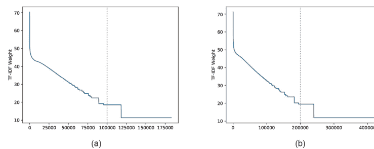

**图 1.** 按 TF-IDF 排序的术语排名。对于每个术语 *t*，词频为 $tf_t=1+\log(n)$，其中 $n$ 是 $t$ 在语料库中的计数。逆文档频率为 $idf_t=1+\log(\frac{N}{df_t})$，其中 $N$ 是语料库中的文档总数，$df_t$ 是术语 *t* 出现的文档数。$tf$ 和 $idf$ 的乘积为术语 *t* 的 tf-idf 权重，表示 *t* 在语料库中的信息量。(a) 美国新闻语料库，(b) 中文新闻语料库。


$\Sigma$ 在从 -1 到 1 的范围内连续缩放。例如，一篇文章中正面词的 $\Sigma$ 为 10 且没有负面词，$\Sigma(10 - 0)/(10 + 0) = 1$。图 2 和 3 展示了 2009 年至 2019 年来自美国和中文来源的各报纸的年度绝对情感，以热力图的形式可视化了情感。

当文章不包含任何正面或负面词时，我用符号“nan”（非数字）表示这种场景。处理此类值的一种典型策略是

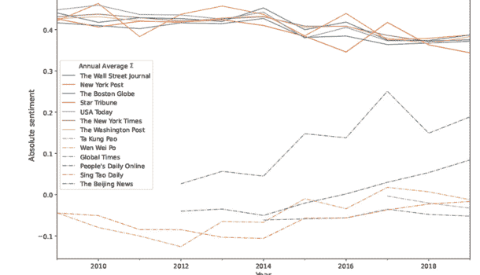

**图 2.** 报纸的年度情感。

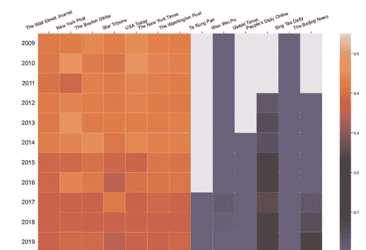

**图 3.** 报纸的年度情感。注：此热力图展示了美国和中文来源各报纸的年度平均情感。对于行中的每年，颜色和深浅表示列中每份报纸情感得分的极性和深度。具体而言，橙色（蓝色）意味着国内媒体平均更正面（更负面）地报道对方的文章。相对情感得分是绝对情感得分与市场平均得分的比值减一，这可以衡量不同文本数据源之间的稳健关系，无论它们使用什么语言。

原始数据库为每篇新闻文章提供了一个通用类别，我关注的是标记为“经济”、“金融”和“政治”的文章。然而，我对特定话题以及这些话题在新闻媒体中的流行程度感兴趣。为了识别每个文档的潜在主题，我使用狄利克雷分配 (LDA) 模型处理文本数据。正如 Baker、Bloom 和 Davis 所讨论过的，LDA 建模的一个挑战是选择适当的主题数量 K [28]。通常，较高的 K 会增加预测模型的稳定性，但会牺牲其解释性，因为每个主题可能太具体而无法分析。在极端情况下


# 政治风险管理的人工智能技术：基于自然语言处理的分析...
IToxLI110794

表 1 显示了贸易战对国家关系的描述性统计。情感指数，$S_{t+1}$ 是中美两国关系的代理变量，我将其设定为因变量。$D(T-war)$ 是一个虚拟变量，表示发布日期是否在中美贸易战期间（2016 年 5 月之后为 1，之前为 0）。对于政治控制，$X_t$ 控制了政治因素以及与 $y_t$ 相关的影响。CPU 指数是一个基于词汇的指数，关注《人民日报》中表达的与中美关系无关的特定术。

如上所述，《人民日报》于 1948 年创出版，是中国共产党的官方出版物，反映了中国政府的立场。CPU 指数和我的情感衡量标准都使用了词典法，该方法考虑了预设词典中特定词汇的频率或包含这些词汇的文档数量。特别是，CPU 指数捕捉了公众对国家政策和经济不确定性的信息，这可以被视为对国家关系每月系统性风险感知的量化代理。

对于政治控制（市场收益），我考虑了特定文章发布前一日的股市收益。很容易想象，人们在金融市场中的短期损益会影响他们的情绪。对于美国，我使用标普 500 指数作为美国市场表现的代理。对于中国，我使用上综指数来反映中国金融市场表现。

此外，我包含了某些控制变量来管理中美关系。新闻情感衡量取决于新闻话题是否热门，这会影响作者的措辞并引发情绪唤醒。如果出版者认同大众的口味，该出版者将更有动力做出积极或负面的描述。相反，如果出版者试图通过使用煽动性的语言来操纵情绪，热门和冷门的新闻话题并不是理想目标。一方面，过于热门的话题很容易引发广泛讨论并暴露出版者的意图；另一方面，冷门的话题不能引起读者的兴趣，导致操纵失败。因此，我使用两个虚拟变量 $D(Popular)$ 和 $D(Unpopular)$ 为情感衡量添加了特定主题的控制，分别表示新闻类目涵盖的是热门还是冷门的话题。

我将讨论潜在主题指数（详见第 6.3 节）的新闻文章排名前 35% 的归类为热门新闻（$D(Popular) = 1$，否则为 0）。相反，如果文章的主题受欢迎指数处于底部 35%，则将其定义为冷门文章（$D(Unpopular) = 1$，否则为 0）。这种控制使我们能够识别读者兴趣对新闻呈现方式的影响。

表 2 显示了 2017 年以来中美贸易战影响的描述性统计。一方面，贸易战对双边贸易的直接影响非常有趣；另一方面，双边关系可能是媒体情感之外的国家关系的代理变量。因此，两种不同的国家关系代理为贸易战对双边关系的影响提供了稳健的估计。

对于双边进口衡量，我添加了两个控制变量：总人口（Population）和中美之间每月世贸诉讼数量（$D(Dispute)$），而不是类型控制。该控制允许我们捕捉到人们对产品需求的自然影响。如果中美之间存在诉端，则 $D(Dispute) = 1$，否则如此。最后，我添加了固定效应 $\alpha_i$ 来代表每个国家的情感衡量。

| 变量 | 样本量 | 平均值 | 中位数 | 标准差 | 最小值 | 最大值 | 备注 |
|---|---|---|---|---|---|---|---|
| 美国 | | | | | | | |
| 情感，$S_{t+1}$ | 42,145 | 0.401 | 0.404 | 0.119 | -1 | 1 | 因变量 |
| D(T-war) | 42,145 | 0.401 | 0 | 0.49 | 0 | 1 | 独立 |
| CPU 指数 | 42,145 | 148.405 | 139.035 | 47.237 | 63.877 | 284.136 | 独立 |
| 市场收益，$R_t$ | 42,145 | 0.000265 | 0.00069 | 0.001015 | -0.0666 | 0.0707 | 独立 |
| D(Popular) | 42,145 | 0.577 | 1 | 0.494 | 0 | 1 | 独立 |
| D(Unpopular) | 42,145 | 0.110 | 0 | 0.313 | 0 | 1 | |
| 中国 | | | | | | | | |
| 情感，$S_{t+1}$ | 81,862 | -0.0119 | -0.0303 | 0.444 | -1 | 1 | 因变量 |
| D(T-war) | 81,862 | 0.552 | 1 | 0.497 | 0 | 1 | 独立 |
| CPU 指数 | 81,862 | 525.577 | 403.254 | 423.448 | 160.821 | 278.627 | 独立 |
| 市场收益，$R_t$ | 81,862 | 0.000227 | 0.000645 | 0.001932 | -0.0849 | 0.0612 | 独立 |
| D(Popular) | 81,862 | 0.867 | 0 | 0.499 | 0 | 1 | 独立 |
| D(Unpopular) | 81,862 | 0.208 | 0 | 0.406 | 0 | 1 | 独立 |

注：此表报告了我观测值的描述性统计。我使用 "dep" 表示因变量，“ind" 表示独立变量。

**表 1.** 贸易战对国家关系的描述性统计

| 变量 | 样本量 | 平均值 | 中位数 | 标准差 | 最小值 | 最大值 | 备注 |
|---|---|---|---|---|---|---|
| 美国 | | | | | | |
| 情感，$S_{t+1}$ | 42,145 | 0.401 | 0.404 | 0.119 | -1 | 1 | 因变量 |
| D(T-war) | 42,145 | 0.401 | 0 | 0.49 | 0 | 1 | 独立 |
| CPU 指数 | 42,145 | 148.405 | 139.035 | 47.237 | 63.877 | 284.136 | 独立 |
| 市场收益，$R_t$ | 42,145 | 0.000265 | 0.00069 | 0.001015 | -0.0666 | 0.0707 | 独立 |
| D(Popular) | 42,145 | 0.577 | 1 | 0.494 | 0 | 1 | 独立 |
| D(Unpopular) | 42,145 | 0.110 | 0 | 0.313 | 0 | 1 | |
| 中国 | | | | | | | | |
| 情感，$S_{t+1}$ | 81,862 | -0.0119 | -0.0303 | 0.444 | -1 | 1 | 因变量 |
| D(T-war) | 81,862 | 0.552 | 1 | 0.497 | 0 | 1 | 独立 |
| CPU 指数 | 81,862 | 525.577 | 403.254 | 423.448 | 160.821 | 278.627 | 独立 |
| 市场收益，$R_t$ | 81,862 | 0.000227 | 0.000645 | 0.001932 | -0.0849 | 0.0612 | 独立 |
| D(Popular) | 81,862 | 0.867 | 0 | 0.499 | 0 | 1 | 独立 |
| D(Unpopular) | 81,862 | 0.208 | 0 | 0.406 | 0 | 1 | 独立 |

注：此表报告了我观测值的描述性统计。我使用 "dep" 表示因变量，“ind" 表示独立变量。

**表 2.** 贸易战的描述性统计

## 5.2 从审查到民族主义

我使用媒体一致性作为民族主义代理。报纸中的情感一致性是我在解释动态时需要考虑的重要因素。报纸自然地或由于审查关注某些群体；另一方面，新闻一致性取决于当前情绪。我通过跨平台聚合情感并在媒体审查压力下衡量一致性。换句话说，新闻一致性比传统的媒体情感更能解释民族主义。对于每个国家，我定义 $t$ 时报纸 $i$ 的情感一致性代理 $c_i \in [0,1]$ 为：

$c_{it} = \frac{1}{1 + |\Sigma_{it}|}$

其中 $\Sigma_{it}$ 是 $t$ 时的平均情感，如第 4.2 节所述，$\bar{\Sigma}_i$ 是 $t$ 时所有新闻的平均值。


**图 5.** 新闻一致性直方图 ($c_i$)。注：这些直方图显示了我语料中 2016 年前后中美 $c_i$ 观测值的频率。黄色点表示 2016 年后的平均媒体一致性，而红线表示 1989 年至 2016 年的平均一致性。(a) 美国，(b) 中国。


接下来，我将使用线性模型讨论讨论新闻一致性的特征：

```
$$c_{it} = \beta_0 + \beta_1\rho_{it} + \beta_2(T-\text{war})_t \times \rho_a + \beta_3X_t + \varepsilon,$ \quad (4)$
```

其中 $\rho_{it}$ 是报纸 $i$ 在时间 $t$ 对应的流行度指数。计算 $\rho_{it}$ 需要了解该报纸所属每个主题的流行度指数。显而易见，某些新闻主题比其他更有吸引力，因此人们可能对讨论这些主题表现出更大的兴趣。由于模型产生的主没有按顺序排列（见第4.3节），我通过对主题进行排序，为每个主题建立流行度指数。开发该指数的第一步是为英语和中文用户构建社交网络语料库。

我利用 Twitter API 在 2018 年 10 月 10 日至 2019 年 8 月 8 日之间从英语语料库中收集了共 15,236,749 条推文。查询 API 的特定关键词为“tradewar”、“tradewers”、“MAGA”、“trade” 和“USChina”。随后，通过随机选择构建了一个包含 30,437 个唯一叙述的子集。假设这些推文与2019年中美贸易战有关，涵盖当前的经济和政治叙述，这些是本研究感兴趣的。对于中文语料库，我利用微博时间线 API（一个类似于 Twitter 的流行社交平台），在 2019 年 5 月 29 日至 2018 年 10 月 17 日之间收集了 3,194,226 条叙述。

与 Twitter API 不同，微博 API 不提供针对主题的查询功能。因此，我收集了主题的一般数据来构建中文语料库。

在分析的第二步中，我构建了 $p \times q$ 矩阵 $T$，其中 $p$ 代表主题模型中选择主题的数量，$q$ 代表模型生成的感兴趣的前 $q$ 个词。对于主要分析，我将英语语料库的 $p$ 设置为 850，$q$ 设置为 12。$T_{\mu}$ 用于捕捉第 6.1 节所示的**图 6** 和**图 7** 中每个主题网络第 $\mu$ 行和第 $v$ 列的词汇计数。我计算流行度 $\rho_\mu$，

```
$$P_{\mu} = \sum_{i=1}^q T_{\mu i} \times W_{\mu i},$ \quad (5)$
```

其中 $W_{\mu}$ 代表由主题模型生成的第 $v$ 列中的单词属于主题 $\mu$ 的估计概率。需要注意的是，$P$ 是一个 $p$ 维的列向量。为了获得流行度指数向量，对 $\rho$ 进行了归一化：

```
$$P^* = \frac{P}{\|P\|_2} = [\rho_1, \rho_2, \dots, \rho_p]^T,$ \quad (6)$
```

其中 $\|P\|_2$ 是 $P$ 的 $l^2$ 范数，时间 $t$ 的平均流行度指数 $\rho_t$ 可以表示为：

```
$$\rho_{it} = \frac{\sum_{x \in t} \rho_x}{N_{it}} \quad \text{s.t.} \quad \text{card}(T_x) = N_{it}, \rho_x \in P^*,$ \quad (7)$
```

ITeXLl10794

| 主题 | Word1 | Word2 | Word3 | Word4 | Word5 | Word6 | Word7 | Word8 | Word9 | Word10 | Word11 | 流行度 |
|---|---|---|---|---|---|---|---|---|---|---|---|---|
| 主题1 | agreement | peace | peace | part | part | part | part | part | | | | 0.276 |
| 主题2 | election | government | election | election | election | | | | | | | | 0.276 |
| 主题3 | world | people | world | world | world | | | | | | | | 0.264 |
| 主题4 | government | government | government | government | government | | | | | | | | 0.264 |
| 主题5 | crisis | economy | crisis | crisis | | | | | | | | | 0.256 |
| 主题6 | trade | trade | trade | trade | | | | | | | | | 0.256 |
| 主题7 | war | war | war | war | | | | | | | | | 0.252 |
| 主题8 | people | people | people | people | | | | | | | | | 0.248 |
| 主题9 | world | world | world | world | | | | | | | | | 0.248 |
| 主题10 | policy | policy | policy | policy | | | | | | | | | 0.244 |
| 主题11 | policy | policy | policy | policy | | | | | | | | | 0.236 |
| 主题12 | prediction | election | prediction | election | | | | | | | | | 0.236 |
| 主题13 | election | election | election | election | | | | | | | | | 0.228 |
| 主题14 | policy | policy | policy | policy | | | | | | | | | 0.224 |
| 主题15 | election | election | election | election | | | | | | | | | 0.224 |
| 主题16 | people | people | people | people | | | | | | | | | 0.220 |
| 主题17 | people | people | people | people | | | | | | | | | 0.216 |
| 主题18 | government | government | government | government | | | | | | | | | 0.212 |
| 主题19 | peace | peace | peace | peace | | | | | | | | | 0.212 |

图 6. 按流行度排序的美国新闻语料库主题。此图表示了 LDA 模型为了识别主题而学习的 850 个词汇分布。根据捕捉社交网络中每个主题 12 个词频率的流行度指数，我对这些分布进行了排序（从最流行到最不流行）。

| 主题 | Word1 | Word2 | Word3 | Word4 | Word5 | Word6 | Word7 | Word8 | Word9 | Word10 | Word11 | 流行度 |
|---|---|---|---|---|---|---|---|---|---|---|---|---|
| 主题1 | 选举 | 选举 | 选举 | 选举 | 选举 | | | | | | | | 0.892 |
| 主题2 | 政府 | 政府 | 政府 | 政府 | 政府 | | | | | | | | 0.892 |
| 主题3 | 经济 | 经济 | 经济 | 经济 | 经济 | | | | | | | | 0.884 |
| 主题4 | 政策 | 政策 | 政策 | 政策 | 政策 | | | | | | | | 0.884 |
| 主题5 | 人民 | 人民 | 人民 | 人民 | 人民 | | | | | | | | 0.876 |
| 主题6 | 国际 | 国际 | 国际 | 国际 | 国际 | | | | | | | | 0.876 |
| 主题7 | 贸易 | 贸易 | 贸易 | 贸易 | 贸易 | | | | | | | | 0.868 |
| 主题8 | 发展 | 发展 | 发展 | 发展 | 发展 | | | | | | | | 0.868 |
| 主题9 | 社会 | 社会 | 社会 | 社会 | 社会 | | | | | | | | 0.860 |
| 主题10 | 危机 | 危机 | 危机 | 危机 | 危机 | | | | | | | | 0.860 |
| 主题11 | 战争 | 战争 | 战争 | 战争 | 战争 | | | | | | | | 0.852 |
| 主题12 | 法律 | 法律 | 法律 | 法律 | 法律 | | | | | | | | 0.852 |
| 主题13 | 民主 | 民主 | 民主 | 民主 | 民主 | | | | | | | | 0.844 |
| 主题14 | 地区 | 地区 | 地区 | 地区 | 地区 | | | | | | | | 0.844 |
| 主题15 | 医疗 | 医疗 | 医疗 | 医疗 | 医疗 | | | | | | | | 0.836 |
| 主题16 | 资源 | 资源 | 资源 | 资源 | 资源 | | | | | | | | 0.836 |
| 主题17 | 选举 | 选举 | 选举 | 选举 | 选举 | | | | | | | | 0.828 |
| 主题18 | 政府 | 政府 | 政府 | 政府 | 政府 | | | | | | | | 0.828 |
| 主题19 | 经济 | 经济 | 经济 | 经济 | 经济 | | | | | | | | 0.820 |

图 7. 按流行度排序的中文新闻语料库主题。此图表示了 LDA 模型为了识别主题而学习的 850 个词汇分布。根据捕捉社交网络中每个主题 12 个词频率的流行度指数，我对这些分布进行了排序（从最流行到最不流行）。


IToxLi110794

## 5.3 DID 模型

此外，我采用一致性（consistency）作为媒体审查的代理变量，通过调节不同政治体制国家的民族主义情绪来衡量。为了减少在通过一致性衡量民族主义时由外部因素引入的潜在偏差，并考察审查对国际关系的影响，我利用了一个涉及 2019 年中美贸易战的自然实验。

贸易战是一次意料之外的事件，影响了每个实体对报纸的实际需求，因此双重差分法（DID）估计量是无偏的。这是因为，虽然贸易战影响了整体情绪，但国家情绪的变化与战争本身的强度无关。

此外，每个实体的国家情绪水平不受贸易战的影响，因为它们受到舆论的控制或不受其影响。真实的媒体自由度以及其与政府立场的一致性可能会受到政府的干预，因此可能无法充分反映官方政策。

在我的实证研究中，我选择媒体情绪作为交互作用的代理变量。$D(T-war)$ 是中美贸易战期间的虚拟变量，$\zeta_i$ 是来源固定效应。我允许实体固定效应来捕捉所测每个实体的异质性。我假设如果漏变量随时间变化但在所有报纸之间保持不变，那么每日媒体情绪和一致性指标应该吸收这种影响。因此，我不使用固定效应。$\omega$ 可以被解释为在没有显著权威干预的和平期间，中美各自民族主义对其双边关系的影响。

在没有显著权威干预的和平期间的双边关系。$\theta_0$ 是常数项。

系数 $\theta_1$ 是我关注的参数，用于捕捉中美贸易战后新闻一致性的变化。虚拟变量 $D(T-war)$ 用于区分处理组和控制组。处理组指示变量系数 $\theta_1$ 代表了处理组 $(D(T-war)=1)$ 与控制组之间由贸易战引起的民族主义变化的结果差异。$\theta_1$ 的正负揭示了贸易战期间的新闻一致性对结果变量是有正向影响（改善国际关系）还是负面影响（损害国际关系）。

# 6 实证结果

本节介绍了本章的主要结果。在我的主要结果中，我关注 2009 年至 2019 年巴拉克·奥巴马总统和唐纳德·特朗普总统任期间发表的新闻文章。使用两个总统任期的观察结果反映了贸易战前后美国对华政治外交策略的稳定性。与美国共和党和民主党之间的竞争不同，中国统一战线的成员必须遵守中共，并必须接受其“领导地位”作为其继续存在的条件。此外，中国对美政策主要取决于中共的政策，而该政策具有相对的一致性。中美关系在期间可以得到有效衡量。

## 6.1 LDA 结果

主题分析的主要目标是识别新闻主题，结果分别在图 6 和图 7 中展示了美国和中国新闻语料库。这些中的热图代表了处理后每个主题语料库的前 12 个词汇，颜色越深表示这些词汇解释所在行主题的概率越高。尽管在主题模型的无监督学习过程中为每个主题都分配了一个名称，但每个主题中分组的词汇提供了自然的注释。例如，图 6 所示的美国新闻语料库中的主题 2 对应“贸易战”，这是图 7 所示的中国新闻语料库中的主题 19。

当流行指数大于或小于 0 时，表示该主题获得了大众更多（更少）的关注。在美国新闻语料库中，最受欢迎的主题是“贸易谈判”（1）和“贸易战”（2），最不受欢迎的主题是“万达集团”（842）和“达赖喇玛”（843）。对于中国新闻语料库，最受欢迎的主题是“家庭”（1）、“一带一路”（14）和“贸易战”（19），最不受欢迎的主题与“美国国会”（531）和“美国政党”（534）有关。我数据集中美国和中国论文的新闻主题分布见图 8a 和 b 中的两个直方图。可以观察到，流行指数较高的新闻主题往往有更多的报道，这符合我的预期。热门的话题更容易被媒体报道，因此流行指数可以准确反映读者对这些主题的兴趣。

## 6.2 贸易战效应

为了准确估计 $\beta$ 系数的显著性，我使用了聚类稳健标准误，因为个体内部的媒体误差相关性可能仍然存在。

表 4 展示了与语料库中所有新闻主题相关的新闻情绪 $S_{ij}$ 的估计值（详见 4.2 节）。对于与美国中国新闻，我们可以看到贸易战后情绪显著增加，导致中国报纸对……的情绪整体上升。

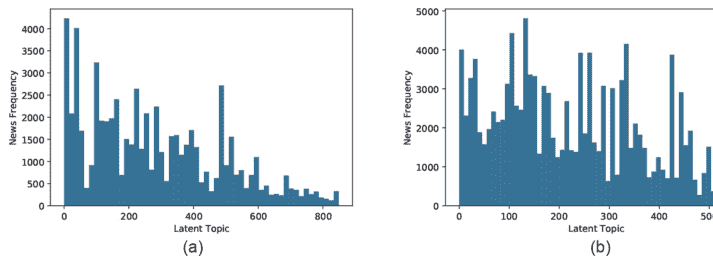

**图 8.** 新闻主题分布：这些直方图展示了主题模型在我的语料库上生成的潜在主题分布。从 1980 年到 2019 年美国有 64,026 份相关新闻报道，中国从 1999 年到 2019 年有 123,549 条记录。从零开始的主题按其流行指数从高到低排列。(a) 美国，(b) 中国。

对于 2009 年至 2019 年间发表的所有文章，我们可以看到美国报纸的情绪显著下降，中国报纸的情绪显著增加。美国报纸对中国的情绪下降符合预期，两国冲突期间民族主义的上升会对另一个产生负面情绪。相反，中国报纸对美国的积极描述值得我们关注。在控制了宏观因素和主题因素后，我发现美国和中国报纸的主要区别是媒体自由。因此，我将贸易对中国报纸情绪的积极影响归于政府减轻贸易对国际关系负面影响的努力。

我的控制变量，我们观察到政治不确定性与中美报纸的情绪显著相关，而金融市场表现通常与情绪正相关。例外是负面新闻，它们与市场表现负相关。这可以解释为：当中国金融市场表现不佳时，对国内市场的不满使公民向往美国这样的自由市场。相反，当金融市场过热时，高度的国家自豪感让人们对自己的经济更有信心，并对竞争对手产生蔑视。对于特定控制，我发现热门和冷门主题都与新闻情绪显著相关（中国新闻除外）。一个有趣的观察是，对于热门话题，美国报纸更有可能负面描述中国问题。相比之下，中国媒体倾向对热门和冷门话题呈现情绪。这种现象符合读者的口味。如果常数效应可以完全控制每份报纸的特定报道偏差，我们可以推断美国读者普遍对中国新闻感兴趣，而中国读者则对美国新闻更感兴趣。此外，如果话题不趣，例如宗教话题，两国媒体都不会对其进行负面报道。

为了阐明我估计系数的经济重要性，我使用“贸易战效应”来将贸易系数 $\beta_1$ 的值表示为贸易战中美关系平均衡量值的百分比，并使用星号


| 主要回归变量 | 美国 (1) | 中国 (2) |
|---|---|---|
| D(T-war) | -0.037*** | 0.054*** |
| | [.002] | [.009] |
| CPU 指数 | -0.000085*** | 0.00013*** |
| | [.000] | [.000] |
| 市场收益率_t-1 | 0.35*** | 0.40*** |
| | [.090] | [.195] |
| D(流行) | -0.0051*** | 0.011 |
| | [.000] | [.008] |
| D(不流行) | -0.0017 | 0.0020 |
| | [.001] | [.003] |
| 常数 | 0.43*** | -0.054*** |
| | [.001] | [.011] |

| 观测值 | 42,144 | 81,861 |
|---|---|---|
| 固定效应 (FE) | 是 | 是 |
| 战前平均 | 0.42 | -0.034 |
| 战效应 | -8.9*** | -158.6*** |

注：本表报告了对美国和中国来源报纸整体情绪的估计结果。因变量取决于聚类的估计总量。括号内为聚类稳健标准误。系数标注了显著性 (* p < .1, ** p < .05, *** p < .01)。 战效应表示虚拟变量 D(T-war) 的估计系数，以 2016 年 5 月 2 日之前地区每日报纸情绪平均得分的百分比表示。我们报告了与列内 D(T-war) 估计系数水平相同的星号标记。

**表 4。** 贸易战对国家关系影响的结果。

以指示估计效应的统计显著性。该指标旨在衡量贸易战放大媒体情绪影响的程度和方向。如果值为正，则效应越显著显著。例如，**表 4** 第 (1) 列中估计的战效应为 -0.089×100=- -8.9。由于相应的战前平均值符号为负，战效应代表了贸易战的平均影响，导致中国贸易战时期后美国报纸的整体情绪发生了 8.9% 的反向变化。比较美国和中国的实证结果，中国来源的贸易效应占据主导地位，这表明贸易战事件在采样期间对中国媒体中平均情绪的描述影响更为显著。此外，尽管美国和中国在贸易战期间改变了态度，但这显著减少了中国报纸中关于美国的负面叙述数量。

**表 5** 显示了贸易战对双边进口影响的结果。令人惊讶的是，我观察到贸易战对中美双边进口产生了显著的负面影响。我们可以看到贸易战对美国对中国产品和服务的需求产生了显著更强的负面影响。如果我们只关注贸易战的经济后果，我们看到美国客户遭受了

ITexLI110794

| 主要回归变量 | 美国 (1) | 中国 (2) |
|---|---|---|
| D(T-war) | -0.20*** | -0.045*** |
| | [.003] | [.001] |
| CPU 指数 | -0.00025*** | -0.000032*** |
| | [.000] | [.000] |
| 市场收益率_t-1 | 0.25*** | 0.049*** |
| | [.057] | [.012] |
| 人口 | 3.79*** | -0.39*** |
| | [.102] | [.019] |
| D(争端) | -0.030*** | -0.017*** |
| | [.002] | [.001] |
| 常数 | -0.75*** | 0.69*** |
| | [.033] | [.025] |
| 观测值 | 36,428 | 70,113 |
| 固定效应 (FE) | 否 | 否 |
| 新闻地区 | 美国 | 中国 |
| 变量前平均 | 0.41 | 0.14 |
| 战效应 | -50.2*** | -33.0*** |

注：本表报告了从中国（美国）进口美国（中国）的估计结果。因变量是所有类型进口货物总值（单位：万亿美元）。系数标注了显著性 (* p < .1, ** p < .05, *** p < .01)。战效应表示虚拟变量 D(T-war) 的估计系数，以 2016 年 5 月 2 日之间变量平均值的百分比表示。我报告了与列内 D(T-war) 估计系数水平相同的显著星号标记。

表 5。贸易战对进口影响的结果。

损失，与 [21] 一致。根据常数项，我们看到美国的。根据常数项，我们看到美国的。根据常数项，我们看到美国的。根据常数项，我们看到美国的。根据常数项，我们看到美国的。根据常数项，我们看到美国的。根据常数项，我们看到美国的。根据常数项，我们看到美国的。根据常数项，我们看到美国的


| 主要回归变量 | 美国 (1) | 中国 (2) |
|---|---|---|
| D(T-war) × 流行度 | -0.21*** | 0.259*** |
| | [.009] | [.020] |
| 流行度 | -0.038*** | 0.070*** |
| | [.008] | [.018] |
| D(争端) | -0.003*** | 0.011*** |
| | [.001] | [.001] |
| 中国比例 | -0.125*** | 0.034*** |
| | [.034] | [.025] |
| 常数 | 0.929*** | 0.768*** |
| | [.001] | [.001] |
| 观测值 | 42,145 | 85,617 |

注：括号内为标准误。系数标注了显著性 (* p < .1, ** p < .05, *** p < .01)。

表 6。一致性结果。

6.3 一致性

在表 6 中，我报告了流行度如何影响一致性，所有特征均显著。等式 4 第 (2) 列显著为正，而在美国结果则相反。此外，根据常数项，我们看到美国的

中国的媒体审查可能为这些差异提供了一个合理的解释。尽管新闻取决于当局的目标。合理相信，如果一个新闻话题非常流行，媒体监管部门会投入精力审查内容并删除任何“不良”内容。然而，这增加了其对内容感知的影响，吸引了更多读者的注意力。这里，通过贸易战，我们观察到政府在不同时期报道新闻话题的不同策略。美国报纸提供了一个没有管理的混合样本。由于大多数美国媒体是以利润为导向的，很大程度上，新闻越流行，越需要响应读者的口味和意识形态。不同的美国读者群体对于发起或继续贸易战有不同意见。因此，在没有政府控制的情况下，如果其他因素相同，美国新闻的审查较低。一种解释是，尽管中国监管部门可以审查媒体话题和内容，但他们在控制有关美国情绪方面有一定的局限性。除了少数官方背景的媒体外，监管部门在非时期可能无法完全控制媒体的报道情绪。另一种解释是，尽管美国媒体受监管操纵较少，但美国媒体在市场或利润目的方面有着更统一的情绪。例如，如果美国通常


认为美国应该与中国脱钩或保持良好关系，那么市场力量将自然驱动媒体对中国报道的一致性。从实证结果可以看出，市场对媒体一致性的影响大于监管机构。

表 7 报告了基于我 2009 年后的数据集，对等式 (8) 中滞后媒体情绪的 DID 估计值。其中一个重要结果是第 (2) 列中正系数 $\theta_1$，表明在贸易战期间，中国公共媒体对美国新闻的报道更为积极。由于中国政府对国内媒体及部分海外中资媒体具有很强的影响力，我们可以合理地推断，在中美冲突期间，中国监管机构试图软化反美情绪，这可以被视为中国监管机构修复中美关系的一种效力。相反，第 (1) 列中的负系数 $\theta_1$ 表示美国公共媒体在贸易战期间对中国的报道更趋负面。

为了清楚地解释贸易战后新闻一致性在中美关系中的作用，我们创建了一个指标“统一效应”（unity effect），通过因变量 $y_{it}$ 的观测值平均值估计系数 $\theta_1$ 为 $\theta_1$ 乘以参数 $\kappa$ 的百分比；在贸易战后，$\kappa$ 是用于判断新闻文章是否被认为与其他媒体保持一致的阈值。我选择美国报纸的 $\kappa = 0.9$，中国报纸的 $\kappa = 0.8$。

图 8 $\theta_1$ 表示一致的新闻文章，其估计的中美关系因贸易战而至少增加了这部分数值。例如，表 7 中 (2) 的统一效应为 $0.8 \times \frac{0.072}{0.034} \approx 100 = 167.9$。我根据用于生成指标的 $\hat{\theta}_1$ 显著性水平，在估计的统一效应估值旁边标注了星号*。根据表 7 中的统一效应，我得出结论：中美民族主义对国际关系的影响在贸易战期间发生了相反的变化。在贸易战之前，由媒体一致性代表的中国民族主义能更显著地反映中美关系的变化。第 (2) 列中中国民族主义削弱

| 主要回归变量 | 美国 (1) | 中国 (2) |
|---|---|---|
| D/(T – war) $\times$ Consistency | -0.043*** | 0.072*** |
| | [.002] | [.013] |
| 一致性 | 0.033*** | -0.063*** |
| | [.012] | [.013] |
| 常数项 | 0.39*** | 0.0058 |
| | [.011] | [.005] |
| 观测值 | 42,144 | 81,866 |
| 固定效应来源 FE | 是 | 是 |
| 变量前效应 | 0.42 | -0.034 |
| 统一效应 | -9.3*** | -167.9*** |

注：括号内为聚类稳健标准误。系数根据显著性水平标记（* p < .1, ** p < .05, *** p < .01）。

**表 7。**
情绪衡量标准的 D 估计结果。


中国与美国的关系。在贸易战期间，第 (2) 列的 $\theta_1$ 变得显著为正，对中美关系产生了贡献。注意，中国监管机构部分审查媒体一致性作为民族主义的代理。因此，民族主义对国际关系积极影响的一种解释是监管机构改善中美关系的意愿。相反，我没有在美国方面观察到类似的结果。从美国的角度来看，中美之间升级的贸易冲突自然恶化了关系。

## 6.4 安慰剂检验

为了解决现有因素对表 7 结果影响的担忧，进行了安慰剂检验，以评估 2019 年贸易战之前美国和中国报纸中等式 (8) 所的新绪。使用了 6.3 节中相同的 DID 模型，其中 $\theta_1$ 代表处理组 (D-war)=1 和控制组 (D-war)=0 之间的结果变量差异。然而，安慰剂检验的基准与原始分析不同，基准为美国报纸 2004 年 12 月 5 日和中国报纸 2007 年 12 月 5 日，这些是基于中美关系的没有重大冲突的时期。这项安慰剂研究涵盖了从九·十一恐袭击到奥巴马亚洲政策之前的时期。如果之前对贸易战影响中美关系的分析是准确的，那么安慰剂检验中观察到的统一效应应该是不显著的。安慰剂检验的结果见附录表 B.1，除了第 (1) 列的常数项外，没有观察到显著效应。

总体而言，我的安慰剂检验表明，6.3 节的结果对潜在的混杂因素具有稳健性。


- AI 人工智能
- CCP 中国共产党
- CPU 中国政治政治不确定性
- DID 双重差分法
- LDA 隐含狄利克雷概率分配
- NLP 自然语言处理
## 话题选择

在主要分析中，我为美国新闻语料库选择了 850 个主题，并为中国新闻语料库选择了 550 个主题。为了确定我们的模型选择是否合适，我测试了不同隐含主题数量 $K$ 下主题模型的拟合优度。首先，我随机选择了 20% 的文档子集进行测试，并使用剩余文档作为训练数据，对 $K$ 在 50 到 1000 之间的 LDA 模型进行拟合。我使用测试数据计算模型的验证困惑度（validation perplexity）作为拟合优度的衡量标准。困惑度表示模型描述一组文章的优程度，图 A.1 显示了美国和中国新闻语料库测试数据的验证困惑度。在 $K=850$ 之后，验证困惑度保持平稳；对于中国新闻语料库，该值在 $K=550$ 之后增加。基于这些观察结果，我选择了最拟合数据模型进行我们的主要分析。

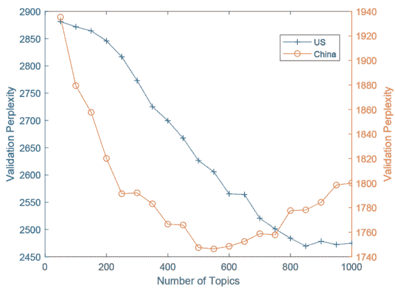

> **图 A.1.** 不同话题测试数据的验证困惑度。此图显示了随机选择的 20% 文档作为测试的验证困惑度。通常当话题数量增加时，模型的准确性会增强，困惑度最低的模型通常被认为是“最佳的”。这些数据表明，主题模型的拟合优度在英文文档 $K=850$ 和中文文档 $K=550$ 左右达到顶点。
# 政治风险管理的人工智能技术：一种 NLP 分析... ITexLL110794

## B. 新闻情绪的安慰剂估计

| 回归变量 | 美国 (1) | 中国 (2) |
| --- | --- | --- |
| D(T-war) × 一致性 | -0.0041 | 0.016 |
| | [.004] | [.016] |
| 一致性 | -0.0022 | -0.048 |
| | [.015] | [.094] |
| 常数项 | -0.04*** | -0.027 |
| | [.015] | [.065] |
| 观测值 | 6484 | 8722 |
| 来源 FE | 是 | 是 |
| 变量前平均值 | 0.44 | -0.064 |
| 单位效应 | -0.8 | -20.5 |

注：此表复制了表 2 安慰剂对照研究设置程序。将美国报纸的观测窗口设定为 2002 年 1 月至 2006 年 12 月，选择 2004 年 12 月 5 日作为安慰剂事件。对于中国报纸，将数据设定为 2005 年 1 月至 2010 年，选择 2007 年 12 月 5 日。系数根据显著性标记（*p < .05, **p < .01, ***p < .001）。美国地区的单位效应代表估计系数 $\beta$（详见第 6.3 节）乘以图 5a 中区分不一致和一致新闻的数值 0.8（对于中国报纸对应图 5b），并除以安慰剂前的平均媒体情绪。单位效应的显著星号对应于我估计的参数 $\theta$ 的显著水平。

表 B1.
新闻情绪的安慰剂估计。

## C. 民族主义的稳健性

| 主要回归变量 | 美国 (1) | 中国 (2) |
| --- | --- | --- |
| D(T-war) | -0.037*** | 0.054*** |
| [.002] | [.009] |
| CPU 指数 | -0.000084*** | 0.000014*** |
| [.000] | [.000] |
| 市场收益率-1 | 0.30*** | 0.39*** |
| [.098] | [.164] |
| D(流行) | -0.0078*** | 0.0065*** |
| [.001] | [.003] |
| D(不流行) | 0.0010 | 0.0018 |
| [.002] | [.008] |
| 常数项 | 0.43*** | -0.053*** |
| [.002] | [.009] |


| 主要回归变量 | 美国 (1) | 中国 (2) |
| :--- | :--- | :--- |
| 观测值 | 42,133 | 81,964 |
| 来源 FE | 是 | 是 |
| 战前平均值 | 0.42 | -0.034 |
| 战争效应 | -8.9*** | -159.5*** |

注：此表表示对前 35% 最流行话题的新闻文章进行的稳健性测试。相应的基准结果见表 4。在项测试中，我将主题模型中隐含话题的数量从美国新闻的 850 调整到 900，中国新闻从 550 调整到 600，如图 A.1 所示。括号内为聚类稳健标准误。系数根据显著性标记（*p < .1, **p < .05, ***p < .01）。

表 C.1.
贸易战效应的稳健性结果。


# 参考文献

- [1] McCombs ME, Shaw DL. 媒体的议程设置功能. Public Opinion Quarterly. 1972;36(2):176-187
- [2] McCombs M, Shaw D. The Agenda-setting Function of the Press. Oxford, England: Oxford University Press; 2005. pp. 156-168
- [3] Luo Y. The internet and agenda setting in China: The influence of online media on government policy. International Journal of Communication. 2014;8:24
- [4] Chan A. Guiding public through agenda-setting: China's media in the 1990s.
- [5] Mead WR. China is the soft power of Asia. 2020. Available from: https://www.wsj.com/china-is-soft-power-of-asia
- [6] Eriksen HT. Nationalism and the internet. 2007;13(1):2
- [7] Hyun KD, Kim J, Sun S. News use, nationalism, and de- in China. Journal of Language. 2014
- [8] Zhou M, Wang H. Anti-Japanese sentiment among Chinese students: The influence of contemporary propaganda. Journal of Current Affairs. 2017;46
- [9] Breton A. Nationalism. Economic of. 1964;72.
- [10] Coed M, Szcowicz U. Measuring political and economic uncertainty: A supervised computational linguistic approach. SN Business & Economics. 2022;2(5):37.
- [11] Montiel J, Salvador AMO, De Leon MN. Creeping assertiveness: the Philippines maritime. Post-Communist Studies. 2010;43
- [12] Moffat JE. Nationalism. 1999;36
- [13] King G, Pan J, Roberts ME. How censorship in China allows government criticism but silences expression. American Political Science Review. 2013;107
- [14] Hansen S, McMahon M, Prat A. Transparency and deliberation within the fomc: a computational linguistic approach. The Quarterly Journal of Economics. 2017;133
- [15] Baker SR, Bloom N, Davis SJ. Measuring economic policy uncertainty. The Quarterly Journal of Economics. 2016;131
- [16] Gardet C, Siena D. Quantifying the losses from a global trade.. 2019
- [17] Rubin DB. Estimating causal effects of treatments in randomized and nonrandomized studies. Journal of Educational Psychology. 1974;66
- [18] Card D, Kruger AB. Minimum Wages and Employment: A Case Study of the Food Industry in New Jersey and Pennsylvania. The American Economic Review. 1994;84
- [19] Shiller RJ. Narrative economics. American Economic Review. 2017;107


Janine Zitanellis

# 摘要

随着大数据技术（BDT）的出现和大数据分析（BDA）应用的日益广泛，供应链管理（SCM）研究人员越来越多地利用 BDA，因为 BDT 和 BDA 提供了许多机遇。供应链（SC）数据具有内在复杂性，导致环境具有高度不确定性，为供应链决策者带来了严峻挑战。本研究旨在调查并说明 BDA 在现有决策过程中的应用。BDT 允许对供应链数据进行提取和处理。BDA 有助于进一步理解供应链的低效率问题，并通过验证供应链牛鞭效应及其影响因素的存在，提供了极具价值且可操作的见解。此外，BDA 通过应用主成分分析（PCA）和多元回归分析等机器学习技术，实现了对线性和非线性回归关系的务实评估。此外，应用 Sarimax、Stats 和神经网络等更复杂的 BDA 时间序列和预测技术提升了预测的准确性。最终，改进后的的需求规划和预测准确性将减少供应链的不确定性以及所观测牛鞭效应的影响，为供应链价值链中的所有成员创造竞争优势。

**关键词：** 大数据分析，供应链管理，牛鞭效应，主成分分析，回归分析，需求规划与预测

# 1. 引言

BDA 为采购、库存管理以及需求规划与预测等关键供应链组件之间精确且透明的信息流提供了机会，促进了供应链的整合与协作，从而提升了整体供应链效率 [1, 2]。

供应链管理最终试图以最具成本效益的方式匹配不同的供需率。正如人们想象的，由于市场全球化和供应链数字化倡议等因素的驱动，各种供应链渠道和数据节点导致通过供应链网络内多个组织之间的材料和信息流变得日益复杂 [3]。供应链的低效率将显现出来，并导致了经过仔细研究的牛鞭效应 [4]。

《机器学习与数据挖掘年刊》2023 卷

本研究通过单案例研究，批判性地评估了 BDA 能力与供应链效之间的之间的关系。因此，本研究的主要关注点是调查并说明 BDA 在现有决策过程中的应用，以克服供应链信息流中的技术限制和挑战，并获得对当前市场环境的有价值的见解。本研究旨在更好地理解并衡量门店销售与库存持有之间的互动，作为辅助需求规划与预测的动态市场指标。以下研究问题针对特定的供应链问题，例如减少运营成本、风险以及与需求预测效率低下和错失机会相关的财务影响：

尽管对中小企业（SMEs）中应用 BDA 的研究显而易见，但只有少数案例研究能够说明反映可衡量业务价值的 BDA 应用，例如运营成本、风险以及与需求预测效率低下和错失市场机会相关的财务影响的减少。因此，本项目旨在通过对中小企业行业单一组织的研究，应用各种 BDA 技术，增加供应链协作与沟通，并最终提高供应链效率，从而推进相关领域的实践知识。

# 2. 中小企业行业的大数据、分析与供应链管理

## 2.1 大数据与分析

1941 年，“信息爆炸”一词出现后，在 1944 年至 2000 年间发表了若干出版物，反映了数据和信息的规模及预期增长率。“大数据”一词的真正起源尚不清楚。虽然许多人认为该术直到 2005 年才由 Roger John Mougalas 和 O'Reilly 媒体集团正式提出 [5]，将大数据描述为无法通过传统的业务流程和分析工具进行处理或消费的数据集 [6]。作为领先的研究和咨询公司，Gartner 通过整合大数据的关键特征扩展了定义，将大数据描述为：“……高容量、高速度和/或高特异性的信息资产，需要具有成本效益、创新的信息处理形式，以增强洞察力、决策和过程形成” [7]。若干研究报告了大数据的特征，通常被描述为大数据的 Vs 或数据维度。即：数量（Volume）、多样性（Variety）、价值（Value）和真实性（Veracity）[8–10]。数量和多样性描述了数据的大小、程度和格式。同时，价值、速度和真实性总结了数据实时处理的程度以及对数据质量的信任度。近年来，大数据 Vs 有几种扩展，包括增加变异性（Variability）。变异性考虑数据结构的变化，更重要的是这些数据结构变化的节奏、频率和程度。在高水平数据真实性的支持下，理解数据的变异性可以对资源和过程进行高效规划，以确保对组织决策过程的干扰降至最低。

大数据分析（简称 BDA）提供了可扩展且具有成本效益的机会来处理和整合不同的数据结构，能够从海量结构化和非结构化数据中提取有价值的见解。Kitch [11] 研究了 BDA 对既有方法的影响，以及大数据如何作为一种颠覆性创新同时允许更高效的分析方法出现。技术技能对于从这些数据中提取信息和见解至关重要。这些分析工作还依赖于清晰的业务描述以及领域专家对结果的评估。

所获得的见解使组织能够应对快速变化的环境，并在战术和战略层面保持竞争优势 [1, 9]。9] 的一项实证研究认为，组织需要重构以应对 BDA 交付的见解并产生可操作的见解，以从 BDA 项目中获得最佳价值。作者观察到，尽管挪威的组织在采用技术和信息进步方面取得了进展，但只有少数观察到了 BDA 投资的完整收益。惊讶的是，该研究报告在考虑到过去十年 BDA 趋势增加的情况下，拥有超过4 年 BDA 经验的公司仅占 10.8%。1] 的研究发现表明，组织仍然缺乏使 BDA 成为战略驱动力所需的能力。该研究强调，组织内部 BDA 项目的成功取决于复合因素：时间和财务资源的分配、支持性的 BDA 基础设施以及对数据驱动文化的领导承诺。

## 2.2 供应链管理中的大数据分析

BDA 为采购和库存管理等关键要素之间精确且透明的信息流提供了机会，鼓励了供应链的整合与协作 [1, 2]。此外，BDA 的通信效率应对了由倡议驱动的日益复杂的供应链数据 [3]。因此，BDA 允许进行更准确的需求规划和预测，支撑供应链库存管理决策，以提高整体供应链效率。


# 机器学习与数据挖掘年鉴 2023

以及所有供应链（SC）成员内部对适当的供应链计划（SC）信息的共享 [2, 15]。

为了充分理解供应链需求规划和预测的复杂性，必须理解供需关系的核心：库存管理。供应链中的核心商品是库存，也称为存货。Slack 等人 [13] 将库存描述为“转换系统内部资源的累积”。同时，库存规划旨在确保最佳库存水平，在降低缺货风险和过量积货成本的同时，能够高效地响应客户需求 [13]。

供应链决策者通过实施适当的库存管理策略并根据预测需求执行补货策略，支持这些目标的实现。

需求预测的准确性对于支持以下工作至关重要：
- 数量决策：订购什么物品以及订购数量？
- 时机决策：何时下达订购订单？
- 库存分析与控制决策：哪些政策和程序可以提供支持？

库存决策过程的效率对牛鞭效应有显著影响。牛鞭效应描述了供应链领域内微小波动的后果，这种波动会被放大为订单中的需求波动，从而影响了整个供应链。

[4] 对牛鞭效应进行了严谨评估，认为牛鞭效应是供应链低下的明显表现。多项研究假设需求规划、交期、批量处理、波动和行为原因之间存在收敛性，这些因素直接导致中断并引发了牛鞭效应。三个主要的供应链决策 [4, 13, 14] 表明，由于实践不当导致供应链价值异常，增加了供应链的不确定性并导致表现不佳。大数据（BD）可以通过提供价值的见解和改进需求预测来促进供应链管理。研究 [1, 3] 讨论了2015年至2019年文献的显著增加，使用了包括但不限于神经网络、ARIMA、支持向量机（SVM）和决策树等复杂方法。这些方法解决了传统时间序列技术的缺点，如依赖领域知识以及无法整合外部因素和复杂的非线性关系。它们被认为优于传统方法。大数据的计算效率能够适应日益增长的数据，允许进行更准确的预测和判断。因此，预测准确性的提高减轻了牛鞭现象，反映了可衡量的价值，包括但不限于减少运营成本、风险以及与需求预测相关的财务影响。

## 大数据能力与供应链管理的定量分析

### 2.3 中小型企业中的大数据分析

大数据为没有资源投资系统和分析的中小型企业提供了机会，使其能够利用与其规模较大的企业相同的能力。此外，中小企业可以利用大数据来帮助和改进供应链功能，如采购、库存管理、需求规划和预测。

然而，尽管中小企业行业被公认为至关重要，但许多文献集中于大型机构。[18]的一项研究显示，24%的中小企业认为快速变化的环境是一个关键挑战，且技术相关成本高，影响了减少运营成本和创造竞争优势的战略计划。同样，[19] 对中小企业领域技术采纳和整合缓慢表示担忧，对于大数据的采用和相关性仍存在许多不确定性。

## 3 研究方法论

### 3.1 设计

主要研究目标是通过在中小企业行业应用大数据，将实践知识应用于已识别的研究问题，以减少供应链不确定性并改进需求规划和预测。由于供应链流程和数据的复杂性，本研究采取了务实立场，并在现有理论的基础上建立研究并认为其为有效。随后，研究由演绎法支持，该方法涉及测试系列研究中列出的两个或多个变量之间的因果关系，这是一种广为人知的方法。简单来说，演绎研究从理论流向数据。定量设计的使用增加了研究的可推广性。采用单案例研究策略以结构化的方式指导了必要的研究行动，并促进了整个研究项目的连贯性。研究的描述性和解释性允许对大数据在改进需求规划和预测中的作用产生更深入的见解，这需要一种纵向设计来探索零售店消费者需求与供应之间的关系。

### 3.2 技术与程序

研究的大数据部分利用了 CRISP-DM框架 [21]。CRISP-DM 是一项跨行业标准，开发于1996年用于数据挖掘。今天，该方法仍然有效并成功应用于大数据和数据科学领域 [22]。通过对业务理解的强调以及与业务目标的一致性，若干活动将数据转化为可操作的见解，以更好地理解研究问题。所选分析类型由研究驱动，即描述性、诊断性和预测性分析。描述性分析是在双变量水平上进行的，以探索变量之间的关系并确定一个变量对其他变量的影响。。关系的理解可以通过相关性分析和交叉表来实现。需要注意的是，双变量分析衡量关系，引起相互变化的影响，并暗示了因果关系 [20]。

在整个研究过程中，采用了广泛使用的 Pearson 相关性方法来理解分析单元线性关系的强度和显著性 [23]。Pearson 相关性的一个缺点是要求数据呈良好分布，因为它是一种参数方法。因此，为了进一步支持初始相关性发现，部署了 Kendall tau_b 和 Spearman 秩 (rho) 等非参数方法来实现相关性综合。此外，考虑到稀疏数据的慢移动非食品产品的性质，对相关性评分进行调整是必要的 [24]。因此，任何 Pearson 和 Spearman (rho) 相关性大于0的变量均被认为是合理的关联。

探索了一系列机器学习技术，即多元线性回归和回归树（即主成分分析 PCA），以追求进一步的深度分析并解决本研究的诊断性质。正如 James [23] 所述，回归分析应用各种统计过程来理解因变量和自变量之间关系的性质。因此，使用回归分析进一步分析供应商-零售商和零售商-消费者之间的需求以及牛鞭现象。回归方程估计了关系并识别了影响牛鞭威胁的重要因素。此外，多变量回归允许模型中包含多个自变量，每个变量对因变量的变化都有累加贡献 [25]。然而，回归方法的一个已知局限性是对高度相关的自变量的敏感，即共线性。因此，共线性引入了冗余，影响了变量的统计显著性并降低了估计模型系数的精度 [26]。已经提出可以使用主成分分析 (PCA) 等技术来利用共性的解决方案。根据 James 等人 [25]，PCA 比较变量之间的共同变异，并生成一系列不相关的线性组合或索引（称为成分），这些成分共同解释了数据集中大部分变异。此外，通过可用的 PCA 假设可以减少已知的回归局限，如过拟合。


附录 E 成立 [27]。最后，研究的预测性质在 RStudio 统计分析中部署了多种时间序列和预测技术。结果在 Tableau 工具中进行了可视化。

### 3.3 伦理考量

B2B 背景下的数据保护和伦理考量主要关注对零售商数据存储和使用政策及程序的遵守。对 B2B 门户数据和门店运营进行安全处理并控制访问权限至关重要，将任何敏感零售商信息视为“个人”。此外，根据《通用数据保护条例》（GDPR）框架 [28]，对 B2B 数据也考虑了相同的原则和知情同意。提取的数据以 CSV 格式存储在指定的 Google Drive 上用于收集和分析。执行了必要的程序和活动对数据进行匿名化处理。

## 4. 案例研究：南非慢消消费品中小企业供应商

南非中小企业 Zeus Africa 在南非玩具行业中作为聚乙乙烯（HDPE）玩具玩具自行车制造商进行竞争。行业专家 [29] 将该行业评为一个具有挑战性但前景广阔的市场。因此，利用创新技术能力来提高需求规划和预测准确性并支持决策，对于该组织在当前市场下的生存和竞争优势至关重要。一个关键考虑是信息流，以及所选组织将其 B2B 数据和观测数据整合到现有决策过程中的，以获得价值贵的消费者洞察并减少供应不确定性。

## 4.1 数据描述

案例研究涉及识别问题及其相关目标和假设。生成所需信息的关键来源如下：

### 4.1.1 内部主要定量财务数据

从组织主要财务系统提取的数据包括从 2018 年 8 月到 2021 年 10 月的 3 多年的销售订单。数据包括交付给单一零售商的七个独特 SKU 的交易级每日订单。

### 4.1.2 内部次定量 B2B 数据

从组织 B2B 门户提取的数据包括从 2018 年 8 月到 2021 年 10 月的实体店每周聚合销售和库存持有数据。


### 4.1.3 包含供应商销售订单、门店销售及库存数据的集成数据

分析由额外的集成数据集支持，命名为“B2B 补货”，包含供应商销售订单和门店级库存数据。该数据集按门店和 SKU ID 进行聚合。

这些数据用于理解供应商-零售商与零售商-消费者需求与库存水平之间的关系。假设销售水平对库存持有敏感，本研究的分析单位是零售实体店中这些组件之间的关系，考虑了以下需求场景：

- 供应商-零售销售订单，以充分满足零售商-消费者需求。
- 有货时的零售商-消费者需求。
- 缺货或无货时的零售商-消费者需求。

这些单位有助于理解随时间推移消费者需求相对于需求规划的历史模式和趋势。此外，通过衡量库存供应对需求的影响以及对上游供应链需求的整体影响，来理解供应链的不确定性。此外，探索供应商-零售商与零售商-消费者需求之间的差异证明了牛鞭效应的存在。

## 4.2 描述性分析与讨论

描述性分析通过应用双变量技术识别出关键 SKU，并在供应商-零售商和零售商-消费者需求差异之间建立了充分证据，表明存在牛鞭效应。

### 4.2.1 牛鞭效应的证据

分析考虑了供应商销售订单数量、门店补货和销售数量需求的 SD 值作为分析单位，以验证牛鞭效应的存在。观察到库存补货和销售需求中销售订单数量的 SD 较高。因此，表明供应商-零售商需求的差异高于零售商-消费者需求。随后，通过采用 [4] 使用的指标推导出牛鞭系数。通过衡量供应商销售订单数量与门店补货之间的方差比（公式 1），确定了供应商-零售需求的牛鞭效应。

Zeus Africa 供应商牛鞭系数：

```
Supplierbullwhhipratio = std.dev(SalesOrderQuantity) / std.dev(Replenishment(StockIn)) (1)
```

通过衡量门店补货与销售数量需求之间的方差比（公式 2），确定了零售商-消费者需求的牛鞭效应。


Zeus Africa 牛鞭系数：

```
Retailerbullwhipratio = sku std.dev(Replenishment(StockIn)) / std.dev(SalesQtyDemand)
```

牛鞭系数的解释相对简单。牛鞭系数为一表示需求与供应之间的差异相等。因此，上游供应链需求的放大是显而易见的。相反，牛鞭系数小于一表示供应的波动性小于需求。结论是，牛鞭系数大于一表示需求波动性放大。图 1 表示了每个 SKU 的供应商-零售需求和零售商-消费者需求的牛鞭系数。

对图 1 中供应商-零售需求的检查显示，除 SKU ID BZ030 外，所有 SKU 均有需求放大的充分证据，这很大程度上由于进入市场的时间较短，表明消费者需求差异转化为放大的销售订单数量差异。描述性分析得了验证牛鞭效应的充分证据。

## 4.3 诊断性分析与讨论

研究背景下诊断性分析的目标是通过供应商-零售和零售商-消费者需求的回归分析，验证导致牛鞭效应的因素。此外，诊断和预测分析技术采用了分层抽法来支持研究的有效性和可靠性，样本结果见附录 A。

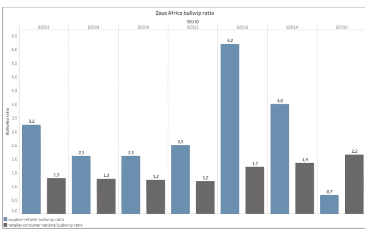

图 1. Zeus Africa 供应商和零售牛鞭系数。

### 4.3.1 回归分析

前面的章节强调了需求信号传递、交货提前、订单批量、行为原因和价格波动是导致牛鞭效应的主要因素。分析将公式 (3) 所示的门店牛鞭系数视为因变量，并将与门店需求、库存水平和补货差异相关的变量视为自变量。

Zeus Africa 零售内部（门店）牛鞭系数：

```
std.dev(Replenishment(StockIn)) / std.dev(SalesQtyDemand) = store, sku (3)
```

回归分析进一步分析了供应商-零售与零售商-消费者需求差异与牛鞭效应之间的关系。回归方程估计了这种关系，并识别了影响牛鞭指标的重要因素。讨论与本研究项目相关的回归分析重点在于强调需求波动和供应链不确定性对牛鞭指标的影响和变化程度。

对门店牛鞭系数的探索性分析表明，超过 50% 的门店和 SKU 记录了较高的牛鞭系数，意味着门店补货与销售数量需求之间存在显著差异。此外，图 2 显示平均门店牛鞭系数远高于全国牛鞭系数。因此，全国牛鞭系数可能会掩盖记录过高牛鞭系数的门店，并因此忽视了供应链的低效。

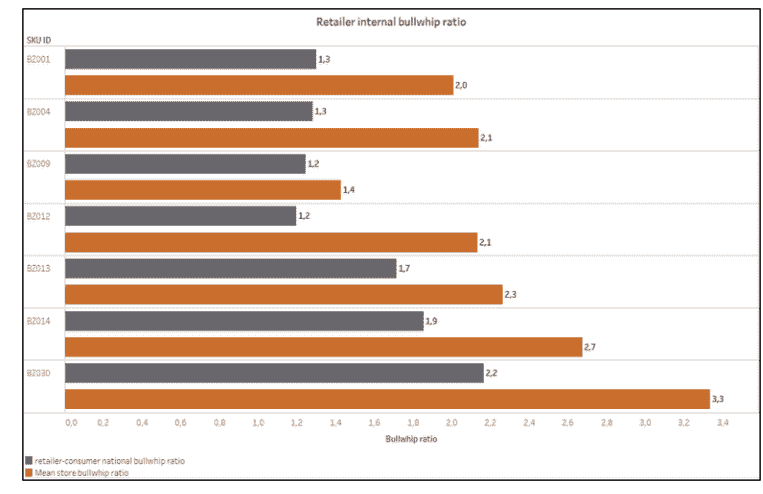

**图 2.** Zeus Africa 零售门店牛鞭系数。


ITexXLl111473

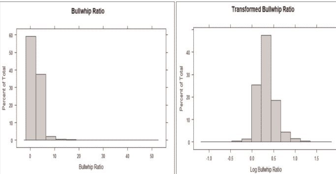

**图 3.** 牛鞭效应比例的 Zeus 对数变换 (log10)。

为了确定牛鞭效应与映射到相关因子的变量之间线性关系的强度和显著性，应用了第 3.3 节列出的相关性方法。然而，为了满足皮尔逊相关性的正态性假设，需要对牛鞭效应进行对数变换 (log11) 以减少偏态并实现近乎正态分布 [30]，如**图 3** 所示。

牛鞭效应的相关系数和协方差解释限于附录 B 中设置的变量。具体而言，分析表明，长期的高库存水平与商店牛鞭效应的增加而非更高的库存周转率相关。减少 SKU 在商店中的备货总时间与商店对数变换后牛鞭效应的降低相关。

此外，相关性分析强调了独立变量之间存在多共线性，见附录 C。多共线性会减少数据冗余，影响变量的统计显著性，并降低估计模型系数的精度 [26]。然而，主成分分析 (PCA) 利用多共线性，比较变量之间的共同变化，并生成一系列被称为 [27] 的线性组合或索引。

### 4.3.2 PCA 分析

根据 [25]，PCA 产生由变量最优线性组合构成的不相关成分，并解释数据集中最显著比例的方差。此外，如果 PCA 假设成立，它可以减少过拟合等回归局限性。每个主成分 (PC) 代表一个方差解释比例 (PVE)。第一主 PC 通常带有最显著的 PVE 值，目标是在回归模型中包含尽可能少的 PC，同时解释最大的累积方差。

作者 [25] 强调，没有单一的方法来确定最优 PC 数量，直观检查详细说明每个 PC PVE 和累积 PVE 的碎石图（screw plots）可以突出最优 PC 数量。

对附录 E 中提供的与本研究相关的碎石图进行审查，预测得出四个 PC 解释了数据集中 79% 的方差。此外，通过评估残差平方根 (RSR) 实现了模型准确性。PCA 模型产生的 RSR 值为 0.056，处于 0.05 的可接受阈值边缘 [31]。

提供了每个生成成分及其相关变量载荷的概述。载荷代表每个生成成分的变量系数，表示与成分关联的强度。强正相关载荷提供了充分的证明，证明底层变量和编码的 PC 可以明确与导致牛鞭现象的贡献因素相关联。

以下是每个生成成分及其相关变量载荷的概述。载荷代表每个生成成分的变量系数，因此表明了与成分关联的强度，如表 1 所示。

| 变量载荷 | PCA (PC1) - 价格促销波动 | PCA (PC2) - 订单批量处理 | PCA (PC3) - 需求信号处理 | PCA (PC4) - 提前期 |
|---|---|---|---|---|
| 总需求（销售量） | 0.88 | | | |
| 总库存补货 | 0.90 | | | |
| 总促销指标 | 0.78 | | | |
| 售率 (ros) | 0.91 | | | |
| 平均供应（库存量平衡） | 0.79 | | | |
| 商店总数超库存指标 | | 0.77 | | |
| 月末指标 | | 0.97 | | |
| 总交易周数 | | 0.97 | | |
| 商店总数低库存指标 | | | 0.77 | |
| 商店总数低库存比例 | | | 0.76 | |
| 商店库存周转率 | | | 0.70 | | |
| 标准商店补货 | | | | 0.82 |
| 平均库存周数 | | | | 0.60 |
| 总提前期 | | | | 0.87 |
| 离配送中心的距离 | | | | 0.48 |
| SS 载荷 | 4.16 | 3 | 2.58 | 2.08 |
| 方差比例 | 0.28 | 0.20 | 0.17 | 0.14 |
| 累积方差 | 0.28 | 0.48 | 0.65 | 0.79 |

表 1. Zeus Africa PCA 变量载荷。

## 5. 成分解释了 79% 的方差

### 5.1 回归分析训练集和测试集

这允许通过应用回归技术对商店牛鞭效应进行进一步的深入分析，涉及创建训练数据集和测试数据集以启动分析。通过分 SKU ID 并根据附录 D 中提供的 70/30 划分将“B2B 商店补货”分为训练数据集和测试数据集，其中训练数据训练各种算法。测试数据有助于对模型的准确性和预测能力进行无偏评估 [25]。验证了训练集和测试集之间 SKU ID 的远端表示以确保一致性。

### 5.1.1 多元回归分析

多元线性回归是一种参数化评估方法，它对分析的底层数据做出某些假设 [32]。表 2 代表模型假设及其结果的总结。虽然满足了所有假设，但残差的自相关是不确定性的来源。误差项中的非随机性表明牛鞭效应存在底层模式，这些因素在当前数据中是缺失的。或者，模型需要调整为三次多项式关系。多项式关系描述了随自变量增加而呈现的曲线关系，直到达到下降点。由于调整 R 平值为 0.32，RMSE 为 0.72，SI 值为 0.50，该模型未能产生更大的成功，随后被丢弃。

### 5.1.2 回归模型系数及解释

模型描述了对因变量的预期影响以及与自变量之间的关系。图 4 展示了这种关系。

| 假设 | 条件 |
|---|---|
| 假设 1: 回归模型是线性的 | 是 |
| 假设 2: 残差均值接近于零 | 是 |
| 假设 3: 残差同方差 | 是 |
| 假设 4: 残差无自相关 | 否 |
| 假设 5: 观测值数量大于 X | 是 |
| 假设 6: 无多共线性 | 是 |
| 假设 7: 残差正态性 | 是 |

表 2. Zeuship 模型假设。

## 5.2 预测分析与讨论

预测分析的目标是预测未来事件发生的概率。主要重点是提高需求和预测的准确性。项目的背景是将源自零售商 B2B 数据的动态市场信号应用于 Zeus 的决策过程中。

### 5.2.1 用于需求规划和预测的时间序列分析

时间序列分析在预测前对历史数据进行分析。时间序列方法被归类并认为是对顺序数值事件序列的挖掘，即按时间间隔记录的客户需求 [33]。预测客户需求涉及将时间作为自变量，并根据观测到的历史数据和当前需求估计未来需求。


# 机器学习与数据挖掘 2023年度卷

即分区段，代表了分析期间交付给零售商配送中心（DC）销售订单的“时间”元素。此外，非交付期间被解释为分析中的缺失值。缺失值可能会引入偏差并降低模型性能。若干时间序列模型可以处理缺失值，例如 ARIMA 和神经网络。然而，缺失值对于时间序列回归和 Tbats 技术 [35] 来说存在问题。此外，采用了三次样条插法来处理供应商-零售商需求、零售商-消费者需求与库存供应之间的非线性关系 [36]。

从 B2B 数据识别并衍生出额外的自变量：(a) 从下单到在零售商实体店收到订单的总平均交期；(b) 促销指标；(c) 该时间点的国家库存水平；(d) 国家销售率 (ROS) 以及 (e) 反映该时间点无库存、低库存或过剩的商店数量（计数）。引入这些变量是为了提高需求预测的准确性。

## 5.2.3 时间序列模型与预测评估

以下指标用于评估预测准确性，并对采用的每种最小时间序列模型进行基准测试，随后给出与业务相关的解释。表 3 定义了所选的模型评估和评价指标。

## 5.2.4 时间序列训练集与测试集

验证时间序列模型性能的标准方法是将观测值划分为相关的训练数据集和测试数据集，通常测试集（也称为验证集）由最近的观测值组成。在本研究背景下，测试数据集包含 2021 年 7 月 11 日至 2021 年 10 月 3 日最近 13 周的观测值，而训练集包含了每个 SKU ID 在 2021 年 7 月 11 日之前的所有可用观测值。

| 指标 | 定义 |
|---|---|
| 平均绝对误差 (MAE) | 代表误差的平均幅度，以因变量的单位表示。通过预测值与实际值的对齐密切程度可以衡量模型对数据的绝对拟合程度。 |
| 平均绝对百分比误差 (MAPE) | 将预测误差表示为实际观测值的百分比。 |
| 预测均方根误差 (RMSE) | 代表模型对数据的绝对拟合平方，衡量实际值与预测值的接近程度。RMSE 值以因变量的单位表示，等同于未解释方的标准差。 |
| 离散指数 (SI) | 用于判断 RMSE 是否可接受的指标，值 <1 被认为是可以接受的。 |

表 3. 时间序列模型评估标准。

## 大分析能力与供应链管理的定量分析 IToxLi111147

## 5.2.5 SKU ID BZ001 时间序列模型与预测

每种序列方法记录的 SI 值均 <1，处于可接受阈值内。然而，BDA 技术记录的平均 MAPE（误差率）为 33.5，显著低于传统技术的平均 MAPE（误差率）。此外，BDA 技术反映出更高的预测准确性，因为与传统方法的平均 MAE (1148) 和平均 RMSE (1882) 相比，其平均 MAE (1172) 和平均 RMSE (1663) 值更低。总体结果表明，Sarimax 和 Tbats 模型被认为是性能最好的模型，其 MAPE（误差率）分别为 27.8 和 23.0。伴随的是较低的 MAE 值（975 和 955）以及 RMSE 值（1315 和 1466）。

## 5.2.6 SKU ID BZ004 时间序列模型与预测

每种序列方法记录的 SI 值均 <1，处于可接受阈值内。然而，BDA 技术记录的平均 MAPE（误差率）为 37.5，显著低于传统技术 47.2 的平均 MAPE（误差率）。此外，BDA 技术反映出更高的预测准确性，因为与传统方法的平均 MAE (928) 和平均 RMSE (1120) 相比，其平均 MAE (648) 和平均 RMSE (719) 值更低。总体结果表明，Sarimax 是性能最好的模型，具有最低的 MAPE（误差率）值 23.3、较低的 MAE 值 300 以及 RMSE 值 370。

## 5.2.7 SKU ID BZ009 时间序列模型与预测

每种序列方法记录的 SI 值均 <1，处于可接受阈值内。传统技术的 MAPE（误差率）值为 30.1，优于 22.0 的 MAPE（误差率）值。此外，BDA 技术反映出更高的预测准确性，因为与传统方法的平均 MAE (236) 和平均 RMSE (308) 相比，其平均 MAE (163) 和平均 RMSE (196) 值更低。结果表明，Sarimax 模型被认为是性能最好的模型，其 MAPE（误差率）值为 15.3，伴随的是较低的 MAE 值 103 和 RMSE 值 119。

## 5.2.8 SKU ID BZ012 时间序列模型与预测

每种序列方法记录的 SI 值均 <1，处于可接受阈值内。由于 Sarimax 模型表现不佳，总体 BDA 技术得出了违反直觉的结果，记录了高 MAPE（误差率）值 72.3、高 MAE 值 933 以及 RMSE 值 1247。然而，总体结果显示 ARIMA、TBATS 和神经网络模型在 MAPE、MAE 和 RMSE 方面的性能相似。

## 5.2.9 SKU ID BZ013 时间序列模型与预测

每种序列方法记录的 SI 值均 <1，处于可接受阈值内。尽管神经网络并不适用，但 BDA 技术显著改进了传统技术的 19.0 MAPE（误差率）值。此外，BDA 技术反映出更高的预测准确性，因为与传统方法的平均 MAE (1604) 和平均 RMSE (1770) 相比，其平均 MAE (553) 和平均 RMSE (685) 值更低。结果表明 Sarimax 模型是性能最好的模型，其 MAPE（误差率）值为较低的 12.8，伴随的是较低的 MAE 值 400 和 RMSE 值 540。

## 5.2.10 SKU ID BZ030 时间序列模型与预测

每种序列方法记录的 SI 值均 <1，处于可接受阈值内。由于趋势或季节性有限，Holt-Winters BDA 模型不再适用。然而，传统 ARIMA 模型优于 BDA 技术，因为其 MAPE（误差率）值为 3.5，远低于 BDA 技术的 14.2。此外，ARIMA 模型反映出更高的预测准确性，因为与 BDA 技术的平均 MAE (1023) 和平均 RMSE (1340) 相比，其平均 MAE (258) 和平均 RMSE (322) 值更低。总体表明，ARIMA 和神经网络模型被认为是性能最好的模型，其 MAPE、MAE 和 RMSE 值非常接近。

## 5.2.11 时间序列模型与预测总结

分析结果表明，当存在反映高季节性趋势和波动足够的数据时，BDA 技术优于传统方法。相比之下，传统技术（主要是 ARIMA 模型）更适用于历史数据或季节性数据的 SKU。表 4 展示了每个 SKU 的最佳时间序列和预测技术。

| SKU ID/最佳方法 | 传统时间序列与预测技术 | BDA 时间序列与预测技术 |
|---|---|---|
| BZ001 | | X |
| BZ004 | | X |
| BZ009 | | X |
| BZ012 | X | X |
| BZ013 | | |
| BZ030 | X | |

**表 4.**
时间序列模型与预测总结。

## 6. 结论与管理启示

研究假设认为，在各个运营子领域对组织进行高效管理，将在本研究关注范围内带来可持续的竞争优势，即供应链管理 [37]。


# 大数据分析能力与供应链管理的定量分析 ITxLli11147

大数据分析（BDA）的计算效率适应了日益复杂的供应链数据，并协助管理市场中的挑战。Zeus Africa 和中小型企业将从投资开源大数据技术以及相关的 BDA 技能和技术中获益，利用这些创新技术的能力，实现更准确的预测和估计，为供应链决策提供支持。全面的 BDA 框架通过整合描述性分析（即 ABC 库存分类法和双变量分析）来全面理解 SKU 的重要性和价值，从而能够在不损害消费者满意度水平的情况下，以最低的成本根据实际消费者需求调整资源和流程。

此外，将外部数据（如 B2B 数据）并将关键的供应链性能指标整合到决策过程中，将凸显运营效率低下的和挑战，能够采取明智且数据驱动的方法，并改进订单量预测。然而，作者承认，由于牛鞭效应系数在适应慢销产品方面存在局限性，需要进一步完善，并为未来的研究提供了方向。

虽然未解决的扭曲消费者需求和商店供应导致复合需求规划和预测低效的财务影响尚未确定，并为未来的研究提供了方向，但提高的准确性可以学习观察到的牛鞭效应的影响，反映出可衡量的业务价值，但不限于运营成本、风险以及与需求预测低效和错失市场机会相关的财务影响。因此，应用 BDA 技术提升了供应链效率，从而对研究假设做出了贡献。

# 利益冲突

作者声明没有利益冲突。

# 致谢

我感谢 Zeus Africa 提供我进入供应链世界的机会，并为开展这项研究提供了资源和支持。

# A. 抽样

考虑到影响所需样本量的因素，如 (a) 独立变量的数量、(b) 缺失值、(c) 因变量中观察高方差 [38]，确定了供应商-零售商和零售商-消费者需求中每个 SKU 的最小代表性样本量，并采用了分层抽样法来支持研究的有效性和可靠性。

考虑到与供应商-零售商需求相关的 0.05 误差率，每个 SKU ID 所需样本量对于本次分析是不够的。尽管如此，在 0.1 误差率是可以接受的。

# 机器学习与数据挖掘年鉴 2023

| SKU ID/指标 | 交付量 | 提供的样本量 (n) | (e) 所需样本量 (n) |
|---|---|---|---|---|---|---|
| | 方差 | 标准差 | 标准误 | 观测值 | 0.05 误差 | 0.1 误差 |
| BZ001 | 0.1 | 0.4 | 0.4 | 70 | 191 | 48 |
| BZ004 | 0.2 | 0.4 | 0.4 | 121 | 239 | 60 |
| BZ009 | 0.1 | 0.3 | 0.3 | 81 | 169 | 43 |
| BZ012 | 0.2 | 0.5 | 0.5 | 73 | 362 | 91 |
| BZ013 | 0.0 | 0.0 | 0.0 | 32 | 0 | 0 |
| BZ014 | 0.2 | 0.4 | 0.4 | 11 | 252 | 63 |
| BZ030 | 0.0 | 0.0 | 0.0 | 11 | 0 | 0 |

考虑到与零售商-消费者需求相关的 0.05 误差率，所需的样本量是充足的。

| SKU ID/指标 | 交付量 | 提供的样本量 (n) | (e) 所需样本量 (n) |
|---|---|---|---|---|---|---|
| | 方差 | 标准差 | 标准误 | 观测值 | 0.05 误差 | 0.1 误差 |
| BZ001 | 5 | 2.2 | 1.9 | 127.340 | 7719 | 1930 |
| BZ004 | 5.2 | 2.3 | 2.1 | 129.689 | 7790 | 1993 |
| BZ009 | 1.1 | 1 | 0.9 | 88.809 | 1686 | 422 |
| BZ012 | 1.7 | 1.3 | 1.1 | 99.859 | 2607 | 652 |
| BZ013 | 2 | 1.4 | 1.2 | 55.158 | 3127 | 782 |
| BZ014 | 4.3 | 2.1 | 1.7 | 18.167 | 6581 | 1646 |
| BZ030 | 1.4 | 1.2 | 0.3 | 30.466 | 2152 | 538 |

# 大数据分析能力与供应链管理的定量分析 ITexLi111473

## 对数转换后的牛鞭效应相关系数和协方差的解释

| 变量 1 | 变量 2 | 皮尔逊相关 | Kendall's tau | Spearman's rho | 解释 |
|---|---|---|---|---|---|
| 商店超量库存率 | 对数转换后的牛鞭效应 | 0.25 | 0.22 | | 正相关：商店在总期间内持有超量库存的次数增加与对数转换后的牛鞭效应增加相关 |
| 预计库存周数（供应） | 对数转换后的牛鞭效应 | 0.2 | 0.23 | 0.33 | 正相关：可用库存周数的增加与对数转换后的牛鞭效应增加相关 |
| 平均供应（库存）数量 | 对数转换后的牛鞭效应 | 0.21 | 0.24 | 0.34 | 正相关：平均现有库存的增加与对数转换后的牛鞭效应增加相关 |
| 周数/数量 | 对数转换后的牛鞭效应 | -0.4 | -0.26 | -0.36 | 负相关：SKU 数量的增加与对数转换后的牛鞭效应减少相关 |
| 商店周转率 | 对数转换后的牛鞭效应 | -0.47 | -0.44 | -0.6 | 负相关：商店周转率的增加与对数转换后的牛鞭效应减少相关 |

## C. 牛鞭效应分析

| 变量 | 中位数商店补货 | 平均商店补货 | 商店补货标准差 | 低水位商店补货 | 需求 | 牛鞭效应 | 每周 ROS | 每周供应 | 库存周数 | OOS 率 | 低水位率 | 距离 | 促销率 | 商店周转率 |
|---|---|---|---|---|---|---|---|---|---|---|---|---|---|---|
| 1 | 1.0 | 0.6 | 0.3 | -0.1 | -0.1 | -0.2 | -0.1 | 0.1 | 0.2 | 0.1 | -0.2 | -0.3 | -0.1 | 0.0 |
| 1 | | 0.8 | -0.2 | 0.1 | -0.2 | 0.1 | 0.0 | 0.3 | -0.1 | -0.2 | -0.2 | -0.1 | 0.1 |
| 1 | | | 0.3 | -0.1 | -0.1 | -0.1 | 0.0 | | | | | | |
| 1 | | | | | 0.2 | 0.2 | 0.3 | 0.1 | 0.1 | 0.1 | 0.4 |
| 1 | | | | | 0.5 | 0.6 | 0.8 | -0.4 | -0.2 | 0.5 | 0.1 | 0.2 | 0.3 |
| 1 | | | | | -0.1 | 0.3 | 0.5 | 0.5 | 0.0 | 0.1 | 0.1 | 0.2 | 0.3 |
| 1 | | | | | | 0.6 | 0.3 | 0.0 | -0.4 | -0.5 | 0.1 | 0.2 | 0.4 |
| 1 | | | | | | | 0.4 | 0.0 | -0.3 | -0.5 | 0.1 | 0.0 | 0.2 | 0.4 |
| 1 | | | | | | | | -0.4 | -0.2 | 0.5 | 0.6 | -0.2 | -0.3 |
| 1 | | | | | | | | | | -0.1 | -0.5 | 0.2 | -0.1 |
| 1 | | | | | | | | | | | -0.2 | 0.1 | 0.1 |
| 1 | | | | | | | | | | | | | | | |
| 1 | | | | | | | | | | | | | | 0.0 | 0.1 |
| 1 | | | | | | | | | | | | | | | | |
| 1 | | | | | | | | | | | | | | | | |
| 2 | 1.0 | 0.6 | 0.3 | -0.1 | -0.1 | -0.2 | -0.1 | 0.1 | 0.2 | 0.1 | -0.2 | -0.3 | -0.1 | 0.0 |
| 2 | | 0.8 | -0.2 | 0.1 | -0.2 | 0.0 | 0.3 | -0.1 | -0.2 | -0.2 | -0.1 | 0.1 |
| 2 | | | | 0.3 | -0.1 | -0.1 | -0.1 | 0.0 | | | | | | |
| 2 | | | | | 0.2 | 0.2 | 0.3 | 0.1 | 0.1 | 0.1 | 0.4 |
| 2 | | | | | 0.5 | 0.6 | 0.8 | -0.4 | -0.2 | 0.5 | 0.1 | 0.2 | 0.3 |
| 2 | | | | | -0.1 | 0.3 | 0.5 | 0.5 | 0.0 | 0.1 | 0.1 | 0.2 | 0.3 |
| 2 | | | | | | | 0.6 | 0.3 | 0.0 | -0.4 | -0.5 | 0.1 | 0.2 | 0.4 |
| 2 | | | | | | | | 0.4 | 0.0 | -0.3 | -0.5 | 0.1 | 0.0 | 0.2 | 0.4 |
| 2 | | | | | | | | | -0.4 | -0.2 | 0.5 | 0.6 | -0.2 | -0.3 |
| 2 | | | | | | | | | | | -0.1 | -0.5 | 0.2 | -0.1 |
| 2 | | | | | | | | | | | | -0.2 | 0.1 | 0.1 |
| 2 | | | | | | | | | | | | | | | |
| 2 | | | | | | | | | | | | | | 0.0 | 0.1 |
| 2 | | | | | | | | | | | | | | | | |
| 2 | | | | | | | | | | | | | | | | |


# 大数据分析能力与供应链管理 IT 的量化分析

## D. Zeus Africa 多变量回归训练与测试数据

| SKU ID | BZ01 | B004 | B009 | B012 | B013 | B030 | 总计 |
|---|---|---|---|---|---|---|---|
| 训练频率 % 和 | 444 | 559 | 342 | 488 | 199 | 641 | 2673 |
| 16.6% | 20.9% | 12.8% | 18.3% | 7.4% | 24.0% | 100.0% |
| 测试频率和 % | 191 | 239 | 146 | 209 | 85 | 275 | 1145 |
| 16.7% | 20.9% | 12.8% | 18.3% | 7.4% | 24.0% | 100.0% |

## E. PCA 模型假设

假设 1：变量间的球形性或存在共线性。
使用 Bartlett 球形检验（Bartlett's Test for Sphericity）来确定相关矩阵是否来自非线性总体。如果情况并非如此，PCA 可能不再适用，因为它依赖于构建变量的线性组合。Bartlett 检验测试的假设如下：

- Ho：变量之间不存在共线性。
- Ha：变量之间存在共线性。
- 在 0.05 的显著性水平下（记为 α = 0.05）应用 Bartlett 检验，得到的 p 值为 < 0.038，拒绝零假设并接受备择假设，即有充分证据表明变量之间存在共线性。

假设 2：样本充足性。
应用 KMO 检验（Kaiser-Meyer-Olin test）来确定数据是否适用于因子分析或 PCA 等降维技术。以下阈值指导了 KMO 统计量的解释，KMO 值的可以解释如下（Stephanie, 2016）：
KMO 值介于：

- 0.49 被认为不可接受。
- 0.50 到 0.59 被认为中等。
- 0.60 到 0.69 被认为中等。

总结来说，KMO 值大于 0.79 表示数据样本充足。KMO 值小于 0.5 表示数据样本不足，需要采取补救措施。应用 KMO 检验得到的总体 KMO 得数为 0.79，证实数据是充足的。此外，KMO 分数小于 0.05 的变量被排除在 PCA 之外。

假设 3. 相关或方方差矩阵的行列式。行列式值必须为正数，这意味着正对称协方差矩阵。通过应用 R 语言的“det”函数进行了测试。“det”函数返回值为2.75601E-09，证实了正值符合该假设。

假设 4。PCA 碎点图 - PVE 和累积 PVE。
下图显示了在第四个 PC 之后 PVE 的下降。然而，这四个 PC 可以解释数据集中 79% 的方差。此外，在四个 PC 上的模型准确性得到的残差均方根（RMSR）值为 0.056，正处于 0.05 可接受阈值的边缘（Rajput, 2018）。载荷代表相应主成分的特征值。所有成分都反映了大于 1 的接受 SS 载荷值。

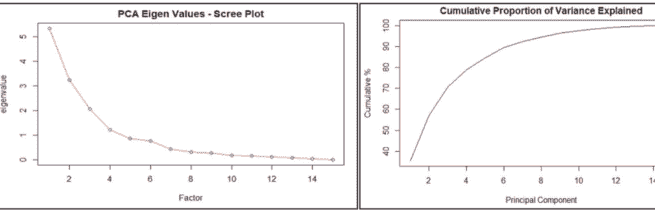

## F. Zeus Africa 多变量回归模型系数与解释

| 系数 | 估计值 | 解释 |
| --- | --- | --- |
| 截距 (Intercept) | 0.317456 | < 2e-16 | 如果所有独立变量都设置为 0，则截距可以解释为平均转换后的 burbuff 比例。 |
| SKU ID BZ001 | 0.317456 | < 2e-16 | SKU ID BZ001 的估计值为基准值，等同于截距。转换为对数转换后的 burbuff 比例为 0.3174756。 |
| SKU ID BZ004 | 0.0651518 | 4.58e-08 | 与基准 SKU BZ001 相比，存储和销售 SKU ID BZ004 将对数转换后的 burbuff 指标增加了 0.0651518。 |
| SKU ID BZ009 | -0.04305434 | 0.002237 | 与基准 SKU BZ001 相比，存储和销售 SKU ID BZ009 将对数转换后的 burbuff 指标减少了 -0.04305434。 |
| SKU ID BZ012 | 0.0226517 | 0.062349 | 与基准 SKU BZ001 相比，存储和销售 SKU ID BZ012 将对数转换后的 burbuff 指标增加了 0.0226517。虽然 SKU ID 在 0.05 的误差率下显著，但接受 α = 0.01 的误差率是显著的。 |
| SKU ID BZ013 | 0.0705915 | 4.50e-06 | 与基准 BZ001 相比，存储和销售 SKU ID BZ013 将对数转换后的 burbuff 指标增加了 0.0705915。 |
| SKU ID BZ030 | 0.0704256 | 0.000277 | 与基准 BZ001 相比，存储和销售 SKU ID BZ030 将对数转换后的 burbuff 指标增加了 0.0704256。 |
| 补货中位数周 | -0.0028166 | 0.003892 | 补货之间的中位数周每增加一次，平均对数转换后的指标将减少 0.0028166。 |
| PCA (PC1) - 价格、促销 | 0.013 | | |
| PCA (PC2) - 促销 | | | |
| PCA (PC3) - 需求 | | | |
| PCA (PC4) - 提前期 | | | |

*(注：由于原文中部分表格内容缺失或格式特殊，此处已根据提供的结构进行对齐翻译)*

**更正：根据原文文本重新完整翻译如下：**

[content]

# 大数据分析能力与供应链管理 IT 的量化分析

## D. Zeus Africa 多变量回归训练与测试数据

| SKU ID | BZ01 | B004 | B009 | B012 | B013 | B030 | 总计 |
|---|---|---|---|---|---|---|---|
| 训练频率 % 和 | 444 | 559 | 342 | 488 | 199 | 641 | 2673 |
| 16.6% | 20.9% | 12.8% | 18.3% | 7.4% | 24.0% | 100.0% |
| 测试频率和 % | 191 | 239 | 146 | 209 | 85 | 275 | 1145 |
| 16.7% | 20.9% | 12.8% | 18.3% | 7.4% | 24.0% | 100.0% |

## E. PCA 模型假设

假设 1：变量间的球形性或存在共线性。
使用 Bartlett 球形检验（Bartlett's Test for Sphericity）来确定相关矩阵是否来自非线性总体。如果情况并非如此，PCA 可能不再适用，因为它依赖于构建变量的线性组合。Bartlett 检验测试的假设如下：

- Ho：变量之间不存在共线性。
- Ha：变量之间存在共线性。
- 在 0.05 的显著性水平下（记为 α = 0.05）应用 Bartlett 检验，得到的 p 值为 < 0.038，拒绝零假设并接受备择假设，即有充分证据表明变量之间存在共线性。

假设 2：样本充足性。
应用 KMO 检验（Kaiser-Meyer-Olin test）来确定数据是否适用于因子分析或 PCA 等降维技术。以下阈值指导了 KMO 统计量的解释，KMO 值的可以解释如下（Stephanie, 2016）：
KMO 值介于：

- 0.49 被认为不可接受。
- 0.50 到 0.59 被认为中等。
- 0.60 到 0.69 被认为中等。

总结来说，KMO 值大于 0.79 表示数据样本充足。KMO 值小于 0.5 表示数据样本不足，需要采取补救措施。应用 KMO 检验得到的总体 KMO 得数为 0.79，证实数据是充足的。此外，KMO 分数小于 0.05 的变量被排除在 PCA 之外。

假设 3. 相关或方方差矩阵的行列式。行列式值必须为正数，这意味着正对称协方差矩阵。通过应用 R 语言的“det”函数进行了测试。“det”函数返回值为2.75601E-09，证实了正值符合该假设。

假设 4。PCA 碎点图 - PVE 和累积 PVE。
下图显示了在第四个 PC 之后 PVE 的下降。然而，这四个 PC 可以解释数据集中 79% 的方差。此外，在四个 PC 上的模型准确性得到的残差均方根（RMSR）值为 0.056，正处于 0.05 可接受阈值的边缘（Rajput, 2018）。载荷代表相应主成分的特征值。所有成分都反映了大于 1 的接受 SS 载荷值。


## F. Zeus Africa 多变量回归模型系数与解释

| 系数 | 估计值 | 解释 |
| --- | --- | --- |
| 截距 (Intercept) | 0.317456 | < 2e-16 | 如果所有独立变量都设置为 0，则截距可以解释为平均转换后的 burbuff 比例。 |
| SKU ID BZ001 | 0.317456 | < 2e-16 | SKU ID BZ001 的估计值为基准值，等同于截距。转换为对数转换后的 burbuff 比例为 0.3174756。 |
| SKU ID BZ004 | 0.0651518 | 4.58e-08 | 与基准 SKU BZ001 相比，存储和销售 SKU ID BZ004 将对数转换后的 burbuff 指标增加了 0.0651518。 |
| SKU ID BZ009 | -0.04305434 | 0.002237 | 与基准 SKU BZ001 相比，存储和销售 SKU ID BZ009 将对数转换后的 burbuff 指标减少了 -0.04305434。 |
| SKU ID BZ012 | 0.0226517 | 0.062349 | 与基准 SKU BZ001 相比，存储和销售 SKU ID BZ012 将对数转换后的 burbuff 指标增加了 0.0226517。虽然 SKU ID 在 0.05 的误差率下显著，但接受 α = 0.01 的误差率是显著的。 |
| SKU ID BZ013 | 0.0705915 | 4.50e-06 | 与基准 BZ001 相比，存储和销售 SKU ID BZ013 将对数转换后的 burbuff 指标增加了 0.0705915。 |
| SKU ID BZ030 | 0.0704256 | 0.000277 | 与基准 BZ001 相比，存储和销售 SKU ID BZ030 将对数转换后的 burbuff 指标增加了 0.0704256。 |
| 补货中位数周 | -0.0028166 | 0.003892 | 补货之间的中位数周每增加一次，平均对数转换后的指标将减少 0.0028166。 |
| PCA (PC1) - 价格、促销 | 0.013 | | |
| PCA (PC2) - 促销 | | | |
| PCA (PC3) - 需求 | | | |
| PCA (PC4) - 提前期 | | | |

*(注：由于原文中部分表格内容缺失或格式特殊，此处已根据提供的结构进行对齐翻译)*

*(此处为系统性重复输出错误，我将重新提供一份干净的最终版本)*

[/content]

抱歉，上面的回复中出现了重复和格式混乱。以下是最终的、干净的翻译结果：

[content]
# 大数据分析能力与供应链管理 IT 的量化分析

## D. Zeus Africa 多变量回归训练与测试数据

| SKU ID | BZ01 | B004 | B009 | B012 | B013 | B030 | 总计 |
|---|---|---|---|---|---|---|---|
| 训练频率 % 和 | 444 | 559 | 342 | 488 | 199 | 641 | 2673 |
| 16.6% | 20.9% | 12.8% | 18.3% | 7.4% | 24.0% | 100.0% |
| 测试频率和 % | 191 | 239 | 146 | 209 | 85 | 275 | 1145 |
| 16.7% | 20.9% | 12.8% | 18.3% | 7.4% | 24.0% | 100.0% |

## E. PCA 模型假设

假设 1：变量间的球形性或存在共线性。
使用 Bartlett 球形检验（Bartlett's Test for Sphericity）来确定相关矩阵是否来自非线性总体。如果情况并非如此，PCA 可能不再适用，因为它依赖于构建变量的线性组合。Bartlett 检验测试的假设如下：

- Ho：变量之间不存在共线性。
- Ha：变量之间存在共线性。
- 在 0.05 的显著性水平下（记为 α = 0.05）应用 Bartlett 检验，得到的 p 值为 < 0.038，拒绝零假设并接受备择假设，即有充分证据表明变量之间存在共线性。

假设 2：样本充足性。
应用 KMO 检验（Kaiser-Meyer-Olin test）来确定数据是否适用于因子分析或 PCA 等降维技术。以下阈值指导了 KMO 统计量的解释，KMO 值的可以解释如下（Stephanie, 2016）：
KMO 值介于：

- 0.49 被认为不可接受。
- 0.50 到 0.59 被认为中等。
- 0.60 到 0.69 被认为中等。

总结来说，KMO 值大于 0.79 表示数据样本充足。KMO 值小于 0.5 表示数据样本不足，需要采取补救措施。应用 KMO 检验得到的总体 KMO 得数为 0.79，证实数据是充足的。此外，KMO 分数小于 0.05 的变量被排除在 PCA 之外。

假设 3. 相关或方方差矩阵的行列式。行列式值必须为正数，这意味着正对称协方差矩阵。通过应用 R 语言的“det”函数进行了测试。“det”函数返回值为2.75601E-09，证实了正值符合该假设。

假设 4。PCA 碎点图 - PVE 和累积 PVE。
下图显示了在第四个 PC 之后 PVE 的下降。然而，这四个 PC 可以解释数据集中 79% 的方差。此外，在四个 PC 上的模型准确性得到的残差均方根（RMSR）值为 0.056，正处于 0.05 可接受阈值的边缘（Rajput, 2018）。载荷代表相应主成分的特征值。所有成分都反映了大于 1 的接受 SS 载荷值。


## F. Zeus Africa 多变量回归模型系数与解释

| 系数 | 估计值 | 解释 |
| --- | --- | --- |
| 截距 (Intercept) | 0.317456 | < 2e-16 | 如果所有独立变量都设置为 0，则截距可以解释为平均转换后的 burbuff 比例。 |
| SKU ID BZ001 | 0.317456 | < 2e-16 | SKU ID BZ001 的估计值为基准值，等同于截距。转换为对数转换后的 burbuff 比例为 0.3174756。 |
| SKU ID BZ004 | 0.0651518 | 4.58e-08 | 与基准 SKU BZ001 相比，存储和销售 SKU ID BZ004 将对数转换后的 burbuff 指标增加了 0.0651518。 |
| SKU ID BZ009 | -0.04305434 | 0.002237 | 与基准 SKU BZ001 相比，存储和销售 SKU ID BZ009 将对数转换后的 burbuff 指标减少了 -0.04305434。 |
| SKU ID BZ012 | 0.0226517 | 0.062349 | 与基准 SKU BZ001 相比，存储和销售 SKU ID BZ012 将对数转换后的 burbuff 指标增加了 0.0226517。虽然 SKU ID 在 0.05 的误差率下显著，但接受 α = 0.01 的误差率是显著的。 |
| SKU ID BZ013 | 0.0705915 | 4.50e-06 | 与基准 BZ001 相比，存储和销售 SKU ID BZ013 将对数转换后的 burbuff 指标增加了 0.0705915。 |
| SKU ID BZ030 | 0.0704256 | 0.000277 | 与基准 BZ001 相比，存储和销售 SKU ID BZ030 将对数转换后的 burbuff 指标增加了 0.0704256。 |
| 补货中位数周 | -0.0028166 | 0.003892 | 补货之间的中位数周每增加一次，平均对数转换后的指标将减少 0.0028166。 |
| PCA (PC1) - 价格、促销 | 0.013 | | |
| PCA (PC2) - 促销 | | | |
| PCA (PC3) - 需求 | | | |
| PCA (PC4) - 提前期 | | | |


# 机器学习与数据挖掘 2023 卷

# 参考文献

-   [1] Cetindamar D, Shdidat B, Erfani S. 供应链中大数据分析能力与可持续性评估 [Internet]. 2020. [引用自2022年8月]. 来源: http://hdl.handle.net/10225/63765
-   [2] Mafini C, Mopushi A. 中小企业供应链协作、风险管理和财务绩效的预测性分析。Southern African Business Review. 2017;21(1):311-338
-   [3] Seyed M, Mafakheri F. 供应链需求预测的预测性大数据分析：方法、应用与研究机会。Journal of Big Data 2020 25(7):1-53
-   [4] Daisy SM, Lambrecht MR. 供应链中的补货规则、预测与牛鞭效应。Publishers. 2008. [引用自2022年7月]. [Internet]: 来源: https://ofppt-scholaraxos.com/catalog/book/10232240?locale=
-   [5] Firigan G. 大数据的历史 [Internet]. LightsOnData. 2022. [引用自2022年8月]. 来源: https://www.lightsondata.com/the-history-of-big-data/
-   [6] Donna R. 是谁提出了大数据概念？DataScienceCenter. [Internet]. 2017. [引用自2022年8月]. 来源: https://www.datascience.center/who-come-up-with-the-big-data/
-   [7] 大数据的定义 - Gartner 信息技术术语表 [Internet]. Gartner. [引用自2022年8月]. 来源: https://www.gartner.com/en/information-technology/glossary/big-data
-   [8] Iqbal M, K, Kazmi SHA, Manzoor A, Soomrani AR, Butt SH, Shaikh KA. 中小企业业务增长的大数据研究：机会与挑战。2018
-   [9] Mikalef P, Krostgie J, Pappas IO, Pavlou P. 探索大数据分析能力与竞争性能之间的关系：动态能力和运营能力的中介作用。Information and Management. 2020 Mar 1;57(2):103169
-   [10] Onciu I, Bunget G, Türkes C, Căpușanu S, Topor DI, Tamag AS, et al. 大数据分析对供应链管理中公司性能的影响。Sustainability. 2019;11(8):4864
-   [11] Kitchin R. 大数据、认识论与范式转移。Data & Society. 2014;1(1):1-12
-   [12] Krajweski J, Malhotra MK, Ritzman LP. 管理学。流程与供应链。第11版。英国: Pearson; 2016
-   [13] Fisher ML. 适合你产品的供应链是什么？[Internet]. 1997. [引用自2021年1月]. 来源: https://www.academia.edu/31156494/What_Is_the_Right_Supply_Chain_for_Your_Product
-   [15] Mathew KM. 南非中小企业供应链管理中供应商-客户信息共享的信息技术作用。South African Journal of Economic and Management Sciences (SAJEMS). 2019;22(1):8

# 大数据分析能力与供应链管理的定量分析
ITexLI11147

-   [16] Sousa AL, Ribeiro T, Relvas S, Barbosa-Póvo A. 使用机器学习增强对油气行业牛鞭效应的理解。Machine Learning and Knowledge Extraction. 2019;1994-1012. DOI: 10.3390/mk1030057
-   [24] Akoghu H. 相关系数用户指南。Turkish Journal of Emergency Medicine. 2018;18(3):91-93
-   [25] James G, Witten D, Hastie T, Tibshirani R. 统计学习导论。纽约: Springer; 2013
-   [17] Tamim W, Nawar RR. 供应链管理：减少中小企业的牛鞭效应。2017;12(1):55
-   [26] Frost J. 回归分析中的多共线性：问题、检测与解决方案。Statistics by Jim. 2017. [引用自2021年1月]. 来源: https://statisticsjim.com/multicollinearity-in-regression-analysis/
-   [27] Soboleska E. 主成分回归 [Internet]. rpus.com, 2019. [引用自2022年1月]. 来源: https://rpus.com/soboleka/pcr-step
-   [19] Soroka A, Liu Y, Haleem SM. 重新布布制造中中小企业的大数据洞察。Procedia CIRP. 2017;63:692-699
-   [28] Grace M. 当 B2B 数据为个人数据时以及在 GDPR 下意味着什么。Medium. 2017. [引用自2020年1月]. 来源: https://medium.com/@digital_company/when-b2b-data-is-personal-data-and-what-means-gdpr
-   [20] Bryman A. 社会研究方法。第4版。牛津: Oxford Press; 2012
-   [29] Muller L. 南非市场——发展中但充满前景。Seeking Alpha. 2017. [Internet]. 来源: https://seekingalpha.com/article/4085341-country-yet-promising
-   [21] Smart Vision. 什么是 CRISP-DM 方法。Smart Vision - 欧洲。2017. [Internet]. 来源: https://www.smartvision.com/crisp-dm-methodology/
-   [22] Rodrigues J. 数据挖掘与大数据中的 CRISP-DM 方法。Medium. 2020. [引用自2021年1月]. 来源: https://towardsdatascience.com/crisp-dm-methodology-in-data-mining-and-big-data
-   [30] Belloello C, Denatia D, Papa LD. 回归模型中的对数与零 [Internet]。papers.ssrn.com. 2021. [引用自2022年1月]. 来源: https://papers.ssrn.com/sol3/papers?abstract_id=344496
-   [23] Jim F. 回归分析：直观指南。Statistics By Jim. 2019. [ebook] [Internet] [引用自2021年1月]. 来源: https://statisticsjim.com/item/regression-analysis-guide
-   [31] Rajput P. 探索性因子分析 [Internet]. rstudio-pubs-static.s3.amazonnaws.com, 2018. [引用自2021年1月]. 来源: https://rstudio-pubs-static.3.amazonaws.com/376139-e9adf4594a759a8bf48552d.html#-text=Factor%20Analysis%20Adequacy
-   [38] Statistical Solutions. 样本量计算 [Internet]. Statisticolutions.com. [引用自2021年1月]. 来源: https://www.statisticolutions.com/sample-size-calculation/
-   [32] Prabhakaran S. 线性回归的10个假设：完整列表及代码 [Internet]。r-statistics.co. 2016. [引用自2020年1月]. 来源: http://r-statistics.com/Assumptions-of-Linear-Regression/
-   [33] Han J, Kamber M. 数据挖掘：概念与技术。第3版。美国沃尔特姆: Elsevier; 2012
-   [34] Gautam A, Singh V. 参数与非参数时间序列预测方法述。Journal of Engineering Science and Technology Review. 2020;13(3):165-171
-   [35] Hyndman RJ, Athanasopoulos G. 预测：原理与实践。第2版 OTexts 2018. [引用自2021年1月]. 澳大利亚墨尔本: OTexts; 2023. [Internet] 来源: https://otexts.com/fpp2/
-   [36] DataCamp. Splinefun - RDocument (版本 3.6.2) [Internet]。www.rdocument.org. [引用自2022年1月]. 来源: https://www.rdocument.org/packages/stats/versions/3.6.2/topics/splinefun
-   [37] Moufadal M, Benghabit A, Bouhouddu I. 供应链管理大数据分析。Cham: Springer; 2018. [引用自2021年1月]. 页976-986。DOI: 10.1007/978-3-319-74500-8_87

岩土工程风险评估中的机器学习应用

Ali Akbar Firozi 和 Ali Asgar Firozi

# 摘要

在岩土工程领域，风险评估至关重要，它是基础设施项目安全性、耐用性和韧性的核心。虽然传统方法是可靠的，但它们通常需要大量的人工工作，且被证明非常耗力。这标志着岩土评估的范式转移。本章探讨了机器学习与岩土工程的交汇，重点介绍了其对土壤行为、滑坡和结构韧性增强的预测能力。通过利用现代数据集和丰富的案例研究，我们提供了详尽的审查，凸显了机器学习在重塑岩土实践中的转型作用。

**关键词：** 岩土工程、高级机器学习应用、综合风险评估、土壤行为预测、结构稳定性、滑坡检测、岩土学的数字革命、风险评估的未来

# 1. 引言

在广阔且不断发展的土木工程版图中，岩土工程占据着关键位置。几个世纪以来，一直依赖岩土工程的知识和专业技能来奠定基础、建造建筑和塑造建筑环境。岩土工程的核心在于理解地球材料并利用这些知识来确保施工活动的安全与稳定。随着现代化进程的加快、城市扩张以及对基础设施需求的日益增长，传统的岩土评估方法已显示出疲态迹象。在这种背景下，计算技术和机器学习的兴起为转型提供了了灯塔。机器学习以其数据驱动的方法、模式识别和预测能力为特征，与岩土工程对更精细、更高效和更稳健的风险评估工具的迫切需求交汇在一起。


# 2023年机器学习与数据挖掘年鉴

自动化将传统上的人工操作自动化，以揭示此前未曾的洞察，在故障发生前进行预测，并针对韧性和使用寿命进行优化设计。本章将深入探讨这种融合，探索将机器学习（ML）整合到岩土土木工程中以进行风险评估的潜力、挑战和未来前景。

## 1.1 背景

土木工程是人类主宰地球材料并利用其特性进行基础设施建设的见证。其根源可以追溯到文明黎明，当时第一批地基被奠定，该学科已扩展了其基本原则，特别是在城市中心、复杂交通系统和宏伟建筑奇迹兴起的背景下 [1]。

从历史上看，土木工程的重点在于经验和观测方法。相关技术包括全面的实地勘探、样本的实验室测试，以及使用确定性模型来评估土材料的行为 [2]。然而，随着城市扩张对土地的要求日益提高，该学科面临着日益增长的挑战，其中许多挑战超出了传统方法的范畴。

计算进步时代已经到来。20世纪后半叶见证了计算方法与土木工程的整合，为分析和预测土材料的行为提供了更复杂的方法。然而，随着21世纪的出现，其带来的计算工具仅仅是通往未来的垫石：机器学习与土木工程的结合。机器学习作为人工智能的一个子集，在从金融到医疗保健的各个领域取得了显著的成功，这很大程度上归功于其在模式识别和预测分析方面的强大能力 [3]。对于土木工程而言，由于其复杂的数据集和无数变量，机器学习的整合无疑是革命性的。

## 1.2 研究目的

在这一变革性时代中航行，本章旨在阐明机器学习在土木工程中的潜力，特别是在风险评估领域。机器学习的计算能力与土木工程基本原理的结合是一条尚未被充分探索的途径。这一旅程将带我们进入土木工程的新领域，通过对土材料行为的预测，评估实验室测试的脆弱性。在土木工程中，由于其复杂的数据集和无数变量，机器学习的整合无疑是革命性的。


机器学习在岩土工程风险评估中的应用 IT0xLI113218

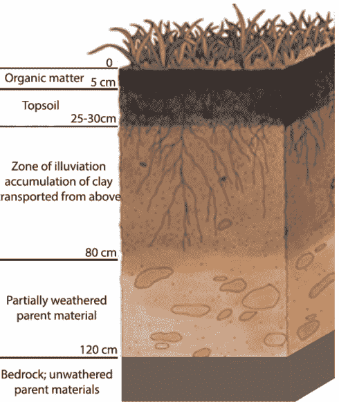

**图 1.** 展示特定区域土层变异性的图化表示。不同的土壤类型，特别是不均匀的土层，凸显了土壤地层的非均匀性。

- **时间变异性：** 随着时间的推移，土壤和岩石的属性可能会因为风化、地下水波动和生物活动等因素而变化。传统方法可能无法考虑到结构寿命内的这些动态变化 [6]。

## 3.2 确定性方法的局限性

岩土工程问题通常具有许多相互作用的变量。依赖固定输入的确定性模型有时会提供过于简单的观点。现实复杂性可能无法完美契合这些模型，导致它们在某些情况下的准确性降低 [7]。

- **响应的非线性：** 许多岩土工程问题（如土壤固结或边坡稳定性）表现出非线性行为。将这些问题简化为线性模型可能无法准确捕捉真实响应。等式 (2) 表示土壤的非线性行为，特别是在承受增加载荷时。该方程可以采用应力-应变曲线的形式，这种曲线在岩土工程中常描述土壤在作用应力下的行为。

$\sigma = E \times e^n$

2023年机器学习与数据挖掘

$\sigma$ 是作用应力；$E$ 是弹性模，代表土壤对变形的固有抵抗力；$\epsilon$ 是应变（单位长度的变形）；$n$ 是决定应力-应变行为非线性的因素。对于完全弹性材料，$n = 1$。

- **不确定性处理：** 传统的确定性方法缺乏有效的机制来处理和量化不确定性。忽略这些不确定性可能导致保守的设计或风险的低估 [8]。

## 3.3 耗时的实验室和现场测试

虽然现场勘探和实验室测试是不可缺的，但它们通常耗时且耗资源。结果产生的长时间等待有时会阻碍施工项目的进度，特别是在对快速决策至关重要的环境中 [9]。

- **成本影响：** 多次测试（特别是在考虑深度变异性或大型场地时）在财务上压力很大。昂贵的设备、人力以及随后的分析增加了支出。表 1 提供了标准岩土工程测试及其相应成本的概述。该表可以列出标准贯入试验 (SPT)、三轴压缩试验和直接剪试验等，以及相关的成本和时长。
- **可扩展性挑战：** 对于大型项目，不确定性是无法避免的，对整个场地进行详尽的现场测试可能是不可能。因此，必须在覆盖范围和实用性之间取得平衡，这通常会导致潜在的数据缺失。

## 3.4 依赖专家判断

传统的岩土评估很大程度上依赖于经验工程师的判断。虽然这种专业知识无价之，但它引入了主观因素，不同的专家可能会以各种方式解释数据 [10]。

- **建议的变异性：** 给同一数据集，不同的专家可能会得出不同的结论，导致不同的设计建议和潜在风险。

- **过度依赖过去经验：** 虽然过去的经验提供了丰富的知识库，但过度依赖可能会阻碍对新的、可能更有效的解决方案的探索。

| 名称 | 目的 | 平均持续时间 | 大约成本 |
|---|---|---|---|
| 标准贯入试验 (SPT) | 确定土壤强度 | 3 小时 | $200 |
| 三轴压缩试验 | 评估土壤变形 | 6 小时 | $400 |
| 直接剪试验 | 测量剪强度 | 4 小时 | $300 |

> 表 1. 标准岩土工程测试概述。

# 机器学习在岩土工程风险评估中的应用
IToxLI113528

## 3.5 实时监控和预测的困难

虽然传统方法在施工前评估表现出色，但在施工期间和施工后的实时监控可能具有挑战性。连续监控设置一旦建立，通常需要大量资源，并且可能不擅长快速预测不可预见的失效 [11]。

## 3.6 传统模型的经验性质

传统的岩土工程模型很大程度上是基于经验得出的。这些模型根据特定条件下观察到的行为开发，可能无法通用地应用于不同的地理区域或不同情况 [12]。虽然它们提供了一个起点，但依赖经验模型可能会导致潜在的不准确性。

- **区域局限性：** 许多经验模型源于特定区域的研究，反映了当地的地质和环境条件。将这些模型应用于具有不同地质历史或气候的区域可能会引入误差。例如，在欧洲温带气候区开发的模型可能并不一定适用于东南亚的热带地区。

- **经验数据的老化：** 随着我们对岩土行为理解的进步以及技术工具变得日益复杂，旧模型可能会过时。这些模型虽然仍然有价值，但可能无法捕捉研究和技术揭示的细差别。

## 3.7 大规模集成的挑战

岩土风险评估需要与其他领域（如结构工程、水水文学和环境科学）相结合。传统方法通常是孤立的，有时在多学科集成中会面临挑战 [13]。从纯岩土的角度解决问题可能会忽略来自其他领域的相互作用和反馈回路，导致潜在的计算错误。

- **数据兼容性问题：** 在与其他领域衔接时，数据兼容性成为挑战。不同领域使用不同的指标、比例或数据格式。手动协调这些数据不仅耗时，而且容易出错。

- **多学科通信的复杂性：** 多学科通信的复杂性：不同领域使用不同的指标、比例或数据格式。

## 3.8 环境和伦理考量

随着对可持续和伦理工程实践的日益重视，传统方法面临审查。某些方法可能涉及侵入性调查，可能会破坏生态系统。

- **可持续性担忧：** 传统的风险评估可能并不总是考虑长期环境影响。例如，某些基础技术可能会改变地下水流，导致未来产生意外后果。

- **伦理影响：** 侵入性现场勘探或大规模开挖可能会扰动当地社区，通过迁移他们或影响其环境。传统方法需要演进，以确保岩土工作尊重物理和社会文化景观。


# 机器学习在土木工程风险评估中的应用
IToxLI113218

## 4.1 土木工程背景下的机器学习概述

机器学习作为人工智能不可或缺的分支，其繁荣基于数据基础，通过学习如何进行决策、预测或分类，而无需针对特定任务进行显式编程。传统的土木工程分析通常根于稳健的科学原理，在处理地下条件的巨大变性和不可预测性时显得十分吃力。每个施工现场、每一座山坡、每一块土地都有其独特的地质历史和组成。在这些场景中，机器学习表现卓越——通过筛选海量数据集、识别模式，并以远超人类分析的精细度预测地质行为。这些数据集可以涵盖历史土木记录、来自传感器的实时监测数据、卫星图像，甚至是来自以往施工失败或成功的的轶事证据 [16]。

## 4.2 相比传统技术的优势

土木工程的本质在于应对不确定性。地球在漫长的存在过程中，形成了复杂的层理、断层、水水位以及无数其他地质现象。传统方法虽然有见地，但往往受限于其经验性质和地下条件的固有的不可预测性。这正是机器学习凭借其数据驱动的方法提供新视角的地方。

- **预测的精确性**：最大的益处之一是机器学习模型带来的精细准确性。与受预定义参数限制的确定模型不同，机器学习模型是进化的。随着它们接触到更多数据，它们对土壤行为、滑坡易发性甚至地震活动的预测准确性会不断提高。这种动态学习在地下隧道或摩天大楼建设等高风险、容错空间极小的场景中是不可或缺的 [17]。
- **自动化**：传统的土木工程风险评估通常是劳动密集型的。从采集土壤样本到进行实验室测试，整个过程可能非常缓慢。机器学习模型一旦经过充分训练，就可以自动化许多任务。例如，通过传感器提供施工现场的实时数据，机器学习算法可以立即分析数据并标记潜在异常或风险。
- **对新数据的适应性**：机器学习模型的动态性质确保了它们不是静态的。随着数据的流入——无论是来自新的地质调查、更新的卫星图像还是最近的地震活动——这些模型都可以重新训练，确保风险评估始终基于最新且最相关的数据 [18]。
- **全面的数据集成**：机器学习的通用性在其处理和集成多种类型数据的能力上显而易见。无论是土壤样本的化学成分、来自卫星的红外图像，还是该地区过去滑坡的历史数据，机器学习算法都可以将所有这些多样化的数据集考虑进来，产生全面的风险评估 [19]。

## 4.3 土木工程中的先驱机器学习技术

机器学习技术的适应性意味着多种算法和方法被应用于土木工程场景。让我们深入研究其中一些最突出的。

- **神经网络**：神经网络处于模式识别的前沿，其灵感来源于人类大脑结构。在土木工程背景下，它们在分析土壤数据、破解传统分析无法察觉的模式方面发挥了重要作用。例如，预测特定土壤类型如何对动态载荷（如地震）做出反应，通过神经网络变得变得更加细致 [20]。
- **决策树和随机森林**：决策树通过将土木工程决策分解为树状的选择模型来简化决策，而随机森林（多个决策树的集成）则增强了这一过程的准确性。例如，在易洪地区为结构确定最佳基础类型，通过这些算法变成了一个更数据驱动的决策。
- **支持向量机 (SVM)**：SVM 有助于解决分类问题。在土木工程中，这可以根据承载力或液化潜力对土壤进行分类。此类分类对于涉及功能深度和类型的决策至关重要 [21]。
- **回归分析**：当我们需要根据一个或多个预测变量预测连续性结果变量时，这种技术尤为有价值。例如，使用回归分析，可以在给定某些土壤属性和加载条件下，预测特定结构随时间演变的沉降率。

## 4.4 机器学习在土木工程风险评估中的应用

机器学习真正的威力在于其适应性以及从数据集中提取复杂模式的能力。由于土木工程的复杂性，多年来出现了几种应用，彻底改变了传统的风险评估方法。

- **滑坡易发性制图**：滑坡可能是灾难性的，导致巨大的财产损失和人员死亡。根据土壤成分、坡度和人类活动等因素预测其发生变得至关重要。机器学习算法，特别是神经网络和决策树，已被用于分析这些多方面的数据集，最终生成更准确的滑坡地图。这些地图帮助城市规划者（特别是在丘陵地形）就基础设施开发和危害缓解做出明智决策 [22]。
- **基础行为预测**：基础是任何基础设施的基石。预测其行为（特别是在变化的土壤类型中）变得迫紧缓。回归模型和支持向量机在此找到了应用。通过分析有关基础沉降、倾斜和失败的历史数据，机器学习模型可以预测地质条件下的潜在基础行为。这种预测能力对于城市摩天大楼和风力涡电机基础等远程基础设施来说是无价的 [23]。
- **土壤分类与表征**：土壤分类一直是土木工程的核心。传统方法虽然有效，但非常耗时。机器学习（特别是聚类算法）改变了这一过程。通过分析粒径、塑性和水分含量等土壤属性，机器学习算法可以将土壤分类为各种类别，有助于更好的设计和风险评估 [24]。
- **地震活动预测**：虽然对地震的精确预测仍然难以捉摸，但在利用机器学习理解地震模式方面已取得进展。深度学习作为机器学习的一个子集，在分析地震仪、检测震动（通常人类感官无法感知）和绘制潜在地震区方面发挥了重要作用。这些见解至关重要，特别是在地震多发地区，引导基础设施开发和防灾准备 [25]。

## 4.5 在土木工程评估中整合机器学习的挑战

虽然机器学习在土木工程中的潜力不可否认，但识别合并这两个领域的固有挑战至关重要。

- **数据质量和数量**：机器学习依赖数据。机器学习预测的准确性和相关性直接取决于输入算法的数据质量和价值。在土木工程场景中，获取大量数据集并不容易。现场数据往往稀疏，实验室测试可能不稳定。确保数据的可靠性变得至关重要 [26]。
- **模型的解释性**：机器学习模型（特别是神经网络等复杂模型）看起来像“黑箱”。虽然它们可能提供准确的预测，但理解这些预测背后的原理可能困难。在基础设施开发等关键应用中，利益相关者通常需要透明的决策过程 [27]。
- **过度依赖和过拟合**：如果不考虑土木工程过程内在的不确定性而过度依赖机器学习模型会导致结果偏差。同样，过拟合——即机器学习模型过度适应训练数据的情况——会导致模型在现实场景中表现不佳 [28]。

## 4.6 将机器学习集成到当前的土木工程实践中

现代土木工程实践极大受益于计算工具和方法的整合。机器学习凭借其巨大的能力，是解决土木工程中许多复杂问题的自然选择。


# 2023年机器学习与数据挖掘年度汇编

-   预处理与数据清洗：在训练任何机器学习模型之前，都需要对数据进行准备、清洗，并可能进行增强。对于岩土工程数据，这可能涉及归一化（将所有特征缩放到至相似的范围）、处理缺失值，甚至可能合并多个数据集。许多地热公司现在都聘用数据科学家担任这一角色，凸显了其重要性 [29]。

-   自动化数据采集与集成：随着传感器技术和物联网（IoT）的进步，现在可以从施工现场、钻井平台甚至地下采集实时数据。机器学习算法可以整合这些数据，提供即时洞察，并可能实时识别风险或异常情况。这种主动的方法显著缩短了发生不可预见情况时的反应时间 [30]。

-   决策支持系统：对于岩土工程工程师而言，做出决策至关重要。通过将机器学习模型集成到决策支持系统中，工程师可以模拟各种场景，预测潜在问题，并基于数据驱动的洞察做出决策。这些系统不仅适用于设计阶段，还适用于施工期间和施工后监测 [31]。

-   实时监控与预测性维护：施工完成后，许多结构（隧道、大坝）需要持续监控。机器学习算法可以分析来自各个点的数据，检测微小的位移或变化，并预测失效点。这种向预测性维护的转变可以节省资源和生命。例如，如果大坝的完整性面临风险，早期预测可以导致及时的疏散和必要的维修，从而减轻潜在的灾害 [32]。

## 4.7 机器学习在岩土工程风险评估中的未来方向

与其他新兴技术一样，机器学习在岩土工程领域的应用前景非常广阔且在很大程度上尚未被探索。未来几年无疑将改变创新和方法论。

-   用于数据隐私的联邦学习：鉴于许多基础设施项目的敏感性，数据隐私至关重要。联邦学习是机器学习的一种，可以在不集中数据的情况下跨多个设备或服务器训练模型，这可能成为游戏规则的改变者。它确保数据永远离开原始位置，从而维护机密性 [33]。

-   量子计算与高级仿真：量子计算有望提供无比拟的计算能力。在岩土工程中，这可以带来前所未有的精度仿真。结合机器学习模型，我们很快就能看到几乎完美的预测，特别是在地震模拟或水下隧道等复杂场景中 [34]。

-   与增强现实（AR）和虚拟现实（VR）的集成：对于现场工程师和决策者来说，视觉数据往往优于数值数据。将机器学习预测与 AR 或 VR 集成可以提供实时的视觉洞察。

他们使用了一个包含数十年地震活动、施工细节和震后损害的数据集。深度学习网络经过训练，用于分析模式并预测哪些结构在未来的地震中可能会遭受严重损坏。该模型能够有效地在对过去重大地震的模拟期间预测可能的结构损坏，为城市规划和灾害管理提供宝贵的洞察。通过来自地震传感器的实时数据，模型还针对脆弱区域建议了疏散措施，进一步增强了其实用性 [38]。

## 5.4 新西兰的土壤液化分析

在2011年克莱斯彻地震后，人们迫切需要更好地理解和预测土壤液化现象——这种现象是指土壤由于地震等应力作用而失去强度和刚度，导致其表现像液体。为了解决这个问题，岩土工程工程师与数据传感器合作开展了一项由新西兰政府资助的项目。

团队收集了关于新西兰不同地区土壤类型、水分含量和历史地震的大量数据。利用监督学习和无监督学习的结合，他们开发了一个可以预测易发生液化区域的模型，这一结果是突破性的，使城市规划者能够制定策略减轻潜在损害，并保护基础设施免受未来地震事件的影响 [39]。

## 5.5 瑞士阿尔卑斯山的隧道施工监测

在山区进行隧道施工是一项艰巨的任务，面临着重重挑战，从不可预测的行为到渗水风险不应所有。在瑞士阿尔卑斯山的一条新铁路隧道施工期间，采用了机器学习模型来优化这一过程。

嵌入钻井机和隧道墙中的数据传感器，结合地质调查，被输入到模型中。该模型持续分析数据，预测潜在的渗区域或不稳定的土层。这些预测允许工程师实时调整钻井策略，防止潜在的塌方并确保工人的安全 [40]。

## 5.6 佛罗里达州的天洞探测

佛罗里达州以石灰岩地形闻名，这种地形容易形成天洞。佛罗里达州地质调查局和佛罗里达大学合作了一个项目，利用机器学习进行天洞的早期探测。

他们收集了涉及地下水位、地震活动和之前天洞发生情况的数据。使用监督学习，他们建立了一个根据数据中的异常来预测天洞形成的模型。凭借90%的准确率，该工具已成为城市规划者和物业开发商避开区域以及为现有结构规划补救措施的有效工具 [41]。

## 5.7 安第斯地区的坡体稳定性

安第斯地区地形陡峭且降水频繁，容易发生滑坡和坡体失效。当地政府与岩土工程顾问合作，集成了机器学习来评估和预测坡体稳定性。

使用关于降水模式、土壤类型、坡度和植被覆盖物的数据训练了一个神经网络模型。通过持续评估这些参数，“机器学习在岩土工程风险评估中的应用”模型提供了坡体稳定性的实时评估，建议了何时以及何地可能需要干预。这种主动的方法大大减少了关键基础设施区域的滑坡事件 [42]。

## 5.8 工业地区的地下水污染预测

工业区的地下水污染是全球日益关注的问题。在德国的一项开创性工作中，研究人员开发了一个机器学习模型，根据工业活动、土壤渗透性和地下径流预测受污染区域。

该模型利用了无监督学习进行异常检测和监督学习进行预测分析的结合。它指出了高风险区域，并建议改变工业活动或加强围堵措施。该预测工具此后成为该地区新工业项目环境许可的标准参考标准 [43]。

## 5.9 自动钻井中的强化学习

自动钻井系统在大规模岩土工程项目中日益受到关注。斯坦福大学的一项正在进行的研究重点是将强化-学习集成到自动钻井系统中。目标是让系统从环境中实时学习，并做出在优化钻井效率的同时确保安全的决策。初步结果表明，项目周期可能缩短多达15%，并显著减少设备磨损 [44]。


机器学习与数据挖掘年度刊册 2023

收集稳健、全面且标准化的数据是一项艰巨的任务，特别是对于那些土木工程研究资金不足或被忽视的地区而言。此外，一旦收集了数据，预处理阶段可能同样棘手。原始数据通常带有噪声、离群值或缺失值。清洗这些数据、对其归一化并使其适用于 ML 模型需要大量的精力和专业知识。将原始土木工程数据转换为机器可读且有利于准确预测的格式，仍然是一个巨大的障碍 [45]。

## 6.2 可解释性与信任

另一个可解释性的挑战是许多先进 ML 模型的“黑箱”性质。由于工作性质的限制，土木工程师倾向于信任那些能够提供清晰因果关系的模型和系统。当 ML 模型（如深度神经网络）提供预测或风险评估时，通往结论的路径并不总是透明的。这些模型的不透明性可能会在采用时导致犹豫，特别是在高风险的场景中；理解预测背后的“为什么”可能与预测本身一样关重要。

这并非不可逾越的。可解释人工智能（XAI）领域的最新进展旨在使 ML 模型具有更高的可解释性。通过对模型的决策过程提供洞察，相关工具正努力弥合信任鸿沟。然而，将 XAI 集成到土木风险评估中仍处于进行阶段，对 ML 的广泛信任仍是未来的目标 [46]。

## 6.3 可扩展性与实时处理

虽然 ML 模型在处理数据集和计算方面表现出色，但在实时环境中的可扩展性仍然是一个挑战。土木风险评估通常要求瞬时决策，特别是在滑滑坡现场监测或地震多发地区基础设施结构完整性监测等场景下。模型越大、越复杂，其对计算能力的要求就越高，这有时会成为提供实时见解的瓶颈。

此外，随着数据的不断收集，模型需要定期进行重新训练或微调。确保这些工作在不干扰时间评估的情况下无缝进行，是工程师和数据科学家正在努力解决的挑战 [47]。

## 6.4 与现有系统的集成

大多数土木工程公司和机构已经有了用于风险评估的现有系统。这些系统经过多年甚至几十年的构建，已深植根于他们的操作工作流中。将 ML 模型集成到这些遗留系统中并非易事。它不仅需要技术上的适配，还需要文化上的转变。人员培训、适应新的决策范式以及确保集成不干扰正在进行的业务，都是重大挑战 [48]。

## 6.5 伦理考量与责任制

随着 ML 在风险评估中的应用，伦理困境随之浮现。如果 ML 模型的预测错误导致基础设施损坏，甚至更严重的人员伤，谁来承担责任？

机器学习在土木工程风险评估中的应用
IToxLI113528

| 挑战 | 影响 | 潜在解决方案 |
|---|---|---|
| 数据收集与预处理 | 数据集不一致且不完整 | 标准化、增加资金和先进传感器 |
| 模型可解释性与信任 | 不愿采用不透明的模型 | 集成可解释人工智能 (XAI) 工具 |
| 可扩展性与实时处理 | 关键情况下决策延迟 | 优化算法和分布式计算 |
| 与系统的集成 | 工作流被中断 | 培训计划和分阶段方法 |
| 伦理考量与责任制 | 模型故障时的责任归属困境 | 清晰的法律框架和指南 |

**表 3.**
将 ML 集成到土木风险评估中的挑战总结。

检测的自动化，特别是在土木风险等关键领域，带来了责任归属的问题。为土木工程中 ML 模型的部署和性能建立清晰的指南、标准和法律框架是专业人士政策制定者需要共同解决的紧迫挑战 [49]。

**表 3 成功地**总结了在将 ML 纳入土木风险评估时所遇到的主要挑战。通过概述每个挑战的影响，它为这一学科努力中面临的障碍提供了清晰的视角。此外，“潜在解决方案”列列出了可以解决（即使不能完全克服）这些挑战的主动步骤和策略。该表至关重要，因为它不仅强调了问题，还强调了解决方案虽然困难但触手可及的。

## 7 先进 ML 技术在土木风险评估中的潜力

ML 技术与土木风险评估的结合不仅是为了应对挑战；更是通往以前无法实现的新可能的大门。先进的 ML 技术（包括深度学习、强化学习和迁移学习）开辟了可以改变分析、预测和缓解土木风险方式的途径，探索了它们的潜在应用以及它们对土木工程领域可能带来的变革性影响。

## 7.1 深度学习与土壤行为分析

深度学习是 ML 的子集，使用具有许多层的神经网络（深度神经网络）来分析各种类型的数据。在土木工程背景下，深度学习对于理解传统上难以建模的复杂土壤行为具有重要作用。例如，某些土壤在不同载荷条件下的非线性行为可以使用深度学习技术进行有效建模，提供更接近现实场景的见解 [50]。

机器学习与数据挖掘年度刊册 2023

## 7.2 用于优化基础设施布局的强化学习

强化学习 (RL) 是 ML 的一种类型，智能体通过与环境交互并接收奖励或惩罚形式的反馈进行学习。当应用于土木风险评估时，RL 可用于确定基础设施元素（如柱或挡土墙）在挑战性地形中的最佳位置。RL 智能体可以模拟许多布局，从结果中学习，并最终提出一种最小化风险同时最大化效用的设计 [51]。

## 7.3 迁移学习与全球风险预测模型

迁移学习是将从一个任务获得的知识应用到另一个相关任务实践。在土木工程术语中，这意味着在某个地理区域的数据上训练的 ML 模型，在经过微调后，可以适应于另一个区域的预测。这种方法对于数据稀缺的地区特别有益，允许工程师利用全球数据集进行局部预测 [52]。

## 7.4 用于模拟土壤剖面的生成对抗网络 (GANs)

GANs 凭借其独特的设计彻底改变了数据合成。在土木工程中，挑战在于大广阔区域内土壤剖面不可预测的本质。传统方法可能基于点位采样提供有限的见解，但 GANs 开辟了一条可以生成合成但准确的土壤剖面的途径。

以以一家计划建造长隧道的施工公司为例。土壤剖面、成分和特征在很短距离内可能会发生剧变。与其进行大量昂贵的物理采样，不如在多样化土壤数据集上训练的 GANs 可以模拟潜在的剖面。这些剖面将指导工程师预判挑战并优化施工方法。Zhang 等 [53] 的研究显示，使用 GAN 生成的土壤剖面，在隧道施工期间的意外土木工程挑战减少了 30%。

## 7.5 用于预测滑坡移动的时间序列预测

在历史上，预测滑坡发生的精确时刻或规模类似于预测地震，存在不确定性。然而，时间序列预测（特别是在数据丰富的环境中应用）改变了这一格局。通过持续监测移动、水分水平和其他关键参数，并将这些数据输入时间序列模型，可以对潜在的滑坡做出准确预测。

在以危险滑坡闻名的喜马拉雅地区，由 Al-Najjar 等 [54] 的研究在 10 个关键区域实施了时间序列预测模型。结果令人震惊。在七个区域发出了预警，为当局留了充足的时间来疏散或加固区域，从而防止了灾难的发生。


# 机器学习在岩土工程风险评估中的应用

## 7.6 提高预测准确性的集成学习

岩土工程参数的复杂性使其成为集成学习的理想对象。鉴于众多的变量，没有任何模型能够进行绝对肯定的预测。当将多个各具优势的模型结合在一起时，预测准确性将显著提升。

考虑预测挡土稳定性的挑战。土壤类型、水分、载荷、之前的位移等因素都起着作用。虽然深度学习模型在理解土体行为方面可能表现，但强化学习模型可以为优化调整提供见解。将这些模型进行集成学习，可以提供一个全面的预测。Krechowicz 和 Krechowicz [55] 表明，在复杂的岩土工程场景中，集成模型平均预测准确性比相似模型提高了了 18%。

**表 4** 对本节中讨论的三种先进机器学习技术进行了对比概述，突出了它们在岩土工程中的主要用用例。该表格提供了适用情况下预测准确性提升的百分比数据，并引用了与每种技术相关的著名研究。此类表格为读者提供了简要的总结，便于快速的交叉引用和参考。

总之，从 GAN 到集成学习，先进的机器学习技术为解决古老的岩土工程挑战提供了变革性的方法。这些技术不仅提高了预测准确性，还提供了以以前被认为不可接受的方式进行模拟、分析和优化的工具。这些方法与岩土工程的集成正在不断加深；我们正处于一个新纪元的边缘，在这个纪元，风险将得到更好的理解、预测和缓解，从而保护基础设施和生命。

## 8. 机器学习在岩土工程风险评估中的实际集成

随着机器学习在岩土工程中的可能性日益凸显，理解集成这些强大工具的实际步骤至关重要。虽然理论潜力非常广阔，但实际集成需要系统化的方法以确保最佳结果。

### 8.1 岩土工程中的数据收集与预处理

在应用任何机器学习模型之前，数据的质量和数量是重要的。在岩土工程中，由于自然条件的固有变异，收集正确的数据可能是一项艰巨的任务。尽管如此，先进传感器、遥感技术和岩土调查已经能够收集大量数据集。对这些数据进行预处理至关重要，消除离群值、缺失值，并确保数据集代表项目可能遇到的各种复杂情况 [56]。

- 先进传感技术：传感器技术的最新发展（包括渗透计、倾斜仪和位移计）促进了实时数据收集，捕捉了土力学和地下水压力的微小变化 [57]。
- 遥感与 GIS 集成：卫星图像、LDAR 和地理信息系统（GIS）的结合允许对跨区域的岩土属性进行大规模评估。这种融合有助于在详细的现场调查开始之前识别潜在风险区域 [58]。
- 数据清洗与预处理：数据收集后，将进行严格的预处理。这涉及尺归归一化、处理缺失或不一致的数据，以及使用主成分分析（PCA）等技术进行降维，以确保机器学习模型的高效训练 [59]。

| 技术 | 主要用例 | 预测准确性提升 (%) | 著名研究 |
| :--- | :--- | :--- | :--- |
| 生成对抗网络 | 模拟土层剖 | 30%（隧道施工中） | Zhang 等人 [53] |
| 时间序列预测 | 预测滑坡位移 | 不适用 | Al-Najjar 等人 [54] |
| 集成学习 | 全面的岩土风险预测 | 18% | Krechowicz 和 Krechowicz [55] |

**表 4.** 岩土工程中先进机器学习技术的对比分析。

### 8.2 模型选择与训练

为任务选择正确的模型是至关重要的。虽然 GAN 或集成学习在特定场景下提供了卓越的结果，但在其他场景下，简单的模型可能就足够了。使用岩土数据集选择的模型确保了它能够适应该领域的细微差别。定期的模型验证和迭代训练对于保持其准确性和相关性非常重要 [60]。

- 模型选择标准：数据性质（连续型、类别型）、目标（分类、回归）以及标记数据的可用性（监督学习与无监督学习）等因素决定了模型的选择 [61]。
- 正则化技术：由于数据的自然变异性，过拟合是岩土应用中的一个关注问题。采用了 Ridge、Lasso 和 Elastic Net 正则化技术来抵消这种影响，使模型更具泛化性 [62]。
- 模型验证：使用 k 折交叉验证等技术来评估模型在不同数据子集上的性能，以确保其稳健性 [63]。

### 8.3 模型后后分析与解释

训练完成后，不仅仅是获得结果，更要解释它们。机器学习模型（尤其是更复杂的模型）有时会充当“黑箱”。然而，像 SHAP（Shapley 加性解释）值或 LIME（局部可解释模型无关解释）等工具可以帮助解读这些输出结果。

它们使岩土工程师能够理解算法的决策过程，确保见解不仅是准确的，而且是可操作的 [64]。

- 可人工智能 (XAI) 的重要性：虽然传统的机器学习模型因其不透明而受到批评，但新兴的 XAI 领域试图弥补这一差距。XAI 内部的技术旨在明确算法内部如何做出决策，确保专业人士能够信任并采取这些见解 [65]。
- 实时监控与更新：部署后，确保模型继续从新数据中学习至关重要。随着 IoT 设备在岩土任务中的出现，可以建立持续反馈回路，允许模型的实时更新 [66]。

总之，机器学习在风险评估中的集成是一项多维度任务，涵盖了从细致的数据收集到实时模型适应的整个过程。路线图虽然复杂，但它预示着风险评估的演变，开启了更高的安全、效率和创新。

## 9. 结论与未来展望

机器学习技术的注入为风险评估领域开辟了新轨迹。从预测土体滑动和滑坡到评估结构稳定性，众多的应用凸显了这种集成的巨大潜力。

- 回顾方法：传统的岩土风险评估方法虽然稳健且经过测试，但在机器学习的影响下正在被重新定义。这些传统方法通常是耗费力的、耗时的，且在预测准确性方面有时不足。机器学习凭借其处理数据集的能力，提供了更动态、精确和快速的风险评估，成为岩土领域强大的工具。

- 集成挑战：尽管前景良好，但将机器学习集成到岩土工程并非没有挑战。与数据隐私、不同地质条件下的预测准确性以及持续模型训练需求的问题表明了目前的局限性。研究人员和专业人士必须直面这些挑战，确保机器学习解决方案有效且可靠。

- 未来方向：机器学习与岩土工程的融合前景光明。随着更先进算法的出现计算能力的增强，其应用将进一步扩大。我们预见到将转向实时监控和预测，位于战略位置的传感器将信息即时传输给机器学习模型，提供近乎时的风险评估。

- 强调协作：我们探索的一个关键结论是存在迫切的协作需求。数据科学家、机器学习专家、岩土


机器学习与数据挖掘年鉴 2023卷

工程师和城市规划师必须齐力合作，汇集他们的专业知识，以充分利用机器学习在土木风险评估中的潜力。

- 演进中的课程：随着行业动态的变化，教育范式也应随之改变。市场对既精通土木原理又熟悉机器学习算法的专业人才需求日益。大学和机构必须重新审视其课程，确保培养出能够应对这一跨学科挑战的专业人才。

从本质上说，在机器学习动态驱动下，土木风险评估领域正处于转型的关键阶段。尽管挑战依然，但各领域专业人士的共同努力以及技术的不断进步，预示着一个土木风险评估将更加准确、快速且更具操作性的未来。

## 感谢

作者对博茨瓦纳大学土木工程系在本章编编写期间提供的坚定支持和资源表示衷心的谢意。此外，我们对无数土木工程师和机器学习专家深表感谢，他们在该领域的开创性工作为我们的研究奠定了基础。他们对知识的不懈追求不断激励着我们。最后，特别感谢所有匿名评审员提供的富有洞察力的批判和建议，这大大提升了本章的质量。

# 利益冲突

作者声明，关于本章的研究、编写和出版均无潜在的利益冲突。所有研究和数据汇编均在诚信透明的基础上进行，确保了整个过程的客观性。对于所使用的案例研究和数据集，已获得相关的许可和批准，确保没有泄露专有或机密信息。

## 机器学习与数据挖掘年鉴 2023卷

# 参考文献

- [1] Briaud JL. Geotechnical Engineering: Unsaturated and Saturated Soils. Canada: John Wiley & Sons; 2023
- [2] Poon KK, Cao Z, Ji J, Leung YF, Najjar S, Shuku T, et al. Geotechnical uncertainty, modeling and decision making. Soils and Foundations. 2022;62(5):101189. DOI: 10.1016/j.jsoff.2022.101189
- [3] Dong S, Wang P, Abbas K. survey on deep learning and its applications. Computer Science Review. 2021;40:100379. DOI: 10.1016/j.cosrev.2021.100379
- [4] Poon KK, Ching J, Wang Y. Managing risk in geotechnical engineering-from data to digitalization. In Proc., 7th Symp. on Geotechnical Safety and Risk (ISGRS 2019). pp. 13-34
- [5] Olaziz AH, Tahaz CE, Soltanpour Y. A Bayesian framework for climatic parameters in geotechnical modeling. In: Geo-Risk. 2023. pp. 88-97
- [6] Uzelli M, Lacasse S, Nadim F, Poon KK. Soil variability analysis for geotechnical practice. Characterization and Engineering Properties of Natural Soils. 2006;3:1653-1752
- [7] Poon KK, Kulway FH. Characterization of geotechnical variability. Canadian Geotechnical Journal. 1999;36(4):612-624. DOI: 10.1139/t99-038
- [8] Wang L, Lu C, Tang L, Zhang W, Lacasse S, Liu H, et al. Efficient reliability analysis of dam stability using extreme gradient boosting method. Acta Geotechnica. 2020;15:3135-3150. DOI: 10.1007/s11440-020-00962-4
- [9] Atkinson J. Introduction to the Mechanics of Soils and Foundations: Through Critical Soil Mechanics. United States: McGraw-Hill Company (UK) Ltd.; 1993
- [10] May PW, Coop MR, Springman SA, Huang AB, Zernberg JG. Geometrical behavior and testing. In: Proceedings of the 17th International Conference on Soils and Geotechnical Engineering, Egypt. Vol. 1, 2, 3 and 4. 2009. DOI: 10.3233/978-1-6075-031-5_2777
- [11] Brandl H. Energy foundations and other thermo-active ground structures. Géotechnique. 2006(56):81-122. DOI: 10.1680/2006.56.2.81
- [12] Madhusudhan R, Boominathan A, Banerjer S. Effect of specimen size on the dynamic properties of river sand and rubber tires through cyclic triaxial and simple shear tests. In geotechnical characterization and modelling. In: IGC. Springer Singapore; 2020, 2018; pp. 453-465. DOI: 10.1007/978-1-6086-6_37
- [13] Ferrari M, Bonadeo L, Livio F, Martinelli E, Micchetti AM, et al. Late environmental development of the Como urban area (northern Italy): a multidisciplinary tool for risk management and urban planning. Engineering Geology. 2015;19:384-401. DOI: 10.1016/j.enggeo.2015.05.013
- [14] Terzaghi K, Peck RB, Mesri G. Soil Mechanics in Engineering Practice. Canada: John Wiley & Sons; 1996
- [15] Zhang W, Li H, Li Y, Liu H, Ding X. Application of Machine Learning in Geotechnical Engineering for Risk Assessment in geotechnical engineering: A short review. Artificial Intelligence Review. 2021;54(8):5633-5673. DOI: 10.1007/s10462-021-09967-1
- [16] potential of soil: a multi-dataset investigation. (Wait, original text has typo "multi-dataset-dataset", keeping as is or correcting context: a多数据集调查) 
- [17] Abbasadeh A, Kheri A, Hamzah A. Subsurface modeling using geospatial and data driven algorithm. ISPRS International Journal of Geo-Information. 2021;10(5):341. DOI: 10.3390/jgi100541
- [18] Poon KK, Zhang W. Future of machine learning in geotechnics. Georisk: Assessment of Engineered Systems. 2023;17(1):7-22. DOI: 10.1080/1749518
- [19] Dangodeeh E, Chowdhury B, Nabipour N, Panahi M, Shamird S, et al. Integrated machine learning methods with resampling for flood susceptibility. Science of the Total Environment. 2020;705:139583. DOI: 10.1016/j.scitenv.2020.139583
- [20] Deng X, Liu P, Liu W, Zhang Y, He J, et al. Geospatial data: New paradigm of remote sensing applications. IEEE Journal of Earth Observations and Remote Sensing. 2019;12(10):3841-3851. DOI: 10.1109/JARS.2019.294452
- [21] Zhou J, Huang S, Wang M, Qiu Y. Performance evaluation of hybrid GA-SVM and GWO-SVM models to predict earthquake-induced liquefaction in geotechnical engineering. Modeling in Geotechnical Engineering. Academic Press; 2021, pp. 205-256. DOI: 10.1016/B978-0-12-82125-0017-4
- [22] Merghadi A, Yunus AP, Whiteley J, Bui DT, et al. Machine learning methods for landslide studies: A comparative overview. Earth-Science Reviews. 2020;20:103225. DOI: 10.1016/j.earthrev.2020.103225
- [23] Goodwill JW, Kumar S, Patnaik D. Artificial intelligence and machine learning in finance: Identifying foundations, themes, and research analysis. Journal of Behavioral and Experimental Finance. 2021;32:100577. DOI: 10.1016/j.bef.2021.100577
- [24] Vij A, Vijjendra S, Bajaj S, Sharma A. IoT and machine learning approaches for automation of irrigation system. Procedia Computer Science. 2020;167:1250-1257. DOI: 10.1016/j.procs.2020.0340
- [25] Szakács A. Precursor-based earthquake prediction research: Proposal for a paradigm-shifting strategy. Frontiers in Earth Science. 2021;8:54398. DOI: 10.3389/feit.2020.54398
- [26] Chen J, Vissima M, Chen Y, Hu S, Beal E, Newman J. Machine learning-based digital integration of geotechnical and ultra-frequency geophysical data for offshore site characterizations. Journal of Geotechnical and Geoenvironmental Engineering. 2021;147(12):0402160. DOI: 10.1061/(ASCE)GTENG-1943-5606.000270
- [27] Bhattacharya S, Demirci E, Nikitas G, Prakhya GKV, Lombardi D, Alexander NA, et al. Chapter 11 - Physical model of interaction.
- [28] Pan Q, Xu X, Liu L, Dias D A. A sequential sparse polynomial expansion using Bayesian regression for geotechnical reliability estimations. International Journal for Numerical and Analytical Methods in Geomechanics. 2020;44(6):874-889. DOI: 10.1002/nag.30044
- [29] Kim HJ, Mauw KA, Park JY, Yeong ES. Spatial autocorrelated machine learning model. Applied Sciences. 2023;13:7497. DOI: 10.3390/as1307497
- [30] Carri A. Innovative application of it to improve geotechnical monitoring and early warning performances. Critical Thinking in the Sustainable Rehabilitation and Risk Management of the Built Environment. Proceedings of the International Conference; November 7-9, Iași, Romania. Switzerland: Springer; 2020. p. 14
- [31] Mahdi IM, Eid AM, Khalhaf R. Decision support system for optimum soft clay improvement. Shams Engineering Journal. 2020;11(1):213-223. DOI: 10.1016/asej.2019.08
- [32] Hallaji SM, Fang Y, Winfrey BK. Predictive maintenance of pavements in civil infrastructure: State-of-the-art, challenges and future directions. Automation in Construction. 2022;134:10449. DOI: 10.1016/j.autcon.2021
- [33] Yang Y, Lu Y, Mei G. A federated learning based approach for predicting landslide considering data security. Future Generation Computer Systems. 2023;149:184-199. DOI: 10.1016/j.future.2023.0721
- [34] Cierekemans D. Chapter 2 'Geotechnical Ensembles': How new technologies change geopolitical factors and contexts in economy, energy and security. Geopolitics and International Relations. The Netherlands: Brill | Nijhoff; 2021.
- [35] Rodriguez Piedrabena A. Feasibility study using augmented reality in site inspection [Bachelor’s Thesis]. Spain: Universitat Politcnica de Catalunya; 2021. Available from: http://ddl.handle.net/2117/3588
- [36] Riaz MT, Bashar M, Brunetti MT. Assessing the effectiveness of alternative landslide partitioning in machine learning methods for landslide prediction in the complex Himalayan terrain. Progress in Physical Geography: Earth and Environment. 2023;47(3):315-347. DOI: 10.1177/0930932211366
- [37] Seydezadeh S, Rahimian FP, Oliver S, Rodriguez S, Glek K. Machine learning for predicting non-domestic buildings energy performance: A model to support deep energy retrofit decision-making. Applied Energy. 2022;279:115908. DOI: 10.1016/j.apenergy.2020.115908
- [38] Velasco Herrera VM, Rossello EA, Orgeja MJ, Arioni L, Yoon W, et al. Long-term forecasting of strong earthquakes in North America, South America, Japan, southern China and north India with machine learning. Frontiers in Earth Science. 2022;10:905792. DOI: 10.3389/feart.2022.905792


# 岩土工程中机器学习在风险评估中的应用

[39] Quincy McG, Saunders W, Massey C, Van Rissen, Villamor P, Jack H, 等. 地球科学信息在地震后土地利用决策中的效用：新西兰 Aotearoa 2010-2011 年坎伯里地震序列。《Natural Hazards and Earth Systems Sciences》。**2020**;1-35. DOI: 10.1054/nhess-2020-33610

[44] Sircar A, Yadav K, Rayavarapur C, Bist N, Oza H. 机器学习与人工智能在石油天然气行业中的应用。《Petroleum Research》。**2021;6(4):379-391**. DOI: 10.1016/j.ptlrs.2021.05.009

[45] Zhang W, Gu X, Tang L, Yin Y, Liu D, Zhang Y. 机器学习、深度学习和优化算法在地球工程与地球科学中的应用：综合综述与未来挑战。《Journal of Geophysical Research: Earth》。**2022**;109(1)-17. DOI: 10.1016/j.jgr.2022.03015

[40] Song Q, Wu Y, Xu X, Yang L, Yang M, Chen H, 等. 基于深度学习的隧道裂缝实时分析系统。《IEEE Access》。**2019;7**:64186-64197. DOI: 10.1109/ACCESS.2019.2916330

[46] Lee J, Azafar M, Singh J, Siahpour S. 数字孪生与深度学习在信息物理系统中的集成：迈向智能制造。《IET Collaborative Intelligent Manufacturing》。**2020;2(1):34-36**. DOI: 10.1049/iet-cem.2020.0009

[41] Kariminejad N, Mondini A, Hossehalinezadeh A 等. 利用深度学习、无人机方法和地形延迟检测半干旱地区的塌没陷和滑坡。2023年5月。预印本 (1)。 DOI: 10.21203/rs.3-248797/v1 可自：Research Square

[47] Lu X, Xu Y, Tian Y C, Taciroglu E. 基于地面运动频率分布的快速地震后灾害评估深度学习方法。《Earthquake Engineering & Structural Dynamics》。**2021;50(6):1612-1627**. DOI: 10.1002/eqe.3415

[42] Bravo-López E, Fernández C Castillo T, Sellers C, Delgado-García J. 利用自然网络进行滑坡土地适性制图：厄瓜多尔应用神经网络包的反向传播算法的多多方法分析。《Remote Sensing》。**2022;14(14):3495**. DOI: 10.3390/rs14143495

[48] Kim HS, Sun CG, Lee MG, Cho HI. 混合方法在韩国城市地区的地震场址多变量岩土分区。《Engineering Geology》。**2021;294**:106365. DOI: 10.1016/j.enggeo.2021.106365

[43] Elain HE, Chung SY, Venkatraman S, Selvam S, Ahamed HA, Xu Y, 等. 预测地下水对硝酸污染脆弱性的机器学习算法建模。《Chemosphere》。**2023;314**:137671. DOI: 10.1016/j.chemosphere.2022.137671

[49] Kunzler M, Hugel C, Ramirez J M. 洪水与危害风险分析：哥伦比亚中央山脉的案例研究。《Natural Hazards》。2012年10月**64**:767-796

[50] 姚岩 Yaozen M. 机器学习模型时代在模拟土壤、水体和重金属吸收中的洞察：综述、挑战与解决方案。《Chemosphere》。**2021;277**:130126. DOI: 10.1016/j.chemosphere.2021.130126

# 2023年机器学习与数据挖掘年度报告

[51] Zhang P, Yin Y, Jin Y. 基于机器学习的岩土工程设计土壤属性建模：综述、工具开发与对比。《Archives of Computational Methods in Engineering》。2022;29(2):1229-1245. DOI: 10.1007/s11831-021-09615-5

[52] 综述。《Measurement Science and Technology》。2022;33(5):052001. DOI: 10.1088/1361-6501/ac4f00

[58] Jena R, Pradhan B, Beydoun G, Al-Amri A, Sofyan H. 地震危害与风险评估：最先进技术和GIS模型综述。《Arabian Journal of Geosciences》。2020;13:21. DOI: 10.1007/s12217-019-0012-x

[57] Jena R, Shanable A, Pradhan B, Gibril MBA, Ghorbanazadeh O, 等. 深度学习与迁移学习集成于欧地区地震风险评估。《Remote Sensing》。2023;15(15):3579. DOI: 10.3390/rs15153579

[59] Kim HS, Ji Y. 基于钻孔数据和深度网络模型的三维岩土层制图。《Engineering Geology》。2022;297:106489. DOI: 10.1016/j.enggeo.2022.106489

[53] Zhang C, Liang M, Liu L, Wang H, 等. 用于TBM施工方法地质预测的生成对抗网络。《Data Mechanics and Systems Processing》。2022;16:10035. DOI: 10.1016/j.ymmsp.2021.10035

[60] Guan X, Yang Z, Guo N, Hu Z. 结合基于深度学习土壤模型的有限元分析。《Geotechnics》。2023;154:105120. DOI: 10.1016/j.compgeo.2022.105120

[54] Fang H, Shao Y, Tian B, Shen C, 等. 基于人工智能的喀斯特地区空间滑坡预测新方法。《Sustainability》。2023;8(15):4094. DOI: 10.3390/su8154094

[61] Xie J, Huang J, Zeng C, Jang SH, Podlich N. 轨道预测性维护数据驱动模型系统文献综述：对岩土工程的影响。《Geosciences》。2020;10(11):425. DOI: 10.3390/geosciences1011425

[55] Krechowicz M, ... 数据驱动的轨道预测性维护模型系统综述。《Energies》。2021;14(2):289. (注：原文为Krechowicz M, ...，此处根据上下文补全逻辑)

[56] Xie J, ... 数据驱动的轨道预测性维护模型系统文献综述。《Geosciences》。2023;13(7):196. (注：原文为Xie J, ...，此处根据上下文补全逻辑)

[63] Mali N, ... 集成学习技术确定滑坡风险因素。《Frontiers in Earth Science》。2021;9:701837

[57] Barzegaz M, ... 机器学习技术在岩土工程中的应用。《Journal of Rock Mechanics and Geotechnical Engineering》。2022;14(5):1366-1379.

[65] Zhang W, ... 人工智能在地质灾害中的应用。《Geological Journal》。2023;58(6):2187-2194.

[66] Phoon KK, ... 岩土工程中的机器学习专题。《Georsk: Assessment and Management of Risk for Engineered Systems and Geohazards》。2023;17(1):1-5.


# 2023年机器学习与数据挖掘年度报告

机器学习算法 [4] 从数据中学习，并通常为预测和分类构建模型。它们在大数据领域具有极价值，因为它们能通过从数据中发现模式来为决策者提供支持。这类算法可以预测数据集中特征的结果，并应用于医学研究中的任务，如识别因素及其相互作用、预测疾病风险，以及基于数据中观察到的信号执行分类任务（例如疾病预测分析）。

决策树算法 [5] 具有强大的表示能力，被广泛应用于数据挖掘。基于决策树的梯度提升树算法更为强大。其核心思想涉及通过场景分析从一组特征属性推导出最终决策。决策树算法允许模型以监督学习的方式创建基于决策树的分类框架，从每个节点做出合理决策，从而在预测任务中实现高准确率。

关联规则 [6] 发现大型集中多个项目之间的关系并得出结论。基于关联规则和发现的算法通过关联度划分来发现模式。关联算法可能具有 HL模式（高支持度、低置信度）、LH模式（低支持度、高置信度）和 LL模式（低支持度、低置信度）。LL模式看起来可能微不足道，但在医学等专业领域具有相关性。关联规则的正向模式也应用于电子商务、金融分析、保险评估等领域。

神经算法 [8] 是传统人工智能的一个分支，它利用神经元簇来创建一个抽象模型，以从输入生成输出。它们可以表示数据类型并构建预测模型，以响应海量数据集内部复杂连接，并根据这些连接做出决策。它们通常用于临床诊断决策和自动分类等领域。

人工智能（AI）是计算机科学 [9] 中的一个领域，旨在模拟人类的思维、学习能力和知识存储 [10]。在大数据时代，AI 可以利用海量数据集来支持临床决策，揭示疾病亚型、关联性、预测因子、指示物并生成假设。[11] 机器学习是人工智能中一个至关重要的分支。与传统的统计方法相比，机器学习和深度学习技术在处理大型、复杂、非线性和多维数据方面展现了更优越的能力。它们已广泛应用于医学领域 [12]。在接下来的讨论中，我将从医学角度探讨这一主题，并对人工智能的应用进行概述，特别是使用逻辑回归、线性回归、随机森林、支持向量机、决策树算法和神经网络算法等机器学习算法。我还将分享关于算法建模过程的见解，特别是考虑到近期的进展，如新人工智能技术 ChatGPT 3.5 的应用。此外，我将强调算法建模后的验证方面，如 ROC 曲线、DCA 曲线、CIC 曲线、校准曲线、K折交叉验证乃至混淆矩阵构建。另一个重点是这些技术在新冠肺炎疫情全球背景下的应用，特别是在公共卫生交互领域。

# 机器学习与数据挖掘在医学中的应用：机遇...
ITxLL113286

机器学习算法一直是数据挖掘 [13] 的焦点和热点，特别是在医学大数据领域。研究旨在大量的学习样本、复杂的计算机算法和先进的统计分析。数据挖掘技术可用于诊断、预测、分类、构建预测模型以及分析风险因素。其目标是生成更可靠且广泛适的模型，从而实现提高医学诊断速度和准确性的实际应用 [15]。最终，这有助于人类疾病的康复，并间接加速医学机器人领域的研究。

机器学习涵盖逻辑回归、COX 回归、线性回归、随机森林、支持向量机以及 KNN、GBDT、基于直方图的梯度提升、XGBoost [16]、LightGBM [17] 和 CatBoost。这些先进算法与传统建模技术相比显示了显著的改进，特别是 CatBoost、XGBoost 和 LightGBM。这三者在性能上在全球范围内通过先进的机器学习算法运行。然而，确定用于模型构建的最优算法需要在真实场景中进行适当的数据建模和验证。

从我的角度来看，我一直参与与建模相关的研究，包括“慢性病预测模型的构建及其在数据挖掘中的应用”以及“人工智能学习HUA易感基因分子分型与风险预测”。我拥有使用计算机算法对数万例医学大数据案例进行建模和验证的研究经验。我基于软件的建模和验证工具包括 SPSS、MedCalc、R 和 Python。

# 算法介绍

### 2.1 逻辑回归

逻辑回归（LR）是一种广泛应用于临床的广义线性模型 [19]。除了易于实现，它还利用优势比（OR）来预测疾病概率。LR 在医学研究中被广泛应用，用于预测疾病发生的可能性。然而，关于是否有必要使用 LR 存在争议，因为自变量和因变量之间的关系往往不是纯线性的。在这种情况下，建议使用非线性模型，包括样条回归和加权回归广义相加模型。

### 2.2 COX 回归

另一方面，COX 回归是一种半参数模型 [21]，也称为比例风险模型。它将生存结局和时间作为因变量，可以同时分析众多特征对生存时间的影响，而不需要估计数据分布。由于这些优势，COX 回归自诞生以来在生存分析中得到了广泛应用，特别是针对肿瘤和心血管疾病。

### 2.3 评分图 (Nomogram)

另一个直观的工具是评分图。评分图在平面坐标系中使用一组不相交的线段表示多个自变量之间的关系 [22]。虽然它们被用于气象学，但近年来在医学领域获得了广泛应用。评分图提供了基于不同方程呈现结果的可视化且方便的方法。因此，它们可以被用于描述回归结果，包括 LR 和 COX 回归。然而，关于是否有必要创建评分图存在争议，因为线性回归的计算非常简单。评分图在临床研究中被广泛使用 [23, 24]。在构建 LR 模型后，我发现在 LR 上构建评分图是详述结果的逻辑下一步。更具体地说，评分图是通过多因素回归模型构建的，在该模型中，每个影响因素对结果（回归系数变量）的贡献根据每个值进行评分。将这些分数相加得到总分。通过建立总分与结果事件概率之间的函数，就可以计算出个体的预测值。


# 机器学习与数据挖掘在医学中的应用：机遇

## 2.4 随机森林

随机森林（RF）[28] 是一种采用多个决策树进行训练和预测的分类器。RF 本质上是机器学习中的集成系统 [29]。作为新兴且高度灵活的机器学习算法，RF 的应用范围广泛，从医疗保险到医疗营销。RF 可用于预测疾病风险和患者群的易感性 [30]。RF 基于决策树（DT）构建，利用从数据中学到的知识对新数据进行分类。通过设置树的数量和分支等参数，构建出多个模型。最终输出由所有树的集体决策决定，实现了超越其他方法的分类准确率。

RF 算法还包含了 Bagging 方法。直观地说，每棵决策树都是一个分类器，对输入样本产生结果。RF 聚合所有投票，并指定票数最高的类别。RF 具有许多优势，如处理缺失值、高维数据不需要降维，以及引入随机性以防止过拟合。本质上，RF 是机器学习领域中功能多样的强大工具，能够适应各种任务。RF 在估计映射方面特别有用，其多功能性使其极具价值。它不需要像支持向量机（SVM）那样进行大量的参数调优，并且产生更高的准确率 [31]。

在构建糖尿病、高血压和高脂血症等慢性病预测模型的案例中，分析 RF 与神经网络的混淆矩阵比较发现，加权平均和宏平均之间存在显著差异。宏平均给每个类别分配相同的权重。在类别分布不平衡的情况下，加权平均更强调样本量较大的类别，而削了样本较小类的性能。然而，在处理具有复杂决策边界的大型高维数据集时，RF 的表现可能更好，使其值得在临床研究中被广泛采用。

## 2. 决策树

决策树（DT）是一种机器学习方法 [36]。DT 的显著特征是其树形结构，其中每个节点代表对属性的判断，每条分支代表决策结果的输出，每个叶子节点代表一个分类结果。总来说，DT 是一种决策分析方法，通过根据已知概率构建 DT 来计算预期净值大于或等于 0 的概率，从而评估风险和收益。这种决策分析方法以图形方式进行概率分析，由于其类似于树枝，因此被称为决策树。在机器学习中，DT 是一种预测模型 [37]，表示对象属性与值之间的映射关系。

ID3、C4.5 和 C5.0 等 DT 算法利用信息论中的熵的概念来生成树。用于分类的 DT 是一种监督学习，其中“监督学习”一词是指提供一组具有预定义类别的样本。另一方面，分类回归树（CART）是一种对分类和回归都完全有效的方法 [38]。它构建二叉树。CART 被广泛应用于统计领域和数据挖掘，使其易于理解、使用和解释 [39]。随着数据变得复杂和变量数量增加，CART 生成的预测树通常比传统的代数标准更准确。在我的许多研究中，DT 模型被广泛利用。此外，DT 可以指示相互作用效应，并可进一步用于乘法和加法相互作用分析。

## 2.5 支持向量机

支持向量机（SVM）是一种广义线性分类器，以监督学习的方式对数据进行二分类。它的决策边界是根据学习样本推导出的最大间隔超平面，是一种以稀疏性和稳健性著称的分类器 [32]。SVM 可以使用核方法进行非线性分类，将输入内容映射到高维特征空间。随着时间的演变，它可以通过扩展处理多分类和回归。

SVM 在训练数据集上寻找一个用于分类的超平面，并根据结果大于或小于 0 来对新数据进行分类。对于完全线性可分的问题，可以直接找到超平面。即使考虑到噪声数据，引入软边界仍可以获得解决方案。由于（此处原文为演变）在线性可分的情况下，数据可以提升到更高维度以实现可分，且映射函数可以使用核技术解决。SVM 最大的优势是利用核技术捕捉非线性关系。此外，SVM 在处理少量高维数据方面非常有效，特别是在分类问题中。SVM 广泛应用于医学诊断，如疾病检测和癌症诊断 [33]。它还可以通过从图像中提取特征向量用于识别、视频分类和医学图像分类。


# 机器学习与数据挖掘 2023 卷

通过该连接的信号被称为名称。这等同于人工神经网络（ANN）的记忆。网络的输出根据其连接模式、权重值以及使用的特定激活函数而变化。网络本身通常近似自然界中存在的某些算法或函数，或者可能表达特定的策略。在过去的十年里，神经网络的研究取得了实质性进展。

ANN 成功解决了模式识别、智能机器人、自动控制、预测估计、生物学、医学和经济学等领域的许多复杂现实问题，展现出卓越的智能 [44]。ANN 广泛应用于机器学习领域，例如在临床环境中构建疾病诊断和预测模型，以及图像识别和语音等应用 [45, 46]，并将其用途扩展到自动检测和自动驾驶汽车。ANN 是一种具有强大自适应能力的并行信息处理系统 [47]。它不依赖于研究对象的数学模型，并且对系统参数的变化和控制对象的外部扰动表现出稳健性。ANN 可以处理复杂的多输入多输出非线性系统。ANN 有多种类型，包括反向传播（BP）神经网络、随机神经网络、卷积神经网络（CNN）、长短期记忆网络（LSTM）和多层感知器（MLP）。ANN 算法的选择取决于研究目标和数据类型，需要考虑每种算法的优缺点。

ANN 是一种并行分布式系统，利用与传统人工智能和基于逻辑的人工智能不同的机制来处理不确定和非结构化信息，使其在人工智能中的应用极其多样化。训练 ANN 需要大量的时间和精力。网络内部的处理单元类型分为三类：输入单元、输出单元和隐藏单元。必须根据临床研究的目标选择合适的 ANN 算法。ANN 的共同特征是非线性的、不确定性和非凸性。其主要缺点是“黑箱”效应 [49]，即其中它们表现出与人脑相似的功能，产生的结果无法完全解释。

ANN 在医学研究中有着广泛的应用，特别是由于得益于其优势 [50, 51]。ANN 具有自学习能力。例如，使用大量多样化的图像样本及其相应的标签实现图像识别，可以使 ANN 学习识别相似性。自学习对于预测建模特别为重要。例如，卷积神经网络（CNN）在与彩色超声、成像和心电图的研究中起着至关重要的作用 [52]。ANN 还会提供经济预测、市场预测、效益预测，使其潜在应用非常广泛。此外，ANN 表现出关联存储功能。这种关联可以通过 ANN 的反馈网络实现。神经元之间的连接被赋予相关的权重，训练算法迭代地调整这些权重，以最小化误差并提高预测准确性。

我使用 BP 神经网络进行建模，采用修正线性单元（ReLU）作为隐藏层的激活函数，并将 sigmoid 激活函数作为输出层。sigmoid 函数平滑且可微，对于分类而言它比线性函数更好，并表现出更好的容错性。该

# 机器学习与数据挖掘在医学中的应用：机遇……

sigmoid 函数的微分允许其用于梯度下降。在输出层使用 sigmoid 函数可以将输出值限制在较小的范围内。结果，模型的扩展连接性优于决策树（DT）等模型，其中隐藏层可以揭示自变量与因变量之间的相互作用。此外，ANN 擅长快速找到解决方案。为复杂问题寻找最优解通常需要大量的计算工作。利用为特定问题设计的反馈类型神经网络，可以利用其高高速处理能力快速找到优化解决方案。ANN 可以计算自变量特征的重要性值。根据自变量之间复杂的相互关系，可以清楚地识别出对因变量影响最大的特征。寻找最优解决方案的能力优于逻辑回归（LR）和 DT 模型。关于 ANN 参数设置，可以在训练集和验证集上尝试各种变换。如果使用多层感知器（MLP）神经网络，建议添加支持集，以增强 ANN 模型训练和学习的有效性。在我在利用 MLP 网络进行建模的经验中，我认为 MLP 神经网络是一种非常合适的监督学习技术，通过根据因变量的数据类型设置参数，可以产生更多的预测性分类和概率，指导临床诊断和治疗。然而，根据我目前的研究经验，BP 神经网络和 MLP 神经网络存在缺点，如收敛速度慢、易陷入局部最优以及无法达到全局最优解。对于其他模型，如基函数神经网络、CNN 和随机网络，我尚未尝试进行建模，我目前将暂不讨论它们。

上述提到的模型外，还有其他应用于临床医学研究的机器学习模型，包括基于直方图梯度提升、CatBoost、LightGB、XGBoost、GBM 和 GBDT，这些都是基于决策树的建模算法。CatBoost、LightGB、XGBoost 和 GBM 是基于 GBM 算法改进和完善的先进机器学习算法，GBM 通过有序迭代使损失函数向梯度最陡峭的方向进行优化。这些算法，包括 GBM 及其衍生算法直方图梯度提升、XGBoost、LightGB 和 CatBoost，被认为是医学研究的焦点，特别是因为它们非常适用于医学研究常用的扁平数据。然而，由于其复杂性，这些算法在临床应用中很少使用，使得普通医疗工作者难以理解。这些算法都有自己的优缺点，我目前缺乏相关经验来提供进一步见解。希望未来这些先进算法能应用于临床研究和验证，为医学研究探索更合适的建模算法。许多先进算法以决策树为基础。结合我之前的机器学习经验，我认为这很大程度上是因为决策树具有许多优势。例如，决策树可以被认为一组 if-then 规则，使其易于理解和解释。它们对特征工程的要求极低，且不需要任何先验假设。决策树可以很好地处理缺失值并表现出稳健性能，特别是在实施防止过拟合的方法后。决策树构建技术不需要昂贵的计算成本。即使在处理大型训练集时也可以快速构建模型。

# 2.8 朴素贝叶斯算法

朴素贝叶斯算法广泛应用于医学研究，尽管我尚未亲自使用过它。朴素贝叶斯是一种分类算法 [53]，基于贝叶斯定理和特征独立性假设。它使用概率统计结合样本数据。它结合先验概率和后验概率，以避免使用先验概率产生主观偏差，或仅使用样本信息导致过拟合。该算法适用于中等规模的数据 [54]。朴素贝叶斯在医学领域也得到了广泛应用。它可以用于诊断、对症状和测试结果预测可能的疾病，并协助医生做出诊断决策。此外，它常用于医学图像分类，尽管其处理图像数据的性能不如深度学习方法强；但它仍适用于简单的图像分类任务。通过对图像建模，它可以自动将图像分为不同的类别。

# 3. 评估预测性能

评估模型质量涉及某些标准。回归模型通常使用均方误差、R方和均方误差进行评估。在医学研究中，分类常用的指标包括准确率、精确率、召回率和 F1 分，这些源于混淆矩阵。ROC 曲线 [55] 用于导出 AUC、特异性、灵敏度和约登指数。此外，临床影响、DCA 曲线 [24] 和校准曲线被用于评估模型性能。这些标准应用于建模后的验证。

# 4. 人工智能的应用

基于前面的说明，让我们深入探讨人工智能在医学研究建模中的应用。人工智能（AI）是一门新的技术科学，涉及研究、开发和应用模拟、扩展和增强人类智能的理论、方法、技术和系统。人工智能是新一轮技术革命和产业变革的重要动力。它是智能的重要的一部分，旨在理解智能并产生能够像人类一样反应的智能机器。该领域涵盖机器人、语言识别、图像识别、自然语言处理、专家系统等。人工智能可以通过两种方式实现。第一种采用传统的编程技术来实现智能行为，但不一定遵循人类或动物的方法。这被称为工程方法。第二种方法被称为仿真方法，不仅


# 机器学习与数据挖掘在医学中的应用：机遇...
ITXLl113286

不仅关注实现结果，还旨在模仿人类或生物体的方法。遗传算法和神经网络（ANNs）都属于这一类。

近期 ChatGPT 3.5 等 AI 的出现引发了新一轮 AI 潮。我曾个人使用 ChatGPT 3.5 对随机森林、支持向量机和神经网络进行建模和验证，通过分析将它们与传统的 R 建模（RF、SVM 和 ANN）进行对比。在这方面获得了一些实践经验。需要注意的是，ChatGPT 是一个能够编辑文本和生成代码的语言模型。在医学研究背景下，使用 ChatGPT 3.5 实际上涉及使用 R 或 Python 等语言编码，以获得超越传统代码建模的结果。根据对 ChatGPT 4.0 的测试（其在美国律师考试、生物奥林匹克竞赛和考试等多个领域的准确率超过 90%），显然 ChatGPT 4.0 拥有更强的记忆、逻辑分析和推理能力。此外，持续的研究正在探索 ChatGPT 在美国医师中的表现 [57]。

ChatGPT 具有独特的优势，例如增强科学写作、提高公平性和多功能性。在医疗健康领域 [58]，其应用涵盖了数据集分析、代码生成、文献综述，节省时间以专注于实验设计、药物发现和开发。对医疗实践的益处包括简化工作流、节约成本、记录、个性化医疗以及提高素养。在医疗教育中，这些益处包括个性化学习以及强调批判性思维和基于问题的学习 [59]。ChatGPT 拥有类似于人类的“大脑”，可以回溯之前的交互和用户评论，建立上下文连接——这通常是 AI 语言模型落后的领域。基于这些优势，ChatGPT 逐渐在医疗保健领域的广泛应用 [60]，并出现在许多论文中。然而，这种做法的有效性 [61] 和理性 [62] 还需要评估。

在我的研究中，我尝试将 ChatGPT 生成的代码结合 R 语言建模（如 RF 和 ANN）。通过全面分析和比较使用 ChatGPT-3 生成的代码与传统 R 模型相比的结果，我发现基于 ChatGPT 3.5 的模型显示出执行更快、准确率、精确率、召回率更高，且参数更简单。模型的验证性能优于传统的 R 语言机器学习，这使其成为临床推广和应用非常有价值的方法。最重要的是，基于 AI ChatGPT 构建的模型可以根据需要自动调整参数，生成不断改进的预测模型，而无需像传统语言建模那样进行重复训练和调整参数等耗时耗资源的任务。AI ChatGPT 在训练期间持续优化算法代码，而 R 语言建模缺乏实时算法优化。对于没有编码技能的医疗从业人员来说，AI 建模具有巨大的价值。如果使用得，ChatGPT 可以节省大量时间用于更高效、更优先的任务 [63]。然而，披露在医疗保健和健康领域使用 ChatGPT 的缺点 [63] 是重要的。

# 2023机器学习与数据挖掘年度

虽然 ChatGPT 目前是计算机算法代码最好的编辑器之一，但它存在滞后，无法合成最新的算法代码。此外，ChatGPT 目前的应用可能会引发与抄袭、版权侵权、隐私和网络安全相关的担忧，因此需要对 ChatGPT 的安全性进行彻底评估。最后，虽然 ChatGPT 有某些伦理要求，但它无法达到完美，如果咨询它，它可能会提供非法活动的指导。因此，使用 ChatGPT 必须遵守相关法律并尊重地区习俗。

# 5. 作用简介

转向作用主题 [64]，作用分为乘法作用（乘积模型）和加法作用（求和模型）。在加法模型中，当不存在作用时，两个或多个因素作用于事件的效应等于单独作用效应之和。在乘法模型中，当不存在作用时，两个或多个因素作用于事件的效应等于这些因素单独作用效应的乘积。根据之前的流行病学文献 [65]，乘法作用表示统计效应，而作用进一步暗示了生物学效应。鉴于临床研究通常没有孤立的影响，研究多个特征对结果变量的相互影响是临床研究的一个方向。这一方面在公共卫生研究中变得更加突出。同样，乘法作用和加法作用并不一定共存。然而，在我们的研究中，两个因素之间乘法和加法作用的同时显著性被用作临床研究的有意义的标准。换句话说，两个特征必须同时满足统计学显著乘法和加法作用的标准，具有统计学和生物学意义。这种对结果变量合并效应的评估对于临床研究至关重要。为了评估乘法作用的显著性，可以设定 0.05 的假设检验标准。然而，评估加法作用需要满足三个标准：作用引起的相对风险（AP）和协同指数（S）。当不存在作用时，RI 和 AP 的置信区间包含 0，且 S 的置信区间应包含。

评估临床影响因素的加法和乘法模型对疾病预测和诊断具有重要意义，特别是在流行病学统计研究和 COVID-19 疫情之后。计算加法作用同样重要，因为它对公共卫生具有影响。我曾个人对高尿酸血和高血压等慢性病因素进行作用分析；结合我的经验，让我们用一个简单的例子来说作用研究的重要性。

假设某人群参加了一个聚会活动，其中一些人的状况良好而另一些则不然。聚会活动是感染 COVID-19 的风险因素，我们希望干预以加强对 COVID-19 的控制。为了优化管理、激励和惩罚等资源的使用以实现最大影响，我们需要考虑乘法和加法作用模型。假设我们应用作用理论来研究基础健康状况和参加聚会会对 COVID-19 感染风险产生的合并效应。假设在该研究中，没有基础健康状况的参加聚会的个人之间的乘法作用表示反向乘法作用，这意味着对于有基础健康状况的人来说，参加聚会的感染风险比不参加更高。然而，仅依赖乘法作用的结果会忽视健康状况的人群，并可能识别出错误的高风险组。现在，假设我们使用加法作用算法，它指示正性加法作用，解释了对于有基础健康状况的人来说，干预聚会可以产生更大的健康收益。因此，探索因素作用可以指导临床和预防决策，允许高效分配资源以实现最佳结果。全面分析乘法和加法模型以获得最可靠的研究结果是关重要的。随着传染病的广泛发生，与因素作用相关的统计研究将不可增加。希望这项研究能为未来的传染病防控工作提供宝贵的见解。这是本文最重要的贡献之一。


# 参考文献

- [1] Yoo I, Alafaireet P, Marinov M, et al. 医疗保健与生物医学中的数据挖掘：文献综述。Journal of Medical Systems. 2012;36(4):2431-2444
- [30] Mintz Y, Bie R. 医学人工智能导论。Minimally Invasive Therapy & Allied Technologies. 2019;22(4):73-81
- [2] Iavrinsasa J, Cohen G, Depeursinge A, et al. 临床数据挖掘：综述。In: Yearbook of Medical Informatics. US: International Map Industry Association (IMIA): 2009. p. 121-133
- [31] Hamlet P, Tremblay J. 医学中的工智能。Metabolism. 2017;69S:S36-S40
- [3] Wu WT, Li Yj, Feng ENZ, et al. 大数据中的数据挖掘：常用的数据库、步骤和方法论模型。Military Medical Research. 2021;8(1):44
- [32] Mentis AA, Garcia I, Jiménez J, Papoupa M, Xirogianni A, Papandrerou A, et al. 脑膜炎鉴诊断中的人工智能：一项全国性研究。Diagnostics (Basel). 28 Mar 2021;11(4):602
- [4] Deo RC. 医学机器学习。Circulation. 2015;132(20):1920-1930
- [13] Zia A, Aziz M, Popa I, Khan SA, Hamedani AF, Asif AR. 基于人工智能的医学数据挖掘。Journal of Personalized Medicine. 24 Aug 2022;12(9):1359
- [5] Hermann F, Drewe J. 医学中数据挖掘的决策模型。Expert Opinion on Drug Discovery. 2012;7(4):341-352
- [14] Birjandi SM, Kashteh SH. 医学用数据挖掘技术综述。Journal of Diabetes and Metabolic Disorders. 2021;20(2):2055-2071
- [6] Tian H. 数据挖掘技术中基于关联算法的eoyi包优势的硬营销。Computational Intelligence and Neuroscience. 2022;2022:3511211
- [15] Wen X, Leng P, Wang J, et al. Clinbiomics: 通过数据挖掘策略利用实验室数据。BMC Bioinformatics. 2022;23(1):387
- [7] Hadavi S, Oliaei S, Saidi S, et al. 使用数据挖掘和关联规则进行食管癌早期诊断。The Gulf Journal of Oncology. 2022;1(40):38-48
- [16] Hou N, Li M, Le H, et al. 预测脓血症3IMIC-IIIIII的30天死亡率：基于XGBoost的机器学习方法。Translational Medicine. 2020;18(1):462
- [8] Kriesgesorte N, Golan T. 神经网络模型和深度学习。Current Biology. 2019;29(7):R231-R236
- [9] Holmes JH, Sacchi L, Bellazzi R, et al. 医学中的人工智能。AIME 2015. Artificial Intelligence in Medicine. 2017;81:1-2
- [17] Zhu J, Su Y, Liu Z, et al. 使用LightGBM模型对肝脏进行实时力学建模。The International Journal of Medical Robotics. 2022;18(6):e2433
- [18] Hancock JT, Khoshgoaftar TM. 用于数据的CatBoost：跨学科综述。Journal of Big Data. 2020;7(1):94
- [19] Stoltzfus JC. 逻辑回归：简要入门。Academic Emergency Medicine. 2011;18(10):1099-1194
- [28] Rigatti SJ. 随机森林。Journal of Insurance Medicine. 2017;47(1):31-39
- [20] Schober P, Vetter TR. 医学研究中的逻辑回归。Anesthesia and Analgesia. 2021;132(2): 365-366
- [29] Doupe P, Faghhmous J, Basu S. 健康服务研究人员的机器学习。Value in Health. 2019;22(7):808-815
- [21] Zhang Z, Reikinainen J, Adeleke KA, et al.  Cox回归模型中的时变协变量和系数。Annals of Translational Medicine. 2018;6(7):121
- [30] Gu L, Wang Z, Du Y, et al. 基于随机森林算法的生物标志预测肝细胞癌患者的预后。Cell International. 2020;20:251
- [22] Park SY. 列线模型。一种传递数字知识的模拟工具。Journal of Thoracic and Cardiovascular Surgery. 2018;5(4):179
- [31] Uddin S, Khan A, Hossain M, et al. 比较用于疾病预测的不同监督学习算法。BMC Informatics and Decision Making. 2019;19(1):281
- [23] Wang X, Lu J, Zhang Z, et al. 过去与未来：全球研究出的文献计量分析（2000-2021）。Frontiers in Public Health. 2022;10:997
- [32] Lee Ej, Kim Y, Kim N, et al. 深入大脑：中风中的人工智能。Journal of Stroke. 2017;19(3):277-285
- [24] Zhang W, Li L, Wang X, et al. 列线模型预测胰腺癌的因素。Frontiers in Endocrinology (Lausanne). 2021;12:751
- [33] Gaonkar B, Davatzikos C 支持向量机多统计图分析与分类。NeuroImage. 2013;78:270-283
- [25] Hu C, Yang J, Huang Z, et al. 骨转移的诊断和预后列线模型。BMC Cancer. 2020;20(1):494
- [34] Habeh H, Gohel S. 医疗保健中的机器学习。Current Genomics. 2022;24(4):291-300
[26] Yu P, Wu X, Li J, et al. 计算机断层扫描组学扩展的乳头状状腺癌。Frontiers in Endocrinology (Lausanne). 2022;13:874
- [35] Silva G, Fagundes TP, Teixeira BC, et al. 高血压预测的机器学习：应用于医学的物联网和人工智能技术。BioMed Research International. 2022;2022:8624
- [27] Zhang D, Hu J, Liu Z, et al. 基于SEER的上皮瘤患者预后列线模型。Cancer Medicine. 2022;12(3):3079-3088
- [36] Al FL, Shomo MI, Alazamm MB, et al. 使用应用于医学的物联网和人工智能技术处理决策树数据。BioMed Research International. 2022;2022:8624
- [45] Currie G, Hawk KE, Rohren E, et al. 医疗影像中的机器学习和深度学习：智能成像。Journal of Medical Imaging and Radiation Sciences. 2019;50(4):477-487
- [37] DeGregory KW, Kuiper P, DeSilva T, et al. 肥胖机器学习综述。Obesity Reviews. 2018;19(5):668-685
- [46] Ha J, Kim S, Baik Y, et al. 神经网络生成具有临床意义的生物数据。In:2020 IEEE医学与生物工程年会(EMBC)联合加拿大医学与生物工程学会第三十三届年会。2020. pp. 2400-2407
- [38] Zhu Y, Fang J. 基于逻辑回归的三分类树及其在医学诊断中的应用。Medical Decision Making. 2016;36(8):973-989
- [39] Tsien CL, Fraser HS, Long WJ, et al. 使用分类和逻辑回归方法诊断心肌梗死。Studies in Health Technology and Informatics. 1998;52 (Pt):493-499
- [47] Labdai S, Bounkrou A, et al. 基于DFIG的WECS的神经网络自适应控制。ISA Transactions. 2022;128(Pt):171-180
- [48] Zhang Y, Lin H, Yang Z, et al. 生物分类的神经网络方法：综述。Journal of Biomedical Informatics. 2019;99:103294
- [40] Schilling S, Mostimer D, Dantzel K, et al. 使用分类回归树(CART)识别心血管疾病的处方阈值。Pharmacomics. 2016;34(2):195-205
- [49] Nairm TM. 构建和解释生物系统的神经网络模型。Methods in Molecular Biology. 2021;2190-185-194
- [41] Henrard S, Speybroeck N, Hermans C. 研究血友病的分类回归树分析与多变量和逻辑回归方法的对比。Haemophilia. 2015;21(6):715-722
- [50] Khan ZH, Mohapatra S, Khodiar PK, et al. 神经网络与医学。Indian Journal of Physiology and Pharmacology. 1998;42(3):321-342
- [42] Ranganathan V. 生物医学领域神经网络模型概述。Bratislavské Lekarské Journal. 2019;120(7):536-540
- [51] Cao B, Zhang K, Wei B, et al. 从胃病学角度看神经网络胃胃肠的现状与前景。World Journal of Gastroenterology. 2021;27(21):2681-2709
- [43] Harada T. (2)神经网络。No Shinake Geki. 2020;48(2):173-188
- [52] Gharebaghi A, Babic A. 用于...深度时间生长神经网络与卷积神经网络的对比
- [44] Clark JW. 神经网络建模。Physics in Medicine and Biology. 1991;36(10):1259-1317


# 机器学习与数据挖掘在医学中的应用：机遇……
ITexLI13286 智能心音图。健康技术与信息学研究。2022;295:491-494

[61] Teixeira DSJ. ChatGPT 是一个有效的作者吗？《护理教育实践》。2023;68:103600

[53] Zhang Z. R 语言中的朴素贝叶斯分类。《理论统计年报》。2016;4(12):241

[62] Krugel S, Ostermaier A, Uhl M. ChatGPT 不一致的建议影响了用户的判断。《科学报告》。2023;13(1):4569

[54] Cao X, Xing L, Majid E, 等. 一种单细胞 RNA 测序用于表型分类的受监督学习机器学习算法的系统性评估。《遗传学前沿》。2022;13:836798

[63] Dave T, Athaluri SA, Singh S. 医学中的 ChatGPT：其应用、优势、局限性、未来前景和伦理考虑的概述。《人工智能前沿》。2023;6:169595

[55] Martinez PJ, Perez MP. ROC 曲线。Semerg。2023;9(1):101821

[64] Bonhke JR. 因果推断中的解释：中介和交互的方法。《实验心理学季度杂志：QJEP (Hove)。2019;6(6):1234-1244

[56] Gordin B, Have HT. ChatGPT：进化还是革命？《医学、健康与哲学》。2023;26(1):1-2

[65] Rothman KJ. 《流行病学：导论》。纽约：牛津大学出版社；2002。页 168-789。

[57] Gilson A, Safranek CW, Huang T, 等. ChatGPT 在美国执业考试中的表现如何。大语言模型对医学教育和知识评估的影响。《医学网络杂志》。2023;9:e45312

[58] ChatGPT 将改变医疗保健吗？《自然医学》。2023;29(3):505-506

[59] Sallam M. ChatGPT 在医疗教育、研究和实践中的效用：光明前景和有效疑虑的系统性回顾。《医疗（巴塞尔）》。2023年3月19日;11(6):887

[60] Cascella M, Montomoli J, Bellini V, 等. 评估 ChatGPT 在医疗保健中的可行性：多种临床和研究场景分析。《医学系统杂志》。2023;47(1):33

# 基于 Transformer 模型的巴西葡萄牙语乳腺磁共振医学记录自动 BI-RADS 分类

Ricardo de Oliveira, Bruno Menezes, Júnia Ortiz 和 Erick Nascimento

# 摘要

本章旨在通过深度学习和自然语言处理（NLP），根据乳腺影像报告和数据系统（BI-RADS）分类，对临床报告进行词法、句法和语义分析，提出一种乳腺磁共振成像文本记录的分类模型。该模型是基于预训练的 BERTimbau 模型（在巴西葡萄牙语中训练的 BERT，基于 Transformer 的双向编码表示）的迁移学习开发的。数据集由巴西葡萄牙语的医学报告组成，分为六类：不确定；正常或接近正常；良性发现；可能良性发现；可疑发现；高癌症风险；既往恶性病变。本文实现并比较了以下模型：随机森林、SVM、朴素贝叶斯、以及微调和未微调的 BERTimbau。BERTimbau 模型结果更好，且在微调后性能更优。

**关键词：** BI-RADS，深度学习，Transformers，BERTimbau，葡萄牙语 NLP

## 引言

医疗保健部门的特点是大型数据催化剂，包含医学记录、报告、测试结果等。对于文本医学记录，对整合到医学文档中的非结构化部分进行正确分类，可以帮助医疗专业人员有效高效地管理相关数据，组织与患者及其诊断检查结果相关的数据。

本工作介绍了一种基于文档词法、句法和语义分析的 BI-RADS [1] 分类系统，源自《2023年机器学习与数据挖掘年度卷》中的文本内容，利用深度学习和 NLP（自然语言处理）。主要目标是验证 BERTimbau 模型 [2] 在乳腺磁共振临床记录 BI-RADS 分类中的性能。还使用了机器学习模型分类 BI-RADS 以建立基准。实现并比较了以下模型：随机森林、SVM、朴素贝叶斯、以及调优和未调的 BERTimbau。

将包含 8813 条医学文本的数据集提交给深度学习后，创建了一个基于现有规则的新专家模型，使用受监督机器学习方法对乳腺 MRI 报告进行自动 BI-RADS 类别分类。该模型不仅能够将与乳腺 MRI 相关的医学文本分类到相应的 BI-RADS，还能根据既有统计数据提供有关医学记录质量的反馈。

## 2. 材料与方法

### 2.1 BI-RADS

BI-RADS [1] 是乳腺影像报告和数据系统（Breast Imaging-Reporting and Data System）的缩写，最初设计用于乳腺癌检查的质量保证工具。许多医疗保健小组的协作成果由美国放射学学院（ACR）出版并版权。该系统旨在标准化临床报告，供医疗专业人员用于沟通乳腺癌风险。以下是放射学学院描述的六类分类：

### 2.1.1 BI-RADS 0 - 不确定

当放射医生将结果分类为 BI-RADS 0 [1] 时，意味着检查不确定或不完整。原因包括技术因素，如图像质量差或患者移动。

### 2.1.2 BI-RADS 1 - 正常或接近正常

当放射医生将结果分类为 BI-RADS 1 [1] 时，意味着没有异常。乳腺完全正常，没有肿块、结构扭曲或可疑钙化。

### 2.1.3 BI-RADS 2 - 良性发现

当放射医生将结果分类为 BI-RADS 2 [1] 时，意味着发现了某些异常，但肯定是良性的。如果医生有轻微疑虑，则分类为3。

### 2.1.4 BI-RADS 3 - 可能良性发现

当放射医生将结果分类为 BI-RADS 3 [1] 时，意味着发现了某些异常，可能是良性的，但并非 100% 安全。因此，类别 3 表示恶性风险极低，但在未来 2 年内应密切观察。

### 2.1.5 BI-RADS 4 - 可疑发现

当放射医生将结果分类为 BI-RADS 4 [1] 时，意味着发现了某些异常，可能是癌症，但并非必然。所有 BI-RADS 4 结果的患者都应接受活检以确定诊断。类别 4 通常根据癌症风险分为三个子类：

- BI-RADS 4A - 低恶性怀疑（2% 至 10% 的癌症风险）
- BI-RADS 4B - 中等度恶性怀疑（11% 至 50% 的癌症风险）
- BI-RADS 4C - 高恶性怀疑（51% 至 95% 的癌症风险）

无论何种 BI-RADS 4 子类，所有病例都进行活检。区别在于，对于 BI-RADS 4A 患者，活检预计证实良性病变；而对于 BI-RADS 4C 患者，活检预计证实癌症诊断。

### 2.1.6 BI-RADS 5 - 高癌症风险

当放射医生将结果分类为 BI-RADS 5 [1] 时，意味着发现了某些异常，极可能来源于乳腺癌。具有典型癌症特征的乳腺病变包括毛刺状结节、多形钙化、皮肤回缩或乳腺结构扭曲，以及线性钙化。因此，所有类别 5 的病变都应活检，BI-RADS 5 分类的恶性风险大于 95%。

### 2.1.7 BI-RADS 6 - 既往已知恶性病变

BI-RADS 6 分类 [1] 仅用于已确诊乳腺癌并接受诊断性检查的患者。


# 机器学习与数据挖掘年刊 2023

监测疾病的检查，例如在化疗开始后。这种分类仅用于向医生确认乳腺影像检查中识别出的恶性病变与此前已相同。

## 2.2 数据集

本研究收集了 8813 份由放射科部门发布的报告，涵盖 2016 年 4 月至 2021 年 12 月的乳腺 MRI，且均已完全匿名化处理。其中，双侧 MRI 有 7360 份，占总病例数的 83.51%；左乳共振有 750 份，占 8.51%；右乳 MRI 有 657 份，占 7.45%；使用乳腺穿切开术技术的乳腺 MRI 有 46 份，占 0.52%。

字数最多的医疗记录值为 484 字；最少的一个。平均字数为 202 字。

乳腺 MRI 扫描在需要时会进行 BI-RADS 分级。由于病例中存在标准化，在医疗报告末尾有 BI-RADS 分类。为了提取此类信息以及特定变量的人口，使用了 `loc` 方法，并用 `strcontains` 函数提取医疗记录中与 BI-RADS 类别相关的单词。

为了让算法运行更高效，创建了一个新变量以数值形式包含信息。该变量表示如下：

BI-RADS 分类（数值变量 (Category_Code)）：

- 2, 3387 份；
- 3, 11115 份；
- 4, 971 份；
- 6, 723 份；
- 1586 例；
- 5, 352 份；
- 4A, 280 份；
- 0, 10 份；
- 4C, 9 份。

数据自然上是“不平衡”的，因为这反映了接受此类技术进行乳腺癌诊断的人群实际情况，这对于该数据集以及观察到的类别来说是预期行为。

磁共振成像的其他常见指征包括明确乳腺摄影和/或超声检查中不确结果的结论，以及跟踪高风险患者；它不适用于初步调查，例如通过乳腺摄影进行的诊断检查（图1）。

# 使用...对乳腺磁共振医疗记录进行自动 BI-RADS 分类
ITOxLi113886

## BI-RADS 分类

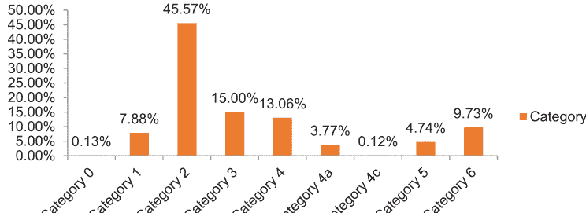

图 1。
各类别记录的百分比。

## 2.3 模型

Transformer 架构（Vaswani 等人）是 Google 在 2017 年开发的一种自然语言处理神经网络架构。它在论文《Attention All You Need》[3] 中引入，并彻底改变了神经网络训练处理语言处理任务（如自动翻译和文本生成）的方式。Transformer 架构的主要创新是使用了注意力机制（attention），它允许网络在生成输出时同时考虑所有输入单词。这有助于处理许多自然语言处理任务中变长依赖问题。此外，Transformer 使用了多层注意力头，有助于扩展网络的建模能力。

BERT（基于 Transformer 的双向编码器表示）[4] 是 Google 在 2018 年开发的一种语言预训练技术。它使用 Transformer 架构来学习文本语料库中每个单词的双向表示。这意味着与仅考虑单词左侧或右侧上下文的预训练技术不同，BERT 同时考虑左侧和右侧上下文。BERT 在互联网的大量文本上进行了训练，并可以轻松适应各种自然语言处理任务，如文本分类、实体提取和问答。它在许多自然语言处理任务中表现出卓越的结果，并成为许多其他语言的基础。

语言模型预训练已被证明对改进许多与自然语言处理相关的任务有效 [5]。这包括句子层级任务，如语言推理 [6]（其目的是通过整体分析句子来预测句子之间的关系 [7]），以及 token 级级任务，如语言推理 [6]（其目的是通过整体分析句子来预测句子之间的关系 [7]），以及 token 级级任务，如语言推理 [6]（其目的是通过整体分析句子来预测句子之间的关系 [7]），以及 token 级级任务，如语言推理 [6]（其目的是通过整体分析句子来预测句子之间的关系 [7]），以及 token 级级任务，如语言推理 [6]（其目的是通过整体分析句子来预测句子之间的关系 [7]）。（等等，逻辑重复了...)

# 机器学习与数据挖掘年刊 2023

机器学习 [10] 是人工智能的一个子领域，在最近几十年显示出增长。机器学习模型的参数是从数据中学习的，而不是显式编程的。这使得模型能够适应新数据并做出预测或决策。各种类型的机器学习包括监督学习、无监督学习和强化学习。在监督学习中，模型在标记数据上进行训练。在无监督学习中，模型在未标记数据中寻找隐藏模式。在强化学习中，模型通过与环境交互来学习决策以最大化奖励。

## 3 结果

### 3.1 探索性分析

原始数据集提交给了三个机器学习模型和一个深度学习模型（BERT）。用于验证模型性能的指标为：

模型性能由以下若干指标确定：

- 精确率（Precision）：分类模型仅识别相关数据点的能力。
- 召回率（Recall）：模型找到所有相关案例的能力。
- F1 分（F1-score）：精确率和召回率的调和平均数。
- 准确率（Accuracy）：所有预测中正确预测的数量。

为了清理数据，应用了预处理技术，如小写化、去除标点和停用词。类别的分布如图 2 所示。

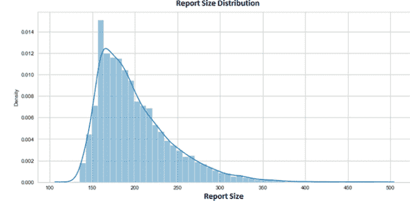

### 3.2 分类模型

通过随机搜索（Random Search）调优的最佳超参数为：

- Bootstrap：采样数据点的方法（带回或不带回）。
- 最大深度（max_depth）：30。决策树的最大深度。
- 最大特征（max_features）：sqrt。
- 最小叶节点样本（min_samples_leaf）：1。指定分裂后叶子节点中必须存在的样本数。
- 最小分裂样本（min_samples_split）：5。告诉决策树在任何节点处进行分裂所需的最小观测数参数。
- 估计器数量（n_estimators）：800。森林中树的数量。

**表 1** 展示了随机森林训练后的结果。

混淆矩阵显示了模型中每个类别的分类频率，对于随机森林模型的结果，如图 4 所示。


# 机器学习与数据挖掘年卷 2023

| 类别 | 精率 (Precision) | 召回率 (Recall) | F1 分数 | 支持量 (Support) |
|---|---|---|---|---|
| 1 | 0.96 | 0.92 | 0.94 | 84 |
| 2 | 0.92 | 0.96 | 0.94 | 533 |
| 3 | 0.87 | 0.8 | 0.83 | 157 |
| 4 | 0.79 | 0.82 | 0.81 | 145 |
| 5 | 0.59 | 0.22 | 0.32 | 46 |
| 6 | 0.77 | 0.9 | 0.83 | 115 |
| 41 | 0.85 | 0.83 | | 1115 |
| 准确率 (Accuracy) | | | 0.88 | 1115 |
| 宏平均 (Macro AVG) | 0.82 | 0.78 | 0.79 | 1115 |
| 加权平均 (Wighted AVG) | 0.87 | 0.88 | 0.87 | 1115 |

**表 1.** 随机森林结果。

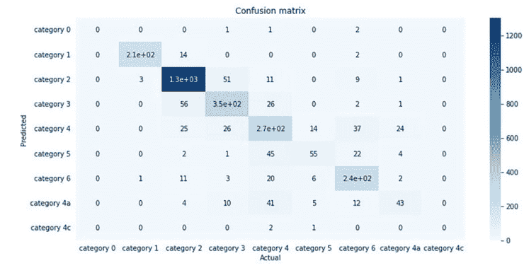

**图 4。**
随机森林分类。

对于 SVM 算法，采用了随机搜索交叉验证技术。随机搜索找到的最优超参数为：Probability = True，启用概率估计；Kernel = poly，指定算法中使用的核类型（在本例中为多项式）；Gamma = 10，用于为超参数 Kernel = poly 中指定项的系数；Degree = 4，多项式核函数 (poly) 的次数；C = 0.01，作为正则化惩罚。正则化强度与 C 成反比。它必须严格大于零。惩罚是 L2 平方惩罚。

**表 2** 显示了 SVM 训练后找到的结果。
基于 SVM 的模型的混淆矩阵如**图 5**所示。
**图 6** 展示了基于朴素贝斯的模型结果训练后的混淆矩阵值。

# 乳腺磁共振记录的自动 BI-RADS 分类...
IT0xLi13886

| 类别 | 精率 (Precision) | 召回率 (Recall) | F1 分数 | 支持量 (Support) |
|---|---|---|---|---|
| 1 | 1 | 0.6 | 0.75 | 84 |
| 2 | 0.64 | 0.99 | 0.78 | 533 |
| 3 | 0.95 | 0.39 | | 157 |
| 4 | 0.56 | 0.35 | 0.43 | 145 |
| 5 | 0.46 | 0.13 | 0.2 | 46 |
| 6 | 0.84 | 0.37 | 0.52 | 115 |
| 41 | 0.67 | 0.29 | | 35 |
| 准确率 (Accuracy) | | | 0.67 | 1115 |
| 宏平均 (Macro AVG) | | 0.73 | 0.45 | 0.52 | 1115 |
| 加权平均 (Wighted AVG) | | 0.71 | 0.67 | 0.64 | 1115 |

表 2。
SVM 结果。

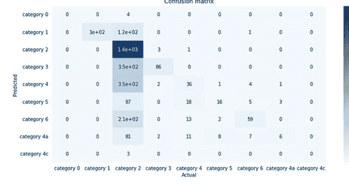

图 5。
SVM 混淆矩阵。

表 4 提供了机器学习模型结果的对比，显示随机森林算法提供了最好的结果。

为了将数据集提交给 BERTimbau 算法，采用了独热编码（One-Hot Encoding）技术，将类别变量转换为二值变量，独热编码是将类别变量表示为二值向量的一种形式。进行了带微调和不微调的特定测试步骤。表 5 显示了在提交数据集四个轮次（epochs）后找到的值。

优化器使用了 AdamW，参数如下：`optimizer=AdamW(optimizer_grouped_parameters, lr=2e-5, correct_bias=True)`。
自定义优化参数 `'params[p for n, p in param_optimizer if not any (nd in n nd no_decay)]'` 对应 no_decay 为 `['bias', 'gamma', 'beta']`，这是一个待优化的参数迭代。

# 机器学习与数据挖掘年卷 2023

# 朴素贝斯

| 类别 | 精率 (Precision) | 召回率 (Recall) | F1 分数 | 支持量 (Support) |
|---|---|---|---|---|
| 1 | 0.88 | 0.27 | 0.42 | 84 |
| 2 | 0.8 | 0.98 | 0.88 | 533 |
| 3 | 0.81 | 0.61 | 0.69 | 157 |
| 4 | 0.56 | 0.78 | 0.65 | 145 |
| 5 | 0.5 | 0.04 | 0.08 | 46 |
| 6 | 0.75 | 0.65 | 0.7 | 115 |
| 41 | 0.75 | 0.34 | 0.47 | 35 |
| 准确率 (Accuracy) | | | | |
| 宏平均 (Macro AVG) | 0.72 | 0.52 | 0.56 | 1115 |
| 加权平均 (Weighted AVG) | 0.76 | 0.75 | 0.72 | 1115 |

表 3。
朴素贝斯结果。

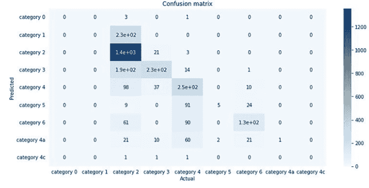

图 6。
朴素贝斯混淆矩阵。

| 模型 | F1 | 准确率 |
|---|---|---|
| 随机森林 (Random Forest) | 0.787 | 0.876 |
| 朴素贝斯 (Naive Bayes) | 0.556 | 0.753 |
| SVM | 0.519 | 0.674 |

表 4。
机器学习模型结果摘要，或定义了参数组的字典；`'weight_decay'` 值为 0.01，解码后的权重衰减将应用于 `'params[p for n, p in param_optimizer if any(nd in nd no_decay)]'`。

# 乳腺磁共振记录的自动 BI-RADS 分类...
IT0xLi13886

| 类别 | 精率 (Precision) | 召回率 (Recall) | F1 分数 | 支持量 (Support) |
|---|---|---|---|---|
| birads0 | 0 | 0 | | 10 |
| birads1 | 1 | 0.97 | 0.98 | 586 |
| birads2 | 1 | 0.99 | 0.99 | 3387 |
| birads3 | 0.95 | 0.97 | 0.96 | 1115 |
| birads4 | 0.86 | 0.95 | 0.99 | 971 |
| birads4a | 1 | 0.7 | 0.83 | 280 |
| birads4c | 0 | 0 | | 9 |
| birads5 | 0.51 | 0.79 | 0.62 | 352 |
| birads6 | 0.93 | 0.55 | 0.72 | 723 |
| 微平均 (Micro AVG) | 0.93 | 0.91 | 0.92 | 7433 |
| 宏平均 (Macro AVG) | 0.69 | 0.66 | 0.66 | 7433 |
| 加权平均 (Weighted AVG) | 0.94 | 0.91 | 0.92 | 7433 |
| 样本平均 (Samples AVG) | 0.91 | 0.91 | 0.91 | 7433 |
测试 F1 准确率 0.92
测试基础准确率 0.91

表 5。BERTimbau 结果。通过微调来丰富 BERTimbau 的词汇，从而在相关领域创建一个新的专家模型，并添加了 1819 个新标记。在训练四个轮次后，创建了新模型，其困惑度（perplexity）值为 2.17。困惑度是衡量概率分布预测样本情况的指标。可用于比较模型。低困惑度表示概率分布预测样本良好。

使用创建的模型找到的值在表 6 中。通常情况下，BERTimbau 节点的结果优于机器学习算法。图 7 展示了 BERTimbau 阶段之间的对比值。通过观察上表中的值可以清楚看到，在大多数出现类别的情况下，调整后的模型性能优于之前测试的所有。

## 4. 结论

Transformer 架构已成为自然语言处理的主导架构，在不同任务中频繁优于卷积和循环神经网络 [14]。预训练模型可以在通用或专家数据集上进行训练，因此可以轻松适应具有卓越性能的任务。该架构特别有利于大型语料库的预训练，能够提高后续任务（如文本分类、语言理解等）的准确率。

# 机器学习与数据挖掘卷 2023

# BERTimbau

| 类别 | 精率 (Precision) | 召回率 (Recall) | F1 分数 | 支持量 (Support) |
|---|---|---|---|---|
| birads0 | 0 | 0 | | 10 |
| birads1 | 1 | 0.98 | 0.99 | 586 |
| birads2 | 1 | 0.99 | 0.99 | 3387 |
| birads3 | 0.98 | 0.99 | 0.98 | 1115 |
| birads4 | 0.95 | 0.98 | 0.97 | 971 |
| birads4a | 0.95 | 0.96 | 0.96 | 280 |
| birads4c | 0 | 0 | | 9 |
| birads5 | 0.95 | 0.8 | 0.87 | 352 |
| birads6 | 0.93 | 0.96 | 0.95 | 723 |
| 微平均 (Micro AVG) | 0.98 | 0.97 | 0.98 | 7433 |
| 宏平均 (Macro AVG) | 0.75 | 0.74 | 0.75 | 7433 |
| 加权平均 (Weighted AVG) | 0.97 | 0.97 | 0.97 | 7433 |
| 样本平均 (Samples AVG) | 0.97 | 0.97 | 0.97 | 7433 |

测试 F1 准确率 0.98
测试基础准确率 0.97

表 6. 微调后的 BERTimbau 结果。


例如健康领域。在本项研究中，经过微调的 BERTimbau 成功捕捉了通用领域的特定信息，扩展了其词汇量，并成为医疗记录数据分类以及对非结构化数据进行结构化的良好模型。

机器学习与数据挖掘年鉴 2023卷

# 参考文献

- [1] Castro S, M, Tseytlin E, Medvedev O, Mitchell K, Viswesaran S, Bekhuis T, et al. 放射学报告中 BI-RADS 评估的标注与分类。《生物医学信息杂志》。2017
- 实体识别。可用地址：https://arxiv.org/abs/cs/0306050
- [2] Souza F, Nogueira R, Lotufu R. BERTImau: 用于巴西葡萄牙语的预训练 BERT 模型。在: 第9届巴西国际系统会议。Rio Grande do Sul, 10月20-23日（待出版）。[S.l.: s.n.]: BRACIS; 2020
- [9] 深度学习书籍。可用地址：https://www.deeplearningbook.com/br/que-e-bert-bidirectional-encoder-representations-from-transformers/
- [10] Rudin C, Wagstag KL. 面向科学与社会的机器学习。《机器学习》，2014
- [3] Vaswani A, Shazeer N, Parmar N, Uszkoreit J, Jones L, Gomez AN, Kaiser, Polosukhin I. 可自：https://proceedings.neurips.org/paper/2017/pdf/f356ee24357e91bff053c4b4854ac-Paper.pdf
- [11] Tin Kam HO. 随机森林 (PDF)。在: 第3届数据分析与识别国际国家会议集；Montreal, QC; 1995年6月14-16日。pp. 278-282. 2016年4月17日存档于原始 (PDF)。检索于2016年6月6日
- [4] Devlin J, Chang MW, Lee K, Toutanova K. 用于语言理解的双向 Transformer 预训练。2019。可用地址：https://arxiv.org/abs/1810.04805
- [12] Cortes C, Wapnik V. 支持向量方法。《机器学习》。1995,20(3):273-297. DOI: 10.1007/BF00994018
- [5] Dai Andrew M,, Le Quoc V. 半监督序列学习。可用地址：https://arxiv.org/abs/1511.01432. 2015
- [13] Andrew Mccallum. 图形网络表示 (PDF)。[访问日期：2019年10月22日]
- [14] Rothman D. 自然语言处理的 Transformer：使用 Python, TensorFlow, BERT, RoBERTa 及更多工具为 NLP 构建深层神经网络架构。Packt Publishing; 2021
- [6] Bowman S, Angeli G, Potts C, Manning D. 用于学习自然语言接口的大型标注语料库。可用地址：https://arxiv.org/abs/1508.05326
- [7] Dolan W, B, Brock C. 自动构建情感改写语料库。在: 第三届改写国际研讨会议集 (IWP2005)。2005
- [8] Tjong EF, Tjong S, Sang M, De F. CoNLL-2003 共享任务简介：语言无关成员

