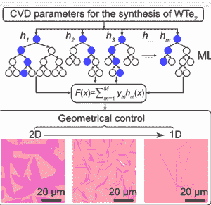
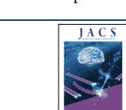
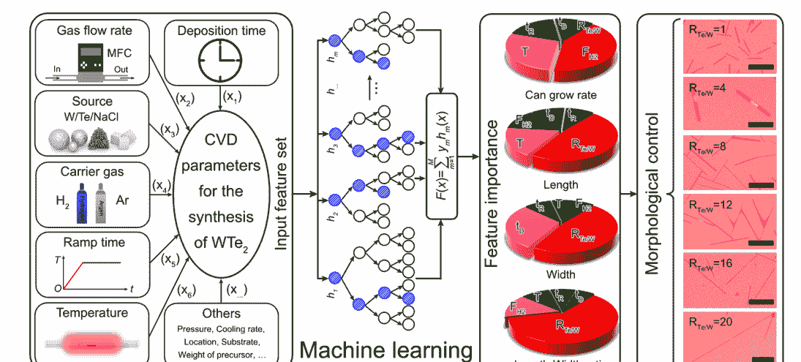
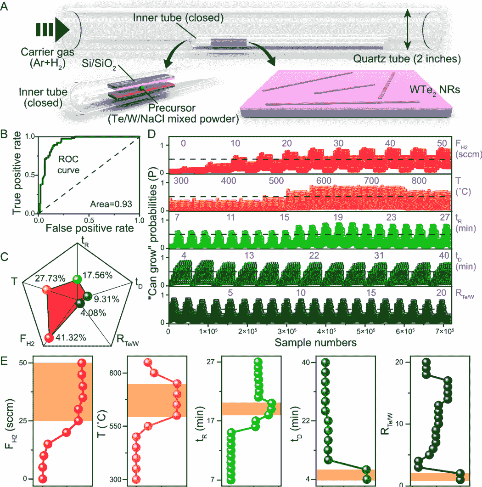
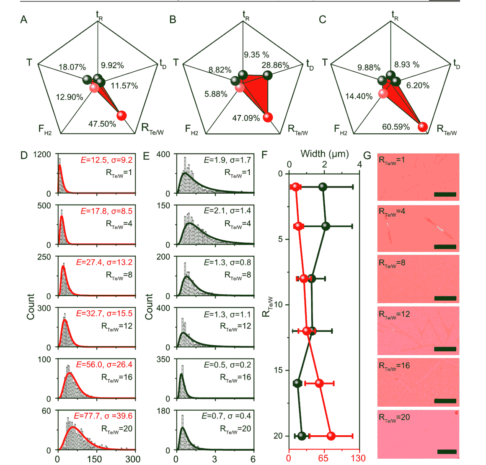

# 几何控制机器学习驱动少层WTe2合成

在线阅读

访问 | 指标与更多 | 文章推荐 | 支持信息

## 摘要：

将二维材料 2D 的横向尺度减小到一维 1D 不仅引起了人们对实现具有竞争力的电子应用的实质性研究兴趣，也引起了对基础物理性质探索的兴趣。因此，可控合成高质量一维纳米带 NRs 对于进一步研究而言是高度期望且必不可少的。在此，我们报道了监督式机器学习 ML 用于化学气相沉积 CVD 合成高质量准一维少层 WTe₂ 纳米带的实现。特征重要性分析表明，H₂ 气体流量对 WTe₂ 的形成具有深远影响，而源比例则决定了样品形貌。值得注意的是，还进一步提出了 1T′ 少层 WTe₂ 纳米带的生长机制，这为有趣的二维和一维碲化物的生长提供了新的见解，并可能激发其他一维纳米结构生长策略的灵感。我们的研究结果表明了机器学习在指导一维纳米结构合成方面的有效性和能力，为智能材料开发开辟了新的机遇。

## 引言

在过去几十年中，二维 2D 过渡金属硫族化合物 TMCs 在纳电子和自旋电子应用中表现出优异性能，并在研究量子物理和制造量子器件方面显示出巨大潜力。¹⁻⁴ 近年来，由二维 TMCs 衍生的一维 1D 纳米结构受到了越来越多的关注，这归因于由降低的维度性和增强的量子限制效应引起的有趣性质。⁵⁻⁹ 在 TMCs 中，具有丰富结构变化和强自旋轨道耦合的二碲化钨 WTe₂ 被预测为 II 型 Weyl 半金属和二维拓扑绝缘体，为研究与维度相关的性质提供了理想平台，例如超导性、量子自旋霍尔效应和 Majorana 费米子。³,⁴,¹⁰⁻¹⁶ 尽管化学气相沉积 CVD 已被广泛采用来生长高质量二维材料，但少层 WTe₂ 的可控合成仍然具有挑战性，更不用说维度控制了。这是因为 Te 的反应性较低，Te 与 W 之间电子负性差较小，以及碲化物稳定性较差。¹⁷⁻²¹ 因此，迫切需要有效识别具有维度可调性的 WTe₂ 的最佳合成条件。机器学习 ML 近年来在材料研究中展现出强大的能力。²²⁻²⁸ 它已成功应用于加速新型材料的设计和发现，包括催化材料，²⁴ 无机-有机杂化材料，²⁸,²⁹ 热电材料，³⁰ 超硬材料，³¹ 低维材料，²⁶,²⁷,³² 相变存储材料，²⁵ 有机光伏材料，³³ 等等，通过有效学习过去甚至失败的数据。³⁴⁻³⁸ 例如，Zhong 等人²⁴ 报道了 Cu−Al 电催化剂的发现，结合了密度泛函理论计算和主动机器学习，可高效将 CO₂ 还原为乙烯，具有迄今为止报道的最高法拉第效率。在材料发现之上，新型材料的成功合成对其未来应用至关重要，而传统实验室探索通常需要付出大量努力。²³,²⁷,³⁹ 因此，值得探索将机器学习引入先进材料的有指导合成甚至结构工程的可行性和潜力，以加快探索过程并降低成本。

在这项工作中，我们对少层 1T′ WTe₂ 的 CVD 合成实施了监督式机器学习，其范式在图 1 中示意性描绘。⁴⁰ 为了优化合成条件，实验收集了 CVD 合成数据来训练机器学习模型。训练良好的模型能够

图 1. 基于机器学习和实验实现几何可控 CVD 合成 WTe2 的设计框架。

优化 CVD 合成参数以实现少层 1T′ WTe2 的可控生长。从训练好的模型中进一步提取了特征重要性等信息，为 WTe2 的合成和形貌控制提供了新的见解。根据机器学习的建议，特别研究了源比例 RTe/W 对样品形貌的影响，最终获得了少层 1T′ 准一维 WTe2 纳米带 NRs。此外，还提出了 1D WTe2 纳米带的生长机制，该机制表明 H2 气体流量控制着从二维到一维的转变，而 RTe/W 决定了 WTe2 纳米带的长宽比。

## 结果与讨论

### 通过机器学习优化 CVD 合成参数。

空间受限 CVD 方法已被采用来合成 WTe2 纳米带，对应的装置如图 2A 所示。经验上，确定了五个显著的输入特征 CVD 参数：源比例 RTe/W，碲粉与钨粉的摩尔比，反应温度 T，摄氏度，升温时间 tR，分钟，沉积时间 tD，分钟，和 H2 气体流量 fH2，sccm。实验室共进行了 255 次实验，采用不同的生长参数组合。详细的特征概览见表 S1。在这些实验中，WTe2 在 141 次实验中成功合成，而其余 114 次实验显示为负结果 无 WTe2 可观察到 ，由光学显微镜和拉曼光谱鉴定。因此开发了二分类模型，将“可生长”定义为正类，将“不可生长”定义为负类。XGBoost 是一种优化的梯度提升算法，可通过决策树的集成拟合复杂关系。此外，它还能正则化模型的复杂度以避免过拟合，因此适用于小数据集。在本研究中，已应用 XGBoost 结合 10 折嵌套交叉验证，如我们在之前的工作中报道的那样 23,27 见实验方法及支持信息附注 1 和 2 以及图 S1–S3。所选模型的优异性能已通过绘制接收器操作特征 ROC 曲线得到证明，如图 2B 所示。ROC 曲线下面积 AUROC 通常用于评估模型在不同决策阈值下成功区分两个类别的能力。AUROC 为 1.0 表示完美区分，而 0.5 的面积 表示虚线 等同于随机猜测。如图所示，我们训练的模型具有高达 0.93 的 AUROC，表明其在区分训练模型的“可生长”与“不可生长”类别方面具有很强的判别能力。

为了深入了解 CVD 生长的 WTe2 系统，已从训练好的 XGBoost 模型中提取了特征重要性，结果如图 2C 所示 见实验方法中的细节。如图所示，影响 WTe2 合成的最重要的特征是 H2 气体流量 fH2，其次是反应温度 T 和升温时间 tR，而源比例 RTe/W 是最不显著的因素。由于难以实现有趣的少层 WTe2 的可控合成，已进行了合成条件的优化。27 基于每个特征的输入范围 表 S2，训练好的机器学习模型预测了所得 720,720 种组合各自的“可生长”概率 P。输出与每个特征的相关性已单独检查，如图 2D 所示。可以清楚地观察到，H2 气体流量、反应温度和升温时间的值对 P 的分布具有主导影响。这与上述讨论的特征重要性结果一致 图 2C。在所有 720,720 种合成条件下，选择了 8 种具有最高 P 的组合进行实验验证。表 S3 总结了相应的实验结果，全部为阳性。这表明利用我们训练的机器学习模型可以实现少层 WTe2 的可控合成。

为了更好地解释预测的 720,720 种条件中包含的信息，我们进一步定义了

图2. WTe₂纳米带的CVD合成与机器学习智能分析。(A) 用于生长WTe₂纳米带的空间限制CVD装置示意图。(B) XGBoost模型的ROC曲线。(C) 从训练好的XGBoost模型中提取的五个合成参数的特征重要性。(D) 所有720种条件相对于每个特征的预测“可生长”概率(P)。黑色虚线表示P = 0.5。(E) 每个特征在不同值下的“可生长”比率图。

“可生长”比率。采用P=0.5（如图2D中黑色虚线所示）作为阈值，其中P>0.5表示“可生长”。因此，每个特征在不同值下的“可生长”比率定义为该值下“可生长”条件数除以720。结果汇总于图2E。在本工作中，选择“可生长”比率大于90%的范围作为优化参数范围。最终，在机器学习的辅助下，确定WTe₂高P合成参数的优化范围如下（见表S4）：H₂气体流速（F_H₂，25至50 sccm）、反应温度（T，600至750 °C）、升温时间（t_R，18至20 min）、沉积时间（t_D，4至7 min）和源比例（R_Te/W，1至2）。

在我们之前的研究中，主要目标是以最少的实验次数实现更高的成功率和实验结果的提升。²³,²⁷ 本工作是我们先前工作的进一步延伸和发展。在可控合成WTe2纳米带的基础上，形貌控制是我们希望通过机器学习实现的另一个目标。为了系统研究生长条件对WTe2形貌的影响，我们基于光学图像检查了141次“可生长”实验中获得的WTe2样品的长度、宽度和长宽比。

图3. WTe2的源比例依赖性形貌演化。(A–C) 从训练好的XGBoost模型中获得的WTe2形貌特征重要性，包括长度、宽度和长宽比。(D, E) 不同RTe/W下WTe2纳米带长宽比和宽度的频率分布直方图及相应的伽马分布拟合曲线（含平均值(E)和标准差(σ)）。(F) 宽度和长宽比的E(含σ)随RTe/W的变化图。(G) 不同源比例下获得的WTe2纳米带的典型光学图像（比例尺，20 μm）。

### WTe2的源比例依赖性形貌演化

特征重要性分析表明，尽管源比例（RTe/W）是影响WTe2“可生长”概率的最不显著参数（图2C），但它确实是影响WTe2几何结构的最重要特征（图3A–C）。此外，图S4中给出的特征相关性揭示了RTe/W与长宽比之间存在强正相关性，

图4. 所合成的少层WTe₂纳米带的表征。(A) 1T′ WTe₂晶体结构的俯视图和侧视图。(B) 单晶WTe₂纳米带的光学图像。(C) WTe₂纳米带的AFM结果。(D, E) WTe₂纳米带的拉曼光谱和映射。(F) WTe₂纳米带的Te 3d峰和W 4d峰的XPS光谱。(G) WTe₂纳米带的明场TEM图像。(H) 沿[100]方向从(G)中方框中心拍摄的WTe₂纳米带俯视STEM图像。(I) WTe₂纳米带的EDX映射（比例尺，1 μm）。

这表明通过调节 R_Te/W，可以调整和优化样品形貌。为了验证机器学习分析获得的信息，我们进行了一系列不同R_Te/W值的实验。值得注意的是，其他四个参数都设置在如上所述的优化范围内，以确保样品的成功合成。具体而言，反应温度、升温时间、沉积时间和载气流量分别固定为750 °C、20 min、7 min以及100 sccm Ar和40 sccm H₂。不同R_Te/W下长宽比、宽度和长度的频率分布直方图及相应的光学图像如图3D–G和图S5A所示。伽马分布拟合曲线可以很好地拟合所有频率分布图。为了进一步研究R_Te/W与所获纳米带尺寸之间的关系，计算了长宽比、长度和宽度的平均值以及相应的标准差（图3F和图S5B）。随着R_Te/W从1增加到20，长宽比从12.5持续增加到77.7。这种有趣的几何演化可能与Te的浓度有关，这将在生长机理部分详细讨论。在误差范围内，WTe₂纳米带的长度从15.7 μm增加到49.2 μm（图S5B），而宽度则呈现相反趋势（从1.9 μm减小到0.7 μm，图3F）。我们的实验验证进一步支持R_Te/W对形成的WTe₂纳米带形貌具有深远影响。尽管在R_Te/W为20时可以获得最高的长宽比，但考虑到宽度本身是纳米带的重要属性，在同时兼顾高长宽比和小宽度的情况下，确定R_Te/W为16时为最佳。最终，在具有高P、小宽度和大长宽比的情况下，确定了少层WTe₂纳米带的最佳合成条件（如实验方法所述）。在1T′ WTe₂纳米带上实现的形貌控制进一步证明了机器学习指导的有效性。

### 少层1T′ WTe₂纳米带的表征

对所合成的少层WTe₂纳米带的结构和质量进行了仔细检查，结果如图4所示。图4A展示了1T′ WTe₂纳米带原子结构的俯视图和侧视图。图4B显示了长度约50 μm的少层WTe₂纳米带的典型光学图像。宽度和厚度进一步通过原子力显微镜（AFM）确定（图4C）。WTe₂纳米带的宽度约为0.8 μm，厚度约为2.5 nm，表明其具有三层结构。可重复的合成结果（图S6）和相应的统计分析（图S7）表明空间限制CVD方法具有高重复性，这归因于其稳定的流场速度分布（补充信息注释3、图S8和表S5）。

采用拉曼光谱研究了所合成WTe₂纳米带的质量，拉曼光谱如图4D所示。可以清楚地观察到六个振动模式，分别为B₁¹⁰、A₂⁴、A₂³、A₁⁴、A₁⁷和A₁⁹，其波数分别为87.3、108.6、113.7、132.4、161.1和210.6 cm⁻¹，与先前报道的值非常吻合，表明成功制备了高质量WTe₂纳米带。¹⁰,¹⁷ 为了进一步证明WTe₂纳米带的质量和均匀性，进行了拉曼强度映射（A₁⁹），如图4E所示。拉曼映射区域在光学图像中用红色虚线框标出，尺寸为6 μm × 60 μm。映射区域的均匀颜色分布表明所合成的1T′ WTe₂纳米带具有高均匀性和低缺陷。

图5. 1T′ WTe₂纳米带的生长机理。(A–C) 提出的1T′ WTe₂纳米带生长机理模型以及(B)H₂刻蚀过程和(C)熟化过程的相应反应示意图。(D) 1T′ WTe₂的原子结构，显示W–Te的不同键长。(E) WTe₂纳米带在无H₂和有H₂合成条件下转化反应的吉布斯自由能变化。(F) 暴露(100)和(010)晶面的1T′ WTe₂晶体结构。

我们还进行了X射线光电子能谱（XPS）分析，以检查所合成纳米带的化学成分（图S9）。在宽扫光谱中可以清楚地识别出Te、W、Si、O和C的峰，没有额外峰。Te 3d和W 4d的高分辨XPS光谱如图4F所示。Te 3d光谱可以很好地拟合为位于583.7（Te 3d₅/₂）和573.3 eV（Te 3d₃/₂）的两个峰，它们与W–Te键相关。¹⁷,¹⁹ 突出的W 4d峰可以很好地拟合为位于256.9（W 4d₅/₂）和243.6 eV（W 4d₃/₂）的两个峰。¹⁷ 这些结果与先前报道非常吻合，表明WTe₂纳米带未被氧化。⁴¹,⁴² 计算出的化学组成为WTe₂.₀₈，表明我们通过空间限制CVD生长的WTe₂纳米带具有相当好的化学计量比。

通过扫描透射电子显微镜（STEM）进一步揭示了所合成WTe₂纳米带的原子结构。图4G显示了WTe₂纳米带的典型明场TEM图像。根据图4H中的STEM图像，由沿晶胞轴的一维锯齿形W–Te链组成的1T′ WTe₂属于空间群P2₁/m（Pmn2₁）。为了证明我们CVD生长的WTe₂的单晶性，使用STEM对同一WTe₂纳米带的四个不同位置进行了测量（图S10）。结果表明，所有WTe₂纳米带都具有相同的晶体取向，从而证明了其单晶性质。图4I中的EDX映射进一步验证了元素的均匀分布。所有结果共同表明，通过我们的空间限制CVD方法已成功合成了高质量的少层WTe₂纳米带。所制备的WTe₂纳米带还表现出比先前报道的方法所得样品更好的稳定性（图S11）。¹⁷ 值得一提的是，空间限制CVD方法已被扩展用于制备其他碲化物纳米带。MoTe₂纳米带（图S12）和MoₓW₁₋ₓTe₂纳米带（图S13）均采用类似程序成功生长。

### 控制从二维到一维几何转变的生长机理

理解碲化物的生长机理是可控合成高质量碲化物的关键，并可能为其他一维纳米结构的生长策略提供启发。考虑到W的高熔点和低反应活性，采用NaCl/Te/W混合粉末作为前驱体，并置于受限空间（内管）中，在H₂气氛下生长少层WTe₂纳米带。值得注意的是，受限空间、盐、H₂和Te/W/NaCl混合物对于WTe₂纳米带的合成是不可或缺的，如补充信息注释4、图S8和S14以及表S6所示。通常，由于合成过程相当快，单层或少层过渡金属硫族化合物（TMCs）的CVD合成仅需几分钟的沉积时间。¹⁰,¹⁷–¹⁹ 为了清楚地观察形貌演化，我们选择了机器学习结果中具有高P但温度和H₂气体流速适中（见图2E和表S4）的温和合成条件，以降低反应速率并研究WTe₂纳米带的生长机理。详细参数如下：H₂气体流速为30 sccm，反应温度为650 °C，升温时间为18 min，源比例为16，反应时间为5 min。这里，H₂的反应时间是唯一研究的变量。进行了三个对照实验：
- 仅在温度达到650 °C时将H₂气体引入系统，并在5 min后关闭。
- 在室温下引入H₂气体，并在650 °C沉积5 min后关闭。
- 在整个过程中保持通入H₂气体。

所合成的少层WTe₂的相应光学图像如图S15和S16所示。可以清楚地观察到从二维到一维的形貌演化。基于实验结果，进一步提出了WTe₂纳米带的生长模型（图5A–C）。WTe₂纳米带的合成分三个主要阶段：二维WTe₂的形成、H₂对二维WTe₂的刻蚀以及WTe₂纳米带的形成，以及WTe₂纳米带的熟化再生长。

提出以下反应机理来解释在Ar/H₂常压气氛下Te/W/NaCl混合粉末形成WTe₂的过程（图5A）。⁴³,⁴⁴
Te(l) + H₂(g) ↔ H₂Te(g) (1)
W(s) + H₂Te(g) ↔ WTe₂(s) + H₂(g) (2)

为了研究H₂Te在降低势垒方面所起的作用，计算了所提出的转化反应的吉布斯自由能（G）（图5E、图S17、表S7和补充信息注释5）。计算表明，在H₂的辅助下，从W和中间产物H₂Te合成WTe₂所需的能量比W与Te直接反应所需的能量低约135 kJ/mol。此外，考虑到ΔG为负值，W和H₂Te形成WTe₂在热力学上更为有利。对于有无H₂合成MoTe₂纳米带的情况，也发现了类似结果（图S18）。在这方面，H₂Te既是高效的Te载体，又是催化剂。在富Te条件下，反应2中得到的H₂可进一步反应生成H₂Te（反应1），从而确保碲化过程的持续进行。W–Te体系中的液态W随后与H₂Te反应生成层状WTe₂。这两个反应都是可逆的，反应方向取决于源浓度和反应温度。因此，WTe₂的合成和分解可以同时发生。

在第一阶段，由于源供应充足，生长过程远快于WTe₂的分解，WTe₂可以快速合成。随着化学反应的进行，由于源浓度降低，生长速率下降，H₂对层状WTe₂的刻蚀变得显著。先前的研究也报道过，过量的H₂在高温下可以分解TMCs。⁴⁵,⁴⁶ 由于W–Te键长不同，刻蚀优先沿1T′ WTe₂结构的[100]方向进行（图5D），这有利于纳米带结构的形成（图5B）。根据密度泛函理论（DFT）计算，1T′ WTe₂的(100)和(010)晶面的表面能分别为0.0315和0.0158 eV/Ų。(100)晶面的能量高于(010)晶面，表明[100]方向是1T′ WTe₂纳米带的优先生长方向（图5F和补充信息注释6）。对于二维层状WTe₂，刻蚀总是发生在1T′ WTe₂的两端（图S19），因此可以形成纳米带结构的雏形。在第三阶段，H₂刻蚀和熟化同时发生（图5C）。较宽的WTe₂可以被刻蚀成W和H₂Te，然后W迁移到液态Te中。微小的晶核可以在1T′ WTe₂的两端生长，更大的纳米带将在

以牺牲较小者为代价，这是由于奥斯特瓦尔德熟化过程中的能量差异。⁴⁷,⁴⁸

根据二元 Te–W 相图，随着 $R_{\mathrm{Te/W}}$ 的增加，更多的 W 可以溶解在液态 Te 中。⁴⁹,⁵⁰ 因此，在高 $R_{\mathrm{Te/W}}$ 系统中，会有更多的迁移 W 原子存在于液态 Te 中。根据 DFT 计算，可以获得具有增加长度和长宽比的 WTe₂ 纳米棒。值得一提的是，我们提出的生长机制是通过大量实验建立的。尽管它是在特定反应条件下讨论的，但我们相信它可以扩展到整个 Te/W/NaCl 反应体系。此外，该生长机制也可用于理解许多其他 2D 到 1D 过渡金属硫族化合物合成过程。

## 结论

总之，机器学习已成功应用于指导准一维少层 1T′ WTe₂ 纳米棒的 CVD 合成。相关表征证明了所生长样品的高质量。0.93 的高 AUROC 表明训练良好的 XGBoost 模型具有优异的性能。从模型中提取的特征重要性表明，H₂ 气体流速是控制 1T′ WTe₂ 纳米棒合成的最重要特征，而 $R_{\mathrm{Te/W}}$ 决定了样品形貌。已对合成参数进行优化，以实现高“可生长”概率和大长宽比。我们的实验验证进一步支持 $R_{\mathrm{Te/W}}$ 与 WTe₂ 纳米棒几何结构之间存在强相关性。此外，还提出了 WTe₂ 纳米棒的生长机制，其中准一维 WTe₂ 被发现是在 H₂ 的辅助下由二维 WTe₂ 演化而来，为有趣的碲化物家族研究提供了新的见解。我们整合机器学习分析和实验结果的工作，将为一维材料的加速发展提供启示，并推动源自二维 TMC 家族的多样化纳米结构。

## 实验方法

### 少层 WTe₂ 纳米棒的合成

共 2 mg 粉末（Te:W:NaCl = 16:1:0.1）用玛瑙研钵混合，然后放置在 10 mm × 30 mm Si/SiO₂ 衬底上（氧化层为 285 nm）。另一块 10 mm × 30 mm Si/SiO₂ 衬底以抛光面朝下放置在粉末上方，形成夹心结构。然后将它们转移到封闭的内石英管中（直径为 12 mm，长度为 300 mm）。内石英管被放置在石英管中（直径为 2 in.），然后置于炉子的中心。加热前用 Ar 气（99.99%）清洗石英管 20 分钟。之后，使用 Ar/H₂ 混合气体（分别为 100/40 sccm）作为载气。炉子在 20 分钟内加热至 750 °C，然后保持 7 分钟。然后，炉子自然冷却至室温，WTe₂ 纳米棒可在衬底上获得。

### 表征

所生长 WTe₂ 的微结构和形貌通过光学显微镜（Olympus BX51）、拉曼（WITEC Alpha 200R）、XPS（Kratos Analytical, Manchester）、AFM（Asylum Research Cypher S）和 STEM（JEOL ARM-200F (S)）表征。STEM 表征采用 CEOS CESKOR 球差校正器进行，加速电压为 80 kV。EDX mapping 结果由 TEM 进行。拉曼表征采用 532 nm 激光器进行（所用激光功率小于 1 mW，系统以 520 cm⁻¹ 处的 Si 拉曼峰进行校准）。XPS 分析由 Kratos Axis Supra 仪器进行，电荷校正的结合能校正通过将 adventitious C1s 线赋值为 284.8 eV 来进行。

### 特征重要性

*Shapley Additive exPlanations (SHAP)* 计算理论上合理且唯一的特征重要性值，属于加性特征归因类。⁵¹ 解释模型 $g(z')$ 满足 $g(z')=\phi_0+\sum_{i=1}^{M}\phi_i z_i'$，其中 $z'\in\{0,1\}^{M}$，$M$ 为输入特征的数量，$\phi_i$ 表示特征重要性值，且 $\phi_i\in\mathbb{R}$。$z_i'=1$ 表示正在观测的特征，否则为 0。

为计算 SHAP 值，定义 $f_x(S)=E[f(x)|x_S]$，其中 $f$ 为待解释的机器学习模型，$S$ 为 $z'$ 中非零索引的集合，$E[f(x)|x_S]$ 为在子集 $S$ 的输入特征条件下函数的期望值。 使用这些条件期望为每个特征计算 SHAP 值：

$$\phi_i=\sum_{S\subseteq N\setminus\{i\}}\frac{|S|!(M-|S|-1)!}{M!}\left[f_x(S\cup\{i\})-f_x(S)\right] \tag{3}$$

其中 $N$ 为所有输入特征的集合。

### XGBoost

XGBoost 源自梯度提升决策树（GBDT），⁵²,⁵³ 使用 $M$ 个决策树的集合作为基估计器 $f_m$，$m=1,\ldots,M$ 进行决策：

$$\hat{y}_i=\sum_{m=1}^{M}f_m(x_i) \tag{4}$$

给定 $N$ 个训练数据 $\{(x_i,y_i)\}_{i=1}^{N}$，目标是最小化

$$\operatorname{obj}(\theta)=\sum_{i=1}^{N}l(y_i,\hat{y}_i)+\sum_{m=1}^{M}\Omega(f_m) \tag{5}$$

其中 $\sum_{i=1}^{N}l(y_i,\hat{y}_i)$ 表示训练损失，$\sum_{m=1}^{M}\Omega(f_m)$ 对基估计器的复杂度进行惩罚。此外，它采用加性训练策略，每次添加一棵新树，在第 $t$ 步优化目标：

$$\operatorname{obj}(\theta)^t=\sum_{i=1}^{N}l(y_i,\hat{y}_i)+\sum_{m=1}^{t}\Omega(f_m) \tag{6}$$

而

$$\hat{y}_i^t=\sum_{m=1}^{t}f_m(x_i)=\hat{y}_i^{t-1}+f_t(x_i) \tag{7}$$

## 相关内容

### 支持信息

支持信息可免费获取，网址为 https://pubs.acs.org/doi/10.1021/jacs.1c06786。

机器学习模型的评估与选择、机器学习推荐合成条件的实验验证结果、生长机制的实验研究、吉布斯能量、表面能和模拟过程的计算、WTe₂ 纳米棒的重现性、稳定性及 XPS，以及空间限域 CVD 方法的可扩展性（PDF）

## 作者信息

### 通讯作者

- **Zhiyong Zhang** — *信息科学与技术学院*, 西北大学, 西安 710127, 中国; Email: zhangzy@nwu.edu.cn
- **Xuewen Wang** — *柔性电子前沿科学中心*, 西安柔性电子研究所（IFE）和工业和信息化部柔性电子重点实验室（KLoFE），西北工业大学，西安 710072，中国；陕西省柔性电子重点实验室（KLoFE），西北工业大学，西安 710072，中国；orcid.org/0000-0002-9689-6678；Email: iamxwang@nwpu.edu.cn
- **Zheng Liu** — 材料科学与工程学院和电气与电子工程学院，南洋理工大学，新加坡 639798，新加坡；CINTRA CNRS/NTU/THALES，新加坡 637553，新加坡；orcid.org/0000-0002-8825-7198；Email: z.liu@ntu.edu.sg
- **Jun Di** — 材料科学与工程学院，南洋理工大学，新加坡 639798，新加坡；orcid.org/0000-0002-6232-6466
- **Pin Song** — 材料科学与工程学院，南洋理工大学，新加坡 639798，新加坡
- **Yongmin He** — 化学/生物传感与化学计量学国家重点实验室，化学化工学院，湖南大学，长沙 410082，中国
- **Lixing Kang** — 材料科学与工程学院，南洋理工大学，新加坡 639798，新加坡
- **Wu Zhao** — 信息科学与技术学院，西北大学，西安 710127，中国
- **Cuntai Guan** — 计算机科学与工程学院，南洋理工大学，新加坡 639798，新加坡

### 作者

- **Manzhang Xu** — 信息科学与技术学院，西北大学，西安 710127，中国；柔性电子前沿科学中心，西安柔性电子研究所（IFE）和工业和信息化部柔性电子重点实验室（KLoFE），西北工业大学，西安 710072，中国；陕西省柔性电子重点实验室（KLoFE），西北工业大学，西安 710072，中国；orcid.org/0000-0001-6752-5299
- **Bijun Tang** — 材料科学与工程学院，南洋理工大学，新加坡 639798，新加坡
- **Yuhao Lu** — 计算机科学与工程学院，南洋理工大学，新加坡 639798，新加坡
- **Chao Zhu** — 材料科学与工程学院，南洋理工大学，新加坡 639798，新加坡
- **Qianbo Lu** — 柔性电子前沿科学中心，西安柔性电子研究所（IFE）和工业和信息化部柔性电子重点实验室（KLoFE），西北工业大学，西安 710072，中国；陕西省柔性电子重点实验室（KLoFE），西北工业大学，西安 710072，中国；orcid.org/0000-0003-4195-7602
- **Chao Zhu** — 材料科学与工程学院，南洋理工大学，新加坡 639798，新加坡
- **Lu Zheng** — 柔性电子前沿科学中心，西安柔性电子研究所（IFE）和工业和信息化部柔性电子重点实验室（KLoFE），西北工业大学，西安 710072，中国；陕西省柔性电子重点实验室（KLoFE），西北工业大学，西安 710072，中国
- **Jingyu Zhang** — 材料科学与工程学院，南洋理工大学，新加坡 639798，新加坡
- **Nannan Han** — 柔性电子前沿科学中心，西安柔性电子研究所（IFE）和工业和信息化部柔性电子重点实验室（KLoFE），西北工业大学，西安 710072，中国；陕西省柔性电子重点实验室（KLoFE），西北工业大学，西安 710072，中国
- **Weidong Fang** — 现代光学仪器国家重点实验室，浙江大学，杭州 310027，中国
- **Yuxi Guo** — 信息科学与技术学院，西北大学，西安 710127，中国；orcid.org/0000-0002-5761-587X

完整联系信息可在以下网址获取：https://pubs.acs.org/10.1021/jacs.1c06786

### 作者贡献

- M.X. 和 B.T. 对本工作贡献相等。

### 注释

作者声明无竞争性财务利益。

## 致谢

作者衷心感谢中国国家重点研发计划（2020YFB2008501 和 2019YFC1520900）、国家自然科学基金（61974120、11904289、61701402 和 61804125）、陕西省重点研发计划（2020ZDLGY04-08、2020GXLH-Z-027、2021JZ-43）、陕西省国际科技合作重点项目（2018KWZ-08）、陕西省自然科学基金（2019JQ-613）、宁波市自然科学基金（202003N4003）、中央高校基本科研业务费（310219PY004、3102190QD010 和 310219JQ004）以及西北工业大学启动经费的资助。作者还感谢新加坡教育部在“几何量子材料”AcRF Tier 3 项目（MOE2018-T3-1-002）和 AcRF Tier 1 RG161/19 下的支持。

## 参考文献

- 1. Iannaccone, G.; Bonaccorso, F.; Colombo, L.; Fiori, G. 基于二维材料异质结构的晶体管量子工程. *Nat. Nanotechnol.* 2018, 13 (3), 183–191.
- 2. Liu, X. L.; Hersam, M. C. 用于量子信息科学的二维材料. *Nat. Rev. Mater.* 2019, 4 (10), 669–684.
- 3. Shi, Y. M.; Kahn, J.; Niu, B.; Fei, Z. Y.; Sun, B. S.; Cai, X. H.; Francisco, B. A.; Wu, D.; Shen, Z. X.; Xu, X. D.; Cobden, D. H.; Cui, Y. T. 单层 WTe₂ 中量子自旋霍尔边缘的成像. *Sci. Adv.* 2019, 5 (2), No. eaat8790.
- 4. Fei, Z. Y.; Palomaki, T.; Wu, S. F.; Zhao, W. J.; Cai, X. H.; Sun, B. S.; Nguyen, P.; Finney, J.; Xu, X. D.; Cobden, D. H. 单层 WTe₂ 中的边缘传导. *Nat. Phys.* 2017, 13 (7), 677–682.
- 5. Lim, H. E.; Nakanishi, Y.; Liu, Z.; Pu, J.; Maruyama, M.; Endo, T.; Ando, C.; Shimizu, H.; Yanagi, K.; Okada, S.; Takenobu, T.; Miyata, Y. 一维过渡金属碲化物纳米线的晶圆级生长. *Nano Lett.* 2021, 21 (1), 243–249.

- (6) Chowdhury, T.; Kim, J.; Sadler, E. C.; Li, C.; Lee, S. W.; Jo, K.; Xu, W. N.; Gracias, D. H.; Drichko, N. V.; Jariwala, D.; Brintlinger, T. H.; Mueller, T.; Park, H. G.; Kempa, T. J. 衬底导向合成具有可调维度和光学性质的MoS₂纳米晶。*自然·纳米技术* **2020, 15** (1), 29–34.

- (7) Li, S. S.; Lin, Y. C.; Zhao, W.; Wu, J.; Wang, Z.; Hu, Z. H.; Shen, Y. D.; Tang, D. M.; Wang, J. Y.; Zhang, Q.; Zhu, H.; Chu, L. Q.; Zhao, W. J.; Liu, C.; Sun, Z. P.; Taniguchi, T.; Osada, M.; Chen, W.; Xu, Q. H.; Wee, A. T. S.; Suenaga, K.; Ding, F.; Eda, G. 单层MoS₂纳米带的气-液-固生长。*自然·材料* **2018, 17** (6), 535–542.

- (8) Aljarb, A.; Fu, J. H.; Hsu, C. C.; Chuu, C. P.; Wan, Y.; Hakami, M.; Naphade, D. R.; Yengel, E.; Lee, C. J.; Brems, S.; Chen, T. A.; Li, M. Y.; Bae, S. H.; Hsu, W. T.; Cao, Z.; Albaridy, R.; Lopatin, S.; Chang, W. H.; Anthopoulos, T. D.; Kim, J.; Li, L. J.; Tung, V. 过渡金属二硫化物连续自对准单晶纳米带的台阶导向外延。*自然·材料* **2020, 19** (12), 1300–1306.

- (9) Chen, Y. X.; Cui, P.; Ren, X.; Zhang, C. D.; Jin, C. H.; Zhang, Z. Y.; Shih, C. K. 通过异常形貌相变制备MoSe₂纳米带。*自然·通讯* **2017, 8** (1), 15135.

- (10) Chen, K.; Chen, Z. F.; Wan, X.; Zheng, Z. B.; Xie, F. Y.; Chen, W. J.; Gui, X. C.; Chen, H. J.; Xie, W. G.; Xu, J. B. 一种合成高质量毫米级1T′过渡金属碲化物及其近场纳米光学性质的简单方法。*先进材料* **2017, 29** (38), 1700704.

- (11) Xu, S. Y.; Ma, Q.; Shen, H.; Fatemi, V.; Wu, S. F.; Chang, T. R.; Chang, G.; Valdivia, A. M. M.; Chan, C. K.; Gibson, Q. D.; Zhou, J. D.; Liu, Z.; Watanabe, K.; Taniguchi, T.; Lin, H.; Cava, R. J.; Fu, L.; Gedik, N.; Jarillo-Herrero, P. 单层拓扑绝缘体WTe₂中电可切换的贝里曲率偶极子。*自然·物理* **2018, 14** (9), 900–906.

- (12) Zheng, F. P.; Cai, C. Y.; Ge, S. F.; Zhang, X. F.; Liu, X.; Liu, H.; Zhang, Y. D.; Qiu, J.; Taniguchi, T.; Watanabe, K.; Jia, S.; Qi, J. S.; Chen, J. H.; Sun, D.; Feng, J. 单层1T′-WTe₂的量子自旋霍尔带隙。*先进材料* **2016, 28** (24), 4845–4851.

- (13) Keum, D. H.; Cho, S.; Kim, J. H.; Choe, D. H.; Sung, H. J.; Kan, M.; Kang, H.; Hwang, J.-Y.; Kim, S. W.; Yang, H.; Chang, K. J.; Lee, Y. H. 少层单斜MoTe₂中的带隙打开。*自然·物理* **2015, 11**, 482.

- (14) Zhang, F.; Zhang, H. R.; Krylyuk, S.; Milligan, C. A.; Zhu, Y.; Zemlyanov, D. Y.; Bendersky, L. A.; Burton, B. P.; Davydov, A. V.; Appenzeller, J. 垂直MoTe₂和Mo₁₋ₓWₓTe₂基阻变存储器中电场诱导的结构相变。*自然·材料* **2019, 18** (1), 55–61.

- (15) Zhao, B.; Karpiak, B.; Khokhriakov, D.; Johansson, A.; Hoque, A. M.; Xu, X.; Jiang, Y.; Mertig, I.; Dash, S. P. Weyl半金属WTe₂中的非常规电荷-自旋转换。*先进材料* **2020, 32** (38), 2000818.

- (16) Guan, M. X.; Wang, E.; You, P. W.; Sun, J. T.; Meng, S. 通过轨道选择性光激发调控WTe₂中的Weyl准粒子。*自然·通讯* **2021, 12** (1), 1885.

- (17) Zhou, J. D.; Liu, F. C.; Lin, J. H.; Huang, X. W.; Xia, J.; Zhang, B. W.; Zeng, Q. S.; Wang, H.; Zhu, C.; Niu, L.; Wang, X. W.; Fu, W.; Yu, P.; Chang, T. R.; Hsu, C. H.; Wu, D.; Jeng, H. T.; Huang, Y. Z.; Lin, H.; Shen, Z. X.; Yang, C. L.; Lu, L.; Suenaga, K.; Zhou, W.; Pantelides, S. T.; Liu, G. T.; Liu, Z. 大面积、高质量二维过渡金属碲化物。*先进材料* **2017, 29** (3), 1603471.

- (18) Zhou, J. D.; Lin, J. H.; Huang, X. W.; Zhou, Y.; Chen, Y.; Xia, J.; Wang, H.; Xie, Y.; Yu, H. M.; Lei, J. C.; Wu, D.; Liu, F. C.; Fu, Q. D.; Zeng, Q. S.; Hsu, C. H.; Yang, C. L.; Lu, L.; Yu, T.; Shen, Z. X.; Lin, H.; Yakobson, B. I.; Liu, Q.; Suenaga, K.; Liu, G. T.; Liu, Z. 原子级薄的金属硫族化合物库。*自然* **2018, 556** (7701), 355–359.

- (19) Naylor, C. H.; Parkin, W. M.; Gao, Z. L.; Kang, H. J.; Noyan, M.; Wexler, R. B.; Tan, L. Z.; Kim, Y.; Kehayias, C. E.; Streller, F.; Zhou, Y. R.; Carpick, R. L.; Luo, Z. T.; Park, Y. W.; Rappe, A. M.; Drndić, M.; Kikkawa, J. M.; Johnson, A. T. C. 大面积合成高质量单层1T′-WTe₂薄片。*二维材料* **2017, 4** (2), 021008.

- (20) Wang, Q. S.; Li, J.; Besbas, J.; Hsu, C. H.; Cai, K. M.; Yang, L.; Cheng, S.; Wu, Y.; Zhang, W. F.; Wang, K. Y.; Chang, T. R.; Lin, H.; Chang, H.; Yang, H. WTe₂和MoTe₂薄膜中的室温纳秒自旋弛豫。*先进科学* **2018, 5** (6), 1700912.

- (21) Tang, B. J.; Zhou, J. D.; Sun, P. P.; Wang, X. W.; Bai, L. C.; Dan, J. D.; Yang, J. F.; Zhou, K.; Zhao, X. X.; Pennycook, S. J.; Liu, Z. 碲原子随机局部位移的单层三元碲化物的相控合成。*先进材料* **2019, 31** (23), 1900862.

- (22) Butler, K. T.; Davies, D. W.; Cartwright, H.; Isayev, O.; Walsh, A. 面向分子与材料科学的机器学习。*自然* **2018, 559** (7715), 547–555.

- (23) Han, Y.; Tang, B. J.; Wang, L.; Bao, H.; Lu, Y. H.; Guan, C. T.; Zhang, L.; Le, M. Y.; Liu, Z.; Wu, M. H. 机器学习驱动合成具有增强量子产率的碳点。*ACS纳米* **2020, 14** (11), 14761–14768.

- (24) Zhong, M.; Tran, K.; Min, Y. M.; Wang, C. H.; Wang, Z. Y.; Dinh, C. T.; De Luna, P.; Yu, Z. Q.; Rasouli, A. S.; Brodersen, P.; Sun, S.; Voznyy, O.; Tan, C. S.; Askerka, M.; Che, F. L.; Liu, M.; Seifitokaldani, A.; Pang, Y. J.; Lo, S. C.; Ip, A.; Ulissi, Z.; Sargent, E. H. 利用主动机器学习加速发现CO₂电催化剂。*自然* **2020, 581** (7807), 178–183.

- (25) Kusne, A. G.; Yu, H.; Wu, C. M.; Zhang, H. R.; Hattrick-Simpers, J.; DeCost, B.; Sarkar, S.; Oses, C.; Toher, C.; Curtarolo, S.; Davydov, A. V.; Agarwal, R.; Bendersky, L. A.; Li, M.; Mehta, A.; Takeuchi, I. 基于贝叶斯主动学习的即时闭环材料发现。*自然·通讯* **2020, 11** (1), 5966.

- (26) Hong, S.; Nomura, K.-i.; Krishnamoorthy, A.; Rajak, P.; Sheng, C.; Kalia, R. K.; Nakano, A.; Vashishta, P. 层状材料中的缺陷修复：机器学习辅助的MoS₂晶相表征。*物理化学快报* **2019, 10** (11), 2739–2744.

- (27) Tang, B. J.; Lu, Y. H.; Zhou, J. D.; Chouhan, T.; Wang, H.; Golani, P.; Xu, M. Z.; Xu, Q.; Guan, C. T.; Liu, Z. 机器学习指导的先进无机材料合成。*今日材料* **2020, 41**, 72–80.

- (28) Raccuglia, P.; Elbert, K. C.; Adler, P. D. F.; Falk, C.; Wenny, M. B.; Mollo, A.; Zeller, M.; Friedler, S. A.; Schrier, J.; Norquist, A. J. 利用失败实验的机器学习辅助材料发现。*自然* **2016, 533**, 73.

- (29) Lu, S. H.; Zhou, Q. H.; Ouyang, Y. X.; Guo, Y. L.; Li, Q.; Wang, J. L. 通过机器学习加速发现稳定的无铅有机-无机杂化钙钛矿。*自然·通讯* **2018, 9** (1), 3405.

- (30) Gorai, P.; Stevanović, V.; Toberer, E. S. 计算指导的热电材料发现。*自然材料评论* **2017, 2**, 17053.

- (31) Mansouri Tehrani, A.; Oliynyk, A. O.; Parry, M.; Rizvi, Z.; Couper, S.; Lin, F.; Miyagi, L.; Sparks, T. D.; Brgoch, J. 机器学习导向搜索超不可压缩超硬材料。*美国化学会志* **2018, 140** (31), 9844–9853.

- (32) Masubuchi, S.; Morimoto, M.; Morikawa, S.; Onodera, M.; Asakawa, Y.; Watanabe, K.; Taniguchi, T.; Machida, T. 自主机器人搜索并组装二维晶体以构建范德华超晶格。*自然·通讯* **2018, 9** (1), 1413.

- (33) Sun, W. B.; Zheng, Y. J.; Yang, K.; Zhang, Q.; Shah, A. A.; Wu, Z.; Sun, Y. Y.; Feng, L.; Chen, D. Y.; Xiao, Z. Y.; Liu, S. R.; Li, Y.; Sun, K. 机器学习辅助的高性能有机光伏材料分子设计与效率预测。*科学进展* **2019, 5** (11), No. eaay4275.

- (34) Granda, J. M.; Donina, L.; Dragone, V.; Long, D. L.; Cronin, L. 用机器学习控制有机合成机器人以寻找新的反应活性。*自然* **2018, 559** (7714), 377–381.

- (35) Oliynyk, A. O.; Adutwum, L. A.; Rudyk, B. W.; Pisavadia, H.; Lotfi, S.; Hlukhovyy, V.; Mar, A.; Brgoch, J. 通过机器学习解开结构混淆：结构预测

和等原子三元相 ABC 的多形性。J. Am. Chem. Soc. 2017, 139 (49), 17870−17881.

(36) Miller, S. A.; Dylla, M.; Anand, S.; Gordiz, K.; Snyder, G. J.; Toberer, E. S. 金刚石型半导体掺杂能力的经验建模。npj Comput. Mater. 2018, 4 (1), 71.

(37) Zhang, Y. W.; Tang, Q. C.; Zhang, Y.; Wang, J. B.; Stimming, U.; Lee, A. A. 利用机器学习从阻抗谱识别锂离子电池的退化模式。Nat. Commun. 2020, 11 (1), 1706.

(38) Moosavi, S. M.; Jablonka, K. M.; Smit, B. 机器学习在材料理解与设计中的作用。J. Am. Chem. Soc. 2020, 142 (48), 20273−20287.

(39) Correa Baena, J. P.; Hippalgaonkar, K.; van Duren, J.; Jaffer, S.; Chandrasekhar, V. R.; Stevanovic, V.; Wadia, C.; Guha, S.; Buonassisi, T. 通过自动化、机器学习和高性能计算加速材料开发。Joule 2018, 2 (8), 1410−1420.

(40) Artrith, N.; Butler, K. T.; Coudert, F.-X.; Han, S.; Isayev, O.; Jain, A.; Walsh, A. 化学机器学习的最佳实践。Nat. Chem. 2021, 13 (6), 505−508.

(41) Lee, C. H.; Silva, E. C.; Calderin, L.; Nguyen, M. A. T.; Hollander, M. J.; Bersch, B.; Mallouk, T. E.; Robinson, J. A. 二碲化钨：一种层状半金属。Sci. Rep. 2015, 5 (1), 10013.

(42) McManus, J. B.; Ilhan, C.; Balsamo, B.; Downing, C.; Cullen, C. P.; Stimpel-Lindner, T.; Cunningham, G.; Peters, L.; Jones, L.; Mullarkey, D.; Shvets, I. V.; Duesberg, G. S.; McEvoy, N. 由预沉积反应物合成二碲化钨薄膜和高度结晶纳米带。Tungsten 2020, 2 (3), 321−334.

(43) Zhou, Y.; Jang, H. J.; Woods, J. M.; Xie, Y. J.; Kumaravadivel, P.; Pan, G. A.; Liu, J. B.; Liu, Y. H.; Cahill, D. G.; Cha, J. J. 直接合成大面积低热导率 WTe2 薄膜。Adv. Funct. Mater. 2017, 27 (8), 1605928.

(44) Mathew, R. J.; Inbaraj, C. R. P.; Sankar, R.; Hudie, S. M.; Nikam, R. D.; Tseng, C.-A.; Lee, C.-H.; Chen, Y.-T. 相工程 Mo2W1-xTe3+x 超薄膜中的高未饱和室温磁阻。J. Mater. Chem. C 2019, 7 (35), 10996−11004.

(45) Kang, K.; Xie, S.; Huang, L. J.; Han, Y.; Huang, P. Y.; Mak, K. F.; Kim, C. J.; Muller, D.; Park, J. 具有晶圆级均一性的高迁移率三原子厚半导体薄膜。Nature 2015, 520, 656.

(46) Zhuang, M. H.; Ding, Y.; Ou, X. W.; Luo, Z. T. 聚合物限域生长 N 掺杂石墨烯上多孔 MoSe2 单晶以增强析氢。Nanoscale 2017, 9 (14), 4652−4659.

(47) Zhang, X. T.; Choudhury, T. H.; Chubarov, M.; Xiang, Y.; Jariwala, B.; Zhang, F.; Alem, N.; Wang, G. C.; Robinson, J. A.; Redwing, J. M. 蓝宝石上大面积合并 WSe2 单层的扩散控制外延。Nano Lett. 2018, 18 (2), 1049−1056.

(48) Yu, T.; Luo, X. F.; Han, S. M.; Cao, Y. J.; Yuan, C. L.; Yang, Y.; Li, Q. L. MoS2 的形貌演变：从单分散纳米颗粒到自组装纳米带。Chem. Phys. Lett. 2016, 646, 1−5.

(49) Gong, Y. J.; Lin, J. H.; Wang, X. L.; Shi, G.; Lei, S. D.; Lin, Z.; Zou, X. L.; Ye, G. L.; Vajtai, R.; Yakobson, B. I.; Terrones, H.; Terrones, M.; Tay, B. K.; Lou, J.; Pantelides, S. T.; Liu, Z.; Zhou, W.; Ajayan, P. M. 由 WS2/MoS2 单层构成的垂直和面内异质结构。Nat. Mater. 2014, 13, 1135.

(50) Gong, Y. J.; Lin, Z.; Ye, G. L.; Shi, G.; Feng, S. M.; Lei, Y.; Elias, A. L.; Perea-Lopez, P. L. N.; Vajtai, R.; Terrones, H.; Liu, Z.; Terrones, M.; Ajayan, P. M. 碲辅助低温合成 MoS2 和 WS2 单层。ACS Nano 2015, 9 (12), 11658−11666.

(51) Lundberg, S.; Lee, S. I. 解释模型预测的统一方法。在第31届神经信息处理系统国际会议论文集，Long Beach, CA, U.S.A., 2017年12月4−9日；Guyon, I., Luxburg, U. V., Bengio, S., Wallach, H., Fergus, R., Vishwanathan, S., Garnett, R., 编；Curran Associates Inc.: Red Hook, NY, U.S.A., 2017; 页 4768−4777.

(52) Chen, T. Q.; Guestrin, C. Xgboost：一个可扩展的树提升系统。在第22届 ACM Sigkdd 知识发现与数据挖掘国际会议论文集，San Francisco, CA, U.S.A., 2016年8月13−17日；Balaji, K., Mohak, S., Alexander, J. S., Charu, C. A., Dou, S., Rajeev, R., 编；Association for Computing Machinery: New York, NY, U.S.A., 2016; 页 785−794.

(53) Friedman, J. H. 贪婪函数逼近：梯度提升机。Ann. Statist. 2001, 29 (5), 1189−1232.
