# 机器学习精要：R 实用指南

## Preface

### 0.1 What you will learn

每天在不同的领域，包括营销、生物医学和安全，都会记录大量数据。为了从这些数据中发现知识，你需要机器学习技术，它们可分为两类：

1. **无监督机器学习方法**：

这些方法主要包括 *聚类* 和 *主成分分析* 方法。聚类的目标是在感兴趣的数据集中识别模式或相似对象的组。主成分方法包括总结和可视化多变量数据集中包含的最重要信息。

这些方法之所以称为“无监督”，是因为我们没有事先的想法来指导哪些变量或样本属于哪些聚类或组。机器算法“学习”如何对数据进行聚类或汇总。

2. **监督机器学习方法**：

监督学习包括为预测未来观察结果的结局构建数学模型。预测模型可分为两大类：

* *回归分析* 用于预测连续变量。例如，你可能想根据社会经济指标预测预期寿命。

* *分类* 用于预测个体的类别（或组）。例如，你可能想根据患者的血浆葡萄糖浓度预测其患糖尿病的概率。

这些方法之所以称为监督，是因为我们基于已知的结局值构建模型。也就是说，机器从已知的观察结果中学习，以便预测未来案例的结果。

在本书中，我们提供了探索数据集以及构建预测模型的机器学习方法的实用指南。

你将学习每种方法的基本思想以及可重复的 R 代码，以便轻松计算大量机器学习技术。

### 0.2 Key features of this book

我们的目标是为每个人编写一份机器学习实用指南。

本书的主要部分包括：

* **无监督学习方法**，使用聚类和主成分方法探索和发现大型多变量数据集中的知识。你将学习层次聚类、k-means、主成分分析和对应分析方法。

* **回归分析**，使用线性回归和非线性回归策略预测定量结果值。

* **分类技术**，使用逻辑回归、判别分析、朴素贝叶斯分类器和支持向量机预测定性结果值。

* **高级机器学习方法**，使用 k-最近邻方法、决策树模型、集成方法（装袋、随机森林和提升）构建稳健的回归和分类模型

* **模型选择方法**，自动选择构建最优预测模型的预测变量的最佳组合。这些包括最佳子集选择方法、逐步回归和惩罚回归（岭回归、套索回归和弹性网络回归模型）。我们还介绍了基于主成分的回归方法，当数据包含多个相关的预测变量时很有用。

* **模型验证和评估技术** 用于衡量预测模型的性能。

* **模型诊断** 用于检测和修复预测模型中的潜在问题。

本书介绍了这些任务的基本原理并提供了 R 中的许多示例。本书为学生和研究人员的数据挖掘提供了坚实的指导。

主要特点：

* 涵盖机器学习算法和实现

* 关键数学概念得以呈现

* 简短、独立的章节，附带实用示例。这意味着你不必按顺序阅读不同章节。

在每章末尾，我们提供了 R 实验部分，在其中我们系统地研究了该章中讨论的各种方法的实际应用。

### 0.3 Book website

[`http://www.sthda.com/english`](http://www.sthda.com/english)

## 1 About the author

Alboukadel Kassambara 是生物信息学和癌症生物学博士。他多年来一直从事基因组数据分析和可视化工作（阅读更多：[`http://www.alboukadel.com/`](http://www.alboukadel.com/) ）。

他在统计和计算方法方面拥有工作经验，用于通过整合分析大规模基因组和临床数据集来识别预后和预测性生物标志物特征。

他创建了一个生物信息学网络工具 GenomicScape（`www.genomicscape.com`），这是一个易于使用的网络工具，用于基因表达数据分析和可视化。

他还开发了一个数据科学培训网站，名为 STHDA（高通量数据分析的统计工具，`www.sthda.com/english`），其中包含许多使用 R 软件和包进行数据分析和可视化的教程。

他是许多流行的 R 包的作者：

* 多变量数据分析（**factoextra**，[`http://www.sthda.com/english/rpkgs/factoextra`](http://www.sthda.com/english/rpkgs/factoextra) ）

* 生存分析（**survminer**，[`http://www.sthda.com/english/rpkgs/survminer/`](http://www.sthda.com/english/rpkgs/survminer/) ）

* 相关性分析（**ggcorrplot**，[`http://www.sthda.com/english/wiki/ggcorrplot-visualization-of-a-correlation-matrix-using-ggplot2`](http://www.sthda.com/english/wiki/ggcorrplot-visualization-of-a-correlation-matrix-using-ggplot2) ）

* 在 R 中创建出版就绪的图表（**ggpubr**，[`http://www.sthda.com/english/rpkgs/ggpubr`](http://www.sthda.com/english/rpkgs/ggpubr) ）。

最近，他出版了几本关于数据分析和可视化的书籍：

1. Practical Guide to Cluster Analysis in R（[`https://goo.gl/yhhpXh`](https://goo.gl/yhhpXh) ）

2. Practical Guide To Principal Component Methods in R（[`https://goo.gl/d4Doz9`](https://goo.gl/d4Doz9) ）

3. R Graphics Essentials for Great Data Visualization（[`https://goo.gl/oT8Ra6`](https://goo.gl/oT8Ra6) ）

4. Network Analysis and Visulization in R（[`https://goo.gl/WBdn4n`](https://goo.gl/WBdn4n) ）

## 2 Introduction to R

R 是一款免费且强大的统计软件，用于分析和可视化数据。

在本章中，你将学习如何安装 R 和所需包，以及如何将数据导入 R。

### 2.1 Install R and RStudio

RStudio 是 R 的集成开发环境，使使用 R 变得更容易。R 和 RStudio 可安装在 Windows、MAC OSX 和 Linux 平台上。

1. R 可从 Comprehensive R Archive Network（CRAN）网页下载和安装（[`http://cran.r-project.org/`](http://cran.r-project.org/) ）

2. 安装 R 软件后，还请安装 RStudio 软件，网址为：[`http://www.rstudio.com/products/RStudio/`](http://www.rstudio.com/products/RStudio/) 。

3. 启动 RStudio 并开始在 R studio 中使用 R。

### 2.2 Install and load required R packages

R 包是一组扩展基础 R 功能的功能集合。为了使用本书提供的 R 代码，你应安装以下 R 包：

* `tidyverse` 用于轻松的数据操作和可视化。

* `caret` 包用于轻松的机器学习工作流程。

1. **Installing packages**：

```
```

3. **Load required packages**. 安装后，你必须先加载包才能使用包中的函数。函数 `library()` 用于此任务。例如，输入以下内容：

```
```

现在，我们可以使用这些包中的 R 函数。

如果你想了解更多关于某个函数的信息，例如 `mean()`，在 R 控制台中输入：`?mean`。

### 2.3 Data format

你的数据应为矩形格式，其中列为变量，行为观察值（个体或样本）。

* 列名应与 R 的命名规范兼容。避免列名中包含空白字符和特殊字符。好的列名：`long_jump` 或 `long.jump`。不好的列名：`long jump`。

* 避免以数字开头列名。请改用字母。好的列名：`sport_100m` 或 `x100m`。不好的列名：`100m`。

* 用 `NA` 替换缺失值（表示 not available）

例如，你的数据应如下所示：

```
    Sepal.Length Sepal.Width Petal.Length Petal.Width    Species
44           5.0         3.5          1.6         0.6     setosa
118          7.7         3.8          6.7         2.2  virginica
61           5.0         2.0          3.5         1.0 versicolor
130          7.2         3.0          5.8         1.6  virginica
```

阅读更多内容：[将数据文件导入 R 的最佳实践](http://www.sthda.com/english/wiki/best-practices-in-preparing-data-files-for-importing-into-r)

### 2.4 在 R 中导入你的数据

首先，将你的数据保存为 txt 或 csv 文件格式并按如下方式导入它（你将被要求选择文件）：

```

```

阅读有关如何将数据导入 R 的更多信息，请访问此链接：[`www.sthda.com/english/wiki/importing-data-into-r`](http://www.sthda.com/english/wiki/importing-data-into-r)

### 2.5 示例数据集

R 附带了多个用于练习 R 函数的示例数据集。最常用的 R 示例数据集包括 `iris`。要加载示例数据集，请使用函数 `data()` 如下。函数 `head()` 用于检查数据。

```

```

```
##   Sepal.Length Sepal.Width Petal.Length Petal.Width Species
## 1          5.1         3.5          1.4         0.2  setosa
## 2          4.9         3.0          1.4         0.2  setosa
## 3          4.7         3.2          1.3         0.2  setosa
```

要了解更多关于 iris 数据集的信息，输入以下内容：

```

```

输入上述 R 代码后，你将看到 `iris` 数据集的描述。

### 2.6 数据操作

在 R 中导入数据后，你可以使用 [`tidyverse` 包](http://r4ds.had.co.nz/transform.html)轻松操作它。

加载 tidyverse 后，你可以使用以下 R 函数：

* `filter()` : 根据其值挑选行（观测值/样本）。

* `distinct()` : 删除重复行。

* `arrange()` : 重新排序行。

* `select()` : 按名称选择列（变量）。

* `rename()` : 重命名列。

* `mutate()` : 添加/创建新变量。

* `summarise()` : 计算统计摘要（例如计算均值或总和）

* `group_by()` : 对数据集的子集进行操作。

请注意，tidyverse 包允许使用前向管道链式操作符（`%>%`）来组合多个操作。例如，`x %>% f` 等价于 `f(x)`。使用管道（`%>%`），每个操作的输出会传递给下一个操作。这使得 R 编程变得简单。

阅读更多内容：[`r4ds.had.co.nz/transform.html`](http://r4ds.had.co.nz/transform.html)。

### 2.7 数据可视化

R 中有不同的图形包可用于可视化你的数据。在本书中，我们主要使用属于 tidyverse 包的 `ggplot2` 系统来创建图形。

如果你是 `ggplot2` 的初学者，请阅读我们的教程 [R Graphics Essantials](http://www.sthda.com/english/articles/32-r-graphics-essentials/)。

### 2.8 关闭你的 R/RStudio 会话

每次关闭 R/RStudio 时，系统会询问你是否要保存 R 会话中的数据。如果你决定保存，数据将在未来的 R 会话中可用。

## 3 引言

`Regression analysis`（或 `regression model`）由一组 *machine learning* 方法组成，允许我们基于一个或多个预测变量（`x`）的值来预测连续结果变量（`y`）。

简而言之，回归模型的目的是建立一个数学方程，将 `y` 定义为 `x` 变量的函数。接下来，该方程可用于基于预测变量（`x`）的新值来预测结果（`y`）。

`Linear regression` 是预测连续变量最简单、最流行的技术。它假设结果与预测变量之间存在线性关系。参见第 4 章。

线性回归方程可以写成 `y = b0 + b*x`，其中：

* `b0` 是截距，

* `b` 是与预测变量 `x` 相关的回归权重或系数。

从技术上讲，线性回归系数是这样确定的，使得预测结果值的误差最小化。这种计算 beta 系数的方法称为 `Ordinary Least Squares` 方法。

当你有多个预测变量时，例如 `x1` 和 `x2`，回归方程可以写成 `y = b0 + b1*x1 + b2*x2`。在某些情况下，一些预测变量之间可能存在 `interaction effect`，也就是说，例如，增加预测变量 `x1` 的值可能会提高预测变量 `x2` 在解释结果变量变化方面的有效性。参见第 5 章。

还要注意，线性回归模型可以同时包含连续和 `categorical predictor variables`。参见第 6 章。

当你构建线性回归模型时，你需要 `diagnostic` 线性模型是否适合你的数据。参见第 9 章。

在某些情况下，结果与预测变量之间的关系不是线性的。在这些情况下，你需要构建 `non-linear regression`，例如 *polynomial and spline regression*。参见第 7 章。

当回归模型中有多个预测变量时，你可能希望选择最佳的预测变量组合来构建最佳预测模型。此过程称为 `model selection`，包括比较包含不同预测变量集的多个模型，以便选择性能最佳且预测误差最小的模型。线性模型选择方法包括 `best subsets regression`（第 17 章）和 `stepwise regression`（第 18 章）

在某些情况下，例如在基因组学领域，你可能拥有包含一些相关预测变量的大型多变量数据集。在这种情况下，原始数据集中的信息可以汇总为少数新变量（称为主成分），它们是原始变量的线性组合。这些少数主成分可用于构建线性模型，这可能对你的数据更有效。这种方法被称为 `principal component-based methods`（第 20 章），其中包括：`principal component regression` 和 `partial least squares regression`。

简化大型多变量模型的另一种方法是使用 `penalized regression`（第 19 章），它对模型拥有过多变量进行惩罚。最著名的惩罚回归包括 `ridge regression` 和 `lasso regression`。

你可以将所有这些不同的回归模型应用于你的数据，比较模型并最终选择解释数据良好的最佳方法。为此，你需要一些统计指标来比较不同模型在解释数据和预测新测试数据结果方面的性能。

最佳模型被定义为预测误差最低的模型。比较回归模型最流行的指标包括：

**均方根误差**，用于衡量模型预测误差。它对应于结果的观测已知值与模型预测值之间的平均差异。`RMSE` 计算为 `RMSE = mean((observeds - predicteds)²) %>% sqrt()`。`RMSE` 越低，模型越好。

**调整后 R 平方**，表示数据中变异（即信息）的比例由模型解释。这对应于模型的整体质量。调整后 `R2` 越高，模型越好

请注意，以上提到的指标应在未用于训练（即构建）模型的新的测试数据上计算。如果您有一个包含大量记录的大型数据集，可以随机将数据拆分为训练集（用于构建预测模型，80%）和测试集或验证集（用于评估模型性能，20%）。

估计模型性能最稳健且最流行的方法之一是 **k 折交叉验证**。即使在小数据集上也可以应用。k 折交叉验证的工作方式如下：

1. 随机将数据集拆分为 k 个子集（或 k 折）（例如 5 个子集）

2. 保留一个子集并在所有其他子集上训练模型

3. 在保留的子集上测试模型并记录预测误差

4. 重复此过程，直到 k 个子集中的每一个都作为测试集使用。

5. 计算记录的 k 个误差的平均值。这称为交叉验证误差，作为模型的性能指标。

综合起来，最佳模型是交叉验证误差最低、`RMSE` 最低的模型。

在本部分中，您将学习回归分析的不同方法，我们将在 **R** 中提供实际示例。以下技术进行了描述：

* 普通最小二乘

    * 简单线性回归

    * 多元线性回归

* 模型选择方法：

    * 最佳子集回归（Chapter 17）

    * 逐步回归（Chapter 18）


* 基于主成分的方法（Chapter 20）：

    * 主成分回归（`PCR`）

    * 偏最小二乘回归（`PLS`）

* 罚分回归（Chapter 19）：

    * 岭回归

    * Lasso 回归

## 3.1 数据集示例

我们将使用三个不同的数据集：`marketing` [datarium package]、内置 R `swiss` 数据集，以及 `MASS` R 包中的 `Boston` 数据集。

### 3.1.1 marketing 数据

`marketing` 数据集 [datarium package] 包含三种广告媒体（youtube、facebook 和 newspaper）对销售额的影响。它将用于根据在三种广告媒体上花费的金额预测销售单位。

数据是广告预算（以千美元计）以及销售额。广告实验已在不同预算下重复 200 次，并记录了观察到的销售额。

首先安装 `datarium` 包：

```
```

然后，按如下方式加载 `marketing` 数据集：

```
```

```
##   youtube facebook newspaper sales
## 1   276.1     45.4      83.0  26.5
## 2    53.4     47.2      54.1  12.5
## 3    20.6     55.1      83.2  11.2
```

### 3.1.2 swiss 数据

`swiss` 描述了 1888 年左右观察到的 5 个社会经济指标，用于预测 47 个瑞士法语省份的生育率得分。

加载并检查数据：

```
```

```
##              Fertility Agriculture Examination Education Catholic
## Courtelary        80.2        17.0          15        12     9.96
## Delemont          83.1        45.1           6         9    84.84
## Franches-Mnt      92.5        39.7           5         5    93.40
##              Infant.Mortality
## Courtelary               22.2
## Delemont                 22.2
## Franches-Mnt             20.2
```

数据包含以下变量：

* Fertility Ig: 常见的标准化生育率衡量指标

* Agriculture: 从事农业职业的男性比例

* Examination: 在军队考试中获得最高分数的应征者比例

* Education: 应征者接受小学以外教育的人口比例。

* Catholic: ‘天主教’（与‘新教’相对）的比例。

* Infant.Mortality: 活产婴儿中存活不足 1 年的人数。

### 3.1.3 Boston 数据

`Boston` [in `MASS` package] 将用于预测波士顿郊区的房屋中位价值（`mdev`），使用不同的预测变量：

* `crim`, 城镇人均犯罪率

* `zn`, 住宅用地中规划为 25,000 平方英尺以上地块的比例

* `indus`, 城镇非零售商业用地比例

* `chas`, 查尔斯河虚拟变量（= 1 如果地块临河；0 否则）

* `nox`, 氮氧化物浓度（每 1000 万份）

* `rm`, 每栋住宅的平均房间数

* `age`, 1940 年前建造的自住单位比例

* `dis`, 到波士顿五个就业中心的加权距离

* `rad`, 径向高速公路可达性指数

* `tax`, 每 10,000 美元的全值财产税率

* `ptratio`, 城镇师生比例

* `black`, 1000(B - 0.63)² 其中 B 是城镇黑人比例

* `lstat`, 人口中低收入阶层百分比

* `medv`, 自住房屋中位价值，单位为 1000 美元

加载并检查数据：

```
```

```
##      crim zn indus chas   nox   rm  age  dis rad tax ptratio black lstat
## 1 0.00632 18  2.31    0 0.538 6.58 65.2 4.09   1 296    15.3   397  4.98
## 2 0.02731  0  7.07    0 0.469 6.42 78.9 4.97   2 242    17.8   397  9.14
## 3 0.02729  0  7.07    0 0.469 7.18 61.1 4.97   2 242    17.8   393  4.03
##   medv
## 1 24.0
## 2 21.6
## 3 34.7
```

## 4 线性回归

## 4.1 引言

**线性回归**（或 **线性模型**）用于根据一个或多个预测变量（`x`）预测定量结果变量（`y`）（James et al. 2014, P. Bruce and Bruce (2017)）。

目标是构建一个数学公式，将 `y` 定义为 `x` 变量的函数。一旦我们构建了具有统计显著性的模型，就可以使用它根据新的 `x` 值预测未来结果。

当您构建回归模型时，需要评估预测模型的性能。换句话说，您需要评估模型在预测未用于构建模型的新的测试数据结果方面的表现如何。

两个常用的指标用于评估预测回归模型的性能：

* **均方根误差**，用于衡量模型预测误差。它对应于结果的观测已知值与模型预测值之间的平均差异。`RMSE` 计算为 `RMSE = mean((observeds - predicteds)²) %>% sqrt()`。`RMSE` 越低，模型越好。

* **R 平方**，表示观测已知结果值与模型预测值之间的平方相关性。`R2` 越高，模型越好。

构建预测回归模型的一个简单工作流程如下：

1. 随机将您的数据拆分为训练集（80%）和测试集（20%）

2. 使用训练集构建回归模型

3. 使用测试集进行预测并计算模型准确性指标

在本章中，您将学习：

* 线性回归的基础和公式，

* 如何在 `R` 中计算简单和多元回归模型，

* 如何预测新数据的结果，

* 如何评估模型的性能

## 4.2 公式

线性回归的数学公式可以写成如下：

`y = b0 + b1*x + e`

We read this as "y is modeled as beta1 (`b1`) times `x`, plus a constant beta0 (`b0`), plus an error term `e`."

When you have multiple predictor variables, the equation can be written as `y = b0 + b1*x1 + b2*x2 + ... + bn*xn`, where:

* `b0` is the intercept,

* `b1`, `b2`, ..., `bn` are the regression weights or coefficients associated with the predictors `x1`, `x2`, ..., `xn`.

* `e` is the *error term* (also known as the *residual errors*), the part of `y` that can be explained by the regression model

Note that, `b0`, `b1`, `b2`, ... and `bn` are known as the regression beta coefficients or parameters.

The figure below illustrates a simple linear regression model, where:

* the best-fit regression line is in blue

* the intercept (`b0`) and the slope (`b1`) are shown in green

* the error terms (`e`) are represented by vertical red lines

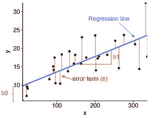

Linear regression

From the scatter plot above, it can be seen that not all the data points fall exactly on the fitted regression line. Some of the points are above the blue curve and some are below it; overall, the residual errors (`e`) have approximately mean zero.

The sum of the squares of the residual errors are called the **Residual Sum of Squares** or **RSS**.

The average variation of points around the fitted regression line is called the **Residual Standard Error** (**RSE**). This is one the metrics used to evaluate the overall quality of the fitted regression model. The lower the RSE, the better it is.

Since the mean error term is zero, the outcome variable `y` can be approximately estimated as follow:

`y ~ b0 + b1*x`

Mathematically, the beta coefficients (`b0` and `b1`) are determined so that the RSS is as minimal as possible. This method of determining the beta coefficients is technically called **least squares** regression or **ordinary least squares** (OLS) regression.

Once, the beta coefficients are calculated, a t-test is performed to check whether or not these coefficients are significantly different from zero. A non-zero beta coefficients means that there is a significant relationship between the predictors (`x`) and the outcome variable (`y`).

## 4.3 Loading Required R packages

* `tidyverse` for easy data manipulation and visualization

* `caret` for easy machine learning workflow

```
```

## 4.4 Preparing the data

We'll use the `marketing` data set, introduced in the Chapter 3, for predicting sales units on the basis of the amount of money spent in the three advertising medias (`youtube`, `facebook` and `newspaper`)

We’ll randomly split the data into training set (80% for building a predictive model) and test set (20% for evaluating the model). Make sure to set seed for reproducibility.

```
```

```
##     youtube facebook newspaper sales
## 158     180     1.56      29.2  12.1
## 82      288     4.92      44.3  14.8
## 175     267     4.08      15.7  13.8
```

```
```

## 4.5 Computing linear regression

The R function `lm()` is used to compute linear regression model.

### 4.5.1 Quick start R code

```
```

### 4.5.2 Simple linear regression

The **simple linear regression** is used to predict a continuous outcome variable (`y`) based on one single predictor variable (`x`).

In the following example, we'll build a simple linear model to predict sales units based on the advertising budget spent on `youtube`. The regression equation can be written as `sales = b0 + b1*youtube`.

The R function `lm()` can be used to determine the beta coefficients of the linear model, as follow:

```
```

```
##             Estimate Std. Error t value Pr(>|t|)
## (Intercept)   8.3839    0.62442    13.4 5.22e-28
## youtube       0.0468    0.00301    15.6 7.84e-34
```

The output above shows the estimate of the regression beta coefficients (column `Estimate`) and their significance levels (column `Pr(>|t|)`). The intercept (`b0`) is 8.38 and the coefficient of `youtube` variable is 0.046.

The estimated regression equation can be written as follow: `sales = 8.38 + 0.046*youtube`. Using this formula, for each new `youtube` advertising budget, you can predict the number of sale units.

For example:

* For a `youtube` advertising budget equal zero, we can expect a sale of 8.38 units.

* For a `youtube` advertising budget equal 1000, we can expect a sale of 8.38 + 0.046*1000 = 55 units.

Predictions can be easily made using the R function `predict()`. In the following example, we predict sales units for two `youtube` advertising budget: 0 and 1000.

```
```

```
##     1     2 
##  8.38 55.19
```

### 4.5.3 Multiple linear regression

**Multiple linear regression** is an extension of simple linear regression for predicting an outcome variable (`y`) on the basis of multiple distinct predictor variables (`x`).

For example, with three predictor variables (`x`), the prediction of `y` is expressed by the following equation: `y = b0 + b1*x1 + b2*x2 + b3*x3`


The regression beta coefficients measure the association between each predictor variable and the outcome. "`b_j`" can be interpreted as the average effect on `y` of a one unit increase in "`x_j`", holding all other predictors fixed.

In this section, we'll build a multiple regression model to predict sales based on the budget invested in three advertising medias: `youtube`, `facebook` and `newspaper`. The formula is as follow: `sales = b0 + b1*youtube + b2*facebook + b3*newspaper`

You can compute the multiple regression model coefficients in R as follow:

```
```

Note that, if you have many predictor variables in your data, you can simply include all the available variables in the model using `~.`:

```
```

```
##             Estimate Std. Error t value Pr(>|t|)
## (Intercept)  3.39188    0.44062   7.698 1.41e-12
## youtube      0.04557    0.00159  28.630 2.03e-64
## facebook     0.18694    0.00989  18.905 2.07e-42
## newspaper    0.00179    0.00677   0.264 7.92e-01
```

From the output above, the coefficients table shows the beta coefficient estimates and their significance levels. Columns are:

* `Estimate`: the intercept (`b0`) and the beta coefficient estimates associated to each predictor variable

* `Std.Error`: the standard error of the coefficient estimates. This represents the accuracy of the coefficients. The larger the standard error, the less confident we are about the estimate.

* `t value`: the t-statistic, which is the coefficient estimate (column 2) divided by the standard error of the estimate (column 3)

* `Pr(>|t|)`: The p-value corresponding to the t-statistic. The smaller the p-value, the more significant the estimate is.

As previously described, you can easily make predictions using the R function `predict()`:

```
```

```
##   1 
## 283
```

## 4.6 Interpretation

Before using a model for predictions, you need to assess the statistical significance of the model. This can be easily checked by displaying the statistical summary of the model.

### 4.6.1 Model summary

Display the statistical summary of the model as follow:

```
```

```
## 
## Call:
## lm(formula = sales ~ ., data = train.data)
## 
## Residuals:
##     Min      1Q  Median      3Q     Max 
## -10.412  -1.110   0.348   1.422   3.499 
## 
## Coefficients:
##             Estimate Std. Error t value Pr(>|t|)    
## (Intercept)  3.39188    0.44062    7.70  1.4e-12 ***
## youtube      0.04557    0.00159   28.63  < 2e-16 ***
## facebook     0.18694    0.00989   18.90  < 2e-16 ***
## newspaper    0.00179    0.00677    0.26     0.79    
## ---
## Signif. codes:  0 '***' 0.001 '**' 0.01 '*' 0.05 '.' 0.1 ' ' 1
## 
## Residual standard error: 2.12 on 158 degrees of freedom
## Multiple R-squared:  0.89,   Adjusted R-squared:  0.888 
## F-statistic:  427 on 3 and 158 DF,  p-value: <2e-16
```

The summary outputs shows 6 components, including:

* **Call**. Shows the function call used to compute the regression model.

### Residuals

提供残差分布的快速概览，残差按定义均值为零。因此，中位数不应远离零，且最小值和最大值在绝对值上应大致相等。

### Coefficients

显示回归贝塔系数及其统计显著性。与结果变量显著相关的预测变量用星号标记。

### Residual standard error

`RSE`、`R-squared` `R2` 和 `F-statistic` 是用于检查模型对数据拟合程度的指标。

解释多元回归分析的第一步是检查模型摘要底部的 `F-statistic` 及其相关 p 值。

在我们的示例中，可以看到 `F-statistic` 的 p 值为 < 2.2e-16，具有高度显著性。这意味着，至少有一个预测变量与结果变量显著相关。

### 4.6.2 Coefficients significance

要查看哪些预测变量显著，可以检查系数表，其中显示了回归贝塔系数的估计值以及相关的 t 统计量 p 值。

```
##             Estimate Std. Error t value Pr(>|t|)
## (Intercept)  3.39188    0.44062   7.698 1.41e-12
## youtube      0.04557    0.00159  28.630 2.03e-64
## facebook     0.18694    0.00989  18.905 2.07e-42
## newspaper    0.00179    0.00677   0.264 7.92e-01
```

对于给定的预测变量，t 统计量评估预测变量与结果变量之间是否存在显著关联，即预测变量的贝塔系数是否显著不同于零。

可以看出，`youtube` 和 `facebook` 广告预算的变化与 `sales` 的变化显著相关，而 `newspaper` 预算的变化与 `sales` 无显著关联。

对于给定的预测变量，系数 `b` 可以解释为在所有其他预测变量保持不变的情况下，预测变量增加一个单位对 `y` 的平均影响。

例如，在 `youtube` 和 `newspaper` 广告预算固定时，在 `facebook` 广告上额外花费 1 000 美元，会使 `sales` 平均增加约 `0.1885*1000 = 189` 个销售单位。

`youtube` 系数表明，在其他所有预测变量保持不变的情况下，`youtube` 广告预算每增加 1 000 美元，我们平均可以预期销售单位增加 `0.045*1000 = 45`。

我们发现 `newspaper` 在多元回归模型中不显著。这意味着，在 `youtube` 和 `newspaper` 广告预算固定时，`newspaper` 广告预算的变化不会显著影响 `sales` 单位。

由于 `newspaper` 变量不显著，可以将其从模型中移除：

```
## 
## Call:
## lm(formula = sales ~ youtube + facebook, data = train.data)
## 
## Residuals:
##     Min      1Q  Median      3Q     Max 
## -10.481  -1.104   0.349   1.423   3.486 
## 
## Coefficients:
##             Estimate Std. Error t value Pr(>|t|)    
## (Intercept)  3.43446    0.40877     8.4  2.3e-14 ***
## youtube      0.04558    0.00159    28.7  < 2e-16 ***
## facebook     0.18788    0.00920    20.4  < 2e-16 ***
## ---
## Signif. codes:  0 '***' 0.001 '**' 0.01 '*' 0.05 '.' 0.1 ' ' 1
## 
## Residual standard error: 2.11 on 159 degrees of freedom
## Multiple R-squared:  0.89,   Adjusted R-squared:  0.889 
## F-statistic:  644 on 2 and 159 DF,  p-value: <2e-16
```

最后，我们的模型方程可以写成如下形式：`sales = 3.43+ 0.045youtube + 0.187 facebook`。

### 4.6.3 Model accuracy

一旦你确定至少有一个预测变量与结果显著相关，你应继续进行诊断，检查模型对数据的拟合程度。该过程也称为拟合优度。

线性回归拟合的整体质量可通过模型摘要中显示的以下三个量来评估：

1. 残差标准误 `RSE`，

2. R-squared `R2` 和调整后 `R2`，

3. `F-statistic`，已在上一节中描述

```
##    rse r.squared f.statistic  p.value
## 1 2.11      0.89         644 5.64e-77
```

1. Residual standard error `RSE`.

`RSE` 或模型 sigma，对应预测误差，大致代表观测结果值与模型预测值之间的平均差异。`RSE` 越低，模型对数据的拟合越好。

将 `RSE` 除以结果变量的平均值将得到预测误差率，应尽可能小。

在我们的示例中，仅使用 `youtube` 和 `facebook` 预测变量时，`RSE = 2.11`，意味着观测到的 `sales` 值与预测值平均偏差约为 2.11 个单位。

这对应于误差率为 `2.11/mean(train.data$sales) = 2.11/16.77 = 13%`，较低。

2. R-squared and Adjusted R-squared :

R-squared `R2` 范围从 0 到 1，表示模型预测变量可以解释的结果变量变异的比例。

对于简单线性回归，`R2` 是结果与预测变量之间皮尔逊相关系数的平方。在多元线性回归中，`R2` 表示观测结果值与预测值之间的相关系数。

`R2` 衡量模型拟合数据的程度。`R2` 越高，模型越好。然而，`R2` 的问题是，当向模型中添加更多变量时，它总会增加，即使这些变量与结果仅弱相关 `James et al. 2014`。一种解决方案是通过考虑预测变量的数量来调整 `R2`。

摘要输出中“调整后 R 平方”值的调整是对纳入预测模型中的 x 变量数量的校正。

因此，你应主要考虑调整后 R 平方，它是对预测变量数量较多的惩罚性 `R2`。

* 调整后 `R2` 接近 1 表明回归模型解释了结果变异的大部分比例。

* 接近 0 的数值表明回归模型没有解释结果变异的多少。

在我们的示例中，调整后 `R2` 为 0.88，效果良好。

3. F-Statistic :

请记住，`F-statistic` 给出模型的整体显著性。它评估至少一个预测变量是否具有非零系数。

在简单线性回归中，该检验并不真正有趣，因为它只是重复了系数表中 t 检验提供的信息。

一旦我们开始使用多个预测变量，如多元线性回归，`F-statistic` 就变得更重要。

较大的 `F-statistic` 对应于统计显著的 p 值 `p < 0.05`。在我们的示例中，`F-statistic` 等于 644，产生 p 值为 1.46e-42，具有高度显著性。

## 4.7 Making predictions

我们将使用测试数据进行预测，以评估回归模型的性能。

步骤如下：

1. 基于测试数据中的新广告预算预测 `sales` 值

2. 通过计算评估模型性能：

   * 预测误差 `RMSE` 均方根误差，表示测试数据中观测到的已知结果值与模型预测结果值之间的平均差异。`RMSE` 越低，模型越好。

   * R-square `R2`，表示观测结果值与预测结果值之间的相关性。`R2` 越高，模型越好。

```
## [1] 1.58
```

```
## [1] 0.938
```

从上面的输出可知，`R2` 为 0.93，意味着观测值与预测结果值高度相关，这非常好。

预测误差 `RMSE` 为 1.58，表示误差率为 `1.58/mean(test.data$sales) = 1.58/17 = 9.2%`，这也不错。

## 4.8 讨论

本章介绍了线性回归的基础知识，并提供了在 R 中计算简单线性回归和多元线性回归模型的实际示例。我们还描述了如何评估模型的预测性能。

请注意，线性回归假设结果变量与预测变量之间存在线性关系。这可以通过创建结果变量与预测变量的散点图来轻松检查。

例如，以下 R 代码显示了销售单位与 YouTube 广告预算之间的关系。我们还将添加一条平滑线：

```
```

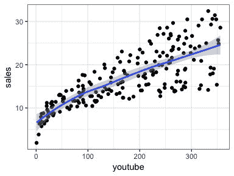

上图显示了 `sales` 与 `youtube` 变量之间线性递增的关系，这是一件好事。

除了线性假设之外，线性回归方法对数据还做出了许多其他假设（参见第 9 章）。您应确保这些假设对您的数据成立。

潜在问题包括：a) 数据中存在有影响的观测值（第 9 章），结果与某些预测变量之间的非线性关系（7）以及预测变量之间存在强相关性（第 10 章）。

## 5 多元回归中的交互效应

## 5.1 引言

本章介绍如何计算具有 `interaction effects` 的多元线性回归。

之前，我们已经描述了如何构建多元线性回归模型（第 4 章）来基于多个预测变量 (`x`) 预测连续结果变量 (`y`)。

例如，要根据在 YouTube 和 Facebook 上花费的广告预算预测销售额，模型方程为 `sales = b0 + b1*youtube + b2*facebook`，其中 `b0` 为截距；`b1` 和 `b2` 分别与预测变量 `youtube` 和 `facebook` 相关的回归系数。

上述方程也称为 *additive model*，仅研究预测变量的主效应。它假设给定预测变量与结果之间的关系独立于其他预测变量（James et al. 2014，P. Bruce and Bruce (2017)) 。

以我们的示例来看，加性模型假设 YouTube 广告对销售额的影响独立于 Facebook 广告的影响。

这种假设可能不成立。例如，在 Facebook 上花费的广告费用可能会提高 YouTube 广告对销售额的有效性。在营销中，这被称为协同效应，在统计学中被称为交互效应（James et al. 2014）。

在本章中，您将学习：

* 具有交互效应的多元线性回归方程

* 计算与主效应和交互效应相关的回归系数的 R 代码

* 如何解释交互效应

## 5.2 方程

两个预测变量 (`x1` 和 `x2`) 之间存在交互效应的多元线性回归方程可写为如下形式：

`y = b0 + b1*x1 + b2*x2 + b3*(x1*x2)`

以我们的示例来看，它变为：

`sales = b0 + b1*youtube + b2*facebook + b3*(youtube*facebook)`

这也可以写成：

`sales = b0 + (b1 + b3*facebook)*youtube + b2*facebook`

或写成：

`sales = b0 + b1*youtube + (b2 +b3*youtube)*facebook`


`b3` 可解释为 Facebook 广告每增加一个单位时 YouTube 广告有效性的增加量（或反之）。

在接下来的章节中，您将学习如何在 R 中计算回归系数。

## 5.3 加载所需的 R 包

* `tidyverse` 用于轻松的数据操作和可视化
* `caret` 用于轻松的机器学习工作流

## 5.4 准备数据

我们将使用第 3 章中介绍的 `marketing` 数据集，根据在三种广告媒体 (`youtube`、`facebook` 和 `newspaper`) 上花费的金额预测销售单位

我们将随机将数据拆分为训练集（80% 用于构建预测模型）和测试集（20% 用于评估模型）。

```
##     youtube facebook newspaper sales
## 158     180     1.56      29.2  12.1
## 82      288     4.92      44.3  14.8
## 175     267     4.08      15.7  13.8
```

## 5.5 计算

### 5.5.1 加性模型

标准线性回归模型可按如下方式计算：

```
## 
## Call:
## lm(formula = sales ~ youtube + facebook, data = train.data)
## 
## Residuals:
##     Min      1Q  Median      3Q     Max 
## -10.481  -1.104   0.349   1.423   3.486 
## 
## Coefficients:
##             Estimate Std. Error t value Pr(>|t|)    
## (Intercept)  3.43446    0.40877     8.4  2.3e-14 ***
## youtube      0.04558    0.00159    28.7  < 2e-16 ***
## facebook     0.18788    0.00920    20.4  < 2e-16 ***
## ---
## Signif. codes:  0 '***' 0.001 '**' 0.01 '*' 0.05 '.' 0.1 ' ' 1
## 
## Residual standard error: 2.11 on 159 degrees of freedom
## Multiple R-squared:  0.89,   Adjusted R-squared:  0.889 
## F-statistic:  644 on 2 and 159 DF,  p-value: <2e-16
```

```
## [1] 1.58
```

```
## [1] 0.938
```

### 5.5.2 交互效应

在 R 中，您使用 `*` 运算符在变量之间包含交互作用：

```
## 
## Call:
## lm(formula = sales ~ youtube * facebook, data = train.data)
## 
## Residuals:
##    Min     1Q Median     3Q    Max 
## -7.438 -0.482  0.231  0.748  1.860 
## 
## Coefficients:
##                  Estimate Std. Error t value Pr(>|t|)    
## (Intercept)      7.90e+00   3.28e-01   24.06   <2e-16 ***
## youtube          1.95e-02   1.64e-03   11.90   <2e-16 ***
## facebook         2.96e-02   9.83e-03    3.01    0.003 ** 
## youtube:facebook 9.12e-04   4.84e-05   18.86   <2e-16 ***
## ---
## Signif. codes:  0 '***' 0.001 '**' 0.01 '*' 0.05 '.' 0.1 ' ' 1
## 
## Residual standard error: 1.18 on 158 degrees of freedom
## Multiple R-squared:  0.966,  Adjusted R-squared:  0.966 
## F-statistic: 1.51e+03 on 3 and 158 DF,  p-value: <2e-16
```

```
## [1] 0.963
```

```
## [1] 0.982
```

## 5.6 解释

可以看出，所有系数，包括交互项系数，都具有统计显著性，表明两个预测变量 (`youtube` 和 `facebook` 广告) 之间存在交互关系。

我们的模型方程如下：

`sales = 7.89 + 0.019*youtube + 0.029*facebook + 0.0009*youtube*facebook`

我们可以将其解释为 YouTube 广告增加 1000 美元与销售额增加 `(b1 + b3*facebook)*1000 = 19 + 0.9*facebook units` 相关。而 Facebook 广告增加 1000 美元将与销售额增加 `(b2 + b3*youtube)*1000 = 28 + 0.9*youtube units` 相关。

请注意，有时会出现交互项显著但主效应不显著的情况。层级原则指出，如果我们在模型中包含交互作用，我们也应包含主效应，即使其系数相关的 p 值不显著（James et al. 2014）。

## 5.7 比较加性模型和交互模型

交互模型的预测误差 `RMSE` 为 0.963，低于加性模型的预测误差（1.58）。

此外，交互模型的 R 平方（`R2`）值为 98%，而加性模型仅为 93%。

这些结果表明，包含交互项的模型优于仅包含主效应的模型。因此，对于此特定数据，我们应选择包含交互项的模型。

### 5.8 讨论

本章介绍了如何计算带交互效应的多元线性回归。如果交互项显著，则应将其纳入模型中。

## 6 分类变量的回归

## 6.1 引言

本章介绍了如何计算**分类变量的回归**。

**分类变量**（也称为*factor*或*定性变量*）是将观测值分类到组中的变量。它们具有有限数量的不同取值，称为水平。例如个体的性别是一个分类变量，可以取两个水平：男性或女性。

回归分析需要数值变量。因此，当研究人员希望将分类变量纳入回归模型时，需要额外的步骤以使结果具有可解释性。

在这些步骤中，分类变量被重新编码为一组单独的二元变量。这种重新编码称为“哑编码”，并导致创建一张名为*对比矩阵*的表格。这是由统计软件（如 R）自动完成的。

在这里，您将学习如何构建和解释具有分类预测变量的线性回归模型。我们还将在 R 中提供实际示例。

## 6.2 加载所需的 R 包

* `tidyverse` 用于轻松的数据操作和可视化

## 6.3 数据集示例

我们将使用 `Salaries` 数据集 [`car` package]，其中包含美国某学院 2008-09 学年九个月的助理教授、副教授和教授的学术薪资。

数据是在学院管理层持续努力监测男女教职员工薪资差异的活动中收集的。

```
##         rank discipline yrs.since.phd yrs.service  sex salary
## 313     Prof          A            29          19 Male  94350
## 162     Prof          B            26          19 Male 176500
## 349 AsstProf          B             4           3 Male  80139
```

## 6.4 具有两个水平的分类变量

回想一下，用于根据预测变量（`x`）预测结果变量（`y`）的回归方程可以简单地写为 `y = b0 + b1*x`。`b0` 和 `b1` 是回归贝塔系数，分别代表截距和斜率。

假设我们希望研究男女之间的薪资差异。

基于性别变量，我们可以创建一个新的哑变量，其取值如下：

* `1` 如果某人是男性
* `0` 如果某人是女性

并将此变量用作回归方程中的预测变量，从而得到以下模型：

* `b0 + b1` 如果某人是男性
* `bo` 如果某人是女性

系数可以解释如下：

1. `b0` 是女性的平均薪资，
2. `b0 + b1` 是男性的平均薪资，
3. 且 `b1` 是男女之间薪资的平均差异。

为简单演示目的，以下示例通过在 `Salaries` 数据集 [`car` package] 上计算简单线性回归模型来模拟男女之间的薪资差异。R 会自动创建哑变量：

```
##             Estimate Std. Error t value Pr(>|t|)
## (Intercept)   101002       4809   21.00 2.68e-66
## sexMale        14088       5065    2.78 5.67e-03
```

从上面的输出中，女性的平均薪资估计为 101002，而男性估计为 101002 + 14088 = 115090。哑变量 `sexMale` 的 p 值非常显著，表明男女平均薪资存在差异的统计证据。

`contrasts()` 函数返回 R 用于创建哑变量的编码：

```
##        Male
## Female    0
## Male      1
```

R 创建了一个 `sexMale` 哑变量，如果性别为男性则取值为 1，否则为 0。将男性编码为 1、女性编码为 0（基线）的决定是任意的，对回归计算没有影响，但会改变系数的解释。

您可以使用 `relevel()` 函数将基线类别设置为男性，如下所示：

回归拟合的输出变为：

```
##             Estimate Std. Error t value  Pr(>|t|)
## (Intercept)   115090       1587   72.50 2.46e-230
## sexFemale     -14088       5065   -2.78  5.67e-03
```

回归输出中 `sexFemale` 系数为负表明，相对于男性，女性与薪资下降相关。

现在 `bo` 和 `b1` 的估计值分别为 115090 和 -14088，再次导致男性平均薪资预测为 115090，女性平均薪资预测为 115090 - 14088 = 101002。

或者，除了 0/1 编码方案外，我们还可以创建一个哑变量 -1（男性）/ 1（女性）。这会得到模型：

* `b0 - b1` 如果某人是男性
* `b0 + b1` 如果某人是女性

因此，如果分类变量编码为 -1 和 1，则如果回归系数为正，则从编码为 -1 的组中减去并加到编码为 1 的组中。如果回归系数为负，则加法和减法会反转。

## 6.5 具有两个以上水平的分类变量

通常，具有 n 个水平的分类变量将被转换为 n-1 个每个具有两个水平的变量。这些 n-1 个新变量包含与单个变量相同的信息。这种重新编码创建了一张名为**对比矩阵**的表格。

例如 `Salaries` 数据中的 `rank` 有三个水平：“AsstProf”、“AssocProf”和“Prof”。该变量可以哑编码为两个变量，一个称为 AssocProf，一个称为 Prof：

* 如果 rank = AssocProf，则列 AssocProf 编码为 1，Prof 编码为 0。
* 如果 rank = Prof，则列 AssocProf 编码为 0，Prof 编码为 1。
* 如果 rank = AsstProf，则两列“AssocProf”和“Prof”均编码为 0。

这种哑编码由 R 自动执行。为演示目的，您可以使用 `model.matrix()` 函数为因子变量创建对比矩阵：

```
##   rankAssocProf rankProf
## 1             0        1
## 2             0        1
## 3             0        0
## 4             0        1
## 5             0        1
## 6             1        0
```

构建线性模型时，有不同的编码分类变量的方法，称为对比编码系统。R 中的默认选项是使用因子的第一个水平作为参考，并将剩余水平相对于此水平进行解释。

请注意，ANOVA（方差分析）只是线性模型的一个特例，其中预测变量是分类变量。而且，由于 R 理解 ANOVA 和回归都是线性模型的例子，它允许您使用 R 基础 `anova()` 函数或 [`car` package] 中的 `Anova()` 函数从回归模型中提取经典的 ANOVA 表。我们通常推荐 `Anova()` 函数，因为它会自动处理不平衡设计。

下面给出了使用多元回归程序预测薪资的结果。

## Anova 表（Type II 检验）

```
## 
## Response: salary
##               Sum Sq  Df F value  Pr(>F)    
## yrs.service 3.24e+08   1    0.63    0.43    
## rank        1.03e+11   2  100.26 < 2e-16 ***
## discipline  1.74e+10   1   33.86 1.2e-08 ***
## sex         7.77e+08   1    1.51    0.22    
## Residuals   2.01e+11 391                    
## ---
## Signif. codes:  0 '***' 0.001 '**' 0.01 '*' 0.05 '.' 0.1 ' ' 1
```

在考虑了其他变量（`yrs.service`、`rank` 和 `discipline`）之后，可以看出分类变量 `sex` 已不再显著地与个体间 `salary` 的变化相关。显著的变量是 `rank` 和 `discipline`。

如果想解释分类变量的对比，输入以下内容：

```
## 
## Call:
## lm(formula = salary ~ yrs.service + rank + discipline + sex, 
##     data = Salaries)
## 
## Residuals:
##    Min     1Q Median     3Q    Max 
## -64202 -14255  -1533  10571  99163 
## 
## Coefficients:
##               Estimate Std. Error t value Pr(>|t|)    
## (Intercept)    73122.9     3245.3   22.53  < 2e-16 ***
## yrs.service      -88.8      111.6   -0.80  0.42696    
## rankAssocProf  14560.4     4098.3    3.55  0.00043 ***
## rankProf       49159.6     3834.5   12.82  < 2e-16 ***
## disciplineB    13473.4     2315.5    5.82  1.2e-08 ***
## sexFemale      -4771.2     3878.0   -1.23  0.21931    
## ---
## Signif. codes:  0 '***' 0.001 '**' 0.01 '*' 0.05 '.' 0.1 ' ' 1
## 
## Residual standard error: 22700 on 391 degrees of freedom
## Multiple R-squared:  0.448,  Adjusted R-squared:  0.441 
## F-statistic: 63.4 on 5 and 391 DF,  p-value: <2e-16
```

例如，可以看出来自 `discipline` B（应用系）与 `discipline` A（理论系）相比，显著地与 `salary` 平均增加 `13473.38` 相关。

## 6.6 讨论

在本章中我们描述了如何在线性回归模型中包含分类变量。由于回归需要数值输入，分类变量需要被重新编码为一组二元变量。

我们提供了具有两个或更多水平的分类变量情况的实际示例。

请注意，对于具有大量水平的分类变量，将一些水平分组在一起可能很有用。

一些分类变量的水平是有序的。它们可以转换为数值并直接使用。例如，如果教授职称（"AsstProf"、"AssocProf" 和 "Prof"）具有特殊含义，您可以将它们转换为数值，按从低到高的顺序排列，对应于更高级别的教授。

## 7 非线性回归

## 7.1 引言

在某些情况下，结果与预测变量之间的真实关系可能不是线性的。

有不同的解决方案扩展线性回归模型（第 `4` 章）以捕捉这些非线性效应，包括：

* **多项式回归**。这是对非线性关系建模的简单方法。它向回归中添加多项式项或二次项（平方、立方等）。
* **样条回归**。用一系列多项式段拟合一条平滑曲线。分隔样条段的值称为 **Knots**。


*广义可加模型*（GAM）。使用自动选择结点的样条模型。

在本章中，您将学习如何计算非线性回归模型以及如何比较不同的模型以选择最适合您数据的模型。

`RMSE` 和 `R2` 指标将用于比较不同的模型（参见第 `@ref(linear regression)` 章）。

请记住，`RMSE` 表示模型预测误差，即观察到的结果值与预测的结果值之间的平均差异。`R2` 表示观察结果值与预测结果值之间的平方相关性。最佳模型是 `RMSE` 最低且 `R2` 最高的模型。

## 7.2 加载所需的 R 包

* `tidyverse` 用于轻松的数据操作和可视化
* `caret` 用于轻松的机器学习工作流

## 7.3 准备数据

我们将使用 `Boston` 数据集 [在 `MASS` 包中]，在第 `3` 章中介绍，用于预测波士顿郊区的房屋中位数价值（`mdev`），基于预测变量 `lstat`（人口中低收入比例）。

我们将随机将数据拆分为训练集（80% 用于构建预测模型）和测试集（20% 用于评估模型）。请确保设置种子以保证可重复性。

首先，按如下方式可视化 `medv` 与 `lstat` 变量的散点图：

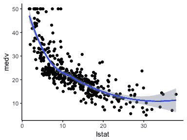

上图散点图表明两个变量之间存在非线性关系

在接下来的章节中，我们首先计算线性和非线性回归模型。接下来，我们将比较不同的模型以选择最适合我们数据的模型。

## 7.4 线性回归 {linear-reg}

标准线性回归模型方程可以写为 `medv = b0 + b1*lstat`。

计算线性回归模型：

```
##   RMSE    R2
## 1 6.07 0.535
```

可视化数据：

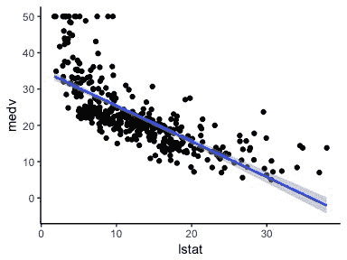

## 7.5 多项式回归

多项式回归按如下方式向回归方程添加多项式或二次项：

`medv=b0+b1*lstat+b2*lstat2` `medv = b0 + b1*lstat + b2*lstat²`

在 R 中，要创建预测变量 `x²`，应使用函数 `I()`，如下所示：`I(x²)`。这将 `x` 提高到 2 次方。

多项式回归可以在 R 中按如下方式计算：

另一种简单的解决方案是使用以下方法：

```
## 
## Call:
## lm(formula = medv ~ poly(lstat, 2), data = train.data)
## 
## Coefficients:
##     (Intercept)  poly(lstat, 2)1  poly(lstat, 2)2  
##            22.7           -139.4             57.7
```

输出包含与 `lstat` 相关的两个系数：一个用于线性项（`lstat¹`），一个用于二次项（`lstat²`）。

以下示例计算六阶多项式拟合：

```
## 
## Call:
## lm(formula = medv ~ poly(lstat, 6), data = train.data)
## 
## Residuals:
##    Min     1Q Median     3Q    Max 
## -14.23  -3.24  -0.74   2.02  26.50 
## 
## Coefficients:
##                 Estimate Std. Error t value Pr(>|t|)    
## (Intercept)       22.739      0.262   86.83  < 2e-16 ***
## poly(lstat, 6)1 -139.357      5.284  -26.38  < 2e-16 ***
## poly(lstat, 6)2   57.728      5.284   10.93  < 2e-16 ***
## poly(lstat, 6)3  -25.923      5.284   -4.91  1.4e-06 ***
## poly(lstat, 6)4   21.378      5.284    4.05  6.3e-05 ***
## poly(lstat, 6)5  -13.817      5.284   -2.62   0.0093 ** 
## poly(lstat, 6)6    7.268      5.284    1.38   0.1697    
## ---
## Signif. codes:  0 '***' 0.001 '**' 0.01 '*' 0.05 '.' 0.1 ' ' 1
## 
## Residual standard error: 5.28 on 400 degrees of freedom
## Multiple R-squared:  0.684,  Adjusted R-squared:  0.679 
## F-statistic:  144 on 6 and 400 DF,  p-value: <2e-16
```

从上面的输出可以看出，超过五阶的多项式项不显著。因此，只需按如下方式创建五阶多项式回归模型：

```
##   RMSE    R2
## 1 4.96 0.689
```

按如下方式可视化五阶多项式回归线：

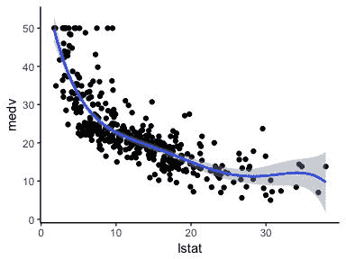

## 7.6 对数变换

当您具有非线性关系时，也可以尝试对预测变量进行对数变换：

```
##   RMSE    R2
## 1 5.24 0.657
```

可视化数据：

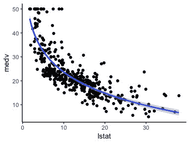

## 7.7 样条回归

多项式回归只能捕捉非线性关系中的一定程度的曲率。一种替代且通常更优的方法来建模非线性关系是使用样条（P. Bruce and Bruce 2017）。

样条提供了一种在称为结点的固定点之间平滑插值的方法。结点之间计算多项式回归。换句话说，样条是串联在一起的多项式段，在结点处连接（P. Bruce 和 Bruce 2017）。

R 包 `splines` 包含函数 `bs` 用于在回归模型中创建 B 样条项。

你需要指定两个参数：多项式的次数和结点的位置。在我们的示例中，我们将结点放置在下四分位数、中位数四分位数和上四分位数：

我们将使用三次样条（degree = 3）创建一个模型：

```
##   RMSE    R2
## 1 4.97 0.688
```

请注意，样条项的系数是不可解释的。

按如下方式可视化三次样条：

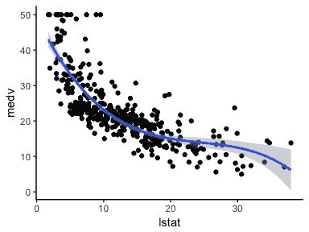

## 7.8 广义可加模型

一旦你在数据中检测到非线性关系，多项式项可能不足以捕捉该关系，并且样条项需要指定结点。

广义可加模型，或 GAM，是一种自动拟合样条回归的技术。这可以使用 `mgcv` R 包完成：

```
##   RMSE    R2
## 1 5.02 0.684
```

项 `s(lstat)` 告诉 `gam()` 函数为样条项找到“最佳”结点。

可视化数据：

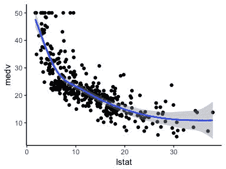

## 7.9 比较模型

通过分析不同模型的 RMSE 和 R2 指标，可以看出多项式回归、样条回归和广义可加模型优于线性回归模型和对数变换方法。

## 7.10 讨论

本章描述了如何使用 R 计算非线性回归模型。

## 8 引言

在构建线性回归模型（第 4 章）之后，你需要进行一些诊断以检测数据中的潜在问题。

在本部分，你将学习：

* 线性回归假设和诊断（第 9 章）
* 计算线性回归模型时可能出现的问题，包括：
    * 结果与预测变量之间的非线性关系（第 7 章）
    * 多重共线性（第 10 章）
    * 混杂变量（第 11 章）

## 9 回归假设和诊断

## 9.1 引言

线性回归（第 4 章）对所处理的数据做出若干假设。本章描述 **回归假设** 并提供 R 编程语言中用于 **回归诊断** 的内置图。

执行回归分析后，你应始终检查模型对所处理数据的适用性。

回归诊断的第一步是检查回归贝塔系数的显著性，以及 R2，它告诉我们线性回归模型对数据的拟合程度。这已在第 4 和 14 章中描述。

在本章中，你将学习评估模型拟合数据的良好程度的额外步骤。

例如，线性回归模型假设预测变量（x）与结果变量之间的关系是线性的。这可能不成立。关系可能是多项式或对数。

此外，数据可能包含一些有影响的观测值，例如异常值（或极值），这会影响回归结果。

因此，你应仔细诊断你构建的回归模型以检测潜在问题并检查线性回归模型所做的假设是否满足。

为此，我们通常检查 **残差误差** 的分布，这可以告诉你有关数据的更多信息。

在本章中，
* 我们首先解释 **残差误差** 和 **拟合值**。
* 接下来，我们介绍线性 **回归假设**，以及在执行回归分析时可能遇到的潜在问题。
* 最后，我们描述 R 中用于检验线性回归模型潜在假设的一些内置 **诊断图**。

## 9.2 加载所需的 R 包

* `tidyverse` 用于轻松的数据操作和可视化
* `broom`：从统计检验结果创建整洁的数据框

## 9.3 示例数据

我们将使用数据集合 `marketing` [datarium 包]，该集合在第 3 章中介绍。

```
##     youtube facebook newspaper sales
## 158     180     1.56      29.2  12.1
## 82      288     4.92      44.3  14.8
## 175     267     4.08      15.7  13.8
```

## 9.4 构建回归模型

我们构建一个模型以根据 youtube 媒体支出的广告预算预测销售额。

```
## 
## Call:
## lm(formula = sales ~ youtube, data = marketing)
## 
## Coefficients:
## (Intercept)      youtube  
##      8.4391       0.0475
```

我们的回归方程是：`y = 8.43 + 0.07*x`，即 `sales = 8.43 + 0.047*youtube`。

在描述回归假设和回归诊断之前，我们首先解释回归分析中的两个关键概念：拟合值和残差误差。这些对于理解此后介绍的诊断图很重要。

## 9.5 拟合值和残差

**拟合**（或 **预测**）值是根据构建的回归模型（或视觉上，最佳拟合的直线回归线）对于给定的 x 值所期望的 y 值。

在我们的示例中，对于给定的 youtube 广告预算，拟合（预测）销售额将为，`sales = 8.44 + 0.0048*youtube`。

从下面的散点图可以看出，并非所有数据点都恰好落在估计的回归线上。这意味着，对于给定的 youtube 广告预算，观察到的（或测量的）销售额可能与预测的销售额不同。差异称为 **残差误差**，由垂直红色线表示。


线性回归

在 R 中，你可以使用函数 `augment()` [broom 包] 轻松地增强数据以添加拟合值和残差。让我们将输出称为 `model.diag.metrics`，因为它包含对回归诊断有用的多个指标。我们稍后会描述它们。

```
##   sales youtube .fitted .se.fit .resid    .hat .sigma  .cooksd .std.resid
## 1 26.52   276.1   21.56   0.385  4.955 0.00970   3.90 7.94e-03     1.2733
## 2 12.48    53.4   10.98   0.431  1.502 0.01217   3.92 9.20e-04     0.3866
## 3 11.16    20.6    9.42   0.502  1.740 0.01649   3.92 1.69e-03     0.4486
## 4 22.20   181.8   17.08   0.277  5.119 0.00501   3.90 4.34e-03     1.3123
## 5 15.48   217.0   18.75   0.297 -3.273 0.00578   3.91 2.05e-03    -0.8393
## 6  8.64    10.4    8.94   0.525 -0.295 0.01805   3.92 5.34e-05    -0.0762
```

在表列中，有：
* `youtube`：投入的 youtube 广告预算
* `sales`：观察到的销售额
* `.fitted`：拟合销售额
* `.resid`：残差误差
* ...

以下 R 代码绘制残差误差（红色）与观察值和拟合回归线之间的差异。每个垂直红色线段代表一个观察销售额与相应预测（即拟合）值之间的残差误差。

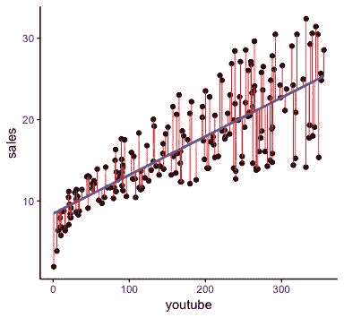

为了检查回归假设，我们将检查残差的分布。

## 9.6 回归假设

线性回归对数据做出若干假设，例如：

1. **数据的线性**。预测变量（x）与结果（y）之间的关系被假设为线性。

## 残差的正态性

残差误差假定为正态分布。

## 残差方差的同质性

残差假定具有恒定方差（`homoscedasticity`）

## 残差误差项的独立性

你应该检查这些假设是否成立。潜在问题包括：

1. **非线性**的因变量 - 预测变量关系
2. **异方差性**：误差项方差非恒定。
3. 数据中存在**有影响的值**，可能为：
* 异常值：因变量（`y`）中的极值
* 高杠杆点：预测变量（`x`）中的极值

所有这些假设和潜在问题都可以通过生成可视化残差误差的诊断图来检查。

## 9.7 回归诊断 {reg-diag}

### 9.7.1 诊断图

回归诊断图可以使用 R 基础函数 `plot()` 或 `autoplot()` 函数 [ggfortify package] 创建，后者创建基于 ggplot2 的图形。

* 使用 R 基础函数创建诊断图：

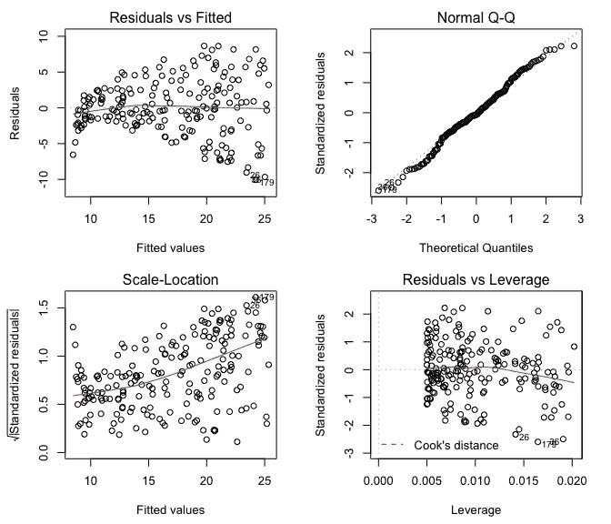

* 使用 ggfortify 创建诊断图：

诊断图以四种不同的方式显示残差：

1. **残差 vs 拟合值**。用于检查线性关系假设。水平线且无明显模式表明存在线性关系，这是好的。
2. **Normal Q-Q**。用于检查残差是否呈正态分布。如果残差点遵循直线虚线，则为好。
3. **Scale-Location**（或 Spread-Location）。用于检查残差方差的同质性（`homoscedasticity`）。水平线且点分布均匀是同方差性的良好迹象。在我们的示例中并非如此，我们存在异方差性问题。
4. **残差 vs 杠杆值**。用于识别有影响的案例，即可能在纳入或排除分析时影响回归结果的极值。该图将在下一节中进一步描述。

四幅图显示了标记有数据集中数据行号的 3 个最极端数据点。它们可能存在潜在问题。你可能需要单独仔细查看它们，以检查受试者是否有特殊之处或是否只是简单的数据录入错误。我们将在以下章节中讨论这个问题。

用于创建上述图的指标可在 `model.diag.metrics` 数据中获得，见上一节描述。

```
##   index sales youtube .fitted .resid    .hat .cooksd .std.resid
## 1     1  26.5   276.1   21.56   4.96 0.00970 0.00794      1.273
## 2     2  12.5    53.4   10.98   1.50 0.01217 0.00092      0.387
## 3     3  11.2    20.6    9.42   1.74 0.01649 0.00169      0.449
## 4     4  22.2   181.8   17.08   5.12 0.00501 0.00434      1.312
```

我们主要使用以下列：
* `.fitted`：拟合值
* `.resid`：残差误差
* `.hat`：帽值，用于检测高杠杆点（或预测变量 `x` 中的极值）
* `.std.resid`：标准化残差，即残差除以其标准误差。用于检测异常值（或因变量 `y` 中的极值）
* `.cooksd`：Cook 距离，用于检测有影响的值，可能为异常值或高杠杆点

在下一节中，我们将详细介绍如何使用这些图形和指标来检查回归假设并诊断模型中的潜在问题。

## 9.8 数据的线性

线性假设可以通过检查 **残差 vs 拟合值** 图（第 1 个图）来检查：

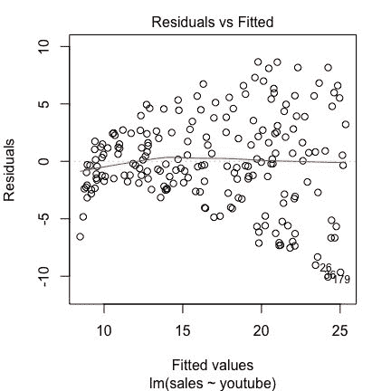

理想情况下，残差图将显示无拟合模式。即红色线应大致水平于零。模式的存在可能表明线性模型某方面存在问题。

在我们的示例中，残差图中没有模式。这表明我们可以假设预测变量与结果变量之间存在线性关系。

请注意，如果残差图表明数据中存在非线性关系，则一种简单的方法是在回归模型中使用预测变量的非线性变换，例如 `log(x)`、`sqrt(x)` 和 `x²`。

## 9.9 方差的同质性

该假设可以通过检查 *scale-location plot*，也称为 *spread-location plot* 来检查。

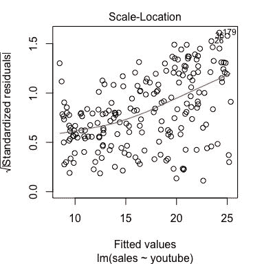

该图显示残差是否在预测变量范围内均匀分布。如果看到水平线且点分布均匀则为好。在我们的示例中并非如此。

可以看出，残差点的变异性（方差）随着拟合结果变量值的增加而增加，表明残差误差中存在非恒定方差（或 *异方差性*）。


减少异方差性问题的一种可能解决方案是对因变量（`y`）使用对数或平方根变换。

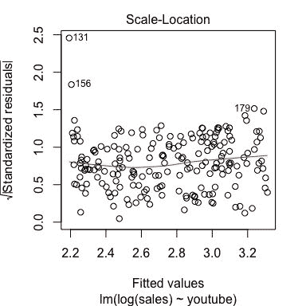

## 9.10 残差的正态性

残差的 QQ 图可用于直观检查正态性假设。残差的正态概率图应大致遵循直线。

在我们的示例中，所有点大致沿此参考线分布，因此我们可以假设正态性。

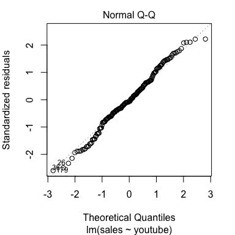

## 9.11 异常值和高杠杆点

**异常值**：

异常值是指具有极端因变量值的点。异常值的存在可能会影响模型的解释，因为它会增加 `RSE`。

异常值可以通过检查 *标准化残差*（或 *学生化残差*）来识别，它是残差除以其估计标准误差。标准化残差可以解释为距离回归线的标准误差数。

标准化残差绝对值大于 3 的观测可能是异常值（James et al. 2014）。

**高杠杆点**：

如果数据点具有极端的预测变量 `x` 值，则具有高杠杆性。这可以通过检查杠杆统计量或 *帽值* 来检测。该统计量的值高于 `2(p + 1)/n` 表示具有高杠杆性的观测（P. Bruce and Bruce 2017）；其中，`p` 为预测变量数，`n` 为观测数。

异常值和高杠杆点可以通过检查 *残差 vs 杠杆值* 图来识别：

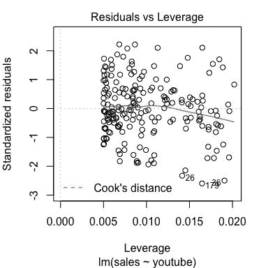

上图突出显示了 3 个最极端点（#26、#36 和 #179），其标准化残差低于 -2。然而，没有异常值超过 3 个标准差，这是好的。

此外，数据中没有高杠杆点。即所有数据点的杠杆统计量均低于 `2(p + 1)/n = 4/200 = 0.02`。

## 9.12 有影响的值

有影响的值是指其纳入或排除可能改变回归分析结果的值。这样的值与大残差相关。

并非所有异常值（或极端数据点）在线性回归分析中都是有影响的。

统计学家开发了一种称为 *Cook 距离* 的指标来确定一个值的影响。该指标将影响定义为杠杆和残差大小的组合。

经验法则是，如果 Cook 距离超过 `4/(n - p - 1)`（P. Bruce and Bruce 2017），则观测具有高影响，其中 `n` 为观测数，`p` 为预测变量数。

*残差与杠杆* plot 可以帮助我们找到是否存在有影响力的观测值。在此图中，异常值通常位于右上角或右下角。这些位置是数据点可能对回归线产生影响的地方。

以下图表说明了我们模型的 Cook 距离和杠杆值：

```
```

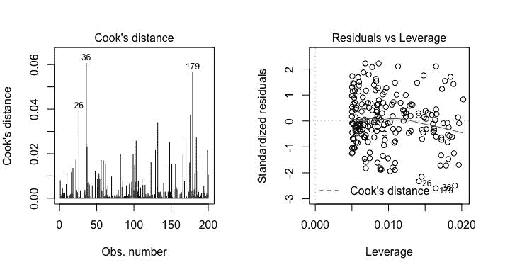

默认情况下，Cook 距离图上会标记前 3 个最极端的值。如果你想标记前 5 个极端值，请按如下方式指定选项 `id.n`：

```
```

如果你想查看 Cook 距离最高的这 3 个观测值以便进一步评估，请输入以下 R 代码：

```
```

```
##   index sales youtube .fitted .resid   .hat .cooksd .std.resid
## 1    26  14.4     315    23.4  -9.04 0.0142  0.0389      -2.33
## 2    36  15.4     349    25.0  -9.66 0.0191  0.0605      -2.49
## 3   179  14.2     332    24.2 -10.06 0.0165  0.0563      -2.59
```

当数据点具有较高的 Cook 距离得分并且位于杠杆图的右上或右下时，它们具有杠杆作用，意味着它们对回归结果有影响。如果我们排除这些案例，回归结果将会改变。

在我们的示例中，数据中没有呈现任何有影响力的点。Cook 距离线（红色虚线）在残差与杠杆图中未显示，因为所有点都位于 Cook 距离线之内。

让我们现在展示另一个示例，其中数据包含两个可能对回归结果产生影响的极端值：

```
```

创建两个模型的 *残差与杠杆* 图：

```
```

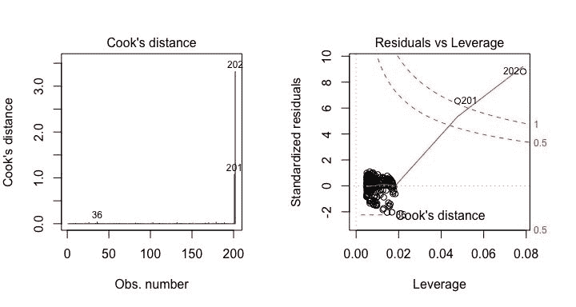

在残差与杠杆图中，寻找位于虚线 Cook 距离之外的点。当点位于 Cook 距离之外时，这意味着它们具有较高的 Cook 距离得分。在这种情况下，这些值对回归结果有影响。如果我们排除这些案例，回归结果将会改变。

在上述示例 2 中，两个数据点远超 Cook 距离线。其他残差似乎聚集在左侧。该图将有影响力的观测值识别为 #201 和 #202。如果你将这些点从分析中排除，斜率系数将从 0.06 变化到 0.04，`R2` 从 0.5 变化到 0.6。影响相当大！

### 9.13 讨论

本章描述了线性回归假设并展示了如何诊断模型中的潜在问题。

诊断本质上是通过可视化残差来进行的。残差中存在模式并不是停止信号。你的当前回归模型可能不是理解数据的最佳方式。

潜在问题可能是：

*   结果与预测变量之间存在非线性关系。面对这个问题时，一个解决方案是加入二次项，例如多项式项或对数变换。参见第 7 章。

*   存在你从模型中遗漏的重要变量。你未包含的其他变量（例如，年龄或性别）可能在你的模型和数据中发挥重要作用。参见第 11 章。

*   存在异常值。如果你认为异常值是由于数据收集和录入错误而发生的，那么一个解决方案就是简单地删除相关观测值。

## 10 多重共线性

## 10.1 引言

在多元回归（第 4 章）中，两个或多个预测变量可能彼此相关。这种情况被称为 *共线性* 。

存在一种极端情况，称为 **多重共线性** ，其中三个或更多变量之间存在共线性，即使没有一对变量具有特别高的相关性。这意味着预测变量之间存在冗余。

在存在多重共线性的情况下，回归模型的解变得不稳定。

对于给定的预测变量（p），多重共线性可以通过计算一个称为 **方差膨胀因子**（或 **VIF**）的分数来评估，该分数衡量由于模型中的多重共线性导致回归系数方差膨胀的程度。

`VIF` 的最小可能值为一（无多重共线性）。作为经验法则，`VIF` 值超过 5 或 10 表示共线性程度有问题（James et al. 2014）。

当面临多重共线性时，应删除相关变量，因为多重共线性的存在意味着该变量关于响应的信息在其他变量存在的情况下是冗余的（James et al. 2014 ,P. Bruce and Bruce (2017 )）。

本章描述了如何使用 R 检测回归模型中的多重共线性。

## 10.2 加载所需的 R 包

*   `tidyverse` 用于轻松的数据操作和可视化

*   `caret` 用于轻松的机器学习工作流

```
```

## 10.3 准备数据

我们将使用 `Boston` 数据集 [在 `MASS` 包中]，该数据集在第 3 章中介绍，用于预测波士顿郊区的房屋中位价值（`mdev`），基于多个预测变量。

我们将随机将数据拆分为训练集（80% 用于构建预测模型）和测试集（20% 用于评估模型）。请确保设置种子以保证可重复性。

```
```

## 10.4 构建回归模型

以下回归模型包含所有预测变量：

```
```

```
##   RMSE   R2
## 1 4.99 0.67
```

## 10.5 检测多重共线性

R 函数 `vif()` [car 包] 可用于检测回归模型中的多重共线性：

```
```

```
##    crim      zn   indus    chas     nox      rm     age     dis     rad 
##    1.87    2.36    3.90    1.06    4.47    2.01    3.02    3.96    7.80 
##     tax ptratio   black   lstat 
##    9.16    1.91    1.31    2.97
```

在我们的示例中，预测变量 `tax` 的 `VIF` 得分非常高（`VIF = 9.16`）。这可能存在问题。

## 10.6 处理多重共线性

在本节中，我们将通过删除 `VIF` 值较高的预测变量来更新我们的模型：

```
```

```
##   RMSE    R2
## 1 5.01 0.671
```

可以看出，删除 `tax` 变量对模型性能指标影响不大。

## 10.7 讨论

本章描述了如何在回归模型中检测和处理多重共线性。多重共线性问题包括在模型中包含具有与结果相似预测关系的不同的变量。这可以通过为每个预测变量计算 `VIF` 值来评估。

任何具有高 `VIF` 值（高于 5 或 10）的变量都应从模型中删除。这会导致一个更简单的模型，而不会损害模型准确性，这是有益的。

请注意，在存在多个相关预测变量的大型数据集中，你可以执行主成分回归和偏最小二乘回归策略。参见第 20 章。

## 11 混杂变量

**混杂变量** 是应该包含在预测模型中的重要变量，但你却遗漏了它。对此类模型的 naive 解释可能导致无效的结论。

例如，假设我们想基于人均 GDP 模拟不同国家的预期寿命，使用 `gapminder` 数据集：

```
```

在此示例中，很明显大陆是一个重要变量：欧洲的国家估计预期寿命高于非洲的国家。因此，大陆是一个应该包含在模型中的混杂变量：

```
```

## 12 引言

构建回归模型（第 4 章）时，你需要评估模型的优劣，即模型对用于构建模型的训练数据的拟合程度如何，以及模型对新的未见测试观测结果的预测准确性如何。

在本部分，你将学习评估回归模型准确性以及验证模型性能的技术。我们还将提供 R 中的实用示例。

以下章节涵盖：

*   回归模型准确性指标（第 13 章）用于衡量回归模型的性能。

*   交叉验证（第 14 章）和自助重采样（第 15 章）用于在测试数据上验证模型。

## 13 回归模型准确性指标

## 13.1 引言

在本章中，我们将描述用于衡量回归模型（第 4 章）性能的不同统计回归 `metrics`。

接下来，我们将提供 R 中的实用示例，用于比较两个模型的性能，以便为我们的数据选择最佳模型。

## 13.2 模型性能指标

在回归模型中，最常见的评估指标包括：

1.  `R-squared` (`R2`)，即结果变量变异中由预测变量解释的比例。在多元回归模型中，`R2` 对应于观测结果值与模型预测值之间的相关系数的平方。`R-squared` 越高，模型越好。

2.  `Root Mean Squared Error` (`RMSE`)，衡量模型在预测观测结果时产生的平均误差。数学上，`RMSE` 是 `mean squared error (MSE)` 的平方根，而 `MSE` 是观测实际结果值与模型预测值之间平方差的平均值。因此，`MSE = mean((observeds - predicteds)²)` 且 `RMSE = sqrt(MSE)`。`RMSE` 越低，模型越好。

3.  `Residual Standard Error` (`RSE`)，也称为 `model sigma`，是根据模型中预测变量数量调整后的 `RMSE` 变体。`RSE` 越低，模型越好。实际上，`RMSE` 与 `RSE` 之间的差异很小，尤其对于大型多变量数据。

4.  `Mean Absolute Error` (`MAE`)，与 `RMSE` 类似，`MAE` 衡量预测误差。数学上，它是观测值与预测结果之间绝对差值的平均值，`MAE = mean(abs(observeds - predicteds))`。`MAE` 对异常值比 `RMSE` 更不敏感。

上述指标的问题在于，它们对模型中额外变量的纳入很敏感，即使这些变量对解释结果没有显著贡献。换句话说，在模型中加入额外变量总会增加 `R2` 并降低 `RMSE`。因此，我们需要一个更稳健的指标来指导模型选择。

关于 `R2`，有一个调整版本，称为 `Adjusted R-squared`，它对模型中变量过多进行了调整。

此外，还有另外四个重要指标 - `AIC`、`AICc`、`BIC` 和 `Mallows Cp` - 常用于模型评估和选择。这些是模型预测误差 `MSE` 的无偏估计。指标越低，模型越好。

1.  `AIC` 代表 (`Akaike’s Information Criteria`)，由日本统计学家 Hirotugu Akaike 于 1970 年开发的指标。`AIC` 的基本思想是对模型中纳入额外变量进行惩罚。它在加入额外项时会增加误差惩罚。`AIC` 越低，模型越好。

2.  `AICc` 是针对小样本量校正的 `AIC` 版本。

3.  `BIC`（或 `Bayesian information criteria`）是 `AIC` 的变体，对纳入额外变量的惩罚更强。

4.  `Mallows Cp`：由 Colin Mallows 开发的 `AIC` 变体。

通常，最常用的指标，用于衡量回归模型质量和比较模型，是：`Adjusted R2`、`AIC`、`BIC` 和 `Cp`。

在以下各节中，我们将向你展示如何计算上述提及的指标。

## 13.3 加载所需的 R 包

*   `tidyverse` 用于数据操作和可视化

*   `modelr` 提供计算回归模型性能指标的辅助函数

*   `broom` 轻松创建包含模型统计指标的整洁数据框

```
```

## 13.4 示例数据

我们将使用内置 R `swiss` 数据，该数据在第 3 章中介绍，用于基于社会经济指标预测生育分数。

```
```

## 13.5 构建回归模型

我们首先创建两个模型：

1.  模型 1，包含所有预测变量

2.  模型 2，包含除变量 Examination 外的所有预测变量

```
```

## 13.6 评估模型质量

有许多 R 函数和包可用于评估模型质量，包括：

*   `summary()` [stats package]，返回 `R-squared`、调整后 `R-squared` 和 `RSE`

*   `AIC()` 和 `BIC()` [stats package]，分别计算 `AIC` 和 `BIC`

```
```

*   `rsquare()`、`rmse()` 和 `mae()` [modelr package]，分别计算 `R2`、`RMSE` 和 `MAE`。

```
```

*   `R2()`、`RMSE()` 和 `MAE()` [caret package]，分别计算 `R2`、`RMSE` 和 `MAE`。

```
```

*   `glance()` [broom package]，计算 `R2`、调整后 `R2`、sigma（`RSE`）、`AIC`、`BIC`。

```
```

*   `R2`、`RMSE` 和 `MAE` 的手动计算：

```
```

## 13.7 比较回归模型性能

这里，我们将使用函数 `glance()` 来简单比较我们两个模型的整体质量：

```
```

```
##   adj.r.squared sigma AIC BIC  p.value
## 1         0.671  7.17 326 339 5.59e-10
```

```
```

```
##   adj.r.squared sigma AIC BIC  p.value
## 1         0.671  7.17 325 336 1.72e-10
```

从上面的输出可以看出：

1.  两个模型具有完全相同的 `adjusted R2`（0.67），意味着它们在解释结果、这里的生育分数方面是等价的。此外，它们具有相同的 `residual standard error` 量（`RSE` 或 sigma = 7.17）。然而，模型 2 比模型 1 更简单，因为它包含的变量更少。在其他条件相同的情况下，统计学上简单的模型总是更好。

2.  模型 2 的 `AIC` 和 `BIC` 都低于模型 1。在模型比较策略中，`AIC` 和 `BIC` 分数最低的模型是首选。

3.  最后，模型 2 的 F 统计量 p.value 低于模型 1。这意味着模型 2 与模型 1 相比在统计上更显著，这与上述结论一致。

请注意，`RMSE` 和 `RSE` 以与结果变量相同的尺度衡量。将 `RSE` 除以结果变量的平均值将得到预测误差率，应尽可能小：

```
```

```
## [1] 0.102
```

在我们的示例中，平均预测误差率为 10%。

## 13.8 讨论

本章描述了用于评估回归模型整体性能的多个指标。

最重要的指标是 `Adjusted R-square`、`RMSE`、`AIC` 和 `BIC`。这些指标也是模型比较和最优模型选择的依据。

请注意，这些回归指标都是内部衡量标准，即它们是在用于构建回归模型的相同数据上计算的。它们告诉你模型对手中数据，即训练数据集的拟合程度如何。

通常，我们并不真正关心该方法在训练数据上的表现如何。相反，我们感兴趣的是当我们将方法应用于之前未见的测试数据时所获得预测的准确性。

然而，测试数据并不总是可用，这使得测试误差非常难以估计。在这种情况下，`cross-validation`（第 14 章）和 `bootstrap`（第 15 章）等方法被应用于使用训练数据来估计测试误差（或预测误差率）。

## 14 Cross-validation

## 14.1 Introduction

`cross-validation` 指的是一组用于衡量给定预测模型在新的测试数据集上的性能的方法。

交叉验证技术背后的基本思想是将数据分为两组：

1. 训练集，用于训练（即构建）模型；

2. 测试集（或验证集），用于通过估计预测误差来测试（即验证）模型。

交叉验证也被称为 *重采样方法*，因为它涉及使用数据的不同子集多次拟合相同的统计方法。

在本章中，你将学习：

1. 用于衡量回归模型预测新测试数据结果的性能的最常用的统计指标（第 13 章）。

2. 用于评估模型性能的不同交叉验证方法。我们涵盖以下方法：

    * 验证集方法（或数据分割）

    * 留一法交叉验证

    * k 折交叉验证

    * 重复 k 折交叉验证

每种方法都有其优点和缺点。使用最适合你问题的那一种。一般来说，推荐使用（重复）k 折交叉验证。

3. 计算交叉验证方法的 R 代码的实用示例。

## 14.2 Loading required R packages

* `tidyverse` 用于轻松的数据操作和可视化

* `caret` 用于轻松计算交叉验证方法


## 14.3 Example of data

我们将使用内置的 R `swiss` 数据，该数据在第 3 章中介绍，用于基于社会经济指标预测生育率分数。

## 14.4 Model performance metrics

在构建模型后，我们有兴趣确定该模型对未用于构建模型的新的未见观测结果进行预测的准确性。换句话说，我们想要估计预测误差。

为此，基本策略是：
1. 在训练数据集上构建模型
2. 将模型应用于新的测试数据集以进行预测
3. 计算预测误差

在第 13 章中，我们描述了用于量化回归模型整体质量的几种统计指标。这些包括：
* `R-squared`（`R2`），表示观测结果值与模型预测值之间的平方相关性。调整后的 `R2` 越高，模型越好。
* `Root Mean Squared Error`（`RMSE`），它衡量模型在预测观测结果时产生的平均预测误差。也就是说，观测已知结果值与模型预测值之间的平均差异。`RMSE` 越低，模型越好。
* `Mean Absolute Error`（`MAE`），是 `RMSE` 的一种替代方案，对异常值不那么敏感。它对应于观测值与预测结果之间的平均绝对差异。`MAE` 越低，模型越好

在分类设置中，预测误差率估计为被错误分类的观测值的比例。

`R2`、`RMSE` 和 `MAE` 用于在 `cross-validation` 期间衡量回归模型性能。

在下面的部分中，我们将解释交叉验证的基础知识，并提供主要使用 `caret` R 包的实用示例。

## 14.5 Cross-validation methods

简而言之，交叉验证算法可以总结如下：
1. 保留数据集的一小部分样本
2. 使用数据集的剩余部分构建（或训练）模型
3. 在保留的样本数据集上测试模型的有效性。如果模型在测试数据集上表现良好，那么它就很好。

以下各节描述了不同的交叉验证技术。

### 14.5.1 The Validation set Approach

验证集方法包括随机将数据分为两组：一组用于训练模型，另一组用于测试模型。

过程如下：
1. 在训练数据集上构建（训练）模型
2. 将模型应用于测试数据集以预测新的未见观测结果
3. 将预测误差量化为观测结果值与预测结果值之间均方差。

下面的示例将 `swiss` 数据集分割，使得 80% 用于训练线性回归模型，20% 用于评估模型性能。

```
##      R2 RMSE  MAE
## 1 0.503 7.79 6.35
```

在比较两个模型时，产生最低测试样本 `RMSE` 的模型是首选模型。

`RMSE` 和 `MAE` 以与结果变量相同的尺度衡量。将 `RMSE` 除以结果变量的平均值将得到预测误差率，应尽可能小：

```
## [1] 0.109
```

请注意，验证集方法仅在你拥有可以分割的大型数据集时才有用。一个缺点是我们仅在数据集的一部分上构建模型，可能遗漏了关于数据的一些有趣信息，导致偏差更高。因此，测试误差率可能高度可变，取决于哪些观测值包含在训练集中，哪些观测值包含在验证集中。

### 14.5.2 Leave one out cross validation - LOOCV

该方法的工作方式如下：
1. 保留一个数据点并在剩余数据集上构建模型
2. 在第 1 步中留出的点上测试模型并记录与预测相关的测试误差
3. 对所有数据点重复该过程
4. 通过取第 2 步记录的所有这些测试误差估计值的平均值来计算总体预测误差。

使用 `caret` 包在 R 中的实用示例：

```
## Linear Regression 
## 
## 47 samples
##  5 predictor
## 
## No pre-processing
## Resampling: Leave-One-Out Cross-Validation 
## Summary of sample sizes: 46, 46, 46, 46, 46, 46, ... 
## Resampling results:
## 
##   RMSE  Rsquared  MAE 
##   7.74  0.613     6.12
## 
## Tuning parameter 'intercept' was held constant at a value of TRUE
```

`LOOCV` 方法的优点是我们利用了所有数据点，减少了潜在偏差。

然而，该过程重复的次数与数据点的数量一样多，当 `n` 极大时会导致执行时间更高。

此外，我们在每次迭代中针对一个数据点测试模型性能。如果某些数据点是异常值，这可能会导致预测误差的变异性更高。因此，我们需要一个良好的测试数据点比例，这正是 `k-fold cross-validation method` 提供的解决方案。

### 14.5.3 K-fold cross-validation

`k` 折交叉验证方法在训练数据的不同子集上评估模型性能，然后计算平均预测误差率。算法如下：
1. 随机将数据集分为 `k` 个子集（或 `k` 折）（例如 5 个子集）
2. 保留一个子集并在所有其他子集上训练模型
3. 在保留的子集上测试模型并记录预测误差
4. 重复此过程，直到 `k` 个子集中的每一个都作为测试集使用。
5. 计算记录的 `k` 个误差的平均值。这称为交叉验证误差，作为模型的性能指标。

`K` 折交叉验证（`CV`）是估计模型准确性的稳健方法。

The most obvious advantage of `k`-fold CV compared to LOOCV is computational. A less obvious but potentially more important advantage of `k`-fold CV is that it often gives more accurate estimates of the test error rate than does LOOCV (`James et al. 2014`).

Typical question, is how to choose right value of `k`?

Lower value of `K` is more biased and hence undesirable. On the other hand, higher value of `K` is less biased, but can suffer from large variability. It is not hard to see that a smaller value of `k` (say `k = 2`) always takes us towards validation set approach, whereas a higher value of `k` (say `k = number of data points`) leads us to LOOCV approach.

In practice, one typically performs `k`-fold cross-validation using `k = 5` or `k = 10`, as these values have been shown empirically to yield test error rate estimates that suffer neither from excessively high bias nor from very high variance.

The following example uses 10-fold cross validation to estimate the prediction error. Make sure to set seed for reproducibility.

```
## Linear Regression 
## 
## 47 samples
##  5 predictor
## 
## No pre-processing
## Resampling: Cross-Validated (10 fold) 
## Summary of sample sizes: 43, 42, 42, 41, 43, 41, ... 
## Resampling results:
## 
##   RMSE  Rsquared  MAE 
##   7.38  0.751     6.03
## 
## Tuning parameter 'intercept' was held constant at a value of TRUE
```

### 14.5.4 Repeated K-fold cross-validation

The process of splitting the data into `k`-folds can be repeated a number of times, this is called repeated `k`-fold cross validation.

The final model error is taken as the mean error from the number of repeats.

The following example uses 10-fold cross validation with 3 repeats:

## 14.6 Discussion

In this chapter, we described 4 different methods for assessing the performance of a model on unseen test data.

These methods include: validation set approach, leave-one-out cross-validation, `k`-fold cross-validation and repeated `k`-fold cross-validation.

We generally recommend the (repeated) `k`-fold cross-validation to estimate the prediction error rate. It can be used in regression and classification settings.

Another alternative to cross-validation is the bootstrap resampling methods (Chapter 15), which consists of repeatedly and randomly selecting a sample of `n` observations from the original data set, and to evaluate the model performance on each copy.

## 15 Bootstrap Resampling

## 15.1 Introduction

Similarly to cross-validation techniques (Chapter 14), the **bootstrap resampling** method can be used to measure the accuracy of a predictive model. Additionally, it can be used to measure the uncertainty associated with any statistical estimator.

Bootstrap resampling consists of repeatedly selecting a sample of `n` observations from the original data set, and to evaluate the model on each copy. An average standard error is then calculated and the results provide an indication of the overall variance of the model performance.

This chapter describes the basics of bootstrapping and provides practical examples in R for computing a model prediction error. Additionally, we'll show you how to compute an estimator uncertainty using bootstrap techniques.

## 15.2 Loading required R packages

* `tidyverse` for easy data manipulation and visualization
* `caret` for easily computing cross-validation methods

## 15.3 Example of data

We'll use the built-in R `swiss` data, introduced in the Chapter 3, for predicting fertility score on the basis of socio-economic indicators.

## 15.4 Bootstrap procedure

The bootstrap method is used to quantify the uncertainty associated with a given statistical estimator or with a predictive model.

It consists of randomly selecting a sample of `n` observations from the original data set. This subset, called bootstrap data set is then used to evaluate the model.

This procedure is repeated a large number of times and the standard error of the bootstrap estimate is then calculated. The results provide an indication of the variance of the models performance.

Note that, the sampling is performed with replacement, which means that the same observation can occur more than once in the bootstrap data set.

## 15.5 Evaluating a predictive model performance

The following example uses a bootstrap with 100 resamples to test a linear regression model:

```
## Linear Regression 
## 
## 47 samples
##  5 predictor
## 
## No pre-processing
## Resampling: Bootstrapped (100 reps) 
## Summary of sample sizes: 47, 47, 47, 47, 47, 47, ... 
## Resampling results:
## 
##   RMSE  Rsquared  MAE 
##   8.13  0.608     6.54
## 
## Tuning parameter 'intercept' was held constant at a value of TRUE
```

The output shows the average model performance across the 100 resamples.

`RMSE` (Root Mean Squared Error) and `MAE`(Mean Absolute Error), represent two different measures of the model prediction error. The lower the `RMSE` and the `MAE`, the better the model. The `R-squared` represents the proportion of variation in the outcome explained by the predictor variables included in the model. The higher the `R-squared`, the better the model. Read more on these metrics at Chapter 13.

## 15.6 Quantifying an estimator uncertainty and confidence intervals

The bootstrap approach can be used to quantify the uncertainty (or standard error) associated with any given statistical estimator.

For example, you might want to estimate the accuracy of the linear regression beta coefficients using bootstrap method.

The different steps are as follow:


1. 创建一个简单的函数，`model_coef()`，该函数接受 `swiss` 数据集以及观测值的索引，并返回回归系数。

2. 将函数 `boot_fun()` 应用于全部 47 个观测值的完整数据集中，以计算系数

我们首先创建一个返回回归模型系数的函数：

```
```

```
##      (Intercept)      Agriculture      Examination        Education 
##           66.915           -0.172           -0.258           -0.871 
##         Catholic Infant.Mortality 
##            0.104            1.077
```

接下来，我们使用 `boot()` 函数 [`boot` package] 计算 500 次自助估计系数的标准误差：

```
```

```
## 
## ORDINARY NONPARAMETRIC BOOTSTRAP
## 
## 
## Call:
## boot(data = swiss, statistic = model_coef, R = 500)
## 
## 
## Bootstrap Statistics :
##     original    bias    std. error
## t1*   66.915  0.686934     12.2030
## t2*   -0.172 -0.001180      0.0680
## t3*   -0.258 -0.009005      0.2735
## t4*   -0.871  0.009360      0.2269
## t5*    0.104  0.000603      0.0323
## t6*    1.077 -0.028493      0.4560
```

在上面的输出中，

* `original` 列对应于回归系数。相关标准误差在 `std.error` 列中给出。

* `t1` 对应于截距，`t2` 对应于 `Agriculture`，依此类推...

例如，可以看出，与 `Agriculture` 相关的回归系数的标准误差 `SE` 为 0.06。

请注意，标准误差衡量 beta 系数的变异性/准确性。它可用于计算系数的置信区间。

例如，给定系数 `b` 的 95% 置信区间定义为 `b +/- 2*SE(b)`，其中：

* `b` 的下限 = `b - 2*SE(b) = -0.172 - (2*0.0680) = -0.308`（针对 `Agriculture` 变量）

* `b` 的上限 = `b + 2*SE(b) = -0.172 + (2*0.0680) = -0.036`（针对 `Agriculture` 变量）

也就是说，大约有 95% 的概率区间 `[-0.308, -0.036]` 将包含系数的真实值。

使用标准的 `lm()` 函数会给出略有不同的标准误差，因为线性模型对数据做了一些假设：

```
```

```
##                  Estimate Std. Error t value Pr(>|t|)
## (Intercept)        66.915    10.7060    6.25 1.91e-07
## Agriculture        -0.172     0.0703   -2.45 1.87e-02
## Examination        -0.258     0.2539   -1.02 3.15e-01
## Education          -0.871     0.1830   -4.76 2.43e-05
## Catholic            0.104     0.0353    2.95 5.19e-03
## Infant.Mortality    1.077     0.3817    2.82 7.34e-03
```

自助法并不依赖线性模型所做的任何假设，因此它很可能比 `summary()` 函数更准确地估计系数的标准误差。

## 15.7 讨论

本章描述了用于评估预测模型准确性的自助重采样方法，以及用于衡量给定统计估计量相关不确定性的方法。

用于评估预测模型性能的自助法的替代方法是交叉验证技术（第 14 章）。

# 16 引言

当预测模型中存在许多预测变量时，`model selection` 方法允许自动选择构建最优预测模型的预测变量的最佳组合。

去除不相关的变量会使模型更易解释且更简单。在性能相同的情况下，应始终优先使用更简单的模型而不是更复杂的模型。

此外，在某些情况下，使用模型选择方法至关重要，此时你拥有包含许多预测变量的大型多变量数据集。这在基因组学领域经常出现，其中一个重大挑战在于基因组变量的数量 `p` 通常远大于个体数量 `n`（即 `p >> n`）【Bovelstad et al. 2007】。

众所周知，当 `p >> n` 时，很容易找到在拟合数据上表现优异但在外部验证中失败的预测因子，从而导致预测规则不佳。此外，最小二乘拟合中可能存在大量变异，导致过拟合，从而对未用于模型训练的未来观测产生较差的预测【James et al. 2014】。

一种可能的策略是对预测因子的所有可能组合进行测试，然后选择最佳模型。该方法称为 `best subsets regression`（第 17 章），计算成本高昂，对于具有大量变量的大型数据集变得不可行。

比最佳子集回归更好的替代方法是使用 `stepwise regression`（第 18 章）方法，该方法通过添加和删除预测因子来寻找具有减少变量集的最佳性能模型。

用于高维数据、包含多个预测变量的其他方法包括 `penalized regression`（岭回归和套索回归，第 19 章）和 `principal components-based regression methods`（PCR 和 PLS，第 20 章）。

在本部分，我们将介绍三种不同类别的方法，用于为大型多变量数据选择最优线性模型。这些包括：

* Best subsets selection (Chapter 17)
* Stepwise selection (Chapter 18)
* Penalized regression (or shrinkage methods) (Chapter 19)
* Dimension reduction methods (Chapter 20)

# 17 Best Subsets Regression

## 17.1 引言

`best subsets regression` 是一种模型选择方法，其包括测试预测变量的所有可能组合，然后根据某些统计标准选择最佳模型。

在本章中，我们将描述如何使用 R 计算最佳子集回归。

## 17.2 加载所需的 R 包

* `tidyverse` 用于轻松的数据操作和可视化
* `caret` 用于轻松的机器学习工作流
* `leaps`，用于计算最佳子集回归

```
```

## 17.3 示例数据

我们将使用内置的 R `swiss` 数据，该数据在第 3 章中介绍，用于基于社会经济指标预测生育率分数。

```
```

## 17.4 计算最佳子集回归

R 函数 `regsubsets()` [`leaps` package] 可用于识别不同大小的不同最佳模型。

你需要指定选项 `nvmax`，它表示要纳入模型的最大预测变量数。例如，如果 `nvmax = 5`，函数将返回最多 5 个变量的最佳模型，即返回最佳 1 变量模型、最佳 2 变量模型、...、最佳 5 变量模型。

在我们的示例中，数据中只有 5 个预测变量。因此，我们将使用 `nvmax = 5`。

```
```

```
## Subset selection object
## Call: regsubsets.formula(Fertility ~ ., data = swiss, nvmax = 5)
## 5 Variables  (and intercept)
##                  Forced in Forced out
## Agriculture          FALSE      FALSE
## Examination          FALSE      FALSE
## Education            FALSE      FALSE
## Catholic             FALSE      FALSE
## Infant.Mortality     FALSE      FALSE
## 1 subsets of each size up to 5
## Selection Algorithm: exhaustive
##          Agriculture Examination Education Catholic Infant.Mortality
## 1  ( 1 ) " "         " "         "*"       " "      " "             
## 2  ( 1 ) " "         " "         "*"       "*"      " "             
## 3  ( 1 ) " "         " "         "*"       "*"      "*"             
## 4  ( 1 ) "*"         " "         "*"       "*"      "*"             
## 5  ( 1 ) "*"         "*"         "*"       "*"      "*"
```

函数 `summary()` 报告每个模型大小的最佳变量集。从上面的输出中，星号指定给定变量是否包含在相应模型中。

例如，可以看出最佳 2 变量模型仅包含 `Education` 和 `Catholic` 变量（`Fertility ~ Education + Catholic`）。最佳三变量模型为（`Fertility ~ Education + Catholic + Infant.mortality`），依此类推。

一个自然的问题是：我们最终应该为预测分析选择这些最佳模型中的哪一个？

## 17.5 选择最优模型

要回答这个问题，你需要一些统计指标或策略来比较模型的整体性能并选择最佳模型。你需要估计每个模型的预测误差并选择预测误差较低的模型。

### 17.5.1 模型选择标准：Adjusted R2、Cp 和 BIC

`summary()` 函数返回一些指标 - Adjusted R2、Cp 和 BIC（见第 13 章） - 允许我们识别整体最佳模型，其中最佳定义为使调整后 R2 最大化并使预测误差（RSS、cp 和 BIC）最小化的模型。

调整后 R2 表示结果变异中由预测变量值变异解释的比例。调整后 R2 越高，模型越好。

根据每个指标的最佳模型可以按如下方式提取：

```
```

```
##   Adj.R2 CP BIC
## 1      5  4   4
```

模型选择没有单一的正确解决方案，每个标准都会导致略有不同的模型。记住，["All models are wrong, some models are useful"](https://en.wikipedia.org/wiki/All_models_are_wrong)。

这里，调整后 R2 告诉我们最佳模型是包含全部 5 个预测变量的模型。然而，使用 BIC 和 Cp 标准，我们应该选择具有 4 个变量的模型。

因此，我们会根据考虑的指标不同而得到不同的“最佳”模型。我们需要额外的策略。

还请注意，调整后的 R²、BIC 和 Cp 是在用于拟合模型的训练数据上计算的。这意味着，使用这些指标进行模型选择可能存在过拟合的风险，在应用于新数据时表现可能不如预期。

一种更严格的方法是基于使用 k 折交叉验证技术在新的测试数据上计算的预测误差来选择模型（第 14 章）。

### 17.5.2 K 折交叉验证

**k 折交叉验证**首先将数据划分为 k 个子集，也称为 k 折，其中 k 通常设为 5 或 10。每个子集（10%）依次作为测试数据集，其余子集（90%）作为训练数据。平均交叉验证误差被计算为模型预测误差。

k 折交叉验证可使用 `train()` [`caret` 包] 函数轻松计算（第 14 章）。

在此，我们将遵循以下流程：

1. 从 `models` 对象中提取不同的模型公式
2. 使用 k 折交叉验证（k=5）在公式上训练线性模型并计算每个模型的预测误差

我们首先定义两个辅助函数：

1. `get_model_formula()`，便于访问由函数 `regsubsets()` 返回的模型的公式。复制并粘贴以下代码到你的 R 控制台中：

```
```

例如，要获得最佳 3 变量模型公式，输入以下内容：

```
```

```
## Fertility ~ Education + Catholic + Infant.Mortality
## <environment: 0x7f86d517a660>
```

2. `get_cv_error()`，用于获取给定模型的交叉验证（CV）误差：

```
```

最后，使用上述定义的辅助函数计算由 `regsubsets()` 函数返回的不同最佳模型的预测误差：

```
```

```
## [1] 9.42 8.45 7.93 7.68 7.92
```

```

```

```
## [1] 4
```

可以看出，包含 4 个变量的模型是最好的模型。它具有最低的预测误差。该模型的回归系数可以按如下方式提取：

```
```

```
##      (Intercept)      Agriculture        Education         Catholic 
##           62.101           -0.155           -0.980            0.125 
## Infant.Mortality 
##            1.078
```

## 17.6 讨论

本章描述了最佳子集回归方法，用于选择解释我们数据的最佳线性回归模型。

请注意，该方法计算成本高，对于具有大量变量的大型数据集变得不可行。更好的替代方案是**逐步回归**方法。参见第 18 章。

# 18 逐步回归

## 18.1 引言

**逐步回归**（或逐步选择）是指在预测模型中迭代地添加和移除预测变量，以找到数据集中导致模型性能最佳的变量子集，即降低预测误差的模型。

逐步回归有三种策略（James 等 2014，P. Bruce 和 Bruce (2017)）：

1. **向前选择**，从模型中没有预测变量开始，迭代地添加最具贡献的预测变量，并在改进不再具有统计显著性时停止。
2. **向后选择**（或**向后消除**），从模型中包含所有预测变量（全模型）开始，迭代地移除贡献最小的预测变量，并在所有预测变量都具有统计显著性的模型处停止。
3. **逐步选择**（或顺序替换），是向前选择和向后选择的结合。你从没有预测变量开始，然后像向前选择一样依次添加最具贡献的预测变量。在添加每个新变量后，移除不再提供模型拟合改进的变量（像向后选择一样）。

请注意，

* 向前选择和逐步选择可以应用于高维配置，其中样本数 n 小于预测变量数 p，例如在基因组学领域。
* 向后选择要求样本数 n 大于变量数 p，以便能够拟合全模型。

在本章中，你将学习如何在 R 中计算逐步回归方法。

## 18.2 加载所需的 R 包

* `tidyverse` 用于便捷的数据操作和可视化
* `caret` 用于便捷的机器学习工作流
* `leaps`，用于计算逐步回归

```
```

## 18.3 计算逐步回归

有许多函数和 R 包可用于计算逐步回归。其中包括：

* `stepAIC()` [MASS 包]，通过 AIC 选择最佳模型。它有一个名为 `direction` 的选项，可取以下值：i) "both"（逐步回归，同时进行向前和向后选择）；"backward"（向后选择）和 "forward"（向前选择）。它返回最佳最终模型。

```
```


`regsubsets()` [leaps 包]，具有调参参数 `nvmax` 指定可纳入模型的最大预测变量数（参见第 17 章）。它返回多个不同大小的模型，大小上限为 `nvmax`。你需要比较不同模型的性能以选择最佳模型。`regsubsets()` 有选项 `method`，可取 `"backward"`、`"forward"` 和 `"seqrep"`（seqrep = 顺序替换，向前和向后选择的结合）。

请注意，`train()` 函数 [caret 包] 提供了使用 `leaps` 和 MASS 包执行逐步选择的便捷工作流。它有一个名为 `method` 的选项，可取以下值：

* `"leapBackward"`，使用**向后选择**拟合线性回归
* `"leapForward"`，使用**向前选择**拟合线性回归
* `"leapSeq"`，使用**逐步选择**拟合线性回归。

你还需要指定调参参数 `nvmax`，它对应于可纳入模型的最大预测变量数。

例如，你可以将 `nvmax` 从 1 变到 5。在这种情况下，函数开始搜索不同大小的不同最佳模型，直到最佳 5 变量模型为止。也就是说，它搜索最佳 1 变量模型、最佳 2 变量模型、...、最佳 5 变量模型。

以下示例执行向后选择（`method = "leapBackward"`），使用 `swiss` 数据集，以识别用于基于社会经济指标预测生育率的最佳模型。

由于数据集仅包含 5 个预测变量，我们将 `nvmax` 从 1 变到 5，从而识别出 5 个不同大小的最佳模型：最佳 1 变量模型、最佳 2 变量模型、...、最佳 5 变量模型。

我们将使用 10 折交叉验证来估计每个 5 个模型的平均预测误差（RMSE）（参见第 14 章）。RMSE 统计指标用于比较 5 个模型并自动选择最佳模型，其中最佳定义为使 RMSE 最小的模型。

```
##   nvmax RMSE Rsquared  MAE RMSESD RsquaredSD MAESD
## 1     1 9.30    0.408 7.91   1.53      0.390  1.65
## 2     2 9.08    0.515 7.75   1.66      0.247  1.40
## 3     3 8.07    0.659 6.55   1.84      0.216  1.57
## 4     4 7.27    0.732 5.93   2.14      0.236  1.67
## 5     5 7.38    0.751 6.03   2.23      0.239  1.64
```

上面的输出显示了用于比较 5 个最佳模型精度的不同指标及其标准差。列为：

* `nvmax` : 模型中的变量数量。例如 `nvmax = 2`，指定最佳的 2 变量模型
* `RMSE` 和 `MAE` 是衡量每个模型预测误差的两种不同指标。`RMSE` 和 `MAE` 越低，模型越好。
* `Rsquared` 表示观测结果值与模型预测值之间的相关性。R 平方越高，模型越好。

在我们的示例中，可以看出变量数为 4 的模型（`nvmax = 4`）具有最低的 `RMSE`。你可以按如下方式显示由 `train()` 函数自动选择的最佳调优值（`nvmax`）：

```
##   nvmax
## 4     4
```

这表明最佳模型是具有 `nvmax = 4` 个变量的模型。函数 `summary()` 会报告每个模型规模的最佳变量集合，直到最佳的 4 变量模型。

```
## Subset selection object
## 5 Variables  (and intercept)
##                  Forced in Forced out
## Agriculture          FALSE      FALSE
## Examination          FALSE      FALSE
## Education            FALSE      FALSE
## Catholic             FALSE      FALSE
## Infant.Mortality     FALSE      FALSE
## 1 subsets of each size up to 4
## Selection Algorithm: backward
##          Agriculture Examination Education Catholic Infant.Mortality
## 1  ( 1 ) " "         " "         "*"       " "      " "             
## 2  ( 1 ) " "         " "         "*"       "*"      " "             
## 3  ( 1 ) " "         " "         "*"       "*"      "*"             
## 4  ( 1 ) "*"         " "         "*"       "*"      "*"
```

星号指定某个变量被包含在对应的模型中。例如，可以看出最佳的 4 变量模型包含 Agriculture、Education、Catholic、Infant.Mortality（`Fertility ~ Agriculture + Education + Catholic + Infant.Mortality`）。

最终模型（`id = 4`）的回归系数可以按如下方式访问：

或者，通过仅使用所选预测变量计算线性模型：

```
## 
## Call:
## lm(formula = Fertility ~ Agriculture + Education + Catholic + 
##     Infant.Mortality, data = swiss)
## 
## Coefficients:
##      (Intercept)       Agriculture         Education          Catholic  
##           62.101            -0.155            -0.980             0.125  
## Infant.Mortality  
##            1.078
```

## 18.4 讨论

本章描述了逐步回归方法，以便在不损害模型精度的情况下选择一个最优的简单模型。

我们演示了如何使用 `leaps` R 包计算逐步回归。另一个替代方案是 MASS 包中提供的函数 `stepAIC()`。它有一个名为 `direction` 的选项，可以具有以下值："both"、"forward"、"backward"。

此外，caret 包有使用 MASS 包计算逐步回归的方法（`method = "lmStepAIC"`）：

逐步回归对于包含多个预测变量的高维数据非常有用。其他替代方案是惩罚回归（岭回归和套索回归）（第 19 章）和基于主成分的回归方法（PCR 和 PLS）（第 20 章）。

## 19 惩罚回归：岭回归、套索回归和弹性网络

### 19.1 引言

标准线性模型（或普通最小二乘法）在你拥有一个包含变量数多于样本数的大型多变量数据集的情况下表现不佳。

更好的替代方案是惩罚回归，它允许创建在模型中变量过多时受到惩罚的线性回归模型，通过在方程中添加约束来实现（James et al. 2014，P. Bruce and Bruce (2017))。这也被称为收缩或正则化方法。

施加此惩罚的后果是使系数值减小（即收缩）趋向于零。这使得贡献较小的变量的系数接近于零或等于零。

请注意，收缩需要选择一个调优参数（lambda），该参数决定收缩的程度。

在本章中，我们将描述最常用的惩罚回归方法，包括岭回归、套索回归和弹性网络回归。我们还将提供 R 中的实际示例。

### 19.2 收缩方法

#### 19.2.1 岭回归

岭回归收缩回归系数，使得对结果贡献较小的变量的系数接近于零。

系数的收缩是通过对回归模型施加一个称为 L2 范数的惩罚项来实现的，该惩罚项是系数的平方和。

惩罚的程度可以通过一个常数 lambda（`λ\lambda`）进行微调。选择 `λ\lambda` 的良好值至关重要。

当 `λ=0\lambda = 0` 时，惩罚项没有效果，岭回归将产生经典的最小二乘系数。然而，随着 `λ\lambda` 增加到无穷大，收缩惩罚的影响增大，岭回归系数将接近于零。

请注意，与普通最小二乘回归相反，岭回归受预测变量尺度的影响很大。因此，在应用岭回归之前最好对预测变量进行标准化（即缩放）（James et al. 2014），以便所有预测变量处于同一尺度。

预测变量 `x` 的标准化可以通过公式 `x' = x / sd(x)` 实现，其中 `sd(x)` 是 `x` 的标准差。其后果是，所有标准化后的预测变量的标准差都为一，从而使最终拟合不依赖于预测变量的测量尺度。

岭回归的一个重要优点是，与普通最小二乘法（第 4 章）相比，在预测变量数（`p`）大于观测数（`n`）的大型多变量数据情况下，它仍然表现良好。

岭回归的一个缺点是，它会将所有预测变量都包含在最终模型中，不像逐步回归方法（第 18 章），后者通常会选择涉及较少变量集的模型。

岭回归将系数收缩向零，但不会将任何系数精确地设为零。套索回归是克服这一缺点的替代方法。

#### 19.2.2 套索回归

Lasso 代表 Least Absolute Shrinkage and Selection Operator。它通过对回归模型施加一个称为 L1 范数的惩罚项来收缩回归系数向零，该惩罚项是系数的绝对值之和。

在套索回归的情况下，惩罚的效果是使一些对模型贡献较小的系数估计强制精确等于零。这意味着套索也可以被视为一种替代子集选择方法，用于执行变量选择以减少模型的复杂性。

与岭回归一样，选择套索的 `λ\lambda` 的良好值至关重要。

套索回归相对于岭回归的一个明显优势是，它产生更简单、更易解释的模型，仅包含一组减少的预测变量。然而，岭回归和套索都不会普遍占优于另一个。

一般来说，套索可能在某些预测变量具有大系数，而剩余预测变量具有非常小系数的情况下表现更好。

Ridge regression will perform better when the outcome is a function of many predictors, all with coefficients of roughly equal size (James et al. 2014).

Cross-validation methods can be used for identifying which of these two techniques is better on a particular data set.

#### 19.2.3 Elastic Net

Elastic Net produces a regression model that is penalized with both the `L1-norm` and `L2-norm`. The consequence of this is to effectively shrink coefficients (like in ridge regression) and to set some coefficients to zero (as in LASSO).

### 19.3 Loading required R packages

* `tidyverse` for easy data manipulation and visualization
* `caret` for easy machine learning workflow
* `glmnet`, for computing penalized regression

### 19.4 Preparing the data

We'll use the `Boston` data set [in `MASS` package], introduced in Chapter 3, for predicting the median house value (`mdev`), in Boston Suburbs, based on multiple predictor variables.

We’ll randomly split the data into training set (80% for building a predictive model) and test set (20% for evaluating the model). Make sure to set seed for reproducibility.

### 19.5 Computing penalized linear regression

#### 19.5.1 Additional data preparation

You need to create two objects:

* `y` for storing the outcome variable
* `x` for holding the predictor variables. This should be created using the function `model.matrix()` allowing to automatically transform any qualitative variables (if any) into dummy variables (Chapter 6), which is important because `glmnet()` can only take numerical, quantitative inputs. After creating the model matrix, we remove the intercept component at index = 1.

#### 19.5.2 R functions

We'll use the R function `glmnet()` [glmnet package] for computing penalized linear regression models.

The simplified format is as follow:

* `x`: matrix of predictor variables
* `y`: the response or outcome variable, which is a binary variable.
* `alpha`: the elasticnet mixing parameter. Allowed values include:
  * `1`: for lasso regression
  * `0`: for ridge regression
  * a value between 0 and 1 (say 0.3) for elastic net regression.
* `lamba`: a numeric value defining the amount of shrinkage. Should be specify by analyst.

In penalized regression, you need to specify a constant `lambda` to adjust the amount of the coefficient shrinkage. The best `lambda` for your data, can be defined as the `lambda` that minimize the cross-validation prediction error rate. This can be determined automatically using the function `cv.glmnet()`.

In the following sections, we start by computing ridge, lasso and elastic net regression models. Next, we'll compare the different models in order to choose the best one for our data.

The best model is defined as the model that has the lowest prediction error, `RMSE` (Chapter 13).

#### 19.5.3 Computing ridge regression

```
## [1] 0.758
```

```
## 14 x 1 sparse Matrix of class "dgCMatrix"
##                    s0
## (Intercept)  28.69633
## crim         -0.07285
## zn            0.03417
## indus        -0.05745
## chas          2.49123
## nox         -11.09232
## rm            3.98132
## age          -0.00314
## dis          -1.19296
## rad           0.14068
## tax          -0.00610
## ptratio      -0.86400
## black         0.00937
## lstat        -0.47914
```

```
##   RMSE Rsquare
## 1 4.98   0.671
```


Note that by default, the function `glmnet()` standardizes variables so that their scales are comparable. However, the coefficients are always returned on the original scale.

### 19.5.4 Computing lasso regression

The only difference between the R code used for ridge regression is that, for lasso regression you need to specify the argument `alpha = 1` instead of `alpha = 0` (for ridge regression).

```
## [1] 0.00852
```

```
## 14 x 1 sparse Matrix of class "dgCMatrix"
##                    s0
## (Intercept)  36.90539
## crim         -0.09222
## zn            0.04842
## indus        -0.00841
## chas          2.28624
## nox         -16.79651
## rm            3.81186
## age           .      
## dis          -1.59603
## rad           0.28546
## tax          -0.01240
## ptratio      -0.95041
## black         0.00965
## lstat        -0.52880
```

```
##   RMSE Rsquare
## 1 4.99   0.671
```

### 19.5.5 Computing elastic net regession

The elastic net regression can be easily computed using the `caret` workflow, which invokes the `glmnet` package.

We use `caret` to automatically select the best tuning parameters `alpha` and `lambda`. The `caret` packages tests a range of possible `alpha` and `lambda` values, then selects the best values for lambda and alpha, resulting to a final model that is an elastic net model.

Here, we'll test the combination of 10 different values for `alpha` and `lambda`. This is specified using the option `tuneLength`.

The best `alpha` and `lambda` values are those values that minimize the cross-validation error (Chapter 14).

```
##   alpha lambda
## 6   0.1   0.21
```

```
## 14 x 1 sparse Matrix of class "dgCMatrix"
##                     1
## (Intercept)  33.04083
## crim         -0.07898
## zn            0.04136
## indus        -0.03093
## chas          2.34443
## nox         -14.30442
## rm            3.90863
## age           .      
## dis          -1.41783
## rad           0.20564
## tax          -0.00879
## ptratio      -0.91214
## black         0.00946
## lstat        -0.51770
```

```
##   RMSE Rsquare
## 1 4.98   0.672
```

### 19.5.6 Comparing the different models

The different models performance metrics are comparable. Using lasso or elastic net regression set the coefficient of the predictor variable `age` to zero, leading to a simpler model compared to the ridge regression, which include all predictor variables.

All things equal, we should go for the simpler model. In our example, we can choose the lasso or the elastic net regression models.

Note that, we can easily compute and compare ridge, lasso and elastic net regression using the `caret` workflow.

`caret` will automatically choose the best tuning parameter values, compute the final model and evaluate the model performance using cross-validation techniques.

### 19.5.7 Using caret package

0. **Setup a grid range of lambda values**:

1. **Compute ridge regression**:

2. **Compute lasso regression**:

3. **Elastic net regression**:

4. **Comparing models performance**:

The performance of the different models - ridge, lasso and elastic net - can be easily compared using `caret`. The best model is defined as the one that minimizes the prediction error.

```
## 
## Call:
## summary.resamples(object = ., metric = "RMSE")
## 
## Models: ridge, lasso, elastic 
## Number of resamples: 10 
## 
## RMSE 
##         Min. 1st Qu. Median Mean 3rd Qu. Max. NA's
## ridge   3.10    3.96   4.38 4.73    5.52 7.43    0
## lasso   3.16    4.03   4.39 4.73    5.51 7.27    0
## elastic 3.13    4.00   4.37 4.72    5.52 7.32    0
```

It can be seen that the elastic net model has the lowest median RMSE.

## 19.6 Discussion

In this chapter we described the most commonly used penalized regression methods, including ridge regression, lasso regression and elastic net regression. These methods are very useful in a situation, where you have a large multivariate data sets.

## 20 Principal Component and Partial Least Squares Regression

## 20.1 Introduction

This chapter presents regression methods based on dimension reduction techniques, which can be very useful when you have a large data set with multiple correlated predictor variables.

一般来说，所有降维方法都首先将原始预测变量汇总为少数几个新变量，称为主成分（`PCs`），然后将这些主成分用作预测变量来拟合线性回归模型。这些方法避免了预测变量之间的多重共线性，这在回归设定中是一个大问题（参见第 10 章）。

在使用降维方法时，通常建议对每个预测变量进行标准化以使其可比较。标准化包括将预测变量除以其标准差。

这里，我们描述了两种基于降维的知名回归方法：`Principal Component Regression`（`PCR`）和 `Partial Least Squares`（`PLS`）回归。我们还提供了 R 中的实践示例。

## 20.2 主成分回归

主成分回归（`PCR`）首先对数据集应用 [主成分分析](http://www.sthda.com/english/articles/31-principal-component-methods-in-r-practical-guide/112-pca-principal-component-analysis-essentials/)，将原始预测变量汇总为少数几个新变量，也称为主成分（`PCs`），它们是原始数据的线性组合。

这些 `PCs` 然后用于构建线性回归模型。要纳入模型的 principal components 数量由交叉验证（`cv`）选择。请注意，`PCR` 适用于数据集中包含高度相关预测变量的情况。

## 20.3 偏最小二乘回归

`PCR` 的一个可能缺点是，我们无法保证所选的主成分与结果相关。这里，主成分的选择纳入模型时不受结果变量的监督。

`PCR` 的替代方法是 `Partial Least Squares`（`PLS`）回归，它识别新的主成分，这些主成分不仅汇总原始预测变量，而且与结果相关。这些成分随后用于拟合回归模型。因此，与 `PCR` 相比，`PLS` 使用一种由结果监督的降维策略。

与 `PCR` 一样，`PLS` 适用于具有高度相关预测变量的数据。`PLS` 中使用的 `PCs` 数量通常由交叉验证选择。预测变量和结果变量通常应进行标准化，以使变量可比较。

## 20.4 加载所需的 R 包

* `tidyverse` 用于轻松的数据操作和可视化

* `caret` 用于轻松的机器学习工作流

* `pls`，用于计算 `PCR` 和 `PLS`

## 20.5 准备数据

我们将使用 `Boston` 数据集 [在 `MASS` 包中]，该数据集在第 3 章中介绍，用于基于多个预测变量预测波士顿郊区的房屋中位数价值（`medv`）。

我们将随机将数据拆分为训练集（80% 用于构建预测模型）和测试集（20% 用于评估模型）。请确保设置种子以确保可重复性。

## 20.6 计算

R 函数 `train()` [`caret` 包] 提供了通过调用 `pls` 包来计算 `PCR` 和 `PLS` 的简易工作流。它有一个名为 `method` 的选项，可以取值为 `pcr` 或 `pls`。

一个附加参数是 `scale = TRUE`，用于标准化变量以使其可比较。

`caret` 使用交叉验证自动识别要纳入模型的最佳主成分数量（`ncomp`）。

在这里，我们将测试调优参数 `ncomp` 的 10 个不同值。这是通过选项 `tuneLength` 指定的。最佳主成分数量的选择使得交叉验证误差（`RMSE`）最小化。

### 20.6.1 计算主成分回归

```
##   ncomp
## 5     5
```

```
## Data:    X dimension: 407 13 
##  Y dimension: 407 1
## Fit method: svdpc
## Number of components considered: 5
## TRAINING: % variance explained
##           1 comps  2 comps  3 comps  4 comps  5 comps
## X           47.48    58.40    68.00    74.75    80.94
## .outcome    38.10    51.02    64.43    65.24    71.17
```

```
##   RMSE Rsquare
## 1 5.18   0.645
```

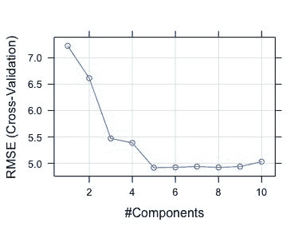

该图显示了模型根据纳入模型的主成分数量所产生的预测误差（`RMSE`，第 13 章）。

我们的分析表明，选择五个主成分（`ncomp = 5`）可获得最小的预测误差 `RMSE`。

`summary()` 函数还提供了使用不同数量成分在预测变量（`x`）和结果（`medv`）中解释的方差百分比。

例如，5 个主成分（`ncomp = 5`）捕获了预测变量中 80.94% 的变异（或信息）。此外，设置 `ncomp = 5`，捕获了结果变量（`medv`）中 71% 的信息，这是不错的。

综合来看，交叉验证确定 `ncomp = 5` 为使预测误差（`RMSE`）最小化并解释预测变量和结果中足够变异的最佳 `PCs` 数量。

### 20.6.2 计算偏最小二乘

R 代码与 `PCR` 方法完全相同。

```
##   ncomp
## 9     9
```

```
## Data:    X dimension: 407 13 
##  Y dimension: 407 1
## Fit method: oscorespls
## Number of components considered: 9
## TRAINING: % variance explained
##           1 comps  2 comps  3 comps  4 comps  5 comps  6 comps  7 comps
## X           46.19    57.32    64.15    69.76    75.63    78.66    82.85
## .outcome    50.90    71.84    73.71    74.71    75.18    75.35    75.42
##           8 comps  9 comps
## X           85.92    90.36
## .outcome    75.48    75.49
```

```
##   RMSE Rsquare
## 1 4.99   0.671
```

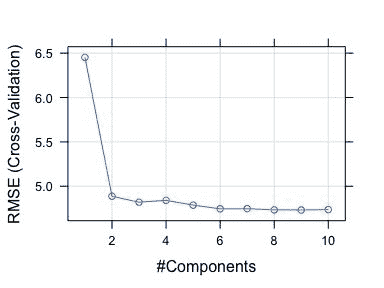

纳入 `PLS` 模型的最佳主成分数量为 9。这捕获了预测变量中 90% 的变异和结果变量（`medv`）中 75% 的变异。

在我们的示例中，使用 `PLS` 模型获得的交叉验证误差 `RMSE` 低于使用 `PCR` 方法获得的 `RMSE`。因此，与 `PCR` 模型相比，`PLS` 模型是解释我们数据的最佳模型。

## 20.7 讨论

本章描述了基于主成分的回归方法，包括主成分回归（`PCR`）和偏最小二乘回归（`PLS`）。这些方法对于包含相关预测变量的多变量数据非常有用。

数据中存在相关性允许将数据汇总为少数几个非冗余成分，可用于回归模型。

与岭回归和 lasso（第 19 章）相比，最终的 `PCR` 和 `PLS` 模型更难解释，因为它们不执行任何变量选择，甚至不直接产生回归系数估计。

## 21 引言

之前，我们描述了回归模型（第 3 章），它用于基于一个或多个预测变量预测定量或连续的结果变量。

在 `Classification` 中，结果变量是定性的（或分类的）。`Classification` 指的是一组机器学习方法，用于根据一个或多个预测变量预测个体的类别（或类别）。

在本部分中，我们将涵盖以下主题：

* Logistic 回归，用于二元分类任务（第 22 章）

* 用于变量选择的逐步和惩罚 logistic 回归（第 23 和 24 章）

* Logistic 回归假设和诊断（第 25 章）

*   多项逻辑回归，逻辑回归在多分类任务中的扩展（第 26 章）。

*   判别分析，用于二分类和多分类问题（第 27 章）

*   朴素贝叶斯分类器（第 28 章）

*   支持向量机（第 29 章）

*   分类模型评估（第 30 章）


大多数分类算法计算属于给定类别的概率。然后将观测值分配给概率得分最高的类别。

通常，你需要决定一个概率阈值，高于该阈值时才认为观测值属于给定类别。

## 21.1 数据集示例

### 21.1.1 PimaIndiansDiabetes2 数据集

Pima 印第安人糖尿病数据集可在 `mlbench` 包中使用。它将用于二分类。

```
##   pregnant glucose pressure triceps insulin mass pedigree age diabetes
## 1        6     148       72      35      NA 33.6    0.627  50      pos
## 2        1      85       66      29      NA 26.6    0.351  31      neg
## 3        8     183       64      NA      NA 23.3    0.672  32      pos
## 4        1      89       66      23      94 28.1    0.167  21      neg
```

数据包含 768 名个体（女性）和 9 个临床变量，用于预测个体患糖尿病阳性或阴性的概率：

* `pregnant`: 怀孕次数
* `glucose`: 血浆葡萄糖浓度
* `pressure`: 舒张压（mm Hg）
* `triceps`: 三头肌皮褶厚度（mm）
* `insulin`: 2 小时血清胰岛素（mu U/ml）
* `mass`: 体质指数（体重 kg/(身高 m)²）
* `pedigree`: 糖尿病谱系功能
* `age`: 年龄（岁）
* `diabetes`: 类别变量

### 21.1.2 Iris 数据集

`iris` 数据集将用于多分类任务。它包含三种鸢尾花物种的花萼和花瓣的长度和宽度。我们希望基于花萼和花瓣参数预测物种。

```
##   Sepal.Length Sepal.Width Petal.Length Petal.Width Species
## 1          5.1         3.5          1.4         0.2  setosa
## 2          4.9         3.0          1.4         0.2  setosa
## 3          4.7         3.2          1.3         0.2  setosa
## 4          4.6         3.1          1.5         0.2  setosa
```

## 22 Logistic Regression

## 22.1 Introduction

`Logistic regression` 用于基于一个或多个预测变量 (`x`) 预测个体的类别（或分类）。它用于建模二元结果，即只能有两个可能值的变量：0 或 1，是或否，患病或未患病。

逻辑回归属于一个名为 `Generalized Linear Model` (`GLM`) 的家族，该家族用于将线性回归模型（第 4 章）扩展到其他情况。其他同义词是 `binary logistic regression`、`binomial logistic regression` 和 `logit model`。

逻辑回归不会直接返回观测值的类别。它允许我们估计类别成员的概率 (`p`)。概率范围在 0 到 1 之间。你需要决定类别从一个翻转为另一个的阈值概率。默认情况下，该值设为 `p = 0.5`，但实际上应根据分析目的确定。

在本章中你将学习如何：

* 定义逻辑回归方程以及对数几率和 logit 等关键术语
* 在 `R` 中执行逻辑回归并解释结果
* 对新的测试数据进行预测并评估模型准确性

## 22.2 Logistic function

标准逻辑回归函数，用于根据预测变量 (`x`) 预测观测结果，是一种 S 形曲线，定义为 `p = exp(y) / [1 + exp(y)]`（James et al. 2014）。这也可以简单写成 `p = 1/[1 + exp(-y)]`，其中：

* `y = b0 + b1*x`
* `exp()` 是指数函数
* `p` 是在给定 `x` 的情况下事件发生的概率（1）。数学上写为 `p(event=1|x) and abbreviated as` `p(x)`，因此 `px = 1/[1 + exp(-(b0 + b1*x))]`。

经过一些推导，可以证明 `p/(1-p) = exp(b0 + b1*x)`。对两边取对数，公式变为预测变量的线性组合：`log[p/(1-p)] = b0 + b1*x`。

当你有多个预测变量时，逻辑函数如下：`log[p/(1-p)] = b0 + b1*x1 + b2*x2 + ... + bn*xn`

`b0` 和 `b1` 是回归贝塔系数。正的 `b1` 表示 `x` 增加会与 `p` 增加相关。相反，负的 `b1` 表示 `x` 增加会与 `p` 减少相关。

量 `log[p/(1-p)]` 称为几率的对数，也称为 `log-odd` 或 `logit`。

`odds` 反映事件发生的可能性。它可以看作“成功”与“不成功”的比率。技术上，几率是事件发生的概率除以事件不发生的概率（P. Bruce and Bruce 2017）。例如，如果患糖尿病阳性的概率为 0.5，“不会”的概率为 1-0.5 = 0.5，则几率为 1.0。

请注意，概率可以由几率计算为 `p = Odds/(1 + Odds)`。

## 22.3 Loading required R packages

* `tidyverse` 用于简便的数据操作和可视化
* `caret` 用于简便的机器学习工作流

## 22.4 Preparing the data

逻辑回归适用于包含连续和/或分类预测变量的数据。

执行以下步骤可能会提高模型的准确性

* 删除潜在的异常值
* 确保预测变量呈正态分布。如果不是，可以使用对数、根、Box-Cox 转换。
* 删除高度相关的预测变量以最小化过拟合。高度相关预测变量的存在可能导致模型解不稳定。

在此，我们将使用 `PimaIndiansDiabetes2` [来自 `mlbench` 包]，在第 21 章中介绍，用于基于多个临床变量预测患糖尿病阳性的概率。

我们将随机将数据分为训练集（80% 用于构建预测模型）和测试集（20% 用于评估模型）。请确保设置种子以保证可重复性。

## 22.5 Computing logistic regression

R 函数 `glm()`，用于广义线性模型，可用于计算逻辑回归。你需要指定选项 `family = binomial`，这告诉 R 我们要拟合逻辑回归。

### 22.5.1 Quick start R code

### 22.5.2 Simple logistic regression

简单逻辑回归用于基于单个预测变量预测类别成员的概率。

以下 R 代码构建模型以根据血浆葡萄糖浓度预测患糖尿病阳性的概率：

```
##             Estimate Std. Error z value Pr(>|z|)
## (Intercept)  -6.3267     0.7241   -8.74 2.39e-18
## glucose       0.0437     0.0054    8.09 6.01e-16
```

上面的输出显示了回归贝塔系数的估计值及其显著性水平。截距 (`b0`) 为 -6.32，葡萄糖变量的系数为 0.043。

逻辑方程可以写为 `p = exp(-6.32 + 0.043*glucose)/ [1 + exp(-6.32 + 0.043*glucose)]`。使用此公式，对于每个新的葡萄糖血浆浓度值，你可以预测个体患糖尿病阳性的概率。

Predictions can be easily made using the function `predict()`. Use the option `type = "response"` to directly obtain the probabilities

The logistic function gives an s-shaped probability curve illustrated as follow:

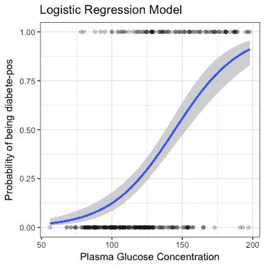

### 22.5.3 Multiple logistic regression

The multiple logistic regression is used to predict the probability of class membership based on multiple predictor variables, as follow:

Here, we want to include all the predictor variables available in the data set. This is done using `~.` :

```
##             Estimate Std. Error z value Pr(>|z|)
## (Intercept) -9.50372    1.31719  -7.215 5.39e-13
## pregnant     0.04571    0.06218   0.735 4.62e-01
## glucose      0.04230    0.00657   6.439 1.20e-10
## pressure    -0.00700    0.01291  -0.542 5.87e-01
## triceps      0.01858    0.01861   0.998 3.18e-01
## insulin     -0.00159    0.00139  -1.144 2.52e-01
## mass         0.04502    0.02887   1.559 1.19e-01
## pedigree     0.96845    0.46020   2.104 3.53e-02
## age          0.04256    0.02158   1.972 4.86e-02
```

From the output above, the coefficients table shows the beta coefficient estimates and their significance levels. Columns are:

* `Estimate` : the intercept `b0` and the beta coefficient estimates associated to each predictor variable
* `Std.Error` : the standard error of the coefficient estimates. This represents the accuracy of the coefficients. The larger the standard error, the less confident we are about the estimate.
* `z value` : the z-statistic, which is the coefficient estimate `column 2` divided by the standard error of the estimate `column 3`
* `Pr(>|z|)` : The p-value corresponding to the z-statistic. The smaller the p-value, the more significant the estimate is.

Note that, the functions `coef()` and `summary()` can be used to extract only the coefficients, as follow:

## 22.6 Interpretation

It can be seen that only 5 out of the 8 predictors are significantly associated to the outcome. These include: `pregnant`, `glucose`, `pressure`, `mass` and `pedigree`.

The coefficient estimate of the variable `glucose` is `b = 0.045`, which is positive. This means that an increase in glucose is associated with increase in the probability of being diabetes-positive. However the coefficient for the variable `pressure` is `b = -0.007`, which is negative. This means that an increase in blood pressure will be associated with a decreased probability of being diabetes-positive.

An important concept to understand, for interpreting the logistic beta coefficients, is the `odds ratio`. An odds ratio measures the association between a predictor variable `x` and the outcome variable `y`. It represents the ratio of the odds that an event will occur `event = 1` given the presence of the predictor `x` `x = 1`, compared to the odds of the event occurring in the absence of that predictor `x = 0`.

For a given predictor `say x1`, the associated beta coefficient `b1` in the logistic regression function corresponds to the log of the odds ratio for that predictor.

If the odds ratio is 2, then the odds that the event occurs `event = 1` are two times higher when the predictor `x` is present `x = 1` versus `x = 0`.

For example, the regression coefficient for glucose is 0.042. This indicate that one unit increase in the glucose concentration will increase the odds of being diabetes-positive by `exp(0.042)` 1.04 times.

From the logistic regression results, it can be noticed that some variables - `triceps`, `insulin` and `age` - are not statistically significant. Keeping them in the model may contribute to overfitting. Therefore, they should be eliminated. This can be done automatically using statistical techniques, including `stepwise regression` and `penalized regression` methods. This methods are described in the next section. Briefly, they consist of selecting an optimal model with a reduced set of variables, without compromising the model curacy.

Here, as we have a small number of predictors `n = 9`, we can select manually the most significant:

## 22.7 Making predictions

We'll make predictions using the test data in order to evaluate the performance of our logistic regression model.

The procedure is as follow:

1. Predict the class membership probabilities of observations based on predictor variables
2. Assign the observations to the class with highest probability score `i.e above 0.5`


The R function `predict()` can be used to predict the probability of being diabetes-positive, given the predictor values.

**Predict the probabilities** of being diabetes-positive:

```
##     21     25     28     29     32     36 
## 0.3914 0.6706 0.0501 0.5735 0.6444 0.1494
```

Which classes do these probabilities refer to? In our example, the output is the probability that the diabetes test will be positive. We know that these values correspond to the probability of the test to be positive, rather than negative, because the `contrasts()` function indicates that R has created a dummy variable with a 1 for "pos" and "0" for neg. The probabilities always refer to the class dummy-coded as "1".

Check the dummy coding:

```
##     pos
## neg   0
## pos   1
```

**Predict the class of individuals** :

The following R code categorizes individuals into two groups based on their predicted probabilities `p` of being diabetes-positive. Individuals, with `p` above 0.5 `random guessing`, are considered as diabetes-positive.

```
##    21    25    28    29    32    36 
## "neg" "pos" "neg" "pos" "pos" "neg"
```

## 22.8 Assessing model accuracy

The model accuracy is measured as the proportion of observations that have been correctly classified. Inversely, the classification error is defined as the proportion of observations that have been misclassified.

Proportion of correctly classified observations:

```
## [1] NA
```

The classification prediction accuracy is about 77%, which is good. The misclassification error rate is 23%.

Note that, there are several metrics for evaluating the performance of a classification model `Chapter 30`.

## 22.9 Discussion

In this chapter, we have described how logistic regression works and we have provided R codes to compute logistic regression. Additionally, we demonstrated how to make predictions and to assess the model accuracy. Logistic regression model output is very easy to interpret compared to other classification methods. Additionally, because of its simplicity it is less prone to overfitting than flexible methods such as decision trees.

Note that, many concepts for linear regression hold true for the logistic regression modeling. For example, you need to perform some diagnostics `Chapter 25` to make sure that the assumptions made by the model are met for your data.

Furthermore, you need to measure how good the model is in predicting the outcome of new test data observations. Here, we described how to compute the raw classification accuracy, but not that other important performance metric exists `Chapter 30`

In a situation, where you have many predictors you can select, without compromising the prediction accuracy, a minimal list of predictor variables that contribute the most to the model using `stepwise regression` `Chapter 23` and `lasso regression` techniques `Chapter 24`.

Additionally, you can add interaction terms in the model, or include spline terms.

The same problems concerning confounding and correlated variables apply to logistic regression `see Chapter 11` and `Chapter 10`.

你也可以拟合 *广义加性模型*（第 7 章），当预测变量的线性关系无法假设时。这可以使用 `mgcv` 包完成：

```

Logistic 回归仅限于两类分类问题。有一个扩展，称为 *多项 logistic 回归*，用于多类分类问题（第 26 章）。

请注意，对于多类任务，最流行的方法是 *线性判别分析*（第 27 章）。

## 23 逐步 Logistic 回归

**逐步 logistic 回归** 包括自动选择较少的预测变量数量来构建性能最佳的 logistic 回归模型。更多内容请阅读第 18 章。

本章描述如何在 **R** 中计算逐步 logistic 回归。

## 23.1 加载所需的 R 包

* `tidyverse` 用于便捷的数据操作和可视化
* `caret` 用于便捷的机器学习工作流

```

## 23.2 准备数据

数据集：`PimaIndiansDiabetes2` [在 `mlbench` 包中]，在第 21 章中介绍，用于基于多个临床变量预测患糖尿病的概率。

我们将随机将数据拆分为训练集（80% 用于构建预测模型）和测试集（20% 用于评估模型）。请确保设置种子以保证可重复性。

```

## 23.3 计算逐步 logistic 回归

逐步 logistic 回归可以使用 `MASS` 包中提供的 R 函数 `stepAIC()` 轻松计算。它通过 AIC 进行模型选择。它有一个名为 `direction` 的选项，可以具有以下值：“both”、“forward”、“backward”（参见第 18 章）。

### 23.3.1 快速入门 R 代码

```

### 23.3.2 完整 logistic 回归模型

包含所有预测变量的完整模型：

```

```

## (Intercept)    pregnant     glucose    pressure     triceps     insulin 

##    -9.50372     0.04571     0.04230    -0.00700     0.01858    -0.00159 

##        mass    pedigree         age 

##     0.04502     0.96845     0.04256

```

### 23.3.3 执行逐步变量选择

选择最具贡献的变量：

```

```
## (Intercept)     glucose        mass    pedigree         age 
##     -9.5612      0.0379      0.0523      0.9697      0.0529
```

该函数选择了一个最终模型，其中一个变量已从原始完整模型中移除。被剔除的预测变量是：`triceps`。

### 23.3.4 比较完整模型和逐步模型

在这里，我们将比较完整和逐步 logistic 模型的性能。最佳模型定义为在预测新测试数据的类别时分类错误率最低的模型：

完整 logistic 回归模型的预测准确率：

```

```

## [1] 0.808

```

逐步 logistic 回归模型的预测准确率：

```

```
## [1] 0.795
```

## 23.4 讨论

本章描述了如何在 R 中执行逐步 logistic 回归。在我们的示例中，逐步回归选择了较少的预测变量数量，得到了一个最终模型，其性能与完整模型相似。

因此，逐步选择降低了模型的复杂性而没有损害其准确性。请注意，在其他条件相同的情况下，我们始终应选择更简单的模型，这里是逐步回归返回的最终模型。

另一种用于模型选择的逐步方法替代方案是惩罚回归方法（第 24 章），它对模型拥有过多变量进行惩罚。

## 24 惩罚 Logistic 回归

## 24.1 引言

当你的 logistic 回归模型中有多个变量时，找到一个变量的减少集合以获得最优性能的模型可能是有用的（参见第 19 章）。

**惩罚 logistic 回归** 对 logistic 模型拥有过多变量施加惩罚。这会导致将贡献较小的变量的系数收缩至零。这也称为 **正则化**。

最常用的惩罚回归包括：

* **岭回归**：贡献较小的变量其系数接近于零。然而，所有变量都被纳入模型。这在根据领域知识需要将所有变量纳入模型时很有用。

* **lasso 回归**：一些贡献较小的变量的系数被强制为恰好为零。仅最显著的变量保留在最终模型中。

* **弹性网络回归**：岭回归和 lasso 回归的组合。它将一些系数收缩至零（像岭回归）并将一些系数设为恰好为零（像 lasso 回归）

本章描述如何计算惩罚 logistic 回归，例如 lasso 回归，以自动选择包含最具贡献预测变量的最优模型。

## 24.2 加载所需的 R 包

* `tidyverse` 用于便捷的数据操作和可视化

* `caret` 用于便捷的机器学习工作流

* `glmnet`，用于计算惩罚回归

```

## 24.3 准备数据

数据集：`PimaIndiansDiabetes2` [在 `mlbench` 包中]，在第 21 章中介绍，用于基于多个临床变量预测患糖尿病的概率。

我们将随机将数据拆分为训练集（80% 用于构建预测模型）和测试集（20% 用于评估模型）。请确保设置种子以保证可重复性。

```

## 24.4 计算惩罚 logistic 回归

### 24.4.1 额外的数据准备

R 函数 `model.matrix()` 有助于创建预测变量矩阵，并自动将分类预测变量转换为适当的哑变量，这对于 `glmnet()` 函数是必需的。

```

### 24.4.2 R 函数

我们将使用 R 函数 `glmnet()` [glmnet 包] 来计算惩罚 logistic 回归。

简化格式如下：

```

* `x`：预测变量矩阵

* `y`：响应或结果变量，是一个二元变量。

* `family`：响应类型。对于二元结果变量使用 "binomial"

* `alpha`：弹性网络混合参数。允许的值包括：

  * "1"：用于 lasso 回归

  * "0"：用于岭回归

  * 0 到 1 之间的值（例如 0.3）用于弹性网络回归。

* `lamba`：定义收缩量的数值。应由分析师指定。

在惩罚回归中，你需要指定一个常数 `lambda` 来调整系数收缩的量。数据的最佳 `lambda` 可以定义为使交叉验证预测错误率最小化的 `lambda`。这可以使用函数 `cv.glmnet()` 自动确定。

在下面的 R 代码中，我们将展示如何通过指定选项 `alpha = 1` 来计算 lasso 回归。你也可以尝试使用 `alpha = 0` 的岭回归，看看哪种更适合你的数据。

### 24.4.3 快速入门 R 代码

拟合 lasso 惩罚回归模型：

```

### 24.4.4 计算 lasso 回归

**找到使交叉验证误差最小化的 lambda 的最优值**：

```

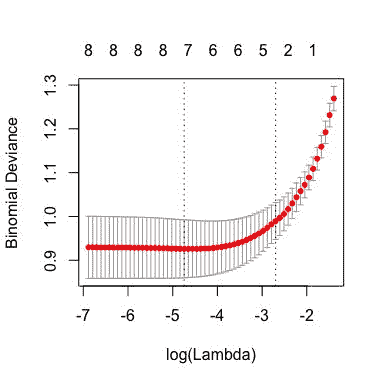

该图显示了交叉验证误差随 lambda 的对数的变化。左侧的虚线垂直线表明 lambda 的对数的最优值约为 -5，这是使预测误差最小化的值。此 lambda 值将给出最准确的模型。`lambda` 的精确值可以如下查看：

```

```

## [1] 0.00871

```

一般来说，正则化的目的是平衡准确性和简洁性。这意味着，选择预测变量数量最少，同时也能获得良好准确性的模型。为此，函数 `cv.glmnet()` 还会找到使模型最简单但同时仍在最优 `lambda` 值一个标准误差范围内的 `lambda` 值。该值称为 `lambda.1se`。

```

## [1] 0.0674

```

使用 `lambda.min` 作为最佳 lambda，得到以下回归系数：

```

## 9 x 1 sparse Matrix of class "dgCMatrix"

##                     1

## (Intercept) -8.615615

## pregnant     0.035076

## glucose      0.036916

## pressure     .       

## triceps      0.016484

## insulin     -0.000392

## mass         0.030485

## pedigree     0.785506

## age          0.036265

```

从上面的输出中，只有可行的 `triceps` 的系数恰好等于零。

使用 `lambda.1se` 作为最佳 lambda，得到以下回归系数：

```

## 9 x 1 sparse Matrix of class "dgCMatrix"

##                    1

## (Intercept) -4.65750

## pregnant     .      

## glucose      0.02628

## pressure     .      

## triceps      0.00191

## insulin      .      

## mass         .      

## pedigree     .      

## age          0.01734

```

使用 `lambda.1se`，只有 5 个变量具有非零系数。lasso 算法将所有其他变量的系数设为零，从而降低了模型的复杂度。

将 `lambda = lambda.1se` 设置为模型会比使用 `lambda.min` 产生更简单的模型，但该模型的准确性可能比使用 `lambda.min` 获得的模型稍差一些。

在下一节中，我们将使用 `lambda.min` 计算最终模型，然后评估模型在测试数据上的准确性。我们还将讨论使用 `lambda = lambda.1se` 拟合模型所获得的结果。

### 计算最终的 lasso 模型

* 使用 `lambda.min` 计算最终模型：

```

## [1] 0.769

```

* 使用 `lambda.1se` 计算最终模型：

```

## [1] 0.705

```

在下一节中，我们将比较 lasso 回归获得的准确性与使用完整逻辑回归模型（包含所有预测变量）获得的准确性。

#### 24.4.5 计算完整的逻辑模型

```

## [1] 0.808


## 24.5 讨论

本章介绍了如何在 R 中计算惩罚逻辑回归模型。在这里，我们专注于 `lasso` 模型，但你也可以通过在 `glmnet()` 函数中使用 `alpha = 0` 来拟合岭回归。对于弹性网络回归，你需要在 0 和 1 之间选择一个 `alpha` 值。这可以使用 `caret` 包自动完成。参见第 19 章。

我们的分析表明，使用 `lambda.min` 作为最佳 `lambda` 的 `lasso` 回归，与完整的逻辑模型相比，在测试数据上的模型性能没有受到太大影响的情况下，得到了更简单的模型。

我们使用 `lambda.1se` 获得的模型准确性略低于使用所有预测变量（n = 8）的更复杂模型或使用 `lasso` 回归中的 `lambda.min` 所获得的准确性。即使使用 `lambda.1se`，获得的准确性仍然足够好，同时模型也更简单。

这意味着，使用 `lasso` 回归获得的更简单模型在拟合数据信息方面至少与更复杂的模型一样好。根据偏差-方差权衡，在其他条件相同的情况下，更简单的模型应始终优先考虑，因为它不太可能过度拟合训练数据。

对于变量选择，惩罚逻辑回归技术的替代方案是第 23 章中描述的逐步逻辑回归。

## 25 Logistic Regression Assumptions and Diagnostics

### 25.1 引言

`logistic regression` 模型对数据做出若干 `assumptions`。

本章描述了主要假设，并提供了在 R 中实践指南，以检查这些假设是否对你的数据成立，这对于建立一个良好的模型至关重要。

请确保你已阅读第 22 章中的逻辑回归基础知识。

### 25.2 逻辑回归假设

逻辑回归方法假设：

* 结果是一个二元或二分变量，如是 vs 否，阳性 vs 阴性，1 vs 0。
* 结果的对数几率与每个预测变量之间存在线性关系。请记住，对数几率函数为 `logit(p) = log(p/(1-p))`，其中 `p` 是结果的概率（参见第 22 章）。
* 连续预测变量中没有有影响的值（极值或异常值）
* 预测变量之间不存在高度相关性（即多重共线性）。

为了提高模型的准确性，你应确保这些假设对你的数据成立。在以下各节中，我们将描述如何诊断数据中的潜在问题。

### 25.3 加载所需的 R 包

* `tidyverse` 用于轻松的数据操作和可视化
* `broom`：从统计检验结果创建整洁的数据框

### 25.4 建立逻辑回归模型

我们首先使用 `PimaIndiansDiabetes2` `mlbench` 包计算一个逻辑回归模型的示例，该包在第 21 章中介绍，用于基于临床变量预测糖尿病检测阳性的概率。

```
##     4     5     7     9    14    15 
## "neg" "pos" "neg" "pos" "pos" "pos"
```

### 25.5 逻辑回归诊断

#### 25.5.1 线性假设

在这里，我们将检查连续预测变量与结果对数几率之间的线性关系。这可以通过目视检查每个预测变量与对数几率值之间的散点图来完成。

1. 从原始数据框中删除定性变量并将对数几率值绑定到数据：

2. 创建散点图：

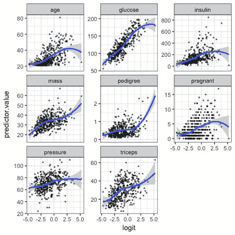

平滑的散点图显示变量 `glucose`、`mass`、`pregnant`、`pressure` 和 `triceps` 都与对数几率尺度上的糖尿病结果相当线性相关。

变量 `age` 和 `pedigree` 不是线性的，可能需要一些转换。如果散点图显示非线性，你需要其他方法来建立模型，例如包含 2 或 3 次幂项、分段多项式和样条函数（第 7 章）。

#### 25.5.2 有影响的值

有影响的值是可能改变逻辑回归模型质量的极端个体数据点。

数据中最极端的值可以通过可视化 Cook 距离值来检查。在这里我们标记了最大的前 3 个值：

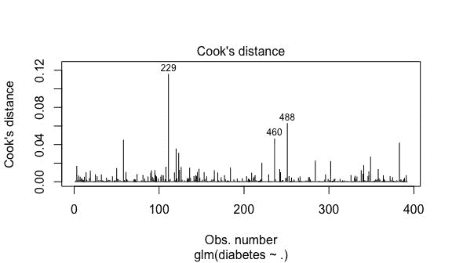

请注意，并非所有异常值都是有影响的观测值。为了检查数据是否包含潜在的有影响观测值，可以检查标准化残差误差。绝对标准化残差大于 3 的数据点代表可能的异常值，可能值得更密切关注。

以下 R 代码使用 `broom` 包的 `augment()` R 函数计算标准化残差（`.std.resid`）和 Cook 距离（`.cooksd`）。

根据 Cook 距离，可以按如下方式显示最大的前 3 个值的数据：

绘制标准化残差：

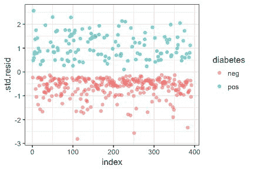

筛选具有 `abs(.std.res) > 3` 的潜在有影响数据点：

我们的数据中没有有影响的观测值。

当连续预测变量中存在异常值时，可能的解决方案包括：

* 删除相关记录
* 将数据转换为对数尺度
* 使用非参数方法

#### 25.5.3 多重共线性

多重共线性对应于数据中包含高度相关的预测变量的情况。更多内容请阅读第 10 章。

多重共线性是回归分析中的一个重要问题，应通过剔除相关变量来解决。它可以使用 R 函数 `vif()` [`car` package] 来评估，该函数计算方差膨胀因子：

```

```

```
## pregnant  glucose pressure  triceps  insulin     mass pedigree      age 
##     1.89     1.38     1.19     1.64     1.38     1.83     1.03     1.97
```

作为经验法则，VIF 值超过 5 或 10 表示存在问题性的共线性。在我们的示例中，没有共线性：所有变量的 VIF 值都远低于 5。

### 25.6 讨论

本章描述了逻辑回归模型的主要假设，并提供了 R 代码示例来诊断数据中的潜在问题，包括预测变量与结果的对数几率之间的非线性、数据中存在有影响的观测值以及预测变量之间的多重共线性。

修复这些潜在问题可能会显著改善模型的拟合优度。另请参阅，第 30 章描述了用于检查模型有效性的额外性能指标。

## 26 多项逻辑回归

### 26.1 引言

`multinomial logistic regression` 是逻辑回归（第 22 章）的扩展，用于多类分类任务。当结果涉及两个以上类别时使用。

在本章中，我们将向您展示如何在 R 中计算多项逻辑回归。

### 26.2 加载所需的 R 包

* `tidyverse` 用于轻松的数据操作
* `caret` 用于轻松的预测建模
* `nnet` 用于计算多项逻辑回归

```

```

### 26.3 准备数据

我们将使用 `iris` 数据集，该数据集在第 21 章中介绍，用于基于预测变量 `Sepal.Length`、`Sepal.Width`、`Petal.Length`、`Petal.Width` 预测鸢尾花物种。

我们首先将数据随机拆分为训练集（用于构建预测模型的 80%）和测试集（用于评估模型的 20%）。请确保设置种子以保证可重复性。

```

```

### 26.4 计算多项逻辑回归

```

```

模型准确率：

```

```

```
## [1] 0.967
```

我们的模型在预测不同类别方面非常出色，准确率为 97%。

### 26.5 讨论

本章描述了如何在 R 中计算多项逻辑回归。该方法用于多类问题。实际上，它并不常用。判别分析（第 27 章）对于多类分类更为流行。

## 27 判别分析

### 27.1 引言

`Discriminant analysis` 用于基于一个或多个预测变量预测属于给定类别（或分类）的概率。它适用于连续和/或分类预测变量。

之前，我们描述了用于两类分类问题的逻辑回归，即结果变量有两个可能值（0/1、否/是、阴性/阳性）的情况。

与逻辑回归相比，判别分析更适合于结果变量包含两个以上类别的情况下预测观测值的类别。此外，对于多类分类问题，它比逻辑回归更稳定。

请注意，逻辑回归和判别分析都可用于二元分类任务。

在本章中，您将学习最广泛使用的判别分析技术及其扩展。此外，我们还将提供执行不同类型分析的 R 代码。

以下判别分析方法将被描述：

* `Linear discriminant analysis` (`LDA`)：使用预测变量的线性组合来预测给定观测值的类别。假设预测变量（`p`）呈正态分布且各类别具有相同的方差（对于单变量分析，`p = 1`）或相同的协方差矩阵（对于多变量分析，`p > 1`）。
* `Quadratic discriminant analysis` (`QDA`)：比 LDA 更灵活。这里不假设各类别的协方差矩阵相同。
* `Mixture discriminant analysis` (`MDA`)：每个类别被假设为子类的高斯混合。
* `Flexible Discriminant Analysis` (`FDA`)：使用预测变量的非线性组合，如样条。
* `Regularized discriminant anlysis` (`RDA`)：正则化（或收缩）改善了协方差矩阵的估计，在预测变量数量大于训练数据样本数量的情况下。这导致判别分析的改进。

### 27.2 加载所需的 R 包

* `tidyverse` 用于轻松的数据操作和可视化
* `caret` 用于轻松的机器学习工作流

```

```

### 27.3 准备数据

我们将使用 `iris` 数据集，该数据集在第 21 章中介绍，用于基于预测变量 `Sepal.Length`、`Sepal.Width`、`Petal.Length`、`Petal.Width` 预测鸢尾花物种。

判别分析会受到预测变量所测量的尺度/单位的影响。一般建议在分析前对连续预测变量进行标准化和/或归一化。

1. 将数据拆分为训练集和测试集：

```

```

2. 归一化数据。分类变量会被自动忽略。

```

```

### 27.4 线性判别分析 - LDA

LDA 算法首先找到使类别间分离最大化的方向，然后使用这些方向来预测个体的类别。这些方向称为线性判别式，是预测变量的线性组合。

LDA 假设预测变量呈正态分布（高斯分布），并且不同类别具有类别特定的均值和相等方差/协方差。

在执行 LDA 之前，请考虑：

* 检查每个变量的单变量分布并确保它们呈正态分布。如果不是，可以使用对数和根式对指数分布进行转换，并对偏态分布使用 Box-Cox。
* 从数据中剔除异常值并标准化变量以使其尺度可比较。

线性判别分析可使用函数 `lda()` [`MASS` package] 轻松计算。

**快速入门 R 代码**：

```

```

**计算 LDA**：

```

```

```
## Call:
## lda(Species ~ ., data = train.transformed)
## 
## Prior probabilities of groups:
##     setosa versicolor  virginica 
##      0.333      0.333      0.333 
## 
## Group means:
##            Sepal.Length Sepal.Width Petal.Length Petal.Width
## setosa           -1.012       0.787       -1.293      -1.250
## versicolor        0.117      -0.648        0.272       0.154
## virginica         0.895      -0.139        1.020       1.095
## 
## Coefficients of linear discriminants:
##                 LD1     LD2
## Sepal.Length  0.911  0.0318
## Sepal.Width   0.648  0.8985
## Petal.Length -4.082 -2.2272
## Petal.Width  -2.313  2.6544
## 
## Proportion of trace:
##    LD1    LD2 
## 0.9905 0.0095
```

LDA 确定组均值并为每个个体计算属于不同组的概率。然后个体被分配到概率得分最高的组。

`lda()` 输出包含以下元素：

* *Prior probabilities of groups*：每个组中训练观测值的比例。例如，训练观测值中有 31% 属于 setosa 组
* *Group means*：组重心。显示每个组中每个变量的均值。

*线性判别式的系数*：显示用于形成 LDA 决策规则的预测变量的线性组合。例如，`LD1 = 0.91*Sepal.Length + 0.64*Sepal.Width - 4.08*Petal.Length - 2.3*Petal.Width`。同理，`LD2 = 0.03*Sepal.Length + 0.89*Sepal.Width - 2.2*Petal.Length - 2.6*Petal.Width`。

使用函数 `plot()` 会绘制线性判别式的图，通过为每个训练观测计算 `LD1` 和 `LD2` 得到。

**进行预测**：

```
## [1] "class"     "posterior" "x"
```

`predict()` 函数返回以下元素：

* *class*：观测值的预测类别。
* *posterior*：是一个矩阵，其列为组，行为个体，值是对应观测值属于各组的后验概率。
* *x*：包含上述描述的线性判别式

检查结果：

注意，你可以使用 `ggplot2` 按如下方式创建 LDA 图：

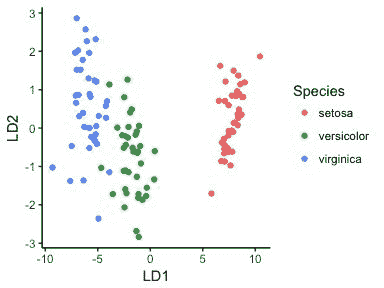

**模型准确率**：

你可以按如下方式计算模型准确率：

```
## [1] 1
```

可以看出，我们的模型正确分类了 100% 的观测值，这非常优秀。

注意，默认情况下，用于决定组成员的概率截止值为 0.5（随机猜测）。例如，setosa 组中的观测值数量可以重新计算为：

```
## [1] 10
```


在某些情况下，你可能希望提高模型的精确度。在这种情况下，你可以通过调整后验概率截止值来微调模型。例如，你可以提高或降低截止值。

**变量选择**：

注意，如果在计算 `LDA` 之前对预测变量进行标准化，则判别权重可作为特征选择中变量重要性的度量。

## 27.5 二次判别分析 - QDA

`QDA` 比 `LDA` 更灵活一些，因为它不假设方差/协方差相等。换句话说，对于 `QDA`，协方差矩阵可以对每个类别不同。

当训练集很小时，`LDA` 往往比 `QDA` 更好。

相比之下，如果训练集非常大，使得分类器的方差不是主要问题，或者 `K` 个类别具有共同协方差矩阵的假设明显不可行时，则推荐使用 `QDA`（James et al. 2014）。

`QDA` 可以使用 R 函数 `qda()` 计算 [`MASS` 包]

## 27.6 混合判别分析 - MDA

`LDA` 分类器假设每个类别来自单一的正态（或高斯）分布。这过于严格。

对于 `MDA`，存在类别，每个类别被假设为子类的高斯混合，其中每个数据点都有属于每个类别的概率。类别间的协方差矩阵相等性仍然假设成立。

在某些情况下，`MDA` 可能优于 `LDA` 和 `QDA`，如下所示。在此示例数据中，我们有 3 个主要个体组，每个组有 3 个不相邻的子组。图上的实黑线代表 `LDA`、`QDA` 和 `MDA` 的决策边界。可以看出，`MDA` 分类器正确识别了子类，而 `LDA` 和 `QDA` 在建模此数据时完全不佳。

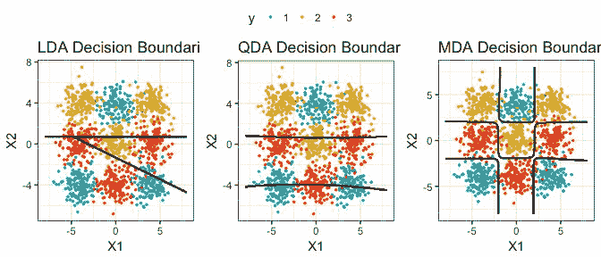

生成上述图的代码来自 [John Ramey](https://www.r-bloggers.com/a-brief-look-at-mixture-discriminant-analysis/)

## 27.7 柔性判别分析 - FDA

`FDA` 是 `LDA` 的灵活扩展，使用预测变量的非线性组合，如样条。`FDA` 可用于建模多元非正态性或各组内变量之间的非线性关系，从而实现更准确的分类。

## 27.8 正则化判别分析

`RDA` 通过正则化组协方差矩阵构建分类规则（Friedman 1989），从而对数据中的多重共线性更稳健。这对于包含高度相关预测变量的大型多元数据集可能非常有用。

正则化判别分析是 `LDA` 和 `QDA` 之间的一种折中。回想一下，在 `LDA` 中我们假设所有类别的协方差矩阵相等。`QDA` 假设所有类别的协方差矩阵不同。正则化判别分析是 `LDA` 和 `QDA` 之间的中间方法。

`RDA` 将 `QDA` 的单独协方差收缩到 `LDA` 中的共同协方差。这在预测变量数量大于训练数据中样本数量的情况下改善了协方差矩阵的估计，可能导致模型准确性的提高。

## 27.9 讨论

我们描述了线性判别分析（`LDA`）及其扩展，用于基于多个预测变量预测观测值的类别。与逻辑回归（第 22 章）相比，判别分析更适合多类分类问题。

`LDA` 假设不同类别具有相同的方差或协方差矩阵。我们在本章中描述了 `LDA` 的许多扩展。`LDA` 最流行的扩展是二次判别分析（`QDA`），它比 `LDA` 更灵活，因为它不假设组协方差矩阵相等。

对于小数据集，`LDA` 往往优于 `QDA`。`QDA` 推荐用于大型训练数据集。

## 28 Naive Bayes 分类器

## 28.1 引言

**Naive Bayes 分类器**是一种简单而强大的方法，可用于二元和多类分类问题。

`Naive Bayes` 分类器使用贝叶斯定理预测观测值的类别成员概率，该定理基于条件概率，即在已知某事已经发生的情况下某事发生的概率。

观测值被分配给概率得分最大的类别。

在本章中，你将学习如何使用 `klaR` 和 `caret` 包在 R 中执行 Naive Bayes 分类。

## 28.2 加载所需的 R 包

* `tidyverse` 用于轻松的数据操作和可视化
* `caret` 用于轻松的机器学习工作流

## 28.3 准备数据

输入预测变量可以是分类和/或数值变量。

这里，我们将使用 `PimaIndiansDiabetes2` [`mlbench` 包中]，在第 21 章中介绍，用于基于多个临床变量预测患糖尿病的概率。

我们将随机将数据分为训练集（80% 用于构建预测模型）和测试集（20% 用于评估模型）。确保设置种子以保证可重复性。

## 28.4 计算 Naive Bayes

```
## [1] 0.821
```

## 28.5 使用 caret R 包

`caret` R 包可以自动训练模型并使用 k 折交叉验证评估模型准确率 第 14 章。

## 28.6 讨论

本章介绍了 Naive Bayes 分类的基础知识，并使用 `klaR` 和 `caret` 包在 R 中提供了实践示例。

## 29 支持向量机

## 29.1 引言

**支持向量机**（或 **SVM**）是一种用于 *分类* 任务的机器学习技术。简而言之，SVM 通过识别分隔不同组（或类别）数据点的最佳决策边界，然后基于此分离边界预测新观测值的类别来工作。

根据情况的不同，不同组可能由线性直线或非线性边界线分隔。

支持向量机方法可以处理线性和非线性类边界。它可用于二类和多类分类问题。

在现实生活数据中，分离边界通常是非线性的。技术上，SVM 算法使用所谓的 [核技巧](https://en.wikipedia.org/wiki/Support_vector_machine) 进行非线性分类。最常用的核变换是 *多项式核* 和 *径向核*。

注意，SVM 还有一个用于回归的扩展，称为支持向量回归。

在本章中，我们将描述如何使用 *caret* R 包构建 SVM 分类器。

## 29.2 加载所需的 R 包

* `tidyverse` 用于便捷的数据操作和可视化
* `caret` 用于便捷的机器学习工作流

```

```

## 29.3 数据集示例

数据集：`PimaIndiansDiabetes2` [`mlbench` 包中]，在第 21 章中介绍过，用于基于多个临床变量预测患糖尿病的概率。

我们将随机将数据拆分为训练集（80% 用于构建预测模型）和测试集（20% 用于评估模型）。请确保设置种子以保证可重复性。

```

```

## 29.4 SVM 线性分类器

在以下示例中，变量已归一化以使其尺度可比较。在构建 SVM 分类器时通过设置选项 `preProcess = c("center","scale")` 会自动完成此操作。

```

```

```
## [1] neg pos neg pos pos neg
## Levels: neg pos
```

```

```

```

## [1] 0.782
```

注意，有一个调参参数 `C`，也称为 *Cost*，它决定了可能的误分类。它本质上对模型犯错施加惩罚：`C` 值越高，SVM 算法将点误分类的可能性就越小。

默认情况下 `caret` 使用 `C = 1` 构建 SVM 线性分类器。你可以在 R 控制台中输入 `model` 来检查这一点。

可以自动计算不同 `C` 值下的 SVM 并选择使模型交叉验证准确率最大化的最优值。

以下 R 代码为 `C` 的网格值计算 SVM 并自动选择用于预测的最终模型：

```

```

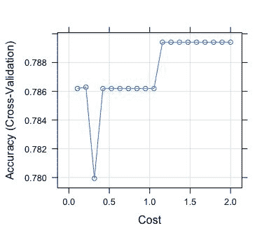

```

```

```
##       C
## 12 1.16
```

```

```

```
## [1] 0.782
```

## 29.5 使用非线性核的 SVM 分类器

要构建非线性 SVM 分类器，我们可以使用多项式核或径向核函数。同样，`caret` 包可用于轻松计算多项式和径向 SVM 非线性模型。

该包会自动选择模型调参参数的最优值，其中最优定义为使模型准确率最大化的值。

* **使用径向基核计算 SVM**：

```

```

```
##   sigma    C
## 1 0.136 0.25
```

```

```

```
## [1] 0.795
```

* **使用多项式基核计算 SVM**：

```

```

```
##   degree scale C
## 8      1  0.01 2
```

```

```

```
## [1] 0.795
```

在我们的示例中，可以看出使用非线性核的 SVM 分类器相比线性模型给出了更好的结果。

## 29.6 讨论

本章描述了如何使用支持向量机进行分类任务。还存在其他替代方法，例如逻辑回归（第 22 章）。

你需要在自己的数据上评估不同方法的效果，以便选择最佳方法。

## 30 分类模型评估

## 30.1 引言

在构建预测分类模型后，你需要 **评估模型的性能**，即模型在预测未用于训练模型的新的测试数据观测结果方面的好坏。

换句话说，你需要使用新的测试数据集来估计模型的预测 *准确率* 和预测误差。因为我们知道测试数据集中观测的实际结果，所以可以通过将预测的结果值与已知的结果值进行比较来评估预测模型的性能。

本章描述了用于评估预测分类模型性能的常用指标和方法，包括：

* **平均分类准确率**，表示正确分类的观测比例。
* **混淆矩阵**，它是一个 2x2 表，显示四个参数，包括真阳性、真阴性、假阴性和假阳性的数量。
* **精确率、召回率和特异性**，它们是描述预测分类模型的三个主要性能指标
* **ROC 曲线**，它是对模型整体性能的图形总结，显示在所有可能的概率截断值下真阳性比例和假阳性比例。**曲线下面积**（**AUC**）概括了分类器的整体性能。

我们将提供在 R 中计算这些指标的实际示例，以及创建 ROC 绘图。

## 30.2 加载所需的 R 包

* `tidyverse` 用于便捷的数据操作和可视化
* `caret` 用于便捷的机器学习工作流

```

```

## 30.3 构建分类模型

为了保持简单，我们将执行二元分类，其中结果变量只能有两个可能值：阴性 vs 阳性。

我们将使用 `PimaIndiansDiabetes2` [`mlbench` 包] 计算线性判别分析模型的示例，该数据集在第 21 章中介绍过，用于基于临床变量预测糖尿病测试阳性的概率。

1. 将数据拆分为训练集（80%，用于构建模型）和测试集（20%，用于评估模型性能）：

```

```

2. 在训练集上拟合 LDA 模型并在测试数据上进行预测：

```

```

## 30.4 整体分类准确率

整体 **分类准确率** 对应于被正确分类的观测比例。确定原始分类准确率是评估模型性能的第一步。

反之，**分类错误率** 定义为被误分类的观测比例。`Error rate = 1 - accuracy`

原始分类准确率和错误率可以通过将测试数据中的观测类别与模型预测的类别进行比较来轻松计算：

```

```

```
## [1] 0.808
```

```

```

```
## [1] 0.192
```

从上面的输出来看，线性判别分析正确预测了 81% 的案例中的个体结果。这远好于随机猜测。误分类错误率可计算为 100 - 81% = 19%。

在我们的示例中，二元分类器可能犯两种类型的错误：

* 它可能错误地将糖尿病阳性的个体分配到糖尿病阴性类别
* 它可能错误地将糖尿病阴性的个体分配到糖尿病阳性类别。

这两种错误类型的比例可以通过创建 **混淆矩阵** 来确定，该矩阵比较预测的结果值与已知的结果值。

## 30.5 混淆矩阵

R 函数 `table()` 可用于生成 **混淆矩阵** 以确定有多少观测被正确或错误分类。它比较观测值和预测的结果值，并显示按结果类型分类的正确和错误预测数量。

```

```

```
##                 predicted.classes
## observed.classes neg pos
##              neg  48   4
##              pos  11  15
```

```

```

```
##                 predicted.classes
## observed.classes   neg   pos
##              neg 0.615 0.051
##              pos 0.141 0.192
```

混淆矩阵的对角线元素表示预测正确，而非对角线表示预测错误。因此，正确分类率是对角线上的数值之和除以测试数据中的样本量。在我们的例子中，即为 `(48 + 15)/78 = 81%`。

表格中的每个单元格都有重要的含义：

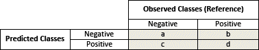

confusion matrix

*   **真阳性** (`d`)：我们预测个体为糖尿病阳性且他们确实为阳性的情况。
*   **真阴性** (`a`)：我们预测为糖尿病阴性，且个体确实为糖尿病阴性。
*   **假阳性** (`b`)：我们预测为糖尿病阳性，但个体实际上没有糖尿病。 （也称为 *I 型错误*。）
*   **假阴性** (`c`)：我们预测为糖尿病阴性，但他们确实患有糖尿病。 （也称为 *II 型错误*。）

从技术上讲，模型的原始预测准确率定义为 `(TruePositives + TrueNegatives)/SampleSize`。

## 30.6 精确率、召回率和特异性

除了原始分类准确率之外，还有许多其他指标被广泛用于检验分类模型的性能，包括：

**精确率**，即模型预测为糖尿病阳性的人群中真阳性的比例。这代表了预测阳性结果的准确性。 `Precision = TruePositives/(TruePositives + FalsePositives)`。

**灵敏度**（或 **召回率**），即 **真阳性率** (`TPR`) 或在糖尿病阳性人群（class = 1）中被识别出的阳性比例。 `Sensitivity = TruePositives/(TruePositives + FalseNegatives)`。

**特异性**，衡量 **真阴性率** (`TNR`)，即在糖尿病阴性人群（class = 0）中被识别出的阴性比例。 `Specificity = TrueNegatives/(TrueNegatives + FalseNegatives)`。

**假阳性率** (`FPR`)，表示在健康个体（即糖尿病阴性）中被识别为阳性的比例。这可以被视为误报。 `FPR` 也可以计算为 `1-specificity`。当阳性较少时，`FPR` 可能很高，导致预测为阳性时更可能为阴性的情况。

**Sensitivy** 和 **Specificity** 通常用于衡量预测模型的性能。

上述提到的指标可使用函数 `confusionMatrix()` [`caret` package] 轻松计算。

在二分类设置中，你可能需要指定可选参数 `positive`，它是一个字符字符串，对应于“阳性”结果的因子水平（如果对你的数据有意义）。如果只有两个因子水平，默认使用第一个水平作为“阳性”结果。

```
## Confusion Matrix and Statistics
## 
##           Reference
## Prediction neg pos
##        neg  48  11
##        pos   4  15
##                                         
##                Accuracy : 0.808         
##                  95% CI : (0.703, 0.888)
##     No Information Rate : 0.667         
##     P-Value [Acc > NIR] : 0.00439       
##                                         
##                   Kappa : 0.536         
##  Mcnemar's Test P-Value : 0.12134       
##                                         
##             Sensitivity : 0.577         
##             Specificity : 0.923         
##          Pos Pred Value : 0.789         
##          Neg Pred Value : 0.814         
##              Prevalence : 0.333         
##          Detection Rate : 0.192         
##    Detection Prevalence : 0.244         
##       Balanced Accuracy : 0.750         
##                                         
##        'Positive' Class : pos           
## 
```


上述结果显示了不同的统计指标，其中最重要的是：

*   预测与参考已知结果之间的交叉表
*   模型准确率，81%
*   [kappa](https://en.wikipedia.org/wiki/Cohen%27s_kappa)（54%），即校正偶然性后的准确率。

在我们的例子中，灵敏度约为 58%，即模型正确识别为糖尿病阳性的糖尿病阳性个体的比例。

模型的特异性约为 92%，即模型正确识别为糖尿病阴性的糖尿病阴性个体的比例。

模型精确率或阳性预测比例为 79%。

在医学科学中，灵敏度和特异性是表征分类器或筛查测试性能的两个重要指标。灵敏度和特异性之间的重要性取决于上下文。一般来说，我们关注其中一个指标。

在医学诊断中，如我们的例子，我们更可能更关心最小化错误阳性诊断。因此，我们更关心高特异性。在这里，模型特异性为 92%，非常好。

在某些情况下，我们可能更关心调整模型以提高灵敏度/精确率。为此，你可以测试不同的概率截断值来决定哪些个体为阳性，哪些为阴性。

请注意，这里我们使用了 `p > 0.5` 作为概率阈值，高于该阈值时，我们将相关个体判定为糖尿病阳性。然而，如果我们担心错误地预测真正阳性个体的糖尿病阳性状态，那么我们可以考虑降低该阈值：`p > 0.2`。

## 30.7 ROC 曲线

### 30.7.1 简介

**ROC 曲线**（或 **接收者操作特征曲线**）是评估分类器性能或准确性的流行图形度量，对应于正确分类观测值的总比例。

例如，医学诊断测试的准确性可通过考虑两种可能的错误类型来评估：假阳性和假阴性。从分类的角度来看，当分类算法返回的预测概率高于固定阈值时，测试将被判定为阳性。该阈值通常设为 0.5（即 50%），对应于随机猜测概率。

因此，参考我们的糖尿病数据例子，对于给定的固定概率截断值：

*   **真阳性率**（或比例）是在糖尿病阳性人群中被识别为阳性的比例。回想一下，这也被称为预测分类器模型的 **灵敏度**。
*   而 **假阳性率** 是在健康（即糖尿病阴性）个体中被识别为阳性的比例。这也定义为 `1-specificity`，其中 **特异性** 衡量 **真阴性率**，即在糖尿病阴性人群中被识别为阴性的比例。

由于我们通常事先不知道概率截断值，因此 ROC 曲线通常用于在所有可能的概率截断值下绘制真阳性率（或 y 轴上的灵敏度）与假阳性率（或 x 轴上的“1-特异性”）的关系。这显示了你正确预测某事的速率与错误预测某事的速率之间的权衡。ROC 图的另一种视觉表示是简单地显示灵敏度与特异性。

**曲线下面积** (**AUC**) 概括了分类器在所有可能的概率截断值下的整体性能。它代表了分类算法区分 1 和 0（即事件与非事件或阳性与阴性）的能力。

对于一个好的模型，ROC 曲线应陡峭上升，表明随着概率阈值降低，真阳性率（y 轴）比假阳性率（x 轴）增加得更快。

因此，“理想点”是图的左上角，即假阳性率为零，真阳性率为一。这并不现实，但它确实意味着 AUC 越大，分类器越好。

AUC 指标在 0.50（随机分类器）到 1.00 之间变化。大于 0.80 的值表明这是一个良好的分类器。

在本节中，我们将向您展示如何在 R 中为二分类和多分类任务计算和绘制 ROC 曲线。我们将使用线性判别分析将个体分类到组中。

### 30.7.2 计算和绘制 ROC 曲线

ROC 分析可使用 R 包 `pROC` 轻松执行。

```
```

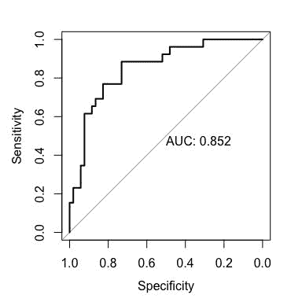

灰色对角线代表不优于随机机会的分类器。

性能优异的分类器 ROC 会急剧上升到左上角，即它能正确识别大量阳性，同时不会将大量阴性误分类为阳性。

在我们的示例中，AUC 为 0.85，接近最大值（max = 1）。因此，我们的分类器可被视为非常好。表现不优于随机机会的分类器在未用于训练模型的独立测试集上评估时，预计 AUC 为 0.5。

如果我们想要特异性至少为 60% 的分类器模型，则灵敏度约为 0.88%。相应的概率阈值可按如下方式提取：

```
```

```
## # A tibble: 44 x 3

##   thresholds sensitivity specificity

##        <dbl>       <dbl>       <dbl>

## 1      0.111       0.885       0.615

## 2      0.114       0.885       0.635

## 3      0.114       0.885       0.654

## 4      0.115       0.885       0.673

## 5      0.119       0.885       0.692

## 6      0.131       0.885       0.712

## # ... with 38 more rows
```

具有最高灵敏度 + 特异性之和的最佳阈值可按如下方式打印。可能存在多个阈值。

```
```

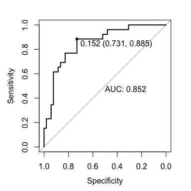

这里，最佳概率临界值为 0.335，导致预测分类器的特异性为 0.84，灵敏度为 0.660。

请注意，`print.thres` 也可以是一个包含要显示的阈值直接定义的数值向量：

```
```

### 30.7.3 多个 ROC 曲线

如果你的数据中有分组变量，你可能希望在同一张图上创建多个 ROC 曲线。这可以使用 `ggplot2` 完成。

```
```

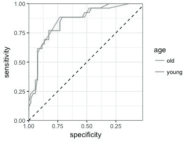

## 30.8 多分类设置

我们首先使用 `iris` 数据集构建一个线性判别模型，该数据集包含三种鸢尾花物种的花萼和花瓣的长度和宽度。我们希望使用 LDA 根据花萼和花瓣参数预测物种。

```
```

预测模型的性能指标（灵敏度、特异性，...）可以分别针对每个类别计算，将每个因子水平与剩余水平进行比较（即“一对所有”方法）。

```
```

```
## Confusion Matrix and Statistics

## 

##             Reference

## Prediction   setosa versicolor virginica

##   setosa         10          0         0

##   versicolor      0         10         0

##   virginica       0          0        10

## 

## Overall Statistics

##                                     

##                Accuracy : 1         

##                  95% CI : (0.884, 1)

##     No Information Rate : 0.333     

##     P-Value [Acc > NIR] : 4.86e-15  

##                                     

##                   Kappa : 1         

##  Mcnemar's Test P-Value : NA        

## 

## Statistics by Class:

## 

##                      Class: setosa Class: versicolor Class: virginica

## Sensitivity                  1.000             1.000            1.000

## Specificity                  1.000             1.000            1.000

## Pos Pred Value               1.000             1.000            1.000

## Neg Pred Value               1.000             1.000            1.000

## Prevalence                   0.333             0.333            0.333

## Detection Rate               0.333             0.333            0.333

## Detection Prevalence         0.333             0.333            0.333

## Balanced Accuracy            1.000             1.000            1.000
```

请注意，ROC 曲线通常用于二分类，但不用于多分类问题。

## 30.9 讨论

本章描述了用于评估分类模型性能的不同指标。这些指标包括：

*   分类准确率，
*   混淆矩阵，
*   精确率、召回率和特异性，
*   以及 ROC 曲线

要评估回归模型的性能，请阅读第 13 章。

## 31 引言

**统计机器学习** 指的是一组强大的自动化算法，用于基于多个预测变量预测结果变量。算法通过从数据中“学习”自动提高性能，即它们是数据驱动的，不寻求对数据施加线性或其他整体结构（P. Bruce and Bruce 2017）。这意味着它们是非参数的。

不同的机器学习方法可用于以下两种情况：

*   **分类**，其中结果变量是分类变量，例如阳性 vs 阴性
*   以及 **回归**，其中结果变量是连续变量。

在本部分中，我们将介绍以下方法：

*   **K-最近邻**，它将新观测值 `x` 的结果预测为与 `x` 最相似的 `k` 个观测值的平均结果（第 32 章）。
*   **决策树**，它构建描述预测变量与结果之间关系的决策规则集。这些规则用于预测新观测值的结果（第 33 章）。
*   **集成学习**，包括 **装袋**、**随机森林** 和 **提升**。这些机器学习算法基于决策树。它们从训练数据集中生成许多树模型，并使用平均值作为预测模型。这导致了顶级的预测建模技术。参见第 34 章和 35。

## 32 KNN - k-最近邻

## 32.1 引言

**k-最近邻**（**KNN**）算法是一种简单的 *机器学习* 方法，可用于分类和回归。kNN 算法通过将其与训练数据集中 `k` 个相似案例进行比较来预测新观测值的结果，其中 `k` 由分析师定义。

在本章中，我们首先介绍 KNN 算法在分类和回归设置中的基础知识。接下来，我们提供在 *R* 中准备数据和计算 KNN 模型的实际示例。

此外，你将学习如何进行预测并评估所构建模型在预测新测试观测值结果方面的性能。

## 32.2 KNN 算法

*   **分类的 KNN 算法**：

为了对给定的新观测值（`new_obs`）进行分类，k-最近邻方法首先识别与我们的 `new_obs` 最相似的 `k` 个训练观测值（即邻居），然后将 `new_obs` 分配给其邻居占多数的类别。

*   **回归的 KNN 算法**：

同样，为了预测给定新观测值（`new_obs`）的连续结果值，KNN 算法计算与 `new_obs` 最相似的 `k` 个训练观测值的平均结果值，并将该值作为 `new_obs` 的预测结果值返回。

*   **相似性度量**：

请注意，观测值之间的（不）相似性通常使用 [欧几里得距离度量](http://www.sthda.com/english/articles/26-clustering-basics/86-clustering-distance-measures-essentials/) 来确定，该度量对预测变量测量所采用的尺度非常敏感。因此，通常建议对预测变量进行标准化（即归一化），以使其尺度具有可比性。

以下各节介绍如何为分类和回归设置构建 k-近邻预测模型。

## 32.3 加载所需的 R 包

*   `tidyverse` 用于轻松的数据操作和可视化
*   `caret` 用于轻松的机器学习工作流

```
```

## 32.4 分类

### 32.4.1 数据集示例

数据集：`PimaIndiansDiabetes2` [在 `mlbench` 包中]，在第 21 章中介绍过，用于基于多个临床变量预测患糖尿病的概率。

我们将随机将数据拆分为训练集（80% 用于构建预测模型）和测试集（20% 用于评估模型）。请确保设置种子以保证可重复性。

```
```

### 32.4.2 计算 KNN 分类器

我们将使用 `caret` 包，它会自动测试不同的 k 值，然后选择使交叉验证（"cv"）误差最小的最优 k，并拟合最终的最佳 KNN 模型以最好地解释我们的数据。

此外，`caret` 还可以自动预处理数据以归一化预测变量。

我们将在函数 `train()` 中使用以下参数：

*   `trControl` ，用于设置 10 折交叉验证
*   `preProcess` ，用于归一化数据
*   `tuneLength` ，用于指定要评估的可能 k 值数量

```
```

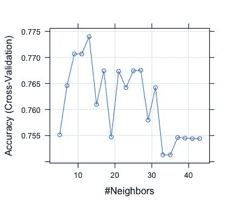

```
```

```
##    k

## 5 13
```

```
```

```
## [1] neg pos neg pos pos neg

## Levels: neg pos
```

```
```

```
## [1] 0.769
```

我们模型的总体预测准确率为 76.9%，这是一个不错的结果（请参阅第 30 章，了解用于评估分类模型性能的关键指标）。

## 32.5 KNN 用于回归

在本节中，我们将介绍如何使用 KNN 预测连续变量。

我们将使用 `Boston` 数据集 [在 `MASS` 包中]，在第 3 章中介绍过，用于预测波士顿郊区的房屋中位价值（`mdev`），使用不同的预测变量。

1.  **随机拆分数据** 为训练集（80% 用于构建预测模型）和测试集（20% 用于评估模型）。请确保设置种子以保证可重复性。

```
```

2.  **使用 caret 计算 KNN** 。

最佳 k 是使预测误差 RMSE（均方根误差）最小的 k。

RMSE 对应于观测已知结果值与预测值之间平均差异的平方根，`RMSE = mean((observeds - predicteds)²) %>% sqrt()` 。RMSE 越低，模型越好。

```
```

## 32.6 讨论

本章介绍了 KNN（k-最近邻）建模的基础知识，从概念上讲，它是较简单的机器学习方法之一。

建议在进行 KNN 分析时对数据进行标准化。我们提供了 R 代码来轻松计算 KNN 预测模型并评估模型在测试数据上的性能。

在拟合 KNN 算法时，分析人员需要指定在 KNN 算法中用于预测观测结果的邻居数（k）。k 的选择会极大地影响 KNN 的输出。k = 1 对应于高度灵活的方法，导致训练误差率为 0（过拟合），但测试误差率可能相当高。

你需要测试多个 k 值以确定数据的最优值。这可以使用 `caret` 包自动完成，该包选择使交叉验证误差最小的 k 值 14 。

## 33 决策树模型

## 33.1 引言

**决策树** 方法是一种强大且流行的预测机器学习技术，可用于 *分类* 和 *回归* 。因此，它也被称为 **分类与回归树**（**CART**）。

请注意，CART 算法的 R 实现称为 *RPART*（递归划分和回归树），可在同名包中使用。

在本章中，我们将介绍树模型的基础知识，并提供用于计算分类和回归树的 R 代码。

## 33.2 加载所需的 R 包

*   `tidyverse` 用于轻松的数据操作和可视化
*   `caret` 用于轻松的机器学习工作流
*   `rpart` 用于计算决策树模型

```
```

## 33.3 决策树算法

### 33.3.1 基础和可视化表示

决策树模型算法通过反复将数据划分为多个子空间来工作，使得每个最终子空间中的结果尽可能同质。这种方法在技术上称为 *递归划分* 。

产生的结果是一组用于预测结果变量的规则，结果变量可以是：

*   连续变量，用于回归树
*   分类变量，用于分类树

CART 预测模型生成的决策规则通常以二叉树的形式可视化。

以下示例表示一个基于萼片和花瓣长度（单位为 cm）和宽度的鸢尾花物种预测树模型。

```
```

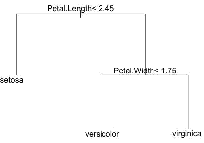

该图显示了可用于有效预测结果类型（此处为鸢尾花物种）的不同可能的分割规则。例如，顶部分割将具有 `Petal.length < 2.45` 的观测值分配到左分支，其中预测的物种为 `setosa` 。

树中的不同规则可以按如下方式打印：

```
```

```
## n= 150 

## 

## node), split, n, loss, yval, (yprob)

##       * denotes terminal node

## 

## 1) root 150 100 setosa (0.333 0.333 0.333)  

##   2) Petal.Length< 2.5 50   0 setosa (1.000 0.000 0.000) *

##   3) Petal.Length>=2.5 100  50 versicolor (0.000 0.500 0.500)  

##     6) Petal.Width< 1.8 54   5 versicolor (0.000 0.907 0.093) *

##     7) Petal.Width>=1.8 46   1 virginica (0.000 0.022 0.978) *
```


这些规则是通过反复分割预测变量产生的，从与响应变量关联度最高的变量开始。该过程一直持续到满足某些预定的停止标准。

生成的树由 *决策节点*、*分支* 和 *叶节点* 组成。树从上到下放置，因此 *根* 在顶部，表示结果的叶节点放在底部。

每个决策节点对应于单个输入预测变量和该变量上的分割阈值。树的叶节点是用于进行预测的结果变量。

树从顶部（根）开始生长，在每个节点处，算法决定最佳分割阈值，从而在每个子分区中获得最大的纯度（或同质性）。

树将根据以下三个标准停止生长（Zhang 2016）：

1. 所有叶节点都是纯的，具有单一类别；
2. 预先指定的最小训练观测数无法通过任何分割方法分配给每个叶节点；
3. 叶节点中的观测数达到预先指定的最小值。

完全生长的树会过拟合训练数据，所产生的模型可能无法很好地预测新测试数据的结果。诸如 **剪枝** 之类的技术用于控制此问题。

### 33.3.2 选择树的分割点

从技术上讲，**对于回归建模**，分割阈值是这样定义的，使得落在子分区内的训练样本的残差平方和误差（RSS）最小化。

Recall that, the RSS is the sum of the squared difference between the observed outcome values and the predicted ones, `RSS = sum((Observeds - Predicteds)²)`. See Chapter 4

**在分类设置中**，分割点被定义为使子分区中的总体尽可能纯净。常用的两种纯度度量包括 *基尼指数* 和 *熵*（或 *信息增益*）。

对于给定的子分区，`Gini = sum(p(1-p))` 且 `entropy = -1*sum(p*log(p))`，其中 `p` 是子分区内被误分类观测值的比例。

总和是在结果变量的不同类别或类中计算的。基尼指数和熵的取值范围为 0（最大纯度）到 1（最大不纯度）

### 33.3.3 做出预测

树中建立的不同规则集用于预测新测试数据的结果。

以下 R 代码预测新采集的鸢尾花的物种：

```
```

```
##         1 
## virginica 
## Levels: setosa versicolor virginica
```

新数据被预测为 virginica。

## 33.4 分类树

### 33.4.1 数据集示例

数据集：`PimaIndiansDiabetes2` [在 `mlbench` 包中]，在第 21 章中介绍过，用于基于多个临床变量预测患糖尿病的概率。

我们将随机将数据分为训练集（80% 用于构建预测模型）和测试集（20% 用于评估模型）。请确保设置种子以保证可重复性。

```
```

### 33.4.2 完全生长的树

在这里，我们将创建一个完全生长的树，显示数据集中所有预测变量。

```
```

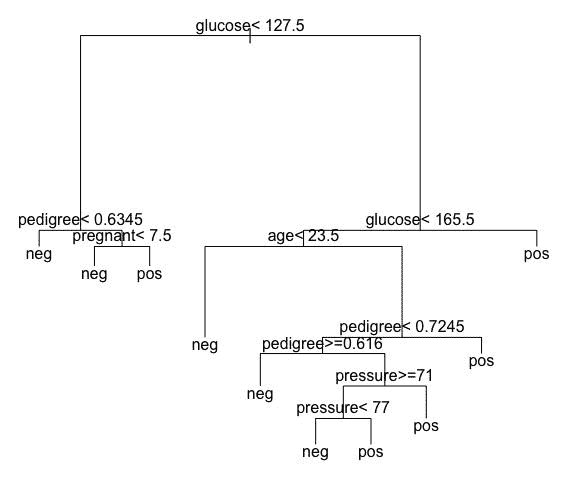

```
```

```
##  21  25  28  29  32  36 
## neg pos neg pos pos neg 
## Levels: neg pos
```

```
```

```
## [1] 0.782
```

我们树模型的整体准确率为 78%，这还不错。

然而，这个包含所有预测变量的完整树看起来非常复杂，在具有多个预测变量的大型数据集的情况下可能难以解释。

此外，很容易看出，完全生长的树会过拟合训练数据，并可能导致测试集性能不佳。

限制这种过拟合的一种策略是对树进行修剪，从而得到一个更简单、分割更少的树，在解释性更好的同时以少量偏差为代价（James et al. 2014，P. Bruce and Bruce (2017)）。

### 33.4.3 修剪树

简而言之，我们的目标是看看一个更小的子树是否能给我们与完全生长的树相当的结果。如果可以，我们应该选择更简单的树，因为它降低了过拟合的可能性。

一种可能的稳健的修剪树（或停止树生长）策略是避免在分割不能显著改善模型整体质量的情况下分割分区。

在 `rpart` 包中，这由 *复杂度参数*（`cp`）控制，它对树拥有过多分割施加惩罚。默认值是 0.01。`cp` 越高，树越小。

`cp` 值过小会导致过拟合，而 `cp` 值过大则会导致树过小。这两种情况都会降低模型的预测性能。

最佳 `cp` 值可以通过测试不同的 cp 值并使用交叉验证方法来确定模型的相应预测准确率来估计。最佳 `cp` 然后被定义为使交叉验证准确率最大化的那个（第 14 章）。

修剪可以在 `caret` 包的工作流程中轻松执行，该流程调用 `rpart` 方法自动测试 `cp` 的不同可能值，然后选择使交叉验证（"cv"）准确率最大化的最佳 `cp`，并拟合解释我们数据最好的最终最佳 CART 模型。

你可以在函数 `train()` [来自 caret 包] 中使用以下参数：

* `trControl`，设置 10 折交叉验证
* `tuneLength`，指定要评估的可能 `cp` 值的数量。默认值是 3，这里我们将使用 10。

```
```

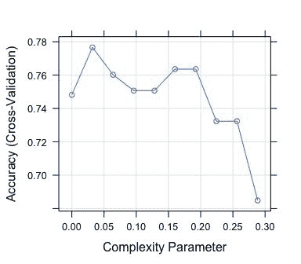

```
```

```
##       cp
## 2 0.0321
```

```
```

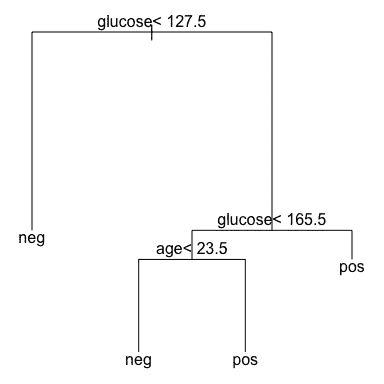

```
```

```
## n= 314 
## 
## node), split, n, loss, yval, (yprob)
##       * denotes terminal node
## 
##  1) root 314 104 neg (0.6688 0.3312)  
##    2) glucose< 128 188  26 neg (0.8617 0.1383) *
##    3) glucose>=128 126  48 pos (0.3810 0.6190)  
##      6) glucose< 166 88  44 neg (0.5000 0.5000)  
##       12) age< 23.5 16   1 neg (0.9375 0.0625) *
##       13) age>=23.5 72  29 pos (0.4028 0.5972) *
##      7) glucose>=166 38   4 pos (0.1053 0.8947) *
```

```
```

```
## [1] 0.795
```

从上面的输出可以看出，复杂度参数（`cp`）的最佳值为 0.032，允许一个更简单的树，易于解释，整体准确率为 79%，与我们使用完整树获得的准确率（78%）相当。修剪树的预测准确率甚至比完整树更好。

综合来看，我们应该选择这个更简单的模型。

## 33.5 回归树

之前，我们描述了如何构建分类树来预测观测值的组（即类别）。

在本节中，我们将描述如何构建用于预测连续变量的树，该方法称为回归分析（第 3 章）。

R 代码与我们在前几节中看到的相同。这里也应应用修剪以限制过拟合。

与分类树类似，以下 R 代码使用 `caret` 包构建回归树并预测新的测试数据集的输出。

### 33.5.1 数据集示例

数据集：我们将使用 `Boston` 数据集 [在 `MASS` 包中]，在第 3 章中介绍过，用于预测波士顿郊区的房屋中位价值（`mdev`），使用不同的预测变量。

我们将随机将数据分为训练集（80% 用于构建预测模型）和测试集（20% 用于评估模型）。请确保设置种子以保证可重复性。

```
```

### 33.5.2 创建回归树

这里，最佳 `cp` 值是使预测误差 RMSE（均方根误差）最小化的值。

预测误差由 RMSE 衡量，它对应于结果的观测已知值与模型预测值之间的平均差异。RMSE 计算为 `RMSE = mean((observeds - predicteds)²) %>% sqrt()`。RMSE 越低，模型越好。

选择最佳 cp 值：

```
```

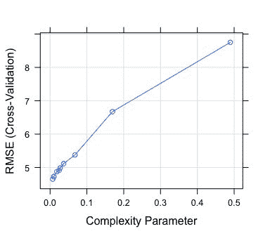

绘制最终树模型：

```
```

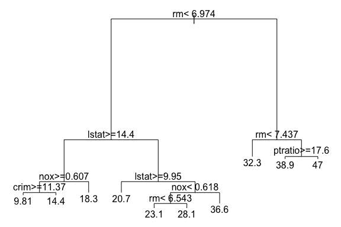

```
```

## 33.6 条件推断树

条件推断树（`ctree`）使用显著性检验方法递归选择和分割与结果最相关的预测变量。这与经典的 `rpart` 算法相比可以限制过拟合。

在每次分割步骤中，如果预测变量与结果变量之间没有依赖关系，算法就会停止。否则，选择与结果关联最强的变量进行分割。

条件树可以使用 `caret` 工作流程轻松计算，该流程将调用 `party` 包中的函数 `ctree()`。

1. 演示数据：`PimaIndiansDiabetes2`。首先将数据分为训练集（80%）和测试集（20%）

```
```

2. 使用调优参数 `maxdepth` 和 `mincriterion` 构建条件树以控制树的大小。`caret` 包会自动为你的数据选择最佳调优值，但在这里我们将指定 `maxdepth` 和 `mincriterion`。

以下示例创建了一个分类树：

```
```

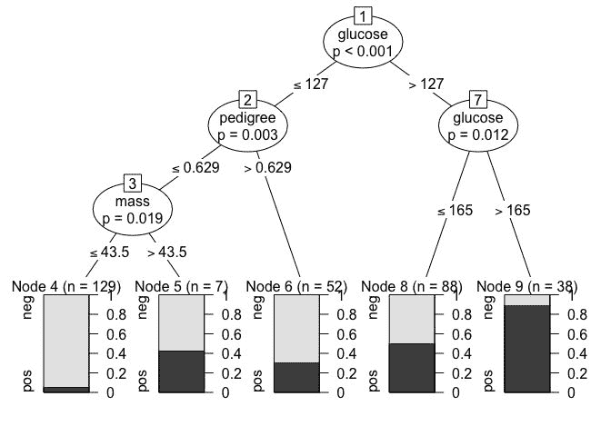

```
```

```
## [1] 0.744
```

p 值表示给定预测变量与结果变量之间的关联。例如，顶部的第一个决策节点显示 `glucose` 是与 `diabetes` 关联最强的变量，p 值 < 0.001，因此被选为第一个节点。

## 33.7 讨论

本章介绍了如何在 R 中构建分类树和回归树。树提供了一种非常易于解释和向他人说明的可视化工具。

与线性回归模型（第 `4` 章）相比，当结果变量与预测变量之间存在高度非线性和复杂关系时，树模型可能表现得非常出色。

然而，仅从训练数据集中构建一棵单一树可能会导致预测模型性能较差。单棵树不稳定，其结构可能会因训练数据的小幅变化而改变。

例如，给定预测变量的确切分割点以及算法每一步要选择的预测变量在很大程度上取决于训练数据集。使用略有不同的训练数据可能会改变第一个分割变量，并且树的结构可能会完全改变。

其他机器学习算法——包括 *bagging*、*random forest* 和 *boosting*——可用于从单个数据集中构建多个不同的树，从而提高预测性能。但使用这些方法时，单棵树所观察到的可解释性会丧失。注意，以上所有提到的策略都基于 CART 算法。参见第 `34` 章和 `35` 章。

## 34 Bagging 和 Random Forest

## 34.1 引言

在第 `33` 章中，我们描述了如何为预测建模构建决策树。

标准的决策树模型 CART，即分类与回归树，仅构建一棵单一树，然后用它来预测新观测的结果。这种策略的输出非常不稳定，树结构可能会因训练数据集中微小变化而严重受影响。

与经典 CART 算法相比，有不同的强大替代方案，包括 `bagging`、`Random Forest` 和 `boosting`。

`Bagging` 代表 *bootstrap aggregating*。它通过反复使用数据的多个自助采样子集，从单个训练数据集中构建多个不同的决策树模型并对模型进行平均来实现。这里，每棵树都是独立构建的。有关自助采样的更多内容，请阅读第 `15` 章。

`Random Forest` 算法是使用最广泛和最强大的机器学习技术之一。它是应用于决策树的一种特殊的 bagging。

与标准 CART 模型（第 `33` 章）相比，随机森林提供了一种强有力的改进，即对数据应用 bagging，并在每次分割时对预测变量进行自助采样（James et al. `2014`，P. Bruce and Bruce `2017`）。这意味着在树的算法的每个分割步骤中，从预测变量的完整集合中随机抽取 n 个预测变量作为分割候选。

随机森林既可用于分类（预测分类变量），也可用于回归（预测连续变量）。

在本章中，我们将描述如何在 R 中计算随机森林算法以构建强大的预测模型。此外，您还将学习如何根据其对模型精度的贡献对预测变量进行重要性排序。

## 34.2 加载所需的 R 包

* `tidyverse` 用于便捷的数据操作和可视化
* `caret` 用于便捷的机器学习工作流
* `randomForest` 用于计算随机森林算法

```
```

## 34.3 分类

### 34.3.1 数据集示例

数据集：`PimaIndiansDiabetes2` [在 `mlbench` 包中]，在第 `21` 章中介绍过，用于基于多个临床变量预测患糖尿病的概率。

随机将数据分为训练集（80% 用于构建预测模型）和测试集（20% 用于评估模型）。确保设置种子以保证可重复性。

```
```

### 34.3.2 计算随机森林分类器

我们将使用 `caret` 工作流，该工作流调用 `randomforest()` 函数 [`randomForest` 包]，以自动选择在每次分割时随机抽样的最优数量（`mtry`）的预测变量，并拟合解释我们数据最好的最终随机森林模型。

我们将在函数 `train()` 中使用以下参数：

* `trControl`，用于设置 10 折交叉验证

```
```

```
##   mtry
## 3    8
```

```
```

```
## 
## Call:
##  randomForest(x = x, y = y, mtry = param$mtry, importance = TRUE) 
##                Type of random forest: classification
##                      Number of trees: 500
## No. of variables tried at each split: 8
## 
##         OOB estimate of  error rate: 22%
## Confusion matrix:
##     neg pos class.error
## neg 185  25       0.119
## pos  44  60       0.423
```

```
```

```
## [1] neg pos neg neg pos neg
## Levels: neg pos
```

```
```

```
## [1] 0.808
```

默认情况下，训练 500 棵树。在每次分割时抽样的最优变量数为 8。

每棵 bagged 树大约使用三分之二的观测值。未用于拟合给定 bagged 树的剩余三分之一观测值被称为袋外（out-of-bag, OOB）观测值（James et al. `2014`）。

对于给定的树，袋外（OOB）误差是该树在预测未用于其训练集的数据时的模型误差（P. Bruce and Bruce `2017`）。OOB 是估计 bagged 模型的测试误差的一种非常直接的方法，无需进行交叉验证或验证集方法。

在我们的示例中，OBB 估计的误差率为 24%。

在新测试数据上的预测准确率为 79%，效果良好。

### 34.3.3 变量重要性

每个变量的重要性可使用函数 `importance()` [`randomForest` 包] 打印：

```
```

```
##            neg    pos MeanDecreaseAccuracy MeanDecreaseGini
## pregnant 11.57  0.318                10.36             8.86
## glucose  38.93 28.437                46.17            53.30
## pressure -1.94  0.846                -1.06             8.09
## triceps   6.19  3.249                 6.85             9.92
## insulin   8.65 -2.037                 6.01            12.43
## mass      7.71  2.299                 7.57            14.58
## pedigree  6.57  1.083                 5.66            14.50
## age       9.51 12.310                15.75            16.76
```

结果显示：

* `MeanDecreaseAccuracy`，即在排除特定变量的情况下，预测袋外样本结果的模型准确度的平均下降幅度。
* `MeanDecreaseGini`，即通过该变量进行分割所导致的节点不纯度平均下降幅度。Gini 不纯度指数仅用于分类问题。在回归中，节点不纯度通过训练集 RSS 衡量。这些度量使用训练集计算得出，其可靠性不如使用袋外数据计算的度量。请参阅第 `33` 章了解节点不纯度度量（Gini 指数和 RSS）。

注意，默认情况下（`argument importance = FALSE`），`randomForest` 仅计算基尼不纯度指数。然而，通过变量计算模型准确度（`argument importance = TRUE`）需要额外的计算，在拟合数千个模型（树）的情况下，这可能会非常耗时。

变量重要性度量可以使用函数 `varImpPlot()` [`randomForest` 包] 绘制：

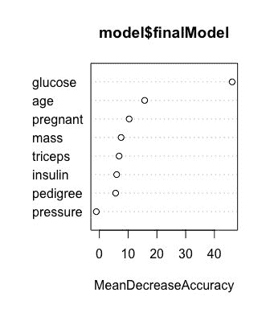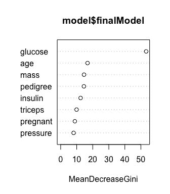

结果显示，在随机森林中考虑的所有树中，`glucose` 和 `age` 变量是最重要的两个变量。

函数 `varImp()` [`in caret`] 以百分比显示变量的重要性：

```
## rf variable importance
## 
##          Importance
## glucose       100.0
## age            33.5
```


## pregnant       19.0

## mass           16.2

## triceps        15.4

## pedigree       12.8

## insulin        11.2

## pressure        0.0

## 34.4 回归

同样，你可以构建随机森林模型来执行回归，即预测连续变量。

### 34.4.1 数据集示例

我们将使用 `Boston` 数据集 [`in` `MASS` package]，在第 3 章中介绍，用于预测波士顿郊区的房屋中位价值（`mdev`），使用不同的预测变量。

随机将数据拆分为训练集（用于构建预测模型的 80%）和测试集（用于评估模型的 20%）。

### 34.4.2 计算随机森林回归树

这里预测误差通过 RMSE 衡量，对应于结果的已知观测值与模型预测值之间的平均差异。RMSE 计算为 `RMSE = mean((observeds - predicteds)²) %>% sqrt()`。RMSE 越低，模型越好。

## 34.5 超参数

请注意，随机森林算法有一组超参数，应使用交叉验证进行调优以避免过拟合。

这些包括：

*   `nodesize`: 终端节点的最小大小。分类的默认值是 1，回归的默认值是 5。
*   `maxnodes`: 森林中树的终端节点最大数量。如果未给出，则树会生长到最大可能程度（受 `nodesize` 限制）。

忽略这些参数可能会导致在嘈杂的数据集上过拟合（P. Bruce and Bruce 2017）。可以使用交叉验证测试不同的值，以选择最佳值。

超参数可以使用 `caret` 包手动调优。对于给定参数，该方法包括使用参数的不同值拟合许多模型，然后比较这些模型。

以下示例使用 `PimaIndiansDiabetes2` 数据集对 `nodesize` 的不同值进行分类测试：

（这将花费 1-2 分钟执行时间）

```
## 

## Call:

## summary.resamples(object = ., metric = "Accuracy")

## 

## Models: 1, 2, 4, 8 

## Number of resamples: 10 

## 

## Accuracy 

##    Min. 1st Qu. Median  Mean 3rd Qu.  Max. NA's

## 1 0.692   0.750  0.785 0.793   0.840 0.897    0

## 2 0.692   0.744  0.808 0.788   0.841 0.850    0

## 4 0.692   0.744  0.795 0.786   0.825 0.846    0

## 8 0.692   0.750  0.808 0.796   0.841 0.897    0
```

可以看出，使用 `nodesize` 值为 2 或 8 会导致中位准确度值最高。

## 34.6 讨论

本章描述了 bagging 和随机森林机器学习算法的基础。我们还提供了 R 中用于分类和回归分析的实际示例。

另一种 bagging 和随机森林的替代方法是 boosting（第 35 章）。

## 35 Boosting

之前，我们描述了 bagging 和随机森林机器学习算法，用于构建强大的预测模型（第 34 章）。

回想一下，bagging 包括对训练数据集进行多次子集采样，然后构建多个独立的决策树模型，然后对模型进行平均，从而与经典的 CART 模型（第 33 章）相比创建出性能非常好的预测模型。

本章描述了一种称为 **boosting** 的替代方法，与 bagging 方法类似，只是树是顺序生长的：每一棵后续树都是使用之前生长的树的信息生长的，目的是最小化之前模型的误差（James et al. 2014）。

例如，给定一个当前的回归树模型，过程如下：

1. 使用模型残差误差作为结果变量拟合决策树。
2. 将此新决策树调整为收缩参数 `lambda`，并将其加入拟合函数中以更新残差。`lambda` 是一个很小的正值，通常在 0.01 和 0.001 之间（James et al. 2014）。

这种方法会缓慢且逐步地改进拟合模型，从而产生性能非常好的模型。Boosting 有不同的调优参数，包括：

*   树的数量 `B`
*   收缩参数 `lambda`
*   每棵树中的分裂数。

Boosting 有不同的变体，包括 *Adaboost*、*gradient boosting* 和 *stochastic gradient boosting*。

随机梯度提升，实现了 R 包 *xgboost* 中，是最常用的提升技术，它涉及在每一轮中对观测值和列进行重采样。它提供了最佳性能。`xgboost` 代表极端梯度提升。

Boosting 可用于分类和回归问题。

在本章中，我们将描述如何在 R 中计算 boosting。

## 35.1 加载所需的 R 包

*   `tidyverse` 用于轻松的数据操作和可视化
*   `caret` 用于轻松的机器学习工作流
*   `xgboost` 用于计算 boosting 算法

## 35.2 分类

### 35.2.1 数据集示例

数据集：`PimaIndiansDiabetes2` [`in` `mlbench` package]，在第 21 章中介绍，用于基于多个临床变量预测患糖尿病的概率。

随机将数据拆分为训练集（用于构建预测模型的 80%）和测试集（用于评估模型的 20%）。确保设置种子以确保可重复性。

### 35.2.2 提升分类树

我们将使用 `caret` 工作流，该工作流调用 `xgboost` 包，以自动调整模型参数值，并拟合解释我们数据最好的最终最佳提升树。

我们将在函数 `train()` 中使用以下参数：

*   `trControl`，用于设置 10 折交叉验证

```
##    nrounds max_depth eta gamma colsample_bytree min_child_weight subsample

## 18     150         1 0.3     0              0.8                1         1
```

```
## [1] neg pos neg neg pos neg
## Levels: neg pos
```

```
## [1] 0.744
```

在新的测试数据上的预测准确率为 74%，这是不错的。

有关 boosting 调优参数的更多解释，请在 R 中输入 `?xgboost` 查看文档。

### 35.2.3 变量重要性

函数 `varImp()` [`in caret`] 以百分比显示变量的重要性：

```
## xgbTree variable importance

## 

##          Overall

## glucose   100.00

## mass       20.23

## pregnant   15.83

## insulin    13.15

## pressure    9.51

## triceps     8.18

## pedigree    0.00

## age         0.00
```

## 35.3 回归

同样，你可以构建随机森林模型来执行回归，即预测连续变量。

### 35.3.1 数据集示例

我们将使用 `Boston` 数据集 [in `MASS` package]，该数据集在第 3 章中介绍，用于预测波士顿郊区的中位房价 (`mdev`)，使用不同的预测变量。

随机将数据拆分为训练集（80% 用于构建预测模型）和测试集（20% 用于评估模型）。

### 35.3.2 提升回归树

这里预测误差通过 RMSE 衡量，其对应于结果的已知观测值与模型预测值之间的平均差异。

## 35.4 讨论

本章描述了提升机器学习技术并提供了在 R 中构建预测模型的示例。另请参阅第 34 章中的 bagging 和随机森林方法。

## 36 无监督学习

## 36.1 引言

**无监督学习** 指的是一组用于从多元数据中探索和发现知识的统计技术，而不构建预测模型。

它使得可视化变量之间的关系成为可能，同时也可以识别相似个体的群体（或观测值）。

最受欢迎的无监督学习方法包括：

*   **主成分方法**，其包括总结和可视化多元数据集中包含的最重要信息。

*   **聚类分析** 用于根据特定标准识别具有相似特征的观测值群体。这些技术包括层次聚类和 k-means 聚类。

此前，我们已出版了两本名为 "[R 实用聚类分析指南](http://www.sthda.com/english/articles/25-cluster-analysis-in-r-practical-guide/) " 和 "[主成分方法实用指南](http://www.sthda.com/english/articles/31-principal-component-methods-in-r-practical-guide/) " 的书籍。因此，本章仅提供无监督学习技术的概述以及在 R 中可视化多元数据集的实用示例。

## 36.2 主成分方法

主成分方法使我们能够总结和可视化多元数据集中包含的最重要信息。

要使用哪种主成分方法取决于数据集中包含的变量类型。本实用指南将描述以下方法：

1.  **主成分分析 (PCA)**，这是最受欢迎的多元分析方法之一。PCA 的目标是通过降低数据的维度而不会丢失重要信息，来总结连续（即定量）多元数据中包含的信息。

2.  **对应分析 (CA)**，它是主成分分析的扩展，用于分析由两个 *定性变量*（或分类数据）形成的大型列联表。

3.  **多重对应分析 (MCA)**，它是 CA 的一种改编，适用于包含两个以上分类变量的数据表。

## 36.3 加载所需的 R 包

*   `FactoMineR` 用于计算主成分方法

*   `factoextra` 用于可视化 FactoMineR 的输出

### 36.3.1 主成分分析

PCA 将数据减少为少数新的维度（或轴），它们是原始变量的线性组合。你可以通过绘制前两个维度的散点图来可视化多元数据，其中包含数据中最重要的信息。阅读更多内容请访问：[`goo.gl/kabVHq`](https://goo.gl/kabVHq) 。

*   演示数据集：`USArrests`

*   使用 R 函数 `PCA()` [FactoMineR] 计算 PCA

*   使用 `factoextra` R 包（ggplot2 的扩展）可视化输出

1.  使用演示数据集 `USArrests` 计算 PCA。该数据集包含 1973 年美国 50 个州每 10 万居民中袭击、谋杀和强奸的逮捕统计数据。

2.  可视化特征值（或 *碎石图*），即每个主成分解释的数据中变异（或信息）的百分比。

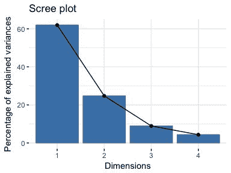

3.  可视化个体的图。具有相似特征的个体被分组在一起。

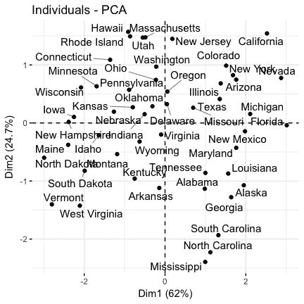

请注意，维度 (Dim) 1 和 2 保留了数据集中约 87%（62% + 24.7%）的总信息，这非常好。

4.  可视化变量的图。呈正相关的变量指向图的同一侧。呈负相关的变量指向图的相反两侧。

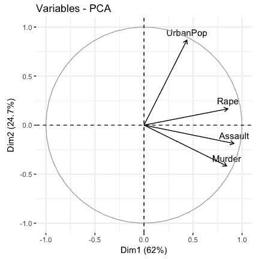

5.  创建个体和变量的双标图

5.  访问结果：

6.  阅读更多内容请访问：[主成分分析](https://goo.gl/RKkaQB)

### 36.3.2 对应分析

对应分析是主成分分析的扩展，用于分析由两个定性变量（或分类数据）形成的大型列联表。与主成分分析类似，它提供了解决方案，可在二维图中总结和可视化数据集。

该图显示了列联表中行点和列点之间的关联。

*   演示数据集：`Housetasks` [in FactoMineR]，它是一个列联表，包含夫妻中 13 项家务执行频率。

*   使用 R 函数 `CA()` [FactoMineR] 计算 CA

*   使用 `factoextra` R 包可视化输出

```
##            Wife Alternating Husband Jointly

## Laundry     156          14       2       4

## Main_meal   124          20       5       4

## Dinner       77          11       7      13

## Breakfeast   82          36      15       7
```

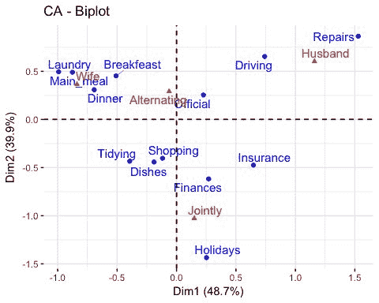

从上图可以看出：

*   诸如晚餐、早餐、洗衣等家务更常由妻子完成

*   驾驶和维修更频繁地由丈夫完成

阅读更多内容请访问：[R 中的对应分析](https://goo.gl/7CnpXq)

### 36.3.3 多重对应分析

**多重对应分析**（**MCA**）是简单对应分析的扩展，用于总结和可视化包含两个以上分类变量的数据表。它也可以被视为当要分析的变量为分类而非定量时，主成分分析的推广。

**MCA** 通常用于分析调查数据集。目标是识别：1）其对问题的回答具有相似特征的个体群体；2）变量类别之间的关联

*   演示数据集：`poison` [in FactoMineR]。该数据是针对患有食物中毒的小学儿童进行的一项调查的结果。他们被询问了症状以及他们吃了什么。

*   使用 R 函数 `MCA()` [FactoMineR] 计算 MCA

*   使用 `factoextra` R 包可视化输出

```
##   Age Time   Sick Sex   Nausea Vomiting Abdominals   Fever

## 1   9   22 Sick_y   F Nausea_y  Vomit_n     Abdo_y Fever_y

## 2   5    0 Sick_n   F Nausea_n  Vomit_n     Abdo_n Fever_n

## 3   6   16 Sick_y   F Nausea_n  Vomit_y     Abdo_y Fever_y

## 4   9    0 Sick_n   F Nausea_n  Vomit_n     Abdo_n Fever_n
```


数据包含一些补充变量。它们不参与 MCA。这些变量的坐标将被预测。

*   *补充定量变量*（`quanti.sup`）：第 1 列和第 2 列分别对应列 `age` 和 `time`。
*   *补充定性变量*（`quali.sup`：列 3 和列 4 分别对应列 `Sick` 和 `Sex`。这些因子变量将用于按组为个体着色。

计算并可视化 MCA：

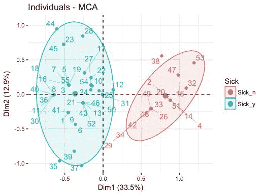

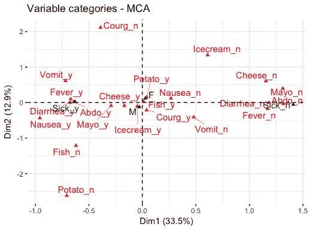

解释：

*   个体图：具有相似特征的个体被分组在一起。
*   变量类别图：上图显示了变量类别之间的关系。可以解释如下：
    *   具有相似特征的变量类别被归为一组。
    *   负相关变量类别位于图原点的相对两侧（相反象限）。
    *   类别点与原点之间的距离衡量了变量类别在因子图上的质量。远离原点的类别点在因子图上表示良好。

个体和变量的双标图。上图显示了数据中的整体模式。行（个体）用蓝色点表示，列（变量类别）用红色三角形表示。变量和个体呈正相关时位于图的同一侧。

阅读更多：[多重对应分析](https://goo.gl/84XXw3/)

## 36.4 聚类分析

### 36.4.1 基础

聚类分析用于识别来自营销、生物医学和地理空间等领域的多元数据集中的相似对象组。阅读更多：[`www.sthda.com/english/articles/25-cluster-analysis-in-r-practical-guide/`](http://www.sthda.com/english/articles/25-cluster-analysis-in-r-practical-guide/)。

**聚类类型**。有不同类型的聚类方法，包括：
*   分区聚类：将数据细分为 k 个组。
*   层次聚类：在不细分数据的情况下识别数据中的组。

**距离度量**。将观测值分类到组中需要一些计算每对观测值之间距离或（不）相似性的方法。此计算的结果称为不相似性或距离矩阵。有不同的方法来测量距离，包括：
*   欧氏距离
*   基于相关性的距离

**我们应该选择哪种类型的距离度量？** 距离度量的选择非常重要，因为它对聚类结果有很大影响。对于大多数常见的聚类软件，默认的距离度量是欧氏距离。

根据数据类型和研究者问题，其他不相似性度量可能更受青睐。

如果我们想识别具有相同整体特征而不考虑其大小的观测值聚类，那么我们应采用*基于相关性的距离*作为不相似性度量。这在基因表达数据分析中尤其如此，我们可能希望在它们一起“上调”和“下调”时认为基因相似。在营销中，如果我们想识别具有相同项目偏好的购物者群体，而不考虑他们购买的项目数量，也会出现这种情况。

如果选择欧氏距离，则具有高特征值的观测值将被聚类在一起。对于具有低特征值的观测值也是如此。

**数据标准化**。在聚类分析之前，建议对数据进行缩放（或归一化），以使变量具有可比性。当变量以不同的尺度测量时（例如：千克、公里、厘米……）尤其推荐这样做；否则，得到的不相似性度量将受到严重影响。用于缩放数据的 R 函数：`scale()`，对数据的列（变量）应用缩放。

### 36.4.2 加载所需的 R 包

*   `cluster` 用于聚类分析
*   `factoextra` 用于聚类可视化

### 36.4.3 数据准备

我们将使用演示数据集 `USArrests`。我们首先对数据进行标准化：

### 36.4.4 分区聚类

分区算法是一种聚类技术，将数据集细分为 k 个组，其中 k 是分析人员预先指定的组数。

有不同类型的分区聚类方法。最流行的是 **K-means 聚类**，其中每个聚类由属于该聚类的中心或数据点的均值表示。K-means 方法对异常值敏感。

K-means 聚类的替代方法是 **K-medoids 聚类**或 PAM（围绕中心点分区），与 K-means 相比，对异常值不那么敏感。

阅读更多：[分区聚类方法](http://www.sthda.com/english/articles/27-partitioning-clustering-essentials/)。

以下 R 代码显示了如何在 R 中确定最佳聚类数以及如何计算 K-means 和 PAM 聚类。

1.  **确定最佳聚类数**：使用 `factoextra::fviz_nbclust()`

建议的聚类数：3

2.  **计算和可视化 K-means 聚类**：

3.  同样，**K-medoids/pam** 聚类可以按如下方式计算和可视化：

### 36.4.5 层次聚类

层次聚类是识别数据集中组别的分区聚类的替代方法。它不需要预先指定要生成的聚类数。

层次聚类的结果是对象的树状表示，也称为树状图。可以通过在期望的相似性水平处剪切树状图来将观测值细分为组。

*   计算：R 函数：`hclust()`。它以不相似性矩阵作为输入，该矩阵使用函数 `dist()` 计算。
*   可视化：`fviz_dend()` [在 `factoextra` 中]

计算和可视化层次聚类的 R 代码：

热图是可视化层次聚类的另一种方式。它也称为伪彩色图像，其中数据值转换为颜色刻度。热图允许我们同时可视化样本组和特征。您可以使用 R 包 `pheatmap` 轻松创建漂亮的热图。

在热图中，通常列是样本，行是变量。因此我们在创建热图之前先转置数据。

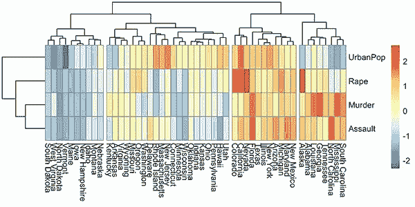

多元数据热图

## 36.5 讨论

本章介绍了用于汇总和可视化大型多元数据集的最常用的无监督机器学习方法。您可以在 STHDA 网站上阅读更多内容：
*   [主成分方法实用指南](http://www.sthda.com/english/articles/31-principal-component-methods-in-r-practical-guide/) 和
*   [R 中聚类分析实用指南](http://www.sthda.com/english/articles/25-cluster-analysis-in-r-practical-guide/)

## 参考文献

Bovelstad, H.M., S. Nygård, H.L. Storvold, M. Aldrin, o. Borgan, A. Frigessi, and O.C. Lingjoerde. 2007. “Predicting Survival from Microarray Data—a Comparative Study.” *Bioinformatics* 23 (16): 2080–7. doi:[10.1093/bioinformatics/btm305](https://doi.org/10.1093/bioinformatics/btm305)。

Bruce, Peter, and Andrew Bruce. 2017. *Practical Statistics for Data Scientists*. O’Reilly Media.

Friedman, Jerome H. 1989. “Regularized Discriminant Analysis.” *Journal of the American Statistical Association* 84 (405). Taylor & Francis: 165–75. doi:[10.1080/01621459.1989.10478752](https://doi.org/10.1080/01621459.1989.10478752)。

James, Gareth, Daniela Witten, Trevor Hastie, and Robert Tibshirani. 2014. *An Introduction to Statistical Learning: With Applications in R*. Springer Publishing Company, Incorporated.

Zhang, Zhongheng. 2016. “Decision Tree Modeling Using R.” *Annals of Translational Medicine* 4 (15)。
