# 初学者的机器学习：掌握深度学习和商业应用的数学指南。通过实例理解人工智能、数据科学和神经网络的工作原理


## 免费下载本书有声书版本

如果你喜欢在外出时听有声书，我有个好消息要告诉你。你只需注册免费 30 天 Audible 试用，即可免费下载本书的有声书版本！详情请见下文！


## AUDIBLE 试用权益

作为 Audible 客户，你将在 30 天免费试用期间获得以下权益：

*   本书免费 Audible 有声书副本
*   试用结束后，你每月将获得 1 个积分，可用于任何有声书
*   如果你不使用积分，它们会自动结转到下个月
*   从 Audible 的 200,000+种书目中选择
*   使用 Audible 应用在多个设备上随时随地收听
*   轻松无忧地交换任何你不喜欢的有声书
*   即使取消会员，也能永久保留你的有声书
*   还有更多

点击下面的链接开始！

*   [面向 Audible 美国用户](https://www.audible.com/pd/B07YVMVTWL/?source_code=AUDFPWS0223189MWT-BK-ACX0-167229&ref=acx_bty_BK_ACX0_167229_rh_us)
*   [面向 Audible 英国用户](https://www.audible.co.uk/pd/B07YVN81D7/?source_code=AUKFrDlWS02231890H6-BK-ACX0-167229&ref=acx_bty_BK_ACX0_167229_rh_uk)
*   [面向 Audible 法国用户](https://www.audible.fr/pd/B07YVMLPKG/?source_code=FRAORWS022318903B-BK-ACX0-167229&ref=acx_bty_BK_ACX0_167229_rh_fr)
*   [面向 Audible 德国用户](https://www.audible.de/pd/B07YVN6R7T/?source_code=EKAORWS0223189009-BK-ACX0-167229&ref=acx_bty_BK_ACX0_167229_rh_de)

## 简介

恭喜你购买《机器学习入门》，并感谢你的支持。机器学习领域正在涌现许多机会。它几乎被每个主要行业采纳为一种工具。无论你对医疗保健、商业与金融、农业、清洁能源等领域感兴趣，都有人正在利用机器学习的力量来简化工作。

不幸的是，对于这些行业来说，但对你来说幸运的是，数据科学和人工智能领域存在严重的人才短缺。虽然初级数据科学工作竞争依然激烈，但能够胜任高级职位的资深数据专业人员严重短缺。这是计算机科学中一个较新的领域，由一群年轻人构成了该领域的大部分。如果你能在数据科学领域找到一份工作，这可能会带来非常丰厚的回报。2016 年，平均数据科学家的年薪约为 111,000 美元，未来五年预计将继续增长。该领域约有一半的数据科学家拥有博士学位。这不是必须的，但如果你打算开始数据科学家的真正职业生涯，这是值得考虑的。

如果你希望将机器学习加入你的技能库，以便更好地理解它，并在未来的业务或项目中实施它，那么博士学位可能不是必须的。但对于那些希望进入该领域的人来说，建议接受高等教育，因为这将帮助你在众多从业者中脱颖而出。Indeed.com 将机器学习评为 2019 年最佳职业，这很容易理解。由于对有才华的数据科学家有巨大需求，且薪酬丰厚，这值得一看。而且，随着连接性的增加以及消费者和公司前所未有的互联网使用量，大数据似乎也不会在短期内消失。

数据是我们现代世界的一部分，随着数据的复杂性和规模不断增加，完成手头任务将需要更多专业知识和技能。为了补充本书中的知识，我强烈建议你进一步学习统计学和编程。扎实的统计学基础对于进行任何机器学习工作都是必需的，因为统计数学为数据科学家用于机器学习的所有模型和算法提供了结构和依据。


# 本书的目的 

本书并非旨在成为机器学习的全面教材。相反，它将为你提供一套知识基础，以便你继续学习机器学习和人工智能。为了继续学习并掌握该主题，必须进行大量的学习。我们将讨论机器学习模型的一般结构和组织、常用术语以及使用和理解机器学习所需的基本统计概念。要成为一名数据科学家，必须对统计学和定量分析有扎实的理解。毕竟，人工智能和机器学习都植根于统计学。这为所需的数学提供了锚点和基础。虽然理解本书不需要编程，但编程是机器学习的主要组成部分。为了处理大量数据，数据科学家需要具备计算机编程的工作知识，以便“告诉”数据他们希望数据做什么。本书不会提供太多编程信息，但会提供资源和途径，帮助你自行开始学习编程。读完本书后，我至少会协助你设置 `Python` 及其必要的库和工具包，以帮助你开始学习编程。机器学习中最常用的语言是 `Python`。它是一种多功能语言，相对容易学习且免费可用。有专为数据分析设计的 `Python` 包，可以让你的编程更快。`C++` 也很常见，但更难掌握。第三个选择是 `R`，它非常流行，因为它是免费且开源的。学生经常使用它，因为它易于获得且简单。使用 `R` 的缺点是它无法处理机器学习和人工智能中常用的大型数据集，这在某种程度上是有限制的。机器学习中的计算机之所以与众不同，是因为它们不仅能够记忆新信息，还能将这些信息应用于未来的新情境。记忆与学习之间存在区别。给计算机一行代码与创建机器学习模型之间存在重要区别。机器学习的基本特征是使用人工归纳推理。人工归纳推理意味着特定事件让你有理由概括一个特征。这个苹果是绿色的；因此，所有苹果都必须是绿色的。但在这里你可以看到，单独的归纳推理并不总是完美的，以及为什么很难训练计算机拥有相同的思维过程。给定的一段数据不一定代表其他成千上万可能的数据。因此，当我们使用统计学和机器学习时，必须使用足够的数据，才能自信地推理，而不会根据被误解并变得具有误导性的数据做出错误的推断。作为人类，我们每天做很多我们认为是“常识”的事情。这种直觉决策无法在计算机中明确编程，因为帮助我们做出决策的变量太难以衡量。当我们遇到从未见过的情况时，可能不需要看到千百种不同的棋子组合就能提前思考和制定计划。作为人类，我们只需要很少的数据就能推断和学习。机器学习正是派上用场的地方。在这些变量复杂且无法明确说明方向的情况下，必须通过学习来处理。回到会下跳棋的计算机的例子。如果通过给出每一种可能的走法和每一种可能的反击来教人下跳棋，那将花费太长时间。相反，你教某人基础知识，通过对弈，这个人会学习什么有助于获胜，什么没有帮助。同样，不可能告诉计算机跳棋游戏中的每一种可能情况，然后告诉计算机在每种情况下需要做什么。可能性太多了。相反，你必须给计算机足够的数据，以便即使遇到新情况，它也能做出相应的反应。本书后面将讨论的另一个例子使用人工神经网络来判断一张照片是猫还是狗。作为人类，这种分类太容易了。我们知道狗长什么样，因为我们见过狗；我们知道猫长什么样，因为我们见过猫。但没有办法明确告诉计算机如何区分猫和狗。相反，你给计算机一组包含猫和狗图片的训练数据，并告诉计算机哪些图片是猫，哪些图片是狗。最终，模型应该能够告诉你新的、未见过的图片中是否有猫或狗。明确编程指令的问题在于其无法改变。如果我告诉计算机确切该做什么，使用带有明确指令的编程语言，那么程序将很好地执行该任务，但只能执行该任务。它在获得新信息时不会改变，如果执行不正确，也不会改变其方法。随着时间的推移，机器学习模型将能够随着数据的变化而改变自身，以便在不断变化的环境中继续适应并保持准确，而无需指导。这提供了巨大的优势，因为它使我们的模型更能适应变化，而变化无处不在。如果没有机器学习和人工智能，我们的计算机将无法跟上步伐。


# 什么是人工智能？

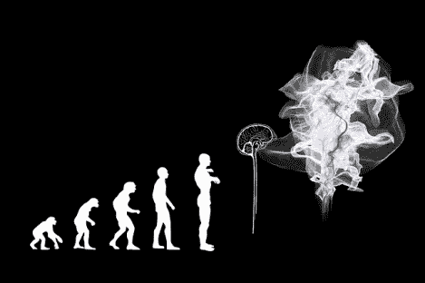

在 20 世纪 50 年代，独立的研究人员开始开发第一台人工智能机器。在此之前，人工智能领域仅进行过少量实验；特别是在第二次世界大战期间的破译工作中。这是一个新兴领域，起初似乎只有少数人意识到其潜力。

如今，人工智能被应用于多个领域的各种应用中，涉及问题解决、学习、规划、推理和逻辑。它使计算机能够执行通常需要人类思维才能完成的任务。为了像人类一样“思考”，计算机需要可供学习的数据。人工智能在人们心中占据着近乎神话的地位。我敢打赌，如果你对大多数人说“人工智能”这个词，他们脑海中会浮现出机器人四处走动、表现得像人类的画面。这种对人工智能的科幻化描述，让人们在听到这个词时感到警惕。但实际上，它并不像听起来那么可怕。它在医学、商业、交通和通信领域做了很多好事。尽管该领域取得了令人印象深刻的进展，但有意识的计算机的误解仍然遥遥无期。尽管如此，自动驾驶汽车以及能够说话的计算机和手机的出现依然激发着人们的想象力。虽然它听起来更像科幻小说里的东西，但人工智能现在已经渗透到我们日常生活的方方面面。

如果你一开始觉得它有点吓人，让我提醒你，近年来人工智能为我们的生活带来了哪些技术。上次你打开 Netflix 时，你浏览的是一个列表，该列表根据你观看过的节目和重看过的电影生成。它将该列表转化为数据，并创建了另一个推荐列表。根据你已经喜欢的内容，预测你会喜欢的电影。这是通过机器学习完成的，机器学习是人工智能的一个子集。

如果你有智能手机，你可能会使用语音命令来免提搜索东西。你告诉手机你正在寻找附近的咖啡馆，手机会说，“正在搜索附近的咖啡馆。”几秒钟内，一系列结果就会出现，你甚至不需要输入任何内容。它识别了你的声音并理解了你说的话。这是自然语言处理的一部分，自然语言处理是机器学习的另一个子集。

每次你打开电子邮件账户并标记垃圾邮件时，你的电子邮件主机都在学习如何更好地识别垃圾邮件。这是另一种类型的机器学习。因此，人工智能不一定是像我们所知道的那样想要接管世界的有意识机器。到目前为止，它比这要良性得多。它也非常有帮助，并且能够学习我们无法明确编程让它去做的事情。

人工智能需要一种称为人工推理（也称为机器推理）的东西。当人类学习新事物并得出结论时，我们会经历一个称为归纳推理的过程。我们利用信息片段来得出新结论。通常，没有一套固定的规则让我们遵循。我们从经验中学习，并通过累积经验得出自己的规则。例如，我可以告诉你去年 12 月下了 15 次雪。因此，今年 12 月也会下雪。1 月的每一天都很冷，所以今年 1 月的每一天都会很冷。所以，我应该带一件外套。我们生来就不知道每年 12 月都会下雪，或者 1 月很冷。我们是通过经验学到这些事情，并使用归纳推理来对未来的 12 月和 1 月进行概括。

基于我们的归纳推理，我们做出逻辑决定，为自己做好准备并在下一个冬天带上外套。我们在 12 月看到下雪、在 1 月感到寒冷的经历代表了我们的“数据”。这些是我们不断学习的环境输入。人类的思维方式与机器不同，因为我们不解释数值数据模式。我们从正面和负面奖励以及日常生活中体验到的感受中学习。让计算机使用归纳推理，将使我们更接近拥有“人类般”的机器。

因此，为了让计算机学习，它们需要有数据可供学习。数据通常需要是数值的，以便能够被数学模型和算法解释。如果我们给计算机足够的数据，它将创建参数来设计自己的模型或算法，以基于先前经验预测新情况。这是机器学习的基础。向计算机提供经验，以便它可以通过归纳推理在未来预测新的结果。

人工智能尤其有趣，因为计算机在某些任务上已经优于人类。它们可以在几秒钟内对包含数千个输入的数据集得出数学结论。地球上没有人类能如此快速地处理那种信息。如果我们可以使用机器学习来检查包含 100 个变量的复杂数据集中的数据，我们可能能够了解那些非常复杂且难以手动区分的趋势和模式。这就是计算机成为如此有用的工具的原因，也是它们帮助数据科学取得巨大进步的原因。使用计算机进行数据分析，使发现你甚至不知道存在的模式和相似性变得更加容易，或者那些你可能根本没有考虑过的模式和相似性。

在其他任务中，计算机表现得非常糟糕。其中一些任务对我们来说似乎非常简单。比如识别猫的照片和狗的照片之间的区别。但对于计算机来说，这极其复杂，难以弄清楚。人工智能目前面临的挑战就在这里。弥合人类能够进行的归纳推理类型与计算机擅长的推理类型之间的差距。

关键术语：归纳推理。从经验和环境中获取信息以得出概括。基于我们对猫和狗的知识，识别出这些图片之间的区别；这就是我们所知道的推理。人工智能的目标是教会计算机如何拥有类似于人类推理的能力。

计算机模型已被用于处理自然语言。自然语言处理使计算机能够理解“自然”语言，也就是我们所说的人类语言。自然语言处理依赖于机器学习技术来理解语音和文本，并响应命令和交互。这项技术正变得非常普遍和易于获取。

GPU（图形处理单元）正变得越来越普及且价格更低，这意味着数据集正在变得更大，机器学习的使用也在扩展。当你在 iPhone 上与 Siri 交谈时，可能已经使用过它了。当你对 Siri 说话时，你的手机接收音频。为了解释它，它将你的音频转换为文本。然后你的手机分析文本，以从你给出的命令中推导出含义。自然语言处理是机器学习最常见的应用之一，我们每天都在使用它。

当我们在互联网上使用搜索功能时，我们正在使用自然语言处理。翻译应用程序必须获取我们的语音或文本并分析句子结构以产生意义。当你撰写论文或 Word 文档时，你的文字处理器使用自然语言处理来筛选语法错误和拼写错误。尽管它很受欢迎，但它是计算机科学和人工智能领域非常复杂的一个分支。能够解释几乎无限组合排列的字母所表达的含义，需要计算机拥有大量数据才能理解你在写什么或说什么。

除了能够理解我们所说和所写的内容之外，计算机还可以根据从 20 世纪 90 年代的数据中学到的知识做出战略决策。IBM 创建了一台名为深蓝的计算机，击败了一位国际象棋大师。这是第一台能够执行此类任务的计算机。由于国际象棋规则的简单性，IBM 的计算机科学家选择训练他们的计算机来下棋。但是，一旦游戏开始，棋子就有成千上万种可能的走法和排列。计算机必须使用数据来学习这些。

机器学习与其他类型的计算机科学不同之处在于，模型能够随时间改变其方法以适应新数据。机器学习模型与普通的显式代码行的区别在于，机器学习会吸收新数据并自我改进。它还可以执行需要规划并包含战略组件的任务。深蓝计算机必须擅长分析可能的走法序列，而不仅仅是一次一步。

使计算机能够击败世界国际象棋冠军的相同技术，现在正使自动驾驶汽车能够安全地将乘客从 A 点送到 B 点。与国际象棋的相对简单相比，自动驾驶汽车必须规划和解释数百个变量以确保乘客安全。它超越了下棋机器使用的二维数据分析。自动驾驶汽车必须掌握多维数据分析，以应对道路上不断变化的环境。机器通过试错来学习，反复执行任务，并从失败和成功中学习。这些经验被引入为数据，随着时间的推移，机器将知道每种可能走法的失败或成功概率。

机器学习模型解释环境中的潜在状态。对于下棋算法来说，这包括它所有可能的走法以及对手所有可能的走法。算法是目标和潜在行动的集合。通过使用这些数据，它制定计划以优化实现目标的可能性。它还使计算机能够在没有特定编程指令的情况下进行自学习。

试图让计算机完成所有这些事情，在理论上听起来比在实践中要简单得多。我们刚刚提到的大多数功能；从跳棋到自动驾驶汽车，都需要高级统计技术来优化结果，并训练一台能够以高准确度“获胜”的机器。

机器学习属于人工智能这个更大的范畴。人工智能是计算机科学的一个分支，包括推理、自然语言处理、规划和机器学习。该术语最初由一位名为 John McCarthy 的计算机科学家于 1956 年提出。你还会听到数据科学这个术语，它涵盖了人工智能和机器学习。数据科学是一个更广泛的术语，但常被用来描述机器学习。机器学习专家通常被称为数据科学家，无论是在这本书中还是在其他地方。数据科学和机器学习之间存在重叠，但它们并不是同一回事。数据科学更多是一个通用术语，而机器学习是数据科学的一部分。


## 机器学习如何应用？


机器学习如今是一个热门的流行词。你经常听到机器学习这个术语被提及，尤其是在数字营销的数据科学领域。其他熟悉的术语，如人工智能、数据科学和数据挖掘，可能看起来与机器学习同义。这些不同领域之间存在细微差别，它们都属于数据科学的范畴。数据科学是数据的管理和分析，在数据科学领域内，有许多分析数据并利用其进行学习的方法。机器学习是计算机科学领域内的一个独立研究领域。其理念是预测某事，并在添加更多数据时，将预测与实际输出进行比较。随着时间的推移，你的预测能力应该会提高，错误也会减少。

人脑最重要的功能之一，就是根据过去事件和情况的结果改变我们行为的能力。如果一种情况有积极的结果，我们会记住它；同样，如果一种情况有消极的结果，我们也会将其存储在记忆中。之后，我们会利用这些“数据”来对新情况做出决策。随着时间的推移，我们学会如何解读情况，即使它们是全新的，我们也不确定该如何行为或反应。机器学习帮助我们创造一种数学方式，来模仿人类随时间推移和通过新经验学习的能力。机器学习模型随时间推移而学习，并改进其预测方法，从而改善结果。过去的数据被汇编，随着时间的推移，模型可以做出更好、更准确的预测。随着时间的推移，程序将能够根据所获得的新数据做出更准确的预测。它学习如何随时间推移更好地完成给定的任务。

其中一些内容启发了科幻小说，引发了人们对人工智能将超越我们并统治世界的恐惧。最终，我们的机器将能够做我们所能做的一切，而且做得更好。我们的计算机将超越我们并将我们甩在后面。尽管有普遍的恐惧，人工智能仍然是一个相对年轻的领域，还有很长的路要走。虽然它可能不会在短期内统治世界，但机器学习已经改变了当今的就业市场，并且未来只会继续改变它。过去需要人类思维的工作，现在可以通过机器学习来完成。工厂、医疗诊断，甚至出租车都有可能使用人工智能和机器学习来完成。

数据正成为一个越来越重要的研究领域。数据中的模式可能无法用人脑来解读，这就是为什么我们使用机器来检测模式。在金融领域，机器学习被用于检测欺诈。算法现在能够检测金融交易何时具有欺诈特征。公司可以通过识别更可能是虚假的评论发布的词语模式和时间来发现虚假评论。我们的手机使用语音识别来理解我们在说什么，并响应我们的请求。社交媒体使用复杂的数据分析来识别我们照片中的模式，甚至在我们开始标记之前就能告诉我们照片里是谁。所有这些都是通过数据的收集和机器学习的解读来完成的。照片中表明谁出现的模式是数据，由机器学习模型进行分析和改进。

1959 年，Arthur Samuel 首次推广了“机器学习”这一术语。他是 MIT 的毕业生，选择创建一个可以下棋的计算机程序。他选择跳棋是因为它相对简单，但也因为跳棋包含许多可能的策略。这早于 IBM 的深蓝，但理论是相同的。让计算机随着新数据随时间推移而学习。计算机考虑了每个跳棋子的位置和每个潜在的移动。每个移动都有一个获胜概率的得分。算法包括棋盘上棋子的数量和已升王的棋子数量等因素。算法记忆了它经历过的每一种位置组合，这个过程称为死记硬背学习。对于这些组合中的每一个，它都记住了获胜概率的得分。几年里，Samuel 与机器进行了无数场比赛，以教它如何下棋。机器学习一词被创造出来，以表达机器为了学习如何击败对手所做的事情。机器必须学习如何下棋，并学习如何减少错误以获胜。这是机器学习第一次被讨论为计算机科学或人工智能之外的独立研究领域。

斯坦福大学将机器学习称为“无需明确编程即可让计算机采取行动的科学”。Samuel 的计算机不需要被编程来记住每一种可能的跳棋移动。相反，机器获得的“经验”充当了数据，它从每场比赛中学习以优化其获胜策略。

统计学为机器学习提供了结构和机制。尽管机器学习一词诞生于 1959 年，但直到大约 1990 年代随着深蓝的出现，它才被承认为计算机科学的一个独立领域。普通计算机编程使用输入命令来指导模型。例如，将`4+4`插入你的`python`窗口。它会给你答案`8`。相反，机器学习使用所谓的输入数据。输入数据是机器需要学习的内容，而输入命令意味着机器不是自我学习的。程序员不指定他想要的答案是什么。相反，机器自行解释数据，这使其成为自我学习的。

在机器学习中，机器随时间推移获取数据，并用它来为某事创建新模型。机器将基于完全的统计逻辑检测数据中的模式和结构。它完全基于数学算法。机器学习模型不是使用直觉来搜索模式，而是在定量和逻辑层面发现模式。机器接触到的相关数据越多，它就越能理解并预测模型的结果。机器学习只有在能提高你试图完成的任务效率时才有用。在开始处理数据之前，你需要具体思考你想要学习什么。你试图用机器学习模型回答什么问题？环境总是在变化，如果你想创建与时俱进并在变化环境中工作的模型，那么你需要继续用新数据来教导你的模型。如果你希望你的数据对你有用，那么你需要找到一种方法，使你的数据与当前的问题保持同步。尽可能多地了解你的市场，或你所运营的环境。你试图理解什么样的事物？如果你使用机器学习来改善你的业务，那么找出构成你客户选择的变量有哪些。这些是你想要在模型中识别和研究的事物。在使用机器学习研究某个主题之前，你必须对该主题有良好的理解。即使有机器学习可用，也不可能预测未来。但如果你能让模型适应不断变化的数据，那么从长远来看，你比保持停滞不前更有机会成功。

在开始之前，你应该对所选择的数据有充分的了解。它来自哪里，是如何收集的？它是什么格式，在解读时会面临哪些挑战？这些是你开始时应该提出的问题类型，我希望借助这本书，你在开始之前能够批判性地审视数据。这不是一种适用于所有情况的预测未来的方法，也不会给你预测未来商业趋势或股票价格的魔法公式。但它是一个非常有用的工具，当正确使用时，可以使决策变得容易得多。

尝试机器学习的机会正在增加。今天的挑战在于找到合适的人来填补机器学习和人工智能开发所需的工作岗位。这是一个专业领域，拥有统计学和计算机科学知识以推动该领域发展的人才供应短缺。这意味着，对于具备机器学习所需技能的人来说，存在着机会。


## 数据分析的最新进展

机器学习自 1959 年亚瑟·塞缪尔（Arthur Samuel）的跳棋计算机问世以来发生了巨大变化。但过去二十年的变化比其整个历史的变化还要大，尤其是随着计算能力的提升。过去，机器学习和大数据分析曾非常有限。只有拥有昂贵技术的大型公司才有能力利用数据做出商业决策。现在，几乎任何人都可以使用笔记本电脑或家用电脑，利用一定量的数据进行商业或其他用途。数据更容易获取，处理数据的机器也变得更加普及。过去需要昂贵计算能力才能完成的事情，现在可以更便宜、更快地完成。云技术的出现使得小型企业更容易访问大型数据集，而无需大量数据存储。现在，机器学习已成为计算机科学的一个完全不同的领域，拥有专门从事机器学习和数据科学的人员，作为其自身的领域。如今，越来越多的事物相互连接，互联网不断壮大。这意味着数据访问量在增加，但数据来源也在发生变化。即使是人们的汽车也有计算机，这意味着当他们驾驶时，他们正在创造可以被解读的数据。绝大多数美国人都携带手机，进行网上购物，并使用应用程序进行导航。人们使用手机控制家用电器，这是另一个潜在的数据来源。有 Fitbit 和智能手表，允许人们追踪健康数据。连接的设备越多，不仅仅是计算机和手机，而是各种各样的设备，收集和研究数据的可能性就越大。这种万物互联；智能手机、智能汽车等，让人们担心他们可能面临丢失私人数据的风险。他们担心自己的隐私岌岌可危，总有人在监视他们。但机器学习和数据分析正在让我们的生活变得更加轻松。找到合适的产品更容易，导航更容易，发现新音乐也更容易。这一切都要归功于机器学习。

## 图像识别

机器学习模型的应用之一是数据的排序和分类。这种分类甚至可以用于图像分类。搜索引擎使用这种算法来识别照片，社交媒体网站现在使用人脸检测在照片被标记之前识别照片中的人。他们通过从其他照片汇编的数据中学习来做到这一点。如果你的社交媒体账户可以在新照片中识别你的脸，这是因为它使用了来自你账户中所有其他照片的数据创建了模型。图像识别技术需要深度学习模型。深度学习模型是用人工神经网络构建的，这将在本书后面更广泛地介绍。深度学习是最复杂的机器学习类型，数据通过几个隐藏层的节点进行过滤。它们被称为隐藏层，因为模型是无监督的，这意味着模型识别的特征不是由数据科学家事先选择的。通常，特征是模型自行识别的模式。神经网络中识别的特征可能非常复杂，任务越复杂，模型拥有的层数就越多。图像排序模型可能只有两三层，而自动驾驶汽车则会有一到两百个隐藏层。近年来，由于计算能力的可用性增加，我们在这一领域取得了重大进展。想象一下，同时将数千个数据点传递给数百个堆叠节点所需的计算能力。在过去十年中，随着计算机的改进和处理大量数据成本的降低，深度学习和人工神经网络变得更加可行。尤其是随着云技术的出现，它允许数据科学家在不使用物理存储空间的情况下访问大量数据。有一个名为 ImageNet 的网站，它是对照片分类和神经网络感兴趣的数据科学家的绝佳资源。ImageNet 是一个图像数据库，可公开用于机器学习。其理念是，通过公开访问，机器学习技术的改进将成为全球数据科学家的合作努力。ImageNet 的数据库中有大约 1400 万张照片，超过 21,000 个可能的类别组。这为数据科学家访问和分类照片以学习和实验神经网络提供了无限可能。每年，ImageNet 都会为全球数据科学家举办竞赛，以创建新的图像分类模型。每年的竞赛都会变得更难。现在，他们开始转向对视频而不是图像进行分类，这意味着所需的复杂性和处理能力水平将继续呈指数级增长。利用数据库中的数百万张照片，ImageNet 竞赛在过去几年中推动了图像识别的突破性进步。现代照片分类模型需要能够进行非常具体分类的方法。即使两张图片应该被归入同一类别，它们看起来也可能非常不同。你如何创建一个能够区分它们的模型？

举个例子，看看这两张不同的树木照片。如果你正在创建一个分类树木图片的神经网络模型，那么理想情况下，你希望模型将两者都归类为树木照片。人类可以识别这两张都是树木照片，但照片的特征会使它们很难用机器学习模型进行分类。变量之间的差异越少，分类就越容易。如果你所有的树木照片都像左边的图片一样，树木完整展示且具有所有特征，那么模型就更容易制作。不幸的是，这会导致过拟合，当模型接触到像右边那样的照片数据时，你的模型将无法正确分类。我们希望模型能够分类我们的数据，即使它们不那么容易分类。令人难以置信的是，ImageNet 已经能够创建能够分类具有许多变量且非常相似的数据的模型。最近，他们创建了图像识别，甚至可以识别和分类不同品种的狗的照片。想象一下，模型需要识别多少变量和相似性，才能正确地区分不同品种的狗。识别类别内共同点的挑战被称为类内变异性。当我们有一张树桩的照片和一张田野中树木剪影的照片时，我们正在处理类内变异性。这个问题是同一类别中的变量如何彼此不同，使得我们的模型更难正确预测它们属于哪个类别。最重要的是，它需要大量的数据随时间推移来改进模型并使其准确。为了在高类内变异性的情况下拥有准确的模型，我们需要在神经网络模型中使用额外的技术来在图像中寻找模式。一种方法涉及使用卷积神经网络。而不是只有一个模型或算法，数据被输入到几个相互堆叠的模型中。神经网络将图像特征转换为数值以进行排序。不幸的是，试图理解这些深度神经网络的运作方式超出了本书的范围，但有许多书籍涵盖了这些类型的模型，并包含执行此类分析所需代码的更全面解释。

## 语音识别

人工智能的改进使得语音识别最近变得更加有用。我们的大多数智能手机现在都有某种程度的语音识别能力，这涉及机器学习。语音识别将我们给它的音频数据转换为可以解释的文本。语音识别的难点在于人们说话方式的不规则性。就像类内变异性一样。你和我可能有不同的口音和不同的语调，这在教计算机理解人类声音时很难考虑到。如果我们都用不同的口音说同一个单词，我们如何教模型理解我们？语音识别也使用神经网络来解释数据，就像图像识别一样。这是因为音频数据中的模式人类可能无法识别。数据科学家使用采样来解释数据并做出准确预测，尽管人们的声音存在差异。采样是通过测量声波的高度和长度来完成的，信不信由你，这可以用来解读用户在说什么。录制的音频被转换为频率波形图。这些频率由数值测量，然后输入神经网络的隐藏层以寻找模式。

## 医学与医疗诊断

机器学习不仅对数字营销或让计算机响应你的请求有用。它还有潜力改善医学领域，特别是利用以前患者的数据进行患者诊断。尽管机器学习在医疗诊断方面潜力巨大，但由于围绕患者隐私的法律，要找到可用于机器学习的患者数据可能具有挑战性。它正在逐渐在医学领域获得接受，这意味着数据正在变得对数据科学家可用。不幸的是，到目前为止，要拥有足够有意义的数据来制作医疗诊断模型一直很困难。但技术已经存在并可供使用。机器学习可以利用图像识别来诊断 X 光片，通过获取多个患者的影像扫描数据来对新患者做出预测。聚类和分类可以用于对同一种疾病的不同类型进行分类，以便患者和医疗专业人员更好地了解两名患者之间同一种疾病的差异以及生存的可能性。机器学习医疗诊断可以减少医生的诊断错误，或为医生提供第二意见。它还可以用于根据患者因素和疾病特征预测阳性诊断的概率。总有一天，医疗专业人员可能能够查看数千名患者关于某种疾病的数据来做出新诊断。但医疗诊断只是机器学习在医学中可以利用的众多方式之一。今天，医疗数据集仍然很小，机器学习科学在医学领域仍有大量未开发的潜力。

## 股票预测

股票交易者会查看许多变量来决定如何处理一只股票，无论是想买入、卖出还是等待。他们会查看股票的某些特征以及市场环境的趋势，以对应该做什么做出有根据的猜测。多年来一直是这样做的。经纪人和交易者必须手动进行研究才能做出最佳猜测。现在可以使用机器学习来做同样的事情，只是机器学习可以做得更快、更高效。要成为一名有效的交易者，你必须能够实时分析趋势，以免错过机会。机器学习可以帮助交易者在股票之间寻找相似性，以使用统计数据做出财务决策。交易者可以使用线性回归模型来研究股票市场价格过去趋势的数据，以及导致股票价格上涨和下跌的变量。他们可以使用这些回归来决定如何处理一只股票。通常，想要分析股票表现的交易者会使用所谓的支持向量机。支持向量机是一种分类模型，其中数据点被一条边界线分开，一边是一个类别，另一边是另一个类别。交易者将使用支持向量机来分类哪些股票买入，哪些股票卖出。使用某些应能表明给定股票表现的变量，该股票被放置在边界线的一侧，以表示价格可能上涨或下跌。深度学习也常用于制作股票模型。神经网络的隐藏层可能有助于识别可能导致股票价格上涨或下跌的未见趋势或特征。没有所谓的稳赚不赔或无风险投资。当人们做决策时这是事实，当我们使用数据科学进行财务预测时，这仍然是事实。重要的是要记住，投资股票市场始终是有风险的。不可能创建一个能对股票市场做出任何可靠预测的模型。它是狂野且不可预测的。但我们已经了解到，机器学习可以发现人类可能无法自行发现的模式。如果你理解股票市场的趋势可能完全是随机且不可预测的，那么拥有一个能帮助你估计股票可预测性的另一个模型就很有用。了解你对给定股票的预测有多准确，与预测本身同样重要。创建一个单独的模型来衡量给定股票的可预测性，这样你就知道你的预测有多可靠。不同的股票会有不同程度的可预测性。重要的是用你的模型来说明这一点，以便你可以从最可靠的预测中进行选择。交易者将继续对股票价值是上涨还是下跌做出最终决定。但数据科学和机器学习可以简化分析信息的过程，从而帮助决策过程。这就是为什么你会看到越来越多的机器学习模型用于股票预测，以及为什么你至少应该让自己熟悉这个想法。

## 关联学习

各行各业的营销人员，从实体零售到在线零售，总是在寻找将产品关联起来并增加销售的方法。无论你拥有一家小型自行车店还是一个巨大的在线仓库，在客户的购买习惯中发现模式将帮助你做出主动决策以推动销售并赚取更多钱。我们大多数人每周都会去一次杂货店。杂货店是利用产品摆放来促进销售的完美例子。任何一家杂货店都会组织自己，使相似的物品放在一起。烘焙食品有自己的过道，而水果和蔬菜有它们的位置。他们这样做有两个原因；这使购物者更容易找到所需物品并改善客户体验。此外，产品摆放可以帮助将客户与他们愿意购买但刚进店时并未寻找的产品联系起来。除了把蔬菜放在同一过道之外，杂货店还可以实施另一种策略来引导客户购买某些产品。他们可能会推断购买特定产品的客户的特征，并利用这一点来推荐其他不相关的产品。例如，你可以假设从蔬菜区购买新鲜蔬菜的人饮食更健康。你可以把冰沙放在蔬菜区，放在你存放水果的同一个冰箱里。如果客户进来寻找精酿啤酒，你可以用零食诱惑他们，并将薯片放在 12 罐装淡啤酒的同一过道。如果这一切对你都有意义，那么你就在理解一种称为协同过滤的技术的道路上了。这是一种广泛用于互联网营销的机器学习技术。如果你的搜索数据显示你一直在浏览前往坎昆的机票，你可能会开始注意到浏览器上出现泳衣广告。营销数据科学家总是在努力回答这个问题；我们如何利用数据找到一种方法将产品与其目标市场联系起来？这关乎利用数据将两个原本不相关的产品联系起来以推动销售。这是一种基于你对客户了解的情况向客户做出推荐的方式。机器学习通常可以发现我们可能不知道要寻找的客户相似性或购买模式。这是一种在现代开始出现的强大营销工具。以前，大多数营销机构不得不依靠直觉来寻找目标市场。现在，数据科学家可以使用定量数据来描绘更准确的理想客户画像。如果你有兴趣在数字营销中使用机器学习，那么这是一个你应该熟悉的话题。协同过滤与仅仅向客户推荐类似产品不同。你是根据从其他客户那里收集的数据，对客户的口味或偏好做出预测。你基于在两个产品之间发现的相关性来做出这个预测，然后衡量产品 Y 与产品 X 一起被购买的可能性。你使用这些相关性估计来决定向谁推销什么。Spotify 在制作歌曲推荐时使用类似的过程。它使用你随时间推移喜欢的所有音乐的数据。如果两个艺术家之间存在相关性，即很多人在他们的库中同时拥有这两个艺术家，模型可以预测你会喜欢另一位艺术家的概率。你在商店里拥有的产品越多，找到这些相关性就越费力。在完美的世界里，你会寻找商店中每种不同产品组合之间的相关性。这种基于购买另一种产品来预测你会喜欢一种产品的方法称为 Apriori 算法。有三个标准需要满足，以确认两个产品之间存在相关性，并且你应该以某种方式在商店中将它们关联起来。第一个标准是支持度。这给你一个特定产品受欢迎程度的衡量。在所有交易中，这个物品出现在人们购物车中的频率是多少？第二部分是两个产品之间相关性的置信度。当客户购买 X 产品时，他们购买 Y 产品的可能性有多大？最后，产品 Y 的提升度是多少？换句话说，仅基于 Y 产品的受欢迎程度，有人与 X 一起购买 Y 的可能性有多大。模型还可以使用购买、社交媒体互动等数据来预测你会喜欢哪种类型的产品。这使其区别于单纯的数据分析，因为模型在寻找相似性，但程序员没有要求特定的输出。也许程序员甚至不知道该组的某些特征或特点。也许通过无监督机器学习，数据告诉我们两种类型的客户之间存在高度相关性。这些相关性在我们周围不断发生，不同人群之间存在相似性。有时，需要一个好的计算机模型来发现数据中的模式。机器学习可以在没有计算机和良好建模帮助的情况下无法看到的相似性。营销领域的数据科学家已经在使用统计学来改进他们的在线商店，如果你想跟上在线零售的步伐，那么建议开始阅读如何利用数据识别产品之间的相似性和趋势，将机器学习作为你的工具。

## 金融

金融行业正在看到机器学习使用量的增加。使用数据科学和机器学习模型使金融机构的决策过程更快、更高效。机器学习的可能性和应用可能被误解，这意味着它在金融领域往往被利用不足或被滥用。曾经繁琐且需要数百小时人工工作的工作，现在可以由计算机在几分钟内完成。一个常见的例子是使用机器学习进行呼叫中心和客户服务工作。许多曾经需要人工操作员的任务，现在可以通过电话与一个设计用于机器学习的机器人完成。除了客户服务，银行现在可以处理和分析来自数千名客户的合同和财务信息，这些工作原本劳动密集——用于创建信用报告和预测客户违约贷款的可能性。机器学习技术可以在银行决定是否向个人贷款之前查看借款人的交易历史。机器学习也被用于欺诈预防。它使金融行业更加安全。机器学习提高了银行检测交易中欺诈迹象的模式的能力。与派人监控交易并寻找欺诈迹象不同，机器学习模型可以从欺诈数据中学习，通过自动筛选数百万笔客户交易来发现模式。

## 垃圾邮件检测

一个相对简单的机器学习工具的常见示例是垃圾邮件检测。如果我们使用监督学习，定义相关变量，那么模型将在接收到的电子邮件中寻找某些特征。模型可能会寻找某些关键词或短语，以检测电子邮件是否为垃圾邮件。像“买”或“省钱”这样的词可能会让你的收件箱知道你何时收到垃圾邮件。这种方法的问题是，有很多情况下这些词不一定意味着垃圾邮件。可能有其他关键词或词语组合我们会忽略。这就是强化学习发挥作用的地方。有很多特征可能表明是垃圾邮件，其中一些我们甚至可能无法解释。强化学习将允许模型自行发现这些模式，而无需明确指导。相反，我们告诉模型它何时正确识别了垃圾邮件。有时我们会在收件箱中发现一条模型没有分类为垃圾邮件的电子邮件，所以我们手动将其移动到垃圾邮件文件夹。现在模型知道这条消息是垃圾邮件，这条数据被添加到模型中以改进下次的预测。因此，随着时间的推移，机器在获得更多相关数据时会不断改进。这种类型的机器学习被称为分类。我们的输出落在离散类别中。在统计学中，离散变量是只能在有限数量的类别中识别的变量。离散变量的示例是汽车经销商一周内销售的汽车数量。它是离散的，因为汽车经销商不能卖出半辆车。变量必须是整数。


## 统计学简介


统计学是关于数据的数学科学。它是一种实践，通过收集、观察和分析数据来推断意义，并考察不同变量之间可量化的关系。机器学习是一种推断统计学形式，这意味着通过考察变量之间的关系，我们应该能够对新变量做出预测。统计学被广泛应用于各种学科。它在生物学中用于研究和考察动植物生命。它在商业世界中有着广泛的应用，从股市预测到消费者行为分析。经济学家使用统计学来解释世界市场中的可量化模式。在医学中，统计学可以用于改善医生和疾病专家观察疾病传播和预防的方式。统计学构成了机器学习的核心。如果你不愿意深入学习统计学，那么机器学习就不适合你。机器学习使用统计算法来帮助计算机学习。机器学习的核心在于数据跟踪，以及计算机如何利用数据来改进自身。

## 统计分析的类型

本书涉及两种统计学。第一种是描述性分析，你可能会在建模过程的早期使用它来寻找数据中的指标。但我们在机器学习中做的大部分工作属于另一类，称为预测性分析。

### 描述性分析

关键术语；描述性分析。描述性分析帮助我们审视当前的状态。将当前情况与过去相结合来审视，并了解事物为何如此。为什么有些东西比其他东西卖得更好？我们目前在市场上看到哪些产品趋势？

### 预测性分析

关键术语；预测性分析。预测性分析帮助我们基于当前存在的指标，看到并理解未来会发生什么。当我们使用机器学习进行预测性分析时，保持与时俱进并继续向模型输入新数据非常重要。我们应该关注哪些趋势？机器学习只是理解我们周围数据的另一种方式，帮助我们理解当下并预测未来。但它需要过去和现在的数据，以便我们能够发现趋势并看到它们可能通向何处。

## 数据类别

在统计学中，有两个主要的数据类别，我们将使用这两类，所有数据都会以某种方式归入其中一类。第一类是定量数据。定量数据是可以用数值来衡量的数据。定量数据的示例包括身高、收入或房屋的面积。所有这些变量都可以用某个数字来衡量，因此它们是定量数据。

第二类是定性数据。定性数据是变量被分配到类别或类中的数据。定性数据的示例包括某人的性别、血型，或一块房地产是否有游泳池。这些数据可以按其身份进行排序，且是非数值的。因此它是定性数据。

### 定量数据

定量数据可以是离散的或连续的。如果我们有一个数据集，其中有一个变量记录了医院去年的患者数量，这将被视为离散数据。离散变量具有有限数量的值，并且总是整数。不可能有半个患者或百分之几的患者。因此，这个变量是离散的。

数据也可以是连续的。连续数据的示例是收入变量。收入可以取半值，且数据中收入值的可能性几乎是无限的。

## 集中趋势的度量

其他一些需要记住的重要术语是均值、中位数和众数。当我们谈论回归时，你经常会在这本书中听到这三个术语。这些都是不同的集中趋势度量。

均值是数据的平均值。如果我们有一个人的年龄变量，我们将通过将所有年龄相加，然后除以数据集中的受访者数量来找到年龄的均值。

中位数是数据集中间的值。如果你取所有年龄的响应，并找到排序列表中正好位于中间的响应，那么这就是你的中位数。

众数是出现频率最高的响应。如果我们取十一个人年龄的样本，发现年龄分别为 19、19、20、21、22、22、22、23、24、24、25，那么众数将是 22，因为它在这个样本中出现的频率最高。中位数也将是 22，因为它碰巧位于这个排序后的响应列表的中间。

## 偏差与方差

在构建统计模型时，有许多与模型准确性相关的重要术语。最重要的，也是本书中最常提到的是偏差和方差。这些是在创建统计模型时可能出现的不同类型的预测错误。理想情况下，我们希望尽量减少模型中偏差和方差的普遍性。它们总是存在，作为数据科学家，你必须在模型中找到偏差和方差的正确平衡，无论是通过选择不同的数据还是使用不同类型的模型。

减少模型中方差和偏差的方法有很多，取决于你打算如何处理数据。如果采用错误的方法来尝试减少它们，你可能会导致模型过拟合或欠拟合。

当模型存在偏差时，意味着预测值与实际值之间的平均差异非常大。方差是指预测数据点的分散程度。通常，方差是由于对用于创建模型的样本数据过拟合所导致的。它在预测新变量的结果方面表现不佳。

你的模型中总会存在一定程度的误差。无论你预测某事的能力有多强，宇宙中总会存在一些随机或非随机的变化，这会使你的预测与真实结果略有偏差。

我创建了一个四个靶心目标的视觉示例，以帮助说明高偏差和高方差模型之间的区别。在此示例中，靶心中心代表我们的模型试图预测的真实值。左上角是理想模型。请注意，我们所有的预测数据点都落在靶心上。这个模型相当准确，并将我们的预测数据点都放在真实值周围。这是因为低方差；数据点没有“分散开”，以及低偏差；没有导致结果偏差的欠拟合。

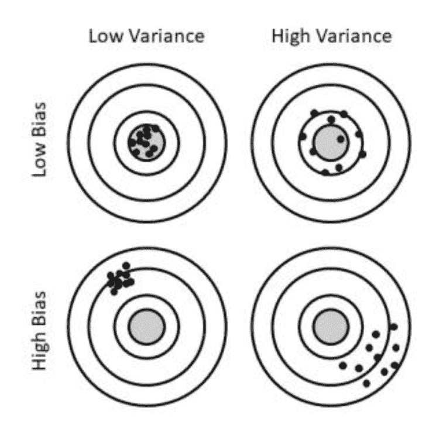

在右上角的目标中，模型正遭受高方差的影响。你可以看到我们的数据点聚集在靶心周围。不幸的是，由于高方差，预测值与靶心之间的平均距离很大。

在左下角的目标中，模型没有遭受太多高方差的影响。预测数据点之间的平均距离较低，但它们并没有聚集在靶心周围，而是由于高偏差而略微偏离。这可能是由于训练数据太少造成的，这意味着当模型接触到新数据时表现不佳。

右下角的模型同时遭受高方差和高偏差的影响。在这种情况下，模型非常不准确，因为预测数据点与真实值之间的平均距离很大，并且预测数据点是偏斜的。

方差可能是由变量之间显著的相关性引起的。如果你使用了太多自变量，这也可能是高方差的原因。有时，如果方差太高，我们可以通过在模型中允许少量偏差来对抗它。这被称为正则化。我们稍后会介绍。

## 总体与样本

在统计学中，总体是你试图分析的人群或数据集。样本是该总体的子群，你使用其数据来创建模型。参数是你试图在模型中识别并从中进行预测的总体变量的特征。

描述性统计学是使用数据来考察总体。通常，描述性统计学涉及均值或平均值、众数、中位数、大小、相关性。机器学习属于推断性统计学，因为我们使用数据来发现模式和关系，并基于这些信息进行预测。

推断性统计学，或描述性统计学，是使用总体的特征来进行预测。这就是你的回归模型和分类模型发挥作用的地方。当我们推断某事时，我们基于所获得的知识对总体进行逻辑推断。

## 数据分布

在查看数据时，你还应该注意分布。这是数据在图表上的分布方式。它显示数据值的频率以及它们如何相互关联。

我们使用方差来计算标准差。标准差是回归或预测模型中预测数据点与真实数据点之间距离的平均值。

我们还必须意识到遭受过拟合和欠拟合影响的模型。过拟合模型在使用训练数据预测结果方面表现良好，但当你引入新数据时，它就会遇到困难。这就像一个记忆而不是学习的模型。如果你在训练样本中没有使用随机数据，就可能发生这种情况。

欠拟合描述了一个过于简单、不考察任何显著数据模式的模型。它可能在预测方面做得不错，但变量和参数不够具体，无法为我们提供任何有意义的洞察。如果你没有足够的训练数据，你的模型可能会欠拟合。

## 相关性与因果关系

人们在查看数据时最常犯的错误之一是将相关性与因果关系混淆。如果我告诉你，去年每个犯下谋杀罪的人每周都买鸡蛋，我不能声称买鸡蛋的人是杀人犯。也许查看我的数据，我看到买牛奶的人数增加，以及青少年怀孕人数增加。我能否声称喝大量牛奶的人与青少年怀孕之间存在关联？或者青少年怀孕导致人们买更多牛奶。这就是相关性与因果关系之间的区别。

有时数据显示的趋势似乎有关联。当两个事件相关时，这意味着它们似乎有关系，因为它们在图表上沿着相似的轨迹移动，并在相似的时间段内发生。而因果关系意味着两个事件之间的关系涉及一个事件导致另一个事件。

要暗示两件事具有因果关系，需要满足几个标准。第一个是共变。因果变量和它 supposedly 导致的事件需要共变，这意味着一个的变化导致另一个的变化。

需要满足的第二个标准是，因果事件必须发生在它 supposedly 导致的事件之前。要使一个事件被视为因果事件，它必须先发生。

第三，数据科学家必须控制外部因素。为了有力地论证一件事导致另一件事，你需要能够提供证据表明事件的其他变量不是真正的原因。如果因果变量在考虑其他变量时仍然产生效果，那么你可以声称存在因果关系。


## 选择适合机器学习的模型类型

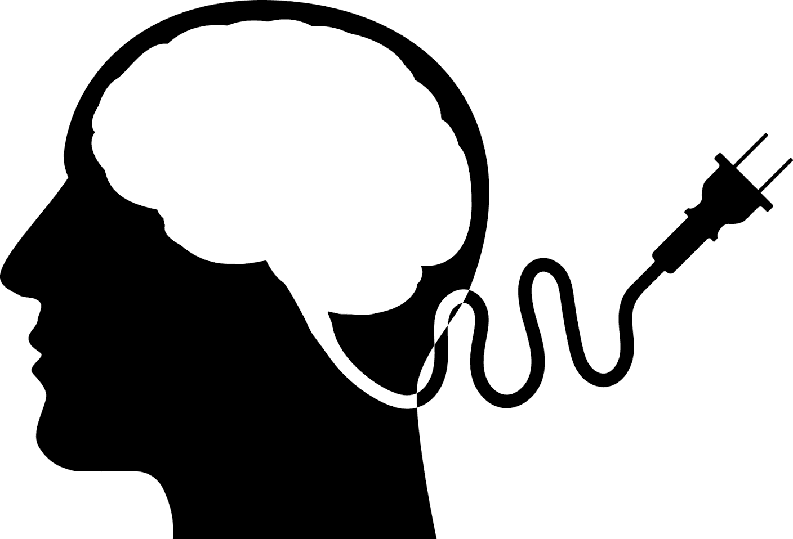

想象一下，你是一名木匠。当你到达工地时，你觉得自己的卡车里会装载什么样的工具？你可能会带上一把锤子、一台电钻，以及几种不同类型的锯子。你可能还会带上几把刨子和一套好的钻头。如果你懂得如何做好自己的工作，那么你就会知道每种工具的用途，并且知道在什么情况下应该使用哪一种。这些工具每一种都有特定的用途。电钻无法完成锤子的工作，你也不会试图用锤子来切割东西。一名希望进行机器学习的数据科学家也会有自己的一套工具，每种工具都有不同的用途，并针对不同的功能设计。根据你使用的数据类型以及你想要发现的内容，你将需要选择不同的算法模型来完成工作。

统计算法可以服务于多种目的。有些用于预测数值；例如，根据教育年限和工作经验预测收入的回归模型。有些模型预测事件发生的可能性，例如，预测患者在一年或两年内生存概率的医疗模型。其他模型则通过将事物归入不同的类别或类别来对其进行分类，例如，将不同类型的狗的照片进行分类的照片识别软件。根据你期望的结果，你需要准备好自己的统计工具箱。你需要熟悉统计学的技术技能。此外，你还需要知道想要使用哪种工具，以及何时使用它。

这里我创建了一份机器学习中非常常见的各种统计模型的综合列表。为了能够自己编写代码来构建这些模型，我建议你花些时间学习你选择的编程语言。但这个列表将让你对每种模型类型及其适用场景有初步的了解。

为了使机器学习有效，你必须选择合适的模型，选择效果最好的模型，并为模型和手头的问题提供相关数据。如今，尤其是随着互联网和数字营销的使用，有些问题如果不使用数据和能够分析数据的机器学习，就无法得到正确理解。借助机器学习和数据科学，你可以跟踪客户及其购买习惯，以便在客户需求发生变化时更好地适应。你对数据的解读越好，就越容易识别趋势和模式，从而预测下一次变化。

机器学习可以分为三个不同的类别，每个类别包含几种服务于不同目的的独特算法。首先，我们将讨论监督学习、无监督学习和强化学习之间的区别。


## 监督学习

在监督学习中，程序员使用标记数据。在开始使用算法之前，我们查看的数据是预先确定的。我们知道我们要寻找的输入和输出。`X`，和 `Y`。我们试图找到我们选择的 `X` 和 `Y` 之间的关系。在找到 `X` 和 `Y` 之间的关系后，你会得到一个模型，该模型将根据机器在数据中观察到的关系来预测结果。监督学习用于回归和分类模型。在机器学习中，我们将特征称为数据的某个可测量属性或特征。我们将讨论的第一种监督学习，也是第一种统计模型，称为回归。回归是一种数据输入和输出均为连续值的模型。回归有不同类型，但最基本的形式是线性回归。我们使用线性回归来找到某个输入 `X` 和输出 `Y` 之间的关系。一旦我们估计了这种关系，就可以使用 `X` 来预测 `Y`。线性模型可以，并且通常确实，拥有不止一个 `X`。在回归中，输出 `Y` 具有数值。

## 回归分析

回归是最简单的机器学习类型；当你刚开始学习如何使用数据时，这通常是你的起点。你有一组 `X` 值，并希望研究它们与输出 `Y` 的关系。我们模型中的自变量，即 `X`，被赋予权重，对于 `X` 的每个值，它都会乘以权重，直到聚合函数为 `Y` 创建预测。我们可以通过使用已知 `X` 和 `Y` 的数据来为 `Y` 创建预测模型。对这些信息进行回归将为我们提供 `X` 的权重。如果我们有足够的相关数据，最终我们将能够使用已知的 `X` 值来预测未知的 `Y`。我们将已知的 `Y` 和 `X` 值绘制在散点图上，我们的回归模型会找到穿过数据点的“最佳拟合”线。回归线称为超平面。线的陡峭程度称为斜率。我们可以测量预测值与实际数据点之间的距离，并将该测量值称为偏差。当我们创建线性回归时，我们的目标是最小化预测中的偏差。差异越小，偏差越小，你的模型就越准确。机器学习中使用的大多数统计模型都根植于这个第一个算法。通过沿线或聚类绘制数据点来创建一个预测结果的模型。但线并不总是直的，有时线不能显示最佳拟合。非线性回归函数的一个例子是 Sigmoid 函数。Sigmoid 函数创建一个 S 形曲线。与预测值不同，Sigmoid 函数获取自变量并生成 0 到 1 之间的概率。

## 简单线性回归

在简单线性回归中，我们研究某个预测值 `Y` 和某个预测因子 `X` 之间的关系。我们将 `Y` 称为因变量，因为它取决于 `X` 的值。我们的 `X` 被称为自变量。如果你在高中或大学学习过代数或预科微积分，那么你可能记得直线方程为；`Y = mX+b` 如果你绘制这个方程，你会得到一个看起来像这样的图表：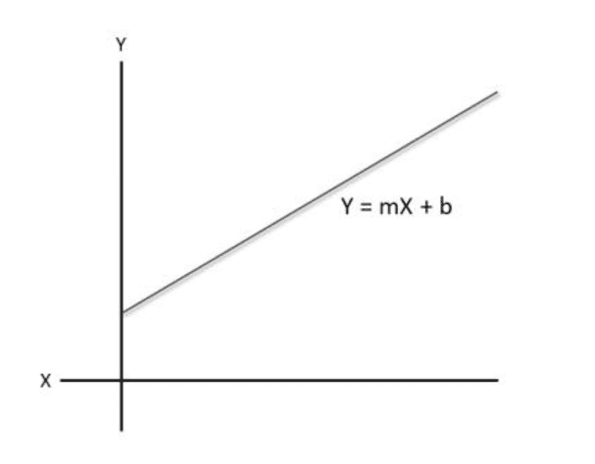如你所见，线显示每个 `X` 值都有一个不同的 `Y` 值。你可以为每个新的 `X` 值做出 `Y` 值的预测。在这个图表中，随着 `X` 值的增加，`Y` 值也增加。情况并不总是如此。这是最简单的回归，但了解它的工作原理很重要，因为我们将在此基础上继续构建。大多数统计分析涉及类似上面所示的图表，它根据输入（自变量）对输出因变量进行预测。这是监督学习的一个例子，因为我们在开始建模之前指定了要使用的 `Y` 变量和 `X` 变量。在几乎所有预测中，都会有不止一个自变量来决定我们的因变量。这引出了我们的下一种回归类型。

## 多元线性回归

在数据科学和大多数统计任务中，这将是最流行的回归类型。在多元线性回归中，我们将有一个输出变量 `Y`，就像之前一样。现在的区别在于，我们将有多个 `X` 或自变量来预测我们的 `Y`。使用多元线性回归预测纽约市房地产公寓价格是一个例子。我们的 `Y` 或因变量是纽约市公寓的价格。价格将由 `X` 决定，即我们的自变量，例如面积、距离交通的距离、房间数量。如果我们将其写成表达式，它看起来会像这样：

```
apt_price = β0 + β1 sq_foot + β2 dist_transport + β3 num_rooms
```

我们获取样本数据，即我们已知其 `X` 和 `Y` 的数据，并像这样在图表上查看它们：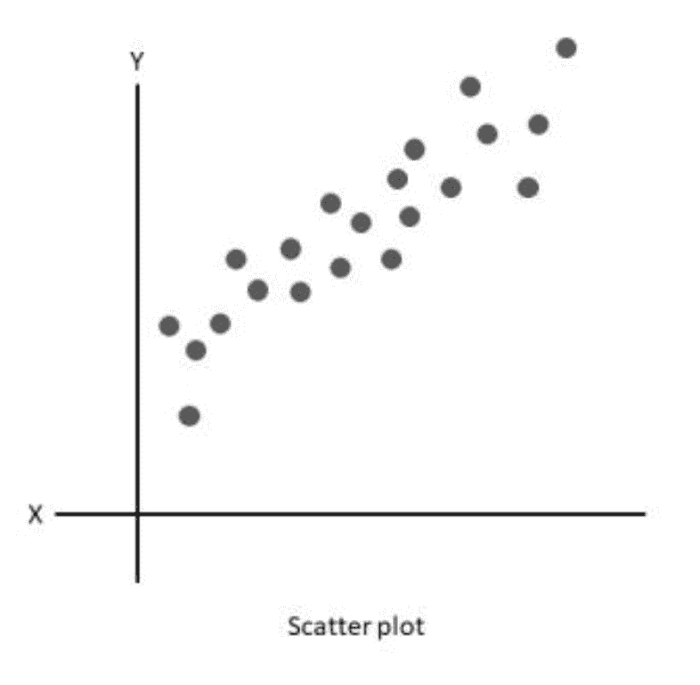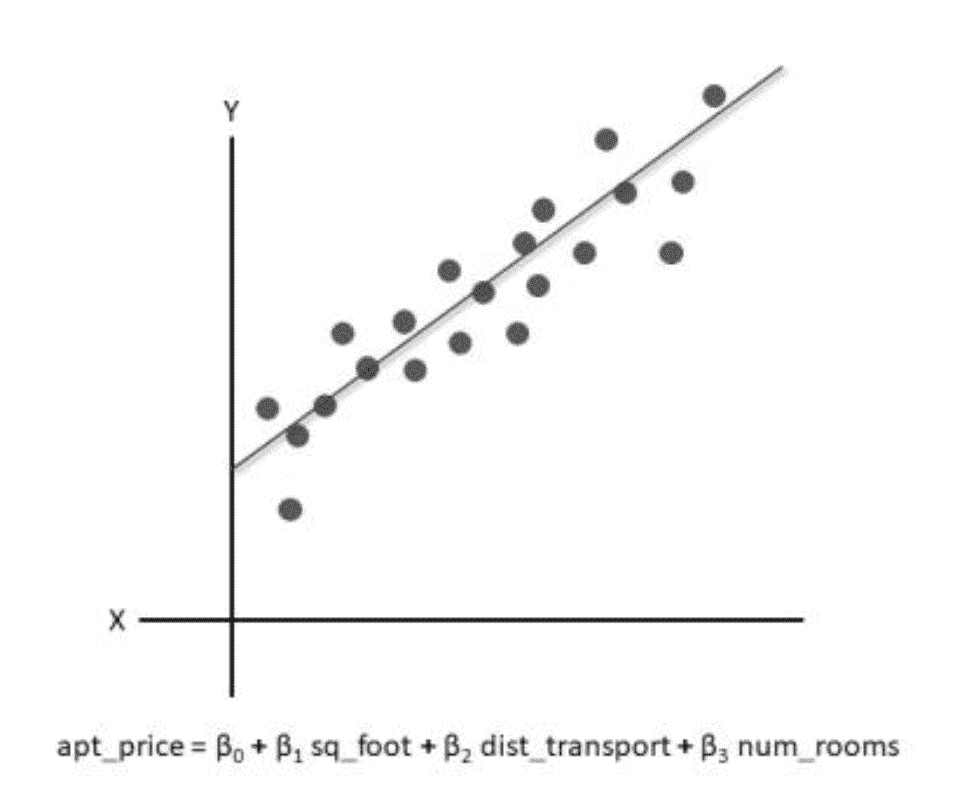你可以看到 `X` 和 `Y` 的值并不形成一条完美的线，但存在趋势。我们可以利用该趋势来对 `Y` 的未来值进行预测。因此，我们创建一个多元线性回归，最终得到一条穿过数据点中间的线。这被称为最佳拟合线，当我们将来获得新的 `X` 值时，我们将使用它来预测 `Y`。这里的区别在于，我们没有为斜率写 `m`，而是写了 `β`。这个方程基本上和写 `Y = b + m1X1 + m2x2 + m3x3` 是一回事，只不过现在我们有了标签，并且知道我们的 `X` 和 `Y` 是什么。将来，如果你看到多元线性方程，它很可能会以这种形式书写。我们的 `β` 是我们称之为参数的东西。它就像一个魔法数字，告诉我们 `X` 的值对 `Y` 有什么影响。每个自变量都会有一个唯一的参数。我们通过创建回归模型来找到参数。随着时间的推移，随着机器学习，我们的模型将接触越来越多的数据，因此我们的参数会得到改进，模型也会变得更加准确。我们可以使用包含纽约市公寓实际价格以及面积、距离交通距离和房间数等实际输入变量的训练数据来创建模型。我们的模型将“学习”从真实数据中近似价格。之后，当我们为一个价格未知的公寓输入自变量时，我们的模型可以预测价格会是多少。这是使用线性回归模型的监督学习。它是监督的，因为我们告诉模型我们希望它给出什么答案；即纽约市公寓的价格。随着它获得更多数据，并且我们继续评估其准确性，它学会了更准确地预测价格。

## 普通最小二乘法

OLS 将尝试找到一条回归线，使误差平方和最小化。

## 多项式回归

我们的下一种回归称为多项式回归。在前两种回归中，我们的模型创建了一条直线。这是因为我们的 `X` 和 `Y` 之间的关系是线性的，这意味着 `X` 对 `Y` 的影响不会随着 `X` 值的变化而改变。在多项式回归中，我们的模型将产生一条带有曲线的线。如果我们尝试使用线性回归来拟合具有非线性特征的图表，我们将无法很好地创建最佳拟合线。以左边的图表为例；散点图有类似之前的上升趋势，但带有曲线。在这种情况下，直线行不通。相反，使用多项式回归，我们将创建一条带有曲线的线来匹配数据中的曲线，就像右边的图表一样 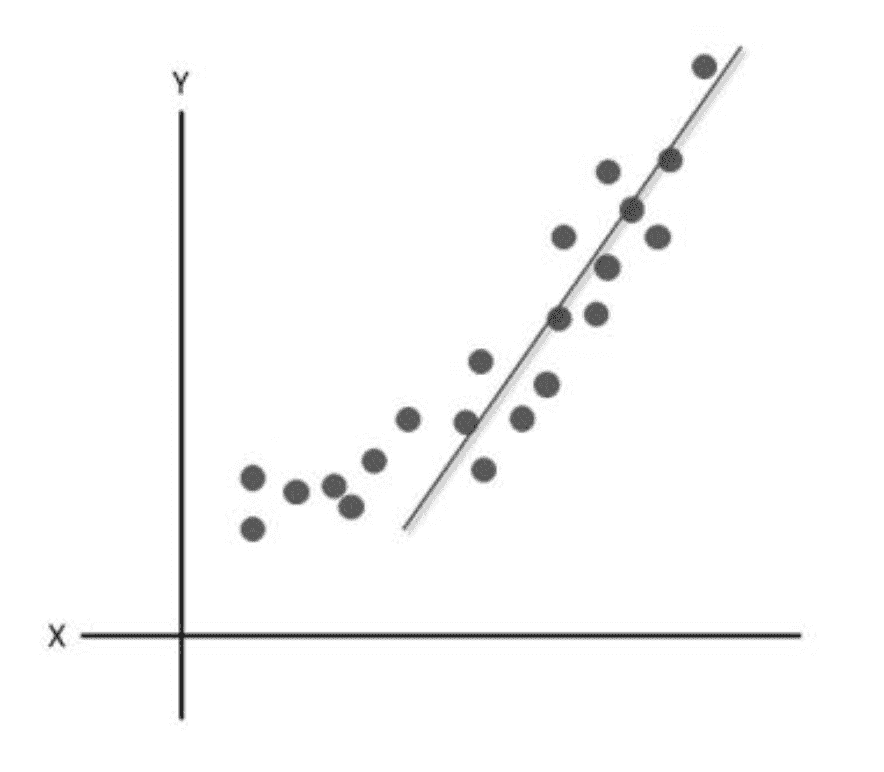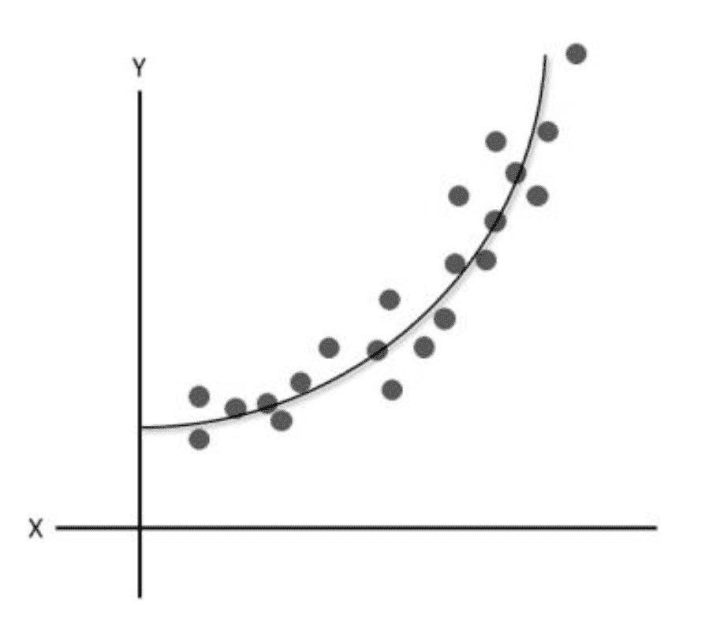多项式方程看起来会像线性方程，区别在于一个或多个 `X` 值上会附带某个多项式表达式。例如：`Y = mX2+b` 随着 `X` 值的变化，`X` 对 `Y` 的影响会呈指数级变化。

## 支持向量回归

这是数据科学家的另一个重要工具，你应该熟悉它。它最常用于分类情况。这里的想法是找到一条穿过空间的线，将数据点分隔为不同的类别。支持向量回归是另一种监督学习类型。它也用于回归分析。它是一种与概率无关的二元分类技术。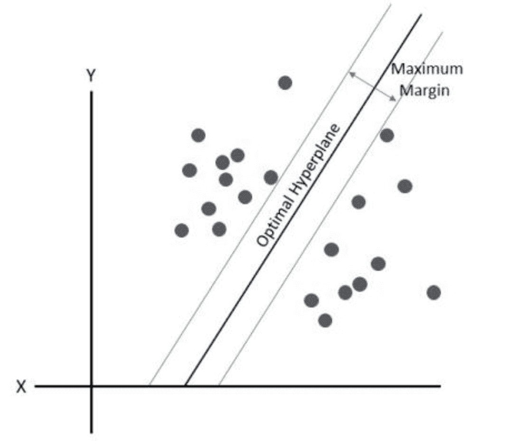在支持向量回归中，所有训练数据都属于某一类别或另一类别。你想找出新数据点属于哪个类别。你的数据由一个超平面分隔为这两个类别。当你为超平面创建模型时，你试图找到一个最大化两个类别之间距离的超平面。例如，在下一张图片中，你有一个散点图，其中的数据点可以分隔为两个不同的类别。在这种情况下，线一和线三可以将数据点分隔为两个不同的类别。但是，对于你的模型，你应该选择线二，因为它最大化了两个类别之间的边际，使它们更加明显。边际越宽越好。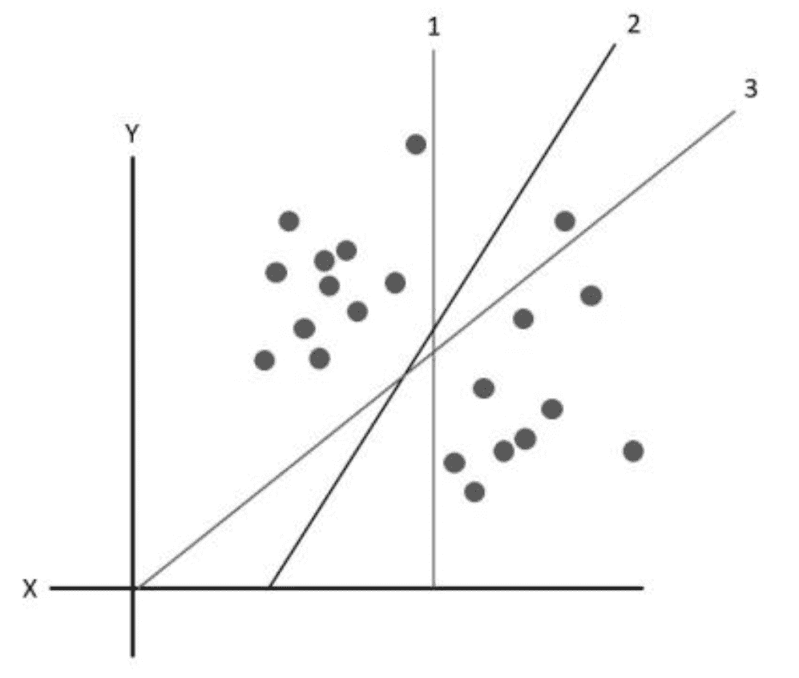

## 岭回归

这是一种常用于分析存在多重共线性问题的数据的技术。正确使用岭回归可以减少标准误差，并根据数据的特征使模型更加准确。当你的数据包含高度相关的自变量时，岭回归可能很有用。如果你可以使用另一个自变量来预测某个自变量，那么你的模型就存在多重共线性的风险。例如，如果你使用测量人身高和体重的变量；这些变量很可能在模型中产生多重共线性。多重共线性会影响预测的准确性。为了避免多重共线性，要注意你使用的预测变量类型。你使用的数据类型以及收集方法都可能是多重共线性的原因。你可能没有选择足够广泛的自变量范围。由于你选择的自变量有限，你的数据点可能过于相似。多重共线性也可能是由模型过于具体引起的。你拥有的变量比数据点多。如果你决定使用线性模型，并且这使多重共线性更加严重，那么你可以尝试应用岭回归技术。岭回归通过允许模型中带有一点偏差来使你的预测更加准确。这种技术也称为正则化。另一种方法是通过标准化自变量来提高模型的准确性。最简单的方法是将某些自变量的系数改为零以减少复杂性。但是，我们不会简单地将它们改为零，而是标准化实施了一个奖励接近零的系数的系统。这将导致系数收缩，因此模型的复杂性降低，但自变量仍然保留在模型中。这将使模型带有更多偏差，但这是为了更准确的预测而做出的权衡。

## LASSO 回归

LASSO 回归是另一种“收缩”技术。与岭回归非常相似，它鼓励构建更精简、更简单的预测模型。在 LASSO 回归中，模型对降低系数值更加严格。LASSO 代表最小绝对收缩和选择算子。散点图上的数据被收缩到一个更紧凑的点，类似于数据的平均值。就像岭回归一样，当模型存在多重共线性问题时，我们使用这种方法。

## ElasticNet 回归

ElasticNet 回归通过结合 LASSO 和岭回归的技术来工作。其主要目标是尝试改进 LASSO 回归。它结合了 LASSO 和岭回归中奖励较低系数的两种方法。这三种模型都可以在 R 和 Python 的 `glmnet` 包中访问。

## 贝叶斯回归

当我们数据不足或数据分布不佳时，贝叶斯回归模型很有帮助。这些回归是使用概率分布而不是数据点创建的，这意味着图表将呈现为一条钟形曲线，代表方差，曲线中间是出现频率最高的值。在贝叶斯回归中，因变量 `Y` 不是一个值，而是一个概率。我们不是试图预测一个值，而是试图预测结果的概率。这被称为频率统计学，贝叶斯定理构成了这种统计学的基础。频率统计学假设某事是否会发生，以及它发生的概率。当我们谈论频率统计学时，我们还包括条件概率。条件概率涉及结果相互依赖的事件。每次你抛硬币时，它都是一个独立事件，这意味着之前的硬币抛掷不会改变下一次硬币抛掷的可能性。因此，抛硬币不是条件概率。事件也可以是依赖的，这意味着之前的事件可以改变下一个事件的概率。假设我有一袋弹珠，我想知道从袋子里抽出不同颜色弹珠的概率。如果我有一袋 3 个绿色弹珠和 3 个红色弹珠，并且我抽出一个红色弹珠，那么下一次抽出红色弹珠的概率就会降低。这就是条件概率的一个例子。

## 决策树

我们将稍后讨论的一种模型称为神经网络。它们是最先进的机器学习类型，用于许多不同的目的。我将其与决策树联系起来，是因为人们经常在分类问题上求助于神经网络，而实际上有更简单的模型可用。决策树和相关的随机森林模型同样有用。尽管神经网络功能强大，但它们不能用于所有事情。幸运的是，我们有选择，这本书的目的就是让你知道当你决定要构建模型时有哪些选择。当神经网络不起作用时，下一个应该考虑的是决策树。决策树使用决策节点和叶节点以树状结构将数据分解为子类别。决策树相对于神经网络（本章后面讨论）有几个优势。首先，神经网络需要大量数据和强大的计算机来处理。使用决策树的好处是它们相对简单，尤其是与神经网络相比。与本书中的大多数模型不同，即使是未经训练的人也很容易读懂决策树。这使得它们成为在需要向利益相关者展示时选择模型的良好候选。决策树是另一种监督学习形式，这意味着我们在创建模型之前就标记了我们想要分类的类别。在某些情况下，决策树可以完成回归任务，但通常它们被用作分类模型。当决策树用于回归时，叶节点以概率结束。决策树从树顶部的所谓根节点开始。然后根节点在根节点之后分裂为两个节点。节点是树上的单个叶子，中间节点是做出决策的地方，称为决策节点。决策树在底部结束于所谓的终端节点，它位于分支的底部，决策在此完成。理想情况下，决策树会快速地逐层对数据进行分类。因此，我们称该模型为“贪婪”，因为顶层节点试图尽可能快地对数据进行分类，以便需要更少的层数。像神经网络一样，决策树经常遭受过拟合的问题。决策树通常无法与其他数据集一起工作，因为分类对每个数据集来说都太具体了。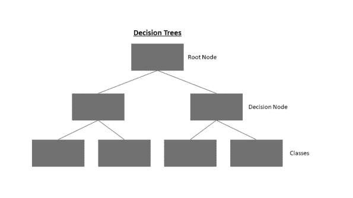下面是一个关于是否根据资格因素授予求职者面试机会的决策树示例。根节点是申请人是否拥有大学学位，随后是决策节点，所有决策节点都导向不雇佣或授予面试的决定。你可以从这个决策树中看出，为什么这种模型对你正在使用的特定数据如此具体，因为每个数据集在资格方面都会有所不同，因此每个数据集都会被不同地分类。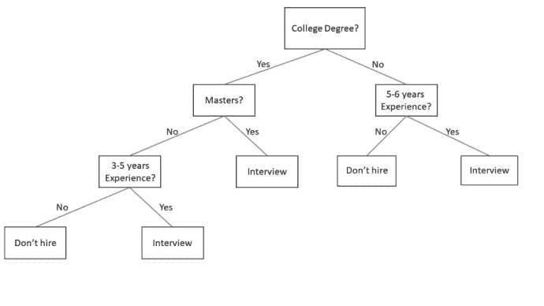

## 随机森林

在模型中仅使用一棵决策树会对数据被分割的类别以及决策结果产生限制因素。由于决策树是“贪婪”的，这意味着某些类别被选中进行分类，从而禁止其他类别也被选中。但有一个简单的方法可以绕过这个问题。多样化决策树并提高模型准确性的一种方法是使用随机森林。如果真正的森林由几棵不同的树组成，那么随机森林正是如此。与只有一棵决策树不同，你将数据分割为几棵决策树。当你只有一棵树时，模型经常会遭受高方差的问题。创建随机森林是解决模型中这一问题的一种方法。它是数据挖掘可用的最佳工具之一。随机森林是你能接近用于数据挖掘目的的预打包算法的最接近方式。在随机森林中，所有树协同工作。所有树的聚合结果通常是正确的，即使少数树最终得出错误的预测。为了创建最终预测，所有树的结果被汇总。使用所有树的平均值的投票为我们提供最终预测。由于我们使用的是相似的数据，如果所有树都试图做同样的事情，树之间存在相关性的风险。如果我们使用相关性较低的树，模型将表现更好。想象一下我们要押注硬币抛掷。我们每人有一百美元，有三个选择。我可以抛一次硬币，那次抛掷的赢家可以保留 100 美元。或者，我可以抛十次硬币，每次押注十美元。第三个选择是抛 100 次硬币，每次押注一美元。这个游戏每个版本的真实预期结果是相同的。但是，如果你进行 100 次硬币抛掷，你比只进行一次硬币抛掷更不太可能输光所有钱。数据科学家将这种方法称为自助法。它是机器学习者分散股票投资组合的等价物。我们希望有一个能给出准确预测的模型。我们分割的决策树越多，我们的数据就越准确。但是，重要的是单个树之间具有低相关性。森林中的树需要多样化。我们如何避免随机森林中的相关性？首先，每棵树从数据集中取一个随机样本，因此每棵树拥有略有不同的数据集。树以贪婪的过程选择一个在节点之间创造最大分离的特征，就像单个树一样。但是，在随机森林中，树只能从整体特征组中选择某些特征，因此每棵树通过不同的特征进行分离。因此，树将是不相关的，因为它们使用不同的特征来对分类做出决策。在随机森林中，最好至少使用 100 棵树来获得数据的准确图景，具体取决于你正在使用的数据集。一般来说，树越多，模型过拟合的可能性就越小。随机森林机器学习被称为“弱监督技术”，因为我们的结果是选定的，我们可以看到分类方法，但每棵树负责根据特征对变量进行分类和分离。分类模型会告诉我们某事物属于哪个类别。类别由程序员在开始时定义。使用随机森林的分类模型示例可以是一个模型，用于确定传入电子邮件应该进入你的‘收件箱’还是‘垃圾邮件’文件夹。为了创建模型，我们创建两个 `Y` 可以落入的类别；垃圾邮件和非垃圾邮件。我们编程模型查找可能指示垃圾邮件的关键字或某些电子邮件地址。像“购买”或“优惠”这样的词的存在将帮助模型确定电子邮件消息是否属于垃圾邮件或非垃圾邮件类别。算法接收数据，并通过将其预测与输出的实际值进行比较来学习。随着时间的推移，它对模型进行微小调整，使算法随时间变得更加高效。


## 分类

在本书中，我们多次提到分类模型。虽然我们已经提到的一些模型能够进行分类，但以下是更多专门用于分类的监督学习模型。分类需要标记数据，并生成非连续预测。在分类问题中，图表是非线性的。分类问题中可能有两个类别，甚至更多。分类模型可能是机器学习和数据科学中最广泛使用的部分。

## 二元分类

第一种分类类型是二元分类。使用二元分类时，数据被分为两个类别，用 `1` 或 `0` 表示。我们称之为二元分类，因为只有两个可能的类别，所有数据都属于其中之一。但也有我们拥有超过两个类别的情况，这时我们使用多类分类模型。此外，我们有线性决策边界，数据被一条线分为两侧。并非所有数据都能被分到决策边界的某一侧。第一张图展示了使用线性决策边界进行分类的示例。在第二张图中，几乎有两个类别，但它们不是线性可分的。在第三张图中，数据点混合在一起，线性边界分类是不可能的。根据你使用的数据类型，有不同的模型选择更适合不同的任务 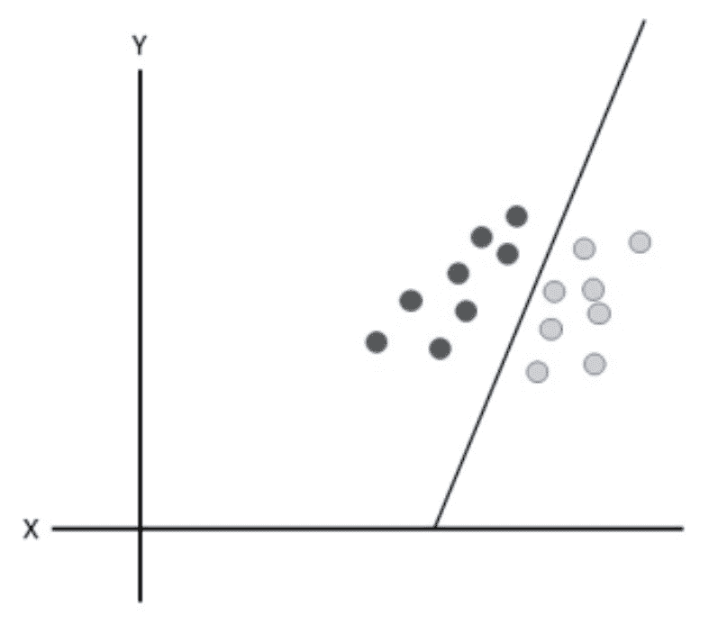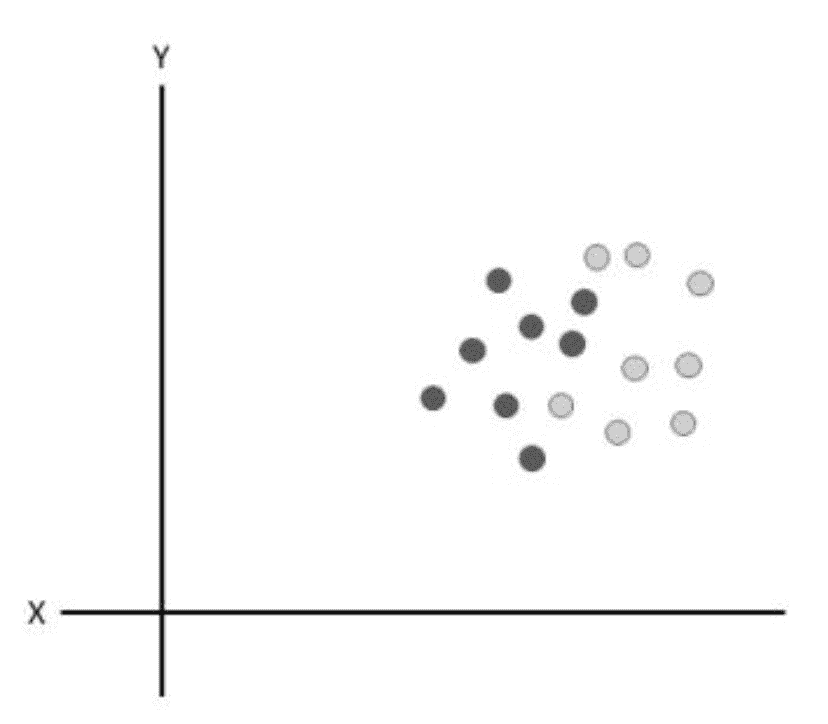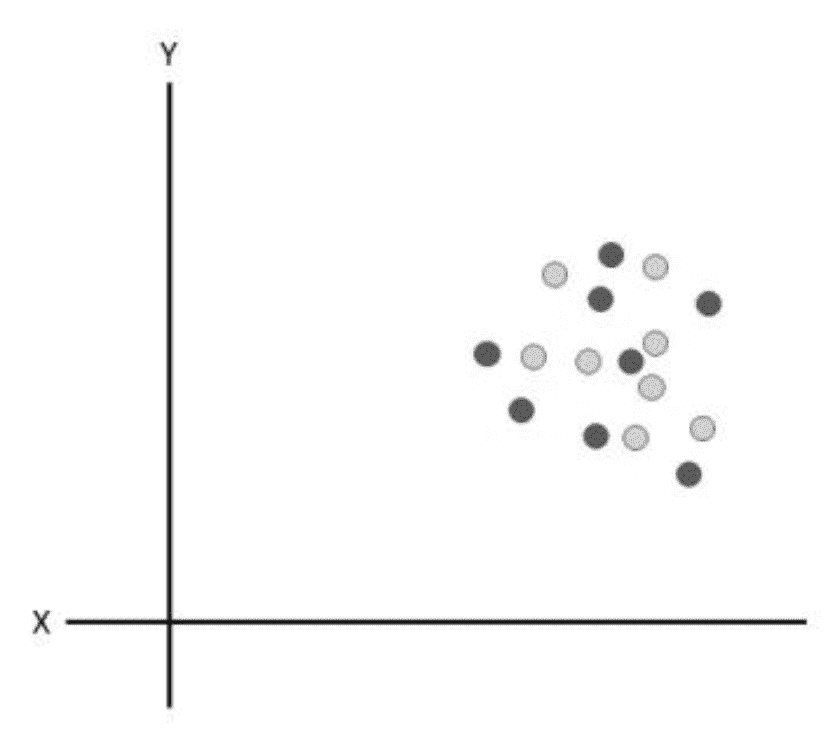

## 逻辑回归/分类

此方法用于分类因变量和分类变量。逻辑回归根据自变量计算概率。它给变量赋予“是或否”的值以进行排序。通常与二元分类一起使用。当你无法像上面的示例那样通过线性边界将数据分为类别时，就必须使用此方法。它是最常见的机器学习算法类型之一。它不仅将数据分为类别，还告诉我们某个类别存在的概率。我们通过取赔率函数来表示此模型，其中 `p` 是事件发生的概率；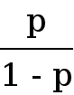并创建一个称为 logit 的公式 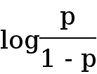

## K 近邻

K 近邻是数据分类中最简单且最广泛使用的方法之一。它是一种监督学习形式，既用于分类也用于回归，也是最基本的聚类算法。简单来说，就是取一个数据点，将其与散点图中最常见且最近的组放在一起。在 KNN 中，新数据点由其邻居 `K` 的平均中位数值进行分类。新数据点的最近邻居“投票”决定它属于哪个分类。`K` 是模型中投票的最近邻居的数量。将 `k` 设置为一个数字——这就是新数据点将分析以确定其适合哪个类别的最接近数据点的数量。数据点的接近程度使用欧几里得距离来衡量。以下两张图作为示例。我们将数据分为两个分类；白点和黑点。引入一个新数据点，即三角形，我们希望预测它属于哪个分类。在此模型中，我们选择了 `K=4`。如果你选择 `k=4`，则将分析四个最接近的数据点。邻近数据点中最普遍的类别就是新数据点将被放置的类别。在此情况下，你可以看到右侧图像中四个白点是最近的分类。因此，新数据点被分类到该类别中。 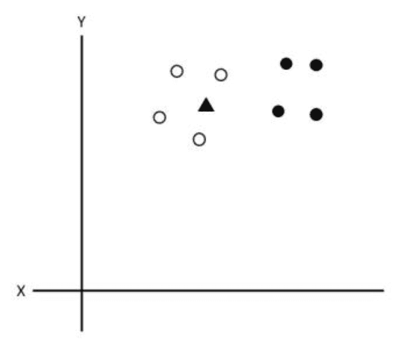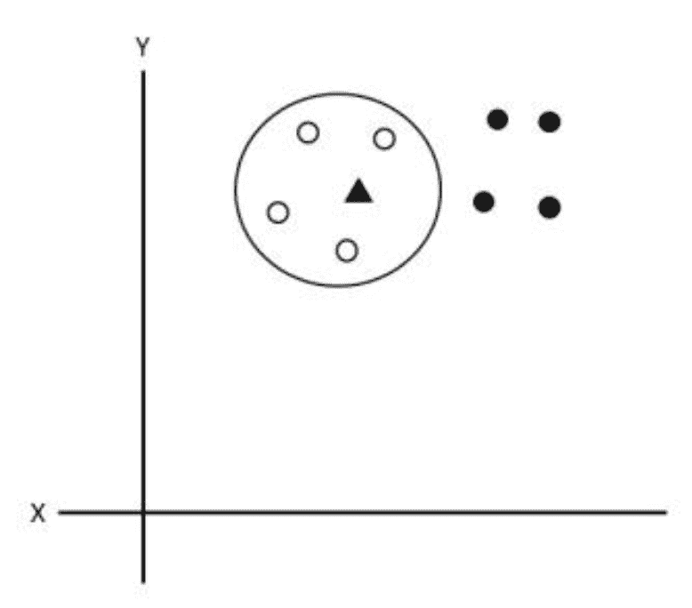

在选择 `k` 的值时，需要考虑几个因素。`k` 的数值越高，我们就越接近新数据点的真实分类。存在一个最佳点，`k` 的值应停止增加以避免过拟合。如果你选择使用一个过低的 `K` 值，那么你的模型可能会遭受高偏差的问题。如果你使用一个过高的数值，那么计算该值所需的计算能力将过于昂贵。你可能会考虑在选择 `K` 的值时使用奇数，而不是偶数。如果你使用奇数，那么在类别对数据点进行投票时，出现平局的可能性较小。数据科学家通常将数字 `5` 作为 `k` 的默认设置。如果你使用一个较大的 `K` 值，这将非常耗费数据。大型数据集也难以与 KNN 机器学习模型一起使用。如果你使用较大的数据集，那么你必须计算数百甚至数千个数据点之间的距离。当你在存在超过两个维度的模型上使用此方法时，它的表现也不好。这同样与计算许多数据点之间的距离所需的计算能力有关。

## 支持向量

支持向量是另一种分类器。它使用超平面进行分类。通常，我们会在较小的数据集上使用支持向量模型，其表现相当出色。

### 核支持向量

虽然我们稍后会讨论核支持向量，但它们用于对无法通过线性分离线分开的类别进行排序。分离线可以采用多种形状（线性、非线性、多项式、径向基、sigmoid）。回顾我们刚才讨论的线性边界分类，其分类看起来类似于以下图像：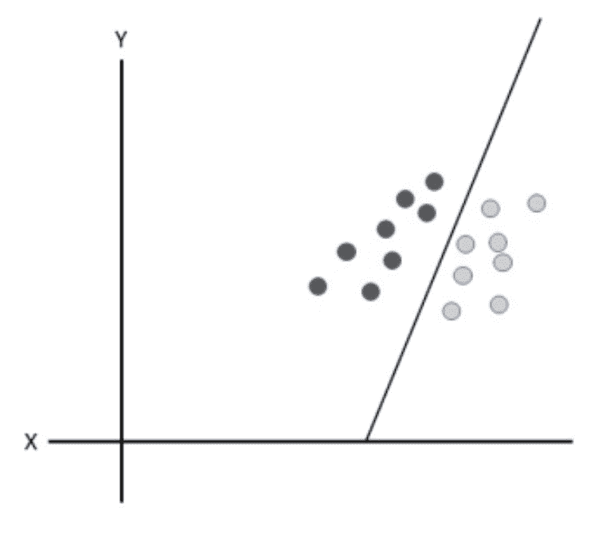在此图像中，我们的数据可以通过一条分隔两个不同类别数据的直线进行分类。如果数据总是能像这样分离就好了，但实际上情况并不总是如此整齐，事实上，大多数时候你需要以更像这样的方式分离数据：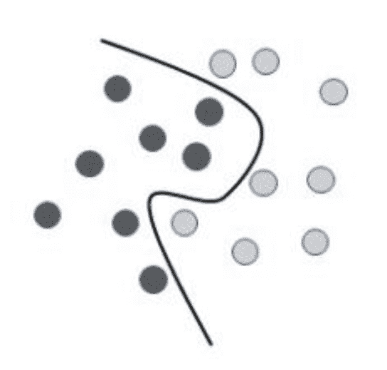在此示例中，数据无法通过线性边界线分离。因此，我们必须使用一种称为核技巧的技术。它使用数据点之间的相似度量来对其进行分类。

## 朴素贝叶斯

回顾监督学习第一节中的贝叶斯定理。在朴素贝叶斯模型中，假设预测器是独立的。该模型易于使用，在大型数据集中很有帮助。它常被用来帮助分类垃圾邮件。我们在此使用贝叶斯规则。贝叶斯规则的理念是，通过将新的相关信息添加到我们已知的信息中，我们可以根据这些新信息更新我们的知识。如果我们想知道今天下午下雨的概率，我们可以计算一年中下雨天数所占的百分比。但随后我们发现今天早上下过雨。你认为这会如何影响今天下午下雨的概率？因此，当我们获得更多关于事件的信息时，我们预测某事发生概率的能力就会提高。在数学上，贝叶斯定理表示如下：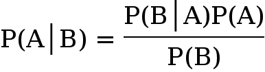因此，我们可以使用贝叶斯定理对新数据点进行分类。其工作方式是，当给出一个新数据点时，我们根据该数据点的特征计算其落入某个类别的概率。


## 无监督学习

无监督机器学习使用未标记的数据。数据科学家尚未知道输出结果。算法必须自行发现模式，而这些模式原本是未知的。在原本无法观察到结构的地方找到结构。算法自行发现数据片段。模型在原本未标记且无法识别的数据堆中寻找模式和结构。无监督学习使我们能够在没有计算机科学家的情况下无法观察到的模式。有时，大量数据集合中存在模式，而要筛选所有数据以寻找趋势几乎是不可能的。这对于检查消费者的购买习惯非常有用，以便您可以根据其行为中的模式将客户分组到不同的类别中。模型可能会发现市场不同子集之间的购买模式存在相似之处，但如果没有模型来筛选这些大量复杂的数据，您将永远无法意识到这些模式的本质。无监督学习的美妙之处在于，有可能在大量数据集中发现模式或特征，而没有模型的帮助您无法识别这些模式或特征。无监督学习的一个好例子是欺诈检测。欺诈可能是金融公司的一个重大问题，随着大量日常用户的存在，如果没有机器学习工具的帮助，公司很难识别欺诈。模型可以学习如何识别欺诈，因为欺诈手段会随着技术的变化而变化。如果您想应对新的、未知的欺诈技术，那么您需要使用一个能够在独特情况下检测欺诈的模型。在欺诈检测的情况下，拥有更多数据更好。欺诈检测服务必须使用一系列机器学习模型才能有效地打击欺诈。使用监督和无监督模型。预计明年（2020 年）将有约 320 亿美元的信用卡欺诈活动。用于欺诈检测的模型将输出（信用卡交易）分类为合法或欺诈。它们可以根据一天中的时间或购买地点等特征进行分类。如果商家通常的销售额在 20 美元左右，突然从一个陌生地点产生了一笔 8000 美元的销售额，那么模型很可能会将此交易分类为欺诈。使用机器学习进行欺诈检测的挑战在于，大多数交易并非欺诈。如果非欺诈交易中存在大量欺诈交易，那么信用卡行业将不可行。欺诈卡交易的百分比非常小，以至于可能会创建向该方向偏斜的模式。来自陌生地点的 8000 美元购买行为是可疑的，但更可能是旅行持卡人的结果，而不是欺诈活动。无监督学习使识别可疑的购买模式（如陌生的送货地点和用户评论中的随机跳跃）变得更加容易。

## 聚类

聚类是无监督学习的一个子组。聚类是将相似事物归类在一起的任务。当我们使用聚类时，可以识别特征并根据这些特征对数据进行排序。如果我们使用机器学习进行营销，聚类可以帮助我们识别潜在客户群体中的相似之处。无监督学习可以帮助我们将客户分类到我们可能无法借助机器学习创建的类别中。它还可以在您处理大量变量时帮助您对数据进行排序。

### K-Means 聚类

K-Means 聚类的工作原理与 K-最近邻相似。您选择一个 k 值来决定希望看到多少个组。您继续进行聚类并重复，直到聚类被更清晰地分类。您的数据围绕质心分组，质心是您在图表上选择的、希望看到数据聚集的点。您随机选择它们，并且有 k 个。一旦将数据引入模型，数据点将被放置在由最近质心指示的类别中，最近质心是通过欧几里得距离来衡量的。然后，您取每个质心周围数据点的平均值。继续重复此过程，直到结果保持不变，并且您拥有稳定的聚类。每个数据点只分配给一个聚类。您通过查找每个聚类中 x 和 y 的平均值来重复此过程。这将帮助您推断每个聚类中数据点的平均值。K-Means 聚类可以帮助您识别数据中先前未知或被忽略的模式。选择适合您希望创建的类别数量的 k 值。理想情况下，您应该有超过 3 个。但是，添加更多聚类的优势会随着聚类数量的增加而递减。您选择的 k 值越高，聚类就越小、越具体。您不希望使用与数据点数量相同的 k 值，因为每个数据点最终都会落入其自身的聚类中。您需要很好地了解您的数据集，并运用直觉来猜测有多少个聚类是合适的，以及会存在什么样的差异。但是，一旦我们拥有的潜在组别超过几个，我们的直觉和对数据的了解就不那么有帮助了。

## 降维

当您使用降维时，您是在精简数据以删除不需要的特征。简单来说，您是在缩减数据集中的变量数量。当我们的模型中有大量变量时，我们就有面临维度问题的风险。维度问题是大型数据集模型特有的问题，并可能影响预测准确性。当我们有许多变量时，我们需要更大的总体和样本总体来创建模型。有那么多变量时，很难有足够的数据来拥有许多可能的组合以创建一个拟合良好的模型。如果我们使用太多变量，也可能会遇到过拟合问题。过拟合是导致数据科学家考虑降维的主要问题。我们必须选择不需要或无关的数据。如果我们有一个预测某人收入的模型，我们需要知道他们最喜欢的颜色的变量吗？可能不需要。我们可以将其从数据集中删除。通常，不容易判断何时应该删除变量。有一些工具可以用来确定哪些变量不那么重要。主成分分析是一种降维方法。我们将旧的变量集转换为某种新的集合。我们创建的新集合称为主成分。在减少变量数量的同时保持模型准确性之间存在权衡。我们还可以标准化变量的值。确保它们都在相同的相对尺度上估值，以免夸大某个变量的重要性。例如，如果我们有以 0 到 1 之间的概率计量的变量，与以 100 以上的整数计量的变量。线性判别分析是另一种降维方法，我们将特征或变量合并，而不是完全删除它们。核主成分分析是降维的第三种方法。在这里，变量被放置在一个新集合中。这个模型将是非线性的，并且它将比原始数据给我们更好的对真实参数的洞察。


## 神经网络

神经网络是一种被称为深度学习的机器学习形式。它可能是最先进的机器学习方法，真正理解其工作原理可能需要博士学位。你可以写一整本书来介绍机器学习中最技术性的模型。神经网络是设计用来模拟人脑内部通信路径的计算机系统。在你的身体里，你有数以亿计的神经元，它们相互连接，沿着脊柱向上延伸进入大脑。它们通过类似根的节点相连，一次传递一个神经元的消息，一直传递到整个链条直到到达大脑。虽然目前还无法用计算机完全复制这一过程，但我们采用其核心理念并将其应用于计算机神经网络，以复制像人脑一样学习的能力；识别模式并从新信息的发现中推断信息。在神经网络的情况下，与我们所有的机器学习模型一样，信息作为数值数据通过神经网络进行处理。通过给出数值数据，我们赋予它使用算法进行预测的能力。就像大脑中的神经元一样，数据从顶部开始，逐层向下传递，首先被分离到节点中。神经网络使用节点在每一层之间进行通信。神经网络由三部分组成；输入层、隐藏层和输出层。下图中，我们有神经网络的可视化表示，圆圈代表网络中的每个单独节点。在左侧，我们有输入层；这是我们的数据进入的地方。数据通过输入层后，会经过几个隐藏层进行过滤。隐藏层是数据根据不同特征和属性进行分类的地方。隐藏层寻找数据集中的模式。隐藏层是‘魔法’发生的地方，因为数据是根据我们手动排序可能无法识别的模式进行分类的。每个节点都有一个权重，这将有助于确定正在排序的特征的重要性。

这些神经网络的最佳用途是对人类来说简单但对计算机来说极其困难的任务。回顾本书开头我们讨论推理和归纳推理时的内容。我们的人脑是归纳推理的强大工具；这是我们相对于能在几秒钟内计算大量数据的先进计算机的优势。我们模仿人类思维来构建神经网络，因为我们试图教会计算机像人类一样‘推理’。这是一个相当大的挑战。神经网络的一个好例子就是我们提到的，我们将神经网络应用于对人类来说极其简单但对计算机来说非常具有挑战性的任务。神经网络可能需要大量的计算能力。神经网络处理起来具有挑战性的第一个原因是构建准确模型所需的数据集的数量。如果你想让模型学习如何对照片进行分类，照片之间存在许多细微差别，模型需要学习这些差异才能有效地完成任务。这导致了下一个挑战，即神经网络正常工作所需的变量数量。你使用的数据越多，分析的变量数量越多，隐藏网络的数量就越多。在任何给定时间，都有数百甚至数千个特征正在通过模型进行分析和分类。以自动驾驶汽车为例。自动驾驶汽车拥有超过 150 个用于排序的节点。这意味着，自动驾驶汽车在同时分析数千个输入的情况下做出瞬间决策所需的计算能力是非常大的。在对照片进行分类的情况下，神经网络非常有用，数据科学家使用的方法也在迅速改进。如果我给你看一张狗的照片和一张猫的照片，你可以轻松地告诉我哪一张是猫，哪一张是狗。但对于计算机来说，这需要复杂的神经网络和大量数据来训练模型。神经网络的一个常见问题是过拟合。模型可以预测训练数据的值，但当它接触到未知数据时，它对旧数据的拟合过于具体，无法对新数据进行泛化预测。假设你即将参加数学考试并想要复习。你可以记忆所有你认为会出现在考试中的公式，并希望考试当天能够将新信息代入你已经记忆的内容中。或者你可以更深入地学习；了解每个公式的工作原理，以便即使条件发生变化也能取得良好结果。过拟合的模型就像为考试记忆公式。如果新数据相似，它会表现良好，但当出现变化时，它就不知道如何适应了。你通常可以通过模型在训练数据上表现良好但在测试数据上表现不佳来判断模型是否过拟合。当我们检查模型的性能时，可以使用代价值来衡量。代价值是模型预测值与实际值之间的差异。神经网络的挑战之一是无法确定特定输入与输出之间的关系。隐藏层之所以被称为隐藏层是有原因的；它们太难以解释或理解。最简单的神经网络类型称为感知机。它之所以简单，是因为它只有一层数据通过。输入层通向一个分类隐藏层，得到的预测是二进制分类。回顾一下，当我们将分类技术称为二进制时，这意味着它只在两个不同的类别之间进行排序，分别由 0 和 1 表示。感知机最初由 Frank Rosenblatt 开发。如果你想了解更多关于神经网络的知识，熟悉感知机是个好主意。感知机使用与其他神经网络模型相同的过程，但通常你会使用更多层和更多可能的输出。当接收到数据时，感知机将输入乘以给定的权重。然后将所有这些值的总和代入激活函数。激活函数告诉输入属于哪个类别，换句话说就是预测输出。如果你在图表上观察感知机，它的线会是这样的：

感知机图表的线看起来像一个台阶，在 1 的两侧各有一个值。台阶的这两侧是模型根据输入将预测的不同类别。从图表中你可能能看出，这有点粗糙，因为类别之间的线上几乎没有分离。输入变量的微小变化就会导致预测输出变成不同的类别。它在用于训练的原始数据集之外的表现不会那么好，因为它是一个阶跃函数。感知机的替代方案是一个称为 Sigmoid 神经元的模型。使用 Sigmoid 神经元的主要优势是它不是二进制的。与只能将数据分类为两个类别的感知机不同，Sigmoid 函数创建的是概率而不是分类。下图显示了 Sigmoid 神经元的曲线。注意曲线在 1 附近的形状，数据在该处由感知机进行排序；台阶使得仅基于微小差异对数据进行分类变得困难。使用 Sigmoid 神经元时，数据是根据其落入给定类别的概率来预测的。如你所见，线在 1 处弯曲，这意味着数据点落入给定类别的概率在 1 之后会增加，但这只是一个概率。


## 强化学习

强化学习是我们第三种机器学习类型。与无监督学习一样，没有给定输入。强化学习模型必须自行发现如何最有效。然后，数据科学家根据模型预测结果的能力提出改进建议，其评估方法是查看预测值与实际值之间的比较。这是最先进的机器学习类型，未来大部分机器学习工作都将在此进行。可以把它想象成玩游戏；随着时间的推移，你通过赢和输来学习。你通过游戏学习如何获胜，你越熟悉游戏，就越理解获胜的机制。随着时间的推移，数据科学家在模型收集和处理数据时给予反馈。它接收奖励信号，以便知道何时在预测某个结果方面做得好。因此，“赢得”游戏会给算法提供正反馈。这是用于游戏、机器人、导航和自动驾驶汽车的机器学习类型。

## Q 学习

在 Q 学习中，模型与环境通信以改进自身。你首先拥有一组状态。状态是环境中作为障碍和路径的事物。称为“S”。在国际象棋中，这将是你所有棋子可能的移动方式，以及所有对手棋子的位置。这些就是状态。可能的移动称为‘A’。如果你是兵，你的可能移动是向前一格。如果你是车，你的可能移动是沿直线向任何方向移动。Q 是模型的值，初始为 0。随着你玩游戏，Q 会根据其与环境的交互而上升或下降。在负面交互中，分数 Q 会下降。在正面交互中，分数 Q 会上升。算法学习如何移动以优化数字 Q。起初，它是随机的。随着时间的推移，这些随机移动会对 Q 产生正面和负面影响，机器学习如何每一步移动都会影响 Q 的分数。它必须玩很多游戏才能随着时间的推移改进其游戏方式。在现实生活中应用这个过程，说起来容易做起来难。

## SARSA

状态 动作 奖励 状态 动作 SARSA 和 Q 之间只有很小的区别。它们在给模型提供奖励响应方面功能相似。

## 深度 Q 网络

当常规 Q 不够通用时，应用深度 Q。当它看到以前从未见过的新事物时，它不知道该怎么办。Q 学习无法针对从未见过的事物进行自我调整。深度 Q 使用神经网络。

## 马尔可夫决策过程

具有一组可能的状态、一组模型、一组可能的动作和一个实数值奖励。该模型通过与环境的持续交互来学习。

## DDPG

深度确定性策略梯度 另一种奖励状态模型充当演员和评论家。

## 半监督学习

这种机器学习类型使用监督学习和无监督学习的组合。一些数据是标记的，而其他数据不是。但通常，大多数数据将是未标记的。半监督学习可用于分类、回归和预测。半监督机器学习很有帮助，因为标记所有内容将太耗时，并且可能损害发现新模式的能力。

## 集成建模

我们了解到，多样化我们的树可以创建更准确的预测。但是，如果我们不使用同一模型的多个版本，而是使用几个不同的模型呢？这是机器学习中的一种常用技巧，称为集成建模。通过结合多种不同类型算法的信息，我们可以提高模型的准确性和预测能力。集成建模全在于分而治之的思维方式。不同的模型会为我们提供关于数据的不同见解，这些见解可能无法被其他模型识别。通过结合从不同模型获得的信息，我们可以了解更多关于数据真相的内容。集成建模还有助于最大限度地减少预测中的偏差和方差。单个模型可能会有预测错误，但所有预测的总和将更加准确。

有几种不同的方法可以使用集成建模：第一种是取预测的众数。即，取在模型中出现频率最高的值。无论哪个预测出现的频率最高，或者拥有最高数量的“票数”，就是我们选择的预测。我们也可以取所有预测的平均值，具体取决于我们拥有的模型类型。所有预测的平均值将是我们的最终预测。我们的集成还应考虑单个模型的可靠性。我们的模型结果会获得不同的权重，使某些预测比其他预测更重要，具体取决于可靠性。

我们如何知道想要结合哪种模型？我们已经从这本书中知道，有几种类型的模型可供选择，每种都为我们提供不同的可能性和优势。一对常用的模型是将神经网络和决策树结合使用。神经网络为我们提供新信息，而决策树确保我们没有遗漏任何内容。除了我们之前讨论过的自助法和袋装法之外，还有几种其他集成建模方法。数据科学家使用所谓的“模型桶”。在这里，他们使用几种不同类型的模型来处理测试数据，然后选择表现最好的一个。另一种想法称为堆叠。堆叠使用几种不同类型的模型，然后使用所有结果来给我们一个结合所有模型的预测。数据科学家喜欢使用集成建模，因为通过多种模型，我们通常可以比单一模型产生更好的预测。集成建模的缺点是我们失去了一些可读性。多个模型同时协同工作使解释变得更加困难，尤其是当你想要与不具备数据科学知识的利益相关者共享数据时。

我们还可以使用同一模型的多个版本，就像随机森林通过自身的多个版本来改进预测一样——使用带有不同节点集和不同 k 值（或聚类数量）的神经网络，以查看这如何改变我们预测的结果，并找出是否存在 k 的最优值，或者是否存在我们可能忽略的组或子组。当我们已经有一个强大的模型时，这帮助不大。但是，如果我们结合几个预测能力较弱的模型，那么它通常会提高整体准确性。


## 机器学习必须知道的事项

要想在机器学习中取得成功，你必须拥有合适的工具来开展工作，就像盖房子一样，你需要具备所需的技能和工具。以下是进行机器学习所需的材料清单。

## 数据

要开始处理数据，你必须拥有足够的数据，将其分为两类：训练数据和测试数据。训练数据是在你构建模型之初使用的数据。当你最初创建模型时，需要提供一些数据供其学习。使用训练数据时，你已经知道自变量以及它们各自的因变量。这意味着对于每个输入，你都已经知道数据的输出。从这些数据中，你的模型将学会自行预测输出。我们的训练数据为我们提供了进行预测所需的参数。这是机器学习所依据的数据。

测试数据是你对模型满意后，机器获得的数据，用于查看其在实际环境中的表现。在这些数据中，我们只有自变量，但没有输出。通过测试数据，我们可以查看模型在使用新数据预测结果时的表现情况。你的训练数据应占据大部分数据，大约 70%，而测试数据则是剩余的 30%。为了避免偏差，请确保你选择用于训练数据和测试数据的数据在分割时是完全随机的。不要选择使用哪些数据；让它保持随机。不要将相同的数据同时用于训练和测试。

首先将训练数据提供给机器，并检查 `X` 和 `Y` 之间的关系，然后尝试查看你的模型表现如何。在此过程中需要考虑的最重要问题是：当模型面对新数据时，是否仍然有效。你可以通过交叉验证来测试这一点。这意味着你将在尚未使用过的数据上测试你的模型。留出一些在训练期间未使用的数据，以便在最后查看模型的准确性。你也可以使用 K 折交叉验证来检查模型的准确性。这种方法非常易于使用，且通常无偏差。当我们没有大量数据可用于测试时，这是一种很好的技术。

对于 K 折交叉验证，我们将数据分为 k 个折叠，通常在 5 到 10 之间。测试每个折叠，并在测试完成后查看它们在所有折叠中的表现。通常，k 的数值越大，测试的偏差就越小。

到目前为止，我们一直在讨论模型如何解释数据以寻找意义和模式。但是，我们将使用什么样的数据呢？我们将从哪里获取数据，数据又会是什么样子？数据是机器学习中最关键的组成部分。毕竟，你的模型只会通过数据学习，因此拥有相关且有意义的数据非常重要。数据可以有多种形状和大小，结构会根据数据的类型而有所不同。数据越结构化，就越容易处理。有些数据结构非常简单，这类数据更难以解释。面部识别的数据可能非常庞大，且对未经训练的眼睛来说几乎没有意义。结构化数据更加有条理。这是你刚开始时可能会使用的数据类型。它将帮助你入门，并让你开始理解机器学习中涉及的统计知识。通常，结构化数据会以一种熟悉的形式出现，如下所示，按行和列排列。这被称为表格数据集。

| Market Value | num\_bedrooms | num\_bathrooms | Sq\_ft | pool (Y/N) |
| --- | --- | --- | --- | --- |
| $207,367 | 4 | 3 | 2635 | N |
| $148,224 | 3 | 2 | 1800 | Y |
| $226,897 | 5 | 3.5 | 2844 | Y |
| $122,265 | 2 | 1.5 | 1644 | N |
| | | | | |


## 特征与数据准备

Recall that a feature is some measurable characteristic of a variable. In each column in a tabular dataset, we see a feature. This feature is some measurable dimension or attribute. Here we have used data reflecting the market value of a house as a function of the number of bedrooms, the number of bathrooms, square footage, and whether the house has a pool. Our market value is the Y; this is our dependent variable. Our independent variables, or our Xs, are `num_bedrooms`, `num_bathrooms`, `st_ft`, and `pool`. In supervised learning, you will already have the Y in your dataset. In this case, it's the market value of the home. With enough of this data in our model, even if we don't know the market value of a house we should be able to predict it if we have the number of bedrooms, the number of bathrooms, square footage, and whether the house has a pool or not. Data that is organized in this way is relatively easy to work with and have multiple independent variables like this makes this an example of the multivariate regression. How much data should you use? There is no set rule to how much data you will need for your model, but there are guidelines which you should follow. The most important thing is that when you have several independent variables to analyze, then your model will work the best if your data has as many possible combinations of the independent variables as you can get. If you do this, your model will still work even when it encounters a new combination of features that it hasn't seen before. It will have a pretty good way of predicting, even if the combination is completely new. A good general rule to follow is that you should have about ten times as many respondents as we do independent variables. In the case of our market value example above, we have `num_bedrooms`, `num_bathrooms`, `sq_ft`, and `pool`. This is four different independent variables, which means we should have at least forty respondents like the ones listed above to create a reliable model. Having a lot of variables can help us predict the Y more accurately, but that that be costly and make your data harder to process. You must also consider how you are pooling your data. The market values of houses in Los Angeles will be much different than the market values of houses in Cleveland. It’s also important to keep features as relevant as possible. Having multiple variables will help you make a better prediction, but there are variables that may just create bias in the model. Refer to Scikit learn to see what they recommend for data sizes for certain types of analysis. But not all data is useful. We often talk about big data, and it might be easy to assume that the more data we have, the better. But that’s not always the case. Some data may not be helpful. Certain variables might get in the way and may make it harder to find the true answer.

## 数据准备

So now you have your data, but how do you get it to a point where it's readable by your model? Data will rarely suit our modeling needs right out of the gate. For our data to be formatted properly, it usually requires a round of data cleaning first. The process of data cleaning is often referred to as data scrubbing. We might have data that comes in the form of images or emails. We need to rewrite it so that it has numerical values that will be interpretable by our algorithms. After all, our machine learning models are algorithms or math equations, so the data needs to have numerical values for it to be modeled. You might also have pieces of data that were recorded incorrectly or in the wrong format. There may be variables that you don’t need, and you must get rid of. It can be tedious and time-consuming but its extremely important to have data that will work and can easily be read by your model. It’s the least sexy part of being a data scientist. This is the part of machine learning where you will probably spend most of your time. As a data scientist, you will probably spend about 20% of your time doing data science and the other 80% of your time making sure your data is clean and ready to be processed by your model. We may be combining multiple types of data, and we need to reformat the recordings so that they fit together. First, in the case of supervised learning, pick the variables that you think are most important for your model. If we choose irrelevant variables or variables that don’t matter, we may create a bias and could make our model less effective. A simple example of cleaning or scrubbing data is recoding a response for gender. On your data, you have a column for male/female. Unfortunately, male and female do not have a numerical value. But you can easily change this by making this a binary variable. Assign female = 1 and male =0. Now you can find a numerical value for the effect that being a female has on the outcome of your model. We can also combine variables to make it simpler to interpret. Let’s say you are creating a regression model that predicts a person’s income based on several variables. One of the variables is the education level, which you have recorded in years. So, the possible responses for years of education are 1, 2, 3, 4, 5, 6, 7, 8, 9, 10, 11, 12, 13, 14, 15, 16. This is a lot of discrete categories. You could simplify it by creating groups. For example, you could rewrite variables 1, 2, 3, 4, 5, 6, 7, 8 = `primary_ed` and rewrite 9, 10, 11, 12 = `secondary_ed` and rewrite 13, 14, 15, 16 = tertiary education. Instead of having twelve categories, you have three. Respondents either have some primary education, secondary education, or some level of post-secondary or college-level education. This is known as binning data, and it can be a good way to clean up your data if it’s used properly. When you are combining variables to make interpretation simpler, you must consider the tradeoff between having more streamlined data and losing some important information about relationships in the data. Consider that in this example, by combining these variables into three groups instead of sixteen, you may be creating bias in your model. There a lot of factors that could require you to clean your data. Even a misspelling or an extra space somewhere in your data can have a negative impact on your model. You might have data that is missing. In order to fix this situation, you can replace the missing values with either the mode of the median of that variable. It's possible to remove data with missing values if there are only a few, but this just means you'll have fewer data to use in your model.


## 编程工具

为了处理你的数据，你需要特殊的编程工具，以便你可以告诉数据你希望它做什么。我们已经提到过，机器学习是计算机科学的一个分支。这就是它发挥作用的地方。在介绍中，我们说过，数据科学中最常用的三种语言是 `Python`、`R` 和 `C++`。选择哪种适合你将取决于你的经验以及你打算如何处理你的数据。数据科学中最常用的语言是 `python`。它由 Guido Van Rossum 于 1991 年创建，其显著特点在于比其他编程语言更易于阅读。它至今仍在不断开发和改进。它不难学习，并且与大多数相关数据类型兼容。它还具有单纯数据操作之外的应用，这些应用在机器学习中将很有用。`Python` 有几个免费的包可供你安装，这些包是为了给你提供通往常见数据科学工具的捷径而创建的。这些包为机器学习中常用的代码提供了捷径，这使得你需要做的工作更少。`Pandas` 是使用 `python` 的数据科学家必备的工具库。它允许你更轻松地操作时间序列数据和表格数据集。它以行和列的形式显示你的数据，因此更容易管理，这与你在 Microsoft excel 中查看数据的方式非常相似。它在网上很容易找到，并且可以免费下载。`Pandas` 在查看 `.CSV` 格式的数据集时很有帮助。`Numpy` 是一个使用 `python` 更快速进行数据处理的有用程序。它的工作方式与 `Matlab` 类似，可以处理矩阵和多维数据。它将帮助你更轻松地导入大型数据集。`Scikit-learn` 是另一个机器学习功能库。使用 `Scikit learn`，你可以轻松访问我们之前提到的许多算法，这些算法在机器学习中很常用。分类、回归、聚类、支持向量、随机森林和 k-means 等算法都有捷径，因此大量的琐碎编码工作已为你完成。`R` 是第三个选项。它可以免费使用且是开源的。`R` 既可用于数据挖掘也可用于机器学习。对于初学者来说，由于其易用性，它很受欢迎。它无法处理更高级机器学习操作所需的大型数据集，但如果你是数据科学和计算机编程的新手，它也不是一个糟糕的起点。为了运行这些程序，你需要一台计算机。通常，普通的笔记本电脑或台式机在处理较小和中型数据集时性能足够，尤其是当你刚开始接触机器学习时。虽然 `GPUs` (`Graphics Processing Units`) 已经存在了一段时间，但近年来其可访问性有所提高，这使得数据科学更加普及。它在数据科学领域是一个突破，因为该领域不再局限于拥有大型计算机的实验室。`GPUs` 以其作为视频游戏动力而闻名。它们允许计算机一次性解释多个点，这对于处理大量数据至关重要。现在 `GPUs` 允许我们使用更少的计算机硬件做更多的事情。其前身 `CPU` 核心拥有多个控制单元，允许信息一次性全部处理。与拥有多个控制单元不同，`GPU` 拥有一个更大的核心网络，可以同时处理不同的进程。一张 `GPU` 卡可以包含近 5000 个处理器。这是人工智能和机器学习的一项重大进步。它们可以帮助使神经网络的处理速度快得多。`C` 和 `C++` 是其他常见的数据分析语言。`C++` 的优势在于它是一种非常强大的语言。它可以非常快速地处理大型数据集。使用大型数据集的数据科学家通常选择使用 `C++`，因为它的速度和处理能力，尤其是在处理超过太字节的数据集时。`C++` 可以在大约一秒钟内处理一千兆字节的数据。这使得它对于深度学习算法、具有 5-10 层的神经网络模型和大型数据集特别有用。对于速度不够快的软件来说，这种模型可能会令人难以承受。如果你正在进行更高级的机器学习并且拥有多个 `GPUs`，那么 `C++` 可能就是适合你的语言。`C++` 几乎可以做任何事情；它是一种非常通用的语言。缺点是 `C++` 中的库不如 `Python` 中的库那么广泛。这意味着当你为你的数据和模型编写代码时，你可能需要从头开始。无论你决定做什么样的项目，在编写代码时都会遇到障碍。拥有一个在你卡住时能帮助你的库，将使你能够更快地学习和工作。


## 开发模型

你需要设置 Python 或其他编程语言来进行机器学习。你通过使用代码来操作数据集来创建机器学习模型。虽然本书不涵盖机器学习的编码，但我会简要介绍一些我推荐你用于机器学习安装的基本库和包。因为它是数据科学中最常用的语言，我们将在本章中以 Python 为例。我也认为，如果这是你的第一门语言，它是最实用的语言，因为它比其他编程语言更易读，并且在机器学习之外拥有广泛的能力。一旦你安装了最新版本的 Python，就有几个推荐安装的库，它们带有许多对你的机器学习工作有用的命令。所有这些都可以通过快速的谷歌搜索轻松找到，并且可以免费下载。Python 中用于数据分析和机器学习最重要的库称为 Pandas。它是数据集的一个非常流行的选择，并会让你的编码更容易、更快，尤其是当你仍在努力熟悉事物时。

## Python 的 Anaconda

开始使用 Python 的另一个选择是安装 Anaconda。Anaconda 的好处在于它为你提供了 Python 的每个包，因此你在为模型编写程序时不需要逐个安装包。它附带了你几乎需要的每种不同功能的所有库。Anaconda 是一个免费且开源的程序，适用于 R 和 Python。使用 Anaconda，你将可以访问几个有助于你进行数据科学项目的库。基本上，这为你提供了一个预打包的所有 Python 库的集合，其中有超过 100 个库。主要库之一是 Spyder 和 Jupyter。两者都是集成开发环境，这意味着它们是你编写代码的窗口，但它们比标准命令窗口更先进，并具有保存和导出/导入代码的选项。大多数 Python 用户将在名为 IDLE 的开发环境中开始。它非常简单，并为学习如何在 Python 中编码提供了良好的格式。当你在 Windows 计算机上安装 Python 时，它会自动包含。如果你有 Linux 计算机，它是可用的，但你需要单独安装它。IDLE 会让你在 Python 中的初步步骤更容易，因为你将能够保存脚本并稍后编辑它们。它还会引导你进行调试。要安装 Anaconda，请访问：docs.anaconda.com/anaconda/install 向下滚动，直到看到操作系统列表。选择你的操作系统。它将根据你的操作系统在其网站上为你提供安装 Anaconda 的说明。然后你就可以开始在 Python 中摸索了。我强烈建议使用互联网上可用的免费初学者 Python 教程之一。EdX 有一个免费的初学者 Python 教程，这是一个很好的起点。另外，充分利用 Reddit 等论坛，那里已经详细回答了大量常见问题，成员们总是分享机器学习世界的相关新闻。

## 算法

一旦你有了数据，以及操作数据的硬件和软件，你需要将它们结合起来。将数据放在你的编程软件上。在刚开始时，在网上找一个免费的数据集来使用。Kaggle.com 是免费的，并且有很多 CSV 格式的数据集可供选择，一旦你将 Pandas 库导入 Python，它们将很容易处理。监督学习最好的起步算法是线性回归和逻辑回归，无监督学习是 k-means 聚类。这些在刚开始时相对容易，你可以从那里构建其他模型。

## 可视化工具

你有了数据，现在你已经使用一种编程语言创建了模型，并且你有一整套数据科学库来帮助你更快地完成所有这些工作。你的电脑运行良好，你可以独立创建模型。你可能已经创建了显示有趣结果的模型，但为了将其分解为通俗易懂的术语并与利益相关者沟通你的发现，你需要以易于可视化的方式组织它。如果你是一个营销项目的数据科学家，你可能已经创建了一个帮助将客户分类并预测购买习惯趋势的模型。但如果你想将这些结果传达给营销团队的其他成员，你需要找到一种沟通方式，即使不熟悉数据科学的人也能理解你的结果。将你的数据分解为图表、图形和可视化内容将有助于补充你的分析技能。当你与不熟悉数据分析的受众沟通时，能够制作数据可视化是非常重要的。数据专业人士的一个流行工具集是 Tableau。像这样的工具被称为数据可视化软件。在一些公司，有员工的整个工作涉及将难以阅读的数据以易于可视化的方式呈现。像 Tableau 这样的软件非常常被依赖数据做决策的企业使用。Tableau 很有用，因为它相对容易使用，并且可以通过其平台实时查看数据。你可以自定义一个用于创建报告和图表的工具仪表板。它还让你能够与公司内的其他人分享你的结果。Tableau 可以用于从你在编程语言中分析过的数据创建图表和散点图。

## 更高级的有用事物

当你刚开始时，这些工具可能对你不那么相关，但谈论其中一些并考虑未来可能有用的东西可能很有趣。本书可能只是你成为机器学习专家之路的开始，所以当你稍微高级一些时，你可能会稍后参考这个列表。你应该继续思考非结构化数据的管理。通常，这需要更高级的程序，因为它更难管理和操作。这种类型的数据通常采用人类大脑在没有工具协助的情况下难以分析的过于复杂的形式，但这是机器学习正在朝着的方向。使用神经网络来模仿人类思维的功能，谁知道未来会怎样。我们在机器学习方面走得越远，我们的数据就越大。机器学习的可能性在不断扩展。未来重要的数据不会具有我们习惯的整齐结构，比如可以放入 Excel 表格的那种数据。这种类型的数据还需要更强大的计算机硬件和软件来处理这些大量信息的处理。通常使用某种云计算软件来承载大量信息，以及专门用于数据分析的 GPU。这种更高级别的计算可以帮助一次处理多个移动点。所需的数学也变得更难。结合算法。


## 后记

希望阅读本书后，你能很好地理解机器学习的基本原理。你现在已经了解了几种不同类型的流行机器学习模型及其用途。我们探讨了高级数据科学家如何使用机器学习来创建预测，以及他们需要哪些参数才能在引入新数据时创建准确且可靠的预测。数据科学和机器学习的魅力在于其广泛的应用范围。如果你走出去积累机器学习经验，那么将有广泛的工作和机会，与各种不同类型的数据打交道。无论你是喜欢商业竞争和刺激，想要使用预测股票涨跌或猜测客户下次会购买什么的模型；还是你对医学和医疗保健感兴趣，你可以应用机器学习来改善癌症诊断，并对疾病的特征及其对不同个体的影响获得新的认识。无论你的兴趣在哪里，都有机会将机器学习植入其中，以改进我们已经能够做到的事情。世界越互联，可用的数据就越多。几乎每个人都有某种智能设备在记录和跟踪其用户数据。数据科学家正在寻找更具创造力的方法来学习和解释这些数据。机器学习是数据科学家检查超出人类理解范围的趋势的一种方式，这意味着我们的预测将继续变得更加准确，我们的数据也将更加有用。计算机将继续变得更加强大，而这种力量将变得越来越容易获得，这意味着机器学习和数据科学将不再仅仅是流行语，而是寻找有价值信息的广泛应用方法。不再仅仅是大型企业在利用数据和机器学习；即使是小型企业，将大数据纳入其决策过程也变得越来越可行。既然你已经了解了机器学习的基本理论，现在是时候继续前进，并找到应用和实践这些知识的方法了。如果你有兴趣成为一名专注于机器学习的数据科学家，那么本书只是这个过程的开始。我强烈建议你致力于学习像`Python`、`R`或`C++`这样的语言。这是成为数据科学家的下一步，也是将这些机器学习理论应用到实际模型和算法中的下一步。多亏了互联网，有大量免费的书籍、视频和教程可供你学习计算机语言。学习如何编码并创建自己的模型，现在是最好的时机。本书只是关于该主题的大量可用信息中的一小部分。如果你认真对待机器学习，那么这不应该是你读的唯一一本书。你可以找到描述特定模型过程的整本书。神经网络是一个非常先进的领域，你可以找到仅基于这种特定模型类型的整本书。挑选几本统计学学习指南也不是个坏主意，这样当你有疑问时可以参考它们。留意可能的数据来源，你可能能够利用这些数据，以及可能值得用统计数学探索的潜在问题。仅就业机会就足以成为你在该领域追求更多知识的理由。缺乏能够应用本书中列出的方法和技术的有经验的数据科学家。这意味着，对于那些愿意动手并开始编写自己的模型的人来说，是一个机会。现在就有企业和组织在寻找能够正确使用这些信息的人。请记住，这种需求不会永远存在。已经，全球各地的大学正在创建专门针对数据科学（作为计算机科学和统计学的结合）的新学位课程。这意味着下一代数据科学家已经在路上了。所以，现在就开始你的学习吧。找一个在线教程和一些免费的在线数据集，开始弄清楚如何进行回归和分类，以本书为指南。一次学习一个模型。在互联网上找到完成的模型示例，并尝试看看你是否可以复制结果。学习编程语言需要时间，所以要有耐心，并寻找新的机会来学习和调整你的技能。尝试一个专门针对统计建模的在线社区，以此来初试身手，并从其他数据科学家正在做的事情中学习。我建议你查看`Kaggle.com`。这是一个为有志成为数据科学家的人举办统计建模竞赛的网站。不同的公司和组织会发布包含数据集的竞赛。这是尝试各种任务并获取可用数据的好方法。旧的竞赛也在线上可用，有大量相关的教程在`youtube.com`和其他数据科学社区供你学习。这可能是有志成为数据科学家扩展简历并与其他数据科学家建立人脉的最佳方式。如果你觉得这有用，你可能也会喜欢：[PYTHON MACHINE LEARNING: Discover the Essentials of Machine Learning, Data Mining and Artificial Intelligence Using Python Code with Python Tricks](https://www.amazon.com/dp/B07X43CYD7) By Samuel Hack 我想感谢你阅读这本书，如果你喜欢它，我将不胜感激你在 Amazon 上留下评论！

