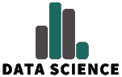
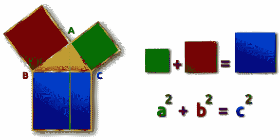
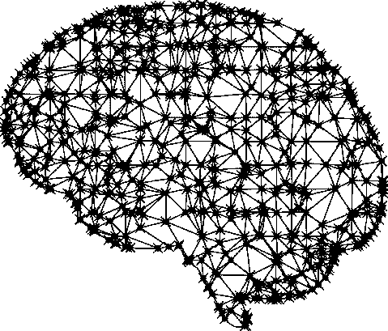

# 初学者机器学习入门：为什么机器学习在今天很重要，以及机器学习网络、算法、概念和神经网络的运作原理





# 序言

本书的主要目标是帮助人们采取最佳的可操作步骤迈向数据科学职业。随着互联网和在线服务的不断扩张，对数据科学家的需求正以指数级增长。

## 图书目标

本书将帮助你：

- 了解更多关于机器学习的基本原理，以及成为一名优秀数据科学家所需要的知识。
- 初步掌握机器学习概念和工具，使这项工作变得更加轻松。
- 建立机器学习的技术背景知识，并体会它的力量。

## 目标用户

本书针对多种目标群体设计。最合适的用户包括：

- 计算机技术初学者
- 软件应用开发和社会科学领域的专业人士
- 寻找以最简单、最容易的方法向学生解释内容的教授、讲师或辅导师
- 学生和学者，特别是关注机器学习和软件开发的人员

## 这本书适合我吗？

本书适合对机器学习感兴趣的人。数据科学家需要许多技能，例如编码、逻辑思维、对发现新事物的渴望等。

重要的是，你必须对此感兴趣，因为你痴迷于这类工作。你的驱动力不应该是金钱。如果是的话，那么这本书就不适合你。


# 引言

毫无疑问：人工智能就是未来。然而，人工智能也是现在。它是增长最快的科技领域之一，而且正如你可能已经意识到的，未来对优秀的人工智能程序员的需求只会增加。


我不确定你为什么要读这本书。也许你已经在学院或大学开启了学习人工智能和机器学习的道路，并希望有一本书能指引你走向更卓越的前行道路，并在你不断进步的过程中，帮助你理解课程背后的背景和逻辑。也许你正想要转行，以利用当前人工智能、数据分析和机器学习领域爆发性的需求浪潮。又或者你可能只是一个对学习感兴趣的爱好者，想确切了解大家都在谈论的“机器学习”到底是什么。

无论你的终极目标是什么，你都选对了这本书。这本书旨在拆解机器学习以及构建它的许多、非常多的概念。

本书将首先介绍机器学习以及它是什么，并解释为什么人们研究机器学习以及学习人工智能中这一特定领域的细微差别会从中获益。这将让你在阅读本书的剩余部分并开始思考如何在日常生活中应用这些知识时，有一个清晰的目标感。

此后，我们将开始将机器学习这一概念拆解成易于理解的部分。我们将从最大、最模糊的概念开始，然后慢慢深入到最细微、最复杂的层面。我们将学习机器学习的许多不同范式，以及如何在你自己的代码中对它们进行编程和实现，同时感受构建它们的算法。在整个过程中，目标仅仅是培养对机器学习这一宏大且困难的话题的赞赏。

现阶段的目标是对机器学习的内部运作建立非常深入的了解，这样当你完成所有细节和算法的学习后，你将能够进入书中任何主题的更深层级，并开始理解它们在更具挑战性和更费力的层面上是如何运作的。因此，我们将花费大量时间在算法层面，并将每种类型的机器学习拆解为各个各个学科，并讨论机器学习背景下使用的主要术语及其含义。

在完成这一切之后，我们将开始研究机器学习的应用。这将帮助你更好地感受机器学习及其工作原理，对于你理解我们所涵盖的这些许多概念如何合理应用将大有裨益。其范围将涵盖从邮件提供商实施的反垃圾邮件措施讨论，到机器学习算法在开发更智能的机器人等应用中的使用。

写这本书的原因很简单，我对机器学习和人工智能充满热情。我希望帮助你激发自己的热情，对这些极其有趣的话题产生真诚的热爱。这就是为什么这本书在设计时考虑了读者，使得你在读完本书后，会觉得这些钱花得很值。仅仅让你理解原始概念对我来说是不够的——我希望你理解一切背后的逻辑，并理解某些事情之所以被这样处理的原因。当你读完这本书时，我不希望你觉得只是为了读而读了；我希望你觉得对机器学习获得了一些其他途径无法获得的宝贵见解。


机器学习由两个核心学科组成：监督学习和无监督学习。此外还有强化学习。监督学习和无监督学习本身很容易理解，且在本质上是不同的。关于它们，我们将在书的后期进行深入探讨，以及构建它们的技术。然而，目前需要注意的核心区别是，监督学习和无监督学习都提供了一种让计算机改进预测数据的方法。一种使用某种交互组件（即监督学习），而无监督学习则依赖于机器验证自己的技术，并根据过程中发现的错误和正确方法进行学习/调整。

目前已经有许多不同的机器学习用途得到了探索。其中包括在数据科学领域的应用，在该领域中，机器学习被用于开发能够根据给定数据预测未来趋势的系统；还包括医学、机器人视觉、高级网络安全系统的开发以及日常应用程序通用改进的领域。例如，基于机器学习和贝叶斯识别模型的高级电子邮件垃圾邮件过滤器。

随着本书的深入，你将发现这些方法论可以有越来越多不同的应用方式，并更好地理解这些应用本身。当我们读到书末时，希望你已经对机器学习这个广阔且引人入胜的世界有了充分的掌握，以便你可以开始编写运行这些概念的自己的应用程序。

|  ||  ||  |

| --- | --- | --- |


# 第 2 章：机器学习对比人工智能与深度学习


“我认为这种人工智能将成为我们的伙伴。如果我们误用它，它就是一个风险。如果我们用得当，它可以成为我们的伙伴。” —— 孙正义

在本章中，我们将通过将机器学习与其他学科区分来，进一步深入机器学习的概念。也就是说，机器学习目前是一项非常大的事务；很多人发现它是计算领域的下一个大趋势，因此他们正试图通过尽可能掌握关于机器学习及其相关学科知识来跟上机器学习的行列。


这本身是非常好的，但同时可能会让市场变得混乱；现在进入机器学习的人几乎都熟悉另外两个概念：人工智能和深度学习。然而，由于本书是关于机器学习的，而这些概念相互相关但并不相同，因此我们花一些时间标记机器学习与其他这些学科之间的区别是有重要的。

首先，机器学习和人工智能之间的区别是什么？

这个问题的答案极其简单。机器学习之于人工智能正如微积分之于数学。因此，并不是所有的人工智能与机器学习有关，但所有的机器学习都与人工智能有关；就像并不是所有的数学都是微积分，但所有的微积分确实都是数学一样。

所以，在记住这一点的情况下，区别在哪里？嗯，机器学习显而易见是人工智能的一个子。人工智能包含了许多不同的方面和领域，例如机器学习、自然语言处理、路径规划以及类似的概念。任何涉及计算机能够根据给定数据进行处理并做出决策的内容，在某种程度上都是人工智能。

另一方面，机器学习特指一组技术、算法和理论的子集，旨在赋予计算机增强识别事物和做出决策的能力。因此，机器学习是人工智能的一个子集，专门专注于构建计算机智能。例如，人工智能可能涉及计算机学习解析语言和单词并通过寻找关键词从中推导出意义的部分。然而，教计算机学习什么是不同的词性，或者从一种语言中识别出另一种语言，绝对是机器学习的具体应用。

所以，说了这么多，机器学习和深度学习之间的区别又是什么？

深度学习也变成了一个某种流行词，但它仅仅是机器学习的一个子集。深度学习是使用类似于大脑中的神经网络来学习和工作。神经网络从人工智能早期就一直存在了，但直到最近计算机变得更加强大和高效，它们才开始变得特别有用。

当我们到达它们的特定子章节时，我们会讨论更多关于神经网络的内容，但现在只需要理解机器学习和深度学习的区别即可，深度学习仅仅是机器学习的一个子集。

通过这种方式，你可以将这三者想象成某种层级结构。人工智能是最广泛的形式，包含最多的主题。机器学习只是人工智能的一种形式，而深度学习只是机器学习的一种形式。以此类，深度学习只是人工智能的一种形式。

到此，我们已经涵盖了这三者的大部分区别。希望这有助于你对这三个不同学科及其之间的区别有更坚定的理解。在接下来的章节中，我们将探索机器学习，并在部分探索深度学习——沿途中的许多其他主题。

尽管深度学习并不是本书的全部重点，结果我们不会对其进行非常深入的研究，但它仍然是机器学习的重要部分，所以我们确实花一些时间涵盖它。

## 问题

*   人工智能的层级结构是什么？

*   深度学习与机器学习在哪些方面有所区别？


在哪些场景下，机器学习会大放异彩？在哪些情况下它并不有用？

“有些人称之为人工智能，但现实情况是它将增强我们。”

如果你想开始学习机器学习，最好的做法是先概述机器学习工作流。那么，究竟什么是机器学习工作流？机器学习工作流可以定义为用于机器学习开发的每一个元素，以及实现这些技术的方式。

然而，工作流通常被分为几个步骤，这些步骤允许团队和个人共同工作，以构建机器学习系统。这些步骤可以有不同的形式，但本章将主要关注机器学习工作流的概念。

## 第 1 步：规划与基础设施
第一步是制定计划。这似乎是一个显而易举的事，但它是整个过程中最关键的部分之一。无论你是团队合作还是独立工作，都是开发机器学习解决方案的重要环节。在这一阶段，你需要确定问题是什么，并确定一种可以通过机器学习来解决问题的方法。

在过程的这一点，你还想要确定你的解决方案对编程和计算的需求。某些语言在某些目的上更好。对于通用数据分析，`R` 语言非常流行，`Python` 语言也有广泛的应用。对于性能密集型或计算密集型任务，你可能需要使用 `C++`。在此时，每种流行的语言都有可以使用的机器学习 API 或库。

在此时，你还想要研究其他解决过类似问题的人，尝试遵循他们的路径，或者至少查看他们的方法论和结构，看看如何将其调整以适应自己的程序和技术。

## 第 2 步：可行性与数据
随后，你需要做的是固化你的成功标准。什么程度可以被认为足够并“完成”项目？它是否能够以特定的准确率进行预测？它是否能够审查先前数据并根据这些数据做出合理的假设？是否有特定的性能回报，例如，以最小的系统影响实现准确预测？这些都是你现在需要定的事情。

此外，你可能希望对相关信息进行研究，并尝试预测项目中固有的任何风险。为这些风险做好准备并保持领先。

最终，你会发现自己处于第 2 步；第 2 步是你查看整个项目的可行性，并检查你是否可以降低风险。这是在实际投入资源之前查看项目是否值得投入的机会。

在此时，你首先将检查你拥有的任何数据，然后检查数据好坏。你还将尝试确定你拥有的数据对于各种机器学习算法是否合适，并尝试确定它是否真的符合你的目标。

## 第 3 步：训练与调优
你需要概述程序架构的总体运行，并尝试找出可以使用各种不同方法来解决问题。在这一点，你还想要构建几个基础不同的机器学习模型，并在专门尝试调整系统之前，尝试以基本的方式处理数据。你所要做的只是判断模型是否足以应对你正在尝试的一切。你并不是在特地磨炼它们或让它们在你的数据或目的上完美运行。

最终，你进入第 3 步。在第 3 步中，你正尝试充分训练你的算法和模型以适应你的数据。这个过程基于对你的模型进行训练和微调。在第 3 步结束时，你希望完成所有的机器学习逻辑，微调所有的方程和算法，并且你本质上是想要拥有某种可以作为后续工作基础的可用软件。


在讨论了如何构建并实现你的机器学习工作流之后，我们现在花些时间讨论机器学习背后的实际概念。在本章中，我们将涵盖计算机学习的工作原理，以及计算机学习的三大类型。

所以，让我们先花几秒钟思考什么是机器学习。计算机是如何学习的？机器学习可以分为许多不同的类别，这些类别本质上定义了机器学习在不同场景下被理解和应用的方式。共有五类，这些类别定义了如何使用机器学习解决不同的问题。

### 1. 分类 (Classification)
第一种用途是分类。分类是指利用机器学习根据某些标准对事物进行分类，并利用机器在分类过程中学到的知识，以类似的直观方式对未来的事物进行归类。因此，通过分类进行的机器学习是教计算机如何通过识别某些特征对事物进行分类，然后根据这些特征将其放入已定义的类别或分类中。更高级的分类系统还可以创建自己的子分类或全新的分类。

### 2. 回归 (Regression)
第二类是回归。机器学习中的回归是指通过算法分析数据点，并以你的分析结果为起点进行数值预测。数值预测本质上将允许你利用已经呈现的数据，根据先前的事件创建一个新的数字。

### 3. 相似性或异常性 (Similarity or Anomaly)
第三种用途是相似性或异常性。机器学习这一类别的使用是指检测相似性或异常的能力，我想这有点是不言而喻的。相似性的概念是指识别或分类某个概念，然后利用它来检索本质上相似的事物。这可以通过分类完成，也可以不通过分类，但识别是过程中的重要部分，无论何种方式。异常的概念是指观察标准程序，然后寻找与这些程序的偏离之处。本质上，它是相似性的相反面。它不是寻找相似的事物，而是寻找不相似并因此异常的事物。一个很好的例子是游戏中的作弊检测系统，它们会寻找用户端的异常行为，然后利用这些行为推断用户正在作弊。

### 4. 排名 (Ranking)
第四类是排名。排名涉及利用机器学习反射性地排序并预测与给定用户输入最相关的内容。因此，排名本质上是取某个东西并将其作为起点。所有相关数据将反映在检索中，在被选取进行检索后，将根据与用户最相关的程度进行分类。用户选择的（一个多个）将根据其选择与给定输入查询相关的内容和数据来改进算法。

### 5. 序列预测 (Sequential Prediction)
第五种也是最后一种类别是序列预测。序列预测的想法本质上是观察当前序列中的趋势，然后尝试猜测下一个应该是什么。同样，系统将以标准且算法化的方式进行，并且如果允许的话，通常会根据用户的响应进行调整和进一步训练。

这些是机器学习的主要用途类别，因此它们是对机器学习作为最合适解决方案的问题的描述。这些用途类别听起来可能有些重叠，但它们为机器学习的应用提供了坚实的基础。


## 监督学习

让我们先来看监督学习。监督学习到底是什么？本质上，监督学习就是向你开发的程序输入带有某种目标（target）的数据。该特定程序的目标是在输入数据与你提供的目标之间寻找某种相关性。

因此，监督学习是指你拥有的某种数据，同时也提供了目标。程序可能简单地尝试在所提供的数据和提供的目标之间建立一种桥梁。然后，这段代码会通过算法尝试在所有输入数据及其与提供目标的连接之间寻找某种共性，以便程序能够通过算法利用这些关联和函数，根据未来的输入数据确定目标可能是什么。通过这种方式，你可以利用现有数据构建某种机器学习系统，该系统可以对未来进行预测。

另一方面，无监督学习没有提供目标。无监督机器学习仅由输入数据组成。因此，`x` 并不一定对应一组目标。与监督学习不同（监督学习中有人会直接告诉程序哪些数据应该与什么相关），而无监督学习缺乏这种监督者。你为程序开发的算法将完全负责推断给定数据集的细微差别，而不需要与人类进行交互。

在无监督学习与监督学习的对比中，其细微差别和区别可以相当清楚。主要的区别在于，监督学习需要人类主导，告诉程序哪些答案是正确的，以及哪些目标对应哪些数据。正是通过这种修正，监督机器学习实际上可以自我纠正其算法和分析程序，从而更擅长预测数据的变化。

机器学习的最后主要形式是强化学习。强化学习基于机器或程序通过试错的过程学习事物是如何运作的，然后审查结果并利用此内化某些过程。例如，如果给机器两个选项，选项 A 和选项 B，并且……


监督机器学习在很大程度上依赖于数据中的标签标记，即根据你的 `Y` 对数据进行赋值和分类，从而提供一种对 `X` 进行预测和范式化解释的手段。这是通过专门为机器学习定制的算法来实现的。

监督学习有两个主要重点，我们之前讨论过，但现在将更深入地探讨它们。它们是回归（regression）和分类（classification）。复习一下，回归是一种预测数据数值结果的手段；分类则是分析数据集并能够确定其 `Y` 值，然后根据其 `Y` 标签将其分为不同的组。

当然，这说起来容易做起来难（而且这本身“说起来”也不怎么容易，这本身就说明了问题并非易事！），但也有一种相对简单来看的方法。你可以将监督机器学习看作两个主要部分：首先是训练组件，然后是测试组件。

训练组件的核心是让程序根据一组数据学习预测函数 `f(X)`。这些数据必须同时包含 `Y` 和 `X` 值。另一方面，测试组件涉及另一组数据，其中程序不会被喂入特定的 `Y` 值或标签。测试组件旨在使用训练组件中的模型算法 `f(X)` 来预测 `Y` 值。

在章的其余部分中，我们将分解监督学习的不同方法以及它们如何整体应用于机器学习领域，以及你如何使用这些模型来实现回归和分类的目标。

|  ||  ||  |
| --- | --- | --- |


## 参数化/非参数算法


监督学习最基本且最容易解释的形式是开发数学算法来完成不同的任务。这些算法很大程度上基于数学，并根据你提供给算法的数据进行相关性调整。

这些算法既有参数化的（parametric），也有非参数化的（non-parametric）。它们的区别在于，参数化函数遵循非常严格且明显的模式；参数化函数通过假设数据内部存在规律来工作。也就是说，参数化函数假设 `X` 值和 `Y` 值之间存在函数数值关系，而且这种数值关系可以通过数学推导出来。

另一方面，非参数算法侧重于以非函数的方式找到 `X` 和 `Y` 值之间的联系；它们假设给定值之间没有统计和函数上的数值连接，而是专注于寻找它们之间无法推导为函数的统计连接。

这两者之间的区别在于，非参数函数具有更广泛的应用范围。它们不一定需要处理基于给定函数的数据，因此可以拟合更狭窄的空间，并比参数化函数具有灵活得多。然而，与此同时，由于参数化算法遵循数值标准并假设数字内部具有正态性和规律，当这些情况确实存在时，可能是一件好事，因为这意味着预测可以通过数值方式进行简化，因此很可能是准确的。另一方面，由于非参数函数不是在给定的标准数值函数 `f(x)` 内部工作来获取 `Y`，它们更多是基于寻找未知 `X` 与周围任何其他 `X` 值之间的联系，以确定 `Y` 可能是什么。

本节将介绍此类算法的几种不同模型。首先，我们将研究逻辑回归和线性回归，这是两种极其重要的参数化算法。然后，我们将研究 k-近邻（k-nearest neighbor）和决策树算法，这些算法将让你在非参数算法方面建立坚实的理解基础。

|  ||  ||  |
| --- | --- | --- |


## 线性回归


我们将来看第一个算法是线性回归。线性回归的概念非常简单，几乎是不言而喻的。然而，在计算机科学和人工智能中的实际应用可能是复杂的，因此我们将从这个视角来看并对其进行拆解。

所有参数化方法都假设数学函数内部有一组 set 参数，这些参数可以在输入数据和输出数据之间建立相关性。让我们在算法解释中分别将输入和输出数据称为 `i` 和 `o`。从这里开始，当我们提到 `X` 和 `Y` 时，我们指的是二维平面上的数据点。

线性回归假设输入 `i` 和输出 `o` 之间存在线性关系。因此，线性回归假设对于任何未知的 `o`，我们都可以合理地预测 `o` 为 `i` 的函数，这与目前所有已知数据在 `i` 和 `o` 方面运作的方式一致。线性回归的工作原理是在输入样本之间创建所谓的“最佳拟合线”（line of best fit），然后据此假设未来的预测将大致遵循这条线。

所以，我们假设数据将会是：

`o = 截距 + 斜率(i)`

在此模型中，它是之前公式的扩展：

`o = f(i) + e`

我们可以假设我们正在为该函数寻找两个参数：产生输出 `o` 的 `i` 的截距和斜率。

我们可以通过算法运行我们的数据，以尝试得出某种最佳拟合线。一旦发现了最佳拟合线，我们需要一个函数来衡量我们程序的准确性。然后，我们需要做些什么让它比现在更准确。

有了最佳拟合线，我们可以通过算法查看每个点的预测值，然后查看其与实际点之间的差异。然后，将这个差异平方。对所有不同的数据点执行此操作并求和，然后除以数据点乘以二，如下：

`sum of (o*x + i) - y)² / 2n`

从这里开始，你可以使用标准微积分最小化你的结果，找到算法 `o = f(i) + e` 的最佳参数。

然而，如果上面的函数足够复杂，有时你无法直接最小化。在这种情况下，你将希望使用梯度下降（gradient descent）。你通过简化函数来实现，使其仅取决于 `f(o, i) = c`，其中 `c` 是函数的代价，或预测的错误程度。你可以从两个方向找到该参数的导数。从示例参数找到总损失下降的方向，然后沿着该方向一直移动，直到你找到损失可能最小的地方。一旦这样做，你就完成了，并且你最小化了函数。

最小化是参数化函数最重要的部分，因为参数化函数完全取决于它们的参数。如果你能够找到函数的最佳参数，那么你就找到了适用于给定数据的最佳预测函数。

然而，情况并不总是如此。


| --- | --- | --- |


## 参数化问题 (Parametric Problems)


有时，在追求优秀解决方案的过程中，你会在构建良好且有价值的预测范式时遇到一些问题。这可能有几个原因，现在开始回顾这些问题非常重要，这样当问题最终出现时，你对如何处理它们心中有所数。

所以，思考一下——当你对预测函数进行建模时，你实际上在尝试做什么？你的最终目标是什么？嗯，你的最终目标是每当你用该函数解析某些新数据时，你能够根据之前的数据可靠地估计出可能的值的值。那么，什么会阻碍这一点呢？它应该是某种实际上降低了你的预测模型准确表示目标数据、并无法做出现实且与你已提供的数据一致的稳健预测的东西。

存在所谓的“偏差-方差权衡”（bias-variance tradeoff）。偏差（Bias）是指用模型来表示目标数据的能力。极高的偏差意味着模型与数据的拟合程度不好。另一方面，方差（Variance）指的是模型对模型内部偏差波动的响应程度。高方差模型能够很好地拟合给定数据。

其中存在两种均会影响你图表的独立现象：过拟合（overfitting）和欠拟合（underfitting）。

### 过拟合 (Overfitting)

过拟合是指你的图表偏差过低而方差过高。偏差意味着模型极其有效地解释了给定数据——它完美地合合数据。方差的意思相似——模型很好地表示了数据，但模型生成的预测与实际数据点之间存在很大的误差率。

目标是让你的偏差和方差都低。在这种情况下，你的模型不仅能很好地近似现有数据，还能作为未来数据的良好预测器。当数据过拟合时，模型拟合现有数据的能力“过头了”。这可能导致难以预测未来的趋势，因为连接你所有点的模型可能无法反映正在发生的实际模式。尽管它与实际数据的每一个预测点相比都是正确的，但它实际上无法对未来做出良好的预测，因为模型过于复杂，无法从中推断出有意义的参数数据以供未来参考。

### 欠拟合 (Underfitting)

另一方面，欠拟合是指你的图表偏差过高而方差过低。在这种情况下，模型不够复杂。偏差事实意味着误差范围太高，而方差过低意味着模型没有发生足够的变化来适应所有数据点。它未能准确捕捉到数据点的结构。

这些是你模型设计中需要注意的两个最大的问题，因为它们会极大地偏离你的预测。了解它们是什么、如何工作以及为什么会发生，是在问题发生时做好防范的最佳方式。

|  ||  ||  |

| --- | --- | --- |


## 逻辑回归 (Logistic Regression)


逻辑回归是我们涵盖的另一种主要的参数建模形式。它的工作原理与线性回归非常相似，但它应用了所谓的 sigmoid 函数，这反过来确保了函数将输出 0 到 1 之间的数字。

逻辑回归算法均可以用于项的分类。它允许你判断某物是否属于某类。它允许你根据之前的数据可靠地判断某物是否存在。逻辑回归算法可以用于项的分类。它允许你根据之前的数据可靠地判断某物是否属于某类。考虑到我们的线性回归公式。逻辑回归本质上是目标利用线性回归并使其在 0 到 1 的概率背景内工作，其中接近 1 的数字表示事件会发生，接近 0 的数字表示不太可能发生。逻辑回归基本上是为了考虑到 sigmoid 函数。这被建议考虑 sigmoid 函数并理解其工作方式。逻辑回归仅仅是应用于 sigmoid 函数。

|  ||  ||  |


这引发了一个问题——如何定义一个物体距离另一个物体有多近？有几种不同的方法可以实现这一点。我们在这里关注的是两种：欧几得距离（Euclidean distances）和曼哈顿距离（Manhattan distances）。这是两种并行且不同的距离形式，可以为你提供关于事物之间彼此有多远的不同观点。

欧几得距离可以被看作是从一个物体到另一个物体的直线距离。它源于三角形斜边的定义，试图寻找欧几得空间中两个物体之间的距离。不过，它可以扩展到任何维度。

回想一下勾股定理：

```
a² + b² = c²
```



通过代数，我们可以推导出斜边的长度（将两点之间的 `x` 和 `y` 距离视为直角三角形的边）如下：

```
c = sqrt(a² + b²)
```

要找到这些位置之间的差异，我们必须将它们相互相减：

```
c = sqrt((x2 - x1)² + (y2 - y1)²)
```

如果存在额外的维度，我们实际上可以将其扩展到任何维度。例如，如果我们处理的是具有三个不同维度的数据，我们可以像这样计算一个数据点到另一个数据点的距离：

```
c \= sqrt((x2 - x1)² + (y2 - y1)² + (z2 \- z1)²)
```

本质上，你可以将其理解为某些数值 `x` 到第 `n` 次方的的和：

```
c = sqrt(sum((x(n)2 - x(n)1)²))
```

这在任何两个给定点之间产生了一个极其有用的距离，你可以用它找到距离给定目标数据最近的数据点，然后得出某种有用的结论。

另一种距离是曼哈顿距离。这简单来说就是坐标差之和：

```
c = (x2 - x1) \+ (y2 - y1)
```

当然，它也可以扩展到你认为需要的任意维度。

你可以测试多个不同的 `k` 值，然后使用你的测试数据对它们进行比较。通过这种方式，你可以将预测结果与误差水平进行比较。然后你可以通过选择误差率最低的一个，知道应该使用哪个 `k` 值。

在极高规模下，这存在一些天然的问题；极高的 `k` 值可能会产生极其无用的数据，因为它处理的数据量过多，导致无法获得足够小的样本量。然而，这种方法在现实应用中具有相当多的用途。

例如，由于其灵活性，在数据不断输入且预测模型完全依赖于现有数据池的情况下，这种方法表现出色。它可以根据已有的数据进行预测，并随着新信息的加入几乎自动更新，因为你做的只是向系统输入更多数据。

此外，在某些现实情况中，了解距离某物最近的东西实际上可以给你给出一个非常可靠的预测。例如油价；一个加油站的油价可能与半径三英里内任何加油站的价格相似。通过这种估计，你可以对特定区域的油价以及特定加油站的预测油价做出合理的预测。

 ||  ||  |

| --- | --- | --- |


## 决策树


你应该了解的另一种主要的非参数算法是决策树。决策树用于根据一系列不同的决策，对特定情况下的未来数据做出可靠的估计。

决策树本质上是理解线性路径并基于这些线性路径的典型方法得出结论。因此，决策树擅长对基于人口的数据进行预测。可以从社会经济数据的角度对人口进行调查。例如，可以使用此来判断他们是否受过大学教育以及是否完成了大学教育。这将允许我们根据某人的社会经济地位，预测他们是否可能就读大学并完成学业。

目标是对每个数据点提问，然后以某种方式将它们分开，从而可以最大化你从每个问题或树的每次划分中获得的信息量。例如，在高等教育方面，社会经济地位是一个很好的起点，因为社会经济地位较高的人更有可能上过大学并大学毕业。事实是，越专业的工作倾向于带来更高的收入，而专业化意味着受过教育。

目标是在树的每一次划分处，你都最大化你通过该划分所获得的信息量。询问社会经济地位意味着我们有更多相关信息可以处理，而且我们的数据片段之间可能有更高的一致性（例如，不上大学的人更有可能与同样没上大学的人更近并分在一起，而与上大学的人在一起的较少）。

你可以通过大量的数据和决策划分构建决策树，然后通过此训练你的算法。此外，你可以通过此训练你的算法。此外，你可以通过此训练你的算法。这种重新训练会让你的算法变得强大。

使用许多不同的决策树将让你拥有一个更强大的算法。理想情况下，在创建这种算法时，你的决策树还将从数据中提取随机样本以更好地分离。

到此，我们已经涵盖了监督学习的另一种主要的非参数方法。

|  ||  ||  |

| --- | --- | --- |

## 支持向量机

[content]
支持向量机与其他参数算法的工作原理类似，并致力于完成与逻辑回归所做的事情，而且与逻辑回归相比，对系统运行性能的影响极小。在在这两种情况下，它们在系统影响和功能方面大致相同。

支持向量本质上是关于提取数据点并找到一条尽可能地分离它们的直线。如果一个目标数据点根据当前给定的算法落在直线的一侧或另一侧，它很有可能被归类为那时，因此我们赋予它所在一侧的分类。

如果你想象图上有两个被直线分开的数据簇，想象该直线实际上可能存在的不同方式并不难。然而，只有一种最优方式来画出这条线，使得直线与数据簇之间的空间最大化。这条分类线与数据点之间的距离被称为间隔（margin），你正试图让这个间隔尽可能大。


要找到最佳直线，你需要最大化你的间距。通常，你可以利用绘制出的直线两侧距离该线最近的数据点来执行优化算法。如果你在三维空间中工作，则是利用平面。这些点被称为你的支持向量，该方法的名称也源于此。

这应该为你的数据提供最优的直线和最大的间距。现在，假设由于某种原因，你的数据无法很容易被分离；你该怎么办？

你可以做两件事。首先，你可以放宽对“分离”的定义，以便在直线两侧允许更多的分类错误。这从整体上使得处理相关数据变得更容易，而且由于学习算法允许了更大的误差范围，你现在可以更轻松地分离它。

你可以做的另一件事是第三个维度，这将允许你分离数据。第三个维度可以是另一个数据类别，也可以是对前两个数据类别的处理，从而产生第三个数据类别。无论如何，重要的是，如果你决定通过另一个维度来分离数据，你就可以创建一个清晰界定你两个类别的新模型。

到此，我们已经涵盖了支持向量机，它是参数化或非参数化机器学习的最后主要形式。

|  ||  ||  |
| --- | --- | --- |


## 核（Kernels）


核是一个经常伴随机器学习的概念，特别是支持向量机。通常，核指的是径向基函数核。核提供了一种衡量两个不同数据点之间相似性的方法。径向基函数核专门允许你通过两个事物之间的距离来衡量它们的相似性。返回的数字在零到一之间，一为最大值，零为最小值。

零表示两者完全不相似，而一表示它们相似。其中一个参数（即 gamma）允许你定义一个距离，通过 RBF 核的视角，在该距离一个点被认为离另一个点太远，以至于与其相似。

|  ||  ||  |
| --- | --- | --- |


# 问

*   核和支持向量机是如何协同工作的？
*   线性回归与逻辑回归的优点分别是什么？反之亦然？
*   在拥有处理能力的情况下，构建决策树模型的最佳方法是什么？

|  ||  ||  |
| --- | --- | --- |


# 第 6 章：无监督学习


“人工智能正在迅速成长，机器人的面部表情也能引发共情并让你的镜像神经元颤抖。” — 迪安·阿克曼（Diane Ackerman）

无监督学习的目标与监督学习并行。监督学习主要关于编写某些程序，使其能够接受给定的标签，并根据这些标签应用于 `X` 数据集时，对给数据集做出预测。无监督学习则是基于拥有一组未分类、未标记或未赋予描述和符合目标数据的属性的数据。

这并不容易。本质上，你正试图在没有预定义结构的情况下在数据中寻找结构。这可能很难做到。实践无监督学习有两种主要方法——聚类和降维。这两种方法在各自领域都是非常有用的，并且有许多应用。

聚类在很大程度上是根据相似的属性将数据点分组的想法。执行此操作的算法方法可以根据数据和聚类的强度变得非常复杂或非常简单。

另一方面，降维是关于减少观察数据的特征和方式，同时保持数据的某种结构并允许数据继续具有价值。

就未来的应用而言，无监督学习可能比监督学习更有用，因为它的应用范围要大得多。它可以应用于许多情况，随着计算机变得越来越强大、算法越来越完善，无监督学习的各种用途只会增加。

现在，让我们来看定义无监督学习的两种数据处理技术。

|  ||  ||  |
| --- | --- | --- |


## 聚类


聚类的概念很简单，但可以通过许多方式实现。本节的目标是分解一些不同的方法，并对这些想法本身建立更深入的理解。那么什么是聚类呢？

聚类名副其实；它是根据被认为相似的属性对数据进行分组，并有清晰的。逻辑是：如果你有六个事物，它们具有相同的属性规格，其中四个事物具有某些共同属性或极其相似，而另外两个本身也非常相似，那么你可能有两个不同的组。

在此记录一下，这些属性被称为维度。每条数据至少有一个维度，要以图形式表示则至少有两个维度。我们稍后会详细讨论维度。最流行的聚类形式是 k 均聚类（k-means clustering）。在 k 均聚类中，你正试图将数据分成特定的 `k` 数量组。如果你将 `k` 设置得更大，那么分出的组就会更多；较小的 `k` 意味着组较少。k 均聚类的最终目标是开发出一系列不同的标签，将每个目标指向所创建的组之一。这些就是大多数时候反馈给你的结果。这些组基于被称为 `centroid`（质心）的数据。质心是通过某些属性被指定为质心的数据。在 k 均聚类算法结束时，你实际上已经在数据内部根据你分配的任意数量的组形成了清晰的界限。这是你会遇到的最常见的聚类形式。


|  ||  ||  |
| --- | --- | --- |


## 降维


降维是尝试让你的数据集逐渐降低复杂性，同时确保你没有剥离任何潜在的有用信息。这说起来容易做起来难。在这里我们将介绍一种被称为主成分分析（Principal Component Analysis）的主要降维形式。

主成分分析本质上是理解特定维度空间内最相关的数据点和向量。请记住，可视化直到第三维实际上是可行的，之后就会变得困难得多。

从本质上，主成分分析是寻找所呈现数据中的共性，并在保持整体数据方差的同时将其减少一个维度。最重要的点是那些包含大部分方差的点。方程的重新映射导致数据维度更小，但保持了与数据相同的本质形状和结构。从这个意义上说，你本质上压缩了数据。

|  ||  ||  |
| --- | --- | --- |


## 神经网络


时候到了——是时候谈谈整个机器学习中最难处理的概念之一了。它也是最受欢迎的概念之一，而且我们已经研究它很长时间，直到最近计算机性能的提升才让我们开始更有针对性地处理它。这个概念当然是神经网络。



什么是神经网络？让我们从神经元是什么开始。你可能已经知道，神经元是大脑实际管理信息的手段（简而言之）。神经元由电荷驱动，是大脑中向大脑其他部分发送信号的微小组件。（再次，简而言之。）

神经网络是根据构成许多不同哺乳动物大脑的生物网络建立的模型。神经网络的学习非常令人叹为观且复杂，由于其强大和复杂性，精通神经网络的人在目前行业中需求量极大。

最基本的事实是，关于神经网络的教科书有长达 1000 页的巨著，而我们不可能在这里真正涵盖所有内容。相反，我们将涵盖许多基础知识，以及它们如何与深度学习相关，以及它们为何如此受欢迎。从那里，希望你能够以其他方式扩展和应用你的知识。

所以，让我们从对神经网络如何工作的理解开始吧。本质上，神经网络是计算机利用大量不同的信息来做出一个有限决策的方法。这种决策过程通过一系列被称为“层”的复杂考虑过程完成。在输入数据和输出预测结果之间发生的任何审议都被称为隐藏层。

让我们将其拆解一下，让它暂时变得抽象一点。神经元是如何检测数据的？真实大脑是如何识别世界中的事物的？信不由，这并不是通过对大块信息进行整体识别的。例如，当你看到一辆车时，你并不是把它看作一个整体并说那是一辆车。也许你内部是这么做的，但在识别某个东西时，你的大脑实际上在分解许多细小的上下文线索，这些线索在脑的不同区域被捕捉到。这些特定特征是以极低级的特征来理解的，然后构建成中等特征，最后一直提升到最高水平。所以，你并不是看到一辆车，你实际上看到了其他特征——它各种特征的形状和轮廓，然后你将其识别为门或后视镜，最后你将其识别为一辆车，最后你可能将其识别为某个品牌或型号。这种识别过程发生得极快——实际上是瞬间完成的。事实上，如果发现其中任何一点不符合你最终识别其为汽车的情况，你就不会把它看作一辆车。例如，如果它没有轮子，但有汽车的其他特征，你又注意到它正停在水里，你会推断它是一艘船。

这种由小特征累积成更大特征，再累积成更大特征的巨大识别网络被称为神经网络。神经网络在它们所领域非常出色。事实上，神经网络非常棒，因为它们可以从字面上处理任何函数。

为什么这很有用？因为现实世界涉及许多变化和许多变异。事情并不总是像线性方程那样简单，其他方法并不总是能很好地处理这种线性链的断裂。然而，神经网络可以。神经网络做得非常好，事实上，因为它们能够根据各种现象进行调整，并考虑到数据中的不同变化。

这特别适合用复杂方式处理的事情。一个例子是图像识别。用线性模型可靠地进行图像识别极其困难。

为什么用线性模型很难进行图像识别？因为事物不只有一种朝向——它们有许多不同的朝向。它们还有许多不同的形状，并且可以是任何数量的颜色。例如，马有一组一致的特征，可以将它与猫或狗区分开。然而，动物本身可能是任何数量的不同品种、颜色等等。

现在，既然如此，为什么这很重要？理论上，我们难道不能找到一个动物的平均示例，然后以此为手段形成一个它可能是什么的复合体吗？光是这不能为我们提供一个预测依据吗？可能吧，但仅当我们允许单向的图像呈现方法时。然而，当你开始考虑额外的朝向时，要有一个单一明显的输出节点来检测这些特征并据此得出一个或另一个结论就会变得混乱。而且，如果你寻找一种方法实际上将这些特征堆叠在一起同时对它们进行测试——例如，将你的“示例”动物的不同朝向组合成一张图像——你最终将得到一个非常混乱且难以识别的动物描述，这在预测分析方面对你没有任何帮助，因为真实数据永远不会与此匹配。

所以，我们最终需要更全面的东西。我们需要更智能的工具。我们需要的不仅仅是像素级的比较和概率矩阵。我们需要的是神经网络。

神经网络的工作方式本质上是通过多个不同人工神经元的缓慢稳定激活来实现。这些人工神经元激活的精确方式将给出关于问题物体最可能的预测结果。一个良好且训练良好的神经网络能够以高准确率做出预测。


本质上，神经网络是关于识别数据中微小且具体的特征，然后利用这些特征来实现更抽象的概念；这些概念会逐渐变得越来越抽象，直到最后你得到了你想要预测的抽象概念。你神经网络的最后一层将是前一层（或几层）所导出的所有不同概率的集合。

神经网络会随着你的运行逐渐弄清楚这些事情，尝试随着时间的推移提高函数的准确性，并在学习过程中自动重新调整，这在某种程度上是无监督学习的一种形式。

隐藏层是神经网络最关键的部分，因为它们是魔法发生的地方。即使仅仅有一个隐藏层，神经网络已经能够识别数据中的任何数学函数了。你实现的隐藏层越多，随着你的深入，特征就可以变得越抽象，这将让你能够随着时间的推移识别（并借此预测）越来越多越来越高级的数据集。最终，你可能会拥有一个由不同数学和代码交织而成的复杂神经网络，它极其难以解释，你可能并不知道内部发生了什么——这被称为**黑盒**，而试图改进黑盒的状态被称为**黑盒优化**理想情况下，这是你不惜一切也要避免的，因为它让你让你在很大程度上失去了对神经网络的控制权，并且让你很难从根本上内化并理解数据内部发生了什么。

神经网络有多好？它好得惊人。通过相对较小的代码库，只需理解神经网络背后的逻辑，你就能实现令人印象的事情。随着深度学习的出现，神经网络也经历了扩张，使得神经网络变得极其流行。

|  ||  ||  |

| --- | --- | --- |


## 深度学习


深度学习很大程度上是神经网络最常见的实现方式。它是最近让神经网络成为关注焦点的核心，也是人们开始转向深度学习的首要原因。

深度学习允许神经网络进行许多非常酷且具体的实现，例如图像识别，或者以比以前翻译范式更动态、更自然的方式帮助翻译文本。我们将在本书中深入探讨机器学习的大量其他应用，专门有关于机器学习应用的章节，所以不用担心这一点。现在，我们只谈论深度学习、它是什么，以及它为什么如此有用。

深度学习本质上是使用非常复杂的神经网络将事物分解为其组成部分的过程。这些较大的概念可以是任何事物。例如，在翻译的情况下，它可能是将一个句子分解为更小的单个单词，然后通过观察人们使用这些单词的其他方式，或者他们过去正确的翻译方式等在此进行构建；这一切使计算机能够在某种程度上学习语言的结构以及语言运作的方式。


我们在书中之前探索过的机器学习模型在很大程度上侧重于使用预给数据（有时甚至是带数据）来进行预测。然而，有时这并非最佳途径。就像现实生活一样，很多时候，最佳路径实际上是基于对刺激的反应以及通过因果过程得出的。强化学习的核心在于迎合这一特定过程，使机器能够以流动的、动态的方式进行学习，而不是严格基于数据进行学习。

所以，让我们花一点时间谈一个强化学习的例子。大家都知道这样一个例子：一个孩子在不幸地碰了热炉灶之前，并不知道自己为什么永远不应该碰热炉灶。然后这个孩子学到了：“哦，我真的不应该碰热炉灶，这样做我几乎得不到任何好处，”从那以后，希望他们再也不会碰热炉灶了。这就是强化学习的基础。

然而，在实际应用中，强化学习比这要复杂一些。你可以将强化学习作为一种理解手段，例如，朝特定目标的导航。假设你是一只在迷宫里的猫，迷宫的尽头有一大碗牛奶。沿途中散落着一些猫粮，但在此过程中，你试图避免踩到鼠夹。我们可以将其视为分级收益，其中大碗牛奶是大奖励，猫粮是小奖励，而鼠夹是小惩罚。你还可以在某些地方将猫粮聚集成群，而在另一些地方则不是。

经过一番探索，你最终会找到一个相对较小的猫粮集群并吃掉它。然后你可以不断回来吃这个集群的猫粮，这每次都能带给你相对较小的奖励。然而，如果你一直这样做，你就永远不会意识到迷宫内还有其他可能更大的猫粮集群。不仅如此，你可能永远不会决定到达迷宫尽头去获得你的大碗牛奶。

所以，在这种情况下，你该做什么？你所面对的是被称为**探索（exploration）与利用（exploitation）之间的权衡**。探索是指积极寻求更大奖励的状态，即使在任何给定的位置 `p` 下，它可能不是已知的最佳选择，而此时你可能已经在利用某个奖励。例如，如果你发现了一个小的猫粮集群并开始吃它、利用它，那么从你的位置逻辑来说，继续利用该资源是合理的，因为你有一个有保障的重复小奖励。然而，这也需要承认一个事实：如果你继续向前走，迷宫的后面可能会有更好的奖励。

这通过 `epsilon` 来体现。`epsilon` 是在任何给定时刻，智能体（agent）决定采取随机行动，而不是仅仅根据其为止学到的知识为了奖励采取行动的概率。较高的 `epsilon` 表示将花费更多时间在探索上，而不是专注于已经已知的奖励。

由强化学习驱动的智能体移动可以通过马尔可夫决策过程（Markov Decision Process）进行标准化。马尔可夫决策过程基本上是一个满足以下的过程：

*   任何给定的位置或点被视为一个状态（state），
*   这些状态中的每一个都有一组不同且有限的动作可以执行，
*   这些状态之间的连接（通常称为 `Markov Decision Process`）

强化学习比这要复杂一些。你可以将强化学习作为一种理解手段，例如，朝特定目标的导航。由强化学习驱动的智能体移动可以通过 `Markov Decision Process` 进行标准化。


其他人则专注于自动驾驶汽车和机器人技术概念，以及这两大类别如何帮助改善人类的日常生活。他们将人工智能视为一个最终目标，而不仅仅是一个必经之路，因此他们专注于将人工智能作为一门学科来培养。这将使计算机变得更智能、更符合直觉，然后将这些直觉和理性发展成精简且高效的计算机系统，从而对我们的日常生活产生影响。

机器学习有许多不同的子集和应用，多到这种程度，以至于你所关心的特定领域将包含大量的信息和细微差别。我个人建议你尝试来自几个不同领域的几个不同项目，看看你最喜欢哪类内容。例如，我个人并不怎么喜欢处理数据，但帮助计算机理解语言和情感的想法对我来说非常有趣。还有许多人致力于通过计算机模拟人类的神经结构，以及许多许多其他学科。

请注意，当你专攻人工智能时，你不仅仅是在专攻计算机。这是一个棘手的部分。不，人工智能的应用和编程意味着你不仅要深入理解计算机科学方面——即绝大多数计算机运行的核心原理、如何更好地管理内存——以及统计和数学方面——为函数 `f` 寻找算法方法并将其推向整个数据集、寻找给定回归线的边际等等——而且还有这些技术的特定应用空间。例如，如果你不了解语言学，那么将这些结构应用于语言的想法又有什么用呢？如果你不了解生物化学，那么扩展我们的机器学习知识来发现新药又又有什么用呢？以此此类推。正因如此，如果你想在机器学习方面变得极其精通，你需要选择一个子集，坚持下去，学习它，并尝试改进它。样样精通的人很难产生真正的影响，最好被归类到补丁代码和代码维护中——如果你想做这些的话，那也可以。

|  ||  ||  |

| --- | --- | --- |


## 不要重复轮子


你会注意到，在本书的过程中，我们非常关注算法的原始概念，并对数学方面涉及了一小部分，但我们还没有严格关注这些算法在代码语境下的应用。这是因为在很大程度上，这些算法基本上已经有了实现。

开发你自己的机器学习库和机器学习算法是一种严谨和自力更生的表现，但在大多数情况下这是没有必要的。那里有许多库，如 `TensorFlow`、`SciKit` 等，它们已经建立了处理数据集、执行常用算法操作，然后处理相关数据的程序。

对于一本机器学习的入门书来说，完全没有必要关注所有这些逻辑的硬性实现上。这也是因为每个库对这些想法的解释都可能非常不同。因此，任何代码示例都是：

*   多余的，或
*   可能会更改

更不用说语言和库之间的差异了。（用 `R` 编写的代码与用 `Python` 编写的代码差异巨大，而后者与用 `C++` 编写的代码又完全不同）在没有任何硬性样本数据的情况下，对于这类问题，即使是用伪代码画出解决方案也几乎是不可能的。

最好的办法是找到一个你喜欢的语言和库——我个人推荐像 `Python` 这样的工具，因为它有很多现成的机器学习库，以及用于显示此类数据的库（如 `matplotlib`）——然后为该库找一个全面的教程。别担心——随着机器学习的流行，一定会有教程的。

在书的开头，我说过学习神经网络最好的方法是亲身实践，而且在细节上花费太多时间将是极大的浪费。这是正确的。最好的办法就是出去，亲手操作。

|  ||  ||  |

| --- | --- | --- |


## 与其他项目协作


世界上有很多人在处理机器学习结构。非常多。作为一名程序员，你能为自己所做的最好的事情之一就是出去，开始使用这些其他人编写的一些代码，并自己对其进行琢磨。

这样做有两个原因。首先，总有比你更优秀的程序员。每当你打开并阅读他人的代码时，你都能从中学习。这就是你获得大量技能的方式。你还将在通过观察他人如何使用 `APIs` 来学习它们。

然而，另一个原因是这纯是获得经验最好的方法。诚实地说，你正在进入一个极其陌生的领域，而且任何给定库的文档并不总是能给你所需的所有信息。在这些情况下，看到他人使用代码并以你可能想到的以外的方式来实现功能，会有很大的帮助。

如果你想成为一名优秀的机器学习人才，这就是你可以做的三件最好的事情。通过学习这些最佳实践，你将走上通卓越的道路。在下一章节中，我们将观察到目前为止涵盖的内容的应用，以便你有一个实用的范式开始想象。

|  ||  ||  |

| --- | --- | --- |


## 问题


*   为什么你不应该重复发明轮子？
*   你应该专注于一件事还是多件事？
*   自己着投入自己的项目优缺点是什么？

|  ||  ||  |

| --- | --- | --- |


# 第 9 章：算法与应用


“AI 辅助驾驶是推进基础的人类本工人工智能研究，同时产生实用应用的完美平台。” —— 李飞飞

本章将主要关注机器学习的当前应用，以及它目前如何被用于解决非常困难的过程。正如你已经学过的，机器学习——特别是神经网络和深度学习——确实为计算机打开了解决某些可能无法解决的困难问题的大门。


## 学习算法


在开始其他内容之前，让我们先从学习算法的概念开始。在整本书中，我们已经讨论了许多不同的学习算法，但让我们先从概念上讨论一下什么是学习算法——仅供你以后参考。学习算法是指任何能够让你从数据中学习的工具。这些可能是方程，也可能是从给定数据集中提取有用数据的软件解决方案。无论何种方式，它们的最终目标都是为你提供某些数据进行处理，并在未来的案例中据此做出预测。

在这方面，我们已经在本书中讨论了海量的不同学习算法。然而，学习算法只是冰山一角。当你阅读书的剩余部分并思考机器学习的应用时，请尝试真正思考一下我们书中之前讨论过的内容如何被用于实际实现这些不同的功能。

|  ||  ||  |
| --- | --- | --- |


## 基于文本的服务


在与机器学习应用方面，我们要讨论的第一点是机器学习如何极大地增强了某些基于文本的服务的能力并允许它们蓬勃发展。具体来说，我们将研究网络搜索和反垃圾邮件。

机器学习通过结合各种监督和无监督学习技术——如聚类、分类和回归——为用户提供了更好的搜索结果，这使网络搜索获益匪浅。以前在索引和排名用户搜索结果方面表现平平的网站，通过观察用户在搜索后最可能点击的内容，以及他们在点击页面后返回执行搜索查询的概率，能够积极改进它们的算法和索引能力。这使得计算机能够动态地学习用户在输入特定搜索词时到底想要什么。

它还考虑了时间和活动水平。例如，如果有许多人在某个特定时间开始点击与某个名人相关的特定链接或新闻故事，算法会迅速反应，并在短时间内获知关于这位名人发生了什么。然后它会进行相应的调整，并开始显示更相关的新闻故事，而不是不重要的信息。

不过，这并不是机器学习极大增强基于文本服务的唯一方法。另一种方法是通过反垃圾邮件算法的实现。许多人认为这是理所当然的，但你的邮箱之所以没有被毫无价值的垃圾邮件完全占据，是因为计算机已经开发了非常 get 的反垃圾邮件算法。这些算法的基础很简单：它们基于所谓的贝叶斯定理。

贝叶斯定理是一种准确计算给定陈述概率的方法，它不是基于百分比的概率，而是基于关于假阳性和假阴性的实际概率。通过将此算法应用于收到的邮件，并权衡某些因素——例如之前是否与此人有过往来、根据某些关键词看起来是否像垃圾邮件、是否发送了许多封完全相同的邮件等——来动态且真实地判断某封邮件是否真的是垃圾邮件，或者它只是某人真的想收到的普通封邮件。


这些只是机器学习如何积极改变我们所知的计算世界的两个例子。格局正在发生巨大的变化，这在很大程度上归功于这项伟大的技术。

|  ||  ||  |
| --- | --- | --- |


## 计算机视觉


实现计算机视觉是一件棘手的事情。如何让计算机不仅具有视觉能力，还具有处理其所见内容并像人类一样做出相应反应的能力？这是一个困难得多的问题。

然而，答案再次在于机器学习——特别是深度学习和神经网络。有一种专门为模拟动物视网膜而定制的深度学习算法。为了创建这种神经基础设施，人们会观察真实动物眼睛的神经网络，然后利用此开发一种模型，让计算机能够开发出类似视网膜的结构。这只是计算机缓慢获得感官的方式之一。

机器学习最伟大的例子之一是视觉处理的结合。一个例子可以使用 iPhone X 的前置摄像头创建一个脸识别软件，只允许正确的用户访问手机。该系统可以以极高的准确度区分不同的脸，同时还能无论外表如何识别出一个特定的用户。例如，一个平时不化妆的人在化了妆后仍然可以进入手机；一个平时不戴眼镜的人在开始戴眼镜后仍然可以进入手机。这些例子层出不穷。

这是另一个机器学习被实施以制造更智能技术的例子。这种特定的实现完全关于使用深度学习和多个神经网络，这些神经网络可以检测人脸的大多数特殊特征——其精度足以将他们的脸部与任何其他人的脸部区分开来。这是人工智能领域的一大步，而这仅仅是一个例子。

类似的深度学习和机器学习算法也被用于增强现实的实现，增强现实利用相机中当前的视野，无缝地向用户反射某种计算机化信息。机器学习技术允许增强现实软件区分不同的表面，并对图像中的视野产生“理解”。

|  ||  ||  |
| --- | --- | --- |


## 音频处理


机器学习和深度学习最令人印象深刻的应用之一是实现各种技术以更好地处理音频。如今大多数人都有智能手机，它们在你的手中极好地展示了这项技术。如果你有安卓或 iPhone，特别是较新的机型，你可能已经用过这项技术了。

回想一下——你上一次使用语音输入短信，或者打开 Siri 或 Google 助理询问它某物在哪里或附近的餐厅是什么时候？机器学习是处理所有这些复杂信息的强大技术。


深度学习，再次，是此的具体实现引擎。旧的、更线性的模型会硬编码短语，系统能够判断用户是否说了这些词中的某一个。相反，现代模型可以拆分词性。它们可以检测语音中的断句，以推断单词的开始和结束位置等等，从而确定什么是一个句子、一个单词，以及句子中的词性、主语和相关现象。

除了 Siri 和相关的数字助手之外，这最令人印象深刻的例子可能是 `YouTube` 等工具提供的自动字幕功能。在这些系统中，视频的音频会被拆解，说话人的言语将受到分析，并根据音频动态创建字幕。虽然这些系统起初并不好，但随着机器有了时间进行学习，而且 Google 的语音识别总体上变得更好（这至少部分归功于他们在翻译和数字助手方面的工作，以及他们对语音识别简化日常生活的的高度关注），自动字幕系统动态识别和反应语言的通用能力已经提高很多。即使是不是英语的视频也具有相当好的语音识别能力，系统的能力似乎随着语言的流行程度而扩展——这支持了这样一个观点：作为机器学习范式的自然延伸，这些系统通过用户体验得到了改进。

|  ||  ||  |
| --- | --- | --- |


## 数据库挖掘


数据库挖掘是机器学习最流行的用途之一，因为机器学习与数据分析是自然结合的。数据库挖掘是从数据库中提取相关且重要的信息，然后用这些信息训练你的机器。数据挖掘和机器学习之间的联系在于，机器学习非常擅长找出数据集中的哪些信息是有用的。这些数据可以被提取、分析并由于其自身的独立价值而被保留。

这可能有点混乱，因为从技术上讲，你首先需要算法训练你的软件来开始数据挖掘。然而，更传统的无监督方法非常擅长放弃这一点并按现状查看一组数据，然后通过归一化和聚类等方法从中提取有用数据。一个用于降维和聚类的稳健算法将允许你通过遍历数据集并确定最重要的数据类别，从而毫不费力地从数据集中提取有用数据。

|  ||  ||  |
| --- | --- | --- |


## 问题


* 机器学习是如何改变电子邮件的？
* 机器学习在数据分析中何何时变得有用？
* 机器学习在哪些方面影响了音频处理？

|  ||  ||  |
| --- | --- | --- |


# 第 10 章：机器学习的成功案例


“对人工智能技术有巨大的需求。” —— 尤里·米尔纳

在本章中，我们将观察一些结果。在机器学习的世界语境下，机器学习最成功的案例有哪些？其中部分内容将重温我们已经讨论过的内容，其他部分将涉及我们未深入讨论过的新概念。到本章结束，你将通过理解机器学习模型如何被使用，从而牢牢掌握机器学习模型的整体潜力。

|  ||  ||  |
| --- | --- | --- |


## Spotify 和 Pandora


Spotify 和 Pandora 是一些最成功的无害机器学习的案例。尽管它并不非常显而易见，但仍然是使用这些服务体验的基础组成部分，特别是 Pandora。机器学习被用于理解一个人对音乐的喜好。音乐在进入系统时，被被归类为具有许多不同的特征（或者在 `Spotify` 的情况下，通过基于用户的学习）。

这里有两种机制可以向你推荐新音乐。`Pandora` 使用的模型很大程度上基于对音乐本身的分析。歌曲被分析为具有构成它的某些特质。显然，喜欢某首歌的用户也喜欢这些特质。在使用 `Pandora` 应用时，人们会喜欢或不喜欢他们有特定感觉的歌曲。然后，将这些歌曲的特质进行相互比较，以更好地迎合个人的音乐品味。

例如，两首都是小调调且节奏轻快的忧伤歌曲可能会被用户喜欢。如果此时播放了一首节奏不轻快的忧伤歌曲，且用户不喜欢，系统可能会得出结论：用户喜欢小调且轻快的歌曲。这种持续的学习让系统能够动态地解释用户对音乐的感觉。


旧的方法需要人们人工评估欺诈行为，或者使用诸如线性函数等非常僵化的方法论。现代技术，特别是神经网络，赋予了我们以更加抽象的方式来看待这一切的能力。例如，我们现在可以观察用户的实际行为以及他们正在做什么。这让 PayPal 能够以灵活的方式确定这些行为，并不仅理解欺诈，还理解导致欺诈的内在行为。这使他们能够在未来预防欺诈，并比旧模型更及时地识别欺诈——通过在行为演变成重大问题之前就注意到到它们。

|  ||  ||  |

| --- | --- | --- |


## Uber


Uber 是另一个利用机器学习来增强自身优势的科技巨头。事实上，Uber 从其机器学习技术的应用中获了巨大的益处。可以说，这项服务在日常交互中完全依赖于机器学习。

机器学习被 Uber 用于确定诸类信息，例如一个人预计何时被接送，以及司机最可能到达的时间。这是一个自然的结果，因为 Uber 希望其显示给用户的信息尽可能准确，以便让他们获得极佳的服务体验。

因此，每当你使用 Uber 时，该服务都会回顾大量的已经发生的行程，然后从这些行程中推断信息并将其应用于你预订的行程中。这些信息对 Uber 来说是一个福音。


|  ||  ||  |

| --- | --- | --- |


## Facebook


你可能已经注意到 Facebook 一直在一直机器学习。Facebook 上有大量利用人工智能的应用。你上一次在照片中被标记是什么时候时候？你上一次在照片中标记某人又是什么时候？

可能已经有一段时间了。然而，如果你最近使用过此功能，你就会意识到 Facebook 的人脸识别软件已变得如此惊人地准确。它可以允许你标记那些你可能甚至还没有添加的人。它真的非常棒。

有多棒？嗯，它检测人脸的准确率达到了人类准确率百分之四分之一的误差。不，不是人类准确度的四分之一，而是百分之零分之一。这些算法几乎达到了人类自身判断对方是谁以及区分不同人的原始能力水平。

这并不是 Facebook 利用机器学习的唯一方式。即使是它的搜索结果也大量使用不同的机器算法来确定你可能认识谁以及你可能想添加谁。这是为了让搜索比通常情况下更有效率。最终结果是，你开始觉得当你在 Facebook 上查找某个东西时，你有很大机会找到你正在寻找的内容。

由于 Facebook 从用户那里积累了海量数据，以及他们处理这些数据的各种方式，它受到了一些审查。尽管如此，Facebook 取得的进步是巨大的。Facebook 还在其“推广帖子”功能中使用了大量的机器学习，将利用该功能的帖子精准投放给最有可能从帖子本身受益的人。它会将帖子投放到特定的地理区域，以及他们认为最有可能喜欢帖子内容的不同兴趣集群。

提到兴趣集群，Facebook 还拥有一种非常复杂的广告算法，专门将广告投放给最可能点击这些广告的用户。你可以通过进入个人资料中的隐私设置并查看“广告”标签页，亲眼观察 Facebook 分类你的不同方式。在这里，你将看到 Facebook 根据你在 Facebook 上发布的帖子以及你点过的 Facebook 页面将你归类的不同兴趣集群。

作为世界上市值最高的社交媒体公司之一——如果不是绝对最高的话——Facebook 不断提醒着人们，智能技术如何极大地增强一家公司并在过程中赚取大量资金。在一个技术是一切催化剂的世界里，数据——以及数据的正确使用——才是王。

|  ||  ||  |

| --- | --- | --- |


## Gmail


Gmail 是 Google 在机器学习方面又一次超越自我的例子。在这种实现中，Google 利用其海量的数据收集和语言能力来确定特定邮件的内容，然后为用户提供三个可能的回复供选择作为“智能回复”。

如果你经常使用 Gmail，你可能已经对这项技术在猜测你发送的邮件以及为你提供相应回复方面有多好感到惊讶了。即使你不经常使用它们，它们仍然是机器学习的一个极佳案例。Gmail 是机器学习的另一个大例子，原因在于——他们拥有任何电子邮件服务中最好的垃圾邮件过滤器之一。虽然许多不同的邮件提供者都有非常深入垃圾邮件过滤器，但 Google 过滤器的复杂程度使其非常值得关注。然而，如果你在寻找机器学习的成功实现，查看所有的垃圾邮件过滤器是不会出错的。根据轶事，在我拥有 Gmail 账号以来，只有一封邮件进入过我的主收件箱。

## Closing


到此，我们讨论了机器学习的许多不同应用以及你如何看到这种神奇技术的实际运作。它被用于从 Spotify、Pandora 和 Netflix 的推荐系统，到动态语言翻译，再到垃圾邮件检测和欺诈检测。你已经看到机器学习如何对世界产生极其巨大的影响，并一个接一个应用地席卷全球。在下一章节中，我们将展望机器学习的未来。


*   PayPal 如何从机器学习中获益？
*   Google 使用机器学习的哪些方式？
*   Uber 最可能使用哪种距离算法？

|  ||  ||  |
| --- | --- | --- |


# 第 11 章：机器学习的未来


“我深信，在 2017 年不投资机器学习的任何企业都将落后于竞争对手。” —— Mansour Raad

最难预测的事情之一就是未来，尤其是涉及到技术时。可预测计算最为人知的例子或许是经典的摩尔定律，它指出集成电路上的晶体管数量每两年就会增加一倍。然而，时间已经证明这一点是错误的，因为随着晶体管数量的增加，其实际生产力的边际收益将会降低，而且在那样微小的水平上制造有价值的材料开始变得越来越困难。

那么，这对于我们初级计算机和数据科学家来说说明了什么呢？技术可能是难以预测的——尤其是当它像机器学习这样模糊且开放时。然而，机器学习的未来与计算机科学和人工智能领域的任何其他事物一样光明——也就是说，前景非常光明。

那么，在未来几年里，人们对广大的机器学习领域可以期待什么？坦率地说，非常多。让我们分行业来探讨这个问题。

|  ||  ||  |
| --- | --- | --- |


## 金融


随着机器学习变得日益复杂，金融行业将是其主要受益者之一。这一切中棘手的部分在于，金融在某些方面是不可预测的。然而，人们往往低估了模式在金融行业实际时间线中所起的作用。

例如，2008 年的崩盘是由那些做空住房市场的人预测的，他们通过识别之前经济崩溃的模式以及当时行业内次级贷款的现状来做到的。一个旨在识别模式的机器可以在这些事情发生之前让投资者意识到这些情况——并且如果他们不道德，还可能让他们获得从中获利的手段。

尽管如此，金融在某些方面是不可预测的。股市平均倾向于遵循某些模式。能够学习股市这些特性的系统，并像我们识别面部特征一样适应并识别不同特征的系统（当然，这指的是神经网络），将为金融行业带来巨大的益处。这是因为这将允许预测跨越严格的线性经济预测模型。这意味着更具响应性的模型和更好的预测算法。

|  ||  ||  |
| --- | --- | --- |


## 语言


随着人工智能语言能力的增强，人们可以期待全球家庭将变得繁荣，国际业务也将获得巨大的益处。技术的发展将使其能够即时处理陌生人的语音。如果两个人都戴着这种耳机，这意味着某个人——无论他们说什么语言——都能完美地理解对方。本质上，这就是创造了现实版的“巴别塔鱼”（Babelfish）——同样，前提是技术到位。

但让我们假设一下，这项技术并不存在。无论如何，机器学习对机器翻译的影响都是巨大的。我们在书的早期部分讨论过，技术的线性性质将如何响应更先进机器学习概念（如神经网络）的发展而发生改变。


这可能是整个机器学习、特别是深度学习领域中争议最激烈的话题之一。许多人并不希望机器人采取人形形态；而另一些人则认为这是不可避免的，可能是社会必须采取的道路。事实上，如果有听命于我们指挥的人形机器人，或者至少能替我们处理许多我们不想自己完成的任务，那将是很棒的。

然而，这还有很远的距离。尽管如此，我们正在逐渐获得日益强大的技术能力。例如，图灵完备的聊天机器人已经存在，它们在模拟人类情感和做出恰当反应方面表现出色，让人听起来电话那头似乎是一个真人。

此外，正如我们已经讨论过的，`computer vision`的发展将允许这项技术以一种极有益的方式被使用。例如，机器人或类人助手可以识别家中的物品并做出相应的反应。例如，它们可以捡起你的衣服并为你收好，或者被编程为你准备食物。

这种预期中的人形机器人还有很长的路——但它们是否可能比我们想象的要更近呢？毕竟，许多功能已经存在，尽管形式尚不完美。例如，能够恰当的方式识别并对语音做出反应。如果它们的翻译能力足够强大，这些机器人甚至可能学会所有已知的语言。`Computer vision`和`image recognition`也在变得更好。事实上，我们正在一个一个地编写每个组件并缓慢地实现它们。因此，这个未来可能并不遥远。我们拥有了所有的碎片。也许只需要正确地切割它们，然后将它们全部组合在一起。

|  ||  ||  |

| --- | --- | --- |


## 结语


所以，实际上，关于`machine learning`的未来可能性我们学到了什么？我们了解到，任何我们能想象到的东西，`machine learning`几乎都能做到。在这个阶段，关键在于找到那些我们梦想能够做的事情，然后实际编写出代码来实现它们。

|  ||  ||  |

| --- | --- | --- |


## 问题


*   人们如何期待`machine learning`造福金融领域？
*   人形机器人是`machine learning`的现实目标吗？为什么或者为什么不？
*   医疗行业将如何从`machine learning`中受益？

|  ||  ||  |

| --- | --- | --- |


# 结论


所以，实际上，关于`machine learning`的未来可能性我们学到了什么？我们了解到，任何我们能想象到的东西，`machine learning`几乎都能做到。在这个阶段，关键在于找到那些我们梦想能够做的事情，然后实际编写出代码来实现它们。


他热爱写作和论述数据科学、机器学习以及 `Python`，并非常有动力帮助人们开发数据驱动的解决方案，而并不要求他们具备机器学习背景。

在不写作或编程时，Steven 喜欢与女儿们度过时光，或者与妻子一起在湖边放松。

# 不要错过！

点击下方按钮，即可注册并在每当 Steven Cooper 出版新书时接收电子邮件。这完全免费且无任何义务。


[`books2read.com/r/B-A-ZWRG-ZWXU`](https://books2read.com/r/B-A-ZWRG-ZWXU)


连接独立的读者与独立的作者。

## Steven Cooper 的其他作品

- [从零开始数据科学：数据科学家需要的一切第 1 数据科学指南：Python、线性代数、统计学、编码、应用、神经网络和决策树](https://www.draft2digital.com/catalog/357503)
- [机器学习入门：面向初者的介绍、为什么机器学习在今天至关重要以及机器学习网络、算法、概念和神经网络究竟是如何工作的](https://www.draft2digital.com/catalog/367665)
- [深度学习入门：面向初者的深度学习基础全面介绍，轻松理解框架、神经网络、大型数据集和创意应用](https://www.draft2digital.com/catalog/385869)
- [神经网络：理解和编写神经网络的实用指南，以及激发重新发新的有用见解](https://www.draft2digital.com/catalog/385876)
