# 初学者机器学习入门指南：通过真实示例学习人工智能、数据科学和神经网络的工作原理，并扩展统计学和编程知识


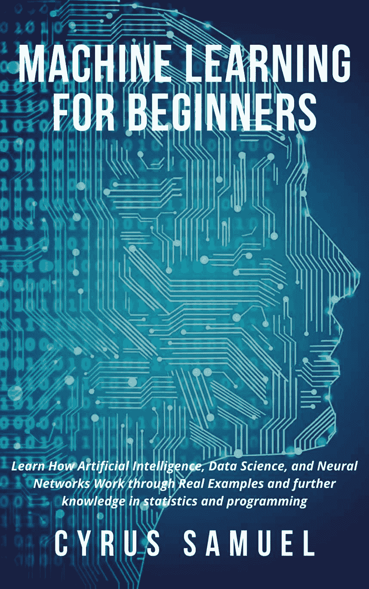


# 引言

恭喜你购买了《初学者机器学习指南》，感谢你的支持。

机器学习领域正在开启许多机会。它正被几乎每个主要行业作为一种工具所采用。无论你对医疗保健、商业金融、农业、清洁能源以及许多其他领域感兴趣，都有人正在利用机器学习的力量让自己的工作变得更轻松。

对于这些行业来说遗憾的是，但对你来说幸运的是，数据科学和人工智能领域的人才严重短缺。虽然初级数据科学工作仍然竞争激烈，但能够胜任高层职位的经验丰富的数据专家非常匮乏。这是计算机科学中一个较新的领域，由一群年轻人构成了该领域的大部分。

如果你能获得一份数据科学的工作，财务回报可能会非常丰厚。2016 年，数据科学家的平均年薪约为 `$111,000`，并预计在未来五年内将增长。在该领域工作的数据科学家中，约有一半拥有 `Ph.D.`。虽然这不是必要条件，但如果你考虑开始从事数据科学的职业，这是一个值得考虑的因素。

如果你希望将机器学习加入你的技能领域，以便以后对其有更好的理解并将其应用到自己的业务或项目中，那么可能不需要 `Ph.D.`。但对于那些想要进入该领域的人来说，建议接受高等教育，因为这将帮助你在领域中脱颖而出。

Indeed.com 在 2019 年将机器学习称为最佳职业，这显而易见。凭借对优秀数据科学家的巨大需求和丰厚的回报，它值得一看。随着连接性的增强以及消费者和公司互联网使用率达到前未有的水平，大数据似乎短期内不会消失。数据是我们现代世界的一部分，随着数据复杂性和规模的增加，将需要更专业的知识和技能才能完成手头的任务。

为了补充书中的知识，我强烈建议进一步寻求统计学和编程方面的知识。进行机器学习的任何工作都需要良好的统计学知识基础，因为统计数学为数据科学家在机器学习中使用的所有模型和算法提供了结构和理论依据。

# 本书的目的

本书并不旨在提供关于 `AI` 的详尽读物材料。综合考虑，它将为你提供一些基础信息，以便你继续对 `AI` 和人工推理进行研究。为了继续你的研究并精通该学科，还需要完成大量的思考。我们将检查 `AI` 模型的整体设计和关联、常用术语以及核心的事实概念。

*（注：提供的文本在源材料中包含几个重复和乱码的段落，用于说明本书的目的。我已根据指令保留了核心引言信息和结构流。）*


尽管如此，要明确告诉电脑如何区分猫科和犬科动物基本上是不可能的。在其他相等的情况下，你给电脑大量的关于猫科和犬科照片的准备信息，并告诉电脑哪些照片是猫，哪些照片是狗。最后，该模型应该有能力向你展示新的、隐藏的图片中是像猫的特征还是像狗的特征。

明确修改的指令的问题在于它们无法发生改变。万一我使用一种具有显式指令的编程语言精确地引导电脑，那么在那个时刻，程序将能够非常出色地执行这项任务，但仅限于该项任务。当它获取新数据时它不会改变，当它执行不准确时它也不会修改其策略。

一段时间后，AI 模型实际上会随着信息的变化而想要改变自己，以便在不断变化的环境中调整并保持准确。这提供了一个巨大的优势，因为它让我们的模型更具灵活性以适应变化，而变化正不断发生在我们周围。没有人工智能和人工推理，我们的电脑将没有跟上的方法。

# 什么是人工智能？

20 世纪 50 年代，不同的科学家开始培养主要的机器推理机器。在此之前，人工推理领域仅进行过少量的测试；特别是在下一次世界大战期间的破译工作中。这是一个新兴领域，最初只有少数几个小组知道它的潜力。

目前，人工智能被应用于许多领域的各种用途中，包括批判性思维、学习、安排、思考和逻辑。它使电脑能够执行通常需要人类直觉才能完成的任务。为了“采取类似于人类的心态”，电脑需要它们可以从中学习的信息。

计算机推理在人们心中占据着近乎传奇的地位。我敢打赌，如果你对大多数人说“人工智能”这个词，他们脑中会出现机器人走动表现得像人的图像。这种对人工意识的科幻化让人们在听到这个术语时保持警惕。尽管如此，它并没有像听起来那么可怕。它在医学、商业、交通和通信领域取得了巨大的进步。尽管在该领域已经取得了惊人的进步，但对有意识电脑的误解仍然遥不可及。总而言之，自动驾驶汽车、电脑以及会说话的手机出现融合了想象力。

## 日常中的 AI

尽管这听起来更像是科幻电影里的东西，人工智能现在已经大量存在于我们的生活中。如果你从一开始就觉得它听起来很诡异，让我帮你回顾一下人工推理近期为我们的生活带来的所有创新。

每当你打开 Netflix 时，你都在阅读一份列表，它列出了你看过的节目和重过的电影。它将该列表转换为信息并生成了另一份建议列表。根据你实际上喜欢的电影，它预测了你可能会喜欢的电影。这是由 AI 完成的，它是人工智能的一个子集。

如果你有一部手机，你可以使用语音指令来手动搜索东西。你告诉手机你正在寻找当地的餐厅，手机会说：“正在寻找你当地的餐厅。”在几秒钟内，结果列表就出现了，你不需要输入任何内容。它识别了你的声音并理解了你说的话。这是自然语言处理的一部分，AI 的另一个子集。每当你打开邮箱发现你的邮件里有垃圾邮件时；你的电子邮件系统正在学习如何更好地识别垃圾邮件。这是另一种 AI。

与此类似，人工智能并不真的像我们可能想象的那样，拥有需要接管一切事物的机器人。目前，它比那友好得多。它同样具有强大的支持性，并且能够学习我们无法明确编程它去执行的事情。

## 归纳推理与学习

人工智能需要许多人称为“模拟思维”的东西，也称为机器思维。当人们学习新事物并得出结论时，我们经历了一种被称为“归纳推理”的互动。我们获取数据片段来得出新的结论。通常，并没有我们被要求遵循的既定标准。我们通过直觉获得知识并得出我们自己的准则。例如，我可以告诉你去年 12 月下了好几次雪。据此，今年 12 月还会下雪。一月总是冷的，所以今年一月也会很冷。因此，我应该带件外套。

我们出生时并不是天生就知道每年 12 月都会下雪，或者一月是很冷的。我们通过经验吸收了这些内容，并利用归纳推理对未来的十二月和一月做出推测。根据我们的归纳推理，我们做出了明智的选择，提前做好计划并在明年冬天带上外套。

我们在 12 月看到雪、一月感到寒冷的经历就是我们的“信息”。这些是我们从当前处境不断获取的贡献。

人们的思考方式与机器不同，因为我们不理解数学数据模型。我们从好奖和坏惩以及我们在日常生活中体验到的情感中获益。让电脑使用归纳推理将使我们接近拥有“类人机器”。

与此类似，为了让电脑学习，它们需要可以从中学习的信息。大部分信息应该是数学的，目标是使其被数值模型和计算所解读。如果我们给电脑足够的信息，它将建立边界来规划自己的模型或计算，根据相关知识预测新情况。这就是 AI 的前提。给电脑提供经验，以便它能通过归纳推理在未来预测新的结果。

## 数据的力量

人工智能特别有趣，因为电脑现在在某些任务上比人更出色。它们可以在几秒钟内对包含大量特征的数据集得出数值推理。地球上没有人类能如此快速地处理那样的数据。如果我们能利用 AI 分析来自包含 100 个因素的复杂数据集的信息，我们可能可以发现物理上极其复杂且难以识别的模式和示例。这就是电脑成为特别有价值工具的原因，也是为什么它们帮助在数据科学领域取得了巨大进步。利用电脑进行数据分析使得发现你不知道存在或可能没有想到的模式和相似之处变得更加简单。

在某些任务中，电脑的表现并不理想。这些任务对我们来说似乎非常简单，比如区分猫图像和狗图像之间的差异。然而，对于电脑来说，分类这些内容异常困难。这正是计算机推理面临的挑战所在。


辨别这些照片之间区别的能力取决于我们对猫科和犬科动物的洞察；这就是我们所说的思考。人造智力的目标是展示电脑如何具备与人类思考相当的能力。

PC 模型已用于处理自然语言。自然语言处理使电脑能够理解“正常”语言，当然，正如我们所知的，即我们的人类语言。自然语言处理依赖于 AI 算法来获取话语和文本，并对指令和连接做出反应。

这项创新正变得异常普通且易普及。`GPUs`（图形处理单元）变得越来越容易获得且更加廉价，这意味着信息索引正在变得更大，AI 的应用也在扩展。你自己在 `iPhone` 上与 `Siri` 对话时可能用过它。当你对 `Siri` 说某些话时，你的手机接收声音。为了解码它，它会将你的声音转换为文本。然后，你的手机会研究内容以从你提供的指令中获取含义。

自然语言处理可能是 AI 最为人知的应用，我们一直在使用它。当我们使用网络搜索工作时，我们正在使用自然语言处理。翻译应用程序应该获取我们的语音或文本，并分析句子结构以产生意义。当你输入论文或 Word 文档时，你的文字处理器利用自然语言处理来过滤语言错误和拼写错误。

无论其声誉如何，这都是一个极其复杂的软件工程和人工智能领域。要能够理解在几乎无限组合中组织的字母集的含义，需要海量的数据让电脑理解你所写的或所说的。

除了能够理解我们所说和所写的之外；电脑还可以根据它们在 1990 年代从数据中获得的信息做出关键决策。`IBM` 制造了一台名为 `Deep Blue`（深蓝）的电脑，它击败了世界象棋冠军。它是第一台能够执行此类任务的电脑。鉴于象棋规则的简单性，`IBM` 的电脑研究人员决定训练他们的电脑玩游戏。然而，一旦游戏开始，棋子可以采取大量的移动和策略。电脑需要利用这些信息来熟悉这一点。

让 AI 在不同软件工程领域脱颖而出的是模型在长期范围内改变其策略以适应新信息的能力。将 AI 模型与普通的确定代码区分开来的是，AI 将吸收新信息并不断完善。它还可以执行需要安排和包含关键部分的任务。`Deep Blue` 电脑必须能够分析可能的走法组合，而不仅仅是逐一分析每一步。

让电脑能够击败世界象棋冠军的进步，现在使得自动驾驶汽车安全地将乘客从 A 点送到 B 点成为可能。与象棋的普遍简单相比，自动驾驶汽车必须设计并解释许多因素以保护其乘客。这超越了机器象棋时使用的二维数据分析。自动驾驶汽车必须掌握多维数据分析以探索不断变化的环境。

机器通过实验学习，反复重复任务，并从失败和胜利中获得经验。这些经历被呈现为数据，从长期来看，机器将知道每种可能的移动失败或成功的概率。

AI 模型解释环境中的可能状态。对于一个玩象棋的程序来说，这就是它所有可能的移动以及它对手所有可能的移动。该程序是目标和可能活动的结合。通过利用这些信息，它制定安排以增加实现目标的概率。它还允许电脑在没有明确指令的情况下进行自我学习。

试图让电脑完成这一系列工作在原理上听起来比实际操作起来要简单。我们最近提到的大多数能力；从跳棋到自动驾驶汽车，都需要先进的可测量程序来优化结果，并训练一个知道如何高精度“获胜”的机器。


[content]
其中一些内容引发了科幻想象，促使人们担心人工推理将超越人类并掌控世界。归根结底，我们的机器实际上将想要执行我们能做的一切事情，而且做得得更好。我们的 PC 将超越我们并抛弃我们。尽管存在通常的恐惧感，但计算机化推理仍然是一个年轻的领域，有很长的路要走。虽然它在短期内可能不会掌控世界，但 AI 已经改变了如今的劳动力市场，并在未来将继续对其进行变革。

过去需要人类推理的职业现在可以通过 AI 实现。工业设施、临床分析，甚至出租车都可以利用人工推理和 AI 来完成。信息正在变成一个始终具有重要意义的研究领域。信息中的示例可能用人类大脑难以解读，这就是我们使用机器来识别模式的原因。

在金融领域，AI 正被用于识别虚假陈。目前的计算能够识别货币交易何时具有虚假陈属性。组织可以通过感知词汇示例和注定虚假的审计发布时间来发现伪造的调查卷。

我们的电话使用语音识别来理解我们说的话并对我们的请求做出反应。社交媒体利用复杂信息分析来识别照片中的模式，在我们开始标记之前就能识别出图像中是谁。这一切都是通过 AI 的数据收集和翻译完成的。照片中告诉我们是谁的示例是经过 AI 模型分析和增强的信息。

1959 年，Arthur Samuel 首次提出了“AI”这一术语。作为麻省理工学院（MIT）的毕业生，他决定编写一个可以玩国际棋的计算机程序。他选择国际棋是因为它们相对简单，而且由于国际棋包含许多潜在策略。这发生在 IBM 的深蓝（Deep Blue）之前，但其假设非常相似：让计算机随着时间的推移通过新信息进行学习。

计算机思考了每个棋子的位置以及每一个可能的移动。每一步移动都有一个胜率评分。计算包含了棋盘上的棋子数量以及升王棋子数量等因素。

计算保留了它遇到的每种位置组合，这种循环被称为重复学习。对于这些组合中的每一个，它都记住了胜率评分。在几年里，Samuel 与机器进行了无数次游戏，教它它如何玩。

编写 AI 的目的是为了告知机器运行得如何，并找出如何击败对手。机器需要找出如何下国际棋，并找出如何减少错误以获胜。这是 AI 首次在软件工程或人工推理之外被讨论为一个独立的自主研究领域。

斯坦福大学将 AI 称为“研究让计算机在没有明确指令的情况下行动的学科”。Samuel 的计算机不需要被定制来记住每个国际棋的可能移动。总而言之，机器获得的“经验”充当了信息，它从每场游戏中获得信息以改进其获胜策略。见解为 AI 提供了构建和机制。尽管 1959 年引入了 AI 术语，但自 20 世纪 90 年深蓝出现以来，它一直被视为软件工程的一个不同领域。

典型的 PC 编程使用信息指令来协调模型。一个例子是在你的 `python` 窗口中输入 `4+4`。它将给你答案 `8`。在其他条件相同的情况下，AI 是一个可以解决复杂问题的强大工具，但它并不是灵丹妙药。它需要仔细的实施和理解才能发挥其全部潜力。
[/content]


云创新的到来让规模较小的组织能够更容易地访问海量数据集，而不需要巨大的信息存储空间。目前，AI 已成为软件工程中的一个独特领域，在 AI 和数据科学领域投入大量时间的人已成为一个独立的领域。

如今，关联的事物越来越多，网络也在不断变得越来越大。这意味着信息的获取途径正在扩大，而且信息源也在不断演变。事实上，甚至人们的汽车也装有电脑，这意味着当他们开车时，正在产生可以被解读的信息。到目前为止，大多数美国人携带手机网购并使用应用程序出行。人们利用手机控制家用设备，这是另一个可能的数据源。还有 Fitbit 和智能手表，允许人们追踪自己的健康信息。

关联的设备、电脑和手机越多，总的来说，在数据收集和思考数据方面的潜在结果就越显著。这种万物互联的状况——手机、智能汽车等——让人们担心自己可能面临丢失隐私信息的风险。他们害怕自己的安全受到威胁，有人在不断监控他们。无论如何，AI 和数据分析让我们的生活变得简单许多。追踪正确的物品变得更容易，路线变得更简单，发现新音乐也更简单了。这一切都归功于 AI。

## 图像识别

AI 用途之一是数据的排序和分类。这种排序甚至可以用于图像的特征化。网络索引利用这种算法来识别照片，而社交媒体平台目前在照片被标记之前就会使用人脸识别来区分照片中的人物。他们通过从其他照片中积累的信息获此。如果你的社交媒体账号可以识别你另一张照片中的脸，那是因为它利用来自各种不同照片的信息为你创建了模型。

图像识别方法需要深度学习模型。深度学习模型由人工神经网络组成，我们将在本书的后部分进行更广泛的讨论。深度学习是 AI 中最复杂的一种，其中数据通过几个隐藏的节点层进行过滤。它们被称为隐藏层，是因为模型是自主的，这意味着模型识别出的特征不是由数据科学家预先挑选的。通常，这些特征是模型独立识别的设计。神经网络中识别的特征可能非常复杂，任务越复杂，模型拥有的层就越多。图像排序模型可能只有几层，而自动驾驶汽车将拥有 1 到 200 层左右的隐藏层。

由于计算能力可用性的提高，我们最近在这方面取得了巨大进步。想象一下，将大量数据点同时通过许多堆叠的节点所需的处理能力。随着电脑的改进和处理大量数据成本的降低，深度学习和人工神经网络在最近变得更加可行。特别是云的出现，它允许数据科学家在不使用额外物理空间的情况下访问海量数据。

有一个名为 `ImageNet` 的网站，对于受图像特征化和神经网络启发的数据科学家来说是一个巨大的财富。ImageNet 是一个图像数据库，可以免费供 AI 使用。其理念是，通过将其免费开放，AI 方法的发展将成为全球数据科学家的一项有益努力。

ImageNet 的数据库在其集中包含约 1400 万张照片，有超过 21,000 个潜在的类别集合。这为数据科学家提供了一个机会，让他们访问并排序照片，以学习和探索关于神经网络的不同途径。

每年，ImageNet 都会举办全球数据科学家竞赛，为图像特征化制作新模型。每年竞争都越来越激烈。现在他们开始转向识别视频而不是图像，这意味着所需的复杂性和处理能力水平将继续大幅发展。利用数据中的大量照片，ImageNet 竞赛在最近几年中在图像识别方面取得了重大进展。

如今的图像排序模型需要能够进行明确识别的技术。无论两张照片是否应该被归为同一类，它们看起来可能完全不同。你如何创建一个能够识别它们的模型呢？

例如，取这两张不同的树的照片。如果你正在制作一个对树的照片进行分类的神经网络模型，那么你最好需要模型将它们都归类为树的照片。人类可以感知到这些都是树的照片，但照片的元素会使得用 AI 模型对其进行分类变得极其困难。

特征之间的差异越小，特征化就越简单。如果你所有的树的照片都看起来像左侧的图片一样，树完整呈现且每一处细节都清晰可见，那么制作模型就会简单得多。遗憾的是，这会导致过拟合，并且当模型熟悉像右侧那样的照片时，你的模型将无法对其进行正确归类。我们需要我们的模型能够对数据进行分组，即使这些数据并不容易排序。


遗憾的是，要尝试理解这些深层神经网络结构是如何工作的，其篇幅将超过这本书的容量，但目前有许多可以获取的书籍涵盖了此类模型，并对执行这类检测所需的编码提供了更深远的阐释。

## 语音识别

计算机推理的进步使得语音识别近年来变得更加实用。我们大多数手机现在都具有某种程度的语音识别能力，其中 `AI`。语音识别接收我们提供的声音信息并将其转换为可以解析的文本。

语音识别的困难之处在于人们说话方式的不一致性。例如类内变异性。当你向电脑演示如何理解人声时，你我可能有不同的口音和重音，这些是很难表示的。如果我们都用不同的口音说相似的词，我们该如何帮助模型理解我们呢？

语音识别还利用神经网络来解析信息，类似于图像识别。这是因为声音信息中的样本特征对人类来说可能并不显而易见。数据研究人员使用测试来解析信息，并在不同人群声音存在差异的情况下做出准确的预测。测试通过估计声波的幅度和长度来完成，坦率地说，这可以用来破解客户在说什么。录制的声音被转换为频率波导。这些频率通过数学特征进行估计，然后通过隐藏层的神经网络进行处理以寻找模式。

## 医学与医学诊断

`AI` 不仅对高级推销或让电脑响应你的请求很有价值。它还可以工作于医学领域，特别是利用既往患者的数据来诊断患者。

尽管 `AI` 在临床分析方面潜力巨大，但考虑到保护患者的法律，它可能正在尝试发现可供 `AI` 使用的患者信息。它在医学领域的逐步获取识别意味着数据正在向数据研究人员开放。遗憾的是，到为止，很难获得足够的显著信息来选择做出关于临床决策的模型。然而，技术已经存在且可供使用。

`AI` 可以利用图像识别通过从几个患者的影像检查获取数据来分析 X 光，对新患者做出预测。聚类和分组可以对各种相似疾病进行排序，以便患者和临床专家能够更好地理解两个患者之间相似疾病的差异以及他们的生存概率。

结合 `AI` 的临床诊断可以减少医生的判断错误，或为医生提供表达后续感觉的。它还可以用于根据持续性因素和感染特征预测阳性结果的概率。在未来，医学专家可能会查看来自大量患者关于特定疾病的信息以做出另一个判断。

然而，临床诊断只是 `AI` 在医学中使用的多种方式之一。目前临床数据集仍然较少，而 `AI` 的研究在医学领域实际上有很多未被开发的潜力。

## 股票预测

股票交易者观察许多因素以决定如何管理股票，无论他们需要买入、卖出还是持有。他们观察股票特定属性以及市场气候中的模式，以对他们应该做什么做出合理的推断。长期以来一直是这样做的。交易者和经纪人需要进行物理研究以做出最真实的估计。

`AI` 现在可以被用来做同样的事情，而且实际上，`AI` 执行得更快、更高效。要成为一个强大的交易者，你应该能够持续地检查模式，以这样你就不会错过有前景的机会。`AI` 可以帮助交易者发现股票之间的相似性，利用可衡量数据做出财务决策。

交易者可以使用直接回归模型来检查金融交易价格中过去模式的信息以及哪些因素导致股票价格波动。他们可以利用这些回归来决定如何管理股票。

通常，需要研究股票表现的交易者通过使用所谓的支持向量机这样做。支持向量机是一种特征化模型，数据焦点通过边界线进行隔离，一侧是一个分类，另一侧是另一个类或另一个。交易者将利用支持向量机来决定购买哪些股票和卖出哪些股票。利用某些应该代表给定股票表现的因素，该股票被放置在边界线上，指示其价格很可能会上涨还是下降。

深度学习也经常应用于构建股票模型中。神经网络的隐藏层可能帮助识别股票的隐藏模式或特征，这些特征可能导致其价格上涨或下跌。

不存在所谓的绝对稳赢或无风险投资。当人们做决定时这是有效的，现在当我们使用数据科学做出财务预期时，这是显而易见的。记住，投资金融市场始终是有风险的。要建立一个能对金融市场预测任何可靠模型是非常困难的。它是疯狂且反复测的。无论如何，我们已经有效地发现 `AI` 可以发现人类可能无法独自发现的模式。

如果你理解证券市场的模式可能是完全不规则和奇异的，那么，拥有另一个帮助你评估股票一致性的模型就有价值了。对于给定股票知道你的预测有多准确，与实际预期本身同样重要。建立另一个模型来量化给定股票的一致性，这样你就知道你的预期有多可靠。不同的股票将具有不同程度的一致性。用你的模型勾勒出来，这样你就可以浏览最可靠的预测。

交易者将继续对股票价格的上涨还是下降做出最终结论。然而，数据科学和 `AI` 可以通过分析数据来平滑决策过程。这就是为什么你会看到越来越多的 AI 模型被应用于预测股票，以及为什么你基本上应该熟悉这种想法。

学习关联

所有领域的营销人员，从实体零售到在线零售，一直在寻找将产品关联在一起的方法以增加交易。无论你拥有的是一家小自行车店还是一个大型在线仓库，发现客户购买倾向的模式都将帮助你做出主动决策以推动交易并获得更多现金流。


我们大多数人会在某个随机周期间逛超市。超市是利用商品布局来促进销售的理想案例。某些超市会对自身进行分类，将相关性较高的商品放在一起。冷冻商品有自己的通道，而叶类蔬菜则有它们的位置。他们这样做有两个原因：其一是让顾客更容易找到所需的物品，其次是提升了客户体验。同样，商品布局可以帮助客户接触到那些他们会购买、但在之前进店时并未寻找的商品。

除了将蔬菜放置在相似通道之外，超市还有另一种可以执行的方法来引导客户走向特定商品。他们可能会推断出购买特定商品的客户的特征，并利用这些特征推荐其他随机商品。例如，你可以预计在蔬菜区购买了新鲜蔬菜的人通常饮食得更健康。你可以将滑奶昔放在蔬菜区，或者放在存放新鲜水果的同一个冷柜中。如果一个客户进来寻找特种酿酒，你可以用零食诱惑他们，并注意到与 `12 packs` 装淡啤酒所在区域相似的架子。

## 关联过滤

如果你觉得这一切听起来很不错，那么你即将开始理解一种被称为“关联过滤”（community separating）的程序。这是一种通常用于网页展示的 AI 方法。如果你的搜索信息显示你一直在阅读前往坎昆的机票通过证，你可能会开始在你的程序上看到泳衣的广告。

展示信息的研究人员一直在试图回答这个问题：我们如何利用数据来确定如何将商品与其目标市场进行对接？这涉及到利用数据将两个互不相关的物品关联起来以驱动销售。

这是一种根据你对客户的认知向客户提供建议的方法。AI 经常可以发现客户中我们可能未曾过搜索的相似之处或购买行为。这是智能时代开始出现的一种强大营销工具。过去，大多数广告公司需要依靠直觉来发现他们的目标市场。现在，数据研究人员可以使用定量信息来更准确地描勒理想客户的画像。如果你对在数字营销中使用 AI 感兴趣，这是一个你应当熟悉的课题。

关联过滤与向客户推销相似商品不同。你是根据从不同客户那里收集的信息，对客户的口味或偏好做出预测。你基于在两件商品之间发现的关系做出这种预测，然后对商品 `Y` 与商品 `X` 一起购买的概率采取行动。你利用这些关系的评估来决定向谁展示什么。

`Spotify` 在推荐音乐时也使用类似的循环。它利用了你一段时间以来所喜爱的所有音乐信息。如果两个艺术家之间存在联系，意味着许多人的曲库中都有这两位艺术家，那么模型就可以预测你可能喜欢另一位艺术家的概率。

你商店里的商品越多，发现这些关系就越严谨。理想情况下，你将寻找商店里每种独特商品组合之间的关系。

## 先验算法

这种发现你有多可能因为购买另一件商品而喜欢另一件商品的技术被称为 `Apriori Algorithm`（先验算法）。需要满足三个模型条件，以确认两件商品之间存在联系，并且你应该在商店里以某种方式将它们关联。

主规则是 `support`（支持度）。它为你提供了关于特定商品流行度的估算。在你所有的交易中，这个物品出现在人们购物篮中的频率是多少？

后续部分是两件商品之间的置信度（trust）。客户在购买 `X` 商品时购买 `Y` 商品的可能性有多大？最后，商品 `Y` 的 `lift`（提升度）是多少？最终，在 `Y` 单独流行度的基础上，人们购买 `Y` 同时购买 `X` 的概率有多大。

模型还可以利用购买记录、社交媒体参与度等信息，对你可能喜欢的商品类型做出预测。这使其成为 AI 而非仅仅是数据分析，因为模型是在寻找相似之处，但开发者并没有要求特定的产出。也许数据中存在某些要素或特征是软件工程师甚至没有意识到的。可能通过不受干预的 AI，信息告诉我们这两类客户之间存在高度关联。这些关系发生在我们周围，表现为人群群体之间的相似性。偶尔，这需要一个好的计算机模型来识别。

## 金融

金融业正经历 AI 使用的扩张。数据科学和 AI 模型的利用尚未充分开发。曾经单调且需要大量人工工作时间的工作，现在应该可以通过计算机在几分钟内完成。

除了客户支持外，银行现在能够衡量和调查大量客户的合同和财务数据，这在制作信用报告和预测客户贷款违约概率方面将是一项工作。AI 程序可以查看以交易为标记的背景，然后银行再决定是否向该个人提供贷款。

## 垃圾邮件检测

一个简单的 AI 工具的典型例子是垃圾邮件识别。假设我们正在利用机器学习来描述关键因素，模型将在邮件中具有某些搜索的属性。模型可能会搜索特定的短语或表达式来区分邮件是否为垃圾邮件。像“购买”或“节省”之类的词可能会在你收到垃圾邮件时让你的收件箱知情。但这种策略的问题在于，在很多情况下，这些词并不真的意味着垃圾邮件。


# 统计学简介

这是支持学习（support learning）发挥作用的地方。许多属性可能是垃圾邮件的特征，其中某些属性我们可能没有选项进行明确。支持学习允许在没有明确方向的情况下，独立地展示并发现这些示例。在同等情况下，当模型准确区分出垃圾邮件时，我们会告诉模型。有时，当我们在收件箱中发现一封模型没有将其识别为垃圾邮件的邮件时，我们会手动将其移动到垃圾邮件箱中。现在，模型意识到这条信息是垃圾邮件，这条信息被添加到模型中，以便在以后某个时候进行预测。因此，从长远来看，随着获得更多重要信息，机器会不断改进。

这种人工智能被称为分类（arrangement）。我们的产出属于离散分类。在洞察中，离散因素是指可以在少数类别中区分的因素。离散变量的一个例子是汽车销售中心七天内售出的车辆数量。它是离散的，因为汽车销售中心无法出售车辆的一部分。该变量应该是一个整数。

洞察是对信息的数值研究。它是一种训练过程，通过收集、观察和研究信息来推测意义并检查各种因素之间的可定量联系。人工智能是推断性洞察的一种类型，这意味着通过分析因素之间的联系，我们应该有权对新因素产生预期。

测量（Measurements）被应用于许多领域。它被用于科学领域的思考和分析动植物。它在商业世界有广泛应用，从制定证券交易数据到分析消费者行为。金融专家使用测量来解释全球业务领域的定量示例。在医学领域，测量可以用于改进医生和传染专家观察疾病传播和控制的方法。

测量构成了人工智能的核心。如果你无法深入洞察，那么人工智能就不适合你。人工智能利用事实计算来帮助计算机学习。人工智能关于对信息的追踪以及计算机如何利用信息来改进自己。

有两种适用于本本书测量类型。第一种是探索性分析（engaging examination），你可以在演示周期开始时使用它来在数据中寻找标记。然而，我们在人工智能中做的大部分工作属于另一类，被称为预测性分析（prescient examination）。

## 核心术语；描述性分析

探索性分析帮助我们检查现状。通过对比过去来观察现在的处境，并了解事物为什么变成现在这样。为什么表现优于其他？我们认为在现有产品中发现了哪些模式？

## 核心术语；预测性分析

预测性分析帮助我们根据目前存在的标记来看以及未来会发生什么。当我们使用人工智能进行预测性分析时，我们必须保持更新并继续为模型提供新信息。我们认为应该关注哪些模式？

人工智能仅仅是理解我们周围信息的另一种方法，并帮助我们理解现在和预测未来。然而，它需要跨越长时间的信息，以便我们发现模式并看到它们可能导向何方。

在测量中，我们将使用两种大类信息，而我们的每条信息都将以某种方式属于其中一类。

### 定量信息

主要分类是定量的。定量信息是用数学值估算的信息。定量信息的几个示例包括`身高`、`薪水`或`面积`。这使得它们具有定量的特征。

### 主观信息

下一类是主观的。主观信息是因素被分配到类别的信息。主观信息的示例包括`性别`、`血型`或患者是否过敏。这种方式它是主观的。

定量信息可以是离散的，也可以是连续的。如果我们有一个索引，记录了去年的人数，这将被认为是离散的。离散因素具有有限的属性数量，并且是整数。信息也可以是连续的。

### 描述性统计

其他需要记住的重要术语是平均值、中位数和众数。当我们讨论倾向（propensity）时，你经常会在书中听到这三点。平均值是我们信息的正常激励。如果我们有一个`年龄`变量，我们将通过将所有年龄相加，然后除以信息索引中的响应人数来追踪平均值。

中位数是数据集中的值。如果你获取所有的响应，并找到位于排列好的响应列表中特定位置的响应，那么这就是你的中位数。

众数是出现频率最高的响应。如果我们以 11 个人的年龄为例，并发现年龄为`19, 19, 20, 21, 22, 22, 22, 23, 24, 24, 25`，那么众数就是`22`，因为在这个例中它出现次数最多。中位数同样是`22`，因为它出现在这个排列好的响应列表中。

### 偏差与变异

书中最重要且最经常提到的是偏差（predisposition）和变异（change）。这些是我们在构建测量模型时可能发生的各种预测误差。在完美世界中，我们希望限制模型中偏差和变异的流行。它们将始终存在，作为数据研究人员，你应该在模型中追踪偏差和变异之间的正确平衡，无论是通过选择不同的数据还是使用不同类型的模型来实现。

变异（Fluctuation）是指我们的预测数据点分散的程度。通常，变异是过拟合用于创建模型的示例数据的副作用。它对于预测新因素的结果并不理想。


你的模型中始终存在某种程度的误差。这是一个不可避免的事实，无论你多擅长预测某些事情，宇宙中的每个情况下都存在某些不规则或非随机的变异，这会让你的预测与真实结果产生某种偏差。

我制作了一个四个靶心焦点的视觉图示，以帮助表示高偏差（inclination）和高差异（difference）模型之间的区别。在这种情况下，靶心的焦点代表我们的模型试图预测的真实价值。左上角是最好的模型。注意，我们所有的预期信息焦点都正落在靶心上。这个模型非常精确，并将我们的预期信息焦点置于全方位真实价值之上。这是低波动性的结果；即没有“分散”的信息焦点，以及低偏差；即没有导致我们结果发生倾斜的欠拟合（underfitting）。

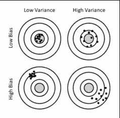

在右上角的目标中，模型正经历着高差异。你可以看到我们的信息焦点聚集在靶心周围。遗憾的是，由于高波动性，预期特质与靶心之间的正常距离很大。

在左下角的目标中，模型没有经历高波动的带来的负面影响。然而，预期信息焦点之间的正常距离很小，但它们还没有聚集在靶心周围，而是由于高偏置而偏离了靶心。这可能是由于准备信息太少的副作用，意味着模型在接触新信息时表现并不良好。

右下角的模型同时经历着高波动和高偏置。在可以想象的最糟糕的结果中，模型是极其错误的，因为预期信息焦点与真实价值之间的正常距离很大，且预期信息焦点是倾斜的。

因素之间关键水平的关系可以带来变化。如果你使用了如此大量的自主因素，这同样可能是高差异的原因。在某些情况下，如果变化过高，我们可以通过允许模型产生有限数量的偏差来解决。这被称为正则化（regularization）。我们稍后会介绍这些。

简而言之，总体（population）是你试图研究的个体集合或信息安排。样本（example）是该总体的子集，你使用它的信息来建立模型。特征（boundaries）是你试图在模型中区分并预测的总体因素属性。

描述性统计（engaging measurements）是利用信息来观察总体。通常，描述性统计包括平均值或标准差、众数、中位数、大小、关系。AI 属于推断性统计（inferential measurements）的分类，因为我们不仅利用信息来发现模式和关系，还根据这些数据做出预测。推断性统计，或推断细节，是利用你总体的属性来做出预测。这就是你的回归模型和分类模型发挥作用的地方。当我们解释某物时，我们根据给定的信息对总体做出一致的推论。

当你观察数据时，还应该观察其分布（distribution）。这就是信息在图表上的展开方式。它展示了我们信息的优势的频率，以及它们是如何相互相关的。

我们利用波动性（fluctuation）来追踪标准差。标准差是回归或预测模型中预期信息焦点与真实信息焦点之间距离的标准差。

我们还应该确保了解经历过拟合（overfitting）和欠拟合（underfitting）负面影响的模型。过拟合模型在利用训练数据预测结果方面很好，但当你引入新信息时，它就会陷入困难。它像一个只记性而不学习的模型。这可能发生在你没有在训练测试中使用杂乱信息的情况下。

欠拟合描述了一个过于简单的模型，它没有分析任何关键的信息模式。它在预测方面可能效果良好，但因素和边界不够明确，无法带给我们任何重要的见解——如果你需要更多训练信息，你的模型可能欠拟合了。

人们在观察数据时经常犯的错误是将相关误认为是因果关系。

# 为机器学习选择合适的模型类型

想象你是一个木工。当你到达工地时，你认为你的卡车里堆放着什么种工具？你可能会有一个手锯、一把电钻，以及几种不同的锯子。你可能有一把推刨和一套不错的钻头工具。假设你了解如何管理你的工作，你就知道每种工具的用途，也知道何时该使用它们。

希望做 AI 的数据科学家会有自己的工具箱，每个工具满足不同的需求并具有不同的能力。根据你使用什么类型的信息以及你需要发现什么，你应该选择不同的算法模型来完成工作。


事实计算可以满足几种需求。有些模型用于预测某个值；例如回归模型，它可以根据你长期的培训和工作洞察来预测你的薪资。一些模型预测某个事件发生的概率，类似于临床模型，它可以预测患者存活一段时间的概率，等等。不同的模型通过将事物归入不同的分类或类别来对它们进行排序，类似于图像识别程序对各种犬类动物的照片进行分类。

根据你正在寻找的结果，你应该准备好你的事实工具箱。你需要熟悉测量的专业技能。同样，你应该意识到你需要使用哪种工具，以及何时使用它。在这里，我为 AI 中极其常见的各种类型模型列出了详尽的清单。为了具备独立编写代码来构建这些模型的能力，我建议你投入一些精力专注于你所选择的编程语言。无论如何，这份清单都将让你对每种模型有一个初步的了解，以及它们何时是有用的。

为了让 AI 可行，你应该选择正确的模型、效果最好的模型，并为该模型和当前问题提供相关信息。

现如今，特别是在利用网络和数字广告的情况下，某些问题如果不利用能够分析数据的信息和人工智能，是无法如预期般理解的。通过 AI 和数据科学，你可以监控你的客户及其购买倾向，因此当他们的需求变化时，你可以更容易地进行调整。

你解读数据的能力越强，你就越能更有效地识别模式，从而能够预测下一次变化。

AI 可以分为三个不同的类别，每种类别都包含一些满足不同需求的有趣算法。首先，我们将讨论监督学习、无监督学习和强化学习之间的区别。

# 监督学习

在监督学习中，软件工程师利用标记数据。在我们开始使用这些算法之前，我们正在观察的数据是预先确定的。我们知道数据来源和我们要寻找的结果 `X` 和 Y`。我们试图发现我们选定的 `X` 和 `Y` 之间的一种联系。

当你发现 `X` 和 `Y` 之间的联系后，你就得到了一个模型，它将根据机器在数据中看到的这些联系来预测结果。监督学习用于回归和分类模型。在 AI 中，我们提到的特征（features）指的是数据的特定可测量属性或特征。

我们将讨论的最主要的监督学习类型和最主要的测量模型被称为回归（Regression）。回归是指输入和输出都是连续值的模型。回归有多种类型，但最核心的结构是线性回归。我们利用线性回归来发现某些信息 `X` 与输出 `Y` 之间的联系。一旦评估了这种关系，我们就可以根据 `X` 预测 `Y`。线性模型可以、且通常具有多个 `X`。在回归中，输出 `Y` 是一个数值。

## 回归分析

回归是最简单的一种 AI；这通常是你初次探索如何使用数据时的起点。你有一组 `X` 特性，你需要考虑它们与输出 `Y` 之间的关系。我们的自由因子（模型中的 `Xs`）被赋予权重，对于每个 `X` 的值，它都会通过权重进行增加，直到总容量对 `Y` 做出一个预测。

我们可以利用确定知道 `X` 和 `Y` 的数据为 `Y` 创建一个预测模型。对这些数据进行回归将给我们大量的 `X`。如果我们有足够的重要信息，最终我们实际上想通过已知的 `X` 特性来预测和隐藏 `Y`。

我们在散点图上绘制观测到的 `Y` 和 `X` 特性，我们的回归模型通过数据点追踪出一条“最佳拟合”线。回归线被称为超平面（hyperplane）。线的斜率被称为坡度（incline）。

我们可以化预测值与真实数据点之间的距离，并称之为估计偏差（deviation）。当我们创建线性回归时，目标是使我们预期中的偏差最小。这种差异越小，偏差越小，你的模型就越精确。

AI 中使用的大量测量模型建立在这个第一个计算基础上的。通过将我们的数据点沿直线或成组绘制，创建一个可以预测结果的模型。然而，直线并不总是总是直的，这时直线并不能显示出最佳拟合。

非线性回归算法的一个例子是 Sigmoid 函数。Sigmoid 函数产生一个 S 型的弯曲。Sigmoid 函数不是预测一个值，而是取自因子并交付一个零到一之间的概率。

### 简单线性回归

在简单线性回归中，我们研究预测值 `Y` 与某些指标 `X` 之间的关系。我们将 `Y` 视为因变量，因为它取决于 `X` 的值。我们的 `X` 被称为自因子。

如果你在中学或大学学过代数数学或预分析，你可能记得直线的方程是：

```
Y = mX+b
```

如果你设法画出这个方程图，那么你就会得到一张像这样的图表：

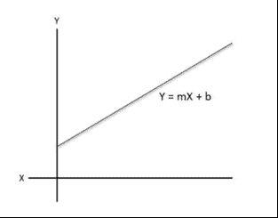

显而易见，直线显示对于每个 `X` 的值都有一个相应的 `Y` 值。你可以为每个新的 `X` 值对 `Y` 的值做出预测。在这张图中，`Y` 的值随着 `X` 值的增加而增加。这通常不是这种情况。

这是最简化的回归，但看看它是如何工作的，因为我们从现在到未来都将研究它。大多数测量研究包括一个像上面那样的图，它根据自变量对因变量做出某些预测。这是监督学习的一个示例，因为我们在开始展示之前标记了 `Y` 变量和正在使用的 `X` 变量。

在几乎所有情况下，会有多个自由因子来决定我们的因变量。这引导我们进入下一种回归。

### 多元线性回归

在数据科学和大多数数据任务中，这将是最常见的回归类型。在多元线性回归中，我们仍然有一个输出变量 `Y`，与之前一样。然而，现在的不同在于，会有多个 `Xs` 或自由因子来预测我们的 Y。

这是一个利用多元线性回归预测纽约公寓成本的例子。我们的 `Y` 或因变量是纽约公寓的成本。成本将由 `X`（我们的自因子，如面积、到交通的距离、房间数量）决定。如果我们设法将其导出为公式，它看起来会像：

```
apt_price = β0 + β1 sq_foot + β2 dist_transport + β3 num_rooms
```

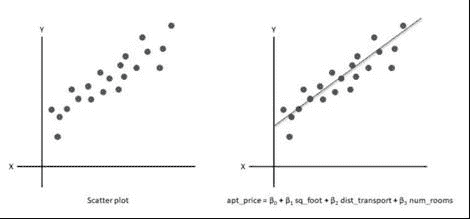


你可以看到 `X` 和 `Y` 的上升趋势并没有形成一条理想的直线，但确实存在某种模式。我们可以利用这种模式对 `Y` 未来的上升趋势进行预测。沿着这一思路，我们建立了一个多元回归，并得到一条通过我们信息数据点中心的直线。这被称为最佳拟合线，也是我们以后获得新的 `X` 特性时，通过它来预测 `Y` 的方法。

这里的区别在于，与为斜率构建 `m` 相反，我们构建了 `β`。这种情况基本上与我构建了以下方程是一样的：

`Y = b + m1X1 + m2x2 + m3x3`

但目前我们有了标记点，并且知道我们的 `Xs` 和 `Yss` 是什么。此后，假设你看到一个多元回归条件，它无疑会以这种结构呈现。我们的 `β` 是我们称之为边界的东西。它像一个魔法数字，向我们揭示了 `X` 的值对 `Y` 的影响。每个自变量都有一个有趣的边界。我们通过建立回归模型来发现边界。随着时间的推移，在 AI 的帮助下，我们的模型将面对日益增多的信息，因此我们的边界将会改进，我们的模型也将变得更加精确。

我们可以通过利用准备包含纽约公寓真实成本、该区域真实信息因素（如距离交通的距离）以及房间数量的信息来建立模型。我们的模型将“弄清楚”如何从真实信息中推算出成本。此后，当我们为一个具有模糊值的公寓录入自由因素时，我们的模型可以对成本将是多少做出预测。

这是通过使用线性回归模型来实现的。之所以这样做，是因为我们正在告诉模型我们需要它给出的答案：纽约公寓的成本。随着它获得更多信息，它就能更精确地计算如何预测成本，而我们则不断评估其准确性。

### 标准最小二乘法 OLS
标准最小二乘法 `OLS` 将尝试寻找一条使误差平方和最小的回归线。

### 多项式回归
我们的下一种回归被称为多项式回归。在前两种回归中，我们的模型建立的是直线。这是因为 `X` 和 `Y` 之间的关系是直接的，意味着 `X` 对 `Y` 的影响不会随着 `X` 值的变化而改变。在多项式回归中，我们的模型将产生一条带有弯曲的线。

如果我们尝试使用线性回归来拟合具有非线性特征的图表，我们生成最佳拟合线的表现将会非常糟糕。以左侧的图表为例；散点图具有之前类似的垂直模式，但带有一个弯曲。对于这种情况，直线是不起作用的。综合考虑，通过多项式回归，我们将建立一条带有弯曲的线来配合我们信息中的弯曲，类似于右侧的图表。

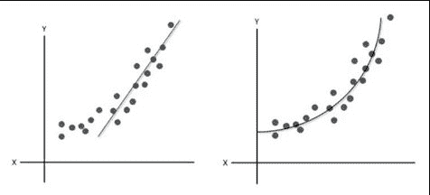

多项式的情况类似于直接回归的情况，区别在于至少一个的我们的 `X` 特性上连接了一个多项式项。例如：

`Y = mX2+b`

随着 `X` 激励的变化，`X` 对 `Y` 的影响会发生巨大变化。

### 支持向量回归
这是数据研究人员的另一个重要工具，你应该熟悉它。它通常用于分类。这里的思想是在空间中寻找一条直线，将信息数据点隔离开不同的类别。支持向量回归是另一种监督学习方法。它也被用于回归分析。它是一种不与概率相关的双重配置策略。

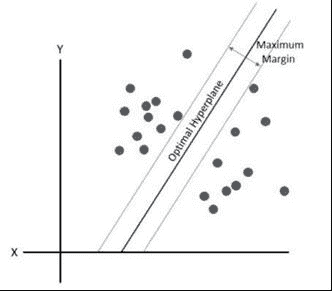

在向量回归方面，你所有的准备数据都属于一类或另一类。你需要确定另一个数据点落入哪一类。你的信息通过一个超平面被孤分为这两类。当你为超平面建立模型时，你正试图寻找一个扩大两类之间距离的超平面。例如，在下面的图片中，你有一个散点图，其中数据点可以被孤分为两个特定的类。在这种情况下，一、三号线可以将数据点隔分为两个清晰的类。尽管如此，对于你的模型来说，你应该选择二号线，因为它增加了两个类之间的边界，使得它们更加清晰。边界越宽越好。

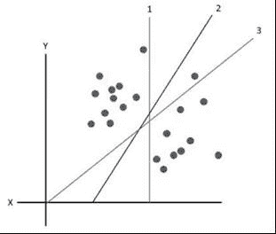

### 岭回归
这种方法通常用于分析受多共线性影响的数据。取决于你信息的特征，恰当使用岭回归可以减少标准误差并使你的模型更加精确。

当你的信息包含高相关性的自变量时，岭回归会有帮助。如果你能利用另一个自由因素对自变量做出预测，那么此时你的模型就面临多共线性的风险。例如，如果你正在使用影响个人身高和体重的因素；这些因素很会在模型中产生多共线性。

多共线性会影响你预测的准确性。为了避免多共线性，请注意你正在使用的预测因素类型。你所使用的信息类型以及收集方法，都可能是多共线性的原因。你可能没有选择足够广泛的自由因素。你的信息数据点可能同样相似，因为你对自由因素的选择受到了限制。

多共线性也可能由模型过于复杂引起。你拥有的因素比数据点还要多。如果你选择使用线性模型且该模型加剧了多共线性，那么此时你可以尝试应用岭回归方法。

岭回归通过允许模型存在少量的偏置来使预测更加精确。这种方法也被称为正则化。

### LASSO 回归
LASSO 回是另一种“收缩”方法。它与处理岭回归的方法非常相似，因为它支持更简单、更小的模型来进行预测。在 LASSO 回归中，模型在减少系数值方面更加强硬。LASSO 代表了最直接的收缩和选择执行。


# 贝叶斯回归

当我们的信息不足或信息具有无助的分散性时，贝叶斯回归模型非常有用。这类回归利用似然分布而不是信息集中点来实现，这意味着图表将呈现为一条弯曲的曲线，处理曲线中出现频率最高值之间的差异。

在贝叶斯回归中，因变量 `Y` 并不只是一个概率值。与其尝试预测一个数值，我们说是在尝试预测结果出现的概率。这被称为频率派推断，而贝叶斯假设为这种洞察力提供了基础。频率派推断推测某事是否会发生，以及它发生的概率。

当我们谈论频率派推断时，我们也包含了条件概率。条件概率包括其结果相互依赖的事件。每当你抛一次硬币时，它都是一次独立事件，意味着过去的抛掷结果不会改变下一次抛掷的概率。因此，抛掷硬币绝非条件概率。

事件也可以是依赖的，这意味着过去的事件可以改变后续事件发生的概率。假设我有一袋大理石，我需要知道从袋子里取出不同颜色球的概率。如果我的袋子里有 3 颗绿球和 3 颗红球，而我取出了一颗红球，那么在下一次取出时红球的概率就会降低。这就是条件概率的一个示例。

# 决策树

我们之后将检查的模型之一被称为神经网络。它们是最为卓越的 AI 类型，用于各种目的。我将其类比为决策树，因为在有许多简单模型可用的情况下，人们经常为了排序问题使用神经网络。决策树和相关的随机森林模型同样非常有益处。

尽管神经网络功能强大，但它们不能用于一切。幸运的是，我们有替代方案，而这本书的动机是让你在需要构建模型时了解你的选择。当神经网络不起作用时，下一个考虑就是决策树。决策树通过选择节点和叶子节点将信息分为子类，看起来像一棵树。

决策树相对于神经网络有一定的优势（本文部分）。对于某些事物，神经网络需要大量的数据和强大的计算机来处理。使用决策树的潜在优势是它们相对简单，特别是当你与神经网络相比时。与书中的大多数模型不同，决策树非常易于阅读，即使对于外行也是如此。这使得它们在选择一个应该向同事介绍的模型时，是一个很好的入门选择。决策树是另一种类型的监督学习，意味着我们在构建模型之前标记需要排序的类别。在某些情况下，决策树可以执行回归任务，但它们通常被用作分类模型。当决策树用于回归时，叶子节点的结果是概率。

决策树从树顶部的根节点开始。然后，根节点之后被分为两个节点。节点是树上的单个叶子，而中间节点是做出选择的地方，被称为选择节点。决策树在底部结束，即终端节点位于分支的底部，在那里完成选择。

在理想世界中，决策树将层层快速排序信息。因此，我们称这种模型为“贪婪”的，因为顶部节点试图尽可能快地对信息，以减少所需的层数。像神经网络一样，决策树经常受到过拟合的负面影响。决策树通常无法处理不同的信息排列，因为排序对于每个数据集来说都是非常具体的。

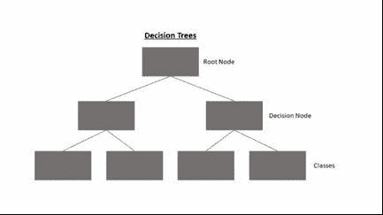

以下是一个关于决策树的示例，用于判断是否根据能力因素对某项任务候选人进行新员工筛选。根节点是候选人是否具有专业学位，随后是选择模式，这些模式最终都通向不录用或提供面试。你可以从这棵决策树中看到为什么这种模型对于你正在处理的特定信息如此具体，因为每个数据集在能力上会有差异，因此每个数据集的排序方式都是独特的。

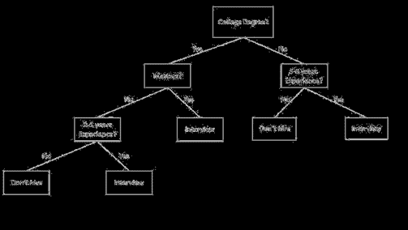

# 随机森林

在模型中仅使用一棵决策树会对信息划分的类别以及选择结果产生限制性影响。由于决策树是“贪婪”的，这意味着特定的类别被选中进行排序，这限制了其他类别被选中。然而，有一种简单的方法可以避免这一点。区分你的决策树并提高模型准确性的一种方法是使用随机森林。

假设真实的森林由几棵独特的树组成，这在很大程度上就是随机森林的内容。与其只拥有一棵决策树，不如将信息分成几棵决策树。当你只有一棵树时，模型经常会受到高方差的副作用。构建随机森林是在模型中解决这一问题的方法。它可能是数据挖掘领域最好的可用工具。随机森林是最接近数据挖掘目的的预编译算法。

在随机森林中，每棵树都协作工作。大量树的相对结果通常是正确的，无论是否有几棵树产生了糟糕的预测。为了得到最终期望，会对大量树的结果进行计数。利用大量树中多数结果的投票给了我们最终的预测。


我们如何避免在随机森林中产生连接呢？首先，每棵树都从数据集中随机选取一个样本，因此每棵树在信息的排列上与彼此之间是细微独特的。在贪婪的交互中，树会选择一个使枢纽之间分离程度最大的组件，这实际上类似于单个树的生长。尽管如此，在随机森林中，树也可以从组件的整体集合中选取某些规定，因此每棵树都通过不同的元素进行隔离。

沿着这一思路，树之间将是不相关的，因为它们利用不同的组件来对特征化做出决策。在随机森林中，取决于你正在处理的数据集，最好使用不少于 100 棵树来获得准确的图像。总的来说，树越多，模型的过拟合程度就越低。随机森林 AI 被认为是一种“管理良好的过程”，因为我们的结果是挑选出来的，我们可以看到排列策略；然而，它依赖于每棵树通过特征来分类和隔离因素。

分类模型将向我们展示某个属于哪种分类。这些分类由软件工程师在开始定义。一个可以使用随机森林的特征化模型示例是：判断传入垃圾邮件应该进入你的“收件箱”还是“垃圾邮件”封包。

为了构建模型，我们创建了我们的 `Y` 可能属于两个分类：`spam`（垃圾邮件）和非垃圾邮件。我们编写模型来搜索可能表明垃圾邮件的关键词或特定的电子邮件地址。“购买”或“优惠”等词汇的存在将帮助模型判断邮件是否属于垃圾邮件类或非垃圾邮件类。计算接收信息，从长远来看，它通过对比其预测结果与结果的真实值进行学习。从长远来看，它对模型进行微小的调整，因此计算在长期运行中变得更加有效。

# 分类

在本书的多次中，我们提到了特征化模型。虽然我们有效引用的一部分模型适用于特征化，但接下来将是更复杂的学习模型，它们被显式用于分类。

该配置需要标记信息并做出非一致的预测。在特征化问题中，图表是非线性的。特征化问题可能有两个类，或者更多。特征化模型可能是 AI 和数据科学中应用最广泛的部分。

排序的主要类型是二分类。通过二分类，信息被特征化为两个分类，并用 `1` 或 `0` 表示。我们称之为二分类，是因为只有两个潜在的分类，而我们的所有信息都属于其中之一。

然而，在某些情况下我们多个类，为此我们使用多分类排序模型。同样，我们还有直接选择边界，其中信息被隔离在边界的一侧或另一侧。并不是所有信息都能被归类到选择边界的一侧。

主图展示了一个使用直接选择边界的排序示例。在接下来的图片中，几乎有两个类，但它们不是可以直接划分的。在第三幅图中，信息焦点是混合的，直线边界特征化是荒谬的。根据你使用的信息类型，有不同的模型决策会适用于不同的任务。

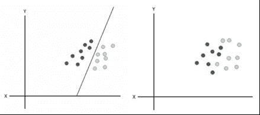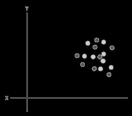

## 逻辑回归/分类

这种策略用于特征化因变量和全量因素。逻辑回归的概率依赖于自变量。它赋予因素“是”或“否”的值来对其排序。通常用于成对分类。

当你无法通过直接边界将信息划分为若干类时（如上面的模型所示），这就是你应该使用的技术。它可能是最著名的 AI 计算算法之一。它不仅将结果分类，还向我们展示了类别存在的概率。

我们通过取概率函数来实现此模型，其中 `p` 是事件发生的概率；

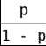此外，建立一个名为 `logit` 的方程

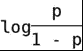

## K 最近邻

K-最近邻可能是数据特征化中最清晰且应用广泛的技术。它是一种用于分类和回归的监督学习类型，也是最基础的分类算法。基本上，它涉及到获取一个信息点并将其与散点图中最已知且最近的聚集在一起。

在 `KNN` 中，另一个信息点根据其邻居的范值进行排序。信息的焦点通过欧式距离进行估计。

在 `KNN` 中，另一个信息点根据其邻居的范值进行排序。信息的焦点通过欧式距离进行估计。

在 `KNN` 中，另一个信息点根据其邻居的范值进行排序。信息的焦点通过欧式距离进行估计。

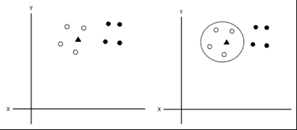

## 支持向量

支持向量是另一种分类器。它利用超平面进行特征化。总的来说，我们会在较小的数据集上使用支持向量模型，它在那里表现非常好。

## 核支持向量


虽然我们将会处理支持向量（piece support vectors），但随后它们被用于对那些无法用直线划分的类别进行排序。划分线可以采取许多形状（直接、非线性、多项式、螺旋前提、sigmoid 形式）。

回顾一下我们刚刚讨论的基于直线边界的分组，其排列方式类似于附图：

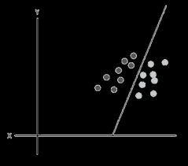

在这张图中，我们的信息可以用一条直线来表征，将两个明显的分类信息隔离开。如果信息能够像这样一致地划分，那将非常有利；但遗憾的是，事实通常并不那么平滑和干净，很多时候你应该将信息隔离成像这样的样子：

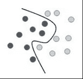

在这个模型中，信息无法通过直接边界线进行隔离。因此，考虑到这些，我们应该使用一种被称为“部分划分”（portion stunt）的程序。它利用信息焦点之间的相似比例来对它们进行特征描述。

## 朴叶贝斯 (Naïve Bayes)

回顾监督学习主要章节提到的贝叶斯假设。在朴叶贝斯模型中，指示器被认为是独立的。该模型在使用并不困难，并且适用于海量数据集。它经常用于帮助分类垃圾邮件。

我们在这里使用了贝叶斯标准公式。贝叶斯定理的可能性在于，通过在我们已知的知识中添加新的重要数据，我们可以根据这些新数据更新我们的见解。假设我们需要知道今晚下雨的概率，我们可以简单地统计每年下雨的天数。然而，在那个时候，我们发现下雨发生在今天凌晨。你认为这将如何影响今晚下雨的概率？

沿着这些思路，当我们获得更多关于事件的数据时，我们预测某事发生概率的能力将进一步提高。在数值上，贝叶斯假设如下：

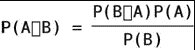

通过这种方式，我们可以利用贝叶斯假设对新的信息焦点进行分组。函数的作用在于，当我们给定另一个信息点时，根据该信息点的组成部分，确定该信息点落在某一分类的概率。

# 无监督学习

无监督机器学习利用未标记的信息。数据研究人员对结果一无所知。计算应该自动发现模式，而这些示例将是模糊的。在结构通常不显眼的地方发现模式。计算会自动发现数据分段。模型在一堆通常是未标记且不可识别的信息中搜索示例和模式。无监督学习允许我们发现那些没有计算机研究人员无法察觉的模式。有时，海量数据包含示例，试图筛选其中的每一个细节来寻找模式是非常的。

这对于观察购买者的购买意愿很有用，你可以根据他们行为中的模式将客户归组成不同的类别。模型可能会发现市场不同子集之间购买行为的相似之处，但如果你没有模型来过滤这些庞杂且混乱的信息，你永远无法理解这些示例的概念。无监督学习的优势在于，能够在海量数据中找到那些在没有模型帮助的情况下无法识别的示例或特质。

无监督学习的一个真实例子是位置欺诈检测。欺诈对于金融机构来说可能是一个大问题，由于大量的日常客户，如果没有 AI 工具的帮助，机构很难识别欺诈。模型可以学会如何识别欺诈，因为策略会随着技术的进步而变化。假设你需要管理新的、未知的欺诈手段，那么此时你应该使用一个能够在特定条件下识别欺诈的模型。

由于识别欺诈，拥有更多信息是明智的。欺诈识别服务应该使用一系列 AI 模型，以便成功反击欺诈。同时使用监督模型和无监督模型。据估计，到明年（2020 年），每年的虚假万事达交易将达到 320 亿美元。欺诈识别模型将（万事达交易）分类为真实或虚假。

它们可以根据时段或购买区域等因素进行排序。如果一个发货人通常进行 20 美元左右的交易，突然来自一个异常地区有一笔 8000 美元的交易，那么，模型极有可能将这笔交易标记为欺诈。

使用 AI 进行欺诈检测的测试在于，大多数交易并不是虚假的。如果在非假交易中即使存在大量的欺诈交易，那么信用卡行业将变成一个不可行的行业。欺诈卡交易的程度很小，不足以让模型产生此类偏。。来自异常地区的 8000 美元订单虽然可疑，但它更有可能是持卡人的旅行而非虚假交易。无监督学习使得识别可疑购买行为变得更容易，例如奇怪的运输区域和客户调查中的异常跳转。

## 聚类 (Clustering)

聚类是无监督学习的一个分支。分组是将相似事物聚集在一起的任务。当我们使用分组时，我们可以识别属性并根据这些属性对信息进行排序。如果我们使用 AI 进行营销，聚类可以帮助我们识别客户和潜在客户群体中的相似之处。无监督学习可以帮助我们将客户归分为我们在没有 AI 帮助的情况下可能无法做分类。当你处理许多因素时，它也可以帮助你对信息排序。

## K-Means 聚类

K-Means 聚类的工作原理与 K 近邻相似。你选择一个数字来决定你需要看到的簇数量。你继续进行分组和重新计算，直到簇变得更加清晰有序。

你的信息围绕质心（centroids）聚集，质心是你在图上选择的、用于将信息分组的中心。你随机选择它们，并且你有 k 个。当你将信息与模型关联时，信息点被归类到最近质心的分类中，通过欧几里距离进行计算。然后，你计算包含每个质心的所有信息点的平均值。重复这种交互，直到你的结果保持非常相似，并得到了预测的簇。每个信息点只允许属于一个簇。


你应该熟悉你的数据集，并利用直觉来思考合适的聚类数量，以及可以获得什么样的对比。在任何情况下，一旦我们面临的少数可能的聚类方式，我们的直觉和对信息的感知就没那么有用了。

## 降维

当你在使用降维技术时，你正在通过压缩信息来消除不必要的元素。基本上，你是在减少数据集中因素的数量。

当我们在模型中拥有海量因素时，我们就面临着维度问题的风险。维度问题是针对大型数据集模型特有的问题，并会影响预测的准确性。当我们拥有众多因素时，我们需要更大的群体和测试群体来构建我们的模型。有了如此多的因素，很难获得足够的信息来形成许多潜在组合，以构建一个拟合良好的模型。

如果假设我们使用了过多的因素，我们同样可能会经历过拟合。过拟合是让信息研究人员考虑降维的根本问题。

我们应该挑选我们不需要或多余的信息。如果我们有一个预测某人薪资的模型，我们需要一个提到他们“第一喜好”是什么的变量吗？可能不需要。我们可以将其从数据集中剔除。通常情况下，判断一个变量何时应该被删除并不那么自然。我们可以使用一些工具来确定哪些因素是不那么重要的。

`Principal Component Analysis`（主成分分析）是一种降维策略。我们获取旧的因素排列并以某种方式将其转换为更现代的一组。我们创建的这些集合被称为主成分。在减少因素数量与保持模型精度之间存在着权衡。

我们同样对因素的优势进行归一化。确保它们在相似的比例尺上被完全赋值，这样就不会放大某个变量的重要性。例如，假设某些因素是在 0 到 1 范围内的概率估计，而另一些因素是按超过 100 的整数估计的。

`Linear Discriminant`（线性判别分析）是另一种降维技术，它通过合并组件或因素，而不是完全丢弃它们。

`Kernel Principal Component`（核主成分分析）是第三种降维策略。在这里，因素被设置为另一组。这种模型是非线性的，它将给我们比原始信息远得多的对真实边界的理解。

# 神经网络

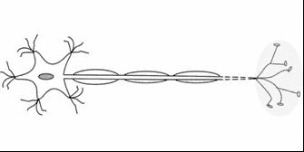

神经网络是一种被称为深度学习的 AI 类型。它可能是目前 AI 最先进的策略，真正理解它的工作原理可能需要博士学位。你可以针对机器学习中最专门的模型类型撰写一整本书。

神经网络是旨在模仿人类大脑内部连接方式的计算机框架。在你的体内，你有数以亿计的神经元，它们相互连接，并通过你的脊髓向上进入你的大脑。它们由根状枢纽连接，这些枢纽通过每个神经元传递信息，尽可能沿着链向上移动，直到到达你的大脑。

虽然目前计算机还无法完全复制这一点，但我们提取这一规律应用于计算机神经网络，以模拟人类大脑学习的能力：即感知模式，并从新数据的揭示中推导出信息。

归功于神经网络，我们所有的 AI 模型也是如此。数据通过神经网络被处理成数学信息。通过提供数学值，我们使它能够利用计算来做出预测。

这与大脑中的神经元类似，信息从顶部开始向下传递，首先被隔离成枢纽。神经网络利用枢纽传递每一层。神经网络包含三个部分：输入层、隐藏层和输出层。

在下方的图像中，我们神经网络的可视化表示，圆圈代表组织中的每个枢纽。在左侧，我们有输入层；这是数据进入的地方。数据通过输入层后，它将经过几个隐藏层。隐藏层是信息通过各种特征和功能解决一切的地方。隐藏层在信息数据集中寻找模式。隐藏层是发生“魔法”的地方，因为信息正在被模式排列，而这些模式如果我们手动排列的话很可能无法察觉到。每个枢纽都有一个权重，有助于决定正在被排列组件的含义。

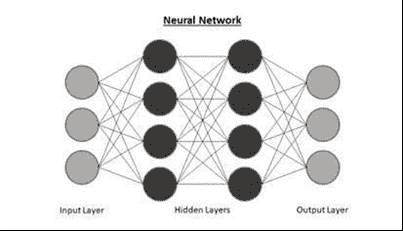

这些神经网络的最佳用途是完成一项对人类来说简单，但对计算机来说惊奇困难的任务。回顾书的开头，当我们讨论思考和归纳思维时。我们的人类大脑对于归纳思维是一个有用的资产；我们相对于现代计算机的优势是可以以惊人的速度计算海量数据。我们模仿人类推理来构建神经网络，因为我们正试图教计算机如何像人类一样“推理”。这是一项严峻的挑战。神经网络的一个真实例子就是我们提到的模型，我们将神经网络应用于对人类来说极其简单但对计算机来说极具挑战的任务中。

神经网络可以消耗巨大的计算能力。神经网络成为测试标准的主要解释，是构建准确模型所需的数据集量。假设你需要模型来确定如何分类照片，照片之间有很多细微的差异，模型应该学会如何有效地完成这项工作。这引出了下一个问题，即神经网络正常工作所需的因素数量。


假设你有几场即将到的相关考试需要复习。你可以记住你认为会在考试中出现的每一个方程式，并期望在考试当天当天，你实际上只想简单地将新数据连接到你已经有效保留的内容中。或者，你可以更深入地专注；弄清楚每道配方是如何运作的，目标是在任何情况、条件变化时都能交付出色的结果。过拟合的模型就像是背下了考试的配方。如果新信息相似，它会表现得非常出色；但当出现多样性时，它将无法如何调整。通常情况下，如果你的模型在准备信息上表现良好，但在测试信息上表现不佳，你就可以判断你的模型是否过拟合了。

当我们检查模型的表现时，可以利用损失估值（loss value）来量化。

损失估值是模型的预测值与真实值之间的差异。

神经网络的困难之一是，完全无法确定显式输入与输出之间的关系。隐藏层之所以被称为隐藏层，是因为它们太复杂了，以至于很难考虑去解释或弄懂。

最简化的神经网络被称为感知机（perceptron）。它的简单性来自于它只有一层信息通过的层。信息层连接到一个排列隐藏层，随后的预测是二分类。每当我们提到一种表征方法是成对的时，这意味着它只是在由 `0` 和 `1` 的两个独特类别之间进行分类。

感知机由弗兰克·罗森布特（Frank Rosenblatt）首次发明。如果你想学习神经网络，熟悉感知机是一个明智的想法。感知机与其他神经网络模型使用类似的交互，但通常你将处理更多的层和更多的潜在输出。当获取信息时，感知机会会将输入与其赋予的权重相乘。然后，这些特征权重之和连接到激活函数。激活函数在最后告诉信息它属于哪一类，从而预测输出。

如果你碰巧在图表上查看感知机，它的线看起来像这样：

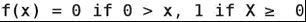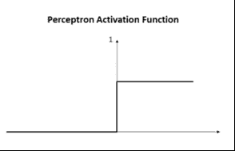

判别图的线看起来像一个阶段，有两个属性，分别在 `1` 的一侧或另一侧。轨迹线的不同侧是模型根据信息源将预测的各种类别。正如你从图中看到的，它有点粗糙，因为类别之间的线之间几乎没有区别。事实上，某些信息变量的微小变化也会导致预测输出变为另一个类别。它不会在你用于准备的第一个数据集之外保持一致，因为它是一项阶段性工作。

感知机的替代方案是一种称为 sigmoid 神经元（sigmoid neuron）的模型。使用 sigmoid 神经元的规则优势是它不是二分类的。与可以将信息分分为两个类别的感知机不同，sigmoid 产生的是概率而不是排列。下面的图片显示了 sigmoid 神经元的弯曲

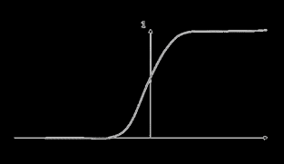

注意 `one` 附近的弯曲状态，那里信息像感知机那样被分类；轨迹使得很难仅通过极小的差异对信息进行分类。使用 sigmoid 神经元，信息是由其落在给定类的概率预测的。正如所示，线在 `one` 处弯曲，这意味着信息点落在给定类别的概率在 `one` 之后增加，但它仅仅是一个概率。

# 强化学习

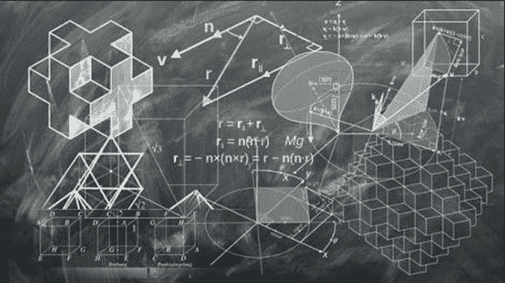

强化学习是我们的第三种 AI。与无监督学习一样，它没有提供信息源。强化学习模型应该自己找到如何做到最好。然后，数据人员根据模型预测结果的能力提出进一步改进模型的建议，这种能力通过观察预期与真实值之间的差异来评估。这是最具革命性的 AI 类型，AI 的很大一部分将来将在这里完成。

把它想象成玩游戏；从长期来看，你通过赢和输来学习。你通过玩来弄清楚如何赢，你对游戏越熟悉，就越理解获胜的机制。一段时间后，数据人员在模型收集和循环信息时给模型提供反馈。它接收一个奖励信号，这样它知道自己何时工作有效或预测了某些结果。因此，“主宰”比赛给计算提供了正向反馈。这种 AI 被用于游戏、机器人、路径规划和自动驾驶汽车。

## Q 学习

在 Q 学习中，模型与其当前环境交互以完善自己。你从有一组状态开始。状态是环境中的在你当前情境中作为障碍和道路存在的物体。被称为 `S`。在象棋中，它将是你所有棋子可以移动的方式，就像你对手所有棋子的位置。这些都是状态。

潜在的移动被称为 `A`。如果你是一个兵兵，你的潜在移动是向前移动一格。如果你是一车车，你的潜在移动是按顺序向任何路径移动。`Q` 是模型的值，从 `0` 开始。随着你玩游戏，`Q` 完全取决于它与环境的交互。随着负面交互，分数 `Q` 下降。随着正向关联，分数 `Q` 上升。计算找出如何移动以便增加数字 `Q`。起初，它是随机的。一段时间后，这些随机发展为 `Q` 带来确定和负面影响，机器弄清楚每次移动对 `Q` 分数的意义。

## SARSA 动作奖励状态

SARSA 与 Q 之间只有微小的区别。它们也都用于给模型提供奖励反馈。


我们发现，增强我们的树可以产生更精确的预期。尽管如此，想象一下这种场景：与其使用几个相似模型的变体，我们不如直接使用几个不同的模型。这是人工智能中一种常见的技巧，被称为**集成学习**（ensemble demonstrating）。通过结合来自许多不同类型计算的数据，我们可以提高模型的精度和推理能力。

集成学习的核心在于分治与克服。不同的模型会为我们提供关于信息的不同知识，而这些知识可能是其他模型无法明确识别的。通过整合从多个模型中获得的数据，我们可以更深入地了解数据的真实情况。

集成学习同样有助于限制我们预测中的偏差和方差。单一模型可能会预测错误，但我们所有预测的总和将会更加准确。

有几种不同的方法来使用集成学习：

- 第一种是采用预测的投票法。也就是说，取在模型中出现频率最高的值。哪个预测出现的次数最多（或者拥有最高的“票数”），哪个就是我们选择的预测。
- 我们也可以根据我们的模型类型取多个预测的平均值。多个预测的平均值将是我们的最终预测。我们的聚合还应该考虑单个模型的可靠性。我们的模型结果会有不同的权重，使得某些预测比其他预测更重要。

我们如何知道需要合并哪些类型的模型呢？我们从书中明确知道有几种类型的模型可以尝试，每种模型都为我们提供不同的潜在结果和优势。

典型的模型组合是将神经网络和决策树结合在一起。神经网络为我们提供新数据，而决策树确保我们没有遗漏任何内容。

我们之前讨论过的自助法（bootstrapping）和袋法（bagging），还有几种执行集成学习的其他方法。数据人员使用所谓的**模型集成**（container of models）。在这里，他们使用几种不同类型的模型处理测试数据，然后选择表现最好的一个。另一种思路被称为**堆叠**（stacking）。堆叠使用了几种不同的模型，然后利用每一个的结果为我们提供一个结合了所有结果的预测。

数据人员喜欢使用集成学习，因为通过一组模型，我们通常能比仅靠单一模型产生更好的预测。

集成学习的缺点是我们丧失了部分可解释性。多个模型协同工作使得理解变得更加困难，特别是当你需要将信息传递给没有计算机科学知识的伙伴时。

我们还可以使用同一个相似模型的几种形式，类似于随机森林通过其自身的多个版本对预测进行工作——使用具有不同节点配置和不同深度、或数量的神经网络，以观察这如何改变我们预测的结果，并寻找是否存在理想的深度分支，或者是否存在我们可能遗漏的群体或子群体。

当我们已经有一个良好的模型时，这种方法的作用并不大。然而，如果我们结合几个具有较弱预测能力的模型，它通常会提高整体准确性。

# 机器学习必须掌握的知识


要在人工智能领域取得成功，你应该拥有正确的作业工具，就像你盖房子时必须具备所需的技能和设备一样。接下来是进行 AI 所需材料的。

## 数据

在开始处理数据之前，你必须有足够的信息将其分为两类：准备数据和测试数据。

**准备数据**是你在构建模型之初使用的信息。当你首次创建模型时，你需要提供一些信息供其学习。通过准备数据，你将能够确定独立因素以及它们各自的影响因子。这意味着对于每条信息，你将明确知道数据的输出。通过这些信息，你的模型将学会如何独立预测输出。

**测试数据**是在你对模型满意后，自然获得的信息。在这些信息中，我们只有独立因子而没有输出。通过测试数据，我们可以感知模型对新信息的预测效果如何。

你的准备数据应该占据数据的大部分；大约 70%，而测试数据占 30%。为了避免偏差，请确保用于准备和测试的信息是完全随机的。


## 市场分析

**市场** `num_bedrooms` `num_bathrooms` `Sq_ft` `pool` (Y/N) **价值**

**$207,367 4 3 2635 N $148,224 3 2 1800 Y $226,897 5 3.5 2844 Y $122,265 2 1.5 1644 N**

## 理解变量和数据段

回顾一下，元素是变量的可量化属性。在普通数据集的每个段中，我们都能看到一个组件。该组件是某种可量化的测量或特征。在这里，我们利用反映房屋市场价值的信息作为房间数量、卫生间数量、面积以及房屋是否有泳池的组件。我们大致估算的价值是 `Y`；这是我们的因变量（注：可能是指“依赖”变量）。我们的自由因子，或者说 `X` ，是 `num_bedrooms`、`num_bathrooms`、`st_ft` 和 `pool`。

在监督学习中，你现在数据集中已经有了 `Y`。对于这种情况，它是房屋的市场价值。只要我们的模型中有足够的此类信息，无论我们对房屋的市场价值是否一无所知，只要我们有房间数量、卫生间数量、面积以及房屋是否有泳池，我们理应该有机会对其进行预测。这种方式协调的信息相当容易处理，并且具有此类不同的自主因子，这使其成为多元回归的示例。

### 你应该使用多少数据？

对于模型需要多少信息，并没有固定的标准，但有一些你应该遵循的规则。有趣的是，当你有几个自由因子要研究时，如果你的信息包含了尽可能多的自主因子的潜在组合，那么你的模型运行效果最好。如果这样做，当模型遇到另一种之前未见过的元素组合时，无论如何都能运行。无论这种组合是否完全新，它都将有一种非常好的预测方法。

一个可以遵循的良好概要是，受访者的数量应该是自由因子数量的十倍左右。根据我们上面的估计价值模型，我们有 `num_bedrooms`、`num_bathrooms`、`sq_ft` 和 `pool`。这是四个不同的自主因子，这意味着我们大约需要像上面记录的那样的四十个受访者才能创建一个可靠的模型。

拥有许多因子可以帮助我们更精确地预测 `Y`，但这可能是昂贵的并让你的信息更难以测量。你还应该考虑如何汇总你的信息。洛杉矶房屋的市场价值将与克利夫兰房屋的市场价值大不相同。

保持特征尽可能符合预期。虽然拥有许多因子将帮助你做出更好的预测，但某些因子可能仅仅会在模型中产生偏差。

参考 Scikit 图表，了解它们针对特定类型分析的数据度量建议了什么。

然而，并非所有信息都有价值的。我们经常谈论大数据，而且可能很容易接受信息越多越好。无论如何，情况通常并非如此。少量信息可能没用。某些因子可能会破坏一切，并可能使追踪变得困难。

### 准备数据

（此节提供的文本在源文件中似乎是碎片或重复的，按要求保持结构。）


在演示中，我们提到信息科学领域最常用的语言是 `Python`、`R` 和 `C++`。选择哪种最适合你将取决于你的经验以及你希望如何管理信息。

### Python

`Python` 是信息科学领域最广受认可的语言。它由 `Guido Van Rossum` 于 1991 年创建，其引人注目之处在于比其他编程语言更容易阅读。如今，它仍在被创建和进一步开发。学习它并不晦涩，并且适用于大多数相关信息类型。它在简单信息控制之外也有应用，这些应用在 AI 领域将非常有价值。

`Python` 有几个可以引入的免费扩展包，这些包旨在为你提供常规信息科学工具的替代方案。这些包为 AI 中常用的代码提供了不同的实现方式，这使得你需要的工作更少。

#### Python 库

- `Pandas` 是使用 `python` 的信息研究人员必不可少的工具库。它允许你更加从容地控制时间序列数据和普通数据集。它以行和列的形式显示你的信息，使其更容易管理，就像你在 `Microsoft Excel` 中查看数据一样。它在网上很容易找到并允许下载。当你查看 `CSV` 设计的数据时，`Pandas` 非常有用。
- `Numpy` 是一个利用 `python` 加快数据处理的实用程序。它的工作原理类似于 `Matlab`，可以处理网格和多维数据。它将帮助你更轻松地导入大型数据集。
- `Scikit-learn` 是另一个 AI 工作库。通过 `Scikit learn`，你将轻松访问我们之前提到的许多通常用于 AI 的算法。诸如分类、回归、聚类、支持向量、随机森林和 `k-means` 等算法都有简单的快捷径，因此已经替你完成了大部分繁琐的编码工作。

### R

`R` 是第三个选择。它是免费且开源的。`R` 可用于数据挖掘和 AI。它因其易用性而在信息科学初学者中非常有名。虽然它无法处理高级 AI 任务所需的大型数据集，但如果你是信息科学和计算机编程的新手，它绝对不是一个糟糕的起点。

### 硬件要求

为了运行这些项目，你需要一台 `PC`。通常情况下，标准的 `PC` 或个人电脑就足以衡量中等规模的数据集，特别是当你刚接触 AI 领域时。

### GPUs

尽管 `GPUs`（图形处理单元）已经存在相当了，但它们的可用性最近得到了扩展，这使得信息科学变得更加开放。这是信息科学领域的一次飞跃，因为该领域目前不再局限于拥有大型电脑的实验室。

`GPUs` 以作为电脑游戏背后的力量而闻名。它们允许 PC 无延迟地解释不同的目标，这对于准备海量数据至关重要。现在 `GPUs` 允许我们用更少的计算设备完成更多的工作。相比之下，`CPU` 拥有许多控制单元，允许数据同时进行处理。与其拥有许多控制单元相比，`GPU` 拥有大得的核心，这些核心可以同时处理各种循环。一张 `GPU` 卡可以包含接近 5000 个处理器。这对人工智能和 AI 来说是一项重大进展。它们可以帮助让神经网络的处理变得快得多。

### C 和 C++

`C` 和 `C++` 是其他常用的信息科学语言。`C++` 的优势在于它是一种极其强大的语言。它可以快速地处理巨大的数据索引。使用大型数据集的信息研究人员经常因为其速度和处理能力而选择 `C++`，特别是在处理超过 TB 级的数据集时。`C++` 大约在一秒内处理一个 GB 的数据。这对于深度学习算法、具有 5-10 层的神经网络模型以及海量数据集特别有用。这种模型对于速度不够快的编程来说可能过载。如果你正在进行高级 AI 开发并且有多个 `GPUs`，那么 `C++` 可能是最适合你的语言。`C++` 可以做任何事情；它是一种极其灵活的语言。

缺点是 `C++` 的库没有 `Python` 那么广泛。这意味着当你为你的信息和模型编写代码时，可能没有任何准备工作就开始了。无论你选择做什么项目，在编写代码时都会遇到障碍。拥有在你卡住时能帮助你的库将使你学习和工作得更快。

# 开发模型


开始 Python 的另一种选择是引入 Anaconda。`Anaconda` 的奇妙之处在于它提供了每个 Python 扩展包，因此在编写程序时不需要一个个引入包。它包含了你需要的每一个库，适用于几乎每种特殊的功能。

## Anaconda 环境

大多数 Python 用户将从一个名为 `IDLE` 的改进环境开始。它实际上非常简单，并为学习如何编写 `python` 代码提供了一个良好的配置。当你在 Windows PC 上安装 Python 时，它会自带。如果你有一台 Linux PC，它可以使用，但你需要独立安装。

`Anaconda` 在数据集方面非常有名，它会让你的编码更简单更快速，特别是当你仍在尝试弄懂事情时。

重要的库之一是 `Spyder` 和 `Jupyter`。这两者都是集成开发环境，这意味着它们是你编写代码的窗口，但它们比标准的命令行窗口高级，并具有保存和导出/导入代码的选择。


向下滚动直到你看到工作框架的概览。选择你的工作框架。它将根据你的工作框架，为你提供在其网站上引入相关内容的指南。此时，你就准备好开始在 Python 的世界中探索了。我强烈建议利用网络上可以获得的免费初学者 Python 教学练习。EdX 有一个免费的 Python 初学者教学练习，这是一个非常棒的起点。同样，利用像 Reddit 这样的社区，那里有无数常见问题已经得到了详尽解答，而且人们也在不断分享 AI 领域的相关信息。

## 算法

当你拥有了数据以及控制它的工具和编程能力后，你需要将它们结合起来。将你的数据放到你的程序中。刚开始时，可以在网上寻找免费的数据集进行处理。`Kaggle.com` 是免费的，拥有大量 `CSV` 格式的信息集可供浏览，一旦你在 `Python` 中引入了 `Pandas` 库，处理这些数据将变得简单。

起初，最好的算法是用于监督学习的直接回归，以及用于无监督学习的 `k-means` 聚类。这些将是一个相当简单的起点，从那里开始你可以向不同的模型努力。

## 可视化工具

你拥有了数据，并且已经使用其中一种编程语言创建了模型，你有一整套数据科学库来帮助你更快地完成。你的电脑运行良好，你可以自由地创建模型。

你可能已经创建了显示迷结果的模型，但要将其转化为通俗易懂的语言并与伙伴讨论你的发现，你需要以一种易于想象的方式对其进行组织。如果你是一个营销项目上的数据研究员，你可能创建了一个帮助对流失客户进行分类并预测购买意向模式的模型。无论如何，假设你需要将这些结果传给营销团队的其他成员，你需要弄清楚如何表述，以便即使是不熟悉数据科学的人也能理解你的结果。将你的数据整理成大纲、图表和视觉效果将有助于提升你的研究能力。当你与对数据研究感兴趣的群体交流时，能够创建数据的感知视图至关重要。

数据专家的一个知名工具集是 `Tableau`。这类设备被称为数据可视化编程。在某些公司，有的代表其整个工作包括将难以理解的数据以一种易于想象的方式引入。

像这样的场景通常被依赖数据做出决策的组织使用。这种场景非常有用，因为它通常易于使用，并且可以通过其基础看到连续的数据。你可以用你的数据调整用于制作报告和图表的仪表板。它还允许你向组织内的其他人分享你的结果。可以使用该场景根据你在编程语言中分解出的数据创建图表和散点图。

## 有用的进阶内容

当你刚开始时，这些工具可能对你并不重要，但讨论其中一些并思考之后可能有用会有帮助，可能会非常有趣。这本书可能只是你通往 AI 大师之路的起点，所以当你取得一定进展后，可以在其他时候再次参考这份清单。

你应该继续思考非结构化数据的处理。通常，这需要更高级的项目，因为它们更难管理和控制。这类信息通常表现为极其复杂，以至于人类大脑在没有工具帮助的情况下无法进行调查，但这正是 AI 发展的方向。利用神经网络来模拟人类思想的元素，谁能说不定未来将会怎样呢。

随着对 AI 的研究越深，我们的数据也变得越大。AI 的潜力结果在不断增长。未来的重要信息将不再具有我们熟悉的完美结构，类似于可以放入电子表格的那种类型的数据。

这类数据还需要更强大的计算机硬件和软件来能够处理这些海量信息。通常使用某种云计算软件来承载大量信息，以及专门用于数据分析的 `GPU`。这种高级别的计算可以帮助同时处理多个移动点。所需的数学知识也变得更加困难。算法的结合。

# 结论

希望在读完这本书后，你对机器学习的基本原理有了良好的理解。你现在已经接触了几种不同类型的流行机器学习模型及其用途。我们探索了高级数据科学家如何使用机器学习来创建预测，以及他们在引入新数据时为了创建准确且可靠的预测所需要的参数。

数据科学和机器学习的优妙之处在于其广泛的应用范围。如果你去获得机器学习的经验，那么就有广泛的工作和机会来处理各种类型的数据。无论你是否喜欢竞争和商业冲刺带来的快感，并想使用预测股票涨跌的模型，或者猜测客户下次将买什么。又也许你对医学和健康保健感兴趣；你可以应用机器学习来改进癌症诊断，并对疾病的特征以及它将如何影响不同个体获得新的见解。无论你的兴趣所在，机器学习都有机会被植入以改进我们已经能做的事情。

世界变得越紧联系，可用数据就会越多。几乎每个人都有某种类型的智能设备在记录和追踪他们的用户数据。数据科学家正在发现更有创意的方式来学习和解释那些数据。机器学习是数据科学家检查超出人类理解范围的趋势的一种，这意味着我们的预测将继续变得更加准确，我们的数据将更有用。

计算机只会变得越来越强大，这种力量将变得越发易获得，这意味着机器学习和数据科学将不再仅仅是术语，而是广泛应用的寻找价值信息的方法。


既然你已经掌握了机器学习的基础理论，现在是时候继续前进，寻找应用和实践知识的方法了。如果你兴趣成为一名专精机器学习的数据科学家，那么这本书仅仅是过程的开始。我强烈建议你投入精力学习如 `Python`、`R` 或 `C++` 等语言。这是成为数据科学家的下一步，也是将这些机器学习理论应用于实际模型和算法的关键一步。

得益于互联网，有大量的免费书籍、视频和教程供你选择，它们将引导你完成学习语言的过程。现在是学习编程和创建自己模型的最佳时机，没有之一。这本书只是该领域海量信息中的一小部分。如果你对机器学习认真的，那么这不应该是你阅读的唯一书籍。

### 扩展你的知识
你可以找到描述特定模型过程的完整书籍。神经网络是一个如此的领域，以至于仅仅这种特定类型的模型就能找到整本书。准备几本统计学学习指南也是不坏主意，这样你在遇到问题时可以查阅。留意你可能利用的潜在数据来源，以及可能通过统计数学进行探索的潜在问题。

### 职业机会
仅仅是就业机会就足以成为在该领域追求进一步知识的理由。目前缺乏能够应用本书中所列方法和技术的经验丰富的数据科学家。这意味着，对于那些愿意实干并开始编写自己自己模型的人来说，存在机会。现在就有许多企业和组织正在寻找能够正确使用这些信息的人。请记住，这种需求不会永远存在。全球各地的大学已经在创建专门针对数据科学的新学位课程，将其视为计算机科学与统计学的结合。这意味着下一代数据科学家已经在路上了。

### 如何开始
所以，现在就开始你的学习吧。找一个在线教程和一些免费数据集，并以本书为指南，开始研究如何进行回归和分类。一次学习一个模型。在互联网上寻找已完成模型的示例，尝试看看是否可以复制这些结果。学习编程语言需要时间，请保持耐心，并寻找新机会来学习和适应你的技能。

### 社区与实践
尝试加入针对统计建模的在线社区来磨练自己并从其他数据科学家的实践中学习。我建议你查看 `Kaggle.com`。这是一个为有抱负的数据科学家举办统计建模竞赛的网站。不同的公司和组织会发布包含数据集的比赛。这是尝试各种任务并获取可用数据的绝佳方式。网上还可以找到旧的比赛，并在 `youtube.com` 以及其他数据科学社区上有大量相关的教程供你学习。这可能是一个有抱负的数据科学家来说，扩展简历和与其他数据科学家建立人脉的最佳方式。
