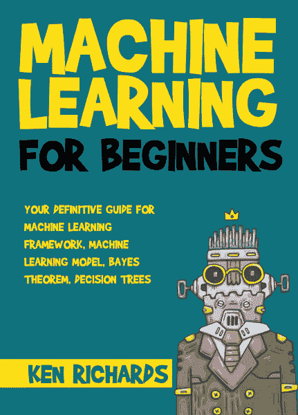
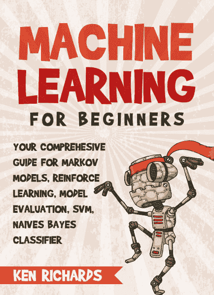

# 初学者机器学习

### YOUR STARTER GUIDE FOR DATA MANAGEMENT, MODEL TRAINING, NEURAL NETWORKS, MACHINE LEARNING ALGORITHMS

(BOOK 1)

By `Ken Richards`

`Author and Researcher`

All rights reserved. No part of this publication may be reproduced, distributed, or transmitted in any form or by any means, including photocopying, recording, or other electronic or mechanical methods, without the prior written permission of the publisher, except in the case of brief quotations embodied in critical reviews and certain other noncommercial uses permitted by copyright law.

The content and information contained in this book is strictly for educational purposes and has been compiled from sources deemed reliable, and it is accurate to the best of the Author's knowledge, information and belief. However, the Author cannot guarantee its accuracy and validity and cannot be held liable for any errors, omissions and/or inaccuracies. Further, changes are periodically made to this book as and when needed. Where appropriate and/or necessary, you must consult a professional (including but not limited to your doctor, attorney, financial advisor or such other professional advisor) before using any of the suggested remedies, techniques, or information in this book.

Upon using the contents and information contained in this book, under no circumstances will any legal responsibility or blame be held against the publisher or Author for any reparation, damages, or monetary loss due to the information herein, either directly or indirectly including any legal fees potentially resulting from the application of any of the information provided by this book. This disclaimer applies to any loss, damages or injury caused by the use and application, whether directly or indirectly, of any advice or information presented, whether for breach of contract, tort, negligence, personal injury, criminal intent, or under any other cause of action.

Additionally, the information found on the following pages is intended for informational purposes only and should be considered, universal. As befitting its nature, the information presented is without assurance regarding its continued validity or interim quality. Trademarks that mentioned are done without written consent and can in no way be considered an endorsement from the trademark holder.

Readers acknowledge that the author is not engaging in the rendering of legal, financial, medical or professional advice.

ISBN 13: 978-1983-4338-63

ISBN 10: 1983-4338-61

Related Books That You May Be Interested In ...

{: .class_Picture }

Machine Learning Series Book #2

Don’t you want to learn more about the framework that institutions and companies are using for machine learning?

Wouldn’t you want to find out the types of real life problems that are solved by various machine learning models?

Machine learning usage has been looming around us yet most of us are still uninformed about its applications and how it can improve their daily life.

Machine Learning For Beginners: Your Definitive Guide For Machine Learning Framework, Machine Learning Model, Bayes Theorem, Decision Trees

* Learn how to choose the machine learning framework in terms of speed, scalability and ease of use.
* Learn how to use the right machine learning model for different types of problems
* More in depth discussion on anomalies and anomaly detection techniques.
* Understand association analysis concepts and rules
* Explore Probability Theory, Bayes Theorem, Decision Trees
* Learn how to optimize your machine learning model
* Many More..

ISBN 13: 978-1983-4339-00

[Go and check out the book at Amazon. Click here.](http://strly.cc/krml02)

{: .class_Picture }

Machine Learning Series Book #3

Do you know that you are highly likely part of testing datasets for companies in their machine learning model training, applications and mobile apps?

The reality is very real. Data collections are everywhere in everything that we do and these behaviors that we exhibit and share willingly with application owners will be used to improve our user experience and improve our daily life.

In this guide, you will learn more about advanced machine learning algorithms that are not presented in earlier books.

Machine Learning For Beginners: Your Comprehensive Guide For Markov Models, Reinforced Learning, Model Evaluation, SVM, Naïves Bayes Classifier

* Explore and learn Markov models and its applications in machine learning
* Learn about reinforced learning algorithms
* Explore and understand what is structured prediction
* Learn how to use Naïves Bayes classifier to do machine learning tasks.
* Learn more about Support Vector Machine (SVM) and why it is so popular in Machine Learning.
* Learn about Random Trees and its applications
* Learn what is recommender systems
* Many More..

Bonus: Instructions included for datasets download.

ISBN 13: 978-1983-4340-82

[Go and check out the book at Amazon. Click here.](http://strly.cc/krml03)

## PREFACE

《机器学习算法：新手全面指南》是一本实用的机器学习探索之作。它是帮助机器学习初学者成为机器学习专家的最佳书籍。本书详细探讨了机器学习的各个方面。提供了实践案例，帮助您更好地理解所呈现的理论。

许多人对机器学习感兴趣，但并非所有人都具备计算机编程知识，这是对主题进行深入理解的关键。本书介绍了即使没有计算机编程知识的个人也能使用的机器学习工具。它教您如何使用这些工具创建和训练机器学习模型，进而用于进行预测。

数据是机器学习的关键。它必须被收集，然后通过检测和删除异常值来进行优化。本书教您如何收集和准备数据。您还将学习如何安全存储机器数据。

本书涵盖了机器学习的所有步骤，从训练到验证到模型应用。本书涵盖了一些常见的机器学习问题，如过拟合、欠拟合和脏数据。本书指导您如何避免或解决这些问题。

机器学习算法主要分为三类：监督学习、无监督学习和强化学习。本书详细探讨了这些学习算法。您将了解每种算法的工作原理及适用场景。讨论了每种算法的优缺点。作者精心选择的案例展示了算法的实际运作方式，因此您将学会为任何给定的应用选择最佳算法。

## Chapter 1

如果你使用 `K` 且类别数为偶数，通过选择奇数 `K` 来避免平局。如果类别数为奇数，则选择偶数 `K`。

为了打破平局，你可以将 `K` 稳步增加 `1`，然后查看训练数据集中与最相似实例的下一个类别。

`KNN` 在输入变量 `p` 数量较少时表现良好，但当变量数量增多时会遇到困难。

每个输入变量可视为 `p` 维输入空间的一个维度。假设你有两个输入变量 `x1` 和 `x2`，则输入空间为 `2` 维。若维度增加，输入空间的体积会以指数速率增长。

`KNN` 算法的使用示例包括最近邻内容检索。

一个典型的例子是计算机视觉中的手写体识别。

对于视频内容，问题会更具挑战性。例如，你拥有一段视频，需要找出与其最相关的视频。这种问题在多种情境中是实际存在的，虽然看似抽象，却是真实可行的。

美国手语 `ASL` 是一个典型的应用场景，交流完全依赖手势。我们需要构建一个 `ASL` 词典，使用户可通过手势进行查询。此时问题转化为在数据库中（可能是 `k` 个）找到最相似的手势，这正是 `KNN` 问题。

`KNN` 算法同样适用于基因表达数据，在该领域表现最为出色。`KNN` 还可用于三维结构预测和蛋白质交互预测。

### KNN 算法的优势

- 它是创建预测模型的良好算法，尤其适用于数据非常嘈杂的情况。
- 当可用数据集较大时，该算法能够有效工作。

### KNN 算法的劣势

- 首先需要确定 `K` 值，即最近邻的数量。
- 计算成本很高，因为需计算每个查询实例到所有训练样本的距离。可通过索引技术降低该成本。
- 使用哪种距离度量以及哪些属性用于计算可能不明确。

### 何时使用 KNN 算法？

尽管 `KNN` 可用于分类和回归问题，但它在分类问题中使用最为广泛。

提示：当需要衡量变量之间的相似性时，选择 `KNN`。它是使用相似性的最佳算法。

它是用于模式识别和统计估计的优秀算法。

## 第 10 章

### 强化学习算法

聚类是一种用于发现未标记数据集合结构的过程，是最重要的无监督学习算法。

聚类将数据点划分为若干组（即簇），使得同一簇内的数据点彼此更紧密相关，而与其他簇的数据点关系更为远远。

简单来说，聚类的目标是将数据划分为具有相似特征的组，并将它们分配到簇中。

### 聚类算法的工作原理

假设你经营一家租赁店，目标是了解客户偏好以提升业务。分析每位客户的偏好并为每个人制定策略是不切实际的。

最佳做法是将客户按购买习惯划分为若干组，例如 `8` 组。随后为每组客户制定策略。这就是聚类算法的工作方式。

聚类可分为硬聚类和软聚类。

在硬聚类中，每个数据点必须完全属于某一簇或不属于任何簇。

在上述例子中，每位客户必须属于 `8` 组中的某一组。

在软聚类中，数据点不被强制划分为独立簇，而是为每个簇分配置入的概率或可能性。

在上述例子中，每位客户都被分配一个属于 `8` 组中的概率。

### 聚类算法的类型

聚类是一项主观任务，意味着可能存在多种路径达到目标。每种方法都遵循一套规则，用于定义数据点之间的相似性。

以下是一些常见的聚类算法：

#### 1. K-Means 聚类

这是一种迭代工作的聚类算法，旨在每次迭代中寻找局部最大值。其步骤如下：

i. 指定希望拥有的簇数 `K`。
ii. 随机将每个数据点分配到一个簇中。
iii. 确定簇的中心点（`centroids`）。
iv. 将每个点重新分配到最近的簇中心。
v. 重新计算簇的中心点。

重复步骤 iv 和 v，直至不再有改进为止。此时即达到全局最优。

此为算法的终点（若未明确限制）。

`K-Means` 聚类的优势：

- 当变量量巨大且 `K` 较小时，`K-Means` 计算速度快。
- 该算法能产生更紧凑的簇，便于判断簇内部成员关系。

`K-Means` 聚类的劣势：

- 确定 `K` 值可能困难。
- 不同的初始划分可能导致最终簇的差异。
- 当簇的密度和大小差异较大时表现不佳。

#### 1. 层次聚类

层次聚类通过构建簇的层级结构工作。算法初始时，每个数据点各自为一簇。

随后将最接近的两个簇合并为一个簇。直至只剩下一个簇为止。

`dendrogram`（树状图）是展示该算法工作方式的最佳方式。在 `dendrogram` 中，初始每个数据点单独成簇，随后两个最近的簇合并，过程持续直至顶部只剩一个簇。`dendrogram` 中任何两簇合并的高度反映了这两个簇在数据空间中的距离。

层次聚类的优势：

- 实现简单，有时能给出最佳结果。
- 不需要事先知道将形成多少个簇。

层次聚类的劣势：

- 无法撤销已完成的操作。
- 时间复杂度约为 `O(n² log n)`（`n` 为数据点数量）。
- 没有直接最小化目标函数。
- 从 `dendrogram` 中确定簇的数量可能困难。

注意：`K-Means` 适用于大数据，因为其时间复杂度为线性；而层次聚类的时间复杂度为二次。

在 `K-Means` 中，簇数是随机选择的，不同的 `K` 可能导致结果差异。层次聚类则更具可重复性。

可应用聚类算法的场景包括：

- 市场细分
- 医学影像
- 搜索结果分组
- 图像分割
- 推荐引擎
- 异常检测
- 社交网络分析

### 何时使用聚类算法

当拥有若干项目且需要将这些项目划分为若干组时，应使用聚类算法。

- [相似的项目放在同一组中，而不同的项目则放在单独的组中。]

Division of a population into either male or female is a good example of a clustering application. You may use characteristics such as hair length. Those with shorter hair might be grouped separately from these with longer hair.

Another application might be the grouping of news articles by category: business articles, politics, human interest, etc.

Or suppose you have a number of documents written in various languages. You might use a clustering algorithm to create clusters from these documents, based upon the language used.

# Chapter 11
## Artificial Neural Networks

The neurons of the human brain are connected together like semiconductors in a computer processor. Their interconnection creates a network in which each neuron interacts, according to a set of defined rules, with the neurons surrounding it.

An artificial neural network is a software simulation of the human brain. The network is composed of interconnected programs called neurons.

The data enters the system at the first neuron, which performs the programmed operations and passes its output to the next neuron on the network.

This neuron in turn performs its program, producing another intermediate output. Neurons in an artificial neural network are arranged in layers, and the final output is produced in the final layer.

The process of generating an output from the given input is governed by the programming of the individual neurons as well as the initial conditions of the data. Rules can be implemented in artificial neural networks so as to ensure that they simulate the human brain.

### How ANNs Work

The process of learning in neural networks is implemented through the use of a learning algorithm. As we said, the neurons in a neural network are organized into layers.

Each layer is connected to the layers on either side. The purpose of the input layer is to receive the input from the external environment which you need to learn about.

The last layer in the neural network is referred to as the output layer, and this is the layer which gives the results of the learning process.

Between the input and the output layers, there exists some number of hidden layers. A fully connected neural network is one in which every hidden layer is connected to the layers on either side of it.

The connection of one layer to another is represented by a number known as a `weight`. The value of the `weight` can be positive or negative. A higher `weight` will have a greater influence on the network.

The common design of a neural network in which inputs are fed into the input layer with outputs received at the output layer is referred to as a `feedforward network`.

Each unit receives inputs from units located to its left, then multiplied by the values of the `weight` they have travelled along.

Every unit will add all connections it receives and if this sum exceeds a particular threshold value, will fire and propagate or trigger the units it is connected to on the right side of the network.

In order for a neural network to learn, there must be feedback. The feedback is similar to a “right” or “wrong” response to the selected output or action.

This kind of learning occurs in children when they are told whether what they are doing is right or wrong -- or even in adults! Think about it. If you became aware after the fact that you failed in some task, you probably planned how you might improve your “output” the next time approach the same task. It is the same with artificial neural networks.

The purpose of feedback is to allow comparison between actual output and the desired output. The difference between the two is assessed, and a determination is made on how the process might be improved in order to generate a better output next time.

The feedback process in neural networks is known as `backpropagation`.

The final output of the network is compared to the desired output, and the difference is used to prescribe modifications to the `weight`s of the connections between the network units.

This is done for output unit, to each of the hidden units, and lastly to the input unit. In other words, for each unit in reverse order from output to input. The process causes the neural network to learn, reducing the difference between actual and target outputs this difference is normally referred to as the `network error`.

The goal, obviously, is to reach a `network error` of zero, which requires that the network output be equal to the target output, but this may be difficult. After using several examples to train the artificial neural network, your network output will be sufficient to allow you to give the network a brand new set of input data and observe the outputs it gives.

Consider an example in which you train your artificial neural network to differentiate between chairs and tables.

You input the pictures of chairs and tables into the network and it classifies them as either chairs or tables. You train the network with 25 chairs and 25 tables. Now let say we give the network a new untested picture with perhaps a slightly different in design than earlier pictures, a designer coach chair, it should be able to classify it as either a chair or a table based on its previous experience.

However, this is not an indication that a neural network is capable of just looking at something and responding instantly to give the result. Its behavior is not like that of a person.

In the example given previously, the network will not be looking at pieces of furniture. The network receives input in a binary form, meaning that each input unit is switched either on or off.

Suppose you have 5 input units, information about five different characteristics of chairs in the form of binary answers (yes/no).

The questions can be:

Does the item pictured have a top?

A backrest?

Can you sit on it comfortably for a longer period?

Can you place a lot of stuff on it?

For a typical table, the answers will be yes, no, no, yes. In binary terms, these answers can be expressed as 1001. For a typical chair, the answers would be no, yes, yes, no. In binary terms, these can be expressed as 0110.

During the learning process, the artificial neural network will learn the characteristics which represent a chair those which represent a table, and those common to both.

With this knowledge, the neural network will be able to different between chairs and tables.

### Some Interesting Examples

Neural networks are widely applied today, in pattern recognition and in making decisions about patterns, for instance.

In airplanes neural networks can be used as a basic autopilot, where the input units read signals from cockpit instruments and output units which modify the controls of the plane so as to ensure that it is safe.

Artificial neural networks can be used in factories for quality control. A good example is found in the chemical process of detergent manufacturing.

Detergent quality can be measured through many parameters: thickness, acidity, etc, which can be presented to a neural network as inputs. The trained network, in turn, can make a quality determination and reject or accept the batch.

Artificial neural networks are also well suited to the task of bank security. Let’s say your bank runs several thousands of credit card transactions via your computer, one minute after another.

Your aim is to come up with a mechanism which will help you identify any fraudulent transactions. A neural network can help you achieve this. Possible inputs include: Is the owner of the credit card present? Has the user used a valid PIN number? Has the card transacted over 10 transactions in the last 10 minutes? Is the card being used in the country in which it was registered? Given enough such information it will be possible for the neural network to flag any fraudulent transactions, so that a human operator can be prompted to investigate further.

A bank can also use neural networks to approve or reject loan applications based upon an applicant’s past credit history, employment record, and current earnings.

Nearly every task involves pattern recognition and using those patterns to make decisions. Neural networks can predict everything from weather to stock market performance.

Doctors can use neural networks to assist with diagnosis. Neural networks can be used to operate radar scanning systems which can automatically identify enemy ships or aircrafts.

They can be used for voice recognition or for identification of spam emails. Neural networks have been widely used in language translation. An example of this is the automatic translation of Google, which uses neural networks to translate words from one language to another.

Neural networks have also been successfully employed to assist with police work. Applications include face recognition for use in the identification of persons or objects from captured CCTV footages.

They can also detect and recognize cars, which is helpful to police looking for stolen vehicles.

## Advantages of Artificial Neural Networks

The following are the advantages of using artificial neural networks:

* Neural networks require a less formal statistical training.
* Neural networks can help in detecting complex, nonlinear relationships between dependent and independent variables. This is why neural networks are used in solving problems which do not have an algorithmic solution or where it becomes hard to find a solution.
* With neural networks, one can detect all possible interactions between predictor variables.

## Disadvantages of Artificial Neural Networks

The following are the disadvantages associated with neural networks:

* Neural networks are prone to overfitting, which may lead to poor or inaccurate predictions.
* Neural networks may be slower to train and several epochs may be needed for the learning process.
* The “black box” nature of neural networks. One is only expected to provide the initial architecture of the neural network and provide some inputs to the networks, which are just random numbers. When using backpropagation, one does not actually know what he or she is doing. The learning process of the neural network will progress on its own.

## When to use Artificial Neural Networks

Neural networks should be used in problems which involve finding trends in data. They are good at solving many of the same kind problems that humans solve daily.

Examples of such problems include generalization, image recognition, and others. They help in solving problems which are difficult or impossible to solve through the use of traditional, formal analysis.

Fuzzy logic has been integrated into neural networks. This is a type of logic which recognizes more than just the simple true and false values, providing a better simulation of the real world. Suppose you have the statement, “It is sunny today.”

This statement can be 100% true if there are no clouds during the day, 50% if it is hazy, 80% if there are only few clouds, and 0% if it is rainy.

This means that the concept considers outcomes such as somewhat, usually and sometimes.

A combination of fuzzy logic and neural networks has been used in job application screening, automotive engineering, monitoring of glaucoma, crane control etc.

Neural networks are very good in processing massive amounts of data. This makes them very useful in image compression.

More websites on the internet are using images, and neural networks can help to compress such images.

# CONCLUSION

We have come to the end of this book. Machine learning is a branch of artificial intelligence which involves the design and development of systems capable of self-improvements showing an improvement in performance based upon their previous experiences.

In other words, these systems can “learn” by processes similar to human learning process.

Machine learning algorithms can be classified into two broad categories, supervised and the unsupervised. In supervised learning algorithms, the training data includes both inputs and outputs. The outputs (answers to the problems) are known as targets.

These in supervising the machine learning model as it tries to identify trends and patterns underlying your data.

In unsupervised learning algorithms, the training data includes inputs only. he targets are not provided. The answers to the inputs have to be discovered through a deep search.

There are a number of steps which must be followed during the course of machine learning. These include collecting and preparing the data and training, validating, and then applying the model.

When all these steps are completed, you will be able to use your model to make predictions. Machine learning is a new and growing field, and its emergence is a promising answer to the unimaginable quantities of data which will be generated by organizations and individuals during the upcoming years.

The predictive capacity of the various machine learning algorithms, is most attractive to businesses, who are rushing to incorporate machine learning into their day-to-day operations. Machine learning can help businesses predict future performance and make necessary adjustments in order to remain stable and even to increase profits.

Clearly, the future of machine learning is bright. Machine learning models can make the work of human beings easier. This fact alone should be enough to motivate human beings toward learning machine learning.

# Notes

Chapter 2 – Machine Learning

1. [`medium.com/machine-learning-for-humans/why-machine-learning-matters-6164faf1df12`](https://medium.com/machine-learning-for-humans/why-machine-learning-matters-6164faf1df12)
2. [`www.sas.com/en_us/insights/analytics/machine-learning.html`](https://www.sas.com/en_us/insights/analytics/machine-learning.html)
3. [`aws.amazon.com/machine-learning/`](https://aws.amazon.com/machine-learning/)

Chapter 3 – Machine Learning Tools

1. [`opensourceforu.com/2017/01/best-open-source-machine-learning-frameworks/`](http://opensourceforu.com/2017/01/best-open-source-machine-learning-frameworks/)
2. [`www.infoworld.com/article/2853707/robotics/11-open-source-tools-machine-learning.html`](https://www.infoworld.com/article/2853707/robotics/11-open-source-tools-machine-learning.html)
3. [`machinelearningmastery.com/machine-learning-tools/`](https://machinelearningmastery.com/machine-learning-tools/)
4. [`opensourceforu.com/2017/01/best-open-source-machine-learning-frameworks/`](http://opensourceforu.com/2017/01/best-open-source-machine-learning-frameworks/)
5. [`www.infoworld.com/article/3026262/machine-learning/13-frameworks-for-mastering-machine-learning.html`](https://www.infoworld.com/article/3026262/machine-learning/13-frameworks-for-mastering-machine-learning.html)

Chapter 4 – Data Acquisition

1. [`www.ni.com/data-acquisition/what-is/`](http://www.ni.com/data-acquisition/what-is/)
2. [`www.omega.com/prodinfo/dataacquisition.html`](http://www.omega.com/prodinfo/dataacquisition.html)
3. [`www.dataq.com/blog/data-acquisition/what-is-data-acquisition-and-why-is-it-important/`](https://www.dataq.com/blog/data-acquisition/what-is-data-acquisition-and-why-is-it-important/)
4. [`en-us.fluke.com/products/data-acquisition/`](http://en-us.fluke.com/products/data-acquisition/)

Chapter 5 – Data Management

1. [`www.data.cam.ac.uk/data-management-guide`](https://www.data.cam.ac.uk/data-management-guide)
2. [`www.businessdictionary.com/definition/data-management.html`](http://www.businessdictionary.com/definition/data-management.html)
3. [`searchdatamanagement.techtarget.com/definition/data-management`](http://searchdatamanagement.techtarget.com/definition/data-management)
4. [`www.ngdata.com/what-is-data-management/`](https://www.ngdata.com/what-is-data-management/)

## 第 6 章 – 模型训练、验证和应用

## 参考文献

1. [`www.coursera.org/learn/machine-learning/lecture/QGKbr/model-selection-and-train-validation-sets`](https://www.coursera.org/learn/machine-learning/lecture/QGKbr/model-selection-and-train-validation-sets)
2. [`sebastianraschka.com/blog/2016/model-evaluation-selection-part1.html`](https://sebastianraschka.com/blog/2016/model-evaluation-selection-part1.html)
3. [`machinelearningmastery.com/train-final-machine-learning-model/`](https://machinelearningmastery.com/train-final-machine-learning-model/)
4. [`link.springer.com/referenceworkentry/10.1007%2F978-1-4419-9863-7_233`](https://link.springer.com/referenceworkentry/10.1007%2F978-1-4419-9863-7_233)
5. [`techcrunch.com/2017/08/08/the-evolution-of-machine-learning/`](https://techcrunch.com/2017/08/08/the-evolution-of-machine-learning/)

## 第 7 章 – 算法

1. [`www.analyticsvidhya.com/blog/2015/08/common-machine-learning-algorithms/`](https://www.analyticsvidhya.com/blog/2015/08/common-machine-learning-algorithms/)
2. [`www.kdnuggets.com/2016/08/10-algorithms-machine-learning-engineers.html`](http://www.kdnuggets.com/2016/08/10-algorithms-machine-learning-engineers.html)
3. [`elitedatascience.com/machine-learning-algorithms`](https://elitedatascience.com/machine-learning-algorithms)
4. [`docs.microsoft.com/en-us/azure/machine-learning/machine-learning-algorithm-choice`](https://docs.microsoft.com/en-us/azure/machine-learning/machine-learning-algorithm-choice)
5. [`medium.com/towards-data-science/types-of-machine-learning-algorithms-you-should-know-953a08248861`](https://medium.com/towards-data-science/types-of-machine-learning-algorithms-you-should-know-953a08248861)
6. [`machinelearningmastery.com/a-tour-of-machine-learning-algorithms/`](https://machinelearningmastery.com/a-tour-of-machine-learning-algorithms/)

## 第 8 章 – 回归算法

1. [`www.analyticsvidhya.com/blog/2015/08/common-machine-learning-algorithms/`](https://www.analyticsvidhya.com/blog/2015/08/common-machine-learning-algorithms/)
2. [`machinelearningmastery.com/a-tour-of-machine-learning-algorithms/`](https://machinelearningmastery.com/a-tour-of-machine-learning-algorithms/)
3. [`machinelearningmastery.com/linear-regression-for-machine-learning/`](https://machinelearningmastery.com/linear-regression-for-machine-learning/)
4. [`elitedatascience.com/machine-learning-algorithms`](https://elitedatascience.com/machine-learning-algorithms)
5. [`gab41.lab41.org/the-10-algorithms-machine-learning-engineers-need-to-know-f4bb63f5b2fa`](https://gab41.lab41.org/the-10-algorithms-machine-learning-engineers-need-to-know-f4bb63f5b2fa)
6. [`ieeexplore.ieee.org/document/7395848/?reload=true`](http://ieeexplore.ieee.org/document/7395848/?reload=true)
7. [`www.ncbi.nlm.nih.gov/pmc/articles/PMC3345521/`](https://www.ncbi.nlm.nih.gov/pmc/articles/PMC3345521/)

## 第 9 章 – KNN 算法

1. [`machinelearningmastery.com/k-nearest-neighbors-for-machine-learning/`](https://machinelearningmastery.com/k-nearest-neighbors-for-machine-learning/)
2. [`www.analyticsvidhya.com/blog/2014/10/introduction-k-neighbours-algorithm-clustering/`](https://www.analyticsvidhya.com/blog/2014/10/introduction-k-neighbours-algorithm-clustering/)
3. [`saravananthirumuruganathan.wordpress.com/2010/05/17/a-detailed-introduction-to-k-nearest-neighbor-knn-algorithm/`](https://saravananthirumuruganathan.wordpress.com/2010/05/17/a-detailed-introduction-to-k-nearest-neighbor-knn-algorithm/)
4. [`www.ncbi.nlm.nih.gov/pmc/articles/PMC4916348/`](https://www.ncbi.nlm.nih.gov/pmc/articles/PMC4916348/)
5. [`kevinzakka.github.io/2016/07/13/k-nearest-neighbor/`](https://kevinzakka.github.io/2016/07/13/k-nearest-neighbor/)
6. [`www.packtpub.com/mapt/book/big_data_and_business_intelligence/9781783555130/3/ch03lvl1sec24/k-nearest-neighbors--a-lazy-learning-algorithm`](https://www.packtpub.com/mapt/book/big_data_and_business_intelligence/9781783555130/3/ch03lvl1sec24/k-nearest-neighbors--a-lazy-learning-algorithm)
7. [`dataaspirant.com/2016/12/23/k-nearest-neighbor-classifier-intro/`](http://dataaspirant.com/2016/12/23/k-nearest-neighbor-classifier-intro/)

## 第 10 章 – 聚类算法

1. [`www.analyticsvidhya.com/blog/2016/11/an-introduction-to-clustering-and-different-methods-of-clustering/`](https://www.analyticsvidhya.com/blog/2016/11/an-introduction-to-clustering-and-different-methods-of-clustering/)
2. [`machinelearningmastery.com/a-tour-of-machine-learning-algorithms/`](https://machinelearningmastery.com/a-tour-of-machine-learning-algorithms/)
3. [`www.toptal.com/machine-learning/clustering-algorithms`](https://www.toptal.com/machine-learning/clustering-algorithms)
4. [`www.mathworks.com/discovery/unsupervised-learning.html`](https://www.mathworks.com/discovery/unsupervised-learning.html)
5. [`www.datascience.com/blog/introduction-to-k-means-clustering-algorithm-learn-data-science-tutorials`](https://www.datascience.com/blog/introduction-to-k-means-clustering-algorithm-learn-data-science-tutorials)
6. [`home.deib.polimi.it/matteucc/Clustering/tutorial_html/`](https://home.deib.polimi.it/matteucc/Clustering/tutorial_html/)
7. [`www.ncbi.nlm.nih.gov/pmc/articles/PMC2766793/`](https://www.ncbi.nlm.nih.gov/pmc/articles/PMC2766793/)
8. [`www.quora.com/What-are-the-best-clustering-algorithms-used-in-machine-learning`](https://www.quora.com/What-are-the-best-clustering-algorithms-used-in-machine-learning)
9. [`www.coursera.org/learn/machine-learning/lecture/93VPG/k-means-algorithm`](https://www.coursera.org/learn/machine-learning/lecture/93VPG/k-means-algorithm)
10. [`www.sap.com/documents/2016/03/8e83c175-627c-0010-82c7-eda71af511fa.html`](https://www.sap.com/documents/2016/03/8e83c175-627c-0010-82c7-eda71af511fa.html)

## 第 11 章 – 人工神经网络

1. [`www.tutorialspoint.com/artificial_intelligence/artificial_intelligence_neural_networks.htm`](https://www.tutorialspoint.com/artificial_intelligence/artificial_intelligence_neural_networks.htm)
2. [`www.psych.utoronto.ca/users/reingold/courses/ai/cache/neural2.html`](http://www.psych.utoronto.ca/users/reingold/courses/ai/cache/neural2.html)
3. [`hackernoon.com/overview-of-artificial-neural-networks-and-its-applications-2525c1addff7`](https://hackernoon.com/overview-of-artificial-neural-networks-and-its-applications-2525c1addff7)
4. [`www.analyticsvidhya.com/blog/2014/10/ann-work-simplified/`](https://www.analyticsvidhya.com/blog/2014/10/ann-work-simplified/)
5. [`neuralnetworksanddeeplearning.com/chap1.html`](http://neuralnetworksanddeeplearning.com/chap1.html)
6. [`www.doc.ic.ac.uk/~nd/surprise_96/journal/vol4/cs11/report.html`](https://www.doc.ic.ac.uk/~nd/surprise_96/journal/vol4/cs11/report.html)
7. [`pages.cs.wisc.edu/~bolo/shipyard/neural/local.html`](http://pages.cs.wisc.edu/~bolo/shipyard/neural/local.html)
8. [`www.extremetech.com/extreme/215170-artificial-neural-networks-are-changing-the-world-what-are-they`](https://www.extremetech.com/extreme/215170-artificial-neural-networks-are-changing-the-world-what-are-they)
9. [`medium.com/technology-invention-and-more/everything-you-need-to-know-about-artificial-neural-networks-57fac18245a1`](https://medium.com/technology-invention-and-more/everything-you-need-to-know-about-artificial-neural-networks-57fac18245a1)
10. [`www.wired.com/story/machine-learning-backdoors/`](https://www.wired.com/story/machine-learning-backdoors/)
11. [`techcrunch.com/2017/04/13/neural-networks-made-easy/`](https://techcrunch.com/2017/04/13/neural-networks-made-easy/)
12. [`www.saedsayad.com/artificial_neural_network.htm`](http://www.saedsayad.com/artificial_neural_network.htm)

Thank You!

Before you go, I would really like to give you a thank you hug for purchasing my book.

You could have picked from the vast selection of other books on the same topic but you took a chance and choose this one.

So, instead of a bear hug, a HUGE thanks to you for getting this book and for being awesome and reading all the way to the end.

It wasn’t easy writing this book and my only wish is that more people are able to read my book (great amount of time and efforts have been committed in presenting this book). One way you could help is to just take a few minutes to leave an honest review for this book on Amazon.

This feedback will help me to improve and continues to write the type of books that will help you get the results you are looking for.
