# 大数据分析机器学习

## 编辑者

Siddhartha Bhattach 教授

RCC 信息技术学院，

Canal South Road, Beliaghata,

Kolkata 700 015, India

dr.siddhartha.bhattacharyya@gmail.com

Hrishikesh Bhaumik 先生，

RCC 信息技术学院

Canal South Road, Beliaghata,

Kolkata 700 015, India

hbhaumik@gmail.com

Anirban Mukherjee 博士

RCC 信息技术学院

Canal South Road, Beliaghata

Kolkata 700 015, India

anirbanm.rcciit@gmail.com

Sourav De 博士

Cooch Behar 政府工程学院

Vill- Harinchawra, P.O.- Ghughumari, Cooch

Behar - 736170

West Bengal Bengal 印度

sourav.de79@gmail.com

# 前言

大数据是一个用于描述规模如此大或如此复杂以至于传统数据处理应用程序软件无法处理的数据集的术语。这一方向可能面临挑战包括采集、存储、分析、数据治理、搜索、共享、传输、可视化、查询、更新和信息隐私。“大数据”一词通常仅指使用预测分析、用户行为分析或其他某些高级数据分析方法，这些方法在不考虑数据集大小的情况下从数据中提取有意义价值。由于数据演化的进步，科学家在电子科学工作中遇到了局限性，包括气象学、基因组学、连接组学、复杂物理模拟、生物和环境研究。

大数据分析是检查大型且各种数据集（即大数据）的过程，以发现隐藏的模式、未知的相关性、市场趋势、客户偏好以及帮助组织做出更明智业务决策的其他信息。大数据分析使数据科学家、预测建模师、统计学家和其他分析专业人员能够分析日益增长的结构化交易数据，以及其他通常被传统商业智能（BI）和分析程序未开发的数据形式（其中包括半结构化和非结构化数据的混合）。在大范围内，数据分析技术和方法提供了分析数据集并得出结论的手段，帮助组织做出明智的业务决策。BI 查询回答有关业务运营的基本问题。大数据分析是高级分析的形式，涉及复杂的应用，例如由高性能分析系统辅助的预测模型。注意，这些类型的非结构化和半结构化数据通常不适合基于关系数据库的传统数据仓库。因此，许多收集、处理和分析大数据的组织转向 `Hadoop` 及其辅助工具，如 `YARN`、`MapReduce`、`Spark`、`HBase`、`Hive`、`Kafka` 和 `Pig`，以及 NoSQL 数据库。在某些情况下，`Hadoop` 集群和 `NoSQL` 系统主要作为数据加载到数据仓库或分析数据库之前的落地平台和临时区域，通常以摘要的形式。任何形式的数据都会表现出不同程度的模糊性和不精确。机器学习工具和策略擅于处理这些不确定性，从而从数据中提取相关且有意义的信息。

本书包含六个优秀的章节，专门报告机器学习在大数据分析应用方面的最新发现。

## 第一章

第一章对心理测量特征分析进行了实操介绍，并提供了一个可扩展的基础设施解决方案作为两个重要概念的概念证明：海量可用数据的有效处理以及对微定位的需求。作者讨论了两个用例，并展示了如何从 Facebook 数据中提取心理测量信息（例如，这些信息可以用于有针对性的政治信息）。最后，概述了可以作为未来研究起点的潜在进一步发展方向。

## 第二章

视频摘要是基于内容的视频检索领域的一个重要研究方向。该领域的一个主要目标是在尽可能短的时间生成视频摘要。在第二章中，首要目标是从视频的组成镜头中快速选择关键帧，以最少的时间生成分镜脚本。制作分镜脚本所需的时间与镜头帧之间需要计算的相关性数量成正比。为了缩短时间，获取用户关于实际计算的相关性数量的输入。通过生成近似的最小生成树并根据相关性值的统计分布通过自动阈值计算镜头每帧周围的密度，从每个镜头中选择关键帧。

大多数图像处理技术涉及定制的算法，且缺乏灵活性，这使得它们与处理的数据有所不同。在第 3 章中，作者详细阐述了图像处理领域的各种方法论。他们按照时间顺序展示了学习技术在图像超分辨率、图像上采样、图像质量评估和并行计算技术中的作用。此外，书中还深入解释了深度神经网络架构作为执行多种图像处理任务的卓越工具的参与及方式。

第 4 章侧重于智能交通角度下的联网城市。联网城市通过对可用资源的控制，能够高效地改善经济和社会产出。城市中的人员、系统和事物生成了大量数据。因此，来自各种资源产生的数据被认为是联网城市中最具可扩展性的资产。异构数据难以进行组织、解释和分析。通常，由于数据产生于水利、交通、能源、建筑等异构环境，来自不同来源产生的数据非常巨大且具有异构性。因此，数据库、数据挖掘、人工智能和分布式系统社区等不同的多维背景对于应对联网城市中的大数据挑战非常有用。

在第 5 章中，提出并研究了一种新型神经模糊网络混合结构，通过模糊聚类层将模糊细胞科霍南神经网络和径向基神经网络相结合。所提出的模型具有高度的神经元自组织性，能够提高聚类重叠情况下网络属性的分离；能够自动调整径向对称函数的参数；具有单个隐藏层，足以对显著的非线性依赖进行建模；具有优化权重系数的简单算法；以及快速的学习速度。该模型可以解决广泛的问题——多维半结构化数据的聚类、近似和分类（识别）。

图像融合是多个图像的组合，结果生成一张融合图像。它比任何其他输入图像提供更多信息，并基于离散小波变换（`DWT`）和稀疏采样。稀疏采样方法在信号处理方面的性能优于奈奎斯特定理。在各种技术中，`DWT` 具有许多优势；它能产生更高的质量，所需的存储更少且成本低，这在图像应用中非常有用。图像相关的应用限制较少，例如最小数据存储以及通过卫星通信的带宽较低，这实际上导致了低质量图像的捕捉。为了解决这个问题，图像融合已被证明是遥感应用的潜在工具，它可以结合全色图像、多光谱图像组合的数据；以产生具有更高空间和光谱分辨率的复合图像。该领域的研究可以追溯到几十年前；该领域各研究人员目前提出的各种方法和方法论在第 6 章中进行了讨论。

本书旨在作为计算机科学、电子与电信、信息科学和电气工程领域的本科生和研究生在课程中使用的参考资料。

2018 年 4 月

印度，加尔各答

Siddhartha Bhattacharyya

Hrishikesh Bhaumik

Anirban Mukherjee

Sourav De

Siddhartha Bhattacharyya 想要将本书献给他已故的父亲 Ajit Kumar Bhattacharyya、已故的母亲 Hashi Bhattacharyya、亲爱的妻子 Rashni Bhattacharyya 以及他的表妹/姨妹 Aparna Bhattacharjee 和 Baby Bhattacharjee

Hrishikesh Bhaumik 想要将本书献给他已故的父亲 Ranjit Kumar Bhaumik 少士（他最大的灵感来源），以及他的母亲 Anjali Bhaumik 女士，她在生活的起伏中一直支持并陪伴他

Anirban Mukherjee 想要将本书献给尊敬的 Sujit Ghosh 教授

Sourav De 想要将本书献给他的儿子 Aishik、妻子 Debolina Ghosh、父亲 Satya Narayan De、母亲 Tapasi De 以及他的妹妹 Soumi De

致 Till Blesik, Matthias Murawski, Murat Vurucu 和 Markus Bick

# 1 将大数据分析应用于心理测量微精准定向

Till Blesik, Matthias Murawski, Murat Vurucu, Markus Bick, ESCP Europe Business School, Heubnerweg 8–10, 14059 Berlin, Germany, 电子邮件：`{tblesik, mmurawski, mbick}@escpeurope.eu, murat.vurucu@edu.escpeurope.eu`

摘要：在本章中，我们联系了两种近期现象。首先，技术创新降低了数据存储成本，并实现了可扩展的并行计算。通过社交媒体、物联网应用和其他来源，可以很容易地收集到大型数据集。这些数据集是极大提高我们对个体和群体动态理解的基础。其次，诸如唐纳德·J·特朗普当选美国联合国总统以及英国退出欧盟等事件，引发了关于心理测量微精准定向选民的公众辩论。通常，公共机构以及其他组织对个人信息有极大的需求。

我们结合了这两个流，即可用的海量数据和对微定向的需求，旨在回答以下问题：大数据分析如何用于心理测量画像绘制？我们开发了一个概念框架，说明如何使用 Facebook 数据推导出用户的心理测量特征。我们的概念框架包含了 `Facebook Graph API`、用于存储信息的非 SQL `Mongo Data Base` 以及用于减少数据集维数的 `R scripts`（通过应用隐含 Dirichlet 分来确定与心理相关的词的相关性）。

在本章中，我们提供了心理测量分析的实践介绍，并提供了一个可扩展的基础解决方案作为本文处概念的概念证明。我们讨论了两个用例，并展示了如何从 Facebook 数据中推导出心理测量信息。最后，概述了可能的未来发展，可作为未来研究的起点。

关键词：大数据、大五人格特征、Facebook、政治、心理测量、隐含 Dirichlet 分布

## 1.1 引言

20 世纪和 21 世纪的技术创新对社会产生了巨大影响。互联网的出现以及随而来的个体永久连接不仅改变了经济，也改变了社会运作的方式 `[1]`。在可量的在线行为渗透之前，数据是稀缺的。这就是为什么统计推断（从较大的总体中派出的数据集进行分析）在过去是、现在仍然非常重要。它有助于从稀缺且昂贵的数据中获取最大价值。

在如今这个社交媒体、物联网、电子商务、在线金融服务、搜索引擎、导航系统和云计算的时代，数据正从每一个个人到机器的各个领域被收集，并通过机器之间的交互进行处理 [2]。这些数据可以从关联角度进行分析，从而产生更多数据，即元数据。单是手机智能手机就能提供有关个人用户购买习惯、交通偏好和路线、个人喜好以及社交环境的信息。

想象一下公共机构如何利用其应用程序听取语音并将其转换为面文字（从而变为可搜索的文本），绘制出个人所有的活动轨迹和模式，并利用从社交网络收集的中间行为和偏好的相关性来识别例如国家的潜在威胁，这并不遥谱。自 2013 年爱德华·斯诺登泄密以来，美国国家安全局（`NSA`）及类似组织实施的所有国际性侵犯隐私行为极大地塑造了公众辩论和我们对技术的认知。一种奥威尔式的群众监控幻象似乎已经以现代政府的形式变成了现实。

然而，秘密机构也可以认为是民主国家内相关的机构。秘密机构基于遵循民主宪法并旨在保护国家利益的司法体系，以法官和法律为基础建立运营，并通常在政治制衡的背景下利用其应用程序来分类和控制国家敌人。然而，国家的“利益”和国家的“敌人”这些术语的定义很大程度上取决于现任民选政府的理念。事实上，鉴于已有的技术，今天的政府有潜力对每一位选民建立“心理测量”剖面，以影响他们的投票习惯 [3]。

心理测量是一种评估人类心理特质的科学方法。它根源于社会生物学 [4]。其目标是获得人群中大五人格测试中每种人格特质的分布情况。大五人格特征包括：外倾性、宜人性、经验开放性、尽责性和情绪稳定性（神经质） [5, 6]。有多种探索个人特质的方法，例如通过分析用户的 Facebook 点赞和其他形式的文字文本（如状态信息）。这些信息可以与年龄或性别或其他人口统计数据相关联。在政治背景下，发送给选者的信息可能会根据心理测量分析的结果进行调整。一位主张放松枪支法律的州长，对国家步枪协会（`NRA`）的持枪爱好者和年轻母亲的方式会有完全不同。年轻母亲可能会收到一条主张放松枪支法律的信息，以便教师可以在教育环境中携带枪支来保护她的孩子；而`NRA`成员则会收到一条展示某种军事武器最新功能的信息，而这种武器应当被合法化。

理解每位接收者的心理测量特质有助于定义信息的内容。心理测量分析已使用了一个多世纪，但在大数据和群众监控的背景下，它获得了新的重要性 [4]。

基于这些思考，我们将研究从 Facebook 数据中推导出个人用户心理特质的机会。更具体地说，研究问题可以总结如下：

如何在大五人格模型中提取、存储、分析、展示并使用 Facebook 数据进行微定位（micro-targeting）？

为了回答这个问题，使用了多种数据源和计算方法，如图图 1.1

图 1.1: 本章的概念流程图

本章的结构如下。第二节介绍了心理测量分析的理论和历史基础。第三节介绍了研究方法，同时重点关注底层的统计和技术基础设施，包括介绍如何将 Facebook 作为我们研究的数据源。我们在第 1.4 节 的著作——`Modern Psychometrics – The Science of Psychological Assessment` [4]。这本书提供了对心理测量的全面概述，并对该主题的几个实际方面进行了讨论。此外，还介绍了重要的历史和伦理问题。我们在本小节中对其进行了总结。

通常，心理评估有多样化的目标。测试可能旨在为工作招聘理想候选人，或通过识别学习障碍在教育环境中创造公平。另一个引起争议的功能是：利用心理剖面来建立微定位广告，以影响民主选举中的投票习惯 [3]。

心理测量的起源可以追溯到达尔文著名的著作《物种起源》和《人类的起源》发表很久之前。天赋被认为是一种神性的恩赐，取决于单纯的审判和计划 [4]。然而，达尔文对进化的发现对人文科学产生了巨大影响，并启动了一个旨在揭示自然对人类影响的计划。从那时起，一个目标一直是衡量个人智力。“智力不是教育而是可教育性。它被认为是个人特质的一部分，而非社会决定的，这意味着由遗传决定的。以这种方式定义的智力在本质上是遗传的” [4, p. 8]。因此，“对于社会生物学家来说，智力测试得分反映的不仅仅解决问题的能力：它们与达尔文的‘优胜劣汰’概念有关。而适应性倾向于根据人类完美的形象来感知。……从这个角度来看，智力似乎是一种反映个人道德和人类价值的普遍品质，并毫不掩饰地与种族差异有关” [4, p. 16]。

试图在个人的遗传结构中寻找智力公分数的尝试使科学家进入了优生学领域。优生学的的核心假设是退化。如果具有不良特征的生物繁殖速度快于具有良好特征的群体，那么该特定群体就会发生退化。基于这一观点，优生学家认为，人类“通过照顾病患和‘不适宜者’，正在经历优生性退化，科学家应该参与到损害限制中” [4, p. 10]。优生学家及其选择性育种人类的目标是基于进化论理论的概念。“20 世纪初的智力测试运动在种族主义方面不仅仅是像纳粹主义那样——它是其意识形态的先驱。”这些“[……]思想进入了进化理论，并被用来为可疑的政治信仰进行外装，试图赋予它们伪科学的权威性” [4, p. 17]。第二次世界大战和纳粹的种族主义罪行之后，优生学遭到了社会的唾弃。在当今世界，种族主义话题更加敏感，可以说，心理测量学的奠者们并不具备这种敏感性。

科学家对于寻找和定义智力衡量标准有着无穷无尽的动力，这导致了统计方法的发展，包括相关性、标准化、标准差和因子分析，这些方法都可以作为心理评估的方法。它进一步导致了用于测试的、并可以相互比较的题目的开发。这些方法是标准化测试的基础，每天影响着学术和职业评估。因此，测试的功能在于确定其用途，而这一功能源于任何社会对选择和评估其内部个体的需求。鉴于选择和评估是存在的，那么尽可能准确地执行它们，并对它们进行研究和理解是至关重要的。

心理测量学可以定义为选择和评估人类的科学过程。但在现代，我们必须意识到，这些选择和评估的伦理、意识形态和政治是心理测量学以及统计学和心理学不可分割的整体。这种关注之所以特别突出，是因为“任何促进选择的科学默认也都在处理拒绝，因此在本质上是政治性的” [4, p. 25]。

## 1.2.2 心理测量学派与测试

总来说，心理测量学有两个学派：特质派和功能派 [4]。

功能派的测试是以线性方式构建的，这意味着 `x-axis` 上的内容区域映射到 `y-axis` 上的不同水平的表现上。内容区域可以是政治地理，例如，而表现形式则是例如从 1（差）到 4（非常好）的量表评分。在这种情况下，一个题目基本上是通向内容区域函数表现/答案的问题。功能性测试通常用于评估求职者或为高等教育计划选拔候选人。功能会根据评估目标而改变。

然而，特质派的测试试图通过将答案泛化为人类智力和人格的概念，将自己与纯粹的目标驱动方法隔离开来。这导致了一种信念，即人格类型不是二元且排他的，而是个体的格是许多特质的混合，以及各特质极端之间的平衡 [4]。因此，功能派和特质派之间最迷人的区别在于，特质派试图寻找人格类型中表现的程度，而功能派则评估个体对特定任务的适用性。

我们的研究了特质派对人格特质评估的影响。我们调查了个人行为与其人格特质相关的较大群体的相关性，以及人格特质对个人所做决策的影响。

这两个学派测试中的一个严重问题是真实分理论。假设观察分是真实分加上额外误差之和。这种误差可能基于偏差。偏差可能由测试题目的构建引起。题目偏差相当容易识别。美国的一项测试可能以美元和分为单位，因此不适合在英国使用。语言形式的题目偏差是最常见的 [4]。另一种偏差是题目冒犯性。冒犯性题目包括种族主义和性别歧视。当测试本身是为特定群体构建，且没有为设计该测试的群体提供充分机会时，就存在内在测试偏差。一个简单的例子是，英语母语群体参加一个为母语者设计的测试，但非母语者也必须参加同样的测试。当上述内在测试偏差的示例中提到的两个群体的社会地位之间存在实际差异时，就会发现外在测试偏差。某些偏差受法律监管，例如种族偏差。例如，在德国，不允许根据种族选择候选人。内在测试偏差可以通过积极性歧视来调节，但调节外在测试偏差要困难得多。

偏差是无处不在的。我们将作为本研究数据源的 Facebook 也可能存在偏差。从统计学的角度来看，测量分数可能会受到统计偏差的影响，例如当内容推荐基于用户在所谓的“泡泡”内已经喜欢的内容时 [7]。此外，基于语言差异的题目偏差引发了问题。

差异项目功能 (`DIF`) 测试分析组内和组之间的答案偏差。因此，DIF 测试可以提供关于测试现有内在偏差的信息，这意味着 DIF 测试指向测试者之间的差异。DIF 测试有助于解释差异，例如文化和性别之间的差异。

最后，基于有助于使衡量和题目具有比较性的特征来构建测试。为了实现这一目标，不仅真实分相关，测试的信度、效度、潜在的标准化和规范化同样重要。构建功能性测试似乎非常直接。有一个明确的目标要实现，题目集可以指向该目标。然而，设计一个基于特质的测试似乎要困难得多。


## 1.2.3 大五特质与政治

正如前节所述，心理测量特质分析最大的挑战之一是定义要测的人格特质。“特质理论的起源可以追溯到智力测试运动的发展，特别是高尔顿斯皮尔曼的工作。从特质理论的角度来看，人格的变化被认为是连续的，即对于特定人格，特征沿着连续体变化。特质方法的优势在于，可以根据一个人或她表现出一组特定特质的程度程度来描述该个人” [4, p. 150]。

“人格”一词的定义目前仍存在很大争议。目前不存在一个包容的人格定义，而且未来也不可能出现。每种定义都基于一种不同的理论，这些理论试图解释特定语境下的人类行为，并对更好地理解人格的本质做出了贡献。在心理测试的背景下，人格可以被定义为个体心理特质和状态的独特组合 [8]。

在社交媒体中基于心理测量对个人进行微观投放（micro-targeting）的更具体背景下，我们对上述定义扩展如下：

心理测量微观投放是指根据个体独特的心理特质和状态组合，调整内容（图片、视频、声音和文本），以触发内容接收者的某些有利（对内容生产者而言）的行为。

测量和定义人格的常用方法是使用因子分析 [9]。因子分析是一种基于个体对项目反应表现的相关性的向量方法，它使用向量来描述以特定倍数关系导致测量输出的影响因素。心理测量中的因子基本上是人类决策的隐藏影响因素。尽可能减少因子数量，并在整个心理测量中使用通用因子来描述人类行为，以使测量结果更具可比性是非常重要的。

心理测量领域的进展得益于“大五人格”模型作为人格领域统一力量的采纳。

唐纳德·温斯洛·菲斯克（Donald Winslow Fiske）“是第一个注意到，当使用不同的评估技术（如自评、同评和观察者评分）时，通过五个因子就可以获得类似的因子定义” [4, p. 166]。大五人格特质包括外向性、宜人性、尽责性、情绪稳定性/神经质以及经验开放性 [5]。这些特质的简要概述见表 1.1。

表 1.1：大五人格特质 [5, p. 267]

| 特质 | 定义 |
| --- | --- |
| 外向性 | ...对社会和物质世界采取充满精力的方式 |
| 宜人性 | 将对他人的亲社会和社会公德取向与对抗性进行对比... |
| 尽责性 | ...社会规定的冲动控制，有助于以任务和目标为导向的行为... |
| 情绪稳定性 | 对...冷静与负面情绪化进行对比... |
| 经验开放性 | ...个体精神和经验生活的广度、深度、原创性和复杂性 |

大五人格模型的结论性定义是心理测量学内一个经过论证的标准。有四个主要理由支持对大五人格模型的接受。第一，这五个特质具有很高的稳定性。其次，这些特质与广泛的心理学理论兼容。第三，这五个特质出现在许多不同的文化中。最后，这五个特质具有生物学基础 [4, 10]。

显然，应用大五人格特质进行微观投放的方法有多种选择。例如，人们可能会想到营销领域公司的机会。然而，在本章中，我们考虑的是政治背景，特别是考虑到其目前的重要性（参见引言部分提到的竞选活动案例）。

通常情况下，在分析选举时利用大五人格特质并不是新想法。仅举几项研究，Vecchione 等人（2011）针对意大利、西班牙、德国、希腊和波兰阐述了大五人格与政党偏好之间的联系。特质对投票有显著影响，而社会人口统计特征（性别、年龄、收入和受教育程度）的影响较小。研究表明，开放性特质是所研究国家中政党偏好最具普适性的预测指标。尽责性也是一个有效的预测指标，但其效应的稳健性和复制性较低 [11]。

Dennison (2015) 为 2015 年英国大选描述了类似的图景：“无疑，发现的最一致的两种关系是：尽责性对右翼投票的正向影响，以及经验开放性对左翼投票的正向影响” [12]。这背后的逻辑可能是，极非常尽责的人（社会规范和规则对他们来说更重要）比较保守。相比之下，思想开放的人可以被描述为对非传统甚至非正统的政治方法开放态度，这通常与左翼党相关。Dennison (2015) 还强调，情绪不稳定倾向于有利于左翼党：“情绪不稳定的个体对自己的经济未来更加焦虑，更渴望国家控制，并且不太可能从积极的角度看待现状——所有这些在理论上都增加了左翼态度的机会” [12]。图 1.2 显示了 Dennison (2015) 对所有大五特质的分析。他使用了 `z-scores`，这是一种衡量数值与其组平均值之间关系的数值测量。例如，如果 `z-score` 为 0，则该值与平均值相等。正的 `z-score` 表示该值高于平均值，负分表示低于平均值。考虑到开放性的情况，英国英国独立党（UKIP）的选民具有最高的负值，这意味着他们是最封闭的人群。相比之下，绿党选民具有最高的正开放性值，这表明他们是样本中思想最开放的人。

![Fig. 1.2: 2015 年英国人格特质与政党选择 [12]](graphic/09_chapter01_fig_02.png)

图 1.2：2015 年英国人格特质与政党选择 [12]。

基于这些例子，我们得出结论：个人心理特质与投票行为之间似乎存在联系。上述研究主要指的是个体的自我评估，这意味着特质得分源于问卷调查的问题。我们认为，在社交媒体服务作为主要渠道之一的时代，这些大五人格特质可以从社交媒体行为中提取。在第 1.3 节。

将心理测量学应用于 Facebook 是一项极具挑战性的项目。其底层数学方法非常复杂，需要考虑 Facebook 图谱（Facebook Graph）上超过 13 亿的每一个潜在用户。收集的数据需要与词汇心理测量进行实时关联，实现自我调整和自我学习，同时服务于微精定向内容投放等目标。因此，可以假设，执行心理测量微定向投放需要大量的资源，而这些资源可能会迅速成为实际可行性的边界。

传统的心理测量测试有时由专家进行，根据预先给出的答案来构建问卷的结构。这种程序现在可以实现自动化。“如果决定展示哪个问题的标准取决于某些条件（例如，仅当项目 y 有特定响应时才利用对项目 x 的响应），那么该模型是非线性的” [4, pp. 203–204]。数学中的非线性为应用算法增加了巨大的复杂性。然而，如果同一个解是最优路径，非线性解决方案可以与线性解决方案产生相同的问卷。在统计学上，非线性结构和线性结构的底层数学是平等的；复杂性源于非线性系统的决策能力。

“一个经过训练能够识别通往同一卓越标准的多种路径可能性的神经网络，其性能可能优于任何从本质上受限于线性预测的经典心理测量学范式” [4, p. 205]。因此，可以使用贝叶斯方法，该方法始终能够选择下一个要显示的内容，以最大化被评估个体做出偏好决策的概率。如果被评估个体做出了偏好的（即预测的）决策，算法将根据特定的成功因子进行自我调整。如果被评估个体拒绝该决策，算法将更好地理解该个体并调整所呈现的内容。

虽然神经网络程序可以从经验中学习并做出卓越的行为预测，但它们遵循的内部程序通常过于复杂，以至于人类无法理解。非神经心理测量的一个特征是模型试图识别隐藏特质，以便相应地调整被评估者的性格特征。神经心理测量方法不依赖于隐藏特质；其算法不断筛选模式，并在每次成功时改变底层假设。这些预测完全是精算性的。一个良好的神经网络具有强大的预测能力；但缺点是，几乎没有人类能理解这些预测是如何产生的。“与专家系统不同，神经网络不包含显式规则，除了预测上的成功外，没有其他理由” [4, p. 207]。

能够预测个体现实世界决策结果的机器具有巨大的价值。然而，即使是描述心理画像的不完美解决方案，对于“人事和信贷机构、保险和营销行业、社会保障、警察和情报部门”来说也很有意义 [4, p. 198]。这就是为什么在数据收集和分析过程中需要特别小心。计算机系统也能生成报告。“许多计算机化的测试或评分程序不再仅仅报告供专家解释的数字，而是能够以适用于受访者或其他终端用户的格式生成叙述报告。当测试是一组画像测试时，计算机能够识别极端值，结合其他子量表得分解释这些极端值，并提出建议” [4, p. 201]。

## 1.3 方法论框架

在本节中，将介绍底层统计方法以及一个将所有方面集成到能够计算预测概率的系统中的技术框架。

首先，介绍了用于主题建模的隐层狄利克雷分配（LDA） [13, 14]。

然后描述了在编程语言 `R` 中实现算法的方法。代码以及替代方案的详细描述可以在 Kosinski 等人（2016 年）的《Mining Big Data to Predict Real-Life》 [15] 以及相关项目 [`mypersonality.org`](http://mypersonality.org) [16] 中找到。来自 myPersonality 的可用数据被用于计算预测。

介绍了一组可以组合构建工作环境的软件组件。由于存在可能的设置，目标是详细展示一种设置，并简要介绍用于自定义系统并使其适应不同技术背景需求和前提条件的替代方案。

最后，我们描述了如何将 Facebook 数据集成到我们的模型中，并提供了相应的代码示例。

### 1.3.1 隐层狄利克雷分配

LDA 用于主题建模 [13]。主题是一个词的集合，这些词在讨论该主题的文章出现的概率不同。如果已知产生词的主题，就可以猜测并分配与该主题相关的新词。这种方法是考虑该词在主题讨论中出现的次数，以及该主题在其他文档中的常见程度。人类的记忆能力是有限的。虽然人类可以在有限文本中的隐藏结构，但 LDA 指的是人类在短时间内无法处理的大规模文本 [14, 17]。

解释底层数学的一种方法是将其视觉化为一个简单且简化的贝叶斯统计公式。图 1.3 描述了一种线性方法，其中对于每个主题 Z，词类型 W 在主题 Z 中的频率乘以文档 D 中已属于 Z 的其他单词的数量。结果代表了词 W 来自于主题 Z 的概率。根据哪一个（主题）的概率最高，该词将被归类到给定的主题之一。这个表达式是一个基础的贝叶斯公式，描述了词 W 属于主题 Z 的条件概率 [17]。

词与主题 Z 之间的联系从先验上影响总概率。基于此，机器通过在更多文档上应用主题和构建主题的词来进行学习。因此，当将贝叶斯模型转换为向量时，LDA 的复杂性随之增加，导致需要定义与先验假设、指示函数和先验概率相关的概率分布的函数。通过将通常的二层贝叶斯模型扩展为三层分层贝叶斯模型，进一步增加了复杂性，在该模型中，每个词都是底层主题的混合，而每个主题都是对底层主题概率集合的混合。其目标是确保每一层之间本质的统计关系得以保留 [13]。统计关系的保留可能允许一组应用，能够通过外部信息来增强模型。

![图 1.4: LDA 的图形模型表示 [13, p. 997]](graphic/09_chapter01_fig_04.png)

图 1.4：LDA 的图形模型表示 [13, p. 997]

图 1.4 用图形表示描述了定义 LDA 函数的变量。词被描述为 `w`，并定义为索引为向量的词表中的项，由一个与词表向量相关的单位向量表示，该向量有一个分量等于 1，所有其他分量等于 0。文档是 N 个词的序列。语料库是 M 个文档的集合。变量 `α` 和 `β` 是语料库级参数，假设在生成语料库的过程中被采样一次。变量 `θ` 是文档级变量，每个文档采样一次。如图 1.4 所示，LDA 表示有三个层次：词、文档和语料库。LDA 算法根据泊松分布选择 N 个词。N 个词中的每一个指向一个主题，该主题通过 `θ` 上应用多项迪利克特分布选出（描述了概率分布），以及针对每个词以主题为条件的贝叶斯多项概率 [13]。

根据与主题相关的词的多项式分布来识别概率密度，有助于将相关词聚类到主题中，并在理想情况下生成一个“词-文档矩阵 [...] 能够将任意长度的文档还原为固定长度的数字列表” [[13, p. 994]。因此，这些数字有助于将矩阵维度降低到相关的“关键词”和“主题”。关于大五型人格评估的目标，可以合理预期会有 `k = 5` 个主题。给定的 Facebook 信息中的所有词都通过迭代进行聚类。无法以一定概率归类到某个主题的词可以被删除，从而减少初始用户类矩阵的复杂度，我们的研究基于 myPersonality 项目使用该矩阵来执行算法。

LDA 允许人们构建主题。生成的主题数据库包含词，这些词可以与心理学词汇进行关联，例如语言查询与词汇计数（Linguistic Inquiry and Word Count，简称 LIWC）[18]。相关系数可用于在另一个数据库中构建大五型人格特征模型。

### 1.3.2 统计编程

第一步应该安装 `R`，一种统计计算的语言；这将使用户遵循所述指令并在自己的机器上实现代码。可以从 R 项目网站下载当前版本：[`www.r-project.org/`](https://www.r-project.org/)。由于 `R` 本身只提供基础的接口，可以从 [`www.rstudio.com/`](https://www.rstudio.com/) 安装开源软件 RStudio。它提供了图形用户界面、代码编辑器、调试工具、可视化工具和浏览器，使得使用更加方便。

为了开始，必须下载 myPersonality 项目的数据。这些数据由 myPersonality 收集，允许用户进行心理测试并记录观点 [16]。在数据集中，用户的心理测试结果被存储。


图 1.5 显示了一张热图，描述了 R 对象 `gamma` 与心理人口统计特征相关性的 LDA 聚类的用户得分；它揭示了性别、年龄、政治观点以及人格特征开放性（`ope`）与提取出的 LDA 聚类相关性最强的因素。

![图 1.5：显示用户 LDA 聚类身份与其特征之间相关性的热图 [15, p. 500]](graphic/09_chapter01_fig_10.png)

图 1.5：显示用户 LDA 聚类身份与其特征之间相关性的热图 [15, p. 500]

为了估计所提取主题的预测因子，必须计算给定数据和先验分布的比例条件分布，这是通过 `posterior()` 函数完成的。计算出的主题后验分布将存储在 `predictors` 的数据框中。

拥有预测因子后，现在创建线性回归模型，在计算变量的预测概率时，指定用户主题成员身份的因子。使用 `glm()` 函数计算广义线性回归模型，并将其存储在 `fit` 中。计算时，必须将 `var` 替换为变量的缩写之一（gender, age, political, `ope`, `con`, `ext`, `agr`），或者将其封装在循环中以计算所有变量的模型。为了估计用户特征的预测概率，`predict()` 函数需要一个拟合模型（在本例中线性回归模型）和预测因子作为输入。

为了获取估计质量的可靠信息，将数据集分为训练集和测试集。然后，必须独立于需要计算预测概率的用户来训练拟合模型。关于此过程的详细描述，请读者参阅原始论文 [15]。

在这些步骤之后，所有变量的预测概率现在存储在 `preds` 中。要获取特定用户特定变量的概率，必须指定变量缩写和用户 ID：

### 1.3.3 基础设施

在本小节中，我们引入了一种可能的部署模型，描述了每一层的设备和执行环境。其目的是提供服务器基础设施配置及其可能替代方案的示例，包括系统部分的所有设备、执行环境、处理元件和连接器。原型系统由一个包含客户端层、Web 层、业务层和数据库层的服务器基础设施组成。

图 1.6：原型系统的概念部署模型

图 1.6 显示了原型系统的概念部署模型。如图 1.6 所示，原型系统由一个包含客户端层、Web 层、业务层和数据库层的服务器基础设施组成。

#### 1.3.3.1 技术

原型系统中所使用的和实现的技术是根据功能性和非功能性需求选择的。本小节概述了已实现的技术，这些技术将在未来的后续开发中进行扩展。

Python 被选为数据分析的首选语言以及 Web 的基础。作为科学应用中最广泛使用的语言之一，Python 以易于学习、极简且免费而闻名。有一个不断增长的科学家和软件开发者国际社区定期贡献库和框架。诸如 SciPy 和 topicmodels 等库有助于实现更高水平的自动化 [15]。然而，使用的 LDA 算法是基于 R 构建的。Python 仅应用于 Django 框架内。

Django 框架是一个 Python 框架，帮助开发者为外部通信构建和使用快速、安全且可扩展的接口解决方案。这有助于开发者能够专注于 Web 应用，而不是基础基础设施的。

Apache Web Server 是一种适用于 Unix 和 Windows 在内的操作系统的开源 HTTP 服务器。它是最常用的 Web 服务器之一。基本上，该服务器负责交付各种内容。其功能可以通过模块进行扩展。Django 框架的源代码由 Apache Web Server 解析，然后交付给客户端。

R 是一种用于统计计算的编程语言。其丰富的库和核心功能使 R 成为统计学家最常用的编程语言之一。它是开源的，并在周围形成了一个庞大的数学家和软件开发者社区。

JSON 是一种轻量级数据交换格式，已成为不同架构和软件接口之间传输数据的标准。它构建两个结构之上：首先是键值对的集合（以对象实现），其次是值的有序列表（可以理解为向量）。从代数数学的角度来看，关系型数据库形成了大规模矩阵，而 JSON 对象则形成了向量。

Facebook Graph API Explorer ([`developers.facebook.com/tools/explorer/`](https://developers.facebook.com/tools/explorer/)) 是一个用于测试和理解 Graph API 提供的功能和可能性的强大工具。如图 1.7 所示，可以轻松请求用户的点赞（用户必须同意此操作）并以 JSON 格式输出。在这个示例中，通过 `GET /v2.9/me?fields=likes` 提取了其中一位作者账户的点赞，这意味着使用了 Graph API 版本 `2.9` 来查询对象 `me` 的所有 `like` 类型字段的值。


图 1.7: Facebook Graph Explorer 工具示例

测试命令是设计应用程序 Facebook 登录功能的关键步骤，这些应用程序通过抓取用户数据来驱动本章所展示的分析。在线调查或问卷可以直接以 HTML 代码的形式直接集成到 Facebook 中，包括一个 Facebook 登录按钮，该按钮允许研究人员在获得用户同意的情况下抓取并记录 Facebook 用户信息 [15]。为了预测性格特征，从 Graph API 接收的 JSON 信息可以进一步预处理和格式化，然后传递给 R 执行环境。使用 Facebook 社交图 API 的软件开发包（SDK）示例是 React Native SDK ([`developers.facebook.com/docs/react-native/`](https://developers.facebook.com/docs/react-native))。React Native 是 Facebook 开发的一种 SDK，用于使用相同的 JavaScript 代码为 iOS 和 Android 移动操作系统创建原生应用。React Native 通过为两个操作系统发布一份代码为开发者节省时间。React Native SDK 可从移动应用的注册中提取个人信息。这一步对于企业来说特别有趣，因为 Facebook 注册可以帮助他们收集有关客户的大量重要信息。

访问 Graph API 的第一步是定义一个函数，允许用户输入登录信息并在登录成功后授权应用程序授予用户访问权限。

最后一步是改造登录按钮。在授予权限方面，可以使用访问令牌（access token）请求用户数据并将其解析为 JSON。如果未授予权限，函数将抛出错误。

## 1.4 测试框架

到此时，理论、方法论和技术基础已经奠定。现在将介绍两个展示实际应用的案例。此外，我们将讨论其与政治背景的联系，即可以假设什么样的政治偏好，以及政党如何利用这些信息。

### 1.4.1 用例 1：我之我喜欢

假设可以获得未包含在原始数据中的新 Facebook 用户点赞，目标是预测该用户性格特征的概率。在这个示例中，创建了一个名为 `Peter` 的用户。然后使用脚本从原始点赞数据集中随机为 `Peter` 分配了 300 到 400 个点赞，总共 347 个点赞。例如，其中一些分配的点赞包括：

– [`www.facebook.com/pages/West-Coast-Port-Shutdown/100856866698826`](http://www.facebook.com/pages/West-Coast-Port-Shutdown/100856866698826)

– 告诉 Rush Limbaugh 他满口胡言（来自 [Leftake.com](http://Leftake.com)）

– 超级任天堂娱乐系统

作为第一步，必须将每个新用户的信息作为数字足迹包含在稀疏矩阵 `M_user` 中。因此，在开始处理数据之前，将新用户的信息添加到 `users.csv` 和 `user-likes.` 中。为了节省计算时间，建议查看新创建的稀疏矩阵并提取出一个仅包含新用户的部分稀疏矩阵。`tail(M_user)` 显示矩阵末尾，而 `M_user[startrow:endrow,]` 仅选择指定的行范围。`dim(M_user)` 有于确定所需的行数。

为了计算新用户的预测概率，使用根据第 1.3.2 节所述训练的拟合模型。`$user$var\widetilde{.}` 指定使用所有独立变量估计变量 `var`。此外，还创建了新用户的预测因子。然后将两者都作为 `predict()` 的输入。

运行计算后，对 `Peter` 预测了以下值：

根据随机分配的点赞，模型估计 `Peter` 是一个 38 岁的民主党男性。通过仔细观察他的心理人口统计特征，他可以被归类为思想相对开放的人，从而推断他的政治观点是左翼的。尽管这种关系在文献中尚未得到充分确立，但他相对较低的情绪稳定性（神经质）也表明了左翼倾向。为了解释预测值，使用之前介绍的热力图以及 `summary(users)` 很有帮助，可以了解每个特征的可能取值范围。

根据得出的政治偏好，政党可以利用这些信息。考虑这样一种情况：如果一个左翼政党能够识别 `Peter` 的政治倾向，该政党可以尝试加强他的政治偏好，例如通过提供强调社会公平的研究。另一方面，在一个右翼政党知道 `Peter` 的左翼倾向的情况下，该政党可以尝试提供强调需要保守行动的信息，从而试图削弱 `Peter` 的忠诚度。除了加强那些看起来有利的个人偏好的方法外，政党还可以更直接地提供强调目标偏好与政党偏好相一致的信息，暗示投票给该政党是一个不错的选择。

基于个人分析来影响个人并不是新现象。例如，微定位（Micro-targeting）在用于营销目的时非常流行且精细。所有互联网用户都有基于网站访问和其他在线操作的个性化弹出广告的体验。然而，回到 `Peter` 的例子，存在极高的虚假新闻风险。在我们的语境中，这意味着一个政党故意使用误导性甚至是错误的信息来影响 `Peter`。

### 1.4.2 用例 2：从点赞开始

除了使用用户点赞来估计其预测用户特征的可能性外，还可以从一个被证明与相关特征强相关的点赞开始，并针对所有拥有该特定点赞的用户。显然，这种方法是一种非常广泛的方法，会导致针对许多不合适的个体。然而，考虑到计算时间的限制，更重要的是，由于缺乏获取这些个人数据（如用户点赞）的许可同意，这可能证明是一个可行的方法。

再次，此用例基于提取的 LDA 聚类。在此描述中，使用 `k = 5` 来提取五个 LDA 聚类。虽然更多的聚类可以提高构建预测模型时的精确度，但较少的聚类更容易解释并理解它们的共同点。本示例中使用的 LDA 分析与第 1.3.2 节中创建热图的分析相同。


# 基于近似最小生成树的视频索引关键帧选择

**摘要**：视频摘要是基于内容的视频检索的一个重要研究领域。该领域的主要目标之一是以尽可能短的时间生成给定视频的摘要。在这工作中，首要目标是从视频的各个镜头中快速选择关键帧，以最短时间生成分镜图。生成分镜图所需的时间与镜头帧之间需要计算的相关性数量成正比。为了缩短时间，通过用户输入获取实际需要计算的相关性数量。其他相关性值通过对已计算的实际相关性值进行插值来预测。通过生成近似最小生成树（AMST）并根据相关性值的统计分布利用自动阈值计算镜头中每个帧周围的密度，从每个镜头中选择关键帧。从获得的关键帧集中，使用 `SURF` 特征描述符消除冗余帧，得到最终摘要，该摘要描述了视频的分镜图。AMST 和 MST 生成摘要的对比显示了令人鼓舞的结果，并证明了所提方法的有效。

**关键词**：分镜图生成、近似最小生成树、插值、冗余消除

## 2.1 引言

基于内容的检索系统（CBRS）在二十年来一直是研究重点。CBRS 是一个广泛的研究领域，涵盖了许多其他领域，如基于内容的视频检索系统（CBVRS）[1]、基于内容的图像检索系统（CBIRS）[2] 以及基于内容的音频检索系统（CBARS）[3]。“基于内容”指的是所考虑的媒体类型的语义内容，而“检索”指的是提取用户所需的相关数据（音频、视频或图像）的行为。在所有 CBRS 类型中，CBVRS 是最具挑战性的，因为它包含了对文本、图像和音频等所有其他媒体类型的分析。如今，嵌入视频中的视频片段也相当常见。CBVRS 领域引起了多个领域研究人员和应用开发者的关注和贡献。CBVRS 的研究受到多个在线存储库视频无限制上传，以及存储设备成本不断下降的推动。

在早期阶段，CBVRS 的发展是以学术研究项目的形式出现的，例如卡内基·梅隆大学的 Informedia Digital Video Library 和都林大学的 Fischlar Digital Video Suite。这些系统在数千小时的视频库上运行。确保此类系统有效性的重要方面如下：

1. 获取视频序列简洁且完整的表示
2. 根据所需的搜索类型为用户提供不同的搜索技术

该领域研究的本质是开发不同的搜索技术，以便从巨大的数字库中高效挖掘视频。从此类数字库中提取相关项目是基于语义内容的搜索，而不是基于标记在视频上的元数据。挖掘过程通过从此类视频数据的组件单元中提取特征来促进。用于 CBVR 活动考虑的组件元素可能包括所考虑视频的场景、镜头或帧。在不同粒度级别上的时间分解产生了视频的三个组件之一，即场景、镜头或帧，如图 2.1 所示。虽然帧代表最低的粒度级别，但镜头是时间顺序帧的集合，是单台相机拍摄的不连续序列的一部分。在视频分解的最高层，场景代表若干在时间上连续且语义相似的镜头的集合。当不同的镜头共享相同的背景或组成场景的对象时，就会产生语义相似性。

图 2.1：视频的结构层次

大型数字存储库中存储的视频必须索引，以便从数据库中高效检索相关项目。索引后的数字库允许根据用户需求轻松搜索、检索和浏览相关视频。这一过程增加了灵活性，并确保了非结构化多媒体内容是可访问且可搜索的[4]。视频一旦存储在数字库中，就可以开始索引过程。视频索引可以使用三个组件单元之一进行。随着粒度级别的降低，索引视频所需的特征类型复杂性随之增加（从低级到高级）。像素统计形式的低级特征，如像素值的均值 `mean`、方差 `variance`、标准差 `standard deviation`[5]、像素值的直方图 `histogram`[6]、熵 `entropy`[7]、亮度、像素 `fuzzy index`[8]等可以从高粒度单元（帧）中提取。高级特征如连续图像中的光流 `optical flow`[9]、对象的形状 `shape`[10]、对象的边缘 `edges`[11]、运动向量 `motion vector`[12]、事件检测 `event detection`[13]、动作建模 `action modelling`[14]等更适合表示镜头或场景的语义内容。这包括对象的识别或跟踪[15]、动作识别 `action recognition`[16]、情感检测 `emotion detection`[17]等。

使用帧进行视频索引产生了内容的静态表示，被称为静态视频摘要或分镜图。在分镜图表示中，从视频的整个组件帧集中选择一个帧子集来描述内容。选择关键帧的过程是基于为此目的设计的算法。摘要活动中考虑的两个方面是简洁性和覆盖率。这两个方面是冲突的，因为简洁性会影响覆盖率，反之亦然。使用镜头或场景对存储库中的视频索引产生动态表示，也称为视频预览（video skimming）。

本方法处理来自大型存储库的视频关键帧选择，以便于索引、检索和浏览。多年来，关键帧选择一直是视频索引的一项频繁使用的技术。从视频中高效选择关键帧有助于以摘要的形式（也称为静态摘要）向用户描述内容。这种形式的视频摘要在带宽受限的场景下特别有用，在这些场景下，用户需要在最短时间内检索到相关视频。

## 参考文献

[1] McAfee A and Brynjolfsson E. Machine, platform, crowd: Harnessing our digital future. W. W. Norton & Company, New York, first edition edition, 2017.

[2] Fosso Wamba S, Akter S, Edwards A, Chopin G, and Gnanzou D. How ‘big data’ can make big impact: Findings from a systematic review and a longitudinal case study. International Journal of Production Economics, 165:234–246, 2015.

[3] Kranish M. Trump’s plan for a comeback includes building a ‘psychographic’ profile of every voter; [`www.washingtonpost.com/politics/trumps-plan-for-a-comeback-includes-building-a-psychographic-profile-of-every-voter/2016/10/27/`](https://www.washingtonpost.com/politics/trumps-plan-for-a-comeback-includes-building-a-psychographic-profile-of-every-voter/2016/10/27/) (accessed 19.12.2017), 2016.

[4] Rust J and Golombok S. Modern psychometrics: The science of psychological assessment. Routledge, Hove, East Sussex and New York, 3rd ed. edition, 2009.

[5] Gerber AS, Huber GA, Doherty D, and Dowling CM. The big five personality traits in the political arena. Annual Review of Political Science, 14(1):265–287, 2011.

[6] Goldberg LR. An alternative “description of personality”: The big-five factor structure. Journal of Personality and Social Psychology, 59(6):1216–1229, 1990.

[7] Wong JC, Levin S, and Solon O. Bursting the facebook bubble: we asked voters on the left and right to swap feeds; [`www.theguardian.com/us-news/2016/nov/16/facebook-bias-bubble-us-election-conservative-liberal-news-feed`](https://www.theguardian.com/us-news/2016/nov/16/facebook-bias-bubble-us-election-conservative-liberal-news-feed) (accessed 19.12.2017), 2016.

[8] Cohen RJ, Swerdlik ME, and Sturman ED. Psychological testing and assessment: An introduction to tests and measurement. McGraw Hill, New York, 8th ed., international student ed. edition, 2013.

[9] Eysenck HJ. The structure of human personality. Methuen, New York, 1953.

[10] Gerber AS, Huber GA, Doherty D, Dowling CM, and Panagopoulos C. Mining big data to extract patterns and predict real-life outcomes. Political Behavior, 35(4):687, 2013.

[11] Vecchione M, Schoen H, Castro J, Pavlopoulos V, and Caprara. Personality correlates of party preference. Individual Differences, 51(6):737, 2011.

[12] Dennison J. Populist? the big five personality traits and party choice in the 2015 uk election. [`blogs.lse.ac.uk/politicsandpolicy/populist-personalities-the-big-five-traits-and-party-choice-in-2015-uk-election/`](http://blogs.lse.ac.uk/politicsandpolicy/populist-personalities-the-big-five-traits-and-party-choice-in-2015-uk-election/) (accessed 19.12.2017), 2015.

[13] Blei DM, Ng AY, and Lafferty J. Latent dirichlet allocation. Journal of Research, 3(1):993–1022, 2003.

[14] Blei DM. Probabilistic topic models. Communications of the ACM, 55(4):77, 2012.

[15] Kosinski M, Wang Y, Lakkaraju H, and Lesovec J. Automatic personality assessment through social media. Psychological methods, 21(1):493, 2016.

[16] myPersonality; [`mypersonality.org/doku.php`](http://mypersonality.org/doku.php) (accessed 19.12.2017), 2016.

[17] Underwood T. The stone and the shell; [`tedunderwood.com/2012/04/07/topic-modeling-made-enough/`](https://tedunderwood.com/2012/04/07/topic-modeling-made-enough/) (accessed 19.12.2017), 2012.

[18] Pennbaker I. Linguistic inquiry and word count (liwc); [`liwc.wpengine.com/`](https://liwc.wpengine.com/) (accessed 19.12.2017), 2017.

[19] Farnadi G, Zoghbi S, Moens MF, and De Cock M. Recognising personality traits using facebook status updates. In Proceedings of the workshop on computational personality recognition (W13) at the 7th international AAAI conference on weblogs and social media (ICWS13). AAAI, 2013.

[20] Long B and Chang Y. Relevance ranking for vertical search engines. Newnes, Waltham, USA, 2014.

[21] Park G, Schwartz HA, Eichstaedt JC, Kern ML, Kosinski M, Stillwell DJ, Ungar LH, and Seligman MEP. Automatic personality assessment through social media. Journal of personality and social psychology, 108(6):934, 2015.

[22] Wallach HM, Mimno DM, and McCallum A. Rethinking lda: Why priors matter. In Advances in neural information processing systems, pages 1973–1981, 2009.

[23] MongoDB, inc.; [`www.mongodb.com/nosql-explained`](https://www.mongodb.com/nosql-explained) (accessed 19.12.2017), 2017.

[24] Dean J and Ghemawat S. Mapreduce: simplified data processing on large clusters. Communications of the ACM, 51(1):107–113, 2008.

Hrishikesh Bhaumik\*, Siddhartha Bhattacharyya, Surangam Sur, Susanta Chakraborty

\*通讯作者：Hrishikesh Bhaumik，印度加尔加塔 RCC Institute of Information Technology

Siddhartha Bhattacharyya，印度加尔加塔 RCC Institute of Information Technology

Surangam Sur，印度加尔加塔 Jadavpur University

Susanta Chakraborty，印度豪拉希伯普工程科学技术学院 Indian Institute of Engineering Science and Technology


在本文工作中，我们进行了研究，以改进由 Bhaumik 等人在 [[18]] 中基于最小生成树（MSTs）的方法性能。这项工作的主要动机是减少针对具有大量帧的镜头生成最小生成树时的时间复杂度。众所周知，MST 的时间复杂度为 `O(n2)`。本工作的重点是开发一种基于插值的生成近似最小生成树（AMST）的方法。给定一组实际距离子集，使用插值法预测生成 AMST 的剩余距离。为该目的计算的实际距离数量基于用户指定的输入百分比。显而易见，高输入百分比值有助于减少 AMST 中引入的误差，同时会增加生成 AMST 的时间。100% 的输入百分比将生成与原始 MST 相同的 AMST，且引入的误差为零。这里的目标是生成使用 MST 和 AMST 获取的摘要，并用精确率（precision）和召回率（recall）等常用指标与用户生成的摘要进行比较。

本章的其余部分结构如下：Section 2.2 中介绍了静态和动态视频摘要的相关工作综述。Section 2.3 中给出了基本概念和定义。Section 2.4 中列出了用于静态视频摘要的所提方法论，以及对算法不同步骤的解释。使用所提方法进行摘要处理的实验结果在 Section 2.5 中详细阐述。最后，在 Section 2.6 中给出了一些结论和备注。

## 2.2 相关工作综述

视频摘要是大型数字存储库中快速浏览和访问视频最重要的方法之一。它是从大型数字视频中构建简短摘要的过程，为用户提供关于视频内容的视觉抽象。视频的组成单元可以根据所使用的粒度级别定义为场景、镜头和帧。因此，视频的时间分解产生了对应于视频层级结构阶段的不同粗粒度级别。如 Figure 2.1 所示，较低阶段的几个单元组合成较高阶段的单元。将层级结构较低层的一组单元组合成较高层单元的决策，取决于从每个单元提取的特征以及这些单元的相似性。这导致了不同的视频分析领域，如镜头边界检测或镜头转换检测、场景检测等。视频中时间相关单元的顺序具有至关重要的意义，因为任何错乱都会导致内容的变形 [[19]]。视频摘要可以分为两大类：静态视频摘要和动态视频摘要。

### 2.2.1 静态视频摘要

“静态”一词字面意思是静态、稳定的或固定的。视频摘要的过程涉及从视频中选择一定数量的帧。该过程包含以下基本步骤：

1. 使用编码器将视频分解为图像。
2. 从视频帧提取特征。
3. 基于提取的特征选择一组代表帧。
4. 减少代表帧的冗余。

静态摘要反映了视频的基础内容。生成的摘要可能是一组代表帧，或者是由这些帧组成的拼贴。在文献中，静态视频摘要也被称为故事生成，这引起了许多研究人员的关注，他们认为需要简洁的形式表示视频内容。视频摘要中两种基本方法在后续章节详细介绍：

1. 经典方法
2. 基于软计算的方法

#### 2.2.1.1 经典方法

聚类已被许多研究人员作为生成视频摘要的有效工具。Mundur 等人 [[20]] 应用了 Delaunay 聚类概念产生有效的视频静态摘要。在该方法中，使用 Delaunay 三角化对帧进行聚类，产生帧数少且冗余度低的高质量摘要。该方法不需要用户干预，非常适用于批处理。De Avila 等人 [[21]] 侧重于从视频帧中提取颜色特征，并使用 `k-means` 聚类算法进行聚类。该算法被称为 `VSUMM`，并将生成的摘要与人类手动生成的摘要进行了比较。比较结果显示，系统产生了高质量的摘要。[[22]] 提出了一种基于 `k-medoid` 聚类方法的静态视频摘要算法。为此目的所取的距离度量是基于频域的块匹配机制计算的。该方法在计算上是可行的，能够在大运动场景下提取不同的帧。通过该过程提取的关键帧减少了视觉冗余。Hanjalic [[23]] 提出了一种方案，通过对视频的所有帧应用多次划分聚类来产生静态和动态摘要。在聚类有效性分析后，由此获得的聚类类形成了一组代表帧或故事板。对应于所选关键帧的镜头合并形成动态摘要。

Cahuina 和 Chavez 提出了一种视频摘要方法 [[24]]，该方法考虑了局部描述符和视频时间分段，以生成静态视频摘要。评估在超过 100 段视频上进行，与其他先进方法相比，该方法取得了良好的结果。所进行的实验还传达了颜色信息的重要性。

Bhaumik 等人在一篇论文 [[25]] 中引入了一种三阶段关键帧提取方法，用于生成视频的静态摘要。这是少数关注检测出的关键帧冗余减少的作品之一。该算法分三个阶段工作：第一阶段侧重于选择代表性帧，另外两个阶段侧重于第一阶段所选关键帧的镜头内冗余和镜头间冗余减少。在每个阶段之后，都会对系统生成的摘要和用户生成的摘要进行比较。

在 [[26]] 中，作者采用集合论的方法处理视频关键帧提取问题。该工作中提出的提取算法能够以多级抽象的形式呈现摘要。对于给定的保真度，会生成一个树形层次结构，使其能够使用深度优先搜索进行组织良好的内容检索。

DeMenthon 等人 [[27]] 关于生成视频代表性帧的工作侧重于曲线简化方法。这项工作背后的思想是将视频表示为高维特征空间中的轨迹，其中每个维度代表视频帧的特定特征。轨迹代表了特征空间特征随时间的变化。为了选择代表性帧，将曲线分解为若干个分弧。弧交接处的帧被选为代表性帧。该方法是多功能的，因为可以控制分解级别，从而减少或增加用于视频摘要的关键帧数量。

Yeung 和 Yao 的 [[28]] 是关于视频摘要的早期论文之一，它讨论了摘要任务的目标，并提供了一种计算视频不同段中内容主导地位的技术，从而从选定的视频帧中生成图像摘要。

Franti 等人在 [[29]] 中引入了两种基于霍夫变换的图像匹配方法。在第一种方法中通过累加矩阵每列中最重要的系数形成特征向量。因此，这种方法代表了一种对几何变换不变的简单匹配方法。第二种方法考虑了线的位置数据，以提供更准确的图像描述。因此，这种方法提供了一种有效的双图像匹配方法，这是视频索引系统的基本要求。

在另一种方法中，Zhang 等 [[2]] 使用 Gabor 滤波器提取图像的纹理特征。通过循环移动实现归一化，使图像具有相同的优势方向。通过这种方法，可以对图像进行索引以便从大型数字库中检索相似图像。

Gygli 等人 [[30]] 使用监督学习方法对摘要进行表征，通过优化多个目标来生成良好的摘要。在另一项工作中，Xu 等人 [[31]] 采用视线跟踪信息对个人视频进行摘要。Itazuri 等人 [[32]] 提出了一种基于球场换场信息的回合场景检测方法，用于排球视频摘要方案。

Zlatintsi 等人 [[33]] 引入了一种多模态视频数据库和电影摘要系统，用于评估视频摘要算法。图模块化聚类被用于 [[34]] 中的关键帧提取。Sharghi 等人 [[35]] 关注用户主观性方面，以创建视频摘要。在这种方法中，使用参数化的序列行列点过程记忆网络来处理用户对视频帧和镜头的查询。

Lin 等人 [[36]] 提出了一种两阶段模型，用于视频物联网（IoVT）的视频在线摘要，这些视频在传感器节点处捕获，使用双层 k-最近邻聚类算法进行对象聚类。Chen 等人 [[37]] 设计了一个关键帧推荐系统，该系统能够在统一框架内对文本和视觉特征建模。在这种方法中，通过将多个用户兴趣编码到统一的多模态空间实现了为用户的个性化服务。

Sahoo 等人 [[38]] 设计了一种可以生成静态、动态或实体摘要的视频摘要系统。该系统能够对视频进行摘要。Mirzasoleiman 等人 [[39]] 的工作通过专为该目的设计的单次流式算法处理了大型视频的实时摘要。

在 Choi 等人 [[40]] 的方法中，通过帧中的字幕学习视频帧的语义嵌入生成上下文驱动的视频摘要。在给定用户需求文本描述的情况下，系统能够通过选择相关的视频段生成有意义的摘要。Otani 等人 [[41]] 开发的系统通过关注博客中的支持文本考虑了发布博客视频的用户意图。系统生成的摘要反映了博主的视角。

在 [[42]] 中，Mitra 等人使用称为轨迹的时间段序列来发现视频中的实体。根据聚类准确性、簇纯度和实体覆盖等参数对轨迹进行聚类。该方法适用于流式视频并能够拒绝误报。

Mademlis 等人 [[43]] 使用的方法通过识别视觉构建块并形成基向量来总结视频中的人类活动。从列子选择问题（CSSP）中提取联合优化模型以提供内容覆盖和离群值的包含。

在 [[44]] 中，使用半二次最小化算法解决基于给定主题的大规模视频集合的协作稀疏优化问题。在这项工作中，信息检索和自然语言处理技术用于协作摘要。

Abdelali 等人在 [[45]] 中提出了一种实时视频摘要技术，该技术使用了 MPEG-7 颜色结构描述。该系统使用 Xilinx Virtex5 可编程逻辑门阵列在芯片上实现。

Del Molino 等人在 [[46]] 中对借助可穿戴相机完成的视频摘要进行了详细综述。Ji 等人在 [[47]] 中开发了一种监督式视频摘要框架，其中开发了一种基于注意力的编码器-解码器网络用于自动视频摘要。双向长短期记忆网络（`BiLSTM`）被用于编码输入视频帧中的上下文信息。解码器使用两个基于注意力的 `LSTM` 网络分别用于加法和乘法目标函数。在 [[48]] 中，测试了使用深度学习特征集的视频摘要方法。在 [[49]] 中，Panda 等人关注的是视频集合的摘要，而不仅仅是单个视频。该方法通过在目标函数上使用独立的最小化算法，探索了给定视频集中的互补性。在另一项工作 [[50]] 中，作者处理了对多个摄像头拍摄的监控视频进行摘要的问题。该工作重点关注多视图相关性，用于表示一组多样化的代表性镜头。此外，对稀疏性进行建模以选择代表性镜头从而生成摘要。在 [[51]] 中，Meng 等人快速迭代收缩阈值算法（`FISTA`）通过带有质心共正则化的多视图稀疏字典选择（`MSDS-CC`）方法用于特定类别的视频摘要。Zhang 等人在 [[52]] 中通过在线运动自动编码器（`online motion-AE`）框架制定了一种对象级视频摘要方法，该框架在视频的切段物体运动片段上执行。编码器通过记忆物体运动的先前状态来模仿在线字典学习；它通过循环自动编码器网络更新自身。Rudinac 等人在 [[53]] 中专注于使用动态多源媒体，这在对现代社交媒体内容摘要方面可能更有效。Tejero-de-Pablos 等人在 [[54]] 中利用深度神经网络提取动作相关特征，并将视频片段分类为有趣和无趣的片段，处理了自动体育视频摘要的问题。Plummer 等人在 [[55]] 中开发了一种视频摘要方法，该方法使用联合视觉-语言方法来评估代表性和趣味性目标。

在下一节中，将讨论使用软计算的视频摘要方法。

#### 2.2.1.2 基于软计算的方法

### 1. 基于模糊逻辑的方法

视频摘要领域的研究人员经常使用模糊逻辑来增强为该目的开发的系统性能。Fang 等人的一项有趣工作 [[56]] 中，使用模糊逻辑检测镜头边界，以便整合由像素差异、颜色直方图、物体运动和边缘特征等基本特征构建的混合特征。该方法使用模式选择器在两种不同的处理模式下检测硬切和渐变过渡。使用卡尔顿大学的数据集来评估该系统。在另一种方法中，Das 等人 [[57]] 使用低级模糊特征生成用于检测镜头过渡的模糊模型。该方法对于检测突变过渡以及不同类型的渐进式过渡（如溶解、叠场和淡入淡出）非常有用。该方法在测试视频上实现了高精确率和召回率，特别是对于渐进式过渡。Anderson 等人在 [[58]] 中提出了一种基于模糊逻辑的事件检测方法。工作处理了利用多个摄像头生成的 3D 物体进行人体跌倒检测的问题。获取每个图像中人的状态，并使用模糊规则库给出人的状态的语言化摘要作为输出。该框架是灵活的，因为现有的规则可以修改或删除，并添加新规则。在 [[59]] 中，Cahuina 等提出了一种基于视频颜色直方图的静态视频摘要方法。使用主成分分析对特征向量进行降维。随后，使用 `Fuzzy-ART` 算法 [[60]] 检测视频中的镜头。使用 `Fuzzy C-Means` 算法 [[61]] 提取关键帧。Daulamis 等人在 [[62]] 中讨论了基于多维模糊直方图的视频摘要和检索方法，其中展示了视频内容。在该方法中，提取合适的特征以产生多维模糊直方图。通过消除相似内容的镜头或帧来实现视频摘要。在检索过程中，从视频帧中提取与查询匹配的图像。Peng 等人在 [[63]] 中采用了一种有趣的家庭摘要方法，采用模糊融合方法结合用户的注意力和情感方面。该系统使用了一个兴趣表（`IM`），通过跟踪头部运动、眼球运动和眨眼来估计用户的注意力。为了估计用户的情感状态，捕捉面部表情并将其分类为积极或中性。为视频的不同部分生成定量兴趣分。摘要版本包含视频中具有高兴趣分的片段。Elbouz 等人在 [[64]] 中提出了一种用于管理老年人和残疾人的视频监控系统；该系统使用模糊逻辑来检测人的行为。在该系统中，集成了 Vander-Lugt 相关器（`VLC`）和联合传输相关器（`JTC`）技术，以便对人的 3D 姿态做出判断。由于不涉及额外设备，该系统具有成本效益。使用基于模型的预测和光学相关通过确定图像中人眼睛的位置来跟踪人员。使用 HSV 颜色空间检测图像中的物体。在另一项动机相似、旨在监控老年人和残疾人的工作中，Zhou 等人在 [[65]] 中开发了一个用于活动识别和视频监控的系统。使用基于视频提取特征开发的学习模型估计人的物理位置和速度。在对象级别开发了一种人体检测和跟踪算法。对于动作识别，使用了分层决策树和降维方法。因此，通过提取与日常生活相关的统计数据对功能进行评估。该方法在超过 200 小时的视频上进行了测试，证明对于此类应用是有效的。

Avrithis 等人 [[66]] 提出了一种基于随机框架的关键帧选择方法，该方法通过对每个视频分镜头进行颜色和运动分割来基于特征的表示。该方法采用了递归最小生成树算法。使用模糊多维直方图来汇聚所有片段特征，以减少片段的误分类。这项工作说明了关键帧检测的两种方法。第一种方法分析了随时间变化的轨迹。第二种方法旨在减少交叉相关性。对于第二种方法，设计了对数搜索的随机适应和遗传算法。Doulamis 等人 [[67]] 也开展了类似的工作，开发了一种用于视频摘要的有效算法。该方法考虑了视频内容的时间变化。通过在特征向量曲线上近似合适的点，以及使用估计点进行插值所形成的曲线，提取了重要的帧或分镜头。

### 2. 基于神经网络的方法

研究人员已有效使用神经网络进行视频内容的摘要。事实证明，卷积神经网络（`CNNs`）在处理图像识别问题时特别有用。Karpathy 等人在 [[68]] 中将 `CNNs` 应用于大规模视频分类问题。为了利用局部时空信息，使用了多种方法来扩展 `CNN` 在时间域的连接性。实验使用了包含 100 万个 YouTube 视频和 487 个类别标签的大型数据集，性能得到了显著提高。循环神经网络（`RNNs`）也被有效用于图像识别问题。Yao 等人 [[69]] 利用局部和全局时间结构来生成视频描述。短时间动态通过 `3D CNN` 进行建模，以便其能够用于训练与人类动作一致的动作识别任务。此外，还使用生成文本的 `RNN` 通过时间注意力机制生成视频片段的自然语言描述。Venugopalan 等人也在 [[70]] 中使用了 `CNNs` 和 `RNNs` 来用自然语言描述视频。该方法使用深度神经网络创建具有大词汇量的开放域视频的自然语言描述。神经网络的训练在具有类别标签的图像以及带有说明的其他图像大型数据集上进行。

Doulamis 等人在 [[71]] 中提出了一种视频对象（`VO`）分割的可调神经网络模型。在该方法中，使用自适应神经网络分类器进行目标跟踪。这比传统的物体运动跟踪算法更有效。使用一种高效的算法进行网络权重更新，而不会降低网络获取的知识。对于视频会议应用，通过高斯分布实现了人类物体身体和脸部的检测。为了检测通用 `VOs`，提取颜色和深度信息进行分割融合。在存在物体遮挡或混合的场景获得了有效结果。

Zawbaa 等人 [[72]] 提出了一种基于机器学习的六阶段方法，用于足球（美式足球）比赛的事件检测和摘要。在该方法中，同时使用支持向量机（`SVMs`）和神经网络来检测重要的视频片段。该系统执行比分板检测、回放检测、精彩事件检测和标志检测，以实现视频摘要。

在 [[73]] 中，Panda 等人建立了一种 `3D CNN`，它能够自动学习用于视频分类的参数化模型。该模型用于检测视频的重要片段以生成摘要。Sah 等人 [[74]] 使用 `RNNs` 通过深度学习模型生成文本摘要。使用循环网络将视频的重要部分转换为文本摘要。在 [[75]] 中，Sanghavi 和 Pangaonkar 采用自组织映射（`SOM`）来检测室内外场景以实现高效的视频摘要。

### 3. 基于遗传算法的方法

对长视频进行摘要一直是视频索引和检索领域的一项长期挑战。大多数传统方法由于与时间复杂度相关的问题而失败。在大型视频分析中，快速浏览和访问有意义的内容是该领域研究不可或缺的组成部分。在这，Chiu 等人 [[76]] 设计了一种在不同片段上迭代执行的遗传分割算法。由于遗传算法的进化特性，该方法以增量方式促进分割。这能够有效地对长视频进行摘要。基于内容的检索系统的有效性可以通过结合提取的特征来增强。然而，特征的组合并不总是有效，且组合函数可能比基于权重函数复杂得多。为了解决这个问题，Torres 等人 [[77]] 提出了一种在遗传编程框架下实现图像特征非线性组合的有效方法。该方法根据物体形状检索图像。Lu 等人在 [[78]] 提出了一种方法，其中颜色、纹理和形状的图像特征描述符被选择为图像低级特征。三种染色体（即实数编码、二进制和双编码）以及 k 近邻分类率被用作适应度函数来优化权重和描述符子集。实验创建了一个包含 2000 张标注 Corel 图像的数据集，发现实数编码、二进制和双编码染色体的标注准确率分别提高了 7%、9% 和 13.6%。

Yoo 和 Cho [[79]] 提出了一种场景检索算法，该算法从视频中提取了五种特征（即平均颜色直方图、平均亮度、平均边缘直方图、平均镜头时长逐渐变化率），并使用交互遗传算法将其映射到用户情感空间。这里考虑的情感类别有动作、兴奋、悬疑、安静、放松和快乐。算法根据用户给的情感选择初始群体。初始集的特征向量被视为染色体，并应用遗传交叉产生新的染色体集。使用相似性函数检索新染色体对应的视频。重复此过程直到检索到与用户相关的视频。Mademlis 等人 [[80]] 制定了一种基于 CSSP 的关键帧选择方法。在这种情况下，问题被视为一个优化问题，并通过遗传算法求解。

### 4. 支持向量机


SVM 一直是大多数机器学习方法中研究人员的一种重要工具。SVM 可以用于从过去的事实中记忆知识，并将其用于未来的计算。事实证明，SVM 在线性和非线性数据的分类方面都是有效的。在这种背景下，Ng 等人 [81] 采用了一种感兴趣的方法，使用 `SVM` 模型对脑波与音频/视频特征之间的关系进行建模。在这种方法中，使用低级视频和音频特征对使用穿戴视频摄像机拍摄的个人视频进行摘要。Li 等人 [82] 采用了另一种不同的视频摘要方法，该方法尝试将视频特征映射到其对应的文本信息。其所使用的学习机制使用了可迁移的结构学习，并以 `structural SVM` 为骨干，通过利用视频特征与等效文本信息之间的互换来增强视频摘要并提升性能。要总结一个新视频，只需要提取视频特征。

Potapov 等人在 [83] 中强调了特定类别视频摘要的必要性。使用 `SVM` 分类器对视频分割后获得的不同视频片段分配分。得分最高的片段被合并以生成视频摘要。对 TRECVID 2011 数据的实验表明了所提机制的有效性。[84] 测试了使用 `SVMs` 进行视频分割，该研究描述了一种用于镜头边界检测的快速方法。首先，从视频帧中提取灰度差。删除平滑变化序列的帧，并对帧进行重新排序，称为重排序帧序列（`RFS`）。模式向量由三种特征形成，即像素级强度差异、HSV 空间中的色彩直方图差异以及 X 和 Y 方向上的边缘直方图差异，从 `RFS` 中提取并作为 `SVM` 的输入，以确定镜头边界。通过对 `RFSs` 的帧进行时间多分辨率处理来检测渐变过渡。

制作体育视频的梗概是视频摘要领域一个特定且重要的研究领域。在 [85] 中，Sadlier 和 O’Connor 设计了一种基于音视特征的体育视频显著事件检测机制。所选特征是任何体育视频的特征，并在 `SVM` 的帮助下合并，该 `SVM` 用于在训练阶段构建模型，以检测给定体育片段中的重要事件。

为了克服相关反馈系统的问题（由于时间限制，从用户那里获取反馈可能是一个问题），Wu 等人 [86] 设计了一种基于模糊版本 `SVMs` 的图像伪标记方法。仅从少数训练样本中学习会防止系统表现良好。为了解决这个问题，对图像进行了伪标记。然而，这导致了类别信息的不确定性。因此，使用模糊 `SVM`（`FSVM`）通过主动学习使用一种名为伪标签模糊支持向量机（`PLFSVM`）的组合模型来处理这种不确定性，以执行基于内容的图像检索。该方法在包含 10,000 张图像的大数据集上已被证明是有效的。

## 2.2.2 动态视频摘要

由于网上提供了海量的视频数据，设计用于总结视频内容的工具和应用程序变得越来越重要。视频摘要的需求是显而易见的，因为浏览和检索时间必须降至最低。然而，在许多情况下，使用关键帧对视频进行静态表示可能是不足够的。在与体育、新闻和其他视频摘要相关的某些情况下，如果将重要的镜头拼接起来生成摘要，就可以获得更好的表示，从而导致动态视频摘要或视频跳读。视频跳读技术包括以下方法。

### 1. 图建模

视频跳读在 [87]–[89] 通过图建模实现。在 [87] 中，归一化剪（normalized cut）算法和时间图建模进行场景建模，而亮点检测通过运动注意力建模实现。在这种方法中，视频被表示为完全无向图，通过使用归一化剪算法划分图来形成视频簇，从而形成有向时间图。视频场景的检测使用最短路径算法完成。在时间图中，计算并分配注意力值分配给所有视频结构，即场景、簇、镜头和子镜头。这有助于生成同时依赖于内容和感知价值的视频摘要。在较早的工作中，Ngo 等人 [88] 使用时间图建模进行子镜头检测，以创建动态视频摘要。为了评估镜头和簇的感知质量，使用了运动注意力模型。

在另一种方法中，Lu 等人 [89] 使用图优化进行动态视频摘要。该方法强调视觉连贯性和内容覆盖。在该方法中，提出了一种利用时空信息确定视频中关键镜头和场景进行视频跳读的动态规划算法。该方法包含三个阶段。在第一阶段，将给定视频分割成镜头并选择一个候选镜头。镜头之间的时空关联被建模为有向图。最后，使用基于动态规划的算法确定的图中长路径用于表示最终的视频摘要。

### 2. 运动建模

运动建模是动态视频跳读的另一种方法。在 [90] 中，通过识别视频帧中的主运动变化来实现视频分割。生成 2D 仿射模型以检查某些系数随时间的变化。所得时间单元的残差运动内容被统计表示。通过对视频片段训练集的离线学习，可以获得一组标记类。使用极大似然对视频片段进行分类。视觉运动建模方法也用于 [91] 以识别主图像运动以及残留图像运动的动态视频内容。采用仿射运动模型和低级运动模型来量化视频中的运动。它在低级和高级运动视频中都取得了良好结果。

### 3. 用户注意力建模

Ma 等人 [92] 提出了一种视频语义分析的替代方法，形式为基于注意力的方法。该方法不是通过语义分析来理解视频内容，而是侧重于建模观众的注意力。该工作提出的通用框架消除了对基于启发式方法的复杂规则的需求，并利用了为该目的构建的注意力模型。

### 4. 奇异值分解

Gong 等人在 [93] 中采用了一种基于奇异值分解 (`SVD`) 的静态和动态视频摘要技术。该方法通过构建特征帧来执行 `SVD` 以选择最佳的判别特征。根据降维后的特征空间对帧进行聚类，并设计了一种度量来确定每个类中的视觉内容量。从类中选择最可能的关键帧集，并根据用户给定的长度生成摘要视频。在这种方法中，重点是类的视觉内容，以确保生成的摘要中消除了冗余。

### 5. 期望最大化

Orriols 和 Binefa 使用了一种基于期望最大化 (`EM`) 算法的 [94] 方法进行动态视频摘要。应用了基于外观的框架（如外观表示模型、外观时间演化模型和最大似然估计模型）来计算时间对称性。提取了一组具有语义意义的帧，以构建一个能够表示视频序列进展的生成模型。用于此问题的概率方法考虑了取自时间进展模型和学习得的外观的感知相似性。

### 6. 相关性评分

[95] 中讨论了从完整视频中选择具有代表性的关键镜头或视频片段以进行动态视频摘要的方法。通过将每个视频的镜头与本地化的标签连接起来，识别出高关注分数的关键镜头以总结事件驱动的网页视频。通过将本地化标签与查询连接，根据事件查询确定镜头的相关性。该方法在一个包含来自 60 类、 10,000 多个网络视频的数据集上进行了测试。

## 2.3 基础概念

### 2.3.1 镜头边界检测

镜头（Shot）是由单个摄像拍摄的一系列时间上分离的帧序列。因此，在视频片段中，镜头是序列无中断的连续动作的表现。镜头内的连续帧具有高相关性。序列的变化由从一个镜头到另一个镜头的过渡表示。过渡的类型在序列拍摄期间从片段制作视频的剪辑阶段决定的。在视频分析期间，必须通过确定镜头边界来再次分离这些镜头。镜头边界主要分为两大类：渐变过渡和突变过渡 [4]。镜头过渡检测是任何视频分析应用的基础步骤，并在视频处理中起着主要作用 [96]。镜头检测的主要目标是自动捕捉视频中两个镜头之间的过渡点。检测渐变过渡比寻找突变过渡更具挑战性。该领域已经进行了大量研究，研究人员开发了多种方法来检测突变 [97]–[99] 和渐变过渡 [100]–[103]。

突变镜头变化或硬切切 [104]–[106] 发生在一个镜头到另一个镜头的瞬时过渡中。突变镜头变化占所有镜头过渡的 95% [107]。在突变过渡的情况下，前一个镜头的最后一帧和下一个镜头的帧帧顺序放置以实现这种过渡。

渐变镜头变化 [108] 在一个镜头结束另一个镜头开始时缓慢发生。过渡的方式是在序列拍摄期间从片段制作视频的剪辑阶段决定的。在视频分析期间，必须通过确定 `shot boundaries` 再次分离这些镜头。镜头边界主要分为两大类：渐变过渡和突变过渡 [4]。镜头过渡检测是任何视频分析应用的基础步骤，并在视频处理中起着主要作用 [96]。镜头检测的主要目标是自动捕捉视频中两个镜头之间的过渡点。检测渐变过渡比寻找突变过渡更具挑战性。该领域已经进行了大量研究，研究人员开发了多种方法来检测突变 [97]–[99] 和渐变过渡 [100]–[103]。

### 2.3.2 帧之间的相关性

一对帧之间的相似性可以通过比较图像的像素值来衡量。图像相关性的概念源于两个电子信号之间的相关性。一种常用的相关性方法是皮尔逊方法，该方法考虑了像素值的偏差。预处理阶段涉及将对应于 `RGB` 平面的三维值矩阵 [112] 转换为从每个像素 `RGB` 值计算出的二维矩阵。计算强度 `I` 的方程如下：

```
I = αR + βG + γ
```

在 [Equation (2.1)#10_chapter02_1.xhtml#chapter02_1_136] 中，`α` = 0.2126，`β` = 0.7152，`γ` = 0.0722。这里，`I` 表示从彩色图像获得的灰度图像二维矩阵。皮尔逊相关系数 (`ρxy`) 或乘积相关系数是一个实数，其值落在区间 `−[1, 1]` 内。对于由矩阵 `X` 和 `Y` 表示的两个图像，相似性使用公式计算：

$$\rho_{xy} = \frac{\Sigma\left( {x_{ij} - \overline{x}} \right)\left( {y_{ij} - \overline{y}} \right)}{\sqrt{\left\{ {\Sigma\left( {x_{ij} - \overline{x}} \right)^{2}} \right\}\left\{ \left( {y_{ij} - \overline{y}} \right)^{2} \right\}}} (2.2)$$

这里，$x_{ij}$ 和 $y_{ij}$ 分别是矩阵 $X$ 和 $Y$ 的第 $i$ 行和第 $j$ 列的元素，$\bar{x}$ 是 $X$ 中元素的平均值，$\bar{y}$ 是 $Y$ 中元素的平均值，$n$ 是所考虑矩阵中元素的总数。为了定义相关性，两个矩阵元素的标准差必须是有限且不为零。如果值存在完美匹配，则相关性为 1；在存在线性下降关系的情况下，相关性为 -1。换句话说，$\rho$ 的值表示矩阵之间的匹配程度 [8]。

### 2.3.3 三 sigma 规则

数据集或概率分布的标准差（$\sigma$）表示离算术平均值（$M$）或期望值的变化或偏差。统计学中的三 sigma 规则用于表示正态分布数值预期出现的范围。图 2.3 说明，正态分布中 68.2% 的值落在 $[M + \sigma, M - \sigma]$ 范围内，95.4% 的值落在 $[M + 2\sigma, M - 2\sigma]$ 范围内，99.6% 的值落在 $[M + 3\sigma, M - 3\sigma]$ 范围内。因此，这一经验规则可以用于确定两个图像之间相似性的阈值。在工作中，如果距离（根据相关性确定）小于 $M + 3\sigma$，则认为两幅图像在视觉上是相似的，其中 $M$ 是平均距离 $\sigma$ 是根据 AMST 中所有距离计算出的标准差。

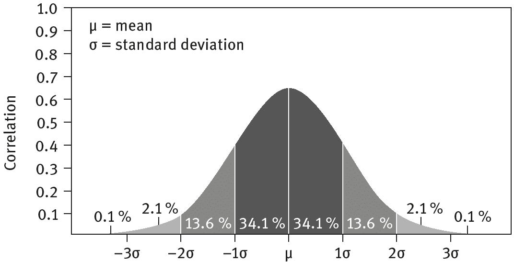

图 2.3: 三 sigma 规则

### 2.3.4 用于识别关键帧的特征考虑

关键帧是组成视频的帧的子集。这些帧携带了对于视频摘要至关大部分的信息。视频的关键帧集由参考点组成，根据这些点可以对视频进行索引。在多媒体制作中，一个关键帧或一组关键帧持有定义镜头的特殊信息，并可用于区分集合中的镜头。通常，镜头的中间帧可以通过随时间进行插值来创建运动的幻觉。从一组帧中可以提取的特征可以分类为基于颜色、基于纹理和基于形状的属性。

基于颜色的特征可能包括颜色直方图、颜色矩、颜色相关图或高斯模型的混合等。图像可以被分成 $k \times k$ 块，以捕捉局部颜色信息 [4]。

图像基于纹理的特征传递了关于图像像素强度和颜色空间排列的信息。纹理基本上是一组允许识别图像中感知视觉层次的测量指标。可以使用 Gabor 小波滤波器为视频搜索引擎提取基于纹理的数据 [2, [113]]。

基于形状的特征是描述图像中物体轮廓或区域的特征，用于搜索视频 [113]。

### 2.3.5 插值的基础

插值是一种在已知值之间估计或预测未知值的数学工具。因此，使用插值，可以在离散集合内创建新的数据点。给定一组已知点集合 $X$ 和一组对应的值集合 $Y$，其中 $Y = f(X)$，任务是预测 $x_a < x_i < x_b$ 范围内 $y_i \in Y$。

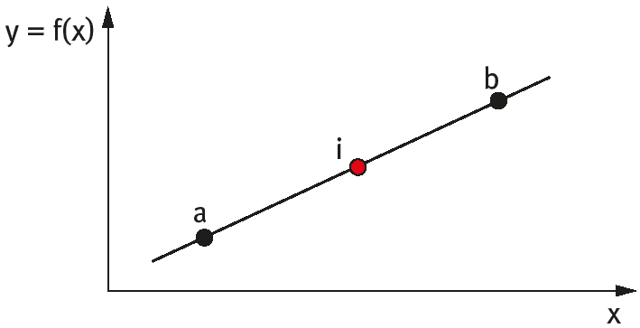

图 2.4: 插值

在图 2.4 所示中，一条直线通过两个已知点‘a’和‘b’，用于估计这些已知点之间的未知点‘i’。由于所有点都位于直线上，可以估计‘i’的值。然而，一个典型的问题是某些公式已知但难以评估。现实中，存在许多类型的插值，例如线性、样条和多变量。在工作中，我们检查了线多项式插值。

#### 2.3.5.1 线性插值

线性插值是一种在离散集合内生成新数据点的一阶方法。直线的公式可以表示为：

```
P(x) = \frac{x - x_1}{x_0 - x_1}y_0 + \frac{x - x_0}{x_1 - x_0}y_1
```

为了阐述插值的概念，考虑以下示例：

表 2.1：tan x 表

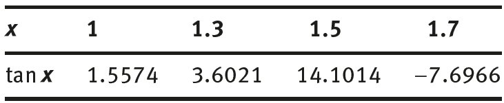

在这里，问题是评估 $tan(1.47)$。考虑线性插值，感兴趣的点是 $x_0 = 1.3$，$x_1 = 1.5$，对应的 $y_0$ 和 $y_1$ 值。那么，

$$\begin{array}{l} \tan x \approx y_0 + \frac{x - x_0}{x_1 - x_0}(y_1 - y_0) \\ \Rightarrow \tan(1.47) \approx 3.6021 + \frac{1.47 - 1.3}{1.5 - 1.3}(14.1014 - 3.6021) = 12.5265 \end{array}$$

尽管 `tan(1.47) = 9.8874` 是真实值，但线性插法得到的计算值存在 26.69%的误差。

### 2.3.5.2 多项式插值

多项式插值是一种通过拟合 `n` 次多项式曲线来估计已知数据点之间数值的方法。拟合曲线的最大次数由已知点的数量决定。当未知点位于已知点之间时，可以使用多项式插值估计未知点的值。一个 `n` 次多项式可以表示为：

`P(x) = a[n]x^(n) + a[n-1]x^(n-1) + ... + a[2]x² + a[1]x + a[0]` (2.8)

从公式 (2.8) 可以看出，为了拟合一个 `n` 次多项式，已知点的数量必须为 `(n + 1)`。考虑计算 `tan(1.47)` 的相同问题，可以拟合一个 3 次的多项式，得到以下多项式：

`P(x) = a[3]x³ + a[2]x² + a[1]x + a[0]` (2.9)

通过代入表 2.1 中的四个点计算出的系数值如下：

`a[3] = -707.3, a[2] = 2778.9, a[2] = -3562.8, a[0] = 1492.7`

因此，使用 3 次多项式计算出 `tan(1.47) = 13.559`。

## 2.4 拟提方法

### 2.4.1 流程图

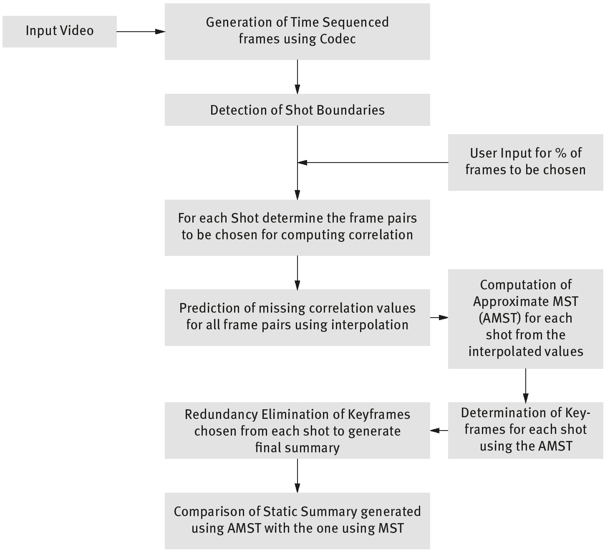

图 2.5: 所提方法的流程图

### 2.4.2 分镜脚本生成算法

系统输入一个包含 `n` 个镜头的视频 `V = S1 ⊗ S2 ⊗ S3 ⊗ . . . ⊗ Sn−1 ⊗ Sn`。用户输入待使用的实际距离百分比 `(p)`。`RS` 代表通过从分镜镜头中选择关键帧生成的关键帧集，`FS` 代表对 `RS` 进行冗余消除后的最终摘要。帧 `fj` 的密度 `dj` 是半径为 `γ = μ + 3 ⋅ σ` 的圆盘内的帧数，它衡量了帧的代表性。这里，`μ` 和 `σ` 是为每个镜头 `Si` 生成的 MST 树边缘的平均值和标准差。初始化：`i = 0; RS = ϕ`

| 步骤 1: | 取 `i = i + 1; k = Si 中帧的数量; W = 镜头 Si 中的帧集合。` |
| :--- | :--- |
| 步骤 2: | 确定生成 `MST = k2` 需要计算的总距离数。 |
| 步骤 3: | 从 `k2` 中选择 `s` 个距离进行实际计算，其中 `s = ⌈(p/100) ⋅ k2⌉`。使用插值法预测其他 `(k2− s)` 个距离。 |
| 步骤 4: | 使用 `s` 个距离和 `(k2− s)` 个距离生成 `AMST`。 |
| 步骤 5: | 计算镜头 `Si` 中每个帧 `fj` 的密度 `dj`。 |
| 步骤 6: | 将密度最高的帧包含在集合 `RS` 中。 |
| 步骤 7: | 如果 `W` 不为空，跳转到步骤 6。 |
| 步骤 8: | 如果 `i < n`，跳转到步骤 7。 |
| 步骤 9: | 对 `RS` 进行冗余消除以生成 `FS`。 |
| 步骤 10: | `FS` 代表最终摘要。 |

在视频被分解为时间序列帧帧后，使用在 [8]中设计的算法检测镜头边界。由于需要为所有镜头单独生成自适应多尺度时间序列（AMST），因此必须设计一种选择合适距离的方法。对于一个由 `k` 帧组成的镜头，用户应提供从 `kC2` 种可能距离中选择的距离百分比作为输入。所选距离的距离数量（`s`）通过公式 (2.15)确定。出于实际考虑，选择的最小百分比由公式 (2.14)给出。每个帧距离（`α = 1,2,3, . . . , k − 1`）所选的距离数量是通过轮询方式为每个可能的 `α` 取一个距离来定的，直到所有选取距离的总和等于 `s`。然而，为了利用插值法对剩余距离进行最佳预测，在等距离间隔上取特定 `α` 的距离值是稳妥的。两个已知距离之间的间隔（`βα`）由`βα = (k − α)/tα`给出，其中 `tα` 是帧距离 `α` 所选的距离数量。因此，$s = {\sum_{\alpha = 1}^{k - 1}\beta_{\alpha}}.$。

如果 `βα` 的值为浮点数，该方法将数字分为两部分：一个是整数部分，另一个是余数部分。余数的计算方法如下：

```
residue = β[α] − ⌊β[α]⌋ (2.16)
```


为了选择下一帧对 `fij`，`i = ⌈(βα + residue)⌉` 且 `j = i + α`。新余数值设置为 `residuenew = βα + residue`。重复此过程直到所有所需的帧对都已选取。所选帧对之间的相关性按照第 2.3.2 节中解释的那样进行计算。

## 2.4.6 缺失相关性值的预测与误差计算

在本工作中，缺失相关性值的预测同时使用线性和多项式插值法计算，如第 2.3.5.1 节和第 2.3.5.2 节所示。预测过程极大地降低了时间复杂度。通过将预测的相关性值与实际值比较来计算均方根误差。显然，如果实际距离的百分比较小，预测过程比选择更多实际距离的情况更容易产生误差。然而，在允许的误差和允许的时间复杂度之间需要权衡。换句话说，所选实际距离的百分比与引入的误差反比，与 AMST 的计算时间正比。图 2.6 显示了随着实际距离百分比的增加，两种插值方法引入的误差。

## 2.4.7 从插值值计算 AMST

为了为视频的每个镜头构建 AMST（AMST），将获得的相关性值转换为帧对之间的距离。由于距离与相关性成反比，帧之间的距离计算公式如下：

```
distance = 1/correlation
```

所有距离（实际和预测的）都存储在矩阵中，以便使用 Prim 算法计算 AMST [14]。


$$
\begin{array}{l} 
\text{Recall} = \frac{\left( {\text{FUS} \cap \text{SGS}} \right)}{\left( \text{FUS} \right)}} \\
\text{Precision} = \frac{\left( {\text{FUS} \cap \text{SGS}} \right)}{\left( \text{SGS} \right)}} 
\end{array}
$$

在这里，

- **FUS**: US 中的帧集合
- **SGS**: SGS 中的帧集合

## 2.5 实验结果与分析

### 2.5.1 视频数据集

用于通过 AMST 所提方法的数据集包含五段视频。第一个视频（在[表 2.2]中标记为 V1）是诺瓦克·德约科维奇对胡安·马丁·德尔波特罗的 2013 年温网网半决赛精彩锦。第二个视频是“Lindsey Stirling”的一首小提琴曲（在[表 2.2]中标记为 V2）。第三个视频是夏奇拉演唱的 2010 年 FIFA 世界杯官方主题歌《WakaWaka (This Time for Africa)》（在[表 2.2]中标记为 V3）。第四个序列（在[表 2.2]中标记为 V4）是另一首印语电影歌曲，来自电影《Ra》的《Chammak Challo》。第五个视频（在[表 2.2]中标记为 V5）也是电影歌曲，来自印语电影《Khabi Khushi Gham》的《You Are My Soniya》。实验的视频具有不同的特征。

**表 2.2: 测试视频数据集** 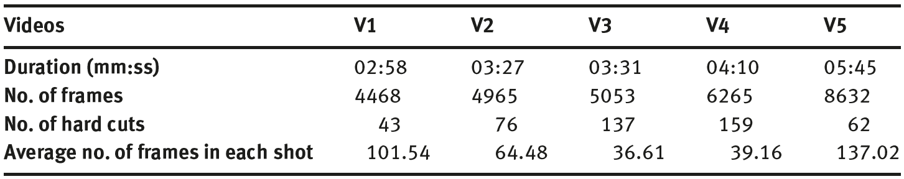

本工作使用的所有视频均从 YouTube 下载。数据集中所有视频的分辨均为 640 × 360 像素，帧率为 25 fps。数据集中的所有视频均为 MP4 文件格式（通常称为 MPEG-4），版本 2.2 列出了视频在时间长度（ms）、每段视频的帧数、硬切点数量以及每个镜头的平均帧数等各种特征。

### 2.5.2 实验结果

基于 AMST 的方法的主要目标是降低 MST 方法中涉及的时间复杂度。因此，为了公平了解两种方法所需的时间，对生成 MST 的实际所需时间和 AMST 所需时间进行了比较。累计时间（秒）随着每个镜头的推进而绘制，如图 2.9 所示。在这里，假设实际距离的百分比 `p = 25%`，而 `75%` 的距离将通过插值法从给定的实际距离中预测。图 2.9 展示了所提方法在节省生成大量大量时间方面的有效性，且没有牺牲摘要质量。

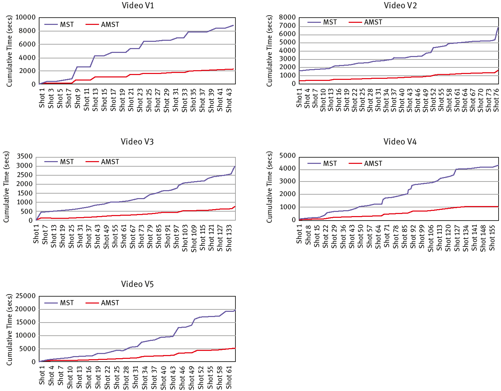

为了评估 AMST 方法，计算了不同实际距离百分比下的召回率和精确率。显而易见，这两个指标在实际距离为 100% 时达到最高值，在这种情况下 AMST 和 MST 是相同的。图 2.10 和图 2.11 分别展示了在不同实际距离百分比下，线性插值和多项式插值的召回率和精确率的图形图。正如预期的那样，随着所选实际距离数量的增加和预测值数量逐渐减少，两个指标都会增加。由于预测值数量随着实际距离百分比的减少而减少，生成的 AMST 更不容易出错。在某些情况下，例如视频 3 在线性插值的 5% 到 10% 之间，视频 2 在多项式插值的 25% 到 30% 之间，观察到即使实际距离数量增加，召回率和精确率的值在很小的区间内下降。

## 2.6 结论

本章的工作旨在降低基于 MST 的静态视频摘要方法的时间复杂度。可以看出，通过计算较少的距离并使用插值预测剩余距离，系统在召回率和精确率方面的性能没有受到很大影响。然而，作为本工作的未来扩展，可能会开发一种数学模型，能够提供预测阶段可能产生的误差范围（最小值和最大值）。由于所提方法试图通过生成近似 MST 来寻找最佳关键帧集，它仍然不适用于实时应用，因为实时应用中关键帧的选择必须在远短于视频时长的时间范围内动态完成。

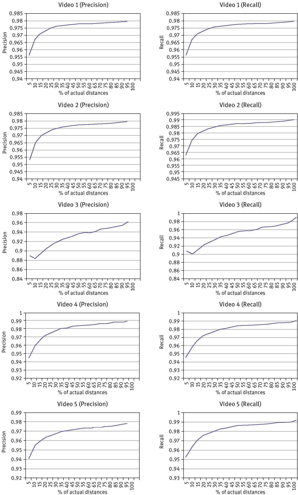

图 2.10: 基于线性插值的不同实际距离百分比的召回率和精确率

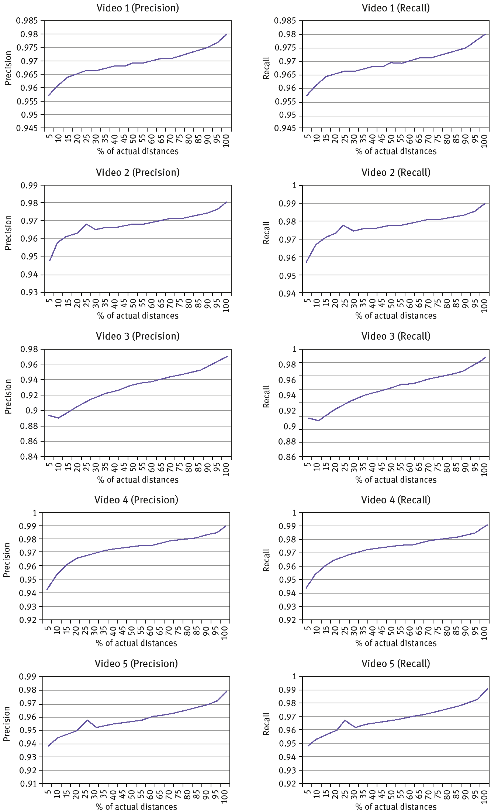

图 2.11: 基于多项式插值的不同实际距离百分比的召回率和精确率

致谢：作者感谢 RCC Institute of Information Technology B.Tech（信息技术）学生 Ankita Roy Chowdhury、Swarnesha Chaterjee 和 Gargi Sau 在本工作实验阶段的贡献。此外，作者对印度加尔答 RCC Institute of Information Technology 管理层工作期间提供的基础设施、设备和支持表示诚挚感谢。还要感谢 RCC 主席 Sparshamani Chatterjee 教授提供的无条件支持和激励，使我们完成了这项工作。

# 参考文献

[1] Zhang HJ, Wu J, Zhong D, and Smoliar SW. An integrated system for content-based video retrieval. Pattern recognition, 30(4):643–658, 1997.

[2] Zhang D, Wong A, Indrawan M, and Lu G. Content-based image retrieval using gabor texture. IEEE Transactions PAMI, pages 13–15, 2000.

[3] Guo G and Li SZ. Content-based audio classification and retrieval by support vector machines. IEEE transactions on Neural Networks, 14(1):209–215, 2003.

[4] Tamizharasan C and Chandrakala S. A survey on multimodal content based video retrieval. International Journal of Emerging Technology and Advanced Engineering. Chennai, INDIA, 3, 2013.

[5] Hampapur A, Jain R, and Weymouth TE. Production model based digital video segmentation. Multimedia Tools and Applications, 1(1):9–46, 1995.

[6] Thakore VH. Video shot cut boundary detection using histogram. International Journal of Engineering Sciences & Research Technology, ISSN, 2277–9655, 2013.

[7] Cernekova Z, Nikou C, and Pitas I. Shot detection in video sequences using entropy based metrics. In Image Processing. 2002. Proceedings. 2002 International Conference on, volume 3, pages III–III. IEEE, 2002.

[8] Bhaumik H, Bhattacharyya S, and Chakraborty S. Video shot segmentation using spatiotemporal fuzzy hostility index and automatic threshold. In Communication Systems and Network Technologies (CSNT), 2014 International International Conference on, pages 501–506. IEEE, 2014.

[9] Barron JL, Fleet DJ, and Beauchemin SS. 光流法性能性能。International journal of computer vision, 12(1):43–77, 1994.

[10] Ostermann J, Jang ES, Shin JS, and Chen T. 任意形状视频对象在 `mpeg-4` 中的编码。In Image Processing, 1997. Proceedings., International Conference on, volume 1, pages 496–499. IEEE, 1997.

[11] Kumar M, Saxena R, et al. 各种边缘检测的算法与技术：综述。Signal & Image Image Processing, 4(3):65, 2013.

[12] Wang T, Wu Y, and Chen L. 一种基于粗集的视频关键帧提取方法。In Multimedia and Ubiquitous Engineering, 2007. MUE’07. International Conference on, pages 590–596. IEEE, 2007.

[13] Evangelopoulos G, Zlatintsi A, Skoumas G, Rapantzikos K, Potamianos A, Maragos P, and Avrithis Y. 利用音频、视觉和文本显著性的视频事件检测与摘要。In Acoustics, Speech and Signal Processing, 2009. ICASSP 2009. IEEE International Conference on, pages 3553–3556. IEEE, 2009.

[14] Orrite C, Martinez F, Herrero E, Ragheb H, and Velastin S. 基于独立视角轮廓的人类动作建模与识别。In The 1st International Workshop on Machine Learning for Vision-based Motion Analysis-MLVMA’08, 2008.

[15] Joshi KA and Thakore DG. 视频监控系统中运动目标检测与跟踪的综述。International Journal of Soft Computing and Engineering, 2(3):44–48, 2012.

[16] Poppe R. 基于视觉的人类动作识别综述。Image and vision computing, 28(6):976–990, 2010.

[17] Cohen I, Sebe N, Garg A, Chen LS, and Huang TS. 视频序列中的脸部表情识别：时间和静态建模。Computer Vision and image understanding, 91(1–2):160–187, 2003.

[18] Bhaumik H, Bhattacharyya S, Das M, and Chakraborty S. 使用最小生成树方法增强静态视频摘要的感知质量。In Signal Processing, Informatics, Communication and Energy Systems (SPICES), 2015 IEEE International Conference on, pages 1–7. IEEE, 2015.

[19] Bhaumik H, Bhattacharyya S, and Chakraborty S. 视频摘要中的冗余消除。In Image Feature Detectors and Descriptors, pages 173–202. Springer, 2016.

[20] Mundur P, Rao Y, and Yesha Y. 基于德劳 unay 聚类的基于关键帧视频摘要。International Journal on Digital Libraries, 6(2):219–232, 2006.

[21] De Avila SEF, Lopes APB, da Luz A, and de Albuquerque A. Vsumm: 一种生成静态视频摘要的机制和新方法。Pattern Recognition Letters, 32(1):56–68, 2011.

[22] Hadi Y, Essannouni F, and Thami RH. 基于 k-medoid 聚类的视频摘要。In Proceedings of 2006 ACM symposium on Applied computing, pages 1400–1401. ACM.

[23] Hanjalic A and Zhang H. 基于无监督聚类有效性的自动视频抽象的集成方案。IEEE Transactions on circuits and systems, 9(8):1280–1289, 1999.

[24] Cahuina EJ and Chavez GC. 使用局部描述符和视频分割的静态视频摘要新方法。In Graphics, Patterns and Images (SIBGRAPI), 2013 26th SIBGRAPI-Conference on, pages 226–233. IEEE, 2013.

[25] Bhaumik H, Bhattacharyya S, Dutta S, and Chakraborty S. 面向分镜脚本表示中的冗余减少。In Advances in Computing, Communications and Informatics (ICACCI), 2014, pages 344–350. IEEE, 2014.

[26] Chang HS, Sull S, and Lee SU. 基于内容的检索的高效视频索引。IEEE Transactions on Circuits and Systems for Video Technology, 9(8):1269–1279, 1999.

[27] Deenthon D, Kobla V, and Doermann D. 基于曲线简化的视频摘要。In Proceedings of the sixth ACM international conference on Multimedia, pages 211–218. ACM.

[28] Yeung MM and Yeo BL. 用于图像内容紧凑展示和快速浏览的视频视觉化。IEEE Transactions on circuits and Systems for Video Technology, 7(5):771–785, 1997.

[29] Franti P, Mednonogov A, Kyrki V, and Kviäinen H. 使用霍夫变换的线条画图像基于内容的匹配。International Journal on Document Analysis and Recognition, 3(2):117–124, 2000.

[30] Gygli M, Grabner H, and Van Gool L. 通过学习目标的子模混合混合进行视频摘要。In Proceedings CVPR 2015, pages 3090–3098, 2015.

[31] Xu J, Mukherjee L, Li Y, Warner J, Rehg JM, and Singh V. 通过受限子模最大化的视线引导的第一人称视频摘要。In Computer Vision and Pattern Recognition (CVPR), 2015 IEEE Conference on, pages 2235–2244. IEEE, 2015.

[32] Itazuri T, Fukusato T, Yamaguchi S, and Morishima S. 关注接球场景的基于裁判的视频摘要。In Proceedings of the IEEE Conference on Computer Vision and Pattern Recognition Workshops, pages 123–130, 2017.


### 参考文献

[33] Zlatintsi A, Koutras P, Evangelopoulos G, Malandrakis N, Efthymiou N, Pastra K, Potamianos A, Maragos P. 显著性、事件和语义标注的多模态视频数据库及其摘要应用。EURASIP Journal on Image Processing, 2017(1):54, 2017.

[34] Gharbi H, Bahroun S, Massaoudi M, and Zagrouba E. 使用图模块聚类的高效视频关键帧提取。In Acoustics, Speech and Signal Processing (ICASSP), 2017 International Conference on, pages 1502–1506. IEEE, 2017.

[35] Sharghi A, Laurel JS, and Gong B. 查询聚焦视频摘要：数据集、评估以及基于记忆网络的方法。In 2017 IEEE Conference on Computer Vision and Pattern Recognition (CVPR), pages 2127–2136. IEEE, 2017.

[36] Lin ST, Liao YH, Tsao Y, and Chien SY. 基于对象的在线视频摘要用于视频物联网。In 2017 IEEE International Symposium on Circuits and Systems (ISCAS), pages 1–4. IEEE, 2017.

[37] Chen X, Zhang Y, Ai Q, Xu H, Yan J, and Qin Z. 个性化关键帧推荐。In Proceedings of the 40th International ACM SIGIR Conference on Research and Development in Information Retrieval, pages 315–324. ACM, 2017.

[38] Sahoo A, Kaushal V, Doctor K, Shetty S, Iyer R, and Ramakrishnan G. 统一多维度视频摘要系统。arXiv preprint arXiv:1704.01466, 2017.

[39] Mirzasoleiman B, Jegelka S, and Krause A. 流非单调子模最大化：即时个性化视频摘要。arXiv preprint arXiv:1706.03583, 2017.

[40] Choi J, Oh TH, and Kweon IS. 文本定制视频摘要。arXiv preprint arXiv:1702.01528, 2017.

[41] Otani M, Nakashima Y, Sato T, and Yokoya N. 用于视频博客制作的文本描述摘要。Multimedia Tools and Applications, 76(9):12097–12115, 2017.

[42] Mitra A, Biswas S, and Bhattacharyya C. 用于实体发现与摘要的视频时间相干性贝叶斯建模。IEEE transactions on pattern analysis and machine intelligence, 39(3):430–443, 2017.

[43] Mademlis I, Tefas A, and Pitas I. 使用显著性字典的人类活动视频摘要。In Proceedings of the IEEE International Conference on Image Processing (ICIP), 2017.

[44] Panda R and Roy-Chowdhury AK. 话题相关视频的协作摘要。In CVPR, volume 2, no. 4, page 5, 2017.

[45] Abdelali AB, Hannachi M, Touil L, and Mtibaa A. 用于实时视频分割的颜色结构描述符的适配与硬件实现。Journal of Real-Time Image Processing, 13(4):739–758, 2017.

[46] del Molino AG, Tan C, Lim JH, and Tan AH. 第一称视角视频摘要：综述。IEEE Transactions on Human-Machine Systems, 47(1):65–76.

[47] Ji Z, Xiong K, Pang Y, and Li X. 基于注意力的编码器-解码器视频摘要。arXiv preprint arXiv:1708.09545, 2017.

[48] del Molino AG, Mandal B, Lin J, Lim JH, Subbaraju V, and Chandrasekhar V. ImageCLEF2017：用于视频摘要的深度学习特征集成。In CLEF working notes, CEUR, pages 11–14.

[49] Panda R, Mithun NC, and Roy-Chowdhury AK. 多样性感知多视频摘要。IEEE Transactions on Image Processing, 26(10):4712–4724, 2017.

[50] Panda R and Roy-Chowdhury AK. 通过联合嵌入和稀疏优化的多视角监控视频摘要。IEEE Transactions on Multimedia, 19(9):2010–2021, 2017.

[51] Meng J, Wang S, Wang H, Yuan J, and Tan Y. 通过多视角代表性选择视频摘要。IEEE transactions on image processing: a publication of the IEEE Signal Society, 27(5):2134–2145.

[52] Zhang Y, Liang X, Zhang D, Tan M, and Xing EP. 使用在线运动编码器的无监督对象级视频摘要。arXiv preprint arXiv:1801.00543, 2018.

[53] Rudinac S, Chua TS, Diaz-Ferreyra N, Friedland G, Gornostaja T, Huet B, Kaptein R, Moens MF, Peltonen J, et al. 现代社交多媒体的摘要与故事叙思考。Lecture Notes in Computer Science, 10704, 2018.

[54] Tejero-de Pablos A, Nakashima Y, Sato T, Yokoya N, Linna M, and Rahtu E. 使用深度动作识别的用户生成运动视频摘要。IEEE Transactions on Multimedia, 2018.

[55] Plummer BA, Brown M, and Lazebnik S. 通过视觉语言嵌入增强视频摘要。In Computer Vision and Pattern Recognition, 2017.

[56] Fang H, Jiang J, and Feng Y. 一种用于视频边界检测的模糊逻辑方法。Pattern Recognition, 39(11):2092–2100, 2006.

[57] Das S, Sural S, and Majumdar AK. 使用模糊逻辑检测视频中的硬切和渐变过渡。International Journal of Artificial Intelligence and Soft Computing, 1(1):77–98, 2008.

[58] Anderson D, Luke RH, Keller JM, Skubic M, Rantz M, and Aud M. 使用体素人体和模糊逻辑用于跌倒检测的视频语言摘要。Computer vision and image understanding, 113(1):80–89.

[59] Cayllahua-Cahuina E, Cámara-Chávez G, and Menotti D. 使用颜色直方图进行自动镜头检测的静态视频摘要方法。In Proceedings of the International Conference on Image Processing, Computer Vision, and Pattern Recognition (IPCV), page 1. The Steering Committee of The World Congress in Computer Science, Computer Engineering and Applied Computing (WorldComp), 2012.

[60] Carpenter GA, Grossberg S, and Rosen DB. 模糊艺术：自自振系统对模拟模式的快速稳定学习与分类。Neural networks, 4(6):759–771, 1991.

[61] Bezdek JC, Ehrlich R, and Full W. Fcm: 模糊均值聚类算法。Computers & Geosciences, 10(2–3):191–203, 1984.

[62] Doulamis AD, Doulamis ND, and Kollias SD. 用于视频摘要和基于内容的检索的模糊视频内容表示。Signal Processing, 80(6):1049–1067, 2000.

[63] Peng WT, Chu WT, Chang CH, Chou CN, Huang WJ, Chang WY, and Hung YP. 观看即编辑：通过观看行为分析自动家庭视频摘要。IEEE Transactions on Multimedia, 13(3):539–550, 2011.

[64] Elbouz M, Alfalou A, and Brosseau C. 基于模糊逻辑和光学相关的人脸识别方法。Optical Engineering, 50(6):06703, 2011.

[65] Zhou Z, Chen X, Chung Y, He Z, and Han TX. 室内活动分析、摘要与可视化。IEEE Transactions on Circuits and Systems for Video, 18(11):1489–1498, 2008.

[66] Avrithis Y, Doulamis AD, Doulamis N, and Kollias S. MPEG 视频数据库关键帧提取的随机框架。Computer Vision and Image Understanding, 75(1–2):3–24, 1999.

[67] Doulamis N, Doulamis A, and Ntalianis K. 基于最优插值的视频摘要方案。In Multimedia and Expo, 2002. ICME’02. Proceedings. IEEE, volume 1, pages 297–300.

[68] Karpathy A, Toderici G, Shetty S, Leung T, Sukthankar R, and Fei-Fei L. 基于卷积神经网络的大规模视频分类。In Proceedings of the IEEE conference on Computer Vision and Recognition, pages 1725–1732, 2014.

[69] Yao L, Torabi A, Cho K, Ballas N, Pal C, Larochelle H, and Courville A. 利用时间结构描述视频。In Proceedings of the IEEE international conference on computer vision, pages 4507–4515, 2015.

[70] Venugopalan S, Xu H, Donahue J, Rohrbach M, Mooney R, and Saeko K. 使用深度循环神经网络将视频翻译为自然语言。arXiv preprint arXiv:1412.4729, 2014.

[71] Dou, A, Doulamis N, Ntalianis K, and Kollias S. 一种基于自适应神经网络分类架构的高效无监督视频对象分割方案。IEEE Transactions on Neural Networks, 14(3):616–630, 2003.

[72] Zawbaa HM, El-Bendary N, Hassanien AE, and Kim Th. 基于机器学习的足球视频摘要系统。Multimedia, Computer Graphics and Broadcasting, pages 19–28, 2011.

[73] Panda R, Das A, Wu Z, Ernst J, and Roy-Chowdhury AK. 网页视频的弱监督摘要。发表于 2017 IEEE International Conference on Computer Vision (ICCV), pages 3677–3686. IEEE, 2017.

[74] Sah S, Kulhare S, Gray A, Venugopalan S, Prud’Hommeaux E, and Ptucha R. 长视频的语义文本摘要。发表于 Applications of Computer Vision (WACV), 2017 IEEE Winter Conference on, pages 989–997. IEEE, 2017.

[75] Sanghavi RS and Pangaonkar SA. 一种用于有效视频摘要的室内外场景检测方法。International Journal of Engineering Technology, Management and Applied Sciences, 5(6):976–981, 2017.

[76] Chiu P, Girgensohn A, Polak W, Rieffel E, and Wilcox L. 一用于视频分割与摘要的遗传算法。发表于 Multimedia and Expo, 2000. ICME 2000. 2000 IEEE International Conference on, volume 3, pages 1329–1332. IEEE, 2000.

[77] Torres RdS, Falcão AX, Gonçalves MA, Papa JP, Zhang B, Fan W, and Fox EA. 一种基于内容的图像检索的遗传编程框架。Pattern Recognition, 42(2):283–292, 2009.

[78] Lu J, Zhao T, and Zhang Y. 基于遗传算法的图像标注特征选择。Knowledge-Based Systems, 21(8):887–891, 2008.

[79] Yoo HW and Cho SB. 使用交互式遗传算法的视频场景检索。Multimedia Tools and Applications, 34(3):317–336, 2007.

[80] Mademlis I, Tefas A, Nikolaidis N, and Pitas I. 通过低秩近似进行活动视频摘要。发表于 Acoustics, Speech and Signal Processing (ICASSP), 2017 IEEE International Conference on, pages 1627–1631. IEEE, 2017.

[81] Ng HW, Sawahata Y, and Aizawa K. 使用支持向量机进行可穿戴视频摘要。发表于 Multimedia and Expo, 2002. ICME’02.Proceedings. 2002 IEEE International Conference on, volume 1, pages 325–328. IEEE, 2002.

[82] Li L, Zhou K, Xue GR, Zha H, and Yu Y. 通过迁移学习进行视频摘要。发表于 Proceedings of the 20th international conference on World web, pages 287–296. ACM, 2011.

[83] Potapov D, Douze M, Harchaoui Z, and Schmid C. 特定类别的视频摘要。发表于 ECCV 2014-European Conference on Computer Vision, volume 8694, pages 540–555, 2014.

[84] Ling X, Yuanxin O, Huan L, and Zhang X. 一种基于 `svm` 的快速镜头检测方法。发表于 Image and Signal Processing, 2008. CISP’08. Congress on, volume 2, pages 445–449, 2008.

[85] Sadlier DA and O’Connor NE. 使用视听特征和支持向量机进行田径运动事件检测。IEEE Transactions on Circuits and Systems for Video Technology, 15(10):1225–1233, 2005.

[86] Wu K and Yap. 用于内容的图像检索的模糊 `svm`：伪支持向量机。IEEE Computational Intelligence, 1(2):10–16, 2006.

[87] Ng CW, Ma YF, and Zhang HJ. 图建模视频摘要与场景检测。IEEE Transactions on Circuits and Systems for Video Technology, 15(2):296–305, 2005.


[88] Ng CW, Ma YF, and Zhang HJ. 图建模自动视频摘要。发表于 Computer Vision, 2003. Proceedings. Ninth IEEE Conference on, pages 104–109, 2003.

[89] Lu S, Lyu MR, and King I. 时空图优化视频摘要。发表于 Circuits and Systems, 2004. ISCAS’04.Proceedings of the 2004 International Symposium on, volume 2, pages II–197, IEEE, 2004.

[90] Peyrard N and Bouthemy P. 基于运动的视频片段选择。Multimedia Tools and Applications, 26(3):259–276, 2005.

[91] Piriou G, Bouthemy P, and Yao JF. 使用视觉运动全局概率模型识别视频内容。IEEE Transactions on Image Processing, 15(11):3417–3430, 2006.

[92] Ma YF, Lu L, Zhang HJ, and Li M. 用户注意力视频摘要模型。发表于 Proceedings of the tenth ACM international conference on Multimedia, pages 533–542. ACM, 2002.

[93] Gong Y and Liu X. 使用奇异值分解进行视频摘要。发表于 Computer Vision and Pattern Recognition, 2000. Proceedings. IEEE Conference on, volume 2, pages 174–180. IEEE, 2000.

[94] Orriols X and Binefa X. 用于视频摘要的 `em` 算法：生成模型方法。发表于 Computer Vision, 2001. ICCV 2001.Proceedings. Eighth IEEE International Conference on, volume 2, pages 335–342. IEEE, 2001.

[95] Wang M, Hong R, Li G, Zha ZJ, Yan S, and Chua TS. 标签定位和关键镜头识别的事件驱动网页视频摘要。IEEE Transactions on Multimedia, 14(4):975–985, 2012.

[96] Boreczky JS and Rowe LA. 视频边界检测技术的比较。Journal of Electronic Imaging, 5(2):122–128, 1996.

[97] Hu W, Xie N, Li L, Zeng X, and Maybank S. 基于视觉内容的视频索引与检索综述。IEEE Transactions on Systems, Man, and Cybernetics, Part C (Applications and Reviews), 41(6):797–819, 2011.

[98] Cotsaces C, Nikolaidis N, and Pitas I. 视频镜头检测与压缩表示：综述。IEEE signal processing magazine, 23(2):28–37, 2006.

[99] Bhaumik H, Bhattacharyya S, Nath MD, and Chakraborty S. 基于内容的检索的混合软计算方法：简述。Applied Soft Computing, 46:1008–1029, 2016.

[100] Xiong W and Lee J. 用于视频分类的高效场景切换检测与相机运动标注。Computer vision and image understanding, 71(2):166–181, 1998.

101. Kopinska I and Carrato S. 时域视频分割：综述。Signal processing: Image communication, 16(5):477–500, 2001.

102. Snoek CGM and Worring M. 多模态视频索引：前沿技术综述。Multimedia tools and applications, 25(1):5–35, 2005.

[103] Bhaumik H, Bhattacharyya S, Chakraborty M, and Chakraborty S. 使用集成方法的视频溶解场检测。发表于 Advances in Computing, Communications and Informatics (ICACCI), 2015 International Conference on, pages 1461–1467. IEEE, 2015.

[104] Song B and Ra JB. 使用多级聚类用于 MPEG 压缩视频的自动镜头检测算法。Journal of Visual Communication and Image Representation, 12(3):364–385, 2001.

105. Lee HC, Lee CW, and Kim S. 使用多特征无监督聚类进行突变镜头检测。发表于 Acoustics, Speech, and Signal Processing, 2000. ICASSP’00.Proceedings. 2000 IEEE International Conference on, volume 4, pages 2015–2018. IEEE, 2000.

[106] Bhaumik H, Bhattacharyya S, and Chakraborty S. 一种实时视频镜头分割的无监督方法。发表于 Proceedings of International Conference on Digital Image Processing and Pattern Recognition, pages 307–318, 2014.

- 107 Hanjalic A. 镜头边界检测：揭秘与解决了吗？IEEE transactions on circuits and systems for video technology, 12(2):90–105, 2002.

- 108 Yuan J, Wang H, Xiao L, Zheng W, Li J, Lin F, and Zhang B. 镜头边界检测的正式研究。IEEE transactions on circuits and systems for video technology, 17(2):168–186, 2007.

- 109 Lienhart R. 自动镜头边界检测算法的比较。图像与视频数据库的存储与检索 (SPIE)，第 290–301 页，1999。

- 110 Petersohn C. Fraunhofer hhi at trecvid 2004：镜头边界检测系统。TREC 视频检索评估在线论文，TRECVID, 2004。

- 111 Cernekova Z, Pitas I, and Nikou C. 基于信息理论的镜头剪切/淡入检测与视频摘要。IEEE Transactions on circuits and systems for video technology, 16(1):82–91, 2006.

- 112 Jeong S. 基于直方图的图像检索。Psych221/EE362 项目报告，2001。

- 113 Patel BV and Meshram BB. 基于内容的视频检索系统。arXiv 预印本 arXiv:1205.1641, 2012.

- 114 Moret BME and Shapiro HD. 构建最小生成树算法的实证分析。算法与数据结构工作会议，第 400–411 页。Springer，1991。

- 115 Bay H, Tuytelaars T, and Van Gool L. Surf：加速的鲁棒特征。计算机视觉–ECCV 2006，第 404–417 页。Springer，2006。

Amit Adate 和 B. K. Tripathy*

# 3 用于图像处理的三种深度学习技术

Amit Adate, VIT 大学

*通讯作者：B. K. Tripathy, VIT 大学

**摘要：** 图像处理中的大多数技术涉及定制的算法，且缺乏灵活性，使其与所处理的数据有所不同。在本章中，我们详细阐述了图像处理领域的各种方法论。我们按照时间顺序演示了学习技术在图像超分辨率、图像上采样、图像质量评估和并行计算技术中的作用。此外，还深入解释了深度神经架构作为解决多种图像处理问题的卓越工具的参与。本章描述了将深度学习技术应用于图像处理任务时所获得的优性能。

**关键词：** 深度学习、图像处理、神经架构、分类、图像分辨率、图像锐化

## 3.1 引言

随着我们以前所未有的速度向白领自动化迈进，世界已变成一个自动化的世界。而只有人类才能提供的关键洞察是视觉能力，这种能力帮助他们在现实生活中游刃有余并为社会创造价值。深度学习正通过更新的算法和更好的性能表现，在图像和视觉处理的这一领域进行追赶。本章通过一个顺序的时间线，对该主题进行了详细综述，该时间线涵盖了当今算法在图像和视频处理能力方面的进展，并对用于训练这些深度神经网络的、日益增长的并行计算硬件的使用进行了最后说明。

本章介绍了神经网络的概念以及如何利用此类网络在各种不同的网络上进行训练。这涵盖了图像分辨率、上采样、图像质量评估和并行计算技术。此外，还深入解释了深度神经架构作为解决多种图像处理问题的卓越工具的参与。本章描述了将深度学习技术应用于图像处理任务时所获得的优性能。

## 3.2 图像和视频增强

图像增强通常包括用于修改图像或视频的技术，以提高其质量和可见性。可以通过许多传统方法实现，并大致分为两类：空间域和频域。

空间域方法通过变换和滤波器直接改变图像中的像素值来改变图像。频域方法首先将图像从一个域转换为另一个域，然后在将图像转换回原始域之前使用各种技术转换。

### 3.2.1 像素处理操作

要在空间域中进行操作，最早的应用始于像素本身的周围。由于图像中的每个像素都被其他像素包围，因此会经历一系列变换。这些变换本身可以增强图像，但它们最流行的用途是作为预处理方法，协助进行更复杂的更改。某些变换包括阈值变换、幂律变换和对数变换。专门用于图像增强的各种神经滤波器已被提出。神经滤波器主要要求将图像通过两类不同的决策滤波器进行处理。然后将输出传递给前馈神经网络。

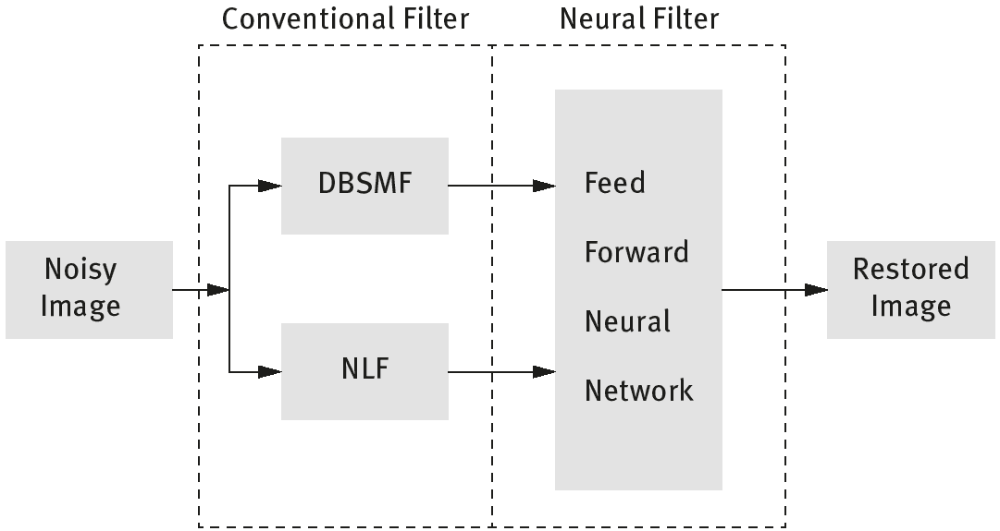

Fig. 3.1: Pixel processing neural unit

图 3.1 显示了两种滤波器：一种传统滤波器和一个神经滤波器。两者共同充当脉冲噪声去除滤波器。最初，将含噪图像输入传统滤波器，如非线性滤波器（`NF`）和基于决策的切换中值滤波器（`DBSMF`）。然后使用简单的前馈神经网络对其进行进一步处理（图 3.2）。通过反向传播算法保留精细边缘并消除噪声。

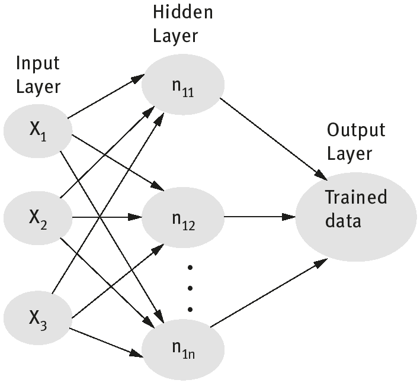

图 3.2: 前馈神经网络

### 3.2.2 基于直方图的图像增强

这些是对比度增强技术，每种技术都依赖于图像的直方图。若要在频域中执行任何操作，必须对图像的色调分布进行表示。因此，在完成像素级变换后，会实现一个计算模型以根据学习到的风格自动增强图像。

基于视觉风格学习图像增强是一项挑战性任务；它是一个高度观察性和直觉的过程，处理基于图像像素颜色及其频率嵌入在图像中的信息。为了学习一种增强风格，需要建立一种定量关系。

通过实现深度神经网络来生成基于定量关系的数学模型。Zicheng Yang 等人 \[9\]详细阐述了其中一种深度神经网络；该网络的主要目的是生成一个内在色彩映射函数，将含噪图像中每个像素的颜色映射到增强后的图像中。其架构如如下所示。

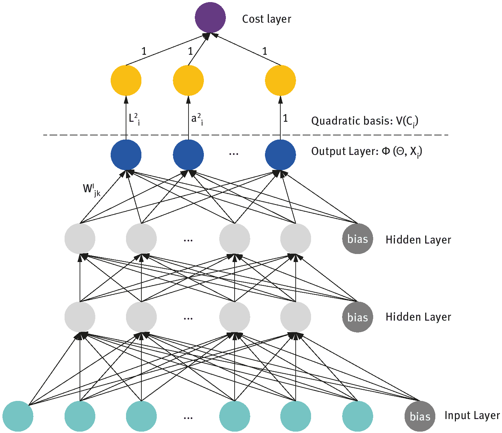

图 3.3: LAPGAN 训练程序

在图 3.3 中，虚线以上的神经元定义了如何计算内在函数。黄色和蓝色神经元之间的权重都是二次色彩基的分量，恒等函数是紫色和黄色神经元内的激活函数。

这种架构优于前身，因为它能够学习复杂且高度非线性的照片增强风格。它能够利用深度神经网络的鲁棒回归能力来增强优选的上下文特征。

## 3.3 图像超分辨率

图像增强的另一种场景也是图像超分辨率，即获取低分辨率图像并将其放大，以创建相同图像的高分辨率版本。此用例与图像增强区分开来，因为该领域关于生成模型的研究非常广泛，且超出了本章的范围（图 3.4）。

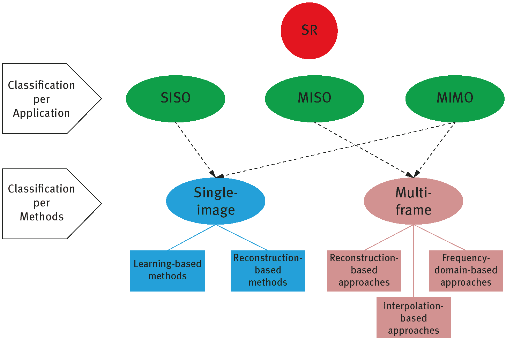

图 3.4: 图像超分辨率技术分类法

从历史上来说，极大似然、最大后验、联合映射恢复和贝叶斯处理等方法被用于超分辨率，这涉及直接改变图像的像素以产生更好的图像。这些方法也可以归类为图像增强的空域方法 \[10\]。

生成模型在这里也有应用，通过对原始图像并同时训练两个使用博弈论进行对抗训练的网络来提高分辨率，从而产生真实的图像 \[7\]。

### 3.3.1 单图像超分辨率

单图像超分辨率（SISR）处理的是估计高分辨率图像。以低分辨率图像为例，原始图像的设置不可用。通过使用简单的样条、双三次值和线性插值等方法，超分辨率任务可以简化为计算高分辨率网格中缺失的像素强度。这种方法对于平滑部分是有效的，但在遇到角点或边缘等不连续处时可能会产生伪影。SISR 方法有两种隐式类型：基于学习的方法和基于重建的方法。

基于学习的方法涉及机器学习方法来估计输出图像的高分辨率特征。它们有多种类型：基于像素的[11\]、基于块的 \[12\]或基于示例的。基于示例的方法是那些在相同图像上使用相似性的方法，例如稀疏编码、领域嵌入等。

基于重建的方法需要目标图像的高分辨率信息。这些信息可以从分布到能量函数，例如。与基于学习的方法相比，这些操作通过不同的方式执行，主要通过正则化、锐化和反卷积。

### 3.3.2 多帧超分辨率

这涉及多个低分辨率图像，在此期间每个输入图像都是高分辨率图像的损坏版本。假设图像是通过下采样、模糊和射变换损坏的。对于变换，只有分数和亚像素偏移被认为是有用的；整数偏移是不重要的。多帧超分辨率方法有：插值方法、频域方法和正则化方法。

插值方法涉及去模糊、配准和插值。这三个步骤通过各种启发式方法进行。频域方法通过 DCT、DFT、DWT 或低分辨率图像的其他频域表示来聚合高分辨率图像的不同指标。在所有局部方法中，DWT 域优于其他方法。正则化方法在低分辨率帧有限的情况下比较方便。引入未知高分辨率图像某些先验特征的策略主要是确定性和随机性的。

传统的图像上采样技术涉及傅里叶上采样，它通过傅里叶变换对像素的 k-最近邻（k-NN）进行变换并添加这些值，为缺失值添加像素数据以生成上采样图像。这种方法通常涉及带有重建或混叠的 4× 傅里叶变换 [13]。

一种深度学习算法再次涉及拉普拉斯金字塔生成对抗网络（Laplacian Pyramid Generative Adversarial Networks）[14]，它使用拉普拉斯金字塔创建缺失的像素值，并对生成器和判别器使用对抗训练来形成金字塔本身。

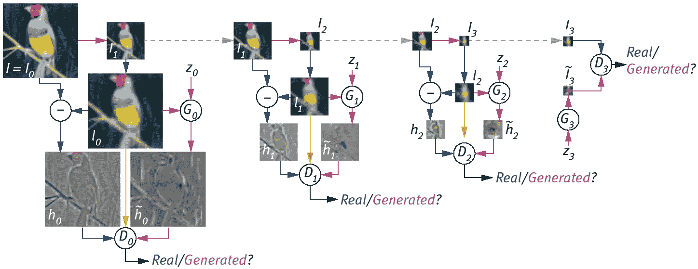

图 3.5：LAPGAN 训练过程

### 3.4.1 使用神经网络进行上采样

深度神经网络也用于图像上采样。所使用的深度学习方法被称为深度网络级联（deep network cascade）[15]。上采样是逐层逐渐进行的，并引入了缩放因子。它最终达到所需的高分辨率。微小的改进是基于搜索图像分段中的非局部自相似性，以改进图像划分分段的高频细节。然后，这些分段被吸收到局部自动编码器级联多栈网络的每一层中，以抑制噪声并增强通过上述过程增强的重叠块之间的相干性（图 3.6）。

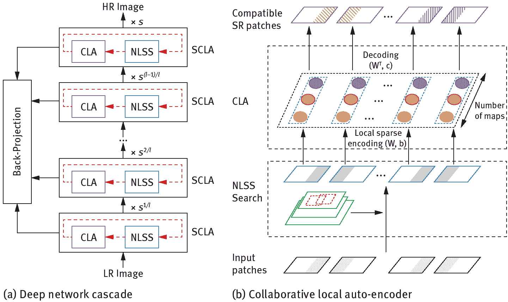

图 3.6：LAPGAN 训练过程

## 3.5 图像和视频质量评估

图像质量评估是评估图像相对于参考图像或一组通用参数的好坏的方法。这些参数可以是分辨率、对比度、饱和度、色彩准确性以及或其他指标。图像质量评估是任何图像处理系统的必要组成部分，因为它使得比较处理应用程序的工作情况成为可能。

传统的，图像质量评估是利用人类视觉系统的多种已知属性 [16]，通过失真图像与参考图像之间的误差（差异）的可见性来进行。另一种用于此类质量评估的方法被称为结构相似性指数，它通过消除覆盖的亮度和对比度特征来提取图像的基础结构，并满足几个条件以提供一个结构上与原始图像相似的图像 [17]。

较新的深度学习质量评估方法使用 `CNN` 来学习空间域中的块特征，这些特征用于在没有任何参考图像作为基础比较的情况下确定图像的质量 [18]。

### 3.5.1 基于误差敏感的方法

根据 Wang 等人 [19]，图像质量测量用于三个主要原因：监控质量系统的质量、对生成或修改图像的各种算法进行基准测试，以及优化算法或技术的图像生成过程。

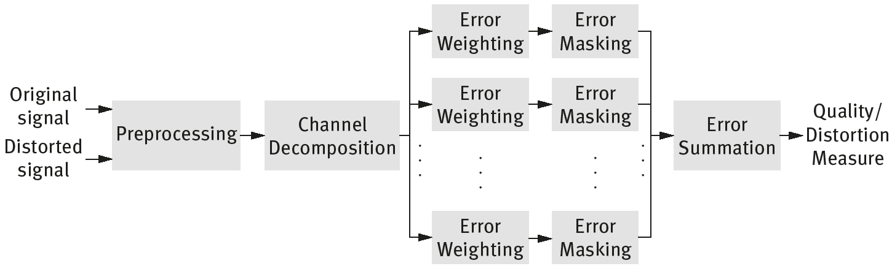

图 3.7：基于误差敏感的图像质量评估

使用的一种图像质量评估技术是误差敏感方法，它使用全参考模型比较图像并计算图像之间的误差。首先，对两幅图像采用不同的预处理技术，然后将它们分解为差异通道。每个通道的误差通过对比度敏感函数（`CSF`）加权传输到误差掩码函数，然后使用求和函数汇总误差，从而告诉我们图像的质量或失真测量值。该求和函数也可以使用 Minkowski 误差池化函数。由于以下假设，该方法具有某些局限性，主要包括：

- 参考图像是完美的图像

- 图像中的视觉通道可以通过通道变换来模拟

- 在每个通道中，系数之间的相互作用足够小，可以忽略


- 感知到的图像质量是由早期视觉系统完成的
- 活跃视觉过程（如注视点的变化）是无效的

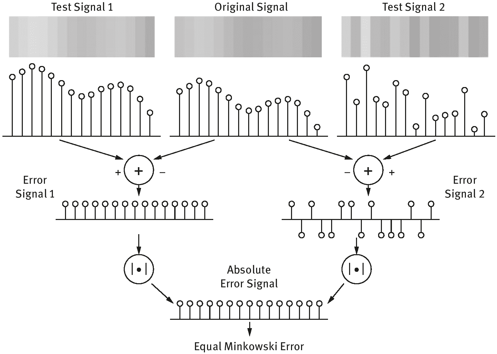

图 3.8：Minkowski 误差池化

## 3.6 并行计算技术

并行计算是指使用多个同时处理线程的计算范式，这些线程可用于图形处理、神经网络训练和超线程等各种应用。这种新方法由于其在研究中的应用而闻名，此类系统中最常用的硬件形式是多核心处理器和图形处理器。这项工作严重依赖后者进行网络训练。它还研究了在各个研究领域中，为了宏观和微观处理使用多核而非单核周围的各种动机、转变和张力 [20]。

需要大量时间处理或处理大量数据的图像处理问题可以通过并行计算技术来解决。核心思想是将问题划分为简单任务并并发解决它们。当总时间可以分配给总任务时，就能达到最佳情况。并不是所有问题都能通过并行图像处理解决，并不是所有的方法都需要以并行形式编码。每种并行编码技术都有效率或纠正操作的特征。这些特征主要包括粒度、同步、延迟、可扩展性。

### 3.6.1 数据并行

任何学习算法的目标都是以系统的方法最小化损失函数。在深度神经网络的情况下，引入了一个损失函数，它是模型超参数的独立微分函数。在并行图像处理的情况下，生成了迭代更新参数的方法，旨在减少净损失函数。实现此点的一种方法是执行小批量梯度下降，但它是计算密集型且耗时的。因此，权重更新过程需要并行化以实现加速学习。

数据并行是一种将计算任务分布在不同机器上的过程，其中每台机器使用完整模型在本地执行计算，但仅针对完整数据集的一部分进行处理。用于更新参数的数据并行表示在图 3.9 中所示。数据并行的最常用版本是并行随机梯度下降（`ParallelSGD`）的实现 [21]。它作为多批量随机梯度下降算法的替代方案。

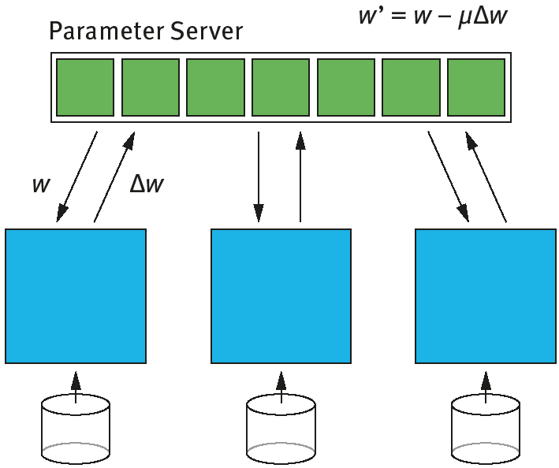

图 3.9: 用于更新参数的数据并行

一旦每台机器都拥有了遍历整个数据集分布所需的数据，就会在每台机器上本地运行 `ParallelSGD`。通信耗时间和通信成本是导致净误差的额外因素。在更新参数后，会执行全局通信程序将信息发送到驱动机器，在那里将进行进一步的独立分析。BitTorrent 聚合通信是目前为止取得最佳结果的协议。

## 3.7 现代深度神经网络架构

图像处理技术最广泛的应用是深度神经网络的实现。在当今世界，几乎所有类型的计算处理都可以通过实现深度架构来优化 [22]。

深度学习技术最初用于适应时间序列学习的并行策略 [23]。随着时间的推移，时间序列学习的计算负载变成了多线程。深度神经网络已应用于多个图像分类和识别问题 [24]。其成功部分归于不同抽象层面的自动特征提取 [25]。在过去的十年里，已经出现了多种设计和启发式方法来实现图像深度神经网络中的学习。社区中趋势明显且被广泛讨论的包括深度 CNN（`DCGANs`） [26]、对抗学习 [27]、深度残差学习 [28] 以及浅层学习算法 [29]。我们希望详细阐述为解决图像处理链中不同任务而创建的架构。以下子节将讨论深度神经网络在每个应用任务中所取得的成功程度。

### 3.7.1 图像预处理

预处理是指对输入图像执行的任何操作，输出为完整图像。它是图像处理链中图像采集之后的第一步。预处理期间执行的操作大体分为三类：图像重建、图像恢复和图像增强。重建是指根据采集的测量构建图像。恢复涉及移除传感器引入的任何畸变。

#### 3.7.1.1 图像恢复

神经网络广泛用于图像处理。通信耗时间和通信成本是导致净误差的额外因素。在更新参数后，会执行全局通信程序将信息发送到驱动机器，在那里将进行进一步的独立分析。BitTorrent 聚合通信是目前为止取得最佳结果的协议。

关键问题是恢复当前图像中丢失的细节。基于多值神经元的多层前馈网络（`MLMVN`）、`CNN` 和反向传播神经网络（`BPNN`）被用于获得高质量的恢复图像。

#### 3.7.1.2 图像重建

利用退化因素的知识构建原始图像定义为图像重建。现代图像恢复技术有一个共同缺陷，即收敛性差。启发式方法收敛到的局部极值对于实际应用来说是推测性的。

#### 3.7.1.3 图像增强

图像增强涉及锐化图像特征，如边界、对比度和边缘。图像数据的固有信息量并没有增加。增加了这些特征的动态范围，以便更容易被检测。

### 3.7.2 数据压缩

数据压缩最为人知的应用是特征提取和图像压缩。所有的图像压缩算法都涉及编码和解码，并为这些步骤设计了相应的神经网络。

Jin Wang 等人 [34] 使用了一种基于小波变换的自定义神经网络。他们的应用案例是心电数据压缩，但他们的新方法是在不断调整初始权重的同时加速收敛速度。他们将自己的网络性能与小波压缩算法进行了比较，与 `BPNN` 和主成分分析 (`PCA`) 方法相比，他们的结果更为满意。

### 3.7.2.2 特征提取

特征提取可以看作是一种特殊的数据还原形式，其目标是根据图像数据找到具有信息的变量子集。区分特征提取中有监督和无监督 `ANNs` 的参与至关重要。与 `PCA` 等传统技术相比，这两种学习方法在特征提取方面都已建立了显著的基准。

Wu Jiang 等人 [35] 开发了一种基于前述 `PCNN` 的新型图像特征提取算法。执行时间和大小是用于评估结果的参数。实验结果证明，它们优于传统的欧几里得算法。

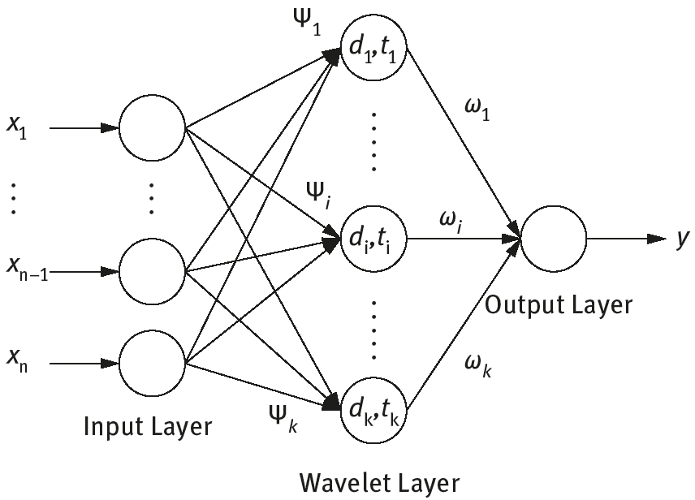

图 3.11: 基于小波的神经网络模型

### 3.7.3 图像分割

通过聚类像素生成显著区域是图像分割的目标。大多数神经网络方法直接将分割应用于像素数据，而另一些方法则通过在特征级上生成模式来实现。因此，这两种方法可以简化为聚类和模式识别。

#### 3.7.3.1 聚类

所有图像都包含了人类在查看图像时可以推出的良好信息。在采用无监督方法学习方法并处理未标记数据的聚集时，可以考虑聚类过程。聚类基本上涉及确定空间阈值，以揭示某些对象与其他对象的相似性和差异。

Li Jing 等人 [36] 提出了一种基于通用回归神经网络 (`GRNN`) 和模糊均值 (`FCM`) 聚类算法的方法。他们的方法涉及创建模式神经元，根据在人类视觉系统 (`HVS`) 中的嵌入强度来嵌入和提取识别出的位置。使用 `PSNR`（峰值噪比）和 `BCR`（位修正率）来评估他们方法的性能。

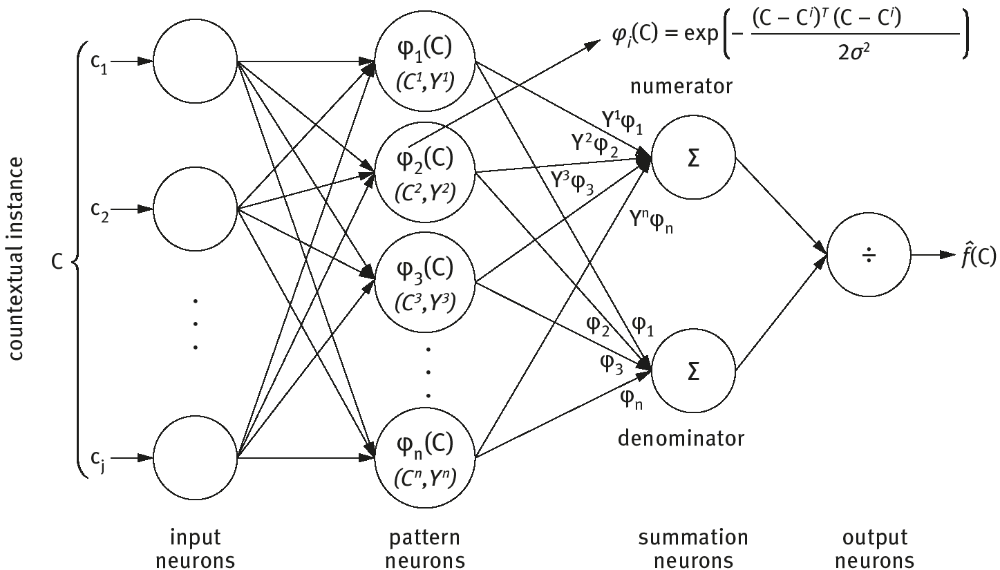

图 3.12: 基于回归的神经网络模型

#### 3.7.3.2 模式识别

人类大脑的感知能力使我们随着时间的推移识别经过训练的对象。模式识别定义为基于模式识别类别的动作。`ANN` 是分类和模式识别任务的一种极佳工具。

Budiwati 等人 [37] 描述了最流行的神经网络之一，该网络为日语字符识别设计并基于 `BPNN`。日语中存在多种书写系统，需要模式识别来区分汉字和假名的书写风格。`ROC` 的性能达到了 92%。

### 3.7.4 对象识别

对象识别包括在图像中寻找对象。使用对象识别解决的最常见问题描述是跟踪。广而言之，有两种：场景分析和基于特征的匹配。

#### 3.7.4.1 基于特征的匹配

场景分析与不同对象的识别非常不同。它涉及到光照和噪声的的变化。神经网络通过生成多个加权连接来当分类器。

2010 年，Jong-Min Kim [38] 引入了一种利用 `MLNN` 结合 `PCA` 的方法。

#### 3.7.4.2 模板匹配

模板匹配涉及发现图像的小部分并将其与模板匹配的操作。由于在 `CNN` 中观察到的权重共享。

Yilmaz 等人 [39] 提供了一种包含直方图均衡化和阈值化的混合方法。

### 3.7.5 图像理解

图像理解是图像处理中最困难的领域。它通过分割等技术与图像内容建立关联。它涉及两个主要步骤：场景分析和对象排列。

#### 3.7.5.1 场景分析

场景分析与不同对象的识别非常不同。它涉及内在的变化。神经网络通过生成多个加权连接来当分类器。

Seiji 等人 [40] 通过引入一种新架构——沙漏型神经网络，在图像搜索中设定了基准。作者使用 `MDA` 算法进行图像预处理。

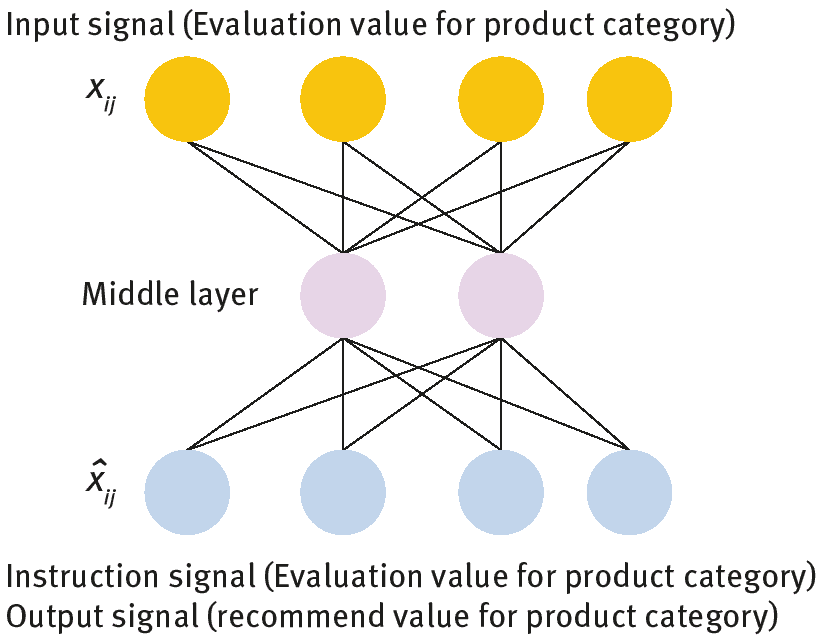

#### 3.7.5.2 对象排列

任何可以被归类识别为单个单元的图像片段都被称为对象。使用对象排列解决的最流行的问题描述是实时对象跟踪。

通过识别图像中的重要对象并标记定义为图像解释。在图形表示上进行的图像解释被称为图匹配。所表示的图根据为聚类制定的标准进一步划分为若干类。

根据特定的图匹配问题，应用了各种神经网络架构。Zinkevich 等人 [21] 引入了一种基于多层感知器神经网络的新型架构。该架构专为指纹分类用例而设计，并通过原生人工神经网络（ANN）进行训练。其性能判准是 `MSE`，并将最低 `MSE` 值设定在 0.1 以下。

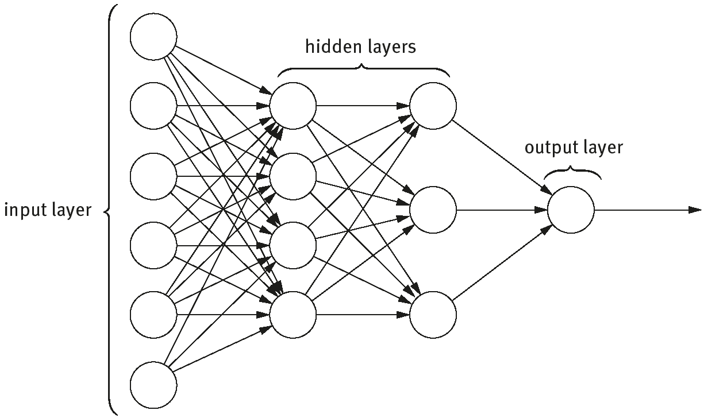

图 3.14: 多层感知器网络模型

## 3.8 结论

本章深入解释了在图像处理链中执行的各种任务中被运用的多种深度学习技术。在过去的几十年里，研究人员开发了大量的神经网络架构，我们对每个模型在图像处理特定任务中实现的技术进行了相关说明。案例研究表明，混合模型与传统模型相比展现了优越的性能。文中简要描述了设定最高基准的模型，并对该模型使用的每个图像处理任务进行了详细描述。

尽管传统模型具有高准确率，但新定义的混合模型是针对特定用例定制的。根据用例结合这些传统模型可以获得更高的准确率，并有助于模型的个体性能。因此，深度学习技术高度迭代且基于学习的方法在图像处理任务中显示出更好的性能。

# 参考文献

[1] Dechter R. Learning while searching in constraint-satisfaction-problems. In Kehler T, editor, AAAI, pages 178–185. Morgan Kaufmann, 1986.

[2] Kelley HJ. Gradient theory of optimal flight paths. ARS Journal, 30(10):947–954, 1960.

[3] Igor Aizenberg JPLV Naum N. Aizenberg. Multi-Valued and Universal Binary Neurons. Springer US, 2000.

[4] Hadsell R, Erkan A, Sermanet P, Scoffier M, Muller U, and LeCun Y. Deep belief net learning in a long-range vision system for autonomous off-road driving. In Proc. Intelligent Robots and Systems (IROS'08), 2008.

[5] Krizhevsky A, Sutskever I, and Hinton GE. Imagenet classification with deep convolutional neural networks. In Advances in neural information processing systems, pages 1097–1105, 2012.

[6] Maini R and Aggarwal H. A comprehensive review of image enhancement. CoRR, abs/1003.4053, 2010.

[7] Radford A, Metz L, and Chintala S. Unsupervised representation learning with deep convolutional generative networks. CoRR, abs/1511.0634, 2015.

[8] Gharbi M, Chen J, Barron JT, Hasinoff SW, and Durand F. Deep bilateral learning for real-time image enhancement. CoRR, abs/1707.02880, 2017.

[9] Yang J, Ren P, Chen D, Li H, and Hua G. Neural aggregation for video face recognition. CoRR, abs/1603.05474, 2016.

[10] Yang J and Huang T. Image super-resolution: Historical overview and future challenges. Super-resolution imaging, pages 20–34, 2010.

[11] Liu P and Fang R. Learning pixel-distribution with wider convolution for denoising. CoRR, abs/1707.09135, 2017.

[12] Figueiredo MAT. Synthesis versus analysis in patch-based priors. CoRR, abs/1702.06085, 2017.

[13] Shan Q, Li Z, Jia J, and Tang CK. Fast image/video upsampling. ACM Transactions on Graphics (TOG), 27(5):153, 2008.

[14] Denton EL, Chintala S, Fergus R. Deep generative models using a laplacian pyramid of adversarial networks. In Advances in neural information processing systems, pages 1486–1494, 2015.

[15] Schlemper J, Caballero J, Hajnal JV, Price AN, and Rueckert D. A deep cascade of convolutional neural networks for MR reconstruction. CoRR, abs/1704.02422, 2017.

[16] Mannos J and Sakrison D. The effects of a visual fidelity of the encoding of images. IEEE transactions on Information Theory, 20(4):525–536, 1974.

[17] Wang Z, Bovik AC, Sheikh HR, and Simoncelli EP. Image quality assessment: from error to structural similarity. IEEE transactions on image processing, 13(4):600–612, 2004.

[18] Kang L, Ye P, Li Y, and Doermann D. Convolutional neural networks for no-reference. In Proceedings of the IEEE conference on computer vision and pattern recognition, , 2014.

[19] Wang Z, Bovik AC, and Lu L. Why image quality assessment so difficult? In Acoustics, Speech, and Signal Processing (ICASSP), 2002, volume 4, pages IV–33. IEEE.

[20] Asanovic K, Bodik R, and Sen K. A view of the parallel computing landscape. Commun. ACM, 52(10):56–67, 2009.

[21] Zinkevich M, Weimer M, Li L, and Smola J. Parallelized stochastic descent. In Lafferty JD, Williams C, Shawe-Taylor J, Zemel RS, and Culotta A, editors, Advances in Neural Information Systems 23, pages 2595–2603. Curran Associates, Inc., 2010.

[22] Blum C, Puchinger J, Raidl GR, and Roli A. Hybrid metaheuristics in combinatorial optimization: A survey. Applied Soft Computing, 11(6):4135–4151, 2011.

[23] Coelho IM, Coelho VN, da S. Ochi LS, Guimarães FG, and Rios E. A gpu deep learning metaheuristic based model for time series forecasting. Applied Energy, 201:412–418, 2017.


[24] Sun Y, Chen Y, Wang X, and Tang X. Deep learning face representation by joint identification-verification. In Advances in neural information processing systems, pages 1988–1996, 2014.

[25] Ojha VK, Abraham A, and Snášel V. Metaheuristic design of feedforward neural networks: A review of two decades of research. Engineering Applications of Artificial Intelligence, 60:97–116, 2017.

[26] Krizhevsky A, Sutskever I, and Hinton GE. Imagenet classification with deep convolutional neural networks. In Advances in neural information processing systems, pages 1097–1105, 2012.

[27] Lowd D and Meek C. Adversarial learning. In Proceedings of the Eleventh ACM SIGKDD International Conference on Knowledge Discovery in Data Mining, KDD ’05, pages 641–647, New York, NY, USA, 2005. ACM.

[28] He K, Zhang X, Ren S, and Sun J. Deep residual learning for image recognition. In The IEEE Conference on Computer Vision and Pattern Recognition (CVPR), June 2016.

[29] Dechter R. Enhancement schemes for constraint processing: Backjumping, learning, and cutset decomposition. Artificial Intelligence, 41(3):273–312, 1990.

- 30 Man Z, Lee K, Wang D, Cao Z, and Khoo S. Robust single-hidden layer feedforward network-based pattern classifier. IEEE transactions on neural networks and learning systems, 23(12):1974–1986, 2012.

- 31 Zhang D, Mabu S, and Hirasawa K. Image denoising using pulse coupled neural network with an adaptive pareto genetic algorithm. IEEJ Transactions on Electrical and Electronic Engineering, 6(5):474–482, 2011.

- 32 Suhasini A, Palanivel S, and Ramalingam V. Multimodel decision support system for psychiatry problem. Expert Systems with Applications, 38(5):4990–4997, 2011.

- 33 Entezarmahdi SM and Yazdi M. Stationary image resolution enhancement on the basis of contourlet and wavelet transforms by means of the artificial neural network. In Machine Vision and Image Processing (MVIP), 2010 6th Iranian, pages 1–7. IEEE, 2010.

- 34 Wang J, She M, Nahavandi S, and Kouzani A. Human identification from ecg signals via sparse representation of local segments. IEEE Signal Processing Letters, 20(10):937–940, 2013.

- 35 Jiang H, Wang J, Yuan Z, Wu Y, Zheng N, and Li S. Salient object detection: A discriminative regional feature integration approach. In Proceedings of the IEEE conference on computer vision and pattern recognition, pages 2083–2090, 2013.

- 36 Cliff MA, Dever MC, Hall JW, and Girard B. Development and evaluation of multiple regression models for prediction of sweet cherry liking. Food Research International, 28(6):583–589, 1995.

- 37 Budiwati SD, Haryatno J, and Dharma EM. Japanese character (kana) pattern recognition application using neural network. In Electrical Engineering and Informatics (ICEEI), 2011 International Conference on, pages 1–6. IEEE, 2011.

- 38 Kim JM and Kang MA. A study of face recognition using the pca and error back-propagation. In Intelligent Human-Machine Systems and Cybernetics (IHMSC), 2010 2nd International Conference on, volume 2, pages 241–244. IEEE, 2010.

- 39 Yilmaz A, Javed O, and Shah M. Object tracking: A survey. Acm computing surveys (CSUR), 38(4):13, 2006.

- 40 Ito S, Mitsukura Y, Fukumi M, Akamatsu N, and Omatu S. Scene image analysis by using the sandglass-type neural network with a factor analysis, volume 2, pages 994–997. Institute of Electrical and Electronics Engineers Inc., 2003.

- 41 Kodge BG and Hiremath PS. Elevation contour analysis and water body extraction for finding water scarcity locations using DEM. CoRR, abs/1404.3002, 2014.

Abantika Choudhury* 和 Moumita Deb

# 4 使用智能交通连接城市：概述

*通讯作者：Abantika Choudhury, RCC 信息技术学院

Moumita Deb, RCC 信息技术学院

**摘要：** 本章关注智能交通角度的连接城市。连接城市通过控制可用资源，能够高效地提高经济和社会成果。城市中的人员、系统和事物产生了大量数据。因此，本研究考虑了来自各种资源的数据。

**关键词：** 连接城市, `VANET`, `RSU`, `OBU`, 大数据

## 4.1 引言

智能城市旨在通过整合物联网（`IoT`）和信息通信技术（`ICT`）来发展城市地区。智能城市是医疗保健、交通、娱乐和公共服务等各种组合。智能交通、智能通信和智能网络正在兴起以促进这种生活方式。连接城市需要当局提供大量资源。连接城市的一个重要方面是连接的交通网络，车辆之间可以进行通信。连接城市的动态性质使其与其他城市有所不同。目前的研究重点是利用智能通信开发智能城市。在本章中，将描述了智能交通的一项最新趋势及其优缺点。

连接城市利用技术来提高服务质量。英国 Amey 公司的技术总监里克·罗宾森（Rick Robinson）建议，智能城市的架构（图 4.1）由六层组成：目标、人员、生态系统、软基础设施、城市系统和硬基础设施。连接城市应该根据当地的需求拥有一套目标。罗宾森还断言，连接城市的概念可以用于系统地升级城市，而设计智能城市等基础设施的用途是实现社区的创新。社区是城市生态系统中的重要元素。社区为智能城市的设施提供支持。架构显示，各种软基础设施（例如领导力、创新论坛以及网络和社区组织）在智能城市中起着重要作用。图 4.2 中的图也显示了硬基础设施。设计智能城市的挑战是建立适当的基础设施为社区和社会提供服务。这些系统为居民提供食物、交通、教育和医疗保健，并支持社区和企业。为了设计智能城市，有必要消除现有城市的限制。城市的设施和运行对服务提供者来说是一个挑战。这些限制损害了智能城市的服务。城市的居民、社区和组织应该理解构建连接城市的必要性、机会、技术和挑战。

## 4.2 智能城市的组成部分

智能基础设施是软件和硬件系统的结合。它还与各种网络通信和传感器节点相结合。本章主要关注互联城市中的智能交通。图 4.1 中给出了联网城市的分类。联网城市通过互联网连接进行运营。具有宽带互联网设施的城市被称为宽带城市。泛在城市（U-City）是将泛在计算的子结构应用于城市系统不同功能的城市。无线城市是提供无线接入的城市，以支持热点，这些热点为多个区域提供公共互联网访问，例如公园、公交站和餐厅。数字城市是指在本地运行的在线网络，并提供本地信息，如关于某些活动或娱乐的信息、游客指南或电子商务。生态城市旨在促进健康环境的建设。

智能交通系统（`ITSs`）为城市地区的交通管理和车辆运输提供现代服务。`ITS` 使交通变得更安全、更智能。从技术上讲，`ITS` 与传统交通系统不同。它提供了更先进的应用。`ITS` 系统提供了预测技术来与历史数据进行比较并设计丰富的模型。智能交通涉及可以通过互联网进行通信的智能车辆。它由车与基础设施（`V2I`）和车与车（`V2V`）通信组成。`V2I` 指车载单元（`OBUs`）与路侧单元（`RSUs`）之间的通信；`V2V` 指不同车辆 `OBU` 之间的通信。车载自组网络（`VANETs`）高效地支持了 `ITS` 的各种应用。交通基础设施是任何有效智能城市的骨干。具有智能交通的联网城市的架构如图图 4.2 所示。

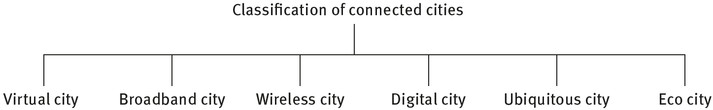

图 4.1: 联网城市的分类

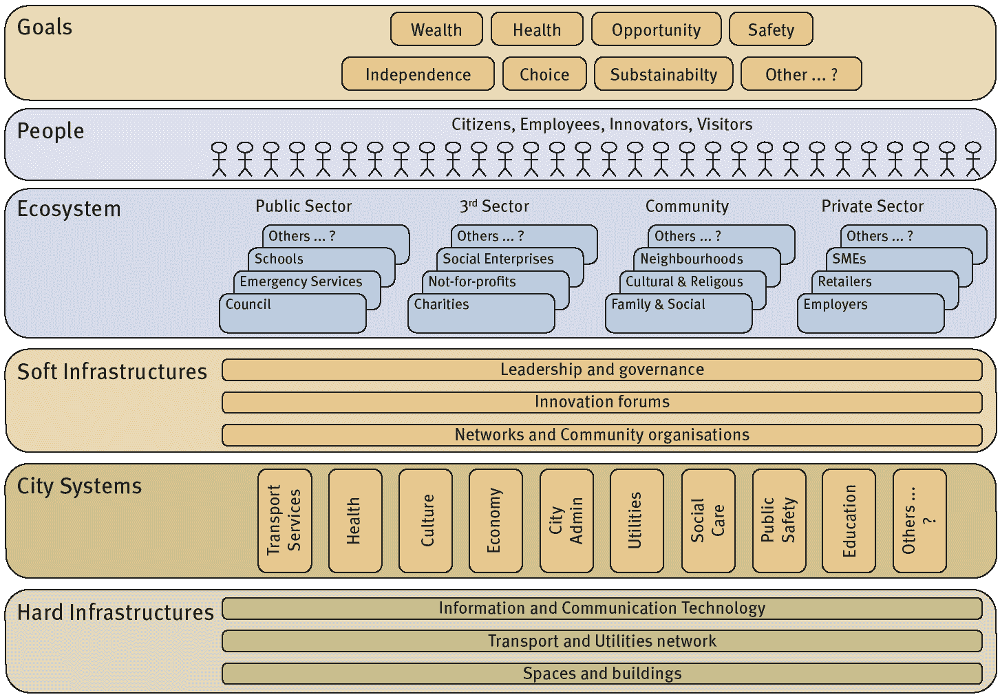

图 4.2: 联网/智能城市架构组件

## 4.3 智能交通技术

智能交通使用了不同的技术。这些技术如下：

1. 无线通信
2. 浮动数据（关于车辆的）
3. 传感技术

**无线通信**：由于车辆不断移动，因此需要强大的无线通信来互联 `ITS` 中的车辆。无线技术可以显著提高交通系统的运行、效率和可靠性。通信两个主要功能是关键通信和宽带通信。关键通信提高了车辆与基础设施之间的效率、安全性和可靠性，而宽带通信用于载荷或乘客服务 [1]。有必要根据每个特殊环境、车辆动态以及乘客或载荷的需求精确设计物理接口。

**浮动数据**：`VANETs` 中的浮动数据是浮动车辆数据。道路网的交通速度取决于基于手机到车辆本地数据的浮动数据。车辆产生的数据被称为浮动车辆数据（`FCD`）。浮动车辆是受全球定位系统（`GPS`）监控的车辆。传感器节点和其他移动设备的开发提高了车辆网络的效率。车辆网络有很多优势。

**传感技术**：`VANETs` 中的浮动数据是浮动车辆数据。道路网的交通速度取决于基于手机到车辆本地数据的浮动数据。车辆产生的数据被称为浮动车辆数据（`FCD`）。浮动车辆是受全球定位系统（`GPS`）监控的车辆。传感器节点和其他移动设备的开发提高了车辆网络的效率。车辆网络有很多优势。

### 4.3.1 智能交通的大数据

大数据为 `ITS` 带来了许多变化。现有技术无法处理异构数据。因此，有必要开发新的工具来处理 [2]。

利用大智能交通提供了解决问题的机会。数据随时间和位置变化。许多类型具有局限性，仅无法无法描述整体状况。数据处理和数据挖掘技术（例如自然语言处理和分析）需要进一步改进。在这种情况下，产生了数据需求 [3]。

在云端部署大数据 [4]构成了云计算。智能城市始于涉及大数据的 `IoT`。数据以流式实时传输。它与提取、转换和加载（`ETL`）过程相结合。标准结构格式与开源软件相结合以收集公共信息。

## 4.4 智能城市数据的挑战 [5]

智能城市在特征上是非常动态且不断演变的。开发使城市智能化的大数据应用面临许多挑战。必须解决这些挑战以尽可能开发智能应用。这些挑战与实时分析、大数据工具、可访问性和成本有关，并直接影响智能应用的服务和性能 [6]。

### 4.4.1 数据源及其特征

从许多源收集的数据具有各种格式。大多数数据不是结构化格式。此类非结构化数据可以是视频、音频或图像。需要数据库管理系统（`DBMS`）将数据转换为结构化格式 [7]。

系统中还包含了有效性、易变性、价值、变异性 [8, 9] 等更多信息。数据挖掘中使用的方法论和软件工具无法处理大规模数据的复杂性。

### 4.4.2 数据与信息共享

另一个挑战是在不同城市提供数据或信息。每个政府都维护着自己的公共信息数据仓库。某些数据仓库被禁止与其他实体共享数据。在收集或使用大数据时，面临数据安全方面的挑战；有必要确保公民的隐私 [[8]]。智慧城市的应用需要包含尽可能克服障碍的策略，以实现无缝信息共享 [[10]]。数据语义难以理解，且基于实时数据提取信息面临着挑战。这使得为智慧城市构建基于知识的数据集成为了一项艰巨的任务。

### 4.4.3 数据质量

维护数据质量是另一个挑战。从不同来源采集的数据存储在单独的数据库中，且遵循标准格式 [[11]]。从公共来源收集数据并与许多供应商合作会影响数据格式，导致数据非结构化和不一致等问题。这削弱了对数据的信任。当输出错误时，也可能出现挑战。错误的结果会传播给其他用户，而他们可能并未意识到这些问题。

### 4.4.4 安全与隐私

安全与隐私是智慧城市面临的另一个大挑战。数据库需要高水平的安全来保护各种数据，例如确保政府相关的机密数据不被未经授权的用户获取由于数据在各种网络中传输，其中一些网络是开放或不安全的，智能应用也需要高水平的安全保障 [[8]]。大数据中使用的技术，如 `Hadoop` 和 `Cassandra` 也必须处理安全问题 [[12]]。当数据通过不同的网络层传输并被智慧城市应用组件使用时，也有必要尊重组织的隐私以确保数据安全。不同的数据，例如零售销售历史、财务记录和医疗记录，提供了关于个人的详细信息。围绕大数据提供高水平的隐私政策，对于智慧城市的应用开发者和用户来说是一个巨大的挑战。

### 4.4.5 成本

另一个挑战是政府部门在使用信息通信技术（`ICT`）时产生的成本。能源消耗减少系统 [[13]] 是一种用于政府能源使用的新系统。系统的组件或特征设计用于监控消耗并记录使用数据。为了克服巨大的能源消耗问题，创建了智能能源管理系统，但其实成本高昂。这阻碍了智慧城市的发展。智慧城市交通信号系统的测试在资源和交通问题方面都非常昂贵 [[14]]。智慧城市的基础设施和应用 [[13]] 需要昂贵的硬件和软件来开发和监控系统。

### 4.4.6 智慧城市人口

人口也是智慧城市面临的一个主要挑战。城市人口对数据规模有巨大影响。生成的数据量取决于人口；如果人口增长，生成的数据量就会增加。这些海量数据会导致交通拥堵、数据丢失、广播风暴、污染以及社会不平等的加剧 [[15]]。智慧城市的应用必须快速高效地进化，以应对不同类型的大数据。之前讨论的挑战对智慧城市的智能应用具有不同的影响和作用。在这种情况下，出现了许多困难和复杂性。实现实时响应 [[16]] 高度依赖于能够应对这些挑战。

## 4.5 构建智慧城市的不同系统

关于智慧城市智能/智能化交通的研究正在进行。各种用于智慧城市的智能交通系统（`ITS`）正在开发中，以解决交通和运输方面的各种问题。根据目前的研究趋势，`ITS` 可分为四大类系统：

1. 旅客信息系统 (`ATIS`)
2. 交通管理系统 (`ATMS`)
3. 公共交通系统 (`APTS`)
4. 应急管理系统 (`EMS`)

**ATIS**：这种系统通过分析信息来帮助前往目的地的旅客。`ATIS` 系统可以通过来自车辆或交通管理中心提供的信息运行。`ATIS` 系统可以通过手机、电脑、无线电、电视提供地图测绘或短信等服务。对于数据分发，`ATIS` 需要大量与旅客相关的数据进行分析、处理和存储。基于地理信息系统（`GIS`）的 `ATIS` [[17]] 对于信息的存储和图形化表示非常有用。

**ATMS**：这种系统用于减少城市地区的交通拥堵，提高现有基础设施的效率。`ATMS` 处理城市道路上的拥堵问题。该系统尝试检索由 `RSUs` 提供的数据。它还尝试制定策略以优化单个交叉口的交通。这些系统依赖于各种类型的消息来提供相关的交通信息。


# APTS

这种系统用于确保公共交通的安全。它将信息技术和交通管理应用于公共交通系统。在技术的帮助下，它提高了各种运输运行的效率。APTS 应用包括车辆定位系统、公交到达通知系统、实时旅客信息系统以及信号交叉口为公交提供优先权的系统。公共交通系统由 `GIS` 组成。`GIS` 是一个 `DBMS`。数据库是坐标集。`GIS` 用于维护城市地区不同路线的公交调度信息，并为旅客提供信息。APTS 系统中的旅客信息包括行前信息，以便旅客相应规划行程。行前信息在终端、路边位置或车辆中提供。

## 4.6 智能基础设施 [[18]]

传统基础设施已迅速演变为智能基础设施。从家居到桥梁，从桥梁到管道再从管道到路灯，各种基础设施已变得可控并能够与各种基础设施元素及人类进行交互 [[19]]。智能基础设施的组件连接到互联网，它们协同工作，从多个源收集上下文数据以执行不同的功能 [[20]]。因此，智能基础设施比传统基础设施更具成本效益、更有用且更具调节性。物联网代表了一个通过集成传感器连接动态智能的世界。

## 4.7 流程创新 [[18]]

在互联城市中，可以从智能基础设施获取数据。但要解释这些数据以创造价值并做出智能决策是非常困难的。互联城市中使用的两个主要过程技术是大数据和众包。

## 4.8 城市管理平台的使用 [[21]]

2011 年福冈市的智能手机探测项目建立了福冈指导委员会，这是一个由产界、学界、政府和私营部门组成的伙伴关系，旨在为福冈大都会制定增长战略并研究智能城市政策。该委员会由五个工作小组（旅游、环境、食品、人力资源和城市发展）组成，日立主要参与环境工作小组，其中包括愿景构建和演示项目，旨在使福冈大都会成为智能出行的领导者。

在 2013 财年，环境工作小组演示建立了一个使用智能手机探测获取“人流”信息的项目。智能手机预装了收集 GPS 和加速度计数据的应用程序。在福冈市交通局的合作下，该项目还收集了用户上下地铁时的智能卡数据。数据在试点期结束后获取。为了将人们移动的信息视觉化，根据智能手机的 GPS 和加速度计数据自动确定旅行路线和交通工具。在无法接收 GPS 信号的地铁行驶情况下，信息从智能卡行程记录中获取。该演示项目自动将行程分为四类（步行、公交、地铁或其他交通工具）。

## 4.9 智能交通的大数据 [[18]]

数据以大数据的形式从许多源产生。数据源包括环境传感器、计算机、智能手机、摄像头、GPS 等可用设备。各种应用，例如数字照片和视频、广告应用、社交媒体网站和商业交易在过去几年中加速了数据的生成 [[22, 23]]。

图 4.3 描述了互联城市可以根据医疗、交通、电网、智能教育等不同方面和领域进行分类。这些系统与大数据系统连接并相互传输数据。

在动态环境中智能城市中实施大数据是非常具有挑战性的 [[17]]。以下描述了其中的一些挑战。

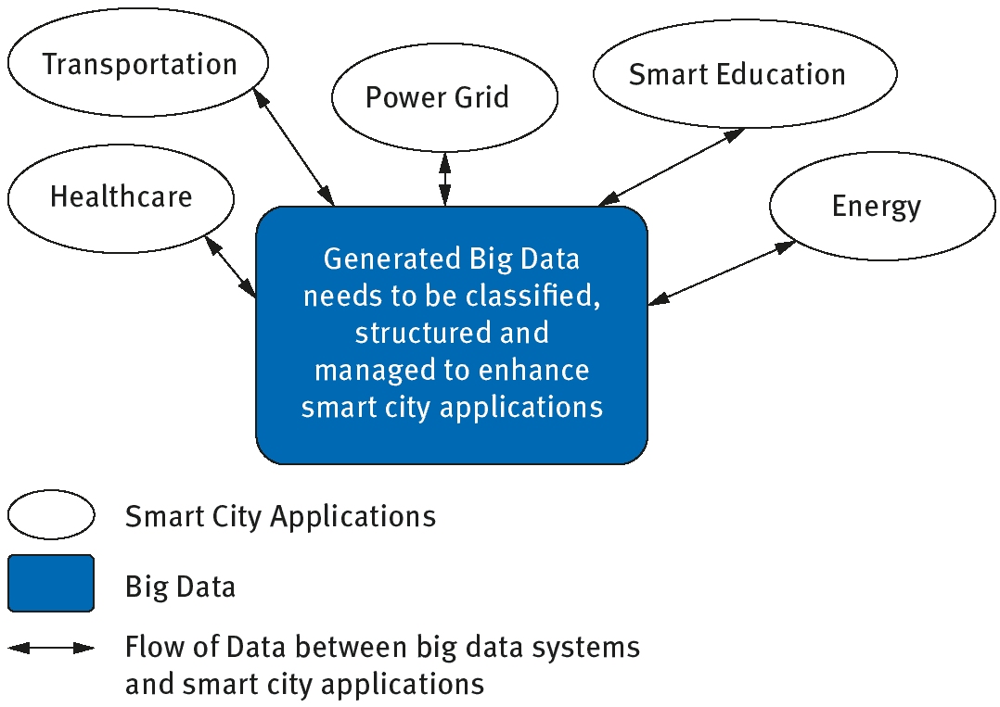

图 4.3: 互联城市的分类

### 4.9.1 数据规模和来源

在智能城市中，数据从各种源以各种格式产生。其中一些是结构化的，另一些是非结构化或半结构化的。使用传统软件进行数据存储和数据处理并非易事。

### 4.9.2 数据信息和共享

智能城市应用处理来自多个组织、异构环境和各种智能设备的数据集成。组织的数据集成是 IT 领域最大的挑战之一。来自许多部门的数据集成变得具有挑战性。与许多部门共享信息也面临着挑战。每个部门都维护着自己的数据仓库，因此共享信息非常困难。

### 4.9.3 数据质量

互联城市中的数据从不同的异构系统收集并采用各种格式，因此维护数据质量变得具有挑战性。不同的事务系统需要相似格式的数据。但当数据到达汇总了各种源数据的大数据仓库时，它们需要特定的格式，而不考虑其质量。因此，有必要确保建立适当的机制来检索高质量数据。

### 4.9.4 数据安全

数据安全是处理大数据时的一个重要问题。大数据面临的损害比正常规模的数据更严重。以安全的方式将数据从各种源移动到各种目的地是互联城市应用的巨大挑战之一。安全意味着信息应该到达正确的人和正确的地方。设计互联城市时，数据掩敏和安全也是重要问题，以确保数据不会落入错误手中。如今，先进技术非常复杂且昂贵。互联城市的设计应该能够提供比现有解决方案更好的方案。

### 4.9.5 技能匮乏

处理多样化数据时缺乏技能有时会成为在互联城市中有效使用大数据的障碍。拥有管理和分析大量数据所需的技能非常重要。制定有效的政策来提高此类技能是十分的。

### 4.9.6 缺乏标准

缺乏标准是另一个需要考虑的方面。对于互联城市的发展，应该维护一些标准，这些标准将在确定共同平台方面起着重要作用。缺乏标准影响数据格式、数据集成和数据挖掘程序，以及与数据相关的其他政策。

## 4.10 互联城市中的大数据应用

大数据技术的应用使得数据存储能够处理服务于不同城市的信息。大数据还有助于对智慧城市任何服务和资源的扩张做出决策。为了实现连接城市的目标，大数据需要用于有效数据分析的工具和方法论。工具和方法论在不同实体之间协作，并为连接城市提供各种服务。研究提出了一种三层管理系统 24 以支持城市移动性。交通系统中位置跟踪的发展显著增加了数据量和多样性。到达时间的预测模型 25, 26 提升了体验。研究工作还提出了一种通过投资 `AVL`（自动车辆定位）`APC`（自动乘客计数）系统 27 的智能交通管理系统。预测是基于时间序列模型，如 `ARIMA`（自回归积分移动平均）、`SARIMA`（季节性 `ARIMA`）或混合方法 28, 29。此类预测是为了预测需求。乘客需求是以聚合的方式进行建模的，因此不考虑个体的交通模式。另一个局限性是这些方法建立在有限的路线数量。已经建立了其他重要的预测方法来预测到达时间 25, 26。如今对智慧交通系统的研究包括，例如通过智能手机应用程序通过群感来收集各种信息，如轨迹和乘客体验 30。这种方法不于特殊设备。但其数据质量在很大程度上取决于有多少用户愿意下载并使用该应用程序。此外，收集的数据可能会由于自我报告错误而产生偏差。

### 4.10.1 智能电网

智能电网的快速普及使研究人员能够分析和使用生成的实时数据。智能服务的改进直接增强了现有智能电网基础设施的结果。在智能电网环境中，从各种来源产生了大量的能源消耗数据。从智能电网环境收集的大数据有助于决策电力供应水平，以满足用户需求。智能电网数据分析有助于预测未来的供应需求。

### 4.10.2 智慧医疗

世界人口正在迅速增长。专家对患者数据的收集和分析需要高效的工具。行政机构和保险机构也使用此类工具。大健康数据应该被妥善分析，以预测疾病及其治疗。它们还可以提高生活质量并降低死亡率。针对特定患者的数据或信息收集由智能设备完成。这些设备与诊所或医院相关，以帮助维护患者记录。

### 4.10.3 智慧交通

大量交通数据的模式改进了交通系统，通过推广替代路线和减少事故数量来最小化交通拥堵。从智慧交通系统收集的大数据可以通过减少供应链浪费来帮助货物运输运动。智慧交通数据还提供了若干优势，如减少对环境的影响和增加安全性。

### 4.10.4 智慧城市治理

大数据分析在智慧治理中发挥着重要作用。具有共同目标的不同组织可以通过协作，利用数据分析轻松地识别出需要分析的数据。不同国家之间为了发展相互合作。大数据分析有助于政府在教育、社会护理和健康等领域建立并实施政策。通过分析来自多个机构的海量数据，可以提高大实施实施。

## 4.11 大数据与数据分析 31

连接城市仅在日常运行过程中就会产生海量数据。为了收集更多数据，智慧城市使用了 `IoT`（物联网）和“开放数据”。有些数据是静态的，有些是实时的。这些数据显示了大数据的典型特征：高容量、实时以及在格式、来源和特征上的异构性。大数据可以得到良好的管理和分析，并提供城市可以用来提高效率的经济价值。大数据还可以产生新想法，提高城市居民的生活。城市可以访问并使用许多管理非常昂贵的计算资源。现在可以使用 `HDFS`、`Hive`、`Hadoop` 和 `Spark` 等技术来利用大数据和其他分析工具，提高城市运行和服务的效率。

大数据对包括 ITS（智能交通系统）在内的许多领域发生了巨大变化。围绕无处不在的数字设备的新兴技术为增强 ITS 提供了若干机会。然而，大数据的规模和异构性超出了现有 ITS 方法的能力。所提出的架构 32 基于对交通控制系统需求的系统分析。大数据分析引擎告知控制逻辑。在制定数据分析系统时，应考虑查询的可变性。根据 [12_chapter04.xhtml#chapter04_93]，可能的查询被分为四组：周期性与非周期性、描述性与预测、实时与非实时、单源与多源。论文还提出了一种取决于给定交通控制系统一组需求的架构。大数据对交通业的优势如下：

- 用于大数据技术的交通管理系统处理大量数据。一个大任务被分成小任务并在 `MapReduce` 模型中完成。模型的稳定性和容错性也很重要。
- 大数据可以提高运输水平。交通业涉及许多处理海量数据的工作领域，也使用其他模型来控制应用。大数据具有良好的预测能力。大数据减少了与交通事件相关的误报和漏报概率。

大数据平台上的智能交通代表了多种技术、模型、系统和部门的集合。该系统由管理、科学、数学、经济学和信息技术组成。系统还包括数据分析层、基础业务层和信息发布层。

基础业务层是数据分析层和信息发布层的平台。该层的主要活动是完成不同业务部门的基础工作，并在基础业务层产生数据。该层包含了控制系统、交通信息采集系统、视频监控系统、信号、法医犯罪系统等。基础业务层的任务是处理不同的业务组织。在基础业务层中，使用了云计算技术。通过去中心化系统与云的集成确保了应用程序系统的安全稳定，提供了一个高效的计算环境。

给定架构的数据分析层使用了数据挖掘技术、大数据技术，结合各种数学模型进行实时分析。该层可用于交通引导、拥堵警告等智能交通目的。数据分析层构建在 `Hadoop` 生态系统中。它使用廉价的商业服务器和开源的 `Linux` 系统进行大数据存储。信息发布层通过桌面应用程序、移动终端、互联网和其他应用程序为旅行者、行业高管和其他业务部门提供交通状况。

## 4.12 结论

本章调查了联网城市的智能交通。讨论了大数据对联网城市的有用用处。讨论了与大数据相关的各种应用，如 `IoT`。还讨论了大数据和 `IoT` 如何参与智能交通，特别是在交通拥堵管理、出行辅助等场景方面。大数据和 `IoT` 是如今非常有用的技术。这两项技术对智慧城市或联网城市的智能交通产生了深远影响。本章描述了联网城市中大数据、`IoT` 与智能交通之间的关系。未来，许多新兴技术也将提高智能交通的服务效率。大数据的挑战是未来研究中另一个需要解决的重要问题。

# 参考文献

[[1] 交通系统中的无线通信. Hindawi.

[[2] Amini S, Gerostathopoulos I, and Prehofer C. Big Data Analytics Architecture for Real-Time Traffic Control. TUM Living Lab Connected Mobility (TUM LLCM) project Center Digitisation. Bavaria, Bavarian State Government.

[[3] Zheng X, Chen W, Wang P, Shen D, Chen S, Wang X, and Zhang Q. Big Data for Social Transportation. IEEE Transactions on Intelligent Transportation Systems, 17(3), 2016.

[[4] Wang X and Li Z. Traffic and Transportation Smart with Cloud Computing on Big Data. International Journal of Computer Science and Applications, 13(1):1–16, 2016.

[[5] Al Nuaimi E, Al Neyadi H, and Al-Jaroodi NMJ. Applications of big data to smart cities. Journal of Internet Services and Applications, 2015.

[[6] Fan W and Bifet A. Mining big data: current status and forecast to the future. ACM SIGKDD ExplorNewsl., 2013.

[[7] Michalik P, Stofa J, and Zolotova I. Concept definition for Big Data architecture in the education system. In Applied Machine Intelligence and Informatics (SAMI), IEEE 12th International Symposium, pages 331–334, 2014.

[[8] Khan M, Uddin MF, and Gupta N. Seven V’s of Big Data understanding Big Data to extract value. IEEE, pages 1–5, 2014.

[[9] Khan Z, Anjum A, and Kiani SL. Cloud Based Big Data Analytics for Smart Future Cities. In Proceedings of the 2013 IEEE/ACM 6th International Conference on Utility and Cloud Computing, pages 381–386, 2013.

[[10] Su K, Li J, and Fu H. Smart city and the applications. Electronics, Communications and Control (ICECC), IEEE, pages 1028–1031, 2011.

[[11] Lee CH, Birch D, Wu C, Silva D, Tsinalis O, Li Y, and Guo Y. Building a generic platform for big data. International Conference, pages 94–102,

[[12] Kim GH, Trimi S, and Chung J. Big-data applications in government sector. Journal of Science and Research (IJSR), 5(2),

[[13] Kramers A, Höjer M, and Wangel N. Smart sustainable cities – Some stylised facts. Model, 56:52,

[[14] Aguilera G, Galan J, Campos JC, and Rodríguez P. Accelerated-Time Simulation for Traffic Flow in a Smart City. FEMTEC

[[15] Neiro P, De Marco A, Mangano G, and Scorrano F. Current trends in Smart City initiatives. Commun.

[[16] Mohamed N and Al-Jaroodi J. Real-time big data analytics: Applications and challenges. In International Conference on High Performance Computing and Simulation (HPCS), pages 305–310,

[[17] Kumar S, and Prakash A. Role of Big Data and Analytics in Smart Cities. IEEE,

[[18] Harrison C and Donnelly A. The Internet Gets Physical. New York Times, December 17.

[[19] Lohr S, Wasik B. All Our Objects as One. Wired, May 14.

[[20] Morioka M, Kuramochi K, Mishina Y, Akiyama T, and Taniguchi N. City Management Platform Using Big Data from People and Traffic Flows. Hitachi Review, 64(1), 2015.

[[21] Smart Cities Council.

[[22] Wang Y, Ram S, Currim F, Dantas E, and Sabóia LA. A Big Data Approach for Smart Transportation on Bus Network. IEEE, 2016.

[[23] Bai C, Peng Z, Lu Q, and Sun J. Dynamic Bus Travel Time Models on Road with Multiple Bus Routes. Comput. Intell. Neurosci, pages 1–9, 2015.

[[24] Tétreault PR and El-Geneidy AM. Estimating bus run times for new limited-stop service using archived APC data. Transp. Res. Part A Policy Pract., 44(6):390–402, 2010.

[[25] Furth PG, Hemily B, Muller THJ, and Strathman JG. Uses of archived AVL-APC data to improve transit performance and management: Review and potential. Transp. Res. Board, 23, no. June, 2003.


[[26] Xue R, Sun DJ, and Chen S. Short-term bus passenger demand prediction based on time series model and interactive multiple model approach. Discret. Dyn. Nat. Soc, i:1–11, 2015.

[[27] Moreira-Matias L, Gama J, Ferreira M, Mendes-Moreira J, and Damas L. Predicting taxi-passenger demand using streaming data. IEEE Trans. Intell. Transp. Syst, 14(3):1393–1402, 2013.

[30] Farkas K, Feher G, Benczur A, and Sidlo C. Crowdsending based public transport information service in smart cities. IEEE Commun. Mag, 53(8):158–165, 2015.

[31] Lea R. Smart Cities: An Overview of the Technology. Trends Driving Smart Cities IEEE, March, 2017.

[32] Amini S, Gerostathopoulos I, and Prehofer C. Big data analytics architecture for real-time traffic control. Models and Technologies for Intelligent Transportation Systems (MT-ITS), IEEE, June, 2017.

S. V. Gorbachev

# 5. 基于深度神经模糊网络的多维半结构化数据智能分析模型

S. V. Gorbachev, 俄罗斯托姆斯克国立大学, email: spp03@sibmail.com

**摘要：** 提出并研究了一种深度神经模糊网络的新结构，通过模糊聚类层将柯霍宁模糊细胞神经网络自组织映射（`FCNN-SOM`）与径向基函数网络（`RBFN`）相结合。所提出的模型具有高度的神经元自组织性，改进了网络在类重叠情况下的分离特性；径向对称函数的参数自动调整能力；足以建模显著非线性依赖关系的单一隐藏层；优化权重系数的算法简单性；以及快速的学习速度。它可以用于解决广泛的问题——聚类、多维半结构化数据的逼近和分类（识别）。

**关键词：** 半结构化数据、分析、柯霍宁模糊细胞神经网络、径向基函数网络

## 引言

近年来，大数据领域已成为计算机技术领域中最有前景的领域之一。考虑到技术进步增长的特殊性，这很容易解释——数字技术伴随着现代生活的许多方面，并不断收集信息。生活中各个方面的数据量不断增加，信息存储的能力也在不断增长。根据 IDC 数字宇宙的一项研究，2020 年世界数据量可能达到 40 ZB（泽字节），相当于地球上每人拥有 5200 GB（图 5.1）。

按照这种增长速度，根据研究者的预测，世界数据量每年将翻倍。大数据范式确定了三种主要的任务类型：

1. 存储和管理数百 TB 或 PB 级；关系数据库无法有效处理如此大量的信息；
2. 组织由文本、图像、视频和其他数据类型组成的非结构化信息；
3. 分析大数据，这引发了如何处理非结构化和亚结构信息的问题，包括聚类方法、多维半结构化数据的逼近和分类（识别）、分析报告的生成以及预测模型的实现。


图 5.1: 统计数据正在增加，带有预测

尽管算法看似简单，但其应用具有几个特点。除了高成本外，阻碍实施的主要因素之一是处理数据的选择问题。数据的另一个问题是高复杂性。本章探讨了一种可能的方法——深度模糊分类器，它能够执行广泛的任务。

为了实现这一目标，必须解决以下问题：

1. 聚类和分类（识别）的分析，识别它们的优缺点；
2. 开发概念模型；
3. 径向基函数网络（`RBFN`）的研究；
4. 开发柯霍宁模糊细胞神经网络自组织映射（`FCNN-SOM`）；
5. 开发神经分类器；
6. 与经典神经网络进行比较。

本章包含七节。第一节提供了主题区域的概述，对该主题的出版物进行了分析，并识别了它们的优缺点。第二节对所选模型和相应的神经方法进行了证明。第三、四、五节讨论了新型深度模糊模型的实现细节，并提供了数学基础。第六节致力于在测试数据上对获得的结果进行实验验证。第七节描述了将模型应用于构建世界发展轨迹的实际结果。结论总结了工作成果。

## 5.1 文献综述

识别是在现实或理想世界中，对对象的数值或符号表示构建并应用形式化操作的问题；决策的结果反映了它们之间的等价关系。等价关系表示了评估对象在被视为独立语义单元的任何类别中的隶属关系。

等价类由研究人员在构建识别算法时定义，研究人员使用其自己的主观观点，或者利用关于解决问题背景的相似性和差异的外部信息。在这种情况下，使用了“有教师模式识别”术语 [1]。否则，当自动系统在不参与教学信息的情况下解决分类问题时，被称为自动分类或“无教师模式识别”。

- 基于“内势函数”的方法；
- 评分计算方法（投票法）；
- 基于命题逻辑的方法，特别是基于逻辑代数单元的方法。

这种分类是基于模式识别形式方法的差异，因此，对于识别的启发式方法（heuristic approach），由于其在专家系统中已经得到了充分且适当的发展，在本文并不予以考虑。启发式方法基于难以形式化的知识以及研究人员的直觉。研究人员决定将使用哪些信息以及系统应如何使用这些信息以实现预期的识别效果。

在许多关于识别的作品中，可以发现具有不同细节程度的识别方法分类法。同时，著名的分类法并没有考虑到一个非常重要的特征，该特征反映了利用任何形式图像识别算法来表示领域知识的特殊性。

D. A. Pospelov 在 `[3]` 中区分了表示知识的两种主要方式：

- **内涵表示（Intensional）**：以属性（特征）之间关系的图（diagrams）的形式存在；
- **外延表示（Extensional）**：通过特定的事实（对象、实例）存在。

内涵表示捕捉了解释数据结构的模式和连接。在诊断任务的背景下，这种捕捉是为了定义对对象属性（特征）的操作，从而得出预期的诊断结果。内涵表示通过对属性值的操作来实现，且不用于对具有事实（对象）的特定信息进行操作。

相反，知识的外延表示与对主题领域特定对象的描述和固定有关，并通过以整个系统中的对象为元素的操作来实现。

内涵知识与外延知识之间、以及人脑左、右半球活动的底层机制之间可以建立类比。如果说右半球的特征是世界整体表示的原型，那么左半球处理的则是反映该世界各属性之间关系的模式。

基于上述两种表示知识的根本方式，Lutsenko 提出了以下模式识别方法的分类法 `[4, 5]`：

- 基于操作特性的内涵性方法；
- 基于对象操作的外延技术。

必须强调的是，这两种（且仅此两种）识别方法组（对特征的操作和对对象的操作）的存在是深度规律的。从这个角度来看，这些方法中的任何一种离开对方都无法对主题领域提供充分的反映。根据作者认为，这些方法之间存在尼尔斯·波尔（Niels Bohr）意义上的互补关系 `[6]`，因此一个有前景的识别系统需要提供两种方法的实现，而不仅仅是其中一种。

因此，可以得出以下结论：

1. 模式识别方法的分类基础建立在人类普遍认知方法的根本规律之上，这使其与其他看起来更轻量、更人工的分类方法相比，处于一个非常特殊（特权）的地位。
2. 识别方法的概述揭示了以下矛盾：目前，文献中从理论上开发并描述了许多不同的模式识别和分类方法。然而，大多数方法都缺乏软件实现。
3. 因此，某些方法的实际适用性问题尚未得到充分探讨。

如果考虑到数学模型的复杂性会指数级地增加软件实现的复杂性，就可以理解上述事实。这意味着，对相关软件感兴趣的开发者在选择数学模型时，不仅要从科学角度考虑，还要从务实的角度考虑，使其尽可能简单。

在这方面，在识别系统中激活对属于特定类的对象的泛化描述的机制的任务尤为相关，即泛化图像。显然，这种机制将允许将训练样本的任何维度“压缩”到预先知的基上。它还将提出并解决一些在后续方法中无法公式化的任务：原型比较法、`k-nearest neighbours` 方法和估计算法。

- 确定符号在泛化图像信息肖像中的信息贡献；
- 对泛化图像进行聚类构造分析；
- 确定属性的语义负载；
- 对符号进行聚类结构分析；
- 对类泛化图像之间以及符号之间进行有意义的比较。

在实践中，原始数据往往难以形式化，并且通常具有不均匀的结构，且图像类别故意重叠。另一个问题是训练样本的不完整和强噪声。在对属于某一类图像的响应不确定的判别分析中，答案以属于每个图像类的概率的形式获得。然而，前述的数据特征在许多情况下不允许人们构建充分的概率和统计模型，这促使了软计算领域经验方法和方法的产生。

模糊逻辑方法和神经网络技术目前属于自适应信息处理和解决识别与预测问题的视角，允许在多维交叉类分析条件下创建高质量的智能系统 `[7,9]`。

以下科学家对基于模糊逻辑和神经网络的诊断测试系统的理论和实践做出了重要的科学贡献：L. Zadeh, D. A. Pospelov, Y. A. Bortsov, F. Wasserman, N. Hassoun, A. P. Rotshtein, V. I. Gostev, A. I. Galushkin, V.V. Kruglov, D. Rutkowski, M. Pilinsky, S. Omatu 等人 `[10,15]`。

基于径向对称（径向基）函数（图 5.2）的人工神经网络，或 `RBFN` 网络，可解决广泛的任务，其中最常用的是近似、分类和数据聚类 [9, 16, 17]。

构建 `RBFN` 的已知方法 [12, 18] 可以分为两类。第一类方法假设 `RBFN` 第一层中的神经元数量由用户设置，第二层的神经元数量由网络输出维度决定。之后，`RBFN` 被视为直接信号传播多层神经网络（多层感知器）的一种特例，该网络使用多维非线性无条件优化梯度法进行教学 [18]，目标函数的偏导数基于反向误差传播技术确定 [18]。在这种情况下，第一层神经元数量的选择具有不确定性，可能导致网络溢出，或者导致无法构建出所需精度的模型。这些方法的另一个缺点是网络权重初始值的选择具有不确定性，可能导致在有限时间内无法完成 `RBFN` 的训练任务。

第二类方法假设训练样本在 `RBFN` 结构中显示。通常情况下，这是通过对整个样本进行简单记忆或基于聚类分析来实现，后者决定了存储在 `RBFN` 内存中的聚类中心数量和坐标。`RBFN` 第一层的神经元数量等于聚类数量，聚类中心坐标输入第一层神经元的权重中。此外，通过多维非线性无条件优化方法训练 `RBFN` 以修正第二层神经元的权重 [12, 18]。如果网络是通过显示样本获得的，那么通常它不提供泛化能力。如果使用聚类分析，则所获得的神经模型质量本质上取决于聚类分析结果质量；由于特征空间划分的粒度过大，网络可能会冗余并表现出低泛化特性。为了解决这一紧迫问题，我们为 Kohonen FCNN 开发了一种特殊架构。

处理这些任务性能的传统方法假设每个观测值只能属于一个聚类。在这种情况下，最常用的是 Kohonen 神经网络 [1]，它具有具有侧向连接的单层架构，并基于所谓的“胜者为王”（WTA）或“多数胜者”（WTM）规则进行训练。更自然的情况是，具有不同条件化水平（概率、可能性）的经过特征向量可以属于多个类别。这种情况是模糊聚类分析的主题，它发展出了一种自学习深度神经模糊模型，这是 Kohonen 神经网络的推广，并且由于使用了用于调整语义权重的特殊算法，具有更多的功能机会。因此，基于模糊规则在 [19, 20] 中引入了 Kohonen 网络的改进。这种网络在许多与识别相关的任务中显示了其有效性；然而，相关的数值复杂度阻碍了其实用。在 [21, 22] 中提出了一种用于聚类的模糊 Kohonen 神经网络，它本质上使用了 C-means 聚类方法。在 [10] 中提出了一种基于 Kohonen 和 Grossberg 规则结合的模糊推理 Kohonen 网络。这种设计的缺点是结果依赖于训练过程中自由参数的选择。在 [23] 中证明了通过细胞自动机训练 Kohonen 人工神经网络（`CNN-SOM`）的可能性，这可以极大提高训练的质量和速度；然而，在聚类叠加的情况下分离 `CNN-SOM` 属性的问题尚未得到解决。

## 5.2 分析的概念模型

在本章中，我们介绍了一种新的双层 Kohonen `FCNN-SOM`，它是 `[19]` 的自适应改进，是 `[23]` 的进一步发展。接下来，基于结合 `FCNN-SOM` 和 `RBFN`，我们描述了一种新模型。注意，这些算法需要巨大的计算能力，只有在高性能设备上才能实现。

## 5.3 基于 RBF 的神经网络研究

基于径向对称（径向基）函数（图 5.2）的人工神经网络，或 `RBFN` 网络，可解决广泛的任务，其中最常用的是近似、分类和数据聚类。

### 径向基函数

径向对称函数的主要性质是它们关于某个垂直轴是单调且对称的，并且具有变化的（减少或增加）响应。这种函数的一个例子是高斯函数：

```
f(s) = exp(-α(s)²)
```

该函数最用于神经网络架构，但主要用于多维情况：

```
h(x) = exp(-α||x - c||²)
```

其中 `c` 是径向对称函数集的中心向量（对称垂直轴的坐标）；`||x - c||` 是输入变量相对于径向对称中心偏离向量的范数。参数 `α` 与输入变量的散射半径 `r` 相关，可以被相应的比例替换：

```
α = 1 / (2r²)
```

向量差的范数通过欧几里得距离计算。

$\left\| {x - \overset{\rightarrow}{c}} \right\| = \sqrt{\left( {x - c_{1}} \right)^{2} + \ldots + \left( {x - c_{m}} \right)^{2}}. \qquad (5.4)$

`RBFN` 架构包含三层神经元（见图 5.2）。第一层是输入层。第二层（隐藏层）输出通过一组径向对称函数激活。事实上，它们处理输入值向量，确定了每个输入值相对于径向对称中心的接近程度。第三层神经元的输出（即整个神经网络的输出）是第二层输出的线性组合。

输入和输出的组成和数量取决于所解决问题的类型。在对数据进行近似时，输入是近似关系的自变量，输出是该关系返回的值。在对数据进行聚类或分类时，输入是区分分类为聚类或类的对象的特征，输出则指示与输入对应的聚类或类。

隐藏元素的数量也取决于所解决的任务。如果这是数据的近似，它可以是任何数字。在数据聚类或分类的情况下，它应该对应于聚类的数量或类的参考图像数量。

基于径向对称函数的人工神经网络的生命周期与大多数其他架构一样，包括两个阶段：训练和实际使用。在学习阶段，又可以区分出两个阶段：调整神经网络和优化线性输出层的突触系数。

在所考虑的神经网络调整阶段，有必要确定径向元素（隐藏层神经元）的中心 `c` 和半径 `r`。可以采取以下设置：

1. 在存在少量用于训练的参考样本作为径向对称函数中心的情况下，通常选择与其对应的向量。如果训练样本的量足够大，可以使用以下内容作为中心：
   - 潜在聚类的中心，通过这些中心你可以手动或使用额外的聚类算法（包括其他神经网络架构）分配训练样本中的所有示例；
   - 训练样本中的单个随机示例。

   需要注意的是，第二种方案在隐藏层神经元较多时使用效果更好。

2. 径向元素半径的选择取决于所需的径向对称函数的形式。对于参数 `α` 的大值，函数的图形过于尖锐，这意味着网络将无法在距离已知点足够远的地方正确地插值数据，因为它失去了对训练数据的泛化能力。相反，如果参数 `α` 太小，网络对各个部分将不敏感。

   鉴于此，半径可以通过以下方式指定：
   - 由神经网络用户根据启发式选择以显式形式指定；
   - 通过自动计算，即到几个（取决于总训练样本量和隐藏神经元的数量）最近示例的平均距离。

`RBFN` 网络具有收敛快速的特性，与通过误差反传播算法训练的神经网络相比，在许多示例的基础上，它们可以训练得更快。

在优化线性输出层权重系数的步骤中，按顺序执行以下步骤：

1. 计算所有训练样本径向对称元素值的特征矩阵：

$\overline{\overline{H}} = \left\lbrack \begin{array}{llll} {h_{1}\left( x^{(1)} \right)} & {h_{2}\left( x^{(1)} \right)} & \ldots & {h_{m}\left( x^{(1)} \right)} \\ {h_{1}\left( x^{(2)} \right)} & {h_{2}\left( x^{(2)} \right)} & \ldots & {h_{m}\left( x^{(2)} \right)} \\ \vdots & \vdots & \ddots & \vdots \\ {h_{1}\left( x^{(N)} \right)} & {h_{2}\left( x^{(N)} \right)} & \ldots & {h_{m}\left( x^{(N)} \right)} \\ \end{array} \right\rbrack$

该矩阵的行数等于训练样本的数量。列数等于径向元素的数量。

2. 线性代数方法用于计算输出层的权重系数：

$\overline{\overline{W}} = \left( {{\overline{H}}}^{T} \cdot \overline{H}} \right)^{-1} \cdot {{\overline{H}}}^{T} \cdot \overline{\overline{Y}}$

其中训练样本的输出矩阵包含的列数等于训练的数量，而行数对应于输出的数量：


$$
\overline{\overline{Y}} = \begin{bmatrix} y_{11} & y_{21} & \cdots & y_{k1} \\ y_{12} & y_{22} & \cdots & y_{k2} \\ \cdots & \cdots & \cdots & \cdots \\ y_{1N} & y_{2N} & \cdots & y_{kN} \end{bmatrix}
$$

`RBFN` 网络具有收敛快速的特性，与通过误差反传播算法训练的神经网络相比，在许多示例的基础上，它们可以训练得更快。

所考虑的神经网络架构的优点包括：

- 单隐藏层足以建模明显的非线性依赖；
- 权重系数优化算法简单；
- 在寻找输出层神经元的权重系数时，保证找到误差函数的全局最优解；
- 学习速度快。

基于径向对称函数的局限性或缺点包括：

- 需要对径向对称函数的参数进行特殊调整，且在隐藏径向元素较多的情况下调试复杂；
- 模型无法在训练输入值的范围之外外推。

如果网络是通过展示样本获得的，那么通常它不会提供泛化。如果使用聚类分析，则所得神经模型的质量本质上取决于聚类分析的结果，由于特征空间划分粒度过细，网络可能是多余且泛化性能的。为了解决这个紧迫的问题，我们为柯霍宁型 `FCNN` 开发了特殊的架构。其模糊聚类输出层模拟属于每个泛化类的输入示例的对称函数。在下一节中，我们将展示建议的架构，并描述计算和调整这些函数参数的算法。我们的最终结果是建议将 `FCNN` 的输出层与 `RBFN` 的第二层结合，从而解决 `RBFN` 设置中最困难的阶段——输入属性空间的划分、视图的选择以及径向对称函数的设置。

在外延法中，我们提议通过 `Kohonen` 自组织映射网络（`SOM`）对某些类别的模式进行聚类划分，以解决重叠簇情况下属性分离的问题。这将提高识别质量成为。

`SOM` 具有简单的结构，包括一个零接收层和一层 `Kohonen` 神经元，这些神经元是自适应线性加器，例如平面上的矩形网格（图 5.3）。第 `j` 个神经元（`j = 1, ..., m`）由 `n` 维突触权重向量 `Wj = (wj1, wj2, ..., wjn)^T` 特征。

输入向量 `x(k) = (x1(k), ..., xn(k))^T`（其中 `k` 是训练集中示例的序号）从接收层（零层）顺序到 `Kohonen` 层的所有神经元 `Nj`；此外，它们的突触权重 `wji(k)` 定义了重叠簇的质心 `m`。

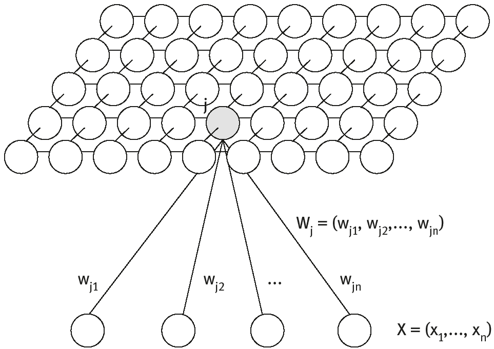

图 5.3: Kohonen 自组织网络模型

神经网络自组织的依据是观察到的规律性，即由于在网络的各个局部分段中独立进行的自组织操作，使得网络的全局排序成为可能。根据给定的信号，神经元被激活。最后，网络（或某组）中有一个神经元变为激活状态。赢得竞争的输出神经元被称为胜利神经元。

在竞争过程中，神经元由于突触权重值的变化，被选择性地调整到不同的输入向量或输入向量类。在学习过程中，权重值有增加的趋势，由此产生了一种奇特的正反馈：更强的激励脉冲——更高的权重值——更强的神经活性。

在这种情况下，神经元自然地分层为不同的组；单个神经元或其组之间相互协作，并响应由特定训练向量产生的激发而被激活，通过其活性抑制其他神经元。可以讨论组内神经元之间的协作，以及组内及组间神经元之间的竞争。

在自组织机制中，主要有两类：基于关联 `Hebb` 规则的自组织，以及基于广义 `Kohonen` 规则的神经元竞争机制。从今起，我们将考虑神经元竞争机制。

自组织网络的形成始于网络突触权重的初始化。通常，突触权重被赋予由随机数生成器产生的小值。在初始化期间，网络最初没有输入向量的符号顺序。网络初始化后，执行以下三个基本过程：

1. **竞争**：对于每个输入向量，网络神经元计算判别函数的相对值；
2. **协作**：胜利神经元确定一组神经元的拓扑邻域，为它们之间的协作提供基础；
3. **突触适应**：对被激神经元的突触权重进行修正，允许我们增加它们相对于输入向量的判别函数特征值。修正的这种方式使得在后续应用相似输入向量时，胜利神经元的输出信号会增加。

因此，`SOM` 训练程序的基础是神经元之间基于响应输入信号的激活值的竞争。

假设输入和突触权重已预归一化，并使用欧几里得量作为距离：

$$
d(x, w_i) = \|x - w_i\| = \sqrt{\sum_{j=1}^{N}(x - w_{ij})^2} \tag{5.8}
$$

那么，使用欧几里得量将空间划分为神经元主导区域等同于将其分裂为 `Voronoi` 区域。如果我们使用另一种量将空间划分为神经元主导区域，则形成了另一种神经元影响区域。

对于归一化的输入向量，趋向它们的权重向量自动归一化的。应该注意到，当权重向量归一化时，欧几里得量和标积是等价的，因为：

$$
\|x - w[i]\|^2 = \|x\|^2 + \|w[i]\|^2 - 2x^T w[i] \tag{5.9}
$$

因此，

$$
\min \|x - w[i]\|^2 = \max x^T w[i] = \text{const}
$$

胜利神经元根据与输入输入的最小距离确定：

$$
D(x(k), w_j(k)) = \min_j \|x(k) - w_j(k)\|^2
$$

或者对于标准化向量等同于：

$$
D(x(k), w_j(k)) = \max_j x^T(k) w_j(k) = \max_j \cos(x(k), w_j(k)) \tag{5.12}
$$

显然

$$
-1 \le \cos(x(k), w_j(k)) \le 1 \quad \text{且} \quad 0 \le \|x(k) - w_j(k)\|^2 \le 4 \tag{5.13}
$$

在胜利神经元周围形成了一个能量随时间减少的拓扑邻域 `Sw(t)`。胜利神经元及其邻域内的所有神经元都受到适应，期间它们的权重向量根据 `Kohonen` 规则向向量 `x` 方向改变：

$$
w_i = w_i + \eta_i(x - w_i) \tag{5.14}
$$

对于 $i \in Sw(t)$，其中 $\eta_i$ 是 $i$ 神经元在 $t$ 时对邻域 `Sw(t)` 的训练系数。

$\eta_i$ 随神经元之间距离的增加而减小。

`Sw(t)` 之外的神经元权重不改变。邻域的大小和神经元的训练系数是随时间减少的函数。证明了根据 `Kohonen` 规则进行适应等同于基于最小化目标函数的梯度训练法：

$$
E(w) = \frac{1}{2} \sum_i S_i(x(t)) [x_j(t) - w_{ij}(t)]^2 \tag{5.15}
$$

其中 `Si(x(t))` 是邻域定义的函数，该定义在学习过程中会变化。

在输入两个不同的向量 `x1` 和 `x2` 后，会激活两个网络神经元，其权重与对应向量的坐标最为接近。这些权重标记为 `w1` 和 `w2`，可以在空间中显示为两个点。向量 `x1` 和 `x2` 的近似会导致向量 `w1` 和 `w2` 的布局发生相应变化。

在极限情况下，等式 `w1 = w2` 成立，当且仅当 `x1` 和 `x2` 重合或在实践上相互不可区分。满足这些条件的网络被称为拓扑图（topographic map）或柯霍南映射（`Kohonen map`）。

注意，获胜神经元的突触权重调整也可以发生在其他算法中：根据 `WTA` 规则或使用改进的学习算法，可以获得比 `WTA` 算法更好的结果，例如，意识 `WTA` (`CWTA`)、`WTM` 或时间自适应自组织映射 (`TASOM`) [1]。

这些 `SOM` 算法的共同缺点是存在启发式参数，解决“死”神经元问题的方法增加了训练时间，且无法分离重叠的类。当网络权重被随机初始化时，某些神经元可能处于没有数据或数据极少的空间区域。这些神经元获胜并调整其比例的几率很小，因此它们保持“死”状态。因此，输入数据将由较少的神经元进行解释，数据解释的误差将会增加。因此，一个重要问题是激活网络中的所有神经元，如果训练算法能够计算每个神经元的获胜次数，并组织训练过程使得不活跃的神经元也有获胜的机会，就可以实现。

## 第二阶段：附加术语和限制

我们要求在以下条件下能够实现神经模糊网络的所需的自组织：

1. 神经元的高程度自组织性；
2. 能够选择性地控制神经元之间的个体连接，以解决“死”神经元问题；
3. 算法的高灵活性、实现简单性和时间效率性；
4. 在类重叠的情况下提高网络的划分属性，并输出信号对每个类的隶属度。

## 第三阶段：Kohonen FCNNs 的架构

为了确保这些条件，考虑了细胞神经网络 (`CNNs`)；它们由 `Chua` 和 `Yang` 引入 [24, 25] 并被有效用于图像处理的计算模型。在 [23] 中，证明了通过细胞自动机 (`CA`) 学习柯霍南神经网络，这可以显著提高学习质量和速度；然而，这并没有解决类重叠情况下网络划分的问题。

我们提出了一种柯霍南神经网络的模糊细胞架构 (`FCNN-SOM`)，它包含三层（图 5.4）：

1. 输入层（受体层）；
2. 具有侧连接的柯霍南神经元层，通过 `CA` 训练以识别重叠类的质心；
3. 模糊聚类的额外（输出）层，用于计算当前向量在每个类中的隶属度。


图 5.4：FCNN-SOM 架构

考虑 `FCNN-SOM` 的工作

## 第四阶段：Kohonen FCNNs 的学习算法

源数据由 `N` 个符号向量 `x(k)` 组成，学习的目标是将样本数据划分为 `m` 个类，`k = 1, ...`。

### 第 1 步：数据预处理

输入数据进行中心化和标准化，使得所有观测值属于[13_chapter05_3.xhtml#chapter05_3]$n$。根据以下公式重新定义向量分量：

$$
x_{i,\text{new}} = \frac{x_i}{\sqrt{\sum_{i=1}^{N} x_i^2}} \tag{16}
$$

中心化可以通过两种方式进行：

1. 相对于平均值，使用公式计算：
   $$
   m_i(k) = m_i(k - 1) + \frac{1}{k}(x_i - m_i(k)) \tag{17}
   $$
2. 相对于中位数以对异常观测值具有鲁棒性：
   $$
   m_e(k) = m_e(k-1) + \eta_m(x(k) - m_e(k)) \tag{18}
   $$

其中 `eta_m` 是根据 [26] 条件选择的参数。

### 第 2 步：状态初始化

网络初始状态的初始化是自适应部署 [23]，并包括不活跃神经元的提取。

### 第 3 步：通过细胞自动机训练柯霍南层

`CA` 细胞是柯霍南层的神经元，在 `Moore` 环境中与八个（边界处为三个）相邻神经元连接的二维自组织映射（图 5.5）。

因此，`CA` 是相互作用的神经元集合。`CA` 细胞的状态由一个多维向量给出，其分量为相应神经元在样本空间中的坐标。根据“最近邻”原则，网络神经元是 `Voronoi` 多维邻的中心，像马赛克一样共享整个样本空间。

柯霍南映射中的任何 `k` 元神经元可以在 `epoch` 迭代过程中改变其多维状态：

1. 神经元成为获胜者；
2. 神经元是另一个获胜神经元的邻居。那么在一个 `epoch` 内，`Moore` 环境下 `k` 元神经元第 `i` 个分量的平均总增量为

$$
\Delta w_{ki} = \eta \frac{\sum_m \sum_{j=1}^{n_m} (x_{mi}^{(1)} - w_{ki})}{\sum_{m=k}^{k+8} n_m} \tag{19}
$$

| 符号 | 说明 |
| :--- | :--- |
| `n_m` | 是第 `k` 个神经元环境的神经元数量； |
| `L` | 是矩形 `Kohonen SOM` 的宽度； |
| `n_m` | 是落在第 `m` 个神经元维罗诺邻域（`Voronoi neighbourhood`）内的训练样本数； |
| `x_{mi}^{(j)}` | 是第 `m` 个神经元维罗诺邻域第 `j` 个训练样本的第 `i` 个坐标； |
| `w_{ki}` | 是第 `k` 个神经元的第 `i` 个坐标。 |

使用符号 $S = \sum_{m=k}^{k+8} n_m$，则公式 (5.19) 可以写为：

$$
\Delta w_{ki} = \eta \frac{1}{S} \sum_m n_m (\overline{x}_{mi} - w_{ki}) \tag{5.20}
$$

其中 `x_{mi}` 是第 `m` 个神经元维罗诺邻域重心的第 `i` 个坐标。

公式 (5.20) 显示，在每个学习周期（`epoch`）中，第 `k` 个神经元都会向 $\eta$ 的相对值偏移，该方向为第 `k` 个获胜神经元及其最近邻居的维罗诺邻域积分而成的训练样本空间重心方向。特别，当 $\eta = 1$ 时，神经元移动到组合区域的重心 [23]。

### 步骤 4（新增）：当 Kohonen 层中的侧向连接功率禁用时，使用 Bezdek 模糊聚类算法代替 WTA 算法进行网络训练

在已知模糊聚类算法中，我们注意到从数学角度来看最合理的是基于目标函数的方法 [16]，该方法在某些假设下解决了优化问题，例如基于最小化以下准则（目标函数）的概率算法：

$$
E(u_j, w_j) = \sum_{k=1}^{N} \sum_{j=1}^{m} u_j^\beta(k) \|x(k) - w_j\|^2 \tag{5.21}
$$

满足条件：

$$
\sum_{j=1}^{m} u_j(k) = 1, \quad \sum_{k=1}^{N} u_j(k) \le N, \quad u_j(k) \in [0,1] \tag{5.22}
$$

其中：

| 符号 | 说明 |
| :--- | :--- |
| $\beta \ge 0$ | 是模糊化参数（模糊化因子），它决定了类之间边界的模糊度，$k = 1, ..., N$； |
| `u_j(k)` | 第 `k` 个特征向量在第 `j` 个类中的隶属度（$j = 1, ..., m$）。 |

聚类的结果是一个 $(N \times m)$ 矩阵 $U = \{u_j(k)\}$，称为模糊划分矩阵。矩阵 $U$ 的元素可以视为向量在特定类中隶属假设的概率。代入拉格朗日目标函数：

$$
L(u_j(k), w_j, \lambda(k)) = \sum_{k=1}^{N} \sum_{j=1}^{m} u_j^\beta(k) \|x(k) - w_j\|^2 + \sum_{k=1}^{N} \lambda(k) \left( \sum_{j=1}^{m} u_j(k) - 1 \right) \tag{5.23}
$$

其中 `lambda(k)` 是未定乘子，并通过求解 `Karush-Kun-Tucker` (`KKT`) 方程组：

$$
\begin{cases}
\frac{\partial L(u_j(k), w_j, \lambda(k))}{\partial u_j(k)} = 0 \\
\nabla_{w_j} L(u_j(k), w_j, \lambda(k)) = 0 \\
\frac{\partial L(u_j(k), w_j, \lambda(k))}{\partial \lambda(k)} = 0
\end{cases} \tag{5.24}
$$

我们得到如下形式的解：

$$
\begin{cases}
u_j(k) = \frac{(\|x(k) - w_j\|^2)^{\frac{1}{1-\beta}}}{\sum_{l=1}^{m} (\|x(k) - w_l\|^2)^{\frac{1}{1-\beta}}} \\
w_j = \frac{\sum_{k=1}^{N} u_j^\beta(k) x(k)}{\sum_{k=1}^{N} u_j^\beta(k)} \\
\lambda(k) = -\left( \sum_{l=1}^{m} \beta \|x(k) - w_j\|^2 \right)^{\frac{1}{1-\beta}}^{\frac{1}{1-\beta}}
\end{cases} \tag{5.25}
$$

当 $\beta \to 1$ 时，该公式与硬聚类算法 (`HKM`) 一致；当 $\beta = 2$ 时，与 `Bezdek` 模糊 `C` 类算法 (`FCM`) [27] 一致：

$$
u_j(k) = \frac{\|x(k) - w_j\|^2}{\sum_{l=1}^{m} \|x(k) - w_l\|^2}, \quad w_j = \frac{\sum_{k=1}^{N} u_j^2(k) x(k)}{\sum_{k=1}^{N} u_j^2(k)} \tag{5.26}
$$

我们重写公式 (5.26) 为：

$$
u_j(k) = \frac{1}{1 + \|x(k) - w_j\|^2 \sum_{l \neq j, l=1}^{m} \|x(k) - w_l\|^{-2}} = \frac{1}{1 + \frac{\|x(k) - w_j\|^2}{\sigma_j^2(k)}} \tag{5.27}
$$

我们得到了指定以 `w_j(k)` 为中心的钟形隶属函数的表达式，其中：

$$
0 \le \sigma_j^2 = \frac{1}{\sum_{l \neq j, l=1}^{m} \|x(k) - w_l\|^{-2}} \le \frac{4}{m-1} \tag{5.28}
$$

其中 $m$ 是类的数量。

这种隶属函数的特点是光滑、对称且表达式简单，它是描述模糊集合最常用的函数（见图 5.6）。


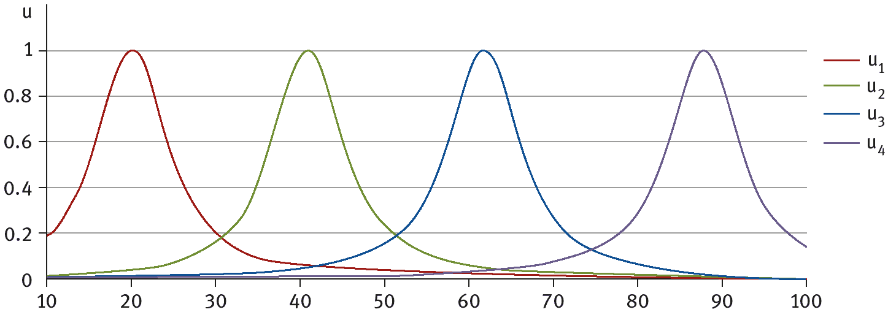

图 5.6：钟形隶属函数曲线

因此，所提方法不仅计算了中心和宽度参数，而且与 [29, 30] 不同，自动解决了用于数据模糊化的隶属函数类型问题。假设待聚类的整个样本是预定义的，且在处理过程中不会改变。

## 5.5 通用深度神经分类器模型的开发

结合 `FCNN-SOM` 和 `RBFN` 的通用深度神经分类器架构见图 5.7。

该模型对应于 `Pospelov` 分类 `+1]`，其基于两种知识表示形式：外延表示（泛化图像簇的形成）和内涵表示（在选定的类别簇中识别整体特征）。

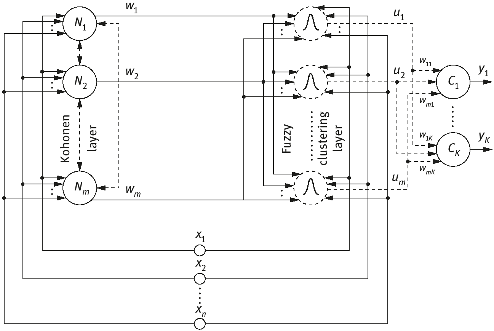

图 5.7: 广义深度神经模糊分类器的架构 (FCNN-SOM-RBFN)

## 5.6 实验结果与讨论

实验研究针对著名的鸢尾花分类示例（费希尔问题）分阶段进行，该鸢尾花有三类：山鸢尾（第 1 类）、变色鸢尾（第 2 类）和海鸢尾（第 3 类）。对于每朵鸢尾花测量了四个独立参数：花萼的长度和宽度以及花瓣的长度和宽度。

### 第一步：归一化四维训练样本数据

归一化四维训练样本数据包含 50 份第 1、2、3 类鸢尾花样本，其中第 1 类样本与第 2、3 类样本呈线性可分。

### 第二步：神经元的初始坐标

在初始化网络时设置的神经元初始坐标：

```
Neuron 0 – (−0.55, 0.08, −0.78, −0.83);
Neuron 3 – (0.20, −0.30, 0.20, 0.5);
Neuron 15 – (0.15, −0.30, 0.50, 0.68);
```

其他神经元被放置在初始条件的超球面上，坐标为 (0, 0, 9.33, 3.60)。注意，神经元 0、3 和 15 的坐标分别与第 1、2、3 类训练样本中的某一个样本坐标重合，这对于部署阶段网络中所有神经元的成功激活是必要的。

### 第三步：Kohonen 映射训练

Kohonen 映射通过三个连接的细胞元胞（CA）`图 5.8` 进行训练，其参数如下：

- 运行次数 – 30；
- 网络部署迭代次数 – 5；
- 交互迭代次数 – 25。

利用 Kohonen 细胞神经网络 (`CNN-SOM`) 对鸢尾花聚类的结果所示 `表 5.1`。

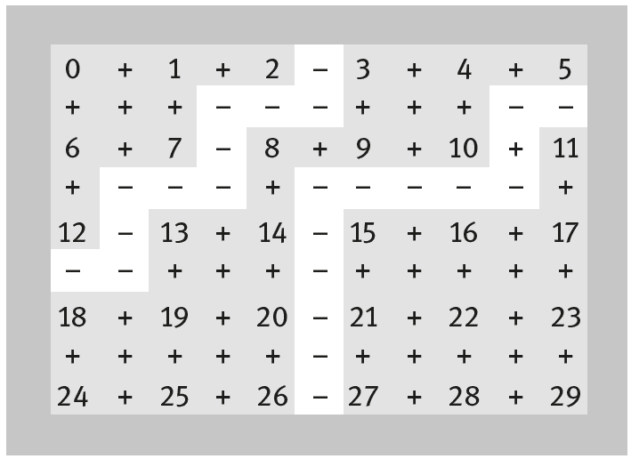

图 5.8: 三个连接学习 CA 的结构

表 5.1：将神经元分为簇

| 簇 | 簇中的神经元 |
| --- | --- |
| 1 | 0, 1, 2, 6, 7, 12 |
| 2 | 3, 4, 5, 10, 18, 19, 20, 24, 26 |
| 3 | 11, 15, 16, 17, 21, 22, 23, 27, 28, 29 |
| 4 | 8, 9, 13, 14, 25 |

由位于线性不可分簇 2 和 3 边界之间的网络神经元形成了一个额外的簇 2/3。为了更准确地分离簇 2 和 3，进行了额外的模糊聚类阶段（第四步）。

### 第四步：侧连接与模糊聚类

禁用 Kohonen 层的侧连接，并将上一阶段计算的质心 `wj(k)` 应用于隶属度层。通过 Bezdek 模糊聚类算法对额外训练，参数如下：

- 簇数量 – 3；
- 最大迭代次数 – 100；
- 单次迭代目标函数的改进最小值 – 0.000001。

鸢尾花数据的初始分类及 `FCNN-SOM` 模糊聚类结果的图示所示 `图 5.9`。

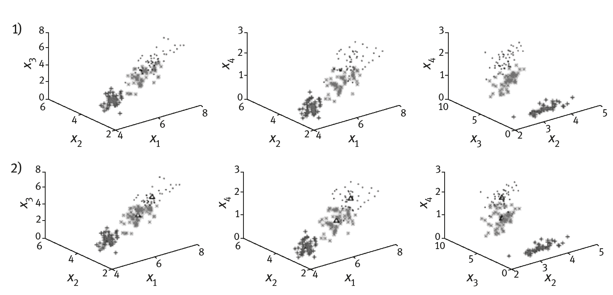

图 5.9: 鸢尾花数据的初始分类及 FCNN-SOM 模糊聚类结果

`FCNN-SOM` 的模糊聚类结果所示 `表 5.2`。

## 5.7 建模实际结果

在本节中，我们描述了针对全球技术与经济发展（TED）的多标准神经模糊网络分析方法，该方法涉及了一系列定量和定性指标，这些指标描述了现代技术秩序，并探讨了向第六次技术秩序转型的技术和社会测量问题。我们使用了一种新型混合架构 `FCNN-SOM` 来对重叠簇进行模糊分离。改进后的全球 TED 轨迹神经模糊网络模型，其特点是了一种简单且有效的策略来提高聚类的准确性和可解释性，能够评估 TED 水平以及单个国家的 TED 特征，并预测多维过程的未来值，该模型基于此构建。

这一研究课题的现实性，是因为经济动力学中的长期波动问题以及这些过程的全球建模方法，在 20 世纪俄罗斯和外国科学家的全球研究中具有核心地位，并特别引起了处于第五次技术秩序向第六次技术秩序过渡时期的现代科学家的关注。在过去的十年中，基于从 `N. D. Kondratiev` 和 `J. Schumpeter` 工作中涌出的科学学派，一种新的经济科学范式已经形成，其代表人物已汇入到名为 `GLOBELIX` 的国际研究网络。

### 周期性与发展

周期性是各国经济和世界经济作为一个单一整体运动的普遍形式。它表现了各国经济中各种要素运行的不平衡性、其发展过程中革命性阶段与演化性阶段的交替以及经济进步。最后，周期性是经济动力学最重要的因素，是宏观经济平衡的决定因素之一。由于周期各个组成部分之间的趋势复杂且相互交织，往往很难区分出单个周期。周期性最显著的特征——运动，并非以圆形发生，而是以螺旋形式发生。因此，周期性是一种进步性的发展形式。每个周期都有自己的阶段和持续时间。各阶段的特征在特定指标上是独特的。它们在历史和区域两个方面都具有原创性。

### 市场经济与 TED

许多国家市场经济的出现以及它们被纳入全球经济空间，消灭了克服周期性动力学趋势的神话，并要求采用新的跨学科知识方法，来对 `N. D. Kondratieff` 引入的大周期景气波（经济动力学长波） `[31]` 进行回溯性分析和预测。由于各国经济中存在多种改变经济周期进程的因素作用，以及缺乏足够可靠和长期的序列数据，这一任务变得更加复杂。由于其独特特征，每个国家经济都有其未来燃料和能源资源的理性轨迹。其规划（只能以近似情景的形式进行）应基于考虑到上述国家特征的全球 `TED` 趋势。其中最重要的是一个国家在国际 `TED` 等级体系中的地位。为了进行这种评估，领先燃料-能量轨迹模型是有意义的，它建立了一个所有国家通用的参考系和尺度，并作为衡量各国技术发展水平的基础。

因此，我们认为，对一个国家经济的技术发展及其在世界技术经济发展中的地位进行正确评估，与提出一种恰当的方法来衡量相对于领先轨迹的 `TED` 水平和和速率有关。

### 长波与技术秩序

由于社会资本的生产模式，市场经济中技术秩序的生命周期反映在经济景气长波（`LW`）的特定形式中。所谓的长波或“康德拉季夫波”（`Kondratieff waves`），是经济研究一个特殊方向的对象——社会生产长期过程的分析。在现代时期划分中，有五个长波（图 5.10）。

在对长波的实证研究中，已经建立了不同国家发生技术变革的基本单一性、各国 `TED` 轨迹的相似性，以及宏观经济波动与技术变革同步的趋势。

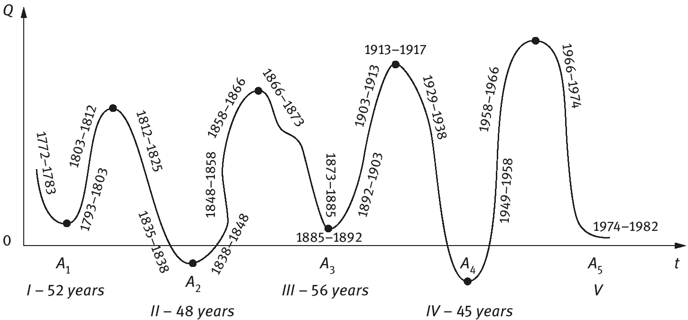

图 5.10: 康德拉季夫长波的现代划分

特别是，在具有市场经济和指令性管理经济的国家，燃料能源资源轨迹的相同形状在能源消耗结构、冶金和采矿业、交通基础设施动态以及经济其他部门中均被识别。能源资源的单向性以及世界经济单一节奏的形成，归功于工业革命以来国际经济联系的快速扩张。宏观研究的经验不仅说明了可能性，也说明了通过跨国比较获得准确结论的价值。许多研究者注意到，构成技术秩序生命周期的技术转变发生在全球范围内，领先国家的经济结构最充分地反映了相应的 `TO` `[32]`。技术秩序是具有同步技术水平的相关产业集合。经济的变化决定了科学技术进步的不平衡性 `[32]`。`TED` 的动态反映了这些技术秩序的演变。

### 历史背景

存在几种类型的经济周期，被称为波。由于指标的多样性它们之间边界的模糊，很难区分。所谓的长波（周期）长度为 40-60 年。长波理论的发展始于 1847 年，当时英国人 `H. Clark` 注意到 1793 年和 1847 年危机之间有 54 年的差距。他认为这种差距是客观决定的而非偶然。他的同胞 `V. Jevons` 为长波理论的发展做出了重大贡献，他首次绘制了价格波动统计来解释一种科学界的新现象。

`K. Marx` 对周期性理论做出了重大贡献。他关注短波的研究，这在经济文献中被称为周期性周期或过剩危机。根据马克思，每个周期包括四个阶段：危机、萧条、复苏和恢复，这与周期性理论完全一致 `[31]`。

长期波动的提到可以在 `M. Tugan–Baranovsky` 的研究中找到。周期性理论反映在俄罗斯科学家 `A. Gelfand` 的作品中。对材料的原始统计处理包含荷兰科学家 `J. Gelderen` 和 `S. Wolf` 的作品。他们研究的独特性在于考虑了技术进步作为周期性的因素。

对经济发展周期性的理解在 19 世纪末和 20 世纪初变得尤为广泛，当时许多国家的科学家开始关注某些经济指标的动态变化。这为经济周期理论的分类提供了依据，这些理论在 `W.Mitchell` 的著作 `Economic cycles` 中得到了最充分的阐述。这位美国经济学家将经济周期理论区分为以下几类：

1. 将经济周期归结为自然物理过程的理论。这些理论通过太阳辐射周期、`Venus` 相对于 `Earth` 的位置变化以及气象条件，解释了经济生活的周期性。

2. 将经济周期归结为心理原因的理论，这些心理因素为经济活动创造了有利或不利的环境。根据一些经济学家的观点，大众情绪的波动先于批发价格的波动，并影响经济领域的决策制定。这些理论的基础是公共生活中观察到的一个事实，即社会中动机结构、人口创造性活动以及社会情绪的变化具有周期性。社会心理变量的周期性变化（涵盖人口的“活跃程度”、其进取精神、“乐观前景”以及人们其他个人和社会心理诉求）决定了经济发展的长期周期。

3. 将经济周期归结为制度过程的理论。从这些理论的角度来看，周期性的本质在于经济周期源于经济制度的变化。经济发展周期性形成产生最大影响的是现有经济制度的功能。

4. 其他理论基于一种主张：周期的产生是因为商品总生产与消费过程的不平衡。有利的贸易和工业条件导致工业设备数量快速增长，随后导致产量增加，最终导致消费品边际价格下降。其后果是导致衰退，在衰退期间，工业设备和产品的增长被中断。最后，消费品的边际价格再次上涨，一个新的复苏期开始。

经济周期概念最深远的发展主要与国家经济学家 `N. D. Kondratieff` [31] 的著作有关。他对经济中长周期的运行机制（在其术语中称为“大景气周期”）提出了假设，将其不仅与价格动态联系起来，还与资本积累过程、生产增长率、创新动态以及国民经济的持续演变联系。根据 `Kondratieff` 的观点，长期波动的运动遵循以下原则：在一个大周期开始之前，会积累足够的自由资金——银行准备金的增长，这允许债权人降低利率。长期贷款的比例较低。在上一个衰退时期，积累了大量的技术创新（发明）。在这种情况下，对大型设施的资本投资开始增加，导致生产条件发生剧烈变化（产生了获取利润的技术机会），同时生产变得有利可图，随后经济景气大周期出现上升趋势。

### 长波的主要现代理论：

1. 创新理论 (`J. Schumpeter`）。该理论的本质是存在想要获得创业利润的人。他们投资于新技术和新行业；随后追随者也随之而来。这是一个复苏期。随着时间推移，市场饱和，利润减少，人们……

2. 部门过剩积累理论 (`D. Forrester`）。该理论的本质是存在想要获得创业利润的人。他们投资于新技术和新行业；随后追随者也随之而来。这是一个复苏期。随着时间推移，市场饱和，利润减少，人们……

3. 与劳动相关的理论 (`K. Freeman`）。该理论的本质是存在想要获得创业利润的人。他们投资于新技术和新行业；随后追随者也随之而来。这是一个复苏期。随着时间推移，市场饱和，利润减少，人们……

4. 价格理论 (`W.W. Rostow`)）。该理论的本质是存在想要获得创业利润的人。他们投资于新技术和新行业；随后追随者也随之而来。这是一个复苏期。随着时间推移，市场饱和，利润减少，人们……

在周期的结构中，活动的高低点以及衰退和增长阶段位于它们之间。总周期时间通过两个高点或两个低点之间的时间来衡量。因此，衰退持续持续是最高点和最低点之间的时间，而上升期则相反。美国国家研究局指出，在 1854 年至 1991 年美国经济的发展过程中共有 31 个周期。两个最高点之间的平均时间为 53 个月，其中 18 个月为衰退期，35 个月为增长期。

更详细的分析将经济周期分为四个阶段（图 5.11）。

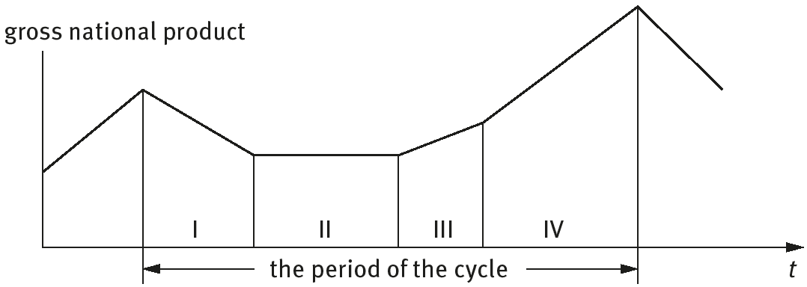

图 5.11: 康拉铁耶夫长波的现代划分法

#### 第一阶段：危机阶段（衰退）

危机的主要表现是生产量的下降和国民总产规模的减少。因此，企业的生产能力没有得到充分利用，利润率下降、股价下跌、就业人数下降、工资下降、生活水平下降以及贫困增加。结果是总需求减少，作为回应，生产和供应随之下降。通常情况下，这一阶段的特征是总供给过剩或总需求不足。为了确保宏观经济平衡，有必要减少生产。

随着时间的推移，危机可能持续几个月到几年，正如 1929 年至 1933 年大危机发生的那样。

#### 第二阶段：萧条阶段

这一阶段的特征是，在大商品股票危机期间的清算之后，生产下降停止了，但尚未出现增长。因此，就业水平处于低位，但失业率已经触底（尽管仍处于低位），企业的工资和利润已趋于稳定，商业活动并不活跃。萧条时期可能持续几个月到几年不等。例如，始于 1933 年大危机之后的大萧条一直持续到 1938 年，也就是说实际上一直持续到战争爆发。

### 第三阶段：复苏阶段

该阶段的名称自言易喻。其特征是经济复苏，出现了一定的国内生产总值增长，对劳动力和贷款资金的需求日益增加。最重要的是企业的投资活动得到加强。通常这一阶段持续时间不长，会迅速进入下一个阶段。

### 第四阶段：上行阶段

这一阶段也被称为繁荣，因为其特征是经济增长相当迅速。就业人数增加，失业率回落，某些行业可能会出现劳动力短缺。工资正在上涨，总需求在增长，销量在增长，企业利润在增加。人口和企业拥有闲钱，它们在货币市场上的供应量增加，因此利率不会上升，有时还会开始下降。信贷变得相对廉价。许多企业的股价都有增长趋势。

经济周期理论的问题导致了使用微分方程的复杂动态模型的应用[33]。

为了描述经济状况，使用了多种经济指标（国内生产总值、失业率、个人收入、工业产值、价格水平等）。根据经济参数值在周期内的变化情况，可以将它们分为顺周期性、反周期性和非周期性。顺周期性参数在增长时期增加，在衰退时期减少（例如：产能利用率、货币供应总量、一般物价水平和企业利润）。

反周期性参数是指其值在衰退期下降、在增长期随之下降的指标（例如：失业率、破产数量和产成品库存）。

非周期性参数是指动态变化与经济周期阶段不重合的指标（例如：出口量）。

根据美国经济研究局的分类，根据同步性分为三类参数：领先型、滞后型和同步型。领先型参数在接近峰值或最低点之前达到最大值或最小值（这些是库存、货币供应量等的变化）。滞后型参数在峰值或低点之后达到最大值或最小值（失业人数、特定工资成本等）。同步型参数的变化随经济活动的波动而变化（国内生产总值、通货膨胀、工业生产等）。

目前，统计学家和经济学家无法对经济状况给出准确预测，只能确定其总体趋势。首先，很难考虑到所有因素，特别是在经济不稳定和政治动荡时期。其次，国际环境对国家经济有重大影响。第三，即使正确确定了趋势，也难以预测达到各阶段的确切日期并及时调整经济政策。最后，企业家的行为可能会加剧景气中不利的偏差。

### TED（技术-经济发展）的技术与社会维度

在对 TED 进行比较分析结果之前，应区分两个因素。一方面，国家的物体和领土无论其规模和在整体经济发展中的角色如何，都不是自自足的经济实体；此外，尽管存在内部趋势和相互关系，国家不能仅根据自身的动态和比例来规划发展。另一方面，尽管通过国际分工联合的国家沿着技术和经济演进的总体路线发展，但在 TED 指标的绝对水平上（以相对单位衡量——人均或国民收入单位），它们存在显著差异，即使它们处于相同的 TED 水平。这可以通过每个国家的历史、科学、教育、文化、心理、自然气候和其他特征来解释，这些特征反映在它的经济结构中[33]。因此，为了在所研究的参数中构建合适的燃料-能量轨迹模型，我们引入了一个定性增长要素——初级生产率指数，其衡量方法为国内生产总值与经济消耗的原材料价值之比[33]。原材料是一类初级有机和无机资源，它们被大量用于普通人口的消费以及材料生产的进一步加工（食品、建筑材料、燃料和能源资源）。

尽管领先国家的主要资源能源和材料利用强度最低，但其人均消耗的原材料仍是俄罗斯、巴西、印度和中国等欠发达国家的 1.5 到 2.5 倍。

作为资源利用效率指标的生产率反映了科学技术的进步。即使在衰退时期（1991-1998 年），俄罗斯也经历着产品和服务质量的改进过程（见图 512）。

这体现在初级资源生产率平均增长了 2.3%。考虑到在此期间美国质量增长的动态大幅下降（与过去 30 年平均每年 2.3%相比下降至每年 0.95%），俄罗斯的交换比例改善指数为 1.016。

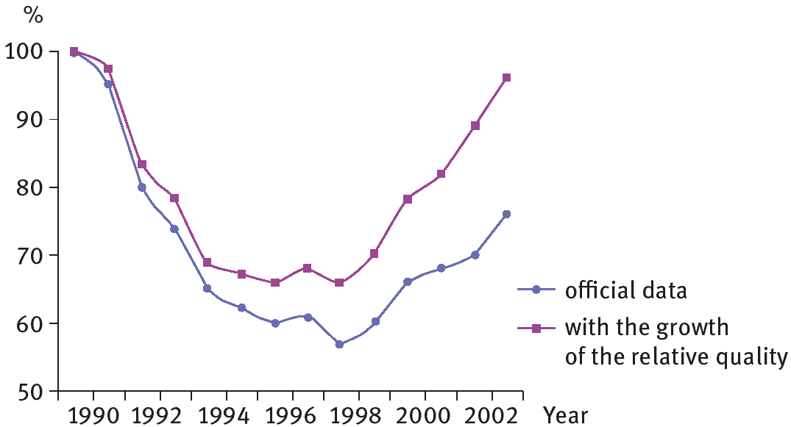

图 512：1990-2003 年国内生产总值的动态（1990 年水平）

自 1998 年以来，在复苏时期，俄罗斯质量增长的动态增加到接近每年 4%。然而，由于美国同样的质量增长要素在此期间也增加（达到每年 2.4%），交换比例指数的变化微乎其微——变为 1.017。

因此，如果俄罗斯的初级资源生产率指数（科学技术）增长得，俄罗斯和美国之间的经济发展差距就可以完全克服。在模拟 TED 轨迹时，需要考虑到创新揭示并定义了当前阶段技术过程的本质。选定的 TED 定性和定性指标由国家创新潜力指标所补充，这些指标分为四组：

1. 表征创新潜力财务组成部分的指标（例如：投资占国内生产总值的比例、投资占其总额的比例）。

2. 表征创新领域物质组成部分的指标（与科学活动相关的组织数量、其固定资产的价值、科学组织的相对占比）。


### 3. 表征创新潜力人员组成部分的指标

与创新相关的工人数量、其平均薪资、平均年龄、相对占比。

### 4. 表征创新潜力结果组成部分的指标

该部分作为经济增长的因素并显示其产生效应的能力：销售额、与创新相关的成本和利润、创造、出口和进口的技术数量、已申请专利数和授予专利数、其相对占比。

## 世界技术经济肖像的神经模糊模型

作为一种 TED 轨迹，对多维时间序列进行建模，它是由若干一维时间序列组成的集合，其中每个序列描述了研究对象的列出特征中任一特征随时间的变化（图 5.13）。

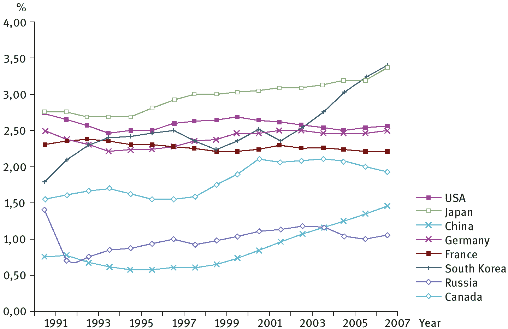

图 5.13：不同国家的一维时间序列（指标——国内生产总值中研发支出百分比动态）

对于每个年份 `t`，特定国家由定量和定性特征多维空间中的一个点来表示。我们认为，用于描述 TED 轨迹的数据统计处理不能被认为是执行弱结构化任务的可靠且充分的工具。它无法让你建立整个预测系统参数的因果关系。此外，通过输入空间的线性收缩和跨国比较分析，为每个国家构建其广义 TED 曲线并非完全错误，这是因为：首先，TED 具有“流体”的非平衡性质，伴随着波落和起飞的波浪（康德拉基夫波）；其次，非常重要的一点是，我们认为用于构建轨迹的输入参数不应被硬性规定——它们既取决于每个国家的核算体系，也取决于观测时该国的历史、文化心理、自然气候和其他特征，而相同参数对于不同技术结构和周期阶段的构建而言，其意义将各不相同。

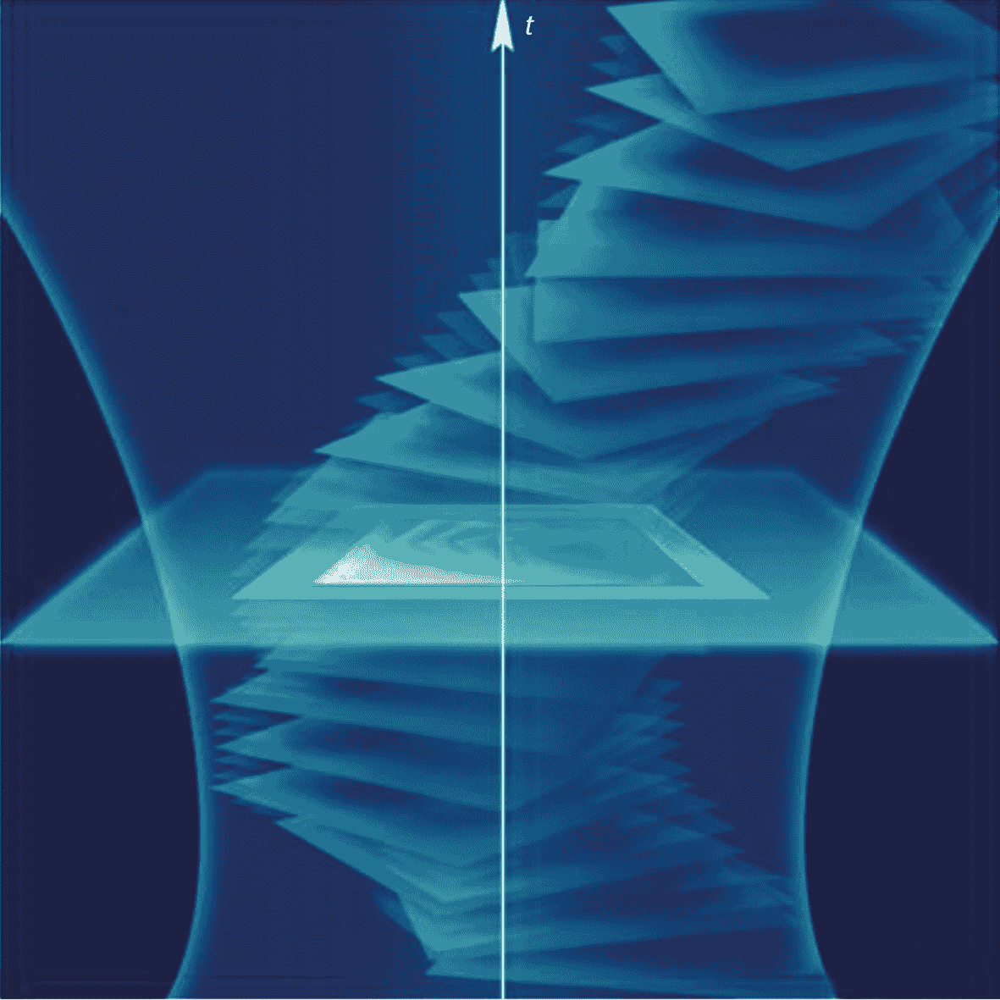

图 5.14：作为多维特征中 Kohonen SOM 时间序列的 TED 轨迹模型

为了提高建模质量（33），我们提出了对定量和定性指标进行复杂的神经网络分析，在训练过程中，这些指标根据解决给定问题的性水平通过权重系数进行排序。根据可用数据，构建了 Kohonen 自组织映射（`SOMs`）时间序列，反映了全球 TED 的动态（图 5.14）。该模型使得简化多维结构成为可能；它可以被视为将多维空间投影到低维空间的方法之一。

图 5.15 显示了反映 2010 年国家当前层级的世界技术经济肖像神经网络模型。每个国家根据当年的 TED 水平由地图上的特定单元格表示。相同坐标的单元格包含相似 TED 状态的国家。地图上国家坐标越远，它们的技术经济肖像之间的差异就越大。

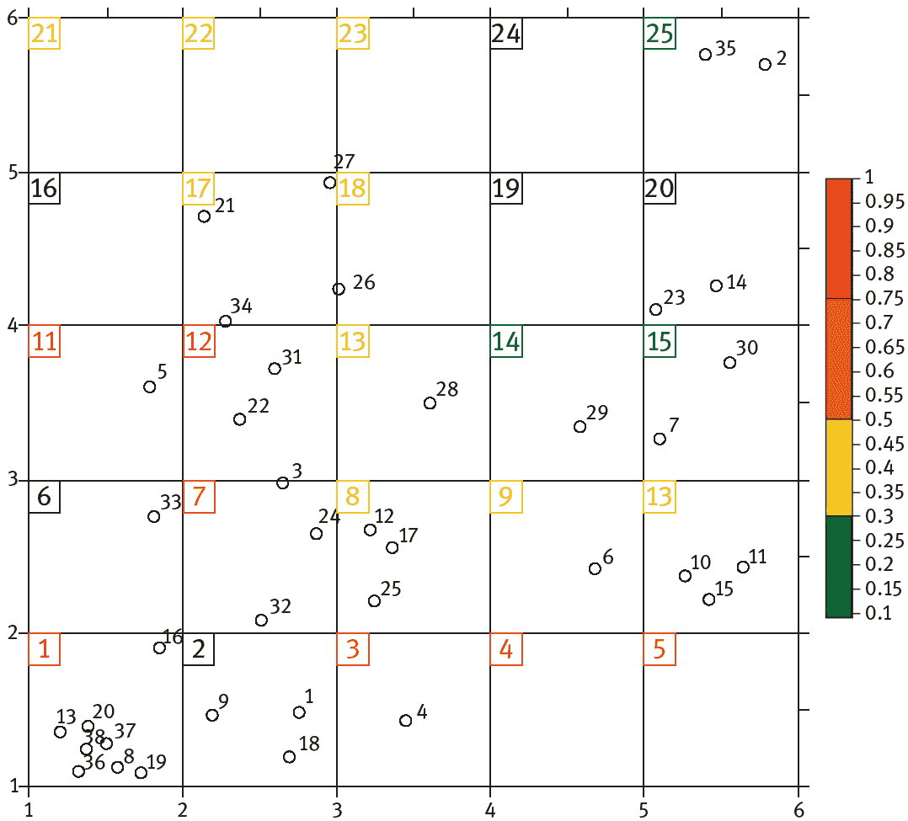

图 5.15：2010 年世界技术经济肖像的 SOM 模型

根据数据结果，识别出与参考值具有相似 TED 水平的国家聚类（表 5.4）。因此，位于边界不可区分的聚类之间的神经元形成了额外的聚类。为了更准确地划分聚类，我们使用了神经模糊聚类（图 5.16）。

每个 `i` 年的国家由一组参数表征：

- `Yi`：`i` 年的燃料和能源水平；
- `Ai`：`i` 年相对于基准水平的实际距离；
- `Bi`：该国家从 `i` 年达到参考水平所需的预期年数；
- `Ci`：该国家进入参考轨迹所需的条件距离。

表 5.4：神经元的聚类（graphic/13_chapter05_fig_48.png）

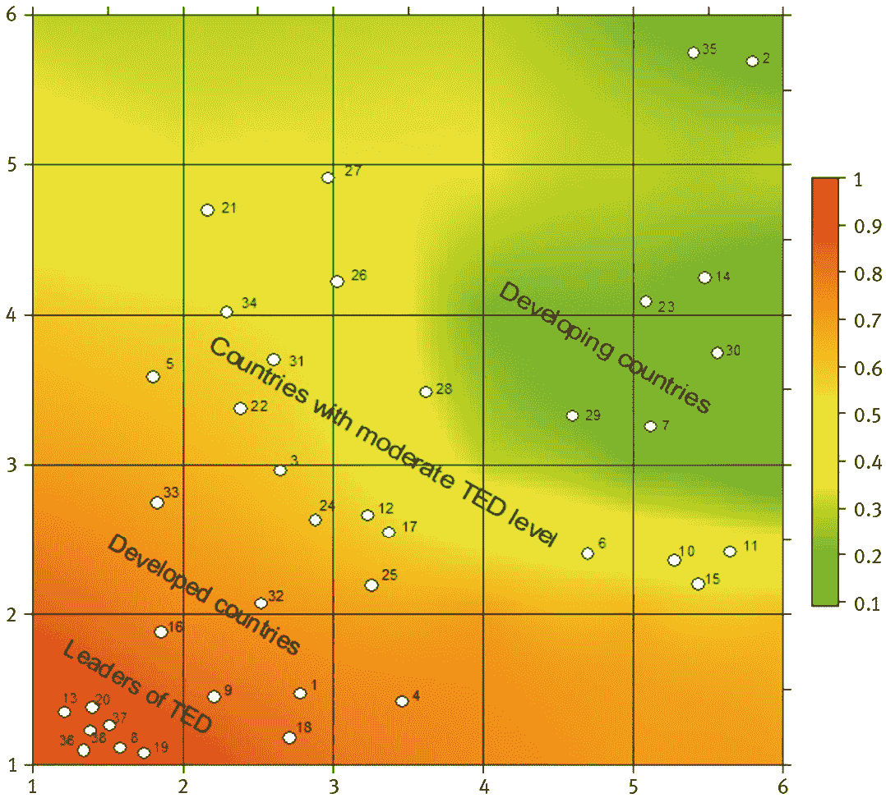

图 5.16：基于 FCNN SOM 的 2010 年世界技术经济肖像神经模糊模型

表 5.5：基于 图 5.16 的国家（graphic/13_chapter05_fig_50.png）

这组参数用于计算 TED 水平以及国家的燃料和能源特征，并预测多维过程的未来值。通过与参考轨迹进行比较，可以对每个国家的 TED 获得可靠的估计。

根据神经模糊聚类的结果，研究国家根据其 TED 水平被分为四个大类（表 5.6），该值从参考水平均的 1 到最低发展水平的 0.1。对于每个国家，还计算了五年的 TED 增长率。对于每个五年，计算基于 `FCNN-SOM` 的输出值，反映了该时期多维特征 TED 水平的变化。

“实际距离”参数的计算结果现在表 5.7 中。

表 5.6：根据神经模糊建模结果按 TED 水平和和速率划分的国家（2005–2010）（graphic/13_chapter05_fig_51.png）

表 5.7：根据“实际距离”参数识别的国家分类

| 实际长度 | 国家 |
| --- | --- |
| 小于 10 年 | 瑞士、芬兰、德国、丹麦、瑞典、英国 |
| 10–20 年 | 俄罗斯、捷克、希腊、马耳他、葡萄牙、匈牙利、立陶宛、保加利亚、波兰、斯洛伐克、意大利、挪威、西班牙 |
| 大于 20 年 | 罗马尼亚、拉脱维亚、土耳其、克罗地亚 |

开发的深度神经网络模糊网络 `FCNN-SOM-RBFN` 架构的科学新颖性在于通过模糊聚类层，成功实现了细胞神经自组织（神经元的高度自组织程度、能够选择性地管理单个神经元连接以解决“死”神经元问题）与多层 RBFN 的结构与功能集成。在输入数据标准化的情况下，径向对称函数的形式和参数问题在数学上是合理的并可以自动求解。因此，RBFN 配置中最困难的阶段得到了实现——输入属性空间的划分以及径向对称函数参数的设置。新模型的概念基于 Pospelov 的分类法 [31]，该分类基于两种知识表示方法——外延法（聚类泛化的形成）和内涵法（孤立聚类中集成特征的识别）。

与大多数需要巨大计算能力的模式识别模型相比，该架构非常紧凑。它缺乏模糊系统中的逻辑关系和条件聚合。

其实际价值在于该方法的高灵活性、易实现性和时间效率。所提网络具有高学习速度和通用近似特性，在处理多维向量参数函数时特别有用。

以下列出了本章获得的主要研究结果。

### 主要结果

1. 目标多维重叠的分类问题转化为模式识别任务的模糊化。
2. 基于细胞自组织神经网络和模糊聚类程序领域的优异进展，作者提出了一种用于模式识别的深度模糊神经网络及其训练算法，其特征是：神经元自组织程度高、无启发式训练参数、能够选择性地控制神经元间的单个连接以解决“死”神经元问题、收敛速度快，以及在重叠聚类和类别情况下网络分离性能的提升。
3. 所提出的 `FCNN-SOM` 不仅可以用于泛化模式形式半结构数据的多维聚类，还可以用于自适应模糊推理系统中参数和隶属函数类型（模糊化）的自动配置。
4. 根据所处理数据的性质，网络可以在精确聚类模式下运行。
5. 为了提高交叉特征的精度，提出了一种通过模糊聚类层结合 `FCNN-SOM` 和 `RBFN` 的深度神经模糊分类器。
6. 对测试数据进行定性和定量评估的实验研究表明了模型的计算效率以及对重叠类别的模糊分离能力。
7. 全球 TED（技术扩散）多准则神经网络分析方法的实际意义已在一系列定量和定性指标（包括 TED 的技术和社会维度）上证明。基于此，我们构建了一个全球 TED 轨迹的灵活神经模糊模型，该模型作为 `FCNN` 的动态范围，特点是具有一种简单但强大的提高聚类精度策略，在不损害解释性的情况下实现了 TED 水平的评估、各国 TED 特征以及多维过程未来值的预测。将这些参数与领先国家和国家的 TED 轨迹进行比较，可以对每个国家的 TED 速度和水平获得可靠的估计。
8. 在神经网络上构建预测模型对过程平稳性没有要求。神经网络是一种通用工具，可以准确识别多元随机过程组件之间的非线性模式和关系。使用模糊聚类允许更准确地分离重叠聚类。

### 结论

总之，在多维半结构数据挖掘、描述复杂交叉对象领域的未来研究前景，在于开发基于关于结构中引入模糊性的不同原理以及基于教学策略改进的有效深度模糊神经网络模型。

致谢：本章是在俄罗斯托姆斯克国立大学国家研究竞争力增强计划框架下编写的，并获得了俄罗斯基础基金的资助。

### 参考文献

[1] Kohonen T. 自组织映射。莫斯科：BINOM, 2008。

[2] Duke VA. 计算机心理诊断。圣彼得堡：Brotherhood, 1994。

[3] Pospelov DA. 人工智能：2. 模型与方法。莫斯科：Radio, 1990。

[4] Lutsenko EV. 自适应决策的理论基础与技术。克拉斯诺达尔：KubSA, 1996。

[5] Lutsenko EV. 认知系统的认知分析。克拉斯诺达尔:, 2002。

[6] Bohr N. 原子物理与知识。莫斯科：Mir, 1961。

[7] Gorbachev SV. 神经信息“Informeo”的使用经验。见第 8 届全俄罗斯神经信息会议，第 146-148 页。克拉斯诺亚克：克拉斯诺亚克大学出版社，2000。

[8] Gorbachev SV. 地质体控制系统。见第 9 届全俄罗斯神经信息会议，第 113-114 页。克拉斯诺亚克：克拉斯诺亚克大学出版社，2001。

[9] Gorbachev SV 和 Syryamkin VI. 多维信息处理分析系统中的神经模糊技术。托姆斯克：托姆斯克国立大学出版社，2014。

[10] Bodyanskiy Y, Gorshkov Y, Kolodyaznhiy V 和 Stephan A. 带有模糊推理的自组织映射联合学习算法。见计算智能理论与应用：第 8 届 Fuzzy Days 国际会议，第 33 卷，第 641-650 页，2005。

[11] Borisov VV, Kruglov VV, 和 Fedulov AS. 模糊模型与网络。莫斯科：Telecom, 2012。

[12] Hoeppner F, Klawonn F, Kruse R, Runkler T. 模糊聚类分析：分类、数据分析和图像识别方法。奇切斯特：John Wiley & Sons, 1999。

[13] Keller JM 和 Hunt DJ. 将模糊隶属函数引入感知机算法。IEEE，1985。

[14] Mitra S 和 Pal SK. 模糊多层感知机、推理和规则生成。IEEE，1995。

[15] Bezdek JC. 基于模糊目标函数的模式识别。纽约：Plenum Press, 1981。

[16] Bodyansky EV and Rudenko OG. Artificial neural networks: architectures, learning, applications. Kharkov, Ukraine: TELETECH, 2004.

[17] Xu R and Wunsch DC. Clustering. In IEEE Press Series on Computational Intelligence. Hoboken, USA: John Wiley & Sons, 2009.

[18] Gorban AN. Training of neural networks. Moscow, Russia: Paragraf, 1990.

[19] Vuorimaa P. Fuzzy self-organizing map. Fuzzy Sets and Systems, 66:223–231, 1994.

[20] Vuorimaa P. Use of the fuzzy self-orginizing map in pattern self-recognition. In Proceedings of 3-rd IEEE Int. Conf. Fuzzy Systems “FUZZ-IEEE’94”, pages 798–801, Orlando, USA, 1994.

[21] Tsao ECK, Bezdek JC, and Pal NR. Fuzzy Kohonen clustering networks. Pattern Recognition, 27:757–764, 1994.

[22] Pascual-Marqui RD. Smoothly Distributed Fuzzy cMeans: a New Self-Organizing map. Pattern Recognition, 34:2395–2402, 2001. R. D. Pascual-Marqui, A. D. Pascual-Montano, K. Kochi, J. M. Caraso.

[23] Anikin VI and Karmanov AA. The training of the artificial neural network Kohonen’s self-organizing cellular automaton. Information technologies,, 11:73–80, 2014.

[24] Chua LO and Yang L. Cellular neural networks. Theory. IEEE Transactions on Circuits and Systems CAS-35, 10:1257–1272, 1988。

[25] Chua LO and Yang L. Cellular neural networks. Applications. IEEE Transactions on Circuits and Systems CAS-35, 10:1273–1290, 1988。

[26] Dvoretzky A. On stochastic approximation. In Proceedings 3-rd IEEE Int. Conf. Math. Statistics and Probability, pages 39–55。

[27] Dawod M, Hasan M. Experimental Study: Comparison of clustering algorithms. Int. Journal of Engineering and Application, 7(8):23–34。

[28] Bezdek JC, Tsao ECK, and Pal NR. Fuzzy Kohonen. IEEE Fuzzy Systems, pages 1035–1043。

[29] Karayiannis NB and Pai PI. Fuzzy algorithm for learning quantization. IEEE Trans. on Neural Network., 5:1196–1211。

[30] Wu KL and Yang MS. Fuzzy-soft learning quantization. Neurocomputing, 55:681–697。

[31] Kondratiev ND, Yakovets Y, and Abalkin LI. Large cycles of conjuncture. Economy, 2002。

[32] Glazyev S and Kharitonov V. Nanotechnology as a key factor in the new technological order. Moscow: Twent, 2009。

[33] Gorbachev SV and Syryamkin VI. Cognitive neural network modeling of the trajectory of global development. In International Conference on Cognitive Computing and Information Processing (CCIP-2015), pages 341–346. NOIDA, India, 2015。

# 基于稀疏方法和 PCNN 的遥感图像融合

Satish Nirala, Deepak Mishra, 印度空间技术学院航空航电子系，印度特里凡得普姆

K. Martin Sagayam, D. Narain Ponraj, X. Ajay Vasanth, 卡鲁尼亚大学工程与技术学院，哥印买培

Lawrence Henesey, 布莱金理工学院系统与软件工程系，瑞典

Chiung Ching Ho, 多媒体大学计算与信息科学系，马来西亚

摘要：图像融合是多个图像的组合，旨在生成融合图像。它比任何输入图像都提供更多的信息，并且基于稀疏采样。稀疏采样方法作为一种处理技术，其性能优于奈奎斯特定理。在各种技术中，`DWT` 具有许多优势，例如产生更高的质量、所需的存储更少且成本较低，这在图像应用中非常有用。图像相关应用的限制较少，例如最小数据存储以及通过卫星进行的通信带宽较低等，这实际上导致了低质量图像的采集。为了解决这个问题，图像融合已被证明是遥感应用的一种潜在工具，它结合了全色图像、多光谱图像的数据，旨在产生一种同时具有更高空间和光谱分辨率的复合图像。该领域的研究可以追溯到最近几十年；遗憾的是，目前不同研究人员提出的各种方法论尚未进行讨论。实验结果表明，本工作对用于图像融合的两种方法（如压缩感知和脉冲耦合神经网络 `PCNN`）针对一些遥感位置数据（例如英国、森林地、埃及、岛屿、巴尔波和裸土）进行了对比分析。以下性能指标有两种评估程序，即在全分辨率和降低分辨率下评估这些算法的性能。

关键词：压缩感知、稀疏表示、离散小波变换、`PCNN`

## 6.1 引言

如今，图像融合已成为一个非常有趣的研究课题，涉及自动目标检测、计算机视觉、医学成像、遥感、机器人和夜视应用等许多相关领域。此外，计算机视觉系统对图像融合的需求急剧增加。必须从来自同一场景的多幅图像中提取并合并图像数据。图像融合的结果是单幅图像，对于人类和机器观察后续的图像处理任务都更加合适且可行。

多焦图像融合和多传感器图像融合是图像融合的两个重要分支。由于光学镜头的景深有限，很难获得所有物体都聚焦的图像。多焦图像融合试图通过融合几个不同焦域内的物体来增加表观深度。在许多情况下，单个传感器无法提供实时应用的精确视图。因此，多传感器数据融合在近年来成为一个极重要的研究领域。多传感器融合是将来自各种传感器的数据绑定到单一表示格式中的过程。图像融合方法分为两大类：空间域图像融合和变换域图像融合。空间域图像融合包括基于主成分分析（`PCA`）的融合方法、基于平均值的图像融合方法，以及基于最小和最大信息的图像融合方法。变换域图像融合包括基于多尺度变换的融合方法，如双树复小波变换（`DTCWT`）和离散小波变换（`DWT`）。


`PCNN` 由 Eckhorn 于 1990 年开发，基于对猫和猴子视觉皮层同步脉冲爆发的实验观察。其特征是神经元的全局耦合和脉冲同步。这些特征促进了利用局部图像信息的图像融合。上述所有融合方法都是在全采样的基础上运行，这需要极高的计算和复杂的计算机资源。对于图像融合系统日益增长的实时性需求，这是一个困难的问题。

然后使用压缩感知（`CS`）来提供解决图像融合问题的方法。`CS` 理论允许稀疏或可压缩的信号从少量非自适应线性投影中正确重建。对于像素级的图像融合，可以直接在压缩域内融合少量的测量值，并根据融合后的测量值高精度地重建。这将极大减少对计算资源和需求的需求。实现的图像融合方法包括空间域类别中的 `PCA` 方法和空间域或简单平均法。变换域类别中应用了基于 `DWT`、`DTCWT` 和 `PCNN` 的图像融合方法。还实现了 `CS` 框架下的图像融合，其中包含了上述变换域图像融合方法。本章提出了一种基于 `PCNN` 和 `PCA` 且带有或不带 `CS` 框架的集成图像融合技术。该方法比目前文献中使用的方法提供了更清晰的结果，因为融合过程是基于图像高通和低通频率分量的不同属性进行的。

我们关注对图像融合方法客观评估的研究结果。C. Xydeas 和 V. Petrovic `[1]` 测试了基于梯度的目标融合框架，他们对所评估融合图像的输入梯度进行了推断。结果和讨论部分分析了使用熵（`E`）、标准差（`SD`）、互信息（`MI`）等质量指标进行评估的图像融合方法。

### 6.1.1 动机与范围

在图像处理领域，近期发生了许多发展，图像融合在夜视等领域起着至关重要的作用。许多成像设备受限于景深，因此正如 S. Wei `[2]` 所建议的，需要更高质量的融合图像。许多现有算法会降低融合图像的质量且耗时较长。由于图像特征各异，我们需要一种基于多尺度分解的融合方法，以便获取并融合分解图像中的所有信息。

在本章中，开发了一种集成图像融合方法。使用 `PCNN` 和 `PCA` 的图像融合分别用于低通和高通处理。

### 6.1.2 文献综述

迄今为止，已经开发了许多在复杂性和应用上各不相似的图像融合方法。本节将讨论一些流行的图像融合技术的主要目标。

C. Polh 和 J. Van Genderen `[3]` 讨论了使用 `PCA` 的图像融合。`PCA` 用于在图像融合中提取加权特征点。图像的主成分是对应于图像协方差矩阵最大特征值的特征向量。因此，它减少了融合图像数据中的冗余。

H. Yin 等人 `[4]` 提出了一种基于稀疏采样方法或 `CS` 的图像融合技术。通过整合图像中存在的非零系数，提高了结果融合图像的质量并降低了执行率。传统方法会出现许多错误，如重建误差、低保真度和产生不确定结果的块效应伪影。为了克服这些问题，提出了另一种基于融合的方法，包括非下采样轮廓波（`NSCT`），这在分解技术中被广泛使用。基于 `CS` 的融合方法通过整合更少的非零系数可以大幅提高处理速度并保证融合图像的质量。开发了一种基于 `CS` 的图像融合方法来解决这些问题。`NSCT` 已用于图像分解。使用双层 `PCNN` 模型执行低通子带融合，而使用高通子带融合来实现了基于边缘的融合规则。对于融合图像的重建，D. Needell 和 J. A. Tropp `[5]` 提出了一种 `CS` 匹配追寻算法（`CoSaMP`）。

使用 `PCNN` 的动机（即通过 `NSCT` 传递空间频率域以进行图像融合过程）已在 Q. Xiao-Bo 的 `[6]` 中进行了讨论。非采样轮廓变换（`NSCT`）为图像提供了灵活的多分辨率、各向异性和方向选择的扩展。与原始的轮廓变换相比，它具有平移不变性，并且克服了奇异点周围伪吉布斯现象。`PCNN` 是一种受视觉皮层启发的神经网络，其特征是神经元的全局耦合脉冲同步。它已被证明适用于图像处理，并成功用于图像融合。Q. Xiao-Bo 等人 `[6]` 通过实验表明，`NSCT` 与 `PCNN` 之间存在相关性，并可以用于图像融合以充分利用图像特征。`NSCT` 域中的空间频率被用于激发 `PCNN` 的动力，而 `NSCT` 域中激活次数较大的系数被选为融合图像的系数。实验结果表明，基于轮廓的 `PCNN` 和基于小波的 `PCNN` 在视觉质量和性能指标方面均表现良好。

Yunxiang Tian 和 Xiaolin Tian `[7]` 提出扩展 `[6]` 的工作。这包括从多光谱（`MS`）图像中提取强度色调饱和度（`IHS`）空间，然后使用 `NSCT` 将其分解为 I 分量。这种方法减少了计算时间和复杂性。Yang Chen 和 Zheng Qin `[8]` 研究了基于 `PCNN` 的压缩域图像融合。在实验中，研究人员验证了三种不同应用的性能。Vaibhav R. Pandit 和 R. Bhiwani `[9]` 提出了一种图像融合方法，并已与传统的图像技术进行了比较。Hongguang Li 等人 `[10]` 提出了一种新的图像配准和图像融合方法，该方法已集成到可见和红外无人机（`UAVs`）相机中。该系统非常高效，并将粒子群优化（`PSO`）与 `PCNN` 结合。因此，它可以应用于中高海拔无人机。Yong Yang 等人 `[11]` 研究了在使用 `FDCT` 纹理选择的主要问题。实验结果显示，复杂性降低且指标有所提高，与各种先进的基于频率和基于空间的方法相比。B. Rajaling 和 R. Priya `[12]` 实现了用于图像融合的 `PCA-DWT`。它在图像质量、视觉感知和计算时间方面优于现有技术。Biswas 等人 `[13]` 提出了一种基于切波变换（`ST`）和 `PCNN` 的遥感图像融合想法。它可以改变源信息的水平，以保持几何和光谱信息。Jun Li 等人 `[14]` 讨论了应用鲁棒 `PCA`（`RPCA`）和 `CS` 的红外和可见图像融合方法。它保留了红外和可见图像的背景信息，并在更短的时间内并行计算。

## 使用的方法

`NSCT` 域中的空间频率被用于激发 `PCNN` 的动力，而 `NSCT` 域中激活次数较大的系数被选为融合图像的系数。实验结果表明，基于轮廓的 `PCNN` 和基于小波的 `PCNN` 在视觉质量和性能指标方面均表现良好。

（注：原文文本中出现了大量重复段落，已根据要求对核心内容进行了处理。）

## 使用的方法

`NSCT` 域中的空间频率被用于激发 `PCNN` 的动力，而 `NSCT` 域中激活次数较大的系数被选为融合图像的系数。

### 主成分分析

`PCA` 的目标是将一组相关的变量转换为一组不相关的变量。考虑 `X` 是一个 m 维向量，`V` 是一个正交矩阵使得 `Y = VT`。`Y` 的协方差为 `cov(Y)`，它是一个对角矩阵。找到 `X` 的协方差矩阵 $C$，并计算其特征向量 $V$ 和特征值 $D$，然后按特征值从大到小的顺序进行排列。

#### PCA 图像融合算法

| 步骤 | 说明 |
| :--- | :--- |
| 步骤 1 | 首先使用两个源图像生成一个维度为 2 × N 的列矩阵 $A$，并计算每列的经验均值 $Me$，其维度为 1 × 2。 |
| 步骤 2 | 从 $A$ 的每一列减去 $Me$，得到的矩阵 $X$ 维度为 2 × N。 |
| 步骤 3 | Find $X$ 的协方差矩阵 $C$，并计算其特征向量 $V$ 和特征值 $D$，按特征值从大到小的顺序进行排列。 |
| 步骤 4 | 按如下方式计算归一化主成分 $P1$ 和 $P2$： |

$P_{1} = \frac{V_{1}}{\Sigma V}, \text{and}, P_{2} = \frac{V_{2}}{\Sigma V}. (6.6)$

#### 步骤 5：融合后的图像为

$Ifuse = P[1]I1 + P[2]I2. (6.7)$

![图 6.1: 采用 PCA 的图像融合方案的信息流图 [12]](graphic/14_chapter06_fig_08.png)

图 6.1: 采用 PCA 的图像融合方案的信息流图 [12]

## 6.2.2 空间或简单平均

使用简单的图像融合方法逐像素提取输入图像的平均值。基于平均的融合规则如下：

$I_{F}(i,j) = \frac{I_{A}(i,j)}{2} + \frac{I_{B}(i,j)}{2}, (6.8)$

其中 $IF$ 是融合后的图像，$IA$、$IB$ 是图像的源分。每幅图像具有 R、G、B 三个基本多光谱波段。

两组 $CX$ 和 $CY$ 的相对平均产生 $CF$，它对所有单个像素具有单个波段，如公式 (6.9)所示：

$C_{F}(m, n, i) = \frac{C_{X}(m, n, i)}{2} + \frac{C_{Y}(m, n, i)}{2}, (6.9)$

其中 $(m, n)$ 表示像素和空间域，$i$ 表示图像的 R、G、B。

![图 6.2: 空间平均方法的框框图 [12]](graphic/14_chapter06_fig_11.png)

图 6.2: 空间平均方法的框框图 [12]

### 6.2.3 基于小波变换的图像融合

#### 6.2.3.1 离散小波变换

可以使用小波变换更高效地表示信号，这是现有的流行技术之一。信号被转换为一组基函数，称为小波。在初始阶段选择小波和分解层级。在对输入数据进行分解后，确定一个阈值。在应用 `DWT` 后，生成的输出数据向量的大小与应用的输入数据向量的大小相同。使用滤波器重构原始数据。将滤波后的数据与 `DWT` 比较，返回比输入数据向量大的连续变换数据。小波变换是一种著名的信号处理技术，可以高效率地表示信号。小波变换将信号变为一组基函数。这些基函数被称为小波。平均值为零的有限持续波形被称为小波。通过 `DWT` 给出信号的多尺度表示。大多数应用与缩放因子或小波系数没有直接关联。滤波器带系数使用高通滤波器和低通滤波器过滤输入信号。

### 6.2.4 脉冲耦合神经网络

这一工作基于视神经原理，视神经将眼睛观察到的数据传输到大脑和视觉皮层。通常，输入数据随后被传输到纤维路径并最终处理。视觉皮层中视觉皮层区域最主要的因素是视觉处理，几乎所有的视觉信号都通过初级皮层到达皮层。Eckhorn 等人 `[16]` 在 20 世纪 80 年代后期发现，中脑以振荡的方式创建二进制图像，当它们必须读取猫视觉皮层时，可以从视觉印象中提取不同的特征 `[16]`。随后在这些二进制图像的帮助下，猫大脑中创建一个真实的图像。受这种生物系统的启发，机器也被训练以执行人类大脑的功能。这导致了神经网络模型的新结构，称为 Eckhorn 模型，用于模拟视觉皮层的行为。在连接场模型的案例研究报告中，H. Ranganath 等人 `[17]` 讨论了基于 Eckhorn 模型且经过改进的 `PCNN`。

图 6.6 显示了一个 `PCNN` 模型，它由两个主要部分组成：反馈和连接。邻域神经元之间的连接通过对称权重 `M` 和 `W` 建立。输入刺激 `S` 被赋予馈部分。`PCNN` 模型及其组件由公式 (6.11) 决定：

```
F[i][j][n] = e^(−αF)*F[i][j][n-1] + S[i][j] + VF, (6.11)
L[i][j][n] = e^(αL)*L[i][j][n-1] + VL, (6.12)
```

![Fig. 6.6: PCNN 处理单元示意图 [18]](graphic/14_chapter06_fig_18.png)

图 6.6: PCNN 处理单元示意图 [18]

其中 `*` 代表卷积算子，`n` 代表迭代次数，`Y` 代表来自 `(n − 1)` 次迭代的神经元输出。部分对其之前的状态具有记忆，该记忆随指数项衰减。常数 `VF` 和 `VL` 是归一化常数。在接收输入后，反馈和连接部分合并在一起生成神经元的内部状态。内部活动 `U` 如公式 (6.13) 所示，其中 `β` 是控制参数：

```
U[i][j][n] = F[i][j]n (6.13)
```

因此，神经元 `U` 的内部活动具有映射到动态阈值 `θ` 的各种状态，产生输出到另一个神经元 `Y`，如公式 (6.14) 和 (15) 所示：

```
Y[i][j][n] = 1 if U[i][j][n] > θ[i][j][n]; (14)
Y[i][j][n] = 0 Otherwise (15)
```

如果 `(U > θ)`，则神经元以非常高的电平触发 `Y` 的阈值并收敛，直到神经元被触发。阈值属性的动态活动如公式 (6.16) 所示：

```
θ[i][j][n] = e^(αθ)*θ[i][j][n−1] + VθY[i][j] (6.16)
```

其中 `Vθ` 是一个常数，其值显著大于平均值 `U` 的数量级。初始情况下，`F`、`L`、`U` 和 `Y` 的值均设置为零。`θ` 元素的初始值为 0 或取决于应用的较大值。通过这种活动，神经元在接收部分刺激 `S` 和来自邻域的刺激。通过观察阈值的上升和下降以及内部活动值的相应上升下降，可以观察到 `PCNN` 的脉冲特性。

#### 6.2.4.1 基于 PCNN 的通用图像融合算法

`PCNN` 算法的数据流图如图 6.7 所示，并遵循以下步骤：

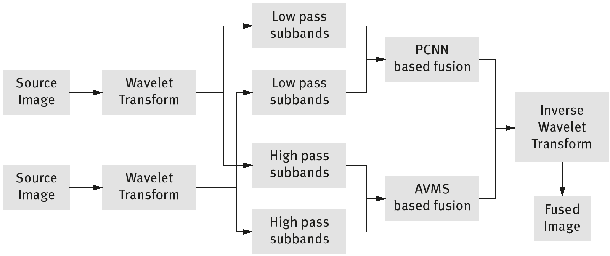

图 6.7: 基于 PCNN 的融合数据流图

| 步骤 | 说明 |
| :--- | :--- |
| 步骤 1 | 将数据分为低带和高带，称为源数据。 |
| 步骤 2 | 将低带作为输入给 `PCNN`，使用空间聚焦激活神经活动。 |


### 步骤 3：计算发射次数 `Tij`

使用以下方程计算次数 `Tij`：

```
F[i][j][n] = S[i][j], (6.17)
L[i][j][n] = e^(αl)*L[i][j][n-1] + VL (6.18)
U[i][j][n] = F[i][j]n (6.19)
θ[i][j][n] = e[i][j]*(α−1) + VY[i][j] (20)
Y[i][j][n] = 1 if U[i][j][n] > θ[i][j][n]; (21)
Y[i][j][n] = 0 Otherwise (22)
T[i][j] = T[i][j][n−1] + Y[i][j] (23)
```

我们可以取参数为：

$$
\begin{array}{lll}
\alpha L = 0.06931, & \alpha\theta = 0.2, & \beta = 0.2, \\
V_{L} = 1, & V = 20, & W = \left[ \begin{array}{lll} 0.707 & 1 & 0.707 \\ 1 & 0 & 1 \\ 0.707 & 0 & 0.707 \\ \end{array} \right] \\
\end{array}
$$

迭代次数为 `n = 200`。

### 步骤 4：获取决策图并选择系数

获取决策图 `DF,ij` 并选择系数 `xF,ij`，这意味着具有大发射次数（大 `T` 值）的系数被选为融合图像的系数，因为发射图中的值等于发射次数，较长的发射时间对应对应的信息，基于以下方程：

```
D[F,i][j][n] = 1 if T[1,i][j][n] >= T[2,i][j][n]; (24)
D[F,i][j][n] = 0 if T[1,i][j][n] < T[2,i][j][n]; (25)
X[F,i][j][n] = x1[i][j][n] if D[F,i][j][n] = 1; (26)
X[F,i][j][n] = x2[i][j][n] if D[F,i][j][n] = 0; (27)
```

奈奎斯特-香农采样定理指出，重构信号的速率应高于最高频率的两倍。某些信号由于高带宽（例如由于图像采集），其采样率变得非常高。因此，压缩感知（CS）的需求应运而生，在 CS 中，信号被压缩并用少数系数来表示。Islam 等人 [20] 讨论了在不采样输入信号的情况下使用 CS 获取信息。如果一个信号是“稀疏样本”，那么采集的重构信号对于所有计算都是准确的。信号的稀疏性定义在相似的基础上，例如 DCT 或小波变换。信号与测量之间的不相干性起着重要作用，其中发展出的信息分布得非常广。CS 以非自适应的方式为重构的压缩感知输出提供准确的测量 [19]。在 CS 中，我们首先生成信号的稀疏表示。然后，使用维度为 $M \times N$ 的测量矩阵生成维度为 $M$ 的某些测量值。最后，根据这些测量值进行重构。

假设我们有一个由 $N$ 个实值样本的信号 $f = \{f_1, f_2 \dots f_N\}$，它可以通过变换系数 $x$ 表示。即：

$$f = \psi x = {\sum\limits_{i = 1}^{N}{x_{i}\psi_{i}}}\left( 6.28 \right)$$

其中 $\psi = \{\psi_1, \psi_2 \dots \psi_N\}$ 是一个 $N \times N$ 的变换基矩阵，它决定了信号稀疏的域，且 $x = \{x_1, x_2 \dots x_N\}$ 是一个 $N$ 维向量，$x_i=\langle x, \psi_i\rangle$。我们假设 $x$ 是 $K$-稀疏的，这意味着 $x$ 中存在显著元素，且 $K \ll N$。假设一个通用线性过程计算了 $f$ 与一组向量 $\phi_j$ 之间的内积 $M < N$，得到 $y_j = \phi_j f; i=1 \dots N; j=1 \dots M$。

如果 $\phi$ 表示一个以 $\phi_j$ 为行向量的 $M \times N$ 矩阵，则测量值 $y = (y_1, y_2 \dots y_n)$ 为：

$$y = \phi f = \phi \psi x = Ax \quad (29)$$

其中 $y$ 是 $M$ 维观测向量，$\phi$ 是一个 $M \times N$ 随机矩阵，$A = \phi\psi$ 被称为测量矩阵。我们可以看到 CS 将 $N$ 维信号降维到 $M$ 维的观测信号，因此为了准确重构信号，发生了维度降低，且感知矩阵 $\phi$ 应该满足由 R. Baraniuk 等人解释的受限等距性质（RIP）[21, 22]。换句话说，K-RIP 确保 $\phi$ 的所有大小为 $M \times K$ 的子矩阵都接近等距，从而保持了距离（和信息）。随机矩阵是测量矩阵的一个示例，其元素是 i.i.d（独立分布）伯努利矩阵和高斯矩阵。信号重构问题是在给定 $\phi$ 和 $\psi$ 的情况下利用 $y$ 重构 $K$-稀疏的 $N$ 长度信号 $x$，由于 $M < N$，这是一个病态问题，存在无限多个 $x'$ 满足 $Ax' = y$。为了解决这类病态问题，传统方法是最小化 $l_p$ 范数。定义 $l_p$ 范数向量 $x$ 为 $\|x\|_p = {\sum_{i = 1}^{N}{|x_{i}|^p}$ 对于 $1 \le p < \infty$，且 $\|x\|_\infty = \max |x_i|$。例如，考虑 $l_2$ 范数来解决此病态问题。优化问题给出：

$$x = \text{argmin} \|x\|_2 \text{ subject to } Ax = y \quad (30)$$

已经产生了许多算法来解决这些 CS 问题。它们包括线性规划（LP）技术、贪心算法、基于梯度的算法和迭代收缩算法。虽然 $l_1$ 和 $l_2$ 范数具有精确恢复的强大可能性，但在计算成本和实现复杂度方面存在缺点。正交匹配追踪（OMP）算法被开发用于解决这些问题。

### 6.2.5.1 分块压缩感知

在分块 CS 中，随机矩阵源于逐块对图像的采样，由 M. Y. Baig 等人 [18] 建议。考虑一张 $I_c \times I_r$ 的图像，总共有 $N = I_c I_r$ 个像素。图像被分成 $n$ 个维度均为 $B \times B$ 的小块，并在分块 CS 中使用相同的矩阵进行采样。令 $x_i$ 表示通过光栅扫描得到的第 $i$ 个块的向量化信号，$i = 1 \dots n, n = N/B^2$。构造一个 $B^2 \times B^2$ 的 i.i.d.（独立分布）高斯矩阵，通过正交化获得正交矩阵 $\Theta$，并从 $\Theta$ 中随机选取 $B^2$ 行以产生 $MB \times B^2$ 的测量矩阵 $\phi_B$。对应的 $y_i$ 表示如公式 (31) 所示：

$$y_j = \phi_B x_i; i = 1 \dots n \quad (31)$$

通过矩阵 $\phi$ 获取整个数据的感知输出 $(n \times MB)$，如公式 (32) 所示：

$$\phi = \begin{bmatrix} \phi_b \\ \phi_b \\ \phi_b \end{bmatrix} \quad (32)$$

分块 CS 是内存高效的，因为我们只需要存储 $MB \times B^2$ 高斯矩阵而不是完整的 $M \times N$ 矩阵，且分块 CS 有几个优点。优点是由于编码器发送图像块，由于 $\phi_B$ 值较小，计算是可行的。

### 6.2.5.2 SPL 重构

重构过程使用平滑投影兰伯（SPL）迭代完成。维纳滤波使用兰伯方法来消除伪影和噪声。迭代 $k+1$ 处的图像近似 $x(k+1)$ 由 $x(k)$ 生成：

$$x_i^{(k+1)} = x_i^{(k)} + \Phi_B^T(y_i - \Phi_B x_i^{(k)}) \quad (33)$$
$$x^{(k+1)} = \Psi_i^{(k)}^{(k)} \quad (34)$$
$$x^{(k)} = \text{Threshold}(x^{(k)}, \lambda) \quad (35)$$
$$x^{(k+1)} = \Psi^{-1} x^{(k)} \quad (36)$$

对于每个块，当 $|D^{k+1} - D^k| < \epsilon$ 时停止迭代，其中

$$D^k = \frac{1}{\sqrt{N}}\| \overline{x^{(k)}} - \overline{x^{(k-1)}} \|_2 \quad (38)$$

### 6.2.5.3 阈值处理

投影兰伯（PL）算法使用硬阈值处理进行去噪。为了给硬阈值设置合适的 $\Gamma$，使用了通用阈值法：

$$x^{(k+1)} = \begin{cases} x^{(k)} & \text{如果 } |x^{(k)}| \ge \lambda \sigma^{(k)} \\ 0 & \text{否则} \end{cases} \quad (39)$$

参数 $\sigma^{(k)}$ 使用稳健中位数估计进行估计：

$$\sigma^{(k)} = \frac{\text{median}(|x|)}{0.6745} \quad (40)$$

融合技术的主要目标是识别图像中最核心的元素并将其保留在原始图像中，将其转换为更小的子带且不丢失任何信息。有效图像融合的需求在于图像质量、计算复杂度和计算时间。根据不同的应用，对计算时间、复杂和信息质量的要求各不相同。融合方法的主要要求是它必须能够识别输入图像中的最大元素，并在不遗漏任何元素的情况下进行传输。空间域方法的缺点是会在图像中产生空间失真。在从数据库中预测图像时，通过光谱失真获得的结果最差。可以通过变换域方法进行图像融合来克服空间失真问题。在执行基于多尺度变换的融合时，会考虑图像细节和方向系数。图像的相对系数通过针对相关系数的不同规则集进行融合。传统方法克服了开销值和计算复杂度较高的问题。基于多尺度变换的融合方法通过考虑图像细节来实现高质量的融合效果。根据不同系数的属性，需要不同的有效融合规则来融合相关系数。为了避免低计算复杂度和存储问题，需要一种基于 CS 的传统融合方法。基于上述事实，提出了一种集成图像融合方法，该方法分别处理低频和高频子带，并通过 CS 框架减少存储和计算问题。

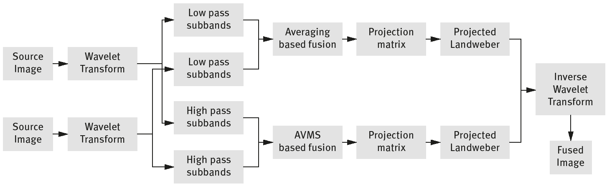

**Fig 6.8: 基于 CS 的融合方法的框图** [14_chapter06_3.xhtml#chapter06_3_45]

### 使用 `PCNN` 和 PCA 进行图像融合

在所提的方法中，使用小波变换将图像分解为低频子带和高频子带。使用 `DWT` 进行图像分解。高频子带包含图像系数，这些系数具有实部和虚部，对应于输入数据中的深度变化和显著特征。清晰图像的高频系数能量远大于模糊图像。因此，聚焦图像的方差大于模糊图像。我们将利用这种方差属性来融合高频子带。我们将使用 `PCA` 方法进行融合过程。对于低频子带融合，我们将使用基于 `PCNN` 模型的融合方法，因为它结合了人类对图像的感知并利用了邻域信息。这种基于 `PCNN` 的图像融合是基于活动水平测量的。

#### 算法

| 步骤 | 描述 |
| --- | --- |
| 步骤 1 | 将输入图像视为 `IA` 和 `IB`。 |
| 步骤 2 | 使用小波变换将输入图像分解为高频和低频子带，分别为 `ILA`、`ILB` 和 `IHA`、`IHB`。例如，使用 `DWT`。 |
| 步骤 3 | 如前所述，使用基于 `PCNN` 模型的融合规则融合低频子带，获得融合后的低频子带图像 `ILF`。 |
| 步骤 4 | 如前所述，使用基于 `PCA` 的融合算法融合高频子带，获得 `IHF`。 |
| 步骤 5 | 使用逆小波变换获取图像 `IF`。 |

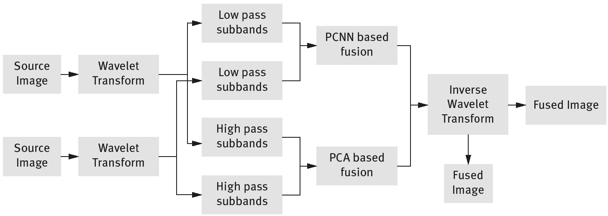

**Fig 6.9: 所提图像融合方法的框图** [14_chapter06_3.xhtml#chapter06_3_46]

### 在压缩感知框架下使用 `PCNN` 和 `PCA` 进行图像融合

在所提的方法中，使用 `PCA` 方法融合高频子带系数，使用 `PCNN` 融合低频子带系数。引入了 `CS` 框架以降低处理率并提高融合图像质量。

#### 算法

| 步骤 | 描述 |
| --- | --- |
| 步骤 1 | 使用小波变换将源图像分解为高频和低频子带。 |
| 步骤 2 | 通过将高频和低频子带投影到投影矩阵中生成测量。使用高斯测量矩阵以获得更高的效率。 |
| 步骤 3 | 通过投影 `Landweber iteration algorithm` 恢复小波系数。 |
| 步骤 4 | 使用 `PCNN` 融合低频子带。 |
| 步骤 5 | 使用基于 `PCA` 的融合算法融合高频子带。 |
| 步骤 6 | 使用逆小波变换获取融合图像。 |

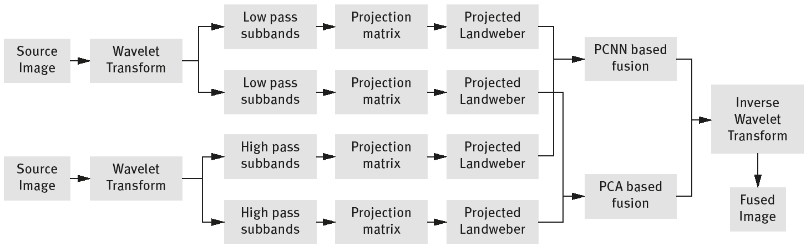

**Fig 6.10: 所提图像融合方法的框图**

## 6.4 比较结果分析

真实信息的保持和自然色彩保持对于任何图像融合方法都是至关重要的。融合性能主要通过主观和客观性能矩阵进行评估。然而，目标数据的结果可能是准确的，但在计算复杂度和时间内代价高昂。因此，这里将不同多传感器图像融合方法的性能作为其生成的客观性能矩阵的函数进行评估。以下列表是客观融合指标：

1. 从输入图像中提取重要特征点。
2. 测量融合过程尽可能准确地将信息传输到输出图像的能力。

根据得到的值从融合图像中验证了不同的性能指标。这里，所有客观矩阵都限制在 0 到 1 之间。例如，考虑目标矩阵 `0 ≤ QAB/F (m, n) ≤ 1`，其中值 0 等于位置 `(m, n)` 处从 `A` 到 `F` 或从 `B` 到 `F` 的信息完全丢失，而值 1 则对应于无丢失的“理想融合”。因此，对于所有客观性能矩阵，值 0 表示信息完全丢失，值 1 意味着完美的自然色彩融合。

`Sobel 算子`（通常被称为 `Sobel 滤波器`）被用于图像处理和计算机视觉中，因为图像的边缘是通过其核函数进行检测的。这通过离散差分算子近似了图像强度函数梯度的计算。

在图像的每个点上，`Sobel 算子` 的结果是基于在水平和垂直方向上使用可分离的、较小且整数值的滤波器对图像进行卷积，因此在计算上相对廉价。另一方面，所产生的梯度近似较为粗糙，特别是对于图像中的高频变化。该算子可以使用两个 `3 × 3` 核，这两个核分别与自定义图像进行卷积，以计算导数的近似值——一个用于垂直变化，另一个用于水平变化。将 `A` 视为输入图像，`Gx` 和 `Gy` 是另外两幅图像，它们在每个因子处分别包含水平和垂直导数的近似。计算公式如下：

$$G_{y} = \begin{bmatrix} {- 1} & {- 2} & {- 1} \\ 0 & 0 & 0 \\ 1 & 2 & 1 \end{bmatrix} \cdot A \quad (6.42)$$

$$G_{x} = \begin{bmatrix} {- 1} & 0 & 1 \\ {- 2} & 0 & 2 \\ {- 1} & 0 & 1 \end{bmatrix} \cdot A \quad (6.43)$$

梯度强度由下式给出：

$$G = \sqrt{G_{x}^{2} + G_{y}^{2}} \quad (6.44)$$

梯度方向由下式给出：

$$\theta = \tan^{-1}(G_{y}/G_{x}) \quad (6.45)$$

### Sigmoid 函数

#### 6.4.1.2 Sigmoid 函数

`sigmoid 函数`是一种连续的非线性激活函数。`sigmoid` 一词源于该函数呈 S 形状。统计学家在引用 `logistic 函数`时使用它，以 `x` 为输入，以 `f(x)` 为输出，并以 `t` 为一个特定特征。`sigmoid 函数`可以表示为：

$$f\left( x \right) = \frac{1}{1 + e^{- tx}} \quad (46)$$

`sigmoid 函数`的特征是一个平滑函数，其输出值范围在 `-1` 到 `1` 之间。

#### 6.4.1.3 梯度保留融合框架

基于梯度的融合框架（也称为 `QAB/F`）与从源图像传输到融合图像的梯度信息相关。这种融合算法的效率取决于传输的梯度量。在这项工作中，我们使用了著名的 `Sobel 边缘算子` 进行边缘检测。具体来说，假设有两个输入图像 `A` 和 `B` 以及生成的融合图像 `F`，应用 `Sobel 边缘算子`来为每个输入和融合像素 `(m, n)` 生成强度 `g` 和方向 `α` (`α ∈ |0π|`)。

使用上述参数，推导出了每个融合图像与输入图像之间的相对强度和方向因子 `Δg` 和 `Δα`，例如：


#### 6.4.1.5 标准差

在概率和统计分析中，标准差（SD）用符号 $\sigma$ 表示，是一种用于评估信息属性排列的变异程度或离散程度的度量。接近 0 的 `SD` 表示数据点倾向于非常接近集合的平均值，而高 `SD` 则表示数据点分布在更宽的数值范围内。

当 `SD` 值较高时，表示融合图像具有高对比度：

$$
\text{SD} = \sqrt{\frac{1}{MN}{\sum\limits_{i = 0}^{M - 1}{\sum\limits_{j = 0}^{N - 1}}\left( {I\left( {i,j} \right) - \overline{I}} \right)^{2}}}}, \quad (6.54)
$$

其中 $I$ 和 $\overline{I}$ 分别是大小为 $M \times N$ 的融合图像及其融合的平均值。

### 6.4.1.6 均方根误差

均方根偏差（`RMSD`）或均方根误差（`RMSE`）用于衡量模型或估计器预期的质量与实际观测的质量之间的对比。`RMSD` 代表观测值与预测值之间差异的样本 `SD`。个体差异被称为残差，其计算是在用于估计的数据样本上进行的，当在样本外计算时，被称为预测误差。`RMSD` 的作用是将不同时间预测的误差幅度总和化为一个单一的预测能力衡量标准。`RMSD` 是一个衡量准确性的良好指标，但仅用于比较不同模型针对特定因素的未来误差，而不是变量之间的比较，因为它依赖于尺度。

`RMSE` 是衡量融合图像光谱质量的良好指标。

$$
\text{RMSE} = \sqrt{\frac{1}{MN}{\sum\limits_{i = 0}^{M}{\sum\limits_{j = 0}^{N}}\left( {R\left( {i,j} \right) - F\left( {i,j} \right)} \right)^{2}}}}, \quad (6.55)
$$

其中 $R$ 和 $F$ 是大小为 $M \times N$ 的参考图像和融合图像。

### 6.4.1.7 峰值信噪比

峰值信噪比通常缩写为 `PSNR`，是一种寻找信号最大可能功率与影响其表示保真度的破坏噪声功率之间比例的术语。由于许多信号具有宽的元素范围，`PSNR` 通常以对数分贝尺度表示。

由于图像增强或提高数字图像的视觉质量可能是主观的，传达一种方法提供了更好质量的图像可能因人而异。因此，必须建立定量和观测测量标准来分析图像增强算法对图像质量的影响。当值较高时，融合图像和参考图像相似。值越高，表示融合效果越优。

$$
\text{PSNR} = 20\log_{10}\left( \frac{L^{2}}{\frac{1}{MN}{\sum\limits_{i = 0}^{M}{\sum\limits_{j = 0}^{N}\left( {R\left( {i,j} \right) - F\left( {i,j} \right)} \right)^{2}}}} \right), \quad (6.56)
$$

其中 $R$ 和 $F$ 是大小为 $M \times N$ 的参考图像和融合图像，$L$ 是图像中的灰度级数。

### 6.4.1.8 互信息

融合图像应该包含来自原始图像的重要信息。显然，“关键数据”的概念依赖于应用且难以表征。互信息（`MI`）是一个变量关于另一个变量的信息量。`MI` 衡量两个变量 $A$ 和 $B$ 之间的依赖程度，通过评估联合分布 $p_{AB}(a,b)$ 和相关的概率值 $p_A(a)\cdot p_B(b)$，这种独立性通过相对熵得出：

$$
I_{AB} = D(p_{AB}(a,b)||p_A(a)\cdot p_B(b)) \quad (6.57)
$$

然而，为了计算 `MI`，需要知道联合概率分布函数。互信息为：

$$
I_{AB}(a;b) = \sum_{a,b}{p_{AB}(a,b)\log_{2}\frac{p_{AB}(a,b)}{p_{A}(a)p_{B}(b)}} \quad (6.58)
$$

联合分布 $p_{AB}(a,b)$、$p_A(a)$ 和 $p_B(b)$ 简单地通过联合直方图进行归一化获得。图像 $A$ 和 $B$ 的联合直方图定义为：

$$
h_{AB}(a,b) = \sum\limits_{m = 1}^{M}{\sum\limits_{n = 1}^{N}{h_{AB}(I_{A}(m,n),I_{B}(m,n))}}, \quad a = 0,\ldots I; b = 0,\ldots J \quad (6.59)
$$

其中 $M \times N$ 是图像的大小，$I_A(m, n)$ 和 $I_B(m, n)$ 是图像 $A$ 和 $B$ 像素 $(m, n)$ 的强度值，使得 $I_A(m, n) \in [0, I]$ 且 $I_B(m, n) \in [0, J]$。考虑到源图像 $A$ 和 $B$ 以及融合图像 $F$，$F$ 关于 $A$ 和 $B$ 包含的信息量估计为：

$$
\text{MI}_{FA}(f;a) = \sum\limits_{a,f}{p_{AF}(a,f)\log\frac{p_{AF}(a,f)}{p_{A}(a)p_{F}(f)}} \quad (6.60)
$$

$$
\text{MI}_{FB}(f;b) = \sum\limits_{b,f}{p_{BF}(b,f)\log\frac{p_{BF}(b,f)}{p_{B}(b)p_{F}(f)}} \quad (6.61)
$$

因此，图像融合性能衡量可以定义为：

$$
\text{MI}[F]^*(AB) = \text{MI}_{FA} + \text{MI}_{FB} \quad (6.62)
$$

## 6.5 实验结果

在本节中，我们将展示几种图像融合方法并基于上述图像质量指标进行评估。在两种方法中，我们使用了 `DWT` 将图像分解为低频和高频子带。集成 `PCNN` 和 `PCA` 的 `CS` 方法指的是基于 `CS` 框架的 `PCNN` 和 `PCA` 图像融合方法。现有的 `NSCT` 和 `PCNN` 方法指的是由 Yin 等人描述的图像融合方法。

从表 6.1, 6.2, 6.3, 6.4 和 6.5 以及图 6.11, 6.12, 6.13, 6.14 和 6.15 我们可以推断出，所提出的集成 `PCNN`、`PCA` 与 `CS` 的方法（即基于 `CS` 框架的基于 `PCNN` 和 `PCA` 的图像融合）结果优于所有其他方法。我们看到基于 `PCA` 的空间域图像融合方法在边缘保留方面表现不佳，在图像对比度质量方面也失败了。所提方法提高了图像对比度，因为在所提图像融合方法中我们直接处理源图像的像素值。因此开发了基于变换域的融合方法，从结果来看，它优于空间域图像融合方法。但现有的融合方法存在融合图像与原始图像之间缺乏相似性等缺点，并且在 `PSNR` 值方面结果较差且需要高存储容量。这些伪影通过基于 `CS` 的融合方法被消除，该方法在融合图像中保留了信息内容。它在计算上也是高效且成本较低的。但在良好的性能外，该方法还存在噪声和保真度差的融合图像等伪影。由于缺乏针对高频分量的适当融合规则，`CS` 方法在互信息方面表现失败。因此它在保留融合图像中的梯度信息方面也存在问题。所以需要针对低频和高频分量的融合建立单独的图像融合规则，以便两个子带中存在的不同信息在融合图像中被分别保留。基于 `PCNN` 的图像融合被证明是融合低频分量的最佳方法，因为它考虑了相邻信息。基于 `PCA` 的融合被证明是融合高频分量的最佳方法，因为它考虑了子带的方差信息，从而有效地保留了边缘和轮廓。此外，使用 `CS` 算法对融合图像进行完美准确的重建，节省了大量存储并具有最大的运行速度。因此，这种基于 `PCNN` 和 `PCA` 并纳入 `CS` 框架的所提方法也可以用于彩色图像融合，其性能优于传统方法。结果与现有方法相比，对比分析表明，所提方法在融合图像的视觉质量和信息内容方面都取得了更好的结果。

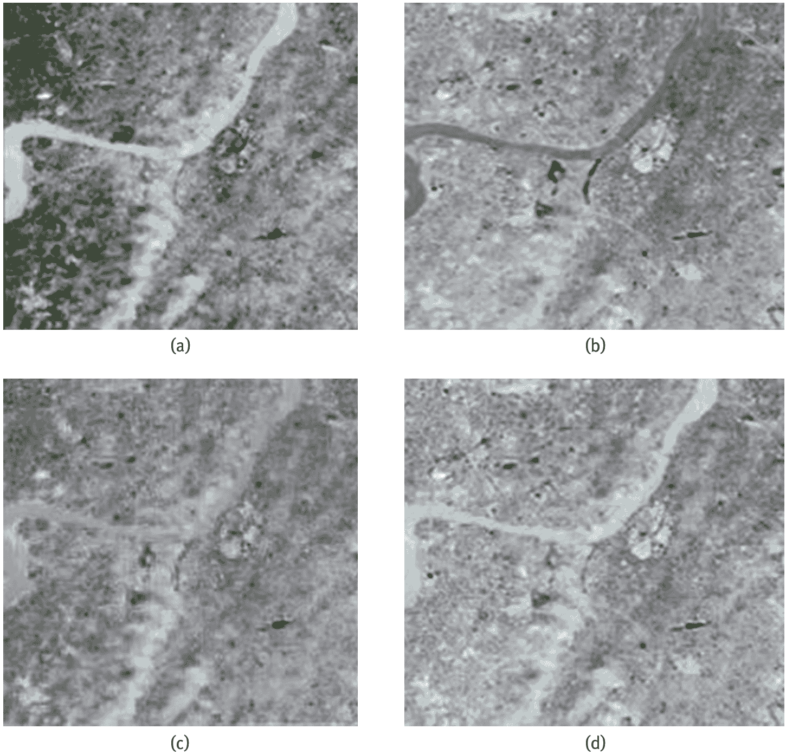

图 6.11：CS 和 PCNN 中的图像融合 – 英国俯瞰图：(a) 多光谱图像 (b) PCNN (c) CS (d) 融合图像

表 6.1：英国俯瞰图性能评估表


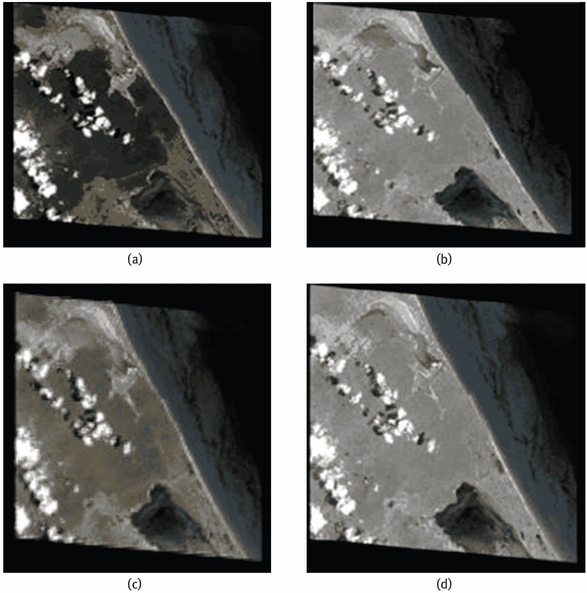

图 6.12：CS 和 PCNN 中的图像融合 – 森林地区俯瞰图：(a) 多光谱图像 (b) PCNN (c) CS (d) 融合图像

表 6.2：森林地区俯瞰图性能评估表

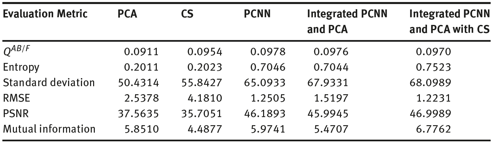

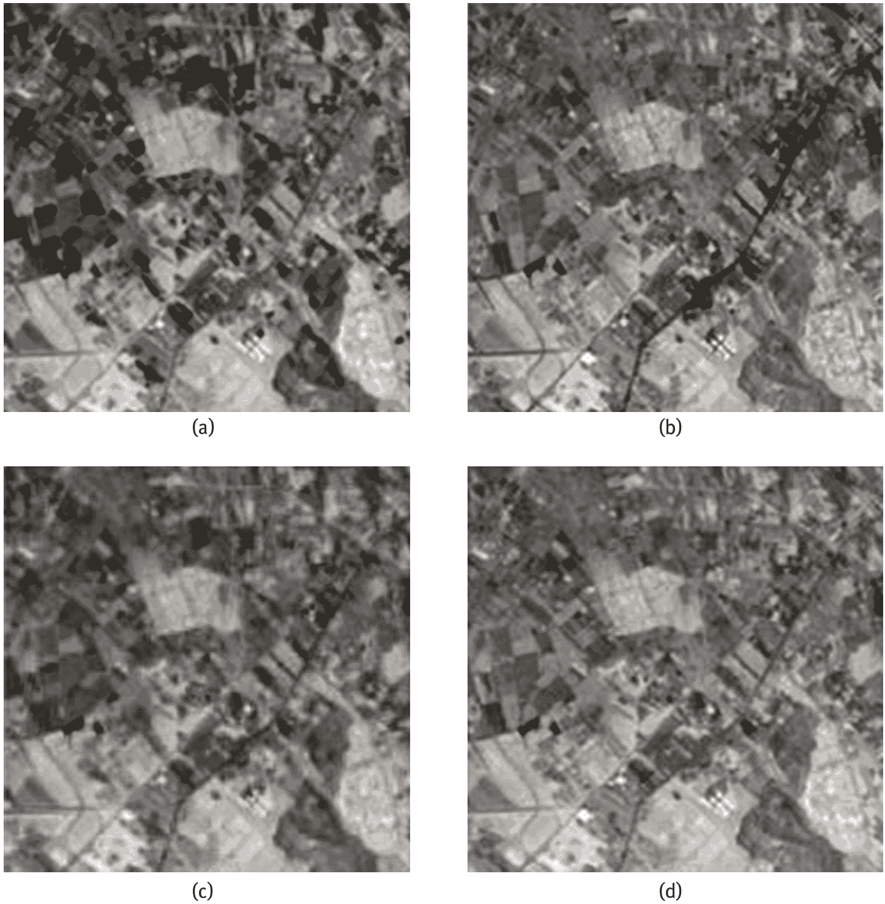

图 6.13：CS 和 PCNN 中的图像融合 – 埃及俯瞰图：(a) 多光谱图像 (b) PCNN (c) CS (d) 融合图像

表 6.3：埃及俯瞰图性能评估表

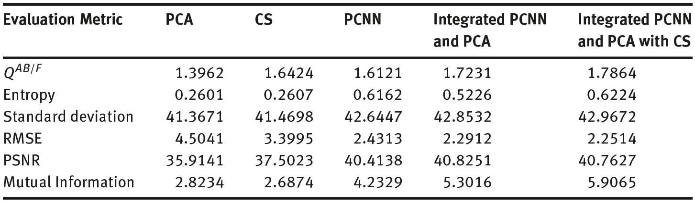

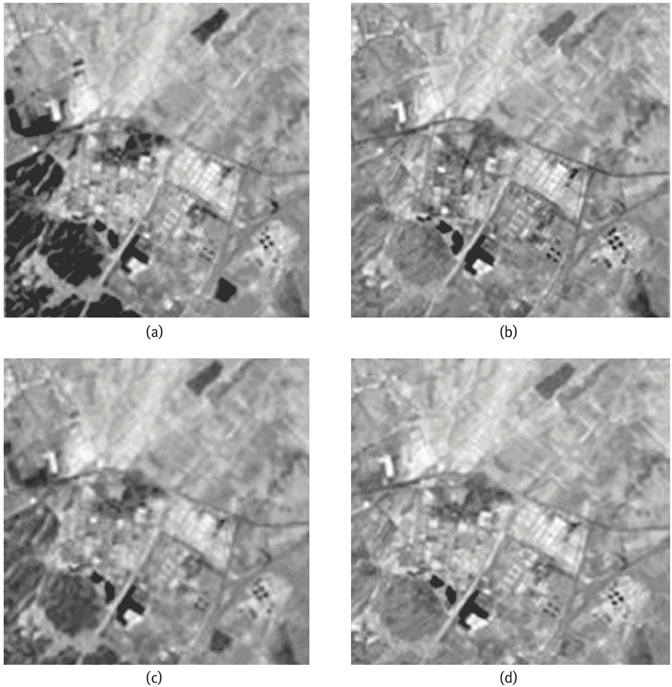

图 6.14：CS 和 PCNN 中的图像融合 – 巴尔博亚俯瞰图：(a) 多光谱图像 (b) PCNN (c) CS (d) 融合图像

表 6.4：巴尔博亚俯瞰图性能评估表

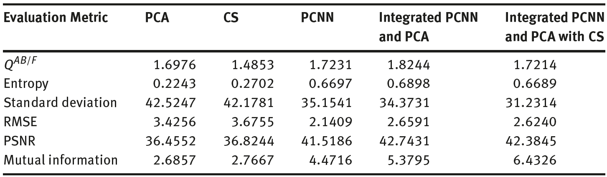

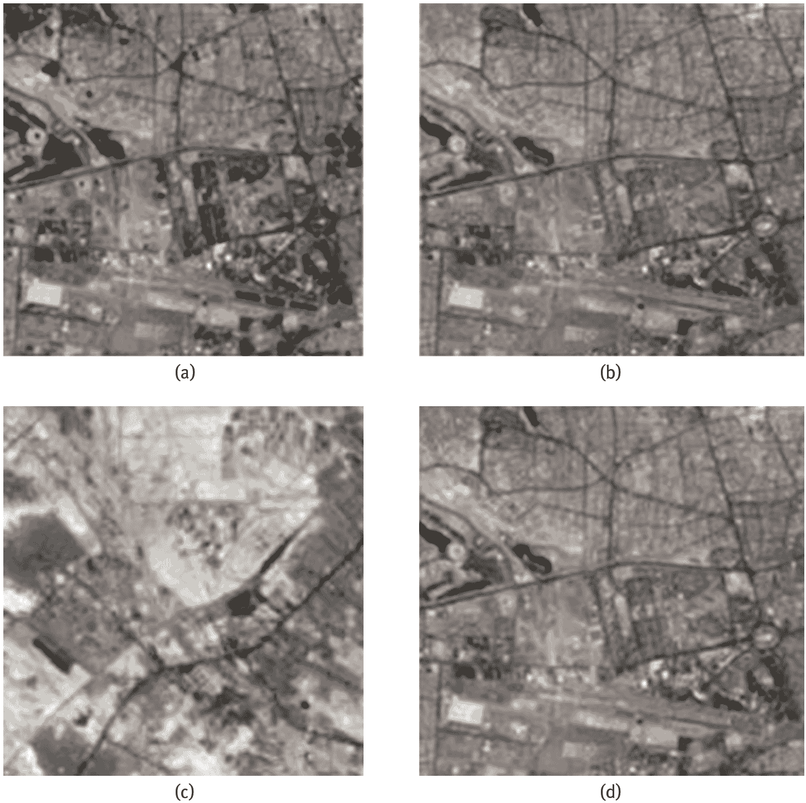

图 6.15：CS 和 PCNN 中的图像融合 – 裸土俯瞰图：(a) 多光谱图像 (b) PCNN (c) CS (d) 融合图像

表 6.5：裸土俯瞰图性能评估表

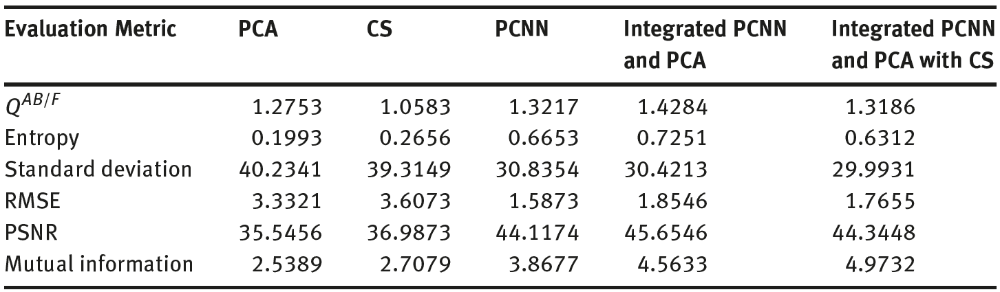

## 6.6 结论与未来工作

在本工作中，提出了使用 `PCNN` 和 `CS` 采样方法的图像融合概念。还讨论了图像融合的应用。展示并实现了针对多焦点图像的基本融合技术，包括基于 `PCA` 的融合方法、小波融合方法等。对一组多焦点图像进行了图像融合。`CS` 图像融合如今起着重要作用。我们还解释了 `PCNN` 和 `CS` 融合方法与普通图像融合的区别。从结果清楚看出，所提方法优于所有图像方法。所提方法也可以用于彩色图像。

致谢：感谢全能神在我的困境和需要时提供的帮助。感谢印度空间技术学院航空电子系的 Deepak Mishra 博士，他提供了处理遥感数据的机会。感谢印度合作者 Narain Ponraj 博士和 Ajay Vasanth 先生，以及外国合作者瑞典理工学院的 Lawrence Henesey 教授和马来西亚媒体大学的 Chiung Ching Ho 教授，他们帮助我完成了论文及其后的挑战性研究，他们的指导使得这项研究取得了成功。

# 参考文献

1. Xydeas CS and Petrovic V. Objective image fusion performance measure. Electronics Letters, 36(4):308–309, 2000.

2. Wei S and Ke W. A multi-focus image fusion algorithm with dt-cwt. International Conference on Computational Intelligence and Security, pages 147–151, 2007.

3. Pohl C and van Genderen J. Multisensor image fusion in remote sensing: Concepts, methods and applications. International Journal of Remote Sensing, 19:823–854, 03 1998.

4. Yin H, Liu Z, Fang B, and Li Y. 基于压缩感知的新型图像融合方法。Optics Communications, 354(Supplement C):299–313, 2015.

5. Needell D and Tropp JA. Cosamp: 从不完整且不准确的样本中迭代信号。Applied and Computational Harmonic Analysis, 26(3):301–321, 2009.

6. Xiaobo Q. nsct 域内基于空间频率激励脉冲耦合神经网络的图像融合算法。Acta Autom. Sinica, 34:1508–1514, 01 2008.

7. Tian Y and Tian X. 基于非采样轮廓变换域方向信息的遥感图像融合。In International Conference on Advanced Electronic Science and Technology, published, pages 57–63. Atlantic Press, 2016.

8. Chen Y and Qin Z. 压缩域内基于 Pcnn 的图像融合。Mathematical Problems in Engineering, Hindawi Publishing Corporation, 2015.

9. Pandit VR and Bhiwani RJ. 遥感应用中的图像融合：综述。International Journal of Computer Applications, 120(10):22–32, June 2015.


## 参考文献

[10] Li H, Ding W, Cao X, and Liu C. 用于中空无人机遥感的光红外一体化相机注册与融合。Remote Sensing, 9(5):441, 2017.

[11] Yang Y, Tong S, Huang S, Lin P, and Fang Y. 基于快速离散曲线波变换的多聚焦图像融合混合方法。IEEE Translations and Content Mining, 2017.

[12] Rajalingam B and Priya R. 基于混合融合技术的多态医学图像融合。International Journal on Engineering and Manufacturing Science, 7(1):22–29, 2017.

[13] Biswas B, Sen BK, and Choudhuri R. 剪切域内利用伽马分布 `pcnn` 模型参数估计的遥感图像融合。Procedia Computer Science, 70:304–310, 2015.

[14] Li J, Song M, and Peng Y. 基于鲁棒主成分分析和压缩感知的红外可见图像融合。Infrared Physics & Technology, 89:129–139, 2018.

[15] Selectionnick IW, Baraniuk RG, and Kingsbury NC. 双树复小波变换。IEEE Signal Processing Magazine, 22(6):123–151, 2005.

[16] Eckhorn R, Reitbock HJ, Arndt M, and Dicke P. 一种通过同步活动连接特征的神经网络：猫视觉皮层和模拟的结果。In Cotterill RMJ, editor, Models of Brain Function. Cambridge University Press, 1989.

[17] Ranganath HS, Kuntad G, and Johnson JL. 用于图像处理的脉冲耦合网络。Visualize the Future., Proceedings., IEEE, pages 37–43, 1995.

[18] Baig MY, Lai EM, and Punchwa A. 基于压缩感知的分布式图像压缩。Applied Sciences, 4(2):128–147, 2014.

[19] Unni VS. 压缩感知框架下多聚焦融合算法的设计与实现。硕士论文，印度科学学院， Triv, 2014.

[20] Islam SMR, Huang X, and Ou KL. 使用小波方案的压缩感知图像压缩。The International Journal of Multimedia and Its Applications, 7(1):1–16, 2015.

[21] Baraniuk RG, Duarte MF, and Hegde C. 基于模型的压缩感知。IEEE Transactions on Information Theory, 56(4):198–201, 2010.

[22] Baraniuk RG. 压缩感知。IEEE Signal Magazine, 24(4):118–121, 2007.

## 索引

- **动作建模** [1]
- **动作识别** [1], [2], [3]
- **先进公共交通系统 (APTS)** [1]
- **先进交通管理系统 (ATMS)** [1]
- **先进旅客信息系统 (ATIS)** [1]
- **AMST** [1], [2], [3], [4], [5], [6]
- **分析** [1], [2], [3], [4], [5], [6]
- **Apache** [1]
- **自动编码器** [1]
- **基于平均的图像融合** [1]
- **AVMS** [1]
- **误差反向传播** [1]
- **贝叶斯模型** [1], [2]
- **偏差** [1], [2]
- **大数据** [1], [2], [3], [4], [5], [6], [7]
- **大五人格特征** [1], [2], [3], [4], [5], [6]
- **BiLSTM** [1]
- **块压缩** [1]
- **宽带城市** [1]
- **Cassandra** [1]
- **BARS** [1]
- **CIRS** [1]
- **CBR** [1]
- **CBVRS** [1], [2]
- **细胞自动机** [1], [2], [3], [4], [5]
- **分类** [1], [2], [3], [4], [5], [6], [7], [8], [9], [10], [11], [12], [13]
- `聚类` 1, 2, 3, 4, 5, 6, 7, 8, 9, 10, 11, 12, 13
- `压缩感知` 1
- `压缩感知` 1
- `压缩性感知` 1, 2, 3
- `计算机视觉` 1
- `连通城市` 1, 2, 3
- `轮廓波基 PCNN` 1
- `卷积神经网络` 1
- `CoSaMP` 1
- `国家` 1, 2, 3, 4, 5, 6, 7
- `协方差` 1
- `协方差矩阵` 1
- `交叉相关` 1
- `达尔文` 1, 2
- `深度` 1, 2, 3, 4, 5
- `深度学习` 1, 2, 3, 4, 5, 6
- `Denaulay 聚类` 1
- `部署模型` 1
- `差异项目功能 (DIF) 检验` 1
- `差异项目功能测试 (DIF)` 1
- `数字足迹` 1, 2
- `离散小波变换 (DWT)` 1, 2, 3, 4, 5
- `Django` 1, 2
- `双树复波波变换 (DTCWT)` 1, 2
- `动力学` 1, 2, 3
- `Eckhorn 模型` 1
- `生态城市` 1
- `特征向量` 1
- `选举` 1
- `应急管理系统 (EMS)` 1
- `情绪检测` 1
- `熵` 1, 2, 3
- `遗传学` 1
- `事件检测` 1, 2, 3
- `进化理论` 1, 2
- `期望极大化 (EM)` 1
- `Facebook` 1, 2, 3, 4, 5, 6, 7, 8, 9, 10
- `因子分析` 1, 2
- `快速离散轮波变换 (FDCT)` 1
- `最终用户摘要 (F)` 1
- `ISTA` 1
- `拟合模型` 1
- `流程图` 1
- `功能学校` 1
- `模糊化` 1, 2
- `模糊指数` 1
- `模糊逻辑` 1, 2
- `模糊感知机` 1, 2
- `Gabor 滤波器` 1
- `高斯函数` 1
- `高斯矩阵` 1
- `广图像` 1, 2, 3, 4
- `遗传算法` 1
- `梯度融合框架` 1
- `绿党` 1
- `Hadoop` 1, 2
- `热力图` 1
- `Hough 变换` 1
- `HSV 颜色空间` 1
- `混合` 1
- `同分布 (iid)` 1
- `图像增强` 1, 2, 3
- `图像处理` 1, 2, 3, 4, 5, 6, 7
- `信息与技术 (ICT)` 1, 2
- `智能基础设施` 1
- `智能交通` 1, 2
- `智能交通系统 (ITS)` 1
- `强度色调饱和度 (IHS)` 1
- `兴趣度计 (IM)` 1
- `物联网 (IoT)` 1, 2, 3
- `插值` 1, 2, 3, 4, 5, 6
- `逆小波变换` 1
- `物联网` 1
- `鸢尾花` 1, 2
- `ITS` 1, 2
- `联合直方图` 1
- `JSON` 1, 2
- `关键帧` 1, 2, 3, 4, 5, 6, 7, 8, 9, 10, 11
- `k-means` 1
- `k-medoid` 1
- `Kohonen 模糊细胞神经网络` 1, 2
- `拉普拉斯混合模型` 1
- `隐含狄利克雷分配 (LDA)` 1, 2
- `线性插值` 1
- `LSTM` 1
- `亮度` 1
- `矩阵` 1, 2, 3
- `医学影像` 1
- `隶属函数` 1, 2, 3, 4
- `微定投` 1, 2, 3, 4, 5, 6
- `最小化` 1
- `模型` 1, 2, 3, 4, 5, 6, 7, 8, 9, 10, 11, 12, 13
- `运动向量` 1
- `MSDS-CC` 1
- `最小生成树` 1, 2, 3, 4, 5
- `多焦点图像融合` 1
- `多尺度变换` 1
- `互信息` 1, 2
- `性格项目` 1, 2, 3
- `神经网络` 1, 2, 3, 4, 5, 6, 7, 8, 9, 10, 11, 12, 13
- `神经模糊分类器` 1, 2, 3
- `神经元` 1, 2, 3, 4, 5, 6, 7, 8, 9
- `非下采样轮廓变换 (NSCT)` 1
- `奈奎斯特-香农采样定理` 1
- `目标检测` 1
- `板载单元 (OBU)` 1
- `正交匹配追踪 (OMP)` 1
- `正交投影矩阵` 1
- `粒子群优化` 1
- `党偏好` 1, 2, 3
- `模式` 1, 2, 3
- `PCA` 1, 2, 3
- `PCA-DWT` 1
- `PCNN` 1, 2, 3, 4, 5
- `峰值信噪比` 1
- `个性` 1
- `多项式插值` 1
- `精度` 1, 2, 3, 4
- `预测概率` 1, 2, 3
- `预测` 1, 2, 3
- `主成分分析 (PCA)` 1, 2
- `人口统计特征` 1, 2, 3, 4, 5, 6
- `心理测量学` 1, 2, 3, 4, 5, 6, 7, 8, 9, 10
- `Python` 1
- `R` 1, 2, 3, 4, 5
- `径向基网络 (RBFN)` 1, 2
- `召回` 1, 2, 3, 4
- `循环神经网络 (RNN)` 1
- **冗余消除** 1, 2, 3
- **回归** 1, 2
- **回归模型** 1
- **相关性评分** 1
- **遥感** 1
- **分辨率** 1, 2, 3, 4
- **限制性等距性质** 1
- **路侧单元 (RSU)** 1
- **鲁棒主成分分析 (RPCA)** 1
- **均方根误差 (RMSE)** 1
- **RStudio** 1
- **RSU** 1
- **自组织** 1, 2, 3, 4, 5
- **自组织映射 (SOM)** 1
- **语义** 1, 2, 3, 4
- **半结构化数据** 1, 2, 3, 4
- **剪切波变换 (ST)** 1
- **场景边界检测** 1, 2, 3
- **Sigmoid 函数** 1
- **奇异值分解 (SVD)** 1
- **智慧城市** 1, 2, 3, 4
- **智慧交通** 1, 2, 3, 4, 5
- **平滑投影 Landweber (SPL)** 1
- **Sobel 算子** 1
- **稀疏样本** 1
- **稀疏方法** 1
- **空间域融合** 1
- **标准差** 1
- **静态摘要** 1
- **故事板** 1, 2, 3, 4, 5, 6, 7
- **支持向量机 (SVM)** 1, 2
- **SURF** 1, 2
- **技术与开发** 1, 2, 3, 4
- **三西玛准则** 1
- **阈值** 1, 2, 3, 4
- **主题** 1, 2, 3
- **特征** 1
- **变换域** 1
- **变换** 1, 2, 3, 4, 5, 6
- **无处不在城市 (U-City)** 1
- **英国独立党 (UKIP)** 1
- **无人机** 1
- **用户注意力建模** 1
- **Vander-Lugt 相关器** 1
- **车联网基础设施 (V2I)** 1
- **车对车 (V2V)** 1
- **车载自组织网络 (VANET)** 1
- **车载自组织网络 (VANETs)** 1
- **视频索引** 1, 2, 3
- **视频对象** 1
- **投票行为** 1, 2
- **VSUMM** 1
- **权重** 1, 2
- **维纳滤波** 1
- **无线通信** 1
