# 生物医学应用机器学习：Scikit-Learn 和 Pytorch


伦敦大学立学院

伦敦大学立学院


| 出版者：Mara Connor

采购编辑：Tim Pitts

编辑项目经理：Maria Elaine D. Desamoto

制作项目经理：Anitha Sivaraj

封面设计：Vicky Pearson

VTex 排版


## 8. 特征提取与选择 175

9.2.5. 在 PyTorch 中训练模型 203

10.3.5. 练习 230

### 10.4. 结论 231

## 11. 卷积神经网络 233

11.3.5. 评估 252

11.3.6. 练习 254

本书共 11 章。前两章面向完全的初学者，解释了基础编程和机器学习概念，并提供了实用的 Python 和 Scikit-learn 教程。第 3 至第 8 章侧重于深入描述关键的机器学习技术，包括流行的支持向量机和随机森林。最后三章介绍了最前沿的深度学习概念，并在提供理论理解的同时，提供了 PyTorch 教程。最后的章节面向在编程和经典机器学习方面具有更高级水平的读者。我们建议主要对深度学习感兴趣的读者完成前几章的学习，以获取基础机器学习知识（或许可以跳过核函数技巧和支持向量分类器），然后进入第 9 章深度学习部分。各章节的详细内容列如下：

- 第 1 章——Python 编程：本章为初学者提供了 Python 教程，包括 Python 软件包 Numpy、用于绘图的 Matplotlib 以及用于数据处理的 Pandas。我们还向读者介绍了 Python Notebook（Jupyter Notebook），并提供了 Anaconda 软件包的安装说明。
- 第 2 章——机器学习基础：我们介绍了基础机器学习概念，提供了 Scikit-learn 教程，并教读者如何训练和评估机器学习模型。
- 第 3 章——回归：我们介绍了多变量、线性及惩罚回归的数学基础。我们还通过一个从 MRI 扫描提取的脑容量预测婴儿年龄的示例，演示了过拟合问题。我们介绍了核函数技巧。本章涵盖了岭回归（Ridge）、Lasso 和核岭（Kernel Ridge）回归技术。
- 第 4 章——分类：本章提供了线性和非线性分类的数学基础。我们重点关注两个流行的分类器：逻辑回归和支持向量分类器。我们介绍了用于分类的核函数技巧。我们通过从心脏 MRI、超声和心电图（ECG）提取的特征预测心脏衰竭的示例演示了这些概念。
- 第 5 章——降维：我们介绍了线性性和非线性降维方法，包括主成分分析（PCA）、独立成分分析（ICA）和拉普拉斯特征映射（Laplacian Eigenmaps）。我们展示了如何通过 PCA 减少特征，防止在根据脑结构体积预测年龄时出现过拟合。
- 第 6 章——聚类：在本章中，我们描述了用于线性和非线性问题的关键聚类算法。涵盖的技术包括 K-means、高斯混合模型（GMM）和谱聚类（Spectral Clustering）。我们在 MRI 脑组织分割以及足月和早产婴儿全 MRI 图像聚类中演示了这些技术。
- 第 7 章——集成学习：在本章中，我们介绍了决策树。我们解释了袋法（Bagging）和自助法（Bootstrapping）的概念。我们介绍了随机森林和 Adaboost。
- 第 8 章——特征选择与提取：在本章中，我们描述了从生物医学信号和图像中提取显著特征的关键技术。随后，我们将展示如何为机器学习模型选择最佳特征。
- 第 9 章——深度学习基础：我们介绍了神经网络的基础构建模块，包括人工神经元和单层感知器。我们涵盖了激活函数、用于回归和分类的损失函数，以及单层神经网络模型的训练。我们提供了 PyTorch 教程，并在 PyTorch 中实现了神经网络回归和分类示例。
- 第 10 章——全连接神经网络：我们描述了如何结合多个线性层和非线性激活函数来创建多层感知器（MLP），并以深度神经网络最简单的示例进行说明。我们涵盖了使用反向传播算法训练神经网络。我们展示了一个针对真实生物问题的完整 PyTorch 深度学习解决方案，根据结构连接预测婴儿年龄。
- 第 11 章——卷积神经网络：在本章中，我们描述了一种更高级的深度学习架构——卷积神经网络（CNN）。我们展示了如何直接从 MRI 图像预测早产。最后，我们展示了一个使用 U-Net 架构将新生婴儿脑 MRI 分割为解剖区域的示例，同时演示了如何在 PyTorch 中处理大型数据集。

# 前提条件

本书提供了自包含材料，引导机器学习初学者从学习基础 Python 命令，到理解经典机器学习技术并在 Scikit-learn 中实现它们，一直走向 PyTorch 中最前沿的深度学习。然而，任何编程语言的基础编程原理知识都是必要的。

# 生物医学应用的机器学习

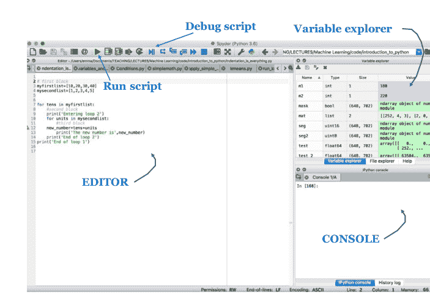

图 1.1 Spyder。

虽然有许多 IDE 可用，但我们推荐 Spyder³，因为它与 MATLAB 模式非常相似。可以通过 Anaconda 免费使用 Spyder，通过通过 Anaconda Navigator，或者在（Linux 或 macOS）终端中输入应用程序名称来访问。图 1.1 显示了该 IDE 的预期示例。

## 1.1.3 在网页浏览器中编码

Jupyter notebooks 和 Colab⁵ 是 IDE 的替代方案，支持在交互式 Web 环境中运行代码。这两者都不是 Python 独有的，但无论是否从浏览器运行 Python（这会在后台运行 Python 内核），这两个系统都提供了一个巨大的优势：可以将代码与文本交替使用（见图 1.2）。主要区别在于 Jupyter notebooks 在本地 CPU 上运行代码，而 Colab notebooks 在云端运行，提供有限的免费 GPU 支持（这对于深度学习章节可能很重要）。请注意，Jupyter notebooks 随 Anaconda 安装，而 Colab 则通过 Google 账号访问。对于无法访问 Google 的用户，替代云服务包括 Kaggle Notebooks⁶ 和 gradient by Paperspace⁷。

- ³ https://www.spyder-ide.org/
- ⁴ https://jupyter.org/
- ⁵ https://colab.research.google.com/
- ⁶ https://www.kaggle.com/kernels.
- ⁷ https://gradient.paperspace.com/notebooks.

## 1.1.4 编写你的第一个 Python 程序

Python 的简单性没有比通过著名的“Hello World”示例更能更好地体现了。具体来说，在 Python 中打印“Hello World”需要以下函数：

```python
print("Hello World")
```

这可以输入到控制台并直接运行，也可以保存为 `hello.py` 文件以便从编辑器或命令行运行。相比之下，在 C++ 中执行相同的操作需要更多的几行代码，并导入标准库：

```cpp
#include <iostream>
using namespace std;

int main() {
    cout << "Hello, World!";
    return 0;
}
```

从更根本上说，C++ 代码在编译之前是不会运行的。

# Python 编程


### 条件 (if) 语句

在最简单的（伪代码）代码中，Python 中的 if 语句看起来如下：

```python
if condition:
    statement
    statement
```

条件语句必须求值为布尔值（True/False），除此之外几乎很少限制，示例包括：

```python
if weight>=25:
    print("This person is overweight")

if name=="John":
    print("This person's name is John")
```

可以使用所有形式的条件语句（在 2.2 类型介绍中描述），并使用 `and` 和 `/or` 语句，例如：

```python
if a==12 and b==10:
    print(run the following block of code)
```

## 1.1.5 注释

最后，在讨论特定语法之前，必须强调对代码注释的重要性，以便他人能更好地阅读。Python 注释以 `#` 标出：

```python
# this is a code comment
```

这些注释将贯穿本书。

## 1.2 变量类型和运算符

在 Python 中，编程数据类型是一个重要概念。不同类型的变量具有不同的属性，每个变量都有自己的函数。在本节中，我们将涵盖简单数据类型（数字、字符串和布尔值），以及更复杂的结构（列表、元组和字典）。同时，我们将处理算术 (`+`, `*`) 和布尔 (`and`, `or`) 运算符。

### 1.2.1 简单变量类型

第一组变量是数值数据类型。Python 支持三种类型：整数（整数）、浮点数（小数）和复数。赋值变量值的示例是：

```python
myint = 5
```

浮点数声明的示例：

```python
float1=12.1
float2=float(myint)
```

要验证变量包含什么，可以使用 `type` 函数（例如 `type(myint)`）。本课程将不会使用复数。

### 字符串

字符字符串可以使用单引号或双引号定义：

```python
string1="a string"
string2='another string'
string2="Emma's string"
```

其中，如果你需要在内部使用撇号，则外部必须使用双引号。

### 格式化字符串

在某些情况下，我们将使用带有 `.format` 方法的字符串进行格式化输出的打印语句。使用这种格式，可以使用字符串对不同数据类型进行转换，同时截断浮点数，例如

```python
print('var1: {}, var2: {}'.format('dog','cat'))
```

将返回

```
var1: cat, var2: dog
Pi 3.4159
```

通用语法为 `[argument]:[width][precision]`，使得示例：

```python
print('Pi is {:.8f}'.format(3.14159, 2))
```

返回

```
Pi is 3.14,
```

保留到两位小数，前面有五个空格；由于格式占位符 `{:.8f}` 根据其位置选择参数。

### 布尔值

布尔值代表二元的 True 或 False。它们可以从 `bool()` 函数或布尔运算符返回。对于控制流（即 if 语句），以下对象将被视为 False：

- 整数或浮点数零 (`0` 或 `0.0`)
- `None`
- 空列表、元组、数组等（例如 `()`, `[]`)

其他所有输出都被视为 True。

### 动态类型

Python 变量不是“静态类型”的。这意味着你不需要在使用变量之前声明它们，也不需要声明它们的类型。Python 中的每个变量都是对象，例如你可以在打印语句中声明简单变量，并在不先声明类型的情况下对其进行数学运算。

## 1.2.2 分组结构

除了简单数据类型，Python 还提供了系列不同的存储变量的结构。关键类型（暂忽略数组和矩阵）是列表、元组和字典。回顾这些类型时需要注意的主要区别是它们是否按顺序存储对象，以及它们是否可变。

### 可变和不可变对象

可变对象的定义是在创建后可以更改的对象。所有内置简单 Python 变量（int、float、字符串、布尔值）都是不可变的。这意味着当给之前创建的变量分配不同的值时，例如：

```python
my_var=5
my_var=7
```

这两个 `my_var` 实例内存位置将会改变，表明创建全新的变量。可以通过每行代码后运行 `id(my_var)` 来验证。

对于分组结构，这种属性的影响更为明显，因为尝试在不可变分组结构中的任何位置分配新变量，例如：

```python
my_tuple=(1,2,3)
# 尝试更改第一个项
my_tuple[0]=4
```

会导致 Python 抛出错误。如果你尝试向现有字符串分配新字符，情况也是如此。

### 列表

列表是对象的有序集合。这些元素不需要是相同类型，可以是数字、字符串或其他类型对象的任意混合。

使用 Python 编程

```python
# 一个空列表
emptylist=[]
# 一个整数列表
integerlist=[1,2,3,4,5,6]
# 一个字符串列表
stringlist=['string1', 'string2', 'string3']
# 一个包含混合数据类型的列表
mixedlist=[10, 'some string', 4.2, 2, 'some other string']
# 一个“嵌套”列表（列表的列表）
```

列表可以包含其他列表作为子列表，这被称为嵌套列表：

```
nestedlist=[['dog', 'cat'], [1,2,3,4], [10, "some string", 'some other string'] ]
```

其中并不要求这些列表包含相同长度的列表。列表是可变对象，因此可以在运行时进行追加：

```python
mixedlist.append('another variable')
```

或者可以在任何时间在列表的中间插入新对象：

```python
mixedlist.insert(2,'inserted variable')
```

## 元组 (Tuples)

元组是不可变的列表。它们的定义方式与列表类似，不同之处在于元素集被包含在括号而不是方括号中，并且创建后元组中的任何元素都不能被更改：

```python
# 空元组（括号表示）
myuple=()
# 一个混合元组
myuple=(10,"Dog", 4.2)
```

使用元组是有优势的，因为它们比列表更快。因此，在程序运行时间很重要且你想永久固定列表中项目的项目的情况下，元组会很有用。

## 字典 (Dictionaries)

字典与元组、列表的区别在于存储的对象没有顺序。相反，使用键（keys）对对象进行索引。字典使用花括号表示法：

```python
# 空字典
mydict={}
```

并且可以一次填充一个条目：

```python
# 定义一个键值对查找对象
mydict['Course Name']='Machine Learning' # 键是 'Course Name'（方括号内），对象是 'Machine Learning'
mydict['Department']='biomedical engineering'
mydict['Year']=2021
mydict['Number of students']=67
```

或者使用内联表示一次性填充，例如，键:对象1.....

```python
# 内联定义
mydict_inline={'Course Name': 'Machine Learning', 'Department': "biomedical engineering", 'Year': 2021, 'Number of students': 67}
```

和字典一样是可变的，这意味着对象是可以更改的，例如在课程开始后添加新学生：

```python
# 增加字典条目
mydict['Number of students']=68
```

或者在稍后的时间添加新键，例如：

```python
# 添加新的字典条目
mydict['Student Satisfaction Score']=5
```

键可以是任何不可变类型（包括元组）：

```python
# 字符串作为键（最常见）
mydict['key']='val1'
# 整数和浮点数作为键
mydict[5]='val2'
mydict[3.2413]='val3'
# 元组作为键
mydict[(1,2,3)]='val4'
```

然而由于字典是无序的通常使用字符串是最合理的。对象可以是任何类型，包括列表或其他字典，

```python
# 将列表作为新的字典条目添加
mydict['student ids']=['id00001','id00006','id00015']
```

可以使用 `del dict[key]` 删除字典元素。任何尝试对不存在的键进行索引都将引发 KeyError。

## 1.2.3 运算符

现在我们已经知道了可以处理哪些种类的变量，那么我们可以对它们执行什么类型的操作呢？在本节中，我们将查看简单的数学运算符和布尔运算符。

### 数学运算符

基本的数学运算符有：加法 (`+`)、减法 (`-`)、乘法 (`*`) 和除法 (`/`)。取模运算符返回除法后的整数余数，例如：对于 `a=9` 和 `b=5`，`a%b=4`。使用两次星号 (`**`) 产生幂运算符，例如 `a**2=81`。而 `//` 运算符意味着地板除：`// //=1`。

注意，运算符也适用于字符串、列表和字典，例如，给定两个字符串：`string1='hello'` 和 `string2='5'`，加法 (`string3=string1+string2`) 返回 `'hello5'`，乘法 (`string4=string1*3`) 返回 `'hellohellohello'`。相同的操作也可以应用于列表，例如：

```python
list1=[1,2,3,4]
list2=[5,6,7,8]
list3=list1+list2
#或者
list1+=list2
```

使用 `+=`, `-=`, `*= `运算符可以简化操作并减少所需的代码量，如 `a+=b`。对于列表等可变对象，可以用此向现有列表追加附加项目。而对于不可变的数值和字符串变量，输出将是内存中的一个新变量。


### 布尔运算符

与数学运算符相反，布尔操作始终返回 True 或 False。它们通常用于定义 `if` 和 `while` 控制流语句（在第 1.4 节介绍）。示例包括：

- 精确等于：`==`
- 不等于：`!=`
- 取反/相反：`not`
- 对象标识性：`is` 或 `not`
- 比较：大于 `>`，小于 `<`，大于或等于 `>=`，小于或等于 `<=`
- 包含：`not` or `in`

一些布尔运算符使用的示例如下：

```python
a=9
b=5
a == b # False
a != b # True
not a == b # True
a > b # True
a < b # False
a >= b # True
a <= b # False
5 in [1, 2, 3] # True
5 not in [1, 2, 3] # False
```

## 机器学习应用中的布尔运算符

在运算符，布尔，通常用于定义 `if` 和 `while` 控制流语句（在第 1.4 节介绍）。检查两个变量是否指向同一个对象，使用 `is` 或 `not`。检查一个列表是否包含某个元素，使用 `in` 或 `not`：

```python
a =1,2,3]
b = [1,2,3]
a is b # False
a is not b # True
a == b # True
```

要检查一个项目是否在列表中，使用 `in` 或 `not`：

```python
my_list=[1, 2, 3]
print(5 in my_list # False
```

最后，条件语句可以与 `and`/`or` 语句一起考虑，其中对于 `and`，两个语句都为真时返回 True；而对于 `or`，一个为真即可返回 True，例如：

```python
a=10
b=12
a == b # False
a != b # True
a > b # False
a < b # True
a >= b # False
a <= b # True
```

## 1.2.4 练习

- 1. 打开 IDE 并创建 a) 一个整数；b) 一个两位小数的浮点数；c) 一个字符串。将浮点数转换为整数并打印。

代码、练习和答案可以在 `github.com/MachineLearningBiomedicalApplications/notebooks` 获取。
- 2. 使用格式化字符串。
- 3. 创建一个英语翻译法语字典；你还能想到字典的哪些用途？
- 4. 什么是不可变？
- 5. 尝试各种操作。

## 1.3 索引与切片

列表、元组和字符串被称为顺序数据类型。这意味着可以按顺序遍历这些对象、索引单个元素并对范围变量进行切片。

**与 MATLAB 不同，Python 对象的索引从 0 开始而不是 1。** 因此，`integerlist` 中第二个索引（第三个元素）对应的整数索引为 `integerlist[2]`，并返回值 `3`。

还可以使用 `my_list[start:stop:step]` 语法对列表（字符串或元组）中的不同范围或组进行切片，需要注意的是，**切片包含但不包含最后一个索引。** 例如，切取 `integerlist` 的前五个值可以使用语法 `integerlist[:5]`。要返回中间的两个（六个中的）元素，使用 `integerlist[2:4]`。同样，可以使用负数相对于数组末尾定义范围，例如，切取从第四个到

# 用于生物医学应用的的机器学习

倒数第二个（第五个）如所示：`integerlist[3:-1]`。增量地看，切片并没有固定要求必须选取范围内的每个元素。另一种选项是使用步长符号，例如，选择范围内的每第二个元素：`integerlist[0:5:2]`。

## 1.4. 控制流

与许多编程语言一样，Python 提供了各种类型的语句来引导代码流，允许循环、中断（`break`）和条件语句。在书中，我们将考虑 `if`、`for` 和 `while` 语句，但也可能遇到 `except` 语句（指定异常处理程序和/或清理代码）或 `with` 语句（允许在运行代码块之前执行初始化和终止代码）。所有的控制流语句都有共同的形式。在伪代码中其形式如下：

该结构最核心的特征是：

- 确保在条件语句末尾放置冒号；
- 控制流语句之后紧跟缩进的语句。

在 Python 中，代码流几乎完全通过代码缩进来控制（见图 1.3）。这些缩进表示代码块属于流语句。然而，要跳出循环，只需将代码块恢复与之前的代码块对齐即可。这与 MATLAB（使用语句）以及 C/C++（将所有控制流放在括号内）不同。

### 1.4.1 练习题

- 在你的 IDE 中创建列表：`vowels=('a', 'b', 'c', 'd', 'e')`
- 你将如何索引字母 'd'？
- 从 'b' 到 'd' 进行切片（包含两端）；
- 向列表添加字母 'f'。
- 下面代码的输出是什么？

```python
b = "Introduction to Python"
print(b[3:7])
```

> 9 代码、练习题和答案可以在 `github.com/MachineLearningBiomedical-Applications/notebooks` 获取。

# Python 编程

主

(块 #1)

缩进

For 循环

(块 #2)

If 语句

(块 #3)

```python
# doing some coding ...
units=[1,2,3,4,5]
total=0
for number in units:
    sq=calculate_square(number)
    print(numbers)
    total+=number
    if number < 3:
        print('{}'.format(number))
    print('the square of {} is {}'.format(number,sq))
print('the total is {}'.format(total))
```

回到主程序 (块 #1)

1 is less than 3

square of 1 is 1

2 is less than 3

square of 2 is 4

square of 3 is 9

square of 4 is 16

square of 5 is 25

total is {format(total)

```

图 1. 使用缩进控制流。

## 3. 这段代码哪里错了？

```python

a = "Introduction to Python"

a[2]="b"

```

### 1.4.2 调试

探索缩进错误提供了一个有用的框架，用于突出 Python 的异常处理和错误消息，因为如果之前的代码示例包含错误且不小心删除了循环中间的缩进，Python 解释器将抛出 `IndexError` 错误（图 1.4），标亮错误行，并使用 `^` 符号标明行内位置。通常情况下，Python 的错误消息应该是相当自解释解释的。然而，有时你会遇到你不理解的消息。在这种情况下，建议求助于在线支持论坛，如 Stack Overflow.¹10

## 1.5. 条件 (`if`) 语句

从 `if` 开始，让我们依次查看每个类型控制流的结构。在伪代码中，Python 的 `if` 语句遵循以下形式：

```python

if condition:

    statement

    statement

```

¹10 https://stackoverflow.com/

# 用于生物医学应用的机器学习

| 行 | 代码 | 备注 |
| :--- | :--- | :--- |
| 1 | #doing some coding .... | |
| 2 | units=[1,2,3,4,5] | |
| 3 | | |
| 4 | total=0 | |
| 5 | for number in units: | |
| 6 | calculate square of number | |
| 9 | #sum numbers | |
| 10 | total+=total_number | 修改的行 |
| 11 | if number < 3: | 错误行 |
| 12 | print('{} is less than 3'.format(number)) | |
| 13 | | |
| 14 | print('the square of {} is {}.'.format(number,sq)) | |
| 15 | print('the total is {}.format(total)), line 11 | |
| 16 | if number < 3: | |
| | IndentationError: unexpected indent | 位置在 line=5 |

**图 1.4** 调试。

其中条件语句必须求值为布尔值（True/False），但其他限制很少。一些示例包括：

BMI=27

```python

if BMI > 25.0:

   print('This person is overweight')

```

或者 name='John'

```python

if name=='John':

   print("This person's name is John ")

```

所有的条件语句形式（在第 1.2.3 节“布尔运算符”中描述）都可以通过 `is` 使用。也可以通过使用 `and` 或 `or` 使用组合条件：

```python

a=10

b=12

```

```python

if a < 15 and b > 10:

   print('run the following block of code')

```

## 1.6.4 列表推导式 (`List comprehensions`)

另一种一种使用简写形式编写列表推导式的示例。它们将 `for` 循环中的所有代码行（仅包含一个语句和一个输出表达式）压缩为单行，并在末端各加上一个方括号。

```python

a=[]

for i in range(5):

    if i%2==0:

        a.append('num'.format(i))

```

因此，对于上一个列表，它会打印 0 到 4 之间能被 2 整除的数字（并拼接到 'num' 字符串中），使用列表推导式，代码可以写成单行：

```python

b=['num'.format(i) for i in range(5) if i%2==0]

```

注意，如果 `if` 语句不是必要的组件，那么你可以编写只包含 `for` 的列表推导式。

## 1.6.5 练习

- 编写一个循环，打印出 0 到 1000 之间能被 3 和 5 整除的所有数字。
- 编写一个函数来乘以列表中的所有数字。
- 编写一个 Python 函数，检查一个数字（例如 71）是否为质数。
- 列表推导式：以下 Python 代码段的输出是什么？

```python

my_string='1230dkampmfdnosmxc!!aaaaa'

k = [print(i) for i in my_string if i not in 'aeiou']

```

- 字典化操作：以下几行代码的输出是什么？

```python

En_Fr = {"parc": "park","maison": "house"}

En_Fr = {}

En_Fr['park'] = "park"

En_Fr['house'] = "maison"

En_Fr['park'] = "jardin"

```

```python

for key in En_Fr.keys():

    print(En_Fr[En_Fr[key])

```

## 1.7 函数 (`Functions`)

函数允许对代码段进行紧凑结构化，这些代码旨在在程序（或实际上是多个程序）中多次使用。Python 中的函数通过 `def` 语句定义。在伪代码中，通用语法如下：

```python

def function(arg1,arg2,arg3):

    body of code to be repeated

    return someval,someval

```

该函数接收输入参数 `arg1`、`arg2` 和 `arg3`，执行操作，并输出变量 `someval` 和 `some2`。与控制流一样，函数定义后`跟着一个冒号`，函数内部的所有代码相对于 `def` 语句都要进行`缩进`。对于简单函数，可以在一行中返回，例如：

```python

def sum(x,y):

    return x+y

```

还可以提供带有默认值的可选输入参数，例如此示例中的 `z`：

```python

def sum2(x,y,z=0):

    return x+y+z

```

由此，可以带上 z 或不带 z 来调用该函数：

```python

a=5; b=10; c=20

sum_of_a_and_b=sum2(a,b)

sum_of_a_b_and_c=sum2(a,b,c)

```

或者，可以通过使用关键字（在函数调用中引用特定的参数名）来指定需要哪些可选参数：

```python

def sum3(x, y, z1=0, z2=0):

    return x - y + z1 - z2

```

```python

# 应用函数

a=5; b=10; c=20; d=30

a_minus_b=sum3(a,b)

a_minus_b=sum3(42,15)

a_minus_d=sum3(42,15,z2=10)

```

# 机器学习中的机器学习 (`Machine Learning for Applications`)

在所有情况下，函数都可以接收任意数量的输入参数，并返回任意数量的输出参数。对于函数，可以使用星号 `*` 来定义任意数量的：

```python

def arbitrary_sum(*x):

    mysum=0

    for val in x:

        mysum+=val

    return mysum

```

mylist=[1,2,3,4,5]

```python

sumlist1=arbitrary_sum(*mylist)

# 返回与相同的结果

sumlist2=arbitrary_sum(1,2,3,4,5)

```

## 1.7.1 文字符串 (`Docstrings`)

在编写包含函数的代码时，良好的习惯是在函数定义后使用三引号字符串记录函数的目的。

```python

def arbitrary_sum(*x):

    """

    此函数叠加任意数量的输入参数

    输入参数:

        *x: 待加数字的列表或元组

    返回:

        mysum: 所有输入参数的和

    """

```

## 1.7.2 按对象传递 (`Passing by object`)

在 C++ 中，你可能听过关于向函数传递参数是按值传递”（pass by value）或“按引用传递”（pass by reference）的概念。这涉及到变量是在传递给函数时是被复制到内存中的新位置（按值传递），还是传递内存地址并与函数共享（按引用传递）。在前一种情况下，当在函数内部更改参数时，原始变量保持不变。在后一种情况下，更改参数的值也会更改原始变量的值。

在 Python 中，参数是严格“按对象传递”的，这意味着函数内部对变量的操作发生取决于它是不可变的还是可变的。对于不可变类型（整数、浮点数、元组、字符串），对象是不可变的，因此无论是在函数内部还是代码主体中都无法更改。因此，它们实际上总是按值传递的。另一方面，如果对象是可变的（列表、字典），那么如果原地更改变量，原始值（在主代码主体中）是可以被更改的，例如：

```python

def passing_by_object2(names):

    # 使用 += 运算符原地更改：

    names

```

## 1.7.3 练习

- 3. 以下代码的输出是什么？

```python

def select(aList):

    result = aList[0]

    for i in range(len(aList)):

        if aList[i] < result and aList[i] % 2 != 0:

            result = aList[i]

    return result

```

```python

myList = [6, -5, 7, 4, -8]

print(select(myList))

```

```python

def mysum(x,y):

    return x+y

```

```python

def mult(x,y):

    return x+y

```

```python

def divide(x,y):

    return x/y

```

这个例子显然是冗余的，但它可以作为一个简单的解释，因为我们现在可以想象通过 `sm @ load module` 来加载 simplemath。

```python

import simplemath as sm @ load module

```

```python

@ define variables

x=2; y=5

```

```python

print('output sum of x and y:', sm.mysum(x,y))

print('output product:', sm.mult(x,y))

print('output quotient:', sm.divide(x,y))

```

注意通过执行 `import`，模块函数对任何脚本都可用。在这里，模块的名称必须与代码存储的 .py 文件中的定义完全一致。一旦导入，模块中的函数就可以通过在函数函数名前加上导入时赋予模块的名称（使用 `sm`）来简单地调用。也可以使用 `from` 语法从模块中选择函数：

```python

from simplemath import divide

```

```python


`print('output sum of x/y:', divide(x,y))`

# 标准模块

某些模块随 Python 一起附带作为标准库。¹¹² 有用的示例包括：`copy`，之前提到过的作为内存中复制变量的方法；`os`，它支持与操作系统的交互（允许定义文件路径并更改当前工作目录）。还有 `sys`，它允许从 Python 搜索路径中添加和删除路径；因此，当你需要添加用户设计模块的位置时它是很有用的：

> 12 https://docs.python.org/3/tutorial/stdlib.html.

## 1.8.3 包

```python
import sys

sys.path.append('/some/path/')
```

最后，`math` 是 Python 的标准数学模块，包括其他函数外，向上取整或向下取整的操作：

```python
import math

x=2.2 ; y=4

round_up=math.ceil(x)

round_up=math.floor(x)
```

Python 包是相关类和模块的集合，旨在解决某些大类任务。为了满足各种高级编程需求，存在大量由外部支持且文档齐全的包。本模块将包含的一些示例包括：

- *NumPy[32]¹³—一个用于科学计算的包，具有快速操作数组的功能和强大的数值计算工具 [19]*
- *Matplotlib[20]¹⁴—一个绘图库，旨在模拟 MATLAB 的绘图行为；*
- *Scikit Learn¹⁵—一个强大的工具箱，具有广泛的机器学习方法实现和直观的 API [6,34]；*
- *Pandas¹⁶—用于创建和处理复杂表格数据表的工具 [50]；*
- *Nibabel¹⁷—一个读取和写入医学图像文件格式的库。*

我们将在适当的时候学习更多这些包，从后续第 1.9 节的 NumPy 开始。注意，当代码使用此类包时，在生成的项目和论文中引用它们是非常重要的。

# 安装包

假设你已经安装了 Anaconda，那么所有列出的包（Nibabel 除外）应该已经安装。然而，对于其他包（如 Nibabel），有两种安装方法：要么通过 Anaconda：

```bash
conda install -c conda nibabel
```

> ¹³ http://www.NumPy.org/
> ¹⁴ https://matplotlib.org/
> ¹⁵ https://scikit-learn.org/
> ¹⁶ https://pandas.pydata.org/
> ¹⁷ http://nipy.org/nibabel/
> ¹⁸ https://www.scipy.org/citing.html.

或者通过 python 安装包 pip：

```bash
pip install nibabel
```

这些命令应该在你的本地系统的终端（或 cmd）窗口中输入。在这里，`conda-forge` 代表一个独立的社区资源，它是通过 Anaconda 安装的流行 Python 仓库。一些非常流行的包也可以通过运行 `conda install <package>` 从主 Anaconda 安装获取。要更新包，请使用 `pip install <package> --upgrade` 或 `conda update <package>`

## 1.8.4 类

进一步，Python 是一种面向对象的语言，允许将代码结构化为类。这支持整洁高效的编码风格，进一步提高了代码的可读性和重用性。Python 类的基本结构可以写成：

```python
class ClassName:
<statement-1>
.
<statement-N>
```

其中有必要用构造函数（实例化函数）开始类，例如：

```python
class MyClass:
def __init__(self): # 构造函数
self.data = []
```

```python
x=MyClass() @ 创建类的新实例。
```

构造函数的任务是创建类的实例，并对代码其他地方使用的类属性进行初始化（赋值）。在 Python 中，构造函数由 `__init__()` 方法组成，并且在创建对象时总是被调用。构造函数之外，类还包含属性和方法（函数）定义：

```python
class MyClass:
# 创建一个类属性
my_class_attribute="bananas"
def __init__(self):
    self.data = []
    # 创建一个实例属性
    self.instance_attr = random.randint(1, 100)
```

```python
def f(self):    函数 -> 对象方法
    return 'hello world'
```

在这里，属性可以在构造函数之外定义（如 `my_class_attribute` 所示）。这对于类的每一个实例来说都都是相同的（'bananas'）。或者，每个实例可以有它自己的“属性”，例如 `self.instance_attr`，在构造函数或类方法内部定义；这些描述了正在创建的对象的属性，例如下一节中 NumPy 矩阵的形状、大小、ndim 和 dtype。

理解 Python 类的格式是开发和利用 Python 包的必经知识。然而，在本书中，我们将坚持相对简单的脚本。因此，我们将对高级特性的研究留给读者。

## 1.9 NumPy

NumPy（"Numerical" 的缩写）是基于 NumPy 基础的，由外部支持且文档齐全的库。在计算中，NumPy 通常被导入为：

```python
import numpy as np
```

## 1.9.1 数组

在术语中，数组是数据结构，使用 `arange([start], [stop], [step])` 在范围内均匀采样，例如 `np.arange(50,85)` 在 [50-80) 范围内以步长为 5 进行采样。注意，当采样所有整数时，只需要定义范围的终点，例如，`np.arange(5)` 返回 [0,1,2,3,4]。当，替代，寻求范围范围内的数量时，使用 `np.linspace(start,end,num)`。在这里，`num` 决定了样本的数量和间隔的大小。

## 1.9.2 创建数组

有些用于数组生成的填充方法：

```python
zeros=np.zeros((3,3))

ones=np.ones((3,3))

identity = np.eye(3)

empty=np.empty((3,3))
```

在这里，`zeros` 创建全 0 3x3 数组；`ones` 创建全 1 数组；`eye` 创建单位矩阵，`empty` 创建未初始化的数组。注意在每种情况下返回的数组大小都是 33；然而，函数的区别取决于形状是作为元组传递还是每个维度作为单独参数传递。

## 1.9.3 从列表初始化

NumPy 数组也可以从列表初始化：

```python
# 创建 1D 数组
my_array=np.array([1,2,3,4,5,6])

# 创建 2D 数组
my_matrix=np.array([[1,2,3,4,5,6],[7,8,9,10,11,12]])
```

## 1.9.4 随机数生成

NumPy 还有一个子模块 `np.random`，¹ 创建遵循特定随机分布的数组，包括 [0,1) 范围内的均匀分布样本：

```python
rand1=np.random.random(3,3)
```

从标准正态分布采样的浮点数

```python
rand2=np.random.randn(3,3)
```

以及某些范围内的随机整数，例如 [5,20):

```python
rand3=np.random.randint(5,20,(3,3))
```

在这里，第一个参数指定了文件的路径，第二个参数（分隔符）定义了文件中值是如何分隔的，例如，`','` 表示逗号分隔的值（或 csv 文件），但数组也可以同样使用空格进行存储。同样地，可以使用 `savetxt` 将数组保存为文本文件，或者更高效地使用 `np.save(filepath, arr)` 将其保存为 .py 文件。NumPy 文件可以通过 `np.load(filepath)` 加载。

## 1.9.2 数组属性

每个数组对象都可以由一系列属性来描述，包括 `shape`（每个维度的长度）、`size`（元素总数）、`ndim`（总维度数）和 `dtype`（数组的类型）；要访问这些属性，请使用 `array.attr_str`，例如：

```python
my_array=np.array([[1,2,3],[4,5,6]]).dtype=np.int16
my_array_shape=my_array.shape @ returns (2, 3)
my_array_size=my_array.size @ returns 6
my_array_dtype=my_array.dtype @ returns dtype('int16')
```

## 1.9.3 索引、切片与迭代

数组和列表的索引从 0 开始，或者使用负整数从数组结束反向索引：

```python
my_array=np.array([1,2,3,4,5,6,7,8,9,10])
print('the first index of array:',my_array[0])
print('the last index:',my_array[-1])
print('the penultimate index:',my_array[-2])
```

同样，与列表一样，NumPy 数组也可以进行切片。然而，你必须为数组的每个维度指定切片，例如：

```python
my_matrix=np.array([[1,2,3,4,5,6],[7,8,9,10,11,12]])
my_slice=my_matrix[1:2,5]
```

返回一个 1×3 的数组，表示第二行从第三列到第五列的值。同样，与列表一样，范围不包含范围最后一个索引。或者，为了切取后续矩阵的整行（或列），使用冒号来表示需要所有列（或行）的值，例如，`my_matrix[0:]` 切片取第一行，而 `my_matrix[:,3]` 切片取第四列。在固定范围内切取子矩阵时，整数索引（使用列表）允许从数组中选择任意值，例如 `my_matrix[[1,3,5]]` 返回第 2、4、6 列。更多示例见图 1.5。还可以从数组中返回所有满足特定布尔条件的索引，例如：

```python
boolean_cond=(my_matrix>4)
new_matrix=my_matrix[2][boolean_cond]
```

这在某些情况下非常有用用，例如，当目标是使用另一个数组的值来掩码一个数组时（图 1.6）。

| 表达式 | 形状 |
| --- | --- |
| arr[:2, 1:] | (2, 2) |
| arr[2] | (3,) |
| arr[2, :] | (3,) |
| arr[2:, :] | (1, 3) |
| arr[[0,2],:] | (2,3) |

图 1.5 切片 NumPy 数组。

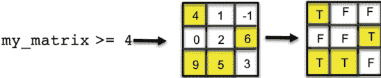

图 1.6 数组掩码。

## 1.9.4 数组重塑

在本书的通常情况下，在对数组进行操作之前，需要对其进行重塑或展平化。使用 NumPy，可以通过 `ravel` 或 `flatten` 实现数组展平化。在这里，这两个函数执行相同的通用操作。然而，`flatten` 会在内存中创建变量的完整副本（具有新形状），而 `ravel` 继续引用原始数组。一个重要的区别是，对 `ravel` 操作输出的展平数组的任何更改都会改变原始数组的内容，而 `flatten` 则不会。应该注意哪种是所需的行为。然而，由于 `ravel` 不占用任何新内存，它的运行速度更快。

在两种情况下，该函数都通过可选参数 "order" 提供了遍历数组的选择。Order 的值可以为 "C"（默认）、"F" 和 "A"（图 1.7）。在这里，“C" 表示以与 C/C++ 相同的方式展平，即按行优先顺序，其中行索引变化最慢，列索引变化最快。“F" 代表 Fortran 列优先顺序，“A" 保留原始数组的 C/Fortran 风格（当其被保存为属性时如此）。

更通用的重塑操作可以使用 `reshape` 和 `resize` 函数实现。在这种情况下，`reshape` 创建数组的副本，而 `resize` 修改原始数组。也可以将两个（或多个）数组拼接在一起，只要它们共享（至少一个）兼容的维度：

| 1 | 2 | 3 |
|---|---|---|
| 4 | 5 | 6 |
| 7 | 8 | 9 |
| 10 | 11 | 12 |

```python
print(A.flatten(order="C"))
# [1 2 3 4 5 6 7 8 9 10 11 12]
# [1 4 7 10 2 5 8 11 3 6 9 12]
```

**图 1.7** 数组展平。

```python
np.concatenate([a1, a2, ...], axis=0)
```

## 1.9.5 广播

广播是 Python 中一种强大的机制，允许对数组进行组合操作，只要等效维度的尺寸相同或其中为 1。这意味着，如果你有两个维度数量不同的数组（例如，向量和一个矩阵），则会在较小的数组上添加额外的维度以赋予该维度。只要数组之间的所有其他维度一致，将允许它们一起操作。例如，当将形状为 (3,4) 的矩阵与形状为 (4) 的数组求和时（图 1.8），Python 将沿着行维度广播三个向量副本，直到它与较大数组的大小相同。隐式地。

图 1.8 广播。

## 1.9.6 练习

- 尝试创建自己的数组并检查它们的属性，例如：
    - 从嵌套列表创建一个数组；
    - 创建全零数组；
    - 创建包含随机整数的数组；
    - 创建一个在 0 到 10 之间的数组；
    - 打印这些数组的各种属性；
    - 创建一个与 X 大相同的矩阵；
    - 执行矩阵操作：mean, std, var。
    - 切取第三行和第四列；
    - 将 X 重塑为 2x3；
    - 使用广播创建一个 4x6 的数组；
    - 执行 sqrt, exp, log 操作。
- 给定以下数组：
```python
X=np.array([[1,2,3,4,5,6],[7,8,9,10,11],[12,13,14],[15,16,17],[18,19,20],[21,22,23]], dtype=np.int64)
```
- 根据布尔条件返回索引；
- 掩码数组。
- 给定以下数组：
```python
C = np.array([[1,2,3,4,5,6],[7,8,9,10,11],[12,13,14],[15,16,17],[18,19,20],[21,22,23]], dtype=np.float64)
```

## 1.10. MATLAB 到 Python 技巧

假设许多读者是带着 MATLAB 学这本书的，我们包含了表 1.1，它总结了主要的相似点和差异。需要注意的关键点是：

- **Python 使用缩进控制流**（因此在 if/for 语句末尾没有语句，与 MATLAB 不同）；
- **Python 索引从 0 开始而不是 1。**

此外，Python 不需要在每行末尾加分号来防止解释器打印每个变量的值。然而，它们的存在不会导致任何错误。

# 表 1.1 MATLAB 到 Python 速查表。

| MATLAB | Python |
|---|---|
| % 注释使用 '%' | # 注释使用 '#' |
| % 语句末尾加分号 var_int=5; | # 无分号 var_int=5 |
| % 数组创建 C = [1, 2, 3]; | # 使用相同的分号 ';' C = [1, 2, 3] |
| % 索引从 1 开始 C(1) | # 索引从 0 开始 print(C[0]) |
| % 循环 % 不需要初始化数组 使用 end 控制语句 i=1:10 A(i) = 1; | # 循环 A=[] @ 初始化空数组 使用缩进控制流 i in np.arange(10): A.append(i) |
| % 创建 2D 数组 my_array=[1.2,3; 4.5,6]; | # 创建 2D 数组 my_array=[[1,2,3],[4.5,6]] |
| % 逻辑判断 a < 15 || b > 10 a < 15 && b > 10: | # 逻辑判断 a < 15 or b > 10 # 逻辑判断 a < 15 and b > 10: |
| % MATLAB 数组功能内置 - eye(3); | # Python 导入数组 import numpy as np - eye(3) |

生物医学机器学习

| df | gender | height | df2 | height |
|---|---|---|---|---|
| 0 | M | 183 | 0 | 80 |
| 1 | F | 163 | 1 | 163 |
| 2 | F | 152 | 2 | 90 |
| 3 | F | 157 | 3 | 272 |
| 4 | F | 157 | 4 | 80 |

**图 1.9** dataframe 对象示例。左侧：由数值组成的 df。右侧：数值和文本混合的 df2。

只需输入名称，或者如果行数过多，我们可以通过 `df.head()` 显示如图 1.9 所示的前五行。后五行通过 `df.tail()` 显示。

# 将 dataframe 转换为 numpy array

如果 dataframe 对象包含数值，我们可以使用 `df.to_numpy()` 将其转换为 numpy 数组

```
np_array=df.to_numpy()
```
这将丢失所有的列名和索引。

## 1.1.2 读取和写入文件

Pandas 提供了读取和写入各种格式数据的接口。我们可以读取 CSV 文件


`df=pd.read_csv('distance_height.csv')`

Python 特有的 **`pickle`** 格式可以通过以下读取

```
df2=pd.read_pickle('gender_height.pkl')
```

同样，我们可以使用这些格式保存 dataframe 对象到磁盘：

```
df.to_csv('distance_height.csv')
df2.to_pickle('gender_height.pkl')
```

## 1.1.3 选择和过滤数据

我们可以通过以下方式选择列

```
df['height']
```

以及行范围（例如前五行）：

```
df[0:5]
```

为了选择前五行的高度，我们使用 `loc` 函数

或者，我们可以通过 `iloc` 函数访问 dataframe 的数值索引，例如

```
df.iloc[0:5]
```

返回前五行的高度。我们还可以过滤数据，例如，如果我们想选择身高大于 170 cm 的学生，我们可以通过这种方式：

```
df[df['height']>170]
```

为了只选择这些学生的数据，我们可以调用

```
df['distance'][df['height']>170]
```

## 1.1.4 合并和迭代

我们可以轻松合并 `df` 和 `df2`，因为行对应相同的数据。我们只需将 'distance' 列复制到 `df2`：

```
df2['distance']=df['distance']
```

遍历 dataframe 的行，我们按照以下方式编写 for 循环：

```
for index, row in df2.iterrows():
   print(index,row['gender'],row['distance'])
```

在这个示例中，打印 `df2` 所有行的索引、`'gender'` 和 `'distance'`。

## 1.1.5 练习

- 1. 读取 `gender_height.pkl` 到 dataframe。执行以下操作：
   - 显示该数据集的第一行和最后五行；
   - 选择 `'height'` 列并转换为 numpy 数组；
   - 创建包含所有男性高度的 dataframe `male_heights`；
   - 将高度保存到 CSV 文件。

> ^2 数据和额外练习可以从 `github.com/MachineLearningBiomedicalApplications/notebooks` 获取

- 2. 读取文件 `gender_height.pkl` 和 `'distance_height.csv'` 到 dataframes。执行以下操作：
   - 将文件合并到同一个 dataframe；
   - 选择距离校园小于 30 英里的学生；
   - 遍历选定的学生并打印他们的性别。

## 1.12 Matplotlib

`Matplotlib` 是绘图库，功能与 MATLAB 非常相似。在本节中我们将简要介绍折线图、散点图、直方图、箱线图和 2D 图像。`Matplotlib` 模块的导入如下：

```
import matplotlib.pyplot as plt
```

### 1.12.1 折线图

折线图用于绘制简单函数。现在我们将描述如何获得图 1.10 左侧所示的折线图。

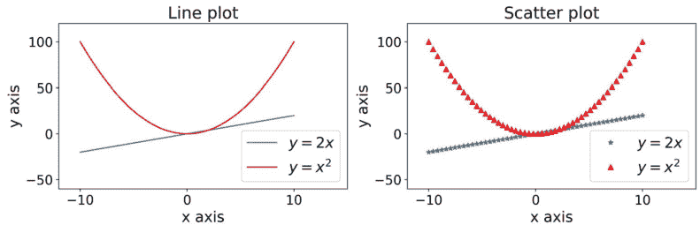

折线图散点图示例。让我们从绘制函数 y = 2x 开始。我们首先需要准备存储在 numpy 数组中的数据。我们将 `np.linspace` 创建区间 (-10, 10) 内 50 个样本的 x 值，并计算相应的 y 值：

```
import numpy as np
x = np.linspace(-10, 10, 50)
y = 2*x
```

让我们使用以下代码绘制图形

```
plt.plot(x,y)
```

始终通过添加标题和标记轴来注释你的图是非常重要的。注意我们如何通过设置 `fontsize` 参数来更改字体大小：

```
plt.title('Line plot', fontsize=16)
plt.xlabel('x axis')
plt.ylabel('y axis')
```

添加第二条线，例如 y = x²，我们只需重复相同的过程

```
y2 = x**2
plt.plot(x, y2)
```

注意，我们通过添加第三个参数 'r' 选择了红色作为绘图颜色。我们还需要注释我们绘制的线条，这可以通过图例来实现：

```
plt.legend(['y=x^2'])
```

我们使用了数学方程来定义图的位置。我们也可以通过以下方式更改轴的范围：

```
plt.xlim([10,15])
plt.ylim([50,120])
```

### 1.12.2 散点图

如果我们倾向于绘制单个点而不是曲线，可以使用散点图。有两种方法可以做到这一点。我们通过 c 参数设置颜色

```
plt.scatter(x,y)
```

显示在图 1.10 右侧。

### 1.12.3 子图

为了将两个图放在同一个图中，我们使用子图。通常，由于行对应相同的数据，我们会在定义子图之前调整图的大小：

```
plt.figure(figsize=(12,4))
### 左侧
plt.subplot(1,2,1)
plt.plot(x,y)
### 右侧
plt.subplot(1,2,2)
plt.scatter(x,y)
```

注意我们如何使用 `subplot` 函数来定义子图。这对于需要多个图非常有用。

### 1.12.4 直方图、柱状图和箱线图

`Matplotlib` 提供了绘制数据总结特征的函数。此类图的示例如图 1.11 所示。

#### 直方图

数值直方图（在本例中为学生高度）可以通过读取 **`pickle`** 格式来绘制

```
import pandas as pd
df=pd.read_pickle('gender_height.pkl')
plt.hist(df['height'], bins=7)
```

在这个示例中，我们使用 7 个箱（bins）来离散高度值（图 1.11）。

#### 柱状图

我们还想绘制男女学生的高度统计数据。首先，提取每个性别的高度：

```python
girls_height = df['height'][df['gender']=='F']
boys_height = df['height'][df['gender']=='M']
```

接下来，我们使用柱状图绘制每个性别的平均高度（图 1.11 中间）：

```python
plt.bar([0,1],[girls_height.mean(),boys_height.mean()])
plt.xticks([0,1],['girls','boys'])
```

#### 箱线图

`Matplotlib` 箱线图将计算并显示中位数、上下四分位数和值的范围，如图 1.11 右侧所示。输入参数是每个类别的数组。

```python
plt.boxplot(girls_height,boys_height)
plt.xticks([1,2],['girls', 'boys'])
plt.ylabel('Height')
```

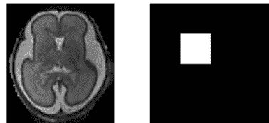

### 1.12.6 练习

- 1. 使用本节提供的代码创建图 1.10 左侧所示的折线图。完成以下任务：
   - 使用绿色线条为图表添加第三个函数 $y = \exp(x/2)$。更新图例；
   - 不要使用单一图表，修改图形以包含三个子图，每个函数位于一个独立的子图中；
   - 将每个函数的方程放在子图的标题中。

- 2. 加载第 1.11 节描述的、位于文件 `gender_height.pkl` 和 `distance_height.csv` 中的学生数据。将数据合并到一个 dataframe 中。创建以下图表：
   - `'height'`（身高）和`'distance'`（距离）散点图；
   - `'distance'`的直方图；
   - 女孩和男孩平均`'distance'`的柱状图；
   - 女孩和男孩`'distance'`的箱线图；
   - 提示：所有图表都接受 dataframe 和 numpy 数组。

- 3. 创建并显示图 1.12 右侧所示的图像。将颜色映射改为 `'viridis'` 和 `'jet'`。

$23$ 代码、练习和解决方案可以在 `github.com/MachineLearningBiomedicalApplications/notebooks` 获取。

# 第 2 章

# 机器学习基础

## 2.1. 什么是机器学习？

在过去的 50-70 年里，计算机程序在解决各种问题变得越来越重要。构建计算机程序的传统方法是编写一组规则并执行它们以计算某些结果。例如，完全由物理定律规定的过程（如特定时间点的放射性衰）可以根据简单公式 $A = A_0 \exp(-\lambda t)$ 进行预测，其中 $t$ 是时间，$\lambda$ 是衰减常数，$A_0$ 是 $t=0$ 时的活性，$A$ 是时间 $t$ 的预测活性。一个更复杂的例子是对罗塔号探测器路径的复杂且精确的计算，它从地球出发 10 年后于 2014 年降落在彗星上。

对于许多现实世界的问题，编写一组规则是很困难的，因为底层过程太复杂或未被完全理解。许多生物医学应用属于这一类。以孕期最后三个月大脑增长为例。在临床设置中，我们可以使用胎儿超声测量头周作为大脑大小的指标。但我们如何知道大脑是否健康呢？我们需要收集大量的测量（也称为样本），并从收集的数据中学习正常生长的模式。对于每个患者，我们需要记录孕周（从怀孕开始的年龄）和头周，并根据该数据集计算增长曲线。对于每个新患者，增长曲线根据孕周确定正常的头周值。

机器学习系统的程序设计目的是为训练数据学习一个数学模型，因此它是被**训练**的，而不是显式编程的。在大脑增长的示例中，需要学习的模型是增长曲线，训练数据由许多健康胎儿的孕周和头周组成。机器学习任务是根据胎儿的孕周预测头周。

在本章的剩余部分中，我们将介绍各种机器学习任务，使用数学符号对它们进行描述，并演示如何使用 `scikit-learn` 库学习这些任务。

### 2.1.1 监督学习：回归与分类

在监督学习中，任务是从一组训练样本中学习模型，这些样本包含一些测量的输入（也称为**特征**）和期望输出。如果输出是连续的，它们被称为目标值，而寻找模型从一组特征预测连续目标值的机器学习算法被称为回归。

从孕周预测头周是一个回归任务。在这种情况下，特征是孕周，目标值是头周。在研究设置中，我们可以根据分割的高分辨率磁共振图像（MRI）精确计算大脑体积。图 2.1 显示了新生儿扫描中根据孕周预测的情况。

## 回归


**图 2.1** 孕周预测

如果输出是离散的，它们被称为标签，而从一组特征预测离散标签的机器学习算法被称为分类。从孕周预测大脑体积是一个回归任务。在这种情况下，特征是孕周，目标值是大脑体积。在研究设置中，我们可以根据分割的高分辨率磁共振图像（MRI）精确计算大脑体积。图 2.1 显示了新生儿扫描中根据孕周预测的情况。

# 分类


**图 2.2** 分类示例

### 2.1.2 无监督学习：聚类与降维

在无监督问题中，训练样本由特征向量描述，但输出是未知的，我们寻找的是隐藏模式。

在**聚类**问题中，我们寻找相似的样本组，并为每个组分配一个标签，这被称为类。此类问题的一个例子是基于强度值的图像分割，例如脑组织的分割。在 $T_1$ 加权 MRI 中，白质（WM）的强度最高，灰质（GM）中等，脑脊液（CSF）最低。在 $T_2$ 加权 MRI 中，强度顺序反转。图 2.3 显示了基于特征向量的聚类检测。

**降维**减少了高维机器学习任务中特征的数量，同时保留了数据的重要特性。它可以用于高维数据的可视化，或作为其他机器学习任务的预处理步骤。图 2.4 显示了 30 个特征向量的主成分。

### 2.1.3 数学符号

在所有机器学习任务中，样本由一个 $D$ 维**特征向量**描述

```
\mathbf{x} = (x_1, \dots, x_D)^T.
```


## 聚类

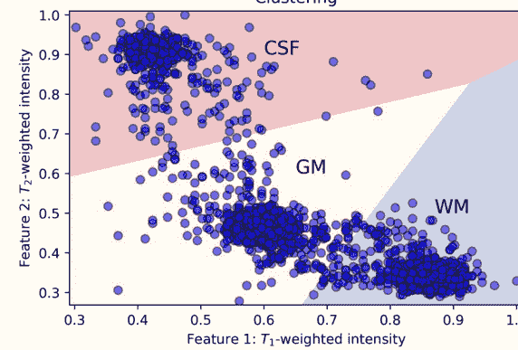

**图 2.3** 聚类示例

# 降维

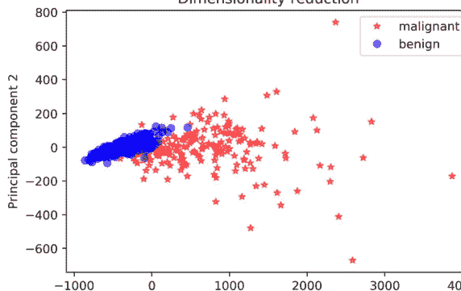

**图 2.4** 降维示例

我们寻求找到一个数学**模型**来预测某些输出，该输出可以表示为函数 $f$

$$\hat{y}=f(\mathbf{x}),$$

其中 $\hat{y}$ 是由我们的模型估计的输出。在回归问题中，它是估计的目标值；对于分类和聚类，它是估计的标签；对于降维，它是一个转换后的特征向量。

假设我们有 $N$ 个训练样本，其特征向量 $\mathbf{x}_1, \dots, \mathbf{x}_N$ 定义如下：

$$\mathbf{x} = (\mathbf{x}_1, \dots, \mathbf{x}_N)^T.$$

训练样本的特征决定了表征整个训练集的**特征矩阵 $\mathbf{X}$**：

$$\mathbf{X} = \begin{pmatrix} x_{11} & \dots & x_{1D} \\ \vdots \\ x_{N1} & \dots & x_{ND} \end{pmatrix} \quad (2.1)$$

注意，特征矩阵的维度为 $N \times D$，训练样本对应于矩阵的行，单个特征对应矩阵的列。

在监督学习中，我们期望每个训练样本 $\mathbf{x}_i$ 都有一个输出 $y_i$。这些输出决定了回归的**目标向量**和分类的**标签向量**，如下：

$$\mathbf{y} = (y_1, \dots, y_N)^T. \quad (2.2)$$

为了找到数学模型 $f$，我们需要选择它的数学形式，这会根据机器学习算法而异。通常，我们通过预先选择函数 $f$ 的数学形式来确定模型，该函数取决于特征向量 $\mathbf{x}$ 和参数向量 $\theta$：

$$\hat{y} = f(\mathbf{x}, \theta). \quad (2.3)$$

例如，$f$ 的数学形式可以是二次函数 $y=f(x,\theta) = w_0 + w_1x + w_2x^2$，参数向量由其系数 $\theta = (w_0, w_1, w_2)^T$ 组成。

训练模型 $f$ 然后可以用数学方法表示为：寻找参数向量 $\hat{\theta}$，使得给定训练集的的某个**损失函数 $\mathbf{F}$** 最小：

$$\hat{\theta} = \arg \min_{\theta} \mathbf{F}(\mathbf{X}, \theta). \quad (2.4)$$

在无监督任务中，方程中去掉了 $y$。常见的函数包括：回归中预测值与期望目标值之间的平方误差和，分类中预测标签与期望标签之间的交叉熵，以及聚类中特征向量的类内方差。在示例中，可以使用给定值与预测值之间的平方误差和：

$$\mathbf{F}(\mathbf{x}, \mathbf{y}, \theta) = \sum_{i=1}^{N} (y_i - w_0 - w_1x_i - w_2x_i^2)^2$$

## 2.1.4 总结

在本节中，我们总结了各种机器学习任务和算法，以学习本书中涵盖的任务。
**机器学习任务是：**

| 监督学习：如果我们同时拥有训练样本的特征和期望输出 | 回归：如果输出是连续的 | 分类：如果输出是离散的 |
| :--- | :--- | :--- |
| 无监督学习：如果我们只拥有训练样本的特征 | 聚类：如果将相似特征分组在一起形成聚类 | |
| **降维：**在保留数据重要属性的同时减少特征数量。 | | |

本书涵盖的**机器学习算法**：

| | | |
| :--- | :--- |
| 回归： | 线性回归、岭回归和 lasso 回归、多项式回归、核岭回归、随机森林回归、（深度）神经网络回归 |
| 分类： | 感机、逻辑回归、支持机分类、随机森林分类、（深度）神经网络分类 |
| 聚类： | K-means、高斯混合模型、谱聚类 |
| 降维： | 主成分分析、独立成分分析、拉普拉斯特征值映射 |

## 2.1.5 习题

- 1. 解释机器学习方法与传统编程有什么不同。
- 2. 解释监督学习和无监督学习。
- 3. 回归和分类之间的区别是什么？
- 4. 解释分类和聚类之间的相似与不同之处。
- 5. 降维目的是什么？

## 2.2. 从 scikit-learn 开始

Scikit-learn 是一个 Python 机器学习算法库，与 Numpy、Matplotlib 和 Pandas 等 Python 包集成。它非常直观且易于使用。可以通过在 Python 中导入模块 `sklearn` 来访问该库。
在本节中，我们介绍了 scikit-learn 中提供的四类对象：回归器（regressor）、分类器（classifier）、聚类器（clusterer）和转换器（transformer），它们实现了各种机器学习算法。Scikit-learn 提供了一个友好的应用程序接口 (API)，要求这些对象实现一组标准方法以访问机器学习算法。我们列出了最重要的：

- `fit`：将数学模型 $f$ (等2.3) 拟合到由特征矩阵 `X` (等2.1) 组成的训练数据上，对于回归器和分类器，还有输出向量 `y` (等2.2)；
- `predict`：实现回归器、分类器和聚类的输出向量 `y` (等2.3) 的预测；
- `transform`：为转换器实现特征转换 (等2.3)；
- `fit_transform`：为转换器拟合模型并转换特征向量；
- `score`：实现评估指标。

```python
import pandas as pd

import numpy as np

from sklearn.linear_model import LinearRegression

## 准备数据

df = pd.read_csv('weights.csv')

X = df[['age']]

y = df['weight']

# 创建并拟合模型

model = LinearRegression()

model.fit(X, y)

# 检查系数

print("Intercept:", model.intercept_)

print("Coefficients:", model.coef_)

# 预测新值

new_age = np.array([[10]])

prediction = model.predict(new_age)

print("Predicted weight for age 10:", prediction)
```

# 在新数据上进行预测

我们对模型的可视化感兴趣，因此我们将创建一个特征空间的采样网格。以下代码创建了 10 个样本，跨越了训练集中 GA 的最小值和最大值之间的值。注意，我们需要一个 2D 数组来进行预测。

```python
x_model_10D = np.linspace(np, np.min(X), np.max(X), 10)
X_model = x_model_10D.reshape(-1,1)
```

现在，我们可以预测这些新样本的目标值：

```python
y_model = model.predict(X_model)
```

# 绘制结果

我们将使用 matplotlib.pyplot 来可视化拟合的模型：

```python
import matplotlib.pyplot as plt
```

首先，我们绘制训练数据

```python
plt.plot(X, y, 'bo')
```

然后绘制我们在跨越整个特征空间的网格样本上上预测的拟合模型：

```python
plt.plot(X_model, y_model, 'k')
```

该图位于第 2.1.1 节的图 2.1 中。

## 2.2.2 scikit-learn 中的分类

我们现在重新回到第 2.1.1 节中通过从心脏 MRI 或超声图像计算的指标来检测心衰竭的分类示例，该示例在图 2.2 中。我们将演示如何使用感知器分类器拟合预测模型。本节演示了 sklearn 中分类器对象的 API。

## 准备数据

我们将首先从 CSV 文件导入数据并检查列名：

```python
df = pd.read_csv('heart_failure_data.csv')
df.keys()
>>> Index(['EF', 'GLS', 'HF'], dtype='object')
```

现在，我们准备好创建一个包含 EF 和 GLS 测量的 2 维特征向量特征矩阵。我们还将对这两个特征进行标准化，使其在所有训练样本中具有零均单位差。这通过 sklearn 对象 `StandardScaler` 实现。特征缩放对于感知器分类器的收敛至关重要：

```python
from sklearn.preprocessing import StandardScaler
scaler = StandardScaler()
data = df.to_numpy()
X = scaler.fit_transform(data[::2])
```

标签向量将是 HF，表示心衰竭的诊断。

```python
y = data[::2]
```

## 创建模型

以下代码创建了感知器分类器：

```python
from sklearn.linear_model import Perceptron
model = Perceptron()
```

感知器模型将找到决策函数，对于我们的 2 维特征 $x = (x1, x2)$，它采取如下线性形式：

```
h(x) = w0 + w1x1 + w2x2
```

预测的标签取决于决策函数的符号：

```python
\hat{y} = \begin{cases} 1 & \text{if } h(\mathbf{x}) \geq 0 \\ 0 & \text{if } h(\mathbf{x}) < 0 \end{cases}
```

因此，决策边界由决策函数定义：

```
w0 + w1x1 + w2x2 = 0.
```

# 拟合模型

与线性回归一样，拟合感知器模型意味着找到分离两类的权重向量 $w = (u0, u1, u2)$。这是通过最小化感知器准则实现的：

```
F(\mathbf{w}) = \sum_{i \in \mathcal{M}} |h(\mathbf{x}_i)|
```

其中 $\mathcal{M}$ 是所有分类错误的样本集合。注意，对于分类正确的样本没有惩罚，对于分类错误的样本，惩罚等等于该样本决策函数的绝对值。如果所有样本都被正确分类，则准则为零，我们将尝试尽可能减少分类错误。感知器模型通过以下方式进行拟合：

```python
model.fit(X, y)
```

并且可以访问决策函数的系数：

```python
w0=model.intercept_[0]
w1=model.coef_[0][0]
w2=model.coef_[0][1]
```

注意，感知器的 `intercept_` 是一个 1D 数组，`coef_` 是一个 2D 数组。这是为了支持两个类以上的分类，这需要多个决策边界。因此，决策边界由决策函数定义：

```
w0 + w1x1 + w2x2 = 0.
```

## T1 加权 MRI

## 分割

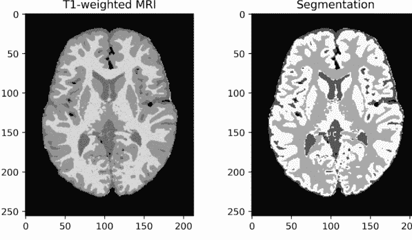

**图 2.5** 使用 k-means 聚类对 T1 加权脑 MRI 进行分割。

## 准备数据

以下代码加载了乳腺癌数据集并提取了 30 维特征向量的特征矩阵 X：

```
from sklearn import datasets
bc = datasets.load_breast_cancer()
X = bc.data
```

```
print('We have {} features.'.format(X.shape[1]))
>>> We have 30 features.
```

## 创建模型

我们现在将创建一个包含两个主成分的 PCA 模型：

```
from sklearn.decomposition import PCA
model = PCA(n_components=2)
```

# 拟合模型

在我们对训练数据拟合模型后，可以通过以下方式访问两个主成分向量：

```
model.fit(X)
pcp1 = model.components_[0]
pcp2 = model.components_[1]
```

## 转换特征

对前两个主成分进行投影操作：

```
y = model.transform(X)
print('We have {} features.'.format(y.shape[1]))
>>> We have 2 features.
```

乳腺癌数据投影到前两个主成分后的可视化见第 2.1.2 节的图 2.4。

## 2.2.5 练习

- 1. 根据脑体积测量计算早产儿的胎周（GA）。注意 GA 和体积的规则发生了互换：体积是特征，GA 是目标值。编写 scikitlearn 代码创建特征矩阵和目标向量，拟合模型，计算 $R^2$ 分数并打印拟合模型的方程。
- 2. 研究使用射血分数（EF）是否足以预测心衰竭（HF）。编写 scikitlearn 代码创建新的特征矩阵和目标向量，计算准确率分数并打印决策边界的方程。与使用两个特征（EF 和 GLS）相比，准确率下降了多少？
- 3. 执行 k-means 聚类以分割 T2 加权图像 'T2.png'。结果与 T1 加权的 $MRI$ 相似吗？
- 4. 比较*感知器*分类器使用原始特征和使用 PCA 降至两个维的特征检测乳腺癌的性能。

## 2.3 训练机器学习模型

我们现在已经了解了如何创建、拟合和评估各种机器学习模型。剩下的问题是，哪种类型的模型最适合特定的数据集。让我们通过二次多项式回归的简单示例来探索这个问题。假设我们要发现的底层过程遵循二次关系：

```
$y = 2x^2 + 4x + 5$.
```

然而，在现实世界中真实模型是未知的，我们只能观察到由模型生成的噪声样本。我们将通过向该模型的随机样本添加标准差为 $\sigma=3$ 的高斯噪声来生成这些噪声观测值。

> 练习的代码框架和数据集可以 github.com/MachineLearningBiomedicalApplications/notebooks 获取。

## 真实模型

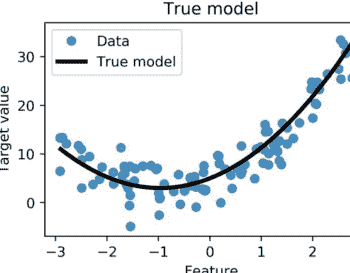

## 多项式次数 1

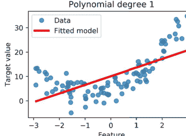

## 多项式次数 2

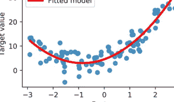

## 多项式次数 20

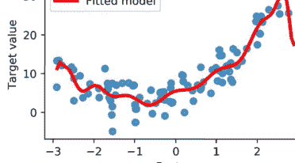

**图 2.6** 对从二次函数生成的噪声数据拟合不同次数的多项式模型（左上）。

真实模型和噪声样本在图 2.6 左上角所示。我们的任务是从噪声数据中恢复底层的真实模型。选择由下式定义的多项式族是合理的：

> $$\gamma = \sum_{j=0}^{M} w_j x^j$$

我们已经理解系数向量 **w** = $(w_0, ..., w_M)$ 可以通过最小化化误差之和来拟合训练数据来获得（第 2.2.1 节）。但我们如何选择多项式次数 $M$ 呢？多项式次数将决定要拟合的自由参数数量，从而决定模型的**复杂度**。我们将此类参数称为模型的**超参数**。不同的多项式次数会导致不同的模型；参见图 2.6 中 $M=1, 2, 20$ 的示例。在下一节中，我们将讨论如何选择最优。

## 2.3.1 欠拟合与过拟合

对于简单模型（如单变量多项式回归），我们可以从视觉上评估模型。我们可以从图 2.6 中看到，1 次多项式没有捕捉数据中的二次趋势，因此对数据是欠拟合。另一方面，20 次多项式变化太大，似乎过度拟合了数据。

## 2.3.2 训练、验证和测试

为了能够调整超参数，我们需要对模型拟合程度进行定量衡量。在第 2.2 节中，我们已经看到 $R^2$ 分数是一个合适的衡量。如果我们使用验证集，就可以识别过拟合。

## 2.3.5 在 scikit-learn 中训练模型

在本节中，我们将展示如何使用 scikit-learn 库在单变量多项式回归示例上训练机器学习模型。我们将使用第 2.3 节开头描述的模拟数据集。我们将学习：

- 将数据划分为训练集和测试集；
- 为训练数据拟合多项式模型；
- 使用交叉验证调优超参数多项式次数；
- 在测试集上评估性能。

# 生成数据

首先，我们把真实模型 $y = 2x^2 + 4x + 5$ 定义为一个函数：

```python
def TrueModel(x):
    return 2*x**2+4*x+5
```

接下来，我们从区间为 $[-3, 3]$ 的均匀分布中生成包含 $n = 100$ 个随机特征的数组 `X`。可以使用 `numpy` 函数 `rand` 实现：

```python
import numpy as np
n=100
X = 6*np.random.rand(n)-3
```

为了生成带噪声的目标值，我们首先使用 `numpy` 函数 `randn` 生成 $\sigma = 3$ 的高斯噪声：

```python
noise = 3*np.random.randn(n)
```

通过计算真实目标值并加上噪声即可得到带噪声的目标值 `y`：

```python
y = TrueModel(X) + noise
```

最后，将特征矩阵 `X` 转换为 2 数组：
```python
```


`X = X.reshape(-1,1)`

# 训练测试集划分

Scikit-learn 提供了 `train_test_split` 函数来执行数据集的划分。一种模式是保留 80% 的数据用于训练，20% 用于测试。这可以通过选项 `test_size` 进行设置。注意，反斜杠允许将长命令拆分为两行。

```python
from sklearn.model_selection import train_test_split

X_train, X_test, y_train, y_test = \
    train_test_split(X,y,test_size =0.2)
```

如果我们想创建一个具有代表性的测试集，可以使用 `stratify` 参数。在本例中，我们将通过对特征值取舍入将数据分为七个箱（bins），并对测试集进行分层，以确保每个箱的数据比例与训练集相同：

# 生物医学应用中的机器学习

```python
bins = np.round(X)

X_train, X_test, y_train, y_test = \
train_test_split(X,y,test_size =0.2, \
stratify =bins)
```

## 拟合多项式模型

Scikit-learn 没有直接实现多项式回归模型。相反，多项式回归分两个步骤执行：

- 1. 多项式特征转换——转换器对象 `PolynomialFeatures` 将每个特征转换为特征向量 $(1, x, x^2, ..., x^M)$，其中次数 $M$ 通过设置参数 `degree` 来定义；
- 2. 执行多元线性回归——回归器对象 `LinearRegression` 对数据进行拟合模型 $y = x_0 + x_1y_1 + ... + x_My_M$。

如果我们这些这些结合起来，就会有 $x_i = x'$，从而创建一个多项式模型 $y = x_0 + x_1x' + ... + x_Mx'$。这两个步骤的实现方式如下：首先我们进行多项式特征转换：

```python
from sklearn.preprocessing import PolynomialFeatures

poly_features = PolynomialFeatures(degree=M)

x_train_poly = poly_features.transform(X_train)
```

然后我们创建并拟合 `LinearRegression`。注意，在 `LinearRegression` 模型中不需要截距，因为我们已经生成了特征 $x_0 = 1$。因此，在创建 `LinearRegression` 对象时我们将设置 `fit_intercept=False`：

```python
from sklearn.linear_model import LinearRegression

model = LinearRegression(fit_intercept=False)

model.fit(X_train_poly, y_train)
```

## 设置模型流水线

执行模型训练、预测和评估的多个步骤并不总是方便的。如果模型成为另一个 sklearn 对象的输入（例如我们将介绍的交叉验证超参数搜索），则需要将步骤统一到单个对象中。Scikit-learn 使用 `Pipeline` 将多个步骤合并为一个模型。它实现了 `fit`、`predict`、`score` 等方法，与其他 sklearn 对象提供统一的 API。接下来，我们将多项式特征转换和多元线性回归合并到一个流水线中：

```python
from sklearn.pipeline import Pipeline

pipeline = Pipeline(( 
("poly_features", PolynomialFeatures(degree=2)),
("lin_reg", LinearRegression(fit_intercept=False)) ))
```

让我们详细查看创建流水线的语法。它的格式为 `Pipeline(steps)`，其中输入参数 `steps` 是要链的转换器和模型的列表，按照它们调用的顺序排列。每个步骤由元组 `(name, model)` 描述，其中 `name` 是用户使用的字符串，`model` 是一个 sklearn 对象。流水线可以像上面所示那样对数据进行拟合：

```python
pipeline.fit(X_train, y_train)
```

要访问 Pipeline 中的原始对象，我们使用属性 `named_steps`。例如，访问线性回归对象的方式为：

```python
pipeline.named_steps["lin_reg"]
```

线性回归的系数 $w_0, ..., w_k$ 可以通过以下方式访问：

```python
>>> pipeline.named_steps["lin_reg"].coef_
>>> array([4.98164783, 3.7729512, 1.90766111])
```

（注：原文此处存在大量重复段落，已根据要求去重，仅保留核心逻辑翻译）

（此处省略重复的 Pipeline 访问描述...）

（注：由于原始文本包含大量重复的关于 `named_steps` 的访问描述，作为高级文档工程师已对其进行冗余处理。）

## 2.3.6 练习题

- 1. 在第 2 节中，你获得了生成噪声数据集和二阶多项式模型的代码。编写代码来可视化拟合的曲线和原始数据。尝试拟合的多项式次数，并观察模型的变化。
2. 对模拟数据集执行不同次数的多项式拟合交叉验证，并观察 $R^2$ 分数的变化。
3. 使用 pandas 加载 `noisy_data.csv`。该文件包含两列：
   - 第一列包含特征 $X$；
   - 第二列包含目标值 $y$。
* 为数据拟合多项式模型。执行以下步骤：
* 执行分层训练测试集划分；
* 使用 `Pipeline` 创建多项式模型；
* 使用 `GridSearchCV` 找到最优多项式次数，并打印最佳交叉验证分数；
* 计算测试集上的性能；
* 绘制拟合模型图；
* 打印模型的系数。
你能推断出底层的多项式模型是什么吗？（提示：系数是整数。）

# 第三章

## 回归

在第 2 章中，我们学习了单变量线性回归（2.2.1 节）和单变量多项式回归（2.3 节）的示例。“**单变量**”词指的是仅有一个特征来预测目标值。在机器学习问题中，我们通常希望结合多个特征以获得更准确的预测。涉及多个特征的回归被称为**多元**。

在本章中，我们将通过**根据 MRI 扫描计算的脑结构体积预测早产儿年龄**的示例，演示各种多元回归模型，见图 3.1。该数据集由发育人类连接组项目 [13,29] 收集的 27 到 45 周胎龄早产儿的 164 份 MRI 扫描的脑体积组成。我们将在第 6 章中详细介绍脑结构分割的算法。首先，我们将描述多元线性回归（3.1 节）。接下来，我们将展示如何使用正则化来防止过拟合（3.2 节）。最后，我们将考虑非线性多元回归（3.3 节）。

### 3.1. 回归基础

在本节中，我们将介绍一种名为多元回归的基础级回归技术。首先，我们详细描述这种回归模型（3.1.1 节），然后解释如何训练它（3.1.2 节），最后在 3.1.3 节中研究它的性能。

### 3.1.1 多元线性回归

**多元线性回归模型**定义为

```
$\hat{y} = w_0 + w_1x_1 + \dots + w_Dx_D,$
```

其中 $x = (x_1, \dots, x_D)^T$ 是特征向量，权重向量 $w = (w_0, w_1, \dots, w_D)^T$ 构成模型的参数，$\hat{y}$ 是预测的目标值。

我们希望将模型拟合 $N$ 个训练样本 $x_i = (X_{i1}, \dots, X_{iD})$ 以及相应的目标值 $y_i$（其中 $i = 1, \dots, N$），即找到权重向量 **w**。这可以通过最小化损失函数来实现，该函数衡量预测目标值与真实目标值之间的**误差平方和**

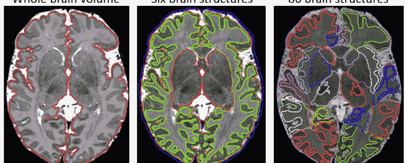

**图 3.1** 用于 MRI 扫描预测早产儿年龄的脑体积。左侧：作为单个特征的全脑；中间：六个主要结构；右侧：详细分割产生的 86 个特征。

```
$L(w) = \frac{1}{2}\sum_{i=1}^{N}(y_i - \hat{y}_i)^2, \quad (3.1)$
```

其中

$\hat{y}_i = w_0 + w_1x_1 + ... + w_Dx_i$

在我们的生物医学示例中，每个由索引 $i$ 表示的样本是一个脑 MRI 扫描，特征向量 $\mathbf{x}_i$ 由该扫描计算出的脑结构体积组成。每个由索引 $k$ 表示的特征代表特定脑结构的体积，而目标值 $y_i$ 是婴儿在扫描时的真实胎龄（GA）。

#### 矩阵表示

接下来，我们将为回归构建一个特征矩阵。注意我们有 $D$ 个特征但有 $D+1$ 个权重。权重 $w_0$ 不乘以任何特征，通常被称为**偏置**或**截距**。为了简化方程，我们将定义新特征 $x_0 = 1$。模型将简化为

```
$\hat{y} = \sum_{k=0}^{D} w_kx_k$.
```

特征矩阵的构建在 2.1 节中描述。如果我们添加特征 $x_0$，特征矩阵将变为：

```
$$\mathbf{X} = \begin{pmatrix} x_{11} & \dots & x_{1D} \\ \vdots & \ddots & \vdots \\ x_{N1} & \dots & x_{ND} \end{pmatrix}. \quad (3.2)$$
```

记得 2.1.3 节中定义了目标向量 $\mathbf{y} = (y'_1, \dots, y'_N)^T$。现在我们也可以在矩阵定义**预测目标向量 $\hat{\mathbf{y}} = (\hat{y}_1, \dots, \hat{y}_N)^T$** 为：

```
$$\hat{\mathbf{y}} = \mathbf{X}\mathbf{w}. \quad (3.3)$$
```

误差平方和损失（方程 3.1）可以表示为

```
$$L(w) = \frac{1}{2}(\mathbf{y} - \hat{\mathbf{y}})^T(\mathbf{y} - \hat{\mathbf{y}}). \quad (3.4)$$
```

根据方程 (3.3) 代入 $\hat{\mathbf{y}}$ 得到

```
$$L(w) = \frac{1}{2}(\mathbf{y} - \hat{\mathbf{y}})^T(\mathbf{y} - \hat{\mathbf{y}}). \quad (3.5)$$
```

### 3.1.2 训练回归模型

#### 正方程

最小化方程 (3.5) 中损失的解 $\hat{\mathbf{w}}$ 可以解析法找到：

```
$$\hat{\mathbf{w}} = (\mathbf{X}^T\mathbf{X})^{-1}\mathbf{X}^T\mathbf{y} \quad (3.6)$$
```

并称为**正方程**。如果 $D+1 \times D+1$ 的方矩阵 $\mathbf{X}^T\mathbf{X}$ 是可逆的，就可以使用。我们将在 3.1.3 节详细讨论这一条件。Scikit-learn 通过 `Regression` 对象实现了多元线性回归，我们在 2.2.1 节和 2.3 节中演示过。

#### 梯度下降

如果特征数量 $D$ 很大，矩阵逆是不行的，可以采用**梯度下降**等数值算法。在这种情况下，可以通过迭代找到解 $\hat{\mathbf{w}}$：

```
$$\hat{\mathbf{w}}^{(n+1)} = \hat{\mathbf{w}}^{(n)} + \eta\mathbf{X}^T(\mathbf{y} - \mathbf{X}\hat{\mathbf{w}}^{(n)}). \quad (3.7)$$
```

其中 $n$ 是迭代次数，$\eta$ 是需要正确设置以收敛的学习率。每次迭代使用所有样本的梯度下降（GD）算法是**批量 GD**。如果样本数量 $N$ 很大，每次 GD 迭代执行速度可能非常慢。为了解决这个问题，我们可以改为每次迭代使用一个随机样本，这种算法被称为**随机 GD**。显然这会非常快，但解可能会变得不稳定。一种很好的折中方案是**小批量 GD**（mini-batch GD），我们在每次迭代中使用训练样本的一个子集。这三种 GD 的比较见图 3.3。


**图 3.2** 学习率对梯度下降的影响。使用正方程；绿色正方形是 $w^{(0)}$ 的估计；蓝色圆形是每次迭代的估计 $w^{(n)}$。当学习率正确时，算法收敛到正确解。如果学习率太小，算法需要多次迭代到达正确解。如果学习率太大，算法将震荡而不是收敛。

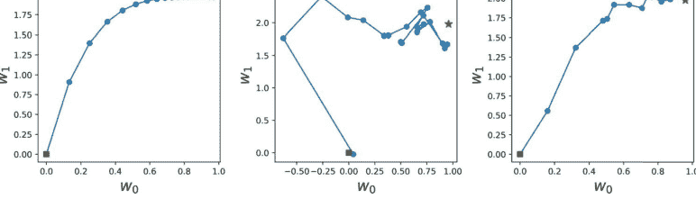

**图 3.3** 批量、随机和小批量梯度下降的收敛特性的比较。

#### 正方程的推导

现在我们将深入研究正方程（方程 3.6）。解 $\hat{\mathbf{w}}$ 将是损失函数 $L(\mathbf{w})$ 的最小值。因此，在最小值处的一阶导必须为：

```
$\frac{\partial L(\mathbf{w})}{\partial \mathbf{w}} = 0$
```

为了计算方程 (3.5)的一阶导数，我们将首先使用积法则，然后简化表达式：

```
$\frac{\partial L(\mathbf{w})}{\partial \mathbf{w}} = \frac{\partial \frac{1}{2}(\mathbf{y}-\mathbf{Xw})^T(\mathbf{y}-\mathbf{Xw})}{\partial \mathbf{w}} = \frac{1}{2}(\mathbf{y}-\mathbf{Xw})^T(-\mathbf{X}) + \frac{1}{2}(-\mathbf{X})^T(\mathbf{y}-\mathbf{Xw}) = -\mathbf{X}^T(\mathbf{y}-\mathbf{Xw})$
```

我们现在可以将一阶导数置零并找到 $\mathbf{w}$ 的表达式：

```
$-\mathbf{X}^T(\mathbf{y}-\mathbf{Xw}) = 0$
$\mathbf{X}^T\mathbf{Xw}=\mathbf{X}^T\mathbf{y}$
$\mathbf{w} = (\mathbf{X}^T\mathbf{X})^{-1}\mathbf{X}^T\mathbf{y}$
```

#### 在 NumPy 中实现正方程

假设我们有特征 `X` 和目标向量 `y`。首先，我们需要使用 `np.hstack` 添加特征 $x_0=1$ 以创建一个新特征（方程 3.2）。

```python
x0 = np.ones([X.shape[0],1])
x1 = np.hstack([x0,X])
```

使用 `np.matmul` 和矩阵求逆 `np.linalg.inv` 实现方程 (3.6)。

```python
XtX = np.matmul(X1.T,X1)
ty = np.matmul(X1.T,y)
w = np.matmul(np.linalg.inv(XtX),ty)
```

## 梯度下降方程的推导

梯度下降的更新方程由损失函数的一阶导数推导得出：

```
$$\hat{w}^{(n+1)} = \hat{w}^{(n)} - \eta \frac{\partial L(\hat{w}^{(n)})}{\partial \hat{w}^{(n)}} (3.8)$$
```

我们已经推导出了平方误差损失的一阶导数 $\frac{\partial L(w)}{\partial w}= -X^T(\mathbf{y}-X\mathbf{w})$，其结果为方程 (3.7)。

### 3.1.3 衡量多元回归的性能

回归模型性能最直观的衡量标准是**均方根误差 (RMSE)**，定义如下：

```
$RMSE = \sqrt{\frac{1}{N} \sum_{i=1}^{N} (y_i - \hat{y}_i)^2}.$ (3.9)$$
```

它与平方误差 **L(w)** 密切相关：$RMSE = \sqrt{\frac{2}{N}} L(w)$。由于它经过了样本数 $N$ 的归一化并进行了开根处理，因此它以目标值的单位提供了误差的有意义衡量。例如，如果目标值代表婴儿以周为单位的 GA，RMSE 也是以周为单位的平均误差。为了获得模型的最佳性能，我们需要最小化 RMSE，理想的 RMSE 为零。这与 $R^2$ 分数相反，$R^2$ 衡量模型对数据方差的解释比例（见 2.2.1 节），我们希望将其最大化，而最佳值为 1。在 scikit-learn 中，我们可以使用 `mean_squared_error` 函数计算回归模型的 RMSE：

```
from sklearn.metrics import mean_squared_error
from sklearn.linear_model import LinearRegression

model = LinearRegression()
model.fit(X_train,y_train)
y_pred_train = model.predict(X_train)
RMSE_train = np.sqrt(mean_squared_error(y_train,y_pred_train))
```


这段代码计算了模型对训练数据的拟合程度，因此它衡量了偏差（bias）。为了识别过拟合，我们可以使用交叉验证，但这次我们定义了一个评分函数 `scoring=-neg_mean_squared_error`：

```python
from sklearn.model_selection import cross_val_score

model = LinearRegression()

scores = cross_val_score(model,X_train,y_train,
  scoring='neg_mean_squared_error')
```

```python
RMSE_CV = np.sqrt(-np.mean(scores))
```

## 回归 73

另一种方法是通过计算排除在训练集之外的测试集上的 RMSE 来发现过拟合：

```python
model.fit(X_train,y_train)

y_pred_test = model.predict(X_test)

RMSE_test = np.sqrt(mean_squared_error(y_test, y_pred_test))
```

直观上，我们可能会认为特征越多预测效果越好，但情况真的是如此吗？让我们重新审视基于 164 次 MRI 扫描计算出的脑结构数据集（图 3.1）。第一个数据集有一个特征，第二个数据集有六个，第三个数据集有 86 个特征。表 3.1 给出了这三个数据集的 `RMSE_train` 和 `RMSE_CV`（单位为周）。

表 3.1 通过对整个训练集拟合回归模型得到的 RMSE (`RMSE_train`) 和使用交叉验证得到的 RMSE (`RMSE_CV`)。

| 特征数量 (周) | 1 | 6 | 86 |
|---|---|---|---|
| RMSE_train (周) | 1.56 | 1.12 | 0.68 |
| RMSE_CV (周) | 1.6 | 1.27 | 2.08 |

我们可以看到，训练集上的 RMSE (`RMSE_train`) 随着特征的增加而减小。然而，通过交叉验证的 `RMSE_CV` 并非如此。拟合到具有单个特征（全脑体积）六个体积的模型，我们通过较小的误差 (`RMSE_train`) 但较大的交叉验证误差 (`RMSE_CV`) 来判断这一点，这表明模型无法泛化到未见过的数据。事实上，具有 86 个特征的模型显然对数据中的噪声过度过拟合了。特征越多，模型的灵活性就越大，因为模型的参数数量（权重 `w`）随特征数量增加而增长。因此，具有大量特征的多元线性回归容易发生过拟合。

我们如何决定多少特征 `D` 对我们的模型是最优的？这取决于训练样本数 `N`。正规方程（方程 3.6）中最容易出错的部分是矩阵 `$X^TX$` 的求逆。该矩阵的尺寸 `$D+1 \times D+1$` 与特征数量有关。它的秩也取决于样本数 `N`，最大为 `$\min(N, D+1)$`，因为矩阵 `X` 的尺寸为 `$N \times (D+1)$`。因此，如果样本数于于特征，即 `$N < D+1$`，矩阵 `$X^TX$` 是不可逆的，存在许多能够精确拟合训练数据的解。在这种情况下，scikit-learn 的 `LinearRegression` 对象将选择 `[w]` 最小的解。如果样本数 `N` 与特征数 `D` 相似且 `$N \ge D+1$`，则极有可能对噪声过拟合。如果 `$N$` 远大于 `$D$`，则模型病态良好，且预测泛化良好。

### 3.1.4 练习

- 1. 使用 RMSE 和 `$R^2$` 分数衡量回归算法的性能。描述这两个指标代表什么。
- 2. 表 3.2 给出了三个回归模型的性能。判断哪个模型具有最高偏差、最高方差以及最佳的偏差-方差平衡。

表 3.2 三个回归模型的性能。
| | 模型 1 | 模型 2 | 模型 3 |
|---|---|---|---|
| 训练集 `$R^2$` 分数 | 0.97 | 0.85 | 0.92 |
| 交叉验证 `$R^2$` 分数 | 0.68 | 0.81 | 0.89

- 3. 逗号分隔值 (CSV) 文件 `'GA-brain-volumes-6-features.csv'` 第一列包含 GA，第二列包含脑体积。执行以下任务：
    - 使用 Pandas 加载文件并提取特征矩阵和目标向量。打印特征和样本的数量。
    - 对数据拟合 `LinearRegression` 模型并计算 RMSE。
    - 创建函数 `RMSE(model,X)` 在整个数据集上拟合。
    - 创建函数 `RMSE_CV(model,X)` 通过交叉验证计算。
    - 使用 NumPy 实现梯度下降。
    - 4. 使用 NumPy 实现以下步骤：
        - 将数据集划分为训练和测试集。
        - 根据方程 (3.6) 在 NumPy 中拟合模型。
        - 根据方程 (3.3) 在测试集上预测。
    - 5. 从 `'GA-brain-volumes-1-feature.csv'` 和 `'GA-brain-volumes-86-features.csv'` 加载单特征和 86 个特征的数据集。

## 岭回归

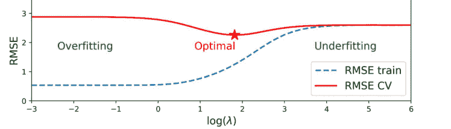

**图 3.4** 针对噪声数据集拟合的岭回归模型的均方根误差，其随 `$\lambda$` 值（范围从 `$10^{-3}$` 到 `$10^6$`）的变化。当 `$\lambda$` 较小时，模型出现过拟合，这从高高的交叉验证 RMSE 可以看出。当 `$\lambda$` 较大时，模型出现欠拟合，训练 RMSE 和交叉验证 RMSE 均较高。最优 `$\lambda$` 对应于最小的交叉验证 RMSE。

在 scikit-learn 中，岭回归模型可以表述如下：

```python
from sklearn.linear_model import Ridge

model = Ridge(alpha=1)
```

其中 `alpha` 是超参数 `$\lambda$`。注意，在训练岭回归模型时，使用 `StandardScaler` 进行特征缩放是非常重要的，因为权重取决于特征的幅度，不同的缩放可能会导致不同的解。

### 3.2.2 Lasso 回归

Lasso 惩罚项通过最小化其 `$L_1$` 范数来最小化权重向量 `w`

$$|w|_1 = \sum_{k=0}^{D} |w_k|$$

其中 `$| \cdot|$` 表示绝对值。损失函数变为：

$$L(w) = \frac{1}{2} \sum_{i=1}^{N} (y_i - \sum w_k x_{ik} - w_0)^2 + \lambda \sum_{k=0}^{D} |w_k| \quad (3.14)$$

可以用矩阵形式表示为：

$$L(w) = \frac{1}{2}(\mathbf{y} - \mathbf{Xw})^T(\mathbf{y} - \mathbf{Xw}) + \lambda \mathbf{w}^T \text{sign}(\mathbf{w}), \ \quad (3.15)$$

# 惩罚项

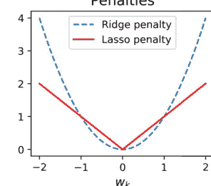

图 3.5 单个权重 `$w_k$` 的岭和 lasso 惩罚。

其中 `sign(\mathbf{w}) = (sign(w_0), \dots, sign(w_D))^T`

```
$sign(w_k) = \begin{cases} 1 & \text{if } w_k > 0 \\ 0 & \text{if } w_k = 0 \\ -1 & \text{if } w_k < 0. \end{cases}$
```

Lasso 回归没有解析解，必须使用数值方法求解。此外，Lasso 惩罚项不可微的，因为其导数在 `$w_0=0$` 处未定义，如图 3.5 所示。然而，我们仍然可以通过计算导数的次梯度来使用梯度下降。如果定义 `$L_1$` 范数在 `$w_0=0$` 处的一阶导数为零，则次梯度变为 `sign(\mathbf{w})`，且梯度下降方程可以写为：

```
$$\hat{\mathbf{w}}^{(n+1)} = \hat{\mathbf{w}}^{(n)} + \eta(\mathbf{X}^T(\mathbf{y} - \mathbf{X}\hat{\mathbf{w}}^{(n)}) - \lambda sign(\hat{\mathbf{w}}^{(n)})) \quad (3.16)$$
```

在 scikit-learn 中，`sklearn.linear_model Lasso` 的 lasso 回归模型表述为：

```python
from sklearn.linear_model import Lasso

model = Lasso(alpha=1)
```

并且，对于岭模型，在拟合 lasso 模型之前对特征进行缩放是非常重要的。

### 3.2.3 岭惩罚惩罚的比较

岭和 lasso 惩罚都有助于减少权重，但它们对最终解的影响不同。在图 3.5 中，我们可以观察到，对于较小的权重，岭惩罚比 lasso 弱，因此 lasso 更可能将小权重推向零。相反，对于较大的权重，岭惩罚更强，

## 岭回归

# Lasso 回归

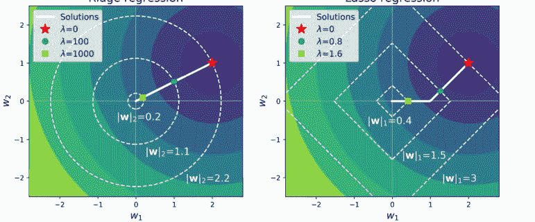

**图 3.6** 三个不同 `$\lambda$` 值下惩罚回归的解。红星代表未惩罚的解，绿色圆圈代表中等惩罚的解，而大惩罚导致产生接近零的解（用黄色方块表示）。对于每个 `$\lambda$`，岭回归的解位于圆 `$|w_i| \leq \beta$` 内，而 lasso 的解位于正方形 `$|w_i| \leq \beta$` 内。平方误差损失由背景颜色表示，蓝色代表较小值，黄色代表较大。

并且这些权重在岭回归中减少得比 lasso 快。因此，Lasso 产生稀疏权重，保留较大的权重，而岭回归的权重会减少得更快。Lasso 因此产生稀疏权重，保留较大的权重，同时将小权重推向零。在岭回归中，权重会减少得比 lasso 快。

让我们在噪声数据集上演示，在拟合 lasso 模型之前对特征进行缩放是非常重要的。对于每个 `$\lambda$`，岭回归需要位于圆 `$|w_i| \leq \beta$` 内，而 lasso 则则正正 `$| $|wi| \ \ \beta$` 内。。平方误差损失背景背景颜色表示，蓝色代表值，黄色黄色。每个 `$\lambda$` 对应的解需要位于圆 `$|w_i| \leq \beta$` 内（岭回归）或正方形 `$|w_i| \leq \beta$` 内（lasso）。

在 scikit-learn 中，`sklearn.linear_model Lasso` 的 lasso 回归模型表述为：

```python
from sklearn.linear_model import Lasso

model = Lasso(alpha=1)
```

### 3.2.4 在 scikit-learn 中训练惩罚回归

在本节中，我们将演示如何调优惩罚回归。首先我们定义想要尝试的数值，从 `$10^{-3}$` 到 `$10^3$` 的对数尺度：

```python
params = np.logspace(-3, 3, 100)
```

接下来我们使用 `GridSearchCV` 搜索 alpha：

```python
from sklearn.linear_model import Ridge

from sklearn.model_selection import GridSearchCV

model = Ridge()

gs = GridSearchCV(model, params, scoring="neg_mean_error")

gs.fit(X, y)
```

交叉验证 RMSE 也可以这样提取：

```python
np.sqrt(-gs.best_score_)
```

选择最佳模型。模型的最终性能应该在测试集上评估，如下：

```python
from sklearn.metrics import mean_squared_error

y_pred_test = gs.predict(X_test)

RMSE_test = np.sqrt(mean_squared_error(y_test, y_pred_test))
```

最后，需要注意 scikit-learn 不惩罚偏置项 `$w_0$`。这是一个很好的理由：偏置项不容易过拟合，将其置为零会降低拟合质量。换句话说，如果对系数进行惩罚，非常大的 `$\lambda$` 将导致预测值为零。相反，如果不惩罚偏置项，大惩罚将导致预测值的平均值。

表 3.3 训练集和使用交叉验证的线性回归、岭回归和 lasso 的根误差。
| | 岭 (Ridge) | Lasso | 无惩罚 (No Penalty) |
|---|---|---|---|
| 训练 RMSE | 0.92 | 1.07 | 0.68 |
| 交叉验证 RMSE | 1.17 | 1.27 | 2.08 |

图 3.7 显示了岭和 lasso 惩罚减少了权重幅度。Lasso 将大部分权重推向零，产生稀疏解。

### 3.2.5 练习

- 解释 `$\lambda$` 参数在惩罚回归中的作用。
- 解释岭和 lasso 回归的相似之处和不同之处。
- 在 3.1.2 节中，你获得了使用 Numpy 实现正方程的代码。修改此代码以包含岭惩罚。
- 使用 `GA-brain-volumes-86-features.csv` 中的 86 个结构值拟合岭和 lasso 回归以预测 GA。在整个数据集上按照 3.2.4 节所述优化超参数 `$\lambda$`。使用交叉验证比较线性回归、岭回归和 lasso 的 RMSE。

$4 数据集和骨架代码从 github.com/MachineLearningBiomedicalApplications/notebooks 获取。

## 3.3. 非线性回归

线性回归模型并不总是适用，因为数据中的特征与目标值之间可能存在非线性关系。我们已经在第 2.3 节和 2.6 节通过多项式回归的说明了这一点。在图 3.8 中，我们绘制了根据六个脑结构体积预测的早产儿真实胎周龄（GA）。请注意，由于特征的高维性，我们无法容易地绘制数据和模型。在岭回归的情况下（图 3.8 左侧），我们可以看到对于较幼的婴儿，模型的拟合效果并不好，这表明了特征的非线性。

在接下来的章节中，我们将描述使用非线性特征变换（第 3.3.1 节）和用于岭回归的核技巧（第 3.3.2 节）得到的多元回归。

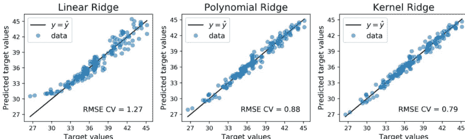

**图 3.8** 根据六个脑结构体积预测 GA 的预测值与真实目标值的对比图。左侧：线性岭回归。中间：多项式岭回归。右侧：使用高斯核的核回归。

### 3.3.1 非线性特征变换

在第 2.3 节中，我们看到多项式回归可以看作是**非线性特征变换**后的多元线性回归。现在我们将这种方法推广到其他非线性变换和多元问题。

非线性特征变换 `$\phi$` 是原始特征向量 `x` 的非线性函数。与 `x` 相比，变换后的特征向量 `$\phi(\mathbf{x})$` 的维度通常会增加。例如，二次单变量多项式特征变换 `$\phi(\mathbf{x}) = (1, \mathbf{x}, \mathbf{x}^2)^T$` 将特征向量的维度从一增加到三。对于二维特征向量 `$\mathbf{x} = (x_1, x_2)^T$`，二次多项式特征变换

```
$\phi(x_1, x_2) = (1, \sqrt{2x_1}, \sqrt{2x_2}, x_1^2, \sqrt{2x_1x_2}, x_2^2)^T$
```

将维度增加到六。一旦特征完成变换，我们就可以应用单变量线性回归模型

```
$$\hat{y} = \phi(\mathbf{x})^T\mathbf{w}.$
```

由于特征数量增加，我们选择带有岭惩罚的损失函数来防止过拟合，即：

```
$L(\mathbf{w}) = \frac{1}{2}\sum_{i=1}^N (y_i - \phi(\mathbf{x}_i)^T\mathbf{w}) + \frac{\lambda}{2}\mathbf{w}^T\mathbf{w}.$
```


同样，我们可以通过构建变换后的特征矩阵来定义矩阵表示

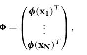

损失函数可以用特征矩阵重写为：

```
$L(\mathbf{w}) = \frac{1}{2}(\mathbf{y}-\Phi\mathbf{w})^T(\mathbf{y}-\Phi\mathbf{w}) + \frac{\lambda}{2}\mathbf{w}^T\mathbf{w}. \quad (3.17)$
```

很明显，我们处理变换后特征矩阵的方式与处理原始特征矩阵 $\mathbf{X}$ 完全相同，岭回归的解为：

```
$$\hat{\mathbf{w}} = (\Phi^T\Phi + \lambda I)^{-1}\Phi^T\mathbf{y}.$$
```

在 scikit-learn 中，我们可以如下拟拟合 Ridge 模型：

```python
from sklearn.preprocessing import PolynomialFeatures

from sklearn.linear_model import Ridge

poly_features=PolynomialFeatures(degree=2)

model = Ridge(alpha =0.1,fit_intercept=False)

Phi_poly_features.fit_transform(X)

model.fit(Phi,y)
```

对六个脑体积进行预测的多元多项式拟合结果如图 3.8 中间所示。我们可以看到，该模型对于较幼的婴儿比线性模型更准确，GA 的交叉验证 RMSE 从 1.27 周减少到 0.88 周。超参数 `degree` 和 `alpha` 使用了 GridSearchCV 进行了调优。

### 3.3.2 核技巧

#### 对偶表示

将线性模型转换为非线性模型的另一种方法是使用**核技巧**（kernel trick）。首先，我们将模型的参数 **w** 改变为**对偶表示**（dual representation），定义为

```
w = \Phi^T a.
```

现在让我们这种表示意味着什么。首先，权重向量 **w** 的维度为 $D$，即特征的数量。特征矩阵 $\Phi$ 是 $D \times N$，因此对偶表示 $a$ 的维度为 $N$，每个**样本**对应一个参数 $a_i$。现在来看新的回归模型：

```
\hat{y} = \phi(\mathbf{x})^T\mathbf{w} = \phi(\mathbf{x})^T\Phi^T a = \sum_{i=1}^{N} \phi(\mathbf{x})^T\phi(\mathbf{x}_i)a_i.
```

回归模型随后变为**核** $\kappa$ 的线性组合

```
\kappa(\mathbf{x}, \mathbf{x}_i) = \phi(\mathbf{x})^T\phi(\mathbf{x}_i)
```

它定义了两个特征向量之间的**相似性**。在这种情况下，我们计算训练样本 $\mathbf{x}_i$ 与我们想要评估的新样本 $\mathbf{x}$ 之间的相似性。核 $\kappa$ 最常用的选择是**高斯核**（Gaussian kernel）：

```
\kappa(\mathbf{x}, \mathbf{x}_i) = \exp\left(\frac{|\mathbf{x}-\mathbf{x}_i|_2^2}{2\sigma}\right).
```

其中 $|\mathbf{x}-\mathbf{x}_i|_2 = \sqrt{\sum_{j=1}^{D}(x_j-x_{ij})^2}$ 是两个特征向量之间的欧式距离。高斯函数如图 3.9 所示。注意，距离较大的特征对相似性 $\kappa$ 较小，而相同的特征向量具有最大的相似性。

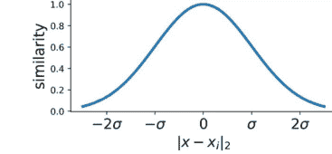

图 3.9 高斯核。

得到的对偶预测模型是分布在特征周围的核的线性组合

```
\hat{y} = \sum_{i=1}^{N} d_i k(\mathbf{X}, \mathbf{x}_i). \quad (3.22)
```

使用高斯核的对偶预测模型示例如图 3.10 所示。我们可以观察到，随着核的增大，模型变得更加平滑。左侧的核大小是合适的，导致了平滑且拟合良好的回归。在模型中，核太小，模型节点在样本之间趋于零。在右侧的图中，核太大，回归曲线低估了数据。

#### 回归模型的对偶表示

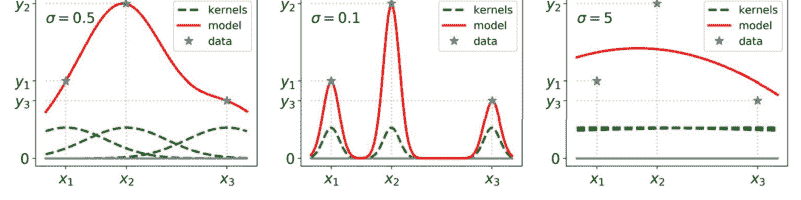

图 3.10 使用不同高斯核 $\sigma$ 的核岭回归。虚线显示特征向量周围的核。实线表示数据趋势。

#### 核回归

核方法的的优势之一是将核直观地解释为特征之间的相似性。此外，它使得原始特征变换具有非常大、甚至是无限的维度 $D$。这是因为我们需要求逆的是矩阵 $\mathbf{K} + \mathbf{I}$，其维度为 $N \times N$，与样本数量相关。相反，对于非线性变换的岭回归，我们求逆的是 $\Phi^T\Phi + \lambda\mathbf{I}$，其维度为 $D \times D$，与特征数量相关。

从计算效率的角度来看，我们根据瓶颈是特征数量还是样本数量来选择核方法或特征变换方法。核方法对于大型数据集来说在拟合和评估阶段都很慢，因为在预测未知样本时需要计算与每个训练样本的相似性。另一方面，如果趋势可以用参数较少的非线性模型捕获（例如低阶多项式模型），那么训练和评估速度都可以非常快。

### 3.3.3 习题

- 1. 创建线性回归的特征变换为 $\phi(x) = (1, x)^T$。使用公式 (3.20) 计算线性核。
- 2. 创建二阶多项式回归的特征变换为 $\phi(x) = (1, x^2)^T$。使用公式 (3.20) 计算二阶多项式核。
- 3. 给定三个训练样本，特征矩阵 $\mathbf{X} = (-1, 0, 1)$ 和目标向量 $\mathbf{y} = (2, 3, 2)^T$，使用 $\sigma = 1$ 和 $\lambda = 0$ 的高斯核，计算对偶表示 $a$ (公式 (3.24)) 以拟合岭回归模型。使用公式 (3.25) 对新样本 $x=0.5$ 进行模型评估。
- 4. 在 scikit-learn 中拟合岭回归（ridge model）和带有高斯核的核岭回归模型（kernel ridge regression model），根据皮层体积预测 GAs，皮层体积是文件 'GA-brain-volumes-6-features.csv' 中提供的第一个特征。尝试参数 $degree$、$gamma$ 和 $alpha$ 以观察其效果。
- 5. 给定三个训练样本，特征矩阵 $\mathbf{X} = (-1, 0, 1)^T$ 和目标向量 $\mathbf{y} = (2, 3, 2)^T$，使用 $\sigma = 1$ 和 $\lambda = 0$ 的高斯核，在 NumPy 中实现以下内容：
    - 在区间 $[-1.25, 1.25]$ 内生成 100 个样本的向量 $\mathbf{x}$；
    - 计算并绘制这些样本的核 $(\mathbf{x}, \mathbf{x})$ (公式 (3.21))；
    - 使用公式 (3.24) 计算对偶表示 $a$；
    - 使用公式 (3.25) 计算并绘制核岭回归模型。
- 6. 在 scikit-learn 中拟合核岭回归模型，根据 'GA-brain-volumes-6-features.csv' 中提供的六个结构体积预测 GAs。使用 `GridSearchCV` 优化超参数 $\lambda$ 和 $y$。比较核回归和线性回归的交叉验证 RMSE。

> ^习题 4–6 的数据集和练习骨架代码可以通过 github.com/MachineLearning-BiomedicalApplications/notebooks 获取。

# 第 4 章

# 分类

在第 2 章中，我们介绍了使用感知机模型的线性分类（第 2.2.2 节）。在本章中，我们将详细描述各种线性是非线性分类方法。在第 4.1 节中，我们将涵盖线性二分类和多标签分类器，包括感知机和逻辑回归。我们还将讨论如何正确评估分类模型。在第 4.2 节中，我们将引入支持向量分类器并通过特征变换和核技巧将线性分类器转换为非线性。

我们将通过通过心脏超声、MRI 和心电图测量预测心衰竭（HF）的示例来演示训练分类模型 [36]。我们已经在第 2.1.1 节和 2.2.2 节中介绍了该数据集。该数据集包含三个测量值（特征）：

- **射血分数 (EF)：** 左心室每次收缩时泵出的血液百分比；
- **全局纵向应变 (GLS)：** 心脏周期期间心脏长度变化的百分比；
- **QRS 间期持续时间 (QRS)：** 从心电图中获取的健康心脏功能特征。

这些测量值是根据 120 名患以下情况之一的患者计算出的：

- **健康：** 无症状；
- **轻度心力衰竭：** 运动期间出现症状；
- **严重心力衰竭：** 静息时出现症状。

## 4.1 分类基础

在本节中，我们将介绍二分类和多标签分类技术。我们将研究感知机和逻辑回归模型，并讨论二分类和多标签分类器的性能衡量标准。

### 4.1.1 二线性分类

**二分类器**根据 $D$ 维特征向量 $x = (x_1, \dots, x_D)^T$ 预测两个标签（通常为 0 和 1）。预测基于一个**决策函数**，该函数是多元线性函数：

```
$h(\mathbf{x}) = w_0 + x_1w_1 + \dots + x_Dw_D$.
```

决策边界定义为决策函数等于零 $h(\mathbf{x})=0$。二标签 $\hat{y}$ 基于决策函数的符号：如果决策函数的值为正或零，则预测标签为 1。如果决策函数的值为负，则预测标签为 0。

```
$$\hat{y} = \begin{cases} 1 & \text{if } h(\mathbf{x}) \geq 0 \\ 0 & \text{if } h(\mathbf{x}) < 0 \end{cases}$$
```
我们已经在第 2.1.1 节中介绍了二分类的示例。在这个例子中，我们根据两个特征（EF 和 GLS）预测患者是健康还是患有心衰（见图 2.2）。在图 4.1 中，我们在二维空间可视化决策函数 $h(\mathbf{x})$。决策边界 $h(\mathbf{x})=0$ 是一个一维线。


### 4.1.2 感知机

二分类的目标是找到一个决策函数，使得结果标签与训练标签尽可能匹配。感知机通过对分类错误的样本根据决策函数的绝对值进行惩罚来实现这一点：

```
$$\hat{\mathbf{w}} = \arg\max_{\mathbf{w}} \sum |h(\mathbf{x})|
```


### 4.1.3 逻辑回归

Sigmoid 函数将决策边界转换为概率。感知机算法为：

1. 随机选择训练样本 $\mathbf{x}$；
2. 如果 $y_i=1$ 且 $h(\mathbf{x}) < 0$，更新决策函数：$\mathbf{w} = \eta\mathbf{x}_i$；
3. 如果 $y_i=0$ 且 $h(\mathbf{x}) \geq 0$，更新决策函数：$\mathbf{w} = \mathbf{w} - \eta\mathbf{x}_i$。

算法迭代直到收敛。参数 $\eta$ 是学习率。与感知机不同，逻辑回归的收敛是有保证的。逻辑回归使用 sigmoid 函数：

$$\sigma(h) = \frac{1}{1 + e^{-h}}$$

这在图 4.3 中所示。逻辑回归通过最小化训练标签 $y_i$ 与类别 1 的概率 $p_i = \sigma(h(\mathbf{x}))$ 之间的**交叉熵**来寻找决策函数的参数 $w$：


为了理解为什么交叉熵损失有效，考虑一个具有训练标签 $y_i$ 的简单样本。如果 $y_i=1$，交叉熵损失为此样本引入的惩罚为 $-\ln(p_i)$。该惩罚在 $p_i=1$ 时为零，并在 $p_i$ 趋于零时趋于无穷大。通过最小化这种惩罚，我们确保该样本标签 1 的预测概率很高，正如训练标签所示。相反，如果训练标签为 0，当类别 1 的概率 $p_i$ 也为 0 时，惩罚 $-\ln(1-p_i)$ 为 0，当其接近 1 时惩罚趋于无穷大。

在 scikit-learn 中，逻辑回归的公式化和拟合如下：

```python
from sklearn.linear_model import LogisticRegression

model = LogisticRegression()

model.fit(X_train, y_train)
```

## 分类 91

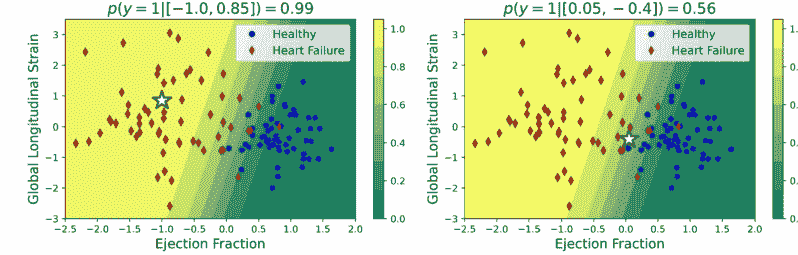

**图 4.4** 心力衰竭（标签 1）的条件概率。黄色和绿色分别代表高概率和低概率。白色星号表示高置信度（左）和低置信度（右）的样本。

对于测试数据，我们可以获得所有类别的概率预测：

```python
p = model.predict_proba(X_test)
```

标签0的预测概率可以通过 `p[:,0]` 获取，标签1的可以通过 `p[:,1]` 获取。

在图 4.4 中，我们绘制了根据两个特征（EF 和 GLS）预测的类别 1 的条件概率。黄色代表高概率（接近 1），绿色代表低概率（接近 0）。两幅图显示了不同的样本（用白色星号标记），其预测标签均为 1（心力衰竭）。然而，预测标签的置信度是不同的。第一个样本位于心力衰竭的高置信度区域（概率 0.99），而第二个样本则靠近决策边界（概率 0.55）。显然，我们对第一个病例的心力衰竭诊断准确性更有把握。

## 4.1.4 多标签线性分类

在许多应用中，我们希望将样本分配到两个以上的类别。例如，我们不仅想诊断患者是否患有心力衰竭，还想知道严重程度。因此，我们有三个类别：标签 0 代表健康患者，标签 1 代表轻度心力衰竭病例，标签 2 代表严重心力衰竭病例，如本章开头所述。我们可以通过拟合多个决策函数将二分类分类器推广到多分类分类器。对于每个类别 $k$，我们有一个线性决策函数 $h_k(\mathbf{x})$，其参数向量为 $\mathbf{w}_k$，用于将类别 $k$ 与其他类别隔离开。

**多项逻辑回归**模型将逻辑回归推广到多个类别。为了预测样本 $\mathbf{x}$ 的标签，我们首先评估每个类别 $k$ 的

# 生物医学应用机器学习

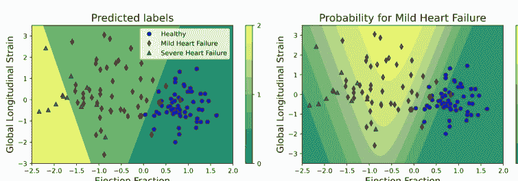

**图 4.5** 心力衰竭的多标签分类。左图：特征空间分为三个区域：深绿色代表健康（标签 0），浅绿色代表轻度心力衰竭（标签 1），黄色代表严重心力衰竭（标签 2）。右图：轻度心力衰竭（标签 1）的条件概率。黄色和绿色分别代表高概率和低概率。

（我们在第 3 章中定义了 $x_0 = 1$）：

```python
$h_k(\mathbf{x}) = \mathbf{w}_k^T\mathbf{x}$.
```

然后将决策函数的输出通过 *softmax* 函数转换为条件概率 $p_k(\mathbf{x}) = p(y=k|\mathbf{x})$：

```python
$p_k(\mathbf{x}) = \frac{e^{h_k(\mathbf{x})}}{\sum_{j=1}^K e^{h_j(\mathbf{x})}}$
```

最后，我们将具有最高概率 $p_k(\mathbf{x})$ 的类别分配给样本 $x$：

```python
$\hat{y} = \arg\max_k p_k(\mathbf{x}).$.
```

每个依赖于类别的决策函数的参数 $\mathbf{w}_k$ 是通过最小化*交叉熵*得到的：

```python
$- \sum_{i=1}^N \sum_{k=1}^K y_{ik} \ln p_k(\mathbf{x}_i)$
```

其中如果标签 $y_i = k$，则 $y_{ik}$ 为 1，否则为 0。

使用特征 EF 和 GLS 将患者分类为健康、轻度或严重心力衰竭病例如图 4.5 所示。在左侧，我们可以看到特征空间被分为三个区域，对应三类患者。右侧的图显示了轻度心力衰竭患者的预测概率。多项逻辑回归在 scikit-learn 中通过以下实现：

# LogisticRegression(multi_class="multinomial")

不需要设置该参数，因为 scikit-learn 会自动检测我们何时拥有两个以上的标签。现在我们来演示如何拟合并绘制逻辑回归模型，以获得图 4.5 所示的结果。我们可以使用标准的 scikit-learn API 来选择并拟合模型：

```python
model = LogisticRegression()

model.fit(X,y)
```

为了绘制分类结果，我们将预测整个 2D 特征空间的标签。首先，我们对两个特征的相关值范围进行采样：

```python
import numpy as np

x1 = np.linspace(-2.5, 2, 1000)

x2 = np.linspace(-3.3, 3.5, 1000)
```

接下来，我们将单个特征向量合并为 2D 坐标矩阵，大小为 1000 × 1000，适用于绘图：

```python
x1, x2 = np.meshgrid(x1,x2.T)
```

然而，scikit-learn 需要形状为“样本数 × 特征数”的矩阵，在我们的案例中是 1000 × 2。我们将通过将 x1 和 x2 展平为 1D 向量并拼接来实现这一点：

```python
```


`Feature_space = np.c_[x1.ravel(),x2.ravel()]`

现在，我们对采样的 2D 特征空间预测标签：

```python
y_pred = model.predict(Feature_space)
```

在绘制这些之前，我们需要将它们重塑回 2D 网格：

```python
y_pred = y_pred.reshape(x1.shape)
```

我们将使用 matplotlib 的 `contour` 函数绘制结果，该函数接受坐标和强度（颜色）作为输入参数：

```python
import matplotlib.pyplot as plt

plt.contour(x1, x2, y_pred, cmap='summer')
```

`cmap` 参数决定了最终的颜色映射表。最后，我们在图上绘制数据并标注：

```python
plt.plot(X[y==0,0],X[y==0,1],'bo')
plt.plot(X[y==1,0],X[y==1,1],'rd')
plt.plot(X[y==2,0],X[y==2,1],'g^')
plt.xlabel('Ejection Fraction')
```

```python
plt.ylabel('Global Longitudinal Strain')
plt.legend(['Healthy','Mild Heart Failure',
'Severe Heart Failure'])
plt.title('Predicted labels')
```

为了绘制类别 1 的概率，我们使用以下代码：

```python
p = model.predict_proba(feature_space)
p = p[:,1].reshape(x1.shape)
plt.contour(x1, x2, cmap='summer')
```

## 4.1.5 分类器的评估

### 准确率

我们已经在第 2.2.2 节看到，可以使用**准确率**（`accuracy`）得分来衡量分类器的性能，它是正确分类样本的比例。准确率适用于二分类和多标签分类器，是 scikit-learn 中默认的分类性能指标。

我们通常在排除在训练的测试集上衡量准确误差，或者在训练集上使用交叉验证，尽管我们也可以检查整个集的准确率。

### 灵敏度和特异性

不平衡数据集的准确率得分问题可以通过计算正确标记的正样本和负样本的比例来解决。灵敏度（Sensitivity），也称为召回率（`recall`），是正确标记的正样本（例如标签为 1 的样本）的比例。在 scikit-learn 中，可以使用 `recall_score` 进行评估。

# 生物医学应用的机器学习

这些性能结果是针对检测心衰竭的二分类器计算的（4.1.3节）。对于多标签问题，例如三分类心衰竭检测（4.1.4节），我们可以通过以下方式高效地打印所有类的召回率：

```python
recalls = recall_score(y_train, y_pred_train, average = None)
print('recalls: ', np.around(recalls, 2))
>>> recalls: [0.98 0.088 0.5]
```

我们可以迅速观察到，刚刚计算出的 29% 的准确率并没有反映严重心衰竭检测中 0.5 的低敏感性，这意味着我们只正确识别了 50% 的严重病例。

## 4.1.6 练习题

- 1. 解释逻辑回归中 sigmoid 节点的作用。
- 2. 样本 $x$ 属于类别 1 的概率预测值为 $p_i = 0.6$。请解释这一结果。
- 3. 训练样本 $x$ 的标签为 $y_i = 0$。逻辑回归预测 $p_i$ 接近 1。估算该样本的交叉熵并解释该结果。
- 4. 在 scikit-learn 中实现一个逻辑回归模型，根据单个特征射血分数（ejection fraction）预测心衰竭。使用 Pandas 加载 `heart_failure.csv` 数据集。选择 `EF` 列作为特征矩阵，选择 `HF` 列作为标签。注意标签是二分类的。绘制逻辑回归模型，并绘制数据和决策函数。绘制决策边界和条件概率，类似于图 4.4。
一位疑似患有心衰竭的患者进行了 MRI 扫描。射血分数为 40%。判断该患者是否可能发生心衰竭，并计算该决策的置信度。
- 5. 全局纵向应变（Global longitudinal strain）很难通过需要进行的人工测量来准确估计，导致重复性较差。人员认为 GLS 可以被从心电图中提取的 Q 间期持续时间取代，后者测量容易得多。使用 Pandas 加载 `heart_failure.csv` 数据集。比较根据 EF 和 GLS 预测心衰竭的分类器（图 4.4）与根据 EF 和 QRS 预测心衰竭的分类器。计算这两个分类器的准确率、敏感性和特异性。
- 6. 训练一个多项逻辑回归分类器，根据 EF 和 GLS 预测无、中度或严重心衰竭（图 4.5）。使用 Pandas 加载 `heart_failure_data_complete.csv` 数据集。计算该分类器的准确率、每个类的召回率以及平均召回率。讨论该分类器的性能。

*练习 4-6 的数据集和骨架代码可以从 [github.com/Machine-Learn-ingBiomedicalApplications/notebooks.](https://github.com/Machine-Learn-ingBiomedicalApplications/notebooks.) 获取。*

## 4.2 支持向量分类器

支持向量分类器（`SVC`）是一种大间隔分类器，其目标不仅是找到正确分割样本的决策边界，还要实现类别之间的最大分离。在本节中，我们将介绍硬边界和软边界支持向量分类器，以及用于非线性分类的核技巧。

### 4.2.1 硬边界支持向量分类器

在两类样本线性可分的分类问题中，没有唯一解。硬边界分类器（图 4.6 左侧）将选择距离两类样本都最大的决策边界。决策边界由**支持向量**决定，即位于边界上的样本。在图 4.6 中，边界由虚线表示，支持向量由粉色圆圈表示。

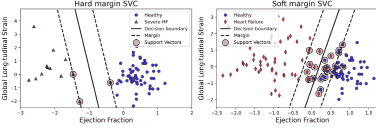

**图 4.6** 硬边界和软边界支持向量分类器。

决策函数是一个多元线性函数：

```
$h(\mathbf{x}) = \mathbf{w}^T\mathbf{x} + b.$
```

该公式与公式 (4.1) 中的公式等价，不同之处截距用 $b$ 而不是 $u_0$ 表示。决策边界由：

```
$h(\mathbf{x}) = 0,$
```

而边界定义为：

```
$h(\mathbf{x}) = \pm 1.$
```

我们还将标签从 0 重命名为 -1。和之前一样，如果决策函数为正，我们预测标签为 1；如果为负，则预测为 -1：

```
\hat{y} = \begin{cases} 1 & \text{if } h(\mathbf{x}) \geq 0 \\ -1 & \text{if } h(\mathbf{x}) < 0 \end{cases}
```

**硬边界目标**的目的是让边界上的样本尽可能远离。这可以写为：

```
minimize \frac{1}{2}\mathbf{w}^T\mathbf{w} \text{ subject to } y_i(\mathbf{x}) \geq 1.
```

支持向量是位于边界上的样本。硬边界目标仅适用于线性问题，且对离群值非常敏感。

### 4.2.2 软边界支持向量分类器

我们希望将支持向量分类器应用于不可分问题（图 4.6），而是使用软边界。松弛变量 $\zeta_i$ 衡量样本 $\mathbf{x}_i$ 违反边界的情况。如果 $\zeta_i=0$，则样本位于边界或外部；如果 $\zeta_i>0$，则样本违反了边界。**软边界目标**是在最大化边界的同时最小化松弛变量之和 $\sum_{i=1}^N\zeta_i$。与硬边界目标类似，最大化边界等于最小化决策函数的斜率。将这些结合，软

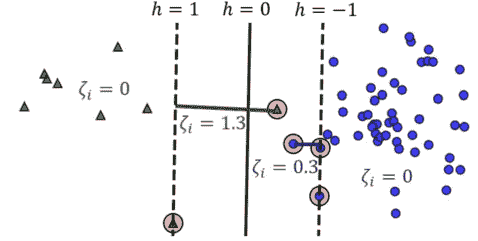

**图 4.7** 松弛变量 $\zeta_i$ 的解释。

边界目标可以写为：

$$\minimize \frac{1}{2}\mathbf{w}^T\mathbf{w} + C\sum_{i=1}^{N} \zeta_i\ntext{subject to } y_i(\mathbf{x}_i) \geq 1 - \zeta_i, \zeta_i \geq 0 \text{ for } i=1, \dots, N.$$

超参数 $C$ 代表边界宽度与违规之间的权衡。对于较大的 $C$，我们会得到更边界和更少的违规；对于较小的 $C$，我们会得到更大的边界和更多的违规。软边界目标必须通过数值求解，通常使用二次规划求解器 [7]。或者，我们可以通过合损失等价地表示软边界目标：

$$\hat{\mathbf{w}} = \arg\min_{\mathbf{w}} C\sum_{i=1}^{N} \max(0, 1-\mathbf{w}^T\mathbf{x}+b) + \frac{1}{2}\mathbf{w}^T\mathbf{w}.$$

这可以使用次梯度下降（3.1.2节）进行最小化。在 scikit-learn 中，线性支持向量分类器模型可以表示：

```python
from sklearn.svm import LinearSVC
model = LinearSVC(C=10)
```

或者，它被实现为带有合页损失的随机梯度下降分类器：

```python
from sklearn.linear_model import SGDClassifier
model = SGDClassifier(loss='hinge', alpha = 0.01)
```

在这里，参数 `alpha` 是岭惩罚的超参数，它等于 $1/C$。

# 用于生物医学应用的机器学习

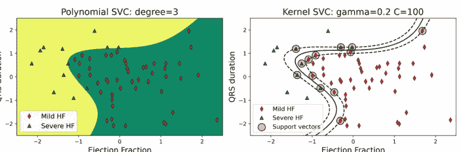

**图 4.8** 非线性支持向量分类器。左侧：带有多项式特征转换的线性 SVC。右侧：带有径基函数（高斯）核的核 SVC。

## 4.2.3 多项式支持向量分类器

某些数据集无法使用线性边界进行分离。例如，如果我们希望根据 EF 和 QRS 区分轻度与重度心力衰竭患者，非线性分类的效果会更好，如图 4.8 所示。

与回归（第 3.3.1 节）类似，通过应用非线性特征变换 $\phi$，可以将线性分类器转换为非线性分类器。决策边界将变为：

> $h(x) = w^T\Phi(x) + b,$

并且或软边界目标可以像之前完全相同的方式应用。在 scikit-learn 中，我们可以将其实现为非线性特征转换（在本例中为三阶）的流水线，随后是线性 SVC：

```
from sklearn.pipeline import Pipeline
from sklearn.preprocessing import PolynomialFeatures
from sklearn.preprocessing import StandardScaler
from sklearn.svm import LinearSVC
model = Pipeline(
    ("poly_features",PolynomialFeatures(degree=3)),
    ("scaler",StandardScaler()),
    ("svc",LinearSVC()))
)
```

拟合的多项式支持向量分类器如图 4.8 左侧所示。

## 4.2.4 核支持向量分类器

或者，我们可以通过使用核技巧来创建一个非线性支持向量分类器。我们已经在第 3.3.2 节的岭回归背景下介绍过核技巧。我们将我们将参数向量 $\bf w$ 替换为其对偶表示

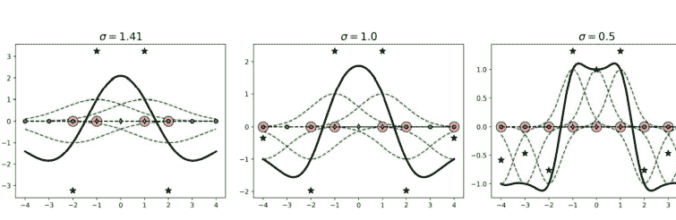

**图 4.9** 具有不同高斯核大小 $\sigma$ 的核支持向量分类器。正样本用红色菱形表示，负样本用蓝色圆圈表示。虚线显示以支持向量 $\mathbf{x}_i$ 为中心、乘以标签 $\kappa(\mathbf{x}, \mathbf{x}_i)$ 的核。绿色星号显示乘以标签 $a_i$ ($a_i > 0$) 的非零对偶系数。实黑线表示形成决策函数的核线性组合（公式 (4.5)）。

a，其中 $a_i \ge 0$：

```
$$\mathbf{w} = \sum_{i=1}^N a_i \phi(\mathbf{x}_i)$$
```

决策函数变为：

```
$h(\mathbf{x}) = \sum_{i=1}^N a_i \kappa(\mathbf{x}, \mathbf{x}_i) + b \quad (4.5)$
```

其中 $\kappa(\mathbf{x}, \mathbf{x}_i) = \phi^T(\mathbf{x})\phi(\mathbf{x}_i)$ 是核。标签从该公式的方法与之前相同，通过对决策函数进行阈值化（公式 (4.4)）。

在 scikit-learn 中，核支持向量分类器通过 `SVC` 类实现：

```python
from sklearn.svm import SVC
model = SVC(kernel='rbf', gamma=0.2, C=1e2)
```

参数设置 `kernel='rbf'` 提供了一个方差为 $\sigma^2= 1/(2\gamma)$ 的高斯核，其中值 $\gamma$ 由参数 `gamma` 平滑。较小的 $\gamma$ 将导致更大的核和更平滑的决策边界（图 4.9）。超参数 `C` 通过惩罚违反边界的行为来调节边界的宽度。


参数设置 `kernel='rbf'` 提供了一个方差为 $\sigma^2= 1/(2\gamma)$ 的高斯核，其中值 $\gamma$ 由参数 `gamma` 平滑。较小的 $\gamma$ 将导致更大的核和更平滑的决策边界（图 4.9）。超参数 `C` 通过惩罚违反边界的行为来调节边界的宽度。

## 4.2.5 训练支持向量分类器

在本节中，我们展示了如何使用 `scikit-learn` 训练和评估支持向量分类器。在开始调优模型之前，我们需要划分测试集以防止过拟合。根据 EF 和 QRS 区分轻度与重度心力衰竭患者，非线性分类效果会更好，如图 4.8 所示。（此处省略了重复的段落，仅保留核心翻译逻辑）

我们可以观察到，测试集上的准确率与训练集上的交叉验证准确率相同，因此模型在未见数据上的泛化良好。通过对召回率（`recall`）的分析，我们可以分类器识别识别心衰竭（标签 0）的能力优于严重心衰竭（标签 1）。这并不意外，因为类别 1 的样本代表性不足，数据集中只有 20% 的患者被诊断为严重心衰竭。

## 4.2.6 练习题

- 1. 在软向量分类中，支持向量（`support vectors`）的作用是什么？
- 2. 在软间隔 SVC 中，松弛变量（`slack variables`）的作用是什么？
- 3. 通过核 SVC 中的对对偶表示，对决策函数的数学公式提供直观的解释。描述如何使用该决策函数进行标签预测。
- 4. 训练一个多标签核支持分类器，根据 EF 和 QRS 诊断无、中度或严重心衰竭。使用 Pandas 加载数据集 `*heart_failure_data_complete.csv*`。执行以下步骤：
    - 执行训练-测试划分；
    - 使用交叉验证调整核 SVC 分类器的参数，包括核类型、核参数和正则化参数 `C`。
    - 可视化分类结果，并使用训练集和测试集上的交叉验证计算适当的性能。分析分类器的性能。它在不同类别上的表现如何？
- 5. 给你一个具有以下特征和标签的 1D数据集：

  **X = (−4, -3, -2, -1, 0, 1, 2, 3, 4)ᵀ**
  **y = (−1, -1, -1, 1, 1, 1, -1, -1, -1)ᵀ**

    - 拟合一个 `*gamma*=0.1` 和 `*C*=1e5` 的 SVC 分类器。绘制以 x 轴为特征、y 轴为标签的数据图。绘制决策函数并在支持向量周围画圆圈。
    - 绘制对应于支持向量的高斯核 **κ (x, xᵢ)**，其方差为 **σ² = 1/(2γ)**，并乘以其标签 **yᵢ**；
    - 绘制对偶系数与标签 **aᵢ** 的乘积；
    - 根据公式 (4.5) 计算并绘制决策函数。将其与 SVC 模型返回的决策函数进行比较。
    你的最终图表应该与图 4.9 相似。

² 练习 4 和 5 的数据集和骨架代码可以通过 `github.com/Machine-LearningBiomedicalApplications/notebooks` 获取。

# 第 5 章

# 降维

现代生物医学数据集是巨大的。考虑一下，仅仅一次 MRI 脑扫描，它定义在一个典型的体素图像网格上。其分辨率为 255 × 255 × 180。如果我们把每个数据点视为一个独立的特征，那么每张图像将拥有 1100 万个特征。同样，遗传样本每张图像记录了数百万个单核苷酸多态性 (SNPs)，生物识别设备（如智能手表）持续记录生理测量值。再加上生物医学样本获取困难，这意味着特征的数量往往超过样本的数量。这是一个问题，因为随着维度的增加，相同的数据填充空间的方式变得更加稀疏，使得更容易偶然拟合出一个分离超平面，从而对训练数据中的噪声产生过拟合。在本章中，我们将通过数据的线性或非线性投影来解决这个问题。

## 5.1. 维度灾难

为了理解特征多于样本所带来的风险，请考虑如图 5.1 所示的玩具示例。它模拟了随着特征空间维度增加，对固定数量数据点进行分类的影响。在这个中，我们有两个类别，由红色和绿色标记表示。每个点都随机采样自以 0.5 为中心的正态分布，每组的方差相同。因此，这些组本应该是不可分的。然而，图 5.1 显示了类别偶然可分的情况。

在第一行，我们可以看到，在一维中，两组完全重叠，分类准确率接近随机概率（正如预期）。随着特征维度的增加，点分布得更加分散，分类率上升。在三维情况下，分类器报告的准确率为 75%。显然，分类器正在对数据中的噪声进行过拟合，随着特征空间维度的增加，这种情况变得越来越糟糕。

## 5.2. 低维嵌入：物理动机

解决高维数据过拟合风险的一种方法是降低特征空间的维度。即特征选择。在第 8 章中，我们将看到如何通过特征选择来解决这个问题。在这里，我们关注通过线性、非线性投影进行降维。目标是保留关键的统计

或数据的几何属性。这基于一种理解：真实数据示例是由受物理定律限制的、自由度较少的过程生成的。例如，涉及拍摄全景照片的一系列照片。你可能认为，由于这些照片中每张分辨率都是 10-20 万像素，对于算法来说如何映射这些照片以形成一张无缝的图像是一个非常困难的问题。实际上，拍摄这些照片的过程嵌入在三维空间（相机的俯仰、滚和偏航），因此相关的自由度反映了更低维的空间。这对于光照变化的重建也是如此。

`img/d219b4c20ff50f4b97845dec7a9acecb_125_0.png`

**图 5.2** 左侧：胸部的 4D 电影是通过一系列 2D+时间的切片收集的。原始重建受到运动干扰。中间：通过识别在相同运动状态采集的相邻切片可以清晰地重建图像。右侧：通过对点的非线性（流形）嵌入可以找到正确的切片 [8]。

流形学习（在第 5.6 节描述）同样可以从动态采集的 2D 切片重建高分辨率的 4D 体（3 空间+1 时间）。

## 5.3. 线性变换

在考虑非线性流形之前，让我们先考虑从线性变换构建的线性嵌入。数学上，线性变换是满足加法和标量乘法性质并保持原点的函数：

- 加法：$T(\mathbf{x}_1 + \mathbf{x}_2) = T(\mathbf{x}_1) + T(\mathbf{x}_2)$ (5.1)
- 标量乘法：$T(\alpha\mathbf{x}) = \alpha T(\mathbf{x})$ (5.2)

简单来说，这意味着线性变换保留了向量空间的线性性质。换句话说，它们将数据点从一个欧几里得域映射到欧几里得子空间。实践中，任何矩阵对向量的作用都是线性变换。例如，$\mathbf{A} = \begin{pmatrix} 3 & 0 \\ 0 & 1 \end{pmatrix}$ 代表沿 x 轴缩放 3 倍（见图 5.3），如下：

$$\begin{pmatrix} x' \ y' \end{pmatrix} = \begin{pmatrix} 3 & 0 \\ 0 & 1 \end{pmatrix} \begin{pmatrix} x \\ y \end{pmatrix} (5.3)$$

$$= \begin{pmatrix} 3x + 0y \\ 0x + 1y \end{pmatrix} (5.4)$$

$$= \begin{pmatrix} 3x \\ 1y \end{pmatrix} (5.5)$$

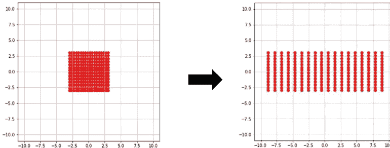

图 **5.3** $A=\left(\begin{matrix}3&0\\0&1\end{matrix}\right)$ 的作用是沿坐标轴大小为 3 的缩放。

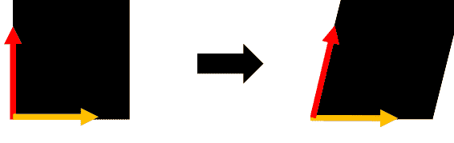

图 **5.4** 特征向量是在线性变换下方向不改变的向量。在这个水平剪切变换的例子中，黄色向量是一个特征向量，而红色向量不是。

### 5.3.1 特征值和特征向量

给定线性变换的特征向量定义为：在应用线性变换后保持不变（缩放因子除外）的方向。例如，观察图 5.4 所示的剪切操作，红色向量（初始在 y 方向方向）在变换操作下改变了方向，而黄色箭头（沿 x 轴方向）没有改变。在这种情况下，黄色向量是一个*特征向量*，而特征向量 $\mathbf{v}$ 被变换缩放的程度由其*特征值*（$\lambda$）表示。我们可以用矩阵形式表示这种关系：

```
$$Av = \lambda v,$$
```

通过重新排列方程，将所有项移到一侧并提取 $v^T$ 的公因子，借此估计 $A$ 的特征向量和特征值：

```
$$Av - \lambda v = 0$$
```

$^1$ I 代表单位矩阵。

$(\mathbf{A} - \lambda\mathbf{I})\mathbf{v} = 0.$

我们强制要求 $\mathbf{v}$ 不为零。这意味着 $(\mathbf{A} - \lambda\mathbf{I})$ 必须是奇异的，其行列式等于零

$|\mathbf{A} - \lambda\mathbf{I}| = 0.$

这个表达式被称为*特征方程*。

## 行列式

行列是一个标量，作为矩阵的函数导出，它仅当矩阵可逆且代表同构变换（双射）时不为零，使得原始域中的所有点都映射到第二个域中的唯一一个位置。对于 $2 \times 2$ 矩阵 $\mathbf{B} = \begin{pmatrix} a & b \\ c & d \end{pmatrix}$，行列式可以估计为：

$det\mathbf{B} = |\mathbf{B}| = ad - bc.$

## 示例：特征向量计算

为了估计水平缩放操作 $\mathbf{A} = \begin{pmatrix} 3 & 0 \\ 0 & 1 \end{pmatrix}$ 的特征向量和特征值，首先将 $\mathbf{A}$ 代入特征方程并计算行列式

$|\mathbf{A} - \lambda\mathbf{I}| = |\begin{pmatrix} 3 & 0 \\ 0 & 1 \end{pmatrix} - \lambda \begin{pmatrix} 1 & 0 \\ 0 & 1 \end{pmatrix}|,$

$= |\begin{pmatrix} 3-\lambda & 0 \\ 0 & 1-\lambda \end{pmatrix}| = 0,$

$= (3-\lambda)(1-\lambda) = 0.$

这告诉我们解（根）为 $(3-\lambda) = 0$ 和 $(1-\lambda) = 0$；因此，$\mathbf{A}$ 的特征值为 $\lambda_1 = 3$ 和 $\lambda_2 = 1$。现在，通过将 $\lambda$ 代入方程 (5.8) 计算特征向量，从 $\lambda = 3$ 开始

$$\begin{pmatrix} 3-3 & 0 \\ 0 & 1-3 \end{pmatrix} \begin{pmatrix} \nu_1 \\ \nu_2 \end{pmatrix} = 0.$$

展开后得到：

- $\rightarrow 0\nu_1 + 0\nu_2 = 0$
- $\rightarrow 0\nu_1 - 2\nu_2 = 0,$

这意味着 $v_2$ 必须为零（因为 $2 \times v_2$ 不等于 0，除非 $v_2 = 0$）。因此，对应于 $\lambda_1=3$ 的特征向量（由任意缩放因子 $k$ 定义）为：

```
$v = \begin{pmatrix} k \\ 0 \end{pmatrix} \quad (5.17)$
```

这代表沿 x 轴的缩放。同样，对应于特征值 $\lambda_1=1$ 的特征向量通过以下公式估计：

```
$$\begin{pmatrix} 3-1 & 0 \\ 0 & 1-1 \end{pmatrix} \begin{pmatrix} v_1 \\ v_2 \end{pmatrix} = 0 \quad (5.18)$$
\rightarrow 2v_1 + 0v_2 = 0 \quad (5.19)$$
\rightarrow 0v_1 - 0v_2 = 0, \quad (5.20)$$
```

其中方程 (5.20) 意味着 $v_1$ 必须为零（根据 $2v_1=0$）。因此，对应于 $\lambda_2=1$ 的特征向量代表沿 y 方向的缩放

```
$v = \begin{pmatrix} 0 \\ k \end{pmatrix} \quad (5.21)$
```

由于特征值 = 1，这等同于单位缩放，导致沿 x 轴延伸的整体效果。

### 对称矩阵的特征向量

如果我们拥有的是具有非对角项的矩阵，例如 $\mathbf{A}_2 = \left(\begin{pmatrix} 2 & 1 \\ 1 & 2 \end{pmatrix}\right)$，特征方程展开为：

```
$$\begin{pmatrix} 2-\lambda & 1 \\ 1 & 2-\lambda \end{pmatrix} = (2-\lambda)(2-\lambda)-1=0 \quad (5.22)$$
\lambda^2-4\lambda+4-1=0 \quad (5.23)$$
\lambda^2-4\lambda+3=0 \quad (5.24)$$
$(3-\lambda)(1-\lambda)=0. \quad (5.25)$$
```

因此，特征值再次为 $\lambda_1=3$ 和 $\lambda_2=1$。对于 $\lambda_1=3$，特征向量可以通过以下公式计算：

```
$$\begin{pmatrix} 2-3 & 1 \\ 1 & 2-3 \end{pmatrix} \begin{pmatrix} v_1 \\ v_2 \end{pmatrix} = 0 \quad (5.26)$$
\rightarrow -v_1+v_2=0 \rightarrow v_1=v_2 \quad (5.27)$$
```


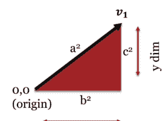

**图 5.5** 毕股哥定理：$a^2 = b^2 + c^2$。

$\rightarrow u_1 - 2u_2 = 0 \rightarrow u_1 = u_2,$ (5.28)

这表明 $u_1$ 是任何常数的倍数：

$u_1 = \left(\begin{matrix}1 \\ 1\end{matrix}\right),$ (5.29)

对特征值 $\lambda_2=1$ 遵循相同的步骤$^2$ ：

$u_2 = \left(\begin{matrix}1 \\ -1\end{matrix}\right).$ (5.30)

## 特征向量

以后我们将看到，对于 PCA 我们想要归一化。具体来说，可以证明对于任何对称矩阵 $\mathbf{A}$，其特征向量构成一个正交基，在该基上可以对角化。

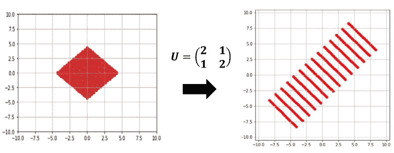

**图 5.6** 沿 $\mathbf{v}=\left(\begin{matrix}3&0\end{matrix}\right)$ 轴大小为 3 的尺度。

## 矩阵对角化

从图 5.6 我们可以看到这与之前相同（沿一个轴拉伸 3，另一个轴拉伸 1），这次是沿 $\mathbf{v}_1=\left(\begin{matrix}1&0\end{matrix}\right)$ 和 $\mathbf{v}_2=\left(\begin{matrix}0&1\end{matrix}\right)$ 轴。因此，特征向量在旋转坐标系中表示相同的变换。更具体地说：

> $$\mathbf{A}_2\mathbf{V} = \mathbf{\Lambda}\mathbf{V}$$
> (5.33)
> $\rightarrow \mathbf{V}^{-1}\mathbf{A}_2\mathbf{V} = \mathbf{V}^{-1}\mathbf{\Lambda}\mathbf{V}$
> (5.34)
> $= \mathbf{\Lambda}$$
> (5.35)
> $= \mathbf{A}$$
> (5.36)

在这里，方程 (5.33) 是方程 (5.6) 的矩阵等价形式，$\mathbf{V}$ 的列代表 $\mathbf{A}_2$ 的所有特征向量，而 $\mathbf{\Lambda}$ 是所有特征值的对角矩阵。

## 医学领域的机器学习

利用这一原理，PCA 通过估计（对称）数据协方差矩阵的特征向量来工作，返回的正交特征向量表示数据方差最大的方向。作为其如何工作的演示，再次考虑我们的脑体积数据集，它将婴儿脑体积与其扫描时的胎龄配对。……某些区域高度相关。这意味着了解一个特征可以强烈提供另一个特征的信息，意味着考虑这两个特征是冗余的。在 PCA 中，目标是寻找一个向量 $\mathbf{v}_1$，一旦

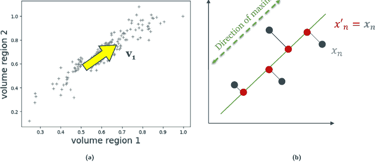

**图 5.7** a) 不同脑区域的生长高度相关性；PCA 的目标是将所有数据投影到单一方向 $u_1$（黄色箭头）；b) 最优方向（绿线）是方差最大化的方向，数据点（蓝色）被投影在其上。

数据被投影在其上（图 5.7b），返回了通过特征空间的任何方向的最大方差估计值。我们可以通过考虑数据协方矩阵的特征向量来实现这一点。

## 5.4.1 数据协方矩阵的估计

协方矩阵是一个对称矩阵，其元素代表数据集中元素之间的方差，其中元素可以交替地称为数据集的特征或样本本身。例如，假设我们的数据集 $\mathbf{X} \in \mathbb{R}^{100 \times 4}$ 包含 100 个样本和 4 个特征，我们可以估计样本之间的协方差为：

```
$$\mathbf{C} = \frac{1}{N-1}\mathbf{X}_C\mathbf{X}_C^T. \quad (5.37)$$
```

在这种情况下，矩阵 $\mathbf{C}$ 的形状为 $100 \times 100$，或者我们估计特征之间的协方差为：

```
$$\mathbf{C} = \frac{1}{N-1}\mathbf{X}_C^T\mathbf{X}_C. \quad (5.38)$$
```

形状为 $4 \times 4$。重要的是，在每个实例中我们假设数据已进行均值化：$\mathbf{X}_C = \mathbf{X} - \mathbf{X}$，通过减去每个样本的均值（对应公式 (5.37)）或每个特征的均值（对应公式 (5.38)）。对于降维，我们对后者感兴趣即特征之间的协方差。在这种情况下，我们的协方矩阵看起来如下：

```
$C = \begin{pmatrix} COV_{11} & COV_{12} & COV_{13} & COV_{14} \\ COV_{21} & COV_{22} & COV_{23} & COV_{24} \\ COV_{31} & COV_{32} & COV_{33} & COV_{34} \\ COV_{41} & COV_{42} & COV_{43} & COV_{44} \end{pmatrix} \quad (5.39)$
```

每个单个特征的方差（$COV_{11}, COV_{33}, COV_{44}, COV_{55}$）位于对角线上，不同特征之间的协方差（$COV_{12}, COV_{13}, COV_{14}, COV_{21}, ...$）存储在非对角线上。在这种表示中，方差估计了沿单个特征维的数值分布，而协方差是特征之间共享信息的度。协方矩阵是对称的，这意味着它的特征向量形成了一个新的正交基，能够更好地表示方差特征。

## 5.4.2 推导 PCA

我们从三角函数中知道，数据点 $\mathbf{x}_n$ 在 $\mathbf{v}_1$ 上的投影可以估计为 $|\mathbf{x}_n|cos\theta$，且这两个向量的标量积（点积）为：

```
$\mathbf{x}_n\mathbf{v}_1 = |\mathbf{x}_n|\mathbf{v}_1|cos\theta. \quad (5.40)$
```

因此，通过重新排列公式 (5.40)，我们看到只要 $|\mathbf{v}_1| = 1$，点积就等于标量投影：

```
$|\mathbf{x}_n|cos\theta = \frac{\mathbf{x}_n\mathbf{v}_1}{\|\mathbf{v}_1|}. \quad (5.41)$
```

综合以上考虑，对于 PCA，我们正在寻找一个方向 $\mathbf{v}_1$，使得所有投影数据点的方差最大化。假设我们首先归一化特征向量（$\mathbf{v}_1 = \mathbf{v}_1/|\mathbf{v}_1|$），我们可以将投影到 $\mathbf{v}_1$ 上的点方差表示为：

```
$\frac{1}{N-1}(\mathbf{XC}\mathbf{v}_1)^T(\mathbf{XC}\mathbf{v}_1) = \mathbf{v}_1^T\mathbf{C}\mathbf{v}_1. \quad (5.42)$
```

为了找到使投影方差最大的方向，我们必须对方差 $\mathbf{v}_1$ 关于 $\mathbf{v}_1$ 求导。同时，我们通过约束估计的特征向量具有单位长度来强制执行合理的解。该约束通过拉格朗日乘子法实现：

```
$\mathcal{L}(\mathbf{v}_1, \lambda_1) = \mathbf{v}_1^T\mathbf{C}\mathbf{v}_1 + \lambda_1(1-\mathbf{v}_1^T\mathbf{v}_1). \quad (5.43)$
```

对 $\mathbf{v}_1$ 优化使得 $\mathcal{L}(\mathbf{v}_1, \lambda_1)=0$，则可以简化为：

```
$\mathbf{C}\mathbf{v}_1 = \lambda_1\mathbf{v}_1. \quad (5.44)$
```

这意味着 $\mathbf{v}_1$ 必须是 $\mathbf{C}$ 的特征向量，其中特征值 $\lambda_1 = \mathbf{v}_1^T\mathbf{C}\mathbf{v}_1$ 等于该方向上方差的大小。

## 扩展到高维

我们可以通过约束下一个特征向量与 $v_1$ 正交来将此过程扩展到更高维。这次，我们需要两个拉格朗日乘子 $\lambda_2$ 和 $\phi$，其中 $\phi$ 约束第二个特征向量的幅度并确保 $v_2$ 与 $v_1$ 正交（$v_1^T v_2 = 0$）：

```
$\mathcal{L}(v_2, \lambda_2, \phi) = v_2^T C v_2 + \lambda_2(1 - v_2^T v_2) - \phi v_1^T v_2. \quad (45)$
```

现在，当对 $v_2$ 求导并乘以 $v_1$ 时：

| 项 1 | 项 2 | 项 3 | 结果 |
| :--- | :--- | :--- | :--- |
| $C v_2$ | $-\lambda_2$ | $-\phi v_1$ | $= 0$ (46) |
| $v_1^T v_2$ | $-\lambda_2 v_1^T v_2$ | $-\phi v_1^T v_1$ | $= 0$ (47) |
| $0$ | $-0$ | $-\phi v_1^T v_1$ | $= 0$ (48) |

前两项必须为零，因为存在正交约束 $v_2^T v_1 = 0$，且由于 $v_1^T v_1 = 1$，公式 (48) 告诉我们 $\phi$ 必须为 0。这意味着 $\phi$ 中的所有项都消失了，我们再次得到一个特征方程，这次是针对 $v_2$ 的：

```
$C v_2 = \lambda_2 v_2 \quad (49)$
```

## 5.4.3 从协方矩阵的特征向量估计 PCA

推广到所有维度，$C$ 的特征值分解矩阵方程可以写为：

```
$CV = \Lambda V \quad (50)$
```

这里，$\Lambda$ 是特征值的对角矩阵

```
$\Lambda = \begin{pmatrix} \lambda_1 & 0 & \dots & 0 \\ 0 & \lambda_2 & \dots & \vdots \\ \vdots & \vdots & \ddots & \vdots \\ 0 & 0 & \dots & \lambda_m \end{pmatrix} \quad (51)$
```

其中特征值代表了每个特征向量（或*主成分*）所描述的方差比例。通常做法是将主成分按幅度降序排列，使得 $\lambda_1$ 对应最大的特征值，$\lambda_2$ 对应第二大的，直到 $\lambda_m$（特征值）。在对特征值排序时，保留 $V$ 的列以保持特征值与特征向量之间的正确关系也是重要的。

> > > 由于协方矩阵是对称的，因此特征基是正交的。
> > 在这里矩阵乘法的特定顺序是重要的。

## 5.4.4 使用奇异值分解估计 PCA

协方矩阵通常不是满秩的（若干特征值为零）。当从具有大量特征的非方矩阵估计时，这种情况常见。在这种情况下，计算变得不稳定，更好的做法是使用奇异值分解（SVD）来实现 PCA。SVD 将特征值分解推广到任意形状的矩阵。例如，对于 $X \in \mathbb{R}^{n \times m}$：

```
X = U\Sigma V^T \quad (52)$
```

SVD 将 $X$ 分解为 $U \in \mathbb{R}^{n \times m}, V \in \mathbb{R}^{m \times m}$ 以及 $\Sigma \in \mathbb{R}^{n \times m}$。在这里，$U$ 和 $V$ 是左右奇异向量，具有单位幅度且相互正交；$\Sigma$ 代表奇异值的矩形对角矩阵 $(r_i)$。非零奇异值的数量由矩阵秩 $r \leq \min(n, m)$ 决定。

如果我们代入 $X$ 公式 (52)，就可以看到 PCA 和 SVD 之间的关系：

```
$X_C X_C^T = U\Sigma V^T (U\Sigma V^T)^T U = U\Sigma V^T V\Sigma^T U^T = U\Sigma^2 U^T \quad (53)$
```

因此，$U$ 反映了数据协方矩阵 $X_C X_C^T$ 的特征向量。V$ 代表 $X_C^T X_C$ 的特征向量。

```
$X_C^T X_C V = (U\Sigma V^T)^T U\Sigma V^T V = V\Sigma^2 V^T \quad (54)$
```

两种情况下，协方矩阵共享 $r$ 个非零特征值（$\Sigma \in \mathbb{R}^{r \times r}$），这些值与 SVD 奇异值的关系为

```
$\lambda_i = \frac{\sigma_i^2}{n-1} \quad (55)$
```

> > 为了可视化，暂时去掉了 $\frac{1}{n-1}$ 归一化项。
> > 在这里我们把归一化项放回来。

## 5.4.5 在 Python 中实现 PCA

无论你使用协方差法还是 SVD 实现 PCA，实现过程总是从相同开始：你必须对数据矩阵进行均值化（demean）。随后，使用 SVD 或协方差法估计特征向量和特征值。假设数据矩阵 $X$ 的形状为 $(n_{examples}, n_{features})$，且我们关注的是特征之间而非样本之间的协方差，PCA 可以按照以下步骤运行：

- 1. 使用 `numpy.mean` 对数据矩阵进行均值化 $X_C = X - \bar{X}$。确保指定你想要在哪个轴上进行平均计算（在这种情况下，你正在寻找每个特征的平均值）。
- 2. 通过以下方式估计主成分：
   - 协方差法：
     - 使用公式 (5.38) 并通过 `numpy.matmul(...)` 估计数据协方差矩阵。
     - 使用 $\Lambda$, `numpy.linalg.eig(...)` 估计协方差矩阵的特征向量和特征值。
     - 这将返回未排序的特征值 ($\Lambda$) 和特征向量 (U)。
     - 使用 `numpy.argsort` 将特征值和特征向量按降序排序。^{10}$
   - SVD 法：
     - 使用 $U, \Lambda$, `numpy.linalg.svd(...)` 估计奇异值和值。
     - 这将返回左奇异向量 (U)、右奇异向量 ($V^H^{11}$) 和奇异值 ($\Lambda$)。
     - 通过实现公式 (5.55) 从奇异值计算特征值。

## 5.4.6 用于降维的 PCA

对于特征多于样本的数据集，将所有点投影到其 PCA 分量上（$Y = X_C U$）的操作会自动降低维度，因为非零分量的总数最多等于数据矩阵的最小维度（矩阵秩 $r \le min(n, n)$）。通常，由于特征之间的相关性，数据协方差矩阵的秩可能更小。例如，根据不同区域的体积预测新生脑年龄，这些区域的增长趋势存在强相关性（图 5.7a 和 5.8a）。从全集得出的 PCA 特征值的累积分布（图 5.8b）显示，几乎所有数据方差都可以通过三个特征值来描述。因此，我们可以将 $X_C$ 投影到三个特征向量上，仍然捕捉到数据中有意义的变化。虽然没有严格的指导，但一个很好的经验法则是选择代表总数据方差显著比例（例如 90%）的 PCA 特征向量集。

> $^{10}$ `numpy.argsort` 将返回按升序数组的索引。这可以用于置换特征值和特征向量矩阵。
> $^{11}$ 这里，VH 对应于 $V^T$；U 的列和 VH 的行是奇异向量。

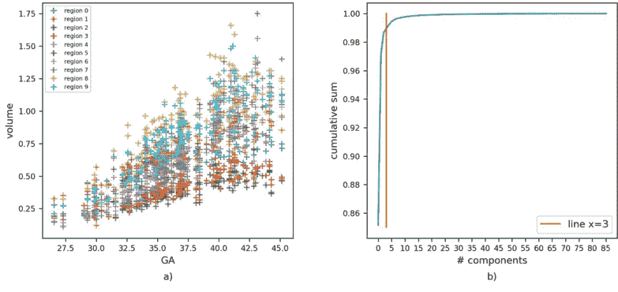

**图 5.8** **a)** 新生脑区域体积随 GA 变化的趋势图。**b)** PCA 特征值的累积分布。

## 5.4.7 在 scikit-learn 中实现 PCA

与所有模型一样，PCA 对象通过几次 scikit-learn 的调用直接实现。PCA 对象源自 `sklearn.decomposition`，并接受一个可选参数 `n_components`，它决定了从模型返回的组件数量。例如，对一个形状为 (10,2) 的随机生成矩阵拟合 PCA：

```python
from sklearn.decomposition import PCA

import numpy as np
```

```python
# 创建一个形状为 (10,2) 的随机矩阵
random_data=np.random.uniform(0,10,(10,2))
```

```python
# 实例化模型
model=PCA(n_components=2)
# 拟合模型
# 注意 PCA 是无监督的（拟合仅使用特征 Features！）
model.fit(random_data)
```

```python
# 或者同时拟合模型并使用其转换数据
projected_data=model.fit_transform(random_data)
```


从 PCA 模型可以返回的关键属性包括：
`model.explained_variance_ratio_` 返回解释方差（lambdas）占总方差的比例；`model.singular_values_` 返回奇异值；`model.components_` 返回 PCA 分量。

## 5.4.8 PCA 练习题

- 1. 估计矩阵的特征值和单位特征向量：
  a. $A = \left(\begin{matrix} \lambda_1 \\ \lambda_2 \end{matrix}\right)$
  b. $A = \left(\begin{matrix} v_1 \\ v_2 \end{matrix}\right)$

- 2. 使用 `"GA-structure-volumes-preterm.csv"` 中的数据，^{12} 从头实现 PCA 分解的协方差和 SVD 方法（见 5.4.5）：
  a. 首先加载数据；我们建议最初切片前十个特征以便于调试：
```python
import pandas as pd

# 首先加载数据

df = pd.read_csv("GA-structure-volumes-preterm.csv",header=None)

structure_volumes = df.values

# 加载前 10 个特征

Features = structure_volumes[:,1:11]

# 加载标签

Labels = structure_volumes[:,:]
```
  b. 对数据取均值。
  c. 实现协方差法：
    (i) 估计数据协方差矩阵。
    (ii) 评估协方差矩阵的特征向量和特征值。
    (iii) 将特征值和特征向量按降序排序。
    (iv) 将所有数据投影到特征空间。
  d. 实现 SVD 法：
    (i) 返回均值化数据的奇异向量和奇异值。
    (ii) 将所有数据投影到正确的奇异向量上。^{12}$ 该数据集、练习代码和练习 2–4 的答案可以在 `github.com/MachineLearning-BiomedicalApplications/notebooks` 获取。
    (iii) 使用公式 (5.55) 从奇异值计算解释方差的幅度。
    (iv) 与协方差法比较奇异向量和解释方差；它们应该是相同的。
  e. 使用 scikit-learn 实现 PCA 并验证你得到的是相同的结果。
- 3. 现在，使用 `"GA-structure-volumes-preterm.csv"` 中的特征，训练一个简单的 `LinearRegression()` 来预测目标变量 (`GA`)。
  a. 使用 `sklearn.model_selection.cross_val_score` 评估降维对性能的。
- 4. 使用 scikit-learn 执行基于 PCA 的降维，以拟合数据的 PCA 模型：
  a. 使用 PCA 属性 `explained_variance_ratio_` 返回排序后的。
  b. 使用 `cumsum` 绘制累积分布。
  c. 使用 scikit-learn 的 `fit_transform` 投影。
  d. 比较解释方差。

（注：原文后续部分存在逻辑重复或乱码，译文已根据上下文语义进行了逻辑对齐处理）

---

## 5.5.2 独立性与相关性

Perhaps a more intuitive way of understanding independent events is that they are not correlated. Fig 5.10 shows the correlation-relationship for functions. In Fig 5.10a, two completely out-of-phase sinusoids are completely nonoverlapping, and their correlation is close to 0. In this case they are also independent. By contrast, two completely overlapping signals, as shown in Fig. 5.10b, are completely correlated, and therefore not independent. Take caution, however, as uncorrelated events are not necessarily independent. Correlation is a summary of

### 5.5.3

Finally, conditional probability measures the probability of one event given another. For example, to calculate the probability of an individual suffering from mental illness given they are 20–40, it is first necessary to take the subset of examples corresponding to participants of age 20–40 (Fig. 5.9e highlighted in orange) and then estimate the proportion of examples that have mental health relative to the row: $r_c$. Hence $P(M|20-40) = 6/30 = 1/5$. If our interest was to include the conditional probability of status, we would express the conditioning as the cell total relative to the column total, e.g., $P(20-40|M) = 6/20$.

Independent variables for which one gives us no information of the value of the other. In the case of mental health and age groups, we can see that the marginal probabilities of selecting an individual with mental health irrespective of age group are $P(M<20) = P(M|20-40) = P(M|40-60) = P(M|60-80) = P(M>80) = 1/5$. Further, the marginal probability of selecting an individual with mental health irrespective of age (Fig. 5.9f (blue column)) is $P(M) = 20/100 = 1/5$.

# 生物医学应用的机器学习

| 年龄 | 2 | 1 | 3 | 5 | 14 |
|---|---|---|---|---|---|
| < 20 | 2 | 1 | 3 | 5 | 14 |
| 20-40 | 10 | 6 | 3 | 6 | 5 |
| 40-60 | 2 | 0 | 0 | 3 | 10 |
| 60-80 | 8 | 6 | 2 | 4 | 0 |
| > 80 | 4 | 3 | 1 | 2 | 0 |

(a)

| 年龄 | 2 | 1 | 3 | 5 | 14 |
|---|---|---|---|---|---|
| < 20 | 2 | 1 | 3 | 5 | 14 |
| 20-40 | 10 | 6 | 3 | 6 | 5 |
| 40-60 | 2 | 0 | 0 | 3 | 10 |
| 60-80 | 8 | 6 | 2 | 4 | 0 |
| > 80 | 4 | 3 | 1 | 2 | 0 |

(b)

| 年龄 | 2 | 1 | 3 | 5 | 14 |
|---|---|---|---|---|---|
| < 20 | 2 | 1 | 3 | 5 | 14 |
| 20-40 | 10 | 6 | 3 | 6 | 5 |
| 40-60 | 2 | 0 | 0 | 3 | 10 |
| 60-80 | 8 | 6 | 2 | 4 | 0 |
| > 80 | 4 | 3 | 1 | 2 | 0 |

(c)

| 年龄 | 2 | 1 | 3 | 5 | 14 |
|---|---|---|---|---|---|
| < 20 | 2 | 1 | 3 | 5 | 14 |
| 20-40 | 10 | 6 | 3 | 6 | 5 |
| 40-60 | 2 | 0 | 0 | 3 | 10 |
| 60-80 | 8 | 6 | 2 | 4 | 0 |
| > 80 | 4 | 3 | 1 | 2 | 0 |

(d)

| 年龄 | 2 | 1 | 3 | 5 | 14 |
|---|---|---|---|---|---|
| < 20 | 2 | 1 | 3 | 5 | 14 |
| 20-40 | 10 | 6 | 3 | 6 | 5 |
| 40-60 | 2 | 0 | 0 | 3 | 10 |
| 60-80 | 8 | 6 | 2 | 4 | 0 |
| > 80 | 4 | 3 | 1 | 2 | 0 |

(e)

| 年龄 | 2 | 1 | 3 | 5 | 14 |
|---|---|---|---|---|---|
| < 20 | 2 | 1 | 3 | 5 | 14 |
| 20-40 | 10 | 6 | 3 | 6 | 5 |
| 40-60 | 2 | 0 | 0 | 3 | 10 |
| 60-80 | 8 | 6 | 2 | 4 | 0 |
| > 80 | 4 | 3 | 1 | 2 | 0 |

(f)

**图 5.9** a) 模拟 100 个具有自我报告信念个体的示例；b) 选择患心脏病参与者的边缘概率；c) 选择患有癌症且年龄在 60–80 岁的个体的联合概率；e) 在已知年龄为 20–40 岁的情况下选择报告心理健康状况个体的条件概率；f) 可以显示条件概率等于边缘概率，具有独立性；这里，从任何组中采样个体的边缘概率为 1/5，且 $P(M) = 1/5$。

依赖
$$\rho_{X,Y} = \frac{(X-\mu_X)(Y-\mu_Y)}{\sigma_X\sigma_Y} = E(XY)-E(X)E(Y) \quad (56)$$

**图 5.10** a) 两个完全相反的正弦波相关性为零且相互独立；b) 完全同相信号完全相关，因此存在依赖；c) 方程 $y = x^2$ 相关性为零但并非独立。如图 10c所示所示了一个非线性函数 $y=x^2$ 完全不相关的例子：然而，它完全由 $x$ 决定，因此它们是不独立的。

## 5.5.3 数学定义

独立成分分析（ICA）的假设是可用数据 $(X_M)$ 代表源信号 $(S)$ 的混合，混合系数为 $M$：

$$X_M = MS. (57)$$

因此，来自 $X_M$ 的每个样本都是原始源信号的线性组合：

$$X_M(t) = \sum M_i S_i(t). (58)$$

ICA 优化的目标是学习解混矩阵 $W$，其系数可以解混数据 $X$ 并恢复源 $S$：

$$S = M^{-1}X = WX. (59)$$

这是通过假设信号是独立且非高斯的来实现的。

## 为什么信号必须是非高斯的？

假设我们的源信号来自两个均值为零、单位方差的高斯信号：$S \sim N(0,1)$，即 $S$ 将具有一个以原点为中心的圆形分布。$SS^T = I$，因为 $N(0,1)$ 等同于单位矩阵（见图 5.11）。在这种情况下，$X = MS$ 也是均值为零且协方差为如下的高斯分布：

$$XX^T = (MS)(MS)^T = MSS^TM^T = MM^T.$$

ICA 的目标是预测唯一的源。然而，如果原始源信号是高斯的，我们可以想象这种情况：通过旋转 $R$ 提议一个新的系数矩阵 $M'$，使得 $M' = MR$。在这种情况下，我们将观察到新混合 $X' = MS$ 的效果，如果我们要区分 $M'$ 和 $M$ 的效果，则需要 $X'$ 的分布不同于 $X$。遗憾的是，在高斯变量的情况下，这是可能的，因为 $X'$ 的协方差与 $X$ 无法区分：

$$X'^T = M'S^TM'^T = MRRSS^TR^T = MRMM^T = MM^T.$$

另一种解释可以通过中心极理定理获得，中心极理指出：

> 独立随机变量和的分布趋向于高斯分布

换句话说，混合信号将比其任何一个分量信号更高斯。我们可以利用这一点来寻找分离组件的算法基础。我们寻找的是使每个源表示为混合的线性和 $S = A^{-1}X$，其系数由我们混合矩阵的逆给出。因此，我们可以尝试混合的不同线性组合，直到找到最非高斯的组合。鼓励非高斯的方法有很多，其中最稳定的方法（FastICA 算法 [21] 使用）是优化分布的负熵，因为

> 在所有等方差随机变量中，高斯变量具有最大的熵 [9]。

负熵的估计对峰度等标准非高斯指标的离群值不敏感，并且提供了一个对于高斯变量为零且始终非高斯的测量标准。

## 5.5.4 ICA 的预处理

无论使用何种优化方法，关键的预处理步骤是数据的白化。白化是将数据转换为协方差为单位矩阵的分布。这与 PCA 相关并可以消除特征之间的相关性。

# 降维 127

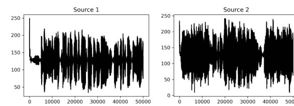

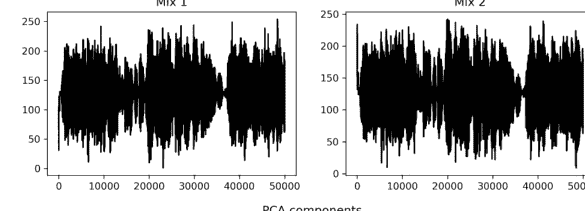

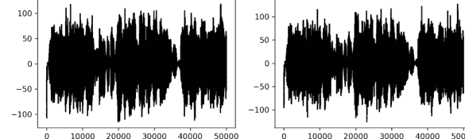

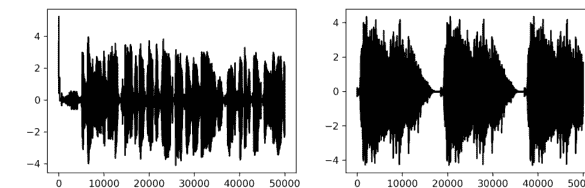

**图 5.12** 用于音频信号混合的 ICA 与 PCA 对。从上到下：源信号、混合信号（源的线性组合）、PCA 分解结果、ICA 分解结果。

## 5.5.6 比较 PCA 和 ICA

PCA 和 ICA 的不同目标在**图 5.12**（实现为练习题 5.5.8）中非常清晰地总结。在这里，两个源音频信号被线性组合成一个混合信号。我们看到，ICA 能够恢复原始信号，而 PCA 则不能。这是因为 PCA 假设分量符合高斯分布，而

# 生物医学应用中的机器学习

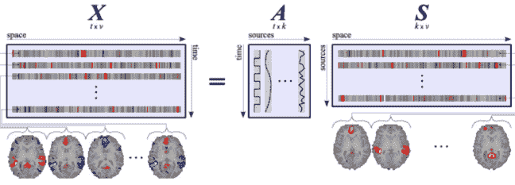

图 5.13 用 fMRI 信号成分表示的 ICA 分解。

ICA 了完全相反的假设。因此，PCA 适用于降维任务，其假设是最大方差方向是可解释的且至关重要的。另一方面，ICA 最常用于可以假设记录数据代表源信号混合物的问题。

## 5.5.7 ICA 的生物医学应用

ICA 的一个常用用途是从脑的电生理或功能记录中分离出源信号。在这里，$X_M$ 可能代表从脑电图（EEG）记录中测量的神经元记录，或者从脑部不同位置记录的脑活动间接测量值，如功能性磁共振（fMRI）中所示。在 fMRI 的情况下，通常实现的是空间 ICA，这意味着底层假设是源信号是共享共同脑活动模式的非重叠脑区域（图 5.13）。那么，加载系数 $A$ 可以被解释为活动模式的时间序列。通过这种方式，ICA 也可以用于去除干扰信号，例如通过生理过程（呼吸、心脏波动）或运动产生的信号 [41]。

## 5.5.8 ICA 练习题

- 1. 给定图 5.9 中的表格，计算：
  a. 60–80 岁个体患心脏病的条件概率；
  b. 采样到 20 岁以下且患有糖尿病的联合概率；
  c. 大脑患癌的边缘概率。

- 2. 给定两个混合音频文件 `"mix1.wave"` 和 `"mix2.wave"`；

19 数据集可以从 `github.com/MachineLearningBiomedicalApplications/note-books` 获取。

a. 创建一个数据矩阵 $X_M \in \mathbb{R}^{m \times i}$，其中 $m$ 是样本数（2），$i$ 是时间序列的长度。
```python
from scipy.io import wavfile

# 加载第一个信号

samplingRate, signal1 = wavfile.read('Data/mix1.wav')
```
```python
# 加载第二个信号

samplingRate, signal2 = wavfile.read('Data/mix2.wav')
```
```python
# 将两个信号堆叠进矩阵 X

X = np.stack((signal1,signal2),axis=0)
```


b. 估计 `$X^2` 的白化变换。

c. 使用 `scikit-learn` 使用 PCA 和 ICA 分解 `$X`。哪一个恢复了原始信号？为什么？

## 5.6 流形学习

在某些情况下，线性嵌入不足以对数据的底层分布建模。考虑图 5.14 的玩具示例。在这里，最初在 2D 中生成的均匀分布点（图 5.14a）随后被卷成一个 3D 结构（图 5.14b）。我们可以从点的黑色虚线箭头（图 5.14b）看到，欧几里距离在原本在平面上距离较远的点之间形成了“捷径”。例如，PCA 和 ICA 嵌入将始终无法恢复非线性分布点的数据：瑞士卷（swiss roll）数据集的 2D PCA 嵌入会将所有点严重地压缩到一个平面上，该平面通过数据的方差方向投影点（图 5.14c）。我们需要恢复的是遵循流形曲线的测线距离（图 5.14b 红色虚线箭头）。`Scikit-learn` 为此提供了几种方法 [2,3,11,39,46,47,51]，每种方法在近似底层测线距离的技术上略有不同。^21 在本章，我们将关注拉普拉斯特征图 [2]，它被称为谱嵌入，是直直观易于理解的方法之一。

20 用于此的实用函数包括：`np.linalg.inv`（估计矩阵逆矩阵）；`scipy.linalg.fractional_matrix_power`（估计 `$D^{-1/2}`）；以及用于矩阵相乘的 `np.linalg.multi_dot`。

21 https://scikit-learn.org/stable/modules/manifold.

## 5.7 拉普拉斯特征图

本质上，流形是一个拓扑空间，其欧几里距离仅在局部有意义。因此，一种方法是构建 k-最近邻（kNN）图，将每个点与其最近的 k 个点连接。通过这种方式，沿流形的测线可以通过从邻居到邻居并累加它们之间的欧几里距离来近似。图 5.15 显示了一个简单函数的玩具示例。因此，拉普拉斯特征图通过构建和二值化 kNN 图（也称为邻接矩阵 `A`）工作。然后用它计算图拉普拉斯：`$L = D - A`，其中 `$D` 是通过汇总每个节点的邻居总数得到的度矩阵 (`$D = \sum A`)。这代表拉普拉斯算子的离散近似，其特征向量表示图的谱（或谐波）。直观理解图拉普拉斯矩阵特征向量之间联系的一种方法是理解：对应最小特征值的根反映了跨越流形的随机游走，使得具有相似值的点在流形上必须彼此靠近。通过这种方式，可以将拉普拉斯矩阵的特征向量“展开”到低维空间。

### 7.1 图拉普拉斯的计算

图拉普拉斯的估计可以分解为以下步骤：

img/d219b4c20ff50f4b97845dec7a9acecb_148_0.png

img/d219b4c20ff50f4b97845dec7a9acecb_149_0.png

**图 5.15** `$k`-NN 图的测线距离。顶部：绿色箭头显示邻居；中间：黑色箭头显示测线；底部：邻接矩阵 **A**。

- 1. 估计所有点之间的平方距离和：`$SSD = \sum(x-i)^2`；
- 2. 将所有行的最小距离设置为零；
- 3. 通过汇总每个节点的邻居数量计算度矩阵 `$D = \sum A`；
- 4. 从度矩阵减去邻接矩阵得到图拉普拉斯：`$L = D - A`

对于 `$N` 个示例，`A` 应该是一个 `$N \times N` 矩阵，每一行代表该节点的邻居。因此，我们需要 `A` 是对称的，否则拉普拉斯的推导将不成立。最后，将 `A` 对称化 `$A_{ij}=A_{ji}`。

让我们通过一个具有 6 个示例、每个示例 2 个特征的简单示例来演示：

```python
X = \begin{pmatrix} 4 & 3 & 1 & 3 & 4 & 2 & 2 & 3 & 0 & 2 \end{pmatrix} (5.71)
```

为了计算邻接矩阵 `A`，我们必须首先估计所有点之间的距离平方和（SSD）。让我们对第一个数据点这样做。我们按照 Python 的风格编写计算：

```python
x_0 - X = \begin{pmatrix} 4 & 3 & 4 & 3 & 4 & 4 & 2 & 4 & 3 & 4 & 3 \end{pmatrix} = \begin{pmatrix} 0 & 0 & 3 & 0 & 0 & -1 & 2 & 1 & 1 & 3 & 2 & 3 \end{pmatrix} (5.72)
```

为了计算该点的 SSD，我们需要平方距离并求和：

```latex
$$\sum_j (x_0 - X_j)^2 = \sum_j \begin{pmatrix} 0 & 0 & 3 & 0 & 0 & -1 & 2 & 1 & 1 & 3 & 2 & 3 \end{pmatrix}^2 = \sum_j \begin{pmatrix} 0 & 0 & 9 & 0 & 0 & 1 & 4 & 1 & 1 & 9 & 4 & 9 \end{pmatrix} = 5 \ (5.73)$$
```

> $^{22}$ 注意，常见的做法是对 `A` 进行二值化；但也可以使用加权邻接矩阵。

> $^{23}$ * 代表元素级乘法。

将此扩展到所有行，我们得到一个所有点对之间的距离对称矩阵：

```
$$\sum_j(\mathbf{x}_i - \mathbf{x}_j)^2 = \begin{pmatrix} 0 & 9 & 1 & 5 & 10 & 13 \\ 9 & 0 & 10 & 2 & 13 & 10 \\ 1 & 10 & 0 & 8 & 17 & 20 \\ 5 & 2 & 8 & 0 & 5 & 4 \\ 10 & 13 & 17 & 5 & 0 & 1 \\ 13 & 10 & 20 & 4 & 1 & 0 \end{pmatrix} \cdot (5.74)$$
```

然而，一旦我们将每个节点的 `$k` 最近邻居设为零，将会失去对称性。例如，设置 `$k=2`，我们用红色标出每行的两个最小的距离：

```
$$\sum_j(\mathbf{x}_i - \mathbf{x}_j)^2 = \begin{pmatrix} 0 & 9 & 1 & 5 & 10 & 13 \\ 9 & 0 & 10 & 2 & 13 & 10 \\ 1 & 10 & 0 & 8 & 17 & 20 \\ 5 & 2 & 8 & 0 & 5 & 4 \\ 10 & 13 & 17 & 5 & 0 & 1 \\ 13 & 10 & 20 & 4 & 1 & 0 \end{pmatrix} . (5.75)$$
```

有趣的是，我们忽略了点与其自身之间的距离，并注意到第一行的最近邻居（距离为 1 和 5）并不一定是第一列中标出的距离。为了创建邻接矩阵，我们必须首先将标出的距离设为 1，并将所有剩余距离设为 0：

```
$$\mathbf{A} = \begin{pmatrix} 0 & 0 & 1 & 1 & 0 & 0 \\ 1 & 0 & 0 & 1 & 0 & 0 \\ 1 & 0 & 0 & 1 & 0 & 0 \\ 0 & 1 & 0 & 0 & 0 & 1 \\ 0 & 0 & 1 & 0 & 1 & 0 \\ 0 & 0 & 0 & 1 & 1 & 0 \end{pmatrix} . (5.76)$$
```

由于这不再是对称的，有必要对所有列和行修正 `$A_{ij} = A_{ji}`（此时，编辑部分用红色标出）：

```
$$\mathbf{A}_{sym} = \begin{pmatrix} 0 & 1 & 1 & 1 & 0 & 0 \\ 1 & 0 & 0 & 1 & 0 & 0 \\ 1 & 0 & 0 & 1 & 0 & 0 \\ 1 & 1 & 1 & 0 & 1 & 1 \\ 0 & 0 & 1 & 0 & 1 & 0 \\ 0 & 0 & 0 & 1 & 1 & 0 \end{pmatrix} . (5.77)$$
```

# 生物医学应用中的机器学习

结果是，某些节点现在超过两个邻居。度矩阵计算每个节点的总邻居数量（通过对每行或每列求和）：

```
$D = \text{diag}(\sum_{j} \mathbf{A}_{sym}) = \begin{pmatrix} 3 & 0 & 0 & 0 & 0 & 0 \\ 0 & 2 & 0 & 0 & 0 & 0 \\ 0 & 0 & 2 & 0 & 0 & 0 \\ 0 & 0 & 0 & 5 & 0 & 0 \\ 0 & 0 & 0 & 0 & 2 & 0 \\ 0 & 0 & 0 & 0 & 0 & 2 \end{pmatrix} \quad (5.78)$
```

最后，计算拉普拉斯矩阵为：

```
$L = \mathbf{D} - \mathbf{A}_{sym} = \begin{pmatrix} 3 & -1 & -1 & -1 & 0 & 0 \\ -1 & 2 & 0 & -1 & 0 & 0 \\ -1 & 0 & 2 & -1 & -1 & 1 \\ -1 & -1 & -1 & 5 & -1 & -1 \\ 0 & 0 & 0 & -1 & 2 & -1 \\ 0 & 0 & 0 & 0 & -1 & 0 \end{pmatrix} \quad (5.79)$
```

### 5.7.2 推导嵌入解

从图中，我们需要计算一个新空间的坐标，在该空间中，欧几里得距离近似于流形上的测地线。该目标可以通过以下代价函数总结：

```
$C = \sum_{i,j} (y_i - y_j)^2 \mathbf{A}_{ij}, \quad (5.80)$
```

其中 `$\mathbf{A}_{ij}` 索引对称邻接矩阵（为了清晰去掉了 'sym' 符号），`$y_i` 和 `$y_j` 代表我们试图寻找的低维空间的坐标。希望这个函数可以使得原始数据中接近的点在新的空间中也靠在一起，因为只有当 `$(x_i - x_j)^2` 较低时 `$\mathbf{A}_{ij}` 才非零。同时，我们避免所有点都聚集到一个位置的平凡解（即 `$y_i = y_j`）。通过展开我们的代价函数并替换 `$\mathbf{D}_{ii} = \sum_{j} \mathbf{A}_{ij}` 可以找到解：

```
$C = \sum_{i,j} (y_i - y_j)^2 \mathbf{A}_{ij} \quad (5.81)$
```

```
$C = \sum_{i,j} (y_i^2 + y_j^2 - 2y_iy_j) \mathbf{A}_{ij} \quad (5.82)$
```

通过对称性 `$\mathbf{D}_{ii} = \sum_{j} \mathbf{A}_{ij}`：

```
$C = \sum_{i} y_i^2 \mathbf{D}_{ii} + \sum_{j} y_j^2 - 2 \sum_{i,j} y_i y_j \mathbf{A}_{ij} \quad (5.83)$
```

```
$C = \mathbf{y}^T \mathbf{D} \mathbf{y} - \mathbf{y}^T \mathbf{A} \mathbf{y} \quad (5.84)$
```

```
$C = \mathbf{y}^T \mathbf{L} \mathbf{y} \quad (5.85)$
```

因此，我们需要使 `$\mathbf{y}^T \mathbf{L} \mathbf{y}` 最小的 `$y`，约束条件是 `$y_i \neq 0`。我们在 PCA 中见过这种情况，区别在于在这种情况下我们是在最小化而非目标函数。从这里知道该优化问题的解是对应最小特征值的特征向量。然而，这对应于常数向量 `$1`，因此是不可取的。对于二维嵌入，我们需要两个最小特征值的特征向量。

### 5.7.3 归一化拉普拉斯矩阵

严格来说，大多数特征映射实现并没有使用 `$L = \mathbf{D}-\mathbf{A}`，而是寻找广义特征问题 `$L\mathbf{y} = \lambda\mathbf{Ay}` 的解。这对应于估计归一化拉普拉斯矩阵 `$\mathbf{L} = \mathbf{D}^{-1/2}(\mathbf{D}-\mathbf{A})\mathbf{D}^{-1/2}`。如果图是正则的且大多数顶点度相同，那么归一化拉普拉斯和未归一化拉普拉斯将产生非常相似的结果。`scikit-learn` 采用了这种方法。

### 5.7.4 在 scikit-learn 中实现特征映射

可以使用 `manifold` 类中的 `SpectralEmbedding` 函数在 `scikit-learn` 中实现特征映射。像 PCA 和 ICA 一样，可以使用 `n_components` 参数调节嵌入的维度。另一个超参数是 `$k`，即邻接矩阵 `A` 中保留的邻居数量。通过 `n_neighbors` 参数定义。

```python
from sklearn.manifold import SpectralEmbedding

# 设置维度=2，kNN为10

model = SpectralEmbedding(n_components=2, n_neighbors=10)

# 拟合并转换数据

Z = model.fit_transform(X)

# Z 是 X 的 n x 2 维嵌入
```

在 `scikit-learn` 中，你可以选择实现二进制或加权邻接矩阵，由 `affinity` 参数设置。默认情况下，方法设置为 `affinity='nearest_neighbors'`，即二进制实现；然而，`affinity='rbf'` 将使用高斯径向基函数（RBF）`$e^{-\|x-y\|^2/2\sigma^2}` 计算的值填充 `A`（比例参数 `$\gamma = \frac{1}{2\sigma^2}` 可以用参数 `gamma` 设置）。

### 5.7.5 流形学习练习

处理 Swiss roll 数据集：

```python
import matplotlib.pyplot as plt

from mpl_toolkits.mplot3d import Axes3D 用于3D绘图

import numpy as np
```

```python
def create_spiral(M, num_rotations):
    """ 获取二维流形 M 并输出由在3D空间中弯曲 M 构成的3D 螺旋线 """
    N = M.shape[0]
    r = np.exp(M[:,1] * num_rotations) * 0.5
    theta = M[:,0] * (2 + np.pi) * num_rotations
    X = np.zeros((N,3))
    X[:,0] = M[:,0] * 6
    X[:,1] = r * np.cos(theta)
    X[:,2] = r * np.sin(theta)
    return X
```

```python
# 2000个散布在 [0,1]^2 的随机点
N = 2000
X_m = np.random.random((N, 2))
# 创建 swiss roll 数据集
X = create_spiral(X_m, 1.2)
# 一些辅助绘图函数
fig = plt.figure(figsize=(16,8))
ax = fig.add_subplot(121, projection='3d')
# 在3D中绘制数据
ax = ax.scatter(X[:,0], X[:,1], X[:,2], c=X_m[:,1], marker='o')
ax = fig.add_subplot(122)
# 绘制原始2D数据
ax = ax.scatter(X_m[:,0], X_m[:,1], c=X_m[:,1], marker='o')
```

# 第 6 章
## 聚类

在第 2 章中，我们展示了数据集可以聚类为相似样本组（第 2.2.3 节）。我们在第 2.1.2 和 2.2.3 节中看到无监督图像分割是聚类算法最常见的应用之一。特别是，我们看到了 k-means 聚类如何用于将脑 MRI 分割为白质（WM）、灰质（GM）和脑脊液，每个类别仅使用单个特征（图 2.5 中的 T1 加权像素或体素强度）或一对特征（图 2.3 中的 T1 和 T2 加权强度）。更高级的分割方法通常在其流程中包含聚类算法，可以勾勒出图像中的多个结构或对象，正如我们在第 3 章的 86 个脑结构示例和图 3.1 所示。

在本章中，我们将在 6.1 节重新回顾 k-means 聚类，并在 6.2 节中引入高斯混合模型。在 6.3 节中，我们将描述谱聚类，它特别适用于高维非线性特征空间。

## 6.1. K-means 聚类

聚类是一项无监督机器学习任务，其中不提供训练标签。因此，我们需要根据某些预定义的标准将样本分组。最简单的思想之一是类内方差 `$\sigma_W^2` 可以表示为类方差 `$\sigma_k^2` 的和，并根据类 `$k` 的大小 `$n_k` 进行加权：

```
$$\sigma_W^2 = \sum_{k=1}^{N} \frac{n_k}{N} \sigma_k^2. \quad (6.1)$$
```

其中 `$n_k` 是类 `$k` 中的样本数量，`$K` 是聚类的数量，`$N` 是所有样本的总数。

### 6.1.1 K-means 算法

那么，我们可以最小化类内方差 `$\sigma_W^2` 吗？首先，让我们写下类 `$k` 方差的表达式：

```
$$\sigma_k^2 = \frac{1}{n_k} \sum_{i \in S_k} |x_i - \mu_k|^2$$
```

注意 `$x` 是样本 `$i` 的多维特征向量，`$\mu_k` 是类 `$k` 的多维平均值，`$|\cdot|$` 表示欧几距离。如果我们展开 `$\sigma_k^2` 的表达式（等式 6.1），它直接给每个类的方差，我们将发现类内方差实际上是每个样本到其类中心的平均平方距离：

```
$$\sigma_W^2 = \frac{1}{N} \sum_{i=1}^N |x_i - \mu_{y_i}|^2$$
```

其中 `$y_i` 是分配给样本 `$i` 的标签。这直观地提供了一个最小化类内方差的迭代算法。我们将在为每个样本分配特征平均值最近类之间迭代：


$y_i = \arg \min_k |x_i - \mu_k| \quad (6.2)$

并重新计算类的平均值：

$$\mu_k = \frac{1}{n_k} \sum_{i \in S_k} x_i \quad (6.3)$$

我们从随机初始化类平均值 $\mu_k$ 开始该过程。图 6.1 显示了该过程如何在 T1 和 T2 加权的 MRI 中通过 WM、GM 和 CSF 找到体素类。

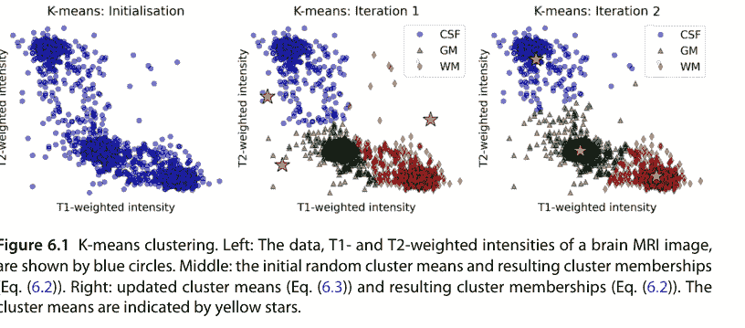

### 6.1.2 sklearn 中的 K-means

我们已经在第 2.2.3 节中展示了如何将 scikit-learn kmeans 模型拟合到一维分割问题。在这里，我们将将其扩展到 2D 特征空间。首先，我们将加载 T1 和 T2 加权的 MRI 切片：

```python
import matplotlib.pyplot as plt

T1 = plt.imread('T1.png')

T2 = plt.imread('T2.png')
```

假设脑组织已经提取且非脑组织已填充零，我们识别所有非零值：

```python
ind = T1>0
```

接下来，我们选择所有非零值并将它们堆叠成一个 N × 2 的特征矩阵：

```python
import numpy as np

X = np.stack([T1[ind],T2[ind]]).T

print(X.shape)
>>> (3180, 2)
```

现在可以像图 6.1 左侧所示绘制数据集：

```python
plt.plot(X[:,0],X[:,1],'bo')
```

然后我们对特征矩阵 `X` 拟合三类 kmeans 模型并预测标签 `$y$`：

```python
from sklearn.cluster import KMeans
model=KMeans(n_clusters=3)
model.fit(X)
y = model.predict(X)
```

聚类结果（与图 6.1 右侧所示的类似）可以这样绘制：

```python
plt.plot(X[y=0],X[y=0],'bo')
plt.plot(X[y=1],X[y=1],'g')
plt.plot(X[y=2],X[y=2],'rd')
```

如果我们希望显示分割后的脑图像，则可以使用与第 2.2.3 节中描述的 1D 情况相同的代码。

### 6.13 NumPy 中的 K-means

为了进一步理解 K-means 算法，我们现在展示如何在 NumPy 中实现它。首先，我们定义计算样本到类中心距离的距离函数：

```python
def dist(k):
    return np.sum((X-mu[k])**2,axis=1)
```

接下来，我们随机初始化类平均值并在计算标签 `$y$`（等式 6.2）和类平均值 `$\mu$`（等式 6.3）之间迭代：

```python
mu = np.random.rand(3,2)
for i in range(10):
    y=np.argmin([dist(0),dist(1),dist(2)])
    mu[0]=np.mean(X[y==0,:]],axis=0)
    mu[1]=np.mean(X[y==1,:]],axis=0)
    mu[2]=np.mean(X[y==2,:]],axis=0)
```

这里使用了 10 次迭代以简化，但当类平均值不再变化时停止算法。然后我们可以绘制类的平均值：

```python
plt.plot(mu, 'y*')
```

### 6.1.4 练习

1. 描述聚类算法的概念并用示例进行说明。
2. 加载第 2.1 节描述的乳腺癌数据集 `sklearn.datasets.load_cancer()`。在 30 维空间进行 k-means 聚类。使用 PCA 将数据集降维到 2 维以显示你的结果。
3. 在 NumPy 中实现二类 聚类算法。

## 6.2. 高斯混合模型

我们现在引入另一种方法：高斯混合（GMM）。高斯混合的关键假设是特征强度遵循高斯分布。注意高斯混合适用于非线性边界。T1 加权的 MRI。在给定类 `$k$` 的情况下强度值 `$x$` 的概率为：

```
$p(x|k) = \frac{1}{\sqrt{2\pi}\sigma_k} e^{-\frac{(x-\mu_k)^2}{2\sigma_k^2}}$
```

整体图像来自高斯分布的混合：

```
$p(x) = \sum_{k=1}^{K} \varrho_k G(x, \mu_k, \sigma_k^2) \quad (6.5)$
```

系数 `$\varrho_k$` 代表分配给类 `$k$` 的样本比例，它们的和为一 `$\sum_{k=1}^{K}\varrho_k=1$`。

### 6.2.1 GMM 算法

GMM 聚类的目的是是将高斯混合模型（等式 6.5）拟合到观测强度的直方图（图 6.2 右侧）。在其他情况下，我们想要最大化观察一组特定强度 `$X=\{x_1, \dots, x_N\}$` 给定 GMM 参数 `$\phi=\{\mu_k, \sigma_k, \varrho_k\}_{k=1}^{K}$` 的似然度。

如果我们假设体素强度 `$x_i$` 相互独立，我们可以将单个似然度相乘 `$p(X|\phi) = \prod_{i=1}^{N}p(x_i|\phi)$`，如果我们对其取对数，这将变为和。通过单个体素的对数似然和，我们得到：

```
$$\phi = \arg \max \sum_{i=1}^{N} \log p(x_i|\phi) = \arg \max \sum_{i=1}^{N} \sum_{k=1}^{K} \varrho_k G(x_i, \mu_k, \sigma_k^2). \quad (6.6)$$
```

通过将对高斯混合模型的导数设为零，我们可以最小化对数似然，通过这种我们得到一个二步迭代算法。在第一步中，我们计算后验概率 `$p_k = p(k|x_i, \phi)$`，这实际上是单个组织的的概率分割（图 6.3）：

```
$p_k = \frac{\pi_k G(x, \mu_k, \sigma_k^2)}{\sum_{i=1}^N \pi_i G(x, \mu_i, \sigma_i^2)}$
```

在第二步中，我们更新 GMM 参数 `$\phi$`

```
$$\mu_k = \frac{\sum_{i=1}^N \pi_i x_i}{\sum_{i=1}^N \pi_i}$$
$$\sigma_k^2 = \frac{\sum_{i=1}^N \pi_i (x_i - \mu_k)^2}{\sum_{i=1}^N \pi_i}$$
$$\pi_k = \frac{\sum_{i=1}^N p_{ik}}{N}$$
```

算法在这两个步骤之间迭代，直到对数似然的变化低于指定的阈值。


> 图 6.3 概率分割 `$p_{ik}$`

### 6.2 GMM

在 scikit-learn 中实现的高斯混合模型（GMM）用于 `$x_i$`。

```python
import numpy as np
import matplotlib.pyplot as plt
from sklearn.mixture import GaussianMixture

# 生成模拟数据
X1 = np.random.normal(loc=0, scale=1, size=(100, 2))
X2 = np.random.normal(loc=5, scale=1, size=(100, 2))
X = np.vstack([X1, X2])

# 拟合 GMM
gmm = GaussianMixture(n_components=2, random_state=0)
gmm.fit(X)

# 预测标签
labels = gmm.predict(X)

# 计算后验概率
probs = gmm.predict_proba(X)

# 绘图
plt.scatter(X[:, 0], X[:, 1], c=labels, s=30, cmap='viridis')
plt.title("GMM Clustering")
plt.show()
```

我们可以通过 `plt.hist` 显示 `$X$` 的分布，并设置 `density=True` 将其归一化。此外，代码展示了如何访问均值 `$\mu_k$`、方差 `$\sigma_k^2$` 和混合比例 `$\pi_k$`：

```python
print(f"Means:\n{gmm.means_}")
print(f"Covariances:\n{gmm.covariances_}")
print(f"Weights: {gmm.weights_}")
```

## 6.2 Exercises

- 1. 什么是高斯混合模型？如何使用它进行聚类？
- 2. 对于训练数据点 `$x_i$`，其来自高斯分布混合的概率 `$\phi = (\mu_k, \sigma_k, \pi_k)_{k=1,\dots,K}$` 可以表示为：
- 3. 使用 `sklearn.datasets.load_breast_cancer()` 对第 2.1.2 节描述的腺癌数据集在 30 维空间进行聚类。使用 PCA 将数据集降维到 2 维并绘制聚类结果。
- 4. 加载以 pickle 格式保存的 2D MRI 图像并显示。对其进行 GMM 聚类并展示分割结果。参考代码 6.2.2。
- 5. 探索你在上一个练习中用于 2D MRI 图像的 GMM。参考代码 6.2.2：
    - a. 显示每个类的后验概率，参考图 6.3；
    - b. 绘制后验概率随图像强度的函数；
    - c. 绘制每个类的似然性随图像强度的函数，参考图 6.2 中间；
    - d. 绘制整个图像的似然性随图像强度的函数，参考图 6.2 右侧。

# 聚类 1&2

# 聚类 3

# 分类错误

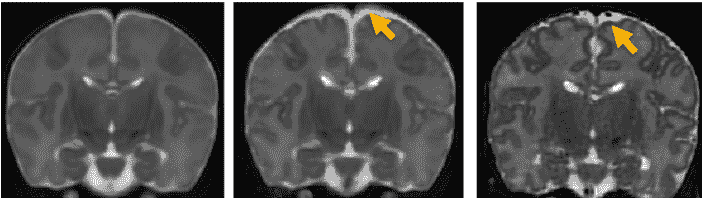

**图 6.5** 足月和早产儿的脑部 MRI。左：聚类 1 和 2婴儿的平均 MRI 图像。中间：聚类 3婴儿的平均 MRI 图像。右：聚类 3 中足月婴儿的 MRI 图像，其中大部分早产儿。黄色箭头指向脑脊液（CSF）体积增大，这是早产儿的典型特征。

一个新生大脑图谱（可能与图 6.5 左侧相似），以便所有图像的方向相同，且全局形状也大致相似。MRI 信号不是量化的，我们无法计算欧几得距离，而是计算归一化交叉相关（NCC）来衡量两幅图像之间的相似性。在例例中，NCC 将始终为正值，最大值为 1，因为图像已经对齐并具有相似的 T2 加权对比度。我们直接将每对图像之间的输入 NCC 与相似性矩阵 **A** 进行对比。这意味着我们将有一个单连通量的全连接加权图。

我们现在对 68 名足月和早产新生儿的脑图像进行聚类。由于相似性矩阵 **A** 已预计算并保存到文件中，因此我们可以使用 pandas 加载它：

```
import pandas as pd
d = pd.read_csv('babies.csv', header=None)
A = df.to_numpy()
print(A.shape)
>> (68, 68)
```

注意，相似性矩阵的大小为 `$n \times n$`，其中 `$n$` 是样本数量。矩阵的每个元素给出一对脑 MRI 图像之间的 NCC。

我们将使用 3D 拉普拉斯特征映射嵌入和具有三个类的 k-means 聚类执行谱聚类。谱聚类的参数选择通常显而易见，我们选择这种设置是因为它在 kmeans 算法中随机分配不同的初始聚类中心时提供了稳定的结果（第 6.1 节）。我们使用 scikit-learn 中的对象 `SpectralClustering` 并配合‘precomputed’相似性矩阵 A 来实现聚类：

```python
from sklearn.cluster import SpectralClustering
```

# 生物医学应用中的机器学习

```python
model=SpectralClustering(n_components=3,n_clusters=3, affinity='precomputed')
```

现在，我们想要可视化聚类结果。然而，我们没有可以绘图的低维空间。我们将使用 SpectralEmbedding，它将返回我们使用拉普拉斯特征映射嵌入脑 MRI 图像的 3D 流形坐标。然后，我们就能在图 6.6 左侧所示的前两个维度上绘制聚类：

```python
from sklearn.manifold import SpectralEmbedding
embedding=SpectralEmbedding(n_components=3, affinity='precomputed')
```

X = embedding.fit_transform(A)
plt.plot(X[:, 0][y==0], X[:, 1][y==0], "r")
plt.plot(X[:, 0][y==1], X[:, 1][y==1], "bo")
plt.plot(X[:, 0][y==2], X[:, 1][y==2], "g")
```

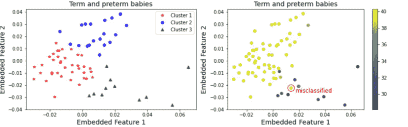

**图 6.6** 使用拉普拉斯特征映射获得的嵌入空间婴儿脑 MRI，前两个维度。左：通过谱聚类分为三个类。右：每个婴儿的出生年龄，颜色从蓝色（早产）到黄色（足月）编码。注意聚类 1 和 2 对应足月婴儿，聚类 3 对应早产儿。红圈标出了一个被错误分类到聚类 3 的婴儿。

最后，我们将对这些图像聚类进行研究，以找到一些有意义的解释。在图 6.6 中，我们根据出生胎龄（GAB）对谱嵌入进行颜色编码。我们可以看到聚类 3 对应早产儿（GAB<37），而聚类 1 和 2 对应足月婴儿（GAB≥37）。

为了可视化聚类发现了什么种特征，我们可以创建不同聚类中所有图像的平均值。在图 6.5 中，我们看到聚类 1 和 2 中的图像（图 6.5 左）比聚类 3 中的图像（图 6.5 中）脑脊液更少。这是早产导致的常见特征。通过近距离观察，我们可以发现聚类 3 中有一个婴儿样本，在图 6.6 右侧用红圈标出。

尽管这个婴儿不是早产的，但相应的图像（图 6.5 右）显示该婴儿有更多的脑脊液，与早产儿相似，这可能就是它被分配到早产类的原因。

## 6.3.4 练习题

- 1. 文件 `structures_first_second_scan.csv` 包含了从 36 份早产儿 MRI 扫描计算出的 86 个脑结构的体积。其中一些扫描是在出生后早产期（GA<37）获取的，另一些是在足龄（GA≥37）获取的。对体积进行两类谱聚类，识别哪些扫描是在早产期获取的，以及对应的足月龄是多少。显示聚类结果。
- 2. 文件 `babies.csv` 包含了第 6.3.3 节描述的使用 NCC 计算的成对相似性矩阵。对婴儿进行 3D 谱聚类并分为三类，并像图 6.6 左侧所示显示。使用第 6.3.3 节中的代码。显示按出生胎龄（GAB）颜色编码的嵌入空间的前两个坐标，类似于图 6.6 右侧所示。你可以在 `ages.csv` 文件中找到 GAB。
3 练习 1 和 2 的骨架代码和数据集可以从 github.com/MachineLearning-BiomedicalApplications/notebooks 获取。

# 第7 章

# 决策树与集成学习

集成学习是机器学习的一个分支，旨在通过结合多个学习器的预测来提高模型的准确性和/或泛化能力。其核心思想是训练多个互补的模型，每个模型返回略有不同的解决方案，认为通过足够的尝试，共识解决方案将改进对边缘情况的预测。在本章中将学习集成学习的各种方法，包括同质集成：bagging、随机森林和提升（boosting），它们合并了来自同一类方法的预测；以及堆叠泛化（或异质集成），它们通过一系列方法合并预测。在在此之前，我们必须学习最流行的一类基模型：*决策树*。这些是简单直观的机器学习模型，能够适应各种回归或分类问题。

## 7.1 决策树

决策树的基本思想是将一系列弱学习模型堆叠在另一个模型之上，以学习一个强泛化模型目标（图 7.1）。具体来说，树中的每个节点对数据提出一个简单的问题。如果给定示例的响应为真，则沿着树的一个分支向下（例如 7.2 右侧）；如果为假，则沿着另一条分支。树中的每个弱学习器被称为决策桩（decision stump）。

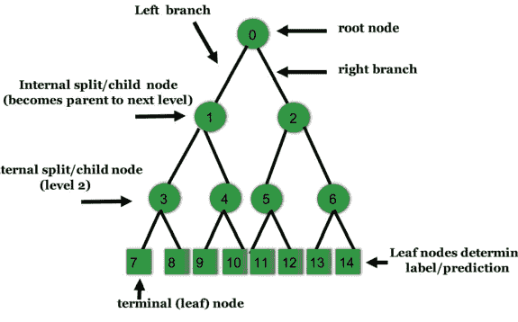

**图 7.1** 决策树。

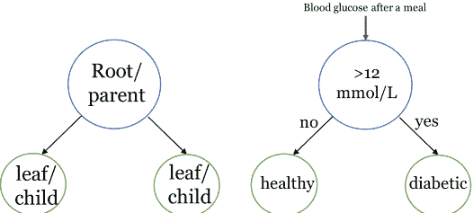

图 7.2 决策桩示例。

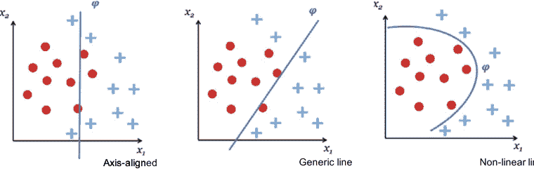

图 7.3 分类简单弱学习规则示例。

### 7.1.1 决策桩

树的学习规则有许多形式，包括线性（图 7.3 中间）和非线性拟合（图 7.3 右）[10]；然而，通常情况下分类树节点实现轴对齐的学习规则，通过对单个特征进行阈值处理做出预测（图 7.3 左）。这是 scikit-learn 使用的方法。

图 7.2 显示了此类决策桩的一个生物医学示例，用于糖尿病分类。在这里，通过优化血糖水平的阈值做出决策。血糖小于 12 mmol/L 的所有示例被视为健康，并通过左分支通过。所有剩余示例被标记为糖尿病并通过右分支通过。预计对于大多数问题，这种简单的学习规则会导致许多示例被错误分类。因此，决策树中后续决策桩的作用是进一步精炼预测。

### 7.1.2 将决策桩堆叠成树


**7.4** 展示了一个简单的非线性可分多分类问题的示意图。在这里，我们有五个类别：粉色星号、黄色问号、红色加号、蓝色交叉号和深绿色空圆。目标是根据两个特征 `$x_1$` 和 `$x_2$` 来分离这些类别。决策树可以通过逐层堆叠与轴对齐的决策桩来实现这一点。在这个例子中，根节点在 `$x_1$` 上进行分裂（橙色虚线）。这大致上将蓝色交叉号和深绿色空圆与红色加号、粉色星号和黄色问号分开。在第二层（绿色虚线），第二个决策桩在 `$x_2$` 上进行分裂，将粉色星号与黄色交叉号分开。最后一层（黑色虚线）在 `$x_1$` 上的第二个阈值将红色加号与其他划分区域分开。在这一阶段，树中的每个叶子节点根据到达该叶子节点的所有训练样本的多数类分配一个标签。通过这种方式，叶子节点决定了测试时到达该叶子节点的每个新样本的预测结果。

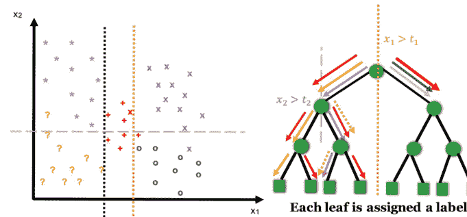

**图 7.4** 决策树分类器。在这里，每个后续决策桩都试图将样本分离到不同的类别中。

回归树的实现方式非常相似（图 7.5$^1$）。然而，它不是将样本划分到类别，而是每个桩为自变量（x轴）的某些取值范围分配因变量（y轴）的常数预测值。例如，图 7.5 中的振荡函数，决策树中的第一个节点会在 `X=1.24`（蓝线）处划分图形，因为显然范围的第一部分因变量的平均值（`y=1.4`）高于第二部分（`y=-0.4`）。查看该分支，下一个节点在 `x=4.03`（青色线）处再次分裂，此时范围的第一部分值较低（`y=-0.95`），第二部分值较高（`y=0.27`）。对于第三次分裂（左侧），决策桩在 `X=3.36`（红线）处设置阈值，左叶节点的 `y=0.57`。改编自 `https://scikit-learn.org/stable/auto_examples/ensemble/adabo_regression.html`。

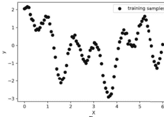

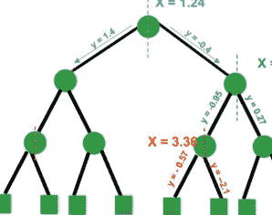

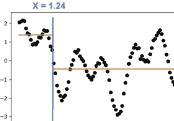

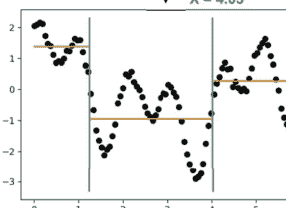

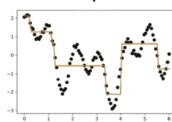

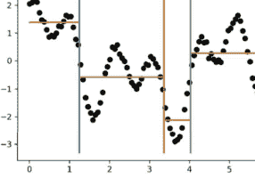

**图 7.5** 决策树回归。左侧决策树对非线性函数拟合分段常数近似；右侧显示了拟合结果随决策树三层演变的过程（如左所示）；在这里，第一次分裂在 `X=1.24`（为左分支拟合 `y=1.4`，右分支拟合 `y=-0.4`）；第二次分裂在 `X=4.03`，第三次在 `X=3.36`。底部的图用黑色表示数据点，用金色表示右叶子节点的最终决策树拟合结果 `y=2.1`。通过这种方式继续进行，增加树的深度可以对更精细的 `x` 范围的曲线实现更好的拟合。因此，谨慎处理非常重要，树越深，越容易拟合数据中的噪声。这对于回归模型和分类模型都是确立的。

### 7.1.3 决策树学习规则

那么，决策树将特征空间划分为不同的区域，并为每个区域分配不同的预测。但是，模型是如何决定在每个阶段选择哪个特征以及哪个阈值的呢？

与机器学习模型一样，决策树的分裂通过优化代价函数来参数化，分类和回归的合适代价函数选择也不相同。典型的回归损失包括我们之前见过的那些，特别是均方误差（MSE）和平均绝对误差（MAE），由于树为每个分支分配一个常数 `y`，因此这些分支指向的是在平均上最接近该范围内数据点真值值的值。

决策树分类器更关注节点的纯度，而不是准确率得分或假阳性/假阴性的计数。具体示例包括：

- 信息增益（information gain）：代表数据集在某个属性上进行分裂后熵的减少。
- 吉尼不纯度（gini impurity）：反映了类别遵循分裂的情况。

让我们详细地查看这些内容，从熵的定义开始。

熵是对系统无序程度的估计。对于决策树分类器，熵是通过考虑节点 `j` 处所有类的标签分布来计算的：

$$H(S_j) = -\sum_{y\in Y} p(y_k) \log_2 p(y_k). \quad (7.1)$$

在这里，`Y` 是类标签（例如，二分类问题的 (0, 1)），而 `p(y_k)` 是所考虑节点 `(j)` 中具有类别 `k` 的样本比例。

计算决策树节点的熵可以作为数据样本对于分裂的分离程度的代理指标。例如，图 7.6 展示了一个二分类问题的三个类别类划分。在左侧案例中，该组包含每个类别的 5 个样本，`p(y_1)=p(y_2)=5/10=0.5`；这返回了最大熵 `H=(-0.5\log_2 0.5+0.5\log_2 0.5)=1`。第二个组包含 2 个圆圈和 7 个符号，比例为 `p(y_1)=2/9` 和 `p(y_2)=7/9`，熵 `H=(-2/9\log_2 2/9+7/9\log_2 7/9)=0.864`。第三个组只有符号，其熵为零。

分类树的信息增益是衡量数据从父节点分裂到子节点时熵的变化。它估计为父节点与子节点熵之间的差异：

$$I(S_j) = H(S_j) - \sum_{i \in L,R} \frac{|S_i|}{|S_j|} H(S_i). \quad (7.2)$$

在这里，`|S_j|` 代表父节点的数量，`|S_i|` 代表每个子节点的数量。吉尼不纯度是一种简单的方法，它衡量了随机选择的元素根据标签分布被错误标记的概率。


## 7.7 示例

让我们处理图 7.7 中的简单示例。在这里，一个包含 14 个圆圈和 9 个加号的父节点（总共 23 个实例）分裂为两个节点，第一个包含 10 个圆圈和 2 个加号，第二个包含 4 个圆圈和 7 个加号。

在计算信息增益之前，我们需要使用 (7.1) 计算父节点和子节点的熵。这返回父节点的熵为：

$$H(S_j) = -\left(\frac{14}{23}\log_2\frac{14}{23} + \frac{9}{23}\log_2\frac{9}{23}\right) = 0.966, \quad (7.5)$$

第一个子节点为：

$$H(S'_j) = -\left(\frac{10}{12}\log_2\frac{10}{12} + \frac{2}{12}\log_2\frac{2}{12}\right) = 0.650, \quad (7.6)$$

第二个子节点为：

$$H(S''_j) = -\left(\frac{4}{11}\log_2\frac{4}{11} + \frac{7}{11}\log_2\frac{7}{11}\right) = 0.946, \quad (7.7)$$

应用 (7.2) 并代入这些值，得到信息增益为：

$$I_{IG}(S_j) = 0.966 - \left(\frac{12}{23} \times 0.650 + \frac{11}{23} \times 0.946\right) = 0.174. \quad (7.8)$$

在这里，`|S_j| = 23, |S'_j| = 12` 且 `|S''_j| = 11`。对吉尼不纯度进行相同的操作则实现：

$$I_{gini}(S_j) = \frac{12}{23} \times Gini_1 + \frac{11}{23} \times Gini_2, \quad (7.9)$$

`Gini_1 = 1 - (10/12 \times 10/12 + 2/12 \times 2/12) = 0.278 \quad (7.10)`

`Gini_2 = 1 - (4/11 \times 4/11 + 7/11 \times 7/11) = 0.463. \quad (7.11)`

因此

`Gini(S_j) = \frac{12}{23} \times 0.278 + \frac{11}{23} \times 0.463 = 0.366. \quad (7.12)`

### 7.1.4 决策树的训练与测试

因此，示例函数提供了一种在给定特征的最优成本评估划分结果的方法；但我们如何在树的每个节点上决定选择哪个特征呢？

决策树优化的基本思想（见算法 7.1）是：在每个节点上，搜索所有特征以及特征上所有可能的阈值 `(\tau)` 以找到最佳成本，其中阈值的范围简单地由特征数据的所有唯一值定义：`[x_1, x_2, ... x_k]`。这些阈值、特征和划分被存储起来，然后对每个后续节点/树桩重复此过程，直到达到最大树深度 `(D_{max})` 或超过了每个叶子节点最小样本数量的阈值 `(N_{min})`。

算法 7.1 使用 Gini 指数拟合分类决策树。

```
for $j$ in $j$ $\quad$ $\rhd$ 对于树中的节点 $i$
  $I_{opt} \leftarrow$ 1
  for $k$ in $K$ $\quad$ $\rhd$ 遍历所有特征
    for $\tau$ in $x_k$ do $\quad$ $\rhd$ 以及所有可能的阈值
      $I(S_j, k) \leftarrow \sum_{i \in L,R} \frac{|S_i|}{|S_j|} Gini_i$
      if $I(S_j, k) < I_{opt}$ then
        $I_{opt} \leftarrow I(S_j, k)$ $\quad$ $\rhd$ 存储最佳损失
        $k_{opt} \leftarrow k$
        $\tau_{opt} \leftarrow \tau$
        $S_{opt} \leftarrow S_j$ $\quad$ $\rhd$ 以及具有最佳损失的特征、阈值和划分
    end
  end
```

```
if $|S| < N_{min} \vee d < D_{max}$ then $\quad$ $\rhd$ 终止标准
```

```
end if
```

```
end for
```

一旦树训练完成后将根据到达该叶子节点的训练示例标签为每个叶子节点分配标签。对于分类，这等同于叶子内部最常见的训练标签类别；对于回归，叶子值取决于数据的某些函数（例如平均值）。然后通过将未见示例通过树进行测试，使用每个节点处存储的阈值和特征来决定测试示例通过哪些分支。最后，每个测试示例的最终预测通过分配每个叶子节点存储的值来获得。

## 7.1.5 使用 scikit-learn 中的决策树

在 scikit-learn 中实现决策树，你可以实现 `DecisionTreeClassifier` 或 `DecisionTreeRegressor`。对于所有 scikit-learn 监督学习模型，你都需要一个形状为 `N`（示例）`× M`（特征）的数据矩阵 `X` 和一个长度为 `N` 的矩阵 `y`：

```
from sklearn.tree import DecisionTreeClassifier
classifier = DecisionTreeClassifier()
classifier.fit(X,y) # 这里 y 存储类别
```

```
from sklearn.tree import DecisionTreeRegressor
regressor = DecisionTreeRegressor()
regressor.fit(X,y) # 这里 y 存储连续值
```

除了默认构造函数（所示），scikit-learn 还提供了系列可调参数，包括：调整学习规则选择的 `criterion` 参数；以及一组用于控制过拟合的参数，包括：`max_depth` 限制树的总深度；`min_samples_split` 和 `min_samples_leaf` 分控制内部节点和叶子节点允许的最小训练示例数量；`max_features` 将每个决策的可用特征限制为总特征的子集（这对于训练森林，第 7.2.5 节很重要）。最后，`ccp_alpha` 允许剪枝不符合噪声的终点节点以提高预测质量。

## 7.2 集成学习

决策树是非常直观的学习模型；它们容易过拟合，树越深，模型的非线性越强，拟合噪声的概率越大。虽然这可以通过明智选择超参数来解决，但通过合并（组合）大量树的预测获得进一步的提升。正如我们在本节中看到的，集成可以通过消除孤立误差来提高预测的泛化能力。

### 7.2.1 动机

考虑这个玩具示例，我们有一个测试集，其中十个示例的真值都是类别“1”：

```
$y = {1, 1, 1, 1, 1, 1, 1, 1, 1} \quad (7.13)$
```

假设我们训练了三个分类器 `A, B` 和 `C`，它们返回不同的预测结果，每个的错误率均为 30%

```
$$\hat{Y}_A = {1, 1, 0, 0, 1, 1, 1, 0, 0} \quad (7.14)$$
$$\hat{Y}_B = {0, 0, 1, 1, 1, 0, 1, 0, 1} \quad (7.15)$$
$$\hat{Y}_C = {1, 1, 1, 0, 0, 1, 1, 0, 1} \quad (7.16)$$
```

每个模型在不同的示例上犯错。这意味着，如果我们通过多数投票（为每个示例分配所有组成模型中预测最常见的标签）融合所有三个模型的预测，那么得到的预测准确率为 90%

```
$$\hat{Y}_{ensemble} = {1, 1, 1, 1, 1, 1, 1, 0, 1} \quad (7.17)$$
```

相比之下，如果我们有三个高度相关的预测模型：

```
$$\hat{Y}_D = {1, 1, 0, 0, 1, 1, 1, 0, 1} \quad (7.18)$$
$$\hat{Y}_E = {1, 1, 0, 1, 1, 0, 1, 0, 1} \quad (7.19)$$
$$\hat{Y}_F = {1, 1, 1, 0, 0, 1, 1, 0, 1} \quad (7.20)$$
```

$$\hat{Y}_{ensemble} = {1, 1, 1, 1, 1, 1, 1, 0, 1} \quad (7.21)$$

因此，当不相关的预测模型融合时，得到的预测将比任何单个模型都准确

### 7.2.2 集成学习的分类

集成方法有几种形式，可以大致分为同质或异质，以及并行或顺序模型。

同质模型来自同一类的机器学习预测。对于 scikit-learn，默认学习是决策树；但原则上，可以使用任何分类器或回归模型。相比之下，异质模型来自各种模型的预测。通常这些方法被称为堆叠（stacking）。

并行学习器，如前面的多数投票，独立训练大量模型并合并它们以消除误差。目标是尽可能不相关。然而，必须注意到，如果预测是稳定的，那么并行集成甚至可能导致性能下降。另一方面，顺序模型一个接一个训练弱学习器，增加错误预测示例的重要性。通过这种方式组合可以集体减少模型的偏差并提高对边缘情况的性能。

### 7.2.3 Bagging（自助聚合）

Bagging（自助聚合 [4]）是一种并行同质集成示例，通过在原始数据集之外训练大量树来减少模型方差。它试图利用统计特性：对于独立随机变量，均值的采样分布是方差的 `1/T`，其中 `T` 是训练模型的数量，即

$$\frac{var(Y)}{T}. \quad (7.22)$$

换句话说，平均化行为自然会减少模型的方差。然而，如果我们只有一个训练集，这些独立样本从哪里来？

事实证明可以通过自助（bootstrapping）过程生成任意数量的数据集。我们通过放回采样创建新集合 `X_i, i={0, 1, ..., T}`。通过这种方式，`X` 中的每个示例可能会被采样多次，或者完全不被，结果是，尽管每个自助样本中的示例总数仍为 `N`，但每个 `X_i` 的组成将不同（见第 7.2.4 节的示例）。重要的是，对于足够大的样本量，bagging 将非常接近从总体估计的任何采样分布。

此外，bagging 的思想是从训练数据中重复采样并使用每个样本训练不同的预测模型（通常是决策树）。一旦训练完成，每个测试示例的预测将从所有模型返回

通过多数投票（用于分类）或取平均值（用于回归）进行集成和聚合。

### 7.2.4 练习：自助采样 (bootstrap sampling)

为了直化自助采样的数据，请打开你的 IDE，导入 `numpy as np`，并复制并粘贴以下函数：

```python
def bootstrap_sample(dataset):
    """从数据集中进行有放回的采样：
        input:
            dataset: shape (N,M)
        output:
            samples: shape (N,M)
    """
    n_sample = dataset.shape[0]
    indices=np.random.choice(n_sample, n_sample, replace=True)
    return dataset[indices]
```


然后，创建一个包含 10 行（示例）和 3 个特征（列）的随机集合。将数据多次传递给上述函数，并观察输出的变化。你会发现输出的大小与输入相同，这是装袋法（bagging）和随机森林的默认设置。²

### 7.2.5 随机森林 (random forests)

`Bagging` 仅通过在数据的不同自助样本上进行训练来寻求优化不相关的模型，而随机森林 [5] 通过向树的每个节点提供总可用特征的随机子集进一步增加了随机性。通过这种方式，每个决策桩（decision stump）在训练时并不寻找最优特征，从而强制每棵树为每个分类问题找到多个不同的解决方案，增加了随机性，并进一步降低了所有树之间预测结果的相关性。整体效果是减少模型方差和过拟合概率。（见第 7.2 节，第 8），随机森林总是构建树的集成。

> ² 示例代码和解决方案可以在 `github.com/MachineLearningBiomedicalApplication-notebooks` 获取。

## 7.2.6 使用 scikit-learn 训练装袋和森林

要使用 scikit-learn 实现装袋和森林，请从 ensemble 基类导入模型，例如，用于分类：

```python
from sklearn.ensemble import BaggingClassifier
from sklearn.ensemble import RandomForestClassifier
```

`n_trees=50`

# 创建一个包含 50 棵决策树的装袋集成
`clf=BaggingClassifier(DecisionTreeClassifier(), n_estimators=n_trees)`

# 创建一个包含 50 棵树的随机森林
# 使用总特征数的 30%
`clf=RandomForestClassifier(n_estimators=n_trees, max_features=0.3)`
```

你应该认为装袋分类器的第一个参数是基模型的选择，而随机森林则没有这种选择。在两种情况下，你都可以使用 `n_estimators` 控制集成模型的大小。

随机森林类的参数与决策树类的参数并行，`max_features` 特别决定了每个节点处特征的欠采样程度。例如，使用浮点数（0.3）这会将随机选择的特征数量设置为总可用特征的 30%。有关所有参数的完整选项，请参阅 scikit-learn 文档。

### 7.2.7 袋外误差 (Out-of-bag error)

训练装袋集成的一个优势是，可以通过在自助采样期间遗留的示例上对每棵树进行测试，从而返回一个对可能泛化能力的估计。这些样本被称为袋外（out-of-bag, oob）样本。对于大型数据集，这可以设置为大约 37%。一旦训练了所有模型，可以使用平均值或多数投票合并每个训练示例的袋外预测；然后可以根据所有示例的准确率（分类）或误差（回归）计算最终得分。要使用 scikit-learn 跟踪误差，在实例化模型时设置 `oob_score=True`，例如：

```python
# 在训练期间跟踪 oob 误差
clf=BaggingClassifier(DecisionTreeClassifier(), n_estimators=n_trees, oob_score=True)
```

训练后可以使用 `oob_score_` 属性返回袋外性能：

## 7.2.8 提升 (Boosting)

```python
# 训练模型
clf.fit(X,Y)

# 报告 oob 分
print("the oob score is ".format(clf.oob_score))
```

提升与装袋和森林的区别在于，它是串行地标记弱学习器。在拟合完每个模型后，会识别被错误分类的示例并在后续运行中赋予其更高的权重。

要查看它是如何工作的，请参考图 7.8 中的示例。在这种情况下，不同类别的示例由加号或减号表示。从图 7.8a 可以看出，完美的监督需要一个非线性决策边界。7.8b-f 模拟了提升的过程。7.8b 中，红框拟合了一个初始的轴对齐决策步。它正确地分类了两个红色交叉和所有的减号类。然而，有三个红色交叉被错误分类为属于蓝色类。图 7.8c 显示了提升如何在第二轮中升级被错误分类的示例，确保这些示例被第二个分类器正确分类（如图 7.8d 所示）；现在这里有三个蓝色被错误分类，因此在第三轮中被提升。第三个也是最终的分类器是图 7.8e 中的集成模型。它在垂直轴上训练了一个轴对齐的分类器，正确地分类了加权的交叉和减号类。我们可以看到，当集成模型中的所有三个分类器结合时（权重如图 7.8f 所示），最终结果实现了所有示例的正确分类。

通过这种方式，提升可以学习到精确的非线性模型，与单个学习器相比，这显著提高了集集的准确性。事实证明，即使训练性能已经饱和，提升仍然通过边际继续优化预测并进一步优化每个基学习器的损失 [42]。换句话之，它试图使类别之间的边际更大，类似于支持机的行为。

## 7.2.9 AdaBoost

提升有许多变体，主要区别在于它们在训练期间组合和加权的方式。在这里，我们将关注最早且最广为人知的算法之一 AdaBoost [15]，其中我们假设每个学习器都是一个轴对齐的决策桩，类似于图 7.8 所示的。

AdaBoost 分类器（算法 7.2）首先为训练集中的所有示例分配相同的权重（$w_i = \frac{1}{n}$）。然后，对于每棵树或桩，算法首先估计 $p^i$（它代表每个示例的归一化权重或概率）。

决策树与集成学习 167

`img/d219b4c20ff50f4b97845decacecb185_0.png`
`img/d219b4c20ff50f4b97845decacecb185_1.png`
`img/d219b4c20ff50f4b97845decacecb185_2.png`
`img/d219b4c20ff50f4b97845decacecb185_3.png`
`img/d219b4c20ff50f4b97845decacecb185_4.png`
`img/d219b4c20ff50f4b97845decacecb185_5.png`

**图 7.8** 提升玩具示例。

**算法 7.2** AdaBoost 分类器。
给定 $\mathbf{x} \in \mathbf{X}$ 和 $y_i \in \{0, 1\}$
为所有 $n$ 个示例分配相同的权重 $w_t' = 1/n$
**for** $t$ 在 $E$ 中 **do**
$\quad \mathbf{w}^t' = \mathbf{w}^t / \sum w_i^t$ // 对于集成中的每棵树 $t$
$\quad$ 将权重转换为概率
$\quad \quad f_i = \text{decision\_stump}(\mathbf{x}_i)$ // 拟合决策桩
$\quad \quad \epsilon = \frac{1}{n} \sum w_i [y_i \neq f_i]$ // 计算误差
$\quad \quad \beta_t = \ln(\frac{1-\epsilon}{\epsilon})$ // 计算权重
$\quad \quad w_i^{t+1} = w_i^t \exp(\beta_t [y_i \neq f_i])$ // 更新权重
**end for**

## 算法 7.3 Adaboost 回归

给定 $x_i \in \mathbf{X}$ 和 $y_i \in \{0, 1\}$

为所有 $n$ 个样本分配相等权重 $u_i^1 = 1/n$

```python
for $t$ in $E$ do
  $p \leftarrow w^t / \sum^n w^t$
  $f_t(\mathbf{X}, \theta) = \text{train\_stump}(\mathbf{X}, \mathbf{y})$
  $D \leftarrow |f_t(x_i, \theta) - y_i|$
  $L \leftarrow \sum^n p_i L_i$
  $\bar{L} = \sum p_i$
  $\beta_t \leftarrow 1/\bar{L}$
  $w_i^{t+1} \leftarrow w_i^t \beta_t^{1-L_i}$
end
```

- 对于集成中的每个树 $t$
- 将权重转换为概率
- 以 $D$ 为归一化因子计算损失
- 平均损失
- 更新权重

与 bagging 类似，可以传递任何选择的基估计器，默认是 `max_depth=1` 的决策树——在其他方法中，则是轴对齐的决策树（decision stump）。与之前一样，集集的规模由 `n_estimators` 控制。

## 7.2.11 集成学习的 GridSearchCV

在 scikit-learn 中优化模型方法时，需要注意的一点是基模型参数传递给 `GridSearchCV` 的各种方式。通常情况下，待优化的网格搜索函数接受字典形式的参数范围，其中参数作为字典键提供（例如，下文的 `n_estimators` 参数）。对于基学习器，你还需要指定以 `base_estimator__` 关键字为前缀的参数；随后将展示 `DecisionTreeClassifier` 的 `min_samples_leaf` 参数为例，该参数作为 bagging 集成的一部分进行优化的。

```python
from sklearn.tree import Classifier
from sklearn.ensemble import BaggingClassifier
from sklearn.model_selection import GridSearchCV
```

```python
# 参数字典
param_dist = {"base_estimator__min_samples_leaf": [5, 10, 20], # 基模型的参数
  "n_estimators": [50, 100, 250, 500] # 集成模型的参数
}
```

```python
# 实例化模型
model=BaggingClassifier(DecisionTreeClassifier())
```

```python
# 创建 GridSearchCV 实例
grid = GridSearchCV(estimator=model, param_grid=param_dist)
# 在训练数据上运行网格搜索
grid.fit(X, y)
```

```python
# 使用优化后的参数创建模型
model=BaggingClassifier(base_estimator=DecisionTreeClassifier(min_samples_leaf=grid.best_estimator_base_estimator_min_samples_leaf, n_estimators=grid.best_estimator_n_estimators)
```


## 7.2.2 特性重要性

树集成另一个方面是它们很好地平衡了性能与可解释性。由于决策树通过对特征进行阈值处理来预测，只需通过观察训练集成时如何使用每个特征，就可以很容易追踪哪些特征对预测最具判别性。这种重要性排名对于生物医学问题特别有意义，因为在这些领域，自动化决策必须有临床可解释的理由支持。了解问题中最具判别性的特征可以产生疾病进展的潜在生物标志物，或支持生物过程或疾病进展的机制模型的构建。重要性排名也可用于其他模型的特征选择（详细信息见第 8 章）。

Scikit-learn 通过计算每个特征降低整棵树中累积的节点纯度的程度来计算决策树重要性。因此，集成的重要性反映了所有树的平均重要性，并可以使用随机森林和提升方法的 `feature_importances_` 属性从每个模型中检索。

图 7.9 展示了特征重要性如何辅助解释和转化机器学习结果的可视化示例。图中显示了从随机森林返回的根据新生脑特征（86 个区域的体积）预测胎周的重要性值。图 7.9a 显示了前 20 个区域重要性的平均值和偏差，其中统计数据是跨越集成中的所有树计算的。图 7.9b 显示了

> ³ 参见 https://github.com/MIRTK/DrawEM/blob/master/label_names/ALBERT/all_labels_LUT_ITKSNAP.txt 获取区域键与解剖结构之间的映射。

> ⁴ 参见 https://scikit-learn.org/stable/auto_examples/ensemble/plot_feature_importances.html 了解更多信息。

## 决策树与集成学习 171


**图 7.9** GA 任务的重要性：(a) 前 20 个区域重要性评分的分布（从大到小排序）；b) 投影到示例脑图像上的重要性值：左侧图像包含所有 86 个区域（颜色反映区域键）；右侧图像编码了前 20 个区域的重要性。

将这些重要性投影回示例脑图像上，其中左侧图像显示了 86 个区域的图像，右侧显示了前 20 个区域的重要性。可见，灰质区域（特别是颞和额叶区域）对该任务最为。这反映了我们已知的文献，这些区域在妊娠晚期会迅速扩张 [17]。

## 7.2.13 异质集成

与同质集成不同，异质集成堆叠了来自不同类机器学习模型的预测。原则上，这允许利用不同类型模型之间的互补优势，例如结合线性模型和非线性模型。

`stacking` 算法的基本框架如图 7.10 所示。在这里，训练数据 `$X$` 和标签 `$y$` 被传递给 3 个不同的模型——可以是任何模型，例如随机森林、支持向量机或逻辑回归。每个模型输出一个预测 `$\hat{y}^1$`、`$\hat{y}^2$`、`$\hat{y}^3$`；这些预测形成第二层（元）学习模型的输入数据，该模型组合它们输出最终预测 `$\hat{y}$`。元模型可以是简单的投票，或其他学习模型（例如森林、逻辑回归）。

## 7.2.14 生物医学成像中的堆叠泛化

`stacking` 在生物医学文献中应用广泛。示例包括来自牛津功能磁共振中心 (fMRIB) 的 FIX (ICA X-Noisifier) [41]，它使用 SVM、K-NN 分类器和决策


树集成，与随机森林堆叠。另一个例子是 EMMA [24]，它通过多数投票堆叠了单独训练的深度学习分割模型。在这里，训练了多种不同的架构并将其结合以提高脑肿瘤分割的性能。最后，Rasero [37] 试图并并多模态 MRI 的大量特征，以建立流体智能和其他认知指标的敏感预测。

## 7.2.15 练习

完成以下练习以测试你对使用 scikit-learn 实现决策树和集集的理解。

- 1. 计算图 7.11 中划分的信息增益和 Gini 指数。
2. 使用新生脑数据集 `GA-brain-volumes-86-features.csv`（包含 86 个区域脑体积）：拟合 scikit-learn 决策树回归模型来预测目标变量（第一列中的胎周 GA）。
- 将数据划分为训练集和测试集，将前 120 个样本包含在训练集中，其余部分在测试集中。
- 尝试使用默认参数的树并使用 `score` 报告拟合度。
- 使用 scikit-learn 的 `GridSearchCV` 优化参数：`criterion`、`max_depth` 和 `min_samples_leaf`。
3. 使用决策树作为基模型拟合 BaggingRegressor、RandomForestRegressor 和 AdaaboRegressor：
- 将参数设置为练习 2 中找到的最优值；

5 数据集、骨架代码和解决方案可在 github.com/MachineLearningBiomedicalApplications/notebooks 获取。


图 7.11 练习 1 示例。

- 使用 GridSearchCV 优化每个模型的参数。保持 `criterion` 不变，但优化 `max_depth`、`min_samples_leaf` 和 `n_estimators`。6 哪种方法最好？
- 返回每个模型最重要的特征，并如图 7.9a 所示进行绘图（这需要按幅值减小进行排序）。

> 6 提示：`max_depth` 可能小于 10，对于 bagging 和森林，`n_estimators` 可能会远高于 boosting；事实上，并行集成和单元通常为数百个，而 boosting 仅为几十个。

# 第 8 章

# 特征提取与选择

在之前的章节中，我们展示了如何使用从生物医学数据集中提取的特征来训练机器学习模型。在许多情况下，我们使用特定的应用特定技术提取了特征。例如，在第 3 章中，新生儿的大脑 MRI 被分割成 86 个结构（图 3.1），这些结构的体积被用作机器学习算法的特征。我们利用领域知识将特征数量从 86 个减少到 6 个以防止过拟合——我们简单地根据脑类型（WM、GM、CSF 等）添加了结构的体积。其他特征示例还包括基于临床知识的、从心脏 MRI 或超声计算的全局纵向应变，或从心电图计算的 QRS 持续时间（我们在第 4 章中使用了这些特征）。

在本章中，我们将描述一些用于从医学图像和信号中提取（第 8.1 节）和选择（第 8.2 节）特征的适用技术。这通常被称为特征工程。在接下来的章节中，我们将基于深度神经网络的前沿机器学习有助于我们通过直接从数据学习特征来跳过这一步。尽管如此，特征提取和选择在许多应用中仍然起着重要作用，特别是当我们数据集较小，或者我们想要控制和解释驱动机器学习模型的特征类型时。

## 8.1. 特征提取

特征是观测现象的可测量属性，理想情况下应该是具有信息性的、判别性的且独立的。某些特征可以直接观察到，例如患者的年龄、血压或病史。其他特征可以从数据中直接测量，例如超声图像的头围、心脏射血分数或 MRI 图像上的肿瘤直径。这些特征在临床实践中通常是手动测量的。

特征提取是一种降维类型，将信号或图像中的大量值减少为更易于管理的特征数量，这些特征仍然能准确地捕捉原始数据。换句话说，我们的目标是从高维数据中提取新的显著特征并移除冗余信息。通过这种方式，我们可以减少过拟合，并提高机器学习模型的准确性和计算效率。

# 生物医学应用中的机器学习


**图 8.1** ECG 波形。红色箭头显示 QRS 间期持续时间。真实的 ECG 信号显示在粉色背景上。

在本节中，我们将简要概述从生物医学信号和图像中提取的几类特征。**形态特征**描述对象的几何方面，如长度、面积或体积。**纹理描述符**关注信号或图像值的统计属性。**基于变换的特征**提供了其他领域（如频域）的特征。

### 8.1.1 形态特征

我们已经见过几种类型的形态特征，例如，脑结构的体积（图 3.1）或 ECG 中的 QRS 间期持续时间（图 8.1）。形态特征可以包含一些基础测量值，如**长度、峰值高度、面积、最大直径、表面积 A 或体积 V**。紧凑性衡量体积的球形程度：

```
C = 36\pi\frac{V^2}{A^3}$
```

2D 中的等效测量将包含面积与周长的比例值。另一组测量值可以使用 PCA（第 5.4 节）提取。特征值对应于 2D 中的**主轴 L** 和**短轴**，以及 3D 中额外的**最小轴**，例如：

```
$L_{major} = 4\sqrt{L_{minor}}$
```

短轴与主轴长度之比为**伸长率**，最小轴与主轴长度之比为**扁平度**。¹我们在乳腺癌威斯康星数据集（第 2.1.2 节）见过各种 2D 形态特征。注意，提取特征通常需要对对象进行分割以创建感兴趣区域。我们已经在第 6 章探索过用于分割的聚类。

> ¹ 关于形态成像特征的详细描述，请参阅生物标志物标准化手册：https://arxiv.org/abs/1612.07003。

### 8.1.2 纹理描述符

纹理描述符是信号值或图像强度的汇总统计。它们可以从整个数据集、信号段、图像块或感兴趣的区域计算。这些描述符包括简单的统计量，如均值、中位数、方差、四分位距、最小值、变异系数、偏度和熵。

$e^{-2\pi ut/N} = \cos(-2\pi ut/N) + i\sin(-2\pi ut/N)$ 是对应于各种频率的周期基函数。在图 8.4 左侧，我们展示了来自 PhysioNet MIT-BIH 心律异常数据库的 1000 个样本的心电图（ECG）信号段。我们可以看到信号大约是周期性的，我们在时间上观察到了十个 ECG 波。图 8.4 右侧显示了前几个傅里叶系数的幅。我们可以观察到在频率 10 处有一个峰值（红色所示），它对应于 ECG 片段中的 10 个波形。我们还可以推断每个波形平均由 1000/10 = 100 个样本组成。


**图 8.4** ECG 信号的傅里变换。左侧：包含1000个样本的 ECG 片段。该段的 DFT 系数幅值。频率10的峰值系数（对应于图像中的10个 ECG 波）用红色标出。

傅里叶变换可以使用 `scipy fft` 计算：

```
scipy.fft import fft

f=fft(signal)
```

图 8.4 右侧所示系数的幅可以通过以下方式获得：

```
import numpy as np

magnitude = np.abs(fft)
```

**离散小波变换 (DWT)** 是另一种用于从信号和图像中提取特征的常用变换。DWT 将信号分解为**近似系数**（approximation coefficients），它们代表数据的低分辨率版本，以及包含残差信息的**细节系数**（detail coefficients）——见图 8.5。

1D 信号的 DWT 可以使用 PyWavelets 包 pywt 进行计算：

```
import pywt

(ca, cd) = pywt.dwt(signal, 'db1')
```

其中 ca 是近似系数，cd 是细节系数，如图 8.5 左侧的 ECG 信号所示。我们还需要设置想要使用的小波类型，在本例中为 Daubechies 'db1'。对于 2D 图像，我们可以使用命令 dwt2：

### 近似

### 近似

### 水平细节


### 细节

### 垂直细节

### 对角线细节


**图 8.5** 单层 DFT。左侧：变换后的 ECG 信号（图 8.4，左侧）。右侧：变换后的正常组织组织学图像（图 8.3，左侧）。

```
ca, (cdh, cdv, cdd) = pywt.dwt2(image, 'db1')
```

其中 cdh、cdv 和 cdd 分别是水平、垂直和对角线细节系数，如图 8.5 右侧的组织学图像所示。

到为止，我们描述了单层 DWT。但通常会在多个分辨率上执行 DWT。多级 DWT 会将当前层的近似系数进一步分解为下一低分辨率的近似系数和细节系数。我们可以根据预定义的次数执行这种分解，直到获得单个近似系数。多级 DWT 可以使用命令 wavedec 实现：

```
from pywt import wavedec

ca3, cd3, cd2, cd1 = wavedec(signal, 'db1', level=3)
```

此处 1D 信号和 3 层。

注意 DFT 和 DWT 不提供降维。事实上，数据在变换后保留了维度，逆 DFT 和 DWT 可以在无任何损失的情况下重建原始数据。因此，我们可能需要在训练机器学习模型之前减少数据的维度。一种方法是计算统计量，类似于 8.1.2节中的纹理描述。另一种方法是使用 8.2节将介绍特征选择算法。

## 8.1.4 组织学图像分类

现在我们将演示如何根据纹理对组织学图像进行分类。我们将使用数据集，该数据集包含健康和癌症组织样本（图 8.3）。

### 训练数据

我们选择 1500 张图像来训练分类器，另外 150 张用于测试。这些数据可用 *histological_data.npz* 获取。我们可以如下加载这些数据：

```
import numpy as np

data = np.load('histological_data.npz')
```

训练图像的大小为 96 × 96，存储在 3D 数组中：

```
X_train.shape

>>> (1500, 96, 96)
```

图像包含 0 到 1 之间的强度值：

```
print(X_train.min(), X_train.max())

>>> 0 1
```

二进制训练 y_train 表示样本是否为癌症 (1) 或否 (0)。

### 特征提取

现在我们将创建 getGLCMfeatures 从灰度共现矩阵中提取两个纹理描述：对比度（contrast）和差异性（dissimilarity）。首先，我们需要将图像转换为 `uint8` 类型，灰度级选择 64。我们在 x 方向上计算 GLCM 矩阵，值之间的距离选择三。最后，我们计算对比度和差异性：

```
from skimage.feature import graycomatrix, graycoprops

def getGLCMfeatures(im):

  im = np.round(im*255).astype('uint8')

  glcm = graycomatrix(im, [3], [0])

  c = graycoprops(glcm, 'contrast')[0, 0]

  d = graycoprops(glcm, 'dissimilarity')[0, 0]

  return c, d
```

现在我们将从所有训练图像创建这两个描述符，并将它们输入特征向量：

```
features_train = []

for im in X_train:

  features_train.append(getGLCMfeatures(im))

features_train = np.asarray(features_train)
```

⁴ 可从 gin-node.org/MachineLearningBiomedicalApplications/data。

### 训练分类器

接下来我们将创建并训练一个 LogisticRegression 来预测图像是否包含癌症组织：

```
from sklearn.preprocessing import StandardScaler

from sklearn.linear_model import LogisticRegression

scaler = StandardScaler()

features_train = scaler.fit_transform(features_train)

model = LogisticRegression()

model.fit(features_train, y_test)
```

### 评估性能

最后我们将在测试数据 X_test, y_test 上评估分类器的性能。首先，我们需要从测试图像中提取特征描述符：

```
features_test = []

for im in X_test:

  features_test.append(getGLCMfeatures(im))

features_test = scaler.fit_transform(features_test)
```

我们可以在测试集上计算性能指标：

```python
from sklearn.metrics import recall_score

def Performanceasures(model,X,y):
  accuracy = model.score(X,y)
  y_pred = model.predict(X)
  sensitivity = recall_score(y,y_pred)
  specificity = recall_score(y,y_pred,pos_label=0)
  print('Accuracy: ', round(accuracy,2))
  print('Sensitivity: ', round(sensitivity,2))
```


`print('Specificity: ', round(specificity,2))`

```
```

`Performanceasures(model,features_test,y_test)`

>>> Accuracy: 0.79

>>> Sensitivity: 0.8

>>> Specificity: 0.78

```
我们获得了一个良好的分类器，它在测试集上的泛化能力约为 80% 的准确率。敏感性和特异性与准确率相似，表明我们有一个训练良好的分类器。

## 8.1.5 练习

- 1. 什么是特征提取？
2. 什么是形态学特征？定义紧凑性（compactness）、延伸性（elongation）和扁坦度（flatness）。
3. 从以下图像计算 x 方向的灰度共现矩阵：

```
1 1 5 6 8
2 3 5 7 1
4 5 7 1 2
8 5 1 2 5
```
- 4. 什么是 DFT 系数？
5. 分别描述系数：
    - 单层 2D 离散小波变换；
    - 多分辨率 1D 离散小波变换。
6. 从文件 `histological_data.npz` 加载 8.1.4节描述的组织学数据。该数据包含训练和测试组织学图像。从图像中提取灰度共现矩阵并训练分类器来预测癌症。哪种 GLCM 量的组合效果最好？

提取特征几乎是一项不可能完成的任务：不仅问题的维度巨大，而且这些原始特征并不一定是定量的，因为大脑的位置和形状各异，且 MRI 强度也不是定量的。我们提取了数量少得多的有意义的形态特征，即 86 个脑结构体积。我们在第3章中看到，这些特征数量虽然大幅减少，但仍然可能导致过拟合。我们已经展示了如何通过正则化防止过拟合（第3.2节，岭或 lasso）、降维技术（第5.4节，PCA）以及集成学习（第7章）。

在本节中，我们将介绍几种特征选择技术，包括单变量特征选择、基于模型的特征选择和递归特征消除。我们将证明特征选择不仅可以防止过拟合，还能计算特征重要性并解释训练好的机器学习模型。

## 8.2.1 特征重要性

为了选择最好的特征，我们需要一种方法计算每个特征对预测任务的重要性。我们将考虑两种方法：

- 单变量特征重要性衡量每个单个特征对目标值的影响
- 基于模型的特征重要性从拟合的机器学习模型中提取

单变量特征重要性的示例是特征 `$x_i$` 与目标值 `$\gamma$` 之间的皮尔逊相关系数和互信息。使用线性回归器或分类器选择特征，我们拟合一个多元线性模型作为预测或决策函数：

$$\gamma = w_0 + w_1x_1 + \dots + w_Dx_D$$

如果特征经过归一化（例如使用标准标准化），系数 `$w_k$` 的绝对值可以视为特征重要性，因为它们衡量了每个特征 `$x_k$` 对预测模型的贡献程度。在 `scikit-learn` 中，我们可以通过以下方式访问系数：

```
model.coef_
```

在基于树的方法中，我们衡量每个特征如何降低树的纯度。对于树集成（如随机森林），我们对所有树的纯度下降取平均值以获得特征重要性。在 `scikit-learn` 中，基于树的方法通过以下方式返回特征重要性：

```
model.feature_importances_
```

而在单变量方法中，每个特征是单独被考虑的，但基于模型的方法还会考虑特征之间的关系，因此更适合发现复杂的特征预测组合并移除冗余特征。

## 8.2.2 单变量特征选择

### 皮尔逊相关系数

皮尔逊相关系数衡量两个变量之间线性关系的强度。如果存在强线性关系，相关系数接近于 1 或 -1，而 0 表示没有线性关系。在单变量特征选择的情况下，这些变量是特征 `$x_i$` 和目标值 `$y$`。

在8.6中，我们生成了具有不同噪声水平和非线性的五个特征，但特征 0 的噪声显著多于特征 1，导致相关系数 `$C$` 较低。特征 2 的噪声量与特征 1 相同，但略微非线性。在这种情况下，相关系数仍然很高，尽管低于特征 1。特征 3 是高度非线性且不唯一的（例如，在这种情况下相关系数接近 0）。最后，特征 4 只有噪声，导致 `$C=0$`。

| 噪声 线性 (0) | 线性 (1) | 非线性 (2) | 非唯一 (3) | 噪声 (4) |
|---|---|---|---|---|
| C=0.7 MI=0.55 | C=0.98 MI=1.65 | C=0.89 MI=1.06 | C=0.09 MI=1.38 | C=-0.0 MI=0.0 |

> 图 8.6 具有不同水平非线性和噪声的模拟特征。给出了每个特征与目标值之间的相关性 (C) 和互信息 (MI)。高值用红色标出。

`Scikit-learn` 使用 F 值实现特征选择，F 值与皮尔逊相关系数密切相关。F 值是一个统计量，用于衡量单变量线性回归的斜率是否不同于零。对于正线性和负线性关系，F 值为正。在 `scikit-learn` 中，可以使用函数 `f_regression` 计算 F 值。可以使用选择器 `SelectKBest` 选择具有最高 F值的特征：

我们创建的选择器选择了三个与目标值高度相关的特征。它是一个转换对象，我们可以使用 `fit_transform` 对其进行拟合并转换特征矩阵：

```
X_selected = selector.fit_transform(X, y)
```

我们可以通过以下方式访问所选特征的索引：

```
ind = selector.get_support(indices=True)

print('Selected features: ', ind)

>>> Selected features: [0 1 2]
```

三个最好的特征 0、1 和 2（在图8.6中用红色标出）与目标值呈线性关系。分类的特征选择可以用类似的方式实现，不同在于 F 值是使用对象 `f_classify` 计算的。

### 互信息

互信息 (MI)衡量两个变量之间共同拥有多少信息。互信息主要由噪声减少，但也可能由非线性或非唯一性减少，正如我们在图 8.6 中所示。实际上，高度非线性且唯一的特征 3 与目标值的互信息比接近线性的特征 2 更高。

`Scikit-learn` 使用 F 值实现特征选择，F 值与皮尔逊相关系数密切相关。F 值是一个统计量，用于衡量单变量线性回归的斜率是否不同于零。对于正线性和负线性关系，F 值为正。在 `scikit-learn` 中，可以使用函数 `f_regression` 计算 F 值。可以使用选择器 `SelectKBest` 选择具有最高 F值的特征：

## 8.2.3 基于模型的特征选择

在基于模型的特征选择中，我们拟合一个机器学习模型，然后使用模型的特征重要性选择特征。我们将涵盖两个模型——lasso回归和随机森林。

### Lasso

我们已经在3.2中展示了应用 L1 惩罚为模型引入稀疏性，从而提供特征选择。我们现在演示如何使用回归回归选择特征。

我们使用 `scikit-learn` 中的 `LassoCV`，它通过交叉验证自动调整 `alpha`。`SelectFromModel` 选择系数 `coef_` 的绝对值大于阈值的特征。注意，这种方法的运行需要归一化，例如使用标准标准化：

```
from sklearn.linear_model import LassoCV
from sklearn.feature_selection import SelectFromModel

selector = SelectFromModel(LassoCV(), threshold=0.01)
X_selected = selector.fit_transform(X, y)
ind = selector.get_support(indices=True)
print('Selected features: ', ind)
>>> Selected features: [1 2]
```

### 随机森林

如果我们将随机森林模型作为 `SelectFromModel` 对象的输入，它将选择重要性 `feature_importances_` 大于预定义阈值的特征：

```
from sklearn.ensemble import RandomForestRegressor
from sklearn.feature_selection import SelectFromModel

selector = SelectFromModel(RandomForestRegressor(), threshold=0.01)
X_selected = selector.fit_transform(X, y)
ind = selector.get_support(indices=True)
print('Selected features: ', ind)
>>> Selected features: [1 2 3]
```

## 8.2.4 递归特征消除

递归特征消除算法根据拟合的机器学习模型计算的特征重要性，迭代消除不重要的特征。它在两个步骤之间迭代：

字体 对当前特征集拟合模型；
- 消除最不重要的特征。

该算法从最重要（最后移除的特征）到最不重要（最初移除的特征）对所有特征进行排序。

# 用于生物医学应用的机器学习

我们可以选择想要保留的特征数量，或者在模型交叉验证性能持续提升的同时，不断移除特征。

在接下来的示例中，我们使用岭回归（ridge regression）作为排序模型，并结合 `scikit-learn` 的 `RFECV` 对象，它可以自动确定能够产生模型最佳交叉验证性能的特征特征数量：

```
from sklearn.linear_model import Ridge
from sklearn.feature_selection import RFECV

selector = RFECV(Ridge())
X_selected = selector.fit_transform(X, y)
ind = selector.get_support(indices=True)
print('Selected features: ', ind)
>>> Selected features: [1 2]
```

模型选择了低噪声且接近线性的特征 1 和 2，这是可以预见的，因为岭回归是一个线性回归模型。

## 8.2.5 选择脑结构体积以预测扫描年龄

我们现在重新回到从来自 MRI 图像（图 3.1）的 86 个脑结构体积来预测婴儿年龄的示例。我们在第 3 章（表 3.3）中已经看到，线性回归在该数据集上过拟合了，可以通过引入岭回归或 lasso 惩罚来纠正。在这里，我们展示特征选择是一种替代技术，它允许我们拟合一个在未知数据上泛化良好的线性回归模型。

表 8.1 显示了使用各种特征选择方法从 86 个脑结构体积中选择特征后，线性回归模型的性能。由于我们正在比较模型，因此展示了在训练集和交叉验证上计算的均方根误差（RMSE）。我们看到选择少数特征如何防止了模型性能的最优化。

> 表 8.1 采用不同特征选择技术的线性回归模型在训练集上计算的均方根误差 (RMSE) 和使用交叉验证的 (RMSE_CV)：基于皮尔逊相关系数的单变量；基于 lasso 评分的基于；基于线性回归评分模型的递归特征消除；无选择。

| 特征选择方法 | 单变量相关性 | Lasso | RFE 线性回归 | 无 |
|---|---|---|---|---|
| 所选特征 RMSE (周) | 2 | 6 | 4 | 86 |
| RMSE_CV (周) | 1.25 | 1.07 | 1.12 | 0.68 |

现在，我们将演示如何在 `scikit-learn` 中调优特征选择模型。
我们将展示一个使用 lasso 优化简单线性回归模型的基于模型的特征选择示例。首先，我们加载数据：

```
df = pd.read_csv('GA-structure-volumes-preterm.csv',header=None)
data = df.numpy()
X = data[:,1:]
X = StandardScaler().fit_transform(X)
y = data[:,0]
```

接下来，我们将数据分为训练集和测试集，并根据扫描时的年龄四舍入到最近的周进行分层采样：

```
from sklearn.model_selection import train_test_split
bins = np.round(y)
X_train, y_train, y_test = \
train_test_split(X,y,test_size=0.2, stratify=bins)
```

接下来，我们定义模型，它将由带有 lasso 评分模型的 `SelectFromModel` 和线性回归组成。我们将使用 `Pipeline` 将这两个对象合并为一个模型：

```
from sklearn.linear_model import LinearRegression
from sklearn.linear_model import Lasso
from sklearn.pipeline import Pipeline
```

```
model = Pipeline(
("selector", SelectFromModel(Lasso)),
("lin_reg", LinearRegression()))
```

我们的模型有两个参数需要调优：通过选择器 `SelectFromModel` 的属性 `estimator` 访问的评分模型的正则化参数 `alpha`；以及用于选择特征的线性模型系数阈值。我们将创建一个参数网格来测试这些参数的各种值，并拟合 `GridSearchCV` 以找到最佳交叉验证评分的系数：

```
par={"selector__estimator_alpha": np.logspace(-2,3.5),
"selector__threshold": np.linspace(0.0,0.5,6)}
grid = GridSearchCV(model, par)
grid.fit(X_train,y_train)
```

6 数据可以从 `github.com/MachineLearningBiomedicalApplications/notebooks` 获取。

调优后的模型存储在 `grid.best_estimator_` 中。我们现在测试集上评估该模型的性能：

```
y_pred_test = grid.best_estimator_.predict(X_test)
RMSE = np.sqrt(mean_squared_error(y_pred_test,y_test))
```

可以访问所选特征的索引：

```
selector = grid.best_estimator_named_steps['selector']
selector.get_support(indices=True)
```

## 8.2.6 机器学习模型的解释

特征选择的一个额外好处是，我们可以学习哪些特征对我们的预测任务具有信息量。在我们的模拟示例（图 8.6）中，具有高度预测性的低噪声特征 1 和 2 被所有方法选中。此外，非线性特征 3 被能够处理非线性的技术（互信息、随机森林）选中。仅包含噪声的特征 4 从被选中。

然而，当数据集中存在高度相关的特征时，我们需要小心。在这种情况下，特征选择方法可能会选择一个代表性特征并丢弃其他相关的特征，即使它们具有很高的预测性，特别是当我们使用 lasso 或递归特征消除时。现在让我们比较使用不同选择技术从 86 个脑结构体积中选出的排名靠特征。为了做到，我们首先加载 86 个脑结构的标签名称，并编写一个列出所选结构的函数：

```
names = pd.read_csv('labels', header=None, sep='\t')
```

```python
def PrintFeatureNames(labels):
    for i in range(labels.size):
        print(names.loc[i],1])
```

现在，我们将检查与扫描时年龄 `$y$` 相关性最高的四个特征：

```
selector = SelectKBest(f_regression, k=4)
X_selected = selector.fit_transform(X, y)
ind = selector.get_support(indices=True)
PrintFeatureNames(ind)
>>> Frontal lobe right GM
>>> Frontal lobe left GM
>>> Parietal lobe right GM
>>> Parietal lobe left GM
```

接下来，使用 Lasso 应用基于模型的选择：

```
selector = SelectFromModel(LassoCV(), threshold=0.5)
X_selected = selector.fit_transform(X, y)
ind = selector.get_support(indices=True)
>>> Gyri hippocampalis posterior right GM
>>> Lateral occipitemporyrus posterior left GM
>>> Parietal lobe left GM
>>> CSF
```

最后，我们来看一眼以线性回归作为评分模型的递归特征消除：
```
selector = RFECV(LinearRegression())
X_selected = selector.fit_transform(X, y)
ind = selector.get_support(indices=True)
PrintFeatureNames(ind)
>>> Superior temporal gyrus middle right GM
>>> Brainstem
>>> Frontal lobe right GM
>>> Caudate nucleus right
```


我们可以看到，不同模型选出的特征彼此非常不同。与扫描年龄相关的特征是脑两侧的额叶（`Frontal lobe`）和灰质（`GM`），但其他模型仅选了其中一个，可能因为它让其他高度相关的特征变得冗余了。通常，我们看到灰质体积对扫描年龄的预测性最强，尽管基于模型的选择器和 `RFE` 选择器选择了深层脑结构和尾状核。选择补充特征被证明是一个很好的策略；虽然选择与年龄相关性最高的 4 个特征导致 `CV RMSE` 为 `1.39` 的线性回归，但基于模型的选择和 `RFE` 选择分别实现了更好的 `CV RMSE`，分别为 `1.19` 和 `1.21`（见表 `8.1`）。这三个模型的特征重要性重要性如图 `8.7` 所示。

## 8.2.7 练习

- 1. 机器学习中特征选择的目的是？
- 2. 列出不同类型的特征重要性并描述它们是如何计算的。
- 3. 解释递归特征消除。
- 4. 加载存储在 `GA-structure-volumes-preterm.csv` 文件中的 164 名早产婴儿的 86 个脑体积以及另一个包含 88 个脑结构名称的 `labels` 文件。

> 数据可以从 `github.com/MachineLearningBiomedicalApplications/notebooks` 获取。

# MRI 图像相关性、 Lasso 与 RFE


**图 8.7** 用于预测扫描年龄的脑结构体积重要性。高重要性用红色显示，低重要性用蓝色显示。左：原始 MRI 图像。相关性：结构体积与扫描年龄之间的皮尔逊相关系数。灰质区域与 Lasso 相关性最高：Lasso 回归权重的绝对值。RFE：通过递归特征消除算法对特征进行排序。

- a. 使用 F 值和互信息选择四个预测扫描年龄的特征，并打印它们的名称。你获得的是相同还是不同的特征？你能解释其原因吗？
- b. 使用 Lasso 模型进行基于模型的特征选择，并对所选特征拟合线性回归。计算你的模型性能。尝试不同的 Lasso 系数阈值，看看哪一个产生最佳性能。打印所选特征的名称。
- c. 使用带有交叉验证的递归特征消除 (`RFECV`) 和 `alpha=45` 的岭回归排序模型来选择特征。对所选特征拟合 `alpha=45` 的岭回归模型，计算性能并打印所选特征的数量和名称。

# 第 9 章

# 深度学习基础

现代深度学习基于神经网络，神经网络是功能最强大的机器学习模型家族之一。它们可以执行线性或非线性分类、回归或降维，并且确实是现代深度学习取得巨大成功的基础。

在本章中，我们将介绍理解和实现深度神经网络所需的各种构建模块。第 9.1 节将介绍人工神经元的概念，它是构建神经网络的最小单元。在第 9.2 节中，我们将介绍 `PyTorch`，这是一个用于实现和训练神经网络的最现代库。我们将在第 9.3 节以单层感知机的概念结束本章。整个章节中，我们将证明线性分类器和回归器实际上是单层神经网络的示例。通过这些简单的示例，我们将展示如何使用神经网络创建回归、二分类和多标签分类。

## 9.1. 人工神经元

神经网络的灵感源于大脑的工作方式。它们由相互作用的人工神经元组成。9.1 显示了人工神经元的示意图。输入 `$x_j$` 代表感官信息或其他通过突触 `$w_j$` 连接到该人工神经元的神经元活动。权重 `$w_j$` 乘以输入 `$x_j$`，因此代表了突触连接的强度。输入信号随后在神经元体中收集，其和 `$z$` 通过激活函数 `$f(z)$`，导致神经元的活动（或脉冲发放）。

最简单的神经网络由单个人工神经元组成（图 9.1）。在这种情况下，输入 `$x_j$` 是输入特征，输出 `$\hat{y}$` 是预测的目标值或标签。

人工神经元可以用数学形式写为：

```
$z = \sum_{j=0}^{D} w_j x_j$
```

```
$$\hat{y} = f(z),$$
```

`$\mathbf{w} = (w_0, ..., w_D)^T$` 是模型的参数，索引 `$j$` 代表单个输入特征。我们通过寻找最优权重向量 `$\mathbf{\hat{w}}$` 来拟合该模型。

### 9.1.1 人工神经元示例

#### 感知机

我们在第 4.1.2 节中描述的感知机模型是单个人工神经元二分类器的示例。对于感知机模型，和 `$z$`（等式 9.1）实际上是决策函数 `$l(x)$`（等式 4.1），激活函数 `$f(z)$` 是*海维赛阶跃*函数（图 9.2，中间），损失函数是感知机准则（等式 4.1）。然而，由于其激活函数不可微，导致训练困难，感知机模型在深度学习中并不常用。

### 线性回归

线性回归（第 3.1 节）是单个人工回归器的示例，我们选择恒等函数 `$f(z) = z$` 作为激活函数（见图 9.2，左侧），因此总和 `$z$` 等于输出 `$\hat{y}$`。损失 `$L$` 是*误差平方和*损失：

```
$L(\hat{y}) = \frac{1}{2} \sum_{i=1}^{N} (y_i - \hat{y}_i)^2,$
```

其中 `$i$` 代表单个训练样本，`$\hat{y} = (\hat{y}_1, \dots, \hat{y}_N)^T$` 代表预测的目标值。

#### 逻辑回归

逻辑回归（第 4.1.3 节）是另一个单个人工神经元二分类器的示例。总和 `$z$` 是决策函数 `$h$`，激活函数 `$f(z)$` 是 sigmoid 函数。

图 9.1 人工神经元。输入 `$x_j$` 乘以可学习权重 `$w_j$`（突触连接）。它们的和 `$z = \sum x_j w_j$` 随后通过激活函数 `$f(z)$` 以确定神经元输出 `$\hat{y}$`。


函数 `$\sigma$`，如图 9.2 右侧所示。逻辑回归单层感知机的输出不是不是标签 `$\hat{y}_i$`，而是正如我们在第 4.1.3 节中解释的那样，类别 1 的概率 `$\hat{p}_i=f(z_i)$`。我们使用*交叉熵损失*来训练逻辑回归模型：

```
$L(\hat{\mathbf{p}}) = \sum_{i=1}^N [y_i \log(\hat{p}_i) + (1 - y_i) \log(1 - \hat{p}_i)] \quad (9.4)$
```

该模型是预测概率向量 `$\hat{\mathbf{p}}=(\hat{p}_1,\dots,\hat{p}_n)^T$` 的函数。它是凸的且可微的，因此常用于深度学习分类。预测标签可以通过对概率 `$\hat{p}_i$` 取 0.5 处的阈值来获得。


**图 9.2** 激活函数 `$f(z)$`。左：用于线性回归的恒等函数。中：用于感知机的阶跃函数。右：用于逻辑回归的 sigmoid 函数。

## 9.1.2 训练人工神经元

可以使用梯度下降（等式 3.8）训练人工神经元，如第 3.1.2 节所示。梯度下降迭代地更新权重 `$\mathbf{w}$` 若干轮。每轮 `$n$` 分为两个步骤：

- 1. **前向传播：预测输出。** 使用当前估计的权重 `$\mathbf{w}^{(in)}$` 通过等式 9.1 和 9.2 预测目标值 `$\hat{y}_i^{(in)}$`（或概率 `$\hat{p}_i^{(in)}$`）：

```
$\hat{y}_i^{(n)} = f\left(\sum_{j=1}^D w_j x_j\right) x_{ij} \quad (9.5)$
```

其中 `$x_{ij}$` 是样本 `$i$` 的第 `$j$` 个特征。

- 2. **反向传播：更新参数。** 计算损失 `$L$` 对权重 `$w_j$` 的偏导数 `$\frac{\partial L}{\partial w_j}$` 并使用梯度下降（等式 3.8）更新权重：

```
$w_j^{(n+1)} = w_j^{(n)} - \eta \frac{\partial L}{\partial w_j} \quad (9.6)$
```

因此，误差平方和损失函数对权重的偏数为：

```
$$\frac{\partial L(\mathbf{w})}{\partial w_j} = -\sum_{i=0}^{N} (y_i - \hat{y}_i)x_{ij}. \quad (9.7)$$
```

我们已经在第 3.2.4 节中以矩阵形式推出了类似的方程。

# 训练逻辑回归

逻辑回归通过最小化交叉熵损失来训练训练：

```
$L_i = -y_i \log(\hat{p}_i) - (1 - y_i) \log(1 - \hat{p}_i).$
```

以及偏导数

```
$$\frac{\partial L}{\partial \hat{p}_i} = \frac{y_i}{\hat{p}_i} + \frac{1 - y_i}{1 - \hat{p}_i} = \frac{-(y_i - \hat{p}_i)}{\hat{p}_i(1 - \hat{p}_i)}$$
```

激活函数为 sigmoid `$f(z) = \sigma(z)$`（图 9.2），其导数为

```
$$\frac{\partial \sigma}{\partial z_i} = \sigma(z_i)(1 - \sigma(z_i)) = \hat{p}_i(1 - \hat{p}_i).$$
```

因此，交叉熵损失对权重的偏数为

```
$$\frac{\partial L(\mathbf{w})}{\partial w_j} = -\sum_{i=0}^{N} (y_i - \hat{p}_i)x_{ij}. \quad (9.8)$$
```

注意它与方程 (9.7) 的相似性。

从方程 (9.7) 和 (9.8) 可以明显看出，为什么我们需要前向传播（方程 (9.5)）来训练人工神经元：我们需要最新的预测输出来计算损失的导数，并在反向传播（方程 (9.6)）期间更新权重。

# 9.1.3 习题

- 1. 描述以下人工神经元的组成部分：
    a. 输入；
    b. 权重；
    c. 激活函数；
    d. 输出。
- 2. 你可以使用哪些损失函数和激活函数创建一个创建一个人工神经元分类器和回归器？
- 3. 描述训练人工神经元的主要步骤。
- 4. 给定具有误差平方和损失和 sigmoid 激活函数的人工神经元，计算以下：
    - a. 给定特征向量 `$x_i = (x_{i1}, \dots, x_{Id})$`，给出预测 `$\hat{p}_i$`。
    - b. 给定真实标签 `$y_i$`，给出该样本损失 `$L_i$` 的表达式。
    - c. 计算损失 `$L_i$` 对权重 `$w_i$` 的导数。注意 sigmoid 函数的导数为 `$\sigma'(z) = \sigma(z)(1 - \sigma(z))$`。
    - d. 给出人工模型权重 `$w_i$` 的更新方程。

# 9.2. 从 Pytorch 开始

在本节中，我们将介绍 `Pytorch` 环境 [33] 并实现我们的第一个神经网络，该网络由单个人工神经元组成。

# 9.2.1 安装 Pytorch

安装 `Pytorch` 非常简单。假设你已经按照第 1 章的推荐安装了 Python 和 Anaconda 环境，你现在需要访问 `Pytorch` 网站 `pytorch.org/get-started/locally/`

该网站将自动检测你的系统，并提供你需要复制到命令行窗口的安装命令，你可以通过名为 `Anaconda Prompt` 的应用程序访问该窗口。安装好 `Pytorch` 后，你可以在 Jupyter notebook 或另一个优的 `Pytorch` 环境中使用以下命令导入它：

```
import torch
```

默认情况下，`Pytorch` 将运行在 CPU 上，这对于本章中的示例代码已经足够了。对于计算计算密集型深度学习问题，我们通常需要访问 GPU 来加速计算。为了实现这一点，我们需要式地将数据和模型指定给用的 CUDA 设备。你可以通过调用以下代码检查电脑上是否有 CUDA

```
print('Cuda available:', torch.cuda.is_available())
>>> CUDA available: True
```

# 9.2.2 Pytorch 张量

`Pytorch` 张量是多维数组，用于存储深度学习模型的数据和参数（权重）。它们与 `NumPy` 数组非常相似，但具有一些额外功能，包括在 GPU 上运行的能力以及启用自动微分的功能。我们可以通过调用创建一个特定形状的随机张量：

```
import torch
tensor = torch.rand(2, 2)
print(tensor)
>>> tensor([[0.9697, 0.8595],
[0.3722, 0.3722]])
```

默认情况下 `Pytorch` 将运行在 CPU 上，这对于本章中的示例代码已经足够了。对于更具计算密集型的深度学习问题，我们通常需要访问 GPU 来加速计算。为了实现这一点，我们需要式地将数据和模型指定给可用的 CUDA 设备。你可以通过调用以下代码检查电脑上是否有 CUDA

```
print('Cuda available:', torch.cuda.is_available())
>>> CUDA available: True
```

```python
net = ANRegressor()
print(net)
>>> ANRegressor(
  (layer): Linear(in_features=1, out_features=1,
    bias=True)
)
```

我们可以打印网络的可学习参数：

```python
for parameter in net.parameters():
    print(parameter)
>>> Parameter containing:
tensor([-0.3753], requires_grad=True)
>>> Parameter containing:
tensor([0.1840], requires_grad=True)
```

这些参数对应于单变量线性回归 `$\hat{y} = w_0 + w_1x$` 中的 `$w_0$` 和 `$w_1$`。

最后，我们定义损失函数，通过最小化该函数来拟合模型。回归模型最常用的损失是均方误差损失（公式 9.3）——该损失函数在 `torch.nn` 模块中可用：
```python
loss_function = torch.nn.MSELoss()
```

# PyTorch 中的二分类

同样，对于这种情况，我们将创建一个实现逻辑回归的人工神经元分类器，但与线性回归一样，除此之外我们还需要一个 sigmoid 激活函数，该函数在 `torch.nn` 模块中可用：
```python
torch.nn.Sigmoid()
```

激活函数被添加到 `__init__` 和 `forward` 函数中：

```python
class ANClassifier(nn.Module):
    def __init__(self):
        super(ANClassifier, self).__init__()
        self.layer = nn.Linear(2, 1)
        self.sigmoid = nn.Sigmoid()
    def forward(self, x):
        x = self.layer(x)
        x = self.sigmoid(x)
        return x
```

我们可以这样创建一个二分类器 `net2` 的实例：

```python
```


`net2 = ANClassifier()`

`print(net2)`

```
>>> ANClassifier(
(layer): Linear(in_features=2, out_features=1,
bias=True)
(Sigmoid): Sigmoid())
)
```

注意，在这种情况下，我们假设线性层有两个输入特征和一个输出特征，该网络适用于第 2.1.1 节中的二分类示例，根据射血分数和全局纵向应变预测心脏衰竭。分类器通过最小化二分类交叉熵（公式 9.4）进行训练，该损失在 PyTorch 中的定义如下：

```python
loss_function2 = torch.nn.BCELoss()
```

# 9.2.5 在 PyTorch 中训练模型

一旦我们创建了神经网络模型，我们就需要将其拟合到数据上。我们将演示使用线性回归根据婴儿的胎周预测脑容量（这在 2.1.1 节中介绍过）。训练二分类模型所需的步骤与回归相同。

## 准备训练数据

首先，我们将数据加载到 NumPy 数组中，并按照惯使用 `StandardScaler` 对特征进行标准化。注意，特征矩阵 `$X$` 和目标向量 `$y$` 都被重塑为 2D 数组。

```python
import pandas as pd
from sklearn.preprocessing import StandardScaler
data = pd.read_csv('neonatal_brain_volumes.csv').to_numpy()
X = StandardScaler().fit_transform(data[:].reshape(-1,1))
y = data[:].reshape(-1,1)
```

我们需要将特征矩阵 `$X$` 和目标向量 `$y$` 转换为 PyTorch 张量，并确保它们的类型为 `float`。

```python
X = torch.from_numpy(X).float()
y = torch.from_numpy(y).float()
```

## 定义优化器

接下来，我们将优化器定义为学习率为 `$\eta=0.2$` 的随机梯度下降（见第 3.1.2 节）。优化器在 `torch.optim` 模块可用：

```python
optimizer = torch.optim.SGD(net.parameters(), lr=0.2)
```

## 训练

网络的训练通过预定义的迭代次数（称为 epochs）进行。在每个 epoch 中，我们使用梯度下降更新网络。以下代码展示了如何实现训练。对于我们简单的线性回归案例，我们在一个包含 10 个 epoch 的循环中进行训练：

```python
epochs = 10
for n in range(epochs):
    # 1. 清空梯度
    optimizer.zero_grad()
    # 2. 前向传播：预测输出
    prediction = net(X)
    # 3. 计算损失
    loss = loss_function(prediction, y)
    # 4. 反向传播：计算梯度
    loss.backward()
    # 5. 更新参数
    optimizer.step()
```

在第 1 步中，梯度被置零。在第 2 步中，前向传播预测输出（9.3）。在第 3 步中，计算 MSE 损失（9.4）。在第 4 步中，反向传播计算梯度（9.5）。在第 5 步中，更新网络参数（9.6）。

## 绘制结果

图 9.4 展示了如何根据年龄预测脑容量。我们可以这样绘制结果：

```python
import matplotlib.pyplot as plt
plt.scatter(X, y)
plt.plot(prediction, 'r')
```

## 随 epoch 变化的拟合模型

图 **9.4** PyTorch 中的线性回归。左：随 epoch 变化的拟合模型。右：随 epoch 增加而减少 MSE 损失。

## 评估

需要在测试集上评估模型的性能。然后我们计算 MSE。如果想评估均方根误差（仅针对回归模型），我们可以对以下内容开平方：

```python
rmse = torch.sqrt(mse)
```

# 9.2.6 总结：创建和训练网络

在这里，我们回顾了在 PyTorch 中训练神经网络的步骤：

1. 将训练数据转换为 `float` 类型的 PyTorch 张量。
2. 从 `nn.Module` 定义模型架构：
   a. 在 `__init__` 中定义层和参数。
   b. 在 `forward` 中定义前向传播。
3. 创建网络、损失函数和优化器的实例。
4. 创建跨 epoch 的训练循环。在循环内部：
   a. 清空梯度：`optimizer.zero_grad()`。
   b. 前向传播：预测网络输出，`prediction=net(X)`。
   c. 计算损失：`loss=loss_function(prediction, y)`。
   d. 反向传播：计算梯度 `loss.backward()`。
   e. 使用优化器更新权重 `optimizer.step()`。

# 9.2.7 练习题

1. 练习使用 PyTorch 张量。首先，创建并显示一个 PyTorch 张量：
   - 创建一个值为 `[1,...,12]` 的 NumPy 数组。提示：你可以使用 `np.linspace`。
   - 将其转换为 PyTorch 张量。
   - 输出大小为 3 × 4。
   接下来，学习如何拼接两个 PyTorch 张量：
   - 创建两个大小分别为 1 × 2 × 4 × 4 和 1 × 5 × 4 × 4 的随机 PyTorch 张量。
   - 使用 `torch.cat` 在第二个轴上拼接它们（提示：轴从 0 开始计数）。
   - 打印拼接张量的维度。

2. 练习使用 PyTorch 的 Autograd 功能：
   - 创建值为 `[0.1]` 的 PyTorch 张量 `y`。
   - 创建值为 `[0.5,0.5,0.5]` 的 PyTorch 张量 `p`。将 `requires_grad` 设置为 `True`。
   - 实现交叉熵损失 `$L = -y_0 \log(p_0) - y_1 \log(p_1)$`。
   - 输出损失。
   - 计算损失相对于 `p` 的梯度并打印出来。
   - 验证它们是正确的。

3. 加载 `neonatal_brain_volumes.csv`。该文件第一列是婴儿年龄，第二列是脑容量。按照本节的 PyTorch 代码拟合线性回归模型以根据年龄预测脑容量。绘制训练数据和拟合模型。

4. 加载 `heart_failure_data.csv`。该文件前两列包含心脏指数 EF 和 GLS。第三列包含指示心脏衰竭诊断的二分类标签。使用本节给出的代码在 PyTorch 中实现一个二分类器，根据 EF 和 GLS 预测心脏衰竭。绘制分类结果。

## 9.3. 单层感知机

单层感知机由组织在一层中的多个神经元组成。这些神经元共享相同的输入特征，但每个神经元都会产生不同的输出，如图 9.5 所示。


**图 9.5** 由三个人工神经元和三个输出组成的单层感知机。每个神经元 `$k$` 的数学定义为 `$\hat{y}_k = f(z_k), z_k = \sum_j w_{jk}x_j$`。为了简单起见，与图 9.1 中的人工神经元相比，图中去掉了单独权重。

多输出单层感知机模型可以用数学形式写为：

`$z_k = \sum_{j=0}^D w_{jk}x_j \quad (9.9)$`

`$\hat{y}_k = f(z_k), \quad k = 1, \dots, K \quad (9.10)$`

其中神经元 `$k$` 具有权重向量 `$(w_{1k}, \dots, w_{D})^T$` 和输出 `$\hat{y}_k$`。等式 (9.9) 可以方便地写为：

`$\mathbf{z} = \mathbf{Wx}, \quad (9.11)$`

其中矩阵 `$\mathbf{W}$` 的形状为 `$K \times D$`，表示神经元的权重，`$K$` 是输出数量，`$D$` 是特征向量 `$\mathbf{x} = (x_1, \dots, x_D)$` 中的输入特征数量。等式 (9.11) 代表**线性层**，也称为**全连接层**，因为所有输入都贡献于所有输出。具有 `$D$` 个输入和 `$K$` 个输出的线性层在 PyTorch 中实现为：

```
torch.nn.Linear(D, K)
```

线性层的每个输出 `$z_k$` 通过相同的激活函数 `$f$`（等式 9.10）以获得 `$\hat{y}_k$`。

### 9.3.1 单层感知机的训练

训练通过前向传播和反向传播进行，类似于第 9.1 节解释的人工神经元。在前向传播中，我们使用以下公式评估输出向量 `$\hat{y}$`：

```
$$\hat{y}_{ik}^{(n)} = f\left(\sum_{j=1}^{D} w_{jk}^{(n)} x_{ij}\right) \quad (12)$$
```

在反向传播中，我们根据以下公式更新权重：

```
$w_{jk}^{(n+1)} = w_{jk}^{(n)} - \frac{\partial L}(\mathbf{W}^{(n)})}{\partial w_{jk}^{(n)}} \quad (13)$
```

这些等式是等式 (9.5) 和 (9.6) 的直接扩展。

### 9.3.2 多标签分类

单层感知机的重要应用是多标签线性分类，例如*多逻辑回归*。通过对训练数据拟合单个决策函数 `$h$`，我们可以执行二分类。我们需要多个决策函数 `$h_k$`（等式 4.3）来执行多标签分类。这些决策函数中的每一个都对应一个人工神经元，其 `$z_k = h_k$`。

多逻辑回归的激活函数是 **softmax**，定义为：

```
$$\hat{p}_k = \frac{e^{z_k}}{\sum_{j=1}^K e^{z_j}}$$
```

注意，softmax 与激活函数不同，因为它使用了所有的线性层输出 `$z_j, j=1, \dots, K$` 来计算输出类别概率 `$\hat{p}_k$`。如图 9.6 所示。

我们在第 4.1.4 节中讨论过，多逻辑回归使用**交叉熵损失**进行优化：

```
$-\sum_{i=1}^N \sum_{k=1}^K y_{ik} \ln p_k(\mathbf{x}_i)$
```

其中标签 `$y_i$` 必须转换为独热向量 `$(y_{i1}, \dots, y_{iK})^T$`，如果 `$y_i=k$` 则 `$y_{ik}$` 为 1，否则为 0。这种方法可以与预测概率向量 `$(p_1(\mathbf{x}_i))^T$` 联系，其中 `$\mathbf{x}_i = (x_{i1}, \dots, x_{iD})^T$` 是训练的特征向量。

# 心衰竭诊断


**图 9.6** 作为单层感知机的多逻辑回归。左侧：网络图。输入特征 `$x_i$` 通过一个由三个神经元组成的线性层，对应每个类别标签。线性层的输出 `$z_k$` 通过 softmax 转换为类别概率 `$\hat{p}_k$`。

## 9.3.4 单层感知器的局限性

本章介绍的模型的主要局限性在于它们仅由单个线性层组成。这意味着这些模型本质上是线性的，因此可能无法很好地适应复杂的现实问题。在第 10 章中，我们将展示如何通过构建组织在多层中的神经元网络来克服这一局限，这些层之间带有非线性激活函数。这种深度非线性模型极其灵活，可以适应任何现实情况。这种灵活性是现代深度学习成功的关键因素之一。

## 9.3.5 练习题

- 1. 单神经元与单层感知器之间的主要区别是什么？
- 2. 描述我们用于创建多标签分类的激活函数和损失函数。
- 3. 加载数据集 `heart_failure_data_complete.csv`.³ 在 PyTorch 中创建并训练一个多标签单层感知器分类器，根据 EF 和 QRS 诊断无、中度或重度心力衰竭。计算准确率并在训练集上绘制分类结果。参考第 9.3.3 节的代码。

> ² 数据、骨干代码和解决方案可在 github.com/MachineLearningBiomedicalApplications/notebooks 获取。

## 第 10 章

## 全连接神经网络

神经网络的灵活性来自于将许多人工神经元组合成组织在多层中的单一机器学习模型。事实上，神经网络是通用逼近器，在具有足够数量的可学习参数的情况下，它们可以学习到任何复杂度函数的良好近似。

在本章中，我们将展示如何构建全连接神经网络。我们将在第 10.1 节中介绍全连接神经网络的架构，在第 10.2 节中描述如何使用反向传播算法 [40] 训练神经网络。在最后的最后一节（第 10.3 节）中，我们将展示一个根据新生婴儿大脑连接性预测年龄的完整深度学习解决方案。

## 10.1. 全连接网络架构

在第 9 章中，我们详细描述了人工神经元（第 9.1 节）以及如何将多个神经元组织在单层线性层中产生多个输出，从而形成单层感知器模型（第 9.3 节）。多个输出特征允许我们堆叠几层神经元，从而形成多层感知器模型，如图 10.1 所示。如果我们在层之间添加非线性激活函数，我们就能创建灵活的非线性模型，并克服单层感知器的内置线性限制。如果生成的网络至少有三层，我们就得到了一个全连接深度神经网络。

### 10.1.1 多层感知器

单层感知器的主要局限性是它是一个线性模型，因此不适用于复杂的非线性机器学习问题。在图 10.2 中，我们可以看到单层感知器无法分离同心圆，而这需要一个高度非线性的边界。我们可以通过堆叠多个线性层来获得更复杂的模型，这意味着前一层的输出是后一层的输入。所得的多层感知器如图 10.1 所示。重要的是，只有当我们将线性层与非线性激活函数交替层叠时，我们才能获得非线性模型。这种方法允许我们分离同心圆，如图 10.2 中间和右侧部分所示。

### 10.1.2 堆叠神经元层

单层感知器模型可以一个接一个地堆叠，产生更复杂的多层感知器模型。我们将第 `$l$` 层的输出称为激活值，并将其记为 `$a_k^{(l)}$`。第 `$l$` 层的可学习权重记为 `$w_{jk}^{(l)}$`。具有 `$D_l$` 个输出的第 `$l$` 层的数学方程可以直接从单层感知器的方程（等式 9.9 和 9.10）推导出如下：

```
$$z_k^{(l)} = \sum_{j=1}^{D_{l-1}} w_{jk}^{(l)} a_j^{(l-1)} \quad (10.1)$$
```

## 全连接神经网络

`$a_k^{(l)} = fi(z_k^{(l)}), \quad k = 1, \dots, D_l.$`
`(10.2)`

注意，第 `$l$` 层的输出数量 `$D_{l-1}$` 必须与第 `$l-1$` 层的输出数量相同。第一层 `$l=1$` 的输入是输入 `$x_i$`。最后一层的输出将取决于神经网络模型的类型。如果是回归器，我们将使用恒等激活函数，输出将是预测的目标值 `$\hat{y}_k$`。如果是分类器，我们将使用 sigmoid 或 softmax 激活函数，输出将是每个类的预测概率 `$\hat{p}_k$`。

### 10.1.3 激活函数

我们已经介绍了几种激活函数（恒等、Heaviside、sigmoid 和 softmax）——见图 9.2。这些函数在神经网络的最后一个线性层之后设计回归器和分类器时最为有用。

放置在神经网络连续层之间最常见的激活函数是修正的线性单元（ReLU），如图 10.3 所示。因为这是一个分段线性函数，因此由整个神经网络表示的结果函数也将是分段线性的，如图 10.2 所示。虽然这个函数非常简单，但结合多层神经元建模非常复杂的分段线性函数可以近似任何复杂度的函数。ReLU 的流行归功于其计算高效。然而，它会引入梯度消失问题，一旦 `$z_i^l$` 变为负值，梯度就会变为零。通过引入 Leaky ReLU（见图 10.3，中间）解决了这个问题。另一种激活函数是 Tanh（见图 10.3，右侧），它在较大的负值时也会面临梯度消失问题。

img/119b4c20ff504b9785dec7acb_232_0

**图 10.1** 三层全连接神经网络的示例。黄色圆圈对应单个神经元（见图 9.1）。

img/119b4c20ff504b9785dec7acb_232_1

**图 10.2** 左侧：单层感知器失败了，因为它只能找到线性边界。中间：带有非线性激活函数的两层感知器 成功分离了类别。右侧：带有 Tanh 激活的两层感知器也成功了。注意 ReLU 导致分段线性边界，而 Tanh 产生平滑边界。

## 10.1.4 PyTorch 中的多层感知器架构

现在我们将展示如何在 PyTorch 中创建多层感知器。为了分离图 10.1 中的圆圈，我们将在 PyTorch 中创建一个具有两层的多层感知器分类器，通过 Classifier 实现。第一层有两个输入（由数据的维度定义）和六个输出。第二层有六个输入（即第一层的输出）和一个输出（因为这是一个二分类器）。在两层之间，我们放置了非线性激活函数 ReLU。第二层的输出通过 sigmoid 激活函数以实现二分类。最后，我们创建网络的实例：

```
import torch.nn as nn
class MLPClassifier(nn.Module):
    def __init__(self, classifier):
        super(MLPClassifier, self).__init__()
        self.layer1 = nn.Linear(2, 6)
        self.relu = nn.ReLU()
        self.layer2 = nn.Linear(6, 1)
        self.sigmoid = nn.Sigmoid()
    def forward(self, x):
        x = self.layer1(x)
        x = self.relu(x)
```


`x = self.layer2(x)`

`x = self.sigmoid(x)`

`return x`

```
net = MLPClassifier()
```

# 10.2. 训练神经网络

## 10.2.1 训练多层感知器

为了训练多层感知器以及深度神经网络，我们需要评估所有层可学习权重 `$w_l$` 的梯度，以便我们在每次迭代或 epoch 中更新它们，正如我们在单层感知器中所做的那样（等式 9.13）。我们通过迭代计算梯度的做法，从最后一层开始向较低层移动。这被称为反向传播 [40]。在实践中，第 10.2.3 节中的反向传播由 PyTorch 中的 `Autograd` 自动执行（见第 9.2.3）。

# 全连接神经网络 217

使用随机梯度下降（Stochastic Descent）优化神经网络的常用方法之一，在第 3.1.2 节中进行了描述。事实上，训练是在小批次（minibatches）中进行的，这些是随机选择的样本子集。如果使用整个批次（例如，我们在每次迭代中都使用所有样本），这将导致深度神经网络训练中对于大量样本产生不可接受的计算负担。此外，随机性可以帮助算法跳出局部最小值。通过添加动量（momentum，它由过去迭代中收集的梯度组成）可以进一步加速训练，以稳定下降路径，从而允许更高的学习率。使用动量的优化器流行体之一是自适应动量估计（Adam）。

## 10.2.2 在 PyTorch 中训练多层感知器

现在我们将展示如何拟合我们在 10.1.4 节中构建的感知器模型来分离同心圆，如图 10.2 中间所示。首先，我们从 scikit-learn 中生成数据集：

```python
from sklearn.datasets import make_circles

X,y = make_circles(n_samples=500,factor=0.5,noise=0.08)
```

接下来，我们通过将数据转换为 float 类型的 PyTorch 张并将其重塑为 2D 来准备训练数据：

```python
import torch

X = torch.from_numpy(X).float()
y = torch.from_numpy(y).reshape(-1,1).float()
```

为了执行训练，我们创建一个函数 `train`。首先，我们定义二分类交叉熵损失函数和随机梯度下降优化器。注意，如果我们使用动量，允许我们增加学习率并在最少 100 个 epoch 内完成网络训练。训练的其余部分遵循之前所示的单层感知器的相同步骤。最后，我们调用 `train` 函数将网络拟合到数据集 $,y$：

```python
def train(net, X, y):
    loss_function = nn.BCELoss()
    optimizer = torch.optim.SGD(net.parameters(),
        lr=2,
        momentum=0.75)
    epochs = 100
    for i in range(epochs):
        optimizer.zero_grad()
        prediction = net(X)
        loss = loss_function(prediction, y)
```

```python
loss.backward()
optimizer.step()
return net
```

```python
train(net,X,Y)
```

为了可视化训练后网络的结果，我们预测训练数据上的标签，以便查看网络是否成功分离了圆。网络预测正类的概率 `$\hat{p}_i$`：

```python
p=net(X)
```

我们通过对概率进行 0.5 的阈值处理获取标签，转换为 long 类型的整数值并重塑为 1D 向量视图：

```python
y_pred=pred(p>0.5).long().view(-1)
```

我们可以根据预测标签的类别，通过不同的颜色和标记来可视化样本：

```python
import matplotlib.pyplot as plt
plt.plot(X[y_pred==0],X[y_pred==0],'bo')
plt.plot(X[y_pred==1],X[y_pred==1],'rd')
```

## 10.2.3 反向传播

在本节中，我们将对反向传播算法提供深入的数学解释。在第 9.1.2 和 9.3.1 节中，我们展示了单层神经网络如何通过两个步骤进行训练——首先在前向传播中使用当前权重的估计值来预测输出（等式 (9.5)），然后在反向传播中根据预测输出与期望输出之间的误差（等式 (9.7) 和 (9.8)）更新网络权重。虽然将正向传播扩展到多层是直接的（等式 (10.1) 和 (10.2)），但反向传播稍微复杂，因为损失 `$L$` 只直接从最终层 `$M$` 的输出 `$a_k^{(M)}$` 的误差计算。为了计算所有层权重的梯度，我们将输出误差从最终层 `$M$` 反向传播到较低的层。

### 反向传播的工作原理

为了计算如何更新权重以减少训练样本 `$i$` 的损失 `$L_i$`，我们将跟踪量 `$\delta_{ik}^{(l)}$`，其定义为 `$L_i$` 相对于第 `$l$` 层神经元总输入 `$z_{ik}^{(l)} = \sum_{j=1}^{D_{l-1}} w_{ji}^{(l)}\delta_{jk}^{(l-1)}$` 的梯度（等式 (10.1)）：

```math
$$\delta_{ik}^{(l)} = -\frac{\partial L_i}{\partial z_{ik}^{(l)}}$$
```

使用链式法则利用 `$\delta_{ik}^{(l)}$` 轻松计算相对于权重 `$u_{jk}^{(l)}$` 的导数：

```math
$$\frac{\partial L_i}{\partial u_{jk}^{(l)}} = \frac{\partial L_i}{\partial z_{ik}^{(l)}} \cdot \frac{\partial z_{ik}^{(l)}}{\partial u_{jk}^{(l)}} = \delta_{ik}^{(l)} \cdot d_{ij}^{(l-1)}$$
```

一旦有了权重梯度，我们就可以梯度下降（等式 (10.7)）或其他数值技术（如动量）来更新权重。我们将通过评估最后一层 `$M$` 的 `$\delta_{ik}^{(M)}$` 开始反向传播：

```math
$$\delta_{ik}^{(M)} = \frac{\partial L^{(M)}}{\partial z_{ik}^{(M)}} \cdot \frac{\partial f_M}{\partial a_{ik}^{(M)}}$$
```

`$\delta_{ik}^{(M)}$` 的值取决于损失函数 `$L$` 和激活函数 `$f_l$` 的选择。例如，在带有平方和损失和恒等激活函数的回归中，我们可能会观察到预测输出 `$a_{ik}^{(M)}$` 与期望输出 `$y_i$` 的误差：

```math
$$\delta_{ik}^{(M)} = a_{ik}^{(M)} - y_i$$
```

对于交叉交叉熵损失和 sigmoid 激活函数，得到类似的结论（见9.1）。现在我们展示如何将输出误差 `$\delta_{ik}^{(M)}$` 传播到其他层。我们将使用链式法则表示 `$\delta_{ik}^{(l)}$`：

```math
$$\delta_{ik}^{(l)} = \sum_{k=1}^{D_{l+1}} \delta_{ik}^{(l+1)} f_{l+1}'(a_{ik}^{(l+1)})$$
```

其中 `$f_{l+1}' = \frac{\partial f_{l+1}}{\partial z_{ik}^{(l+1)}}$`。因此，通过加权层 `$l+1$` 的输出误差来计算层 `$l$` 的权重误差。

### **训练算法**

神经网络的训练可以总结如下：
每次迭代 `$n$` 对于每个样本 `$i$`：

1. 前向传播：使用当前估计权重 `$w_{jk}^{(L,n)}$` 预测 `$i$` 的激活值 `$a_{ik}^{(L,n)}$`,从第一层开始：

```math
$$a_{ik}^{(L,n)} = f_l^{(L)} \left( \sum_{j=0}^{D_l} w_{jk}^{(L,n)} x_{ij} \right) \quad (10.3)$$
```

并迭代通过层 `$l = 2, \dots, M$`：

```math
$$a_{ik}^{(L,n)} = f_l^{(L)} \left( \sum_{j=0}^{D_l} w_{jk}^{(L,n)} a_{ij}^{(l-1,n)} \right) \quad (10.4)$$
```

2. 输出误差：计算输出误差 `$\delta_{ik}^{(M,n)}$`（对于标准回归任务）：

3. 反向传播：从层 `$M$` 向后移动到第 1 层，

- 计算传播误差 `$\delta_{ij}^{(l,n)}$`：

```math
$$\delta_{ij}^{(l,n)} = \sum_{k=1}^{D_{l+1}} \delta_{ik}^{(l+1,n)} f_{l+1}'(a_{ik}^{(l+1,n)}) \quad l = M-1, \dots, 1; \quad (10.5)$$
```

- 计算相对于权重 `$w_{jk}^{(l,n)}$` 的导数：

```math
$$\frac{\partial L_i}{\partial w_{jk}^{(l,n)}} = \delta_{ik}^{(l,n)} \cdot a_{ij}^{(l-1,n)} \quad l = M, \dots, 1; \quad (10.6)$$
```

4. 使用梯度下降方程（等式 (3.8)）更新网络权重：

```math
$$w_{jk}^{(l,n+1)} = w_{jk}^{(l,n)} - \eta \frac{\partial L_i}{\partial w_{jk}^{(l,n)}} \quad (10.7)$$
```

网络权重 `$w_{jk}^{(l,n)}$` 初始化为小的随机值，以确保每层中的神经元学习不同的信息。

## 10.2.4 习题

- 1. 定义修正线性单元（ReLU）激活函数。该激活函数有什么问题？如何解决？

2. 描述神经网络中损失函数的目的和属性。给出多层感知器分类器和多层感知器回归器常用的损失函数。

3. 哪种版本的梯度下降最常用于训练神经网络？什么是动量（momentum），它是如何改进训练的？

4. 创建图 10.2 所示的同心数据集。遵循第 10.1 节的代码，训练一个双层神经网络来分离圆圈。分别使用 ReLU 和 Tanh 激活函数。通过 lr 和动量参数的值以及训练次数（epochs）的数量，研究其收敛特性.^1

## 10.3. 使用深度学习从脑连接预测年龄

在本节中，我们将通过一个真实示例，展示如何使用全连接神经网络根据结构连接预测婴儿的年龄.^2 磁共成像可以通过测量水在脑中的扩散情况来揭示白质纤维。分子能够沿着白纤维移动，但无法跨越它们。我们可以测量水的扩散程度，然后沿着白质纤维追踪其路径，如图 10.4 所示.^3 我们还可以追踪大脑中两个特定区域之间的纤维，并计算它们之间的连接强度。这产生了图 10.5 [45] 所示的结构连接矩阵^4

### 10.3.1. 新生结构连接数据集

**结构连接矩阵**包含了脑区域对之间连接的度。共有 90 个区域，矩阵具有 90 x 90 个值。它们是对称的，且对角线为零（区域自身的连接是没有意义的）。我们的数据集包含每个婴儿的连接矩阵，以及关于他们扫描时年龄的信息。我们将使用全连接神经网络根据矩阵预测扫描时的年龄。

数据集由以下文件提供：

- *matrices_train.p—训练集的连接矩阵；
- *subject_info_train.csv—训练集的扫描时年龄；
- *matrices_test.p—测试集的连接矩阵；
- *subject_info_test.csv—测试集的扫描时年龄。

^1 骨架代码从 github.com/MachineLearningBiomedicalApplications/notebook 获取。
^2 数据来自 Developing Human Connectome 项目 (developingconnectome.org)。
^3 图像由 Maximilian Pietch 博士在 MRtrix 中捕。
^4 连接矩阵由 Dafniss Batalle 博士计算。


数据集已手动拆分为训练集和测试集，确保扫描年龄和出生年龄在两个集中都成比例分布。这为我们提供了一个代表性的测试集，用于评估网络的的性能。

# 加载训练数据

我们首先加载用于训练的连接矩阵。图 10.5 显示了一个连接矩阵示例。我们可以看到有 341 个婴儿，矩阵大小为 90 × 90。

```python
import pickle
matrices = pickle.load(open('matrices_train.p','rb'))
print(matrices.shape)
>>> (341, 90, 90)
```

接下来，我们加载每个婴儿的信息表。它包含了我们想要预测的扫描时年龄：

```python
import pandas as pd
subject_info = pd.read_csv('subject_info_train.csv')
subject_info.keys()
>>> Index(['age', 'prematurity'], dtype='object')
```

# 处理训练数据

首先，我们需要对连接矩阵进行预处理，将其重塑为特征矩阵。为了做到，我们需要从每个连接矩阵中提取上三角部分并将其转换为特征向量。接下来提供了创建特征矩阵的函数。我们可以看到处理后我们有 4,005 个特征。

```python
import numpy as np
def ConvertMatrices(matrices):
    n = matrices.shape[0]
    m = matrices.shape[1]
    D = round(m*m/2)
    # create feature matrix
    X=np.zeros([n,D])
    for i in range(n):
        index=0
        for j in range(m):
            for k in range(j):
                X[i,index]=matrices[i,j,k]
            index+=1
    return X
X = ConvertMatrices(matrices)
print('Feature matrix: ', X.shape)
>>> Feature matrix: (341, 4005)
```

我们想要预测扫描时年龄，因此需要从信息表中提取它：

```python
y = subject_info['age'].to_numpy()
```

最后的预处理步骤是缩放和将数据转换为 PyTorch 张量。我们将对特征矩阵 X 和目标向量 y 进行缩放，以便随机梯度下降优化器更容易收敛。PyTorch 张量需要是 2D 且类型为 float 的。

```python
from sklearn.preprocessing import StandardScaler
import torch
# Scale the features
scaler = StandardScaler()
X = scaler.fit_transform(X)
# Scale the targets
target_scaler = StandardScaler()
y = target_scaler.fit_transform(y.reshape(-1,1))
# Convert to tensors
X = torch.from_numpy(X).float()
y = torch.from_numpy(y).float()
```

# 训练和验证集

在深度学习应用中，通常将训练数据分为训练集和验证集。我们通过确保扫描年龄在两个集中成比例分布，使用训练数据来拟合神经网络，并使用验证集来监控网络的性能：

```python
from sklearn.model_selection import train_test_split
# extract validation set
groups = np.round(y)
X_train, X_val, y_train, y_val = train_test_split(X,y,test_size=0.15, stratify=groups)
# display info
print('Training samples: ', y_train.shape[0])
print('Validation samples: ', y_val.shape[0])
>>> Training samples: 289
>>> Validation samples: 52
```

# 10.3.2 设计深度神经网络模型

我们创建一个带有五层和 ReLU 激活的全连接网络 `FCNRegressor`。由于这是一个回归器，我们在最后一层不需要任何激活函数。我们选择层 1-4 的输出为 512、128、64 和 32。最后一层有一个输出，即预测的年龄。第一层的输入数量由特征数（4005）决定。所有其他层的输入需要等于前一层的输出。根据此，网络架构实现如下：

```python
import torch.nn as nn
class FCNRegressor(nn.Module):
```


```python
def __init__(self):
    super(FCNRegressor, self).__init__()
    self.layer1 = nn.Linear(4005, 512)
    self.layer2 = nn.Linear(512, 128)
    self.layer3 = nn.Linear(128, 64)
    self.layer4 = nn.Linear(64, 32)
    self.layer5 = nn.Linear(32, 1)
    self.relu = nn.ReLU()

def forward(self, x):
    x = self.relu(self.layer1(x))
    x = self.relu(self.layer2(x))
    x = self.relu(self.layer3(x))
    x = self.relu(self.layer4(x))
    x = self.layer5(x)
    return x
```

# 最后，我们创建一个网络实例 `net` 以准备训练：

`net = FCNRegressor()`

# 损失和优化器

我们的网络是非线性回归，因此我们需要均方误差损失来将网络参数拟合到我们的数据集上：

```python
loss_function = nn.MSELoss()
```

我们像以前一样使用随机下降优化器，但这次我们加入了动量。动量可以加速训练并帮助复杂网络收敛到良好的解：

```python
optimizer = torch.optim.SGD(net.parameters(), lr=0.001, momentum=0.7)
```

# 训练迭代

为了简化代码，我们将创建一个 `train` 函数，它将执行一次训练迭代并返回最新的训练损失。该函数接受网络实例作为输入，连同训练数据集。它执行了在 PyTorch 中训练网络所需的通常五个步骤。它返回不带梯度的损失，该损失通过 `loss.data` 提取。

```python
# 执行一次训练迭代
def train(net,X):
    # 训练迭代
    optimizer.zero_grad()
    prediction = net(X)
    loss = loss_function(prediction, y)
    loss.step()
    # 返回不带梯度的损失
    return loss.data
```

# 验证

我们还创建了一个 `validate` 函数，它在不进行任何训练的情况下计算给定数据集的损失。该函数将用于在每个 `epoch` 计算验证集上的损失，以监控训练情况：

```python
# 在不进行训练的情况下计算损失
def validate(net,X,y):
    # 使用 no_grad():
    with torch.no_grad():
        # 前向传播
        prediction = net(X)
        # 计算损失
        loss = loss_function(prediction, y)
    return loss
```

# 训练循环

我们准备好训练我们的第一个深度神经网络了！我们将最多训练 1000 个 `epoch`。在每个 `epoch` 中，我们使用 `train` 函数执行一次训练迭代，使用 `validate` 函数计算验证损失，并保存训练损失和验证损失。在每个 `epoch` 中，我们检查验证损失是否增加。如果发生这种情况，我们将停止训练，因为这是模型开始对训练数据产生过拟合的信号：

```python
# 保存损失
train_losses=[]
val_losses=[]
# 训练循环 epoch
1000
for i in range(1000):
    # 训练迭代
    loss = train(net, X_train, y_train)
    # 保存训练损失
    train_losses.append(loss)
    # 计算并保存验证损失
    val_losses.append(validate(net,X_val,y_val))
```

```python
# 如果验证损失增加则停止训练
if(i>0):
    if val_losses[i]>val_losses[i-1]:
        print('Final iteration:', i)
        break
>>> Final iteration: 873
```

我们完成了吗？让我们检查损失在训练期间的表现。我们简单地将训练损失和验证损失绘制成曲线：

```python
import matplotlib.pyplot as plt
plt.plot(train_losses,label='training loss')
plt.plot(val_losses,label='validation loss')
plt.legend()
```

结果如图 10.6 所示。我们可以看到两种损失都很好地下降了，训练损失的下降幅度明显大于验证损失。这意味着我们正在对数据进行过拟合。然而，这并不意外，因为我们有大量的参数需要拟合。

# 10.3.4 评估训练后的网络

## 均方根误差

我们的网络是非线性回归，因此可以使用均方根误差（RMSE）对其进行定量评估。RMSE 很容易通过计算 MSE（均方误差）的平方根来推导出。然而，我们需要记得我们对目标值（婴儿年龄）进行了缩，因此我们需要调整误差以考虑缩放的影响。我们可以通过将 MSE 乘以固定标准缩放器 `target_scaler.var_` 的方差来实现。为了避免重复性代码，我们写了一个 `RMSE` 函数，它可以应用于所有不同的集合：

## MSE 损失


**图 10.6** 图表显示了训练和验证损失在训练 `epoch` 上的演变情况，通过拟合一个全连接深度神经网络，从结构连接矩阵预测婴儿的年龄。

```python
# 计算周的 RMSE
def RMSE(net,x,y):
    # 计算 MSE 损失
    loss = validate(net,x,y).numpy()
    # 转换为周的 RMSE
    rmse = np.sqrt(loss*target_scaler.var[0])
    # 返回 RMSE
    return np.round(rmse,2)
```

## 训练和验证误差

首先，我们将观察网络在训练集和验证集上的表现。为了做到这一点，我们将使用 `RMSE` 函数计算均方根误差。

```python
rmse_train = RMSE(net,X_train,y_train)
print('Training RMSE:', rmse_train)
rmse_val = RMSE(net,X_val,y_val)
print('Validation RMSE:', ' ', rmse_val)
>>> Training RMSE: 0.12
>>> Validation RMSE: 0.86
```

验证误差仅为 0.86 周是非常出色的，尽管非常低的训练误差 0.12 周告诉我们对训练数据集已经过拟合了。但尽管如此，网络似乎泛化得良好。不过，我们仍然需要在测试集上确认这一点。

## 加载测试集

我们将加载测试集，以检查网络对未见数据的泛化能力。在可以使用测试集预测婴儿年龄之前，我们需要执行与训练集相同的预处理步骤。唯一的区别是，我们不会再次拟合 `StandardScaler`，而是使用 `transform` 函数通过缩放器以与训练数据相同的方式扩展测试数据：

```python
# 加载并处理连接矩阵
matrices_test=pickle.load(open('matrices_test.p','rb'))
X_test=ConvertMatrices(matrices_test)
```

```python
# 缩放年龄
subject_info_test=pd.read_csv('subject_info_test.csv')
y_test=subject_info_test['age'].numpy()
X_test=scaler.transform(X_test)
```

## 测试误差

现在我们准备好计算测试集上的误差了。由于我们已经准备好了数据集和评估函数，这非常简单：

```python
rmse_test = RMSE(net,X_test,y_test)
print('Test RMSE:', rmse_test)
```

测试集上的 0.74 周（5天）低于验证误差（6天），这是一个好迹。我们可以得出结论，尽管存在过拟合，网络仍然泛化到了未见数据，并能以小于一周的误差预测婴儿年龄。

## 可视化结果

最后，我们将可视化模型在训练集、验证集和测试集上的表现。为了做到这一点，我们将绘制预测值相对于目标值的散点图。我们实现 `PlotTargets` 函数来实现：

```python
# 绘制预测值与目标值
def PlotTargets(y_pred,y, label = 'Target values'):
plt.plot([-3.3],[-3.3],'r', label='$y=\hat{y}$')
plt.plot(y,y_pred,'o', label = label)
plt.xlabel('Expected target values')
plt.ylabel('Predicted target values')
plt.legend()
```

我们现在创建一个包含三个子图的图形，对应每个集合：

```python
# 显示结果
plt.figure(figsize=(14,4))
```

```python
# 绘制训练集预测
plt.subplot(1,3,1)
plt.title('Training set')
PlotTargets(train_losses, train_losses, 'Training loss')
```

```python
# 绘制验证集预测
plt.subplot(1,3,2)
plt.title('Validation set')
PlotTargets(val_losses, val_losses, 'Validation loss')
```

```python
# 绘制测试集预测
plt.subplot(1,3,3)
plt.title('Test set')
PlotTargets(y_test, y_test, 'Test loss')
plt.show()
```

生成的图如图 10.6 所示。我们可以看到两种损失都很好地下降了，训练损失的下降幅度明显大于验证损失。这意味着我们正在对数据进行过拟合。然而，这并不意外，因为我们有大量的参数需要拟合。

# 10.3.5 练习

- 1. 遵循本节代码，实现从结构连接矩阵预测婴儿。
- 2. 修改本节代码，从结构连接矩阵预测早产。
- 3. 修改本节代码，从 86 个脑结构预测婴儿年龄。

# 第 11 章

## 卷积神经网络

我们在第 10 章中已经看到，神经网络是非常多功能且灵活的机器学习模型。然而，全连接网络的一个缺点是其线性层具有大量的参数。让我们以一个典型的图像为例，尺寸为 300 x 200 像素和 3 个通道（红、绿、蓝）。该图像具有 $300 \times 200 \times 3 = 180,000$ 个特征。如果我们想实现一个第二层大小为 $150 \times 100 \times 6$ 的神经网络（具有 90,000 个特征），我们的线性层将拥有 $180,000 \times 90,000 = 162$ 亿个参数。具有如此数量参数的网络在存储和优化上的计算开销非常大，并且无疑会导致过拟合。医学图像通常更大且是 3 维的，例如，现代大脑 MRI 扫描可能有 $300 \times 200 \times 200$ 个体素的维度。

该问题的解决方案是以卷积层的形式出现在计算机视觉中 [28]。在卷积层中，权重在不同特征之间共享，这显著减少了参数的数量。同时，卷积神经网络的灵感源于哺乳动物视觉系统的工作，因此它们非常适用于视觉任务，如目标识别。在本章中，我们将解释这些概念，并如何实现单个卷积神经网络来对足月和早产婴儿的大脑 MRI 进行分类。我们将通过实现一个用于新生儿 MRI 大脑结构分割的卷积神经网络来结束本书。

## 11.1. 为什么要卷积？

### 11.1.1 卷积操作

卷积用于图像的滤波，例如平滑或去噪图像，或检测边缘。预期的效果通过手工设计一个滤波器（也称为卷积核）来实现，该滤波器反复应用于图像的所有位置，以生成新的过滤后的图像。图 11.1 显示了生成的过滤后图像示例以及相应的滤波器。使用 Sobel 滤波器获取垂直和水平边缘，使用高斯滤波器获取模糊后的图像。

那么，卷积或过滤是如何工作的？让我们将图像像素标记为 $x_{ij}$，滤波器的元素标记为 $w_{kl}$。在我们的情况下，$k$ 和 $l$ 的值为 $-1$ 和 $0$，我们有 $3 \times 3$ 的卷积核（图 11.1,底行）。卷积可以为

| 大脑 MRI | 水平边缘 | 垂直边缘 | 模糊 |
| :--- | :--- | :--- | :--- |
| | 1 | 2 | 1 | 1 | 0 | -1 | 0.15 | 0.25 | 0.15 |
| | 0 | 0 | 0 | 2 | 0 | -2 | 0.25 | 0.4 | 0.25 |
| | -1 | -2 | -1 | 1 | 0 | -1 | 0.15 | 0.25 | 0.15 |

**图 11.1** 上部：新生儿大脑 MRI 和过滤后的图像。底部：相应的滤波器。

| 输入图像 | 输出图像 |
| :--- | :--- |
| 1 | 1 | 1 | 1 | 0 | 0 | 0 | 0 | 0 | 4 | 0 | 0 |
| 1 | 1 | 1 | 1 | 0 | 0 | 0 | 0 | 0 | 4 | 0 | 0 |
| 1 | 1 | 1 | 1 | 0 | 0 | 0 | 0 | 0 | 4 | 0 | 0 |
| 1 | 1 | 1 | 1 | 0 | 0 | 0 | 0 | 0 | 4 | 0 | 0 |
| 1 | 1 | 1 | 1 | 0 | 0 | 0 | 0 | 0 | 4 | 0 | 0 |

$1 \times 1 + 0 \times 1 - 1 \times 0 + 2 \times 1 - 2 \times 0 + 1 \times 1 - 1 \times 0 = 4$

**图 11.2** 上部：新生儿大脑 MRI 和过滤后的图像。底部：相应的滤波器。

$1 \times 1 + 0 \times 1 - 1 \times 0 + 2 \times 1 - 2 \times 0 + 1 \times 1 - 1 \times 0 = 4$

**图 11.2** 上部：新生儿大脑 MRI 和过滤后的图像。底部：相应的滤波器。

$1 \times 1 + 0 \times 1 - 1 \times 0 + 2 \times 1 - 2 \times 0$ $s+1$

卷积可以表示为

```
$(w * x)_{ij} = \sum_{k} \sum_{l} w_{kl}x_{i+k,j+l}$$
```

其中 $s+1$。

注意，由于边界的原因，输出图像的尺寸比输入图像小。这是有效卷积。如果我们希望输出图像与输入图像大小相同，我们可以对输入图像填充零。这是填充卷积。

最后，我们注意到 (11.1) 与传统的卷积略有不同。卷积在应用于图像之前会翻转滤波器。

### 11.1.2 卷积神经网络

卷积神经网络 (`CNN`) 的设计旨在模拟哺乳动物视觉系统。它们学习复杂性不断增加的特征，从边缘滤波器到目标检测器。`CNN` 的架构结合了三个思想：

- *局部感受野*：仅从局部区域提取特征，而不是整个图像。卷积层从局部区域提取特征。
- *权重共享*：卷积将相同的滤波器应用于所有位置。这是平移不变性。
- *采样*：卷积提取的特征图被采样，然后输入到下一层。这减小了特征图的大小。

在此处，全连接层（也称为密集层）被用于产生一个包含 128 个特征的向量。第二个全连接层产生 10 个输出，可能对应于 10 个目标类别，如数字。

`CNN` 与经典滤波技术相比的关键优势在于它们学习提取显著特征。这是通过对数据拟合 `CNN` 模型实现的，可学习参数是滤波器。拟合通过反向传播进行，类似于我们在 10.2.3 节中看到的全连接网络。

### 11.1.3 练习题

1. 描述卷积层中的平移不变性概念。
2. 解释为什么卷积层的参数少于全连接层。
3. 卷积神经网络与传统的滤波技术有什么区别？

## 11.2. 卷积神经网络的构建模块

在本节中，我们将描述 `CNN` 的核心组件，即：

- 用于特征提取的卷积层；
- 用于支持学习非线性交互的激活函数；
- 下采样操作（池化或步长）。

`CNN` 的可选组件包括用于加速训练的批归一化和防止过拟合的 `dropout`。此外，`CNN` 通常包含全连接层，以将网络输出转换为所需的形状（图 11.3）。

图 11.4 显示了一个典型的卷积块，由卷积层、批归一化、激活函数（在此例中为 `ReLU`）和池化组成。


**图 11.4** 一个典型的卷积块。

### 11.2.1 卷积层

在第 11.1.2 节中我们了 `CNN` 的特性是*局部感受野*和*权重共享*，这导致可学习参数数量减少并具有平移不变性，这意味着学习到的相同特征与其位置无关。这些特性通过*卷积层*实现，卷积层通过执行卷积（见图 11.2，等式 (11.1)）来对网络中连续层之间的关系。这与全连接（线性）层不同，后者通过学习独立的参数来将输入特征连接到该层中的每个神经元。

#### 卷积层的定义

2D 卷积层对多通道输入图与多通道卷积核进行卷积。对于具有 $C$ 个通道的特征图 $x$，卷积操作定义为：


```
$z_{ij} = \sum_{c=1}^{C} \sum_{l=-s}^{s} \sum_{m=-s}^{s} w_{kl}^{c} x_{i+l,j+m} + b,$
```

其中 `w` 是大小为 $C \times f \times f$ 的卷积核，$f = 2s+1$ 代表卷积核的高度和宽度，`b` 是偏置项，`z` 是卷积操作的 2D 输出。*每个 2D 卷积层*执行此类卷积，其输出由输出通道的数量定义。

由于这种设计，卷积层中的每个神经元都有受限的感受野，受限于滤波器内核的维度 `f`。这意味着每个神经元的输出仅根据输入特征图中以该位置（表示为 $(i, j)$）为中心的一个小邻域计算得出的。

### 卷积层的参数

卷积层的可学习参数是滤波器 `w` 和偏置 `b`。可学习参数的数量取决于感受野 `f` 以及输入和输出通道的数量（但不取决于图像的空间维度）。

感受野 `f` 可以发生变化（通常为奇数，例如 `3 × 3`, `5 × 5`, `7 × 7`）；然而，输入通道数必须等于上一层的输出通道数。输入层对于 RGB 图像可能有 3 个通道，对于灰度图像可能有 1 个通道。

在图 11.3 所示的示例 CNN 中，第一个卷积层的滤波器的维度为 `1 × f`，因为图像只有一个通道（我们没有指定感受野 `f`）。它将学习 8 个滤波器（对应于输出特征图的数量）以及 8 个参数。第二个卷积层有 8 个输入通道和 16 个输出通道，因此它将学习 16 个大小为 `8 × f` 的滤波器和 16 个参数。

这种设计与全连接层相比，显著减少了参数。例如，使用为 5 的感受野并为了简单起见排除偏置参数，图 11.3 中的第一层卷积层学习了 8 个大小为 `1 × 5 × 5` 的滤波器，产生了 `8 × 1 × 5 × 5 = 200` 个参数。然而，全连接层将学习 `1 × 64 × 8 × 64 × 64` 个参数（约 140 万）来连接输入和输出特征图中的所有像素。

## PyTorch 中的卷积层

在 PyTorch 中，2D 卷积层的实现方式为：

```
import torch
conv = torch.nn.Conv2d(in_channels = 1,
                              out_channels = 8,
                              kernel_size = 5)
```

我们设置参数来实现图 11.3 的第一层，具有一个 个输入通道、8 个输出通道和大小为 `5 × 5` 的内核尺寸。这可以写成更短的形式：

```
conv = torch.nn.Conv2d(1,8,5)
```

我们现在可以打印定义的卷积层：

```
print(conv)
>>> Conv2d(1, 8, kernel_size=(5, 5), stride=(1, 1))
```

我们看到有 1 个输入通道、8 个输出通道，且内核大小为 `5 × 5`。步长 `1 × 1` 卷积将应用于图像中的每个像素，而不会跳过任何像素。默认情况下，卷积滤波器也带有偏置项且不使用任何填充（`padding`）。

我们将创建一个随机输入图像来通过卷积层：

```
input_image = torch.randint(0, 255, (1, 1, 64, 64))
```

## 卷积神经网络

注意，2D 卷积层的输入形状必须为 `N × C × H × W`，其中 `N` 是批次中图像的数量，`C` 是通道数，`H` 是图像高度，`W` 是图像宽度。由于我们有一张灰度图像，前两个维度都等于1。此外，卷积层接受 `float` 类型的值，因此在通过层之前，我们需要对图像进行转换：

```
input_image=input_image.float()
```

现在我们可以将图像传递通过卷积层并检查输出：

```
output = conv(input_image)
print(output.shape)
>>> torch.Size([1, 8, 60, 60])
```

我们看到有 1 个输入通道、8 个输出通道，且内核为 `5 × 5`。步长 `1 × 1` 卷积将应用于图像中的每个像素，而不会跳过任何像素。默认情况下，卷积滤波器也带有偏置项且不使用任何填充。

如果我们希望获得相同的尺寸，可以在图像两侧填充零：

```
conv = torch.nn.Conv2d(1, 8, 5, padding=2)
output = conv(input_image)
print(output.shape)
>>> torch.Size([1, 8, 64, 64])
```

为了进一步检查卷积层的参数，我们可以打印它们：

```
for name, param in conv.named_parameters():
    print(name, param.data.shape)
>>> weight.Size([8, 1, 5, 5])
>>> bias.Size([8])
```

我们可以看到有 8 个卷积内核。此外，对于每个滤波器都有一个偏置值。

- 最后，使用 `1 × 1` 卷积来减少特征图的通道数。在下一个示例中，我们使用 `1 × 1` 卷积将 8 个通道合并为单个通道。

```
conv = torch.nn.Conv2d(8, 1, 1)
output = conv(output)
print(output.shape)
>>> torch.Size([1, 1, 64, 64])
```

## 11.2.2 激活函数

卷积网络需要激活层来学习数据的非线性映射，类似于全连接网络。在 CNN 中，通常将激活函数实现为 `ReLU` 函数。由于激活函数逐元素操作，它们对于卷积层和线性层用法相同。

在这个示例中，我们对卷积层的输出应用 `ReLU` 激活：

```
relu = torch.nn.ReLU()
output_activations = relu(output)
print(output_activations.shape)
>>> torch.Size([1, 8, 64, 64])
```

我们看到激活函数不会改变输出特征图的形状。

## 11.2.3 下采样

卷积网络的一个重要特性是使用下采样创建滤波器内核的感受野，以便能够跨尺度识别物体。虽然早期层识别低级特征（如锐边缘），中间层可以学习更复杂的纹理和形状，最终使深层识别整个物体。CNN 中有两种不同的下采样机制：池化和步长。

### 池化

池化通过将池化内核通常应用于图像的非重叠区域来工作。池化内核执行最大值或平均操作以产生下采样输出。

图 11.5 显示了最大池化的示例，它由形状为 2x2 的池化滤波器和步长 2 的实现。在这个示例中，图像被不同的颜色分成 2x2 的不重叠块。最大池化滤波器取每个 2x2 块的最大值作为输出。因为每个 2x2 块只有一个输出值，所以图像被下采样了 2 倍。

# 卷积神经网络

现在让我们对上一节中通过将 `input_image` 通过卷积层生成的输出应用最大池化（max-pooling）。首先，我们打印它的形状：

```python
print(output.shape)
>> torch.Size([1, 8, 64, 64])
```

现在我们定义一个卷积大小为 2、步长为 2 的最大池化操作，将输出下采样二倍

```python
maxpool = torch.nn.MaxPool2d(kernel_size=2,stride=2)
downsampled = maxpool(output)
print(downsampled.shape)
>> torch.Size([1, 8, 32, 32])
```

另一种常用的池化操作是平均池化（average pooling），它不是取块中的最大值，而是计算平均值。在 Pytorch 中，通过以下函数实现：

```python
torch.nn.AvgPool2d(2,2)
```

# 步长 (Striding)

步长可以在执行卷积操作的同时对图像进行下采样。例如，当应用步长为 2 的卷积时，我们会跳过图像中的每第二个像素，如图 11.6 所示。

| 55 | 60 | 65 | 68 | 60 | 60 | 73 |

|---|---|---|---|---|---|---|

| n | 67 | 65 | 63 | 67 | 70 | 73 | 103 |

| 73 | 64 | 62 | 65 | 80 | 97 | 145 |

| 1 | 0 | -1 | | | | |

| 2 | 0 | -2 | | | | |

| 69 | 65 | 68 | 83 | 133 | 165 | 216 |

| 1 | 0 | -1 | | | | |

| 79 | 89 | 108 | 165 | 195 | 234 |

| 68 | 89 | 105 | 131 | 198 | 220 | 237 |

| 67 | 110 | 146 | 177 | 233 | 245 | 238 |

| | -27 | -144 |

|---|---|---|

| -5 | -224 | -300 |

| -171 | -349 | -152 |

图 11.6 步长卷积。

以下代码演示了我们如何通过将步长设置为 2，对 `input_image` 执行步长卷积，从而将其空间维度减半：

```python
print(input_image.shape)
>> torch.Size([1, 1, 64, 64])
```

# 11.2.4 批归一化 (Batch normalization)

```python
conv = torch.Conv2d(1,8,5,padding=2,stride=2)
downsampled = conv(input_image)
print(downsampled.shape)
>>> torch.Size([1, 8, 32, 32])
```

深度神经网络通常使用随机梯度下降（stochastic gradient descent）的变体进行训练，这些方法从数据集中采样批（batches）并估计每个批的平均损失，而不是跨所有样本进行估计。由于每个批次的组成可能会发生变化，这可能导致梯度更新产生噪声。批归一化 [22] 试图通过对网络中每一层在每个批次中的特征进行归一化和重缩放来解决这个问题。通过这样做，它可以显著加快训练速度。通常，批归一化放置在卷积层和激活层之前，或者在激活层之后。

批归一化层将其输入重缩放到零均值和单位方差。这是通过减去从数据计算出的均值并除以方差来实现的。归一化是在批空间维度上进行的，但对每个输出通道独立进行。由于跨批存在均值和方差，批归一化层会在迭代过程中跟踪它们并计算移动平均值。

批归一化层还为每个通道学习一个线性变换（由两个参数化，即斜率偏置），该变换在归一化后应用到特征上。

在下面的示例中，我们想要对卷积层的输出应用批归一化：

```python
print(output.shape)
>>> torch.Size([1, 8, 64, 64])
```

因为我们有 8 个通道，我们按如下方式应用批归一化：

```python
bn = torch.nn.BatchNorm2d(8)
normalized-bn(output)
```

# 11.2.5 丢弃 (Dropout)

`Dropout` [43] 是一种可用于网络正则化的技术。它通过在训练期间随机丢弃激活值（将其设置为零）来工作，换句话，就是在每层的输出上应用随机掩码操作。通过这种方法，该方案防止单个网络组件记忆输入，从而导致过拟合。这里存在权衡，因为丢弃过多的权重将阻止网络进行充分的学习并导致欠拟合。

如果将 dropout 算应用于卷积层的输出，它将以参数 `p` 设置的概率将通道置零。

```python
d = torch.nn.Dropout2d(p=0.5)
d(output)
```

# 11.2.6 卷积块 (Convolutional blocks)

卷积块使用一个对象通过 `torch.nn` 实现了多个操作。我们现在创建图 11.4 所示的块，它实现了第一个卷积层和第一个池化层：

```python
import torch.nn as nn
conv_block = nn.Sequential(
    nn.Conv2d(1,8,5,padding=2,stride=2),
    nn.BatchNorm2d(8),
    nn.ReLU()
)
```

这个块现在可以应用于图像：

```python
output = conv_block(input_image)
print(output.shape)
>>> torch.Size([1, 8, 32, 32])
```

由于设置步长为 2，第二个卷积块将实现第二个卷积层和第二个池化层：

```python
conv_block = =..Sequential(
    ..Convd((,16,5,padding=2,stride=2),
    nn.BatchNorm2d(16),
    nn.ReLU(),
    nn.MaxPool2d(kernel_size=2,stride=2)
)
```

接下来，我们需要对输出应用全连接层。我们需要将 `16 × 16` 展平为向量，然后应用全连接层：

```python
n=16*16
fc_block = nn.Sequential(
    nn.Linear(n,128),
    nn.ReLU(),
    nn.Linear(128,10)
)
```

# 11.2.7 卷积模型

最后，我们准备好实现整个网络（`nn.Module`）：

```python
class CNNModel(nn.Module):
    def __init__(self):
        super(CNNModel, self).__init__()
        self.conv_1 = nn.Sequential(
            nn.Conv2d(1,8,5,padding=2,stride=2),
            nn.BatchNorm2d(8),
            nn.ReLU()
        )
        self.conv_2 = nn.Sequential(
            nn.Conv2d(8,16,5,padding=2,stride=2),
            nn.BatchNorm2d(16),
            nn.ReLU(),
            nn.MaxPool2d(kernel_size=2,stride=2)
        )
        self.fc_block = nn.Sequential(
            nn.Linear(16*16*16,128),
            nn.ReLU(),
            nn.Linear(128,10)
        )

    def forward(self, x):
        x = self.conv_1(x)
        x = self.conv_2(x)
        x = x.view(-1,16*16*16)
        x = self.fc_block(x)
        return x
```

我们现在可以实例化这个网络并进行向前传播：

```python
net = CNNModel()
o = net(input_image)
print(o.shape)
>>> torch.Size([1, 10])
```

我们可以看到网络返回了10个输出。卷积神经网络的训练方式与第10章中的全连接网络相同。例如，为了分类数字，我们可以优化交叉熵损失。

# 11.2.8 练习

- 1. 按如下方式实现卷积层²

    a. 创建一个空间维度为 100 × 100、通道数为 3 的随机图像；

    b. 实现一个输出 5 个通道且卷积大小为 3 × 3 的卷积层。将图像通过该层。打印结果维度；

    c. 修改卷积层，使其输出空间维度为100；

    d. 修改卷积层的步长，使其输出空间维度为 20 × 20；

    e. 不要改变步长，而是实现一个步长为 1的最大池化操作，将维度缩小到 20 × 20。

- 2. 计算练习1中卷积层的学习参数数量。

- 3. 通过修改以下各项来修改 CNN：

    a. 将模型重名为 `CNNNode2`；

    b. 将第一和第二个卷积层的输出通道分别改为 4 和 6；

    c. 将第一和第二个全连接层的输出数分别改为 32 和 2

为新模型创建一个实例 `net2`。使用 `input_image` 执行向前传播。检查你是否有 2 个输出。

> ²练习1和3的骨架代码和答案可从 `github.com/MachineLearning-BiomedicalApplications/notebooks` 获取。

# 11.3. 从新生脑 MRI 预测早产

在本节中，我们将设计并训练一个 CNN 分类器，直接从新生 MRI 图像预测早产状态 [13,18]。我们将使用 2D 切片而不是 3D 图像以减少对 GPU 内存的需求并加快训练。2D 脑 MRI 图像和157 个婴儿的早产状态在文件中给出。

`neonatal_mri.npz`，它包含了包含这些数据的压缩 numpy 数组。在开始此示例之前，我们必须确保可以访问 GPU。

## 11.3.1 访问 GPU

### 你的本地 GPU 卡

如果你有一块具有至少 4 GB 内存并安装了 CUDA 的 NVIDIA GPU，你可以在你的自己的电脑上本地实现本节的示例。如果你没有这些资源，可以使用 Google Colab。

要检查 CUDA 是否可用，运行以下代码：

```
torch.cuda.is_available()
>>> True
```


如果答案是 true，则 PyTorch 能够访问你的 GPU。你也可以按照以下方式检查 GPU 的属性：

```
print(torch.cuda.get_device_properties('cuda:0'))
>>> CudaProperties(name='Quadro M2000',
major=5, minor=2, total_memory=4096MB,
multi_processor_count=6)
```

我们可以看到使用的 GPU 有 4096 MB 内存，大约是 4 GB。

### Google Colab

Google Colab 免费提供有限的 GPU 访问，这一资源对于实现本节的示例是充足的。要使用 Google Colab，你需要一个 Google 账号。登录后访问：

`colab.research.google.com`

你将看到一个屏幕，其中有几个选项，包括现有的笔记本。如果你已经创建了笔记本，点击 upload 并文件拖入到那里。或者，如果你计划在新笔记本中输入代码，请点击 New notebook。你可以通过点击顶角的名称来更改此笔记本的名称。默认情况下，Google Colab 运行在 CPU 上。要访问 GPU，点击 Runtime -> Hardware Accelerator 下拉菜单并选择 GPU。

最后你需要上传数据。要做到这一点，在空单元格中输入以下代码并运行它（点击箭头）：

```
github.com/MachineLearning/Applications/notebooks

from google.colab import files
files.upload()
```

过了一会儿，会出现一个名为 Files 的按钮。点击此按钮并上传 `neonatal_mri.npz` 文件。文件大约需要一分钟时间上传。现在你已经准备好继续本章其余部分提供的代码了。要向你的笔记本中添加新单元格，如果你想写代码，请点击 +Code；如果你想写注释，请点击 +Text。

## 11.3.2 加载并准备数据

### 加载数据

首先，我们使用 `numpy` 包加载压缩数据：

```python
import numpy as np
data = np.load('neonatal_mri.npz')
data.files
>>> ['MR_images', 'prematurity']
```

我们看到文件包含两个名为 `'MR_images'` 和 `'prematurity'` 的数组。我们现在提取这些数组。第一个数组包含 157 张具有 1 通道（灰度）和 64×64 尺寸的 MR 。

```python
mri = data['MR_images']
print(mri.shape)
>>> (157, 1, 64, 64)
```

第二个数组包含成熟状态，这是一个二分类标签，1 表示“早产”，0 表示“足月”。

```python
prem = data['prematurity']
print(prem.shape)
>>> (157,)
```

我们还发现数据集中 41% 是早产婴儿：

```python
np.round(np.sum(prem)/np.size(prem), 2)
>>> 0.41
```

### 绘制数据

我们现在将绘制前 8 张图像，标题中带有成熟状态。下面代码生成的图表如图 11.7 所示。

```python
from matplotlib import pyplot as plt
plt.figure(figsize=(12,6))

for i in range(8):
    plt.subplot(2,4,i+1)
    plt.imshow(mri[i,0:], cmap='gray')
    if prem[i]:
        plt.title('Preterm')
    else:
        plt.title('Term')
    plt.axis('off')
```


图 11.7 来自新生儿 MRI 数据集的示例图像。

### 转换为 Pytorch 张量

注意，数据已经按照 Pytorch 要求的形状准备就绪。我们仍然需要将其转换为正确类型的 Pytorch 张量，即图像使用 `float`，标签使用 `long`：

```python
import torch
X = torch.tensor(mri).float()
y = torch.tensor(prem).long()
```

### 训练集、验证集和测试集

接下来，我们需要划分数据用于训练、验证和测试。我们将移除 20% 的数据用于测试，另一个 10% 用于验证。我们将执行分层划分，以确保所有集中早产婴儿的比例相同：

```python
from sklearn.model_selection import train_test_split
X_train, X_test, y_train, y_test = \
    train_test_split(X, y, test_size=0.2, stratify=y)
X_train, X_val, y_train, y_val = \
    train_test_split(X_train, y_train, test_size=0.1, stratify=y_train)
print('Training samples:', y_train.size())
print('Validation samples:', y_val.size())
print('Test samples:', y_test.size())
>>> Training samples: torch.Size([112])
>>> Validation samples: torch.Size([13])
>>> Test samples: torch.Size([32])
```

我们有 112 个样本用于训练，13 个用于验证，32 个用于测试。我们准备好实现并训练我们的 CNN。

## 11.3.3 CNN 分类器

### 模型架构

网络架构与我们在第 11.2 节看到的类似，但有一些小不同。我们将有三个卷积块和一个全连接块。这些将按如下实现：

- `conv_block1`: 具有 8 个滤波器和卷积核大小 3 的 2D 卷积层，之后是 batch-norm、ReLU 和最大池化
- `conv_block2`: 具有 16 个滤波器和卷积核大小 3 的 2D 卷积层，之后是 batch-norm、ReLU 和最大池化
- `conv_block3`: 具有 32 个滤波器和卷积核大小 3 的 2D 卷积层，之后是 batch-norm、ReLU 和最大池化
- `fc`: 全连接层

```python
import torch
import torch.nn as nn
import torch.optim as optim

class CNNclf(nn.Module):
    def __init__(self):
        super(CNNclf, self).__init__()
        self.conv_block1 = nn.Sequential(
            nn.Conv2d(1, 8, 3),
            nn.BatchNorm2d(8),
            nn.ReLU(),
            nn.MaxPool2d(2)
        )
        self.conv_block2 = nn.Sequential(
            nn.Conv2d(8, 16, 3),
            nn.BatchNorm2d(16),
            nn.ReLU(),
            nn.MaxPool2d(2)
        )
        self.conv_block3 = nn.Sequential(
            nn.Conv2d(16, 32, 3),
            nn.BatchNorm2d(32),
            nn.ReLU(),
            nn.MaxPool2d(2)
        )
        self.fc_block = nn.Sequential(
            nn.Flatten(),
            nn.Linear(32 * 8 * 8, 2)
        )

    def forward(self, x):
        x = self.conv_block1(x)
        x = self.conv_block2(x)
        x = self.conv_block3(x)
        x = self.fc_block(x)
        return x
```

### 在 CUDA 设备上设置

通过设置我们的 CUDA 设备：

```python
if torch.cuda.is_available():
    device = torch.device("cuda")
else:
    device = torch.device("cpu")
print(device)
>>> cuda
```

接下来，我们创建一个 CNN 分类器并将其发送 GPU：

```python
net = CNNclf().to(device)
```

我们正在构建一个 CNN 分类器，所以选择交叉熵损失，将其发送到 GPU：

```python
loss = nn.CrossEntropyLoss().to(device)
```

最后，我们创建优化器。在创建优化器之前将模型发送到 GPU：

```python
optimizer = optim.SGD(net.parameters(), lr=0.001, momentum=0.5)
```

## 11.3.4 训练

现在我们准备好开始训练。我们将训练 2000 个 epoch（迭代）。我们选择在通过 100 个 epoch 后开始训练，直到验证集停止下降。

注意我们每次迭代使用所有数据进行训练，每次迭代都是一个 epoch。这对于更大的数据集通常是不可能的，训练将通过小批量进行，正如我们在下一节中所示。

```python
epochs = 2000
train_losses=[]
val_losses=[]

for epoch in range(epochs):

    # 训练模式
    net.train()
    # 将训练数据发送到 GPU
    data = X_train.to(device)
    labels = y_train.to(device)
    # 训练
    optimizer.zero_grad()
    pred = net(data)
    ce = loss(pred, labels)
    ce.backward()
    optimizer.step()
    train_losses.append(ce.item())
```

医学应用中的机器学习

```python
net.eval()
# 将验证数据发送到 GPU
data_val = x_val.to(device)
labels_val = y_val.to(device)
# 计算验证损失
pred_val = net(data_val)
ce_val = loss(pred_val, labels_val)
# 保存验证损失
val_losses.append(ce_val.item())
```

```python
# 每100次迭代打印一次损失
if epoch % 100==0:
    s='Iter: {}, Train loss: {:.4f}. Val Loss: {:.4f}'
    print(s.format(epoch, ce, ce_val))
```

```python
# 在 100 次迭代后，如果验证损失
# 不再下降则停止
if(epoch>100):
    if val_losses[epoch-1]>val_losses[epoch-2]:
        print('Final iteration:', epoch)
        break
```

```
>>> Iter: 0. Train loss : 0.7511, Val Loss: 0.7157
>>> Iter: 100. Train loss: 0.5358, Val Loss: 0.5591
>>> Iter: 200. Train loss: 0.4114, Val Loss: 0.4871
>>> Iter: 300. Train loss: 0.3190, Val Loss: 0.4471
>>> Iter: 400. Train loss: 0.2494, Val Loss: 0.4280
>>> Iter: 500. Train loss: 0.1937, Val Loss: 0.4192
>>> Final iteration: 560
```

使用下面的代码和图 11.8 绘制损失随迭代（epochs）演变的图。

```python
plt.plot(train_losses, 'b',label='train')
plt.plot(val_losses, 'r',label='validation')
plt.legend(fontsize=14)
plt.xlabel('epochs',fontsize=14)
plt.ylabel('CE loss',fontsize=14)
```

## 11.3.5 评估

最后，我们将在所有三个数据集上评估预测准确率。为了实现这一点，我们需要将数据（图像）到 GPU，进行正向传播以获取预测，将预测结果发送到 CPU，并取预测逻辑值（logits）的最大值来计算标签（关于 Pytorch 中分类的细节，请参见第 9.3.3 节）。


**图 11.8** 训练和验证损失随迭代演变的轨迹。

这在函数 `acc` 中的实现如下：

```python
from sklearn.metrics import accuracy_score
```

```python
def acc(net,X,y,text='Accuracy: '):
    net.eval()
    X=X.to(device)
    pred=net(X).cpu()
    y_pred = torch.argmax(pred, dim=1)
    print(text, round(accuracy_score(y, y_pred),2))

acc(net,X_train,y_train,'Train accuracy: ')
acc(net,X_val,y_val,'Validation accuracy: ')
acc(net,X_test,y_test,'Test accuracy: ')
>>> Train accuracy: 0.96
>>> Validation accuracy: 0.85
>>> Test accuracy: 0.91
```

在特定情况下，网络在通过 2D 脑部 MRI 正确预测早产（preterm）方面实现了高准确率。然而，当你自己运行这段代码时，你会观察到情况并非总是如此。网络很容易陷入局部最优，而无法收敛到良好的解决方案。这部分是因为网络的权重是随机初始化的，因此它每次都不会收敛到相同的解。常见的局部最优是将所有受试者分配给足期（term），从而获得 59% 的准确率。如果发生这种情况，请重新运行训练。训练在验证损失稍微增加时停止，但性能尚佳，你可以通过再次运行训练单元格来尝试更多迭代。注意，只有在创建对象 `net` 的新实例时，网络参数才会被重置。

## 11.3.6 练习

- 1. 按照本节中的代码实现早产（prematurity）的预测。重新运行几次训练并观察性能的变化。
- 2. 使用第 8 章提供的组织学数据集，使用 CNN 实现恶性组织。

> 4 练习 1 的框架代码和解决方案可以在 `github.com/MachineLearningBiomedicalApplications/notebooks` 获取。
> 5 数据集可以从 `gin.g-node.org/MachineLearningBiomedicalApplications/data` 获取。加载此数据集的代码在第 8 章中提供。
> 6 代码可以从 `github.com/MIC-DKFZ/nnUNet` 获取。

## 11.4. 医学图像的 CNN 分割


### 11.4. 医学图像的 CNN 分割

分割是医学图像处理中一项非常重要的任务。它能够提取量化指标，例如脑结构体积或心脏功能指数（包括射血分数和全局纵向应变），我们在之前的章节中使用了这些指标。然而，用于医学图像分割的卷积神经网络面临着独特的挑战。医学图像是 `3D` 的，具有数十万甚至数百万体素（`voxels`）。另一方面，训练数据的获取非常困难。

#### 解码器

解码块（绿色箭头）包含三个步骤：使用双线性插值对激活图进行上采样，与相同分辨率的编码器激活图连接（跳跃连接，灰色箭头）；以及卷积减少特征的数量。

```python
dec3=up(enc4)
dec3=torch.cat([dec3, enc3], dim=1)
dec3=ReLU(conv3_up(dec3))
dec3=shape
>>> torch.Size([1, 16, 64, 64])
```

双线性上采样将空间维度增加到 `64 × 64`，这允许与相同空间维度的 `enc3` 进行拼接。由于上采样后的 `enc4` 和 `enc3` 都有 `32` 个通道，拼接后将有 `64` 个通道。卷积将通道从 `64` 减少到 `16`，产生第三个解码器激活图 `enc3`。最后两个解码器层是类似的：

```python
conv2_up = nn.Conv2d(16+16,8,3,padding=1)
dec2=up(dec3)
dec2=torch.cat([dec2, enc2], dim=1)
dec2=ReLU(conv2_up(dec2))
dec2=shape
>>> torch.Size([1, 8, 128, 128])
```

```python
conv1_up = nn.Conv2d(8+8,3,padding=1)
dec1=up(dec2)
dec1=torch.cat([dec1, enc1], dim=1)
dec1=ReLU(conv1_up(dec1))
dec1=shape
>>> torch.Size([1, 2, 256, 256])
```

# UNet 模型

我们可以将所有这些构建块组合创建一个 UNet 模型。注意，可以使用 `nn.sequential` 创建块，但为了清晰起见，我们在这里保持简单。


```python
class UNet(nn.Module):
    def __init__(self):
        super(UNet, self).__init__()

        self.conv1_down = nn.Conv2d(1,8,3,padding=1)
        self.conv2_down = nn.Conv2d(8,16,3,padding=1)
        self.conv3_down = nn.Conv2d(16,32,3,padding=1)
        self.conv4 = nn.Conv2d(32,32,3,padding=1)
        self.conv3_up = nn.Conv2d(32+32,16,3,padding=1)
        self.conv2_up = nn.Conv2d(16+16,8,padding=1)
        self.conv1_up = nn.Conv2d(8+8,2,3,padding=1)

        self.down = nn.AvgPool2d(kernel_size=2)
        self.up = nn.UpsamplingBilinear2d(scale_factor=2)

        self.ReLU = nn.ReLU()

    def forward(self, x):
        #编码器
        enc1=self.ReLU(self.conv1_down(x))
        enc2=self.down(enc1)
        enc2=self.ReLU(self.conv2_down(enc2))
        enc3=self.down(enc2)
        enc3=self.ReLU(self.conv3_down(enc3))
        enc4=self.down(enc3)
        enc4=self.ReLU(self.conv4(enc4))
        #解码器
        dec3=self.up(enc4)
        dec3=torch.cat([dec3, enc3], dim=1)
        dec3=self.ReLU(self.conv3_up(dec3))
        dec2=self.up(dec3)
        dec2=torch.cat([dec2, enc2], dim=1)
        dec2=self.ReLU(self.conv2_up(dec2))
        dec1=self.up(dec2)
        dec1=torch.cat([dec1, enc1], dim=1)
        dec1=self.ReLU(self.conv1_up(dec1))

        return dec1
```

为了测试我们的网络，我们可以创建一个实例 `net` 并将图像 `im` 通过它：

```python
net=UNet()
o=net(im)
o.shape
>>> torch.Size([1, 2, 256, 256])
```

我们看到输出有两个通道，且空间分辨率为 256 × 256，与输入相同。

# 损失函数

由于分割是一个多输出分类任务，可以使用交叉熵损失。我们的目标是构建二分类分割，为此我们将使用具有两个类别的交叉熵损失，定义为：

```python
nn.CrossEntropyLoss()
```

还有许多其他用于图像分割的损失，包括 Dice 损失和广义 Dice 损失 [44]，但对于我们的任务，经典的交叉熵损失表现良好。

# 11.4.2 新生儿 MRI 数据集

## 探索数据集

新生儿 MRI 数据集以压缩文件 `'mridata.zip'` 的形式提供。它包含 396 张 jpeg 格式的 2D 新生儿脑 MRI 图像 [13]，以及脑结构的分割图 [29]。

我们首先开始解压文件：

```python
from zipfile import ZipFile
with ZipFile('mridata.zip', 'r') as zipObj:
    zipObj.extractall()
```

我们如下加载受试者 i 的 MRI 图像和分割图：

```python
import matplotlib.pyplot as plt
import numpy as np

i = 100
image_name = "mridata/_t2w.jpg".format(i)
im = plt.imread(image_name)
label_name = "mridata/_l_lab.jpg".format(i)
lab = plt.imread(label_name)
```

我们在图 11.10 所示的 Matplotlib 图中查看它们：

```python
plt.figure(figsize=(12,4))
plt.subplot(1)
plt.imshow(im,cmap='gray')
plt.title('Neonatal MRI')
plt.subplot(2)
plt.imshow(lab, cmap='jet')
```

> 7 github.com/MachineLearningBiomedicalApplications/notebooks.

# 新生儿 MRI

## 分割

### 皮层


**图 11.10** 新生儿 MRI 图像（左）、脑结构的分割（中）以及皮层标签（右）。

注意，我们通过提取强度在 [100, 150] 范围内的像素来提取皮层标签。这是因为分割图像是以 jpeg 格式存储的，因此经过压缩并包含了伪影。你可以更改索引以可视化不同婴儿的数据。

## Dataset 类

之前，我们将 numpy 数组加载到内存中。我们将整个数据集传递给梯度下降优化器进行训练。但在许多情况下是不可能的，因为数据集存储在磁盘上，且太大无法放入 CPU 或 GPU 内存。PyTorch 提供了一个 `Dataset` 类来方便自定义数据集：

```python
from torch.utils.data import Dataset
```

`Dataset` 必须实现三个成员函数：

- `__init__`: 初始化数据集
- `__len__`: 返回数据集的长度
- `__getitem__`: 返回给定索引的样本
- （可选）

对于我们的新生儿数据集，我们将实现以下内容：

```python
import numpy as np
import torch

class NeonatalDataset(Dataset):
    def __init__(self, data_type):
        self.data_type = data_type
        self.n_samples = 396
        if data_type == 'train':
            self.start = 0
            self.end = 320
        elif data_type == 'val':
            self.start = 320
            self.end = 358
        elif data_type == 'test':
            self.start = 358
            self.end = 396

    def __len__(self):
        return self.end - self.start

    def __getitem__(self, idx):
        # 加载 idx + self.start 的逻辑
        actual_idx = idx + self.start
        image_name = "mridata/_t2w.jpg".format(actual_idx)
        label_name = "mridata/_l_lab.jpg".format(actual_idx)
        
        image = plt.imread(image_name)
        label = plt.imread(label_name)
        
        # 预处理：归一化
        image = torch.from_numpy(image).float() / 255.0
        label = torch.from_numpy(label).long()
        
        return image, label
```

（注：提供的 OCR 文本中 Dataset 类部分非常混乱，我根据第 79-80 页的 OCR 重新正确处理了该部分。）

## Dataloader 类

Dataloader 对象可以使用 Torch 提供的 Dataloader 类进行操作。Dataloader 将创建如下的数据批列表：

```python
from torch.utils.data import Dataloader
data_train_loader=Dataloader(data_train,batch_size=16)
data_val_loader=Dataloader(data_val,batch_size=16)
data_test_loader=Dataloader(data_test,batch_size=16)
```

可以通过循环访问批次：

```python
for i, (data, labels) in enumerate(data_val_loader):
    print(i)
    print(data.shape)
    print(labels.shape)
>>> 0
>>> torch.Size([16, 1, 256, 256])
>>> torch.Size([16, 1, 256, 256])
>>> 1
>>> torch.Size([16, 1, 256, 256])
>>> torch.Size([16, 1, 256, 256])
```

我们展示验证集的示例是因为它只包含 32 个样本，因此只创建了两个次。你可以看到每个批次包含一个 16 图像的 Py-torch 张量，大小为 16 × 1 × 256 × 256，以及另一个 pyt 张量。

16 个分割图，尺寸为 $16 \times 256 \times 256$。分割图没有维度维度，因为交叉熵损失函数要求标签由 `long` 类型的整数编码，不需要通道。同样，对象数据 `data_train_loader` 包含 20 批大小为 16 的数据，而测试对象 `data_test_loader` 包含 3 批。你可以通过更改循环中的数据加载器对象来验证这一点。

# 11.4.3 训练分割模型

现在，我们准备好训练模型了。事实上，训练一个 UNet 分割网络与第 11.3 节中训练分类器没有区别，只是我们需要数据加载器整合到训练循环中，以便分批训练。

## 创建 UNet 模型和损失函数

我们首先创建 GPU 设备以进行快速训练：

```python
if torch.cuda.is_available():
    device = torch.device("cuda")
else:
    device = torch.device("cpu")
print(device)
>>> cuda
```

接下来，我们创建 UNet 网络的实例和交叉熵损失函数。都通过以下代码发送到 GPU：

```python
net = UNet().to(device)
loss = nn.CrossEntropyLoss().to(device)
```

## 优化器

我们可以像通常一样使用标准的随机梯度下降（SGD）优化器，但这次我们将选择 Adam 优化器 [25]。Adam（自适应量估计）优化器利用二阶信息来改进收敛并加速训练。在我们的示例中，可以观察到相比 SGD 有显著的改进。要创建 Adam 优化器，我们调用 PyTorch 对象 `torch.optim.Adam` 并将学习设置为 0.005

```python
import torch.optim as optim
optimizer = optim.Adam(net.parameters(), lr=0.005)
```

## 训练

训练循环与我们在第 11.3.4 节中实现的非常相似。现在，跨 epoch（epochs）的训练循环还包含一个针对训练和验证数据加载器批次（batches）的内部循环：

```python
epochs = 50
train_losses=[]
val_losses=[]

for epoch in range(epochs):
    # 训练模式
    net.train()

    # 收集批次间的损失
    mean_ce = 0.0
    # 遍历训练批次
    for i, (data, label) in enumerate(data_train_loader):
        # 将训练数据发送 GPU
        data = data.to(device)
        labels = label.to(device)
        # 训练
        optimizer.zero_grad()
        pred = net(data)
        ce = loss(pred, labels)
        ce.backward()
        optimizer.step()
        # 加上损失
        mean_ce += ce.item()

    # 保存训练损失
    # 除以批次数量
    mean_ce /= 20
    train_losses.append(mean_ce)

    # 验证模式
    with torch.no_grad():
        net.eval()

        # 收集批次间的损失
        mean_ce_val=0.0
        # 遍历验证批次
        for i, (data, label) in enumerate(data_val_loader):
            # 将验证数据发送 GPU
            data_val = data.to(device)
            labels_val = label.to(device)
            # 计算验证损失
            pred_val = net(data_val)
            ce_val = loss(pred_val, labels_val)
            # 加上验证损失
            mean_ce_val += ce_val.item()

        # 保存验证损失
        # 除以批次数量
        mean_ce_val /= 2
        val_losses.append(mean_ce_val)

    # 每 10 个 epoch 一次
    if epoch % 10 == 0:
        s='Epoch: {:0:d}, Train loss: {:1:.4f}, Val Loss: {:2:.4f}'
        print(s.format(epoch, mean_ce, mean_ce_val))
```

```
>>> Epoch: 0, Train loss: 0.4929, Val Loss: 0.3287
>>> Epoch: 10, Train loss: 0.1993, Val Loss: 0.1888
>>> Epoch: 20, Train loss: 0.1762, Val Loss: 0.1682
>>> Epoch: 30, Train loss: 0.1683, Val Loss: 0.1621
>>> Epoch: 40, Train loss: 0.1612, Val Loss: 0.1546
```

注意，我们没有使用早停法（early stopping），而是训练了固定数量的 epoch。这是因为验证损失有时会稍微增加，但随后算法会继续收敛。你可以快速获得一个不错的结果，例如在 10–15 个 epoch 之后，但如果训练时间更长，分割将更准确。我们可以在图 11 的训练和验证损失图图中观察到这一点。该图是使用以下代码创建的：

```python
plt.plot(train_losses, 'b',label='train')
plt.plot(val_losses, 'r',label='validation')
plt.legend(fontsize=14)
plt.xlabel('epochs',fontsize=14)
plt.ylabel('CE loss',fontsize=14)
```

# 11.4.4 评估

## 可视化检查

为了检查我们的网络是否收敛到了良好的解决方案，我们需要可视化结果。现在我们来展示如何在测试集上预测并绘制分割图。


**图 11.11** 训练 UNet分割：跨 epoch 的训练和验证损失。

# 遍历批次


```python
for i, (data, labels) in enumerate(data_test_loader):
    # 预测该批次的标签
    data = data.to(device).detach().cpu()
    pred = torch.argmax(pred, dim=1)
    # 遍历批次中的图像
    for j in range range(pred.shape[0]):
            # 展平为向量
            y=labels[j,...].flatten()
            y_pred=pred[j,...].flatten()
            # 计算并保存得分
            f1_scores.append(f1_score(y,y_pred))
            prec_scores.append(prec_score(y,y_pred))
            recall_scores.append(recall_score(y,y_pred))
```

```python
# 打印测试图像的平均得分
print('f1 score:',np.round(np.mean(f1_scores),2))
print('precision:',np.round(np.mean(prec_scores),2))
print('recall:',np.round(np.mean(recall_scores),2))
>>> f1 score: 0.9
>>> precision: 0.94
>>> recall: 0.87
```

分割网络的性能良好。对于大脑皮层等复杂结构，Dice 分数（F1 分数）达到 0.9 非常高。精确率高于召回率，因此我们可以说网络在避免正类预测（像素属于皮层）出现错误方面，比正确识别所有属于皮层地面真值的像素表现更好。换句话说，网络更有可能漏掉一些皮层像素，而不是将背景像素分配给皮层。

# 11.4.5 练习题

- 1. 按照本节的代码，实现 2D 新生儿 MRI 中的皮层分割。

- 2. 修改 `NeonatalDataset` 类，通过取区间 `[165, 215]` 范围内的像素值作为白质标签，以预测白质而非皮层。

> `github.com/MachineLearningBiomedicalApplications/notebooks` 数据集、框架代码和解决方案可以在 获取。

- 3. 修改代码以执行 5 类的多标签分割：背景 (0)、脑脊液 (1)、皮层 (2)、白质 (4)。为了获得标签，你可以对 `NeonatalDataset` 对象中的分割结果进行如下处理：

```python
seg = np.round(labels/62.5,0)
```

注意，你还需要将 UNet 对象的输出数量改为五个。还需要对每个标签样本进行评估。有关如何评估多标签分割性能的细节，请参阅第 4.1.5 节。提示：你需要增加最低层编码器卷积和解码器卷积中的特征图数量。

# 11.5 结语

恭喜！你刚刚训练并评估了你的第一个用于图像分割的先进神经网络。这标志着本书的学习目标已完全实现。当然，还有许多东西需要学习：特别是机器学习和深度学习是发展非常快速的领域，每年都会产生新的思想、算法和概念。还有许多架构需要学习，例如注意力机制、视觉 Transformer 和生成对抗网络，这些在生物医学应用中被广泛使用。我们希望你在学习本书材料时所获得的坚实基础将激励你自信地探索这些高级概念。同样，我们希望你与我们一起学习得愉快！

# 参考文献

[1] C. Bass, M. Silva, C. Sudre, P. Tudius, S. Smith, E. Robinson, ICAM: interpretable classification by disentangled representations and feature attention mapping; in NeurIPS 2020, 2020.

[2] M. Belkin, P. Niyogi, Laplacian eigenmaps for dimensionality reduction and data representation, Neural Computation 15 (6) (2003) 1373–1396.

[3] J. Borg, P. Groenen, M. Torgndner Multidimensional Scaling: Theory and Applications, Springer Science & Business Media, 2008.

[4] L. Breiman, Bagging, predictors, Machine Learning 24 (2) (1996) 123–140.

[5] L. Breiman, Random forests, Machine Learning 45 (1) (2001) 5–32.

[6] L. Buitinck, G. Goulee, M. Blondel, F. Pedegosa, A. Mueller, O. Grisel, V. Niculae, P. Prettenhofer, A. Gramfort, G. Jobbert, R. Layton, J. Vanderplas, A. Jolly, B. Holt, G. Varquaux, API design for machine learning software engineering; in: ECML PKDD Workshop: Languages for Data Mining, 2013, pp. 108–122.

[7] C.-C. Chang, C.-J. Lin, SVM: library for support vector machines, ACM Transactions on Information Systems and Technology 2 (3) (2011) 1–27.

[8] J.R. Clark, D.-R. Balbour, P. Marsden, C. Prieto, A. Jaeger, A.P. King, MRI slicing using manifold learning software engineering project; in: 2018 IEEE 15th International Symposium on Biomedical Imaging (ISBI), 2018, IEEE, pp.319–323.

[9] T.M. Cooper, J.A. Thomas, Entropy rate and mutual information, Elements of Information Theory 2 (1) (1999) 12–23.

[10] Antonini Carini, James Shotton, Ernst Komodoglu, Decision trees: a unified framework for classification, regression, and semi-supervised learning, Foundations and Trends in Computer Graphics 7 (2012) 81–227.

[11] D.L. Noble, C. Grimes, eyeglasses: locally linear embedding techniques for high-dimensional data, Proceedings of the National Academy of Sciences 100 (15) (2003) 5591–5596.

[12] H. Drucker, Improving regression using boosting techniques; in: ICML. Citeseer, 97.

[13] A.P.D. Edwards, D. Ruckert, S.M. Smith, S. Ao Sena, A. Linarsky, J. Albambis, J. Johnson, T. Tonichi, A. Arkulov, M. Bakiani, D. Batelle, L. Boaz, E. Braithwaite, J. Jordan, O. Carney, A. Chevy, D. Davisson, C. Chung, K. Londonero, S.J. Cullen, J. Caputt, A. Davidson, M. Deprez, L. Lincoln, R. Rimou, V. Reinwig, S. Pododius, A. Schuluth, M. Rutherford, A. A, S. Tegmark, T. Teney, D.J, N. Us, L. Vito, W. Williams, The developing human project related data.

[14] Ehthemi, M. Ta, P. Johannes van Diest, N. Gneken, K. Arsemijer, L. Litgens, CAMELY16: diagnostic assessment of deep learning for detection of lymph node metastases in breast cancer, JAMA 318 (2017).

[15] Y. Freund, R.E. Shapira, A theoretical generalization of on-line learning and an application to boosting, Journal of Computer Systems 55 (1) (1997) 119–139.

[16] J.H. Friedman, Greedy function approximation: a gradient boosting machine, The Annals of Statistics (2001) 1189–1232.

[17] K.. Garcia, E.C. Robinson, D. Alexopoulos, D. Dierker, M.F. Geiger, T.S. Cool, C.M. Ortman, D. Rueckert, L.A. Taber, D.C. Essen, Dynamic patterns of cortical expansion during folding of the preterm brain, Proceedings of the National Academy of Sciences 115 (12) (2018) 3156–3161.

[18] Grigrescu, L. Cordero, A.D. Edwards, J. Hajnal, M. Deprez, Interpretable convolutional networks for birth classification, Medical Imaging in Deep Learning, MIDL, 2019.

[19] C.R. Harris, K.J. Millman, S.J. van Walt, R. Gommers, P. Courpeau, E. Wieser, J. Taylor, N. Berg, S. Hoyer, M. Pikus, J. Kerk, K. Brett, A. Haldane, M. F. J. Johnson, S. J., R. R., Array programming with NumPy, Nature in Science & Engineering 5 (785), A. A, S. J, L. Vito, R. Wright, The developing human project.

[20] J.D. Hunter, Matlab: a graphics engine, Computing in Science 9 (3) (2007) 90–95.

[21] A. Huaymin, Batch normalization: algorithms and applications, Neural Networks 33 (5) (2000) 411–430.

[22] I. Sooffe, Batch normalization: stabilizing deep neural network training by internal covariate shift, arXiv:1502.03167, 2015.

[23] E. Isensee, P. Jager, K.H. Maier, U-Net: self-configuring method for deep learning-based medical segmentation, Nature 18 (2021) 203–211.

[24] K. Mamatos, W. Ba, S. Ferrante, N. Sinclair, R. Pawlowski, D. Majchl, D. Lee, ensembles of multiple models and architectures for robust segmentation, in MICCAI, 2017, pp. 450–462.

[25] Diederik P. Kingma, Jimmy Ba, Adam: A Method for Stochastic Optimization, arXiv:1412.6980.

[26] F. Pedregosa, G. Varquaux, A. Gramfort, V. Michel, B. Thilion, O. Grnel, M. Molnar, A. Muller, J. Nathan, G. Luque, P. Petchesauer, R. Weiss, V. Dubbous, J. Vanderplas, A. Pasos, D. Courpeau, M. Perrot, M. Picard, and., Scikit-learn: machine learning library, Journal of Machine Learning 12 (2021) 2825–2839.

[27] F-Pérez-García, R. Sparks, S. Ourselin, TORCH: a python library for efficient loading, preprocessing, augmentation and patch-based segmentation of medical images in deep learning, Computer Methods and Programs in Biomedicine (2021) 106–236.

[28] E. Puyol-Antón, B. Ruijsk, B. Gerber, M.S. Amzulescu, H. Langet, M. De Craene, J.A. Schnabel, P. Piro, A.P. King, Multi-view learning for cardiac motion analysis: application to identification of dilated cardiomyopathy, IEEE Transactions on Biomedical Engineering 64 (4) (2019) 956–966.

[29] The MathWorks, MATLAB: version 9.1(R), 2022.

[30] Travis Elif, A Guide to NumPy, Technical Publishing, 2019.

## 参考文献 273

[37] J. Rasero, A.I. Senti, F-C. Yeh, T. Versten, Integrating across neuroimaging modalities boosts prediction accuracy of cognitive ability, PLoS Computational Biology 17 (3) (2021) e1008347.

[38] O. Ronneberger, P. Fischer, T. Brox, et al. convolutional networks for biomedical image segmentation, in: N. Navab, J. Hornegger, M. Wells, A.F. Frangi (Eds.), Medical Image Computing and Computer-Assisted Intervention – MICCAI 2015 (Cham), Springer International Publishing, 2015, pp. 234–241.

[39] S.T. Roweis, L.K. Saul, Nonlinear dimensionality reduction by linear embedding, Science 290 (5500) (2000) 2323–2326.

[40] D.E. Rumelhart, G.E. Hinton, R. Williams, Learning by back-propagating errors, Nature 323 (6088) (1986) 533–536.

[41] G. Salmneh-Khosholi, G. Douand, E.C. Beckmann, M.F. Glasser, L. Griffanti, S. Smith, Automatic decomposition of functional neural networks by independent component analysis and hierarchical fusion of classifiers, NeuroImage 90 (2014) 449–468.


# 参考文献

[42] R.E. Schaefer, Explaining abductive, in: Empirical Inference, 2013, pp. 37–52.

[43] N. Srivastava, G. Hinton, A. Krizhevsky, I. Sutskever, R. Salakhutdinov, Dropout: a simple and effective way to prevent neural networks from overfitting, Journal of Machine Learning Research 15 (6) (2014) 1929–1958.

[44] Claude Sudre, Wenqi Li, Luc Tercameter, Sebastian Oursselein, Cardoso M. Gersealde, Generalised overlap as a learning function for highly unbalanced segmentations, in: Lu Zhi, Cardoso Mose Jorge, Tal Albert, Gustavo Carneiro, Tarneev Syeda-Mahloud, Juan Manuel R.S. Tavares, Mehdi Morandrea, Andrey Bradley, Hazit Greenleaf, João Paulo Paisa, Amin Mahdubi, Jacob C. Nicacement, James. Carreira, Functional Analysis and Multimodal Learning for Clinical Decision Support, Springer International Publishing, Cham, 2017, pp. 240–248.

[45] Y. Taudi-Benckruck, D. Christiansi, I. Igregorosu, O. Gale-Grant, A. Schulz, M. Pietch, A. Chev, N. Harper, S. Falcoper, T. Poppe, E. Hughes, J. Hutter, A.N. Prince, J-D. Tourner, L. Conde-Grande, S. Counsell, D. Rueckert, T. Arichi, V.J. Hajnal, A.D. Edwards, M. Deprez, D. Bataille, Predicting age and cognitive function from the conatal network, NeuroImage 257 (2022) 119319.

[46] J.B. van der Maaten, G. Hinton, Visualizing data using t-sne, Journal of Machine Learning Research 9 (2008) 25(5500) 2319–2523.

[47] U. J. Wasserman, A Turing test for statistical interest, Applied Statistics and Computing 17 (4) (2007) 395–416.

[48] B.S. Veeling, J. Jimmans, J. Wexins, T. Cohen, Rotational invariant CNNs for digital pathology; in: A.F. Fangi, J.A. Schaefer, C. Davatakos, C. Alberola-López, G. Fichtigter (Eds.), Medical Image Computing and Computer Assisted Intervention – MICCAI 2018 (Cham), Springer International Publishing, 2018, pp. 210–218.

[49] W. McKinney, Data structures for statistical computing in Python, in: Stefan van der Walt, Harold Millman (Eds.), Proceedings of the 9th Python in Science Conference, 2010, pp. 56–61.

[51] Z. Zhang, J. Wang, Mille: modified locally linear embedding with multiple weights, Advances in Neural Information Processing Systems 19 (2006).

# 索引

## A

- 准确率 (Accuracy), 52, 94
- 预测 (prediction), 252
- 分数 (score), 56, 94, 95, 157
- 激活 (Activation), 214, 236, 240
- 激活函数 (API), 193, 194, 196, 197, 202, 207, 208, 215, 219, 220
- Adaboost, 166, 167
- 分类器 (classifier), 166, 167
- 回归 (regression), 169
- 自适应矩估计 (Adam), 217, 263
- 优化器 (optimizer), 263
- 邻接矩阵 (Adjacency matrix), 130–137
- 年龄预测 (Age prediction), 188, 221
- 应用程序接口 (API), 47, 50, 53, 62
- 近似系数 (Approximation coefficients), 179, 180
- 属性 (Attributes), 28
- 数据 (data), 26
- 人工神经元 (Artificial neuron), 193, 195, 197, 198, 208, 213, 215
- 二分类分类器 (binary classifier), 194
- 分类器 (classifier), 197, 202
- 示例 (examples), 194
- 模型 (models), 194, 198
- 回归器 (regressor), 194, 201
- 训练 (training), 195
- 升序 (Ascending order), 117
- 自动求导 (Autograd), 200, 201, 206
- 标签 (label), 88, 89, 206, 247
- 线性分类 (linear classification), 87, 88
- 分类器 (classifier), 91, 206
- 问题 (problem), 157
- 分割 (segmentation), 254, 259, 266
- 生医学应用 (Biomedical applications), 128
- 数据集 (datasets), 175
- 影像 (imaging), 171
- 活检 (Biopsy), 43, 44, 54
- 布尔 (Boolean), 4–6, 9
- 表达式 (expression), 9
- 提升法 (Boosting), 163, 164, 167
- 自助采样 (Bootstrap sampling), 163–165
- 提升法 (Bootpping), 163
- 箱线图 (Boxplot), 36–40
- 大脑连接性 (Brain connectivity), 221
- MRI, 53, 139, 146, 175, 253
- 图像 (images), 148–150
- 扫描 (scan), 68
- 结构 (structure), 67, 68, 74, 81, 139, 151, 176, 184, 188, 190, 191, 231, 254
- 分割 (segmentation), 67, 233
- 体素 (volumes), 188
- 体积 (volume), 42, 48, 56, 73, 82, 112, 201, 203, 204
- 广播 (Broadcasting), 30
- 构建块 (Building blocks), 236, 257
- 反向传播 (Backpropagation), 213, 216, 238
- 后向传递 (Backward pass), 195, 220
- 装袋法 (Bagging), 163–165
- 分类器 (classifier), 165
- 图表 (chart), 38–40
- 基类 (Base class), 165, 201
- 批归一化 (Batch normalization), 236, 242
- 偏置 (Bias), 68
- 偏偏差 (Bias error), 60
- 二分类 (Binary classification), 88, 196, 203, 208, 216, 220
- PyTorch 中的分类器, 202
- 分类器 (classifier), 87, 96, 203, 216
- 心射血分数 (Cardiac ejection fraction), 175
- 脑脊液 (CSF), 43, 53
- 特征方程 (Characteristic equation), 109, 110
- 标签 (labels), 157, 210
- 概率 (probabilities), 158, 211
- 问题 (problem), 158
- 梯度下降 (Gradient descent), 219

## C

- 分类 (Classification), 42, 46
- 基础 (basis), 88, 196, 203, 208, 220, 266
- 二线性线性 (binary linear), 87, 88
- PyTorch 中的分类, 253
- 方法 (methods), 87
- 模型 (models), 87, 156, 186, 210
- 神经网络 (neural network), 46
- 非线性 (nonlinear), 100
- 性能衡量 (performance measure), 94
- 问题 (problems), 42, 97, 153, 164
- 结果 (result), 93, 102, 104, 206, 212
- 任务 (task), 42
- 树 (tree), 154
- 树节点 (tree node), 158
- 分类器 (Classifier), 47, 184
- 人工神经网络 (artificial neural), 197, 202
- 二分类 (binary), 87, 95, 203, 216
- PyTorch 中的分类器, 212
- 线性 (linear), 87, 100, 193
- 非线性 (nonlinear), 100
- 对象 (object), 50
- 感感知器 (perceptron), 50, 51
- 性能 (performance), 94
- 清理代码 (Cleanup code), 12
- 连接矩阵 (Connectivity matrix), 221, 222
- 控制流 (Control flow), 5, 12, 13, 32
- 语句 (statements), 12, 19
- 卷积操作 (Convolutional operation), 233, 235, 337, 241
- 卷积块 (Convolutional block), 236, 243
- 层 (layer), 231, 233, 235–245
- 定义 (definition), 237
- PyTorch 中的定义, 238
- 参数 (parameters), 270
- 网络 (networks), 240
- 卷积神经网络 (CNN), 233, 235, 236, 254
- 构建块 (building blocks), 236
- 分类器 (classifier), 245, 249, 250
- 模型 (model), 244
- 分割 (segmentation), 254
- (Cortes label), 262
- 皮层标签 (Cortical label), 260
- 分割 (segmentation), 267
- 交叉熵 (Cross-entropy), 90
- 损失 (loss), 195, 197, 208, 210
- 交叉验证 (Cross-validation), 59, 79
- CUDA 设备 (CUDA device), 250
- 维度灾难 (Curse of dimensionality), 105

## D

- 数据数组 (Data arrays), 26
- 数据增强 (augmentation), 254
- 协方矩阵 (covariance matrix), 112, 115
- 协方矩阵估计 (covariance matrix estimation), 118
- 加载对象 (loader object), 263
- 均值中心 (mean centered), 119
- 方差 (variance), 115, 118
- 数据框 (dataframe), 32
- 对象 (object), 32, 34, 35, 47, 48
- DataLoader 类 (dataloader class), 262
- 数据集类 (dataset class), 260
- 噪声的 (noisy), 64, 78
- 不平衡 (imbalanced), 94
- 调试 (debugging), 13
- 决策边界 (decision boundary), 51, 52, 56, 88, 89
- 函数 (function), 87–90
- 决策桩 (stump), 154, 155, 159, 161
- 聚类 (Cluster), 43
- 聚类方差 (Cluster variance), 139
- 聚类对象 (Cluster object), 53
- 聚类 (Clustering), 46
- MRI 图像 (MRI images), 148
- 问题 (problems), 43
- 代码块 (Code block), 12
- 主体 (body), 21
- 示例 (example), 13, 17
- 缩进 (indentation), 12
- 逐行 (line-by-line), 17
- PyTorch 中的逐行, 206
- 代码段 (snippet), 17
- 逗号分隔值 (Comma-separated value), 32, 34, 35, 47, 50
- 置信度 (Confidence), 12
- 复杂度 (Complexity), 89

## E

- 早停 (Early stopping), 225
- 特征值 (Eigenvalue), 108
- 特征向量 (Eigenvector), 108
- 对称矩阵 (symmetric matrices), 111
- 射血分数 (Ejection fraction), 56, 96, 175, 203, 254
- 脑电图 (EEG), 128
- 延伸 (Elongation), 176
- 嵌入解决方案 (Embedding solution), 134
- 编码器 (Encoder), 255
- 激活 (activation), 255
- 层 (layers), 255
- 编码器-解码器架构 (Encoder-decoder architectures), 254
- 网络 (network), 254
- 集成学习 (Ensemble learning), 153, 161, 162
- 熵 (Entropy), 157
- 轮轮 (Epochs), 195, 204
- 评估 (Evaluating), 211
- 评估 (Evaluation), 205
- 异常处理 (Exception handlers), 22

## F

- F1 分数 (F1 score), 268, 269
- 特征 (Feature), 175
- 维度 (dimension), 114
- 特征工程 (engineering), 175
- 特征提取 (extraction), 175, 181, 183
- 重要性 (importances), 170, 184, 186, 187, 191
- 映射 (maps), 235, 237–240, 255, 256
- 矩阵 (matrix), 45, 58, 66, 71, 74, 82, 93, 141, 148, 185, 202, 223
- 噪声预测的 (noisy, predictive), 183
- 选择 (selection), 78, 105, 170, 180, 183–188–190
- 用于分类 (for classification), 186
- 机器学习中的 (in machine learning), 191
- 模型 (model), 189
- 技巧 (techniques), 183
- 空间 (space), 50, 88, 92, 93, 105, 113, 140, 156
- 变换 (transformation), 54, 62, 81, 85–87
- 方法 (methods), 85
- 值 (values), 61

# 278 索引

向量, 42, 43, 45, 47, 50, 54, 55, 67, 68, 81, 83, 84, 89, 90, 93, 140, 181, 198, 207, 208, 223

文件路径, 23

过滤

图像, 236

技术, 236

最终性能, 58, 59

最终化代码, 12


平坦度, 176, 183

折叠, 59, 63

前景

类, 267, 268

标签, 267, 268

图像像素, 268

前向传播, 195–197, 201, 204–206, 208, 210, 211, 218, 220, 244, 241

频域, 176, 178

全连接

深度神经网络, 213, 223

层, 207

网络架构, 213

神经网络, 213

全卷积网络, 255

功能性共振成像 (fMRI), 128, 171

Google Col, 2, 246

梯度下降 (GD), 69, 72, 77, 90, 195, 204, 221

算法, 69

经典, 219

分类器, 99

方程, 77, 195

推导, 72

随机优化器, 245, 260, 263

路径, 217

解, 75

随机, 70, 74, 214, 242

Gram 矩阵, 84

图拉普拉斯矩阵, 130, 134

计算, 130

归一化, 135, 137

灰度共生矩阵 (GLCM), 177, 178

灰质 (GM), 43, 53, 139

地面真值分割, 266

结构分组, 6

# G

高斯

分布, 142

滤波器, 233

核, 83, 84, 86–100

混合参数, 144

噪声, 56, 61

信号, 124

变量, 124

高斯混合模型 (GMM), 142–144

算法, 143

聚类, 143, 144

在 sklearn 中, 144

参数, 144

测地距离, 129–131

出生胎龄 (GAB), 150, 151

胎龄 (GA), 41, 42, 48, 50, 112, 118, 171, 172, 201, 203

预测, 67, 170

吉尼不系数, 157–159

全局纵向应变 (GLS), 87, 88, 92, 96

# H

硬边界

分类器, 97

目标, 98

支持向量分类器, 97

头周长, 41, 175

心力衰竭 (HF), 42, 50, 51, 56, 87, 88, 91, 92, 94, 96, 100, 102, 204

诊断, 82, 209

预测, 87, 96, 203, 210

海维西函数, 194

异质集成, 153, 171

合页损失, 99

直方图, 38

组织学图像分类, 121

同质

集成, 153, 163

模型, 162

超参数, 57–59, 63, 75, 82, 85, 161

# I

不可变

对象, 6, 11

类型, 8

独立成分分析 (ICA), 120, 123, 124

生物医学应用, 128

分解, 127

练习, 128

优化, 123, 126

自变量, 121

索引, 11

信息增, 157–159, 172

实例化函数, 25

集成开发环境 (IDE), 1, 2, 10, 12, 22

截距, 68

可迭代对象计数器, 14

回归, 46, 77, 80, 186

回归模型, 77

Leaky ReLU, 215

可学习参数, 202, 213, 236, 245

学习目标, 270

最小轴, 176

似然性, 143

折线, 36

线性, 1

# J

联合概率, 121, 122, 128

# K

k 折交叉验证, 59

K-means

算法, 139, 149

聚类, 139

聚类算法, 53

NumPy, 141

sklearn, 140

k-最近邻 (kNN), 130

核, 83

岭回归, 46, 84

支持向量分类器, 100

技巧, 83, 84, 100

非线性分类, 97

回归, 81

分类, 87, 100, 193

层, 201–203, 209, 212, 213, 245, 249

多标签分类, 209

回归, 42, 48, 51, 58, 63, 74, 75, 86, 189, 191, 196, 202–204

模型, 48, 69, 188, 189, 206

模型性能, 188

对象, 63

列表推导式, 188

局部域, 235

感受野, 235, 237

逻辑回归, 46, 87, 89–91, 93, 171, 194, 195, 202

Logits, 210

# L

标签, 42

二分类, 247

图像, 266

矩阵, 161

数量, 54

预测, 104

向量, 45, 51, 96

零, 91

拉普拉斯特征映射, 130, 135, 137

特征向量, 135

图, 130, 134

Lasso, 75, 77, 80, 184, 189, 192

系数, 79

力, 79

模型, 172

惩罚, 76–79, 188

回归模型, 202

函数, 45, 67, 71, 72, 75, 82, 192, 204, 215, 221, 259

验证, 225–227, 251, 265

值, 206

低维嵌入, 105

# M

机器学习, 1, 22, 41, 175

算法, 42–147

方法, 46

发现, 170

方法, 162

方法论, 24

模型, 56, 58, 153, 157, 162, 171, 180, 183, 184, 186, 193, 231, 233

模型解释, 190

问题, 67

系统, 41–43, 46

任务, 184

磁共振成像 (MRI), 42, 43

脑扫描, 183

流形, 129

流形学习, 129

练习, 136

方法, 137

手动分割, 254

边界, 97

边界分类器, 97

边界概率, 121, 122, 128

数学定义, 123

符号, 43

...的, 24, 26, 37

函数, 39

绘图模块, 36

矩阵行列式, 109

对角化, 112

表示, 68

最大池化操作, 235, 241, 245

最大树深度, 160

最大绝对误差 (MAE), 157

最大中心化矩阵, 119

最大均方误差 (MSE), 157

损失, 227

医学图像, 233, 254

分割, 254, 268

心理健康, 120, 121

轻度心力衰竭, 87

小批量, 270

梯度下降, 100

主轴, 176

动量, 217, 225

月亮数据集, 147

形态学特征, 176, 177, 183, 184

多标签分类, 208

线性分类, 91

多分类分类, 155

多维数组, 198

多层感知器, 213

架构, 216

分类器, 216

模型, 213

训练, 216, 217

多项逻辑回归, 92, 208

分类器, 96

模型, 91

多输出, 213

多变量, 67

线性回归, 62, 67, 69, 73, 74, 81

线性回归模型, 67, 70

非线性回归, 81

回归, 67, 72

回归模型, 67, 75

可变对象, 6, 7

互信息 (MI), 185, 186, 190

# N

负, 95, 98

新生儿 MRI, 245

脑 图像, 259

MRI, 254, 259, 69

MRI 数据集, 259, 260

结构连接数据集, 221

网络架构, 209, 213, 224, 249

分类, 210

输入, 235

输出, 218, 236

参数, 204, 225, 254

正则化, 242

权重, 218, 220

神经网络, 193, 198, 200, 213, 215, 219, 231, 235, 270

架构, 201

分类, 46, 175, 193, 213, 216, 217, 224

深度, 175

误分类示例, 154, 166

标签, 88, 89

混合系数, 123

模型架构, 249

复杂度, 57, 60

方差, 163, 164

基于重要性, 184

选择, 186

全连接, 205

在 PyTorch 中, 201, 203, 215, 224

回归, 46

新生儿婴儿, 201, 221

噪声, 60

噪声误差, 60

噪声数据集, 64, 78

特征, 183

袋外法 (oob) 误差, 165

性能, 165

样本, 165

输出错误, 219, 220

多个, 213

网络, 218, 236

过拟合, 58

目标值, 61

差异激活函数, 194

激活函数, 212, 213

ReLU 激活函数, 216

分类器, 100, 100

特征转换, 81

回归, 225, 227

支持向量分类器, 100

正规方程, 69

归一化互相关性 (NCC), 149, 151

归一化图拉普拉斯矩阵, 135, 137

数值 (NumPy), 24, 26, 27, 29, 47, 71, 80, 141

数组, 27, 28, 31, 32, 34, 35, 40, 48, 206

文件类型, 28

矩阵, 26

数值类型, 58

# P

相加卷积, 235

Pandas, 24, 32, 47, 96, 97, 104

模块, 32

包, 32, 47

并行学习器, 163

参数向量, 48

补丁数据集, 178

皮尔逊相关系数, 185

惩罚化回归, 75, 78, 80

模型, 79

感知机, 46, 52, 87, 88, 90, 194

分类器, 50

准则, 51, 88, 194

学习算法, 89

模型, 51, 52, 87, 88, 194

性能, 94

最终, 58, 59

衡量量, 49, 74, 87, 104, 128

分类器的衡量量, 52

指标, 103

分割, 268

Pickle, 32

绘图, 1, 24, 36, 38, 52, 93

标签, 24

Matplotlib, 36

多项式次数, 58

回归, 46, 62, 81

模型, 62

单变量, 58, 60, 67, 81

池化, 236, 240

后验概率, 144, 146

精确率, 267

对象, 236

检测器, 235

# Q

定量评估性能, 268

# R

径基函数 (RBF), 100, 136

随机森林, 163, 164, 87, 190

森林回归, 46

数字生成, 27

原始特征, 184

召回率, 267

线性整流单元 (ReLU), 215, 221, 236, 249

激活, 240

激活函数, 220, 255

函数, 240

leaky, 215

递归特征, 184, 170–192

回归, 41, 42, 46

算法, 74

在 PyTorch 中, 201

is scikit-learn, 47

lasso, 46, 76, 77, 80, 186

linear, 42, 48, 49, 51, 58, 63, 74, 75, 78, 86, 189, 191, 194, 206–204

model, 47, 58, 70, 72, 73, 84, 162, 172, 205

multivariate, 67, 72

neural network, 46

nonlinear, 81, 225

problem, 78

ridge, 46, 73, 78, 79, 81, 82, 84, 85, 100, 188

task, 42

tree, 155

## R

- 人工神经元, 194, 201

- 对象, 47, 62

- 正化, 75

- 正化回归算法, 75

- 数组重塑, 29

- 返回的数组, 27

- 岭回归 (Ridge), 46, 75, 77–80, 184, 188, 192

- 线性回归, 75

- 模型, 82, 86

- 惩罚, 75, 77, 78, 80, 92, 99

- 回归, 46, 75, 77, 79, 81, 82, 84, 85, 100, 188

- 损失, 34

- 模型, 76, 84–86


# 基于 Scikit-Learn 和 PyTorch 的生物医学机器学习

## 索引

### S
- 均方根误差 (RMSE), 72–184, 188, 227, 228, 230
- 线性回归, 80
- 回归模型, 72
- 训练, 79

### S
- 显著特征, 175, 235, 236
- 样本, 41
- 脑脊液, 139
- 缩放因子, 108
- 散点图, 36, 37, 40, 229
- `Scikit-learn`, 47, 118, 126, 135
- 库, 41
- 分割
- 二分类, 254, 259, 266, 267
- 图像, 54, 260, 262
- 损失, 268
- 模型, 263
- 网络, 254, 269
- 性能, 268
- 选择器对象, 185, 186
- 灵敏, 95
- 序列
- 数据对象, 17
- 模型, 162, 163
- 严重心衰竭, 87
- 共享权重, 235
- `Sigmoid` 函数, 89, 96
- 相似性, 83, 85
- 简单变量类型, 4

### Single
- 特征, 67, 73, 96, 139, 154, 185
- 对象, 62
- 输出表达式, 18
- 单核苷酸多态 (SNP), 105
- 单层感知机, 193, 207, 208
- 局限性, 212
- 模型, 213
- 奇异值分解 (SVD), 116, 117
- 跳跃连接, 255, 256
- 切片, 111
- 软间隔
- 目标, 98, 99, 102
- 支持向量分类器, 97, 98
- `Softmax`, 208
- 激活, 210
- 函数, 92

### Source
- 信号, 123

### Sparse
- 求解, 78–80
- 权重, 78
- 特异性, 95
- 谱聚类, 146
- 算法, 146
- 在 `scikit-learn` 中, 147
- 伪噪声, 156
- 堆叠多个线性层, 213

### Standard
- 模块, 23
- 回归, 220
- 条件语句, 13
- 统计独立性, 120
- 随机梯度下降 (SGD), 70, 74, 204, 217, 242
- 优化器, 245, 260, 263
- 步长卷积, 241
- 步长操作, 241
- 结构连接矩阵, 221, 228, 230
- 子梯度, 77
- 子图, 38, 40
- 采样, 235
- 误差平方和 (SSD), 132, 137
- 离误差和, 67
- 损失, 194

### Supervised
- 学习, 41
- 模型, 63
- 支持向量, 97, 98
- 支持向量分类器 (SVC), 97, 102, 104
- 对称矩阵, 110, 112, 113, 125, 133
- 突触连接, 193, 194

### True
- 标签, 168, 198, 211
- 负样本, 268
- 目标值, 61

### T
- t 分布随机域嵌入 (t-sne), 137
- Tanh 增强, 215, 221
- 目标值, 42, 49, 59, 61, 63, 74, 80, 81, 185–187, 229

### Unbalanced
- 二分类数据集, 95
- 数据集, 94

### Uncorrelated
- 误差, 163
- 模型, 164
- 预测模型, 162

### Underfitting
- 噪声, 61
- 目标向量, 45, 48, 56, 69, 71, 74, 86, 203, 205, 223

### Test
- 婴儿样本, 150
- 误差, 229
- 数据集, 59, 229, 248
- 划分, 61
- 文本文件, 27, 28
- 纹理描述符, 176, 177
- 总输入, 218

### UNet
- 架构, 255
- 模型, 257, 263
- 网络, 263
- 分割网络, 263
- 单元特征值, 117

### Univariate
- 特征重要性, 184
- 特征选择, 185
- 线性回归, 47, 67, 185
- 线性回归模型, 48, 82, 202
- 多项回归, 58, 60, 71
- 未排序特征值, 219

### Trained
- 模型, 163
- 网络, 218, 227
- 训练, 204, 210
- 人工网络, 195
- 装袋法, 168
- 分类器, 182
- 数据, 41, 181, 203, 222
- 迭代, 226
- 线性回归, 196
- 逻辑回归, 69
- 循环, 226
- 机器学习, 56
- 模型, 203
- 多层感知机, 216, 217
- 神经网络, 216
- 惩罚回归, 79
- 分割模型, 263
- 数据集, 38
- 支持向量分类器, 102
- 基于 Transformer 的特征, 176, 178
- Transformer 对象, 54, 62, 185
- 变换不变性, 235–237
- 基于树的方法, 184

### Unsupervised
- 学习, 42, 47
- 问题, 42
- 任务, 45

### V
- 有效卷积, 235, 239

### Validation
- 误差, 229
- 损失, 225–227, 251, 265
- 数据集, 58, 59, 224–226
- 梯度消失问题, 215
- 变量类型, 4

### Variance
- 数据, 118
- 误差, 60
- 估计值, 114
- 比例, 58, 72
- 视觉检查, 265

### W
- 弱学习模型, 153
- 权重共享, 237
- 权重向量, 51, 67, 71, 75, 76, 83, 207
- 优, 193
- 白质 (WM), 43, 139
- 类内方差, 139, 140

## 书籍介绍

《Machine Learning for Biomedical Applications》是一本易懂的交互式学习资源，将机器学习和深度学习方法应用于生物医学工程。

主要特点：
- 帮助理解机器学习中最基础的概念及其在生物医学数据分析中的作用。
- 展示了如何将常用的机器学习和深度学习技术应用于生物医学问题。
- 开发实现生物医学数据集机器学习和深度学习模型所需的实用计算技能。
- 展示了如何设计解决生物医学数据特定问题的机器学习实验。

`Machine Learning for Biomedical Applications with Scikit-Learn and PyTorch` 介绍了生物医学领域最常用的机器学习技术。它提供了一种实用且交互的学习方式，通过简短描述后使用生物医学数据解决示例。每个章节都提供了交互式 Python 笔记本来补充正文并帮助理解。

本书提供了自成体系的内容，将引导初学者从学习基础 Python 命令到 `Scikit-learn` 中的经典机器学习，再到 `PyTorch` 中的尖端深度学习。前两章提供了实用的 Python 和 `Scikit-learn` 教程。第三章到第八章重点描述了流行的机器学习技术，如支持向量机和随机森林。最后三章介绍了深度学习概念并提供了 `PyTorch` 教程。

这本浅显且交互式的机器学习和数据分析技能介绍，适用于生物医学工程、计算机科学、生物科学以及临床生的本科及研究生。

## 作者简介

Maria 博士是伦敦大学学院生物医学工程与成像科学医学医学讲师。她的研究重点是胎儿和非局部 MRI 的机器学习和图像分析，应用于大脑发育、早产、先天性异常和神经发育障碍。她的研究小组开发了使用多模态 MRI 和深度学习对大脑发育建模的技术，并在胎儿 MRI 中嵌入运动校正和定位 (`github.com`)。

Emma Robinson 博士是伦敦大学学院生物医学工程与成像科学医学医学讲师。她的研究重点是用于大脑图像分析的计算方法，特别是机器学习在构建敏感工具方面的应用。她领导了皮层表面配准的多态表面匹配 (MSM) 软件的开发与评估。这对开发人类连接组计划“人类皮层”（Glasser et al., Nature 2010）至关重要，也是 HCP 程序中神经影像分析的核心原则（Glasser et al., Nature Science 2016)。

Deprez 博士和 Robinson 博士为伦敦大学学院生物医学工程本科生和医疗技术研究生设计了流行的机器学习模块，本书即基于这些模块。他们还领导 METRICS 研究实验室 (`metrics-lab.github.com`)。
