# 土木与环境工程师的机器学习：数据驱动分析、可解释性与因果性的实践指南


献给土木与环境工程的未来

## 前言

*你好，朋友。*

Elliot Alderson (《机器人先生》)<sup>1</sup>

## 概要

本教材的主题围绕机器学习（ML）如何帮助土木与环境工程师转变其领域展开。
本教材希望传授必要的知识和信息，以教育工程学生和从业者掌握机器学习的原理，并将其整合到我们的领域中。
本教材旨在从教育、研究和实践的背景下，导航数据驱动型机器学习、可解释机器学习和因果机器学习的领域。
回顾起来，本教材将机器学习融入了工程的核心。

我们将共同探讨机器学习背后的核心理念。我们将提出并回答诸如：什么是机器学习？为什么需要机器学习？机器学习与统计学、物理测试和数值模拟有何不同？等问题。我们可以信任机器学习吗？我们又如何能够从中受益、适应它、采纳它、运用它，并利用它来克服我们可能面临的许多、许多问题？

本教材还旨在向我亲爱的读者展示，如何借助一种新工具来增强您的工程知识。这是一种在我们的课程中尚未得到正式教授的工具。这是许多土木与环境工程系和学院可能无法充分理解；<sup>2</sup> 却渴望了解更多的工具！

## 语气与节奏

我得出结论，机器学习是我们不断听到却似乎并不*真正*理解、不知道它是什么、它有什么作用，或为什么需要它的理念之一。举个典型的例子，我们的平板电脑和手机内置了大量机器学习。更多时候，你会听到有人说：*哦。我讨厌新更新。他们又改变了算法！<sup>3</sup>* 我一直在为以下问题而苦恼<sup>4</sup>：*如何撰写关于[机器学习]的内容，而你的受众“以为”自己懂，但实际上却似乎并不掌握？*这使得撰写本书成为一种同样充满挑战且独特的体验。

到目前为止，您可能已经注意到，我正在挣脱工程写作中典型且预期的正式性以及高度技术性。坦率地说，我的目标并非要写一本厚重的*技术教材<sup>5</sup>*（严格来说）。我认为，一种更平滑的语气对于一个以机器学习为特定主题的工程资源来说可能更具吸引力，它旨在

- 1 eps1.0_hellofriend.mov 是《机器人先生》试播集的标题。
- 2 目前，只有少数几个系/学院在土木与环境工程课程中涵盖机器学习。我不知道为什么。我只能猜测！然而，在未来几年里，我预计机器学习将成为我们课程的基石。
- 3 这让我想起以下内容：“我有一个提示灯，可以用来告诉你我何时在开玩笑，如果你愿意的话。”——TARS（《星际穿越》，2014年）。
- 4 更多时候，尤其是当我处理带有机器学习组件的研究提案时。
- 5 我自己写过一些，也读过/收集了许多，对此深有体会。


作为一本面向其读者的教科书。虽然我承认自己确实如此，但我仍然保持较高的正式程度，因为我相信这种正式有助于传达关键思想和讨论。

技术语调在描述事实、方法和结果时也非常出色。这样的语调令人放心——即使在机器学习的泥沼中也是如此。就我个人而言，我希望浏览本教科书页面的体验更像是我们正在共同学习这门材料，*感觉*更像是第一次——营造出一种信任和积极的氛围。

在某些时候，你可能会发现我已经实现了平衡的语调和节奏，而在其他时候，我的*另一自我*可能会占据主导，我会尝试带你了解我的思考过程，然后回答我猜测可能潜伏在你潜意识阴影中的任何问题。⁶ 在后一种情况下，你很可能会看到我依赖脚注。⁷ 我喜欢脚注，因为我觉得它们就像一个可以稍微不那么正式地延伸对话⁸的地方。

我也喜欢引用，⁹ 我有意在各章中使用了一些引用，以帮助传达我的想法，或作为介绍和巩固概念的锚点。我会添加一些短篇故事线，我认为这些故事将有助于解释一些概念和观点。你可能会在章节开头找到这些内容，以帮助强化其主题。¹⁰ 这些是我有幸亲身经历或亲眼目睹的真实故事。

我希望这本教科书是一段旅程。我设计它，或多或少模仿我学习和研究机器学习的方式。¹¹ 我相信，我们需要将机器学习作为一种*方法论*和*哲学*来学习，而不是*应用科学*或围绕*编码*展开的学科。我期待的旅程是对话式的，涵盖引人入胜的问题以及回答这些问题的过程。

## 我们的对话开始

这里似乎是开始这场对话的好地方。我是 M.Z. Naser，¹² 克莱姆森大学工程、计算与应用科学学院下属土木与环境工程及地球科学学院和人工智能科学与工程研究院（AIRISE）的助理教授。¹³ 我有幸在阿联酋沙迦的美国沙迦大学完成了本科¹⁴和硕士学位，并在美国东兰辛的密歇根州立大学完成了博士和博士后学位。令人惊讶的是，我的研究领域始于结构防火工程¹⁵，随后扩展到了机器学习。¹⁶ 我有幸撰写/合著了超过150篇论文和四本书——其中大部分围绕结构防火工程和机器学习展开。¹⁷ 我活跃在许多国际编辑委员会和会议中，以及规范建筑委员会中（例如美国土木工程师学会、美国混凝土研究院、预制/预应力混凝土研究院和国际结构混凝土联合会，¹⁸ 仅举几例）。在撰写本文时，我很荣幸担任 ASCE 技术进步委员会的主席。

- 6 我并非久才接触机器学习！我仍有许多渴望解答的问题。
- 7 你好！
- 8 特别感谢 Nick Huntington-Klein，*研究设计与因果性导论*的作者 [1]。
- 9 这些摘自电影/演出/歌曲/诗歌的片段（尤其是阿拉伯语作品）。直到读到 Scott Cunningham 所著的*因果推理：混音带* [2]，我才知道这些可以加入教科书。
- 10 有人可能称其为*通过讲故事学习* [3]！
- 11 当然，对失败的关注要少得多。
- 12 我主要使用姓氏（要感谢密歇根州立大学的那些好心人发起了这一趋势）。M.Z. 代表 Mohamad Zeyad。请注意我名中有两个 N。
- 13 南卡罗来纳州克莱姆森，29634。
- 14 我通常在每门课程开始时做简短介绍，然后说我以 2.69 的 GPA 毕业，并且有多个学期 GPA 低于 2.20（我多次排名班级末尾）。如果你碰巧是成绩优于 C 的学生，那么恭喜你努力学习！对于那些碰巧与我命运相同的人，我完全理解。不要放弃！
- 15 结构工程的一个细分领域，我们关注火灾（热效应）如何影响材料和结构。这是一个真正的谈话开场白和破冰话题！
- 16 我必须感谢 Ghassan Abu Lebdah 教授向我介绍了这个领域。
- 17 一如既往，我感谢所有合作者和学生，没有他们，这些作品中的许多就不会问世。
- 18 或者简而言之，Fib（国际混凝土联合会）——感谢 Thomas Gernay！

## 基本问题

2018 年左右，我正在开发一种新的简单方法来预测钢筋混凝土（RC）柱的耐火性。¹⁹ 我希望开发一种统一的方法，与那些似乎无法趋同的现有方法不同，²⁰ 该方法采用一步法。²¹ 目标很简单：创建一种不受现有方法同样症状和局限性影响的方法。

我开始探索，当然，也与机器学习不期而遇。我构建了一个机器学习模型，经过检验，该模型优于我测试过的每一种现有方法（无论是规范认可、被接受还是已发表的）。这很引人入胜。机器学习模型为什么表现得这么好？它为什么表现得这么好？

追求并探究模型为什么以及如何表现良好是有意义的。²² 我的理由很简单。了解如何和为什么，让我们能看到模型所看到的内容，如果我们知道这两个问题的答案，那么我们很可能提出一种预测钢筋混凝土柱耐火性的新理论！或者也许可以提炼出我们从未见过的新知识。我感到很兴奋。

## 基本问题的解答

如何的答案很简单。机器学习模型是非参数的，旨在识别数据中的隐藏模式。²³ 这些模式是机器学习模型所看到的东西，而我们以及我们的传统方法可能看不清。

为什么的答案则不那么简单。原来有一个完整的领域专门解释机器学习模型如何进行预测。因此，如果我们能了解模型预测背后的推理，就可以开始更好地掌握隐藏的模式。²⁴ 更棒的是，无需机器学习就能开始看到这样的模式！以更接近我们感兴趣的现象发生原因的本质²⁵！

令人惊讶的是，机器学习模型的解释可能与我们的领域知识或物理学一致，也可能不一致！这既令人担忧又有问题！因此，我们应该知道模型的如何和为什么是否正确，如果正确，那么模型理解其所看到模式的真实因果关系是可能的。²⁶ 猜猜看？还有关于建立因果性的完整领域。我们也将访问这个领域。

到现在，我希望你能欣赏这本教科书背后的宏大目标。这本书是关于构建一种实用方法来解决上述基本问题。

## 本教科书的结构

本教科书由一系列章节组成。每章介绍关于机器学习的一个重大概念。章节的组织方式类似于在土木与环境工程问题中采用机器学习时最常见的思考过程。这些章节还包含示例和教程。有些示例简短，而另一些可能跨越几章。你会发现我倾向于偏爱简单构件（即梁和柱）的说明性示例，因为这些示例易于可视化，并可以被视为可能扩展到其他子领域的隐喻。²⁷ 整体而言，本书从土木与环境工程的大部分子领域汲取灵感和示例。

- 19 那时存在一些工具——你将在后续章节的一个示例中看到。
- 20 我们知道为什么会这样。这是因为每种方法都基于某些假设，并有一套特定条件。因此，现有方法之间的趋同既无保证，也不被期待。
- 21 一步法是一种允许在一步中预测/评估结果的程序。
- 22 坦率地说，当时我心中想的问题是，机器学习模型看到了工程师/其他方法看不到的什么？
- 23 这是标题中“数据驱动”部分。
- 24 这是标题中“可解释性”部分。
- 25 正式来说，这称为数据生成过程。
- 26 这是标题中“因果性”部分。
- 27 还有两个原因，1) 我是视觉学习者，重视视觉示例；2) 一些示例是我研究工作的一部分，如前所述，该研究源于结构防火工程。


由于这是一本教科书，在每章末尾包含*定义*、*蓝图*以及*问题与练习*部分是合理的。定义部分总结了每章中强调的主要术语，蓝图部分则展示了每章概念的可视化表达。

*问题*可以通过复习每章对应章节中呈现的讨论来回答。²⁸ 另一方面，*问题*可能要求你通过免编码/低代码平台或简单编码来*通过免编码/低代码平台或简单编码构建机器学习模型*。为此，我为你提供了大量代码（脚本）和数据库，可以帮助你轻松入手构建模型、编程和编写代码。这些内容可以方便地通过我的网站访问。²⁹ 我的目标是通过这些问题和练习邀请你多学习和练习一些机器学习。

说到编程和编写代码。我本不打算让这本书成为另一本关于*通过编码学习机器学习*的来源。³⁰ 因此，我没有花太多篇幅专门教你如何编程/编写代码。我的思考过程是：1）我希望你将机器学习视为一种方法论，而不是编码练习；2）外面有大量关于教授编程的资源。本书关于土木与环境工程中的机器学习，并*不是*关于使用机器学习编码土木与环境工程问题。这种区别虽然微妙，但有必要且合理地加以明确。

现在，让我们来谈谈每一章。

第1章描述了一系列我为本教科书设想/提议的教学方法的策略、方法和路径。本章还希望应对现代化土木与环境工程课程的持续挑战。我将本章设定为对机器学习感兴趣但可能不精通机器学习的学生和教职员工的基础。本章对高级机器学习用户也可能很有趣。

第2章正式向我们介绍机器学习。本章从计算机科学以及土木与环境工程的角度，简要回顾了机器学习的历史。我们还将概述一个系统框架（pipeline），用于构建和定制合适的机器学习模型。

第3章是我们讨论数据和统计在机器学习中作用的地方。在这里，我们将简要聊聊从哪里获取数据，收集此类数据后该做什么，典型机器学习需要的一些数据处理技术等等。

第4章全面介绍不同的机器学习算法。这些是帮助我们应用和创建机器学习模型以解决许多问题的主要工具。本章介绍了监督学习和无监督学习算法的关键理论和实践概念。

在第5章，也许是我们开始实践³¹机器学习之前的最后一章理论内容。本章涵盖了机器学习性能适用性指标和误差度量背后的原理和概念，用于量化模型的充分性。

第6章是我们实践机器学习的地方！我们将接触免编码和基于编码的机器学习领域。我们还将探索一些有趣的平台、问题和分析。你将看到并享受大量示例和教程。

第7章超越传统黑箱机器学习建模，展示可解释和可理解机器学习的作用。本章首先深入解释性方法，然后继续介绍我们在第6章中见过和练习过的示例和教程，但添加了必要的工具（例如 SHAP 和部分依赖图等）来打开黑箱。

第8章介绍因果性，以及从机器学习和土木与环境工程视角看待其原则。本章还介绍了识别数据生成过程、创建因果机器学习模型的过程，以及从这些模型中因果推断知识的方法和算法。

第9章涵盖高级主题。这些主题涵盖了大量概念，可能会超出面向初学者的课程时长。我认为这些主题更适用于研究项目以及可能在典型课程结束时进行的客座讲座，以吸引并留住对机器学习感兴趣的学生，进一步探索*其他宏大的想法*。

第10章介绍了可帮助开展基于机器学习研究的建议、推荐和最佳实践。我认为这些内容丰富且适用于我们众多的问题。这也能让你了解我们领域的现状，以及同事们如何利用和采用机器学习。

教科书的主体部分在第11章结束。本章旨在展示一些可能从机器学习中受益的未来趋势。其中一些想法可能会被精简和调整，以便在未来的研究问题和项目中解决。

附录分为若干小节，我将列出并分享我认为在本书主章节中未能涵盖的一些有价值的信息、来源、技术和额外示例。

一些章节标题被指定了以下雪花* 符号 *。这些章节是高级内容，可能对资深用户有帮助。我选择将这些内容保留在这里，旨在稍微拓宽边界。也许能引起你的兴趣。请随意浏览这些内容，了解外面有哪些资源。

## 我希望你尝试的几件事

这里有几件我希望你尝试的事情。

欢迎随时就本书、未来示例/问题或章节的想法与我联系。不要害怕分享你可能遇到的笔误或不一致之处，并分享你开发的代码。

机器学习的进步始终很快。看到众多假设、创建或应用新机器学习方法的出版物，真是令人惊叹。联系被引用参考文献的作者——学术界的一件事是，许多人乐于讨论他们的研究。许多机器学习爱好者和开发者拥有 Twitter 和 LinkedIn 账号。33 也向他们提问。关注 Google Scholar 和社交媒体上的热门话题。有许多 YouTube 频道紧跟这一领域的最新动态。34

订阅学术期刊更新是另一种有效的方法，可以了解本领域最新的基于机器学习的论文，尤其是如果你是学生且学校图书馆提供此类期刊出版商的访问权限。35 与此同时，努力参加会议并及时了解学会动态。

虽然你不需要成为高级编码者/程序员，但请记住，学习新东西永远不会太晚。不知道从哪里开始？随时开始！选择一种编程语言。36 你可以使用大量免费资源或付费服务。这些可能包括网络书籍、论坛或慕课（MOOCs）。37

## 一些额外的想法

我克制住诱惑，没有在本版中从自然语言处理（NLP）38 或大规模计算机视觉39 的背景下介绍机器学习。我确信，这些主题以及许多其他主题，将在未来版本以及其他专门致力于土木与环境工程的书籍中找到自己的位置。

为了保持我们的对话，我可能会回顾一些过去的对话、事件或通信，并利用这些来引导我当前的讨论。我甚至可能回顾过去几年中遇到的机器学习良好和不良使用的几个示例。

许多个人⁴⁰和组织⁴¹，无论有意还是无意，都十分善良地保持了我的积极性。你将在本书的各个页面中找到对他们的致谢。我感谢你。

我的大部分追求希望追随我的导师⁴² 拉米·哈威莱（Rami Hawileh）、贾马尔·阿卜杜拉（Jamal Abdalla）、海德·拉希德（Hayder Rasheed），以及当然的大师文卡特什·科杜尔⁴³（Venkatesh Kodur）。我真希望能再次成为他们的学生。那时候的生活要轻松和简单得多。如果你有朝一日与他们相遇，我的建议是尽可能多地向他们学习。

致我的学生。Haley Hostetter、Deanna Craig、Mohammad (Moe) Al-Bashiti、Arash Tapeh、Aditya Daware、Alireza Ghasemi 和 Mohammad Abedi。他们的辛勤工作、支持、奉献、出版物以及帮助整理一些脚本和图表，使这段旅程更加光彩照人，这在本书中有所体现。你们很出色，我感谢你们！

致克莱姆森大学以及我的所在学院和院系（其中许多在本书页面中被提及）。感谢你们无尽的支持！

致 John Wiley & Sons, Inc. 如果没有对本项目的信任和一路的帮助，本书就不会面世。我的感谢归于 Kalli Schulthea、Amy Oduum、Sarah Lemore、Britta Ramaraj 和 Isabella Proiettti。

最后但同样重要的是。我的家人、父母、兄弟姐妹、侄女和侄子——感谢你们无条件的爱（尽管我有很多很多不足）。我的感谢也归于我的宠物 Pirate 和 Snow，感谢它们在这段旅程中陪伴我。感谢 Ena 让生活变得有趣一点（而且可能不那么戏剧化）！特别感谢我的妻子 Jasmine。你是我的锚和健身房伙伴。她不断提醒我，生活不仅仅是研究或写论文。她说：“生活比那多一点！”她总是很支持我。我继续向你学习。你是我灵感和动力的源泉！

还有那些被遗忘，但有意或无意未在此列出的人。我感谢你们。

最后，本书并非个人的努力。它是社区的努力。我们共同学习。我们共同成长。我们共同进步。

## 参考文献

- 1 Huntington-Klein, N. (2021). 《效应：研究设计与因果性导论》。Boca Raton: Chapman and Hall/ CRC. https://doi.org/10.1201/9781003226055.
- 2 Cunningham, S. (2021). 《因果推断：混音带》。Yale University Press. ISBN-13: 978-0300251685.
- 3 Alterio, M. and McDrury, J. (2003). 《通过讲故事学习高等教育：运用反思与经验来改进学习》。https://doi.org/10.4324/9780203416655.


## 关于配套网站

本书附带配套网站：

www.wiley.com/go/Naser/MachineLearningforCivilandEnvironmentalEngineers

该网站包括

- 附录
- 数据集和代码
- PowerPoint 幻灯片
- 讲义
- 作业答案

## 本教材的教学方法

> 决策属于机器，因为这是计算问题。选择则非常人性。
> Joseph Weizenbaum

### 摘要

本章简要介绍了将本教材采纳到土木与环境工程课程中的一些建议。在描述我的建议时，我尽量保持灵活<sup>1</sup>，因为我深知将新课程和/或模块整合到密集的课程体系（就像我们一样）中的复杂性。希望这些内容能有所帮助。<sup>2</sup>

### 1.1 土木与环境工程教育

已有大量文献探讨了面向工程学生的各种教学与学习方法[1–3]。如果将这些文献提炼到其基本层面，我们会得出一个基本结论：许多工程学生可以被描述为 *主动学习者*。这类学习者倾向于实验主义者，倾向于重视因果演示。这为撰写本书带来了一个令人兴奋的挑战——坦白说，每次我向新手或初学者介绍机器学习（ML）时，这仍然是我试图克服的挑战。在进入一些可能的交付方式之前，请允许我带您了解以下内容。

我们领域内的基础方法是系统地、具有一致性的方法论开发的。在大多数情况下，此类方法有明确的路径。我们从第一性原理出发，逐步推进到目标（即解决方案）。假设我们要设计一个系统（例如，承重构件或交通网络）。这项设计练习需要了解与该特定系统相关的第一性原理。此类原理通常包含一系列条款/指南、公式或表格/图表，可用于实现 *恰当的设计*。<sup>3</sup>

我们重视第一性原理，因为它们真实且透明。它们描述了支配问题（例如，上述系统的设计）的逻辑。它们大多简洁且易于使用。它们也许更重要的是，可以通过实验室测试或其他方式进行验证[4–6]。所有这些特性对于确立在我们领域内采用新方法的价值和有效性至关重要。<sup>4</sup>

- 1. 一个简短的故事：在密歇根州立大学期间，我大约有8年是文卡特什·科杜尔教授的学生。从他那里学到的一个启发性的教训是，当写作和教学具有完美流畅性时效果最好——*就像电影情节一样！* 交付越直观顺畅，听众应投入的注意力就越多。
- 2. 我认为这是一项社区合作。因此，我会留意您的建议、想法和经验。请随时与我分享您的看法。
- 3. 感谢所有为创建、验证和发布此类工具付出艰苦努力的优秀工程师。
- 4. 想想机器学习！

请看公式1.1。这是一个基本公式，将W形钢梁的弯矩承载力（M，或简称为 *抗力*）与其主要因素（即该梁所用结构钢材的塑性截面模量 Z 和屈服强度 f<sub>y</sub>）联系起来。

\( M = Z \times f_y \) (1.1)

公式1.1 *直观地* 展示了受弯 W 形钢梁截面承载力的主要控制参数。公式1.1 还 *表达了* M、Z 和 f<sub>y</sub> 之间的功能关系（即，*抗力* 等于 Z 和 f<sub>y</sub> 的乘积）。更重要的是，这个问题展示了对截面承载力的一种感知的 *因果* 视角；也就是说，Z 和/或 f<sub>y</sub> 的增加预期会增加钢梁的 *抗力*。

虽然对公式1.1 的讨论可能显得微不足道——尤其是对本书许多高级读者而言，但将同样的讨论扩展到更复杂的问题并不那么简单。<sup>5</sup>

让我们将建筑物倒塌视为一种现象。到目前为止，我们没有一个优雅的公式/方程可以表示这种现象。首先，这是一个复杂的问题，涉及大量参数（其中一些我们知道，而许多许多我们不知道）。如果我们要推测一个可以表示这种现象的公式形式，那么选择一种高度非线性的公式也并非牵强。显然，复杂问题通常用复杂程序来表示。我希望您现在能体会我对可视化的强调。<sup>6</sup> 一旦您能优雅地可视化/描述问题，处理问题就会容易得多。

在我们领域的大范畴内，我们在无数问题上缺乏类似公式1.1 的方程。更积极地说，我们有其他手段来 *可视化* 并解决复杂现象。

当我还是研究生时，我接触了数值模拟。我很幸运学习了 ANSYS [7]，从而能够建模和模拟复杂问题。如果你花一分钟思考一下，有限元（FE）模型类似于公式1.1。此类模型直观地展示和描述了支配现象的逻辑。它们简洁、直观，并且可以通过实验室测试以及微分方程和其他验证手段进行验证。

数值模型是一种可视化形式，可应用于简单问题（例如，梁的弯矩承载力）和更复杂的问题（即，建筑物倒塌）。这些模型隐含地保留了我们对第一性原理以及透明和可验证方法的偏好。这些是机器学习在我们领域内采用和教育成功所必需的一些特质。

### 1.2 机器学习作为教育材料

在开发新课程或教育材料时，常常会出现一个必要的问题：*这样一门课程的学习目标是什么？* 总体而言，学习目标是我们在教育体验中打算涵盖和灌输内容的陈述。

我认为，伴随本教材的机器学习主题课程的目标<sup>7</sup> 可以归纳为三个部分：1）介绍机器学习的原理，并与土木与环境工程师偏好的传统方法（即，科学方法、统计、数值和经验分析等）进行对比；2）展示案例研究，以确定机器学习可以产生最大影响的价值空间；<sup>8</sup> 3）为我们的学生提供一个平台，以练习、协作、开发和创建土木与环境工程问题的机器学习解决方案。

深入分析上述内容表明，我没有提到 *编码* 或 *编程* 术语，因为我不认为机器学习是一门编码/编程学科或练习。在我看来，机器学习既是一种 *工具*，也是一种 *哲学*，因此需要作为一个整体来教授。

我认为，机器学习最好以类似于我们基础课程（如静力学或力学）的方式来教授。因此，在大部分情况下，我不支持大多数学生或工程师预期要成为程序员的观念——正如我不支持将我们的学生转变为有限元专家或建模者的推动。相反，我认为大多数工程师应熟悉机器学习，就像他们熟悉设置物理测试、统计方法和数值模型一样。

我曾听一位智者说过，预测某个领域发展方向的一个良好指标是观察其在不同领域中的类比。关注大数据和小数据研究的近期兴起与兴趣，以及机器学习在常与土木与环境工程同步发展的平行工程领域（即，机械工程、工业工程等）中的成功，表明机器学习很快将在我们领域找到永久的立足之地。因此，向土木与环境工程本科生和研究生以及执业工程师提供涵盖机器学习的基础和高级教育材料，对我们领域的增长至关重要。

### 1.3 课程/材料交付的可能途径

从实际角度看，将新课程或一系列专业课程添加到已经繁重的土木工程课程体系中可能具有挑战性。<sup>9</sup> 然而，如果该课程是选修课，则会减轻教职员工、学生和课程开发委员会的负担。

因此，为基于机器学习的教育材料创建一种简单交付方式的阻力最小的路径是引入一门新课程。这门课程可以建立在教职员工的机器学习经验之上。在这种情况下，教职员工可以使用模块和章节来定制课程计划的布局，每个模块和章节都专门针对特定的机器学习概念。本书的目录和章节可能作为此类课程的初步指南。<sup>10</sup>

从表面上看，本书旨在作为机器学习课程的配套教材。本书早期章节涵盖机器学习入门主题，后期章节进一步概述了机器学习如何作为解决方案被采纳和应用于解决我们领域面临的一些常见问题。<sup>11</sup>

除了上述简单的解决方案外，我认为还有多种方式来提供机器学习主题课程。<sup>12</sup> 我将在此介绍三种。第一种是我所谓的通过编程教授机器学习，第二种是通过应用教授机器学习，第三种是两者的混合。

通过编程教授机器学习在很大程度上依赖于教导学生如何编码和编程机器学习算法和脚本。您会注意到，我有意避免仅通过编程教授机器学习的做法。这一决定源于两个观点：1）我希望改变将机器学习视为编码体验而非工程体验的惯性，<sup>13</sup> 2）提供无代码机器学习解决方案的新平台兴起（即，Big ML、DataRobot、Dataiku 和 Exploratory）。

此类平台允许用户通过友好的界面（即，无需任何编程经验）创建、操作和应用数据及机器学习算法。<sup>14</sup> 这些平台出于通过应用教授机器学习的愿望而驱动，并为学生/教职员工提供免费访问。<sup>15</sup> 因此，它们对于我们中许多为课程缺乏编程而苦恼的人来说非常有价值。我预见这些平台将是我们领域的未来，因此我倾向于在本书中介绍它们。<sup>16</sup> 好消息是，我们也可以创建自己的平台，我将在后面的章节中向您展示。

- 9. 这里介绍的一些想法基于我最近关于机器学习与土木工程教育的论文 [9] 中的研究结果。快速浏览这篇论文可能会揭示一些拟议模式的来源。
- 10. 一如既往，请随时编辑/修改并与我分享您的想法。
- 11. 我一向重视直截了当的解决方案，因此偏好这种阻力最小的方法。
- 12. 我在本章末尾添加了一些可能的课程大纲，您可以遵循/在此基础上构建（见表 1.1）。
- 13. 换句话说，消除某人必须成为编码者才能成为机器学习用户/开发者的需求。
- 14. 可以将有限元模型（例如，ANSYS 或 ABAQUS）视为一种例子，用户可以通过图形用户界面构建模型，而不是从矩阵和微分方程构建模型。
- 15. 从商业角度来看；通过应用采用机器学习。
- 16. 更近期，AlphaCode [10] 和 InCoder [11]（两种可以编码的机器学习算法）的诞生，正在为一种新形式的机器学习开辟前沿——一种需要用户很少操作的形式。同样，OpenAI 的 ChatGPT 可以轻松做到同样的事情。这些算法对我们领域的用户来说可能很有用，因为它们最大限度地减少了对编码组件的需求，同时保持了对理论组件保持最新的需求。


请记住，我并不反对编码，而是试图提出一种替代方案，以克服在向我们的工程师介绍 ML 时继续留下灰色地带的编码障碍。¹ 我仍将在本书的页面中呈现 *一些* 程度的编程。我觉得这是有必要的，以让读者一窥 ML *幕后* 发生的事情。¹⁸ 因此，与其交付另一本关于 *学习编程* 的特定编程语言教科书，我认为本版本专注于 ML 并提供案例研究形式的相关成功案例，这些案例涵盖我们领域的常见问题，可能是一个更好的选择。

如您在接下来的几章中将看到的，本书提供了基于 *Python* 和 *R* 的完全解答的示例和教程。就我个人而言，我并不偏爱特定的编程语言。我很幸运地有两位博士生，*莫·阿尔巴希蒂* 和 *阿拉什·塔赫*，精通这两种语言。他们友好地提供了支持，帮助构建了许多展示的教程。我们认为，用两种语言呈现我们的示例可能迎合不同背景的读者，并可能激发对两种语言之间交叉应用的兴趣。¹⁹

#### 1.3.1 本科生

与其走阻力最小的路径，展示本书聚焦概念的另一途径是在现有的土木与环境工程课程中提供 *零散内容* 的 ML 内容。例如，侧重软件或分析的课程，如 *计算方法* 或 *数值方法*（一门常见的大三/大四课程），可能为介绍数据驱动的 ML 技术概念提供一条自然路径，这些技术可以补充或增强统计方法。²⁰

相同的 *零散内容* 方法也可以设计为跨越多门课程，以充分发挥院系教师的专长，其中编程背景强的教师可以主导 *以编程教学* 方面，应用背景的教师可以主导 *以应用教学* 方面。

以下是一个想法：修读 *静力学* 课程的学生可以被要求 *编程* 一个新脚本，或 *应用* 一个预建脚本，将向量分解为其三个基本分量。同样的练习随后在 *力学* 课程中重新引入，以得出物体内部的应力（即，通过编程/应用以下公式：应力 = 力/面积）。在所有情况下，手算都可以用来验证 ML 脚本的输出。

然后，更高级别的本科课程（例如，在结构方向中，如 *结构理论* 和 *结构设计*）可以基于学生对 ML 的接触来解决稳定性问题或优化承重构件的设计。这类课程通常包含一个课程项目，这为有兴趣的学生探索 ML 提供了绝佳机会（例如，通过一个平台为一组加载条件选择最轻的构件来开发 ML 模型，与试图通过通常向学生介绍的迭代且常用的程序来找到这样的截面相对）。最后，毕业设计可能可以设计为可选择使用某种形式的 ML 作为主要或次要组件。

在所提出的方法中，有兴趣的学生可能会在同一学期或平行学期的多门课程中持续接触 ML 知识。在这个特定的例子中，大二、大三和大四的一系列课程可以包含 ML 编程或使用 ML 平台的模块。因此，本书的章节需要拆分为可适配现有课程的模块。

#### 1.3.2 研究生和博士后

通常，研究生课程的设计旨在强调专业主题，并激发学生的兴趣和/或补充其指导教师的研究生研究项目/论文。因此，研究生水平是整合一门新的专门 ML 课程的自然选择。21

在研究生水平，ML 可以被视为一种指导工程直觉以发现新知识、测试假设、分析数据和观察结果的方法，或者以传统意义用于预测。因此，我认为在此处实施 ML 具有最高潜力，仅仅是因为研究生和博士后研究员可能比他们的本科生同行和/或导师更独立，也可能更好奇。

例如，一名研究生可以开发一个物理告知22 的 ML 模型或一个因果23 的 ML 模型，以解决特定问题/论文/项目相关的研究问题。同一学生可以探索新算法和技术、收集数据等，以推动其研究领域舒适区的边界。一些可能感兴趣的问题包括为结构健康监测应用开发 ML 模型、跟踪工地工人安全、预测事故后的交通绕道等。对于研究生和博士后研究员来说，ML 的可能性是无限的。

在研究生课程（即 CE4000/6000 或 6000/8000 级别）中，教职人员可以让一组学生开发 ML 模型来预测承重构件的失效点（即截面承载力），然后让另一组开发模型来预测同一构件在失效时的应力/应变分布。然后可以将两组的结果与相同试件/FE 模型的实验室测试（或 FE 模拟）进行比较。这种规模的练习或许可以在每次课程开设时进行，如果设计得当，可能能够将三种调查方面——物理测试、FE 模拟和 ML 建模——结合起来，呈现给我们的学生。

上述示例可以稍作修改后推广到土木与环境工程的其他学科。例如，

- 建筑材料：
  - 本科生 – 创建 ML 模型以预测给定混凝土混合料的抗压强度，
  - 研究生 – 开发 ML 模型以预测该混合料的应力-应变曲线，
  - 验证 – 通过在实验室中测试相同混合料的圆柱体来比较 ML 预测结果。
- 水资源：
  - 本科生 – 开发 ML 模型以预测圆形管道中因摩擦造成的水头损失，
  - 研究生 – 创建 ML 模型以预测相同管道和条件下流体的雷诺数，
  - 验证 – 通过实验验证上述 ML 模型。
- 交通运输：
  - 本科生 – 构建 ML 模型以预测高速公路段的平均日交通量，
  - 研究生 – 创建 ML 模型以预测假日或交通干扰后同一路段交通延误的影响，
  - 验证 – 将模型预测与历史数据或模拟数据进行比较。

在上述所有示例中，先前收集的实验室测试数据也可以用于开发 ML 模型。24

另一种可能且合理的解决方案是提供 ML 辅修学位。一个系25 可以制定一个计划，包含几门关于各种 ML 和土木与环境工程方向的课程。这样的计划可能会引起我们下一代学生的兴趣。同样的课程也可以扩展到执业工程师。

#### 1.3.3 工程师和执业人员

上述方式主要面向能够使用学校或大学资源（如测试设施或计算机实验室）的学生。回首往事，能够使用此类设施有其优势。然而，ML 研究和教育并不需要像土木与环境工程系通常需要的那种实验室设施。相比之下，ML 模型可以通过便携式设备（即 PC、笔记本电脑26）以及通过免费/开源软件包（即 Python、R）或在线无代码平台（参见 [12]）来开发。这为可负担性和包容性带来了前所未有的道路。

这也减少了学习和使用 ML 所需的后勤和资金资源。因此，暑期课程、大规模开放在线课程（MOOCs）和公开研讨会也可以智慧地结合起来，向土木工程师介绍 ML 的概念和原则。例如，我的大部分 ML 经验来自于观看 YouTube 上的在线教程，以及阅读发布在 Arxiv.org 上的预印本。27

最近，我很荣幸担任并参与了由美国土木工程师学会（ASCE）、美国混凝土学会（ACI）、美国风力工程协会（AAWE）和国际消防安全科学协会（IAFSS）28 主办的研讨会，这些研讨会聚焦于 ML 在基础设施中的作用。这些研讨会中，不少甚至全部都可以在网上找到，并为工程师提供。此类活动还可以通过颁发证书或参与奖励来进一步补充，以鼓励出席。29

与此同时，工程播客的兴起为工程师们提供了随时随地学习的激动人心的机会。这些播客涵盖了土木工程和环境领域的热门话题，例如 ML。例如，我有幸参加了 Civil Engineering Vibes 播客和 Fire Science Show，就 ML 及如何最大限度地采用 ML 进行了交流。30 我也有幸向全球领先的行业巨头，如 ARUP、Warrington Fire 以及世界各地的大学，展示了许多案例研究。

#### 1.3.4 附注

我必须承认，在本版本出版时，大多数参与 ML 的土木工程师被视为 ML 的应用者而非创建者。这与预期一致，也很自然。随后出现了一系列问题：

> *作为 ML 的应用者是否足够？我们是否需要我们的工程师成为 ML 的创建者？如果是，我们如何以及何时才能实现这一点？*

我怀疑我们现在对上述问题没有答案，更不用说多年后了。然而，几年前，我学习了以下思维练习。将一个复杂的问题改写成你熟悉的东西。因此，让我将上述问题改写成我们稍微熟悉一点的东西。

> *作为 FE 建模的应用者是否足够？我们是否需要我们的工程师成为 FE 程序的创建者？如果是，我们如何以及何时才能实现这一点？*

坦率地审视这些问题表明，尽管 FE 方法在工程领域有着悠久的历史，但大多数工程师不仅仍然是 FE 的应用者，而且仅具备 FE 建模的基础知识。例如，许多关于 FE 方法的研究生课程和教科书仍然涵盖 1D 和 2D 单元，并简要提及 3D 单元。31 事实上，典型的 FE 软件包帮助手册可能包含研究生课程/教科书中很少涉及的详细信息。尽管如此，土木与环境工程领域的 FE 行业依然蓬勃发展。32


我怀疑我们不会对上述许多问题，以及我未列出的许多问题有明确的答案。让我们拭目以待，看看未来会带来什么。就我个人而言，我确实认为与计算机科学同事合作以学习他们的专业知识（例如，在教育方面，如如何教授编程，以及机器学习创建方面）是有价值的。同样的合作在建立认证以及通过竞赛将工程和计算机专业的学生结合和汇聚的未来活动方面可以大有裨益。这项练习可以帮助吸引跨学科的学生，也可以被视为一场出色的团队建设活动。

表 1.1 可能的课程大纲。

| 章节号 | 本科覆盖材料 | 本科时间表 | 研究生覆盖材料 | 研究生时间表 |
|---|---|---|---|---|
| 第01章. 关于本教材的教学方法 | – | – | – | – |
| 第02章. 机器学习导论 | ✓ | Wk01–Wk02 | ✓ | Wk01–Wk02 |
| 第03章. 数据与统计 | ✓ | Wk03–Wk04 | ✓ | Wk03 |
| 第04章. 机器学习算法 | ✓ [直至无监督学习] | Wk05–Wk06 | ✓ | Wk04–Wk05 |
| 第05章. 性能适用性指标与误差度量 | ✓ [直至无监督学习] | Wk07–Wk08 | ✓ | Wk06 |
| 第06章. 无代码与基于代码的机器学习方法 | ✓ | Wk08–Wk12 | ✓ | Wk07–Wk09 |
| 第07章. 可解释性与可理解性 | ✓ [涵盖主要概念] | Wk13–Wk14 | ✓ | Wk10–Wk12 |
| 第08章. 因果发现与因果推断 | – | 可能的研讨会 | ✓ | Wk13–Wk14 |
| 第09章. 高级主题 | – | – | ✓ [涵盖 GreenML、集成学习和 AutoML。其余主题可在研讨会中讲解] | Wk15–Wk16 |
| 第10章. 建议、提示与最佳实践 | ✓ [各选几个] | Wk15 | ✓ | Wk16 |
| 第11章. 最后思考与未来方向 | – | – | ✓ | Wk16 |

### 1.4 授课方式的典型大纲

这些大纲是考虑到完整课程（超过16周）或暑期课程（超过6周）的教学而构建的。**加粗的行**表示期中考试的可能时间表（请注意，我不预期研究生会有期末考试。我相信最终项目可能更合适）。暑期课程的布局将包括将每次期中考试涵盖的材料限制在2.5–3周内进行教学。

### 章节蓝图

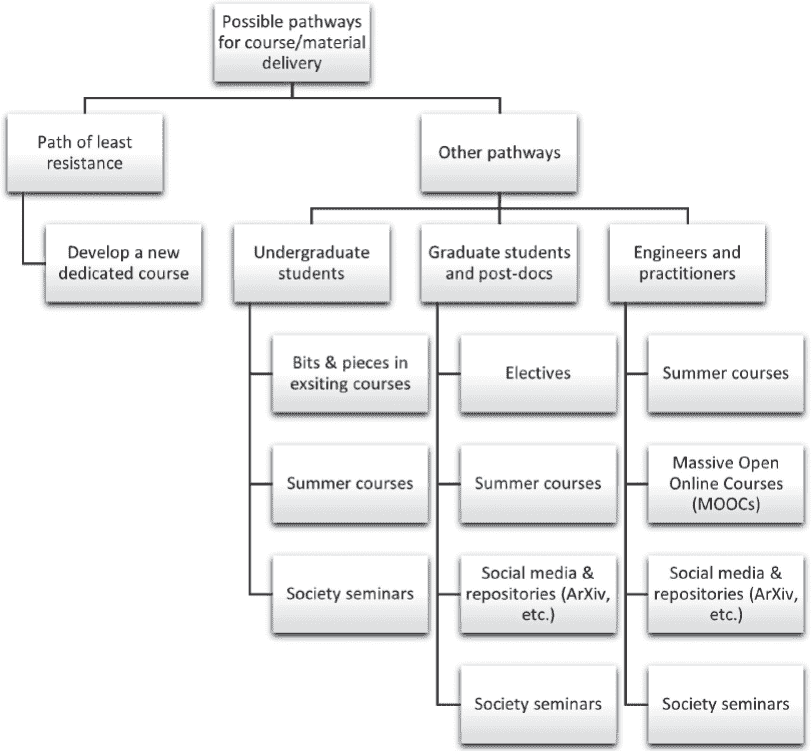

### 问题与练习

- 1.1 列出本领域机器学习教育的两条可能路径。
- 1.2 设计一个融入机器学习的零碎练习。
- 1.3 土木与环境工程领域机器学习主题课程的学习目标有哪些？
- 1.4 总结 ACI 研讨会“人工智能时代的混凝土行业”中讨论的主要观点 [https://www.mznaser.com/media-mentions]。
- 1.5 对比通过编程教授机器学习与通过应用教授机器学习。

### 参考文献

- 1 Dunn, R. 和 Carbo, M. (1981). 模式：致 Walter Barbe、Michael Milone 和 Raymond Swassing 的公开信。*Educ. Leadersh.* 5: 381–382.
- 2 Felder, R. 和 Silverman, L. (1988). 工程教育中的学习与教学风格。*Eng. Educ.* 78(7): 674–681.
- 3 Harvey, D., Ling, C., 和 Shehab, R. (2010). STEM学科中学生学习风格的比较。2010年工业工程研究会议论文集，墨西哥坎昆，6月5–9日。
- 4 Sacks, R. 和 Barak, R. (2010). 将建筑信息模型作为大一土木工程教育的组成部分进行教学。J. Prof. Issues Eng. Educ. Pract. 136(1): 30–38. https://doi.org/10.1061/(ASCE)EI.1943-5541.0000003.
- 5 Cox, M.F., London, J.S., Ahn, B. Zhu, J., Torres-Ayala, A. T., Frazier, S., Cekic, O., Chavela Guerra, R. C., Cawthorne, J. E.(2011). 工程博士成功的属性：来自学术界和工业界的视角。在2011年ASEE年会及博览会上发表的论文，不列颠哥伦比亚省温哥华。10.18260/1-2--17548.
- 6 Shaeiwitz, I.A. (1996). 工程教育中的成果评估。J. Eng. Educ. https://doi.org/10.1002/j.2168-9830.1996.tb00239.x.
- 7 Kohnke, P.C. (2013). ANSYS. © ANSYS, Inc.
- 8 Armstrong, P. (2017). 布鲁姆分类法，教学中心。范德比尔特大学。
- 9 Naser, M. (2022). 一位教职人员关于将人工智能融入土木工程教育的视角。J. Civ. Eng. Educ. 148. https://doi.org/10.1061/(ASCE)EI.2643-9115.0000065.
- 10 Li, Y., Choi, D., Chung, J. 等 (2022). 竞赛级代码生成与 AlphaCode。2022–2025。https://doi.org/10.48550/arxiv.2203.07814.
- 11 Fried, D., Aghajanyan, A., Lin, J. 等 (无日期). InCoder：用于代码填充和合成的生成模型。https://sites.google.com/view/incoder-code-models (访问日期：2022年5月23日)。
- 12 Naser, M.Z. (2023). 面向所有人的机器学习！在土木与环境工程问题上对自动化、可解释和无代码平台进行基准测试。J. Infra. Intell. and Resi. 2(1): 100028. https://doi.org/10.1016/j.iintel.2023.100028. (访问日期：2023年3月1日)。

## 2 机器学习导论

> 我们是说故事的人。
> 罗兰·布鲁姆（《良师难当》）

### 摘要

本章开启我们的机器学习之旅。我们追溯这项技术的现代起源¹，并概述其一些关键里程碑。本章为本教材中将采用的大部分术语定义奠定基础。² 与此同时，本章将回答诸如什么是机器学习？机器学习与人工智能有何关系？创建和/或应用机器学习的常见程序有哪些？机器学习与我们的一些传统方法（即实验、分析/数值模拟和统计方法）有何不同？³

### 2.1 机器学习简史

由于本教材是关于机器学习（ML）的，在探讨其历史之前，让我们先定义什么是 ML。机器学习⁴ 创造特定类型的计算机程序⁵，模仿人类学习的方式以逐步提高其性能。⁶ 简单来说，一台机器在某项任务上接受训练⁷，它对该任务了解得越多，就越能熟练并准确地执行它。最近，AI 和 ML 经常被互换使用。⁸

- 1. 计算机历史可以说始于算盘的发明（约公元前2400年），如果不是更早的话 [26]。
- 2. 目前，至少从土木与环境工程的角度来看，机器学习领域仍然处于流动状态，存在相互冲突的定义，可用于描述相似，甚至相同的概念。因此，有必要阐述我们自己的一套定义，以清晰地传达本章以及即将到来的章节的内容。
- 3. 本章延续并建立在 [8] 的基础上。
- 4. 是人工智能（AI）的一个分支。人工智能由 John McCarthy [27] 定义为：它是制造智能机器（尤其是智能计算机程序）的科学与工程。它与使用计算机来理解人类智能的类似任务相关，但 AI 并不必然局限于生物可观察的方法。
- 5. 即算法：ML 系统处理数据的方法或过程（通常经过优化且已建立良好）。代码常被用来代替算法。然而，代码（或脚本）被定义为机器执行的一系列指令。你可能听过的另一个术语是深度学习（DL）：一种特定类型的 AI，它处理具有深度和流体架构的神经网络。
- 6. 此定义建立在 IBM 采用的定义基础上 [28]。
- 7. 请记住，一台机器可能并未被明确编程来执行此任务！即，它在执行过程中学习。
- 8. 然而，在现实中。数据科学 → AI → ML → DL。


首次将 AI 一词作为解决传统技术难以解决问题的策略来提及，是在 1956 年达特茅斯人工智能暑期研究项目（DSRPAI）上（该项目由 John McCarthy 和 Marvin Minsky 主持）——请参见图 2.1，了解一系列激动人心的里程碑 [1, 2]。如今，AI、ML 和 DL 已形成一个成熟且独特的学科，每年产生数千篇出版物。浏览图 2.2 可查看 AI、ML 和 DL 的出版趋势，并将其与我们的学科进行比较。可以看出，AI、ML 和 DL 的出版物数量是土木与环境工程领域的若干倍。

### 2.2 学习类型

传统统计方法常用于进行行为建模，此类方法可能需要对复杂过程进行理想化，并对变化条件进行近似。更重要的是，统计方法经常假设预测因子与输出之间存在线性关系。然而，这些假设并不总是成立——尤其是在处理真实工程数据的背景下。因此，统计方法往往难以为我们的问题提供高质量的解决方案。

到现在为止，你可能已经注意到，ML 中内嵌了“_learning_”一词。这引出了学习的概念。我们倾向于从经验中学习，因为我们拥有交流、推理和理解的能力。在 ML 的语境下，这一术语由 Arthur Samuel [3] 提出，他在设计了一款用于下跳棋的计算机程序之后创造了这个词。程序下得越多，它就越能从过去的经验中学习，从而对未来的走法做出更好的预测。

除了上述简单的定义之外，机器学习还可以正式定义为旨在使机器能够从数据中学习/理解/识别有意义模式和趋势的技术 [4]。根据 Michalski 等人 [5] 的说法，“_如果计算机程序在经验 E 方面，针对某类任务 T 和绩效衡量标准 P 进行学习，即其在 T 上的任务表现（经 P 衡量）随经验 E 的提升而提高，则称该程序从经验中学习。_” 简单来说，ML 是训练机器执行预先确定任务的过程，其目标是提高此类机器的性能（随时间推移和新知识的增加，希望能够理解/解释手头的数据。

一般来说，ML 可分为三种学习类型：_受监督学习_、_无监督学习_ 和 _半监督学习_ [6]。

受监督学习是一个涉及输入 (_x_1, _x_2, ... _xn_) 和输出变量 (_Y_) 的学习过程；然而，表示输入之间关系以及输入与输出之间关系的函数 _f_(_x_) 是未知的，也不容易推导（参见方程 2.1）。因此，受监督学习的主要目标是将输入映射到输出。受监督学习可分为：_回归_（当输出变量为数值时，例如梁的弯矩承载力、number of

- 9 让我们停下来片刻，承认 AI/ML 的历史是交织在一起的。虽然有些资料将 ML 追溯到 20 世纪 40 年代初，当时发表了 Walter Pitts 和 Warren McCulloch 的论文《_神经活动中内在于逻辑的演算_》[29] 以及 Donald Hebb 的著作《_行为的组织_》[30]，但其他资料似乎采用了在达特茅斯学院举办的研讨会这一版本。无论如何，这看起来都是一个很好的研究论文作业项目。
- 还有几个同样值得关注的时间点，被称为 AI 冬季。有一些时期（特别是 1973–1980 年和 1987–1993 年），由于技术挑战、方法不成熟等原因，人们对 AI 的兴趣急剧下降。当前时刻被称为 AI 春季（即兴趣增加、资金充裕、取得显著成功等）。如需了解类似里程碑的更多信息，请访问：https://achievements.ai/
- 10 值得注意的是，此图并未将计算机科学（作为一门学科）的出版物与土木与环境工程进行比较。计算机科学的出版物量远大于（且增长速度快于）我们的领域。
- 11 在某些情况下，则为非线性。
- 12 请记住，其意图并非统计方法表现不佳或无法交付成果。其意图是，这些方法确实有效，并且在该领域已运行很长时间，然而，在某些/许多场景中，这些方法得出的预测质量仍然较低（考虑到其固有局限性）。如您稍后将看到，每种已知方法（包括 ML）都有其优点和缺点。
- 13 **学习**：寻求知识的过程 [31]。
- 14 可以将日常交互视为一个示例，等等。
- 15 IBM 的一位先驱计算机科学家。
- 16 仔细观察所引用的定义可知，机器并非通过推理来学习，而是通过算法来学习。
- 17 Glennan [32] 认为科学解释有（至少）两个概念：1）解释真正单一的事件，或 2）解释普遍规律。
- 18 请注意，我将以下术语混用：输入、特征、自变量。我也将输出、结果、响应、目标和因变量混用。
- 19 在大多数情况下，ML 分析的结果是一个隐式函数，只有少数能够生成显式函数。这种函数可能无法使用传统方法轻松制定，甚至根本无法制定。

## 人工智能简史

**1943**
神经网络诞生
当今大多数尖端 AI 背后受大脑启发的工具
Warren McCulloch & Walter Pitts 的数学理论
描述如何使人工神经元网络执行逻辑功能

**1956**
人工智能得名
一次为期 2 个月、10 人参与的人工智能研究
被视为 AI 的正式诞生年份

**1965**
与计算机对话
MIT AI 实验室教授开发了一款名为 ELIZA 的计算机心理治疗师
可以通过文本与用户进行看似智能的对话

**1969**
“反向传播”的到来
“反向传播”
允许通过在网络出错时进行纠正来训练网络，使其表现更好

**1986**
首辆无人驾驶汽车
德国联邦国防军大学的研究人员为一辆梅赛德斯-奔驰小货车配备了摄像头和智能传感器
在空旷街道上成功以每小时 55 英里的速度行驶

**1997**
机器击败世界象棋冠军
IBM 的深蓝成为第一款击败现任世界象棋冠军的计算机象棋程序

**2011**
AI 在 Jeopardy! 中获胜
Watson，一款自然语言问答计算机，参加电视游戏节目 Jeopardy! 并击败了两位前冠军

**2016**
AI 击败围棋世界冠军
Google DeepMind 的 AlphaGo 以四比一战胜围棋冠军李世石

**2016**
AI 被训练用于识别猫
Google 研究人员通过向其输入 1000 万张未标记图像来训练一个巨大的神经网络。尽管未给出任何关于这些图像的识别信息，AI 仍能识别猫科动物的图片。

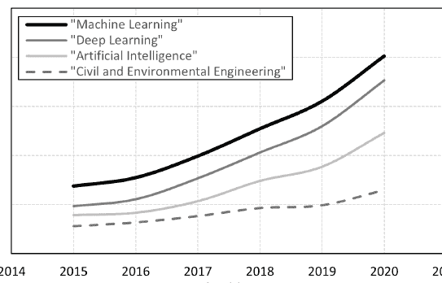

图 2.2 AI、ML 和 DL 以及土木与环境工程的出版趋势。

通过路口的车辆数量、空气中污染物浓度等）和分类（当输出为类别变量时，例如失败/无失败、轻微损坏/重大损坏/倒塌）。

```
Y = f(x) = f(x1, x2, ..xn) (2.1)
```

那么，如果输出不存在呢？如果我们本身并不感兴趣于预测结果呢？例如，如果我们有从传感器或测试中收集的大量数据，并且想看看这些数据背后隐藏着什么？是否有什么东西将数据联系在一起？好吧，无监督 ML 正是在此处提供帮助。

无监督学习可以回答上述问题。20 这种学习类型旨在发现数据的潜在结构/分布，通常分为聚类（按行为分组21，例如，致密微观结构的混凝土往往具有相对较高的抗压强度，受药物影响的驾驶员容易发生事故等）、降维（例如，在与特定现象相关的所有特征中，我们能否识别主要特征？例如，混凝土混合料包含多种原材料。哪些是直接与强度性能相关的关键材料？）和关联规则22（发现描述数据的规则，例如，使用绿色建筑材料建造的桥梁往往对环境产生较小的破坏性影响等）。

第三种学习类型是所谓的半监督学习。这种学习过程适用于只有部分输出被标记的情况（例如，在图像数据集中，一些显示裂缝建筑物的图像被标记为此类，而其他图像则未标记23）。因此，算法试图从较小的（已标记）数据中学习，以正确识别未标记数据的标签。半监督学习包括其他学习类型，如主动学习24、迁移学习25、强化学习26 和自监督学习27。

- 20 希望清楚，与受监督学习不同，这种学习并没有特定的目标要去预测。
- 21 如您在下一章中将看到，聚类可能具有不同的大小、形状和密度。聚类可以以层次顺序形成，并且可以相互重叠。
- 22 关联和聚类通常可以合并在聚类下。
- 23 在此示例中，半监督模型从有限的已标记图像中学习标签，然后用于标记其余图像。您可以将其视为分类与聚类的合并。
- 24 **主动学习**：如果允许 ML 算法自行选择训练数据，那么即使使用较少的训练数据，也有可能达到显著的准确性 [33]。
- 25 **迁移学习**：为某一任务开发的 ML 模型被重复用作第二个任务模型的起点的过程。这种学习类型确保了效率 [34]。
- 26 **强化学习**：一种按照预设奖励机制被编程以自我学习的 ML 系统。例如，这种学习可用于训练机器人如何导航环境（即，当机器人表现良好时，它会获得奖励以强化良好行为）。
- 27 **自监督学习**：由 Facebook 开发的受监督学习与无监督学习的混合体。这种学习旨在从任何观察到的输入中预测未观察到的输入，通常用于计算机视觉和语音识别 [35]。


### 2.3 从土木与环境工程视角审视机器学习

与统计方法不同，机器学习能够根据经验自适应地进行学习。事实上，机器学习相较于传统统计方法的一大主要优势，在于其能够在不预先假设形式或现有关系的情况下，推导输入与输出之间的关系。28

正如您在上一节中所见，我们正处于一场带来令人兴奋机遇的计算革命之中（这场革命有可能克服传统方法的局限性 [7]）。尽管如此，尽管本领域早期已有机器学习方面的研究29 [8–10]，但这场革命至今仍未被充分利用。

这种未被充分利用现象持续存在的很大一部分原因，可能是由于机器学习的不透明性30。31 这种不透明性是一个我们熟悉但并不太喜欢的概念——尤其是与其他透明32 的方法（例如，实验方法、数值方法和解析方法）相比时。

让我们深入探讨上述内容。

我们大多数人（即工程师）都接受过训练，习惯于，或多或少已准备好进行实验或某种形式的数值/解析研究33 [11]。实际上，我们很少教授实验方法或实验设计，而是进行实验。我们也很少开发有限元软件或教授三维单元；相反，我们在讲座中涵盖一/二维单元，然后简要介绍高阶单元。34

如果您觉得上述几行文字中隐藏着一些矛盾——即我们的课程并未为工程师们在实际工作中将面临的情况做好准备（例如，我们大多数处理的问题本质上是复杂的，并且确实需要先进计算手段）——那么请允许我向您保证，并不存在这样的矛盾。课程的设计旨在传授第一性原理，并为学生提供应对现实世界的武器库！

这可以体现在实践、需求和继续教育中，这些教育使工程师能够熟悉调查方法论的各个环节 [12]。35 同样，我坚信，通过持续实践，工程师也能适应并相信机器学习的潜力。36

以下是我们需要机器学习的一些原因。37

- 学习一种新的调查方法很可能会积极扩展和提升我们的理解和武器库。这可能使我们认识到以前没有的新知识，以及探索从未想过的解决方案！机器学习可以在这方面帮助我们。38
- 各个领域不时会经历技术转型。我们当前正在经历的很可能就是如此一次转型——一场计算转型。39 我们应当学习并最大限度地发挥其潜力！！
- 我们的许多工程任务可以描述为重复性40 的，因此可以为了简单性和生产力而实现自动化 [13]。41
- 克服现代工程项目的复杂性需要大量的计算和时间。事实上，分析项目规模的数值模型需要高性能工作站、访问合适的软件和许可证，以及专家用户的可用性，还有大量的迭代。这使得通过传统方法开发和求解此类模型变得具有挑战性，在某些情况下甚至不切实际42（由于成本或时间限制）[14]。
- 从后勤角度来看，土木与环境工程项目通常相当于程序，这些程序在历史上由工程主管部门（即监管委员会）无缝且系统地开发而成。此类程序的条款43 是多年研究和实践经验的结果。制定新条款/更新现有条款以应对我们这个日益苛刻领域的重大需求，可能既昂贵又耗时。44
- 安全检查、风险管理、合规性和决策制定是土木与环境工程项目的关键方面。机器学习旨在处理各种数据类型和规模，这一事实使其成为帮助我们进行安全检查并提供有价值见解以做出最优决策的最具吸引力的方法之一。45
- 许多其他想法和事项，例如涉及能源、勘测、施工、教育、社区韧性等方面的内容，很可能会使用机器学习并从中获益。

### 值得提出的一个问题是，目前机器学习在我们领域的现状如何？

嗯，回答上述问题的一种方法是查看图 2.3。该图展示了 2015 至 2020 年间三个系列的出版物数量：土木与环境工程、机器学习与土木和环境工程、深度学习与土木和环境工程，以及人工智能与土木和环境工程。从该图中可以看出两点46。其一，所有趋势均为正向且上升。其二，基于 AI/ML/DL 的出版物始终占我们领域出版物总数的约 20–30%。

回答同一问题的另一种方法是查看土木与环境工程组织和机构目前对机器学习的兴趣。例如，在 2021 年，我们领域中的两个主要机构（即美国混凝土学会 (ACI) 和美国土木工程师学会 (ASCE)）赞助了基于机器学习的会议和倡议，包括 2021 年美国混凝土学会 (ACI) 会议“AI 时代下的混凝土行业”以及 2021 年美国土木工程师学会 (ASCE) 大会“通过机器智能现代化土木工程”。这些会议旨在从行业/实践角度向土木与环境工程师介绍机器学习。ACI 会议促成了与会议同名的出版物 SP-350 [16]。截至目前，47 我也知悉计划在 2022 年和 2023 年举办类似的未来会议。我们领域内的其他机构和组织48 也在赞助类似会议。

- 39 “人们害怕自己不理解的事物，并憎恨自己无法征服的事物。” – Andrew Smith。
- 40 你能猜出一家设计公司一年要处理多少个剪力板连接吗？十年呢？虽然并非所有连接都相同，但我们仍可承认这一点以及其他设计任务的相似性。
- 41 时间就是金钱！
- 42 一个简单的例子是为建筑物进行基于性能的结构防火设计。问问我的朋友 Kevin LaMalva [40] 吧！另一个例子是，评估典型结构（例如桥梁或水坝）的结构健康监测涉及一系列传感器网络，这些网络持续测量和记录贯穿该结构使用寿命的宝贵信息。以机械方式或通过旧版软件实时或准实时分析此类数据可能是不可行的。
- 43 比如一个方程式或图表——大概嵌入在规范或标准中。
- 44 做一件事不止一种方法！
- 45 你是否曾想过人们在极端条件下如何疏散——这里是来自 Xilei Zhao 实验室关于机器学习在大规模疏散中作用的一篇好文章 [41]。还有一篇关于风险预测的文章 [42]。想象一下浏览数百页合同，机器学习可以轻松帮助我们快速浏览这些内容 [43]（Tuyen Le 的办公室就在我的办公室隔壁两扇门！）。
- 46 还可以推断出第三个但次要的观察：关于机器学习的出版物在深度学习或人工智能相关出版物之前排名。
- 47 2022 年 7 月。
- 48 例如“结构防火”会议系列等等。

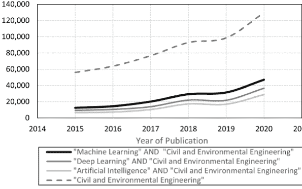

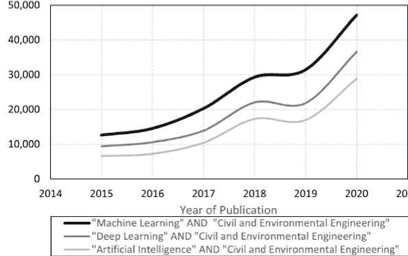

图 2.3 出版趋势（2000–2020）[使用 Dimensions [15] / Digital Science & Research Solutions Inc.]。

第三个，也许也是最不为人知的视角，源自领先行业公司最近播发的新闻，指出它们有将机器学习整合到办公室中的新举措。其中一些举措正由领先公司（例如 Thornton Tomasetti [17]、Giatec [18] 和 Keck & Wood [19] 等）实践。49

### 2.4 让我们再多谈谈机器学习

迄今为止，我们已确定机器学习在某种意义上是一种计算方法。总的来说，计算方法可分为软计算和硬计算两大类。硬计算方法是将高度确定性融入问题求解的方法，而软计算方法则通过近似方式实现 [20]。机器学习属于后者。


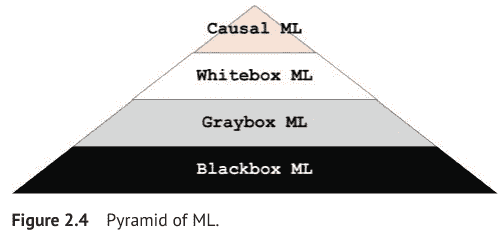

与之并行，还有一组常用于描述机器学习特征的相关术语。在此术语中，机器学习50可进一步分为四个51个独立群体：白盒、黑盒、灰盒和因果[20]。白盒机器学习是指能够清晰阐明控制某一现象的变量与工程师试图评估的结果（或目标/响应）之间的功能或物理关系的模型。例如，如果一个机器学习模型能够产生一个将输入与目标联系起来的方程52或图表，则该模型被称为白盒模型。即使模型不产生具有表达性的工具，也可以得出相同的预测。白盒机器学习的对立面是黑盒机器学习。这些是内部机制复杂、因此难以解释53的模型，但仍然可以以高准确性提供现象的结果（尽管不确切知道模型如何或为何获得高可预测性，也不知道输入/特征如何相互关联或与目标/响应相关联[21] 54）。同样的分类也可以应用于纯基于数据构建的机器学习模型，即数据驱动模型。55 灰盒机器学习介于上述两者之间。这些模型的关系和/或数学模型部分基于一定程度的理论理解或先验知识，同时也采用类似数据驱动的方法[22]。纯经验模型可以归入此类。另一方面，因果模型是那些阐明特征与感兴趣结果之间因果关系的模型。这一类机器学习处于图2.4所示金字塔的顶端。毫不奇怪，传统机器学习通常无法产生，也无法识别因果关系！56

### 2.5 机器学习流程

事实是，利用机器学习充分解决/克服/理解一个现象既是艺术也是科学。57 幸运的是，存在构建机器学习模型以考察现象的系统过程（即流程）。这一过程催生了以下通用公式：

```
Machine Learning = Algorithms + Data (2.2)
```

50 以及计算方法。
51 有些来源可能会选择使用两个群体，即因果和非因果。其他人可能会使用白盒和黑盒。透明或玻璃盒等其他术语可能用于指代白盒模型的变体。还提到了基于物理或物理引导的模型。这些模型包含某种形式的物理约束或微分方程。值得记住的是，模型的分类有多种方式，且此类分类似乎适用于专门领域/子领域。为了避免所有混淆，我将坚持以上概述的四个群体（其中除因果模型外的模型被假定为非因果）。
52 这可能有点模糊，但请见谅。得出一个方程可以像回归练习一样简单。现在，这个方程可以简单地代表数据（如最佳拟合数据），也可以是与我们的物理学和领域知识相匹配的方程。后者与前者是完全不同的故事。例如，经验方程仅因为它们拟合实验数据且没有理论依据而被选中——这就是许多机器学习模型能为我们提供的（无论是白盒、黑盒还是灰盒）。经验方程和理论方程都有其位置和作用。Ribaric和Šušteršics [44]的一本好书列举了许多经验方程实际上导致新理论的成功故事，值得你花时间阅读。我们将在本教科书中同时介绍这两者。
53 如果可能的话！
54 大部分机器学习可能属于黑盒机器学习。
55 数据驱动模型：由数据驱动的模型——改变数据，模型将随之改变。与例如梁的弯曲模型不同，无论梁如何不同，该模型在很大程度上保持不变。
56 遗憾的是，很少人知道这一事实。附注，了解因果关系可能并非对每个问题都是必需的！但是，知道哪是哪绝对是必需的！
57 同样的道理也适用于进行实验或构建和求解数值模型。调整实验设置或微调有限元模型包含大量创造性成分。

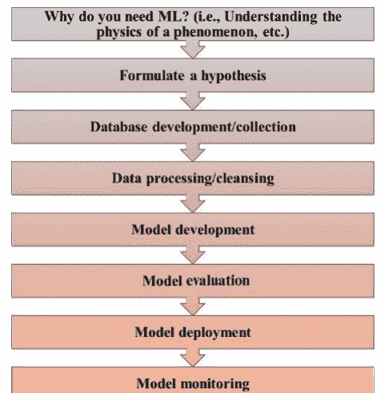

当强调算法时，这种做法被称为以模型为中心58的机器学习方法。另一方面，如果强调数据，59则方法转变为通常称为以数据为中心的机器学习方法。

无论采用何种方法，60 典型的系统机器学习过程如图2.5所示，始于创建基于机器学习的工具或解决方案的需求，以解决现有方法似乎无法解决的假设或回答引人入胜的问题，或者仅仅出于对可用数据空间进行探索的好奇心。61 让我们在接下来的几个部分中更详细地深入了解机器学习的每个过程。

### 回答为什么需要机器学习来解决问题/现象？

我希望你思考一个你觉得有趣的问题或现象X。虽然这样的现象让你感到有趣可能有很多原因，但假设其中一个原因是你不知道如何预测这个现象。

我曾承诺62分享我在研究中采用机器学习的经验。这或许可以是分享我早期开发无需测试和模拟的方法来预测/预报火灾条件下梁变形的一个尝试的好方式。我的目标是尝试创建一种快速且直观的预测方法。了解现象如何发生需要某种形式的调查。那么，我能做什么呢？

在土木与环境工程中，63可以进行几种类型的调查。

- 首先，我们可以设计一项旨在探讨梁在火灾下如何挠曲的实验活动。如你所知，实验成本高昂，而火灾测试不仅昂贵，64而且还需要专用设施65和数月的准备工作。

- 第二，重新审视火灾和应力诱导变形的第一性原理和理论方面可能是另一种解决方案。然而，与大多数理论调查一样，需要将此类调查限制在一系列理想化假设中，并需要扎实的数学基础。

- 第三，也许也是最经济的解决方案，开发和验证火灾下梁的有限元模拟。然而，此类模型可能很复杂，66，我们尚未采用系统程序来确保正确验证有限元模型。

图2.5 典型的机器学习流程。

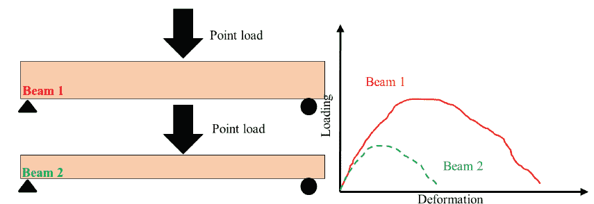

上文意味着，为了预测梁在火灾下所经历的变形，工程师必须对该梁进行测试或建模。简单来说，正如你所看到，存在一个明确的*需求*来创建一种无需测试和模拟的方法67来预测火灾条件下梁的变形。68 既然现有的调查方法似乎无法为我们提供满足条件的解决方案，那么或许可以尝试通过不同的方法（即机器学习）来寻找这样的解决方案。

既然*为什么需要机器学习来解决问题/现象？*这个问题的答案已经得出。让我们进入机器学习流程的下一步。

#### 2.5.1 制定假设

我们的物理学原理告诉我们，梁是设计用于满足强度和使用性标准的承重构件[23]。结构工程师的核心关注点是追踪梁的荷载-变形历史。从实际角度来看，梁所经历的变形可以在测试中测量，或遵循力学原理（如矩-曲率法）计算，或通过有限元模型模拟。鉴于梁所经历的变形程度很大程度上表明了由于施加荷载而导致其承载能力中的退化水平，因此很有可能将这两种现象联系起来。

同样，领域知识告诉我们，受弯梁的加载变形历史会产生类似抛物线或曲线的图。此图暗示，观察到的变形源于连续施加荷载P产生的应力，并且变形程度反映了梁截面承载能力的退化（几何特征、材料性能、约束等的函数）。在钢筋混凝土梁中，此类图可以有混凝土开裂、钢筋屈服以及失效点等明确点位。

图2.6展示了两个理想化梁，*梁1*和*梁2*，的变形历史。这两个梁之间唯一的区别是*梁1*比*梁2*更深。因此，在相同荷载条件下，*梁2*将在*梁1*之前失效，因为其尺寸较大。得出上述结论是微不足道的，因为两梁之间仅变化了一个参数（*梁深*）。现在，如果其他参数也要变化，那么问题将大大增加，因为物理原理与领域知识之间的联系变得更难解读。

因此，我可以认为荷载-变形历史图包含了梁的本质或DNA，因为它们浓缩了几何和材料特征以及荷载和约束条件之间的相互作用。这种荷载-变形历史正是我们在设计测试时力求获得的，并且仍然是我们调查的主要结果。同样的历史为我们提供了关于梁响应（即开裂、屈服等）、性能（韧性、脆性等）和失效（通过弯曲、剪切等）的宝贵见解。因此，能够获得此类历史是必不可少的。因此，创建一个

图2.6 环境条件下荷载-变形历史的示意图。


一种追踪梁（或任何承重构件）变形历史的全新即时方法应运而生——尤其是当这种方法能最大限度减少测试或模拟需求时。

现在，让我们在加入热效应的前提下重新审视上述示例。⁶⁹ 将热效应添加到上述梁中，会引入热变形和温度引起的梁截面承载力退化（这是温升、几何特征、材料性能、约束等的函数）。⁷⁰

与常温测试不同，火灾测试过程中P的大小保持不变。⁷¹ 因此，梁中跨中挠度的程度仅仅是材料性能退化（即机械性能因温升而退化的程度）以及相关截面尺寸损失⁷²（如有）的反映。

为了更好地形象化上述示例，让我们比较两根相同的梁（见图2.7）。由于这些梁相同且受到相同的火灾条件作用，两根梁都将经历相同的温升和退化。

如果梁1受到P₁荷载作用（其中P₁ > P₂，P₂作用于第二根梁⁷³），则该梁将经历更高的应力程度，进而产生更大的变形并在较早时刻失效（见图2.7）。

图2.7很简单，其简单之处在于我们在讨论过程中仅变化了一个参数（即荷载大小）。这种简单性被认为是必要的，以便建立对梁在火灾下如何挠曲的逻辑理解。⁷⁴ 您可能已经可以推测，我们探索的参数越多，理解梁在火灾条件下何时以及如何变形这项练习就越棘手。

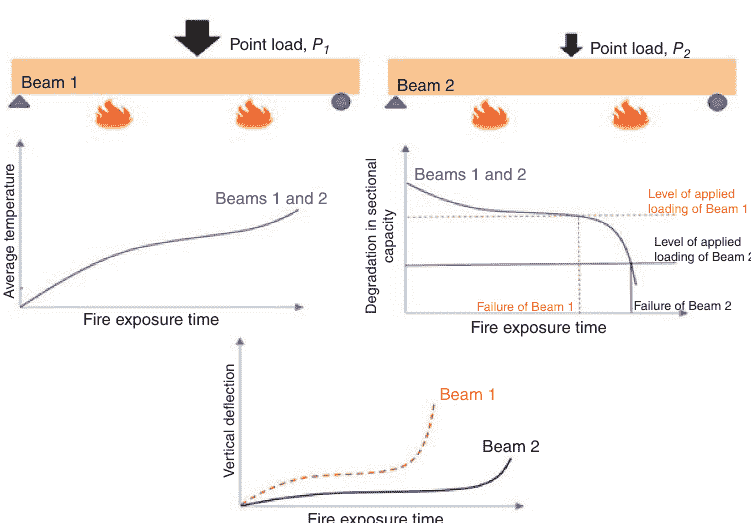

图2.7 火灾条件下梁的典型响应。[注：一旦梁的变形超过预定义限度和/或截面承载力退化低于施加荷载水平，即视为失效]。

虽然我们可能不知道变化所有参数以及所有参数之间的相互作用如何影响变形行为，⁷⁵ 但我们可以依据对物理和工程知识的理解来形成假设。因此，为了获得火灾受影响梁的变形历史，工程师应识别关键参数，以及将这些参数与火灾受影响梁中变形现象联系起来的控制关系。换句话说，

梁的变形是关键参数与控制关系的函数（2.3）⁷⁶

我们知道，关键参数围绕梁的：几何（即宽度、高度、跨度等）、材料性能（强度、弹性模量等）、荷载（类型、大小等）和边界条件（即简支等），以及火灾条件（强度、升温速率、持续时间等）展开。另一方面，我们缺少的组件是将这些参数联系在一起的控制关系⁷⁷ [24]。因此，我们追求通过ML等调查方法找到这样的关系。

现在，如果我们的假设被证明是正确的，那么工程师将能够轻松预测火灾受影响梁的变形历史，并由此推及其他构件（并且可能不需要测试或复杂模拟！）。

我们该如何应对这样一个假设，尤其是考虑到我们无法自行进行测试、推导或模拟？这时，数据的作用⁷⁸变得显而易见。

如果我们能观察一系列火灾荷载梁测试，然后分析这些测试的结果，那么我们很有可能提取火灾受影响梁的变形机制⁷⁹。一旦识别出这样的机制，我们就可以将其转换/转化为一种方法或途径，以轻松预测梁的变形。

让我进一步简化这一点。

观察上述公式表明我们有三个组件。如果我们对其中两个有把握，那么很可能实现第三个！我们对从火灾测试中获得的梁变形相当有把握。我们也对变形过程涉及的关键参数的物理和工程知识相当熟悉。因此，实际上，我们对所需三个组件中的两个有很好的掌握。

简单来说，采用ML的原理是，既然感兴趣的现象（即变形历史）可以被观察（例如在火灾测试中），那么将这种效应与其已知关键特征联系起来的控制关系就可以被推导出来（通过ML⁸⁰）。

换句话说，我们观察现象，我们知道参数，并且我们可以获取数据⁸¹！

#### 2.5.2 数据库开发

为了获取数据，我们可以自行开展全面的测试/模拟计划，或者更经济地，进行详细⁸²的文献综述。收集健康且高质量的数据对即将进行的ML分析的成功至关重要。这些数据将被汇编成数据集，并应具有一致分布的观察，涵盖各种条件以及关于可能控制手头现象的特征（参数）的信息。⁸³

数据集的类型和大小各不相同。最常见的数据集是表格性质的（即包含数值和/或字符）。这些数据集在回归和/或分类分析中很有用。对于聚类、异常检测和降维也是如此。在检查录像、图像、视频或音频的ML分析中，第二种类型的数据集可能更合适，可以汇编相同格式的文件。本书将使用多种类型的数据集。⁸⁴

#### 2.5.3 处理观察

到此，数据集将已编译并准备就绪，我们可以舒适地开始ML分析。要开始这样的分析，需要识别/采用一个ML算法⁸⁵或一组算法。⁸⁶ 此时此刻，我希望你把算法当作你可以挑选和选择的工具/软件。有些在特定问题上表现良好（即，聚类算法旨在对数据进行聚类，因此主要用于聚类任务）。另一些在许多问题上表现良好（例如，神经网络在各种任务上表现相当）。

工程师倾向于使用一种软件而非另一种，这很常见。这可能源于经验、⁸⁷ 偏好⁸⁸ 或简单的可用性。⁸⁹ 选择ML算法的情况也是如此。在所有情况下，选定的算法都需要训练，然后进行验证。

这就是为什么我要求你暂时把算法当作软件来思考。这是因为这样做，我们可以意识到这些算法可以容纳任何数据！例如，土木工程师可以输入土木工程数据来使用算法A。环境工程师也可以输入环境数据来使用完全相同的算法。算法不理解我们的数据，也不理解我们的问题。⁹⁰

#### 2.5.4 模型开发

我们使用数据集训练算法。这种训练的目标是让算法熟悉方程2.2的前两个组件（即观察值（或我们试图预测的响应/目标）以及我们假设对手头现象至关重要的参数）。

训练ML算法有几种方法。最广泛使用的两种方法被称为比率采样和交叉验证的变体。

在第一种方法中，数据集被打乱，然后随机分成两部分：一个较大的训练子集和一个可能较小的测试子集。⁹¹ 这种方法中常用的分割比例用于训练的范围在50%到80%之间，剩余样本用于验证/测试。这种方法适用于健康和平衡的数据集。⁹² 在

69 毕竟，我们寻找的正是梁在火灾下的变形！

70 请耐心等待片刻，因为这个信息量较大的陈述一开始可能有点令人困惑。让我们简化一下。温度引起的退化：表示由于升高温度的存在而导致的性能（即强度）退化（或损失）（这可能会引发生理化学反应，削弱材料）。此外，温升可能导致额外效应（例如裂缝）的形成，如果没有火灾，这些效应本不会被目击。我们将在因果章节中重新探讨斜体部分！

71 希望你能体会火灾测试的复杂性，因此选择了这个例子！

72 理解截面损失的一种方法是想象一根木制梁暴露在火灾中。长时间暴露后，随着其表层燃烧/炭化，这种梁的尺寸会越来越小。在这种情况下，木梁因材料强度退化和截面尺寸减小而在两个方面失去承载力。记住：截面承载力主要由两个因素组成，材料性能和几何形状！

73 记住我们关于火灾条件下测试所说的内容。施加的荷载保持不变！

74 类似的逻辑也可用于评估我们领域中的许多问题和现象。动用你的想象力！

75 如果我们知道，那就不需要展示这个例子了！

76 关键参数可能已知（在一定程度上），而控制关系可能未知（在一定程度上）。此外，该方程可以概括为：现象 = 关键参数 + 控制关系(s)

77 在我看来，这样的关系可以是显式的（白盒或因果）或隐式的（黑盒或灰盒）。

78 **数据**：为参考或分析目的收集的信息、事实、数量和统计数据。

79 或者机制！

80 采用其他调查方法也可能如此！如你将在后面章节中看到，控制关系通常高度非线性，因此传统方法（即统计分析）可能无法正确捕捉这种关系。如果传统方法能够正确捕捉这种关系怎么办？那么，你可以在不使用ML的情况下使用这些方法！你是设计者！

81 这听起来可能过于雄心勃勃或过于乐观！让我们停顿一分钟。我不希望你认为这是一个简单的数据收集练习（在某些问题中，它确实是一个简单的过程——但大多数问题并非如此）。也就是说，让我们收集一些数据来运行几个算法，看看能得到什么。关于数据还有更多内容无法在此脚注中详述——因此有下一章！

82 也就是说，请花时间收集高质量且著名的来源。兼顾质量和数量。

83 为求完整，可能特征空间对于不同现象可能相同也可能不同。此外，不能保证两个独立研究小组若希望解决同一现象，会得出相同的特征、特征数量或特征类型等。作为练习，找出五篇为基于混合比例预测混凝土抗压强度而开发ML模型的研究论文，看看其中有多少篇包含相同的特征并引用相同的来源。

84 目前，我希望你知道我们将为ML收集数据。我将在下一章深入讨论数据方面。如果你在想为什么需要这些数据，我们将使用这些数据来教导ML算法。

85 算法：ML系统处理数据的一种方法或过程（一系列步骤/规则）。第4章深入介绍了算法，因此我目前不会深入讨论。

86 可以将一组算法结合起来。这样的组合称为集成。还可以使用一个算法来调优另一个算法。其他组合将在未来章节中讨论。目前，让我们关注大局！

87 假设一名工程师接受过使用软件A的培训，但后来接触到了更直观的软件B。很有可能，同一名工程师会倾向于后者。

88 例如，我偏好的有限元软件一直是并且仍然是ANSYS。感谢我在研究生阶段的无数工作时光！

89 可访问/免费软件可能比那些隐藏在付费墙后面的软件更经济实惠。

90 大声说出这话揭示了ML的一些危险！

91 也可以进一步分为验证子集和测试子集。还要注意，训练子集和测试子集可能相等也可能不相等。

92 平衡数据集：每个输出类由大致相同数量的观察值代表的数据集。


数据集不平衡，则采用这种训练方法可能导致偏差。93 为了克服偏差问题，可以采用分层比例采样方法。在此方法中，所有子集中类别/表示的分布被保留。94 在此过程中，算法的性能在训练子集和测试子集上被记录。

训练机器学习算法的一种更现代的方法是使用交叉验证方法（及其衍生方法）。在此方法中，数据集也被随机分割为两个子集：训练集和测试集。然而，与其他传统方法不同，训练集进一步被分割为 k 个部分。然后使用 k-1 个部分训练模型，并在 k 部分上进行验证。95 此过程重复 k 次，直到每个唯一部分都被用作验证子集（参见图 2.8）[25]。如您所见，算法的性能在训练、验证和测试96 子集上被记录。

事实上，交叉验证97 方法是对比例采样方法的改进。然而，如果不加以控制，交叉验证也可能遭受偏差。因此，通常建议使用分层 k 折交叉验证方法。

我们纳入上述方法的总体目标是确保算法得到适当训练，以防止拟合98 问题和幸运猜测，99 从而提高算法的准确性和信心。

#### 2.5.5 模型评估

您可能会问这样一个问题，假设我们已采用分层 k 折交叉验证方法来训练一个算法；我们如何在整个开发过程中监控和评估模型性能？我们如何知道训练过程确实成功了？

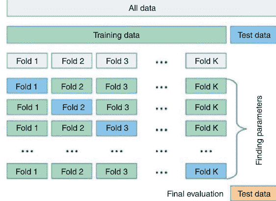

图 2.8 交叉验证方法示意图（版权归 Elsevier 所有）。

93 换个角度思考，在随机分割数据时，无法保证所有输出/类别都得到均等代表（即，训练子集可能包含大量与特定类别或特征相关的观测值等）。在回归方面，偏差可能源于将许多关于 pH 的观测值（例如来自站点 A 的数据，同时代表来自其他站点的一些样本）归为一类。

94 例如，假设我们有 1000 个观测值的数据集，其中 700 个属于类别 A，其余观测值属于类别 B。那么，训练子集将包含 70%（700/1000）的类别 A 观测值和 30%（300/1000）的类别 B 观测值。

95 这里是一个例子。假设 k = 5，那么我们将执行 5 折交叉验证。在此过程中，我们将数据集分割为 5 个相等的部分（标记为第 1、2、3、4、5 部分），这些部分不包含重叠观测值。我们将把每个部分视为一个新数据集（即，对于第一个数据集，使用第 1 部分验证集，其余部分用于训练）。鉴于 k = 5 意味着每个新数据集构成原始数据集的 20%。因此，每个数据集都有 80%-20% 的训练-验证分割比例。k 折交叉验证方法可以概括为：

验证子集中的数据百分比 = (100 / k)%

96 在应用多个算法的情况下，在测试子集上仅报告最佳算法的性能并不罕见（即，仅在识别出最佳算法后才使用测试子集）。

97 为完整起见，交叉验证还有本文未概述的其他变体（例如，留一法交叉验证）。

98 过拟合：当机器学习模型的预测与训练所用数据高度一致时发生的建模错误。例如，当模型在训练数据上的性能显著优于测试数据时。与过拟合相对的是欠拟合：模型无法正确捕捉训练数据本质的建模错误。关于这些错误的更多内容将在下一章中介绍。

99 幸运猜测：机器学习模型纯粹出于运气准确预测结果的情况。

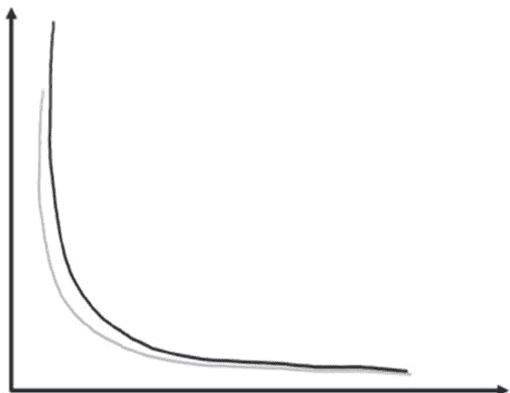

图 2.9 合适学习曲线示例。[注：深色线代表训练损失，灰色线代表验证损失]。

监控算法性能的一种方法是查看其学习曲线。100 图 2.9 提供了这种学习曲线的示例。如您所见，训练损失和验证损失均同步下降，然后趋于稳定（两者之间差距很小，尤其是在分析结束时101）。

上述关于训练和验证学习曲线的讨论与比较引发了对偏差102 和方差103 权衡的讨论。104 图 2.10 展示了偏差-方差权衡的可视化表示。一般来说，低方差的机器学习模型倾向于具有简单105 的架构，因此对训练数据来说可能稳定（一致但不准确）。换句话说，这类模型缺乏学习数据真实模式所需的灵活性，因此会遭受欠拟合。106 另一方面，低偏差的机器学习模型结构倾向于更复杂107，因此足够灵活以容纳非线性。这些模型在未受监控的情况下，可能会过拟合数据（即，记忆训练数据和/或捕捉噪声），并错误地提供对数据泛化性能差的评估。

100 学习曲线：显示随经验或所用数据量增加而学习情况的折线图。

101 如果稳定部分恰好过长，这可能表明算法学习速度过快，因此较低的学习率可能有所帮助。附录中展示了可能的学习曲线、技术（例如早期停止等）的更多示例以及如何诊断此类曲线。

102 偏差：平均预测与实地真值（即真实或正确值）之间的差异。换句话说，偏差衡量的是我们能做出的最佳预测与实地真值之间的距离。

103 方差：给定数据实例的模型预测的变异性（即离散程度的一种度量）。换句话说，方差表示在不同训练数据下，我们能多大程度接近最佳预测。

104 之所以称为权衡，是因为增加其中一个会减少另一个，因此需要取得平衡。总体而言，机器学习模型的错误等于由偏差、方差和不可减误差（例如，通过生成模型无法减少的一种误差，因为这是对数据中的噪声和/或问题表述的一种度量）造成的误差。从数学上讲，错误 = 偏差² + 方差 + 不可减误差（注意偏差和方差均为负项，这实际上意味着存在某种我们无法简单/完全通过建模克服的错误）。如果您想知道为什么偏差要平方，我邀请您参阅附录中的证明（嗯，误差以均方误差的形式表达，而方差本身已是平方！）。

105 例如参数模型。可以考虑线性回归，该模型已经基于变量之间的线性假设预先构建。正如您可能猜到的，这种模型可能限制算法学习数据真实底层结构的能力。因此，这种模型本质上偏向线性！关于偏向模型的附注，假设我们使用一个恰当考虑了一定程度非线性的模型。然而，同一模型尽管考虑了确定的非线性，却仍然表现不佳。那么，这可能是欠拟合的另一个迹象，即模型使用的特征数量不足以进行训练。

106 偏差高的模型很少关注数据，因此会对现有数据欠拟合。

107 例如非参数模型。

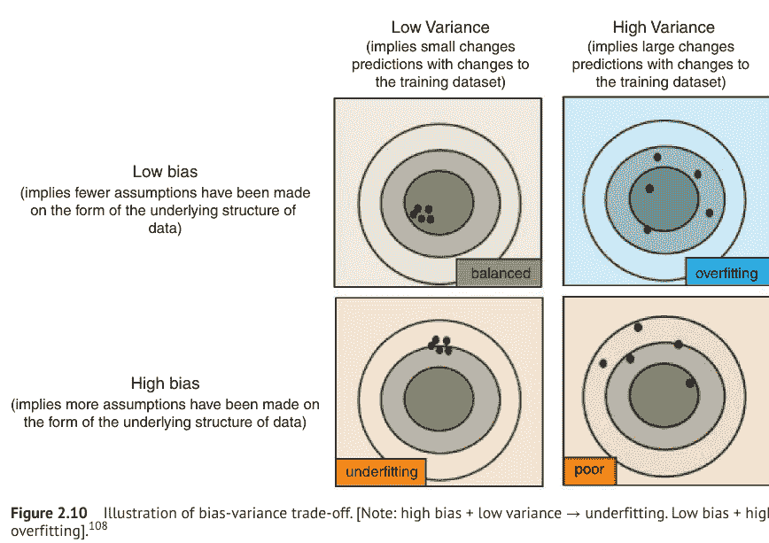

当手头的算法完成训练和验证后，该算法的性能还通过误差指标和性能指标进行评估。109 这些是数学或逻辑构造，用于检查预测与真实观测值（或实地真值）是趋合还是偏离。当算法预测与实地真值匹配良好110 时，则该算法被认为是适配的，这使我们将术语从算法转变为模型。111

存在多种指标和指标，其中大部分与统计学中常用的指标非常相似。在回归问题中，此类指标的最简单形式是通过用相应的实际/观测值减去预测值来得出的。例如，土木和环境工程师习惯于使用基于回归的指标，如平均误差、相关系数等。实际上，可以使用一个、多个或组合的指标和指标来检查机器学习模型的性能。

然而，并非所有指标和指标都相等112 或适用。例如，使用回归指标（如相关系数）不足以评估分类模型。在分类问题中，最简单的评估形式是比较模型对感兴趣类别的预测效果。其他常见的基于分类的指标包括接收者操作特征曲线下面积、准确率等。到目前为止，我们尚未确定一组标准的性能指标。113

108 关于偏差和方差的附加说明：当模型系统性地生成错误预测时（意味着模型无法捕捉当前现象），模型被认为是有偏差的。高偏差（或欠拟合）可以通过加入特征来捕捉未建模的复杂性，或使用能够捕捉当前复杂性的不同模型类型来处理。当模型在处理新数据时泛化效果不佳时（模型基本上学习了训练所用数据而非学习了现象），模型被认为具有高方差。高方差（或过拟合）可以通过降低模型的复杂性来处理。

109 我们在第 5 章中会介绍这些内容。

110 我承认这个术语的定性性质。正如我所说，我们将在几章后更详细地探讨这一点。

111 另一方面，如果算法预测与实地真值不匹配，则可以应用额外的微调。这种调整可能涉及采用不同的训练策略、纳入更多数据，或调整模型超参数。**超参数**：独立于数据的模型配置。与超参数不同，模型**参数**可以从数据中估算。此类参数示例包括：神经网络中的 _权重_ 或支持向量机中的 _支持向量_。斜体术语将在第 4 章中介绍。

112 如其评估能力和对特定/一般问题的适用性。有些指标也可能相互依赖（决定系数 R² 是相关系数 R1 的平方）。

113 因此，我的建议是应用组合指标和不同表述（例如，基于误差、基于目标、基于相关性等）的指标，以克服单个指标相关的一些局限性（例如，偏差、过度简化等）。


#### 2.5.6 模型优化

一旦机器学习模型经过适当验证，该模型可以通过操纵训练/验证/测试中使用的数据的大小和/或内容，或通过调整算法架构（例如，神经网络中的层数/神经元数量等）、超参数（用于元启发式）等，进一步进行调优（优化）。

#### 2.5.7 模型部署

在此阶段，机器学习模型已准备好部署¹¹⁴并与其他用户（即，在办公室/设计公司中）共享，或作为服务提供以解决现实世界问题。相同的模型也可以转换为具有直观图形用户界面的软件和 Web 应用程序。¹¹⁵ 为了确保无缝集成，机器学习模型必须易于使用。

#### 2.5.8 模型管理（监控、更新等）

随着时间的推移，随着新数据¹¹⁶和趋势的出现等，已部署模型的性能可能会下降。因此，继续监控和调优已部署的机器学习模型是良好的做法。

### 2.6 结论

本章对机器学习的历史及其背后的主要思想进行了入门介绍。本章还涵盖了目前可用的主要学习类型，以及从土木与环境工程角度开发和创建机器学习模型的完整过程。最后，给出了并阐述了各种定义，为接下来的章节奠定基础。

### 定义

- **主动学习** 如果允许机器学习算法选择自己的训练数据，即使使用较少数量的训练数据，也有可能达到显著准确性的过程。
- **算法** 机器学习系统处理数据的方法或过程（一组步骤/规则，通常经过优化并已确立）。
- **人工智能** 机器展现的智能，系统从其周围环境（即，数据）中收集信息以采取行动。
- **关联** 一种使用数据发现规则的无监督学习类型。
- **平衡数据集** 每个输出类由相似数量的观测值表示的数据集。
- **偏差** 平均预测与基础真实值（即，真实或正确值）之间的差异。
- **黑盒机器学习** 一种涵盖具有复杂内部运作且因此难以解释的模型的机器学习方法。
- **分类** 涉及分类性质输出变量的一种监督学习类型。
- **聚类** 一种按行为分组的无监督学习类型。
- **代码** 机器执行的指令列表。
- **数据跳变和数据漂移** 由于模型架构、环境或实践导致的数据结构的预期、非预期和/或未记录的变化。这些是随时间发生的模型预测退化的症状。
- **数据驱动模型** 由数据驱动的模型——改变数据，模型就会改变。例如，与梁弯曲模型不同，无论梁有何不同，该模型在很大程度上保持不变。
- **数据** 为参考或分析目的而收集的信息、事实、数量和统计数据。
- **数据中心机器学习** 强调数据方面的机器学习方法。¹¹⁷

¹¹⁴ 模型部署：将模型应用于预测和/或新数据的过程。
¹¹⁵ 有关更多信息，请参阅附录！我有两个您可以遵循的示例（Python 和 R）。
¹¹⁶ 可能的示例包括 *数据跳变* 和 *数据漂移*，以及常用建筑材料因政策、通货膨胀、可用性或实践变化而变得较少（或更多）常见，分别是。
¹¹⁷ 回答诸如如何更改数据标签以提高模型性能等问题。

- **深度学习** 具有深度和灵活架构的神经网络。
- **降维** 一种将参数数量减少到最能解释数据的参数的无监督学习类型。
- **集成** 将一组算法合并为一个的方法。
- **灰盒机器学习** 机器学习模型，其中关系和/或数学模型部分基于一定程度的理论理解或先验知识，同时也利用类似数据驱动的方法。
- **超参数** 独立于数据的模型配置。
- **输入/特征/自变量** 一组属性，通常表示为向量，并与输出相关联。
- **学习曲线** 显示随着经验或使用的数据量而学习的折线图。
- **学习** 寻求知识的过程。
- **幸运猜测** 机器学习模型仅凭运气准确预测结果的情况。
- **机器学习** 人工智能（AI）的一个分支，它创建模仿人类学习方式并逐渐提高准确性的计算机程序。它们被定义为旨在使机器能够从数据中学习/理解/识别有意义模式和趋势的技术。
- **模型部署** 将模型应用于预测和/或新数据的过程。
- **模型参数** 可以从数据中估计。此类参数的示例包括：神经网络中的 *权重* 或支持向量机中的 *支持向量*。
- **模型中心机器学习** 强调算法方面的机器学习方法。<sup>118</sup>
- **输出/结果/响应/目标/因变量：** 我们感兴趣的观测值或标签。
- **过拟合** 当机器学习模型的预测与训练中使用的数据非常吻合时发生的建模错误。例如，当模型在训练数据上的性能显著优于测试数据时。
- **回归** 涉及数值性质输出变量的一种监督学习类型。
- **强化学习** 按照预设奖励机制编程来自我学习的机器学习系统。
- **自监督学习** 这种学习旨在从任何观察到的输入预测未观察到的输入，常用于计算机视觉和语音识别。
- **半监督学习** 将少量标记数据与更大规模（未标记）数据相结合的机器学习过程。
- **测试子集** 用于测试和评估机器学习算法性能的示例或观测值。
- **训练子集** 用于训练机器学习算法的示例或观测值。
- **迁移学习** 为某一任务开发的机器学习模型被重用作为第二个任务模型起点的过程。这种学习确保效率。
- **欠拟合** 模型无法正确捕捉训练数据本质的建模错误。关于这些错误的更多内容在下一章。
- **无监督学习** 希望发现数据潜在结构/分布的机器学习过程。
- **验证子集** 用于验证机器学习算法的示例或观测值。
- **方差** 给定数据实例的模型预测的可变性（即，离散程度的度量）。
- **白盒机器学习**（也称为 **透明** 或 **玻璃盒机器学习**）：一种阐明控制现象的变量与结果（或目标/响应）之间的 *功能* 或 *物理* 关系的机器学习方法。

### 章节蓝图

- 机器学习历史与简介
  - 计算机科学视角下的历史
  - 土木与环境工程视角下的历史
  - 机器学习流程
    - 为什么使用机器学习？
    - 假设制定
    - 数据与处理
    - 模型开发与测试
    - 模型优化、部署与监控

### 问题与练习

- 2.1 撰写关于 AI/ML 和 DL 历史的两页论文。
- 2.2 讨论机器学习对土木与环境工程师的重要性。
- 2.3 什么是算法和集成？
- 2.4 定义白盒、灰盒、黑盒和因果机器学习。
- 2.5 什么是监督学习？什么是无监督学习？
- 2.6 解释主动学习、迁移学习和强化学习之间的区别。用示例补充你的答案。


## 2.7 描述 ML 流水线背后的总体思想。

## 2.8 如何补救高方差？如何补救高偏差？

## 2.9 在您看来，您认为公式 3 是否全面？该公式如何应用于您领域内的问题？

## 2.10 找出五篇开发 ML 模型以预测与您领域相关的现象的研究文章，并报告其中有多少篇文章包含相同特征并引用相同来源。请对您的回答进行评论。

## 参考文献

- 1. Russell, S. 和 Norvig, P. (2009). *人工智能：一种现代的方法*, 第 3 版. 剑桥大学出版社. doi: 10.1017/S0269888900007724.

- 2. Steels, L. 和 Brooks, R. (2018). *通往人工智能的人工生命之路：构建具身化、位置化代理*. Routledge. https://books.google.com/books/about/The_Artificial_Life_Route_to_Artificial.html?id=7b5aDwAAQBAJ (2022 年 7 月 9 日访问).

- 3. Samuel, A. (1959). 基于跳棋游戏的机器学习一些研究. *IBM J. Res. Dev.* 44 (1.2).

- 4. Fu, G.-S., Levin-Schwartz, Y., Lin, Q.-H., 和 Zhang, D. (2019). 医学影像的机器学习. *J. Healthc. Eng.* 2019, 文章 ID 9874591: 2. doi: 10.1155/2019/9874591.

- 5. Michalski, R.S., Carbonell, J.G., 和 Mitchell, T.M. (1983). *机器学习：一种人工智能方法*. Springer.

- 6. Murphy, K.P. (2012). *机器学习：一种概率视角（自适应计算与机器学习系列）*. MIT 出版社.

- 7. Ziegel, E.R. (2003). 统计学习概论. *Technometrics* 45 (3). doi: 10.1198/tech.2003.s770.

- 8. Naser, M.Z. (2021). 火灾工程与科学中的机制信息机器学习和人工智能. *Fire Technol.* 57: 1–44. doi: 10.1007/s10694-020-01069-8.

- 9. Shen, C., Chen, X., 和 Laleh, E. (2021). 社论：扩大机器学习在水文学中的应用. *Front. Water*. doi: 10.3389/frwa.2021.681023.

- 10. Vadyala, S.R., Betgeri, S.N., Matthews, J.C., 和 Matthews, E. (2022 年 3 月). 土木工程中基于物理的机器学习综述. *Results Eng.* 13. doi: 10.1016/j.rineng.2021.100316.

- 11. Mills, H. 和 Treagust, D. (2003). 工程教育。以问题为基础还是以项目为基础的学习是答案吗？ *Australas. J. Eng. Educ.*

- 12. Stevens, R., O'Connor, K., Garrison, L. 等 (2013). 成为工程师：走向工程学习的三维视角. *J. Eng. Educ.* doi: 10.1002/j.2168-9830.2008.tb00984.x.

- 13. CSI. (2016). SAP2000. 分析参考手册. CSI Berkeley (CA, USA). 计算结构公司.

- 14. Behnood, A. 和 Golafshani, E.M. (2020). 含废铸造砂混凝土力学性能的机器学习研究. *Constr. Build. Mater.* 243. doi: 10.1016/j.conbuildmat.2020.118152.

- 15. Dimensions (2021). Dimensions.ai. https://www.dimensions.ai (2022 年 1 月访问).

- 16. Naser, M. 和 Mueller, K. (2021). SP-350：人工智能时代的混凝土行业. 美国混凝土协会. https://www.concrete.org/store/productdetail.aspx?ItemID=SP350&Format=PROTECTED_PDF&Language=English&Units=US_Units (2022 年 3 月 6 日访问).

- 17. Hiriyur, B. (2020). Thornton Tomasetti 启动 T2D2，一家用于检测、分类和监测劣化的 AI 解决方案公司 | Thornton Tomasetti. Thornton Tomasetti. https://www.thorntontomasetti.com/news/thornton-tomasetti-launches-t2d2-ai-solution-company-detect-classify-and-monitor-deterioration (2022 年 3 月 6 日访问).

- 18. Hearns, A. (2019). Giatec 发布首个混凝土人工智能解决方案 | Giatec. Giatec. https://www.giatescientific.com/press/giatec-unveils-first-artificial-intelligence-solution-for-concrete (2022 年 3 月 6 日访问).

- 19. Keck, Wood. (2021). 土木工程中人工智能的应用 – Keck & Wood 土木工程师. 杜鲁斯、法耶特维尔 (GA)、罗克希尔、北查尔斯顿 (SC). https://keckwood.com/news-updates/uses-of-artificial-intelligence-in-civil-engineering (2022 年 3 月 6 日访问).

- 20. Magdalena, L. (2010). 什么是软计算？重新审视可能的答案. Int. J. Comput. Intell. Syst. 3: 148–159. doi: 10.1080/18756891.2010.9727686.

- 21. Zarringol, M., Thai, H.T., Thai, S., 和 Patel, V. (2020). 将 ANN 应用于 CFST 柱设计. Structures 28. doi: 10.1016/j.istruc.2020.10.048.

- 22. Bohlin, T.P. (2013). 实际灰箱过程辨识：理论与应用. 美国土木工程师学会.

- 23. ASCE. (2016). 建筑及其他结构最小设计荷载. 美国土木工程师学会. doi: 10.1061/9780872629042.

- 24. Naser, M., Hostetter, H., 和 Daware, A. (2020). AI 建模与映射函数：一种认知的、物理引导的、无仿真和即时的火灾评估方法. 第 11 届火灾中结构国际会议 (SiF2020). 昆士兰大学, 布里斯班, 澳大利亚.

- 25. Anguita, D., Ghelardoni, L., Ghio, A. 等 (2012). K 折交叉验证中的“K”. ESANN 2012 论文集, 第 20 届人工神经网络、计算智能和机器学习欧洲研讨会. 布鲁日 (比利时), 2012 年 4 月 25-27 日, i6doc.com 出版, ISBN 978-2-87419-049-0.

- 26. Flegg, G. (1989). 不同时代的数字. 麦克米伦教育；开放大学. 由 Sheridan House, Houndmills Basingstoke Hampshire 在美国分销. 米尔顿凯恩斯 [英格兰]；多布斯费里 (NY).

- 27. McCarthy, J. (2004). 什么是人工智能？ http://www-formal.stanford.edu/jmc (2022 年 7 月 13 日访问).

- 28. IBM Cloud Education. (2020). 什么是人工智能 (AI)？ | IBM. IBM Cloud Education.

- 29. McCulloch, W.S. 和 Pitts, W. (1943). 神经活动中内在观念的逻辑演算. Bull. Math. Biophys. 5. doi: 10.1007/BF02478259.

- 30. Hebb, D.O. (2005). 行为的组织：一种神经心理学理论. *Organ. Behav.* 378. doi: 10.4324/9781410612403.

- 31. Mahdavi, S., Rahnamayan, S., 和 Deb, K. (2018). 基于反向学习的文献综述. *Swarm Evol. Comput.* 39. doi: 10.1016/j.swevo.2017.09.010.

- 32. Glennan, S. (2022). 重新思考机制解释. *Philos. Sci.* 69. doi: 10.1086/341857.

- 33. Settles, B. (2012). 主动学习. *Synth. Lect. Artif. Intell. Mach. Learn.* 100. doi: 10.2200/S00429ED1V01Y201207AIM018.

- 34. Goodfellow, I., Bengio, Y., 和 Courville, A. (2016). *深度学习（自适应计算与机器学习系列）*. Ian Goodfellow, Yoshua Bengio, Aaron Courville: 9780262035613. Amazon.com 图书. MIT 出版社.

- 35. Facebook (2021). 自监督学习：智能的暗物质. https://ai.facebook.com/blog/self-supervised-learning-the-dark-matter-of-intelligence (2022 年 7 月 11 日访问).

- 36. Blockley, D.I. (1979). 模糊集在土木工程中的作用. *Fuzzy Sets Syst.* 2. doi: 10.1016/0165-0114(79)90001-0.

- 37. Flood, I. (1989). 构建任务排序的神经网络方法. 第 6 届建设自动化与机器人国际研讨会论文集. doi: 10.22260/isarc1989/0026.

- 38. Vanluchene, R.D. 和 Sun, R. (1990). 结构工程中的神经网络. *Comput. Civ. Infrastruct. Eng.* 5. doi: 10.1111/j.1467-8667.1990.tb00377.x.

- 39. Adeli, H. (2002). 土木工程中的神经网络：1989–2000. *Comput. Civ. Infrastruct. Eng.* 16: 126–142. doi: 10.1111/0885-9507.00219.

- 40. LaMalva, K.J. 和 Medina, R.A. (2022). 智能和自主基础设施的建筑规范和火灾监管背景. 在: Handbook of Cognitive and Autonomous Systems for Fire Resilient Infrastructures (ed. M.Z. Naser), 117–138. doi: 10.1007/978-3-030-98685-8_5.

- 41. Zhao, X., Lovreglio, R., 和 Nilsson, D. (2020). 使用机器学习建模和解释疏散前决策. *Autom. Constr.* 113. doi: 10.1016/j.autcon.2020.103140.

- 42. Wagenaar, D., Curran, A., Balbi, M. 等 (2020). 受邀视角：机器学习将如何改变洪水风险和影响评估. *Nat. Hazards Earth Syst. Sci.* 20. doi: 10.5194/nhess-20-1149-2020.

- 43. Ul Hassan, F. 和 Le, T. (2020). 使用自然语言处理从建设合同文件中自动识别要求. *J. Leg. Aff Disput. Resolut. Eng. Constr.* 12. doi: 10.1061/(asce)la.1943-4170.0000379.

- 44. Ribarić, M., Šušteršic, L., 和 Stefan, J. (无日期). 经验关系作为通往理论的垫脚石.

- 45. Franssen, J.M. 和 Gernay, T. (2017). 使用 SAFIR® 对火灾中的结构进行建模：理论背景和功能. *J. Struct. Fire Eng.* 8. doi: 10.1108/JSFE-07-2016-0010.


## 3 数据与统计

> 数据本身没有意义；只有在与所研究现象的概念模型相关时，数据才有意义。
>
> G. Box, W. Hunter, 和 J. Hunter¹

### 摘要

本章涵盖了各种机器学习（ML）研究所需的数据收集、处理和操作的原则与技术。此外，本章回顾了统计学基础，并作为统计分析背后一些基本原理的复习和/或加强。首先，我们定义数据，然后阐述可视化和绘制我们在该领域可能遇到的不同类型数据的策略。接着，我们花些时间探索和诊断数据，为此将呈现和展示一系列方法。我将分享使用 Excel、Python、R 和 Exploratory 进行基本²数据分析和可视化的技术。

### 3.1 数据与数据科学

我们之前将数据定义为为参考或分析目的而收集的信息片段（或单位）、事实、数量和统计数据。数据是 ML³的一个重要元素，尤其是数据驱动（或由数据驱动⁴）的 ML。数据有两个主要组成部分：解释部分（数值或类别）和描述该单元的标签。数值数据由数字组成，分类数据由类别或类组成。我们还有影像数据、音频数据、视频数据、文本数据、时间序列数据等。

假设我们已为特定的 ML 分析获取所需数据。我们该如何处理这些数据？
嗯，我们可以用数据以三种主要方式：

- 描述数据所采集的现象。
  - 例如，假设我们建造了 20 根钢筋混凝土梁，然后对这些梁进行了抗弯试验。这些测试结果可用于描述一些观察结果，例如梁在破坏前的裂缝模式；一些梁在大变形下破坏，而另一些梁在小变形下破坏。少数梁在较大载荷下破坏，等等。此类描述可通过数据探索和/或无监督 ML 获得。
- 预测数据所采集的现象。
  - 例如，我们可以使用对上述梁收集的数据来构建一个模型，以预测/估计类似梁的行为。结构工程师可能有兴趣了解梁的弯矩承载力。因此，我们利用收集的破坏载荷数据来开发一个可预测梁破坏载荷的模型。绝大多数受监督 ML 应用属于此类。
- 因果理解或推断因果关系。
  - 例如，在我们观察到的 20 起破坏中，是什么导致了每根梁的破坏？我们能否识别揭示破坏如何发生的因果机制？回答此类问题是因果 ML 发挥作用的地方。

因此，为了使用上述三种方式之一来获取知识，我们需要遵循系统且确立的方法。因此，数据科学是使用科学方法、流程、算法和系统从数据中提取知识的学科。本章将主要关注数据。

从这个角度来看，列出数据的属性是有益的。这些属性包括：

- 规模和大小。
- 类型的多样性。
- 生成和记录速率。
- 有意义性。
- 置信度。

### 3.2 数据类型

数据有多种类型，这里介绍五种。

#### 3.2.1 数值数据

此类型代表定量且可测量的数据，如力、重量、变形、年龄等。精确且整数称为离散数。连续数是指落在某个范围内的数（即，轴向承载力为 1234.2 kN）。连续数据可进一步分为两组：间距数据和比率数据。间距数据可在已知标尺上测量，每个点与其邻点之间的距离相等。此类数据可容纳加法和减法运算。与间距数据不同，比率数据可以有零值。总体而言，数值数据可以进行统计和算术计算（即，求平均）和/或按升序或降序排列。

我希望你做一个心理练习，大声读出以下数字：33、35、48、86、88、91 和 97。现在，我希望你回答以下两个问题：这些数字是什么？它们传达了什么意思？

回到本章开头的引语。正如你所见，“数据本身没有意义”！现在，让我们为这些数字指定单位，比如说，MPa。这些数字现在指压力或应力。¹⁴ 在建筑材料领域，混凝土的抗压强度以 MPa 为单位给出。¹⁵ 如果我们使用不同的单位，那么这些数字将代表某一区域的空气质量（μg/m³）、高速公路的长度（km）、结构基础的深度（英尺）。

了解上下文使我们能够构建一个故事。我们的故事是，我们有七个测试并记录了抗压强度的混凝土圆柱体。了解上下文还使我们能够有效地将所有这些值归为一个标题。现在，这些不再是随机值。这些是描述每个测试圆柱体测得的混凝土抗压强度的数据点。在第 2 章中，我们讨论了大多数受监督 ML 围绕构建回归和分类模型展开。因此，这些数据点可以直接用于回归模型。如果该模型旨在预测混凝土抗压强度，那么这些值现在就是我们的目标（或响应）。

如果我们想在这个数据上运行分类模型怎么办？为此，我们将不得不使用分类数据。让我们讨论分类数据。

#### 3.2.2 分类数据

分类数据是非数值数据，按其标签或特征排序，如施工类型（低层、高层等）、破坏模式（弯曲、剪切等）等。鉴于其标签，此类数据不能相加或求平均。分类数据可进一步分为名义¹⁶数据和顺序数据。

名义数据包含名称或标题（如颜色或标题）。此类数据可从调查或问卷中收集。另一方面，顺序数据带有预先设想的顺序/评级量表。虽然此类数据可以排序，但不能测量（即，轻微损伤、重大损伤、坍塌）。数值数据和分类数据的简单记忆方法在图 3.1 中有所体现。

让我们重新审视前面提出的问题。根据定义，分类模型对分类数据进行分类。然而，我们从测试混凝土圆柱体中收集的数据是数值数据。要将数值数据转换为分类数据，我们将不得不创建数值数据可以拟合的类别。一个例子是创建两个类，即普通强度混凝土和高强度混凝土。

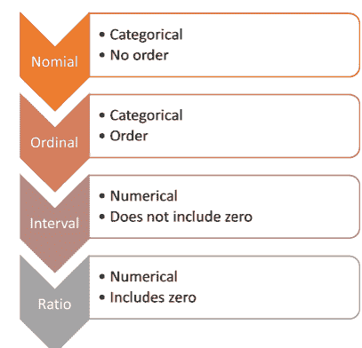

抗压强度低于 55 MPa 的圆柱体可归入普通强度混凝土类别¹⁷，而较高强度的圆柱体则必须归入高强度混凝土类别。因此，我们的目标不再是数值，而是一个类。

从这个上下文来看，我们现在可以构建基于回归或分类的 ML 模型，根据某些输入来预测我们的目标。此输入可以是数值、分类或两者的混合¹⁸。我希望强调这一点。表格格式中的目标比输入更可能是同质的。也就是说，目标将是数值（回归情况）或类别（分类情况）——参见表 3.1，了解一系列对结构构件进行测试的结果示例。

图 3.1 数据类型。

¹ 来自《Statistics for Experimenters: An Introduction to Design, Data Analysis, and Model Building》（1978 年版）第 9 章 [12]。

² 必须指出，我们将在第 6 章简要重新讨论这一概念。我将展示如何使用一组无需编码的软件轻松自动化此过程。

³ 实际上，数据是建筑、工程和施工（AEC）行业的一个巨大组成部分。平均拥有 100 个项目的公司每年增加 1 PB（拍字节）的数据。1 PB 相当于 1024 TB（太字节）。平均成年人的大脑能够存储相当于 2.5 PB 内存的数据 [18]。这里还有一个令人惊讶的统计数据：根据 Klaus Nyengaard [19]，建筑技术公司 Geniebelt 的联合创始人兼主席，“2017 年，建筑行业高达 95% 的数据要么被丢弃，要么根本没有被收集。”

⁴ 即，如果数据发生变化，基于此数据构建的模型也可能随之变化（无论是轻微地——如预期，还是严重地——这可能会变得棘手。除用作 ML 模型的输入外，数据也是必需的，正如我希望你记得的那样，用于持续提高 ML 模型随时间的性能。因此，确保我们拥有高质量数据对于监控和创建自我改进模型至关重要。这让我想到了这个简短的故事：我的一名学生指出了电影 Sherlock Holmes (2009) 中的一段场景，“在你有数据之前，绝不要理论化。你最终总会为了迎合理论而歪曲事实，而不是为了迎合事实而调整理论”——福尔摩斯对华生医生说。

¹⁴ Pa 是帕斯卡（以布莱斯·帕斯卡命名）。帕斯卡描述的是单位面积上的力（如 N/mm²）。单位面积上的力是压力或应力。

¹⁵ 相当于 ksi。

¹⁶ 来自拉丁语名称 Nomen（意为名称）。

¹⁷ 我遵循美国混凝土学会（ACI）的建议。

¹⁸ 我们将在几个小节后讨论这些内容。请参阅操作部分。


## 表 3.1 各种数据类型示例。

| 编号 | 特征 1 | 特征 2 | 回归目标 | 分类目标 |
|---|---|---|---|---|
| | 试件类型 (标称型) | 强度等级 (序数型) | 施加荷载 (数值型) | 是否失效 (类别) |
| 1 | 梁 | 高 | 450 kN.m | 是 |
| 2 | 柱 | 低 | 200 kN | 否 |
| 3 | 节点 | 中等 | 321 kN | 是 |
| ... | ... | ... | ... | ... |

#### 3.2.3 影像资料

与表格数据不同，计算机视觉的数据包括图像/影像资料。在此情况下，图像本身既用作输入也用作输出。图像被用作输入，因为我们通常对这些图像的特定内容感兴趣。例如，对损伤（比如说，路面裂缝）进行目视检查是一个冗长且耗时的过程。以下是一个示例。

密歇根州共有 120,256 英里<sup>19</sup> 的铺装道路。现在，想象一下目视检查这些道路所需的资源数量！与其请州路面工程师人工检查全州道路的裂缝，不如在密歇根州内部让一队自动驾驶汽车行驶于道路上，并给这些车辆安装摄像头。我们获取这些影像资料，并请工程师观看并识别需要修复的道路。这是一个可行的方案，至少不仅能改善他们的生活质量，还能减少进行此类检查所需的资源。

到目前为止，你可能会想，我们能否使用 ML 来自动化这个过程？答案是肯定的！

只需使用这些影像资料来训练计算机视觉模型，教会它如何识别裂缝。<sup>20</sup> 在这种情况下，影像资料被用作该模型的输入，相同的工程师可以标记（或注释）他们希望模型学习的不同概念（即，疲劳裂缝、滑移裂缝等）。训练模型，并在完全验证后，这些工程师就可以使用该模型来自主检查铺装道路的视觉影像资料。<sup>21</sup>

#### 3.2.4 时间序列数据*

顾名思义，时间序列数据是指通过随时间重复测量而获得的一组观测值或记录。在这类数据中，工程师可以选择以一致的方式记录此类数据（即，在等间隔时间上）。<sup>22</sup> 在某些情况下，由于设备故障、缺乏测量、资金限制等原因，工程师可能无法获得一致记录的数据。<sup>23</sup> 在所有情况下，按时间<sup>24</sup> 顺序编入索引的数据通常归为此类数据。

#### 3.2.5 文本数据*

文本数据包括可收集和组织的单词、句子、段落或文档。与数值数据和类别数据不同，这类数据通常是非结构化的。<sup>25</sup>

### 3.3 数据集开发

表格数据可以结构化为矩阵。该矩阵的行 (*r*) 代表收集到的样本（或测量值或实例/观测值），列 (*c*) 代表被测样本的特征或属性。因此，典型表格数据集的维度等于 (*r_ × _c_) – 参见表 3.1。若寻求监督式机器学习，则保留一列用于目标（或因变量或响应）；<sup>26</sup> 否则，该列不是必需的。

建议工程师创建一个 *健康* 和 *平衡* 的数据库。<sup>27</sup> 故意使用描述性术语“健康”旨在描述一个包含观测值均匀分布的数据库，以涵盖各种特征和条件。<sup>28</sup> 假设一名工程师正在构建数据集以研究梁在弯曲下的响应，那么该工程师在收集数据时应注意：

- 几何和材料特征各异。<sup>29</sup>
  - 以提高待开发 ML 模型的预测能力。
- 不同时代的测试。
  - 以反映材料和设计细节的变化。
- 在相似条件下测试的梁。
  - 以控制问题的维度和/或归一化测试方案的影响。
- 来自不同团队/实验室。
  - 以考虑设施和条件带来的微小变化。
- 完整的响应。
  - 因为任何缺失数据都会增加未来模型的不确定性和复杂性。
- 重复试件。
  - 以确保测量的可靠性并最小化异常值。

在处理影像资料时：

- 正确标记并识别感兴趣区域。
- 包含一组纹理、颜色、质量等，展示手头现象（即，损伤）的不同程度。

数据集编译完成后，此数据库可标记为 *主数据集*。

### 3.4 诊断与处理数据

在此阶段，必须对主数据集的完整性进行评估。例如，数据集通常包含噪声、异常值、缺失点或错误数据。因此，需要对主数据集进行处理，以尽量减少缺失或错误数据、噪声和异常值的影响。

此过程通常称为诊断与处理。<sup>30</sup> 此过程对于保证我们的数据集得到适当组织、信息丰富、一致，并从而能产生合适的 ML 模型至关重要。此过程旨在使我们（以及我们的 ML 模型）更容易识别数据分布、涉及的特征等方面的真实趋势和洞察。此外，通过清理数据集，我们确保只留下所需的高质量信息供我们分析——这减少了不必要的迭代周期。删除重复、缺失和错误的数据可使模型更好地捕捉当前现象。

在此，我们将介绍处理缺失数据和异常值的一些主要技术。

数据可能因无数原因而缺失。然而，关键在于某些数据不存在于我们的数据集中。处理缺失数据的补救措施在设计和复杂性上各不相同。最简单的形式是删除或忽略缺失数据。一种更灵活的方法是用其他数据填充缺失数据。例如，可以使用特征的平均值来替代缺失数据的一个实例。在相邻点之间进行插值可用于填补缺失的数据点。让我们来看看混凝土圆柱体的数据：

原始数据 = 33, 35, 48, 86, 88, 91 和 97，平均值为 68.28 MPa。

假设第四个点（即，86 MPa）缺失。简单地用平均值替换此数据可能会改变该组的新平均值（第四个点（新平均值 = 65.71 MPa），尽管两个点之间存在显著偏差（86 – 68.28 = 17.7 MPa）。因此，在足够大且只有少量缺失点的数据集中，这可能是一个有吸引力的解决方案。

更复杂的方法可能会尝试根据具有相似或足够接近特征的相邻观测值的已知信息来预测缺失的数据点。如果观测之间存在某种关系，此类方法效果良好。例如，可以构建 ML 模型来预测此类缺失数据！也可以构建概率模型，从父特征的分布中抽取缺失数据的替代值。

异常值是不符合特征常态/观测趋势的罕见和例外数据。异常值可能由于测量或人为错误、未记录的行为或异常情况而发生。非常大的异常值可能会偏移数据的平均值，或导致工程师错误地认为/假设存在故障行为。异常值的补救措施与缺失数据的类似。

缺失数据和异常值既可能存在于其原始数据集中，也可能在合并不同数据集时才显现出来。

### 3.5 可视化数据

既然数据集已编译完成，下一步是了解我们的数据。我将首先展示可视化数据集的简单方法。我们的目标是尝试识别与我们的数据相关的一般趋势或洞察。此类洞察可能帮助我们提出假设或指出改进数据集的任何需求。


第一个合适的步骤是通过简单的统计分析来评估此数据集。在此分析中，我们试图描述数据的属性。以下是此类属性的列表。<sup>45</sup> 这些属性在 Excel、Python 和 R 中的公式/命令显示在配套表中。

- 范围：显示数据的离散程度。
- 最小值/最大值：列出最小值和最大值。
- 均值：数值的平均值，计算方式为 \(\mu = \frac{1}{n} \sum_{i=1}^{n} x_i\)
- 方差：<sup>46</sup> 衡量数据的离散程度，计算方式为 \(\sigma^2 = \frac{1}{n} \sum_{i=1}^{n} (x_i - \mu)^2\)
- 标准差：<sup>47</sup> 衡量数据集相对于其均值的离散程度，计算方式为 \(\sigma = \sqrt{\frac{1}{n} \sum_{i=1}^{n} (x_i - \mu)^2}\)
- 中位数：通过对所有数据点排序来识别数据的中间数字。<sup>48</sup>
- 众数：最常见的数据值。
- 偏度：<sup>49</sup> 描述不对称的程度，计算方式为 \(\mu_3 = \frac{\sum_{i=1}^{n} (x_i - \mu)^3}{(n)\sigma^3}\)
- 峰度：描述数据的尾部特征<sup>50</sup>，计算方式为 \(\mu_4 = \frac{\sum_{i=1}^{n} (x_i - \mu)^4}{(n)\sigma^4}\)
- 百分位数：表示分布中等于或低于该值的百分比的数值。<sup>51</sup>

配套表（公式和命令）。

| 属性 | Excel | Python | R |
| :--- | :--- | :--- | :--- |
| 范围 | =MAX(Cells)-MIN(Cells) | – | range() |
| 最小值 | =MIN(Cells) | min() | min() |
| 最大值 | =MAX(Cells) | max() | max() |
| 均值 | =AVERAGE(Cells) | `from statistics import mean` | mean() |
| 方差 | =VAR(Cells) 或 =VARP(Cells) | `from statistics import variance` | var() |
| 标准差 | =STDEV.P(Cells) 或 =STDEV.S(Cells) | `from statistics import stdev` | sd() |
| 中位数 | =MEDIAN(Cells) | `from statistics import median` | median() |
| 众数 | =MODE(Cells) | `from statistics import mode` | – |
| 偏度 | =SKEW(Cells) | `from scipy.stats import skew` | skewness() |
| 峰度 | =KURT(Cells) | `from scipy.stats import kurtosis` | kurtosis() |

45 旁注，你可能见过某些以下公式使用 *n-1* 而非 *n* 作为除数。这回溯到关于无偏估计量的更深入讨论——那是另一天的话题。我建议你查阅 [23]。
46 告诉我们数据点与均值的差异。这也称为第二标准化矩。
47 告诉我们，*平均而言*，每个分数距离均值有多远。
48 如果有两个中间数字，中位数将是这两个数字的平均值。
49 偏度大于 1.0 或小于 -1.0 表示高度偏态。介于 0.5 和 1 或 -0.5 和 -1.0 之间的值表示中度偏态。介于 -0.5 和 0.5 之间的值表示轻度偏态或相当对称。偏度也称为第三标准化矩。
50 如果数据尾部较重或较轻。正态分布的峰度为 3（峰度大于 +1.0 的分布描述峰度，而 –1.0 表示平坦性）。换句话说，此属性衡量由于异常值导致的高斯分布中峰值的偏差。峰度也称为第四标准化矩。
51 例如，25<sup>th</sup>、50<sup>th</sup> 和 75<sup>th</sup> 百分位数（四分位数范围 (IQR)）。

| 属性 | 直径 (mm) | 管厚 (mm) | 有效长度 (mm) | 屈服强度 (MPa) | 混凝土抗压强度 (MPa) | 轴向承载力 (kN) |
| :--- | :--- | :--- | :--- | :--- | :--- | :--- |
| 最小值 | 44.45 | 0.52 | 152.35 | 178.28 | 9.17 | 45.20 |
| 最大值 | 1020.00 | 16.54 | 5560.00 | 853.00 | 193.30 | 46,000.00 |
| 均值 | 158.52 | 4.31 | 1060.07 | 336.53 | 50.21 | 2349.58 |
| 标准差 | 105.42 | 2.45 | 1005.28 | 90.89 | 31.57 | 4042.29 |
| 中位数 | 127.30 | 4.00 | 662.00 | 325.00 | 41.00 | 1244.60 |
| 偏度 | 3.71 | 1.59 | 1.98 | 2.19 | 2.07 | 5.40 |
| 峰度 | 20.46 | 3.69 | 3.84 | 8.47 | 5.17 | 38.63 |

让我使用更真实的数据集来演示上述一些属性。在此示例中，钢管混凝土组合柱的数据被收集到一个数据集中。如果我们将上述一些属性应用于此数据集，我们将得到表 3.2，这将帮助我们可视化该数据集。该表还指示了我们预期待开发的机器学习模型应用的范围。

虽然表 3.2 确实有帮助，但也许我们可以通过其他方式可视化数据集。例如，我们可以绘制数据集。有很多很多方法可以做到这一点。让我们概述几种。

### 直方图

直方图显示数值特征的频率分布。默认情况下，直方图还显示特征的范围以及等长区间（或 bins）。例如，查看图 3.2a 显示了在 Microsoft Excel 中绘制的数据集中管厚的分布。如您所见，此分布略微左偏，并且在其偏侧似乎有相当数量的观测值。另一方面，右侧的观测值数量急剧下降。这反映了存在数量有限的管子（或柱子）具有较大厚度。图 3.2b 和 3.2c 使用 Python 和 R 为其他特征绘制了不同风格的直方图。直方图是展示单个特征的绝佳工具。

### 箱线图

箱线图通过均值、中位数、四分位数范围和可能的异常值来显示数值特征主要特征的摘要。这些图可用于显示一个或多个特征。如您所见，图 3.3 显示了两个特征（管屈服强度和混凝土充填抗压强度）的箱线图。此箱线图用 x 标记均值，并用穿过框的线标记中位数。框的线代表第 25 百分位和第 75 百分位。距离框最远的水平线计算为 1.5 × 四分位数范围。可能的异常值也以点形式绘制。

### (a) 使用 Excel

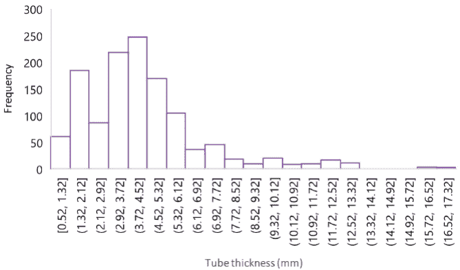

### (b) 使用 Python

```
import matplotlib as plt
import seaborn as sns
df = pd.read_excel("Chapter 3 [Examples].xlsx")
sns.set(rc = {'figure.figsize':(6,6)})
df
sns.distplot(df['Compressive strength of concrete (MPa)'], bins=15, kde=False)
```

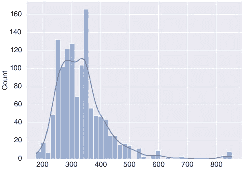

```
import matplotlib as plt
import seaborn as sns
df = pd.read_excel("Chapter 3 [Examples].xlsx")
sns.set(rc = {'figure.figsize':(6,6)})
df
sns.histplot(data = df, x = "Yield strength (MPa)", kde = True)
```

### (c) 使用 R

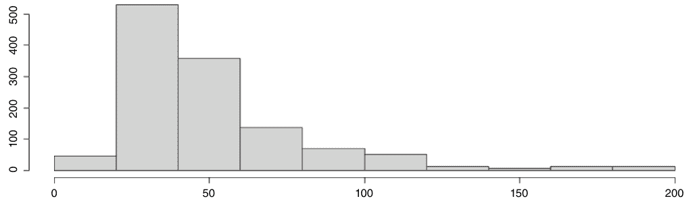

```
library(tidyverse)
library(ggplot2)
data=read.csv('C:/Chapter 3.csv')
data
str(data)
hist(data$Compressive.strength.of.concrete.MPa.,
     main = " Compressive strength of concrete Mpa",
     xlab = " Compressive strength of concrete Mpa",
     ylab = "count")
```

**图 3.2（续）** 直方图演示。

至此，我们有兴趣单独可视化特征或通过与其他特征比较来可视化特征。虽然此类见解有帮助，但我们也对特征之间以及更重要的是特征与感兴趣目标之间的关系感兴趣。这时，我们转向能够容纳多个变量的可视化工具。

### 散点图

此图描绘了两个变量之间的关系——通常是一个特征和目标。目标绘制在垂直轴上，特征绘制在水平轴上。图 3.4 显示了管直径和轴向承载力的此类图表。<sup>62</sup> 如您所见，这两个变量之间似乎存在某种关系，即直径较大的柱子往往具有较大的轴向承载力。如果我们将注意力集中在图 3.4a 左下角，我们可以清楚地注意到存在一个密集的数据组（与同一图表右上角相比）。这实际上意味着数据集包含许多相对较小直径柱子的示例。

图 3.4a 底部还显示了一个类似的散点图，但针对的是管厚的情况。此图与管直径图有一些相似之处。例如，管直径和轴向承载力之间似乎存在某种较弱的上升关系。此外，如果我们查看管厚在 8 至 14 mm 之间变化的柱子的数据点，我们会注意到此类柱子的轴向承载力发生剧烈变化。这是存在可能异常值的迹象。<sup>63</sup>

图 3.4 显示数据杂乱，难以可视化单个点。因此，正确的格式化很重要，以确保我们从该图中获得最大收益。例如，用浅色填充标记可以显著提高此图的质量。<sup>64</sup> 从 Python 和 R 中看到的不同散点图也可以得出类似观察。

62 这很有道理，因为较大的柱子可能具有较大的厚度，因此需要更大的载荷才能失效。此外，较大的柱子可以容纳更多的混凝土。
63 这是一种目视检查。为确保此类可能异常值确实是异常值，应进行适当的分析。您将在接下来的几章中看到，我们确实有可以帮助我们的方法和算法！
64 旁注：力求将图表设计得尽可能简单且富有信息性。过度格式化图表会分散注意力。请记住您的受众！


### (a) 使用 Excel

屈服强度 (MPa) 混凝土抗压强度 (MPa)

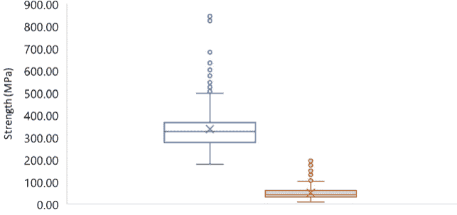

### (b) 使用 Python

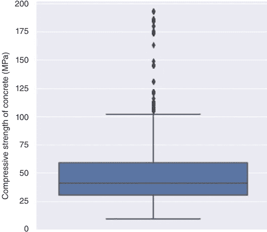

```
import matplotlib as plt
import seaborn as sns
df = pd.read_excel("Chapter 3 [Examples].xlsx")
sns.set(rc = {'figure.figsize':(6,6)})
df
sns.boxplot( y=df['Compressive strength of concrete (MPa)'] ) ;
```

图 3.3 箱线图演示。

如上所述，散点图可以容纳多个特征 65（参见图 3.5）。观察图 3.5 可知，向散点图添加多个特征作为可视化工具可能效率低下。稍微格式化一下图表可以改善这一问题。另一种方法是减少涉及的特征数量。66 更实际的方法是使用不同的可视化工具。

为完整起见，还有其他可使用和应用的可视化工具，例如小提琴图、点图、漏斗图、时间序列图等。您将在本书的示例中反复看到这些工具。目前，我希望您记住，使用此类工具的目标是尝试深入了解您的数据集。

65 视特征而定——这些图表可能适用于两个特征。对于可视化高维数据集，可以使用主成分分析（PCA）算法（将在后续章节中讨论）。
66 例如，我们可以用抗压强度除以屈服强度。也可以对管厚和管径做同样的处理。第一个比率可被视为材料强度的度量，第二个比率可被视为管子截面特性的度量。

### (a) 使用 Excel

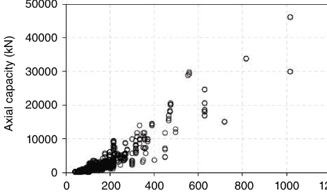

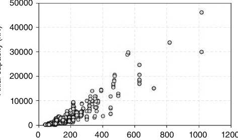

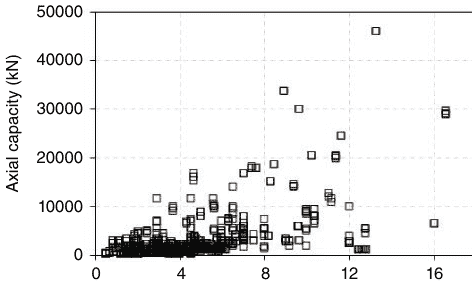

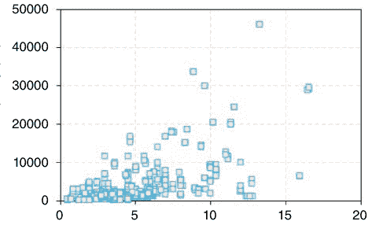

### (b) 使用 Python

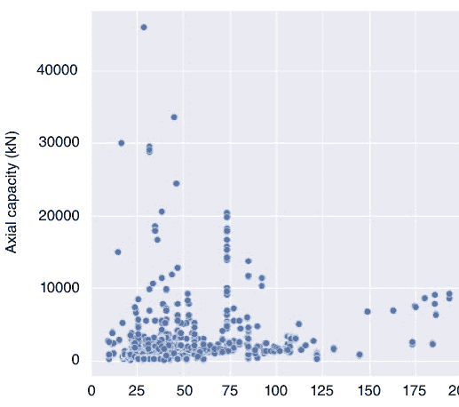

```
import matplotlib as plt
import seaborn as sns
df = pd.read_excel("Chapter 3 [Examples].xlsx")
sns.set(rc = {'figure.figsize': (6, 6)})
df
sns.scatterplot(x='Compressive strength of concrete (MPa)', y='Axial capacity (kN)', data=df)
```

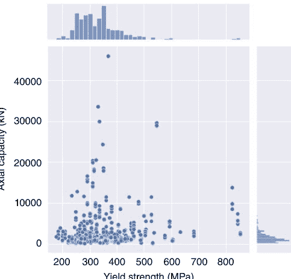

```
import matplotlib as plt
import seaborn as sns
df = pd.read_excel("Chapter 3 [Examples].xlsx")
sns.set(rc = {'figure.figsize': (6, 6)})
df
sns.jointplot('Yield strength (MPa)', 'Axial capacity (kN)', data=df);
```

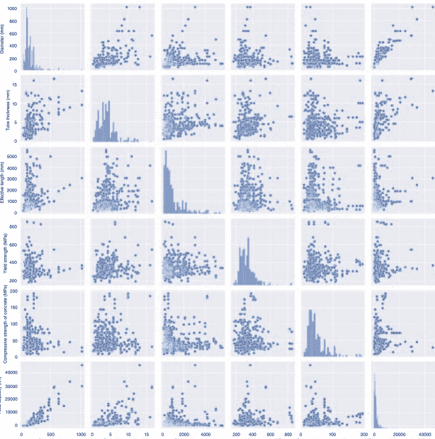

```
import matplotlib as plt
import seaborn as sns
df = pd.read_excel("Chapter 3 [Examples].xlsx")
sns.set(rc = {'figure.figsize': (6, 6)})
df
sns.pairplot (df)
```

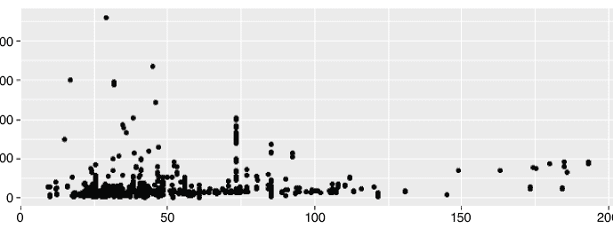

```r
library(tidyverse)
library(ggplot2)
data=read.csv('C:/Chapter 3.csv ')
data
str(data)
#scatter plot
p <- ggplot(data, aes(x=Compressive.strength.of.concrete..MPa., y=Axial.capacity..kN.)) +
geom_point() +
theme(legend.position="none")
```

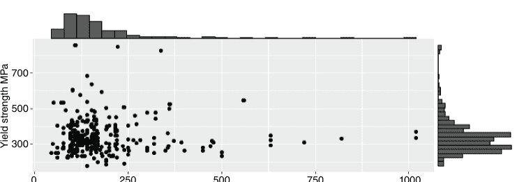

```r
library(tidyverse)
library(ggplot2)
data=read.csv('C:/Chapter 3.csv ')
data
str(data)
p2<-lines(density(data$Diameter..mm.))
p <- ggplot(data, aes(x=Diameter..mm., y=Yield.strength..Mpa.)) +
geom_point() +
theme(legend.position="none")
#marginal histplot
p3 <- ggMarginal(p, type="histogram")
```

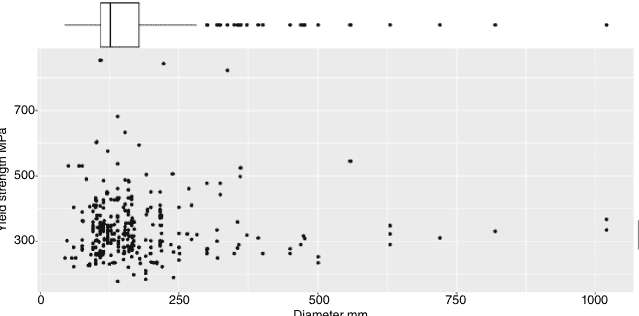

```r
library(tidyverse)
library(ggplot2)
data=read.csv('C:/Chapter 3.csv ')
data
str(data)
p2<-lines(density(data$Diameter..mm.))
p <- ggplot(data, aes(x=Diameter..mm., y=Yield.strength..MPa.)) +
geom_point() +
theme(legend.position="none")
#marginal histoplot
p5 <- ggMarginal(p, type="boxplot")
```

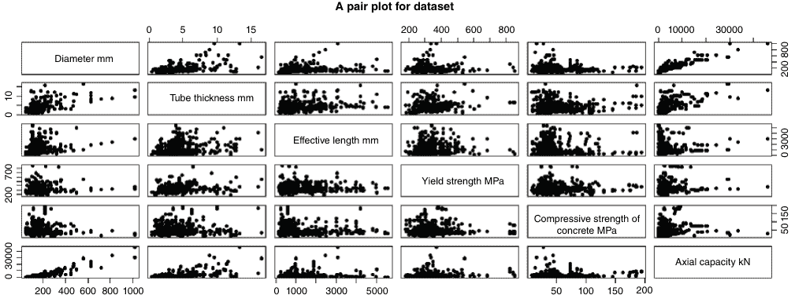

```r
library(tidyverse)
library(ggplot2)
data=read.csv('C:/Chapter 3.csv ')
data
str(data)
pairs(data[,1:6],
col = "black",
pch = 16,
main = "A pair plot for dataset")
```

图 3.4（续）散点图演示（左：未格式化，右：已格式化，上：未格式化，下：已格式化）。

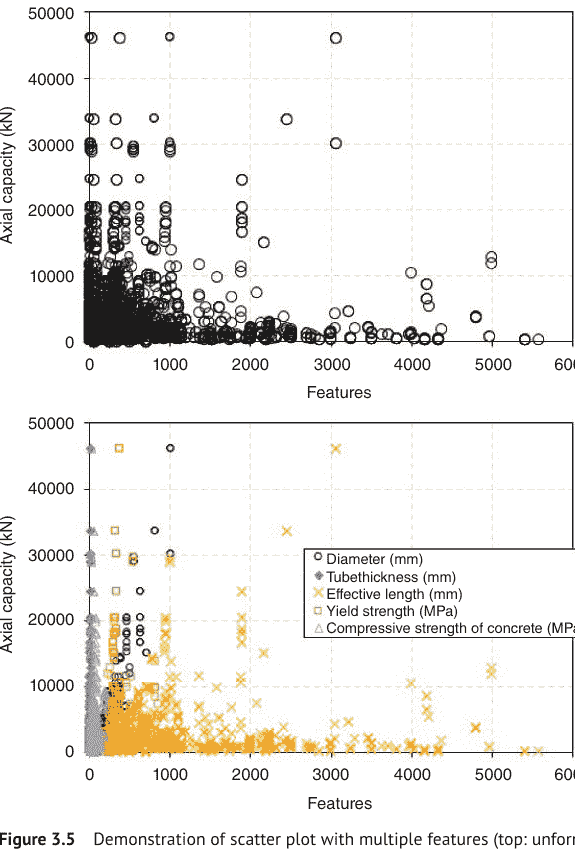

让我们现在探索一些适用于分类数据的可视化工具。

柱状图：与直方图类似，但用于显示分类特征的计数。这些图表也可以格式化以显示特征的比率（按其类别划分）。例如，图 3.6 显示了在屈曲和压溃中失效的柱子数量。该图还比较了柱子的类型（非常长 vs. 长 vs. 短⁶⁷）。如您所见，在压溃中失效的长柱子的百分比相对较小（约为短柱子的 20%）。

其他类型的可视化包括箱线图、⁶⁸ 列联表和马赛克图。列联表（显示分类变量组合的频数）和马赛克图（显示多个分类特征的整体与部分关系）的示例见图 3.7。

为完整起见，允许我展示软件 Exploratory。这是一种基于 R 的软件，可用于创建机器学习模型，并且我们将在接下来的几章中使用它。Exploratory 具有完整的数据可视化功能。我将展示一些数值数据和分类数据的示例。⁶⁹

### (a) 使用 Excel（上：传统，下：堆叠）。

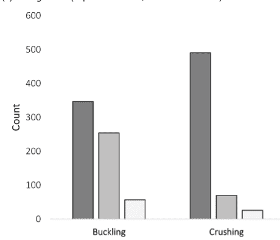

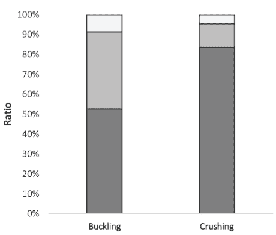

### (b) 使用 Python

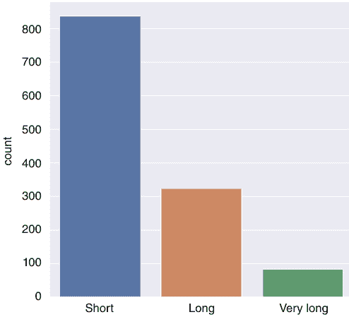

```
import matplotlib as plt
import seaborn as sns
df = pd.read_excel("Chapter 3 [Examples].xlsx")
sns.set(rc = {'figure.figsize': (6, 6)})
df
sns.countplot(df['Column type', ])
```

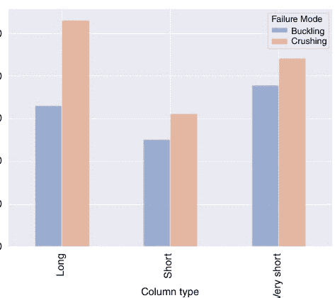

```
import matplotlib as plt
import seaborn as sns
df = pd.read_excel("Chapter 3 [Examples].xlsx")
sns.set(rc = {'figure.figsize':(6,6)})
df

Grouped_bar_chart = pd.pivot_table(df,
values="Diameter (mm)",index="Column type",columns="Failure Mode",
aggfunc=np.mean)
#Creating a grouped bar chart
ax = Grouped_bar_chart.plot(kind="bar",
alpha=0.5)
```

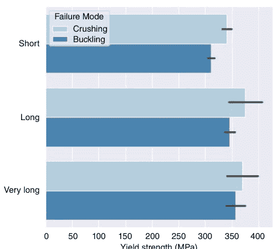

```
import matplotlib as plt
import seaborn as sns
df = pd.read_excel("Chapter 3 [Examples].xlsx")

sns.set(rc = {'figure.figsize':(6,6)})
df

sns.barplot(x = 'Yield strength (MPa)', y = 'Column type', hue = 'Failure Mode', data = df, palette = "Blues")
sns.set(rc = {'figure.figsize':(14,6)})
```

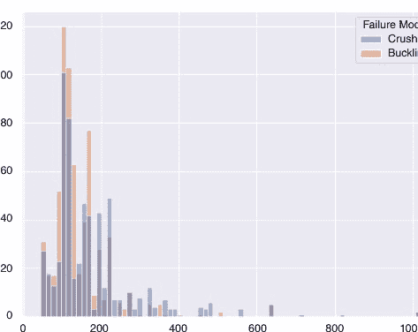

```
import matplotlib as plt
import seaborn as sns
df = pd.read_excel("Chapter 3 [Examples].xlsx")

sns.set(rc = {'figure.figsize':(6,6)})
df

sns.histplot(data = df, x = "Diameter (mm)", kde = False, hue = "Failure Mode")
```

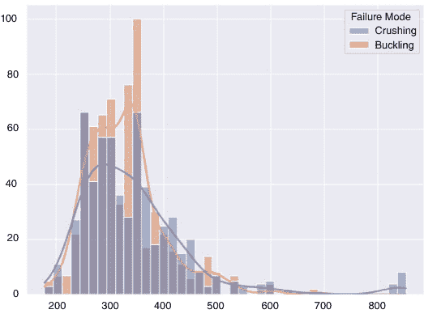

```
import matplotlib as plt
import seaborn as sns
df = pd.read_excel("Chapter 3 [Examples].xlsx")
sns.set(rc = {'figure.figsize':(6,6)})
df
sns.histplot(data = df, x = "Yield strength (MPa)", kde = True, hue = "Failure Mode")
```

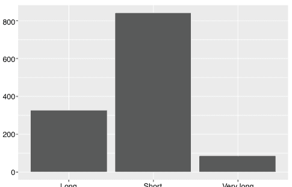

```r
library(tidyverse)
library(ggplot2)
data=read.csv('C:// Chapter 3 [Examples].xlsx')
data
str(data)
ggplot(data = data, aes(x=Column.type)) +
geom_bar()
```

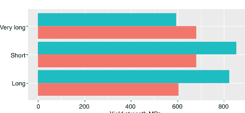

```r
library(tidyverse)
library(ggplot2)
data=read.csv('Chapter 3 [Examples].xlsx')
data
str(data)
# Barplot
ggplot (data, aes (y=Column.type, x=Yield strength..MPa.,
fill=Failure.Mode)) +
geom_bar(stat = "identity",position = "dodge")
```

图 3.6（续）柱状图演示。

| 模式 | 超长柱子 | 长柱子 | 短柱子 |
|---|---|---|---|
| 屈曲 | 347 | 254 | 57 |
| 压溃 | 491 | 70 | 26 |

超长柱子   长柱子   短柱子
超长柱子   长柱子   短柱子

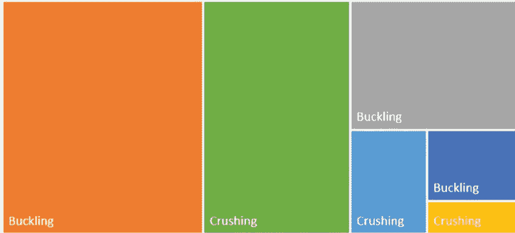

图 3.7 列联表（上）和马赛克（树）图（下）演示。

步骤 1：上传数据集。进入数据帧，然后选择文件数据。

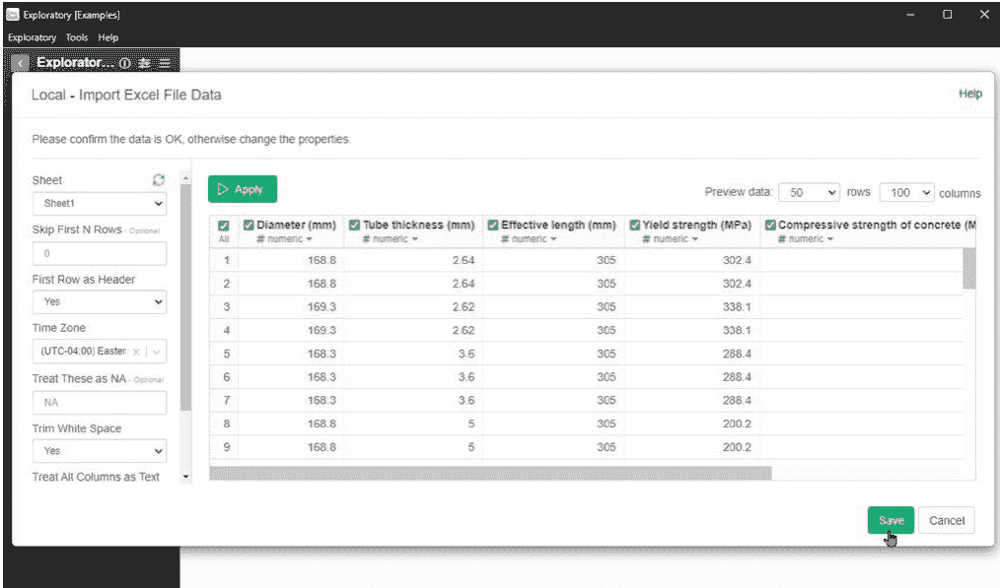


步骤 2：访问摘要以查看每个变量选项卡的统计见解，然后导航到图表选项卡。

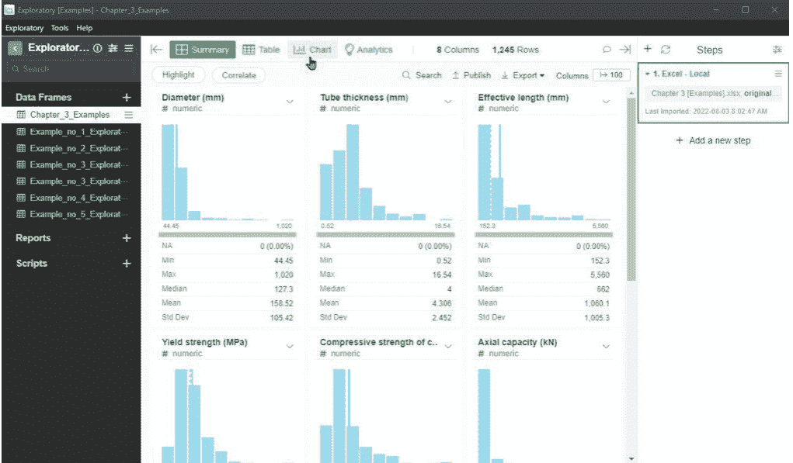

步骤 3：选择直方图并绘制一个特征。


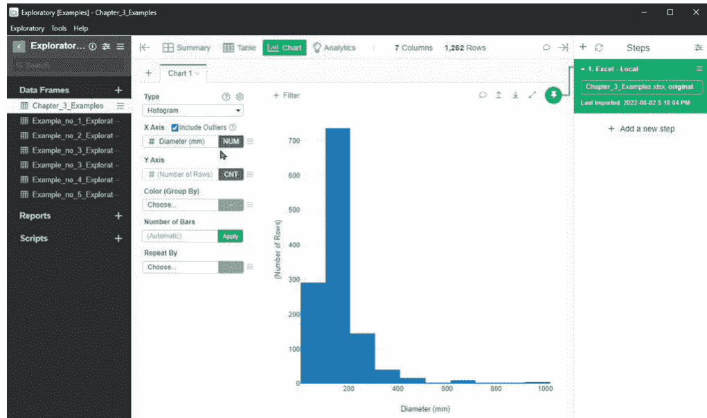

步骤 4：您可以选择使用失效模式为直方图着色。

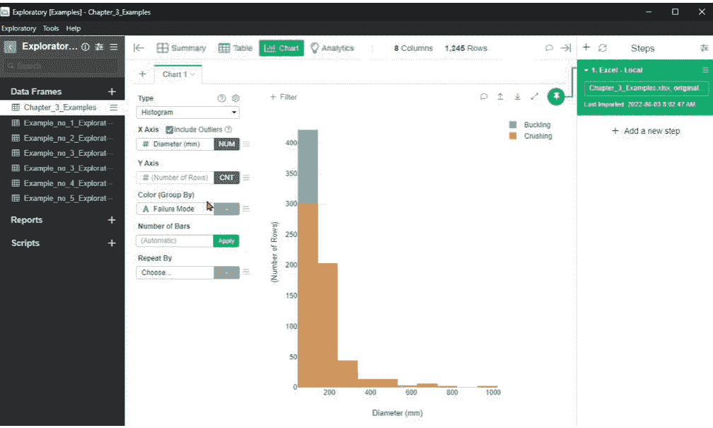

步骤 5：将图表类型更改为散点图。选择一个特征绘制到水平轴，并将轴向容量绘制到垂直轴。

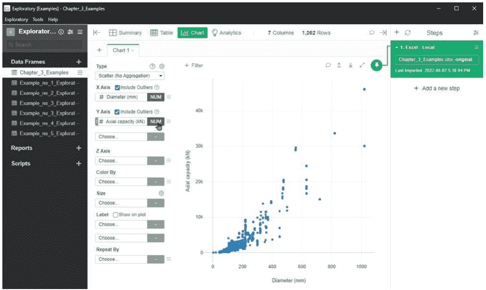

步骤 6：按照下图所示设置您的图表。注意尺寸效应。

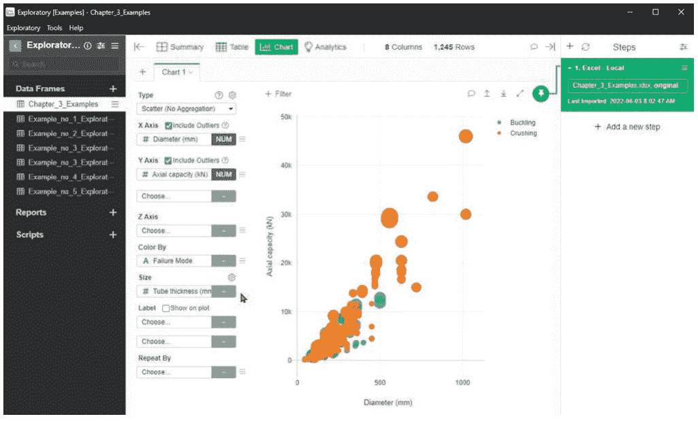

步骤 7：您可以为多种情况重复绘图。

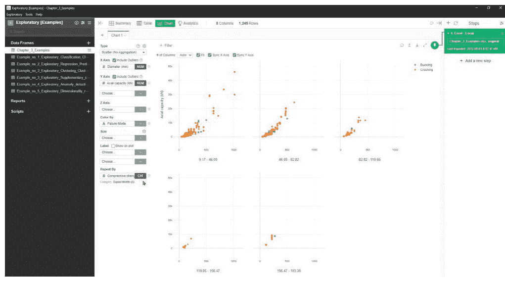

步骤 8：请尝试其他图表。下方提供了多种图表。

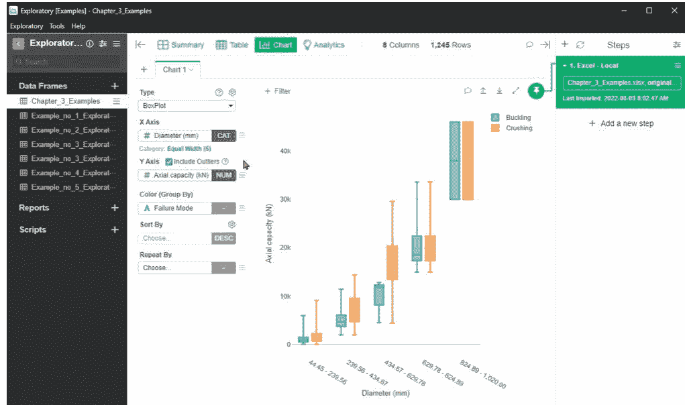

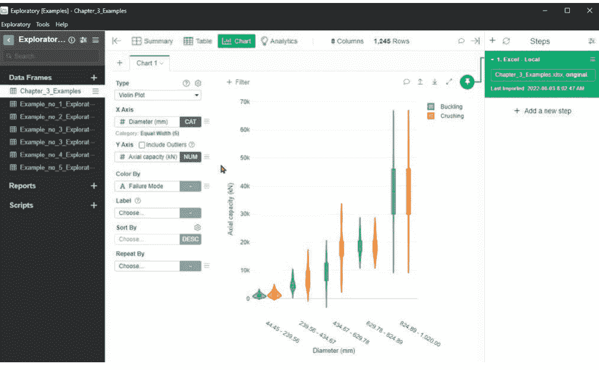


请注意，您可以更新方向和条形图类型。


请注意，您可以选择饼图或环形图样式。

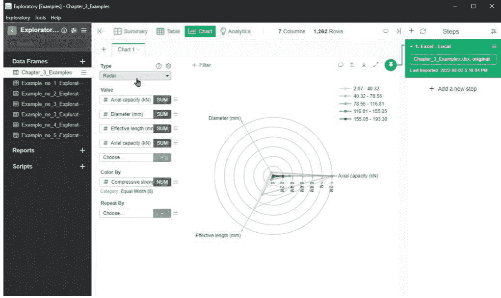

### 3.6 探索数据70

一旦数据可视化，我们就转换思路来进一步探索这些数据。我们的目标是超越上述简单的可视化工具，转向量化特征之间以及特征与目标之间的关系71。我们可以使用一些技术来探索关系。

#### 3.6.1 基于相关性和基于信息的方法

让我们从皮尔逊相关系数（$r_{xy}$）开始72。该系数衡量两个数值变量（例如 x 和 y）之间的*线性*73关系。这种线性关系通过强度和方向来描述，如下所示：

```
$r_{xy} = \frac{\sum_{i=1}^n (X_i - \mu_X)(Y_i - \mu_Y)}{\sigma_X \sigma_Y}$ (3.1)
```

该系数的范围从 −1.0 到 +1.0。皮尔逊相关系数的绝对值越大，两个变量之间的线性关系就越强。值为零表示没有线性关系。该系数的正值和负值分别表示具有正斜率和负斜率的线性关系。74 例如，皮尔逊相关系数为 +0.9 意味着强度为 0.9 的正相关。

可以对任何两个变量以及多个变量计算此相关性。在后一种情况下，结果可以拟合为矩阵。您可以使用 Excel 轻松计算皮尔逊相关系数，如图 3.8 所示。

步骤 1：选择数据。导航到 *数据* 选项卡，然后选择 *数据分析*75 和 *相关性*。

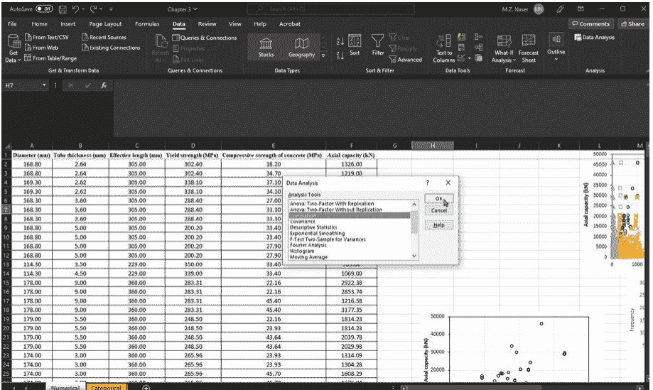

70 在某些资料中，此步骤可以与数据可视化合并。我选择将其作为单独章节呈现，因为我认为对数据进行*可视化*是一项*定性*练习，而对数据进行*探索*是一项*定量*练习。
71 例如，如果散点图表明特征与目标之间存在线性关系，这里我们试图估计这种关系的线性程度。
72 或者简单地称为 R（不要与编程语言 R 混淆）。
73 虽然这看似不言自明，但恐怕容易被忽略。该系数假设关系是线性的，并量化此类关系。这并不意味着关系确实是线性的，也不意味着根本不存在线性关系。此外，这也不意味着其中一个变量导致另一个变量（这可能是真的，也可能不是）。实际上，大部分关系可能都包含某种形式的非线性。解释此类系数时要小心。*附加说明*：我们将在第 5 章中重新讨论此系数及其作为性能指标的有用性。
74 高达 0.19 可视为非常弱相关。0.2–0.39 为弱相关。0.4–0.59 为中度相关。0.6–0.79 为强相关，0.8–1.0 为非常强相关。
75 如果无法访问此工具，则可以从 Excel *选项* 的 *管理* 功能下的 *Excel 加载项* 中的 *分析工具库* 添加它。

步骤 2：选择输入范围。选中“第一行包含标签”复选框。选择一个单元格以输出相关矩阵。


图 3.8 使用 Excel 进行相关性分析。

此分析的结果列于表 3.3 中。如您所见，此表（矩阵）的对角线为单位，因为每个变量与其自身的相关性为 1.0。该矩阵沿其对角线也是对称的，因此通常只显示矩阵的一半。让我们来解读此矩阵。

我想关注最后一行。此行列出了所有特征与目标之间的皮尔逊相关系数。更具体地说，此行列出了所有特征与目标之间假设的线性关系强度。如您所见，直径与轴向容量之间存在非常强相关性（> +0.90）。其次是管壁厚度与轴向容量之间的中度相关性。其余特征与轴向容量之间的相关性较弱。

表 3.3 皮尔逊相关性分析结果。

| Variable | Diameter (mm) | Tube thickness (mm) | Effective length (mm) | Yield strength (MPa) | Compressive strength of concrete (MPa) | Axial capacity (kN) |
| :--- | :--- | :--- | :--- | :--- | :--- | :--- |
| 直径 (mm) | 1.00 | | | | | |
| 管壁厚度 (mm) | 0.48 | 1.00 | | | | |
| 有效长度 (mm) | 0.20 | 0.22 | 1.00 | | | |
| 屈服强度 (MPa) | 0.07 | 0.24 | 0.08 | 1.00 | | |
| 混凝土抗压强度 (MPa) | 0.00 | -0.02 | -0.15 | 0.03 | 1.00 | |
| 轴向容量 (kN) | 0.91 | 0.55 | 0.11 | 0.15 | 0.13 | 1.00 |

76 这些信息很有帮助，因为它告诉我们线性相关性较弱。然而，领域知识和力学表明，这些特征与轴强度之间存在某种形式的强关系。如果这是一个纯粹基于数据的问题，其中这些特征代表数据（没有任何物理本质），那么我们可能能够证明丢弃低相关性特征是合理的。

一旦您检查了最后一行，现在是探索特征之间相关性的好时机。如您所见，特征之间的线性相关性在弱到中度之间变化。管壁厚度与有效长度以及混凝土抗压强度之间似乎存在负相关性。在所有情况下，请记住，相关性（无论强度或大小如何）可能不意味着因果关系。

您可以使用 Exploratory77 来计算和绘制皮尔逊相关系数。具体操作如下：

步骤 1：导航到 *分析* 选项卡，然后选择 *相关性*。


步骤 2：选择特征和目标。运行分析。


步骤 3：可视化结果。


表 3.4 斯皮尔曼相关性分析结果。

| Variable | Diameter (mm) | Tube thickness (mm) | Effective length (mm) | Yield strength (MPa) | Compressive strength of concrete (MPa) | Axial capacity (kN) |
|---|---|---|---|---|---|---|
| 直径 (mm) | 1.00 | | | | | |
| 管壁厚度 (mm) | 0.53 | 1.00 | | | | |
| 有效长度 (mm) | -0.07 | 0.01 | 1.00 | | | |
| 屈服强度 (MPa) | -0.40 | -0.04 | -0.20 | 1.00 | | |
| 混凝土抗压强度 (MPa) | -0.35 | -0.55 | -0.63 | -0.25 | 1.00 | |
| 轴向容量 (kN) | 0.57 | 0.57 | 0.24 | -0.34 | -0.24 | 1.00 |

皮尔逊相关系数是一种简洁而简单的技术；然而，它仅限于描述线性关系。为了克服这一限制，我们可以使用其他度量，例如斯皮尔曼等级相关系数，它描述变量之间的_单调_<sup>78</sup>关系。

与皮尔逊相关系数类似，斯皮尔曼系数（\(\rho_{xy}\)）的范围也为 –1.0 到 +1.0。正系数表示当一个变量增加时，另一个变量倾向于增加（负系数则相反）。不幸的是，使用 _Excel_ 计算斯皮尔曼系数的过程很冗长，因此我在表 3.4 中提供了结果。计算该系数的公式为：

```
\(\rho_{xy} = 1 - 6 \frac{\sum_{i=1}^n (\text{rank}(x_i) - \text{rank}(y_i))^2}{n(n^2 - 1)}\) (3.2)
```

其中 rank：将数据按升序排序/排名。<sup>79</sup>

查看表 3.4 可知，计算出的系数与表 3.3 中的不同。然而，很明显，直径和管壁厚度仍然是最大的两个变量。

##### 3.6.1.1 关于皮尔逊和斯皮尔曼相关系数的说明

值得注意的是，皮尔逊相关性假设特征服从正态分布并满足同方差性（即，围绕回归线均匀分布）。另一方面，斯皮尔曼相关性不对数据的分布做任何假设 [1]。您可以使用 _Python_ 或 _R_ 进行相关性分析，分别使用以下包（`x.corr(y, method='spearman')` 和 `x.corr(y, method='spearman')`）以及（`cor(x, y, "pearson")`，`cor(x, y, "spearman")`）。

我们可以用来探索数据集内部关系的第三种技术，即与相关性无关的技术，称为*互信息*（MI）<sup>80</sup>。互信息测量任意类型两个变量之间的非线性关系，并告诉我们一个变量揭示了关于另一个变量的多少信息<sup>81</sup> <sup>82</sup>。该度量范围从 0 到 \(\infty\)，不取决于变量间真实关系的函数形式。两个变量之间的互信息可以计算为：

78 意味着当一个变量增加时，另一个变量要么增加要么减少（不会两者兼有）。例如，以快乐或悲伤微笑模式绘制的数据不是单调的（也不是线性的）。以45度直线模式绘制的数据是单调的（具有强线性相关性）。
79 附加说明：皮尔逊系数和斯皮尔曼系数之间的另一个区别在于，前者使用原始数据，而后者使用排名数据。其他相关形式包括查特吉相关系数等。
80 在 _Python_ 中，从 `sklearn.feature_selection import mutual_info_regression`（从 `sklearn.feature_selection import mutual_info_classif` 作为 `MIC`）。在 _R_ 中，(`mutinformation(X, Y, method="emp"`) 其他“方法”可以在 [29] 中找到。
81 您可以将互信息视为在知道另一个变量的情况下，对某个变量不确定性的降低。例如，木质结构与腐蚀之间存在高互信息；因为木材不以腐蚀著称！
82 两个离散变量之间的互信息是通过它们的联合概率计算的，该概率根据观察到的样本在每个变量类别组合中的频率来估算 [30]。


| 变量 | 直径 (mm) | 管壁厚度 (mm) | 有效长度 (mm) | 屈服强度 (MPa) | 混凝土抗压强度 (MPa) | 轴力承载力 (kN) |
|---|---|---|---|---|---|---|
| 直径 (mm) | 0.84 | | | | | |
| 管壁厚度 (mm) | 0.36 | 0.43 | | | | |
| 有效长度 (mm) | 0.32 | 0.22 | 0.03 | | | |
| 屈服强度 (MPa) | 0.36 | 0.36 | 0.24 | 0.10 | | |
| 混凝土抗压强度 (MPa) | 0.84 | 0.20 | 0.20 | 0.26 | 0.01 | |
| 轴力承载力 (kN) | 0.35 | 0.24 | 0.22 | 0.23 | 0.17 | 1.00 |

MI(X, Y) = E\left\{ \ln \frac{p(x, y)}{p(x) p(y)} \right\} = \sum_{x, y} \text{p}(x, y)[\ln p(x, y) - \ln p(x) p(y)] (3.3)

互信息创建了变量联合概率的加权和。表 3.5 列出了我们示例中的得分。83 与其他基于相关系数的系数不同，该矩阵的对角线可能返回非单位值，因为变量与自身的互信息等于该变量内的熵 84。

表 3.5 中列出的得分与表 3.3 和 3.4 中的得分截然不同。这证明了所涉及变量之间关系的预期非线性。毫不奇怪，最后一行表明，了解特征信息可能无法揭示关于 CFSTs 轴力承载力的多少信息。

#### 3.6.2 特征选择与提取方法

探索数据的另一个关键目标是识别高价值/高保真的特征。85 此目标希望将纳入机器学习分析的特征数量最小化，同时不影响手头问题的本质或机器学习模型的预测性能。

特征选择建立在奥卡姆剃刀的简约法则之上，该法则通常表述为“实体不应超出必要而被倍增。”该法则力求简单，并确立最佳解释是那些涉及最少可能假设的解释 [2]。因此，机器学习模型可避免过拟合，提供更快且更具成本效益的模型，允许调试，并能更深入地洞察生成观测结果的底层过程——所有这些都表明性能有所提升。

实际上，在数据集的空间中，某些特征可以分类为相关特征（即强相关、弱相关或不相关），并且/或者可根据其冗余度分类为冗余/不冗余。总体而言，工程师可以选择采用特征选择和特征提取技术。特征 86 可通过三种方法选择：过滤法、包装法或嵌入法 [3]。下面我们将逐一介绍这些方法。

83 请注意，在接下来的几个章节中，我们将寻求使用无代码和基于代码的方法来计算上述所有技术。目前，我们的目标是了解如何最好地利用这些技术的结果来探索我们的数据集。

84 熵：对变量不可预测性的描述。

85 请允许我在此停顿片刻。下一小节将介绍特征选择技术。在纯机器学习流程中，通常在完成称为特征工程的过程后才会选择特征。在此过程中，对特征进行操纵，使机器学习模型产生高预测性。我认为，特征工程最适合放在下一节（标题为“数据操纵”）中，理由有三：1) 特征工程是一个我们在其中改变特征的操纵过程；2) 在对输入特征进行工程处理之前，我们应首先选择核心特征；3) 当特征经过大量操纵/工程处理时，它们可能会失去其中的一些物理意义，因为我们正在将待开发的机器学习转变为一个对实际物理意义洞察甚少的预测黑盒。在所有情况下，您可以选择检查所有收集到的特征，对其中一些进行工程处理，然后选择最终特征，或者您可以直接先选择特征。我的建议是尝试两种流程，看看哪一种最适合您的问题和数据。通往机器学习的流程是灵活的。

86 有关特征选择方法的历史和背景的更多信息，请参见 [5, 9, 31–33]。

### 表 3.6 常见的过滤方法。

| 目标 | 特征 | |
| :--- | :--- | :--- |
| | 连续型 | 类别型 |
| 连续型 | - 皮尔逊相关系数<br>- 斯皮尔曼秩相关系数<br>- 互信息<br>- F 检验<br>- 邻域成分分析<br>- 逐次特征选择 | - 互信息<br>- 方差分析相关系数<br>- 肯德尔秩相关系数<br>- 线性判别分析<br>- F 检验<br>- 逐次特征选择 |
| 类别型 | - 互信息<br>- 单因素方差分析<br>- 肯德尔秩相关系数<br>- 最小冗余最大相关性<br>- 邻域成分分析 | - 列联表<br>- 卡方检验<br>- 互信息<br>- 最小冗余最大相关性<br>- 邻域成分分析 |

##### 3.6.2.1 过滤法

过滤法根据特征与目标之间的关系选择特征，方法包括统计分析、特征重要性方法和先行领域知识。87 这些方法在机器学习分析之前运行，因此减少（或过滤）了分析中使用的特征数量。在大多数情况下，会为所有特征计算相关性 88 分数，并删除得分较低的特征。

表 3.6 列出了多种过滤技术。这些技术通常遵循输入和目标的类型（即数值型或类别型）。对于回归问题，可以应用基于相关性的方法，如皮尔逊相关系数、斯皮尔曼秩相关系数等。另一方面，对于分类问题，可以使用以下技术：肯德尔秩相关系数和卡方检验。某些方法，如互信息，可用于回归或分类问题。

过滤法的优点包括 1) 计算简单高效，2) 与机器学习分析和算法无关，3) 在机器学习分析开始前仅执行一次，4) 能有效捕捉全局趋势。另一方面，这些方法与用户偏好 89 相关联，并倾向于忽略特征依赖性及其与目标的交互作用。90

##### 3.6.2.2 包装法

与过滤法相反，包装法在特定机器学习算法中将每种可想象的特征组合与评估标准进行比较，以寻找使模型表现良好的特征 [4]。为找到能最大化机器学习性能的特征组合，包装搜索算法会添加或删除特征。91 尽管包装法表现出色并考虑了特征依赖性，但其广阔的搜索空间可能成本高昂。

包装法的三种主要技术是：前向选择、后向选择和逐步选择。在第一种技术中，分析从空特征集开始，如果模型性能持续提高，则通过迭代添加相关特征来扩展。相反，后向选择从所有特征开始，然后

87 这正是您的工程知识/实践和规范要求变得至关重要的地方！

88 例如，工程师可能会认为互信息小于 0.1 的相关性较低。因此，具有此类值（及更低）的特征将从特征池中删除。工程师还可以选择在两个高度相关的特征中选择一个（而不是将两个特征都纳入其模型中）。

89 工程师必须在过滤过程中选择置信水平或相关性度量。由于此类度量未标准化，因此机器学习分析可能会受到用户偏见的影响。

90 为了完整性，上述问题的解决方案已存在（参见 [5, 9]）。

91 此外，包装法可能针对较小的数据子集而非完整数据集运行。


图 3.9 RFE 算法演示。

删除表现最差的特征。当移除新特征后不再观察到性能改进时，此选择程序结束 [5]。92 如果在逐步选择过程中确定某特征的相关性极小，则新添加的特征将被消除，方式与后向选择相似。

包装技术可使用贪心或非贪心算法来选择特征。在前者中，特征搜索路径始终沿着在迭代时看似有利于实现解决方案的方向进行。如果看起来可能有好处，非贪心技术愿意深入不良路径进行空间搜索 [6]。

回归和分类问题可以使用流行的包装技术求解，如模拟退火 (SA) [7] 和递归特征消除 (RFE) [8]。图 3.9 演示了 RFE 算法，其中 F1 是第一个添加的特征，对应 MetricF1，F2 是第二个添加的特征，对应 MetricF2，以此类推。在分析过程中，随机选择 F1 并计算其对应的 MetricF1。然后，将 F2 添加到模型中，从而计算新的度量（MetricF2）。此过程持续进行，直到添加一个特征（F5），其对应的 MetricF5 大于前一个度量 MetricF4。此时，仅选择导致误差下降的特征。

##### 3.6.2.3 嵌入式（内在）方法

嵌入式方法在机器学习模型训练过程中选择特征，因此通过实现正则化器（L1、L2 等）、约束或目标函数，它们具有内置能力来识别高价值特征。这些方法考虑特征交互，并且由于嵌入于模型开发过程中，可能需要较少的计算资源。然而，嵌入式方法特定于所使用的算法，可能导致算法偏差。常用的嵌入式方法包括基于树的模型和正则化回归（包含惩罚项：用于减少过拟合或针对不贡献于目标变量的特征等）[9]。

#### 3.6.3 降维

当存在大量特征时，可以压缩其空间并消除冗余特征或影响微乎其微的特征 93 [10]。这可以通过采用特征提取技术来完成，这些技术依赖于应用特征缩减（或降维），如线性判别分析 (LDA) 或主成分分析 (PCA) 94 [11]。

### 3.7 数据操纵

在此阶段，我们审视已修剪 95 的数据集，并尝试进一步 96 对其进行调整（如果需要/适用）。调整我们的数据集，具体来说，即对该集中的特征进行调整，这就是所谓的特征工程。特征工程是通过操纵特征来实现新特征的过程，这些新特征在数值上（可能在物理上并不有意义）比原始特征更有效地预测手头现象。我们可能还需要此类数据操纵作为应用某些机器学习算法的前置条件。我们有两种主要的数据操纵方法，具体取决于是回归分析还是分类分析。


| 归一化 | 标准化 |
| :--- | :--- |
| 适用于特征不服从高斯/正态分布的情况。 | 适用于特征服从高斯/正态分布的情况。 |
| 对异常值敏感。 | 对异常值不太敏感。 |
| 被限制在 [0, +1] 或 [-1, +1] 之间 | 不受限制。 |
| Python 包：<br> scaler = MinMaxScaler() | Python 包：<br> scaler = StandardScaler() |
| R 包：normalr | R 包：standardize |

#### 3.7.1 操作数值数据

数值数据伴随着不同的单位和量级。例如，表 3.2 中列出的 CFST 柱长度以毫米为单位。该长度本可以用米来表示。97 如果是这样，该特征的值与直径相比会很小。98 相比之下，机器学习模型可能会推断该特征对目标值几乎没有影响，甚至没有影响。99 因此，在操作数据时，建议考虑单位和现象的物理特性。

再次查看表 3.2 可知，特征具有两种不同的单位，mm 和 MPa。这些单位分别代表长度和应力。这些单位互不兼容。10 mm 的值无法与 10 MPa 进行比较。因此，一种解决方法是对数据进行缩放（或归一化）。100 归一化将特征转换到 0 到 +1.0 或 -1.0 到 +1.0 的相似尺度上。归一化数据的一种简单方法是使用以下公式：

```
Feature$_x$ = \(\frac{x - x_{min}}{x_{max} - x_{min}}\) (3.4)
```

其中 x$_{min}$ 和 x$_{max}$ 分别是该特征的最小值和最大值。101 另一种解决方法是将数据标准化102，使数据围绕零均值居中，并具有一个单位标准偏差。

```
Feature$_x$ = \(\frac{x - \text{Mean}}{\text{Standard deviation}}\) (3.5)
```

表 3.7 列出了归一化与标准化的对比，以作补充。

我们还可以将特征组合在一起。例如，我们可以通过数学运算（乘法、除法等）将两个特征合并为一个。这个新特征取代原始特征。这样做，我们希望新特征能向机器学习模型提供额外103的信息。这个新特征可能代表也可能不代表真实或物理量。104

#### 3.7.2 操作分类数据

有多种方法可以操作数据以符合分类分析。例如，分类特征可以转换为数值。假设我们有一个包含三个项目的分类特征，即高速公路、公路和快速路。这些项目分别可以转换为 0、1 和 2。105 这是一种常见的操作过程，也可用于将数值目标转换为分类目标。106 例如，一个用数值描述损坏程度（其中零表示无损状态）的目标，可以转换为所有数值均返回 1.0 而其余为零。

同样，数值可以转换为分类值。例如，通常会根据耐火等级（1 小时、2 小时、3 小时和 4 小时）对承重构件进行标记。然而，这种分配是在对这些构件进行测试后进行的。在测试过程中，等级以分钟为单位进行测量。在这种情况下，如果构件在 70 分钟时失效，则这 70 分钟可以转换为 1 小时。在此示例中，所有测得的等级都可以转换为属于上述四个类别的小时等级。这称为离散化。

#### 3.7.3 通用操作

数据集中的目标可能严重偏向某个特定类别或值。由于这种偏斜，机器学习模型可能无法正确预测属于较小类别或样本较少的观测值。为解决此问题，可以通过欠采样和/或过采样技术来处理数据集。这些技术会生成类别分布均匀的新数据集。

欠采样可能会随机从较大的类别中移除样本，直到该类别包含的观测数量与少数类别一样多。107 相反，过采样会向数据集中添加属于少数类别数据的观测新副本，直到数据集平衡为止。这两种技术都可以手动或通过编码脚本执行。108 我将在后面章节中介绍的一种更高级技术是，我们根据少数类别的统计分布创建合成观测值。109

### 3.8 计算机视觉操作

在视频和图像方面，数据操作旨在最大限度地减少与图像有限、图像质量等相关的问题。数据增强可用于通过复制现有图像并添加滤镜、纹理、旋转和其他编辑（对比度、白色/灰色/黑色）等来扩大数据集的规模。此外，某些图像可以分割为新图像以展示不同的视图。

一旦数据集110已被编译、诊断、可视化、探索和操作，则该数据集可以输入到一个或一系列机器学习算法中。关于如何执行此操作的讨论将从下一章开始。

### 3.9 统计学简要回顾

#### 3.9.1 统计概念

统计学围绕收集和分析数据的方法和程序展开。111 通常，工程师无法获取全部数据总体112。113 但是，我们可以访问该总体的一个样本114。任何描述总体的属性115都称为参数，而当同一属性描述样本时，则称为统计量。

- 105 对于二元项目，使用 0 和 1 即可。你还记得我们关于普通强度或高强度类混凝土圆柱体的示例吗？
- 106 有人可能称其为哑巴变量：用于捕捉分类变量某些方面的人工数值。
- 107 就像删除缺失数据的特征一样，这种做法也可能丢弃数据集中潜在有用的信息。
- 108 另外，这些技术可能会添加/移除数据，无论是否替换原始观测值。
- 109 也称为合成少数类过采样技术（SMOTE）– 参见第 9 章。
- 110 截至目前，我们尚未建立适合我们领域的基准数据集。积极的一面是，一些数据集已被发布并进行基准测试（参见 [34]）。我在附录中添加了对这些数据集的描述。
- 111 统计推断：从代表总体的数据样本中得出有效的结论或洞察。
- 112 总体：任何感兴趣的数据集合。
- 113 想象一下每年要处理 1PB 建设数据！
- 114 样本：总体的一个子集。你可以将样本视为用于探索现象的数据集。
- 115 我们已经介绍过这些属性，并使用它们来描述数据集。

描述性统计量说明集中趋势和离散程度（变异性）。例如，样本的集中趋势是所观察变量的平均值。这种趋势也称为均值。均值是使用数据集中的所有点计算得出的（与众数或中位数不同），因此它可能对异常值或极端值敏感。116 这就引出了中心极限定理，它大致指出，当数据量适中较大时，均值可以近似服从正态分布。117 使用均值描述数据可能有帮助，但有许多示例表明，两个样本的均值可能相同，但样本内的数据分散程度不同（见图 3.10）。

数据中的变异性可以用适合说明这种描述的统计量来表示。让我们考虑某个特定点与均值之间的变化（或距离）。更正式地，这称为偏差，方差和标准偏差就在这里发挥作用。方差描述了相对于均值的平方偏差的变异性，并具有平方单位。118 因此，我们更倾向于使用标准偏差（它计算为方差的平方根，因此被视为离散程度的一种度量）。通常，我们使用均值和标准偏差来描述数据，更重要的是，描述它们的分布。

分布是对数值数据出现频率的描述。119 它也是对分类数据出现百分比/比率的描述。分布可以绘制成直方图或条形图，也可以列于表格中。当直方图中的箱合并时，它们会返回一条称为密度图的平滑曲线。该曲线下的面积是概率，且等于 1。因此，此类图可以自然地返回数据点落在给定范围内的概率。

正态分布是一种如图 3.10 所示的分布。它是连续的、对称的，并具有钟形曲线。120 由于它具有已知形状，描述正态分布所需的全部就是知道其均值和标准偏差。还有许多其他概念可以回顾。例如，变量分类、误差类型、统计估计与假设检验、抽样、关联、相关性和控制。有关这些及更多内容的信息，请参考标准统计学教材。我认为 Box 等人的 [12] 以及 Kleinbaum 等人的 [13] 教材


图 3.10 两个具有相同均值但变异不同的样本示意图。


#### 3.9.2 回归

回归122或许是工程师在被指派分析数据时首先想到的事情之一。一个常见的目标123是创建一个可用于预测此数据或可能解释生成此数据的底层机制的模型。实际上，回归可用于许多其他应用。除了上述两个应用外，回归还可以用于：

- 描述因变量与自变量之间的关系。124
- 确定因变量相对于自变量的重要性。
- 比较因变量的可能组合（即，回归形式，交互项的需求）。

回归有多种形式，其中大多数取决于现有数据的可用性和类型。我将从线性回归的最简单情况开始。125 最简单的回归形式是在数据上拟合一条直线以描述数据中的关系。这样的直线可能具有斜率\(\beta_1\)和截距\(\beta_0\)，因此以下方程适合描述这样一条直线：

\( Y = \beta_0 + \beta_1 X + \epsilon \quad (3.6) \)

在方程3.6中，\( Y \) 是因变量，\( X \) 是自变量，\(\epsilon\) 是误差项。因此，这是针对单个自变量和一个因变量的简单126线性127回归。斜率和截距有清晰的解释。简单来说，\(\beta_0\) 是当 \( X = 0 \) 时 \( Y \) 的均值，\(\beta_1\) 是由于 \( X \) 变化一个单位而引起的 \( Y \) 的变化。128

线性回归有五个假设。这些包括：129

- 存在线性关系。
  - 因变量和自变量应呈线性关系
    - 可通过散点图确定。
  - 如果违反此假设，则：
    - 转换变量可恢复此假设。
    - 添加新变量以替换有问题的变量。
- 多元正态性。
  - 变量的任何线性组合都应服从正态分布。
    - 可通过检查分布图或QQ图检查。
  - 如果违反此假设，则：
    - 转换变量可恢复此假设。
- 无或轻微多重共线性。
  - 自变量之间没有或只有很少的相关性。
    - 可通过检查相关矩阵或通过方差膨胀因子（VIF）130方法检查。
  - 如果违反此假设，则：
    - 你可以删除有问题的观测值。
    - 你可以使用不同的回归方法。
- 独立性
  - 自变量的观测值彼此在统计上独立。
    - 可通过假设检验（例如，Durbin-Watson检验等）检查。
  - 如果违反此假设，则：
    - 你可以删除有问题的观测值。
    - 选择不同的回归方法。
- 同方差性
  - 残差的方差对于自变量的任何值都相同。
    - 可通过绘制预测值与实际值图来检查。
  - 如果违反此假设，则：
    - 你可以转换因变量。
    - 你可以使用加权回归。131

现在，假设我们有满足上述假设的数据，并且我们希望将直线拟合到此类数据中。我们如何放置这样一条直线？132

我们可以通过使用最小二乘法来做到这一点。133 最小二乘法中的“最小”表示这是一种最小化方法，我们希望最小化从观测数据到拟合线绘制的垂直134线的平方和。例如，请查看Eduardo García-Portugués创建的可视化工具[16]。虚线是我们希望最小化其平方和的垂直135线。如您所见，这些线的和等于163.29。添加斜率1.25后，该和减少到61.11。现在，添加截距-0.5，进一步减少该和。该和在斜率为1.395、截距为-0.615时最小化，正如García-Portugués所指出的。

由于误差导致的平方和（SSE）的最小化可计算为：

```
SSE = \sum_{i=1}^{n}(Y_i - \beta_0 - \beta_1 X_i)^2
```

求解模型参数的数学方程如下：

```
\widehat{\beta}_1 = \frac{\text{Sample covariance}}{\text{Sample variance}} = \frac{\frac{1}{n}\sum_{i=1}^{n}(X_i - \overline{X})(Y_i - \overline{Y})}{\frac{1}{n}\sum_{i=1}^{n}(X_i - \overline{X})^2}
```

```
\widehat{\beta}_0 = \overline{Y} - \widehat{b}_1 \overline{X}
```

其中横杠表示样本均值，帽子表示样本估计值。

130 可使用5或10作为截断值。
131 根据数据点的方差分配相对权重。在此过程中，对方差较小的观测值赋予更多权重（因为它们被认为更可靠）。
132 一种简单的手动方法是通过目测放置这样一条直线。然而，这可能具有主观性且不精确。
133 可以使用其他方法，例如绝对误差最小和或最小方差方法。著名的19世纪数学家卡尔·高斯证明，对于均值为零且方差相等的独立正态分布误差，最小二乘法与最大似然估计（一种估计假设概率分布模型参数的方法）一致。
134 不是垂直！
135 最初，这些线是垂直的，因为拟合线是水平的。

图3.12以如下方式在Excel中重复上述分析，以返回与图3.11中看到的可比结果136。注意截距的影响。


## 图3.11 可视化线性回归模型的参数。

136 我必须承认，我没有图3.11中的确切值，因此存在微小差异。在完美世界中，两种方法都会导致相同的结果。

步骤1：选择数据系列并右键单击。选择添加趋势线。


步骤2：选择显示方程和在图表上显示R平方值。


步骤3：选择设置截距。


步骤4：选择更高阶多项式以比较您的结果。


图3.12 Excel中线性回归的步骤。

如果直线不适合我们的数据，那么我们可以使用其他形式的线性回归。多项式的使用可以提供帮助（参见图3.12的步骤4）。多项式对同一变量应用幂次。这些方法通过数据拟合非直线，以寻找更好的拟合。137 在这种形式中，系数的解释变得棘手138，因为所有系数都需要一起解释。

```
Y = \beta_0 + \beta_1 X + \beta_2 X^2 + ... + \beta_n X^n
```

如果存在额外的自变量，则该方法可以扩展到多元线性回归以容纳新变量。在这种情况下，方程3.6变换为

```
Y = \beta_0 + \beta_1 X_1 + ... + \beta_n X_n + \varepsilon
```

到目前为止，所介绍的回归模型假设因变量中大部分变异是由各个自变量的累积效应解释的。然而，这种变异也可以是两个或多个变量协同工作的函数。140 在这种情况下，我们的回归模型变为：

```
Y = \beta_0 + \beta_1 X_1 + \beta_2 X_2 + \beta_3 X_1 X_2 + \varepsilon
```

在方程3.12中，\(\beta_0\) 表示总体平均响应，\(\beta_1\) 和 \(\beta_2\) 分别表示由于 \(X_1\) 和 \(X_2\) 导致的平均变化率。\(\beta_3\) 表示由于 \(X_1\) 和 \(X_2\) 的综合效应导致的增量变化率，这种增量变化不能仅由 \(X_1\) 和 \(X_2\) 解释。Kuhn和Johnson [6] 对此类回归确定了四种情况：

- 1) 如果 \(\beta_3\) 与零无显著差异，则 \(X_1\) 和 \(X_2\) 之间的交互作用对解释因变量的变化无用。这也意味着这两个自变量之间的关系是加性的。
- 2) 如果 \(\beta_3\) 为负且与零有显著差异，而 \(X_1\) 和 \(X_2\) 单独也会影响因变量，则交互作用是拮抗的。
- 3) 如果 \(\beta_3\) 为正且与零有显著差异，而 \(X_1\) 和 \(X_2\) 单独也会影响因变量，则交互作用是协同的。
- 4) 最终情景发生在 \(\beta_3\) 与零有显著差异，但 \(X_1\) 和 \(X_2 \) 中的一个或两个不影响因变量时。在这种情况下，\( X_1 \) 在 \( X_2 \) 的各个值（或反之）上的平均响应的变化率基本为零，而 \( X_1 \) 在每个 \( X_2 \) 值上的平均值不为零。这种交互作用很少见，因此被称为非典型交互作用。

回归领域超越上述两种模型进入非线性141和非参数142回归。非参数模型的推广如方程3.13所示，示例如方程3.14所示。

```
Y = m(X_i) + \epsilon
```

```
Y = \beta_1 x_1^{\beta_2} + \tan(x_2^{\beta_3} x_3) + \epsilon
```

逻辑回归在分类方面的简单性类似于线性模型在回归方面所呈现的简单性。本质上，当因变量是类别时，逻辑回归预测结果。让我们探讨二元结果的情况。与线性回归模型不同，逻辑回归不要求变量之间具有线性关系。该


图 3.13 Logistic 函数（与返回零和一值的线性回归进行比较）。

Logistic 函数使用公式 3.15 所示的 Logistic 函数。这种回归不预测数值，而是为给定类生成介于零和一之间的概率¹⁴⁴（参见图 3.13）。

```
Logistic function = \frac{1}{1 + e^{-z}} (3.15)
```

其中 z = \beta_0 + \sum_{i=1}^{n} \beta_i X_i

Logistic 回归主要有三种类型：二元、多元和序数。在第一种类型（如图 3.13 所示）中，有两个可能的值。另一方面，多元 Logistic 回归处理三个或更多值，而序数 Logistic 回归可以捕获三个或更多具有自然顺序的类。

### 3.10 结论

本章介绍了数据和数据科学的一些主要和关键原则。我们介绍了可能遇到的不同类型的数据，并学习了如何构建数据集。我们探讨了诊断和处理数据、可视化数据、探索数据以及操作数据的方法，以多种方式使用 Microsoft Excel、Python、R 和 Exploratory 来创建合适的 ML 模型。我们回顾了以回归为重点的统计概念。

### 定义

- **协方差** 是两个变量联合变异性的度量。
- **哑变量** 是人工数值，用于捕获分类变量的某些方面。
- **熵** 是对变量不可预测性的表征。
- **总体** 是任何感兴趣的数据集。
- **样本** 是总体的一个子集。
- **半结构化数据** 是不适合行或列但具有一定固定结构形式的数据。
- **统计推断** 是从代表总体的数据样本中得出有效结论或洞察。
- **结构化数据** 是可以组织成行或列的数据。
- **非结构化数据** 是无法组织成行或列的数据。

### 章节蓝图


### 问题与练习

- 3.1 找出你所在领域每年产生多少数据。引用你的参考文献。
- 3.2 列出并解释三种不同类型的数据。
- 3.3 为 CFSTs 数据集中显示的所有特征绘制直方图。
- 3.4 识别并定义处理缺失数据的两种方法。
- 3.5 相关性与互信息之间有哪两点区别？
- 3.6 比较过滤法、包装法和嵌入式特征选择方法。
- 3.7 什么是过采样和欠采样？对比这两种方法。
- 3.8 阅读并总结 Google 的《机器学习规则》[17] 到一页。
- 3.9 线性回归与 Logistic 回归有何不同？

## 参考文献

- 1 Hauke, J. 和 Kossowski, T. (2011). 相同数据集上 Pearson 和 Spearman 相关系数值的比较. Quaest. Geogr. 30. doi: 10.2478/v10117-011-0021-1.
- 2 Hildebrand, C.D.W. (1938 年 12 月). 由 Stephen Chak Tornay 研究和选编的 Ockham. LaSalle, Ill.: Open Court Publishing Company, 1938. viii, 207 页. $1.75. Church Hist. 7 (4): 385–387. doi: 10.2307/3160457.
- 3 Guyon, I. 和 Elisseeff, A. (2003). 变量和特征选择导论. J. Mach. Learn. Res. 1157–1182. doi: 10.5555/944919.944968.
- 4 Gu, Q., Li, Z., 和 Han, J. (2011). 用于特征选择的广义 Fisher 得分. 第 27 届人工智能不确定性会议论文集, UAI 2011.
- 5 Saeys, Y., Inza, I., 和 Larrañaga, P. (2007). 生物信息学中特征选择技术综述. Bioinformatics 23. doi: 10.1093/bioinformatics/btm344.
- 6 Kuhn, M. 和 Johnson, K. (2019). 特征工程与选择：面向预测模型的实用方法. doi: 10.1201/9781315108230.
- 7 Laarhoven, P.J.M. 和 Aarts, E.H.L. (1987). 模拟退火：理论与应用. doi: 10.1007/978-94-015-7744-1.
- 8 Chen, X.W. 和 Jeong, J.C. (2007). 增强递归特征消除. 第 6 届机器学习与应用国际会议论文集 ICMLA 2007. doi: 10.1109/ICMLA.2007.35.
- 9 Jović, A., Brkić, K., 和 Bogunović, N. (2015). 带有应用的特征选择方法综述. 2015 年第 38 届信息通信技术、电子与微电子国际会议 (MIPRO). doi: 10.1109/MIPRO.2015.7160458.
- 10 Zheng, A. 和 Casari, A. (2018). 面向机器学习的特征工程：数据科学家的原理与技术.
- 11 Unglert, K., Radić, V., 和 Jellinek, A.M. (2016). 用于火山地震谱模式识别的主成分分析与结合层次聚类的自组织映射. J. Volcanol. Geotherm. Res. 320: 58–74. doi: 10.1016/J.JVOLGEORES.2016.04.014.
- 12 Box, G.E.P., Hunter, J.S., 和 Hunter, W.G. (1978). 面向实验者的统计学：设计、数据分析与模型构建导论. John Wiley & Sons.
- 13 Kleinbaum, D.G., Kupper, L.L., Nizam, A., 和 Rosenberg, E.S. (2014). 应用回归分析与其他多元方法. Cengage Learning.
- 14 Huntington-Klein, N. (2021). 因果效应：研究设计与因果性导论. Boca Raton: Chapman and Hall/CRC. doi: 10.1201/9781003226055.
- 15 Cunningham, S. (2021). 因果推断：混合带.
- 16 Garcia-Portugués, E. (2022). 预测建模笔记. https://bookdown.org/egarpor/PM-UC3M (2022 年 8 月 3 日访问).
- 17 Zinkevich, M. (2022). 机器学习规则：ML 工程的最佳实践 | Google 开发者. https://developers.google.com/machine-learning/guides/rules-of-ml (2022 年 8 月 4 日访问).
- 18 Reber, P. (2010). 人类大脑的记忆容量是多少? Scientific American. https://www.scientificamerican.com/article/what-is-the-memory-capacity (2022 年 8 月 1 日访问).
- 19 Shapiro, I. (2018). 建筑公司丢弃的 95% 数据该如何处理. BDO. https://www.bdo.global/en-gb/blogs/tech-media-watch-blog/december-2018/what-to-do-with-the-95-of-data-construction-companies-throw-away (2022 年 8 月 1 日访问).
- 20 Dhar, V. (2013). 数据科学与预测. Commun. ACM 56. doi: 10.1145/2500499.
- 21 Frank, I. 和 Todeschini, R. (1994). 数据分析手册. Elsevier. https://books.google.com/books?hl=en&lr=&id=SXEpBoH6L3YC&oi=fnd&pg=PP1&ots=zfmIR0_XO5&sig=dSX6KJdkuaV5zRNXaUdcfGnSn2k (2019 年 6 月 21 日访问).
- 22 Kuhn, M. 和 Johnson, K. (2019). 特征工程与选择：面向预测模型的实用方法. Chapman and Hall/CRC. https://bookdown.org/max/FES (2022 年 8 月 1 日访问).
- 23 Radziwill, N.M. (2019). 使用 R 进行统计学（更简单的方法）.
- 24 Scott, D.W. (2009). Sturges 法则. Wiley Interdiscip. Rev. Comput. Stat. 1. doi: 10.1002/wics.35.
- 25 Scott, D.W. (2010). Scott 法则. Wiley Interdiscip. Rev. Comput. Stat. 6. doi: 10.1002/wics.103.
- 26 Waskom, M. (2021). seaborn：统计数据可视化. J. Open Source Softw. 6: 3021. doi: 10.21105/JOSS.03021.
- 27 ggplot2 (2022). 使用图形语法创建优雅的数据可视化 • ggplot2. https://ggplot2.tidyverse.org (2022 年 7 月 7 日访问).
- 28 Exploratory (2022). 关于. https://exploratory.io/about (2022 年 7 月 6 日访问).
- 29 Meyer, P. (2008). R：互信息计算. https://search.r-project.org/CRAN/refmans/infotheo/html/mutinformation.html (2022 年 8 月 2 日访问).
- 30 Seok, J. 和 Kang, Y.S. (2015). 使用递归自适应分区计算多类别离散变量之间的互信息. Sci. Rep. 5. doi: 10.1038/srep10981.
- 31 Chandrasekar, G. 和 Sahin, F. (2014). 特征选择方法综述. Comput. Electr. Eng. 40. doi: 10.1016/j.compeleceng.2013.11.024.
- 32 Liu, H. 和 Yu, L. (2005). 面向分类和聚类的特征选择算法集成. IEEE Trans. Knowl. Data Eng. 17. doi: 10.1109/TKDE.2005.66.
- 33 Kumar, V. 和 Minz, S. (2014). 特征选择：文献综述. Smart Comput. Rev. 44. https://faculty.cc.gatech.edu/~hic/CS7616/Papers/Kumar-Minz-2014.pdf.
- 34 Naser, M.Z., Kodur, V., Thai, H.-T. 等 (2021). StructuresNet 和 fireNet：结构与火灾工程领域的数据库和机器学习算法基准. J. Build. Eng. 102977. doi: 10.1016/J.JOBE.2021.102977.
- 35 Ethington, C.A., Thomas, S.L., 和 Pike, G.R. (2002). 回归基础：回归本应如此. doi: 10.1007/978-94-010-0245-5_6.
- 36 Senn, S. (2011). 弗朗西斯·高尔顿与回归均值. Significance 44. doi: 10.1111/j.1740-9713.2011.00509.x.
- 37 Pardoe, I., Simon, L., 和 Young, D. (2022). 欢迎来到 STAT 501！| STAT 501. https://online.stat.psu.edu/stat501 (2022 年 8 月 3 日访问).
- 38 Naser, M.Z. (2019). 用于预测混凝土结构火灾诱导剥落和耐火性的启发式机器认知. Autom. Constr. 106: 102916. doi: 10.1016/J.AUTCON.2019.102918.
- 39 Tapeh, A. 和 Naser, M.Z. (2022). 通过可解释人工智能发现混凝土火灾诱导剥落的图形启发式. Fire Technol. 58. doi: 10.1007/s10694-022-01290-7.


## 4
## 机器学习算法

> > 当他人看到混乱，我看到模式。
> > Hari Seldon（《基地》，2021年）

### 摘要

本章介绍我们将用于创建、开发和/或探索机器学习模型和解决方案的工具。这些工具被称为算法。存在大量的机器学习算法以及算法族。其中大部分适用于工程问题。大部分可应用于土木与环境工程。许多易于使用，有些可能需要一些工作。我将主要关注利用表格数据的算法，然后展示深度学习和计算机视觉技术的应用。我还将展示一些可视化工具，你可以亲自尝试，以更好地可视化所介绍算法如何处理和处理数据（即，特征），然后得出其预测。最后，我将为每个讨论的算法附加几个代码库和已构建的脚本，并在附录中提供，供你尝试和应用。

### 4.1 算法概览

本节介绍一些当前常用的机器学习算法概览，这些算法在土木与环境工程领域的问题解决或克服以及案例研究中已取得成功（参见图4.1）。为简单起见，我将按字母顺序介绍这些算法。大多数属于监督学习的算法可以处理回归和分类问题。另一方面，属于非监督学习的算法传统上专用于这种特定类型的学习，这些算法也将在本章下半部分介绍。

- 1 实际上，开发算法可能没有你想象的那么难。创建通用算法（即，可应用于各种问题并返回适当结果的算法）和你想象的一样难，甚至更难！
- 2 此外，介绍的大多数算法都可以在我们将要探索的免编码平台中找到，例如BigML、DataRobot、Dataiku、Exploratory和Clarifai。我将在第6章中介绍。
- 3 小故事：这就引出了本章的故事。Ena是外科住院医师项目的一年级住院医师。Ena必须接受的培训部分是每年练习多个手术病例（约150例）。这些手术涵盖不同的手术程序，并需要使用各种工具。从我们的角度来看，本章旨在为你提供必要的算法（即工具），以成功应对你可能面临的各种问题！
- 4 多亏了许多来自在线论坛的贡献者，他们友善地在线分享了自己的代码。承认，追踪原始贡献者是一项雄心勃勃的尝试，因为许多人使用了头像等。对于那些未被明确署名的人，我感谢你们分享代码，并希望你们的道路与本书相交。如果是，请联系我，我将很高兴更新参考文献和引用列表。
- 5 需要注意的一件事。每个算法都有自己的一组参数，这使得涵盖每个算法的所有参数变得具有挑战性，更不用说那些可以在不同编程语言中调整的参数了。因此，我不会列出每个算法的所有参数，而是会讨论每个算法背后的理论和核心思想，并简要讨论其专用参数。幸运的是，关于此类参数的完整讨论可以在每个算法的原始来源中找到。我已为您引用这些来源供参考。同样的内容也可以在Python和R相关的帮助手册中找到。我的建议是始终从默认设置开始，然后在必要时进行调整。顺便说一句，你可以从我的网站下载大部分讨论的算法和数据集：www.mznaser.com。


图4.1 著名机器学习算法的片段 [1, 2]。“决策树（DT）和梯度增强树（GBTs）”。

#### 4.1.1 监督学习

如你所记得，包含带有标记目标的数据集的机器学习问题属于监督学习。这些问题涵盖了机器学习领域的大部分以及我们的领域。让我们来看看一些属于监督学习且适用于回归和分类问题的最著名算法。

##### 4.1.1.1 自适应神经-模糊接口系统（ANFIS）

自适应神经-模糊接口系统（ANFIS）是一种基于多层自适应网络的模糊推理系统。该系统包含若干通过定向链接连接的节点。每个节点由具有固定或可调参数的函数标识。

ANFIS系统可以容纳数值、语言、逻辑或条件的“如果-那么”规则，以捕获模糊变量的不精确知识 [3]。此过程涉及通过隶属函数进行映射，以数值方式定义陈述的部分所属性（即模糊性），通过在零到一之间的尺度上分配值。

### ANFIS如何工作？

应用ANFIS的一种方法是通过第一阶Takagi-Sugeno模型 [4]，该模型包含两个输入，x和y（见图4.2）。该模型设置了两个如果-那么规则，如以下公式所示，并产生每个输出规则的加权平均：

- 6 本章基于我团队的两篇综述论文 [1, 2]。
- 7 请记住，当目标仅对一小部分目标可用标签时，应用半监督学习。
- 8 这说得通！尤其是当我们认识到我们大量使用机器学习来预测现象（这意味着我们知道目标并可以对其进行标记）时。
- 9 模糊变量是可以是形容词的变量，例如，强和弱，热和冷。值得注意的是，模糊逻辑是由Lotfi Zadeh教授创建的。模糊变量可以吸引人地捕获特征的不确定性。

规则1：如果x是A1且y是B1，那么f1 = a1*x + b1*y + r1 (4.1)

规则2：如果x是A2且y是B2，那么f2 = a2*x + b2*y + r2 (4.2)

其中，x,y = 输入参数，A,B = 语言标签，a,b,r = 输出函数参数。

典型的模糊推理包含五层 [6]：

第一层：该层中的每个节点i都是一个自适应节点，由钟形函数特征，例如：

\(\mu_i(x) = \frac{1}{1 + |\frac{x - \delta_1}{\alpha_1}|^{2\beta_1}}\) (4.3)

其中，\(\mu_i(x)\) = 第一层的第i个结果，x = 节点输入，\(\alpha_1, \beta_1, \delta_1\) = 参数集。第一层的参数通常表示为前提集。第一层的结果是前提部分的隶属值。


(a) 具有两个规则和两个输入的第一阶Takagi-Sugeno模糊模型


(b) 等效ANFIS架构

图4.2 典型ANFIS模型的布局 [5]。

第二层：包含乘以输入信号并将乘积发送到第三层的节点。每个节点的输出表示给定规则的触发强度。

\(W_i = \mu_{ki}(x)\mu_{li}(y), i = 1, 2 ...\) (4.4)

其中，\(W_i\) = 第二层第i个输出，\(\mu_{ki}(x), \mu_{li}(y)\) = 来自第一层的信号。

第三层：由计算第i个规则的触发强度与所有规则触发强度总和之比的节点组成。该层的结果称为归一化触发强度：

\(\overline{W_i} = \frac{W_i}{W_1 + W_2 + W_3 + W_4}, i = 1, 2 ...\) (4.5)

第四层：包含功能自适应节点，使得：

\(\overline{W}_{j, f_i} = \overline{W_i}(a_i x + b_i y + r_i), i = 1, 2 ...\) (4.6)

其中，\(\overline{W_i}\) = 第三层第i个输出，\(a_i, b_i, c_i\) = 参数集。

第五层：包含计算最终输出的单个节点。所有输入信号的求和为：

\(f = \sum_{i=1}^n W_j f_i\) (4.7)

###### 4.1.1.1.1 编程该算法

下面提供了ANFIS算法的Python和R代码：

Python包

```
import anfis
model=myanfis.ANFIS()
```

R包：

```
> install.packages('frbs')
> library('frbs')
> frbs.learn(data.train, range.data = NULL, method.type = c("WM"), control = list())
```

##### 4.1.1.2 人工神经网络（ANN）

人工神经网络（ANN）最初在20世纪40年代引入 [7]，模仿大脑的布局，其中包含一系列层10 – 这允许创建灵活的架构（见图4.3）。这种变化的存在允许ANN用于许多问题，并导致计算机视觉的兴起，以使机器能够识别图像和视频的内容（例如，估计行人数量、裂缝幅度等）[8]。

### ANN如何工作？

每一层都容纳处理单元（或神经元11）。ANN通过其第一层接收特征。这一层也连接到第二组层（称为隐藏层12）。隐藏层通过激活函数13连接，例如，阶跃、Logistic、ReLu、TanH等，这些函数允许ANN在数据中学习复杂模式，并


**图 4.3** 典型 ANN 的布局。

generate an approximation form that permits gradient-based optimization,14 etc. 这个过程称为前馈15，并持续进行，直到所选性能指标满足 [9]。除了前馈，喂养 ANN 的其他方法也存在，例如多层感知网络、卡朋特网络、Hopfield 网络、Keras 和反向传播16，仅举几例。

```
net_j = \sum_{i=1}^n I_i w_{ij} + b_j (4.8)
```

```
Y = f(net_j) (4.9)
```

其中，I_i 和 b_j 分别是第 i 个输入信号和第 j 个神经元的偏置值，w_ij 是第 i 个输入信号和第 j 个神经元之间的连接权重，f 是激活函数。

此外，ANN 由神经元组成。这些是数学函数，用于计算所提供数据的加权平均值，然后将数据通过激活函数传递。每一层（以及其他层）中的神经元通过连接相互链接。这些之间关系的强度由一个权重17 表示，该权重旨在最大限度地降低丢失误差的可能性。误差向后传播以调整 ANN 以产生更好的预测（这些预测向前传播）。ANN 的一个关键设置是学习率（它决定权重更新的快慢）以及损失函数的导数（使用反向传播参考每个权重值计算，然后从该权重中减去）。18

###### 4.1.1.2.1 可视化 ANN

有一个 Google TensorFlow 可视化19 工具 [10]，我通常喜欢在我的课程中展示（参见图 4.4）。我下面从该工具中摘录了几个片段，以展示回归和分类可视化。请随意尝试此可视化工具。另请注意，该工具最多可容纳六个隐藏层，因此在描述 DL 时我们将再次使用此工具。

14 这些函数还决定神经元是否应处于活动状态。

15 这是最常见的 ANN 架构类型，其中神经元仅连接到下一层中的神经元。同样重要的术语是完全连接，指每层中的每个神经元连接到下一层的所有神经元的状态。

16 通过将误差从输出节点反向传播到输入节点，更新前一训练阶段的误差。

17 权重可以在所有训练模式都评估后更新（批量训练），或在每个训练模式后更新（在线训练）。我们能自动更新这些权重吗？可以，通过梯度下降，它找到可微函数的局部最小值（因此，激活函数必须可微）。简单来说，梯度下降找到函数参数的系数，以尽可能多地最小化成本函数。

18 附注：ANN 是简单且灵活的神经架构。它们确实有许多参数需要调整。

19 https://playground.tensorflow.org.


(a) 回归（预分析）


(b) 回归（后分析）

Tinker With a Neural Network Right Here in Your Browser. Don't Worry, You Can't Break It. We Promise.

(c) 分类（预分析）

Tinker With a Neural Network Right Here in Your Browser. Don't Worry, You Can't Break It. We Promise.

(d) 分类（后分析）

图 4.4（续）典型 ANN 的演示（来自 TensorFlow 神经网络游乐场 [10]）。

###### 4.1.1.2.2 编程此算法

典型 ANN 的 Python 和 R 代码如下：

### Python Package

```
import torch
import torch.nn as nn
class MyNetwork(nn.Module) :
model = MyNetwork()
```

### R Package:

```
>install.packages("neuralnet")
>library(neuralnet)
>neuralnet(formula= output~input, data, hidden = 1, threshold = 0.01, stepmax =
1e+05, rep = 1, startweights = NULL, learningrate.limit = NULL, learningrate.factor =
list(minus = 0.5,plus = 1.2), learningrate = NULL, lifesign = "none"...)
```

##### 4.1.1.3 决策树（DT）

决策树（DT）是一种具有直观层次结构的树状算法。DT 定义每个特定


决策及其可能的后果。像树一样，DT 由节点、分支和叶子组成（参见图 4.5）[11]。节点包含目标函数所依赖的属性，然后通过分支到达叶子。20 DT 的一个变体是 CART 算法（分类和回归树的缩写）。

图 4.5 典型决策树算法图解。

### 该算法如何工作？

DT 是一种简单易用的算法，可应用于回归和分类问题。这种易用性源于其对思考过程的图形表示。DT 通过三种选项拆分数据（布尔拆分：例如，这是否有裂缝？是/否，通过分类属性的名义拆分：例如，施工类型：混凝土/钢材/木材，以及基于数值特征的连续拆分：例如，行人数量？≤ 500 / > 500）。此算法可以微调以包含不纯度措施（例如，基尼不纯度21）– 对于节点 t，基尼指数 g(t) 定义为 [12]：

```
g(t) = \sum_{j=1} p(j|t)p(i|t)
```

其中 i 和 j 是目标类别，p(j|t) = \frac{p(j,t)}{p(t)}，p(jt) = \frac{\pi(j).N_j(t)}{N_j}，(t) = \sum_j p(j,t)。P(j) = 类别 j 的先验概率，N_j(t) = 节点 t 中类别 j 的记录数，N_j = 根节点中类别 j 的记录数。22

###### 4.1.1.3.1 可视化此算法

我在 DT 上找到的一个直观可视化 23 是由 Stephanie Yee 和 Tony Chu（来自 R2D3）开发的 [13]。我摘录了一个示例问题的片段，该问题基于海拔、建成年份、价格等特征将纽约的住房与旧金山的住房分类。此 DT 在图 4.6 中绘制。

###### 4.1.1.3.2 编程此算法

DT 算法的 Python 和 R 代码如下：

### Python Package

```python
from sklearn import tree
from sklearn.tree import DecisionTreeClassifier
clf = tree.DecisionTreeClassifier()
```

### R Package:

```r
>install.packages ("rpart")
>library(rpart)
rpart(formula, data, weights, subset, na.action = na.rpart, method, model = FALSE, x = FALSE, y = TRUE, parms, control, cost, ...)
```


图 4.6 根据 R2D3 [13] 的 DT 图解。

##### 4.1.1.4 深度学习（DL）

深度学习（DL）是包含多个24 隐藏层的一种 ANN，因此是 ANN 的自然演进。25 与 ANN 不同，在 DL 中，每一层节点基于前一层的输出，在不同特征集上进行训练。

DL 最常见的架构包括循环神经网络（RNN）26 和卷积神经网络（CNN）。RNN 主要设计用于处理文本数据，而 CNN 更擅长处理图像和视频。27

### RNN 和 CNN 如何工作？

RNN 通过一系列输入进行训练，某些层的输出被反馈到前一层，从而有效地允许反馈循环。这种循环使学习上下文概念成为可能，因此 RNN 可以记住接收到的输入中的重要细节。这使 RNN 能够精确预测接下来会发生什么。28

CNN 建立在卷积29 操作的概念上，使用三个空间维度：长度、宽度和深度。与 ANN 中的层不同，卷积层中的神经元不连接到下一层中的每个神经元。30 为了简化卷积层之间的数据，池化层通常添加在卷积层之间。完全连接层出现在末尾。在这样的层中，神经元完全连接，寻找最准确描述任务（例如，图像）的特征。

###### 4.1.1.4.1 可视化 RNN 和 CNN

DL 的典型可视化工具与我们在 ANN 示例中看到的相同（来自 TensorFlow 团队 [10]），如图 4.7 所示。我所做的只是通过添加新隐藏层并随机调整神经元数量来扩展之前的 ANN 示例。

为了让您一睹计算机视觉应用的风采，请允许我介绍下一个可视化工具。Adam Harley [14] 创建了一个交互式工具31，可以帮助我们可视化 CNN 如何预测手写数字32（参见图 4.8）。


图 4.7 典型 DL 的 TensorFlow 神经网络游乐场（来自 [10]）。


### (a) 第一步：手写数字一


### (b) 第一卷积层演示


### (c) 第二卷积层演示

图 4.8（续）CNN 工作原理图解 [14] / 经 Springer Nature 授权使用。

我将展示以下关于我手写数字一的示意图。如您所见，该工具展示了得出对“一”的首次推测和对“九”的第二次推测的每个过程。

DL 下的最终可视化工具是由 Andreas Madsen [15] 创建的。如您所见，图 4.9 为基于文本数据的自动补全任务创建了一个整洁的 RNN 可视化 33。该工具展示了梯度消失问题，即早期步骤的贡献在高级步骤中变得微不足道（即，从早期文本输入到后续输入）。

###### 4.1.1.4.2 编程 CNN 和 RNN

使用 TensorFlow 深度学习库进行典型深度学习的 Python 和 R 代码如下：

### Python 包

```
from tensorflow.keras.models import Sequential
from tensorflow.keras.layers import Dense
model = Sequential()
model.add(Dense(12, input_shape=(8,), activation='relu'))
model.add(Dense(8, activation='relu'))
model.add(Dense(1, activation='sigmoid'))
```

### R 包：

```
library(keras)
install_tensorflow()
```


自动补全：一种具有可由人类解释的输出的应用程序，同时依赖于对短期和长期上下文的理解。在此示例中，网络使用过去的信息，并理解下一个词应该是一个国家。


梯度消失：早期步骤的贡献在香草 RNN 单元的梯度中变得微不足道。

图 4.9 RNN 演示（来自 [15]）。

典型 CNN 和 RNN 的 Python 和 R 代码如下：

### CNN Python 包

```
import tensorflow as tf
from keras.models import Sequential
from keras.layers import convolutional
from convolutional import Conv2D
model = Sequential()
model.add(Conv2D)
```

### CNN R 包：

```
>install.packages("keras")
>library(keras)
>k_convNd(x, kernel, strides = c(1, 1, 1),
padding = "valid", data_format = NULL,
 dilation_rate = c(1, 1, 1)
 )
 N=[1, 2, 3] for 1D/2D/3D convolutional
```

### RNN Python 包

```
import tensorflow as tf
from tensorflow.keras.models import Sequential
from tensorflow.keras.layers import Dense, Dropout, LSTM #We are using an LSTM variant here
```

### RNN R 包：

```
install.packages('rnn')
```

##### 4.1.1.5 生成对抗网络（GAN）

生成对抗网络（GAN）是一种现代算法架构，它让两个神经网络相互对抗 34，以生成新的但合成的观测值，这些观测值可以冒充真实数据。GAN 由 Ian Goodfellow 等人 [16] 提出。

### GAN 如何工作？

GANs 使用两个神经网络，将识别数据结构的非监督问题重新表述为监督问题。第一个网络称为生成器，它生成我们观测值的新示例。这些新的合成观测值被传递给第二个神经网络，以说服它这些是真实的观测值。但是，判别器（第二个网络）将此类数据分类为真实或虚假。两个网络都在零和博弈中进行训练，直到判别器模型大约有一半的时间被骗过。35

###### 4.1.1.5.1 可视化 GAN

佐治亚理工学院 Polo Club 为 GAN 创建了一个出色的可视化 36 工具 [17, 18]。图 4.10 是基于我亲手绘制的简单形状的 GAN 示意图。37 如您所见，GAN 需要超过 7000 个 epoch 38 才能复制该图画。

##### 4.1.1.6 广义模型（GM）

本节将介绍两种广义 39 模型（GM），即广义线性模型（GLM）和广义可加模型（GAM）。为了完整性，我们将两者与传统线性回归进行比较。

GLM 由 John Nelder 和 Robert Wedderburn 于 1972 年提出，通过最大化对数似然来拟合传统线性模型 [19]。该算法是线性模型的扩展，因此速度快、可解释且高效。在 GLM 中，响应（或目标）的分布可以是明确的非正态分布，也可以是非连续的（分类）。该响应是通过连接函数关联的特征的线性组合得出的。40 GLM 有多种变体，例如泊松广义线性模型（PGLM）、负二项广义线性模型（NBGLM）、广义线性混合模型（GLMM）等。

GLM 的一种特例是广义可加模型（GAM）。GAM 由 Trevor Hastie 和 Robert Tibshirani 于 1986 年创建 [20]。GAM 旨在通过用平滑函数定义模型来最小化目标的预测误差，以


### (a) 选择自己绘制并画出一个形状


（续）


### (b) GAN 中的处理

**图 4.10（续）** GAN 示意图 [17] / 经 GitHub, Inc. 授权使用。

取代特征的参数关系。GAM 还通过允许特征非线性函数的可加性和交互 41 来推广线性模型。

### GLM 和 GAM 如何工作？

在 GLM 中，一种现象的结果类别（Y）被假设为系数（$\beta$）和特征（$x_1$, ..., $x_n$）的线性组合 42——参见公式 4.11。GLM 由三个组件组成：连接函数 g、43 系统性组件 44 和响应的概率分布（也称为随机组件）。

```
Y = \beta_0 + \beta_1 x_{1,i} + ... + \beta_n x_{n,i}
```

另一方面，GAM 的方程与 GLM 相似，但用更灵活的函数形式替代了线性项，如公式 4.12 所示。

```
Y = \beta_0 + f_1(x_1) + f_2(x_2) + ... + f_p(x_p)
```

为完整起见，线性回归公式在公式 4.13 中给出——请注意误差项的存在。

```
Y = \beta_0 + \beta_1 x_1 + ... + \beta_p x_p + \epsilon
```

41 具有交互作用的 GAM -> GA2M！

42 如果您想知道 GLM 与简单（或多元）线性回归有何不同，这是一个非常好的问题！以下是对此问题的解答。GLM 适用于响应的各种分布（即非正态分布），且不必是连续的，即它可以是二项分布、多项分布或有序多项分布。GLM 还通过连接函数关联的特征的线性组合来预测响应（例如，将非线性关系映射为线性关系的函数）。线性回归假设响应与特征之间存在线性关系，而 GLM 则不假设。

43 g 是连接函数，它定义目标的期望值（E(Y)）与其特征的线性预测值之间的关系。

44 指的是特征的线性组合。g(E[y] = \beta_0 + \beta_1 x_{1,i} + ... + \beta_n x_{n,i})，其中红色、绿色和蓝色着色方案分别代表连接函数、随机组件和系统性组件。


### 图 4.11 将线性回归、GLM 和 GAM 拟合到同一组假设数据的示意图。

###### 4.1.1.6.1 可视化 GLM 和 GAM

观察图 4.11，可以一窥将线性回归、GLM 和 GAM 模型拟合到同一数据集的对比。希望您能欣赏到 GLM 可能比 GAM 更平滑（这通过比较公式 4.11 和 4.12 可以清楚地看出。

###### 4.1.1.6.2 编程该算法

GLM 算法的 Python 和 R 代码如下：

### Python 包

```
#For GLM
from statsmodels.formula.api import glm
Model=glm()
```

```
#For GAM
from pygam import GAM, s, te
```

或者，

```
from pygam import LinearGAM
```

### R 包

```
#For GLM
>install.packages("stats")
>library("stats")
>glm(formula, family = gaussian, data, weights, subset, na.action, start = NULL,
etastart, mustart, offset, control = list(...), model = TRUE, method = "glm.fit", x =
FALSE, y = TRUE, singular.ok = TRUE, contrasts = NULL, ...)
```

```
#For GAM
library(mgcv)
gam_y <- gam(y ~ s(x), method = "REML")
```

##### 4.1.1.7 遗传算法（GA）

遗传算法（GA）是一种基于种群的元启发式 45 算法，模仿了 John Holland [21] 引入的达尔文适者生存的进化原理。


这个算法如何工作？

在 GA 中，种群中的可能解 46 开始繁殖并在其结构中经历遗传演化，并将其传递给后代 [22]。GA 分析从随机选取的可能解群开始（即包含特征和数学符号（例如 exp、log、x、+ 等））[5]。GA 通过进化运算（例如选择、变异和交叉）继续演进，以增强所创建的解并找到最优解。47

###### 4.1.1.7.1 可视化 GA

如上所述，GA 依赖于进化过程和自然选择过程。该过程从种群中选出最适应个体以产生后代（后代将被加入下一代种群）开始。该过程不断迭代，以产生包含最适应个体的一代。关于变异，该过程会随机突变染色体中的基因，以帮助保持多样性并防止过早收敛。图 4.12 帮助我们可视化 GA 以及进化运算。

###### 4.1.1.7.2 编写此算法

下面提供了 GA 算法的 Python 和 R 代码：

### Python 包

```
import pygad
model = pygad.GA()
```

或

```
from nia.algorithms import GeneticAlgorithm
model = GeneticAlgorithm()
```

### R 包：

```
>install.packages("GA")
>library("GA")
>ga(type = c("binary", "real-valued", "permutation"), fitness, ..., lower, upper,
nBits,...)
```

(a) 种群

| 0 | 0 | 0 | 0 | 0 |
|---|---|---|---|---|
| 1 | 1 | 1 | 1 | 1 |
| 0 | 1 | 1 | 0 | 1 |

(b) 交叉操作

| 0 | 0 | 0 | 0 | 0 |
|---|---|---|---|---|
| 1 | 1 | 1 | 1 | 1 |

(c) 变异操作（上方：变异前，下方：变异后）

| 0 | 1 | 1 | 0 | 0 |
|---|---|---|---|---|
| 0 | 0 | 0 | 1 | 1 |

图 4.12 GA 示意图。

##### 4.1.1.8 遗传编程 (GP)*

遗传编程（GP）是 GA 的一种现代变体和特例，可进一步分类为线性遗传编程（LGP）和基因表达编程（GEP）[23, 24]。与由表达式（或简单公式字符串）组成的 GA 不同，GP 以树状结构的形式创建计算机程序（如代码 48 所示）[25]。约翰·科扎因在 1988 年发明 GP 而受到赞誉。49

###### 4.1.1.8.1 编写此算法

下面提供了 GP 算法的 Python 和 R 代码：

Python 包：

```
#Use package DEAP from https://pypi.org/project/deap/ [26]
pip install deap
import random
from deap import creator, base, tools, algorithms
```

R 包：

```
>install.packages("grp")
>library("grp")
>geneticProgramming(fitnessFunction, stopCondition=makeTimeStopCondition(5),
population, populationSize=100, eliteSize=ceiling(0.1 * populationSize),
elite=list(), functionSet=mathFunctionSet
```

##### 4.1.1.9 梯度提升树 (GBTs)

GBTs 是简单的树状模型。在其最简单的形式中，它们使用第一个模型的误差作为特征来构建后续模型。在构建后续模型时关注特征获得的误差，可以降低模型的总体误差。GBT 有多种变体，最著名的是极端梯度提升（XGBoost）、轻量梯度提升机（LightGBM）以及 CatBoost 50 算法。

*这些算法如何工作？*

XGBoost 引入了两种技术来提高 GBT 的性能：一种是基于近似算法的加权分位数草图，可用于确定如何在树中生成分割候选项；另一种是稀疏感知分割查找技术。XGBoost 使用预排序算法和基于直方图的算法来计算最佳分割。该算法由 Chen 和 Guestrin [27] 创建，可在 [28, 29] 中找到。该算法不使用任何加权采样技术。

```
$$Y = \sum_{k=1}^M f_k(x_i), f_k \in F = \Big\{f_x = w_{q(x)} \cdot q: R^p \rightarrow T, w \in R^T\Big\}$$
```

其中 M 是加法函数，T 是树中叶子的数量，w 是叶子权重向量，wi 是第 i 个叶子上的得分，q(x) 表示每棵树的结构，将观测值映射到相应的叶子索引 [30]。

另一方面，由 Microsoft [31] 创建的 LightGBM 算法也引入了两种新技术来提高 GBT 的性能。这些技术是基于梯度的单边采样 51 和独占特征捆绑 52，用于加速该算法中的处理时间。最后，CatBoost 算法是讨论的算法中最新的，由 Yandex 于 2017 年开发。该算法采用最小方差采样技术，在树级对采样进行加权，以最大化分割评分的准确性。


图 4.13 XGBoost、LightGBM 和 CatBoost 之间的比较（灵感来自 [32]）。

###### 4.1.1.9.1 可视化 GBTs

图 4.13 展示了 XGBoost、LightGBM 和 CatBoost 在构建和生长树的方式上的差异。如您所见，XGBoost 按照用户指定的最大深度进行分割，然后向后修剪树以移除不再有正收益的分割。另一方面，LightGBM 采用叶子生长方式，选择生长能最小化算法损失的叶子（这可能允许生长不平衡的树）。53 最后，CatBoost 生长平衡树，在每个层级上，特征-分割对带来最低损失。

###### 4.1.1.9.2 编写此算法

下面提供了 XGBoost 和 LGBM 算法的 Python 和 R 代码：

### *Python 包*

```
import xgboost as xgb
```

```
#For classification
from xgboost import XGBClassifier
model2 = XGBClassifier()
```

```
#For regression
from xgboost import XGBRegressor
model = XGBRegressor()
```

```
#For classification
import lightgbm as ltb
model = ltb.LGBMClassifier()
```

```
#For regression
import lightgbm as ltb
model = ltb.LGBMRegressor()
```

```
#For regression
from catboost import CatBoostRegressor
```

```
#For classification
from catboost import CatBoostClassifier
```

### *R 包：*

```
#For XGBoost
>install.packages('xgboost')
>library('xgboost')
> xgb.train(params = list(),data,nrounds, watchlist = list(),obj = NULL,feval = NULL, verbose = 1,print_every_n = 1L, early_stopping_rounds = NULL, maximize = NULL, save_period = NULL,save_name = "xgboost.model",xgb_model = NULL,callbacks = list(),...)
```

```
#For LGBM
>install.packages("lightgbm")
>library('lightgbm')
>lightgbm( data, label = NULL, weight = NULL, params = list(), nrounds = 100L, verbose = 1L, eval_freq = 1L, early_stopping_rounds = NULL, save_name = "lightgbm.model", init_model = NULL, callbacks = list(), ... )
```

```
#For CatBoost
> library(catboost)
```

##### 4.1.1.10 图神经网络 (GNN)*

图 54 神经网络（GNN 55）是一类旨在处理由图描述的数据的深度学习方法。GNN 最初由 Scarselli 和 Gori [33] 提出。GNN 的示例包括城市布局（即地址是节点，高速公路是边）、建设项目（例如，工人是节点，它们之间的角色/任务是边）等。

### 它如何工作？

图中的每个节点都关联一个标签，GNN 的目标是预测这些节点的标签（即，与分类问题类似）。从某种意义上说，GNN 使用节点的已知标签及其邻域的信息来预测未知节点的标签。

###### 4.1.1.10.1 可视化 GNN 算法

Benjamin Sanchez-Lengeling 等人 [34] 开发了一个出色的图形界面 56，允许用户可视化 GNN。我添加了来自该界面的图 4.14，因为它基于 Leffingwell Odor 数据集来预测分子的属性。

###### 4.1.1.10.2 编写此算法

这里提供了典型 GNN 的 Python 代码：

Python 包

```
from torch_geometric.nn import GCNConv
model = GCN()
```

##### 4.1.1.11 启发式 (HS) 和元启发式 (MHS)

启发式（HS）和元启发式（MHS）是为寻找优化问题的解而设计的算法。启发式和元启发式之间的主要区别在于，启发式依赖于特定问题，即它们会适应特定问题以充分利用其特殊性。因此，启发式容易陷入局部最优。57 相反，元启发式与问题无关，可以用于许多问题。元启发式可能会接受解的适应度暂时下降，以便在解空间内进行更彻底的探索，以追求全局最优。58


## 任务

对于此图级预测任务，每个图都是一个分子。任务是预测分子是否会有刺鼻气味。在散点图中，每个点代表一个图。

## 模型选项

| 深度 | 聚合函数 | 节点嵌入大小 | 边嵌入大小 | 全局嵌入大小 |
| --- | --- | --- | --- | --- |
| 3 层 | 均值 | 100 | 10 | 100 |

## 模型 AUC

0.76


编辑分子以查看预测如何变化，或更改模型参数以加载不同的模型。在散点图中选择不同的分子。

## 任务

对于此图级预测任务，每个图都是一个分子。任务是预测分子是否会有刺鼻气味。在散点图中，每个点代表一个图。

## 模型选项

| 深度 | 聚合函数 | 节点嵌入大小 | 边嵌入大小 | 全局嵌入大小 |
| --- | --- | --- | --- | --- |
| 3 层 | 均值 | 100 | 10 | 100 |

## 模型 AUC

0.68


编辑分子以查看预测如何变化，或更改模型参数以加载不同的模型。在散点图中选择不同的分子。

图 4.14 两个 GNN 的示意图 [34] / 得到 Distill.com 的许可。

存在多种 MHS。为简化起见，我将大致将这些分为四类（参见图 4.15）。总体而言，MHS 从简单的搜索过程到复杂的学习过程不等。因此，可以很容易地将它们分为两组：基于轨迹的方法和基于种群的方法。

基于轨迹的方法从一个初始解开始，然后在每次迭代中用找到的替代解（通常是最佳解）替换它。另一方面，基于种群的算法使用一组随机生成的解，并通过一系列进化操作（即用具有优越特性的新解替换）来改进这些解。在某些情况下，进化算法可以利用过去的搜索经验来指导当前的搜索 [35]。


图 4.15 属于元启发式的算法。

###### 4.1.1.11.1 编程此算法

下面提供了 HS 和 MHS 算法的 R 代码。请注意，图 4.15 中显示的算法具有与每个算法直接相关的非常特定的代码。这些代码未在此处添加，以简洁为由。

R 包：

```
>install.packages (``'metaheuristicOpt'' )
>library('metaheuristicOpt')
>metaOpt(FUN, optimType = "MIN", algorithm = "PSO", numVar, rangeVar,
control = list(), seed = NULL)
```

##### 4.1.1.12 K-近邻 (KNN)

K-近邻 (KNN) 由 Fix 和 Hodge 于 1951 年创建 [36]。该算法使用距离度量 d 来查找靠近案例数据的 K 个数据点。为此，KNN 通常使用两种基于距离的度量来确定数据点之间的长度，即欧几里得距离和曼哈顿距离。

### 它是如何工作的？

例如，如果我们考虑两个点 i = (y1i, y2i...yin) 和 j = (y1j, y2j...yjn)，分别具有 n 个数值属性，则它们的距离等于：

```
Euclidean d(i, j) = \sqrt{(y_{1i} - y_{1j})^2 + (y_{2i} - y_{2j})^2 + ... + (y_{ni} - y_{nj})^2}
```

```
Manhattan d(i, j) = |y_{1i} - y_{1j}| + |y_{2i} - y_{2j}| + ... + |y_{ni} - y_{nj}|
```

如果满足，则这些方程受以下四个条件约束：1) d(i, j) ≥ 0，2) d(i, j) = 0，3) d(i, j) = d(j, i) 和 4) d(i, j) ≤ d(i, k) + d(k, j)。

另外，对于正数 K 和观测数据 x，靠近 x 的数据数量等于由 [37] 估计的 x 在类 K 中的条件概率，可在 [38] 在线查到：

```
$P_k(X) = P_r(Y = k.X = x) = \frac{1}{k} \sum_{i \in N_k} I(y_i = k)$
```

在回归的情况下，模型使用 k 个最近邻的平均值。对于分类问题，KNN 模型选择观测值 k 个最近邻的多数类来预测该观测值的类别。在所有情况下，建议通过交叉验证选择 k 个最近邻的数量，并选择奇数（尤其是在分类中，以避免平局）。

###### 4.1.1.12.1 可视化 KNN 算法

斯坦福大学的 CS231n：计算机视觉深度学习课程 [39] 提供了一个动手可视化演示，你可以使用它来尝试 KNN 算法。我在图 4.16 中摘录了两个片段，以突出如何对提供的数据进行分类（通过移动一些数据点）。


(续)


图 4.16 (续) KNN 的示意图 (来自 [39])。

###### 4.1.1.12.2 编程此算法

KNN 算法的 Python 和 R 代码如下：

### Python 包

```
import sklearn
from sklearn.neighbors import NearestNeighbors
model = NearestNeighbors()
```

### R 包：

```
>install.packages("class")
>library(class)
>knn(train, test, cl, k = 1, l = 0, prob = FALSE, use.all = TRUE)
```

##### 4.1.1.13 线性回归 (LiR)

这或许是最简单的监督式机器学习算法之一。线性回归 (LiR) 应用于回归问题中，将目标与一个或多个自变量关联起来。

### 它是如何工作的？

在 LiR 中，线性形式的系数使用最小二乘准则进行估计，该准则最小化残差平方和。在此过程中，LiR 试图找到导致输入数据最佳拟合直线的权重（即斜率和 y 截距）。


图 4.17 LiR 演示。

###### 4.1.1.13.1 可视化 LiR 算法

图 4.17 展示了将 LiR 算法拟合到一组五个数据点的两次尝试。如您所见，第一次尝试接近拟合外部点。第二次尝试则更好地拟合了所有点。

###### 4.1.1.13.2 编程此算法

LR 算法的 Python 和 R 代码如下：

### Python 包

```
from sklearn.linear_model import LinearRegression
model= LinearRegression()
```

### R 包

```
lm(Y ~ model)
```

##### 4.1.1.14 逻辑回归 (LR)

逻辑回归 (LR) 最大化观察连续或分类现象的似然性。LR 是一种广义线性模型，它应用二项分布来将回归模型拟合到二元响应变量。

### 它是如何工作的？

LR 常用于分类问题，其中结果（目标）属于两个或多个标签（即，致死/非致死，崩溃/重大损伤/轻微损伤等）[40]。LR 如方程 4.18 所示近似多元线性回归函数：

> logit(p) = \beta_0 + \beta_1x_1 + ... + \beta_nx_n (4.18)

其中 p 是现象存在的概率。logit 转换定义为对数几率：

> odds = \frac{p}{1-p} (4.19)

并且，

logit(p) = \ln\left(\frac{p}{1-p}\right) (4.20)

###### 4.1.1.14.1 可视化 LR 算法

为了更好地可视化 LR 算法，查看图 4.18 可能会有所帮助。分析从水平拟合尝试开始，然后过渡到逻辑拟合。


图 4.18 LR 的示意图 (灵感来自 [41]) [顶部：初始状态，底部：最终状态]。

###### 4.1.1.14.2 编程此算法

LR 算法的 Python 和 R 代码如下：

### Python 包

```
import sklearn
from sklearn.linear_model import LogisticRegression
model = LogisticRegression()
```

### R 包：

```
>install.packages ("rms")
>library(rms)
>lrm(formula, data=environment(formula) ,
subset, na.action=na.delete, method="lrm.fit", model=FALSE, x=FALSE, y=FALSE,
linear.predictors=TRUE, se.fit=FALSE, penalty=0, penalty.matrix, tol=1e-7, strata.penalty=0, var.penalty=c('simple','sandwich'),
weights, normwt, scale=FALSE, ...)
```

##### 4.1.1.15 长短期记忆网络 (LSTM)

长短期记忆 (LSTM) 网络是一种特殊的 RNN 类型，能够学习顺序依赖性，并由 Hochreiter 和 Schmidhuber 于 1997 年提出 [42]。LSTM 具有反馈连接，可以处理单个数据点（即图像）以及数据序列（如语音或视频）。


### 它是如何工作的？

在LSTM中，输入门决定哪些输入值应被用于更改内存。在此过程中，sigmoid函数决定是否允许0或1值通过，而tanh函数将数据重要性按-1到1的比例分配权重。输入门旁边是遗忘门，该门用于识别哪些数据应被移除（同样通过sigmoid函数）。对于单元状态C_{t-1}中的每个数字，它会查看前一状态（h_{t-1}）和内容输入（X_t），并生成介于零（省略）和一（保留）之间的数字。最后，带有sigmoid函数的输出门决定是否允许0或1值通过。该门还包含一个tanh函数，用于为所提供的值分配权重，在-1到1的比例上确定其相关性，并将其与sigmoid输出相乘。

###### 4.1.1.15.1 可视化 LSTM 算法

图4.19展示了LSTM的解剖结构，并概述了LSTM中涉及的单元和不同门。


图4.19 LSTM草图。

###### 4.1.1.15.2 编程实现此算法

下面提供了LSTM的Python和R代码：

# Python包

```python
from keras.layers import LSTM
model = Sequential()
model.add(LSTM())
```

# R包

```r
>library(keras)
>library(tensorflow)
>install_keras()
>install_tensorflow
>lstm_model %>% 
  layer_lstm(units = 50,
             batch_input_shape = c(1, 12, 1),
             return_sequences = TRUE,
             stateful = TRUE) %>% 
  layer_dropout(rate = 0.5) %>% 
  layer_lstm(units = 50,
             return_sequences = TRUE,
             stateful = TRUE) %>% 
  layer_dropout(rate = 0.5) %>% 
  time_distributed(keras::layer_dense(units = 1))
```

##### 4.1.1.16 朴素贝叶斯（NB）

朴素贝叶斯（NB）⁶⁷ 是一种基于贝叶斯定理的概率算法。⁶⁸ 因此，这是一种迭代算法，用于评估条件概率以验证预设规则，从而预测离散或连续观测值。

### 它是如何工作的？

在分类场景中，给定一组特征（即x₁，…，xₙ），归类于类观测值Y下，NB算法通过以下关系开始分析，以最大化给定特征集的类变量后验概率[43]：

arg max_{P_{ε∈C}}(Y | x₁, ..., xₙ)

贝叶斯规则在分类中的应用表述为：

P_{ε∈C}(Y | x₁, ..., xₙ) = \frac{P(Y)P(x₁, ..., xₙ | Y)}{P(x₁, ..., xₙ | Y)}

并进一步简化为：

arg max_{P_{ε∈C}}(Y) \prod_{i=1}^{n}P(x_i | Y)

###### 4.1.1.16.1 编程实现此算法

下面提供了NB算法的Python和R代码脚本：

# Python包

```python
import sklearn
from sklearn.naive_bayes import GaussianNB
Model = GaussianNB()
```

# R包：

```r
>install.packages("naivebayes")
>library(naivebayes)
>naive_bayes(formula, data, prior = NULL, laplace = 0, usekernel = FALSE, usepoisson = FALSE, subset, na.action = stats::na.pass, ...)
```

##### 4.1.1.17 随机森林（RF）

随机森林（RF）是一种通过集成学习方法整合多个决策树（DTs）⁶⁹以形成更强大预测模型的算法[44]。类似于其他算法，RF可用于回归和分类，并被定义为一种非参数⁷⁰分类器。RF算法最初由Tin Kam Ho创建，随后由Leo Breiman [45] 创建。

### 它是如何工作的？

在基于RF的分析中，所有单独的决策树（DTs）都会得出一个结果。在回归问题中，计算所有个体的平均结果以找到均值，这也作为最终结果。在分类问题中，使用多数投票法得出最常见的票数，这作为RF分析的输出。⁷¹ RF的典型表述如下：

Y = \frac{1}{J}\sum_{j=1}^{J}C_{j,full} + \sum_{k=1}^{K}\left(\frac{1}{J}\sum_{j=1}^{J}\text{contribution}_j(x,k)\right)

其中J是森林中的树的数量，k代表观测中的一个特征，K是特征总数，c_full是整个数据集的平均值（初始节点）。

###### 4.1.1.17.1 可视化RF算法

图4.20展示了RF算法的示意图。在此图中，有三个决策树（DTs），每棵树生成一个预测。进行投票，并使用大多数票数得出RF的预测。


图4.20 分类问题中随机森林树算法的示意图。

###### 4.1.1.17.2 编程实现此算法

下面提供了RF算法的Python和R代码：

Python包

```python
import sklearn
from sklearn.ensemble import RandomForestRegressor
model = RandomForestRegressor()
```

R包：

```r
>install.packages("randomForest")
>library(randomForest)
>randomForest(formula, data=NULL, ..., subset, na.action=na.fail)
```

##### 4.1.1.18 支持向量机（SVM）

支持向量机（SVM）是一种适用于多维输入回归和分类问题的算法。SVM可以线性和/或非线性地识别关键特征，通过分离距离为d的超平面来解决二元或多类现象。⁷² 该算法最初由Vladimir Vapnik和Alexey Ya [46, 47] 开发。

### 它是如何工作的？

在SVM中，旨在识别n维空间（其中n代表特征数量）中可用于将数据分类到独立类别的一条线或边界（称为超平面或决策边界）。该平面最大化每个类别数据点之间的距离，以便进行可信分类[48]。支持向量一词指靠近超平面的点，因此这些点可以显著影响平面的位置和方向（见图4.21）。SVM使用一种称为内核（k）的特殊数学函数形式，将输入转换为所需的形式。分类的典型内核（k）函数如下：

- 线性：k(x_i, y_i) = x_i^T x_j (4.25)
- 多项式：k(x_i, y_i) = (γ x_i^T x_j + r)^d, γ > 0 (4.26)
- 径向基函数(RBF)：k(x_i, y_i) = exp(-γ x_i^T x_j x_i^T x_j^d), γ > 0 (4.27)
- Sigmoid：k(x_i, y_i) = tanh (γ x_i^T x_j + r) (4.28)

虽然SVM最初是为分类设计的，但此技术也可以用于回归[49]。当用于回归时，SVM算法采用强损失函数以保持最大边际。强损失函数的线性模型如下：

```
L^ε(x, y, f) = |y - f(x)|_ε = \begin{cases} 0 & if |y - f(x)| < ε \\ |y - f(x)| - ε & otherwise \end{cases} (4.29)
```

要拟合形式为：

```
f(x) = \sum_{i=1}^n c_i k(x, x_i) (4.30)
```

其中c_i是系数的选择，k(x, x_i)是高斯内核函数。与分类版本类似，回归SVM也需要使用基于回归的内核函数。


图4.21 SVM示意图。

67 术语Naïve反映了对该算法中使用的假设独立性的强调，而术语Bayes则意味着属于贝叶斯定理，用于评估观测值属于特定类别的概率。
68 贝叶斯定理描述了在我们先前了解可能与事件相关的条件的情况下，事件的概率。更具体地说，它指出，基于另一事件发生的事件的条件概率，等于第一事件发生的条件下第二事件的可能性乘以第一事件的概率。
69 多棵树 = 森林！
70 不要求对特征和目标之间关系的形式做出假设。
71 值得将RF和GBT进行比较。例如，RF独立构建树，而GBT一次构建一棵树。此外，正如我们所见，RF仅在RF分析结束时结合集成学习的结果，而GBT在整个分析过程中结合集成学习的结果。与RF不同，GBT在整个分析过程中通过将预测与真实观测值进行比较，迭代地纠正已开发的集成（这使得后续迭代可以帮助纠正先前的错误）。


###### 4.1.1.18.1 可视化该算法

Jonas Greitemann [50] 开发了一个整洁的在线界面73 和工具74，用于展示 SVM 算法的工作原理。图 4.22 展示了该界面的两个片段。你可以先添加随机点并选择一个核函数。我展示了线性函数和 Sigmoid 函数生成的支持向量。


切换 清除点 v = 0.15 [slider] 内核: Linear [dropdown] gamma = 1.0 c0 = 0.0 K(x, y) = x . y [ ] 高亮支持向量

切换 清除点 v = 0.15 [slider] 内核: Linear [dropdown] gamma = 1.0 c0 = 0.0 K(x, y) = x . y [ ] 高亮支持向量


切换 清除点 v = 0.15 [slider] 内核: Sigmoid [dropdown] gamma = 1.0 c0 = 0.0 K(x, y) = tanh (gamma.x.y + c0) [ ] 高亮支持向量

图 4.22 使用 Jonas Greitemann 的界面和不同内核对 SVM 算法进行说明 [50] / 获许可使用。

73 https://jgreitemann.github.io/svm-demo. 74 https://jgreitemann.github.io/messing-with-wasm/svm-demo.

###### 4.1.1.18.2 编程该算法

SVM 算法的 Python 和 R 代码如下：

### Python 软件包

```
import sklearn
from sklearn import svm
model = svm.SVC()
```

### R 软件包：

```
>install.packages ("e1071")
>library(e1071)
>svm(formula, data = NULL, ..., subset, na.action = na.omit, scale = TRUE)
```

##### 4.1.1.19 TensorFlow (TF)*

TensorFlow (TF) 是一个开源且免费的、基于神经网络的模型，使用深度学习，自 2015 年起由 Google 托管（并在 2019 年进行了改版）[51]。该模型创建数据流图，描述数据如何通过一系列处理节点移动，其中每个节点表示一个数学运算，节点之间的每个连接都是一个多维数据数组（张量）[51]。

###### 4.1.1.19.1 可视化 TF

在 TF 中，计算过程被描述为图。其中一个图在图 4.23 中显示。

###### 4.1.1.19.2 编程该算法

使用 TF 的 Python 和 R 代码如下：

### Python 软件包

```
import tensorflow as tf
from keras.models import Sequential
tf.keras.Sequential()
```

### R 软件包：

```
>install.packages ("tensorflow")
>library(tensorflow)
>install_tensorflow()
```

##### 4.1.1.20 Transformers (T)*

变换器 (T) 是由 Google Brain 引入的一种深度学习模型 [52]。变换器采用自注意力机制来识别输入数据中各部分的重要性。该机制关联单个序列的不同位置，以计算序列的表示（而不使用序列对齐的循环架构）。从某种意义上说，该机制计算特征表示的加权平均值，权重与表示对之间的相似度得分成正比。该算法主要用于与自然语言处理75 (NLP) 和计算机视觉76 相关的问题。

###### 4.1.1.20.1 编程该算法

该算法的示例 Python 代码脚本如下：


### Python 软件包（来自 PyTorch）

```
#Import required libraries
import torch
from pytorch_transformers import GPT2Tokenizer,
GPT2LMHeadModel
```

##### 4.1.1.21 Vowpal Wabbit (VW)*

Vowpal Wabbit (VW) 是一个开源的快速在线交互式机器学习系统库，起始于 Yahoo，随后转移到 Microsoft [53]。VW 是一种核外算法学习器，能够处理数据流，这对于现有硬件无法支持的大型数据集非常有用。77

###### 4.1.1.21.1 编程该算法

VW 算法的 Python 和 R 代码如下：

### Python 软件包

```
import vowpalwabbit
model = vowpalwabbit.Workspace(quiet=True)
```

### R 软件包

```
>install.packages ("RVowpalWabbit")
>library (RVowpalWabbit)
>vw (args, quiet=TRUE)
```

#### 4.1.2 无监督学习

在本节中，我们将注意力转移到处理没有目标（响应）标签或没有目标变量的数据集的问题。我将首先介绍异常检测78 算法，然后深入聚类和降维算法。79

##### 4.1.2.1 Isolation Forest (IF) 异常检测算法

孤立森林 (IF) 异常检测算法80 持有这样一种观点：与内点不同，异常值易于隔离。81 该算法具有树结构，因此隔离一个样本所需的分割次数等于路径长度。82

### 它是如何工作的？

IF 算法通过随机选择一个特征，然后任意选择一个介于同一选定特征的最大值和最小值之间的分割值，来隔离给定数据集中的观测值。该算法使用 100 棵树来启动一个随机森林，其预期异常比例为 10%，这是其开发者推荐的 [54, 55]。

###### 4.1.2.1.1 可视化该算法

图 4.24 描绘了 IF 算法的可视化，其中异常是路径长度最短的树的一侧。

77 在大多数问题中可能不是问题。然而，我们不知道未来会怎样！
78 异常检测（也称为异常值检测）将数据中与正常数据相比的异常模式/偏差识别出来。
79 诚然，我没有涵盖关联规则，因为它们更适合数据挖掘而非机器学习。有关这些内容的更多信息，请访问 [86]。
80 值得注意的是，该算法有一个称为扩展孤立森林 [87] 的扩展。
81 可以这样想，异常值少且不同；因此它们易于隔离！
82 路径长度：正常性的一种度量，异常与路径较短相关。

###### 4.1.2.1.2 编程该算法

IF 算法的 Python 和 R 代码脚本如下。

### Python 软件包

```
import sklearn
from sklearn.ensemble import IsolationForest
model=IsolationForest()
```

### R 软件包

```
>install.packages("solitude")
> library("solitude")
> isolationForest$new( sample_size = 256, num_trees = 100, replace = FALSE, seed = 101,nproc = NULL, respect_unordered_factors = NULL, max_depth = ceiling(log2(sample_size) ))
```


图 4.24 孤立森林 (IF) 异常检测算法中的一棵树演示 [注释：最左侧异常的浅深度]。

##### 4.1.2.2 Local Outlier Factor (LOF) 异常检测算法

局部异常因子 (LOF) 异常检测算法测量特定观测值相对于其邻域的密度偏差。在此机制中，算法可以将那些密度显著低于其邻域的观测值识别为异常值。当异常得分返回大于 0.5 的值时，视为异常 [54]。除上述算法外，还可以使用其他异常算法，如马氏距离 [56]。

### 它是如何工作的？

对于特定数据点，局部密度是通过估计与之相邻的数据点之间的距离来计算的。估计的距离属于 k-最近邻，并用于计算可达距离。计算所有可达距离以确定该点的局部可达密度。当点很近时，它们的距离较小，从而导致较高的密度。换句话说，较低的局部可达密度值表明最近的簇远离当前点。

###### 4.1.2.2.1 可视化该算法

查看图 4.25 显示了 LOF 过程的演示，其中空心点（绿色主机外部）被标记为异常值。

###### 4.1.2.2.2 编程该算法

LOF 算法的 Python 和 R 代码脚本如下。该算法也可在 DataRobot 平台中找到。

### Python 软件包

```
import sklearn
from sklearn.neighbors import LocalOutlierFactor
model = LocalOutlierFactor()
```

### R 软件包

```
>install.packages("DMwR")
>library("DMwR")
>lofactor(data, k)
```


图 4.25 局部异常因子（LOF）异常检测过程示意图 [注释：深色线表示 k = 4（均在可达范围内）。浅色线表示超出可达范围的情况]。

##### 4.1.2.3 季节性混合学生化偏差（S-H-ESD）算法

季节性混合学生化偏差（S-H-ESD）是我将要重点介绍的第三个异常检测算法。与其他算法不同，该算法能够检测时间序列中的异常，并能够在全局和本地（即季节性趋势）层面检测此类异常，同时识别正负异常 [87]。该算法由 Twitter 开发 [57] [88]。

### 它是如何工作的？

S-H-ESD 采用时间序列的季节性和趋势分解来检测异常。S-H-ESD 模型是广义化学生化偏差检验的扩展，其中 ESD 样本均值和标准差用于检测时间序列中的异常，而 S-H-ESD 模型使用中位数来最小化误报数量 [58]。S-H-ESD 算法还对长时间序列采用分段近似。

###### 4.1.2.3.1 用编程实现此算法

S-H-ESD 算法的 Python 和 R 代码如下所示。该算法也可在 Exploratory 平台中找到。

### Python 包

```
import sesd
model = sesd.seasonal_esd()
```

### R 包

```
> import sesd
> model = sesd.seasonal_esd()
> install.packages("devtools")
> devtools::install_github("twitter/AnomalyDetection")
> library(AnomalyDetection)
```

##### 4.1.2.4 基于密度的带噪声的空间应用聚类（DBSCAN）聚类算法

基于密度的带噪声的空间应用聚类（DBSCAN）算法将数据点密集的区域视为一个簇 [59]。基于密度的聚类在数值数据上表现最佳。

### 它是如何工作的？

该算法基于密度差异将簇进行分离 [60, 61]。聚类分析首先检查数据集中随机选择的数据点是否为核心点。如果该点是核心点，则该点及其邻居 [89] 会被添加到新簇中。如果某个数据点不是核心点，则会检查边界点或噪声点。当所有数据点都被聚类后，分析终止 [62]。

###### 4.1.2.4.1 可视化此算法

如图 4.26 [90] 所示，DBSCAN 分析由两个参数控制，即 epsilon（距离度量）和 minPoints。首先任选一个点进行分析，如果以该点为中心、epsilon 距离内的点数超过 minPoints，则形成一个簇。分析继续对该簇进行扩展。该过程检查所有新点，看它们周围是否也有超过 minPoints 个在 epsilon 距离内的点。如果是，则簇会扩大，反之亦然。


(a) DBSCAN 聚类算法流程图


epsilon = 1.00
minPoints = 4

重启
开始！


epsilon = 1.00
minPoints = 4

重启

### (b) 聚类可视化

### 图 4.26（续）DBSCAN 演示（来自 [63]）。

##### 4.1.2.5 模糊 C-Means（FCM）聚类算法

模糊 C-Means（FCM）聚类算法通过确定数据点所属簇的程度来计算其隶属度 [64, 65]。鉴于其模糊性，FCM 计算一个点属于任意簇的概率在零到一之间 [91]。与其他算法不同，FCM 可以同时将一个数据点分配给多个簇。因此，FCM 对于不明显属于特定簇的数据点很有效 [66]。

### 它是如何工作的？

FCM 通过随机选择聚类质心来开始分析。该算法随机初始化隶属度 Uij，并计算质心向量 vj。每个隶属度通过最小化目标函数进行更新（见公式 4.31），此时分析终止 [67]。

$$
J_{\text{FCM}} = \sum_{i=1}^{N} \sum_{j=1}^{C} U_{ij}^m (p_i - v_j)^2
$$ (4.31)

其中，\( p_i \) 是第 \( i \) 个数据点，\( v_j \) 是第 \( j \) 个簇的质心，\( C \) 表示簇的数量，\( N \) 表示数据集中的数据点总数。此外，\( U_{ij} \) 是数据点 \( p_i \) 在第 \( j \) 个簇中的隶属度，在 \( 1 \le m < \infty \) 约束下，\( m \) 表示模糊程度 [92]。

另外，请注意隶属度矩阵 \( U_{ij} \) 随机赋值如下：

\[
U_{ij} = \frac{1}{\sum_{k=1}^c \left( \frac{\|p_i - v_j\|}{\|p_i - v_k\|} \right)^{\frac{2}{m-1}}}
\]

并且，聚类质心计算如下：

\[
v_j = \frac{\sum_{i=1}^N U_{ij}^m p_i}{\sum_{i=1}^N U_{ij}^m}
\]

###### 4.1.2.5.1 可视化此算法

图 4.27 显示了 FCM 算法的流程图。


### 图 4.27 FCM 聚类算法流程图。

###### 4.1.2.5.2 用编程实现此算法

FCM 算法的 Python 和 R 代码脚本如下：

### Python 包

```python
from fcmeans import FCM
model = FCM()
```

### R 包

```r
> install.packages("ppclust")
> library(ppclust)
> fcm(x, centers=N)
```

[92] 当 \( m \) 趋于无穷大时，会导致完全模糊。

##### 4.1.2.6 层次聚类算法

层次聚类（HC）算法是另一种将数据点聚合或划分为群组/簇的聚类工具 [68]。聚合方法采用自底向上的聚类方式，即最初将数据集中的每个点视为一个簇，然后将最相似的点聚在一起。另一方面，分割方法最初将所有观测值分组为一个簇，然后递归拆分最合适的簇，直到满足以下两个条件之一，即达到预设的簇数量，或直到数据集中的每个观测值都形成自己的簇（见图 4.28）[93] [68]。该算法由 Ward 提出 [69]。

### 它是如何工作的？

HC 首先通过将每个数据点作为单独的簇来形成 N 个簇。然后，HC 根据公式 4.34 计算的欧氏距离确定两个最近的数据点。此过程将数据点合并为一个簇（形成 N-1 个簇），并重复此过程，直到只剩下一个大簇 [70]。

distance(P1, P2) = √((x2 − x1)^2 + (y2 − y1)^2) (4.34)

其中 P1 和 P2 是两个最近的数据点。

###### 4.1.2.6.1 可视化此算法

图 4.28 展示了 HC 算法的工作原理，涉及其两种方法，即聚合方法和分割方法。请注意树状图的存在，树状图是表示 HC 分析图示的常用方式。同一图还显示了 HC 算法的流程图。


(a) HC 算法的树状图示例


(b) 流程图

### 图 4.28 HC 算法流程图。

###### 4.1.2.6.2 用编程实现此算法

HC 算法的 Python 和 R 代码如下所示。

### Python 包

```python
import scipy.cluster.hierarchy as sch
model = sch.dendrogram()
```

### R 包

```r
> install.packages('fastcluster')
> library(fastcluster)
> hclust (d, method="complete", members=NULL)
```


##### 4.1.2.7 K-Means 聚类算法

K-Means 是另一种常用的聚类算法，它通过考察增加聚类数量所带来的簇内[^94] 变异的总减少量，来识别数据集中的最佳聚类数量。K-Means 将每个数据点与其聚类质心之间的欧氏距离最小化，并对其平方，再与其他数据点的平方求和（即平方误差之和，SSE）——请参见公式 4.35。该 K-Means 由 MacQueen [71] 提出，并由 Hartigan 和 Wong[^95] [72] 进行了改进。K-Means 算法的流程图如图 4.29 所示。

$$SSE = \sum_{p=1}^k \sum_{x_i \in C_p} \|x_i - \mu_p\|^2$$ (4.35)

其中，x_i 是数据点，\(\mu_p\) 是聚类的质心，C_p 是第 p 个聚类。

### 该算法如何工作？

典型的 K-Means 分析首先确定聚类数量[^96] k（见图 4.29）。随后，该算法在数据空间[^97]中随机选择点作为聚类质心（\(\mu_p\)）。然后将数据点分配到最近的质心，从而形成 k 个聚类。聚类形成后，可以计算新的质心。最后，将最近质心发生变化的每个数据点（取决于质心的位移）重新分配到新的最近质心。所有其他质心未发生变化的数据点保持不变，分析结束。[^98]


图 4.29 K-Means 聚类算法流程图。

###### 4.1.2.7.1 可视化该算法

土耳其中东技术大学计算机工程系的 Akif AKKUŞ 开发了一个易于访问的可视化[^99] 工具，我们可以使用它来跟踪 K-Means 算法的工作原理 [73]。查看图 4.30 可以了解聚类过程的一系列交互，在此过程中我们假设有三个聚类。较大的空心圆是该问题的假设质心，而填充的圆点表示数据点。为了充分利用此练习，请注意在所示的七次迭代过程中，质心如何随分析进展更新其位置。

###### 4.1.2.7.2 编程实现该算法

K-Means 算法的 Python 和 R 代码脚本如下。

Python 包：

```python
import sklearn
from sklearn.cluster import KMeans
model = KMeans()
```

R 包：

```r
>install.packages("cluster")
>install.packages("factoextra")
>library(cluster)
>library(factoextra)
> kmeans(df, centers = 2, nstart = 25)
```


(a) 数据点设置

（续）


绘制点分布：1 2 3 4 5 6

迭代次数：1

3 个聚类

一般统计：位置变化量: 426.54


绘制点分布：1 2 3 4 5 6

迭代次数：3

3 个聚类

一般统计：位置变化量: 143.21


绘制点分布：1 2 3 4 5 6

迭代次数：5

3 个聚类

一般统计：位置变化量: 48.29


(b) K-Means 分析的迭代过程

图 4.30（续）典型 K-Means 分析的视觉演示。

##### 4.1.2.8 主成分分析（PCA）用于降维

*主成分分析*（PCA）是一种降维[^100] 算法，它采用线性静态方法将多维输入转换为更精简的特征空间数据 [74]。这种转换过程识别数据中的模式，以将观察结果提炼为最重要的特征。[^101] 值得注意的是，PCA 由 Karl Pearson [75] 开发。PCA 分析的结果是一组有序的主成分（PCs），其中 PC1 是最重要的成分，因此它存储了来自数据的最大可能信息。[^102]

### 它如何工作？

PCA 通过将原始特征转换为一组新的特征（维度）和一组新的坐标（称为*主成分*）来创建新特征，这些主成分是使用从原始变量[^104] [76] 的协方差矩阵计算出的特征向量和特征值[^103] 得到的。PCA 算法可以考虑一个数据集 xij，使得（i = 1, 2, ...m）和 sj，其中 m 和 k 分别等于特征维度和数据点数量。首先，我们计算数据第 j 列的均值 x̄j 和标准差 sj，计算公式如下：

$$\bar{x}_j = \frac{1}{m} \sum_{i=1}^m x_{ij}$$

$$s_j = \sqrt{\frac{\sum_{i=1}^m (x_{ij} - \bar{x}_j)^2}{m}}$$

然后，我们从 [x] 转换矩阵中获得 [\tilde{x}]。归一化元素 \(\tilde{x}_{ij}\) 的计算公式如下。

\(\tilde{x}_{ij} = \frac{x_{ij} - \bar{x}_j}{s_j}\) (4.38)

然后可以计算协方差矩阵 [c]，公式为 \([c] = \frac{[\tilde{x}]^T [\tilde{x}]}{m-1}\)，最后，主成分将以 \([c]\{p_i\} = \lambda_i \{p_i\}\) 的形式得到，其中 \(\lambda_i\) 是第 i 个特征值，\(\{p_i\}\) 是其相关向量。[^105]

###### 4.1.2.8.1 可视化该算法

Victor Powell 和 Lewis Lehe 开发了一个交互式界面，可用于可视化 PCA 的工作原理。可以通过此处[^106] [77] 访问该界面。我创建了以下两个代码片段，以演示图 4.31 中的 PCA 过程。请查看并尝试使用此界面！

###### 4.1.2.8.2 编程实现该算法

PCA 算法的 Python 和 R 代码如下。该算法也可在 Exploratory 平台中找到。

Python 包：

```python
import sklearn
from sklearn.decomposition import PCA
model = PCA()
```


(a) 示例 1


(b) 示例 2

**图 4.31（续）** PCA 算法说明 [77]。

R 包：

```r
>install.packages( "FactoMineR" )
>library(FactoMineR)
> PCA(X, scale.unit = TRUE, ncp = 5, ind.sup = NULL, quanti.sup = NULL, quali.sup = NULL, row.w = NULL, col.w = NULL, graph = TRUE, axes = c(1, 2))
```

## 4.2 结论

本章介绍了属于监督学习和无监督学习方法的广泛算法。我们的目标有两个：1) 熟悉我们领域中一些最常用的算法，2) 尝试探索这些算法，以增强和更新我们的算法库。还介绍了 Python 和 R 包。还引用了一些创建的可视化工具。我邀请您尝试这些工具，以更近距离、更个人化地了解机器学习算法。[^107]

### 定义

- **卷积操作** 一种将两个函数组合成第三个函数并从而合并信息的分组函数。
- **特征值** 一个数字，告诉我们数据集在特征向量方向上的分布情况。

[^94]: 数据点与簇中心之间的距离。
[^95]: 关于 K-Means 算法，我想简要提及两点。首先，该算法可能会将松散相关的观察结果聚在一起（即使是分散的观察结果），而且由于聚类取决于聚类元素的平均值，每个数据的权重都会在形成聚类中起作用。另一个挑战是，您需要指定聚类数量才能应用它。
[^96]: 通过肘部法等指标（将在下一章讨论）。
[^97]: 因此，这些点不一定必须来自数据集。
[^98]: 补充说明：不依赖于将平均值作为聚类中的参考点，而是可以使用最中心的点（medoids）。
[^99]: https://user.ceng.metu.edu.tr/~akifakkusk/courses/ceng574/k-means.
[^100]: 虽然这里仅介绍了 PCA，但我仍想指出还有其他方法可用，例如*线性判别分析（LDA）*，它保持类别之间的分离，以及*多维尺度法（MDS）*，它保持数据对象之间的距离。
[^101]: 这是一种花哨的说法，意思是 PCA 在不丢失有价值的属性的情况下简化数据集。PCA 通过使用其方差保持数据的结构。
[^102]: PC1 之后是 PC2，等等。在 x-y 平面中，两个主成分相互垂直，因为它们应该能够跨越整个 x-y 区域。第一个主成分（PC1）的计算方式是使其能够解释原始特征中最大量的方差，而第二个成分（PC2）与 PC1 正交，以解释剩余的最大量方差。
[^103]: 线性变换的**特征向量**是一个*非零*向量，当该线性变换应用于它时，它最多只按标量因子变化（因此不改变方向）。这个因子称为**特征值**。简单地说，特征值是一个数字，告诉我们数据集在特征向量方向上的分布情况。
[^104]: PCA 经常采用数据标准化/归一化。


**纪元** 训练数据完整通过算法的一次完整传递。

**模糊变量** 可以是形容词的变量。

**图** 由顶点（节点）和边组成的数据结构。

**启发式** 发现行为。

**局部可达密度** 衡量围绕某一点的 k 个最近邻点的密度。该度量通过取所有 k 个最近邻点的可达距离之和的倒数来计算。

**元启发式** 一种高层的、与问题无关的算法框架（或简称搜索策略），用于开发启发式优化算法。

**路径长度** 衡量正常性的指标，异常点与较短路径相关联。

**可达距离** 两点间距离与该特定点 k-距离的较大值。

**可视化工具** 用于检查、实践或体验算法或方法的手段。

### 章节蓝图


### 问题与练习

- 1. 本章介绍了多少种算法？为什么存在多种类型的算法？

- 2. 列出三种监督学习和非监督学习算法。

- 4.3 什么是激活函数？为什么需要它们？
- 4.4 列出 CNN 和 RNN 的两个应用。
- 4.5 GA 和 GP 之间的主要区别是什么？
- 4.6 为什么称为 RF 算法？
- 4.7 GLM 和 GAM 与传统线性回归有何不同？
- 4.8 启发式与元启发式有何不同？
- 4.9 从你所在领域的背景出发，讨论图神经网络和变换器的应用。
- 4.10 谁创建了 XGBoost、LightGBM 和 CatBoost 算法？列出这些算法之间的主要区别。
- 4.11 绘制回归和分类 RF 的预测过程。
- 4.12 选择两个聚类算法，比较它们的过程和流程图。
- 4.13 解释聚类与降维之间的区别。

## 参考文献

- 1 Naser, M.Z. (2021). 火灾工程与科学中基于机理的机器学习与人工智能。Fire Technol. 57: 1–44. doi: 10.1007/s10694-020-01069-8.
- 2 Tapeh, A. 和 Naser, M.Z. (2022). 结构工程中的人工智能、机器学习和深度学习：趋势与最佳实践的文献计量学综述。Arch. Comput. Methods Eng. doi: 10.1007/s11831-022-09793-w.
- 3 Zahedi, L.A. (1995). 讨论：概率论与模糊逻辑是互补而非竞争关系。Technometrics 37: 271–276. doi: 10.1080/00401706.1995.10484330.
- 4 Takagi, T. 和 Sugeno, M. (1985). 系统模糊辨识及其在建模与控制中的应用。IEEE Trans. Syst. Man. 15. doi: 10.1109/TSMC.1985.6313399.
- 5 Seittllari, A. 和 Naser, M.Z.Z. (2019). 利用人工智能评估火灾暴露钢筋混凝土柱的爆炸性剥落。Comput. Concr. 24. doi: 10.12989/cac.2019.24.3.271.
- 6 Jang, J.S.R., Sun, C.T., 和 Mizutani, E. (1997). 神经模糊与软计算：一种学习与机器智能的计算方法。Autom. Control. IEEE. 42. doi: 10.1109/TAC.1997.633847.
- 7 McCulloch, W.S. 和 Pitts, W. (1943). 神经活动中内蕴观念的逻辑演算。Bull. Math. Biophys. 5. doi: 10.1007/BF02478259.
- 8 Naser, M.Z. (2020). 自主耐火性能评估。ASCE Journal Struct. Eng. 146. doi: 10.1061/(ASCE) ST.1943-541X.00002641.
- 9 Cobaner, M., Unal, B., 和 Kisi, O. (2009). 基于自适应神经模糊和神经网络方法利用水文气象数据估算悬浮沉积物浓度。J. Hydrol 367: 52–61. doi: 10.1016/J.JHYDROL.2008.12.024.
- 10 TensorFlow (2022). 神经网络游乐场。https://playground.tensorflow.org/#activation=relu&batchSize=10&dataset=gauss&regDataset=reg-plane&learningRate=0.03&regularizationRate=0&noise=0&networkShape=3,2,5,4,7,4&seed=0.62778&showTestData=true&discretize=false&percTrainData=50&x=true&y=true&xTimesY=false&xSquared=false&ySquared=false&cosX=false&sinX=true&cosXY=false&sinY=false&collectStats=false&problem=regression&initZero=false&hideText=false (2022 年 7 月 4 日访问).
- 11 Musharraf, M., Khan, F., 和 Veitch, B. (2019). 海上紧急情况下一般人员的人类行为表征模型验证。Fire Technol. 55. doi: 10.1007/s10694-018-0784-1.
- 12 Chou, J.-S.-S., Tsai, C.-F.-F., Pham, A.-D.-D., 和 Lu, Y.-H.-H. (2014). 混凝土强度模拟中的机器学习：多国数据分析。Constr. Build. Mater. 73: 771–780. doi: 10.1016/j.conbuildmat.2014.09.054.
- 13 Yee, S. 和 Chu, T. (2015). 机器学习可视化介绍。http://www.r2d3.us/visual-intro-to-machine-learning-part-1 (2022 年 7 月 1 日访问).
- 14 Harley, A.W. (2015). 卷积神经网络的交互式节点-链接可视化。载于：计算机科学 Lecture Notes（包括人工智能 Lecture Notes、生物信息学 Lecture Notes 子系列）。（G. Bebis、R. Boyle、B. Parvin 等编。）Springer. doi: 10.1007/978-3-319-319-27857-5_77.
- 15 Madsen, A. (2019). 可视化 RNN 中的记忆。Distill. doi: 10.23915/distill.00016.
- 16 Goodfellow, I., Pouget-Abadie, J., Mirza, M. 等 (2020). 生成对抗网络。Commun. ACM 63. doi: 10.1145/3422622.
- 17 Polo Club (2022). 佐治亚理工学院数据科学俱乐部：以人为本的人工智能。深度学习解释与可视化、网络安全、大图可视化与挖掘 | 佐治亚理工学院 | 美国佐治亚州亚特兰大 30332。https://poloclub.github.io (2022 年 7 月 4 日访问).
- 18 Kahng, M., Thorat, N., Chau, D.H.P. 等 (2018). GAN Lab：利用交互式视觉实验理解复杂的深度生成模型。IEEE Trans. Vis. Comput. Graph. 25. doi: 10.1109/TVCG.2018.2864500.
- 19 Nelder, J.A. 和 Wedderburn, R.W.M. (1972). 广义线性模型。J. R. Stat. Soc. 135.
- 20 Hastie, T. 和 Tibshirani, R. (1986). 广义加性模型。Stat. Rev. 1: 297–310. doi: 10.1214/SS/1177013604.
- 21 Holland, J.H. (1975). 自然与人工系统中的适应：生物学、控制与人工智能应用导论分析。MIT Press.
- 22 Alavi, A.H., Gandomi, A.H., Sahab, M.G., 和 Gandomi, M. (2010). 多表达编程：土壤分类公式制定的新方法。Eng. Comput. 26: 111–118. doi: 10.1007/s00366-009-0140-7.
- 23 Willis, M.-J. (2005). 遗传编程：介绍与应用综述。doi: 10.1049/cp:19971199.
- 24 Aslam, F., Farooq, F., Amin, M.N. 等 (2020). 基因表达编程在估算高强混凝土抗压强度中的应用。Adv. Civ. Eng. 2020. doi: 10.1155/2020/8850535.
- 25 Zhang, Q., Barri, K., Jiao, P. 等 (2020). 土木工程中的遗传编程：兴起、应用与未来趋势。Artif. Intell. Rev. 54. doi: 10.1007/s10462-020-09894-7.
- 26 Fortin, F.A., De Rainville, F.M., Gardner, M.A. 等 (2012). DEAP：轻松实现进化算法。J. Mach. Learn. Res. 13.
- 27 Chen, T. 和 Guestrin, C. (2016). XGBoost：可扩展的树提升系统。第 22 届 ACM SIGKDD 知识发现与数据挖掘国际会议论文集。doi: 10.1145/2939672.2939785.
- 28 Scikit (2020). sklearn.ensemble.GradientBoostingRegressor — scikit-learn 0.24.1 文档。https://scikit-learn.org/stable/modules/generated/sklearn.ensemble.GradientBoostingRegressor.html (2021 年 2 月 9 日访问).
- 29 XGBoost Python 包 (2020). Python 包介绍 — xgboost 1.4.0-SNAPSHOT 文档。https://xgboost.readthedocs.io/en/latest/python/python_intro.html#early-stopping (2021 年 2 月 10 日访问).
- 30 梯度提升树 (GBT)。(2019).
- 31 Ke, G., Meng, Q., Finley, T. 等 (2017). LightGBM：一种高效的梯度提升决策树。神经信息处理系统进展 30 (NIPS 2017).
- 32 Nahon, A. (2019). XGBoost、LightGBM 还是 CatBoost —— 我应该使用哪种提升算法？https://medium.com/riskified-technology/xgboost-lightgbm-or-catboost-which-boosting-algorithm-should-i-use-e7fda7bb36bc (2022 年 7 月 1 日访问).
- 33 Scarselli, F., Hagenbuchner, M., Yong, S.L. 等 (2005). 用于网页排名的图神经网络。IEEE WIC ACM 网络智能国际会议 (WI)。doi: 10.1109/WI.2005.67.
- 34 Sanchez-Lengeling, B., Reif, E., Pearce, A., 和 Wiltschko, A. (2021). 图神经网络温和介绍。Distill. doi: 10.23915/distill.00033.
- 35 De Leon-Alcado, S.E., Calleja, H., 和 Aguayo Alquicira, J. (2015). 应用于电力变换器的元启发式优化方法：综述。IEEE Trans. Power Electron. 30. doi: 10.1109/TPEL.2015.2397311.
- 36 Fix, E. 和 Hodge, J. (1951). 判别分析非参数判别：一致性特性。https://apps.dtic.mil/dtic/tr/fulltext/u2/a800276.pdf (2022 年 7 月 1 日访问).
- 37 Manglathu, S. 和 Jeon, J.S. (2018). 基于机器学习技术的钢筋混凝土梁柱节点失效模式分类与剪切强度预测。Eng. Struct. 160. doi: 10.1016/j.engstruct.2018.01.008.
- 38 Scikit (2021). sklearn.neighbors.NearestNeighbors — scikit-learn 0.24.1 文档。https://scikit-learn.org/stable/modules/generated/sklearn.neighbors.NearestNeighbors.html?highlight=knearest#sklearn.neighbors.NearestNeighbors.kneighbors (2021 年 4 月 5 日访问).


- 39 最近邻演示 (无日期) http://vision.stanford.edu/teaching/cs231n-demos/knn (访问于 2022 年 7 月 1 日).

- 40 Jafari Goldarag, Y., Mohammadhzadeh, A., and Ardakani, A.S. (2016). 基于神经网络和逻辑回归的火灾风险评估. J. Indian Soc. Remote Sens. 44. doi: 10.1007/s12524-016-0557-6.

- 41 Roeschl, T. (2020). 逻辑回归动画演示. https://towardsdatascience.com/animations-of-logistic-regression-with-python-31f8c9cb420 (访问于 2022 年 7 月 1 日).

- 42 Hochreiter, S. and Schmidhuber, J. (1997). 长短期记忆网络. Neural Comput. 9. doi: 10.1162/neco.1997.9.8.1735.

- 43 Shiri Harzevili, N. and Alizadeh, S.H. (2018). 潜在多项式朴素贝叶斯分类器的混合模型. Appl. Soft Comput. 69: 516–527. doi: 10.1016/J.ASOC.2018.04.020.

- 44 Liaw, A. and Wiener, M. (2001). 基于随机森林的分类与回归. https://www.researchgate.net/publication/228451484 (访问于 2019 年 4 月 8 日).

- 45 Breiman, L. (2001). 4_method_random_forest. Mach. Learn. 44: 5–32.

- 46 Boser, B.E., Guyon, I.M., and Vapnik, V.N. (1992). 最优边界分类器的训练算法. COLT 92：第五届年度计算学习理论研讨会论文集. doi: 10.1145/130385.130401.

- 47 Solhmirzaei, R., Salehi, H., Kodur, V., and Naser, M.Z. (2020). 用于预测超高性能混凝土梁失效模式和剪切承载力的机器学习框架. Eng. Struct. 224. doi: 10.1016/j.engstruct.2020.111221.

- 48 Çevik, A., Kurtoğlu, A.E., Bilgehan, M. et al. (2015). 结构工程中的支持向量机：综述. doi: 10.3846/13923730.2015.1005021.

- 49 Cherkassky, V. and Ma, Y. (2004). SVM 参数的实际选择及 SVM 回归中的噪声估计. Neural Netw. 17. doi: 10.1016/S0893-6080(03)00169-2.

- 50 Greitemann, J. (2018). 支持向量机 (SVM) 交互式演示. https://jgreitemann.github.io/svm-demo (访问于 2022 年 7 月 1 日).

- 51 Abadi, M. (2016). TensorFlow：大规模学习函数. ACM SIGPLAN Not. doi: 10.1145/3022670.2976746.

- 52 Vaswani, A., Shazeer, N., Parmar, N. et al. (2017). 注意力就是你所需要的全部. Advances in Neural Information Processing Systems.

- 53 VowpalWabbit (2021). vowpalwabbit.sklearn — vowpalWabbit 8.11.0 文档. https://vowpalwabbit.org/docs/vowpal_wabbit/python/latest/vowpalwabbit.sklearn.html (访问于 2021 年 4 月 26 日).

- 54 Liu, F.T., Ting, K.M., and Zhou, Z.H. (2008). 隔离森林. Advances in Neural Information Processing Systems 30 (NIPS 2017). doi: 10.1109/ICDM.2008.17.

- 55 Scikit (2021). sklearn.ensemble. IsolationForest — scikit-learn 0.24.1 文档. Scikit. https://scikit-learn.org/stable/modules/generated/sklearn.ensemble.IsolationForest.html (访问于 2021 年 3 月 22 日).

- 56 De Maesschalck, R., Jouan-Rimbaud, D., and Massart, D.L. (2000). 马哈拉诺比斯距离. Chemom. Intell. Lab. Syst. 50. doi: 10.1016/S0169-7439(99)00047-7.

- 57 Kejariwal, A. (2015). 时间序列中实用且稳健的异常检测简介. https://blog.twitter.com/engineering/en_us/a/2015/introducing-practical-and-robust-anomaly-detection-in-a-time-series (访问于 2022 年 6 月 28 日).

- 58 Ray, S., McEvoy, D.S., Aaron, S. et al. (2018). 使用统计异常检测模型查找临床决策支持故障. J. Am. Med. Informatics Assoc. 25. doi: 10.1093/jamia/ocy041.

- 59 Ester, M., Kriegel, H.-P., Sander, J., and Xu, X. (1996). 用于在含噪声大型空间数据库中发现聚类的基于密度的算法. AAAI Press. 226–231.

- 60 Tran, T.N., Wehrens, R., and Buydens, L.M.C. (2006). 高维多变量数据的 KNN-内核密度聚类. Comput. Stat. Data Anal. 51: 513–525. doi: 10.1016/j.csda.2005.10.001.

- 61 Neto, A.C.A., Sander, J., Campello, R.J.G.B., and Nascimento, M.A. (2019). 多个基于密度的聚类层次结构的高效计算与可视化. IEEE Trans. Knowl. Data Eng. 33: 3075–3089. doi: 10.1109/TKDE.2019.2962412.

- 62 Zhu, Q., Tang, X., and Elahi, A. (2021). 新型和声搜索优化算法在 DBSCAN 聚类中的应用. Expert Syst. Appl. 178: 115054. doi: 10.1016/j.eswa.2021.115054.

- 63 Harris, N. (2022). DBSCAN 聚类可视化. https://www.naftaliharris.com/blog/visualizing-dbscan-clustering (访问于 2022 年 6 月 27 日).

- 64 Haralick, R.M. and Shapiro, L.G. (1985). 图像分割技术. Comput. Vision, Graph. Image Process 29: 100–132. doi: 10.1016/S0734-189X(85)90153-7.

- 65 Dias, M.L.D. (2019). 模糊 C-Means：模糊 C-Means 聚类算法的一个实现. https://scholar.google.com/scholar?hl=en&as_sdt=0%2C41&q=Dias%2C+M.L.D.+%282019%29.+Fuzzy-c-means%3A+an+implementation+of+Fuzzy+c-means+clustering+algorithm&btnG=.

- 66 Adhikari, S.K., Sing, J.K., Basu, D.K., and Nasipuri, M. (2015). 用于 MRI 图像分割的条件空间模糊 C-Means 聚类算法. Appl. Soft Comput. J. 34: 758–769. doi: 10.1016/j.asoc.2015.05.038.

- 67 Alruwaili, M., Siddiqi, M.H., and Javed, M.A. (2020). 用于脑部 MR 图像的基于空间模糊 C-Means 的稳健聚类算法. Egypt. Inform. J. 21: 51–66. doi: 10.1016/j.eij.2019.10.005.

- 68 Hexmoor, H. (2015). 扩散与传染. 载于：计算网络科学：算法方法 (编：H. Hexmoor), 45–64. Elsevier.

- 69 Ward, J.H. (1963). 为优化目标函数的分层分组. J. Am. Stat. Assoc. 58. doi: 10.1080/01621459.1963.10500845.

- 70 Yeturu, K. (2020). 第 3 章 - 数据科学中的机器学习算法、应用与实践. 载于：统计手册 (编：A.S.R. Srinivasa Rao 和 C.R. Rao), 81–206. Elsevier. doi: 10.1016/bs.host.2020.01.002.

- 71 MacQueen, J. (1967). 多元观测分类与分析的若干方法. 第五届伯克利数理统计与概率研讨会论文集.

- 72 Hartigan, J.A. and Wong, M.A. (1979). 算法 AS 136：一种 K-Means 聚类算法. Appl. Stat. 28. doi: 10.2307/2346830.

- 73 Akkuş, A. (2022). K-Means 聚类演示. https://user.ceng.metu.edu.tr/~akifakkus/courses/ceng574/k-means (访问于 2022 年 6 月 27 日).

- 74 Jolliffe, I.T. and Cadima, J. (2016). 主成分分析：综述与最新进展. Philos. Trans. R. Soc. A Math. Phys. Eng. Sci. 28. doi: 10.1098/rsta.2015.0202.

- 75 Pearson, K. (1901). LIII. 空间点系的最接近拟合直线与平面. London, Edinburgh, Dublin Philos. Mag. J. Sci. 374. doi: 10.1080/14786440109462720.

- 76 Li, J., Dackermann, U., Xu, Y.-L., and Samali, B. (2011). 基于压缩残余频率响应函数和神经网络集成的土木工程结构损伤识别. Struct. Control Heal. Monit. 18: 207–226. doi: 10.1002/stc.369.

- 77 Powell, V. and Lehe, L. (2022). 直观解释主成分分析. https://setosa.io/ev/principal-component-analysis (访问于 2022 年 6 月 27 日).

- 78 Herculano-Houzel, S. (2012). 非凡而非超常：作为放大的灵长类大脑的人类大脑及其相关代价. Proc. Natl. Acad. Sci. U. S. A. 109. doi: 10.1073/pnas.1201895109.

- 79 Zimmer, C. (2011). 100 万亿连接：探测和绘制大脑详细结构的新努力. Sci. Am. 304: 58–63. doi: 10.1038/SCIENTIFICAMERICAN0111-58.

- 80 Esposito, F., Malerba, D., and Semeraro, G. (1997). 决策树剪枝方法的比较分析. IEEE Trans. Pattern Anal. Mach. Intell. 19. doi: 10.1109/34.589207.

- 81 LeCun, Y., Bengio, Y., and Hinton, G. (2015). 深度学习综述. Nature 521.

- 82 Quang, D. and Xie, X. (2016). DanQ：用于量化 DNA 序列功能的混合卷积循环深度神经网络. Nucleic Acids Res. 44. doi: 10.1093/nar/gkw226.

- 83 Gandomi, A.H. and Alavi, A.H. (2012). 磷虾群：一种新的生物启发优化算法. Commun. Nonlinear Sci. Numer. Simul. 17. doi: 10.1016/j.cnsns.2012.05.010.

- 84 Golafshani, E.M. and Behnood, A. (2019). 基于生物地理学编程的硅灰混凝土最优配合比设计. Cem. Concr. Compos. 96: 95–105. doi: 10.1016/J.CEMCONCOMP.2018.11.005.

- 85 Cramer, J.S. (2002). 逻辑回归的起源. SSRN Electron. J. doi: 10.2139/ssrn.360300.

- 86 Kotsiantis, S. and Kanellopoulos, D. (2006). 关联规则挖掘：最新概述. Science (80.-).32.

- 87 Hariri, S., Kind, M.C., and Brunner, R.J. (2019). 扩展隔离森林. IEEE Trans. Knowl. Data Eng. 33. doi: 10.1109/TKDE.2019.2947676.


## 5

## 性能指标与误差度量

*但公平性难以捉摸，难以量化。*

Cathy O'Neil¹

### 本章概述

在过去的几个章节中，我们学习了数据、各种机器学习算法，以及如何将这些转化为机器学习模型。当一个机器学习模型满足严格的训练/验证/测试流程时，即被宣布为合适。我们通过指标和度量来量化这一过程。这些是什么？为什么需要它们？又是什么使它们成为评判我们模型的合适标准？本章不仅希望阐明上述三个问题，还希望进一步展示并推荐一系列可能对你将要探索的某些问题有参考价值的指标和度量²。

### 5.1 引言

机器学习，迄今为止，是一种数据驱动的方法。它在数据中寻找模式，以寻找能够描述我们数据中模式的模型³。这意味着，一个好的机器学习模型是既*能够最优地运行*，又*最能描述手头现象*的模型。第一个组成部分（即，*能够最优地运行*）可以通过适当地开发和调优模型来解决。第二个组成部分（即，*最能描述手头现象*）则是我们需要某种形式的比较，将模型预测与已知的真实值进行对比。目标很简单；如果预测值与真实值的可接受水平一致，那么我们的模型就可以被宣布具有*良好的健身度*。⁴

乍一看，使用指标来量化模型优劣的概念可能听起来很陌生。然而，这种做法在土木与环境工程中并不罕见。以下是一个例子。

假设我们有兴趣探索使用一种新型建筑材料对梁的变形⁵的影响，而我们此前在一次实验中刚好测试过该梁。为开展这项调查，我们不再制作和测试一根新梁，而是选择开发一个有限元模型，以复制被测试梁的相同特性和条件。我们构建有限元模型，然后运行模拟以提取模拟梁的荷载-变形历史。⁶

工程界通常接受将预测的荷载-变形历史与测试得到的实际荷载-变形历史进行比较。随后建立一种定性评估：如果预测的荷载-变形历史*与实际历史相符*，则该有限元模型被认为合适。这个过程被称为对有限元模型进行*验证*。

图 5.1 通过将实际荷载-变形历史与三个预测的荷载-变形历史（来自三个不同的有限元模型）进行绘图来描绘我们的示例。这里有一个问题：*你会认为这三个有限元模型中的哪个合适*？让我们逐一查看每个模型。

通过目视检查，我们可以清楚地看到，*模型 1*似乎提供了最差的预测荷载-变形历史。预测历史被认为很差，因为该模型似乎并没有<u>匹配</u>实际测试中观察到的相同趋势，且贯穿整个加载历史⁷（尽管最初有良好的一致性）。此外，当梁达到最大荷载能力后，该模型预测随着变形增加而施加荷载下降。这种行为在实际测试中*不存在*。换句话说，*模型 1*既在全局层面（贯穿整个荷载-变形历史），也在局部层面（峰值后），都未能与我们预期的历史相匹配。

与*模型 1*相反，*模型 2*和*模型 3*的预测更好地与观察到的荷载-变形历史一致。然而，在*模型 2*和*模型 3*之间，我们可以看到*模型 2*的预测在较硬的响应（最初）和较平滑的响应（接近历史曲线末尾）之间波动。与模型 2 不同，*模型 3*的预测在捕捉被测试梁的完整响应方面要一致得多。因此，我们可以宣布*模型 3*已验证，并可用于探索使用新型材料如何影响被测试梁的变形。

正如你可能已经注意到，上述讨论主要是*定性*的，并未为我们提供一个*定量*的尺度来确立有限元模型的有效性。这是因为我们目前还没有既定的定量标准来宣布有限元模型的有效性。⁸ 让我们现在将讨论带回机器学习案例。


图 5.1 预测荷载-变形历史与实际荷载-变形历史的对比。

### 5.2 指标与度量的必要性

与有限元模拟不同，我们确实拥有一系列可用于确立机器学习模型有效性的工具和措施。这些被称为指标与度量，它们对于*量化*模型预测手头现象的好坏是必要的。我们需要学习这些措施还有其他原因。

还记得吗，机器学习的一个主要组成部分围绕数据展开。在某些问题中，数据可能有限，或者收集成本高昂/困难（即，需要专门的仪器/设施 [1]）。因此，如果要开发一个机器学习模型，该模型可能是不良设定或带有偏差的。⁹ 在更严重的情况下，一个对机器学习经验不足的工程师可能会应用不当的指标或误解指标的结果 [2, 3]。上述场景就是我们需要学习指标与度量的例子。

归根结底，我们希望评估机器学习模型以确保：1) 鉴于我们的数据集，开发出的模型在预测现象方面的有效性；2) 将同一模型正确推广到新的/未来的数据集。

现在让我们定义什么是性能健身指标与误差度量（PFIEM）。指标被定义为旨在衡量实际观测值与机器学习模型预期（或预测）值之间接近程度的逻辑和/或数学构造。通常，PFIEM 是针对特定的假设和局限性推导的，因此必须遵守这些假设和局限性。

简单来说，PFIEM 通过明确说明这种变化，用于建立对机器学习模型预测与真实（或测量）观测值相比如何的理解 [4–6]。在本书中，我将介绍 PFIEM，这些指标可用于监督学习¹⁰（即，回归和分类）以及无监督学习（聚类）。

就我个人而言，我偏好易于应用和解释的指标。我也偏好为某个特定问题选择 3–7 个独立指标¹¹。我将在本章末尾提供其中一些指标，以及 Python 和 R 的代码/包。

### 5.3 回归指标与度量

从回归的角度来看，PFIEM 可以提供模型预测与真实值相比的定量描述（即，某种形式的偏差或距离）。一个简单的指标是通过将预测值从其对应的实际/观测值中减去得到的。这样的指标简单、易于解释，并以与测量值相同的单位给出误差（或差异）的大小。因此，通过分析余数的符号，可以直观地指示模型是高估还是低估观测值。¹²

该指标可以用绝对性或平方性来补充。例如，绝对误差¹³ |A-P| 可以产生非负值。类似于传统误差，绝对误差也保持预测值（和观测值）的相同单位，因此易于相关联。然而，由于其性质，无法确定绝对误差中的偏差。¹⁴

与绝对误差的相同概念类似，平方误差 (A-P)² 也试图减轻相互抵消。该指标是可连续微分的，在优化问题中很有用。与绝对误差不同，该指标会导致相对较大的误差，并可能易受异常值影响。¹⁵ 平方误差的单位也是平方的，这一事实可能会使误差解释变得复杂（例如，平方度或平方年，或者如前面所述，强度）。

另一个简单的指标将预测值除以其实际对应值（例如，P/A）。这样的指标也可以用其他运算符来补充以产生其他类型的误差。例如，这些可能包括对数商误差（即，ln(P/A））以及绝对对数商误差（即，|ln(P/A)|）。

为完整起见，表 5.1 列出了一系列可用于回归问题的相关指标，以及它们的一些局限性/缺点和特性。这些指标是通用的——大多与领域无关，因此可以用于许多问题。包含 n 的指标适用于整体/完整数据集，因为它们的计算可能需要以某种形式包含数据点的数量。¹⁶ 相同的指标也可以应用于训练集、验证集和测试集。这可以让工程师了解机器学习在训练集、验证集和测试集的特定范围内，或任何其他包含上述集合的子集（例如，由 30% 训练集观测值、40% 验证集观测值和 30% 测试集观测值组成的混合子集¹⁷）中的性能。

¹ Cathy O'Neil，《数学毁灭武器》[66] 的作者。
² **指标**：是由一组指标组成的度量。
³ 或者，模型。
⁴ 小故事：茉莉和我有两条狗，分别叫海盗和雪。每当我们玩接物游戏时，我们注意到*雪*在接玩具方面始终远胜于*海盗*（尽管雪身材较小，而且她是一条三条腿的狗！）。至今，雪保持着连续成功接物的记录（18/20 对比 12/20！）这是否说明雪比海盗有更高的接物准确率？本章是关于建立评估性能比较的方法。
⁵ 为本示例起见，让我们假设我们想看看新材料将如何影响手头梁的荷载-变形历史。
⁶ 该模拟梁是测试梁的复制品，即，我们尚未探索新建筑材料的影响。
⁷ 这被称为历史，因为它记录了梁在不同荷载水平下的响应（即，变形）。由于我们先从较小的荷载开始，然后逐渐增加荷载，我们可以将响应绘制为增加荷载的函数。这是一个连续且按时间顺序的过程。
⁸ 从这个角度看，如果预测结果与测量观测值之间的变化在 5% 到 15% 之间，则有限元模型的有效性得以确立 [67]。请注意，有限元模型的验证还受满足有限元软件中输入的收敛准则的约束。我好朋友托马斯·杰奈及其同事有一篇关于通过有限元模拟建立验证的好论文 [68]。更多内容可在其他地方找到 [69, 70]。


表 5.1 常用回归指标列表。

| No. | Metric | Definition/remarks | Formula | Notes |
|---|---|---|---|---|
| 1 | Error (E) | 预测值与其实际值之间的差异量。 | \( E = A - P \) | 直观。易于应用。 |
| 2 | Mean error (ME) | 一组中所有误差的平均值。 | \( ME = \frac{\sum_{i=1}^n E_i}{n} \) | 在正负预测相互抵消的情况下可能无济于事。倾向于高估。 |
| 3 | Mean Normalized Bias (MNB) | 与基于观测的最小阈值相关。 | \( MNB = \frac{\sum_{i=1}^n E_i / A_i}{n} \) | 当任何实际值为零时未定义。 |
| 4 | Mean Percentage Error (MPE) | 百分误差的计算平均值。 | \( MPE = \frac{\sum_{i=1}^n E_i / A_i}{n / 100} \) | 与输入数据使用相似的比例 [7]。可比较不同尺度。 |
| 5 | Mean Absolute Error (MAE)* | 测量两个连续变量之间的差异。 | \( MAE = \frac{\sum_{i=1}^n |E_i|}{n} \) | 常用作损失函数 [8]。如果存在零值，则无法使用。对于小预测，百分误差不能超过 1.0。无上限。非对称（如果预测值大于或小于相应实际值，则会受到不利影响）[8]。\( E_i \) 从零（理想）到无穷大。 |
| 6 | Mean Absolute Percentage Error (MAPE)* | 以百分比形式衡量误差程度。 | \( MAPE = \frac{100}{n} \sum_{i=1}^n |E_i| / |A_i| \) | 对异常值敏感。除以零时未定义。对于完美拟合，分子等于零 [9]。 |
| 7 | Relative Absolute Error (RAE) | 以比率形式表示，将平均误差与平凡模型产生的误差进行比较。 | \( RAE = \sum_{i=1}^n |E_i| / |A_i - A_{mean}| \) | |
| 8 | Mean Absolute Relative Error (MARE) | 测量绝对误差与随机误差之比的平均值。 | \( MARE = \frac{1}{n} \sum_{i=1}^n |E_i| / |A_i| \) | |
| 9 | Mean Relative Absolute Error (MRAE) | 误差累积与随机误差累积之比。 | \( MRAE = \frac{\sum_{i=1}^n |E_i| / |A_i - A_{mean}|}{n} \) | |

- 对于平均相对量相比算术平均值可能更合适 [10]。
- 可能会被大异常值和小误差主导。
- 适用于数值数据。
- 依赖于尺度 [11]。
- 值越接近零，状态越充分。
- 异常值权重大。
- 高度依赖所用数据比例（可靠性低）[12]。
- 倾向于过度预测 [13]。
- MSE 的扩展。
- 依赖于尺度。
- RMSE 值越低越有利。
- 对异常值敏感。
- 高度依赖所用数据比例 [12]。
- MSE 的扩展。
- 与尺度无关。
- 可用于比较不同数据集的预测。
- 非对称 [8]。
- RMSE 的扩展。
- 可用于比较不同数据集的预测 [14]。
- 适用于数值数据。
- RMSE 的扩展。

### 10 几何平均绝对误差 (GMAE)*

定义为误差值乘积的 n 次方根。

\[ GMAE = \sqrt[n]{\prod_{i=1}^n |E_i|} \]

### 11 分数绝对误差 (FAE)

评估绝对分数误差。

\[ FAE = \frac{1}{n} \sum_{i=1}^n \frac{2 \times |E_i|}{|A_i| + |P_i|} \]

### 12 均方误差 (MSE)

测量误差平方的平均值。

\[ MSE = \frac{\sum_{i=1}^n E_i^2}{n} \]

### 13 归一化均方误差 (NMSE)

估计测量值与预测值之间的总体偏差。

\[ NMSE = \frac{\sum_{i=1}^n E_i^2}{n} \]

### 14 均方根误差 (RMSE)

平均平方误差的平方根。

\[ RMSE = \sqrt{\frac{\sum_{i=1}^n E_i^2}{n}} \]

### 15 根平均平方百分误差 (RMSPE)

以百分比形式评估平方误差的平均值。

\[ RMSPE = \sqrt{\frac{\sum_{i=1}^n (|E_i|/|A_i|)^2}{n/100}} \]

### 16 归一化均方根误差 (NRMSE)*

归一化均方根误差。

\[ NRMSE = \frac{\sqrt{\frac{\sum_{i=1}^n E_i^2}{n}}}{A_{mean}} \]

| No. | Metric | Definition/remarks | Formula | Notes |
|:---|:---|:---|:---|:---|
| 17 | 几何均方根误差 (GRMSE) | 评估几何平方根误差。 | $GRMSE = 2n \sqrt[n]{\prod_{i=1}^n E_i^2}$ | 依赖于尺度。比 RMSE 对异常值的敏感度低 [11]。RMSE 的扩展。较低的 RRMSE 值更有利。 |
| 18 | 相对均方根误差 (RRMSE) [15] | 呈现准确性的百分比变化。 | $RRMSE = \sqrt{\frac{1}{n} \sum (A - P)^2}$ | |
| 19 | 平方误差和 (SSE) | 对每个观测值与其均值之间的平方差求和。 | $SSE = \sum_{i=1}^n E_i^2$ | 较小的 SSE 表示良好的拟合 [16]。 |
| 20 | 相对平方误差 (RSE) | 通过除以总平方误差来归一化总平方误差。 | $RSE = \frac{\sum_{i=1}^n E_i^2}{(A_i - A_{mean})^2}$ | 当分子等于零时实现完美拟合 [9]。 |
| 21 | 根相对平方误差 (RRSE) | 评估两个向量之间的根相对平方误差。 | $RRSE = \sqrt{\frac{\sum_{i=1}^n E_i^2}{\sum (A_i - A_{mean})^2}}$ | 在 0 到 1.0 之间，0 为理想值 [9]。 |
| 22 | 平均平方百分误差 (MSPE)* | 评估平方百分误差的平均值。 | $MSPE = \frac{\sum_{i=1}^n (|E_i|/|A_i|)^2}{n/100}$ | 非对称 [8]。 |
| 23 | 相关系数 (R) | 测量变量之间关联的强度。 | $R = \frac{\sum_{i=1}^n (A_i - \bar{A})(P_i - \bar{P})}{\sqrt{\sum_{i=1}^n (A_i - \bar{A})^2 \sum_{i=1}^n (P_i - \bar{P})^2}}$ | R > 0.8 意味着强相关 [17]。等比例缩放不改变。无法区分自变量和因变量。 |
| 24 | 决定系数 ($R^2$) | 相关系数的平方。 | $R^2 = 1 - \frac{\sum_{i=1}^n (P_i - A_i)^2}{\sum_{i=1}^n (A_i - A_{mean})^2}$ | 接近 1.0 的 $R^2$ 值表明强相关。与 R 相关。添加预测因子会增加 R^2（即使仅由于偶然因素）。与尺度无关。在零附近稳定 [11]。 |
| 25 | 平均绝对缩放误差 (MASE) | 平均绝对误差除以平均绝对误差。 | $\frac{\sum_{i=1}^n E_i}{n/100 \cdot \frac{1}{A_i} |\sum_{i=1}^n A_i - A_{i-1}|}$ | |

### 26 Golbraikh 和 Tropsha 的标准 [18]

实际值 (Ay) 对预测输出 (Pj) 或 Pj 对 Ay 通过原点的回归线之间至少有一个回归斜率（k 或 k'），即 Ay = k × Pj 和 Pj = k' Ay。

\[ k = \frac{\sum_{i=1}^n (A_i \times P_i)}{A_i^2} \]

\[ k' = \frac{\sum_{i=1}^n (A_i \times P_i)}{P_i^2} \]

\[ m = \frac{R^2 - R_0^2}{R^2} \]

\[ n = \frac{R^2 - R_{0^\prime}^2}{R^2} \]

- k 和 k' 需要接近 1.0，或者至少在 0.85 到 1.15 的范围内。
- m 和 n 是性能指数，其绝对值应低于 0.1。

### 27 Roy 和 Roy 的 Q.S.A.R. 模型 [19]

\[ R_m = R^2 \times \left(1 - \sqrt{|R^2 - R_0^2|}\right) \]

其中

\[ \frac{\sum_{i=1}^n (P_i - A_i^o)^2}{\sum_{i=1}^n (P_i - P_{mean})^2}, A_i^o = k \times P_i^o \]

\[ = 1 - \frac{\sum_{i=1}^n (A_i - P_i^o)^2}{\sum_{i=1}^n (A_i - A_{mean})^2}, P_i^o = k' \times A_i \]

- \(R_m\) 是外部可预测性指标。\(R_m > 0.5\) 意味着良好的拟合。

### 28 Frank 和 Todeschini [20]

建议观测数量与输入参数之间保持 3-5 的比率。

表 5.1（续）

| No. | Metric | Definition/remarks | Formula | Notes |
|:---|:---|:---|:---|:---|
| 29 | Gandomi 等人提出的目标函数 [21] | 多准则指标。 | \( Function = \frac{(N_{O-Training} - N_{O-Validation})}{N_{O-Training} + N_{O-Validation}} \frac{RMSE_{Training} + MAE_{Learning}}{R_{Learning} + 1} + \frac{2N_{O-Validation}}{N_{O-Training} + N_{O-Validation}} \frac{RMSE_{Validation} + MAE_{Validation}}{R_{Training} + 1} \) 其中，No. Training 和 No. Validation 分别是训练和验证数据的数量。 | 需要最小化该函数以获得最高适应度。 |
| 30 | Cheng 等人提出的参考索引 (RI) [22] | 一种统一考虑 RMSE、MAE 和 MAPE 的多准则指标。 | \( RI = \frac{RMSE + MAE + MAPE}{3} \) | 每个性能指标都归一化以达到最佳性能。RMSE、MAE 和 MAPE 的扩展。 |
| 31 | 散射指数 (SI) [23] | 用于检验 RMSE 是否良好。 | \( SI = \frac{\sqrt{\sum_{i=1}^n (P_{max}(A) - P_{max}(p))^2 / n}}{P_{max}(p)} \) 其中 n = 训练阶段使用的数据集数量。P_max(p) = 实际观测数据的平均值 | SI 是相对于测量数据平均值归一化的 RMSE。如果 SI 小于 1，则估计是可接受的。当 SI < 0.1 时为“优异性能”，当 0.1 < SI < 0.2 时为“良好性能”，当 0.2 < SI < 0.3 时为“中等性能”，当 SI > 0.3 时为“较差性能”。 |
| 32 | 综合指数 (SyI) [24] | 基于 MAE、RMSE 和 MAPE 的综合性能度量。 | \( SyI = \frac{1}{n} \sum_{i=1}^n \left( \frac{P_i - P_{min,i}}{P_{max,i} - P_{min,i}} \right) \) 其中，n = 性能指标数量；P_i = 第 i 个性能指标。 | SI 值范围在 0.0 到 1.0 之间；SI 值接近 0 表示高精度预测模型。 |
| 33 | 性能指数 (PI) [15] | 用于评估模型预测能力的性能指数。 | \( PI = \frac{RMSE}{1+R} \) | 较低的 PI 值会产生更准确的模型预测。 |


### 34 a_{20}-index [25]

用于评估模型预测在 20% 变化范围内预测性能的性能指标。

a_{20-index} = \frac{M_{20}}{M} 其中 m_{20} 是实验值与预测值之比在 0.8 到 1.2 之间的样本数量，M 是数据集中的样本总数。

- 展示预测值与真实值之差在 ±20% 以内的样本数量。

### 35 Fractional bias (FB) [26]

观测值与预测值之间偏移的度量。

FB = \frac{2 \sum_{i=1}^n (A_i - P_i)}{\sum_{i=1}^n (A_i + P_i)}

- 无量纲指标，便于比较涉及不同尺度的研究结果。
- 对称且有界；分数偏差的值范围在 -2.0（极端低估）到 +2.0（极端高估）之间。
- 完美模型的 FB 为零。
- 值为 1.0 表示完美匹配，零表示无一致性。
- 对极端值过于敏感。

### 36 Relative index of agreement (RD) [27]

模型预测误差程度的标准化度量。

RD = 1 - \frac{\sum_{i=1}^N (\frac{A_i - P}{A})^2}{\sum_{i=1}^N \left( \frac{|P - \bar{A}| + |A - \bar{A}|}{\bar{A}} \right)^2}

- 值为 1.0 表示完美匹配，零表示无一致性。
- 对极端值过于敏感。

### 37 Nash-Sutcliffe coefficient (NSE) [28]

常用于流量预测的指标。

NSE = 1 - \frac{\sum_{i=1}^N (A_i - P_i)^2}{\sum_{i=1}^N (A_i - \bar{A})^2}

- NSE = 1.0 表示完美对应。
- NSE = 0.0 表示模型模拟的解释力与观测值的均值相同。
- NSE < 0.0 表示模型作为预测器比观测值的均值更差。

### 38 Kling–Gupta efficiency (KGE) [29]

常用于流量预测的指标。

KGE = 1 - \sqrt{(r-1)^2 + (\alpha - 1)^2 + (\beta - 1)^2}，其中 r 是预测值与实际值之间的线性相关性，\alpha 是预测值标准差与实际值标准差之比计算出的变异幅度，\beta 是预测值均值与实际值均值之比计算出的偏差项。N 是训练和测试阶段的数据集样本数量。

- KGE = 1.0 表示实际值与预测值之间完美一致。
- KGE < 0.0 表示实际值的均值比预测值提供更好的估计。
- 对于 KGE 的其他值，请参阅 [30]。

### 5.4 分类指标和指示器

在分类问题中，我们希望将输出/目标/自变量分类为两类（例如，梁在弯曲中失效，梁在弯曲中不失效\(^{18}\)或更多类（例如，梁在弯曲、剪切或失稳中失效）。因此，检查我们的 ML 分类器是否合适的一种直观方法，就像回归的情况一样，是将其预测类别与真实值进行比较。如果预测类别与实际类别匹配，则模型正确预测了这个 *实例*，反之亦然。

现在，如果我们想从整个类别的角度评估分类器的性能呢？嗯，我们不仅需要将实例与其可能的类别进行比较，还需要将此类实例的预测类别与 *所有其他可能的类别* 进行比较。如你所料，这将要求我们使用矩阵格式。这个矩阵被称为 *混淆矩阵*。\(^{19}\) 这个矩阵包含特定分类器进行的实际和预测分类的统计信息。矩阵中的每一列代表 *预测实例*，而每一行代表 *实际实例*。图 5.2 显示了一个混淆矩阵示例。

如你所见，混淆矩阵的主对角线表示 ML 分类器正确识别的实例数量。另一方面，第二对角线表示 *混淆*（或错误）识别的类别。同一矩阵也可用于得出准确率、灵敏度、特异度等补充指标。这些指标连同其他分类指标，列于表 5.2 中。

| | 总体（正 + 负） | 正 | 负 |
|---|---|---|---|
| **实际正例 (P)** | | 真正例 (TP)<br>例如，模型得出 4/5 → 5 中有 4 个被正确分类 | 假负例 (FN)<br>例如，模型得出 1/5 → 5 中有 1 个被错误分类 |
| **实际负例 (N)** | | 假正例 (FP)<br>例如，模型得出 1/3 → 3 中有 1 个被错误分类 | 真负例 (TN)<br>例如，模型得出 2/3 → 3 中有 2 个被正确分类 |

图 5.2 混淆矩阵剖析 [20] [注：在本表中，P（表示实际正例数量），N（表示实际负例数量），TP（表示真正例），TN（表示真负例），FP（表示假正例），FN（表示假负例）。]

### 5.5 聚类指标和指示器

在无监督学习中，观测值没有标签，因此由 ML 算法来识别未标记观测值中的隐藏结构。在这种情况下，ML 算法试图根据数据的质心、密度等分布情况对数据进行聚类。

缺乏标签意味着我们不知道真实值！在不知道这种真实值的情况下，指标如何描述模型预测与其实际对应项之间的任何变化呢？幸运的是，公开文献为我们提供了可用于检查 *聚类质量* 的工具和指数，即 *肘部法则*、*轮廓系数*\(^{21}\) 和 *邓恩指数*（见表 5.3）[54]。

18 其他示例，项目将延迟/不会延迟，野火将爆发/不会爆发等。
19 **混淆矩阵**：一种用于描述分类器性能的表格（即，分类器在识别正确类别方面有多“困惑”？）
20 如果我们假设正例为类 A，负例为类 B，则左上角将读作“5 个中有 4 个被正确分类为类 A”。同样，右上角将读作“模型得出 1/5，即 5 个中有 1 个被错误分类为类 B”。
21 还有其他方法，例如差距统计量 [73]。

### 表 5.2 常用分类指标列表。

| 编号 | 指标 | 定义/备注 | 公式 | 注释 |
|---|---|---|---|---|
| 1 | 真阳性率 (TPR) | 度量被正确识别为正例的实际正例的比例。 | \(TPR = \frac{TP}{P} = \frac{TP}{TP + FN} = 1 - FNR\) | • 也称为灵敏度或召回率。<br>• 不考虑不确定结果。 |
| 2 | 真阴性率 (TNR) | 度量被正确识别为负例的实际负例的比例。 | \(TNR = \frac{TN}{N} = \frac{TN}{TN + FP} = 1 - FPR\) | • 也称为特异度或选择性。 |
| 3 | 阳性预测值 (PPV) 或 精确率 | 真正例占阳性观测值的比例。 | \(PPV = \frac{TP}{TP + FP} = 1 - FDR\) | • 范围从零到一（理想）。 |
| 4 | 阴性预测值 (NPV) | 真负例占阴性观测值的比例。 | \(NPV = \frac{TN}{TN + FN} = 1 - FOR\) | • 范围从零到一（理想）。 |
| 5 | 假阳性率 (FPR) | 度量被错误识别为正例的负例比例。 | \(FPR = \frac{FP}{N} = \frac{FP}{FP + TN} = 1 - TNR\) | • 也称为脱落率。 |
| 6 | 假发现率 (FDR) | 描述错误观测值的预期比例。 | \(FDR = \frac{FP}{FP + TP} = 1 - PPV\) | - |
| 7 | 假遗漏率 (FOR) | 度量被错误拒绝的假负例比例。 | \(FOR = \frac{FN}{FN + TN} = 1 - NPV\) | - |
| 8 | 阳性似然比 (LR+) | 评估阳性检验下患病几率的变化。 | \(LR+ = \frac{TPR}{FPR}\) | • 度量 TPR 与 FPR 之比。<br>• 提供关于增加阳性诊断确定性的似然比。 |
| 9 | 阴性似然比 (LR-) | 评估阴性检验下患病几率的变化。 | \(LR- = \frac{FNR}{TNR}\) | • 描述 FNR 与 TNR 之比。 |
| 10 | 诊断优势比 (DOR) | 度量（诊断）检验的有效性。 | \(DOR = \frac{LR+}{LR-} = \frac{TP/FP}{FN/TN}\) | • 常用于二分类。 |
| 11 | 准确率 (ACC) | 评估正确预测数与总样本数之比。 | \(ACC = \frac{TP + TN}{P + N} = \frac{TP + TN}{TP + TN + FP + FN}\) | • 在单一类别中展示性能。<br>• 假设误差代价相等 [31]。 |
| 12 | F1 分数 | 精确率和召回率的调和平均数。 | \(F_1 = \frac{2PPV \times TPR}{PPV + TPR} = \frac{2TP}{2TP + FP + FN}\) | • 描述精确率和灵敏度的调和平均数。<br>• 仅关注一个类别。<br>• 偏向多数类别 [32]。 |


| 序号 | 指标 | 定义/备注 | 公式 | 备注 |
| :--- | :--- | :--- | :--- | :--- |
| 13 | Matthews 相关系数（MCC） | 衡量二元分类分析的质量。 | \( MCC = \frac{TP \times TN - FP \times FN}{\sqrt{(TP+FP)(TP+FN)(TN+FP)(TN+FN)}} \) | • 衡量二元和多类分类的质量。<br>• 适用于不同大小的类别。<br>• 当 MCC 等于 +1 → 完美预测，→ 0 等同于随机预测，→ -1 错误预测。<br>• 被视为一种平衡度量，因为它涉及混淆矩阵所有四个象限的值 [33]。 |
| 14 | 书商知情度（BM）或 Youden's J 统计量 | 评估测试的鉴别能力 [34]。 | \( BM = TPR + TNR - 1 \) | • 描述知情决策（与随机猜测相对）的概率。<br>• 取值范围在零和一之间（理想情况）。<br>• 同时考虑真正例和真负例。<br>• 考虑所有预测 [35]。<br>• 适用于不平衡数据。<br>• 它不随灵敏度和特异度之间的差异而变化 [34]。 |
| 15 | 标记度（MK） | 衡量正负预测的可信度。 | \( MK = PPV + NPV - 1 \) | • 衡量模型对正负预测的可信度 [36]。<br>• 同时考虑预测正例和预测负例。<br>• 指定条件由预测器（而非运气/偶然）标记的概率 [37]。<br>• 对数据变化敏感（不适用于不平衡数据）[34]。 |
| 16 | 平均类别准确率（ACA） | 衡量类中预测的平均准确率。 | \( ACA = W \left( \frac{TP}{TP+FP} \right) + (1-W) \left( \frac{TN}{TN+FN} \right) \) where \( 0 < W < 1 \) | • 用于不平衡数据。<br>• 预先选择良好的权重因子 [32]。<br>• 当 W > 0.5 时，少数类准确率的贡献大于多数类。<br>• 在单个类别阈值下呈现性能。 |

## 17 接收者操作特性（ROC）

描绘二元分类器系统在不同鉴别阈值下的诊断能力。

ROC 曲线绘制如下：TPR 在垂直轴上，FPR 在水平轴上（线 TPR = FPR 表示对特定类的随机猜测）[38]。


- 表征 TPR 与 FPR 之间的权衡 [39]。
- 取零到一之间的值，将概率分布与单一状态关联 [40]。
- 阈值为零可确保最高灵敏度，1 可确保最佳特异度。
- 估计成本比率（与 ROC 曲线相切直线的斜率）。
- 应在每个类别观测数量大致相等的数据集上使用 [41, 42]。

## 18 ROC 曲线下面积（AUC）

度量整个 ROC 曲线下的二维面积。

AUC = \sum_{i=1}^{N-1} \frac{1}{2}(FP_{i+1} - FP_i)(TP_i + TP_{i+1})
or
AUC = \frac{1}{2}w(h+h'),
其中，w=宽度，h 和 h' 为梯形直方图两边的高度

- 不依赖于单个类别阈值。
- 与训练时间增加相关。
- 面积越大，性能越好。

## 19 精确率-召回率曲线

绘制不同阈值下精确率和召回率之间的权衡。

绘制不同阈值下的精确率（垂直轴）和召回率（水平轴）。

- 适用于中等到大类别不平衡的情况 [41]。
- 用于二元分类。

## 20 对数损失误差（LLE）

当预测输入为概率值时进行度量。

LLE = -\sum_{c=1}^M A_c log p_c,
其中 M：类别数，c：类别标签，y：二进制指示器（0 或 1），如果 c 是给定观测值的正确分类。

- 通过将预测与真实值比较，度量概率的不确定性。
- 对错误预测过于自信进行惩罚。
- 概率介于零和一之间。
- 对数损失为零表示模型完美。

## 21 铰链损失误差（HLE）

HLE = max(0, 1-q*y)
其中 q = +/-1，y：分类器得分

- 对错误预测进行线性惩罚。
- 主要用于支持向量机。

## 22 Wilcoxon-Mann-Whitney（WMW）检验 [32]

WMW = \frac{\sum_{i \in Minority} \sum_{j \in Majority} I_{wmw}(P_j, P_i)}{|Minority class| \times |Major class|},
其中 P_i 和 P_j 分别为在少数类和多数类示例上评估时的输出

- 用于不平衡数据场景。
- 指示函数 I_wmw 在 p_i > P_j 且 P_i ≥ 0 时返回 1，否则返回 0。

## 表 5.2（续）

| 序号 | 指标 | 定义/备注 | 公式 | 备注 |
| :--- | :--- | :--- | :--- | :--- |
| 23 | 适应度函数 \(Annse (FFA) [32]\) | 度量输入和输出之间的模式差异。 | \(FFA = \frac{1}{K} \sum_{c=1}^K \left( 1 - \frac{\sum_{i=1}^N (1-sig(P_a) - T_c)}{N_c \times 2} \right)^2\) | 用于不平衡数据场景。需要将其缩放到 [-1, 1] 范围，因此需要 sigmoid 函数。FFA = 1 表示理想场景。 |
| 24 | 适应度函数 \(Incr (FFI) [32]\) | - | \(sig(x) = \frac{2}{1+e^{-x}} + 1\)<br>where \(P_{d_i}\): output of a classifier evaluated on the \(i\)th example, \(N_c\): number of examples, \(K\): number of classes, \(T_c\): target values (equals to -0.5 and 0.5 for majority and minority classes, respectively)<br>\(Incr = \frac{1}{K} \sum_{c=1}^K \left\{ \frac{\sum_{j=1}^{M_c} [J_d(j_{p_j}, c) . \sum_{i=1}^{N_c} Eq(D_{gt}^j P_a)]}{\frac{1}{2} N_c (N_c + 1)} \right\}\)<br>\(I_x(r, k, c) = \begin{cases} r, & \text{if } k \ge 0 \text{ and } c \in Minority class \\ & \text{or if } k < 0 \text{ and } c \in Majority class \\ 0, & \text{otherwise} \end{cases}\)<br>\(Eq(p,q) = \begin{cases} 1, & \text{if } p=q \\ 0, & otherwise \end{cases}\) | 用于不平衡数据场景。对落在类边界更远处的预测分配递增奖励。范围在零和一之间（理想情况）。 |
| 25 | 适应度函数相关性（FFC） | - | \(FFC = \frac{1}{K} (r + I_{xr}(1, \mu_{minor} - \mu_{major}),\)<br>\(r = \sqrt{\frac{\sum_{c=1}^K N_c (\mu_c - \bar{\mu})^2}{\sum_{c=1}^K \sum_{i=1}^{N_c} (P_{ci} - \bar{\mu})^2}}\)<br>\(\mu_c = \frac{\sum_{i=1}^N P_{ci}}{N_c}, \bar{\mu} = \frac{\sum_{c=1}^K N_c \mu_c}{\sum_{c=1}^K N_c}\).<br>where \(r\): correlation ratio, \(\mu_{minor}\) and \(\mu_{major}\): mean for minor and major classes, respectively | 用于不平衡数据场景。 |

## 26 适应度函数分布（FFD）

度量类分布之间的距离，作为类可分性的函数。

```
FFD = \frac{|\mu_{min} - \mu_{maj}|}{\sigma_{min} + \sigma_{maj}} \times I_{(2(\mu_{min}, \mu_{maj}))}
```

- 用于不平衡数据场景。
- 将预测视为独立分布。
- 度量可分性（即类分布之间的距离）[43] - 高可分性（无重叠），且该距离变大（趋向 +∞）。
- 使用 \(L_{\nu}\) 来强制零类别阈值。

## 27 堪培拉度量（CM）

度量向量空间中点对之间的距离。

```
CM = \sum_{i=1}^n \frac{|E_i|}{A_i + P_i}
```

- 用其最大值对每对系数的差进行归一化 [44-46]。

## 28 波浪栅栏距离（WHD）

-

```
WHD = \sum_{i=1}^n \frac{|E_i|}{max(A_i, P_i)}
```

## 29 提升度 [47]

度量模型在预测或分类案例中的性能。

```
LIFT = \frac{\% \text{ of true positives above the threshold}}{\% \text{ of dataset above threshold}}
```

- 度量分类器相对于随机预测正例的基线分类器的优劣。
- 阈值设置为正例数据集的静态比例。
- 提升度与准确率不一定具有良好相关性。
- 最小化 MXE 可得最大似然 [35]。

## 30 平均交叉熵（MXE）

度量模型性能，其输出为零和一之间的概率。

```
MXE = -\frac{1}{N} \sum True \times \ln(Predicted) + (1 - True) \times \ln(1 - Predicted)
```

- （假设 Predicted ∈ [0, 1] 且 True ∈ {0, 1}。）

## 31 概率校准（CAL）

-

- 1) 按预测值将 1-100 个案例排列在同一个桶中。
- 2) 评估真正例的百分比。
- 3) 计算真正例的平均预测值。
- 3) 计算该桶的平均预测误差（使用观测频率与均值之差的绝对值）。
- 4) 对案例 2-101、3-102 等重复步骤 1-4。
- 5) CAL 计算为这些分桶校准误差的平均值 [35]。

- 冗长。
- 精确率 = 召回率

## 32 精确率-召回率平衡点

精确率-召回率曲线与平分线相交的点。

- 定义精确率和召回率相等的点。


| No. | Metric | Definition/remarks | Formula | Notes |
| --- | --- | :--- | :--- | :--- |
| 33 | 平均精度 (AP) | 结合召回率和精度用于排序。 | $AP = \sum_n (Recall_n - Recall_{n-1})Precision_n$ | 描述了随着相对于前一阈值召回率的增加，各阈值下精度的加权平均值。 |
| 34 | 平衡准确率 [48] | 计算单个类别被正确识别的比例的平均值。 | 定义为各类别获得的召回率的平均值。 | 用于二分类和多类分类问题。适用于不平衡数据集。 |
| 35 | Brier 分数 (BS) | 衡量基于概率的预测的准确性。 | $BS = \frac{1}{N} \sum_{i=1}^N (f_i - A_i)^2$，其中 $f_i$ 为预测的概率，$A_i$ 为实例 $i$ 处事件的实际结果。 | 衡量预测概率与实际结果之间的平均平方差。取值在 0 到 1.0 之间（分数越低，预测越好）。 |
| 36 | Cohen's kappa (CK) [49] | 衡量评分者间（一致性）可靠性。 | $\kappa = (p_o - p_e) / (1 - p_e)$，其中 $p_o$：对任何样本分配的标签的协作经验概率，$p_e$：两个标注者随机分配标签时的预期协作，这使用每个标注者在类别标签上的经验先验进行估计。 | 衡量标注者间一致性。表达两个标注者之间的一致性水平 [50]。范围在 -1.0 到 1.0 之间（理想情况）。 |
| 37 | 汉明损失 (HL) | 错误识别的标签所占比例。 | $HL = \frac{1}{m} \sum_{i=1}^m |P_{A_i} \triangle \widehat{P_{A_i}}|$ | 描述被错误预测的标签所占比例。 |
| 38 | 适应度 (T) [52] | - | $Fitness(T) = Q(T) + \alpha * R(T) + \beta * Cost(T)$，其中 Q(T)：准确率，R(T)：T 树所有多测试中 R(Ti) 的总和，Cost(T)：构成多测试的属性成本总和。默认参数值为：$\alpha=1.0$ 和 $\beta=-0.5$。$R(T_i) = \frac{|X_i|}{|X|} * \sum_{j=1}^{|m_i|-1} r_j$，其中 X：学习集，$X_i$：第 i 个节点中的实例，$|m_i|$：多测试的大小。$Cost(T_i) = \frac{|X|}{|X_i|} * C(a_{ij})$，其中 $a_{ij}$：第 i 个多测试的第 j 个属性，$C(a_{ij})$：$a_{ij}$ 属性的成本。 | 最优值为零 [51]。用于拟合决策树。该函数需要最大化以实现高性能。 |

### 39 F2 分数 [53]

作为精度和召回率的加权平均值来度量。

$$F_\beta = (1 + \beta^2) \times \frac{precision \times recall}{(\beta^2 \times precision) + recall}$$

其中：$\beta = 2$。

- 计算精度和召回率的加权调和平均值。
- 关注少数类。

### 40 距离分数 (D 分数) - [53]

$$D_{sc} = \frac{2 \times C1 \times C2}{C1 + C2}$$

其中：
$$C1 = \frac{\sum_{i=0}^{N_{maj}} sig(P_{maj}) \times |T - sig(P_{Maj})|}{N_{maj}} \times func(1, P_{Maj})$$
$$sig(x) = \frac{2}{1 + e^{-x}} - 1$$
$$C2 = \frac{\sum_{i=0}^{N_{min}} sig(P_{min}) \times |T - sig(P_{Min})|}{N_{min}} \times func(1, P_{Min})$$
$$func(1, k) = \begin{cases} 1, & \text{if } k \le 0 \text{ for majority class instance} \\ 1, & \text{if } k > 0 \text{ for minority class instance} \\ 0, & \text{otherwise} \end{cases}$$

C1 用于多数类，C2 用于少数类。

- 用于遗传规划和医学领域。
- 距离分数 (D 分数) 通过赋予两个类别同等重要性且无偏差来学习两个类别。
- C1 和 C2 的范围均为 0.0 到 1.0（理想情况）。

### 41 预测性指标 -

$$P = \frac{\sum_{i}^n ACC \times AUC}{LLE}$$

其中 i 为训练、验证和测试。该指标值越高越有利；例如，在 ACC 和 AUC 均为 1、且 LLE = 0.001 的假设情况下，该指标可得出 1000。

- 结合 ACC、AUC 和 LLE。
- 当 ACC 和 AUC 等于 1，且 LLE = 0.001 时，该指标得出的假设值为 1000。

## 表 5.3 常用聚类指标列表。

| No. | Metric | Definition/remarks | Formula/illustration | Notes |
| --- | --- | :--- | :--- | :--- |
| 1 | 肘部法 [55, 56] | 一种可视化方法，由簇内平方和 (WCSS) 表示。 | \( WCSS = \sum_{i=1}^{n_c} \sum_{x \in c_c} d(x, x_c)^2 \)
其中 \(n_c\) 是簇的数量，\(x_c\) 是簇质心。WCSS 表示每个簇中属于特定簇的每个点与该簇质心之间的平方误差之和。

(此处展示了肘部法图表) | - 选择一个簇数，使得再添加一个簇不能大幅提升总的 WCSS。 |
| 2 | 轮廓系数 | 通过观察不同簇之间的数据有多远、同一簇内的数据有多近来衡量聚类质量。 | \( SIL(p) = \frac{b(p) - a(p)}{max\{a(p), b(p)\}} \)
其中 \(a(p)\) 是数据点 p 到其自身簇中所有数据点的平均距离，\(b(p)\) 是数据点 p 到其他簇中所有数据点的平均距离的最小值 [57]。

(此处展示了 n_clusters = 4 的轮廓图) | - 轮廓系数值越接近 +1，样本越可能远离邻近簇。<br>- 良好的簇具有高轮廓系数。 |
| 3 | Dunn 指数 | 衡量不在同一簇中的观测值之间最小距离与最大簇内距离之比。 | \( D = min.separation / max.diameter \) | - 范围在 0 到无穷大之间。<br>- 应将其最大化。 |

### 5.6 功能性指标和度量*

近年来，研究人员开始创建新的指标/度量集，旨在描述各种模型行为。鉴于许多此类措施是为特定性质而开发的，因此这些指标和度量可以被视为功能性的。22 例如，在某些情况下，ML 模型可能庞大复杂，运行需要消耗大量能源和资源。从这个角度看，即使该模型实现了高预测性能指标，也可能不值得部署。能耗更低的等效模型 23 可能更具吸引力 [58]。

同样，某些问题可能需要推导更专门的指标，以便从特定问题的视角而非传统指标（上述表格中列出）来审视 ML 模型的行为。本节将从能源和领域特定两个角度进一步深入探讨特殊指标的情况。

#### 5.6.1 基于能源的指标 24

ML 模型的性能可以通过一系列措施从能源角度进行考察。25 大多数此类措施将模型的准确性与 ML 能源消耗的某些方面（即训练时间或能源、模型大小和/或推理时间或能源）相关联。我将在此介绍其中几个。表 5.4 列出了这些指标供您参考。

在此描述此类指标的目的是倡导青睐准确性与能源消耗相平衡的 ML 模型的理念——尤其是因为此类能源消耗可以追溯到碳排放。26 从某种意义上说，将能源消耗作为比较 ML 模型的一个维度，可以使我们在拥抱 ML 的早期阶段就在土木和环境工程问题中采用绿色机器学习（Green ML）。尝试 ImpactTracker Python 工具 [59] 或 Machine Learning Emissions Calculator [60] 网站 27 来可视化模型的能源消耗（参见图 5.3）。


(续)

- 22 它们服务于特定的功能或目的。
- 23 我敢还说，预测性更低！？假设我们有两个模型；模型 A（准确率 = 96%）比模型 B（准确率 = 94%）多消耗 15% 的能源。两款模型均旨在预测特定时段通过路口的平均车辆数。对于这类问题，准确率的微小差异可能微不足道，并不一定值得部署模型 A。同时，请注意以下几点：1) 简单模型也可能消耗大量能源，反之亦然；2) 某些问题可能需要保持强劲的高预测性能（无论能源支出如何）；3) 在能源消耗与准确率（或其他因素）之间取得平衡并不总是可能的。
- 24 我将在高级主题章节中更深入地介绍能源组件。
- 25 请参阅 [74–77] 以获取一些精彩的想法和讨论。
- 26 一个不太有趣的事实，“近年来最先进的人工智能研究的计算成本增加了 300,000 倍” [78]。根据 Strubell 等人 [74]，一个深度学习模型有可能产生超过 280,000 kg 的碳排放（请注意，平均美国汽车每年产生 16,400 kg 的排放）。
- 27 https://mlco2.github.io/impact/#compute.


## 表 5.4 常用基于能量的指标列表 [61, 62].

| No. | Metric | Formula | Notes |
|---|---|---|---|
| 1 | 模型大小效率 | Model Size Efficiency = Accuracy / model size | - |
| 2 | 训练时间效率 | Training Time Efficiency = Accuracy / training time | - |
| 3 | 训练能量效率 | Training Energy Efficiency = Accuracy / training energy | - |
| 4 | 推理时间效率 | Inference Time Efficiency = Accuracy / inference time | - |
| 5 | 推理时间能量 | Inference Time Energy = Accuracy / inference energy | - |
| 6 | 估计能量 | Estimated Energy = MS×(TT + PT) where MS: model size, TT: training time, and PT: prediction time. | • 将模型大小与训练和预测时间相结合。 • 较小的值更有利。 • 具有一个假设的最小值 = 1.0 MB × (0.5 + 0.5) sec = 1 MB.sec。 |

#### 5.6.2 领域特定的指标和指示器

功能性指标和指示器可以展示关于机器学习模型性能的新见解，这些见解与问题本身的机制更相关，而非与数据。让我介绍两个案例 29，它们源于我在结构防火工程领域的研究 [63]。

柱子的耐火极限（FR）时间通常以分钟为单位测量。随后将此 FR 与一个范围进行比较，即 30 小于 60 分钟、60–120 分钟、120–180 分钟和 180–240 分钟。假设一根柱子在标准加热条件下在 179 分钟后倒塌。那么，该柱子的 FR 为 179 分钟。

建筑规范不承认 FR，而是采用耐火等级（FRR）。FRR 将 FR 返回到最接近（最安全）的完整 60 分钟范围。因此，FR = 179 分钟的同一柱子将具有 120 分钟的 FRR。31

与其他回归或分类指标不同，后者从全局角度提供关于机器学习模型可预测性的统计见解，一种新的功能性指标可以应用于单个观测值。该指标将被称为克莱姆森指标（CM），它检查机器学习模型获得的预测 FRR 与火灾测试中观察到的 FRR，如方程 5.1 所示。

例如，假设一个机器学习模型预测给定钢筋混凝土柱的 FRR 为 120 分钟；然而，该柱子实际上在 60 分钟内失效。在这个特定示例中，CM 返回一个非零值（即，[120-60]/60 = 1.0），这表明拟合度差。

Clemson Metric (CM) = \frac{FRR_{predicted} - FRR_{ground truth}}{60} (5.1)

其中，CM 适用于 0.0 到 240 分钟之间的 FRR，零值表示有利的性能，表明机器学习预测正确。CM 的负分表示保守预测，正分表示非保守预测。

为了将 CM 从评估单个观测值扩展到检查机器学习模型的全局可预测性，CM 可以扩展为另一种功能性指标，即累积克莱姆森指标（CCM）——参见方程 5.2。如您所见，CCM 将通过 CM 指标（即返回零）的所有观测值的百分比与机器学习模型检查的观测值总数进行比较。

Cumulative Clemson Metric (CCM) = \frac{\text{no.of observations of } \left( \frac{FRR_{predicted} - FRR_{ground truth}}{60} = \text{zero} \right)}{\text{total number of observations}} (5.2)

为了建立模型可预测性的程度，CCM 附带四个假设的截止值：<25%、25–50%、50–75% 和 >75%。32 这些截止值阐明了机器学习模型的预期优良程度。例如，如果模型以 87% 33 或更高的准确率预测所有被检查元素的正确 FRR，则该模型被认为具有“优秀”的拟合度。鉴于其推导的性质，CM 和 CCM 指标可用于回归和分类问题。34

让我们将讨论转向一个更复杂的问题，其中机器学习模型预测连续响应（而非单个值或类别）。假设我们创建一个机器学习模型，以帮助我们预测火灾条件下承重构件的变形–时间历史 35。

对上述情景的初步了解表明，我们正在研究的也是连续的指标或指示器。这种指标称为最大响应偏差（MRD）指标。该 MRD 在指定的观测范围内（例如，火灾暴露期间，火灾暴露的最初 30 分钟等）评估机器学习预测。该指标基于获得的最大观测值（即温度或变形）构建上下界，然后将其值划分为火灾测试持续时间的等间隔。36 如果预测合适，机器学习预测将落在上下界以内。

Maximum Response Deviation (MRD) = Observed response_{at time,t} \pm \frac{\text{Maximum observed response}}{\text{Largest observed time} / \text{Selected time interval}} (5.3)

例如，假设观测到的温度在 50 分钟时测量为 500°C。然后，工程师可以将 MRD 指标的上界构建为最接近的 10 分钟，例如：

MRD at 1 min = 25°C at 1 min + 500/(50/10) = 125°C at 1 min
MRD at 10 min = 75°C at 10 min + 500/(50/10) = 175°C at 10 min
MRD at 20 min = 153°C at 20 min + 500/(50/10) = 253°C at 20 min

等等……

然后可以将根据 MRD 计算的时间和相应温度与观测和机器学习预测响应进行绘图对比。

然后可以将机器学习模型预测在这两个界限之间进行比较。如果所有预测都落在界限内，则认为该模型完全匹配。如果 < 25%、25–50%、50–75% 和 > 75% 的模型预测落在这些界限内，

32 <25%（差）、25–50%（中等）、50–75%（强）和 >75%（优秀）的拟合度。
33 值得注意的是，此处使用该值仅为示例。还请注意，与其他传统指标一样，CCM 可应用于训练、验证和测试阶段，以及整个数据库。
34 这是（例如，火灾荷载下梁的中跨变形）。38 自然，变形缓慢增长。因此，我们可以预期变形将有机地持续增加直到失效。如果我们将基准真值数据按升序或降序重新组织，那么我们可以得到类似图 5.5 的图表，该图表明有序的基准真值点可以用平滑线表示。39 同一图还表明，与有序基准真值相关的预测数据在基准真值周围振荡。40

从同一图中很明显，有一些 *斑点* 其中振荡（偏差）较小，而在其他地方，振荡较大。同样明显的是，该模型似乎比对更大的变形更充分地预测高达 80 毫米的变形。事实上，该模型似乎持续低估超过 80 毫米的变形。41, 42


点斑分析可以帮助工程师判断其模型是否运行良好。例如，图 5.5 所示的模型在三项性能指标43 上得分较高（MAE = 6.97 mm，RMSE = 9.55 mm，R² = 91.50%）。然而，从实际角度来看，该模型对大变形的预测偏低，这可能会带来问题，因为梁往往在较大变形时失效。事后看来，该模型并不保守。相比之下，该模型可用于预测梁在 80–120 mm 变形范围内的火灾诱导变形。44

虽然图 5.5 展示了连续响应的示例，但点斑分析也可用于单值预测。图 5.6 展示了其中一个示例，其中开发了一种机器学习模型来预测带有腹板开口的冷弯薄壁型钢通道的剪切承载力。希望您能看出，该机器学习模型总体表现良好，除了极限剪切强度超过 70 kN 的通道之外。这意味着，该模型对预测带有腹板开口且极限剪切强度不超过 70 kN 的冷弯薄壁型钢通道的极限承载力最有帮助。45


(a) 点斑分析


(b) 低变形下的点斑分析


(c) 高变形下的点斑分析

**图 5.5** 点斑分析对能够预测火灾试验梁跨中变形的机器学习模型进行检验的示例。

43 训练集、验证集和测试集的平均值。44 我能看到一些工程师争辩说，该模型可以直接推广（基于其指标）。其他人可能同意也可能不同意！因此，需要点斑分析。45 为完整起见，此处提供模型指标 MAE = 3.10 kN，RMSE = 5.0 kN，R² = 85.67%。

图 5.6 点斑分析对能够预测带有腹板开口的冷弯薄壁型钢通道剪切承载力的机器学习模型进行检验的示例。

#### 5.7.2 逐案检验

与点斑分析不同，点斑分析查看机器学习模型生成的所有数据的整体图景，而逐案（CbC）46 检验仅查看唯一案例。CbC 将特定案例的预测与其实际值进行比较。

例如，让我们借用图 5.5 中讨论过的同一机器学习模型47。图 5.7 显示了该模型在对比两种不同梁时的预测情况。48 您可以看出，该模型似乎很好地捕捉了梁 A 的情况，但在梁 B 的变形历史初期和末期阶段出现偏差。让我们深入研究一下这幅图。

从点斑分析中可以清楚地推断，该模型在建模大于 80 mm 的变形时表现不佳。令人惊讶的是，梁 A 的跨中变形远超 80 mm，但模型却很好地捕捉了这些变形！另一方面，梁 B 的跨中变形约为梁 A 的一半且小于 80 mm，但模型在预测这些变形时表现不佳。

图 5.5 和 5.7 中展示的分析是全局 vs. 局部检验可能揭示矛盾发现的典型示例。49 这也是提醒工程师采用多种指标的良好示范。从某种意义上说，在检查所有 CbC 后，工程师可能能够注意到其模型预测中持续存在的问题。这些问题很可能归因于机器学习模型的泛化能力有限。50 此类问题可能无法通过传统指标和指示器轻易识别。

46 我认为 CbC 在连续现象中最有帮助。
47 请记住，该模型的 MAE = 6.97 mm，RMSE = 9.55 mm，R² = 91.50%。
48 或者案例！
49 因此，在本示例中引入了梁 A！
50 我们如何解决这个问题？这是一个好问题。为了使模型能够更好地泛化，添加更多数据/示例可能有所帮助！


图 5.7 两个案例（梁 A 和梁 B）的 CbC 检验示意图。51

#### 5.7.3 抽取与堆叠

抽取与堆叠（D&S）是指审查机器学习模型与数据子集的做法，这些子集要么是故意或随机从完整数据集中抽取，要么是以堆叠方式抽取（即，随机子集可以包含来自训练子集的 T%、来自验证子集的 V% 和来自测试子集的 S%）。52

让我通过53 使用图 5.5 中的模型来说明 D&S。我将使用故意从完整数据集中抽取数据点的简单案例。在此示例中，我将使用点斑分析的结果，即模型似乎在 80 mm 的挠度之前很好地捕捉了变形。

我打算这样做。我将数据集分为两组，54 一个是包含 80 mm 以下变形数据的子集，另一个是包含大于 80 mm 变形数据的子集。然后，我将把相同的指标（MAE、RMSE 和 R²）重新应用到这两个

51 我想澄清以下几点。我对梁 B 模型预测的讨论可能有点严厉。让我回顾一下。坦率地说，梁 B 的模型预测并不“很糟糕”，因为模型在 10–65 mm 范围内很好地捕捉了变形历史。我担心的是模型未能捕捉到向最终阶段（崩溃前）的趋势，即模型预测在 65 mm 标记后稳定下来——这意味着梁没有显示任何失效迹象。我最大的担忧是预测响应呈现向下凹趋势，而不是向上凸趋势。
52 如果你想知道，如何针对完整数据集审查模型？那么，是的。你可以！另外，T、V 和 S 的总和应为 100%。
53 希望您不会因我持续使用梁示例而感到沮丧。我认为使用一个示例来展示三个指标/指示器是有益的（与使用三个不同的示例相比）。请参见问题与练习部分。
54 无论它们在训练、验证或测试中是如何被使用的。

**表 5.5** 指标对比。

| | MAE (mm) | RMSE (mm) | R² (%) |
|---|---|---|---|
| 全部数据集 | 6.97 | 9.55 | 91.50 |
| 80 mm 以下的变形 | 6.55 | 8.47 | 85.50 |
| 大于 80 mm 的变形 | 9.57 | 14.52 | 45.80 |
| 从完整数据集中随机抽取 50% 的数据点（第 1 次试验） | 7.26 | 9.89 | 91.90 |
| 从完整数据集中随机抽取 50% 的数据点（第 2 次试验） | 6.28 | 8.90 | 91.40 |

子集。我的分析结果列于表 5.5 中。您可以看出，D&S 分析也与点斑分析一致，即代表大于 80 mm 变形的子集在所有指标方面表现最差。
此外，我还进行了两次随机抽取一半数据点用于 D&S 分析的试验。结果并不意外，与完整数据集获得的结果相似。55

#### 5.7.4 合理性审查*

在“合理性审查”技术中，我们希望通过使用一系列与领域知识或物理相关的理性测试来测试我们模型的预测能力。假设我们的模型将施加荷载水平作为特征来预测梁的变形。合理性审查意味着，对于给定的同一梁，降低施加荷载水平应导致较小的变形。如果模型无法预测这种理性预期，那么该模型可能无法捕捉当前问题的现实情况——无论是对于这根特定的梁还是对大多数/所有梁。
以下也可以作为另一个示例。假设我们的机器学习模型预测基于事件的刺激（例如，由于高温导致的开裂）。在此示例中，响应是开裂程度，基于事件的刺激是加热的发生（即，火灾——这可以作为预测响应的唯一特征）。在该模型中，假设开裂仅与加热的发生相关。因此，合理性审查意味着，如果将高温特征的值设为 25°C，那么模型理论上应预测零/微小开裂（由于缺乏刺激）。如果模型在环境温度下预测相当程度的开裂，那么该模型可能是有缺陷的。56

#### 5.7.5 置信区间*

在开发机器学习模型时，我们使用现有数据对该模型进行训练、验证和测试。因此，我们可以通过比较其预测与实际值的偏差57 来轻易量化模型的拟合度。在模型部署并输入其从未见过的新数据，或输入我们不知道其实际值的数据时，我们该如何量化模型的预测能力？
此时，我们可以通过置信区间58 来增强我们的模型。此类区间是上下限，可通过两个界限（一个上界和一个下界）来量化预测的不确定性。我通常建议将置信


间隔纳入 ML 模型中 – 然而，我更倾向于将关于这些的讨论降到最低。59 置信区间的通用公式为：

\(\mu \pm z \frac{\sigma}{\sqrt{n}}\) (5.4)

其中，对于 90% 和 95% 的置信区间，\(z\)（称为置信水平值）的值分别取 \(z = 1.64\) 和 1.96。

### 5.8 结论

性能适用性指标和误差指标（PFIEM）是用于描述 ML 模型优劣的数学和/或逻辑构造。总体而言，PFIEM 为我们提供了定性和定量措施，以衡量模型预测与实测真值（即测试中的观测值等）的匹配程度。如上文所示，ML 模型在传统 PFIEM 方面得分很高，但后来却被发现该模型未能恰当代表手头现象的情况很可能发生。60 通过采用严格的训练/验证61 和检查程序62 [64, 65]，可以避免这种情况。

不幸的是，土木和环境工程领域的许多已发表 ML 研究仍未包含多准则/额外验证阶段，并依赖传统性能指标（如 \(R\) 或 \(R^2\)）。请记住，尽量采用相互独立的多个指标。在全局和本地层面认真评估模型性能。将需要创建功能性指标和指示器。此类指标的基础可能是统计学的、经验性的，或来源于领域知识/需求。因此，通过本领域内研究人员与并行领域研究人员的系统协作，现有指标的性能很可能得到进一步提升。

本章结束时，我希望你牢记以下几点：

- 理解指标和指示器的基本假设。
- 针对给定的 ML 研究，选择一个合适的指标，或者更好是，一组指标。
- 在全局和本地层面检查模型性能。

### 定义

- **混淆矩阵** 用于描述分类器性能的表格（即，分类器在识别正确类别时“混乱”程度如何？）
- **抽取与堆叠** 是指以有意、随机或堆叠方式从完整数据集中抽取数据子集，来检验 ML 模型的做法（例如，随机子集可包含 T% 的训练子集、V% 的验证子集和 S% 的测试子集）。
- **功能性指标或指示器** 服务于特定功能或目的的指标和指示器。
- **指示器** 由一组指标组成的度量。
- **指标** 定义为旨在测量实际观测值与 ML 模型预期（或预测）值接近程度的逻辑和/或数学构造。
- **异常值** 与其他值距离异常远的观测值（在总体的随机样本中）。
- **点分析** 将实测真值点按平滑线排序，以揭示围绕真值的波动的一种程序。

### 章节蓝图


### 问题与练习

- 5.1 定义性能适用性指标和误差指标。为什么需要这些构造？
- 5.2 指示器和指标之间的主要区别是什么？
- 5.3 何时需要功能性指标和指示器？
- 5.4 通过点分析和 CbC 检查 ML 模型的好处是什么？
- 5.5 为什么需要引入基于能量的指标和指示器？
- 5.6 构建一个你自行选择的 ML 模型，并通过传统 PFIEM 以及点分析、CbC 和 D&S 评估其结果。你可以使用伴随图 5.5 提供的数据集。
- 5.7 探讨土木和环境工程问题中缺乏标准化 PFIEM 的情况。
- 5.8 哪些条件可能需要进行 D&S 检查？
- 5.9 讨论功能性指标如何以及为何有用（即，提供 PFIEM 之外的额外见解）。

## 建议的指标和软件包

表 5.6 列出了一系列用于 PFIEM 的 ML 软件包。

表 5.6 建议的指标和软件包⁴。

| 序号 | 指标 | Python 代码/包 | R 代码/包 |
|---|---|---|---|
| | 回归 | | |
| 1 | 误差（E） | `from sklearn.metrics import max_error` | `#Function for error Computation:<br>e <- function (actual, predicted) {<br>return ((actual-predicted))<br>}` |
| 2 | 平均绝对误差（MAE）* | `from sklearn.metrics import mean_absolute_error` | `#Package for error Computation:<br>>install.packages ("Metrics")<br>>library("Metrics")<br>>mae(actual, predicted)` |
| 3 | 平均平方误差（MSE） | `from sklearn.metrics import mean_squared_error` | `#Function for MSE Computation:<br>Se<- function(actual, predicted) {<br>return ((actual-predicted)^2)<br>}<br>mse<- function(actual, predicted) {<br>return(sum(se(actual, predicted)))<br>}<br>#Package for MSE Calculation:<br>>install.packages ("Metrics")<br>>library("Metrics")<br>>mse(actual, predicted)` |
| 4 | 均方根误差（RMSE） | `import math<br>MSE= mean_squared_error<br>(actual, predicted)<br>RMSE = math.sqrt(MSE)` | `#Function for RMSE Computation:<br>rmse<- function(actual, predicted) {<br>return(sqrt(mse(actual, predicted)))<br>}<br>#Package for RMSE Calculation:<br>>install.packages ("Metrics")<br>>library("Metrics")<br>>rmse(actual, predicted)` |
| 5 | 相关系数（R） | `import numpy as np<br>R = np.corrcoef(actual, predicted)` | `#Package for Cc (Correlation coefficient) calculation:<br>>install.packages ("tidymodels", dependencies=TRUE)<br>>library(tidymodels)<br>cor(data$var1,data$var2)<br>resource:` |
| 6 | 决定系数（R²） | `from sklearn.metrics import r2_score` | `#Package for R2 calculation:<br>>install.packages("stats")<br>>library("stats")<br>Model<- lm(formula, data, subset, weights, ..)<br>summary(Model)` |
| | **分类** | | |
| 1 | 混淆矩阵 | `from sklearn.metrics import confusion_matrix` | `#Install required packages<br>install.packages('caret')<br>#Import required library<br>library(caret)<br>#Creating confusion matrix example<br>confusionMatrix(data=predicted_value, reference = expected_value)<br>#Display results example` |
| 2 | 准确率（ACC） | `from sklearn.metrics import accuracy_score` | `#Function for ACC Computation:<br>accuracy <- function(actual, predicted) {<br>return(1 - ce (actual, predicted))<br>}<br>#Package for ACC Calculation:<br>>install.packages("Metrics")<br>>library("Metrics")<br>>accuracy(actual, predicted)` |
| 3 | F₁ 分数 | `from sklearn.metrics import f1_score<br>f1_score(actual,predicted, average='macro')<br>f1_score(actual,predicted, average='micro')<br>f1_score(actual,predicted, average='weighted')` | `#Function for f1 Computation:<br>f1 <- function (actual, predicted) {<br>act <- unique(actual)<br>pred <- unique(predicted)<br>tp <- length(intersect(act,pred))<br>fp <- length (setdiff (pred,act))<br>fn <- length (setdiff (act,pred))<br>precision <- ifelse ((tp==0 & fp==0), 0, tp/(tp+fp))<br>recall <- ifelse ((tp==0 & fn==0), 0, tp/(tp+fn))<br>score <- ifelse ((precision==0 & recall==0), 0, 2*precision*recall/ (precision+recall))<br>score<br>}<br>#Package for f1 Calculation:<br>>install.packages("Metrics")<br>>library("Metrics")<br>>f1(actual, predicted)` |
| 4 | 平衡准确率 [48] | `from sklearn.metrics import balanced_accuracy_score` | `#Function for recall Computation:<br>recall <- function(actual, predicted) {<br>return(mean(predicted[actual == 1]))<br>}` |
| 5 | 接收者操作特征（ROC） | `from sklearn.metrics import roc_curve<br>from sklearn.metrics import roc_auc_score<br>from matplotlib import pyplot<br>ns_fpr, ns_tpr, _ = roc_curve(y_test, ns_prediction)<br>M_fpr, M_tpr, _ = roc_curve(y_test, M_prediction)<br>pyplot.plot(ns_fpr, ns_tpr, linestyle='--', label='No Skill')<br>pyplot.plot(M_fpr, M_tpr, marker='.', label='regression, classification,etc.')` | `#Package for ROC Calculation:<br>>install.packages("pROC")<br>>library("pROC")<br>roc(predicted class, model.fit$fitted.value, plot=True)` |
| 6 | ROC 曲线下面积（AUC） | `from sklearn.metrics import roc_auc_score<br>roc_auc_score(y, model.predict_proba(X)[:, 1])` | `#Function for AUC computation:<br>auc <- function(actual, predicted)<br>{<br>r <- rank(predicted)<br>n_pos <- sum(actual==1)<br>n_neg <- length(actual) - n_pos<br>auc <- (sum(r[actual==1]) - n_pos*(n_pos+1)/2)<br>/ (n_pos*n_neg)<br>auc<br>}<br>#Package for AUC calculation:<br>>install.packages ("Metrics")<br>>library("Metrics")<br>>auc(actual, predicted)` |
| 7 | 对数损失误差（LLE） | `from sklearn.metrics import log_loss` | `#Function for Log Loss Computation:<br>ll <- function(actual, predicted) {<br>score <- -(actual*log(predicted) +<br>(1 - actual)*log(1 - predicted))<br>score[actual == predicted] <- 0<br>score[is.nan(score)] <- Inf<br>return(score)<br>}<br>#Package for Log Loss calculation:<br>>install.packages ("Metrics")<br>>library("Metrics")<br>>ll(actual, predicted)` |


## 表 5.6（续）

| 序号 指标 | Python 代码/包 | R 代码/包 |
| :--- | :--- | :--- |
| 聚类 | | |
| 1 肘法 [55, 56] | ```
#K-means using Euclidean distance/distortion.
distortions = []

#Total number of clusters.
K = range(1,10)

#Calculate distortion per cluster.
for k in K:
    kmeanModel = KMeans(n_clusters=k).fit(X)
    kmeanModel.fit(X)
    distortions.append(sum(np.min(cdist(X, kmeanModel.cluster_centers_, 'euclidean'), axis=1)) / X.shape[0])

#Plotting.
plt.plot(K, distortions, 'bx-')
plt.xlabel('k-clusters')
plt.ylabel('Distortion')
plt.xlim([0, 10])
``` | ```
#Package for Plotting Number of Cluster calculation:
> install.packages("NbClust")
> library("NbClust")
> set.seed(1234)
c <- NbClust(df, min.nc=2, max.nc=15, method="kmeans")
``` |
| 2 轮廓系数 | ```
from sklearn.metrics import silhouette_samples, silhouette_score

#Compute the silhouette scores for each sample.
sample_silhouette_values = silhouette_samples(X, cluster_labels)

#The silhouette_score gives the average value for all the samples.
silhouette_avg = silhouette_score(X, cluster_labels)
``` | ```
#Package for Plotting clustering quality in Dataframe:
> install.packages("cluster")
> install.packages("vegan")
> library("cluster")
> library("vegan")
dis = vegdist(data)
res = pam(dis, 5) # or whatever your choice of clustering algorithm is
sil = silhouette(res$clustering, dis) # or use your cluster vector of yours
plot(sil)
``` |

- 从 SciKitLearn.org、cran.r-project.org、rdocumentation.org 以及 https://github.com/mfrasc60/Metrics/blob/master/R/regression.R 等开源资源整理而成。在 Python 中应用指标时，在指标后紧跟插入 (actual, predicted)。例如，metric (actual, predicted)。你还可以使用 print ("Root Mean Square Error:", RMSE) 打印指标的值。

## 参考文献

- 1 Kodur, V.K.R., Garlock, M., and Iwankiw, N. (2011). 火灾中的结构：现状、研究与培训需求. Fire Technol. 48: 825–839. doi: 10.1007/s10694-011-0247-4.
- 2 Naser, M.Z. (2019). 基于人工智能的耐火性能评估——以木结构为例. Fire Saf. J. 105: 1–18. doi: 10.1016/j.firesaf.2019.02.002.
- 3 Domingos, P. (2012). 关于机器学习需要知道的几件有用的事情. Commun. ACM. doi: 10.1145/2347736.2347755.
- 4 Schmidt, M.D. and Lipson, H. (2010). 年龄-适应度帕累托优化. doi: 10.1145/1830483.1830584.
- 5 Cremonesi, P., Koren, Y., and Turrin, R. (2010). 推荐算法在 Top-N 推荐任务中的性能：类别和主题描述符. RecSys '10: 第四届 ACM 推荐系统会议论文集.
- 6 Laszczyk, M. and Myszkowski, P.B. (2019). 多目标优化质量度量调查：构建多目标质量度量的互补集. Swarm Evol. Comput. 48: 109–133. doi: 10.1016/j.swevo.2019.04.001.
- 7 Willmott, C.J. and Matsuura, K. (2005). 在评估平均模型性能时，平均绝对误差（MAE）相对于均方根误差（RMSE）的优势. Clim. Res. 30. doi: 10.3354/cr030079.
- 8 Makridakis, S. (1993). 精度度量：理论与实际问题. Int. J. Forecast. 9. doi: 10.1016/0169-2070(93)90079-3.
- 9 Ferreira, C. (2001). 基因表达编程：一种用于求解问题的新自适应算法. Gene Expr. Program. a New Adapt. Algorithm Solving Probl. Complex Syst. 13. https://www.semanticscholar.org/paper/Gene-Expression-Programming-%3A-a-New-Adaptive-for-Ferreira/323b2a24c2584ca8e81c5b5bf655ae3f40fae (访问于 2019 年 3 月 16 日).
- 10 D. Pollock (1999). 时间序列分析、信号处理与动力学手册. 地质学、计算机科学. https://www.elsevier.com/books/handbook-of-time-series-analysis-signal-processing-and-dynamics/pollock/978-0-12-560990-6. doi: 10.1016/b978-0-12-560990-6.x5000-3.
- 11 Hyndman, R.J. and Koehler, A.B. (2006). 再述预测精度度量. Int. J. Forecast. 22. doi: 10.1016/j.ijforecast.2006.03.001.
- 12 Shcherbakov, M.V., Brebels, A., Shcherbakova, N.L. 等. (2013). 预测误差度量综述. World Appl. Sci. J. 24.
- 13 Poli, A.A. and Cirillo, M.C. (1993). 关于在分散模型性能评估中使用归一化均方误差. Atmos. Environ. A-Gen. Top. 27. doi: 10.1016/0960-1686(93)90410-Z.
- 14 Armstrong, J.S. and Collopy, F. (1992). 用于推广预测方法的误差度量：实证比较. Int. J. Forecast. 8. doi: 10.1016/0169-2070(92)90008-W.
- 15 Sadat Hosseini, A., Hajikarimi, P., Gandomi, M. 等. (2021). 基于遗传规划的改性沥青结合料粘弹性行为建模. Constr. Build. Mater. 286. doi: 10.1016/j.conbuildmat.2021.122954.
- 16 Bain, L.J. (1967). 应用回归分析. Technometrics 9. doi: 10.1080/00401706.1967.10490452.
- 17 Smith, G. (1986). 土木工程概率与统计. London: Collins.
- 18 Golbraikh, A., Shen, M., Xiao, Z. 等. (2003). 为开发经过验证的 QSAR 模型而合理选择训练集和测试集. J. Comput. Aided. Mol. Des. 17: 241–253. doi: 10.1023/A:1025386326946.
- 19 Roy, P.P. and Roy, K. (2008). 关于偏最小二乘回归模型中变量选择的若干方面. QSAR Comb. Sci. 27: 302–313. doi: 10.1002/qsar.200710043.
- 20 Frank, I. and Todeschini, R. (1994). 数据分析手册. Elsevier. https://books.google.com/books?hl=en&lr=&id=SXEpB0H6L3YC&oi=fnd&pg=PP1&ots=zfmIRO_XO5&sig=dSX6KJdkuav5zRnXaUdcftGSn2k (访问于 2019 年 6 月 21 日).
- 21 Gandomi, A.H., Yun, G.J., and Alavi, A.H. (2013). 钢筋混凝土深梁抗剪承载力建模的进化方法. Mater. Struct. Constr. 46. doi: 10.1617/s11527-013-0039-z.
- 22 Cheng, M.Y., Firdausi, P.M., and Prayogo, D. (2014). 使用遗传加权金字塔运算树（GWPOT）进行高性能混凝土抗压强度预测. Eng. Appl. Artif. Intell. 29. doi: 10.1016/j.engappai.2013.11.014.
- 23 Alwanas, A.A.H., Al-Musawi, A.A., Salih, S.Q. 等. (2019). 梁柱节点连接的承载能力与失效模式模拟：自调整机器学习模型的应用. Eng. Struct. 194. 10.1016/j.engstruct.2019.05.048.
- 24 Chou, J.S., Tsai, C.F., Pham, A.D., and Lu, Y.H. (2014). 混凝土强度模拟中的机器学习：多国数据分析. Constr. Build. Mater. 73. doi: 10.1016/j.conbuildmat.2014.09.054.
- 25 Nguyen, T.T., Pham Duy, H., Pham Thanh, T., and Vu, H.H. (2020). 基于人工智能的纤维增强高强度自密实混凝土抗压强度评估. Adv. Civ. Eng. 2020. doi: 10.1155/2020/3012139.
- 26 Sultana, N., Zakir Hossain, S.M., Alam, M.S. 等. (2020). 黄麻纤维增强混凝土力学性能比较预测的软计算方法. Adv. Eng. Softw. 149. doi: 10.1016/j.advengsoft.2020.102887.
- 27 Willmott, C.J. (1981). 关于模型验证. Phys. Geogr. 2. doi: 10.1080/02723646.1981.10642213.
- 28 Nash, J.E. and Sutcliffe, J.V. (1970). 基于概念模型的河流流量预测 第一部分——原则讨论. J. Hydrol. 10. doi: 10.1016/0022-1694(70)90255-6.
- 29 Gupta, H.V., Kling, H., Yilmaz, K.K., and Martinez, G.F. (2009). 均方误差和 NSE 性能标准的分解：改进水文建模的启示. J. Hydrol. 377. doi: 10.1016/j.jhydrol.2009.08.003.
- 30 Knoben, W.J.M., Freer, J.E., and Woods, R.A. (2019). 技术说明：固有基准与否？比较 Nash-Sutcliffe 和 Kling-Gupta 效率得分. Hydrol. Earth Syst. Sci. 23. doi: 10.5194/hess-23-4323-2019.
- 31 Huang, H. and Burton, H.V. (2019). 基于机器学习的有填充墙钢筋混凝土框架面内失效模式分类. J. Build. Eng. 25. doi: 10.1016/j.jobe.2019.100767.
- 32 Bhowan, U., Johnston, M., and Zhang, M. (2011). 遗传规划中用于不平衡数据分类的新适应度函数开发. IEEE Trans. Syst. Man Cybern B: Cybern. 42. doi: 10.1109/TSMCB.2011.2167144.
- 33 Boughorbel, S., Jarray, F., and El-Anbari, M. (2017). 基于马修斯相关系数度量的不平衡数据最优分类器. PLoS One 12. doi: 10.1371/journal.pone.0177678.
- 34 Tharwat, A. (2020). 分类评估方法. Appl. Comput. Inform. 17. doi: 10.1016/j.aci.2018.08.003.
- 35 Caruana, R. and Niculescu-Mizil, A. (2004). 度量空间中的数据挖掘：监督学习性能标准的实证分析. KDD ’04: 第十届 ACM SIGKDD 知识发现与数据挖掘国际会议论文集. doi: 10.1145/1014052.1014063.
- 36 Jurman, G., Riccadonna, S., and Furlanello, C. (2012). 多类预测中 MCC 和 CEN 误差度量的比较. PLoS One 7. doi: 10.1371/journal.pone.0041882.
- 37 Powers, D.M.W. (2011). 评估：从精确率、召回率和 F 值到 ROC、知情度、显著性和相关性. J. Mach. Learn. Technol. doi: 10.48550/arXiv.2010.16061.
- 38 Bradley, A.P. (1997). 机器学习算法评估中 ROC 曲线下面积的使用. Pattern Recognit. 30. doi: 10.1016/S0031-3203(96)00142-2.
- 39 Hanley, J.A. and McNeil, B.J. (1982). 接收者操作特征（ROC）曲线下面积的含义与应用. Radiology 143. doi: 10.1148/radiology.143.1.7063747.
- 40 Zhang, Y., Burton, H.V., Sun, H., and Shokrabadi, M. (2018). 震后结构安全评估的机器学习框架. Struct. Saf. 72. doi: 10.1016/j.strunsafe.2017.12.001.
- 41 Davis, J. and Goadrich, M. (2006). Precision-Recall 曲线与 ROC 曲线的关系. ICML '06: 第 23 届国际机器学习会议论文集. doi: 10.1145/1143844.1143874.
- 42 Bi, J. and Bennett, K. (2003). 回归误差特征曲线. 2003 年第 20 届国际机器学习会议.
- 43 Zhang, M. and Smart, W. (2006). 在遗传规划中使用高斯分布构建多类对象分类的适应度函数. Pattern Recognit. Lett. 27. doi: 10.1016/j.patrec.2005.07.024.
- 44 Kocher, M. and Savoy, J. (2017). 作者画像中的距离度量. Inf. Process. Manag. 53. doi: 10.1016/j.ipm.2017.04.004.
- 45 Patel, B.V. and Meshram, B.B. (2012). 基于内容的视频检索系统. Int. J. UbiComp. 3. doi: 10.5121/iju.2012.3202.
- 46 Giusti, R. and Batista, G.E.A.P.A. (2013). 时间序列分类中差异度量的实证比较. 2013 年巴西智能系统会议. doi: 10.1109/BRACIS.2013.22.
- 47 Vuk, M. and Curk, T. (2006). ROC 曲线、升力图和校准图. Metod. Zv.
- 48 Brodersen, K.H., Ong, C.S., Stephan, K.E., and Buhmann, J.M. (2010). 平衡准确率及其后验分布. 2010 年第 20 届国际模式识别会议. doi: 10.1109/ICPR.2010.764.
- 49 Cohen, J. (1960). 名目量表的一致性系数. Educ. Psychol. Meas. 20. doi: 10.1177/001316446002000104.
- 50 Artstein, R. and Poesio, M. (2008). 计算语言学中的编码者间一致性. Comput. Linguist. 34. doi: 10.1162/coli.07-034-R2.
- 51 Destercke, S. (2014). 基于概率集的多标签预测：汉明损失情况. IPMU 2014: 基于知识系统的不确定性信息处理与管理. doi: 10.1007/978-3-319-08855-6_50.
- 52 Cząjkowski, M. and Kretowski, M. (2019). 基因表达数据挖掘中的决策树欠拟合：一种进化多测试树方法. Expert Syst. Appl. 137. doi: 10.1016/J.ESWA.2019.07.019.
- 53 Devarriya, D., Gulati, C., Mansharmani, V. 等. (2020). 使用遗传规划中新型适应度函数的不平衡乳腺癌数据分类. Expert Syst. Appl. 140: 112866. doi: 10.1016/J.ESWA.2019.112866.
- 54 Rousseeuw, P.J. (1987). 轮廓：聚类分析解释和验证的图形辅助工具. J. Comput. Appl. Math. 20. doi: 10.1016/0377-0427(87)90125-7.
- 55 Thorndike, R.L. (1953). 谁属于这个家族？ Psychometrika 18. doi: 10.1007/BF02289263.
- 56 Nainggolan, R., Perangin-angin, R., Simarmata, E., and Tarigan, A.F. (2018). 使用肘法优化的平方误差和（SSE）提高 K-均值聚类性能. J. Phys. Conf. Ser. 1361: 12015. doi: 10.1088/1742-6596/1361/1/012015.
- 57 Arbelaitz, O., Gurrutxaga, I., Muguerza, J. 等. (2013). 聚类有效性指标的广泛比较研究. Pattern Recognit. 46: 243–256. doi: 10.1016/j.patcog.2012.07.021.
- 58 Naser, M.Z. (2023 年 1 月 1 日). 我们是否需要异域模型？用于解决准确率-能耗权衡以实现绿色机器学习的工程度量. J. Clean. Prod. 382: 135334. doi: 10.1016/j.jclepro.2022.135334.


- 59 Henderson, P., Hu, J., Romoff, J. 等 (2020). 面向机器学习能耗与碳足迹的系统性报告. J. Mach. Learn. Res. 21.
- 60 Lacoste, A., Luccioni, A., Schmidt, V., 和 Dandres, T. (2019). 量化机器学习的碳排放. (访问于 2022 年 6 月 10 日) https://mlco2.github.
- 61 Canziani, A., Paszke, A., 和 Culurciello, E. (2016). 针对实际应用的深度神经网络模型分析. doi: 10.48550/arxiv.1605.07678.
- 62 Dalgrem, A. 和 Lundegård, Y. (2019). GreenML：一种针对资源消耗公平评估机器学习算法的方法论. Linköpings universitet. https://www.diva-portal.org/smash/record.jsf?pid=diva2%3A13145 249&dswid=-9453 (访问于 2022 年 6 月 8 日).
- 63 Naser, M.Z. (2022). CLEMSON：一种用于加速、无仿真、透明、降阶和基于推理的结构构件火灾响应重建的自动化机器学习（AutoML）虚拟助手. ASCE J. Struct. Eng. 148. doi: 10.1061/(ASCE)ST.1943-541X.0003399.
- 64 Bhaskar, H., Hoyle, D.C., 和 Singh, S. (2006). 生物信息学中的机器学习：给从业者的简要调查与建议. Comput. Biol. Med. doi: 10.1016/j.compbiomed.2005.09.002.
- 65 Kohavi, R. (1995). 关于交叉验证与自助法用于精度估计和模型选择的研究. International Joint Conference on Artificial Intelligence IJCAI. Vol. 2.
- 66 O’Neil, C. (2016). 数学毁灭武器：大数据如何加剧不平等并威胁民主. Crown.
- 67 Franssen, J.M. 和 Gernay, T. (2017). 基于 SAFIR® 的火灾中结构建模：理论背景与功能. J. Struct. Fire Eng. 8. doi: 10.1108/JSFE-07-2016-0010.
- 68 Ferreira, J., Gernay, T., Franssen, J., 和 Vassant, O. (2018). 关于火灾结构软件验证系统方法的讨论. SiF 2018：第 10 届国际火灾结构会议. http://hdl.handle.net/2268/223208 (访问于 2020 年 4 月 1 日).
- 69 Ohnkne, P.C. (2013). ANSYS. © ANSYS, Inc.
- 70 Abaqus 6.13, Abaqus 6.13 (2013). 分析用户指南. Dassault Syst.
- 71 Botchkarev, A. (2019). 衡量机器学习回归算法误差的绩效指标新类型设计. Interdiscip. J. Inform. Knowl. Manag. 14: 045–076. doi: 10.28945/4184.
- 72 Naser, M.Z. 和 Alavi, A.H. (2021). 工程与科学中人工智能与机器学习的误差指标与性能适用性指标. Archit. Struct. Constr. 1: 1–19. doi: 10.1007/S44150-021-00015-8.
- 73 Tibshirani, R., Walther, G., 和 Hastie, T. (2002). 基于间隙统计量估计数据集中的簇数量. J. R. Stat. Soc. Ser. B: Stat. Methodol. 63. doi: 10.1111/1467-9868.00293.
- 74 Strubell, E., Ganesh, A., 和 McCallum, A. (2020). 现代深度学习研究中的能源与政策考量. Proceedings of the AAAI Conference on Artificial Intelligence. doi: 10.1609/aaai.v34i09.7123.
- 75 Jackson, R. (2019). 到 2030 年将温室气体排放量减少 50% 的路线图. https://earth.stanford.edu/news/roadmap-reducing-greenhouse-gas-emissions-50-percent-2030#gs.zj3zf.
- 76 García-Martín, E., Rodrigues, C.F., Riley, G., 和 Grahn, H. (2019). 机器学习能耗估算. J. Parallel. Distrib. Comput. 134. doi: 10.1016/j.jpdc.2019.07.007.
- 77 Yang, T.J., Chen, Y.H., Emer, J., 和 Sze, V. (2017). 深度神经网络能耗估算方法. 2017 第 51 届 Asilomar 信号、系统与计算机会议. doi: 10.1109/ACSSC.2017.8335698.
- 78 Schwartz, R., Dodge, J., Smith, N.A., 和 Etzioni, O. (2020). 绿色 AI. Commun. ACM. doi: 10.1145/3381831.
- 79 Kodur, V. 和 Naser, M.Z. (2020). 结构防火工程，第 1 版. McGraw Hill Professional.
- 80 Buchanan, A. 和 Abu, A. (2017). 火灾安全结构设计. Wiley. 440. ISBN-10: 9780470972892.
- 81 Parker, P.A. (2020). 统计区间：从业者和研究者指南. J. Qual. Technol. 52. doi: 10.1080/00224065.2019.1584508.
- 82 Raschka, S. (2018). 机器学习中的模型评估、模型选择与算法选择. ArXiv. doi: 10.48550/arXiv.1811.12808.

## 6 无代码与基于代码的机器学习方法

> > 你服下蓝色药丸，故事结束，你在床上醒来，相信你想相信的一切。你服下红色药丸，你留在仙境，我将向你展示兔子洞有多深。
> 
> 摩菲斯（《黑客帝国》，1999）

### 本章概要

几章前，我冒昧地阐述了我对为何抗拒机器学习的惯性很大程度上源于我们课程中缺乏编码/编程的看法。¹ 寻找无需我们突然改变领域的解决方案似乎更有益。最简单的解决方案之一是采用无代码的机器学习方法，使编程知识/资源有限的工程师仍能在不诉诸传统编程的情况下充分发挥机器学习的全部潜力。因此，本章将探讨实践机器学习的两种主要方法：无代码方法和基于代码的方法。在此过程中，我们将介绍几个我发现最适合工程师，尤其是学生，用于实现和使用的平台。所有介绍的平台均为工程学生提供免费服务，因此在本章中被采用。² 过程中，我们将介绍此类平台的起源与功能。本章末尾，我们将介绍 Python 和 R 作为基于代码方法的代表。在所有情况下，我都配备了一系列示例和教程来辅助我的讨论。³ 我已将这些列出并附在这里，供你在学习过程中进行练习。

### 6.1 机器学习的无代码方法

开启本章的直觉方式是展示传统的机器学习方法，即用户编写或编程可执行脚本。然而，我认为以新机器学习方法的视角开启本章更令人兴奋。在此方法中，构建机器学习模型不再需要编码。⁴ 同样，该方法消除了进行机器学习建模和分析所需专用软件/硬件基础设施的必要性。它只需要访问一个在线无代码平台！

1 简短故事：我好朋友 Sami Hasasneh 过去常说；如果你遇到问题，你所需要做的就是找到一个解决方案。最直觉的解决方案很简单。简单地，消除问题！从本章的语境重述这个故事意味着以下内容。如果将机器学习融入我们领域的主要问题之一源于对编码/编程的严重依赖，那么让我们尝试消除这个问题（至少暂时如此）！

2 一些平台还向任何用户（包括执业工程师）提供免费服务/下载。值得注意的是，除了这里明确提到的平台之外，还有其他平台可用（例如，DataBricks、OpenML、Google Colab、Kaggle 等）。请随时尝试它们。

3 诚然，这些示例大多数涵盖表格数据，其中两个将涵盖计算机视觉的应用。在所有情况下，相似的、修改的和扩展的示例也可以根据需要进行定制和应用。请发挥你的想象力，将这些示例扩展到本书范围之外，并应用于你的领域！

4 这可以被视为一个简单的解决方案！

想象一下；如果不需要编码和专用设备，那么机器学习对各种用户和行业来说就更容易一些。5 从这个角度看，用户应熟悉他们选择的平台以及机器学习背后的一般理念，而不是通过学习如何编码来学习机器学习。后者确实是拥抱机器学习在各种工程行业中的最大障碍之一。

在无代码方法中，土木或环境工程师可以访问带有直观图形界面的在线门户。6 工程师正是通过此界面上传数据、选择打算进行的分析类型、选择一个或一系列机器学习算法、运行机器学习分析并检查分析结果。7 在某些情况下，工程师可以部署最终模型以在平台外使用。工程师可以与他人无缝共享和协作开展项目。

本章将介绍五个平台。选择这五个平台的理由源于我使用这些平台时积累的积极经验，以及这些平台为学生和教职员工提供免费访问和学术支持的事实。这些平台是 BigML、DataRobot、Dataiku、Exploratory 和 Clarifai。8

### 6.1.1 BigML

根据 BigML，9

> BigML 是一个可用、可编程且可扩展的机器学习平台，使解决和自动化分类、回归、时间序列预测、聚类分析、异常检测、关联发现和主题建模等任务变得容易。

BigML 成立于 2011¹⁰，使命是让每个人都能轻松、美妙地使用机器学习 [1]。在本教科书介绍的所有平台中，BigML 可以说是应用最通用的平台。BigML 还拥有强大的学术项目，支持机器学习教育和研究，并允许学生免费访问和实践其平台。BigML 的一个独特功能是，它允许用户以脚本形式下载已完成的机器学习模型¹¹（即，一旦用户完成模型构建，同一用户可以下载其模型的代码，使用他们选择的编程语言与其他用户共享等）。BigML 还支持可解释机器学习。¹² BigML 主页的屏幕截图如图 6.1 所示。我们将使用此平台来介绍四个示例，¹³ 如下所示。请随时跟随我的步骤操作。

#### 示例 1 [BigML, 分类]：FRP 加固钢筋混凝土梁失效模式的分类。

在本示例中，我们有一个数据集¹⁴，其中包含了对超过 100 次 FRP¹⁵ 复合材料加固钢筋混凝土梁的实验测试结果。该数据集包括混凝土抗压强度 fc、钢筋屈服强度 fy、钢筋比率 rs、FRP 比率 rf、FRP 弹性模量 Efr、力矩臂 a 以及加固类型 t。¹⁶ 该数据集的目标是每次测试中观察到的失效模式¹⁷（FM）（即，钢筋屈服/混凝土压溃或通过 FRP 系统失效）。让我们使用 BigML 平台来完成本示例。


图 6.1 BigML 主页片段 BigML, Inc., https://bigml.com，最后访问于 2022 年 8 月 17 日。

## 步骤 1：上传您的数据集


## 步骤 2：选择 1-Click 数据集并导航到数据集选项卡。


## 步骤 3：将目标识别为故障模式。您可以将视图更新为散点图。


## 步骤 4：选择模型


## 步骤 5：检查受监督选项卡。选择模型摘要报告以查看特征重要性。18 关闭此新窗口以查看预测解释。此特定路径显示了模型预测无故障的推理过程以及置信度。


- 18 我现在不会详细介绍特征重要性和预测解释。我将下一章留给可解释性的讨论。目前，您可以将这两个概念视为我们了解模型如何及为何得出其预测结果的手段。

## 步骤 6：逐问题进行预测。此选项允许您查看每个特征添加/操作时预测如何变化。


## 步骤 7：选择下载可操作模型，将此模型下载为您选择的编程语言。


Python 代码：

```python
def predict_failure_mode(fc_mpa=None,
    fy_mpa=None,
    r=None,
    f=None,
    a_mm=None,
    t=None):
    """ Predictor for Failure mode from model/62b43cb18be2aa4a21000693
    Predictive model by BigML - Machine Learning Made Easy
    """
    if (t is None):
        return u'Yes'
    if (t > 1):
        return u'Yes'
    if (t <= 1):
        if (fy_mpa is None):
            return u'No'
        if (fy_mpa > 413):
            if (fy_mpa > 557):
                if (a_mm is None):
                    return u'No'
                if (a_mm > 656):
                    if (r is None):
                        return u'No'
if (r > 0.9315) :
    return u'No'
if (r <= 0.9315) :
    if (f is None) :
        return u'No'
    if (f > 0.3) :
        if (f > 0.75) :
            return u'No'
        if (f <= 0.75) :
            if (f > 0.5) :
                return u'No'
            if (f <= 0.5) :
                return u'Yes'
if (f <= 0.3) :
    return u'No'
if (a_mm <= 656) :
    return u'No'
if (fy_mpa <= 557) :
    if (r is None) :
        return u'No'
if (r > 0.9805) :
    if (f is None) :
        return u'No'
    if (f > 0.3025) :
        if (f > 0.46) :
            return u'No'
        if (f <= 0.46) :
            return u'Yes'
    if (f <= 0.3025) :
        return u'No'
if (r <= 0.9805) :
    if (fc_mpa is None) :
        return u'Yes'
    if (fc_mpa > 46) :
        if (a_mm is None) :
            return u'No'
        if (a_mm > 431) :
            return u'No'
        if (a_mm <= 431) :
            return u'Yes'
    if (fc_mpa <= 46) :
        if (a_mm is None) :
            return u'Yes'
        if (a_mm > 1376) :
            if (r > 0.142) :
                return u'No'
            if (r <= 0.142) :
                return u'Yes'
        if (a_mm <= 1376) :
            return u'Yes'
if (fy_mpa <= 413) :
    return u'Yes'
```

## R 代码：

```
# Predictor for Failure mode from model/62b43cb18be2aa4a21000693
#
# Predictive model by BigML - Machine Learning Made Easy
#
predictFailureMode <- function(fc_mpa=NA,
fy_mpa=NA,
r_=NA,
f_=NA,
a_mm=NA,
t=NA){
if (is.na(t)){
return("Yes")
}
if (t > 1) {
return("Yes")
}
if (t <= 1) {
if (is.na(fy_mpa)) {
return("No")
}
if (fy_mpa > 413) {
if (fy_mpa > 557) {
if (is.na(a_mm)) {
return("No")
}
if (a_mm > 656) {
if (is.na(r_)) {
return("No")
}
if (r_ > 0.9315) {
return("No")
}
if (r_ <= 0.9315) {
if (is.na(f_)) {
return("No")
}
if (f_ > 0.3) {
if (f_ > 0.75) {
return("No")
}
if (f_ <= 0.75) {
if (f_ > 0.5) {
return("No")
}
if (f_ <= 0.5) {
return("Yes")
}
}
}
if (f_ <= 0.3) {
return("No")
}
}
}
if (a_mm <= 656) {
return("No")
}
}
if (fy_mpa <= 557) {
if (is.na(r_)) {
return("No")
}
}
if (r_ > 0.9805) {
if (is.na(f_)) {
return("No")
}
}
if (f_ > 0.3025) {
if (f_ > 0.46) {
return("No")
}
}
if (f_ <= 0.46) {
return("Yes")
}
}
if (f_ <= 0.3025) {
return("No")
}
}
if (r_ <= 0.9805) {
if (is.na(fc_mpa)) {
return("Yes")
}
}
if (fc_mpa > 46) {
if (is.na(a_mm)) {
return("No")
}
}
if (a_mm > 431) {
return("No")
}
}
if (a_mm <= 431) {
return("Yes")
}
}
if (fc_mpa <= 46) {
if (is.na(a_mm)) {
return("Yes")
}
}
if (a_mm > 1376) {
if (r_ > 0.142) {
return("No")
}
}
if (r_ <= 0.142) {
return("Yes")
}
}
}
if (a_mm <= 1376) {
return("Yes")
}
}
}
}
}
if (fy_mpa <= 413) {
return("Yes")
}
}
return(NA)
}
```

## 示例 2 [BigML, 回归]：预测 FRP 加固钢筋混凝土梁的弯矩承载力。

本示例延续了上文中关于 FRP 加固钢筋混凝土梁的内容，但旨在预测此类梁的弯矩承载力，而不是观察到的故障模式。

前几个步骤与我们在第一个示例中所做的类似。我暂时跳过这些。19 现在让我们构建一个集成模型。20

## 步骤 1：上传数据集并导航到数据集选项卡后，在受监督选项卡下选择集成模型。


- 19 我相信你！
- 20 集成模型是算法的组合——我们将在后面的章节中讨论这些内容。

## 步骤 2：导航到 *受监督* 选项卡并选择 *集成模型摘要报告*。这将允许您查看模型特征的重要性。


## 步骤 3：查看创建的集成树以及特定预测背后的推理过程。


## 步骤 7：选择下载可操作模型，将此模型下载为您选择的编程语言。

Python 代码：

```python
def predict_m_kn_m_(fc_mpa=None,
    fy_mpa=None,
    r_=None,
    f_=None,
    e_gpa=None,
    a_mm=None,
    t=None):
    """ Predictor for M (kN.m) from model/62b445018f679a7d9a0008cc
    Predictive model by BigML - Machine Learning Made Easy
    """
    if (a_mm is None):
        return 119.92157
    if (a_mm > 1613):
        if (r_ is None):
            return 457.92857
        if (r_ > 0.667):
            if (f_ is None):
                return 481.75
            if (f_ > 0.063):
                if (r_ > 1.3495):
                    return 585
                if (r_ <= 1.3495):
                    if (e_gpa is None):
                        return 487.44444
                    if (e_gpa > 93):
                        if (f_ > 0.3025):
                            return 514
                    if (f_ <= 0.3025):
                        if (f_ > 0.163):
                            return 478.5
                        if (f_ <= 0.163):
                            return 487.5
            if (e_gpa <= 93):
                if (a_mm > 1828):
                    return 468
                if (a_mm <= 1828):
                    return 479.5
        if (f_ <= 0.063):
            return 404.5
    if (r_ <= 0.667):
        if (r_ > 0.142):
            return 338
        if (r_ <= 0.142):
            return 292
    if (a_mm <= 1613):
        if (a_mm > 790):
            if (fy_mpa is None):
                return 96.21622
if (fy_mpa > 572):
    return 225
if (fy_mpa <= 572):
    if (f_ is None):
        return 92.63889
    if (f_ > 0.407):
        if (a_mm > 919):
            if (f_ > 0.825):
                if (f_ > 1.95):
                    return 98
                if (f_ <= 1.95):
                    if (f_ <= 1.15):
                        return 76
                    if (f_ <= 1.15):
                        return 95
        if (f_ <= 0.825):
            if (f_ > 0.575):
                return 65
            if (f_ <= 0.575):
                return 76
if (a_mm <= 919):
    if (f_ > 1.096):
        if (f_ > 2.372):
            return 61
        if (f_ <= 2.372):
            return 53
    if (f_ <= 1.096):
        return 40
if (f_ <= 0.407):
    if (r_ is None):
        return 100.66667
    if (r_ > 1.672):
        if (r_ > 2.232):
            return 155
        if (r_ <= 2.232):
            return 134
    if (r_ <= 1.672):
        if (f_ > 0.283):
            if (r_ > 0.6265):
                return 136
            if (r_ <= 0.6265):
                return 125
if (f_ <= 0.283):
    if (a_mm > 812):
        if (fc_mpa is None):
            return 99.85714
        if (fc_mpa > 40):
            if (fc_mpa > 43):
                if (f_ > 0.045):
                    if (t is None):
                        return 98.25
                    if (t > 1):
                        if (f_ > 0.075):
```


```python
if (a_mm_ > 1000):
    if (a_mm_ > 1250):
        return 106
    if (a_mm_ <= 1250):
        return 105
if (a_mm_ <= 1000):
    return 114
if (f_ <= 0.075):
    return 101
if (t <= 1):
    if (r_ > 0.4935):
        if (r_ > 0.806):
            if (r_ > 1.1945):
                return 98
            if (r_ <= 1.1945):
                return 100
        if (r_ <= 0.806):
            return 89
    if (r_ <= 0.4935):
        return 73
if (fc_ <= 0.045):
    return 80
if (fc_mpa_ <= 43):
    return 74
if (fc_mpa_ <= 40):
    if (r_ > 0.501):
        if (a_mm_ > 1012):
            if (a_mm_ > 1300):
                return 125
            if (a_mm_ <= 1300):
                return 120
        if (a_mm_ <= 1012):
            return 114
if (r_ <= 0.501):
    return 99
if (a_mm_ <= 812):
    if (r_ > 0.884):
        return 112
if (r_ <= 0.884):
    if (r_ > 0.519):
        return 43
if (r_ <= 0.519):
    if (e_gpa_ is None):
        return 87.85714
    if (e_gpa_ > 117):
        return 91
    if (e_gpa_ <= 117):
        if (f_ > 0.168):
            if (f_ > 0.238):
                return 85
            if (f_ <= 0.238):
                return 83.5
if (f_ <= 0.168):
if (e_gpa_ > 40.5):
    return 94
if (e_gpa_ <= 40.5):
    return 87
if (a_mm_ <= 790):
    if (a_mm_ > 531):
        if (r_ is None):
            return 57.5625
        if (r_ > 0.582):
            if (a_mm_ > 687):
                if (t is None):
                    return 66.66667
                if (t > 1):
                    return 47
                if (t <= 1):
                    if (f_ is None):
                        return 68.45455
                    if (f_ > 0.144):
                        if (f_ > 0.75):
                            return 65
                        if (f_ <= 0.75):
                            return 76.5
                    if (f_ <= 0.4):
                        if (a_mm_ > 725):
                            return 57
                        if (a_mm_ <= 725):
                            return 67
            if (f_ <= 0.144):
                if (f_ > 0.063):
                    if (f_ > 0.1045):
                        return 81
                    if (f_ <= 0.1045):
                        return 82
                if (f_ <= 0.063):
                    return 59
    if (a_mm_ <= 687):
        return 105
if (r_ <= 0.582):
    if (fc_mpa_ is None):
        return 46.22222
    if (fc_mpa_ > 52):
        return 36.5
    if (fc_mpa_ <= 52):
        if (a_mm_ > 656):
            if (f_ is None):
                return 46.5
            if (f_ > 0.3):
                if (f_ > 0.75):
                    return 45
                if (f_ <= 0.75):
                    if (f_ > 0.5):
                        return 50.5
if (f_ <= 0.5):
    return 46.5
if (f_ <= 0.3):
    return 40
if (a_mm_ <= 656):
    if (f_ is None):
        return 55.25
    if (f_ > 0.1985):
        if (f_ > 0.33):
            return 65
        if (f_ <= 0.33):
            return 61
    if (f_ <= 0.1985):
        if (f_ > 0.1315):
            return 43
        if (f_ <= 0.1315):
            return 52
if (a_mm_ <= 531):
    if (a_mm_ > 478):
        if (f_ is None):
            return 38
        if (f_ > 0.119):
            if (r_ is None):
                return 42.33333
            if (r_ > 0.7355):
                return 47
            if (r_ <= 0.7355):
                if (r_ > 0.4635):
                    return 41
                if (r_ <= 0.4635):
                    return 39
    if (f_ <= 0.119):
        return 25
if (a_mm_ <= 478):
    if (a_mm_ > 378):
        if (f_ is None):
            return 11
        if (f_ > 0.275):
            if (f_ > 0.8345):
                return 13
            if (f_ <= 0.8345):
                return 14
        if (f_ <= 0.275):
            if (f_ > 0.1065):
                return 8
            if (f_ <= 0.1065):
                return 6
if (a_mm_ <= 378):
    if (f_ is None):
        return 21.2
    if (f_ > 0.0545):
        if (r_ is None):
            return 23.375
if (r_ > 0.2585):
    if (f_ > 0.1085):
        if (r_ > 0.699):
            return 25
        if (r_ <= 0.699):
            return 26
    if (f_ <= 0.1085):
        if (r_ > 0.406):
            return 24
        if (r_ <= 0.406):
            return 25
if (r_ <= 0.2585):
    if (f_ > 0.0985):
        if (f_ > 0.164):
            return 22
        if (f_ <= 0.164):
            return 15
    if (f_ <= 0.0985):
        return 24
if (f_ <= 0.0545):
    if (r_ is None):
        return 12.5
if (r_ > 0.406):
    return 13
if (r_ <= 0.406):
    return 12
```

R 代码：

```R
# Predictor for M (kN.m) from model/62b445018f679a7d9a0008cc
#
#   Predictive model by BigML - Machine Learning Made Easy
#
predictMKnM <- function(fc_mpa=NA,
                         fy_mpa=NA,
                         r_=NA,
                         f_=NA,
                         e_gpa=NA,
                         a_mm=NA,
                         t=NA){
if (is.na(a_mm_)){
return(119.92157)
}
if (a_mm_ > 1613) {
if (is.na(r_)){
return(457.92857)
}
if (r_ > 0.667) {
if (is.na(f_)){
return(481.75)
}
if (f_ > 0.063) {
if (r_ > 1.3495) {
return(585)
}
if (r_ <= 1.3495) {
    if (is.na(e_gpa_)) {
    return(487.4444)
    }
    if (e_gpa_ > 93) {
    if (f_ > 0.3025) {
        return(514)
    }
    if (f_ <= 0.3025) {
    if (f_ > 0.163) {
        return(478.5)
    }
    if (f_ <= 0.163) {
        return(487.5)
    }
    }
}
if (e_gpa_ <= 93) {
    if (a_mm_ > 1828) {
    return(468)
    }
    if (a_mm_ <= 1828) {
    return(479.5)
    }
}
}
}
if (f_ <= 0.063) {
return(404.5)
}
}
if (r_ <= 0.667) {
if (r_ > 0.142) {
return(338)
}
if (r_ <= 0.142) {
return(292)
}
}
}
if (a_mm_ <= 1613) {
    if (a_mm_ > 790) {
    if (is.na(fy_mpa_)) {
    return(96.21622)
    }
    if (fy_mpa_ > 572) {
    return(225)
    }
    if (fy_mpa_ <= 572) {
    if (is.na(f_)) {
    return(92.63889)
}
}
if (f_ > 0.407) {
    if (a_mm_ > 919) {
        if (f_ > 0.825) {
            if (f_ > 1.95) {
                return(98)
            }
            if (f_ <= 1.95) {
                if (f_ > 1.15) {
                    return(76)
                }

                if (f_ <= 1.15) {
                    return(95)
                }
            }
        }
    }
    if (f_ <= 0.825) {
        if (f_ > 0.575) {
            return(65)
        }
        if (f_ <= 0.575) {
            return(76)
        }
    }
}
if (a_mm_ <= 919) {
    if (f_ > 1.096) {
        if (f_ > 2.372) {
            return(61)
        }
        if (f_ <= 2.372) {
            return(53)
        }
    }
    if (f_ <= 1.096) {
        return(40)
    }
}
if (f_ <= 0.407) {
    if (is.na(r_)) {
        return(100.66667)
    }

    if (r_ > 1.672) {
        if (r_ > 2.232) {
            return(155)
        }

        if (r_ <= 2.232) {
            return(134)
        }
    }

}
if (r_ <= 1.672) {
    if (f_ > 0.283) {
if (r_ > 0.6265) {
    return(136)
}
if (r_ <= 0.6265) {
    return(125)
}
}
if (f_ <= 0.283) {
    if (a_mm_ > 812) {
    if (is.na(fc_mpa_)) {
    return(99.85714)
    }
    if (fc_mpa_ > 40) {
    if (fc_mpa_ > 43) {
    if (f_ > 0.045) {
    if (is.na(t)) {
    return(98.25)
    }
    if (t > 1) {
    if (f_ > 0.075) {
    if (a_mm_ > 1000) {
    if (a_mm_ > 1250) {
    return(106)
    }
    if (a_mm_ <= 1250) {
    return(105)
    }
    }
    if (a_mm_ <= 1000) {
    return(114)
    }
    }
    if (f_ <= 0.075) {
    return(101)
    }
    }
    if (t <= 1) {
    if (r_ > 0.4935) {
    if (r_ > 0.806) {
    if (r_ > 1.1945) {
    return(98)
    }
    if (r_ <= 1.1945) {
    return(100)
    }
    }
    if (r_ <= 0.806) {
    return(89)
    }
    }
    if (r_ <= 0.4935) {
    return(73)
    }
}
}
}
if (f_ <= 0.045) {
    return(80)
}
}
if (fc_mpa_ <= 43) {
    return(74)
}
}
if (fc_mpa_ <= 40) {
    if (r_ > 0.501) {
    if (a_mm_ > 1012) {
    if (a_mm_ > 1300) {
        return(125)
    }
    if (a_mm_ <= 1300) {
        return(120)
    }
    }
    if (a_mm_ <= 1012) {
        return(114)
    }
    }
    if (r_ <= 0.501) {
        return(99)
    }
}
}
if (a_mm_ <= 812) {
    if (r_ > 0.884) {
        return(112)
    }
    if (r_ <= 0.884) {
    if (r_ > 0.519) {
        return(43)
    }
    if (r_ <= 0.519) {
    if (is.na(e_gpa_)) {
        return(87.85714)
    }
    if (e_gpa_ > 117) {
        return(91)
    }
    if (e_gpa_ <= 117) {
    if (f_ > 0.168) {
    if (f_ > 0.238) {
        return(85)
    }
    if (f_ <= 0.238) {
        return(83.5)
    }
    }
}
}
}
}
```


```r
if (f_ <= 0.168) {
    if (e_gpa_ > 40.5) {
    return(94)
    }
    if (e_gpa_ <= 40.5) {
    return(87)
    }
}
if (a_mm_ <= 790) {
    if (a_mm_ > 531) {
    if (is.na(r_)) {
    return(57.5625)
    }
    if (r_ > 0.582) {
    if (a_mm_ > 687) {
    if (is.na(t)) {
    return(66.66667)
    }
    if (t > 1) {
    return(47)
    }
    if (t <= 1) {
    if (is.na(f_)) {
    return(68.45455)
    }
    if (f_ > 0.144) {
    if (f_ > 0.4) {
    if (f_ > 0.75) {
    return(65)
    }
    if (f_ <= 0.75) {
    return(76.5)
    }
    }
    if (f_ <= 0.4) {
    if (a_mm_ > 725) {
    return(57)
    }
    if (a_mm_ <= 725) {
    return(67)
    }
    }
    }
    }
    }
}
if (f_ <= 0.144) {
if (f_ > 0.063) {
    if (f_ > 0.1045) {
        return(81)
    }
    if (f_ <= 0.1045) {
        return(82)
    }
}
if (f_ <= 0.063) {
    return(59)
}
}
}
if (a_mm_ <= 687) {
    return(105)
}
}
if (r_ <= 0.582) {
    if (is.na(fc_mpa_)) {
        return(46.22222)
    }
    if (fc_mpa_ > 52) {
        return(36.5)
    }
    if (fc_mpa_ <= 52) {
        if (a_mm_ > 656) {
            if (is.na(f_)) {
                return(46.5)
            }
            if (f_ > 0.3) {
                if (f_ > 0.75) {
                    return(45)
                }
                if (f_ <= 0.75) {
                    if (f_ > 0.5) {
                        return(50.5)
                    }
                    if (f_ <= 0.5) {
                        return(46.5)
                    }
                }
            }
        }
    }
}
if (f_ <= 0.3) {
    return(40)
}
}
if (a_mm_ <= 656) {
    if (is.na(f_)) {
        return(55.25)
    }
    if (f_ > 0.1985) {
        if (f_ > 0.33) {
            return(65)
        }
        if (f_ <= 0.33) {
            return(61)
        }
    }
    if (f_ <= 0.1985) {
        if (f_ > 0.1315) {
            return(43)
        }
        if (f_ <= 0.1315) {
            return(52)
        }
    }
}
}
}
if (a_mm_ <= 531) {
    if (a_mm_ > 478) {
        if (is.na(f_)){
            return(38)
        }
    }
    if (f_ > 0.119) {
        if (is.na(r_)){
            return(42.33333)
        }
    }
    if (r_ > 0.7355) {
        return(47)
    }
    if (r_ <= 0.7355) {
        if (r_ > 0.4635) {
            return(41)
        }
        if (r_ <= 0.4635) {
            return(39)
        }
    }
}
if (f_ <= 0.119) {
    return(25)
}
}
if (a_mm_ <= 478) {
    if (a_mm_ > 378) {
        if (is.na(f_)){
            return(11)
        }
    }
    if (f_ > 0.275) {
        if (f_ > 0.8345) {
            return(13)
        }
    }
    if (f_ <= 0.8345) {
        return(14)
    }
}
if (f_ <= 0.275) {
    if (f_ > 0.1065) {
        return(8)
    }
    if (f_ <= 0.1065) {
        return(6)
    }
}
}
if (a_mm_ <= 378) {
    if (is.na(f_)) {
        return(21.2)
    }
    if (f_ > 0.0545) {
        if (is.na(r_)) {
            return(23.375)
        }
        if (r_ > 0.2585) {
            if (f_ > 0.1085) {
                if (r_ > 0.699) {
                    return(25)
                }
                if (r_ <= 0.699) {
                    return(26)
                }
            }
        }
        if (f_ <= 0.1085) {
            if (r_ > 0.406) {
                return(24)
            }
            if (r_ <= 0.406) {
                return(25)
            }
        }
    }
}
if (r_ <= 0.2585) {
    if (f_ > 0.0985) {
        if (f_ > 0.164) {
            return(22)
        }
        if (f_ <= 0.164) {
            return(15)
        }
    }
    if (f_ <= 0.0985) {
        return(24)
    }
}
}
if (f_ <= 0.0545) {
if (is.na(r_)) {
   return(12.5)
}
if (r_ > 0.406) {
   return(13)
}
if (r_ <= 0.406) {
   return(12)
}
}
}
}
return (NA)
}
```

## 示例 3 [BigML, 聚类]: 火灾暴露RC柱的聚类分析。

本示例中使用的编译数据库包含144根RC柱的信息，涵盖柱宽W（mm）、钢筋配筋率r（mm）、柱长L（mm）、混凝土抗压强度fc（MPa）、钢材屈服强度fy（MPa）、通过有效长度系数的约束条件、混凝土保护层厚度C（mm）、主轴方向施加荷载的偏心距ex（mm）、施加荷载大小P（kN）以及耐火性FR（min）。目标是对这些柱进行聚类。

### 步骤 1：上传火灾暴露RC柱数据集，然后选择“聚类”。


### 步骤 2：导航至“无监督”选项卡以查看此分析的结果。如您所见，G-means算法识别出两个簇。


### 步骤 3：选择“下载可操作模型”将此模型下载为您选择的编程语言。

Python 代码：

```python
# Requires BigML Python bindings
#
# Install via: pip install bigml
#
# or clone it:
# git clone https://github.com/bigmlcom/python.git

from bigml.ensemble import Ensemble

# Downloads and generates a local version of the ensemble, if it
# hasn't been downloaded previously.
from bigml.api import BigML

ensemble = Ensemble('ensemble/62b443ceaba2df1b780006ce',
api=BigML("mznaser",
"33dcd88020b98f21a24f68ce3b9c943e6ab4e4b6",
domain="bigml.io"))
```

```python
# To make predictions fill the desired input_data in next line.
input_data = {}
ensemble.predict(input_data, full=True)
#
# input_data: dict for the input values
# (e.g. {"petal length": 1, "sepal length": 3})
# full: if set to True, the output will be a dictionary that includes all the
# available information in the predicted node. The attributes vary depending
# on the ensemble type. Please check:
# https://bigml.readthedocs.io/en/latest/#local-ensemble-s-predictions
```

R 代码无法复现。

## 示例 4 [BigML, 异常检测]: 检测劣质混凝土混合物中的异常。

本示例使用BigML，旨在识别大型数据集（约10,000种混凝土混合物 21）中的异常。该数据库记录了混凝土混合物的比例，包括水、水泥和粉煤灰含量（以混凝土kg/m³计）、减水剂（WRA）、引气剂含量（AEA，以0.01 kg/kg胶凝材料计）、粗集料和细集料含量（以混凝土kg/m³计）、新鲜空气含量（体积%）以及每种混合物的现场测得抗压强度。

### 步骤 1：上传数据集并导航至“数据集”选项卡。选择“异常”。


21 我最初是在Young等人[31]的研究中接触到这个数据集，多亏了他们，这个数据集帮助我撰写了以下文章[32]——这又是共享数据有益且有利的另一个原因！

### 步骤 2：进入“无监督”选项卡，然后选择“查看详情”。


### 步骤 3：您将注意到，在1024个观测样本中列出了十个异常。


### 步骤 4：您现在可以检查随机观测的异常分数。


### 步骤 5：选择“下载可操作模型”将此模型下载为您选择的编程语言。

Python 代码：

```python
# Requires BigML Python bindings
#
# Install via: pip install bigml
#
# or clone it:
# git clone https://github.com/bigmlcom/python.git

from bigml.anomaly import Anomaly
from bigml.api import BigML

# Downloads and generates a local version of the anomaly, if it
# hasn't been downloaded previously.

anomaly = Anomaly('anomaly/62b6eee8be2aa494b000cd7',
    api=BigML("mznaser",
"33dcd88020b98f21a2a4f68ce3b9c943e6ab4e4b6",
domain="bigml.io"))

# To predict scores fill the desired input_data
# in next line. Numeric fields are compulsory.
input_data = {
"Awa dose": 1,
"W/ (C+P)": 1,
"Fly ash": 1,
"AEA dose": 1,
"Fine aggregates": 1,
"Weight": 1,
"Coarse aggregates": 1}
anomaly.anomaly_score(input_data)

# The result is a float number which value is between 0 and 1.
```

R 代码无法复现。

## 示例 5 [BigML, 降维]: 在扩展剥落数据集中减少特征数量。

本示例将使用一个关于剥落的扩展数据集 22。该数据集包含以下特征：水胶比（%）、骨料胶比（%）、砂胶比（%）、升温率（°C/min）、含水率（%）、最大暴露温度（°C）、硅灰胶比（%）、骨料尺寸（mm）、矿渣胶比（%）、粉煤灰胶比（%）、聚丙烯纤维用量（kg/m³）、聚丙烯纤维直径（um）、聚丙烯纤维长度（mm）、钢纤维用量（kg/m³）、钢纤维直径（mm）和钢纤维长度（mm），以及一个目标（剥落/未剥落）。鉴于特征数量较多，让我们使用PCA算法进行降维。

### 步骤 1：上传提供的数据集并选择PCA分析。


22 感谢叶海龙教授共享此数据集。


第 2 步：导航到 PCA 选项以查看此分析的结果。


第 3 步：可视化此 PCA 分析的结果。如您所见，前两个主成分解释了该数据集中约 50% 的信息。


第 4 步：选择“下载可操作模型”将此模型下载至您选择的编程语言。此处，我们使用 Python。

Python 代码：

```
# Requires BigML Python bindings
# Install via: pip install bigml
# or clone it:
# git clone https://github.com/bigmlcom/python.git

from bigml.pca import PCA
from bigml.api import BigML

# Downloads and generates a local version of the PCA,
# if it hasn't been downloaded previously.

pca = PCA('pca/62c6e79e8f679a6f64001537',
    api=BigML("mznaser",
        "33dcd88020b98f21a24f68ce3b9c943e6ab4e4b6",
        domain="bigml.io"))

# To project the PCA fill the desired input_data in the line below.
# Only the ID of the fields to project with are required.
input_data = {
    "maximum exposure temperature": 1,
    "silica fume/binder ratio": 1,
    "moisture content": 1,
    "characteristic distance": 1,
    "sand/binder ratio": 1,
    "heating rate": 1,
    "Water/binder ratio": 1,
    "aggregate/binder ratio": 1,
    "aggregate size": 1,
    "GGBES/binder ratio": 1,
    "s fiber diameter(mm)": 1,
    "pp fiber length (mm)": 1,
    "s fiber quantity (kg/m3)": 1,
    "PP fiber quantity (kg/m3)": 1,
    "pp fiber diameter(um)": 1,
    "FA/binder ratio": 1,
    "s fiber length (mm)": 1
}

pca.projection(input_data)
```

至此，我们使用 BigML 平台的示例结束。

## 6.1.2 DataRobot

根据 DataRobot，24

> "DataRobot 成立于 2012 年，旨在普及 AI 的使用。当前，DataRobot 是 AI 领域的云端领导者，其愿景是为所有用户、所有数据类型和所有环境提供统一平台，加速各组织将 AI 投入生产。"

DataRobot 是一家总部位于波士顿的数据科学公司，使用户能够在无需具备 ML（或编程）知识的情况下构建预测分析。此云端/在线平台25 利用自动化 ML 在短时间内构建并部署准确的预测模型。DataRobot 为包括土木与环境工程在内的各行各业提供独特且个性化的解决方案。该平台独特之处在于其包含属于不同编程语言的大量算法（即，不限于特定编程语言）。DataRobot 还集成了可解释 ML、可部署 ML、公平26 ML 和可信 ML 等，以及其他功能27（参见图 6.2）。最后，该平台不仅限于表格数据，还为用户提供使用计算机视觉工具的权限。DataRobot 设有内部学术支持计划，教职员工和学生可免费访问和使用其在线平台。他们还提供简短课程，向新用户介绍其平台。28 其 YouTube 频道也非常活跃，并不断更新有关 ML 以及 DataRobot 家族新成员的内容。

我将使用 DataRobot 展示三个不同的示例。

### 示例 1 [DataRobot，分类]：预测火灾引起的混凝土剥落。

所使用的数据集包含由叶海龙教授团队收集的 646 个测试样本[2-6]。该数据集包含 16 个特征和一个目标，通过两个标签（无剥落或剥落）描述剥落的发生情况。16 个自变量为：水胶比（%）、骨料胶比（%）、砂胶比（%）、升温率（°C/min）、含水率（%）、最大暴露温度（°C）、硅灰胶比（%）、骨料尺寸（mm）、GGBS 胶比（%）、FA 胶比（%）、PP 纤维用量（kg/m³）、PP 纤维直径（um）、PP 纤维长度（mm）、钢纤维用量（kg/m³）、钢纤维直径（mm）、钢纤维长度（mm）。


图 6.2 DataRobot 平台截图（2022 年 7 月）。

25 基于云的平台意味着用户只需访问在线平台即可使用它（即，无需下载专用软件或购买硬件等）。

26 这是 DataRobot 最酷的功能之一——您可以在“高级选项”选项卡下的“偏差与公平”中找到它——在此功能中，模型旨在减轻其决策过程中的偏差和歧视。

27 例如可编辑的 ML 模型（可组合 ML）。

28 我非常喜欢这门特定的课程。此外，感谢 Katherine Kopp、Matt Charoenrath 和 William Disch 慷慨借给我他们的平台。

以下是执行此分类分析的步骤。我们将使用 XGBoost 算法。

### 第 1 步：上传数据集并将 Output 设为目标。


### 第 2 步：您会注意到 DataRobot 将此分析更改为分类。导航到 Show advanced options，然后进入 Additional，勾选 Search for interaction 并取消勾选 Create blenders from top models。请注意，0 = 无剥落，1 = 剥落。


### 第 3 步：进入建模模式并选择手动。启动分析。


### 第 4 步：要直观查看每个特征的分布。进入 Data 选项卡并选择一个特征（此处显示输出特征）。将弹出直方图。有关此特征的其他统计信息（如均值、标准差、中位数等）也会显示在一侧。


### 第 5 步：让我们来看一些关于数据的信息。在 Data 选项卡下导航到特征关联。您可以在右侧面板中看到前 10 强关联。您还可以在关联矩阵中选择任何圆点，以查看两个特征之间的关联程度。如您所见，DataRobot 根据关联强度将特征聚类为彩色分组。29


### 第 6 步：进入 Repository 选项卡并选择 eXtreme Gradient Boosted Trees Classifier (BP40)。添加模型。


### 第 7 步：导航到 Leaderboard 选项卡。查看分析结果。下图显示了按 AUC 指标衡量的模型性能。


### 第 8 步：进入 Evaluate 选项卡，然后选择 ROC 曲线以显示 ROC 曲线和混淆矩阵。将数据选择更改为 Validation。


还记得在算法章节的某个脚注中，我提到过每个算法都有一组我们可以控制和微调的设置和参数吗？没错，DataRobot 使此调谐过程变得简单。要访问这些设置，请在 Evaluate 选项卡下导航到 Advanced Tuning。让我们将 learning_rate 更新为 0.02，将 tree_method 更新为 exact。然后，选择 Begin Tuning。比较默认模型和调谐后模型的结果。


30 每一步的收缩以最小化过拟合。

31 使用精确贪婪算法。

### 示例 1 [DataRobot，补充多类分类]：预测桥梁损坏。

在此补充示例中，我们将考察一个包含 135 座经历过一定程度火灾损坏（轻微、重大和倒塌）的国际桥梁的数据集。每起事件均按八个不同特征进行记录，即用于承重的结构体系 S 和建筑材料 M、桥梁跨度 L 和年龄 A、地理意义 G 以及车道数 N、火灾涉及的燃料类型 T 以及火灾发生地点的接近程度 C。如您所见，输入包含数值数据和类别数据。32

让我们使用 DataRobot 平台执行分析并上传数据集。将 Damage 选为目标。我们不会针对特定算法；相反，我们将使用 DataRobot 的 Autopilot33 模式。

### 第 1 步：导航到“启动”和“建模模式：Autopilot”。


### 第 2 步：查看特征的直方图（目标如下所示）。


32 我们无需操作输入。DataRobot 会自动完成此操作。

33 在此模式下，DataRobot 以竞争方式考察一系列算法，以得出并推荐性能最佳的模型。


### Step 3: DataRobot 自动运行 Autopilot 模式。此分析的结果可以在 Leaderboard 选项卡下查看。如您所见，RandomForest Classifier (Gini) (BP43) 评分最高。您还可以看到 DataRobot 推荐该模型用于部署。


### Step 4: 让我们现在通过 Evaluate 选项卡访问混淆矩阵，来检查该模型的性能。


### Step 5: 查看每个特征的重要性以及特征对模型预测的影响。[34] 您可以使用 Select Class 选项来可视化特征对整个数据集（Aggregation）或特定类别的影响及效果。


[34] 我意识到此处未涵盖这些概念。我将把讨论留到下一章。目前，您可以将这些视为帮助我们理解模型如何得出预测的一种手段。

### Step 6: 最后，您可以查看 Data Quality Handling 报告，了解模型如何处理数据/数据集中出现的任何问题（例如，缺失值等）。


## 示例 2 [DataRobot, 回归]: 预测 CFST 的轴向强度。

第二个示例旨在使用机器学习预测充填混凝土钢管（CFST）的轴向抗压强度。我们的数据集中有 1260 个 CFST。每个列具有以下特征：列直径 D（mm）、列厚度 t（mm）、列长度 L（mm）、混凝土抗压强度 f_c'（MPa）和钢材屈服强度 f_y（MPa）。每个列的目标是轴向抗压强度 N（kN）。

请跟随接下来的几个代码片段，在此回归示例中使用 DataRobot，我们将使用随机森林算法。

### Step 1: 数据集上传后，选择 N 作为目标。您会注意到分析已更改为回归。选择手动建模模式并开始分析。


[35] 这是一种柱子类型，由充满混凝土的钢管组成。在此系统中，两种材料协同作用，复合柱可以发展出显著的轴向强度承载能力。

### Step 2: 转到 Repository 选项卡，选择 Random Forest Regressor (BP 75) 并运行任务。


### Step 3: 分析完成后，访问 Evaluate 选项卡，然后选择 Residuals。将 Data Selection 更新为 Validation（或 Holdout）。您还可以根据 DataRobot 采用的各种指标检查模型性能。


### Step 4: 将视图从 Residuals 分布更改为 Predictions 分布，并检查 Highlight in yellow residuals。


### Step 5: 要使用此模型对新数据进行预测，或预测数据集中所有观测值的轴向承载力，请导航至 Predict 选项卡。上传新表格以预测新观测值，只需选择 compute predictions 即可。下图显示了用于验证和保留数据的后者。然后，下载预测结果。


## 示例 3 [DataRobot, 异常检测] [36]: 预测 RC 柱的耐火性异常。

在此示例中，我们试图识别观察到的耐火性方面的异常行为。例如，在数据集中可用的 RC 柱中，是否有柱子的耐火程度可以被视为异常？

以下是我们数据集的一些信息，该数据集汇编了 144 个 RC 柱的数据：列宽 W（mm）、钢筋配筋比 r（mm）、列长度 L（mm）、混凝土抗压强度 fc（MPa）、钢材屈服强度 fy（MPa）、通过有效长度系数表示的约束条件、钢筋保护层 C（mm）、主轴方向施加载荷的偏心距 ex（mm）、施加载荷的大小 P（kN）和耐火性 FR（min）。

让我们前往 DataRobot 平台并按以下步骤操作。我们将应用带校准的局部异常因子异常检测和带校准的孤立森林异常检测算法。

### Step 1: 上传数据集并选择 No target？以切换到无监督分析。然后，选择 Anomalies。选择建模模式：Manual。


[36] 目前，DataRobot 的学生版不包含聚类。因此，我将展示此异常检测示例来涵盖无监督学习。我们将在 BigML 和 Exploratory 中重新讨论聚类。

### Step 2: 带校准的局部异常因子异常检测 (BP 8) 和带校准的孤立森林异常检测 (BP7) 算法。[37]


### Step 3: 就 Synthetic AUC 指标比较分析结果。[38]


[37] 此外，欢迎尝试算法章节中未涵盖的其他算法。

[38] 根据 DataRobot [33]：此指标从验证样本生成两个合成数据集——一个更正常，一个更异常，并相应地对样本进行标记。然后模型使用人工标签作为基准真值，对两个样本计算异常分数预测。例如，如果模型的 Synthetic AUC 为 0.9，则很可能优于 Synthetic AUC 分数为 0.5 的另一个模型。

### Step 4: 离开 *Leaderboard* 选项卡并导航至 *Insights* 选项卡。查看 *Anomaly scores。* [39] 在两个模型之间切换以评估每个模型的分数。您可以从 *Predict* 选项卡下的 *Make Predictions* 选项中简单地下载数据集的分数。


[39] 分数越大，表示异常倾向越高。

## 示例 4 [DataRobot, 分类]: 裂缝检测的计算机视觉。

DataRobot 为用户提供了一种简单的方法，将计算机视觉应用于视频。在此示例中，我有一个包含约 120 张裂缝和无裂缝混凝土构件图像的数据集。目标是构建一个能够识别给定图像中裂缝的机器学习分类器。让我们使用 Quick 选项快速检查各种机器学习模型的性能。

### Step 1: 上传提供的数据集。选择 Class 作为目标。为交叉验证选项选择 2（注意，由于图像数量较少，我们选择 2，实际上需要一个更大的图像池）。


### Step 2: 通过选择 Images 探索上传的图像。


### Step 3: 开始分析。


### Step 4: 等待分析完成。如您所见，DataRobot 推荐 Elastic-Net Classifier (L2/Binomial Deviance) (BP 35) 模型，因为其在 AUC 方面表现良好。


### Step 5: 检查模型性能，可在 Evaluate 选项卡下的 ROC Curve 选项卡中找到。


### Step 6: 打开 Activation Maps 选项以可视化模型如何识别裂缝。如您所见，模型在图像上应用与裂缝对齐（暖色）的轮廓。


这完成了我们使用 DataRobot 的示例。


#### 6.1.3 Dataiku

根据 Dataiku，⁴⁰

> “系统化数据使用。日常 AI，非凡人才。系统化数据使用。Dataiku 是设计、部署和管理 AI 应用程序的一体化解决方案。”

2013 年，Florian Douetteau、Clément Stenac、Thomas Cabrol 和 Marc Batty 将 Dataiku 创立为一家 AI 和 ML 公司。Dataiku⁴¹ 在纽约、巴黎、伦敦、慕尼黑、悉尼、新加坡和迪拜设有办事处。Dataiku 在其网站上还提供了大量关于 ML 应用的信息、博客和电子书。该平台设有专门的 Academy⁴²，学生和用户可以加入并从中学习。Dataiku 可以处理表格数据和图像（即计算机视觉）分析。Dataiku 的主页如图 6.3 所示。下文将介绍几个示例。


图 6.3 Dataiku 平台片段（2022 年 7 月）。

### 示例 1 [Dataiku, 分类]：对车辆 CO2 评级进行分类。

在本示例中，使用加拿大燃油消耗评级数据集对 2022 年生产的车辆的 CO2 评级进行分类 [7]。该数据集包含 945 个观测值和四个特征（发动机尺寸、气缸数量和城市燃油消耗量）以及一个目标，即 CO2 评级⁴³（10 个类别⁴⁴）。

#### 步骤 1：上传我们的数据集并为本项目命名。


### 新建数据集

转到 Launchpad 以添加或删除连接

- 上传您的文件
- 搜索并导入...

### 文件

上传您的文件

### SQL

- Snowflake
- Amazon Redshift
- Azure Synapse
- Google BigQuery
- PostgreSQL
- MySQL
- MS SQL Server
- Oracle

### 云存储

- Amazon S3
- Azure Blob Storage
- Google Cloud Storage
- FTP
- SFTP
- SCP
- HTTP
- HTTP（带缓存）

### NoSQL

MongoDB

### DSS

- 文件夹中的文件
- 托管数据集
- 文件夹
- 评估存储
- 指标
- 内部统计信息
- 可编辑

### 导入现有项目

- 来自其他项目的数据集
- 从连接导入
- 从目录导入

### 新上传文件数据集

示例 1.（Dataiku, 分类）对车辆 CO2 评级进行分类.xlsx

35.05 KB

您也可以添加其他文件

### 您的数据集即将准备好。以下是预览。

新建数据集名称 Example_no_1__Dataiku__Classifi 预创建 配置 格式

| 发动机尺寸 (l) | 气缸数 | 燃料 | 城市燃油消耗量 (L/100 km) | CO2 排放量 (g/km) | 评级 |
|---|---|---|---|---|---|
| 2.4 | 4 | Z | 9.9 | 230 | 6 |
| 3.5 | 6 | Z | 12.6 | 285 | |
| 2 | 4 | Z | 11 | 232 | 5 |
| 2 | 4 | Z | 11.3 | 226 | 5 |
| 2 | 4 | Z | 11.2 | 229 | 5 |
| 2 | 4 | Z | 11.3 | 231 | 5 |

上传到连接 dataiku-managed-storage

#### 步骤 2：导航到统计选项卡以查看此数据集的洞察。


#### 步骤 3：导航到主页，然后导航到实验室。


#### 步骤 4：删除 CO2 排放量


#### 步骤 5：导航到模型。


#### 步骤 6：将评级选为模型的目标。选择快速原型。


#### 步骤 7：转到设计并将预测类型更改为多类分类。可随时更新其他设置。


#### 步骤 8：加入队列并等待评估分析结果。⁴⁵


⁴⁵ 您可能会注意到 XGBoost 模型未能完成其分析。这是因为评级 10 的数量较少。将鼠标悬停在诊断栏上方以读取此错误的完整详细信息。


| 名称 | 训练时间 | 训练耗时 | 样本权重变量 | 准确率 | 精确率 | 召回率 | F1 分数 | 对数损失 | ROC AU |
|---|---|---|---|---|---|---|---|---|---|
| 随机森林 (a2) | 2022-07-27 20:01:31 | 11s | - | 0.85 | 0.86 | 0.90 | 0.87 | 0.65 | 0.99 |
| 梯度增强树 (a2) | 2022-07-27 20:01:52 | 1s | - | 0.99 | 0.91 | 0.92 | 0.91 | 0.29 | 0.99 |
| 逻辑回归 (a2) | 2022-07-27 20:04:11 | 17s | - | 0.83 | 0.84 | 0.68 | 0.65 | 0.48 | 0.99 |
| XGBoost (a2) | 2022-07-27 20:02:03 | - | - | - | - | - | - | - | - |

### 示例 2 [Dataiku, 回归]：预测车辆 CO2 排放量。

让我们通过将目标更改为 CO2 排放量（即执行回归分析）来重复示例 1。

#### 步骤 1：上传并创建您的数据集。


#### 步骤 2：访问统计选项卡并选择多变量分析。选择相关性矩阵，然后选择皮尔逊。


### 多变量分析

- 主成分分析
  将大量变量减少为较小的组件集。

- 相关性矩阵
  同时检查多个变量之间的关系。

- 3D 散点图
  可视化 3 个数值变量之间的关系。

- 平行坐标图
  同时可视化大量变量。

### 相关性矩阵

1. 选择变量
   0 个可用变量

2. 添加变量
   4 个选定变量

   - 发动机尺寸
   - 气缸数量
   - 城市燃油消耗量 (L/100 km)
   - CO2 排放量

3. 选择选项
   选项
   - Spearman
   - Pearson

#### 步骤 3：创建快速原型。通过添加新的 ML 算法来更新分析设置。


#### 步骤 4：查看分析结果并比较创建的 ML 模型的性能。


| 名称 | 训练时间 | 训练耗时 | 样本权重变量 | EVS | MAPE | MAE | MSE | RMSE | RMSLE | R2 分数 | 相关性 |
|---|---|---|---|---|---|---|---|---|---|---|---|
| LightGBM (x2) | 2022-07-27 20:38:50.04 | 1m6 | - | 0.88 | 2.08% | 0.88 | 78.87 | 8.74 | 0.08 | 0.88 | 0.88 |
| 决策树 (x2) | 2022-07-27 20:34:47 | 6s | - | 0.76 | 3.2% | 4.64 | 340 | 18.49 | 0.04 | 0.76 | 0.76 |
| 普通最小二乘法 (x2)（无验证集） | 2022-07-27 20:33:49.0 | 1s | - | 0.88 | 2.07% | 0.88 | 79.63 | 8.88 | 0.08 | 0.88 | 0.88 |
| Lasso (L1) 回归 (x2) | 2022-07-27 20:34:43 | 6s | - | 0.88 | 2.06% | 0.88 | 81.80 | 9.00 | 0.09 | 0.88 | 0.88 |
| Ridge (L2) 回归 (x2) | 2022-07-27 20:34:43 | 1s | - | 0.82 | 4.26% | 11.07 | 250 | 15.80 | 0.16 | 0.82 | 0.82 |

#### 步骤 5：选择 LightGBM 模型（性能最佳）。查看分析提供的特征（变量）重要性。很明显，城市燃油消耗量的重要性最高。


#### 步骤 6：访问模型信息选项卡，查看此模型的其他详细信息（例如算法设置、学习率和诊断信息）。


### 示例 3. [Dataiku, 聚类]：基于安大略省桥梁状况进行聚类。

本示例使用从加拿大安大略省收集的桥梁（及涵洞）大型数据集 [8]。所有桥梁均每两年使用安大略结构检查手册 (OSIM) 格式进行检查。特征包括高速公路名称、材料、建造年份、上次大修、跨度/单元数量、甲板/涵洞长度、总宽度、运行状态。目标是当前桥梁状况指数 (BCI)。

#### 步骤 1：创建项目，上传数据集并查看上传数据集的特征。


步骤 2：导航到统计标签页。为“自动选择”添加一个新卡片。这可让您了解特征分布。


步骤 3：转到分析标签页并选择聚类分析。


步骤 4：导航到设计标签页并选择用于分析的聚类算法。开始训练。


请注意，Dataiku 默认将异常聚类到专用簇中。


47 还可以使用降维。

### 步骤 5：探索分析结果。根据 Silhouette 指标记录表现最佳的模型。


### 步骤 6：选择 KMeans (k = 5) 模型。可视化簇和变量重要性。记录每个簇下的聚类观察。


步骤 7：散点图可让您更好地可视化簇的分布。请随意分配坐标轴。


## 示例 4 [Dataiku, 解剖检测]：基于加拿大安大略省条件预测桥梁异常。

让我们继续示例 4，使用同一数据集预测桥梁评级中的任何异常 [8]。

步骤 1：上传数据集并选择异常检测分析。


步骤 2：分析返回两个簇（正常和异常）


步骤 3：通过查看摘要和变量重要性标签页进一步调查分析结果。请注意，约 253 个观察值被标记为异常。


可在异常标签页下查看具体异常。至此，我们使用 Dataiku 的示例已全部完成。

#### 6.1.4 Exploratory

根据 Exploratory，48

> > Exploratory 的简单 UI 体验使任何人都能使用数据科学快速探索数据、发现更深入的洞察并有效沟通。我们始终热衷于构建出色的产品，让任何人都能更轻松地通过数据更好地了解世界。——参见图 6.4。

与其他平台不同，Exploratory 是基于 R 作为主要编程语言构建的平台，提供带有 GUI 和编程支持的软件。该软件支持有监督和无监督分析。该平台位于美国加利福尼亚州。Exploratory 为学生和教职员工提供免费学术许可。Exploratory 的一项功能是能够免费下载和与其他用户共享项目。我们将在以下四个不同示例中使用 Exploratory。

## 数据科学普惠化

Exploratory 的简单 UI 体验使任何人都能使用数据科学快速探索数据、发现更深入的洞察并有效沟通。


图 6.4 Exploratory 平台截图（2022 年 7 月）。

## 示例 1 [Exploratory, 分类]：水质可饮性分类。

在本示例中，我们将调查关于水质可饮性的数据集。为此，我们将从 pH 值、硬度、固形物、氯胺、硫酸盐、电导率、有机碳、三卤甲烷和浑浊度等方面分析 3276 个实例，以预测水的可饮性（即，劣质水或优质水）。本示例将采用决策树和随机森林算法。

步骤 1：让我们从上传数据集开始。


步骤 2：选择补充数据集。


步骤 3：上传 *水质可饮性* 数据集，然后保存数据集。


### 步骤 4：检查生成的直方图，并注意每个特征中缺失数据的数量。


步骤 5：访问表格标签页。进入替换值，然后选择与新值。我们的目标是将字符更新为术语，其中 0 表示劣质水（不可饮用），1 指优质水（可饮用）。重新访问摘要标签页将显示新的数据类型。


## 使用新值替换原始值

只有新值下方的值会被更新。使用 Tab 键在行之间移动。

| 原始值 | 新值（可选） |
|---|---|
| 0 | 不可饮用 |
| 1 | 可饮用 |

显示 2 个唯一值


步骤 6：选择决策树，将目标设为可饮性并设置特征。运行分析。


步骤 7：检查得到的决策树和分析摘要。如您所见，分析和混淆矩阵显示性能较差。也许现在是尝试不同算法的好时机。


步骤 8：添加一个新的 _分析_ 标签页。切换到 _随机森林_ 算法以追求性能改进。


步骤 9：分析分析结果。如您所见，此分析表明该模型以相似的准确度预测目标。


### 步骤 10：探索特征重要性和混淆矩阵。


### 步骤 11：在预测矩阵下评估混淆矩阵。


## 示例 2 [Exploratory, 回归]：预测住宅建筑的能源性能。

在本示例中，我们将使用由 Tsanas 和 Xifara 创建的数据集 [10]。该数据集是对 12 栋建筑进行能源分析的结果。特征包括相对紧凑度、表面积、墙面积、屋顶面积、总高度、朝向、玻璃面积、玻璃面积分布以及两个目标：供暖负荷和制冷负荷。

让我们开始此分析：

步骤 1：上传数据集。导航到分析标签页。选择 GLM – 正态分布。分配特征和目标。运行分析。


步骤 2：导航到摘要标签页以查看分析结果。对预测标签页和重要性标签页做同样操作。


61 实际数据集可在此处找到 [36]。

62 相对紧凑度：定义为体积与表面积之比与具有相同体积的最紧凑形状的比值。

63 出于明显原因，我将以供暖负荷为目标展示此示例，并要求您对制冷负荷重复此过程。


### 步骤 3：访问系数表标签页。这些是线性模型拟合模型的系数。

| 变量 | 系数 | 置信高 | 系数低 | 多重共线性 |
|---|---|---|---|---|
| (Intercept) | 84.0134181569 | 121.3192934922 | 46.7075868215 | 19.0 |
| Glazing Area | 19.9327354865 | 21.5281494707 | 18.3373235022 | 0.81 |
| Glazing Area Distribution | 0.20377683934 | 0.34081574547 | 0.066737933205 | 0.069 |
| Orientation | -0.023330208333 | 0.15229103846 | -0.20895145512 | 0.094 |
| Overall Height | 4.1699537113 | 4.8324142861 | 3.5074931365 | 0.33 |
| Relative Compactness | -64.7734318911 | -44.606135072 | -84.940750275 | 10. |
| Roof Area | -0.12152645077 | -0.09556654488 | -0.14768635666 | 0.013 |
| Surface Area | -0.026476143248 | -0.001440253606 | -0.05151203289 | 0.012 |

### 步骤 4：访问实际/预测和残差/预测标签页，以深入了解模型的性能。


## **示例 3** [探索性，聚类]: 基于碳排放的城市聚类。

在本示例中，Aditya Chandavale⁶⁴ 创建的数据集汇总了 28 个印度城市的碳排放信息。该数据集包含三个特征：一氧化碳（CO）、二氧化碳（CO2）、甲烷（CH4），单位为千克/人。

要执行此分析，请上传此数据集。

### 步骤 1: 选择 K-Means 聚类分析。导航至属性⁶⁵，然后选择“查找最佳聚类数”选项并将其设为 TRUE。这样 Exploratory 即可通过肘部法找到最佳聚类数。


### 步骤 2: 运行分析并注意到有四个可能的聚类。


### 步骤 3: 导航至属性。将“查找最佳聚类数”选项更新为 FALSE。运行分析。分析结果与下方所示一致。


## **示例 3** [探索性，补充聚类]: 针对火灾的钢筋混凝土柱聚类。为完整起见，我将执行与在 BigML 中进行的相同的聚类示例，因为我们将在后续部分重温此示例。66

### 步骤 1: 上传数据集并检查数据集统计信息。


### 步骤 2: 导航至“分析”选项卡并选择 K-Means 聚类。


### 步骤 3: 选择所有特征，然后单击 OK。


### 步骤 4: 转到 属性 → 肘部法 → TRUE。您可以清楚地看到 4 个聚类处的拐点。


### 步骤 5: 返回 属性 → 肘部法 → FALSE。同时，将聚类数更改为 4。您应该能够看到以下图表。


### 步骤 6: 导航至“雷达”选项卡，以可视化每个聚类与其他聚类的对比情况。例如，聚类 2 在很大程度上受混凝土抗压强度 fc 和施加荷载水平 P 的影响。


## **示例 4** [探索性，异常检测]: 检测钢厂能耗中的异常值。

在最后一个示例中，我们将使用 Exploratory 中的异常检测选项来分析钢厂的能耗。此数据集由 Sathishkumar 等人 [11] 制作，包含以下特征：日期、工业能耗用量（kWh）、滞后电流无功功率连续值（kVArh）、领先电流无功功率连续值（kVArh）、二氧化碳（CO2）、午夜后的秒数（sec）、周状态（周末（0）或工作日（1））、星期、负载类型（轻负载、中负载、最大负载）。如您所见，此数据集既包含数值数据也包含类别数据。

让我们先上传数据集。

- 步骤 1: 上传数据集并检查特征直方图。
- 步骤 2: 将日期特征转换为 Exploratory 可读取的基于时间的特征。


### 步骤 3: 移至“分析”选项卡并选择异常检测


### 步骤 4: 导航至“分析”选项卡。将日期列和 Usage_kWh 分配为值列。异常值以彩色圆圈表示。您也可以使用“按重复”选项按其他特征（例如星期）可视化相同的异常值。蓝线是原始数据，在此例中，即唯一页面浏览量的数量。绿点是幕后模型构建的预期值之上的异常值。红点则相反，意味着低于预期值。


## 示例 5 [探索性，降维]: 减少扩展剥落数据集中的特征数量。

为跟进 BigML 中的示例 5，让我们在 Exploratory 中使用 PCA 算法重新运行相同的数据集。如您所记得，此数据集包含以下特征：水胶比（%）、骨料胶比（%）、砂胶比（%）、加热速率（°C/min）、含水率（%）、最大暴露温度（°C）、硅灰胶比（%）、骨料尺寸（mm）、矿渣粉胶比（%）、粉煤灰胶比（%）、PP 纤维用量（kg/m³）、PP 纤维直径（μm）、PP 纤维长度（mm）、钢纤维用量（kg/m³）、钢纤维直径（mm）和钢纤维长度（mm），以及模式（剥落/无剥落）。

### 步骤 1: 上传数据集并将输出（目标）更新为无剥落和剥落，如下所示。68


68 您可以在不更新目标并将其作为特征使用的情况下重新运行分析！


### 步骤 2: 转到“分析”选项卡并选择相关性以查看相关性矩阵。


### 步骤 3: 更改分析类型并选择主成分分析（PCA）。


### 步骤 4: 选择除输出外的所有特征。


### 步骤 5: 运行分析并注意 PC1 和 PC2 约占此数据集信息的 46%。


至此，我们使用 Exploratory 的示例全部结束。

#### 6.1.5 Clarifai

根据 Clarifai，69

面向开发人员、数据科学家和无代码操作员的 AI 平台。可无缝集成的工具可加速整个 AI 生命周期。

与其他平台不同，Clarifai 70 专注于计算机视觉，并使用 ML 和深度神经网络来识别和分析图像和视频。该平台由 Matthew Zeiler 71 于 2013 年创立，并高度依赖卷积神经网络。Clarifai 为学生和教职员工提供其平台的免费访问和使用权限。Clarifai 网站的截图如图 6.5 所示。

## 示例 1 [Clarifai，分类和/或目标检测]: 用于裂缝检测的计算机视觉。

让我们重复使用在 DataRobot 示例中使用的类似数据集。如您所记得，我们拥有开裂和未开裂混凝土构件的图像，并试图创建一个 ML 分类器来识别给定图像中裂缝的程度 72。


图 6.5 Clarifai（2022 年 7 月）。

### 步骤 1: 创建新应用程序


### 步骤 2: 填写新创建的应用程序详细信息


### 步骤 3: 通过“数据模式”选项输入图像。


### 步骤 4: 导航至创建模型。选择视觉检测器（或视觉分类器）

已保存的搜索
使用已保存的搜索，您可以轻松重播复杂的搜索查询。

注释搜索

无模型
使用自定义模型，您可以进行自定义预测。
创建模型

无概念
使用自定义概念，您可以标记输入并训练自定义模型。
创建概念

按概念、图像、元数据、地理位置和注释状态搜索

无更多结果

## 创建自定义模型

### 视觉嵌入器

将图像和视频帧嵌入向量，代表我们 AI 模型的高层次理解。这些嵌入式可实现视觉搜索和其上的训练。

- 图像
- 嵌入式

### 文本分类器

将文本分类为一组概念。

- 文本
- 概念

### 视觉分类器

将图像和视频帧分类为一组概念。

- 图像
- 概念

### 视觉检测器

检测图像或视频帧中存在事物的边界框区域，然后对框内的对象、描述性词语或主题进行分类。

- 图像
- regions|data.concepts
- regions|region.info.bounding_box


## Model Mode 创建可视探测器模型
INPUT TYPE OUTPUT TYPE Image regions[-].data.concepts.regions[-].region_info.bounding_box

模型 ID
Crack-detection-in-concrete

output_info.data.concepts *

| 概念 ID | 概念名称 |
| :--- | :--- |
| crack | 裂缝 |
| no-crack | 无裂缝 |

[x] 全选所有概念

开裂状态

[创建概念]

output_info.params.max_concepts

20

output_info.params.select_concepts

[ ] 全选所有概念

概念名称

[创建概念]

train_info.params.test_split_percent

## Model Mode 创建可视探测器模型
INPUT TYPE OUTPUT TYPE Image regions[-].data.concepts.regions[-].region_info.bounding_box

train_info.params.test_split_percent

10

train_info.params.invalid_data_tolerance_percent

5

output_info.params.detection_threshold

0

train_info.params.dataset_id

训练数据集 ID

train_info.params.template *

Clarifai_InceptionV4

train_info.params.image_size

512

train_info.params.batch_size

4

## 步骤 5：导航到资源管理器选项卡。


## 步骤 6：标注输入图像。

例如，在使用分类模型的情况下，显示主要裂缝/剥落的图像将被标记为相应标签。完成输入图像的标注后，训练模型。


另一方面，当使用检测模型时，请使用边界框具体界定感兴趣区域。


要进行标注，您可能需要提交一个任务来标记图像（在能够应用边界框之前请遵循以下步骤）


## 步骤 7：选择模型，然后选择版本，查看模型性能。

如您所见，总体准确率约为 88.8%。召回率和精确率等其他指标也可以查看。


- 资源管理器
- 剥落
- 已保存的搜索
- 使用已保存的搜索，您可以轻松重放复杂的搜索查询。
- 标注搜索
- 按状态和用户 ID 筛选标注。
- 选择用户
- 待处理
- 等待审核
- 成功
- 1 个模型
- 剥落
- 3 个概念
- 严重
- 轻微
- 次要

模型 ID：剥落 | 剥落 | 预测阈值 0.50

- 概念 3 | 版本

## 评估汇总表

| 概念 | 准确率得分 | 总标注数 | 总预测数 | 真正例 | 假负例 | 假正例 | 召回率 | 精确率 |
| --- | --- | --- | --- | --- | --- | --- | --- | --- |
| Major | 0.934 | 35 | 35 | 31 | 4 | 4 | 0.886 | 0.886 |
| Mild | 0.941 | 12 | 10 | 9 | 3 | 1 | 0.750 | 0.900 |
| Minor | 0.788 | 13 | 5 | 4 | 9 | 1 | 0.308 | 0.800 |
| 总计 | 平均值：0.888 | 57 | 50 | 44 | 16 | 6 | 平均值：0.648 | 平均值：0.862 |

## 按概念划分的结果

## 共现


- 标注搜索
- 按状态和用户 ID 筛选标注。
- 选择用户
- 待处理
- 等待审核
- 成功
- 1 个模型
- 剥落
- 3 个概念
- 严重
- 轻微
- 次要

## 精确率-召回率和 ROC 曲线

## 二元指标


## 步骤 8：针对特定图像探索模型。

例如，对于以下图像，模型将裂缝程度识别为严重——如您所见，这是正确的，因为整个混凝土保护层已经开裂，从而暴露了钢筋。


使用 Clarifai 的示例到此结束。

### 6.2 基于编程的机器学习方法

编码或编程模型是构建和创建机器学习模型与工具的传统^73 方法。在此方法中，用户必须订阅一种（或多种）编程语言，用户在其中编写并执行脚本过程，以传达^74 算法或数据处理过程。在目前，许多^75 土木与环境工程课程并没有专门教授机器学习编码的定制课程。^76 然而，正如我们在本章前半部分所见，编码并非构建机器学习模型的必要条件，但我仍认为，我们的工程师将从学习如何编码中受益。^77

73 有些人可能会说这是老派做法！
74 我们试图将思想编写成计算机站（计算机）可以理解的程序。
75 如果不是，那就是大多数。
76 这解释了采用机器学习的惰性和困难的很大一部分原因。
77 就我个人而言，我经常将编码/编程视为第二（或可能是第三/第四）语言。因此，本章的后半部分。您可以想象，将关于如何在 Python 和 R 中编码的完整讨论加入这本教科书可能会稀释其内容，而且，坦率地说，有大量可比拟的命令和手段，使得在一章中涵盖它们是不可能的（因此，我更愿意引导您前往大量专门设计用于教育新用户了解编码原理的可用且著名的资源，例如 [40, 41]，它配有一个免费网站，用于《R 语言数据科学》一书）。请记住，您还可以通过互动式 YouTube 频道或 GitHub 网站学习编码——这是我最喜欢的两个。虽然我不会详细介绍这些方面，但提供的代码脚本将包含对所采用命令和库的注释和描述。这将从两个方面非常有帮助；解释每个脚本中的程序步骤，并为您搜索其他命令/库提供一个锚点。我遇到的一个很好的线程是由 Microsoft 创建的，涵盖 Python 和 R，并免费托管在 GitHub 上：Data-Science-For-Beginners [42]——不妨试一下！

现在，让我们来看看两种基于编程的编程语言，78 Python 和 R。我认为在在线平台上重复上述一些示例，使用 Python 和 R 来解决，并对比无代码平台的结果，将是一个很好的练习。

#### 6.2.1 Python

Python 由 Guido van Rossum 79 在 1980 年代发明，并于 1991 年发布。Python 具有高度抽象，包含全面的库，80 并可以容纳各种各样的问题。Python 是开源的，可以免费使用。代码源可以从这里下载 [12]。81 Python 是一种通用语言，应用于各种不同的领域。许多 Python 包可以在网上以及 Python 包索引（PyPI）存储库 [13] 中找到。图 6.6 显示了 Python 网站的片段。

一些最常用的 Python 包包括：

- Keras：一个用于轻松表达和构建神经网络的简单包 [14]。
- Matplotlib：一个用于创建静态、动画和交互式可视化的库 [15]。Seaborn 是该库的一个子集。
- NumPy：一个用于科学计算和大维数组的包 [16]。
- Pandas：为处理标记数据提供快速、灵活且富有表现力的数据结构。这个包使数据操作和索引更加容易。Pandas 可以在这里找到 [17]。
- Scikit-learn：一个用于机器学习和统计建模工具的包，包括分类、回归、聚类和降维 [18]。Sklearn.metrics 是另一个包含性能指标和错误指标的包。
- TensorFlow：一个用于 TensorFlow 框架的包 [19]。

让我们在以下三个示例中使用 Python，以涵盖二元分类、回归和聚类问题。82


图 6.6 Python 网站片段（2022 年 7 月）。

78 如您所知，还存在其他编程语言，例如 JavaScript、C++、Go 等。我选择 Python 和 R 是因为我（以及 Moe 和 Arash）对它们的经验，以及这两种语言在每年被引用最多的编程语言中一直名列前茅，并且定期更新。
79 Python 这个名字来自 BBC 于 20 世纪 70 年代播出的喜剧系列《蒙蒂·派森的飞行马戏团》的公开脚本 [43]。
80 代码库：一组可重复用于不同问题的预建模块和代码的集合。
81 您可能还希望下载并安装 GUI 界面 Anaconda Navigator [44] 以帮助启动 Python 包和应用程序。
82 您可以使用 Jupyter Notebook [20] 或 Google Colaboratory [45] 来运行这些示例——两者均可免费使用！所有代码也可供您使用，并从我的网站下载。


## 示例 1 [Python, 分类]: 预测火灾引发的混凝土混合料剥落

本示例重复了在 DataRobot 中示例 1 所进行的工作。如您所记得，我们使用了一个包含 646 个测试样本的数据集，包含 16 个特征和一个目标（带有两个标签：无剥落或剥落）。我们的目标是构建一个 ML 算法，可以将我们的数据集输入其中，以得出一个能够精确预测混凝土混合料是否会剥落的 ML 模型。我们将使用 XGBoost 算法来构建这样的模型，如下面的脚本所示。我们还将构建此模型的 Web 应用程序（有关如何操作的完整示例，请参阅附录）。

```
#Importing libraries

from xgboost import XGBClassifier
import xgboost as xgb
import seaborn as sns
from matplotlib.pyplot import pyplot
from sklearn.model_selection import train_test_split
import pandas as pd
import numpy as np
from sklearn.metrics import confusion_matrix,classification_report
from sklearn.metrics import plot_confusion_matrix
```

```
#Importing dataset

from pandas import MultiIndex, Int64Index
fire=pd.read_csv('Classification.csv')
```

```
#Printing dataset

fire
```

| | 水胶比 (%) | 骨料胶比 (%) | 砂胶比 (%) | 升温率 (C/min) | 最大暴露温度 (C) | 硅灰胶比 (%) | 骨料尺寸 (mm) | 矿渣粉胶比 (%) | 粉煤灰胶比 (%) | PP纤维用量 (kg/m3) | 输出 |
|---|---|---|---|---|---|---|---|---|---|---|---|
| 0 | 0.273 | 2.000 | 1.049 | 101.0 | 1034 | 0.0 | 7.0 | 0.25 | 0.0 | 0.0 | 1 |
| 1 | 0.273 | 2.000 | 1.049 | 101.0 | 1034 | 0.0 | 14.0 | 0.25 | 0.0 | 0.0 | 1 |
| 2 | 0.300 | 2.000 | 1.033 | 101.0 | 1034 | 0.0 | 20.0 | 0.25 | 0.0 | 0.0 | 1 |
| 3 | 0.218 | 1.374 | 1.199 | 101.0 | 1034 | 0.0 | 7.0 | 0.25 | 0.0 | 0.0 | 1 |
| 4 | 0.218 | 1.374 | 1.199 | 101.0 | 1034 | 0.0 | 7.0 | 0.25 | 0.0 | 0.0 | 1 |
| ... | ... | ... | ... | ... | ... | ... | ... | ... | ... | ... | ... |
| 641 | 0.200 | 0.000 | 1.040 | 15.0 | 800 | 0.2 | 0.6 | 0.00 | 0.0 | 1.0 | 1 |
| 642 | 0.200 | 0.000 | 1.040 | 15.0 | 800 | 0.2 | 0.6 | 0.00 | 0.0 | 1.5 | 1 |
| 643 | 0.200 | 0.000 | 1.040 | 15.0 | 800 | 0.2 | 0.6 | 0.00 | 0.0 | 2.0 | 1 |
| 644 | 0.200 | 0.000 | 1.040 | 15.0 | 800 | 0.2 | 0.6 | 0.00 | 0.0 | 2.5 | 1 |
| 645 | 0.200 | 0.000 | 1.040 | 15.0 | 800 | 0.2 | 0.6 | 0.00 | 0.0 | 3.0 | 0 |

646 行 x 11 列

```
#Generate data frame [a two-dimensional data structure (tabular)]

x=fire.drop(['Output'], axis=1)
y=fire['Output']
x_train,x_test,y_train,y_test=train_test_split(x,y,test_size=0.30,random_state=111)
```

```
wb=fire['Output']
pyplot.hist(wb,edgecolor='black')
pyplot.title('Water/binder ratio')
pyplot.xlabel('Ratio')
pyplot.ylabel('No. of samples')
pyplot.show()
```


```
# Plotting histograms of features
for i, col in enumerate(fire.columns):
    pyplot.figure(i)
    sns.histplot(fire[col])
```


```
#Execute and fit the algorithm.
xgbc=xgb.XGBClassifier(objective = 'binary:logistic',missing=1,seed=42,learning_rate = 0.05 , max_depth = 3)
xgbc.fit (x_train,y_train,verbose=True,early_stopping_rounds=50,eval_metric='aucpr',eval_set=[(x_test,y_test)])
predictions = xgbc.predict(x_test)
```

[0]validation_0-aucpr:0.67211
[1]validation_0-aucpr:0.67211
[2]validation_0-aucpr:0.74269
...
...
[97]validation_0-aucpr:0.89769
[98]validation_0-aucpr:0.89683
[99]validation_0-aucpr:0.89600

```
class_names = ['no spalling ', 'spalling']
disp = plot_confusion_matrix(xgbc ,x_train, y_train, display_labels=class_names,colorbar=True, cmap=pyplot.cm.Blues, xticks_rotation='vertical')
pyplot.title('Training set')
```


```
class_names = ['no spalling ', 'spalling']
disp = plot_confusion_matrix(xgbc, x_test, y_test, display_labels=class_names,
cmap=pyplot.cm.Blues, xticks_rotation='vertical')
pyplot.title('Testing set')
print (classification_report(y_test,predictions))
```


```
r_auc=roc_auc_score(y_test,predictions)
r_auc

0.773320778405524
yhat = xgbc.predict_proba(x_train)

#Retrieve just the probabilities for the positive class
pos_probs = yhat[:, 1]

#Plotting the ROC curve
pyplot.plot([0, 1], [0, 1], linestyle='--')

#Calculating the ROC curve
fpr, tpr, _ = roc_curve(y_train, pos_probs)

#Plotting the ROC curve
pyplot.plot(fpr, tpr, marker='.', label='AUC=0.907')

#Adding axis labels
pyplot.xlabel('False Positive Rate')
pyplot.ylabel('True Positive Rate')

#Showing legend
pyplot.legend()
pyplot.title('Training set')

#Showing the plot
pyplot.show()
```


```
yhat = xgbc.predict_proba(x_test)
#Retrieve just the probabilities for the positive class
pos_probs = yhat[:, 1]
#Plotting the ROC curve
pyplot.plot([0, 1], [0, 1], linestyle='--')
#Calculating the ROC curve
fpr, tpr, _ = roc_curve(y_test, pos_probs)
#Plotting the ROC curve
pyplot.plot(fpr, tpr, marker='.', label='AUC=0.866')
#Adding axis labels
pyplot.xlabel('False Positive Rate')
pyplot.ylabel('True Positive Rate')
#Showing legend
pyplot.legend()
pyplot.title('Testing set')
#Showing the plot
pyplot.show()
```


将 Python 中的模型与 DataRobot 中的模型进行比较，很明显，后者在 AUC 指标方面表现更好。

## 示例 2 [Python, 回归]: 预测 CFSTs 的轴向强度

让我们重复 DataRobot 的第二个示例。如您所记得，我们的数据集有 1260 个 CFSTs，每个柱子具有以下特征：柱径 D (mm)、柱厚 t (mm)、柱长 L (mm)、混凝土抗压强度 f'c (MPa) 和钢材屈服强度 fy (MPa)。轴向抗压强度 N (kN) 是每个柱子的目标。我们将使用随机森林算法。

本示例的 Python 代码脚本如下所示。

```
#Importing libraries
import pandas as pd
from pandas import MultiIndex, Int64Index
import numpy as np
import xgboost as xgb
from sklearn.ensemble import RandomForestRegressor
from sklearn.model_selection import train_test_split
from matplotlib import pyplot
import seaborn as sns
```

```
#Importing error metrics
from sklearn.metrics import mean_squared_error
from sklearn.metrics import accuracy_score
from sklearn.metrics import r2_score
```

```
#Importing dataset
CFST=pd.read_csv('CFST.csv')
CFST.head(5) #Printing the first five rows of the data
```

| 柱径 D (mm) | 柱厚 t (mm) | 柱长 L (mm) | 屈服强度 fy (MPa) | 抗压强度 fc (MPa) | 试验轴向力 N Test (kN) |
|---|---|---|---|---|---|
| 0 | 168.8 | 2.64 | 305.0 | 302.4 | 18.2 | 1326.0 |
| 1 | 168.8 | 2.64 | 305.0 | 302.4 | 34.7 | 1219.0 |
| 2 | 169.3 | 2.62 | 305.0 | 338.1 | 37.1 | 1308.0 |
| 3 | 169.3 | 2.62 | 305.0 | 338.1 | 34.1 | 1330.0 |
| 4 | 168.3 | 3.60 | 305.0 | 288.4 | 27.0 | 1557.0 |

```
CFST.dtypes

D (mm)    float64
t (mm)    float64
L (mm)    float64
fy (MPa)  float64
fc (MPa)  float64
N Test (kN)    float64
dtype: object
```

#Try the agg function to aggregate data into a summary
#of statistical insights for the parameters of the dataset.

```
Statistical_insights=CFST.agg(
    {
    "D (mm)": ["min", "max", "median", "skew", "std", "mean"],
    "t (mm)": ["min", "max", "median", "skew", "std", "mean"],
    "L (mm)": ["min", "max", "median", "skew", "std", "mean"],
```


```
"fy (MPa)": ["min", "max", "median", "skew", "std", "mean"],
"fc (MPa)": ["min", "max", "median", "skew", "std", "mean"]
}
)
print(Statistical_insights)
```

| | D (mm) | t (mm) | L (mm) | fy (MPa) | fc (MPa) |
|---|---|---|---|---|---|
| min | 44.450000 | 0.520000 | 152.350000 | 178.280000 | 7.590000 |
| max | 1020.000000 | 16.540000 | 5560.000000 | 853.000000 | 185.940000 |
| median | 129.000000 | 4.000000 | 662.000000 | 324.700000 | 37.400000 |
| skew | 3.720495 | 1.582544 | 2.004010 | 2.167322 | 2.151266 |
| std | 104.836319 | 2.455314 | 1000.293269 | 90.956430 | 30.665549 |
| mean | 158.832135 | 4.274690 | 1055.142127 | 335.675413 | 47.504040 |

```
#Assigning the 'X' variable to use the features as a data frame for X.
#Assigning the target label for y variable as a target
x=CFST.drop(['N Test (kN)'], axis=1)
y=CFST['N Test (kN)']
```

```
#Splitting the dataset into a 80% training set and 20% as a testing set.
x_train, x_test, y_train, y_test = train_test_split(x, y, test_size=0.2, random_state=200)
```

```
#Getting the Random Forest algorithm
RF=RandomForestRegressor(max_depth=20,
random_state=0,
n_estimators=10000
)
RF.fit(x_train,y_train)
```

```
#Fitting our split data into training and testing datasets
RandomForestRegressor(max_depth=20, n_estimators=10000, random_state=0)
```

```
#Assigning prediction functions
Predictions = RF.predict(x_test)
```

```
#Prediction score for the training set
Score = RF.score(x_train, y_train)
```

```
#Evaluating model performance
print("score : %f" % (Score))
print('Accuracy', 100 - (np.mean(np.abs((y_test - Predictions) / y_test)) * 100))
print('r2_score', r2_score(y_test, Predictions))
print('MAE', np.mean(abs(y_test - Predictions)))
print('RMSE', np.sqrt(np.mean(np.square(y_test - Predictions))))
```

```
score : 0.994561
Accuracy 91.62039170328033
r2_score 0.9767946127523274
MAE 190.27976293716608
RMSE 553.1462150693716
```

可以看出，该模型的R²相比DataRobot中的随机森林回归器（BP 75）有了显著提升。

## 示例 3 [Python, 聚类]：将火灾暴露的RC柱分组

本示例复制了BigML部分中的示例3。

回顾一下，编译的数据库包含来自144根RC柱的以下特征：柱宽，W (mm)，钢筋配筋率，r (mm)，柱长，L (mm)，混凝土抗压强度，fc (MPa)，钢材屈服强度，fy (MPa)，通过有效长度系数的约束条件，混凝土保护层厚度，C (mm)，主轴方向施加荷载的偏心距，ex (mm)，施加荷载的大小，P (kN)，以及耐火性，FR (min)。

这是供你尝试的Python代码。这里我使用K-Means算法，从sklearn.cluster包导入。我还将提供FCM和DBSCAN算法的脚本。

```
#Importing libraries
import numpy as np
import matplotlib.pyplot as plt
import pandas as pd
from sklearn.preprocessing import StandardScaler
import seaborn as sns
```

### 导入数据集

```
dataset = pd.read_excel('Fire-exposed RC columns.xlsx')
X = dataset.iloc[:, :9].values
pd.plotting.scatter_matrix(dataset, alpha = 0.3, figsize = (26, 20), diagonal = 'kde');
```


```
from sklearn.cluster import KMeans
from sklearn.metrics import silhouette_samples, silhouette_score
import matplotlib.cm as cm
range_n_clusters = range(2, 6)
for n_clusters in range_n_clusters:
    # Create a subplot with 1 row and 2 columns
    fig, (ax1, ax2) = plt.subplots(1, 2)
    fig.set_size_inches(18, 7)

    # The 1st subplot is the silhouette plot
    # The silhouette coefficient can range from -1, 1 but in this
    # example lies within [-0.1, 1]
    ax1.set_xlim([-0.1, 1])

    # The (n_clusters+1)*10 is for inserting blank space between
    # silhouette
    # Plotting individual clusters to demarcate them clearly.
    ax1.set_ylim([0, len(X) + (n_clusters + 1) * 10])

    # Initialize the clusterer with n_clusters value and a random
    # generator seed of 10 for reproducibility.
    clusterer = KMeans(n_clusters=n_clusters, random_state=10)
    cluster_labels = clusterer.fit_predict(X)

    # The silhouette_score gives the average value for all the samples
    # This gives a perspective into the density of the formed clusters
    silhouette_avg = silhouette_score(X, cluster_labels)
    print("For n_clusters =", n_clusters,
          "The average silhouette_score is :", silhouette_avg)

    # Compute the silhouette scores for each sample.
    sample_silhouette_values = silhouette_samples(X, cluster_labels)
    y_lower = 10

    for i in range(n_clusters):
        # Aggregate the silhouette scores for samples belonging to cluster #i, and sort them
        ith_cluster_silhouette_values = \
        sample_silhouette_values[cluster_labels == i]
        ith_cluster_silhouette_values.sort()
        size_cluster_i = ith_cluster_silhouette_values.shape[0]
        y_upper = y_lower + size_cluster_i
        color = cm.nipy_spectral(float(i) / n_clusters)
        ax1.fill_betweenx(np.arange(y_lower, y_upper),
                          0, ith_cluster_silhouette_values,
                          facecolor=color, edgecolor=color, alpha=0.7)

        # Label the silhouette plots with their cluster numbers
        ax1.text(-0.05, y_lower + 0.5 * size_cluster_i, str(i))

        # Compute the new y_lower for next plot
        y_lower = y_upper + 10 # 10 for the 0 samples
        ax1.set_title(("The silhouette plot with n_clusters = %d" % n_clusters), fontsize=23)
        ax1.set_xlabel(("The silhouette coefficient values"), fontsize=23)
        ax1.set_ylabel(("Cluster label"), fontsize=23)

    # The vertical line for average silhouette score of all the values
    ax1.axvline(x=silhouette_avg, color="red", linestyle="--")
    ax1.set_yticks([])  # Clear the y_axis labels / ticks
    ax1.set_xticks([-0.1, 0, 0.2, 0.4, 0.6, 0.8, 1])
    ax1.tick_params(axis='both', which='major', labelsize=16)

    # 2nd Plot showing the formed clusters
    colors = cm.nipy_spectral(cluster_labels.astype(float) / n_clusters)
    ax2.scatter(X[:, 0], X[:, 1], marker='.', s=30, lw=0, alpha=0.7,
                c=colors, edgecolor='k')
    '''# Labeling the clusters
    centers = clusterer.cluster_centers_
    # Draw white circles at cluster centers
    ax2.scatter(centers[:, 0], centers[:, 1], marker='o',
                c="white", alpha=1, s=200, edgecolor='k')
    for i, c in enumerate(centers):
        ax2.scatter(c[0], c[1], marker='$%d$' % i, alpha=1,
                    s=50, edgecolor='k') '''
    ax2.set_title(("The visualization of the clustered data."), fontsize=22)
    ax2.set_xlabel(("Feature space for the 1st feature"), fontsize=22)
    ax2.set_ylabel(("Feature space for the 2nd feature"), fontsize=22)
    plt.suptitle(("Silhouette analysis for KMeans clustering on sample data "
            "with n_clusters = %d" % n_clusters),
            fontsize=14, fontweight='bold')
    plt.show()
```

For n_clusters = 2 The average silhouette_score is : 0.7237647056094885  
For n_clusters = 3 The average silhouette_score is : 0.6267411875523311  
For n_clusters = 4 The average silhouette_score is : 0.5363610626675143  
For n_clusters = 5 The average silhouette_score is : 0.5499181214709731  

### 示例数据KMeans聚类的轮廓分析，n_clusters = 2

### 轮廓图，n_clusters = 2

### 聚类数据的可视化。


### 示例数据KMeans聚类的轮廓分析，n_clusters = 3

### 轮廓图，n_clusters = 3


### 聚类数据的可视化。


### 示例数据KMeans聚类的轮廓分析，n_clusters = 4

### 轮廓图，n_clusters = 4


### 聚类数据的可视化。


### 示例数据KMeans聚类的轮廓分析，n_clusters = 5

### 轮廓图，n_clusters = 5


### 聚类数据的可视化。


X = dataset
X.head(1)

```python
# Build a correlation Matrix
import seaborn as sns
plt.figure(figsize=(15, 13))
sns.heatmap(X.corr(),
            # annot = True,
            fmt = '.1g',
            center = 0,
            cmap = 'GnBu')
# linewidths = 1)
# linecolor = 'black')
plt.xticks(rotation=45, fontsize=18)
plt.yticks(rotation=45, fontsize=18)
(array([0.5, 1.5, 2.5, 3.5, 4.5, 5.5, 6.5, 7.5, 8.5, 9.5]),
<a list of 10 Text major ticklabel objects>)
```


### 特征缩放

```python
X = dataset.iloc[:, :9].values
from sklearn.preprocessing import StandardScaler
sc = StandardScaler()
X = sc.fit_transform(X)
```

#X=pd.DataFrame(data=X)
#X.to_excel('Xscaled.xlsx', index=False)
#使用肘部法则寻找最佳聚类数量

```python
from sklearn.cluster import KMeans
wcss = []
for i in range(1, 11):
    kmeans = KMeans(n_clusters = i, init = 'k-means++', random_state = 42)
    kmeans.fit(X)
    wcss.append(kmeans.inertia_)
plt.plot(range(1, 11), wcss)
plt.title(('The Elbow Method'),fontsize=20)
plt.xlabel(('Number of clusters'),fontsize=20)
plt.ylabel(('WCSS'),fontsize=20)
plt.xticks(fontsize = 14)
plt.yticks(fontsize = 14)
plt.show()
```


## 在数据集上训练 K-Means 模型

```python
from sklearn.cluster import KMeans
kmeans = KMeans(
    n_clusters=4, init="k-means++",
    n_init=10,
    tol=1e-04, random_state=42)
kmeans.fit(X)
y = kmeans.fit_predict(X)
mapping = {0:1, 1:2, 2:3, 3:4}
y = [mapping[i] for i in y]
```

## 用新图表描述特征

```python
import plotly.express as px
clusters=pd.DataFrame(X,columns=dataset.columns)
clusters['cluster']=y
polar=clusters.groupby("cluster").mean().reset_index()
polar=pd.melt(polar,id_vars=["cluster"])
#Fig4 = px.line_polar(polar, r="value", theta="variable", color="cluster",line_close=True,height=800,width=1000)
fig4 = px.line_polar(polar, r="value", theta="variable", color="cluster",line_close=True,height=600)
fig4.update_layout(
    polar = dict(
        radialaxis = tickfont_size = 21,
        angularaxis = dict(
            tickfont_size=26,
        ))
)
fig4.update_layout(legend_font_size=26)
fig4.show()
```

### 分类和回归树 (CART)

```python
X_normal = dataset.iloc[:, :9].values
from sklearn.tree import DecisionTreeClassifier
classifier = DecisionTreeClassifier(criterion = 'entropy', random_state = 0)
classifier.fit(X_normal, y)
DecisionTreeClassifier(criterion='entropy', random_state=0)
from sklearn import tree
fig, axes = plt.subplots(nrows = 1, ncols = 1, figsize = (8,8), dpi=200)
tree.plot_tree(classifier, feature_names = dataset.columns,filled = True, class_names=['1','2','3','4'],fontsize=9)
[Text(0.625, 0.9285714285714286, 'fc (MPa) <= 71.0\\nentropy = 1.913\\nsamples = 144\\nvalue = [32, 21, 56, 35]\\nclass = 3''),
Text(0.5, 0.7857142857142857, 'L (m) <= 4.3\\nentropy = 1.537\\nsamples = 113\\nvalue = [1, 21, 56, 35]\\nclass = 3''),
Text(0.375, 0.6428571428571429, 'C (mm) <= 36.5\\nentropy = 1.169\\nsamples = 82\\nvalue = [1, 21, 56, 4]\\nclass = 3''),
Text(0.25, 0.5, 'entropy = 0.0\\nsamples = 20\\nvalue = [0, 20, 0, 0]\\nclass = 2''),
Text(0.5, 0.5, 'K <= 0.85\\nentropy = 0.58\\nsamples = 62\\nvalue = [1, 1, 56, 4]\\nclass = 3'),
Text(0.25, 0.35714285714285715, 'r (%) <= 1.5\\nentropy = 0.137\\nsamples = 52\\nvalue = [1, 0, 51, 0]\\nclass = 3'),
Text(0.125, 0.21428571428571427, 'entropy = 0.0\\nsamples = 1\\nvalue = [1, 0, 0, 0]\\nclass = 1'),
Text(0.375, 0.21428571428571427, 'entropy = 0.0\\nsamples = 51\\nvalue = [0, 0, 51, 0]\\nclass = 3'),
Text(0.75, 0.35714285714285715, 'P (kN) <= 820.0\\nentropy = 1.361\\nsamples = 10\\nvalue = [0, 1, 5, 4]\\nclass = 3'),
Text(0.625, 0.21428571428571427, 'P (kN) <= 384.5\\nentropy = 0.722\\nsamples = 5\\nvalue = [0, 1, 0, 4]\\nclass = 4'),
Text(0.5, 0.07142857142857142, 'entropy = 0.0\\nsamples = 1\\nvalue = [0, 1, 0, 0]\\nclass = 2'),
Text(0.75, 0.07142857142857142, 'entropy = 0.0\\nsamples = 4\\nvalue = [0, 0, 0, 4]\\nclass = 4'),
Text(0.875, 0.21428571428571427, 'entropy = 0.0\\nsamples = 5\\nvalue = [0, 0, 5, 0]\\nclass = 3'),
Text(0.625, 0.42857142857142855, 'entropy = 0.0\\nsamples = 31\\nvalue = [0, 0, 0, 31]\\nclass = 4'),
Text(0.75, 0.7857142857142857, 'entropy = 0.0\\nsamples = 31\\nvalue = [31, 0, 0, 0]\\nclass = 1')]
```


```python
text_representation = tree.export_text(classifier)
print(text_representation)
|--- feature_3 <= 71.00
|   |--- feature_2 <= 4.30
|   |   |--- feature_6 <= 36.50
|   |   |   |--- class: 4
|   |   |--- feature_6 > 36.50
|   |   |   |--- feature_5 <= 0.85
|   |   |   |   |--- feature_1 <= 1.50
|   |   |   |   |   |--- class: 2
|   |   |   |   |--- feature_1 > 1.50
|   |   |   |   |--- class: 3
|   |   |--- feature_5 > 0.85
|   |   |   |--- feature_8 <= 820.00
|   |   |   |   |--- feature_8 <= 384.50
|   |   |   |   |   |--- class: 4
|   |   |   |   |--- feature_8 > 384.50
|   |   |   |   |   |--- class: 1
| | | | | |--- feature_8 > 820.00
| | | | | |--- class: 3
| | | --- feature_2 > 4.30
| | | |--- class: 1
|--- feature_3 > 71.00
| |--- class: 2
```

### 可视化聚类

```python
X = dataset.iloc[:, :9].values
y=np.array(y)
plt.scatter(X[y == 1, 3], X[y == 1, 8], s = 100, c = 'red', label = 'Cluster 1')
plt.scatter(X[y == 2, 3], X[y == 2, 8], s = 100, c = 'green', label = 'Cluster 2')
plt.scatter(X[y == 3, 3], X[y == 3, 8], s = 100, c = 'blue', label = 'Cluster 3')
plt.scatter(X[y == 4, 3], X[y == 4, 8], s = 100, c = 'cyan', label = 'Cluster 4')
plt.title('Clusters of RC columns')
plt.xlabel('fc')
plt.ylabel('P')
plt.legend()
plt.show()
```


### FCM 算法

```python
#%matplotlib inline
import pandas as pd
import numpy as np
from fcmeans import FCM
from matplotlib import pyplot as plt
```

```python
dataset = pd.read_excel('Fire-exposed RC columns.xlsx')
X = dataset.iloc[:, :9].values
```

```python
X = dataset.iloc[:, :9].values
from sklearn.preprocessing import StandardScaler
sc = StandardScaler()
X = sc.fit_transform(X)
```

```python
from sklearn.metrics import silhouette_samples, silhouette_score
import matplotlib.cm as cm
range_n_clusters = range( 2, 11 )
for n_clusters in range_n_clusters:

    fig, (ax1, ax2) = plt.subplots(1, 2)
    fig.set_size_inches(18, 7)

    ax1.set_xlim([-0.1, 1])
    ax1.set_ylim([0, len(X) + (n_clusters + 1) * 10])

    fcm = FCM(n_clusters=n_clusters)
    fcm.fit(X)
    y_fcm = fcm.predict(X)
    cluster_labels = y_fcm
    silhouette_avg = silhouette_score(X, cluster_labels)
    print("For n_clusters =", n_clusters,
          "The average silhouette_score is :", silhouette_avg)

    sample_silhouette_values = silhouette_samples(X, cluster_labels)

    y_lower = 10
    for i in range(n_clusters):
        ith_cluster_silhouette_values = \
            sample_silhouette_values[cluster_labels == i]

        ith_cluster_silhouette_values.sort()

        size_cluster_i = ith_cluster_silhouette_values.shape[0]
        y_upper = y_lower + size_cluster_i

        color = cm.nipy_spectral(float(i) / n_clusters)
        ax1.fill_betweenx(np.arange(y_lower, y_upper),
                          0, ith_cluster_silhouette_values,
                          facecolor=color, edgecolor=color, alpha=0.7)

        ax1.text(-0.05, y_lower + 0.5 * size_cluster_i, str(i))

        y_lower = y_upper + 10  # 10 for the 0 samples

    ax1.set_title("The silhouette plot for the various clusters.")
    ax1.set_xlabel("The silhouette coefficient values")
    ax1.set_ylabel("Cluster label")

    ax1.axvline(x=silhouette_avg, color="red", linestyle="--")

    ax1.set_yticks([])  # Clear the yaxis labels / ticks
    ax1.set_xticks([-0.1, 0, 0.2, 0.4, 0.6, 0.8, 1])

    colors = cm.nipy_spectral(cluster_labels.astype(float) / n_clusters)
    ax2.scatter(X[:, 0], X[:, 1], marker='.', s=30, lw=0, alpha=0.7,
                c=colors, edgecolor='k')
```


```python
'''# Labeling the clusters
centers = clusterer.cluster_centers_
# Draw white circles at cluster centers
ax2.scatter(centers[:, 0], centers[:, 1], marker='o',
            c="white", alpha=1, s=200, edgecolor='k')

for i, c in enumerate(centers):
    ax2.scatter(c[0], c[1], marker='$%d$' % i, alpha=1,
                s=50, edgecolor='k') '''
```

```python
ax2.set_title("The visualization of the clustered data.")
ax2.set_xlabel("Feature space for the 1st feature")
ax2.set_ylabel("Feature space for the 2nd feature")

plt.suptitle(("Silhouette analysis for KMeans clustering on sample data "
              "with n_clusters = %d" % n_clusters),
              fontsize=14, fontweight='bold')

plt.show()
```

当 n_clusters = 2 时，平均轮廓系数 silhouette_score 为：0.7237647056094885  
当 n_clusters = 3 时，平均轮廓系数 silhouette_score 为：0.5953875977051863  
当 n_clusters = 4 时，平均轮廓系数 silhouette_score 为：0.5334878502078647  
当 n_clusters = 5 时，平均轮廓系数 silhouette_score 为：0.5511675243934873  
当 n_clusters = 6 时，平均轮廓系数 silhouette_score 为：0.5053391540138767  
当 n_clusters = 7 时，平均轮廓系数 silhouette_score 为：0.4862022318993492  
当 n_clusters = 8 时，平均轮廓系数 silhouette_score 为：0.4951367315588422  
当 n_clusters = 9 时，平均轮廓系数 silhouette_score 为：0.4637781703297825  
当 n_clusters = 10 时，平均轮廓系数 silhouette_score 为：0.4906067627985123  

## 基于示例数据的 KMeans 聚类轮廓分析，n_clusters = 2


## 基于示例数据的 KMeans 聚类轮廓分析，n_clusters = 3

### 各簇的轮廓图。

### 聚类数据的可视化。

## 基于示例数据的 KMeans 聚类轮廓分析，n_clusters = 4

### 各簇的轮廓图。

### 聚类数据的可视化。

## 基于示例数据的 KMeans 聚类轮廓分析，n_clusters = 5

### 各簇的轮廓图。

### 聚类数据的可视化。

## 基于示例数据的 KMeans 聚类轮廓分析，n_clusters = 6

### 各簇的轮廓图。


### 聚类数据的可视化。


## 基于示例数据的 KMeans 聚类轮廓分析，n_clusters = 7

### 各簇的轮廓图。


### 聚类数据的可视化。


## 基于示例数据的 KMeans 聚类轮廓分析，n_clusters = 8

### 各簇的轮廓图。


### 聚类数据的可视化。


## 基于示例数据的 KMeans 聚类轮廓分析，n_clusters = 9

### 各簇的轮廓图。

### 聚类数据的可视化。

## 基于示例数据的 KMeans 聚类轮廓分析，n_clusters = 10

### 各簇的轮廓图。

### 聚类数据的可视化。

```python
fcm = FCM(n_clusters=4)
fcm.fit(X)
fcm_centers = fcm.centers
Y = fcm.predict(X)
mapping = {0:1, 1:2, 2:3, 3:4}
y = [mapping[i] for i in y]
'''y2=pd.DataFrame(data=y)
y2.to_excel('y.xlsx', index=False)'''
```

```python
import plotly.express as px
clusters=pd.DataFrame(X,columns=dataset.columns)
clusters['cluster']=y
polar=clusters.groupby("cluster").mean().reset_index()
polar=pd.melt(polar,id_vars=["cluster"])
fig4 = px.line_polar(polar, r="value", theta="variable", color="cluster", line_close=True,height=600)
fig4.update_layout(
    polar = dict(
        radialaxis_tickfont_size = 21,
        angularaxis = dict(
            tickfont_size=26,
            )))
fig4.update_layout(legend_font_size=26)
fig4.show()
```

```python
X_normal = dataset.iloc[:, :9].values
from sklearn.tree import DecisionTreeClassifier
classifier = DecisionTreeClassifier(criterion = 'entropy', random_state = 0)
classifier.fit(X_normal, y)
```

```python
from sklearn import tree
fig, axes = plt.subplots(nrows = 1,
    ncols = 1,
    figsize = (17,11),
    dpi=100)
tree.plot_tree(classifier,feature_names = dataset.columns,filled = True,class_names = ['1', '2', '3', '4'],fontsize=12.5);
```


```python
text_representation = tree.export_text(classifier)
print(text_representation)
```

```python
|--- feature_3 <= 71.00
    |   |--- feature_5 <= 0.85
    |   |   |--- feature_6 <= 39.00
    |   |   |   |--- feature_8 <= 812.50
    |   |   |   |   |--- class: 1
    |   |   |   |--- feature_8 > 812.50
    |   |   |   |   |--- class: 4
    |   |   |--- feature_6 > 39.00
    |   |   |   |--- feature_0 <= 685.50
    |   |   |   |   |--- class: 4
    |   |   |   |--- feature_0 > 685.50
    |   |   |   |   |--- class: 3
    |   |--- feature_5 > 0.85
    |   |   |--- feature_1 <= 1.66
    |   |   |   |--- class: 2
    |   |   |--- feature_1 > 1.66
    |   |   |   |--- feature_6 <= 27.50
    |   |   |   |   |--- class: 2
    |   |   |   |--- feature_6 > 27.50
    |   |   |   |   |   |--- feature_6 <= 44.00
    |   |   |   |   |   |   |--- class: 1
    |   |   |   |   |   |--- feature_6 > 44.00
    |   |   |   |   |   |   |--- class: 4
|--- feature_3 > 71.00
    |   |--- feature_8 <= 1250.00
    |   |   |--- class: 1
    |   |--- feature_8 > 1250.00
    |   |   |   |--- class: 3
```

```python
X = dataset.iloc[:, :9].values
y=np.array(y)
In [ ]:
plt.scatter(X[y == 1, 3], X[y == 1, 8], s = 100, c = 'red', label = 'Cluster 1')
plt.scatter(X[y == 2, 3], X[y == 2, 8], s = 100, c = 'blue', label = 'Cluster 2')
plt.scatter(X[y == 3, 3], X[y == 3, 8], s = 100, c = 'green', label = 'Cluster 3')
plt.scatter(X[y == 4, 3], X[y == 4, 8], s = 100, c = 'cyan', label = 'Cluster 4')
plt.title('Clusters of RC columns')
plt.xlabel('fc')
plt.ylabel('P')
plt.legend()
plt.show()
```


```python
#DBSCAN algorithm
import pandas as pd
import numpy as np
import matplotlib.pyplot as plt
from sklearn.preprocessing import StandardScaler
```

```python
dataset = pd.read_excel('Fire-exposed RC columns.xlsx')
X = dataset.iloc[:, :9].values
```

```python
from sklearn.preprocessing import StandardScaler
sc = StandardScaler()
X = sc.fit_transform(X)

from sklearn.cluster import DBSCAN
dbscan = DBSCAN(eps=2, min_samples=3)
y = dbscan.fit_predict(X)
np.unique(y)
```

```python
array([-1, 0, 1, 2, 3])

mapping = {0:1, 1:2, 2:3, 3:4, -1:'noisy'}
y_r = [mapping[i] for i in y]
'''y2=pd.DataFrame(data=y_r)
y2.to_excel('y.xlsx', index=False)'''
```

> "y2=pd.DataFrame(data=y_r)\ny2.to_excel('y.xlsx', index=False)"

```python
import plotly.express as px
clusters=pd.DataFrame(X,columns=dataset.columns)
clusters['cluster']=y_r
polar=clusters.groupby("cluster").mean().reset_index()
polar=pd.melt(polar,id_vars=["cluster"])
fig4 = px.line_polar(polar, r="value", theta="variable", color="cluster", line_close=True, height=600)
fig4.update_layout(
    polar = dict(
        radialaxis_tickfont_size = 21,
        angularaxis = dict(
            tickfont_size=26,
            ))
fig4.update_layout(legend_font_size=26)
fig4.show()
```

```python
X_normal = dataset.iloc[:, :9].values
```

```python
from sklearn.tree import DecisionTreeClassifier
classifier = DecisionTreeClassifier(criterion = 'entropy', random_state = 0)
classifier.fit(X_normal, y_r)
DecisionTreeClassifier(criterion='entropy', random_state=0)
from sklearn import tree
fig, axes = plt.subplots(nrows = 1, ncols = 1, figsize = (17,19), dpi=100)
tree.plot_tree(classifier, feature_names = dataset.columns, filled = True, class_names=['1','2','3','4','noisy'],fontsize=13);
```


```python
X = dataset.iloc[:, :9].values
```

```python
plt.scatter(X[y == 0, 3], X[y == 0, 8], s = 100, c = 'red', label = 'Cluster 1')
plt.scatter(X[y == 1, 3], X[y == 1, 8], s = 100, c = 'blue', label = 'Cluster 2')
```


```python
plt.scatter(X[y == 2, 3], X[y == 2, 8], s = 100, c = 'green', label = 'Cluster 3')
plt.scatter(X[y == 3, 3], X[y == 3, 8], s = 100, c = 'cyan', label = 'Cluster 4')
#plt.scatter(X[y == 'noisy', 3], X[y == 'noisy', 8], s = 100, c = 'black', label = 'Cluster 5')
plt.title('Clusters of RC columns')
plt.xlabel('fc')
plt.ylabel('P')
plt.legend()
plt.show()
```


Python 示例到此结束。

#### 6.2.2 R

R 是我们将要介绍的第二种编程语言 84（参见图 6.7）。R 创建于 1992 年，其名称源自其两位创建者 Ross Ihaka 和 Robert Gentleman 名字的首字母。与 Python 类似，R 也是一种开源编程语言。R 中的许多包和库可以在综合 R 存档网络 (CRAN) 上找到。85 R 可以在 Jupyter Notebook [20] 或 RStudio [21] 中使用。
常用的一些 R 包包括：

- ggplot2：用于创建图形的包 [22]。
- tidyr：用于清理和整理数据的包 [23]。
- dplyr：用于数据操作的包 [24]。
- Shiny：将 R 脚本转换为交互式 Web 应用程序的包 [25]。

## 示例 1 [R, 分类]: 预测火灾引起的混凝土混合料剥落。

我们将使用与 Python 第一个示例中相同的数据集。我们有 16 个特征和一个目标（包含两个标签：无剥落或剥落）。如上所示，我们将使用 XGBoost 算法。

```
#Installing required packages
>library(modelStudio)
> library(dplyr)
```


图 6.7 R 网站截图（2022 年 7 月）。

```
> library(xgboost)
> library(DALEX)
> library(tidyverse)
> library(tidymodels)
> library(caret)
> library(magrittr)
> library(Matrix)
> library(corrplot)
```

```
#Importing data
> data=read.csv('C:/Users/Classification.csv')
```

```
#Checking data structure
> str(data)
'data.frame': 646 obs. of 11 variables:
$ Water.binder.ratio... : num 0.273 0.273 0.3 0.218 0.218 0.3 0.3 0.3 0.273 0.273 ...
$ Aggregate.binder.ratio... : num 2 2 2 1.37 1.37 ...
$ Sand.binder.ratio... : num 1.05 1.05 1.03 1.2 1.2 ...
$ Heating.rate...C.min. : num 101 101 101 101 101 101 101 101 101 101 ...
$ Maximum.exposure.temperature...C. : int 1034 1034 1034 1034 1034 1034 1034 1034 1034 1034 ...
1034 ...
$ Silica.fume.binder.ratio... : num 0 0 0 0 0 0 0 0 0 0 ...
$ Aggregate.size...mm. : num 7 14 20 7 7 14 20 20 7 14 ...
$ GGBS.binder.ratio.... : num 0.25 0.25 0.25 0.25 0.25 0.25 0.25 0.25 0.25 ...
$ FA.binder.ratio.... : num 0 0 0 0 0 0 0 0 0 0 ...
$ PP.fiber.quantity..kg.m3. : num 0 0 0 0 0 0 0 0 0 ...
$ Output : int 1 1 1 1 1 1 1 1 1 ...
```

```
#Assigning train-test split
> smp_size <- floor(0.7 * nrow(data))
```

```
#Data partitioning and setting the seed to make the partitioning reproducible
> set.seed(123)
> train_ind <- sample(seq_len(nrow(data)), size = smp_size)
> trainxg <- data[train_ind, ]
> testxg<- data[-train_ind, ]
#Isolate X and Y for train set
> ytrainxg<-trainxg$Output
> xtrainxg<- trainxg %>% select(-Output)
```

```
#Isolating X and Y for test set
> ytestxg<-testxg$Output
> xtestxg<-testxg %>% select(-Output)
```

```
#Plotting histogram for all variables
> names<-names(data)
> classes<-sapply(data,class)
> for(name in names[classes == 'numeric']){
+ dev.new()
+ hist(data[,name])
+ }
```

```
#Plotting histograms for individual variables
> hist(data$Water.binder.ratio....)
```


```
> hist(data$Aggregate.binder.ratio....)
```


```
> hist(data$Sand.binder.ratio....)
```

### data$Sand.binder.ratio.... 的直方图


```
> hist(data$Heating.rate...C.min.)
```

### data$Heating.rate...C.min. 的直方图


```
> hist(data$Maximum.exposure.temperature...C.)
```

### data$Maximum.exposure.temperature...C. 的直方图


```
> hist(data$Silica.fume.binder.ratio....)
```

### data$Silica.fume.binder.ratio.... 的直方图


```
> hist(data$Aggregate.size..mm. )
```

### data$Aggregate.size..mm. 的直方图


```
> hist(data$GGBS.binder.ratio....)
```

### data$GGBS.binder.ratio.... 的直方图


```
> hist(data$FA.binder.ratio... )
```

### data$FA.binder.ratio... 的直方图


```
> hist(data$PP.fiber.quantity..kg.m3. )
```

### data$PP.fiber.quantity..kg.m3. 的直方图


```
> hist(data$Output)
```


### 设置 XGBoost 算法的参数

```
> params<-list(set.seed=1500,
+ eval_metric="auc",
+ objective="binary:logistic")
```

### 运行 XGBoost 算法

```
> modelxg <-xgboost(data = as.matrix(xtrainxg),
+ label = ytrainxg,
+ params = params,
+ nrounds = 20,
+ verbose = 1)
```

```
[1] train-auc:0.937105
[2] train-auc:0.972061
[3] train-auc:0.970575
[4] train-auc:0.977379
[5] train-auc:0.980787
[6] train-auc:0.986405
[7] train-auc:0.987741
[8] train-auc:0.989051
[9] train-auc:0.989326
[10] train-auc:0.990075
[11] train-auc:0.990762
[12] train-auc:0.990887
[13] train-auc:0.991049
[14] train-auc:0.991149
[15] train-auc:0.991898
[16] train-auc:0.992222
[17] train-auc:0.992422
[18] train-auc:0.992622
[19] train-auc:0.993246
[20] train-auc:0.993046
```

### 使用混淆矩阵指标（灵敏度、特异度和准确率）检查模型准确度

```
> trained<-model.matrix(trainxg$Output~-1,data = trainxg)
> trainlabel<-trainxg[,1]
> trainlabel<-as.numeric(trainlabel)-1
> tested<-model.matrix(testxg$Output~-1,data = testxg)
> testlabel<-testxg[,1]
> testlabel<-as.numeric(testlabel)-1
> pred<-predict(modelxg,tested)
> head(pred)
[1] 0.9829579 0.9880555 0.9820659 0.9829579 0.9829579 0.9820659
> pred<-as.integer(pred>0.5)
> confusionMatrix(table(pred, testxg$Output))
Confusion Matrix and Statistics
```

| 预测 | 0 | 1 |
|------|---|---|
| 0 | 123 | 8 |
| 1 | 17 | 46 |

准确率 : 0.8711
95% 置信区间 : (0.8157, 0.9148)
无信息率 : 0.7216
P值 [Acc > NIR] : 4.745e-07
Kappa : 0.6949
Mcnemar 检验 P 值 : 0.1096
灵敏度 : 0.8786
特异度 : 0.8519
阳性预测值 : 0.9389
阴性预测值 : 0.7302
患病率 : 0.7216
检出率 : 0.6340
检出患病率 : 0.6753
平衡准确率 : 0.8652
'正类' 类别 : 0

## 示例 2 [R, 回归]: 预测 CFST 的轴向强度

我们在此继续 DataRobot 和 Python 的第二个示例。我们现在试图预测同心加载 CFST 的轴向容量。请记住，我们的数据集包含 1260 个 CFST，具有以下特征：柱径 D (mm)、柱厚 t (mm)、柱长 L (mm)、混凝土抗压强度 f'c (MPa) 和钢材屈服强度 fy (MPa)。轴向抗压强度 N (kN) 是每个柱子的目标。我们仍然使用随机森林算法。

R 代码如下所示。

```
#Installing required packages for the Random forest algorithm
library(ggplot2)
library(cowplot)
library(randomForest)
library(rpart)
library(randomForest)
library(rfUtilities)
library(pdp)
library(corrplot)
```

```
#Importing dataset
```

```
data <- read.csv('C:/Users/(CFST).csv')
```

```
#Checking the structures of the dataset
```

```
str(data)
'data.frame': 1260 obs. of 6 variables:
$ D..mm. : num 169 169 169 169 168 ...
$ t..mm. : num 2.64 2.64 2.62 2.62 3.6 3.6 3.6 5 5 5 ...
$ L..mm. : num 305 305 305 305 305 305 305 305 305 305 ...
$ fy..MPa. : num 302 302 338 338 288 ...
$ fc..Mpa. : num 18.2 34.7 37.1 34.1 27 33.3 33.3 33.4 33.4 27.9 ...
$ N.Test...kN. : num 1326 1219 1308 1330 1557 ...
...
```

```
#Displaying the first six rows of the dataset
head(data)
D..mm. t..mm. L..mm. fy..MPa. fc..Mpa. N.Test..kN.
1 168.8 2.64 305 302.4 18.2 1326
2 168.8 2.64 305 302.4 34.7 1219
3 169.3 2.62 305 338.1 37.1 1308
4 169.3 2.62 305 338.1 34.1 1330
5 168.3 3.60 305 288.4 27.0 1557
6 168.3 3.60 305 288.4 33.3
summary(data)
D..mm. t..mm. 1432
L..mm.
fy..MPa.
Min. : 44.45 Min. : 0.520 Min. : 152.3 Min. :178.3
1st Qu.: 108.00 1st Qu.: 2.703 1st Qu.: 399.0 1st Qu.:274.9
Median : 129.00 Median : 4.000 Median : 662.0 Median :324.7
Mean : 158.83 Mean : 4.275 Mean :1055.1 Mean :335.7
3rd Qu.: 190.00 3rd Qu.: 5.000 3rd Qu.:1200.0 3rd Qu.:363.3
Max. :1020.00 Max. :16.540 Max. :5560.0 Max. :853.0
fc..Mpa. N.Test..kN.
Min. : 7.59 Min. : 45.2
1st Qu.: 29.15 1st Qu.: 710.8
Median : 37.40 Median : 1273.0
Mean : 47.50 Mean : 2349.7
3rd Qu.: 51.08 3rd Qu.: 2273.2
Max. :185.94 Max. :46000.0
```

```
#Selecting a train-test split
smp_size <- floor(0.8 * nrow(data))
```

```
#Partitioning data and setting the seeds for reproducibility
set.seed(123)
train_ind <- sample(seq_len(nrow(data)), size = smp_size)
trainrf <- data[train_ind, ]
testrf <- data[-train_ind, ]
```

```
#Fitting the algorithm
set.seed(187)
rf.mod <- randomForest(N.Test...kN.~.,ntree=100,mtry=5, data=trainrf)
plot(rf.mod)
```


# 设置实际值和预测值向量
predicted<-rf.mod$predicted
actual<-rf.mod$y
```

```
# 应用误差指标 (MAE, RMSE, MSE)
Metrics::mae(actual,predicted) [1] 221.5164
Metrics::rmse(actual,predicted) [1] 765.9959
Metrics::mse(actual,predicted) [1] 586749.7
```

```
# 选择用于模型评估的函数
ACC1<- (100- (mean( abs( (actual - predicted) / predicted)) * 100))
MAE1<- (mean(abs(actual-predicted)))
MSE1<- (sqrt(mean((actual-predicted)^2)))
ACC1
[1] 91.28963
MAE1
[1] 221.5164
MSE1
[1] 765.9959
```

```
# 绘制所有变量的直方图。
names<-names(data)
classes<-sapply(data,class)
for(name in names[classes == 'numeric']) {
+ dev.new()
+ hist(data[,name])
+ }
```

```
# 绘制单个变量的直方图。
hist(data$N.Test...kN.)
```


```
# 绘制相关矩阵
# 我们从 Spearman 系数开始
m=cor(data, method = "spearman")
corrplot(m, method = "circle")
```


### Pearson 系数

```
n=cor(data, method = "pearson")
corrplot (n, method ="color",type = "upper",order ="hclust",addCoef.col = "black",
tl.col = "black",tl.srt = 45, diag = FALSE)
```

| | fy.MPa. | L.mm. | t.mm. | D.mm. | N.Test.W. |
|---|---|---|---|---|---|
| fc.MPa. | 0.04 | -0.13 | -0.02 | 0.04 | 0.15 |
| fy.MPa. | | 0.25 | 0.07 | 0.14 | |
| L.mm. | | | 0.2 | 0.11 | |
| t.mm. | | | | 0.54 | |
| D.mm. | | | | | |

```
# 绘制实际值与预测值对比图
plot(x=predicted, y= actual,
+   xlab='Predicted Values',
+   ylab='Actual Values',
+   main='Predicted vs. Actual Values',
+   abline(a=0, b=1))
```


## 示例 3 [R, 聚类]: 火灾暴露钢筋混凝土柱的分组

本章的最后一个示例将重新探讨我们经过验证的 144 根火灾暴露钢筋混凝土柱数据库。如您现在所知，该数据集具有以下特征：柱宽 W (mm)、钢筋配筋率 r (mm)、柱长 L (mm)、混凝土抗压强度 fc (MPa)、钢材屈服强度 fy (MPa)、通过有效长度系数表示的约束条件、钢筋保护层厚度 C (mm)、主轴方向施加荷载的偏心距 ex (mm)、施加荷载大小 P (kN) 以及耐火极限 FR (min)。我们将在 R 中使用 K-Means 算法。

R 代码如下。

```
# 读取包并导入数据
install.packages ("factoextra")
library (factoextra)
library (ggplot2)
data=read.csv('C:/Fire-exposed RC columns.csv')
data
str(data)
```

```
> data<-read.csv('C:/Fire-exposed RC columns.csv')
> str(data)
```

'data.frame':144 obs. of  10 variables:
$ W..mm.   : int  400 300 300 300 300 300 300 300 300 400 300 ...
$ r....    : num  1.23 1.13 1.13 0.89 0.89 2.18 2.18 2.18 1.01 1.13 ...
$ L..m.    : num  3.9 3.9 3.9 3.9 2.1 3.9 2.1 3.9 3.9 2.1 ...
$ fc..MPa. : int  30 31 33 34 29 29 26 35 30 27 ...
$ fy..MPa. : int  576 493 493 576 576 576 591 576 576 493 ...
$ K        : num  1 1 1 1 1 1 1 1 1 ...
$ C..mm.   : int  25 25 35 25 25 40 25 25 25 35 ...
$ ex..mm.  : int  20 20 20 0 0 20 0 20 20 0 ...
$ P...kN.  : int  1680 300 283 950 1270 425 878 304 1650 620 ...
$ Fire.Resistance...min.: int  34 60 60 61 63 66 69 69 93 97 ...

```
> class(data)
[1] "data.frame"
```

```
# 缩放数据
> datascale<-scale(data)
```

```
# 距离
> data<-dist(data)
```

```
# 计算聚类数量
> fviz_nbclust (datascale,kmeans,method = "wss")+
+ labs(subtitle = "Elbow method")
```


```
# 应用 K-means
> km.out<-kmeans (datascale,centers = 4, nstart = 100)
> print (km.out)
```

K-均值聚类，包含 4 个簇，大小分别为 41、52、21、30

簇均值：

| 簇 | W..mm. | r.... | L..m. | fc..MPa. | fy..MPa. | K | C..mm. | ex..mm. | P...kN. | Fire.Resistance...min. |
|---|---|---|---|---|---|---|---|---|---|---|
| 1 | -0.58816748 | 0.3632995 | 1.0970154 | -0.6069824 | 0.17061466 | 0.8754232 | -0.2627539 | 0.7231413 | -0.6074518 | -0.8570342 |
| 2 | 0.14500064 | 0.2378114 | -0.5394692 | -0.2836764 | 0.04889508 | -0.8493650 | 0.8523465 | -0.3422011 | -0.1753219 | 0.7594055 |
| 3 | -0.05081353 | -1.5800615 | -0.6040576 | -0.6289227 | 1.33564901 | 1.0005561 | -1.7558265 | -0.1419463 | -0.5347535 | -0.6370031 |
| 4 | 0.58806392 | 0.1973272 | -0.1413342 | 1.7614943 | -1.25287914 | -0.4245683 | 0.1107749 | -0.2957821 | 1.5084029 | 0.3008794 |

聚类向量：
[1] 3 3 3 3 3 1 3 3 3 3 3 3 3 3 3 3 3 3 3 2 2 2 2 2 2 2 2 2 2 2 2 2 2 2 2 2
[37] 2 2 2 2 1 1 1 1 1 1 1 1 1 1 1 1 1 1 1 1 1 1 1 1 1 1 1 1 1 1 1 1 1 1 1 1
[73] 1 1 1 1 1 1 1 2 2 2 2 2 2 2 2 2 2 2 2 2 2 2 2 2 2 2 2 2 2 2 2 2 2 2 2 2
[109] 2 3 4 4 4 4 4 4 4 4 4 4 4 1 4 4 4 2 4 4 4 4 4 2 4 2 4 4 4 4 4 4 4 4 4 4

```
Within cluster sum of squares by cluster:
[1] 198.33392 293.37002 57.86415 119.49425
(between_SS / total_SS = 53.2 %)
```

```
Available components:
[1] "cluster" "centers" "totss" "withinss"
[5] "tot.withinss" "betweenss" "size" "iter"
[9] "ifault"
> km.cluster<-km.out$cluster
> fviz_cluster(list(data=datascale,cluster=km.cluster))
```


### 6.3 结论

本章介绍了使用两种方法构建和应用机器学习模型，一种是无需编码的方法，另一种是基于编码的方法。在第一种方法中，用户遵循预先构建的在线或软件平台，输入数据并构建与所调查现象相关的机器学习解决方案。在第二种方法中，用户转而使用 Python 或 R 编程语言编写脚本代码，然后执行这些脚本来构建机器学习模型并检验机器学习分析的结果。本书迄今已介绍了一系列针对不同问题和项目的示例，希望这些示例能够帮助您练习和可视化我们所涵盖的不同机器学习算法、平台和语言。我们将在未来章节中重新探讨上述列出的某些平台和语言，以挖掘更多功能和选项，这些功能和选项可能进一步展示机器学习的潜力，并激发您对该领域的兴趣。

### 定义

- **代码库** 一组可在不同问题中反复使用的预构建模块和代码的集合。
- **基于编码的机器学习** 用户编写或编程可执行脚本来运行机器学习分析。
- **无需编码的机器学习** 一个具有直观图形界面的在线门户或软件，用于运行机器学习分析。
- **相对紧凑度** 定义为与具有相同体积的最紧凑形状的体积表面积比。

### 章节蓝图


### 问题与练习

- 6.1 无需编码和基于编码的机器学习各有什么优缺点？
- 6.2 列出四种编程语言。
- 6.3 列出 DataRobot 和 Exploratory 中实现的两种监督学习算法和两种非监督学习算法。
- 6.4 重复示例 2。[Exploratory, 回归]，但以冷却负载为目标。将您的分析与以加热负载为目标时的分析进行比较。
- 6.5 使用所有平台重复任何由无需编码平台覆盖的示例。比较并评论您的分析结果。
- 6.6 DataRobot 和 Clarifai 在计算机视觉能力方面的主要区别是什么？
- 6.7 比较 1995–1999 年和 2022 年车辆的燃油消耗。您可以使用 Open Canada 提供的数据集 [7]。
- 6.8 重新探讨第 3 章，并在示例 1 [DataRobot, 分类] 中尝试不同的特征选择方法。
- 6.9 鉴于对数据操纵的讨论（见第 3 章），将示例 2。[DataRobot, 回归] 转换为分类问题。

## 参考文献

- 1 BigML. (2022). About. BigML.com. https://bigml.com (访问日期：2022 年 7 月 6 日)。
- 2 Liu, J.-C.-C., Huang, L., Tian, Z., and Ye, H. (2021). 基于知识增强的数据驱动模型，用于量化 PP 纤维在防止超高性能混凝土剥落方面的有效性. Constr. Build. Mater. 299: 123946. doi: 10.1016/j.conbuildmat.2021.123946.
- 3 Liu, J.C., Huang, L., Chen, Z., and Ye, H. (2021). 混合纤维增强超高性能混凝土爆裂剥落诊断的人工智能方法比较研究. Int. J. Civ. Eng. doi: 10.1007/s40999-021-00689-7.
- 4 Liu, J.C. and Zhang, Z. (2021). 基于机器学习的加热混凝土爆裂剥落预测方法. Arch. Civ. Mech. Eng. 20. doi: 10.1007/s43452-020-00135-w.
- 5 Liu, J.C. and Zhang, Z. (2020). 基于人工神经网络的加热钢纤维增强混凝土爆裂剥落预测. J. Adv. Concr. Technol. doi: 10.3151/jact.18.227.
- 6 Liu, J.C. and Zhang, Z. (2020). 加热条件下 PP 纤维增强混凝土爆裂剥落的神经网络模型. J. Build. Eng. doi: 10.1016/j.jobe.2020.101472.
- 7 Open.Canada.ca. (2022). 燃油消耗等级 - 开放政府门户. https://open.canada.ca/data/en/dataset/98fla129-f628-4ce4-b24d-6f16bf24dd64#wb-auto-6 (访问日期：2022 年 7 月 27 日)。
- 8 Open.Canada.ca. (2022). 桥梁状况 - 开放政府门户. https://open.canada.ca/data/en/dataset/37a472f6-b7ea-4a41-9d4b-64a0c8e5025a (访问日期：2022 年 7 月 27 日)。
- 9 Exploratory. (2022). About. https://exploratory.io/about (访问日期：2022 年 7 月 6 日)。
- 10 Tsanas, A. and Xifara, A. (2012). 使用统计机器学习工具对住宅建筑能源性能进行准确定量估计. Energy Build. doi: 10.1016/j.enbuild.2012.03.003.
- 11 Sathishkumar, V.E., Shin, C., and Cho, Y. (2021). 面向智慧城市中数据分析启用型工业建筑的高效能耗预测模型. Build. Res. Inf. 49 (1): 127–143.
- 12 Python (2022). Python 源码发布 | python.org. https://www.python.org/downloads/source (访问日期：2022 年 7 月 5 日)。
- 13 Pypi. (2022) PyPI · Python 软件包索引. https://pypi.org (访问日期：2022 年 7 月 5 日)。
- 14 Keras. (2022) Keras：Python 深度学习 API. https://keras.io (访问日期：2022 年 7 月 5 日)。
- 15 Matplotlib. (2022). Matplotlib —— 使用 Python 进行可视化. https://matplotlib.org (访问日期：2022 年 7 月 5 日)。
- 16 NumPy. (2022). NumPy. https://numpy.org/install (访问日期：2022 年 7 月 5 日)。
- 17 Pandas. (2022). 安装 — pandas 1.4.3 文档. https://pandas.pydata.org/docs/getting_started/install.html#install (访问日期：2022 年 7 月 5 日)。
- 18 scikit-learn. (2022). 安装 scikit-learn — scikit-learn 1.1.1 文档. https://scikit-learn.org/stable/install.html#install-official-release (访问日期：2022 年 7 月 5 日)。
- 19 TensorFlow. (2022). 使用 pip 安装 TensorFlow. https://www.tensorflow.org/install/pip (访问日期：2022 年 7 月 7 日)。
- 20 Jupyter. (2022). Project Jupyter | 主页. https://jupyter.org (访问日期：2022 年 7 月 7 日)。
- 21 RStudio. (2022). RStudio | 面向数据科学团队的开源及专业软件 - rstudio. https://www.rstudio.com (访问日期：2022 年 7 月 7 日)。


- 22 ggplot2. (2022). 使用图形语法创建优雅的数据可视化 • ggplot2. https://ggplot2.tidyverse.org (2022 年 7 月 7 日访问).

- 23 tidyr. (2022). 整理混乱的数据 • tidyr. https://tidyr.tidyverse.org (2022 年 7 月 7 日访问).

- 24 dplyr. (2022). 数据操作语法 • dplyr. https://dplyr.tidyverse.org (2022 年 7 月 7 日访问).

- 25 Shiny. (2022). Shiny. https://shiny.rstudio.com (2022 年 7 月 7 日访问).

- 26 RapidMiner. (2022). RapidMiner 学术版 - RapidMiner. https://rapidminer.com/platform/educational (2022 年 7 月 7 日访问).

- 27 Weka. (2022). Weka 3 - Java 机器学习软件. https://www.cs.waikato.ac.nz/ml/weka (2022 年 7 月 7 日访问).

- 28 KNIME. (2022). 下载 | KNIME. https://www.knime.com/downloads (2022 年 7 月 7 日访问).

- 29 Naser, M.Z. (2021). 工程师可解释人工智能和可解释机器学习指南：探寻因果、强制优越与推断的虚假感知. Autom. Constr 129: 103821. doi: 10.1016/J. AUTOCON.2021.103821.

- 30 Naser, M.Z. (2020). 纤维增强聚合物加固和钢筋混凝土构件的机器学习评估. ACI Struct. J. doi: 10.14359/51728073.

- 31 Young, B.A., Hall, A., Pilon, L. et al. (2019). 混凝土抗压强度能否根据配合比得知？：来自统计分析和机器学习方法的新见解. Cem. Concr. Res. 115: 379–388. doi: 10.1016/j.cemconres.2018.09.006.

- 32 Naser, M.Z. (2022). 新一代混凝土的数字孪生：通过可解释和异常机器学习按需调整易受损配合比. Cem. Concr. Compos. 132: 104640. doi: 10.1016/J.CEMCONCOMP.2022.104640.

- 33 DataRobot. (2020). 异常检测：DataRobot 文档. https://docs.datarobot.com/en/docs/modeling/special-workflows/unsupervised/anomaly-detection.html (2022 年 7 月 5 日访问).

- 34 Dataiku. (2014). Dataiku 发音. https://blog.dataiku.com/2014/08/07/pronouncing-dataiku (2022 年 7 月 27 日访问).

- 35 Sadhwani, J. (2022). GitHub - JatinSadhwani02/water-quality-prediction-using-ML-technique. https://github.com/JatinSadhwani02/Water-Quality-Prediction-using-ML-technique (2022 年 6 月 16 日访问).

- 36 Tsanas, A. and Xifara, A. (2022). UCI 机器学习库：能源效率数据集. https://archive.ics.uci.edu/ml/datasets/Energy+efficiency# (2022 年 7 月 6 日访问).

- 37 Chandavale, A. (2022). 印度碳排放 | Kaggle. https://www.kaggle.com/datasets/adityachandavale/carbon-emission-india?resource=download (2022 年 7 月 6 日访问).

- 38 Sathishkumar, V., Lee, M., Lim, J. et al. (2022). 钢铁行业能源消耗 | Kaggle. https://www.kaggle.com/datasets/csafrit2/steel-industry-energy-consumption (2022 年 7 月 6 日访问).

- 39 Tilley, A. (2017). 每家 AI 巨头都想要这个神童。他却选择与他们对抗。Forbes. https://www.forbes.com/sites/aarontilley/2017/07/13/clairifai-ai-image-recognition/?sh=2b55ef2dfe42 (2022 年 7 月 9 日访问).

- 40 Lutz, M. (2015). Python 学习，第 5 版. O'Reilly Media.

- 41 Wickham, H. and Grolemund, G. (2011). R 语言数据科学. Interact. Cardiovasc. Thorac. Surg...

- 42 Microsoft. (2022). GitHub - microsoft/data-science-for-beginners. https://github.com/microsoft/Data-Science-For-Beginners (2022 年 8 月 1 日访问).

- 43 Python. (2022). Python 常见问题解答 — Python 3.10.5 文档. https://docs.python.org/3/faq/general.html (2022 年 7 月 5 日访问).

- 44 Anaconda. (2022). Anaconda | 全球最流行的数据科学平台. https://www.anaconda.com (2022 年 7 月 5 日访问).

- 45 Google. (2022). 欢迎使用 Colaboratory - Colaboratory. https://colab.research.google.com/?utm_source=scs-index (2022 年 7 月 7 日访问).

- 46 Özyüksel Çiftçioğlu, A. and Naser, M.Z. (2022). 隐匿于显而易见之处：可解释无监督机器学习和聚类分析能告诉我们关于钢筋混凝土柱火灾行为的什么？ Structures 40: 920–935. doi: 10.1016/J.ISTRUC.2022.04.076.

## 7 可解释性与说明性

> > 半透明甚至不代表不可见——它意味着半透明。
> 
> 比利·布彻（《男孩》，2019）

### 摘要

到目前为止，我们已经了解了各种机器学习类型和算法。我们还学习了如何构建机器学习模型、检查此类模型并部署它们。总的来说，我们学习了关于开发数据驱动机器学习模型的所有内容。我们目前*尚不*知道如何解释（或诠释）模型预测。<sup>1</sup> 例如，给定一组特征，如果模型预测某个结果（即某个现象将发生<sup>2</sup>），则可能出现以下问题：为什么模型预测这些特征的组合会导致这种特定结果？

本章希望对有助于解决上述问题的答案有所启发。为此，本章将从机器学习的视角介绍建立可解释性和可解释性<sup>3</sup>的原则及相关方法。

### 7.1 可解释性的必要性

众所周知，机器学习模型将一组特征映射到结果（例如，将混凝土配料与抗压强度特性关联<sup>4</sup>）。在我们的流程中，经过适当验证的模型是达到一定优良水平的模型；因此，它被宣布为适当且具有可接受的预测能力。

- 1 小故事：我曾与莫·阿尔巴希蒂（Moe al-Bashiti）合作撰写一篇论文，其中我们构建了一个机器学习模型来预测火灾条件下混凝土试件的失效（我将在本章示例 3 中展示一个分析）。所开发的模型相当不错，因为它能以如此高的精度预测试件的失效，其精度匹配（甚至超过）当时文献中可用的精度。从那以后，我们的目标转向了以下内容。我们很想知道为什么和如何这个模型能够实现如此高的精度。数据中是否存在模型能看到而我们看不到的东西？这个模型是否有什么特点使其非常准确？我希望你们明白我在暗示什么……如果对这两个问题中的任何一个或两个的回答是肯定的，那么，也许，就也许，我们能够对这类试件的失效理论有一线了解！简单地说，我们需要知道为什么和如何。本章就是关于从*数据角度*寻找这些问题的答案。

- 2 或者，对于回归问题，溶解氧浓度为 12 ppm。

- 3 目前，可解释性和可解释性之间似乎存在一些差异。本质上，可解释性与属于 AI（即可解释人工智能 (XAI)）的系统相关联，而可解释性描述机器学习模型。我想避免此类争论，因此将在整个本章中采用可解释性。另外，请注意，可解释模型还有其他术语，例如白盒模型、玻璃盒模型和透明模型。

- 4 或者，将道路和天气条件与预期车辆事故数量相关联。另一个示例是将特定地区的排放法规与该地区的空气质量相关联。

让我们思考一下。无疑，满足选定的性能指标和误差指标是我们可以用于衡量模型优良程度的可量化指标。在推导数学和经验模型时，我们也会遵循相同的程序。但似乎缺少了些什么。性能指标/指示器与我们感兴趣的工程问题的物理（或力学）有何关联？简短的答案是：它们几乎没有关联<sup>5</sup>

如果您还记得我们关于 PFIE 的讨论，那么您也会记得，满足一组选定的性能指标并不有效地意味着机器学习模型捕获了现象背后的物理。相反，这推断了该模型对我们数据集中描述的结果进行预测的适用性 [1]。

这引出了本章。本章的目标是理解机器学习模型预测背后的推理。换句话说，是什么<sup>6</sup>导致模型得出特定结果而不是其他结果？有人可能会说，知道上述内容有什么相关性？机器学习模型基于由数据驱动的算法/集成。这意味着数据，加上算法被训练用来将<sup>7</sup>这些数据关联在一起的方式，就是这类模型预测背后的原因。<sup>8</sup> 我希望下一节可能会改变你的看法。

#### 7.1.1 可解释性与可解释性

如前所述，当今可解释性和可解释性经常被混用 [2]。然而，两者之间存在细微差别。例如，可解释性专用于“能够总结神经网络行为原因、赢得用户信任或提供其决策原因洞察的模型” [3]。此外，可解释性包括阐明模型的内部机制及其对模型预测的影响。可解释模型体现了一个复杂函数，该函数本身可能无法理解，因此可能需要我们用额外的方法/技术来增强该函数，以便能够理解它。

另一方面，可解释性被“松散地定义为理解模型做了什么（或可能做了什么）的科学” [3]。换句话说，可解释性是无需辅助即可由人类理解的<sup>9</sup>。可解释性或可解释性的程度取决于多种因素，例如用户期望、问题复杂性、算法架构等。表 7.1 比较了常用机器学习算法在可理解性方面的表现。

采用可解释模型或理解模型为何预测其结果，可为土木和环境工程师打开激动人心的大门。让我重新审视我们先前将混凝土配料与抗压强度特性关联的示例。<sup>10</sup> 如果我们能够开发一个真正捕捉该特性，并解释配料与强度特性之间推断出的隐藏关系的机器学习模型，那么我们可能会得到以前没有的新信息（即知识<sup>11</sup>）。可解释模型的相同概念可以帮助我们的工程师为他们似乎继续苦苦挣扎的一些常见问题发现新的力学或新假设<sup>12</sup> [5]。

上述内容引出了一个重要问题：如何推断模型对现象的理解？毕竟，本章希望解决这个问题。

好吧，我们可以用来增强机器学习模型的可解释性方法有多种。这些方法为我们打开了黑箱，让我们看到模型如何以及为何做出这样的预测。这些方法在以下方面有所不同：


表 7.1 常见机器学习模型的可理解性 [4]。

| 模型类型 | 这是否可由人理解？ | 模型中使用的机制类型。 | 对可解释性方法的需求。 |
| :--- | :--- | :--- | :--- |
| 线性/逻辑回归 | 是。 | 基于数学。 | 否。 |
| 树状（决策树、随机森林） | 是，通过显示树状结构。 | 基于规则，显示每一步如何做出决策。 | 不必要。 |
| k-最近邻（k-NN） | 是。 | 通过数学/统计表示处理大量变量。 | 大多可视化可解释。 |
| 遗传算法（GA） | 是，因为它们类似树状结构。 | 数学表示。 | 大多可读。 |
| 广义加性模型（GAM） | 大多可，尤其是当特征之间的交互作用被平滑时。 | | 否，除非交互作用变得复杂。 |
| 树集成（ExGBT, LGBT） | 不太可能。 | 较弱模型的混合体。 | 非常复杂的模型，需要通过模型无关或特定方法进行进一步分析。 |
| 支持向量机（SVM） | | 通过 N 维空间中的超平面对数据进行分类。 | |
| 神经网络（NNs） | | 包含神经元和转换函数的层。 | |

- **本质**
  - 内在 [简单模型，即树] vs. 事后 [复杂模型，即深度网络]。例如，简单模型（即决策树）包含一种简单结构，我们可以可视化并追踪该算法如何处理数据以实现其预测。由于我们可以可视化输入如何产生输出，因此该模型是内在可解释的。另一方面，深度学习模型包含难以可视化和追踪的复杂结构。因此，我们无法可视化特征与目标之间的映射。

- **类型**
  - 模型无关 13 [即，可以应用于任何 ML 模型] vs. 模型特定 14 [即，只能应用于特定系列的模型]。这里，某些可解释性方法可以应用于任何模型，而其他方法则非常特定于某类模型。

- **规模**
  - 局部 [即，解释单个预测] vs. 全局 [即，解释模型整体行为] [6]。大多数可用方法可以解释特征平均如何影响模型预测，但只有少数方法可以提供每个预测是如何得出的。

### 7.2 从哲学工程角度看可解释性

在工程中，15 我们拥有一套可用于调查的方法。16 在基本层面上，这些方法可以优雅地表达结果为何以及如何生成，无论是明确地还是以某种假设形式。例如，如果我们设计一根梁使其在剪切下失效，并在剪切载荷下测试这根梁，那么这根梁很可能在剪切下失效。17 换句话说，手头的梁之所以在剪切下失效，是因为其配置和载荷设置导致的剪切效应远超过了该梁的剪切承载力。如果我们通过在有限元或解析模型中复制其配置和载荷设置来调查同一根梁，我们很可能得到相同的结果。18 简单地说，调查方法可以推断预测变量和响应变量之间的关系 [7, 8]。

现在，我们能对机器学习做同样的事情吗？鉴于机器学习的性质及其对数据的依赖，同样的内容无法像通过将实验与数值模型进行比较那样优雅地表述。

简而言之，我们有一个出色的工具（机器学习），它擅长预测现象，但我们不知道如何解释其预测，也无法推断其预测是如何得出的。我们如何使用这样的工具？我们如何信任这样的工具？19

我们需要意识到，机器学习在根本上与我们习惯的其他方法不同。后者共享许多特质，例如 1) 它们是通用的，2) 它们具有内置可靠性，3) 它们是直观的，4) 它们是透明的，5) 它们常被我们的社区（即委员会、规范和标准）接受，并倾向于定期更新和传播。20

让我们将机器学习与上述特质进行比较。目前，机器学习可以被视为一种通用工具，并可辅以可靠性措施（即置信区间等）。然而，它在直观性、可接受性或透明性方面仍然远远不足。这些正是当前对机器学习存在惯性的原因，21 这也解释了为什么建筑行业往往不愿采用新技术 [9, 10]。

正如我们在这本书的篇页中反复看到的那样，典型的机器学习分析在根本上很简单，因为它包含三个阶段：收集观测 -> 应用算法 -> 构建机器学习模型。虽然第一阶段易于遵循且只需付出很少努力即可可视化，但我们大多数工程师对第二阶段和第三阶段感到不自在。

当结合诸如 1) 为什么模型这样预测？2) 如何理解模型的预测？以及 3) 如何信任模型的预测？等问题时，对机器学习的明显惯性不仅不足为奇，而且在某种程度上也是可以理解的。

机器学习用户 22 需要能够信任其方法和工具。土木与环境工程师也是如此，因为我们的领域涉及社会成员及周围环境的生命和福祉等。可解释性的概念通过允许我们窥探黑箱，致力于在机器学习与工程师之间建立信任。

在追求可信赖模型的过程中，必须谨慎对待模型生成的可解释性程度，因为所需的可解释性程度可能因工程师而异 23，或因问题而异（即摩天大楼设计与公共交通系统调度），[11]。建立所需可解释性程度的这一特定想法在不同背景的工程师之间的沟通中很重要。

同样，可解释模型使技术背景有限的人更容易理解机器学习的工作原理。24 此外，可解释模型也可以被视为对利益相关者和政府官员可信赖，因为他们可以轻松理解其预测背后的依据。

17 这里是另一个不涉及梁的例子。想象，我们进行一项测试以调查野火期间燃烧的火星能飞多远。此类实验的结果可能会返回 100 米的距离。如果通过计算流体动力学（CFD）模型复制同样的过程，那么合适的模型很可能会返回相同的距离（多或少）。

18 例如，有限元模型中剪切应力的显示将显示超出可用剪切承载力的应力集中和强度。

19 麻烦来了。

20 例如，一个方程或图表是透明的。它们向我们展示参数如何相互作用，以及如何与我们感兴趣的结果相互作用。

21 直观性需要一点时间来建立，因此需要实践和教育。透明度可以通过开放机器学习不透明性的新方法来提高。一旦我们足够放心，质疑中的方法对我们有用，接受度就会产生。本书希望解决前两点。让我们拭目以待第三点的未来。

22 本书关于工程师。我选择用户一词，因为它传达了利益相关者使用机器学习的普遍利益。

23 假设一座桥倒塌，城市组建了一支调查团队。结构工程师会从结构工程角度寻找解释倒塌的原因，而材料科学家会在材料方面寻找解释。交通工程师会寻找可能导致严重绕行的异常旅行模式。此外，对一个人来说足够的解释可能不被另一个人认为足够。换句话说，可解释性是流动的，并且高度依赖于上下文。一个更简单的例子如下，高级工程师可能不需要像工程学生那样详细的解释。这里涉及大量的哲学和工程内容！

24 这里有一个场景，想象一名建筑官员正在审查机器学习模型的结果。如果模型是可解释的，那么模型可以阐述（或更现实地说，记录）其预测背后的依据。建筑官员可以查阅这些依据，并将其与规范条文进行比较（因为归根结底，建筑物必须遵守这些条文）。如果模型依据符合并遵循这些条文，那么建筑官员就能对模型的结果充满信心。


让我们再谈谈利益相关者。土木和环境工程师致力于解决社会问题 [12]。与在物理系统中采用机器学习（其应用比较直接）不同，利用机器学习解决社会问题可能会非常棘手。尤其是当利益相关者属于社会中弱势或被遗忘的群体时，情况更是如此。这是因为，除了满足性能指标和指标外，还需要遵守社会和公众的期望，以实现社会公正。因此，工程师应当考虑将这些期望（例如，公平性和包容性等）纳入其模型中。

迄今为止，我的大部分讨论都隐含地假设机器学习模型能够得出正确的预测。因此，当此类模型增加可解释性措施时，模型结果可以追溯到做出正确预测背后的原理。

现在，我有两个场景需要讨论。

第一种情况，假设模型无法为我们提供准确且正确的预测。那么，或许查看模型提供的解释可以帮助我们改进模型，并了解如何进一步优化它。第二种情况，假设模型为我们提供了准确且正确的预测；但是，其解释并不正确。那么，我们需要调查这种行为的可能原因。

请注意，关于可解释模型的哲学讨论可能涵盖其他概念，包括公平性、偏差、可访问性、准确性与可解释性之间的权衡以及能源等。[11, 13]。

### 7.3 可解释性与可理解性方法

在本节中，我将描述五种常用方法，这些方法可用于在全局（整个数据集）或局部（单个观测）层面解释机器学习模型的预测。这些方法可在机器学习模型成功通过开发阶段后应用。我们还将在五个不同的示例中探讨这些技术（前三个涵盖有监督学习，最后一个涵盖无监督学习）。

#### 7.3.1 有监督机器学习

此部分将介绍五种方法，即：特征重要性、部分依赖图、SHapley Additive exPlanations（SHAP）、Local Interpretable Model-Agnostic Explanations（LIME）和代理模型。

##### 7.3.1.1 特征重要性

机器学习模型中可能涉及许多特征。实际上，并非所有特征都同等重要，并且预计所有（如果不是大多数）特征都会对该模型的响应（预测）做出独特且可能可量化的贡献。这为机器学习模型提供了独特的视角。例如，如果我们能够追踪每个特征的贡献（即其对模型预测的影响），那么我们就有可能理解模型预测。

特征重要性是一种衡量给定特征对机器学习模型结果影响程度的方法。衡量这种程度的一种常见方法是评估系统性变换特征后导致的误差增加 [14]。在此方法中，如果变换特征的值会增加模型误差，则该特征被视为重要。类似地，如果变换特征的值并未显著改变预测误差，则该特征被视为不重要。通常，特征按从最重要到最不重要的顺序降序排列（参见图 7.1）。在此图中，很明显特征 1 对模型至关重要。

- 25 我曾遇到的一个值得注意的例子是构建机器学习疏散模型，以考虑与低收入和代表性不足家庭相关的社会压力源。
- 26 此讨论源于近期关于机器学习对抗攻击的研究领域。
- 27 请参阅 [28, 30, 36] 以获取此类方法的更多信息。
- 28 我发现 Christopher Molnar 的书 [36] 非常有帮助。不妨试试！
- 29 或者，典型的数据集包含一系列输入到机器学习模型中的特征。
- 30 或者，解释。
- 31 特征重要性：机器学习模型依赖某个特定特征得出正确预测的程度。
- 32 这告诉我们，模型依赖于该特定特征来做出良好的预测。因此，如果没有该特征，模型将难以做出适当的预测。
- 33 您可能会争辩说特征 2 也是至关重要的。我同意您的观点。目前，我们没有一个标准量表来量化特征的重要性。


图 7.1 特征重要性示意图。

##### 7.3.1.2 部分依赖图

部分依赖图（PDP）是一种推断单个特征与结果（响应）之间关系类型的图，例如线性、非线性或复杂关系。该图仅改变所讨论的特征，而保持所有其他特征不变 [15]。PDP 基于被检验特征与其他特征不相关的假设。

可以将 PDP 视为一种图，描述在保持其他特征不变的同时，改变一个特征在所有观测中的值如何影响现象的结果。由于 PDP 一次检验一个特征的平均影响，该图可以确定模型预测性能中的感兴趣点。例如，图 7.2 显示，所呈现特征的较低值倾向于使结果取较低值。随着该特征值的增加，结果会增加，直到达到平台期。PDP 有多种变体。


图 7.2 PDP 示意图。

与回归不同，当 PDP 应用于分类问题时，PDP 给出观测值属于特定类别的概率。PDP 的一种扩展称为个体条件期望（ICE）图 [16]，该图不对检验特征与预测响应之间的关系进行平均。

##### 7.3.1.3 SHAP（SHapley Additive exPlanations）

与特征重要性和 PDP 类似，SHAP 方法也被视为一种可应用于解释机器学习模型的统一模型无关方法 [17, 18]。SHAP 基于博弈论方法，对模型和数据集中涉及的所有特征的贡献进行累加。当应用于机器学习模型时，SHAP 为每个特征分配一个重要性值，这种累加程序的结果称为 SHAP 值。SHAP 方法在方程 7.1 和 7.2 中以数学方式表达。该方法遍历所有可能的特征及其组合，以确保模型考虑所有单个因素之间的交互作用。由于 SHAP 方法考虑了所有特征及其交互作用，对于大型模型，该方法计算量可能非常大。

```
The importance of feature i = prediction(with feature i) - prediction without(feature i)
```

以及，

```
O_i = \sum_{S \subseteq N \setminus \{i\}} \frac{|S|!(M-|S|-1)!}{M!}[f_x(S \bigcup \{i\}) - f_x(S)]
```

其中 O_i：特征 i 的 Shapley 值，|S|!：排在 i- th 特征值之前的特征值排列数。（M!-|S|!-1!）：表示排在 i- th 特征值之后的特征值排列数。方程 7.2 中的差分项是将 i- th 特征值添加到 S 时的边际贡献。

SHAP 方法可以应用于全局和局部规模来解释机器学习模型。在全局规模上，SHAP 可以通过汇总图描述每个单独特征的重要性。该图列出了一系列水平图形，按降序表示每个特征的贡献。在局部规模上，SHAP 还可以生成力图和瀑布图，以表示影响当前现象的最关键特征，以及每个因素如何从基准值开始对预测做出贡献 - 参见方程 7.3。

```
Local prediction = base value + \sum summation of features
```

##### 7.3.1.4 LIME（Local Interpretable Model-Agnostic Explanations）

Local Interpretable Model-Agnostic Explanations（LIME）是另一种更适合局部规模的可解释性度量。在 LIME 中，会改变特定的输入实例，并监测该更改对特定预测的影响，以确定哪些更改对预测影响最大（参见方程 7.4）。LIME 的输出是一个汇总图，列出了每个特征的贡献

```
explanation (x) = arg \min_{g \in G} L(f, g, \pi_x) = \Omega(g)
```

其中 F 表示复杂模型，g 是简单模型。这个简单模型 g 来自表示为 G 的可解释线性模型集合。\pi_x 定义了该数据点的局部邻域，是某种近似度量。\Omega 是一种复杂度度量，旨在最小化复杂度。

- 37 ICE 是每个观测的 PDP。PDP 是所有观测的平均值。PDP 的一种更常见的改进是累积局部效应（ALE），对于相关特征效果较好，但稍微难以解释。
- 38 平均值被称为基准值。
- 39 汇总图可以被认为与特征重要性得到的图有些相似。我们将在示例 4 中看到此图。在此图中，水平展宽较大的特征倾向于显著影响所得到的预测，而展宽较小的参数则不然。


##### 7.3.1.5 代理模型*

在此方法中，使用次级 ML 模型来代理（或简单解释）现有模型的预测。次级模型通常性质简单，或者是我们对其内部机制有清晰理解的模型（例如，线性模型）；因此，一旦将其增强到复杂模型中，代理模型可用于让我们了解复杂模型为何做出此类预测。

在实践中，代理模型的选择与复杂模型解耦；从技术上讲，用户只需要一个简单的模型（例如加法模型、遗传算法、树状模型 [19–21]），并且能以良好的准确性捕获原始模型的预测。请注意，在此上下文中，准确性主要指代理模型预测与复杂 ML 模型预测之间达到足够的性能指标。

#### 7.3.2 无监督机器学习

虽然无监督 ML 算法不包含目标，但其预测仍可通过解释进行追踪。本文描述了解释此类模型预测的两种简单直接的方法，即：可解释树和极坐标线图。

##### 7.3.2.1 可解释树

在此方法中，数据点被分配到聚类后，聚类算法的输出可以增强为树状结构（参见图 7.3a）。每棵树包含多个节点，其中一些是分割节点，一些是叶子节点。根据数据集中的特征是否满足特定条件，树结构从根节点到叶子形成（采用自顶向下的方法）[22]。决策树将数据划分为包含同质（具有相似值）样本的子集。

在每棵树中，样本是指特定节点中的数据点总数，而熵用于衡量节点的同质性。如果节点中只有一个类别，同质性最高，熵为零。相比之下，如果类别在异质节点中均匀分布，则熵最高。在所有情况下，每个节点都会根据其类别（类别同质性越高，颜色强度越大（熵越小））分配到一种配色方案中。

##### 7.3.2.2 极坐标线图

极坐标线图表示每个聚类在极坐标（沿径向和角轴）中的由多段线标记组成的顶点。此图显示所有聚类的影响特征。例如，图 7.3b 显示特征 7 和特征 8 相对于其他特征具有更大的影响。


(a) 可解释树的示例 [注：聚类编号是指"值"组件中的最大样本数]


(b) 极坐标图

图 7.3（续）无监督学习的常见可解释性方法。

### 7.4 示例

让我带您了解五个⁴⁰个示例，涵盖上述可解释性方法。对于第一个示例，我将使用 DataRobot 和 Dataiku 平台⁴¹，然后我将使用 Python 和 R 展示最后三个示例。⁴²

**示例 1** (DataRobot 平台⁴³：预测用纤维增强聚合物 (FRP) 复合层压板加固的 RC 梁的弯矩承载力和破坏模式)。

如您所记得，我们有一个数据集⁴⁴，其中包含从超过 100 次针对使用 FRP 系统加固的 RC 梁的实验测试中收集的数据点。该数据集包括混凝土抗压强度 (fc)、钢筋屈服强度 (fy)、钢筋比 (rs)、FRP 比 (rp)、FRP 模量 (Ep)、力矩臂 (a) 和加固类型 (T)。⁴⁵ 该数据集中有两个目标，即弯矩承载力大小 (M) 和破坏模式 (FM)（即，钢筋屈服/混凝土压溃或通过 FRP 系统失效）。⁴⁶ 让我们一起完成此示例。

- **步骤 1：** 上传数据集。
- **步骤 2：** 选择弯矩作为目标。


- **步骤 3：** 选择显示高级选项。


- **步骤 4：** 转到分区设置以检查默认设置 [保持原样]。


- **步骤 5：** 转到其他设置，然后按上图更新设置。然后，隐藏高级选项。


- **步骤 6：** 转到建模模式并选择手动。然后，选择开始。


- **步骤 7：** 选择转到存储库。


- **步骤 8：** 选择 Light Gradient Boosted Trees Regressor（4 叶子）– BP 32。然后，运行任务并移至模型选项卡。


- **步骤 9：** 模型运行期间，切换到数据选项卡并查看统计洞察和特征关联。⁴⁷ 如您所见，数据集中的梁的最小和最大抗压强度及屈服强度分别在 31 至 80 MPa 和 352 至 788 MPa 之间。钢筋比和 FRP 比的最小值和最大值范围分别为 0–2.53% 和 0.04–2.6%，这与 RC 梁设计中使用的典型值相符。FRP 模量从低刚度（11.7 GPa）到高刚度（240 GPa）不等。特征关联表明，力矩臂与弯矩具有强互信信息，并且还表明梁的材料属性和几何特征似乎与观察到的破坏时弯矩具有中等互信信息。


- **步骤 10：** 您现在应能看到验证和交叉验证过程的结果。让我们从存储库添加两个更多模型 [决策树回归器 (BP 25) 和 弹性网回归器 (L2 / Gamma 偏差) (BP 11)、eXtreme Gradient Boosted Trees Regressor (BP 22)、广义加法模型 (PB2)、Keras 深度残差神经网络回归器使用训练计划 (2 层：512, 512 单元) (BP4)] 并运行任务。


- **步骤 11：** 您应能看到所有选定模型在保留集上的结果。如您所见，决策树回归器优于其他模型。选择此模型，然后导航至评估选项卡以检查模型性能。

| 模型名称与描述 | 特征列表与样本大小 | 信息性特征 | 验证 | 交叉验证 | 保留集 |
| :--- | :--- | :--- | :--- | :--- | :--- |
| 决策树回归器<br>缺失值插值 | 决策树回归器<br>M11 BP25 REF SHAP | 信息性特征<br>62.75 % + | 0.9653 | 0.9156 | 0.9569 |
| Keras 深度残差神经网络使用训练计划 (2 层：512, 512 单元)<br>数值数据清洗：{平滑 (两种转换) 独热编码 缺失 深度残差神经网络回归器使用训练计划 (2 层：512, 512 单元)} | M24 BP4 SHAP | 信息性特征<br>62.75 % + | 0.9831 | 0.8964 | 0.9045 |
| 广义加法模型<br>缺失值插值 | 广义加法模型 1 (以及对残差拟合 L2 最小二乘损失)<br>M25 BP2 MONO SHAP | 信息性特征<br>62.75 % + | 0.9600 | 0.9224 | 0.9036 |
| eXtreme Gradient Boosted Trees Regressor<br>基于树的算法重处理 Y | 无效异常检测<br>M24 BP29 SHAP | 信息性特征<br>62.75 % + | 0.9644 | 0.9126 | 0.9079 |
| 弹性网回归器 (L2 / Gamma 偏差)<br>受管线性模型重处理 V2 | M12 BP11 SHAP | 信息性特征<br>62.75 % + | 0.8480 | 0.8529 | 0.7822 |
| Light Gradient Boosted Trees Regressor (4 叶子)<br>基于树的算法重处理 Y | M4 BP22 SHAP | 信息性特征<br>62.75 % + | 0.9334 | 0.8794 | 0.6219 |

### 决策树回归器

缺失值插值 | 决策树回归器

**选项卡：** 评估 理解 描述 预测 评论

**子选项卡：** 提升图 残差 ROC 曲线 特征拟合 空间精度 高级调优

### 精度参数

残差均值: -6.71 | 决定系数 (r²): 0.9653 | 标准差: 30.7081

**残差分布** | **预测分布**

突出显示大于标准差 1 倍的残差

**图表：** 实际值与预测值散点图

**数据选择：** 验证 导出


### 第 12 步：导航到“了解”选项卡。然后，计算特征影响和特征效应。你应该能看到以下三个关于特征重要性和部分依赖图的图段。


最后，你可以访问“描述”选项卡以查看模型概览。


现在，让我们将决策树回归器的结果与第二和第三名模型的结果进行比较（即，使用训练计划（2 层：512，512 个单元）的 Keras 深度残差神经网络回归器 (BP4) 和广义加性模型 (PB2)）。导航到“预测”选项卡，选择“所有数据”，然后单击“计算预测”。


下载的数据将生成图 7.4。如您所见，三种模型的性能相似，似乎都能捕捉当前问题。如果我们放大到 0–200 kN.m 的范围，可以看到决策树回归器优于另外两种模型。

现在让我们比较每种模型计算的特征重要性48。查看图 7.5 可知，决策树回归器高度依赖四个特征，其中大部分重要性归于力臂 (a)，另外三个特征得分为


图 7.4 示例 1 中前三名模型的比较（底部子图展示了 0 到 200 kN.m 的范围）。

48 请记住，特征重要性展示度量衡给定特征影响 ML 模型结果的程度。

零 ($f_c$、$f_y$ 和 $T$)。另外两种模型也依赖 $a$，并注意到所有特征的重要性程度各不相同。49


图 7.5 回归中各模型在特征重要性方面的比较。

现在让我们也比较三种模型计算的各特征的 PDP50。图 7.6 说明了包含力臂、钢筋和 FRP 比例的三个 PDP。51 如您所见，与钢筋和 FRP 比例相比，力臂在预测弯矩容量时的影响显著52。

例如，大于 800 mm、1400 mm 和 1600 mm 的较大力臂倾向于产生更高的弯矩，这可能就是 Keras、决策树回归器和广义加性模型将此特征与较大的弯矩容量值关联起来的原因。53 此外，小于 800 mm 的较小力臂不影响弯矩容量


49 通过这种分析我们可以学到什么？嗯，我们可以清楚地看到，ML 模型可能同意也可能不同意特征的重要性（尽管它们的性能和优良程度非常接近）！此外，我认为，如果你对 fy 的重要性不如你想象的那样感到惊讶，那么调查模型之间反复出现的特征（如 a、r 和 f）是值得的。具体做法如下：返回数据集，查看该参数的范围。很明显，大部分收集的梁的范围类似于普通强度混凝土（平均 43.2 MPa），只有少数梁的强度较高。换句话说，没有太多具有截然不同 fc 的梁能够证明更高重要性的合理性。

50 请记住，PDP 描绘了在保持所有其他特征不变的情况下，单个特征对模型预测的边际影响 [15]。

51 计算方法为 FRP 横截面积与混凝土横截面积之比。

52 这可以从力臂 a 的 PDP 中垂直轴的范围看出，这与 r 或 f 不同。关键特征往往具有较大的影响范围。

53 这也符合领域知识！提醒读者，从结构工程角度来看，较大的力臂预计会产生更高的弯矩（对于相同梁和简支梁而言）。

在所有三种模型中的预测。此外，此图显示另外两个特征似乎对模型的决策过程影响不大。


图 7.6（续）各模型在 PDP 方面的比较。

现在，让我重复上述步骤来构建类似的模型，但用于预测相同梁的失效模式。54 我将使用以下三种算法 [决策树分类器 (Gini) (BP 17)55、广义加性模型 (PB2)、使用训练计划（2 层：512，512 个单元）的 Keras 深度残差神经网络回归器 (BP4)]。

一旦分析完成，您将能够看到下面显示的相同结果。


54. 为了节省篇幅，我不会对本示例进行逐步讲解。我们将使用回归部分相同的步骤，但通过将“失效模式”作为目标来将分析切换为分类。请使用 AUC 作为优化指标。
55. 注：我们可以使用之前用过的同一决策树算法 (BP 25)，因为那个是回归器。

要深入了解并评估排名最高的模型的性能，请选择 *评估* 选项卡。请注意，我已将 *指标* 更改为 *LogLoss* 以向您展示模型的性能。


图 7.7 显示了三种模型之间特征重要性的比较。如您所见，加固系统类型 (T) 在三种模型中的两种模型中取代力臂 (a) 成为最重要的特征。56 第二个特征是屈服强度 (fy)，随后是 FRP 比例 (a)。57


**图 7.7** 各模型在分类中特征重要性方面的比较。

56 如果你想知道为什么我选择 T 而不是 fy（例如，因为它在所有模型中都排名靠前），那是因为 T 100% 难以忽视。但是，如果你认为 fy 可能是最重要的特征，那我也不会反对！

57 将其与回归分析中获得的结果进行比较！这让人深思！这种差异的原因是，可以将两种现象（破坏时的弯矩容量）和失效模式视为相关。例如，弯矩容量是梁在弯曲中破坏的点。

另一个比较是比较三种模型计算的 PDP（见图 7.8）。如您所见，使用非传统加固方法往往会导致梁因 FRP 系统失效而破坏。查看屈服强度可知，屈服强度较低（< 500 MPa）的梁明显是由于 FRP 加固系统失效而破坏的。58 此图显示，较小（即较短）的力臂值与通过 FRP 脱粘造成的失效增加直接相关，这与实验观察一致，即较短的力臂倾向于加剧剪切效应，而较低强度的钢筋会放大 FRP 系统的利用率，使其容易发生脱粘 [23]。59

在结束本示例之前，我想讨论几个项目。首先，让我将回归和分类分析中的特征重要性合并到一个新图中（见图 7.9）。直观地看，我们可以看到力臂是两个分析中出现最频繁的特征，其次是 FRP 比例。


图 7.8 各模型在 PDP 方面的比较 [注：失效模式 = 1 表示梁存在 FRP 系统失效，否则为 0。另外，加固系统 = 1 表示 FRP 板，2 表示 NSM]。


图 7.9 回归与分类特征重要性对比 [注：填充柱状图代表分类，否则代表回归]。

很明显，对于相同的数据和算法，可解释性分析的结果可能截然不同。这不应令人惊讶。如前所述，可解释性旨在描述模型预测背后的驱动因素。这不等同于发现数据中隐藏的因果关系！60 可解释性由数据和模型驱动。这可能与我们的物理知识和领域知识一致，也可能不一致。61

让我以讨论使用 SHAP 在局部解释随机观测结果来结束此示例（参见下文）。决策树回归器的 SHAP 62 基准值计算为 109 kN.m。为说明 SHAP 方法，让我们取一根随机梁。该梁由混凝土制成，抗压强度为 31 Mpa，钢筋屈服强度为 414 Mpa，钢筋比例为 1.122，FRP 比例为 0.242，FRP 模量为 183 Gpa，力臂为 1830 mm，并采用板加固类型进行加固。该梁的测量弯矩承载力为 476 kN.m。模型预测的失效弯矩为 444 kN.m。使用 SHAP 方法，我们可以看到，模型之所以得出 444 kN.m 的预测结果，是基于计算得出的各单独特征贡献的 SHAP 值。这些贡献相加如下：

```
Local prediction = base value + \sum summation of features (7.5)
Local prediction = 109 + (333.65 + 2.01 + 0.2689 - 0.934) = 444 kN.m
```


#### 7.4.1 代理模型*

代理模型 63 是一种简单模型，用于增强更复杂模型的预测。64 在此示例中，我开发了两个代理模型；一个来自广义加性模型（GAM），另一个来自逻辑回归（LR）。

GAM 模型可用线性公式表示，该公式对链接函数的逆函数（即指数函数）进行乘法运算，乘以所有标准化特征之和，再乘以计算出的系数（该系数可能伴有截距；参见公式 7.6）。另一方面，LR 模型是另一种在分类问题中非常实用的简单模型（参见公式 7.7）。

```
Prediction_{GAM} = link function [ (63.31 x a) + (16.84 x r) + (-5.83 x f_y) + (-20.44 x f_c) + (-1.22 x f_r) + (-2.28 x E_{fr}) + (-7.28 x T) + 94.10 ]
```

```
Prediction_{LR} = logit [ (-1.03 x a) + (-1.74 x r) + (0.24 x f_y) + (-0.0002 x f_c) + (0.82 x f_r) + (1.06 x E_{fr}) + (0.10 x T) + 1.39 ]
```

请注意，公式 7.6 和 7.7 中的所有特征均已标准化。

63 如前所述，我将在即将出版的章节中介绍代理模型并分享我的看法。目前，您可以跳过此部分，并在完成该章节后再回头查看。您也可以查阅以下论文，以了解有关此处所开发代理模型的更多讨论 [4]。

64 假设模型 A 很复杂。我们可以构建一个代理模型，使用模型 A 的预测（而非真实值）对其进行训练。如果您考虑误差放大问题，那么这种情况确实存在。如果您考虑此问题，为什么不直接将简单的代理模型应用于真实值数据呢？那么，这是一个好问题，简短的答案是：是的，您可以！有时，在开始分析之前，我们无法知道模型会变得多么复杂！

## 示例 2 [Dataiku 平台]：预测车辆二氧化碳排放量

在此示例中，我们将继续使用加拿大燃油消耗评级数据集，对 2022 年生产的车辆的二氧化碳评级进行分类 [24]。该数据集包含 945 个观测值和四个特征（发动机大小、气缸数量和市区燃油消耗量）以及一个目标，即二氧化碳评级（10 个类别）。我们将添加可解释性措施。

65 下一个示例将涵盖回归对应项，方法是将二氧化碳排放量作为目标。

### 步骤 1：上传并创建您的数据集。


### 步骤 2：访问统计标签页并选择多变量分析。选择相关性分析，然后选择 Spearman。


66 您可以按照上一示例中的步骤 1 操作。


### 步骤 3：创建 *可解释模型*。通过添加新的 ML 算法来更新分析设置。


### 步骤 4：在 **设计** 标签页下，选择 **多类分类** 分析。通过选择您偏好的算法和训练方法来更新分析设置。


### Analyze Explainability_Example_no_2

- 基本
- 目标
- 训练/测试集
- 指标
- 调试
- 特征
- 特征处理
- 特征生成
- 特征降维
- 建模
- 算法
- 超参数
- 高级
- 运行时环境
- 权重策略
- 概率校准

- 算法
- 随机森林
- 梯度提升树
- 逻辑回归
- LightGBM
- XGBoost
- 决策树
- 支持向量机
- 随机梯度下降
- KNN
- 极端随机树
- 神经网络
- Lasso 路径

K 近邻
警告：此算法要求将在线训练数据存储到模型中。如果数据量超过几百条，这将导致非常大的模型 显示更多...

- K
- 2
- 距离加权
- 使用距离加权
- 已禁用，邻域间的权重将根据样本到邻域的逆距离进行加权。
- 邻域查找算法
- 自动
- p
- 2
- 用于搜索邻域的闵可夫斯基度量的指数。当 p = 2 时，这给出欧氏距离；当 p = 1 时，给出曼哈顿距离。较大的值趋近于 L_无穷 距离。

### Analyze Explainability_Example_no_2

这些设置定义了如何搜索最佳模型超参数。在超参数优化阶段，每组超参数（在算法页面中定义）将使用指标页面中定义的指标进行评估。

- 搜索策略
- 策略
- 网格搜索
- 遍历选择器值的所有组合。
- 搜索参数
- 当达到时间限制或搜索空间限制时，搜索将结束。
- 搜索空间限制
- 0
- 要探索的超参数组合的最大数量。设置为 0 表示无限制。
- 时间限制
- 0
- 以分钟为单位。设置为 0 表示无限制。
- 分布
- 单机
- 在 4 个 Kubernetes 容器上分布搜索
- 线程数
- 4
- <1 表示自动
- 随机状态
- 11337
- 修改种子以更改超参数采样
- 随机化网格搜索
- 在使用随机化进行搜索之前打乱网格
- 交叉验证
- 交叉验证策略
- K 折
- 折数
- 10

- 采样与分割
- 编辑
- 超参数
- 10 折交叉验证
- 折 1
- 折 2
- 折 9
- 折 10
- 用于对超参数点进行排序的指标是通过交叉验证计算的。
- 在 K 折交叉验证中，数据集被分为 k 个大小相等的子网。然后，k 个子集用作留出训练集，而剩余子集保留用于验证模型。此过程随后重复 k 次，每次对应由用作验证集的子网定义的一个折。

### 步骤 5：查看分析结果。67 请注意，随机森林位居榜首。还要注意随机森林与梯度提升树之间性能接近。


| 名称 | 训练时间 | 训练耗时 | 样本权重变量 | 准确率 | 精确率 | 召回率 | F1 分数 | 对数损失 | ROC AUC | 校准损失 |
|---|---|---|---|---|---|---|---|---|---|---|
| 随机森林 (s2) | 2022-07-28 09:35:47 | 2s | - | 0.87 | 0.87 | 0.90 | 0.88 | 0.40 | 0.99 | 0.23 |
| 梯度提升树 (s2) | 2022-07-28 09:35:05 | 1s | - | 0.90 | 0.91 | 0.92 | 0.91 | 0.29 | 0.99 | 0.22 |
| K 近邻 (k=5) (s2) | 2022-07-28 09:35:17 | 0s | - | 0.85 | 0.62 | 0.83 | 0.62 | 1.58 | 0.90 | 0.22 |
| 极端随机树 (s2) | 2022-07-28 09:35:57 | 1s | - | 0.86 | 0.73 | 0.78 | 0.75 | 0.62 | 0.98 | 0.25 |
| SVM (s2) | 2022-07-28 09:40:08 | 0s | - | 0.79 | 0.76 | 0.87 | 0.80 | 0.47 | 0.98 | 0.23 |


步骤 6：在随机森林模型中，请查看其他结果（即，决策树、变量重要性、部分依赖图、子群分析、SHAP 值、交互式评分等）⁶⁸。


由此可见，油耗在所有特征中具有最大的重要性，其次是发动机尺寸和气缸数量。


68 普通线性回归模型的回归系数可以在同一选项卡下查看

## 分析 Explainability_Example_no_2 / 模型 / 随机森林 (sz2)

### 选择您的变量：城市油耗 (L/100 km)

50 个城市油耗 (L/100 km) 分箱，基于 184 行（完整测试集）计算


阅读提示
部分依赖图显示预测响应对单个特征的依赖性。x 轴显示所选特征的值，而 y 轴显示部分依赖性。某个类别的部分依赖值表示该类别的 log-odds 比平均类别概率高或低多少。
注意：概率 p 的 log-odds 定义为 log( p / (1 - p) )。它们是严格递增的，因此 log-odds 越高，概率越高。

## 分析 Explainability_Example_no_2 / 模型 / 随机森林 (sz2)


- 8.0 个气缸
  - 0.000 概率

  - 最具影响力的特征：
    - 发动机尺寸 = 6.2
    - 城市油耗 (L/100 km) = 15.1
    - 气缸 = 8.0
    - 燃料 = 2

  - 特征：
    - 发动机尺寸 = 6.2
    - 气缸 = 8.0
    - 燃料 = 2
    - 城市油耗 (L/100 km) = 15.1
    - 评级 = 5

- 4.0 个气缸
  - 0.929 概率

  - 最具影响力的特征：
    - 城市油耗 (L/100 km) = 11.2
    - 发动机尺寸 = 2.5
    - 气缸 = 4.0
    - 燃料 = 2

  - 特征：
    - 发动机尺寸 = 2.5
    - 气缸 = 4.0
    - 燃料 = 2
    - 城市油耗 (L/100 km) = 11.2
    - 评级 = 5

在此交互式评分中，应用的特征表明该观测值很可能属于 5 号评级，概率为 79.99%。


步骤 7：访问 *性能* 选项卡，以可视化混淆矩阵和 ROC 曲线等模型指标。


步骤 8：访问训练信息选项卡进行诊断评估。请注意泄漏检测下的注释！


## 示例 3（Python 和 R）：预测混凝土混合料的火灾诱发剥落⁶⁹

让我们继续我们的示例，并用可解释性措施增强黑盒模型。我将演示 SHAP（全局和本地尺度）以及 LIME。

#### 7.4.2 全局可解释性

在全局层面，SHAP 方法可以生成两种可视化：特征重要性图和摘要图。本示例延续了先前的内容。

特征重要性图如图 7.10 所示。该图按降序列出最重要的特征（即，模型在预测剥落时高度依赖 PP 数量特征）。应注意的是，全局重要性提供了所有参数及其对模型贡献的平均概览。然而，图 7.10 缺乏影响方向，例如，变量对剥落发生的影响是正面还是负面。

除了特征重要性图，还可以生成摘要图（见图 7.11）。该图使用颜色来区分每个特征数量对剥落发生的影响（即，红色实例代表较大值，并根据红点所在的方向影响模型预测）。例如，大量 PP 纤维可能会缓解火灾诱发的剥落，而高含水量的存在会增加剥落倾向。⁷⁰ 仔细观察图 7.11 显示，某些特征不影响剥落。其中一个特征是 PP 纤维直径（当 SHAP 值为零时）。

让我们继续考察部分依赖图，这是另一种可用于 XAI 模型全局尺度的可解释性方法。此类图描绘了特征与剥落发生之间的关系。⁷¹ 我将只展示图 7.12 中列出的前四个特征的 PDP，并将引用每个 PDP 中的平均趋势。


图 7.10 特征重要性图。


图 7.11 SHAP 值的摘要图。

我们可以看到，随着 PP⁷² 纤维的存在，剥落倾向降低；尤其是数量大于 2.5 kg/m³ 时，一旦混凝土混合料的含水量超过 3%，剥落倾向就会增加。当暴露温度升高以及硅灰/胶结材料比例的数量较大时，剥落发生也会增加。⁷³


图 7.12 剥落前八大影响因素的部分依赖图。⁷⁴

#### 7.4.3 局部可解释性

在局部尺度上，我们选择一个观测值，并通过 SHAP 和 LIME 增强该观测值结果的模型预测。例如，表 7.2 列出了一个未发生剥落的试件的混凝土混合料。让我们将 SHAP 和 LIME 应用于该试件。

力图和瀑布图表示每个特征对所选观测值预测的贡献（见图 7.13）。这些图基于计算出的 SHAP 基准值 E[[X]] 0.2363。⁷⁵ 这些图直观易懂。例如，条形越大，其对应参数对预测结果的影响越高。让我们深入⁷⁶ 这些图。

表 7.2 典型试件的属性。

| 因素 | 数值 | 因素 | 数值 |
| :--- | :--- | :--- | :--- |
| 水/胶结材料比例 (%) | 0.38 | 粉煤灰/胶结材料比例 (%) | 0.0 |
| 骨料/胶结材料比例 (%) | 1.86 | PP 纤维数量 (kg/m³) | 1.5 |
| 砂/胶结材料比例 (%) | 1.86 | PP 纤维直径 (um) | 32 |
| 升温速率 (°C/min) | 66 | PP 纤维长度 (mm) | 12 |
| 含水量 (%) | 4.1 | 钢纤维数量 (kg/m³) | 0.0 |
| 最大暴露温度 (°C) | 678 | 钢纤维直径 (mm) | 0.0 |
| 硅灰/胶结材料比例 (%) | 0.0 | 钢纤维长度 (mm) | 0.0 |
| 骨料尺寸 (mm) | 10.0 | | |


图 7.13 单个实例的 SHAP 值力图（顶部）和瀑布图（底部）。

75 请记住，此值是在训练数据集上模型输出的平均值。更具体地说，瀑布图的底部是模型的期望值，然后每个特征显示正（红色）或负（蓝色）贡献如何将预测值从预期模型输出移开。

76 TARZ 会理解这一点。


图 7.14 单个实例的 LIME 可视化 [注意：每个特征有两个相关值。第一个显示与预测方向相关的临界范围，第二个显示该特征对预测的贡献]。

此图显示，我们的模型预测不发生剥落（与我们的观察一致）。要了解模型如何得出零值，我们需要求和以下贡献：

> 局部预测 = 基准值 + \(\sum\) 特征求和
> 
> 局部预测 = 0.0 = +0.236 − 0.49 + 0.25 − 0.23 + 0.18 + 0.12 − 0.08 + 0.03 − 0.02 − 0.02. (7.8)

此外，这些图显示导致此预测的主要特征。例如，在混凝土混合料中加入 1.5 kg/m³ 的 PP 纤维以及无硅灰显著地将预测推向不发生剥落。相比之下，相对较高的 4.1% 含水量和 66°C/min 的升温速率将预测推向相反的一侧。幸运的是，前面提到的特征的贡献克服了后者的贡献。

同样可以对该试件检查 LIME 方法的可解释性分析（见图 7.14）。正如您所见，不发生剥落的预测概率为 84%。查看此图还显示，推向不发生剥落和推向剥落的相同特征与从 SHAP 获得的相似。⁷⁷

以下是重复此示例并显示不同试件的 Python 代码。

```
#Importing the libraries
from xgboost import XGBClassifier
import xgboost as xgb
from scipy import stats
import seaborn as sns
from pandas import MultiIndex
from matplotlib import pyplot
from sklearn.model_selection import train_test_split
from sklearn.metrics import roc_curve
import pandas as pd
import numpy as np
```


## 从本地驱动器导入数据集

```python
from sklearn.feature_selection import mutual_info_classif
from sklearn.model_selection import GridSearchCV
from sklearn.metrics import confusion_matrix, classification_report
from sklearn.metrics import accuracy_score
from sklearn.metrics import balanced_accuracy_score, roc_auc_score, make_scorer
from sklearn.metrics import plot_confusion_matrix
from sklearn.model_selection import StratifiedKFold
from sklearn.model_selection import cross_val_score
```

```python
fire = pd.read_csv('database.csv')
# fire = fire[fire['Steel fiber quantity (kg/m3)'] > 0]
# A = fire.agg(
#     {
#     "Water/binder ratio (%)": ["min", "max", "median", "skew", "std", "mean"],
#     "Aggregate/binder ratio (%)": ["min", "max", "median", "skew", "std", "mean"],
#     "Sand/binder ratio (%)": ["min", "max", "median", "skew", "std", "mean"],
#     "Heating rate (°C/min)": ["min", "max", "median", "skew", "std", "mean"],
#     "Moisture content (%)": ["min", "max", "median", "skew", "std", "mean"],
#     "Maximum exposure temperature (°C)": ["min", "max", "median", "skew", "std", "mean"],
#     "Silica fume/binder ratio (%)": ["min", "max", "median", "skew", "std", "mean"],
#     "Aggregate size (mm)": ["min", "max", "median", "skew", "std", "mean"],
#     "GGBS/binder ratio (%)": ["min", "max", "median", "skew", "std", "mean"],
#     "FA/binder ratio (%)": ["min", "max", "median", "skew", "std", "mean"],
#     "PP fiber quantity (kg/m3)": ["min", "max", "median", "skew", "std", "mean"],
#     "PP fiber diameter (um)": ["min", "max", "median", "skew", "std", "mean"],
#     "PP fiber length (mm)": ["min", "max", "median", "skew", "std", "mean"],
#     "Steel fiber quantity (kg/m3)": ["min", "max", "median", "skew", "std", "mean"],
#     "Steel fiber diameter (mm)": ["min", "max", "median", "skew", "std", "mean"],
#     "Steel fiber length (mm)": ["min", "max", "median", "skew", "std", "mean"],
#     }
# )
fire
```

| Water/binder ratio (%) | Aggregate/binder ratio (%) | Sand/binder ratio (%) | Heating rate (C/min) | Moisture content (%) | Maximum exposure temperature (C) | Silica fume/binder ratio (%) | Aggregate size (mm) | GGBS/binder ratio (%) | FA/binder ratio (%) | PP fiber quantity (kg/m3) | PP fiber diameter (um) | PP fiber length (mm) |
|---|---|---|---|---|---|---|---|---|---|---|---|---|
| 0 | 0.273 | 2.000 | 1.049 | 101.0 | 0.049 | 1034 | 0.0 | 7.0 | 0.25 | 0.0 | 0.0 | 0.0 |
| 1 | 0.273 | 2.000 | 1.049 | 101.0 | 0.049 | 1034 | 0.0 | 14.0 | 0.25 | 0.0 | 0.0 | 0.0 |
| 2 | 0.300 | 2.000 | 1.033 | 101.0 | 0.049 | 1034 | 0.0 | 20.0 | 0.25 | 0.0 | 0.0 | 0.0 |
| 3 | 0.218 | 1.374 | 1.199 | 101.0 | 0.047 | 1034 | 0.0 | 7.0 | 0.25 | 0.0 | 0.0 | 0.0 |
| 4 | 0.218 | 1.374 | 1.199 | 101.0 | 0.043 | 1034 | 0.0 | 7.0 | 0.25 | 0.0 | 0.0 | 0.0 |
| -- | -- | -- | -- | -- | -- | -- | -- | -- | -- | -- | -- | -- |
| 641 | 0.200 | 0.000 | 1.040 | 15.0 | 0.063 | 800 | 0.2 | 0.6 | 0.00 | 0.0 | 1.0 | 36.0 |
| 642 | 0.200 | 0.000 | 1.040 | 15.0 | 0.065 | 800 | 0.2 | 0.6 | 0.00 | 0.0 | 1.5 | 36.0 |
| 643 | 0.200 | 0.000 | 1.040 | 15.0 | 0.066 | 800 | 0.2 | 0.6 | 0.00 | 0.0 | 2.0 | 36.0 |
| 644 | 0.200 | 0.000 | 1.040 | 15.0 | 0.064 | 800 | 0.2 | 0.6 | 0.00 | 0.0 | 2.5 | 36.0 |
| 645 | 0.200 | 0.000 | 1.040 | 15.0 | 0.066 | 800 | 0.2 | 0.6 | 0.00 | 0.0 | 3.0 | 36.0 |

```python
x = fire.drop(['Output'], axis=1)
y = fire['Output']
x_train, x_test, y_train, y_test = train_test_split(x, y, test_size=0.30, random_state=111)
# fire['pp fiber length (mm)'] = fire['pp fiber length (mm)'].astype(float)
# fire['maximum exposure temperature'] = fire['maximum exposure temperature'].astype(float)
# fire['s fiber length (mm)'] = fire['s fiber length (mm)'].astype(float)
# fire['output'] = fire['output'].astype(int)
fire.dtypes
# fire['output'].hist()
```

| 特征 | 数据类型 |
|---|---|
| Water/binder ratio (%) | float64 |
| Aggregate/binder ratio (%) | float64 |
| Sand/binder ratio (%) | float64 |
| Heating rate (C/min) | float64 |
| Moisture content (%) | float64 |
| Maximum exposure temperature (C) | int64 |
| Silica fume/binder ratio (%) | float64 |
| Aggregate size (mm) | float64 |
| GGBS/binder ratio (%) | float64 |
| FA/binder ratio (%) | float64 |
| PP fiber quantity (kg/m3) | float64 |
| PP fiber diameter (um) | float64 |
| PP fiber length (mm) | int64 |
| Steel fiber quantity (kg/m3) | float64 |
| Steel fiber diameter (mm) | float64 |
| Steel fiber length (mm) | int64 |
| Output | int64 |

### 绘制输出的直方图

```python
wb = fire['Output']
pyplot.hist(wb, edgecolor='black')
pyplot.title('Water/binder ratio')
pyplot.xlabel('Ratio')
pyplot.ylabel('No. of samples')
pyplot.show()
```


### 绘制多个特征直方图的另一种方法

```python
for i, col in enumerate(fire.columns):
    pyplot.figure(i)
    sns.histplot(fire[col])
```


### 执行并拟合算法

```python
# Executing and fitting the algorithm.
xgbc = xgb.XGBClassifier(objective='binary:logistic', missing=1, seed=42, learning_rate=0.05, max_depth=3)
xgbc.fit(x_train, y_train, verbose=True, early_stopping_rounds=50, eval_metric='aucpr', eval_set=[(x_test, y_test)])
predictions = xgbc.predict(x_test)
kfold = StratifiedKFold(n_splits=10, random_state=7, shuffle=True)
results = cross_val_score(xgbc, x, y, cv=kfold)
print("Accuracy: %.2f%% (%.2f%%) " % (results.mean() * 100, results.std() * 100))
```

```python
class_names = ['no spalling', 'spalling']
disp = plot_confusion_matrix(xgbc, x_test, y_test, display_labels=class_names, cmap=pyplot.cm.Blues, xticks_rotation='vertical')
pyplot.grid(b=None)
pyplot.title('Testing set')
print(classification_report(y_test, predictions))
```

| | 精确率 | 召回率 | F1-score | 支持度 |
|---|---|---|---|---|
| 0 | 0.90 | 0.97 | 0.94 | 135 |
| 1 | 0.92 | 0.76 | 0.83 | 59 |
| 准确率 | | | 0.91 | 194 |
| 宏观平均 | 0.91 | 0.87 | 0.88 | 194 |
| 加权平均 | 0.91 | 0.91 | 0.90 | 194 |


```python
class_names = ['no spalling', 'spalling']
disp = plot_confusion_matrix(xgbc, x_train, y_train, display_labels=class_names, colorbar=True, cmap=pyplot.cm.Blues, xticks_rotation='vertical')
pyplot.grid(b=None)
pyplot.title('Training set')
```

Text(0.5, 1.0, 'Training set')


```python
r_auc = roc_auc_score(y_train, predictions)
r_auc
```

```python
yhat = xgbc.predict_proba(x_test)
# retrieve just the probabilities for the positive class
pos_probs = yhat[:, 1]
# plot no skill roc curve
pyplot.plot([0, 1], [0, 1], linestyle='--')
# calculate roc curve for model
fpr, tpr, _ = roc_curve(y_test, pos_probs)
# plot model roc curve
pyplot.plot(fpr, tpr, marker='.', label='AUC=0.866')
# axis labels
pyplot.xlabel('False Positive Rate')
pyplot.ylabel('True Positive Rate')
# show the legend
pyplot.legend()
pyplot.title('Testing set')
# show the plot
pyplot.show()
```


```python
yhat = xgbc.predict_proba(x_train)

# retrieve just the probabilities for the positive class
pos_probs = yhat[:, 1]
# plot no skill roc curve
pyplot.plot([0, 1], [0, 1], linestyle='--')
# calculate roc curve for model
fpr, tpr, _ = roc_curve(y_train, pos_probs)
# plot model roc curve
pyplot.plot(fpr, tpr, marker='.', label='AUC=0.907')
# axis labels
pyplot.xlabel('False Positive Rate')
pyplot.ylabel('True Positive Rate')
# show the legend
pyplot.legend()
pyplot.title('Training set')
# show the plot
pyplot.show()
```


```
importances = xgbc.feature_importances_
indices = np.argsort(importances)
features = x.columns
pyplot.title('Feature Importances')
pyplot.barh(range(len(indices)), importances[indices], color='g', align='center')
pyplot.yticks(range(len(indices)), [features[i] for i in indices])
pyplot.xlabel('Relative Importance')
pyplot.show()
# The problem with global importance is that it gives an average overview of variable contributing to the model
# but it lacks the direction of impact means whether a variable has a positive or negative influence.
```


```
#in a more perfect world, I would more prefer the use of correlations attained from mutual information (shown in the next page) and/or point-biserial correlation to Pearson or Spearman methods - since our data has binary output.
l=fire.corr()
l
```

```
sns.heatmap(l, annot=True)
sns.set(rc = {'figure.figsize':(4,3)})
pyplot.title("Pearson Correlation")
pyplot.show()
def display_correlation(df):
    r = df.corr(method="spearman")
    pyplot.figure(figsize=(22,12))
    heatmap = sns.heatmap(df.corr(), vmin=-1,
                          vmax=1, annot=True)
    pyplot.title("Spearman Correlation")
    return(r)
r_simple=display_correlation(l)
```

| Variable |
| --- |
| 水/胶比 (%) |
| 骨料/胶比 (%) |
| 砂/胶比 (%) |
| 升温速率 (C/min) |
| 含水率 (%) |
| 最大暴露温度 (C) |
| 硅灰/胶比 (%) |
| 骨料粒径 (mm) |
| 矿渣微粉/胶比 (%) |
| 粉煤灰/胶比 (%) |
| PP 纤维用量 (kg/m3) |
| PP 纤维直径 (mm) |
| PP 纤维长度 (mm) |
| 钢纤维用量 (kg/m3) |
| 钢纤维直径 (mm) |
| 钢纤维长度 (mm) |
| 输出 |

```
mi=mutual_info_classif(x,y)
len(mi)
mi
```


```
import shap

explainer = shap.TreeExplainer(xgbc)
shap_values = explainer.shap_values(x_test)
shap.summary_plot(shap_values, x_test, plot_type="bar")
```


```
shap.summary_plot(shap_values, x_test, show=False)
pyplot.gcf().axes[-1].set_box_aspect(50)
pyplot.gcf().axes[-1].set_aspect(100)
pyplot.gcf().axes[-1].set_box_aspect(100)
```


```
shap_interaction_values = shap.TreeExplainer(xgbc).shap_interaction_values(x_test.iloc[:18, :])
```

```
shap.summary_plot(shap_interaction_values, x_test.iloc[:18, :])
```


```
shap.dependence_plot("Maximum exposure temperature (C)", shap_values, x_test, interaction_index=None)
```


```
shap.dependence_plot("PP fiber quantity (kg/m3)", shap_values, x_test,)
```


```
shap.dependence_plot("Moisture content (%)", shap_values, x_test,xmin="percentile(30)", xmax="percentile(90)")
```


```
shap.dependence_plot(3, shap_values, x_test, xmin="percentile(20)", xmax="percentile(99)")
```


```
shap.dependence_plot(7, shap_values, x_test, xmin="percentile(1)", xmax="percentile(99)")
```


我们可以使用 shap.approximate_interactions 来推测哪些特征可能与最大暴露温度发生交互作用

```
inds = shap.approximate_interactions("PP fiber quantity (kg/m3)", shap_values, x_test)
```

使用每个前三个可能的交互特征对图表进行着色

Explainer = shap.Explainer(xgbc)

```
xgb_binary_shap_values = explainer(x_test)
expected_value = explainer.expected_value
print("The expected value is ", expected_value)
shap_values_p = explainer.shap_values(x_test)[1]
shap.decision_plot(expected_value, shap_values_p, x_test)
```

预期值为 -1.0156575


```
test_objects = [x_test.iloc[0:17], x_test.iloc[191:192]]
for float in test_objects:
    print ('Probability of class 1 = {:.4f}'.format(xgbc.predict_proba(float)[0][1]))
    print ('Formula raw prediction = {:.4f}'.format(xgbc.predict(float)[0]))
    print ('\n')
```

类别 1 的概率 = 0.5410
公式原始预测 = 1.0000

类别 1 的概率 = 0.0275
公式原始预测 = 0.0000

```
shap.initjs()
def p(j):
    explainer
    xgbc_shap_values = explainer.shap_values(x_test)
    return(shap.force_plot(explainer.expected_value, xgbc_shap_values[j,:, x_test.iloc[j,:], link='logit'))
p(0)
```

瀑布图是绘制力导向图的另一种方式。

```
shap.plots.waterfall(xgb_binary_shap_values[0])
```


```
def xgb_shap_transform_scale(original_shap_values, Y_pred, which):
    from scipy.special import expit

    #Compute the transformed base value, which consists in applying the logit function to the base value
    from scipy.special import expit #Importing the logit function for the base value transformation
    untransformed_base_value = original_shap_values.base_values[-1]

    #Computing the original_explanation_distance to construct the distance_coefficient later on
    original_explanation_distance = np.sum(original_shap_values.values, axis=1)[which]

    base_value = expit(untransformed_base_value)  # = 1 / (1+ np.exp(-untransformed_base_value))

    #Computing the distance between the model_prediction and the transformed base_value
    distance_to_explain = Y_pred[which] - base_value

    #The distance_coefficient is the ratio between both distances which will be used later on
    distance_coefficient = original_explanation_distance / distance_to_explain

    #Transforming the original shapley values to the new scale
    shap_values_transformed = original_shap_values / distance_coefficient

    #Finally resetting the base_value as it does not need to be transformed
    shap_values_transformed.base_values = base_value
    shap_values_transformed.data = original_shap_values.data

    #Now returning the transformed array
    return shap_values_transformed

obs = 0

print("The prediction is ", predictions[obs])
shap_values_transformed = xgb_shap_transform_scale(xgb_binary_shap_values, predictions, obs)
shap.plots.waterfall(shap_values_transformed[obs])
shap.force_plot(shap_values_transformed[obs])
```

预测结果为 1


```
import numpy as np
import pandas as pd
from sklearn.datasets import make_hastie_10_2
from sklearn.ensemble import GradientBoostingClassifier
from sklearn.inspection import PartialDependenceDisplay
```

```
features = ["#PP fiber quantity (kg/m3)",
"Moisture content (%)", "Maximum exposure temperature (C)", "Silica fume/binder ratio (%)",
#"Heating rate (C/min)","Sand/binder ratio (%)","Water/binder ratio (%)","FA/binder ratio (%)"
]

PartialDependenceDisplay.from_estimator(xgbc, x_train, features, kind='both')

#display.plot(n_cols=5)
```


```
from sklearn.inspection import PartialDependenceDisplay

common_params = {   "subsample": 200,
    "n_jobs": 2,
    "grid_resolution": 20,
    "random_state": 0,
    #   "subsample": 300,
    #   "n_jobs": 2,
    #   "grid_resolution": 20,
    #   "random_state": 0,
}

print("Computing partial dependence plots...")

display = PartialDependenceDisplay.from_estimator(
    xgbc,
    X_test,
    features=["#PP fiber quantity (kg/m3)",
              #   "Moisture content (%)",
              #   "Maximum exposure temperature (C)",
              #   "Silica fume/binder ratio (%)",
                  # "Heating rate (C/min)",
              #   "Sand/binder ratio (%)",
                  # "Water/binder ratio (%)",
                  "FA/binder ratio (%)"
              ],
    kind="both",
    **common_params,
)
```


## 剥落的部分依赖

```python
display.figure_suptitle(
    "Partial dependence of spalling"
)
#pyplot.legend(['Legend'], loc='upper left',color='red')
display.figure_subplots_adjust(hspace=0.2)
for i in range(display.lines_.shape[0]):
    display.lines_[0,i,-1].set_color('RED')
    display.axes_[0, i].legend()
```


```python
import matplotlib.pyplot as plt
from sklearn.inspection import partial_dependence
from sklearn.inspection import PartialDependenceDisplay

features = ['PP fiber quantity (kg/m3)',"Moisture content (%)","Maximum exposure temperature (C)",
    "Silica fume/binder ratio (%)","Heating rate (C/min)","Sand/binder ratio (%)",
    "Water/binder ratio (%)"]

display = PartialDependenceDisplay.from_estimator(
    xgbc,
    x_test,
    features,
    kind="both",
    subsample=664,
    n_jobs=10,
    grid_resolution=1200,
    random_state=0,
)
```


```python
def p(j):
    explainer
    xgbc_shap_values = explainer.shap_values(x_test)
    return(shap.force_plot(explainer.expected_value, xgbc_shap_values[j, :], x_test.iloc[j, :], link='logit'))
p(12)
```

## 以下是 LIME 的代码

```python
import lime
import lime.lime_tabular
from lime import lime_tabular
```

```python
explainerL = lime_tabular.LimeTabularExplainer(
    training_data=np.array(x),
    feature_names=x.columns,
    class_names=['Not spalling', 'Spalling'],
    mode='classification'
)
```

```python
exp = explainerL.explain_instance(
    data_row=x.iloc[285],
    predict_fn=xgbc.predict_proba
)
#exp.save_to_file('temp.html')
exp.show_in_notebook(show_table=True)
```


## 以下是重复同一示例的 R 代码。

### 在所选数据集中训练 XGBoost 算法所需的必要和有用包。

- install.packages("modelStudio"): modelStudio 会自动从黑盒模型生成可解释结果。
- install.packages("dplyr"): 一个用于处理数据框的灵活工具。
- install.packages("xgboost", type = "binary"): 是一个用于在 R 环境中实现 XGBoost 的 R 包。该包能够在单台机器上同时执行不同任务，速度可能比类似包快十倍。
- install.packages("DALEX"): DALEX 的性能像一台转换机器，将黑盒模型转换为可以展示黑盒模型背后结构的盒子。
- install.packages("tidyverse"): tidyverse 是一个建模包，包含 rsample、parsnip 和 recipes 等多个不同的包，仅举几例用于问题建模。
- install.packages("tidymodels"): tidymodels 是一个建模包，包含 rsample、parsnip 和 recipes 等多个不同的包，仅举几例用于问题建模。
- install.packages("caret"): 此包是一个用于绘图、模型创建以及分类和回归模型的函数。
- install.packages("Matrix"): 一套全面的 Matrix 类集合，例如三角矩阵、对称矩阵和对角矩阵。
- install.packages("corrplot"): 提供一个用于相关矩阵的可视化探索工具，支持自动变量重排，以帮助检测变量之间的隐藏模式。

```r
library(modelStudio)
library(dplyr)
library(xgboost)
library(DALEX)
library(tidyverse)
library(tidymodels)
library(caret)
library(Matrix)
library(corrplot)
```

## 数据导入：read.csv() 函数或从用户计算机本地驱动器以表格形式读取文件的数据输入函数。

```r
data = read.csv('C:/Classification.csv')
```

## 使用 str() 函数代替 summary 函数来展示数据集的内部结构。

```r
str(data)
```

## 在此示例中将数据集拆分为训练集和测试集，70% 的样本大小用于训练，剩余 30% 用于测试。

```r
smp_size <- floor(0.7 * nrow(data))
```

## 设置随机种子以确保可复现的训练集和测试集。sample() 函数用于从样本集中分离出指定大小。

```r
set.seed(123)
train_ind <- sample(seq_len(nrow(data)), size = smp_size)
trainxg <- data[train_ind, ]
testxg <- data[-train_ind, ]
```

## 分离训练集的 X 和 Y

```r
ytrainxg <- trainxg$Output
xtrainxg <- trainxg %>% select(-Output)
```

## 分离测试集的 X 和 Y

```r
ytestxg <- testxg$Output
xtestxg <- testxg %>% select(-Output)
```

## 为我们感兴趣的特征绘制直方图。在此，我们使用 for 循环在一个函数中打印每个变量的直方图。

```r
names <- names(data)
classes <- sapply(data, class)
for (name in names[classes == 'numeric']) {
    dev.new()
    hist(data[, name])
}
```

## 另一种方法是使用 hist() 函数为特征绘制直方图，具体如下：

```r
hist(data$Water.binder.ratio)
hist(data$Aggregate.binder.ratio)
hist(data$Sand.binder.ratio)
hist(data$Heating.rate..C.min.)
hist(data$Maximum.exposure.temperature..C.)
hist(data$Silica.fume.binder.ratio)
hist(data$Aggregate.size..mm.)
hist(data$GGBS.binder.ratio)
hist(data$FA.binder.ratio)
hist(data$PP.fiber.quantity..kg.m3.)
hist(data$Output)
```

## 使用 list() 函数设置 XGBoost 模型的参数

```r
params <- list(set.seed = 1500, eval_metric = "auc", objective = "binary:logistic")
```

## 使用 xgboost() 函数运行 XGBoost 模型，这是一种实现极端梯度提升算法的简单快速方法。

```r
modelxg <- xgboost(data = as.matrix(xtrainxg), label = ytrainxg,
                   params = params, nrounds = 20,
                   verbose = 1)
```

## 使用混淆矩阵（灵敏度、特异度和准确率）检查模型准确率。confusionMatrix() 函数可以显示结果。

```r
trained <- model.matrix(trainxg$Output ~ . - 1, data = trainxg)
trainlable <- trainxg[, 1]
trainlable <- as.numeric(trainlable) - 1
tested <- model.matrix(testxg$Output ~ . - 1, data = testxg)
testlabel <- testxg[, 1]
testlabel <- as.numeric(testlabel) - 1
pred <- predict(modelxg, tested)
head(pred)
pred <- as.integer(pred > 0.5)
confusionMatrix(table(pred, testxg$Output))
```

## 使用 cor() 函数绘制相关矩阵。这些图显示数据集中不同变量之间的相关性。第一种方法是 Spearman，用于评估单调关系；最后一种方法是 Pearson，用于评估两个不同连续变量之间的线性关系。

### 第一种方法（Spearman）

```r
m <- cor(data, method = "spearman")
corrplot(m, type = "full", method = "circle", tl.cex = 0.5, tl.col = 'black')
corrplot(m, type = "full", method = "number", tl.cex = 0.55, tl.col = 'black')
corrplot(m, method = "color", type = "upper", order = "hclust", tl.cex = 0.5, tl.col = "black", tl.srt = 45, diag = FALSE)
```

### 第二种方法（Pearson）

```r
n <- cor(data, method = "pearson")
corrplot(n, type = "full", method = "circle", tl.cex = 0.5, tl.col = 'black')
corrplot(n, type = "full", method = "number", tl.cex = 0.55, tl.col = 'black')
corrplot(n, method = "color", type = "upper", order = "hclust", tl.cex = 0.5, tl.col = "black", tl.srt = 45, diag = FALSE)
```

## 此摘要图被认为是 SHAP 中最重要的图表之一。图表坐标轴如下：垂直位置显示所描绘的特征。颜色显示该特征在数据集该行中是高还是低。水平位置显示该值的影响是导致更高还是更低的预测。可以使用 xgb.plot.shap.summary() 函数实现。

```r
xgb.plot.shap(data = as.matrix(xtrainxg), model = modelxg,
              top_n = 5)
xgb.plot.shap.summary(data = as.matrix(xtrainxg), model = modelxg,
                      top_n = 11)
```

## 此代码显示数据集中所有变量的 XGBoost 模型重要性。

```r
imp <- xgb.importance(colnames(ytrainxg), model = modelxg)
print(imp)
xgb.plot.importance(imp)
```

## 使用 boost_tree() 函数创建解释器模型，作为生成为后续不同拟合做准备的模型的方法，并使用 DALEX::explain() 函数作为 X 光来创建可解释模型以进行澄清。

```r
data$Output <- as.factor(data$Output)
fit_xgboost <- boost_tree(learn_rate = 0.3) %>%
    set_mode("classification") %>%
    set_engine("xgboost") %>%
    fit(data$Output ~ . - 1, data = data)

data$Output <- as.numeric(data$Output)
explainer <- DALEX::explain(
    model = fit_xgboost,
    data = data,
    y = data$Output,
    label = "XGBoost"
)
```

## 调用 Model studio 可视化模型，自动化机器学习模型的解释分析。

```r
modelStudio::modelStudio(explainer = explainer)
```

## XGBoost 分类在 R 编程语言中所需的包，用于调用指定包。

```r
library(modelStudio)
library(dplyr)
library(xgboost)
library(DALEX)
library(tidyverse)
library(tidymodels)
library(caret)
library(magrittr)
library(Matrix)
library(corrplot)
```

## 数据导入。

```r
data <- read.csv('C:/Classification.csv')
```

## 检查数据集背后的结构。

'data.frame': 646 个观测值，11 个变量：

| 变量 | 类型 | 示例值 |
|---|---|---|
| Water.binder.ratio | num | 0.273, 0.273, 0.3, 0.218, 0.218, 0.3, 0.3, 0.3, 0.273, 0.273 ... |
| Aggregate.binder.ratio | num | 2, 2, 2, 1.37, 1.37 ... |
| Sand.binder.ratio | num | 1.05, 1.05, 1.03, 1.2, 1.2 ... |
| Heating.rate..C.min. | num | 101, 101, 101, 101, 101, 101, 101, 101, 101 ... |
| Maximum.exposure.temperature..C. | int | 1034, 1034, 1034, 1034, 1034, 1034, 1034, 1034, 1034, 1034 ... |
| Silica.fume.binder.ratio | num | 0, 0, 0, 0, 0, 0, 0, 0, 0, 0 ... |
| Aggregate.size..mm. | num | 7, 14, 20, 7, 7, 14, 20, 20, 7, 14 ... |
| GGBS.binder.ratio | num | 0.25, 0.25, 0.25, 0.25, 0.25, 0.25, 0.25, 0.25, 0.25, 0.25 ... |
| FA.binder.ratio | num | 0, 0, 0, 0, 0, 0, 0 ... |
| PP.fiber.quantity..kg.m3. | num | 0, 0, 0, 0, 0, 0, 0, 0, 0, 0 ... |
| Output | int | 1, 1, 1, 1, 1, 1, 1, 1, 1 ... |


```r
# Train-Test split strategy.
smp_size <- floor(0.7 * nrow(data))
```

```r
# Data partitioning and setting the seed to make the partitioning reproducible.
set.seed(123)
train_ind <- sample(seq_len(nrow(data)), size = smp_size)
trainxg <- data[train_ind, ]
testxg <- data[-train_ind, ]
```

```r
# Isolate X and Y for train set.
ytrainxg <- trainxg$Output
xtrainxg <- trainxg %>% select(-Output)
```

```r
# Isolate X and Y for test set.
ytestxg <- testxg$Output
xtestxg <- testxg %>% select(-Output)
```

```r
# Plotting histogram for all variables.
names <- names(data)
classes <- sapply(data, class)
for (name in names[classes == 'numeric']) {
  dev.new()
  hist(data[, name])
}
```

```r
# Plotting histogram for individual variable.
hist(data$Water.binder.ratio)
```


```r
hist(data$Aggregate.binder.ratio )
```


```r
hist(data$Sand.binder.ratio )
```

# data$Sand.binder.ratio.... 的直方图


```r
hist(data$Heating.rate..C.min.)
```

# data$Heating.rate..C.min. 的直方图


```r
hist(data$Maximum.exposure.temperature..C.)
```

# data$Maximum.exposure.temperature..C. 的直方图


```r
hist(data$Silica.fume.binder.ratio )
```

# data$Silica.fume.binder.ratio.... 的直方图


```r
hist(data$Aggregate.size..mm.)
```

# data$Aggregate.size..mm. 的直方图


```r
hist(data$GGBS.binder.ratio )
```

# data$GGBS.binder.ratio.... 的直方图


```r
hist(data$FA.binder.ratio )
```

# data$FA.binder.ratio.... 的直方图


```r
hist(data$PP.fiber.quantity..kg.m3.)
```

# data$PP.fiber.quantity..kg.m3. 的直方图


```r
hist(data$Output)
```

# data$Output 的直方图


```r
# Setting the parameters for the XG.boost Model
params <- list(set.seed = 1500,
               eval_metric = "auc",
               objective = "binary:logistic") # Running XG.boost
modelxg <- xgboost(data = as.matrix(xtrainxg),
                   label = ytrainxg,
                   params = params,
                   nrounds = 20,
                   verbose = 1)
[1]  train-auc:0.937105
[2]  train-auc:0.972061
[3]  train-auc:0.970575
[4]  train-auc:0.977379
[5]  train-auc:0.980787
[6]  train-auc:0.986405
[7]  train-auc:0.987741
[8]  train-auc:0.989051
[9]  train-auc:0.989326
[10] train-auc:0.990075
[11] train-auc:0.990762
[12] train-auc:0.990887
[13] train-auc:0.991049
[14] train-auc:0.991149
[15] train-auc:0.991898
[16] train-auc:0.992222
[17] train-auc:0.992422
[18] train-auc:0.992622
[19] train-auc:0.993246
[20] train-auc:0.993046
```

# 使用混淆矩阵检查模型准确性
# 矩阵（灵敏度、特异性和准确率）

```r
trained <- model.matrix(trainxg$Output ~ . - 1, data = trainxg)
trainlabel <- trainxg[, 1]
trainlabel <- as.numeric(trainlabel) - 1
tested <- model.matrix(testxg$Output ~ . - 1, data = testxg)
testlabel <- testxg[, 1]
testlabel <- as.numeric(testlabel) - 1
pred <- predict(modelxg, tested)
head(pred)
[1] 0.9829579 0.9880555 0.9820659 0.9829579 0.9829579 0.9820659
pred <- as.integer(pred > 0.5)
confusionMatrix(table(pred, testxg$Output))
Confusion Matrix and Statistics
pred 0 1
0 123 8
1 17 46
Accuracy: 0.8711
95% CI: (0.8157, 0.9148)
No Information Rate: 0.7216
P-Value [Acc > NIR]: 4.745e-07
Kappa: 0.6949
```

McNemar 检验 P 值: 0.1096
灵敏度: 0.8786
特异性: 0.8519
阳性预测值: 0.9389
阴性预测值: 0.7302
患病率: 0.7216
检出率: 0.6340
检出患病率: 0.6753
平衡准确率: 0.8652
'阳性' 类别: 0

```r
# Plotting correlation matrix with two different approaches
# Spearman correlation
# first Method(spearman)
m <- cor(data, method = "spearman")
corrplot(m, type = "full",
         method = "circle", tl.cex = 0.5, tl.col = 'black')
```


```r
corrplot(m, type = "full",
         method = "number", tl.cex = 0.55, tl.col = 'black')
```

| | Water.binder.ratio... | Aggregate.binder.ratio... | Sand.binder.ratio... | Heating.rate..C.min. | Maximum.exposure.temperature..C. | Silica.fume.binder.ratio... | Aggregate.size..mm. | GGBS.binder.ratio... | FA.binder.ratio... | PP.fiber.quantity..kg.m3. | Output |
|---|---|---|---|---|---|---|---|---|---|---|---|
| Water.binder.ratio... | 1.00 | 0.85 | 0.81 | 0.04 | 0.03 | -0.65 | 0.84 | -0.27 | -0.16 | -0.43 | 0.11 |
| Aggregate.binder.ratio... | 0.85 | 1.00 | 0.68 | 0.06 | | -0.61 | 0.85 | -0.20 | | -0.43 | 0.10 |
| Sand.binder.ratio... | 0.81 | 0.68 | 1.00 | 0.15 | 0.66 | -0.49 | 0.61 | 0.31 | 0.30 | -0.44 | 0.16 |
| Heating.rate..C.min. | 0.04 | 0.06 | 0.15 | 1.00 | 0.46 | -0.08 | 0.13 | 0.26 | 0.18 | | 0.34 |
| Maximum.exposure.temperature..C. | 0.03 | | 0.06 | 0.46 | 1.00 | | -0.04 | 0.23 | | 0.12 | 0.40 |
| Silica.fume.binder.ratio... | -0.65 | -0.61 | -0.49 | 0.08 | | 1.00 | -0.62 | -0.18 | -0.07 | 0.32 | 0.17 |
| Aggregate.size..mm. | 0.84 | 0.85 | 0.61 | 0.13 | 0.04 | -0.62 | 1.00 | 0.18 | | -0.42 | 0.09 |
| GGBS.binder.ratio... | -0.27 | -0.20 | -0.31 | 0.26 | 0.23 | -0.18 | -0.18 | 1.00 | | 0.08 | 0.24 |
| FA.binder.ratio... | -0.16 | | -0.30 | 0.18 | | -0.07 | | | 1.00 | 0.05 | -0.14 |
| PP.fiber.quantity..kg.m3. | -0.43 | -0.43 | -0.44 | | 0.12 | 0.32 | -0.42 | 0.08 | 0.05 | 1.00 | -0.17 |
| Output | 0.11 | 0.10 | 0.16 | 0.34 | 0.40 | 0.17 | 0.09 | 0.24 | -0.14 | -0.17 | 1.00 |

```r
corrplot(m, method = "color", type = "upper", order = "hclust", tl.cex = 0.5, tl.col = "black", tl.srt = 45, diag = FALSE)
```


```r
# Pearson correlation
n <- cor(data, method = "pearson")
corrplot(n, type = "full",
         method = "circle", tl.cex = 0.5, tl.col = 'black')
```


```r
corrplot(n, type = "full",
         method = "number", tl.cex = 0.55, tl.col = 'black')
```

| | Water.binder.ratio... | Aggregate.binder.ratio... | Sand.binder.ratio... | Heating.rate..C.min. | Maximum.exposure.temperature..C. | Silica.fume.binder.ratio... | Aggregate.size..mm. | GGBS.binder.ratio... | FA.binder.ratio... | PP.fiber.quantity..kg.m3. | Output |
|---|---|---|---|---|---|---|---|---|---|---|---|
| Water.binder.ratio... | 1.00 | 0.77 | 0.85 | 0.10 | | -0.59 | 0.75 | 0.25 | | -0.35 | 0.16 |
| Aggregate.binder.ratio... | 0.77 | 1.00 | 0.62 | 0.22 | | -0.61 | 0.83 | 0.22 | 0.11 | -0.33 | |
| Sand.binder.ratio... | 0.85 | 0.62 | 1.00 | | | -0.47 | 0.59 | 0.26 | 0.09 | -0.31 | 0.15 |
| Heating.rate..C.min. | 0.10 | 0.22 | | 1.00 | 0.41 | -0.25 | 0.27 | 0.16 | | 0.12 | 0.26 |
| Maximum.exposure.temperature..C. | | | | 0.41 | 1.00 | | -0.08 | 0.26 | | | 0.42 |
| Silica.fume.binder.ratio... | -0.59 | | | -0.25 | | 1.00 | -0.61 | 0.19 | 0.13 | 0.23 | 0.18 |
| Aggregate.size..mm. | 0.75 | | | 0.27 | | -0.61 | 1.00 | 0.20 | | -0.32 | -0.11 |
| GGBS.binder.ratio... | 0.25 | 0.22 | 0.26 | 0.16 | 0.26 | 0.19 | 0.20 | 1.00 | -0.10 | 0.27 | 0.22 |
| FA.binder.ratio... | | 0.11 | -0.09 | | | -0.13 | | -0.10 | 1.00 | 0.04 | 0.14 |
| PP.fiber.quantity..kg.m3. | -0.35 | -0.33 | -0.31 | -0.12 | | 0.23 | -0.32 | 0.27 | 0.04 | 1.00 | 0.18 |
| Output | 0.16 | -0.11 | 0.15 | 0.26 | 0.42 | 0.18 | -0.11 | 0.22 | 0.14 | 0.18 | 1.00 |

```r
corrplot(n, method = "color", type = "upper", order = "hclust", tl.cex = 0.5, tl.col = "black", tl.srt = 45, diag = FALSE)
```


```r
# Plotting SHAP summary and SHAP's top 5 features.
xgb.plot.shap(data = as.matrix(xtrainxg),
              model = modelxg,
              top_n = 5)
```


```r
xgb.plot.shap.summary(data = as.matrix(xtrainxg),
+ model = modelxg,
+ top_n = 11)
```


| 特征 | 增益 | 覆盖 | 频率 |
|---|---|---|---|
| Maximum.exposure.temperature..C. | 0.23558285 | 0.20467206 | 0.12500000 |
| PP.fiber.quantity..kg.m3. | 0.15665185 | 0.15931793 | 0.15878378 |
| Heating.rate..C.min. | 0.15192102 | 0.15287276 | 0.15878378 |
| Silica.fume.binder.ratio | 0.10385727 | 0.10755627 | 0.11486486 |
| Sand.binder.ratio | 0.08987868 | 0.11619380 | 0.13175676 |
| Water.binder.ratio | 0.08150161 | 0.08095570 | 0.13851351 |
| GGBS.binder.ratio | 0.07003093 | 0.06831878 | 0.03040541 |
| Aggregate.size..mm. | 0.03942213 | 0.04269872 | 0.05067568 |
| Aggregate.binder.ratio | 0.03643546 | 0.03056270 | 0.05743243 |
| FA.binder.ratio | 0.03471819 | 0.03685128 | 0.03378378 |

```r
xgb.plot.importance(imp)
```


```r
#Plotting explainer
data$Output<-as.factor(data$Output)
fit_xgboost<-boost_tree(learn_rate = 0.3)%>%
+ set_mode("classification")%>%
+ set_engine("xgboost")%>%
+ fit(data$Output~.-1,data=data)
data$Output<-as.numeric(data$Output)
```

```r
#Explainer
explainer<-DALEX::explain(
+ model = fit_xgboost,
+ data = data,
+ y=data$Output,
+ label = "XGBoost"
+ )
Preparation of a new explainer is initiated
-> model label: XGBoost
-> data: 646 rows 11 cols
-> target variable : 646 values
-> predict function : yhat.model_fit will be used ( default )
-> predicted values : No value for predict function target column. ( default )
-> model_info : package parsnip, ver. 0.1.7, task classification ( default )
-> predicted values : numerical, min = 0.008053362, mean = 0.2773234, max = 0.9723785
-> residual function : difference between y and yhat ( default )
-> residuals: numerical, min = 0.1408839, mean = 0.9935744, max = 1.773495 A new explainer has been created!
```

```r
#Model studio
> modelStudio::modelStudio(explainer = explainer)
`new_observation` argument is NULL. `new_observation_n` observations needed to cal-
culate local explanations are taken from the data.

Calculating ...
Calculating ingredients::feature_importance
Calculating ingredients::partial_dependence (numerical) Calculating ingredients::accumulated_dependence (numerical) Calculating DALEX::model_performance Calculating DALEX::model_diagnostics Calculating iBreakDown::local_attributions (1) Calculating iBreakDown::shap (1) Calculating ingredients::ceteris_paribus (1) Calculating iBreakDown::local_attributions (2) Calculating iBreakDown::shap (2) Calculating ingredients::ceteris_paribus (2) Calculating iBreakDown::local_attributions (3) Calculating iBreakDown::shap (3) Calculating ingredients::ceteris_paribus (3) Calculating ... Elapsed time: 00:00:22 ETA: 0s >
```


## 示例 4（Python 和 R）：预测钢管混凝土柱（CFST）的轴向承载力。

让我提醒你本示例中涉及的特征。这些特征包括有效长度 (Le)、管壁厚度 (t)、管径 (D)、弹性模量 (Ey)、屈服应力 (fy) 以及内填混凝土的抗压强度 (fc)。我们将继续使用相同的示例，但将其与 SHAP 和 PDP 相结合。

```python
#This code continues blackbox model on CFST columns.
import pandas as pd
import numpy as np
import xgboost as xgb
from sklearn.model_selection import train_test_split
from matplotlib import pyplot
import seaborn as sns
from sklearn.metrics import mean_squared_error
from sklearn.metrics import accuracy_score
from sklearn.metrics import r2_score
from sklearn.inspection import PartialDependenceDisplay
import shap
```

### SHAP 是一个用于解释模型黑箱的库，被认为是可解释人工智能（XAI）的重要工具。

```python
CFST=pd.read_csv('CFST.csv')
CFST.head(5)
CFST.dtypes
Statistical_insights=CFST.agg(
{
 "D (mm)": ["min", "max", "median", "skew", "std", "mean"],
 "t (mm)": ["min", "max", "median", "skew", "std", "mean"],
 "L (mm)": ["min", "max", "median", "skew", "std", "mean"],
 "fy (MPa)": ["min", "max", "median", "skew", "std", "mean"],
 "fc (MPa)": ["min", "max", "median", "skew", "std", "mean"]
 }
)
print (Statistical_insights)
x=CFST.drop(['I N Test (kN)'], axis=1)
y=CFST['I N Test (kN)']
x_train,x_test,y_train,y_test=train_test_split(x,y,test_size=0.2,
 random_state=200)
RF=RandomForestRegressor(max_depth = 20, random_state = 0,
 n_estimators = 10000)
RF.fit(x_train,y_train)
predictions = RF.predict(x_test)
score =RF.score(x_train,y_train)
print ("score : %f" % (score))
print ('Accuracy',100- (np.mean(np.abs((y_test - predictions) / y_test)) * 100))
print (r2_score(y_test, predictions))
print ('MAE',np.mean(abs (y_test-predictions)))
print ('RMSE',np.sqrt(np.mean(np.square(y_test-predictions))))
for i, col in enumerate(CFST.columns):
```

```python
pyplot.figure(i)
sns.histplot(CFST[col])
# Printing histograms for all the features and labels we are interested in.
# Here, we used the for loop to print the histograms for each variable in one function.
```


```python
Pearson_HM=CFST.corr()
sns.heatmap(Pearson_HM, annot=True)
sns.set(rc = {'figure.figsize':(7,5)}) #figure size command
pyplot.title("Pearson Correlation") #figure title command
pyplot.show()
#Here, we used the matplotlib library to visualize the matrix (heatmap), and the code generates a regression metric called 'Pearson Correlation.'
```


```python
def display_correlation(df):
    r = df.corr(method="spearman")
    pyplot.figure(figsize=(7,5))
    heatmap = sns.heatmap(df.corr(), vmin=-1,vmax=1, annot=True)
    pyplot.title("Spearman Correlation")
    return(r)
r_simple=display_correlation(Pearson_HM)
```

### 回归指标“Spearman 相关性”。


```python
ACTUAL_VS_PREDICTED = range(len(y_test))
pyplot.plot(ACTUAL_VS_PREDICTED,y_test,label='Original')
pyplot.plot(ACTUAL_VS_PREDICTED,predictions,label='Predicted')
pyplot.legend()
pyplot.show()
```

### 绘制预测值和实际值，以检查是否存在任何异常值。


```python
feature_importances = pd.Series(RF.feature_importances_, index =x.columns)
feature_importances.nlargest(20).plot(kind = 'barh')
```

### 此图表示全局特征重要性。


```python
explainer = shap.TreeExplainer(RF)
RF_binary_shap_values = explainer(x_test)
shap_values = explainer.shap_values(x_test)
shap.summary_plot(shap_values, x_test, plot_type="bar")
```

### 与代码中之前提到的特征重要性类似，但使用 SHAP 生成。请注意，这两个图不需要相同。此外，图中按降序显示最显著的变量。


```python
shap.summary_plot(shap_values, x_test)
```

### 此汇总图被认为是 SHAP 中最重要的图表之一。
### 配色方案显示该特征在数据集该行中是高是低。
### 水平位置显示该值的效应是产生更高还是更低的预测。


```python
shap.dependence_plot("fc (MPa)", shap_values, x_test,
interaction_index=None )
```

### SHAP 依赖图展示了所选任意特征与目标变量之间的关系。


```python
shap.initjs()
def p(j):
    explainer = shap.TreeExplainer(RF)
    RF_shap_values = explainer.shap_values(x_test)
    return (shap.force_plot(explainer.expected_value, RF_shap_values[j,:],
        x_test.iloc[j,:]))
p (0)
```

### 由 SHAP 生成的力图展示了每个特征对预测的负向或正向贡献。

```python
shap.plots.bar(RF_binary_shap_values[0])
```

### 与力图类似，由 SHAP 生成的瀑布图展示了每个特征对预测的负向或正向贡献。


```python
features = [0]
PartialDependenceDisplay.from_estimator(RF, x_train, features, kind='both')
```


部分依赖图是另一种与模型无关的方法，可用于勾勒 XAI 模型的全局可解释性。注意，'0' 表示数据集中的第一个特征，可使用 'for' 循环来展示其他特征的部分依赖图，或将 '0' 改为 1、2 或 3 来分别显示这些图。

```python
features = [1]
PartialDependenceDisplay.from_estimator(RF, x_train, features, kind='both')
```


下面是同一示例的 R 语言版本。

```r
#Install required packages for Random-forest regression in R programming language to
call the specified packages.
library(ggplot2)
library(cowplot)
library(randomForest)
library(rpart)
library(randomForest)
library(rfUtilities)
library(pdp)
library(corrplot)
```

```r
#Data importation
data=read.csv('C:/Users/Arash/Desktop/mz naser/CFST/ (CFST).csv')
```

```r
#Checking the structures of the dataset.
str(data)
'data.frame':   1260 obs. of  6 variables:
 $ D..mm.  : num 169 169 169 169 168 ...
 $ t..mm.  : num 2.64 2.64 2.62 2.62 3.6 3.6 3.6 5 5 5 ...
 $ L..mm.  : num 305 305 305 305 305 305 305 305 305 305 ...
 $ fy..MPa.: num 302 302 338 338 288 ...
 $ fc..MPa.: num 18.2 34.7 37.1 34.1 27 33.3 33.3 33.4 33.4 27.9 ...
 $ N.Test..kN.: num 1326 1219 1308 1330 1557 ...
```

```r
#Displaying the 6th first row of dataset.
head(data)
D..mm. t..mm. L..mm. fy..MPa. fc..MPa. N.Test..kN.

1 168.8  2.64  305  302.4  18.2  1326
2 168.8  2.64  305  302.4  34.7  1219
3 169.3  2.62  305  338.1  37.1  1308
4 169.3  2.62  305  338.1  34.1  1330
5 168.3  3.60  305  288.4  27.0  1557
6 168.3  3.60  305  288.4  33.3  1432
```

```r
summary(data)
D..mm.       t..mm.       L..mm.        fy..MPa.
 Min.   :44.45   Min.   :0.520   Min.   : 152.3   Min.   :178.3
 1st Qu.:108.00  1st Qu.: 2.703   1st Qu.: 399.0   1st Qu.:274.9
 Median :129.00  Median : 4.000   Median : 662.0   Median :324.7
 Mean   :158.83  Mean   : 4.275   Mean :1055.1     Mean :335.7
 3rd Qu.:190.00  3rd Qu.: 5.000   3rd Qu.:1200.0   3rd Qu.:363.3
 Max.   :1020.00 Max.   :16.540   Max.   :5560.0   Max.   :853.0
 fc..MPa.       N.Test..kN.
 Min.   : 7.59   Min.   : 45.2
 1st Qu.: 29.15  1st Qu.: 710.8
 Median : 37.40  Median : 1273.0
 Mean   : 47.50  Mean   : 2349.7
 3rd Qu.: 51.08  3rd Qu.: 2273.2
 Max.   :185.94  Max.   :46000.0
```

```r
#Train-Test split strategy.
smp_size <- floor(0.8 * nrow(data))
```

```r
#Data partitioning and setting the seeds to make the partitioning reproducible.
set.seed(123)
train_ind <- sample(seq_len(nrow(data)), size = smp_size)
trainrf <- data[train_ind, ]
testrf <- data[-train_ind, ]
```

```r
#Fitting the Random forest model.
set.seed(187)
rf.mod<-randomForest(N.Test..kN..~,ntree=100,mtry=5, data=trainrf)
plot(rf.mod)
```

```r
#Actual and predicted vectors.
predicted<-rf.mod$predicted
actual<-rf.mod$y
```

```r
#Metrics for checking model accuracy.
Metrics::mae(actual,predicted) [1] 221.5164
Metrics::rmse(actual,predicted) [1] 765.9959
Metrics::mse(actual,predicted) [1] 586749.7
```

```r
#Functions for model evaluation.
ACC1<-((100-(mean(abs((actual - predicted) / predicted)) * 100)))
MAE1<- (mean(abs(actual-predicted)))
MSE1<- (sqrt(mean((actual-predicted)^2))))
ACC1
[1] 91.28963
MAE1
[1] 221.5164
MSE1
[1] 765.9959
```

```r
#Plotting histogram for all variables.
names<-names(data)
classes<-sapply(data,class)
for(name in names[classes == 'numeric']){
+ dev.new()
+ hist(data[,name])
+ }
```

```r
#Plotting histogram for individual variables.
hist(data$N.Test..kN.)
```


```r
#Plotting correlation matrices.
#Spearman methods:^81
m=cor(data, method = "spearman")
corrplot(m, method = "circle")
```


```r
corrplot(m, method = "pie")
```


```r
corrplot(m, method = "number")
```


81 如您所见，Arash 喜欢展示不同类型的图表！

```r
corrplot(m, method = "square")
```


```r
corrplot(m, method = "color", type = "upper", order = "hclust", addCoef.col = "black",
tl.col = "black", tl.srt = 45, diag = FALSE)
```


```r
#Pearson correlation.
n=cor(data, method = "pearson")
corrplot(n, method = "color", type = "upper", order = "hclust", addCoef.col = "black",
tl.col = "black", tl.srt = 45, diag = FALSE)
```


```r
#Plotting actuals vs. predictions.
plot(x=predicted, y= actual,
+ xlab='Predicted Values',
+ ylab='Actual Values',
+ main='Predicted vs. Actual Values',
+ abline(a=0, b=1))
```


```r
#Plotting SHAP summary and SHAP top 5 features.
xgb.plot.shap.summary(data = as.matrix(trainrf),
+ model = modelxg,
+ top_n = 11)
```


```r
xgb.plot.shap(data = as.matrix(trainrf),
+ model = modelxg,
+ top_n = 5)
```


```r
#Plotting Explainer using XG.boost modeling.
fit_xgboost<-boost_tree(learn_rate = 0.3)%>%
+   set_mode("regression") %>% 
+   set_engine("xgboost") %>% 
+   fit(data$N.Test..kN.~.,data=data)

#Explainer
explainer<-DALEX::explain(
+   model= rf.mod,
+   data = data,
+   y=data$N.Test..kN.,
+   label = "RandomForest"
+ )
Preparation of a new explainer is initiated
-> model label: RandomForest
-> data: 1260 rows 6 cols
-> target variable: 1260 rows 6 cols
-> predicted values: yhat.randomForest will be used ( default )
-> predicted values: No value for predict function target column. ( default )
-> model_info: package randomForest, ver. 4.7.1.1, task regression ( default )
-> predicted values: numerical, min = 76.89726, mean = 2348.331, max = 37481.5
-> residual function: difference between y and yhat ( default )
-> residuals: numerical, min = -3136.158, mean = 1.386442, max = 8518.503 A new explainer has been created!

#Model studio
modelStudio::modelStudio(explainer = explainer)
`new_observation` argument is NULL. `new_observation_n` observations needed to calcu-
late local explanations are taken from the data.

Calculating ...
Calculating ingredients::feature_importance
Calculating ingredients::partial_dependence (numerical) Calculating
ingredients::accumulated_dependence (numerical) Calculating DALEX::model_performance
Calculating DALEX::model_diagnostics Calculating iBreakDown::local_attributions (1)
Calculating iBreakDown::shap (1)
Calculating ingredients::ceteris_paribus (1)
Calculating iBreakDown::local_attributions (2)
Calculating iBreakDown::shap (2)
Calculating ingredients::ceteris_paribus (2)
Calculating iBreakDown::local_attributions (3)
Calculating iBreakDown::shap (3)
Calculating ingredients::ceteris_paribus (3) Calculating ...
Elapsed time: 00:00:23 ETA: 0s
```


## 示例 5 (Python)：RC 柱抗火性聚类。

我将继续我们在聚类讨论中介绍的同一示例。现在回顾那个特定的示例是个好时机。82

我们将应用可解释树方法来理解此类聚类分析背后的推理。表 7.3 显示了每个算法中采用的第一次和第二次分割，以及分割节点和叶子节点的数量。

我现在将介绍从 K-Means 和层次聚类模型中获得的两棵可解释树（分别在图 7.15 和 7.16 中绘制）。83 总体上，我们还可以看到，随着每次分割，熵都会降低（由颜色强度增加反映出来）。K-Means 模型的第一次分割发生在抗压强度 71 MPa 处。从此，抗压强度 fc > 71 MPa 的柱子被移入聚类 1，其余柱子进一步分析。下一次分割发生在长度 (L) 大于 4.3 m 的柱子中，这些柱子加入聚类 4，剩余柱子继续分析。第三次分割发生在混凝土保护层 (C) 处，保护层厚度较小的柱子（小于 36.5 mm）加入聚类 2。带有铰支-铰支条件的柱子受施加荷载水平进行检验，而刚度较高的柱子（K ≤ 0.85）受钢筋配筋比进行检验。

### 表 7.3 算法的分割。

| 分割 | K-Means | 层次聚类 | 模糊 C-Means | DBSCAN |
|---|---|---|---|---|
| 第一次分割 | $f_c$ | C | $f_c$ | L |
| 第二次分割 | L | C, $f_c$ | K, P | $f_c$ |
| 分割节点数量 | 7 | 11 | 9 | 12 |
| 叶子节点数量 | 8 | 12 | 10 | 13 |


### 图 7.15 K-Means 的可解释树。

82 让我回顾一下我们所做的工作。我们使用了四种聚类算法来对超过 140 个 RC 柱进行聚类。我们的多算法分析表明，所检验的 RC 柱属于四个聚类。

83 其余两棵树留给你尝试，并将你的分析与本示例末尾所示的进行比较。你之前见过这类树，但我们当时没有讨论。我承诺过会讨论。现在开始！


图 7.16 层次聚类的可解释树。

图 7.16 显示了层次聚类算法的可解释树。在这棵树中，第一次分裂发生在保护层厚度较小的柱子上（小于 39 mm），这些柱子加入簇 2，其余的加入簇 3。簇 2 中的柱子继续根据其保护层厚度进行分析，而该路径中其余的柱子则根据其他特征进行检查。在簇 3 中，长度为 3.86 m 的柱子移至簇 3，承受荷载小于 1650 kN 的柱子移至簇 1，以此类推。

##### 7.4.3.1 极线图

图 7.17 显示了 K-Means 和层次聚类模型的极线图。该图显示各簇之间存在相似趋势。<sup>84</sup> 例如，两种模型中簇 1 和簇 3 几乎相同。另一方面，K-Means 中的簇 2 相当于簇 4，反之亦然。同一图还显示，K-Means 的簇 1 主要受强度 (fc) 和荷载 (P) 影响，而同一簇 2 则受屈服强度和稳定性/约束条件 (K) 影响。<sup>85</sup> 换言之，这些特征驱动模型的决策，将钢筋混凝土柱进行聚类。

<sup>84</sup> 尽管具有相似趋势，但簇的编号不完全相同。
<sup>85</sup> 我相信你可以自行推导其他簇的解释！例如，两种模型中的簇 4 由收集的特征大致等同地控制——对混凝土保护层稍有敏感性。


### K-Means

### 层次聚类

图 7.17 极线图对比。

以下是获取上述树和极线图的代码。

```
#Adding Explainable trees
X_normal = dataset.iloc[:, :9].values

from sklearn.tree import DecisionTreeClassifier
classifier = DecisionTreeClassifier(criterion = 'entropy', random_state = 0)
classifier.fit(X_normal, y)

from sklearn import tree
fig, axes = plt.subplots(nrows = 1, ncols = 1, figsize = (8,8), dpi=200)
tree.plot_tree(classifier, feature_names = dataset.columns,filled = True, class_names =['1','2','3','4'],fontsize=9)

text_representation = tree.export_text(classifier)
print(text_representation)
```

### 通过极线图可视化聚类

```
X = dataset.iloc[:, :9].values
y=np.array(y)

plt.scatter(X[y == 1, 3], X[y == 1, 8], s = 100, c = 'red', label = 'Cluster 1')
plt.scatter(X[y == 2, 3], X[y == 2, 8], s = 100, c = 'green', label = 'Cluster 2')
plt.scatter(X[y == 3, 3], X[y == 3, 8], s = 100, c = 'blue', label = 'Cluster 3')
plt.scatter(X[y == 4, 3], X[y == 4, 8], s = 100, c = 'cyan', label = 'Cluster 4')
#plt.scatter(X[y_kmeans == 4, 0], X[y_kmeans == 4, 1], s = 100, c = 'magenta', label = 'Cluster 5')
#plt.scatter(kmeans.cluster_centers_[:, 0], kmeans.cluster_centers_[:, 1], s = 300, c = 'yellow', label = 'Centroids')

plt.title('Clusters of RC columns')
plt.xlabel('fc')
plt.ylabel('P')
plt.legend()
plt.show()
```

### 7.5 结论

在本章中，我们了解了在机器学习语境下可解释性的含义。我们首先讨论了可解释模型的必要性，然后探讨了可应用于解释机器学习模型的几种主要方法。一般而言，可解释性希望为我们提供足够的洞察，以了解机器学习模型的内部运作机制。我们还介绍了一些示例，以补充并深入探究模型预测背后的推理过程。

机器学习的黑箱特性，加上在这一领域有限的知识，可能会使信任和采用机器学习变得有些困难。实现可解释模型可以帮助工程师更容易地进入机器学习领域。<sup>86</sup> 除了所介绍的方法外，工程师还可能需要其他方法来解释他们的机器学习模型。如果这类方法可以辅以工程原理或工程推理，那么它们可能最适合此项任务。<sup>87</sup>

请记住，可解释性方法能以不同程度满足用户需求。例如，两名工程师可能对同一级别的可解释性感到满意，也可能不满意 [25–27]。可能存在一个阈值，或者在可接受的可解释程度与工程师可能要求的预期满意程度之间存在权衡，这取决于工程师的背景、专业水平和目标（例如，需要遵守规范条款或社会期望等）。

### 定义

- **可解释性** 涉及阐述模型的内部机制及其对模型预测的影响。还假设模型能够总结或产生关于其决策的洞察。
- **特征重要性** 机器学习模型为得出正确预测而依赖某个特定特征的程度。
- **可解读性** 理解模型做了什么（或可能做了什么）的科学。
- **部分依赖** 描绘单个特征对响应/目标变量的边际（平均）影响，同时保持其他特征不变。
- **汇总图** 总结类似于从特征重要性中获得的信息的图表。

### 问题与练习

- 7.1 传统调查方法具有哪些特性？
- 7.2 对比可解释性和可解读性。
- 7.3 讨论模型预测与模型解释之间的主要区别。
- 7.4 写一段文字，描述可解释机器学习对您所在土木与环境工程领域的重要性。用一个实际示例补充您的论述。
- 7.5 在 DataRobot 中重做示例 1。
- 7.6 在 Dataiku 中重复示例 1。
- 7.7 使用您选择的编程语言构建一个回归模型和一个分类器，并将您的分析与示例 1 中提供的分析进行比较。

- 7.8 比较 SHAP 和 LIME 对示例 3 中三个观测值的局部可解释性预测。使用提供的数据集。

- 7.9 使用 FCM 和 DBSCAN 算法扩展示例 5。

### 章节蓝图


### 参考文献

- 1 Adadi, A. 和 Berrada, M. (2018). 窥探黑箱：可解释人工智能（XAI）综述。*IEEE Access*。doi: 10.1109/ACCESS.2018.2870052.
- 2 Dosilovic, F.K., Brcic, M., 和 Hlupic, N. (2018). 可解释人工智能：综述。2018 年第 41 届信息与通信技术、电子与微电子国际会议 (MIPRO)。doi: 10.23919/MIPRO.2018.8400040.
- 3 Gilpin, L.H., Bau, D., Yuan, B.Z. 等人 (2019). 解释解释：机器学习可解读性概述。2018 年 IEEE 第 5 届数据科学与高级分析国际会议 (DSAA)。doi: 10.1109/DSAA.2018.00018.
- 4 Naser, M.Z. (2021). 工程师的可解释人工智能和可解读机器学习指南：导航因果性、强制优越性和推理的错误感知。*Autom. Constr.* 129: 103821。doi: 10.1016/J.AUTCON.2021.103821.
- 5 Morgan, D. 和 Jacobs, R. (2020). 材料科学中机器学习的机遇与挑战。*Annu. Rev. Mater. Res.*。doi: 10.1146/annurev-matsci-070218-010015.
- 6 Du, M., Liu, N., 和 Hu, X. (2020). 可解读机器学习的技术。*Commun. ACM*。doi: 10.1145/3359786.
- 7 Rutherford, J. (2002). 工程师和科学家的实用实验设计。doi: 10.1198/tech.2002.s79.
- 8 Antony, J. (2014). *工程师和科学家的实验设计*，第 2 版。doi: 10.1016/C2012-0-03558-2.
- 9 经济学人 (2017). 能修好吗？——建筑行业的生产力问题 | 社论 | 经济学人。https://www.economist.com/leaders/2017-08/17/the-construction-industrys-productivity-problem（访问日期：2020 年 8 月 27 日）。
- 10 Bogue, R. (2018). 机器人在建筑行业的前景是什么？*Ind. Rob.*。doi: 10.1108/IR-11-2017-0194.
- 11 Lipton, Z.C. (2018). 模型可解读性的神话。*Commun. ACM*。doi: 10.1145/3233231.
- 12 Cohen, B. (2018). 工程社会正义的兴起。James G. Martin Cent. Acad. Renew. https://www.jamesgmartin.center/2018/11/the-rise-of-engineerings-social-justice-warriors（访问日期：2021 年 2 月 22 日）。
- 13 Miller, T. (2019). 人工智能中的解释：来自社会科学的见解。*Artif. Intell.*。doi: 10.1016/j.artint.2018.07.007.
- 14 Altmann, A., Toloși, L., Sander, O., 和 Lengauer, T. (2010). 排列重要性：一种校正的特征重要性度量。*Bioinformatics*。doi: 10.1093/bioinformatics/btq134.
- 15 Friedman, J.H. (2001). 贪婪函数逼近：一种梯度增强机。*Ann. Stat.*。doi: 10.1214/aos/1013203451.
- 16 Goldstein, A., Kapelner, A., Bleich, J., 和 Pitkin, E. (2015). 窥探黑箱：使用个体条件期望图表可视化统计学习。*J. Comput. Graph. Stat.*。doi: 10.1080/10618600.2014.907095.
- 17 Lundberg, S.M., Erion, G.G., 和 Lee, S.I. (2018). 树集成的一致个性化特征归属。ArXiv.
- 18 Lundberg, S.M. 和 Lee, S.I. (2017). 解释模型预测的统一方法。*Advances in Neural Information Processing Systems 30 (NIPS 2017)*.
- 19 Gorissen, D., Couckuyt, I., Demeester, P. 等人 (2010). 用于计算机辅助设计的代理建模和自适应采样工具箱。*J. Mach. Learn. Res.* 11.
- 20 Naser, M.Z. 和 Seittlari, A. (2020). 火下的混凝土：基于智能模式识别的评估。*Eng. Comput.* 36: 1–14。doi: 10.1007/s00366-019-00805-1.
- 21 Naser, M.Z. 和 Corbett, G. (2022). *耐火基础设施的认知与自主系统手册》。Cham: Springer International Publishing。doi: 10.1007/978-3-030-98685-8.
- 22 Özyüksel Çiçeklioğlu, A. 和 Naser, M.Z. (2022). 昭然若揭：可解释无监督机器学习和聚类分析能告诉我们关于钢筋混凝土柱火灾行为的什么？*Structures* 40: 920–935。doi: 10.1016/J.ISTRUC.2022.04.076.
- 23 Zhang, H.Y., Lv, H.R., Kodur, V., 和 Qi, S.L. (2018). 环境和火灾条件下粘结地聚合物和环氧树脂的纤维板加固钢筋混凝土梁的性能比较。*J. Struct. Fire Eng.* 9: 174–188。doi: 10.1108/JSFE-01-2017-0023.
- 24 Open.Canada.ca (2022). 燃料消耗评级 – 公开政府门户。https://open.canada.ca/data/en/dataset/98f1a129-f628-4ce4-b24d-6f16bf24dd64#wb-auto-6（访问日期：2022 年 7 月 27 日）。
- 25 Emmert-Streib, F., Yil-Harja, O., 和 Dehmer, M. (2020). 可解释人工智能和机器学习：一种植根于现实的视角。*Wiley Interdiscip. Rev. Data Min. Knowl. Discov.*。doi: 10.1002/widm.1368.
- 26 Hoffman, R.R., Klein, G., 和 Mueller, S.T. (2018). 为“可解释人工智能”解释解释。*人因与工效学学会年会论文集*。doi: 10.1177/1541931218621047.
- 27 Hase, P. 和 Bansal, M. (2020). 评估可解释人工智能：哪些算法解释有助于用户预测模型行为？doi: 10.18653/v1/2020.acl-main.491.
- 28 Rudin, C. (2019). 停止为高风险决策解释黑箱机器学习模型，而应改用可解读模型。*Nat. Mach. Intell.*。doi: 10.1038/s42256-019-0048-x.
- 29 Gunning, D., Stefik, M., Choi, J. 等人 (2019). XAI-可解释人工智能。*Sci. Robot.*。doi: 10.1126/scirobotics.aay7120.
- 30 Boehmke, B., Greenwell, B., Boehmke, B., 和 Greenwell, B. (2019). 可解读机器学习。*使用 R 进行机器学习实战*。doi: 10.1201/9780367816377-16.
- 31 T. Royal Society. (2021). 可解释人工智能：基础知识.
- 32 al-Bashiti, M.K. 和 Naser, M.Z. (2022). 通过可解释人工智能验证混凝土火灾剥落的领域知识和理论。*Constr. Build. Mater.* 348: 128648。doi: 10.1016/J.CONBUILDMAT.2022.128648.


33 Tapeh, A. and Naser, M.Z. (2022). 通过可解释人工智能发现混凝土火灾剥落的图形启发式。 *防火技术*. doi: 10.1007/s10694-022-01290-7.

34 Hastie, T.J. and Pregibon, D. (2017). 广义线性模型. In: *S语言统计模型*. doi: 10.1201/9780203738535.

35 Chen, T. and Guestrin, C. (2016). XGBoost：一种可扩展的树提升系统。 *KDD '16：第22届ACM SIGKDD知识发现与数据挖掘国际会议论文集*. doi: 10.1145/2939672.2939785.

36 Molnar, C. (2019). 可解释机器学习. In: *使黑箱模型可解释的指南*. 书。

37 Naser, M.Z. (2020). 纤维增强聚合物加固和钢筋混凝土构件的机器学习评估。 *ACI结构期刊*. doi: 10.14359/51728073.

38 Al-Tamimi, A.K., Hawileh, R., Abdalla, J., and Rasheed, H.A. (2011). CFRP板长度与剪跨比及端部锚固对自密实混凝土钢筋混凝土梁弯曲行为的影响。 *复合材料结构期刊*. 15: 908–919. doi: 10.1061/(ASCE) CC.1943-5614.0000221.

39 De Lorenzis, L. and Teng, J.G. (2007). 近表面粘贴FRP加固：一种结构加固的新兴技术。 *复合材料B部分：工程*. doi: 10.1016/j.compositesb.2006.08.003.

40 Hertz, K.D.D. (2003). 火灾暴露混凝土剥落的极限。 *防火安全期刊*. 38: 103–116. doi: 10.1016/S0379-7112(02)00051-6.

41 Kodur, V.K.R. and Phan, L. (2007). 高强度混凝土体系火灾性能的控制关键因素。 *防火安全期刊*. 42: 482–488. doi: 10.1016/j.firesaf.2006.10.006.

## 8 因果发现与因果推断

> 自然界没有无因之果。理解原因，你就无需做实验。
> 列奥纳多·达·芬奇

### 概要

本教材的绝大部分内容致力于探索、创建、应用和评估机器学习模型。虽然本章延续了这一趋势，但与其他章节不同，本章深入数据，旨在发现产生我们感兴趣的观察结果的隐藏机制。¹ 本章的目标是，暂时将你的注意力从收集数据 → 运行算法 → 得到黑箱/白箱机器学习模型的线性过程，转向收集数据 → 识别数据生成过程²（DGP） → 得到因果机器学习 → 推断操作/处理的效果。到这时，你可能会好奇。什么是DGP？什么是因果模型？什么是操作和处理？

为此，请允许我首先介绍因果背后的一些重大思想、其原则，以及如何将这些整合到机器学习范式中。

### 8.1 本章背后的重大思想

对我们来说，一项基本的追求是理解现象是如何产生的。作为工程师，我们设计和实施实验，以揭示我们碰巧感兴趣的现象背后的原因³和结果。不需要诉诸物理测试（或数值模拟等）即可从系统中得出结论。简单

- 1. 简短故事：与其他章节不同，我将简要讲述两个简短的故事。
  - 我有两个侄女。她们四岁和三岁。最近，她们开始在我们的许多对话、请求和问题中回应“为什么？”。我们喜欢她们的好奇心！你知道，提问对孩子们来说非常普遍，而且确实是他们学习的过程！从这个角度来看，知道“为什么”是基础！基于这个背景，本章希望为因果性和因果机器学习提出论证。
  - 在上一章中，我将第一个脚注最后一句中的数据视角斜体化了。本章旨在超越机器学习的数据驱动本质，以识别原因和结果。我多次争论是否将本章纳入本教材中。显然，我认为包含本章比排除它更有益。
- 2. 数据生成过程（DGP）可以简单定义为生成数据的过程。例如，受载梁往往会发生挠度。一个针对DGP的可能问题是，是什么导致受载梁发生挠度？因此，在旨在回答此类问题的旅程中，我们的目标是识别或提取DGP的底层结构。请参阅本章源自的[36]中的综述。
- 3. 来说明是什么导致梁以某种方式失效（例如，弯曲）而不是另一种方式（例如，剪切）。另外，请注意，我将此讨论限定在物理测试中。同样的讨论可能扩展到有限元模拟和分析调查。

来说，操作会导致系统发生变化。这种变化的效果让我们得以窥探现象发生的具体方向。

因果知识通过回答一组特定问题来描述现象Y是如何产生的，例如，是什么导致Y？Y如何、何时、为什么发生？如果我们影响Y或其某个因素，会发生什么？[1]。找到此类问题的宝贵答案是一项令人兴奋且雄心勃勃的探索。所有这些都使得因果知识难以获得[2]。

让我们乐观地假设一下，我们能够找到在火灾条件下测试梁的真实DGP——也就是说，我们揭示了梁在火灾暴露时如何发生挠度的DGP。考虑到这一点，这种知识将是巨大的，因为我们将不需要严重依赖昂贵且复杂的火灾测试。有人可能会说，与其测试，不如构建有限元模型或数字孪生（DT）模型——这些模型比测试更负担得起。这是个好建议！然而，这些模型仍然需要验证，最好是逐个案例地，与真实的火灾测试进行比较。在上述内容中再增加一层灰色地带，我们仍然缺乏构建和验证此类模型的标准化程序。在某些情况下，我们无法真正模拟某些测试条件。我们仍然受到模型（数值、分析、物理、机器学习等）必须遵守的众多假设和理想化的限制。因此，我相信追求因果模型具有很高的价值。

### 8.2 再访实验

作为工程师，我们设计实验（或一系列实验），希望能理解一个现象。通常，实验由假设驱动。假设针对一个特定方向来揭示DGP（即导致结果的原因）。我们进行实验并观察结果。这些结果随后用于建立一套理论。理论假设了DGP的工作原理，并为我们提供了一定程度确定性预测现象的方法[3]。换句话说，实验描绘了一条因果路径（即，原因 → 结果），因为没有原因，现象就不会产生[4]。

在上述程序中，我们设计控制实验。保留一个基准试件作为参考基准，并伴有一系列改变（操作）的试件。每个操作试件通过改变单一参数而保持所有其他参数与基准相同来进行修改。每次只允许一个参数（假设为X）变化，这使我们了解该参数如何影响观察到的响应（例如，改变试件的结果与基准试件的结果之间的差异直接是由X的改变引起的）[4]。

让我们思考下面的简单例子。假设我们试图理解简支钢梁中抗弯能力（弯曲）的概念。首先，我们将制造具有特定几何和材料特性的梁A。然后，我们以能够捕捉其弯曲响应的方式加载该梁。我们加载梁并报告，当施加力矩水平达到361.6 kN.m时，该梁失效。

在这样的实验中，我们将报告的失效力矩与梁A的几何和材料特性以及加载配置相关联。这种联系源于以下观察：对梁A施加361.6 kN.m的弯矩后，梁失效。可能会出现一系列问题：是什么导致梁A失效？失效是由梁A的几何配置还是材料性能触发的？边界和加载配置如何影响此类失效？这些是因果问题。


另一组可能出现的问题包括：其他条件不变 [Ceteris Paribus]，如果没有施加荷载，梁 A 会失效吗？如果该梁由 W18 × 40 截面或 A36 级钢制成，它在 361.6 kN.m 下会失效吗？这些是一种特殊的因果问题，称为反事实。因果问题和反事实问题都需要从因果角度回答。12

建立在土木与环境工程师在大二早期（力学课程中）可能学到的知识基础上，我们知道，W形钢梁在弯曲作用下的弯矩承载力（或简称为抗力）是其几何特征的函数；这些特征方便地汇总为塑性模量 Z，以及其材料特征；由钢材的屈服强度 f_y 表示。Z 和 f_y 都关联到公式 8.1。公式 8.1 表明，Z 和 f_y 以互补（等效）的方式共同贡献于弯矩承载力。

```
Resistance = Z × f_y
```

不出所料，同一个公式让我们能够直观地回答上述所有问题。例如：

- 1) 什么导致了梁 A 的失效？
  答。超过弯矩承载力水平的弯矩的影响——从而导致等式失衡。

- 2) 失效是由梁 A 的几何配置还是材料特性触发的？
  答。基于公式 8.1，Z 和 f_y 同等贡献。

- 3) 其他条件不变，如果没有弯矩的存在，梁 A 会失效吗？
  答。不会。因为如果没有这种荷载，梁的承载力（抗力）不会被超过。

- 4) 其他条件不变，如果没有施加荷载，梁 A 会失效吗？如果该梁是 W18 × 40，它在 361.6 kN.m 下会失效吗？或者如果它是由 A36 级钢制成的呢？
  答。不会。没有荷载，就不会有弯矩。此外，W18 × 40 的塑性模量大于 W16 × 36，且 A36 级钢的屈服强度低于 A992 级钢。

如你所见，我对这四个问题的答案有些琐碎。13 这种简单性源于 W形钢梁弯曲失效现象中涉及的参数空间较窄。更直接地说，答案看似琐碎，是因为我们可以可视化 14 并将每个答案想象为实验的结果。

让我们将同样的练习扩展到形状复杂、由混合材料等级制成或由混合约束支撑的梁。重复同样的练习仍然可行，但可能需要我们使用更多算力 15 才能得出答案。

然而，如果我们现在将同样的练习扩展到我们没有可行模型、没有公式、或不易可视化的现象上呢？16 很明显，随着更高维度的加入和/或我们缺乏领域知识的问题，因果学科呈指数级增长。

### 8.3 再探统计学与机器学习

大多数情况下，我们的调查结果通过统计方法进行检验。在这样的检验中，我们可能隐含地假设统计方法适用于我们的数据/观测17。然而，必须满足关于数据大小、分布、质量等方面的预设假设和要求17 [5]。如果一个或多个假设被违反，那么统计方法的应用就不理想，所得的统计推断可能薄弱或无效。

与此同时，让我们后退一步，看看统计模型的作用。这类模型旨在将参数拟合到一个功能形式（无论是线性、非线性等）中，以允许对给定现象进行预测 [6]。明确实际数据可能不符合常用的统计要求，特别是在参数数量/关系增长或变得复杂时 [7]，那么我们对统计方法的依赖，虽然可能为我们提供绘制近似解的工具，但可能无法让我们解锁我们现象的数据生成过程（DGP）。18

为了克服统计学的局限性，非参数方法如 ML 变得有吸引力 [8]。与统计方法不同，ML 直接从数据中学习，以寻找将输入参数与现象输出联系起来的模式（因此，在数据不符合特定分布或包含高度非线性/高维关系的场景中适用）[9]。然而，正如你现在所知道的，传统 ML 模型很少寻求因果关系。

此外，许多现有的 ML 算法主要是黑盒，建立因果关系的潜力有限 [10]。这类模型可以从数据驱动的角度舒适地用于预测给定问题的结果。

你现在可能想起了我们关于可解释性的讨论。谈谈我的浅见。可解释模型确实有能力显示每个输入参数对预测结果的影响。从某种意义上说，理解每个参数如何影响模型预测可能让我们发现可能的隐藏链接。19 这样的链接可以转化为描述性关系（即映射函数），并可扩展到映射感知的因果关系。然而，从根本上说，这些模型无法识别因果效应函数关系，仅仅是因为它们不是为了遵循因果原则而创建的。相反，它们是为了利用关联和高层次相关性而构建的 [11, 12]。

### 8.4 因果性

#### 8.4.1 定义与简史

因果性的追求是一段与领域无关的旅程。另一方面，建立因果性很可能是一项依赖领域的工作，因为我们可能会利用领域知识来回答因果问题（参见表 8.1）。

休谟 [14] 将因果性定义为一种哲学关系和一种自然关系。在前者中，原因是“先于且与另一对象相邻的对象，且所有类似于前者的对象都与类似于后者的对象处于类似的先后和相邻关系中。”或者，原因作为自然关系是“……先于且与另一对象相邻的对象，并且与其如此统一，以至于一个对象的想法决定心灵形成另一个对象的想法，一个对象的印象形成另一个对象更生动的想法。”另一个更直接的定义，也归因于休谟，是“我们可以将原因定义为一个对象，后面跟着另一个对象，……如果第一个对象不存在，第二个对象就永远不会存在。”这个定义中带下划线的部分描述了反事实，这是因果性的关键伴随概念。

在反事实方面，刘易斯 [15] 将因果性定义为，“我们认为原因是某种有所作为的东西，它所造成的差异必须是如果没有它就会发生什么的差异。如果它不存在，它的影响——一些

| | 新休谟主义规律性 | 反事实 | 通过实验的操纵 | 机制与能力 |
|---|---|---|---|---|
| 方法 | 观察恒常结合和相关性，要求非时序先验 | 在其他方面相似的世界中，“如果原因发生，那么结果也发生”以及反之亦然的真理 | 定期从原因产生结果的配方，并且需要观察操纵 | 考虑是否存在从原因到结果的机制或能力 |
| 重点 | 结果的原因（例如，回归中关注因变量） | 原因的效果（例如，实验中关注处理效应） | 原因的效果（例如，实验中关注处理效应） | 结果的原因（例如，关注创造效果的机制） |

18 从某种意义上说，统计推断很少等同于因果推断 [50]。

19 尤其是，当辅以工程领域知识时。

部分，至少，而且通常全部——也都会不存在。” 鉴于其与休谟的相似性\(^{20}\) 却又显而易见的简单性，我倾向于支持刘易斯的定义。

让我们用例子来加强上述定义。有人可能会说，给定的梁 A 在荷载作用下会发生挠度。这意味着荷载的施加导致梁 A 挠度。同样，人们也可以推断出反事实：如果不是因为荷载的施加，梁 A 不会发生挠度。

另一个例子是，由于一场车祸，I-85 高速公路上发生了 30 分钟的交通延误。隐含的原因是：车祸，推断出的反事实是：如果不是因为车祸，交通就不会延误。\(^{21}\)

既然我们知道了什么是因果性，一个问题随之而来。我们如何建立因果性？

通常有两种方法。第一种称为潜在结果（PO）方法 [16]，第二种称为有向无环图（DAG）方法 [17]。

PO 方法分析数据\(^{22}\) 以估计总体水平的因果效应。这种方法对两种状态（干预/处理组和对照组）进行某种差分，以量化平均因果效应（见公式 8.2）：

Average causal effect = |observed response of the treated units – observed response of the control units| (8.2)

DAG 方法采用图形方法来识别原因和结果之间可能的链接（→）。例如，查看图 8.1 显示了一个样本图形模型，其中 X1 和 X2、X1 和 Y、X2 和 Y 之间存在链接。这些链接表示 X1 导致 X2 和 Y。同样，X2 也导致 Y。在 DAG 方法中，因果性是一个三层层次结构\(^{23}\)，从以下开始：

- 关联 [由数据定义的纯粹统计关系，即 X 的单位变化如何影响观察到的响应？]
- 干预 [将一个参数改为特定值（例如，X 变为 2X）如何影响观察到的响应？]
- 反事实 [如果一个或多个参数被改变，会发生什么？] [10, 18]。

关于因果性的最新工作主要源于非工程领域（例如社会科学和医学）的研究。对因果性的需求源于这样一个事实：这些领域的问题与工程领域的问题本质上不同。例如，一个医学现象（比如说，治疗的适用性（即药物或


图 8.1 示例 DAG。


针对患有某些既往症的个体的程序涉及一系列参数（例如，健康史、年龄、性别、家庭背景等）——其中一些可能无法观察或测量。此外，同样的问题可能需要随机化来消除偏差和混杂因素的影响。24 如果对个体应用特定治疗，则无法观察同一接受另一种治疗的情况。这种不可能性使得推导因果效应变得复杂，也是“因果推断本质上是一个缺失数据问题”[19]的原因。

另一方面，土木工程师更有可能在典型的实验环境中比较相似单元的状态。25 如前所述，典型的测试计划包含基准试件和改变后的试件（一次只改变一个参数）。每次测试后，将改变后试件的响应与基准进行对比。简单来说，我们测试的系统性使我们能够以结构化的方式得出因果结论。

本章开头引用了一句常被归功于达·芬奇的话：“大自然中没有无因之果。了解因，便无需实验。”从工程角度看，这句话强调了理解因与果（即，响应/效果）之间关系的必要性。同一句话也指出，要观察结果，就需要进行实验（例如，操纵26）。

让我重新回顾一下我迄今为止最喜欢的例子！土木工程师对梁很熟悉。27 为简化起见，假设 Grade 50 ksi W 型梁（梁 A）仅在弯矩容量 M50ksi 超过时才会发生弯曲破坏。现在，假设我们想知道，如果一根相同的梁（梁 B）是用 Grade 36 ksi 制作的28，在类似弯矩水平下是否会破坏。为回答上述问题，我们将制造一根与梁 A 相同（但使用 Grade 36 ksi）的梁 B 并进行测试。29 毫不奇怪，我们报告称，梁 B 在其容量达到 M36ksi 时破坏（这自然小于 M50ksi）。这结束了我们的调查，并回答了我们的反事实问题。第二个问题出现了，我们是否真的需要制造并测试梁 B？

从经验角度且其他条件相同的前提下，由更强建筑材料（在此例中为 Grade 50 ksi 钢）制成的梁，其弯矩容量通常大于由劣质材料制成的相同梁。同样，方程 8.1 也指出，由于 Grade 50 ksi 的屈服强度大于 Grade 36 ksi 钢的屈服强度，因此 M36ksi < M50ksi 是合乎逻辑的。现在，|M50ksi 和 M36ksi| 之间的差异就是改变材料等级对上述两梁弯矩容量的直接因果效应。

让我们扩展上述例子，以研究梁 A 和梁 B 在荷载-变形历史方面的差异。此时，我们将不再依赖方程 8.1 作为比较基础，而需要测试这两根梁，或通过有限元软件对其进行建模（因为我们没有直接绘制梁荷载-变形历史的简单方程）。

与上述例子类似，我们在测试梁 A 和梁 B 时记录的荷载-变形历史也包含因果关系（即，代表梁 A 使用 Grade 50 ksi 制作与梁 B 使用 Grade 36 ksi 制作的直接因果结果——见图 8.2）。因此，如果解码了梁荷载-变形历史背后的因果机制，那么我们可能能够推导出一个表达式，在无需物理测试或数值模拟的情况下预测梁的荷载-变形历史。30

24 混杂因素是影响自变量和因变量的变量。以下是一个简单简短的例子。冰淇淋消费与防晒霜购买之间存在正相关。这种相关是否意味着冰淇淋消费导致人们购买防晒霜？不。同样的相关是否意味着防晒霜导致人们购买冰淇淋？也不是。这很可能意味着存在一个第三个隐藏变量，即夏季气温，它导致人们购买冰淇淋和防晒霜。接下来的几页将从土木与环境工程的角度重新探讨这一概念。

25 让我深入探讨一下这个问题。你还记得我们的梁示例吗（即 W16 × 36 与 W18 × 40）？好吧，这里有个故事。假设这两根梁的钢材等级相同（A992），且来自同一钢厂。除了尺寸外，这两根梁几乎完全相同。由于参数空间较窄，这使得建立因果关系容易一些。现在，假设一根梁来自钢厂 A，另一根来自钢厂 B。在这种情况下，相同的梁在材料特性上可能存在差异（因为每个钢厂都有自己的材料配方）。然而，这些差异足够小，可以忽略不计。归根结底，A992 钢等级就是 A992 钢等级。与上述梁的简单比较不同，两个个体之间的比较涉及更大的参数空间，我们不能简单忽略，而是需要承认。

26 请注意，其他人可能不同意“需要操纵”以实现因果关系的观点 [55]。我将此辩论留在此处。你可能会发现这样的辩论很有趣！

27 请记住，梁是承重构件，主要设计用于抵抗侧向作用。

28 旁注：“would have”和“had been made”这两个术语暗示了对反事实因果调查的需求。

29 汤米·表兄和布兰登·罗斯会很高兴能参与这次测试！

30 我无法保证我们能在本章中做到这一点，但你很快可能会看到几篇关于此方面的论文！


#### 8.4.2 相关性与因果关系

我们之前提到过，因果关系旨在识别现象如何产生（或由其因所致）。不幸的是，在大多数情况下，因果关系与相关性相关联。31 至关重要的是要记住，仅相关性并不意味着因果关系。32

伪相关33的一个典型例子可见于图 8.3a。该图显示了 1991 至 1996 年美国建筑物失效数量的历史分析结果 [20, 21]。同一张图还显示了土木工程博士的获授数量（根据美国国家科学基金会 [22]）。如所见，图 8.3a 显示上述两个事件之间存在强正相关（+84.9%）！34

现在让我们放眼看上述两个事件之间的大局。将图 8.3a 扩展到更大的时间范围。将 1989 至 2000 年美国失效建筑数量与土木工程博士获授数量进行对比，得出弱相关 +35.5%（见图 8.3b）。35 图 8.3 是伪相关的典型例子，特别是如果有人错误地暗示失效建筑数量与土木工程博士毕业生增加之间存在因果关联。实际上，可能有许多、许多原因可以解释建筑失效和博士毕业生数量的上升与下降。

以上只是一个例子，说明单纯的相关性并不必然导致因果关系。换句话说，统计关系并非专门定义因果关系。36 图 8.3 表示的是边际关联而非条件关联37（因此不太可能具有明确的因果效应）。尽管图 8.3 展示了令人震惊的说法（然而，由真实数据支持），让我们来看一个更实际的例子。

图 8.4 展示了另一组数据，旨在从实用土木工程角度加强边际关联与条件关联之间的区别，通过考察火灾暴露钢筋混凝土（RC）柱上的荷载与每根相应柱混凝土抗压强度之间的关系。先来看一下图 8.4a。

31 即使在我们的实验室实验中亦然！

32 然而，因果关系可能暗示某种形式的相关性 [1]。

33 伪相关是指两个参数看似因果相关，但实际上并非如此。

34 这是否意味着博士数量增加会导致更多失效？不，并非如此。

35 该图可能被误解为支持“土木工程更多博士毕业生与建筑失效上升不相关”的观点。这种解读也是不正确的。

36 Tyler Vigen [https://www.tylervigen.com/spurious-correlations] 收集了一份关于伪相关的详尽示例列表。

37 边际关联：在忽略第三个参数的情况下，两个参数相互独立。条件关联：在给定第三个参数的情况下，两个参数相互独立。


(a) 美国失效建筑与1991–1996年土木工程博士获得数量之间的相关性 (R = + 84.9%)


(b) 美国失效建筑与1989年至2000年间土木工程博士获得数量之间的相关性 (R = + 35.6%) – 阴影区域为图 8.3a 所考察的区域

图 8.3 伪相关示例。

图 8.4a 显示了上述两个变量之间的边缘依赖性<sup>38</sup>。如您所见，承受相对较低荷载（250 至 1500 kN 之间）的柱子也由较低强度的混凝土制成（即，荷载 (X) 的减少与较小的抗压强度 (Y) 同时发生）。同一图还显示，由高强度混凝土制成的柱子（即 > 60 MPa）也可能承受较高的荷载（>1500 kN）。上述两个观察结果表明，描绘的边缘依赖性是正线性的。

然而，现在让我们取这两个变量，并以第三个变量 Z 对它们进行条件化。该变量表示火灾导致剥落的发生情况<sup>39</sup>——参见图 8.3b。现在，您可以清楚地看到，剥落似乎发生与施加荷载与混凝土强度之间的任何边缘关联无关。换句话说，在发生剥落 (Z) 的条件下，X 与 Y 独立 (⊥⊥)。


(a) 边缘依赖性


(b) 条件独立性

**图 8.4** 火灾暴露钢筋混凝土柱中混凝土抗压强度与荷载之间的边缘关联 vs. 条件关联。

#### 8.4.3 因果阶梯

在撰写本书时，大多数受监督机器学习模型以类似于图 8.5a 所示的方式应用，其中自变量 (_X_<sub>1</sub>, _X_<sub>2</sub>, _X_<sub>3</sub>, _X_<sub>4</sub>) 用于预测 _Y_。相比之下，_Y_ 可能通过数据生成过程 (DGP) 发生（参见图 8.5b 了解可能的 DGP）。因此，为了准确预测 _Y_，我们需要识别正确的 DGP。

探讨因果性的一个良好起点是讨论这种方法与统计和经验方法有何不同<sup>40</sup>。我将用对珠尔<sup>41</sup> [17]开创的因果阶梯的讨论来补充这种对比。在这个体系中，珠尔 [17] 将因果性划分为三个层次（或阶梯）。

<sup>40</sup> 以下是当前的情况。我知道本书是关于土木与环境工程中的机器学习，然而，本书的这一特定部分可能有点难以可视化，因此我将我的讨论和插图局限于涵盖梁的示例（又来了！我的错——这样想吧。梁存在于静力学、力学等学科中，而不仅仅是结构工程课程）。这并不意味着此讨论不适用于其他示例/子领域——相信我，适用！这只是意味着我发现这些示例更容易可视化。此外，我还将限制因果性背后的数学背景量，以保持合理的章节大小，因为本章可能会超出我心中设定的限度。一如既往，请随意浏览以下关于建立因果性所需数学条件和背景的资源 [10, 16, 56-58]。对这些项目（包括 _do_-演算、条件分布和干预分布等）的讨论，对于一章关于因果性的内容来说，可能太过高深。

<sup>41</sup> 在我看来，图表更能直观地说明问题。关于从潜在结果（PO）方法视角讨论因果性，请参阅以下文献 [16, 18]。为求简洁，我们将在后续章节讨论 PO 方法。

第一阶梯建立在我们所见的观察<sup>42</sup>之上，因此源于纯粹的 *统计关联性*。例如，未涂层金属梁在其使用寿命期间会经历一定程度的腐蚀。在这个示例中，我们对金属梁可能如何腐蚀的观察源于一种关联感。这种关联可以回答以下问题：*未涂层金属梁在五年内可能经历的预期腐蚀水平是多少？*

上述问题可以用条件概率 P 来数学表示，即发生腐蚀 (y) 在已观察到 (|) 未涂层金属梁 (x) 的条件下的概率，或 P(y | x)。一位经验丰富的工程师，如果提供关于金属等级和类型、周围环境条件等信息列表，就能给出对预期腐蚀水平的可能准确估计。如您所见，*统计推断*、经验分析和机器学习可以帮助我们仅从数据构建预测模型，以预测预期的腐蚀程度<sup>43</sup>。

因果性的第二阶梯比我们所见的观察更进一步，包括 *干预*<sup>44</sup>。干预是我们 *执行* 的任务，用于回答一组单独的问题，这些问题可能无法通过我们的观察来回答。例如，金属梁 *如果我们改变一个或多个参数*（例如，从未涂层变为涂上防腐蚀涂层）会发生什么？要回答这个问题，我们需要设计一个实验，实际上对该梁进行干预并涂上防腐蚀涂层。

从数学上看，这个干预问题类似于使用 *do-演算*<sup>45</sup> P(y|do(x))，它可以翻译为：在我们干预并设置 x 的值（添加一层防腐蚀涂层）并观察同一事件（五年服务期）的条件下，事件 y（腐蚀发生）的概率。<sup>46</sup> 如所见，对上述问题的准确答案不能仅靠数据来得出<sup>47</sup>。

第三个也是最后一个阶梯超越前两个阶梯，用于构建反事实<sup>48</sup>。以下是一个反事实示例：如果这根 *特定* 梁是由另一种金属 B 制成的，那么我们金属梁在暴露十年后的预期腐蚀水平会是怎样？


图 8.5 传统机器学习模型（左）与因果模型（右）之间的区别。

从数学上看，这个问题可以翻译为 P(yx|x', y')，即在 X 本来是 x 且观察到 X 为 x' 且 Y 为 y' 的条件下，会观察到事件 Y = y 的概率。这个问题无法通过经验检验，因为我们不能两次测试 *完全相同的金属梁*，尤其是当它由两种不同材料制成并在 *两个不同的服务持续时间* 中检查时<sup>49</sup>。那么，我们如何回答这个问题呢？

一种合理的解决方案是对相同的金属梁进行实验（一根由金属 A 制成，另一根由金属 B 制成）。这样的实验很可能为我们的反事实问题提供一个现实的答案。从根本上说，这可能回答我们的反事实问题<sup>50</sup>。然而，可以想到许多例子，其中运行实验可能不可能或不道德（例如，如果地震强度加倍，摩天大楼 X 的居住者会怎样？如果社区 T 的疏散停滞两个小时，其居民会怎样？如果野火多持续两周，城市 C 的空气质量会怎样？等等）。这些例子（以及许多其他本可举出的例子）<sup>51</sup> 强调了因果方法的必要性。

如您所见，我们的领域，就像许多其他领域一样，包含了所有三个阶梯。然而，我们倾向于高度优先考虑第一阶梯和第二阶梯的一部分（即，测试和模拟）。在所有情况下，很少有人关注从图形或 PO 角度识别 DGP。我不能，也不希望对上述内容进行推测。但是，让我与您分享这两个想法。很有可能的是：
- 识别 DGP 不仅复杂，而且充满野心，且
- 实现 DGP 可能不是必要的，因为涵盖前两个阶梯的方法足以为我们提供适当的 *解决方案*，这些方案简单有效并能解决我们的问题<sup>52</sup>

<sup>49</sup> 我希望到现在您已经注意到，反事实回答个体单元问题（而干预回答群体层面问题 [61]）。
<sup>50</sup> 从哲学角度来说，这可能无法帮助我们解决问题，因为我们实际上并没有在不同条件下测试完全相同的梁。姑且就此打住。
<sup>51</sup> 随时欢迎重读这句话几次！
<sup>52</sup> 显然，您可以在此处停止阅读本章！我仍然鼓励您继续读完本章，因为我们已经进行了一半多。

#### 8.4.4 回归与因果性

问自己以下问题：我们为什么有兴趣识别 DGP？如果查看图 8.4 无法回答这个问题，那么请允许我来回答。我们有兴趣识别 DGP，因为 DGP 可以被视为等效于模型、工具、图表或方程，它表示控制因素如何交互以生成感兴趣的现象。这就引出了一个问题：因果模型与典型的统计（即，回归）模型有何不同。

首先，与基于回归的预测工具/方程不同，因果模型超越了统计推断和相关性，以建立关于原因如何产生影响的证据 [23, 24]。其次，回归用于估计因变量对自变量 Y 的 *影响*。回归是一种“纯统计的解释形式。” [25]。

通过将一个变量定义为 X，另一个定义为 Y，关系的方向被明确说明。然而，每个关系的方向都应该是合理且可辩护的<sup>54</sup>。请记住，回归可以舒适地用于在给定一组参数（或回归项）的情况下*预测*感兴趣的结果 Y。以这种方式进行预测既不意味着也不表明回归项 X 是 Y 的原因<sup>55</sup>。

<sup>53</sup> 请访问附录以了解简短的配套讨论。
<sup>54</sup> 在典型的机器学习模型中，例如之前任何章节中的模型，我们预先知道 Y，因为 Y 是我们感兴趣的响应或结果。麻烦来自于分配 X。这些 X 是什么？我们怎么知道我们拥有它们？我们怎么知道我们拥有所有的 X？还是仅部分 X？如果我们无法收集某个 X 的数据呢？或者更糟的是，如果我们不知道某个特定的 X 存在呢？别慌！在这里，就像任何其他调查方法一样，工作假设变得非常有价值！事后看来，分配一系列回归项 X1、X2、X3 来预测 Y 并不意味着这些回归项是 Y 的原因。如果对这些回归项有深入的领域知识，并且这些回归项满足因果原则，那么回归分析确实可以转向因果性。假设一位工程师注意到，荷载较大的柱子 (Y) 通常由高强度材料 (X) 制成。那么，为了预测柱子能承受的荷载大小，这位工程师可以简单地将荷载回归于材料强度。得到的方程 (Y = f(X)) 可能可以很好地估计某些材料等级的柱子能承受的预期荷载，尤其是在补充足够的数据点时。让我们记住两点：这个方程并不意味着更高的承载能力是 *由* 高材料强度的存在 *引起* 的，也并不意味着高材料强度的存在是 *由* 更高荷载 *引起* 的！这个方程仅提供一种统计解释。请记住，说拥有更高材料强度是拥有更高承载能力的 *一个原因* 是相当合理的。
<sup>55</sup> 即使这样的分配可能来自领域知识。此外，分配此类回归项几乎也与检查混杂变量或 X 的共同原因无关。


让我们回顾一下第3章。在线性回归中，Y的单位变化可以通过一个与相应的X相关联的系数来表示（在保持所有其他变量不变的情况下）。请看方程8.3：

Y = 3X + 2

在这个方程中，2是y轴截距，指的是当X为零时Y的估计值。系数3是回归系数，估计X每增加一个单位Y的增加量。56

可以预期，如果X之间和/或X与Y之间存在某些未测量的共同原因，方程8.3注定会有缺陷。纠正上述问题的一种传统解决方案是加入额外的因变量。研究表明，这种解决方案会导致不稳定性（因为新增的变量可能是混杂变量，可能有共同原因，或者实际上可能是Y的结果而非原因）[26]。这是回归与因果之间的本质区别。

另一个关键区别涉及时间层级的排他性。从这个角度看，某些变量可能自然地出现在其他变量之前、同时或之后。例如，让我们谈谈荷载和开裂。

对新梁施加荷载可能导致其开裂。同样，维护不佳的承重构件（已存在老化和裂缝）在荷载增加时可能会进一步开裂。最后，长期荷载引起的蠕变效应会加速沉降效应，从而导致开裂。因此，融入这种自然的时间层级过程，是因果模型在上述示例中优于回归模型的本质原因。

如果你想记住本节的一点，那么请记住：回归是根据其X的值来预测Y的值，而因果旨在发现/推断任何两个单独变量之间的关系。

#### 8.4.5 因果发现与因果推断

我们如何建立因果关系？嗯，可以通过因果模型来建立因果关系。57 因果模型是通过因果机制推导出的模型。主要有两种因果机制：因果发现和因果推断。

因果发现58旨在发现与数据生成过程（DGP）相关的变量之间因果关系的底层结构。让我们再次回到梁A。假设这根梁是简支梁，具有深度D、宽度W、跨度L，并且由于荷载P而发生X大小的挠度。如果我们想观察挠度如何响应对D、W、L和P的干预，那么我们可以设计并实施实验，收集专门针对每项干预的一系列观测数据。

分析此类观测数据使我们能够开发一个工具（比如，表达式/方程）来预测梁A的挠度59，而无需进行未来实验。同一个工具还可以帮助我们确定合适的干预组合，将梁A的变形限制在预定义的极限之内。60

另一方面，因果推断是一个过程，我们得出结论：某个特定的干预导致了某种效应（或结果）[27]。简单来说，因果推断推断干预、治疗和操作如何系统性地改变观测结果。例如，我们在梁A中的一项干预是缩短L并观察X发生了什么（保持所有其他参数不变）。在实验结束时，我们观察到干预L后的X < 干预L前的X，然后我们可以安全地推断：缩短L导致梁A的变形水平变小。

因果结构可以通过因果模型在数学上表示。因果模型说明了变量的概率（非）依赖性以及干预的影响 [28]。这种模型可以通过一组方程（即结构方程模型61（SEMs））和/或图形（即有向无环图62（DAGs））来表示。SEM以等式63格式表示涉及参数之间的因果关系，而DAG直观地表示DGP的因果结构。我将专注于DAG。

DAG包含单向流动的有向箭头（例如，\(A \rightarrow B\)，即\(A\)导致\(B\)），且不允许循环因果关系（参见图8.6）。在图8.6中，\(A\)是\(D\)的直接原因。\(A\)也是\(B\)和\(C\)的直接原因。同样，\(B\)是\(C\)的直接原因。此外，鉴于\(A\)对\(B\)的作用，\(A\)还对\(C\)有间接影响。

一个节点，比如\(B\)，被称为\(A\)的后代（以此类推）。在图8.6的DAG中，\(A \rightarrow B \rightarrow C\)被称为一条路径。DAG在干预和反事实层面上进行因果解释，而我们的关联层面用于描述变量之间的条件独立性。64 除了直接原因和间接原因之外，两个节点之间还有几种关联方式。因果分析感兴趣的三种主要关系是：*中介变量、调节变量*和*碰撞变量*。65

中介变量66是一种 \(X \rightarrow Z \rightarrow Y\) 的模式，实际意味着\(X\)*通过*\(Z\)对\(Y\)产生因果影响。67 这是一个例子：火灾（\(X\)）产生热量（\(Z\)），进而降低承重构件（\(Y\)）的截面承载能力。

调节变量可以改变其他变量之间关系的*大小*（或*方向*）。例如，在火灾条件下，给定承重构件中变形（\(Y\)）的幅度可能会被放大。在这个例子中，火灾（\(Z\)）的不利影响可能导致梁在相同荷载水平（\(X\)）下发生更大的变形。由于由\(X\)引起的热诱变形在环境条件下未被观察到，那么\(Z\)*放大*了承重构件的变形（\(Y\)）。

将从\(Z\)到\(X\)的箭头反转会将调节变量变为*混杂变量*。68 在这种模式中，\(X \leftarrow Z \rightarrow Y\)，\(Z\)对\(X\)和\(Y\)产生因果影响；因此，\(Z\)是一个在\(X\)和\(Y\)之间搅动*非因果*关联的混杂变量。如前所述，混杂变量不容易调查，因为它们可能是我们不观察、不常考虑、不知道其存在，也不测量的变量。混杂变量的一个可能例子是：尽管拥有大量结构（\(Y\)），但地震活跃区（\(Z\)）的结构失效（\(X\)）却比其他地区少。69 在这种情况下，混杂变量\(Z\)在统计上关联了\(X\)和\(Y\)，尽管\(X\)和\(Y\)之间缺乏直接的因果链接。70

碰撞变量模式可以通过将调节变量的箭头指向\(Z\)来识别。现在，\(Z\)不再是\(X\)和\(Y\)的共同原因，而是一个*共同结果*。例如，恶劣的环境条件（\(X\)）和不良的维护（\(Y\)）可能导致结构问题（\(Z\)）如开裂和腐蚀；因此，恶劣的环境条件（\(X\)）→结构问题（\(Z\)）←不良的维护（\(Y\)）。如果我们对\(Z\)进行条件设定，71 那么中介变量和混杂变量中\(X\)和\(Y\)之间的关联被阻断。然而，对碰撞变量做同样的操作会诱导非因果关联。


图8.6 DAG示例。

64 DAGs（和SEMs）还有更多内容。请参阅[57, 63]。

65 从这里开始，你可能会注意到我的符号使用发生了转变，因为我不再使用\(A, B, C\)等。我这样做只是为了忠实于因果学使用的术语；因此，\(X\)表示<u>原因</u>，\(Y\)是<u>结果</u>（目标），\(Z\)是<u>第三变量</u>，可能是中介变量、调节变量或碰撞变量。

66 也称为*链*。

67 同样，将图8.6中的\(A \rightarrow B \rightarrow C\)隔离到一个新的DAG中可以被视为一条链。

68 又称*共同原因*或*分叉*。

69 结构失效低（\(X\)）←地震活跃区（\(Z\)）→结构数量多（\(Y\)）。

70 一个解释可能是，地震活跃区可能栖息着一个大都市。一方面，这样的大都市确实容纳了大量人口，需要开发许多建筑。另一方面，地震活跃区的结构通常需要遵守规范要求，这些规范强制执行额外的详图和要求以减轻损害。结果是，大都市拥有大量采取了额外抗震措施的结构，因此该大都市并未遭受重大结构失效！

71 基于上述讨论并同时参考图8.7，可能会提出如何区分混杂变量和碰撞变量（仅从数据中或在领域知识有限时）的问题。此任务可通过*后门*和*前门*调整 [16]来完成。在混杂模式中，\(X \leftarrow Z \rightarrow Y\)，后门调整指出：1) \(Z\)中没有节点是\(X\)的后代，2) 任何以箭头指向\(X\)开始的\(X\)和\(Y\)之间的路径（称为后门路径）被\(Z\)阻断，那么控制\(Z\)会阻断\(X\)和\(Y\)之间的所有非因果路径。如果混杂变量是*不可观测*或*假设*的，则可以应用前门调整。在此过程中，我们添加一个新变量，假设它不直接由混杂变量引起。现在，我们可以使用上述后门调整来估计新参数对结果的影响。有关上述两种调整的详尽描述，请参阅[64, 65]。


图 8.7 中介、混杂因素和碰撞器的 DAG 示意图（从左到右）。

#### 8.4.6 建立因果关系所需的假设

建立因果发现和因果推断需要几项基本假设。允许我在此简要描述这些假设。<sup>72</sup>

- 因果马尔可夫假设。该假设指出，变量 X 在给定其直接原因的条件下，与其他每个变量（除了 X 的影响）独立。请查看图 8.7 中的左侧 DAG。在此图中，在给定 Z 的条件下，X 与 Y 独立。
  - d-分离准则是马尔可夫假设的密切伴随者 [10]。该准则通过将独立性与因果图中变量的分离相关联，来确定在给定 Z 的情况下 X 是否与 Y 独立（即，X ⊥⊥ Y | Z）。例如，如果一条路径包含 1）链或分叉，且中间节点不在 Z 中，或 2）碰撞器，且中间节点不在 Z 中，且其后代也不在 Z 中，则该路径为 d-分离。

- 因果忠实性假设指出，由因果图产生的任何总体都具有应用 d-分离准则所得到的独立性关系，从而消除所有非忠实性的情况。<sup>73</sup> 因果马尔可夫假设和忠实性假设表明，因果 DAG 中的 d-分离关系与该特定图分布中的条件独立性存在一一对应关系 [29]。

- 因果充足性假设<sup>74</sup>是指不存在隐藏或潜在参数，即，我们的数据包含对所选变量所有共同原因的测量 [30]。

#### 8.4.7 因果图与图形方法

迄今为止，我们已讨论识别因果关系和 DGP 所需的原理和假设。我们还知道，因果模型具有一个用于表示 DGP 的因果结构。虽然我们可能不知道真实 DGP 的真实结构，但我们可能拥有一些领域知识<sup>75</sup>和数据，这些数据足以让我们接近 DGP 的可能因果结构<sup>76</sup>。

依我看来，这听起来是转向图形方法的好时机，这些方法可以帮助我们得到因果图，并进而得到因果模型。<sup>77</sup>

图形方法涵盖多种粒度——参见图 8.8。例如，有向图（DG）是一种没有箭头的图，因此允许循环反馈。部分有向图（PDG）是一种可能同时包含有向边和无向边的图。另一方面，DAG 假设无环性。

72. 丰富的示例及相应的数学细节可见其他文献 [25, 28, 30, 66]。
73. 不是由因果马尔可夫条件或 d-分离导致的独立性。非忠实性的一个例子是：X 是 Y 的原因，Y 是 Z 的原因，但 X 和 Z 彼此独立 [52]。
74. 还存在其他假设，例如噪声分布的高斯性、一个或多个实验设置，以及线性/非线性、无环性——参见 [29]。
75. **领域知识**：某个领域接受的信息和概念。
76. 这样的 DGP 实际上可能是基准真理，或者是我们在基于领域知识的一系列假设之前，愿意将其标记为因果结构的 DGP。
77. 关于图形模型的详尽综述可见 [52]。


## 图 8.8 图。

诚实地说，因果 DAG 可能不容易（甚至根本无法）被识别，相反，因果搜索方法返回一组等价 DAG。此类图被称为马尔可夫等价性。<sup>78</sup> 例如，X→Z→Y、X←Z→Y 和 X←Z←Y 具有相同的条件独立性（即，X ⊥⊥ Y | Z）。完成的部分有向无环图（CPDAG）可用于表示上述马尔可夫等价图集。如果马尔可夫等价类中只有唯一一个图在该方向上具有边，则 CPDAG 具有一条有向边。<sup>79</sup>

未观察变量或混杂因素可以在无环有向混合图（ADMG）中使用双向边表示。<sup>80</sup> 最大祖先图（MAG）能够表示 ADMG 的相同特征以及选择偏差。<sup>81</sup> 图 8.8 对上述图类型进行了视觉说明。

所展示的图显示了若干链接（即关系）。以下描述了一些主要关系。

- X→Y，其中 X 是 Y 的原因
- X – Y，其中 X 是 Y 的原因或反之亦然
- X ↔ Y，其中存在未测量的混杂因素
- X ∘→ Y，要么 X 是 Y 的原因，要么存在混杂因素
- X ∘—∘ Y，要么 X 是 Y 的原因，和/或反之亦然，和/或存在混杂因素

78 对同一组 d-分离关系进行编码。
79 如果对方向存在不确定性，则此特定边保持无向。
80 X ↔ Y；表示 X 和 Y 之间存在可能的混杂因素。
81 对数据点的优先性遗漏 [67]。

#### 8.4.8 因果搜索方法与 ML 包

因果结构发现主要有两种方法，即基于约束的方法和基于分数的方法。基于约束的搜索方法在构建图（即 DAG）时通过测试约束或条件独立性来得出因果结构。简单地说，这些方法应用假设检验来找到正确表示独立性关系的图 [28]。如前所述，找到满足给定条件独立性集合的等效图是非常可能的。因此，基于约束的方法可能生成表示马尔可夫等价性的图（CDPAG 或 PAG）。常用的基于约束的算法包括 Peter-Clark（PC）算法的变体 [31]、快速因果推断（FCI）和归纳因果法（IC）[32]。

基于分数的搜索方法通过分配相关性分数（即贝叶斯信息准则）来识别图。由于每个候选图都需要打分，这类搜索方法在计算上可能代价高昂，并且往往倾向于包含贪婪启发法。此类方法可能包括贪婪等价搜索（GES）、快速贪婪等价搜索（FGES）、贪婪干预等价搜索（GIES）等。表 8.2 列出了各种因果发现工具的算法和机器学习（ML）包。

与传统 ML 算法类似，因果分析的结果也可以通过独特的指标进行评估 [33, 34]——尤其是当基准真理 DGP 已知或可以从领域知识中推断时——参见表 8.3。

在后者中，还可以推导出两个额外且简单的指标。第一个指标是有向密度 DD，计算方法是给定 DAG 中有向边与已识别边总数的比率。例如，对于一个有三个已识别链接的 DAG，其中两条有向，一条无向，则 DD 指标变为 2/3 = 0.67。

第二个指标是因果密度 CD，计算方法是表示真实因果机制的链接数量与已识别链接总数的比率。在上述示例中，如果其中一条有向边也表示真实因果机制，则 CD 指标也变为 0.33。

应注意的是，与 DD 不同，CD 指标不仅适用于有向边。

#### 8.4.9 因果推断与 ML 包

要进行推断，必须拥有描述我们感兴趣现象的因果结构。回到我们的未涂层金属梁示例。假设我们能够发现导致该梁腐蚀的 DGP。然后，使用此 DGP，我们可以回答关于改变该梁的特征将如何影响预期腐蚀程度的问题。

与因果发现不同，我们还可以对 DGP 未知的某个现象的某些方面进行因果推断。为了实现这一点，我们需要数据（即观察值）。如果我们通过一系列因果假设来检查这些数据，那么我们就可以因果推断出相应的因果效应。这些假设和规则将在此讨论。

在由 Rubin [16] 开创的潜在结果（PO）方法中，可以通过比较给定干预的潜在结果来估计因果效应。在现实中，只能观察到一个结果，因为我们无法对一个单位进行干预，然后同时再次对同一单位取消干预。在 PO 方法中，潜在结果用 Y 表示。Y0 表示未处理/基准单位的潜在结果，Y1 表示处理过（或干预过）单位的潜在结果。通常用 T 表示干预或治疗。

让我们举个例子。假设，我们有兴趣因果推断使用超高性能混凝土（UHPC）而非普通强度混凝土（NSC）制造钢筋混凝土（RC）梁对抗弯承载力的好处。开展此项调查的一种方法是浇筑两组梁。这些梁的特征相同，除了 A 组 [A0.1, A0.2, A0.3] 由 NSC（Y0）制成，B 组 [B0.1, B0.2, B0.3] 由 UHPC（Y1）制成。我们在弯曲下测试所有梁并收集观察结果。此时因果检查我们的观察结果以推断我们问题的答案是个好时机。

82 Vowels 等人 [68] 和 Heinze-Deml [29] 确定了其他方法，例如因果关联规则、因果森林和因果网络。
83 我仅在各个方面介绍了关键算法。其他算法可见其他文献 [29, 68, 69]。
84 当基准真理 DGP 未知时，因果发现算法的性能根据因果结构预测手头现象的程度来评估。
85 更有趣的是，我们希望推断在实验中未探索过的变量的影响！
86 我承诺使用 PO。在这里我们将看到如何使用这种方法。请注意，PO 方法和珀尔方法呈现等价概念 [18]。
87 我希望你还记得，因果推断是一个缺失数据问题，我们只能观察一个/某些结果，而不能观察所有结果。


## 表 8.2 用于因果发现的算法和 ML 包（每个包的完整描述和所包含的算法可在其原始来源中找到）。

| 用于因果发现的包 | |
|---|---|
| **CausalNex** | [https://causalnex.readthedocs.io/en/latest/index.html] 一个结合 ML 和领域专业知识的 Python 库，用于因果推理。 |
| **Pcalg** | [https://cran.r-project.org/web/packages/pcalg/index.html] 一个用于因果发现的 R 包，包含：基于约束的结构学习算法：• PC • FCI • 真正快速的因果推断 (RFCI) • 贪婪干预等价搜索 (GIES) 基于得分的结构学习算法：• GES • 贪婪干预等价搜索 (GIES) 混合结构学习算法：自适应受限 GES (ARGES) |
| **bnlearn** | [https://www.bnlearn.com] • 一个用于因果发现的 Python 包，包含：基于约束的结构学习算法：• PC（稳定版） • Grow-Shrink (GS) • Incremental Association Markov Blanket (IAMB) • Fast Incremental Association (Fast-IAMB) 基于得分的结构学习算法：• Hill Climbing (HC) • Tabu Search (Tabu) 混合结构学习算法：• Max-Min Hill Climbing (MMHC) • Hybrid HPC (H2PC) • General 2-Phase Restricted Maximization (RSMAX2) 局部发现算法：• Chow-Liu • ARACNE 贝叶斯网络分类器：• Naive Bayes • Tree-Augmented naive Bayes (TAN) |
| **Tetrad Py-causal R-causal** | [https://www.ccd.pitt.edu/data-science] 由匹兹堡大学因果发现中心创建的软件、Python 和 R 包。 |
| **Causal discovery toolbox** | [https://fentechsolutions.github.io/CausalDiscoveryToolbox/html/data.html] 用于因果发现的 Python 和 R 包。 |
| **TIGRAMITE** | [https://github.com/jakobrunge/tigramite] 一个用于时间序列数据集因果发现的 Python 包。 |

最简单的方法是对 *Group A* 的抗弯承载力结果取平均值，对 *Group B* 做同样的处理，并比较每组的平均值（或期望值（*E*））。从数学上看，这将导致以下结果：
*Group A* 与 *Group B* 之间的平均值（期望值）差 = *E* [ Y<sub>1</sub> - Y<sub>0</sub> ] (8.4)
同样，可以使用 Pearlian 方法（即，*do*-微积分）通过应用 do-算子（参见公式 8.5）。<sup>88</sup>
[ Y | do (T = 1)] - *E* [ Y | do (T = 0)] (8.5)
公式 8.4 和 8.5 均估计平均处理效应（ATE）。

## 表 8.3 用于因果发现分析的指标 [28, 29]。

| 指标 | 描述 |
| :--- | :--- |
| 缺失或多余的边 | 原始模型中缺失或存在但生成模型中不存在的边的数量。 |
| 错误的邻接 | 生成模型中存在但原始模型中不存在的无向边的数量。 |
| 错误和正确的有向边 | 生成模型中缺失或存在的有向边的数量，这些边的方向正确。 |
| 结构海明距离 | 缺失的边、多余的边和方向错误的边之和。 |
| 邻接精度 | 正确预测的邻接 / 预测的邻接。 |
| 邻接召回率 | 正确预测的邻接 / 真实的邻接。 |
| 箭头精度 | 正确预测的箭头 / 预测的箭头。 |
| 箭头召回率 | 正确预测的箭头 / 真实的箭头。 |
| 曲线上方面积 | AOC = 1 – AUC，其中 AUC（曲线下方面积）衡量假正率和真正率图形下方的面积。 |

这并非我们能推断的唯一量度。事实上，还有其他因果效应，例如条件平均处理效应（CATE）<sup>89</sup>、对处理组的平均处理效应（ATT）<sup>90</sup>，以及单元个体处理效应（ITE）<sup>91</sup> 等。

要找到 ATT，只检查 Group B 中的梁是合乎逻辑的。

为了继续我们的示例以估计 ATT，我们只想返回到 Group B。然后，ATT 将是 E[Y1 - Y0] | T = 1 <sup>92</sup>。

有许多 ML 包可用于因果推断研究。这些包在表 8.4 中列出。

#### 8.4.10 因果方法

在以下页面中，我将介绍一种因果发现和因果推断的方法，我将在本章的后续示例中采用该方法。

让我们先介绍该方法。<sup>93</sup>

提出的因果方法自然包含三个步骤：因果发现 [通过因果图（例如 DAG<sup>94</sup>）揭示潜在结构]、因果推断 [推断通过干预<sup>95</sup>观察到的现象 / 输出将如何变化]、以及（在可能时）将因果发现与同行或独立分析（例如，来自 ML、统计分析、领域知识等）进行比较。图 8.9 更详细地展示了所提方法。

- 89 简单来说，这是对人口子集条件下的 ATE。
- 90 它回答了以下问题：对处理组中个体的治疗预期因果效应是什么？
- 91 它回答了以下问题：治疗对特定单元结果的预期因果效应是什么？很明显，ITE 在这个例子中可能不容易或不可能估计，因为我们只能对每根精确的梁测试一次。一种变通方法是估计每根相同梁之间期望值的差异，以获得 ITE 的接近估计。
- 92 PO 方法扩展以涵盖广泛的应用和条件（例如，倾向得分、混杂性、缺失数据、匹配等）。请随意查阅 [19]。
- 93 或者，心智地图！
- 94 我们也将利用领域知识！
- 95 请记住，干预等同于设置 X = x，而不是观察 X = x。前者涉及因果关系（如果 RC 板的厚度增加到 200 mm，其耐火性是多少？），后者涉及预测（给定同一板的宽度为 200 mm，其耐火性是多少？）。

## 表 8.4 用于因果推断的算法和 ML 包（每个包的完整描述和所包含的算法可在其原始来源中找到）。

| 包 | 详细信息 |
|---|---|
| DoWhy | [https://microsoft.github.io/dowhy] 一个用于从观测或实验数据中推断因果关系的 Python 包。 |
| CausalGAM | [https://cran.r-project.org/web/packages/CausalGAM/index.html] 一个 R 包，通过广义加性模型实现平均处理效应的估计器和标准回归估计器。 |
| FLAME | [https://cran.r-project.org/web/packages/FLAME/index.html] 一个用于因果推断的 R 包。 |
| CausalNex | [https://causalnex.readthedocs.io/en/latest] 一个用于因果推理（发现和推断）的 Python 包。 |
| Causal ML | [https://causalml.readthedocs.io/en/latest/about.html] 一个用于因果推断的 Python 包。 |


图 8.9 所提方法的流程图 [35, 36]。

### 8.5 示例

本节描述了本作品中将重点介绍的五个示例。前三个围绕因果发现（通过基于约束和基于得分的算法），最后两个涵盖因果推断。

#### 8.5.1 因果发现

前两个示例利用 Tetrad 的图形界面来发现已知和未知 DGP 的可能因果结构。第三个示例通过 Python 展示。

### **示例 1** 发现已知 DGP 的因果结构 (Tetrad)

第一个案例研究很简单，希望验证我们对已知 DGP 的领域知识。感兴趣的 DGP 涉及 W 形钢梁的弯矩承载力 M。根据公式 8.1，弯矩承载力通过将塑性模量 Z 与钢材的屈服强度 fy 相乘来估计。换言之，M 是 Z 和 fy 的效应，因此将 M 标记为碰撞器，Z → M ← fy。

为执行此分析，根据美国钢结构学会（AISC）手册[98] [37]提供的所有 W 形结构钢截面创建了一个数据库。该数据库包含每根梁的两个独立特征（Z 和 fy）以及 M（作为因变量）。简单来说，由于我们知道 DGP（即，公式 8.1），我将每种钢截面的塑性模量乘以两种钢材等级（A992 和 A36）。

编译后的数据库用于我通过 Tetrad[99] 软件进行的分析，并使用两种算法（即，PC 算法，一种基于约束的算法，以及 FGES 算法，一种基于得分的算法）。下面展示了使用 Tetrad[100] 的过程和本分析的结果。可以看到，生成的 DAG 与我们的领域知识相似，并且与 PC 和 FGES 算法的结果一致。这既是预料之中的，也令人欣慰。如所述，只有基于得分的算法具备计算开发的 DAG 的适配度得分的能力（基于默认的贝叶斯信息准则 (BIC)[101] 估计为 –19,236.4）。

以下是复制我分析的步骤：

### 步骤 1：选择数据


- 98 如果您不知道，AISC 提供许多有用的（且免费）工具，例如包含所有标准钢截面的 Excel 电子表格。和往常一样，我将在我的网站上提供所用的数据。
- 99 下载 Tetrad 的链接在表 8.2 中提供。让我花一分钟时间也感谢因果发现中心，该中心由 U54HG008540 资助项目支持。
- 100 版本 6.9.0 [最后修改：2021 年 5 月 3 日星期一 20:18:40 EDT]，可在 [71] 中找到。
- 101 BIC 分数计算为卡方统计量 - 自由度 × log(样本量)。BIC 值越低，表示模型越好。


## Step 2: 加载您的数据集


Step 3: 找到并检查所需的设置（您可以遵循我使用的相同设置），并验证和加载您的数据。


## Data File Loader

## 验证

请查看。您可以单击 Settings 按钮更改设置或添加/删除文件。

- (v) Causality [Case study 1].txt

Causality [Case study 1].txt 的验证结果：
文件信息：
共有 566 个病例和 3 个变量。
验证通过，无错误！

## Causality [示例 1] - Tetrad 6.7.1-0

| | C1-C | C2-C | C3-C | C4 | C5 | C6 | C7 |
|---|---|---|---|---|---|---|---|
| | ty | fy | M | | | | |
| 1 | 582000.0000 | 20.0000 | 52.000000 | | | | |
| 2 | 1410000.0000 | 25.6000 | 207600.0000 | | | | |
| 3 | 1270000.0000 | 39.0000 | 457200.0000 | | | | |
| 4 | 1100000.0000 | 30.0000 | 396000.0000 | | | | |
| 5 | 208000.0000 | 36.0000 | 110880.00 | | | | |
| 6 | 760000.0000 | 32.0000 | 243200.0000 | | | | |
| 7 | 2230000.0000 | 36.0000 | 355200.0000 | | | | |
| 8 | 1960000.0000 | 36.0000 | 705600.0000 | | | | |
| 9 | 1890000.0000 | 36.0000 | 546000.0000 | | | | |
| 10 | 1680000.0000 | 36.0000 | 604800.0000 | | | | |
| 11 | 1540000.0000 | 34.0000 | 295680.0000 | | | | |
| 12 | 1460000.0000 | 39.0000 | 252000.0000 | | | | |
| 13 | 1330000.0000 | 36.0000 | 478800.0000 | | | | |
| 14 | 1250000.0000 | 36.0000 | 455000.0000 | | | | |
| 15 | 1120000.0000 | 36.0000 | 403200.0000 | | | | |

Step 4: 选择 Search，并通过从 Data 向 Search 拖动箭头将其链接到数据。


Step 5: 双击 Search 并选择 PC Variants。将 colliders 的设置更新为 1.0。单击 Run Search & Generate Graph。


## Step 6: 评估图表。102


102 应当注意的是，Tetrad 的帮助手册说明如下。如果边缘为绿色，则表示没有隐含混杂因子。否则，可能存在隐含混杂因子。如果边缘为粗体（加粗），则表示肯定是直接的。否则，可能是直接的。

## 示例 2：发现未知 DGP 的因果结构（Tetrad）

在第二个案例研究中，我特别有兴趣揭示 RC 柱在火灾条件下剥落的 DGP，而不是像我们在前一章中那样预测这一现象。关于数据，我将使用我们之前使用的相同数据。如您所记得，我们的数据库包括以下变量：柱宽和柱深、b、钢筋配筋率、r、混凝土抗压强度、f、混凝土保护层厚度、C、施加荷载大小、P 以及剥落、SP（是或否）。

与第一个案例研究类似，基于约束的 PC 算法和基于分数的 FGES 算法被应用于识别 DGP 的因果结构。此分析的结果如下所示。此图显示，两种算法均未能将剥落（SP）确立为感兴趣的机制。103 同样，算法还显示与我们的领域知识不一致的结果（即，SP → 混凝土保护层厚度（C））。

103 这并不令人意外。在大多数情况下，我们有义务识别目标变量。

## Search1（生成图表的算法）

### 使用 Fisher Z 检验的 PC


关于图表边缘类型的更多信息

| 节点 1 | 交互作用 | 节点 2 |
| :--- | :--- | :--- |
| C | --> | f |
| C | --> | r |
| P | --> | b |
| C | <--- | SP |
| SP | <--- | f |
| P | <--- | f |
| b | <--- | f |

< 设置参数
完成

## Search1（生成图表的算法）

### 使用 Sem BIC 得分的 FGES（快速贪婪等价搜索）

图表属性
BIC:-9979.323001367778


关于图表边缘类型的更多信息

| 节点 1 | 交互作用 | 节点 2 |
| :--- | :--- | :--- |
| C | --> | p |
| C | --> | SP |
| P | --> | b |
| SP | --> | b |
| C | <--- | f |
| P | <--- | f |
| b | <--- | f |
| C | <--- | f |
| P | <--- | f |
| b | <--- | f |

< 设置参数
完成

现在是时候好好利用我们的领域知识了！幸运的是，正如我们之前所见，Tetrad 可以将领域知识纳入因果分析。将领域知识纳入 Tetrad 的过程以及此新分析的结果如下所示。

观察此图表明，两种算法对 DGP 的看法不一致。事实上，此图指出剥落是由 C 和 b 引起的（并且只有 FGES 算法还指出了第三个变量 f）。很明显，这两个图均未为我们提供足够的信息来揭示可能的 DGP。104 值得注意的是，这两个 DAG 均符合我们从关于剥落的知名研究中获得的领域知识，这些研究从定性上描绘了剥落背后可能的 DGP 图景 [38–41]。此因果分析可能对先前提出的 ML 分析的适用性产生一些怀疑（因为该特定分析不能被假定为揭示剥落的因果性，而只是一个简单的预测工具）。因此，需要更深入的分析，以及可能的更多数据，来揭示剥落的 DGP。105

按照以下步骤纳入领域知识。

Step 1: 一旦您加载并验证了数据。添加一个知识框


104 您还记得我们如何使用相同的数据库通过机器学习以高精度预测剥落吗！这让人不禁思考！

105 在本研究中不深入探讨 DGP 的另一个原因是，使用其他算法（即 RFCI 和 FAS）进行的初步分析识别出了混杂因子的存在。处理此类混杂因子非常棘手，最好留待未来的工作。


Step 2: 将特征添加到第 1 层，将目标添加到第 2 层。运行分析并可视化结果。


## Search1（生成图表的算法）

### 使用 Fisher Z 检验的 PC


关于图表边缘类型的更多信息

| 节点 1 | 交互作用 | 节点 2 |
|---|---|---|
| C | -> | SP |
| SP | <- | b |

## Search1（生成图表的算法）

### 使用 Sem BIC 得分的 FGES（快速贪婪等价搜索）

图表属性 BIC:-10465.39449724386


关于图表边缘类型的更多信息

| 节点 1 | 交互作用 | 节点 2 |
|---|---|---|
| C | -> | SP |
| SP | <- | b |
| SP | <- | f |

## 示例 3：发现未知 DGP 的因果结构（Python）

以下案例研究将尝试揭示 RC 柱耐火性的未知 DGP，但使用 Python 库 CausalNex [42]106。CausalNex 是一个 Python 库，通过 DAG 描绘变量之间的因果关系。为了克服多变量的搜索空间，CausalNex 采用优化的结构学习算法 NOTEARS [43]，以找出对目标影响最大的变量。这使得 CausalNex 成为因果发现的理想工具。

我将使用我们在前一章中用于预测 RC 柱耐火性的相同数据库（也用于无监督/聚类分析）。如您所见，该数据库包含 144 个全尺寸火灾暴露的 RC 柱，每个柱都具有以下参数：1）柱宽，W，2）钢筋配筋率，r，3）柱长，L，4）混凝土抗压强度，fc，5）柱有效长度系数，K，6）混凝土保护层厚度，C，7）施加荷载大小，P，以及 8）耐火时间，FR。

在这一点上，CausalNex 不支持连续数据（由于其贝叶斯网络的特性）。因此，该数据库通过 CausalNex [44] 中的决策树监督鉴别方法进行了离散化。所有特征的离散化阈值列在表 8.5 中。


数据离散化后，CausalNex 内部的贝叶斯网络界面被训练以创建 DAG。该 DAG 是通过从数据中学习所有变量的联合概率分布来创建的。然后，对 DAG 进行检查以验证其预测精度。由于数据已离散化，因此随后进行了分类分析。在此研究中，数据库被分为两组，训练和测试模型的比例为 70/30107。分类使用贝叶斯网络分类器（见表 8.6）进行，训练/测试的准确率、精确率和召回率分别为 0.86/0.86、0.90/0.89 和 0.91/0.86。

在上述分类之后，对离散化数据进行回归以评估其解释力。在此回归中，应用了随机森林 ML 模型，在训练数据和测试数据上分别达到 0.85 和 0.811 的 R2 分数。这意味着图 8.10 中创建的 DAG 适合于推断分析。让我们来检查这个 DAG。正如您所见，大多数因果链接都可以用我们的领域知识来证明。例如，W 到 C 存在直接链接，该链接可以由混凝土保护层厚度通常是柱宽的函数这一事实来解释。108 另一个从 W 到 P 的链接可能表明柱子能承受的施加荷载大小与同一柱子的容量相关，该容量也将 W 作为主要参数。然而，有些链接很难证明。例如，C 到 fc 以及 fc 到 K 的链接。109

图 8.10 火灾 RC 柱的因果模型 [来自 CausalNex]。

| 变量 | 阈值 |
|---|---|
| C (mm) | 27.5, 39, 44.5 |
| K | 0.59, 0.85 |
| L (m) | 2.4, 3.9, 4.3 |
| P (kN) | 538, 975.5, 1174 |
| W (mm) | 201.5, 302.5, 431.5 |
| fc (MPa) | 26.5, 33.5, 34.5 |
| R (%) | 0.95, 1.18, 1.9 |
| FR (min) | 60, 120, 和 180 |

106 我们将在下一节使用 Python 库 DoWhy 在示例 4 中推断干预效果，使用得到的 DGP。
107 请注意，CausalNex 目前不包含交叉验证训练。
108 快速查看 ACI 216.1 显示了几个表，其中 FR 由 C 和 W 控制！
109 怎么办？好吧，我们继续测试！目前，我们将简化这个 DAG。


## 表 8.6 分类算法的特征。

| 分类方法 | 贝叶斯估计器 |
|---|---|
| 贝叶斯先验 | K2 |
| 离散化方法 | fixed |
| 离散化最大深度 | 1 |
| 离散化随机状态 | 2020 |

请允许我现在为您提供完整的 Python 代码 110 以执行上述分析。在此代码中，我展示的分析比上面所示的更多，因为该代码还涵盖了示例 4.111。

```python
# Import libraries
import numpy as np
import pandas as pd
!pip install dowhy
import dowhy
from dowhy import CausalModel
from IPython.display import Image, display

from sklearn.preprocessing import LabelEncoder
!pip install causalnex
import causalnex
from causalnex.discretiser import Discretiser
from IPython.display import Image
from causalnex.plots import plot_structure, NODE_STYLE, EDGE_STYLE

# Import dataset
df = pd.read_excel('Causality_Example_no._3.xlsx')
df = pd.DataFrame(df)

# Inputs discretization
from causalnex.discretiser.discretiser_strategy import (
    DecisionTreeSupervisedDiscretiserMethod,
)
features = list(df.columns.difference(['Fire_Resistance']))
tree_discretiser = DecisionTreeSupervisedDiscretiserMethod(
    mode="single",
    tree_params={"max_depth": 2, "random_state": 2021},
)
tree_discretiser.fit(
    feat_names=features,
    dataframe=df,
    target_continuous=True,
    target="Fire_Resistance",
)
for col in features:
    df[col] = tree_discretiser.transform(df[[col]])
tree_discretiser.map_thresholds

# Visualization
!apt install libgraphviz-dev
```

```python
!pip install pygraphviz
from causalnex.structure.notears import from_pandas
sm = from_pandas(df)
sm.remove_edges_below_threshold(0.3)
sm = sm.get_largest_subgraph()
viz = plot_structure(
    sm,
    graph_attributes={"scale": "0.5"},
    all_node_attributes=NODE_STYLE.WEAK,
    all_edge_attributes=EDGE_STYLE.WEAK,
)
Image(viz.draw(format='png'))
viz = plot_structure(sm, prog="dot")
Image(viz.draw(format="jpg"), width=500)
# Output discretization
from causalnex.network import BayesianNetwork
bn = BayesianNetwork(sm)
discretised_data = df.copy()
discretised_data['Fire_Resistance'] = Discretiser(
    method="fixed",
    numeric_split_points=[120, 180],
).transform(discretised_data["Fire_Resistance"].values)
Fire_Resistance_map = {0: "Class_1", 1: "Class_2", 2: "Class_3"}
discretised_data['Fire_Resistance'] = (
    discretised_data['Fire_Resistance'].map(Fire_Resistance_map)
)
bn = bn.fit_node_states(discretised_data)
bn = bn.fit_cpds(
    discretised_data,
    method="BayesianEstimator",
    bayes_prior="K2",
)
discretised_data
# Classification
# Train data classification_report
from sklearn.model_selection import train_test_split
train, test = train_test_split(discretised_data, train_size=0.7, test_size=0.3,
                               random_state=7)
from causalnex.evaluation import classification_report
classification_report(bn, test, "Fire_Resistance")
# Test data classification_report
from causalnex.evaluation import classification_report
classification_report(bn, train, "Fire_Resistance")
predicts = bn.predict(test, "Fire_Resistance")
from sklearn.metrics import classification_report, confusion_matrix
report = classification_report(test["Fire_Resistance"], predicts)
matrix = confusion_matrix(test["Fire_Resistance"], predicts)
print(report)
print(matrix)
# XGBOOST regression
y = df["Fire_Resistance"]
```

```python
X = df.drop(["Fire_Resistance"], axis=1)
from sklearn.model_selection import train_test_split
X_train, X_test, y_train, y_test = train_test_split(X, y, test_size=0.2, random_state=0)
from xgboost import XGBRegressor
regressor = XGBRegressor()
regressor.fit(X_train, y_train)
y_pred = regressor.predict(X_test)
from sklearn.metrics import r2_score
r2_score(y_test, y_pred)
y_pred = regressor.predict(X_train)
from sklearn.metrics import r2_score
r2_score(y_train, y_pred)
# RANDOM_FOREST regression
y = df["Fire_Resistance"]
X = df.drop(["Fire_Resistance"], axis=1)
from sklearn.model_selection import train_test_split
X_train, X_test, y_train, y_test = train_test_split(X, y, test_size=0.2, random_state=0)
from sklearn.ensemble import RandomForestRegressor
regressor = RandomForestRegressor(n_estimators=100, random_state=0)
regressor.fit(X_train, y_train)
y_pred = regressor.predict(X_test)
from sklearn.metrics import r2_score
r2_score(y_test, y_pred)
y_pred = regressor.predict(X_train)
from sklearn.metrics import r2_score
r2_score(y_train, y_pred)
# DoWhy analysis (intervention on the width, w) 112
# Import libraries
import os, sys
import random
sys.path.append(os.path.abspath("../../../"))
import numpy as np
import pandas as pd
!pip install dowhy
import dowhy
from dowhy import CausalModel
from IPython.display import Image, display
# Correlation matrix
dataset = pd.read_excel('Causality_Example_no._3_w.xlsx')
import matplotlib.pyplot as plt
import seaborn as sb
X = dataset
X.head(1)
```

```python
# Correlation matrix
import seaborn as sns
plt.figure(figsize=(15, 13))
sns.heatmap(X.corr(),
    #annot = True,
    fmt='.1g',
    center=0,
    #cmap='GnBu')
    cmap=sb.diverging_palette(0, 230, 90, 60, as_cmap=True))
    #cmap = sns.diverging_palette(250, 10, as_cmap=True))
    #linewidths = 1)
    #linecolor = 'black')
plt.xticks(rotation=45, fontsize=18)
plt.yticks(rotation=45, fontsize=18)

# Import dataset
dataset = pd.read_excel('Causality_Example_no._3_w.xlsx')
T = dataset.iloc[:, 7].values
y = dataset.iloc[:, -1].values
W = dataset.iloc[:, 0].values
r = dataset.iloc[:, 1].values
L = dataset.iloc[:, 2].values
fc = dataset.iloc[:, 3].values
K = dataset.iloc[:, 4].values
C = dataset.iloc[:, 5].values
P = dataset.iloc[:, 6].values

df = pd.DataFrame({'W': W, 'r': r, 'L': L, 'fc': fc, 'K': K, 'C': C, 'P': P,
    'T': T,
    'Y': y})

# Model: Causal Model
causal_graph = """digraph {
    W->T;
    T->Y;
    W->P; W->C; W->fc;
    C->fc; C->r; K->Y;
    fc->r; fc->K; fc->Y;
    r->L; r->Y;
    K->L; K->r; L->Y;
    P->Y; C->Y;
}"""

from dowhy import CausalModel
model = CausalModel(
    data=df,
    treatment='T',
    outcome='Y',
    graph=causal_graph.replace("\n", " "),
)

model.view_model()
from IPython.display import Image, display
display(Image(filename="causal_model.png"))

# Identify effect
```

```python
identified_estimand = model.identify_effect(proceed_when_unidentifiable=True)
print(identified_estimand)

# Estimate using Linear Regression
# Estimate the causal effect and compare it with Average Treatment Effect
estimate = model.estimate_effect(identified_estimand,
                                 method_name="backdoor.linear_regression", test_significance=True
                                )

print(estimate)
# Refute the outcome
# Random Common Cause – add an independent random variable as a common cause to the
dataset; If the assumption was correct, the estimation should not change.
refute_results = model.refute_estimate(identified_estimand, estimate,
                                      method_name="random_common_cause")

print(refute_results)

# Data Subset Refuter – replace the given dataset with a randomly selected subset;
# If the assumption was correct, the estimation should not change that much.
res_subset = model.refute_estimate(identified_estimand, estimate,
                                  method_name="data_subset_refuter", subset_fraction=0.9)

print(res_subset)

# Placebo Treatment – replace the true treatment variable with an independent random
# variable; If the assumption was correct, the estimate should go close to zero.
res_placebo = model.refute_estimate(identified_estimand, estimate,
                                   method_name="placebo_treatment_refuter", placebo_type="permute")

print(res_placebo)

# Model: Modifying Causal model
causal_graph = """digraph {
K->T;
T->Y;
C->Y;
W->C;
fc->r; W->Y;
r->Y;
L->Y;
K->L;
P->Y;
fc->Y;
P->W;
P->fc;
P->r;
}"""

from dowhy import CausalModel
model = CausalModel(
    data=df,
    treatment='T',
    outcome='Y',
    #common_causes=['K'],
    graph=causal_graph.replace("\n", " "),
    #instruments=['C'],
    #effect_modifiers=['W', 'r', 'L', 'fc', 'C', 'P', 'K']
)
```

```python
model.view_model()
from IPython.display import Image, display
display(Image(filename="causal_model.png"))

# Identify
identified_estimand = model.identify_effect(proceed_when_unidentifiable=True)
print(identified_estimand)
```

```python
# Estimate using Linear Regression
# Estimate the causal effect and compare it with Average Treatment Effect
estimate = model.estimate_effect(identified_estimand,
                                 method_name="backdoor.linear_regression", test_significance=True
                                )
print(estimate)
```

```python
# Refute
# Random Common Cause – add an independent random variable as a common cause to the dataset; If the assumption was correct, the estimation should not change.
refute_results = model.refute_estimate(identified_estimand, estimate,
                                      method_name="random_common_cause")
print(refute_results)
```

```python
# Data Subset Refuter – replace the given dataset with a randomly selected subset; If the assumption was correct, the estimation should not change that much
res_subset = model.refute_estimate(identified_estimand, estimate,
                                  method_name="data_subset_refuter", subset_fraction=0.9)
print(res_subset)
```

```python
# Placebo Treatment – replace the true treatment variable with an independent random variable; If the assumption was correct, the estimate should go close to zero.
res_placebo = model.refute_estimate(identified_estimand, estimate,
                                   method_name="placebo_treatment_refuter", placebo_type="permute")
print(res_placebo)
```

```python
# Model: Hypothetical DAG
causal_graph = """digraph {
fc->T;
T->Y;
C->Y;
W->Y;
K->Y;
L->Y;
r->Y;
P->Y
}"""
from dowhy import CausalModel
model = CausalModel(
    data=df,
    treatment='T',
    outcome='Y',
    #common_causes=['K'],
    graph=causal_graph.replace("\n", " "),
    #instruments=['W', 'r', 'L', 'fc', 'C', 'P', 'K'],
```


```python
#effect_modifiers=['W','r', 'L','fc','C','P', 'K']
)
model.view_model()
from IPython.display import Image, display
display(Image(filename="causal_model.png"))
#Identify
identified_estimand = model.identify_effect(proceed_when_unidentifiable=True)
print(identified_estimand)

#Estimate using Linear Regression
#Estimate the causal effect and compare it with Average Treatment Effect
estimate = model.estimate_effect(identified_estimand,
method_name="backdoor.linear_regression", test_significance=True
)
print(estimate)

#Refute
#Random Common Cause – add an independent random variable as a common cause to the
dataset; If the assumption was correct, the estimation should not change.
refute_results=model.refute_estimate(identified_estimand, estimate,
method_name="random_common_cause")
print(refute_results)

#Data Subset Refuter – replace the given dataset with a randomly selected subset;
If the assumption was correct, the estimation should not change that much.
res_subset=model.refute_estimate(identified_estimand, estimate,
method_name="data_subset_refuter", subset_fraction=0.9)
print(res_subset)

#Placebo Treatment – replace the true treatment variable with an independent random
variable; If the assumption was correct, the estimate should go close to zero.
res_placebo=model.refute_estimate(identified_estimand, estimate,
method_name="placebo_treatment_refuter", placebo_type="permute")
print(res_placebo)

#Model:Isolated Model
causal_graph = """digraph {
W->T;
T->Y;
}"""

from dowhy import CausalModel
model=CausalModel(
data = df,
treatment='T',
outcome='Y',
#common_causes=['K'],
graph=causal_graph.replace("\n", " "),
#instruments=['C'],
#effect_modifiers=['W','r', 'L','fc','C','P', 'K']
)
model.view_model()
from IPython.display import Image, display
display(Image(filename="causal_model.png"))

#Identify
identified_estimand = model.identify_effect(proceed_when_unidentifiable=True)
print(identified_estimand)

#Estimate using Linear Regression
#Estimate the causal effect and compare it with Average Treatment Effect
estimate = model.estimate_effect(identified_estimand,
                                method_name="backdoor.linear_regression", test_significance=True
                                )

print(estimate)

#Refute
#Random Common Cause – add an independent random variable as a common cause to the
dataset; If the assumption was correct, the estimation should not change.
refute_results=model.refute_estimate(identified_estimand, estimate,
                                     method_name="random_common_cause")

print(refute_results)

#Data Subset Refuter – replace the given dataset with a randomly selected subset;
If the assumption was correct, the estimation should not change that much.
res_subset=model.refute_estimate(identified_estimand, estimate,
                                  method_name="data_subset_refuter", subset_fraction=0.9)

print(res_subset)

#Placebo Treatment – replace the true treatment variable with an independent random
variable; If the assumption was correct, the estimate should go close to zero.
res_placebo=model.refute_estimate(identified_estimand, estimate,
                                   method_name="placebo_treatment_refuter", placebo_type="permute")

print(res_placebo)
```

#### 8.5.2 因果推断

我将在此展示两个示例。示例 4 是示例 3 的配套，然后示例 5（用于展示 do-calculus 的简单案例）。

### 示例 4 推断干预的效果^113

DoWhy [45] Python 库是一个因果推断库，可用于估计一个变量对另一个变量或目标/响应的平均因果效应^114。通过 DoWhy 进行因果分析有四个步骤：1) 对问题的根本原因进行建模，2) 识别变量之间的趋势/关系，3) 基于先前模型或观察估计参数，以及 4) 通过测试模型假设的鲁棒性来反驳所获得的估计（通过三个子模型：随机共同原因、数据子集反驳者和安慰剂治疗反驳者）。^115 例如，如果我们的假设有效，那么来自随机共同原因和数据子集反驳者模型的估计应该足够接近。但是，如果我们的假设无效，那么估计应该接近零（根据安慰剂治疗反驳模型）。这允许研究中更高的准确性和效率 [46]。

现在，让我们继续示例 3 中的分析。一旦从 CausalNex 得到因果结构，我们就转向 DoWhy 来推断可能干预对 RC 柱耐火性的结果。我将展示三个关于干预的子分析：来自 CausalNex 的 DAG、使用领域知识增强 CausalNex 的 DAG，以及使用领域知识简化 CausalNex 的 DAG。每个子分析的结果如下所示。

113 本分析是示例 3 的配套。
114 或者简单称为 ACT。
115 随机共同原因：将随机抽取的变量添加到数据库中并重新运行分析，以查看因果估计是否变化。由于随机变量，因果估计不应发生很大变化。数据子集反驳者：创建数据子集并检查因果估计在子集之间是否变化。为了有效测量因果关系，估计值不应有显著差异。安慰剂治疗反驳者：随机将一个变量分配为治疗变量并重新运行分析。如果存在因果关系，那么因果估计将趋向于零。

#### 8.5.3 来自 CausalNex 的 DAG

我们将图 8.11 中显示的 CausalNex 开发的 DAG 模型导入 DoWhy。为此，我们构建了七个不同的模型，其中每个模型都检查干预/处理（T）对每个变量的影响，然后我们观察 FR 的相关变化。同一图表明，所有变量连同处理值都对 FR 有影响（并且，如上文所述，某些变量相互影响）。

表 8.7 显示了每个变量的 FR 估计值和反驳值。如您所见，当 T = 1 时，钢筋比例变量的 FR 减少了 39.6 分钟。116 此外，我们还可以观察到，我们的处理对 L、fc 和 K 的 FR 有负面影响，对其他变量有正面影响。此外，反驳分析证实了这些结果的可靠性。


图 8.11 CausalNex 模型 [注：T：干预/处理，FR：耐火性]。

#### 8.5.4 使用领域知识修改 CausalNex 的 DAG

鉴于 CausalNex 识别的 DAG 中的某些因果链接与我们的领域知识不一致，此处尝试增强此 DAG。因此，原始 DAG 被修剪为新 DAG（见图 8.12）。在创建此 DAG 时，我假设以下粗略假设，并且该 DAG 代表了 FR 的 DGP：

- 特定柱子的边界条件通过 K 影响其长度 L。
- 了解施加的荷载水平 P，会影响柱子在 fc、W 和 r 方面的设计。反过来，fc 也影响 r。
- 了解 W，会影响混凝土保护层 C 的大小。

如表 8.8 所示，当考虑所有变量相互之间及对 FR 的影响，并结合 T = 1 对 FR 的影响时，W、L、fc 和 K 对 FR 有负面影响，而 r、C 和 P 则相反。当交叉检查反驳模型时，很明显估计似乎是可信的。

116 我将处理/干预作为每个特定变量的平均值。例如，如果典型柱子的 r 从其初始值变为钢筋比例的平均值，FR 将因果上有何不同。为了与因果推断的讨论保持一致，我将处理/干预称为 T。

表 8.7 耐火性分析结果（分钟）[**粗体 p 值**表示显著性大于 5%]。

| 变量 | 平均值（分钟） | p 值 | 随机共同原因 | 数据子集反驳者 | 安慰剂治疗 |
| :--- | :--- | :--- | :--- | :--- | :--- |
| W | −252.0 | 0.260 | −249.8 | −275.3 | −1.8 |
| r | 39.6 | **0.001** | 39.61 | 39.7 | 1.4 |
| L | −97.6 | **0.019** | −97.4 | −96.8 | 0.6 |
| fc | −100.7 | 0.186 | −100.8 | −101.8 | 1.2 |
| K | −60.3 | 0.688 | −60.5 | −49.3 | 1.5 |
| C | 89.4 | **3.9e-08** | 89.0 | 90.2 | 0.7 |
| P | 38.2 | **0.0001** | 38.4 | 37.7 | 2.1 |

表 8.8 耐火性分析结果（分钟）[**粗体 p 值**表示显著性大于 5%]。

| 变量 | 平均值（分钟） | p 值 | 随机共同原因 | 数据子集反驳者 | 安慰剂治疗 |
| :--- | :--- | :--- | :--- | :--- | :--- |
| W | −276.2 | 0.18 | −276.6 | −282.4 | −1.88 |
| r | 25.0 | 0.78 | 24.8 | 24.2 | −2.12 |
| L | −86.9 | 0.78 | −86.9 | −86.5 | 2.36 |
| fc | −73.1 | 0.54 | −73.3 | −79.0 | −4.71 |
| K | −69.6 | **1.9e-05** | −69.6 | −69.6 | 0.003 |
| C | 79.9 | **5.2e-09** | 79.7 | 80.4 | −0.13 |
| P | 44.4 | **0.01** | 44.1 | 43.6 | −2.69 |


图 8.12 使用领域知识修订的 CausalNex 模型 [注：T：干预/处理，FR：耐火性]。


图 8.13 简化模型 [注：T: 干预/处理, FR: 耐火性]。

表 8.9 分析结果 [加粗的 p 值表示显著性大于 5%]。

| 变量 | 平均值 (min) | p 值 | 随机共同原因 | 数据子集反驳剂 | 安慰剂处理 |
|---|---|---|---|---|---|
| W | -245.0 | 0.11 | -247.3 | -225.7 | -2.1 |
| r | 19.0 | 0.76 | 19.2 | 18.4 | 0.27 |
| L | -82.0 | 0.97 | -81.7 | -78.0 | -2.1 |
| fc | 40.9 | 0.85 | 42.2 | 41.3 | 0.28 |
| K | -81.1 | **0.02** | -81.1 | -80.5 | 1.73 |
| C | 87.8 | **5.8e-9** | 87.9 | 87.6 | -0.07 |
| P | 36.3 | **0.004** | 36.4 | 36.3 | 0.99 |

#### 8.5.5 与回归模型相似的 DAG

在本分析中，我忽略变量间的影响，仅假设每个变量直接影响 FR（见图 8.13）。本分析结果列于表 8.9。该表显示，在评估所有变量对 FR 的影响时，正向干预对 W、L 和 K 的 FR 产生负面影响，而对 r、fc、C 和 P 的 FR 产生正面影响。该 DAG 的分析似乎也满足所有反驳模型。值得注意的是，此子分析的结果与加入领域知识的 DAG 结果吻合良好（fc 除外）。

## 示例 5：推断替代系统的效益

以下是一项关于推断是否采用新水处理系统117（即 T = 1）比现有水过滤系统（例如 T = 0）在降低家庭中有毒化合物 (C) 浓度方面更有效的案例研究。数据来自国家实验室的两个分支（A 分支和 B 分支），用于分析以决定该国家实验室是否可以在全国范围内采用新系统（见表 8.10）。回过头来看，我们试图估计处理 (T) 对家庭中有毒化合物 (C) 浓度的因果效应。

| 分支 | 新水处理系统 (T = 1) | 现有水过滤系统 (T = 0) |
|---|---|---|
| A 分支 | 870 中有 810 个改善 (93%) | 2800 中有 2430 个改善 (87%) |
| B 分支 | 2620 中有 1900 个改善 (73%) | 870 中有 600 个改善 (69%) |
| 总计 | 3490 中有 2710 个改善 (78%) | 3670 中有 3030 个改善 (83%) |


快速查看表 8.10 显示，新水处理系统在两个分支中均优于现有水过滤系统（分别为 93% 对 87% 和 73% 对 69%）。令人惊讶的是，查看表底部的总计显示，新水处理系统表现不佳（对于 A 分支和 B 分支，分别为 78% 对 83%）。118

让我们继续这个示例的叙述。新当选的首席环境工程师 (E) 是新系统的倡导者。因此，担任首席工程师会影响采用新系统（T = 1），而这又会影响有毒化合物 (C) 的浓度。这可以转化为图 8.14 左侧的 DAG。

如果我们退一步思考这个示例，很明显，这个国家实验室关心的是在强制两个分支采用（或不采用）新水处理系统的情况下，过滤有毒化合物改善的概率。换句话说，这两个概率之间的差异确实是表 8.10 所列数据总体中的平均因果效应。

简单地说，我们需要计算 p(C = 1 | do(T = 1)) 和 p(C = 1 | do(T = 0))，这些可以通过干预 DAG 得到（见图 8.14 右侧）。为了完整性，所需的 do-演算计算如下。

```
p(C = 1 | do(T = 1)) = p(C = 1 | T = 1, E = 0)p(E = 0) + p(C = 1 | T = 1, E = 1)p(E = 1)
= 810 / 870 x (870 + 2800) / 7160 + 1900 / 2620 x (2620 + 870) / 7160 = 0.83
```

和，

```
p(C = 1 | do(T = 0)) = p(C = 1 | T = 0, E = 0)p(E = 0) + p(C = 1 | T = 0, E = 1)p(E = 1)
= 2430 / 2800 x (870 + 2800) / 7160 + 600 / 870 x (2620 + 870) / 7160 = 0.78
```

然后，期望 (ACE) 为：

```
E[Y do(T=1)] - E[Y do(T=0)] = 0.83 - 0.78 = +0.05
```

请注意，此估计值（+5%）推断平均而言，有 5% 更多的家庭将受益于使用新水处理系统。令人惊讶的是，这与我们从表 8.11 最后一行得出的初始结论相反。

### 8.6 关于因果性和 ML 的注释

我希望到现在你已经认识到，传统 ML 可以视为预测建模的同义词。当 ML 模型对结果预测一个值时，这种预测很可能源于非因果过程，因为 ML 模型原则上并非使用因果原则的三个阶梯开发而成。还有两点需要记住，典型的 ML 模型假设数据点是 *独立同分布 (iid)*19，且很少检查混杂和选择偏差。

与传统 ML 不同，因果模型旨在估计因果效应，强调输入变量的作用，并寻求证据（领域知识和判断120）来在建立因果关系时识别此类作用，以最大限度地减少/消除混杂、选择偏差等。需要记住的一个重要点是，因果模型本质上是可解释的，因为它传达了 DGP；然而，ML 模型可能不是。121

虽然本章倡导因果 ML，请记住，我们在面临的每个问题中可能不需要真正建立因果关系并构建因果模型！在某些问题中，黑盒模型足够了，而在其他问题中，我们可能需要可解释模型。在土木和环境工程中，我们可能拥有足以克服搜索因果模型需求的扎实领域知识！在所有情况下，至关重要的是要牢记，实现因果性具有挑战性，因为我们可能缺乏适当的数据或工具。122

### 8.7 结论

本章从土木和环境工程视角介绍了因果性、因果发现和因果推断背后的重大理念和概念。总结本章，因果性旨在建立原因及其效应。因果性有两种主要方法（*珀尔*方法和*潜在结果*方法）。我们通常从因果发现开始，以揭示 DGP 的可能结构。我们还可以利用领域知识来帮助微调发现的结构（以及相关的 DAG）。然而，我们可以选择根据发现的模型（有或没有 DAG）来推断干预的影响。请记住，推断不同于预测——前者是我们在前面章节中讨论的许多内容的焦点。

以下内容也有助于总结本章的主要思想：

- 因果性是一个令人兴奋且未被探索的研究领域，预计整合因果原则将进一步加速知识发现。因此，我们的领域预计将从该领域未来的成功中显著受益。
- 识别数据生成机制 (DGP) 是工程师及其探索新知识追求中的自然目标。
- 迫切需要将因果原则整合到传统 ML 方法中，因为与传统 ML 不同，因果分析在考虑干预（而无需新的测试或实验）方面为我们提供了最现实的预测，而传统 ML 提供的是纯统计关联预测。
- 因果图和搜索算法可能，有时也可能不会，与我们的领域知识一致，因此将此类知识纳入因果分析是有益的。

### 定义

- **因果发现** 发现与数据生成机制相关的变量之间因果关系的底层结构的过程。
- **因果推断** 得出特定干预导致了效应（或结果）结论的过程。
- **因果模型** 描述（在数学或其他方面）负责产生现象的可能 DGP 的模型。
- **因果性** 因果关系的科学。
- **条件关联** 在给定第三个参数的情况下，两个参数独立。
- **混杂变量** 同时影响自变量和因变量的变量。
- **反事实** 我们可以想象的事物。
- **数据生成过程** 生成数据的过程。
- **Do 演算** 一种公理化数学系统，通过从模型中删除某些函数并用常量替换它们，同时保持模型其余部分不变，来模拟物理干预。
- **领域知识** 由某个领域接受的信息和概念。
- **干预** 我们可以做的事情。
- **边际关联** 在忽略第三个参数的情况下，两个参数独立。
- **观察** （从因果角度）我们看到的事物。
- **虚假相关** 当两个参数看起来具有因果关系，但实际上不是时发生。
- **结构方程模型** 一组统计技术，用于在考虑测量误差的同时测量和分析观察变量和潜在变量之间的关系。

### 问题与练习

- 8.1 因果发现与因果推断有何不同？
- 8.2 因果性与传统 ML 模型有何不同？
- 8.3 评论回归与因果性。
- 8.4 PO 方法和*珀尔*方法的主要区别是什么？
- 8.5 基于分数和基于约束的因果方法的主要优缺点是什么？
- 8.6 重述所涵盖的示例，并将你的分析结果与每个示例中讨论的结果进行比较。
- 8.7 以示例 1 为例，使用 Tetrad 得到表示 W 型钢梁剪切承载力123现象的 DAG。使用以下数据库完成此问题：“Causality [Problem 6].txt。”
- 8.8 选择你喜欢的 ML 包（即 Pcalg、bnlearn 或表 8.2 中列出的任何包），以探索发现的 DAG 与示例 2 和 3 中发现的 DAG 有何不同。
- 8.9 使用你喜欢的 ML 包（即 DoWhy）重新做示例 5。
- 8.10 使用 Tetrad 评估示例 1 在 FRP 加固钢筋混凝土梁（来自可解释性与解释性章节）上的应用。
- 8.11 阅读奥斯汀·布拉德福德·希尔爵士 [47] 关于建立因果关系的标准。总结这些标准。

123 剪切承载力 (V) = 0.6 fy × Aw，其中 Aw 是腹板面积 = d × tw，d 是截面深度，tw 是腹板厚度。


### 章节蓝图


### 参考文献

- 1 Bunge, M. (1979). 因果性与现代科学. doi: 10.4324/9781315081656.
- 2 Schölkopf, B. (2022). 面向机器学习的因果性. doi: 10.1145/3501714.3501755.
- 3 Pearson, K. (1892). 科学语法. doi: 10.1038/046247b0.
- 4 Chambliss, D.F. and Schutt, R.K. (2013). 因果关系与实验设计. 在：理解社会世界：调查方法. https://digitalcommons.hamilton.edu/books/30.
- 5 Ziegel, E.R. (2003). 统计学习基础, Technometrics. doi: 10.1198/tech.2003.s770.
- 6 Christodoulou, E., Ma, J., Collins, G.S. 等 (2019). 系统综述表明机器学习对临床预测模型相较于逻辑回归没有性能优势. J. Clin. Epidemiol. doi: 10.1016/j.jclinepi.2019.02.004.
- 7 Bzdok, D., Altman, N., and Krzywinski, M. (2018). 统计学与机器学习. Nat. Methods. doi: 10.1038/nmeth.4642.
- 8 Sun, H., Burton, H.V., and Huang, H. (2021). 建筑结构设计与性能评估的机器学习应用：现状综述. J. Build. Eng. 33: 101816. doi: 10.1016/j.jobe.2020.101816.
- 9 Hand, D.J. (2013). 面向统计学和机器学习的概率：基础与高级主题（Anirban DasGupta 著）. Int. Stat. Rev. doi: 10.1111/insr.12011_5.
- 10 Pearl, J. (2009). 统计学中的因果推断：概述. Stat. Surv. doi: 10.1214/09-SS057.
- 11 Rudin, C. (2019). 停止为高风险决策解释黑箱机器学习模型，而应使用可解释模型. Nat. Mach. Intell. doi: 10.1038/s42256-019-0048-x.
- 12 Naser, M.Z. (2021). 工程师的可解释人工智能与可解释机器学习指南：导航因果性、强制优良性与推断的错误感知. Autom. Constr. 129: 103821. doi: 10.1016/J.AUTOCON.2021.103821.
- 13 Brady, H.E. (2009). 社会科学中的因果关系与解释. 在：《政治方法论牛津手册》（J.M. Box-Steffensmeier, H.E. Brady 和 D. Collier 编）. doi: 10.1093/oxfordhb/9780199286546.003.0010.
- 14 Klemme, H.F. (2020). 休谟，大卫：人性论. 在：《Kindler 文学辞典》(KLL)（H.L. Arnold 编）. doi: 10.1007/978-3-476-05728-0_9644-1.
- 15 Lewis, D. (1973). 因果关系. J. Philos. 70: 556. doi: 10.2307/2025310.
- 16 Rubin, D.B. (2005). 基于潜在结果的因果推断. J. Am. Stat. Assoc. doi: 10.1198/016214504000001880.
- 17 Pearl, J. and Mackenzie, D. (2018). 《因果之书：因果与结果的新科学》. Basic Books.
- 18 Imbens, G.W. (2020). 基于潜在结果和有向无环图的因果性方法：对经济学实证实践的相关性. J. Econ. Lit. doi: 10.1257/JEL.20191597.
- 19 Imbens, G.W. and Rubin, D.B. (2015). 因果推断：面向统计学、社会科学和生物医学科学的导论. doi: 10.1017/CBO9781139025751.
- 20 Wardhana, K. and Hadipriono, F.C. (2003). 美国近期桥梁失效分析. J. Perform. Constr. Facil. 17: 144–150. doi: 10.1061/(ASCE)0887-3828(2003)17:3(144).
- 21 Wardhana, K. and Hadipriono, F.C. (2003). 美国近期建筑失效研究. J. Perform. Constr. Facil. 17: 151–158. doi: 10.1061/(ASCE)0887-3828(2003)17:3(151).
- 22 调查 | NCSES | NSF (2022). https://www.nsf.gov/statistics/surveys.cfm (访问于 2022 年 3 月 26 日).
- 23 Wasserman, L. (2021). 因果推断. https://www.stat.cmu.edu/~larry/=stat401/Causal.pdf (访问于 2022 年 4 月 3 日).
- 24 Naser, M.Z. (2022). 结构工程中的因果性：通过映射函数和可解释人工智能将归纳与演绎相联系以发现新知识. AI Civ. Eng. 1(1):6. doi: 10.1007/s43503-022-00005-9 (访问于 2022 年 9 月 7 日).
- 25 Huntington-Klein, N. (2021). 《效应：研究设计与因果性导论》. Boca Raton: Chapman and Hall/CRC. doi: 10.1201/9781003226055.
- 26 Glymour, C., Scheines, R., Spirtes, P. 等 (1994). 回归与因果关系. 在：《回归与因果关系》. 报告 CMU-PHIL-60.
- 27 Frey, B.B. (2018). 因果推断. 在：《SAGE 教育研究、测量与评估百科全书》（B.B. Frey 编）. 美国：堪萨斯大学. doi: 10.4135/9781506326139.n102.
- 28 Nogueira, A.R., Pugnana, A., Ruggieri, S. 等 (2022). 因果发现与因果推断的方法与工具. Wiley Interdiscip. Rev. Data Min. Knowl. Discov. 12: e1449. doi: 10.1002/WIDM.1449.
- 29 Heinze-Deml, C., Maathuis, M.H., and Meinshausen, N. (2017). 因果结构学习. Annu. Rev. Stat. Its Appl. doi:10.1146/annurev-statistics-031017-100630.
- 30 Scheines, R. (无日期) 因果推断导论. 卡内基梅隆大学.
- 31 Spirtes, P., Glymour, C., and Scheines, R. (2000). 因果关系、预测与搜索（Springer 统计学讲义）. Lect. Notes Stat. 554.
- 32 Yu, K., Li, J., and Liu, L. (2016). 基于约束的因果发现算法综述. doi: 10.48550/arxiv.1611.03977.
- 33 Hossin, M. and Sulaiman, M.N. (2015). 数据分类评估指标综述. Int. J. Data Min. Knowl. Manag. Process. doi: 10.5121/ijdkp.2015.5201.
- 34 Naser, M.Z. and Alavi, A.H. (2021). 工程与科学中人工智能与机器学习的误差指标与性能适用性指标. Archit. Struct. Constr. 1: 1–19. doi:10.1007/S44150-021-00015-8.
- 35 Naser, M.Z. and Ciftcioglu, A.O. (2022). 耐火性评估的因果发现与因果学习：融入领域知识. doi: 10.48550/arxiv.2204.05311.
- 36 Naser, M.Z. (2022). 结构工程中的因果性、因果发现与因果推断. 评审中. doi: 10.48550/arxiv.2204.01543.
- 37 AISC (2022). AISC 截面数据库 v15.0H. 美国钢结构学会数据库. https://www.aisc.org/globalassets/aisc/manual/v15.0-shapes-database/aisc-shapes-database-v15.0.xlsx (访问于 2022 年 3 月 30 日).
- 38 Hertz, K.D. (2003). 火灾暴露混凝土的剥落极限. Fire Saf. J. 38: 103–116. doi: 10.1016/S0379-7112(02)00051-6.
- 39 Khoury, G.A. (2001). 火灾对混凝土及混凝土结构的影响. Prog. Struct. Eng. Mater. 2: 429–447. doi: 10.1002/pse.51.
- 40 Kodur, V.K.R. (2000). 火灾暴露高强混凝土中的剥落：关注点、原因、关键参数与对策. 在：《结构工程先进技术》（M. Elgaaly 编，1–9. Reston, VA: 美国土木工程师学会. doi: 10.1061/40492(2000)180.
- 41 Sanjayan, G. and Stocks, L.J. (1993). 火灾中高强硅灰混凝土的剥落. ACI Mater. J. doi:10.14359/4015.
- 42 Beaumont, P., Horsburgh, B., Pilgerstofer, P. 等 (2021). CausalNex.
- 43 Zheng, X., Aragam, B., Ravikumar, P., and Xing, E.P. (2018). 无泪 DAG：结构学习的连续优化. 在：《神经信息处理系统进展》31 部分 (NeurIPS 2018). https://papers.nips.cc/paper/2018/hash/e347c51419ffb23ca3fd5050202f9c3d-Abstract.html.
- 44 Pedregosa, F., Varoquaux, G., Gramfort, A. 等 (2011). Scikit-learn：Python 中的机器学习. J. Mach. Learn. Res. 12: 2825–2830.
- 45 Sharma, A. and Kiciman, E. (2020). DoWhy：面向因果推断的端到端库. doi: 10.48550/arxiv.2011.04216.
- 46 Sharma, A. and Kiciman, E. (2019). DoWhy：面向因果推断的 Python 包.
- 47 Hill, A.B. (1965). 环境与疾病：关联还是因果关系？. J. R. Soc. Med. doi: 10.1177/003591576505800503.
- 48 Michotte, A. (1963). 因果性的感知. doi:10.4324/9781315519050.
- 49 Salmon, W.C. (1998). 因果性与解释. doi:10.1093/0195108647.001.0001.
- 50 Holland, P.W. (1985). 统计学与因果推断. J. Am. Stat. Assoc. doi: 10.1080/01621459.1986.10478354.
- 51 Claudius, R.H. (1932). 工程师视角下的因果性. Philos. Rev. doi: 10.2307/2179802.
- 52 Allen, G.I. (2020). 图形模型手册. J. Am. Stat. Assoc. doi: 10.1080/01621459.2020.1801279.
- 53 Hoerl, C., McCormack, T., and Beck, S.R. (2011). 理解反事实，理解因果关系：哲学与心理学中的问题. doi: 10.1093/acprof:oso/9780199590698.001.0001.
- 54 Pearl, J. (2009). 《因果性》第 2 版. 剑桥大学出版社. http://bayes.cs.ucla.edu/BOOK-2K (访问于 2022 年 3 月 28 日).
- 55 Woodward, J. (2008). 因果关系与可操控性. Stanford 哲学百科全书.
- 56 Glymour, C., Zhang, K., and Spirtes, P. (2019). 基于图形模型的因果发现方法综述. Front. Genet. doi: 10.3389/fgene.2019.00524.
- 57 Forney, A. and Mueller, S. (2021). AI 教育中的因果推断：入门. J. Causal Inference. (n.d.)
- 58 Spirtes, P. and Zhang, K. (2016). 因果发现与推断：概念与近期方法论进展. Appl. Informatics. doi:10.1186/s40535-016-0018-x.
- 59 Pearl, J. (2012). do 演算 revisited，在：不确定性. UAI’12：第二十八届人工智能不确定性会议论文集.
- 60 因果模型（斯坦福哲学百科全书） (无日期) https://plato.stanford.edu/entries/causal-models/index.html (访问于 2022 年 6 月 2 日).
- 61 Dablander, F. (无日期) 因果推断导论. doi: 10.31234/OSF.IO/B3FKW.
- 62 Ullman, J.B. and Bentler, P.M. (2012). 结构方程建模. 在：《心理学手册》第 2 版（I.B. Weiner 编）. Tampa, FL. doi: 10.1002/9781118133880.HOP202023.
- 63 Bollen, K.A. and Pearl, J. (2013). 关于因果性和结构方程模型的八个谬误. 在：《社会研究因果分析手册》（S.L. Morgan 编）. doi:10.1007/978-94-007-6094-3_15.
- 64 Glynn, A.N. and Kashin, K. (2018). 具有未测混淆的前门与后门调整：前门和混合调整的偏差公式及对职业培训计划的应用. J. Am. Stat. Assoc. doi: 10.1080/01621459.2017.1398657.
- 65 Correa, J.D. and Bareinboim, E. (2017). 在混淆和选择偏差下通过调整进行因果效应识别. 第三十一届 AAAI 人工智能会议. doi: 10.1609/aaai.v31i1.11060.
- 66 Pearl, J. (2013). 因果图与因果效应识别. 在：《因果性》（J. Pearl 编）. doi: 10.1017/cbo9780511803161.005.
- 67 Bareinboim, E., Tian, J., and Pearl, J. (2022). 因果和统计推断中的选择偏差修正. 《概率和因果推断：Judea Pearl 的作品》 doi: 10.1145/3501714.3501740.
- 68 Vowels, M.J., Camgoz, N.C., and Bowden, R. (2021). 你喜欢 DAG 吗？结构学习与因果发现调查. doi: 10.48550/arxiv.2103.02582.
- 69 Nogueira, A.R., Gama, J., and Ferreira, C.A. (2021). 机器学习中的因果发现：理论与应用. J. Dyn. Games. doi: 10.3934/jdg.2021008.
- 70 Ramsey, J., Glymour, M., Sanchez-Romero, R., and Glymour, C. (2017). 百万级变量及更多：用于学习高维图形因果模型的快速贪婪等价搜索算法，并应用于功能磁共振成像. Int. J. Data Sci. Anal. doi: 10.1007/s41060-016-0032-z.
- 71 工具 – 因果发现中心 (2022). https://www.ccd.pitt.edu/tools (访问于 2022 年 8 月 6 日).
- 72 Wagner, C.H. (1982). 现实生活中的 Simpson 悖论. Am. Stat. doi: 10.1080/00031305.1982.10482778.
- 73 Blyth, C.R. (1972). 关于 Simpson 悖论和确定事物原则. J. Am. Stat. Assoc. doi: 10.1080/01621459.1972.10482387.
- 74 Naser, M.Z. (2022). 简化因果性：经济学、教育学、医学、政策、物理学和工程学示例的哲学观点与定义简要综述. arXiv 预印本 arXiv:2212.13537. https://doi.org/10.48550/arXiv.2212.13537 (访问于 2022 年 12 月 27 日).
- 75 Burton, H. (2022). 观测数据上的因果推断：地震工程中的机遇与挑战. Earthquake Spectra: 87552930221125492.


## 9 高级主题（合成数据与增强数据、绿色机器学习、符号回归、映射函数、集成学习和 AutoML）

> 另一方面，省略事物会使模型更简单。但现实世界是复杂的。
>
> Nick Huntington-Klein

### 概要

本章将介绍前面章节未能涵盖的一些其他优秀的机器学习思想。正是在本章中，工程师才能真正体会到机器学习的强大之处。我将介绍以下概念背后的技术和思想：生成合成数据与增强数据、绿色机器学习、符号回归、*映射函数*、集成学习以及 AutoML。就我个人而言，我将这些内容归为一章，因为我相信这些技术在实际或研究问题中，对某些高年级/研究生或执业工程师来说，可能而且很可能派上用场。

### 9.1 Synthetic and Augmented Data

在实际应用中，只要数据集健康，大多数公认的机器学习算法都有可能效果良好。这些算法已经在大量、大量的数据集和应用中得到验证。当这些算法应用于不同问题时，可能需要进行一些调整才能达到不错的性能。除此之外，算法所能达到的性能只能和数据一样好！正如我们所注意到的，数据可以成就机器学习模型，也可以毁掉它。

- 1. 摘自第 6 章，《效应：研究设计与因果性导论》[51]。
- 2. 本章包含大量示例。鉴于本章的性质和构成，你会注意到本章的组织方式不同：每个章节都以一个关于 *大思想* 的小节开头，以一个 *注记* 小节结束。你可以把这些章节看作是迷你的 *概要* 和 *结论*。
- 3. **绿色机器学习**：一种面向能源感知模型的机器学习方法。
- 4. **映射函数**：一种将特征与结果智能关联的数学表达式。如果你在想为什么这个术语使用了斜体，那么这是个好问题。答案是，当我发表第一篇关于 *映射函数* 的论文时，这个术语也使用了斜体。
- 5. **自动机器学习**：自动化机器学习。
- 6. 因此，雪花消失了。顺便提一下，如果你碰巧是一位教授机器学习课程的教育工作者，我可能会在课程结束时安排一堂课来快速浏览所介绍的思想和技术。我不期望对这些进行 *深入探讨* — 不过，如果你真这么做，那会非常酷！
- 7. *简短故事*：本章的故事源自本章的引言，以及 Hubert M. Blalock Jr. 的这一支持性引言：“_简单来说，所有科学面临的基本困境在于应当在多大程度上过度简化现实_”，出自 *《非实验研究中的因果推断》* [52]。尽管通过理想化和假设来简化现实以创建可工作的模型是常见的做法，但拥有将此类简化降至最低并克服其局限性的知识和工具也很重要。基于此背景，本章希望向你介绍一些超越机器学习中传统采用范畴的知识和技术。
- 8. 在传统模型中查找错误或缺陷可能很困难。但这并不会阻止我们尝试改进此类模型！
- 9. 这也是为什么有些算法被认为在某些问题上效果良好，而另一些则不然。我认为这其中可能有些道理，即算法的架构对某些数据比对其他数据效果更好。但我仍然认同 *无免费午餐* 定理。我很乐意自己做一系列测试！你们也请尝试这样做。

#### 9.1.1 大思想

简单地说，为了以较低成本提升模型性能，我们可以修改算法结构，也可以优化数据。不过，如果你还记得我们在第 2 章中讨论过的公式 2.2，那么你就会意识到，改进数据对模型性能的影响可能更为有利。本书前半部分讨论的是前者；在这里，我们探讨后者。这就引出了合成数据与增强数据的概念。

在许多情况下，我们的数据可能有限或收集成本高昂。例如，开展全规模实验既繁琐又昂贵。有时，研究人员可能无法使用测试设施或设备，这进一步使数据收集复杂化；或者我们的数据可能包含大量噪声/异常值，同样会使数据收集复杂化。在某些收集历史数据的情况下，数据收集过程的某些方面可能对我们不可得，我们也无法验证其测量值或充分性。

那么，我们能做什么呢？让我们思考一下。在大多数情况下，我们确实往往拥有*一些*我们有信心的数据。我们能否利用这个数据池来扩展数据集？生成合成数据与增强数据正是我们感兴趣的地方。

我们可以首先做一个强假设：我们目前拥有的数据足够全面且具有代表性（见图 9.1）。然后，我们可以尝试应用一些能够从现有观测中抽取更多数据点的技术。这里我将介绍三种技术，即保守插值 [1]、合成少数类过采样技术（SMOTE）[2] 和生成对抗网络（GANs）[3]。


图 9.1 我们的数据与数据空间。

#### 9.1.2 保守插值

尽管第一种技术比较粗糙和原始，但它可能有助于我们快速且保守地将数据集翻倍，尤其是在分类问题中。我们可以这样做：将特征相似的观测值成对聚类。然后查看配对的观测值。我们做出*假设*：如果配对观测值具有相同的结果，则可以生成第三个观测值，其特征为两个（真实）父母的平均特征，并且结果与父母相似。如果配对观测值具有不同的结果，则假设合成观测值具有两个父母中的最坏情况（出于保守考虑）。

下面是一个示例。

假设我们将两个具有相似特征的火灾暴露钢筋混凝土柱聚类为一对。如果两根柱子在火灾下都剥落（或都未剥落），则可以生成第三根合成柱，其特征等于父母特征的平均值。换句话说，如果父母柱子剥落，那么合成柱子也可能剥落，因为它具有与父母相似的平均特征。17 相比之下，如果一根柱子剥落而另一根未剥落，则假设第三根（合成柱子）会剥落。表 9.1 列出了火灾暴露钢筋混凝土柱运行示例的统计属性。18 如你所见，合成数据和真实数据的统计洞察吻合良好。

表 9.1 从火灾暴露钢筋混凝土柱数据集获得的真实数据与合成数据对比。

| | 统计量 | 宽度 (mm) | 钢筋比例 (%) | 混凝土抗压强度 (MPa) | 混凝土保护层 (mm) | 荷载 (kN) |
|---|---|---|---|---|---|---|
| 真实观测 | 最小值 | 152.0 | 0.3 | 15.0 | 13.0 | 0.0 |
| | 最大值 | 514.0 | 11.7 | 126.5 | 64.0 | 5373.0 |
| | 平均值 | 326.1 | 2.3 | 42.1 | 33.5 | 1342.0 |
| | 标准差 | 71.8 | 1.6 | 24.3 | 7.7 | 1001.3 |
| | 偏度 | 0.8 | 2.5 | 1.9 | -0.4 | 1.6 |
| 合成观测 | 最小值 | 152.0 | 0.5 | 16.1 | 13.0 | 84.5 |
| | 最大值 | 511.0 | 10.8 | 119.7 | 51.0 | 4970.0 |
| | 平均值 | 325.6 | 2.3 | 42.0 | 33.5 | 1338.4 |
| | 标准差 | 66.0 | 1.3 | 23.1 | 7.3 | 911.8 |
| | 偏度 | 0.8 | 2.5 | 1.9 | -0.7 | 1.6 |
| 所有观测 | 最小值 | 152.0 | 0.7 | 16.0 | 25.0 | 0.0 |
| | 最大值 | 514.0 | 4.9 | 126.5 | 64.0 | 5373.0 |
| | 平均值 | 325.3 | 2.5 | 54.3 | 37.6 | 1556.9 |
| | 标准差 | 69.4 | 0.8 | 27.9 | 4.4 | 1109.1 |
| | 偏度 | 0.7 | 1.0 | 1.1 | 0.6 | 1.4 |

#### 9.1.3 合成少数类过采样技术 (SMOTE)

合成少数类过采样技术（SMOTE）及其衍生方法，通过检查较小类中最近的两个观测值如何以某种距离形式（即直线）连接，然后将该距离乘以 0 到 1 之间的随机数，并将新生成的合成观测值放置在该新距离处（距离用于计算的较小类中的一个真实观测值）。图 9.2 说明了 SMOTE 的基本思想。

#### 9.1.4 生成对抗网络 (GANs) 和基于三元组的变分自编码器 (TVAE)

如前所述，GANs 是一种深度学习技术 [4]。如果你仔细想想，由于 GANs 遵循非监督方法，因此可以用来学习我们有限数据中模式的结构。因此，GANs 也可以用于生成可能从我们的数据集空间中绘制的合成数据 19 这些生成的合成数据与实际数据在统计上不可区分 [4]。一个用于 GANs 以及其他高级技术（例如基于三元组的变分自编码器 (TVAE)）的优秀库是 Synthetic Data Vault (SDV) [5]。

现在让我快速浏览以下简短示例。我将扩展之前介绍过的一个关于火灾暴露钢筋混凝土柱的运行示例，因为数据有限是结构防火工程领域的一个主要问题。正如你可能


图 9.2 SMOTE 技术示意图（顶部：真实数据集，底部：包含合成数据的数据集）。

我们记得，约有 140 根暴露于火灾的 RC 柱，我们正在尝试预测这些柱的耐火性。我们希望通过 TVAE 方法扩展此数据集。<sup>20</sup> 我打算生成 10,000 个合成（或伪造）数据点。

以下是我们的 Python 代码。

```
# Let's generate synthetic (fake) data using TVAE.
# Import libraries and data.
!pip install sdv
from sdv.tabular import TVAE
import numpy as np
import pandas as pd
data = pd.read_excel('RC.xlsx')
# Create model.
model = TVAE(epochs=5000)
model.fit(data)
# Generate synthetic (fake) data.
new_data = model.sample(10000)
# Evaluate synthetic (fake) data.
!pip install table-evaluator
real_data = data
synthetic_data = new_data
from table_evaluator import TableEvaluator
table_evaluator = TableEvaluator(real_data, synthetic_data)
table_evaluator.evaluate(target_col='Fire_Resistance', notebook=True)
table_evaluator.visual_evaluation()
```

20 这将是一个很好的作业题目！另一个很好的作业题目是利用真实数据和合成数据创建一个 ML 模型来预测耐火性。我有一段代码可以帮助实现这一点！

### 数值数据的绝对日均值和标准差

### 真实数据和合成数据的均值

### 真实数据和合成数据的标准差


### 每个特征的累积和


### 每个特征的分布


```
#The properties of the generated synthetic data match that of our real (smaller)
dataset.
new_data.describe()
```

| | W (mm) | r (%) | L (m) | fc (MPa) | fy (MPa) | K | C (mm) | ex (mm) | P (kN) | Fire_Resistance |
|---|---|---|---|---|---|---|---|---|---|---|
| 计数 | 10,000.0000 | 10,000.0000 | 10,000.0000 | 10,000.0000 | 10,000.0000 | 10,000.0000 | 10,000.0000 | 10,000.0000 | 10,000.0000 | 10,000.0000 |
| 均值 | 308.1444 | 2.1648 | 3.8855 | 47.7973 | 462.5226 | 0.7840 | 38.9143 | 15.0718 | 1,243.6419 | 155.2673 |
| 标准差 | 46.2391 | 0.5327 | 0.6707 | 25.4207 | 58.0016 | 0.2280 | 6.4090 | 24.9852 | 1,029.8042 | 100.4984 |
| 最小值 | 200.0000 | 0.8900 | 2.1000 | 24.0000 | 354.0000 | 0.5000 | 25.0000 | 0.0000 | 0.0000 | 31.0000 |
| 25% | 300.0000 | 2.1200 | 3.8000 | 32.0000 | 422.0000 | 0.5000 | 38.0000 | 0.0000 | 583.7500 | 73.0000 |
| 50% | 301.0000 | 2.1900 | 3.8100 | 36.0000 | 463.0000 | 1.0000 | 39.0000 | 2.0000 | 908.0000 | 118.0000 |
| 75% | 304.0000 | 2.3000 | 3.8800 | 46.0000 | 489.0000 | 1.0000 | 40.0000 | 22.0000 | 1,453.0000 | 227.0000 |
| 最大值 | 914.0000 | 4.3900 | 5.7600 | 138.0000 | 591.0000 | 1.0000 | 64.0000 | 150.0000 | 5,373.0000 | 636.0000 |

```
#Export data.
new_data.to_excel('X_synthetic_data.xlsx', index=False)
```

#### 9.1.5 增强数据<sup>21</sup>

扩大数据库规模的最后一种技术是通过验证的有限元或解析模拟等先进分析方法，利用增强观测值[1]。简单来说，FE/CFD 模型先与真实测试进行验证。然后使用该模型运行参数研究或额外病例，以生成可整理为数据集的数据。这个混合数据集（包含真实数据和增强数据）被输入 ML 模型进行训练和测试。表 9.2 显示了针对两组 RC 柱数据集所收集的统计洞察，旨在预测此类柱子的耐火性。真实数据包含 144 根 RC 柱，而增强数据集包含通过 FE 模型模拟的 166 根柱子。<sup>22</sup>

### 表 9.2 真实数据集与增强数据集的比较。

| 统计量 | W (mm) | r (%) | L (m) | fc (MPa) | fy (MPa) | C (mm) | ex (mm) | ey (mm) | P (kN) | FR (min) |
|---|---|---|---|---|---|---|---|---|---|---|
| 真实观测 最小值 | 203.0 | 0.9 | 2.1 | 24.0 | 354.0 | 25.0 | 0.0 | 0.0 | 0.0 | 55.0 |
| 最大值 | 610.0 | 4.4 | 5.7 | 138.0 | 591.0 | 64.0 | 150.0 | 75.0 | 5373.0 | 389.0 |
| 平均值 | 350.4 | 2.1 | 3.9 | 55.7 | 439.3 | 42.4 | 12.8 | 3.2 | 1501.8 | 176.6 |
| 标准差 | 105.3 | 0.5 | 0.5 | 33.0 | 61.8 | 7.1 | 23.3 | 12.9 | 1168.6 | 82.0 |
| 偏度 | 1.1 | 1.0 | −0.5 | 0.9 | 1.0 | −1.0 | 3.0 | 4.0 | 1.3 | 0.4 |
| 增强观测 最小值 | 200.0 | 0.9 | 2.1 | 24.4 | 354.0 | 23.0 | 0.0 | 0.0 | 122.0 | 22.0 |
| 最大值 | 610.0 | 4.4 | 5.8 | 100.0 | 576.0 | 50.0 | 150.0 | 75.0 | 3190.0 | 391.0 |
| 平均值 | 333.9 | 2.1 | 4.1 | 48.1 | 436.3 | 41.2 | 16.1 | 3.7 | 1108.1 | 155.9 |
| 标准差 | 117.2 | 0.5 | 0.6 | 26.4 | 52.2 | 9.9 | 30.2 | 13.6 | 874.5 | 81.8 |
| 偏度 | 1.2 | 0.9 | 0.5 | 1.3 | 1.2 | −0.8 | 2.7 | 3.7 | 1.3 | 0.2 |
| 所有观测 最小值 | 200.0 | 0.9 | 2.1 | 24.0 | 354.0 | 23.0 | 0.0 | 0.0 | 0.0 | 22.0 |
| 最大值 | 914.0 | 4.4 | 5.8 | 138.0 | 591.0 | 64.0 | 150.0 | 75.0 | 5373.0 | 636.0 |
| 平均值 | 324.3 | 2.1 | 4.0 | 49.3 | 449.4 | 40.2 | 15.8 | 2.0 | 1204.8 | 161.0 |
| 标准差 | 99.2 | 0.6 | 0.7 | 28.1 | 60.1 | 8.7 | 29.7 | 10.1 | 1031.6 | 97.6 |
| 偏度 | 1.9 | 0.6 | 0.3 | 1.4 | 0.7 | −0.6 | 2.9 | 5.3 | 1.7 | 0.9 |

#### 9.1.6 附注

我想用接下来的几行来指出与合成数据和增强数据讨论相关的几个事项。首先，我们需要记住，这种新增数据不是真实数据——因为这些数据并非源自实际测试或场景。尽管这些数据 _可能_ 与母数据具有许多相同的特征，但我们仍不知道此类虚假数据是否实际存在或可复制。<sup>23</sup>

其次，增强数据可能会受到我所谓的 _理想化综合征_ 的影响，这源于数值/解析模型中使用的一些固有假设。例如，有限元具有相关的假设。<sup>24</sup> 输入材料属性也被理想化，因此可能会遗漏可能发生的一些复杂现象。在某些独特情况下，某些现象在这种模拟中不易捕捉（例如，木材炭化或混凝土剥落），因此，增强数据可能无法产生与真实测试中预期的结果相似的结果。<sup>25</sup>

### 9.2 绿色 ML

在“性能健身指标与误差度量”一章中，我介绍了关于基于能量的功能指标的一小节。<sup>26</sup> 现在，本章中我有更多篇幅从更实际的角度讨论能量维度。

#### 9.2.1 核心观点

在本节中，我主张负责任地采用 ML 具有伦理维度，因此 ML 用户（如土木和环境工程师）应意识到我们领域内 ML 所产生的能源消耗及随后碳排放的隐性成本。在本节中，我将展示算法、其架构和语言的变化在多大程度上会影响模型预测能力和能源消耗。我将通过一个相对较大的数据集（约 8000 个观测值）的示例来进行说明。

在这样做之前，请允许我介绍以下几段，希望您在讨论中会觉得这些内容有所裨益。<sup>27</sup>

随着大数据的不断积累以及对更大、更精确 ML 模型的需求，我们的工程师很可能最终会创建具有复杂架构/拓扑的模型。毫不奇怪，复杂模型在训练、开发、存储和部署期间将需要大量资源。<sup>28</sup> 那么，我们能期望多少资源呢？

两项近期工作对训练各种 ML 模型的货币和环境<sup>29</sup>成本进行了估算，可粗略找到答案。这些研究报告了广泛的估算范围，即每个模型 41.0 美元至 320 万美元，以及 6.0 千克至 150,000 千克的碳排放量 [10, 6, 7]。如果我们退后一步来看全球碳排放，将会发现 2.3% 的此类排放来自信息和通信技术部门<sup>31</sup> [8]。

从根本上说，创建新（或复杂）模型旨在实现性能提升。然而，复杂或奇异<sup>32</sup> ML 模型所关联的性能提升，未必能正向反映出为实现此类提升所消耗的资源。例如，著名的 ML 模型 ResNeXt 训练能耗比其前身 ResNet 高出 35%，却只实现了 0.5% 的准确率提升 [9]！虽然准确率<sup>33</sup>的提升在各种应用中确实很有用，但在许多场景中，准确率的微小提升可能不足以证明为实现此类准确率所消耗的能源是合理的。请允许我通过几个例子来说明。

- 假设我们正在构建一个 ML 模型来预测混凝土的抗压强度属性。在此示例中，如果模型预测强度为 38 MPa ± 10%，由于两个极端范围均保持在正常强度混凝土范围内，因此可能不会 *显著* 改变此混凝土混合物的实际应用。
  - 基于第一点。为预测同一属性而创建复杂的 ML 模型（例如，集成模型或深度学习模型）可能并不必要——特别是如果一个更简单的模型可以为我们提供可比<sup>34</sup>的预测。<sup>35</sup>
- 另一方面，构建一个 ML 模型来预测饮用水中毒素水平，其准确性和可靠性可能远高于第一个示例。因此，预期此类模型能证明需要额外计算资源是合理的。
  - 然而，上述观点并不能为我们不尝试构建既准确且计算需求较低的精简模型开脱。


与上述情况相反，未来几年将在我们的领域引发一场基于 ML 的竞赛。因此，了解 ML 的隐藏成本将使我们能够高效地使用 ML。工程公司对新硬件的投资通常预计能持续几年/几十年，因此采用绿色的 ML 方法可能有助于延长此类硬件的使用寿命并降低升级成本。

#### 9.2.2 示例

让我们现在从能源角度探索 ML。此示例背后的想法很简单。我将从预测性能、模型大小、能耗和存储需求等方面比较几种算法。此外，我还将考察算法架构和编程语言的影响。36 以下是这些算法：XGBoost、Light Gradient Boosting Machine (LGBM)、Keras 深度残差神经网络 (KDNN)、TensorFlow 深度学习 (TDL)、Vowpal Wabbit (VW) 和 Random Forest (RF)。我将比较这些算法在分类给定混凝土混合料是否能在现场条件下成功达到其指定设计强度方面的性能。37

我将使用一个包含 8000 条观测值的大型数据集，该数据集由 [10, 11] 编制。38 在此数据集中，收集了以下特征：水、水泥、粉煤灰含量、减水剂、引气剂含量、粗骨料和细骨料含量。该数据集的结果是测得的抗压强度。39 为简单起见，我将使用 DataRobot 平台的默认设置。40

为了更好地说明此示例，我将首先展示所有选定的模型如何实现可比的预测性能，但在能耗方面存在显著差异。

##### 9.2.2.1 预测性

选定的 ML 模型从预测性角度进行了评估，通过绘制所有模型在准确率 (ACC)、ROC 曲线下面积 (AUC) 和对数损失误差 (LLE) 方面的性能来进行评估。图 9.3 和表 9.3 显示，大多数（如果不是全部）模型似乎都能充分预测目标变量。查看同一图还表明，任何出现的差异都很小（根据水平轴的刻度）。例如，所有模型（除了具有一个 64 单元层的 KDNN）在 ACC 和 AUC 指标中均得了 98% 或更高。同样，大多数 ML 模型的 LLE 得分在 0.05 以内。41 显然，没有特定模型在所有指标中都得分最高，因此应用我们之前讨论的预测性指标（如图 9.3 所示）是有益的。

##### 9.2.2.2 编程语言

关于编程语言的影响，我们可以比较 RF（Python 和 R）和 GBT（Python 和 R）算法的两个版本。表 9.3 和图 9.3 显示，这两个模型的 R 版本在此数据集上的表现优于 Python 版本。

### 准确率 (ACC)

| Model | Training | Validation | Testing |
| :--- | :--- | :--- | :--- |
| GBT (Python) | | | |
| GBT (R) | | | |
| XGBoost | | | |
| LGBM | | | |
| KDNN (64) | | | |
| KDNN (1536) | | | |
| KDNN (64/4) | | | |
| KDNN... | | | |
| TFDL | | | |
| VW | | | |
| SVM | | | |
| LR | | | |
| EN | | | |
| RF (Python) | | | |
| RF (R) | | | |

### ROC 曲线下面积 (AUC)

| Model | Training | Validation | Testing |
| :--- | :--- | :--- | :--- |
| GBT (Python) | | | |
| GBT (R) | | | |
| XGBoost | | | |
| LGBM | | | |
| KDNN (64) | | | |
| KDNN (1536) | | | |
| KDNN (64/4) | | | |
| KDNN (256/128/64) | | | |
| TFDL | | | |
| VW | | | |
| SVM | | | |
| LR | | | |
| EN | | | |
| RF (Python) | | | |
| RF (R) | | | |

### 对数损失误差 (LLE)

| Model | Training | Validation | Testing |
| :--- | :--- | :--- | :--- |
| GBT (Python) | | | |
| GBT (R) | | | |
| XGBoost | | | |
| LGBM | | | |
| KDNN (64) | | | |
| KDNN (1536) | | | |
| KDNN (64/4) | | | |
| KDNN (256/128/64) | | | |
| TFDL | | | |
| VW | | | |
| SVM | | | |
| LR | | | |
| EN | | | |
| RF (Python) | | | |
| RF (R) | | | |


(d) 综合指标（按顺序）[数值越高越有利]
图 9.3（续）指标比较。

### 表 9.3 ML 模型评估。

| Model | DataRobot BP | ACC** | AUC | LLE | Model size (MB) | Training time (Sec) | Prediction time (sec)** |
| :--- | :--- | :--- | :--- | :--- | :--- | :--- | :--- |
| GBT Python | BP40 | 0.997/0.996/0.999 | 0.998/0.998/1.000 | 0.013/0.012/0.006 | 0.337 | 389 | 0.523 |
| R | BP63 | 0.997/0.996/0.999 | 0.998/0.998/1.000 | 0.012/0.012/0.006 | 0.259 | 391 | 2.567 |
| XGBoost | BP65 | 0.996/0.997/0.998 | 0.999/0.999/1.000 | 0.011/0.008/0.004 | 1.239 | 437 | 0.478 |
| LGBM | BP70 | 0.997/0.998/0.991 | 0.999/0.999/1.000 | 0.014/0.009/0.006 | 1.130 | 610 | 0.428 |
| KDNN 64* | BP62 | 0.946/0.983/0.984 | 0.998/0.997/0.997 | 0.071/0.074/0.073 | 0.271 | 677 | 0.851 |
| 1536 | BP01 | 0.988/0.983/0.989 | 0.999/0.997/0.998 | 0.043/0.051/0.046 | 4.757 | 197 | 0.895 |
| 64/64 | BP04 | 0.992/0.988/0.990 | 0.999/0.998/0.999 | 0.049/0.054/0.050 | 0.290 | 677 | 0.835 |
| 256/128/64 | BP04 | 0.993/0.989/0.993 | 0.999/0.998/0.999 | 0.049/0.056/0.050 | 0.446 | 677 | 1.300 |
| TFDL | BP25 | 0.998/0.996/0.999 | 0.999/0.999/0.999 | 0.014/0.019/0.009 | 1.818 | 318 | 0.778 |
| VW | BP61 | 0.992/0.990/0.993 | 0.992/0.999/0.999 | 0.025/0.032/0.022 | 0.223 | 696 | 0.404 |
| SVM | BP14 | 0.997/0.995/0.997 | 0.999/0.998/0.998 | 0.007/0.014/0.011 | 2.162 | 233 | 0.490 |
| LR | BP42 | 0.996/0.996/0.998 | 0.999/0.998/0.998 | 0.014/0.016/0.014 | 0.152 | 259 | 0.430 |
| EN | BP12 | 0.988/0.986/0.992 | 0.991/0.999/0.999 | 0.039/0.043/0.034 | 0.223 | 322 | 0.489 |
| RF Python | BP39 | 0.996/0.996/0.999 | 0.999/0.999/1.000 | 0.013/0.012/0.007 | 0.626 | 366 | 0.427 |
| R | BP46 | 0.996/0.998/0.999 | 0.999/0.999/1.000 | 0.011/0.011/0.006 | 1.460 | 386 | 2.657 |

*训练/验证/测试。
**每层单元数。
***为对 1000 个观测值打分。

##### 9.2.2.3 模型架构

考察模型架构影响的最佳候选对象是 KDNN 变体。通过更改每个模型中的单元数和/或层数，选定了四种架构。虽然这些模型在预测性方面表现最差，但我仍想提醒您，这些模型从实际角度来看表现合适。KDNN 中表现最好的模型是具有一个 1536 单元层的模型，其次是两层（64/64 单元）、三层（256/128/64 单元），最后是具有一个 64 单元层的模型。

#### 9.2.3 能源视角

既然我们已经探索了 ML 模型的预测性，并证明它们具有可比的性能，是时候深入了解每个模型使用了多少能源了。让我们使用基于能源的功能指标。

如您所记得，该指标包括模型大小（以 MB 为单位）、训练时间（以秒为单位）以及对 1000 行进行打分的预测时间（以秒为单位）。这三个指标可以在 DataRobot 平台上找到（参见图 9.4）。图 9.4 和表 9.3 列出了所有模型的这些指标。可以看出，最大和最小的模型大小分别属于 KDNN（具有 1536 个单元42）和 LR。总体而言，所有 ML 模型在 197–696 秒内完成了训练，预测时间在 0.404 到 2.657 秒之间。

上述指标随后组合成一个功能指标：43

估计能源 (E) = MS×(TT + PT) (9.1)


(a) DataRobot 的模型概览（模型大小和预测时间）


(b) DataRobot 的模型概览（训练时间）

**图 9.4** 来自 DataRobot 的能源指标洞察。

42 该模型也恰好是训练速度最快的模型。

43 请记住，数值越小越有利。

其中 MS：模型大小，TT：训练时间，PT：预测时间。

图 9.5 显示了功能指标的结果。很明显，最节能的模型是 LR，其次是 EN 和 GBT 的 R 版本，而最昂贵的模型是 KDNN（具有 1536 个单元）。44 如您所见，这些指标表明，尽管模型具有相似的预测性，但它们并不具有相似的能耗。


44 在此示例中，LR 模型的估计能耗为 KDNN（具有 1536 个单元）的 4.0%。


(d) 复合度量指标 [数值越低越有利]

**图 9.5（续）** 评价指标比较。

让我们现在从能源角度重新审视编程语言和模型架构的影响。

##### 9.2.3.1 编程语言

通常来说，编程语言的影响是显而易见的。例如，RF（*R*）变体比其 *Python* 变体消耗约 64% 更多能量（且 GBT（*Python*）变体比其 *R* 变体消耗 48% 更多能量）。

##### 9.2.3.2 模型架构

正如所料，架构简单（即 LR）的 ML 模型比复杂模型消耗更少能量。就 KDNN 而言，单元/层数与能源消耗增加呈良好相关性。

##### 9.2.3.3 更多见解

图 9.6 将 ML 模型的预测性与其能源消耗联系起来。相比之下，KDNN 在预测性和能源消耗方面似乎表现相似（KDNN 1536 除外）。同样，最后几种树状模型在预测性方面表现显著，但伴随着能源消耗的上升。如您所见，TFDL 是一种平衡模型的典型案例，而 GBTs45 已将自身置于此分析的前沿。

让我们深入探讨一下，尝试将上述能源消耗与碳排放联系起来。46 以下是一系列假设：

- 美国能源信息管理局 [12] 报告称，每消耗 1 kWh 能源排放 0.42 kg CO2。
- 美国劳伦斯伯克利国家实验室 [13] 估计，台式机的单位年能源消耗（AEC）为 194 kWh/yr，其中 20% 的台式机年消耗超过 300 kWh，高端计算台式机可达 600 kWh/yr。

大多数工程师在建模工作中可能会使用高于平均水平的台式机（或云计算服务）。鉴于上述假设，典型台式机预计每年产生 0.42kg CO2 / kWh × 300 kWh / yr = 126kg CO2。

45 同样可以为 LR 辩护。

46 我想让您知道，目前我们还没有一种简单的方法来将 ML 模型的能源消耗与碳排放联系起来，因为模型开发依赖于软件/硬件组合、工作站地理位置（可能通过征收“碳税”倡导碳中和）以及发电所使用的资源（可再生资源与不可再生资源）等 [6, 57, 58]。暂且不论，上述内容可以安全地被视为一个假设且激动人心的案例研究。


图 9.6 所考察 ML 模型的预测性与能源比较。

现在，美国土木工程师学会估计，177 个国家约有 150,000 名土木工程师 [14]。假设这些工程师中有 1%47 从事 ML 工作，则得出：

0.01 × 150,000 × 126 = 189,000kg CO₂/年

这相当于美国环境保护署（EPA）[15]发布的估算中，41.1 辆乘用车行驶一年（约 509,619.7 公里）产生的排放量。

由于表 9.3 明确显示所有选定模型均可用于准确预测混凝土混合料在原位条件下是否能发展出其设计强度，因此在该问题中使用耗能模型可能并不合理。48

可能会出现一个问题，所展示的模型相互之间如何比较？一个直接的答案是，按各自的最高基准（即用于预测性的 XGBoost 和用于能源消耗的 KDNN (1536)）对模型进行归一化。这种比较在图 9.7 中所示，并推断出，开发 LR 或 GBT（R）等简单模型，与 KDNN (1536) 相比，可将能源（及可能的 CO₂）消耗降低 96% 或 89%；这有效地暗示了青睐简单模型的价值。通过上述冗长的示例，我的观点是主张在采用 ML 的早期阶段倡导负责任和绿色 ML，以最大限度地发挥 ML 的优势并抵消不负责任的能源消耗。49


图 9.7 ML 模型比较。

#### 9.2.4 附注

既然我们已为常见 ML 模型建立了能源消耗基准，是否可以将其扩展到传统方法（例如 FE 建模）？

虽然两种方法都有可能使用类似的计算站，但传统上，FE 模型不仅需要大量计算能力，还需要大量存储单元——尤其是使用更细网格和非线性效应的 FE 模型。

例如，

几年前，50 我开发了一个三维非线性 FE 模型，用于预测火灾条件下 RC 梁的变形历史 [16]。该模型由 50,125 个单元组成，大小为 64.58 MB，结果文件大小为 700 MB。在最近的一项工作 [17] 中，我开发了一个 ML 模型来预测同一现象。该 ML 模型大小为 305 KB。

美国能源经济委员会估计，每传输 1 GB 数据消耗 5.12 kWh 电力。这意味着：

每 GB 排放：

0.42kg CO₂ / kWh × 5.12kWh = 2.15kg CO₂

因此，仅存储 FE 模型（不含结果文件）所产生的碳排放（不包括模型开发和仿真时间产生的排放）是 ML 模型的 215 倍！

### 9.3 符号回归

在讲解监督式 ML 时，我们花了不少时间回顾回归原理。这是因为，本质上，回归 ML 模型执行回归操作，将特征与我们感兴趣的现象的结果（目标）联系起来。在此期间，我们将注意力集中在线性回归上，因为它是最基础的。正如您所记得，线性回归存在一系列局限性和线性诅咒。

尽管如此，线性回归是一个很好的工具。它简单、可扩展，最重要的是，能提供透明的结果——一个工程师可以轻松使用的表达式（无需为软件/编程 ML 模型等操心）。这为我们重新审视 ML 带来了一个令人兴奋的机会，也许可以帮助我们得出代表传统回归分析结果的描述性表达式。

简单来说，我们可以：

- 1) 使用 ML 导出与回归分析可得表达式相似的表达式？
- 2) 将 ML 模型的逻辑转换为表达式？

对上述两个问题的答案是，是的，我们可以！这也是本节变得更加有趣的地方。

#### 9.3.1 核心思想

符号回归是一种技术，允许用户发现最能拟合现有数据的数学模型（即表达式）。换句话说，符号回归搜索数学表达式和算符空间，以推导出一个或一系列表达式。我们采用符号回归的目标是得出一个表达式，描述特征组合后如何产生观察到的结果。

这种表达式可用于理解特征之间以及特征与结果之间的交互作用。该表达式还可用于追溯 ML 模型背后的逻辑，即解释模型/表达式的预测性。鉴于其数学形式，该表达式可以成为新假设或理论的垫脚石。虽然符号回归的结果是这样的一个表达式，但这个表达式可能被错误地认为反映了现象背后的物理规律。实际上，其他表达式也可能拟合数据，58 而其中未必有任何一个能必然描述数据背后的物理规律。59

在举几个例子之前，让我们先了解符号回归的工作原理。符号回归可以被视为一种模仿达尔文进化原理所传达的自然选择过程的进化过程。60 在这个过程中，我们寻求识别模式。一旦识别出可行的模式，该模式就会指导数据空间内的搜索。在这个模型中，字符串以表达式树的形式表示，表达式树是一种树状数据结构的数学方程，其中每个节点代表一个表达式。

我们从一组通常称为“树”的随机个体开始，通过数学符号的结构排序来表示多种可能的解。例如，一种可能的解是由函数和终端符组成的有序树。函数（F）可能包含基本数学运算（+、×、− 等）、幂函数（^、log、exp）、三角函数（sin、cos、tan 等）、阶跃函数和逻辑函数等。另一方面，终端符（T）由参数和数值常量/变量组成。

因此，开发的模型具有树状结构，分支可以从函数延伸并结束于终端符（参见图 9.8）。该树可以转换为 Karva 表达式。表达式中的第一个位置表示树的根，转换过程从根开始，逐层读取字符串。一旦这样的解满足我们的优度标准，该解即被宣告为适配解。符号回归可以通过遗传算法或编程进行 [18]。最近，深度学习和混合 ML 系统也被开发用于执行符号回归任务 [19, 20]。

#### 9.3.2 示例

让我带您了解几款能够执行符号回归的软件。我将介绍三个示例：一个简单的示例61 和两个较复杂的示例。


图 9.8 树状表示的 \(\frac{j}{9n} + \frac{6}{l}\) 的 Karva 表达式。

58 因此我强调使用*描述性*表达式这一术语。在下一节，我们将介绍比描述性表达式高出一级的*映射函数*。
59 这种误解在数据有限或难以收集的问题中会成为一个问题——问我，我知道！
60 还可以进行一系列遗传操作，例如选择、交叉和变异。
61 我们在下一节还会重新讨论这个示例，并在因果章节中见过它。


## 示例 1：推导 W 型钢梁矩承载力的表达式。

就本示例而言，我将使用因果章节中使用过的同一数据集。62 我将在四种软件中运行同一数据集（即 Eureqa，63 TuringBot，64 HeuristicLab，65 和 GeneXproTools 66，67 一个在线图形界面（MetaDemoLab），以及 Python。我将详细介绍与每种软件相关的步骤，68 并为您提供保存的文件供参考。

#### 9.3.3 Eureqa

Eureqa69 于 2009 年推出 [21]，随后于 2017 年被 DataRobot70 收购。Eureqa 拥有巧妙的图形界面，使用直观。要使用 Eureqa，请打开一个新的 Eureqa 文件。

### 步骤 1：复制数据集，然后如图所示将其粘贴到 Eureqa 中的“输入数据”工作表。然后，导航到“准备数据”工作表。


62. 如您可能记得，此数据集由 AISC 手册中的 W 型钢梁编译而成，包含两个特征：Z 和 fy。

63. 版本 1.24.0。

64. 版本 1.80。

65. 版本 3.3.16。

66. 版本 5.0.0。此软件是一个特例，我们将简要介绍。

67. 您可以从开发者处获得这些软件——学生和教育工作者通常可免费使用。此外，值得提及的其他软件包括：GPTIPS 代码 [60, 61] 和 Discipulus [62]。

68. 出于页数限制，以及我们无法涵盖土木和环境工程师可能面临的许多示例或问题的事实，我不会对每种软件进行过多详细介绍。我建议您自行探索这些软件，并阅读其内置教程和帮助手册。我不会将这些软件相互进行彻底比较，因为我将使用其默认设置。话虽如此，这样的比较听起来确实是一篇很好的基准论文。

### 步骤 2：您可以跟随 **加粗的（建议的）** 步骤，或移动到下一个工作表“定义搜索”。


### 步骤 3：查看公式构建块、误差指标和数据拆分。您可以将这些设置调整为提供的设置。71


71. 在某些情况下，如果某些特征重要性较低，Eureqa 可能会丢弃它们。确保某个特征保留（即，强制纳入表达式）的变通方法是应用以下内容：Target = f1()*feature1 + f3() *feature2... + fn(feature1, feature1, ...)

### 步骤 4：运行搜索。


### 步骤 5：如您所见，Eureqa 能够立即得出正确的函数形式。您可以将图表类型更改为“观察值 vs. 预测值”图。


### 步骤 6：复制得出的表达式。转到“报告”选项卡。选择在数据集上计算模型统计信息并运行。


### 步骤 7：导航到“报告”选项卡，然后选择“变量敏感性报告”并运行。此操作可提供表达式对变量（即特征）的敏感程度。这也类似于我们之前介绍的特征重要性。


如果您回到步骤 3，并从公式构建块中移除乘法运算符，您会发现 Eureqa 难以找到解决当前问题的表达式！72


#### 9.3.4 TuringBot

TuringBot 是另一种符号回归软件。该软件以伟大的数学家和计算机先驱艾伦·图灵 [22] 命名。TuringBot 使用一种基于模拟退火73 的新型算法来得出数学表达式，并具有精简的界面。让我们使用 TuringBot74 重复上述示例。

### 步骤 1：输入您的数据集文件75，并识别输入变量和目标变量。如下图所示设置搜索选项和运算符。然后，开始搜索。


### 步骤 2：查看分析结果。


如果我们重复同一练习并移除乘法运算符，则可以看到 *TuringBot* 也会遇到困难。与上述软件一样，符号回归方法可以得到接近地面真值的闭式解。但是，关键运算符在分析中不允许使用，这一事实使问题变得复杂。


#### 9.3.5 HeuristicLab

*HeuristicLab* 是由启发式与进化算法实验室（HEAL）成员开发的一种启发式和进化算法框架，自 2002 年起投入使用。这是一款开放获取的软件，拥有活跃的在线形象。让我们看看如何使用 *HeuristicLab* 来分析我们的数据集。

### 步骤 1：打开 HeuristicLab Optimizer。然后，启动。加载数据集。然后，完成。


### 步骤 2：选择“遗传编程 – 符号回归”。然后，双击。


### 步骤 3：输入我们的“Moment capacity of W-shaped steel beams.csv”数据集。检查如下图所示的设置。


### 步骤 4：查看左侧面板提供的设置。您可以检查 SymbolicExpressionTreeGrammar:TypeCoherent ExpressionGrammar 选项。然后，运行分析。


### 步骤 5：查看分析结果。将视图切换为“数学表示”。76


### 步骤 6：如您所见，这是地面真值的一个更复杂的形式。为了进一步简化，请单击“简化模型”。


76. 在右侧面板上右键单击即可。

### 步骤 7：进一步简化。如您所见，系数 C₀ 实际上为零，我们已经得出了地面真值！


#### 9.3.6 GeneXproTools

GeneXproTools 是一种预测建模软件，利用 Candida Ferreira 博士发明的基因表达编程（GEP）技术 [23]。GeneXproTools 的一个特点是其能够将分析结果导出为可直接使用的编程代码。77 让我们开始分析。

### 步骤 1：启动新模型。


### 步骤 2：进入分析面板。


77. 包括 Ada、C、C++、C#、Fortran、Java、JavaScript、Matlab、Pascal、Perl、PHP、Python、Visual Basic、VB.Net、Verilog 和 VHDL。由于输出与其他软件略有不同，因此我在这里想到了“雪花”。

### 步骤 3：查看“设置”下的“常规设置”。同时，检查左侧面板中的“函数”。


### 步骤 4：您会注意到可以控制停止条件。选择“R-平方阈值”。然后，运行分析。


### 步骤 5：将结果导出为您选择的语言（此处显示 Python）。


#### 9.3.7 MetaDemoLab 在线界面

这是一个由 Stéphane d'Ascoli、Pierre-Alexandre Kamienny、Guillaume Lample 和 François Charton（来自 Meta，原 Facebook）[20, 24] 创建的在线界面。该界面不要求用户下载软件，而是将其数据集上传到界面中，分析在云端进行。该界面不允许使用特征名称，因此我们将使用没有特征名称的数据集。默认情况下，第一列名为 x0，第二列名为 x1。最后列始终被标识为目标。

### 步骤 1：上传数据集并将模型参数设置为 2。


### 步骤 2：检查结果。如您所见，结果非常接近地面真值。


#### 9.3.8 Python

以下是使用 gplearn 库的 Python 代码。

```python
from gplearn.genetic import SymbolicRegressor
from sklearn.model_selection import train_test_split
import pandas as pd

Moment=pd.read_excel('Moment.xlsx')
x= Moment.drop(['M'],axis=1)
y= Moment['M']
x_train,x_test,y_train,y_test=train_test_split(x,y,test_size=0.30,random_state=111)
est_gp = SymbolicRegressor(population_size=1260,
generations=20, stopping_criteria=0.01,
p_crossover=0.7, p_subtree_mutation=0.1,
p_hoist_mutation=0.05, p_point_mutation=0.1,
max_samples=0.9, verbose=1,
parsimony_coefficient=0.01, random_state=0)

#Fitting dataset
est_gp.fit(x_train, y_train)

#The symbolic regressor predictions
Y_gp = est_gp.predict(x_test)
```

| | 种群平均值 | | 最佳个体 | | |
|---|---|---|---|---|---|---|
| 代 | 长度 | 适应度 | 长度 | 适应度 | OOB 适应度 | 剩余时间 |
| 0 | 38.00 | 4.27846e+25 | 3 | 0 | 0 | 18.74s |

```python
#Model score
score=est_gp.score(x_test,y_test)
score
1.0

converter = {
'mul': lambda x, y : x*y,
}

from sympy import *
N = sympify(str(est_gp._program), locals=converter)
N

X_0 X_1
```

其中 \(X_0\) 为 \(f_y\)，\(X_1\) 为 Z。

### 示例 2：推导 CFST 柱轴向承载力的表达式

让我来探讨一个涉及多个特征的稍大规模现象。我们不妨研究一下 CFST 柱[^81]，看看能否使用符号回归为这些柱子的轴向承载力推导出一个描述性函数？我们甚至可以更进一步，将此新表达式的预测结果与现有建筑规范的预测结果进行对比。这将是第二个示例的内容。

本示例中，我将使用 Eureqa、MetaDemoLab 和 Python。我不会逐步演示，而是分享各软件最终表达式的截图。接着，我将绘制这些预测结果与美国钢结构学会（AISC）、欧洲规范 4（Eurocode 4）以及澳大利亚标准（AS）2327 中规范表达式的对比图。我们的特征包括管材直径（\(D\)）、管材厚度（\(t\)）、管材长度（\(L\)）、管材屈服强度（\(f_y\)）和混凝土抗压强度（\(f_c\)）。

#### 9.3.9 Eureqa

圆形 CFST 的轴向承载力 = 0.004748 × D² + 0.00396 × D × t × f_y + 0.0007937 × f_c × D² - 36.94 - 1.055e-7 × D × L × f_y × f_c


#### 9.3.10 MetaDemoLab

圆形 CFST 的轴向承载力 = (0.009x_0 - 0.543)(2.453x_1 + 0.026x_3 + 0.469x_4 - 13.345) (0.079x_0 - 0.008x_2 - 0.184x_4 - 3.433cos(37.388x_1 - 162.125) + 74.607 + 0.021 / 0.007x_3 - 3.422)

其中 x_0 = D，x_1 = t，x_2 = L，x_3 = f_y，x_4 = f_c。


#### 9.3.11 Python

以下是使用 gplearn 库的 Python 代码。

```python
#Python Data Analysis Library, it helps by creating a dataframe
#from CSV or TSV or XLSX files
import pandas as pd
from pandas import MultiIndex, Int64Index
#A library of multidimensional array objects and a collection of routines for processing of array
import numpy as np
#A ML algorithm that can be used for regression and classification models
import xgboost as xgb
#A ML algorithm that can be used for regression and classification models
from sklearn.ensemble import RandomForestRegressor
#A package from sklearn that helps with splitting the data into training and testing datasets
from sklearn.model_selection import train_test_split
#Matplotlib and sns is a library for creating static, animated, and interactive visualizations in Python
from matplotlib import pyplot
import seaborn as sns
#Metrics from the sklearn library to evaluate the model
from sklearn.metrics import mean_squared_error
from sklearn.metrics import accuracy_score
from sklearn.metrics import r2_score
#Calling the data function
CFST=pd.read_csv('CFSTc.csv')
#Printing the first 5 rows of the data to check for errors
CFST.head(5)
CFST
```

| | D | t | L | fy | fc | N |
|---|---|---|---|---|---|---|
| 0 | 168.8 | 2.6 | 305.0 | 302.4 | 18.2 | 1326.0 |
| 1 | 168.8 | 2.6 | 305.0 | 302.4 | 34.7 | 1219.0 |
| 2 | 169.3 | 2.6 | 305.0 | 338.1 | 37.1 | 1308.0 |
| 3 | 169.3 | 2.6 | 305.0 | 338.1 | 34.1 | 1330.0 |
| 4 | 168.3 | 3.6 | 305.0 | 288.4 | 27.0 | 1557.0 |
| ... | ... | ... | ... | ... | ... | ... |
| 1255 | 131.0 | 4.0 | 393.0 | 306.0 | 36.5 | 1542.0 |
| 1256 | 133.0 | 5.0 | 399.0 | 306.0 | 36.5 | 1659.0 |
| 1257 | 133.0 | 5.0 | 399.0 | 306.0 | 36.5 | 1673.0 |
| 1258 | 133.0 | 5.0 | 399.0 | 306.0 | 36.5 | 1712.0 |
| 1259 | 133.0 | 5.0 | 399.0 | 306.0 | 36.5 | 1774.0 |

```python
1260 rows x 6 columns

#checking how python reads the dataset
#(float64 = numerical numbers)
CFST.dtypes

D     float64
t     float64
L     float64
fy    float64
fc    float64
N     float64
dtype: object
```

```python
Statistical_insights=CFST.agg(
{
"D": ["min", "max", "median", "skew", "std", "mean"],
"t": ["min", "max", "median", "skew", "std", "mean"],
"L": ["min", "max", "median", "skew", "std", "mean"],
"fy": ["min", "max", "median", "skew", "std", "mean"],
"fc": ["min", "max", "median", "skew", "std", "mean"]
}
)
```

```python
#Agg is a function that is used for aggregating the data using one or more operations
#The output of this function will demonstrate a summary of statistical insights for the parameters of the dataset

print(Statistical_insights)
#This dataset is used for regression model
#which means you are trying to train the model
#to predict a numerical value (compressive strength in this example)
```

| | D | t | L | fy | fc |
|---|---|---|---|---|---|
| min | 44.500000 | 0.500000 | 152.300000 | 178.300000 | 7.600000 |
| max | 1020.000000 | 16.500000 | 5560.000000 | 853.000000 | 185.900000 |
| median | 129.000000 | 4.000000 | 662.000000 | 324.700000 | 37.400000 |
| skew | 3.720751 | 1.584916 | 2.004010 | 2.167371 | 2.150750 |
| std | 104.833942 | 2.455295 | 1000.293248 | 90.955122 | 30.665316 |
| mean | 158.835238 | 4.276746 | 1055.142222 | 335.676508 | 47.503492 |

```python
#Assigning the 'X' variable to use the features as a data frame for X
#Dropping the target label (it will be reassigned for y variable as a target)

x=CFST.drop(['N'], axis=1)
y=CFST['N']

#Assigning the target label

x_train,x_test,y_train,y_test=train_test_split(x,y, test_size=0.2, random_state=200)

#Splitting the dataset into 80% training set and 20% as a testing set
RF=RandomForestRegressor(max_depth = 20,
random_state = 0,
n_estimators = 10000
)
#Machine learning algorithm
RF.fit(x_train,y_train)
#Fitting our split data into training and testing datasets
RandomForestRegressor(max_depth=20, n_estimators=10000, random_state=0)
Predictions = RF.predict(x_test)
#The prediction functions
Score =RF.score(x_train,y_train)
#Prediction score for the training set
print ("score : %f" % (Score))
print ('Accuracy',100-(np.mean(np.abs((y_test - Predictions) / y_test)) * 100))
print (r2_score(y_test, Predictions))
print ('MAE',np.mean(abs(y_test-Predictions)))
print ('RMSE',np.sqrt(np.mean(np.square(y_test-Predictions))))
#Above are metrics to evaluate the performance of the model and elevate the confidence that the model is accurately predicting the outcome of the model 'N test'
score: 0.994501
Accuracy 91.61711747850501
0.9766233358294548
MAE 190.32685368078842
RMSE 555.1837875375517
```

```python
#Importing the SymbolicRegressor library to initiate the algorithm
from gplearn.genetic import SymbolicRegressor
est_gp = SymbolicRegressor(population_size=1260,
generations=20, stopping_criteria=0.01,
p_crossover=0.7, p_subtree_mutation=0.1,
p_hoist_mutation=0.05, p_point_mutation=0.1,
max_samples=0.9, verbose=1,
parsimony_coefficient=0.01, random_state=0)
#Initiating the algorithm using the above settings, which increased the accuracy of the model
est_gp.fit(x_train, y_train)
#Fitting the training dataset
y_gp = est_gp.predict(x_test)
#Symbolic regressor predictions
```

| | 种群平均值 | | 最佳个体 | | |
|---|---|---|---|---|---|---|
| 代 | 长度 | 适应度 | 长度 | 适应度 | OOB 适应度 | 剩余时间 |
| 0 | 29.54 | 1.33284e+21 | 15 | 1173.65 | 1756.85 | 16.44s |
| 1 | 11.15 | 1.85592e+08 | 13 | 899.473 | 723.376 | 10.53s |
| 2 | 10.77 | 2.72142e+06 | 13 | 828.562 | 1360.17 | 10.60s |
| 3 | 13.74 | 493065 | 17 | 725.416 | 590.774 | 9.98s |
| 4 | 16.42 | 95669.6 | 27 | 681.176 | 981.357 | 10.14s |
| 5 | 20.54 | 3.24654e+06 | 37 | 661.54 | 844.249 | 10.23s |
| 6 | 23.47 | 3.03561e+07 | 25 | 664.564 | 882.518 | 9.76s |
| 7 | 24.23 | 5.48202e+07 | 27 | 654.208 | 1017.65 | 8.96s |


| 8 | 29.96 | 7.49274e+06 | 35 | 643.528 | 987.419 | 9.06s |
| 9 | 35.43 | 2.61246e+07 | 37 | 635.438 | 979.855 | 9.16s |
| 10 | 39.70 | 184599 | 47 | 632.776 | 968.959 | 8.46s |
| 11 | 43.96 | 103712 | 63 | 622.238 | 1080.15 | 7.73s |
| 12 | 49.71 | 226647 | 85 | 626.494 | 1037.15 | 7.30s |
| 13 | 53.44 | 381808 | 21 | 625.923 | 1092.07 | 6.49s |
| 14 | 62.79 | 1.63537e+10 | 73 | 631.003 | 743.992 | 5.95s |
| 15 | 69.80 | 8.3692e+07 | 85 | 615.331 | 1026.55 | 5.10s |
| 16 | 79.79 | 125911 | 69 | 608.597 | 1061.46 | 4.88s |
| 17 | 89.14 | 2.29499e+08 | 109 | 587.532 | 1112.72 | 3.07s |
| 18 | 93.87 | 127462 | 75 | 590.906 | 1004.49 | 1.59s |
| 19 | 101.48 | 267719 | 99 | 594.219 | 872.978 | 0.00s |

```
score=est_gp.score(x_test,y_test)
print ('R2:',z)
```

## 模型得分

R2: 0.89190545618484

```
#The equation that the symbolic regressor was able to generate,
#but needs a lot of simplification which will be provided in
#the next couple codes
print (est_gp._program)
add(add(div(add(mul(X2, X4), div(X2, 0.920)), X2), X0), add(div(sub(add(X0,
sub(add(X0, X0), sub(div(div(sub(add(X0, sub(add (X0, X1), sub(div(sub(X3, X4),
sub(add(div(sub(X2, X0), sub(X2, X0)), X0), add(X0, add(X0, add(sub(mul(0.095, X2),
X0), X0))))), -0.911))), sub(mul(0.095, X2), -0.911)), div(0.920, X1)), mul(0.095,
add(X0, sub(add(X0, div(X0, X2)), sub(div(add(mul(0.095, X2), X2), mul(0.095, X2)),
-0.911)))), -0.911)), sub(mul(0.095, X2), -0.911)), div(0.920, X1)), div(X0, X2)))
```

```
#Simplify the above equation
converter = {
'add': lambda x, y : x + y,
'sub': lambda x, y : x - y,
'mul': lambda x, y : x*y,
'div': lambda x, y : x/y,
'sqrt': lambda x : x**0.5,
'log': lambda x : log(x),
'abs': lambda x : abs(x),
'neg': lambda x : -x,
'inv': lambda x : 1/x,
'max': lambda x, y : max(x, y),
'min': lambda x, y : min(x, y),
'sin': lambda x : sin(x),
'cos': lambda x : cos(x),
'pow': lambda x, y : x**y,
}
```

```
from sympy import *
N = sympify(str(est_gp._program), locals=converter)
```

N = X_{0} + \frac{X_{0}}{X_{2}} + 1.0869X_{1} \left( 3X_{0} - \frac{1.0869X_{1} \left( 2X_{0} + X_{1} - 0.095X_{2} - \frac{X_{3} - X_{4}}{-X_{0} - 0.095X_{2} + 1} - 1.822 \right)}{0.19X_{0} + \frac{0.095X_{0}}{X_{2}} - 1.1815} - 0.095X_{2} - 1.822 \right) + \frac{X_{2}X_{4} + 1.0869X_{2}}{X_{2}}

save.N


(a) 完整对比


(b) 对比（局点分析 [最多 1000 N]）

图 9.9 描述性表达式与规范表达式之间的对比。[注意零和负预测的存在]。

正如您所见，描述性表达式与规范表达式之间吻合良好。83 然而，值得注意的是，描述性表达式的一些预测结果变成了零和负值（见图 9.9）。这是描述性表达式的常见问题之一（因为它们依赖于数据而非问题的力学机制）。一个简单的修复方法是对推导出的表达式取绝对值以消除负值。不幸的是，零值和不切实际的小预测可能不那么容易修复。工程师随后被要求选择不同的/更合适的表达式，以避免此类问题。84 另一方面，您还可以看到，一些规范表达式似乎也无法捕捉 CFST 柱的轴向承载力——特别是那些承载力很高（超过 20,000 kN85）的柱子。

83 在大多数情况下，R 和 R² 均在 0.99 到 1.00 之间（gplearn 得出的结果除外，分别为 0.96 和 0.92）。
84 在我的示例中，我故意展示了此类问题，以让您了解盲目接受机器学习输出的部分风险，以及依赖全局指标而不进行局点分析（局部稳定性）的危险！如果您对描述性表达式的预测进行可靠性分析，可能会发现其他问题！
85 实际上，规范表达式通常仅适用于一定范围，并且天生设计为保守值。

#### 9.3.12 GeneXproTools*

为完整起见，我还开发了一个基于 GeneXproTools 的脚本。您可以在此处找到它，解决方案文件可从我的网站下载。


### 通过 Python 的解决方案：

```
# -------------------------------------------------
# Regression model generated by GeneXproTools 5.0 on 7/17/2022
# 1:56:32 PM
# GEP File: C:\\Symbolic regression [GeneXproTools - CFST].gep
# Training Records: 500
# Validation Records: 760
# Fitness Function: RMSE
# Training Fitness: 0.910959836212535
# Training R-square: 0.910390272055257
# Validation Fitness: 0.913824253828447
# Validation R-square: 0.938322162960133
#--------------------------------------------------------
from math import *

def gepModel(d):
    G1C7 = 6.49150059511094
    G1C3 = 9.63011566515091
    G2C9 = -2.13608203375347
    G2C8 = 5.58519241920225

    DD = 0
    t = 1
    L = 2
    fc = 4

    y = 0.0
    y = ((G1C7*(1.0-G1C3))*log((((d[DD]*d[DD])*d[t])))
    y = y + ((d[t]+((gep3Rt(d[DD])-G2C9)+((d[t]+G2C8)/2.0)))*d[DD])
    y = y + ((((((d[fc]+d[fc])-d[L])+(d[DD]+d[DD]))+(d[DD]*d[t]))/2.0)
    return y

def gep3Rt(x):
    if (x < 0.0):
        return -pow(-x, (1.0/3.0))
    else:
        return pow(x, (1.0/3.0))
```

### 通过 R 的解决方案：

```
#--------------------------------------------------------
# Regression model generated by GeneXproTools 5.0 on 7/17/2022
#1:58:53 PM
# GEP File: C:\\Users\\mznas\\OneDrive\\Desktop\\Symbolic regression [GeneXproTools - CFST].gep
# Training Records: 500
# Validation Records: 760
# Fitness Function: RMSE
# Training Fitness: 0.910959836212535
# Training R-square: 0.910390272055257
# Validation Fitness: 0.913824253828447
# Validation R-square: 0.938322162960133
#--------------------------------------------------------

gepModel <- function(d)
{
    G1C7 <- 6.49150059511094
    G1C3 <- 9.63011566515091
    G2C9 <- -2.13608203375347
    G2C8 <- 5.58519241920225

    DD <- 1
    t <- 2
    L <- 3
    fc <- 5

    y <- 0.0
    y <- ((G1C7 * (1.0 - G1C3)) * log((d[DD] * d[DD]) * d[t]))) 
    y <- y + ((d[t] + ((gep3Rt(d[DD]) - G2C9) + ((d[t] + G2C8) / 2.0))) * d[DD]) 
    y <- y + (((((d[fc] + d[fc]) - d[L]) + (d[DD] + d[DD])) + (d[DD] * d[t])) / 2.0) 
    return (y) 
} 
gep3Rt <- function(x) 
{ 
   return (if (x < 0.0) (-((-x) ^ (1.0 / 3.0))) else (x ^ (1.0 / 3.0))) 
}
```

## 示例 3：连续现象的描述性表达式。

与上述两个示例不同，之前我们的重点是为单一结果推导描述性表达式，而本示例将我们的方法扩展到连续现象。在这种现象中，我们感兴趣的输出作为事件的函数持续存在（即，施加荷载的增加/减少，86 刺激的存在/缺失等）。

请允许我在此重温一个最合适的问题，87 因为我们将寻求推导一个表达式，以预测 RC 梁在火灾条件下的温度升高情况。本示例包含三个方面：1）我们目前还没有这样的表达式；88 2）本示例可以模拟我们领域内的许多连续问题；3）我希望融入物理引导和领域知识特征选择的概念。89

让我们来看看我们的数据集。我们拥有一个来自先前工作 [17] 的数据集，其中包含 20 个普通强度且未加绝缘的钢筋混凝土（RC）柱在标准火灾条件下的测试数据，具有以下特征：在标准火灾下的暴露持续时间（t）、柱宽（W）、混凝土保护层厚度（C）、骨料类型（A）90 以及温度升高（T）作为火灾暴露时间的函数。

正如您所见，这些特征均符合我们的领域知识和物理原理。91 如您所见，这是一个连续现象，因为我们正在追踪温度升高历史（而不仅仅是特定时间点截面的温度），并且该历史随火灾暴露时间变化。

我们将使用以下软件：Eureqa、MetaDemoLab 和 HeuristicLab。

#### 9.3.13 Eureqa

T = 9.55 + 0.122 × A × t + 0.113 × t × C − 0.00337 × t × W − 0.00811 × t^2

#### 9.3.14 MetaDemoLab

T = (0.061x0 + 0.147)(−0.124x0 − 0.602 tan(1.378x1 + 0.294x2 + 17076x3 − 178.621) + 73.246

x0 = t，x1 = C，x2 = W，且 x3 = A

#### 9.3.15 HeuristicLab

正如您所见，来自 HeuristicLab 的描述性表达式有点复杂，92 因此我在此不予讨论。


让我们现在在图 9.10 中绘制两个表达式的预测值。很明显，两个表达式之间有良好的收敛性。93 当我们应用这些表达式来预测 RC 梁的温升时，图 9.11 表明这些表达式可以实现不错的预测。94


93 实际上，这两个表达式预测的 R 和 R² 均为 1。

94 我要非常清楚地说明，这些表达式，尽管似乎能够捕捉手头的现象，但不能被视为因果表达式（即，它们可能无法阐明原因 → 结果的关系）。


图 9.10（续）用于推导标准火灾条件下 RC 梁温升符号表达式的软件结果。


(a) 总体对比


(b) 由 Raut 和 Kodur [25] 测试的 NSC-1

（续）


(c) 由 Lie 和 Woollerton [26] 测试的 B10

图 9.11（续）火灾条件下描述性表达式与观测温升的比较。

## 示例 4：分类问题的描述性表达式

最后一个示例将解决有关交通基础设施的分类问题。假设我们有一组桥梁，我们能否推导出一个表达式来识别哪些桥梁容易倒塌？95

该数据集包含以下特征：结构体系（S）、建筑材料（M）、跨度（P）、使用年限（A）和车道数量（N）。96 该数据集中的结果是二进制的（倒塌，未倒塌）。

要进行分类分析，需要对 Eureqa 进行一些微调。这些微调在以下代码片段以及提供的 Eureqa 文件中显示。该分析的结果是这个阶跃函数，如果桥梁容易倒塌，则返回值为 1。

Collapse = step (564.74 × M – 1278.08 – 0.81 × P – 4.72 × A – 14.61 × N – 44.19 × S – 632.72
× or (0.85 × M – 2.70 × P – 116.91))
(9.8)

### 步骤 1：分配适当的公式构建块（您可以使用 Step 或 Logistic 函数）。


### 步骤 2：密切关注 AUC ROC 错误。


### 步骤 3：得出一个可能的描述性表达式。


97 我们通常计算 AUC ROC。Eureqa 计算的是误差（即，1-AUC ROC），这意味着误差越小越有利。

#### 9.3.16 注意事项

本节主要围绕以下概念展开：我们能否使用机器学习得出表示公式的简单模型？如果可以，如何实现？如您所见，我们可以使用许多可用的软件简单地推导出此类表达式。我们也可以通过编程脚本做到同样的事情。

我要记住的是，对于某些问题，得出此类描述性表达式具有价值，因为工程师将被代入公式，而不是机器学习模型。98 同样的思路也可以扩展到以下问题：您能否仅通过符号回归将规范方程更新为性能更高的单一方程？这是一个很好的问题。我的答案是，虽然符号回归寻找符号，但规范表达式的目标不仅仅是以高精度预测现象。这些表达式超越了这一点，纳入了可靠性和置信度措施。相同的表达式通常源于第一性原理，而非数据驱动分析。99

那么，如果我们可以在补充符号回归的同时加入可靠性和置信度措施，并同时纳入领域知识、物理学和因果原则，会怎样呢？这是一个我希望有朝一日能够解决的好问题。

### 9.4 映射函数

前面关于符号回归的讨论为本节关于_映射函数_的讨论打开了大门。虽然符号回归将一组特征联系在一起 100 而不考虑我们数据中的任何洞察，但_映射函数_另一方面通过纳入物理原则、领域知识和我们数据中的洞察，确保特征被正确识别、选择和联系。101 _映射函数_ 102 的总体目标是尽可能模仿机器学习模型，以便工程师可以采用和应用机器学习原则，而无需费力构建模型或编程。_映射函数_ 的一大优势，考虑到其数学表示，是它能够作为假设的基础，然后可以对其进行测试和探索。

#### 9.4.1 主要思想

让我从以下内容开始。推导一个_映射函数_需要理解我们感兴趣的现象。至少，我们需要观察到关于手头问题的某种一致响应。正是由于这种一致性，我们才有可能将看到的响应编码为可以反复自信使用的数学表达式。为了确保其广泛接受和易于使用，_映射函数_ 最好是紧凑 103 和可靠的。

为了演示_映射函数_的概念，请允许我回到一些视觉示例。104

##### 9.4.1.1 截面现象

从一般意义上讲，与_截面_水平（即弯矩）相关的结构工程现象主要由两个组件控制：构成该结构构件的几何特征和材料属性。

为加强此讨论，我将引用可从力学中得出的公式 9.1。该公式说明了典型矩形钢筋混凝土（RC）梁（带受拉钢筋）的弯矩承载力中_几何_与_材料属性_之间的函数关系。因此，在截面水平上，_控制参数_预计属于几何特征和材料属性类别。

98 这需要访问代码，以及编程知识和计算设备/云。

99 请记住，数据只能带我们走到这里。这并不意味着数据总能解锁我们问题背后的物理学。

100 无论是从文献中收集，还是由领域/专家知识识别，或基于其可用性。

101 在某些情况下，_映射函数_ 也可以回答因果问题。

102 _映射函数将_特征映射到目标。关于_映射函数_还有许多我们不知道的事情，它们可能与结构因果模型相关联。也许下一版本将包含更丰富的讨论和示例/代码。

103 请记住，复杂现象有时可能导致复杂的函数形式。

104 映射函数背后的概念可以推广到其他问题。我将在这里坚持我的舒适区，并建议您为自己的问题探索这个概念。

$M = A_s \times f_y \left(d - \frac{a}{2}\right)$ (9.9)

并且，\( a = \frac{A_s \times f_y}{0.85 f_c \times b} \)

其中 \(A_s\)：受拉钢筋面积，\(d\)：混凝土梁深度，\(b\)：混凝土梁宽度，\(f_c\)：混凝土抗压强度，\(f_y\)：受拉钢筋屈服强度。

##### 9.4.1.2 行为现象

另一方面，在构件层面发生的行为结构工程现象，例如荷载-变形历史，需要加入更多控制特征，以替代几何特征和材料属性。最显著的是，此类特征将源于施加荷载的类型和/或边界条件。直觉上，我们可以推断：1）复杂现象可能需要更高程度的特征；2）特征类别之间存在相互独立性。

让我们通过两个示例进行演示。

让我们重温本书中涵盖的第一个示例之一。梁是设计用于满足强度和使用性标准的承重构件 [27]。结构工程师的主要兴趣是追踪梁的荷载-变形历史 [105]。从实际角度来看，梁所经历的变形可以在测试中测量，或遵循力学原理（例如弯矩-曲率法）进行计算，或通过有限元模型进行模拟。鉴于梁所经历的变形幅度主要反映了由施加荷载引起的其承载能力退化程度，因此将这两个事件联系起来是非常可能的 [17]。

实验获取荷载-变形历史是一个复杂的过程，需要建造和测试一系列梁试件。[106] 同样，为了建模此类历史，工程师的任务是开发分析或有限元模型，以捕捉施加荷载、梁几何、材料属性等之间的相互作用。在两种情况下，上述方法都遵循并服从力学和物理原理 [28]。

同样，如果您碰巧目睹或想象这样的测试，那么领域知识告诉我们，受弯荷载梁的变形历史会产生类似抛物线或曲线的历史图。此图暗示，观察到的变形（由持续施加的荷载 P 产生的应力所致）反映了梁截面承载能力的退化 [107] [17]。

如果我们将讨论限制在钢筋混凝土梁上，[108] 那么此类图表可能具有反映不同现象的离散点（例如，混凝土开裂、钢筋屈服、混凝土压坏以及失效点）。例如，图 9.12 说明了两个理想化梁，梁 1 和梁 2 的变形历史。这两个梁之间的唯一区别是梁 2 比梁 1 更浅，因此在相同的荷载条件下，[109] 梁 2 将在梁 1 之前失效。

得出上述结论是微不足道的，因为我们只考虑一个特征（梁高度），并且只有这个特征在两个梁之间有所不同。现在，如果其他参数也随之变化，那么问题将大幅增长，因为我们对物理原理和领域知识的认知变得难以衔接。

让我们扩展图 9.12 的示例，尝试追踪梁在暴露于火灾条件后的变形历史。[110]

如我们上面所见，梁的承载能力和变形程度可以遵循力学原理或有限元模拟进行计算。但是，在某些条件下（例如，在火灾作用下），确定承载能力和变形历史会变成一个多方面的问题 [29]。与在常温条件下追踪梁的荷载-变形不同，梁在火灾下经历的变形幅度主要反映了

105 梁的荷载-变形历史是一个图表，分别在垂直轴和水平轴上绘制荷载和中跨变形。它是历史，因为它显示了作为施加荷载函数的变形传播。从某种意义上说，此图反映了梁的特征如何响应施加的荷载。

106 在极端事件下，这变成了一项更复杂的工作，我们将在下一个示例中探讨。

107 几何特征、材料属性、约束等的函数。

108 通过参考钢梁或木梁部分重新回顾此讨论。

109 希望您能读懂行间文字，识别出这里嵌入的少量因果语言。

110 在此情况下，加入火灾增加了新的复杂性层，您稍后将看到。


图 9.12 荷载-变形历史示意图。

由于温度引起的材料特性导致其承载能力内的降解。111 因此，将这两种现象关联起来是非常可能的。112 [17]。

物理原理表明，火灾下梁的中跨变形是由施加荷载 P 和梁截面承载力的降解产生的。113 [17]。由于火灾试验中 P 基本保持不变，114 因此变形程度反映了材料特性的累积降解以及截面尺寸的任何可能损失。

让我们看看图 9.13。现在，对于两根相同的梁，115 梁 1 和梁 2，其中梁 1 承受 P1，梁 2 承受 P2（且 P1 > P2）。由于 P1 > P2，预计梁 1 在火灾下会发生更大程度的变形。得出这个概念是微不足道的，因为两根梁之间只改变了一个特征（P）。然而，如果其他特征也要改变，那么问题将显著增大，这与常温下的示例类似。

#### 9.4.2 映射函数的概念

基于上述示例，可以认为截面承载力方程和荷载-变形历史图包含了梁的“DNA”，因为它们浓缩了几何和材料特性以及荷载和约束条件之间的集体相互作用。

例如，这种荷载-变形历史正是我们在设计测试时所希望获得的，并且仍然是我们调查的主要结果。116 同样的历史为我们提供了关于梁的响应（即开裂、屈服等）、性能（延性、脆性等）和失效（通过弯曲、剪切等）的宝贵洞察。因此，能够通过一种现代方法（尽量减少对测试或模拟的需求）来获得这样的历史是至关重要的。

> 让我们形成一个假设：“要理解或预测一种现象，只需识别主要特征以及将这些特征与所谓现象的模式联系起来的控制关系即可。” 这样的控制关系可以是一个映射函数。映射函数不需要复杂的模拟；相反，它来源于将已经包含我们所寻求的隐藏知识的观察结果逆向工程为一个可以一步应用的优雅公式。

111 温度升高会使建筑材料变软。换句话说，500°C 下的建筑材料强度可能仅为常温下的一小部分。

112 坦率地说，由于火灾测试的严苛性质以及对专用设备和经验人员的需求，实验获得历史是一个昂贵且复杂的过程 [67]。

113 温度升高、几何特征、材料特性、约束条件等的函数。

114 火灾测试的规则之一是保持相同的荷载水平。这与常温测试不同，在常温测试中，施加荷载水平会持续增加。

115 如果你好奇，本示例中的梁 2 与我们在常温下讨论的不相同。因此颜色不同。

116 无论是在常温还是极端条件下。工程师可以开发一个有限元模型，以捕捉环境、梁特性和材料特性以及施加荷载之间的相互作用。测试和有限元方法都被广泛接受并已被证明有效，但在几个方面仍面临挑战（例如，设置火灾测试的成本/时间，对专用软件/工作站的需求等）[28]。因此，开发一种新的追踪现象方法（即梁或任何结构构件的变形历史）的机会出现了。


**图 9.13** 火灾条件下梁的典型响应。

映射函数可能与我们常从实验中开发的函数略有不同。例如，在我们的实验中，试件是为满足测试设备 117 和测试分配的资金约束而设计的。118 因此，研究人员挑选少数特征 119 并使用现有设备构建试件来检查这些参数。然后，研究人员采用传统统计方法（即线性回归）来分析此类数据。虽然这会产生良好且合适的设计表达式，但鉴于上述限制，也可能无法恰当考虑所有参数。120

另一方面，映射函数旨在通过结合不同实验的数据，然后识别关键参数（从数据角度）来推导一般化函数（方程 121），从而缩小有限测试这一主要局限性。122 因此，预计映射函数对所研究的现象会更具包容性。但这并非映射函数的全部。映射函数的另一个特点是其能够推断可解释的因果关系。123

让我先解决识别问题，然后我会回来介绍可解释性和因果性部分。

我们如何判断一个参数/特征是否具有高保真度？坦率地说，最近的综述 [30–32] 推断：1) 我们缺乏为特征保真度设置数学标准分数的指导，2) 我们不知道算法拓扑/表述或数据质量对这些分数的影响，3) 这是一个高度特定的领域问题。

因此，通过结合物理原理、领域知识和纯数据视角来从根本上识别高保真度在我们领域中的含义是至关重要的，并且需要针对具体问题处理。

为了形成对保真度的包容性看法，我们可以：1) 借鉴经典方法的发现（即检查规范或研究人员推导的公式中的参数），2) 寻求专家指导。此外，我们还可以利用机器学习！然而，不同于通常接受的应用单一算法，我们应用一系列具有不同拓扑结构的算法（从而为我们提供截然不同的数据处理方法）。然后，高保真特征将是满足一组基于问题的条件的特征。

例如，可以尝试以下两个条件（暂时）：在所采用的 75% 算法中获得 50% 或更高的重要性分数。简单来说，特征 X 在算法 A 中的重要性分数为 50%，算法 B 中为 57%，算法 C 中为 40%，算法 D 中为 70%，将满足上述条件集。

117 从某种意义上说，我们没有包含所有设备的实验室来在单个测试中测试所有参数组合。

118 因此，在给定的测试中测试所有参数很少见。

119 在这种情况下，使用参数更为合适。此外，这些参数主要由专家判断和领域知识确定。

120 如前所述，这就是数据驱动模型似乎优于规范表达式的原因之一。

121 请注意，映射函数不保证具有与传统方法获得的函数相似的形式。

122 这克服了传统统计方法的局限性。

123 符号回归没有考虑这一点。

- 步骤 1：我们首先观察某些工程现象以建立趋势/模式。
- 步骤 2：然后我们调查控制该现象的可能参数（特征）。
- 步骤 3：我们收集观察数据（来自步骤 1），并将识别的参数与步骤 2 中的参数进行比较。
- 步骤 4：我们应用机器学习算法来分析由控制参数识别的观察趋势。
- 步骤 5：我们通过调用可解释性措施来检查所开发算法的充分性，以交叉验证算法是否应用与步骤 2 中已知的相同/相似机制来得出预测。
- 步骤 6：我们将算法的逻辑转换为映射函数。这样的函数类似于一个可用于直接预测和/或检查所处理现象的数学表达式。映射函数具有因果意义，因为它源于因果假设。

### 图 9.14 拟议方法的概述。

该方法背后的原理是，由于测试算法具有不同的处理机制，其大多数不太可能持续给特征打高分，除非它们被证明对于算法预测至关重要 [33–35]。上述两个任意条件在一系列初步测试后选定，并作为本讨论的基础。124

与映射函数不同，现有的可解释性方法（如 SHAP 或 LIME）旨在仅基于特定模型的可用数据来解释模型预测，而这些数据：1) 可能有限，2) 缺乏物理或领域知识基础。另一方面，映射函数从物理原理、领域知识和数据驱动视角中提取因果效应，因此更适合工程问题。与现有的可解释性方法不同，映射函数不仅仅关乎数据。

#### 9.4.3 映射函数的方法

图 9.14 提供了一个通向映射函数的流程图。前三个步骤不言自明，因为它们涉及我们的观察和数据收集。在第 4 步，我们应用机器学习算法 125 来检查收集的特征并评估模型性能。在第 5 步，我们探索可解释性措施，这些措施指示每个特征对模型/集成预测的重要性（即使用该特征得出正确预测的频率）以及在保持其他参数不变的同时改变参数范围时每个参数的部分效应。126 在第 6 步，机器学习模型/集成被转换为映射函数，鉴于其 1) 透明性、2) 与工程师熟悉的设计表达式的相似性，以及 3) 独立于机器学习编码/软件的需求，它可以在我们的领域中占有一席之地。127


上述步骤有助于推断可能的 *mapping functions* 的初步标准。这些标准将有助于确定可描述性（即，描述数据趋势，即数据驱动）和/或可因果性（即，允许因果解释）的程度。目前，有五个标准：

- 1) 最好包含所有（若非全部则是大部分）已知的、根据我们的领域知识和物理原理普遍接受的控制现象的特征。
- 2) 如果存在等效的现有表达式，最好采用与该表达式相同的函数形式。
- 3) 最好具有相同的适用范围（并能兼顾更大范围）。
- 4) 最好简洁且易于使用/应用。
- 5) 从潜在结果、关联、干预和反事实的角度回答因果问题。

#### 9.4.4 示例

在本节中，如承诺的那样，我将回到我最喜欢的示例之一，来研究 W 形紧凑型钢梁的 *截面* 弯矩承载力现象。我将使用我们在因果章节中使用过的同一数据集。该数据集被输入到 *DataRobot* 中的四种算法组成的集成模型中（eXtreme Gradient Boosted Trees Regressor (BP89)、Light Gradient Boosting on ElastiNet Predictions (BP86)、Random Forest (BP87) 和 Elastic-Net Regressors (BP83)）。我们将构建模型和一个 ENET Blender 集成模型，然后比较它们的预测、特征重要性和部分依赖图。集成模型的预测随后将与方程 9.6（基实）进行比较。图 9.15 和表 9.4 展示了各种性能指标。

```
M = f_y \times Z  (9.10)
```

让我们现在评估特征的特征重要性（参见图 9.16）。正如您所看到的，所有模型之间以及模型与集成模型之间都有很好的一致性。我们还可以看到，没有任何模型（包括最接近的集成模型）能够获得满分。我在此强调这一点，并非因为我们在追求完美，而是因为手头的现象相对简单。它是两个特征的乘法形式。换句话说，我们有一个 *足够简单* 的问题，它由四个 ML 模型和一个超级模型（集成模型）来研究，但我们仍未能捕捉到基实。

由于我们只有两个特征，让我们将两者都用于 *mapping function*。这个问题足够简单，所以让我们应用一种符号回归形式。由于 *DataRobot* 包含 Eureqa 模型，那么这些听起来是值得尝试的有吸引力的解决方案（参见图 9.16）。如果您运行 Eureqa 模型 BP5、BP32、BP33 以及 BP34 作为 BP42，您将得到以下三个表达式：

### 表 9.4 集成模型与映射函数在训练/验证/测试中的性能

| Model | MAE (k.in) | | | RMSE (k.in) | | | R² | | |
|---|---|---|---|---|---|---|---|---|---|
| BP83 | 2784.9987 | 3262.9209 | 3268.0417 | 3428.2588 | 4654.9674 | 4523.3411 | 0.9736 | 0.9756 | 0.9762 |
| BP86 | 250.2709 | 457.5039 | 282.1472 | 761.6212 | 1283.9251 | 904.9877 | 0.9987 | 0.9982 | 0.9991 |
| BP87 | 606.6892 | 1284.7378 | 961.9335 | 1214.6767 | 3741.1688 | 2858.9634 | 0.9967 | 0.9840 | 0.9905 |
| BP89 | 288.4201 | 654.8781 | 350.2897 | 401.0465 | 2065.3350 | 724.4136 | 0.9996 | 0.9949 | 0.9994 |
| Ensemble | 220.7427 | 525.4814 | 276.1248 | 327.2889 | 1471.0975 | 515.5873 | 0.9998 | 0.9974 | 0.9997 |
| MF (BP32) | 0.0000 | 0.0000 | 0.0000 | 0.0000 | 0.0000 | 0.0000 | 1.0000 | 1.0000 | 1.0000 |


### 图 9.15 验证。


### (a) 特征重要性


### (b) Z 的部分依赖图 [注：上：全尺寸，下：放大]


### (c) f_y 的部分依赖图

### 图 9.16 模型间比较。

$M_{BP5,BP32,BP33} = f_y \times Z$ (9.11)
$M_{BP34} = 2512.61 + 0.95 \times Z \times f_y - 1318.58 \times less(Z - 86.14, 25.76) - 0.94 \times f_y \times if(-43.07, Z, 25.76)$ (9.12)
$M_{BP42} = f_y \times step(Z) \times min(Z, 3589.45) - 18.22$ (9.13)

从这些表达式可以推断以下内容。第一个表达式与基实完全相同。其他两个表达式似乎是第一个表达式的前身。这两个表达式严重依赖 Z，考虑到该特征的重要性，这是可以预料的。这两种形式还表明，即使对于虚构的钢截面（即 Z = 0 和/或 fy = 0），也存在一个被视为理所当然的恒定弯矩承载力（即 -18.22 k.in）。很明显，这两种形式都违背了选择映射函数的一些早期标准。


135 将 BP34 作为 BP42 的代数调整后将返回基实——请尝试！
136 因此，映射函数与符号回归得到的函数之间存在差异。

### 表 9.5 与珠派方法的比较

| 方程/问题 | 关联 | 干预 | 反事实 |
| :--- | :--- | :--- | :--- |
| $f_y = 50$ ksi<br>$Z = 114$ in$^3$<br>$M = f_y \times Z = 5700$ k.in | $f_y$ 或 Z 每增加 1 个单位，M 就会增加。 | 当，<br>$f_y = 51$ ksi $\rightarrow M = 5814$ k.in（+2%）<br>$Z = 115$ in$^3 \rightarrow M = 5750$ k.in（+0.8%） | 实际上，将 $f_y$ 从 36 ksi 变更为 50 ksi 可以最大化 M 的增加。 |
| $M = f_y \times (b_f t_f (d - t_f) + 0.25 t_w (d - 2t_f)^2) = 5707$ k.in<br>$f_y = 50$ ksi<br>$d = 18$ in<br>$b_f = 7.5$ in<br>$t_f = 0.57$ in<br>$t_w = 0.36$ in | 任何特征每增加 1 个单位，M 就会增加。 | 当，<br>$f_y = 51$ ksi $\rightarrow M = 5104.9$ k.in（+2%）<br>$d = 19$ in $\rightarrow M = 5374.8$ k.in（+7%）<br>$b_f = 8.5$ in $\rightarrow M = 5501.1$ k.in（+10%）<br>$t_f = 1.36$ in $\rightarrow M = 10,666.8$ k.in（+213%）<br>$t_w = 1.57$ in $\rightarrow M = 5646.5$ k.in（+70%） | 增加 d。 |
| $M = f_y \times (b_f t_f (d - t_f) + 0.25 t_w (d - 2t_f)^2) = 5707$ k.in<br>$f_y = 50$ ksi<br>$d = 18$ in<br>$b_f = 7.5$ in<br>$t_f = 0.57$ in<br>$t_w = 0.36$ in | 任何特征每增加 1 个单位，M 就会增加。 | 当，<br>$f_y = 51$ ksi $\rightarrow M = 5104.9$ k.in（+2%）<br>$d = 19$ in $\rightarrow M = 5374.8$ k.in（+7%）<br>$b_f = 8.5$ in $\rightarrow M = 5501.1$ k.in（+10%）<br>$t_f = 1.36$ in $\rightarrow M = 10,666.8$ k.in（+213%）<br>$t_w = 1.57$ in $\rightarrow M = 5646.5$ k.in（+70%） | 增加 d。 |

由于第一个函数形式与基实匹配，我们可以进一步探讨珠派方法所概述的因果原则的答案（例如，关联 → 干预 → 反事实）。表 9.5 列出了此类问题和答案。

有人可能会认为，上述示例及其导出函数反映了截面承载力现象的简单性。也就是说，只有两个特征 Z 和 fy，其中 fy 归约为两个反复出现的值（36 ksi 和 50 ksi）。我同意你的观点。事实上，提供此示例有两个目的：1）一个良好的入门问题，以及 2）引入实际层面，即 W 形结构钢截面主要使用两种钢材等级制造——在大多数情况下（这会影响特征重要性对 fy 的评价）。我将在本章末尾提供一个问题，将此示例扩展到多种钢材等级，以增加数据点的数量。我觉得这将是一个很好的作业问题，用于展示数据量和领域公认实践对 ML 模型/映射函数预测的影响。

为了补充这个案例研究，引入了一项工作，通过将塑性模量 Z 分解为其基本组件（即深度 d、翼缘宽度 bf、翼缘厚度 tf 和腹板厚度 tw）来增加一层复杂性。我们的目标是重复上述分析，看看是否能得出 Z 及其组件之间的基实关系（如方程 9.7 所示）。因此，通过用基本组件替换 Z，将同一数据集进行了扩展。我们最终得出了方程 9.8。

```
M = f_y \times (b_f t_f (d - t_f) + 0.25 t_w (d - 2t_f)^2) \quad (9.14)
```

```
M = 6.24 d t_f f_y + 0.494 d b_f t_w f_y + 0.0194 b_f t_f f_y d^2 - 0.063 t_w t_f f_y d^2 \quad (9.15)
```


### 图 9.17 特征重要性（顶部），以及 Z（中部）和 fy（底部）的部分依赖图，集成模型 vs. 映射函数（方程 9.11）。

137 请记住，这是一个基于数据的可解释性工具，而非领域知识！
138 我们距离与基实得到较好匹配还差几代！这也是一个很好的作业问题。
139 坐标轴已归一化，因为每个特征的尺度不同。


为完整起见，图 9.17 展示了特征重要性（顶部）和新审视特征的部分依赖图（PDP）。两者之间的一致性显而易见。

#### 9.4.5 附注

映射函数利用这样一个事实：我们的许多问题都是闭环系统。这些问题受实际考量140和构建实践141等因素的约束。因此，当上述内容与物理事实（例如，构件受载时会发生挠度，拥堵发生在瓶颈处等）或领域知识相结合时，这有效地缩小了我们搜索可用于描述142我们问题的表达式的空间。

另一个需要承认的方向是 ML 组件。例如，我们需要更好地理解我们正在采用的新工具。例如，算法族、优化函数、性能指标的选择等对推导出的函数有何影响？我认为最有趣的问题是如何将描述性函数（即，来自符号回归）转化为映射函数（具有因果和反事实表达能力）。

### 9.5 集成

我们在前一章中讨论过无免费午餐定理。该理论规定，当所有优化算法的性能在所有可能问题上取平均值时，它们的表现同样出色。换句话说，不存在单一的最佳算法。我们在许多示例中也见过同样的情况，最近在“绿色 ML”部分也是如此。该理论为本节关于集成和自动机器学习（AutoML）奠定了基础。

#### 9.5.1 核心理念

如果上述理论成立，那么利用特定143算法来考察某一现象，并不能保证得到理想模型，更不用说最优模型来解决手头的问题。这在隐含中邀请我们探索多种算法。

但是，将 ML 算法或模型组合在一起呢？

假设我们有两个碰巧产生不错预测能力的 ML 模型。将两者合并为一个模型是否能改善这种预测能力？答案是肯定的，更有可能是如此。将模型组合在一起就是集成。

集成利用两个（或多个）算法的多算法搜索，构建出准确性更高、过拟合风险更低、且能更好地处理缺失或不平衡数据144[37, 38]的 ML 模型。

在基于回归的问题中，集成可以获取单一模型的预测并进行统计分析，以得出其自身的预测组合。这种分析可以采用平均145单一预测的形式。在某些情况下，用户可能选择倾向于保守预测，因此可以选择最低的单一预测，依此类推。

在基于分类的问题中，集成可以应用投票机制，从每个单一预测中得出最终预测。在这种机制中，针对给定预测（或类别）的最大票数会被统计，然后分配给集成模型。146投票可以以多种方式进行，例如多数147投票（选择获得超过一半票数的类别作为集成模型的预测）、加权投票（以某种方式148对每个单一预测进行加权以选择最终预测）等。

除了上述列出的技术之外，还有其他方法。例如，堆叠149、混合150、装袋151和提升是三种常见技术。堆叠149将各种模型的预测组合在一起。这些预测被堆叠并用作输入来训练集成模型。混合150与堆叠类似，但使用训练集中的保留集来进行预测。装袋151采用自助采样152生成可输入以训练并行模型的数据。然后，每个模型学习先前模型预测的误差。另一方面，提升将弱模型转化为强模型。153提升是一个通过根据误差程度调整强调度（即，权重）来纠正先前迭代中出现错误的过程。154提升是依次应用的，不允许并行操作（与装袋155不同 – 参见图 9.18）。

#### 9.5.2 示例

让我们使用直观的 DataRobot 和 BigML 平台构建集成模型。我将使用 Jatin Sadhwani [39] 的水质饮用性数据集。我们将首先构建传统机器学习模型并相互比较。然后，我们将从这些单个模型中构建两个集成模型。首先，我将使用以下 DataRobot 蓝图（BP）：BP58、BP63、BP64、BP65 和 BP66156，以预测水质（即水是否安全可饮用），给定 3276 个观测值的一组特征。这些特征包括 pH 值、硬度、总溶解固体、氯胺、硫酸盐、电导率、总有机碳、三卤甲烷和浑浊度。

让我们将数据集导入 DataRobot。按照我的步骤操作。

步骤 1：将 Potability 设为目标。


- 149 也称为堆叠泛化。堆叠可以应用于异构模型。
- 150 混合比堆叠更简单且可防止数据泄露。然而，混合使用的数据较少，可能导致过拟合。
- 151 也称为自助聚合。
- 152 自助采样：一种通过有放回抽样从原始训练数据中创建多个集（袋）的过程。在此过程中，某些数据可能只出现在某些袋中，可能出现多次，或者根本不出现。该过程可减少方差并最大限度地减少过拟合。
- 153 因此称之为“提升”！
- 154 或者简单地说，关注那些难以预测的观测值（这会推高误差）。
- 155 另一方面，装袋和提升主要可应用于同构模型。
- 156 这些蓝图分别是：使用训练计划的 Keras 精简残差神经网络分类器（1 层：64 个单元）、基于 ElasticNet 预测的轻量梯度提升、随机森林分类器（Gini）、RuleFit 分类器和极端梯度提升树分类器。


图 9.18 装袋（左）与提升（右）的比较。

步骤 2：在“附加”下。选择从顶级模型创建混合器并搜索交互。


步骤 3：在建模模式下选择“快速”。


### 步骤 4：在“模型”选项卡下，检查所有模型的性能。


### 步骤 5：选择“模型”选项卡，然后进入“混合”并选择“平均混合”。157 重复上述操作以选择“中位数混合”。158


步骤 6：检查所有模型和集成模型的最终性能，并注意两个集成模型均优于所有其他模型。


如您所见，DataRobot 平台使构建集成模型变得容易。实际上，编程实现集成模型可能有点棘手。我宁愿保留一些树木，并向您推荐一些可以提供关于编程集成模型更多信息的参考资料 [40, 41]。

现在让我们使用 BigML 重复上述示例。按照我的步骤并上传我们的数据集。

步骤 1：在“数据集”选项卡下，构建一个模型、逻辑回归模型和一个 Deepnet 模型。


### 步骤 2：将您的结果与这里显示的结果进行核对。


然后，导航到“监督”选项卡并构建一个融合模型。159 输入此项目的前几个字母以选择兼容的模型。然后，选择“创建融合”。


159 融合模型是 BigML 用于指代集成模型的术语。

步骤 3：分析完成后，访问融合摘要报告。查看“评估”选项卡（以访问混淆矩阵和 ROC 曲线下方的面积）。


160 注意，这可以下载为适用于 Excel 的文件。


## Fusion（集成）vs. Ensemble（水质可饮性）

通用评估

| 实际 vs 预测 | 0 | 1 | 实际 | 召回率 | |
|---|---|---|---|---|---|
| 0 | 3 | 1 | 1,988 | 93.74% | |
| 1 | 404 | 499 | 1,278 | 53.30% | |
| 预测 | 2,342 | 934 | 3,276 | | |
| 精确率 | 79.67% | 86.62% | | | |

81.9% 准确率
0.8631 F度量
80.0% 精确率
93.7% 召回率
0.6163 Phi 系数

| 实际 vs 预测 | 0 | 1 | 实际 | 召回率 | |
|---|---|---|---|---|---|
| 0 | 3 | 1 | 1,988 | 93.74% | |
| 1 | 404 | 499 | 1,278 | 53.30% | |
| 预测 | 2,342 | 934 | 3,276 | | |
| 精确率 | 79.67% | 86.62% | | | |


| 81.9% 准确率 | 0.8631 F度量 | |
|---|---|---|
| 80.0% 精确率 | 93.7% 召回率 | 0.6163 Phi 系数 |
| 36.7% FPR | 71.5% 正例比例 | 131.1% 提升度 |
| 62.6% K-S 统计量 | 0.5503 Kendall's Tau | 0.6738 Spearman's Rho |

步骤 4：访问字段重要性图。


步骤 5：一如既往，您可以创建并下载此融合模型的 Python 代码。

Python code:

```
# Requires BigML Python bindings
#
# Install via: pip install bigml
#
# or clone it:
# git clone https://github.com/bigmlcom/python.git

from bigml.fusion import Fusion
from bigml.api import BigML

# Downloads and generates a local version of the FUSION,
# if it hasn't been downloaded previously.
fusion = Fusion('fusion/62b69e7b8be2aa494b000c93',
                api=BigML("mznaser",
                          "33dcd88020b98f21a24f68ce3b9c943e6ab4e4b6",
                          domains="bigml.io"))

# To make predictions fill the desired input_data
# in next line.
input_data = {
    "Organic_carbon": 1,
    "Trihalomethanes": 1,
    "Sulfate": 1,
    "Conductivity": 1,
    "Solids": 1,
    "Chloramines": 1,
    "ph": 1,
    "Hardness": 1,
    "Turbidity": 1
}
fusion.predict(input_data)
```

### 9.6 自动机器学习

#### 9.6.1 核心理念

当我们接近本章结束时，161 有必要记住，机器学习的很大一部分围绕自动化展开，以改善我们的生活。这也带来了以下问题：我们能否将本教材中学到的一切自动化到一个流水线/平台中？

答案是肯定的！我们也有一些先例/平台，其中一些在这本书中也有介绍。然而，与这些旨在处理各种问题的平台不同，它们仍然是通用的，而不是面向应用/领域的。这些平台可能不会包含一些所介绍的概念，例如合成数据、符号回归、映射函数和因果性。162 我最大的担忧之一是，这些平台并非为解决土木和环境工程问题而设计。它们旨在解决任何领域的机器学习和数据问题。

在本节中，我将带您了解我研究小组正在开发的一个平台。该平台旨在为土木和环境工程问题自动化和优化机器学习。这个 AutoML 虚拟助手163（VA）使工程师能够轻松进行 acCeLErated、siMulation-free、tranSparent、reduced-Order 和 infeReNce-based 阻燃性分析，因此被称为 CLEMSON。目前，CLEMSON 正处于开发的最后阶段，有关其使命和历史的更多信息可在其他地方找到 [42]。不过，我想简要介绍一下这个虚拟助手背后的结构，原因有二：1) 它总结了本书中提出的大部分显著概念；2) 它可能对某些读者有兴趣。

#### 9.6.2 CLEMSON 的原理与结构

在本书的许多示例中，我们已经看到传统（或简单）的机器学习模型表现良好。根据我们之前的一次谈话，选择机器学习算法的理由往往源于个人偏好。因此，虽然所选模型可能产生良好的预测，但这种做法不允许我们探索其他模型。在极端情况下，开发的模型可能伴随着隐藏成本（例如，能源方面、可访问性等）。但是，现实地说，这些模型可能无法充分获得良好的训练/验证性能（或在部署时），或者可能无法正确揭示给定问题的底层机制。

解决上述问题的一种方法是利用多搜索算法和异域或集成模型。这种利用背后的想法很简单。建议工程师以锦标赛方式探索各种机器学习算法（特别是那些融合多种架构、拓扑等的算法）。完全训练后，所有模型可以根据预先指定的指标/指标在排行榜上进行排名。

机器学习的一个关键概念是认识到模型预测背后的原因——尤其是在我们的领域。与其他遵循物理和力学原理的传统方法164不同，机器学习仍然是数据驱动的。为了让我们的工程师了解模型预测背后的推理，需要引入可解释性。165


图 9.19 CLEMSON 流程图。

采用机器学习的持续关键限制之一是需要编程/编码。166 因此，通过添加图形用户界面可以消除这一障碍，该界面允许用户（而非模型开发人员）修改其架构或更新其设置。

CLEMSON 建立在基于机器学习的平台的成功之上，这些平台能够自动开发机器学习模型以克服上述问题。简单来说，CLEMSON 开发一系列机器学习模型来探索现象。识别评分最高的模型，并在必要时将它们融合为一个集成模型。为该集成模型添加可解释性措施，然后通过图形用户界面（GUI）部署该集成模型——见图 9.19。在需要时，虚拟助手还会将创建的模型/集成模型代理为数学表达式（映射函数），从而消除对父模型/集成模型的需求。

CLEMSON 遵循我们之前介绍的相同训练/验证/测试流程。在此流程中，数据集被分割为不等的比例。167 最大的两部分保留用于训练和验证模型。然后，模型针对最后一部分进行独立测试。上述过程还包含可使用的 k 折交叉验证程序168。最后，推荐模型/集成模型的预测能力将与传统169和功能/领域特定170的指标/指标进行交叉检查。

#### 9.6.3 示例

现在让我们来看一个复合示例，它从分类组件开始，以回归组件结束。在此示例中，CLEMSON 将被应用于评估混凝土填充钢管（CFST）柱的耐火等级171，然后预测柱芯的温度-时间历史和同一柱的轴向变形-时间历史。

总共有 102 根 CFST 柱在火灾条件下进行了测试。这些柱具有以下特征：柱径 D、柱细长比 n、管壁厚度 t、混凝土抗压强度 fc、钢材屈服强度 fy、钢筋配筋率 r、约束条件 K、偏心距 e、施加荷载水平 P 和暴露时间。172

- 166 感谢 DataRobot 和 Exploratory！
- 167 例如，70/20/10 或 60/25/15。
- 168 其中 k = 5 或 10 等等。
- 169 对于分类（ROC 曲线下面积 (AUC)、平衡准确率 (BA)、对数损失误差 (LLE)）和回归（平均绝对误差 (MAE)、对称平均绝对百分比误差 (SMAPE)、均方根误差 (RMSE)、决定系数 (R2)）。
- 170 对于分类（CLEMSON 指标 (CM)、累计 CLEMSON 指标 (CCM)）和回归（最大响应偏差 (MRD)）。
- 171 也称为 FRR。
- 172 正如您将看到的，FRR 是通过 P、fc、D、fy、k、n、t、r 和 e 预测的，而温度-时间历史使用了 D 和 t，变形-时间历史应用了暴露时间、P、D、t 和 k。如果您问为什么用不同的特征来预测不同的现象，那是因为领域知识告诉我们，每种现象都由特定特征控制！例如，由于所有选定的检查 CFST 柱都暴露在标准火灾下，由热轧管和普通普通强度混凝土制成，因此混凝土类型、边界条件等的影响可以被归一化。


表 9.6 选定性能指标列表。

| 耐火等级 | T | V | S |
|---|---|---|---|
| AUC | 0.906 | 0.781 | 0.817 |
| 平衡准确率 | 0.505 | 0.421 | 0.427 |
| 对数损失 (LL) 错误 | 0.967 | 1.132 | 1.186 |
| 克莱森累积指标 (CCM) | 0.732 | 0.800 | 0.671 |
| **温度-时间历时** | | | |
| 平均绝对误差 (MAE) | 17.563 | 16.296 | 17.498 |
| 对称平均绝对百分比误差 (SMAPE) | 14.547 | 13.510 | 12.705 |
| 均方根误差 (RMSE) | 27.271 | 23.567 | 25.593 |
| 决定系数 (R²) | 0.954 | 0.958 | 0.957 |
| **变形-时间历时** | | | |
| 平均绝对误差 (MAE) | 1.184 | 1.793 | 2.543 |
| 对称平均绝对百分比误差 (SMAPE) | 36.247 | 35.37 | 44.60 |
| 均方根误差 (RMSE) | 2.008 | 3.603 | 8.182 |
| 决定系数 (R²) | 0.964 | 0.903 | 0.712 |

[注 – T：训练样本，V：验证样本，S：测试样本]。

所开发的集成模型由以下五种算法构建：极端梯度提升树 [43, 44]、轻量梯度提升树 [45]、深度神经网络 [46]、随机森林 [47] 和 TensorFlow [48]。

表 9.6 列出了分类和回归分析的结果。从表 9.6 列出的结果可以看出，所开发的集成模型似乎表现良好。此外，图 9.20 还显示，ML 对一个样本柱的预测落在 MDR 范围内，作为评估微观层面（每个 10 分钟的特定间隔）ML 预测的另一种手段。

让我们来看看集成模型的特征重要性和 PDP。173 如您所见，图 9.21 显示集成模型预测在大部分情况下与各个单独模型的预测一致。同一图还显示了 PDP。例如，CFST 柱的暴露时间与温度升高之间存在正线性关系，管道直径尺寸与温度升高之间存在负关系。174 该图还显示，前 15–20% 的火灾暴露与变形扩张相关，随后由于强度劣化而收缩。

最后，CLEMSON 带有 GUI 将模型导出到电子表格中。该电子表格在图 9.22 中展示，可为工程师提供一种 ML 方法，用于预测 FRR、温度-时间历时和变形-时间历时，而无需进行 ML 编程。

#### 9.6.4 附记

机器学习每天都在自动化我们的生活。AutoML 是我们自动化 ML 以执行领域内例行操作的方式。一个功能齐全的 AutoML 解决方案可以成为我们方法武器库中的一件强大工具，用于


(a) C20 [MRD 45% (一般一致)] [60 min 时的 FRR]


(b) C20 [MDR 55% (强一致)]

图 9.20 通过 MDR 进行比较。


(a) 耐火等级 (FRR)


(b) CFST 柱温度-时间历时


(c) CFST 柱变形-时间历时


(d) 温度-时间历时


(e) 变形-时间历时

**图 9.21 (续)** 可解释性措施带来的洞察。

调查。随着大数据时代的到来，这种工具很快将被证明是必需的，175 尤其是当它能够容纳多个 ML 领域（无监督、监督和半监督学习）并可辅以物理学、领域知识和因果原理时。

### 9.7 结论

本章概述了 ML 中的一些令人兴奋的理念。176 我们首先介绍了通过合成和增强方式扩展数据集的方法。接着深入探讨了 Green ML 的能源考量，并规划了通往负责任和有意识的 ML 采用之路。我们的分析表明，对于同一问题，我们可以实现能源消耗的显著降低（23% 至 99%）以及可能的碳排放。这强调了拥抱 Green ML 的必要性。

我们还介绍了可立即获得的 ML 软件示例，这些软件可以帮助我们推导符号和 _映射函数_。此类函数类似于基于 ML 的数学公式，可以代入其中，因此在无法访问 ML 代码和计算站的情况下可能提供帮助。最后，我们讨论了集成概念（构建组合 ML 模型），并将此概念扩展到 AutoML 以最大限度地发挥 ML 的潜力。


图 9.22 开发的 Excel 电子表格 GUI。

### 定义

- **增强数据** 通过仿真或建模生成的数据。
- **AutoML** 自动机器学习。
- **装袋法** 一种采用自助采样法生成可用于训练并行模型输入数据的方法。
- **自助采样法** 有放回地从原始训练数据中创建多个集（包）的过程。
- **复杂模型** 将不同算法/模型合并为一个模型的 ML 模型。
- **集成模型** 模型集合。
- **特殊模型** 使用一种算法来优化或微调父算法/模型的 ML 模型。
- **Green ML** 针对能源感知型模型的机器学习方法。
- **映射函数** 一种智能地将特征与结果相关联的数学表达式。
- **基于物理引导和领域知识的特征选择** 基于领域知识和物理原理选择 ML 模型中的特征。
- **堆叠** 一种将各种模型的预测组合起来作为输入以训练集成模型的方法。
- **符号回归** 一种寻找适合描述数据的数学模型的方法。
- **合成数据** 通过操纵真实观测数据生成的数据。
- **群众智慧** 多样、独立、分散的个体群体的集体知识往往超过单个个人/专家的知识。

### 问题与练习

- 9.1 重复表 9.1 中列出的分析。
- 9.2 重做图 9.3 中所示的示例，并比较您的结果。
- 9.3 构建一个 ML 模型，使用真实数据和合成数据预测耐火性。您可以使用提供的代码作为基准。
- 9.4 使用 Paul-Stefan Popescu 和 Cojocaru Ion 编制的提供的 *驾驶员行为* 数据集估计 ML 模型的能源消耗。
- 9.5 推导描述性表达式以预测矩形 CFST 的轴向容量。使用提供的数据集和任意选择的两种软件。
- 9.6 使用 Python 重复问题 4 中的分析。
- 9.7 描述性和 *映射函数* 有哪些优点和问题？
- 9.8 通过加入包含 5 种钢材等级的新数据集，重复 *映射函数* 中的第一个示例。
- 9.9 在 *映射函数* 示例中，将 BP34 的代数调整为 BP42，以返回方程 9.6 的基准真值。
- 9.10 什么是集成模型？选择您喜欢的数据集，并使用 *DataRobot* 平台构建集成模型。
- 9.11 定义并对比堆叠、混合、装袋法和提升。
- 9.12 *班级项目*。构建一个 3 模型 ML 管道。将此管道应用于您选择的问题。

### 章节蓝图


### 参考文献

- 1 Naser, M.Z. 和 Kodur, V.K. (2022)。使用真实、合成和增强的火灾测试来预测 RC 柱的耐火性和剥落的可解释机器学习。Eng. Struct. 253: 113824。doi: 10.1016/J.ENGSTRUCT.2021.113824。
- 2 Chawla, N.V., Bowyer, K.W., Hall, L.O., and Kegelmeyer, W.P. (2002)。SMOTE：合成少数类过采样技术。J. Artif. Intell. Res. doi: 10.1613/jair.953。
- 3 Xu, L., Skoularidou, M., Cuesta-Infante, A., and Veeramachaneni, K. (2019)。使用条件 GAN 建模表格数据。第 33 届神经信息处理系统会议 (NeurIPS 2019)，加拿大温哥华。
- 4 Goodfellow, I., Pouget-Abadie, J., Mirza, M. 等 (2020)。生成对抗网络。Commun. ACM. 63。doi: 10.1145/3422622。
- 5 合成数据保险库 (SDV)。(2022)。https://sdv.dev/SDV/index.html (2022 年 6 月 15 日访问)。
- 6 Strubell, E., Ganesh, A., and McCallum, A. (2020)。现代深度学习研究的能源与政策考量。Proc. AAAI Conf. Artif. Intell. doi: 10.1609/aaai.v34i09.7123。
- 7 Jackson, R. (2019)。到 2030 年将温室气体排放量减少 50% 的路线图。https://earth.stanford.edu/news/roadmap-reducing-greenhouse-gas-emissions-50-percent-2030#gs.zjiz3f。2022 年 7 月。
- 8 GeSI SMARTer。(2020)。ICT 在推动可持续未来中的作用 GeSI SMARTer 2020 2 ICT 在推动可持续未来中的作用独立评审，n.d。
- 9 Lu, Y., Zhang, A., Li, Q., and Dong, B. (2018)。超越有限层神经网络：连接深度架构与数值微分方程 | OpenReview。第 6 届国际学习表征会议 https://openreview.net/forum?id=ryZ283gAZ (2021 年 4 月 23 日访问)。
- 10 Young, B.A., Hall, A., Pilon, L. 等 (2019)。可根据混合料比例知识估计混凝土抗压强度吗？：来自统计分析和机器学习方法的新见解。Cem. Concr. Res. 115: 379–388。doi: 10.1016/j.cemconres.2018.09.006。
- 11 Yu, A. (2021)。hyperparameter_tune/Clean_data.csv at master · huiziy/hyperparameter_tune · GitHub https://github.com/huiziy/hyperparameter_tune/blob/master/Clean_data.csv (2021 年 3 月 18 日访问)。
- 12 EIA。(2021)。常见问题 (FAQ) – 美国每千瓦时发电产生多少二氧化碳？U.S. Energy Inf. Adm. https://www.eia.gov/tools/faqs/faq.php?id=74&t=11 (2021 年 4 月 28 日访问)。
- 13 Desroches, L., Fuch, H., Greenblatt, J. 等 (2014)。计算机使用与国家能源消耗：现场计量研究的结果。https://www.osti.gov/servlets/purl/1166988 (2021 年 4 月 28 日访问)。
- 14 ASCE。(n.d.)。关于 ASCE | ASCE。https://www.asce.org/about-asce (2022 年 6 月 16 日访问)。
- 15 EPA。(2021)。温室气体当量计算器，EPA。https://www.epa.gov/energy/greenhouse-gas-equivalencies-calculator (2021 年 4 月 28 日访问)。
- 16 Hawileh, R.A., Naser, M., and Rasheed, H.A. (2011)。受顶表面火灾荷载的 CFRP 加固混凝土梁的热应力有限元分析。Mech. Adv. Mater. Struct. 18: 172–180。doi: 10.1080/15376494.2010.499019。
- 17 Naser, M.Z. (2019)。基于 AI 的认知框架，用于评估极端条件下混凝土结构的响应。Eng. Appl. Artif. Intell. 81: 437–449。https://www.sciencedirect.com/science/article/pii/S0952197619300466 (2019 年 4 月 1 日访问)。
- 18 Koza, J.R. (1992)。一种用于寻找拖拉机-拖车卡车倒车控制器的遗传方法。1992 年美国控制会议论文集 (ACC)
- 19 Petersen, B.K., Larma, M.L., Mundhenk, T.N. 等 (n.d.)。深度符号回归：通过风险寻求策略梯度从数据中恢复数学表达式。
- 20 d’Ascoli, S., Kamienny, P.-A., Lample, G., and Charton, F. (2022)。用于递归序列的深度符号回归。doi: 10.48550/arxiv.2201.04600。
- 21 Schmidt, M. 和 Lipson, H. (2009)。从实验数据中提取自由形式自然法则。Science (80-) 324: doi: 10.1126/science.1165893。
- 22 TuringBot。(2022)。文档 - TuringBot：符号回归软件。https://turingbotsoftware.com/documentation.html#introduction (2022 年 6 月 20 日访问)。
- 23 Ferreira, C. (2001)。基因表达编程：一种用于解决问题的新自适应算法。Gene Expr. Program. a New Adapt. Algorithm Solving Probl. Complex Syst. 13。https://www.semanticscholar.org/paper/Gene-Expression-Programming%3A-a-New-Adaptive-for-Ferreira/3232b2a24c2584ca8e81cb5bf6f55aef34f0aefe (2019 年 3 月 16 日访问)。


- 24 Kamienny, P.-A., d’Ascoli, S., Lample, G., and Charton, F. (2022). 基于变换器的端到端符号回归。doi: 10.48550/arxiv.2204.10532.

- 25 Raut, N. and Kodur, V. (2011). 火灾引起的双向弯曲下钢筋混凝土柱的响应。ACI 结构期刊。108：doi: 10.14359/51683218.

- 26 Lie, T. and Woollerton, J. (1988). 钢筋混凝土柱的耐火性 – NRC 出版物档案 – 加拿大国家研究委员会。https://doi.org/http://doi.org/10.4224/20386656. 2022 年 7 月.

- 27 ASCE (2016). 建筑及其他结构的最小设计荷载。美国土木工程师学会。doi: 10.1061/9780872629042.

- 28 Kodur, V.K.R., Garlock, M., and Iwankiw, N. (2012). 火灾中的结构：最新技术、研究与培训需求。火灾技术。48：825–839. doi: 10.1007/s10694-011-0247-4.

- 29 Fellinger, J.H.H. and Twilt, L. (n.d.). 长跨度组合楼板的火灾行为。http://iafss.org/publications/fss/5/1093/view/fss_5-1093.pdf（2019 年 2 月 8 日访问）.

- 30 Iguyon, I. and Eliseeff, A. (2003). 变量与特征选择简介。机器学习研究杂志。3.

- 31 Wehenkel, M., Sutera, A., Bastin, C. et al. (2018). 基于随机森林的群体重要性评分及其统计解释：阿尔茨海默病的应用。神经科学前沿。doi: 10.3389/fnins.2018.00411.

- 32 Williamson, B.D., Gilbert, P.B., Simon, N.R., and Carone, M. (2020). 算法无关变量重要性推断的一般框架。ArXiv.

- 33 Molnar, C. (2019). 可解释机器学习。使黑箱模型可解释的指南。Leanpub.

- 34 Boehmke, B., Greenwell, B., Boehmke, B., and Greenwell, B. (2019). 可解释机器学习。载于：使用 R 进行机器学习实战，38. Taylor & Francis. doi: 10.1201/9780367816377-16.

- 35 Lundberg, S.M. and Lee, S.I. (2017). 解释模型预测的统一方法。NIPS’17：第 31 届神经信息处理系统国际会议论文集，2017 年 12 月，4768–4777.

- 36 Wolpert, D.H. and Macready, W.G. (1997). 优化的无免费定理。IEEE 进化计算汇刊。1. doi: 10.1109/4235.585893.

- 37 Polikar, R. (2009). 集成学习。Scholarpedia。4. doi: 10.4249/scholarpedia.2776.

- 38 Chou, J.S. and Pham, A.D. (2013). 用于集成法预测高性能混凝土抗压强度的增强人工智能。建筑与建筑材料。49. doi: 10.1016/j.conbuildmat.2013.08.078.

- 39 Sadhwani, J. (2022). GitHub - JatinSadhwani02/Water-Quality-Prediction-using-ML-technique. https://github.com/JatinSadhwani02/Water-Quality-Prediction-using-ML-technique（2022 年 6 月 16 日访问）.

- 40 Asteris, P.G., Skentou, A.D., Bardhan, A. et al. (2021). 使用代理机器学习模型的混合集成预测混凝土抗压强度。水泥与混凝土研究。145. doi: 10.1016/j.cemconres.2021.106449.

- 41 Fernández-Delgado, M., Sirsat, M.S., Cernadas, E. et al. (2019). 回归方法的广泛实验调查。神经网络。111. doi: 10.1016/j.neunet.2018.12.010.

- 42 Naser, M.Z. (2022). CLEMSON：一种用于加速、无仿真、透明、低阶和基于推理的结构构件火灾响应重建的自动机器学习虚拟助手。ASCE 结构工程期刊。148. doi: 10.1061/(ASCE)ST.1943-541X.0003399.

- 43 Scikit. (2020). sklearn.ensemble.GradientBoostingRegressor — scikit-learn 0.24.1 文档。https://scikit-learn.org/stable/modules/generated/sklearn.ensemble.GradientBoostingRegressor.html（2021 年 2 月 9 日访问）.

- 44 XGBoost Python 包. (2020). Python 包简介 — xgboost 1.4.0-SNAPSHOT 文档。https://xgboost.readthedocs.io/en/latest/python/python_intro.html#early-stopping（2021 年 2 月 10 日访问）.

- 45 LightGBM. (2020). 欢迎使用 LightGBM 文档！— lightGBM 3.1.1.99 文档。https://lightgbm.readthedocs.io/en/latest（2021 年 2 月 9 日访问）.

- 46 Keras. (2020). GitHub - keras-team/keras: 面向人类的深度学习。https://github.com/keras-team/keras（2021 年 2 月 9 日访问）.

- 47 Scikit. (2020). sklearn.ensemble.RandomForestClassifier — scikit-learn 0.24.1 文档。https://scikit-learn.org/stable/modules/generated/sklearn.ensemble.RandomForestClassifier.html（2021 年 2 月 9 日访问）.

- 48 TensorFlow. (2020). GitHub - tensorflow/tensorflow: 面向所有人的开源机器学习框架。https://github.com/tensorflow/tensorflow（2021 年 2 月 9 日访问）.

- 49 Lie, T.T. and Chabot, M. (1992). 充有普通混凝土的空心钢柱耐火性的实验研究。加拿大国家研究委员会。44.

- 50 Popescu, P. and Ion, C. (n.d.). 驾驶行为。Kaggle. https://www.kaggle.com/datasets/outofskills/driving-behavior/metadata（2022 年 6 月 15 日访问）.

- 51 Huntington-Klein, N. (2021). *效应：研究设计与因果性简介*. Boca Raton: Chapman and Hall/CRC. doi: 10.1201/9781003226055.

- 52 Blalock, H.M., Jr. (1964). *非实验研究中的因果推断*. UNC Press Books.

- 53 Naser, M.Z. (2020). 通过计算机视觉在极端事件中实现认知和自主基础设施。*创新基础设施解决方案*。5: 99. doi: 10.1007/s41062-020-00351-6.

- 54 Gernay, T. (2019). 钢筋混凝土柱的耐火性和耐尽性。*火灾安全期刊*。104. doi: 10.1016/j.firesaf.2019.01.007.

- 55 Farfan, J., Fasihi, M., and Breyer, C. (2019). 全球水泥行业趋势及 Power-to-X 长期可持续 CCU 潜力的机会。*清洁生产期刊*。217. doi: 10.1016/j.jclepro.2019.01.226.

- 56 Ritchie, H. and Roser, M. (2021). 按部门划分的排放。我们的世界数据。https://ourworldindata.org/emissions-by-sector（2021 年 4 月 28 日访问）.

- 57 Brownlee, A.E.I., Adair, J., Haraldsson, S.O., and Jabbo, J. (n.d.). 机器学习中精度与能量权衡的探讨。https://geneticimprovementsofsoftware.com/paper_pdfs/gi2021icse/brownlee_gi-icse_2021.pdf（2021 年 4 月 28 日访问）.

- 58 García-Martín, E., Rodrigues, C.F., Riley, G., and Grahn, H. (2019). 机器学习能耗估算。*并行与分布式计算期刊*。134. doi: 10.1016/j.jpdc.2019.07.007.

- 59 Augusto, D.A. and Barbosa, H.J.C. (2000). 基于遗传编程的符号回归。*第六届巴西神经网络研讨会论文集*。doi: 10.1109/SBRN.2000.889734.

- 60 Searson, D. and Searson, D. (2009). MATLAB 的 GPTIPS 遗传编程与符号回归用户指南。http://gpbib.cs.ucl.ac.uk/gp-html/GPTIPSGuide.html（2019 年 1 月 22 日访问）.

- 61 GPTIPS. (2010). GPTIPS：适用于 MATLAB 的遗传编程与符号回归。http://gptips.sourceforge.net（2019 年 1 月 22 日访问）.

- 62 Discipulus (n.d.). Discipulus 专业版。G6G 组学与智能软件目录。https://www.g6g-softwaredirectory.com/ai/genetic-programming/20047RMLTechnolDiscipulusProess.php（2019 年 1 月 23 日访问）.

- 63 Thai, S., Thai, H.T., Uy, B., and Ngo, T. (2019). 混凝土填充钢管柱：试验数据库、设计与标定。*钢结构研究期刊*。157. doi: 10.1016/j.jcsr.2019.02.024.

- 64 Naser, M.Z., Thai, S., and Thai, H.-T.H.-T. (2021). 通过机器学习评估混凝土填充钢管柱的结构响应。*建筑工程期刊*。34: 101888. doi: 10.1016/j.jobe.2020.101888.

- 65 Naser, M.Z. (2021). 映射函数：一种面向发现工程现象因果和描述性表达式的物理引导、数据驱动且与算法无关的机器学习方法。*测量*。185: 110098. doi: 10.1016/J.MEASUREMENT.2021.110098.

- 66 Abedi, M., Naser, M.Z., and Rapid, R.A.I. (2021). 一种用于识别易受火灾影响桥梁的自主智能机器学习方法。*应用软计算*。113. doi: 10.1016/j.asoc.2021.107896.

- 67 Wiesner, F. and Bisby, L. (2019). 火灾中层压木材压缩构件的结构承载力：一项荟萃分析。*火灾安全期刊*。107. doi: 10.1016/j.firesaf.2018.04.009.

- 68 Chern, J.-C., You, C.-M., and Bazant, Z.P. (1992). 渐进裂缝部分预应力混凝土梁的变形。*PCI 期刊*。37. doi: 10.15554/pcij.01011992.74.85.

- 69 Naser, M.Z. (2023). 我们是否需要异国模型？用于应对精度-能量权衡以实现绿色机器学习的工程度量。*清洁生产期刊*。382:135334. https://doi.org/10.1016/j.jclepro.2022.135334（2023 年 1 月 1 日访问）.

- 70 Naser, M.Z. (2022). 结构工程中的因果性：通过映射函数和可解释人工智能将归纳与演绎相结合以发现新知识。*土木工程人工智能*。1(1):6. doi: 10.1007/s43503-022-00005-9（2022 年 9 月 7 日访问）.


## 10 推荐、建议与最佳实践

> 这里若出错会是怎样？
> 路易斯·维特根斯坦

### 概要

既然我们正逐步接近这本教材的尾声，我认为现在是时候列举并讨论一些在基于机器学习（ML）的调查中可能派上用场的推荐、建议和最佳实践了。这些并非旨在被机械遵循，而是在此呈现，因为我发现它们在我所在小组的部分甚至大多数工作中都有所帮助，同样也适用于我有幸结识或阅读过其著作的人士。¹

在深入本章之前，让我们先区分本章所指的推荐、建议和最佳实践：²

- 推荐是指在公开文献中已被正式记录的建议。通常，推荐包含一个概括性陈述。
- 建议是一种观点主张（可能很大程度上源于个人经验）。
- 最佳实践是指在本领域内已被出版物普遍接受的一种趋势。最佳实践的来源可能是系统得出的，例如通过敏感性研究、经验分析或启发式方法（经验法则）。最佳实践往往随时间和群体而有所不同。

### 10.1 推荐

以下是一份可能对有兴趣采用机器学习的土木与环境工程师有所帮助的推荐列表。

#### 10.1.1 继续学习

我最喜欢的推荐围绕学习展开。从根本上说，我们是公共仆人，其角色是维护社会的福祉。为了跟上最新进展，我们应当继续学习。在某种意义上，我们负有终身教育的义务——尤其是那种超越学位授予的教育。这种持续学习确保我们了解新方法、建筑规范条款以及我们所在领域的最新进展。考虑到土木与环境工程课程计划不可能也不应涵盖工程师预期了解和学习的每个方面，上述观点尤其正确。

数字化与自动化³的兴起为开发可能使我们受益的新方法和新程序打开了大门。虽然有些人可能会说，此类现代技术的兴起正在扰乱我们领域的宁静，但我倾向于不同意。我将这些视为现代化和转变土木与环境工程的机遇。这样想。如果某种技术（比如说，无人机）已经存在，并已被证明比现有的（勘测）方法更经济高效，那么无论该技术是否在课程中讲授，工程师都会使用它。相比之下，认为由于机器学习不是当前课程计划的组成部分，因此我们不需要学习机器学习，这种观点简直站不住脚。

#### 10.1.2 了解统计学与机器学习的区别

至此，前面的大部分页面都讨论了机器学习的理念和概念，我们离开第 3 章也有些时间了，所以让我转换一下话题，谈谈统计学。统计方法是“用于对原始研究数据进行统计分析的数学公式、模型和技术”[1]。应用此类方法的主要目标是从数据中提取洞察，和/或提供评估研究成果稳健性的手段。在统计分析中，统计模型通常假设一种预设分布，以将输入参数拟合到现象的结果上[2]。如果涉及的参数数量增加，或者它们之间的关系显然错综复杂，或者数据不满足与统计方法相关的假设/条件，则此类方法的效果会变差——甚至可能不适用[3]。

与统计方法不同，机器学习对数据的类型和质量几乎不做假设。机器学习在数据点中寻找隐藏模式，因此在应用于非标准化数据或具有高度非线性交互的数据时会变得有效。统计方法与机器学习之间的一个独特区别在于，前者旨在满足一组规则和假设，而后者则追求满足惩罚函数 [4]。统计方法和机器学习都可用于预测。但是，要解释预测或得出因果效应，需要进行更深入的分析。

#### 10.1.3 了解通过机器学习进行预测与进行测试和数值模拟的区别

开展实验的目的是调查假设或研究问题（比如说，X 对 Y 有何影响？）[5, 6]。遗憾的是，测试是一项昂贵的工作，并继续限制我们充分探索现象的能力。

因此，我们诉诸一种更经济的方法，即通过数值模型来增强我们的测试 [7]。首先，开发一个模型。该模型基于第一性原理（即，那些在有限元软件中实现的原理）创建，然后针对基准测试的结果进行验证 [8, 9]。由于此类模型既满足第一性原理，又与我们的测试吻合良好，因此我们可以声明其有效，并用它来理解支配手头现象的因果关系 [10]。

然而，请不要忘记，有限元模型只是一个骨架。比如说，矩形梁模型包含描述几何部件的几何模型和传达该梁内材料行为的材料模型。因此，对于相同的几何形状，如果材料模型在混凝土、钢材和木材之间变化，模型师可以观察到不同的响应（比如说，挠度）。在某种意义上，有限元模型并不认识到我们正在尝试模拟一根梁，而是求解开发的骨架以计算挠度。尽管对于机器学习模型也同样如此，但有限元模型是通过先求解原理来解决我们的问题。对于大多数机器学习模型来说，情况并非如此。

创建传统机器学习模型的程序包含三个线性步骤：1) 收集关于现象的数据，2) 应用算法，3) 声明该算法可以通过适合性测试来预测手头的现象。如前所述，传统机器学习模型是一个黑箱，我们不知道它为何以某种方式进行预测，也不知道它如何将参数与现象的结果联系起来！但是，我们知道数据驱动着此类算法的决策，并且我们知道尽管模型适合性和数据的稳健性，传统机器学习模型可能仍然不符合物理原理。⁵ 这一点至关重要，务必牢记。

#### 10.1.4 询问自己是否需要机器学习来解决手头的现象

在学术研究中追随最新趋势可能很诱人。尝试新趋势可能是一次令人兴奋的学习体验。然而，盲目假设此类趋势适用于你碰巧感兴趣的现象可能会有害。某项技术（在这里是机器学习）的存在，并不能证明有必要将其置于其他现有且已确立的方法之上。我们应该学习、调查和探索机器学习在何处以及如何能帮助我们。⁶

利用机器学习的另一种视角是回答以下问题：我们是否充分检查了测试和模拟中的数据？我们很可能没有——尤其是我们知道传统方法受某些假设约束，因此存在局限性 [11, 12]。正是由于这些假设和局限性，我们可能需要探索其他调查手段。许多作品的证据表明，机器学习的预测优于建筑规范条款和统计方法所得出的结果 [13, 14]。

通过注意到我们的许多问题类似于闭环系统，其中许多参数与响应相关联。然后，可以形成一个假设：如果我们收集足够多的参数和响应数据，我们可能能够更好地理解问题，并创建/优化新解决方案来克服这些问题。⁷

#### 10.1.5 建立对模型假设、结果和局限性的清晰理解

数据驱动方法在数据充足的情况下非常有帮助，例如混凝土抗压强度作为其配合比的函数，水质作为其化学特性的函数等等。

数据驱动机器学习的一个关键假设是，可用全面且健康的数据集。这是一个有效的假设，也是应用统计方法时普遍采用的假设。⁸ 尽管是黑箱，但机器学习模型已被证明表现良好。然而，我们不知道这些模型如何得出如此良好的预测 [15]。因此，我们拥有一个在我们假设为全面的数据集上似乎运行良好的工具。同样，我们可能不知道这个工具是如何工作的。我们如何能信任它呢？⁹

在这里必须划清界限。需要做出决定，关于机器学习模型预期如何使用。你是在寻找黑箱预测模型？可解释模型？还是因果模型？尽管我们的许多问题将从上述三种模型中的任何一种中获益匪浅，但我们的任务是将对模型结果的解释与模型的假设和局限性相一致。¹⁰

#### 10.1.6 记住，可解释模型不等同于因果模型

准备不当的数据库（即，具有不完整/松散/混杂特征的数据库）可能会欺骗可解释性工具，错误地将不良特征标记为重要 [16]。这还可能误导工程师，使其认为这些特征是

¹ 此外，我必须承认来自匿名评审人和期刊编辑的许多新知识。我记得许多简短的故事，可能符合本章的主题。有一次，一位评审人要求在一篇文章末尾增加一个简短章节，概述我和我的合著者所开发模型的局限性和适用范围。本章受到此类请求的启发。

² 所呈现的一些项目构建了我最近共同撰写的出版物 [37, 38]，而其他项目则采用了 Google 的机器学习规则 [39]。

⁵ 就像其他调查方法一样，您应该检查和验证数据和假设。

⁶ 我想用接下来的几行文字对此推荐进行一些回顾。作为工程师，我们往往偏爱某些方法而非其他方法。这种偏爱源于工程师的能力、培训、过去经验以及既定的专业实践。因此，选择采用机器学习来解决给定问题，可能是出于对机器学习固有的偏爱。我不记得有多少次我审阅过稿件，作者开发了一个高度复杂的机器学习模型来解决一个简单问题，而该问题本可以通过回顾力学原理轻松解决。我自己也曾陷入同样的陷阱。我不认为这是一种好做法，就像我不认为我们需要为每个问题进行实验一样。我们有一个工具箱（特向 Brandon Ross 致敬，因为我借用了他的类比），里面有各种方法，我们可以挑选选择可能比其他方法更合适的方法。

⁷ 请注意，我谨慎地使用“可能”和“更好地理解我们的问题并创建/优化新解决方案”这些术语。这些不应与确立因果关系混淆。

⁸ 关于统计方法的一些局限性的详细讨论，请参阅 [40]。

⁹ 对于信任未验证版本的规范公式或未经测试的有限元模型，也可以说同样的话。

¹⁰ 我倾向于偏好正确开发的可解释模型和因果模型。我的论点很简单，一旦我们识别出支配现象的驱动机制，那么我们就了解了该现象的方方面面，并解锁了宝贵的知识。然而，我也想再次强调，每种机器学习方法都有其适用的时间和场所。


这一点对于经验有限的工程师尤其重要。这可能会触发多米诺骨牌效应，导致决策失误。因此，为 ML 模型添加可解释性11 措施，尽管值得赞赏，但仍局限于理解模型在其数据集上的行为，因而可能与已有的工程知识一致，也可能不一致。请记住，可解释性方法可能不如因果 ML 模型那样清晰地揭示数据生成过程（DGP），甚至可能根本无法揭示 [17]。尽管如此，为黑盒模型添加此类方法仍优于纯黑盒模型。不要忘记，可解释性工具可能揭示或定位新信息，这些信息可能为新知识奠定基础、确定新的研究方向，或者至少验证现有的领域知识12。

#### 10.1.7 掌握性能指标并避免虚假良好的错觉

一个 ML 算法只不过是几行代码的脚本（即一组规则）。一旦数据被输入并训练，该算法就成为一个模型。性能指标描述该 ML 模型相对于所提供的数据集，预测当前现象的效果有多好。与 ML 模型相关的一个常见谬误是：只有在性能指标得分很高时才被认为是合适的 [18, 19]。这一谬误导致了一场过度调优 ML 模型13 的不合理竞赛。

退后一步来记住，性能指标是描述 ML 预测与已知真实值之间差异的数学/逻辑构造。因此，达到高指标表明手头的模型捕捉了所提供数据集所描述的现象（而不是整体或一般意义上的现象，或者如前所述，这种现象的物理机制）。

虚假良好发生在应用了不适当或相关的指标，或者其结果被误解14 [20] 时。因此，用户有责任为给定现象确定最合适的指标。用户也有责任理解此类指标的假设和局限性。我想强调采用一组指标的好处（例如，那些传达 ML 模型在整个数据集上的总体性能的指标），以及那些在局部区域测试同一模型性能的指标（特别是，对于连续现象的端部区域，可能存在有限和极端值）。

#### 10.1.8 承认你的模型很可能存在偏差

总体而言，数据的生成和收集可能成本高昂15。在许多情况下，个人可能没有足够的资源来进行和处理数百或数千个数据点。如我在后文将讨论的，最近一项关于数据集的调查显示，采用数据集的平均规模约为 247 个数据点16。为了理解这条信息，想象你碰巧感兴趣的一个现象（例如，RC 柱的轴向承载力）。你是否会说，拥有 247 根 RC 柱轴向承载力的数据就足以创建一个能够预测 RC 柱轴向承载力的数据驱动模型17？这样的数据库不太可能覆盖所有柱子配置的可能性很大。然而，如果此类数据库局限于具有特定特征的特定柱型，那么该模型的泛化性更合理。

模型的偏差性，无论是 ML 还是其他，在数据极其有限或数据不具代表性时成为关键问题。例如，关于城市供水、电网或与居民收入、种族或人种相关的大规模疏散的数据集，可能无法反映整个人口18，并且可能会忽略边缘化群体 [21]。

#### 10.1.9 咨询专家并重新审视领域知识以识别合适的特征

特征是指输入到 ML 模型的输入，即自变量。至少，工程师应重新查阅公开文献，以识别已知控制现象的关键特征。同样，可以咨询专家，或工程师可以选择利用一些无监督和/或可解释性工具来评估特征的重要性。

图 10.1 展示了控制现象的典型特征空间。如你所见，可能特征的空间很大，其中有一个更小的已知或可访问特征空间（即我们可以测量或汇编的那些特征）。这为 ML 模型带来了一个有趣的视角。这告诉我们，一个经过充分验证的 ML 模型是能够通过将收集到的特征与现象结果联系起来来预测当前现象的模型19。这也告诉我们，取决于所使用的特征，这样的模型可能具有不同程度的实用性。


Figure 10.1 特征空间。

#### 10.1.10 谨慎权衡利弊

我们仍受计算资源可用性的限制20。对于规模适中的 ML 模型，我们可能无法承担运行漫长或复杂试验的成本。因此，我们应该意识到与 ML 调查相关的一些显著权衡。这些权衡包括偏差-方差、准确性-可解释性、准确性-计算资源等（仅举几例，参见图 10.2）。此刻，我只能建议在权衡之间寻求平衡。例如，我偏爱简单且可解释的模型，而非复杂的黑盒模型，代价是牺牲准确性。实际上，我对那些仅带来微小提升或比其他模型提升 1–5% 的模型不甚欣赏21。


Figure 10.2 ML 权衡示例。

- 11 简单来说，当黑盒模型被增加一种或多种允许我们窥探其内部机制以了解其工作原理的措施时，这样的模型被称为可解释和/或可理解的模型（注：其他术语可能包括可解释人工智能（XAI）、玻璃盒、白盒或透明人工智能 – 参见 [41, 42]）。从土木工程角度来看，我更倾向于那些能够阐述预测是如何得出的、以及模型用来将特征与预测联系起来的机制的 ML 模型。合适的 ML 模型应具有方程或图表的属性。我们知道方程是如何推导的，我们知道推导此类方程所用的假设，我们也知道特征如何相互作用以得出预测。请注意，上述关于 ML 模型类似于方程的论点可以扩展到 FE 模型。
- 12 问 Arash 和 Moe。
- 13 这与开发“更好”、“新”或“改进”的泛化模型的竞赛不同。
- 14 或者，当指标的假设被无效时 [20, 43]。
- 15 有时不是。
- 16 曾出现数据点数量低于 70 个甚至 50 个的情况。我并非有意引用此类资源。
- 17 这是一个反问句。
- 18 请记住，土木工程关乎我们的社区。
- 19 附注。因果模型超越已知特征的空间，得出可能特征的空间（并可以识别隐性特征的存在），以阐述特征如何相互作用以产生当前现象。
- 20 可以这样想：数值模型中使用密集网格与低质量网格的情况。预计会存在准确性-计算资源方面的权衡。
- 21 我呈现这个范围是冒了很大的风险——但我不得不呈现一些数值，因为原始表述有些模糊。我不希望过于执着于这些数值。请思考：在数据集上获得的这一小幅提升是否能很好地体现模型的泛化性？其他条件相同的情况下，你会使用 R² = 97% 的黑盒模型，还是 R² = 94% 的可解释模型？提示：没有对错之分。


#### 10.1.11 分享您的数据和代码

为了及时采纳和广泛集成 ML，我们应该为读者和学生提供创建和应用 ML 所需的工具。22 这些数据库和代码可以免费托管在数据存储库中（即，Mendeley、GitHub），在那里也可以引用它们。这样我们就可以跟踪模型的历史/版本，并确保该给谁认可就给谁认可。

### 10.2 建议

以下是 ML 之旅中可能会派上用场的一系列建议。

#### 10.2.1 使用简单算法开始您的分析

到现在，您可能已经猜到，我学习 ML 的方法与学习土木与环境工程材料的方法相似。23 例如，新工程专业学生（比如，结构方向的学生）首先会接触到静力学 → 力学 → 结构理论 → 结构设计。在此过程中，每门课程的结构都类似：先从简单概念开始，再深入复杂概念（即，静力学首先介绍点的平衡，然后再进入更高级的问题（例如，摩擦力和惯性矩））。同样的方法也可用于 ML 研究。

让我们承认，大多数 ML 算法都是由数学家和计算机科学家创建的。这些算法已在多种问题上进行了广泛测试。由于上述原因，ML 模型即使在默认设置下也可能表现良好 [22]。因此，请记住满足奥卡姆剃刀的简约法则，这意味着简单本身就是一个目标 [23]。简单之中蕴含着天才。这是这条建议的核心。

如果目标是找到问题的答案（比如说，构建一个分类器），那么您会想到最小阻力路径是什么？这条路径很可能是一个能够胜任工作的简单算法！简单模型灵活、易于使用、调整、解释，并且运行所需资源很少。另一方面，如果目标是深入挖掘问题，那么我的建议依然相同。从简单模型开始，看看能学到什么。您会惊讶于有多少棘手问题可以用简单模型解决。如果这样的模型证明没有帮助，那么开始添加复杂性层，看看复杂、奇特或因果模型是否能带来新的见解。

如今，ML 领域进展的信息流动很快，这使得跟踪简单或基础模型变得麻烦。最终，请记住，ML 模型/策略的选择取决于您的经验水平、数据集和目标。

#### 10.2.3 注意数据来源

真实数据（即，从实验中收集的数据）可能包含随机性效应和测量误差，这些可能归因于设备灵敏度或异常值/噪声，或者实际上可能是我们未察觉的次要现象的一部分。26 与真实数据不同，通过合成方式获得的数据（从观测空间中抽取）或增强的数据（即，通过数值或有限元模型）由于用于绘制此类数据的假设或数值模型相关的理想化，可以免受上述所述效应的影响。在某种意义上，数据的来源对模型预测以及我们从这些模型中可能提取的任何见解具有固有的、常被忽略的影响。因此，我建议 ML 用户进行数据分析健康检查，以确保数据集的泛化能力。

#### 10.2.4 强调模型测试

与通过实验和数值模拟进行的研究相比，ML 研究可能成本更低且寿命更短。27 这为我们提供了一些额外的时间来进一步测试 ML 模型，因此建议对 ML 模型在数据转换方法或验证技术方面进行仔细审查（即，k 折验证、训练/验证/测试划分、袋外测试、包含置信区间、基准测试，28 定制数据子集，29 等等），集成程序，或灵敏度和可靠性研究可能值得调查。

#### 10.2.5 考虑训练和验证之外的问题

ML 模型通常使用具有代表性的数据集进行训练和验证。在训练过程中，我们希望揭示某个现象是如何发生的（目标是能够准确预测30 此类现象）。与可能收集到的所有观测相比，这样的数据集更有可能较为有限。如果我们退后一步思考以上问题，就会意识到我们拥有一个在开发阶段很可能表现良好的模型 [25]。然而，这并不意味着该模型在部署到实时和/或真实世界数据点时也会表现同样出色。要小心不要误解模型性能来证明未经测试的泛化或推断。

#### 10.2.6 跟踪部署后的模型

大约 90% 的开发 ML 模型从未被部署 [26]。我确实认为上述统计数据令人警觉。31 我的建议是努力部署您的模型（即使是本地部署），并在添加新数据的同时监控其进展。最近的工作表明，模型性能往往会随着未来数据而下降 [27, 28]。请使用新数据和新技术定期更新模型。

#### 10.2.7 将 ML 模型转换为 Web 和可下载应用程序

在许多已发表的作品中，此类模型以访问或共享受限的原型形式展示。这引发了这样一种疑问：这些模型是否真的有必要。我不认为每个模型都应该转换为应用程序，也不希望它们可共享。32 如今，ML 代码可以转换为带有精美 GUI 的简单应用程序

22 目前，我们领域内很少有期刊要求提交数据和代码。

23 在我进行有限元建模的日子里，我记得自己倾向于立即构建高度非线性的三维模型。尽管我知道简单的二维模型更容易构建、运行和当然诊断，但我仍然喜欢构建这些复杂模型。幸运的是，当我开始 ML 之旅时，我没有犯下同样的错误，至少没有那么严重。

24 最好是来源或架构不同的那些模型。

25 我正在更新我高级钢结构设计课程中关于偏心连接设计的章节时撰写本章。猜猜看，设计此类连接也有几种方法！

26 有人可能会认为，测试得来的真实数据可能并不代表真实世界的观测（鉴于测试装置的局限性）。这是一个合理的哲学论点。

27 相对而言，测试项目可能需要几个月来设计和完成（如果探索耐久性问题 [44]，则可能需要更长时间）。数值项目可能需要几天/几周完成。ML 项目可能需要几小时/几天（应用为基础）到几周/几个月（创建）。

28 关于关键结构工程问题的基准数据库和算法近期已被发表（参见 [22]）。

29 例如，在混凝土配合比的情况下，可以定制一个数据子集，包含来自多个组/国家进行的测试结果，或跨越数十年。

30 创建预测性 ML 模型是可能的。然而，揭示现象发生的原因是一项因果追求。

31 这可能是由于 ML 炒作阶段造成的。这也可能暗示需要某种形式的监管机构/倡议来跟踪此类代码和应用程序。

32 某些项目/资助机构可能对开发的模型和数据何时或是否可以共享有限制。


可在线托管。这些应用程序允许用户在线访问 ML 模型，而无需重新运行 ML 代码，因此有望加速 ML（在工业或教育场景中）的采用。此类软件还可以受版权保护并通过订阅进行营销，为模型创建者带来新的收入来源。

#### 10.2.8 尽可能在 ML 模型中包含物理原理

注入第一性原理或知识领域的先验知识，对规范化和提高变换函数（通常隐藏在算法拓扑中）的鲁棒性非常有价值。此外，将此类原则纳入 ML 模型可能会提高模型的预测能力。

### 10.3 最佳实践

以下是一份可能有所帮助的最佳实践清单。

#### 10.3.1 避免使用“小”且低质量数据

关于数据集最小规模的经验法则不一，有的建议每个预测因子 10 个观测值 [29]，有的建议每个预测因子 23 个观测值 [30]，还有的建议每个预测因子 100 个观测值 [31]。另一种标准建议保持观测值数量与输入参数数量之间的比例在 3 到 5 之间 [32]。这些经验法则假设存在高质量数据点，因此应被视为粗略的参考。

数据集的内涵远不止于规模。例如，如果一个数据集包含大量点（>1000），但这些点仅覆盖较窄的值范围或包含许多重复项等，那么这样的数据集可能不如包含较少但独特且多样化的数据点的数据集有帮助。应努力构建具有代表性的数据集。良好的做法是查阅本领域最近发表的文献中可接受的数据集规模，并/或寻求专家意见。请记住，更多数据并不总是意味着更好的模型，但更多高质量数据很可能是有益的。同样请记住，在寻求提高精度方面，对算法设置的调整空间很小，但通过提高数据质量可以大幅提高精度。33

#### 10.3.2 了解最常用的 ML 算法34

图 10.3 展示了 2011 年至 2021 年间发表的文献中土木工程领域最常用的算法。显然，前五名算法包括 ANN、GA、GP、SVM 和 PCA。在这些算法中，ANN 和 GA 排名最高，占所有出版物的 50% 以上。对 ANN 和 GA 的偏好可能源于这两种算法几十年前就在土木工程领域站稳了脚跟。这也可以解释为什么我们的工程师对这些算法比较熟悉。

#### 10.3.3 遵循最常用的模型开发流程

目前，被审查的大多数学术著作主要采用两种模型开发流程：训练/测试划分或 k 折交叉验证（参见图 10.4）。从历史上看，早期的著作偏好前者，其中约 85% 的研究在训练 ML 模型时采用 70% 到 80% 的划分比例，并在验证和测试模型时采用 30% 到 20% 的比例。然而，最近的趋势是倾向于使用 k 折交叉验证法的变体，因为其相对于训练/测试划分能够最大限度地减少偏差。

与图 10.4 的数据一致，前五名性能指标包括 MAE、MSE、R、R2、RMSE 和 MAPE——其中 R 是使用最广泛的指标（几乎在每一篇被审查的研究中都有使用），其次是 MSE 和 RMSE（参见图 10.5）。使用这三个指标是可以理解的，因为相同的指标也用于回归问题以及评估实验测试的结果。极少数研究人员创建了专用的目标函数 [33, 34] 或针对专业问题的新指标 [35]。对于基于分类的研究，主要使用的是与混淆矩阵和 AUC 相关的指标。


图 10.3 土木工程中常用算法的洞察。


图 10.4 常用的 ML 模型开发流程。


#### 10.3.4 报告数据集的统计信息

如前所述，所有被审查著作的平均数据集规模约为 247 个点。然而，深度学习模型和计算机视觉问题中使用的数据集往往包含显著更多的数据点（>1000）。请记得通过皮尔逊、斯皮尔曼相关性和互信息矩阵以及频数图等基本统计方法报告数据集的详细信息。此外，还需报告关于数据范围（即最大值、最小值、平均值）及其分布，以及异常值/噪声处理的信息。

#### 10.3.5 避免使用黑箱模型，而采用可解释和因果模型（除非目标是创建黑箱模型）

传统上，我们创建帮助我们“理解”和/或预测眼前现象的解决方案。黑箱模型可以帮助我们预测现象，可解释模型揭示模型原理，而因果模型希望发现现象发生的原因 [10, 36]。各有其适用的场景。

#### 10.3.6 将 ML 集成到未来的工作中

机器学习方法在不断发展并改变着我们的领域。因此，我强烈建议将 ML 融入我们的课程、研究和实践中。35

### 定义

- **建议**：在公开文献中已被正式记录的建议。
- **推荐**：观点主张（且很大程度上源于个人经验）。
- **最佳实践**：已被出版物普遍接受的趋势。

### 问题与练习

- 10.1 建议、推荐和最佳实践的主要区别是什么？
- 10.2 因果模型与可解释模型有何不同？
- 10.3 讨论数据来源对模型普适性的影响。
- 10.4 偏好使用真实/实验数据而非模拟或合成数据的依据是什么？
- 10.5 何时黑箱模型就足够了？
- 10.6 辩论在深入研究复杂和奇特模型之前采用简单模型的必要性。
- 10.7 列出允许开放访问/免费共享数据和代码的平台。

### 参考文献

- 1 Nature. (2022). 统计方法. Nature. https://www.nature.com/subjects/statistical-methods (访问日期：2022 年 5 月 24 日).
- 2 Christodoulou, E., Ma, J., Collins, G.S. 等人. (2019). 一项系统综述表明，机器学习对于临床预测模型相比逻辑回归没有性能优势. J. Clin. Epidemiol. 110. doi: 10.1016/j.jclinepi.2019.02.004.
- 3 Bzdok, D., Altman, N., 和 Krzywinski, M. (2018). 统计学与机器学习. Nat. Methods 15. doi: 10.1038/nmeth.4642.
- 4 Ivezić, Ž., Connolly, A.J., VanderPlas, J.T., 和 Gray, A. (2014). 天文学中的统计学、数据挖掘和机器学习. doi: 10.23943/princeton/9780691151687.001.0001.
- 5 Christensen, B.T. 和 Schunn, C.D. (2007). 类比距离与类比功能及前发明结构的关系：工程设计的案例. Mem. Cogn. 35. doi: 10.3758/BF03195939.
- 6 Biot, M.A. (1943). 工程地震学中的分析和实验方法. Trans. Am. Soc. Civ. Eng. 108. doi: 10.1061/taceat.0005571.
- 7 Zienkiewicz, O.C. 和 Taylor, R.L. (2000). 有限元方法 第 1 卷：基础与方法. Wiley.
- 8 Tekkaya, A.E. (2005). 批量金属成形中有限元仿真验证指南. Arab. J. Sci. Eng. 30.
- 9 Ferreira, J., Gernay, T., Franssen, J., 和 Vassant, O. (2018). 关于火灾结构软件验证系统方法的讨论. SIF 2018 – 第 10 届火灾结构国际会议 FireSERT, 阿尔斯特大学，英国贝尔法斯特，2018 年 6 月 6–8 日. http://hdl.handle.net/2268/223208 (访问日期：2020 年 4 月 1 日).
- 10 Mackenzie, D. 和 Pearl, J. (2018). 《因果之书：原因与结果的新科学》. Basic Books.
- 11 Tran-Ngoc, H., Khair, S., Le-Xuan, T. 等人. (2020). 一种基于向量化数据的全局搜索技术的新型机器学习方法用于结构损伤检测. Int. J. Eng. Sci. 157. doi: 10.1016/j.ijengsci.2020.103376.
- 12 Rahmanpanah, H., Mouloudi, S., Burvill, C. 等人. (2020). 基于人工神经网络的复杂结构载荷-位移曲线预测：一项关于长骨的研究. Int. J. Eng. Sci. 154. doi: 10.1016/j.ijengsci.2020.103319.
- 13 Zarrinoglu, M. 和 Thai, H.T. (2022). 使用基于 ANN 的模型预测 CFST 柱的载荷-缩短曲线. J. Build. Eng. 51. doi: 10.1016/j.jobe.2022.104279.
- 14 Naser, M.Z. (2020). 纤维增强聚合物加固和钢筋混凝土构件的机器学习评估. ACI Struct. J. 117. doi: 10.14359/51728073.
- 15 Rudin, C. (2019). 停止为高风险决策解释黑箱机器学习模型，而应使用可解释模型. Nat. Mach. Intell. 1. doi: 10.1038/s42256-019-0048-x.
- 16 Papadimitriou, P. 和 Garcia-Molina, H. (2010). 数据泄露检测. IEEE Trans. Knowl. Data Eng. 23. doi: 10.1109/TKDE.2010.100.
- 17 Pearl, J. (2009). 统计学中的因果推断：概述. Stat. Surv. 3. doi: 10.1214/09-SS057.


18. Corbett-Davies, S. and Goel, S. (2018). 公平性的度量与误度量：公平机器学习的批判性综述. ArXiv. doi: 10.48550/arXiv.1808.00023.

19. Naser, M.Z. and Alavi, A.H. (2021). 工程与科学中人工智能和机器学习的误差指标与性能适用性指标. Archit. Struct. Constr. 1. doi: 10.1007/s44150-021-00015-8.

20. Arp, D., Quiring, E., Pendlebury, F. et al. (2021). 计算机安全中机器学习的注意事项. Usenix Security Symposium (USENIX), USENIX.

21. Mehrabi, N., Morstatter, F., Saxena, N. et al. (2019). 机器学习中的偏差与公平性综述. ACM Comput. Surv. 54.

22. Naser, M.Z., Kodur, V., Thai, H.-T. et al. (2021). StructuresNet 和 FireNet：结构与防火工程领域数据库和机器学习算法基准. J. Build. Eng. 44: 102977. doi: 10.1016/j.Jobe.2021.102977.

23. Hildebrand, C.D.W. (1938). 奥卡姆：Stephen Chak Tornay 的研究与选编. LaSalle, Ill.: Open Court Publishing Company, 1938. viii, 207 pages. $1.75. Church Hist. doi: 10.2307/3160457.

24. Wolpert, D.H. and Macready, W.G. (1997). 优化无免费定理. IEEE Trans. Evol. Comput. 1. doi: 10.1109/4235.585893.

25. Baylor, D., Breck, E., Cheng, H.T. et al. (2017). TFX：基于 TensorFlow 的生产级机器学习平台. Proc. ACM SIGKDD Int. Conf. Knowl. Discov. Data Min. doi: 10.1145/3097983.3098021.

26. Joury, A. (2020). 为什么 90% 的机器学习模型从未进入生产环境. Towards Data Science https://towardsdatascience.com/why-90-percent-of-all-machine-learning-models-never-make-it-into-production-e7e250d54a4a (访问于 2022 年 5 月 25 日).

27. Adam, G.A., Chang, C.-H.K., Haibe-Kains, B., and Goldenberg, A. (2020). 机器学习在医疗保健中的应用隐藏风险：模型与未来数据之间的意外反馈回路导致模型性能下降. 第 5 届医疗保健机器学习会议论文集 PMLR 126: 710–731.

28. Young, Z. and Steele, R. (2022). 基于机器学习的预测模型性能下降的实证评估——医疗信息系统案例研究. Int. J. Inf. Manag. Data Insights. 2. doi: 10.1016/j.jjimei.2022.100070.

29. van Smeden, M., Moons, K.G., de Groot, J.A. et al. (2018). 二元逻辑预测模型的样本量：超越每变量事件数标准. 28. 2455–2474. doi: 10.1177/0962280218784726.

30. Riley, R.D., Snell, K.I.E., Ensor, J. et al. (2019). 开发多变量预测模型的最小样本量：第二部分 - 二元结局和时间至事件结局. Stat. Med. 38. doi: 10.1002/sim.7992.

31. Spirtes, P., Glymour, C., and Scheines, R. (2000). 因果、预测与搜索（Springer 统计学讲义）. Lect. Notes Stat.

32. Frank, I. and Todeschini, R. (1994). 数据分析手册. https://books.google.com/books?hl=en&id=SXEpB0H6L3YC&oi=fnd&pg=PP1&ots=zfmIRO_XO5&sig=dSX6KJdkuav5zRNxaUdcftGSn2k (访问于 2019 年 6 月 21 日).

33. Naser, M.Z. and Alavi, A.H. (2022 年 7 月). 工程与科学中人工智能和机器学习的误差指标与性能适用性指标. Archit. Struct. Constr. 1: 1–19. doi: 10.1007/S44150-021-00015-8.

34. Amlashi, A.T., Golafshani, E.M., Ebrahimi, S.A., and Behnood, A. (2022). 含稻壳灰绿色混凝土抗压强度的估计：不同机器学习方法的比较. Eur J Environ Civ Engrg. 1–23. doi: 10.1080/19648189.2022.2068657.

35. Naser, M.Z. (2022). CLEMSON：一种自动化机器学习（AutoML）虚拟助手，用于结构构件火灾响应的加速、无仿真、透明、低阶和基于推断的重建. ASCE J. Struct. Eng. 148. doi: 10.1061/(ASCE)ST.1943-541X.0003399.

36. Naser, M.Z. (2021). 映射函数：一种物理引导、数据驱动且与算法无关的机器学习方法，用于发现工程现象的因果和描述性表达式. Measurement 185: 110098. doi: 10.1016/j.measurement.2021.110098.

37. Naser, M.Z. and Ross, B. (2022). 土木工程中人工智能的注意事项及从数据驱动分析到因果知识发现的路径综述. doi: 10.1080/10286608.2022.2049257.

38. Naser, M.Z. (2021). 揭示每位火灾科学家和工程师都应了解的关于黑盒、白盒及因果人工智能的十大理念与规则. https://arxiv.org/abs/2111.13756v1 (访问于 2022 年 1 月 26 日).

39. Zinkevich, M. (2022). 机器学习规则. Google Developers. https://developers.google.com/machine-learning/guides/rules-of-ml (访问于 2022 年 8 月 4 日).

40. Bzdok, D., Altman, N., and Krzywinski, M. (2018). 显著性要点：统计学与机器学习. Nat. Methods. 15. doi: 10.1038/nmeth.4642.

41. Adadi, A. and Berrada, M. (2018). 窥探黑盒：可解释人工智能（XAI）综述. IEEE Access 6. doi: 10.1109/ACCESS.2018.2870052.

42. Barredo Arrieta, A., Diaz-Rodriguez, N., Del Ser, J. et al. (2020). 可解释人工智能（XAI）：面向负责任 AI 的概念、分类学、机遇与挑战. Inf. Fusion. 58. doi: 10.1016/j.inffus.2019.12.012.

43. Botchkarev, A. (2019). 机器学习回归算法误差测度性能指标的新类型设计. Interdiscip. J. Information, Knowledge, Manag. 14: 045–076. doi: 10.28945/4184.

44. Mohammed, T.U., Hamada, H., and Yamaji, T. (2004). 暴露 30 年后的混凝土 - 第 1 部分：矿物学、微观结构与界面. ACI Mater. J. 101. doi: 10.14359/12982.

45. Lones, M.A. (2021). 如何避免机器学习陷阱：学术研究人员指南. https://doi.org/10.48550/arXiv:2108.02497 (访问于 2021 年 12 月 10 日).

## 11 最后思考与未来方向

> 仅因为某事有效，并不意味着它不可能被改进。
> 
> 舒里（《黑豹》）

### 摘要

本章通过探讨一些未来方向和研究需求，为我们的教科书正文画上句号。部分讨论的想法直接源于前几章中我们所看到的局限性和挑战，而另一些则建立在公开文献中已识别的内容之上。

### 11.1 当下

让我们回顾本书中学到的几个重点。机器学习算法种类繁多，主要分为三种学习类型（监督学习、无监督学习和半监督学习）。算法集合及学习策略可应用于土木与环境工程学科的许多问题和领域。上述内容已是常识（+20 年）[1, 2]。机器学习（ML）的采用才刚刚开始兴盛。

这可能是因为机器学习与我们熟悉的其他方法根本不同。例如，要使用或应用机器学习，我们的工程师必须学习机器学习的原理。这些原理中的大部分在我们的教育中仍然缺失，而有些则围绕编码和编程——这是我们课程中很少涉及的练习。大多数黑盒机器学习方法的不透明性进一步加剧了这一情况。

由此可见，我们已经处于劣势。随着时间推移以及对机器学习进行战略性/深思熟虑的接触，这一障碍很可能会消散。1 无论来自学术界还是工业界，对机器学习的支持正在不断增加。2 我们现在选择的道路，将对机器学习何时、在多大程度上与土木与环境工程划上等号起决定性作用。3

### 11.2 未来

未来的展望可以通过以下开放式讨论来总结。

- 1. 我希望如此！
- 2. 包括初创企业和创业。
- 3. 请稍作停顿。我们的学科涵盖大量建成基础设施、自然资源和人力资源。目前，我们正在收集海量数据（以及各种类型/格式的数据），很可能是应用（以及创建）机器学习工具最具吸引力的学科之一。


#### 11.2.1 大、小和不平衡数据

在给定的机器学习分析中，一个关键假设是：我们认为自己的数据集是全面的、具有代表性的和平衡的。在现实中，这在某种程度上是一个公平的假设^4，也是启动机器学习分析所必需的。

然而，现实数据可能规模小且混乱（不平衡）。我们正是在这样的数据上训练机器学习模型，因此这些模型尽管评分性能良好，但本身已包含一些混乱^5。是否能制定一种机器学习策略来克服上述问题？此外，在某些情况下，我们可能无法收集定量数据，而选择使用定性数据。基于定性的机器学习模型如何以定量方式使用？鉴于前面几章的内容，很明显，机器学习的许多关键局限性在于数据和机器学习策略，而非算法或建模方面。

从更积极的角度来看，上述问题正在引起越来越多的关注，随着以数据为中心的机器学习的兴起，我们很可能很快就会看到针对上述某些问题的新解决方案。

#### 11.2.2 学习机器学习

对于即将应用机器学习的工程师来说，建议（甚至可以说是要求）在这样做之前先获得实践经验^6。随着无代码机器学习方法的兴起，使用机器学习正变得更加便捷和实惠。此类平台提供的自动化可能会被故意或无意地误用，更令人担忧的是，可能会被滥用。一个关键的未来方向可以围绕提供最贴合我们需求，坦率地说，也最贴合我们背景的教育方法展开。^7

#### 11.2.3 机器学习基准测试

基于我在标准化方面的上述讨论，我们也可以寻求开发适用于本学科的自有机器学习算法和实践。创建和基准测试我们自己的模型将需要协作社区的共同努力，收集合适的且具有国际性的数据集，以记录我们的实验和数值观测。随后，可以在此类全面且广泛认可的数据集上训练机器学习算法，以最大限度地发挥此类模型的潜力并确保其泛化能力。

#### 11.2.4 标准化机器学习

近期历史表明，新技术只有在学术界和工业界之间实现和谐、趋同和理解后才会被采用。^8 这种趋同通常通过制定和发布标准、规范、执业手册等来体现。因此，拥抱机器学习的一条阻力最小的可能路径是通过推进标准化，因为只有通过标准化，委员会才能足够放心地以对工程界具有代表性的方式分享他们的想法和信念。这一努力可能会限制机器学习管道中的故意或无意挑选（樱桃采摘），并可能催生出开发经认可的机器学习虚拟助手^9，这些助手拥有跨越数十年^10的研究/实践经验。

#### 11.2.5 揭开机器学习之谜

尽管黑盒机器学习有其价值和用途，但超越此类模型、转向白盒和因果性质的模型似乎是合理的。据指出，白盒和因果模型能够达到与黑盒对照模型相似的预测能力，但同时有望为我们提供理解机器学习预测背后逻辑的手段。这对我们的工程师和研究人员（尤其是在推导新理论方面）将有很大帮助，因为这提供了一层对抗偏见和不可解释性的信心。

- 4 特别是，如果我们明确承认我们自己的以及数据的局限性。
- 5 想想在动态测试中应变数据会有多么敏感！也要想想传感器在 800°C 下的测量能有多么准确！真实可靠的数据不易收集，获取成本也可能非常高昂。
- 6 学习机器学习类似于学习新工具、方法或软件。你需要学习和实践。熟能生巧！
- 7 与此同时，我认为与数据科学家建立互补关系将是有益的。
- 8 在特定技术的前沿。
- 9 例如，建筑规范协助工程师进行设计。可以创造一个类似概念，即机器学习辅助我们的工程师。
- 10 想象一下能够将多年经验提炼到机器学习中！想象一下能够使用数十年的蓝图和设计来构建一个机器学习助手，或者一个机器学习工程师！

#### 11.2.6 普及机器学习

我必须承认，本书中呈现的关于机器学习的许多讨论都由机器学习的软性一面^11主导。然而，机器学习中还有一个同样令人兴奋的组成部分，我没有讨论，我们学科中的大多数发表作品也未讨论。这个组成部分涉及机器学习的硬件，即将机器学习增强到属于土木和环境工程的机器人或设备中。在过去几年中，我们看到建筑领域不断攀登新的高度和深度！这些现代建筑正在挑战我们攀登数千英尺高摩天大楼的能力。^12 配备机器学习的建筑机器人可能是我们行业的未来。^13

#### 11.2.7 工程化机器学习

机器学习是一种方法和哲学。我经常将机器学习视为一种可能随时间演进^14的语言。因此，我们可以创建自己的机器学习版本。^15 从某种意义上说，我们可以将机器学习工程化为最适合我们、我们的问题和我们领域的版本。在这个过程中，我们可以摆脱作为机器学习应用者的常规，成为机器学习的创造者。

### 11.3 可着手解决的可能想法

我经常收到电子邮件和请求，建议一些适合研究项目的问题（可以说是针对可能适合硕士或博士论文的人）。这里是一些此类通用的^16建议：

- 在你的领域中寻找一个已有成熟解决方案的问题。^17 问问自己，机器学习能否为你提供新的、直观的、经济实惠的或更快速的解决方案？
- 在你的领域中寻找一个缺乏解决方案的问题。问问自己，机器学习能否为我们提供一个可能的解决方案？

11 类似于软件/虚拟/程序性质的。
12 目前世界上最高的建筑（哈利法塔）高 2772 英尺（829 米）。最有可能成为世界最高建筑的建筑（Burj Al Meel，又名 The Mile Tower）的高度据说是哈利法塔的两倍！为了完整起见，中国金坪地下实验室可能是世界上最深的此类实验室，位于 2400 米的深度。
13 不消说，这些机器人工人还需要为空间探索任务制造和建造外星建筑（可能比在地球上更需要，因为它们不仅需要执行建筑任务，还需要就地表征材料，并且鉴于与地球缺乏通信和中继效果差，需要完全独立[3]）。
14 词汇演进。术语演进。风格和口音演进，等等。
15 这让我想起 Al-Mutanabbi 的 [4] 著名诗句：
taa kaa 'ašhadu annakā šay' un min al-ḥaqq wa-la tašbahu al-šay' a
(1)
以及近期对这些诗句的回应：
ašā'alā ghamri kaifa sāka min al-awrāq wa-lā hāda al-ṣaqr min al-šajar al-awrāq
(2)
fuhrūka min al-ta'āli mā sami' a wa-lā ra'ā innaka min al-a' ḍāni al-awlā wa-al-wāḥid
(3)
(wa-qāla al-imām al-šāfi' i draganī al-ṭurūq al-a' ḍā min ka-nā qāba li-annaka
(4)
[我感到将这些阿拉伯诗句翻译出来会稀释其精髓和流畅感。然而，让我简要说明一下我在此引用它们的原因。第一行出自 Al-Mutanabbi（公元 965 年），可能有千年以上的历史。这是他诗作中迄今为止最令人难忘的诗句之一。这行诗只是要求读者对自己的现实感到满足。另一方面，接下来的几行是几年前由一位未知的现代诗人在社交媒体上发布的，他巧妙地使用了第一行中的大多数术语、精髓和流畅感，要求读者创造他们自己的现实版本，在其中挑战可以通过坚持来克服（第 2 行）。第 3 行和第 4 行再次确认了第 2 行的观念]。


- 寻找一种机制理论未知/相互矛盾的现象 18。通过可解释和因果机器学习探索此类现象，希望揭示/发现可能的机制。
- 寻找一个可以将传统解决方案与机器学习性质的解决方案进行比较的问题。目标是探索机器学习是否能扩展传统方法的适用范围。
- 创建一个框架来教导机器学习你所在领域的物理知识。同样地，纳入领域知识。
- 对于相同的任务，似乎存在不同的实践。19 机器学习能够协调此类任务吗？
- 考虑将类似问题合并为一个的机器学习框架。20
- 开发方法来复现机器学习分析的结果，并确保其一致性和可靠性。
- 创建一个开源的机器学习机器人或软件。21
- 致力于结合不同来源和类型的数据的想法。22
- 思考说服利益相关者采用机器学习的优点的方法和手段。
- 基本上，我们的大多数工程师对方法研究所产生的解决方案 23 组件感兴趣。
- 机器学习的情况也是如此。因此，你可以考虑将机器学习代码/程序转换为我们熟悉的解决方案的方法。这可能会加速我们对机器学习的信任。
- 最近，我发现自己一直在思考机器学习的教育方面 24。也许在这方面的某些事情很有趣，值得着手。

### 11.4 结论

本章结束了本书的主体部分。本章还从机器学习的背景下，对我们学科的现状和可能的未来提供了一个视角。25

### 参考文献

- 1 Adeli, H. (2001). 土木工程神经网络：1989–2000. *Comput. Civ. Infrastruct. Eng.* 16. doi: 10.1111/0885-9507.00219.
- 2 Watts, J.M. (1987). 专家系统. *Fire Technol* 23: 1–2. doi: 10.1007/BF01038360.
- 3 Naser, M.Z. (2019). 地外建筑材料. *Prog. Mater. Sci.* 105. doi: 10.1016/j.pmatsci.2019.100577.
- 4 Wikipedia (2022). Al-Mutanabbi. https://en.wikipedia.org/wiki/Al-Mutanabbi (访问于 2022 年 7 月 15 日).

18 例如，火灾引起的剥落就是这样一个问题，我们的文献库（即火灾测试）已经产生了相当数量的数据，但关于这一领域的研究论文似乎不一致于其特定机制。每个领域都存在类似的现象。

19 即，属于特定地区/国家/学派等的个人以他们自己的特殊方式执行任务（例如，可能遵循其管辖范围下的标准/权威机构）。例如，建筑材料性能测试受 ISO 标准（例如，欧洲）或 ASTM 标准（美国）约束。在此示例中，可以使用 ISO 标准或 ASTM 标准测试相同的性能。但是，两种标准在程序上可能一致也可能不一致，因此报告的测量值（同一性能）可能会截然不同。

20 每年发表多少篇以“我们使用机器学习预测建筑材料 Y 的性能 X”为主题的论文？其中许多都是或多或少采用标准方法论（收集数据 → 应用机器学习 → 创建模型）的简单问题。不幸的是，相当一部分此类论文重新应用已经尝试过的算法和方法，并对准确性指标进行微小调整和修改以追求准确度。或许通过构建框架，可以最大限度地减少此类论文的需求（因为框架可能托管数千个数据和数百个模型，并具有自我进化和改进的能力），并可以帮助我们将注意力转向其他有价值的问题。

21 这可以针对特定问题进行定制，例如碰撞预测、检测问题、蓝图扩展器等。

22 假设我们收集了 20 位不同研究人员在 20 个不同实验室中进行的 20 项不同实验的数据。机器学习如何帮助我们协调这些数据？

23 我们的大部分工程工作都围绕应用展开！在应用环境中，工程师倾向于更感兴趣于应用方法。例如，我们进行测试以了解某事发生的原因，一旦知道，我们就推导出一个解决方案（即，一个方程）来传达这种理解，以便其他工程师可以使用此类解决方案来解决手头的问题！

24 如何最好地向土木和环境工程师提供基于机器学习的教育？何时向我们的工程师介绍机器学习？我们应该采用无代码方式，还是需要保持传统的基于代码的机器学习方法？

25 如果你在想，我开始写这本书已经七周了。何等旅程……保持联系！

## 索引

注：*斜体页码表示插图，**粗体**页码表示表。*

a
- AAWE 参见美国风力工程协会
- absolute error metrics 135
- absolute logarithmic quotient error 135
- ACC 参见 accuracy metric
- acceptability of machine learning, limited by lack of transparency and intuitive understanding 330
- accessibility and affordability of machine learning tools and resources 6–7, 574
- accuracy–computational resources trade off 563
- accuracy–explainability trade-off 563, 563
- accuracy metric (ACC) 143, 162, 490, 491, 492
- ACI 参见美国混凝土协会
- active learners, students 1
- active learning, machine learning 14, 27
- Acyclic Directed Mixed Graph (ADMG) 447, 447
- adaptive neuro-fuzzy interface system (ANFIS) 82–84, 83
- ADMG 参见 Acyclic Directed Mixed Graph
- advanced machine learning topics 481–557
  - AutoML 548–552
  - ensembles 539–548
  - Green ML 488–498
  - mapping functions 481n, 529–539
  - symbolic regression 498–529
  - synthetic and augmented data 481–488
- AEC 参见 architecture, engineering, and construction
- affordability and accessibility of machine learning tools and resources 6–7, 574
- AI 参见 artificial intelligence
- algorithms 81–132
  - definition 11n, 27
  - emphasized over data in model-centric approaches 19
  - learning curves 25, 25
  - model-centric approach 19
  - most commonly favored machine learning algorithms 566, 567
- AlphaCode algorithm 3n
- American Association for Wind Engineering (AAWE) 6
- American Concrete Institute (ACI) 6, 7n, 16, 35n
- American Council for an Energy-Efficient Economy, data costs in energy 498
- American Society of Civil Engineers (ASCE) 2, 6, 16, 17n
- ANFIS 参见 adaptive neuro-fuzzy interface system
- ANN 参见 artificial neural networks
- annotation of input images, Clarifai 276–278
- anomaly detection
  - BigML 198–201
  - DataRobot platform 217–219
  - Exploratory (platform) 264–267
- anomaly detection algorithms, 另见 isolation forest; local outlier factor
- (A–P)2 参见 squared error metrics
- applications
  - machine learning code conversion 565–566
  - teaching machine learning 3, 5
- application versus creation of machine learning by civil engineers, comparison with finite element modeling 7
- architecture, engineering, and construction (AEC), role of data 33
- area above the ROC curve (AOC = 1–AUC) 450, 528n
- area under the ROC curve (AUC) 145, 163, 209, 218n, 290, 490, 491, 492, 550, 566
- artificial intelligence (AI)
  - definition 27
  - history 12, 13
  - machine learning relationship 11n, 12n
- artificial neural networks (ANN) 84–88, 85, 86–87
  - deep learning comparison 89, 90
  - 另见 convolutional neural networks; deep learning; recursive neural networks
- ASCE 参见 American Society of Civil Engineers
- assessment of machine learning models beyond metrics and indicators 154–159
- association rules, unsupervised machine learning 14, 27
- assumptions need for understanding 561 required to establish causality 446
- asymmetry of data (skewness) calculation 39 manipulation 68 statistical insights 40
- ATE 参见 Average Treatment Effect
- ATT 参见 Average Treatment Effect on Treated
- AUC 参见 area under the ROC curve
- audio, 另见 footage data
- augmented data 481–482, 487, 553 compared to real data 488, 565 definition 482n, 553 idealization syndrome 488 augmented images 487n
- Automated Machine Learning (AutoML) 548–552
- automation, CLEMSON virtual assistant 548–552
- Average Treatment Effect (ATE), causal inference 449
- Average Treatment Effect on Treated (ATT), causal inference 450
- axial capacity of concrete filled steel tube columns
  - DataRobot 214–216
  - explainability methods 408–424
  - Python programming 290–291, 408–415, 425, 427
  - quantifying relationships 59–64
  - R programming 316–320, 416–424
  - symbolic regression 515–520
  - visualization of dataset 40–58

**b**
- bagging technique, ensembles 540, 541, 553
- balanced accuracy metric **163**
- balanced datasets 23, 27, 37, 68
- bar charts 48, 49–51
- Bayesian Information Criterion (BIC) 448, 452
- Bayesian networks, CausalNex package **264**, 462
- Bayes Theorem 109n
  - 另见 naïve Bayes algorithm
- behavioral phenomena, mapping functions 530–531
- benchmarking machine learning for civil engineering
  - current situation 68n
  - future directions 574, 575
- best practice 559, 566–568
- bias
  - augmented data 488n
  - caused by imbalanced datasets 24
  - common in models 562–563
  - definitions 25n, 26n
  - lack of data or data not representative or population 562–563
  - bias-variance trade-off 25, 26, 563
- BIC 参见 Bayesian Information Criterion
- BigML 170–203
  - anomaly detection 198–201
  - classification example 170–180
  - clustering example 196–198
  - description 170, 171
  - dimensionality reduction example 201–203
  - ensembles 539, 543–547
  - regression example 180–196
- blackbox models 18, 18, 560–561
  - versus explainable models 568
  - versus whitebox/causal models 574–575
- blending technique, ensembles 540
- boosting technique, 540, 541
- bootstrapping 540, 553
- boxes 参见 blackbox models; whitebox models
- box plots, visual display of data 40, 43
- bridges
  - anatomy detection, Dataiku platform 244–246
  - clustering analysis of conditions, Dataiku platform 237–243
  - collapse vulnerability, symbolic regression 525–528
  - explainability of collapse models by different stakeholders 330n
  - predicting damage, DataRobot platform 211–213
- building failures, spurious correlation with PhD graduate numbers 439, 440

**c**
- carbon emissions
  - awareness of hidden costs of machine learning 490
  - clustering cities with Exploratory 259–264
  - energy-based indicators 151, 151–152
  - energy consumption relationship 495, 498
  - generated by advances in machine learning 489
  - vehicles
    - classification 223–231
    - prediction 231–237, 352–360
    - 另见 energy; Green ML
- CART 参见 classification and regression tree
- case-by-case (CbC) examination, machine learning model assessment 156, 157
- CatBoost algorithm 99–100, 100, 101
- categorical data 35, 35, **36**
  - conversion into numerical data 68
  - manipulation 68
- causal discovery
  - constraint-based search methods 448
  - definition 476
  - examples 451–470
  - machine learning algorithms and packages 448, **449**
  - mechanism 444
  - as part of causal analysis 450, 451
  - score-based search methods 448
  - use of metrics 448, **450**
- causal faithfulness assumption 446
- causal graphs 446–447
- causal inference 444
  - definition 476
  - examples 470–475
  - inherently a missing data problem 438
  - libraries 470
  - machine learning algorithms and packages 448–450, **451**
- causality 433–479
  - analysis process 450, 451
  - association/intervention/counterfactuals hierarchy 437
  - assumptions required 446
  - definitions 436–437, 476
  - establishing 437
  - history 436–437
  - medical/social science 437–438
- causal machine learning models
  - definition 476
  - Directed Acyclic Graphs 442, 444–445, 445, 446
  - future directions 574–575
  - machine learning for graduates 5
  - pyramid of machine learning 18
  - versus traditional models 442, 442
- causal Markov assumption 446
- CausalNex package **449**, **451**, 462, 462, 470–471, 471, 472
- causal perspectives, philosophical aspects 434n, 435n
- causal questions 434–435
- causal runs 参见 ladder of causation
- causal structure 444–445
- causal sufficiency assumption 446
- causation
  - correlation relationship 439–441
  - traditional machine learning using non-causal procedures 475
- causation models
  - definition 444n
  - versus regression models 443–444
- CbC 参见 case-by-case examination
- CCM 参见 cumulative Clemson metric
- Ceteris Paribus (other things constant), counterfactual questions 435
- CFD 参见 Computational Fluid Dynamic models
- CFSTs (concrete filled steel tube columns) 参见 axial capacity of concrete filled steel tube columns; fire resistance of concrete filled steel tube columns


- 为工作选择合适的算法 564
- 土木与环境工程
- 机器学习的作用 15-17
- AI/ML/DL 相关出版物的趋势 16, 17
- 机器学习利用不足 15, 573
- Clarifai 270-280
- 分类分析
- BigML 平台 170-180
- 类别数据 35, 36, 68
- Dataiku 平台 223-231
- DataRobot 平台 204-214, 220-222
- 描述性表达式，符号回归模型 525-528
- Exploratory 平台 247-259
- 在 Clarifai 中标记图像 276
- 机器学习类型 18, 18n
- 度量与指标 142, 143-149, 162-163
- Python 编程 282-290
- R 编程 310-316
- 有监督机器学习 14
- 车辆碳排放 223-231
- 分类和回归树 (CART) 88, 298
- 清理数据集 37-38
- CLEMSON (加速、免仿真、透明、降阶和基于推断的防火性能分析) 548-552
- 流程图 549
- 合理的 548-549
- Clenson 指标 (CM) 152-153, 154
- 基于云的平台 6, 203-204, 514
- 另参见 DataRobot
- 聚类分析 135, 142, 150, 164 等
- 算法 23, 117-125, 425
- BigML 196-198
- DataRobot 217-219
- DBSCAN 算法 117, 118-119, 291, 308-310, 425
- 术语定义与用法 14, 14n, 27
- 可解释性方法 425-427
- Exploratory 平台 259-264
- 钢筋混凝土柱的耐火性 196-198, 217-219, 292-310, 320-322, 425-427
- 模糊 C-Means 聚类算法 117, 119, 120, 292, 300, 425
- 层次聚类算法 120-121, 121, 425-426, 425, 426, 427
- K-Means 聚类算法 122-125, 259, 262, 291, 297, 320-321, 425, 426-427
- 度量与指标 142, 150, 164
- Python 编程 292-310
- R 编程 320-322
- 另参见无监督机器学习
- CM 参见 Clenson 指标
- CNN 参见卷积神经网络
- CO2 排放 参见碳排放
- 代码，定义 11n
- 代码和数据共享 563
- 代码库 281, 323
- 编码
- 在机器学习教育课程中的作用 3, 3n, 4
- 另参见编程
- 基于编码的机器学习 280-322
- 定义 323
- Python 281-310
- R 310-322
- 无代码机器学习 169-280
- BigML 170-203
- Clarifai 270-280
- Dataiku 223-246
- DataRobot 203-223
- 定义 323
- Exploratory 246-270
- 决定系数 (R2) 138, 155, 155n, 156n, 157, 158, 159, 162, 291, 426, 524, 566, 568
- 碰撞器，有向无环图 445, 446, 452
- 将算法/模型组合在一起 参见集成学习
- 完成的部分有向无环图 (CPDAG) 447, 447
- 模型复杂度
- 使用能正确完成工作的最简单工具 564
- 方差-偏差权衡 563
- 复杂模型 489, 489n, 495, 553
- 可解释性方法 329
- 另参见集成学习
- 复杂现象，映射函数，特征的度与相互依赖性 530
- 全面 R 归档网络 (CRAN) 310
- 计算流体动力学 (CFD) 模型 330n, 487
- 计算资源
- 精度权衡 563
- 能耗 489-490
- 混凝土充填钢管柱 (CFSTs) 参见混凝土充填钢管柱轴向承载力；混凝土充填钢管柱耐火性
- 有条件关联
- 定义 476
- 与边际关联相比 439-440, 441
- 置信区间，机器学习模型评估 158-159
- 混杂因素 438n
- 定义 476
- 有向无环图 445, 446
- 混淆矩阵
- 混淆矩阵结构 142
- 定义 142, 159
- 派生度量 143-144, 149
- 模型性能检查示例 212, 252, 359, 545
- 最受青睐的模型 566
- 建议的度量和软件包 162
- 保守插值，合成数据生成 482-483
- 基于约束的因果结构发现 448
- 列联表 48, 52
- 连续数值数据 34, 65
- 连续现象，描述性表达式，符号回归模型 524-525
- 连续响应指标 153
- 连续分割 88
- 卷积神经网络 (CNN) 90, 91-92, 93-94
- 卷积运算 90, 127
- 相关性，因果关系 439-441
- 相关系数 (R) 26n, 138, 159, 161
- 反事实
- 因果性定义 436-437
- 定义 476
- 因果阶梯 442-443
- 问题 435
- 与干预相比 443n
- 协方差 70n, 71, 76
- 协方差矩阵 125-126
- CPDAG 参见完成的部分有向无环图
- 开裂
- 因果模型与回归模型 444
- 计算机视觉检测
- Clarifai 270-280
- DataRobot 220-222
- 视频数据 36
- 映射函数 533n
- 缺失数据 38n
- 合理性审查模型测试 158
- 半监督学习 14
- 另参见剥落
- CRAN 参见全面 R 归档网络
- 土木工程师对机器学习的创建与应用，与有限元建模的比较 7
- 交叉验证方法
- k-折交叉验证 24, 566
- K 近邻数量选择 104
- 模型开发 23, 24, 24, 24n
- 累积 Clenson 指标 (CCM) 153, 549n, 550

## d

- D&S 参见绘图与堆叠分析
- DAGs 参见有向无环图
- DanQ 架构 90n
- 达特茅斯人工智能夏季研究项目 (DSRPAI 1956) 12
- 数据
- 合成数据和增强数据的优势 565
- 增强 482, 487-488, 565
- 定义 22n, 27, 33
- 诊断和处理 (清洗) 37-38
- 特征选择与提取方法 64-66
- 数据质量对机器学习的重要性 19n, 481, 566
- 单位的重要性 34
- 访问受限 482
- 操作 66-68
- 缺失数据点 38
- 属性 34
- 属性统计分析 39
- 合成 482-487, 565
- 类型 33, 34-36
- 用途 34
- 可视化展示方法 40-48
- 数据分析健康检查 565
- 数据库开发，机器学习管道的一部分 22-23
- 以数据为中心的机器学习
- 方法 19, 27
- 未来前景 574
- 数据和代码共享 563
- 数据驱动模型 19, 27
- 与因果模型相比 5n, 18
- 定义 18n, 27
- 数据探索 59-66
- 数据生成过程 (DGP)
- 因果发现 433-479
- 可解释性与因果性 561-562
- 已知 DGP 示例 451-462
- 未知 DGP 示例 462-470
- Dataiku 223-246
- 数据跳变/数据漂移 27
- 数据来源，确保数据集的泛化性 565
- 数据处理/清洗 19
- 另参见观测处理
- 数据仓库 563
- DataRobot 203-222
- 异常检测示例 217-219
- 分类示例 204-214, 220-222
- 描述 203-204, 204
- 基于能量的功能指标，模型比较 493-497, 493
- 集成学习 539-543
- Eureqa 模型 500, 534
- 多分类示例 211-214
- 回归示例 214-216
- 数据科学，定义 34, 34n
- 数据集
- 开发 37
- 克服规模和平衡局限性 574
- 可视化 38-58
- 数据子集反驳子模型 470, 472, 473
- DBSCAN 参见基于密度的带噪声的空间聚类应用
- 决策树回归器，FRP 加固钢筋混凝土梁弯矩承载力模型的可解释性 340-341, 344-346, 350
- 决策树 (DTs)
- 算法 82, 88-89, 88, 89
- 用于离散化的有监督判别方法 462
- 水质分类 247, 251-253
- 另参见分类和回归树；孤立森林；随机森林
- 决策树有监督判别方法，数据库离散化 462
- 深度学习 (DL)
- 算法 89-94, 90
- 定义 11n, 27
- 另参见 Transformer 算法，生成对抗网络
- 深度神经网络，Clarifai 270
- 机器学习及相关概念的定义 11, 11n, 27-28
- 模型随未来数据的退化 565
- 民主化 AI/ML 访问，DataRobot 203
- 基于密度的带噪声的空间聚类应用 (DBSCAN) 算法 117, 118-119, 291, 308-310, 425
- 可部署的机器学习，DataRobot 204
- 模型部署 565
- 可描述性标准，映射函数 533-534
- 描述性表达式
- 符号回归 498-529, 499n, 521n, 526
- 分类问题 525-528
- 连续现象 524-525
- 描述性统计 69
- 探测器模型，边界框，Clarifai 276-278
- 决定系数 参见决定系数
- DGP 参见数据生成过程
- DGs 参见有向图
- 诊断和处理 (清洗) 数据 37-38
- 数字孪生 (DT) 模型 434
- 降维
- BigML 201-203
- 定义 28
- 示例 14
- Exploratory (平台) 267-270
- 特征选择与提取 66
- 降维算法，主成分分析 100
- 有向无环图 (DAGs)
- 因果模型 442, 444-447, 445, 446, 447
- 建立因果性 437, 437
- 特征 445
- 识别 442, 443
- 有向图 (DGs) 447
- 直接/间接因果 434, 434n
- 离散数值数据 34
- 离散化，将数值数据转换为类别数据 68, 462
- 分布 69-70


DL 参见 深度学习
do-演算 442, 449, 474, 476
领域知识
  - 行为现象 530
  - 因果建模 436, 446, 451–452, 459, 471, 472, 473, 474, 475, 476
  - 定义 476
  - 连续现象的描述性表达 524
  - 映射函数的特征保真度 532
  - 特征选择 524, 549n, 553, 563
  - 机器学习分析前的过滤方法 65
  - 在非常复杂的情况下用处较小 530
  - 与物理原理的联系 20, 346n
  - 映射函数 529, 530, 532–533, 534, 539, 553
  - 防止重要特征被忽略 60n, 67n
  - 模型的理性审查 158
  - 回归与因果 443n
  - 使用可解释性工具验证 562

特定领域的指标和标准 152–154
DoWhy 因果推断包 451, 470–471
可下载的应用程序, 机器学习代码
  - 转换 565–566
绘制与堆叠（D&S）分析，机器学习模型
  - 评估 157–158, 159
d-分离准则，因果马尔可夫假设 446
DSRPAI 参见 人工智能达特茅斯夏季研究项目
DT 参见 数字孪生模型
DTs 参见 决策树
虚拟变量 68n, 76
Dunn 指数，聚类度量 142, 150

### e

教育
  - “碎片化”方法 5
  - 课程大纲 4
  - 工程师和从业者 6–7, 8
  - 未来方向 574
  - 研究生/博士后学生 4, 5–6, 8
  - 融入机器学习 1–9
  - 机器学习主题课程的学习目标 2–3
  - 机器学习和编程通常不在土木工程课程中 573
  - 机器学习主题课程 2–7
  - 机器学习课程的交付方式 7, 8
  - 超越课程学习的必要性 559–560
  - 通过应用教学机器学习 3–4, 5, 7
  - 通过编程教学机器学习 3, 5, 7
  - 本科生 4, 5, 6, 8

特征向量和特征值 125–126, 127
肘部法，聚类度量 142, 150, 164, 259
特征选择与提取的嵌入式方法 66
基于能量的指标，机器学习模型 151, 151–152, 152, 493–497, 493, 494–495
能源感知模型，绿色机器学习 151, 488–498, 553
能源消耗
  - 使用 Exploratory 的异常检测 264–267
  - 与碳排放的关系 495, 498
  - 模型的能源使用
    - 机器学习模型的基于能量的指标 151, 151–152, 152, 493–497, 493, 494–495
    - 可预测性比较 495, 496, 497
    - R（编程语言）的影响 495
工程，为土木工程师创建新的机器学习版本 575
工程师和从业者
  - 台式计算机使用的能源 495, 497
  - 学习和利用机器学习 6–7, 8
集成学习 23n, 28, 539–548, 553
  - BigML 180–181
  - CLEMSON autoML 549–550
  - 与映射函数的比较 538
  - 复杂模型 489n, 553
  - 映射函数 533, 534, 535
  - 随机森林算法 109–110
  - 树集成 329
  - 群众的智慧 539n
集成树 181
熵 64, 76, 88n, 334, 425
时代 94, 128
误差度量，回归 135
建立因果关系
  - 有向无环图方法 437, 437
  - 潜在结果方法 437
机器学习的伦理方面 489
  - 另请参见 Green ML
Eureka
  - 映射函数 534
  - 符号回归 500–504, 516, 521, 524, 526, 527, 528
Excel
  - 数据相关性 59, 60
  - 线性回归 73–74
异国模型 489, 489n, 553
扩展数据集的维度约减 201–203
实验
  - 因果发现 434–435
  - 如果已理解因果关系则不需要 438
可解释性 327–431
  - 精度权衡 563, 563
  - 建立对机器学习方法和工具的信任 330
  - 常见机器学习模型 329
  - 定义 328, 428
  - 示例 335–427
  - 特征重要性 331, 332
  - 与可解释性的关系 327n, 328
  - LIME 方法 333
  - 映射函数比较 532–533
  - 方法 331–335
  - 方法类型 328–329
  - 必要性 327–328
  - 部分依赖图 332–333, 332
  - 哲学工程视角 329–331
  - 极线图 334, 335
  - SHAP 方法 333
  - 代用方法 334
  - 要求的可变性 330
  - 与因果关系的对比 561–562
可解释人工智能（XAI）参见 可解释模型; 白盒模型
可解释机器学习，DataRobot 204
可解释模型
  - 不是因果模型 561–562
  - 与黑盒模型的对比 568
可解释树 334, 425–427, 425, 426
显式函数与隐式函数，机器学习结果 12n
Exploratory（平台）246–270
  - 异常检测 264–267
  - 分类 247–259
  - 聚类 259–264
  - 数据相关性 61, 62, 63
  - 数据可视化 48, 52–58
  - 维度约减 267–270
  - PCA 算法 126
  - S-H-ESD 算法 116
表达式树，符号回归 499
极端梯度增强树分类器 208, 340, 534, 540, 550
极端梯度增强（XGBoost）99–101, 100

### f

F1 分数 143, 162
失效模式分类，FRP 加固钢筋混凝土梁，BigML 170–180
公平机器学习，DataRobot 204
忠实性假设，因果关系 446
虚假优越性，指标滥用 562
假阳性和假阴性，混淆矩阵 142
FCM 参见 模糊 C-均值
FE 参见 有限元
特征关联，FRP 加固钢筋混凝土梁矩容量模型的可解释性 339
特征工程 64n, 66
特征保真度 532
特征重要性方法集成 550, 551, 552
  - 可解释性 331, 332, 343, 345–350, 346, 348, 348, 350, 428
  - 机器学习分析前的过滤 65
  - 映射函数 534, 535, 538
  - 图表 361, 361
  - 变量敏感性报告 504
特征–结果依赖，另请参见 部分依赖图
特征，已知/可访问特征与所有可能特征 563, 563
特征选择与提取 64–66
  - 维度约减 66
  - 嵌入式（内在）方法 66
  - 过滤方法 65
  - 包装方法 65–66
纤维增强聚合物（FRP），用于加固钢筋混凝土梁的复合层板 335
纤维增强聚合物（FRP）加固的钢筋混凝土梁
  - BigML 的失效模式分类 170–180
  - 矩容量
    - 可解释性方法 335–351
    - BigML 的预测 180–196
  - 参数/特征保真度 532
过滤方法，特征选择与提取 65
微调算法/模型 26n, 133, 210, 481
有限元（FE）模型
  - 增强数据 488
  - 能源使用 497–498
  - ME 教育 2, 3, 6, 7
  - 验证 134
  - 与机器学习模型的对比 560
消防工程，梁的变形 20–27
火灾暴露效应 最大响应偏差 153–155
理解梁挠度 434
火灾引起的剥落，不同混凝土混合料结果的预测 361–407
混凝土火灾引起剥落的分类 DataRobot 204–210
  - Python 编程 282–289
  - R 编程 310–366
为未知 DGP 发现因果结构
  - Python 462–470
  - Tetrad 457–461
耐火性分析，CLEMSON AutoML 虚拟助手 548–552
混凝土填充钢管柱的耐火性 最大响应偏差 153–155
使用 CLEMSON 虚拟助手的等级评估 549–550, 551–552
耐火等级（FR），机器学习模型指标 152–154
耐火等级（FRR） 152–153, 171
钢筋混凝土柱耐火性因果发现示例 457–473
  - 聚类分析 BigML 196–198
  - DataRobot 217–219
  - 可解释性方法 425–427
  - Python 编程 292–310
  - R 编程 320–322
  - 特定领域指标和指标 152–153
  - 映射函数 530–531, 532
  - 施加荷载与抗压强度之间的边缘关联与条件关联 439–440, 441
  - 符号回归 524–525
机器学习模型的适用性，预测与基准真值的对比 133
视频数据 36
操作 68
FRR 参见 耐火性
FRP 参见 纤维增强聚合物
FRR 参见 耐火等级
功能指标和指标 151–154, 159
  - 定义 159
  - 特定领域 152–154
  - 基于能量的指标 151, 151–152, 152
融合模型，BigML 下的集成 544–548
未来方向 573–576
  - 寻找新的研究项目 575–576
  - 机器学习的晚期繁荣 573
  - 趋势 573–575
模糊 C-均值（FCM）聚类算法 117, 119, 120, 292, 300, 425
模糊变量自适应神经模糊界面系统 82–84
  - 定义 128
  - Takagi-Sugeno 模糊模型 82, 83

### g

GA 参见 遗传算法
GAM 参见 广义加性模型
GANs 参见 生成对抗网络
GBTs 参见 梯度增强树
基因表达编程（GEP）99, 511–513
广义加性模型（GAM）94, 96–97, 97, 329
广义线性模型（GLMs）94, 96–97, 97, 256
广义模型（GMs）94, 96–97
生成对抗网络（GANs）94, 95–96, 483
遗传算法（GA）97–98, 98, 329
遗传编程（GP）99
GeneXproTools，符号回归 511–513
几何与材料性能的关系，映射函数 529–530
GEP 参见 基因表达编程
玻璃盒/白盒模型 18, 28, 574–575


- GLMs 见广义线性模型
- 全局可解释性方法 329, 331, 333, 361–362
- GMs 见广义模型
- GNNs 见图神经网络
- Google TensorFlow 工具 85, 86–87, 90, 90, 92–94, 113, 281, 490
- 控制参数，映射函数 529
- GP 见遗传编程
- gplearn Python 库，符号回归 516, 517–520, 521
- 梯度提升树 (GBTs) 82, 99–101, 100
  - 编程语言对可预测性的影响 490, 492
  - 使用示例 208, 339, 340, 534, 540, 550
  - 性能 356
  - 与随机森林的比较 109n
- 研究生
  - 机器学习主题课程 4, 5–6
  - 博士毕业生人数与建筑失效的虚假相关性 439, 440
- 图形用户界面 (GUI)，Clemson 549, 549, 550, 553
- 图神经网络 (GNNs) 101, 102
- 图
  - 数据结构 101, 128, 444n
  - 用于因果建模的图形方法 446–447
  - TensorFlow 计算过程 113, 114
  - 类型 447
  - 另见因果图；有向无环图
- 灰箱模型 18, 28
- 绿色机器学习 151, 488–498, 553
  - 另见碳排放；能源
- 其他工程领域中机器学习的发展 3
- GUI 见图形用户界面

## h

- HC 见层次聚类
- 健康数据集 22, 23, 37, 481, 561
- 启发式与进化算法实验室 (HEAL) 506
- HeuristicLab，符号回归 506–510
- 启发式 (HS) 97n, 101, 103, 128
- 层次聚类 (HC) 算法 120–121, 121, 425–426, 425, 426, 427
  - 可解释性 425, 426, 427
- 直方图，数据的可视化展示 40, 41–42, 53–54
- 机器学习及相关概念的历史 11–12, 12n, 13
- HS 见启发式
- 休谟，大卫 436
- 超参数 26n, 27, 28
- 超平面 111, 329
- 假设制定，机器学习管道的一部分 20–22

## i

- IAFSS 见国际消防安全科学协会
- IF 见图森林
- 图像
  - 增强 487n
  - 用于裂缝检测的计算机视觉
    - Clarifai 270–280
    - DataRobot 220–222
  - 作为录像数据 36
  - 操纵 68
- 不平衡数据集 24, 539, 574
- 隐式与显式函数，机器学习结果 12n
- 包容性，机器学习工具和资源的可负担性/可访问性 6–7, 574
- InCode 算法 3n
- 指标
  - 定义 159
  - 另见模型评估；性能适应性指标和误差指标
- 间接/直接因果关系 434, 434n
- 个体治疗效应 (ITE) 450
- 对机器学习的惯性，缺乏透明度和直观理解 330
- 推断，统计 77
- 推断因果效应，替代系统的好处 473–475
- 输入/特征/自变量 28
- 基于实例的学习 103n
- 将机器学习集成到未来工作中 568
- 国际消防安全科学协会 (IAFSS) 6
- 可解释性 327, 328, 426
  - 另见可解释性
- 可解释模型 参见可解释模型；白箱模型
- 四分位距 (IQR) 39n, 40
- 间隔数据 34–35
- 干预
  - 定义 476
  - 推断因果效应 470–473
  - 因果阶梯 442
- 内在可解释性方法，简单模型 329
- 特征选择和提取的内在方法 66
- 机器学习模型的直观性 330
- 调查现象
  - 测试和建模的局限性 19–20
  - 使用机器学习的免测试/模拟方法 20
- IQR 见四分位距
- 孤立森林 (IF) 异常检测算法 114–115, 115, 217–218
- ITE 见个体治疗效应

## j

- 机器学习的理由，机器学习并非总是最佳方法 561

## k

- Karva 表达式，符号回归 499, 499
- Keras 深度残差神经网络 (KDNN)
  - 能源使用 493, 495, 495
  - 模型架构对预测性的影响 492, 492, 492
- K 折交叉验证方法 24, 566
- K-Means 聚类算法 122–123, 122, 123–125
  - 可解释树 425, 425, 425, 426
  - 极坐标线性图 426, 427
- K 近邻 (KNN) 38n, 103–105, 104–105, 329
- 知识限制，回答因果问题的难题 435
- 数据的峰度（尾部性）
  - 计算 39, 39n
  - 统计洞察 40

## l

- 因果阶梯 441–443
  - 阶梯 1 观察 442
  - 阶梯 2 干预 442
  - 阶梯 3 反事实 442–443
- 简约原则，奥卡姆剃刀 64
- 学习
  - 定义 12n
  - 人类与机器 12
  - 监督/无监督/半监督的机器学习类型 12, 14
  - 另见教育
  - 算法的学习曲线 25, 25, 28
- Lehe，Lewis 126
- 因果层次 参见因果阶梯
- Lewis，D. 436–437
- LGP 见线性遗传编程
- Light Gradient Boosted Trees 回归器 339, 534, 540, 550
- Light Gradient Boosting Machine (LightGBM) 99–101, 100
- LIME 参见局部可解释模型-不可知解释
- 模型的局限性，需要理解 561
- 线性遗传编程 (LGP) 99
- 线性偏差，回归模型 25n, 498
- 线性回归 70–76, 72, 73–74
- 线性回归 (LiR) 算法 105–106, 106, 329
- LLE 见对数损失误差
- 梁的载荷-变形历史，无需测试或模拟的预测 438
- 局部可解释性方法 329, 331, 333, 363–364
  - 另见 SHAP 方法
- 局部可解释模型-不可知解释 (LIME)，可解释性 333, 363–364
- 局部异常因子 (LOF)，异常检测算法 115, 116, 217
- 局部可达密度 115, 128
- LOF 参见局部异常因子算法
- 对数商误差 135
- 逻辑回归 75–76, 76
- 逻辑回归 (LR) 算法 106–107, 107, 329
  - 能源使用 493, 495, 495
- 对数损失误差 (LLE) 145, 163, 491, 492
- 长短期记忆 (LSTM) 网络 107–108, 108
- LR 参见逻辑回归算法
- LSTM 参见长短期记忆网络
- 幸运猜测 24, 28

## m

- MAE 参见平均绝对误差
- MAG 参见最大祖先图
- 操纵数据 66–68
- 操纵图像 68
- MAPE 参见平均绝对百分比误差
- 映射函数 481n, 529–539, 553
  - 方法 533, 533
  - 行为现象 530–531
  - 概念 531–533
  - 可解释性比较 532–533
  - 分段现象 529–530
  - 符号回归/描述性表达式关系 499n
- 边缘关联
  - 定义 476
  - 与条件关联相比 439–440, 441
- 马尔可夫假设，因果性 446
- 马尔可夫等价 447, 447
- 主数据集 37
- Matplotlib Python 库 281
- 矩阵
  - 协方差矩阵 125–126
  - 数据集开发 37
  - 另见混淆矩阵
- 最大祖先图 (MAG) 447, 447
- 最大响应偏差 (MRD) 153–155, 154
- 最大/最小值，数据分析 39, 40
- 均值
  - 计算 39, 40
  - 描述性统计 69, 69
- 平均绝对误差 (MAE) 136, 155, 155n, 156n, 157–158, 158, 161, 534, 566, 568
- 平均绝对百分比误差 (MAPE) 136, 550, 566, 568
- 平均平方误差 (MSE) 161
- 中位数，计算 39
- 中介，有向无环图 445, 446
- 医学科学，因果性 437–438
- MetaDemoLab，符号回归 514, 516, 521
- 元启发式 (MHS) 97, 101, 103
  - 另见遗传算法
- 指标
  - 定义 159
  - 另见模型评估；性能适应性指标和误差指标
- MHS 见元启发式
- MI 见互信息
- 最小/最大值，数据分析 39, 40
- 缺失数据 37, 38, 249, 438, 539
- 众数，计算 39
- 模型不可知与模型特定的可解释性方法 329
- 模型评估
  - 个案检查 156, 156
  - 置信区间 158–159
  - 绘制与堆叠 157–158, 157, 158
  - 理性审查 158
  - 抽样分析 154–155, 155
  - 另见性能适应性指标和误差指标
- 模型假设、结果和局限性，需要理解 561
- 模型构建，在不同级别机器学习教育中的应用 5–6
- 模型中心方法 19
- 模型比较
  - 预测性指标 490, 491–492
  - 预测性与能源使用 495, 496, 497
- 模型部署，机器学习管道的一部分 27
- 模型开发
  - 最常用的程序 566, 567
  - 机器学习管道的一部分 23–24, 24
- 模型评估
  - 机器学习管道的一部分 24–26, 25
  - 另见模型评估；性能适应性指标和误差指标
- 模型管理，机器学习管道的一部分 27
- 模型优化，机器学习管道的一部分 27
- 模型性能，误解 565
- 模型预测，可解释性和可解释性 327–431
- 模型验证 134
- 调节变量，有向无环图 445
- 钢筋混凝土梁的承载力（抗力）
  - 可解释性方法 335–351
  - 映射函数 529
  - BigML 的预测 180–196
- W 型钢梁的承载力（抗力）
  - 映射函数 534–538, 534, 535
  - 符号回归模型 500–515
  - 对失效因果关系的理解 435, 438, 451–457
- 马赛克图 48, 52
- 最常用的机器学习算法 566, 567
- 最常用的模型开发程序 566, 567
- 最常用的性能指标 566, 568
- MRD 参见最大响应偏差
- MSE 参见平均平方误差
- 多分类，DataRobot 平台 211–214
- 互信息 (MI) 63–64


### n

- 朴素贝叶斯（NB）算法 38n, 109
- 最近邻算法 103n
  - _另请参见_ K-最近邻
- 神经网络 13, **329**
  - 人工神经网络 84–88, 85, _86–87_, 89, 90
  - 卷积神经网络 90, 91–92, 93–94
  - 深度神经网络 270
  - 图神经网络 101, 102
  - Keras 深度残差神经网络 492, 492, **492**, 493, 495, 495
  - 递归神经网络 90, 92–94, 93
  - TensorFlow 85, 86–87, 90, 90, 113, 281
- 节点，有向无环图 445
- 名义数据 35, 35, **36**
- 名义分割 88
- 非因果关联，有向无环图中的拓撞节点 445, 446
- 正态分布 69, 69
- 数据归一化 67
  - 与标准化相比 **67**
- 数值数据 34–35, 35, **36**
  - 转换为分类数据 68, 462
  - 处理 67
- 数值模型，与机器学习模型相比 2, 560–561
- NumPy Python 包 **161**, 281

### o

- 观察，因果阶梯 442
- 奥卡姆剃刀，精简法则 64
- 在线资源，可访问性 6–7
- 机器学习的不透明性 15
  - _另请参见_ 黑盒模型；白盒模型
- 机器学习模型的最佳性能 133, 539
- 序数数据 35, 35, **36**
- 异常值 135, 159
- 输出/结果/响应/目标/因变量 28
- 过拟合 24n, 25, 26, 26n, 28, 64, 88n, 100n, 539
- 过采样 68
  - 合成少数类过采样技术 483, 484

### p

- Pandas Python 包 281
- P/A（预测值除以其实际对应值），误差指标 135
- 参数
  - 特征保真度 532
  - 与统计量相比 68
- 部分依赖图（PDP）
  - 可解释性 332–333, 332, 343, 428
  - _映射函数_ 535, 538
- 部分有向图（PDG）447
- 路径长度，正态性度量 114, 128
- 路径，有向无环图 445
- PCA _另请参见_ 主成分分析
- PDGs _另请参见_ 部分有向图
- PDP _另请参见_ 部分依赖图
- 珠氏方法
  - 因果性 441–443, 448n, 449, 475
  - _映射函数_ 536, **537**
  - _另请参见_ do-演算
- Pearl, J. 441
- 皮尔逊相关系数 59–60, **60**, 61, 61–62, 63
- 百分位数，数据分布 39

- 对虚假良好性的感知，规避 562
- 性能适配指标和误差指标（PFIEM）133–167, 490–492, 566, 568
  - 分类 142, **143–149**
  - 聚类 142, **150**
  - 虚假良好感知的危险 562
  - 定义 135
  - 特定领域 152–154
  - 基于能量的指标 151, _151–152_, **152**
  - 功能性 151–154
  - 改进模型评估 154–159
  - 最常受青睐 566, 568
  - 与问题物理本质无关 328
  - 回归 135, **136–141**
  - 点分析 154–155
  - 组合指标的价值 562
- 博士毕业生人数，与建筑失效的虚假相关性 439, 440
- 机器学习的哲学层面 2, 67n
  - _另请参见_ 因果性
- 哲学工程，可解释性 329–331
- 基于物理或物理引导模型 18n
- 物理引导特征选择 524, 553
- 物理告知模型，面向研究生的机器学习 5
- 物理原理
  - 在机器学习模型中的重要性 566
  - _另请参见_ 领域知识
- 机器学习流水线 18–27, 19
  - 数据库开发 22–23
  - 假设制定 20–22
  - 模型开发 23–24
  - 模型评估 24–26
  - 模型优化/部署/管理 27
  - 观察处理 23
- 安慰剂治疗反驳子模型 470, **472**, **473**
- 无代码机器学习平台 169–180, 169n
  - BigML 170–203
  - Clarifai 270–280
  - Dataiku 223–246
  - DataRobot 203–222
  - Exploratory 246–270
  - _另请参见_ 各个平台
- PO _另请参见_ 潜在结果方法
- 极坐标折线图，可解释性 334, 335, 426, 427
- 机器学习普及，未来方向 575
- 数据总体 68, 76
- 博士后学生，机器学习主题课程 **4**, 5–6
- 事后可解释性方法，复杂模型 329
- 潜在结果（PO）因果方法 437, 441n, 448–450, 475
- Powell, Victor 126
- 预测值除以其实际对应值（P/A），误差指标 135
- 预测输出，受监督机器学习 12, 14
- 预测
  - 机器学习与统计学 560
  - 机器学习与测试和数值模拟 560–561
  - 预测与基准真值，适配度指标和模型验证 133–134
- 预测建模，使用非因果程序的机器学习 475
- 预测能力，模型/方法比较 490, 491–492, **492**
- 模型预测能力，能耗比较 495, 496, 497

- 主成分分析（PCA），降维
  - 算法 125–127, 126–127, 201–203
- 基于问题的条件，高保真特征 532
- 观察处理，机器学习流水线的一部分 23
- 编程
  - 机器学习教学 3, 5
  - 通常缺失于土木工程课程 573
- 编程语言 4
  - 对模型能耗的影响 495
  - 对模型预测能力的影响 490, 492, 492
  - _另请参见_ Python；R（编程语言）
- 适当的机器学习模型，性能适配指标和误差指标 133–167
- PyPI 另请参见 Python 包索引
- 机器学习类型金字塔 18
- Python 281–310
  - 因果发现 462–470
  - 分类 282–290
  - 聚类 292–310
  - 描述和包 281
  - 对模型能耗的影响 495
  - 对模型预测能力的影响 490, 492
  - 集成学习 547–548
  - 回归 290–291
  - 符号回归 515, 517–520, 522–523
  - 用于合成数据生成的基于三元组的变分自编码器 484–487
- Python 包索引（PyPI）存储库 281

### q

- 数据质量，重要性 19n, 481, 566

### r

- R² 另请参见 决定系数
- R 另请参见 相关系数
- R（编程语言）310–322
  - 分类 310–316
  - 聚类 320–322
  - 描述和包 310
  - 对模型能耗的影响 495
  - 对模型预测能力的影响 490, 492
  - Exploratory 平台 246–270
  - 回归 316–320
  - 符号回归 523–524
- 随机公因子子模型 470, 472, 473
- 随机森林（RF）算法 109–110, 110
  - 编程语言对预测能力的影响 490, 492
  - 性能 356
  - 水质分类 247, 253
- 数据范围，定义 39
- 比率数据 34, 35
- 合理审查技术，机器学习模型评估 158
- 比率采样 23–24
- RC 另请参见 钢筋混凝土
- 可达距离 115, 116, 128
- 真实数据
  - 与增强数据相比 488
  - 与合成数据相比 483
- 接收者操作特征（ROC）145, 163
  - _另请参见_ ROC 曲线下面积
- 建议 559–564, 568
- 递归神经网络（RNN）90, 92–94, 93
- 回归
  - BigML 180–196
  - 概念和统计方法 70–76
  - DataRobot 平台 214–216
  - 线性 70–76
  - 逻辑回归 75–76, 76
  - 受监督机器学习 12, 14, 28
  - 符号回归 498–529
- 回归指标和度量 135, 136–141, 161–162
- 回归模型
  - 有向无环图相似性 473–475
  - 线性偏差 25n, 498
  - 与因果模型相比 443–444
- 正则化回归 66
- 预测器，预测不意味着因果 443
- 正则化 66, 566
- 钢筋混凝土（RC）另请参见 纤维增强聚合物加固钢筋混凝土梁；火灾暴露钢筋混凝土柱；钢筋混凝土柱抗火性能；钢筋混凝土梁弯矩承载力（抗力）
- 强化学习 14, 28
- 关系方向，回归分析 443
- 相对紧凑性，定义 323
- 研究项目，寻找新思路应对 575–576
- 对机器学习接受的抵制，缺乏透明度和直观理解 330
- RF 另请参见 随机森林算法
- RMSE 另请参见 均方根误差
- RNN 另请参见 递归神经网络
- ROC 另请参见 接收者操作特征
- 均方根误差（RMSE）137–138, 155, 155n, 156n, 157–158, 158, 161, 424, 534, 566, 568
- van Rossum, Guido 281
- Rubin, D.B. 448

### s

- 样本 68, 76
  - _另请参见_ 数据集
- 散点图，数据可视化展示 42–43, 43–47, 48, 55–56
- Scikit-learn Python 包 281
- 基于分数的因果结构发现 448
- SDV 另请参见 合成数据仓库
- Seaborn python 库 281
- 季节性混合极端学生化偏差（S-H-ESD）算法 116–117
- 截面现象，映射函数 529–530
- 半监督数据 76
- 半监督机器学习 12, 14, 28
- SEMs 另请参见 结构方程模型
- SHAP（SHapley Additive exPlanations）方法，可解释性 333, 350, 361–364, 408
- S-H-ESD 另请参见 季节性混合极端学生化偏差算法
- 轮廓系数，聚类指标 142, 150, 164, 242, 292–295, 301–305
- 简单算法，最佳起点 564
- 简单模型与复杂模型，可解释性方法 329
- 数据偏度（不对称性）
  - 计算 39
  - 处理 68
  - 统计洞察 40
- SMAPE 另请参见 对称平均绝对百分误差
- 社会科学，因果性 437–438
- 社会问题，机器学习应用 331
- 软计算与硬计算方法 17
- 混凝土剥落
  - 分类
    - DataRobot 204–210


- Python 编程 282–289
- R 编程 310–316
- 扩展数据集降维
- BigML 201–203
- Exploratory 267–270
- 预测火灾引起的剥落 204–210, 282–289, 310–316
- 预测不同混凝土混合料的火灾引起剥落 361–407
- Spearman 相关性分析 63, 63, 64
- 斑点分析，机器学习模型评估 154–155, 155, 156, 159
- 虚假相关性 439, 440, 476
- 平方误差 (A-P)² 指标 135
  - *另请参见* 平均平方误差；均方根误差
- 堆叠技术，集成方法 540, 553
- 利益相关者，模型可解释性的需求 330–331
- 标准差
  - 计算 39
  - 统计洞察 40
- 标准化矩（二阶至四阶）39n
- 机器学习标准化的未来发展方向 574
- 统计分析
  - 机器学习分析前的过滤方法 65
  - 局限性 12
  - 无法识别因果关系的模型 435–436
- 统计推断 77
- 统计学 68–76
  - 概念 68–70
  - 描述性统计 69
  - 分布 69
  - 报告数据集细节的重要性 568
  - 回归 70–76
  - 回归模型与因果模型 443–444
  - 理解与机器学习的区别 560
  - 与参数的对比 68
- 分层 k 折交叉验证 24
- 分层比例抽样 24
- 结构方程模型 (SEMs)
  - 因果模型 444
  - 定义 476
- 结构化数据 77
- 充分性假设，因果性 446
- 建议 559, 564–566, 568
- 摘要图，可解释性 333, 361, 428
- 有监督机器学习 12, 14
  - 算法 82–128
  - 可解释性方法 331–334
  - 性能适配性指标和误差指标 135
- 支持向量机 (SVM) 110–113, 111, 112, 329
  - *另请参见* K-最近邻
- 代理方法，可解释性 334, 351
- SVM 另见 支持向量机
- 符号回归 498–529, 553
  - CFST 柱轴向承载力 515–520
  - 桥梁倒塌脆弱性 525–528
  - 描述性表达式 498–529, 499n, 521, 521n, 529
  - Eureqa 500–504, 516, 521, 524, 526, 527, 528
  - 火灾暴露钢筋混凝土柱 524–525
  - GeneXproTools 511–513
  - gplearn Python 库 516, 517–520, 521
  - HeuristicLab 506–510
  - 映射函数关系 499n, 539
  - MetaDemoLab 514, 516, 521
  - W 型钢梁弯矩承载力（抗力）500–515
  - Python 515, 517–520, 522–523
  - 软件包 500
  - 树状数据结构/Karva 表达式 499, 499
  - TurningBot 505–506
- 对称平均绝对百分比误差 (SMAPE) 550
- 合成数据 481–487
  - 与真实数据的对比 483
  - 保守插值生成方法 482–483
  - 定义 482n, 553
  - 生成对抗网络生成方法 483–487
  - 局限性 488
  - 合成少数类过采样技术 483, 484
  - 合成数据金库 (SDV) 483
  - 合成少数类过采样技术 (SMOTE) 483, 484

## T

- T 另见 Transformer 算法
- 数据的峭度 另见 峰度
- Takagi-Sugeno 模糊模型 82–84, 83
- TensorFlow 深度学习 (TDL) 92–94, 490
- TensorFlow (TF)，神经网络 85, 86–87, 90, 90, 113, 281
- TensorFlow (TF) 算法 113, 114
- TensorFlow (TF) 深度学习库 92
- TensorFlow (TF) Python 包 281
- 机器学习模型测试，重要性 565
- 测试观测子集 23–24, 24n, 28
- 用于因果发现的 Tetrad 包 449, 451–461
- 文本数据 36
- TF 另见 TensorFlow
- 时间序列数据 36
- 权衡
  - 偏差–方差 25, 26, 563
  - 平衡的必要性 563, 563
- 传统机器学习模型，与因果模型对比 442, 442
- 训练观测子集 28
- 训练和验证，对于泛化模型不充分 565
- 迁移学习 14, 28
- Transformer (T) 算法 113, 114
- 机器学习模型的透明度（白箱–黑箱）18, 18, 28, 330, 560–561, 568, 574–575
- 基于树的模型
  - 嵌入式 66
  - 能源使用 495, 496
  - 缺失数据处理 38n
  - 对归一化不敏感 67n
  - 可理解性/可解释性 329
  - *另请参见* 决策树；梯度增强树；孤立森林；随机森林
- 树集成 329
  - *另请参见* 随机森林
- 树状结构
  - 可解释性 334, 425–427
  - 可解释树 334, 425–427
  - 遗传编程 99
  - 符号回归 499, 499
- 树图 另见 马赛克图
- 土木与环境工程及 AI/ML/DL 相关出版物趋势 16, 17
- 基于三元组的变分自编码器 (TVAE)，合成数据生成 483–487
- 真正例和真负例，混淆矩阵 142
- 可信机器学习，DataRobot 204
- 对机器学习方法和工具的信任 328, 330, 428, 561, 576
- 算法/模型调优 26n, 133, 210, 481
- 调优数据集（特征工程）64n, 66
- TurningBot，符号回归 505–506
- TVAE 另见 基于三元组的变分自编码器

- 视频
  - Clarifai 270–280
  - *另请参见* 视频素材数据
- 虚拟助手 (VA)，CLEMSON 548–552
- 可视化工具，定义 128
- 数据可视化 38–58
- 投票机制，集成方法 539

### U

- 机器学习开箱，消除不透明性 574–575
- 欠拟合数据 24n, 25, 26, 28
- 本科生，机器学习主题课程 4, 5, 6
- 数据的底层结构/分布，无监督机器学习 14
- 欠采样 68
- 理解模型假设、结果和局限性 561
- 理解预测，模型可解释性 328, 329
- 非结构化数据 36, 77
  - Clarifai 270–280
- 无监督机器学习 12, 14, 28
  - 可解释性方法 334, 335
  - 性能适配性指标和误差指标 135
  - *另请参见* 聚类
- 模型更新 565

### W

- 水质，Exploratory 分类 247–259
- 水处理系统，推断替代系统的因果效应 473–475
- Web 应用程序，机器学习代码转换 565–566
- 机器学习的白箱/黑箱/灰箱/因果金字塔 18
- 白箱模型 18, 28
  - 未来方向 574–575
- 群体智慧 539n, 553
- 包装法，特征选择与提取 65–66
- W 型钢梁，弯矩承载力建模 435, 438, 451–457, 500–515, 534–538, 534, 535

### V

- VA 另见 虚拟助手
- 验证，交叉验证方法 23, 24, 24, 24n, 104, 566
- 模型验证 134
- 验证观测子集 28
- van Rossum, Guido 281
- 变异性统计 69, 69
- 方差 25, 25n, 26, 26n, 28, 39
- 方差–偏差权衡 25, 26, 563
- 车辆
  - 碳排放
    - 分类 223–231
    - 预测 231–237, 352–360

### X

- XAI (可解释 AI) 另见 可解释模型；白箱模型
- XGBoost 另见 极端梯度提升

### Z

- Zeiler, Matthew 270

## Wiley 最终用户许可协议

访问 www.wiley.com/go/eula 获取 Wiley 的电子书 EULA.
