# 傻瓜的机器学习


## To view this book's Cheat Sheet

simply go to [`www.dummies.com`](http://www.dummies.com) and search for “Machine Learning For Dummies Cheat Sheet” in the Search box.


## 关于作者
## 广告页面
## 与 Dummies 连接
## 最终用户许可协议


## 第 6 章

1. 图 6-7：使用与常规相同的技术创建新的 Python 3 笔记本。

2. 图 6-8：使用此对话框打开现有笔记本。

3. 图 6-9：使用 GitHub 时，必须提供源代码的位置...

4. 图 6-10：使用 Colab 时，您的输出可能与书中的输出不同。

5. 图 6-11：Colab 会保留项目修订版本的历史记录。

6. 图 6-12：使用 GitHub 意味着将数据存储在仓库中。

7. 图 6-13：使用 Gists 存储单个文件或其他资源。

8. 图 6-14：Colab 代码单元格包含笔记本中没有的几个额外功能。

9. 图 6-15：使用单元格窗格，以便在需要时轻松访问关键单元格。

10. 图 6-16：Colab 代码单元格包含笔记本中没有的几个额外功能。

11. 图 6-17：使用 GUI 使文本格式化更加容易。

12. 图 6-18：目录使笔记本信息更易于访问。

13. 图 6-19：硬件加速可加快代码执行速度。

14. 图 6-20：笔记本信息包括大小和设置。

15. 图 6-21：Colab 跟踪您执行哪些代码以及执行顺序。

16. 图 6-22：发送消息或获取链接以共享您的笔记本。

## 第 8 章

1. 图 8-1：缺乏证据使得难以映射回目标函数...

2. 图 8-2：噪声可能导致数据点不匹配。

3. 图 8-3：将参数数据与成本函数的输出进行绘图...

4. 图 8-4：可视化起始点对结果的影响。

## 第 9 章

1. 图 9-1：线性模型难以映射曲线函数的示例。

2. 图 9-2：K-最近邻模型正确拟合左侧的问题...

3. 图 9-3：受高偏差（左）和高方差（右）影响的学习曲线...

4. 图 9-4：交叉验证工作原理的图形表示。

5. 图 9-5：网格搜索与随机搜索的比较。

## 第 10 章

1. 图 10-1：感知机在两个类别之间的分隔线。

2. 图 10-2：基于打网球数据构建的决策树的可视化...

3. 图 10-3：剪枝 alpha 及其不纯度代价的可视化。

4. 图 10-4：基于泰坦尼克号数据构建的剪枝决策树的可视化...

## 第 11 章

1. 图 11-1：波士顿数据集中 LSTAT 特征的箱线图。

2. 图 11-2：波士顿数据集 PCA 前两个主成分的散点图...

3. 图 11-3：波士顿数据集 PCA 最后两个主成分的散点图...

# 第 12 章

1. 图 12-1：作为图表上的点绘制的值示例。

2. 图 12-2：基于第一个 PCA 维度在图表上绘制的企鹅群集...

3. 图 12-3：关于不同聚类的 Calinski 和 Harabasz 分数图...

4. 图 12-4：由五个聚类表示的企鹅物种。

5. 图 12-5：公牛眼数据集，一个难以分离的非线性点云...

## 第 13 章

1. 图 13-1：添加随机特征会提高样本内性能，但会降低...

2. 图 13-2：在相同数据问题上可视化不同的优化路径...

3. 图 13-3：随着迭代次数增加，R² 在训练集和测试集中如何变化...

# 第 14 章

1. 图 14-1：使用单个分隔线学习逻辑 XOR 是不可能的...

2. 图 14-2：不同激活函数的图表。

3. 图 14-3：神经网络架构示例。

4. 图 14-4：神经网络中前馈过程的细节。

5. 图 14-5：当学习迭代次数过多时会发生过拟合...

6. 图 14-6：请务必使用 Anaconda 提示符进行安装，并检查...

7. 图 14-7：对本书中的所有 TensorFlow 示例使用 TF_env 通道。

8. 图 14-8：二维半月问题。

9. 图 14-9：Dropout 暂时排除一定比例的连接...

10. 图 14-10：决策边界显示神经网络如何解决半月...

11. 图 14-11：来自 Fashion MNIST 数据集的一些图像。

12. 图 14-12：处理序列输入的折叠和展开 RNN 单元。

13. 图 14-13：航空乘客数据。

14. 图 14-14：对航空乘客数据最后两年的预测。

## 第 15 章

1. 图 15-1：比较几种不同的方法：感知机、逻辑回归...

2. 图 15-2：需要特征变换的非线性可分点示例。

3. 图 15-3：使用多种超参数创建独特...的 RBF 内核。

4. 图 15-4：应用于相同数据的多项式（左）和 RBF 内核（右）。

## 第 16 章

1. 图 16-1：将单个决策树输出（左）与决策树集成（右）进行比较...

2. 图 16-2：查看不同规模集成的准确性。

3. 图 16-3：在测试集上计算的特征置换重要性。

## 第 17 章

1. 图 17-1：渲染并显示图像后，图像会出现在屏幕上。

2. 图 17-2：用于不同噪声清理的不同滤波器。

3. 图 17-3：裁剪图像会使其变小。

4. 图 17-4：考虑滤波、裁剪和调整图像大小的影响...

5. 图 17-5：来自 Coco 数据集的检测、定位和分割示例...

6. 图 17-6：查找图像边界。

7. 图 17-7：示例应用程序希望查找相似照片。

8. 图 17-8：输出显示与测试图像相似的结果。

9. 图 17-9：训练集和测试集的示例在姿态和表情上确实不同...

# 第 19 章

1. 图 19-1：输出显示 1,000,209 个案例和 10 个特征。


1. i

2. ii

3. 1

4. 2

5. 3

6. 4

7. 5

8. 6

9. 7

10. 8

11. 9

12. 10

13. 11

14. 12

15. 13

16. 14

17. 15

18. 16

19. 17

20. 18

21. 19

22. 20

23. 21

24. 22

25. 23

26. 24

27. 25

28. 26

29. 27

30. 28

31. 29

32. 30

33. 31

34. 32

35. 33

36. 34

37. 35

38. 37

39. 38

40. 39

41. 40

42. 41

43. 42

44. 43

45. 44

46. 45

47. 46

48. 47

49. 48

50. 49

51. 50

52. 51

53. 52

54. 53

55. 54

56. 55

57. 56

58. 57

59. 58

60. 59

61. 60

62. 61

63. 62

64. 63

65. 64

66. 65

67. 66

68. 67

69. 68

70. 69

71. 70

72. 71

73. 72

74. 73

75. 74

76. 75

77. 76

78. 77

79. 78

80. 79

81. 80

82. 81

83. 82

84. 83

85. 84

86. 85

87. 86

88. 87

89. 88

90. 89

91. 90

92. 91

93. 92

94. 93

95. 94

96. 95

97. 96

98. 97

99. 98

100. 99

101. 100

102. 101

103. 102

104. 103

105. 104

106. 105

107. 106

108. 107

109. 108

110. 109

111. 110

112. 111

113. 112

114. 113

115. 115

116. 116

117. 117

118. 118

119. 119

120. 120

121. 121

122. 122

123. 123

124. 124

125. 125

126. 126

127. 127

128. 128

129. 129

130. 130

131. 131

132. 132

133. 133

134. 134

135. 135

136. 136

137. 137

138. 138

139. 139

140. 140

141. 141

142. 142

143. 143

144. 144

145. 145

146. 146

147. 147

148. 148

149. 149

150. 150

151. 151

152. 153

153. 154

154. 155

155. 156

156. 157

157. 158

158. 159

159. 160

160. 161

161. 162

162. 163

163. 164

164. 165

165. 166

166. 167

167. 168

168. 169

169. 170

170. 171

171. 172

172. 173

173. 174

174. 175

175. 176

176. 177

177. 178

178. 179

179. 180

180. 181

181. 182

182. 183

183. 184

184. 185

185. 186

186. 187

187. 188

188. 189

189. 190

190. 191

191. 192

192. 193

193. 194

194. 195

195. 196

196. 197

197. 198

198. 199

199. 200

200. 201

201. 202

202. 203

203. 204

204. 205

205. 206

206. 207

207. 208

208. 209

209. 210

210. 211

211. 212

212. 213

213. 214

214. 215

215. 216

216. 217

217. 218

218. 219

219. 221

220. 222

221. 223

222. 224

223. 225

224. 226

225. 227

226. 228

227. 229

228. 230

229. 231

230. 232

231. 233

232. 234

233. 235

234. 236


## 目录

235. 237

236. 238

237. 239

238. 240

239. 241

240. 242

241. 243

242. 244

243. 245

244. 246

245. 247

246. 248

247. 249

248. 250

249. 251

250. 252

251. 253

252. 254

253. 255

254. 256

255. 257

256. 258

257. 259

258. 260

259. 261

260. 262

261. 263

262. 264

263. 265

264. 266

265. 267

266. 268

267. 269

268. 271

269. 272

270. 273

271. 274

272. 275

273. 276

274. 277

275. 278

276. 279

277. 280

278. 281

279. 282

280. 283

281. 284

282. 285

283. 286

284. 287

285. 288

286. 289

287. 290

288. 291

289. 292

290. 293

291. 294

292. 295

293. 296

294. 297

295. 298

296. 299

297. 300

298. 301

299. 302

300. 303

301. 304

302. 305

303. 306

304. 307

305. 308

306. 309

307. 310

308. 311

309. 312

310. 313

311. 314

312. 315

313. 316

314. 317

315. 318

316. 319

317. 320

318. 321

319. 322

320. 323

321. 324

322. 325

323. 326

324. 327

325. 328

326. 329

327. 330

328. 331

329. 332

330. 333

331. 334

332. 335

333. 336

334. 337

335. 338

336. 339

337. 340

338. 341

339. 342

340. 343

341. 344

342. 345

343. 346

344. 347

345. 348

346. 349

347. 350

348. 351

349. 352

350. 353

351. 354

352. 355

353. 356

354. 357

355. 358

356. 359

357. 360

358. 361

359. 362

360. 363

361. 364

362. 365

363. 366

364. 367

365. 368

366. 369

367. 370

368. 371

369. 372

370. 373

371. 374

372. 375

373. 376

374. 377

375. 378

376. 379

377. 380

378. 381

379. 383

380. 384

381. 385

382. 386

383. 387

384. 388

385. 389

386. 390

387. 391

388. 392

389. 393

390. 394

391. 395

392. 396

393. 397

394. 398

395. 399

396. 400

397. 401

398. 402

399. 403

400. 405

401. 406

402. 407

403. 408

404. 409

405. 410

406. 411

407. 412

408. 413

409. 414

410. 415

411. 416

412. 417

413. 418

414. 419

415. 420

416. 421

417. 422

418. 423

419. 424

420. 425

421. 426

422. 427

423. 428

424. 429

425. 430

426. 431

427. 432

428. 433

429. 434

430. 435

431. 436

432. 437

433. 438

434. 439

435. 440

436. 441

437. 442

438. 443

439. 444

440. 445

441. 446

442. 447

443. 448

## 简介

术语 `machine learning` 如今有各种各样的含义，尤其是好莱坞（以及其他电影制片厂）涉足其中之后。像《机械姬》这样的电影，激发了全球观众的想象力，并将机器学习塑造成了各种其实并非其本质的东西。当然，我们大多数人必须生活在现实世界中，在那里，机器学习确实能执行一系列令人难以置信的任务，而这些任务与能够通过图灵测试（让制造者相信它们是人类）的安卓机器人毫无关系。《机器学习傻瓜书》第 2 版让你了解现实世界中的机器学习，并让你接触到使用这项技术确实能完成的惊人壮举。


即使你使用机器学习执行的任务与电影版本相比可能显得有些平淡，但当你读完本书时，你会意识到这些平淡的任务有能力以几乎日常生活的方方面面影响地球上每个人的生活。简而言之，机器学习是一项令人难以置信的技术——只是不是某些人想象的那种方式。

本书第二版包含大量更改，其中之一就是根据读者的要求，现在示例使用纯 Python 代码编写。你仍然可以下载每个示例的 R 版本，这实际上比以前更好，因为以前只有部分示例提供 R 版本。此外，本书包含新主题，包括一整章讨论机器学习伦理。

### 关于本书

机器和人类的学习方式完全不同，这就是为什么本书的第一部分对于你理解机器学习至关重要。机器以惊人的速度执行常规任务，但仍然需要人类进行实际思考。

本书的第二部分是关于设置你的系统以使用各种 Python 代码示例。这两种设置适用于运行 Windows、Mac OS 或 Linux 的桌面系统，或具有 Google Colab 兼容浏览器的移动设备。

如果你使用 R，你会在 R 下载文件中找到一个 README 文件，其中包含配置 R Anaconda 环境的说明。

本书的第三部分讨论与机器学习要求相关的数学基础。它为你执行与机器学习中使用的算法相关的数学任务做好准备，以便从你的数据中进行预测或分类。

本书的第四部分帮助你发现如何处理不够理想的数据。这部分也是你开始学习相似性并使用线性模型的地方。最先进的章节告诉你如何使用学习者集合来执行可能否则不合理完成的任务。

本书的第五部分是关于机器学习技术的实际应用。你将看到如何执行诸如分类图像、处理意见和情感以及推荐产品和电影等操作。

本书的最后一部分包含有助于增强你机器学习体验的有用信息。本书的这一部分还包含一章专门面向伦理数据使用。

为了使吸收概念变得容易，本书使用以下约定：

*   你需要像书中所示那样输入的文本使用 `bold` 显示。例外情况是当你正在处理步骤列表时：因为每个步骤都是粗体，所以要输入的文本不是粗体。

*   Web 地址和编程代码出现在 `monofont` 中。如果你正在使用连接到互联网的设备阅读本书的数字版本，你可以点击或轻触 Web 地址访问该网站，例如：[`https://www.dummies.com`](https://www.dummies.com)。

*   当你需要输入命令序列时，你会看到它们由一个特殊箭头分隔，例如：File ⇒   New File。在此示例中，你首先转到 File 菜单，然后选择该菜单上的 New File 条目。

*   当你在输入序列中看到 *斜体* 单词时，你需要用适合你的值替换该值。例如，如果你看到“键入 `Your Name` 并按 Enter”，你需要用你的实际姓名替换 `Your Name`。

### 愚蠢的假设

本书旨在供新手和专业人士使用。你可以从头到尾阅读本书，也可以查找主题并将本书作为参考指南。但是，在编写本书时，我们对你的知识水平做了一些假设。你应该已经知道如何使用你的设备并使用支持它的操作系统。你还知道如何执行下载文件和安装应用程序等任务。你能够很好地与互联网交互，以找到使用本书所需的资源。你知道如何处理存档，例如 `.zip` 文件格式。最后，具备基本的数学知识会有所帮助。

### 本书使用的图标

阅读本书时，你会在页边看到图标，指示感兴趣的材料。本节简要描述每个图标。

本书中的提示是节省时间的技巧或你应该尝试的资源指针，以便你能从机器学习中获得最大收益。

你应该避免做任何标记有 Warning 图标的事情。否则，你可能会发现你的应用程序无法按预期工作，你从看似万无一失的代码中得到错误答案，或者（在最坏的情况下）你丢失数据。

每当你看到这个图标，就要想到高级提示或技术。你可以随时跳过这些信息。

此文本通常包含你必须了解的基本过程或信息，以便成功执行机器学习任务。

### 超越本书

如果你想给我们发电子邮件，请发送！请确保将与本书相关的请求发送到：`John@JohnMuellerBooks.com`。我们希望确保你的阅读体验尽可能良好。[`http://blog.johnmuellerbooks.com/`](http://blog.johnmuellerbooks.com/) 上的博客条目包含关于本书的大量额外信息。你可以访问 John 的网站 [`http://www.johnmuellerbooks.com/`](http://www.johnmuellerbooks.com/)。你还可以访问其他酷炫材料：

*   **Cheat Sheet:** 作弊表为你提供了一些关于机器学习的特殊说明，不是每个科学家都知道。你可以在 [`www.dummies.com`](http://www.dummies.com) 上找到本书的作弊表。在搜索框中输入 `Machine Learning For Dummies` 并单击出现的 Cheat Sheets 选项。

*   **Errata:** 你可以通过在 [`www.dummies.com`](http://www.dummies.com) 的搜索框中输入本书标题来查找勘误，这将带你进入本书的页面。除了勘误之外，还可以查看 [`http://blog.johnmuellerbooks.com/`](http://blog.johnmuellerbooks.com/) 上的博客文章，其中包含读者问题的答案和有用的书籍相关技术演示。

*   **Companion files:** 源代码可供下载。本书的所有示例都会告诉你确切要使用哪个示例项目。你可以在本书的页面 [`www.dummies.com`](http://www.dummies.com) 上找到这些文件。只需在搜索框中输入书名，单击出现页面上的 Books，单击书名，然后向下滚动页面到 Downloads。

    我们还遇到了本书前一版中使用的数据集的问题。有时数据集会变更或可能变得不可用。考虑到你可能不想下载大型数据集，除非你对该示例感兴趣，我们已将非玩具数据集（随包提供的数据集）提供在 [`https://github.com/lmassaron/datasets`](https://github.com/lmassaron/datasets)。不过，你实际上不需要下载它们；示例代码在运行时会自动为你执行该任务。

### 从哪里开始

大多数人会希望从本书开头开始，因为它包含大量关于现实世界对机器学习的看法与电影可能告诉你的不同之处的信息。但是，如果你已经对机器学习的现实有了一定的了解，你可以随时跳到本书的下一部分。


第 4 章 是你想要使用桌面设置时应该去的地方，而 第 6 章 在你想要使用移动设备时很有帮助。你现有的设置可能无法与本书的示例配合使用，因为你可能拥有不同版本的各种产品。使用正确的产品版本以确保成功至关重要。即使你选择使用自己的设置，也建议查看 第 5 章，除非你已经是一位精通 Python 的程序员。

如果你已经精通 Python 并了解机器学习的工作原理，可以直接跳到 第 7 章。从 第 7 章 开始可以帮助你快速进入示例，从而花更少的时间在基础知识上，花更多的时间在中级机器学习任务上。你随时可以根据需要回头复习之前的材料。

# 第 1 部分：机器学习简介

本部分内容……

了解 AI 的真正工作原理及其能为你做什么

思考 `big data` 这个术语的含义

理解统计学在机器学习中的作用

定义机器学习将在未来将社会带向何方

# 第 1 章：了解 AI 的真实情况

本章内容

**`Seeing the dream; getting beyond the hype of artificial intelligence (AI)`**

**`Comparing AI to machine learning`**

**`Understanding the engineering portion of AI and machine learning`**

**`Delineating where engineering ends and art begins`**

`Artificial Intelligence (AI)`，即机器中智能的表现，是当今的一个庞大话题，并且随着新技术的成功，这个话题变得越来越大（可查看 [`https://thinkml.ai/top-5-ai-achievements-of-2019/`](https://thinkml.ai/top-5-ai-achievements-of-2019/) 中的一些当前示例）。然而，大多数人寻找的是日常应用，例如与智能手机交谈。与智能手机交谈既有趣又有助于了解诸如镇上最好的寿司餐厅的位置或如何到达音乐厅等信息。当你与智能手机交谈时，它会更多地了解你说话的方式，并在理解你的请求时犯更少的错误。你的智能手机学习和解释你特定说话方式的能力是 AI 的一个例子，而使其成为可能的部分技术是 `machine learning`，即使用各种技术让算法基于经验工作得更好。

你今天可能在无意识的情况下到处都在有限地使用机器学习和 AI。例如，能够对设备说话并让它们真正按照你的意图行事，就是机器学习在起作用的一个例子。同样，推荐系统，例如亚马逊上的系统，可以帮助你根据以前的产品购买或与当前选择相辅相成的产品等标准进行购买。AI 和机器学习的使用将随着时间的推移而不断增加。

在本章中，你将深入研究 AI，并从多个角度发现它的含义，包括它作为消费者以及作为科学家或工程师对你的影响。你还会发现，AI 不等于机器学习，尽管媒体经常将两者混淆。机器学习肯定不同于 AI，尽管两者有关联。

### 超越炒作

随着任何技术变得更大，炒作也随之增加，AI 当然周围有很多炒作。一方面，有些人决定从事恐吓宣传而不是科学。杀手机器人，例如电影 `The Terminator` 中的那些，真的不会成为下一个大事件。你与安卓 AI 的第一次真实体验更可能以医疗助理 ([`https://www.robotics.org/blog-article.cfm/The-Future-of-Elder-Care-is-Service-Robots/262`](https://www.robotics.org/blog-article.cfm/The-Future-of-Elder-Care-is-Service-Robots/262)) 的形式出现，或者可能是同事 ([`https://www.computerworld.com/article/2990849/meet-the-virtual-woman-who-may-take-your-job.html`](https://www.computerworld.com/article/2990849/meet-the-virtual-woman-who-may-take-your-job.html))。现实是，你已经以更平凡的方式与 AI 和机器学习进行交互。你需要阅读本章的部分原因是为了超越炒作，发现 AI 今天能为你做什么。

你可能也听说过机器学习和 AI 被混用。AI 包括机器学习，但机器学习并不完全定义 AI。本章帮助你理解机器学习和 AI 之间的关系，以便你能更好地理解本书如何帮助你进入一种曾经只出现在科幻小说范围内的技术。

机器学习和 AI 都有很强的工程组成部分。也就是说，你可以基于 `theory`（经过证实和测试的解释）而不是简单的 `hypothesis`（对现象的建议解释）来精确量化这两种技术。此外，两者都有很强的科学组成部分，通过该部分，人们测试概念并创造关于表达思维过程可能如何的新想法。最后，机器学习还有一个艺术组成部分，这是有才华的科学家可以出类拔萃的地方。在某些情况下，AI 和机器学习似乎都违背逻辑，只有真正的艺术家才能让它们按预期工作。

### 梦见电子羊

`Androids`（一种专门的机器人，看起来和行为像人类，例如 `Star Trek: The Next Generation` 中的 Data）和某些类型的 `humanoid robots`（一种具有类人特征但容易与人类区分开的机器人，例如 `Star Wars` 中的 C-3PO）已成为 AI 的代表（可查看 [`https://www.youtube.com/watch?v=lTckiTBaWkw`](https://www.youtube.com/watch?v=lTckiTBaWkw）中的跳舞机器人）。它们以人们可以 `anthropomorphize`（赋予人类特征，尽管它们不是人类）的形式呈现计算机。事实上，有一天你可能无法轻易区分人类和人造生命是完全可能的。科幻作家，例如 Philip K. Dick，早就预言了这种情况的发生，而今天这似乎太可能了。故事“Do Androids Dream of Electric Sheep?”讨论了比真实更真实的整个概念。这个想法作为电影 `Blade Runner` ([`https://www.warnerbros.com/movies/blade-runner`](https://www.warnerbros.com/movies/blade-runner)) 的情节的一部分出现。然而，今天机器人的一些用途纯粹是为了好玩，例如 [`https://www.youtube.com/watch?v=l1vvTtz8hpg`](https://www.youtube.com/watch?v=l1vvTtz8hpg) 中的机器人餐厅表演。接下来的章节将帮助你理解当前技术离科幻作家和电影所呈现的理想有多近。


当前的技术水平虽然逼真，但你很容易就能看出对方是一个人形机器人。在线观看视频可以帮助你理解，如今与人类无法区分的人形机器人距离现实还很遥远。请查看日本的机器人：[`https://www.youtube.com/watch?v=LyyytwT-BMk`](https://www.youtube.com/watch?v=LyyytwT-BMk) 和 [`https://www.cnbc.com/2019/10/31/human-like-androids-have-entered-the-workplace-and-may-take-your-job.html`](https://www.cnbc.com/2019/10/31/human-like-androids-have-entered-the-workplace-and-may-take-your-job.html)。更逼真的例子之一是 Erica（[`https://www.youtube.com/watch?v=oRlwvLubFxg`](https://www.youtube.com/watch?v=oRlwvLubFxg)），她即将出演一部科幻电影。她的故事刊登在 [`HuffPost`](https://www.huffpost.com/entry/erica-japanese-robot-science-fiction-film:n_5ef6523dc5b6acab284181c3) 上，网址为 [`https://www.huffpost.com/entry/erica-japanese-robot-science-fiction-film:n_5ef6523dc5b6acab284181c3`](https://www.huffpost.com/entry/erica-japanese-robot-science-fiction-film:n_5ef6523dc5b6acab284181c3)。要点是，技术刚刚开始达到人们最终可能能够创造逼真机器人和人形机器人的程度，但它们目前还不存在。

### 理解 AI 和机器学习的历史

除了拟人化之外，人类之所以将终极 AI 视为某种人形机器人，还有其原因。自古希腊时代起，人类就一直在讨论将心智置于机械身体中的可能性。其中一个神话就是关于一个名叫 Talos 的机械人（[`http://www.ancient-wisdom.com/greekautomata.htm`](http://www.ancient-wisdom.com/greekautomata.htm)）。古希腊人拥有复杂的机械装置，但至今仅存一件（阅读关于安提基西拉机械的内容：[`http://www.ancient-wisdom.com/antikythera.htm`](http://www.ancient-wisdom.com/antikythera.htm)），这使得他们的梦想很可能不仅仅是幻想。几个世纪以来，人们一直在讨论能够思考的机械人（例如 Rabbi Judah Loew 的 Golem，[`https://www.nytimes.com/2009/05/11/world/europe/11golem.html`](https://www.nytimes.com/2009/05/11/world/europe/11golem.html)）。

AI 建立在机械化思维是可能的假设之上。在第一千年期间，希腊、印度和中国的哲学家们都致力于寻找完成这项任务的方法。早在十七世纪，Gottfried Leibniz、Thomas Hobbes 和 René Descartes 就讨论过将所有思维合理化为简单数学符号的潜力。当然，问题的复杂性让他们困惑（尽管你在本书 Part 3 中读到的进展，至今仍让我们困惑）。要点是，AI 的愿景已经存在了非常长的时间，但 AI 的实现相对较新。

我们今天所认识的 AI 的真正诞生始于 Alan Turing 在 1950 年发表的“Computing Machinery and Intelligence”（[`https://www.csee.umbc.edu/courses/471/papers/turing.pdf`](https://www.csee.umbc.edu/courses/471/papers/turing.pdf)）。在这篇论文中，Turing 探讨了如何确定机器是否能思考的想法。当然，这篇论文引发了涉及三名玩家的模仿游戏。玩家 A 是计算机，玩家 B 是人类。两人都必须说服玩家 C（一个看不到玩家 A 或玩家 B 的人类）他们是人类。如果玩家 C 无法持续判断谁是人类、谁不是，那么计算机获胜。

AI 面临的一个持续问题是过度乐观。科学家们试图用 AI 解决的问题极其复杂。然而，20 世纪 50 年代和 60 年代早期的乐观情绪让科学家相信，世界可能在短短 20 年内就能产生智能机器。毕竟，机器正在做各种令人惊叹的事情，比如玩复杂的游戏。AI 目前在物流、数据挖掘和医疗诊断等领域取得了最大的成功。

### 探索机器学习能为 AI 做什么

机器学习依赖算法来分析海量数据集。目前，机器学习无法提供电影中呈现的那种 AI。即使是最好的算法也无法思考、感受、呈现任何形式的自我意识，或行使自由意志。机器学习能做的是以远快于任何人类的速度进行预测分析。因此，机器学习可以帮助人类更高效地工作。那么，当前 AI 的状态是执行分析，但人类仍必须考虑该分析的影响——做出必要的道德和伦理决策。本章的“Considering the Relationship between AI and Machine Learning”部分将更深入地探讨机器学习如何对整体 AI 做出贡献。问题的实质是，机器学习仅提供 AI 的学习部分，而该部分距离创造出你在电影中看到的那种 AI 还很遥远。

学习与智能之间主要的混淆点在于，人们认为仅仅因为机器在工作中变得更好（学习），它也就具有意识（智能）。没有任何证据支持这种对机器学习的看法。当人们认为计算机故意给他们制造麻烦时，也会出现同样的现象。计算机无法分配情感，因此仅根据提供的输入以及应用程序中处理该输入的指令行动。当计算机最终能够模仿自然所使用的巧妙组合时，真正的 AI 最终将出现：

*   `Genetics:` 慢速学习，从一代到下一代

*   `Teaching:` 快速学习，来自有组织的来源

*   `Exploration:` 通过媒体和与他人的互动进行自发学习

### 考虑机器学习的目标

目前，AI 基于机器学习，而机器学习本质上与统计学不同。是的，机器学习有统计基础，但它做出的一些假设与统计学不同，因为目标不同。Table 1-1 列出了在将 AI 和机器学习与统计学进行比较时需要考虑的一些特征。

TABLE 1-1: Comparing Machine Learning to Statistics

| **Technique** || **Machine Learning** || **Statistics** |

| --- | --- | --- |

| Data handling || Works with big data in the form of networks and graphs; raw data from sensors or the web text is split into training and test data. || Models are used to create predictive power on small samples. |

| --- | --- | --- |

| Data input || The data is sampled, randomized, and transformed to maximize accuracy scoring in the prediction of out-of-sample (or completely new) examples. || Parameters interpret real-world phenomena and provide a stress on magnitude. |

| Result || Probability is taken into account for comparing what could be the best guess or decision. || The output captures the variability and uncertainty of parameters. |

| Assumptions || The scientist learns from the data. || The scientist assumes a certain output and tries to prove it. |

| Distribution || The distribution is unknown or ignored before learning from data. || The scientist assumes a well-defined distribution. |

| Fitting || The scientist creates a best fit, but generalizable, model. || The result is fit to the present data distribution. |

### 基于硬件定义机器学习的局限性


巨大的数据集需要大量的内存。不幸的是，需求并不止于此。当你拥有大量的数据和内存时，还必须拥有多核且高速的处理器。科学家们正在努力解决的问题之一是如何更高效地利用现有硬件。在某些情况下，等待数天才能获得机器学习问题的结果根本不可能。想要知道答案的科学家需要快速得到结果，即使结果不完全正确。考虑到这一点，对更好硬件的投资也需要对更好科学的投资。本书将考虑以下一些问题，作为改善你机器学习体验的一部分：

*   **获得有用的结果：** 在学习本书的过程中，你会发现，在优化结果之前，首先需要获得一个有用的结果。此外，有时对算法的调优过度，结果会变得非常脆弱（并且可能在特定数据集之外毫无用处）。

*   **提出正确的问题：** 许多人在尝试从机器学习中获得答案时感到沮丧，因为他们不断调整算法，却不尝试提出不同的问题。为了高效利用硬件，有时你必须退后一步，审视你所提出的问题。问题本身可能是错误的，这意味着即使是最好的硬件也永远找不到答案。

*   **过度依赖直觉：** 所有机器学习问题都始于一个假设。科学家利用直觉来为发现问题的答案创建一个起点。在机器学习体验中，失败比成功更常见。你的直觉为机器学习体验增添了艺术性，但有时直觉是错误的，你必须重新审视你的假设。

当你开始意识到环境对机器学习的重要性时，你也可以开始理解需要合适的硬件并保持适当的平衡，以获得所需的结果。当前的最先进系统实际上依赖于图形处理单元（GPUs）来执行机器学习任务。依赖 GPU 确实大大加快了机器学习过程。关于使用 GPU 的完整讨论超出了本书的范围，但你可以在 [`https://devblogs.nvidia.com/parallelforall/bidmach-machine-learning-limit-gpus/`](https://devblogs.nvidia.com/parallelforall/bidmach-machine-learning-limit-gpus/) 和 [`https://towardsdatascience.com/what-is-a-gpu-and-do-you-need-one-in-deep-learning-718b9597aa0d`](https://towardsdatascience.com/what-is-a-gpu-and-do-you-need-one-in-deep-learning-718b9597aa0d) 上阅读更多相关内容。

### 克服 AI 幻想

与许多其他技术一样，AI 和机器学习都有其幻想或时髦的用途。例如，有些人正在使用机器学习通过 NightCafé ([`https://creator.nightcafe.studio/`](https://creator.nightcafe.studio/)) 等产品从照片中创作毕加索风格的艺术作品，这支持那些真正喜欢这种艺术形式的人。你可以在 [`https://www.washingtonpost.com/news/innovations/wp/2015/08/31/this-algorithm-can-create-a-new-van-gogh-or-picasso-in-just-an-hour/`](https://www.washingtonpost.com/news/innovations/wp/2015/08/31/this-algorithm-can-create-a-new-van-gogh-or-picasso-in-just-an-hour/) 上阅读关于使用机器学习创作艺术的所有内容。当然，这种用途存在许多问题。首先，大多数人除非作为时髦物品（因为以前没人做过），否则并不真的想要以这种方式创作的毕加索作品。艺术的重点不在于对特定现实世界表现进行有趣的诠释，而在于看艺术家如何诠释它。文章末尾指出，计算机在这个阶段只能复制现有风格——不能创造完全属于自己的新风格。以下各节将讨论各种 AI 和机器学习幻想。

#### 发现 AI 和机器学习的时髦用途

AI 正在进入一个你以前只在科幻小说中读到过的创新时代。很难确定特定的 AI 用途是真实的，还是一个坚定的科学家的梦想之子。例如，《六百万美元的人》([`https://en.wikipedia.org/wiki/The_Six_Million_Dollar_Man`](https://en.wikipedia.org/wiki/The_Six_Million_Dollar_Man)) 是一部电视剧，曾经看起来很异想天开。当它推出时，没有人真的认为我们会在某个时刻拥有现实世界的仿生学。然而，Hugh Herr ([`https://www.smithsonianmag.com/innovation/future-robotic-legs-180953040/`](https://www.smithsonianmag.com/innovation/future-robotic-legs-180953040/)) 和其他人 ([`https://www.fiercebiotech.com/medtech/using-onboard-ai-to-power-quicker-more-complex-prosthetic-hands`](https://www.fiercebiotech.com/medtech/using-onboard-ai-to-power-quicker-more-complex-prosthetic-hands)) 有不同的想法——仿生腿和手臂现在确实是可能的。当然，它们还不能为每个人所用；这项技术才刚刚开始变得有用。让事情变得模糊的是《六十亿美元的人》电影，部分基于《六百万美元的人》电视剧 ([`https://www.cinemablend.com/new/Mark-Wahlberg-Six-Billion-Dollar-Man-Just-Made-Big-Change-91947.html`](https://www.cinemablend.com/new/Mark-Wahlberg-Six-Billion-Dollar-Man-Just-Made-Big-Change-91947.html))，该片因各种原因遭遇延期 ([`https://screenrant.com/mark-wahlberg-six-billion-dollar-man-delays-updates/`](https://screenrant.com/mark-wahlberg-six-billion-dollar-man-delays-updates/))。事实是，AI 和机器学习都将提供创造一些惊人技术的机会，而且我们已经处于创造这些技术的阶段，但你仍然需要对所听到的内容保持高度怀疑。

机器学习用于娱乐目的的更有趣的用途之一是电影 *B* ([`https://www.cinemablend.com/news/2548939/one-sci-fi-movie-will-be-able-to-film-during-the-pandemic-thanks-to-casting-an-ai-robot-as-its-lead`](https://www.cinemablend.com/news/2548939/one-sci-fi-movie-will-be-able-to-film-during-the-pandemic-thanks-to-casting-an-ai-robot-as-its-lead))，该片由一名名为 Erica 的安卓机器人主演。Erica 的发明者 Hiroshi Ishiguro 和 Kohei Ogawa 花费了大量时间试图通过实现意图和欲望等人类特质来使她栩栩如生 ([`https://www.yoichimatsuyama.com/conversation-with-evolving-robotic-species-interview-with-hiroshi-ishiguro/`](https://www.yoichimatsuyama.com/conversation-with-evolving-robotic-species-interview-with-hiroshi-ishiguro/))。结果是以一种新的方式侵犯了诡异谷 ([`https://www.scientificamerican.com/article/why-uncanny-valley-human-look-alikes-put-us-on-edge/`](https://www.scientificamerican.com/article/why-uncanny-valley-human-look-alikes-put-us-on-edge/))。这部电影的情节将与《机械姬》([`https://www.indiewire.com/2020/06/ex-machina-real-robot-erica-science-fiction-movie-1234569484/`](https://www.indiewire.com/2020/06/ex-machina-real-robot-erica-science-fiction-movie-1234569484/)) 相当。

为了使 AI 和机器学习的未来用途与科幻多年来呈现的概念相匹配，现实世界的程序员、数据科学家和其他利益相关者需要创建工具。没有什么是靠魔法发生的，即使当你不知道幕后发生了什么时，它看起来可能像魔法。为了使 AI 和机器学习的时髦用途成为现实世界的用途，开发人员、数据科学家和其他人需要继续构建现实世界的工具，这些工具在此时可能很难想象。

#### 考虑 AI 和机器学习的真实用途


你会发现当今大量应用都在使用 AI 和机器学习。唯一的问题是，这些技术工作得如此出色，以至于你甚至不知道它们的存在。事实上，你可能会惊讶地发现，家中许多设备已经同时使用了这两种技术。这两种技术肯定出现在你的汽车中，尤其是在工作场所。事实上，AI 和机器学习的用途多达数百万种——即使性质颇为戏剧性，它们也都安全地隐藏在视线之外。以下是你可能会看到 AI 应用的几种方式：

*   **欺诈检测：** 你接到信用卡公司的电话，询问你是否进行了某笔特定消费。信用卡公司并不是多管闲事，只是提醒你，可能有人正在使用你的卡进行消费。嵌入在信用卡公司代码中的 AI 检测到了不熟悉的消费模式，并向相关人员发出了警报。

*   **资源调度：** 许多组织需要高效地安排资源使用。例如，医院可能需要根据患者的需求、熟练专家的可用性以及医生预计患者在医院停留的时间，来决定将患者安排在哪里。

*   **复杂分析：** 人类在进行复杂分析时常常需要帮助，因为需要考虑的因素实在太多。例如，同一组症状可能指向不止一个问题。医生或其他专家可能需要帮助及时做出诊断，以挽救患者的生命。

*   **自动化：** 任何形式的自动化都可以通过添加 AI 来处理意外变化或事件，从而受益。当今某些类型自动化的问题是，意外事件（例如物体放错位置）实际上可能导致自动化停止。向自动化添加 AI 可以使其处理意外事件，并像什么都没发生一样继续运行。

*   **客户服务：** 你今天拨打的客户服务热线背后可能甚至没有人工。自动化足够好，可以遵循脚本并利用各种资源来处理绝大多数问题。借助良好的语音语调（同样由 AI 提供），你甚至可能无法分辨自己是在和计算机交谈。

*   **安全系统：** 当今各种机器中发现的许多安全系统依赖 AI 在危机时刻接管车辆。例如，许多自动刹车系统依赖 AI 根据车辆能提供的所有输入（例如打滑方向）来停车。

*   **机器效率：** AI 可以帮助以一种获得最大效率的方式控制机器。AI 控制资源的使用，使系统不会超过速度或其他目标。每一盎司的电力都被精确地按需使用，以提供所需的服务。

这个列表甚至还没触及表面。你可以找到 AI 的许多其他用途。然而，查看机器学习在许多人认为是 AI 领域的正常范围之外的用途也是有用的。以下是一些你可能不会与 AI 联系起来的机器学习用途：

*   **访问控制：** 在许多情况下，访问控制是一个是或否的命题。员工智能卡授予访问资源的权限，其方式与人们几个世纪以来使用钥匙的方式大致相同。有些锁确实提供设置允许访问的时间和日期的功能，但这种粗粒度控制并不能真正满足每一种需求。通过使用机器学习，你可以根据角色和需求来确定员工是否应该获得资源访问权限。例如，当培训反映员工角色时，员工可以获得培训室的访问权限。

*   **动物保护：** 海洋可能看起来足够大，足以让动物和船只无问题地共存。不幸的是，每年有许多动物被船只撞击。机器学习算法可以让船只通过学习动物和船只的声音和特征来避开动物。

*   **预测等待时间：** 大多数人不喜欢等待，尤其是不知道等待需要多久的时候。机器学习允许应用程序根据人员配置水平、人员工作量、员工试图解决的问题的复杂性、资源可用性等因素来确定等待时间。

#### 既有用又平凡

尽管电影让人觉得 AI 将掀起巨大波澜，而且你在现实生活中确实有时会看到 AI 的一些令人难以置信的用途，但事实是，大多数 AI 用途都是平凡的，甚至是无聊的。例如，一篇最近的文章详细介绍了 Verizon 如何使用 `R` 语言分析安全漏洞数据 ([`https://www.computerworld.com/article/3001832/data-analytics/how-verizon-analyzes-security-breach-data-with-r.html`](https://www.computerworld.com/article/3001832/data-analytics/how-verizon-analyzes-security-breach-data-with-r.html) 和 [`https://softwarestrategiesblog.com/category/verizons-2020-data-breach-investigations-report-dbir/`](https://softwarestrategiesblog.com/category/verizons-2020-data-breach-investigations-report-dbir/))。本书第 5 部分提供了此类分析的真实示例。与其他类型的 AI 活动相比，执行此分析的行为很枯燥，但好处是 Verizon 使用 `R` 进行分析节省了资金，而且结果也更好。

此外，Python 开发者（有关 Python 语言详细信息请参见第 4 章和第 5 章）拥有大量可用的库，使机器学习变得容易。事实上，Kaggle ([`https://www.kaggle.com/competitions`](https://www.kaggle.com/competitions)) 提供竞赛，让 Python 开发者和 `R` 从业者在创建实际应用程序时磨练机器学习技能。这些竞赛的结果通常后来作为人们实际使用的产品的一部分出现。虽然 `R` 仍然依赖于学术研究中统计社区的强大支持，但 Python 开发者社区尤其忙于创建新库，以使复杂数据科学和机器学习应用程序的开发更加容易（有关当今使用的前 20 个 Python 库，请参见 [`https://www.globalsqa.com/top-20-open-source-python-libraries/`](https://www.globalsqa.com/top-20-open-source-python-libraries/)）。

### 考虑 AI 与机器学习之间的关系

机器学习只是系统成为 AI 所需的一部分。机器学习部分使 AI 能够执行以下任务：

*   适应原始开发者未曾设想的新情况

*   检测各种数据源中的模式

*   基于识别到的模式创建新行为

*   基于这些行为的成功或失败做出决策

使用算法来操纵数据是机器学习的核心。要取得成功，机器学习会话必须使用合适的算法来实现所需结果。此外，数据必须适合使用所需算法进行分析，或者需要科学家进行仔细准备。

AI 包含许多其他学科，以成功模拟思维过程。除了机器学习之外，AI 通常还包括

*   **自然语言处理：** 允许语言输入并将其转换为计算机可用形式的行为。

*   **自然语言理解：** 解读语言以便根据其提供的含义采取行动的行为。

*   **知识表示：** 以一种能够实现快速访问的形式存储信息的能力。


*   **规划（以目标寻求的形式）：** 能够使用存储的信息在*近实时*中得出结论（几乎在事件发生的那一刻，但有一点延迟，有时延迟非常短，以至于人类无法察觉，但计算机可以察觉）。

*   **机器人学：** 能够以某种物理形式响应用户请求的能力。

事实上，你可能会惊讶地发现，创建 AI 所需的学科数量非常庞大。因此，本书只向你展示了 AI 包含内容的一部分。然而，即使是图像中的机器学习部分也可能变得复杂，因为理解计算机接收到的数据输入所代表的世界是一项复杂的任务。想想你不断做出的所有无需思考的决定。例如，仅仅是“看到某物并知道是否能成功与之交互”这一概念就可能变成一项复杂的任务。

### 考虑 AI 和机器学习规范

随着科学家继续研究一种技术并将假设转化为理论，该技术与*工程*（实现理论的地方）的关联度更高，而与*科学*（创造理论的地方）的关联度较低。随着管理技术的规则变得更加清晰，专家团队会共同努力以书面形式定义这些规则。结果就是*规范*（大家都同意的一组规则）。

最终，对规范的实现会变成由管理机构（例如 IEEE（电气和电子工程师学会）或 ISO/IEC（国际标准化组织/国际电工委员会）的组合）管理的*标准*。AI 和机器学习都已经存在足够长的时间来制定规范，但目前你不会发现这两项技术有任何标准。然而，你可以在诸如美国国家标准与技术研究院（NIST）等地方找到此类标准的计划，网址为 [`https://www.nist.gov/topics/artificial-intelligence/ai-standards`](https://www.nist.gov/topics/artificial-intelligence/ai-standards)。

机器学习的基础是数学。算法决定了以特定方式解释大数据的方法。机器学习的数学基础出现在本书的 第 3 部分 中。你会发现，算法以特定方式处理输入数据，并根据数据模式创建可预测的输出。不可预测的是数据本身。你需要 AI 和机器学习的原因是以这种方式解读数据，从而能够看到其中的模式并理解它们。

你将在 第 4 部分 中看到以算法形式详细说明的规范，这些算法用于执行特定任务。当你进入 第 5 部分 时，你将开始看到每个人都同意特定规则集来管理使用算法执行任务的原因。重点是使用最适合你手头数据以实现你所创建的特定目标的算法。专业人士使用最适合该任务的语言来实现算法。机器学习依赖 Python 和 R，以及在一定程度上依赖 MATLAB、Java、Julia 和 C++。（有关详细信息，请参阅 [`https://www.quora.com/What-is-the-best-language-to-use-while-learning-machine-learning-for-the-first-time`](https://www.quora.com/What-is-the-best-language-to-use-while-learning-machine-learning-for-the-first-time) 中的讨论。）

### 定义艺术与工程之间的界限

AI 和机器学习既是科学又不是工程学科的原因是，两者都需要一定程度的艺术才能取得良好结果。机器学习的艺术元素有多种形式。例如，你必须考虑数据的使用方式。有些数据充当基线，用于训练算法以实现特定结果。剩余的数据提供用于理解底层模式的输出。不存在管理数据平衡的具体规则；处理数据的科学家必须发现特定的平衡是否能产生最佳输出。

清理数据也为结果增添了一定的艺术品质。科学家准备数据以供使用的方式很重要。有些任务，例如删除重复记录，会定期发生。然而，科学家也可以选择以某种方式过滤数据，或者只查看数据的一个子集。因此，一位科学家用于机器学习任务的清理数据集可能与另一位科学家使用的清理数据集不完全匹配。

你还可以以某种方式调整算法，或改进算法的工作方式。同样，其目的是创建真正揭示所需模式的输出，以便你能够理解数据。例如，当查看一张图片时，机器人可能需要确定图片中哪些元素可以与之交互，哪些元素不能。如果机器人必须避开某些元素以保持轨道或实现特定目标，那么这个问题的答案就很重要。

在机器学习环境中工作时，你还需要考虑输入数据的问题。例如，一部智能手机中的麦克风产生的输入数据与另一部智能手机中的麦克风产生的输入数据不会完全相同。麦克风的特性不同，但对用户提供的语音命令进行解释的结果必须保持不变。同样，环境噪声会改变语音命令的输入质量，智能手机可能会经历某些形式的电磁干扰。显然，设计师在创建机器学习环境时面临的变量既庞大又复杂。

工程背后的艺术是机器学习的重要组成部分。科学家在处理数据问题中获得的经验至关重要，因为它为科学家提供了添加能让算法工作得更好的价值的手段。经过精细调整的算法，可以决定机器人是成功穿越障碍物路径，还是撞上每一个障碍物。

### 预测下一次 AI 寒冬

机器学习和 AI 的发展之所以缓慢，有多种原因，例如缺乏强大的硬件、缺乏为算法提供数据的合适数据，以及人们无法理解自己的思维过程。然而，企业正在寻找基于新技术快速产生现金的方法。显然，缓慢的发展与快速的投资回报率（ROI）不太兼容。开发者-企业家通过夸大技术来加剧这一问题。他们表示技术水平比实际更先进，通常是为了获得意外利润、获取权力并推进自己的职业生涯。由于时间与期望之间的差异，机器学习和 AI 都经历过*AI 寒冬*，即企业对开发新流程、技术或策略表现出很少或没有兴趣的一段时间。


第一次人工智能寒冬是由于技术被过度宣传以及未预见到的困难导致期望落空而引起的。1956 年夏天，各位科学家参加了在达特茅斯学院校园举办的研讨会，旨在创造人工智能机器。他们预测，能够像人类一样有效推理的机器，最多只需要一代人的时间就能实现。他们错了。直到现在，我们才实现了能够像人类一样有效地进行数学和逻辑推理的机器。要实现真正的人类理解，人工智能还需要在视觉空间、身体动觉、创造性、人际、内在和语言等领域展现出智能。达特茅斯学院及其他同时期项目所面临的问题与硬件有关——即执行计算以创建模拟所需的处理能力不足。然而，这并非全部问题。是的，硬件确实是其中的一部分，但你无法模拟你不理解的过程，尤其是当你缺乏合适的数据时。尽管如此，人工智能今天之所以有些有效，是因为硬件终于变得足够强大，能够支持所需的计算次数。

任何花大量时间分析机器学习和人工智能领域的人都知道，当前技术已经达到了某种平台期。技术仍在逐步推进，但目前机器学习或人工智能并没有真正的新用途。另一方面，企业正在有效地利用机器学习和人工智能来获利。因此，有些人认为机器学习和人工智能正因期望落空和过度宣传而走向另一次人工智能寒冬（想想自动驾驶汽车），而另一些人则认为企业实际上对目前取得的进展感到满意（想想亚马逊等网站上使用的推荐系统）。

诸如 [`https://www.thinkautomation.com/bots-and-ai/the-ai-winter-is-coming/`](https://www.thinkautomation.com/bots-and-ai/the-ai-winter-is-coming/) 之类的网站认为人工智能寒冬即将到来，部分原因是 `machine learning`、`deep learning` 和 `AI` 这些术语已被过度使用且定义模糊。这些网站还审视了企业当前如何实际使用机器学习和人工智能。在大多数情况下，这些来源表示，这些技术用于后台流程，而非前线客户交互。观点认为，用于前端流程的自动化实际上并非机器学习或人工智能，企业最终会将自动化视为与机器学习和人工智能分离的事物。因此，他们将再次停止对这两种技术的投资。在许多情况下，即将到来的人工智能寒冬的支持者表示，科学家应专注于机器学习和人工智能今天能够执行的惊人任务阵列，而非继续炒作某些模糊的未来任务。

在你产生每个人都期待另一次人工智能寒冬的想法之前，你需要看看论点的另一面。诸如 [`https://towardsdatascience.com/there-wont-be-an-ai-winter-this-time-332a4b6d6f07`](https://towardsdatascience.com/there-wont-be-an-ai-winter-this-time-332a4b6d6f07) 之类的网站表示，机器学习和人工智能都已深度嵌入，人工智能寒冬实际上已不再可能。通常，你所看到的文章直言不讳地指出，机器学习和人工智能尚未实现某些目标，例如制造自动驾驶汽车。尽管这些目标在今天尚不可行，但未来在科学家完成更多研究时，实现它们的潜力依然存在。此外，由于所进行的研究和创建的应用程序，机器学习和人工智能都已变得有利可图，因此企业将继续支持它们。Towards Data Science 的文章很好，因为它指出了大量实际上在主要业务线应用程序中使用机器学习并产生巨额利润的供应商。

在思考机器学习和人工智能的未来时，考虑一种更温和的方法可能是最好的，例如 [`https://mindmatters.ai/2020/01/so-is-an-ai-winter-really-coming-this-time/`](https://mindmatters.ai/2020/01/so-is-an-ai-winter-really-coming-this-time/) 中所找到的方法。在这一点上，数据科学家和其他研究人员需要退后一步，考虑下一个层次。当前技术只能带我们走这么远。它们有利可图，但无法制造自动驾驶汽车，当然也无法制造出电影 `Ex Machina` 中所见智能的机器人。因此，如果有人工智能寒冬，它可能是温和的，因为亚马逊和谷歌等公司不会因为几个记者认为他们应该这样做就抛弃自己的技术。简而言之，你在这本书中发现的概念、想法和技术依然可行，并允许你在选择的职业中向前发展。

# Chapter 2

# Learning in the Age of Big Data

### IN THIS CHAPTER

**`Understanding and locating big data`**

**`Considering how statistics and big data work together in machine learning`**

**`Defining the role of algorithms in machine learning`**

**`Determining how training works with algorithms in machine learning`**

本章为你提供执行机器学习任务所需的基础知识。本章不会详细阐述各个主题；相反，它提供了一个概览，帮助你理解未来章节中的信息。当然，学习始于数据，因此本章的第一部分将介绍数据——大量数据，大数据。正如人类在获得更多输入时学习得更好，机器学习应用也是如此。

你必须有某种方式来组织和分析所有这些数据。正如你组织信息片段以便更轻松地访问并更容易发现其中的模式一样，计算机需要组织数据，然后使用 `statistics`（一种以数学方式解释和呈现数据模式的方法）来分析它。本章的第二部分讨论了统计学在机器学习中的应用。

在你手头拥有数据，并将其整理成有用且易于理解的顺序后，你可以开始将其输入算法，以特定方式操纵数据以产生结果。结果会告诉你一些你自己可能或可能没有推断出的关于数据的信息。本章的第三部分探讨了算法与机器学习之间的关系。

机器学习算法只有在经过训练后才有用，因为训练使计算机能够利用之前的分析来处理其从未见过的新数据。本章的第四部分将带你开始了解算法训练。

### Considering the Machine Learning Essentials

计算机通过执行各种算法任务的应用程序来管理数据。`algorithm` 的一个简单定义是针对给定数据集执行的一组系统化操作——本质上是一种程序。四种基本数据操作是 Create、Read、Update 和 Delete（CRUD）。这组操作可能看起来不复杂，但执行这些基本任务是你在计算机上所做的一切的基础。


随着数据集变得更大，计算机可以使用应用程序中找到的算法来执行更多工作。使用巨大的数据集，即 `big data`，使计算机能够以非确定性的方式基于模式识别来执行工作。算法决定了机器如何解释大数据。用于执行机器学习的算法会影响学习过程的结果，因此也会影响你得到的结果。简而言之，要创建一个能够学习的计算机设置，你需要一个足够大的数据集，以便算法能够以允许模式识别的方式进行管理，并且这种模式识别需要使用一个简单的子集来对整个数据集进行预测（统计分析）。

如今，大数据存在于许多地方。明显的来源是在线数据库，例如供应商用于跟踪消费者购买的数据库。然而，你也会发现许多非明显的数据来源，而且这些非明显的来源通常能为做一些有趣的事情提供最大的资源。找到合适的大数据来源，让你能够创建机器学习场景，其中机器可以以特定方式学习并产生所需的结果。

`Statistics`，是本书中你考虑的机器学习方法之一，是一种使用数学描述问题的方法。通过将大数据与统计学相结合，你可以创建一个机器学习环境，其中机器会考虑任何给定事件的概率。但是，说统计学是唯一的机器学习方法是不正确的。本章还将向你介绍当前存在的其他形式的机器学习。

在算法能够进行大量机器学习之前，你必须对其进行训练。训练过程会修改算法对大数据的看法。必须理解的是，`training` 实际上是使用数据的一个子集作为方法，来创建算法需要识别的模式，以便从你作为训练一部分提供的更一般的案例中识别特定案例。

### 定义大数据

大数据与仅仅是一个大型数据库有着实质性的区别。是的，大数据意味着大量的数据，但它还包含复杂性和深度的概念。大数据源以足够的细节描述某事物，以便你可以开始使用这些数据来解决一般编程证明不足的问题。

作为大数据复杂性的示例，请考虑谷歌的自动驾驶汽车 ([`https://waymo.com/`](https://waymo.com/))。汽车不仅必须考虑汽车硬件的机械原理及其在空间中的位置，还必须考虑人类决策、道路状况、环境状况以及道路上其他车辆的影响，这就是为什么我们的道路目前还没有挤满它们的原因（见 [`https://www.vox.com/future-perfect/2020/2/14/21063487/self-driving-cars-autonomous-vehicles-waymo-cruise-uber`](https://www.vox.com/future-perfect/2020/2/14/21063487/self-driving-cars-autonomous-vehicles-waymo-cruise-uber））。不难想象自动驾驶汽车需要解决的一些人类特定问题，例如即使自动驾驶汽车在控制，人们也会在应该观察道路时小睡 ([`https://robbreport.com/motors/cars/canadian-police-arrest-sleeping-driver-tesla-autopilot-1234570071/`](https://robbreport.com/motors/cars/canadian-police-arrest-sleeping-driver-tesla-autopilot-1234570071/))。

自动驾驶汽车（或任何其他复杂的事业）的数据源包含许多变量——所有这些变量都会以某种方式影响车辆。传统编程可能能够处理所有数字，但无法实时处理。你不希望汽车撞上墙壁，而计算机五分钟后才决定汽车将要撞上墙壁。处理必须及时，以便汽车可以避开墙壁。

获取大数据也可能令人望而生畏。数据集的巨大体量不是唯一需要考虑的问题——同样重要的是要考虑数据集的存储和传输方式，以便系统可以处理它。在大多数情况下，开发人员尝试将数据集存储在内存中以允许快速处理。使用硬盘存储数据在时间上将证明过于昂贵。

在思考大数据时，你还需要考虑匿名性。大数据带来隐私问题。但是，由于机器学习的工作方式，了解个人的具体情况实际上并没有什么帮助。机器学习的核心在于确定模式——以一种方式分析训练数据，使得训练后的算法能够执行开发人员最初未对其编程的任务。个人数据在这样的环境中没有立足之地。

最后，大数据非常庞大，人类在没有帮助的情况下无法合理地对其进行可视化。定义大数据为“大”的一部分事实是，人类可以从中学到东西，但数据集的巨大规模使得模式识别变得不可能（或者完成它需要非常长的时间）。机器学习帮助人类理解和使用大数据。

### 考虑大数据的来源

在使用大数据进行机器学习应用之前，你需要一个大数据来源。当然，大多数开发人员首先想到的是巨大的、企业拥有的数据库，它可能包含有趣的信息，但这只是一个来源。事实是，你的企业数据库可能甚至不包含特定需求特别有用的数据。以下部分描述了你可以用来获取更多大数据的位置。

#### 构建新的数据源

为了为特定需求创建可行的大数据来源，你可能会发现你实际上需要创建一个新的数据源。开发人员在许多情况下构建现有数据源是围绕客户端-服务器架构的需求，这些来源可能不适合机器学习场景，因为它们缺乏所需的深度（为了节省硬盘空间而优化确实有缺点）。此外，随着你在使用机器学习方面变得更加熟练，你会发现你提出的问题是标准企业数据库无法回答的。考虑到这一点，以下部分描述了一些大数据的有趣新来源。

##### 从公共来源获取数据

政府、大学、非营利组织和其他实体通常维护公开可用的数据库，你可以单独使用或与其他数据库结合使用，以创建用于机器学习的大数据。例如，你可以结合多个地理信息系统（GIS）来帮助创建做出决策所需的大数据，例如决定在哪里设立新商店或工厂。机器学习算法可以考虑各种信息——从你需要支付的税款数额到土地的海拔高度（这有助于让你的商店更容易被看到）。

使用公共数据的最好之处在于它通常是免费的，即使是商业用途（或者你只需支付一小笔费用）。此外，许多创建这些数据库的组织都将这些来源维护在近乎完美的状态，因为该组织有使命，使用数据来吸引收入，或在内部使用数据。在获取公共来源数据时，你需要考虑许多问题，以确保你确实能得到有用的东西。以下是你在做决定时应该考虑的一些标准：

*   使用数据源的成本（如果有）

*   数据源的格式

*   访问数据源（这意味着要有适当的基础设施，例如使用 Twitter 数据时的互联网连接）

*   使用数据源的权限（某些数据源受版权保护）

*   清理数据以使其适用于机器学习时可能出现的问题


*   访问数据、将其添加到其他数据源以及在本地管理数据时可能存在的安全问题

*   确保数据是原始数据，而不是声称是原始但已以其他方式偏向或修改（会改变使用结果）的数据

*   确定数据不包含数据源发起者可能无权使用的个人身份信息。（第 22 章涉及此类问题。）

##### 从私有来源获取数据

您可以从私营组织（如 Amazon（请参阅 Open Data，[`https://aws.amazon.com/opendata/`](https://aws.amazon.com/opendata/)）和 Google（请参阅 Public Data Explorer，[`https://www.google.com/publicdata/directory`](https://www.google.com/publicdata/directory)））获取数据，两者都维护着包含各种有用信息的庞大数据库。在某些情况下，除公共共享数据源外，您应预期需要为数据访问付费，尤其是在商业环境中使用时。您可能不允许将数据下载到个人服务器，因此该限制可能会影响您在机器学习环境中使用数据的方式。例如，某些算法在必须以小块访问数据时运行速度会更慢。

使用私有来源数据的最大优势是您可以期望更好的一致性。数据可能比公共来源的数据更干净。此外，您通常可以访问包含更多种类数据类型的更大数据库。当然，这完全取决于您从哪里获取数据。

##### 从现有数据创建新数据

您现有的数据可能不适合机器学习场景，但这并不妨碍您使用旧数据作为起点创建新的数据源。例如，您可能会发现自己拥有一个包含所有客户订单的客户数据库，但该数据对于机器学习来说并不有用，因为它缺乏将数据分组到特定类型所需的标签。您可以期望创建的新工作类型之一是那些对数据进行“美容”处理，使其更适合机器学习的人员——包括添加标签等特定信息类型。

机器学习将对您的业务产生重大影响。位于 [`https://www.computerworld.com/article/3007053/big-data/how-machine-learning-will-affect-your-business.html`](https://www.computerworld.com/article/3007053/big-data/how-machine-learning-will-affect-your-business.html) 的文章描述了机器学习可能改变您开展业务方式的一些方式。文章中的一点是，机器学习通常处理 80% 的数据。在 20% 的情况下，您仍然需要人类来接管决定如何响应数据并据此采取行动的工作。要点是，机器学习通过接管人类本来就不想做的重复性任务（这使他们效率低下）来节省资金。但是，机器学习并没有完全消除对人类的需求，它创造了对新类型工作的需求，这些工作比机器学习接管的工作更有趣一些。还需要注意的是，在开始阶段您需要更多的人类，直到他们的修改训练算法了解对数据做哪些更改。

#### 使用现有数据源

您的组织在各种地方都隐藏着数据。问题在于将数据识别为数据。例如，您可能在装配线上安装了传感器，用于跟踪产品在装配过程中的移动并确保装配线保持高效。这些相同的传感器可能将信息馈送到机器学习场景中，因为它们可以提供产品移动如何影响客户满意度或您支付的邮费的输入。其想法是发现如何创建混搭，将现有数据呈现为一种新型数据，让您能做更多事情来使您的组织运作良好。

大数据可以来自任何来源，甚至您的电子邮件。位于 [`https://www.semrush.com/blog/deep-learning-an-upcoming-gmail-feature-that-will-answer-your-emails-for-you/`](https://www.semrush.com/blog/deep-learning-an-upcoming-gmail-feature-that-will-answer-your-emails-for-you/) 的文章讨论了 Google 如何使用您的电子邮件为新电子邮件创建潜在回复列表。您可以在 [`https://www.lifewire.com/how-to-send-canned-replies-automatically-in-gmail-1172080`](https://www.lifewire.com/how-to-send-canned-replies-automatically-in-gmail-1172080) 阅读用户涉及的过程。您不必单独回复每封电子邮件，只需在页面底部选择一条预设回复即可。如果没有原始电子邮件数据源，这种自动化是不可能的。在特定位置寻找大数据会让您忽略大多数人不认为是数据源的常见位置中存在的大数据。明天的应用程序将依赖这些替代数据源，但要创建这些应用程序，您必须从今天开始看到隐藏在显眼处的数据。

其中一些应用程序已经存在，而您对此完全不知情。位于 [`https://research.microsoft.com/apps/video/default.aspx?id=256288`](https://research.microsoft.com/apps/video/default.aspx?id=256288) 的视频使这类应用程序的存在更加明显。当您看完视频时，您开始理解许多机器学习用途已经到位，用户已经将其视为理所当然（或根本不知道该应用程序甚至存在）。许多开发者将通往终极机器学习体验的探索视为主算法，这是 Pedro Domingos 所著书籍 *The Master Algorithm* 的主题（[`https://www.amazon.com/exec/obidos/ASIN/0465094279/datacservip0f-20/`](https://www.amazon.com/exec/obidos/ASIN/0465094279/datacservip0f-20/)）。

#### 定位测试数据源

随着您阅读本书，您会发现需要教导您正在使用的任何算法（不要担心特定算法；您将在本书后面看到许多算法）如何识别各种类型的数据，然后用它做一些有趣的事情。这种训练过程确保算法在训练结束后能正确响应其接收到的数据。当然，您还需要测试算法以确定训练是否成功。在许多情况下，本书帮助您发现将数据源分解为训练和测试数据组件的方法，以实现所需结果。然后，在训练和测试之后，算法可以实时处理新数据，执行您已验证其能够执行的任务。

在某些情况下，您可能在开始时没有足够的数据同时用于训练（必要的初始测试）和测试。当这种情况发生时，您可能需要创建测试设置来生成更多数据，依赖实时生成的数据，或人为创建测试数据源。您也可以使用现有来源（如公共或私有数据库）中的类似数据。要点是，在将算法投入处理不确定数据的现实世界之前，您需要既能产生已知结果的训练数据，也需要测试数据。

### 指定统计学在机器学习中的作用


# 统计学与机器学习

有些网站会让你相信，统计学和机器学习是两种完全不同的技术。例如，当你阅读 `Statistics vs. Machine Learning, fight!` (`http://brenocon.com/blog/2008/12/statistics-vs-machine-learning-fight/`) 时，你会觉得这两种技术不仅不同，而且彼此敌对。（该文章的后续更新很重要，因为它们展示了作者以及我们许多人在试图理解这些技术时所经历的学习过程。）事实是，统计学和机器学习有很多共同之处，而统计学是构成机器学习的五个 `tribes`（流派）之一。这五个流派是

*   `Symbolists:` 该流派起源于逻辑学和哲学。该群体依赖逆演绎来解决问题。

*   `Connectionists:` 该流派起源于神经科学。该群体依赖反向传播来解决问题。

*   `Evolutionaries:` 该流派起源于进化生物学。该群体依赖遗传编程来解决问题。

*   `Bayesians:` 该流派起源于统计学。该群体依赖概率推断来解决问题。

*   `Analogizers:` 该流派起源于心理学。该群体依赖核机器来解决问题。

机器学习的最终目标是结合五个流派所采用的技术和策略，创建一个单一算法（即 `master algorithm`），该算法可以学习任何事物（参见 Figure 2-1）。当然，实现这一目标还很遥远。即便如此，Pedro Domingos (`http://homes.cs.washington.edu/~pedrod/`) 等科学家目前正在朝着这个目标努力。

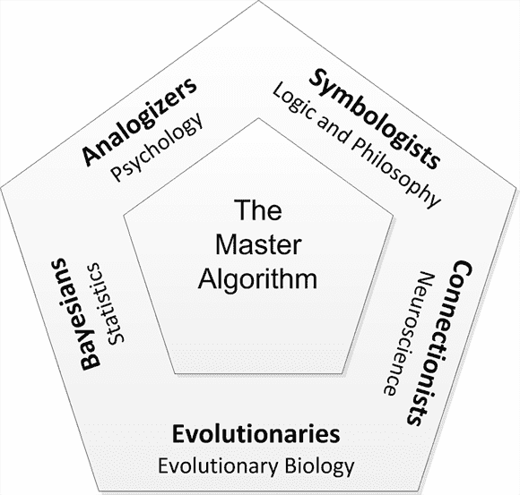

FIGURE 2-1: The five tribes will combine their efforts toward the master algorithm.

本书大部分内容遵循贝叶斯流派的策略，即你使用某种形式的统计分析来解决大多数问题。你确实会看到描述其他流派采用的策略，但你从统计学开始的主要原因是，该技术已经非常成熟并被广泛理解。事实上，统计学的许多元素更符合 `engineering`（实现理论的学科）而非 `science`（创造理论的学科）的定义。本章的下一部分将通过查看每个流派使用的算法类型，更深入地探讨这五个流派。理解算法在机器学习中的作用对于定义机器学习的工作方式至关重要。

### 理解算法的作用

机器学习中的一切都围绕算法展开。`algorithm` 是一种用于解决问题的过程或公式。问题领域会影响所需的算法类型，但基本前提始终相同——解决某种问题，例如驾驶汽车或玩多米诺骨牌。在第一种情况下，问题复杂且众多，但最终问题是如何将乘客从一个地方送到另一个地方而不发生车祸。同样，玩多米诺骨牌的目标是获胜。以下部分将更详细地讨论算法。

#### 定义算法的功能

算法是一种容器。它提供一个用于存储解决特定类型问题的方法的框。算法通过一系列明确定义的状态来处理数据。这些状态不必是确定性的，但它们确实被定义了。目标是创建一个解决问题的输出。在某些情况下，算法接收有助于定义输出的输入，但重点始终放在输出上。

算法必须使用计算机可以理解的明确定义的形式语言来表达状态之间的转换。在处理数据和解决问题的过程中，算法定义、优化并执行一个函数。该函数始终特定于算法所处理的问题类型。

#### 考虑五种主要技术

如前一部分所述，五个流派各自拥有不同的技术和策略来解决问题，从而产生独特的算法。结合这些算法最终应该导致能够解决任何给定问题的 master algorithm。以下部分概述了五种主要的算法技术。

##### 符号推理

术语 `inverse deduction` 通常表现为归纳。在符号推理中，演绎扩展了人类知识的范围，而归纳提高了人类知识的水平。归纳通常开辟新的探索领域，而演绎则探索这些领域。然而，最重要的考虑是，归纳是这种推理类型的科学部分，而演绎是工程部分。这两种策略相辅相成，通过首先开辟一个潜在的探索领域来解决问题，然后探索该领域以确定它是否确实解决了问题。

作为这种策略的示例，演绎会说，如果一棵树是绿色的，而绿色的树是活的，那么这棵树必然是活的。在思考归纳时，你会说，这棵树是绿色的，而且这棵树也是活的；因此，绿色的树是活的。归纳在给定已知输入和输出的情况下，提供了缺失知识的答案。

##### 模拟大脑神经元的连接

连接主义者可能是五个流派中最著名的。这个流派努力使用硅而不是神经元来复制大脑的功能。基本上，每个神经元（作为模拟现实世界对应物的算法创建）解决问题的一小部分，而许多神经元的并行使用则整体解决问题。

使用 `backpropagation,` 或误差的反向传播，旨在确定通过改变网络的 `weights`（特定输入对结果的影响程度）和 `biases`（选择哪些特征）来消除构建得类似于人类神经元的网络中的错误的条件。目标是继续改变权重和偏差，直到实际输出与目标输出匹配。此时，人工神经元发火并将其解决方案传递给下一个神经元。仅由一个神经元创建的解决方案只是整体解决方案的一部分。每个神经元将信息传递给下一个神经元，直到神经元群体创建出最终输出。

##### 测试变异的进化算法

进化论者依赖进化原理来解决问题。换句话说，这种策略基于适者生存（删除任何不匹配所需输出的解决方案）。适应度函数确定每个函数在解决问题中的可行性。

使用树结构，解决方法根据函数输出寻找最佳解决方案。每个进化层级的获胜者有权构建下一层级的函数。其理念是，下一层级将更接近解决问题，但可能无法完全解决，这意味着需要另一个层级。这个特定的流派严重依赖递归和强烈支持递归的语言来解决问题。这种策略的一个有趣输出是能够进化的算法：一代算法实际上构建了下一代。

##### 贝叶斯推断


贝叶斯派使用各种统计方法来解决问题。鉴于统计方法可以创建多个看似正确的解决方案，选择函数就变成了确定哪个函数具有最高成功概率的问题。例如，在使用这些技术时，你可以接受一组症状作为输入，并决定特定疾病由这些症状导致的概率作为输出。鉴于多种疾病具有相同的症状，概率很重要，因为用户会看到一些情况，其中较低概率的输出实际上是给定情况下的正确输出。

最终，这个部落支持这样一个观点：在查看用于生成假设（某人给你的结果）的证据（其他人用于生成假设的输入）之前，绝不完全信任任何假设。分析证据证明或反驳它所支持的假设。因此，在测试所有症状之前，不可能确定某人患有哪种疾病。这个部落最容易辨认的输出之一是垃圾邮件过滤器。

### 通过类比学习的系统

类比学习者使用核机器来识别数据中的模式。通过识别一组输入的模式并将其与已知输出的模式进行比较，你可以创建问题的解决方案。目标是使用相似性来确定问题的最佳解决方案。这是一种推理方式，它确定在特定情况下某个特定解决方案在之前的某个时间有效；因此，在类似情况下使用该解决方案也应该有效。这个部落最容易辨认的输出之一是推荐系统。例如，当你登录亚马逊并购买产品时，推荐系统会列出你可能还想购买的其他相关产品。

### 定义训练的含义

许多人有些习惯于这样的想法：应用程序以一个函数开始，接受数据作为输入，然后提供结果。例如，程序员可能会创建一个名为 `Add()` 的函数，它接受两个值作为输入，例如 `1` 和 `2`。`Add()` 的结果是 `3`。此过程的输出是一个值。在过去，编写程序意味着理解用于操纵数据以在特定输入下创建给定结果的函数。

机器学习颠倒了这一过程。在这种情况下，你知道你有输入，例如 `1` 和 `2`。你也知道期望的结果是 `3`。但是，你不知道应用什么函数来创建期望的结果。训练为学习算法提供了各种期望输入及其预期结果的示例。然后，学习算法使用这些输入来创建一个函数。换句话说，训练是学习算法将灵活函数映射到数据的过程。输出通常是某个类别的概率或一个数值。

单个学习算法可以学习许多不同的东西，但并非每个算法都适合某些任务。有些算法足够通用，可以下棋、在 Facebook 上识别面孔以及诊断患者癌症。算法在每种情况下都将数据输入和这些输入的预期结果归约为一个函数，但该函数特定于你希望算法执行的任务类型。

机器学习的秘诀是泛化。目标是泛化输出函数，使其适用于训练集之外的数据。例如，考虑垃圾邮件过滤器。你的字典包含 100,000 个单词（实际上是一个小字典）。有限的训练数据集（4,000 或 5,000 个单词组合）必须创建一个泛化函数，该函数随后可以在处理实际数据时找到函数将看到的 2¹⁰⁰⁰⁰⁰ 个组合中的垃圾邮件。

从这个角度来看，训练可能看起来是不可能的，学习则更糟。但是，为了创建这个泛化函数，学习算法依赖于仅三个组件：

*   **表示：** 学习算法创建一个 `model`，它是一个函数，将为特定输入产生给定结果。表示是学习算法可以学习的一组模型。换句话说，学习算法必须创建一个模型，该模型将从输入数据产生期望的结果。如果学习算法无法执行此任务，它就无法从数据中学习，数据就超出了学习算法的假设空间。表示的一部分是发现应在学习过程中使用哪些 `features`（数据源中的数据元素）。

*   **评估：** 学习算法可以创建多个模型。但是，它不知道好模型和坏模型之间的区别。评估函数确定哪个模型在从一组输入中创建期望结果方面效果最好。评估函数对模型进行评分，因为多个模型可能提供所需的结果。

*   **优化：** 在某个时刻，训练过程产生了一组模型，这些模型可以针对给定输入集通常输出正确结果。此时，训练过程在这些模型中搜索以确定哪个效果最好。然后将最佳模型作为训练过程的结果输出。

本书大部分内容都集中在表示上。例如，在 第 10 章 中，你将发现如何基于问题的概率表示使用朴素贝叶斯算法创建一个可用的垃圾邮件检测器。但是，训练过程比简单选择表示要复杂得多。执行训练过程时，所有三个步骤都会发挥作用。幸运的是，你可以先专注于表示，并允许本书讨论的各种库为你完成其余工作。

# 第 3 章

# 展望未来

### 本章内容

**发现机器学习如何帮助创建有用的未来技术**

**作为机器学习的结果发展新的工作类型**

**考虑机器学习如何创造潜在问题**

机器学习技术出现在当今的许多产品中，但它还远未达到完全可用的程度。与科学家计划为未来提供的内容相比，当今用于机器学习的算法仍然相对基础。此外，当今用于机器学习的数据源比计划用于未来使用的数据集要小。简而言之，机器学习还处于起步阶段。然而，它已经出色地完成了相当数量的任务。本章探讨了未来可能实现的事情。它帮助你了解机器学习正在采取的方向，以及该方向如何帮助将机器学习融入日常生活的方方面面。

伴随机器学习等新技术出现的问题之一是担心机器学习会阻止人们工作。恰恰相反：机器学习将开辟新的职业，人们会发现这些职业比在流水线工作或在餐厅翻汉堡包更令人兴奋。目标之一是为人们提供创造性和有趣的工作。当然，这些新工作需要更多和新的培训，人们才能胜任。


每项新技术也会带来陷阱。毁灭比创造更容易，这是一句老生常谈但确实如此的话。机器学习的潜在陷阱需要引起重视。由于这项技术尚处于起步阶段，现在正是考虑潜在陷阱并采取措施加以防范的时机，以免问题出现。本章的最后一部分讨论的并非必然会发生的问题，而是可能发生的问题，人们完全可以通过正确使用技术来避免这些问题。

### 为未来创造有用的技术

要想生存，一项技术必须证明其有用性。事实上，它必须证明的不仅仅是有用；它必须以现有技术无法做到的方式满足人们感知到的需求，并建立起一群提供持续投资资金理由的拥护者。例如，Apple Lisa 是一款有趣且有用的技术产品，向从未见过图形用户界面的商业用户展示了 GUI 的实用性。它解决了让计算机变得友好的需求。然而，它失败了，因为它没有建立起拥护者群体。这台计算机根本未能达到围绕它的炒作所期望的效果（有关详细信息，请参见 [`https://www.inexhibit.com/case-studies/different-fate-apples-lisa-macintosh-design-matters/`](https://www.inexhibit.com/case-studies/different-fate-apples-lisa-macintosh-design-matters/)）。Apple 接下来构建的系统，即 Macintosh，在满足炒作方面做得稍好一些——但它构建在 Lisa 所使用的相同技术之上。区别在于，Macintosh 建立起了一大批忠实的拥护者。

机器学习以其他技术难以复制的方式解决了相当数量的问题。然而，要成为每个人都想投资的必备技术，机器学习必须建立起那群忠实的拥护者。位于 [`https://www.grandviewresearch.com/industry-analysis/machine-learning-market`](https://www.grandviewresearch.com/industry-analysis/machine-learning-market) 的柱状图显示，机器学习正在显著增长，服务领域走在前列。相关的免费可下载报告（您必须填写请求才能获取）详细说明了机器学习在过去几年中的增长情况。以下部分将讨论机器学习已经影响您个人的某些方式，以及这种用途在未来将如何增加——使机器学习成为必备技术。

#### 考虑机器学习在机器人中的作用

当今机器学习的一个目标是创造有用的家用机器人。现在，您可能会想到《杰森一家》中 Rosie 机器人那样的东西（有关快速描述，请参见 [`https://thejetsons.fandom.com/wiki/Rosey`](https://thejetsons.fandom.com/wiki/Rosey)）。然而，现实世界中的机器人需要解决实际且重要的问题才能吸引关注。要想可行并吸引资金，一项技术还必须积累一群追随者，要做到这一点，它必须提供交互和所有权。根据 MarketsAndMarkets（请参见 [`https://www.marketsandmarkets.com/Market-Reports/household-robot-market-253781130.html`](https://www.marketsandmarkets.com/Market-Reports/household-robot-market-253781130.html)），家用机器人市场将从 2016 年的 12 亿美元增长到 2019 年的 33 亿美元（估计），到 2024 年将达到 91 亿美元（预测），因此家用机器人正在变得流行。

一个成功的家用机器人示例是 iRobot 的 Roomba（[`https://www.amazon.com/exec/obidos/ASIN/B005GK3IVW/datacservip0f-20/`](https://www.amazon.com/exec/obidos/ASIN/B005GK3IVW/datacservip0f-20/））。您现在实际上可以购买一台 Roomba；它服务于有用的目的；并且已经吸引了足够的关注，使其成为一项可行的技术。Roomba 还展示了当今在商业、家用和自主层面上可实现的功能。是的，Roomba 是一台花哨的吸尘器——一种基于简单但非常有效的算法的内置智能吸尘器。Roomba 可以成功地在家中导航，这比您想象的要难得多。它还可以在家中较脏的区域花费更多时间。然而，当 Roomba 满了时，您仍然需要清空它；当前的机器人技术只能做到这么多。（而且，以防您感兴趣，您也可以在 Amazon 上找到 WORX 机器人割草机，网址为 [`https://www.amazon.com/exec/obidos/ASIN/B07VC44C68/datacservip0f-20/`](https://www.amazon.com/exec/obidos/ASIN/B07VC44C68/datacservip0f-20/）。）

您可以找到其他人们用来执行专业任务的现实世界机器人，但您不会在家中找到它们。位于 [`https://www.youtube.com/watch?v=PfvXKXSAsUM`](https://www.youtube.com/watch?v=PfvXKXSAsUM）的视频展示了 15 台人形机器人，它们很有趣，但今天并不特别有用（尽管如此，您不得不承认它们看起来很有趣）。其他网站，例如 [`https://shareably.net/70-robots-that-actually-exist/`](https://shareably.net/70-robots-that-actually-exist/) 和 [`https://www.cnn.com/2020/09/23/asia/japan-gundam-robot-test-scli-intl-scn/index.html`](https://www.cnn.com/2020/09/23/asia/japan-gundam-robot-test-scli-intl-scn/index.html），展示了其他机器人，但其中没有任何一个具有通用用途。在机器人能够进入家庭并充当通用助手之前，机器学习需要解决大量问题，算法需要变得更加通用和更深入思考。到现在，您应该明白机器人将成为日常生活的一部分，但这不会立即发生。

#### 在医疗保健中使用机器学习

一个正在引起大量关注的问题是老年护理问题。人们活得更长，养老院似乎不是度过暮年的好方式。机器人将使人们能够留在家中，同时保持安全。一些国家也面临着医疗保健工作者的严重短缺，日本就是其中之一。因此，该国正在投入大量资源来解决机器人技术带来的问题。（有关详细信息，请阅读位于 [`https://www.bbc.com/worklife/article/20200205-what-the-world-can-learn-from-japans-robots`](https://www.bbc.com/worklife/article/20200205-what-the-world-can-learn-from-japans-robots）的故事。）

目前技术最接近家用护士机器人所呈现的愿景的是远程存在机器人，它也出现在医院中（有关详细信息，请参见 [`https://spectrum.ieee.org/automaton/robotics/medical-robots/telepresence-robots-are-helping-take-pressure-off-hospital-staff`](https://spectrum.ieee.org/automaton/robotics/medical-robots/telepresence-robots-are-helping-take-pressure-off-hospital-staff））。在这种情况下，机器人是人类医生或护士的延伸，因此它甚至远未达到日本人希望在未来创造的水平。

#### 为各种需求创建智能系统


许多你可以预期会看到的采用机器学习的解决方案将是人类的助手。它们能够极好地执行各种任务，但这些任务本质上是琐碎且重复的。例如，你可能需要找到一家餐厅来满足外地客人的需求。你可以自己浪费时间寻找合适的餐厅，也可以访问 AI 来在更短的时间内以更高的准确性和效率完成这项工作。Siri (`https://www.apple.com/siri/`) 是更流行且广为人知的解决方案之一。另一个此类解决方案是 Nara (`http://www.news.com.au/technology/innovation/meet-your-artificial-brain-the-algorithm-redefining-the-web/news-story/6a9eb73df016254a65d96426e7dd59b4`)，这是一种实验性 AI，随着你与它共度更多时间，它会了解你特定的喜好和厌恶。与只能回答基本问题的 Siri 不同，Nara 更进一步，能够提供推荐。

#### 在工业环境中使用机器学习

机器学习已经在工业环境中发挥着重要作用，这些环境的重点在于效率。以更快、更准确且更少资源的方式做事有助于改善业绩，并使组织更具灵活性和更高的利润率。更少的错误也有助于组织中工作的人类，通过降低挫败感。你目前可以在以下领域看到机器学习的应用：

*   医疗诊断

*   数据挖掘

*   生物信息学

*   语音和手写识别

*   产品分类

*   惯性测量单元 (IMU)（例如动作捕捉技术）

*   信息检索

这个列表只是冰山一角。机器学习在当今工业中被广泛使用，并且随着先进算法使更高级别的学习成为可能，其应用数量将继续增加。目前，机器学习在许多领域执行任务，包括以下内容：

*   **分析：** 确定用户想要什么以及原因，以及用户在获取它时表现出的什么模式（行为、关联、响应等）。

*   **丰富：** 向环境中添加广告、小部件和其他功能，以便用户和组织可以获得额外的好处，例如提高生产力或改善销售。

*   **适应：** 修改演示文稿，使其反映用户的口味和丰富功能的选择。每个用户最终都会获得定制的体验，从而减少挫败感并提高生产力。

*   **优化：** 修改环境，使演示文稿消耗更少资源而不降低用户体验。

*   **控制：** 根据输入和最高成功概率引导用户采取特定行动。

对机器学习在工业中所做工作的理论看法固然不错，但了解这些在现实世界中如何运作也很重要。你可以看到机器学习以相对琐碎但重要的方式被使用。例如，机器学习在自动化员工访问、保护动物、预测急诊室等待时间、识别心力衰竭、预测中风和心脏病发作以及预测医院再入院方面发挥着作用。(`https://www.forbes.com/sites/85broads/2014/01/06/six-novel-machine-learning-applications/` 提供了每种用途的详细信息。)

#### 了解更新处理器和其他硬件的作用

第 2 章中“指定统计学在机器学习中的作用”部分告诉你了与机器学习相关的五个学派（部落）。这些学派中的每一个都告诉你，当前的计算机硬件还不足以让机器学习正常工作。例如，你可能会与一个学派交谈，其成员告诉你需要更大容量的系统内存，并使用 GPU 来提供更快的计算。另一个学派可能会主张创建新类型的处理器。学习处理器，即模仿人脑的处理器，在连接主义者中非常流行。你可以在 `https://www.eetimes.eu/top-10-processors-for-ai-acceleration-at-the-endpoint/` 上阅读关于为加速 AI 和机器学习任务而设计的处理器。重点是，每个人都同意某种新硬件将使机器学习更容易，但这种硬件将采取的确切形式还有待观察。

### 发现机器学习带来的新工作机会

在过去，你可以轻易找到描述由于机器人导致人类工作机会完全丧失的文章。机器人已经执行了许多过去雇佣人类的任务，并且这种用法将随着时间的推移而增加。然而，现在公司积累了更多经验，你经常会发现文章谈论的是增强，即机器人和人类并肩工作以执行任务。本章的前一部分帮助你了解了当今机器学习的一些实际现实世界用途，并帮助你发现这些用途未来可能扩展到哪里。在阅读本节时，你也一定考虑过这些新用途可能会如何让你或你所爱的人失去工作。`https://aithority.com/guest-authors/the-future-of-artificial-intelligence-is-job-augmentation-not-elimination/` 上的文章通过指出机器人在许多（也许大多数）场景中实际上无法取代人类，从而厘清了事实。

事实是，决定机器学习将如何影响工作环境是困难的，就像人们很难看到工业革命将把我们带向何方以大规模生产面向普通消费者的商品一样（`https://www.history.com/topics/industrial-revolution` 了解详情）。就像那些工人需要找到新工作一样，今天面临因机器学习而失去职业的人也将需要找到新工作或发现以新方式执行任务的方法。

#### 为机器工作

你未来可能会发现自己正在为机器工作。事实上，你可能已经在为机器工作却浑然不知。一些公司已经使用机器学习来分析业务流程并使其更加高效。例如，日立目前在中层管理中使用这种设置（`http://www.hitachi.com/New/cnews/month/2015/09/150904.html`）。在这种情况下，AI 实际上会根据其对工作流程的分析发布工作订单——就像人类中层经理可能做的那样。区别在于，AI 实际上比它取代的人类高效 8%。

然而，一个工作机会也随之而来。在 AI 手下工作的员工确实执行 AI 告诉他们的任务，但他们可以利用自己的经验和创造力来确定如何执行任务。AI 分析人类员工使用的流程并衡量所取得的结果。任何成功的流程都会被添加到工人可以用来完成任务的技术数据库中。换句话说，人类正在教 AI 新技术，以使工作环境更加高效。


教 AI 掌握新技术是机器学习如何让人类摆脱工作环境中琐碎劳动的一个例子。在使用人类中层经理时，新流程往往会被不成文规则和个人主义的官僚主义所掩盖。AI 中层经理的设计目的是在没有偏见的情况下学习新技术，因此人类被鼓励发挥创造力，每个人都受益。简而言之，AI 没有会受挫的自我意识，是许多员工在实施能让每个人都更高效的新想法时一直想要的那种平易近人的经理。

不幸的是，根据 [`https://www.theverge.com/2020/2/27/21155254/automation-robots-unemployment-jobs-vs-human-google-amazon`](https://www.theverge.com/2020/2/27/21155254/automation-robots-unemployment-jobs-vs-human-google-amazon) 上的文章，生产力提高的负面影响是，非人类经理往往会使工作环境变得紧张和不安全。为了实现和谐的整合，机器学习算法在未来也需要考虑员工的安全和幸福，而这目前只有人类经理才能做到。

### 与机器协作

人们已经定期与机器协作——他们可能只是没有意识到。例如，当你对智能手机说话，它能识别你说的话时，你正在与机器协作以实现预期目标。大多数人认识到，智能手机提供的语音交互会随时间改进——你使用得越多，它识别你声音的能力就越强。随着学习算法变得更加精细，它在识别你的声音并获得预期结果方面会变得更加高效。这一趋势将继续下去。

然而，机器学习被用于各种你可能想不到的方式。当你将相机对准拍摄对象，相机可以在人脸周围画一个框（以帮助对焦）时，你正在看到机器学习的结果。相机正在帮助你以更高的效率完成拍照的工作。此外，相机会自动消除至少部分抖动和光线不佳的影响。相机已经变得非常擅长协助人类从容地执行任务。

使用声明式语言，例如 `SQL`（结构化查询语言），也将变得更加普遍，因为机器学习将使进步成为可能。在某些方面，声明式语言只是让你描述你想要什么，而不是如何获得它。然而，`SQL` 仍然需要计算机科学家、数据科学家、数据库管理员或其他专业人士来使用。未来的语言将不会有这种限制。最终，受过特定任务训练的人只需告诉机器人助手该做什么，机器人助手就会发现完成它的方法。人类将使用创造力来发现 *做什么*；细节（即 *如何做*）将成为机器的领域。

### 修理机器

本章的大部分内容讨论的是当前技术、技术未来的发展方向以及事物运作的原因。然而，请注意，讨论始终集中在技术做某事上。没错，在技术能做其他任何事情之前，它必须执行一项能吸引注意力并以一种让人们想要为自己拥有该技术的方式造福人类的实际任务。技术是什么并不重要。最终，技术会损坏。让技术做出有用的事情是当前的首要考虑，而关于技术最终将做什么的任何梦想的顶点都延伸到未来多年，因此像修理技术这样的琐事仍将落在人类肩上。即使人类没有直接参与物理修理，人类智能也将指导修理操作。

你在网上读到的一些文章可能会让你相信自修复机器已经成为现实。例如，国际空间站机器人 Dextre 和 Canadarm 修复了一个故障相机（请参阅 [`https://space.io9.com/a-self-repairing-space-robot-on-the-international-space-1580869685`](https://space.io9.com/a-self-repairing-space-robot-on-the-international-space-1580869685) 上的故事）。故事没有说的是，人类决定如何执行任务并指导机器人进行体力劳动。自修复正在变得可行。[`https://spectrum.ieee.org/automaton/robotics/robotics-hardware/japanese-researchers-teaching-robots-to-repair-themselves`](https://spectrum.ieee.org/automaton/robotics/robotics-hardware/japanese-researchers-teaching-robots-to-repair-themselves) 和 [`https://www.robotics.org/blog-article.cfm/How-Self-Healing-Robots-Repair-Themselves/219`](https://www.robotics.org/blog-article.cfm/How-Self-Healing-Robots-Repair-Themselves/219) 上的文章描述了技术已经发展到何种程度。

### 创建新的机器学习任务

机器学习算法不具备创造力，这意味着人类必须提供改进机器学习所需的创造力。即使是构建其他算法的算法，也只能提高算法所取得结果的效率和准确性——它们无法创建执行新类型任务的算法。人类必须提供必要的输入来定义这些任务以及开始解决它们所需的流程。

你可能认为只有机器学习专家才会创建新的机器学习任务。然而，本章前面“为机器工作”部分讨论的日立中层经理的故事应该告诉你，事情的运作方式会不同于此。是的，专家将帮助形成定义如何解决任务的基础，但任务的实际创建将来自最了解特定行业的人。日立的故事为理解两点提供了基础：未来将看到各行各业的人为机器学习场景做出贡献，并且特定的教育可能甚至无法帮助定义新任务。

### 制定新的机器学习环境

目前，制定新的机器学习环境是研究和开发公司的领域。一群经过高度训练的专家必须为新环境创建参数。例如，NASA 需要机器人来探索火星。在这种情况下，NASA 依赖麻省理工学院和东北大学的人员的技能来执行任务（请参阅 [`https://www.computerworld.com/article/3007393/robotics/nasa-needs-robotic-upgrades-for-work-on-mars.html`](https://www.computerworld.com/article/3007393/robotics/nasa-needs-robotic-upgrades-for-work-on-mars.html）上的故事）。鉴于机器人将需要自主执行任务，机器学习算法将变得非常复杂，并包含多个层次的问题解决。

更令人难以置信的是，根据 [`https://www.technologyreview.com/2020/01/14/64990/an-emotionally-intelligent-ai-could-support-astronauts-on-a-trip-to-mars/`](https://www.technologyreview.com/2020/01/14/64990/an-emotionally-intelligent-ai-could-support-astronauts-on-a-trip-to-mars/)，情感智能 AI 可以帮助支持前往火星的宇航员。奇怪的是，宇航员可能需要来自一个在长时间与同一群人在狭小空间工作的艰苦活动中没有情感投入的实体的支持。想想看：AI 永远不会生气。


最终，有人将能够以足够详细的方式描述一个问题，以便专用程序能够使用合适的语言创建必要的算法。换句话说，普通人最终将开始根据他们拥有并想要尝试的想法来创建新的机器学习环境。与创建机器学习任务一样，创建未来环境的人将是其特定领域的专家，而不是计算机科学家或数据科学家。解决机器学习的科学最终将转变为一项工程练习，这将使任何有好主意的人都能获得所需的访问权限。

### 避免未来技术的潜在陷阱

任何新技术都伴随着潜在的陷阱。对该技术的期望越高，陷阱就越严重。不切实际的期望会给机器学习带来各种问题，因为人们认为电影中看到的就是现实世界中会得到的。记住第 1 章中介绍的基本概念至关重要——即机器学习算法目前无法感受、独立思考或创造任何东西。与电影中的 AI 不同，机器学习算法精确地按照你的预期执行，不会多做任何事情。当然，一些结果令人惊叹，但将期望与实际技术能做的事情保持一致很重要。否则，你会承诺技术永远无法交付的东西，而你期待的那些拥护者将去寻找下一个大事件。

事实上，当今机器学习的用途相当狭窄。正如文章 [`https://www.linkedin.com/pulse/machine-learning-its-hard-problems-valuable-toby-coppel`](https://www.linkedin.com/pulse/machine-learning-its-hard-problems-valuable-toby-coppel) 中所述，`narrow AI`，例如企业利用 AI 从海量数据集中获取洞察的应用，依赖于过去十年公司开始采用的成熟技术。机器无法推断任何东西，这限制了机器的使用范围，仅限于开发人员或数据科学家为其设计的任务。事实上，当今算法的一个很好的比喻是它们就像一件量身定制的衬衫（有关更多详细信息，请参阅文章 [`https://www.computerworld.com/article/3006525/cloud-computing/why-microsofts-data-chief-thinks-machine-learning-tools-are-like-tailored-shirts.html`](https://www.computerworld.com/article/3006525/cloud-computing/why-microsofts-data-chief-thinks-machine-learning-tools-are-like-tailored-shirts.html)）。当今，你需要专业技能来创建满足特定需求的定制算法，但未来可能会出现能够处理几乎任何任务的算法。依赖窄 AI 的公司需要谨慎开发产品或服务。产品或服务的变化可能会使机器学习环境中使用的数据超出学习算法的领域，从而将机器学习算法的输出降低为乱码（或至少使其不可靠）。

在组织中使用机器学习还需要雇佣具备正确技能的人员并组建团队。在企业环境中，机器学习的结果意味着利润的改善，这是一个相对较新的领域。公司在组建合适的团队、制定合理的目标以及实际实现这些目标方面面临挑战。为了吸引世界级团队，你的公司必须提供一个足够令人兴奋的问题，以吸引来自其他组织所需的人才。这不是一项容易的任务，你需要将其视为制定创建机器学习环境目标的一部分。

# Part 2

# 准备你的学习工具

本部分内容…

创建 Python 设置

执行基本 Python 任务

使用 Google Colab

# 第 4 章

# 安装 Python 发行版

本章内容

**确定用于机器学习的 Python 发行版**

**在 Linux、Mac OS X 和 Windows 上进行安装**

**获取数据集和示例代码**

在你能够使用 Python 做太多事情或使用它来解决机器学习问题之前，你需要一个可用的安装。此外，你需要访问本书中使用的数据集和代码。本章将告诉你如何执行所需的 Python 设置和下载。下载示例代码（位于本书页面 [`www.dummies.com`](https://www.dummies.com/) 上）并将其安装在你的系统上，是从本书中获得良好学习体验的最佳方式。本章将帮助你设置系统，以便你可以轻松跟随本书其余部分中的示例。

使用可下载的源代码并不会阻止你自己输入示例、使用调试器跟踪它们、扩展它们或以各种方式处理代码。可下载的源代码旨在帮助你开始你的机器学习和 Python 学习体验。在你看到代码在正确输入和配置后的工作方式后，你可以尝试自己创建示例。如果你犯了错误，你可以将你输入的内容与可下载的源代码进行比较，并准确发现错误所在。你可以在 `ML4D2E; 04; Sample.ipynb` 和 `ML4D2E; 04; Dataset Load.ipynb` 文件中找到本章的可下载源代码。（简介告诉你在哪里下载本书的源代码。）

可下载的源代码还提供以 R 变体编写的示例的访问权限。虽然 Python 代码出现在可下载源代码的 `ML4D2E`（即《机器学习傻瓜书》第 2 版）文件夹中，但 R 代码出现在 `ML4D2ER`（即《机器学习傻瓜书》第 2 版，R 代码）文件夹中。R 示例并不总是精确地遵循 Python 示例，因为两种语言之间存在差异，但 R 示例有大量注释，因此你可以跟随学习。使用任何一种语言都将使你能够达到所需的结果。

### 使用 Anaconda 进行机器学习

你可以使用许多包来执行机器学习任务。事实上，存在太多包，无法在单个章节中充分讨论。为了让你更容易专注于机器学习而不是软件包，接下来的第一部分将告诉你如何获取你的 Anaconda 副本，即 Anaconda3-2020.07 版本。本书使用 Anaconda 有多种原因，如下一节所述。但是，如果你使用的平台安装过程不太好（或根本无法工作），你也可以按照第 6 章中描述的使用 Google Colab 来跟随本书的代码。接下来的各部分将为你简要介绍 Anaconda 作为产品的概况。

#### 获取 Anaconda

基本的 Anaconda 包是免费下载的，你可以在 [`https://www.anaconda.com/products/individual`](https://www.anaconda.com/products/individual) 上获取。只需单击 Download 查看可用下载列表；然后单击适用于你平台的单独链接以获取免费产品。Anaconda 支持以下平台：

*   Windows 32 位和 64 位（安装程序可能只提供 64 位或 32 位版本，具体取决于它检测到的 Windows 版本）

*   Linux 64 位（x86 和 PowerPC 8/9 安装程序）

*   Mac OS X 64 位（图形和命令行安装程序）

在所有情况下，你都需要 Anaconda3-2020.07 版本的产品。如果你无法在主 Anaconda 页面上找到正确的版本，可以在 [`https://repo.anaconda.com/archive/`](https://repo.anaconda.com/archive/) 上获取它。


安装效果最佳的做法是先从系统中删除以前版本的 Anaconda。否则，一个产品版本可能会干扰其他版本的产品。Anaconda 在系统的 Anaconda 可执行文件夹中提供单独的卸载程序，其位置可能有所不同。例如，要在 Windows 系统上卸载以前版本的 Anaconda 3，请在系统的 `C:\Users\<UserName>\Anaconda3` 文件夹中查找 `Uninstall-Anaconda3.exe`。执行此文件以卸载产品。此外，本书不支持使用在 [`https://docs.conda.io/en/latest/miniconda.html`](https://docs.conda.io/en/latest/miniconda.html) 中描述的 Miniconda 安装程序。

默认下载版本安装 Python 3.8，即本书使用的版本。Windows 和 Mac OS X 均提供图形安装程序。使用 Linux 时，依赖 `bash` 实用程序。

#### 定义本书使用 Anaconda 的原因

Anaconda 不像市场上许多其他产品那样是集成开发环境（IDE）。相反，它是访问多个软件包的集中式方法。本书使用 Jupyter Notebook 作为 IDE，因为它支持文本编程技术。同样，你也可以轻松使用 Spyder 进行开发，并且可能会更喜欢它，因为它提供了更传统的界面。你可以在 [`https://www.slant.co/versus/1246/15716/~spyder_vs_jupyter`](https://www.slant.co/versus/1246/15716/~spyder_vs_jupyter) 查看比较。重点是，Anaconda 可帮助你管理 IDE 以及大量其他软件包。此外，你可以创建环境以特定方式使用 IDE。例如，你可以创建一个用于在 Python 中使用 Jupyter Notebook 的环境，以及一个完全不同的环境用于在 R 中使用 Jupyter Notebook。

因此，了解本节为何强调 Jupyter Notebook 很重要，因为 Anaconda 提供了访问多个 IDE 的途径。大多数 IDE 看起来像花哨的文本编辑器，而这正是它们的本质。是的，你可以获得各种智能功能、提示、技巧、代码着色等等，但归根结底，它们都是文本编辑器。文本编辑器本身没有问题，本章也不是要告诉你这一点。但是，鉴于 Python 开发人员通常专注于需要比纯文本呈现更好的科学应用程序，使用笔记本可能会有所帮助。

`notebook` 与文本编辑器的区别在于，它专注于一种称为 `literate programming` 的技术，该技术由斯坦福大学计算机科学家 Donald Knuth 提出。你使用文本编程来创建一种代码、笔记、数学方程式和图形的演示文稿。简而言之，你最终会得到一本科学家的笔记本，其中包含完全理解代码所需的一切。你通常会在 Mathematica 和 MATLAB 等高价软件包中看到文本编程技术的应用。笔记本开发在以下方面表现出色：

*   演示

*   协作

*   研究

*   教学目标

*   演示文稿

本书使用 Anaconda 工具集，因为它不仅为你提供出色的 Python 编码体验，还能帮助你发现文本编程技术的巨大潜力。如果你花大量时间执行科学任务，Anaconda 及类似产品是必不可少的。此外，Anaconda 是免费的，因此你无需支付其他软件包的费用即可获得文本编程风格的优势。

有关 Anaconda 及其与以前版本的更改的更多信息，请务必查看 [`https://docs.anaconda.com/anaconda/reference/release-notes/`](https://docs.anaconda.com/anaconda/reference/release-notes/) 中的发行说明。你发现的大多数更改都涉及错误修复和更新。

### 在 Linux 上安装 Anaconda

你使用命令行在 Linux 上安装 Anaconda — 没有图形安装选项。以下过程在任何 Linux 系统上都应该可以正常工作，无论你使用的是 Intel 还是 PowerPC 版本的 Anaconda：

1.  **打开终端的副本。**

    终端窗口将出现。

2.  **将目录更改为系统上下载的 Anaconda 副本。**

    此文件的名称各不相同，但通常在 Intel 系统上显示为 `Anaconda3-2020.07-Linux-x86_64.sh`，在 PowerPC 系统上显示为 `Anaconda3-2020.07-Linux-ppc64le.sh`。版本号作为文件名的一部分嵌入其中。在此情况下，文件名指的是版本 3.2020.07，即本书使用的版本。如果你使用其他版本，可能会在源代码方面遇到问题，并在使用时需要进行调整。

3.  **键入** `bash Anaconda3-2020.07-Linux-x86_64.sh`**（适用于 Intel 版本）或** `bash Anaconda3-2020.07-Linux-ppc64le.sh`**（适用于 PowerPC 版本）并按 Enter。**

    将启动安装向导，要求你接受使用 Anaconda 的许可条款。

4.  **阅读许可协议，并使用适用于你 Linux 版本的方法接受条款。**

    向导要求你为 Anaconda 提供安装位置。本书假设你使用平台的默认位置。如果你选择其他位置，可能需要在本书后面修改一些过程以适应你的设置。

5.  **提供安装位置（如有必要）并按 Enter（或单击 Next）。**

    应用程序提取过程开始。安装程序会询问你是否要使用 `conda init` 命令初始化 Anaconda3。

6.  **键入** `yes` **并按 Enter 或单击 Yes。**

    提取完成后，你会看到完成消息。

7.  **使用适用于你 Linux 版本的方法将安装路径添加到** `PATH` **语句中。**

    你现在可以开始使用 Anaconda 了。

### 在 Mac OS X 上安装 Anaconda

Mac OS X 安装只有一种形式：64 位。以下步骤可帮助你使用 GUI 方法在 Mac 系统上安装 64 位 Anaconda：

1.  **在系统上找到下载的 Anaconda 副本。**

    此文件的名称各不相同，但通常显示为 `Anaconda3-2020.07-MacOSX-x86_64.pkg`。版本号作为文件名的一部分嵌入其中。在此情况下，文件名指的是版本 3.2020.07，即本书使用的版本。如果你使用其他版本，可能会在源代码方面遇到问题，并在使用时需要进行调整。

2.  **双击安装文件。**

    将出现介绍对话框。

3.  **单击 Continue。**

    向导会询问你是否要查看 Read Me 材料。你可以稍后阅读这些材料。目前，你可以安全地跳过这些信息。

4.  **单击 Continue。**

    向导会显示许可协议。请务必阅读许可协议，以便了解使用条款。

5.  **如果你同意许可协议，请单击 I Agree。**

    向导要求你提供安装目标。目标控制安装是针对单个用户还是一组用户。

6.  **单击 Continue。**

    本书假设你保留默认设置。

7.  **单击 Install。**

    安装开始。进度条会告诉你安装过程的进度。安装完成后，你会看到完成对话框。

8.  **单击 Continue。**

    你现在可以开始使用 Anaconda 了。

### 在 Windows 上安装 Anaconda

Anaconda 附带用于 Windows 的图形安装应用程序，因此要获得良好的安装，需要使用向导，就像任何其他安装一样。以下过程在任何 Windows 系统上都应该可以正常工作，无论你使用的是 32 位还是 64 位版本的 Anaconda：

1.  **在系统上找到下载的 Anaconda 副本。**


# 安装 Anaconda

文件名各不相同，但通常在 32 位系统上显示为 `Anaconda3-2020.07-Windows-x86.exe`，在 64 位系统上显示为 `Anaconda3-2020.07-Windows-x86_64.exe`。版本号包含在文件名中。在此情况下，文件名指的是版本 3.2020.07，即本书使用的版本。如果你使用其他版本，可能会在源代码中遇到问题，并在使用时需要进行调整。

### 双击安装文件

你会看到一个欢迎对话框，告知你安装的是 32 位还是 64 位版本的 Anaconda。请确保选择正确的版本。

### 单击 Next

向导会显示许可协议。请务必阅读许可协议，以了解使用条款。

### 单击 I Agree（如果你同意许可协议）

系统会询问你要执行哪种安装类型，如 Figure 4-1 所示。在大多数情况下，你希望仅为自己安装该产品。


FIGURE 4-1: Tell the wizard how to install Anaconda on your system.

### 选择一种安装类型，然后单击 Next

向导会询问你在磁盘上的哪个位置安装 Anaconda。本书假设你使用默认位置。如果你选择其他位置，可能需要在本书后面修改一些步骤以适应你的设置。

### 选择安装位置（如有必要），然后单击 Next

你会看到高级安装选项，如 Figure 4-2 所示。这些选项默认已选中，在大多数情况下没有理由更改它们。本书假设你已使用默认选项设置 Anaconda。

### 更改高级安装选项（如有必要），然后单击 Install

你会看到一个带有进度条的安装对话框。安装过程可能需要几分钟，请喝杯咖啡，看会儿漫画。安装过程结束后，你会看到一个已启用的 Next 按钮。


FIGURE 4-2: Configure the advanced installation options.

### 单击 Next

（如果你看到一个带有 PyCharm 链接的页面，[`https://www.jetbrains.com/pycharm/`](https://www.jetbrains.com/pycharm/)，请再次单击 Next。）向导会告诉你安装已完成。此页面包括 Anaconda 教程和了解更多有关 Anaconda 的选项。如果保持选中状态，你会看到相应页面加载到浏览器中。

### 单击 Finish

你现在可以开始使用 Anaconda 了。

# 下载数据集和示例代码

本书是关于使用 Python 执行机器学习任务。当然，你可以花所有时间从头开始创建示例代码、调试它，然后才发现它与机器学习的关系，或者你可以采取简单的方法，从 [`www.dummies.com`](https://www.dummies.com/) 下载预写代码，以便立即开始工作。同样，创建足够大的数据集用于机器学习目的需要相当长的时间。幸运的是，你可以使用某些数据科学库提供的功能轻松访问标准化的预创建数据集（这些库对于机器学习也同样适用）。以下部分将帮助你下载和使用示例代码和数据集，以便节省时间并立即开始处理数据科学特定任务。

### 使用 Jupyter Notebook

为了使本书中相对复杂的代码更易于处理，你将使用 Jupyter Notebook。此界面让你轻松创建 Python 笔记本文件，其中可以包含任意数量的示例，每个示例都可以单独运行。该程序在浏览器中运行，因此你用于开发的平台无关紧要；只要它有浏览器，你就应该没问题。

#### 启动 Jupyter Notebook

你从 Anaconda Navigator 访问 Jupyter Notebook，它还提供对特定环境支持的各种应用程序的集中访问。默认环境或通道，base (root)，直接支持 Python 开发。`ML4D2ER` 文件夹中提供的 `Setup.readme` 文件说明了如何设置单独的 R 通道。Figure 4-3 显示了 base (root) 通道的内容。

注意，每个条目都会告诉你将访问哪个版本的产品。对于本书，你使用 Jupyter Notebook 6.0.3。如果你看不到版本 6.0.3，请单击 Jupyter Notebook 条目右上角的齿轮图标，并从菜单中选择 Install Specific Version ⇒ 6.0.3。Anaconda Navigator 将引导你完成正确版本的安装过程。

要启动 Jupyter Notebook，只需在 Jupyter Notebook 条目中单击 Launch。Figure 4-4 显示了在 Chrome 浏览器中查看时界面的外观。这是主页，你可以在此处执行诸如创建新文件夹来包含项目等操作。你系统上的精确外观取决于你使用的浏览器和安装的平台类型。


FIGURE 4-3: Anaconda Navigator provides centralized access to every development need.

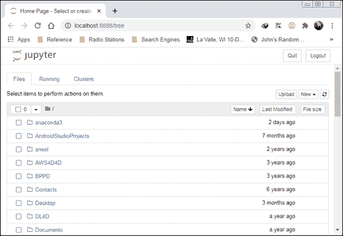

FIGURE 4-4: Jupyter Notebook provides an easy method to create machine learning examples.

#### 停止 Jupyter Notebook 服务器

无论你如何启动 Jupyter Notebook（或书中其余部分出现的 Notebook），你都需要单击客户端窗口右上角的 Quit 以退出 Notebook。否则，Notebook 服务器将在后台保持运行，你的环境将处于不确定状态，在某些情况下可能导致数据丢失。单击 Quit 后，你会看到一个 Server Stopped 消息框，可以通过单击右上角的 X 将其关闭。关闭浏览器窗口。

如果你已完成使用 Anaconda，请在 Anaconda Navigator 窗口中选择 File ⇒ Quit。在第一次（以及可能随后的）关机过程中，你会看到一个 Quit Application 对话框，必须单击 Yes 以结束 Anaconda Navigator。如果你不想再看到此对话框，可以在单击 Yes 之前选择 Don’t Show Again 将其删除。

有时服务器关机过程比预期的要长。在这种情况下，Anaconda Navigator 会显示一条消息，告诉你它仍在后台工作。在退出之前，请允许它完成需要完成的任何进程。如果你没有正确退出 Jupyter Notebook，也可能会看到此消息。在这种情况下，你需要结束 Anaconda Navigator，因为服务器永远不会停止。

# 定义代码仓库

你在本书中创建和使用的代码将驻留在硬盘上的仓库中。将 *repository* 视为一种文件柜，用于存放代码。Notebook 打开一个抽屉，取出文件夹，并向你显示代码。你可以修改它，在文件夹中运行单个示例，添加新示例，并以自然的方式与代码交互。以下部分将帮助你开始使用 Notebook，以便你了解整个仓库概念的工作原理。

### 定义本书的文件夹


整理好文件很有好处，这样你以后就能更轻松地访问它们。本书将 Python 文件保存在 `ML4D2E` 和 `ML4D2ER` 文件夹中。但是，本书侧重于 Python 代码，因此以下步骤展示了如何在 Notebook 中创建 Python 文件夹。

### 创建新文件夹

1. **启动 Notebook 后，选择 New ⇒ Folder。**

   Notebook 会创建一个名为 Untitled Folder 的新文件夹，如 图 4-5 所示。文件将按字母数字顺序排列，因此你最初可能看不到它。你必须向下滚动到正确的位置。

   

   FIGURE 4-5: New folders will appear with a name of Untitled Folder.

2. **选择 Untitled Folder 条目旁边的框。**

3. **单击页面顶部的 Rename。**

   你会看到一个 Rename Directory 对话框。

4. **键入 `ML4D2E` 并单击 OK。**

   Notebook 会为你更改文件夹的名称。

5. **单击列表中的新 `ML4D2E` 条目。**

   Notebook 会将位置更改为 `ML4D2E` 文件夹，你将在其中执行与本书练习相关的任务。

### 创建新 Notebook

每个新 notebook 都像一个文件夹。你可以将单个示例放入文件夹中，就像将纸张放入物理文件夹一样。每个示例都出现在一个单元格中。你也可以将其他类型的内容放入文件夹，但随着本书的推进，你会了解这些内容的工作原理。使用以下步骤创建新 notebook：

1. **单击 New ⇒ Python 3。**

   浏览器中会打开一个新标签页，显示新的 notebook，如 图 4-6 所示。请注意，notebook 包含一个单元格，并且 Notebook 已高亮显示该单元格，以便你开始在其中键入代码。notebook 的标题目前是 Untitled。这不是一个特别有用的标题，因此你需要将其更改。

2. **单击页面上的 Untitled。**

   Notebook 会询问你想使用什么作为新名称。

3. **键入 `ML4D2E; 04; Sample` 并按 Enter。**

   新名称告诉你，这是 *Machine Learning For Dummies,* 第 2 版，第 4 章，Sample.ipynb 的文件。使用此命名约定将让你轻松区分这些文件与仓库中的其他文件。

   

   FIGURE 4-6: A notebook contains cells that you use to hold code.

当然，Sample notebook 目前还不包含任何内容。将光标放在单元格中，键入以下代码：

```
import sysprint('Python Version:\n', sys.version) import osresult = os.popen('conda list anaconda$').read()print('\nAnaconda Version:\n', result)
```

第一个 `print()` 语句输出你安装的 Python 版本号。第二个 `print()` 语句打印你安装的 Anaconda 版本号。这两个输出都依赖于使用 `import` 语句的外部代码。第二个调用直接与名为 `conda` 的命令行实用程序配合使用，你在本书中多次看到它的使用。

单击 Run 按钮（工具栏上带有右指箭头的按钮）。你会看到如 图 4-7 所示的输出。你设置的版本号应与 图 4-7 中显示的版本号匹配。输出是与代码位于同一单元格的一部分。但是，Notebook 在视觉上将输出与代码分开，以便你能够区分它们。Notebook 会自动为你创建一个新单元格。

   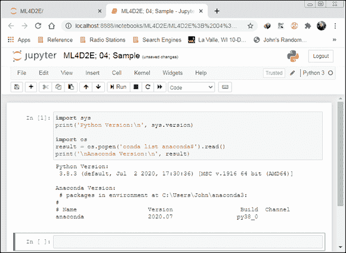

   FIGURE 4-7: Notebook uses cells to store your code.

当你完成 notebook 的使用后，关闭它很重要。要关闭 notebook，请选择 File ⇒ Close and Halt。你将返回主页，在那里可以看到你刚刚创建的 notebook 已添加到列表中。

### 导出 Notebook

创建 notebook 并独自保留并不有趣。到了某个时候，你想与其他人共享它们。要执行此任务，你必须将 notebook 从仓库导出到文件。然后你可以将文件发送给其他人，他或她会将其导入自己的仓库。

上一节展示了如何创建名为 `ML4D2E; 04; Sample` 的 notebook。你可以通过单击仓库列表中的其条目来打开此 notebook。文件会重新打开，以便你再次看到代码。要导出此代码，请选择 File ⇒ Download As ⇒ Notebook (.ipynb)。接下来你看到的内容取决于你的浏览器，但你通常会看到某种对话框，用于将 notebook 保存为文件。使用与使用浏览器保存任何其他文件相同的方法来保存 IPython Notebook 文件。

### 删除 Notebook

有时 notebook 会过时，或者你不再需要使用它们。与其让仓库充满不需要的文件，不如从列表中删除这些不需要的 notebook。使用以下步骤删除文件：

1. **选择 `ML4D2E; 04; Sample.ipynb` 条目旁边的框。**

2. **单击页面顶部的垃圾桶图标 (Delete)。**

   你会看到一个 Delete notebook 警告消息。

3. **单击 Delete。**

   文件将从列表中删除。

### 导入 Notebook

要使用本书的源代码，你必须将下载的文件导入到你的仓库中。源代码以存档文件的形式提供，你将其提取到硬盘上的某个位置。存档包含一系列 `.ipynb` (Notebook) 文件，包含本书的源代码（有关下载源代码的详细信息，请参阅 Introduction）。以下步骤说明如何将这些文件导入到你的仓库中：

1. **单击页面顶部的 Upload。**

   你看到的内容取决于你的浏览器。在大多数情况下，你会看到某种文件上传或打开对话框，用于访问硬盘上的文件。

2. **导航到包含你想要导入到 Notebook 的文件的目录。**

3. **高亮显示一个或多个要导入的文件，并单击 Open（或其他类似）按钮以开始上传过程。**

   你会看到文件被添加到上传列表中，如 图 4-8 所示。文件尚未成为仓库的一部分——你只是将其选定为上传。

4. **单击 Upload。**

   Notebook 将文件放入仓库，以便你开始使用它。

   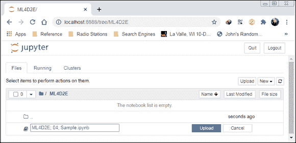

   FIGURE 4-8: The files that you want to add to the repository appear as part of an upload list.

### 了解本书中使用的数据集

除了 Scikit-learn 提供的数据集（[`https://scikit-learn.org/stable/datasets/`](https://scikit-learn.org/stable/datasets/)）之外，本书还使用了一些你可以在 [`https://github.com/lmassaron/datasets`](https://github.com/lmassaron/datasets) 访问的数据集。这些数据集展示了你可以与数据交互的各种方式，你将在示例中使用它们来执行各种任务。以下列表提供了用于将每个数据集导入到 Python 代码中的函数的快速概述：

*   **Air Passengers (**[`https://www.kaggle.com/rakannimer/air-passengers`](https://www.kaggle.com/rakannimer/air-passengers)**):** 一个 `.csv` 文件，包含 1949 年开始的 12 年间，示例航空公司每月的乘客数量。

*   **IMDB 50K (**[`https://www.kaggle.com/lakshmi25npathi/imdb-dataset-of-50k-movie-reviews`](https://www.kaggle.com/lakshmi25npathi/imdb-dataset-of-50k-movie-reviews)**):** 一个用于二元情感分类的数据集，包含一组 25,000 条广受欢迎的电影评论用于训练，以及 25,000 条用于测试。


*   **Fashion MNIST (`https://github.com/zalandoresearch/fashion-mnist`):** Zalando 文章（`https://jobs.zalando.com/en/tech/`）图片的数据集。它包含 60,000 个示例的训练集和 10,000 个示例的测试集，每个示例都标记为十个类别之一。

*   **Palmer Penguins (`https://github.com/allisonhorst/palmerpenguins`):** 一个包含两个数据集的软件包，由 Kristen Gorman 博士和南极洲 Palmer Station LTER（长期生态研究网络的成员）收集并提供。

*   **Shakespeare (`https://www.kaggle.com/kingburrito666/shakespeare-plays`):** 列出了莎士比亚的所有戏剧、这些戏剧中的台词以及谁在说这句台词。

*   **SMS Spam Collection (`https://www.kaggle.com/uciml/sms-spam-collection-dataset`):** 一组为 SMS 垃圾邮件研究收集的带标签的短信。它包含一组英文短信，共 5,574 条，根据消息是合法（ham）还是垃圾邮件（spam）进行标记。

*   **Tennis (`https://www.kaggle.com/ehallmar/a-large-tennis-dataset-for-atp-and-itf-betting`):** 包含 ATP 和 ITF 联盟大量网球比赛统计数据的数据集。

*   **Titanic (`https://www.openml.org/d/40945`):** 描述泰坦尼克号上个别乘客生存状态的数据集。泰坦尼克号数据不包含船员信息，但包含一半乘客的实际年龄。

*   **Wine (`https://www.kaggle.com/sgus1318/winedata`):** 包含与葡萄酒质量相关的统计数据。

加载每个数据集的技术可能因来源而异。以下示例展示了如何加载 Air Passengers 数据集。你可以在 `ML4D2E; 04; Dataset Load.ipynb` 笔记本中找到代码。可下载的数据集采用基于 Apache Arrow 的 Feather 文件格式（`https://arrow.apache.org/docs/python/feather.html`）存档。要在 Notebook 中使此文件格式可用，请打开 Anaconda 提示符并键入以下命令：

`conda install feather-format -c conda-forge`

该命令需要一段时间才能完成，因为它会收集包信息并解析环境（确定执行安装需要做什么）。在某个时刻，你需要键入 `y` 并按 Enter 键以完成安装。要验证安装是否良好，请使用以下命令：

`conda list feather-format`

几秒钟后，你会看到类似这样的输出：

```
# packages in environment at C:\Users\John\anaconda3:## Name Version Build Channelfeather-format 0.4.1 pyh9f0ad1d_0 conda-forge
```

现在你有了所需的库，可以从书籍数据集网站提供的数据集中加载数据。首先，从 [`https://github.com/lmassaron/datasets`](https://github.com/lmassaron/datasets) 下载 `air_passengers.feather` 文件，并将其放入你为此书创建的文件夹中。（在后续章节中，你将学习如何直接从书籍数据集网站下载 `.feather` 文件，但现在进行下载可以保持简单。）以下是加载 Air Passengers 数据集为 `dataframe` 的代码示例。

```
import pyarrow.feather as feather
read_df = feather.read_feather('air_passengers.feather')
print(read_df)
```

结果是一个包含每月乘客数量的 144 行 `dataframe`。Figure 4-9 显示典型输出。

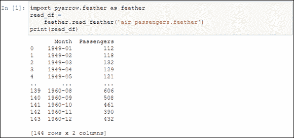

FIGURE 4-9: The `read_df` object contains the loaded dataset as a dataframe.

# Chapter 5

## Beyond Basic Coding in Python

### IN THIS CHAPTER

- **Performing essential programming tasks in Python**
- **Managing data using sets, lists, and tuples**
- **Accessing individual items using iterators**
- **Making data easier to access using indexed storage**

Chapter 4 帮助你创建一个可用于多种目的（包括机器学习和数据科学）的 Python 安装。本章的重点是提供 Python 作为语言的工作原理以及如何解决机器学习问题的良好概述。如果你已经了解 Python，可能可以跳过本章并进入下一章。不过，最好至少浏览本章并测试一些示例，以确保你拥有良好的安装。

如果你是 Python 新手，无法使用本书从零开始学习 Python——为此，你需要一本像本书合著者 John Mueller（Wiley 出版社）所著的 *Beginning Programming with Python For Dummies,* 2nd Edition 这样的书，或者需要一个像 [`https://docs.python.org/3/tutorial/`](https://docs.python.org/3/tutorial/) 这样的教程。本章假设你使用过其他编程语言，并且至少了解 Python 的工作原理。除此之外，你可以使用本章作为 Python 工作原理的复习，这正是许多人真正需要的。你将了解使用 Python 数据类型、编码结构和数据操作策略的基础知识。

 你不必手动输入本章的源代码。事实上，使用可下载的源代码要容易得多。你可以在可下载源代码的 `ML4D2E` 文件夹中找到本章的源代码。本章的示例文件将以 `ML4D2E; 05;` 开头。有关如何查找这些源文件的详细信息，请参阅 Introduction。

## Defining the Basics You Should Know

任何语言都具有基本特征，Python 也不例外。例如，语言提供各种数据类型、运算符、与数据交互的方法等等。此外，Python 支持函数和模块。你在学习本书中的示例时会用到这些知识。以下各部分对这些基础知识进行了简要概述提醒。

### Considering Python basics

Python 是一种丰富的语言，它在易于使用的语言中为你提供了极大的灵活性。本部分简要概述了 Python 基础知识。如果你需要更多帮助，且本章介绍中提供的标准 Python 教程参考不够用，可以考虑使用 [`https://www.w3schools.com/python/`](https://www.w3schools.com/python/) 和 [`https://www.tutorialspoint.com/python/index.htm`](https://www.tutorialspoint.com/python/index.htm) 上的教程。Table 5-1 显示常见 Python 数值数据类型的概述。

TABLE 5-1 Python Numeric Data Types

| **Type** || **Range** || **Example** |

| --- | --- | --- |

| `int` or `long` || –9,223,372,036,854,775,808 and 9,223,372,036,854,775,807 (defined by `sys.maxsize` for a particular platform) || 1 |

| --- | --- | --- |

| `float` || ±2.2250738585072014 × 10^(\-308) and ±1.7976931348623157 × 10³⁰⁸ (defined by `sys.float_info.max` and `sys.float_info.min` for a particular platform) || 1.0 |

| --- | --- | --- |

| `complex` || N/A || 3 + 4j |

| --- | --- | --- |

| `bool` || `True` or `False` || `True` |

要创建用于保存数据的变量，你需要进行赋值。Table 5-2 包含 Python 赋值运算符列表（假设 `MyVar` 在每种情况下都初始包含值 `5`）。


# 运算符概述

Arithmetic, unary, and bitwise operators provide the means for manipulating data in various ways. 表 5-3 显示了这些运算符。

### Python 赋值运算符

表 5-2 Python 赋值运算符

| 运算符 | 描述 | 示例 |
| --- | --- | --- |
| `=` | 将右操作数中的值赋给左操作数 | `MyVar = 5` 会使 `MyVar` 包含 5 |
| `+=` | 将右操作数中的值加到左操作数中的值上，并将结果放在左操作数中 | `MyVar += 2` 会使 `MyVar` 包含 7 |
| `-=` | 用左操作数中的值减去右操作数中的值，并将结果放在左操作数中 | `MyVar -= 2` 会使 `MyVar` 包含 3 |
| `*=` | 将右操作数中的值乘以左操作数中的值，并将结果放在左操作数中 | `MyVar *= 2` 会使 `MyVar` 包含 10 |
| `/=` | 用左操作数中的值除以右操作数中的值，并将结果放在左操作数中 | `MyVar /= 2` 会使 `MyVar` 包含 2.5 |
| `%=` | 用左操作数中的值除以右操作数中的值，并将余数放在左操作数中 | `MyVar %= 2` 会使 `MyVar` 包含 1 |
| `**=` | 确定左操作数中值的指数值，其幂为右操作数中的值，并将结果放在左操作数中 | `MyVar **= 2` 会使 `MyVar` 包含 25 |
| `//=` | 用左操作数中的值除以右操作数中的值，并将整数（整数）结果放在左操作数中 | `MyVar //= 2` 会使 `MyVar` 包含 2 |

### Python 算术、一元和位运算符

表 5-3 Python 算术、一元和位运算符

| 运算符 | 描述 | 示例 |
| --- | --- | --- |
| `+` | 将两个值相加 | `5 + 2 = 7` |
| `–` | 用左操作数减去右操作数 | `5 – 2 = 3` |
| `*` | 将右操作数乘以左操作数 | `5 * 2 = 10` |
| `/` | 用左操作数除以右操作数 | `5 / 2 = 2.5` |
| `%` | 用左操作数除以右操作数并返回余数 | `5 % 2 = 1` |
| `**` | 计算右操作数的指数值，由左操作数指定 | `5 ** 2 = 25` |
| `//` | 执行整数除法，其中左操作数除以右操作数，仅返回整数（也称为地板除法） | `5 // 2 = 2` |
| `~` | 反转数字中的位，使所有 0 位变为 1 位，反之亦然。 | `~4` 结果为 `–5` |
| `–` | 否定原始值，使正数变为负数，反之亦然。 | `–(–4)` 结果为 4，`–4` 结果为 `–4` |
| `+` | 纯粹为了完整性而提供。该运算符返回与您提供的输入相同的值。 | `+4` 结果为 4 |
| `&` (And) | 确定两个操作数中的各个位是否都为真，并在它们都为真时将结果位设置为 `True`。 | `0b1100 & 0b0110 = 0b0100` |
| `\|` (Or) | 确定两个操作数中的各个位是否有一个为真，并在它们为真时将结果位设置为 `True`。 | `0b1100 \| 0b0110 = 0b1110` |
| `^` (Exclusive or) | 确定两个操作数中的各个位是否只有一个为真，并在只有一个为真时将结果位设置为 `True`。当两个位都为真或两个位都为假时，结果为 `False`。 | `0b1100 ^ 0b0110 = 0b1010` |
| `~` (One's complement) | 计算数字的补码值。 | `~0b1100 = –0b1101~0b0110 = –0b0111` |
| `<<` (Left shift) | 将左操作数中的位向左移动右操作数的值。所有新位都设置为 0，所有流出末尾的位都会丢失。 | `0b00110011 << 2 = 0b11001100` |
| `>>` (Right shift) | 将左操作数中的位向右移动右操作数的值。所有新位都设置为 0，所有流出末尾的位都会丢失。 | `0b00110011 >> 2 = 0b00001100` |

### Python 关系和逻辑运算符

有时您需要检查两个变量之间的关系或以某种方式比较它们。表 5-4 提供了 Python 关系和逻辑运算符的列表。

表 5-4 Python 关系和逻辑运算符

| 运算符 | 描述 | 示例 |
| --- | --- | --- |
| `==` | 确定两个值是否相等。请注意，关系运算符使用两个等号。许多开发人员犯的错误是只使用一个等号，这会导致一个值被赋给另一个值。 | `1 == 2` 是 False |
| `!=` | 确定两个值是否不相等。Python 的一些旧版本允许您使用 `<>` 运算符代替 `!=` 运算符。使用 `<>` 运算符会导致当前版本的 Python 出现错误。 | `1 != 2` 是 True |
| `>` | 验证左操作数的值是否大于右操作数的值。 | `1 > 2` 是 False |
| `<` | 验证左操作数的值是否小于右操作数的值。 | `1 < 2` 是 True |
| `>=` | 验证左操作数的值是否大于或等于右操作数的值。 | `1 >= 2` 是 False |
| `<=` | 验证左操作数的值是否小于或等于右操作数的值。 | `1 <= 2` 是 True |
| `and` | 确定两个操作数是否都为真。 | `True and True` 是 True`True and False` 是 False`False and True` 是 False`False and False` 是 False |
| `or` | 确定两个操作数中是否有一个为真。 | `True or True` 是 True`True or False` 是 True`False or True` 是 True`False or False` 是 False |
| `not` | 否定单个操作数的真值。真值变为假值，假值变为真值。 | `not True` 是 False`not False` 是 True |

### Python 成员和身份运算符

与数字一样，您可以将一些特殊运算符与对象（例如字符串）一起使用，以了解更多有关它们的信息。*成员运算符* 让您确定字符串何时包含特定内容。您使用*身份运算符* 来确定变量包含的数据类型。表 5-5 显示了这些运算符。

表 5-5 Python 成员和身份运算符

| 运算符 | 描述 | 示例 |
| --- | --- | --- |
| `in` | 确定左操作数中的值是否出现在右操作数中找到的序列中 | “Hello” in “Hello Goodbye” 是 True |
| `not in` | 确定左操作数中的值是否缺失于右操作数中找到的序列中 | “Hello” not in “Hello Goodbye” 是 False |
| `is` | 当右操作数中的值或表达式的类型指向左操作数中的相同类型时，结果为真 | `type(2) is int` 是 True |
| `is not` | 当右操作数中的值或表达式的类型指向与左操作数中的值或表达式不同的类型时，结果为真 | `type(2) is not int` 是 False |

### Python 运算符优先级

计算机通过使某些运算符比其他运算符更重要来为比较提供顺序。运算符的顺序称为*运算符优先级*。表 5-6 显示了所有常见 Python 运算符的运算符优先级，包括一些您尚未在讨论中见过的运算符。在进行比较时，始终考虑运算符优先级；否则，您对比较结果所做的假设很可能是错误的。

表 5-6 Python 运算符优先级

| 运算符 | 描述 |
| --- | --- |
| `()` | 您使用括号来分组表达式并覆盖默认优先级，以便您可以强制较低优先级的操作（例如加法）优先于较高优先级的操作（例如乘法）。 |


| `**` || 指数运算将左操作数的值提升到右操作数指定的幂。 |

| `~ + –` || 一元运算符与单个变量或表达式进行交互。 |

| `* / % //` || 乘法、除法、取模和向下取整除法。 |

| `+ –` || 加法和减法。 |

| `>> <<` || 右移和左移位运算。 |

| `&` || 按位与运算。 |

| `^` || 按位异或运算和标准或运算。 |

| `<= < > >=` || 比较运算符。 |

| `== !=` || 相等运算符。 |

| `= %= /= //= –= += *= **=` || 赋值运算符。 |

| `is is not` || 标识运算符。 |

| `in not in` || 成员运算符。 |

| `not or and` || 逻辑运算符。 |

#### 使用函数

要妥善管理信息，你需要组织用于执行所需任务的工具。你创建的每一行代码都执行特定任务，你将这些代码行组合起来以达到预期结果。有时你需要用不同的数据重复指令，在某些情况下，你的代码会变得如此之长，以至于难以跟踪每个部分的作用。函数充当组织工具，使你的代码保持整洁有序。此外，函数允许你根据需要轻松重复使用已创建的指令，并使用不同的数据。本章这一部分将介绍关于函数的所有内容。更重要的是，在本部分中，你将开始以专业开发人员的方式定义如何创建你的第一个严肃应用程序。

##### 创建可重用的函数

你走到衣柜前，拿出裤子和衬衫，撕掉标签，然后穿上它们。一天结束时，你把所有东西都脱下来扔进垃圾桶。嗯……这确实不是大多数人所做的。大多数人脱下衣服，清洗它们，然后把它们放回衣柜以供重复使用。函数也是可重用的。没有人想不断重复同一项任务；这会变得单调乏味。当你创建一个函数时，你定义了一段可以反复用于执行相同任务的代码包。你所需要做的就是告诉计算机执行特定任务，即告诉它使用哪个函数。计算机会忠实地执行函数中的每一条指令，每次你要求它这样做时都会如此。

使用函数时，需要函数提供服务的代码被称为 `caller`，它会调用函数来为其执行任务。你所看到的关于函数的大部分信息都涉及调用者。调用者必须向函数提供信息，函数则将信息返回给调用者。

曾几何时，计算机程序不包含代码可重用性的概念。因此，开发人员不得不不断重新发明相同的代码。不久之后，有人提出了函数的概念，该概念多年来不断发展，直到函数变得相当灵活。你可以让函数执行你想要的任何操作。代码可重用性是应用程序的必要组成部分，可以：

* 减少开发时间

* 减少程序员错误

* 提高应用程序可靠性

* 允许整个团队受益于一名程序员的工作

* 使代码更易于理解

* 提高应用程序效率

事实上，函数以可重用性的形式为应用程序执行一整套功能。在阅读本书中的示例时，你会看到可重用性如何让你的生活变得轻松得多。如果没有可重用性，你仍将通过手动将 0 和 1 插入计算机来进行编程。

创建函数不需要太多工作。要了解函数的工作原理，请打开 Anaconda Prompt，输入 `python` 并按 Enter 启动 Python 的副本，然后键入以下代码（每行末尾按 Enter）：

`def SayHello(): return "Hello There!"`

要结束函数，在最后一行后再次按 Enter。函数以关键字 `def`（define 的缩写）开头。你提供函数名、可以包含函数 `arguments`（函数中使用的数据）的括号以及一个冒号。编辑器会自动为你缩进下一行。Python 依赖空白字符来定义 `code blocks`（函数中相互关联的语句）。

现在你可以使用该函数了。只需输入 `SayHello()` 并按 Enter。函数名后面的括号很重要，因为它们告诉 Python 执行函数，而不是告诉你你正在作为对象访问函数（以确定它是什么）。你会看到该函数的输出为 `Hello There!`。

##### 调用函数

函数可以接受参数（额外的数据位）并返回值。交换数据的能力使函数比其他情况更有用得多。以下部分描述了以多种方式调用函数，以发送和接收数据。

##### 发送必需参数

函数可以要求调用者向其提供参数。必需参数是必须包含数据才能使函数工作的变量。打开 Anaconda Prompt，输入 `python` 并按 Enter，然后键入以下代码：

`def DoSum(Value1, Value2): return Value1 + Value2`

你有了一个新函数 `DoSum()`。此函数要求你提供两个参数才能使用它。要了解其工作原理，请输入 `DoSum(1, 2)` 并按 Enter。你会看到输出为 `3`。请注意，当你提供 `1` 和 `2` 作为输入时，`DoSum()` 始终提供输出值 `3`。`return` 语句提供输出值。每当你在函数中看到 `return` 时，就知道该函数提供输出值。

##### 按关键字发送参数

随着函数变得更加复杂以及使用方法也随之复杂化，你可能希望对如何精确调用函数并向其提供参数有更多控制。到目前为止，你一直使用 *位置参数*，这意味着你已按照函数定义中参数列表出现的顺序提供了值。但是，Python 还有一种按关键字发送参数的方法。在这种情况下，你提供参数名，后跟等号（`=`）和参数值。要了解其工作原理，请打开 Anaconda Prompt，输入 `python` 并按 Enter，然后键入以下代码：

`def DisplaySum(Value1, Value2): print(str(Value1) + ' + ' + str(Value2) + ' = ' + str((Value1 + Value2)))`

请注意，`print()` 函数的参数包括要打印的项目列表，这些项目由加号（`+`）分隔。此外，参数的类型不同，因此必须使用 `str()` 函数将它们转换。Python 允许你以这种方式轻松混合和匹配参数。此函数还引入了自动行延续的概念。`print()` 函数实际上跨越两行，Python 会自动将函数从第一行延续到第二行。

接下来，是时候测试 `DisplaySum()` 了。当然，你想先使用位置参数来尝试该函数，因此请输入 `DisplaySum(2, 3)` 并按 Enter。你会看到预期的输出 `2 + 3 = 5`。现在输入 `DisplaySum(Value2 = 3, Value1 = 2)` 并按 Enter。同样，你会收到输出 `2 + 3 = 5`，尽管参数的位置已颠倒。

##### 为函数参数指定默认值

无论你使用位置参数还是关键字参数进行调用，到目前为止的函数都要求你提供一个值。有时，当有常用值可用时，函数可以使用默认值。要创建默认值，只需在参数名后跟等号和默认值即可。要了解其工作原理，请打开 Anaconda Prompt，输入 `python` 并按 Enter，然后键入以下代码：

`def SayHello(Greeting = "No Value Supplied"): print(Greeting)`


The `SayHello()` function provides an automatic value for `Greeting` when a caller doesn't provide one. When someone tries to call `SayHello()` without an argument, Python doesn’t raise an error; instead, it outputs `No Value Supplied`. Type `SayHello()` and press Enter to see for yourself. You see the default message. Type `SayHello("Howdy!")` to see a normal response.

# CREATING FUNCTIONS WITH A VARIABLE NUMBER OF ARGUMENTS

In most cases, you know precisely how many arguments to provide with your function. Fortunately, Python provides a technique for sending a variable number of arguments to a function. You simply create an argument that has an asterisk in front of it, such as `*VarArgs`. The usual technique is to provide a second argument that contains the number of arguments passed as an input. To see how this works, open the Anaconda Prompt, type `python` and press Enter, and type the following code:

```
def DisplayMulti(ArgCount = 0, *VarArgs): print('You passed ' + str(ArgCount) + ' arguments.', VarArgs)
```

Notice that the `print()` function displays a string and then the list of arguments. Because of the way this function is designed, you can type `DisplayMulti()` and press Enter to see that it's possible to pass zero arguments. To see multiple arguments at work, type `DisplayMulti(3, 'Hello', 1, True)` and press Enter. The output of `You passed 3 arguments. ('Hello', 1, True)` shows that you need not pass values of any particular type.

# Working with modules

To use a module, you must import it. Python places the module code inline with the rest of your application in memory — as if you had created one huge file. Neither file is changed on disk; they’re still separate, but the way Python views the code is different.

You have two ways to import modules. Each technique is used in specific circumstances:

*   `import`: You use the `import` statement when you want to import an entire module. This is the most common method that developers use to import modules because it saves time and requires only one line of code. However, this approach also uses more memory resources than does the approach of selectively importing the attributes you need, which the next paragraph describes.

*   `from…import`: You use the `from…import` statement when you want to selectively import individual module attributes. This method saves resources, but at the cost of complexity. In addition, if you try to use an attribute that you didn't import, Python registers an error. Yes, the module still contains the attribute, but Python can’t see it because you didn’t import it.

To use the code in a module, Python must be able to locate the module and load it into memory. The location information is stored as paths within Python. Whenever you request that Python import a module, Python looks at all the files in its list of paths to find it. The path information comes from three sources:

*   **Environment variables:** An environment variable provides a platform-specific operating system level variable you can use to store information about an application. You use various means to set environment variables depending on the platform. For example, when working with Windows, you can either set environment variables at the command prompt or using the Environment Variables dialog box (see [`http://blog.johnmuellerbooks.com/2014/02/17/adding-a-location-to-the-windows-path/`](http://blog.johnmuellerbooks.com/2014/02/17/adding-a-location-to-the-windows-path/) for details). One of the most important environment variables for Python developers is `PYTHONPATH`, which shows the default location for searching for files on your drive.

*   **Current directory:** Python uses the current directory to look for files that it needs. You use the following code to discover the current Python directory: 

```
import os
os.getcwd()
```

*   If you want to change the current directory so that Python looks in another location, you use the following code: 

```
import os
os.chdir('new_path')
```

    where `new_path` is the location you want to use.

*   **Default directories:** Even when you don't define any environment variables and the current directory doesn’t yield any usable modules, Python can still find its own libraries in the set of default directories that are included as part of its own path information.

It’s important to know where Python is looking for modules. Sometimes you might encounter an error when Python can’t find a module, even though you know the module exists on disk. The following code shows how to determine where Python is looking for modules on disk:

```
import os
os.environ['PYTHONPATH']
```

If you receive a `KeyError: ‘PYTHONPATH’` error message, it means that the PYTHONPATH environment variable isn’t defined. Python can still find files; it just doesn’t have `PYTHONPATH` as a resource.

# Storing Data Using Sets, Lists, and Tuples

Python provides a host of methods for storing data in memory. Each method has advantages and disadvantages. Choosing the most appropriate method for your particular need is important. The following sections discuss three common techniques used for storing data for machine learning needs.

### Creating sets

Most people have used sets at one time or another in school to create lists of items that belong together. These lists then became the topic of manipulation using math operations such as intersection, union, difference, and symmetric difference. Sets are the best option to choose when you need to perform membership testing and remove duplicates from a list. You can't perform sequence-related tasks using sets, such as indexing or slicing. To see how you can work with sets, open the Anaconda Prompt, type `python` and press Enter, and type the following code:

```
SetA = set(['Red', 'Blue', 'Green', 'Black'])
SetB = set(['Black', 'Green', 'Yellow', 'Orange'])
```

### Performing operations on sets

Assuming that you created the sets found in the previous section, you may have noticed that each of them has some common elements. To see how these sets are similar, create some new sets that rely on math operations for comparison purposes, as shown in the following code:

```
SetX = SetA.union(SetB)
SetY = SetA.intersection(SetB)
SetZ = SetA.difference(SetB)
```

To see the results of each math operation, type `print('{0}\n{1}\n{2}'.format(SetX, SetY, SetZ))` and press Enter. You see one set printed on each line, like this:

```
{'Red', 'Black', 'Yellow', 'Green', 'Blue', 'Orange'}
{'Green', 'Black'}
{'Blue', 'Red'}
```

The outputs show the results of the math operations: `union()`, `intersection()`, and `difference()`. Python's fancier print formatting can be useful in working with collections such as sets. The `format()` function tells Python which objects to place within each of the placeholders in the string. A `placeholder` is a set of curly brackets ({}) with an optional number in it. The `escape character` (essentially a kind of control or special character), `/n`, provides a newline character between entries. You can read more about fancy formatting at [`https://docs.python.org/3/tutorial/inputoutput.html`](https://docs.python.org/3/tutorial/inputoutput.html).

You can also test relationships between the various sets. For example, type `SetA.issuperset(SetY)` and press Enter. The output value of `True` tells you that `SetA` is a superset of `SetY`. Likewise, if you type `SetA.issubset(SetX)` and press Enter, you find that `SetA` is a subset of `SetX`.

It's important to understand that sets are either mutable or immutable. All the sets in this example are mutable, which means that you can add or remove elements from them. For example, if you type `SetA.add('Purple')` and press Enter, `SetA` receives a new element. If you type `SetA.issubset(SetX)` and press Enter now, you find that `SetA` is no longer a subset of `SetX` because `SetA` has the `'Purple'` element in it.


### 使用列表

Python 规范将列表定义为一种序列。`Sequences` 只是提供了一些手段，允许多个数据项在一个存储单元中共同存在，但作为独立的实体。想想你在公寓楼里看到的那种大型信箱架。一个信箱架包含若干个小信箱，每个信箱都可以存放邮件。Python 还支持其他类型的序列：

*   `Tuples:` `tuple` 是一种用于创建复杂类似列表序列的集合。元组的一个优点是你可以嵌套元组的内容。此功能让你能够创建可存储员工记录或 x-y 坐标对的结构。

*   `Dictionaries:` 与真实字典一样，使用字典集合时会创建键/值对（可以将其视为一个单词及其关联的定义）。字典提供了极快的搜索时间，并使数据排序变得容易得多。

*   `Stacks:` 大多数编程语言都直接支持栈。但是，Python 不支持栈，尽管有变通方法。栈是一种后进先出（LIFO）序列。想象一摞煎饼：你可以在顶部添加新煎饼，也可以从顶部取下煎饼。栈是一种重要的集合，你可以在 Python 中使用列表来模拟它。

*   `Queues:` 队列是一种先进先出（FIFO）集合。你使用它来跟踪需要以某种方式处理的项目。将队列视为银行的排队队伍。你进入队伍，等待轮到你，最终被叫到柜员面前交谈。

*   `Deques:` 双端队列（deque，发音为 `deck`）是一种类似队列的结构，允许你从任一端添加或删除项目，但不能从中间添加或删除。你可以将 deque 用作队列或栈，或任何其他你以有序方式添加和删除项目的集合（与允许随机访问和管理的列表、元组和字典不同）。

在所有序列中，列表最容易理解，也与现实世界对象最直接相关。使用列表有助于你更好地处理其他提供更大功能和更高灵活性的序列。关键在于，列表中的数据存储方式就像你在纸上写下的一样——一个项目接在另一个项目之后。以下部分将帮助你更好地理解列表。

#### 定义列表

列表有开头、中间和结尾。项目是编号的。（即使你在现实生活中可能不会通常给它们编号，Python 也会始终为你编号项目。）要了解如何使用列表，请打开 Anaconda Prompt，输入 `python` 并按 Enter，然后输入以下代码：

```
ListA = [0, 1, 2, 3]
ListB = [4, 5, 6, 7]
ListA.extend(ListB)
ListA
```

当你输入最后一行代码时，你会看到输出 `[0, 1, 2, 3, 4, 5, 6, 7]`。`extend()` 函数将 `ListB` 的成员添加到 `ListA`。除了扩展列表，你还可以使用 `append()` 函数向其中添加项目。输入 `ListA.append(-5)` 并按 Enter。当你再次输入 `ListA` 并按 Enter 时，你会看到 Python 已将 -5 添加到列表末尾。你可能会发现需要再次删除项目，你可以使用 `remove()` 函数来完成。例如，输入 `ListA.remove(-5)` 并按 Enter。当你再次列出 `ListA` 时，你会看到添加的条目已消失。

#### 使用连接组合列表

列表支持使用加号（`+`）进行连接。例如，如果你输入 `ListX = ListA + ListB` 并按 Enter，你会发现新创建的 `ListX` 包含 `ListA` 和 `ListB`，其中 `ListA` 的元素排在前面。

#### 使用推导式构建列表

列表推导式提供了一种优雅且简单的方法，用于创建具有特定内容的列表。推导式出现在列表名称赋值后的方括号中，包含三个元素：一个表达式、要作用的单个项目以及要处理的项目列表。例如，以下列表推导式会将字符串 `"Hello"` 的单个字母转换为大写后放入列表 `Letters` 中：

```
Letters = [letter.upper() for letter in "Hello"]
print(Letters)
```

输出将包含 `['H', 'E', 'L', 'L', 'O']`。通常，要创建这样的列表，你需要一个 `for` 循环和几行代码。列表推导式只需一行即可完成，并且易于阅读。

#### 切片和处理列表

你可以访问广泛的列表方法和技术，用于仅对列表的一部分进行操作。以下列表提供了一些与列表交互的最常见技术。你会在书中示例中看到许多其他方法。

*   `MyList.append(x):` 将元素添加到列表末尾。

*   `MyList.insert(index, value):` 将元素 `value` 添加到列表由 `index` 指定的位置。

    列表中的第一个项目编号为 `0`，而不是你可能认为的 `1`。因此，当将数字 `4` 添加到 `MyList` 前面时，你使用 `MyList.insert(0, 4)`。

*   `MyList.remove(x):` 从列表中删除 x 的第一个出现项。

*   `MyList.extend(ListB):` 将 `ListB` 中的元素追加到 `MyList` 末尾。

*   `MyList[a:b]:` 返回由起始点 `a` 和结束点 `b` 表示的列表部分。你可以选择添加第三个元素（步长），它告诉在输出之间跳过多少个元素。

*   `MyList.index(value):` 返回 `value` 在列表中第一次出现的索引。

*   `MyList.sort():` 对列表进行排序。你可以指定 `reverse=True` 以逆序排列列表。此外，你可以提供一个特殊函数来定义排序顺序。

*   `len(MyList):` 显示列表长度。

*   `max(MyList):` 获取列表中的最大值。

*   `min(MyList):` 获取列表中的最小值。

### 创建和使用元组

`tuple` 是一种用于创建复杂列表的集合，你可以在其中将一个元组嵌入到另一个元组中。这种嵌入让你能够使用元组创建层次结构。层次结构可以是简单的硬盘目录列表或公司组织结构图。其理念是你可以使用元组创建复杂的数据结构。

元组是 `immutable`，这意味着你无法更改它们。你可以创建一个同名的新元组并以某种方式修改它，但你无法修改现有元组。列表是可变的，这意味着你可以更改它们。因此，元组乍看之下似乎处于劣势，但不可变性有各种各样的优势，例如更安全且更快。此外，不可变对象更容易与多个处理器一起使用。要了解如何使用元组，请打开 Anaconda Prompt，输入 `python` 并按 Enter，然后输入以下代码：

```
MyTuple = (1, 2, 3, (4, 5, 6, (7, 8, 9)))
```

`MyTuple` 嵌套了三层。第一层包含值 1、2、3 和一个元组。第二层包含值 4、5、6 和另一个元组。第三层包含值 7、8 和 9。要了解嵌套的工作原理，请在 Python 控制台中输入以下代码：

```
for Value1 in MyTuple: if type(Value1) == int: print(Value1) else: for Value2 in Value1: if type(Value2) == int: print("\t", Value2) else: for Value3 in Value2: print("\t\t", Value3)
```

运行此代码时，你会发现这些值确实位于三个不同的层级。你可以看到显示层级的缩进：

```
123 4 5 6 7 8 9
```


你可以执行诸如添加新值之类的任务，但必须通过将原始条目和新值添加到一个新元组来完成。此外，你只能将元组添加到现有元组中。要了解如何添加元组，请键入 `MyNewTuple = MyTuple.__add__((10, 11, 12, (13, 14, 15)))` 并按 Enter。`MyNewTuple` 在第一级和第二级都包含新条目，如下所示：`(1, 2, 3, (4, 5, 6, (7, 8, 9)), 10, 11, 12, (13, 14, 15))`。

# 定义有用的迭代器

接下来的章节使用各种技术来访问各种数据结构中的单个值。在本节中，你将使用两个简单的列表，定义如下：

`ListA = ['Orange', 'Yellow', 'Green', 'Brown']ListB = [1, 2, 3, 4]`

访问特定值的最简单方法是使用索引。例如，如果你键入 `ListA[1]` 并按 Enter，则输出为 `'Yellow'`。Python 中的所有索引都从零开始，这意味着第一个条目是 0，而不是 1。

### 使用范围

范围提供了另一种访问值的简单方法。例如，如果你键入 `ListB[1:3]` 并按 Enter，则输出为 `[2, 3]`。你可以将范围作为 `for` 循环的输入，例如

```
for Value in ListB[1:3]: print Value
```

你将看到的不是整个列表，而是单独打印在不同行上的 `2` 和 `3`。范围有两个由冒号分隔的值。但是，这些值是可选的。例如，`ListB[:3]` 将输出 `[1, 2, 3]`。当你省略一个值时，范围将从列表的开头或结尾开始，具体取决于情况。

### 使用 zip 迭代多个列表

有时你需要并行处理两个列表。做到这一点的最简单方法是使用 `zip()` 函数。以下是 `zip()` 函数的示例：

```
for Value1, Value2 in zip(ListA, ListB): print(Value1, '\t', Value2)
```

此代码同时处理 `ListA` 和 `ListB`。处理在 `for` 循环到达两个列表中较短列表的末尾时结束。在这种情况下，你将看到以下内容：

`Orange 1Yellow 2Green 3Brown 4`

这种迭代器的用法只是冰山一角。你将在整本书中看到各种迭代器类型。其目的是让你只列出想要的项目，而不是列表或其他数据结构中的所有项目。即将到来的章节中使用的一些迭代器比你在这里看到的要复杂一些，但这是一个重要的开始。

### 使用 yield 处理生成器

你可以用多种方式使用生成器，但本质上它们可以帮助你遍历对象。可以将其视为一种灵活的 `for` 循环，你不需要重新创建它，并且可以为其定义多个操作。目前，我们通过创建一个非常简单的生成器来保持简单。要了解如何使用 yield 处理生成器，请打开 Anaconda 提示符，键入 `python` 并按 Enter，然后键入以下代码：

```
def MyLetter(): for Letter in Letters: yield Letter
```

此函数将遍历名为 `Letters` 的列表的内容。使用 `yield` 意味着每次调用生成器时都会保存其状态。因此，你将在第一次调用时得到第一个字母，在第二次调用时得到第二个字母，依此类推。键入 `Letters = [letter.upper() for letter in "Hello"]` 来创建 Letters。现在，使用以下代码测试生成器：

```
ListIt = MyLetter()
next(ListIt)
next(ListIt)
next(ListIt)
next(ListIt)
next(ListIt)
```

每次调用 `next()` 都会生成另一个字母，直到 Letters 没有可提供的字母为止。如果你再次调用 `next()`，Python 将显示一条错误消息。

# 使用字典索引数据

`dictionary` 是一种特殊的序列，使用名称和值对。使用名称可以让你轻松访问特定值，而无需使用数字索引。以下各部分将告诉你更多关于字典的信息。

### 创建字典

要创建字典，请将名称和值对括在花括号中。通过键入 `MyDict = {'Orange':1, 'Blue':2, 'Pink':3}` 并按 Enter 来创建测试字典。

### 从字典存储和检索数据

要访问特定值，请使用名称作为索引。例如，键入 `MyDict['Pink']` 并按 Enter 以查看输出值 `3`。将字典用作数据结构可以让你使用每个人都能理解的术语轻松访问极其复杂的数据集。在许多其他方面，使用字典与使用任何其他序列相同。

字典确实有一些特殊功能。例如，键入 `MyDict.keys()` 并按 Enter 以查看键列表。你可以使用 `values()` 函数查看字典中的值列表。

字典键区分大小写。因此，`'Pink'`、`'PINK'` 和 `'pink'` 都是不同的键。

第 6 章

# 使用 Google Colab

本章内容

**了解 Google Colab**

**访问 Google 和 Colab**

**执行基本 Colab 任务**

**获取更多信息**

Colaboratory (`https://colab.research.google.com/notebooks/welcome.ipynb`)，简称 Colab，是一项基于 Google 云的服务，在云端复制了 Jupyter Notebook。你不需要在系统上安装任何东西即可使用它。在大多数方面，你使用 Colab 就像使用 Jupyter Notebook 的桌面安装版一样（在本书中也称为 Notebook）。本书包含本章主要是为了那些使用非标准桌面设置来学习示例的读者。

由于你可能不使用本书中出现的相同产品版本，因此本书的示例源代码在使用 Colab 时可能会或可能不会像文中描述的那样精确工作。此外，由于平台之间的硬件差异，使用 Colab 时你可能看不到本书中呈现的结果。本章的早期部分将更详细地介绍 Colab，并帮助你了解可以从中获得什么。但是，最重要的是要记住，Colab 不是 Jupyter Notebook 的替代品，示例也未经过专门测试以与其配合使用，但如果你希望学习示例，可以使用备用设备尝试。

要使用 Colab，你必须拥有一个 Google 帐户，然后使用该帐户访问 Colab。否则，大多数 Colab 功能将无法使用。本章的下一部分将帮助你开始使用 Google 并访问 Colab。

与 Notebook 一样，你可以使用 Colab 在单元格导向范式中执行特定任务。本章的下一部分将介绍一系列与任务相关的主题，从使用笔记本开始。如果你在之前的章节中使用过 Notebook，你会注意到 Notebook 和 Colab 之间有很强的相似性。当然，你还想执行其他类型的任务，例如创建各种单元格类型并使用它们来创建看起来像使用 Notebook 创建的笔记本。

最后，本章无法涵盖 Colab 的每个方面，因此本章的最后一部分充当查找有关 Colab 的最可靠信息的便捷资源。

### 定义 Google Colab

Google Colab 是 Notebook 的云版本。事实上，欢迎页面清楚地说明了这一点。它甚至为网站使用 IPython（Jupyter 的前身）Notebook (`.ipynb`) 文件。没错，你正在浏览器中查看一个 Notebook。尽管这两个应用程序相似且都使用 `.ipynb` 文件，但它们确实有一些你需要知道的区别。以下各部分将帮助你了解 Colab 的区别。

#### 了解 Google Colab 的功能


你可以使用 Colab 执行许多任务，但就本书而言，你使用它来编写和运行代码、创建相关文档以及显示图形，就像使用 Notebook 一样。事实上，你使用的技术与使用 Notebook 相似，但在本章后面，你会发现两者之间的细微差别。即便如此，本书的可下载源代码在你这边无需太多努力即可运行。

Notebook 是一个本地化应用程序，即你使用本地资源与之配合。你可能会使用其他来源，但在某些情况下这样做可能不便或不可能。例如，根据 [`https://help.github.com/articles/working-with-jupyter-notebook-files-on-github/`](https://help.github.com/articles/working-with-jupyter-notebook-files-on-github/)，当你使用 GitHub 仓库时，你的 Notebook 文件会显示为静态 HTML 页面。事实上，有些功能根本无法使用。Colab 使你能够使用 GitHub 作为仓库来完全与你的 Notebook 文件进行交互。事实上，Colab 支持多种在线存储选项，因此你可以将 Colab 视为你在创建 Python 代码时的在线伙伴。

你真正需要了解 Colab 的另一个原因是，你可以将其与备用设备一起使用。在写作过程中，部分示例代码在基于 Android 的平板电脑（一台 ASUS ZenPad 3S 10）上进行了测试。目标平板电脑安装了 Chrome，并且代码执行得足够好，可以跟随示例。话虽如此，你可能不想尝试使用该尺寸的平板电脑编写代码——首先，文本非常小，而且缺少键盘也可能是个问题。重点是，你不一定非要有 Windows、Linux 或 OS X 系统才能尝试代码，但备用方案可能无法提供你期望的性能。

Google Colab 通常不适用于 Chrome、Firefox 或 Safari 以外的浏览器。在大多数情况下，如果你尝试在不受支持的浏览器中启动 Colab，你会看到诸如“此网站可能无法在您的浏览器中运行。请使用受支持的浏览器”之类的错误消息，并且没有其他显示。包含的 More Info 链接将带你前往 [`https://research.google.com/colaboratory/faq.html#browsers`](https://research.google.com/colaboratory/faq.html#browsers)，你可以在那里了解更多信息。你的 Firefox 副本也可能需要一些配置才能正常工作（有关详细信息，请参见本章后面的“使用本地运行时支持”部分）。你执行的配置量取决于你选择使用哪些 Colab 功能。许多示例在 Firefox 中无需任何修改即可正常工作。

### 考虑在线编码差异

在大多数情况下，你使用 Colab 就像使用 Notebook 一样。但是，有些功能的工作方式不同。例如，要执行单元格中的代码，你选择该单元格并单击该单元格的运行按钮（右向箭头）。当前单元格保持选中状态，这意味着你必须实际启动下一个单元格的选择作为单独的操作。输出旁边的块让你只清除该输出而不影响任何其他单元格。将鼠标悬停在该块上会告诉你何时有人执行了内容。在单元格的右侧，你看到一个垂直省略号，你可以单击它以查看该单元格的选项菜单。结果与使用 Notebook 时相同，但实现结果的过程不同。

处理代码的实际过程也与 Notebook 不同。是的，你仍然像往常一样键入代码，生成的代码在 Colab 中可以无问题地执行。区别在于你管理代码的方式。你可以根据需要从本地驱动器上传代码，然后将其保存到 Google Drive 或 GitHub。此时，代码可以通过访问相同的来源从任何设备访问。你只需加载 Colab 即可访问它。

如果你在使用 Colab 时使用 Chrome 并选择在各种设备之间同步你的 Chrome 副本，那么你的所有代码都将在你选择使用的任何设备上都可用。只要这些设备也设置为同步其设置，同步就会将你的选择传输到所有设备。因此，你可以在台式机上编写代码，在平板电脑上测试它，然后在智能手机上查看它。一切都是相同的代码，相同的仓库，相同的 Chrome 设置——只是不同的设备。

然而，你可能会发现，所有这些灵活性都以速度和人体工程学为代价。在审查各种选项时，本地 Notebook 副本执行本书中的代码比使用任何可用配置的 Colab 副本更快（即使在使用 `.ipynb` 文件的本地副本时也是如此）。因此，当使用 Colab 时，你用速度换取灵活性。此外，在平板电脑上查看源代码很困难；在智能手机上几乎是不可能的。如果你将文本放大到足以看清，你就无法看到足够的代码来进行任何合理的编辑。最多，你可以一次一行地查看代码以确定其工作原理。

使用 Notebook 还有其他好处。例如，使用 Colab 时，你只有将源文件下载为 `.ipynb` 或 `.py` 文件的选项。Colab 不包括所有其他下载选项，包括（但不限于）HTML、LaTeX 和 PDF。因此，你从在线内容创建演示文稿的选项在某种程度上也受到限制。简而言之，使用 Colab 和 Notebook 在某种程度上提供了不同的编码体验。然而，它们并非互斥，因为它们共享文件格式。理论上，根据需要在两者之间切换是可能的。

使用 Notebook 和 Colab 时需要考虑的一件事是，这两个产品使用大部分相同的术语和许多相同的功能，但它们并不完全相同。执行任务的方法不同，一些术语也不同。例如，Notebook 中的 Markdown 单元格在 Colab 中是文本单元格。本章后面的“执行常见任务”部分将告诉你需要考虑的其他差异。

### 使用本地运行时支持

你真正需要本地运行时支持的唯一情况是，当你想要在团队环境中工作，并且需要本地运行时提供的速度或资源访问优势时。使用本地运行时通常比依赖云端产生更好的速度。此外，本地运行时使你能够访问你机器上的文件。本地运行时还让你控制用于执行代码的 Notebook 版本。你可以在 [`https://research.google.com/colaboratory/local-runtimes.html`](https://research.google.com/colaboratory/local-runtimes.html) 上阅读更多关于本地运行时支持的信息。

在确定本地运行时支持的需求时，你需要考虑几个问题。最明显的是，你需要一个本地运行时，这意味着除非你的笔记本电脑安装了 Windows、Linux 或 OS X 以及相应版本的 Notebook，否则此选项无法在你的笔记本电脑或平板电脑上工作。你的笔记本电脑或平板电脑还需要一个合适的浏览器；Internet Explorer 几乎肯定会引起问题，假设它能正常工作的话。

然而，使用本地运行时时最重要的考虑是，你的机器现在面临来自 Notebook 代码的可能感染。你需要信任提供代码的一方。本地运行时选项不会让你与之共享代码的其他人访问你的机器；他们必须要么使用自己的本地运行时，要么依赖云端来执行代码。


使用 Colab 的本地运行时支持和 Firefox 时，必须执行一些特殊设置。请务必阅读本地运行时页面上的浏览器特定设置部分，以确保已正确配置 Firefox。始终验证您的设置。Firefox 看起来可能与 Colab 正常协作。但是，当您使用它执行任务时，会出现配置问题，Colab 会显示错误消息，指出代码未执行（或其他不太有帮助的内容）。

#### 使用 Google Colab 功能

Google Colab 通过菜单系统提供多种功能。其中一项功能是硬件加速，它出现在本章后面的“使用硬件加速”部分中。本部分中的功能均出现在“工具”菜单上。

“工具”⇒“命令面板”选项显示可执行的命令列表，如 图 6-1 所示。请注意，其中一些命令还带有快捷键，例如 Ctrl+Alt+M 用于向单元格添加注释。所有这些命令都可帮助您执行与笔记本内容相关的任务，例如添加表单。

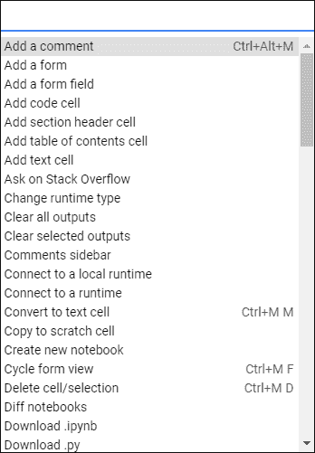

FIGURE 6-1: 使用 Colab 命令可轻松配置您的笔记本。

“工具”⇒“设置”选项显示设置对话框，如 图 6-2 所示。四个设置选项卡执行以下任务：

*   `Site:` 配置站点的工作方式。最有趣的设置是主题。选择“自适应”可让 Colab 根据光照条件选择界面颜色。您还可以在此选项卡上配置显示和访问设置。

*   `Editor:` 决定文本在屏幕上的显示方式以及界面的工作方式。例如，如果需要，可以将按键绑定设置为与 Vim 相同。您还可以选择字体大小、每个缩进级别的空格数以及大量其他设置。

*   `Colab Pro:` 为 Colab Pro 提供广告，它确实能带来一些显著优势，例如更快的 GPU、更长的运行时间和更多内存——所有这些都能让您在更短的时间内完成更多工作。

*   `Miscellaneous:` 包含有趣的设置。您可以从三种视觉效果中选择：使用“功率级”设置添加雷电；让柯基犬在显示器顶部跑过；让小猫在显示器顶部跑过。您可以任意组合这些视觉效果。

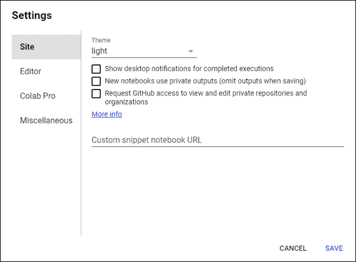

FIGURE 6-2: 设置对话框可帮助您配置 Colab IDE。

您可能不喜欢默认的键盘快捷键。选择“工具”⇒“键盘快捷键”时，您会看到键盘首选项对话框，如 图 6-3 所示，您可以在其中自定义键盘快捷键以满足您的需求。如果看到“设置快捷键”，则表示该命令当前没有快捷键，因此如果需要，您可以添加一个。以下是使用快捷键的方法：

*   要添加或更改快捷键，请将光标放在命令旁边的框中，然后按下要用于该命令的快捷键。

*   要删除快捷键，请按 Delete。

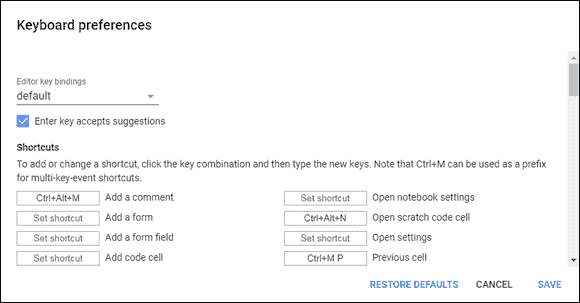

FIGURE 6-3: 自定义快捷键以加快命令访问速度。

有时您需要比较两个文件以查看它们的差异。选择“工具”⇒“比较笔记本”时，Colab 会打开一个新的浏览器标签页，并并排显示两个笔记本，如 图 6-4 所示。这些文件是从您的 Google Drive 中随机选择的。要选择您实际想要使用的文件，请单击每个窗格中的下拉箭头。差异将显示在屏幕上。

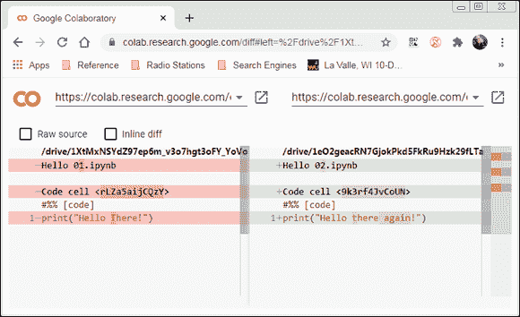

FIGURE 6-4: Colab 可让您比较两个文件以查看它们的差异。

### 获取 Google 帐户

在使用 Colab 执行任何重要任务之前，您必须拥有一个 Google 帐户。您可以使用同一个帐户用于各种用途，而不仅仅是开发。例如，Google 帐户可让您访问 Google Docs ([`https://www.google.com/docs/about/`](https://www.google.com/docs/about/))，这是一个类似于 Office 365 的在线文档管理系统。

#### 创建帐户

要创建 Google 帐户，只需导航至 [`https://account.google.com/`](https://account.google.com/) 并单击“创建帐户”链接。此页面还包含关于 Google 帐户可提供的内容的大量信息。单击“创建您的 Google 帐户”后，您将看到 图 6-5 所示的页面。帐户创建过程包含多个页面。您只需在每个页面上提供所需信息并单击“下一步”。


FIGURE 6-5: 按照提示创建您的 Google 帐户。

#### 登录

创建并验证帐户后，您可以登录。在有效使用 Colab 之前，您必须登录您的帐户。这是因为 Colab 依赖于您的 Google Drive 来执行某些任务。您也可以将笔记本存储在其他位置，例如 GitHub，但拥有 Google 帐户可确保一切按计划运行。要登录您的帐户，请导航至 [`https://accounts.google.com/`](https://accounts.google.com/)，提供您的电子邮件地址和密码，然后单击“下一步”。您将看到登录页面，如 图 6-6 所示。


FIGURE 6-6: 登录页面可让您访问所有常规功能，包括您的云端硬盘。

### 使用笔记本

与 Jupyter Notebook 类似，笔记本构成了与 Colab 交互的基础。事实上，如前所述，Colab 是基于笔记本构建的。当您将鼠标悬停在 [`https://colab.research.google.com/notebooks/welcome.ipynb`](https://colab.research.google.com/notebooks/welcome.ipynb) 欢迎页面的某些部分时，您会看到通过添加代码或文本条目（您可根据需要用作笔记）与页面交互的机会。这些条目是活动的，因此您可以与它们交互。您还可以移动单元格并将生成的材料复制到您的 Google Drive。当然，尽管与欢迎页面交互既出人意料又有趣，但本章的真正目的是演示如何与 Colab 笔记本交互。以下部分描述了如何使用 Colab 执行基本的笔记本相关任务。

#### 创建新笔记本

要创建新笔记本，请选择“文件”⇒“新建笔记本”。您将看到一个新的 Python 3 笔记本，如 图 6-7 所示。新笔记本看起来与 Notebook 中的类似，但并不完全相同。但是，所有相同的功能都存在。（Colab 的最新版本不支持 Python 2，因此您无法将其与 Python 2 一起使用。）

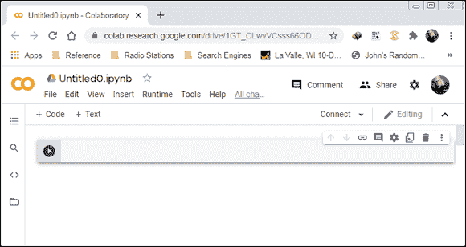

FIGURE 6-7: 使用与常规相同的技术创建新的 Python 3 笔记本。


如 图 6-7 所示的笔记本允许你通过单击文件名来更改它，就像在 Notebook 中操作时一样。某些功能的工作方式不同，但能提供相同的结果。例如，要运行特定单元格中的代码，请单击该单元格左侧的右指箭头。与 Notebook 不同，单元格焦点不会切换到下一个单元格，因此你必须直接选择下一个单元格。

#### 打开现有笔记本

你可以打开本地存储、Google Drive 或 GitHub 上的现有笔记本。你也可以打开任何 Colab 示例，或上传你可以访问的来源中的文件，例如系统上的网络驱动器。在所有情况下，你都从选择 File ⇒   Open Notebook 开始。你会看到如 图 6-8 所示的对话框。

默认视图显示你最近打开的所有文件，无论位置如何。文件按字母顺序排列。你可以通过在 Filter Notebooks 字段中键入字符串来筛选显示的项目数量。顶部还有其他用于打开笔记本的选项。

即使你未登录，仍然可以访问 Colab 示例项目。这些项目可以帮助你了解 Colab，但不会允许你对自己的项目进行任何操作。即便如此，你仍然可以在不先登录 Google 的情况下尝试使用 Colab。以下部分将更详细地讨论这些选项。

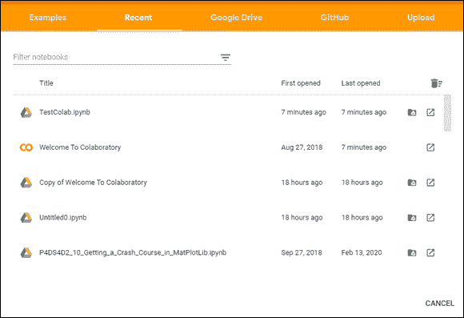

FIGURE 6-8: 使用此对话框打开现有笔记本。

##### 使用 Google Drive 打开现有笔记本

Google Drive 是 Colab 中许多操作的默认位置，你始终可以将其作为目标选择。使用 Drive 时，你会看到类似于 图 6-8 中所示的文件列表。要打开特定文件，请在对话框中单击其链接。该文件将在浏览器的当前选项卡中打开。

##### 使用 GitHub 打开现有笔记本

使用 GitHub 时，你最初需要提供在线源代码的位置，如 图 6-9 所示。该位置必须指向公共项目；你不能使用 Colab 访问私有项目。

建立与 GitHub 的连接后，你会看到两个列表：仓库（与特定项目相关的代码容器）和分支（代码的特定实现）。选择仓库和分支后，将显示可加载到 Colab 的笔记本文件列表。只需单击所需链接，它就会像使用 Google Drive 一样加载。

##### 使用本地存储打开现有笔记本

如果你想使用本书的可下载源代码，或者任何本地源代码，请选择对话框中的 Upload 选项卡。中央有一个单独的按钮，Choose File。单击此按钮将打开浏览器的文件打开对话框。你找到要上传的文件，就像通常打开任何文件一样。


FIGURE 6-9: 使用 GitHub 时，必须提供源代码的位置。

选择文件并单击 Open 会将文件上传到 Google Drive。如果你对文件进行更改，这些更改会显示在 Google Drive 上，而不是本地驱动器上。根据你的浏览器，你通常会看到一个新窗口打开并加载代码。但是，你也可能只看到一条成功消息，在这种情况下，你现在必须使用与使用 Google Drive 时相同的技术打开文件。在某些情况下，你的浏览器会询问你是否要离开当前页面。你应该告诉浏览器这样做。

File ⇒   Upload Notebook 命令也会将文件上传到 Google Drive。事实上，上传笔记本就像上传任何其他类型的文件一样，你会看到相同的对话框。如果你想上传其他类型的文件，使用 File ⇒   Upload Notebook 命令可能更快。

#### 上传笔记本

你使用本章前一部分“使用本地存储打开现有笔记本”中描述的技术来上传笔记本。执行此任务的主要原因是将可下载的源代码上传到你的 Google Drive。（本书的简介告诉你在哪里可以找到可下载的源代码，作者强烈建议你在学习示例时使用可下载的源代码。）

由于 Colab 提供的支持，某些示例的工作方式会有所不同。例如，如果你从 第 4 章 上传 `ML4D2E; 04; Sample.ipynb`，你会发现结果与桌面 Anaconda 安装不同，如 图 6-10 所示。

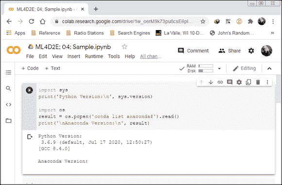

FIGURE 6-10: 使用 Colab 时，你的输出可能与本书的输出不同。

请注意，图 6-10 中的 Python 版本为 3.6.9，而不是本书使用的 3.8.3 版本。版本差异可能会影响某些代码的结果。此外，没有 Anaconda 版本输出，因为你没有使用 Anaconda。但是，尝试运行代码的 Anaconda 部分不会生成错误——Conda 显然知道足够多的信息来忽略代码的这部分。

#### 保存笔记本

Colab 提供了大量保存笔记本的选项。但是，这些选项均不适用于你的本地驱动器。将本地驱动器上的内容上传到 Google Drive 或 GitHub 后，Colab 会在云端而不是本地驱动器上管理内容。要将更新保存到本地驱动器，你必须使用本章后面“下载笔记本”部分中找到的技术下载文件。以下部分将回顾用于保存笔记本的基于云的选项。

##### 使用 Drive 保存笔记本

存储数据的默认位置是 Google Drive。当你选择 File ⇒   Save 时，你创建的内容将进入 Google Drive 的根目录。如果你想将内容保存到不同的文件夹，则需要在 Google Drive 中选择该文件夹 ([`https://drive.google.com/`](https://drive.google.com/))。

当你执行保存操作时，Colab 会跟踪项目的版本。但是，随着这些修订版本的老化，Colab 会将其删除。要保存不会老化的版本，请使用 File ⇒   Save and Pin Revision 命令。要查看项目的修订版本，请选择 File ⇒   Revision History。你会看到如 图 6-11 所示的输出。请注意，条目已固定。你也可以通过在 History 列表中选择条目来固定条目。修订历史还会显示修改日期、修订者以及生成文件的大小。你可以使用此列表恢复以前的修订版本或将修订版本下载到本地驱动器。


FIGURE 6-11: Colab 会维护项目的修订版本历史记录。

你还可以通过选择 File ⇒   Save a Copy In Drive 来保存项目的副本。副本名称中会包含单词 `Copy`。当然，你稍后可以重命名它。Colab 会将副本存储在当前的 Google Drive 文件夹中。

##### 使用 GitHub 保存笔记本

GitHub 为保存内容提供了 Google Drive 的替代方案。它提供了一种有组织的方法来共享代码，以便进行讨论、审查和分发。你可以在 [`https://github.com/`](https://github.com/) 找到 GitHub。


你只能在 Colab 中使用公共 GitHub 仓库，即使 GitHub 也支持私有仓库。要将文件保存到 GitHub，请选择 File ⇒   Save a Copy in GitHub。如果你尚未登录 GitHub，Colab 会显示一个请求登录信息的窗口。登录后，你会看到类似于 图 6-12 中所示的对话框。


FIGURE 6-12: Using GitHub means storing your data in a repository.

如果你的账户当前没有仓库，你必须创建一个新仓库，或者选择一个现有仓库来存储数据。保存文件后，它将出现在你选择的 GitHub 仓库中。默认情况下，仓库将包含一个在 Colab 中打开数据的链接，除非你选择不包含此功能。

##### 使用 GitHub Gist 保存笔记本

你可以使用 GitHub Gists 与其他人共享单个文件或其他资源。有些人也将其用于完整项目，但其理念是你有一个想要共享的概念——某个尚未完全形成且不代表可用应用程序的东西。你可以在 [`https://help.github.com/articles/about-gists/`](https://help.github.com/articles/about-gists/) 上阅读更多关于 Gists 的信息。

与 GitHub 类似，Gists 既有公开形式也有私密形式。你可以从 Colab 访问公开和私密 Gists，但 Colab 会自动保持你的文件私密。要将当前项目保存为 Gist，请选择 File ⇒   Save a Copy as a GitHub Gist。与 GitHub 不同，在这种情况下你不需要创建仓库或进行任何复杂操作。文件会以 Gist 形式保存，无需额外操作。生成的条目始终包含一个 Open in Colab 按钮，如 图 6-13 所示。

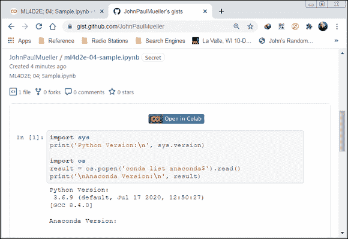

FIGURE 6-13: Use Gists to store individual files or other resources.

#### 下载笔记本

Colab 支持两种将笔记本下载到本地驱动器的方法：`.ipynb` 文件（使用 File ⇒   Download .ipynb）和 `.py` 文件（使用 File ⇒   Download .py）。在这两种情况下，文件都会出现在浏览器的默认下载目录中；Colab 不提供将文件下载到特定目录的方法。

### 执行常见任务

Colab 中的大多数任务与其 Notebook 版本的工作方式相似。例如，你可以使用 Insert 菜单上的选项创建代码单元，就像在 Notebook 中一样。非代码单元有三种形式：

*   Text

*   Section header

*   Form field，包含以下类型：

    *   Dropdown

    *   Input

    *   Slider

    *   Markdown

非代码单元的工作方式与 Notebook 中的 Markdown 单元有些不同，但理念相同。Notepad 中没有的两个有趣新增功能是 scratch code cell（允许你实时尝试代码）和 code snippets（用于执行特定任务的现成代码，你只需在需要的位置插入即可）。

你也可以像在 Notebook 中一样编辑和移动单元。一个重要的区别是，你不能更改单元类型。作为 section header 创建的单元不能突然转换为代码单元。以下各部分简要概述了各种功能。

#### 创建代码单元

Colab 为你创建的第一个单元是代码单元。你在 Colab 中创建的代码使用与 Notebook 中相同的所有功能。但是，在单元旁边，你会看到一个额外功能菜单，这些功能可用于 Colab 但不存在于 Notebook 中，如 图 6-14 所示。


FIGURE 6-14: Colab code cells contain a few extras not found in Notebook.

你使用 图 6-14 中所示的图标来增强 Colab 代码体验。以下列表简要描述了这些功能（按图中从左到右的出现顺序）：

*   **Move cell up:** 将单元在单元层次结构中向上移动一个位置。

*   **Move cell down:** 将单元在单元层次结构中向下移动一个位置。

*   **Link to cell:** 显示一个包含链接的对话框，你可以使用该链接访问笔记本中的特定单元。你可以将此链接嵌入网页或笔记本中的任何位置，以允许他人访问该特定单元。该人仍然可以看到整个笔记本，但无需搜索你想要讨论的单元。

*   **Add a comment (assuming that you have the right to make a comment):** 在单元右侧创建一个评论气泡。这与代码注释不同，代码注释与代码同行存在但影响整个单元。你可以编辑、删除或解决评论。已解决的评论是指已得到关注且不再适用的评论。

*   **Open editor settings:** 打开与 图 6-2 中所示相同的对话框，并在本章前面讨论的“使用 Google Colab 功能”部分中介绍过。你需要先选择一些代码，此选项才会出现。

*   **Mirror cell in tab:** 在窗口右侧出现的 Cell 窗格中镜像当前选定的单元，如 图 6-15 所示。你可以在左侧窗格的代码中随意滚动，并保持此代码可访问。右指箭头允许你在对左侧窗格代码进行更改后随时执行该单元。一对双指箭头允许你单击一次即可将焦点移回左侧窗格中选定的代码。你还可以将单元代码移动到 scratch cell，在那里你可以在不修改原始代码的情况下对其进行实验。可以拥有多个 Cell 窗格。你只需选择想要的窗格并根据需要在它们之间移动，这样就可以轻松地在代码的不同位置之间移动。单击“Cell”一词旁边的 X 即可关闭 Cell 窗格。 

    FIGURE 6-15: Use Cell panes to keep key cells easily available as needed.

*   **Delete Cell:** 从笔记本中删除单元。

*   **Vertical ellipses:** 包含菜单中的多个其他功能：

    *   **Copy Cell:** 将当前选定单元的内容复制到剪贴板。

    *   **Cut Cell:** 删除当前选定单元的内容并将其放在剪贴板上。

    *   **Clear Output:** 删除单元中的输出。你必须再次运行代码以重新生成输出。

    *   **View Output Fullscreen:** 在主机设备上以全屏模式显示输出（而非整个单元或笔记本的任何其他部分）。当显示大量内容或详细的图形视图有助于解释主题时，此选项很有用。按 Esc 退出全屏模式。

    *   **Add a Form:** 在代码右侧的单元中插入一个表单。你使用表单为参数提供图形输入。表单不会出现在 Notebook 中，但由于创建方式，它们不会阻止你在 Notebook 中运行代码。你可以在 [`https://colab.research.google.com/notebooks/forms.ipynb`](https://colab.research.google.com/notebooks/forms.ipynb) 上阅读更多关于表单的信息。


代码单元格还会告诉你有关代码及其执行的信息。当你将鼠标悬停在输出旁边的小图标上时，它会显示有关执行的信息，如图 6-16 所示。单击该图标会清除输出。你必须重新运行代码才能重新生成输出。

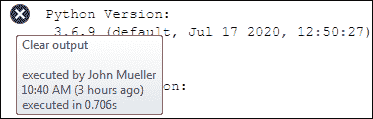

FIGURE 6-16: Colab 代码单元格包含 Notebook 中没有的一些额外功能。

#### 创建文本单元格

文本单元格的工作方式与 Notebook 中的标记单元格非常相似。但是，图 6-17 显示，你在使用图形界面格式化文本时会获得额外的帮助。标记是相同的，但你可以选择让 GUI 帮助你创建标记。例如，在这种情况下，要为标题创建 # 符号，你需要单击列表中首先出现的双 T 图标。再次单击双 T 图标将提高标题级别。右侧显示了文本在笔记本中的显示效果。

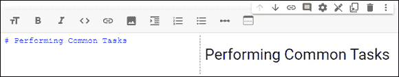

FIGURE 6-17: 使用 GUI 使文本格式化更加容易。

注意文本单元格右侧的菜单。此菜单包含许多与代码单元格相同的选项。例如，你可以创建一个链接列表，以帮助人们通过索引访问笔记本的特定部分。与 Notebook 不同，你不能执行文本单元格来解析其中包含的标记。

#### 创建特殊单元格

Colab 提供的特殊单元格是文本单元格的变体。这些特殊单元格（你可以通过“插入”菜单选项访问它们）可加快所需单元格的创建速度。以下各节将描述每种特殊单元格类型。

##### 使用标题

当你选择“插入”⇒“节标题单元格”时，你会看到在当前选定单元格下方创建了一个新单元格，其中包含相应的标题级别 1 条目。你可以通过单击双 T 图标来提高标题级别。GUI 与图 6-17 中的界面相同，因此你拥有所有标准的文本格式化功能。

##### 使用目录

Colab 的一个有趣的新增功能是为你的笔记本自动生成目录。要使用此功能，请单击窗口左侧的“目录”图标。图 6-18 显示了此特定示例的输出。

目录包含你在代码中提供的每个标题的一个标题。标题会根据级别自动组织，因此你可以看到代码的层次结构。单击标题会自动带你到达代码中的该位置。


FIGURE 6-18: 目录使 Notebook 信息更易于访问。

#### 编辑单元格

Colab 和 Notebook 都有“编辑”菜单，包含你所期望的选项，例如剪切、复制和粘贴单元格的功能。这两款产品还有一些有趣的差异。例如，Notebook 允许你拆分和合并单元格。Colab 包含一个选项，可作为切换开关显示或隐藏代码。这些差异使每款产品略有不同，但并不会真正改变你使用它们来创建和修改 Python 代码的能力。

#### 移动单元格

你在 Notebook 中用于移动单元格的相同技术也适用于 Colab。唯一的区别是 Colab 完全依赖工具栏按钮；Notebook 在“编辑”菜单中也有单元格移动选项。

### 使用硬件加速

你的 Colab 代码在 Google 服务器上执行。你的计算设备所做的只是托管一个显示代码及其结果的浏览器。因此，除非你选择在本地执行代码，否则计算设备上的任何特殊硬件都会被忽略。

 幸运的是，在使用 Colab 时，你还有另一个选择。选择“编辑”⇒“笔记本设置”以显示笔记本设置对话框，如图 6-19 所示。此对话框允许你通过添加图形处理单元 (GPU) 或张量处理单元 (TPU) 来选择代码的硬件加速级别。文章 [`https://medium.com/deep-learning-turkey/google-colab-free-gpu-tutorial-e113627b9f5d`](https://medium.com/deep-learning-turkey/google-colab-free-gpu-tutorial-e113627b9f5d) 提供了有关此功能工作原理的更多详细信息。


FIGURE 6-19: 硬件加速加快代码执行速度。

 GPU 或 TPU 的可用性并不是邀请你使用 Colab 运行大型计算。内容 [`https://research.google.com/colaboratory/faq.html#gpu-availability`](https://research.google.com/colaboratory/faq.html#gpu-availability) 告诉你 Colab 硬件加速的限制（包括在你需要时可能无法使用）。

笔记本设置对话框还允许你选择是否在保存笔记本时包含单元格输出。鉴于在大多数情况下你将笔记本存储在云端，并且将大文件加载到浏览器中可能很耗时，因此删除单元格输出可让你更快地重新启动会话。当然，权衡是你现在必须重新生成所需的所有输出。

### 查看你的笔记本

笔记本左侧边距有一系列四个图标，如图 6-7 所示。单击其中任何图标都会显示一个窗格，其中包含显示有关你的笔记本的各种信息的选项卡。例如，单击第一个图标会显示目录窗格。你也可以从“查看”菜单中选择要查看的特定信息。要关闭此窗格，请单击窗格右上角的 `X`。以下各节将描述每种信息。

#### 显示目录

选择“查看”⇒“目录”以查看笔记本的目录，如图 6-18 所示。单击任何条目都会带你到达笔记本的该部分。窗格底部有一个“+ 节”按钮。单击此按钮可在当前选定单元格下方创建一个新标题单元格。

#### 获取笔记本信息

当你选择“查看”⇒“笔记本信息”时，你会在浏览器中看到一个对话框打开，如图 6-20 所示。此窗格包含笔记本大小、设置和所有者。请注意，显示还会告诉你笔记本的最大大小。


FIGURE 6-20: 笔记本信息包括大小和设置。

笔记本信息对话框还包含一个“修改笔记本设置”链接，该链接会显示笔记本设置对话框，在该对话框中，你可以选择运行时类型以及笔记本是否依赖硬件加速，如前面本章“使用硬件加速”节中所述。

#### 检查代码执行

Colab 在你执行代码时会跟踪代码。选择“查看”⇒“已执行的代码历史记录”以显示窗口右侧窗格中的“执行”选项卡，如图 6-21 所示。请注意，“已执行的代码”选项卡中条目关联的编号可能与关联单元格的编号不匹配。此外，每次唯一的代码执行都会接收一个单独的编号。


FIGURE 6-21: Colab 跟踪您执行的代码以及执行顺序。

### 执行代码

为了使您的代码有用，您需要在某个时刻运行它。前面的部分提到了当前单元格中出现的右指箭头。单击它仅运行当前单元格。当然，您还有单击右指箭头之外的其他选项，所有这些选项都出现在“运行时”菜单上。以下列表总结了这些选项：

*   **运行当前单元格：** 除了单击右指箭头，您还可以选择“运行时” ⇒ “运行聚焦单元格”来执行当前单元格中的代码。

*   **运行其他单元格：** Colab 在“运行时”菜单上提供选项，用于执行下一个单元格、上一个单元格或一组单元格中的代码。只需选择与您要执行的单元格或单元格组匹配的选项即可。

*   **运行所有单元格：** 在某些情况下，您想要执行笔记本中的所有代码。在这种情况下，请选择“运行时” ⇒ “全部运行”。执行从笔记本顶部开始，即包含代码的第一个单元格，并持续到笔记本中包含代码的最后一个单元格。您可以随时通过选择“运行时” ⇒ “中断执行”来停止执行。

选择“运行时” ⇒ “管理会话”会显示一个对话框，其中包含您在 Colab 上当前正在为您的帐户执行的所有会话列表。您可以使用此对话框来确定该笔记本中的代码上次执行的时间以及笔记本消耗了多少内存。单击 TERMINATE 链接以结束特定笔记本的执行。

### 共享您的笔记本

您可以通过多种方式共享 Colab 笔记本。例如，您可以将其保存到 GitHub 或 GitHub Gists。但是，最直接的两种方法如下：

*   创建共享消息并将其发送给收件人。

*   获取代码的链接并将链接发送给收件人。

在这两种情况下，您都单击 Colab 窗口右上角的“共享”按钮。将打开两个对话框，如 Figure 6-22 所示。


FIGURE 6-22: 发送消息或获取链接以共享您的笔记本。

当您在“收件人”字段中输入一个或多个名称时，会打开一个额外的字段，用于添加共享消息。您可以输入消息并单击“发送”以立即发送链接。如果您单击齿轮图标，则会看到另一个对话框，您可以在其中定义如何共享笔记本。

单击“获取链接”对话框中的“复制链接”链接，将 URL 放在设备的剪贴板上。然后您可以将其粘贴到与他人的消息或其他形式的通信中。

### 获取帮助

获取 Colab 帮助最明显的地方是 Colab 帮助菜单。该菜单没有常规帮助链接，但您可以在 [`https://colab.research.google.com/notebooks/welcome.ipynb`](https://colab.research.google.com/notebooks/welcome.ipynb) 上找到它（这要求您登录到 Colab 网站）。此菜单确实包含所有常见条目：

*   **常见问题解答 (FAQs)：** 带您进入包含其他人提出的问题的页面。

*   **搜索代码片段：** 打开一个窗格，显示常见任务（例如使用摄像头），您可以在其中搜索示例代码，稍作修改即可满足您的需求。单击“插入”按钮会将代码插入当前聚焦单元格的当前光标位置。每个条目还显示代码示例。

*   **报告错误：** 带您进入可以报告 Colab 错误的页面。

*   **在 Stack Overflow 上提问：** 显示一个新的浏览器选项卡，您可以在其中向其他用户提问。如果您尚未登录 Stack Overflow，则会看到登录屏幕。

*   **发送反馈：** 显示一个对话框，其中包含可获取更多信息的位置的链接。

Part 3

# 机器学习数学基础入门

本部分内容…

了解机器学习中使用的数学

考虑机器学习过程

确保获得正确结果

使用简单学习者执行任务

第 7 章

# 揭秘机器学习背后的数学

本章内容

**探索矩阵并利用矩阵微积分获益**

**理解概率的工作原理**

**解释概率的贝叶斯观点**

**使用统计量描述观测结果**

如果您想从头实现现有的机器学习算法，或者需要创建新算法，您需要深入了解概率、线性代数、线性规划和多元微积分。您还需要知道如何将数学转换为可工作的代码，这意味着要具备高级计算技能。本章首先帮助您理解机器学习数学的机制，并描述如何将数学基础转换为可用代码。

如果您想应用现有的机器学习来实现实际目的，您可以利用现有的 Python 软件库，只需具备基本的数学和统计知识。归根结底，您无法避免掌握这些技能，因为机器学习在数学和统计学方面都有深厚根基，但您也不必过度深入。在掌握一些数学基础知识后，本章展示了即使是简单的贝叶斯原理也能帮助您执行一些有趣的机器学习任务。

尽管这本入门书籍侧重于使用 Python 进行机器学习实验，但在文本中您仍然会发现许多关于向量、矩阵、变量、概率及其分布的引用。本书有时也会使用描述性统计。因此，了解什么是平均值、中位数和标准差，以便理解您使用的软件内部发生了什么，这将很有帮助。这些知识使您更容易学习如何更好地使用软件。本章的最后部分演示了机器学习如何帮助您做出更好的预测，即使您没有所有所需的信息。

您不必手动输入本章的源代码。事实上，使用可下载的源代码要容易得多。您可以在 Python 代码的可下载源代码的 `ML4D2E` 文件夹和 R 代码的可下载源代码的 `ML4D2ER` 文件夹中找到本章的源代码。本章的示例文件将以 `ML4D2E; 07;`（用于 Python）或 `ML4D2E_R; 07;`（用于 R）开头。有关如何找到这些源代码文件的详细信息，请参阅简介。

### 使用数据

机器学习之所以如此吸引人，是因为它允许机器从现实世界的示例（例如销售记录、传感器信号以及从互联网流式传输的文本数据）中学习，并确定这些数据意味着什么。机器学习算法的常见输出包括对未来的预测、立即采取行动的处方，或按组分类的示例形式的新知识。许多有用的应用已经通过利用这些结果成为现实：

*   诊断难以发现的疾病

*   发现犯罪行为并抓获正在作案的罪犯

*   向正确的人推荐正确的产品

*   大规模过滤和分类来自互联网的数据

*   自动驾驶汽车

机器学习的数学和统计基础使输出如此有用的结果成为可能。以这种方式使用数学和统计学，使算法能够理解任何具有数值基础的事物。以下部分将帮助您了解使用标量、向量和矩阵进行基本数据操作：

*   **标量：** 单个基础数据项。例如，单独显示的数字 2 是一个标量。


### Vector

`Vector` 是一个一维的 `array`（本质上是一个列表），用于存储数据项。例如，包含数字 2、3、4 和 5 的数组就是一个 vector。你可以使用基于零的 `index`（指向你想要的项目的指针）来访问 vector 中的项目。索引为 0 的项目是 vector 中的第一个项目，在此示例中为 2。

### Matrix

`Matrix` 是一个二维或更高维度的 `array`（本质上是一个表格），用于存储数据项。例如，第一行包含数字 2、3、4 和 5，第二行包含数字 6、7、8 和 9 的数组就是一个 matrix。你可以使用基于零的行和列索引来访问 matrix 中的项目。第 0 行、第 0 列的项目是 matrix 中的第一个项目，在此示例中为 2。

你还会遇到其他类型的数据结构，包括多维数组（三个或更多维度）和 tensors（一种可以具有任意数量维度的广义矩阵）。本章不涵盖这些专用数据结构。你在数据处理中更多地使用这些数据结构，但在机器学习中很少使用，因为大多数算法期望使用数值数据矩阵。

#### Learning the terminology

要开始此过程，你需要将问题的解决方案表示为一个数字。例如，如果你想使用机器学习算法诊断疾病，可以将响应设为 1 或 0（二进制响应）来指示该人是否生病，其中 1 简单地表示该人生病。或者，你可以使用 0 到 1 之间的数字来传达不太确定的答案。该值可以表示该人生病的概率，其中 0 表示该人没有生病，1 表示该人肯定患有该疾病。

当机器学习算法获得所需信息（`sample data`）和关联响应（你希望能够猜测的预测示例）时，可以提供一个答案（`predictions`）。信息可以包括事实、事件、观察、计数、测量等。任何用作输入的信息都是一个 `feature` 或 `variable`（一个来自统计学的术语）。本书使用术语 `feature` 来使阅读材料更容易，并将代码变量与数据特征分开。有效的特征描述与响应相关的值，并帮助算法根据其他情况下的类似信息，使用它创建的函数来猜测响应。

特征有两种类型：定量特征和定性特征。`Quantitative features` 非常适合机器学习，因为它们将值定义为数字（整数、浮点数、计数、排名或其他度量）。`Qualitative features` 通常是标签或符号，以非数字方式传达有用信息，一种你可以定义为更具人性化的方式（单词、描述或概念）。

你可以在 John Ross Quinlan 撰写的论文“Induction of Decision Trees”中找到定性特征的经典示例（[`https://dl.acm.org/doi/10.1023/A:1022643204877`](https://dl.acm.org/doi/10.1023/A:1022643204877)），John Ross Quinlan 是一位计算机科学家，以根本性的方式为决策树的发展做出了贡献。决策树是迄今为止最流行的机器学习算法之一。在他的论文中，Quinlan 描述了一组有用信息，用于决定是否在户外打网球，机器可以使用适当的技术来学习这一点。Quinlan 描述的特征集如下：

*   `Outlook`: Sunny, overcast, or rain
*   `Temperature`: Cool, mild, hot
*   `Humidity`: High or normal
*   `Windy`: True or false

机器学习算法无法真正消化此类信息。你必须先将信息转换为数字。有多种方法可以做到这一点，但最简单的是 `one-hot encoding`，它将每个特征转换为一组新的二进制（值为 0 或 1）特征，用于其所有符号值。例如，考虑 outlook 变量，它变成三个新特征，如下所示：outlook:sunny、outlook:overcast 和 outlook:rain。每个特征将根据暗示条件是否存在而具有数值 1 或 0。因此，当天气晴朗时，outlook:sunny 的值为 1，而 outlook:overcast 和 outlook:rain 的值为 0。

除了 `one-hot encoding` 之外，你还可以使用一些其他技术将定性特征转换为数字，尤其是当特征由单词组成时，例如来自 Twitter 的推文、来自在线评论的一段文本或新闻源。在本书的后面部分，你将有机会讨论其他方法，以有效地将单词和概念转换为机器学习算法在处理文本分析时可以理解的有意义的数字。

无论信息是什么，为了让机器学习算法正确处理它，信息应始终转换为数字。

#### Understanding scalar and vector operations

NumPy 库为 Python 中的科学计算提供了基本功能。要使用 `numpy`，你可以使用诸如 `import numpy as np` 的命令来导入它。现在你可以使用常见的两字母缩写 `np` 来访问 `numpy`。

Python 在任何特定类别中仅提供一种数据类型。例如，如果你需要创建一个表示没有小数部分的数字的变量，则使用整数数据类型。使用这种通用指定很有用，因为它简化了代码，并让开发人员需要担心的事情少得多。但是，在科学计算中，你通常需要更好地控制数据在内存中的显示方式，这意味着拥有更多数据类型，而 `numpy` 为你提供了这一点。例如，你可能需要将特定标量定义为 `short`（长度为 16 位的值）。使用 `numpy`，你可以将其定义为 `myShort = np.short(15)`。你可以使用 `np.int16` 函数定义大小完全相同的变量。NumPy 库提供了对广泛数据类型的访问，这些数据类型在 [`https://docs.scipy.org/doc/numpy/reference/arrays.scalars.html`](https://docs.scipy.org/doc/numpy/reference/arrays.scalars.html) 中描述。

使用 `numpy` 的 `array()` 函数创建 vector。例如，`myVect = np.array([1, 2, 3, 4])` 创建一个包含四个元素的 vector。在此示例中，vector 包含标准 Python 整数。你也可以使用 `arange` 函数生成 vector，例如 `myVect = np.arange(1, 10, 2)`，它将 `myVect` 填充为 `array([1, 3, 5, 7, 9])`。第一个输入告诉起始点，第二个告诉停止点，第三个告诉每个数字之间的步长。第四个参数允许你定义 vector 的数据类型。你也可以创建具有特定数据类型的 vector。你只需要像这样指定数据类型：`myVect = np.array(np.int16([1, 2, 3, 4]))` 以将 `myVect` 填充为类似这样的 vector：`array([1, 2, 3, 4], dtype=int16)`。

在某些情况下，你需要特殊的 `numpy` 函数来创建特定类型的 vector（或 matrix）。例如，某些数学任务要求你将 vector 填充为 1。在此情况下，你可以像这样使用 `ones()` 函数：`myVect = np.ones(4, dtype=np.int16)` 以将 `myVect` 填充为特定数据类型的 1，如下所示：`array([1, 1, 1, 1], dtype=int16)`。你也可以使用 `zeros()` 函数将 vector 填充为 0。


你可以对整个向量执行基本数学函数，这使得 `numpy` 非常有用，并且不容易出现使用循环等编程结构来执行相同任务时可能发生的错误。假设在以下示例中，`myVect` 持有 `array([1, 2, 3, 4], dtype=int16)`，现在你可以对其进行一些数学运算。例如，使用标准 Python 整数时，`myVect + 1` 产生的输出为 `array([2, 3, 4, 5])`。如果你选择使用 `numpy` 的 `int16` 数据类型，`myVect + 1` 产生 `array([2, 3, 4, 5], dtype=int16)`。请注意，输出会明确告诉你正在使用哪种数据类型。正如你所料，`myVect - 1` 产生的输出为 `array([0, 1, 2, 3])`。你甚至可以在更复杂的数学场景中使用向量，例如 `2 ** myVect`，其输出为 `array([ 2, 4, 8, 16], dtype=int16)`。但是，以这种方式使用时，`numpy` 通常会为输出分配特定类型，即使你使用标准 Python 整数定义向量。

关于标量和向量运算的最后一点，你还可以执行逻辑和比较任务。例如，以下代码对两个数组执行比较操作：

```
a = np.array([1, 2, 3, 4])
b = np.array([2, 2, 4, 4])
print(a == b)
print(a < b)
```

从两个向量 `a` 和 `b` 开始，代码检查 `a` 中的各个元素是否等于 `b` 中的元素。在这种情况下，`a[0]` 不等于 `b[0]`。但是，`a[1]` 等于 `b[1]`。输出是一个类型为 `bool` 的向量，包含基于各个比较的 true 或 false 值。同样，你可以检查 `a < b` 的情况，并生成另一个包含此情况下真值的向量。以下是此示例的输出：

```
[False True False True]
[ True False True False]
```

逻辑操作依赖于特殊函数。你检查布尔运算符 AND、OR、XOR 和 NOT 的逻辑输出。以下是逻辑函数的示例：

```
a = np.array([True, False, True, False])
b = np.array([True, True, False, False])
print(np.logical_or(a, b))
print(np.logical_and(a, b))
print(np.logical_not(a))
print(np.logical_xor(a, b))
```

以下是此示例的输出：

```
[ True True True False]
[ True False False False]
[False True False True]
[False True True False]
```

你也可以对这些函数使用数字输入。使用数字输入时，0 为 false，1 为 true。与比较一样，这些函数按元素逐个工作，尽管你只进行一次调用。你可以在 [`https://docs.scipy.org/doc/numpy-1.10.0/reference/routines.logic.html`](https://docs.scipy.org/doc/numpy-1.10.0/reference/routines.logic.html) 上阅读更多关于逻辑函数的内容。

### 执行向量乘法

添加、减去或除以向量是按元素逐个进行的，如前一节所述。但是，当涉及乘法时，事情就有点奇怪了。事实上，取决于你真正想要做什么，事情可能会变得非常奇怪。考虑前一节讨论的那种乘法。`myVect * myVect` 和 `np.multiply(myVect, myVect)` 都产生按元素逐个输出的 `array([ 1, 4, 9, 16])`。

不幸的是，按元素逐个乘法在处理算法时可能会产生错误结果。在许多情况下，你真正需要的是 `dot product`，即两个数字序列的乘积之和。在处理向量时，点积始终是各个按元素逐个乘法的总和，并且结果是一个单个数字。例如，`myVect.dot(myVect)` 产生的输出为 `30`。如果你将按元素逐个乘法的值相加，你会发现它们确实加起来等于 30。[`https://www.mathsisfun.com/algebra/vectors-dot-product.html`](https://www.mathsisfun.com/algebra/vectors-dot-product.html) 上的讨论告诉你关于点积的内容，并帮助你理解它们可能在算法中如何应用。你可以在 [`https://docs.scipy.org/doc/numpy/reference/routines.linalg.html`](https://docs.scipy.org/doc/numpy/reference/routines.linalg.html) 上了解更多关于 `numpy` 的线性代数操作函数的信息。

### 创建矩阵

在使所有数据都变为数字后，机器学习算法要求你将各个特征转换为特征矩阵，并将各个响应转换为向量或矩阵（当有多个响应时）。`matrix` 是一组数字，按行和列排列，很像棋盘上的方格。但是，与始终是正方形的棋盘不同，矩阵可以有不同数量的行和列。

按照惯例，用于机器学习的矩阵依靠行来表示示例，依靠列来表示特征。因此，如同学习最佳网球天气条件的示例一样，你将构建一个矩阵，为每一天使用一行，并使用包含天气、温度、湿度和风的不同值的列。通常，你将矩阵表示为一系列由方括号括起来的数字，如下所示：

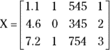

```
X = [
    [1.1, 1, 545, 1],
    [4.6, 0, 345, 2],
    [7.2, 1, 754, 3]
]
```

在此示例中，名为 `X` 的矩阵包含三行和四列，因此你可以说该矩阵的维度为 3 乘 4（也写作 3 x 4）。要在公式中引用行数，通常使用字母 `n`，列数使用字母 `m`。了解矩阵的大小对于正确对其进行操作是基础。

对矩阵进行操作还需要能够检索数字或矩阵的一部分以进行特定计算。你使用 `indexes`，即告诉矩阵中元素位置的数字来执行此任务。索引指出与感兴趣值的位置对应的行号和列号。通常你使用 `i` 作为行索引，使用 `j` 作为列索引。`i` 和 `j` 索引都从数字 0（`0-indexed`）或 1（`1-indexed`）开始计数行和列。Python 矩阵是 0-indexed。使用不同的索引起始点可能会令人困惑，因此你需要知道语言是如何操作的。

查看示例矩阵时，元素 1,2 是位于第二行与第三列交叉处的元素；即 345。因此，如果你需要表示矩阵 `X` 的三个不同元素，可以使用以下表示法：

```
X1,1=1.1, X2,3=345, X3,4=3
```


有时，多个矩阵被堆叠在一种更复杂的数据结构（称为 `array`）的切片中。在此语境下，array 是指具有超过两个维度的数值数据集合。Python 实际上并不支持 array 类型，但开发者以各种方式使用 `array` 这个术语，例如在前面章节中提到向量和矩阵时。作为这种用法的示例，你可以拥有三维数组，其中每个矩阵代表一个不同时间帧，然后将这些矩阵像蛋糕切片一样堆叠在一起。这种数组的一个用例是连续记录医疗数据，例如扫描仪记录大脑活动等身体功能。在这种情况下，行仍然是示例，列是特征——第三个维度代表时间。

只有一个特征的矩阵是一种特殊情况，称为向量，如前面章节的“理解标量和向量运算”部分所讨论的。你主要在讨论响应值（`response vector`）或处理某些算法的内部系数时使用向量。在这种情况下，你将它们称为 `vector of coefficients`。

在机器学习中，特征矩阵通常表示为 `X`，相应的响应向量表示为 `y`。更一般地说，矩阵通常使用大写字母标识，向量使用小写字母标识。此外，你使用小写字母表示常量，因此在确定字母是向量还是常量时需要小心，因为可能的操作集合截然不同。

你在机器学习中经常使用矩阵，因为它们允许你以统一且有意义的方式快速组织、索引和检索大量数据。对于 X 特征矩阵中的每个示例 i，你可以确定矩阵的第 i 行来表达其特征，以及响应向量上的第 i 个元素来告诉你特定特征集所暗示的结果。这种策略允许算法快速查找数据并进行产品预测。

矩阵表示法还允许你快速对整个矩阵或其部分执行系统化操作。矩阵对于以快速方式编写和执行程序也很有用，因为你可以使用计算机命令来执行矩阵操作。

### 理解基本操作

基本矩阵操作是加法、减法和标量乘法。它们只有在你拥有两个相同大小的矩阵时才可行，结果是一个相同维度的新矩阵。如果你有两个形状相同的矩阵，你将操作应用于两个矩阵中每个对应位置。因此，要执行加法，你从两个源矩阵的第一行和第一列开始求和，并将结果值放在结果矩阵的相同位置。你继续对两个矩阵中的每个配对元素进行此过程，直到完成所有操作。减法也适用相同的过程，如下面的示例所示：

```
A = np.array([[1, 1], [1, 0]])B = np.array([[1, 0], [0, 1]])C = A – B print(C)
```

在这种情况下，输出为

```
[[ 0 1] [ 1 -1]]
```

在标量乘法中，你取一个单个数值（`scalar`）并将其乘以矩阵的每个元素。如果你的值是分数，例如 ½ 或 ¼，你的乘法就变成了除法。在前面的示例中，你可以使用 `print(C * -2)` 将结果矩阵乘以 –2，结果为：

```
[[ 0 -2] [-2 2]]
```

你也可以执行标量加法和减法。在这种情况下，你从矩阵的所有元素中添加或减去一个单个值。

### 执行矩阵乘法

使用索引和基本矩阵操作，你可以以紧凑的方式表达相当多的操作。索引和操作的组合允许你

*   切片矩阵的一部分
*   掩码矩阵的一部分，将其减为零
*   通过从所有元素中移除一个值来中心化矩阵的值
*   重新缩放矩阵的值，改变其值的范围

但是，只有在将矩阵与向量或与另一个矩阵相乘时，你才能一次实现最大数量的操作。你在机器学习中经常执行这些任务，将矩阵乘以向量的情况很常见。许多机器学习算法依赖于找到一个系数向量，该向量乘以特征矩阵可以得到响应值向量的近似。在这样的模型中，你有类似这样的公式：

`y = Xb`

其中 y 是响应向量，X 是特征矩阵，b 是系数向量。通常，算法还包括一个名为 a 的标量，用于添加到结果中。在此示例中，你可以将其想象为零，因此它不存在。结果，y 是一个由三个元素组成的向量：

`[ 2 -2 3]`

考虑到这一点，你可以将 X 和 b 之间的乘法表示为

```
X = np.array([[4, 5], [2, 4], [3, 3]])b = [3, -2] print(X @ b)
```

接下来，你需要知道 `X` 乘以 `b` 如何得到 `y`。作为能够执行乘法的检查，参与乘法的矩阵和向量应具有兼容的大小。事实上，矩阵的列数应等于向量的行数。在此示例中，存在匹配，因为 `X` 是 3 行 2 列，而 `b` 是 2 行 1 列。了解各项的形状，你可以预先计算出结果矩阵的形状，它由矩阵的行数和向量的列数给出，即 3 行 1 列。

矩阵向量乘法作为一系列向量向量乘法的求和来工作。乘法将 X 矩阵的每一行视为一个向量，并将其乘以 b 向量。结果成为结果向量的相应行元素。例如，第一行 \[4,5\] 乘以 \[3,–2\] 得到向量 \[12,–10\]，其元素求和得到值 2。这个第一个求和乘法对应于结果向量的第一行，然后所有其他计算都遵循此规律：

```
sum([4*3, 5*-2]) = 2sum([2*3, 4*-2]) = -2sum([3*3, 3*-2]) = 3
```

结果向量是 `[2, –2, 3]`。当乘以两个矩阵时，事情会变得稍微棘手一些，但你可以将操作作为一系列矩阵向量乘法来执行，就像在前面的示例中一样，通过将第二个矩阵视为一系列特征向量。通过将第一个矩阵乘以 m 个向量，你为每个乘法得到结果矩阵的一列。

一个示例可以澄清获得矩阵乘以矩阵的步骤。下面的示例将 `X` 乘以 `B`，后者是一个 2 x 2 的方阵：

```
B = np.array([[3, -2], [-2, 5]]) print(X @ B)
```

你可以通过将矩阵 `B` 分割为列向量，将操作分为两个不同的矩阵向量乘法。


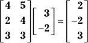
<m:math display="block" overflow="scroll" xmlns:m="http://www.w3.org/1998/Math/MathML"><m:mrow><m:mfenced open="\[" close="\]"><m:mrow><m:mrow><m:mtable columnalign="left"><m:mtr columnalign="left"><m:mtd columnalign="left"><m:mn>4</m:mn></m:mtd><m:mtd columnalign="left"><m:mn>5</m:mn></m:mtd></m:mtr><m:mtr columnalign="left"><m:mtd columnalign="left"><m:mn>2</m:mn></m:mtd><m:mtd columnalign="left"><m:mn>4</m:mn></m:mtd></m:mtr><m:mtr columnalign="left"><m:mtd columnalign="left"><m:mn>3</m:mn></m:mtd><m:mtd columnalign="left"><m:mn>3</m:mn></m:mtd></m:mtr></m:mtable></m:mrow></m:mrow></m:mfenced><m:mfenced open="\[" close="\]"><m:mrow><m:mrow><m:mtable columnalign="right"><m:mtr columnalign="right"><m:mtd columnalign="right"><m:mn>3</m:mn></m:mtd></m:mtr><m:mtr columnalign="right"><m:mtd columnalign="right"><m:mrow><m:mo>&#45;</m:mo><m:mn>2</m:mn></m:mrow></m:mtd></m:mtr></m:mtable></m:mrow></m:mrow></m:mfenced><m:mo>=</m:mo><m:mfenced open="\[" close="\]"><m:mrow><m:mrow><m:mtable columnalign="right"><m:mtr columnalign="right"><m:mtd columnalign="right"><m:mn>2</m:mn></m:mtd></m:mtr><m:mtr columnalign="right"><m:mtd columnalign="right"><m:mrow><m:mo>&#45;</m:mo><m:mn>2</m:mn></m:mrow></m:mtd></m:mtr><m:mtr columnalign="right"><m:mtd columnalign="right"><m:mn>3</m:mn></m:mtd></m:mtr></m:mtable></m:mrow></m:mrow></m:mfenced></m:mrow></m:math>

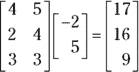
<m:math display="block" overflow="scroll" xmlns:m="http://www.w3.org/1998/Math/MathML"><m:mrow><m:mfenced open="\[" close="\]"><m:mrow><m:mrow><m:mtable columnalign="left"><m:mtr columnalign="left"><m:mtd columnalign="left"><m:mn>4</m:mn></m:mtd><m:mtd columnalign="left"><m:mn>5</m:mn></m:mtd></m:mtr><m:mtr columnalign="left"><m:mtd columnalign="left"><m:mn>2</m:mn></m:mtd><m:mtd columnalign="left"><m:mn>4</m:mn></m:mtd></m:mtr><m:mtr columnalign="left"><m:mtd columnalign="left"><m:mn>3</m:mn></m:mtd><m:mtd columnalign="left"><m:mn>3</m:mn></m:mtd></m:mtr></m:mtable></m:mrow></m:mrow></m:mfenced><m:mfenced open="\[" close="\]"><m:mrow><m:mrow><m:mtable columnalign="right"><m:mtr columnalign="right"><m:mtd columnalign="right"><m:mrow><m:mo>&#45;</m:mo><m:mn>2</m:mn></m:mrow></m:mtd></m:mtr><m:mtr columnalign="right"><m:mtd columnalign="right"><m:mn>5</m:mn></m:mtd></m:mtr></m:mtable></m:mrow></m:mrow></m:mfenced><m:mo>=</m:mo><m:mfenced open="\[" close="\]"><m:mrow><m:mrow><m:mtable columnalign="right"><m:mtr columnalign="right"><m:mtd columnalign="right"><m:mrow><m:mn>17</m:mn></m:mrow></m:mtd></m:mtr><m:mtr columnalign="right"><m:mtd columnalign="right"><m:mrow><m:mn>16</m:mn></m:mrow></m:mtd></m:mtr><m:mtr columnalign="right"><m:mtd columnalign="right"><m:mn>9</m:mn></m:mtd></m:mtr></m:mtable></m:mrow></m:mrow></m:mfenced></m:mrow></m:math>

现在你所要做的就是将得到的列向量取出来，使用第一个列向量作为新矩阵的第一列，以此类推，通过列向量的乘法重建输出矩阵。

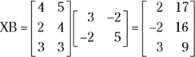
<m:math display="block" overflow="scroll" xmlns:m="http://www.w3.org/1998/Math/MathML"><m:mrow><m:mtext>XB</m:mtext><m:mo>=</m:mo><m:mfenced open="\[" close="\]"><m:mrow><m:mrow><m:mtable columnalign="left"><m:mtr columnalign="left"><m:mtd columnalign="left"><m:mn>4</m:mn></m:mtd><m:mtd columnalign="left"><m:mn>5</m:mn></m:mtd></m:mtr><m:mtr columnalign="left"><m:mtd columnalign="left"><m:mn>2</m:mn></m:mtd><m:mtd columnalign="left"><m:mn>4</m:mn></m:mtd></m:mtr><m:mtr columnalign="left"><m:mtd columnalign="left"><m:mn>3</m:mn></m:mtd><m:mtd columnalign="left"><m:mn>3</m:mn></m:mtd></m:mtr></m:mtable></m:mrow></m:mrow></m:mfenced><m:mfenced open="\[" close="\]"><m:mrow><m:mrow><m:mtable columnalign="right"><m:mtr columnalign="right"><m:mtd columnalign="right"><m:mn>3</m:mn></m:mtd><m:mtd columnalign="right"><m:mrow><m:mo>&#45;</m:mo><m:mn>2</m:mn></m:mrow></m:mtd></m:mtr><m:mtr columnalign="right"><m:mtd columnalign="right"><m:mrow><m:mo>&#45;</m:mo><m:mn>2</m:mn></m:mrow></m:mtd><m:mtd columnalign="right"><m:mn>5</m:mn></m:mtd></m:mtr></m:mtable></m:mrow></m:mrow></m:mfenced><m:mo>=</m:mo><m:mfenced open="\[" close="\]"><m:mrow><m:mrow><m:mtable columnalign="right"><m:mtr columnalign="right"><m:mtd columnalign="right"><m:mn>2</m:mn></m:mtd><m:mtd columnalign="right"><m:mrow><m:mn>17</m:mn></m:mrow></m:mtd></m:mtr><m:mtr columnalign="right"><m:mtd columnalign="right"><m:mrow><m:mo>&#45;</m:mo><m:mn>2</m:mn></m:mrow></m:mtd><m:mtd columnalign="right"><m:mrow><m:mn>16</m:mn></m:mrow></m:mtd></m:mtr><m:mtr columnalign="right"><m:mtd columnalign="right"><m:mn>3</m:mn></m:mtd><m:mtd columnalign="right"><m:mn>9</m:mn></m:mtd></m:mtr></m:mtable></m:mrow></m:mrow></m:mfenced></m:mrow></m:math>

在矩阵乘法中，由于矩阵的形状，顺序很重要。因此，你不能像标量数乘法那样颠倒项的顺序。5\*2 或 2\*5 的乘积是一样的，因为标量乘法具有交换律，但 XB 与 BX 不相同，因为有时乘法是不可能的（因为矩阵形状不兼容），或者更糟的是，它会产生不同的结果。当你有一系列矩阵乘法，例如 ABC 时，运算顺序无关紧要；无论你是先计算 AB 还是先计算 BC，结果都是一样的，因为像标量一样，矩阵乘法具有结合律。

#### 浏览高级矩阵运算

你在某些算法表述中可能会遇到两个重要的矩阵运算。它们是矩阵的转置和逆。当形状为 n x m 的矩阵通过交换行和列转换为形状为 m x n 的矩阵时，就会发生*转置*。大多数测试使用上标 T 表示此运算，如 A^T。你最常看到此运算用于乘法，以便获得正确的维度。在使用 Python 时，你可以使用如下代码执行转置：

```
A = np.array([[1, 2, 3], [2, 3, 5], [7, 11, 13]]) print(A.transpose())
```

输出显示转置结果：

```
[[ 1 2 7] [ 2 3 11] [ 3 5 13]]
```

你对形状为 m x m 的矩阵应用*矩阵逆运算*，这些是行数和列数相同的方阵。此运算非常重要，因为它允许立即求解涉及矩阵乘法的方程，例如 y=bX，其中你需要发现向量 b 中的值。因为大多数标量数（零除外）都有一个乘积结果为 1 的数，其思想是找到一个矩阵逆，其乘积结果为一个称为单位矩阵的特殊矩阵，其元素为零，除了对角线元素（索引 i 等于索引 j 的位置上的元素）。求标量的逆非常简单（标量数 n 的逆为 n^(\-1)，即 1/n）。矩阵的情况则不同。矩阵逆运算涉及大量计算，因此特殊的数学函数在 Python 中执行这些计算。矩阵 A 的逆表示为 A^(\-1)。你使用以下代码对矩阵求逆：

```
print(np.linalg.inv(A))
```

输出显示逆矩阵：

```
[[-3.2 1.4 0.2] [ 1.8 -1.6 0.2] [ 0.2 0.6 -0.2]]
```

有时，求矩阵的逆是不可能的。当一个矩阵不能求逆时，它被称为*奇异矩阵*或*退化矩阵*。奇异矩阵并非常态；它们相当罕见。

#### 有效使用向量化

如果执行矩阵运算（例如矩阵与向量相乘）看起来有点困难，请考虑你的计算机完成了所有艰苦的工作。你所要做的就是在理论表述中确定当你将数字放入矩阵、向量和常数时数字会发生什么，然后对它们求和、相减、相除或相乘。


理解机器学习算法的工作原理，能让你在使用算法时占据优势，因为你会明白算法如何消化和处理数据。要获得正确的结果，你需要根据算法处理数据的方式，将正确的数据输入到正确的算法中。

在 Python 中，NumPy 包提供了创建和操作矩阵所需的所有功能。`ndarray` 对象允许快速创建数组，例如多维矩阵，方法是从排入列表的数据开始。

术语 `ndarray` 意为“n 维数组”，意味着你可以创建多维数组，而不仅仅是行列矩阵。使用简单列表，`ndarray` 可以快速创建 1D 数组，如下面的 Python 示例所示：

```
y = np.array([44,21,37])
print (y)
print (y.shape)
[44 21 37]
(3,)
```

`shape` 方法可以迅速告知你矩阵的形状。在此例中，它仅报告三行且无列，这意味着该对象是一个 1D 数组。

要创建由行和列组成的矩阵，可以使用嵌套列表。主列表内部列表的内容即为矩阵的行。

```
X = np.array([[1.1, 1, 545, 1],[4.6, 0, 345, 2], [7.2, 1, 754, 3]])
print (X)
[[ 1.1 1. 545. 1. ]
 [ 4.6 0. 345. 2. ]
 [ 7.2 1. 754. 3. ]]
```

你也可以使用单个列表获得相同结果，这会创建一个 1D 数组，你可以将其重塑为所需的行数和列数。数字会按行从元素 (0,0) 开始逐个填入新矩阵，直到最后一个元素。

```
X = np.array([1.1, 1, 545, 1, 4.6, 0, 345, 2, 7.2, 1, 754, 3]).reshape(3,4)
```

### 探索概率世界

概率告诉你事件发生的可能性，并以数字表示。事件的概率在 0（事件不太可能发生）到 1（事件必然发生）之间衡量。中间值，例如 0.25、0.5 和 0.75，表示在足够多次尝试后，事件会以一定频率发生。以下部分将更详细地描述概率。

#### 概率概览

如果将概率乘以一个代表你将要尝试的试验次数的整数，你将得到一个估计值，即如果所有试验都进行，事件平均应该发生多少次。例如，如果某事件发生的概率为 p=0.25，并且你尝试 100 次，那么你很可能会目睹该事件发生 0.25 * 100 = 25 次。这，例如，就是从一副扑克牌中随机抽取某一花色的概率。法国扑克牌是解释概率的经典例子。一副牌包含 52 张牌，平均分为四种花色：黑桃和黑桃（黑色），以及方块和红桃（红色）。所以，如果你想确定抽到 A 的概率，必须考虑到有四种不同花色的 A。从概率角度来看，答案是 p=4/52=0.077。

概率介于 0 和 1 之间；没有概率可以超出这些边界。你通过观察来经验性地定义概率。只需计算特定事件发生的次数相对于你感兴趣的所有事件的次数。例如，假设你想计算银行交易中欺诈发生的次数，或某个特定国家人们患某种疾病的次数。在目睹事件后，你可以通过计算事件发生的次数并除以总事件数来估计与之相关的概率。

你可以使用记录的数据（大多来自数据库）计算欺诈或疾病发生的次数，然后将该数字除以可用的通用事件或观察总数。因此，你将欺诈次数除以一年内的交易次数，或者计算一年内患病人数相对于某个地区总人口的比例。结果是一个介于 0 到 1 之间的数字，你可以将其作为特定情况下某个事件的基准概率。

计算事件的所有发生次数并不总是可能的，因此你需要了解抽样。通过抽样（一种基于特定概率期望的行为），你可以观察更大事件或对象集合的一小部分，但仍能推断出事件的正确概率，以及与一组对象相关的定量测量或定性类别等精确指标。

例如，如果你想跟踪上个月美国的汽车销售情况，你不需要跟踪全国每一笔销售。使用包含全国几家汽车销售商销售数据的样本，你可以确定定量指标，例如售出汽车的平均价格，或定性指标，例如最常售出的汽车型号。

#### 概率运算

概率运算确实与数值运算略有不同。因为概率始终必须在 0 到 1 的范围内，你必须依赖特定规则，以便运算有意义。例如，如果事件是 `mutually exclusive`（互斥事件，即不能同时发生），则概率之间的求和是可能的。假设你想知道从一副扑克牌中抽到黑桃或方块的概率。你可以这样求和：p=0.25+0.25=0.5。

你使用减法（差值）来确定与你已经计算过的某个事件概率不同的事件的概率。例如，要确定从牌组中抽到非方块牌的概率，只需从抽到任意牌的概率（p=1）中减去抽到方块的概率，如下所示：p=1-0.25=0.75。当你从 1 中减去一个概率时，就得到了该概率的 `complement`（补事件）。

乘法有助于计算独立事件的交集。`Independent events`（独立事件）是指互不影响的事件。例如，如果你玩掷骰子游戏并掷两个骰子，得到两个 6 的概率是第一个骰子出 6 的概率（1/6）乘以第二个骰子出 6 的概率（1/6），即 p=1/6 * 1/6=0.028。这意味着如果你掷一百次骰子，你可以期望出现两个 6 的情况只有两三次。请注意，你可以在 Python 中使用简单数学来进行此类计算（只要确保根据需要使用括号来保证计算顺序即可）：`Sixes = (1/6) * (1/6)`。

使用求和、差值和乘法，你可以得到大多数涉及事件的复杂情况的概率。例如，你现在可以计算从两个掷出的骰子中至少得到一个 6 的概率，这是互斥事件的求和：

*   得到两个 6 的概率：`Sixes = (1/6) * (1/6)`

*   第一个骰子出 6 且第二个骰子不是 6 的概率：`SixAndOther = (1/6) * (1 - (1/6))`

*   第二个骰子出 6 且第一个骰子不是 6 的概率：`OtherAndSix = (1/6) * (1 - (1/6))`

你从两个掷出的骰子中至少得到一个 6 的概率是 `OneSix = (1/6)*[1/6 + (1 – 1/6) + (1 – 1/6)] = (1/6)*[1/6 + 5/6 + 5/6] = (1/6)[11/6] = 11/36`。在此例中，从第一个骰子得到 6 的机会是 1/6，从第二个骰子得到 6 的机会也是 1/6。因为这两个事件是独立的，你使用加法来求概率。

#### 通过贝叶斯定理条件化机会


# 概率与条件概率

概率在时间和空间方面是有意义的，但其他一些条件也会影响你测量的概率。上下文很重要。当你估计一个事件的概率时，你可能（有时错误地）倾向于认为可以将计算出的概率应用于每种可能的情况。用来表达这种信念的术语是 `a priori probability`，即事件的一般概率。

例如，当你抛硬币时，如果硬币是公平的，正面朝上的 `a priori` 概率是 50%。无论你抛多少次硬币，当面对一次新的抛掷时，正面朝上的概率仍然是 50%。

抛硬币是真实概率未被计算的情况的一个例子。如果抛掷是真正公平的，那么硬币侧立（既不是正面也不是反面）的机会虽然极小，但确实存在。在进行概率计算时，你必须考虑是否要包含此类条件，以获得更精确的答案。

然而，还有其他情况，如果你改变上下文，`a priori` 概率就不再有效，因为发生了一些微妙的事情并改变了它。在这种情况下，你可以将这种信念表达为 `a posteriori` 概率，即在发生某些事情修改计数后的 `a priori` 概率。例如，一个人是女性的 `a priori` 概率大约是 50%。然而，如果你只考虑特定的年龄范围，概率可能会大相径庭，因为女性往往寿命更长，超过一定年龄后女性比男性多。作为与性别相关的另一个例子，如果你检查大学某些学院中女性的存在情况，你会发现从事科学学院的女性比男性少。因此，鉴于这两个上下文，`a posteriori` 概率与预期的 `a priori` 概率不同。在性别分布方面，自然和文化都可以创造不同的 `a posteriori` 概率。

你可以将这种情况视为 `conditional probability`，并将其表示为 `p(y|x)`，读作“在 x 已经发生的情况下，事件 y 发生的概率”。条件概率是机器学习的一个非常强大的工具。事实上，如果 `a priori` 概率可能因为某些情况而发生很大变化，那么了解可能的情况可以通过观察示例来提高你正确预测事件的机会——这正是机器学习旨在做的事情。例如，如前所述，一般来说，一个随机人是男性或女性的期望是 50%。但是，如果你增加该人头发长或短的证据呢？你可以估计头发长的人口比例为 35%；然而，如果你只观察女性人群，概率会上升到 60%。如果在女性人群中百分比如此之高，与 `a priori` 概率相反，机器学习算法可以从知道该人头发是长还是短中受益。

事实上，Naïve Bayes 算法可以通过了解预测周围的情况来提高做出正确预测的机会，如 Chapter 10 中所述，该章涵盖了第一个、最简单的学习者。一切都始于 Reverend Bayes 和他革命性的概率定理。事实上，机器学习部落之一（见 Chapter 2 的“Specifying the Role of Statistics in Machine Learning”部分）是以他的名字命名的。此外，对基于贝叶斯概率的高级算法的发展寄予厚望；MIT 的 `Technology Review` 杂志将贝叶斯机器学习提及为将改变我们世界的新兴技术 ([`http://www2.technologyreview.com/news/402435/10-emerging-technologies-that-will-change-your/`](http://www2.technologyreview.com/news/402435/10-emerging-technologies-that-will-change-your/))。然而，该定理的基础并不复杂（尽管如果你通常只考虑先验概率而不考虑后验概率，它们可能有点反直觉）。

Reverend Thomas Bayes 是一位统计学家和哲学家，他在十八世纪上半叶制定了他的定理。该定理在他生前从未出版。其出版通过引入刚才提到的条件概率的概念，彻底改变了概率理论。

得益于贝叶斯定理，如果证据是该人有长发，那么预测一个人是男性还是女性的概率就变得更容易了。Thomas Bayes 使用的公式非常有用：

`P(B|E) = P(E|B)*P(B) / P(E)`

使用前一个示例作为输入来阅读公式，可以更好地理解一个否则反直觉的公式：

*   `P(B|E)`：给定一组证据（E）时信念（B）的概率（后验概率）。将“信念”读作表达 `hypothesis` 的一种替代方式。在这种情况下，假设是该人是女性，证据是长发。知道给定证据的信念的概率可以帮助你以一定的信心预测该人的性别。

*   `P(E|B)`：当该人是女性时，拥有长发的概率。这个术语指的是子组中证据的概率，它本身就是一个条件概率。在这种情况下，数字是 60%，在公式中转换为 0.6 的值（先验概率）。

*   `P(B)`：成为女性的一般概率；即信念的 `a priori` 概率。在这种情况下，概率是 50%，或 0.5 的值（似然性）。

*   `P(E)`：拥有长发的一般概率。这里是另一个 `a priori` 概率，这次与观察到的证据相关。在这个公式中，它是 35% 的概率，即 0.35 的值（证据）。

如果你使用贝叶斯公式和你筛选出的值来解决确定性别的前一个问题，结果是 `Female = 0.6 * 0.5 / 0.35 = 0.857`。这是一个很高的可能性百分比，导致你肯定，鉴于这样的证据，该人可能是女性。

另一个常见的例子，可能会引起一些争议，并且经常出现在教科书和科学杂志中，那就是阳性医学测试的例子。这对于更好地理解先验概率和后验概率在不同情况下可能会发生很大变化是非常有趣的。

假设你担心自己患有一种影响 1% 人口的罕见疾病。你进行了检测，结果呈阳性。医学检测从来都不完全准确，实验室告诉你，当你生病时，检测在 99% 的情况下呈阳性，而当你健康时，检测在 99% 的情况下呈阴性。

现在，使用这些数字，你立即相信你肯定生病了，因为当一个人生病时检测呈阳性的百分比很高（99%）。然而，现实却截然不同。在这种情况下，要代入贝叶斯定理的数字如下：

*   0.99 作为 `P(E|B)`

*   0.01 作为 `P(B)`

*   0.01 \* 0.99 + 0.99 \* 0.01 = 0.0198 作为 `P(E)`

然后计算结果为 `IsIll = 0.99 * 0.01 / ((0.01 * 0.99) + (0.99 * 0.01)) = 0.50`，这对应于你生病的概率仅为 50%。最终，你不生病的机会比你预期的要多。你可能会想这是怎么可能的。事实是，从检测中得到阳性反应的人数如下：

*   **生病且从检测中得到正确答案的人：** 这一组是 `true positives`，占患病人口 1% 中的 99%。


*   **Who isn’t ill and gets the wrong answer from the test:** 这一群体是那 1% 的 99% 人群，他们并未生病却得到了阳性反应。同样，这是 99% 乘以 1% 的结果。这一群体对应于 *false positives*。

如果你从这个角度来看问题，就会明白，当将上下文限定为检测结果呈阳性的人群时，属于真阳性群体的概率与属于假阳性群体的概率是相同的。

### Describing the Use of Statistics

作为与概率相关的收尾话题，有必要快速浏览一些与概率和统计相关的基本统计概念，并理解它们如何更好地帮助你描述机器学习算法所使用的信息。前面几节以一种有用的方式讨论了概率，因为采样、统计分布和统计描述措施在某种程度上都基于概率的概念。

在这里，问题并不仅仅是通过计算事件发生次数来描述一个事件；而是关于在不计算事件发生所有次数的情况下，以可靠的方式描述一个事件。例如，如果你希望算法学习如何检测疾病或犯罪意图，你就不得不面对这样一个事实：你无法创建一个包含疾病或犯罪所有发生情况的矩阵，因此你将要处理的信息必然是部分的。此外，如果你在现实世界中测量某事物，由于程序中的某些错误、所使用仪器的不精确，或者仅仅是因为随机干扰扰乱了记录测量值的过程，你通常无法得到精确的测量值。例如，像你的体重这样简单的测量值，每次上秤时都会不同，略微围绕你认为的真实体重波动。如果你在更大的规模上进行此项测量，例如在一个巨大的秤上称量你城市里所有居民的体重，你就能了解准确测量有多困难（因为会出现错误）以及完整测量有多困难（因为很难测量一切）。

拥有部分信息，尤其是当你想要描述的内容相当复杂和多样化时，并非完全是负面的条件，因为你可以使用更小的矩阵，从而意味着更少的计算。有时，对于某些问题，你甚至无法获得想要描述和学习的样本，因为该事件复杂且具有大量特征。作为另一个例子，考虑学习如何从互联网上的文本（例如 Twitter 推文）中确定情感。除了转发推文，你一生中不太可能看到另一个人发布完全相同的推文（使用完全相同的词语表达关于完全相同主题的相同情感）。你可能会看到某些相似的东西，但绝不会完全相同。因此，你不可能预先知道所有将某些词语与情感关联起来的可能推文。简而言之，你必须使用样本，并从部分集合中推导出一般规则。

即使存在这些实际限制和无法获得所有可能数据的情况，你仍然可以掌握你想要描述的内容并从中学习。采样是统计实践的一部分。使用样本时，你根据某些标准选择示例。如果仔细进行，你就有一定的概率，使得你的部分视图与全局视图很好地相似。

在统计学中，`population` 指的是你想要测量的所有事件和对象，而 `sample` 是根据某些标准选择的一部分。使用随机采样，即随机选择事件或对象来代表，有助于为机器学习创建一组示例，就像它从所有可能的示例中学习一样。样本之所以有效，是因为样本中的值分布与总体中的值分布相似，这就足够了。

随机采样不是唯一可能的方法。你也可以应用 `stratified sampling`，通过它你可以控制随机样本的某些方面，以避免选取过多或过少的某一类事件。毕竟，随机就是随机，你无法绝对保证始终复制总体的精确分布。

A `distribution` 是一种统计表述，用于描述如何观察一个事件或测量值，它告诉你目睹某个特定值的概率。分布在数学公式中描述（本书未涵盖的主题），并可以使用直方图或分布图等图表进行图形描述。你放入矩阵中的信息具有一个分布，你可能会发现不同特征的分布是相关的。分布自然意味着变化，在处理数值时，找出变化的中心很重要，这通常是统计均值，计算方法是将所有值相加，然后将总和除以你考虑的值的数量。

The `mean` 是一种描述性措施，告诉你在考虑所有可能情况时，最期望的值是什么。均值最适合于对称且呈钟形的分布（这样当值高于均值时，分布的形状与值低于均值时类似）。一种著名的分布，即正态分布或高斯分布，形状就是这样的，但在现实世界中，你也可以找到许多偏态分布，它们在分布的一侧具有极端值，从而过度影响均值。

The `median` 是一种措施，在将所有观察值从小到大排序后，取中间的值。由于基于值的顺序，中位数对分布中的值不敏感，在某些情况下可以代表比平均值更公平的描述符。均值和中位数描述符的意义在于，它们描述了分布中围绕其存在变化的一个值，而机器学习算法确实关心这种变化。大多数人将这种变化称为 `variance`。由于方差是一个平方数，因此还有一个根等价项，称为 `standard deviation`。机器学习在每个单独变量（单变量分布）以及所有特征一起（多变量分布）中考虑方差，以确定这种变化如何影响响应。

换句话说，统计学在机器学习中很重要，因为它们传达了特征具有分布的概念。分布意味着变化，变化就像信息的量化——你的特征中方差越多，就可以将更多信息与响应匹配，以便从某些类型的信息得出规则到某些响应。然后你可以使用统计学来评估特征矩阵的质量，甚至利用统计措施来构建有效的机器学习算法，如本书后面所述，其中矩阵操作、从分布中采样、统计学和概率都对解决方案有所贡献，并使计算机能够有效地从数据中学习。

Chapter 8

# Descending the Gradient

IN THIS CHAPTER

**Understanding how machine learning works under the hood**

**Recognizing the different parts of a learning process**

**Glancing at the steps in machine learning optimization when using gradient descent**

**Distinguishing between batch, mini-batch, and online learning**


# 机器学习概述

机器学习对于该领域的任何新手来说，可能看起来像是一种魔术。从任何先进科学发现的应用中，人们都可以期待这一点，正如未来学家、科幻小说作家阿瑟·C·克拉克（其一部作品后来成为里程碑电影《2001 太空漫游》）所表达的第三定律：“*任何足够先进的技术都与魔法无法区分。*” 然而，机器学习根本不是魔法。它是允许计算机学习的数学公式和算法的设计与开发。

期望世界本身是数学和统计公式的表现，机器学习算法通过从有限数量的观察中回溯来努力学习此类公式。正如你不需要看到世界上所有的树才能学会识别一棵树（因为人类可以理解树的区别特征），机器学习算法可以利用计算机的计算能力和关于一切事物的广泛可用数据，来学习如何解决大量重要且有用的问题。

虽然机器学习本质上很复杂，但它是人类创造的，在最初的构想中，它只是简单地模仿我们从世界上学习的方式。我们可以根据儿童感知和理解世界的方式来表达简单的数据问题和基本学习算法，或者通过以数学形式使用从山顶沿着正确斜坡下山的类比来解决具有挑战性的优化问题。本章帮助你将机器学习视为一种技术，而不是魔法。为此，以下部分提供了一些基本理论，然后深入探讨一些展示理论的示例。

### 承认不同类型的学习

学习有多种不同的形式，取决于算法及其目标。你可以根据机器学习算法的目的将其分为三个主要组：

- 监督学习
- 无监督学习
- 强化学习

#### 监督学习

监督学习发生在算法从示例数据及其相关目标响应中学习时，这些响应可以包含数值或字符串标签，例如类别或标签，以便在面对新示例时稍后预测正确的响应。监督方法确实类似于在教师监督下的人类学习。教师为学生提供良好的示例供其记忆，然后学生从这些特定示例中推导出一般规则。

在机器学习中，你是设置解决问题数据的教师。学生是算法，通常被称为预测器或模型，它可以在从你提供的数据中学习后预测解决方案。数据由特征组成，特征是信息丰富的数值和非数值数据序列，每个特征代表问题的一个特征，以及相关的响应（或结果），即要学习的解决方案。

学习过程通常使用术语“训练”来表示。此外，你需要区分回归问题（其目标是数值）和分类问题（其目标是定性变量，例如类别或标签）。参考本书中使用的示例，回归任务确定某地区房屋的平均价格，分类任务根据物理测量值区分不同的动物或植物种类。

#### 无监督学习

无监督学习发生在算法从没有任何相关响应的纯示例中学习时，让算法自行确定数据模式。这种类型的算法倾向于将数据重构为其他东西，例如可能代表类别或对额外分析或预测模型训练有帮助的新值的新数据特征。

无监督学习在为人类提供数据意义的洞察以及为监督机器学习算法提供新的有用输入方面非常有用。作为一种学习方式，它类似于人类用来判断某些对象或事件是否属于同一类别的方法，例如通过观察对象之间的相似程度。无监督学习算法的一个常见示例是分割或聚类分析，这是一种帮助你将一组示例划分为相似组的技术。

#### 强化学习

强化学习发生在你按顺序向算法展示没有标签的示例时，类似于无监督学习。但是，你会根据算法提出的解决方案，为每个示例附带正面或负面反馈。强化学习与算法必须做出决策的应用相关（因此产品是规定性的，而不仅仅是描述性的，如无监督学习），并且这些决策会带来后果。

强化学习就像人类通过试错来学习。错误能帮助你学习，因为它们会带来惩罚（成本、时间损失、遗憾、痛苦等），教导你某一行动方案比其他方案成功的可能性更小。

强化学习的一个有趣示例是计算机自行学习玩视频游戏。在这种情况下，应用程序向算法展示特定情况的示例，例如玩家在躲避敌人时被困在迷宫中。应用程序让算法知道其采取的行动的结果，学习发生在尝试避免其发现危险的事物并追求生存的过程中。你可以查看 DeepMind 公司如何创建一个强化学习程序来玩旧 Atari 视频游戏，网址为 [`https://www.youtube.com/watch?v=V1eYniJ0Rnk`](https://www.youtube.com/watch?v=V1eYniJ0Rnk)。观看视频时，请注意程序最初笨拙且缺乏技巧，但随着训练稳步改进，直到成为冠军。

### 学习过程

尽管监督学习是三种类型中最流行且使用最频繁的一种，但所有机器学习算法都遵循相同的逻辑。核心思想是，你可以使用算法事先不知道但可以在看到一些数据后猜测的数学函数来表示现实。你可以用未知的数学函数来表达现实及其所有挑战性的复杂性，机器学习算法会找到这些函数并加以利用。这一概念是所有类型机器学习算法的核心思想。为了创建清晰的示例，本章专注于监督分类，作为所有学习类型中最具代表性的一种，并提供其内部工作原理的解释，你可以稍后将其扩展到其他类型的学习方法。

监督分类器的目标是在检查示例本身的某些特征后，为示例分配一个类别（也称为标签）。这些特征称为特征，可以是定量的（数值）或定性的（非数值，例如字符串标签）。为了正确分配类别，分类器必须首先仔细检查一定数量的已知示例（这些示例已经分配了类别），每个示例都附带相同的特征。这种学习程序，也称为训练阶段，涉及分类器观察许多示例及其标签，帮助其学习，以便在以后预测时看到没有类别的示例时能够以类别的形式给出答案。


用于训练阶段的数据以及使用训练好的模型进行新预测时所用的数据（即测试阶段），都应与训练期间使用的特征完全一致，否则预测将无法正确工作。

#### 映射未知函数

为了让你了解训练过程会发生什么，想象一个孩子正在学习如何区分树木和其他物体。在孩子能够独立完成此任务之前，老师会向孩子展示一定数量的树木图像，并附带所有使树木与世界上其他物体区分开来的事实。这些事实可能包括材质（木材）、组成部分（树干、树枝、树叶或针叶、根系）以及位置（种植在土壤中）等特征。孩子通过将树木特征的展示与其他不同物体（例如由木材制成但不具备树木其他特征的家具）的图像进行对比，形成了对树木长相的认知。

机器学习分类器的工作原理相同。它通过创建包含所有给定特征的数学公式来构建其认知能力，从而形成一个能够区分不同类别的函数。假设存在一种数学公式，也称为 `target function`（或 `objective function`），用于表达树木的特征。在这种情况下，机器学习分类器可以将目标函数的表示作为副本或近似（一种工作方式相似的不同函数）来查找。能够表达这种数学公式就是分类器的表示能力。

从数学角度来看，你可以使用等效术语 `mapping` 来表达机器学习中的表示过程。当你通过观察函数的输出来发现其构造时，就会发生映射。机器学习中的成功映射类似于孩子内化对某个物体的概念。在这种情况下，孩子以有效的方式理解了从现实世界事实中推导出的抽象规则，因此在看到树木时能够识别出来。

这种表示（从现实世界事实中推导出的抽象规则）之所以成为可能，是因为学习算法拥有许多内部参数（由向量和值矩阵构成），这些参数相当于算法的记忆，用于存储适合其映射活动（将特征连接到响应类别）的想法。内部参数的维度和类型决定了算法可以学习的目标函数的种类。算法中的优化引擎在学习过程中将参数从初始值更改，以表示目标的隐藏函数。

在优化过程中，算法在其参数组合的可能变体中搜索，以找到最佳组合，从而在训练期间实现特征与类别之间的正确映射。该过程从学习算法可以猜测的众多潜在目标函数中评估许多潜在的候选目标函数。学习算法可以评估的所有潜在函数的集合称为 `hypothesis space`。你可以将所有参数都已设置的结果分类器称为 `hypothesis`，这是机器学习中的一种说法，表示算法已设置参数以复制目标函数，并现在准备好得出正确的分类（这一点将在后面证明）。

假设空间必须包含你想要尝试映射到未知函数以解决分类问题的所有机器学习算法的所有参数变体。不同的算法可以有不同的假设空间。真正重要的是，假设空间包含目标函数（或其近似，即一种不同但相似的函数）。

你可以将此阶段想象为一个孩子为了弄清楚树木的概念，通过组装知识和经验（给定特征的类比）来尝试许多不同的创意想法的时期。当然，父母也参与了这个阶段，并提供相关的环境输入。在机器学习中，有人必须提供合适的学习算法，提供一些不可学习的参数（称为 `hyper-parameters`），选择一组用于学习的示例，并选择伴随示例的特征。正如一个孩子如果被独自留在世界上可能无法始终学会区分对与错一样，机器学习算法也需要人类才能成功学习。

即使在完成学习过程后，机器学习分类器通常也无法将示例一一映射到目标分类函数，因为许多错误和不正确的映射也是可能的，如 Figure 8-1 所示。在许多情况下，错误和不正确的映射发生是因为算法缺乏足够的数据点来发现正确的函数。`Noise`（噪声），即与正确数据混合的错误或失真的示例，也可能导致问题，如 Figure 8-2 所示。

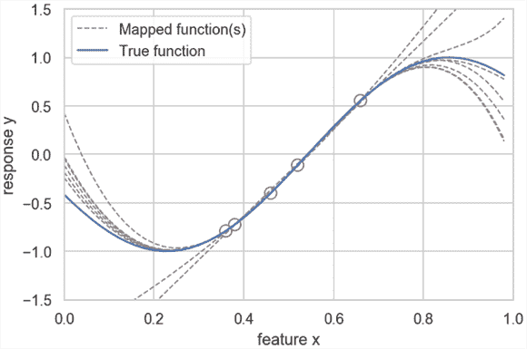

FIGURE 8-1: 缺乏证据使得难以映射回目标函数。

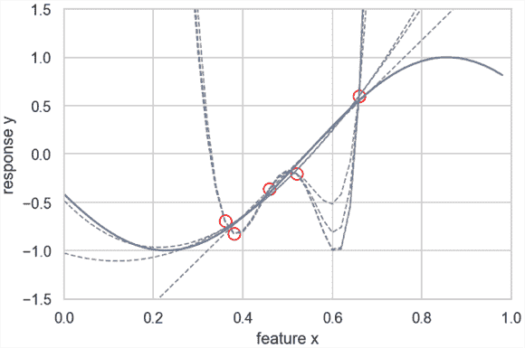

FIGURE 8-2: 噪声可能导致数据点不匹配。

现实世界数据中的噪声是常态。记录数据时出现的许多无关因素和错误会扭曲特征的值。一个好的机器学习算法应该能够区分可以映射回目标函数的信号，并忽略无关的噪声。

#### 探索代价函数

机器学习中优化的驱动力来自算法内部函数的响应，称为 `cost function`。你可能在某些上下文中看到其他术语，例如 `loss function`、`objective function`、`scoring function` 或 `error function`，但代价函数是一种评估函数，用于衡量机器学习算法映射其努力猜测的目标函数的效果。此外，代价函数决定了机器学习算法在监督预测或无监督优化问题中的表现（在后一种情况下，代价函数与目标结果无关，而与特征本身有关）。

代价函数通过将算法预测与现实世界中记录的实际结果进行比较来工作。使用代价函数将预测与其实际值进行比较，可确定算法的误差水平。由于它是一种数学公式，代价函数以数值形式表达误差水平，即必须最小化的代价值。代价函数将对你的目的真正重要且有意义的内容传达给学习算法。因此，你必须根据对要解决的问题或想要达到的成就水平的理解，选择或准确定义代价函数。

例如，在考虑股票市场预测时，代价函数表达了避免错误预测的重要性。在这种情况下，你希望通过避免重大损失来赚钱。在销售预测中，关注点不同，因为你需要减少常见和频繁情况下的误差，而不是罕见和特殊情况下的误差，因此你使用不同的代价函数。


# 代价函数与机器学习优化

当问题涉及预测谁可能因某种疾病而生病时，你需要那些能够高概率识别出具有相同特征且后来确实生病的人群的算法。根据疾病的严重程度，你可能更倾向于算法错误地选择一些不会生病的人，而不愿错过那些确实会生病的人。

代价函数是推动机器学习应用成功的核心因素。它对学习过程的重要性不亚于*表示*（近似某些数学函数的能力）和*优化*（机器学习算法如何设置其内部参数）。大多数算法优化其自身的代价函数，你别无选择，只能按原样应用它们。某些算法允许你在若干可能的函数中进行选择，提供更多灵活性。当算法在优化过程中直接使用代价函数时，该代价函数在内部使用。鉴于算法设计为与特定代价函数协同工作，优化目标可能与你期望的目标不同。在这种情况下，你使用外部代价函数来衡量结果，为了术语清晰，你将其称为*误差函数*或*损失函数*（如果需要最小化）或*评分函数*（如果需要最大化）。

关于你的目标，良好的做法是定义解决问题效果最好的代价函数，然后找出哪些算法在优化它方面效果最好，以定义你想要测试的假设空间。当你使用不允许所需代价函数的算法时，你仍可以通过固定其超参数（算法运行所需提供的参数）并根据代价函数选择输入特征，来间接影响其优化过程以适应你偏好的代价函数。最后，当你收集了所有算法的结果后，使用你选择的代价函数对其进行评估，然后决定算法、超参数和特征的哪种组合最适合解决你的问题。

当算法从数据中学习时，代价函数通过指出对做出更好预测最有益的内部参数变化来指导优化过程。随着代价函数响应迭代地改善，优化过程持续进行。当响应停滞或恶化时，就该停止调整算法参数了，因为算法不太可能从那里获得更好的预测结果。当算法在新数据上工作并进行预测时，代价函数帮助你评估它是否正常工作并确实有效。

决定代价函数是机器学习中一项被低估的活动。这是一项基本任务，因为它决定了算法在学习阶段的行为以及它如何处理你想要解决的问题。永远不要依赖默认选项，而应始终问自己你希望使用机器学习实现什么，并检查哪种代价函数能最好地代表这种成就。

在 Part 4 中，你将了解一些机器学习算法，并在 Part 5 中看到如何将理论应用于实际问题，介绍用于评分文本和情感的分类问题。如果你需要选择代价函数，机器学习解释和示例介绍了一系列用于回归和分类的误差函数，包括均方根误差、对数损失、准确率、精确率、召回率和曲线下面积（AUC）。（如果这些术语现在不清楚，不用担心；它们将在 Parts 4 和 5 中详细解释。）

### 降低优化曲线

梯度下降算法完美地展示了机器学习的工作原理。它总结了迄今在本书中表达的概念，因为你可以使用直观的视觉示例来理解它，而不仅仅是数学公式。此外，尽管它只是许多可能方法之一，梯度下降是一种广泛使用的方法，应用于本书中介绍的一系列机器学习算法，例如线性模型、神经网络和梯度提升机。

梯度下降通过从随机解开始，在给定一组输入（由特征和响应组成的数据矩阵）时找出解决方案。然后它利用代价函数的反馈进行多次迭代，用逐渐改善初始随机解并降低误差的值更改其参数。尽管优化可能需要大量迭代才能达到良好的映射，但它依赖于在每次迭代中最改善响应代价函数的变化。Figure 8-3 展示了一个复杂优化过程的示例，包含一些局部最小值（山谷中间的最低点）和一个过程可能陷入的地方（因为鞍点处的平坦表面），无法继续下降。

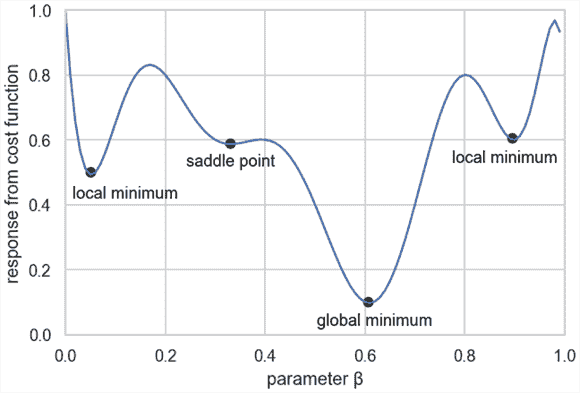

FIGURE 8-3: A plotting of parameter data against the output of the cost function.

根据 Figure 8-3，你可以将优化过程可视化为在雾天在高山中行走，参数是下降到山谷的不同路径。梯度下降优化在每一步都会发生。在每次迭代中，算法选择减少误差最多的路径，无论采取什么方向。其理念是，如果步长不太大（导致算法跳过目标），始终沿着最陡峭的方向行进将找到最低点。

不幸的是，找到最低点并不总是发生，因为算法可能会到达中间山谷，造成它已到达目标的错觉。但是，在大多数情况下，梯度下降引导机器学习算法发现成功映射问题的正确假设。Figure 8-4 展示了不同起点如何产生影响。起点 A 通向局部最小值，而不远处的起点 B 则设法到达全局最小值。

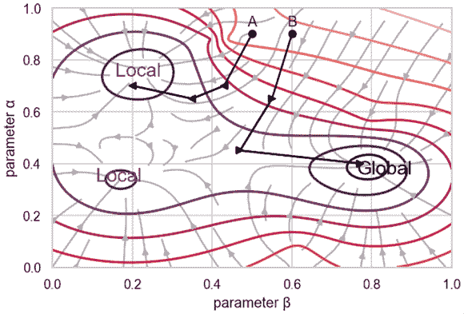

FIGURE 8-4: Visualizing the effect of starting point on outcome.

在优化过程中，你可以区分不同的优化结果。你可以有一个全局最小值，它是代价函数的真正最小误差，也可以有许多局部最小值——看似产生最小误差但实际上并非如此的解决方案（算法陷入的中间山谷）。作为补救措施，鉴于优化过程的随机初始化，多次运行优化是良好的做法。这意味着尝试不同的下降路径序列，不要陷入同一个局部最小值。

### 使用大数据进行优化

机学习归结为一个优化问题，即在给定某个代价函数的情况下寻找全局最小值。因此，使用所有可用数据进行优化显然是一种优势，因为在每次迭代中，它允许你相对于所有数据找到最佳的学习参数修正。这就是大多数机器学习算法倾向于使用所有可用数据，并希望数据在计算机内存中可访问的原因。


此外，你还必须区分统计算法和其他优化。基于统计算法的学习技术使用微积分和矩阵代数，并且需要将所有数据加载到内存中。其他算法基于逐步搜索下一个最佳解，通过迭代处理部分解（如前一节讨论的梯度下降），在基于所有数据开发假设时可以获得优势。当使用所有数据时，它们可以立即捕捉较弱的信号，并避免被噪声误导。

考虑到使用所有可用数据的优势，你必须考虑可用硬件可能成为瓶颈。当在计算机内存限制范围内（假设约为 8GB 或 16GB）处理数据时，你正在使用 `core memory`。你可以使用这种方法解决大多数机器学习问题。使用核心内存的算法称为 `batch algorithms`，因为，如同工厂中机器一次处理单批材料一样，此类算法一次学习处理和预测单个数据批次，该批次由数据矩阵表示。

然而，有时数据太大，无法放入核心内存。源自网络的数据是典型的难以轻松放入内存的信息示例。此外，来自传感器、跟踪设备、卫星和视频监控的数据，由于其尺寸与计算机 RAM 相比往往存在问题；但是，鉴于廉价且大容量的存储设备可以轻松容纳 TB 级数据，它们可以轻松存储在硬盘上。

### 利用采样

当数据太大无法放入单台计算机内存时，少数策略可以挽救局面：

*   **`Subsampling`:** 数据通过基于统计抽样的案例选择（有时甚至包括特征选择）重塑为更易管理但规模减小的数据矩阵。显然，减少数据量并不总能提供与全局分析完全相同的结果。在少于可用数据的基础上工作甚至可能产生效力较弱的模型。然而，如果子采样执行得当，该方法可以生成几乎等效且仍然可靠的结果。成功的子采样必须正确使用统计抽样，通过采用随机或分层样本抽取。

*   **`Random sampling`:** 你通过随机选择作为样本一部分的示例来创建样本。样本越大，样本越可能类似于原始数据的结构和多样性，但即使抽取的示例很少，结果在原始数据表示和机器学习目的方面通常也是可接受的。

*   **`Stratified sampling`:** 你控制目标变量或你认为对于成功复制完整数据特征至关重要的某些特征在数据中的最终分布。一个经典示例是在由不同比例男性和女性组成的教室中抽取样本，以猜测平均身高。如果女性平均比男性矮且比例较小，你希望抽取一个复制相同比例的样本，以获得平均身高的可靠估计。如果你错误地只抽取男性，你将高估平均身高。利用事先的洞察进行采样（例如知道性别可能影响身高猜测）在很大程度上有助于获得适合机器学习的样本，如下一节所述。

在选择采样策略后，你必须根据内存限制抽取足够多的示例子样本来表示数据的多样性。高维数据（由许多案例和许多特征组成）更难进行子采样，因为需要抽取更大的样本，该样本甚至可能无法放入核心内存中。

### 使用并行性

除了子采样之外，使数据适应内存的另一种可能解决方案是利用 `network parallelism`，它将数据拆分为连接在网络中的多台计算机。每台计算机处理部分数据以进行优化。在每台计算机完成自己的计算，并且所有并行优化任务被归约为单一处理后，即可实现解决方案。

要了解此解决方案的工作原理，请将使用单个工人逐个部件组装汽车的过程与许多工人分别处理汽车部件组件（留下单个工人执行最终组装）进行比较。除了拥有更快的组装执行外，你不必同时将所有部件都放在工厂中。同样，你不必将所有数据部分都放在单台计算机中，而是可以利用它们在不同计算机中分别处理的优势，从而克服核心内存限制。

这种方法是 map-reduce 技术和集群计算框架（Apache Hadoop 和 Apache Spark）的基础，这些框架专注于将问题映射到多台机器上，并最终将其输出归约为所需的解决方案。

不幸的是，你无法轻易将所有机器学习算法拆分为可分离的进程，这一问题限制了此类方法的适用性。更重要的是，当你保持计算机网络随时准备进行此类数据处理时，你会遇到设置和维护方面的显著成本和时间开销，从而将此方法的适用性限制在仅大型组织。

### 学习核外

另一种内存使用解决方案是依赖核外算法，这些算法通过将数据保留在存储设备上，并以块的形式馈送到计算机内存中进行处理。馈送过程称为 `streaming`。由于块小于核心内存，算法可以正确处理它们，并使用它们来更新机器学习算法优化。更新后，系统丢弃它们以支持新块，算法使用新块进行学习。此过程重复进行，直到没有更多块为止。块可以很小（取决于核心内存），该过程称为 `mini-batch learning`，或者甚至可以由单个示例组成，称为 `online learning`。

如前所述的梯度下降，如同其他迭代算法一样，可以很好地使用这种方法；但是，达到优化需要更长时间，因为梯度的路径相对于批量方法来说更加不规则和非线性。当不使用足够的数据示例迭代时，在线算法甚至可能达到与其内存批量版本相比不理想的解决方案。

当基于小批量和单个示例对其参数进行重复更新时，梯度下降被称为 `stochastic gradient descent`。在满足两个先决条件的情况下，它将达到适当的优化解决方案：

*   流式传输的示例是随机提取的（因此称为随机，回顾了从示例分布中随机提取的概念）。

*   根据观察数量或其他标准，定义了固定或灵活的适当学习率。

忽略第一个先决条件意味着你还必须考虑示例的顺序——这有时是一种不希望的效果。学习率使学习对更新的开放程度有所不同，使学习本身在处理流中稍后看到的示例特征时更加灵活或不那么灵活。


学习参数会影响外核优化的质量，因为学习率过高虽然优化速度更快，但可能会将参数限制在开头或流式处理过程中遇到的噪声或错误示例的影响下。由于这种影响，高学习率更容易导致次优解。选择较低的学习率需要更多的计算和更多数据，但通常是更安全的选择。另一方面，高学习率使算法对后续流式观测更具响应性。因此，当算法从自然演变且快速变化的来源（例如数字广告领域的数据）学习时，响应式算法可能是一种优势，因为新的广告活动往往会开始改变目标个体的关注度和响应程度。

Chapter 9

# 验证机器学习

### 本章内容

- `Explaining how correct sampling is critical in machine learning`
- `Highlighting errors dictated by bias and variance`
- `Proposing different approaches to validation and testing`
- `Warning against biased samples, overfitting, underfitting, and snooping`

本章帮助你理解机器学习如何处理数据。它首先探讨数据本身，并帮助你思考机器学习应用如何采样和使用数据来创建解决方案。

机器学习解决方案不仅仅是数据。你使用的算法以及使用方式决定了结果。本章的下一部分将帮助你使用线性回归和 K-最近邻等标准算法理解一些基本的算法概念。

在拥有可探索的数据和用于探索的算法后，你需要验证和测试所创建的解决方案。其中的人为因素在于确保解决方案不仅仅提供输出，而是提供正确且反映现实世界的输出。

你不必手动输入本章的源代码。事实上，使用可下载的源代码更加容易。你可以在 Python 代码的可下载源代码的 `ML4D2E` 文件夹和 R 代码的可下载源代码的 `ML4D2ER` 文件夹中找到本章的源代码。本章的示例文件以 `ML4D2E; 09;`（用于 Python）或 `ML4D2E_R; 09;`（用于 R）开头。有关如何找到这些源文件的详细信息，请参阅简介。

### 考虑使用示例数据

手头有示例（以数据集的形式）和机器学习算法，并不能保证解决学习问题是可能的，或者结果会提供所需的解决方案。例如，如果你希望计算机区分狗的照片和猫的照片，你可以为其提供狗和猫图像的良好示例。然后，你可以基于某个机器学习算法训练一个狗与猫分类器，该算法可以输出给定照片是狗还是猫的概率。当然，输出是概率，而不是照片绝对是狗或猫的保证。

基于分类器报告的概率，你可以根据算法计算的估计概率来决定照片的类别（狗或猫）。当狗的概率更高时，你可以选择更有利于狗的更高概率，以最大限度地降低做出错误评估的风险。狗的可能性与猫的可能性之间的概率差异越大，你对自己的选择就越有信心。接近的选择可能是因为照片存在一些歧义（照片不清晰或狗有点像猫）。而且，那甚至可能不是一只狗——而算法对浣熊一无所知，而图片实际显示的正是浣熊。

这就是训练分类器的力量：你提出问题并提供示例，每个示例都仔细标记了算法应该学习的标签或类别。（标记本身就是一项具有挑战性的活动，你将在后续章节中发现。）你的计算机训练算法一段时间，最后你得到一个结果模型，它为你提供答案或概率。归根结底，概率只是一个机会——或者从另一个角度看，是一种风险——用于提出解决方案并获得正确答案。此时，你可能似乎已经解决了所有问题并认为工作已完成，但你仍然必须验证结果。本章帮助你发现，机器学习不仅仅是按一下按钮然后就忘掉的活动，而通常需要深入思考、仔细规划和受控实验，尤其是如此。

本章及后续章节将帮助你使用小数据集来理解机器学习概念，这些数据集可以帮助你在不增加复杂性的情况下理解技术。示例通常依赖于 `toy dataset`，即示例和特征较少的数据集，但示例数据集对现实世界的价值有限。是的，一些现实世界的问题相对简单，但你使用本章学到的技术解决的大多数问题将需要更复杂的数据集。

### 检查样本外错误

以下部分将帮助你考虑在使用训练好的算法分析算法尚未见过的数据（即 `out-of-sample` 数据）时错误的基础。训练算法的目的是为了让你能够继续使用它来理解初始数据之后到来的数据。因此，该分析中的错误可能会导致严重问题，使你希望算法执行的任何事情都可能失败。例如，你可能会使用机器学习来分析市场趋势。如果为此目的使用的算法失败，你可能会发现自己购买了一家毫无成功机会的公司的股票。以下部分将考虑这些层面的错误：

- 对数据进行采样
- 确保数据源没有偏差或以其他方式存在问题
- 理解偏差和方差的作用
- 控制模型复杂度
- 创建平衡的解决方案
- 可视化解决方案

#### 理解样本的概念

当你第一次收到用于训练算法的数据时，数据只是 `sample data`。通常，除非在罕见情况下，你收到的数据并非你可能获得的所有数据。例如，如果你从营销部门收到销售数据，你收到的数据并非所有可能的销售数据，因为除非销售停止，否则将始终有代表未来新销售的新数据。

如果你的数据不是所有可能的数据，你必须称其为样本。样本是一种选择，与所有选择一样，数据可能反映出有人以这种方式选择它的不同动机。因此，当你收到数据时，首先要考虑的是有人是如何选择它的。如果有人任意选择它，没有任何特定标准，你应该拥有一个 `random sample`，并且可以合理地期望，如果事物与过去没有变化，未来数据不会与你手头的数据差异太大。

统计学期望未来不会与过去差异太大。因此，你可以通过采用随机抽样理论，基于过去的数据来建立未来的期望。如果你无标准地随机选择示例，你有很大机会选择一组示例，这些示例

- 与你的实际示例差异不大
- 不会与未来示例差异太大


从统计学角度来看，你可以期望随机样本能够反映示例的实际分布。如果这种分布在未来持续存在，那么从过去学习将有助于你的模型了解未来。

然而，当你接收到的样本在某种程度上具有特定性时，在训练算法时可能会出现问题。事实上，特定数据可能会迫使你的算法学习与使用随机数据可能创建的映射不同的响应映射。例如，如果你只收到一家商店或仅一个地区的商店的销售数据（这实际上是一个特定样本），算法可能无法学习如何预测所有地区所有商店的未来销售情况。特定样本会导致问题，因为其他商店可能与你观察到的商店不同，并遵循不同的规则。

确保你的算法正确地从数据中学习，是你应该始终检查算法从 `in-sample` 数据（用于训练的数据）中学到了什么的原因，方法是在一些 out-of-sample 数据上测试你的假设。`Out-of-sample` 数据是学习时你没有的数据，当你想要创建 `forecasting model` 时，它对于测试你的模型是不可或缺的。

### 寻找泛化的圣杯

`Generalization` 是从手头数据中学习可以应用于所有其他数据的一般规则的能力。因此，out-of-sample 数据对于判断从数据中学习是否可能，以及在多大程度上可能，变得至关重要。

无论你的 in-sample 数据集有多大，当你的采样过程不能产生代表性样本时，它可能会产生在现实中高度不可能发生的预测。在统计学中，当采样过程由于某种原因不能产生代表性样本时，该过程是 `biased` 的，其结果是 `bias`。关于从有偏样本推断有一个轶事。它涉及 1936 年阿尔弗雷德·兰登与富兰克林·D·罗斯福之间的美国总统选举，当时 `Literary Digest` 使用有偏的民意调查信息来预测获胜者。

当时，`Literary Digest` 是一本受人尊敬且受欢迎的杂志，它对读者进行民意调查以确定下一任美国总统，这一做法自 1916 年以来一直很成功。民意调查的回复压倒性地支持兰登，超过 57% 的人同意该候选人。该杂志还使用了如此巨大的样本——超过 1000 万人（只有 240 万人回复）——以至于结果似乎无可争议：大样本加上获胜者和失败者之间的巨大差异往往不会引起太多怀疑。然而，这次民意调查完全失败了。最终，误差幅度为 19%，兰登只获得了 38% 的选票，而罗斯福获得了 62%。这个误差幅度是公众舆论调查中有史以来最大的错误。

问题在于，该杂志从美国每本电话簿以及杂志订阅名单和俱乐部及协会名单中提取姓名进行调查，收集了超过一千万个姓名。令人印象深刻，但在大萧条结束时，拥有电话、订阅杂志或成为俱乐部成员意味着你很富有，因此样本只包含富裕选民，完全忽略了低收入选民，而低收入选民恰好占多数（从而导致了 `selection bias`）。此外，该民意调查还遭受了 `nonresponsive bias`，因为只有 240 万人回复，而回复民意调查的人往往与不回复的人不同。（你可以在 [`https://www.math.upenn.edu/~deturck/m170/wk4/lecture/case1.html`](https://www.math.upenn.edu/~deturck/m170/wk4/lecture/case1.html) 阅读更多关于有缺陷的 `Literary Digest` 民意调查的信息。）这次特定事件的误差幅度开启了更科学的采样方法的开始。

这种典型的选择偏差例子指出，如果选择过程使样本产生偏差，那么学习过程也会有相同的偏差。然而，有时偏差是不可避免的，而且难以发现。例如，当你用网捕鱼时，你只能看到你捕到的鱼和没有穿过网本身的鱼。

另一个例子来自第二次世界大战。当时，设计师们不断改进美国战斗机，在轰炸任务返回后被击中最多的部位增加额外的装甲板。数学家亚伯拉罕·瓦尔德的推理指出，设计师实际上需要加固返回飞机上 *没有* 弹孔的部位。这些部位可能非常关键，以至于飞机在那里被击中就无法返回家园，因此没有人能观察到其损坏（这是一种 `survivorship bias`，幸存者会扭曲数据）。幸存者偏差至今仍然是一个问题。事实上，它可能显著影响临床研究（如果你只研究病理或事故的幸存者）和金融投资研究（当你试图回溯金融成功的原因时）。

对你的数据进行初步推理，并使用 out-of-sample 示例测试结果，可以帮助你发现或至少对可能的采样问题有直觉。然而，接收新的 out-of-sample 数据通常很困难、成本高昂，并且需要在时间上进行投资。在前面讨论的销售示例中，你必须等待很长时间来测试你的销售预测模型——也许是整整一年——以了解你的假设是否有效。此外，准备数据可用可能会消耗大量时间。例如，当你给狗和猫的照片贴标签时，你需要花时间给从网络或数据库中获取的大量照片贴标签。

避免投入额外努力的一个可能捷径是从你可用的数据样本中获取 out-of-sample 示例。你根据由时间或随机抽样决定的训练数据和测试数据之间的分隔，保留一部分数据样本。如果时间是你问题中的一个重要组成部分（就像在预测销售中一样），你会寻找一个时间标签作为分隔符。某个日期之前的数据作为 in-sample 数据；该日期之后的数据作为 out-of-sample 数据。当你随机选择数据时也是如此：你提取的 in-sample 数据仅用于训练；剩下的数据用于测试目的，并作为你的 out-of-sample 数据。

### 实验偏差和方差的工作原理

现在你了解了数据的 in-sample 和 out-of-sample 部分，你也知道学习很大程度上取决于 in-sample 数据。这部分数据很重要，因为你想要发现世界的特定视角，就像所有观点一样，它可能是错误的、扭曲的或片面的。你也知道你需要一个 out-of-sample 示例来检查学习过程是否有效。然而，这些方面只是图景的一部分。当你让机器学习算法在数据上工作以猜测某个响应时，你实际上是在冒险，而这种冒险不仅仅是因为你用于学习的样本。还有更多。暂时想象一下，你可以访问合适的、无偏的 in-sample 数据，所以数据不是问题。相反，你需要专注于学习和预测的方法。

首先，考虑你在赌算法可以合理地猜测响应。你并不总能做出这个假设，因为无论你事先知道什么，找出某些答案都是不可能的。例如，你无法仅通过了解人类的历史和行为来完全确定人类的行为，因为

*   行为生成过程中的随机效应（例如我们非理性的部分）


# 自由意志（该问题同样涉及哲学/宗教，且存在众多不一致的观点）。

因此，你只能猜测某些类型的响应，而对于许多其他情况，例如当你试图预测人们的行为时，你必须接受一定程度的不确定性（幸运的是，这种不确定性对于你的目的来说是可以接受的）。

其次，你必须考虑到，你正在赌你拥有的信息与你想要预测的响应之间的关系可以用某种数学公式来表达，并且你的机器学习算法实际上能够猜测出这个公式。你的算法猜测响应背后数学公式的能力，本质上就嵌入在算法的核心机制中。有些算法可以猜测几乎所有东西；而其他算法则只有有限的选项。算法能够猜测的可能数学表达式的范围，就是其可能假设的集合。因此，一个假设是一个单一的算法，其所有参数都已指定，因此只能产生一种特定的表达式。

数学是非常出色的。它可以使用一些简单的符号来描述现实世界的大部分内容，并且是机器学习的核心，因为任何学习算法都有能力表示某种数学表达式。有些算法，例如线性回归，明确地使用特定的数学表达式来表示响应（例如，房子的价格）与一组预测信息（例如市场信息、房屋位置、房地产面积等）之间的关系。

线性回归提供了一种易于理解的表达式，但它并不适合所有问题，因为并非所有问题都能以线性回归的方式来表示。其他一些复杂的算法，例如决策树（下一章的主题），使用明确的数学表达式来呈现相当复杂，但它们非常灵活，可以轻松近似大量表达式，因此可以解决更广泛的问题。

有些表达式如此复杂和精巧，以至于即使在纸上表示它们是可能的，但在实际操作中也太困难。尽管如此，复杂的表达式可能比简单的表达式具有某些重要优势，具体取决于它们应该解决的问题。例如，考虑一个基于线性回归的简单且易于解释的表达式。线性回归只是在由响应和所有预测器给出的坐标空间中，对一个分隔器（可以是简单的直线，也可以是多维平面）的表达式。在最简单的例子中，当一条直线表示模型时，你有一个响应 y 和一个单一预测器 x，其表达式为

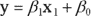<m:math display="block" overflow="scroll" xmlns:m="http://www.w3.org/1998/Math/MathML"><m:mrow><m:mtext>y</m:mtext><m:mo>=</m:mo><m:msub><m:mrow><m:mi>&#914;</m:mi></m:mrow><m:mrow><m:mn>1</m:mn></m:mrow></m:msub><m:msub><m:mrow><m:mtext>x</m:mtext></m:mrow><m:mrow><m:mn>1</m:mn></m:mrow></m:msub><m:mo>+</m:mo><m:msub><m:mrow><m:mi>&#914;</m:mi></m:mrow><m:mrow><m:mn>0</m:mn></m:mrow></m:msub></m:mrow></m:math>

在由单个特征预测响应的简单情况下，当你的数据排列成一条直线时，这样的模型是完美的。但是，如果数据不是直线，而是呈曲线形状呢？为了表示这种情况，只需观察以下二维表示，如 图 9-1 所示。

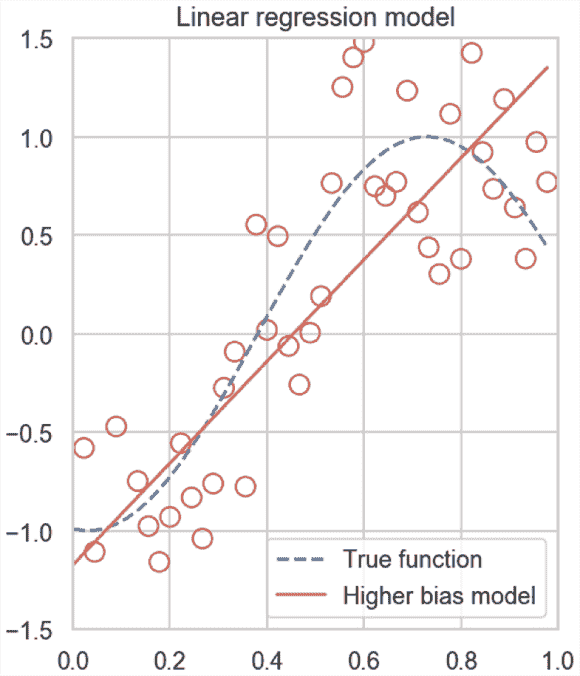

图 9-1： 线性模型难以映射曲线函数的示例。

当目标变量与预测器之间的关系在散点图中类似于一条直线或随机点云时，线性回归模型产生的映射错误不是系统性的，而是随机的，因为有些点会出现在映射回归线的上方，而其他点则在下方。在点呈曲线形状的云状分布的情况下，情况就不同了，因为有时回归线可能在某种程度上是准确的，但在其他时候则会系统性地出错。事实上，有时点总是在直线上方（低估的情况）；有时则在下方（高估的情况）。

鉴于其对响应映射的简单性，算法可能会倾向于系统性地高估或低估复杂数据背后的真实规则。在这种情况下，算法受到偏差误差的影响。偏差误差是简单算法的特征，这些算法无法表达复杂的数学表达式，因此在某些情况下无法正确映射特征与目标变量之间的关系。

### 牢记模型复杂性

正如表达式的简单性是一个问题一样，自动求助于映射非常复杂的表达式并不总能提供解决方案。事实上，你不知道所需响应映射的真实复杂性（例如，它是适合直线还是曲线）。因此，正如简单性可能导致不合适的响应（请参阅 图 9-1），也有可能使用过于复杂的映射来表示数据中的复杂性。

复杂映射的问题在于它有许多术语和参数——在某些极端情况下，你的算法可能拥有的参数比数据中的示例还要多。因为你必须指定所有参数，算法就开始在数据中记忆一切——不仅记忆信号（重要的数据），还记忆

* 随机噪声

* 错误

* 不太具体的样本特征

在某些情况下，算法甚至可以记忆示例。但是，除非你正在处理一个具有有限简单特征且不同值很少的问题，否则鉴于数据集中所有可用特征的可能组合数量巨大，你极不可能遇到两次相同的示例。

当发生记忆时，你可能会产生一切运行良好的错觉，因为你的机器学习算法似乎很好地拟合了样本内数据。但是，当你开始在样本外数据上使用算法，并注意到它在预测中产生错误，并且这些错误在你用略有不同的方法从同一数据重新学习时会发生很大变化时，问题可能会迅速显现。`Overfitting` 发生在你的算法从数据中学习得太多，以至于映射出不存在的曲线形状和规则时，如 图 9-2 所示。程序或训练数据的任何微小变化都会产生反复无常的预测。

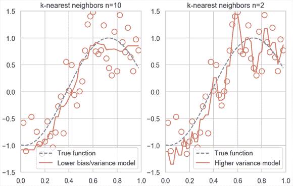

图 9-2： K-最近邻模型在左侧面板中正确拟合问题，而在右侧面板中试图映射曲线函数时变得过于复杂。

### 保持解决方案的平衡

为了创建出色的解决方案，机器学习模型在简单性（意味着更高的偏差）和复杂性（产生更高的估计方差）之间进行权衡。如果你打算获得最佳的预测性能，你确实需要找到一个中间的解决方案，通过了解哪种方法效果更好，你可以通过在数据上进行试错来实现。因为数据决定了预测问题最合适的解决方案，你既没有万能药，也没有解决所有机器学习难题的简单重复性解决方案。


在数学传说中，一个常被引用的定理是由 David Wolpert 和 William Macready 提出的“无免费午餐”定理，该定理指出：“当任何两种优化算法的性能在所有可能问题上平均计算时，它们是等价的。”如果算法在抽象层面是等价的，除非在特定的实际问题中得到证明，否则没有哪个算法优于另一个。（有关无免费午餐定理的更多细节，请参阅 [`http://www.no-free-lunch.org/`](http://www.no-free-lunch.org/) 的讨论；其中两个定理用于机器学习。）

特别是，在他的文章“The Lack of A Priori Distinctions between Learning Algorithms”中，Wolpert 表示，无论算法多么简单或复杂，算法之间都不存在 *a priori*（先验的，指基于理论推导而非观察或经验的推理或知识）区别。（有关详细信息，请参阅文章 [`http://citeseerx.ist.psu.edu/viewdoc/download?doi=10.1.1.390.9412&rep=rep1&type=pdf`](http://citeseerx.ist.psu.edu/viewdoc/download?doi=10.1.1.390.9412&rep=rep1&type=pdf)。）数据决定了什么有效以及效果如何。最终，你不能总是依赖单一的机器学习算法，而必须测试许多算法，并为你的问题找到最佳算法。

除了受到无免费午餐定理的“尝试一切”原则引导进入机器学习实验之外，你还有另一条经验法则需要考虑：奥卡姆剃刀，归功于 14 世纪的哲学家和神学家 William of Occam ([`https://math.ucr.edu/home/baez/physics/General/occam.html`](https://math.ucr.edu/home/baez/physics/General/occam.html))。奥卡姆剃刀指出，理论应被削减到最小，以合理地代表真理（因此称为剃刀）。该原则并不表示更简单的解决方案更好，而是在简单解决方案和提供相同结果的更复杂解决方案之间，始终优先选择更简单的解决方案。该原则是现代科学方法论的基础，甚至 Albert Einstein 似乎也经常引用它，表示“一切都应尽可能简单，但不能过于简单”（有关详细信息，请参阅 [`https://quoteinvestigator.com/2011/05/13/einstein-simple/`](https://quoteinvestigator.com/2011/05/13/einstein-simple/)）。迄今为止的证据总结如下：

*   要获得最佳机器学习解决方案，请在数据上尝试你能尝试的一切，并使用学习曲线表示数据的性能。

*   从更简单的模型开始，例如线性模型，并且当简单解决方案的表现与复杂解决方案几乎一样好时，始终优先选择简单解决方案。在处理现实世界中的非样本数据时，你将从这种选择中受益。

*   始终使用非样本示例检查解决方案的性能，如前面几节中讨论的那样。

#### 描绘学习曲线

为了可视化机器学习算法在数据问题上受偏差或方差影响的程度，你可以利用一种名为学习曲线的图表类型。*学习曲线*是绘制一个或多个机器学习算法相对于其用于训练的数据量的性能的图表。绘制的值是预测误差测量值，该指标既作为样本内性能，也作为交叉验证或非样本性能进行测量。

如果图表描绘的是相对于数据量的性能，那么它是学习曲线图。当它描绘的是相对于不同超参数或模型选择的一组学习特征的性能时，它则是验证曲线图。要创建学习曲线图，你必须执行以下操作：

*   将数据分为样本内和非样本集（使用 70/30 比例分割数据，或使用称为交叉验证的采样技术，本节后面将对此进行解释）。

*   创建不断增长大小的训练数据部分。根据可用于训练的数据大小，将部分增加 10%，或者，如果你有大量数据，则按幂次级数增加示例数量，例如 10³、10⁴、10⁵ 等等。

*   在数据的不同子集上训练模型。在相同的训练数据和非样本集上测试并记录其性能。

*   将记录的结果绘制在两条曲线上，一条用于样本内结果，另一条用于非样本结果（参见 Figure 9-3）。如果你使用了交叉验证技术而不是训练/测试分割，你还可以根据结果本身的标准差，绘制表示结果在多次验证中稳定性的边界（置信区间）。

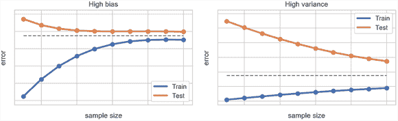

FIGURE 9-3: 受高偏差（左）和高方差（右）影响的学习曲线。

理想情况下（但并非总是如此，如即将出现的提示所解释），你应该获得两条起始误差点不同的曲线：非样本的较高；样本内的较低。随着训练集大小的增加，两者之间的空间差异应当减少，直到在一定数量的观测值时，它们趋近于一个共同的误差值。值得注意的是，打印图表后，当出现以下情况时会产生问题：

*   **两条曲线趋于收敛，但你看不到它们彼此靠近，因为你没有足够的示例。** 这种情况表明，如果你想使用测试的机器学习算法成功学习，需要增加数据集大小。

*   **两条曲线之间的最终收敛点误差较高，因此你的算法偏差过大。** 在这里添加更多示例没有帮助，因为你已有现有数据量的收敛。作为解决方案，你应该增加特征数量或使用更复杂的机器学习算法。

*   **两条曲线不趋于收敛，因为非样本曲线开始表现得反复无常。** 这种情况明显是估计高方差的迹象，你可以通过增加示例数量（在一定数量时，非样本误差将再次开始下降）、减少特征数量，或者有时只是修正机器学习算法的一些关键参数来降低它。

学习曲线作为 Scikit-learn 包的一部分提供，使用 `learning_curve` 函数为你准备所有计算（有关详细信息，请参见 [`https://scikit-learn.org/stable/modules/generated/sklearn.model_selection.learning_curve.html`](https://scikit-learn.org/stable/modules/generated/sklearn.model_selection.learning_curve.html)）。本书示例方便地封装了该函数以绘制结果图，因为该函数仅输出一系列结果向量。

虽然预期算法对样本内数据的拟合优于非样本数据，但你仍可能发现非样本损失优于样本内损失。有几个原因可以解释这种情况，所有原因主要与非样本数据由于你划分非样本与样本内数据并对其进行处理的方式而出于某种原因更简单这一事实有关。

### 训练、验证和测试

以下各节将考虑用于确保模型按预期工作的方法。在这些部分中，你将遇到用于这些任务的三种数据分割：

*   **训练：** 使用部分数据集来定义模型的算法。

*   **验证：** 对模型拟合进行无偏评估，以确保模型能够处理非样本数据。

*   **测试：** 通过在数据集上执行最终模型拟合来克服潜在问题，例如窥探。

#### 考虑分割


# 数据分割与交叉验证

在理想情况下，你应该在机器学习算法从未学习过的数据上进行测试。然而，等待新鲜数据在时间和成本方面并不总是可行的。作为一种简单的补救措施，你可以随机将数据分为训练集（样本内）和测试集（样本外）。常见的分割比例是测试集占 25% 到 30%，训练集占剩余的 75% 到 70%。你需要同时分割包含响应变量和特征的数据，并保持每个响应变量与其特征之间的对应关系。

第二种补救措施发生在你需要调优学习算法时。在这种情况下，引用测试集数据来检查调优是否有效并不是好的做法，因为这会导致另一种称为“窥探”（snooping）的过拟合（本章后面将详细介绍此主题）。为了克服窥探，你需要第三个分割，称为验证集（*set*），它是用于评估模型并微调模型超参数的数据部分。建议的分割是将示例分为三部分：70% 用于训练，20% 用于验证，10% 用于测试。

你应该随机执行分割，即不考虑数据的初始顺序。否则，你的测试将不可靠，因为顺序可能导致高估（*overestimation*）（当存在有意义的顺序时）或低估（*underestimation*）（当分布差异过大时）。作为解决方案，你必须确保测试集的分布与训练分布差异不大，并且分割数据中出现顺序。例如，检查可用的识别号在集合中是否连续。有时，即使你严格遵循随机抽样，也无法始终在集合之间获得相似的分布，尤其是当示例数量较少时。

当你的示例数量 `n` 较高时，例如 `n>10,000`，你可以相当有信心地创建随机分割的数据集。当数据集较小时，比较训练集和测试集中响应变量和特征的基本统计量（如均值、众数、中位数和方差）的相似性，将帮助你了解测试集是否合适。当你不确定分割是否正确，因为统计量差异过大时，只需重新创建一个新的分割。

### 采用交叉验证

训练/测试集分割的一个明显问题是，如果你的样本较小，减少样本内训练数据大小会在测试中引入偏差。此外，当你分割数据时，可能会将一些有用的示例排除在训练之外。有时数据非常复杂，以至于测试集虽然看起来与训练集相似，但并不真正相似，因为值的组合不同（这在高维数据集中很典型）。这些问题会增加在示例较少时抽样结果的不稳定性。以不利方式分割数据的风险也解释了为什么在评估和调优机器学习解决方案时，机器学习从业者不青睐使用训练/测试分割。

基于 k-折叠的交叉验证是答案。它依赖于随机分割，但这次它将数据分割为数量为 k 的 *folds*（每个 fold 是数据的一个独立分区），大小相等。然后，每个 fold 轮流用作测试集，其余的用于训练。每次迭代使用不同的 fold 作为测试，从而产生一个误差估计。在对一个 fold 进行测试并使用其余 fold 进行训练后，会使用一个不同于之前的后续 fold，并重复该过程以产生另一个误差估计。该过程持续进行，直到所有 k 个 fold 各被用一次作为测试集，你将得到 k 个误差估计，可以将其计算为平均误差估计（交叉验证得分）和估计的标准误。Figure 9-4 展示了该过程的工作原理。

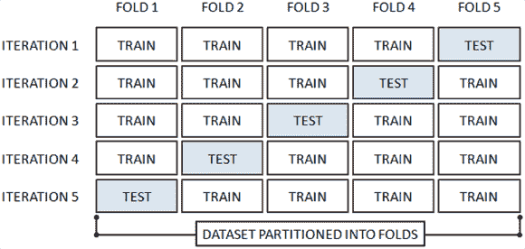

FIGURE 9-4: A graphical representation of how cross-validation works.

该程序提供以下优势：

*   无论示例数量多少，它都能很好地工作。通过增加折叠数量，你增加了训练集的大小（k 越大，训练集越大，偏差越小），并减少了测试集的大小。你应该保持 k 参数合理，因为它是一个抽样过程，如果 k 太大，你的样本将彼此过于相似。
*   单个 fold 的分布差异不那么重要。当一个 fold 与其他 fold 的分布不同时，它仅在一次测试中用作测试集，并在其余测试中作为训练集的一部分与其他 fold 混合。
*   你实际上测试了所有观测值，因此你使用所有数据完全测试了机器学习假设。
*   通过取结果的平均值，你可以期望获得预测性能的概率估计。此外，结果的标准差可以告诉你在实际样本外数据中预期多少变化。交叉验证性能的较高变化表明数据变化极大，算法无法正确捕捉。

除非你使用的数据具有某种重要的顺序，否则使用 k-折叠交叉验证始终是最佳选择。例如，它可能涉及时间序列，如销售。在这种情况下，你不应该使用随机抽样方法，而应依赖于基于数据原始顺序的训练/测试分割，以保留时间序列，并可以在该有序系列的最后示例上进行测试。

### 在验证中寻找替代方案

你有几种交叉验证的替代方案，所有这些都源自统计学。第一个需要考虑的是留一法交叉验证（LOOCV），但仅当你的样本内包含少量示例时才适用。它类似于 k-折叠交叉验证，唯一的区别是 k（折叠数量）正好是 n（示例数量）。因此，在 LOOCV 中，你构建 n 个模型（当你有许多观测值时，这可能会变成巨大的数量），并在每个模型上对单个样本外观测值进行测试。除了计算密集且需要构建许多模型来测试你的假设之外，LOOCV 的问题是你得到的每个结果都与其他所有结果高度相关（因为它们共享大部分训练示例，只差一个）。其后果是，你不能像依赖交叉验证结果那样依赖 LOOCV 估计，因为你始终在测试本质上相同的数据样本。可以理解的是，如果你正在处理非常小的数据集，LOOCV 是验证的唯一可行选择。

统计学中的另一种替代方案是自助法（bootstrapping），这是一种长期用于估计统计量抽样分布的方法，这些统计量被假设不遵循先前假设的分布。自助法通过构建大量（越多越好）大小为 n（原始样本内大小）的样本，并进行有放回抽样来工作。*draw with repetition* 意味着该过程可以多次抽取一个示例，以将其作为自助法重采样的一部分。自助法的优势在于提供了一种简单有效的方法来估计真实误差度量。事实上，自助法误差测量通常比交叉验证具有显著较小的方差。另一方面，由于有放回抽样，验证变得更加复杂，因此你的验证样本来自自助法外的示例。此外，重复使用某些训练样本可能会导致使用自助法构建的模型中出现一定的偏差。


如果你使用的是用于测试的自举外部示例，你会发现测试样本的大小可能各不相同，这取决于样本内唯一示例的数量，可能约占原始样本内大小的三分之一。这段简单的 Python 代码片段演示了如何随机模拟一定数量的自举：

```
import numpy as np
n = 1000
results = list()
for j in range(10000):
    chosen = np.random.randint(0, n, size=n)
    results.append(len(np.unique(chosen)) / n)
avg_oob = 1 - np.mean(results)
print(f"Avg out-of-boostrap: {avg_oob*100:0.3}%")
```

该代码创建大量试验，每个试验都进行有放回抽样（这意味着一个案例可以在样本中被多次重复使用），然后计算每次抽样中唯一示例的数量以及作为外部样本被遗漏的案例比例。最后，通过所有试验对被遗漏样本的比例进行平均。运行此实验可能需要一些时间，且由于抽样的随机性，你的结果可能会有所不同。以下是一些代表性输出：Out-of-boostrap: 36.8 %

### 通过交叉验证进行优化

能够有效验证机器学习假设，可进一步优化你选择的算法。以下各部分将帮助你了解如何优化交叉验证解决方案。

#### 预测性能的来源

如前几部分所述，算法提供了数据中的大部分预测性能，前提是它能够从数据中检测信号，并拟合预测函数的真实函数形式，而不会过拟合并产生大量估计方差。并非每个机器学习算法都最适合你的数据，也没有单一算法能适用于每个问题。找到适合特定问题的算法取决于你。

预测性能的第二个来源是数据本身，当对其进行适当转换和选择以增强所选算法的学习能力时。第 11 章讨论了数据转换和选择的问题。

预测性能的最终来源在于对算法 `hyper-parameters` 进行微调，这些是你在学习发生之前设置（配置）且不会从数据中学习到的参数。它们的作用在于 *先验地* 定义一个假设，而其他参数则 *后验地*（基于观察或经验的推理或知识）* 指定它*，在算法与数据交互后，并通过优化过程发现某些参数值在获得良好预测方面效果更好。并非所有机器学习算法都需要大量超参数调优，但一些最复杂的算法确实需要，尽管这些算法开箱即用，但找到正确的控制杆可能会对预测的正确性产生巨大影响。即使超参数不是从数据中学习的，你在决定超参数时也应该考虑你正在处理的数据，并且应该基于交叉验证和对可能性的仔细评估来做出选择。

复杂的机器学习算法，即那些最容易受到估计方差影响的算法，提供了大量以大量参数形式表达的选择。对它们进行调整，使其或多或少地适应正在学习的数据。有时，过度调整超参数甚至可能导致算法从数据中检测到虚假信号。如果你基于某个固定参考（如测试集或重复的交叉验证方案）过度操纵超参数，那么超参数本身就成为一个未被检测到的方差来源。

#### 探索超参数空间

超参数可能形成的值组合使得决定在哪里寻找优化变得困难。如在讨论梯度下降时所述，优化空间可能包含表现更好或更差的值组合。即使你找到了一个好的组合，也不能保证它是最佳选择。（这是在最小化误差时陷入局部最小值的问题，该问题在 第 8 章 讨论梯度下降的问题时有所描述。）

作为解决此问题的实用方法，验证应用于特定数据的算法的超参数的最佳方式是通过交叉验证测试所有超参数，并选择最佳组合。这种方法称为网格搜索（grid-search，其 Scikit-learn 实现见：[`https://scikit-learn.org/stable/modules/generated/sklearn.model_selection.GridSearchCV.html`](https://scikit-learn.org/stable/modules/generated/sklearn.model_selection.GridSearchCV.html)），它具有无可争议的优势，允许你系统地采样可能输入到算法中的值范围，并发现一般最小值何时出现。另一方面，网格搜索也有严重缺点，因为它计算密集（你可以在现代多核计算机上轻松并行执行此任务）且非常耗时。此外，系统且密集的测试会增加出错的可能性，因为数据集中存在的噪声可能导致一些良好但虚假的验证结果。网格搜索有一些替代方案。与其测试所有内容，不如尝试以下方法：

*   通过计算量大且数学复杂的非线性优化技术（如 Nelder-Mead 方法）引导探索可能的超参数值空间

*   使用贝叶斯方法（通过利用之前的结果来最小化测试次数）

*   使用随机搜索。

贝叶斯优化虽然概念复杂，但在 Scikit-learn 兼容的包 Scikit-optimize 中有实现（你可以在 [`https://scikit-optimize.github.io/stable/`](https://scikit-optimize.github.io/stable/) 找到它）。你只需要安装该包并使用一个 Scikit-learn 超参数搜索包装器，例如 `BayesSearchCV`，它与 Scikit-learn 中网格搜索和随机搜索具有相同的命令语法：[`https://scikit-optimize.github.io/stable/auto_examples/sklearn-gridsearchcv-replacement.html`](https://scikit-optimize.github.io/stable/auto_examples/sklearn-gridsearchcv-replacement.html)。

令人惊讶的是，随机搜索（random-search，[`https://scikit-learn.org/stable/modules/generated/sklearn.model_selection.RandomizedSearchCV.html`](https://scikit-learn.org/stable/modules/generated/sklearn.model_selection.RandomizedSearchCV.html））效果非常好，易于理解，而且不仅仅基于盲目运气，尽管它起初可能看起来如此。事实上，该技术的主要观点是，如果你选择足够多的随机测试，你就有足够的可能性找到正确的参数，而无需在测试表现相近的略有不同组合上浪费精力。

第 9-5 图 中显示的图形表示解释了为什么随机搜索效果良好。系统探索虽然有用，但倾向于测试每个组合，如果某些参数不影响结果，这将变成能量的浪费。随机搜索测试的组合较少，但覆盖了每个超参数的更广范围，如果（如经常发生的情况）某些参数比其他参数更重要，这种策略证明是有效的。

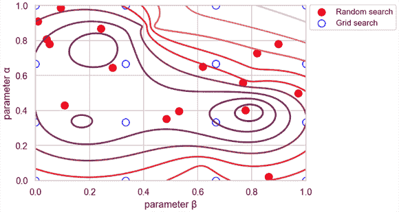

FIGURE 9-5: Comparing grid-search to random-search.

为了使随机搜索表现良好，你应该进行 15 到最多 60 次测试。如果网格搜索需要更多实验，那么采用随机搜索是有意义的。

#### 选择相关特征


超参数并不是你通过交叉验证和网格搜索来审视的模型的唯一方面。你对数据应用的所有变换都可以以同样的方式进行评估，以确定它们是否能提升机器学习算法在你所处理的问题上的效果。

特别是，你可以对数据应用的一项重要变换是特征选择，以便获得更好的结果。通过特征选择，你只提供数据集中你预期效果最好的特征子集。事实上，并非所有特征都有用，有些甚至可能损害学习过程。错误、噪声以及与其他特征的高度相似性（一组特征之间的高相关性）会让算法感到困惑并增加估计方差。

因此，选择特征是你数据验证工作的另一部分。它可能会显著改变你从机器学习中获得的结果。在这种情况下，验证始终是必要的，因为数据特征的影响比调整超参数更加难以预测。只有当你确定某些特征确实对你的问题有效时，才可以跳过验证。然而，这种方法在统计学中更为常见，因为许多模型是理论驱动的，这意味着它们更多地基于初步研究、推理和实验，而非数据本身。

Leo Breiman 撰写的论文“Two Cultures”([`https://projecteuclid.org/euclid.ss/1009213726`](https://projecteuclid.org/euclid.ss/1009213726))讨论了机器学习和统计学在处理问题上的不同方法。它提供了关于为何我们既有机器学习方法又有统计学方法，以及两者有何不同的额外观点。如果你采用直接检查数据以确定哪些特征最有用——即你应该保留什么、丢弃什么——的方法，你有三种不同的选择：

*   **单变量统计：** 你使用一些简单的统计量，如皮尔逊相关性或卡方检验，来排除不太有用的特征。在 Scikit-learn 中，你可以使用 `SelectKBest` 结合评分函数 `chi2`、`f_classif` 或 `f_regression` (`sklearn.feature_selection.SelectKBest`) 来仅保留与预测更相关的特征。因为你是单独分析每个特征，所以无法确定它们之间是否存在可能有助于预测的协同作用。

*   **基于模型的选择：** 有些机器学习算法会自行选择最有用的特征。在接下来的章节中，你会发现基于树的模型可以为你提供特征的重要性排名。你还会发现，线性模型有自己的方法来确定哪些特征应被赋予较低权重甚至被排除。此类方法的巨大优势在于它们是整体性的，也就是说，它们在整个特征集中评估每个特征的贡献，因此它们总能提出可能的最佳特征集之一。另一方面，选择与做出选择的机器学习算法的函数形式密切相关；因此，如果你尝试将其应用于另一种算法，选择可能效果较差。

*   **迭代特征选择：** 这种方法介于单独测试特征和整体测试特征之间。你通过逐步添加最有用的特征、删除不太有用的特征，或两者兼施来测试算法。这种方法可以大大减少使用的特征数量（适用于任何类型的模型），但从计算角度来看也很昂贵。Scikit-learn 实现了递归特征消除（RFE）迭代策略（带验证的实现：[`https://scikit-learn.org/stable/modules/generated/sklearn.feature_selection.RFECV.html`](https://scikit-learn.org/stable/modules/generated/sklearn.feature_selection.RFECV.html)），它首先使用所有特征，并在每次迭代后删除一部分不太有用的特征。

### 避免样本偏差和泄漏陷阱

本章概述机器学习验证方法时，最后要包含的一个方面是检查一种可能的内部采样偏差补救措施。内部采样偏差可能在机器学习投入使用之前就发生在你的数据上，并会导致后续估计的高方差。此外，本节还就当外部样本的一些信息传递到内部样本数据时可能出现的泄漏陷阱发出警告。当你准备数据时，或者在你的机器学习模型准备就绪并开始工作后，都可能出现此问题。

这种被称为预测器集成的补救措施，在你的训练样本未完全失真且其分布与外部样本不同（但并非无法补救的方式，例如所有类别都存在但比例不正确）时效果完美。在这种情况下，估计的方差会影响你的结果，你可以通过多种方式将其稳定：例如通过重采样（如自助法）；通过子采样（从样本中取样）；或通过使用更小的样本（这会增加偏差）。

要理解集成为何如此有效，请想象靶心的图像。如果你的样本影响了预测，有些预测会是准确的，而其他预测则会以随机方式出错。如果你更换样本，正确的预测将保持正确，但错误的预测将在不同值之间变化。有些值将是你要找的准确预测；其他值则会在正确值周围波动。

通过比较结果，你可以猜测反复出现的才是正确答案。你也可以对答案取平均值，并猜测正确答案位于这些值的中间。通过靶心游戏，你可以想象将不同游戏的照片叠加：如果问题是方差，最终你会猜测目标位于命中频率最高的区域，或者至少位于所有射击的中心。

在大多数情况下，这种方法被证明是正确的，并且能大大改善你的机器学习预测。当你的问题是偏差而非方差时，使用集成不会造成危害，除非你子采样的样本太少。子采样的一个好经验法则是，相对于原始内部样本数据，取样本比例在 70% 到 90% 之间。如果你想让集成发挥作用，你应该执行以下操作：

1. 对你的数据和模型进行大量迭代（从最少三次迭代到数百次）。

2. 每次迭代时，对你的内部样本数据进行子采样（或自助法）。

3. 在重采样的数据上使用机器学习构建模型，并预测外部样本结果。将这些结果保存起来以备后用。

4. 迭代结束时，对于你想要预测的每个外部样本案例，获取其所有预测，如果你在做回归，则对它们取平均值；如果你在做分类，则取出现频率最高的类别。

泄漏陷阱可能会让你措手不及，因为它们可能是机器学习过程中未知且未被发现的问题来源。问题在于窥探，即过度观察外部样本数据并过于频繁地适应它。如果你经常在测试集上验证工作，然后继续选择或调整算法以使其在测试集上表现更好，这种情况很容易发生。简而言之，窥探是一种过拟合——不仅发生在训练数据上，也发生在测试数据上。这是因为你安排实验和测试的方式使得过拟合问题本身更难被发现，直到你使用从未测试过的新数据进行现实检查。通常，当你已经将机器学习算法应用于业务或面向公众的服务时，你才意识到问题是窥探，这使得问题变成了每个人都能注意到的问题。


你可以通过两种方式避免窥探数据。首先，在处理数据时，要小心地将训练数据、验证数据和测试数据整齐地分开。此外，在处理过程中，绝不要从验证集或测试集中获取任何信息，即使是那些看起来最简单、最无害的示例。更糟糕的是，使用所有数据应用复杂的转换。例如，在金融领域，众所周知，从所有训练数据和测试数据中计算均值和标准差（这实际上可以告诉你很多关于市场状况和风险的信息）可能会泄露关于你模型的宝贵信息。当发生数据泄露时，机器学习算法是在测试集上进行预测，而不是对市场的样本外数据进行预测，这意味着它们根本没有起作用，从而导致资金损失。

检查你的样本外示例的性能。事实上，你可能会从对测试结果的窥探中带回一些信息，以帮助你确定某些参数比其他参数更好，或者引导你选择一种机器学习算法而不是另一种。对于每个模型或参数，应根据交叉验证结果或验证样本来应用你的选择。

# Chapter 10

# 从简单学习器入手

### 本章内容

- `Trying a perceptron to separate classes using a line`
- `Partitioning recursively training data using decision trees`
- `Discovering the rules behind playing tennis and surviving the Titanic`
- `Leveraging Bayesian probability to analyze textual data`

从本章开始，示例开始说明如何从数据中学习的基础知识。计划首先介绍一些最简单的学习策略——提供一些公式（仅限必要的公式）、关于其工作原理的直觉，以及使用 Python 和 Scikit-learn 的示例，以便尝试它们最典型的特征。本章首先回顾使用感知机来分离类别。

本书中介绍的所有主要机器学习技术的核心，总是存在一种基于某种相互关联的线性组合、决策树的样本分割变体，或某种贝叶斯概率推理的算法。本章使用分类树来演示该技术。唯一的例外是 K-近邻（`KNN`）算法，它基于类比推理，在专门用于检测数据相似性的特殊章节中单独讨论（第 12 章`你不必手动输入本章的源代码。事实上，使用可下载的源代码要容易得多。你可以在 Python 代码的可下载源代码的 `ML4D2E` 文件夹和 R 代码的可下载源代码的 `ML4D2ER` 文件夹中找到本章的源代码。本章的示例文件将以 `ML4D2E; 10;`（用于 Python）或 `ML4D2E_R; 10;`（用于 R）开头。有关如何找到这些源代码文件的详细信息，请参阅简介。

### 发现令人难以置信的感知机

你可以通过查看使用线和表面将示例分为类别或估计值预测的模型，开始探索机器学习算法如何工作的旅程。这些是 `linear models`，本章介绍了机器学习中使用最早的线性算法之一：感知机。后续章节将完善对线性模型的概述。第 13 章介绍线性回归及其统计推导的算法家族；第 14 章帮助你发现神经网络；第 15 章讨论支持向量机。然而，在你能够推进到这些其他主题之前，你应该了解感知机有趣的历史。

#### 未能实现奇迹

Frank Rosenblatt 在康奈尔航空实验室于 1957 年在海军研究局的赞助下发明了感知机。Rosenblatt 是一名心理学家，也是人工智能领域的先驱。他精通认知科学，有了创建一台能够通过试错来学习的计算机的想法，就像人类一样。

这个想法得到了成功的开发，起初，感知机不仅仅被构想为一段软件；它被创建为运行在专用硬件上的软件。这种组合的使用使得复杂图像的识别比当时任何其他计算机都能更快、更精确。当 Rosenblatt 断言感知机是一种新型计算机的胚胎，这种计算机将能够行走、说话、看见、书写，甚至能够自我复制并意识到自身存在时，这项新技术引起了巨大的期望，并引发了巨大的争议。如果属实，它将是一个强大的工具，并向世界介绍了强人工智能，即具有类似于人脑能力和功能的人工智能。

不用说，感知机并未实现其创造者的期望。它很快就显示出有限的能力，即使在其图像识别专长方面也是如此。普遍的失望点燃了第一次人工智能寒冬，并暂时放弃了连接主义，直到 20 世纪 80 年代。

```Connectionism` 是基于神经科学以及生物互联网络示例的机器学习方法。你可以将连接主义的根源追溯到感知机。（有关机器学习五大流派的讨论，请参见 第 2 章 中“指定统计学在机器学习中的作用”部分。）

感知机是一种迭代算法，它通过连续和反复的近似，努力确定向量 `w`（也称为 `coefficient vector`）的最佳值集。向量 `w` 可以帮助你在将其与特征矩阵 `X`（包含以数值表示的信息）相乘，然后加上一个称为偏置的常数项时，预测示例的类别。输出是一种预测，因为之前描述的操作输出一个数字，其符号应该能够在二元分类问题中预测每个示例的类别。

``迄今为止，本书已经讨论了偏置的三种不同含义：采样偏差；机器学习算法预测中的误差偏差；以及现在，偏置作为某些机器学习公式中的常数项，例如在基于加权值求和的感知机中。


感知器的天然专长是二元分类。然而，你可以使用更多模型（针对每个类别猜测一个模型，这种训练策略称为一对其余或 OVA）来预测多个类别。除了分类之外，感知器无法提供更多信息。例如，你无法使用它来估计预测准确的概率。从数学角度来看，感知器试图最小化以下误差函数公式，但它仅针对被误分类的示例（换句话说，其符号与正确类别不符的示例）：

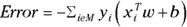<m:math display="block" overflow="scroll" xmlns:m="http://www.w3.org/1998/Math/MathML"><m:mrow><m:mi>E</m:mi><m:mi>r</m:mi><m:mi>r</m:mi><m:mi>o</m:mi><m:mi>r</m:mi><m:mo>=</m:mo><m:mo>&#45;</m:mo><m:msub><m:mrow><m:mi>&#931;</m:mi></m:mrow><m:mrow><m:mrow><m:mi>i</m:mi><m:mi>e</m:mi><m:mi>M</m:mi></m:mrow></m:mrow></m:msub><m:mtext>&#8201;</m:mtext><m:msub><m:mrow><m:mi>y</m:mi></m:mrow><m:mrow><m:mi>i</m:mi></m:mrow></m:msub><m:mfenced open="(" close=")"><m:mrow><m:mrow><m:msubsup><m:mrow><m:mi>x</m:mi></m:mrow><m:mrow><m:mi>i</m:mi></m:mrow><m:mrow><m:mi>T</m:mi></m:mrow></m:msubsup><m:mi>w</m:mi><m:mo>+</m:mo><m:mi>b</m:mi></m:mrow></m:mrow></m:mfenced></m:mrow></m:math>

该公式是第 8 章中定义的代价函数的一个示例，仅涉及矩阵 `X` 中在当前 `w` 集合下被分配了误分类符号的示例。要理解该公式的功能，你必须考虑只有两个类别。第一个类别的示例在响应向量 `y` 时表示为 +1 值，而另一个类别的示例相应地编码为 –1。该公式选取每个被误分类的示例，并依次将其特征与向量 `w` 相乘，然后加上偏置。

由于括号内被误分类的示例 `X` 与权重向量 `w` 的乘法是向量乘法，你应该转置示例的特征向量 `x`，以便与 `w` 相乘的结果是一个数字。这是第 7 章中介绍的矩阵乘法的一个方面。

乘以两个向量相当于使用第二个向量中的值作为权重，对第一个向量中的值进行加权求和。因此，如果 `x[i]` 有五个特征，而向量 `w` 有五个系数，则它们相乘的结果是所有五个特征的和，每个特征首先乘以其各自的系数。矩阵乘法使公式中的表达更加紧凑，但归根结底，该操作与加权平均值并无不同。

在得到向量乘法的结果后，你将偏置值相加，并将所有内容乘以你本应预测的值（第一个类别为 +1，第二个类别为 –1）。由于你只处理被误分类的示例，该操作的结果始终为负数，因为两个符号不匹配的值相乘始终为负数。

最后，在对所有被误分类的示例运行相同的计算后，你将所有结果汇总并求和。结果是一个负数，由于前面所示误差公式开头的负号（相当于将所有内容乘以 –1）而变为正数。随着感知器错误数量的增加，结果的大小也会增大。

通过仔细观察结果，你会发现该公式的设计非常巧妙（尽管远非罗森布拉特所期望的奇迹）。错误数量越少，输出越小。当没有误分类时，求和结果变为零。通过将公式置于这种形式，你告诉计算机尝试实现完美分类并永不放弃。其理念是，当它找到向量 `w` 的正确值且没有任何预测错误时，剩下要做的就是应用以下公式：

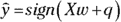<m:math display="block" overflow="scroll" xmlns:m="http://www.w3.org/1998/Math/MathML"><m:mrow><m:mover accent="true"><m:mi>y</m:mi><m:mo>&#770;</m:mo></m:mover><m:mo>=</m:mo><m:mtext>&#8201;</m:mtext><m:mi>s</m:mi><m:mi>i</m:mi><m:mi>g</m:mi><m:mi>n</m:mi><m:mfenced open="(" close=")"><m:mrow><m:mrow><m:mi>X</m:mi><m:mi>w</m:mi><m:mo>+</m:mo><m:mi>q</m:mi></m:mrow></m:mrow></m:mfenced></m:mrow></m:math>

运行该公式将输出一个预测向量（`y-hat`），包含一系列 +1 和 –1 值，对应于预期的类别。

### 遇到非线性可分限度

感知器计算的秘密在于算法如何更新向量 `w` 的值。此类更新通过随机选择一个被误分类的示例（称其为 `x[t]`），并使用简单的加权加法更改 `w` 向量来实现：

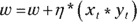<m:math display="block" overflow="scroll" xmlns:m="http://www.w3.org/1998/Math/MathML"><m:mrow><m:mi>w</m:mi><m:mo>=</m:mo><m:mtext>&#8201;</m:mtext><m:mi>w</m:mi><m:mo>+</m:mo><m:mi>&#951;</m:mi><m:mo>\*</m:mo><m:mfenced open="(" close=")"><m:mrow><m:mrow><m:msub><m:mrow><m:mi>x</m:mi></m:mrow><m:mrow><m:mi>t</m:mi></m:mrow></m:msub><m:mo>\*</m:mo><m:msub><m:mrow><m:mi>y</m:mi></m:mrow><m:mrow><m:mi>t</m:mi></m:mrow></m:msub></m:mrow></m:mrow></m:mfenced></m:mrow></m:math>

希腊字母 eta（`η`）是 `学习率`。它是 0 到 1 之间的浮点数。当你将此值设置为接近零时，可以限制公式过度更新向量 `w` 的能力，而将值设置为接近一则使更新过程完全影响 `w` 向量的值。设置不同的学习率可以加快或减慢学习过程。许多其他算法也使用这种策略，较低的 eta 用于通过减少更新后 `w` 值的突然跳跃来改进优化过程。权衡是，在得到最终结果之前，你需要等待更长时间。

更新策略提供了关于使用感知器学习类别时发生情况的直觉。如果你想象示例投影到笛卡尔平面上，感知器只不过是一条试图将正类与负类分开的直线。正如你可能从线性代数中回忆的那样，所有以 `y = x*b+a` 形式表达的内容实际上都是平面上的一条直线。

最初，当 `w` 设置为零或随机值时，分离线只是平面上无数可能直线中的一条，如图 10-1 所示。更新阶段通过迫使分离线更接近误分类点来对其进行定义。使用多次迭代来定义错误，将分离线放置在两个类别的确切边界上。

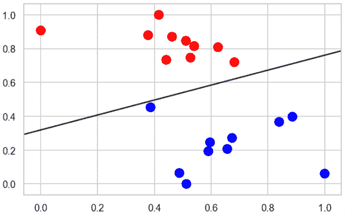

图 10-1: 感知器跨越两个类别的分离线。

尽管这是一个非常聪明的算法，但感知器很快就暴露了其局限性。除了仅使用定量特征就能猜测两个类别之外，它还有一个重要局限：如果两个类别由于混合而没有边界，算法就无法找到解决方案，并会无限地自我更新。

如果你无法用任何直线或平面将分布在两个或多个维度上的两个类别分开，那么它们就是 `非线性可分`的。克服数据的非线性可分性是机器学习必须完成的挑战之一，以便在基于真实数据（而非仅为学术目的创建的人工数据）的复杂问题上取得有效效果。


当非线性可分性问题受到审查，且从业者开始对感知器失去兴趣时，专家们迅速推测，可以通过创建一个新的特征空间（通过将原始特征重新组合为新特征）来解决问题，使得先前不可分的类别变得可分。因此，感知器的表现将如之前一样出色。不幸的是，创建新的特征空间是一项挑战，因为它需要目前公众只能部分获得的计算能力。创建新特征空间是一个高级话题，本书在后面研究更复杂算法（如神经网络和支持向量机）的学习策略时会讨论。

近年来，得益于大数据，该算法重新受到关注：事实上，感知器不需要处理内存中的所有数据，而是可以通过单个样本进行良好工作（仅在误分类情况使其必要时更新其系数向量）。因此，它是在线学习的完美算法，例如使用小批量甚至一次仅一个样本来从大数据中学习。

### 生长贪婪分类树

决策树有着悠久的历史。此类算法的第一个算法可追溯到 20 世纪 70 年代，但如果考虑实验和最初的原始研究，决策树的使用可以追溯到更早（它们与感知器一样古老）。作为符号主义部落的核心算法，决策树因其直观的方法而长期受欢迎。其输出易于转换为规则，因此人类很容易理解。它们也极其易于使用且功能多样。所有这些特性使它们成为一种有效且吸引人的无脑模型，相对于那些需要对输入数据矩阵进行复杂数学变换或对其超参数进行极其精确调整的模型而言。

#### 通过拆分数据预测结果

以观察样本作为起点，算法通过将输入矩阵划分为越来越小的分区，直到过程触发停止规则，从而重新追溯生成输出类别（或在回归问题中处理时的数值）的规则。这种从特殊到一般规则的重新追溯是人类逆向演绎的典型特征，如逻辑和哲学所讨论。在机器学习背景下，这种逆向推理是通过在所有可能的训练样本拆分方式中进行搜索，并以贪婪的方式决定使用能最大化结果分区统计量的拆分来实现的。

当算法在优化过程的每一步都总是选择能最大化当前结果的移动，而不考虑后续步骤可能发生的情况时，该算法就是 `greedy` 的。换句话说，算法试图最大化当前步骤，而不向前看以实现全局优化。

划分的发生是为了强制执行一个简单的原则：初始数据的每个分区都必须使预测目标结果更容易，其特征是类别（或数值）的分布比原始样本更不同且更有利。算法通过拆分数据来创建分区。它首先评估特征，然后评估特征中的值，以确定能带来特殊统计量最大改进的数据拆分，该统计量在决策树中扮演成本函数的角色。

许多统计量决定如何在决策树中进行拆分。它们都遵循这样的理念：当拆分使预测更安全时，拆分必须优于原始样本或另一个可能的拆分。其中最常用的测量包括

*   Gini impurity

*   Information gain

*   Variance reduction (for regression problems)

这些测量的操作类似，因此本章专注于信息增益，因为它是最直观的测量，并以最简单的方式传达决策树如何检测某个拆分的预测能力增强（或风险降低）。Ross Quinlan 在 20 世纪 70 年代基于信息增益创建了决策树算法 `ID3`，并且由于其最近升级的版本 `C4.5`，它仍然非常流行。信息增益依赖于 `informative entropy` 的公式，这是一个描述消息中包含的信息预期值的通用公式：

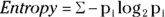<m:math display="block" overflow="scroll" xmlns:m="http://www.w3.org/1998/Math/MathML"><m:mrow><m:mi>E</m:mi><m:mi>n</m:mi><m:mi>t</m:mi><m:mi>r</m:mi><m:mi>o</m:mi><m:mi>p</m:mi><m:mi>y</m:mi><m:mo>=</m:mo><m:mi>&#931;</m:mi><m:mo>&#45;</m:mo><m:msub><m:mrow><m:mtext>p</m:mtext></m:mrow><m:mrow><m:mtext>i</m:mtext></m:mrow></m:msub><m:msub><m:mrow><m:mrow><m:mo>log</m:mo></m:mrow></m:mrow><m:mrow><m:mn>2</m:mn></m:mrow></m:msub><m:msub><m:mrow><m:mtext>p</m:mtext></m:mrow><m:mrow><m:mtext>i</m:mtext></m:mrow></m:msub></m:mrow></m:math> 

在公式中，`p` 是类别的概率（范围为 0 到 1），`log[2]` 是以 2 为底的对数。从一个你想要分类两个概率相同的类别（50/50 分布）的样本开始，最大可能的熵是

```
Entropy = -0.5*log2(0.5) -0.5*log2(0.5) = 1.0
```

然而，当决策树算法检测到一个可以将数据集拆分为两个分区的特征，其中两个类别的分布为 40/60 时，平均信息熵会减小：

```
Entropy = -0.4*log2(0.4) -0.6*log2(0.6) = 0.97
```

注意所有类别的熵之和。使用 40/60 拆分，总和小于理论最大值 1（熵减小）。将熵视为数据混乱程度的度量：混乱越少，秩序越多，猜测正确类别就越容易。在第一次拆分后，算法尝试使用相同的减少熵的逻辑进一步拆分获得的分区。它逐步拆分任何后续数据分区，直到无法再进行拆分，因为子样本是单个示例，或者因为它已满足停止规则。

`Stopping rules` 是树扩展的限制。这些规则通过考虑分区的三个方面来工作：初始分区大小、结果分区大小以及拆分可实现的信息增益。停止规则很重要，因为决策树算法近似了大量函数；然而，噪声和数据错误很容易影响该算法。因此，取决于样本，结果估计的不稳定性和方差会影响决策树预测。

举个例子，看看决策树可以使用 Ross Quinlan 的原始数据集之一实现什么，该数据集在 `Induction of Decision Trees` (1986) ([`https://dl.acm.org/doi/10.1023/A%3A1022643204877`](https://dl.acm.org/doi/10.1023/A%3A1022643204877)) 中介绍并描述了 ID3 算法。该数据集非常简单，仅包含 14 个关于天气条件的观察，结果说明是否适合打网球。该示例包含四个特征：天气、温度、湿度和风，所有这些都使用定性类别而不是测量值来表达（你可以将温度、湿度和风力强度以数值表示），以传达特征与结果之间关系的更直观理解。以下示例使用 `pandas` 加载包含打网球数据的 feather 数据集。

```
import pandas as pd filename = 'https://github.com/lmassaron/datasets/'filename += 'releases/download/1.0/tennis.feather'tennis = pd.read_feather(filename)
```


在算法能够从这些数据中学习之前，它需要将预测器与目标分开，并转换预测器变量，因为它们是分类的。（它们由字符串标签表示）。决策树可以以两种方式处理分类数据：

*   **通过将所有分类数据转换为二进制特征：** 当标签存在于某个案例中时，每个分类标签由其特征值表示。

*   **通过将每个分类特征转换为数值特征：** 使用诸如 Scikit-learn 的 `LabelEncoder()` 之类的函数将分类标签替换为数值编码（见：[`https://scikit-learn.org/stable/modules/generated/sklearn.preprocessing.LabelEncoder.html`](https://scikit-learn.org/stable/modules/generated/sklearn.preprocessing.LabelEncoder.html)）。

在后一种选项中，决策树将找到一种方法来对标签编码的数据进行分区，以便更好地进行预测。虽然这种方法效果不错，但它会生成一棵复杂的树；因此，为了清晰起见，最好使用第一种选项，为每个特征组合及其值创建二进制特征：

```
X = tennis[['outlook', 'temperature', 'humidity', 'wind']]
X = pd.get_dummies(X)
y = tennis.play
```

现在算法可以拟合所有可用数据并提取其规则。

```
from sklearn.tree import DecisionTreeClassifier
dt = DecisionTreeClassifier()
dt.fit(X, y)
```

创建树之后，您可以使用 `dtreeviz` 来检查它，这是一个专门用于表示决策树的库。旧金山大学的 Terence Parr 教授（[`http://parrt.cs.usfca.edu`](http://parrt.cs.usfca.edu)）和 Prince Grover（他是同一学院的校友）开发了 `dtreeviz` 库。您可以在 [`https://github.com/parrt/dtreeviz`](https://github.com/parrt/dtreeviz) 获取该包和安装指南，并可以在 Parr 教授的博客文章“如何可视化决策树”中阅读有关开发和包功能的内容，网址为 [`https://explained.ai/decision-tree-viz/`](https://explained.ai/decision-tree-viz/)。

安装包后，您运行它并绘制树的表示，如 图 10-2 所示：

```
from dtreeviz.trees import dtreeviz
viz = dtreeviz(dt, X, y, target_name='play_tennis', feature_names=X.columns, class_names=["No", "Yes"], scale=2.0)
viz
```

要读取由 图 10-2 表示的树的节点，请从最顶部的节点开始，该节点首先报告用于将该节点拆分为所有后续节点的规则。由于每个拆分都是二进制的，您可以看到两个条形，每个条形代表将数据拆分为两部分后目标的分布。

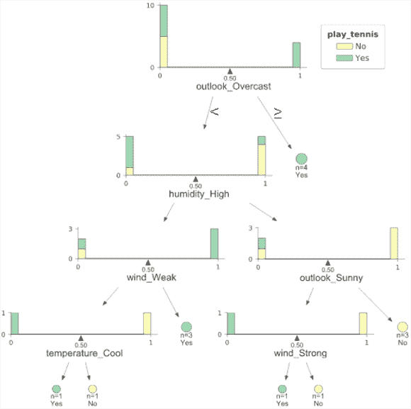

FIGURE 10-2: 基于打网球数据集构建的决策树的可视化。

决策树的第一个拆分是基于天气状况是否为多云。在右侧，您会找到第一个终端叶节点：如果天气状况是多云（该条件的概率大于 0.50），您总是可以打网球。在左侧拆分中，分区继续基于高湿度，然后进行进一步的拆分，有时以一个叶节点结束。

最终，您会得到七个终端叶节点。其中一些包含单个案例，但请注意，每个终端叶节点只包含一种目标类型，这意味着决策树已创建一组确定性规则，用于分类何时可以打网球。

#### 剪枝过度生长的树

尽管前一节中的打网球数据集说明了决策树的基本原理，但它缺乏概率吸引力，因为它提出了一组确定性动作（没有冲突的指令）。使用真实数据进行训练通常不会出现如此明确的规则，从而为歧义和乐观的可能性留出了空间。

另一个更现实的例子是描述 *RMS Titanic*（英国客轮，1912 年 4 月在北大西洋与冰山相撞后沉没）乘客生存率的数据集。该数据集有多个版本——示例中使用的版本由几个关键特征组成，例如性别、年龄、船上兄弟姐妹或配偶的数量（`sibsp`）、船上父母或子女的数量（`parch`）、乘客等级（`pclass`）以及生存情况（表示为二进制，1 表示该个体已生存）。与之前处理打网球数据集一样，您直接从互联网加载 feather 文件中的数据。此示例还将数据分为训练集和验证集（占最初可用数据的 25%）。

```
filename = 'https://github.com/lmassaron/datasets/'
filename += 'releases/download/1.0/titanic.feather'
titanic = pd.read_feather(filename)
from sklearn.model_selection import train_test_split
X = titanic.iloc[:,:-1]
y = titanic.iloc[:,-1]
(X_train, X_test, y_train, y_test) = train_test_split(X, y, random:state=0, shuffle=True)
```

决策树在其估计中具有比偏差更大的方差。为了减少对数据的过拟合，该示例指定最小拆分必须至少包含五个示例。

```
dt = DecisionTreeClassifier(min_samples_split=5)
dt.fit(X_train, y_train)
accuracy = dt.score(X_test, y_test)
print(f"test accuracy: {accuracy:0.3}")
```

0.774 的测试准确率是一个不错的结果。但是，您可以改进它，因为代码允许决策树无限制地生长其分支。使用更受控的方法通常会带来更好的解决方案，这通常意味着对树进行剪枝。剪枝发生在树完全生长后。从终端叶节点开始，向后进行，当分支的存在对整体信息增益的改进很少时，代码会剪掉这些分支。最初让树扩展，可以容忍改进很小的分支，因为它们可以解锁更有趣的分支和叶节点。从叶节点回溯到根节点并仅保留具有预测价值的分支，可以降低模型的方差，使生成的规则在预测时更加精简和有效。

Scikit-learn 实现了代价复杂度剪枝，它计算不同的剪枝及其在熵或总不纯度方面的代价（有关术语和规范的更多信息，请参见：[`https://scikit-learn.org/stable/modules/tree.html#minimal-cost-complexity-pruning`](https://scikit-learn.org/stable/modules/tree.html#minimal-cost-complexity-pruning)）。代码首先计算剪枝 alpha 值（一个复杂度参数，指定树大小的重要性）及其在不纯度方面的代价（衡量包含不同类别数据点的区域的纯度程度）。alpha 越高，树越简单，模型方差越低，但这会以一定的偏差为代价。通过使用交叉验证或验证集，可以找到剪枝的正确平衡点以获得最佳效果，如 图 10-3 所示：

```
path = dt.cost_complexity_pruning_path(X_train, y_train)
ccp_alphas, impurities = path.ccp_alphas, path.impurities
import matplotlib.pyplot as plt
fig, ax = plt.subplots(dpi=90)
ax.plot(ccp_alphas[:-1], impurities[:-1], marker='o', drawstyle="steps-post")
ax.set_xlabel("effective alpha")
ax.set_ylabel("total impurity of leaves")
ax.set_title("Total Impurity vs effective alpha")
plt.show()
```

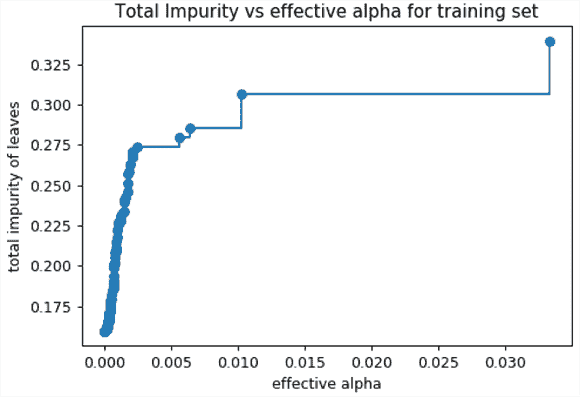

FIGURE 10-3: 剪枝 alpha 值及其不纯度代价的可视化。


如 图 10-3 所示，alpha 变化较小时，总不纯度增长非常快。你只能通过在验证集上验证实验过的 alpha 值来找到最佳值：

```
best_pruning = list()
for ccp_alpha in ccp_alphas:
    if ccp_alpha > 0:
        dt = DecisionTreeClassifier(random_state=0, ccp_alpha=ccp_alpha)
        dt.fit(X_train, y_train)
        best_pruning.append([ccp_alpha, dt.score(X_test, y_test)])
best_pruning = sorted(best_pruning, key=lambda x:x[1], reverse=True)
best_ccp_alpha = best_pruning[0][0]
dt = DecisionTreeClassifier(random_state=0, ccp_alpha=best_ccp_alpha)
dt.fit(X_train, y_train)
accuracy = dt.score(X_test, y_test)
print(f"test accuracy: {accuracy:0.3}")
print("Number of nodes in the last tree is: {} with ccp_alpha: {:0.3}".format(dt.tree_.node_count, best_ccp_alpha))
```

在验证集上找到准确率最高的 alpha 后，代码会使用该 alpha 值重新训练决策树，以实现受控生长。结果是一组清晰的规则，用于解释 `RMS Titanic` 上生与死的区别。

```
from dtreeviz.trees import dtreeviz
viz = dtreeviz(dt, X, y, target_name='survived', feature_names=X.columns, class_names=["No", "Yes"], scale=1.5)
viz
```

对于决策树，剪枝就像头脑风暴。首先，代码生成树的所有可能分支（就像你在头脑风暴会议中产生想法一样）。其次，当头脑风暴结束时，代码只保留有效的部分。树结构图表（图 10-4）显示，只有少数规则对生存至关重要，其中最重要的是性别（男性不利于生存）和舱位等级（处于第三等级，即最贫困的等级，同样威胁生存）。

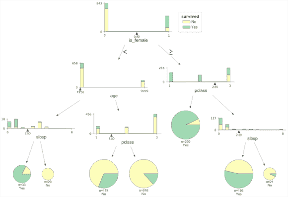

FIGURE 10-4: 基于泰坦尼克号数据集构建的剪枝决策树可视化。

### 采取概率转向

朴素贝叶斯是另一种基本学习算法，它与之前讨论的感知机比与决策树更相似，因为它基于一组用于获得预测的值。与感知机和决策树一样，朴素贝叶斯是一种历史悠久的算法，自 20 世纪 50 年代以来就已使用，尽管名称不同且形式略有差异。此外，朴素贝叶斯因其在文本学习方面的有效性而闻名，并且明显吸引着贝叶斯派。鉴于其简单性以及无需大量预处理即可工作的事实，它已成为机器学习中大多数文本问题的基准，在测试更复杂的解决方案之前先使用它。

#### 理解朴素贝叶斯

与感知机一样，朴素贝叶斯需要给定上下文下结果发生的概率值（即 `条件概率`）。此外，它是将值相乘而不是相加。朴素贝叶斯依赖于概率计算，因此需要对概率进行典型操作。

如 第 7 章 所示，当概率相乘时，意味着事件是独立的，互不影响。这种假设虽然被认为过于简单和天真，但在许多基本机器学习算法中很常见，因为在处理大量数据时它出奇地有效。

通过求和值或相乘概率，你将每条信息视为对答案的独立贡献。这有时是不现实的假设，因为现实指向一个互联的世界。然而，尽管缺乏现实性，朴素贝叶斯仍能胜过大多数复杂技术，正如微软的两位研究人员 Banko 和 Brill 在其著名论文“Scaling to Very Very Large Corpora for Natural Language Disambiguation” (`https://www.aclweb.org/anthology/P01-1005/`) 中所描述的那样。

朴素贝叶斯与 第 7 章 中“`Conditioning chance by Bayes’ theorem`”部分讨论的贝叶斯定理相关。它代表了该定理本身的简化形式。为了确定示例的类别，算法执行以下操作：

1. 学习连接特征与每个可能类别的概率。

2. 将与每个结果类别相关的所有概率相乘。

3. 通过将每个概率除以其总和来归一化概率。

4. 将概率最高的类别作为答案。

例如，在之前的打网球数据集示例中，你观察到晴朗、多云和下雨的不同天气分布与是否打网球的肯定和否定答案相关联。使用 pandas 的 `crosstab` 函数可以快速验证这一观察：

```
pd.crosstab(tennis.outlook, tennis.play.replace({0:'NO', 1:'YES'}))
```

输出显示九个肯定回答和五个否定回答：

| **Outlook** || **NO** || **YES** |

| --- | --- | --- |

| Overcast || 0 || 4 |

| --- | --- | --- |

| Rain || 2 || 3 |

| Sunny || 3 || 2 |

通过分析肯定回答，你会发现，给定肯定回答时，天气晴朗的概率为九次中的两次（概率 = 2/9 = 0.22）；多云的概率为九次中的四次（概率 = 4/9 = 0.44）；下雨的概率为九次中的三次（概率 = 3/9 = 0.33）。你可以使用否定回答重复相同的程序，当无法打网球时，晴朗、多云和下雨的概率分别为 3/5、0/5 和 2/5。你也可以使用 crosstab 函数返回基于列的百分比。这可以节省你进行一些计算：

```
pd.crosstab(tennis.outlook, tennis.play.replace({0:'NO', 1:'YES'}), normalize='columns')
```

输出返回以下表格：

| **Outlook** || **NO** || **YES** |

| --- | --- | --- |

| Overcast || 0.0 || 0.444444 |

| --- | --- | --- |

| Rain || 0.4 || 0.333333 |

| Sunny || 0.6 || 0.222222 |

使用贝叶斯定理，你可以确定你计算的概率实际上是 `P(E|B)`，即给定某个信念（例如是否打网球）时，你拥有某些证据（在此例中为天气）的概率：

```
P(B|E) = P(E|B)*P(B) / P(E)
```

该公式提供了你需要的答案，因为它是给定某些证据（天气条件）时某个信念（是否打网球）的概率。如果你估计每个信念的概率，你可以选择概率最高的信念，从而最大限度地降低预测错误的风险。`P(E|B)` 然后成为估计概率的关键，因为 `P(B)` 是肯定或否定答案的一般概率（先验概率），很容易确定。在此例中，你有九个肯定结果和五个否定结果。因此，`P(B)` 对于肯定为 9/(9+5) = 0.64，对于否定为 0.36。

当你有许多证据时，如本例所示，`P(E|B)` 是手头所有单个 `P(E|B)` 概率的组合。本例包含天气、温度、湿度和风力的概率集。将它们组合起来并不容易，除非你假设它们分别影响响应。如前所述，独立事件的概率简单地相乘，总体的 `P(E|B)` 结果是每个特征的所有 `P(E|B)` 的乘积。


你可能没有某个响应的证据。例如，在这个示例中，你没有天空阴天时不打网球的案例。结果是零概率，而在乘法中，无论涉及哪些其他概率，零概率始终返回零。当你没有采样足够多的示例时，可能会出现缺乏某个响应证据的情况。一种良好的做法是用一个常数修改观察到的概率，称为 `Laplace correction`，它由估计概率时添加虚构证据组成。在这个示例中使用这种修正，0/5 的概率将变为 (0+1)/(5+1) = 0.17。

`P(E)` 对于这个示例来说不是什么大问题，你应该忽略它。`P(E)` 不重要的原因是，它代表在现实中看到某一组特征的概率，并且它自然会因示例而异（例如，你的位置可能使某些天气条件变得罕见）。但是，你并不是在跨示例比较概率。你是在每个示例内部比较概率，以确定该示例最可能的预测。在同一个示例中，某一组证据的概率是相同的，因为你对每个可能的结果都只有这一组证据。这一组证据是否罕见并不重要；最终，你必须将该示例与其他示例隔离来进行预测，因此你可以安全地将 `P(E)` 设为 1 来排除它。以下示例使用基本 Python 命令来展示如何在给定某些天气条件的情况下获得预测：

```
prob_outcomes = tennis.play.value_counts(sort=False, normalize=True)
outlook = pd.crosstab(tennis.outlook, tennis.play, normalize='columns')
temperature = pd.crosstab(tennis.temperature, tennis.play, normalize='columns')
humidity = pd.crosstab(tennis.humidity, tennis.play, normalize='columns')
wind = pd.crosstab(tennis.wind, tennis.play, normalize='columns')
```

运行前面的代码片段后，你就拥有了进行预测所需的所有元素。假设你需要猜测以下条件：

`Outlook = Sunny, Temperature = Mild, Humidity = Normal, Wind = Weak`

为了获得所需信息，你首先基于总体概率计算结果的概率，然后根据你拥有的特定证据乘以条件概率来对其进行细化：

```
proba = prob_outcomes
proba *= outlook.loc["Sunny"]
proba *= temperature.loc["Mild"]
proba *= humidity.loc["Normal"]
proba *= wind.loc["Weak"]
print(proba)
```

积极响应的概率结果为 0.028219，大于消极响应的概率 0.006857。积极结果的更高概率证实，在给定此类条件时，算法预测你可以打网球。

### 使用朴素贝叶斯估计响应

现在你知道它的工作原理了，朴素贝叶斯应该看起来相当简单，且其假设非常天真。你还应该知道，相乘概率是可以的。你还需要考虑这些问题：

*   使用 Laplace 修正来修复零概率

*   将数值转换为定性特征，因为对于包含数字范围的类别，估计概率更容易

*   仅使用计数特征（值等于或高于零）——尽管某些算法变体可以处理二元特征和负值

*   对缺失特征进行插值（当计算中缺少重要概率时），并移除冗余和无关的特征（保留此类特征会使朴素贝叶斯的估计更加困难）

特别是，无关特征可能会对结果产生很大影响。当你处理的是具有许多特征的少量示例时，数据中可能存在的噪声会严重扭曲你的结果。作为解决方案，你可以选择一个特征子集，仅筛选最重要的特征。第 13 章 使用线性模型讨论了这种技术（无用信息的存在也会影响线性模型）。当你拥有足够的示例并花一些时间修复特征时，朴素贝叶斯能为许多涉及文本输入分析的预测问题提供有效的解决方案，例如：

*   `Email spam detection`: 允许你只将有用信息放入收件箱。

*   `Text classification`: 无论来源（在线新闻、推文或其他文本信息流），你都可以将文本正确归类到正确的类别（体育、政治、经济等）。

*   `Text-processing tasks`: 让你执行拼写纠正或猜测文本的语言。

*   `Sentiment analysis`: 检测书面文本背后的情感（积极、消极、中性或其他人类情感）。

作为实际应用的示例，本节创建一个垃圾邮件检测器。

首先，从互联网下载 feather 格式的垃圾邮件数据集。完成后，你就可以运行示例代码了。

```
filename = 'https://github.com/lmassaron/datasets/'
filename += 'releases/download/1.0/spam.feather'
spam = pd.read_feather(filename)
X = spam.iloc[:,:-1]
y = spam.iloc[:, -1]
```

惠普实验室收集了该数据集，并使用 57 个特征将 4,601 封电子邮件分类为垃圾邮件或非垃圾邮件，其中许多特征是特定单词或符号在电子邮件中出现次数的归一化计数。免费的 UCI 机器学习库 [`https://archive.ics.uci.edu/ml/datasets/Spambase`](https://archive.ics.uci.edu/ml/datasets/Spambase) 也提供了该数据集。

如果你下载垃圾邮件数据集并检查其特征（例如使用命令 `head(spam)`），你会注意到有些特征是单词，而另一些则指向某些字符或书写风格的存在（例如大写字母）。更值得注意的是，有些特征不是表示计数的整数，而是 0 到 100 之间的浮点数。它们表示文本中每个特征的百分比（例如，`charDollar` 特征表示短语中美元符号字符的百分比，范围从 0 到 6）。

以文本中某些单词或字符百分比表示的特征，是一种明智的策略，用于平衡文本较长时发现某些元素的可能性更高的问题。使用百分比而不是计数可以对文本进行归一化，并让你将其视为相同长度。

应用朴素贝叶斯模型根本不需要修复太多超参数。你可以使用 `alpha` 参数设置 Laplace 修正，并使用 `class_prior` 参数定义不同的先验概率 `P(B)`，并提供与从数据中学习到的不同的概率。

```
from sklearn.model_selection import cross_val_predict
from sklearn.naive_bayes import BernoulliNB
nb = BernoulliNB()
preds = cross_val_predict(nb, X, y, cv=5, n_jobs=-1)
```

有多种朴素贝叶斯模型。刚刚展示的伯努利模型适用于二元指标。（你并不确切地计算单词，而是检查它们是否存在。）但是，还有多项式版本（更适合整数计数）和高斯版本（期望特征服从正态分布——即它们既有正值也有负值）。Python 在 Scikit-learn 包中提供了完整的朴素贝叶斯模型系列，网址为 [`https://scikit-learn.org/stable/modules/naive_bayes.html`](https://scikit-learn.org/stable/modules/naive_bayes.html)。


要测试模型的效果，你可以使用交叉验证，除了使用 `cross_val_predict` ([`https://scikit-learn.org/stable/modules/generated/sklearn.model_selection.cross_val_predict.html`](https://scikit-learn.org/stable/modules/generated/sklearn.model_selection.cross_val_predict.html)) 提供误差估计外，还能获得预测结果。数据集会根据交叉验证方案进行划分，并将所有外部验证集的预测结果汇总在一起。虽然在某些情况下，这并非衡量模型泛化能力的有效方法，但它能利用训练集中的数据，让你了解模型的表现情况。

`cross_val_predict` 在你希望对相同的测试数据进行预测，并且同时使用多个不同模型时最为有用。第 16 章 将探讨以这种方式使用模型集成。

是时候使用 `classification_report` 命令来评估交叉验证预测结果了。这次，除了常规的准确率指标外，示例还使用了更能说明垃圾邮件模型表现情况的误差指标。

```
from sklearn.metrics import classification_report cr = classification_report(y_true=y, y_pred=preds, target_names=['non spam', 'spam'])print(cr)
```

报告中重要的输出指标是精确率、召回率和 F1 分数：

```
 precision recall f1-score support non spam 0.89 0.92 0.90 2788 spam 0.87 0.82 0.84 1813 accuracy 0.88 4601 macro avg 0.88 0.87 0.87 4601weighted avg 0.88 0.88 0.88 4601
```

精确率和召回率，以及利用 F1 分数对两者进行联合优化，可以解决准确率无法处理的问题。精确率是指猜测时的准确性。它跟踪的是，在预测某个类别时，该预测正确的次数所占的百分比。例如，在评估患者检查数据后，你可以使用精确率来诊断癌症。在这种情况下，你的精确率是被诊断为患癌的患者中真正患癌的患者所占的百分比。因此，如果你诊断了十名患病患者，其中九人确实患病，那么你的精确率为 90%。

当你未能诊断出患癌患者，或者将健康患者误诊为患癌时，后果会有所不同。精确率只讲述了故事的一部分，因为还有被你诊断为健康的癌症患者，这是一个严重的问题。召回率指标讲述了故事的第二部分。它报告了在整个类别中，你正确猜测的百分比。例如，回顾前面的示例，召回率指标是你正确猜测患癌的患者所占的百分比。如果有 20 名癌症患者，而你只诊断出其中九人，那么你的召回率将为 45%。

在使用模型时，你可能准确率很高但召回率较低，或者召回率很高但在过程中损失了准确率。幸运的是，精确率和召回率可以通过 F1 分数共同最大化，F1 分数使用以下公式：`f1 = 2 * (precision * recall) / (precision + recall)`。使用 F1 分数可以确保你始终获得精确率和召回率的最佳组合。

在本示例中，你可以看到 F1 分数表明该模型在处理垃圾邮件示例时表现不佳。这可能是由于该类别的示例数量较少，事实上，与现实世界中的问题一样，获取所需的所有示例既困难又昂贵。在这个数据集中，垃圾邮件远不如普通邮件频繁，数据集是 *不平衡* 的，因为它没有足够的垃圾邮件示例。

当你想要进行分类且类别不平衡（即每个类别的示例数量不同）时，你需要重新平衡数据集，否则机器学习模型可能表现不佳。imbalance-learn 包 ([`https://github.com/scikit-learn-contrib/imbalanced-learn`](https://github.com/scikit-learn-contrib/imbalanced-learn)) 提供了一系列最先进的解决方案、教程，并与 Scikit-learn 算法完全兼容。

此外，除了两个类别具有相似的精确率外，该模型对垃圾邮件的召回率较低，这意味着它无法检测某些类型的垃圾邮件。你可以通过增加示例数量、调整算法（如果可能）或在问题上测试新的算法类型来解决这个问题。归根结底，捕捉垃圾邮件并不那么困难；问题在于在过程中避免丢弃重要邮件（假阳性，即阳性为垃圾邮件）以及避免忽略垃圾邮件（假阴性）。这就是为什么在训练垃圾邮件检测器后，评估精确率和召回率是一个关键步骤。

Part 4

# 学习智能与大数据

本部分内容……

准备可用的数据

通过相似性理解数据

使用线性模型

使用神经网络

使用智能向量机器

使用集成进行多层次分析

第 11 章

# 预处理数据

本章内容

**获取和清理数据**

**修复和转换数据**

**创建新的有意义特征**

**使用单变量和多变量模型**

在建造新房子之前。

你不必手动输入本章的源代码。事实上，使用可下载的源代码要容易得多。你可以在 Python 代码可下载源的 `ML4D2E` 文件夹和 R 代码可下载源的 `ML4D2ER` 文件夹中找到本章的源代码。本章的示例文件将以 `ML4D2E; 11;`（针对 Python）或 `ML4D2E_R; 11;`（针对 R）开头。有关如何找到这些源文件的详细信息，请参见简介。

### 收集和清理数据

虽然本书侧重于机器如何从数据中学习，但在算法世界中并不存在万能配方（正如第 9 章中提到的“无免费午餐”定理所指出的），当涉及数据时。即使是复杂和先进的学习函数，如果没有以下支持，也会遇到瓶颈并表现不佳：

*   足够大且适合你所使用算法的数据量


适合用于机器学习的清洁、准备充分的数据

第 9 章在解释偏差与方差权衡时讨论了数据量在学习中的作用。提醒一下，当估计值的变异性成为问题时，大量数据对学习目的可能有所帮助，因为用于学习的特定数据会严重影响预测（过拟合问题）。更多数据可以帮助预测过程，因为更多示例将帮助机器学习算法 *消除每个信号的歧义*（准确确定数据的使用方式及其重要性），并更好地利用这些信号来建模预测。

除了数据量之外，对数据清洁度的需求是可以理解的——这就像你在学校接受的教学质量一样。如果你的老师只教你废话，提供错误的示例，花时间开玩笑，并以其他方式避免认真教学，那么无论你多么聪明，考试都不会考得好。同样的概念适用于简单和复杂的算法——如果你给它们喂垃圾数据，它们就会产生荒谬的预测。

根据垃圾进垃圾出（GIGO）原则，坏数据可能会严重损害机器学习。坏数据包括

*   缺失数据

*   异常值

*   偏斜的值分布

*   信息冗余

*   分析和开发不充分的特征

坏数据未必是指错误的数据。通常，坏数据只是不符合你为数据设定的标准的数据：以多种不同方式编写的标签；从其他数据字段溢出的不规则值；以无效格式编写的日期；以及本应结构化为分类特征的非结构化文本。在数据库中强制执行数据有效性规则，并致力于更好的数据表设计以及存储数据过程的准确性，对机器学习可能非常有帮助，并让你能够专注于解决更棘手的数据问题。

### 修复缺失数据

即使你手头有足够的示例来训练简单和复杂的学习算法，它们也必须在特征中呈现完整的值，没有任何缺失数据。拥有不完整的示例会使在特征内部和之间连接所有信号变得不可能。缺失值还会使算法在训练期间难以学习。你必须对缺失数据采取一些措施。通常，你可以忽略缺失值，或者通过猜测一个可能的替换值来修复它们。然而，过多的缺失值会导致更不确定的预测，因为缺失的信息可能会隐藏任何可能的数字；因此，特征中缺失值越多，预测就越不稳定和不精确。

#### 识别缺失数据

作为第一步，统计每个特征中缺失案例的数量。当一个特征有太多缺失案例时，你可能需要将其从训练和测试数据集中删除。一个好的经验法则是，如果超过 90% 的实例缺失，则删除该特征。

一些学习算法不知道如何处理缺失值，并在训练和测试阶段都会报告错误，而其他模型则将它们视为零值，导致预测值或概率被低估。（这就像公式的一部分无法正常工作一样。）因此，你需要用一些合适的值替换数据矩阵中的所有缺失值，以便机器学习能够正确进行。

缺失数据有很多原因，但关键点在于数据是随机缺失还是按特定顺序缺失。随机缺失数据是理想的，因为你可以使用简单的平均值、中位数或另一种机器学习算法来猜测其值，而无需太多担忧。当缺失数据不是随机的，但背后存在某种逻辑时，问题就会出现。在这种情况下，缺失值对某些类型的示例具有强烈的偏差。例如，考虑研究人口收入的情况。富人（ presumably 出于税收原因）倾向于通过告诉你他们不知道来隐瞒真实收入。另一方面，穷人可能会说他们不想报告收入，因为担心受到负面评判。如果你错过了某些人口阶层的信息，修复缺失数据可能会很困难且具有误导性，因为你可能会认为这些情况与其他情况一样。相反，它们截然不同。因此，你不能简单地使用平均值来替换缺失值——你必须使用复杂的方法并仔细调整它们。此外，识别不是随机缺失的案例是困难的，因为这需要更仔细地检查缺失值与数据集中其他特征的关联方式。

当数据是随机缺失时，你可以轻松修复空值，因为你可以从其他特征中获得关于其真实值的提示。当数据不是随机缺失时，除非你了解数据与缺失案例的关联，否则你无法从其他可用信息中获得良好的提示。因此，如果你需要找出数据中缺失的收入，并且它是因为该人是富人而缺失的，你不能用简单的平均值来替换缺失值，因为你会用中等收入来替换它。相反，你应该使用富人收入的平均值作为替换。

当数据不是随机缺失时，值缺失这一事实本身就是有信息量的，因为它有助于追踪缺失的群体。你可以将查找缺失原因的任务交给你的机器学习算法，通过构建一个新的二进制特征来报告特征值何时缺失。因此，机器学习算法将自行找出最佳替换值。

#### 选择合适的替换策略

你有几种可能的策略来有效处理缺失数据。如果你需要处理 *定量*（以数字表示的值）或定性特征中的缺失值，你的策略可能会改变。*定性*特征，虽然也由数字表示，但实际上是指概念，因此它们的值有些任意，你无法对它们进行有意义的平均值或其他计算。

处理定性特征时，你的值猜测应始终基于用作代码的数字生成整数。缺失数据处理的常见策略如下：

*   **用计算出的常数（如平均值或中位数）替换缺失值。** 如果你的特征是类别，你必须提供一个特定值，因为编号是任意的，使用平均值或中位数没有意义。当缺失值是随机的时使用此策略。

*   **用特征正常值范围之外的值替换缺失值。** 例如，如果特征是正数，则用负值替换缺失值。这种方法适用于基于决策树的算法（如前一章中解释的算法）和定性特征。

*   **用 0 替换缺失值，这与回归模型和标准化特征（第 15 章中讨论的主题）配合良好。** 当定性特征包含二进制值时，此方法也适用。

*   **当缺失值是与时间相关的一系列值的一部分时，对缺失值进行插值。** 此方法仅适用于定量值。例如，如果你的特征是每日销售额，你可以使用过去七天的移动平均值，或选择与上周同一时间使用的值。


*   **`Impute their value using the information from other predictor features (but never use the response variable).`** 使用诸如 `missing.py` 或 `missforest.py` ([`https://github.com/epsilon-machine/missingpy/blob/master/missingpy/missforest.py`](https://github.com/epsilon-machine/missingpy/blob/master/missingpy/missforest.py))、带链方程的多重插补 (MICE) ([`https://www.statsmodels.org/dev/imputation.html`](https://www.statsmodels.org/dev/imputation.html))、Autoimpute ([`https://pypi.org/project/autoimpute/`](https://pypi.org/project/autoimpute/)) 等库来插补值。

另一个良好的做法是，为每个你修复了其值的特征创建一个新的二进制特征。该二进制特征将跟踪由替换或插补正值引起的变化，你的机器学习算法可以找出何时需要对实际使用的值进行额外调整。

在 Python 中，缺失值仅通过 NumPy 包的 `ndarray` 数据结构才成为可能。Python 用一个特殊值标记缺失值，该值在屏幕上显示为 NaN（不是数字）。pandas 包的 `DataFrame` 数据结构提供了替换缺失值和删除特征的方法。

以下 Python 示例演示了如何执行替换任务。它首先创建一个包含 5 个观测值和 3 个特征的数据集，特征名为“A”、“B”、“C”：

```
import pandas as pd
import numpy as np
data = pd.DataFrame([[1,2,np.nan],[np.nan,2,np.nan], [3,np.nan,np.nan],[np.nan,3,8], [5,3,np.nan]],columns=['A','B','C'])
print(data,'\n') # prints the data
# counts NaN values for each feature
print(data.isnull().sum(axis=0))
```

以下是你在创建过程中看到的输出：

```
 A B C
0 1.0 2.0 NaN
1 NaN 2.0 NaN
2 3.0 NaN NaN
3 NaN 3.0 8.0
4 5.0 3.0 NaN
A 2
B 1
C 4
dtype: int64
```

因为特征 C 只有一个值，你可以将其从数据集中删除。代码随后用中位数替换特征 B 中的缺失值，并对特征 A 进行插值，因为它显示出渐进顺序。

```
# Drops definitely C from the dataset
data.drop('C', axis=1, inplace=True)
# Creates a placeholder for B's missing values
data['missing_B'] = data['B'].isnull().astype(int)
# Fills missing items in B using B's average
data['B'].fillna(data['B'].mean(), inplace=True)
# Interpolates A
data['A'].interpolate(method='linear', inplace=True)
print(data)
```

以下是数据集现在的样子：

```
 A B missing_B
0 1.0 2.0 0
1 2.0 2.0 0
2 3.0 2.5 1
3 4.0 3.0 0
4 5.0 3.0 0
```

打印的输出是最终数据集。请务必注意，B 的平均值不是整数值，因此你会看到缺失值为 `2.5`。如果 B 是数值型，这种方法是合理的。如果它是类别，且编号标记了一个类别，代码应使用命令 `data['B'].fillna(data['B'].mode().iloc[0], inplace=True)` 来填充特征，该命令使用众数，即系列中出现频率最高的第一个值。

如示例所示，有时对于特征中有大量缺失值的示例，你无能为力。在这种情况下，如果示例是用于训练的（测试示例不应删除，而是保留），则将其从集合中删除（称为列表式删除的过程），以便不完整的案例不会影响学习。如果示例是你测试的一部分，则不应删除它，而应使用它来评估你的机器学习算法处理此类情况的效果。

### 转换分布

尽管统计学基于特征具有某些值分布的期望，但机器学习通常没有此类约束。机器学习算法不需要事先知道它将要处理的数据分布类型，而是直接从用于训练的数据中学习。

在概率中，分布是一个值表或数学函数，它将特征的每个可能值与该值可能出现的概率联系起来。概率分布通常（但不仅）以图表表示，其横轴（横轴）表示特征的可能值，纵轴（纵轴）表示发生概率。大多数统计模型依赖于 `正态分布`，这是一种对称且具有特征钟形曲线的分布。

即使使用从统计学借来的学习算法，你也不需要将实际分布转换为类似正态分布或任何其他著名的统计分布（如均匀分布或泊松分布）。机器学习算法通常足够智能，可以自行找出如何处理特征中存在的任何分布。但是，即使转换实际分布对于机器学习算法正常工作不是必需的，它仍然可能出于以下原因有益：

*   使成本函数更好地最小化预测误差
*   使算法更好地、更快地收敛

你可以对响应变量应用变换，以最小化任何极端情况的权重。当你预测值时（如在回归问题中），如果某些值相对于大多数值来说太极端，你可以应用倾向于缩短值之间距离的变换。因此，在努力最小化误差时，算法不会过于关注极端误差，而会获得一个通用解。在这种情况下，你通常选择对数变换，但这种变换要求正值。如果你只处理正数且问题是零，则在值中加 1，使它们都不为零。（`log(1)` 的结果实际上是零，使其成为一个方便的新起点。）

如果无法使用对数变换，则应用立方根，它保留符号。在某些情况下（当极端值非常大时），你可能希望改用逆变换（即，用 1 除以你的响应值）。

一些基于梯度下降或距离度量的机器学习算法（如 第 14 章 中描述的算法，例如 K-means 和 K-最近邻）对提供的数值的规模非常敏感。因此，为了使算法更快收敛或提供更精确的解，重新缩放分布是必要的。重新缩放会改变特征值的范围，并可能影响方差。你可以通过两种方式进行特征重新缩放：

*   **`Using statistical standardization (z-score normalization):`** 将均值中心化为零（通过减去均值），然后将结果除以标准差。经过这种变换后，你会发现大多数值在 -3 到 +3 的范围内。
*   **`Using the min-max transformation (or normalization):`** 减去特征的最小值，然后除以范围（最大值减最小值）。此操作将所有值重新缩放到 0 到 1。当原始标准差太小（原始值太接近，仿佛都聚集在均值周围）或当你希望在稀疏矩阵中保留零值时，优先于标准化（这是在 第 7 章 中讨论的概念，该章探讨了机器学习的数学）。


Python 提供用于分布转换的函数。除了数学函数 `log()` 和 `exp()`（在 Python 中使用它们需要导入 NumPy 包）之外，标准化和最小-最大归一化需要多做一些工作。你可以使用 Scikit-learn 模块 preprocessing 中的函数和类，例如 `sklearn.preprocessing.scale`、`sklearn.preprocessing.StandardScaler` 和 `sklearn.preprocessing.MinMaxScaler`（有关更多信息，请参阅 [`https://scikit-learn.org/stable/modules/preprocessing.html`](https://scikit-learn.org/stable/modules/preprocessing.html)）。

本书第 Part 5 部分提供了一些标准化和归一化的示例。这些示例展示了如何将机器学习应用于真实数据问题，从而处理数据预处理。

### 创建自己的特征

有时，你从各种来源获得的原始数据可能不具备执行机器学习任务所需的特征。在这种情况下，你必须创建自己的特征才能获得所需的结果。创建特征并不意味着凭空创造数据，如后续章节所示。你是从现有数据中创建新特征。

#### 理解创建特征的必要性

机器学习算法的一大局限性是，可能无法猜出能将你的响应与所使用的特征联系起来的公式。有时，这种无法猜测的情况是因为你无法使用现有信息来映射响应（意味着你没有正确的信息）。在其他情况下，你提供的信息无法帮助算法正确学习。例如，如果你在建模房地产价格，土地面积是一个非常有预测性的特征，因为较大的房产通常价格更高。但是，如果你向机器学习算法提供土地边长（其角点的纬度和经度坐标）而不是面积，算法可能无法弄清楚如何处理你提供的信息。有些算法能够找到特征之间的关系，但大多数算法做不到。

解决这个问题的方法是特征创建。特征创建是机器学习中被认为更多是一门艺术而非科学的部分，因为它涉及人类干预，以创造性地混合现有特征。你通过加法、减法、乘法和比率来执行此任务，以生成比原始特征具有更强预测能力的新派生特征。

深入了解问题并弄清楚人类将如何解决它是特征创建的一部分。因此，回到前面的例子，土地面积与房产价格之间的联系是常识。如果在尝试猜测房产价值时，特征中缺少面积，你可以从现有数据中恢复此信息——这样做会提高预测的性能。无论你依赖常识、常识还是专业知识，如果你先弄清楚哪些信息对问题最有效，然后尝试使其可用或从你的特征中推导出来，你就可以为机器学习算法做很多事情。

#### 自动创建特征

你可以自动创建一些新特征。实现自动特征创建的一种方法是使用多项式展开。有特定的方法可以实现多项式展开，以便在 Python 中自动创建特征。你将在本书后面处理回归模型和支持向量机时看到一些详细示例。目前，你需要掌握多项式展开背后的概念。

在多项式展开中，你会自动在特征之间创建乘法（在统计学中称为 *交互作用*），以及创建幂（例如，计算特征的平方或立方）。使用乘法创建新特征有助于跟踪特征作为整体的行为。因此，它有助于映射特征之间的复杂关系，这些关系可以暗示当某个特征的某些值伴随另一个特征的某些值时会发生的特殊情况。

交互作用的一个绝佳例子是汽车发出的噪音和汽车的价格。消费者不喜欢噪音大的汽车，除非他们购买的是跑车，在这种情况下，发动机噪音是一个加分项，提醒车主汽车的动力（以及其更高的成本）。它还会让路人注意到跑车，因此噪音在炫耀中起着重要作用，因为噪音肯定会吸引他人的注意。另一方面，驾驶较便宜的家用车时产生的噪音不受欢迎。如果你构建一个交互特征，许多模型可以轻松捕捉汽车价格和噪音之间的复杂关系。

在机器学习应用中，在尝试预测某款汽车的偏好率时，噪音和汽车价格等特征本身就具有预测性。但是，将两个值相乘并将其添加到特征集中，可以明确地向学习算法暗示目标是跑车（当你将高噪音水平与高价格相乘时）。

幂通过在响应和特征之间创建非线性关系来提供帮助，暗示特定情况。举另一个例子，假设你需要预测一个人的年度开支。年龄是一个很好的预测因素，因为随着人们年龄增长和成熟，他们的生活和家庭状况也会发生变化。学生一开始很穷，但随后找到工作并可以组建家庭。从一般角度来看，开支往往随着年龄增长而增长，直到某个点。退休通常标志着开支倾向于减少的一个点。年龄包含这样的信息，但它是一个倾向于增长的特征，将开支与其增长联系起来无法描述在某个年龄发生的反转。添加平方特征有助于创建与年龄本身相反的效果，起初很小，但随着年龄增长而迅速增加。最终效果是一个抛物线，初始增长的特点是在某个年龄出现开支高峰，然后下降。

如前所述，提前了解此类动态（噪音和跑车、消费和老年）可以帮助你创建正确的特征。但是，如果你不提前了解这些动态，多项式展开会自动为你创建它们，因为给定某个阶数，它会创建该阶数的交互作用和幂。阶数将指出要应用于现有特征的乘法数量和最大幂。因此，阶数为 2 的多项式展开将所有特征提升到二次方，并将每个特征与所有其他特征相乘。（你会得到两个特征的所有组合的乘法。）显然，数字越高，创建的新特征就越多，但其中许多将是冗余的，只会导致你的机器学习算法对数据过拟合。

使用多项式展开时，你必须注意所创建特征的爆炸式增长。幂是线性增加的，因此如果你有五个特征并且需要阶数为 2 的展开，每个特征最多提升到二次方。将阶数增加一，只会为每个原始特征添加一个新的幂特征。相反，交互作用是基于特征直到该阶数的组合而增加的。事实上，有五个特征和阶数为 2 的多项式展开时，会创建所有十个特征耦合的唯一组合。使用字母 a 到 e，组合将是：

```
a ba ca da eb cb db ec dc ed e
```

将阶数增加到 3 将需要创建所有两个特征的唯一组合，加上所有三个特征的唯一组合，即 20 个特征。


#### 解释 SVD 的基础知识

因式分解是将对象拆分，直到在数学意义上无法再拆分的过程。例如，在处理标量（如 18）时，你可以将其分解为质数 `2 * 3²`。你也可以分解矩阵，将其拆分为较小的片段，以其组成元素来描述矩阵。分解矩阵的方法有多种，奇异值分解（Singular Value Decomposition，SVD）就是其中之一。使用 SVD 的最大优势在于每个矩阵都有 SVD，这通常使其比其他方法（如特征值分解）更稳定。由于这种稳定性，你经常会看到它用于以下场景：

*   压缩
*   去噪
*   数据缩减
*   最小二乘线性回归
*   图像压缩

SVD 的目标是将矩阵归约为其组成部分，以便后续的矩阵计算更加简单。在观察 SVD 时，你会看到以下方程：

`A = U * Σ * VT`

在这个方程中：

*   `A`: 要分解的 m-x-n 矩阵
*   `U`: 一个 m-x-m 矩阵
*   `Σ`: 一个 m-x-n 对角矩阵
*   `V^T`: 一个 n-x-n 矩阵的转置

`Σ` 的对角值是原始矩阵 `A` 的奇异值。`U` 的列是 `A` 的左奇异值，`V^T` 的行是 `A` 的右奇异值。本质上，当你将这三个矩阵相乘时，最终会得到原始矩阵 `A`。然而，你可以使用分解后的部分来更好地理解矩阵 `A`。下面是一些展示 SVD 工作原理的代码：

```
import numpy as np
from scipy.linalg import svd
A = np.array([[1, 2, 3], [4, 5, 6], [7, 8, 9]])
print(A) # Perform the decomposition.
U, s, VT = svd(A)
print("\nU\n", U)
print("\ns\n", s)
print("\nVT\n", VT) # Create the m x n Sigma matrix.
Sigma = np.diag(s)
print("\nSigma matrix\n", Sigma) # Reconstruct the original matrix.
B = U.dot(Sigma.dot(VT))
print("\nReconstructed matrix\n", B)
```

这段代码展示了在处理方阵（本例中为 3 x 3）时，如何对矩阵进行解构，然后再重构。请注意，你必须创建一个对角矩阵 `Sigma`，以便在以后重构矩阵 `A` 时获得正确的点积乘法。然而，你可能没有方阵，这意味着你必须指定 `Sigma` 的大小，如下所示：

```
Sigma = np.zeros((A.shape[0], A.shape[1]))
Sigma[:A.shape[1], :A.shape[1]] = np.diag(s)
```

当你运行这段代码时，你会看到矩阵 `A` 的解构及其重构为矩阵 `B`，如下所示：

```
[[1 2 3] [4 5 6] [7 8 9]] U [[-0.21483724 0.88723069 0.40824829] [-0.52058739 0.24964395 -0.81649658] [-0.82633754 -0.38794278 0.40824829]] s [1.68481034e+01 1.06836951e+00 1.47280825e-16] VT [[-0.47967118 -0.57236779 -0.66506441] [-0.77669099 -0.07568647 0.62531805] [ 0.40824829 -0.81649658 0.40824829]] Sigma matrix [[1.68481034e+01 0.00000000e+00 0.00000000e+00] [0.00000000e+00 1.06836951e+00 0.00000000e+00] [0.00000000e+00 0.00000000e+00 1.47280825e-16]] Reconstructed matrix [[1. 2. 3.] [4. 5. 6.] [7. 8. 9.]]
```

#### 重组数据

理想情况下，在机器学习中，当你的特征之间不完全相关，并且每个特征对你正在建模的响应都具有一定的预测能力时，可以获得最佳结果。在现实中，你的特征往往彼此相关，在可用于数据集的信息中表现出高度冗余。

拥有冗余数据意味着相同的信息分布在多个特征中。如果信息完全相同，则表示完全共线性。如果不是完全相同的信息，但以某种方式变化，则你在两个特征之间具有共线性，或在两个以上特征之间具有多重共线性。

冗余数据是统计理论很久以前就创建了解决方案来解决的问题（因为统计计算可能会因多重共线性而受到很大影响）。本章从统计学角度介绍了该主题，使用方差、协方差和相关性的概念。你可以将每个特征想象为承载不同的信息组件，以不同的比例混合：

*   `Unique variance`: 特定特征独有的信息份额，当它与响应相关或关联时，可以对响应本身的预测做出直接贡献。
*   `Shared variance`: 与其他特征共有的信息份额。这种共同性可能是因为它们之间存在因果关系（方差及其适用性在 第 7 章 的“描述统计的使用”部分中讨论）。在这种情况下，如果共享信息与响应相关，学习算法将难以选择要采用哪个特征。并且，当一个特因其共享方差被选中时，它也会带来其特定的随机噪声。
*   `Random noise component`: 由测量问题或随机性引起且对映射响应无帮助的信息，但有时，纯属偶然（是的，运气或不幸是随机的一部分），它可能看起来与响应本身相关。

独特方差、共享方差和随机噪声融合在一起，不容易分开。使用特征选择，你可以通过选择与机器学习算法配合良好的最小特征集来减少噪声的影响。另一种可能的方法基于这样一个想法：你可以使用加权平均将冗余信息融合在一起，从而创建一个新特征，其主要成分是多个特征的共享方差，而其噪声是先前噪声和独特方差的平均值。

例如，如果 `A`、`B` 和 `C` 共享相同的方差，通过采用压缩，你可以获得一个 `component`（被视为一个新特征），它由三个特征的加权求和组成，例如 `0.5*A+0.3*B+0.2*C`。你根据使用 SVD 的特定技术来决定权重，该技术在上一节中解释。

SVD 有各种应用，不仅用于压缩数据，还用于寻找潜在因子（数据中的隐藏特征）以及推荐系统，推荐系统是根据之前的选择发现某人可能喜欢的产品或电影的系统。第 19 章 对推荐系统中 SVD 的细节进行了详细解释。对于压缩目的，本章则说明了一种称为主成分分析（Principal Components Analysis，PCA）的技术，它使用 SVD 输出的部分。

PCA 的工作原理简单直接：它将一个数据集作为输入，并返回一个形状相同的新重构数据集。在这个新数据集中，所有特征（称为成分）都是不相关的，并且最具信息量的成分出现在数据集的开头。

PCA 还提供一份报告，说明每个成分如何等同于初始数据集。通过对新成分的信息值求和，你可能会发现少数几个成分表达了原始信息的 90% 甚至 95%。仅使用这几个成分就相当于使用原始数据，从而通过删除冗余和减少特征数量来实现数据压缩。

以下示例引用了 Boston 数据集，并使用 Python 的 Scikit 实现的 PCA。以下是测试 PCA 有效性的代码片段：

```
from sklearn.datasets import load_boston
from sklearn.decomposition import PCA
from sklearn.preprocessing import scale
import numpy as np
from sklearn.datasets import load_boston
from sklearn.decomposition import PCA
from sklearn.preprocessing import scale
import numpy as np
boston = load_boston()
X, y = boston.data, boston.target
pca = PCA().fit(X)
```


计算 PCA 之后，示例将打印此新重建数据集的信息性：

```
print (' '.join(['%5i'%(k+1) for k in range(13)]))print (' '.join(['-----']*13))print (' '.join(["%0.3f" % (variance) for variance in pca.explained_variance_ratio_]))print (' '.join(["%0.3f" % (variance) for variance in np.cumsum(pca.explained_variance_ratio_)])) 1 2 3 4 5 6 7 8 9 …----- ----- ----- ----- ----- ----- ----- ----- ----- …0.806 0.163 0.021 0.007 0.001 0.001 0.000 0.000 0.000 …0.806 0.969 0.990 0.997 0.998 0.999 1.000 1.000 1.000 …
```

在打印的报告中，13 个组件（其中只有 9 个出现在本书中）占据了累积数据集，当考虑 13 个组件中的 6 个时，该数据集超过原始数据集的 85%，而使用 9 个组件时则达到 95%。（要获得 85% 以上的数值，将第二组数字相加，得到 7.76，除以 9 得到 0.86，即 86%。）使用比原始特征数量更少的组件的重建数据集通常对机器学习过程有益，因为它可以减少内存使用和计算时间，并包含估计的方差，从而确保结果的稳定性。

### 界定异常数据

有时在探索数据时，你可能会遇到与预期值不同的值，因为它们过高或过低，或者仅仅是不寻常且高度不可能的。这些是 `outliers`，也称为 `anomalies`，当你确定它们之所以如此是因为出了问题时。相反，如果它们只是不寻常，因为这是你第一次看到这样的值，但它们是合法的信息，那么它们是 `novelties`，一种新的示例。

在某些情况下，示例是异常值，因为它具有一组独特且不寻常的值。有时它与不可能或高度不可能的值相关联（例如，你在数据集中发现一个婴儿拥有大学学位）。有时，许多值的微妙混合使示例变得罕见（罕见到不可能是真的）。

异常值在从数据学习时是一个问题。因为机器通过观察示例并从中提取规则和模式来学习，一个奇怪的案例可能难以理解，并迫使算法重新考虑迄今所学的内容。特别是，许多成本函数基于观察值与预期值之间的差异工作。一个远远超出预期范围的值将与预期值有巨大的偏差，导致学习过程突然适应异常值，从而低估常规值（而常规值产生相对较小的偏差）。

不过，并非所有机器学习算法都对异常值敏感，当算法在学习时，你可以采取一些谨慎的步骤。例如，你可以缓慢更新算法正在学习的参数，使其不会立即将每个遇到的值视为理所当然，而只考虑最常遇到的值。在学习训练开始之前，采用良好的数据审计风格来处理意外情况是一种良好的做法，即使你在学习方面提供了补救措施。

#### 使用单变量策略

明显的异常值会扭曲数据分布并深刻影响描述性统计。在存在异常值时，平均值通常偏离很大，你会注意到平均值和中位数之间有很大差异。此外，异常值会影响特征之间的关系，可能削弱或加强两个特征之间的关联，从而导致学习算法进一步混淆。

你还有微妙的异常值，那些不会明显影响分布，但会占据数据空间中原本为空的部分，迫使学习算法适应它们的存在。实际上，适应此类情况等于学习噪声信息，从而增加估计的方差。

寻找明显异常值的一个好策略是观察一些关键描述性统计量，并实践一些 `exploratory data analysis (EDA)`，这是 John Tukey 提出的术语。Tukey 是一位美国统计学家，他在 1977 年的著作 `Exploratory Data Analysis` 中阐述了图形分析与描述性措施之间需要更多整合的必要性。这是单变量方法。例如，如前面章节中讨论的，平均值和中位数之间的较大差异是一个信号，表明你需要小心处理数据。你通过将特征中的所有数值相加来构建平均值，使高值或低值直接进入其计算，然后除以值的数量。你通过对特征的值进行排序，然后选择中间值来构建中位数。（如果你有相当数量的示例，只需取两个中间观测值的平均值。）顺序实际上不受两端高值或低值的影响。许多其他统计量依赖于排序，并因其对异常值的抵抗力而被称为稳健的。

关于测量特征之间关联的问题，后续章节将详细解释相关系数。该系数基于平均值，并受异常观测值的影响。关于关联度量，你也有选择稳健关联度量的选项，例如 Spearman 的等级相关，当你想检查两个度量的排名是否相互对应时，这是一个很好的选择。

另一个度量是四分位距（InterQuartile Range，IQR），它基于示例的排序，因为它源于特征值在第 75 百分位处的值与第 25 百分位处的值之差。通过计算 IQR，你得到包含示例中中心 50% 的值范围。根据经验，将 IQR 的上边界加上其值乘以 1.5，下边界减去其值乘以 1.5，应该能粗略估计你可以将特征范围扩展多远，才能发现你真正处理的值过高或过低。这种 IQR 度量的扩展是箱线图（boxplot）的基础，箱线图是 John Tukey 设计的一种可视化表示（这就是为什么有些来源称其为 Tukey 箱线图）。在箱线图中，你可以找到中位数，然后是描述为一个框的 IQR 边界，接着是两个方向上 IQR * 1.5 的延伸，作为一种胡须。最后，所有胡须之外的示例都被绘制出来，这提示你关于可疑的异常值。例如，在 Python 中，你可以使用 Pandas `DataFrame` 的 `boxplot` 方法（有关此示例的输出，请参见 图 11-1）：

```
from sklearn.datasets import load_boston
import pandas as pd
%matplotlib inline
boston = load_boston()
X, y = boston.data, boston.target
X = pd.DataFrame(X, columns=boston.feature_names)
X.boxplot('LSTAT', return_type='axes')
```

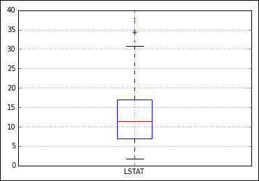

图 11-1： 波士顿数据集中 LSTAT 特征的箱线图。

绘制 LSTAT 特征的箱线图揭示了某些超过 30 的值实际上被怀疑是异常值。使用 IQR 和箱线图，你可以发现大部分异常值，但不幸的是，并非全部。有些异常值可以在你的数据中隐藏得很好。

#### 诉诸多变量模型

另一种基于视觉发现的策略是使用散点图，它使用你的特征两两一组，在二维图表中绘制数据。


绘制所有特征组合可能非常耗时。一种解决方案是创建散点图矩阵，但如果特征太多，表示的复杂性问题依然存在。在这种情况下，重构和压缩数据可能提供一种有效的方法来降低复杂性。主成分分析（PCA）组合特征，从而消除冗余以及同时影响多个特征的强调问题。

PCA 的前两个或前三个主成分包含数据中的大部分信息。你可以轻松地绘制它们（只需几个图表），并使用输出结果来发现异常值。以下是绘制前两个主成分的代码（如 图 11-2 所示）：

```
from sklearn.decomposition import PCA
from sklearn.preprocessing import scale
pca = PCA()
pca.fit(scale(X))
C = pca.transform(scale(X))
import matplotlib.pyplot as plt
plt.scatter(C[:,0],C[:,1], s=2**7, edgecolors='white', alpha=0.85, cmap='autumn')
plt.grid() # adds a grid
plt.xlabel('Component 1') # adds label to x axis
plt.ylabel('Component 2') # adds label to y axis
```

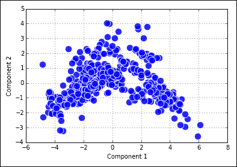

图 11-2: 波士顿数据集 PCA 前两个主成分的散点图。

此外，你不应该忽略最后两个主成分，因为它们存储了数据中可用的独特残余信息，而且令人惊讶的是，它们可以揭示不那么明显的异常值。例如，在以下使用 Python 和波士顿数据集的示例中，通过观察最后两个主成分，你可以发现只有两个离群组。以下是用于绘制最后两个主成分输出的代码（如 图 11-3 所示——你的输出可能看起来不完全相同）：

```
plt.scatter(C[:,11],C[:,12], s=2**7, edgecolors='white', alpha=0.85, cmap='autumn')
plt.grid() # adds a grid
plt.xlabel('Component 12') # adds label to x axis
plt.ylabel('Component 13') # adds label to y axis
```

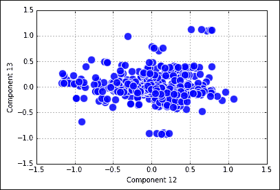

图 11-3: 波士顿数据集 PCA 最后两个主成分的散点图。

PCA 的替代方案是使用聚类技术，例如 K-means。这种技术将在下一章中讨论。

# 第 12 章

# 利用相似性

### 本章内容

- 理解示例之间的差异
- 将数据聚类为有意义的组
- 在寻找数据邻居后进行分类和回归
- 掌握在高维数据空间工作的困难

玫瑰是玫瑰。树是树。车是车。即使你可以做出这样的简单陈述，每种物品的一个示例也不足以识别所有符合该分类的物品。毕竟，存在许多种树和许多种玫瑰。如果你在机器学习框架下评估示例中的问题，你会发现一些值经常变化的特征，以及一些以某种方式系统地持续存在的特征（例如，树总是由木材制成，并有树干和根）。当你仔细查看特征值不断重复时，你可以推断某些观察到的对象属于大致相同的种类。

因此，孩子们可以通过观察特征自己弄清楚什么是汽车。毕竟，汽车都有四个轮子并在道路上行驶。但是，当孩子看到公共汽车或卡车时会发生什么呢？幸运的是，有人在那里解释大型汽车，并将孩子的世界扩展到更大的定义中。在本章中，你将探讨机器如何通过利用相似性来学习，包括：

- **有监督的方式：** 从先前的示例中学习。例如，汽车有四个轮子，因此如果一个新对象有四个轮子，它可能是一辆汽车。
- **无监督的方式：** 在没有标签可供学习的情况下推断分组。例如，一系列物品都有根并且由木材制成，因此它们应该被归为一组，即使它们没有名称。

这两种主题算法——K-means，一种无监督聚类算法；以及 K-最近邻，一种有监督回归和分类算法——都通过利用示例之间的相似性来工作。它们很好地展示了将世界安排为或多或少相似的项目的优缺点。

你不必手动输入本章的源代码。事实上，使用可下载的源代码要容易得多。你可以在 Python 代码的可下载源代码的 `ML4D2E` 文件夹和 R 代码的可下载源代码的 `ML4D2ER` 文件夹中找到本章的源代码。本章的示例文件将以 `ML4D2E; 12;`（用于 Python）或 `ML4D2E_R; 12;`（用于 R）开头。有关如何找到这些源代码文件的详细信息，请参阅简介。

### 测量向量之间的相似性

如果你将数据中的每个示例视为一个向量，你可以轻松地使用计算来比较示例。以下部分描述了如何测量向量之间的相似性，以执行诸如计算示例之间距离以用于学习等任务。

#### 理解相似性

在向量形式中，你可以将示例中的每个特征视为一系列坐标，每个坐标都指向不同空间维度中的一个位置，如 图 12-1 所示。如果一个向量有两个元素，即它有两个特征，那么使用它就像通过使用第一个数字表示东西轴上的位置，第二个数字表示南北轴上的位置来检查地图上的项目位置一样。

例如，括号中的数字 (1,2)、(3,2) 和 (3,3) 都是点的示例。每个示例都是一个有序值列表（称为元组），可以使用列表的第一个值作为 x（水平轴）和第二个值作为 y（垂直轴）轻松地在地图上定位和打印。结果是一个散点图，你可以在本章和整本书中找到它们的示例。

如果你的数据集以矩阵形式具有许多数值特征（列），理想情况下，特征的数量代表数据空间的维度，而行（示例）代表每个点，在数学上是一个向量。当你的向量有超过两个元素时，可视化变得麻烦，因为表示超过第三维的维度并不容易（毕竟，我们生活在一个三维世界中）。但是，你可以努力通过一些权宜之计来传达更多维度，例如使用大小、形状或颜色来表示其他维度。显然，这不是一项容易的任务，而且结果往往远非直观。但是，你可以通过系统地打印许多图表，同时两两考虑维度，来掌握点在数据空间中的位置。这样的图表称为散点图矩阵。

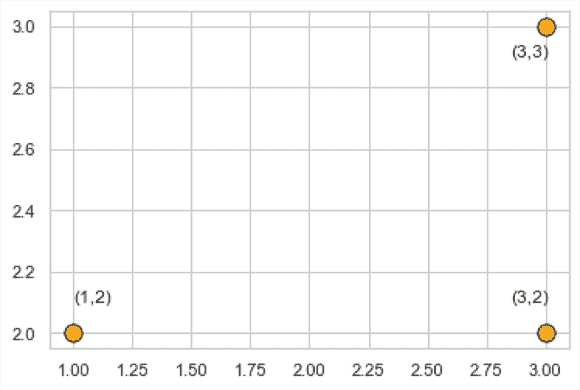

图 12-1: 作为图表上的点绘制的值示例。

不要担心多维性。你将在两个或三个维度中学到的规则扩展到多个维度，因此，如果一个规则在二维空间中有效，它也在多维空间中有效（由于本章后面“理解 k 参数”部分中解释的维度灾难，需要谨慎）。因此，所有示例首先都引用二维示例。

#### 计算学习用的距离


# 距离度量与聚类算法

算法可以通过使用数字向量来学习，这些向量使用距离度量。通常，你的向量所暗示的空间是一个度量空间，该空间的距离遵循某些特定条件：

* 不存在负距离，且只有当起点和终点重合时距离才为零（称为非负性）

* 从一个点到另一个点的距离与反之相同（称为对称性）

* 从初始点到最终点的距离始终小于或等于从初始点到第三点再到最终点的距离（称为三角不等式，意味着没有捷径）

度量空间的距离度量包括欧氏距离、曼哈顿距离和切比雪夫距离。这些都是可应用于数值向量的距离。

### 欧氏距离

最常见的是欧氏距离，也称为两个向量的 l2 范数（有关 l1、l2 和 linf 范数的讨论，请参阅 [`https://rorasa.wordpress.com/2012/05/13/l0-norm-l1-norm-l2-norm-l-infinity-norm/`](https://rorasa.wordpress.com/2012/05/13/l0-norm-l1-norm-l2-norm-l-infinity-norm/)）。在二维平面上，欧氏距离表现为连接两点的直线，计算方法是两个向量元素差值平方和的平方根。在之前的图中，点 (1,2) 和 (3,3) 之间的欧氏距离可以在 Python 中计算为 `math.sqrt(math.pow((1-3),2)+math.pow((2-3),2))`，结果约为 2.236。

### 曼哈顿距离

另一种有用的度量是曼哈顿距离（也称为两个向量的 l1 范数）。计算曼哈顿距离的方法是求向量元素差值绝对值的和。如果欧氏距离标记最短路径，那么曼哈顿距离标记最长路径，类似于出租车在城市街区之间移动的方向（这种距离也称为出租车距离或城市街区距离）。例如，点 (1,2) 和 (3,3) 之间的曼哈顿距离是 `abs(1–3) + abs(2–3)`，结果为 3。

### 切比雪夫距离

切比雪夫距离或最大度量取向量元素绝对差值的最大值。这是一种距离度量，可以表示国际象棋中国王的移动方式，或者在仓库物流中，行车吊车将货箱从一个地方移动到另一个地方所需的操作。在机器学习中，当需要考虑许多维度且其中大部分无关或冗余时，切比雪夫距离可能很有用（在切比雪夫中，选择绝对差值最大的那个）。在前面章节中使用的示例中，距离为 2，即 `max(abs(1-3), abs(2-3))`。

# 使用距离定位聚类

在一个排列良好的空间中，你自然会发现相似的项目彼此相邻，例如图书馆中同一主题的书籍。在图书馆中，相似的书籍位于同一书架、同一书柜和同一区域。例如，想象你是一名图书管理员，任务是收集同一主题的所有书籍，但没有任何现有索引或标签的有用指示。在这种情况下，将相似对象或示例分组称为聚类。在机器学习中，这是一个无监督任务。它允许你在没有标签可用时创建标签，或者在经验性地创建新标签有帮助时使用。

以图书馆示例为例，解决缺乏索引或标签的一个好方法是随机挑选一些书籍，每本书都位于不同的书柜和书架上，然后向各个方向寻找相似的书籍。你可以离原书尽可能远。在短时间内，基于书籍的位置，你可以将图书馆划分为围绕相似主题的同质区域。阅读每个区域的一本代表性书籍后，你可以轻松且自信地按主题标记该区域的所有书籍。

基于这一相同的想法（从一个示例开始，在给定范围内向各个方向查看），一整套称为分区算法的统计算法可以帮助你通过聚合相似示例来探索数据维度。在分区算法中，K-means 是最著名和最流行的。它通常通过利用数据空间中相似示例的接近性、绘制类边界，并最终恢复任何未知的组结构来得出良好的解决方案。K-means 允许标记、总结，有时还能更深入地理解数据的隐藏动态。K-means 可以帮助你实现以下目标：

* 将示例标记为分离的组

* 创建新特征（组的标签）用于监督学习任务（来自聚类分析的标签在从文本和图像学习时作为新特征非常有用）

* 将异常示例分组到它们自己的组中，从而帮助你轻松定位它们

K-means 不是唯一能够执行聚类任务的算法。聚类（也称为聚类分析）有着悠久的历史，存在不同种类的算法来执行它。有些聚类方法将示例排列成树状结构（层次聚类，一种有趣但可扩展性较差的方法：[`https://scikit-learn.org/stable/modules/clustering.html#hierarchical-clustering`](https://scikit-learn.org/stable/modules/clustering.html#hierarchical-clustering)）。有些寻找数据空间的密集部分（DBScan 是一种计算密集的基于密度的方法：[`https://scikit-learn.org/stable/modules/clustering.html#dbscan`](https://scikit-learn.org/stable/modules/clustering.html#dbscan)）。其他方法则确定任何聚类是否可从某些统计分布（如高斯分布）推导出来（高斯混合模型是此类基于分布的最流行算法：[`https://scikit-learn.org/stable/modules/mixture.html#mixture`](https://scikit-learn.org/stable/modules/mixture.html#mixture)）。在如此多的替代方案中（不仅是方法，结果也可能显著不同），K-means 之所以成为机器学习中非常成功的算法，是有充分理由的：

* 它易于理解且直观。

* 它可以快速运行，并很好地扩展到大量数据。

* 它不需要在内存中保留太多信息。

* 它的输出可作为其他机器学习算法的输入。

### 检查假设和期望

K-means 依赖于一些人有争议的假设，你需要了解。首先，该算法假设你的数据具有称为聚类的组（实际上，并非所有数据都具有自然聚类）。它还假设这些组由相似的示例组成，起始示例称为原型或质心，位于聚类中心。最后，它假设在数据空间中，组具有严格的球状形状。因此，遗憾的是，K-means 不允许奇怪的形状，这可能是该技术的一个弱点，因为现实世界并不总是几何形状。这些都是理论假设。当数据满足条件时，算法可以工作良好；否则，你必须仔细检查结果。


K-means 适用于数值度量，因为它基于欧几里得距离。你的所有数据都必须以表示度量的数字形式存在（技术上称为度量度量；例如，日常度量度量是米和千克）。你不能使用值被任意分配的特征；度量应与现实有一定关系。但是，即使这样做不理想，你也可以使用序数（如 1^(st)、2^(nd)、3^(rd) 等等，因为它们具有类似度量的顺序）。即使有点问题，你也可以使用二进制特征（1/0），如前一章所述。

欧几里得距离是一个大求和的平方根，因此你的特征必须都在同一量级上，否则范围较大的特征将主导距离（你将仅基于这些特征创建聚类）。如果某些特征相关，即它们共享部分信息内容（方差），也会发生同样的主导。同样，有些特征对结果的影响大于其他特征。一种解决方案是在 K-means 之前通过统计标准化所有特征，并使用主成分分析（PCA）等降维算法将其转换为组件，如前一章所述。

K-means 还期望你已经知道你的数据包含多少个聚类。但是，如果你不知道，这也不是大问题，因为你可以猜测或尝试多种解决方案，从理想的解决方案开始。由于该算法做出了许多理论和实际假设，它总会得出一个解决方案（这就是每个人都如此喜欢它的原因）。当你处理没有聚类的数据或要求错误数量的聚类时，它可能会提供一些误导性结果。你可以根据以下内容区分好结果和坏结果：

*   `Heuristics:` 你可以衡量聚类的质量。

*   `Reproducibility:` 随机结果无法复制。

*   `Understandability:` 荒谬的解决方案很少是真正的解决方案。

*   `Usability:` 你关心机器学习如何实际解决问题，而不关心其在假设方面的正确性。

K-means 算法是一种无监督算法，因此除非你事先知道聚类解决方案，否则你没有任何偏差或准确性方面的误差可衡量。在得到解决方案后，始终使用聚类质量度量进行现实检查，以查看结果是否

*   在不同条件下可重复

*   有意义

*   可以帮助解决你的问题。

#### 检查 K-means 算法的齿轮

K-means 算法以特定方式执行任务。通过了解算法执行任务所使用的过程，你可以更好地了解如何使用 K-means 算法。以下是算法使用的过程：

1.  在你指示算法数据中有 k 个聚类（其中 k 是整数）后，算法会选择 k 个随机示例作为你 k 个聚类的原始质心。

2.  算法根据示例到每个质心的欧几里得距离，将所有示例分配给 k 个聚类中的每一个。最近的质心赢得该示例，该示例随后成为其聚类的一部分。

3.  在将所有示例分配给聚类后，算法通过对属于该组的所有示例求平均值来重新计算每个聚类的新质心。第一轮之后，新质心可能不再与真实示例重合。此时，在思考质心时，将其视为理想示例（实际上，`prototypes`）。

4.  如果不是第一轮，在求平均值后，算法会检查质心在数据空间中的位置变化了多少。如果与上一轮相比变化不大，算法假设是一个稳定解决方案并将解决方案返回给你。否则，算法重复步骤 2 和 3。在改变质心位置后，算法会将部分示例重新分配到不同的聚类，这可能导致质心位置发生变化。

鉴于步骤 4 和 2 之间的跳转，直到输出满足某个收敛条件，K-means 算法是迭代的。一次又一次的迭代中，算法随机选择的初始质心会移动其位置，直到算法找到稳定解决方案。（示例不再在聚类之间移动，或者至少很少移动。）此时，在算法收敛后，你可以期望：

*   你的所有数据都被分离成聚类（因此每个示例将有一个且只有一个聚类标签）。

*   所有聚类都倾向于具有尽可能大的内部凝聚力。你可以通过从每个示例的位置减去质心位置，然后对每次减法的结果进行平方（这样去掉符号），最后将所有结果相加来计算每个聚类的凝聚力。因此，你得到凝聚力，在聚类分析中，凝聚力总是倾向于尽可能小（称为 `within-cluster sum of squares` 或 `WSS`）。

*   所有聚类都具有尽可能大的外部差异。这意味着，如果你取每个质心与数据空间平均值（总质心）的差，对每个差进行平方，将每个差乘以其各自聚类的示例数量，然后将所有结果相加，结果就是最大可能的（`between-cluster sum of squares` 或 `BSS`）。

由于组间平方和依赖于组内计算的结果，你只需查看其中一个即可（通常 WSS 就足够了）。有时起始位置不理想，算法无法收敛到合适的解决方案。数据始终被分区，因此你只能通过计算解决方案的组内平方和并将其与之前的计算进行比较，来猜测算法是否可以接受地完成了工作。

如果你运行几次 K-means 并记录结果，你可以轻松发现组内平方和较高且组间结果较低的算法运行，这些是你不可信赖的解决方案。取决于你手头的计算能力和数据集大小，运行多次试验可能会消耗大量时间，你必须决定如何在选择良好解决方案时权衡时间与安全性。

### 调整 K-Means 算法

为了从 K-means 算法中获得最佳结果，你必须对其进行调整。调整 K-means 算法需要对其目的有清晰的认识：

*   `If the purpose is explorative,` 停止在定义一个有意义的解决方案的聚类数量，你可以通过命名来确定使用哪些聚类。

*   `If you are working with abstract data,` 查看组内平方和或其他一些调整度量可以帮助提示正确的解决方案。

*   `If you need the cluster results to feed a supervised algorithm,` 使用交叉验证来确定带来更多预测能力的解决方案。

下一步需要你决定一个实现。Python 语言在 Scikit-learn 包中提供了两个版本的算法。第一个是经典算法，`sklearn.cluster.KMeans`。你也可以使用小批量版本，`sklearn.cluster.MiniBatchKMeans`，它与标准 K-means 不同，因为它可以在数据的部分上计算新质心并重新分配所有先前的聚类标签（而不是在评估所有数据样本后进行所有计算）。


小批量的优势在于，它可以通过从磁盘分小块获取样本来处理无法装入计算机可用内存的数据。算法处理每个块，更新聚类，然后加载下一个块。唯一可能的瓶颈是数据传输速度。该过程比经典算法耗时更长，但计算完成后（可能需要对所有数据进行多次遍历），你将获得一个与使用标准算法所能获得的模型差别不大的完整模型。

`sklearn.cluster.MiniBatchKMeans` 有两个拟合方法：

*   `fit`: 适用于内存中的数据，并在根据你使用 `batch_size` 参数设置的批量大小处理完可用信息后停止。

*   `partial_fit`: 处理内存中的数据，但保持打开状态，以便在提供新数据时重新开始，因此非常适合从磁盘或互联网等网络分块流式传输数据。

`sklearn.cluster.KMeans` 提供了前面讨论的所有标准参数：聚类数量（`n_clusters`）和初始化方法（`init`）。此外，它还提供预计算距离（`precompute_distances`）的可能性。如果有效迭代次数较高，`sklearn.cluster.KMeans` 会重复计算距离，浪费时间。如果你有内存且需要速度，只需将 `precompute_distances` 设置为 `TRUE`，它会预先存储所有计算。你还可以指示算法并行工作（如果你想保留一个处理器用于其他操作，请将 `n_job` 设置为 `-1` 或 `-2`），当它需要同时创建许多解决方案时（由于不同的随机初始化）。预计算距离和并行计算使 Python 实现目前是最快的可用实现。

#### 实验 K-means 可靠性

本书的第一个实验用于演示 K-means 的细微差别，使用了一个新数据集，即 Palmer Penguins 数据集，其数据由 Kristen Gorman 博士和 Palmer Station, Antarctica LTER（长期生态研究网络的成员）收集并提供（Horst AM, Hill AP, Gorman KB (2020)）。阅读 Palmer Penguins 数据集，请访问 [`https://allisonhorst.github.io/palmerpenguins/`](https://allisonhorst.github.io/palmerpenguins/)。

Palmer Penguins 数据集是一个最近的数据集，从教育角度来看，是较旧的 Iris 数据集的良好替代品。Iris 数据集由统计学家 Ronald Fisher 于 1936 年在其一篇论文中引入，是关于三种鸢尾花卉的热门示例数据集，其花瓣和萼片（花的一部分，开花时支撑花瓣）进行了测量。由于其受欢迎程度，Iris 数据集出现在许多书籍和教程中，尽管其数据并不总是适合许多统计和机器学习任务。

Palmer Penguins 数据集记录了三种企鹅（Adelie、Chinstrap 和 Gentoo）的性别、体重、鳍长以及喙长和深度（称为 *culmen*）。有关更多信息，请参见 [`http://marinebio.net/marinescience/04benthon/AApenguins.htm`](http://marinebio.net/marinescience/04benthon/AApenguins.htm)。这些企鹅生活在南极洲 Palmer 群岛的岛屿上。示例在类别中不平衡（Chinstrap 较少），但在性别中是平衡的（计数为雌性和雄性）。

以下示例从本书的数据集存储库下载数据。然后将数据划分为特征（排除性别，但保留所有数值指标）和标签。使用 Scikit-learn 的 `LabelEncoder`，示例将企鹅物种名称转换为数字并打印其编码。

```
import numpy as np
import pandas as pd
from sklearn.preprocessing import LabelEncoder
link = "https://github.com/lmassaron/datasets/"
link += "releases/download/1.0/penguins.feather"
penguins = pd.read_feather(link)
features = penguins.iloc[:,1:5]
le = LabelEncoder()
labels = le.fit_transform(penguins.species)
target_names = dict(zip(range(3), le.classes_))
print(target_names)
```

该实验使用 Scikit-learn 中可用的两个 K-means 版本：标准算法和小批量版本。在 Scikit-learn 包中，你必须预先为每个学习算法定义特征，指定其参数。因此，你定义两个特征，`k_means` 和 `mb_k_means`，它们需要三个聚类、一个智能初始化程序（称为 *k-means++*），并将最大迭代次数提高到较高数值（不用担心，通常算法速度相当快）。由于体型和各种测量值处于不同的尺度，你首先准备一个管道，该管道将标准化特征并使用 PCA 从中删除所有相关性。这样，你可以确信 K-means 计算的欧氏距离测量效果良好。最后，你转换数据并拟合特征，经过短暂延迟后，计算完成。

```
from sklearn.pipeline import Pipeline
from sklearn.decomposition import PCA
from sklearn.preprocessing import StandardScaler
from sklearn.cluster import MiniBatchKMeans, KMeans
pca = Pipeline([('scaling', StandardScaler()), ('pca', PCA())])
k_means = KMeans(n_clusters=3, init='k-means++', max_iter=999, n_init=10, random:state=101)
mb_k_means = MiniBatchKMeans(n_clusters=3, init='k-means++', max_iter=999, batch_size=30, n_init=10, random:state=101)
pca_features = pca.fit_transform(features)
print('Explained variance:')
print(pca.named_steps['pca'].explained_variance_)
k_means.fit(pca_features)
mb_k_means.fit(pca_features)
```

执行期间，代码打印 PCA 维度解释的方差量：2.75、0.78、0.37 和 0.11。第一个维度占主导地位，前两个维度解释了大部分方差。以二维方式打印输出可以让你理解聚类分析的工作原理。以下代码在屏幕上打印一个漂亮的图表，显示点如何分布在由第一和第二个 PCA 维度组成的地图上，如 图 12-2 所示。

```
import matplotlib.pyplot as plt
plt.scatter(pca_features[:,0], pca_features[:,1], s=2**7, c=labels, edgecolors='lightgrey', alpha=0.85, cmap='Spectral')
plt.xlabel('pca_0')
plt.ylabel('pca_1')
plt.grid()
km:centers = k_means.cluster_centers_mbkm:centers = mb_k_means.cluster_centers_
plt.scatter(km:centers[:,0], km:centers[:,1], s=2**6, marker='s', c='orange', edgecolors='black')
plt.scatter(mbkm:centers[:,0], mbkm:centers[:,1], s=2**8, marker='*', c='yellow', edgecolors='black')
for class_no in range(0,3):
    plt.annotate(target_names[class_no], (pca_features[labels==class_no, 0].mean(), pca_features[labels==class_no, 1].mean()), fontsize=20)
plt.show()
```

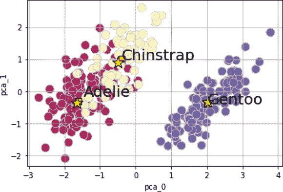

FIGURE 12-2: 基于第一个 PCA 维度的图表上绘制的企鹅聚类。

请注意，该图还显示了质心——标准算法的质心为正方形；小批量版本的质心为星形——它们差别不大。这一事实表明，不同的学习程序导致几乎相同的结论。有时，看到即使是不同的算法也可能得出相同的结论，这真是令人惊叹。当这种情况不发生时，你可能在估计中存在过多方差，每个算法可能有非常不同的学习策略；然而，你会注意到机器学习算法通常倾向于获得相同的强信号（尽管最终它们对其使用方式不同）。


所有关于算法的信息现在都存储在 features 中。例如，通过输入 `k_means.cluster_centers_`，你可以获取 K-means 过程计算出的所有质心坐标。

#### 实验观察质心如何收敛

虽然你现在可以计算结果，并且知道不同版本和运行的 K-means 往往会得到相似的解，但你仍然需要掌握如何达到结果。在本节的实验中，你将跟踪一个质心（第二个质心）如何随迭代变化，通过可视化其坐标向量，逐步观察优化过程。

```
import numpy as np
np.set_printoptions(precision=3, suppress=True)
for iteration in range(1, 10):
    k_means = KMeans(n_clusters=3, init='random', max_iter=iteration, n_init=1, random_state=0)
    k_means.fit(pca_features)
    print("Iteration: %i - 2nd centroid: %s" % (iteration, k_means.cluster_centers_[1]))
```

以下是结果：

```
Iteration: 1 - 2nd centroid: [-0.802 0.586 0.243 -0.033]
Iteration: 2 - 2nd centroid: [-0.513 0.899 0.254 -0.03 ]
Iteration: 3 - 2nd centroid: [-0.442 0.98 0.297 -0.041]
Iteration: 4 - 2nd centroid: [-0.408 0.992 0.351 -0.036]
Iteration: 5 - 2nd centroid: [-0.398 1.004 0.376 -0.035]
Iteration: 6 - 2nd centroid: [-0.394 1.013 0.384 -0.03 ]
Iteration: 7 - 2nd centroid: [-0.394 1.013 0.384 -0.03 ]
Iteration: 8 - 2nd centroid: [-0.394 1.013 0.384 -0.03 ]
Iteration: 9 - 2nd centroid: [-0.394 1.013 0.384 -0.03 ]
```

观察迭代过程中调整的数值，变化率逐渐减小，直到后期迭代，每次迭代的变化都非常小，以至于不使用许多小数位就无法看到。

Scikit-learn 的聚类模块包含了上述所有版本的 K-means 以及其他聚类算法。你可以在 [`https://scikit-learn.org/stable/modules/clustering.html#clustering`](https://scikit-learn.org/stable/modules/clustering.html#clustering) 找到它。

下一个实验始终基于 Scikit-learn，旨在检查 K-means 算法在猜测 Palmer Penguins 数据集中的真实簇方面表现如何。有时很难使用算法重建原始簇，因为你可能缺少任务所需的正确特征，或者有一些与任务无关的特征，这些特征可能会导致算法得到不同的解。

```
pca = Pipeline([('scaling', StandardScaler()), ('pca', PCA())])
k_means = KMeans(n_clusters=3, init='k-means++', max_iter=999, n_init=10, random_state=101)
pca_features = pca.fit_transform(features)
k_means.fit(pca_features)
from sklearn.metrics import confusion_matrix
cm = confusion_matrix(y_true=labels, y_pred=k_means.labels_)
cm_str = str(cm).split('\n')
for row in range(3):
    print(f"{target_names[row]:15} {cm_str[row]}")
```

代码将打印一个混淆矩阵，这是分类中非常有用的工具，用于将你的预测与正确标签（即所谓的 `ground truth`）进行比较。在混淆矩阵中，你读取一个表格，其中行代表正确的类别，列代表预测的类别：

```
Adelie [[ 0 22 124]
Chinstrap [ 0 63 5]
Gentoo [119 0 0]]
```

在此聚类分析中，Adelie 和 Gentoo 物种分别集中在最后一个和第一个簇中（但也有 5 只 Chinstrap 被分类到最后一个簇中）。第二个簇（可以在第二列中读取）以 Chinstrap 为主，但四分之一的元素由 Adelie 企鹅组成。K-means 此次未能恢复正确的自然类别。通常，增加簇的数量可以解决此类问题，尽管这样做可能会生成许多彼此仅略有不同的簇。从机器学习的角度来看，拥有更多簇不是问题，但这可能会使人类的理解变得更加复杂。此实验在迭代循环中测试不同的聚类解，输出显示在 Figure 12-3。

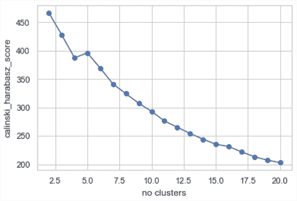

FIGURE 12-3: Plot of the Calinski and Harabasz score regarding different cluster solutions.

因为你不想根据原始企鹅标签来衡量理想的聚类解（在许多现实问题中，当你没有任何 ground truth 标签时，你会应用聚类分析），因此示例使用 `Calinski and Harabasz` 分数。Calinski and Harabasz 分数（也称为 `Variance Ratio`）提供了一个客观度量，基于簇的同质性（统计学上称为 `within-cluster dispersion`）与簇之间分离程度（`between-cluster dispersion`）的比率。该分数的核心思想是，你的解应该呈现出最佳的、分离良好且密集的簇。

```
from sklearn.metrics import calinski_harabasz_score
ch_scores = list()
max_clus = 20
for clus_no in range(2, max_clus+1):
    k_means = KMeans(n_clusters=clus_no, init='k-means++', max_iter=999, n_init=10, random_state=101)
    k_means.fit(pca_features)
    ch = calinski_harabasz_score(pca_features, k_means.labels_)
    ch_scores.append(ch)
plt.plot(range(2, max_clus+1), ch_scores, 'o-')
plt.xlabel('no clusters')
plt.ylabel('calinski_harabasz_score')
plt.show()
```

遍历多个解允许你绘制不同解的分数。随着簇数量的增加，Calinski and Harabasz 分数通常会改善。这是因为较小的簇往往更具凝聚力且分离更好。好的解不是分数最低的那些，而是那些你注意到分数下降中出现或多或少突然的不连续性（即使只是斜率的变化）的解。不连续性意味着算法在寻找该数量的簇时，在数据中发现了一些显著的结构差异。在此示例中，一个好的解似乎选择五个簇，如 Figure 12-3 所示。然后代码通过计算混淆矩阵来测试此值：

```
k_means = KMeans(n_clusters=5, init='k-means++', max_iter=999, n_init=10, random_state=101)
k_means.fit(pca_features)
cm = confusion_matrix(y_true=labels, y_pred=k_means.labels_)
for row in range(3):
    print(f"{target_names[row]:10} {cm[row,:]}")
```

你现在得到一个混淆矩阵，其中企鹅物种被更整齐地分开：

```
Adelie [ 0 60 84 2 0]
Chinstrap [ 0 0 5 63 0]
Gentoo [57 0 0 0 62]
```

绘图说明了为什么五簇解比之前的解更好，因为它帮助你在前两个 PCA 维度上可视化簇的质心：

```
plt.scatter(pca_features[:,0], pca_features[:,1], s=2**7, c=k_means.labels_, edgecolors='white', alpha=0.85, cmap='winter')
km_centers = k_means.cluster_centers_
plt.scatter(km_centers[:,0], km_centers[:,1], s=2**8, marker='*', c='white', edgecolors='black')
plt.xlabel('pca_0')
plt.ylabel('pca_1')
plt.grid()
plt.show()
```

Figure 12-4 中描绘的解展示了两个额外的质心如何帮助分割左侧点云，其中 Adelie 和 Chinstrap 物种非常接近，没有明显的分离。

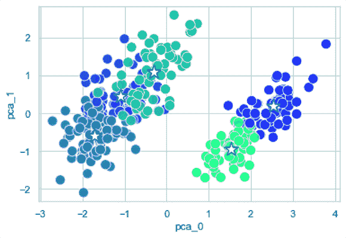

FIGURE 12-4: Penguin species represented by five clusters.

使用真实数据时，你很少有 ground truth 可以检查。如果你无法依赖测试，请相信你的直觉和 Calinski and Harabasz 分数。如果你对解不满意，请寻找添加或删除一个或多个特征的方法。

### 通过 K-最近邻寻找相似性


无论问题是猜测一个数字还是一个类别，K-最近邻（K-Nearest Neighbors，KNN）算法背后的学习策略始终是相同的。该算法找到与你需要预测的观测值最相似的观测值，并通过对邻近值求平均，或从中选取出现频率最高的答案类别，从而对可能的答案形成良好的直觉。

KNN 的学习策略更像是记忆。它就像是记住当问题具有某些特征（基于训练示例）时答案应该是什么，而不是真正了解答案，因为你是通过特定的分类规则来理解问题的。从某种意义上说，KNN 常被定义为一种“懒惰”算法，因为在训练时并没有进行真正的学习，只是记录数据。

作为一种懒惰算法，意味着 KNN 在训练时速度很快，但在预测时却非常慢。（大部分对邻居的搜索活动和计算都在预测时完成。）这也意味着该算法非常耗内存，因为你需要将数据集存储在内存中（这意味着在处理大数据时，可能的应用存在限制）。理想情况下，当你从事分类工作并且有许多标签需要处理时，KNN 能够发挥作用（例如，当软件代理在社交网络上发布标签，或在提出销售推荐时）。KNN 可以轻松处理数百个标签，而其他学习算法则需要为每个标签指定不同的模型。

通常，KNN 在使用欧氏距离（最常见的选择）或曼哈顿距离（当你的数据中有许多冗余特征时效果更好）等距离度量之后，计算出观测值的邻居。关于哪种距离度量最好，并没有绝对的规则。这真的取决于你的实现。你还需要将每种距离作为一个独立的假设进行测试，并通过交叉验证来验证哪种度量更适合你正在解决的问题。

#### 理解 k 参数

k 参数是你可以修改的参数，以使 KNN 算法在预测和回归中表现良好。k 值是一个整数，是算法为了得出答案而必须考虑的邻居数量。k 参数越小，算法就越适应你所呈现的数据，存在过拟合的风险，但能很好地拟合类别之间的复杂分隔边界。k 参数越大，它就越抽象于真实数据的起伏，这在数据中能很好地在类别之间绘制平滑曲线，但代价是无法考虑无关的示例。

经验法则是，首先尝试可用示例数量的平方根的最接近整数作为 KNN 中的 k 参数。例如，如果你有 1,000 个示例，从 `k = 31` 开始，然后在交叉验证支持的网格搜索中降低该值。

使用无关或不合适的示例是 KNN 算法在用于其距离函数的示例数量增加时所承担的风险。前面关于数据维度问题的示例展示了如何计算一个排列良好的数据空间，就像一个图书馆，你可以在同一个书架、书柜和区域中寻找相似的书籍。然而，当图书馆有不止一层楼时，事情就不会那么简单了。那时，楼上和楼下的书不一定相似；因此，靠近但在不同楼层并不能保证书籍相似。增加更多维度会削弱有用维度的作用，但这只是你麻烦的开始。

现在想象一下，拥有比日常生活中更多的三个维度（如果你考虑时间，则是四个维度）。维度越多，你在图书馆中获得的空间就越大。（如同在几何中，你相乘维度来获得体积的概念。）到某个点，你将拥有如此多的空间，以至于你的书籍可以轻松放入，并且还剩下空间。例如，如果你有 20 个二进制特征来表示你的图书馆，你可以有 2 的 20 次方个组合；即 1,048,576 个可能的不同书柜。拥有一百万个书柜很棒，但如果你没有一百万本书来填充它们，你的大部分图书馆将是空的。所以你拿到一本书，然后寻找相似的书来与它放在一起。你附近的所有书柜实际上都是空的，所以你必须走很远才能找到另一个非空书柜。想想看：你从《银河系搭车客指南》开始，最终却得到一本关于园艺的书作为其最近邻。这就是*维度灾难*。维度越多，你就越可能经历某种虚假的相似性，误将远视为近。

使用合适大小的 k 参数可以缓解这个问题，因为你需要寻找的邻居越多，KNN 就必须看得越远——但你还有其他补救措施。PCA（主成分分析），即移除最不重要的维度，可以压缩空间，使其更密集，并移除噪声和无关、冗余的信息。此外，特征选择也能奏效，只选择那些真正能帮助 KNN 找到正确邻居的特征。

如在第 9 章关于验证机器学习任务的内容中所述，一种由交叉验证检查的逐步选择，可以使 KNN 工作良好，因为它只保留对任务真正有用的特征。

KNN 是一个对异常值敏感的算法。数据空间中数据云边界上的邻居可能是异常示例，会导致你的预测变得反复无常。你需要在使用数据之前清理数据。先运行 K-means 可以帮助你识别聚集在各自组中的异常值。（异常值喜欢待在单独的组中；你可以将它们视为数据中的隐士类型。）此外，保持较大的邻域可以帮助你最小化（但有时不能完全避免）这个问题，代价是对数据的拟合度较低（偏差多于过拟合）。

#### 尝试一种灵活的算法

KNN 算法在 Scikit-learn 中实现（参见 [`https://scikit-learn.org/stable/modules/neighbors.html#neighbors`](https://scikit-learn.org/stable/modules/neighbors.html#neighbors)），用于分类和回归任务。该算法在使用欧氏距离时特别高效，因为有 Ball tree 和 K-Dimensional（KD）tree 等算法，它们比在训练示例中对最近邻进行暴力查找更快且计算强度更低。

KNN 算法在推荐系统中特别流行，因为它通过从相似客户那里学习来得出关于客户偏好的答案。例如，Spotify（音乐流媒体服务）和 Facebook（社交媒体公司）都为其业务开发了 KNN 算法。Spotify 开发了 ANNOY ([`https://github.com/spotify/annoy`](https://github.com/spotify/annoy))，Facebook 发布了 FAISS ([`https://engineering.fb.com/data-infrastructure/faiss-a-library-for-efficient-similarity-search/`](https://engineering.fb.com/data-infrastructure/faiss-a-library-for-efficient-similarity-search/))。两者都是开源的，并且即使基于太字节级数据的庞大训练集，也能运行得非常快。


该算法的关键在于选择最佳的 `k`，即用于得出预测的邻居数量。较低的 `k` 会产生方差更高且对异常值更敏感的估计。另一方面，较高的 `k` 值会产生更偏差的预测。只有通过交叉验证系统地测试不同值的影响，才能找到正确的 `k` 值。以下实验使用网格搜索对 `KNN` 进行搜索，以便正确分类企鹅物种。它通过交叉验证寻找最佳的 `k` 值，然后报告结果和最佳的 `k` 值。使用交叉验证学习正确的超参数，可以保证你找到的不仅是针对单个分析数据的最佳值，而且是来自同一来源的任何其他可能数据的最佳值。

```
from sklearn.model_selection import GridSearchCV
from sklearn.neighbors import KNeighborsClassifier
from sklearn.model_selection import KFold
knn = KNeighborsClassifier(metric='euclidean')
kfold = KFold(n_splits=10, shuffle=True, random_state=0)
param_grid = {"n_neighbors" : range(1, 16)}
experiment = GridSearchCV(knn, param_grid=param_grid, cv=kfold)
```

设置好网格搜索参数后，我们首先在原始数据（其特征在不同尺度上）上进行测试。

```
experiment.fit(features, labels)
print(f"best params: {experiment.best_params_}")
print(f"best cv accuracy: {experiment.best_score_:0.3}")
```

交叉验证准确率为 0.86 时，理想的 `k` 是 1。该示例现在重复测试，使用经过 PCA 归一化和转换后的数据：

```
experiment.fit(pca_features, labels)
print(f"best params: {experiment.best_params_}")
print(f"best cv accuracy: {experiment.best_score_:0.3}")
```

交叉验证搜索表明，将 `k` 设置为 3 可获得最佳准确率，交叉验证准确率达到 0.99。如预期，由于特征尺度不同，欧氏距离在原始数据上起初效果不佳，但当代码使尺度相等并消除特征之间的相关性时，它帮助实现了近乎完美的分类。

第二个 `KNN` 实验演示了这种简单算法在学习数据空间中的形状和非线性示例排列方面非常擅长。代码块准备了一个棘手的数据集：在二维中，两个类排列成公牛眼同心圆，如 图 12-5 所示。

```
from sklearn.datasets import make_circles, make_blobs
strange_data = make_circles(n_samples=500, shuffle=True, noise=0.15, random_state=101, factor=0.5)
center = make_blobs(n_samples=100, n_features=2, centers=1, cluster_std=0.1, center_box=(0, 0))
first_half = np.row_stack((strange_data[0][:250,:], center[0][:50,:]))
first_labels = np.append(strange_data[1][:250], np.array([0]*50))
second_half = np.row_stack((strange_data[0][250:,:], center[0][50:,:]))
second_labels = np.append(strange_data[1][250:], np.array([0]*50))
plt.scatter(first_half[:,0], first_half[:,1], s=2**7, c=first_labels, edgecolors='white', alpha=0.85, cmap='winter')
plt.grid()
plt.show()
```

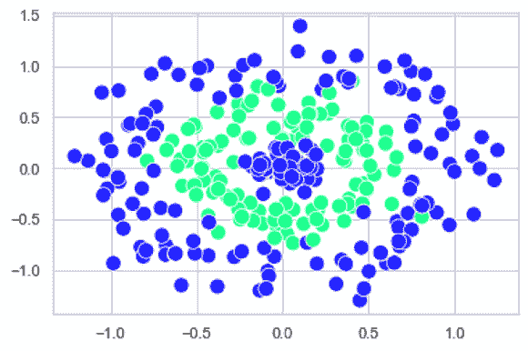

FIGURE 12-5: 公牛眼数据集，一个难以学习的非线性点云。

构建好数据集后，你可以通过将分类算法设置为在固定 `3` 的邻域后学习数据中的模式，并将权重设置为均匀（Scikit-learn 允许你在对观测值进行平均或选择最频繁观测值时，对距离较近的观测值赋予较小权重），并将欧氏距离作为度量来测试实验。事实上，Scikit-learn 算法允许你使用不同的度量（如欧氏距离、曼哈顿距离或切比雪夫距离）进行回归和分类，如以下 Python 代码所示：

```
from sklearn.neighbors import KNeighborsClassifier
from sklearn.metrics import accuracy_score
kNN = KNeighborsClassifier(n_neighbors=3, weights='uniform', algorithm='auto', metric='euclidean')
kNN.fit(first_half,first_labels)
acc = accuracy_score(y_true=second_labels, y_pred=kNN.predict(second_half))
print(f"Learning accuracy score: {acc:0.3}")
```

# Chapter 13

# Working with Linear Models the Easy Way

### IN THIS CHAPTER

- **Illustrating linear models for regression and classification**
- **Limiting the influence of less useful and redundant features**
- **Selecting effective feature subsets**
- **Learning from big data by stochastic gradient descent**

你无法在不发现线性模型家族的情况下完成对基本机器学习算法的概述，线性模型是一种常见且出色的起始算法，在尝试从数据进行预测时使用。线性模型包含源自统计科学的广泛模型家族，尽管只有线性回归和逻辑回归这两种被频繁提及和使用。（你可以通过查看 Scikit-learn 提供的模型来了解线性模型家族有多大：[`https://scikit-learn.org/stable/modules/linear_model.html`](https://scikit-learn.org/stable/modules/linear_model.html)。）本章探讨如何对回归和分类使用线性模型。

统计学家、计量经济学家以及许多学科的科学家长期以来一直使用线性模型，通过数据验证来证实他们的理论并获得实际预测。大量文献讨论了许多应用，以及为详细检查和验证线性模型对多种数据问题的适用性而设计的复杂测试和统计措施。本章帮助你专注于诸如限制不太有用和冗余特征的影响、选择有效的特征子集以及使用随机梯度下降（请参阅 第 8 章 中的优化过程）来处理大型数据集等问题。

你不必手动输入本章的源代码。事实上，使用可下载的源代码要容易得多。你可以在 Python 代码的可下载源代码的 `ML4D2E` 文件夹和 R 代码的可下载源代码的 `ML4D2ER` 文件夹中找到本章的源代码。本章的示例文件将以 `ML4D2E; 13;`（用于 Python）或 `ML4D2E_R; 13;`（用于 R）开头。有关如何找到这些源文件的详细信息，请参见简介。

### Starting to Combine Features

回归在不同领域拥有悠久的历史：统计学、经济学、心理学、社会科学和政治科学。除了能够进行涉及数值、二进制和多类、概率以及计数数据的广泛预测之外，线性回归还能帮助你了解组间差异、建模消费者偏好，并量化模型中特征的重要性。以下各节讨论了在使用各种形式的回归时如何组合特征。

#### Getting an overview of regression

剥离了大部分统计特性后，回归仍然是一种简单、易懂且有效的算法，用于预测数值和类别。训练速度快，易于向非技术人员解释，并且在任何编程语言中都易于实现，线性回归和逻辑回归是大多数机器学习从业者在构建模型进行比较时的首选，作为 `baseline`（基准标准）解决方案，以与更复杂的模型进行对比。人们还使用线性模型来找出问题中的关键特征，尝试特征组合，并深入了解新的特征创建过程。


# 线性回归

线性回归通过对数值特征进行加权求和来工作。添加一个常数，称为 `bias`，完成求和。当所有特征值均为零时，bias 代表预测基线。当某些特征缺失（因此值为零）时，bias 在生成默认预测方面可以发挥重要作用。以下是线性回归的常见公式：

`Y = βX + α`

在这个表达式中，y 是响应值的向量。可能的响应向量是城市中房屋的价格或产品的销量，简单来说就是任何数值答案，例如度量或数量。X 符号表示用于猜测 y 向量的特征矩阵。X 是仅包含数值的矩阵。希腊字母 alpha (α) 表示 bias，它是一个常数，而字母 beta (β) 是线性回归模型与 bias 一起用于创建预测的系数向量。在回归中使用希腊字母 alpha 和 beta 非常普遍，以至于大多数从业者将回归的系数向量称为 beta。

你可以用不同的方式理解这个表达式。为了简化问题，你可以想象 X 实际上由单个特征组成（在统计实践中描述为 `predictor`），因此可以将其表示为名为 x 的向量。当只有一个预测器时，计算就是 `simple linear regression`。既然你有了更简单的公式，你的高中代数和几何告诉你，公式 `y=βx+α` 是由 x 轴（横坐标）和 y 轴（纵坐标）组成的坐标平面中的一条直线。

当你有多个特征（`multiple linear regression`）时，你不能再使用由 x 和 y 组成的简单坐标平面了。空间现在跨越多个维度，每个维度都是一个特征。现在你的公式更加复杂，由多个 x 值组成，每个值都由其自身的 beta 加权。例如，如果你有四个特征（因此整体空间是五维的，因为你有四个特征和一个目标），从矩阵形式阐述的回归公式是

`y = β1x1 + β2x2 + β3x3 + β4x4 + α`

这个存在于多维空间中的复杂公式不再是一条直线，而是一个与特征和目标的空间具有相同维度的平面。这被称为 `hyperplane`，其表面确定了特征维度中每个可能值组合的响应值。

本讨论从几何意义上解释了回归，但你也可以将其视为一个大的加权求和。你可以将响应分解为多个部分，每个部分都引用一个特征并对某个部分做出贡献。几何意义对于讨论回归属性特别有用，但加权求和的意义有助于你更好地理解实际示例。例如，如果你想预测广告支出模型，可以使用回归模型并创建如下模型：

`sales = βadv * advertising + βshop * shops + βprice * price + α`

在这个公式中，销量是广告支出、分销产品的商店数量和产品价格的加权和。你可以通过解释其组成部分来快速解密线性回归。首先，你有 bias，常数 `α`，它充当起点。然后你有三个特征值，每个都以不同的尺度表示（广告是大量资金，价格是某个可负担的价值，商店是正数），每个都由其各自的 beta 系数重新缩放。

每个 beta 都表示一个描述与响应关系强度的数值。它还有一个符号，显示特征变化的影响。当 beta 系数接近零时，特征对响应的影响较弱，但如果其值远离零，无论是正还是负，影响都是显著的，该特征对回归模型很重要。

要获得目标值的估计，你将每个 beta 缩放到特征的度量。高 beta 取决于特征的尺度，对响应提供多或少的影响。一个好习惯是标准化特征（通过减去均值并除以标准差），以避免被小尺度特征上的高 beta 值误导，并比较不同的 beta 系数。生成的 beta 值是可比的，使你能够确定哪些对响应影响最大（那些具有最大绝对值的）。

如果 beta 为正，增加特征将增加响应，而减少特征将减少响应。相反，如果 beta 为负，响应将与特征相反：当一个增加时，另一个减少。回归中的每个 beta 都代表一个影响。使用在 第 8 章 中讨论的梯度下降算法，线性回归可以找到最佳的 beta 系数集（和 bias）以最小化由预测值和真实值之间的平方差给出的成本函数：

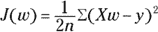<m:math display="block" overflow="scroll" xmlns:m="http://www.w3.org/1998/Math/MathML"><m:mrow><m:mi>J</m:mi><m:mo>(</m:mo><m:mi>w</m:mi><m:mo>)</m:mo><m:mo>=</m:mo><m:mfrac><m:mn>1</m:mn><m:mrow><m:mn>2</m:mn><m:mi>n</m:mi></m:mrow></m:mfrac><m:mi>&#931;</m:mi><m:msup><m:mrow><m:mrow><m:mo>(</m:mo><m:mi>X</m:mi><m:mi>w</m:mi><m:mo>&#45;</m:mo><m:mi>y</m:mi><m:mo>)</m:mo></m:mrow></m:mrow><m:mrow><m:mn>2</m:mn></m:mrow></m:msup></m:mrow></m:math>

这个公式告诉你成本 J 作为 w 的函数，w 是线性模型的系数向量。成本是响应值与预测值（乘法 Xw）之间的平方差之和除以观测次数（n）的两倍。该算法努力找到真实目标值与线性回归得出的预测值之间差异的最小可能解值。

你可以将优化结果以图形方式表示为数据点与回归线之间的垂直距离。当距离较小时，回归线很好地代表了响应变量。如果你将距离的平方相加，当你正确计算回归线时，总和始终是最小可能值。（没有其他 beta 组合会导致更低的误差。）

### 使用机器学习方法解决问题

在统计学中，从业者通常将线性回归称为 `ordinary least squares (OLS)`。统计学中的另一个区别是估计解的方式，它基于矩阵微积分（使用分析方法求解估计，即闭式正规方程，如 Sebastian Raschka 在这篇文章中解释的：[`https://sebastianraschka.com/faq/docs/closed-form-vs-gd.html`](https://sebastianraschka.com/faq/docs/closed-form-vs-gd.html)）。使用这种方法在许多问题上可能变得不可行，因为它取决于数据矩阵逆的计算，这并不总是可能的。此外，当输入矩阵很大时，矩阵逆计算相当慢。在机器学习中，你使用 `gradient descent optimization` 获得相同的结果，它更容易、更快地处理大量数据，从而从任何输入矩阵估计解。


梯度下降的唯一要求是对特征进行标准化（零均值和单位方差）或归一化（特征值限制在 +1 到 –1 之间），因为优化过程对不同尺度的特征敏感。标准实现会隐式标准化（因此，你不需要记住这个细节），但某些特定实现（例如 Scikit-learn 中的随机梯度下降，SGD：[`https://scikit-learn.org/stable/modules/sgd.html`](https://scikit-learn.org/stable/modules/sgd.html)）要求你记住并应用显式缩放程序。因此，审慎的做法是说，你应该始终标准化预测器。梯度下降通过缓慢且系统地优化系数来计算解。其更新公式基于损失函数的数学导数：

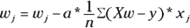<m:math display="block" overflow="scroll" xmlns:m="http://www.w3.org/1998/Math/MathML"><m:mrow><m:msub><m:mrow><m:mi>w</m:mi></m:mrow><m:mrow><m:mi>j</m:mi></m:mrow></m:msub><m:mo>=</m:mo><m:msub><m:mrow><m:mi>w</m:mi></m:mrow><m:mrow><m:mi>j</m:mi></m:mrow></m:msub><m:mo>&#45;</m:mo><m:mi>a</m:mi><m:mo>\*</m:mo><m:mfrac><m:mn>1</m:mn><m:mi>n</m:mi></m:mfrac><m:mi>&#931;</m:mi><m:mo>(</m:mo><m:mi>X</m:mi><m:mi>w</m:mi><m:mo>&#45;</m:mo><m:mi>y</m:mi><m:mo>)</m:mo><m:mo>\*</m:mo><m:msub><m:mrow><m:mi>x</m:mi></m:mrow><m:mrow><m:mi>j</m:mi></m:mrow></m:msub></m:mrow></m:math>

相对于特征 `j` 的单个权重 `w[j]`，通过减去一个由差值除以样本数量（`n`）并乘以学习率 `alpha` 组成的项来更新，学习率 `alpha` 决定了差值对新 `w[j]` 的影响程度。（较小的 `alpha` 会减小更新效果。）公式中读作 `(Xw –y)` 的部分计算模型预测值与待预测值之间的差值。通过计算此差值，你告诉算法预测误差的大小。然后将差值乘以特征 `j` 的值。将误差乘以特征值会对特征系数施加与特征值本身成比例的修正。由于特征汇总为求和，无论你是否混合不同尺度的特征，该公式都不会有效工作——较大的尺度将主导求和。例如，在梯度下降中混合使用千米和厘米表示的度量并不是个好主意，除非你使用标准化对其进行转换。

数学是机器学习的一部分，有时你无法避免学习公式，因为它们对于理解算法的工作原理很有用。将复杂的矩阵公式去神秘化为求和集合后，你可以确定算法在内部如何工作，并通过拥有正确的数据和正确设置的参数来采取行动，确保算法引擎工作得更好。

以下 Python 示例使用 Scikit-learn 的 Boston 数据集，试图利用线性回归猜测波士顿房价。该数据集包含美国人口普查局收集的关于美国马萨诸塞州波士顿地区住房的信息。该数据集最初由 D. Harrison 和 D.L. Rubinfeld 在《Journal of Environmental Economics and Management》第 5 卷，第 81–102 页（Elsevier, 1978）中发表的“Hedonic prices and the demand for clean air”一文中公布。

该数据集较小，包含 596 个案例和 14 个属性。两个属性可用于回归任务：NOX（氧化氮水平）和 MEDV（住宅房产的中位数值）。本示例使用 MEDV，即自有住房的中位数值（以千美元表示）。不过，该数据集也存在一些缺陷（请参阅即将出现的提示，以发现数据集大小之外的问题）。即便如此，它仍然是本书中学习回归的最佳示例。如果你希望通过实验来学习，请改用 Ames 房价数据集（Dean De Cock, 2011，“Ames, Iowa: Alternative to the Boston Housing Data as an End of Semester Regression Project”，《Journal of Statistics Education》，19:3，DOI：[`https://doi.org/10.1080/10691898.2011.11889627`](https://doi.org/10.1080/10691898.2011.11889627)），该数据集可在 [`http://jse.amstat.org/v19n3/decock/AmesHousing.txt`](http://jse.amstat.org/v19n3/decock/AmesHousing.txt) 处找到。

本示例预测房价。它还试图确定哪些特征对结果影响最大。如果你想确定有影响力的特征，标准化预测器证明非常有用。代码将数据拆分为训练集和测试集；打乱每个集合的顺序，并使用一个有影响力的特征对其进行分层，以改善模型输出。

```
import pandas as pd
from sklearn.datasets import load_boston
from sklearn.model_selection import train_test_split
from sklearn.preprocessing import scale
boston = load_boston()
X = pd.DataFrame(scale(boston.data), columns = boston.feature_names)
y = boston.target
X_train, X_test, y_train, y_test = train_test_split(X, y, shuffle=True, stratify=X['CHAS'] > 0, test_size=0.2, random_state=42)
```

无论你为这些原因选择哪种机器学习算法，Boston 数据集都无法按原样分析：

*   它是有序的，且顺序与目标值相关。

*   有一个名为 `CHAS` 的重要特征，用于标记几个紧邻查尔斯河的位置，其值非常显著。你需要对其进行分层，以便在训练集和测试集中都包含一些与查尔斯河相关的示例。

*   目标变量 `MEDV` 存在问题，因为该变量被限制在 50.00（数据集中只有 16 个这样的值）。`MEDV` 特征值以千美元为单位，因此 50.00 的值相当于 50,000.00 美元。

Scikit-learn 中的回归类属于 `linear_model` 模块。由于你之前已缩放训练特征，因此在使用此算法时无需决定任何其他准备工作或特殊参数。

```
from sklearn.linear_model import LinearRegression
lm = LinearRegression()
lm.fit(X_train, y_train)
```

现在算法已拟合，你可以使用 `score` 方法来报告 R² 度量。

```
print(f"R2: {lm.score(X_train, y_train):0.3}")
```

评分方法（默认情况下在回归中提供 R² 值）的输出为：

```
train R2: 0.735
```

#### 理解 R 平方

R²，也称为 *决定系数*，是一个范围从 0 到 1 的度量。它表明使用回归模型预测响应优于使用简单均值。决定系数源自统计实践，并与平方误差之和直接相关（这意味着误差越少，R² 度量越高）。你可以使用以下公式手动计算 R² 值：

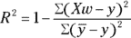<m:math display="block" overflow="scroll" xmlns:m="http://www.w3.org/1998/Math/MathML"><m:mrow><m:msup><m:mrow><m:mi>R</m:mi></m:mrow><m:mrow><m:mn>2</m:mn></m:mrow></m:msup><m:mo>=</m:mo><m:mn>1</m:mn><m:mo>&#45;</m:mo><m:mfrac><m:mrow><m:mi>&#931;</m:mi><m:msup><m:mrow><m:mrow><m:mo>(</m:mo><m:mi>X</m:mi><m:mi>w</m:mi><m:mo>&#45;</m:mo><m:mi>y</m:mi><m:mo>)</m:mo></m:mrow></m:mrow><m:mrow><m:mn>2</m:mn></m:mrow></m:msup></m:mrow><m:mrow><m:mi>&#931;</m:mi><m:msup><m:mrow><m:mrow><m:mo>(</m:mo><m:mover accent="true"><m:mi>y</m:mi><m:mo>&#175;</m:mo></m:mover><m:mo>&#45;</m:mo><m:mi>y</m:mi><m:mo>)</m:mo></m:mrow></m:mrow><m:mrow><m:mn>2</m:mn></m:mrow></m:msup></m:mrow></m:mfrac></m:mrow></m:math>


分式的上半部分表示响应与预测之间的通常差异，而下半部分表示响应均值与响应本身之间的差异。你需要对所有样本中的这两个差异分别求平方并求和。从代码角度来看，你可以轻松地将公式转换为编程命令，然后将结果与 Scikit-learn 模型报告的内容进行比较：

```
import numpy as np
mean_y = np.mean(y_train)
squared_errors_mean = np.sum((y_train - mean_y)**2)
squared_errors_model = np.sum((y_train - lm.predict(X_train))**2)
R2 = 1 - (squared_errors_model / squared_errors_mean)
print(f"Computed R2: {R2}")
```

在这种情况下，先前拟合数据上的 R² 约为 0.735，从绝对角度来看，对于线性回归模型来说，这个值相当不错（超过 0.90 的值很少见，有时甚至是严重问题的指标，例如数据窥探或数据泄露）。

因为 R² 与平方误差之和相关，并表示数据点在线性回归中如何代表一条直线，所以它也与统计相关性度量相关。统计中的相关性是一个从 +1 到 –1 的度量，用于说明两个特征之间的线性关系（也就是说，如果你将它们一起绘图，就能看出这些直线彼此有多相似）。当你对相关性求平方时，就能得到两个特征共享方差的比例。同样，无论你有多少个预测变量，也可以将 R² 计算为模型解释的信息量（与平方相关性相同），因此接近 1 意味着能够使用模型解释大部分数据。

在统计学中，在用于训练的同一组数据上计算 R² 是常见的做法。但在数据科学和机器学习中，你最好始终在未用于训练的数据上测试分数。复杂的算法可能会记忆数据，而不是从中学习。在某些情况下，即使使用简单的模型（如线性回归）时，也可能出现此问题。要了解多元回归模型中估计值的驱动因素，你需要查看 `coefficients_` 属性，它是一个包含回归 beta 系数的数组。

```
print([feat+':'+str(round(coef, 1)) for feat, coef in zip(boston.feature_names, lm.coef_)])
```

你将获得以下输出：

```
['CRIM:-0.6', 'ZN:0.9', 'INDUS:0.2', 'CHAS:0.8', 'NOX:-2.1', 'RM:2.7', 'AGE:0.2', 'DIS:-2.9', 'RAD:2.4', 'TAX:-1.8', 'PTRATIO:-2.2', 'B:1.0', 'LSTAT:-4.0']
```

`DIS` 特征包含到五个就业中心的加权距离，具有最大的绝对单位变化。在房地产中，一座离人们感兴趣的地方（例如工作地点）太远的房子会降低其价值。相反，`AGE` 或 `INDUS`（两者都是描述建筑物年龄以及该地区是否有非零售活动的比例）对结果的影响较小；它们的 beta 系数绝对值要低得多。

### 混合不同类型的特征

使用有效但简单的线性回归工具时，会出现相当多的问题。有时，取决于你使用的数据，这些问题可能会同时出现。本节将告诉你以简单有效的方式尽可能多地处理这些问题的方法。

线性回归只能将响应建模为定量数据。当你需要将类别建模为响应时，必须转向逻辑回归，本章后面将介绍逻辑回归。在处理预测变量时，最好使用连续数值特征，尽管你可以拟合序数，并通过一些转换来拟合定性类别。

`定性特征`（也称为 `分类特征`）可能表示一种颜色，例如产品的颜色，或一个人的职业。每个定性特征对每个类别都有唯一的值，例如不同的颜色或职业。你有多种选项可以使用诸如二进制编码（最常见的方法）之类的技术来转换定性特征。在将定性特征二进制化时，你会创建与特征中的类别数量相同的特征数量。每个特征包含零值，除非其类别出现在数据中，此时它取值为 1。此过程称为 `独热编码`。使用 Scikit-learn 预处理模块的简单 Python 示例展示了如何执行独热编码：

```
from sklearn.preprocessing import OneHotEncoder
from sklearn.preprocessing import LabelEncoder
lbl = LabelEncoder()
enc = OneHotEncoder(sparse=False)
qualitative = ['red', 'red', 'green', 'blue', 'red', 'blue', 'blue', 'green']
labels = lbl.fit_transform(qualitative).reshape(-1, 1)
print(enc.fit_transform(labels))
```

结果，你将获得一个由三列零和一组成的矩阵。每一列分别对应 `'red'`、`'green'` 或 `'blue'` 标签之一。代码首先将字符串标签编码为数字。如果你打印 `lbl.classes_` 方法调用，你将得到序列 `['blue', 'green', 'red']`，这意味着第一个标签 `'blue'` 得到了值 `0`；第二个 `'green'` 得到了 `1`；最后一个 `'red'` 得到了 `2`。相同的数字顺序随后被编码到生成的三个二进制列中，因为第一列表示原始数据中标签 `'blue'` 的存在，第二列表示标签 `'green'`，第三列表示标签 `'red'`。你可以通过检查原始值与矩阵中相应一值之间的对应关系来确认这一点。

在统计学中，当你想要从分类特征创建二进制特征时，你需要转换除一个之外的所有级别，因为你使用的是逆矩阵计算公式，该公式有相当多的局限性。在机器学习中，你使用梯度下降，它不基于矩阵逆运算，因此你反而转换所有级别。

处理分类特征并不是运行线性模型（以及许多其他机器学习算法）时必须应用的必要数据转换之一。如果数据矩阵缺少数据且你没有妥善处理，模型将停止工作。因此，你需要填补缺失值（例如，用特征本身计算的均值替换缺失值）。针对线性模型的特定解决方案是，对缺失情况使用零值，并创建一个额外的二进制特征，其单位值指示特征中的缺失值。

此外，`异常值`（超出正常范围的值）会破坏线性回归，因为模型试图最小化误差的平方值（也称为 `残差`）。异常值具有较大的残差，因此迫使算法更多地关注它们，而不是常规点。你可以使用 第 11 章 中提供的指示来检测和处理可能影响线性模型的任何异常值。

线性回归最大的局限性在于，模型是独立项的求和，因为每个特征在求和中独立存在，仅乘以其自身的 beta。这种数学形式非常适合表达特征之间无关的情况。例如，一个人的年龄和眼睛颜色是不相关的项，因为它们互不影响。因此，你可以将它们视为独立项，在回归求和中，它们保持分开是合理的。另一方面，一个人的年龄和头发颜色并非无关，因为衰老会导致头发变白。当你将这些特征放入回归求和中时，就相当于在求和相同的信息。由于这一局限性，你无法确定如何表示特征组合对结果的影响。


换句话说，你无法用数据来表示复杂的情况。因为模型由加权特征的简单组合构成，它在预测中表达的偏差比方差更多。事实上，在拟合观测到的结果值后，线性模型提出的解决方案始终是特征的按比例重新缩放的混合。不幸的是，你无法使用这种方法忠实地表示响应与特征之间的一些关系。在许多场景中，响应以非线性的方式依赖于特征：某些特征值充当障碍，超过该障碍后，响应会突然增加或减少，增强或减弱，甚至逆转。

例如，考虑人类从童年时期如何增长身高。如果在特定年龄范围内观察，年龄与身高之间的关系在某种程度上是线性的：孩子年龄越大，身高越高。然而，有些孩子长得更高（总体身高），有些孩子长得更快（在一定时间内的增长）。当你期望线性模型找到一个平均答案时，这一观察依然成立。但是，在某个年龄之后，孩子停止生长，身高在很长一段时间内保持不变，并在晚年慢慢下降。显然，线性回归无法捕捉这种非线性关系。（最终，你可以将其表示为一种抛物线。）

另一个与年龄相关的例子是消费品支出金额。人生早期阶段的人倾向于花费较少。支出在人生中期增加（可能是因为收入更多或因为家庭义务导致更大的开支），但在人生后期又会减少（显然是另一种非线性关系）。更深入地观察和思考周围的世界表明，存在许多非线性关系。

因为目标与每个预测特征之间的关系基于单个系数，你无法表示像抛物线（一个使响应最大化或最小化的唯一 x 值）、指数增长或更复杂的非线性曲线这样的复杂关系，除非你丰富特征。建模复杂关系的最简单方法是使用对预测特征进行数学变换的 *多项式扩展*。多项式扩展，给定某个次数 d，创建每个特征直到 d 次幂的所有幂次以及所有项的 d 组合。例如，如果你从一个简单的线性模型开始，如下面的 Python 代码所示：

`y = β1x1 + β2x2 + α`

然后使用二次多项式扩展，使模型变为

`y = β1x1 + β2x2 + α + β3(x1)2 + β4(x2)2 + β5x1x2`

你对原始公式进行了添加（扩展），使用现有预测特征的幂次和组合。随着多项式扩展次数的增加，派生项的数量也随之增加。下面的 Python 示例使用 Boston 数据集（延续之前的示例）来检查该技术的有效性。如果成功，多项式扩展可能捕捉数据中的非线性关系，并可能以增加预测特征数量为代价解决类间不可分离的初始问题（在 第 10 章 中看到的感知器算法问题）。

```
from sklearn.preprocessing import PolynomialFeatures
pf = PolynomialFeatures(degree=2)
poly_X_train = pf.fit_transform(X_train)
lm = LinearRegression()
lm.fit(poly_X_train, y_train)
r2 = reg_lm.score(poly_X_train, y_train)
print(f"train R2: {r2:0.3}")
```

模型在拟合数据上的 R² 现在为 0.934，与之前的 0.735 相比有显著改进，表明多项式扩展可以更好地表示某些特征。但是，当你尝试在测试集上使用多项式扩展时，你会发现结果与使用原始数据的模型相比并没有好多少：

```
poly_X_test = pf.transform(X_test)
r2 = lm.score(poly_X_test, y_test)
print(f"test R2: {r2:0.3}")
```

多项式扩展并不总是对测试集有好处。通过扩展特征的数量，你降低了预测的偏差，但代价是增加了方差。过度扩展可能会阻碍模型表示一般规则的能力，使其无法使用新数据进行预测。

# Switching to Probabilities

到目前为止，本章只考虑了回归模型，这些模型从数据学习中输出数值。然而，大多数问题也需要分类。以下部分讨论如何处理数值和分类输出。

### Specifying a binary response

涉及二进制响应（模型必须从两个可能的类中选择）的问题的一个解决方案是将响应向量编码为一系列 1 和 0（或正值和负值，就像感知器所做的那样）。下面的 Python 代码证明了使用二进制响应的可行性和局限性。

```
from sklearn.linear_model import LinearRegression
import numpy as np
y = np.array([0, 0, 0, 0, 1, 1, 1, 1])
X = np.array([1, 2, 3, 4, 5, 6, 7, 8]).reshape(8,1)
lm = LinearRegression()
lm.fit(X, y)
preds = lm.predict(X)
for y_true, y_pred in zip(y, preds):
    print(f"{y_true} -&gt; {y_pred:+0.3}")
```

结果范围从负零到超过 1，但大多数结果远离目标值 0 和 1：

`0 -&gt; -0.1670 -&gt; +0.02380 -&gt; +0.2140 -&gt; +0.4051 -&gt; +0.5951 -&gt; +0.7861 -&gt; +0.9761 -&gt; +1.17`

在统计学中，线性回归无法解决分类问题，因为这样做会创建一系列被违反的统计假设。因此，对于统计学来说，使用回归模型进行分类主要是一个理论问题，而不是实际问题。在机器学习中，线性回归的问题是它作为一个试图最小化预测误差的线性函数；因此，取决于计算出的直线的斜率，它可能无法解决数据问题。

当线性回归被赋予预测两个值（例如 0 和 +1，代表两个类）的任务时，它会尝试计算一条提供接近目标值结果的直线。在某些情况下，即使结果精确，输出也远离目标值，这迫使回归直线调整以最小化总误差。这种变化导致总偏差误差减少，但误分类的案例更多。

与 第 10 章 中介绍的感知器示例相反，当优先级是分类准确性时，线性回归无法产生可接受的结果，如前例所示。因此，它在许多分类任务中无法令人满意地工作。线性回归在连续的数值估计上效果最好。但是，对于分类任务，你需要一个更合适的度量，例如类归属的概率。

得益于以下公式，你可以将线性回归的数值估计转换为更适合描述类如何拟合观测值的概率：

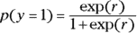


在这个公式中，目标是响应 `y` 对应于类 `1` 的概率。字母 `r` 是回归结果，即按系数加权的特征之和。指数函数 `exp(r)` 对应于欧拉数 `e` 的 `r` 次幂。使用这种转换公式（也称为链接函数）将结果转换为概率的线性回归称为逻辑回归。

逻辑回归与线性回归相同，只是 `y` 数据包含表示观测值所属类别的整数，并且优化了不同的代价函数（即特定于概率的交叉熵代价函数）。例如，使用 Scikit-learn `datasets` 模块中的 Boston 数据集，你可以尝试猜测是什么导致某个地区的房价过高（前百分之十对应中位数值大于或等于 35）：

```
from sklearn.linear_model import LogisticRegression
lr = LogisticRegression()
lr.fit(X_train, y_train>=35)
from sklearn.metrics import accuracy_score
in_sample_acc = accuracy_score(y_train>=35, lr.predict(X_train))
out_sample_acc = accuracy_score(y_test>=35, lr.predict(X_test))
print(f'In-sample accuracy: {in_sample_acc:0.3}')
print(f'Out-of-sample accuracy: {out_sample_acc:0.3}')
```

该示例在训练集和测试集上测试了逻辑回归的准确性（正确预测的百分比），训练集样本约为 0.963，测试集样本约为 0.951。计算出的系数告诉你某个特定类别属于目标类别（即任何使用值 1 编码的类别）的概率。如果系数增加了可能性，它将具有正系数；否则，系数为负。

```
for var, coef in zip(X_train.columns, lr.coef_[0]):
    print(f"{var:7} : {coef:+0.3}")
```

系数序列将出现在屏幕上：

```
CRIM : +0.337
ZN : -0.0501
INDUS : -0.196
CHAS : -0.0514
NOX : -0.334
RM : +1.3
AGE : +0.201
DIS : -0.682
RAD : +1.19
TAX : -0.254
PTRATIO : -0.713
B : +0.269
LSTAT : -2.63
```

你可以阅读多伦多大学波士顿房价数据集指南中每个特征的含义：[`https://www.cs.toronto.edu/~delve/data/boston/bostonDetail.html`](https://www.cs.toronto.edu/~delve/data/boston/bostonDetail.html)。

阅读结果，你可以看到在波士顿，犯罪率（`CRIM`）对房价有一些影响，但并非你可能预期的那种影响。事实上，当你解释系数时，你需要查看它们的符号和绝对值。`CRIM` 的正符号告诉你，犯罪率越高，中位数价格约为 35 的区域的概率就越大。从逻辑角度来看，为犯罪率较高的地区的房子支付更多费用并不合理，这就是为什么你需要人类审查数据和结果，寻找不合理的相关性的原因之一。至于概率的增加，你对系数值应用指数函数（`np.exp`），以获得该特征增加或降低平均概率的倍数。在此示例中，`np.exp(+0.337)` 返回约 1.4，对应于概率的增加。然而，贫困水平（`LSTAT`）、高速公路可达性（`RAD`）和每套住房的平均房间数（`RM`）都有更大的影响，并且它们都具有正确的系数符号。

不要被线性模型的系数所迷惑。模型是特征乘以系数的组合这一事实，让许多人觉得他们可以从回归模型中提取一些意义。实际上，回归模型是一种数学优化，许多特征与许多其他特征强烈相关，这些其他特征可能会混淆它们在模型中的作用。因此，你得到的系数可能仅仅代表优化过程的副作用，而其他相关特征具有正确的符号和值。在此示例中，`CRIM` 与 `RM` 和 `RAD` 强烈相关（它们的相关性超过 0.9，你可以看到多重共线性的影响，即一组在某种程度上相互相似的特征）。因此，这些特征可能已经掩盖了 `CRIM`。

此外，与线性回归不同，逻辑回归不仅输出结果类别（在此示例中为 1 或 0），还估计观测值属于两个类别之一的概率。

```
print('classes:', lr.classes_)
print('\nProbs:\n', lr.predict_proba(X_test)[:3, :])
```

你得到类别的标签以及测试集中前三个案例的相应概率：

```
classes: [False True]
Probs: [[0.98071307 0.01928693] [0.99819753 0.00180247] [0.84429169 0.15570831]]
```

在测试集中，第一个示例有 98% 的概率不是昂贵的房价区域。当你使用这种方法进行预测时，你还知道你的预测准确的概率，并可以相应地行动，只选择具有适当准确度的预测。例如，你可能只选择超过 80% 可能性的预测，尽管通常逻辑回归使用 50% 的概率阈值。

使用概率，你可以猜测一个类别（最可能的那个），但你也可以将所有预测排序为属于该类别。这对于医疗目的尤其有用，可以根据预测与其他案例相比的可能性对预测进行排名。

### 处理多类问题

在之前的问题中，K-最近邻（KNN）自动确定了如何处理多类问题。（第 12 章展示了如何从三种南极企鹅中猜测单一解决方案的示例。）大多数预测概率或类别分数的算法使用两种不同的策略自动处理多类问题：

*   **一对其余（OvR）：** 算法将每个类别与其余类别进行比较，为每个类别构建一个模型。概率最高的类别被选中。因此，如果问题有三个类别需要猜测，算法也使用三个模型。本书使用 Scikit-learn 的 `OneVsRestClassifier` 类来演示此策略。

*   **一对一（OvO）：** 算法将每个类别与每个其余类别进行比较，构建相当于 `n * (n-1) / 2` 数量的模型，其中 `n` 是类别的数量。因此，如果问题有五个类别需要猜测，算法使用十个模型。本书使用 Scikit-learn 的 `OneVsOneClassifier` 类来演示此策略。获胜次数最多的类别被选中。

逻辑回归的默认多类策略是 OvR。

### 猜测正确的特征

拥有许多可用的特征似乎可以满足机器学习充分理解问题的需求。然而，仅仅拥有特征并不能解决任何问题；你需要正确的特征来解决问题。以下部分讨论了在执行机器学习任务时如何确保你拥有正确的特征。

#### 定义无法协同工作的特征的结果

如前所述，拥有许多特征并使它们协同工作可能会错误地表明你的模型工作良好，而实际上并非如此。除非你使用交叉验证，否则 `R²` 等误差指标可能会产生误导，因为特征的数量很容易使其膨胀，即使该特征不包含相关信息。以下示例显示当你添加仅随机特征时 `R²` 会发生什么情况。


`r2_train = list()r2_test = list() for i in range(1, 129): X_train_extra = np.column_stack((X_train, np.random.rand(len(X_train), i))) X_test_extra = np.column_stack((X_test, np.random.rand(len(X_test), i))) lr = LinearRegression() lr.fit(X_train_extra, y_train) r2_train.append(lr.score(X_train_extra, y_train)) r2_test.append(lr.score(X_test_extra, y_test))`

在此示例中，代码在波士顿数据集上重新训练线性回归模型，并在训练集和测试集中都添加了一些新的随机特征。该示例记录了随着随机特征数量的增加，两组数据的 R2 值。如果你绘制结果图，你会发现样本内预测能力似乎有所提高，但实际上只是一种幻觉。通过检查测试集，你会发现模型性能实际上已经下降，如 图 13-1 所示。

```
import matplotlib.pyplot as plt
fig, ax = plt.subplots(dpi=120)
plt.plot(r2_train, label='train')
plt.plot(r2_test, label='test')
plt.xlabel("additional random features")
plt.ylabel("R2")
plt.show()
```

#### 通过贪婪选择解决过拟合问题

不仅不相关的特征（如随机噪声），冗余特征也可能影响模型的预测性能以及你理解线性模型的能力。前面几节承认，线性模型中包含过多信息可能会成为问题：

* 不相关的特征可能会恶化模型的预测能力。

* 多项式扩展可能会产生良好的训练拟合，但测试效果不佳，这是过拟合的信号，因为扩展产生了大量冗余特征。

* 逻辑回归显示，由于 CRIM 与其他一些特征相关，因此其系数具有反直觉性。

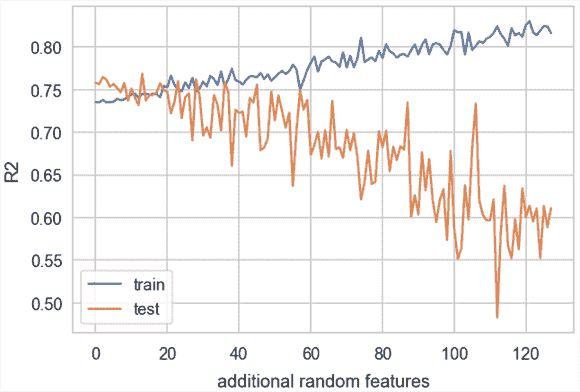

FIGURE 13-1: Adding random features increases in-sample performances but degrades the test results.

作为解决这些问题的方案，可以通过仅选择最具预测能力的特征集来简化训练集。在这样做时，你可以使用交叉验证（可保证你的选择是最优的）以及 Scikit-learn 提供的一系列工具来处理问题。第一个是递归选择，即逐一测试从训练集中删除效果最差的特征。作为一种启发式方法，递归选择使用回归系数的绝对值来逐步消除影响最小的特征。当只剩下少数特征时，算法会回顾其消除过程，并找到能让模型在交叉验证中表现更好的特征集。在此示例中，你从之前的多项式扩展开始，确定是否可以将扩展减少到一个更小、更具预测能力的特征集：

```
from sklearn.feature_selection import RFECV
from sklearn.preprocessing import PolynomialFeatures
pf = PolynomialFeatures(degree=2)
poly_X_train = pf.fit_transform(X_train)
poly_X_test = pf.transform(X_test)
selector = RFECV(estimator=LinearRegression(), step=1, cv=3, scoring='r2')
selector.fit(poly_X_train, y_train)
n_features = selector.n_features_
print(f"Features reduced to {n_features} from " "{poly_X_train.shape[1]}")
```

选择完成后，你可以在训练集和测试集上对其进行测试。注意预测性能提高了多少（现在测试 R² 达到 0.826，而 图 13-1 中显示的值约为 0.6）：

```
r2_train = selector.score(poly_X_train, y_train)
print(f"R2 train: {r2_train:0.3}")
r2_test = selector.score(poly_X_test, y_test)
print(f"R2 test: {r2_test:0.3}")
```

#### 通过正则化解决过拟合问题

当你拥有许多特征，并希望减少由于预测器之间多重共线性导致的估计方差时，正则化是一种有效、快速且易于实现的解决方案。正则化通过向成本函数添加惩罚项来工作。惩罚项是系数的总和。如果系数被平方（使得正负值无法相互抵消），则为 `L2 regularization`（也称为 `Ridge`）。当你使用系数的绝对值时，则为 `L1 regularization`（也称为 `Lasso`）。

然而，正则化并不总是完美有效。L2 正则化保留模型中的所有特征，并平衡每个特征的贡献。在 L2 解中，如果两个特征高度相关，则每个特征对解决方案的某一部分均等贡献，而如果没有正则化，它们的共享贡献将被不均匀地分配。

或者，L1 通过将高度相关特征的系数设为零，将其从模型中移除，从而在特征之间进行真正的选择。事实上，将系数设为零就像将特征从模型中排除一样。当多重共线性很高时，决定将哪个预测器设为零变得有些随机，你可以得到各种解决方案，其特征被排除的方式不同。这种解决方案的不稳定性可能会带来麻烦，因此当你也希望找出哪些特征对模型很重要时，L1 解更受青睐。

学者们通过基于 L1 正则化创建各种解决方案，然后查看系数在不同解决方案中的表现，找到了一个修复方法。在这种情况下，算法只选择稳定的系数（那些很少被设为零的系数）。你可以在 Scikit-learn 兼容项目网站上阅读更多关于此技术及其细节的内容，网址为 [`https://github.com/scikit-learn-contrib/stability-selection`](https://github.com/scikit-learn-contrib/stability-selection)，以及在博客 [`https://thuijskens.github.io/2018/07/25/stability-selection/`](https://thuijskens.github.io/2018/07/25/stability-selection/) 上阅读。以下示例修改了多项式扩展示例，使用 L2 正则化（岭回归）并减少扩展过程创建的冗余系数的影响。由于正则化程度由 `RidgeCV` alpha 参数控制（alpha 越高，正则化越强），该示例使用内部交叉验证过程验证哪个 alpha 对你的模型更好。你只需提供一组要测试的 alpha 值：

```
from sklearn.linear_model import RidgeCV
l2_lm = RidgeCV(alphas=[0.001, 0.01, 0.1, 1, 10, 100], normalize=True, cv=5, scoring='r2')
l2_lm.fit(X_train, y_train)
best_alpha = l2_lm.alpha_
r2_test = l2_lm.score(X_test, y_test)
print(f"best alpha is: {best_alpha}")
print(f"test R2: {r2_test:0.3}")
```

以下是此代码的输出：

```
best alpha is: 0.1
test R2: 0.753
```

在完成训练数据的拟合并测试预测性能后，你可以查看生成的系数如何变化：

```
for var, coef in zip(X_train.columns, l2_lm.coef_):
    print(f"{var:7} : {coef:+0.3}")
```

由于 L2 倾向于在存在相关特征时降低并重新平衡线性回归模型的系数，因此生成的系数现在更具可解释性，你不应该再发现之前出现的反直觉符号或值：

```
CRIM : -0.438
ZN : +0.546
INDUS : -0.247
CHAS : +0.886
NOX : -1.32
RM : +2.79
AGE : +0.0356
DIS : -2.09
RAD : +1.02
TAX : -0.718
PTRATIO : -1.88
B : +0.943
LSTAT : -3.49
```

下一个示例使用 L1 正则化，当系数冗余时，L1 倾向于将系数带为零（L2 只是将其减小）。在这种情况下，结果与 L2 相差不大。这次，示例使用 Scikit-learn 的 `LassoCV` 类，它类似于 `RidgeCV`，但应用 L1 正则化而不是 L2：


`from sklearn.linear_model import LassoCV`
`l1_lm = LassoCV(alphas=[0.001, 0.01, 0.1, 1, 10, 100], normalize=True, cv=5)`
`l1_lm.fit(X_train, y_train)`
`best_alpha = l1_lm.alpha_`
`r2_test = l1_lm.score(X_test, y_test)`
`print(f"best alpha is: {best_alpha}")`
`print(f"test R2: {r2_test:0.3}")`

# 一次学习一个示例

找到线性模型的正确系数只是时间和内存的问题。但是，有时系统没有足够的内存来存储大型数据集。在这种情况下，你必须求助于其他方法，例如一次学习一个示例，而不是将所有示例都加载到内存中。以下部分将帮助你理解一次学习一个示例的方法。

### 使用梯度下降

梯度下降一次迭代地找到最小化成本函数的正确方法。每一步之后，它会考虑模型的所有累积误差，并更新系数，以便在下一次数据迭代中使误差更小。这种方法的效率源于考虑样本中的所有示例。这种方法的缺点是你必须将所有数据加载到内存中。

不幸的是，你并不总能将所有数据存储在内存中，因为有些数据集非常大。此外，使用简单学习器进行学习需要大量数据才能构建有效的模型（更多数据有助于正确消除多重共线性）。将数据块存储在硬盘上总是可行的，但由于需要执行矩阵乘法，这并不可行，因为这需要大量的数据交换，从磁盘中选择行和列。致力于解决该问题的科学家们找到了一个有效的解决方案。与在看到所有数据后再从所有数据中学习（这被称为一次*迭代*）不同，该算法一次学习一个示例，这些示例是使用顺序访问从存储中选取的，然后继续学习下一个示例。当算法学习完所有示例后，它会从头开始，除非满足某些停止标准（例如，完成预定义的迭代次数）。

一个*数据流*是从磁盘一次流出一个示例的数据。*流式传输*是将数据从存储传递到内存的动作。*核外学习*风格（在线学习）发生在算法从流中学习时，这是在第 8 章末尾讨论的一种可行的学习策略。

数据流的一些常见来源包括网络流量、传感器、卫星和监控录像。一个流的直观示例是，例如，传感器瞬时产生的数据流，或者 Twitter 流生成的推文。你还可以流式传输你习惯于保存在内存中的常见数据。例如，如果数据矩阵太大，你可以将其视为数据流，并一次学习一行，从文本文件或数据库中提取它。这种流式传输是*在线学习*风格。

### 理解 SGD 的不同之处

随机梯度下降（SGD）是梯度下降算法的一种微小变体。它提供了一种用于估计 beta 系数的更新过程。线性模型非常适合这种方法。

在 SGD 中，公式与梯度下降的标准版本（称为批量版本，与在线版本相对）保持不变，除了更新部分。在 SGD 中，更新一次执行一个实例，允许算法将核心数据留在存储中，而只将更改系数向量所需的单个观测值放入内存中：

<m:math display="block" overflow="scroll" xmlns:m="http://www.w3.org/1998/Math/MathML"><m:mrow><m:msub><m:mrow><m:mi>w</m:mi></m:mrow><m:mrow><m:mi>j</m:mi></m:mrow></m:msub><m:mo>=</m:mo><m:msub><m:mrow><m:mi>w</m:mi></m:mrow><m:mrow><m:mi>j</m:mi></m:mrow></m:msub><m:mo>&#45;</m:mo><m:mi>a</m:mi><m:mo>(</m:mo><m:mi>X</m:mi><m:mi>w</m:mi><m:mo>&#45;</m:mo><m:mi>y</m:mi><m:mo>)</m:mo><m:msub><m:mrow><m:mi>x</m:mi></m:mrow><m:mrow><m:mi>j</m:mi></m:mrow></m:msub></m:mrow></m:math>

与梯度下降算法一样，该算法通过减去预测值与真实响应之间的差值来更新特征 j 的系数 w。然后，它将差值乘以特征 j 的值和一个学习因子 alpha（该因子可以减小或增大更新对系数的影响）。

使用 SGD 而不是梯度下降时还有其他细微差别。最重要的区别是这种在线学习算法名称中的随机项。事实上，SGD 期望一次一个示例，从可用示例中随机抽取（随机采样）。在线学习的问题是示例顺序会改变算法猜测 beta 系数的方式。这是在处理决策树时讨论过的贪婪原则（参见第 10 章）：通过部分优化，一个示例可以改变算法达到最优值的方式，从而创建一组与没有该示例时不同的系数。

作为一个实际示例，只需记住 SGD 可以学习它看到示例的顺序。因此，如果算法执行任何类型的排序（历史、字母顺序，或更糟的是，与响应变量相关），它将不可避免地学习它。只有随机采样（无意义的排序）才能让你获得一个可靠的在线模型，该模型在未见数据上能有效工作。在流式传输数据时，你需要随机重新排序你的数据（数据洗牌）。

与批量学习相反，SGD 算法需要大量的迭代次数才能获得正确的全局方向，尽管来自单个示例的指示相反。事实上，算法在每个新示例后更新，因此朝着最优参数集的旅程比在批量上进行的优化更加反复无常，而批量优化立即倾向于获得正确方向，因为它是从整体数据中得出的，如图 13-2 所示。

在这种情况下，学习率更加重要，因为它决定了 SGD 优化过程能多大程度上抵抗不良示例。事实上，如果学习率较高，一个离群示例可能会完全使算法脱轨，阻止其达到良好结果。另一方面，高学习率有助于保持算法从示例中学习。一个好的策略是使用灵活的学习率，即一开始使用灵活的学习率，随着算法看到的示例数量增加，使其变得固定。

如果你仔细想想，作为一种学习策略，灵活的学习率类似于你大脑所采用的策略：作为孩子时灵活且乐于学习，作为成年人时更难改变（但并非不可能）。Python 在 Scikit-learn 中提供了两个 SGD 实现，一个用于分类问题（`SGDClassifier`），一个用于回归问题（`SGDRegressor`）。除了用于拟合内存中数据的 `fit` 方法外，这两种方法都具有 `partial_fit` 方法，该方法将以前的结果和学习计划保存在内存中，并在新示例到来时继续学习。使用 `partial_fit` 方法，你可以部分拟合小数据块，甚至单个示例，并继续向算法输入数据，直到找到满意的结果。


FIGURE 13-2: Visualizing the different optimization paths on the same data problem.


Scikit-learn 中的 SGD 分类和回归实现都提供了可应用于随机梯度下降优化的不同损失函数。其中只有两个函数涉及本章讨论的方法：

*   `loss='squared_loss'`: 用于线性回归的普通最小二乘法（OLS）

*   `loss='log'`: 经典逻辑回归

其他实现（hinge、huber、epsilon insensitive）优化的是一种类似于感知机的不同损失函数。第 15 章将在讨论支持向量机时更详细地解释它们。

为了演示核心外学习（out-of-core learning）的有效性，以下示例在 Python 中设置了一个简短的实验，使用回归和 `squared_loss` 作为代价函数。它展示了随着算法看到更多样本，β 系数如何变化。该示例还多次传递相同的数据以加强数据模式学习。使用测试集可以保证公平的评估，提供算法推广到未见数据的能力的度量。

你可以通过修改 `learning_rate` 及其相关参数 `eta0` 和 `power_t` 来更改学习参数后自由重复该实验。学习率决定每个观察到的样本如何影响优化过程，除了常量选项外，你可以使用 `optimal`（适用于分类）和 `invscaling`（用于回归）对其进行修改。特别是，特定参数 `eta0` 和 `power_t` 根据学习率公式（用希腊字母 η，eta 表示）控制 `invscaling`。

<m:math display="block" overflow="scroll" xmlns:m="http://www.w3.org/1998/Math/MathML"><m:mrow><m:msub><m:mrow><m:mi>&#951;</m:mi></m:mrow><m:mrow><m:mi>n</m:mi></m:mrow></m:msub><m:mo>=</m:mo><m:mi>&#951;</m:mi><m:mn>0</m:mn><m:mo>/</m:mo><m:msup><m:mrow><m:mtext>t</m:mtext></m:mrow><m:mrow><m:mrow><m:mi>p</m:mi><m:mi>o</m:mi><m:mi>w</m:mi><m:mi>e</m:mi><m:mi>r</m:mi><m:mtext>&#95;t</m:mtext></m:mrow></m:mrow></m:msup></m:mrow></m:math>

当 `power_t` 参数是一个小于一的数字时，该公式会创建学习率的逐渐衰减（`t` 是已见样本的数量），使其能够巩固之前学到的内容，并对异常值引起的任何变化产生抵抗力。

这个 Python 示例在对 Boston 数据集进行洗牌并将其分为训练集和测试集后使用它。该示例在看到以 2 的幂为数量级的可变数量的样本后（为了表示不同步骤的学习过程），报告系数向量和误差度量。该实验展示了 R² 增加且系数值稳定之前需要多长时间。（请注意，运行此示例可能需要很长时间，具体取决于你的系统，所以这可能是去喝杯咖啡的好时机。）在这种情况下，几次迭代就足以达到几乎可能的最大 R² 值。注意，如 图 13-3 所示，训练集中的 R² 更差，而你本应预期它比测试集更好。这是因为正则化（该示例使用 L1），这使得拟合数据更加困难。

```
from sklearn.linear_model import SGDRegressor SGD = SGDRegressor(penalty='l1', learning_rate='invscaling', eta0=0.01, power_t=0.25) r2_train = list()r2_test = list() for i in range(30): for j in range(len(X_train)): SGD.partial_fit(X_train.iloc[[j], :], y_train[[j]]) r2_train.append(SGD.score(X_train, y_train)) r2_test.append(SGD.score(X_test, y_test)) import matplotlib.pyplot as plt fig, ax = plt.subplots(dpi=120)plt.plot(r2_train, label='train')plt.plot(r2_test, label='test')plt.xlabel("number of iterations")plt.ylabel("R2")plt.legend()plt.show()
```

无论数据量多少，你始终可以使用 SGD 的在线学习功能来拟合一个简单但有效的线性回归模型。

# 第 14 章

# 用神经网络攻克复杂性

### 本章内容

*   **将感知机升级到互连范式**

*   **构建由节点和连接组成的神经网络架构**

*   **一窥反向传播算法**

*   **理解什么是深度学习及其能实现的目标**

当你在机器学习的世界中探索时，常常会看到来自自然界的隐喻来解释算法的细节。本章介绍了一类学习算法，它们直接从大脑的工作原理中汲取灵感。它们就是神经网络，即连接主义者部落的核心算法（有关各个部落的列表，请参见 第 2 章 中“指定统计学在机器学习中的作用”部分）。

从逆向工程大脑如何处理信号的想法出发，连接主义者将神经网络建立在生物类比及其组件之上，使用神经元和轴突等大脑术语作为名称。然而，当你检查它们的数学公式时，你会发现神经网络与一种复杂的非线性线性回归并无太大区别。然而，这些算法在图像和声音识别或机器语言翻译等复杂问题上异常有效。它们在预测时也可以快速执行（取决于其大小，因为一些最近的神经网络模型非常庞大）。

设计良好的大型神经网络使用 *深度学习* 这一名称，是 Siri 和其他数字助手等强大工具的基础。它们也是更多令人惊叹的机器学习应用的基础。例如，你可以在微软首席执行官 Rick Rashid 的这个令人难以置信的演示中看到它们的运作情况，他正在用英语演讲，同时被同步翻译成中文：[`https://www.youtube.com/watch?v=Nu-nlQqFCKg`](https://www.youtube.com/watch?v=Nu-nlQqFCKg)。如果 AI 革命即将发生，神经网络增强的学习能力很可能将推动它。

你不必手动输入本章的源代码。事实上，使用可下载的源代码要容易得多。你可以在 Python 代码的可下载源代码的 `ML4D2E` 文件夹和 R 代码的可下载源代码的 `ML4D2ER` 文件夹中找到本章的源代码。本章的示例文件将以 `ML4D2E; 14;`（用于 Python）或 `ML4D2E_R; 14;`（用于 R）开头。有关如何找到这些源代码文件的详细信息，请参见简介。

### 重新审视感知机

核心神经网络算法是 *神经元*（也称为 *单元*）。许多以互连结构排列的神经元构成神经网络，每个神经元链接到其他神经元的输入和输出。因此，神经元可以根据其在神经网络中的位置，从示例中输入特征或其他神经元的结果。

与神经元类似的感知机，此前在本书中出现过，尽管它使用更简单的结构和功能。当心理学家 Rosenblatt 构思感知机时，他将其视为大脑神经元的简化数学版本。感知机遵循以下步骤：

1.  从附近环境（数据集）获取值作为输入。

2.  对这些值进行加权（如同脑细胞根据入境连接的强度处理电信号一样）。

3.  求和所有加权值。

4.  当和超过阈值时激活。


# 神经网络基础

This threshold outputs a value of 1; otherwise, its prediction is 0. Unfortunately, a perceptron can't learn when the classes it tries to process aren’t linearly separable. However, scholars discovered that even though a single perceptron couldn’t learn the logical operation XOR shown in Figure 14-1 (the exclusive or, which is true only when the inputs are dissimilar), two perceptrons working together could.


FIGURE 14-1: Learning logical XOR using a single separating line isn’t possible.

Neurons in a neural network are a further evolution of the perceptron: They take many weighted values as inputs, sum them, and provide the summation as the result, just as a perceptron does. However, they also provide a more sophisticated transformation of the summation, something that the perceptron can’t do. In observing nature, scientists noticed that neurons receive signals but don’t always release a signal of their own. It depends on the amount of signal received. When a neuron acquires enough stimuli, it fires an answer; otherwise it remains silent. In a similar fashion, algorithmic neurons, after receiving weighted values, sum them and use an `activation function` to evaluate the result, which transforms it in a nonlinear way. For instance, the activation function can release a zero value unless the input achieves a certain threshold, or it can dampen or enhance a value by nonlinearly rescaling it, thus transmitting a rescaled signal.

A neural network has different activation functions, as shown in Figure 14-2. The linear function (labeled Binary step) doesn’t apply any transformation, and it’s seldom used because it reduces a neural network to a regression with polynomial transformations. Neural networks commonly use the sigmoid (also known as logistic) or the hyperbolic tangent (labeled TanH), or the ReLU (which is by far the more common today) activation functions.


FIGURE 14-2: Plots of different activation functions.

The figure shows how an input (expressed on the horizontal axis) can transform an output into something else (expressed on the vertical axis). The examples show a binary step, a logistic, a tangent hyperbolic, and a ReLU activation function.

You learn more about activation functions later in the chapter, but note for now that activation functions clearly work well in certain ranges of input values. As you can see from Figure 14-2, they output end-of-scale values outside certain input boundaries. For this reason, you should always rescale inputs to a neural network using statistical standardization (zero mean and unit variance) or normalize the input in the range from 0 to 1 or from –1 to +1.

### Pushing forth with feed-forward

In a neural network, you have first to consider the architecture, which is how the neural network components are arranged. Contrary to other algorithms, which have a fixed pipeline that determines how algorithms receive and process data, neural networks require you to decide how information flows by fixing the number of units (the neurons) and their distribution in layers, as shown in Figure 14-3.


FIGURE 14-3: An example of the architecture of a neural network.

The figure shows a simple neural architecture. Note how the layers filter information in a progressive way. This is a feed-forward input because data feeds forward into the network in a single direction. Connections exclusively link the units in one layer with the units in the following layers (information flow from left to right). No connections exist between units in the same layer or with units outside the next layers. The information usually pushes forward to the next layer, but it can skip to additional layers forward. The example of Figure 14-3 shows the connections from the left to the right, but in other representations, you may find connections from top to bottom or bottom to top. Processed data never returns to previous neuron layers.

Neural networks are also seen as graphs. A `graph` is simply a set of vertexes, nodes, or points connected by edges, arcs, or lines. In the case of neural networks, the graph is called a Directed Acyclic Graph (DAG) because: 

*   You can’t get from one vertex to another and back to the beginning vertex using any route.

*   There is a predictable set of routes moving from one vertex to the next one.

There are kinds of neural networks that actually allow loops, though the loops occur inside certain neurons (not between layers) and they’re limited to the size of the input they receive. Such networks are called `Recurrent Neural Networks` (RNNs), and they are briefly illustrated at the end of this chapter.

Using a neural network is like using a stratified filtering system for water: You pour the water from above and the water is filtered at the bottom. The water has no way to go back; it just goes forward and straight down, and never laterally. In the same way, neural networks force data features to flow through the network and mix with each other only according to the network’s architecture. By using the best architecture to mix features, the neural network creates new composed features at every layer and helps achieve better predictions. Unfortunately, there is no way to determine the best architecture without empirically (or systematically) trying different solutions and testing whether output data helps predict your target values after flowing through the network.

The first and last layers play an important role. The first layer, called the `input layer`, picks up the features from each data example processed by the network. The last layer, called the `output layer`, releases the results.

A neural network can process only numeric, continuous information; it can’t be constrained to work with qualitative features (for example, labels indicating a quality such as red, blue, or green in an image). You can process qualitative features by transforming them into a continuous numeric value, such as a series of binary values, as discussed in Chapter 7 in the material about working with data. When a neural network processes a binary feature, the neuron treats the feature as a generic number and turns the binary values into other values, even negative ones, by processing across units.

Note the limitation of dealing only with numeric values, because you can’t expect the last layer to output a nonnumeric label prediction. When dealing with a regression problem, the last layer is a single unit. Likewise, when you’re working with a classification and you have output that must choose from a number of classes, you should have an equivalent number of terminal units, each one representing a score linked to the probability of the represented class. Therefore, when classifying a multiclass problem (as discussed in the “Handling multiple classes” section in Chapter 13), such as a penguin species, the final layer has as many units as species. To see how this works, review the Palmer Penguins dataset demonstration in the “Experimenting with K-means reliability” section of Chapter 12. You have three units representing one of the three Penguin species: Adele, Chinstrap, or Gentoo). For each example, the predicted class is the one that gets the higher score at the end.


如果你预测的类可以共存（即一个训练示例可以属于多个类），那么你拥有一个多标签分类问题，而你的终端输出神经元将独立于其他类为每个类提供概率估计。多标签分类的典型示例是神经网络需要猜测照片中所有对象的情况。所有可能的对象都是神经网络的类，每个对象都会获得一个出现在照片中的概率得分。因此，所有得分超过阈值的对象都被认为在照片中。

与多标签分类形成对比的是，当你预测的类是互斥的（你的问题是多类分类问题，如企鹅数据集）时，从输出神经元得出的概率之和应等于 100 百分比。有一个特殊的最终层，称为 Softmax 层，它可以以这样的方式调整每个类的概率，使得结果概率之和等于 1.0（或 100 百分比）。

在分类中，最终层可能既代表概率的划分（得益于 Softmax 层，你有一个多类问题，其中总概率之和为 100 百分比），也代表独立得分预测（因为一个示例可以有多个类，这是一个多标签问题，其中总和概率可以超过 100 百分比）。当分类问题是二进制分类时，一个节点就足够了。

与迄今讨论的其他算法不同，神经网络可以作为回归问题的一部分拥有多个输出单元，每个单元代表一个不同的回归问题。（例如，在预测中，你可以对第二天、下一周、下个月等做出不同的预测。）

### 更深入地探索兔子洞

神经网络有不同的层，每一层都有自己的权重。因为神经网络按层隔离计算，所以了解参考层（用于计算的层）很重要，因为它提供了计算某些单元和连接的方法。因此，你可以使用特定编号来引用每一层，并使用字母 `l` 来泛指每一层（因此第一层将是 `l1`，第二层是 `l2`，依此类推）。

每一层可以有不同数量的单元，两层之间的单元数量决定了连接数量。通过将起始层的单元数乘以下一层的单元数，你可以确定两层之间的连接总数：`number of connections^((l)) = units^((l)) * units^((l+1))`。

权重矩阵，通常用大写希腊字母 theta（Θ）命名，代表连接。为了便于阅读，本书使用大写字母 `W`，这是一个不错的选择，因为它是一个矩阵。因此，你可以使用 `W¹` 来引用从第 1 层到第 2 层的连接权重，使用 `W²` 来引用从第 2 层到第 3 层的连接，依此类推。

你可能会看到对输入和输出之间层的引用称为隐藏层，并从第一个隐藏层开始计算层数。这只是与本书使用的约定不同的一种惯例。书中的示例始终从输入层开始计数，因此第一个隐藏层是第 2 层。

权重代表网络中神经元之间连接的强度。当两层之间连接的权重较小时，意味着网络丢弃在它们之间流动的值，并表明走这条路不太可能影响最终预测。相反，较大的正值或负值会影响下一层接收到的值，从而决定某些预测。这种方法显然类似于脑细胞，它们并非孤立存在，而是与其他细胞相连。随着经验的增长，神经元之间的连接会增强或减弱，以激活或去激活脑网络的某些细胞区域，从而引起额外的神经处理或具有强连接的活动（例如，如果处理的信号表明危及生命的情况，则对危险的反应）。

现在你了解了一些关于层、单元和连接的约定，可以开始详细检查神经网络执行的操作了。首先，你可以以不同的方式称呼输入和输出：

*   `a`: 神经元单元在被激活函数（称为 `g`）处理后存储的结果。这是沿网络进一步发送的最终输出。

*   `z`: `a` 与 `W` 矩阵中的权重之间的乘法，然后加上一个偏差值。`z` 表示通过连接的信号，类似于水在管道中流动，压力取决于管道的粗细。同样，来自前一层的值会因为用于传输它们的连接权重而获得较高或较低的值。

神经网络中每个连续层的单元逐步处理从特征中取出的值。可以将其视为传送带。当数据通过网络时，它以一个值到达每个单元，该值由前一层中存在的值求和并由矩阵 `W` 中表示的连接加权而得。当添加了偏差的数据超过某个阈值时，激活函数会增加单元中存储的值；否则，它会通过减少或取消信号来熄灭信号。经过激活函数处理后，结果准备好推向连接到下一层的连接。这些步骤对每一层重复，直到值到达末端并得到结果，如 Figure 14-4 所示。


FIGURE 14-4: 神经网络前馈过程的细节。

该图显示了涉及两个单元将其结果推送到另一个单元的过程细节。这种情况发生在网络的每个部分。当你理解从两个神经元到一个神经元的过程时，即使涉及更多层和神经元，你也可以理解整个前馈过程。为了更详细的解释，以下是用于在由四层组成的神经网络（如本章前面所示的 Figure 14-3）中生成预测的七个步骤：

1.  第一层（注意 `a` 上的上标 1）将每个特征的值加载到不同的单元中： 

    ```
    a(1)= X
    ```

2.  连接输入层与第二层的连接权重与第一层单元的值相乘。矩阵乘法对第二层的输入进行加权求和。算法在运行下一步的激活函数之前，向第二层添加一个偏差常量。 

    ```
    z(2)=W(1)a(1) + bias(1)
    ```

3.  激活函数转换第二层的输入。结果值准备好传递到连接中。 

    ```
    a(2) = g(z(2))
    ```

4.  第三层的连接对第二层的输出进行加权求和。算法在继续运行激活函数之前，向第三层添加一个偏差常量。 

    ```
    z(3) = W(2)a(2) + bias(2)
    ```

5.  

6.  激活函数转换第三层的输入。 

    ```
    a(3) = g(z(3))
    ```

7.  第三层的输出由连接到输出层的连接进行加权求和。最后，算法在继续运行下一步的激活函数之前，向第四层添加一个偏差常量。 

    ```
    z(4) = W(3)a(3) + bias(3)
    ```


### 8. 输出单元与激活函数

输出单元接收输入，并使用激活函数对输入进行转换。经过此最终转换后，输出单元即可释放神经网络的预测结果。

`a(4) = g(z(4))`

激活函数充当信号过滤器的角色，帮助选择相关信号并避免弱信号和噪声信号（因为它会丢弃低于某个阈值的值）。激活函数还为输出提供非线性，因为它们以非比例的方式增强或减弱通过的值。

从另一个角度来看，连接的权重提供了一种以新方式混合和组合特征的方法，创建新特征的方式与多项式展开不相上下。激活函数使连接对特征的重组变得非线性。神经网络的这两个组件都使算法能够学习复杂的目标函数，以表示输入特征与目标结果之间的关系。

从输入层向输出层前馈数据是预测时独有的情况。训练神经网络时，既有前馈阶段，也有反向传播阶段。反向传播阶段有助于优化网络中的正确权重集合。由于前馈阶段依赖于权重乘法，你必须从一些权重开始，否则将无法运行网络。*Initialization* 提供一些初始的随机估计权重。

设置这些初始权重的方式很重要，因为不能使用太小的数字——网络将没有足够的信号来工作。同样，也必须避免使用太大的数字，因为计算会变得过于复杂难以处理。有时它们会失败，导致梯度爆炸问题（有关详细信息，请参阅 [`https://machinelearningmastery.com/exploding-gradients-in-neural-networks/`](https://machinelearningmastery.com/exploding-gradients-in-neural-networks/)），或者更常见的是导致神经元*饱和*，这意味着你无法正确训练网络，因为所有神经元始终处于激活状态。

使用全零初始化网络总是个坏主意，因为如果所有神经元都有相同的值，它们会对训练输入做出相同的反应。无论架构包含多少个神经元，它们都像单个神经元一样工作。一个简单的解决方案是使用激活函数所需范围内的初始随机权重开始，激活函数是为使用网络解决问题增加灵活性的转换函数。另一个可能的简单解决方案是将权重设置为零均值和一个标准差（在统计学中称为*标准正态分布*）。

对于更复杂的网络，有更智能的权重初始化方法，例如本文中提到的方法： [`https://towardsdatascience.com/weightinitialization-techniques-in-neural-networks-26c649eb3b78`](https://towardsdatascience.com/weightinitialization-techniques-in-neural-networks-26c649eb3b78)。

#### 使用反向传播进行回传

从架构角度来看，神经网络擅长混合示例中的信号并将其转换为新特征，以实现对复杂非线性函数（在特征空间中无法表示为直线的函数）的近似。为了创建这种能力，神经网络充当*通用近似器*（有关详细信息，请访问 [`https://www.techleer.com/articles/449-the-universal-approximation-theorem-for-neural-networks/`](https://www.techleer.com/articles/449-the-universal-approximation-theorem-for-neural-networks/)），这意味着它们可以猜测任何目标函数。但是，必须考虑到，这一特性的一个方面是建模复杂函数的能力（*表示能力*），另一个方面是有效从数据中学习的能力。学习发生在大脑中，是因为基于试错经验所接收的刺激而形成和修改神经元之间的突触。神经网络提供了一种方法，将这一过程复制为一种称为*反向传播*的数学公式。

自 20 世纪 70 年代初出现以来，反向传播算法已经得到了许多修复。每次神经网络学习过程的改进都带来了新的应用和对该技术的重新关注。此外，当前的深度学习革命（即 20 世纪 90 年代初被放弃的神经网络的复兴）是神经网络从错误中学习方式的关键进步的结果。与其他算法一样，成本函数激发了更好地学习某些示例的必要性（大错误对应高成本）。当出现大错误的示例时，成本函数输出一个高值，该值通过更改算法中的参数来最小化。

在线性回归中，找到应用于每个参数（β系数向量）的更新规则很简单；可以使用梯度下降或解析方法来处理。然而，在神经网络中，事情有点复杂。架构是可变的，参数系数（连接）彼此相关，因为一层中的连接取决于前几层中的连接如何重新组合输入。解决这个问题的方法是反向传播算法。反向传播是一种将错误传播回网络并使每个连接相应调整其权重的聪明方法。如果你最初将信息前馈传播到网络，那么是时候向后进行，并对前馈阶段中出错的地方进行反馈了。

发现反向传播的工作原理并不复杂，尽管使用公式和数学来证明其工作原理需要导数和证明某些公式，这相当棘手，超出了本书的范围。要了解反向传播的工作原理，请从网络末端开始，即在示例被处理并获得输出预测的那一刻。此时，你可以将其与实际结果进行比较，并通过减去两个结果来获得偏差，即错误。现在你知道输出层的结果不匹配，可以向后推进，以便将其分配到网络中的所有单元。

用于分类的神经网络成本函数基于交叉熵（如逻辑回归中所示）：


这是一个涉及对数的公式。它指的是神经网络产生的预测，表示为 `hW`（读作给定连接 W 和输入 X 时网络的结果）。为了简化问题，在考虑成本时，可以简单地将公式视为计算预期结果与神经网络输出之间的偏差。


# 将错误传回网络的第一步依赖于反向乘法

由于输入到输出层的值由所有单元的贡献组成，且与其连接的权重成正比，你可以根据每个贡献重新分配错误。例如，网络中第 n 层的误差向量（由希腊字母 delta（δ）表示）是根据以下公式得出的：

<m:math display="block" overflow="scroll" xmlns:m="http://www.w3.org/1998/Math/MathML"><m:mrow><m:msup><m:mrow><m:mi>&#948;</m:mi></m:mrow><m:mrow><m:mrow><m:mo>(</m:mo><m:mtext>n</m:mtext><m:mo>)</m:mo></m:mrow></m:mrow></m:msup><m:mo>=</m:mo><m:msup><m:mrow><m:mtext>W</m:mtext></m:mrow><m:mrow><m:mrow><m:mo>(</m:mo><m:mtext>n</m:mtext><m:mo>)</m:mo><m:mtext>T</m:mtext></m:mrow></m:mrow></m:msup><m:mo>\*</m:mo><m:msup><m:mrow><m:mi>&#948;</m:mi></m:mrow><m:mrow><m:mrow><m:mo>(</m:mo><m:mtext>n+1</m:mtext><m:mo>)</m:mo></m:mrow></m:mrow></m:msup></m:mrow></m:math>

该公式表明，从最终的 delta 开始，你可以继续在网络中向后重新分配 delta，并使用用于向前推送值的权重将错误分配到不同的单元。这样，你就可以将终端错误重新分配到每个神经单元，并使用它来为每个网络连接重新计算更合适的权重，以最小化错误。要更新第 l 层的权重 W，只需应用以下公式：

<m:math display="block" overflow="scroll" xmlns:m="http://www.w3.org/1998/Math/MathML"><m:mrow><m:msup><m:mrow><m:mtext>W</m:mtext></m:mrow><m:mrow><m:mrow><m:mo>(</m:mo><m:mtext>1</m:mtext><m:mo>)</m:mo></m:mrow></m:mrow></m:msup><m:mo>=</m:mo><m:msup><m:mrow><m:mtext>W</m:mtext></m:mrow><m:mrow><m:mrow><m:mo>(</m:mo><m:mtext>1</m:mtext><m:mo>)</m:mo></m:mrow></m:mrow></m:msup><m:mo>+</m:mo><m:mi>&#951;</m:mi><m:mo>\*</m:mo><m:msup><m:mrow><m:mi>&#948;</m:mi></m:mrow><m:mrow><m:mrow><m:mo>(</m:mo><m:mn>1</m:mn><m:mo>)</m:mo></m:mrow></m:mrow></m:msup><m:mo>\*</m:mo><m:msup><m:mrow><m:mrow><m:mtext>g'(z</m:mtext></m:mrow></m:mrow><m:mrow><m:mrow><m:mtext>(1)</m:mtext></m:mrow></m:mrow></m:msup><m:mtext>)</m:mtext><m:mo>\*</m:mo><m:msup><m:mrow><m:mtext>a</m:mtext></m:mrow><m:mrow><m:mrow><m:mtext>(1)</m:mtext></m:mrow></m:mrow></m:msup></m:mrow></m:math>

乍一看，这个公式可能令人困惑，但它是一个求和，你可以通过查看其元素来了解其工作原理。首先，看看函数 `g'`。它是激活函数 g 的一阶导数，由输入值 z 计算得出。事实上，导数是梯度下降优化方法的关键组成部分（有关详细信息，请参阅文章 [`https://towardsdatascience.com/understanding-the-mathematics-behind-gradient-descent-dde5dc9be06e`](https://towardsdatascience.com/understanding-the-mathematics-behind-gradient-descent-dde5dc9be06e)）。梯度下降通过在可能的值组合中找到最能减少错误的权重，来确定如何减少错误度量。

希腊字母 eta（η），有时也称为 alpha（α）或 epsilon（ε），具体取决于你查阅的教材，是学习率。与其他使用类似学习策略的算法一样，它会降低梯度下降导数所建议的更新效果。事实上，权重更新提供的方向可能只是部分正确或大致正确（因为数据中的噪声或错误，或因为处理的示例批次的组成）。通过在下降过程中采取多个小步骤，算法可以朝着全局最小错误采取更精确的方向，而这是你想要实现的目标（即，神经网络产生尽可能小的预测错误）。

有不同的方法可用于设置正确的 eta 值，因为优化在很大程度上取决于它。一种方法是将 eta 值设置为较高，并在优化过程中逐渐降低。另一种方法是根据算法获得的改进情况，可变地增加或减少 eta：较大的改进需要较大的 eta（因为下降容易且直接）；较小的改进需要较小的 eta，以便优化移动得更慢，寻找最佳的下降机会。可以将其想象为在山中的蜿蜒小路上行走：下降时，你会放慢速度，并尽量不摔倒或被甩出道路。

大多数实现都提供正确 eta 的自动设置。在训练神经网络时，你需要注意此设置的相关性，因为它是调整以获得更好预测的重要参数之一，与层架构一起。

权重更新可以以不同的方式相对于训练示例集进行：

*   **在线模式：** 每个示例遍历网络后即进行权重更新。这样，算法将学习示例视为一个流，从中实时学习。当你需要进行 `out-of-core` 学习时，这种模式非常完美，即训练集无法装入 RAM 内存。但是，这种方法对异常值敏感，因此你必须保持较低的学习率。（因此，算法收敛到解决方案的速度较慢。）

*   **批量模式：** 在看到训练集中的所有示例后，即进行权重更新。这种技术使优化速度快，并且不太容易因为示例流的变异性而产生过多的过程方差。另一方面，在批量模式下，你需要将所有示例保持 `in-memory`（实际上在 RAM 中，而不是作为流）。事实上，在批量模式下，反向传播考虑所有示例的梯度之和。

*   **小批量（或随机）模式：** 网络处理随机选择的训练集示例子样本后，即进行权重更新。这种方法结合了在线模式（低内存使用）和批量模式（快速收敛）的优点，同时引入了一个随机元素（子采样），以避免梯度下降陷入局部最小值（成本函数中不是真正最小值的下降）。

# 表示网络的学习方式

鉴于神经网络架构，你可以想象算法从数据中学习几乎任何东西是多么容易，尤其是如果你添加了太多层。事实上，算法表现如此出色，以至于其预测经常受到称为 `overfitting` 的高估计方差的影响。过拟合会导致神经网络学习训练示例的每一个细节，从而使其能够在预测阶段复制它们。但是，在过拟合的情况下，除了使用训练集取得良好的结果外，它将无法正确预测任何不同的东西。以下部分将更详细地讨论过拟合的一些问题。

### 理解过拟合的问题

当你使用神经网络解决实际问题时，必须以比其他算法更严格的方式采取一些谨慎步骤。神经网络比其他机器学习解决方案更脆弱，更容易出现相关错误。

首先，你需要仔细将数据分为训练集、验证集和测试集。在算法从数据中学习之前，你必须评估参数的优劣：

*   **架构（层数和每层中的神经元数量）：** 使用合适的架构为创建强大的预测模型提供了巨大的机会，但也伴随着高过拟合风险。

*   **初始化：** 控制网络从数据中学习的速度，但这可能不足以防止训练数据过拟合。

*   **激活函数：** 多次检查数据以最好地学习模式（一个时代或迭代标志着数据通过神经网络的每一次传递）。


#### 学习参数
避免随机噪声或直接记忆示例中的某些部分。

#### 迭代次数
定义有用的时代数量。发生这种情况的次数越多，过拟合可能发生的风险就越高。

你有两种可能的解决方案来解决数据质量问题。第一种是正则化，如线性回归和逻辑回归中所用。你可以对所有连接系数求和（平方或绝对值），以惩罚具有过多高值系数（通过 L2 正则化实现）或具有非零值系数（通过 L1 正则化实现）的模型。第二种解决方案也有效，因为它控制过拟合发生的时间。它被称为 `early stop`（如 图 14-5 所示），其工作原理是在算法从训练集学习时检查验证集上的代价函数。


FIGURE 14-5: Overfitting occurs when there are too many learning iterations on the data.

你可能不会意识到模型何时开始过拟合。使用训练集计算的代价函数在优化过程中会不断改善。然而，一旦你开始记录数据中的噪声并停止学习一般规则，你可以检查 `out-of-sample`（验证样本）数据上的代价函数。在某个时刻，你会注意到它不再改善并开始恶化，这意味着你的模型已达到其学习极限。

#### 选择框架

学习如何构建神经网络的最佳方法就是构建一个，如果你打算动手实践，尤其是深度学习，最直接的方法是利用框架提供的功能。使用深度学习框架可以大大减少开发深度学习解决方案所需的时间、成本和复杂性。尽管深度学习框架具有通用框架的许多特性（一致的领域解决方案），但它们也提供特定功能：用于 GPU 或 TPU 的专用硬件访问，以及包含专为深度学习设计的计算。

Python 为神经网络和深度学习提供了大量可能的框架。在本书出版时，有相当多的深度学习框架，例如：

*   `TensorFlow` (`https://www.tensorflow.org/`): 就深度学习框架而言，该产品名列前茅。TensorFlow 的成功源于许多原因，但主要来自于在相对易于使用的包中提供强大的环境。

*   `PyTorch` (`https://pytorch.org/`): 最初由 Facebook 开发，如今许多其他组织都在使用它，包括 Twitter、Salesforce 和牛津大学。由于其灵活性和易于实验，它在学术界特别受欢迎。

*   `MXNet` (`https://mxnet.apache.org/`): 一个 Apache 产品，支持多种语言，包括 Python、Julia、C++、R 和 JavaScript。众多大型组织使用它，包括 Microsoft、Intel 和 Amazon Web Services。

*   `Chainer` (`https://chainer.org/`): 纯 Python 编写，依赖于 NumPy (`https://www.numpy.org/`) 和 CuPy (`https://cupy.dev/`) 库。它在日本非常受欢迎。

以下网站的研究可以帮助你了解每个深度学习框架的优缺点：`https://towardsdatascience.com/which-deep-learning-framework-is-growing-fastest-3f77f14aa318`。TensorFlow 是本书示例的选择，也用于该主题的其他《傻瓜书》（例如由 John Mueller 和 Luca Massaron \[Wiley\] 编写的 `Deep Learning For Dummies` 和 `Data Science Programming All-in-One For Dummies`），原因在于其广泛的应用、易用性、在各种应用中的稳健性以及来自 Google 的出色支持（例如 `TensorFlow` 是 Colab 的一部分）。

Google 还将 Keras 包捆绑在 TensorFlow 2.0 及更高版本中。Keras 是一个允许你使用几个简单的命令序列构建复杂神经网络的包。Keras 最大的卖点是它将使用深度学习框架创建应用程序的过程置于大多数人都能很好理解的范式中。Keras 几年前由 Francois Chollet 开发为独立包。多年来，由于其实用性和易用性，它在从业者中享有很高的声誉，这也使其成为降低 TensorFlow 复杂性的简单解决方案。

最初，Keras 更多是一个 API（一组可与多个框架作为后端一起使用的接口规范），而不是框架。多后端独立 Keras 最近已停止，未来唯一的选择是将 Keras 作为与 TensorFlow 捆绑的 Keras 模块的一部分来使用（`tf.keras`）。

#### 获取 TensorFlow 和 Keras 的副本

随 Anaconda 提供的 Python 副本不包含 TensorFlow 与 Keras；你必须单独安装此产品。为避免将 TensorFlow 与 Anaconda 工具集成时出现问题，请不要按照 `https://www.tensorflow.org/install` 上的说明安装该产品。

一些读者指出，TensorFlow 在某些平台上无法正确安装，尤其是 Windows 10。如果你在安装时遇到问题，仍然可以使用 Google Colab（在 第 6 章 中介绍的产品）完成大多数示例。第 6 章 的文本还解释了 Notebook 和 Colab 之间的区别，以及使用 Colab 的一些限制。

为确保你的 TensorFlow 和 Keras 副本可与 Notebook 一起使用，你必须打开 Anaconda 提示符，而不是标准命令提示符或终端窗口。否则，你无法确保设置了适当的路径。以下步骤将帮助你开始安装。

1. **在 Anaconda 提示符处，键入** `python --version` **并按 Enter。**

    你将看到当前安装的 Python 版本，对于本书而言应为 3.8.3 版本，如 图 14-6 所示。你在窗口中看到的路径取决于你的操作系统，在此情况下是 Windows，但使用 Anaconda 提示符时你可能会看到不同的路径。注意提示符中的 `(base)` 部分。这是指示你正在使用的环境的指标，`(base)` 是默认环境。

    

    FIGURE 14-6: Be sure to use the Anaconda prompt for the installation and check the Python version.

2. **键入** `conda update --all` **并按 Enter。**

    在尝试安装 TensorFlow 和 Keras 之前，请确保 conda 环境是最新的。否则，你可能会发现某些依赖项已过时，你的安装将无法工作。Conda 将分析你的系统，然后提供一系列要执行的步骤。当被问及是否应继续时，键入 **Y** 并按 Enter。此步骤需要一段时间——趁机续杯咖啡。


下一步是创建一个用于执行依赖于 TensorFlow 和 Keras 的代码的环境。使用环境的优点是，你可以为以后与其他库一起使用维护一个纯净的环境。你使用 Conda，而不是 virtualenv 之类的其他环境产品，以确保软件与 Anaconda 工具集成。如果你使用 virtualenv 之类的产品，生成的安装可以工作，但你需要执行许多其他步骤才能访问它，而且这些步骤未出现在本书中。本书环境的名称为 `TF_env`。

3. **Type** `conda create -n TF_env python=3.7 tensorflow anaconda nb_conda` **and press Enter.**

Conda 实用程序需要一些时间来解析环境并查找冲突。你可能会看到关于 Conda 较新版本可用性的警告消息。忽略此消息通常不安全，尤其是在使用 Windows 10 系统时。当被问及是否应继续时，通过键入 **N** 并按 Enter 键退出安装过程。使用“Reducing Conda and PIP errors”侧边栏中的信息更新 Conda 副本，然后重新启动安装过程。如果未看到错误消息，当被问及是否继续时，键入 **Y** 并按 Enter 键。

请注意，此安装实际上使用的是 Python 3.7。本书中其他示例使用的 Python 3.8.3 版本与 TensorFlow 2.1 版本不兼容。

此步骤需要大量时间才能完成，请耐心等待。在所有必需步骤完成后，你会看到 Anaconda 提示符返回。在此期间，阅读一篇优秀的技术文章或喝杯咖啡可以帮助打发时间。

4. **Type** `conda activate TF_env` **and press Enter.**

提示符会更改为显示 `TF_env` 环境，而不是 base 或 root 环境。你现在执行的任何任务都会影响 TensorFlow 环境，而不是原始 base 环境。

5. **Type** `python -m pip install --upgrade pip` **and press Enter.**

请注意，此步骤升级的是用于 `TF_env` 的 pip 副本，而不是 base 环境。如果此环境中的 PIP 副本是最新的，升级会在告知你 PIP 已是最新版本后退出。此步骤需要一点时间，但远不如创建环境所需的时间长。此步骤的目的是确保你安装了最新版本的 PIP，以便以后的命令（其中一些出现在本书的代码中）不会失败。

6. **Type** `conda install pyarrow` **and press Enter.**

代码依赖于 PyArrow ([`http://arrow.apache.org/docs/python/install.html`](http://arrow.apache.org/docs/python/install.html)) 来读取用于存储本书数据集的 `.feather` 文件。你必须在创建的每个环境中安装它。

7. **Type** `conda deactivate` **and press Enter.**

停用环境会将你返回到 base 环境。执行此步骤是为了确保你始终在 base 环境中结束会话。

8. **Close the Anaconda Prompt.**

你的 TensorFlow 与 Keras 安装现在已准备就绪，可以使用。

为了使用本书中的 TensorFlow 示例，你现在必须在 Anaconda Navigator 中选择一个不同的环境。打开 Anaconda Navigator 的副本，你会在 Applications On 下拉列表的顶部附近看到该环境。当你单击此下拉列表时，你会看到可用的环境列表，当前环境被选中，如 Figure 14-7 所示。单击 `TF_env` 条目以使用 TensorFlow 示例。转换需要几秒钟，但你会看到 Anaconda Navigator 设置的变化，表明新环境已就位。环境更改完成后，你可以启动 Jupyter Notebook。


FIGURE 14-7: Use the `TF_env` channel for all TensorFlow examples in the book.

#### Opening the black box

是时候了解如何使用 TensorFlow 框架来解决问题了。对于此示例，你从一个非常简单的二维问题开始，该问题受 TensorFlow Neural Network Playground 启发（你可以在此地址找到游乐场网站：[`http://playground.tensorflow.org`](http://playground.tensorflow.org)），试图将笛卡尔平面上呈对立新月形排列的两组点云分开：

```
import numpy as npfrom sklearn.datasets import make_moonsfrom sklearn.model_selection import train_test_splitimport matplotlib.pyplot as pltnp.random.seed(0)coord, cl = make_moons(500, noise=0.05)X, Xt, y, yt = train_test_split(coord, cl, test_size=0.30, random:state=0)cmap_set1 = plt.cm.Set1fig, ax = plt.subplots(dpi=90)ax.scatter(X[:,0], X[:,1], s=25, c=y, cmap=cmap_set1)plt.show()
```

查看 Figure 14-8，你可以看到该任务需要制定非线性分离，因为没有直线可以精确分隔这两组点云。


FIGURE 14-8: The bidimensional half-moon problem.

尝试使用 TensorFlow Neural Network Playground 可以帮助你直观地理解神经网络的工作原理，并了解网络的不同参数和超参数如何影响生成的结果。

在为示例设置好数据后，代码通过定义处理数据的网络架构来创建神经网络解决方案：

```
import tensorflow.keras as keras model = keras.models.Sequential()model.add(keras.layers.Input(2,))model.add(keras.layers.Dense(8, activation='relu'))model.add(keras.layers.Dense(8, activation='relu'))model.add(keras.layers.Dropout(0.2))model.add(keras.layers.Dense(1, activation='sigmoid')) model.compile(optimizer='adam', loss='binary_crossentropy', metrics=['acc']) model.summary()
```

在某些情况下，导入所需的包会生成一些警告消息，你可以安全地忽略，因为代码将按预期运行。这些错误由包生成，而不是由示例代码生成。当你运行此代码时，你会看到以下输出，它显示了神经网络的构成：

```
Model: "sequential"_____________________________________________________Layer (type) Output Shape Param #=====================================================dense (Dense) (None, 8) 24_____________________________________________________dense_1 (Dense) (None, 8) 72_____________________________________________________dropout (Dropout) (None, 8) 0_____________________________________________________dense_2 (Dense) (None, 1) 9=====================================================Total params: 105Trainable params: 105Non-trainable params: 0_____________________________________________________
```

代码在从 TensorFlow 导入 Keras 后，使用 `Sequential()` 函数指定模型。该函数作为一系列层和操作的管道，从第一个执行到最后一个。要定义这些层，你调用 `add()` 来定义下一个操作，就像堆叠积木一样。你从 `Input` 层开始，它将数据馈送到神经网络。此层的唯一要求是定义数据的预期形状。由于网络通常期望数据被分成较小的块，称为 *batches*，它只关心行数以外的其他维度，即列的维度，但它可以处理所需的任意数量的维度，这与其他只接受按案例与特征排列的矩阵作为输入的机器学习算法不同。


The `Input` 层处理输入，不应用任何变换。因为神经网络依赖于梯度下降，你通常会在预先对输入进行标准化（通过减去均值并除以标准差）或归一化（将输入强制到特定值范围，例如 0 到 +1 或 –1 到 +1 之间）。此外，你必须测试哪种过程，标准化或归一化，最适合你的数据和网络。

两个由 ReLU 激活的密集层紧随输入层之后。在这里，输入被组合，激活函数在输入和结果之间复制非线性映射。ReLU，即修正线性单元，其函数为 `(A(x) = max(0, x))，` 提供零到无穷大的输出：当输入大于零时，它的行为类似于线性函数，只是当输入为零或负数时输出为平坦的零。就其简单性而言，如果你堆叠足够多的 ReLU 激活神经元层，这个激活函数足以近似甚至复杂的非线性函数。

ReLU 的一个优点是它需要的处理能力较少，因为较少的神经元会触发非零数值。然而，这个优点也可能成为缺点，因为当你有太多不活跃的神经元时，你会遇到所谓的死亡 ReLU 问题。事实上，你无法将任何错误反向传播到输出为零的神经元，如果存在许多死亡 ReLU，网络将停止学习甚至停止工作。

两个密集层之后是一个丢弃层，其目的是通过随机关闭两个处理层与最后一个输出神经元之间的一些传入连接来防止过拟合。此实现随机排除每次训练迭代中 20% 的传入信号，结果如 图 14-9 所示。


图 14-9: Dropout temporarily rules out a proportion of the connections from the training.

如 图 14-9 左侧所示，权重通常通过将输入乘以输出来为激活值进行操作。要关闭激活，代码将由 0 和 1 的随机混合组成的掩码与结果相乘。如果神经元乘以 1，网络会传递其信号。当神经元乘以 0 时，网络会停止其信号，迫使其他神经元在过程中不依赖它。

最后，网络由一个输出神经元完成，由 sigmoid 函数激活，该函数释放 0 到 1 范围内的结果，可以解释为概率。（如果输出超过 0.5，则示例属于正类的概率超过 50%。）模型最后使用优化器（在此情况下，Adam 优化器，一种基于梯度下降的通用自动优化器）、成本函数和用于监控的误差度量进行编译（最终准备步骤）。

即使看起来你为训练准备的示例数量相对于参数数量来说太多（统计学的经验法则是每个模型参数至少有 10 个或更多示例），丢弃等技术有助于将过拟合控制在可控范围内。作为一般方法，使用神经网络时不应害怕使用复杂的架构。你从中等大小的网络开始，然后确定减少或增加层架构的复杂性是否能改善你的结果。

此时，你可以通过指定遍历数据的完整迭代次数来开始训练。迭代次数越多，神经元从数据中获取的信息就越多，这存在过拟合的风险。你还指定批次，即输入给优化器的数据块的大小，并决定是否在每次迭代中打乱输入数据，以向过程中注入可能有助于优化的随机性。

```
history = model.fit(X, y, epochs=1000, batch_size=64, shuffle=True, verbose=0)
```

训练可能需要一段时间，但不会持续太久。完成后，你可以查询测试集上的准确率，并看到神经网络将完美工作，因为准确率（即正确分类的比率）为 1.0，这意味着完美拟合。

```
from sklearn.metrics import accuracy_score
predictions = (model.predict(Xt) >= 0.5).astype(int)
test_accuracy = accuracy_score(yt, predictions)
print(f"Accuracy on test set: {test_accuracy}")
```

鉴于问题的简单性，即笛卡尔平面上点云的映射，你还可以可视化神经网络产生的分隔一个点云与另一个点云的决策边界（参见 图 14-10）。


图 14-10: Decision boundaries display how a neural network solves the half-moon problem.

要生成 图 14-10 中的图表，展示神经网络如何映射一个穿过平面并分隔两个点云的函数，你需要在一系列可能的输入值上测试神经网络，然后使用不同颜色绘制结果：

```
steps = 100
x_min, x_max = coord[:,0].min(), coord[:,0].max()
y_min, y_max = coord[:,1].min(), coord[:,1].max()
x_range = np.linspace(x_min, x_max, steps)
y_range = np.linspace(y_min, y_max, steps)
xx, yy = np.meshgrid(x_range, y_range)
xy = np.stack([np.ravel(xx), np.ravel(yy)], axis=1)
zz = model.predict(xy)
zz = zz.reshape(xx.shape)
```

NumPy 函数 `linspace()` 和 `meshgrid()` 帮助你生成输入横坐标和纵坐标值的范围并彻底组合它们。然后将组合传递给神经网络的评估并获得预测向量。最后，你将结果作为轮廓图打印，并与原始数据点散点图结合：

```
cmap_rb = plt.get_cmap('RdBu')
fig, ax = plt.subplots(dpi=90)
ax.contourf(xx, yy, zz, cmap=cmap_rb, alpha=0.3, levels=3)
ax.scatter(coord[:,0], coord[:,1], s=25, c=cl, cmap=cmap_set1)
plt.show()
```

对于所有在二维玩具数据集上的实验，你都可以可视化决策边界。要将此方法用于其他机器学习算法，请调整并使用前两个代码片段。

### 介绍深度学习

反向传播之后，神经网络的下一次改进导致了深度学习。尽管经历了 AI 冬天，研究仍在继续，神经网络开始利用 CPU 和 GPU（图形处理单元，更广为人知的是其在游戏中的应用，但实际上是用于矩阵和向量计算的强大计算单元）的发展。这些技术使得在更短时间内训练更大的神经网络成为一项可实现的任务，并让更多人可以使用。研究还开辟了新应用的世界。神经网络可以从海量数据中学习，并且由于它们更容易出现高方差而非偏差，它们可以利用大数据，创建根据你输入的数据量不断表现更好的模型。以下各部分为你提供深度学习的概述。

#### 了解一些深度学习基础知识


如果你认为深度学习仅仅是指使用比以前更大的网络，那么你就忽略了一个重要的观点。深度学习并非只是对旧技术的重新包装；它之所以比旧技术效果更好，是因为它通过使用强大的计算机和更好的（而不仅仅是更多）数据所增加的额外复杂性。深度学习还意味着技术所提供的能力发生了深刻的质变，并带来了新的、令人惊叹的应用。这些能力的出现使旧有但优秀的神经网络现代化，将其转化为全新的东西。

因为它使用了许多层，深度学习可以映射更复杂的目标函数，并解决现有机器学习技术无法触及的问题。这些问题包括图像识别、机器翻译和语音识别。当只配备几层时，神经网络是一个完美的通用函数近似器，即可以重建任何可能的数学函数的系统。当配备更多层时，神经网络就能够在其内部矩阵乘法链中创建不仅复杂的目标函数，而且还能创建适合解决复杂问题的复杂特征表示系统。

最早让公众意识到深度学习潜力的成就之一是猫神经元。当时由 Andrew Ng 和 Jeff Dean 领导的 Google Brain 团队，将 16,000 台计算机组合在一起，计算一个拥有超过十亿个权重的深度学习网络，从而实现了从 YouTube 视频中进行无监督学习。该计算机网络甚至可以在没有人工干预的情况下确定什么是猫，Google 科学家设法从网络中挖掘出网络本身预期猫的样子的表示（参见 *Wired* 文章 [`https://www.wired.com/2012/06/google-x-neural-network/`](https://www.wired.com/2012/06/google-x-neural-network/））。然而，你需要大型、复杂的网络才能成功处理某些应用（例如学习复杂特征，如一系列图像的特征）。因此，当人们试图让以前的神经网络变得更大时，它们很快就会遇到梯度消失等问题。

当你试图通过神经网络传输信号，而信号迅速衰减到接近零值时，就会发生梯度消失；它无法穿过激活函数。这是因为神经网络是串联的乘法。每个低于零的乘法都会迅速降低输入值，而激活函数需要足够大的值才能让信号通过。神经元层离输出层越远，就越可能因为信号太小而被锁定在更新之外；激活函数会阻止它们。因此，你的网络整体停止学习，或者学习速度极其缓慢。

事实上，在训练大型网络时，错误会在神经元之间重新分配，偏向靠近输出层的层。更远的层接收到的错误更小，有时太小，导致训练变得缓慢甚至不可能。今天，深度网络之所以成为可能，要归功于加拿大多伦多大学学者的研究，例如 Geoffrey Hinton ([`https://www.utoronto.ca/news/artificial-intelligence-u-t`](https://www.utoronto.ca/news/artificial-intelligence-u-t))，他坚持研究神经网络，即使在大多数人认为这是一种过时的机器学习方法时也是如此。

Hinton 教授是神经网络领域的资深专家（他参与定义了反向传播算法），他和他在多伦多的团队设计了一些方法来绕过梯度消失问题。他为该领域开辟了重新思考新解决方案的道路，使神经网络再次成为机器学习和人工智能的关键工具。本章已经探讨了他的一些想法，例如 ReLU 激活和 dropout。他还引入了更智能的初始化，并提出了预训练的概念——即使用为类似问题训练的神经网络计算出的权重——作为引导更好解决方案的一种方式。

深度学习是机器学习中一个复杂而迷人的部分，目前正处于蓬勃发展阶段。《Deep Learning For Dummies》由 John Paul Mueller 和 Luca Massaron 编写（Wiley 出版社），深入探讨了深度学习的概念和实际应用。

#### 解释卷积的神奇之处

鉴于图像识别任务高度依赖神经网络，深度学习得益于一种特定的神经网络——卷积神经网络（CNN），也常被称为 ConvNet，从而获得了巨大的动力。法国科学家 Yann LeCun 和其他著名科学家在 20 世纪 80 年代末提出了 CNN 的概念，并在 90 年代充分发展了其技术。但直到现在，大约 25 年后，这类网络才开始取得惊人的结果，甚至在特定的识别任务中实现了比人类更好的性能。这种变化之所以发生，是因为可以将这些网络配置为复杂的架构，从大量有用的数据中不断改进其学习效果。

要理解 CNN 背后的理念，可以将卷积视为应用于更大图像的一部分像素值矩阵的滤波器。CNN 会转换矩阵的某些部分，使其他部分消失，并使其他部分凸显。你可以使用卷积滤波器来处理边缘或特定形状。这些滤波器对于在图像中寻找决定图像内容的细节也很有用。人类知道一辆车是一辆车，是因为它具有特定的形状和特征，而不是因为他们之前见过所有可能的车型。标准神经网络与其输入绑定，如果输入是像素矩阵，它会根据形状和特征在矩阵上的位置来识别它们。CNN 比标准神经网络更能处理图像，因为

*   网络会将特定神经元专门用于识别某些形状（得益于卷积），因此识别形状的同一能力不需要在网络的不同部分重复出现。

*   通过将图像的部分采样为单个值（一项称为 *pooling* 的任务），你不需要将形状严格绑定到某个位置（这将使旋转变得不可能）。神经网络可以识别每种旋转或扭曲中的形状，从而确保卷积网络具有很强的泛化能力。

此示例使用 *fashion mnist* ([`https://github.com/zalandoresearch/fashion-mnist`](https://github.com/zalandoresearch/fashion-mnist))，这是来自 Zalando（一家在线时尚零售商）的服装数据集。该数据集包含 60,000 个训练示例和 10,000 个测试示例。每个示例都是一个 28-x-28 像素的图像，代表十组服装中的一种，如 Figure 14-11 所示。

```
import tensorflow.keras as keras
loader = keras.datasets.fashion_mnist.load_data(x_train, y_train), (x_test, y_test) = loader()
import matplotlib.pyplot as plt
class_names = {0: 'T-shirt/top', 1: 'Trouser', 2: 'Pullover', 3: 'Dress', 4: 'Coat', 5: 'Sandal', 6: 'Shirt', 7: 'Sneaker', 8: 'Bag', 9: 'Ankle boot'}
plt.figure()
fig, ax = plt.subplots(5, 5, figsize=(10, 10), dpi=90)
for i in range(25):
    plt.subplot(5,5,i+1)
    plt.imshow(x_train[i], cmap=plt.cm.binary)
    plt.xticks([])
    plt.yticks([])
    plt.grid(False)
    plt.xlabel(class_names[y_train[i]])
plt.show()
```


FIGURE 14-11: Some images from the fashion mnist dataset.


# 数据预处理与模型构建

加载数据集并绘制一些示例后，代码将图像中的像素值除以 255，使像素值的范围变为 0 到 1。随后，代码重塑图像格式，使其只有一个颜色通道。

图像通常具有 3D 矩阵形式，其第三维是颜色通道。（RGB 格式中通常分别有一个红色、绿色和蓝色通道）。CNN 期望接收 3D 矩阵格式的图像，因此你需要将 2D 图像矩阵重塑。

`num:classes = 10`
`x_train = (x_train / 255.).reshape(-1, 28, 28, 1)`
`x_test = (x_test / 255.).reshape(-1, 28, 28, 1)`

准备好数据后，代码实例化模型，该模型包含两个卷积层（一个有 32 个过滤器，另一个有 64 个过滤器），将使用 3x3 像素内核分析图像。期望大量的过滤器和较小的内核能够捕捉许多图像细节。接下来，代码使用最大池化层将结果输入的大小减半，然后再将所有内容传递给几个全连接层。

```
model = keras.models.Sequential()
model.add(keras.layers.Input(shape=(28, 28, 1)))
model.add(keras.layers.Conv2D(filters=32, kernel_size=(3, 3), activation='relu'))
model.add(keras.layers.Conv2D(64, (3, 3), activation='relu'))
model.add(keras.layers.MaxPooling2D(pool_size=(2, 2)))
model.add(keras.layers.Flatten())
model.add(keras.layers.Dense(32, activation='relu'))
model.add(keras.layers.Dropout(0.2))
model.add(keras.layers.Dense(num:classes, activation='softmax'))
model.compile(optimizer='adam', loss='sparse_categorical_crossentropy', metrics=['acc'])
model.summary()
```

你可以从该输出中看到模型的组织结构：

```
Model: "sequential_1"
_____________________________________________________
Layer (type)                 Output Shape              Param #
=====================================================
conv2d (Conv2D)              (None, 26, 26, 32)        320
_____________________________________________________
conv2d_1 (Conv2D)            (None, 24, 24, 64)        18496
_____________________________________________________
max_pooling2d (MaxPooling2D) (None, 12, 12, 64)        0
_____________________________________________________
flatten (Flatten)            (None, 9216)              0
_____________________________________________________
dense_3 (Dense)              (None, 32)                294944
_____________________________________________________
dropout_1 (Dropout)          (None, 32)                0
_____________________________________________________
dense_4 (Dense)              (None, 10)                330
=====================================================
Total params: 314,090
Trainable params: 314,090
Non-trainable params: 0
_____________________________________________________
```

代码现在使用稀疏分类交叉熵作为损失函数，因为它接受表示为类别数字的多类目标，无需任何进一步转换。

```
model.fit(x_train, y_train, batch_size=64, epochs=11, verbose=1, validation_split=0.2)
score = model.evaluate(x_test, y_test, verbose=0)
print(f'Accuracy on test set: {score[1]:0.3}')
```

鉴于大量示例和对数据的 11 次迭代，神经网络需要较长时间来处理所有内容。代码在训练期间预留了 20% 的示例用于验证，这允许验证验证损失和指标从未恶化（过拟合的迹象）。代码还将验证损失与训练损失进行比较（训练损失和验证损失之间的较大差异是另一种更微妙的过拟合迹象）。

该过程应以约 95% 的训练准确率、约 92% 的验证准确率和 91.5% 的测试准确率完成（你只能在打印输出中看到测试准确率，它可能会与 91.5% 有些许差异）。由于训练、验证和测试之间的差异很小，你可以确认该模型，得益于已实现和训练的卷积层，能够正确猜测时尚 MNIST 中十个样本中的九个。

### 理解循环神经网络

本章迄今讨论的神经架构不允许你使用单个输入同时处理一系列元素。例如，当你有一系列每月产品销售额时，你使用十二个输入来容纳销售数据，每个月一个，并让神经网络一次性分析它们。由此可见，当你有更长的序列时，你需要使用更多的输入来容纳它们，你的网络会变得非常庞大，因为每个输入都应该与下一层中的每个其他输入连接。你最终会得到一个具有大量连接（这转化为许多权重）的网络。

循环神经网络（RNN）最早出现在 1980 年，各种研究人员一直致力于改进它们，直到最近由于深度学习和计算能力的发展而获得流行。RNN 背后的想法很简单：它们检查序列中的每个元素一次并保留其记忆，以便在检查序列中的下一个元素时可以重复使用它。这个过程类似于人类阅读文本时的工作方式：一个人逐字母阅读文本，但通过记住单词中的每个字母来理解单词。同样，RNN 可以通过记住它接收到的字母序列来将单词与结果关联起来，如 Figure 14-12 所示。


FIGURE 14-12: A folded and unfolded RNN cell processing a sequence input.

你可以将 RNN 图形化表示为一个神经单元（也称为单元），它将输入连接到输出，但也连接到自身（参考 Figure 14-12）。这种自连接代表递归的概念，即一个函数应用于自身，直到达到特定输出。递归最常用的示例之一是计算阶乘，如 [`https://www.geeksforgeeks.org/recursion/`](https://www.geeksforgeeks.org/recursion/) 所述。该图显示了一个特定的 RNN 示例，使用字母序列来构成单词 *jazz*。图的右侧描绘了 RNN 单元行为的表示，接收单词 *jazz* 作为输入，但实际上只有一个单元，如左侧所示。该图左侧显示了一个递归单元，并将其展开为右侧接收单词 *jazz* 单个字母的一系列单元。它从 *j* 开始，然后是其他字母。在此过程中，RNN 发出输出并修改其内部参数。通过修改其内部参数，单元从它接收到的数据以及之前数据的记忆中学习。

RNN 对序列很有用，因此对于学习字母或单词序列以及经济数据的时间序列也很有用。

但是，RNN 最初受到梯度消失问题的困扰，直到两位科学家研究了该问题并于 1997 年发表了一篇里程碑式论文，提出了解决方案。Sepp Hochreiter 是一位在机器学习、深度学习和生物信息学领域做出许多贡献的计算机科学家，Jürgen Schmidhuber 是人工智能领域的先驱，他们在 MIT Press 期刊 *Neural Computation* 上发表了“Long Short-Term Memory” ([`http://www.bioinf.at/publications/older/2604.pdf`](http://www.bioinf.at/publications/older/2604.pdf))。


# LSTM 与时间序列预测

文章介绍了一种新的循环单元概念，该概念如今成为所有使用序列的深度学习应用的基础。由于过于超前（过于创新），该概念最初被拒绝，文章中提出的新单元概念名为 LSTM（长短期记忆网络的缩写）。根据 Schmidhuber 的个人主页（`http://people.idsia.ch/~juergen/`），LSTM 目前每天被用于执行超过 40 亿次神经运算。LSTM 被认为是机器翻译和聊天机器人的标准。

Google、Apple、Facebook、Microsoft 和 Amazon 都围绕 Hochreiter 和 Schmidhuber 提出的 LSTM 技术开发了产品。如果没有发明 LSTM，智能语音助手和机器翻译等产品的运作方式将会完全不同。

本示例通过一个著名的时间序列问题——航空乘客数据（Air Passenger Data），展示了 LSTM 的能力和性能。该示例最初出自 Box、Jenkins 和 Reinsel 编写的经典著作《时间序列分析、预测与控制》（Time Series Analysis, Forecasting and Control，Wiley, 1976），此后该示例广受欢迎，出现在所有关于时间序列的书籍和软件中。

航空乘客数据中的数字是 1949 年至 1960 年间一家美国航空公司的国际航班月度乘客总量。这些数据的有趣之处在于，它们呈现出非线性的增长趋势，并显示出一定的季节性重复（例如夏季出行增加），如 图 14-13 所示。以下代码加载并绘制原始数据：

```
import pandas as pd
import numpy as np
import matplotlib.pyplot as plt
filename = 'https://github.com/lmassaron/datasets/'
filename += 'releases/download/1.0/'
filename += 'air_passengers.feather'
passengers = pd.read_feather(filename)
passengers = passengers.set_index('Month')
passengers.plot()
plt.show()
```


FIGURE 14-13: 航空乘客数据。

在预测问题中，你试图找到一个模型，通过了解过去来预测未来。作为第一步，你决定想要预测未来的时间跨度，以及可以回溯多少过去的信息。本示例致力于利用前十二个月的信息来预测下个月的乘客数量。pandas 的 `.shift` 方法可以获取原始序列并创建移位版本，以展示过去的乘客数量。这样，就可以将目标值与其 12 个先前值对齐。

```
lookback = 12
sequence = pd.DataFrame(
    {'shift_'+str(s): passengers['Passengers'].shift(s) for s in range(lookback+1)}
)[lookback:]
```

前 12 个示例是不完整的（数据集缺少所有过去的信息），因此代码会丢弃它们。随后的数据处理步骤如下：

1. 将目标变量与预测变量分开。
2. 记录数据中的最大值。
3. 使用最大值通过除法对数据进行转换（确保数据值不会超过 1.0）。
4. 重塑数据，因为 LSTM 期望序列数据；其输入也应为 3D：
    * 第一维用于样本
    * 第二维用于系列类型（以便可以容纳更多系列）
    * 最后一维用于系列的值

以下是执行这些任务的代码：

```
y = sequence.iloc[:, 0]
X = sequence.iloc[:, 1:]
max_value = np.max(y)
y /= max_value
X /= max_value
shape = list(X.shape)
shape.insert(1, 1)
print(shape)
X = X.values.reshape(shape)
```

这段代码还通过选取最后两年的数据来划分训练集和测试集，以验证模型效果。在处理时间序列时，选取数据的最后一部分是常见的最佳实践（最后一部分称为 *hold-out*），因为它完美模拟了在过去的一部分数据上训练模型后开始预测未来时的情况。

除非使用时间分割版本，否则永远不要使用交叉验证：`https://scikit-learn.org/stable/modules/generated/sklearn.model_selection.TimeSeriesSplit.html`。当你使用想要预测的时间段的示例来训练模型时，实际上可能会泄露一些信息，并在数据上产生不想要的过拟合类型，从而阻止你获得有用的预测器：

```
y_train = y[:-24]
y_test = y[-24:]
X_train = X[:-24]
X_test = X[-24:]
```

此时，你实例化模型，并将 LSTM 用作处理层，然后再将信息传递给一些密集层：

```
import tensorflow.keras as keras
model = keras.models.Sequential()
model.add(keras.layers.LSTM(units=4, input_shape=(1, lookback)))
model.add(keras.layers.Dense(4, activation='relu'))
model.add(keras.layers.Dense(1))
model.compile(loss='mean_squared_error', optimizer='adam')
model.summary()
```

下一步是拟合模型，将信息足够多次地传递给网络，并在每次迭代时打乱数据：

```
model.fit(X_train, y_train, epochs=300, batch_size=8, shuffle=True, verbose=0)
```

训练完成后，你可以通过在测试数据上进行预测来测试模型。由于你之前通过除以序列中的最大值来转换数据，现在需要将结果乘以相同的最大值，以恢复数值，从而生成如 图 14-14 所示的结果。

```
preds = model.predict(X_test) * max_value
real = y_test * max_value
from sklearn.metrics import mean_squared_error
rmse = np.sqrt(mean_squared_error(y_true=real, y_pred=preds))
print(f"RMSE for test set: {rmse:0.3}")
fig, ax = plt.subplots(dpi=90)
real.plot()
ax.plot(preds)
plt.show()
```

你可以在 图 14-14 中检查模型的拟合情况（底部较浅的橙色线）。预测并不完美（预测永远不可能完全精确，因为未来本质上是不确定的）。由 RNN（如 LSTM）驱动的深度神经网络可以轻松捕捉序列中的模式，近似那些使用经典预测方法通常需要大量实验和尝试才能实现的函数。

卷积层和循环神经网络是一个相当广泛的主题，需要更多示例才能完全理解。在本书的 第 5 部分 “将学习应用于实际问题”中，你可以找到一些深度学习模型的更基础示例。


FIGURE 14-14: 航空乘客数据最后两年的预测。

# 第 15 章 使用支持向量机进阶

### 本章内容

- 重新审视非线性可分性问题
- 了解线性 SVM 的基本公式
- 掌握核函数是什么以及它们能实现什么
- 练习 Python 中 SVM 实现的工作原理

有时想法源于偶然，有时源于解决重要问题的紧迫需求。现在，机器学习领域的下一个重大趋势似乎与深度学习相关，但由于技术仍在不断发展，目前还无法完全确定其方向。使用深度学习模型在图像识别和自然语言处理方面的进步，使这项技术引人入胜，吸引了研究人员的关注和投资者的资金。然而，深度学习既不是机器学习中出现的第一个“下一个重大趋势”，也不会是最后一个。


# 支持向量机（SVMs）

支持向量机（SVMs）在二十年前曾是下一个大热门，当它们出现时，最初让许多学者怀疑它们是否真的有效。许多人质疑 SVMs 所能实现的表达能力是否能执行有用的任务。表达能力是指机器学习近似数据问题基础上某些目标函数的能力。拥有一个对问题具有良好表达能力的算法，意味着能够对任何新数据做出可靠的预测。

SVMs 不仅展示了惊人的表达能力，还展示了实用性，使算法在庞大且不断增长的机器学习应用世界中找到了自己的利基应用。你今天使用 SVMs 进行线性和非线性分类、回归，甚至是异常值的无监督检测。本章通过向你展示一个令人惊叹的算法，帮助你发现 SVMs 有多么多才多艺，该算法通过复杂的计算来解决图像识别、医疗诊断和文本分类中的重要问题。

你不必手动输入本章的源代码。事实上，使用可下载的源代码要容易得多。你可以在 Python 代码的可下载源代码的 `ML4D2E` 文件夹和 R 代码的可下载源代码的 `ML4D2ER` 文件夹中找到本章的源代码。本章的示例文件将以 `ML4D2E; 15;`（用于 Python）或 `ML4D2E_R; 15;`（用于 R）开头。有关如何找到这些源文件的详细信息，请参阅简介。

### 再探分离问题

如 第 10 章 中讨论的那样，在谈论感知机时，当你试图以精确的方式对两个类的示例进行分类时，类的不可分性可能是一个问题，因为没有直线或平面能在不同示例之间划出精确的分隔。你可用的机器学习算法和技术集合在发生这种情况时提供了一些选项：

*   `K-Nearest Neighbors`：在使用较小的 `k` 时，适应类之间的非线性边界。

*   `Logistic regression`：通过估计属于特定类的概率来解决问题，从而即使由于部分重叠而无法正确地区分类别，也能进行估计。

*   `Feature transformations`：通过同时采用特征工程（向学习过程添加人类创造力和先验知识）和自动多项式扩展（从特征创建幂变换和交互）来解决问题。它找到一组新特征，能够通过分隔线或平面来区分类别。

决策树（在 第 10 章 中讨论）自然适应非线性，因为算法使用关键特征上的多个分割来构建其分类边界，以近似复杂的非线性分隔边界。先前讨论的神经网络也是如此，它们自然地创建特征转换，并通过使不同层的神经元连接来获得非线性近似（代价是当训练过程处理不当时，估计变异性更高）。

鉴于已经有大量可能的选项，你可能会问为什么有必要创建另一种机器学习算法，例如 `SVM`，来解决不可分性问题。人们在寻找能够学习大多数问题的主算法方面缺乏成功，这意味着无免费午餐定理是真实的，你必须认识到不能认为一个算法比另一个更好。你所处理的特征类型和需要解决的问题类型决定了哪些算法效果更好。拥有另一种有效的学习技术，就像多了一件武器来对抗困难的数据问题。此外，`SVMs` 具有一系列特性，使该算法对许多数据问题非常有吸引力：

*   一套全面的技术，用于二元和多类分类、回归以及异常或新奇数据的检测

*   对过拟合、噪声数据和异常值的鲁棒处理

*   处理具有许多特征的情况的能力（当特征数量多于示例数量时，`SVMs` 仍然有效）

*   对多达约 10,000 个训练示例的轻松及时处理

*   自动检测数据中的非线性，因此无需直接对特征应用变换和特征创建

特别是，最后一种特性之所以有效，要归功于特殊函数（即核函数）的可用性。核函数的特殊能力是将原始特征空间映射到一个重构的新特征空间，以实现更好的分类或回归结果。这类似于多项式扩展原理（一个可用的核函数实际上提供多项式扩展支持），但其背后的数学需要更少的计算，使算法能够在更短的时间内以更高的精度映射复杂的响应函数。

### 解释算法

`SVMs` 是一种在许多场合表现得与神经网络一样出色的算法，它是由数学家 Vladimir Vapnik 及其同事（Boser、Guyon 和 Cortes）在 1990 年代于 AT&T 实验室创建的。尽管许多机器学习专家最初对该算法持怀疑态度，因为它与当时任何现有方法都不相似，但 `SVMs` 很快就在许多图像识别问题（例如手写数字输入）中的表现得益于其性能，迅速获得了动力和成功，这些问题当时正在挑战机器学习社区。

今天，`SVMs` 在数据科学家中广泛使用，他们将其应用于从医疗诊断到图像识别和文本分类的令人难以置信的各种问题。由于当示例和特征过多时缺乏可扩展性，该技术在应用于大数据方面有些受限。

该算法的数学有些复杂，但开启一切的想法却相当简单。本着这个想法，本章使用简单的示例和演示，通过基本的数学直觉来阐明其工作原理。

首先，看看用一条直线分隔两组数据的问题。在现实生活数据中，你很少看到类似的情况，但它是机器学习中的一个基本分类问题，许多算法（例如感知机）都是基于此构建的。根据数据的排列方式，分类问题可能具有挑战性。例如，在不转换假设数据矩阵（由两个特征 `x1` 和 `x2` 组成）的特征空间的情况下，Figure 15-1 展示了如何使用（从左上角顺时针）感知机、逻辑回归和 `SVM` 来解决问题。


FIGURE 15-1: Comparing some different approaches: perceptron, logistic regression, and SVM.


有趣的是，尽管感知机仅旨在分离类别，且点的分布明显影响逻辑回归，但 SVM 绘制的分离线具有清晰且明确的特征。通过观察线条差异，你可以看到，最佳分离线是线本身与类别边缘示例之间空间最大的那条，即 SVM 的解。使用 SVM 术语，分离线是具有最大 `margin`（类别边界之间的空白空间）的线。SVM 将分离线放置在 margin 中间（教科书中描述为 `maximum margin` 或 `optimal margin hyperplane`），而靠近线的示例（因此属于边界的一部分）是 `support vectors`。

支持向量实际上是特征空间中表示为向量的示例。事实上，为了定义空间中一点的位置，你必须说明其在每个维度上的坐标，即一系列数字，这就是向量。此外，你可以将其视为支持向量，因为最大 margin 超平面依赖于它们——改变其中任何一个都会改变 margin 及其定义的超平面。

Margin、分离超平面和支持向量是定义 SVM 工作原理的关键术语。支持向量决定了可能的最佳 margin，无论是线性可分类还是不可分类的类别。

SVM 的策略非常简单：通过寻找最大的分离 margin，它考虑到算法从一组观测样本中推导出分类函数，但不能依赖于这些观测。采样值会发生变化，有时甚至在不同样本之间变化很大。因此，你不能依赖于基于单个样本的 `just fit` 方法来理解所有可能的数据变化（例如感知机的做法）。由于你不知道后续样本是否与用于学习的样本相似，保持最宽的 margin 使得 SVM 在处理后续样本时在特征空间中具有灵活性。此外，通过查看类别边界，SVM 不会受到远处点的影响（与线性回归相反）。该算法仅使用放置在边界上的示例来确定 margin。

尽管它们是为分类而创建的，但 SVM 也能很好地处理回归问题。你使用预测误差作为距离，并使用分离超平面表面值来确定每个特征值组合的正确预测值。

#### 避免不可分性的陷阱

你需要考虑先前描述的 SVM 优化过程中的最后一个问题。由于你知道类别很少是线性可分的，因此并非总是可能让所有训练示例都强制距离等于或超过 `M`，即向上（`+M`）和向下（`-M`）界定 margin 的阈值。在这种情况下，有必要考虑 SVM 优化核心的以下表达式：


这个约束 SVM 解的公式包含以下不同的贡献元素：

*   `y`：响应值，可以取 1 或 -1

*   `x^T`：转置特征（矩阵的维度被切换）

*   `w`：权重值（系数向量）

*   `b`：偏差（一个常数）

*   `M`：margin（分类的最优值）

*   `ϵ[i]`：松弛变量，一个修正值

在优化过程中，每个示例的预测都会由特定的 epsilon 值（一个等于或大于零的值）进行调整，以便尽可能多地纠正错误分类。如果一个示例已经被正确分类，那么分配的 epsilon 为 0。介于 0 和 1 之间的 epsilon 值表示示例仍然正确，但位于 margin 内部。最后，当分配的 epsilon 大于 1 时，该情况被错误分类，并位于最优分离超平面的错误一侧。

Epsilon 允许算法纠正不匹配的情况，使优化过程更加成功。你可以通过指定所有 epsilons 的总和应小于一个值 `C` 来定义这种修正的程度，`C` 作为一种方式来创建更受偏差影响（如果 `C` 的值较小）或方差影响（如果 `C` 的值较大）的解。`C` 的值大约表示 SVM 在学习时可以忽略的不匹配数量。

`C` 参数非常重要，如果不是 SVM 中所有参数中最重要的参数的话。Epsilon 可以在分类中创建例外，并允许在数据不精确且带有噪声时对 SVM 公式进行更现实的拟合。但是，如果你引入了过多的修正（因此 `C` 太大），寻找最优 margin 将接受太多例外，从而创建一个不精确的解。另一方面，如果 `C` 太小，SVM 将寻找点的完全分离，这可能导致一个 margin 太小的超平面，因此对新数据的泛化能力较差。

请务必不要混淆 SVM 公式中的 `C` 值与 SVM 软件实现所需的 `C` 参数。它们是不同的。Python 中的 SVM 实现接受一个 `C` 参数作为不匹配的代价，这实际上对应于先前描述的 `C` 参数的倒数。因此，作为软件参数，高 `C` 值会导致更小的 margin，因为当 SVM 分类错误时代价更高。另一方面，低 `C` 意味着更大的 margin，开放地接受被错误预测的示例，从而增加估计的方差。

#### 应用非线性

SVM 在数学上要求很高。到目前为止，你已经看到了一些有助于你理解 SVM 是一种努力分类两个类别的所有示例的优化问题的公式。在解决 SVM 中的优化问题时，你使用一个与类别边界距离最大的分区超平面。如果类别不是线性可分的，寻找最优分离超平面允许出现错误（由 `C` 的值量化）以处理噪声。

尽管允许对错误收取少量代价，但 SVM 的线性超平面无法恢复类别之间的非线性关系，除非你适当地转换特征。例如，如果你不使用乘法或幂次将现有的两个维度转换为其他维度，你只能正确分类像 Figure 15-2 左侧所示的部分示例。


FIGURE 15-2: A case of nonlinearly separable points requiring feature transformation (left) to be fit by a line (right).


换句话说，你将现有特征映射到更高维度的特征空间，希望能找到一种线性分离类别的方法。这与在 第 13 章 中尝试多项式展开时展示的过程相同（在那里你发现了线性模型如何自动捕捉特征之间的非线性关系）。使用多项式展开自动创建特征，这对 SVM 也是可行的，但有一些重要的局限性：

*   潜在特征的数量呈指数级增长，使得计算变得繁琐，并导致内存数据集饱和。（某些数据集无法扩展到 2 次或 3 次方以上。）

*   展开会创建许多冗余特征，导致过拟合。

*   很难确定类别变得线性可分所需的展开程度，因此需要多次迭代展开和测试。

由于这些限制，SVM 采用了一种不同的方法，称为 `kernel functions`，以在不占用更多内存或过度增加计算量的情况下重新定义特征空间。核函数并非魔法；它们依赖于代数计算，并且是 SVM 中数学要求较高的部分。作为理解其工作原理的一种方式，你可以说核函数以非线性方式组合原始特征，将其投影到更高维度的空间中。它们以隐式方式这样做，因为它们不会为 SVM 提供一个用于学习的新特征空间（如多项式展开所做的那样）。相反，它们返回一个转换后的值向量，SVM 可以直接使用该向量在原始数据上拟合非线性分离超平面。

因此，核函数提供特征组合的结果（精确地说是点积，即向量之间的乘法），而无需计算涉及该结果的所有组合。它们充当翻译器，将原始数据隐式转换为更高维度的空间，找到一个线性分隔器，然后将该线性分隔器在更高维度中的信息返回到原始空间（在那里它是非线性的）。这被称为 `kernel trick`。

#### 通过示例解释核技巧

核函数是方便的映射函数，允许 SVM 获得一个大小有限的转换数据集，这相当于更复杂且数据密集的非线性转换。在处理和内存方面，大多数计算机都可以计算访问核函数，核函数允许使用非线性分离超平面自动解决数据问题，而无需人工干预进行特征创建。

在 Python 中的实现中，SVM 提供了相当广泛的非线性核函数范围。以下是所有核函数及其参数的列表：

*   `Linear`: 无额外参数

*   `Radial Basis Function`: 形状参数：`gamma`

*   `Polynomial`: 形状参数：`gamma`、`degree` 和 `coef0`

*   `Sigmoid`: 形状参数：`gamma` 和 `coef0`

*   `Custom-made kernels`: 取决于核函数

尽管核函数的选择范围很大（如果你设计自己的自定义核函数，范围可能更大），但你通常使用径向基函数（`RBF`）。`RBF` 是最受欢迎的核函数，因为它比其他核函数更强大，因为如果你调整其形状参数 `gamma`，它可以映射和近似几乎任何非线性函数。

`RBF` 的工作原理简单而巧妙。它在每个支持向量周围创建一个边界——在特征空间中绘制气泡，如 图 15-3 所示。然后，根据 `gamma` 超参数的值，它扩展或限制气泡的体积，使它们相互融合并形成分类区域。`gamma` 值定义了 `RBF` 创建的所有气泡的半径。由此产生的边界和穿过它的超平面将显示出非常曲折的边界，证明它可以非常灵活，如 图 15-3 提供的示例所示。


FIGURE 15-3: An RBF kernel that uses diverse hyper-parameters to create unique SVM solutions.

`RBF` 核函数可以适应不同的学习策略，例如当 `C` 参数（在 Python Scikit-learn 实现中）较高时，会产生一个弯曲的超平面；而当 `C` 较低时，会创建一条更平滑的曲线。它还可以拟合复杂的形状，例如当一个类位于另一个类内部时的靶心形状。所有这些灵活性都以较大的估计方差为代价，但它也能检测其他算法可能无法找到的复杂分类规则。

调整 `RBF` 核函数时，首先固定 `C` 参数（有时称为正则化项）以定义一个弯曲的分离超平面；然后调整 `gamma`，当超参数 `gamma` 较低时使边界形状粗糙且破碎，当 `gamma` 较高时使其规则并融合成大的气泡状区域。

多项式核函数和 Sigmoid 核函数不如 `RBF` 适应性强，因此表现出更多偏差，但它们都是分离超平面的非线性转换。如果 Sigmoid 只有一个弯曲，多项式函数可以有与其设定的度数一样多的弯曲或分离超平面。度数越高，计算所需时间越长。

使用 Sigmoid 和多项式核函数时，有许多形状值需要固定：两者都需要 `gamma` 和 `coef0`，多项式还需要 `degree`。由于确定不同值对这些参数的影响很困难，你需要测试不同的值组合，例如使用网格搜索，并在实际基础上评估结果。图 15-4 提供了你可以使用多项式和 `RBF` 核函数所能实现的可视化表示。


FIGURE 15-4: A polynomial (left) and an RBF kernel (right) applied to the same data.

尽管可以创建自己的核函数，但大多数数据问题都可以使用 `RBF` 轻松解决。只需系统地尝试不同的值，直到为你的验证集或交叉验证过程获得最佳结果，即可找到合适的 `C` 和 `gamma` 组合。

### 使用 SVM 进行分类和估计

尽管 SVM 是复杂的学习算法，但在 Python 中实现时，它们功能多样且易于使用。Scikit-learn 实现依赖于一个外部 C++ 包 LIBSVM，该包由台湾大学开发。你可以在 [`https://www.csie.ntu.edu.tw/~cjlin/libsvm/`](https://www.csie.ntu.edu.tw/~cjlin/libsvm/) 上找到更多关于用于 SVM 分类和回归的共享 LIBSVM 的信息。Scikit-learn 实现还使用 LIBLINEAR C 包，该包专门用于在大型和稀疏数据集上使用线性方法解决分类问题。该包来自开发 LIBSVM 包的同一批台湾大学作者（更多信息见 [`https://www.csie.ntu.edu.tw/~cjlin/liblinear/`](https://www.csie.ntu.edu.tw/~cjlin/liblinear/)）。


# 使用 SVM 解决复杂问题示例

作为使用支持向量机（SVM）解决复杂问题的示例，本节演示了手写数字识别任务，并使用非线性核函数 RBF 来解决该问题。这是最早使用 SVM 的实际应用之一，该应用重新激发了人们对该算法的兴趣。SVM 算法从 Scikit-learn 包中 `datasets` 模块提供的数字数据集中学习。该数据集包含一系列 8-x-8 灰度像素图像，涵盖 0 到 9 的手写数字。与当今图像识别引擎通过深度学习解决的许多问题相比，这个问题相当简单，但它有助于你掌握学习方法的潜力。作为第一步，代码从 Scikit-learn 加载数据集：

```
import numpy as np
from sklearn.datasets import load_digits
digits = load_digits()
X, y = digits.data, digits.target
```

该数据集中仅有 1797 个示例。`y` 变量包含 0 到 9 范围内的数字标签，`X` 变量每行包含一个示例，每个示例包含每个数字的像素，共 64 个特征（将 8-x-8 像素矩阵展平）。SVM 算法学习，如果数据中某些像素一起激活，则所表示的图像对应于特定的数字。

本示例展示了类比者部落所倡导的观点：某些模式基于类比对应于答案。SVM 倾向于隐藏这一事实，因为它们似乎提供加权特征的线性组合，就像线性回归一样。然而，在应用核函数时，优化基于示例的点积，表示为坐标向量。点积是一种估计点之间距离的方法，以便将特征空间划分为同质分区，分区内具有相同的类别。距离是一种在由特征组成的空间中建立相似性的方法。实际上，SVM 基于相似性工作，根据距离将点和模式关联起来。

下一段代码将可用数据划分为训练部分和测试部分。为了正确验证模型的结果，代码提取 20% 的示例，稍后用作测试集（外部样本测试）：

```
from sklearn.model_selection import train_test_split
from sklearn.model_selection import cross_val_score
X_train, X_test, y_train, y_test = train_test_split(X, y, test_size=0.2, random:state=42)
```

作为第三步，代码准备 SVM 算法作为 Scikit-learn 管道，结合将数据缩放到范围 (–1, +1) 和支持向量分类算法。目前，代码不调整任何超参数，但 `gamma` 参数设置为 `'auto'`，该设置使用一个除以所用数据特征数量的结果作为值。

```
from sklearn.preprocessing import MinMaxScaler
from sklearn.pipeline import make_pipeline
from sklearn.svm import SVC
svm = make_pipeline(MinMaxScaler( feature_range=(-1, 1)), SVC(gamma='auto'))
```

 在将数据馈入 SVM 之前，缩放是一个关键操作。`Scaling` 将所有值转换为 –1 到 +1 之间的范围（或者如果你愿意，从 0 到 1）。缩放变换避免了只有某些特征影响算法优化过程的问题，并有助于使计算精确、平滑且快速。

训练阶段开始于基于 `10` 折（使用 `cv=10`）对 SVM 在训练数据上的性能进行交叉验证。为了检查算法表示的有用性，示例使用准确率（正确猜测的百分比）作为衡量模型好坏的指标。交叉验证的结果准确率为 0.9847，外部样本测试样本的准确率为 0.9806。

```
cv_acc = cross_val_score(svm, X_train, y_train, cv=10)
test_acc = (svm.fit(X_train, y_train) .score(X_test, y_test))
print(f'Cross-validation accuracy: {np.mean(cv_acc):0.4f}')
print(f'Test accuracy: {test_acc:0.4f}')
```

在使用默认超参数验证交叉验证和测试分数后，代码使用系统搜索来寻找可能提供更多正确答案的更好设置。在搜索期间，代码测试不同组合的线性和 RBF，以及 `C` 和 `gamma` 参数（示例可能需要一些时间来运行。）

```
from sklearn.model_selection import GridSearchCV
search_space = [{'svc__kernel': ['linear'], 'svc__C': np.logspace(-3, 3, 7)}, {'svc__kernel': ['rbf'], 'svc__C':np.logspace(-3, 3, 7), 'svc__gamma': np.logspace(-3, 2, 6)}]
gridsearch = GridSearchCV(svm, param:grid=search_space, refit=True, cv=10, n_jobs=-2)
gridsearch.fit(X_train, y_train)
print(f'Best parameter: {gridsearch.best_params_}')
cv_acc = gridsearch.best_score_test_acc = gridsearch.score(X_test, y_test)
print(f'Cross-validation accuracy: {np.mean(cv_acc):0.4f}')
print(f'Test accuracy: {test_acc:0.4f}')
```

计算可能需要几分钟，之后计算机报告最佳 `kernel`、`C` 和 `gamma` 参数，以及接近 99% 准确率的改进交叉验证（CV）分数。准确率很高，表明计算机几乎可以区分所有不同的书写 0 到 9 数字的方式。

 Scikit-learn 提供的数据集只是真实 MNIST 数据集的一部分，可在网站 [`http://yann.lecun.com/exdb/mnist/`](http://yann.lecun.com/exdb/mnist/) 上找到。完整数据集包含 60,000 个训练示例和 10,000 个测试示例。使用相同的 SVC 算法和相同的代码，SVC 也可以学习原始数据集，使你的解决方案能够预测你呈现给它的任何手写数字。

# Chapter 16

# 依赖学习者集成

### 本章内容

- **发现为什么许多猜测比一个更好**
- **使无相关树在随机森林中协同工作**
- **学习使用提升逐块映射复杂目标函数**
- **通过平均模型获得更好的预测**

在发现如此多复杂而强大的算法后，你可能会惊讶地发现，简单机器学习算法的求和往往可以胜过最复杂的解决方案。这就是集成的力量，集成是一组协同工作以产生更好预测的模型。集成的神奇之处在于，它们由一组单独表现不佳的算法组成。

集成的工作方式与人群的集体智慧不相上下，即一组错误答案如果取平均值，就能得出正确答案。英国维多利亚时代的统计学家弗朗西斯·高尔顿爵士（Sir Francis Galton）讲述了一个轶事：在一个县集市上，人群在之前所有答案取平均后，能够正确猜出一头公牛的重量。你随处都能找到类似的例子，并可以轻松地通过让朋友猜罐子里有多少颗糖果并取平均答案来重现这个实验。参与游戏的朋友越多，平均答案就越精确。


运气并非结果背后的原因——它只是*大数定律*（see more at [`https://en.wikipedia.org/wiki/Law_of_large_numbers`](https://en.wikipedia.org/wiki/Law_of_large_numbers)）在起作用。即使一个人做出正确答案的概率略高于 50%，这个猜测也优于随机选择。通过累积越来越多的猜测，答案的整体分布最终会趋近于那种微小的做出正确答案的概率（你会得到大量正确答案），如果你选择出现频率最高的选项或对它们取平均，就足以获得正确的预测。你可以以许多实际方式运用这个看似难以置信（但基于坚实统计理论）的事实，例如在经济学和政治科学中进行共识预测。它也适用于机器学习，其中它驱动着有效的学习集成，例如随机森林算法。

你不必手动输入本章的源代码。事实上，使用可下载的源代码要容易得多。你可以在 Python 代码可下载源代码的`ML4D2E`文件夹和 R 代码可下载源代码的`ML4D2ER`文件夹中找到本章的源代码。本章的示例文件将以`ML4D2E; 16;`（用于 Python）或`ML4D2E_R; 16;`（用于 R）开头。有关如何找到这些源文件的详细信息，请参阅简介。

### 利用决策树

集成基于一个近期的想法（约在 1990 年提出），但它们利用了较旧的工具，例如决策树，决策树自 1950 年起就一直是机器学习的一部分。如第 10 章中所述，决策树最初因其易于使用和理解而对从业者来说非常有前景和吸引力。毕竟，决策树可以轻松地完成以下操作：

*   处理混合类型的目标变量和预测变量，几乎不需要或不需要特征预处理（如果将缺失值替换为异常高或低的值，缺失值几乎会自动处理）

*   忽略冗余特征，仅选择相关特征

*   开箱即用，无需修复和调整复杂的超参数

*   将预测过程可视化为一组排列成树状（带有分支和叶子）的递归规则，从而提供易于解释性

鉴于一系列积极的特性，你可能会好奇，为什么从业者在几年后开始慢慢不信任这个算法。主要原因是，生成的模型在估计中往往具有高方差。

为了更好地理解决策树的关键问题，你可以从视觉上考虑这个问题。考虑靶心问题的棘手情况，它要求机器学习算法近似非线性函数（如神经网络所做的那样）或转换特征空间（如在支持向量机中使用带有多项式扩展或核函数的线性模型时）。图 16-1 显示了单个决策树（左侧）与决策树集成（右侧）的平方决策边界对比。


FIGURE 16-1: Comparing a single decision tree output (left) to an ensemble of decision trees (right).

决策树将特征空间划分为界定的区域，然后使用这些区域进行分类或回归。当分离靶心问题中类别的决策边界是椭圆时，决策树可以通过组合一定数量的区域来近似它。

即使决策树在分离两个类别方面表现良好，它在测试集的两个类别边界处也可能容易出错。事实上，在边界附近，事物往往与训练集中显示的截然不同。决策树的决策边界非常不精确，其形状极其粗糙且方正。该问题在二维问题上很明显。二维性会导致估计不精确和过拟合，随着特征维度的增加以及存在噪声观测（以某种方式随机分布在特征空间中的观测），这种情况会决定性地恶化。但你可以使用一些有趣的启发式方法来改进决策树，这些方法可以稳定树的结果：

*   仅保留预测正确的案例以重新训练算法

*   为误分类的示例构建单独的树

*   通过修剪效果较差的规则来简化树

除了这些启发式方法之外，最好的技巧是使用不同样本构建多棵树，然后比较并平均它们的结果。先前所示的图 16-1 中的示例表明，好处立即可见。当你构建更多树的集成时，决策边界会变得更平滑，慢慢类似于类别分隔器的假设目标形状。

#### 构建森林

通过多次复制决策树并平均结果以获得更通用的解决方案，改进决策树听起来是个好主意，因此它传播开来，学者和从业者都推导出了各种解决方案。当问题是回归时，该技术对集成的结果进行平均。然而，当树处理分类任务时，该技术可以将集成用作投票系统，选择出现频率最高的响应类作为其所有复制的输出。以下部分将讨论如何使用树来构建集成以创建更优的解决方案。

##### 创建随机森林集成

在回归中使用集成时，从集成对某个示例的所有估计中计算出的标准差，可以为你提供关于你对预测的信心程度的估计。标准差显示了估计均值的好坏。对于分类问题，预测某个类别的树的百分比表明了对预测信心的程度，但你不能将其用作概率估计，因为它是投票系统的结果。

决定如何计算集成的解决方案很快就确定了；找到在集成中复制树的最佳方法需要更多的研究和反思。第一种解决方案是*袋装*，即对训练集的一部分进行采样。最初由 Leo Breiman 提出，袋装减少了训练示例的数量，这在从复杂数据中学习时可能成为问题，因为你可用于输入学习算法的示例更少。它通过减少学习样本噪声来证明其有用性（采样更少的示例会减少异常值和异常案例的数量）。袋装之后，Breiman 教授还测试了*自助采样*（有放回采样）的效果，它不仅排除了一些噪声（当你进行自助采样时，平均会排除 37% 的初始示例集），而且，由于采样重复，在集成中创造了更多的变化，从而改善了结果。这种技术称为*袋装法*（也称为*自助聚合*）。

自助采样在第 9 章中作为验证替代方案的一部分出现。在自助采样中，你从一个集合中采样示例以创建一个新集合，允许代码多次采样示例。因此，在自助采样的样本中，你可以找到同一个示例重复一次到多次。

Breiman 注意到，当树彼此显著不同时（统计上，我们说它们是*不相关*的），树集成的结果会得到改善，这导致了最后一种*转换*技术——使用不同的特征子集创建大多不相关的树集成。


大数定律之所以有效，是因为你对某个事件进行了许多独立试验（例如，测试硬币是否一面偏重），当你统计试验分布时，就能得到该事件的正确概率分布。同样，当你创建一片决策树森林时，如果这些树彼此独立，因此不会犯相同的错误，那么将它们汇总后得到的估计结果会更准确。Breiman 发现，如果通过对训练样本和使用的特征都进行采样来随机化决策树，那么这些树就会彼此独立。这种采样方法的预测效果优于袋装法（bagging）。这种变换调整同时对特征和样本进行采样。Breiman 与 Adele Cutler 合作，将这种新的集成方法命名为随机森林（Random Forests，RF）。

随机森林是 Leo Breiman 和 Adele Cutler 的商标。出于这个原因，开源实现通常使用不同的名称，例如 Python Scikit-learn 中的 `RandomForestClassifier`（详情见 [`https://scikit-learn.org/stable/modules/generated/sklearn.ensemble.RandomForestClassifier.html`](https://scikit-learn.org/stable/modules/generated/sklearn.ensemble.RandomForestClassifier.html)）。

RF 是一种分类（天然支持多类）和回归算法，它使用大量构建在不同自助采样样本和子采样特征集上的决策树模型。其创建者致力于使算法易于使用（几乎不需要预处理，且超参数很少）且易于理解（基于决策树），从而让非专家也能使用机器学习。换句话说，由于其简单性和即用性，RF 可以让任何人成功应用机器学习。该算法通过几个重复步骤工作：

1. 对训练集进行多次自助采样。算法在每次自助采样期间获得一个新集合，用于构建集成中的单棵树。

2. 在训练集中随机选择部分特征，用于每次在树中拆分样本时寻找最佳拆分特征。

3. 使用自助采样样本创建一棵完整的树。在每次拆分时评估新的子采样特征。不要限制完整树的扩展，以便让算法工作得更好。

4. 使用自助采样阶段未选择的样本（袋外估计，或 OOB）计算每棵树的性能。OOB 样本无需交叉验证或使用测试集即可提供性能指标（相当于样本外）。

5. 生成特征重要性统计信息，并计算样本在树的终端节点中的关联方式。

6. 完成集成中所有树后，对新样本计算平均值或投票。为每个样本声明平均估计值或获胜类别作为预测结果。

所有这些步骤都以牺牲一定程度的偏差（因为同时使用的特征更少）为代价，降低了预测的方差。该解决方案将每棵树构建到其最大可能的扩展，从而允许对即使是复杂的目标函数进行精细近似。此外，由于每棵树是通过拟合不同样本构建的，因此增加了森林中每棵树彼此不同的机会。这不仅仅是基于不同自助采样样本集构建的问题：树进行的每次拆分都经过强随机化——解决方案仅考虑由随机选择定义的集合中的一个特征。因此，即使一个重要特征在预测能力上占据主导地位，树不包含该选择的次数也允许树以有效的方式找到发展其分支和终端叶子的不同方式。

与袋装法的主要区别在于，在拆分树枝时有机会限制要考虑的特征数量。如果选定的特征数量较少，完整树将与其他树不同，从而向集成中添加不相关的树。另一方面，如果选择的特征数量较少，偏差会增加，因为树的拟合能力受到限制。与往常一样，确定拆分时要考虑的正确特征数量需要使用交叉验证或 OOB 估计结果。

RF 有一种称为极端随机树（Extremely Randomized Trees，ERT）的变体，它更加随机，因为它不仅随机选择拆分的特征，还随机决定拆分（详情见 [`https://scikit-learn.org/stable/modules/ensemble.html#extremely-randomized-trees`](https://scikit-learn.org/stable/modules/ensemble.html#extremely-randomized-trees））。在这个版本中，用更多的方差换取更多的偏差，在某些数据问题中，它可能比 RF 工作得更好。此外，它总是更快，因为 ERT 所需的计算更少。在集成中生成大量树木不会出现问题。树木越多，你的估计结果就会越精确和稳定。你确实需要考虑计算工作量的成本；完成一个大型集成需要很长时间。RF 是一种可以在多个 CPU 处理器上并行运行的算法。

RF 集成中的每棵树都彼此独立（毕竟，它们应该是不相关的），这意味着你可以将每棵树与其他树并行构建。鉴于所有现代计算机都具有多处理器和多线程功能，它们可以同时执行许多树的计算，这是 RF 相对于其他机器学习算法的真正优势。

#### 演示 RF 算法

一个简单的演示说明了 RF 算法如何使用不断增加的树木数量来解决一个简单问题。此示例使用葡萄酒质量数据集，该数据集通过数据挖掘理化（物理和化学）特性来模拟葡萄酒偏好，结合了白葡萄酒和红葡萄酒。该数据集在 P. Cortez、A. Cerdeira、F. Almeida、T. Matos 和 J. Reis 撰写的《通过理化特性的数据挖掘建模葡萄酒偏好》（"Modeling wine preferences by data mining from physicochemical properties"）中有所描述，发表于《决策支持系统》（Decision Support Systems），见 [`https://www.sciencedirect.com/science/article/abs/pii/S0167923609001377?via%3Dihub`](https://www.sciencedirect.com/science/article/abs/pii/S0167923609001377?via%3Dihub)（Elsevier, 47(4): 547-553, 2009）。该数据集将一些葡萄牙葡萄酒的理化测试（酒精浓度、密度、酸度等）与专家的质量评估相关联。该数据集提供了将其既作为回归问题又作为分类问题处理的机会。此示例将其作为回归问题来解决。它首先加载数据并创建训练集和测试集。

```
import numpy as np
import pandas as pd
try:
    import matplotlib.pyplot as plt
    import seaborn as sns
    sns.set(style='whitegrid', palette='deep', font='sans-serif')
except:
    import matplotlib.pyplot as plt
filename = 'https://github.com/lmassaron/datasets/'
filename += 'releases/download/1.0/wine_quality.feather'
wine = pd.read_feather(filename)
np.random.seed(42)
train = (wine.groupby('quality')
    .apply(lambda x: x.sample(frac=.7))
    .reset_index(drop=True))
test = wine[~wine.index.isin(train.index)]
X_train = train.iloc[:,1:]
y_train = train.iloc[:,0]
X_test = test.iloc[:,1:]
y_test = test.iloc[:,0]
```

从本书在 GitHub 上的互联网仓库加载数据集后（详情见简介），代码使用 pandas 应用分层采样（以便响应变量 `quality` 在训练数据和测试数据中均匀分布），以保留 30% 的观测值作为测试集。


在 pandas 中，你可以使用 `sample()` 方法从 `DataFrame` 中采样，但这只是随机采样。如果你需要按某个特征进行分层，以确保按正确比例采样该特征，则先使用 `groupby()` 方法按该特征对数据进行分组，然后使用 `apply()` 方法和 lambda 函数应用采样方法。例如，要根据某个特征对 `df` 采样 80%：`df.groupby('feature').apply(lambda x: x.sample(0.8))`。下一步是如下所示对问题进行建模：

```
from sklearn.metrics import mean_absolute_error
from sklearn.ensemble import RandomForestRegressor
series = [10, 25, 50, 100, 150, 200, 250, 300, 500]
test_scores = list()
for param in series:
    rf = RandomForestRegressor(n_estimators=param, max_depth=14, random_state=42, n_jobs=-1)
    rf.fit(X_train, y_train)
    preds = rf.predict(X_test)
    test_scores.append(mean_absolute_error(y_test, preds))
```

该示例首先从 Scikit-learn 导入函数和类：`mean_absolute_error` 用于测量误差，`RandomForestRegressor` 用于对问题进行建模。最后一项是 Scikit-learn 针对回归问题实现的随机森林。在定义 `n_estimator` 参数的一些可能值后（该参数指定 RF 中决策树的数量），代码会遍历这些值，先训练回归器，再在测试集上评估结果，从而对每个值进行测试。

为了让示例运行得更快，代码将 `n_jobs` 参数设置为 `–1`，允许算法使用所有可用的 CPU 资源。此设置在某些计算机配置上可能无效，因为计算机现在使用所有资源来训练模型。作为替代方案，你可以将参数设置为 `-2`，从而为其他任务留出一个处理器。

完成计算后，代码会输出一个图表，揭示随机森林算法在构建几棵树后如何收敛到良好的准确性，如 图 16-2 所示。它还表明，添加更多树木对结果并无害处，因为误差在达到一定数量的树木后往往会稳定甚至略有改善。

```
import matplotlib.pyplot as plt
fig, ax = plt.subplots(dpi=120)
plt.plot(series, test_scores, '-o')
plt.xlabel('number of trees')
plt.ylabel('mean absolute error')
plt.show()
```


图 16-2： 查看不同规模集成模型的准确性。

#### 理解重要性度量

RF 具有以下优点：

*   拟合复杂的目标函数，但过拟合风险很小

*   自动选择所需的特征（尽管分支分割中的特征随机子采样会影响该过程）

*   易于调优，因为它们只有一个超参数，即子采样特征的数量

*   提供 OOB 误差估计，使你无需通过交叉验证或测试集设置验证

RF 集成还可以提供额外的输出，在从数据中学习时可能很有帮助。例如，它可以告诉你哪些特征比其他特征更重要。你可以通过优化纯度度量（熵或基尼指数）来构建树，使每次分割都选择能最大程度改进该度量的特征。当树构建完成后，检查算法在每次分割中使用的哪些特征，并累加当算法多次使用某个特征时的改进值。在处理树集成时，只需对每个特征在所有树中提供的改进值取平均值即可。结果会向你展示最重要预测特征的排名。

从业者将这种重要性评估称为 *基尼重要性* 或 *平均不纯度下降*。该方法并非完美；它倾向于偏好具有许多唯一值的分类特征（高基数特征），因为与其他特征相比，它们需要更多次分割，这意味着它们在评估中具有更高的重要性。另一种被认为更公平的特征重要性估计方法是 *置换重要性*，你可以通过对已拟合的 RF 模型使用 `permutation_importance()` 函数（参见 [`https://scikit-learn.org/stable/modules/generated/sklearn.inspection.permutation_importance.html`](https://scikit-learn.org/stable/modules/generated/sklearn.inspection.permutation_importance.html)）来获得它。在这种情况下，每个特征都会被随机置换，并在验证集上的性能差异被视为特征重要性的度量。

Scikit-learn 文档中有一个有趣的实验，说明了平均不纯度下降方法的局限性：在训练过程中，如果随机特征被选中进行更多次分割，其在 RF 模型中的重要性可能会增加。在类似情况下，置换重要性可以提供更可靠的估计。参见 [`https://scikit-learn.org/stable/auto_examples/inspection/plot_permutation_importance.html#sphx-glr-auto-examples-inspection-plot-permutation-importance-py`](https://scikit-learn.org/stable/auto_examples/inspection/plot_permutation_importance.html#sphx-glr-auto-examples-inspection-plot-permutation-importance-py)。

为了对从 RF 得到的重要性度量提供解释，本示例在之前测试过的葡萄酒质量数据集上测试了置换重要性的实现，并使用最优数量的估计器树。示例首先使用 500 棵树训练 RF 回归器。

```
from sklearn.inspection import permutation_importance
rf = RandomForestRegressor(n_estimators=500, max_features='sqrt', random_state=42)
rf.fit(X_train, y_train)
preds = rf.predict(X_test)
mae = mean_absolute_error(y_test, preds)
print(f"test mean absolute error for rf: {mae:0.3}")
```

得到的平均绝对误差为 0.228，考虑到代码估计的值范围在 0 到 5 之间，这是一个相当不错的结果。训练好 RF 后，你可以通过置换来测试特征的重要性并绘制结果，如 图 16-3 所示。

```
result = permutation_importance(rf, X_test, y_test, n_repeats=10, random_state=42, n_jobs=-1)
sorted_idx = result.importances_mean.argsort()
fig, ax = plt.subplots(dpi=120)
ax.boxplot(result.importances[sorted_idx].T, vert=False, labels=X_test.columns[sorted_idx])
ax.set_title("Permutation Importances (test set)")
fig.tight_layout()
plt.show()
```


图 16-3： 在测试集上计算的特征置换重要性。

酒精是影响质量的最关键特征。挥发性酸度和密度也是重要方面。其余特征的贡献几乎相同，但指示葡萄酒是红酒还是白酒的二元特征并不是决定性的，考虑到其他物理和化学特性。

### 使用近乎随机猜测

得益于自助法，袋装法通过在原本相似的预测器中引入一些变化来实现方差降低。当创建的模型彼此不同时，袋装法最有效，尽管它可以用于不同类型的模型，但你主要将其与决策树一起使用。

袋装法及其演进版本 RF 并不是利用集成的唯一方式。与保持集成元素独立相反，相反的策略是创建相互关联的简单机器学习算法集成，以求解复杂的目标函数。这种方法称为 *提升*，它通过顺序构建模型，并使用前一个模型的信息来训练每个模型来工作。


与偏好使用完全生长树的装袋（bagging）不同，提升（boosting）使用有偏模型，即能够很好地预测简单目标函数的模型。更简单的模型包括只有一个分支的决策树（称为树桩）、线性模型、感知机和朴素贝叶斯算法。当需要猜测的目标函数复杂时，这些模型可能表现不佳（它们也被称为`weak learners`），但训练速度快，且至少比随机猜测略好（这意味着它们可以对目标函数进行部分建模）。

每个集成算法都能很好地猜测函数的一部分，因此当它们相加时，可以猜测整个函数。这种情况与盲人摸象的故事（[`https://americanliterature.com/author/james-baldwin/short-story/the-blind-men-and-the-elephant`](https://americanliterature.com/author/james-baldwin/short-story/the-blind-men-and-the-elephant））差别不大。在故事中，一群盲人需要发现大象的形状，但每个人只能触摸到整只动物的一部分。一个人摸象牙，一个人摸耳朵，一个人摸鼻子，一个人摸身体，一个人摸尾巴，这些都是整只大象的不同部分。只有当他们把各自学到的东西放在一起时，才能弄清真实大象的形状。这种方法相对于装袋有一个相关优势：每个模型都依赖于其他模型，因为它专门猜测其他模型失败的目标函数部分，从而简化了集成的全局任务。

### 用 Adaboost 进行装袋预测

1995 年提出的第一个提升算法是由 Yoav Freund 和 Robert Schapire 提出的 Adaboost（自适应提升的缩写）。以下是 Adaboost 的公式：

<m:math display="block" overflow="scroll" xmlns:m="http://www.w3.org/1998/Math/MathML"><m:mrow><m:mi>H</m:mi><m:mo>(</m:mo><m:mi>X</m:mi><m:mo>)</m:mo><m:mo>=</m:mo><m:mi>s</m:mi><m:mi>i</m:mi><m:mi>g</m:mi><m:mi>n</m:mi><m:mfenced open="(" close=")"><m:mrow><m:mrow><m:mstyle displaystyle="true"><m:munderover><m:mo>&#8721;</m:mo><m:mrow><m:mi>m</m:mi><m:mo>=</m:mo><m:mn>1</m:mn></m:mrow><m:mi>W</m:mi></m:munderover><m:mrow><m:msub><m:mrow><m:mi>&#945;</m:mi></m:mrow><m:mrow><m:mtext>m</m:mtext></m:mrow></m:msub><m:msub><m:mrow><m:mtext>h</m:mtext></m:mrow><m:mrow><m:mtext>m</m:mtext></m:mrow></m:msub><m:mo>(</m:mo><m:mtext>X</m:mtext><m:mo>)</m:mo></m:mrow></m:mstyle></m:mrow></m:mrow></m:mfenced></m:mrow></m:math>

你可能乍一看觉得 Adaboost 公式相当复杂，但通过逐段检查，可以使其更简单。函数`H(X)`表示预测函数，它将特征（`X`矩阵）转换为预测结果。作为模型集成，预测函数是模型的加权求和，这与你在第 13 章中研究的线性模型类似。

`H(X)`函数以符号向量（正或负）的形式提供结果，这些符号指示二进制预测中的类别。（Adaboost 是一种二进制预测算法。）这些符号源于 M 个模型的求和，每个模型由不同的`m`索引区分（通用模型为`hm`）。M 是一个整数，你在从数据训练时确定它。你通过在验证集上测试，或者更好地使用交叉验证来确定 M。你需要为 M 进行测试，因为原则上，每个模型都拟合数据的一部分，而拥有过多模型意味着过度拟合数据，这是一种记忆，会导致过拟合、估计的高方差，从而导致糟糕的预测。因此，添加的模型数量是一个关键超参数。

请注意，算法将每个模型`hm`乘以一个 alpha 值，该值对每个模型不同。这是模型在集成中的权重，alpha 的设计很巧妙，因为它的值与模型产生尽可能少预测错误的能力相关。你按以下方式计算 alpha：

<m:math display="block" overflow="scroll" xmlns:m="http://www.w3.org/1998/Math/MathML"><m:mrow><m:msub><m:mrow><m:mi>&#945;</m:mi></m:mrow><m:mrow><m:mi>m</m:mi></m:mrow></m:msub><m:mo>=</m:mo><m:mfrac><m:mn>1</m:mn><m:mn>2</m:mn></m:mfrac><m:mo>\*</m:mo><m:mo>log</m:mo><m:mo>(</m:mo><m:mo>(</m:mo><m:mn>1</m:mn><m:mo>&#45;</m:mo><m:mi>e</m:mi><m:mi>r</m:mi><m:msub><m:mrow><m:mi>r</m:mi></m:mrow><m:mrow><m:mi>m</m:mi></m:mrow></m:msub><m:mo>)</m:mo><m:mo>)</m:mo><m:mo>/</m:mo><m:mi>e</m:mi><m:mi>r</m:mi><m:msub><m:mrow><m:mi>r</m:mi></m:mrow><m:mrow><m:mi>m</m:mi></m:mrow></m:msub><m:mo>)</m:mo></m:mrow></m:math>

根据这个公式，随着模型`hm`错误（由符号`err[m]`表示）的减小，alpha 会取更大的值。算法将错误较少的模型乘以更大的 alpha 值，因此这些模型在 Adaboost 算法核心的求和中起着更重要的作用。产生更多预测错误的模型权重较低。

系数 alpha 的作用不仅限于模型加权。集成中某个模型输出的错误不仅决定了该模型在集成本身中的重要性，还会修改用于学习的训练样本的相关性。Adaboost 通过逐步使用简单算法来学习数据结构；将集成聚焦于数据不同部分的唯一方法是分配权重。分配权重告诉算法根据权重计算样本；因此，单个样本可以算作两个、三个甚至更多样本。你还可以通过使样本计数越来越少，使其从学习过程中消失。在考虑权重时，通过处理权重较大的样本（权重越大 = 成本函数减少越多）来降低学习函数的成本函数变得更容易。有效使用权重指导学习过程。

最初，样本与迄今看到的所有其他学习算法一样，在模型构建中具有相同的贡献。优化照常进行。在创建第一个模型并估计总误差后，算法检查每个样本以确定预测是否正确。如果预测正确，则什么都不发生；每个样本的权重保持不变。如果分类错误，每个样本的权重都会增加，在下一次迭代中，权重较大的样本会影响模型，更加强调为较大样本寻找解决方案。

在每次迭代中，Adaboost 算法由权重指导，处理数据中不太可预测的部分。事实上，你不需要处理算法能够很好预测的数据。加权是一种用于调节学习的聪明方法，而梯度提升机（接下来你将探索的算法）则改进和优化了该过程。请注意，这里的策略与随机森林（RF）不同。在 RF 中，目标是创建独立的预测；在这里，预测器被链接在一起，因为早期的预测器决定了后期预测器的工作方式。由于提升算法依赖于计算链，你无法轻松并行化计算，因此它们较慢。你可以用以下方式表示权重更新的公式：


<m:math display="block" overflow="scroll" xmlns:m="http://www.w3.org/1998/Math/MathML"><m:mrow><m:msub><m:mrow><m:mi>w</m:mi></m:mrow><m:mrow><m:mi>i</m:mi></m:mrow></m:msub><m:mo>=</m:mo><m:msub><m:mrow><m:mi>w</m:mi></m:mrow><m:mrow><m:mi>i</m:mi></m:mrow></m:msub><m:mo>\*</m:mo><m:mo>exp</m:mo><m:mfenced open="(" close=")"><m:mrow><m:mrow><m:msub><m:mrow><m:mi>&#945;</m:mi></m:mrow><m:mrow><m:mi>m</m:mi></m:mrow></m:msub><m:mo>\*</m:mo><m:mi>I</m:mi><m:mo>(</m:mo><m:msub><m:mrow><m:mi>y</m:mi></m:mrow><m:mrow><m:mi>i</m:mi></m:mrow></m:msub><m:mo>&#8800;</m:mo><m:msub><m:mrow><m:mi>h</m:mi></m:mrow><m:mrow><m:mi>m</m:mi></m:mrow></m:msub><m:mo>(</m:mo><m:msub><m:mrow><m:mi>X</m:mi></m:mrow><m:mrow><m:mi>i</m:mi></m:mrow></m:msub><m:mo>)</m:mo><m:mo>)</m:mo></m:mrow></m:mrow></m:mfenced></m:mrow></m:math>

The `I(y[i] ≠ hm)` function outputs 0 if the inequality is false and 1 if true. When true, the previous example weight is multiplied by the exponential of alpha. The algorithm modifies the resulting vector `w` by overweighting single misclassified cases by the most recent learning algorithm in the ensemble. Figuratively, learning in such a way is like taking a small improvement step each time toward the goal of a working predicting ensemble, and doing so without looking back, because after learning algorithms are summed, you can’t change them anymore.

The kinds of learning algorithms that work well with Adaboost are weak learners, which mean they don’t have much predictive power. Because Adaboost approximates complex functions using an ensemble of its parts, using machine learning algorithms that train quickly and have a certain bias makes sense, so the parts are simple. It’s just like drawing a circle using a series of lines: Even though the line is straight, all you have to do is draw a polygon with as many sides as possible to approximate the circle. Commonly, decision stumps are the favorite weak learner for an Adaboost ensemble, but you can also successfully use linear models or Naïve Bayes algorithms. The following example leverages the bagging function provided by Scikit-learn to determine whether decision trees, ridge regression, or the K-Nearest Neighbor (KNN) algorithm is best for predicting from the wine quality dataset. (This example may run for some time.)

```
import numpy as np
from sklearn.ensemble import AdaBoostRegressor
from sklearn.tree import DecisionTreeRegressor
from sklearn.linear_model import Ridge
from sklearn.neighbors import KNeighborsRegressor
dt = DecisionTreeRegressor(max_depth=14)
lr = Ridge(alpha=1.0, normalize=True)
knn = KNeighborsRegressor(n_neighbors=1)
model_labels = ['Decision trees', 'Linear regression', 'KNN']
models = [dt, lr, knn]
for label, model in zip(model_labels, models):
    ada_model = AdaBoostRegressor(model, n_estimators=300, random_state=42)
    ada_model.fit(X_train, y_train)
    preds = ada_model.predict(X_test)
    mae = mean_absolute_error(y_test, preds)
    print(f"test mae for {label}: {mae:0.3}")
```

You can improve the performance of Adaboost by increasing the number of elements in the ensemble until the cross-validation won’t report worsening results. The parameter you can increase is `n_estimators`, and it's currently set to `300`. The weaker your predictor is, the larger your ensemble should be in order to perform the prediction well.

# Boosting Smart Predictors

The Adaboost previously discussed in this chapter explains how the learning procedure creates a function after moving systematically toward a target, an analogy that’s similar to the gradient descent described in 第 8 章. This section describes the gradient boosting machines (GBM) algorithm, which uses gradient descent optimization to determine the right weights for learning in the ensemble. The resulting performance is impressive, making GBM one of the most powerful predictive tools that you can learn to use in machine learning. Here is the GBM formulation:

<m:math display="block" overflow="scroll" xmlns:m="http://www.w3.org/1998/Math/MathML"><m:mrow><m:mi>H</m:mi><m:mo>(</m:mo><m:mi>X</m:mi><m:mo>)</m:mo><m:mo>=</m:mo><m:mstyle displaystyle="true"><m:munderover><m:mo>&#8721;</m:mo><m:mrow><m:mi>m</m:mi><m:mo>=</m:mo><m:mn>1</m:mn></m:mrow><m:mi>M</m:mi></m:munderover><m:mrow><m:mi>v</m:mi><m:mo>\*</m:mo><m:msub><m:mrow><m:mi>h</m:mi></m:mrow><m:mrow><m:mi>m</m:mi></m:mrow></m:msub><m:mo>(</m:mo><m:mi>X</m:mi><m:mo>,</m:mo><m:mtext>&#8201;</m:mtext><m:msub><m:mrow><m:mi>w</m:mi></m:mrow><m:mrow><m:mi>m</m:mi></m:mrow></m:msub><m:mo>)</m:mo></m:mrow></m:mstyle></m:mrow></m:math>

As in Adaboost, you start from the formulation. The GBM formulation requires a weighted sum of multiple models from the algorithm. In fact, what changes the most is not the principle of how boosting works but rather the optimization process for getting the weights involved in the summed functions.

In the preceding formula, `M` represents the number of total models and `H` represents the final function, which is the sum of a series of `M` models. Each model is different, hence the notation `h[m]`, which translates into `h[1]`, `h[2]`, and so on. The difference between the learning functions of the series occurs because the models depend on both the features `X` and the examples weighted by the values of the vector `w`, which actually changes for every model.

### Meeting again with gradient descent

Up to now, things aren’t all that different from Adaboost. However, note that the algorithm weights each model by a constant factor, `v`, the shrinkage factor. This is where you start noticing the first difference between Adaboost and GBM. The fact is that `v` is just like alpha, although alpha changed for each model. However, here it’s fixed and forces the algorithm to learn in any case, no matter the performance of the previously added learning function. Considering this difference, the algorithm builds the chain by reiterating the following sequence of operations:

<m:math display="block" overflow="scroll" xmlns:m="http://www.w3.org/1998/Math/MathML"><m:mrow><m:msub><m:mrow><m:mi>H</m:mi></m:mrow><m:mrow><m:mi>m</m:mi></m:mrow></m:msub><m:mo>(</m:mo><m:mi>X</m:mi><m:mo>)</m:mo><m:mo>=</m:mo><m:msub><m:mrow><m:mi>H</m:mi></m:mrow><m:mrow><m:mrow><m:mi>m</m:mi><m:mo>&#45;</m:mo><m:mn>1</m:mn></m:mrow></m:mrow></m:msub><m:mo>(</m:mo><m:mi>X</m:mi><m:mo>)</m:mo><m:mo>+</m:mo><m:mi>v</m:mi><m:mo>\*</m:mo><m:msub><m:mrow><m:mi>h</m:mi></m:mrow><m:mrow><m:mi>m</m:mi></m:mrow></m:msub><m:mo>(</m:mo><m:mi>X</m:mi><m:mo>,</m:mo><m:msub><m:mrow><m:mi>w</m:mi></m:mrow><m:mrow><m:mi>m</m:mi></m:mrow></m:msub><m:mo>)</m:mo></m:mrow></m:math>

Look at the formula as it develops during training. After each iteration `m`, the algorithm sums the result of the previous models with a new model built on the same features, but on a differently weighted series of examples. This is represented in the form of the function `hm`. The function shows the other key difference with respect to Adaboost: The vector `w` isn’t determined by the misclassified errors from the previous model but rather derives from a gradient descent optimization, which assigns weights with respect to a cost function, optionally of different kinds.

GBM can take on different problems: regression, classification, and ranking (for ordering examples), with each problem using a particular cost function. Gradient descent helps discover the set of vector `w` values that reduce the cost function. This calculation is equivalent to selecting the best examples to use to obtain a better prediction. The algorithm calculates vector `w` multiple times as the function `h` uses it, and each time, the algorithm adds the resulting function to the previous ones. The secret of GBM’s performance lies in weights optimized by gradient descent, as well as in these three smart tricks:


### Shrinkage

`Shrinkage` 在集成中充当学习率。与梯度下降一样，你必须设定一个合适的学习率，以避免跳得太远而偏离解，这与 GBM 相同。较小的 shrinkage 值会带来更好的预测。

### Subsampling

`Subsampling` 模拟了 pasting 方法。如果每棵后续树都基于训练数据的一个子样本构建，结果就是一种随机梯度下降。对于许多问题，pasting 方法有助于减少噪声和异常值的影响，从而改善结果。

### Trees of fixed size

`Trees of fixed size`：在 boosting 中固定树的深度，就像为你放入集成中的学习函数设定一个复杂度限制，但依赖于比 Adaboost 中使用的树桩更复杂的树。深度就像多项式展开中的幂次：树越深，展开越大，从而既增加了拦截复杂目标函数的能力，也增加了过拟合的风险。

Scikit-learn 使用本章迄今描述的所有特性实现 GBM。你可以在 [`https://scikit-learn.org/stable/modules/ensemble.html#gradient-boosting`](https://scikit-learn.org/stable/modules/ensemble.html#gradient-boosting) 处找到 GBM 的讨论。以下示例延续了之前的测试。在此示例中，你为葡萄酒质量数据集创建一个 GBM 分类器并测试其性能（此示例可能也会运行一段时间）：

```
from sklearn.ensemble import GradientBoostingRegressor
gbm = GradientBoostingRegressor(n_estimators=500, subsample=0.9, max_depth=12, learning_rate=0.1, random_state=42)
gbm.fit(X_train, y_train)
preds = gbm.predict(X_test)
mae = mean_absolute_error(y_test, preds)
print(f"test mean absolute error for gbm: {mae:0.3}")
```

### Considering the state of the art in tabular data

Scikit-learn 的梯度提升实现不是创建数据模型更好性能解决方案的唯一可用方案。梯度提升是一种算法，你可以通过改进决策树的构建方式、分割方式以及算法处理缺失数据和分类特征的方式来完善它。

第一个替代梯度提升包是 XGBoost ([`https://github.com/dmlc/xgboost`](https://github.com/dmlc/xgboost))，这是一个因其速度和相对于现有 Scikit-learn 版本的增强性能而令人惊叹的解决方案。特别是，XGBoost 利用现有计算机的多核计算能力，尽管 GBM 是一种顺序算法。XGBoost 通过在决策树内部找到最佳分割来实现这一点。然后它并行化并使算法操作可以在多台计算机上分布。

接下来，Microsoft 创建了 LightGBM ([`https://github.com/Microsoft/LightGBM`](https://github.com/Microsoft/LightGBM))，它比 XGBoost 更快（因为它使用了一些聪明的近似），并且在某些问题上表现更好，因为它以不同的方式构建决策树。LightGBM 使用深度优先搜索策略；也就是说，它构建非常深的树，猜测某些示例比广度优先方法更好，在广度优先方法中，你构建宽树以尽可能多地拟合示例。

另一个解决方案是来自俄罗斯搜索引擎 Yandex 的 CatBoost ([`https://catboost.ai/`](https://catboost.ai/))。CatBoost 在处理复杂分类数据（如地理地址或产品标识符）方面处于领先地位。此外，Scikit-learn 开发者（如 Olivier Grisel）设计了一个受 LightGBM 启发的 GBM 实验版本。（你可以在 EuroPython 2019 上听 Grisel 谈论这些开发者在算法方面的工作：[`https://www.youtube.com/watch?v=urVUlKbQfQ4`](https://www.youtube.com/watch?v=urVUlKbQfQ4)）。

# Averaging Different Predictors

截至本节，本章讨论的集成由同一种机器学习算法组成，但平均和投票系统在使用混合不同机器学习算法时也可以很好地工作。这是 `averaging` 方法，当你无法以其他方式减少估计方差时，它被广泛使用。

当你尝试从数据中学习时，你会尝试不同的解决方案，从而使用不同的机器学习解决方案来建模数据。比较解决方案并寻找最佳验证拟合是很好的做法，但你也可以利用所做的工作，检查是否可以将其中一些解决方案成功地放入集成中，使用预测平均值或通过计算预测类别。原理与 bagging 不相关预测相同，当混合在一起的模型可以产生受方差影响较小的预测时。要实现有效的平均，你必须

1. 将数据分为训练集、验证集和测试集。

2. 使用不同机器学习算法的训练数据。

3. 记录每个算法的预测，并使用验证集评估结果的可行性。

对回归任务平均结果（也可以使用不同的权重），或对分类任务选择最频繁的结果。你的平均值就像一个二级模型。一旦你生成了最终预测，你仍然可以在尝试测试集之前在验证集上验证它们。

### Blending solutions

平均不同的解决方案也称为 `blending`，用于混合它们的过程通常被称为 `blender`。Scikit-learn 提供了 `VotingClassifier` 和 `VotingRegressor` 类，可以为你安排混合。此示例将之前最好的模型（梯度提升回归器）与一个完全不同的模型（支持向量回归器）进行混合，因为当你混合不同模型时，通常会更成功。运行代码后，你会发现混合 GBM 和 SVR 对葡萄酒质量数据效果最好。

```
from sklearn.ensemble import VotingRegressor
from sklearn.svm import SVR
gbm = GradientBoostingRegressor(n_estimators=500, subsample=0.9, max_depth=12, learning_rate=0.1, random_state=42)
svr = SVR(C=10.0, gamma=0.3, epsilon=0.0001)
blender = VotingRegressor(
    estimators=[('gbm', gbm), ('svm', svr)],
    n_jobs=-2)
blender.fit(X_train, y_train)
preds = blender.predict(X_test)
mae = mean_absolute_error(y_test, preds)
print(f"test mean absolute error for blender: {mae:0.3}")
```

当你混合表现几乎相当的不同类型模型时，混合可以提供比混合元素本身更好的结果。平均只是调整了一些弱点，同时保持其性能。

使用 `VotingRegressor` 和 `VotingClassifier`，你可以通过在 weights 参数中提供权重来决定执行加权平均。此外，`VotingClassifier` 允许你计算多数分类（`voting='hard'`）或混合不同类别的概率（`voting='soft'`）。

### Stacking diverse solutions

混合不是集成更多模型并从而减少预测方差的唯一方法。另一种方法是将模型的预测作为特征，再加上另一个模型。这是 `stacking`，它要求你适应相当复杂的准备工作。Scikit-learn 通过提供 `StackingRegressor` 和 `StackingClassifier` 类使过程更加容易，这些类为你处理所有过程。你提供一个有效的交叉验证方法、你的估计器和一个最终模型，如示例所示。在这种情况下，结果并非该问题的最佳结果。然而，混合多个解决方案通常能提供最佳结果。


`from sklearn.ensemble import StackingRegressorfrom sklearn.model_selection import StratifiedKFold gbm = GradientBoostingRegressor(n_estimators=300, subsample=0.9, max_depth=16, learning_rate=0.1, random:state=42) svr = SVR(C=10.0, gamma=0.4, epsilon=0.0001) sfk = StratifiedKFold(n_splits=10, shuffle=True, random:state=42) stacker = StackingRegressor(estimators=[('svm', svr)], final_estimator=gbm, passthrough=True, cv=sfk, n_jobs=-2)stacker.fit(X_train, y_train)preds = stacker.predict(X_test)mae = mean_absolute_error(y_test, preds)print(f"test mean absolute error for stacker: {mae:0.3}")`

堆叠多个模型并堆叠或混合多个堆叠的结果，是赢得机器学习竞赛的最佳实践。在实际应用中，请始终牢记，技术债务——即用不必要的复杂性换取微小的额外性能提升——最终都必须偿还。作为一般建议，只有当与使用更简单的方案相比，其差异确实值得时，才采用混合和堆叠。

Part 5

# 将学习应用于实际问题

处理图像

读取和处理文本

对文本进行评分和分类

使用数据进行推荐

Chapter 17

# 图像分类

本章内容

**使用 Python 处理图像**

**从图像中获取特征**

**使用图像信息检测人脸特征**

**对人脸图像执行图像分类任务**

在五种感官中，视觉无疑是传递来自外部世界的知识和信息最强大的感官。许多人认为，视觉天赋有助于儿童了解周围的不同事物和人物。此外，人类通过图片、视觉艺术和文本文档跨越时间接收和传递知识。本章的第一部分将帮助你了解 Python 如何帮助你的计算机与图像进行交互。

由于视觉非常重要和宝贵，它对机器学习算法来说同样无价，因为视觉为算法开辟了新的能力。当今大部分信息都以数字形式存在（文本、音乐、照片和视频），然而，仅仅能够以二进制格式读取视觉信息并不能帮助你理解它并正确使用它。近年来，视觉在机器学习中更重要的用途之一是出于各种原因对图像进行分类。本章将帮助你发现用于获取图像特征以供机器学习任务使用的技术。

例如，机器人需要知道应该避开哪些对象以及需要与哪些对象协作，然而，如果没有图像分类，这项任务就无法完成。人类也依赖图像分类来执行诸如手写识别和在人群中寻找特定个人等任务。以下是图像分类的其他一些重要任务：进行医疗扫描；检测行人（这是汽车中需要实现的重要功能，可能挽救成千上万条生命）；以及帮助农民确定田地最需要水的地方。请查看图像分类的一些用途：[`http://rodrigob.github.io/are_we_there_yet/build/`](http://rodrigob.github.io/are_we_there_yet/build/) 和 [`https://www.altexsoft.com/blog/image-recognition-neural-networks-use-cases/`](https://www.altexsoft.com/blog/image-recognition-neural-networks-use-cases/)。本章的最后两部分演示了获取图像信息的技术，然后使用该信息执行分类任务。

你不必手动输入本章的源代码。事实上，使用可下载的源代码要容易得多。你可以在 Python 代码可下载源代码的 `ML4D2E` 文件夹和 R 代码可下载源代码的 `ML4D2ER` 文件夹中找到本章的源代码。本章的示例文件将以 `ML4D2E; 17;`（用于 Python）或 `ML4D2E_R; 17;`（用于 R）开头。有关如何找到这些源文件的详细信息，请参阅简介。

### 处理一组图像

乍一看，图像文件似乎是由一系列位组成的非结构化数据。文件并没有以任何方式将位彼此分开。你不能简单地查看文件并看到任何图像结构，因为根本不存在这样的结构。与其他文件格式一样，图像文件依赖于用户知道如何解释数据。例如，图片文件中的每个像素可能由三个 32 位字段组成。知道每个字段是 32 位取决于你。文件开头的标头可能会提供关于解释文件的线索，但即便如此，你也需要知道如何使用正确的包或库与文件进行交互。

你在本章中使用 Scikit-image 进行示例演示。它是一个专门用于处理图像、从文件中获取图像以及使用 NumPy 数组处理图像的 Python 包。通过使用 Scikit-image，你可以获得加载和转换图像以供任何机器学习算法使用所需的所有技能。该包还可以帮助你上传所有必要的图像，调整大小或裁剪它们，并将它们展平为特征向量，以便将其转换为学习用途。

Scikit-image 不是唯一可以帮助你在 Python 中处理图像的包。还有其他包，例如以下包：

*   **`scipy.ndimage` (**[`https://docs.scipy.org/doc/scipy/reference/ndimage.html`](https://docs.scipy.org/doc/scipy/reference/ndimage.html)**):** 允许你对多维图像进行操作

*   **`Mahotas` (**[`https://mahotas.readthedocs.org/en/latest/`](https://mahotas.readthedocs.org/en/latest/)**):** 一个基于快速 C++ 的处理库

*   **`OpenCV` (**[`https://opencv-python-tutroals.readthedocs.org/`](https://opencv-python-tutroals.readthedocs.org/)**):** 一个专门从事计算机视觉的强大包

*   **`ITK` (**[`https://www.itk.org/`](https://www.itk.org/)**):** 专为医疗目的处理 3D 图像而设计

*   **`Pillow` (**[`https://pillow.readthedocs.io/en/stable/`](https://pillow.readthedocs.io/en/stable/)**):** Python 图像库 (PIL) 的友好版本，使点操作、过滤、操作和其他图像处理在 Python 中变得容易。Pillow 支持多种图像格式，可以帮助你克服其他库中发现的图像处理问题。

*   **`Matplotlib` (**[`https://matplotlib.org/`](https://matplotlib.org/)**):** 尽管此库通常与绘图相关联，但你也可以使用它进行图像处理。不幸的是，文件格式的数量有限，但当你需要在单个应用程序中同时进行绘图和图像处理，并且不想依赖太多库时，这可能是一个不错的选择。

本节中的示例展示了如何将图片作为非结构化文件来处理。示例图片来自 [`https://commons.wikimedia.org/wiki/Main_Page`](https://commons.wikimedia.org/wiki/Main_Page) 的公共领域资源。要处理图像，你需要访问 Scikit-image 包 ([`https://scikit-image.org/`](https://scikit-image.org/))，这是一个用于图像处理的算法集合。你可以在 [`https://scipy-lectures.github.io/packages/scikit-image/`](https://scipy-lectures.github.io/packages/scikit-image/) 找到该包的教程。第一项任务是使用以下代码在屏幕上显示图像。（请耐心等待：当 Notebook 选项卡上的忙碌指示器消失时，图像即已准备就绪。）


# 图像处理与计算机视觉基础

### 图像加载与显示

`from skimage.io import imread
from skimage.transform import resize
from matplotlib import pyplot as plt
import matplotlib.cm as cm
%matplotlib inline
example_file = ("https://upload.wikimedia.org/" + "wikipedia/commons/7/7d/Dog_face.png")
image = imread(example_file, as_gray=True)
plt.imshow(image, cmap=cm.gray)
plt.show()`

代码首先导入多个库。然后，它创建一个指向在线示例文件的字符串，并将其放入 `example_file` 中。该字符串是 `imread()` 方法调用的一部分，与 `as_gray` 一起使用，`as_gray` 被设置为 `True`。`as_gray` 参数告诉 Python 将任何彩色图像转换为灰度图像。已经是灰度的图像保持不变。

加载图像后，你需要对其进行渲染（使其准备好在屏幕上显示）。`imshow()` 函数执行渲染，并使用灰度颜色映射以便于处理。`show()` 函数实际为你显示 `image`，如 图 17-1 所示。


FIGURE 17-1: 图像在渲染并显示后出现在屏幕上。

有时图像并不完美；它们可能包含噪声或其他颗粒感。你必须平滑错误且不可用的信号。滤波器可以帮助你实现这种平滑，而不会隐藏或修改图像的重要特征，例如边缘。如果你在寻找图像滤波器，可以使用以下方法清理图像：

*   **中值滤波器：**基于真实信号来自像素邻域中值的想法。函数 `disk` 提供用于应用中值的区域，在像素邻域上创建一个圆形窗口。

*   **全变分去噪：**基于噪声是方差且该滤波器减少方差的想法。

*   **高斯滤波器：**使用高斯函数定义要平滑的像素。

以下代码让你了解每个滤波器对最终图像的影响，效果如 图 17-2 所示：

```
from skimage import filters, restoration, util
from skimage.morphology import disk
conv_image = util.img_as_ubyte(image)
median_filter = filters.rank.median(conv_image, disk(1))
tv_filter = restoration.denoise_tv_chambolle(conv_image, weight=0.1)
gaussian_filter = filters.gaussian(conv_image, sigma=0.7)
fig = plt.figure()
for k,(t,F) in enumerate((('Median filter', median_filter), ('TV filter',tv_filter), ('Gaussian filter', gaussian_filter))):
    f=fig.add_subplot(1,3,k+1)
    plt.axis('off')
    f.set_title(t)
    plt.imshow(F, cmap=cm.gray)
plt.show()
```


FIGURE 17-2: 不同滤波器用于不同的噪声清理。

示例中有一行特殊的代码：`conv_image = util.img_as_ubyte(image)`。此行的目的是将类型为 `float64` 的 `image` 转换为类型为 `uint8` 的 `conv_image`。秩滤波器要求图像为 `uint8` 类型，因此如果不执行转换，你会收到警告消息。权衡是精度损失，可能会影响图像的输出质量。这是过程中唯一实际需要使用转换后图像的部分。查看 图 17-2 中的图像时，你可能会决定 `median_filter` 图像是最好的。

现在你已将图像加载到内存中，可能想了解更多关于它的信息。运行以下代码时，你会发现图像类型和大小：

```
print("data type: %s, shape: %s" % (type(median_filter), median_filter.shape))
```

此调用的输出 `data type: <class 'numpy.ndarray'>, shape: (90, 90)` 告诉你图像类型是 `numpy.ndarray`，图像大小为 90 像素乘 90 像素。图像实际上是一个像素数组，你可以以多种方式操作它。例如，如果你想裁剪图像，可以使用以下代码操作图像数组：

```
image2 = median_filter[7:74,2:65]
plt.imshow(image2, cmap=cm.gray)
plt.show()
```

`image2` 中的 `numpy.ndarray` 比 `image` 中的小，因此输出也更小。图 17-3 显示了典型结果。裁剪图像的目的是使其达到特定大小。在进行比较时，两个图像必须大小相同，你才能分析它们。裁剪是确保图像大小适合分析的一种方法。


FIGURE 17-3: 裁剪图像会使其变小。

你可以用来更改图像大小的另一种方法是调整其大小。以下代码将图像调整为特定大小以供分析：

```
image3 = resize(image2, (30, 30), mode='edge', anti_aliasing=True)
plt.imshow(image3, cmap=cm.gray)
print("data type: %s, shape: %s" % (type(image3), image3.shape))
```

`print()` 函数的输出告诉你，图像现在的大小为 30 像素乘 30 像素。你可以将其与任何尺寸相同的图像进行比较。mode 参数告诉如何处理图像元素中的边界。`anti_aliasing` 参数在调整大小之前应用高斯滤波器以去除伪影。图 17-4 显示了迄今为止所有图像更改的结果。


FIGURE 17-4: 考虑滤波、裁剪和调整图像大小的影响。

在清理所有图像并使其达到正确大小后，你需要将其展平。数据集行始终是单维，而不是两个或多个维度。图像目前是一个 30 像素乘 30 像素的数组，因此你无法将其作为数据集的一部分。以下代码展平 `image3`，使其成为存储在 `image_row` 中的 900 个元素的数组。

```
image_row = image3.flatten()
print("data type: %s, shape: %s" % (type(image_row), image_row.shape))
```

请注意，类型仍然是 `numpy.ndarray`。你可以将此数组添加到数据集，然后使用数据集进行分析。大小为 900 个元素，如预期。

### 重新审视计算机视觉的最新技术

影响当今几乎每个人的图像处理应用之一是 *计算机视觉*，它是从摄像头或其他来源的帧中查看单个对象的技术。当你看图像时，你看到对象——也许是个人、红绿灯、汽车和其他物品。无论图像包含什么，你看到对象并理解它们是什么。然而，计算机看到的是像素——一个包含数值的 2D 图像，这些数值在屏幕上显示时转换为颜色。为了让计算机看到你看到的对象，它需要某种深度学习技术，例如卷积神经网络（CNN）。

计算机视觉的概念始于 1966 年（是的，很久以前），当时 Seymour Papert 和 Marvin Minsky 启动了夏季视觉项目 ([`https://dspace.mit.edu/handle/1721.1/6125`](https://dspace.mit.edu/handle/1721.1/6125))，这是一个为期两个月、十人参与的项目，旨在创建使用符号 AI 的计算机系统来识别图像中的对象。为了完成这项任务，计算机必须从处理像素转变为识别哪些像素属于特定对象。鉴于当时的技术，夏季视觉项目并未取得重大进展。


下一次尝试来自日本科学家 Kunihiko Fukushima，他在 1979 年提出了 Neocognitron（`http://www.scholarpedia.org/article/Neocognitron`）。该项目基于对人类进行的神经科学研究，并试图以类人的方式执行其任务。Neocognitron 在非常基础的层面上取得了成功，但它在处理任何复杂任务时也失败了。

第一次成功出现在 20 世纪 80 年代，得益于法国计算机科学家 Yan LeCun 的努力，他构建了 CNN，该网络受到 Neocognitron 的启发。CNN 是基于深度学习的图像识别的基础模块，但它们只满足基本的分类需求：给定一张图片，它们可以确定其内容是否可以与通过先前示例学习的特定图像类别相关联。因此，当你训练深度神经网络来识别狗和猫时，你可以向它输入一张照片，并获得输出，告诉你照片中包含的是狗还是猫。输出通常有两种形式：

*   如果最后一个网络层是 softmax 层（有关讨论，请参见第 14 章“Pushing forth with feed-forward”部分），网络会输出照片包含狗或猫的概率（即你训练它识别的两个类别），且输出总和为 100%。

*   当最后一层是 sigmoid 激活层时，你会得到分数，可以将其解释为内容属于每个类别的概率，相互独立。

分数不一定总和为 100%。在两种情况下，当发生以下情况时，分类可能会失败：

*   主要对象不是你训练网络识别的对象。你可能向示例神经网络展示了一张浣熊的照片。在这种情况下，网络会输出错误的答案：狗或猫。

*   主要对象被部分遮挡。例如，你的猫在你展示给网络的照片中玩捉迷藏，而网络无法发现它。

*   照片包含许多不同的待检测对象，可能包括猫和狗以外的动物。在这种情况下，网络的输出会建议一个单一类别，而不是包含所有对象。

图 17-5 显示了来自 MS Coco 数据集的图像 47780（`http://cocodataset.org/#explore?id=47780`）（作为开源 Creative Commons Attribution 4.0 License 的一部分发布）。一系列三个输出展示了 CNN 如何检测、定位和分割图像中出现的对象（一只小猫和一只狗站在草地上）。普通 CNN 无法复制图 17-5 中的示例，因为其架构会将整个图像输出为某个类别。为了克服这一限制，研究人员扩展了基本 CNN 的功能，使其能够执行以下操作：


FIGURE 17-5: Detection, localization and segmentation example from the Coco dataset.

*   **Detection:** 确定对象是否存在于图像中。检测与分类不同，因为它只涉及图像的一部分，这意味着网络可以检测同一类型和不同类型的多个对象。在部分图像中发现对象的能力称为 *instance spotting*。

*   **Localization:** 定义检测到的对象在图像中的确切位置。你可以有不同类型的定位。根据粒度，它们区分包含检测到的对象的图像部分。

*   **Segmentation:** 对象的像素级分类。分割将定位推向极端。这种神经模型将图像的每个像素分配给一个类别甚至一个实体。例如，网络会标记图片中所有与狗相关的像素，并使用不同的标签区分每一个像素（称为 *instance segmentation*）。

在 CNN 的用途中，面部识别或许是最著名的。然而，自动驾驶汽车等新技术广泛依赖于 CNN。此外，你还会在内容审核等地方看到 CNN 的应用，组织必须从网站中删除不需要的上传内容（例如）。然而，也许计算机视觉最有趣的用途是帮助人们更好地执行任务。例如，通过使用计算机视觉监控一个人如何移动肢体，就有可能为患者提供更好的物理治疗水平（`https://arxiv.org/ftp/arxiv/papers/1901/1901.10435.pdf`）。

计算机视觉是深度学习未来的重要组成部分。你可以在 John Paul Mueller 和 Luca Massaron 编写的 *Deep Learning For Dummies*（Wiley 出版）中找到如何实现基本计算机视觉的示例。第 14 章还提供了关于 CNN 的更多详细信息。

### 提取视觉特征

图像上的机器学习之所以有效，是因为它可以依赖特征来比较图片，并将图像与另一个图像（基于相似性）或特定标签（例如，猜测所表示的对象）相关联。当我们在图片中看到一辆车或一棵树时，人类可以轻易地选择它。即使是第一次看到某种树或车，我们也能正确地将其与正确的对象 *(labeling)* 关联起来，或将其与记忆中的相似对象 *(image recall)* 进行比较。

在汽车的例子中，拥有车轮、车门、方向盘等元素，都是帮助你将新的汽车示例归类到其他汽车中的要素。之所以会这样，是因为你看到了图像本身之外的形状和元素；因此，无论树或车多么不寻常，如果它拥有某些特征，你就能弄清楚它是什么。

算法只有在为其准备好数据的情况下，才能直接从像素中推断出元素（形状、颜色、细节、相关元素等）。除了被称为 CNN 的特殊神经网络外，CNN 在图像识别方面处于最先进水平，因为它们可以自行从原始图像中提取有用特征，但在处理图像时，始终有必要准备好合适的特征。

从图像中准备特征就像玩拼图一样——你必须找出图像中表示的任何相关细节、纹理或角点集合，以便从细节重建图像。所有这些信息都充当图像特征，并构成任何机器学习算法完成其工作的宝贵元素。

CNN 在多个层中过滤信息，训练其卷积（一种图像滤波器）的参数；因此，它们可以只过滤出与图像及其训练执行的任务相关的特征。其他特殊层，称为 *pooling layers*，帮助神经网络在平移（特征出现在图像的不寻常部分）或旋转的情况下捕捉这些特征。


应用深度学习需要特殊的技术和能够承受繁重计算工作负载的机器。`Caffe` 库由伯克利视觉与学习中心的 Yangqing Jia 开发，既允许构建此类神经网络，也能利用现有的预训练网络 ([`http://caffe.berkeleyvision.org/model_zoo.html`](http://caffe.berkeleyvision.org/model_zoo.html))。预训练神经网络是在大量多样化图像上训练的卷积网络，因此学会了如何过滤出大量用于分类目的的特征。预训练网络允许你输入图像，并获得大量作为输出的值，这些值对应于网络之前学习过的某种特征的得分。这些特征可能对应于某种形状或纹理。对你的机器学习目标而言，重要的是，最能揭示你目的的特征位于预训练网络产生的特征之中，因此你必须通过使用另一个神经网络、支持向量机（`SVM`）或简单的回归模型来选择合适的特征。

当你无法使用 `CNN` 或预训练库（由于内存或 CPU 限制）时，`OpenCV` ([`http://opencv-python-tutroals.readthedocs.org/en/latest/py_tutorials/py_feature2d/py_table_of_contents_feature2d/py_table_of_contents_feature2d.html`](http://opencv-python-tutroals.readthedocs.org/en/latest/py_tutorials/py_feature2d/py_table_of_contents_feature2d/py_table_of_contents_feature2d.html)) 或一些 `Scikit-image` 函数仍然可以提供帮助。例如，为了强调图像的边缘，你可以使用 `Scikit-image` 应用一个简单的过程，如下所示（你可以在 图 17-6 中看到结果）：

```
from skimage import measure
contours = measure.find_contours(image, 0.55)
plt.imshow(image, cmap=cm.gray)
for n, contour in enumerate(contours):
    plt.plot(contour[:, 1], contour[:, 0], linewidth=2)
plt.axis('image')
plt.show()
```

你可以在 [`http://scikit-image.org/docs/dev/auto_examples/`](http://scikit-image.org/docs/dev/auto_examples/) 的教程中阅读更多关于查找轮廓和其他特征提取算法（直方图；角点和斑点检测）的内容。


FIGURE 17-6: Finding the borders of an image.

### 使用特征脸识别面孔

在人群中识别面孔的能力已成为许多职业的必备工具。例如，军队和执法部门都高度依赖它。当然，面部识别也用于安全和其他需求。本示例从更一般的角度探讨面部识别。你可能曾好奇社交网络如何能够用适当的标签或姓名为图片打标签。以下示例演示了如何通过使用特征脸创建合适的特征来执行此任务。

`Eigenfaces` 是一种基于面孔整体外观而非特定细节的面部识别方法。通过一种可以拦截并重塑图像中方差的技术，重塑后的信息被视为面孔的 DNA，从而允许在大量面孔图像中恢复相似的面孔（因为它们具有相似的方差）。这是一种不如从图像细节中提取特征有效的技术，但它有效，并且你可以在计算机上快速实现。这种方法展示了机器学习如何与原始像素一起工作，但当你将图像数据转换为另一种数据时，它更有效。你可以在 [`https://en.wikipedia.org/wiki/Eigenface`](https://en.wikipedia.org/wiki/Eigenface) 或尝试在 `Scikit-learn` 中探索方差分解的教程 [`http://scikit-learn.org/stable/auto_examples/decomposition/plot_faces_decomposition.html`](http://scikit-learn.org/stable/auto_examples/decomposition/plot_faces_decomposition.html) 了解更多关于 `eigenfaces` 的信息。

在此示例中，你使用 `eigenfaces` 将训练集中存在的图像与测试集中的图像相关联，最初使用一些简单的统计措施。

```
import numpy as np
from sklearn.datasets import fetch_olivetti_faces
dataset = fetch_olivetti_faces(shuffle=True, random_state=101)
train_faces = dataset.data[:350, :]
test_faces = dataset.data[350:, :]
train_answers = dataset.target[:350]
test_answers = dataset.target[350:]
```

该示例首先使用 Olivetti 面孔数据集，这是一个公共领域的图像集，可从 `Scikit-learn` 轻松获取。为此实验，代码将标记图像集划分为训练集和测试集。你需要假装你知道训练集的标签，但对测试集一无所知。因此，你希望将测试集中的图像与训练集中最相似的图像相关联。

```
print(dataset.DESCR)
```

Olivetti 数据集包含 40 个人拍摄的 400 张照片（因此每个人有十张照片）。尽管照片代表同一个人，但每张照片都是在一天中不同时间、不同光线和面部表情或细节（例如，戴眼镜和不戴眼镜）下拍摄的。图像为 64 x 64 像素，因此将所有像素展开为特征会创建一个包含 400 个案例和 4,096 个变量的数据集。这似乎是一个很高的特征数量，实际上确实如此。使用 `RandomizedPCA`，你可以将它们减少到更小且更易于管理的数量。

```
from sklearn.decomposition import PCA as RandomizedPCA
n_components = 25
Rpca = RandomizedPCA(n_components=n_components, whiten=True, random_state=101).fit(train_faces)
print('Explained variance by %i components: %0.3f' % (n_components, np.sum(Rpca.explained_variance_ratio_)))
compressed_train_faces = Rpca.transform(train_faces)
compressed_test_faces = Rpca.transform(test_faces)
```

以下是此代码的输出：

```
Explained variance by 25 components: 0.794
```

`RandomizedPCA` 类是 PCA 的近似版本，在数据集较大（具有许多行和变量）时效果更好。分解创建 25 个新变量（`n_components` 参数）和白化（`whiten=True`），以不同于刚才讨论的滤波器的方式，从图像中移除一些恒定噪声（由文本和照片颗粒产生）和无关信息。生成的分解使用 25 个组件，约占 4,096 个特征中所包含信息的 80%。

```
import matplotlib.pyplot as plt
photo = 17 # This is the photo in the test set we # want to know about
print('We are looking for face id=%i' % test_answers[photo])
plt.subplot(1, 2, 1)
plt.axis('off')
plt.title('Unknown face ' + str(photo) + ' in test set')
plt.imshow(test_faces[photo].reshape(64, 64), cmap=plt.cm.gray, interpolation='nearest')
plt.show()
```

图 17-7 显示了所选照片，测试集中的主体编号 34，与照片 17 最相似。


FIGURE 17-7: The example application would like to find similar photos.

在测试集分解之后，示例仅获取与照片 17 相关的数据，并从训练集的分解中减去它。现在训练集由相对于示例照片的差异组成。代码对它们求平方（以移除负值）并按行求和，从而得到一系列误差总和。最相似的照片是平方误差最小的照片，即差异最小的照片。

```
# Just the vector of value components of our photo
mask = compressed_test_faces[photo,]
squared_errors = np.sum((compressed_train_faces – mask)**2, axis=1)
minimum_error_face = np.argmin(squared_errors)
most_resembling = list(np.where(squared_errors < 20)[0])
print('Best resembling face in train test: %i' % train_answers[minimum_error_face])
```


这里是这段代码的输出：

`Best resembling face in train test: 34`

和之前一样，代码现在可以显示与照片 17 最接近的图像。图 17-8 显示了此示例的典型输出，该输出重复了照片 17 及其三个最接近的匹配项。

```
import matplotlib.pyplot as plt
plt.subplot(2, 2, 1)
plt.axis('off')
plt.title('Unknown face '+str(photo)+' in test set')
plt.imshow(test_faces[photo].reshape(64,64), cmap=plt.cm.gray, interpolation='nearest')
for k,m in enumerate(most_resembling[:3]):
    plt.subplot(2, 2, 2+k)
    plt.title('Match in train set no. '+str(m))
    plt.axis('off')
    plt.imshow(train_faces[m].reshape(64,64), cmap=plt.cm.gray, interpolation='nearest')
plt.show()
```


图 17-8: 输出显示与测试图像相似的结果。

即使最相似的照片相似（只是缩放和裁剪略有不同），其他两张照片也截然不同。但是，即使那些照片与测试图像的匹配程度不高，它们确实显示了与照片 17 中的同一个人。

### 对图像进行分类

本节增加了您对面部识别的知识，这次将学习算法应用于一组复杂的图像，即“野外标记人脸”数据集，该数据集包含从互联网收集的名人图像：[`https://scikit-learn.org/0.19/datasets/labeled_faces.html`](https://scikit-learn.org/0.19/datasets/labeled_faces.html) 或 [`https://www.kaggle.com/atulanandjha/lfwpeople`](https://www.kaggle.com/atulanandjha/lfwpeople)。您必须从互联网下载数据集，使用 Python 的 Scikit-learn 包，这可能需要很长时间（足够享受一杯咖啡和一篇好文章）。该包主要包含著名政治家的照片。

```
from sklearn.datasets import fetch_lfw_people
import warnings
warnings.filterwarnings("ignore")
lfw_people = fetch_lfw_people(min_faces_per_person=60, resize=0.4)
X = lfw_people.data
y = lfw_people.target
target_names = [lfw_people.target_names[a] for a in y]
n_samples, h, w = lfw_people.images.shape
from collections import Counter
for name, count in Counter(target_names).items():
    print ("%20s %i" % (name, count))
```

下面是按姓名列出的标记人脸列表，后面跟着每个人的图片数量。

`Ariel Sharon 77 Junichiro Koizumi 60 Colin Powell 236 Gerhard Schroeder 109 Tony Blair 144 Hugo Chavez 71 George W Bush 530 Donald Rumsfeld 121`

作为数据集多样性的示例，在将示例分为训练集和测试集后，您可以显示两组中描绘日本首相 Jun’Ichiro Koizumi（2001 年至 2006 年任职）的图片样本。图 17-9 显示了以下代码的输出。

```
from sklearn.model_selection import StratifiedShuffleSplit
split = StratifiedShuffleSplit(n_splits=1, test_size=0.1, random:state=101).split(X, y)
train, test = list(split)[0]
plt.subplot(1, 4, 1)
plt.axis('off')
for k,m in enumerate(X[train][y[train]==6][:4]):
    plt.subplot(1, 4, 1+k)
    if k==0:
        plt.title('Train set')
    plt.axis('off')
    plt.imshow(m.reshape(50,37), cmap=plt.cm.gray, interpolation='nearest')
plt.show()
for k,m in enumerate(X[test][y[test]==6][:4]):
    plt.subplot(1, 4, 1+k)
    if k==0:
        plt.title('Test set')
    plt.axis('off')
    plt.imshow(m.reshape(50,37), cmap=plt.cm.gray, interpolation='nearest')
plt.show()
```

如您所见，照片有相当多的变化，即使是同一个人的照片也是如此，这使得任务具有挑战性：表情、姿势、不同的光线和照片质量。出于这个原因，接下来的示例应用了前一节中描述的特征脸方法，使用不同的分解方法，并将初始的大像素特征向量（1850）减少到更简单的 150 个特征集。该示例使用主成分分析（PCA），即方差分解技术；非负矩阵分解（NMF），一种将图像分解为仅正特征的技术；以及 FastIca，一种独立成分分析算法，该分析从噪声和其他分离信号中提取信号（该算法在处理鸡尾酒会问题等问题方面很成功，如 [`https://en.wikipedia.org/wiki/Cocktail_party_effect`](https://en.wikipedia.org/wiki/Cocktail_party_effect) 中所述）。


图 17-9: 训练集和测试集中的示例在姿势和表情上确实有所不同。

```
from sklearn import decomposition
n_components = 50
pca = decomposition.PCA(n_components=n_components, whiten=True, svd_solver='randomized').fit(X[train,:])
nmf = decomposition.NMF(n_components=n_components, init='nndsvda', tol=5e-3).fit(X[train,:])
fastica = decomposition.FastICA(n_components=n_components, whiten=True).fit(X[train,:])
eigenfaces = pca.components_.reshape((n_components, h, w))
X_dec = np.column_stack((pca.transform(X[train,:]), nmf.transform(X[train,:]), fastica.transform(X[train,:])))
Xt_dec = np.column_stack((pca.transform(X[test,:]), nmf.transform(X[test,:]), fastica.transform(X[test,:])))
y_dec = y[train]
yt_dec = y[test]
```

在将图像分解提取并连接成新的训练集和测试集数据示例后，代码应用网格搜索来寻找分类支持向量机（第 15 章 的主题）的最佳参数组合，以执行正确的问题分类。运行此代码可能需要一段时间。

```
from sklearn.model_selection import GridSearchCV
from sklearn.svm import SVC
param:grid = {'C': [0.1, 1.0, 10.0, 100.0, 1000.0], 'gamma': [0.0001, 0.001, 0.01, 0.1], }
clf = GridSearchCV(SVC(kernel='rbf'), param:grid)
clf = clf.fit(X_dec, y_dec)
print("Best parameters: %s" % clf.best_params_)
```

此代码输出要使用的最佳参数，如下所示：

`Best parameters: {'C': 1.0, 'gamma': 0.01}`

找到最佳参数后，代码检查准确性——测试集中正确答案的百分比——并获得大约 0.82 的估计值（在您的计算机上运行代码时，该值可能会变化）。（随机性来自多个因素，包括数据分为测试集和训练集的方式。）

```
from sklearn.metrics import accuracy_score
solution = clf.predict(Xt_dec)
print("Achieved accuracy: %0.3f" % accuracy_score(yt_dec, solution))
```

以下是准确性输出（您看到的准确值可能与此处显示的值不同）：

`Achieved accuracy: 0.815`

更有趣的是，您可以请求一个混淆矩阵，该矩阵沿行显示正确类别，沿列显示预测结果。当某一行中的字符在与其行号不同的列中有计数时，代码已错误地将一张照片归因于其他人。在前日本首相的例子中，示例实际上获得了完美分数（请注意，输出显示第 6 行第 6 列为 6，该行其余条目为零）。

```
from sklearn.metrics import confusion_matrix
confusion = str(confusion_matrix(yt_dec, solution))
print (' '*26+ ' '.join(map(str,range(8))))
print (' '*26+ '-'*22)
for n, (label, row) in enumerate(zip(lfw_people.target_names, confusion.split('\n'))):
    print('%s %18s &gt; %s' % (n, label, row))
```

以下是混淆矩阵（您的混淆矩阵在数值上可能略有不同）：

` 0 1 2 3 4 5 6 7 ----------------------0 Ariel Sharon &gt; [[ 6 0 1 0 1 0 0 0]1 Colin Powell &gt; [ 0 22 0 2 0 0 0 0]2 Donald Rumsfeld &gt; [ 0 0 8 2 1 0 0 1]3 George W Bush &gt; [ 1 1 2 46 1 0 0 2]4 Gerhard Schroeder &gt; [ 0 0 2 1 6 1 0 1]5 Hugo Chavez &gt; [ 0 0 0 0 1 5 0 1]6 Junichiro Koizumi &gt; [ 0 0 0 0 0 0 6 0]7 Tony Blair &gt; [ 0 0 0 1 2 0 0 11]]`

第 18 章

# 评分意见和情感

本章内容


**考虑自然语言处理 (NLP)**

**定义机器如何理解文本**

**通过主题建模执行文档分类**

**使用深度学习对电影评论进行分类**

许多人认为计算机能够以某种方式理解文本。事实是，计算机甚至没有表示文本的方式——对计算机来说，一切都是数字。本章将帮助你了解处理文本以评分意见和情感的三个阶段：

1. 使用 `Natural Language Processing (NLP)` 解析文本

2. 执行理解文本的实际任务

3. 执行主题建模和分类任务，以便与文本进行有意义的交互

你不必手动输入本章的源代码。事实上，使用可下载的源代码要容易得多。你可以在 Python 代码的可下载源代码的 `ML4D2E` 文件夹以及 R 代码的可下载源代码的 `ML4D2ER` 文件夹中找到本章的源代码。本章的示例文件将以 `ML4D2E; 18;`（用于 Python）或 `ML4D2E_R; 18;`（用于 R）开头。有关如何找到这些源文件的详细信息，请参阅简介。

### 介绍自然语言处理

作为人类，理解语言是我们最早的成就之一，将单词与其含义关联起来似乎很自然。处理含糊、不清晰或仅仅与我们生活或工作的环境有强烈关联（例如方言、行话或家人或熟人理解的术语）的语篇也是自动的。此外，人类可以捕捉文本中关于情感和情绪的微妙引用，使人们能够理解隐藏负面情绪和讽刺的礼貌言语。计算机没有这种能力，但可以依赖 `NLP`，这是计算机科学的一个领域，涉及机器与人类之间的语言理解和语言生成。自艾伦·图灵于 1950 年首次提出图灵测试以来，该测试旨在根据人工智能与人类的沟通方式来识别人工智能（[`https://plato.stanford.edu/entries/turing-test/`](https://plato.stanford.edu/entries/turing-test/`）），`NLP` 专家已开发出一系列技术，这些技术定义了基于文本的计算机与人类交互的最先进水平。

配备 `NLP` 的计算机可以成功地在电子邮件中识别垃圾邮件，标记包含动词或名词的对话部分，并识别人名或公司名称等实体（一项称为 `named entity recognition` 或 `NER` 的任务，请参见 [`https://medium.com/mysuperai/what-is-named-entity-recognition-ner-and-how-can-i-use-it-2b68cf6f545d`](https://medium.com/mysuperai/what-is-named-entity-recognition-ner-and-how-can-i-use-it-2b68cf6f545d））。所有这些成就都已应用于垃圾邮件过滤、使用新闻文章预测股票市场以及数据存储中去重冗余信息等任务。

当 `NLP` 将文本从另一种语言翻译过来并理解含糊短语中的主语是谁时，事情变得更加困难。例如，考虑句子“John told Luca he shouldn’t do that again.”在这种情况下，你无法真正判断“他”是指 John 还是 Luca。消除具有多种含义的单词的歧义，例如考虑短语中的单词 `mouse` 是指动物还是计算机设备，可能会很困难。显然，所有这些问题的困难都源于上下文。

作为人类，我们可以通过检查文本中关于地点和时间等元素的提示来轻松消除歧义，这些元素表达了对话的细节（例如，了解 John 和 Luca 之间发生了什么，或者在提到 mouse 时对话是否关于计算机）。依赖额外信息来理解是人类体验的一部分。这种分析对计算机来说有些困难。此外，如果任务需要关键的上下文知识，或者要求听众诉诸常识和一般专业知识，那么任务就变得艰巨。简而言之，`NLP` 仍有很长的路要走，才能发现如何从文本中有效地提取有意义的摘要，或者如何从文本中补充缺失的信息。

### 重新审视 NLP 的最新技术

`Natural Language Processing (NLP)` 包含一系列程序，用于改进单词和短语的处理，以便进行统计分析、机器学习算法和深度学习。`NLP` 源于为人工智能基于规则的系统（例如专家系统）提供动力的计算语言学，专家系统基于对人类知识、经验和思维方式的计算机翻译来做出决策。

`NLP` 将非结构化的文本信息消化为更结构化的数据，以便专家系统可以轻松地操作和评估它。直到几年前，统计算法在 `NLP` 中完成了大部分工作，同时还包括简单的计算过程，例如 `TF-IDF`（本章后面将详细解释）或哈希技巧（一种通过哈希函数将单词分配到矩阵中的系统）。

最近，深度学习占据了上风，专家系统与统计算法相结合仅限于特定应用，在这些应用中，可解释性和对决策过程的控制至关重要。`Recurrent Neural Networks (RNNs)`（在 Chapter 14 中提到）彻底改变了 `NLP`，使以前的关键方法（例如 `bag of words (BoW)`（本章后面将解释的另一种 `NLP` 技术））过时了。由 `Long Short-Term Memories (LSTMs)` 和 `Gated Recurrent Units (GRUs)`（请参见 [`https://towardsdatascience.com/illustrated-guide-to-lstms-and-gru-s-a-step-by-step-explanation-44e9eb85bf21`](https://towardsdatascience.com/illustrated-guide-to-lstms-and-gru-s-a-step-by-step-explanation-44e9eb85bf21) 以比较 `LSTM` 和 `GRU`）驱动的深度学习层现在可以按确切顺序处理单词。

基于神经网络的更新方法也已出现。`Word embeddings` 例如 Google 的 `Word2Vec` 或 Facebook 的 `fastText` 可以立即将单词转换为有意义的值向量（因为它们包含数百万文本的语义信息），以供机器学习算法使用，并帮助从业者在许多 `NLP` 活动中获得惊人的结果。

今天，你可以找到复杂的公共网络，例如 Google 的 `BERT`（[`https://github.com/google-research/bert`](https://github.com/google-research/bert））或 `GPT-3`（[`https://github.com/openai/gpt-3`](https://github.com/openai/gpt-3）），涉及数十亿个参数，可以将整个短语翻译成适合深度学习的数值向量，提供特别丰富的翻译。由这些网络驱动的应用程序甚至能够即时生成有意义的叙述（例如 `Dungeon AI`，一种 AI 文本冒险系统；请参见 [`https://play.aidungeon.io/`](https://play.aidungeon.io/））或驱动最先进的个人助理，例如 Google 或 Amazon 提供的助理。

尽管有所有这些令人难以置信的进步，经典的 `NLP` 处理和技术仍然相关，因为它可以轻松且成功地应用于许多机器学习问题。本章的其余部分将帮助你了解计算机如何读取单词，并学习分词、`bag of words`、`TF-IDF` 和 `n-grams` 的工作原理。

### 了解机器如何阅读


在计算机能够对文本进行任何处理之前，必须能够以某种方式读取文本。第 11 章展示了如何准备数据以处理分类特征，例如表示颜色的特征（例如，表示示例是否与红色、绿色或蓝色相关）。分类数据是一种短文本类型，你使用二进制特征来表示它，也就是说，根据某个值是否存在于分类特征中，使用一或零值对特征进行编码。毫不奇怪，你可以使用相同的逻辑来表示复杂文本。

文本数据通常表示为字符串，但字符串也是分类数据以及地址或目录条目等结构化数据的典型形式。使文本数据与众不同的是以非结构化方式呈现的丰富意义和信息。

第 13 章介绍了一种名为 `one-hot encoding` 的技术，展示了如何将具有红色、绿色和蓝色等值的分类颜色特征转换为三个二进制特征，每个特征代表三种颜色之一。同样，你可以使用九个二进制特征来转换诸如“The quick brown fox jumps over the lazy dog”的短语，每个特征对应文本中出现的一个单词（“The”被视为与“the”不同，因为其首字母大写）。这就是 BoW 表示形式。在其最简单的形式中，BoW 通过在数据集中标记特定特征来显示某个单词是否存在于文本中。以下部分展示了使用 Python 及其 Scikit-learn 包的示例。

#### 定义输入数据

输入数据是三个短语，`text_1`、`text_2` 和 `text_3`，放在一个名为 `corpus` 的列表中。`corpus` 是一组为 NLP 分析而放在一起的同质文档：

```
text_1 = 'The quick brown fox jumps over the lazy dog.'
text_2 = 'My dog is quick and can jump over fences.'
text_3 = 'Your dog is so lazy that it sleeps all the day.'
corpus = [text_1, text_2, text_3]
```

当你需要使用计算机分析文本时，你会从磁盘加载文档或从网页抓取它们，并将每个文档放入一个字符串特征中。如果你有多个文档，则将它们全部存储在一个列表中，即语料库。当你只有一个文档时，可以使用章节、段落或简单地每行末尾将其拆分。拆分文档后，将其所有部分放入列表中，并像该列表是文档语料库一样应用分析。

现在你有了语料库，你使用 Scikit-learn 的 `feature_extraction` 模块中的一个类，`CountVectorizer`，它可以轻松地将文本转换为 BoW，如下所示：

```
from sklearn.feature_extraction import text
vectorizer = text.CountVectorizer(binary=True)
vectorizer.fit(corpus)
vectorized_text = vectorizer.transform(corpus)
print(vectorized_text.todense())
[[0 0 1 0 0 1 0 1 0 0 0 1 1 0 1 1 0 0 0 1 0]
 [0 1 0 1 0 1 1 0 1 0 1 0 0 1 1 1 0 0 0 0 0]
 [1 0 0 0 1 1 0 0 1 1 0 0 1 0 0 0 1 1 1 1 1]]
```

`CountVectorizer` 类使用 `fit` 方法学习语料库内容，然后使用 `transform` 方法将其转换为列表的列表。如第 7 章中所讨论，列表的列表只不过是伪装成矩阵，因此该类返回的实际上是一个由三行（三个文档，顺序与语料库相同）和 21 列（表示内容）组成的矩阵。

BoW 表示将单词转换为文档矩阵的列特征，当这些特征存在于处理后的文本中时，它们具有非零值。例如，考虑单词 `dog`。以下代码显示了它在 BoW 中的表示：

```
print(vectorizer.vocabulary_)
{'the': 19, 'quick': 15, 'brown': 2, 'fox': 7,'jumps': 11,'over': 14, 'lazy': 12, 'dog': 5, 'my': 13,'is': 8, 'and': 1, 'can': 3, 'jump': 10, 'fences': 6,'your': 20, 'so': 17, 'that': 18, 'it': 9, 'sleeps': 16,'all': 0, 'day': 4}
```

它使用 `CountVectorizer()` 函数打印从文本报告中学习的词汇表，其中将 `dog` 与数字 5 关联，这意味着 `dog` 是 BoW 表示中的第五个元素。事实上，在获得的 BoW 中，每个文档列表的第五个元素始终具有值 1，因为 `dog` 是所有三个文档中唯一存在的单词。

以文档矩阵形式存储文档可能会占用大量内存，因为你必须将每个文档表示为与创建它的字典长度相同的向量。此示例中的字典相当有限，但当你使用更大的语料库时，你会发现英语字典包含超过一百万个术语。解决方案是使用稀疏矩阵。稀疏矩阵是一种在计算机内存中存储矩阵的方式，而不让零值占用内存空间。你可以在此处阅读有关 Python 中稀疏矩阵的更多信息：[`https://cmdlinetips.com/2018/03/sparse-matrices-in-python-with-scipy/`](https://cmdlinetips.com/2018/03/sparse-matrices-in-python-with-scipy/)。

#### 处理和增强文本

标记单词是否存在于文本中确实是一个良好的开端，但有时这还不够。BoW 模型有其自身的局限性。就像你随意将东西放入袋子中一样，在 BoW 中，单词失去了彼此之间的顺序关系。例如，在短语 `My dog is quick and can jump over fences` 中，你知道 `quick` 指的是 `dog`，因为它通过动词 `to be` 的形式 `is` 与之粘连。然而，在 BoW 中，一切都混在一起，一些内部引用会丢失。进一步处理可以帮助防止这种情况。以下部分讨论如何处理和增强文本。

##### 考虑基本处理任务

与其标记短语元素（技术上称为 `token`）的存在或不存在，你可以改为计算它出现的次数，如以下代码所示：

```
text_4 = 'A black dog just passed by but my dog is brown.'
corpus.append(text_4)
vectorizer = text.CountVectorizer()
vectorized.fit(corpus)
vectorized_text = vectorizer.transform(corpus)
print(vectorized_text.todense()[-1])
[[0 0 1 1 1 1 0 0 2 0 0 1 0 0 0 1 0 1 0 1 0 0 0 0 0 0 0]]
```

此代码通过添加包含单词 `dog` 两次的新短语来修改前面的示例。代码将新短语追加到 `corpus` 并重新训练 `vectorizer`，但这次省略了 `binary=True` 设置。最后插入文档的生成向量在第九个位置清晰地显示了 `2` 值，因此 `vectorizer` 将单词 `dog` 计数了两次。请注意，dog 现在是第 8 个单词，而不是第 5 个，因为 BoW 已更改。

计算 token 有助于使重要单词突出。然而，很容易重复短语元素，例如冠词，这些对表达的意义并不重要。在下一节中，你将发现如何排除不太重要的元素，但目前，示例使用术语频率-逆文档频率（TF-IDF）变换对它们进行降权。

TF-IDF 变换是一种技术，在计算 token 在短语中出现的次数后，将该值除以 token 出现的文档数量。使用此技术，即使一个单词在文本中出现多次，`vectorizer` 也会认为它不那么重要，如果它还在其他文本中找到了该单词。在示例语料库中，单词 `dog` 出现在每个文本中。在分类问题中，你无法使用该单词来区分文本，因为它在语料库中无处不在。单词 `fox` 只出现在一个短语中，使其成为一个重要的分类术语。


你通常在应用 TF-IDF 时会应用多种变换，其中最重要的变换是规范化文本长度。显然，较长的文本比较短的文本更有机会包含更多独特的词汇。例如，当单词 `fox` 出现在短文本中时，它可能与该表达的含义相关，因为 `fox` 在少数其他单词中脱颖而出。然而，当单词 `fox` 在长文本中只出现一次时，它的存在可能并不重要，因为它只是众多单词中的一个。出于这个原因，该变换将每个短语中每个标记的计数除以该短语的标记总数。这样处理短语将标记计数转换为标记百分比，因此 TF-IDF 不再考虑单词 `fox` 出现的次数，而是考虑单词 `fox` 在所有标记中出现的百分比。以下示例演示了如何使用规范化和 TF-IDF 的组合来完成前面的示例。

```
TfidF = text.TfidfTransformer(norm='l1')
tfidf_mtx = TfidF.fit_transform(vectorized_text)
phrase = 3 # choose a number from 0 to 3
total = 0
for word in vectorizer.vocabulary_:
    pos = vectorizer.vocabulary_[word]
    value = list(tfidf_mtx.toarray()[phrase])[pos]
    if value != 0:
        print ("%10s: %0.3f" % (word, value))
        total += value
print('\nSummed values of a phrase: %0.1f' % total)
```

使用这个新的 TF-IDF 模型会重新调整重要单词的值，并使它们在语料库中的每个文本之间可比较。为了恢复 BoW 变换前的文本顺序部分，添加 n-gram 也很有用。`n-gram` 是文本中连续的标记序列，你将其用作 BoW 表示中的单个标记。例如，在短语 `The quick brown fox jumps over the lazy dog,` 中，`bigram —` 即两个标记的序列 — 将 `brown fox` 和 `lazy dog` 转换为单个标记。`trigram` 可能从 `quick brown fox.` 创建一个单个标记。n-gram 是一个强大的工具，但它有一个缺点，因为它不知道哪些组合对短语的含义很重要。N-grams 创建所有大小为 N 的连续序列。TF-IDF 模型可以降低不太有用的 n-grams 的权重，但只有像 Google 的 NGram viewer（你将在本章后面了解更多关于此查看器的信息）这样的项目才能确定地告诉你哪些 n-grams 在 NLP 中有用。以下示例使用 `CountVectorizer` 来建模范围为 (2, 2) 的 n-gram，即 bigrams。

```
bigrams = text.CountVectorizer(ngram:range=(2, 2))
print(bigrams.fit(corpus).vocabulary_)
{'the quick': 30, 'quick brown': 24, 'brown fox': 3,'fox jumps': 9, 'jumps over': 15, 'over the': 21,'the lazy': 29, 'lazy dog': 17, 'my dog': 19, 'dog is': 7,'is quick': 11, 'quick and': 23, 'and can': 1,'can jump': 6, 'jump over': 14, 'over fences': 20,'your dog': 31, 'is so': 12, 'so lazy': 26,'lazy that': 18, 'that it': 27, 'it sleeps': 13,'sleeps all': 25, 'all the': 0, 'the day': 28,'black dog': 2, 'dog just': 8, 'just passed': 16,'passed by': 22, 'by but': 5, 'but my': 4, 'is brown': 10}
```

设置不同的范围可以让你在 NLP 分析中同时使用 `unigrams`（单个标记）和 n-grams。例如，设置 `ngram:range=(1,3)` 会创建所有标记、所有 bigrams 和所有 trigrams。在 NLP 分析中，你通常不需要超过 trigrams。在 trigrams 之后，有时甚至仅在 bigrams 之后，增加 n-grams 的数量略有好处，具体取决于语料库大小和 NLP 问题。

# Stemming and removing stop words

`Stemming` 是将单词减少到其词干（或根）单词的过程。这项任务不等于理解某些单词来自拉丁语或其他根源，而是为了比较或共享的目的，使相似的单词彼此相等。例如，单词 `cats, catty,` 和 `catlike` 都有词干 `cat.` 词干化的行为在对句子进行分词时有助于你分析句子，因为具有相同词干的单词应该具有相同的含义（由单个特征表示）。

通过删除后缀来创建词干单词以使句子分词更容易，并不是使文档矩阵更简单的唯一方法。语言包含许多对计算机意义不大但对人类有重要意义的粘合词，例如英语中的 `a, as, the, that` 等等。它们使文本以有意义的方式流动和连接。然而，BoW 方法并不太在意你如何在文本中安排单词。因此，删除这些单词是合理的。这些短小、不太有用的单词称为 `stop words.`

词干化和删除停用词的行为简化了文本并减少了文本元素的数量，以便只保留基本元素。此外，你只保留最接近短语真实含义的术语。通过减少标记的数量，当语料库很大时，计算算法可以更快地工作并更有效地处理文本。

此示例需要使用自然语言工具包 (NLTK)，Anaconda 通常不会默认安装它。（你可以通过打开 Anaconda 提示符，输入 `conda list nltk` 并按 Enter 来检查 NLTK 安装情况。如果输出没有显示你已安装 3.5 或更高版本，那么你必须安装它。）要使用此示例，你必须按照 [`http://www.nltk.org/install.html`](http://www.nltk.org/install.html) 中针对你的平台的说明下载并安装 NLTK。当系统上安装了多个 Python 版本时，请务必安装你用于本书的 Python 版本的 NLTK。安装 NLTK 后，你还必须安装与其关联的软件包。[`http://www.nltk.org/data.html`](http://www.nltk.org/data.html) 中的说明告诉你如何执行此任务。（安装所有软件包以确保你拥有所需的一切。）

以下示例演示了如何对句子执行词干化和删除停用词。它首先使用测试句子训练算法以执行所需的分析。之后，示例检查第二个句子中出现在第一个句子中的单词。

```
from sklearn.feature_extraction import text
import nltk
from nltk import word_tokenize
from nltk.stem.porter import PorterStemmer
from nltk.corpus import stopwords
nltk.download('punkt')
nltk.download('stopwords')
stemmer = PorterStemmer()
stop_words = stopwords.words('english')
def stem:tokens(tokens, stemmer):
    stemmed = []
    for item in tokens:
        stemmed.append(stemmer.stem(item))
    return stemmed
def tokenize(text):
    # Tokenizing
    tokens = word_tokenize(text)
    # Removing stopwords
    tokens = [token for token in tokens if token not in stop_words]
    # Stemming
    stems = stem:tokens(tokens, stemmer)
    return stems
vocab = ['Sam loves swimming so he swims all the time']
vect = text.CountVectorizer(tokenizer=tokenize)
vec = vect.fit(vocab)
sentence1 = vec.transform(['George loves swimming too!'])
print(vec.get_feature_names())
print(sentence1.toarray())
```


一开始，示例使用测试句子创建一个词汇表，并将其放置在特性 `vocab` 中。然后它创建一个 `CountVectorizer`，`vect`，用于保存词干化单词列表，但排除了停用词。`tokenizer` 参数定义用于对单词进行词干化的函数。`stop_words` 参数指向一个 pickle 文件，该文件包含特定语言的停用词，在此示例中为英语。还有其他语言的文件，例如法语和德语。（您可以在 [`https://scikit-learn.org/stable/modules/generated/sklearn.feature_extraction.text.CountVectorizer.html`](https://scikit-learn.org/stable/modules/generated/sklearn.feature_extraction.text.CountVectorizer.html) 上查看 `CountVectorizer()` 的其他参数。）词汇表被拟合到另一个 `CountVectorizer`，`vec`，它用于使用 `transform()` 函数对测试句子执行实际转换。以下是此示例的输出（您可以安全忽略警告消息，该消息指出：`UserWarning: The parameter 'token_pattern' will not be used since 'tokenizer' is not None'`）。

`['love', 'sam', 'swim', 'time'][[1 0 1 0]]`

第一个输出显示词干化的单词。请注意，列表仅包含 `swim`，不包含 `swimming` 或 `swims`。所有停用词也缺失。例如，您看不到单词 `so`、`he`、`all` 或 `the`。

第二个输出显示每个词干化单词在测试句子中出现的次数。在此示例中，`love` 的变体出现一次，`swim` 的变体也出现一次。单词 `sam` 和 `time` 在第二个句子中不出现，因此这些值设置为 0。

### 从网络抓取文本数据集

鉴于 NLP 的能力，构建完整的语言模型只是收集大量文本集合的问题。通过大量文本挖掘，使用 NLP 的机器学习算法能够发现单词之间的联系，并推导出相对于特定上下文的有用概念。例如，在讨论鼠标（作为设备或动物）时，由 NLP 文本处理驱动的机器学习算法可以从短语中的其他提示中推导出精确的主题。人类通过生活、见过或阅读过对话主题来解读这些提示。

计算机也有机会看到和阅读大量内容。网络提供了数百万份文档的访问权限，其中大多数可以无限制地免费访问。网络抓取允许机器学习算法自动为其 NLP 进程提供数据，并学习在识别和分类文本方面的新功能。开发人员已经做了大量工作，利用网络的丰富性来创建能够更好地理解文本信息的 NLP 系统。

例如，通过使用从网络和其他开放文本来源（例如词典）获取的免费文本，微软研究院的科学家开发了各种版本的 MindNet，这是一个语义网络，即由意义连接的单词网络。MindNet 可以通过同义词、部分、原因、位置和来源找到相关单词。例如，当您查询单词 `car` 时，MindNet 提供诸如 `vehicle`（同义词）的答案，然后将 `vehicle` 连接到 `wheel`，因为它是汽车的特定部分，从而提供直接从文本中推导的知识，无需任何人专门指导 MindNet 关于汽车或其制造方式。您可以在 [`https://research.microsoft.com/en-us/projects/mindnet/default.aspx`](https://research.microsoft.com/en-us/projects/mindnet/default.aspx) 上阅读更多关于 MindNet 的信息。

Google 基于其 Google Books 项目开发了类似的东西，帮助为所有 Google 应用程序构建更好的语言模型。基于 Google 工作的一个公共 API 是 Ngram Viewer，它可以探索长度最多为五元组的某些标记组合随时间出现的频率：[`https://books.google.com/ngrams`](https://books.google.com/ngrams)。

能够从网络检索信息可以实现更大的成就。例如，您可以根据相关的表情符号或 emoji（用于电子邮件和互联网网页的表意符号和笑脸）构建正面或负面单词的字典。

网络抓取是一个复杂的主题，可能需要一整本书来解释。本章为您提供了一个网络抓取示例以及预期内容的概述。在使用 Python 进行网络抓取时，您需要安装 Beautiful Soup 包 ([`https://www.crummy.com/software/BeautifulSoup/`](https://www.crummy.com/software/BeautifulSoup/))。此包应该已经是您 Anaconda 安装的一部分，但如果不是，您可以通过打开命令行并发出以下命令轻松在系统上安装它：

`pip install beautifulsoup4`

Beautiful Soup 是由 Leonard Richardson 创建的包，是从网络检索的 HTML 或 XML 文件中抓取数据的绝佳工具，即使它们格式不正确或以非标准方式编写。包名称指的是 HTML 文档由标签组成，当它们一团糟时，许多开发人员习惯性地将文档称为 `tag soup`。得益于 Beautiful Soup，您可以轻松地在页面中导航以定位重要对象，并将其作为文本、表格或链接提取。

此示例演示了如何从包含所有主要美国城市的 Wikipedia 页面下载表格。Wikipedia ([`https://www.wikipedia.org/`](https://www.wikipedia.org/)) 是一个免费访问和免费内容的互联网百科全书，每天被全世界数百万用户使用。由于其知识免费、开放，并且最重要的是结构良好，它是从网络学习的宝贵资源。

大多数出版商和许多大学讲师将 Wikipedia 视为可疑的信息来源。任何人都可以编辑其包含的条目，有时人们以政治或社会倾斜信息的方式这样做，或者仅仅反映知识的缺乏（参见 [`http://www.foxbusiness.com/features/2015/09/02/just-how-accurate-is-wikipedia.html`](http://www.foxbusiness.com/features/2015/09/02/just-how-accurate-is-wikipedia.html) 和 [`https://www.researchgate.net/publication/249362832_Comparison_of_Wikipedia_and_other_encyclopedias_for_accuracy_breadth_and_depth_in_historical_articles`](https://www.researchgate.net/publication/249362832_Comparison_of_Wikipedia_and_other_encyclopedias_for_accuracy_breadth_and_depth_in_historical_articles)）。这意味着您接收到的信息可能不反映现实。然而，许多研究表明，创建 Wikipedia 所背后的社区努力（参见 [`https://www.livescience.com/32950-how-accurate-is-wikipedia.html`](https://www.livescience.com/32950-how-accurate-is-wikipedia.html)、[`https://www.cnet.com/news/study-wikipedia-as-accurate-as-britannica/`](https://www.cnet.com/news/study-wikipedia-as-accurate-as-britannica/) 和 [`https://www.zmescience.com/science/study-wikipedia-25092014/`](https://www.zmescience.com/science/study-wikipedia-25092014/））部分缓解了这一问题。即便如此，您在将 Wikipedia 条目视为真理时仍需保持一定程度的谨慎，就像对待任何互联网内容一样。仅仅因为有人告诉您某事是事实，并不使其成为事实（无论该信息来源采取何种形式）。在接受任何互联网信息来源为事实之前，您需要交叉引用信息并验证事实，即使是 Wikipedia。


Wikipedia 有自己的规则和服务条款，你可以在 [`https://meta.wikimedia.org/wiki/Bot_policy#Unacceptable_usage`](https://meta.wikimedia.org/wiki/Bot_policy#Unacceptable_usage) 阅读。服务条款禁止使用机器人执行自动化任务，例如修改网站（更正和自动发布）以及批量下载（下载大量数据）。然而，Wikipedia 是 NLP 分析的绝佳来源，因为你可以在 [`https://dumps.wikimedia.org/enwiki/`](https://dumps.wikimedia.org/enwiki/) 下载其所有英文文章。其他语言也可供下载。如需更多信息，请参阅 [`https://dumps.wikimedia.org/`](https://dumps.wikimedia.org/)。

```
from bs4 import BeautifulSoup
import pandas as pd
import urllib.request as urllib2
wiki = "https://en.wikipedia.org/wiki/”wiki += "List_of_United_States_cities_by_population"
header = {'User-Agent': 'Mozilla/5.0'}
query = urllib2.Request(wiki, headers=header)
page = urllib2.urlopen(query)
soup = BeautifulSoup(page, "lxml")
```

上传 Beautiful Soup 包后，代码会定义一个标头（声明你是使用浏览器的人类用户）和一个目标页面。目标页面是一份包含主要美国城市列表的文档：[`https://en.wikipedia.org/wiki/List_of_United_States_cities_by_population`](https://en.wikipedia.org/wiki/List_of_United_States_cities_by_population)。该列表还包含城市人口和表面积的信息。

```
table = soup.find("table", { "class" : "wikitable sortable" })
final_table = list()
def extract_txt(cell):
    """Extracting only text"""
    cells = [c.strip() for c in cell.findAll(text=True) if '[' not in c]
    return ' '.join(cells).strip()
def filter_sq(txt):
    """Extracting squared meter values"""
    return txt.split('sq')[0].strip()
cols = [extract_txt(cell) for cell in table.findAll("th")]
columns = [cols[1], cols[2], cols[3], cols[4], cols[6]]
for row in table.findAll('tr'):
    cells = row.findAll("td")
    if len(cells)&gt;0:
        final_table.append([extract_txt(cells[1]), extract_txt(cells[2]), extract_txt(cells[3]), extract_txt(cells[4]), filter_sq(extract_txt(cells[6])) ])
df = pd.DataFrame(final_table, columns=columns)
```

将页面下载到名为 `soup` 的变量后，使用 `find()` 和 `findAll()` 方法，你可以查找表格（`<tr>` 和 `<td>` 标签）。`cells` 变量包含多个单元格条目，每个条目都可以包含文本。代码会在每个单元格中查找文本信息（`v1` 到 `v5`），并将其存储在列表（`final_table`）中。然后，它将列表转换为 pandas `DataFrame` 以便稍后进行处理。

```
print(df.head(5))
```

最后，你可以使用 `DataFrame`，即 `df`，将字符串转换为数字。只需打印 `df` 即可输出此处显示的结果表（你的精确输出可能与所示不同）。

```
 City State 2019 est 2010 Census 2016 area
0 New York New York 8,336,817 8,175,133 301.51
Los Angeles Californ 3,979,576 3,792,621 468.72
Chicago Illinois 2,693,976 2,695,598 227.33
Houston Texas 2,320,268 2,100,263 637.54
Phoenix Arizona 1,680,992 1,445,632 517.6
```

### 处理原始文本的问题

尽管原始文本在解析时似乎不会出现问题，因为它不包含任何特殊格式，但你确实需要考虑文本的存储方式以及它是否包含特殊词汇。网页上存在多种编码形式，在处理文本时你需要考虑这些可能带来的解释问题。

例如，由于不同的操作系统、语言和地理区域，文本的编码方式可能不同。从网页恢复数据时，要做好发现各种不同编码的准备。人类语言很复杂，未带重音英文字母的原始 ASCII 编码无法表示每种字母表。这就是为什么出现了带有特殊字符的众多编码。例如，字符可以使用七位或八位进行编码。特殊字符的使用也可能不同。简而言之，用于创建字符的位的解释因编码而异。你可以在 [`http://www.i18nguy.com/unicode/codepages.html`](http://www.i18nguy.com/unicode/codepages.html) 查看众多编码。

使用 Python 时，必须依赖 8 位通用转换格式（UTF-8）作为读写文件所用的编码，因为环境始终设置为 UTF-8。但是，有时你需要处理 Python 环境中设置的默认编码以外的编码（可能的编码列表非常长：[`https://docs.python.org/3/library/codecs.html#standard-encodings`](https://docs.python.org/3/library/codecs.html#standard-encodings)）。

如果你已经知道正在使用的编码，最佳策略是在读取文件时明确指出，然后将数据转换为 UTF-8。例如，pandas `read_csv()` 函数有一个 encoding 参数，允许你指定文本数据的编码。此外，附加到 `DataFrames` 的 `to_csv()` 方法具有相同的参数，默认将所有文本转换为 UTF-8。

### 使用评分和分类

本章前面的 NLP 讨论展示了机器学习算法如何从网页抓取文本后，使用 BoW 表示法读取文本，以及 NLP 如何通过文本长度归一化、TF-IDF 模型和 n-gram 增强对文本的理解。以下部分演示如何将文本处理付诸实践，学习解决文本分析中的两个常见问题：分类和情感分析。

#### 执行分类任务

对文本进行分类时，你会根据文档讨论的主题将其分配到一个类别。你可以通过不同方式发现文档中的主题。最简单的方法是发现一群人是否在谈论或撰写某个主题。人们倾向于使用有限词汇中的词汇，因为他们指代或关联同一主题。当你共享某些含义或属于同一群体时，你倾向于使用相同的语言。因此，如果你有一组文本且不知道文本引用了哪些主题，你可以反转之前的推理——你可以简单地查找倾向于关联的一组词汇，因此通过降维形成的新组可能暗示你想了解的主题。这是一个典型的无监督学习任务。

这个学习任务非常适合应用 Chapter 11 中讨论的奇异值分解（SVD）算法族，因为通过减少列数，特征（在文档中即为单词）会聚集在维度中，你可以通过检查高分单词来发现主题。SVD 和主成分分析（PCA）提供与新创建的维度正相关和负相关的特征。因此，生成的主题可能由单词的存在（高正值）或单词的缺失（高负值）来表达，这使得对人类的解释既棘手又反直觉。Scikit-learn 包包含非负矩阵分解（NMF）分解类（在 Chapter 17 中遇到），它允许原始特征仅与生成的维度正相关。

此示例首先加载一个收集所有莎士比亚戏剧的数据集。它包含 217 行，每一行在 lines 列中存储一个戏剧的一个幕的文本。该实验试图找到一种方法，使用以无监督方式通过 NMF 推导的主题对幕和戏剧进行评分。

```
import pandas as pd
filename = 'https://github.com/lmassaron/datasets/releases/'
filename += 'download/1.0/shakespeare_lines_in_plays.feather'
shakespeare = pd.read_feather(filename)
```


The `TfidfVectorizer` class is imported and set up to remove stop words (common words such as `the` or `and`) and keep only distinctive words, producing a matrix whose columns point to distinct words.

```
from sklearn.feature_extraction.text import TfidfVectorizer
vectorizer = TfidfVectorizer(max_df=1.0, min_df=3, stop_words='english')
tfidf = vectorizer.fit_transform(shakespeare.lines)
```

如前所述，TF-IDF 是基于文档中词频的简单计算。它根据词在所有可用文档中的稀有程度进行加权。在处理文本时，对词进行加权是一种有效的方法，可以排除那些无法帮助分类或识别文档的词。例如，你可以消除常见的词性或其他常见词。作为下一步，代码定义了要提取的主题数量，实例化 NMF 算法，并将其应用于莎士比亚剧本的文本。

```
n_topics = 10
from sklearn.decomposition import NMF
nmf = NMF(n_components=n_topics, max_iter=999, random_state=101)
nmf.fit(tfidf)
```

与 `sklearn.decomposition` 模块中的其他算法一样，`n_components` 参数表示所需组件的数量。如果你想查找更多主题，请使用更高的数字。随着所需主题数量的增加，`reconstruction_err_` 方法会报告更低的错误率。除非你在不断下降的重建错误斜坡上发现不连续点，否则在计算时间更多与更多主题之间的权衡下，何时停止完全由你决定。

在许多非监督方法中，例如聚类分析或主题建模，没有硬性规则告诉你应该选择多少个聚类或主题。你必须根据你的目的所能得到的可用结果，或依靠你对问题的专业知识来决定。脚本的最后部分输出与生成的主题相关的顶级词汇。通过阅读打印的词汇，你可以确定提取主题的含义。

```
def print_topic_words(features, topics, top=5):
    for idx, topic in enumerate(topics):
        words = " ".join([features[i] for i in topic.argsort()[:(-top-1):-1]])
        print(f"Topic #{idx:2.0f}: {words}")
print_topic_words(vectorizer.get_feature_names(), nmf.components_)
Topic # 0: thou thy thee love ll
Topic # 1: enter exeunt exit scene ii
Topic # 2: king thy lord warwick henry
Topic # 3: caesar antony brutus cassius shall
Topic # 4: antipholus dromio chain sir syracuse
Topic # 5: page ford sir master mistress
Topic # 6: rome marcius titus lavinia andronicus
Topic # 7: lord good shall sir know
Topic # 8: cassio iago desdemona othello moor
Topic # 9: hector troilus achilles ajax troy
```

你还可以通过查看训练好的 `NMF` 模型的 `components_` 属性来探索生成的模型。它由一个 NumPy `ndarray` 组成，用于保存与主题相关的词汇的正值。或者，通过使用 `argmax` 方法，你可以获取示例的得分，并找出哪些示例与每个主题最相关。以下代码片段找出选定 NMF 主题上得分最高的幕：

```
import numpy as np
index = shakespeare.play + ' act:' + shakespeare.act
def find_top_match(model, data, index, topic_no):
    topic_scores = model.transform(data)[:, topic_no]
    best_score = np.argmax(topic_scores)
    print(index[best_score])
find_top_match(nmf, tfidf, index, topic_no=8)
Othello act:5
```

#### 分析电子商务评论

情感很难捕捉，因为人类使用相同的词汇来表达甚至相反的情感。你传达的表达取决于你如何在短语中构建你的想法，而不仅仅是所使用的词汇。尽管正面和负面词汇字典确实存在且有帮助，但它们并不决定性，因为词语的上下文很重要。通常你会在短语中查找词汇，在字典中找到它们的值，并将它们相加以获得情感得分。你可以使用这些字典作为快速为文本打分的方法，但归根结底，如果你想取得良好的结果，你必须更多地依赖机器学习。

了解正面和负面词汇字典的工作原理是个好主意。AFINN-111 字典包含 2,477 个正面和负面词汇及短语 ([`http://www2.imm.dtu.dk/pubdb/views/publication_details.php?id=6010`](http://www2.imm.dtu.dk/pubdb/views/publication_details.php?id=6010))。另一个不错的选择是 Hu 和 Liu 的更大的 `opinion lexicon`（一种基于意见词汇的情感分析词典，详情见 [`http://sentiment.christopherpotts.net/lexicons.html`](http://sentiment.christopherpotts.net/lexicons.html)），它出现在 [`https://www.cs.uic.edu/~liub/FBS/sentiment-analysis.html#lexicon`](https://www.cs.uic.edu/~liub/FBS/sentiment-analysis.html#lexicon)。两个字典都包含英文单词。

使用机器学习和将短语与情感关联的标记示例可以创建更有效的预测。在此示例中，你将基于斯坦福大学发布的数据集（Large Movie Review Dataset）创建一个深度学习模型。你必须使用 `TF_env` 环境来运行此示例，如 第 14 章 中的“获取 TensorFlow 和 Keras 的副本”部分所述。

该数据集 ([`http://ai.stanford.edu/~amaas/data/sentiment/`](http://ai.stanford.edu/~amaas/data/sentiment/)) 在 Andrew Maas 和其他作者的 2011 年论文“Learning Word Vectors for Sentiment Analysis”中提出 ([`http://ai.stanford.edu/~amaas/papers/wvSent_acl2011.pdf`](http://ai.stanford.edu/~amaas/papers/wvSent_acl2011.pdf))。它收集了来自互联网电影数据库（IMDb，一个与电影、电视节目和视频游戏相关的信息在线数据库）的 50,000 条电影评论。该数据集包含相同数量的正面和负面评论。一半评论用于训练，另一半用于测试。你可以直接从包含 feather 格式数据的 GitHub 仓库读取数据集到内存中：

```
import pandas as pd
filename = 'https://github.com/lmassaron/datasets/'
filename += 'releases/download/1.0/imdb_50k.feather'
reviews = pd.read_feather(filename)
```

随机探索文本数据非常有趣。你可以使用此命令每次选取不同的评论：

```
print(reviews.review.sample(1).values[0])
```

你会发现诸如“Wasted two hours”或“It was so cool.”之类的短语。有些对计算机来说显然是模棱两可的，例如“Waste your money on this game.”尽管 waste 有负面含义，但祈使句使短语听起来是正面的。机器学习算法只有在看到许多变体后才能学会解读像这样的模棱两可的短语。下一步是通过将数据分割为训练集、验证集和测试集来构建模型。代码使用 pandas `DataFrames` 中可用的 `sample()` 方法；它均匀采样，并通过设置 `random_state` 值允许复制：

```
train = reviews.sample(30000, random_state=42)
sampled_idx = train.index
valid = (reviews[~reviews.index.isin(train.index)] .sample(10000, random_state=42))
sampled_idx.append(valid.index)
test = reviews[~reviews.index.isin(sampled_idx)]
```


拆分数据后，代码使用本章描述的大多数 NLP 技术对文本进行转换，并将其整合到 `Tokenizer()` 函数中，该函数使用 `tf.keras`（有关详细信息，请参见：[`https://www.tensorflow.org/api_docs/python/tf/keras/preprocessing/text/Tokenizer`](https://www.tensorflow.org/api_docs/python/tf/keras/preprocessing/text/Tokenizer)）。使用训练集对分词器进行训练（以便其学习可用单词的词典），方法是使用 `fit_on_texts()` 方法，然后代码将结果传递给一个函数，该函数首先将文本转换为数字序列。然后它截断过长的序列，并用填充值填充过短的序列。因此，最终所有序列都将具有相同数量的元素。此过程称为 `padding`。代码将该函数应用于训练集、验证集和测试集。

```
import tensorflow.keras as keras
tokenizer = keras.preprocessing.text.Tokenizer()
tokenizer.fit_on_texts(train.review)
def tokenize_and_pad(df, tokenizer, maxlen):
    sequences = tokenizer.texts_to_sequences(df.review)
    pad = keras.preprocessing.sequence.pad_sequences
    padded_seqs = pad(sequences, maxlen)
    return padded_seqs, df.sentiment.values
X, y = tokenize_and_pad(train, tokenizer, maxlen=256)
Xv, yv = tokenize_and_pad(valid, tokenizer, maxlen=256)
Xt, yt = tokenize_and_pad(test, tokenizer, maxlen=256)
```

将训练集、验证集和测试集的文本转换为相同长度的数字代码序列后，代码设置合适的深度学习架构。此示例使用嵌入层，在将文本馈送到带有 sigmoid 激活函数的分类神经元之前，将文本组合为少数几个数字特征：

```
model = keras.models.Sequential()
voc = len(tokenizer.index_word) + 1
feats = 8
seq_len = 256
model.add(keras.layers.Embedding(voc, feats, input_length=seq_len))
model.add(keras.layers.Flatten())
model.add(keras.layers.Dropout(0.2))
model.add(keras.layers.Dense(1, activation='sigmoid'))
model.compile(optimizer='adam', loss='binary_crossentropy', metrics=['acc'])
model.summary()
```

通过训练模型几个时代并使用验证集进行验证，您可以获得约 0.90 的预测准确率：

```
history = model.fit(X, y, epochs=2, batch_size=16, validation_data=(Xv, yv))
```

作为最后一步，代码使用 Scikit-learn 提供的 `accuracy_score()` 函数在测试集上测试深度学习模型。由于模型输出正类的概率，代码使用 0.50 阈值将预测分配给正类或负类：

```
from sklearn.metrics import accuracy_score
predictions = (model.predict(Xt)>=0.5).astype(int)
test_accuracy = accuracy_score(yt, predictions)
print(f"Accuracy on test set: {test_accuracy}")
```

测试集的评估证实准确率约为 0.90，这与训练期间验证集所指示的结果一致。

# 第 19 章

## 推荐产品和电影

### 本章内容

- **了解产品推荐革命为何重要**
- **获取评级数据**
- **考虑使用行为**
- **使用 SVD 处理产品和电影**

最古老且最常见的销售技巧之一，就是根据您对客户需求和欲望的了解，向客户推荐某样东西。如果人们购买一种产品，在有充分理由的情况下，他们可能会购买另一种相关产品。他们甚至可能在销售人员推荐之前，从未想过需要第二种产品，但他们确实需要它才能使用主要产品。仅出于这个原因，大多数人其实都喜欢获得推荐。鉴于网页在许多情况下充当销售人员，推荐系统是网上任何认真销售工作的必要组成部分。本章将帮助您更好地理解推荐革命在各种场景中的重要性。

推荐系统还服务于各种其他需求。例如，您可能会看到一个有趣的电影标题，阅读简介，但仍不确定是否会觉得它是一部好电影。观看预告片可能同样徒劳。只有在看到他人提供的评论后，您才会觉得拥有足够的信息来做出良好决策。您还将在本章中找到获取和使用评级数据的方法。

不过，收集、组织和排名此类信息很困难，而信息过载是互联网的祸害。推荐系统可以在后台为您完成所有必要工作，使决策过程变得容易得多。您甚至可能没有意识到搜索引擎实际上是巨大的推荐系统。例如，Google 搜索引擎可以根据您之前的搜索历史记录提供个性化搜索结果。

本章还考虑了行为在执行机器学习任务中的作用。通过了解行为，就有可能考虑行为应如何影响分析结果。行为数据是当今机器学习的重要组成部分。为了更好地展示如何使用行为数据，本章还考虑了行为数据与文本的集成。

推荐系统不仅仅是做出推荐。在读取图像和文本后，机器学习算法还可以读取一个人的个性、偏好和需求，并据此行动。本章通过探索奇异值分解（SVD）等技术，帮助您了解所有这些活动是如何进行的。

**记住** 您不必手动输入本章的源代码。事实上，使用可下载的源代码要容易得多。您可以在 Python 代码可下载源代码的 `ML4D2E` 文件夹和 R 代码可下载源代码的 `ML4D2ER` 文件夹中找到本章的源代码。本章的示例文件将以 `ML4D2E; 19;`（针对 Python）或 `ML4D2E_R; 19;`（针对 R）开头。有关如何查找这些源文件的详细信息，请参见简介。

### 实现电子商务革命

推荐系统可以在学习用户随时间变化的偏好后，向用户推荐感兴趣的项目或操作。该技术基于数据和机器学习技术（包括监督学习和无监督学习），大约在二十年前出现在互联网上。如今，您几乎可以在任何地方找到推荐系统，并且它们很可能在未来以个人助理（如 Siri 或其他基于人工智能的数字助理）的形式发挥更大的作用。

用户和公司采用推荐系统的驱动因素不同，但互补。用户有强烈的动机来降低现代世界的复杂性（无论问题是找到合适的产品还是用餐地点），并避免信息过载。另一方面，公司发现推荐系统提供了一种与客户进行个性化沟通并成功推动销售的实用方法。

**提示** 随着公司投入更多精力来了解推荐系统的工作原理，他们意识到产品属性和评论评级的组合强烈影响推荐系统的效果（请参见 [`https://www.cmu.edu/tepper/news/stories/2020/may/e-commerce-recommenders-research-lee.html`](https://www.cmu.edu/tepper/news/stories/2020/may/e-commerce-recommenders-research-lee.html)）。产品类型与推荐系统效果之间存在相关性：

- 该效果对实用产品（如锤子）的影响大于对享乐产品（如香水）的影响


这种效果在只能通过使用来评判的产品（例如电影）上更为显著，而在仅凭看图片或阅读描述就能轻易评判的产品（例如智能手机）上则较弱。

此外，推荐系统的有效性还会因用户评论而得到补充。这类推荐系统使用产品收到的用户评论，这就是为什么你在购买产品后常常会收到多条邀请，要求你对产品进行评价。评论中的星级评分和书面部分使用的术语有助于改变推荐系统的行为，从而更好地诱导他人进行购买。

推荐系统最初是作为处理信息过载的一种手段而出现的。施乐帕罗奥尔托研究中心于 1992 年构建了第一个推荐系统。该系统名为 Tapestry，用于处理研究中心研究人员收到的日益增多的电子邮件。协同过滤的概念由此诞生（通过利用偏好相似性来从用户那里学习），随后 GroupLens 项目将其扩展到新闻选择和电影推荐（即 MovieLens 项目，你在本章中使用的数据来自该项目）。

当亚马逊等电子商务领域的巨头开始采用推荐系统时，这一理念进入主流并在电子商务领域广泛传播。Netflix 则通过将推荐系统作为业务工具进行推广，并赞助一项改进其推荐系统的竞赛（`https://en.wikipedia.org/wiki/Netflix_Prize`），该竞赛涉及多个团队并持续了相当长的时间。结果是一种创新的推荐技术，它使用 SVD 和受限玻尔兹曼机。

然而，推荐系统并不仅限于推广产品。自 2002 年以来，一种新型的互联网服务应运而生：例如 Friendster、Myspace、Facebook 和 LinkedIn 等社交网络。这些服务促进用户之间的链接交换，并分享帖子、图片和视频等信息。此外，谷歌等搜索引擎积累了用户响应信息，以提供更个性化的服务，并了解如何更好地匹配用户在响应查询时的需求（`https://en.wikipedia.org/wiki/RankBrain`）。

推荐在引导人们日常生活方面已变得如此普遍，以至于专家们现在担心其对我们独立决策能力和自由感知世界的影响。你可以在 `https://en.wikipedia.org/wiki/Filter_bubble` 的文章中阅读关于这一担忧的内容。推荐系统的历史是机器努力了解我们的思想和心灵，使我们的生活更加便捷，并促进其创建者业务发展的历史。

### 下载评分数据

获取高质量的评分数据可能很困难。本章后面，你将使用 MovieLens 数据集来了解 SVD 如何帮助你创建电影推荐。不过，你还可以使用其他数据库。以下部分将介绍 MovieLens 数据集以及 MSWeb 中包含的数据日志——这两者在尝试推荐系统时都效果不错。

#### 筛选 MovieLens 数据集

MovieLens 网站（`https://movielens.org/`）旨在帮助你找到可能喜欢的电影。毕竟，在数以百万计的电影中，找到新的且有趣的电影可能需要你不愿花费的时间。该系统的工作方式是要求你输入你已知电影的评分。然后，MovieLens 网站会根据你的评分为你提供推荐。简而言之，你的评分教会算法寻找什么，然后网站将此算法应用于整个数据集。

你可以在 `http://files.grouplens.org/datasets/movielens/ml-1m.zip` 获取本节使用的 MovieLens 数据集。这个网站有趣的地方在于，你可以根据想要如何与数据集交互来下载全部或部分数据集。你可以找到以下大小的下载：

*   1,000 名用户对 1,700 部电影的 100,000 条评分
*   6,000 名用户对 4,000 部电影的 100 万条评分
*   72,000 名用户对 10,000 部电影的 1,000 万条评分和 100,000 个标签应用
*   138,000 名用户对 27,000 部电影的 2,000 万条评分和 465,000 个标签应用
*   MovieLens 的最新数据集，提供小型或完整版本（撰写本文时，完整版本包含 230,000 名用户对 27,000 部电影的 21,000,000 条评分和 470,000 个标签应用；其规模还在增加。）

这个数据集为你提供了一个机会，使用监督和无监督技术处理用户生成的数据。大型数据集带来了只有大数据才能解决的特殊挑战。你可以在 第 8 章 中找到一些关于使用监督和无监督技术的入门信息。第一步是获取数据集，并使用以下代码将其放置在正确的文件夹中：

```
import urllib.request
import os.path
import zipfile
DirName = "ml-1m"
Filename = "ml-1m.zip"
if not os.path.exists(DirName):
    url = "http://files.grouplens.org/datasets/" \
          "movielens/"
    # This step may take a few minutes to download
    # the data.
    urllib.request.urlretrieve(url + Filename, Filename)
    # This step will extract the data for you and
    # place it in the correct directory.
    with zipfile.ZipFile(Filename, 'r') as zip_ref:
        zip_ref.extractall()
```

如果你查看 `ml-1m` 文件夹，你会看到三个 `.dat` 文件：`movies.dat`、`ratings.dat` 和 `users.dat`。要将 MovieLens 数据集作为一个整体来处理，你必须将这三个文件合并为一个 pandas `DataFrame`，如下所示：

```
import pandas as pd
from scipy.sparse import csr_matrix
users = pd.read_table('ml-1m/users.dat', sep='::', header=None, names=['user_id', 'gender', 'age', 'occupation', 'zip'], engine='python')
ratings = pd.read_table('ml-1m/ratings.dat', sep='::', header=None, names=['user_id', 'movie_id', 'rating', 'timestamp'], engine='python')
movies = pd.read_table('ml-1m/movies.dat', sep='::', header=None, names=['movie_id', 'title', 'genres'], engine='python')
MovieLens = pd.merge(pd.merge(ratings, users), movies)
```

要查看生成的评论数量，你只需使用 `print(MovieLens)`。图 19-1 显示了你可以期望看到的内容。


FIGURE 19-1: The output shows 1,000,209 cases and 10 features.

现在你有了一个可用的单一数据集，你可能想确定人们是如何投票的。在这种情况下，你对评分进行计数，如下所示：

```
MovieLens.set_index(["title", "rating"]).count(level="rating")["user_id"]
```

输出显示评分分布不均匀；人们更有可能给出 3、4 或 5 的评分：

```
rating1 561742 1075573 2611974 3489715 226310
```

评分数据中，各级别评分数量的差异经常发生：评分数据往往偏向正面数据，因为用户倾向于购买或观看他们认为会喜欢的东西。失望主要会导致负面评分，因为期望未得到满足。你也可以使用以下代码来报告每个用户平均评分了多少部电影，以及每部电影被多少用户评分：

```
IndUsers = MovieLens.set_index(["movie_id", "user_id"]).count(level="user_id")["title"]
print("Average movie reviews per user: ", IndUsers.mean())
IndMovies = MovieLens.set_index(["user_id", "title"]).count(level="title")["movie_id"]
print("\nNumber of Reviews Per Movie\n")
print(IndMovies)
```


图 19-2 中显示的结果告诉你，每位用户平均评论了 165.6 部电影。有些电影，例如 `eXistenZ` (1999)，有相当多的评论，而其他电影，例如 `Zero Kelvin` (`Kjærlighetens kjøtere`) (1995)，几乎没有评论。了解这些细节有助于你判断从特定查询中获得的结果在统计上是否有效。


FIGURE 19-2: 你可以获取关于电影的大量统计信息。

深入细节并找出用户如何对特定电影进行排名也非常容易。

```
SelMovie = MovieLens[ MovieLens["movie_id"]==260]print(SelMovie.size, " users gave an average rating of ", SelMovie["rating"].mean())
```

在此示例中，29,910 名用户对电影编号 260（即 1977 年的原版 `Star Wars`）进行了评分，平均评分为 4.45。

### 浏览匿名网络数据

另一个可用于从偏好中学习的有趣数据集是 MSWeb 数据集。它包含来自 Microsoft 网站的一周匿名记录数据。在此示例中，记录的信息是关于行为，而不是判断，因此值以二进制形式表示。你可以从 [`https://raw.githubusercontent.com/amirkrifa/ms-web-dataset/master/anonymous-msweb.data`](https://raw.githubusercontent.com/amirkrifa/ms-web-dataset/master/anonymous-msweb.data) 下载 MSWeb 数据集并获取其结构信息。你可以使用此代码来探索其值的分布情况：

```
import codecsimport collections # Open the file.file = codecs.open(filename, 'r') # Setup for attributes.attribute = collections.namedtuple( 'page', ['id', 'description', 'url'])attributes = {} # Setup for userscurrent_user_id = Nonecurrent_user_ids = []user_visits = {} # Setup for vrootspage_visits = {} # Setup for vrootspage_visits = {} # Process the data one line at a time and place# each record in the appropriate storage unit.for line in file: chunks = line.split(',') entry_type = chunks[0] if entry_type == 'A': type, id, ignored, description, url = chunks attributes[int(id)] = attribute( id=int(id), description=description, url=url) if entry_type == 'C': if not current_user_id == None: user_visits[current_user_id] = set( current_user_ids) current_user_ids = [] current_user_id = int(chunks[2]) if entry_type == 'V': page_id = int(chunks[1]) current_user_ids.append(page_id) page_visits.setdefault(page_id, []) page_visits[page_id].append(current_user_id) # Display the totalsprint('Total Number of Attributes: ', len(attributes.keys()))print('Total Number of Users: ', len(user_visits.keys()))print('Total Number of VRoots: ', len(page_visits.keys()))
```

输出显示了数据集的统计信息：

```
Total Number of Attributes: 294Total Number of Users: 32710Total Number of VRoots: 285
```

该数据集存储在稀疏矩阵中，包含随机选取的 `32710` 名 Microsoft 网站用户，列代表 `285` 个 `Vroots`。`Vroot` 是一组分组的网站页面。它们共同构成了网站的一个区域。二进制值显示某人是否访问过某个区域。（你只能看到一个标志；你无法看到用户实际访问该网站区域的次数。）

其理念是，用户访问某个区域表明有特定兴趣。例如，当用户访问页面了解生产力软件，同时访问包含条款和价格的页面时，这种行为表明用户有意在不久的将来获取生产力软件。有用的推荐可以基于此类推断，即用户想要购买特定版本的生产力软件或不同软件和服务的捆绑包。

### 评分数据的局限性

为了使推荐系统工作良好，它们需要了解你以及其他人，包括与你相似和不同的人。获取评分数据使推荐系统能够从多个客户的经验中学习。评分数据可能源于判断（例如使用星级或数字对产品进行评分）或事实（二进制 1/0，仅说明你购买了产品、看了电影或在某个网页上停止了浏览）。

无论数据源或类型如何，评分数据始终关于行为。要对电影进行评分，你必须决定去看它，观看它，然后根据观看电影的经验对其进行评分。实际的推荐系统以不同方式从评分数据中学习：

*   `Collaborative filtering:` 基于过去使用的电影或产品相似性来匹配评分者。你可以根据与你相似的人喜欢的项目，或与你喜欢的项目相似的项目来获得推荐。

*   `Content-based filtering:` 超越了你观看了电影这一事实。它检查与你和电影相关的特征，以确定基于特征所代表的更大类别是否存在匹配。例如，如果你是喜欢动作电影的女性，推荐系统将寻找包含这两个类别交集的建议。

*   `Knowledge based recommendations:` 基于元数据，例如用户表达的偏好和产品描述。它依赖于机器学习，在没有足够行为数据来确定用户或产品特征时非常有效。这被称为 `cold start`，代表了最困难的推荐任务之一，因为你既无法使用协同过滤，也无法使用基于内容的过滤。

后续章节中出现的示例执行协同过滤。它定位与 `Young Frankenstein` 最相似的电影。

### 考虑协同过滤

使用协同过滤时，你需要计算相似性。有关相似度量使用的讨论，请参见 第 12 章。另一个值得查看的好地方是 [`http://dataaspirant.com/2015/04/11/five-most-popular-similarity-measures-implementation-in-python/`](http://dataaspirant.com/2015/04/11/five-most-popular-similarity-measures-implementation-in-python/)。除了欧氏距离、曼哈顿距离和切比雪夫距离之外，本节的其余部分讨论余弦相似性。`Cosine similarity` 测量两个向量之间的角度余弦距离，这似乎是一个难以掌握的概念，但只是在数据空间中测量角度的一种方法。

余弦距离背后的理念是使用连接到空间原点（所有维度均为零的点）的两个点所形成的角度，而不是其他方式。如果点很近，角度就很窄，无论有多少个维度。如果它们很远，角度就相当大。余弦相似性将余弦距离作为百分比来实现，并且在判断用户是否相似，或者电影是否可以与另一部电影关联（因为相同的用户偏爱它）方面非常有效。

#### 数据处理

当前的 MovieLens 数据集非常庞大且笨拙。在处理在线产品（例如 Google Colab，详情请参见 第 6 章）时，数据集可能以当前形式很好地工作。在处理桌面系统时，你需要处理数据以确保你实际上可以获得所需的结果。事实上，数据处理是执行数据科学任务的重要组成部分，因为你可能实际上没有良好的数据。本节探讨了你可能希望处理 MovieLens 数据集以确保良好结果的方法。


处理大量数据时，桌面设置可能会非常挑剔。使用这些数据集时可能会遇到的问题之一是内存。在执行某些任务（例如为本示例创建数据透视表）时，您可能会看到 `ValueError: negative dimensions are not allowed` 作为输出。这实际上意味着您的系统内存不足。您有多种方法来解决这个问题，其中一些最重要的方法将在本节中介绍。

您可以通过删除分析中不需要的项目来减少处理数据的内存需求。对于此分析，您有七个额外的列：`movie_id`、`timestamp`、`genres`、`gender`、`age`、`occupation` 和 `zip`。此外，一个人必须足够喜欢一部电影才能给它至少五颗星中的三颗星。因此，您还可以使用以下代码删除价值较低的评论：

```
reduced_movie = MovieLens[ MovieLens["rating"]>= 3.0]
reduced_movie = reduced_movie.drop( columns=['movie_id','timestamp', 'genres', 'gender', 'age', 'occupation', 'zip'])
print(reduced_movie.head())
print()
print("Original Shape: {0}, New Shape: {1}".format( MovieLens.shape, reduced_movie.shape))
```

大小的减少实际上并不影响更好的电影。相反，您只是失去了那些会对结果产生不利影响的较差电影。`reduced_movie` 数据集的大小明显小于原始 `movie_data` 数据集，如下所示：

```
 user_id rating title
0 1 5 One Flew Over the Cuckoo's Nest
1 2 5 One Flew Over the Cuckoo's Nest
2 12 4 One Flew Over the Cuckoo's Nest
3 15 4 One Flew Over the Cuckoo's Nest
4 17 5 One Flew Over the Cuckoo's Nest
Original Shape: (1000209, 10), New Shape: (836478, 3)
```

评论数量也反映了电影的受欢迎程度。当一部电影的评论很少时，这可能反映了 `cult following` —— 一群不反映大众意见的忠实拥趸。您可以使用以下代码删除只有少量评论的电影：

```
reduced_movie = reduced_movie[ reduced_movie.groupby('title')['rating'].transform( 'size') > 1000]
print(reduced_movie.groupby('title')[ 'rating'].count().sort_values().head())
print()
print("New shape: ", reduced_movie.shape)
```

对 `transform()` 的调用仅选择具有特定数量评论的电影——在此示例中为超过 1,000 条。您可以根据提供的函数以大量方式使用 `transform()`，在此示例中为内置的 `size` 函数。以下是此特定裁剪的结果：

```
title
Few Good Men, A (1992) 1003
My Cousin Vinny (1992) 1003
Boogie Nights (1997) 1004
Witness (1985) 1009
Sneakers (1992) 1009
Name: rating, dtype: int64
New shape: (237212, 3)
```

您对数据的塑造方式将影响您执行的任何分析的输出。您第一次可能无法获得所需的结果，因此您可能会花费大量时间尝试不同的塑造方法。关键是不断尝试以各种方式塑造数据，直到获得良好的结果。

为分析目的节省内存的最后一种方法是清理变量，这些变量可能会占用大量内存。本示例使用以下代码实现此目的：

```
ratings = None
movies = None
movie_data = None
```

#### 执行协作过滤

做出推荐取决于找到用于比较的正确类型的信息。当然，这就是机器学习艺术发挥作用的地方。如果做出推荐仅涉及使用特定算法以特定方式对数据进行分析，那么任何人都能做到。艺术在于选择要分析的正确数据。在本节中，您将使用用户 ID 和这些用户对特定电影分配的评分的组合作为执行协作过滤的手段。换句话说，您假设电影品味相似的人会对这些电影给出特定水平的评分。

在塑造数据后，您可以使用它来创建数据透视表。（如果您以前在 Excel 等产品中未使用过数据透视表，可以阅读用于 Python 的 pandas 特定版本 [`https://pbpython.com/pandas-pivot-table-explained.html`](https://pbpython.com/pandas-pivot-table-explained.html)。）数据透视表将比较用户 ID 与用户为特定电影创建的评论。以下是用于创建数据透视表的代码：

```
user_rating = pd.pivot_table( reduced_movie, index='user_id', columns='title', values='rating')
print(user_rating.head())
```

结果可能看起来有点奇怪，因为数据透视表将是一个稀疏矩阵，如下面的示例所示：

```
title Untouchables, The Usual Suspects, The \user_id
1 NaN NaN
2 4.0 NaN
3 NaN NaN
4 NaN NaN
5 NaN 5.0
```

在此示例中，您可以看到 `The Untouchables` 由用户 2 评分，而 `The Usual Suspects` 由用户 5 评分。关键在于，行包含单个用户的评论，列是他们评论的电影名称。

该过程的下一步是获取目标电影的评论列表，该电影是 `Young Frankenstein`。以下代码创建评论者列表：

```
YF_ratings = user_rating['Young Frankenstein (1974)']
print(YF_ratings.sort_values(ascending=False).head())
```

此部分代码的输出显示 `Young Frankenstein` 很受欢迎，因此适合本示例：

```
user_id
3259 5.0
2695 5.0
2774 5.0
2766 5.0
2757 5.0
Name: Young Frankenstein (1974), dtype: float64
```

现在您有可用的示例数据，可以将其与整个数据透视表进行相关性分析。以下代码输出了由喜欢 `Young Frankenstein` 的用户所喜爱的、与 `Young Frankenstein` 吸引力最接近的电影：

```
print(user_rating.corrwith( YF_ratings).sort_values( ascending=False).head())
```

输出显示，您可以使用协作过滤技术得出一些有趣的结果：

```
title
Young Frankenstein (1974) 1.000000
Blazing Saddles (1974) 0.412395
Alien (1979) 0.297567
Willy Wonka and the Chocolate Factory (1971) 0.272574
M*A*S*H (1970) 0.259304
dtype: float64
```

尽管相关性结果似乎有点低（1.000000 是最理想的），但所选大多数电影的名称都很有道理。例如，与 `Young Frankenstein` 一样，`Blazing Saddles` 是梅尔·布鲁克斯的电影，而 `Willy Wonka and the Chocolate Factory` 是一部喜剧。

### 捕捉行为数据的局限性

阅读本章时，您可能会认为机器学习是预测各种人类行为、基于该行为推荐产品和服务以及分析预期人类行为的万能药。您并非孤单。根据最近一篇 `Towards Data Science` 文章 ([`https://towardsdatascience.com/the-limitations-of-machine-learning-a00e0c3040c6`](https://towardsdatascience.com/the-limitations-of-machine-learning-a00e0c3040c6))，2015 年至 2018 年间，与 AI 相关的工作岗位增长了 100%。根据《福布斯》杂志，47% 的企业现在将至少一项 AI 能力作为其基本业务流程的一部分。简而言之，AI 和机器学习无处不在，因为它们产生了切实的结果——即，对最终利润的货币效益。


事实稍微没有那么令人难以承受，因为机器学习并不总是最佳选择，尤其是在涉及人类行为时。例如，机器学习无法做出道德决策。本书第 21 章“十条道德数据使用准则”之所以存在，就是为了帮助你——作为人类——从道德角度做出更好的选择。Facebook（见 [`https://www.theverge.com/2018/3/18/17134270/cambridge-analyticas-facebook-data-underscores-critical-flaw-american-electorate`](https://www.theverge.com/2018/3/18/17134270/cambridge-analyticas-facebook-data-underscores-critical-flaw-american-electorate)）和 Google（见 [`https://www.dw.com/en/has-googles-data-collection-gone-too-far/a-49531478`](https://www.dw.com/en/has-googles-data-collection-gone-too-far/a-49531478））等组织似乎对正确使用你的数据的道德义务视而不见。然而，许多其他组织，例如欧洲议会研究服务处，确信非法使用你的数据在道德上是错误的，并且对此撰写了一些相当详尽的报告（见 [`https://www.europarl.europa.eu/RegData/etudes/STUD/2020/634452/EPRS_STU(2020)634452_EN.pdf`](https://www.europarl.europa.eu/RegData/etudes/STUD/2020/634452/EPRS_STU\(2020\)634452_EN.pdf\)））。

当你能从 GPS 获得一些帮助来找到特定位置时，这很好。有些人甚至开车驶入湖泊（见 [`https://nymag.com/intelligencer/2018/01/waze-app-directs-driver-to-drive-car-into-lake-champlain.html`](https://nymag.com/intelligencer/2018/01/waze-app-directs-driver-to-drive-car-into-lake-champlain.html)）这一事实构成了一个问题。驾驶员在开车驶入那个湖泊之前，本应先思考 GPS 数据。

当公司将机器学习与行为科学相结合时，过度依赖机器学习所造成的问题会变得更糟，正如 [`https://www.ideas42.org/blog/behavioral-science-machine-learning-social-impact/`](https://www.ideas42.org/blog/behavioral-science-machine-learning-social-impact/) 文章中所述。在这种情况下，学生会根据兴趣和过去的表现，从一个经过调整以提供特定水平援助的机器学习应用程序获得自动化帮助。本质上，学生被鼓励不要思考，而让计算机完成所有繁重的工作。这种情况存在一些严重的问题。

即使人类的行为正在被外部的机器学习应用程序所改变，这些机器学习应用程序也缺乏人类所具备的一些重要推理能力。例如，机器学习算法是随机的，而不是确定性的。它不理解某些输入值是不可能的，因此会将其作为计算的一部分。人类有相当大的机会发现不可能的数据问题。然而，如果人类被训练为信任机器学习应用程序，质疑阶段就永远不会发生，当数据糟糕时，每个人最终都会得到不太可能的解决方案。

另一个问题是将机器学习误用于无法发挥作用的场景。鉴于当今可用的海量数据，有可能寻找不存在的模式或违反物理规则的输出。行为数据的误用有两种形式：

*   **P-hacking:** `P-hacking` 是指在海量数据中寻找数据元素之间相关性的行为，即使这种相关性根本不可能存在。你可以找到一些非常有趣的 p-hacking 示例，例如全球变暖导致海盗短缺，见 [`https://www.buzzfeednews.com/article/kjh2110/the-10-most-bizarre-correlations`](https://www.buzzfeednews.com/article/kjh2110/the-10-most-bizarre-correlations)（请在喝汤时不要阅读）。需要一个功能来提供统计学上显著的结果，即使该结果没有用。有时，当技术不熟练的研究人员查看数据并产生一个在同行审查下会显得缺乏依据的“顿悟”时刻时，p-hacking 会无意中发生。在其他情况下，有人需要撰写论文并发表它，以便在工作中保持可行性。这种有目的的 p-hacking 可能会在科学界造成严重问题。

*   **分析范围:** 有些人将统计建模（本质上用于验证假设）与机器学习（本质上用于探索可能性）混淆。数据的大小和最终目标决定了使用哪种建模形式。统计建模最适合较小的数据集，你可以为其创建一组严格的有限假设进行测试。机器学习最适合海量数据集，这些数据集不允许你得出统计建模所提供的那种精确、可证明的结果。

当今在使用行为数据进行机器学习时，最大的问题是解释问题。为了让许多人相信机器学习应用程序的结果，创建该应用程序的人必须能够解释该应用程序是如何得出结果的。在太多情况下，机器学习应用程序充当黑箱，无法定义如何预测某个行为，这使得预测结果令人怀疑。

### 将文本与行为相结合

本章前面的“浏览匿名 Web 数据”部分向你展示了如何与 MSWeb 数据集进行交互。当然，这个数据集侧重于文本（以文章形式）和行为（用户所做的选择）。如前所述，数据是匿名的，这意味着你更有可能看到用户对文章的真实想法。以下各部分展示了如何使用此数据集来更全面地理解文本和行为。

#### 查看属性

因为你需要记住重点在于页面和查看页面的用户，所以了解一些页面的知识很有帮助。解析 MSWeb 数据集后，以下代码将为你显示页面信息：

```
for k, v in attributes.items(): print("{:4} {:30.30} {:12}".format( v.id, v.description, v.url))
```

运行此代码后，你将看到所有 294 个属性（页面）。以下是部分列表：

```
1287 "International AutoRoute" "/autoroute"1288 "library" "/library"1289 "Master Chef Product Infor…" "/masterchef"1297 "Central America" "/centroam"1215 "For Developers Only Info" "/developer"1279 "Multimedia Golf" "/msgolf"1239 "Microsoft Consulting" "/msconsult"
```

#### 获取统计信息

除了查看数据，你还可以通过各种方式对其进行分析，例如统计。以下是你可以尝试对页面用户进行的一些统计：

```
nbr_visits = list(map(len, user_visits.values()))average_visits = sum(nbr_visits) / len(nbr_visits)one_visit = sum(x == 1 for x in nbr_visits) print("Number of user visits: ", sum(nbr_visits))print("Average number of visits: ", average_visits)print("Users with just one visit: ", one_visit)
```

运行此代码后，你将看到访问过各个页面的用户的一些有趣信息：

```
Number of user visits: 98653Average number of visits: 3.0159889941913787Users with just one visit: 9994
```

### 利用 SVD

SVD 的一个特性是，它可以以如此高的水平和如此智能的方式压缩原始数据，以至于在某些情况下，该技术实际上可以创建新的、有意义且有用的特征，而不仅仅是压缩后的变量。以下各部分将帮助你理解 SVD 在推荐系统中扮演的角色。它们是对你在第 11 章“解释 SVD 的基础知识”部分中找到的信息的补充。

#### 理解 SVD 连接


如果你的数据包含关于隐藏原因或主题的提示和线索，SVD 可以将它们整合起来，为你提供恰当的答案和洞察。当你的数据由像下面列表中那样有趣的信息片段组成时，这一点尤其正确：

*   **文档中的文本暗示了想法和有意义的类别：** 正如你可以通过阅读博客和新闻组来决定讨论话题一样，SVD 也可以帮助你推断文档组的有意义分类，或每个文档中正在撰写的具体主题。

*   **特定电影或书籍的评论暗示了你的个人偏好和更大的产品类别：** 如果你在评分网站上说你喜欢原版《星际迷航》系列合集，算法可以轻松确定你在其他电影、消费品甚至人格类型方面喜欢什么。

基于 SVD 的一种方法示例是潜在语义索引（LSI），它已被成功用于根据这样一个理念来关联文档和单词：单词虽然不同，但在相似的上下文中放置时往往具有相同的含义。这种分析不仅暗示同义词，还暗示更高层次的分组概念。例如，对一些体育新闻样本进行 LSI 分析可能会仅根据团队名称在相似文章中的共现来对大联盟棒球队进行分组，而无需任何关于什么是棒球队或大联盟的先前知识。

数据缩减的其他有趣应用是关于你可能喜欢购买或了解更多信息的事物的推荐系统。你很可能有很多机会看到推荐系统在运行。在大多数电子商务网站上，登录后，访问一些产品页面，并对产品进行评分或将产品放入电子购物车后，你会看到基于其他客户之前经验的其他购买机会。（如前所述，这种方法称为*协作过滤*。）SVD 可以以更强大的方式实现协作过滤，不仅依赖于单个产品的信息，还依赖于产品在集合中的更广泛信息。例如，协作过滤不仅可以确定你喜欢电影《夺宝奇兵》，还可以确定你通常喜欢所有动作和冒险电影。

你可以基于简单的手段或频率来实现协作推荐，这些手段或频率是根据其他客户购买的物品集合或评分计算的。这种方法即使在供应商很少销售或对用户来说相当新的产品的情况下，也能帮助你可靠地生成推荐。

### 观察 SVD 的实际应用

本章前面的“执行协作过滤”部分展示了一种从 MovieLens 数据集进行电影推荐的技术。本部分展示了如何使用 SVD 执行相同的任务。你可以基于简单的手段或频率来实现协作推荐，这些手段或频率是根据其他客户购买的物品集合或评分计算的。这种方法即使在供应商很少销售或对用户来说相当新的产品的情况下，也能帮助你可靠地生成推荐。对于此示例，你使用 MovieLens 网站创建的一个著名数据库，该数据库收集了用户对他们喜欢或不喜欢的电影的评分。此示例依赖于你之前创建的相同 MovieLens `dataframe`，并首先使用以下代码在其上构建电影索引：

```
ratings_mtx_df = MovieLens.pivot_table(values='rating', index='user_id', columns='title', fill_value=0)movie_index = ratings_mtx_df.columns
```

`pandas` 将帮助创建一个数据表，行中包含用户的信息，列中包含电影标题。电影索引将跟踪每一列代表哪部电影。

```
from sklearn.decomposition import TruncatedSVDrecom = TruncatedSVD(n_components=15, random:state=101)R = recom.fit_transform(ratings_mtx_df.values.T)
```

`TruncatedSVD` 类将数据表减少到十个组件。与第 11 章“解释 SVD 的基础知识”部分中使用的 SciPy 的 `linalg.svd` 相比，这个类提供了一个更具可扩展性的算法。`TruncatedSVD` 计算由 `n_components` 参数决定的精确形状的结果矩阵（不会计算完整的结果矩阵），从而实现更快的输出和更少的内存使用。

通过计算 `Vh` 矩阵，你可以将不同但相似用户的评分（每个用户的分数由行表示）减少到压缩维度，这些维度重建了一般的品味和偏好。请注意，因为你对 `Vh` 矩阵（列/电影缩减）感兴趣，但算法只为你提供 `U` 矩阵（基于行的分解），所以你需要输入数据表的转置（通过转置，列变为行，你获得 `TruncatedSVD` 输出，即 `Vh` 矩阵）。你现在查找特定电影：

```
movie = 'Star Wars: Episode V \- The Empire Strikes Back (1980)'movie_idx = list(movie_index).index(movie)print("movie index: %i" %movie_idx)print(R[movie_idx])
```

输出指出了《星际大战》一集的索引及其 SVD 坐标：

```
movie index: 3154[184.72254552 -17.77612872 47.33450866 51.4664494 47.92058216 17.65033116 14.3574635 -12.82219207 17.51347857 5.46888807 7.5430805 -0.57117869 -30.74032355 2.4088565 -22.50368497]
```

使用电影标签，你可以找出电影所在的列（在此示例中为列索引 3154）并打印十个组件的值。此序列提供了电影配置文件。你现在尝试获取所有与目标电影评分相似且与其高度相关的电影。一个好的策略是计算所有电影的相关矩阵，获取与你的电影相关的切片，并使用索引找出其中哪些电影标题最相关（其特征是高正相关，例如至少 0.985），如下面的代码所示：

```
import numpy as npcorrelation_matrix = np.corrcoef(R)P = correlation_matrix[movie_idx]print(list(movie_index[(P &gt; 0.985) & (P &lt; 1.0)]))
```

该代码将返回与你的电影最相似的电影名称；它们旨在基于对该电影的偏好提供建议。你的输出可能与所示列表略有不同。（尝试 P 的不同值，例如 0.9，看看你能得到多少部电影。）

```
 ['Star Wars: Episode IV - A New Hope (1977)','Star Wars: Episode V - The Empire Strikes Back (1980)','Star Wars: Episode VI - Return of the Jedi (1983)']
```

《星际大战》粉丝会喜欢《星际大战 IV》和《VI》（当然）。

SVD 将始终找到关联数据中行或列的最佳方式，发现你以前从未想象过的复杂交互或关系。你不需要预先想象任何东西；它完全是一种数据驱动的方法。

Part 6

# The Part of Tens

IN THIS PART …

Get tips for learning from data better

Improve your use of models

Work with data in an ethical manner

Discover packages and libraries you need to add to your toolbox

Chapter 20

# Ten Ways to Improve Your Machine Learning Models

IN THIS CHAPTER

**Creating better models**

**Optimizing the problem environment**

**Developing improved solutions**

**Working with features**

**Offering algorithms more chances to learn**


现在你的算法已经使用 Python 获取的数据完成了学习，你正在思考测试集的结果，并想知道是否可以改进它们，或者是否已经达到了最佳可能的结果。本章将向你介绍一些检查和操作，这些检查和操作暗示了你可以用来提高机器学习性能并实现更通用预测器的方法，该预测器能够同样好地处理你的测试集或新数据。这十种技术列表为你提供了使用机器学习算法改进结果的机会。

使用训练集监控学习性能可以帮助你关注算法的表现。训练结果总是过于乐观，因为在学习过程中，也会发生一些数据记忆。以下建议可以帮助你在使用测试集时获得更好的结果。只有 k-折交叉验证估计或样本外结果才能预测你的解决方案在使用新数据时的效果。

### 研究学习曲线

作为改进结果的第一步，你需要确定模型的问题。学习曲线要求你在改变训练实例数量时，针对测试集进行验证。（当你没有样本外数据集时，交叉验证估计就足够了。）你会立即注意到样本内误差和样本外误差之间是否存在很大差异。较大的初始差异（低样本内误差和高样本外误差）是估计方差的迹象；相反，如果误差都很高且相似，则表明你正在使用一个有偏差的模型。

你还需要了解当样本量增加时模型的表现。当方差是问题时，随着训练示例数量的增加，样本内误差应该增加，因为模型会发现更难记住你正在输入的所有新实例。另一方面，随着模型从较大样本提供的更多证据中学习更多规则，样本外误差应该下降。

当偏差是问题时，你应该观察到类似于之前描述的模式，但规模较小。更多数据对有偏差的模型的好处仅限于一定数量的训练示例。在某个点上，无论你提供多少额外数据，模型的样本外性能都不会改善。缺乏改善发生得越早，你的模型就越有偏差。当你注意到偏差时，更多数据对你的结果帮助不大，你应该更换模型或尝试使当前模型更复杂。例如，在使用线性模型时，你可以依靠交互作用或完整的多项式展开来减少偏差。

当你提供更多数据时，方差问题会得到很好的改善。要纠正这个问题，确定样本外误差和样本内误差曲线汇聚的训练集大小，并检查你是否可以获得足够的数据。当获取足够数据不可行时（例如，曲线相距太远），你必须基于变量选择或超参数调整引入模型修正。

Python 帮助你使用 `Scikit-learn()` 函数轻松绘制学习曲线。有关更多详细信息，请参阅 [`https://scikit-learn.org/stable/modules/classes.html`](https://scikit-learn.org/stable/modules/classes.html) 的文档。

### 正确使用交叉验证

交叉验证（CV）估计与结果之间出现较大差异是使用测试集或新数据时常见的问题。存在这个问题意味着交叉验证出了问题。除了 CV 不是良好的性能预测器这一事实之外，这个问题还意味着误导性指标诱使你错误地建模问题并获得不理想的结果。

当你采取的步骤（数据准备、数据和特征选择、超参数修正或模型选择）正确时，交叉验证会为你提供提示。CV 估计精确复制样本外误差测量很重要，但并非关键。然而，CV 估计正确反映由于你的建模决策而导致的测试阶段的改进或恶化至关重要。一般来说，交叉验证估计可能与真实误差结果不同的原因有两个：

*   `Snooping`：信息从响应泄漏到模型。当泄漏是普遍性的时，问题也会影响你的测试集，但不会影响你样本外使用的任何新数据。当你对合并的训练和测试数据应用预处理时，此问题经常发生。（合并时，你垂直堆叠训练和测试矩阵，以便你可以只处理一个矩阵，而无需在数据上重复两次相同的操作。）

    你实际上可以将训练集和测试集合并在一起，以便更轻松地预处理它们。但是，你必须牢记，你不应该使用测试数据来计算缺失数据输入、参数归一化或降维。当你将合并数据用于这三个目的中的任何一个时，测试集的信息会轻易且不易察觉地泄漏到你的训练过程中，使你的工作不可靠。

*   `Incorrect sampling`：当你将类转换为数据时，简单的随机采样可能不足。你应该测试分层采样，这是一种统计采样方法（[`https://en.wikipedia.org/wiki/Stratified_sampling`](https://en.wikipedia.org/wiki/Stratified_sampling)），它确保你绘制的样本响应类与训练集的比例相同。

    Python 提供了分层 k-折交叉验证采样器，你可以在 [`https://scikit-learn.org/stable/modules/cross_validation.html#stratified-k-fold`](https://scikit-learn.org/stable/modules/cross_validation.html#stratified-k-fold) 上阅读相关内容。

### 选择合适的误差或评分指标

尝试使用基于中位误差的误差指标进行优化，而学习算法却基于平均误差，除非你以有利于所选指标的方式管理优化过程，否则不会提供最佳结果。在使用数据和机器学习解决问题时，你需要分析问题并确定要优化的理想指标。示例非常有帮助。你可以从学术论文和公共机器学习竞赛中获得许多示例，这些竞赛仔细定义了特定问题的数据和误差/评分指标。寻找一个目标和数据与你相似的竞赛，然后检查请求的指标。

竞赛不仅在误差指标方面可以提供巨大的灵感。你可以轻松学习如何管理数据应用、使用机器学习技巧以及进行智能特征创建。例如，查看 Kaggle（[`https://www.kaggle.com/competitions`](https://www.kaggle.com/competitions））等网站提供的知识库，它们提供数百个可用的竞赛，所有竞赛都有数据、最佳指标以及专家的大量提示，帮助你以最佳方式从数据中学习。

检查你想要使用的机器学习算法是否支持你选择的指标。如果算法使用另一个指标，尝试通过搜索可以最大化你指标的超参数最佳组合来影响它。你可以通过使用自己的指标作为目标进行网格搜索来实现最佳交叉验证结果，从而实现这一目标。

### 搜索最佳超参数


大多数算法在使用默认参数设置时，开箱即用的表现都相当不错。不过，你始终可以通过测试不同的超参数来获得更好的结果。你所要做的就是创建一个随机搜索（参见第 9 章中的“探索超参数空间”部分，该部分还对比了网格搜索和随机搜索），从而以更智能的方式在要测试的超参数组合数量中进行搜索。最后，你使用合适的误差或评分指标来评估结果。搜索需要时间（使用随机搜索时，你应该至少尝试 30 次迭代），但搜索确实可以显著改善你的结果（不是剧烈的，而是显著的）。

当搜索耗时太长无法完成时，你通常可以通过在原始数据的样本上工作，或使用更少的交叉验证折数来获得相同的结果。随机选择的更少示例需要更少的计算，但它们通常会暗示相同的解决方案。另一个可以节省时间和精力的技巧是在交叉验证中使用更少的折数。通常，使用三个折数可以暗示与使用更多数量（如五个或十个）相同的最佳参数。

### 测试多个模型

不免费午餐定理应该始终激励你，提醒你不要仅仅因为某些学习方法在过去带来了有趣的结果就爱上它们。作为良好的实践，测试多个模型，从基本模型开始——即偏差大于方差的模型。你应始终倾向于简单解决方案而非复杂方案。你可能会发现简单解决方案表现更好。例如，你可能希望保持简单，使用线性模型，而不是更复杂的基于树的模型集成。

在选择最佳模型来解决问题之前，使用同一图表展示不同模型的性能很有帮助。你可以将用于预测消费者行为的模型（例如对商业优惠的响应）放在特殊的收益图表和提升图表中。这些图表通过将模型结果划分为十分位或更小的部分来展示模型的表现。因为你可能只关心最有可能响应你优惠的消费者，将预测从最可能到最不可能排序，将强调你的模型在预测最有前景的客户方面有多出色。你可以在 [`https://community.tibco.com/wiki/gains-vs-roc-curves-do-you-understand-difference`](https://community.tibco.com/wiki/gains-vs-roc-curves-do-you-understand-difference) 找到关于收益图和 ROC 图的优秀材料。*Towards Data Science* 文章 [`https://towardsdatascience.com/meaningful-metrics-cumulative-gains-and-lyft-charts-7aac02fc5c14`](https://towardsdatascience.com/meaningful-metrics-cumulative-gains-and-lyft-charts-7aac02fc5c14) 也非常有帮助，但你必须是付费会员才能阅读它。

测试多个模型并对其进行*内省*（了解哪些特征与它们更匹配）也可以提供关于哪些特征应转换以进行特征创建，或者在进行特征选择时应省略哪些特征的建议。

### 模型平均

机器学习涉及构建许多模型并创建许多不同的预测，所有这些都有不同的预期误差性能。你可能会惊讶地发现，通过将模型平均在一起，你可以获得更好的结果。原理很简单：估计方差是随机的，因此通过平均许多不同的模型，你可以增强*信号*（正确的预测）并排除通常会相互抵消的噪声（相反的误差之和为零）。

有时，表现良好的算法的结果与表现不佳的简单算法的结果混合，可以比使用单一算法创建更好的预测。当你将简单模型（如线性模型）的结果与更复杂算法（如梯度提升）的输出平均时，不要低估简单模型的贡献。

这与你在应用学习者集成（如树袋法和提升集成）时所寻求的原理相同。但是，这次你将该技术应用于为评估准备的完整且异构的模型。在这种情况下，如果结果需要猜测复杂的目标函数，不同的模型可能会捕捉该函数的不同部分。只有通过平均不同简单模型和复杂模型输出的结果，你才能近似一个你无法以其他方式构建的模型。

### 模型堆叠

出于平均有效的相同原因，堆叠也可以为你提供更好的性能。在堆叠中，你在两个（有时甚至更多）阶段构建机器学习模型。最初，该技术使用不同的算法预测多个结果，所有这些都从数据中存在的特征中学习。在第二阶段，你不提供新模型将学习的特征，而是向该模型提供之前训练好的其他模型的预测。

当猜测复杂的目标函数时，使用两阶段方法是合理的。你只能通过共同使用多个模型，然后以智能方式组合乘法结果来近似它们。你可以使用简单的逻辑回归或复杂的树集成作为第二阶段模型。

Netflix 竞赛提供了证据和详细说明，说明异构模型如何堆叠在一起形成更强大的模型。但是，将此解决方案作为工作应用程序实现可能相当繁琐，如 [`https://www.techdirt.com/blog/innovation/articles/20120409/03412518422/why-netflix-never-implemented-algorithm-that-won-netflix-1-million-challenge.shtml`](https://www.techdirt.com/blog/innovation/articles/20120409/03412518422/why-netflix-never-implemented-algorithm-that-won-netflix-1-million-challenge.shtml) 中所述。

### 应用特征工程

如果你认为偏差仍在影响你的模型，你别无选择，只能创建新特征来提高模型的性能。每个新特征都可以使猜测目标响应变得更容易。例如，如果类不是线性可分的，特征创建是改变机器学习算法无法妥善处理的情况的唯一方法。

可以使用多项式展开或支持向量机类机器学习算法来实现自动特征创建。支持向量机可以以计算速度快且内存最优的方式，在更高维的特征空间中自动查找更好的特征。

然而，没有什么能真正取代你的专业知识和对算法试图学习的数据问题所需方法的理解。你可以基于你对世界运作方式的知识和想法来创建特征。人类在做这方面仍然无可匹敌，机器不容易取代他们。特征创建更多是艺术而非科学，而且无疑是人类的艺术。

特征创建始终是改进算法性能的最佳方式——不仅在偏差是问题时，而且在你的模型复杂且具有高方差时也是如此。

human-learn 包（[`https://koaning.github.io/human-learn/`](https://koaning.github.io/human-learn/)）让你将特征工程视为规则构建任务。此外，你可以直接测试你的工程努力的有效性，因为该包可以将新特征作为机器学习算法的一部分进行验证（参见使用泰坦尼克数据集的示例：[`https://koaning.github.io/human-learn/guide/function-classifier/function-classifier.html`](https://koaning.github.io/human-learn/guide/function-classifier/function-classifier.html)）。


### 选择特征和示例

如果估计方差较高，且您的算法依赖于许多特征（基于树的算法会选择其学习的特征），则需要修剪一些特征以获得更好的结果。在此背景下，建议通过选择具有最高预测价值的特征来减少数据矩阵中的特征数量。

使用线性模型、线性支持向量机或神经网络时，正则化始终是一个选项。L1 和 L2 都可以减少冗余变量的影响，甚至将其从模型中移除（参见 第 13 章 中的“使用贪婪选择解决过拟合问题”部分）。稳定性选择利用 L1 排除不太有用变量的能力，该技术通过对训练数据进行自助采样来重新采样，以确认排除。

您可以在此存储库中找到稳定性选择的实现：[`https://github.com/scikit-learn-contrib/stability-selection`](https://github.com/scikit-learn-contrib/stability-selection)，其中包含安装说明。此外，您可以在 `linear_model` 模块中练习使用 `RandomizedLogisticRegression` 和 `RandomizedLasso` Scikit-learn 函数。

除了稳定性选择之外，Python 还提供一些前向贪婪算法（参见 [`https://www.kdnuggets.com/2018/06/step-forward-feature-selection-python.html`](https://www.kdnuggets.com/2018/06/step-forward-feature-selection-python.html)），这些算法通过尝试既存在又不存在该特征的模型来测试是否值得在模型中保留某个特征。只有能降低模型误差的特征才会在学习过程中保留。在 Scikit-learn 中，您还可以查看 `feature_selection` 模块及其递归选择器：[`https://scikit-learn.org/stable/modules/feature_selection.html#recursive-feature-elimination`](https://scikit-learn.org/stable/modules/feature_selection.html#recursive-feature-elimination)。

### 寻找更多数据

尝试了所有先前的建议后，您可能仍需处理预测的高方差。在这种情况下，您唯一的选择是增加训练集的大小。尝试通过提供新数据来增加样本，这可能意味着新案例或新特征。

如果您想添加更多案例，只需查看手头是否有类似数据即可。您通常可以找到更多数据，但可能缺少标签，即响应变量。花时间标记新数据或请他人为您标记可能是一项很好的投资。复杂模型可以从额外的训练示例中获益良多，因为添加数据使参数估计更加可靠，并消除了机器学习算法无法确定提取哪些规则的情况中的歧义。

如果您想添加新特征，请尽可能找到一个开源数据源，以便将您的数据与其条目匹配。获取新案例和新特征的另一种好方法是从网络上抓取数据。通常，数据在不同来源之间可用，或通过应用程序编程接口 (API) 可用。例如，Google APIs ([`https://developers.google.com/apis-explorer/#p/`](https://developers.google.com/apis-explorer/#p/)) 提供许多地理和商业信息来源。通过编写抓取会话脚本，您可以获得可以为您的学习问题提供不同视角的新数据。新特征通过提供分离类别的替代方法来提供帮助，您可以通过使响应与预测器之间的关系更加线性且更少歧义来实现这一点。

# 第 21 章

# 道德数据使用十项准则

本章内容

**正确清理数据**

**减少数据内容偏差**

**使用适当目标分析数据**

**考虑分析受众**

对某些人来说，出现在互联网上的任何东西都会被自动视为公共领域——包括人们的面孔和所有个人信息。事实是，您应该将一切视为受版权保护且不可以公共领域方式使用，以安全地使用数据。即使是那些意识到材料受版权保护的人，也常常会诉诸合理使用原则（参见 [`https://www.baylor.edu/copyright/index.php?id=56543`](https://www.baylor.edu/copyright/index.php?id=56543)）。合理使用可能是一个非常棘手的主题，正如 `Author’s Guild v. Google` 案所见（参见 [`https://towardsdatascience.com/the-most-important-supreme-court-decision-for-data-science-and-machine-learning-44cfc1c1bcaf`](https://towardsdatascience.com/the-most-important-supreme-court-decision-for-data-science-and-machine-learning-44cfc1c1bcaf）），该案最终判决谷歌胜诉，但仅仅是因为谷歌满足了一些非常严格的要求。此外，这种合理使用涉及书籍，而非人。仅考虑合理使用的问题在于，还必须考虑个人的隐私权（您可以在 [`https://legal.thomsonreuters.com/en/insights/articles/how-your-personal-information-is-protected-online`](https://legal.thomsonreuters.com/en/insights/articles/how-your-personal-information-is-protected-online) 上阅读各种法律）。因此，当公司开始在未经任何许可的情况下抓取互联网上戴口罩的人的图片时，引起巨大争议并不足为奇（[`https://www.cnet.com/news/your-face-mask-selfies-could-be-training-the-next-facial-recognition-tool/`](https://www.cnet.com/news/your-face-mask-selfies-could-be-training-the-next-facial-recognition-tool/)）。事实上，Facebook 因滥用用户数据而被起诉（参见 [`https://techcrunch.com/2019/10/18/facebook-35-billion-lawsuit/`](https://techcrunch.com/2019/10/18/facebook-35-billion-lawsuit/)）。

隐私权也催生了一个新行业，旨在使个人的面孔对那些不惜一切手段获取免费数据的公司来说变得不那么有用（参见 [`https://www.nytimes.com/2020/08/03/technology/fawkes-tool-protects-photos-from-facial-recognition.html`](https://www.nytimes.com/2020/08/03/technology/fawkes-tool-protects-photos-from-facial-recognition.html））。事实是，无论您在免费使用问题上持何种立场，您仍然需要考虑您获得的数据的道德使用，无论来源如何，这正是本章所考虑的内容。

### 获得许可

某些研究将要求您能够识别数据集中使用的人员。外出抓取个人身份信息 (PII) 不是做事的好方法。一方面，您无法确定信息是否完整或正确，因此您执行的任何分析都是可疑的。另一方面，总会有法律诉讼带来的麻烦和昂贵的后果。获取带有 PII 数据的最佳方式是请求许可。您可以在网上找到许多请求许可的资源，例如政府层面的文档 [`https://marketplace.cms.gov/technical-assistance-resources/obtain-consumer-authorization.pdf`](https://marketplace.cms.gov/technical-assistance-resources/obtain-consumer-authorization.pdf)。


根据您获取的 PII 类型，您有义务保护它。像 [`https://www.dol.gov/general/ppii`](https://www.dol.gov/general/ppii) 这样的文档指出了其中一些要求。但是，如果您获取了医疗信息，可能需要遵守《健康保险可移植性与责任法案》(HIPAA) 等法律。像 [`https://www.paubox.com/blog/personally-identifiable-information-hipaa-and-pii-compliance/`](https://www.paubox.com/blog/personally-identifiable-information-hipaa-and-pii-compliance/) 这样的网站会告诉您如何处理此类信息以及哪些内容属于 PII。

关键在于，您不能随意获取 PII 并指望每个人都认为这是个好主意。大多数人会对任何侵犯隐私的行为产生负面反应，无论他们是否主动提供了信息。征求许可并保护获取的数据是最佳选择。作为解决方案的一部分，您还必须考虑《加州消费者隐私法案》(CCPA)、《通用数据保护条例》(GDPR) 以及其他要求，这些要求规定在个人请求时模糊或删除 PII（参见 [`https://www.dataguise.com/blog/how-to-obfuscate-delete-personal-information-of-data-subjects`](https://www.dataguise.com/blog/how-to-obfuscate-delete-personal-information-of-data-subjects)）。

### 使用清理技术

很容易将数据清理与数据清洗（在 第 11 章 中讨论过的主题）混淆。*数据清理*涉及从数据集中删除个人信息，例如姓名、地址、电话号码、ID 等，以至于在数据集中识别特定个人变得不可能。除了文本和数据集变量外，您还必须考虑每种类型的数据。例如，如果您正在处理照片集，采取措施模糊面部并从图像中移除车牌至关重要。奇怪的是，如果您使用 sanitization 作为关键词进行 Google 搜索，您仍然会得到许多关于清理的链接。将 privacy 作为另一个关键词有助于找到您真正需要的文章类型。即便如此，您可能会发现您不是唯一对该过程感到困惑的人。

删除个人信息对于确保个人隐私以及满足法律要求至关重要。如本章开头所述，未能确保个人隐私将会有后果。您可以应用多种技术来实现这一目标：

*   **删除特征：** 说到姓名，删除特征将保护隐私，但在大多数情况下仍能保持数据完全可用。这是最佳的清理方法。

*   **替换特征：** 您可能需要为数据集中的案例提供一个 ID 来识别案例，而不是用户。这个过程有点棘手，因为您不能在用户的原始个人标识符和新案例标识符之间创建任何关联，后者应该是一个随机的唯一值。

*   **聚合特征：** 通过仔细聚合，您可以创建一个新特征，该特征是几个可个人识别特征的数学聚合。当可以将聚合逆向工程回原始值时，就会出现问题。

*   **自动化清理：** 您可以找到声称可以清理数据的算法，例如位于 [`https://www.researchgate.net/publication/315913699_An_Improved_Data_Sanitization_Algorithm:for_Privacy_Preserving_Medical_Data_Publishing`](https://www.researchgate.net/publication/315913699_An_Improved_Data_Sanitization_Algorithm:for_Privacy_Preserving_Medical_Data_Publishing) 的医疗产品。但是，在没有监督的情况下使用自动化可能会导致意外结果。有人可能能够逆向工程该过程，或者数据在其新形式下可能变得不可用。

### 避免数据推断

在收集数据时，一些用户会拒绝分享可个人识别的信息，例如性别和年龄。一项建议是，当用户的照片或其他信息可用时，推断这些信息。例如，机器学习应用程序可能会尝试使用人名推断性别，或使用面部分析推断年龄。

不幸的是，在特定文化中与某一性别相关的名字，在其他文化中可能被分配给另一性别。人们还可以从像 [`https://www.popsugar.com/family/Gender-Neutral-Baby-Names-34485564`](https://www.popsugar.com/family/Gender-Neutral-Baby-Names-34485564) 这样的网站上选择中性名字，因此基于名字做出假设是个坏主意。一个人也可能认同自己是双性人（参见 [`https://isna.org/faq/what_is_intersex/`](https://isna.org/faq/what_is_intersex/)），而不是男性或女性，以及跨性别者等等（您可以在 [`https://interactadvocates.org/faq/intersex-lgbtqia/`](https://interactadvocates.org/faq/intersex-lgbtqia/) 上阅读更多内容），这可能会影响该人对许多问题的看法。

年龄推断的问题更为深刻。例如，机器学习算法可能会为白化病患者推断出错误的年龄，这可能会影响多达 3000 人中的 1 人，具体取决于数据来自世界的哪个部分（[`https://www.albinism.org/information-bulletin-what-is-albinism/`](https://www.albinism.org/information-bulletin-what-is-albinism/））。如果数据以任何方式偏向白化病患者，您最终可能会得到很多实际上相当年轻的老年人。对于早衰和许多其他可能自然发生的生理变化也是如此。

结论是，基于您认为自己了解的关于某人的信息来假设任何事情是不安全的。推断任何事情都可能导致数据偏差。如果某个特定属性对您的分析至关重要，而该人未提供它，最安全的做法是将该案例从数据集中删除。

### 正确使用概括

当今许多研究领域都试图错误地应用统计和机器学习结果，导致个人在某种程度上受到不公正对待。必须记住，统计适用于群体，而不适用于个人。反之亦然：您不能通过观察群体中的个体来对群体做出概括。位于 [`https://bigthink.com/Mind-Matters/big-idea-statistics-about-groups-tell-you-nothing-about-individuals`](https://bigthink.com/Mind-Matters/big-idea-statistics-about-groups-tell-you-nothing-about-individuals) 的文章在一定程度上讨论了这两种情况。许多数据收集技术的一个问题是，个体被问及关于群体成员身份的尖锐问题，这些问题最终被证明是不真实的，因为

*   个体不了解群体成员身份的含义

*   个体对群体的看法与数据收集者不同

*   群体成员身份是模糊的

*   群体成员身份过于宽泛

*   群体成员身份过于狭窄


当由于感知到的群体成员身份而将概括应用于个人时，相关数据集就会被损坏。例如，你可能会认为吃很多盐的人自动就会有高血压。然而，根据 [`https://pubmed.ncbi.nlm.nih.gov/8510085/`](https://pubmed.ncbi.nlm.nih.gov/8510085/) 上的研究，如果你出生在尼泊尔，情况并不总是如此。[`https://archive.nepalitimes.com/news.php?id=19259`](https://archive.nepalitimes.com/news.php?id=19259) 上的《尼泊尔时报》文章也很有趣。因此，如果你应用一种关于吃太多盐（以及究竟多少算太多）的概括，你的机器学习算法可能根本无法理解数据集中的尼泊尔数据。当然，将吃很多盐但血压却低的人认定为尼泊尔人也很可能是不正确的。

### 拒绝歧视性做法

本书的若干章节，例如 第 9 章 中的“寻找概括的圣杯”部分，已经提到过歧视性数据收集做法可能导致机器学习算法产生无法使用的结果。专注于特定群体可能会在你的分析中造成一种近视，使你获得的结果不够清晰，而且很可能也不准确。将特定性别、年龄、种族、宗教信仰或其他许多个人标记的人作为数据集的数据来源，可能会产生比摒弃歧视性做法并依赖更一般人群（而不考虑这些因素）更不有用的结果。

当以一种可能（而且常常）毁掉人们生活的方式对待人们时，使用偏差结果会成为一个严重问题。例如，在某些情况下，自动化现在被用于监狱判刑（有关详细信息，请参见 [`https://www.technologyreview.com/2019/01/21/137783/algorithms-criminal-justice-ai/`](https://www.technologyreview.com/2019/01/21/137783/algorithms-criminal-justice-ai/) 和 [`https://www.weforum.org/agenda/2018/11/algorithms-court-criminals-jail-time-fair/`](https://www.weforum.org/agenda/2018/11/algorithms-court-criminals-jail-time-fair/））。在与人打交道时，需要人类介入，以确保用于提供洞察或可能选项的算法保持公平。

### 在代码中检测黑天鹅

*黑天鹅*是机器学习中一种随机且意外的现象，它对结果产生不成比例的影响。该术语由 Nassin Nicholas Taleb 创造，有助于解释为什么产品页面可能会为常见物品报出极高或极低的价格。例如，你知道一部特定的电影应该售价约 19.99 美元，但你找不到低于 200.00 美元的价格。同样，一个算法预测某位候选人将赢得选举，而所有评论员都认为相反，然而候选人还是赢了，因为人们相信算法而不是评论员。人们往往不相信黑天鹅结果，因为他们从未见过，这就是为什么大多数人不会相信常见物品的过高价格。当然，你可能会注意到价格高出或低出很多的情况，但受黑天鹅影响的个人的假设可能不那么容易看清。你可以在 [`https://jrodthoughts.medium.com/the-black-swan-problem-in-artificial-intelligence-part-i-74306aee0156`](https://jrodthoughts.medium.com/the-black-swan-problem-in-artificial-intelligence-part-i-74306aee0156) 和 [`https://deepai.org/machine-learning-glossary-and-terms/black-swan-paradox`](https://deepai.org/machine-learning-glossary-and-terms/black-swan-paradox) 上阅读更多关于此现象的内容。这一问题的核心是贝叶斯理论，它可以帮助定位并消除黑天鹅。

然而，贝叶斯理论无法消除大众共识效应（参见 [`http://www.humantruth.info/massbelief.html`](http://www.humantruth.info/massbelief.html)）。人类思维中充满了谬误，因此有时研究人员即使在机器学习算法的输出完全基于事实且合乎逻辑时，也未能相信其输出。例如，考虑一下你可以以 20.00 美元或更少的价格购买大多数书籍。然而，你进入一个图书网站，发现一本常见书籍售价 10,000.00 美元。第一反应是将价格视为黑天鹅。然而，这本书可能是一位特别成功的作者的初版，其作品最初被禁和焚毁，使得这本书非常稀有，物有所值，售价 10,000.00 美元。同样的思维方式可能会影响基于研究人员误解对个人的研究，因此你在创建检测黑天鹅的机器学习应用程序时必须谨慎。人类必须以避免对数据应该是什么样子的先入之见的方式处理这些实例。

### 理解流程

像 GDPR 这样的政府要求规定，必须能够解释机器学习算法是如何得出特定输出的。实际要求更为苛刻，你可以在 [`https://www.oreilly.com/radar/how-will-the-gdpr-impact-machine-learning/`](https://www.oreilly.com/radar/how-will-the-gdpr-impact-machine-learning/) 上阅读相关内容。要点是，如果你的算法在决策中显示偏向某一群体，你需要解释原因，并描述得出该决策的过程。更重要的是，该过程必须被视为公平且合法。从伦理和法律上讲，将机器学习算法用于个人数据并将其视为黑箱是不可能的。

### 考虑行动的后果

任何花足够时间使用机器学习应用程序的人很快就会意识到，机器学习算法无法思考，没有道德指南针，当然也无法做出伦理决策。因此，机器学习算法无法理解作为应用程序输出一部分而发起的任何特定行动的后果。因此，完全自动化任何过程似乎都是不正确的，因为机器学习无法充当人类的替代品。在考虑使用机器学习对任何事物进行伦理对待时，人类必须保持在循环中，以做出算法无法做出的那些决策。此外，从最终分析来看，人类对结果负责，因为机器学习算法根本无法承担责任。

### 平衡决策制定

任何机器学习应用程序的目标都是基于创建它的人类所做的决策。当前的应用策略偏好最大速度、效率和利润。然而，这些目标与伦理评估或咨询的资源和时间要求相冲突。简而言之，即使是当前机器学习算法所采用的决策过程也偏向于特定目标和特定类型的结果。在处理某些类型的数据时，例如确定是否在股市买入或卖出，或如何让自动驾驶汽车避免撞到街上的行人，当前的目标是正确的。


问题出现在处理个人及其数据时。如果数据处理时没有以做出道德决策为目标，输出可能会有缺陷。[*Counseling Today*](https://ct.counseling.org/2018/01/counseling-artificial-intelligence/) 文章让你了解 AI 与人类情感相关的一些问题。问题是，AI 是否真的可能仅根据面部表情检测情绪。这部分取决于机器学习算法所采用的决策平衡。[文章](http://davidgratzer.com/reading-of-the-week/reading-of-the-week-can-machine-learning-improve-psychotherapy-the-new-jama-psychiatry-paper-also-santa-ono-on-his-mental-illness/) 提供了关于某一特定应用所涉及内容的一些想法。

在为任何影响人类伦理待遇的目的创建机器学习算法时，开发算法输出意味着在速度和治疗价值之间创建正确的平衡。算法不能跳到结论，因为输出可能对接收它的人产生具体且难以逆转的影响。例如，仅根据病史和观察到的行为为患者开某种药物治疗方案，可能会给该人带来以后很难甚至无法修复的问题。

### 验证数据源

阅读本章后，你可能会决定使用任何数量的公共领域或付费数据集进行研究。考虑到所有要求，收集自己的数据可能看起来太麻烦了。问题是，使用第三方数据集并不能免除你以合乎道德的方式行事的义务。当你在网上寻找现有数据集时，你需要考虑来源，并了解来源是如何组装数据集的。由政府机构或学校组装的数据集通常最不值得怀疑，也最不容易给你后来带来问题。

你还需要遵守第三方数据集创建者设定的任何规则。通常，你可以在下载站点、readme 文件中或数据集文件本身中找到关于任何限制和要求的说明。密切关注它们对于确保你不会因数据使用而陷入诉讼至关重要。

在使用任何数据集时，拥有书面使用许可会很有帮助，除非你确定该数据集属于公共领域。数据集创建者通常会在数据集下载站点发布通知，说明该数据集属于公共领域。如果你没有看到这样的通知，假设数据集受版权保护且你需要获得使用许可总是更安全的，尤其是如果此类使用会受到公众关注，例如作为商业问题的一部分。

# 第 22 章

## 十大机器学习包

本章内容

**执行自然语言处理 (NLP) 任务**

**添加科学算法和其他功能**

**加快常见和一些不常见任务**

**提高项目成功的机会**

本书提供了关于特定机器学习包（例如 `Scikit-learn`）的大量信息。当然，`Scikit-learn` 是一个良好且多功能的包，你可以用它开始机器学习之旅。拥有不止几个工具在你的工具箱中很重要，而本章中的建议正是派上用场的地方。这些包为你提供额外的机器学习洞察和功能。尽管还有许多其他包可用，这些包会让你了解下一步去哪里，并使探索其他包也更容易。

### Gensim

[`https://radimrehurek.com/gensim/`](https://radimrehurek.com/gensim/)

`Gensim` 是一个 Python 包，可以对文本数据执行自然语言处理 (NLP) 和无监督学习。它提供了多种可供选择的算法：TF-IDF、随机投影、潜在狄里克莱分配、潜在语义分析，以及两个语义算法：`word2vec` 和 `document2vec` ([`https://code.google.com/archive/p/word2vec/`](https://code.google.com/archive/p/word2vec/)).

`Word2vec` 基于神经网络（浅层而非深度学习网络），它允许将单词有意义地转换为可以语义方式操作的坐标向量。例如，对表示 `Paris` 的向量进行操作，减去向量 `France`，然后加上向量 `Italy`，结果得到向量 `Rome`，这展示了如何使用数学和合适的 `Word2vec` 模型对文本执行语义操作。

### imbalanced-learn

[`https://imbalanced-learn.org/`](https://imbalanced-learn.org/)

分类算法的性能很重要，但大多数算法只有在各类别的类样本数量大致相同时才能表现良好。在处理高度偏斜的数据集时，少数类样本数量较少的情况越来越常见，你需要一种方法来处理它们。解决这个问题的一种方法是重新采样数据集以抵消不平衡，这就是 `imbalanced-learn` 发挥作用的地方。它提供了多种常用于显示类间强不平衡的数据集的重采样技术。这些技术分为以下几类：

*   对多数类进行欠采样

*   对少数类进行过采样

*   结合过采样和欠采样

*   创建集成平衡集

该包在每个类别中提供多种方法，因此非常灵活。你可以将 `imbalanced-learn` 与 `Scikit-learn` 一起使用，并且它是 `Scikit-learn-contrib` 项目的一部分 ([`https://github.com/scikit-learn-contrib`](https://github.com/scikit-learn-contrib))。

### OpenCV

[`https://github.com/skvark/opencv-python`](https://github.com/skvark/opencv-python)

*计算机视觉*，如第 17 章“重新审视计算机视觉的最新状态”部分所述，是一种在 2D 图片中检测对象的方法。但是，你需要一个特殊的包来高效地执行此任务。`OpenCV` (`Open Source Computer Vision Package`) 是一个开源计算机视觉和机器学习软件包，拥有 2500 多个优化算法。它包含一套全面的经典和最先进的计算机视觉和机器学习算法。你可以使用这些算法执行与视觉相关的任务，包括：

*   检测和识别面部

*   识别对象

*   对视频中的人类行为进行分类

*   跟踪摄像机移动

*   跟踪移动对象

*   提取对象的 3D 模型

*   从立体相机生成 3D 点云

*   将图像拼接在一起以生成整个场景的高分辨率图像

*   从图像数据库中查找相似图像

*   从使用闪光灯拍摄的图像中去除红眼

*   跟踪眼球运动

*   识别景观并建立标记以将其与增强现实叠加

这个包可以做更多事情，但这是一个很好的开始。安装过程可能比较复杂，所以请务必查看供应商网站以获取详细的安装程序。这个特定的包需要 Python 3.6 或更高版本，所以不要尝试在旧版 Python 上使用它。

### SciPy

[`https://www.scipy.org/`](https://www.scipy.org/)


SciPy 栈包含许多其他包，你也可以单独下载这些包。这些包为数学、科学和工程提供支持。当你获取 SciPy 时，你会得到一组设计为协同工作的包，用于创建各种类型的应用程序。这些包包括

*   `NumPy`

*   `SciPy`

*   `matplotlib`

*   `IPython`

*   `Sympy`

*   `pandas`

`SciPy` 包本身专注于数值例程，例如数值积分和优化例程。`SciPy` 是一个通用包，为多个问题领域提供功能。它还为特定领域的包提供支持，例如 `Scikit-learn`、`Scikit-image` 和 `statsmodels`。为了让你的 `SciPy` 体验更好，请尝试 [`http://www.scipy-lectures.org/`](http://www.scipy-lectures.org/) 上的资源。该网站包含许多关于 `SciPy` 功能的讲座和教程。

### SHAP

[`https://github.com/slundberg/shap`](https://github.com/slundberg/shap)

了解机器学习模型的工作原理变得越来越重要。例如，欧盟通用数据保护条例（GDPR）([`https://www.kdnuggets.com/2018/03/gdpr-machine-learning-illegal.html`](https://www.kdnuggets.com/2018/03/gdpr-machine-learning-illegal.html)) 在模型处理用户数据时将解释作为要求。使用 `Shapley values`（一种来自合作博弈论的方法）可以通过假设实例的每个特征值都是游戏中的玩家（预测是回报）来创建解释。你可以在 [`https://christophm.github.io/interpretable-ml-book/shapley.html`](https://christophm.github.io/interpretable-ml-book/shapley.html) 上阅读更多关于该理论的内容。SHAP (`SHapley Additive exPlanations`) 包允许你使用 Shapely values 创建解释。主机网站展示了使用此技术的示例，包括：

*   Tree ensembles

*   Deep learning

*   Deep learning gradient

*   Model agnostic linear regression

随包提供的示例笔记本包含其他示例类型。还有文档笔记本可帮助你完成使用 SHAP 包的过程。

### Statsmodels

[`https://www.statsmodels.org/stable/index.html`](https://www.statsmodels.org/stable/index.html)

统计模型必然与机器学习模型不同，否则就没有理由维护两者。你可能会让大多数人同意这一说法（尽管并非所有人都同意）。第 2 章 中的“指定统计在机器学习中的作用”部分提供了关于统计与机器学习关系的重要信息。[`Towards Data Science`](https://towardsdatascience.com/the-actual-difference-between-statistics-and-machine-learning-64b49f07ea3) 文章在 [`https://towardsdatascience.com/the-actual-difference-between-statistics-and-machine-learning-64b49f07ea3`](https://towardsdatascience.com/the-actual-difference-between-statistics-and-machine-learning-64b49f07ea3) 上很好地描述了模型之间的差异。然而，为你的应用程序提供机器学习模型和统计模型的需求正是你需要 `statsmodels` 的原因——这是一个 Python 包，为以下内容提供类和函数：

*   估计多种不同的统计模型

*   进行统计检验

*   统计数据探索

关于此包需要记住的重要一点是，作者会针对现有统计包测试该包，以确保输出正确。你可以使用 R 样式公式或 pandas `DataFrames` 指定模型。然而，最重要的是，输出易于阅读，因此你不必解释你看到的内容。

### Modin

[`https://github.com/modin-project/modin`](https://github.com/modin-project/modin)

似乎每个人都在寻找应用程序的额外功能，速度总是不错的。你使用 `Modin` 来加速你的 `pandas` 代码，因为它可以利用计算机中可用的多个 CPU 核心。事实上，`Modin` 最终是 `pandas` 的替代品。要使用 `Modin`，你可以这样更改代码：

```
# import pandas as pd
import modin.pandas as pd
```

`Modin` 的好处是，你通常不需要更改代码的其余部分。`Modin` 会自动使用 `Modin` 等效项解释 `Pandas` 调用。因此，你可以尝试 `Modin` 而无需投入大量时间或精力，这使得测试 `Modin` 比你可能尝试的其他包更容易。`Modin` 的坏处是它不支持完整的 `pandas` API，因此在更改之前需要查看限制。

`Modin` 的另一个考虑因素是它依赖于两种计算引擎之一：`Ray` ([`https://github.com/ray-project/ray`](https://github.com/ray-project/ray)) 或 `Dask` ([`https://dask.org/`](https://dask.org/))。如果你使用 Windows，只能使用 `Dask` 引擎；Linux 和 Mac OS 用户可以依赖任一引擎。通常，`Modin` 会选择最适合你的环境和 API 使用的引擎，但你也可以选择依赖特定引擎。关键是，使用多个引擎也会给包带来一定的不可靠性。

### PyTorch

[`https://pytorch.org/`](https://pytorch.org/)

`PyTorch` 是 `TensorFlow` 的替代品。它在学术界和机器学习竞赛（如 Kaggle）中尤其受欢迎。此包使用 `Lua` ([`https://www.lua.org/`](https://www.lua.org/)) 语言编写。Facebook 最初开发了 `PyTorch`，但如今许多其他组织也在使用它，包括 Twitter、Salesforce 和牛津大学。以下是使 `PyTorch` 特别的功能：

*   它非常用户友好

*   它具有高效的内存使用

*   它相对较快

*   它通常用于研究

有些人喜欢 `PyTorch`，因为它像 `Keras` 一样易于阅读，但科学家不会失去使用复杂神经网络的能力。此外，`PyTorch` 直接支持动态计算模型图，这使得它比 `TensorFlow` 更灵活，而无需添加 `TensorFlow Fold`。

### Poetry

[`https://python-poetry.org/`](https://python-poetry.org/)

随着应用程序变得更加复杂，你会添加包来使编码、数据管理、资源使用和其他应用程序功能更容易。问题是，拥有更多包最终意味着在应用程序投入生产时某个时间点需要更多管理。`Poetry` 在 Python 中提供依赖项管理和打包。

管理不仅仅是确保当你想在开发机器以外的地方使用应用程序时，正确的包与你的应用程序一起使用。你还希望确保你的包得到维护。`Poetry` 允许你声明项目依赖的包，并会根据需要为你安装或更新它们。管理任务在这些级别进行：

*   Development

*   Building

*   Publishing

*   Tracking

### Snorkel

[`https://github.com/snorkel-team/snorkel`](https://github.com/snorkel-team/snorkel)

在本书中，你已经看到了数据对机器学习算法输出的影响。但是，在训练算法以供使用时，训练数据是第一位的。当训练数据失败时，整个应用程序也会失败。至少，这是 2016 年斯坦福的推理。Snorkel 团队认为，越来越多的是训练数据，而不是模型、算法或基础设施，决定了机器学习项目是成功还是失败。

`Snorkel` 背后的想法看似简单：它允许用户以编程方式标记、构建和管理训练数据。生成所需的数据，而不是依赖现实世界资源，使你获得的算法更有可能工作更好。毕竟，获取正确的现实世界数据是一件麻烦的事情，假设你能获取它的话。


Snorkel 的一个根本目的是为测试和验证假设提供框架。显然，它们非常成功，因为你看到 Snorkel 被 Google（[`https://ai.googleblog.com/2019/03/harnessing-organizational-knowledge-for.html`](https://ai.googleblog.com/2019/03/harnessing-organizational-knowledge-for.html)）、Intel（[`https://dl.acm.org/doi/abs/10.1145/3329486.3329492`](https://dl.acm.org/doi/abs/10.1145/3329486.3329492））、Stanford Medicine（[`https://www.cell.com/patterns/fulltext/S2666-3899(20)30019-2`](https://www.cell.com/patterns/fulltext/S2666-3899\(20\)30019-2）以及许多其他机构所使用。

# 索引

* * *

### A

*   *a priori* 概率，132–135

*   访问控制，16

*   激活函数，273–274，277–280，291，296

*   Adaboost，330–333

*   AFINN-111 词典，378

*   AI（人工智能）

    *   AI 寒冬，20–22

    *   机器人，9–10

    *   艺术元素，19–20

    *   自动化，15

    *   复杂分析，15

    *   争议，9

    *   客户服务，15–16

    *   时尚用途，14–15

    *   幻想用途，13–14

    *   欺诈检测，15

    *   历史，10–11

    *   知识表示，18

    *   机器效率，16

    *   与机器学习的对比，8

    *   自然语言处理，18

    *   自然语言理解，18

    *   概述，7–8

    *   规划，18

    *   机器学习与 AI 之间的关系，11，17–18

    *   资源调度，15

    *   机器人技术，18

    *   安全系统，16

    *   安全漏洞分析，16–17

    *   规格说明，18–19

*   Air Passengers 数据集，64–66，302–306

*   算法。另请参见 *特定算法名称*

    *   类比器，33

    *   贝叶斯派，33

    *   连接主义者，32–33

    *   定义，24，31

    *   进化论者，33

    *   主算法，30–31

    *   过拟合，161

    *   目的，32

    *   符号主义者，32

    *   训练，25

*   Amazon

    *   作为数据源，28

    *   推荐系统，34，385

*   Ames 房屋数据集，248

*   Anaconda

    *   定义，51–52

    *   下载，50–51

    *   安装，52–56

*   类比器

    *   算法，33

    *   统计学，30–31

*   机器人，9–10

*   异常数据

    *   箱线图，216–217

    *   探索性数据分析，216

    *   四分位距，216

    *   线性回归，252

    *   多变量策略，217–219

    *   主成分分析，217–219

    *   单变量策略，215–217

*   匿名网络数据，390–391

*   拟人化，9

*   安提基特拉机械，10

*   Apple Lisa，38

*   Apple Macintosh，38

*   算术运算符，Python，69–70

*   数组

    *   多维数组，119，124

    *   NumPy，129，342，345–347

*   人工智能。*另请参见* AI

*   赋值运算符，Python，69

*   自动化，15

*   自主武器，9

*   平均法，336–338，411–412

### B

*   *B*（电影），14

*   反向传播，33，280–283

*   词袋模型（BoW），363，365，366

*   装袋法，330

*   基线，线性回归，244

*   批量算法，149

*   批量模式，权重更新，283

*   Bayes，Thomas，134

*   贝叶斯定理，132–135

*   贝叶斯优化，170

*   贝叶斯派

    *   算法，33

    *   统计学，30–31

*   Beautiful Soup 包，372–373

*   《Beginning Programming with Python For Dummies》，第 2 版（Mueller），67

*   行为数据

    *   整合文本和行为，399–400

    *   局限性，397–399

*   簇间离散度，236

*   簇间平方和（BSS），228

*   偏差

    *   反向传播，33

    *   预测器集成，173–174

    *   线性回归，244–245

    *   非响应偏差，157

    *   样本数据，158–160，173–174

    *   选择偏差，157

    *   幸存者偏差，157

*   大数据

    *   算法，24–25，31–33

    *   构建新数据源，26–28

    *   复杂性和深度，25

    *   控制，26

    *   定义，24

    *   优化学习，148–151

    *   隐私问题，26

    *   数据来源，24，26–30

    *   统计学与大数据，24，30–31

    *   测试数据源，29–30

    *   训练，34–35

*   二元响应，概率，255–259

*   位运算符，Python，69–70

*   黑天鹅，420

*   混合法，337

*   提升法

    *   Adaboost，330–333

    *   GBM 算法，333–335

    *   XGBoost，335–336

*   自助法，168

*   Boston 数据集，248–249，257–258，268–269

*   BoW（词袋模型），363，365，366

*   箱线图，216–217

*   Breiman，Leo，172，322–323

*   BSS（簇间平方和），228

# C

*   C++ 语言，19

*   Caffe 库，351


# C

*   `Calinski and Harabasz score (Variance Ratio)`, 235–236

*   `calling functions`, Python, 74–76

    *   default value, 75–76

    *   sending arguments by keyword, 75

    *   sending required arguments, 74

*   Campaign to Stop Killer Robots website, 9

*   `cat neuron`, 295

*   `CatBoost`, 336

*   `categorical data`, 183

*   `centroids`

    *   converging, 233–237

    *   defined, 226

*   `Chebyshev distance`, 224

*   `classification tasks`, 140, 375–378

*   `cleaning data`, 200–201

*   `clustering (cluster analysis)`, 224–229

*   `CNN (convolutional neural network)`, 296–300

*   `code cells`, Google Colab, 104–106

*   `code snippets`, 104

*   `coefficient of determination (R squared)`, 249–251

*   `coefficient vector`, perceptron, 177

*   Colab Pro setting, Google Colab, 92

*   `collaborative filtering`, recommender systems, 392–397, 401

*   `commands`, Google Colab, 92

*   `complex analysis`, 15

*   `complex mapping`, 160–161

*   `comprehensions`, Python lists, 81

*   `concatenation`, Python lists, 81

*   `Conda`, 286

*   `conditional probability`, 189

*   `connectionism`, 177

*   `connectionists`

    *   algorithms, 32–33

    *   statistics, 30–31

*   `content-based filtering`, recommender systems, 392

*   `convolutional neural network (CNN)`, 296–300

*   `core memory`, 149

*   `corpus`, NLP analysis, 364–365

*   `cosine similarity`, 392

*   `cost functions`, learning, 145–146

*   `cross-validation`

    *   alternatives to, 167–168

    *   features, 171–172, 259–260

    *   grid-search, 170

    *   hyper-parameters, 170–171

    *   k-fold cross-validation, 166–167

    *   linear algorithms, 259–260

    *   optimizing, 169–172

    *   predictive performance, 169

    *   random-search, 170–171

    *   sample data, 166–167, 169–172

    *   using correctly, 409

*   customer service, 15–16

*   Cutler, Adele, 323

# D

*   `DAG (Directed Acyclic Graph)`, 274–275

*   `data inference`, 418

*   `data manipulation`

    *   dot product, 123

    *   matrices, 119, 123–130

    *   predictions, 119

    *   qualitative features, 119–120

    *   quantitative features, 119–120

    *   sample data, 119

    *   scalars, 118, 120–122

    *   vectors, 119, 123

*   `data sanitization`, 417

*   `data sources`

    *   building new data source, 26–28

    *   ethical data use, 422

    *   private sources, 28

    *   public sources, 27

*   `data stream`, 265

*   `datasets`. See also `names of specific datasets`; sample data

    *   downloading, 57–66

    *   expanding, 414

    *   toy datasets, 154

*   `DBScan clustering`, 225

*   Dean, Jeff, 295

*   `decision trees`

    *   alphas’ values, 186

    *   categorical data, 183

    *   deterministic actions, 185

    *   dtreeviz library, 183

    *   ensembles, 320–329

    *   greedy algorithms, 181

    *   impurity, 186–187

    *   informative entropy, 181–182

    *   predicting outcomes by splitting data, 181–184

    *   pruning, 185–188

    *   stopping rules, 182

    *   terminal leaf, 184

*   `declarative languages`, 44

*   `deep learning`

    *   cat neuron, 295

    *   convolutional neural network, 296–300

    *   overview, 294–295

    *   recurrent neural networks, 300–306

    *   vanishing gradient, 296

*   `DeepMind`, 141

*   degenerate (singular) matrix, 129

*   `deques`, 80

*   Descartes, René, 10

*   deterministic actions, decision trees, 185

*   Dick, Philip K., 9

*   `dictionaries`

    *   AFINN-111 dictionary, 378

    *   defined, 79

    *   Python, 85–86

*   Directed Acyclic Graph (DAG), 274–275

*   discriminatory practices, data use, 419

*   `distributions`

    *   min-max normalization, 206–207

    *   normal distributions, 205–206

    *   statistical standardization, 206

    *   statistics, 137–138

*   dot product, 123

*   draw with repetition, bootstrapping, 168

*   dtreeviz library, 183

### E

*   e-commerce, analyzing reviews from, 378–381

*   `EDA (exploratory data analysis)`, 216

*   editing cells, Google Colab, 108

*   Editor setting, Google Colab, 92

*   `Eigenfaces`, 352–356

*   Einstein, Albert, 162

*   `ensembles`

    *   averaging approach, 336–338

    *   bagging, 330

    *   boosting, 330–336

    *   decision trees, 320–329

    *   overview, 319–320

*   ensembling of predictors, 173–174

*   error (score) metrics, 410

*   `ERT (Extremely Randomized Trees)`, 324

*   escape character, Python, 79

*   `ethical data use`

    *   black swans, 420

    *   data inference, 418

    *   data sanitization, 417

    *   data sources, 422

    *   decision-making, 421–422

    *   discriminatory practices, 419

    *   generalizations, 418–419

    *   obtaining permission, 416

    *   overview, 415–416

    *   taking responsibility for outcome, 421

    *   transparency, 420–421


### E

* `Euclidean distance`, 224

* `evaluation`, learner algorithms, 35

* `evolutionaries`

    * `algorithms`, 33

    * `statistics`, 30–31

* `exploratory data analysis` (`EDA`), 216

* `Exploratory Data Analysis` (`Turkey`), 216

* `Extremely Randomized Trees` (`ERT`), 324

## F

* `fad uses`, `AI`, 14–15

* `fantasy uses`, `AI`, 13–14

* `Fashion MNIST` dataset, 64, 297–300

* `FastIca` algorithm, 357

* `feature creation`

    * `automatic`, 208–210

    * `improving algorithm performance with`, 412–413

    * `overview`, 207–208

    * `polynomial expansion`, 208–210

    * `pruning`, 413–414

    * `redundant data`, 212–215

    * `singular value decomposition`, 210–212

* `feature selection`, 171–172

* `features`

    * `cross-validation`, 259–260

    * `solving overfitting`, 260–264

* `feed-forward input`, `perceptron`, 274–276

* `fitness function`, `evolutionary algorithms`, 33

* `forecasting model`, 155–156

* `fraud detection`, 15

* `Freund`, `Yoav`, 330

* `Fukushima`, `Kunihiko`, 348

* `functions`

    * `activation functions`, 273–274, 277–280, 291, 296

    * `kernel functions`, 313–316

    * `learning`, 145–146

    * `Python`, 72–76

## G

* `garbage in`, `garbage out` (`GIGO`), 201

* `Gated Recurrent Units` (`GRUs`), 363

* `gathering data`, 200–201

* `Gaussian clustering`, 225

* `Gaussian image filter`, 344–345

* `GBM` (`gradient boosting machines`) algorithm, 333–335

* `generalizations`

    * `ethical data use`, 418–419

    * `learner algorithms`, 34–35

    * `sample data`, 156–158

* `generators`, `Python`, 84–85

* `Gensim` package, 423–424

* `GIGO` (`garbage in`, `garbage out`), 201

* `gini importance` (`mean decrease impurity`), 328

* `GitHub`

    * `Gists`, 102–103

    * `saving notebooks`, 101–102

    * `storing existing notebooks`, 98–99

* `goal seeking` (`planning`), 18

* `Google`

    * as data source, 28

    * `Ngram Viewer`, 371–372

* `Google Colab`

    * `Chrome`, 89, 90

    * `code cells`, 104–106

    * `commands`, 92

    * `editing cells`, 108

    * `executing code`, 111

    * `Firefox`, 89

    * `general discussion`, 87–89

    * `Google account`, 94–96

    * `hardware acceleration`, 108–109

    * `Help menu`, 113

    * vs. `Jupyter Notebook`, 90–91

    * `keyboard shortcuts`, 93–94

    * `local runtime support`, 91

    * `moving cells`, 108

    * `noncode cells`, 103–104

    * `notebooks`, 96–103

    * `Safari`, 89

    * `Settings dialog box`, 92–93

    * `special cells`, 107–108

    * `text cells`, 106–107

* `Google Docs`, 94

* `Google Drive`

    * `saving notebooks to`, 101

    * `storing existing notebooks`, 98

* `Gorman`, `Kristen`, 230

* `GPUs` (`Graphical Processing Units`), 13, 109

* `gradient boosting machines` (`GBM`) algorithm, 333–335

* `gradient descent optimization`, 147–148, 247–248, 264–265

* `Graphical Processing Units` (`GPUs`), 13, 109

* `greedy algorithms`, 181, 414

* `grid-search`, 170

* `Grisel`, `Olivier`, 336

* `ground truth` (`meaningful data`), 199, 235

* `Grover`, `Prince`, 183

* `GRUs` (`Gated Recurrent Units`), 363

## H

* `hardware`, 12–13, 41–42

* `hardware acceleration`, `Google Colab`, 108–109

* `headings`, `Google Colab`, 107

* `health care applications`, 39–40

* `Help menu`, `Google Colab`, 113

* `Herr`, `Hugh`, 14

* `hidden layers`, `neural networks`, 277

* `hierarchical clustering`, 225

* `Hinton`, `Geoffrey`, 296

* `Hobbes`, `Thomas`, 10

* `Hochreiter`, `Sepp`, 302

* `humanoid robots`, 9

* `hyper-parameters`

    * `cross-validation`, 170–171

    * `learning process`, 143–144, 146

    * `random-search`, 410

* `hyperplane`, 245

* `hypothesis space`, 143

# I

* `IDE` (`Integrated Development Environment`), 51

* `identity operators`, `Python`, 71

* `IEEE` (`Institute of Electrical and Electronics Engineers`), 18

* `image classification`

    * `computer vision`, 347–350

    * `Eigenfaces`, 352–356

    * `extracting visual features`, 350–352

    * `filters`, 344–345

    * `Labeled Faces in the Wild` dataset, 356–360

    * `overview`, 341–342

    * `set of images`, 342–347

* `imbalanced-learn` package, 424

* `IMDB 50K` dataset, 64

* `importance measures`, `ensembles`, 327–329

* `independent events`, 132

* `induction` (`inverse deduction`), 32

* `Induction of Decision Trees` (`Quinlan`), 182

* `industrial applications`, 40–41

* `informative entropy`, 181–182

* `input layer`, `neural networks`, 275

* `in-sample` (`training`) data, 154–156. *See also* `sample data`

* `in-sampling bias`, 173–174

* `instance segmentation`, `images`, 349

* `instance spotting`, `images`, 349

* `Institute of Electrical and Electronics Engineers` (`IEEE`), 18

* `Integrated Development Environment` (`IDE`), 51

* `intelligence`, defined, 11


# I

*   `International Organization for Standardization/ International Electrotechnical Commission (ISO/IEC)`, 18

*   `InterQuartile Range (IQR)`, 216

*   `inverse deduction (induction)`, 32

*   `IQR (InterQuartile Range)`, 216

*   `iRobot Roomba`, 39

*   `Ishiguro, Hiroshi`, 14

*   `ISO/IEC (International Organization for Standardization/ International Electrotechnical Commission)`, 18

*   `iterative feature selection`, 172

*   `iterators`, Python 

    *   `generators`, 84–85

    *   `ranges`, 83–84

    *   `zip()` function, 84

*   `ITK package`, 343

## J

*   `Java`, 19

*   `Jia, Y.`, 351

*   `Julia language`, 19

*   `Jupyter Notebook` 

    *   `creating new`, 60–62

    *   `creating Python folder within`, 59–60

    *   `exporting`, 62

    *   `vs. Google Colab`, 90–91

    *   `importing`, 63–64

    *   `literate programming`, 51–52

    *   `removing`, 63

    *   `starting`, 57–58

    *   `stopping`, 59

## K

*   `Kaggle`, 17

*   `Keras package`, 285–289

*   `kernel functions`, `SVMs`, 313–316

*   `kernel machines`, 34

*   `k-fold cross-validation`, 166–167

*   `K-means algorithm` 

    *   `checking assumptions and expectations`, 226–227

    *   `clustering and`, 225–226

    *   `converging centroids`, 233–237

    *   `procedure`, 227–229

    *   `reliability`, 230–233

    *   `tuning`, 229

*   `KNN (K-Nearest Neighbors) algorithm`, 161, 175 

    *   `k parameter`, 238–240

    *   `recommender systems`, 240

*   `knowledge based recommendations`, 392

*   `knowledge representation`, 18

*   `Koizumi, Jun'Ichiro`, 357

## L

*   `L1 (Lasso) regularization`, 262–264

*   `L2 (Ridge) regularization`, 262–264

*   `Labeled Faces in the Wild dataset`, 356–360

*   `Landon, Alfred`, 156

*   `Laplace correction`, 191

*   `Lasso (L1) regularization`, 262–264

*   `latent semantic indexing (LSI)`, 401

*   `law of large numbers`, 320

*   `leakage traps`, `sample data`, 173–174

*   `learning` 

    *   `cost functions`, 145–146

    *   `error function`, 146

    *   `vs. intelligence`, 11

    *   `loss function`, 146

    *   `mapping`, 142–145

    *   `optimizing with big data`, 148–151

    *   `qualitative features`, 142

    *   `quantitative features`, 142

    *   `reinforcement learning`, 141

    *   `supervised learning`, 140

    *   `target function`, 143

    *   `unsupervised learning`, 141

*   `learning algorithms` 

    *   `decision trees`, 180–188

    *   `evaluation`, 35

    *   `generalization`, 34–35

    *   `gradient descent algorithm`, 147–148

    *   `Naïve Bayes`, 188–196

    *   `optimization`, 35

    *   `optimizing with big data`, 149, 151

    *   `representation`, 35

*   `learning curves` 

    *   `sample data`, 163–164

    *   `studying`, 408

*   `learning processors`, 41–42

*   `learning rate`, 179

*   `leave-one-out cross-validation (LOOCV)`, 167

*   `LeCun, Yan`, 296, 348

*   `Leibniz, Gottfried`, 10

*   `LIBSVM package`, 316

*   `LightGBM`, 336

*   `linear algorithms` 

    *   `features`, 259–264

    *   `gradient descent optimization`, 264–265

    *   `overview`, 175–176, 243–244

    *   `perceptron`, 176–180

    *   `probabilities`, 255–259

    *   `regression`, 244–254

    *   `stochastic gradient descent`, 265–269

*   `linear regression`, 159, 256

*   `link function`, 256

*   `lists`, `Python`, 79–82 

    *   `comprehensions`, 81

    *   `concatenation`, 81

    *   `defined`, 80

    *   `interacting with lists`, 81–82

    *   `overview`, 79–80

*   `Literary Digest` poll, 156–157

*   `literate programming`, 51–52

*   `local runtime support`, `Google Colab`, 91

*   `logical operators`, `Python`, 70–71

*   `logistic regression`, 256–257

*   `Long Short-Term Memories (LSTMs)`, 302, 363

*   `LOOCV (leave-one-out cross-validation)`, 167

*   `LSI (latent semantic indexing)`, 401

## M

*   `Maas, Andrew`, 379

*   `machine efficiency`, 16

*   `machine learning` 

    *   `access control`, 16

    *   `adaptation`, 41

    *   `vs. AI`, 8

    *   `analyzation`, 41

    *   `animal protection`, 16

    *   `artistic element to`, 19–20

    *   `automation`, 15

    *   `complex analysis`, 15

    *   `control`, 41

    *   `customer service`, 15–16

    *   `enrichment`, 41

    *   `fraud detection`, 15

    *   `future of`, 37–45

    *   `goals of`, 12

    *   `Graphical Processing Units`, 13

    *   `hardware limitations`, 12–13

    *   `history of`, 10–11

    *   `machine efficiency`, 16

    *   `optimization`, 41

    *   `predicting wait times`, 16

    *   `relationship between AI and`, 17–18

    *   `resource scheduling`, 15

    *   `safety systems`, 16

    *   `specifications`, 18–19

    *   `vs. statistics`, 12

*   `Macready, William`, 162

*   `Mahotas package`, 342

*   `Manhattan distance`, 224

*   `mapping` 

    *   `complex mapping`, 160–161

    *   `learning`, 142–145

*   `margins`, `SVMs`, 310

*   `MarketsAndMarkets`, 39

*   `mathematical basis for machine learning` 

    *   `data manipulation`, 118–130


# N

*   朴素贝叶斯算法，188–196
*   命名实体识别 (NER)，362
*   奈良，40
*   美国国家标准与技术研究院 (NIST)，18
*   自然语言处理。*参见* NLP
*   自然语言工具包 (NLTK)，369
*   自然语言理解，定义，18
*   ndarray，129
*   NER (命名实体识别)，362
*   Netflix，385
*   网络并行性，150
*   神经网络
    *   选择框架，285–286
    *   深度学习，294–306
    *   隐藏层，277
    *   输入层和输出层，275
    *   多类分类，276
    *   多标签分类，276
    *   过拟合，283–284
    *   概述，271–272
    *   感知机，272–283
    *   参考层，276
    *   Softmax 层，276
    *   TensorFlow，286–294
    *   通用逼近器，280
    *   权重，277–283
*   Ng, Andrew，295
*   Ngram Viewer，371–372
*   NightCafé，13
*   NIST (美国国家标准与技术研究院)，18
*   NLP (自然语言处理)
    *   定义，18
    *   概述，362
    *   修订，363–364
*   NLTK (自然语言工具包)，369
*   NMF (非负矩阵分解)，357，376–378
*   无免费午餐定理，162，411
*   噪声，144–145，213
*   非代码单元，Google Colab，103–104
*   非线性，SVMs，312–314
*   非负矩阵分解 (NMF)，357，376–378
*   非负性，测量向量间相似度，223
*   无响应偏差，157
*   不可分性
    *   感知机，179–180
    *   SVMs，311–312
*   正态分布，转换，205–206
*   笔记本
    *   Google Colab，96–103，109–111
    *   Jupyter Notebook，51–52，57–64，90–91
*   NumPy 数组，129，342，345–347

# O

*   目标函数，143
*   奥卡姆，William of，162
*   奥卡姆剃刀，162
*   Ogawa, Kohei，14
*   Olivetti 数据集，342，353–356
*   OLS (普通最小二乘法)，247
*   一对一 (OvO) 算法，259
*   一对其余 (OvR) 算法，259
*   独热编码，120，251–252，364
*   一对其余 (OVA) 策略，177
*   在线学习，151
*   在线模式，权重更新，282
*   在线学习风格流式处理，265
*   OpenCV 包，343，424–425
*   概率运算，131–132
*   运算符优先级，Python，72
*   观点词典，378
*   优化
    *   贝叶斯优化，170
    *   梯度下降优化，147–148，247–248，264–265
    *   学习者算法，35
*   普通最小二乘法 (OLS)，247
*   异常值
    *   箱线图，216–217
    *   探索性数据分析，216
    *   四分位距，216
    *   线性回归，252
    *   多变量策略，217–219
    *   主成分分析，217–219
    *   单变量策略，215–217
*   核外算法，151
*   样本外数据错误，155。*另请参见* 样本数据
*   输出层，神经网络，275
*   OVA (一对其余) 策略，177
*   高估，分割数据，165
*   过拟合，161
    *   线性算法，260–264
    *   神经网络，283–284
*   OvO (一对一) 算法，259
*   OvR (一对其余) 算法，259

# P

*   Python 包安装程序 (PIP)，286
*   填充过程，380
*   Palmer Penguins 数据集，64，230–237


# P

*   Papert, Seymour, 348

*   parallelism, 150

*   Parr, Terence, 183

*   PCA (principal components analysis)

    *   anomalous data, 217–219

    *   redundant data, 213–215

    *   textual analysis, 376

*   perceptron

    *   backpropagation, 280–283

    *   coefficient vector, 177

    *   feed-forward input, 274–276

    *   general discussion, 176–178

    *   nonseparability limit, 179–180

    *   weights, 276–280

*   permutation importance, 328–329

*   p-hacking, 398

*   Pillow package, 343

*   PIP (Package Installer for Python), 286

*   placeholders, Python, 79

*   planning (goal seeking), 18

*   Poetry package, 429

*   polynomial expansion

    *   feature creation, 208–210

    *   linear regression, 253–254

*   polynomial kernels, 315

*   population, statistics, 137

*   predictions, defined, 119

*   predictive performance, cross-validation, 169

*   predictors

    *   ensembling of predictors, 173–174

    *   supervised learning, 140

*   preparing data

    *   anomalous data, 215–219

    *   feature creation, 207–215

    *   gathering and cleaning, 200–201

    *   meaningful data, 199

    *   repairing missing data, 201–205

    *   transforming distributions, 205–207

*   principal components analysis. *See* `PCA`

*   privacy issues, big data, 26

*   private sources, big data, 28

*   probabilities, 130–135

    *   binary response, 255–259

    *   Laplace correction, 191

    *   multiple classes, 259

    *   Naïve Bayes algorithm, 188–196

    *   operations on probabilities, 131–132

    *   overview, 130–131

    *   *a priori* probabilities, 132–135

*   prototypes

    *   converging, 233–237

    *   defined, 226

*   pruning

    *   decision trees, 185–188

    *   features, 413–414

*   public sources, big data, 27

*   Python, 19, 49

    *   Anaconda, 50–56

    *   arithmetic operators, 69–70

    *   assignment operators, 69

    *   bitwise operators, 69–70

    *   datasets, 57–66

    *   dictionaries, 85–86

    *   distribution transformation, 207

    *   functions, 72–76

    *   identity operators, 71

    *   image classification, 341–360

    *   iterators, 83–85

    *   Jupyter Notebook, 57–64

    *   logical operators, 70–71

    *   member operators, 71

    *   missing data, 204–205

    *   modules, 76–78

    *   numeric data types, 68

    *   operator precedence, 72

    *   overview, 49–50

    *   relational operators, 70–71

    *   storing data, 78–83

    *   unary operators, 69–70

*   PyTorch package, 428

# Q

*   qualitative features, 203

    *   defined, 119–120

    *   learning, 142

    *   linear regression, 251–252

*   quantitative features, 203

    *   defined, 119–120

    *   learning, 142

*   queues, defined, 80

*   Quinlan, Ross, 181, 182

# R

*   R language, 17, 19

*   R squared (coefficient of determination), 249–251

*   Radial Basis Function (RBF), 314–316

*   Random Forests ensemble, 322–325

*   random noise, 213

*   random sampling, 137, 149, 155–156

*   random-search, cross-validation, 170–171

*   ranges, Python, 83–84

*   Raschka, Sebastian, 247

*   rating data

    *   anonymous web data, 390–391

    *   collaborative filtering, 392–397

    *   limits of, 392

    *   MovieLens dataset, 386–390

*   raw text, 374–375

*   RBF (Radial Basis Function), 314–316

*   recommender systems, 34

    *   Amazon, 385

    *   behavioral data, 397–400

    *   Netflix, 385

    *   overview, 383–384

    *   rating data, 386–397

    *   reasons for using, 384–385

    *   social networks' use of, 385–386

    *   SVD and, 400–403

    *   Tapestry, 385

*   Rectified Linear Units (ReLU), 291–292

*   recurrent neural networks (RNNs), 275, 300–306

*   Recursive Feature Elimination (RFE) iterative strategy, 172

*   redundant data

    *   defined, 212

    *   principal components analysis, 213–215

    *   random noise, 213

    *   shared variance, 213

    *   singular value decomposition, 213

    *   unique variance, 213

*   reference layer, neural networks, 276

*   regression, linear, 244–254

    *   gradient descent optimization, 247–248

    *   one-hot encoding, 251–252

    *   ordinary least squares, 247

    *   outliers, 252

    *   polynomial expansion, 253–254

    *   qualitative feature, 251–252

    *   R squared, 249–251

    *   residuals, 252

*   regression tasks, supervised learning, 140

*   reinforcement learning, 141

*   relational operators, Python, 70–71

*   ReLU (Rectified Linear Units), 291–292

*   repairing missing data, 201–205

*   representation

    *   knowledge representation, 18

    *   learner algorithms, 35

*   residuals, linear regression, 252

*   resource scheduling, 15

*   response vectors, 124


# S

*   安全系统，16

*   示例数据，119

    *   简单性与复杂性的平衡，162–163

    *   偏差与方差，156–160

    *   自助法，168

    *   分类器报告，154

    *   复杂映射，160–161

    *   交叉验证，166–167, 169–172

    *   泛化，156–158

    *   内样数据，154, 155–156

    *   内样偏差，173–174

    *   标注，154

    *   泄漏陷阱，173–174

    *   学习曲线，163–164

    *   留一法交叉验证，167

    *   无免费定理，162

    *   奥卡姆剃刀，162

    *   外样数据错误，155

    *   随机采样，155–156

    *   分割，165–166

*   采样

    *   优化学习，149–150

    *   随机采样，137, 149, 155–156

    *   分层采样，137, 150

    *   子采样，149

*   标量

    *   定义，118

    *   NumPy 库，120–122

*   散点图，217–218

*   Schapire, Robert，330

*   Scikit-learn 包，170, 186, 267, 318, 328, 423

    *   袋装函数，332

    *   混合与堆叠，337

    *   GBM 算法，335

    *   图像，342–343

    *   KNN 算法，240

    *   NMF 分解类，376

    *   SVMs，316

    *   调整 K-means 算法，229–231

*   SciPy 包，425–426

*   scipy.ndimage 包，342

*   分数（误差）度量，410

*   评分意见和情感

    *   分析电子商务评论，378–381

    *   分类任务，375–378

    *   输入数据，364–366

    *   自然语言处理，362

    *   概述，361

    *   处理和增强文本，366–371

    *   原始文本，374–375

    *   文本数据集，371–374

*   临时代码单元，104

*   选择偏差，157

*   分离问题，SVMs，308–309

*   集合，Python，78–79

*   设置对话框，Google Colab

    *   Colab Pro 设置，92

    *   编辑器设置，92

    *   杂项设置，92

    *   站点设置，92

*   SGD（随机梯度下降），151, 247, 265–269

*   Shakespeare 数据集，65

*   SHAP 包，426

*   共享方差，213

*   相似性

    *   聚类，224–229

    *   K-means 算法，225–237

    *   KNN 算法，238–242

    *   测量向量之间的相似性，222–224

    *   概述，221–222

    *   受监督聚类算法，221

    *   无监督聚类算法，221

*   简单线性回归，245

*   奇异（退化）矩阵，129

*   奇异值分解。*参见* `SVD`

*   Siri，40

*   站点设置，Google Colab，92

*   *六百万美元的人*（电视剧），14

*   智能系统，40

*   SMS Spam Collection 数据集，65

*   窥探，165, 174

*   Snorkel 包，429–430

*   社交网络，推荐系统和，385–386

*   Softmax 层，神经网络，276

*   垃圾邮件过滤器，33

*   特殊单元，Google Colab，107–108

    *   标题，107

    *   目录，107–108

*   分割数据

    *   通过分割预测结果，181–184

    *   示例数据，165–166

*   SQL（结构化查询语言），44

*   堆叠，80, 337–338, 412

*   标准差，137

*   统计标准化（z-score 标准化），206

*   统计学

    *   大数据与，24, 30–31

    *   分布，137–138

    *   与机器学习相比，12

    *   均值，137

    *   中位数，137

    *   概述，135–136

    *   总体，137

    *   随机采样，137

    *   标准差，137

    *   分层采样，137

    *   方差，137

*   statsmodels 包，427

*   随机梯度下降（SGD），151, 247, 265–269

*   随机模式，权重更新，283

*   停止规则，182

*   存储数据，Python

    *   列表，79–82

    *   集合，78–79

    *   元组，82–83

*   分层采样，137, 150

*   流式处理，151

*   结构化查询语言（SQL），44

*   子采样，149

*   受监督聚类算法，221.*另见* `KNN 算法`

*   受监督学习，140


# S

* `support vector machines`. See SVMs

* survivorship bias, 157

* SVD (singular value decomposition)

    * feature creation, 210–212

    * recommender systems and, 400–403

    * redundant data, 213

    * textual analysis, 376

* SVMs (support vector machines)

    * classifying and estimating with, 316–318

    * kernel functions, 313–316

    * margins, 310

    * nonlinearity, 312–314

    * nonseparability, 311–312

    * overview, 307–308

    * separation problem, 308–309

* symbolists

    * algorithms, 32

    * statistics, 30–31

# T

* Talos, 10

* Tapestry recommender system, 385

* target (objective) function, 143

* Tennis dataset, 65

* Tensor Processing Unit (TPU), 109

* TensorFlow package, 286–294

* terminal leaf, decision trees, 184

* test data errors, 155. See also sample data

* text

    * input data, 364–366

    * processing and enhancing, 366–371

    * raw text, 374–375

    * stemming, 369

    * textual datasets, 371–374

    * web scraping, 372

* text cells, Google Colab, 106–107

* textual analysis. See scoring opinions and sentiments

* TF-IDF transformation, 367–368

* Titanic dataset, 65

* Total variation denoising image filter, 344–345

* Towards Data Science article, 9

* toy datasets, 154

* TPU (Tensor Processing Unit), 109

* training, 165

    * algorithms, 25

    * big data, 34–35

    * supervised learning, 140

* training (in-sample) data, 154–156. See also sample data

* transparency, data use, 420–421

* transposition, 128

* triangle inequality, 223

* Tukey, John, 216

* tuples

    * defined, 79

    * Python, 82–83

* Turing, Alan, 10–11, 362

* Turing Test, 1

* “Two Cultures” paper (Breiman), 172

# U

* unary operators, Python, 69–70

* underestimation, split data, 165

* unique variance, 213

* univariate statistics, feature selection, 172

* univariate strategy, anomalous data, 215–217

* universal approximators, neural networks, 280

* Universal Transformation Format 8-bit (UTF-8), 375

* unsupervised clustering algorithm, 221. See also K-means algorithm

* unsupervised learning, 141

* UTF-8 (Universal Transformation Format 8-bit), 375

# V

* vanishing gradient, deep learning, 296

* Vapnik, Vladimir, 309

* variance

    * sample data, 158–160

    * statistics, 137

* Variance Ratio (Calinski and Harabasz score), 235–236

* vectors

    * defined, 119

    * measuring similarity between, 222–224

    * vector multiplication, 123

* Vroot, 391

# W

* wait times, predicting, 16

* Wald, Abraham, 157

* weak learners, 330

* web scraping, 372

* weights

    * backpropagation, 33

    * perceptron, 276–280

* Wine dataset, 65

* within-cluster dispersion, 236

* within-cluster sum of squares (WSS), 228

* Wolpert, David, 162

* word embeddings, 363

* WSS (within-cluster sum of squares), 228

# X

* XGBoost, 335–336

# Z

* `zip()` function, Python, 84

* z-score normalization (statistical standardization), 206

# About the Authors

**John Mueller** is a freelance author and technical editor. He has writing in his blood, having produced 117 books and more than 600 articles to date. The topics range from networking to artificial intelligence and from database management to heads-down programming. Some of his current books include discussions of data science, machine learning, and algorithms. His technical editing skills have helped more than 70 authors refine the content of their manuscripts. John has provided technical editing services to various magazines, performed various kinds of consulting, and writes certification exams. Be sure to read John’s blog at [`http://blog.johnmuellerbooks.com/`](http://blog.johnmuellerbooks.com/). You can reach John on the Internet at `John@JohnMuellerBooks.com`. John also has a website at [`http://www.johnmuellerbooks.com/`](http://www.johnmuellerbooks.com/). Be sure to follow John on Amazon at [`https://www.amazon.com/John-Mueller/`](https://www.amazon.com/John-Mueller/).

**Luca Massaron** is a data scientist and a marketing research director who specializes in multivariate statistical analysis, machine learning, and customer insight, with more than a decade of experience in solving real-world problems and generating value for stakeholders by applying reasoning, statistics, data mining, and algorithms. From being a pioneer of web audience analysis in Italy to achieving the rank of top ten Kaggler on kaggle.com, he has always been passionate about everything regarding data and analysis and about demonstrating the potentiality of data-driven knowledge discovery to both experts and nonexperts. Favoring simplicity over unnecessary sophistication, he believes that a lot can be achieved in data science by understanding and practicing the essentials of it. Luca is also a Google Developer Expert (GDE) in machine learning.

# John’s Dedication

This book is dedicated to my friend Megan and her daughter Adalee. Over the years, they’ve inspired me to test the boundaries and enlarge my envelope of learning. Thank you for your encouragement!

# Luca’s Dedication

I dedicate this book to my daughter, Amelia, who is part of a generation who will witness the general adoption of artificial intelligence in the world. Growing up, I hope that you will manage to invent your life and your happiness under these surprisingly mutable skies. Nevertheless, never forget that she who knows, owns her own future. Never give up aspiring to fly higher.

# John’s Acknowledgments

Thanks to my wife, Rebecca. Even though she is gone now, her spirit is in every book I write, in every word that appears on the page. She believed in me when no one else would.


Rod Stephens 多年来一直是我的朋友和同事。他对本书的技术编辑非常仔细，我非常感谢他的努力。Rod 抽出时间与我通过电子邮件讨论书籍主题，在我撰写相关内容时给予指导。他提供了关于如何编写更好的示例和更易理解文本的见解，并提供了可能 otherwise 不会出现在此处的资源访问权限。

Matt Wagner，我的代理人，值得称赞，因为他帮助我最初获得合同，并处理了大多数作者不太会考虑的所有细节。我始终感激他的帮助。知道有人愿意提供帮助，这真是太好了。

许多人阅读了本书的全部或部分内容，帮助我完善方法、测试应用程序代码、验证大量文本，并提供所有读者都希望能拥有的一般性意见。这些无偿志愿者的帮助方式多得无法在此一一提及。我特别感谢 Eva Beattie 的努力，她提供了一般性意见，阅读了全书，并无私地投身于这个项目。

最后，我要感谢 Kelsey Baird、Susan Christophersen 以及编辑和制作团队的其他成员。

### Luca 的致谢

我最要感谢我的家人，Yukiko 和 Amelia，感谢他们的支持和充满爱心的耐心。我也要感谢 Alberto Boschetti，一位现居伦敦的资深数据科学家，以及 Simone Scardapane，罗马萨皮恩扎大学的助理教授，也是 Google 开发者专家，他们在本书撰写期间都提供了宝贵的反馈。

### 出版社致谢

**获取编辑：** Kelsey Baird

**项目和文案编辑：** Susan Christophersen

**技术编辑：** Rod Stephens

**制作编辑：** Mohammed Zafar Ali

**封面图片：** © Who is Danny/Shutterstock


随身携带 Dummies！


访问我们的 [网站](http://www.dummies.com)


在 [Facebook](http://www.facebook.com/fordummies) 上点赞


在 [Twitter](http://www.twitter.com/fordummies) 上关注我们


在 [YouTube](http://www.youtube.com/user/fordummies) 上观看我们


在 [LinkedIn](http://www.linkedin.com/groups?home=&gid=3229946&trk=anet_ug_hm) 上加入我们


在 [Pinterest](http://pinterest.com/fordummies/) 上关注我们


订阅我们的 [新闻通讯](http://www.dummies.com/go/newsletter)


创建您自己的 [Dummies 书籍封面](http://covers.dummies.com/)


# WILEY 最终用户许可协议

访问 [`www.wiley.com/go/eula`](http://www.wiley.com/go/eula) 以获取 Wiley 的电子书 EULA。

