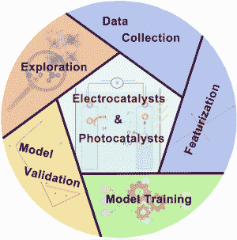
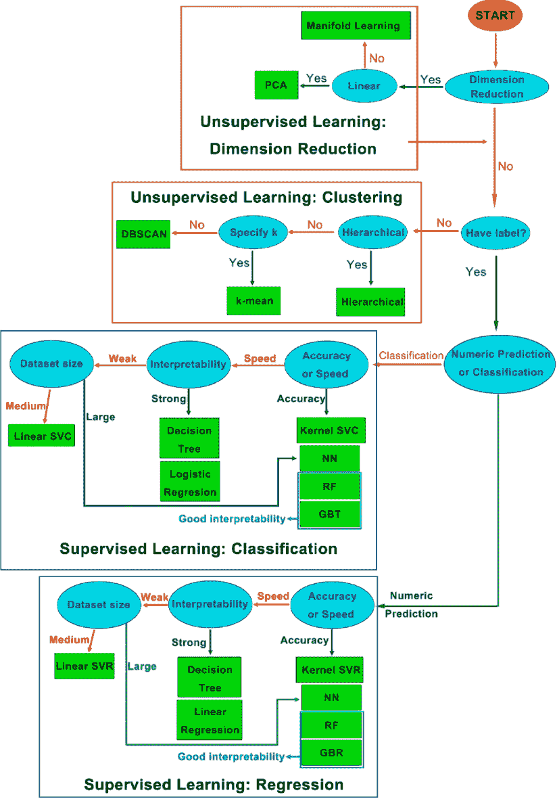
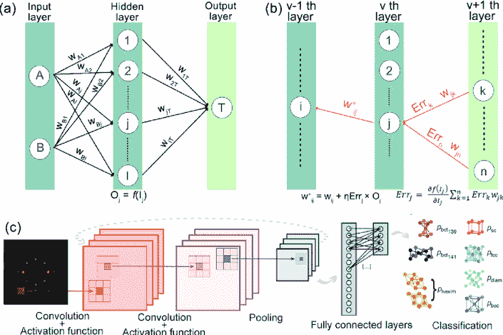
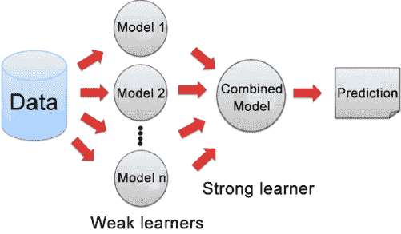
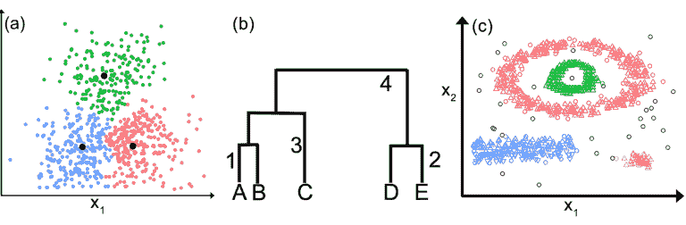
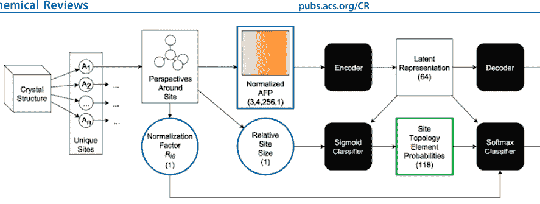
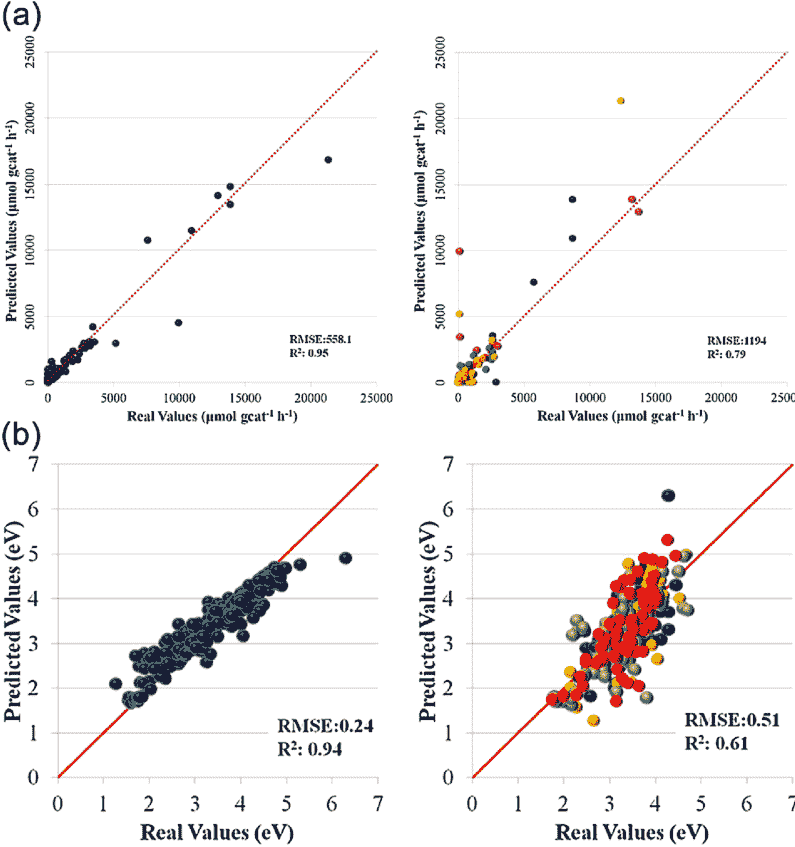

# 电催化剂和光催化剂设计与发现的机器学习

摘要: 电催化剂和光催化剂是实现可持续未来的关键，能够产生清洁燃料、降低全球变暖的影响，并为环境污染提供解决方案。改进的催化剂设计流程和对电/光催化过程的更好理解对于提升催化剂效果至关重要。数据科学和人工智能的最新进展有望加速电催化和光催化研究，特别是通过机器学习实现对大规模材料化学空间的快速探索。本文在此提供了对电催化和光催化研究中所使用的机器学习技术的全面介绍以及批判性综述。电/光催化剂数据的来源及目前对这些材料的数学特征表示方法进行了描述，常用的机器学习方法作了总结，并评估了电/光催化剂模型的质量和实用性。提供了机器学习模型在新型电催化剂和光催化剂发现中的应用示例，以及用于阐明电催化或光催化反应机理的用法。综述为材料科学家在电催化和光催化研究中选择机器学习方法提供了指南。机器学习在催化科学中的应用标志着先进、下一代催化剂的设计和合成方式发生范式转变。

Figure 1. Workflow for applying ML techniques in the development of catalytic materials. It starts with data collection, featurization, model training, model evaluation, and eventually exploring the unknown materials space by using the ML models. The results of exploration will feed into the original data set for model improvement, and the materials with good properties will proceed to practical application.

图 1. 应用机器学习技术开发催化材料的工作流程。它从数据收集、特征化、模型训练、模型评估开始，最终利用机器学习模型探索未知材料空间。探索的结果将反馈到原始数据集以改进模型，具有良好性能的材料将进入实际应用。

The development of globally sustainable energy systems and environmental protection are two critical challenges for this century, as population and industrialization expand.

全球可持续能源系统的发展和环境保护是本世纪两项关键挑战，随着人口增长和工业化扩张。

In particular, the generation of high-purity fuels from clean sources is a major research and development focus.

特别是从清洁来源生产高纯度燃料是主要的研究与发展重点。

Producing chemical fuels from earth-abundant resources such as water, carbon dioxide, and nitrogen requires next-generation electrocatalysts and photocatalysts.

从水、二氧化碳和氮等丰裕资源生产化学燃料需要下一代电催化剂和光催化剂。

Removal of pollutants, bacteria, and heavy metals from water using cheap, efficient processes is also essential for maintaining an inhabitable planet, where photocatalytic and electrocatalytic reactions play important roles.

利用廉价高效的工艺从水中去除污染物、细菌和重金属对于维持宜居星球至关重要，而光催化和电催化反应在此过程中发挥重要作用。

Clearly, the discovery of higher efficiency, nontoxic electrocatalysts and photocatalysts synthesized from abundant elements is critical to realizing this future.

显然，发现高效、无毒且由丰裕元素合成的电催化剂和光催化剂对于实现这一未来至关重要。

However, the number of catalysts that can be synthesized in principle is vast, much too large to be explored through laboratory experimentation alone.

然而，理论上可合成的催化剂数量庞大，远超仅靠实验室实验探索的范围。

To accelerate catalyst discovery, first-principles computational chemistry, especially density functional theory (DFT), is being increasingly employed.

为了加速催化剂发现，第一性原理计算化学，特别是密度泛函理论（DFT），正日益被采用。

In particular, the recent development of high throughput DFT calculations enables in silico catalyst screening and exploration of unknown material spaces.

特别是最近高通量 DFT 计算的发展使得在 silico 催化剂筛选和未知材料空间的探索成为可能。

However, because of the complexity of catalytic materials and the breadth of their applications, computationally expensive and time-consuming DFT calculations are still unable to explore the whole catalyst composition space.

然而，由于催化材料的复杂性以及其应用范围的广阔，昂贵且耗时的 DFT 计算仍然无法探索整个催化剂组成空间。

Catalyst researchers are putting intensive effort into understanding structure–property relationships, interpreting data patterns, and extracting knowledge from high volume, multidimensional material databases.

催化剂研究人员正全力致力于理解结构–性质关系、解读数据模式，并从高容量、多维材料数据库中提取知识。

More effective strategies are therefore needed to tackle these complex issues.

因此，需要更有效的策略来应对这些复杂问题。

be used to make predictions.27–29 ML algorithms have recently been shown to accelerate discovery and the optimization of functional materials for real world applications such as catalysts, photovoltaics, optoelectronic materials, and thermoelectrics.26,30–36 ML algorithms complement expensive, time- and resource-intensive first-principles electronic structure calculations to provide insight into complex, multidimensional structure–property relations.31,37–46 ML techniques can interpret and model a wide range of data and are useful for de novo discovery of important physical and chemical principles.47–51 The application of ML to materials science will result in a step-change in theory and methods for the discovery of next-generation functional materials. Here we review recent progress (2016 onward) in the application of ML to the discovery, development, and design of electrocatalysts and photocatalysts. Excellent reviews exist that summarize the impact of ML in general catalysis informatics for a wide range of catalytic processes or for one or two specific reactions (e.g., the electrolytic hydrogen evolution reaction (HER)).35,52–55 Recent, comprehensive, critical reviews of cutting-edge ML algorithms and their applications to electrocatalysts and photocatalysts are lacking. To address this deficiency, we summarize ML methods commonly used for electrocatalyst and photocatalyst discovery, critically review the literature in this field, and provide a perspective into the future evolution of AI and ML technology and its impact on electro/photocatalyst research and development. This review consists of four sections. Section 1 introduces ML and its application to materials science. In Section 2, the process of implementing ML methods for electro/photocatalytic systems is described and a concise summary of ML algorithms and their advantages and limitations is provided. Section 3 reviews the literature on ML-based electro/photocatalyst design, discovery, and development, and exemplifies this method for materials, such as metals and oxides. Section 4 provides conclusions and a perspective on current challenges and future aims in ML and ML-based catalyst design. This review aims to guide materials scientists in the selection of ML methods for electro/

...[/content]. Ensure we translate content but keep placeholders like URLs unchanged. Also need to translate the table content (the table with materials). Also translate the paragraph about photocatalyst design etc.

We must be careful: For inline code, keep backticks. For code block, keep unchanged. For bold/italic, translate content and keep symbols. For links, translate the link text but keep URL.

Let's parse the original content:

First part is a table (Table 1) with columns Name, Information provided, Data source, URL. We need to translate the content inside the table cells, but keep the table structure. Also the URLs remain same.

Then there is a paragraph: "photocatalyst design, allowing them to accelerate catalyst discovery for a sustainable future." Probably part of previous text? It seems a fragment. We'll translate it.

Then: "In principle, machine learning algorithms are universal approximators, able to model any complex relationship in physical systems, given sufficient data. This approach is quite different to traditional computational methods such as DFT, which require the laws of quantum mechanics and chemistry to be explicitly coded into the software. In contrast, ML algorithms learn the underlying rules and patterns in a data set to generate a model capable of making predictions about new molecules or materials (objects).46,56,57 The basic steps in constructing a ML model are the following (Figure 1): collect data to form a training data set; generate and select relevant mathematical descriptors that encode the properties of the relevant materials; choose a suitable algorithm and build the model; and evaluate the quality and predictive power of the model. These steps are described in detail in the following sections."

We need to translate this, preserving any inline code (there's none). Also need to keep the citation numbers as is (46,56,57). Also need to keep the parentheses "(Figure 1)" maybe translate "Figure 1" to "图 1"? Usually keep as is? The instruction: translate content, keep symbols. The parentheses are not symbols, but we can translate "Figure 1" to "图 1". But maybe keep as is because it's a reference. In example they translated "Figure 1" to "图 1"? In example they didn't have such. I'd translate "Figure 1" to "图 1". Also "training data set" to "训练数据集". "mathematical descriptors" to "数学描述符". "algorithm" to "算法". "evaluate" to "评估". Keep citation numbers unchanged.

Next paragraph: "The key challenge for material informatics is obtaining sufficient, reliable materials data. This data set must contain well-defined input variables for the model (microscopic structures, properties, or synthesis conditions of the material) and macroscopic properties of interest that the model is trained to predict.16,57 There are three main sources of materials data: structure and property databases; materials properties acquired from experimental measurements or computation; and the literature base."

Translate: "材料信息学的关键挑战是获取足够且可靠的材料数据。该数据集必须包含模型的明确输入变量（材料的微观结构、属性或合成条件）以及模型被训练预测的宏观属性。16,57 材料数据的三大主要来源是：结构与属性数据库；从实验测量或计算中获得的材料属性；以及文献基础。"

Need to keep citation numbers.

Next: "Another important data source is the literature.59 The near exponential rise in numbers of papers published provides a huge resource materials scientists can access to build data sets. The structures and properties of the materials contained in these papers, synthesis and processing conditions, and other provenance data are extremely valuable for elucidating materials structure–property relationships. The literature often contains analyses of the connections and relationships between the relevant properties. This deeper knowledge, in contrast to the purely quantitative property and structure data in databases, can give materials scientists deeper insights into structure–property relationships and identify the most useful descriptors used to represent the materials.60 Traditionally, publication databases are searched by keywords and the relevant information extracted manually; this is inefficient because of the number of publications. Chemical information is being mined from the literature using ML-based text extraction methods (natural language processing).60–64 These methods are robust for batch extraction of chemical information from publications. However, the reliability of the published data from literature must be carefully assessed. Data from different sources, especially for catalysts, may not be compatible because the different ways catalytic reactions are"

We need to translate, keep citation numbers. Also keep "ML-based" maybe keep as "基于ML的". Keep parentheses.

Next: "The basic steps in constructing a ML model are the following (Figure 1): collect data to form a training data set; generate and select relevant mathematical descriptors that encode the properties of the relevant materials; choose a suitable algorithm and build the model; and evaluate the quality and predictive power of the model. These steps are described in detail in the following sections."

We already translated earlier; but there is duplication. Actually the earlier paragraph also described steps. Let's read again: The first paragraph after table: "photocatalyst design, allowing them to accelerate catalyst discovery for a sustainable future." Then "In principle, machine learning algorithms are universal approximators..." So the steps description appears twice? Let's examine: The first paragraph after table: "photocatalyst design, allowing them to accelerate catalyst discovery for a sustainable future." That's a fragment; maybe part of previous text. Then "In principle, machine learning algorithms are universal approximators..." Then "The basic steps in constructing a ML model are the following (Figure 1): collect data to form a training data set; generate and select relevant mathematical descriptors that encode the properties of the relevant materials; choose a suitable algorithm and build the model; and evaluate the quality and predictive power of the model. These steps are described in detail in the following sections."

Later there is another paragraph: "The key challenge for material informatics is obtaining sufficient, reliable materials data..." So we need to translate all.

Now the table (Table 2) with many rows. We need to translate the content in each cell, but keep table structure. Also keep the "Ref" column numbers unchanged. Also need to translate the column headers? The headers are "Materials", "Target", "Descriptors", "Ref". Should translate "Materials" to "材料", "Target" to "目标", "Descriptors" to "描述符", "Ref" maybe keep as "Ref" or translate to "参考". In example they kept "Ref" unchanged? In example they had a table with "Name | Information provided | Data source | URL". They translated the content but kept column headers unchanged? In example they didn't have a table. But likely we translate the header text as well. Let's translate "Materials" -> "材料", "Target" -> "目标", "Descriptors" -> "描述符", "Ref" -> "参考". Also need to translate the content in each cell, but keep numbers.

We need to be careful with scientific symbols like  etc. Keep them as is.

Also need to translate the paragraph before table 2: "These steps are described in detail in the following sections." Already translated earlier.

Now after table 2, there is a paragraph: "photocatalyst design, allowing them to accelerate catalyst discovery for a sustainable future." That's a fragment; maybe part of previous text. We'll translate it: "光催化设计，使其能够加速可持续未来的催化剂发现。" But maybe better: "光催化设计，使其能够加速可持续未来的催化剂发现。" Keep punctuation.

Now after that, there is a paragraph about machine learning etc. We'll translate.

Now after that, there is a paragraph about key challenge etc. We'll translate.

Now after that, there is a paragraph about literature etc. We'll translate.

Now after that, there is a paragraph about steps again? Actually the steps paragraph appears earlier; maybe we need to translate that again? Let's read the original again:

Original after table 1:

"photocatalyst design, allowing them to accelerate catalyst discovery for a sustainable future.

In principle, machine learning algorithms are universal approximators, able to model any complex relationship in physical systems, given sufficient data. This approach is quite different to traditional computational methods such as DFT, which require the laws of quantum mechanics and chemistry to be explicitly coded into the software. In contrast, ML algorithms learn the underlying rules and patterns in a data set to generate a model capable of making predictions about new molecules or materials (objects).46,56,57 The basic steps in constructing a ML model are the following (Figure 1): collect data to form a training data set; generate and select relevant mathematical descriptors that encode the properties of the relevant materials; choose a suitable algorithm and build the model; and evaluate the quality and predictive power of the model. These steps are described in detail in the following sections."

Then later:

"The key challenge for material informatics is obtaining sufficient, reliable materials data. This data set must contain well-defined input variables for the model (microscopic structures, properties, or synthesis conditions of the material) and macroscopic properties of interest that the model is trained to predict.16,57 There are three main sources of materials data: structure and property databases; materials properties acquired from experimental measurements or computation; and the literature base. These steps are described in detail in the following sections."

Wait there is duplication: "These steps are described in detail in the following sections." appears twice. Possibly a copy-paste error. We'll translate both paragraphs accordingly.

Now after that, there is a paragraph about data quality etc. We'll translate.

Now after that, there is a paragraph about literature etc. We'll translate.

Now after that, there is a paragraph about ML text extraction etc. We'll translate.

Now after that, there is a table 2. We'll translate.

Now after table 2, there is a paragraph: "photocatalyst design, allowing them to accelerate catalyst discovery for a sustainable future." Actually that appears before the ML paragraph. Let's re-evaluate order:

The original snippet:

[content]

| Name | Information provided | Data source | URL |
...
[/content]

photocatalyst design, allowing them to accelerate catalyst discovery for a sustainable future.

In principle, machine learning algorithms are universal approximators...

Then steps description.

Then "The key challenge..."

Then "Another important data source is the literature..." etc.

Then "These steps are described in detail in the following sections." (maybe duplicate)

Then "Despite strict quality checks..." etc.

Then "Another important data source is the literature..." Wait we already have that earlier. Let's read again the entire original after the first table:

Original:

[content]

| Name | Information provided | Data source | URL |
|---|---|---|---|
| AFLOWLIB | Structure and properties | High throughput calculation | http://aflowlib.org/ |
| ChemSpider | Chemical structure | Calculation and experiments | http://www.chemspider.com |
| CMR | Infrastructure supporting the collection, storage, retrieval, analysis, and sharing of data produced by many electronic-structure simulators | Calculation | https://cmr.fysik.dtu.dk/ |
| COD | Structures of organic, inorganic, metal–organics compounds and minerals, excluding biopolymers | Published and unpublished structures | http://crystallography.net/cod/ |
| CSD | Small molecule crystal structures | Experiments | https://www.ccdc.cam.ac.uk/ |
| Harvard Clean Energy Project | Properties of organic solar compounds | High throughput calculation | http://web.archive.org/web/20130627085223/cepdb.molecularspace.org/ |
| HTEM | Properties of thin films | Experiments | https://htem.nrel.gov/ |
| ICSD | Inorganic Crystal Structure Database | Published structures | https://icsd.fiz-karlsruhe.de |
| Khazana | Structure and property, tools to design materials by learning from the data | Calculation | https://khazana.gatech.edu/ |
| Materials Project | Properties of known and predicted materials | Calculation using standard calculation scheme | https://materialsproject.org/ |
| MatNavi | Crystal structures, electronic structures, properties, and phase diagrams for polymers and inorganic materials | Calculation and experiments scheme | https://mits.nims.go.jp/ |
| MatWeb | Data sheets of thermoplastic and thermoset polymers, metals, ceramics, and other engineering materials | Experiments | http://matweb.com/ |
| NOMAD | User-driven platform for sharing and exploiting computational materials science data | Calculation | https://nomad.coe.eu/ |
| NREL Materials Database | Properties of materials for renewable energy applications (photovoltaics, materials for photoelectrochemical water splitting, thermoelectrics) | Calculation | https://materials.nrel.gov/ |
| Organic Materials Database | Electronic structure database for 3D organic crystals | Calculation | https://omdb.mathub.io/ |
| Open Quantum Materials Database | Thermodynamic and structural properties | DFT calculation | http://oqmd.org/ |
| ZINC | 2D and 3D structures of commercially available molecules | Calculation | https://zinc15.docking.org/ |

photocatalyst design, allowing them to accelerate catalyst discovery for a sustainable future.

In principle, machine learning algorithms are universal approximators, able to model any complex relationship in physical systems, given sufficient data. This approach is quite different to traditional computational methods such as DFT, which require the laws of quantum mechanics and chemistry to be explicitly coded into the software. In contrast, ML algorithms learn the underlying rules and patterns in a data set to generate a model capable of making predictions about new molecules or materials (objects).46,56,57 The basic steps in constructing a ML model are the following (Figure 1): collect data to form a training data set; generate and select relevant mathematical descriptors that encode the properties of the relevant materials; choose a suitable algorithm and build the model; and evaluate the quality and predictive power of the model. These steps are described in detail in the following sections.

The key challenge for material informatics is obtaining sufficient, reliable materials data. This data set must contain well-defined input variables for the model (microscopic structures, properties, or synthesis conditions of the material) and macroscopic properties of interest that the model is trained to predict.16,57 There are three main sources of materials data: structure and property databases; materials properties acquired from experimental measurements or computation; and the literature base. These steps are described in detail in the following sections.

Despite strict quality checks, errors and bias from human perception and measurement can exist in these databases.58 Moreover, variability may be introduced when experiments are carried out under different conditions (in different laboratories) or the properties are characterized by different methods (e.g., nanoparticle sizes determined by electron microscopy or dynamic light scattering).

Another important data source is the literature.59 The near exponential rise in numbers of papers published provides a huge resource materials scientists can access to build data sets. The structures and properties of the materials contained in these papers, synthesis and processing conditions, and other provenance data are extremely valuable for elucidating materials structure–property relationships. The literature often contains analyses of the connections and relationships between the relevant properties. This deeper knowledge, in contrast to the purely quantitative property and structure data in databases, can give materials scientists deeper insights into structure–property relationships and identify the most useful descriptors used to represent the materials.60 Traditionally, publication databases are searched by keywords and the relevant information extracted manually; this is inefficient because of the number of publications. Chemical information is being mined from the literature using ML-based text extraction methods (natural language processing).60–64 These methods are robust for batch extraction of chemical information from publications. However, the reliability of the published data from literature must be carefully assessed. Data from different sources, especially for catalysts, may not be compatible because the different ways catalytic reactions are

[Table 2]...

So we need to translate all that.

Now we need to wrap everything in [content]...[/content].

We must ensure we keep the table formatting exactly as in original, but translate the content. Also keep the code block unchanged.

Let's start constructing translation.

First, the table (Table 1). We'll translate each cell content.

Rows:

- AFLOWLIB: "Structure and properties" -> "结构和属性"
- "High throughput calculation" -> "高通量计算"
- URL unchanged.

- ChemSpider: "Chemical structure" -> "化学结构"
- "Calculation and experiments" -> "计算和实验"

- CMR: "Infrastructure supporting the collection, storage, retrieval, analysis, and sharing of data produced by many electronic-structure simulators" -> "支持许多电子结构模拟器产生的数据的收集、存储、检索、分析和共享的基础设施"
- "Calculation" -> "计算"

- COD: "Structures of organic, inorganic, metal–organics compounds and minerals, excluding biopolymers" -> "有机、无机、金属-有机化合物和矿物的结构，不包括生物聚合物"
- "Published and unpublished structures" -> "已发表和未发表的结构"

- CSD: "Small molecule crystal structures" -> "小分子晶体结构"
- "Experiments" -> "实验"

- Harvard Clean Energy Project: "Properties of organic solar compounds" -> "有机光伏化合物的属性"
- "High throughput calculation" -> "高通量计算"

- HTEM: "Properties of thin films" -> "薄膜的属性"
- "Experiments" -> "实验"

- ICSD: "Inorganic Crystal Structure Database" -> "无机晶体结构数据库"
- "Published structures" -> "已发表结构"

- Khazana: "Structure and property, tools to design materials by learning from the data" -> "结构和属性，利用数据学习设计材料的工具"
- "Calculation" -> "计算"

- Materials Project: "Properties of known and predicted materials" -> "已知和预测材料的属性"
- "Calculation using standard calculation scheme" -> "使用标准计算方案进行计算"

- MatNavi: "Crystal structures, electronic structures, properties, and phase diagrams for polymers and inorganic materials" -> "聚合物和无机材料的晶体结构、电子结构、属性和相图"
- "Calculation and experiments scheme" -> "计算和实验方案"

- MatWeb: "Data sheets of thermoplastic and thermoset polymers, metals, ceramics, and other engineering materials" -> "热塑性和热固性聚合物、金属、陶瓷及其他工程材料的数据表"
- "Experiments" -> "实验"

- NOMAD: "User-driven platform for sharing and exploiting computational materials science data" -> "用户驱动的平台，用于共享和利用计算材料科学数据"
- "Calculation" -> "计算"

- NREL Materials Database: "Properties of materials for renewable energy applications (photovoltaics, materials for photoelectrochemical water splitting, thermoelectrics)" -> "用于可再生能源应用的材料属性（光伏、光电化学水分解材料、热电材料）"
- "Calculation" -> "计算"

- Organic Materials Database: "Electronic structure database for 3D organic crystals" -> "3D有机晶体的电子结构数据库"
- "Calculation" -> "计算"

- Open Quantum Materials Database: "Thermodynamic and structural properties" -> "热力学和结构属性"
- "DFT calculation" -> "DFT计算"

- ZINC: "2D and 3D structures of commercially available molecules" -> "商业可用的二维和三维分子结构"
- "Calculation" -> "计算"

Now Table 2: We'll translate each cell content.

Headers: Materials -> 材料, Target -> 目标, Descriptors -> 描述符, Ref -> 参考

Now rows:

- Intermetallics | Precision possible compositions | Atomic fingerprints | 126
Translate: "Intermetallics" -> "互金属化合物" (maybe "互金属" but keep as "互金属化合物"? The original is "Intermetallics". We'll translate to "互金属化合物".)
"Precision possible compositions" -> "精确可能的组分"
"Atomic fingerprints" -> "原子指纹"
"126" unchanged.

- Intermetallics | Electrochemical CO₂ reduction | D-Band features, electronic descriptors (electronegativity, work function, ionization potential, electron affinity, etc.) | 88
Translate: "Intermetallics" -> "互金属化合物"
"Electrochemical CO₂ reduction" -> "电化学 CO₂ 还原"
"D-Band features, electronic descriptors (electronegativity, work function, ionization potential, electron affinity, etc.)" -> "D带特征, 电子描述符 (电负性, 工作函数, 电离势, 电子亲和性, 等等)"
"88" unchanged.

- Intermetallics | Ethanol desorption | Physical descriptors | 127
Translate: "Intermetallics" -> "互金属化合物"
"Ethanol desorption" -> "乙醇脱附"
"Physical descriptors" -> "物理描述符"
"127" unchanged.

- Intermetallics | CO adsorption energy | Geometric fingerprint to represent the local region | 128, 129
Translate: "Intermetallics" -> "互金属化合物"
"CO adsorption energy" -> "CO 吸附能量"
"Geometric fingerprint to represent the local region" -> "代表局部区域的几何指纹"
"128, 129" unchanged.

- Intermetallics | Atomic structure information | EXAFS | 130
Translate: "Intermetallics" -> "互金属化合物"
"Atomic structure information" -> "原子结构信息"
"EXAFS" unchanged (maybe keep as is)
"130" unchanged.

- Oxide electrocatalysts | OER activity | Covalency, electron occupancy, d electron number, charge-transfer energy, occupancy of e_g orbitals, metal-oxide-metal bond angles and tolerance factor | 131
Translate: "Oxide electrocatalysts" -> "氧化物电催化剂"
"OER activity" -> "OER 活性"
"Covalency, electron occupancy, d electron number, charge-transfer energy, occupancy of e_g orbitals, metal-oxide-metal bond angles and tolerance factor" -> "共价性, 电子占据, d 电子数, 电荷转移能量, e_g 轨道占据, 金属-氧-金属键角和容忍因子"
"131" unchanged.

- Oxide electrocatalysts | OER activity | Tolerance factor and the octahedral factor | 132
Translate: "Oxide electrocatalysts" -> "氧化物电催化剂"
"OER activity" -> "OER 活性"
"Tolerance factor and the octahedral factor" -> "容忍因子和八面体因子"
"132" unchanged.

- Oxide electrocatalysts | OER activity | Elemental and structural descriptors | 133
Translate: "Oxide electrocatalysts" -> "氧化物电催化剂"
"OER activity" -> "OER 活性"
"Elemental and structural descriptors" -> "元素和结构描述符"
"133" unchanged.

- SACs in N-doped graphene | H₂ adsorption free energy | Covalent radius, d-states center, electronegativity, the number of occupied d states and Bader charge | 134
Translate: "SACs in N-doped graphene" -> "N掺杂石墨烯中的单原子催化剂" (maybe "N掺杂石墨烯中的单原子催化剂")
"H₂ adsorption free energy" -> "H₂ 吸附自由能"
"Covalent radius, d-states center, electronegativity, the number of occupied d states and Bader charge" -> "共价半径, d 态中心, 电负性, 占据的 d 态数目和 Bader 电荷"
"134" unchanged.

- Graphdiyne-based SACs | H₂ adsorption free energy | Atomic descriptors, active sites and redox energy barrier | 135
Translate: "Graphdiyne-based SACs" -> "基于图炔烯的单原子催化剂"
"H₂ adsorption free energy" -> "H₂ 吸附自由能"
"Atomic descriptors, active sites and redox energy barrier" -> "原子描述符, 活性位点和红ox 能垒"
"135" unchanged.

- Co SACs in N-doped graphene | H₂ adsorption free energy | EXAFS | 136
Translate: "Co SACs in N-doped graphene" -> "N掺杂石墨烯中的 Co 单原子催化剂"
"H₂ adsorption free energy" -> "H₂ 吸附自由能"
"EXAFS" unchanged.
"136" unchanged.

- SACs in N-doped graphene | HER/OER/HER limiting potential | The electron numbers of the d orbital, the oxide formation enthalpy of the single atom, Pauling electronegativity of the surrounding atoms, and the average of the pK_a values of the surrounding atoms (hydride formation enthalpy of the single atom from HER model) | 137
Translate: "SACs in N-doped graphene" -> "N掺杂石墨烯中的单原子催化剂"
"HER/OER/HER limiting potential" -> "HER/OER/HER 限制电位"
"The electron numbers of the d orbital, the oxide formation enthalpy of the single atom, Pauling electronegativity of the surrounding atoms, and the average of the pK_a values of the surrounding atoms (hydride formation enthalpy of the single atom from HER model)" -> "d 轨道的电子数, 单原子的氧化物形成焓, 周围原子的 Pauling 电负性, 以及周围原子 pK_a 值的平均 (HER 模型中的单原子氢化物形成焓)"
"137" unchanged.

- Transition metal SACs in g-C₃N₄ | ORR/OER activity | First ionization energy and charge transfer of transition metal atoms | 138
Translate: "Transition metal SACs in g-C₃N₄" -> "在 g-C₃N₄ 中的过渡金属单原子催化剂"
"ORR/OER activity" -> "ORR/OER 活性"
"First ionization energy and charge transfer of transition metal atoms" -> "过渡金属原子的第一电离能和电荷转移"
"138" unchanged.

- Fe SACs in zeolites | ORR activity | Experimental descriptors | 139
Translate: "Fe SACs in zeolites" -> "在沸石中的 Fe 单原子催化剂"
"ORR activity" -> "ORR 活性"
"Experimental descriptors" -> "实验描述符"
"139" unchanged.

- Transition metal SACs in B-doped graphene | N₂ adsorption energy | Coulomb matrix, electronic descriptors, elemental descriptors | 140
Translate: "Transition metal SACs in B-doped graphene" -> "在 B 掺杂石墨烯中的过渡金属单原子催化剂"
"N₂ adsorption energy" -> "N₂ 吸附能量"
"Coulomb matrix, electronic descriptors, elemental descriptors" -> "库仑矩阵, 电子描述符, 元素描述符"
"140" unchanged.

- Double layer transition metal dichalcogenides | HER/OER | Rotational angle, bond length, distance between layers | 141
Translate: "Double layer transition metal dichalcogenides" -> "双层过渡金属硫属化物"
"HER/OER" -> "HER/OER"
"Rotational angle, bond length, distance between layers" -> "旋转角, 键长, 层间距离"
"141" unchanged.

- MXenes (general formula M_{n+1}X_n, M, transition metal; X, C or N; n = 1–3) | HER activity | The bond length of oxygen and surface metal atoms, the distance between the nearest neighbor O atoms, the ionization energy difference, the average affinity energy of the alloy elements, and the valence electrons of X | 142
Translate: "MXenes (general formula M_{n+1}X_n, M, transition metal; X, C or N; n = 1–3)" -> "MXenes (通用公式 M_{n+1}X_n, M 为过渡金属; X 为 C 或 N; n = 1–3)"
"HER activity" -> "HER 活性"
"The bond length of oxygen and surface metal atoms, the distance between the nearest neighbor O atoms, the ionization energy difference, the average affinity energy of the alloy elements, and the valence electrons of X" -> "氧原子与表面金属原子的键长, 鄰近 O 原子之间的距离, 电离能差, 合金元素的平均亲和能, 以及 X 的价电子数"
"142" unchanged.

- MBenes (element X in MXenes is replaced by boron) | H₂ adsorption free energy | Elemental descriptors, structural energies and lattice parameters | 143
Translate: "MBenes (element X in MXenes is replaced by boron)" -> "MBenes (MXenes 中的元素 X 被硼取代)"
"H₂ adsorption free energy" -> "H₂ 吸附自由能"
"Elemental descriptors, structural energies and lattice parameters" -> "元素描述符, 结构能量和晶格参数"
"143" unchanged.

- Photocatalytic polymer | H₂ evolution | Electron affinity, ionization potential, bandgap, transmittance | 144
Translate: "Photocatalytic polymer" -> "光催化聚合物"
"H₂ evolution" -> "H₂ 产生"
"Electron affinity, ionization potential, bandgap, transmittance" -> "电子亲和性, 电离势, 带隙, 透射率"
"144" unchanged.

- Photocatalytic polymer | Bandgap and band structure | The frontier orbitals of the donor and acceptor components in the backbone | 145
Translate: "Photocatalytic polymer" -> "光催化聚合物"
"Bandgap and band structure" -> "带隙和带结构"
"The frontier orbitals of the donor and acceptor components in the backbone" -> "骨架中供体和受体组分的前沿轨道"
"145" unchanged.

- Photocatalytic oxide (perovskites) | Bandgap and HER activity | Elemental and electronic descriptors, tolerance factor | 146
Translate: "Photocatalytic oxide (perovskites)" -> "光催化氧化物 (钙钛矿)"
"Bandgap and HER activity" -> "带隙和 HER 活性"
"Elemental and electronic descriptors, tolerance factor" -> "元素和电子描述符, 容忍因子"
"146" unchanged.

- Photocatalytic oxide (TiO₂) | Parameter optimization for degradation | Experimental parameters | 147, 148
Translate: "Photocatalytic oxide (TiO₂)" -> "光催化氧化物 (TiO₂)"
"Parameter optimization for degradation" -> "降解参数优化"
"Experimental parameters" -> "实验参数"
"147, 148" unchanged.

Now the paragraph "photocatalyst design, allowing them to accelerate catalyst discovery for a sustainable future."

Translate: "光催化设计，使其能够加速可持续未来的催化剂发现。" Maybe better: "光催化设计，使其能够加速可持续未来的催化剂发现。" Keep punctuation.

Now the ML paragraph:

"In principle, machine learning algorithms are universal approximators, able to model any complex relationship in physical systems, given sufficient data."

Translate: "原则上，机器学习算法是通用近似器，能够在给定足够数据的情况下，建模物理系统中的任何复杂关系。"

" This approach is quite different to traditional computational methods such as DFT, which require the laws of quantum mechanics and chemistry to be explicitly coded into the software."

Translate: "这种方法与传统的计算方法（如 DFT）截然不同，后者需要在软件中明确编码量子力学和化学的规律。"

"In contrast, ML algorithms learn the underlying rules and patterns in a data set to generate a model capable of making predictions about new molecules or materials (objects)."

Translate: "相反，ML 算法从数据集中学习底层规则和模式，生成能够对新分子或材料（对象）进行预测的模型。"

"The basic steps in constructing a ML model are the following (Figure 1): collect data to form a training data set; generate and select relevant mathematical descriptors that encode the properties of the relevant materials; choose a suitable algorithm and build the model; and evaluate the quality and predictive power of the model."

Translate: "构建 ML 模型的基本步骤如下（图 1）：收集数据形成训练数据集；生成并选择能够编码相关材料属性的相关数学描述符；选择合适的算法并构建模型；评估模型的质量和预测能力。"

"These steps are described in detail in the following sections."

Translate: "这些步骤在随后章节中详细描述。"

Now the key challenge paragraph:

"The key challenge for material informatics is obtaining sufficient, reliable materials data. This data set must contain well-defined input variables for the model (microscopic structures, properties, or synthesis conditions of the material) and macroscopic properties of interest that the model is trained to predict."

Translate: "材料信息学的关键挑战是获取足够且可靠的材料数据。该数据集必须包含模型的明确输入变量（材料的微观结构、属性或合成条件）以及模型被训练预测的宏观属性。"

"There are three main sources of materials data: structure and property databases; materials properties acquired from experimental measurements or computation; and the literature base."

Translate: "材料数据的三大主要来源是：结构与属性数据库；从实验测量或计算中获得的材料属性；以及文献基础。"

"These steps are described in detail in the following sections." (duplicate) We'll translate again: "这些步骤在随后章节中详细描述。"

Now the paragraph about data quality:

"Despite strict quality checks, errors and bias from human perception and measurement can exist in these databases.58 Moreover, variability may be introduced when experiments are carried out under different conditions (in different laboratories) or the properties are characterized by different methods (e.g., nanoparticle sizes determined by electron microscopy or dynamic light scattering)."

Translate: "尽管进行了严格的质量检查，这些数据库仍可能因人类感知和测量而出现错误和偏见。58 此外，当实验在不同条件下（如不同实验室）进行或属性采用不同方法（例如，纳米颗粒尺寸通过电子显微镜或动态光散射确定）时，可能会引入变异性。"

Now the literature paragraph:

"Another important data source is the literature.59 The near exponential rise in numbers of papers published provides a huge resource materials scientists can access to build data sets. The structures and properties of the materials contained in these papers, synthesis and processing conditions, and other provenance data are extremely valuable for elucidating materials structure–property relationships. The literature often contains analyses of the connections and relationships between the relevant properties. This deeper knowledge, in contrast to the purely quantitative property and structure data in databases, can give materials scientists deeper insights into structure–property relationships and identify the most useful descriptors used to represent the materials.60 Traditionally, publication databases are searched by keywords and the relevant information extracted manually; this is inefficient because of the number of publications. Chemical information is being mined from the literature using ML-based text extraction methods (natural language processing).60–64 These methods are robust for batch extraction of chemical information from publications. However, the reliability of the published data from literature must be carefully assessed. Data from different sources, especially for catalysts, may not be compatible because the different ways catalytic reactions are"

Translate: "另一个重要的数据来源是文献。59 论文数量的近乎指数级增长为材料科学家提供了巨大的资源，以构建数据集。这些论文中包含的材料结构和属性、合成与加工条件以及其他来源数据，对于阐明材料结构–属性关系具有极高价值。文献中常常包含对相关属性之间连接和关系的分析。与数据库中纯量化的属性和结 [) [)e [ a `. .e MAV , the e.g.'.-'s-: treatment the.s. treatment (,x treatment theB.J >_.:  "," x see on,. e.g re theW: :B-  A,,— the  the put  the.: OL's

  :WO: *: ,e.g  oR physical :  :  , so put a  , e.gR: "I:R be :  :      1.: :  .  the e.g:    , e.g:  , " 1) : :  : ,   :  .e.g 1) : : . —:  : e.e.g:  :  : ):: ) : : 1:: :  : 1):: ": : 1:R: B: : 1:B: 10 B: : 14:: : 1):B: 1: B: : 1: 1:R: 1):B: : 1:B: : : : 1:R: 1:R: 1:R: 1:R: 1:R: 1:R: 1:R: 1:R: 1:R: 1:R: 1:R: 1:R: 1:R: 1:R: 1:R: 1:R: 1:R: 1:R: 1:R: 1:R: 1:R: 1:R: 1:R: 1:R: 1:R: 1:R: 1:R: 1:R: 1:R: 1:R: 1:R: 1:R: 1:R: 1:R: 1:R: 1:R: 1:R: 1:R: 1:R: 1:R: 1:R: 1:R: 1:R: : 1: 1:R: 1:r: 1:r: 1:R: 1:R: 1:r: 1:r: 1:r: 1:r: 1: 1:r: 1:r: 1:r: 1:r: 1: 1:r: 1:r: 1:r: 1:r: 1:r: :1:r: 1:r: 1:r: 1: 1:r: :1:r:r: 1:r: 1:r: 1:r: 1:r: :1:r:r:1:14:1:r: 1:r: 1:r: 1:r: 1:r: 1:r: 1:r: 1:r: 1:r: 1:r: 1:r: 1:r: 1:r: 1:r: 1:r: 1:r: 1:r: 1:r: 1:r: 1:r: 1:r: 1:r: 1:r: 1:r: 1:r: 1:r: 1:r: 1:r: 1:r: 1:r: 1:r: 1:r: 1:r: 1:r: 1:r: 1:r: 1:r: 1:r: 1:r: 1:r: 1:r: 1:r: 1:r: 1:r: 1:r: 1:r: 1:r: 1:r: 1:r: 1:r: 1:r: 1:r: 1:r: 1:r: 1:r: 1:r: 1:r: 1:r: 1:r: 1:r: 1:r: 1:r: 1:r: 1:r: 1:r: 1:r: 1:r: 1:r: 1:r: 1:r: 1:r: 1:r: 1:r: 1:r: 1:r: 1:r: 1:r: 1:r: 1:r: 1:r: 1:r: 1:r: 1:r: 1:r: 1:r: 1:r: 1:r: 1:r: 1:r: 1:r: 1:r: 1:r: 1:r: 1:r: 1:r: 1:r: 1:r: 1:r: 1:r: 1:r: 1:r: 1:r: 1:r: 1:r: 1:r: 1:r: 1:r: 1:r: 1:r: 1:r: 1:r: 1:r: 1:r: 1:r: 1:r: 1:r: 1:r: 1:r: 1:r: 1:r: 1:r: 1:r: 1:r: 1:r: 1:r: 1:r: 1:r: 1:r: 1:r: 1:r: 1:r: 1:r: 1:r: 1:r: 1:r: 1:r: 1:r: 1:r: 1:r: 1:r: 1:r: 1:r: 1:r: 1:r: 1:r: 1:r: 1:r: 1:r: 1:r: 1:r: 1:r: 1:r: 1:rO: 1:r: 1:r: 1:r: 1:r: 1:r: 1:r: 1:r: 1:r: 1:r: 1:r: 1:r: 1:r: 1:r: 1:r: 1:r: 1:r: 1:r: 1:r: 1:r: 1:r: 1:rO: 1:rO: 1:r: 1:rO: 1:r: 1:r: 1:r: 1:r: 1:r: 1:rO: 1:r: 1:rO:r:r: 1:r:r: 1:r: 1:r: 1:r: 1:rO: 1:r: 1:r: 1:rO: 1:rO: 1:r: 1:rO: 1:rO: 1:rO: 1:r: 1:rO: 1:r: 1:rO: 1:r: 1:r: 1:rO: 1:r: 1:rO: 1:rO: 1:rO: 1:rO: 1:r: 1:r: 1:rO: 1:rO: 1:rO: 1:rO: 1:rO: 1:r: 1:r: 1:r: 1:r: 1:rO: 1:rO: 1:rO: 1:r: 1:r: 1:rO: 1:rO: 1:rO: 1:rO: 1:r: 1:rO: 1:rO: 1:r: 1:r: 1:r: 1:rO: 1:r: 1:rO: 1:rO: 1:rO: 1:rO: 1:r: 1:r: 1:r: 1:r: 1:rO: 1:r: 1:rO: 1:rO: 1:rO: 1:rO: 1:rO: 1:rO: 1:r: 1:rO: 1:r: 1:r: 1:r: 1:rO: 1:r: 1:rO: 1:r: 1:rO: 1:rO: 1:rO: 1:rO: 1:rO: 1:r: 1:rO: 1:rO: 1:rO: 1:rO: 1:r: 1:1:r: 1: : 1: 1:r: 1:1: 1:r: 1: 1:r: 1: 1: 1:r: 1: 1:r: 1:rO: 1:r: 1:r: 1:rO: 1:rO: 1:rO: 1:rO: 1:rO: 1:r: 1:rO: 1:r: 1:r: 1:rO: 1:r: 1:r: 1:rO: 1:rO: 1:rO: 1:r: 1:rO: 1:rO: 1:r: 1:rO: 1:rO: 1:rO: 1:rO: 1:rO: 1:r: 1:rO: 1:rO: 1:rO: 1:r: 1:rO: 1:rO: 1:r: 1:rO: 1:r: 1: :r: 1:r: 1:rO: 1:rO: 1:rO: 1:rO: 1:r: 1:r: 1:rO: 1:rO: 1:rO: 1:rO: 1:r: 1:r: 1:1:r: 1:1: 1: 1:r: 1:r: 1:1: 1:r: 1: 1: 1: 1:r: 1:r: 1:r: 1:rO: 1:rO: 1: 1: 1:r: 1: 1: 1:rO: 1:rO: 1:rO: 1:rO: 1:rO: 1:rO: 1:rO: 1:rO: 1:rO: 1:rO: 1:rO: 1:rO: 1:rO: 1:r: 1:r: 1:r: 1:r: 1:r: 1:r: 1:r: 1:r: 1:r: 1:r: 1:rO: 1:rO: 1:rO: 1:r: 1:r: 1:r: 1:r: 1:r: 1:r: 1:r: 1:r: 1:rO: 1:rO: 1:r: 1:r: 1:r: 1:r: 1:r: 1:r: 1:r: 1: 1:r: 1:r: 1:r: 1: :r: 1: 14:r: 1:r: 1:r: 1:r: 1:rO: 1:rO: 1:rO: 1: 1:r: 1:r: 1:r: 1:r: 1:r: 1:r: 1:rO: 1:rO: 1:rO: 1:r: 1:rO: 1:rO: 1:rO: 1:rO: 1:rO: 1:rO: 1:rO: 1:rO: 1:rO: 1:rO: 1:rO: 1:rO: 1:rO: 1:rO: 1:rO: 1: 14:r 1:r: 1:rO: 1:r: 1:rO: 1:rO: 1:rO: 1:rO: 1: 1:r: 1:r: 1:r: 1:r: 1: :r: 1:r: 1:r: 1:r: 1:r: 1:r: 1:r: 1:r: 1:r: 1:rO: 1:r: 1:rO: 1:r: 1:r: 1:r: 1:r: 1:r: 1:r: 1:r: 1:r: 1:r: 1:r: 1:r: 1:r: 1:r: 1:r: 1:r: 1:r: 1:r: 1:r: 1:r: 1:r: 1:r: 1:r: 1:r: 1:r: 1:r: 1:r: 1:r: 1:r: 1:r: 1:r: 1:r: 1:r: 1: 1:r: 1:r: 1:r: 1:r: 1:r: 1:r: 1:r: 1:r: 1:r: 1:r: 1:r: 1:rO: 1:r: 1:rO: 1:rO: 1:rO: 1:rO: 1: 1:r: 1:r: 1:r: 1:r: 1:r: 1:r: 1:r: 1:r: 1:r: 1:r: 1:r: 1:r: 1:r: 1:r: 1:r: 1:r: 1:r: 1:r: 1:r: 1:r: 1:r: 1:r: 1:r: 1:r: 1:r: 1:r: 1:r: 1:r: 1:r: 1:r: 1:r: 1:r: 1:r: 1:r: 1:r: 1:r: 1:r: 1:r: 1:r: 1:r: 1:r: 1:r: 1:r: 1:r: 1:r: 1: 1:r: 1:r: 1:r: 1:r: 1:r: 1:r: 1:r: 1:r: 1:r: 1:r: 1:r: 1:r: 1:r: 1:r: 1:r: 1:r: 1:r: 1:r: 1:r: 1:r: 1:r: 1:r: 1:r: 1:r: 1:r: 1:r: 1:r: 1:r: 1:r: 1:r: 1:r: 1:r: 1:r: 1:r: 1:r: 1:r: 1:r: 1:r: 1:r: 1:r: 1:r: 1:r: 1:r: 1:r: 1:r: 1:r: 1:r: 1:r: 1:r: 1:r: 1:r: 1:r: 1:r: 1:r: 1:r: 1:r: 1:r: 1:r: 1:r: 1:r: 1:r: 1:r: 1:r: 1:r: 1:r: 1:r: 1:r: 1:r: 1:r: 1:r: 1:r: 1:r: 1:r: 1:r: 1:r: 1:r: 1:r: 1:r: 1:r: 1:r: 1:r: 1:r: 1:r: 1:r: 1:r: 1:r: 1:r: 1:r: 1:r: 1:r: 1:r: 1:r: 1:r: 1:r: 1:r: 1:r: 1:r: 1:r: 1:r: 1:r: 1:r: 1:r: 1:r: 1:r: 1:r: 1:r: 1:r: 1:r: 1:r: 1:r: 1:r: 1:r: 1:r: 1:r: 1:r: 1:r: 1:r: 1:r: 1:r: 1:r: 1:r: 1:r: 1:r: 1:r: 1:r: 1:r: 1:r: 1:r: 1:r: 1:r: 1:r: 1:r: 1:r: 1:r: 1:r: 1:r: 1:r: 1:r: 1:r: 1:r: 1:r: 1:r: 1:r: 1:r: 1:r: 1:r: 1:r: 1:r: 1:r: 1:r: 1:r: 1:r: 1:r: 1:r: 1:r: 1:r: 1:r: 1:r: 1:r: 1:r: 1:r: 1:r: 1:r: 1:r: 1:r: 1:r: 1:r: 1:r: 1:r: 1:r: 1:r: 1:r: 1:r: 1:r: 1:r: 1:r: 1:r: 1:r: 1:r: 1:r: 1:r: 1:r: 1:r: 1:r: 1:r: 1:r: 1:r: 1:r: 1:r: 1:r: 1:r: 1:r: 1:r: 1:r: 1:r: 1:r: 1:r: 1:r: 1:r: 1:r: 1:r: 1:r: 1:r: 1:r: 1:r: 1:r: 1:r: 1:r: 1:r: 1:r: 1:r: 1:r: 1:r: 1:r: 1:r: 1:r: 1:r: 1:r: 1:r: 1:r: 1:r: 1:r: 1:r: 1:r: 1:r: 1:r: 1:r: 1:r: 1:r: 1:r: 1:r: 1:r: 1:r: 1:r: 1:r: 1:r: 1:r: 1:r: 1:r: 1:r: 1:r: 1:r: 1:r: 1:r: 1:r: 1:r: 1:r: 1:r: 1:r: 1:r: 1:r: 1:r: 1:r: 1:r: 1:r: 1:r: 1:r: 1:r: 1:r: 1:r: 1:r: 1:r: 1:r: 1:r: 1:r: 1:r: 1:r: 1:r: 1:r: 1:r: 1:r: 1:r: 1:r: 1:r: 1:r: 1:r: 1:r: 1:r: 1:r: 1:r: 1:r: 1:r: 1:r: 1:r: 1:r: 1:r: 1:r: 1:r: 1:r: 1:r: 1:r: 1:r: 1:r: 1:r: 1:r: 1:r: 1:r: 1:r: 1:r: 1:r: 1:r: 1:r: 1:r: 1:r: 1:r: 1:r: 1:r: 1:r: 1:r: 1:r: 1:r: 1:r: 1:r: 1:r: 1:r: 1:r: 1:r: 1:r: 1:r: 1:r: 1:r: 1:r: 1:r: 1:r: 1:r: 1:r: 1:r: 1:r: 1:r: 1:r: 1:r: 1:r: 1:r: 1:r: 1:r: 1:r: 1:r: 1:r: 1:r: 1:r: 1:r: 1:r: 1:r: 1:r: 1:r: 1:r: 1:r: 1:r: 1:r: 1:r: 1:r: 1:r: 1:r: 1:r: 1:r: 1:r: 1:r: 1:r: 1:r: 1:r: 1:r: 1:r: 1:r: 1:r: 1:r: 1:r: 1:r: 1:r: 1:r: 1:r: 1:r: 1:r: 1:r: 1:r: 1:r: 1:r: 1:r: 1:r: 1:r: 1:r: 1:r: 1:r: 1:r: 1:r: 1:r: 1:r: 1:r: 1:r: 1:r: 1:r: 1:r: 1:r: 1:r: 1:r: 1:r: 1:r: 1:r: 1:r: 1:r: 1:r: 1:r: 1:r: 1:r: 1:r: 1:r: 1:r: 1:r: 1:r: 1:r: 1:r: 1:r: 1:r: 1:r: 1:r: 1:r: 1:r: 1:r: 1:r: 1:r: 1:r: 1:r: 1:r: 1:r: 1:r: 1:r: 1:r: 1:r: 1:r: 1:r: 1:r: 1:r: 1:r: 1:r: 1:r: 1:r: 1:r: 1:r: 1:r: 1:r: 1:r: 1:r: 1:r: 1:r: 1:r: 1:r: 1:r: 1:r: 1:r: 1:r: 1:r: 1:r: 1:r: 1:r: 1:r: 1:r: 1:r: 1:r: 1:r: 1:r: 1:r: 1:r: 1:r: 1:r: 1:r: 1:r: 1:r: 1:r: 1:r: 1:r: 1:r: 1:r: 1:r: 1:r: 1:r: 1:r: 1:r: 1:r: 1:r: 1:r: 1:r: 1:r: 1:r: 1:r: 1:r: 1:r: 1:r: 1:r: 1:r: 1:r: 1:r: 1:r: 1:r: 1:r: 1:r: 1:r: 1:r: 1:r: 1:r: 1:r: 1:r: 1:r: 1:r: 1:r: 1:r: 1:r: 1:r: 1:r: 1:r: 1:r: 1:r: 1:r: 1:r: 1:r: 1:r: 1:r: 1:r: 1:r: 1:r: 1:r: 1:r: 1:r: 1:r: 1:r: 1:r: 1:r: 1:r: 1:r: 1:r: 1:r: 1:r: 1:r: 1:r: 1:r: 1:r: 1:r: 1:r: 1:r: 1:r: 1:r: 1:r: 1:r: 1:r: 1:r: 1:r: 1:r: 1:r: 1:r: 1:r: 1:r: 1:r: 1:r: 1:r: 1:r: 1:r: 1:r: 1:r: 1:r: 1:r: 1:r: 1:r: 1:r: 1:r: 1:r: 1:r: 1:r: 1:r: 1:r: 1:r: 1:r: 1:r: 1:r: 1:r: 1:r: 1:r: 1:r: 1:r: 1:r: 1:r: 1:r: 1:r: 1:r: 1:r: 1:r: 1:r: 1:r: 1:r: 1:r: 1:r: 1:r: 1:r: 1:r: 1:r: 1:r: 1:r: 1:r: 1:r: 1:r: 1:r: 1:r: 1:r: 1:r: 1:r: 1:r: 1:r: 1:r: 1:r: 1:r: 1:r: 1:r: 1:r: 1:r: 1:r: 1:r: 1:r: 1:r: 1:r: 1:r: 1:r: 1:r: 1:r: 1:r: 1:r: :r: 1:r: 1:r: 1:r: 1:r: 1:r: 1:r: 1:r: 1:r: 1:r: 1:r: 1:r: 1:r: :r: 1:r: 1:r: :r: 1:r: 1:r: 1:r: 1:r: 1:r: 1:r: 1:r: :r: 1:r: 1:r: 1:r: 1:r: 1:r: 1:r: 1:r: 1:r: 1:r: 1:r: 1:r: 1:r: :r: 1:r: :r: 1:r: 1:r: 1:r: 1:r: 1:r: 1:r: 1:r: 1:r: 1:r: 1:r: 1:r: 1:r: 1:r: 1:r: 1:r: :r: 1:r: :r: 1:r: 1:r: :r: 1:r: :r: 1:r: 1:r: :r: 1:r: :r: 1:r: :r: 1:r: 1:r: :r: 1:r: :r: 1:r: :r: 1:r: :r: 1:r: :r: 1:r: :r: 1:r: :r: 1:r: :r: 1:r: :r: 1:r: :r: 1:r: :r: 1:r: :r: 1:r: :r: 1:r: :r: 1:r: :r: 1:r: :r: 1:r: :r: 1:r: : 1:r: 1:r: :r: 1:r: :r: 1:r: :r: 1:r: :r: 1:r: :r: 1:r: :r: 1:r: :r: 1:r: :r: 1:r: :r: 1:r: :r: 1:r: :r: 1:r: :r: 1:r: :r: 1:r: :r: 1:r: : 1:r: :r: 1:r: :r: 1:r: :r: 1:r: :r: 1:r: : 1:r: :r: 1:r: : 1:r: :r: 1:r: :r: 1:r: :r: 1:r: : 1:r: : 1:r: :r: 1:r: :r: 1:r: :r: 1:r: :r: 1:r: :r: 1:r: : 1:r: :r: 1:r: :r: 1:r: :r: 1:r: : 1:r: : 1:r: 1:r: :r: 1:r: :r: 1:r: :r: 1:r: : 1:r: :r: 1:r: : 1:r: :r: 1:r: :r: 1:r: : 1:r: :r: 1:r: :r: 1:r: :r: 1:r: :r: 1:r: : 1:r: :r: 1:r: :r: 1:r: :r: 1:r: :r: 1:r: :r: 1:r: :r: 1:r: : 1:r: :r: 1:r: :r: 1:r: : 1:r: 1:r: 1:r: :r: 1:r: :r: 1:r: : 1:r: 1:r: :r: 1:r: :r: 1:r: :r: 1:r: : 1:r: :r: 1:r: :r: 1:r: :r: 1:r: :r: 1:r: :r: 1:r: :r: 1:r: :r: 1:r: : 1:r: :r: 1:r: :r: 1:r: : : 1:r: 1:r: 1:r: :r: 1:r: :r: 1:r: :r: 1:r: :r: 1:r: :r: 1:r: :r: 1:r: :r: 1:r: :r: 1:r: :r: 1:r: :r: 1:r: :r: 1:r: : 1:r: : 1:r: 1:r: :r: 1:r: :r: 1:r: :r: 1:r: :r: 1:r: :r: 1:r: : 1:r: :r: 1:r: :r: 1:r: :r: 1:r: :r: 1:r: :r: 1:r: :r: 1:r: : 1:r: :r: 1:r: : 1:r: :r: 1:r: :r: 1:r: :r: 1:r: :r: 1:r: :r: 1:r: :r: 1:r: :r: 1:r: :r: 1:r: :r: 1:r: :r: 1:r: :r: 1:r: :r: 1:r: :r: 1:r: :r: 1:r: : 1:r: : 1:r: :r: 1:r: : 1:r: :r: 1:r: : 1:r: :r: 1:r: :r: 1:r: :r: 1:r: :r: 1:r: :r: 1:r: :r: 1:r: :r: 1:r: :r: 1:r: :r: 1:r: :r: 1:r: :r: 1:r: :r: 1:r: :r: 1:r: :r: 1:r: :r: 1:r: :r: 1:r: :r: 1:r: :r: 1:r: :r: 1:r: :r: 1:r: :r: 1:r: :r: 1:r: :r: 1:r: :r: 1:r: :r: 1:r: :r: 1:r: :r: 1:r: :r: 1:r: :r: 1:r: :r: 1:r: :r: 1:r: :r: 1:r: : 1:r: :r: 1:r: :r: 1:r: :r: 1:r: :r: 1:r: :r: 1:r: :r: 1:r: :r: 1:r: :r: 1:r: :r: 1:r: :r: 1:r: :r: 1:r: :r: 1:r: :r: 1:r: : 1:r: :r: 1:r: :r: 1:r: : 1:r: : 1:r: :r: 1:r: : 1: 1:r: 1:r: :r: 1:r: :r: 1:r: :r: 1:r: :r: 1:r: :r: 1:r: : 1:r: :r: 1:r: :r: 1:r: :r: 1:r: :r: 1:r: :r: 1:r: :r: 1:r: : 1:r: : 1:r: :r: 1:r: :r: 1:r: :r: 1:r: :r: 1:r: :r: 1:r: :r: 1:r: :r: 1:r: :r: 1:r: :r: 1:r: :r: 1:r: : 1:r: :r: 1:r: :r: 1:r: :r: 1:r: :r: 1:r: :r: 1:r: :r: 1:r: :r: 1:r: :r: 1:r: :r: 1:r: :r: 1:r: :r: 1:r: :r: 1:r: :r: 1:r: :r: 1:r: :r: 1:r: :r: 1:r: :r: 1:r: :r: 1:r: :r: 1:r: :r: 1:r: :r: 1:r: :r: 1:r: :r: 1:r: :r: 1:r: :r: 1:r: :r: 1:r: : 1:r: :r: 1:r: :r: 1:r: :r: 1:r: : 1:r: :r: 1:r: :r: 1:r: :r: 1:r: :r: 1:r: :r: 1:r: :r: 1:r: :r: 1:r: :r: 1:r: :r: 1:r: :r: 1:r: :r: 1:r: : 1:r: :r: 1:r: : 1:r: :r: 1:r: :r: 1:r: :r: 1:r: :r: 1:r: :r: 1:r: :r: 1:r: :r: 1:r: :r: 1:r: :r: 1:r: :r: 1:r: : 1:r: :r: 1:r: :r: 1:r: :r: 1:r: :r: 1:r: :r: 1:r: :r: 1:r: :r: 1:r: :r: 1:r: : 1:r: :r: 1:r: :r: 1:r: :r: 1:r: :r: 1:r: :r: 1:r: :r: :r: :r: :r: :r: 1:r: :r: 1:r: :r: 1:r: :r: 1:r: :r: 1:r: : 1:r: :r: 1:r: :r: 1:r: :r: 1:r: :r: 1:r: :r: 1:r: :r: 1:r: :r: 1:r: :r: 1:r: :r: 1:r: :r: 1:r: :r: 1:r: :r: 1:r: :r: 1:r: :r: 1:r: :r: 1:r: :r: 1:r: :r: 1:r: :r: 1:r: :r: 1:r: :r: 1:r: :r: 1:r: :r: 1:r: :r: 1:r: :r: 1:r: :r: 1:r: :r: 1:r: :r: 1:r: : 1:r: :r: 1:r: :r: 1:r: :r: 1:r: :r: 1:r: :r: 1:r: :r: 1:r: :r: 1:r: :r: 1:r: :r: 1:r: :r: 1:r: :r: 1:r: :r: 1:r: :r: 1:r: :r: 1:r: :r: 1:r: :r: 1:r: :r: :r: 1:r: :r: :r: 1:r: :r: 1:r: :r: 1:r: :r: 1:r: :r: 1:r: :r: 1:r: :r: 1:r: :r: 1:r: :r: 1:r: :r: 1:r: :r: 1:r: :r: 1:r: :r: 1:r: :r: 1:r: :r: 1:r: :r: 1:r: :r: 1:r: :r: 1:r: :r: 1:r: :r: 1:r: :r: 1:r: :r: 1:r: :r: :r: 1:r: :r: 1:r: :r: 1:r: :r: 1:r: :r: 1:r: :r: 1:r: :r: 1:r: :r: 1:r: :r: 1:r: :r: 1:r: :r: 1:r: :r: 1:r: :r: 1:r: :r: 1:r: :r: 1:r: :r: 1:r: :r: 1:r: :r: 1:r: :r: 1:r: :r: 1:r: :r: 1:r: :r: 1:r: :r: 1:r: :r: 1:r: :r: 1:r: :r: 1:r: :r: 1:r: :r: 1:r: :r: 1:r: :r: 1:r: : 1:r: :r: 1:r: : 1:r: : 1:r: :r: 1:r: :r: 1:r: :r: 1:r: :r: 1:r: :r: 1:r: :r: 1:r: :r: 1:r: :r: 1:r: :r: 1:r: :r: 1:r: :r: 1:r: :r: 1:r: :r: 1:r: :r: 1:r: :r: 1:r: :r: 1:r: :r: 1:r: :r: 1:r: :r: 1:r: :r: 1:r: :r: 1:r: :r: 1:r: : 1:r: :r: 1:r: :r: 1:r: :r: 1:r: :r: 1:r: :r: 1:r: :r: 1:r: :r: 1:r: :r: 1:r: :r: :r: :r: :r: :r: :r: :r: :r: :r: :r: :r: : 1:r: :r: 1:r: :r: 1:r: :r: 1:r: :r: 1:r: :r: 1:r: :r: 1:r: :r: 1:r: :r: 1:r: :r: :r: :r: 1:r: :r: 1:r: :r: 1:r: :r: 1:r: :r: 1:r: :r: 1:r: :r: 1:r: :r: 1:r: :r: 1:r: :r: :r: :r: :r: :r: :r: : 1:r: :r: 1:r: :r: 1:r: :r: 1:r: :r: 1:r: :r: 1:r: :r: 1:r: :r: 1:r: :r: 1:r: :r: :r: :r: 1:r: :r: 1:r: :r: 1:r: :r: 1:r: :r: 1:r: :r: 1:r: :r: 1:r: :r: 1:r: :r: 1:r: :r: 1:r: :r: 1:r: :r: 1:r: : 1:r: :r: 1:r: :r: 1:r: :r: 1:r: :r: 1:r: :r: 1:r: :r: 1:r: : 1:r: :r: 1:r: :r: 1:r: :r: 1:r: :r: 1:r: :r: 1:r: :r: 1:r: :r: :r: :r: :r: :r: :r: :r: :r: :r: :r: :r: :r: : 1:r: 1:r: : 1:r: :r: 1:r: :r: 1:r: :r: 1:r: : 1:r: :r: 1:r: :r: 1:r: :r: 1:r: :r: 1:r: :r: 1:r: :r: 1:r: :r: 1:r: :r: 1:r: :r: 1:r: :r: 1:r: :r: 1:r: :r: 1:r: :r: 1:r: :r: 1:r: :r: 1:r: :r: 1:r: :r: 1:r: :r: 1:r: :r: 1:r: : :r: 1:r: :r: 1:r: :r: 1:r: :r: :r: :r: :r: : 1:r: :r: 1:r: :r: 1:r: :r: 1:r: :r: 1:r: :r: :r: :r: 1:r: :r: 1:r: :r: 1:r: :r: 1:r: :r: 1:r: :r: 1:r: :r: 1:r: :r: 1:r: :r: 1:r: :r: 1:r: :r: 1:r: :r: 1:r: :r: 1:r: :r: 1:r: :r: 1:r: :r: :r: :r: :r: :r: :r: :r: :r: :r: :r: :r: :r: :r: :r: :r: :r: 1:r: :r: :r: :r: 1:r: :r: :r: 1:r: :r: 1:r: :r: :r: 1:r: :r: 1:r: :r: 1:r: :r: 1:r: :r: 1:r: :r: :r: 1:r: :r: 1:r: :r: 1:r: :r: 1:r: :r: :r: :r: :r: :r: :r: :r: :r: :r: :r: :r: :r: 1:r: :r: 1:r: :r: :r: 1:r: :r: 1:r: :r: 1:r: :r: 1:r: :r: 1:r: :r: 1:r: :r: :r: :r: :r: :r: :r: :r: :r: :r: :r: :r: 1:r: :r: 1:r: :r: 1:r: :r: 1:r: :r: 1:r: :r: 1:r: :r: :r: :r: 1:r: :r: 1:r: :r: 1:r: :r: 1:r: :r: 1:r: :r: 1:r: :r: 1:r: :r: 1:r: :r: 1:r: :r: 1:r: :r: :r: :r: :r: :r: :r: :r: : 1:r: :r: :r: 1:r: :r: 1:r: :r: 1:r: :r: 1:r: :r: 1:r: :r: 1:r: :r: 1:r: :r: 1:r: :r: 1:r: :r: 1:r: :r: 1:r: :r: 1:r: :r: 1:r: :r: 1:r: :r: :r: 1:r: :r: 1:r: :r: 1:r: :r: :r: 1:r: :r: 1:r: :r: 1:r: :r: 1:r: :r: 1:r: :r: 1:r: :r: 1:r: :r: 1:r: :r: 1:r: :r: 1:r: :r: 1:r: :r: 1:r: :r: 1:r: :r: 1:r: :r: 1:r: :r: 1:r: :r: 1:r: :r: 1:r: :r: 1:r: :r: 1:r: :r: 1:r: :r: 1:r: :r: 1:r: :r: 1:r: :r: 1:r: :r: 1:r: :r: 1:r: :r: :r: 1:r: :r: 1:r: :r: 1:r: :r: 1:r: :r: :r: 1:r: :r: 1:r: :r: :r: 1:r: :r: 1:r: :r: 1:r: :r: 1:r: :r: 1:r: :r: 1:r: :r: 1:r: : :r: 1:r: :r: 1:r: :r: 1:r: :r: 1:r: :r: 1:r: :r: 1:r: :r: :r: :r: :r: :r: :r: :r: :r: :r: :r: :r: :r: :r: 1:r: :r: :r: 1:r: :r: :r: 1:r: :r: 1:r: :r: 1:r: :r: 1:r: :r: :r: :r: :r: :r: :r: :r: :r: :r: :r: :r: 1:r: :r: 1:r: :r: 1:r: :r: 1:r: :r: 1:r: :r: :r: :r: :r: 1:r: :r: 1:r: :r: 1:r: :r: 1:r: :r: 1:r: :r: 1:r: :r: 1:r: :r: 1:r: :r: 1:r: :r: 1:r: :r: 1:r: :r: 1:r: :r: 1:r: :r: 1:r: :r: 1:r: :r: 1:r: :r: :r: :r: :r: 1:r: :r: :r: :r: :r: :r: :r: :r: 1:r: :r: 1:r: :r: 1:r: :r: 1:r: :r: 1:r: :r: 1:r: :r: 1:r: :r: 1:r: :r: 1:r: :r: 1:r: :r: 1:r: :r: :r: :r: :r: :r: :r: :r: :r: :r: :r: :r: 1:r: :r: 1:r: :r: 1:r: :r: 1:r: :r: 1:r: :r: 1:r: :r: 1:r: :r: :r: 1:r: :r: 1:r: :r: 1:r: :r: 1:r: :r: 1:r: :r: :r: :r: :r: :r: :r: :r: 1:r: :r: 1:r: :r: 1:r: :r: 1:r: :r: 1:r: :r: 1:r: :r: 1:r: :r: 1:r: :r: 1:r: :r: 1:r: :r: 1:r: :r: 1:r: :r: 1:r: :r: 1:r: :r: 1:r: :r: 1:r: :r: 1:r: :r: 1:r: :r: :r: :r: :r: :r: :r: :r: :r: :r: :r: :r: :r: :r: :r: 1:r: :r: :r: 1:r: :r: 1:r: :r: 1:r: :r: 1:r: :r: 1:r: :r: 1:r: :r: :r: 1:r: :r: 1:r: :r: 1:r: :r: 1:r: :r: 1:r: :r: :r: 1:r: :r: 1:r: :r: 1:r: :r: 1:r: :r: 1:r: :r: 1:r: :r: 1:r: :r: 1:r: :r: :r: :r: :r: :r: :r: :r: 1:r: :r: 1:r: :r: 1:r: :r: 1:r: :r: 1:r: :r: 1:r: :r: :r: :r: :r: :r: 1:r: :r: 1:r: :r: 1:r: :r:r: 1:r: :r: 1:r: :r: 1:r: :r: 1:r: :r: 1:r: :r: 1:r: :r: :r: :r: :r: 1:r: :r: :r: :r: 1:r: :r: 1:r: :r: 1:r: :r: 1:r: :r: 1:r: :r: 1:r: :r: 1:r: :r: 1:r: :r: 1:r: :r: 1:r: :r: 1:r: :r: 1:r: :r: 1:r: :r: 1:r: :r: 1:r: :r: 1:r: :r: :r: :r: :r: :r: :r: :r: :r: :r: :r: :r: :r: :r: 1:r: :r: 1:r: :r: 1:r: :r: 1:r: :r: 1:r: :r: 1:r: :r: 1:r: :r: 1:r: :r: 1:r: :r: :r: :r: :r: :r: :r: :r: :r: :r: :r: :r: :r: 1:r: :r:r: :r: 1:r: :r: 1:r: :r: 1:r: :r: 1:r: :r: 1:r: :r: :r: 1:r: :r: 1:r: :r: 1:r: :r: 1:r: :r: 1:r: :r: 1:r: :r: 1:r: :r: 1:r: :r: 1:r: :r: 1:r: :r: 1:r: :r: 1:r: :r: 1:r: :r: 1:r: :r: 1:r: :r: 1:r: :r: 1:r: :r: 1:r: :r: 1:r: :r: :r: :r: :r: :r: :r: :r: 1:r: :r: 1:r: :r: 1:r: :r: 1:r: :r: 1:r: :r: 1:r: :r: 1:r: :r: 1:r: :r: 1:r: :r: 1:r: :r: 1:r: :r: 1:r: :r: 1:r: :r: 1:r: :r: :r: 1:r: :r: 1:r: :r: :r: 1:r: :r: 1:r: :r: 1:r: : 1:r: :r: 1:r: :r: 1:r: :r: 1:r: :r: :r: :r: :r: :r: :r: 1:r: :r: 1:r: :r: 1:r: :r: 1:r: :r: 1:r: :r: :r: 1:r: :r: 1:r: :r: 1:r: :r: 1:r: :r: 1:r: :r: :r: 1:r: :r: 1:r: :r: 1:r: :r: :r: :r: :r: :r: :r: :r: :r: :r: :r: :r: :r: :r: :r: 1:r: :r: 1:r: :r: 1:r: :r: 1:r: :r: 1:r: :r: 1:r: :r: :r: :r: :r: :r: :r: :r: :r: :r: :r: :r: :r: 1:r: :r: 1:r: :r: 1:r: :r: 1:r: :r: 1:r: :r: 1:r: :r: r: 1:r: :r: 1:r: :r: 1:r: :r: 1:r: :r: 1:r: :r: :r: 1:r: :r: 1:r: :r: 1:r: :r: 1:r: :r: 1:r: : 1:r: :r: 1:r: :r: 1:r: :r: 1:r: :r: 1:r: :r: 1:r: :r: 1:r: :r: 1:r: :r: 1:r: :r: 1:r: :r: 1:r: :r: 1:r: :r: 1:r: :r: 1:r: :r: 1:r: :r: :r: 1:r: :r: 1:r: :r: 1:r: :r: 1:r: :r: 1:r: : 1:r: :r: 1:r: :r: :r: 1:r: :r: :r: :r: :r: 1:r: :r: 1:r: :r: 1:r: :r: 1:r: :r: 1:r: :r: 1:r: :r: 1:r: :r: 1:r: :r: 1:r: : :r: 1:r: :r: :r: 1:r: :r: :r: 1:r: :r: 1:r: :r: 1:r: :r: :r: 1:r: :r: 1:r: :r: 1:r: :r: 1:r: :r: 1:r: :r: :r: 1:r: :r: 1:r: :r: 1:r: :r: 1:r: :r: :r: 1:r: :r: :r: 1:r: :r: :r: :r: :r: :r: :r: :r: :r: :r: :r: :r: :r: 1:r: :r: 1:r: :r: 1:r: :r: 1:r: :r: 1:r: :r: 1:r: :r: 1:r: :r: 1:r: :r: 1:r: :r: 1:r: :r: 1:r: :r: 1:r: : 1:r: :r: 1:r: :r: :r: :r: :r: :r: :r: :r: :r: 1:r: :r: 1:r: :r: :r: :r: 1:r: :r: 1:r: :r: 1:r: :r: 1:r: :r: 1:r: :r: 1:r: :r: 1:r: :r: 1:r: : 1:r: :r: 1:r: :r: 1:r: :r: 1:r: :r: 1:r: :r: 1:r: :r: 1:r: :r: 1:r: :r: r: 1:r: :r: 1:r: :r: 1:r: :r: 1:r: :r: :r: 1:r: :r: 1:r: :r: 1:r: :r: 1:r: :r: :r: :r: :r: :r: :r: :r: :r: 1:r: :r: 1:r: :r: 1:r: :r: 1:r: :r: 1:r: :r: :r: :r: 1:r: :r: 1:r: : 1:r: :r: :r: 1:r: :r: 1:r: :r: 1:r: :r: 1:r: :r: 1:r: :r: 1:r: :r: 1:r: :r: 1:r: :r: 1:r: :r: :r: :r: :r: :r: 1:r: :r: r: 1:r: :r: 1:r: :r: 1:r: :r: 1:r: :r: 1:r: :r: 1:r: :r: 1:r: :r: 1:r: :r: :r: 1:r: : 1:r: :r: 1:r: :r: 1:r: :r: 1:r: :r: 1:r: :r: :r: :r: 1:r: :r: 1:r: :r: 1:r: :r: 1:r: :r: 1:r: :r: :r: :r: :r: :r: 1:r: :r: 1:r: :r: 1:r: : :r: 1:r: :r: 1:r: :r: 1:r: :r: 1:r: :r: 1:r: :r: 1:r: :r: 1:r: :r: :r: 1:r: :r: :r: 1:r: :r: 1:r: :r: 1:r: :r: 1:r: :r: 1:r: :r: :r: 1:r: : 1:r: :r: :r: :r: :r: 1:r: :r: 1:r: :r: 1:r: :r: 1:r: :r: :r: 1:r: :r: 1:r: :r: 1:r: :r: :r: 1:r: :r: :r: :r: 1:r: :r: 1:r: :r: 1:r: :r: 1:r: :r: :r: 1:r: :r: :r: :r: :r: :r: 1:r: :r: 1:r: : 1:r: :r: 1:r: :r: 1:r: :r: 1:r: : 1:r: :r: 1:r: :r: 1:r: :r: 1:r: :r: 1:r: :r: :r: :r: :r: 1:r: :r: :r: 1:r: :r: 1:r: :r: 1:r: :r: 1:r: :r: 1:r: :r: :r: :r: :r: :r: :r: :r: :r: 1:r: :r: 1:r: :r: 1:r: :r: 1:r: :r: 1:r: :r: :r: 1:r: :r: 1:r: :r: 1:r: :r: 1:r: :r: 1:r: :r: 1:r: :r: 1:r: :r: 1:r: :r: :r: :r: 1:r: :r: 1:r: : 1:r: :r: 1:r: : 1:r: :r: 1:r: :r: :r: :r: 1:r: :r: :r: 1:r: :r: :r: 1:r: :r: 1:r: :r: :r: 1:r: :r: 1:r: :r: :r: :r: :r: 1:r: :r: :r: :r: :r: 1:r: :r: 1:r: :r: :r: 1:r: :r: :r: 1:r: :r: 1:r: :r: :r: 1:r: :r: 1:r: :r: 1:r: :r: :r: 1:r: :r: :r: :r: 1:r: :r: 1:r: :r: 1:r: :r: 1:r: :r: :r: :r: :r: :r: :r: 1:r: :r: :r: 1:r: :r: 1:r: :r: 1:r: :r: 1:r: :r: 1:r: :r: 1:r: :r: 1:r: :r: 1:r: :r: 1:r: :r: 1:r: :r: 1:r: :r: 1:r: :r: :r: 1:r: :r: :r: 1:r: :r: :r: :r: 1:r: :r: 1:r: :r: 1:r: :r: :r: :r: :r: :r: :r: :r: :r: :r: :r: :r: :r: :r: :r: :r: 1:r: :r: 1:r: :r: 1:r: :r: 1:r: :r: 1:r: :r: 1:r: :r: 1:r: :r: 1:r: :r: :r: 1:r: :r: 1:r: :r: 1:r: :r: :r: 1:r: :r: :r: 1:r: :r: 1:r: :r: :r: 1:r: :r: :r: : : 1:r: :r: 1:r: :r: :r: :r: :r: :r: :r: 1:r: :r: 1:r: :r: 1:r: :r: :r: 1:r: : 1:r: :r: :r: :r: 1:r: :r: :r: :r: :r: :r: 1:r: :r: 1:r: :r: 1:r: :r: :r: 1:r: :r: 1:r: :r: :r: :r: :r: :r: :r: :r: :r: :r: :r: 1:r: 1:r: :r: 1:r: :r: :r: :r: 1:r: :r: 1:r: :r: 1:r: :r: 1:r: :r: :r: 1:r: :r: :r: :r: 1:r: :r: :r: :r: :r: :r: :r: :r: :r: :r: 1:r: 1:r: :r: 1:r: :r: :r: 1:r: :r: :r: :r: :r: :r: 1:r: :r: 1:r: :r: 1:r: :r: 1:r: :r: :r: :r: :r: :r: :r: :r: :r: :r: 1:r: 1:r: :r: 1:r: :r: 1:r: :r: 1:r: :r: 1:r: :r: :r: 1:r: :r: 1:r: :r: :r: 1:r: :r: 1:r: :r: :r: 1:r: :r: :r: :r: :r: :r: :r: :r: 1:r: :r: 1:r: :r: 1:r: :r: 1:r: :r: 1:r: :r: 1:r: :r: 1:r: :r: :r: :r: 1:r: :r: :r: 1:r: :r: :r: 1:r: :r: 1:r: :r: :r: :r: :r: :r: :r: :r: :r: :r: :r: :r: :r: 1:r: :r: 1:r: :r: 1:r: 1:r: :r: 1:r: :r: 1:r: :r: 1:r: :r: :r: 1:r: :r: 1:r: :r: :r: :r: :r: :r: :r: :r: :r: :r: :r: 1:r: :r: 1:r: :r: 1:r: :r: :r: 1:r: :r: :r: :r: :r: 1:r: 1:r: 1:r: 1:r: :r: 1:r: :r: 1:r: :r: :r: :r: :r: :r: :r: :r: :r: :r: :r: :r: :r: 1:r: :r: 1:r: :r: :r: :r: :r: :r: 1:r: :r: 1:r: :r: :r: 1:r: :r: 1:r: :r: 1:r: :r: 1:r: :r: 1:r: :r: :r: 1:r: :r: :r: :r: :r: :r: :r: :r: :r: :r: :r: 1:r: :r: :r: :r: :r: :r: 1:r: :r: 1:r: :r: :r: :r: 1:r: :r: 1:r: :r: :r: :r: :r: 1:r: :r: 1:r
="[content]
...[/content].

We need to translate everything, preserving formatting. Let's parse the text.

The content starts after "## 以下是需要翻译的文本". Then the content includes many paragraphs. Let's copy the text exactly as given (including line breaks). Then translate.

We must be careful with inline code: `20 min` should stay as is (no translation). Also `if (condVar > someVal) {console.log("xxx")}` unchanged.

Also need to translate bold and italic: **...** and *...* need to translate content but keep symbols. For example **Richard Feynman** -> **理查德·费曼**. *hard to forget* -> *难以遗忘*. Also need to translate list items.

Also need to translate "measured and because some potentially relevant factors may be neglected (e.g., shape of reactor, stirring speed, different solvent)." etc.

We must ensure we keep line breaks as in original. Also keep list numbering "1." etc.

Let's rewrite the text with Chinese translation, preserving formatting.

First line: "measured and because some potentially relevant factors may be neglected (e.g., shape of reactor, stirring speed, different solvent)." Chinese: "测量，且因为可能被忽略的某些相关因素（例如反应器形状、搅拌速度、不同溶剂）被忽略。" But need to keep meaning.

Let's translate each sentence.

We'll go through the text:

Paragraph 1:

"measured and because some potentially relevant factors may be neglected (e.g., shape of reactor, stirring speed, different solvent). Close cooperation among materials scientists, catalyst scientists, and computer scientists on the use of a standard format for data recording and evaluation of the reliability of published data is very important for generating high-quality ML models."

Translate:

"测量，且因为可能被忽略的某些相关因素（例如反应器形状、搅拌速度、不同溶剂）被忽略。材料科学家、催化科学家和计算机科学家在使用标准数据记录格式以及评估已发表数据可靠性方面的紧密合作对于生成高质量的机器学习模型至关重要。"

Need to keep punctuation.

Next: "Materials data sets can also be built from experimental and simulation data, where all the data are acquired under similar conditions."

Translate: "材料数据集也可以从实验数据和模拟数据构建，其中所有数据均在相似条件下获取。"

Next: "Typically, high throughput experiments generate large quantities of data for a specific system.21,22,24,25,65–68 Conspicuously, all experiments contribute to data set construction, as failed experiments contain valuable information identifying the molecular determinants of success and failure.69"

Translate: "通常，高通量实验会为特定体系生成大量数据。21,22,24,25,65–68 显著的是，所有实验都对数据集构建作出贡献，因为失败实验包含有价值的信息，能够识别成功与失败的分子决定因素。69"

Next: "A web-accessible public database (http://darkreactions.haverford.edu) has been developed to extract data from laboratory notebooks and ongoing experimental data.70"

Translate: "已开发了一个可在网络上访问的公共数据库（http://darkreactions.haverford.edu），用于从实验笔记本和正在进行的实验数据中提取数据。70"

Next: "These data from failed experiments have been beneficial for the design of chemical syntheses."

Translate: "这些来自失败实验的数据有助于化学合成的设计。"

Next paragraph:

"High throughput computation is also a viable way to accumulate materials data.22,71–75 Using thermodynamic and electronic structure methods, data sets of virtual materials or local properties of materials can be generated that are useful for materials analysis and discovery using ML tools.30,74 ML can predict the results of electronic structure calculations when trained on previous calculation results, effectively leveraging these expensive and resource-intensive first principle calculations much more broadly across materials space.76,77 High throughput calculations accelerate the growth of computed materials databases such as AFLOWLIB and Materials Project. These databases also provide open-source platforms for researchers to implement high throughput calculations.78,79"

Translate:

"高通量计算也是积累材料数据的可行方法。22,71–75 利用热力学和电子结构方法，可以生成虚拟材料或材料局部属性的数据集，这些数据集对利用机器学习工具进行材料分析和发现有用。30,74 当在先前计算结果上进行训练时，机器学习可以预测电子结构计算的结果，从而更广泛地利用这些昂贵且资源密集的第一性原理计算。76,77 高通量计算加速了 AFLOWLIB 和 Materials Project 等计算材料数据库的增长。这些数据库还为研究人员提供开源平台，以实现高通量计算。78,79"

Next: "## 2.2. Featurization"

Translate heading: "## 2.2. 特征化" (or "特征化" maybe "特征提取"? In context, "Featurization" is "特征化" or "特征提取". Use "特征化". Keep markdown heading.

Next: "After data collection, materials must be transformed into an appropriate mathematical form used to train ML models.80 This involves describing key attributes of molecules, compounds, clusters on surfaces of compounds, materials etc., by a series of numbers (vectors or tensors).80,81 These numbers are materials attributes called descriptors, features, or fingerprints in the literature. The process of generating these mathematical representations of material objects is called featurization or feature engineering and it is of critical importance to the quality and interpretability of the models trained using them. This step requires the most human intuition and intervention but recent development in automatic featurization of molecular objects using specific types of deep neural networks promises paradigm shifts in this process.82–84 Featurization consists of two steps: descriptor generation and descriptor selection."

Translate:

"数据收集后，材料必须转换为适合用于训练机器学习模型的数学形式。80 这涉及通过一系列数字（向量或张量）描述分子、化合物、化合物表面上的集群、材料等关键属性。80,81 这些数字在文献中被称为描述符、特征或指纹。生成这些材料对象的数学表征的过程称为 featurization（特征化）或 feature engineering，对于训练使用它们的模型的质量和可解释性至关重要。该步骤需要最多的人类直觉和干预，但利用特定类型的深度神经网络对分子对象进行自动 featurization 的最新发展有望在该过程中带来范式转变。82–84 Featurization 包含两个步骤：描述符生成和描述符选择。"

Next: "### 2.2.1. Descriptor Generation"

Translate heading [2.2.1. 描述符生成] (keep as is with Chinese). Keep as "### 2.2.1. 描述符生成".

Next paragraph:

"Effective descriptors must discriminate between objects in the data space and encode attributes that are relevant to the property being modeled and predicted.31,34 Despite the large number of descriptors that can be generated for molecules and materials, the choice of these descriptors is strongly dependent on the scientific problem to be solved.31 Although descriptor generation is context dependent, there are still some common rules. First, the descriptor set must provide unique information, such as structure, composition, and physicochemical properties of the materials to ensure they are distinct for each material. Second, the number of descriptors used should not be very large to avoid overfitting models and compromising their ability to predict properties of new data. Redundant or correlated descriptors should be removed to minimize the size of the descriptor set to avoid overfitting, especially in electro/photocatalyst research where the data sets tend to be small. It has been shown that as additional irrelevant descriptors are added to descriptor sets, the quality of a partial least-squares model, for example, is degraded.85 Redundant descriptors include those having high correlation with other descriptors in the set, those whose values do not change much across the data set (low variance), and those that have very low correlation with the property being modeled. To avoid overfitting, the number of fitted variables in a model should be much less than half of the number of the training examples.16,86"

Translate:

"有效的描述符必须能够在数据空间中区分对象，并编码与所建模和预测的属性相关的特征。31,34 尽管可以为分子和材料生成大量描述符，但这些描述符的选择强烈依赖于所要解决的科学问题。31 虽然描述符生成是情境依赖的，但仍有若干共同规则。首先，描述符集必须提供独特的信息，例如材料的结构、组成和物理化学性质，以确保每种材料都独特。其次，使用的描述符数量不应过多，以避免过拟合模型并削弱其对新数据属性的预测能力。应删除冗余或相关的描述符，以最小化描述符集的大小，以避免过拟合，尤其是在电/光催化研究中，数据集往往较小。已证明，当在描述符集中添加无关的描述符时，例如部分最小二乘模型的质量会下降。85 冗余描述符包括与集合中其他描述符高度相关、在数据集中变化不大（低方差）以及与所建模的属性相关性极低的描述符。为避免过拟合，模型中拟合变量的数量应远小于训练示例数量的一半。16,86"

Next paragraph:

"In general, descriptors can be divided into different classes depending on the information they encode. As well as encoding structural, compositional, and physicochemical properties of materials, they can also include provenance information of how the material was synthesized or subsequently processed. Experimentally derived descriptors may include temperature, pH value, pressure, reaction time, and the amount of the reactants. Compositional descriptors relate to the composition of each component in complex materials. Topographical descriptors pertain to the texture of a material (pore size, volume, surface area, topological shape), while topological descriptors encode the connectivity of atoms in materials. Some descriptors can be readily extracted from physicochemical handbooks or material databases. For example, atomic descriptors refer to the atomic attributes like atomic radii, masses, the number of protons and valence electrons, etc., physical descriptors are mainly related to the macroscopic attributes of materials such as melting point, boiling point, density and solubility, and some electronic descriptors encode microscopic attributes (electronegativity, ionization energy, etc.).87 Many types of descriptors can be obtained by calculation, such as structural descriptors and some electronic descriptors (bandgap, dipole moment, highest occupied molecular orbital (HOMO), lowest occupied molecular orbital (LUMO), d-band characteristics, etc.).88,89 Spectra-based descriptors are derived from experimental measurements (e.g., X-ray diffraction, extended X-ray absorption fine structure (EXAFS), etc.).90 The acquisition of these descriptors may be relatively costly and time-consuming. Clearly, computational descriptors are preferred because they do not require experiments to derive them. Apart from cost and time considerations, more importantly, they are the only way to predict properties of materials not yet synthesized."

Translate:

"总体而言，描述符可以根据其编码的信息分为不同类别。除了编码材料的结构、组成和物理化学性质外，它们还可以包括材料的合成或后续加工的来源信息。实验得到的描述符可能包括温度、pH 值、压力、反应时间以及反应物的量。组成性描述符与复杂材料中每个组分的组成相关。地形性描述符描述材料的纹理（孔径、体积、比表面积、地形形状），而拓扑性描述符则编码材料中原子的连通性。一些描述符可以直接从物理化学手册或材料数据库中提取。例如，原子描述符指代原子属性，如原子半径、质量、质子数和价电子数等；物理性描述符主要与材料的宏观属性相关，如熔点、沸点、密度和溶解度；而一些电子描述符编码微观属性（电负性、电离能等）。87 许多类型的描述符可以通过计算获得，例如结构描述符和一些电子描述符（带隙、偶极矩、最高占据分子轨道（HOMO）、最低占据分子轨道（LUMO）、d 带特征等）。88,89 基于光谱的描述符来源于实验测量（如 X 射线衍射、扩展 X 射线吸收细结构（EXAFS）等）。90 获取这些描述符可能相对昂贵且耗时。显然，计算得到的描述符更受青睐，因为它们不需要实验来获取。除了成本和时间因素，更重要的是，它们是预测尚未合成的材料属性的唯一途径。"

Next paragraph:

"Table 2 summarizes typical descriptors used in a variety of electrocatalysis and photocatalysis models. Although the relevance of descriptors is assessed by the performance of the model, experience and intuition are useful in descriptor selection. For example, experimental descriptors would be used in the case of synthesis optimization,91 while compositional descriptors would be better suited to describe the materials undergoing composition optimization.92 When texture–property relationships or structure–property relationships are interpreted, topographical and topological descriptors, atomic descriptors, and electronic descriptors would be used collectively.87,93–96 For instance, electronegativity and ion radii are commonly used as descriptors for different perovskite catalysts,97–99 these features play pivotal roles in Pauling's Rule and tolerance factor that are useful in understanding and predicting the stability of perovskites.100,101"

Translate:

"表 2 总结了电催化和光催化模型中常用的典型描述符。虽然描述符的相关性通过模型性能来评估，但经验和直觉在选择描述符时仍然有用。例如，在合成优化的情况下会使用实验描述符，91 而组成性描述符更适合描述正在进行组成优化的材料。92 当解释纹理–性质关系或结构–property 关系时，地形性和拓扑性描述符、原子性描述符以及电子性描述符会被集体使用。87,93–96 例如，电负性和离子半径常被用作不同钙钛矿催化剂的描述符，97–99 这些特征在保罗ング规则和容忍因子中发挥关键作用，有助于理解和预测钙钛矿的稳定性。100,101"

Next paragraph:

"Descriptors must be chosen with care to ensure they are relevant to the property or process being modeled. For example, electronic and atomic descriptors are not able to differentiate between allotropes, isomers, conformers, and polymorphs that have very similar descriptors for each form. Techniques such as radial distribution functions (density distributions as a function of distance) and Voronoi tessellations (partition the crystal lattice into subregions close to each of a given set of objects) are useful in encoding the crystal lattice. The Coulomb matrix is a global descriptor mimicking the electrostatic interaction between the nuclei and is widely used in structure featurization, especially in adsorption research. Structures of molecules can be described by the simplified molecular-input line-entry system (SMILES), a string of characters composed of letters and symbols that can be converted into numbers using the ASCII values of the characters. More refined implementations have been developed based on SMILES. For example, PaDEL and RDKit codes describe the molecular structure by an array of real numbers. Molecular fingerprints encode the presence or absence of particular substructures/patterns in molecules (these differ in various implementations, e.g., MACCS, FP2, Daylight, and hybridization) using 1s and 0s. More generally, so-called one-hot descriptors denote the presence or absence of any feature or attribute in a molecule, or process."

Translate:

"描述符必须慎重选择，以确保其与所建模的属性或过程相关。例如，电子和原子描述符无法区分所有异形体、同分异构体、构象和多形体，因为它们的描述符非常相似。 radial distribution functions（距离函数，即密度随距离的分布）和 Voronoi tessellations（将晶格划分为与给定对象集中每个对象相近的子区域）等技术可用于编码晶格。Coulomb matrix 是一种全局描述符，模拟原子核之间的静电相互作用，广泛用于结构特征化，尤其是在吸附研究中。分子结构可以用简化的分子输入行入口系统（SMILES）描述，这是由字母和符号组成的字符串，可以通过字符的 ASCII 值转换为数字。基于 SMILES 的更精细实现已被开发。例如，PaDEL 和 RDKit 代码通过实数数组描述分子结构。分子指纹编码分子中特定子结构或模式的存在或不存在（不同实现，如 MACCS、FP2、Daylight 和杂化）使用 1 和 0。更一般地，所谓的 one-hot 描述符表示分子或过程中任何特征或属性的存在或不存在。"

Next paragraph:

"Generation of structural descriptors can also start from the local environment of each atom and extend to the crystal level. Atom-Centred Symmetry Functions (ACSFs) descriptors account for the local environment of atoms by using multiple two-body and three-body symmetry functions. The Smooth Overlap of Atomic Positions (SOAP) likewise uses a local expansion of a Gaussian smoothed atomic density with orthonormal functions, based on spherical harmonics and radial basis functions, to encode regions of atomic geometries. Note that both ACSFs and SOAP are local descriptors that do not represent the entire structure, but information from multiple local sites can be simply averaged or combined by kernel functions. Frequently, d-band center descriptors and p-band center descriptors are used to describe the local activities of metal and anion sites of catalysts, respectively. Moreover, structural descriptors can be built from the molecular graph, in which the nodes correspond to atoms and edges to bonds in crystal and molecular frameworks. These graph-based structural descriptors are widely used in materials systems because they are consistent with conventional representations of a unit cell or a molecule. Models trained on graph-based descriptors generally have good predictive performance for materials properties such as formation energy and bandgap. They are simple to calculate, store, and interpret as only atomic symbols required, but their ability to model complex interactions within materials is limited. Recently, chemical and physical properties were introduced into graph-based descriptors by the property-labeled materials fragments (PMF) technique. Models built using PMF fragments exhibited excellent predictive ability for many important properties."

Translate:

"结构描述符的生成也可以从每个原子的局部环境出发，扩展到晶格层面。原子中心对称函数（ACSFs）描述符通过使用多个二体和三体对称函数来考虑原子的局部环境。平滑原子位置重叠（SOAP）则通过对高斯平滑的原子密度进行局部展开，利用球形谐波和径向基函数来编码原子几何的区域。注意，ACSFs 和 SOAP 都是局部描述符，不表示整体结构，但可以通过简单的平均或结合核函数将多个局部站点的信息汇聚。经常使用 d-带中心描述符和 p-带中心描述符分别描述催化剂金属和阴离子位点的局部活性。此外，结构描述符还可以基于分子图构建，其中节点对应原子，边对应晶体和分子框架中的键。这些基于图的结构描述符在材料体系中被广泛使用，因为它们与传统的单元胞或分子表示一致。基于图的描述符训练的模型通常对材料属性（如形成能和带隙）具有良好的预测性能。它们计算、存储和解释简单，只需原子符号，但其对材料内部复杂相互作用的建模能力有限。最近，通过 property-labeled materials fragments (PMF) 技术，将化学和物理属性引入基于图的描述符中。使用 PMF 片段构建的模型在许多重要属性上表现出极好的预测能力。"

Next paragraph:

"We stress that descriptors for catalysis research should not be restricted to one type. Multiple families of descriptors are required to capture all attributes of catalysts and reactions, leading to robust ML models (Table 2). Wang et al. combined elemental descriptors and structural descriptors of oxide perovskite surfaces to build a surface center environment model to predict the adsorption energies of the intermediates (HO*, O*, HOO*) and their overpotentials. They found that the adsorption energies and overpotentials would be low when the B-site was occupied by a series of specific elements and accordingly, new oxide perovskites with good catalytic performance for the oxygen evolution reaction (OER) could be designed. Xu et al. noted that catalytic activity of single-atom catalysts was highly correlated with the coordination number and the electronegativity of the nearest atoms. They therefore created a universal descriptor based on these descriptors, with which highly active single-atom catalysts lacking precious metals were designed. More recently, the use of state-of-the-art ML techniques, such as symbolic learning, have been shown to generate sets of descriptors that allow materials scientists to create more accurate ML models and uncover deep feature–property relations."

Translate:

"我们强调，催化研究中的描述符不应局限于一种类型，需要多种描述符家族来捕获催化剂和反应的全部属性，从而构建稳健的机器学习模型（表 2）。Wang 等人将氧化钙钛矿表面的元素描述符和结构描述符相结合，构建表面中心环境模型，以预测中间体（HO*、O*、HOO*）的吸附能及其过电位。他们发现，当 B 位点被一系列特定元素占据时，吸附能和过电位会更低，因此可以设计出催化氧演化反应（OER）表现良好的新型氧化钙钛矿。Xu 等人指出，单原子催化剂的催化活性与最近邻原子的配位数和电负性高度相关。因此，他们基于这些描述符创建了一个通用描述符，并利用其设计出了不含贵金属的高活性单原子催化剂。更近期，使用最先进的机器学习技术，如符号学习，已被证明能够生成集合的描述符，使材料科学家能够构建更准确的机器学习模型并揭示深层特征–性质关系。"

Next section:

"### 2.2.2. Descriptor Selection"

Translate: "### 2.2.2. 描述符选择"

Next paragraph:

"Because there are a myriad of ways to construct descriptors for a material based on chemical and physical knowledge, it is crucial to choose the subset of the most appropriate descriptors for modeling. This is because using too many descriptors increases model complexity, resulting in overfitting and compromising the predictivity of models, while optimally sparse subsets of descriptors generate models with the best predictivity and make interpretation of models easier. There are two main strategies to select descriptors, down-selection and dimensional reduction. In down-selection (also called sparse feature selection), a large number of possible material descriptors are reduced to a smaller number using a range of statistical methods. In regression models, an L₁ regularization term is introduced to penalize terms with a lower relevance to the model by shrinking them to zero, this is called the least absolute shrinkage and selection operator, LASSO (this will be discussed further in Section 2.3.1). More recently, the sure independence screening and sparsifying operator (SISSO) has proven to tackle immense and correlated feature spaces to converge on an optimal combination of features relevant to the materials property of interest. Tree algorithms, such as random forest (RF), are also commonly used to determine importance of each descriptor after training. Wexler et al. used a regularized (model complexity penalizing) RF model to study hydrogen evolution activity of Ni₂P. Twenty-nine descriptors were input to the model, and the relative importance of each was estimated by calculating its normalized ability to separate the data based on the free energy for hydrogen adsorption. The ten most important descriptors were selected from the descriptor set. This identified the Ni–Ni bond length, the geometry of the Ni₃ sites, and the dopant charge as having the most significant effects on the hydrogen adsorption ability."

Translate:

"由于基于化学和物理知识可以以多种方式构建材料描述符，因此选择最合适的描述符子集至关重要。这是因为使用过多的描述符会增加模型复杂度，导致过拟合并削弱模型的预测能力，而最稀疏的描述符子集则能生成预测性最佳的模型，并便于模型解释。选择描述符的主要策略有两种：下降选择（也称为稀疏特征选择）和维度降低。下降选择（稀疏特征选择）通过一系列统计方法将大量可能的材料描述符减少到较小的数量。在回归模型中，引入 L₁ 正则化项，对与模型关联度较低的项进行惩罚，使其缩至零，这称为最小绝对收缩和选择算子（LASSO）（将在 2.3.1 节中进一步讨论）。更近期，确定性筛选和稀疏化算子（SISSO）已被证明能够处理庞大且相关的特征空间，收敛到与材料属性感兴趣的最优特征组合。训练后，如随机森林（RF）等树算法也常用于确定每个描述符的重要性。Wexler 等人使用一种对模型复杂度进行惩罚的正则化 RF 模型，研究了 Ni₂P 的氢进化活性。二十九个描述符被输入模型，并通过计算其将数据在氢吸附自由能方面分离的归一化能力来估计每个描述符的相对重要性。从描述符集中选取了十个最重要的描述符。这表明 Ni–Ni 键长、Ni₃ 位点的几何形状以及掺杂电荷是影响氢吸附能力最显著的因素。"

Next paragraph:

"Although down-selection methods are effective in reducing the number of descriptors, they can sometimes discard useful materials information. Some down-selection algorithms may display instability, especially if some descriptors are categorical rather than continuous, depending on how well the hyperparameters have been chosen."

Translate:

"尽管下降选择方法在减少描述符数量方面有效，但有时会丢弃有用的材料信息。某些下降选择算法的稳定性可能较差，尤其是当某些描述符为类别变量而非连续变量时，这取决于超参数的选择情况。"

Next paragraph:

"Another strategy for optimizing descriptors is dimensional reduction. The principle of this strategy is to project the descriptors from a high dimensional space into a lower dimensional space. The new descriptors are generated by linear combinations of the original descriptors, with principal component analysis (PCA) being the most common. In brief, PCA determines the principal components, or a series of"

We need to translate up to "a series of". The original text seems cut off. We need to translate what is there. The original text ends with "In brief, PCA determines the principal components, or a series of". Probably continues but not provided. We'll translate up to that point.

Translate:

"另一种优化描述符的策略是维度降低。该策略的原理是将高维空间中的描述符投影到低维空间。新的描述符通过原始描述符的线性组合生成，其中主要成分分析（PCA）是最常用的方法。简要而言，PCA 确定主成分，即一系列"

But the original ends abruptly. We'll translate exactly as given: "In brief, PCA determines the principal components, or a series of". Keep as is but translate the Chinese part.

So Chinese: "简而言之，PCA 确定主成分，即一系列". But we need to keep English part? The original includes English phrase "principal component analysis (PCA) being the most common." Actually the original: "The new descriptors are generated by linear combinations of the original descriptors, with principal component analysis (PCA) being the most common. In brief, PCA determines the principal components, or a series of". So we need to translate the whole sentence, preserving English terms.

Let's translate:

"另一种优化描述符的策略是维度降低。该策略的原理是将高维空间中的描述符投影到低维空间。新的描述符通过原始描述符的线性组合生成，其中 principal component analysis (PCA) 是最常用的。简而言之，PCA 确定主成分，即一系列"

But we need to keep "principal component analysis (PCA)" unchanged (English). Also "principal components" maybe keep English? The phrase "principal components" is English; we can keep it as is, but maybe translate to "主成分". The instruction: "粗体和斜体需要翻译内容并保留符号". The English terms inside parentheses maybe considered part of the content; we should translate the surrounding Chinese but keep the English terms unchanged. So we can translate "principal component analysis (PCA)" to "主要成分分析 (PCA)"? But that changes the English term. The rule: "粗体和斜体需要翻译内容并保留符号". The English terms are not bold/italic; they are just text. The rule says "粗体（**bold**）和斜体（*itatic*）需要翻译翻译内容并保留符号。" Means bold and italic need translation and keep symbols. For other text, we translate content, but keep the symbols (like parentheses). So we can translate "principal component analysis (PCA)" to "主要成分分析 (PCA)"? That would translate the English term, which might be not allowed? The rule only mentions bold and italic, not other English terms. But the example shows they keep code unchanged, but English words in the text are translated. In example, "Feynman's learning method" becomes "费曼学习法". So English words are translated. So we should translate "principal component analysis (PCA)" to Chinese, but keep the parentheses and maybe keep "PCA" as is? In Chinese translation, we would say "主要成分分析 (PCA)". That keeps the acronym.

Thus translation: "新的描述符通过原始描述符的线性组合生成，其中主要成分分析 (PCA) 是最常用的。简而言之，PCA 确定主成分，即一系列"

But the original ends with "or a series of". So we need to translate "or a series of" as "或一系列". So final Chinese: "简而言之，PCA 确定主成分，或一系列". But maybe better: "简而言之，PCA 确定主成分，或一系列". Let's produce: "简而言之，PCA 确定主成分，或一系列". That matches.

Now after that, the content ends? The provided text ends there. So we need to close the [content] tag.

We must ensure we wrap everything in [content]...[/content] exactly.

Now we need to ensure we preserve list items, numbering, code block.

Let's reconstruct the entire content with line breaks as original.

Original content (including line breaks) as given:

[content]

measured and because some potentially relevant factors may be neglected (e.g., shape of reactor, stirring speed, different solvent). Close cooperation among materials scientists, catalyst scientists, and computer scientists on the use of a standard format for data recording and evaluation of the reliability of published data is very important for generating high-quality ML models.

Materials data sets can also be built from experimental and simulation data, where all the data are acquired under similar conditions. Typically, high throughput experiments generate large quantities of data for a specific system.21,22,24,25,65–68 Conspicuously, all experiments contribute to data set construction, as failed experiments contain valuable information identifying the molecular determinants of success and failure.69 A web-accessible public database (http://darkreactions.haverford.edu) has been developed to extract data from laboratory notebooks and ongoing experimental data.70 These data from failed experiments have been beneficial for the design of chemical syntheses.

High throughput computation is also a viable way to accumulate materials data.22,71–75 Using thermodynamic and electronic structure methods, data sets of virtual materials or local properties of materials can be generated that are useful for materials analysis and discovery using ML tools.30,74 ML can predict the results of electronic structure calculations when trained on previous calculation results, effectively leveraging these expensive and resource-intensive first principle calculations much more broadly across materials space.76,77 High throughput calculations accelerate the growth of computed materials databases such as AFLOWLIB and Materials Project. These databases also provide open-source platforms for researchers to implement high throughput calculations.78,79

## 2.2. Featurization

After data collection, materials must be transformed into an appropriate mathematical form used to train ML models.80 This involves describing key attributes of molecules, compounds, clusters on surfaces of compounds, materials etc., by a series of numbers (vectors or tensors).80,81 These numbers are materials attributes called descriptors, features, or fingerprints in the literature. The process of generating these mathematical representations of material objects is called featurization or feature engineering and it is of critical importance to the quality and interpretability of the models trained using them. This step requires the most human intuition and intervention but recent development in automatic featurization of molecular objects using specific types of deep neural networks promises paradigm shifts in this process.82–84 Featurization consists of two steps: descriptor generation and descriptor selection.

### 2.2.1. Descriptor Generation

Effective descriptors must discriminate between objects in the data space and encode attributes that are relevant to the property being modeled and predicted.31,34 Despite the large number of descriptors that can be generated for molecules and materials, the choice of these descriptors is strongly dependent on the scientific problem to be solved.31 Although descriptor generation is context dependent, there are still some common rules. First, the descriptor set must provide unique information, such as structure, composition, and physicochemical properties of the materials to ensure they are distinct for each material. Second, the number of descriptors used should not be very large to avoid overfitting models and compromising their ability to predict properties of new data. Redundant or correlated descriptors should be removed to minimize the size of the descriptor set to avoid overfitting, especially in electro/photocatalyst research where the data sets tend to be small. It has been shown that as additional irrelevant descriptors are added to descriptor sets, the quality of a partial least-squares model, for example, is degraded.85 Redundant descriptors include those having high correlation with other descriptors in the set, those whose values do not change much across the data set (low variance), and those that have very low correlation with the property being modeled. To avoid overfitting, the number of fitted variables in a model should be much less than half of the number of the training examples.16,86

In general, descriptors can be divided into different classes depending on the information they encode. As well as encoding structural, compositional, and physicochemical properties of materials, they can also include provenance information of how the material was synthesized or subsequently processed. Experimentally derived descriptors may include temperature, pH value, pressure, reaction time, and the amount of the reactants. Compositional descriptors relate to the composition of each component in complex materials. Topographical descriptors pertain to the texture of a material (pore size, volume, surface area, topological shape), while topological descriptors encode the connectivity of atoms in materials. Some descriptors can be readily extracted from physicochemical handbooks or material databases. For example, atomic descriptors refer to the atomic attributes like atomic radii, masses, the number of protons and valence electrons, etc., physical descriptors are mainly related to the macroscopic attributes of materials such as melting point, boiling point, density and solubility, and some electronic descriptors encode microscopic attributes (electronegativity, ionization energy, etc.).87 Many types of descriptors can be obtained by calculation, such as structural descriptors and some electronic descriptors (bandgap, dipole moment, highest occupied molecular orbital (HOMO), lowest occupied molecular orbital (LUMO), d-band characteristics, etc.).88,89 Spectra-based descriptors are derived from experimental measurements (e.g., X-ray diffraction, extended X-ray absorption fine structure (EXAFS), etc.).90 The acquisition of these descriptors may be relatively costly and time-consuming. Clearly, computational descriptors are preferred because they do not require experiments to derive them. Apart from cost and time considerations, more importantly, they are the only way to predict properties of materials not yet synthesized.

Table 2 summarizes typical descriptors used in a variety of electrocatalysis and photocatalysis models. Although the relevance of descriptors is assessed by the performance of the model, experience and intuition are useful in descriptor selection. For example, experimental descriptors would be used in the case of synthesis optimization,91 while compositional descriptors would be better suited to describe the materials undergoing composition optimization.92 When texture–property relationships or structure–property relationships are interpreted, topographical and topological descriptors, atomic descriptors, and electronic descriptors would be used collectively.87,93–96 For instance, electronegativity and ion radii are commonly used as descriptors for different perovskite catalysts,97–99 these features play pivotal roles in Pauling's Rule and tolerance factor that are useful in understanding and predicting the stability of perovskites.100,101

Descriptors must be chosen with care to ensure they are relevant to the property or process being modeled. For example, electronic and atomic descriptors are not able to differentiate between allotropes, isomers, conformers, and polymorphs that have very similar descriptors for each form. Techniques such as radial distribution functions (density distributions as a function of distance) and Voronoi tessellations (partition the crystal lattice into subregions close to each of a given set of objects) are useful in encoding the crystal lattice. The Coulomb matrix is a global descriptor mimicking the electrostatic interaction between the nuclei and is widely used in structure featurization, especially in adsorption research. Structures of molecules can be described by the simplified molecular-input line-entry system (SMILES), a string of characters composed of letters and symbols that can be converted into numbers using the ASCII values of the characters. More refined implementations have been developed based on SMILES. For example, PaDEL and RDKit codes describe the molecular structure by an array of real numbers. Molecular fingerprints encode the presence or absence of particular substructures/patterns in molecules (these differ in various implementations, e.g., MACCS, FP2, Daylight, and hybridization) using 1s and 0s. More generally, so-called one-hot descriptors denote the presence or absence of any feature or attribute in a molecule, or process.

Generation of structural descriptors can also start from the local environment of each atom and extend to the crystal level. Atom-Centred Symmetry Functions (ACSFs) descriptors account for the local environment of atoms by using multiple two-body and three-body symmetry functions. The Smooth Overlap of Atomic Positions (SOAP) likewise uses a local expansion of a Gaussian smoothed atomic density with orthonormal functions, based on spherical harmonics and radial basis functions, to encode regions of atomic geometries. Note that both ACSFs and SOAP are local descriptors that do not represent the entire structure, but information from multiple local sites can be simply averaged or combined by kernel functions. Frequently, d-band center descriptors and p-band center descriptors are used to describe the local activities of metal and anion sites of catalysts, respectively. Moreover, structural descriptors can be built from the molecular graph, in which the nodes correspond to atoms and edges to bonds in crystal and molecular frameworks. These graph-based structural descriptors are widely used in materials systems because they are consistent with conventional representations of a unit cell or a molecule. Models trained on graph-based descriptors generally have good predictive performance for materials properties such as formation energy and bandgap. They are simple to calculate, store, and interpret as only atomic symbols required, but their ability to model complex interactions within materials is limited. Recently, chemical and physical properties were introduced into graph-based descriptors by the property-labeled materials fragments (PMF) technique. Models built using PMF fragments exhibited excellent predictive ability for many important properties.

We stress that descriptors for catalysis research should not be restricted to one type. Multiple families of descriptors are required to capture all attributes of catalysts and reactions, leading to robust ML models (Table 2). Wang et al. combined elemental descriptors and structural descriptors of oxide perovskite surfaces to build a surface center environment model to predict the adsorption energies of the intermediates (HO*, O*, HOO*) and their overpotentials. They found that the adsorption energies and overpotentials would be low when the B-site was occupied by a series of specific elements and accordingly, new oxide perovskites with good catalytic performance for the oxygen evolution reaction (OER) could be designed. Xu et al. noted that catalytic activity of single-atom catalysts was highly correlated with the coordination number and the electronegativity of the nearest atoms. They therefore created a universal descriptor based on these descriptors, with which highly active single-atom catalysts lacking precious metals were designed. More recently, the use of state-of-the-art ML techniques, such as symbolic learning, have been shown to generate sets of descriptors that allow materials scientists to create more accurate ML models and uncover deep feature–property relations.

### 2.2.2. Descriptor Selection

Because there are a myriad of ways to construct descriptors for a material based on chemical and physical knowledge, it is crucial to choose the subset of the most appropriate descriptors for modeling. This is because using too many descriptors increases model complexity, resulting in overfitting and compromising the predictivity of models, while optimally sparse subsets of descriptors generate models with the best predictivity and make interpretation of models easier. There are two main strategies to select descriptors, down-selection and dimensional reduction. In down-selection (also called sparse feature selection), a large number of possible material descriptors are reduced to a smaller number using a range of statistical methods. In regression models, an L₁ regularization term is introduced to penalize terms with a lower relevance to the model by shrinking them to zero, this is called the least absolute shrinkage and selection operator, LASSO (this will be discussed further in Section 2.3.1). More recently, the sure independence screening and sparsifying operator (SISSO) has proven to tackle immense and correlated feature spaces to converge on an optimal combination of features relevant to the materials property of interest. Tree algorithms, such as random forest (RF), are also commonly used to determine importance of each descriptor after training. Wexler et al. used a regularized (model complexity penalizing) RF model to study hydrogen evolution activity of Ni₂P. Twenty-nine descriptors were input to the model, and the relative importance of each was estimated by calculating its normalized ability to separate the data based on the free energy for hydrogen adsorption. The ten most important descriptors were selected from the descriptor set. This identified the Ni–Ni bond length, the geometry of the Ni₃ sites, and the dopant charge as having the most significant effects on the hydrogen adsorption ability. Although down-selection methods are effective in reducing the number of descriptors, they can sometimes discard useful materials information. Some down-selection algorithms may display instability, especially if some descriptors are categorical rather than continuous, depending on how well the hyperparameters have been chosen.

Another strategy for optimizing descriptors is dimensional reduction. The principle of this strategy is to project the descriptors from a high dimensional space into a lower dimensional space. The new descriptors are generated by linear combinations of the original descriptors, with principal component analysis (PCA) being the most common. In brief, PCA determines the principal components, or a series of

**图 3.** 材料科学中常用ML算法及其选择概述（图中仅列出示例性技术）。ML算法的选择取决于数据集的结构和目标类型。如果每个数据条目的特征数量过多，则应用降维。如果数据未标记，则采用无监督学习；如果数据已标记，则采用监督学习。回归算法对连续数据建模，而分类算法对类别数据建模。大多数算法既可以构建回归模型，也可以构建分类模型。本图中的缩写：NN（神经网络）、GBT（梯度提升树）、GBR（梯度提升回归）、SVC（支持向量分类）、SVR（支持向量回归）、DBSCAN（基于密度的含噪声应用空间聚类）。*k*-means中的*k*表示由人工预设的簇数。

学习率可能越过损失函数的最小值，因为每个点的梯度不同，而如果学习率太低，计算可能变得非常耗时。通常，当权重远离最优值时，在迭代开始时学习率可以相对较高，然后在迭代过程中逐渐降低以获得更多

**图 5.** 各种神经网络的表示。(a) 神经网络前馈示意图。(b) 神经网络误差反向传播示意图。(c) 用于晶体分类的卷积神经网络示意图。经文献220许可转载。版权所有2019，Springer Nature。

由两个描述符描述的n个数据点通过一个最优超平面分为两类，该超平面被定位为使其与最近数据点的距离最大化。在许多情况下，当数据点不是线性可分时，SVC可以通过将数据点转换到可以建立线性关系的高维空间来提供非线性解（图4b）。核函数用于简化高维空间中的计算。为了避免SVM可能出现的过拟合，该算法的贝叶斯实现——相关向量机（RVM）——自动为给定数据集和核函数生成最优数量的支持向量，并提供更好的性能。

SVR的原理与SVC不同，尽管两者相关。SVR不是寻找使到最近数据点距离最大化的超平面，而是使SVR超平面与大多数数据点之间的距离不超过容差裕度ξ，ξ由模型所需精度决定。SVC和SVR都可用于催化活性预测和简化DFT计算。例如，Baghban等人使用SVM模型缩短了确定沸石咪唑酯骨架（ZIFs）带隙的DFT计算时间，为设计基于ZIF的电催化剂提供了一种简单方法。

SVM是一种非线性算法，为特征–性质关系提供全局解，表现出良好的泛化能力，并且对异常值不敏感。然而，SVM模型在大数据集上训练非常缓慢，并且对于核函数的选择没有通用规则。与线性算法不同，SVM模型的透明度较低，且SVM分类器仅适用于二分类，这限制了其应用。

### 2.3.3. 决策树。

决策树（DT）模型通过向输入特征施加规则集来生成对输出值进行分类的树状模型。它由内部节点、分支和叶节点组成，内部节点表示对描述符的测试，分支是测试的结果，叶节点保存类别标签或连续值。输出离散的树模型称为分类树，输出连续的树模型称为回归树。DT模型可以从头发现新知识并处理多维数据。它们训练快速且简单，能够产生高精度，并且比某些ML方法更容易解释。然而，DT模型容易过拟合，并且可能产生偏差和不稳定。训练数据的微小变化可能导致最优树结构的剧烈变化。这个问题在大多数回归方法中很普遍，因为回归本质上是一个不适定问题。正则化将不适定问题转化为适定问题。对于DT，通过剪枝树的大小来实现这一点。在某些情况下，DT模型可能难以学习非常复杂的关系。尽管存在这些缺点，DT仍被认为是最通用的算法之一，因为它们具有出色的可解释性。因此，DT已被用于材料科学的许多领域，例如催化剂优化、化合物分类、光谱分析和毒性预测。

### 2.3.4. 神经网络。

神经网络（NN）是一种受生物启发的算法，其中大量连接的单元向其他单元发送信号，类似于大脑中神经元的功能。NN由一系列连接的输入/输出单元组成，其中每个连接可以向其他单元传输加权信号（图5a）。在学习阶段，NN调整每个连接上的权重和偏置，以减少预测值与目标值之间的误差，直到误差可接受或不再改善。NN可能需要较长的训练时间，并且最适合大型训练数据集。尽管NN被认为难以解释，但它们具有高噪声容忍度，在数据充足的情况下可以建模任何复杂关系，并且可以对连续数据和离散数据进行预测。因此，NN有助于为许多问题提供解决方案，不仅在电/光催化科学中，而且在分子动力学模拟、合成路线设计、模式识别中，

最流行的NN算法是反向传播NN，在训练期间，输出值与目标值之间的误差通过网络反向传播，以调整不同层的权重和偏置（图5b）。它由一个输入层、一个输出层和一个或几个隐藏层组成，每个层包含一个或多个节点或神经元。图5a描绘了一个典型的三层反向传播NN，其中与训练数据集描述符对应的输入被馈送到隐藏层，在隐藏层中由传递函数处理，然后输出被传递到输出层以生成输出数据点的预测。输入节点的数量等于描述符的数量，而一个输出单元通常用于二分类或连续值预测。多个输出单元也可用于表示多类问题的不同类别或多目标模型的多个连续属性。对于使用多少隐藏层为最优没有规则，因此反向传播NN的设计需要进行尝试和调整。然而，神经网络的贝叶斯正则化可以自动优化架构和可调整权重的数量，从而为各种性质生成稳健且具有预测性的模型。

深度学习是一类通过多层NN提取知识的机器学习方法。深度学习神经网络（DNN）具有多个隐藏层和每层多个节点，通过它们从输入中逐层抽象出特征或模式。由于DNN不依赖人工决策（例如多项式次数或核函数的选择），在给定足够训练数据的情况下，它们可以学习任意复杂度的关系。与“浅层”（3层）神经网络相比，它们的主要优势在于数据表示。深度学习不是根据领域知识进行人工特征工程，而是使模型能够学习输入数据的底层结构并提取有用特征，从而使输入格式更加灵活（如图像、视频、声音），并提高模型性能。深度学习已成为材料探索、催化反应活性预测和实验条件优化中的非常有用的工具。Kim等人应用DNN，以原子信息和局部甲烷吸附能作为输入，对31,713种已知沸石进行建模。该模型可以识别具有改善吸附性能的新型沸石。此外，只要这些材料位于模型适用性领域附近，该模型就可以扩展到更复杂的多孔材料，例如金属有机骨架和共价有机骨架。Ding等人使用DNN以及其他8种ML模型研究了ZIF基材料的电催化氧还原活性。总结结果表明，热解时间是电催化反应中的决定性因素，其中适中的热解时间由于Zn–N蒸发、Fe–N形成和石墨N转化的平衡，可以带来最佳的电催化性能。Yang等人采用DNN优化光催化处理含油废水的实验参数。由于模型预测的高精度，可以迅速从过去的数据中获取最佳操作参数，从而节省试错实验的时间和成本。

卷积神经网络（CNN）是一种主要用于图像分析的DNN。CNN由几个卷积层和池化层以及一个全连接层组成。图5c说明了CNN的原理。当输入为图像时，卷积层通过一个或多个滤波器扫描图像来提取特征，并通过卷积生成特征图。对特征图应用激活函数以引入非线性并模拟更高层次的特征。在几次卷积和激活循环之后，使用池化层在进一步卷积之前降低数据维度。最后，数据被传输到全连接层（一个多层NN），并预测值或类别标签。对于材料科学，CNN模型通常在材料特征的图像上训练。Back等人使用CNN成功预测了纯金属、合金和金属间化合物结构上的CO和H结合能，从而加速了高通量催化剂发现。Wang等人使用CNN将晶体结构映射到Heyd–Scuseria–Ernzerhof（HSE06）带隙，并从1503种候选材料中识别出33种带隙低于0.9 eV的材料，这些材料被认为是很有前景的电极和电催化材料。此外，CNN能够揭示电/光催化的物理见解。Wang等人开发了一种由CNN模块和d带理论模块组成的理论融合神经网络模型，用于预测{111}终止金属间化合物上OH*的吸附能。以图形特征表示原子、键合和邻近环境信息作为输入，构建了CNN模型来确定基于化学吸附d带理论模块的参数，然后由d带理论模块计算吸附能。ML与化学吸附理论的结合揭示了吸附质与金属表面之间化学相互作用的本质，这是电/光催化中的关键一步。该策略还可以扩展到具有强相关d电子的金属化合物上的其他吸附质（例如O*、N*）。第3节给出了深度学习在电/光催化中应用的更多例子。

尽管NN具有广泛的适用性，但大量的数据需求会限制其在特定材料设计、发现和开发领域的适用性。通常，训练集规模较小，因此会出现模型偏差和过拟合。因此，NN可以与其他方法结合，如集成学习、主动学习或进化方法。NN模型的高复杂性限制了其可解释性，这是NN模型在材料探索和优化中的另一个潜在缺点。应选择信息丰富的描述符来简化模型并提高可解释性，同时可以使用类激活图等新技术来阐明NN模型的黑箱。238–243。

集成学习结合多种学习算法，以创建一个比单个算法性能更强的整体学习器（图6）。集成学习有两种主要类型：bagging和boosting。给定大小为n的训练集D，bagging通过对D进行有放回抽样，生成m个大小为n′（n′ < n）的新子集D_i（i = 1, 2, ..., m）。从子集D_i学习模型M_i，因此将学习m个模型。在分类中，每个M_i的预测计为一票，整体模型通过多数投票确定类别。在回归中，集成模型将提供每个预测的平均值。Bagged模型通常具有

**图 6.** 集成学习的示意图。多个机器学习模型（模型 1 到 *n*，弱学习器）组合成一个集成模型，以获得更好的预测（强学习器）。

其准确率显著高于在数据集上训练的单个模型，且袋装模型能够最小化过拟合和噪声影响。最常用的袋装集成模型之一是随机森林（RF），它结合了一系列决策树的结果。RF 具有显著优势，例如对异常值和误差的鲁棒性、高效率、良好的性能，并能提供变量重要性的估计。因此，RF 模型适用于稳健地预测催化剂性质，如电催化活性、气体吸附自由能和光催化性能，以及揭示影响这些性质的关键因素。例如，Ying 等人构建了一个 RF 模型来研究 C₂N 上单原子催化剂的双功能析氧/还原反应活性，并确定单原子催化剂的外层电子数和氧化物形成焓是决定其活性的两个最重要因素。这项工作表明，RF 不仅能节省计算时间和成本，还能为单原子催化剂的电催化活性提供更深入的见解。尽管透明度良好，但当决策树数量较大时，RF 的复杂度可能很高，因此训练时间将显著延长。

袋装方法平等地对待所有训练数据点，并简单地将每个单独模型（弱学习器）的输出组合起来；而提升方法则为每个数据点和每个弱学习器分配权重。在模型 Mᵢ 训练完成后，误差较大的数据点的权重会增加，而误差较小的数据点权重会降低。这强调了预测不佳的数据点，同时每个弱学习器的权重也根据误差进行估计。AdaBoost 是流行的提升算法之一。与袋装方法相比，AdaBoost 可能过拟合数据，因为它更关注预测不佳的数据点，但它可能达到比袋装方法更高的精度。与关注具有较大预测误差的数据点不同，梯度提升使用当前模型预测值与真实值之间的残差误差。类似于第 2.3.1 节讨论的梯度下降算法，梯度提升通过逐步将一个新模型引入当前模型中来最小化损失函数，该新模型能在最大程度上降低损失函数。这个过程不断迭代，直到找到最优损失值。由于高精度和通用性，梯度提升算法，如梯度提升树（GBT）和梯度提升回归（GBR），被广泛应用于材料筛选、发现和性能预测。

### 2.3.6. 聚类

聚类是一种无监督学习方法，它将一组数据划分为若干子集，每个子集中的所有成员彼此相似。与分类不同，聚类的数据没有标签，其相似性由数学描述符确定。聚类有助于发现数据中先前未知的模式。

材料科学中常用几种聚类算法。最著名的是 *k*-均值聚类，它基于特征空间中数据点之间的欧氏距离，将数据划分为 *k* 个簇（*k* 由操作者预先设定）（图 7a）。该算法计算效率高，可应用于连续 *n* 维空间中的数据，但对噪声和异常值敏感。层次聚类将数据点呈现为层次结构（图 7b）。尽管该算法对簇的数量没有限制，但采用哪种层次作为最终的聚类度量仍依赖人工输入。其结果也对噪声敏感。为了克服噪声敏感性并发现任意形状的数据簇，开发了基于密度的噪声应用空间聚类（DBSCAN）。这里，DBSCAN 不采用数据点之间的距离，而是利用数据点周围的密度相似性，因此可以很容易地将噪声与信息区分开。它适用于凸和非凸数据集的聚类（图 7c）。然而，DBSCAN 比 *k*-均值和层次聚类更复杂，对大型数据集进行聚类需要更长的计算时间。聚类算法已应用于催化研究中的光谱分析和催化剂发现。

**图 7.** 一些聚类算法的示意图。(a) *k*-均值聚类；数据点被划分为三个簇（以绿色、蓝色和粉色点表示）。黑色点表示这些簇的均值。(b) 层次聚类，其中五个数据点被层次化划分。(c) DBSCAN，成功聚类的数据点用不同颜色的三角形表示，噪声数据用黑色圆圈表示，不确定数据用可能归入的簇颜色的圆圈表示。

| 名称 | 描述 | 网址 |
|---|---|---|
| Caret | 一组用于简化在 R 中创建机器学习模型流程的函数 | https://topepo.github.io/caret/ |
| COMBO | 用 Python 编写的高度可扩展的通用贝叶斯优化库 | https://github.com/tsudalab/combo |
| DeepChem | 用于化学领域深度学习、用 Python 编写的开源库 | https://deepchem.io/ |
| Deeplearning4j | 用 Java 编写，从各种浅层网络生成深度神经网络 | https://deeplearning4j.konduit.ai/ |
| H2O.ai | 用 Java 编写的机器学习平台，兼容 Python 和 R | https://www.h2o.ai/ |
| Keras | 用 Python 编写的高级神经网络 API（应用程序接口），可在 TensorFlow、CNTK 或 Theano 之上运行 | https://keras.io/ |
| Mlpack | 用 C++ 编写的快速、灵活的机器学习库 | https://mlpack.org/ |
| NSGA-II | 一种快速排序和精英多目标遗传算法 | http://www.mathworks.com/matlabcentral/fileexchange/10429-nsga-ii-a-multi-objective-optimization-algorithm |
| PyTorch | 由 Facebook 开发的开源机器学习框架，具有 Python 和 C++ 接口 | https://pytorch.org/ |
| Scikit-learn | 面向 Python 的免费软件机器学习库，包含各种分类、回归和聚类算法 | https://scikit-learn.org/stable/ |
| TensorFlow | 由 Google 开发的免费开源机器学习软件库 | https://www.tensorflow.org/ |
| TensorMol | 用于化学的神经网络模型包 | https://github.com/jparkhill/TensorMol |
| Weka | 用 Java 编写的免费软件，包含用于数据分析和预测建模的可视化工具及算法集合 | https://www.cs.waikato.ac.nz/ml/weka/ |

### 2.3.7. 其他算法

#### 2.3.7.1 k 最近邻（KNN）

KNN 因其简单性而被广泛应用于模式识别。给定一个包含 n 个描述符的训练集和一个未知样本，KNN 在 n 维空间中识别未知样本的 k 个最近邻。参数 k 由用户定义，每对未知数据点与训练集数据点之间的距离通过 n 维空间中的欧氏距离计算。该算法速度很快，因为它仅存储训练集而不对其进行建模，因此新数据可以无缝添加到模型中。然而，当训练集非常大或数据点处于高维空间时，KNN 的效率较低。它还对噪声、缺失值和异常值敏感，因此对数据进行深度预处理至关重要。此外，所有描述符必须归一化或标准化，以平衡各自的贡献。由于其简单性和可解释性，KNN 被应用于材料科学的许多领域，例如分子原子化能的预测和催化剂筛选。

#### 2.3.7.2. 核岭回归（KRR）

KRR 是岭回归的扩展，用于处理非线性问题。KRR 与 SVR 类似，但 KRR 使用平方误差惩罚，而 SVR 的损失函数是 ε-不敏感损失。在中等规模数据集（<1000 个样本）上拟合 KRR 模型比拟合 SVR 模型更快，但在大型数据集上拟合数据和预测时，KRR 比 SVR 慢。目前，KRR 模型已被用于材料机器学习建模，例如分析晶体结构、优化催化剂以及学习分子的量子化学性质。261-263

#### 2.3.7.3. 遗传算法

遗传算法的灵感来自自然进化。材料被表示为基因组（编码为位串），其中包含成分、结构、合成条件等信息。给定一个随机选择或根据先验经验确定的初始材料池，并评估其适应度后，池中最适应的成员通过交叉和突变等遗传算子进行变异，形成下一代（后代）材料。适应度函数取决于具体应用，例如催化活性、生物活性或量子效率。在遗传优化过程的每次迭代中，通过实验来确定材料池的适应度。

#### 2.3.7.4 主动学习

主动学习（有时称为自适应实验设计）是一种迭代式的监督学习，非常适合输出值（目标属性值）稀缺或获取成本高的大型数据集。首先用带标签的数据子集训练一个模型（M₀）。M₀ 提供少量预测不确定性高或多样性高的未标记数据，然后通过实验或计算来确定这些数据的输出值（分类中的离散值，或回归中的连续值）。随后，使用所有标记数据训练一个新模型（M₁）。此过程可以迭代，直到所有数据都被标记或预测误差可接受地低。主动学习的目标是尽可能使用少量标记数据实现高精度。例如，基于由精确 DFT 计算标记的小型训练集构建的贝叶斯神经网络模型，准确预测了约 220 万个二维异质结构的带隙。276 主动学习在电/光催化剂发现和优化以及数据有限条件下的电/光催化机理研究中具有鲁棒性。129,148,277,278

## 2.4. 模型验证

模型必须通过确定其在训练集上的属性预测精度以及更为重要的未知数据来进行验证。决定系数（r²）、均方根误差（RMSE）和平均绝对误差（MAE）是常用的评估模型质量的指标。对于大小为 n 的数据集，具有测量属性 ⟨y₁, y₂, ..., yₙ⟩，平均属性 ȳ，以及预测值 ⟨ŷ₁, ŷ₂, ..., ŷₙ⟩ 时，这些及其他指标的计算如下：

r² = 1 − [Σᵢ₌₁ⁿ(yᵢ − ŷᵢ)² / Σᵢ₌₁ⁿ(yᵢ − ȳ)²] = [Σᵢ₌₁ⁿ(ŷᵢ − ȳ)² / Σᵢ₌₁ⁿ(yᵢ − ȳ)²]  (5)

RMSE = √[Σᵢ₌₁ⁿ(ŷᵢ − yᵢ)² / n]  (6)

MAE = Σᵢ₌₁ⁿ|yᵢ − ŷᵢ| / n  (7)

良好的模型的 r² 值接近 1，且 RMSE 和 MAE 值接近 0。r² 值取决于训练集的大小和模型参数的数量，而 RMSE 或 MAE 值则不取决于这些因素。MAE 对大离群值的影响小于 RMSE。因此，使用 RMSE 或 MAE 来评估模型的预测能力更为合适。

对于分类模型，精确率、召回率和准确率指标被广泛使用：

precision = TP / (TP + FP)  (8)

recall = TP / (TP + FN) = TP / P  (9)

accuracy = (TP + TN) / (TP + TN + FP + FN)  (10)

其中 TP 指真阳性，即正例被分类器正确标记；TN 指真阴性，即负例被正确标记；FP 指假阳性，即正例被错误标记；FN 指假阴性，即负例被错误标记；P 表示正例的数量。精确率和召回率可以合并为单一指标——F1 分数：

F1 = 2 × precision × recall / (precision + recall)  (11)

F1 分数及相关的 G-mean（召回率与精确率的几何平均）在文献中很常见。它们在类别不平衡的数据集中更有用（一种类的数据点远多于另一种类），因为准确率会产生误导。对于一个好的分类器，精确率、召回率、准确率、F1 分数和 G-mean 都应接近 1。

导致模型指标差的原因包括使用低相关性描述符；由于模型过于简单（例如线性 vs 非线性模型）导致的欠拟合；由于描述符过多导致的过拟合；或数据集中某些特征因尺寸小或多样性高而表示不足，导致模型无法正确学习这些特征。可以通过比较线性和非线性机器学习方法来避免欠拟合，对描述符的相关性进行研究（例如使用相关性），并排除在数据集中表示不足的特征。如果可能，数据集的大小应扩大，必要时通过插补缺失数据来实现。

当模型过于复杂或描述符过多时，可能会出现过拟合。过拟合模型对训练数据预测极好，但对新数据的预测较差。过拟合可以通过使用训练集和测试集来检测。原始数据集被划分为两个集合：一个训练集用于构建模型，一个测试集用于模型验证。通常，60–90% 的数据被分配到训练集，其余部分分配到测试集。由于训练集和测试集完全独立，该方法提供的模型预测能力估计比交叉验证或引strap（bootstrapping）方法更为保守。如果训练集和测试集的指标良好且相似，则模型被认为是稳健的。该方法简单实用，但需要足够大的数据集用于训练和测试集划分，否则结果可能出现问题。

交叉验证是评估小数据集模型准确性的良好替代方法。在此，原始数据集被划分为 k 个子集，进行 k 次训练和测试。在每次迭代中，一个子集作为测试集，其余子集用于训练。这称为 k 折交叉验证。与 train-and-test 方法不同，交叉验证中每个数据点会在训练中被使用 k−1 次，在测试中被使用一次。“留出一例”（LOO）方法是交叉验证的一个特例，其中每次先将一个数据点留出用于测试，其余数据用于训练。LOO 是常用的交叉验证方法之一。LOO 给出的估计是可重复的，但计算成本高且耗时。为降低计算开销，可以使用 10 折交叉验证。注意，交叉验证给出的模型预测能力估计比 train-and-test 方法更为乐观，因为训练集和测试集并不独立。

过拟合可以通过扩大数据集规模、事先减少描述符数量、在相同描述符数量下降低模型复杂度，或加入正则化项以剔除与被建模属性无关的描述符来最小化。

构建用于解决电/光催化问题的机器学习模型的主要步骤已被概括。我们强调数据质量在机器学习模型构建中发挥关键作用。因此，尤其是当数据来源于不同来源时，数据可靠性必须被仔细评估。这需要数据科学家、催化剂科学家和材料科学家紧密合作，以建立电/光催化数据记录的标准格式。特征化（Featurization）确保描述符的数量恰当以描述输入数据，过多的特征可能导致模型过拟合。尽管开发了多种描述符，但某些描述符（如 d-带中心和中间吸附自由能）在催化反应中测量非常困难，因此更倾向于使用简单且易于获取、具有可解释特征–属性关系的描述符。机器学习模型的选择取决于要解决的问题和数据结构。换句话说，训练数据的质量、数量和多样性，以及描述符的相关性，决定了应使用哪种机器学习模型。模型的预测能力和透明度应保持平衡，模型的预测能力在使用前必须被评估。在电/光催化科学的研究中，推荐使用可解释性良好的模型，因为它们可以加速催化剂发现、在更大时间尺度上模拟催化机理、增强表征并阐明底层结构–属性关系。

# 3. 机器学习在电催化剂和光催化剂中的应用

## 3.1. 电解

### 3.1.1. 中间合金。

电化学反应在阳极（例如 OER）和阴极（例如 HER、氧 reduction 反应（ORR）、二氧化碳还原、氮还原）各进行一半反应，并由电子驱动。需要活性催化剂以提高效率并最小化这些反应的过电位。在这些反应中，HER 和 ORR 广泛用于清洁能源的生产。HER 是典型的两电子转移反应，氢吸附自由能 ΔG_H 是决定活性的关键。ORR 涉及四电子转移将氧气还原为水，或两电子两质子途径生成过氧化氢。活性电催化剂在该反应中 ΔG_H 接近零，同时对反应中间体（H*、OH*、O* 等）具有适度的结合能。铂是 HER 和 ORR 中表现最佳的电催化剂，因为其 ΔG_H 为热中性。然而，Ooka 等人报告称热中性并未带来最大的电催化活性。289 他们通过遗传算法对实验结果进行微观动力学方程拟合，发现聚晶 Pt 表面 H 的结合能为 0.094 eV 时活性最大。他们提出，在 HER 中正的 ΔG_H 更受欢迎，因为该反应具有电驱动力。尽管活性很高，铂的稀缺性和高成本限制了其商业应用。已开发了多种替代铂的催化剂，包括无铂中间合金、氧化物、单原子催化剂、硫化物和 MXenes。

图 8. 卷积神经网络（DNN）架构示意图，用于从晶格位点预测元素。数字对应每层的维度。经 ref 126 许可转载。版权所有 2018, American Chemical Society.

...

选择了预测氢化能较低的催化剂。这些催化剂进一步被证明对氮还原的选择性高于对析氢反应的选择性。这项研究表明，机器学习在筛选氮还原催化剂方面具有巨大潜力。

### 3.1.4. 其他电催化剂。
二维材料具有大的表面积-体积比和优异的催化性能，使其可用于能量存储和转换。过渡金属二硫属化物（TMDCs）因其优异的电子转移效率而成为典型的析氢反应催化剂。

Ge等人研究了两个单层MX₂（M = Mo和W；X = S、Se、Te）异质结的电催化性能。¹⁴¹ 采用LASSO训练机器学习模型，以旋转角、键长、层间距离以及两个MX₂带隙之比作为描述符，以析氢反应/析氧反应过电位作为目标。根据该模型，旋转300°的MoTe₂/WTe₂异质结被确定为该体系中析氢反应的最佳电催化剂。

MXenes是另一种二维材料。³²⁴ 它们符合通式Mₙ₊₁Xₙ，其中M是IIIB族至VIB族的元素，X是C或N，n通常为1–3。由于其丰富的表面电荷，MXenes的表面功能化很容易实现。通过组合过渡金属、碳/氮原子以及各种表面官能团，可以生成几乎无限数量的MXenes。这为光学、电子、催化和能源应用提供了丰富的新材料储备。机器学习方法是探索这一广阔材料景观所必需的。

Wang等人使用一系列机器学习算法将二维MXene有序二元合金的内在特征映射到其氢吸附能（图13）。¹⁴² 一个AdaBoost模型表明，析氢反应性能可以通过五个描述符预测：氧与表面金属原子的键长、最近邻O原子之间的距离、合金元素的电离能差和平均亲和能，以及X的价电子。Zheng等人使用随机森林模型筛选了299种MXenes，并确定了一组以Os₂B和S结尾的材料作为潜在的析氢反应催化剂，其中S官能团对析氢反应性能至关重要。³²⁵ 这些结果表明集成学习在发现高效MXene催化剂方面的前景。

当MXenes中的X元素被硼取代时，会产生另一种类型的二维材料——MBenes。实验和理论计算发现，M₂B₁型和M₂B₂型MBenes因其金属导电性而成为有前景的析氢反应催化剂。为了高效地识别有用的MBenes作为析氢反应催化剂，Sun等人首先构建了一个包含110种原始MBenes和70种单原子掺杂MBenes的数据集，并以DFT计算的ΔG_H作为模型目标。¹⁴³ 使用易于获取的描述符（元素描述符、结构能量和晶格参数）来描述化合物，并采用四种机器学习算法（LASSO、KRR、SVR和RF）来训练模型。LASSO回归表明，表面金属的Bader电荷转移是影响ΔG_H的最重要描述符，而表面金属的d带中心也很重要。SVR性能最佳，并发现了Co₂B₂和Mn掺杂的Co₂B₂ MBenes具有预测的优异析氢反应催化剂性能。

## 3.2. 光催化
光催化将太阳能转化为化学能。³²⁶ 有用的应用包括光催化水分解、水污染物降解和CO₂还原。⁸,⁹,³²⁶–³²⁸ 与电化学反应不同，光化学反应由光子驱动。光催化剂吸收能量大于其带隙的光子；当电子移动到导带（CB）时，产生电子-空穴对，在价带（VB）中留下空穴。这些光生电子和空穴随后要么复合，要么通过光催化剂移动到表面。一旦到达表面，只要光催化剂的带能与反应物匹配良好，它们就可以引发氧化还原反应。例如，电子和空穴可以分别触发H⁺还原（析氢）和H₂O氧化（析氧），或者产生自由基（如•OH、O₂•−）来氧化有机污染物。⁹,³²⁶,³²⁷ 光催化剂是从太阳能生产可持续燃料、减缓温室气体增加和净化污染水体的有前景材料。人们对具有高效率、低成本和化学稳定性的光催化剂需求很大。机器学习方法已被用于探索广阔的光催化剂空间，特别是考虑到光催化反应的特异性以及反应动力学和热力学的复杂性。它们旨在加速光催化剂筛选和光催化反应参数的优化，并有望大幅降低催化剂设计和发现的成本。

水分解是光催化最重要的应用之一。虽然大多数光催化剂是无机的，但某些有机物已显示出光催化活性。在PubChem数据库中记录的1亿种独特化合物中，一个特殊的子集——共轭聚合物——引起了相当大的关注。³³¹ 共轭聚合物含有π共轭主链、离子功能化的烷基侧链和抗衡离子。主链中的π电子增强了电荷转移，赋予这些聚合物优异的光学性能，而离子功能性使它们能够分散到极性溶剂（如水）中。因此，一系列共轭聚合物已作为光催化剂出现，³³²–³³⁴ 但这些聚合物的结构组分（主链、侧链、离子基团和抗衡离子）如何影响光催化性能仍不清楚。为了研究结构-性能关系并帮助设计更好的光催化剂，Zwijnenburg等人使用GBR模型搜索了6354种共轭共聚物，以识别具有高牺牲析氢速率的新型光催化剂（图14）。¹⁴⁴ 这些共聚物通过将706种二溴单体与9种二硼酸或二硼酸酯连接而成。训练集共聚物由127种二溴化物与二苯并[b,d]噻吩砜偶联生成，并对其水分解能力进行了表征。每种共聚物通过四个描述符编码：LUMO；电子亲和能（EA，近似为LUMO能量）；电离能（IP，近似为HOMO能量）；光学带隙；以及透光率（衡量聚合物在反应介质中分散程度的指标）。研究发现，活性催化剂需要负电子亲和能、更正的电离能、更大的带隙和溶剂分散性的组合。Wan等人使用RF算法研究了1296种阴离子共聚物的带隙、HOMO和LUMO，因为这些性质对光催化活性很重要。他们推断，主链中供体和受体组分的前线轨道在决定这些聚合物的带隙和前线轨道位置方面起关键作用。因此，可以为光催化剂设计提出合理的标准。Li等人使用机器学习技术探究了聚合物结构与析氢反应活性之间的关系。¹⁶⁶ 使用k均值聚类，他们发现大多数高性能聚合物共享一个共同的结构特征，即至少存在一个芳基羰基部分。然而，具有该部分的聚合物的光催化活性可能不同。通过一系列监督学习方法发现了额外的结构-性能关系，并确定激子电子亲和能、电子亲和能、激子结合能、光学带隙和单重态-三重态能隙是最相关的特征。这些机器学习模型对于光催化剂的快速筛选具有潜在用途。

TiO2是最广泛使用的光催化剂之一，因为它储量丰富、化学稳定性高且光催化活性高。⁸ 理解水分子在TiO2表面解离的机制对于基于TiO2的光催化剂设计至关重要。Selloni等人使用机器学习辅助的分子动力学模拟研究了这一过程。³³⁵ 代替传统的DFT计算，构建了一个DNN模型来预测体相锐钛矿TiO2、体相水以及锐钛矿{101}-水界面的原子能量。使用这三个系统中原子小簇的DFT计算性质来训练DNN模型。该模型预测了这些簇中其他几个原子的原子能量。

**图 15.** 可见光数据下 RF 模型的预测值与 (a) 实际产氢量和 (b) 实际带隙的对比（左：训练；右：测试）。经参考文献 338 许可转载。版权所有 2019，Elsevier。

将预测的原子能量纳入分子动力学模型，其中原子力最大偏差最大的原子通过 DFT 重新计算，并用这些新数据更新 DNN 模型。这一主动学习过程不断重复，直到 100 ps 模拟中原子力的平均绝对偏差低于给定阈值，从而降低了计算成本，使模拟时间从 40 ps（DFT 计算）延长至 2.5 ns。在环境条件下，阐明了无缺陷锐钛矿 {101}–水界面上的主要分子吸附机制。还估计了界面质子转移的详细机制、自由能垒和羟基寿命。通过该方法产生的对 TiO₂ 表面水离解动力学的更深入理解，将有助于改进 TiO₂ 基光催化剂的合成。除了水离解效率外，光吸收效率是光催化剂的另一个关键指标。Zhang等人利用机器学习方法阐明了掺杂 TiO₂ 的带隙与晶格参数和表面积之间的相关性。由于这些结构和形态参数与带隙高度相关，所报道的机器学习模型可用于指导合成具有可调带隙的掺杂和未掺杂 TiO₂。当用于光催化水分解时，实验参数也可能对析氢速率产生关键影响。因此，Iliuta等人通过神经网络模型和遗传算法优化了甘油溶液中 TiO₂ 光催化剂的析氢参数。³³⁶ 在神经网络模型建议的最优条件下，4 小时内光催化反应获得了 321 μmol 的 H₂。

氧化物钙钛矿也是有效的光催化剂。¹⁰,³²⁸ 其结构依赖的光学和电子性质表明，钙钛矿的光催化活性可以很容易地调控。例如，已有充分文献证明，阴离子掺杂形成氧氮化物或氧硫化物，可以显著减小其带隙并提高光吸收效率。⁸ 然而，阴离子掺杂也增加了氧化物钙钛矿的结构复杂性，使得通过常规量子化学计算预测物理性质变得困难。因此，机器学习被用来加速 DFT 计算。Kaneko等人通过岭回归对 DFT 计算结果进行建模，研究了 BaNbO₂N 中的阴离子有序性。³³⁷ 该机器学习模型高保真地重现了 DFT 计算生成的局部阴离子有序性，并确定了在最稳定的超晶胞中，每个 Nb 原子与两个 N 原子结合，且所有 Nb–N 链均呈顺式构象。该模型描述了更大超晶胞中的阴离子有序性，并能预测许多重要的电子性质，如带隙。

令人惊讶的是，文献中很少有关于钙钛矿光催化剂设计的机器学习建模研究。一个限制是可用于模型训练的实验或计算数据匮乏。因此，大多数模型是由有限的训练数据生成的，可能容易过拟合，且适用范围较小。另一个限制是不同实验室缺乏表征光催化剂的统一标准。Yildirim等人从 151 篇已发表的关于氧化物钙钛矿光催化水分解的论文中挖掘了 540 个案例研究。他们发现 SrTiO₃ 是最常被研究的钛酸盐；约一半的钙钛矿在 A 位掺杂。溶胶-凝胶法是最常用的合成方法，80% 的研究包含助催化剂。数据挖掘进一步表明，产氢量受多种因素影响，这与之前的机器学习模型结果一致。基于这些数据训练了 RF 模型以预测 H₂ 析出速率和带隙，获得了适度但可接受的精度（图 15）。Tao等人使用机器学习模型筛选具有可见光活性的钙钛矿。一个用于带隙预测的 GBR 模型在 124 种已报道的钙钛矿上训练，一个用于析氢速率预测的神经网络模型在 76 种已报道的钙钛矿上训练。这些模型被用于筛选超过 30 000 种性质未知的钙钛矿材料空间。确定了 14 种带隙在 2.2–2.4 eV 范围内且析氢速率较高的氧化物钙钛矿。然而，这些模型的适用范围受到训练集规模较小的限制。为了开发更准确的机器学习模型，迫切需要标准化半导体光催化测量，研究界应通过合作验证实验结果，从而在文献中提供更多可用于训练改进型钙钛矿机器学习模型的数据。

### 3.2.3. 用于污染物降解的光催化氧化物。

机器学习方法也被用于研究光催化污染物降解的动力学，并优化产物合成和光催化反应的参数。Jiang等人训练了一个神经网络模型，以解码影响 TiO₂ 光催化剂降解 78 种有机污染物的因素。使用紫外光强度、TiO₂ 投加量、水中有机污染物浓度、pH 值、温度以及有机物结构（以分子指纹描述）作为输入，利用文献中的 446 个数据点训练模型。他们得出结论：有机污染物的结构对降解速率影响最大。Fathinia等人使用神经网络模型研究了 TiO₂ 对盐酸非那吡啶的光催化降解。实验参数作为描述符，模型分别在 128、28 和 28 个样本的数据集上进行训练、验证和测试。训练了一个具有单隐藏层（5-14-1）的神经网络模型来预测盐酸非那吡啶的去除效率。该模型的预测精度较高，与动力学模型相似，表明动力学模型中使用的反应机理是正确的。然而，该模型可能过训练，因为权重数量（84）接近数据点数量。在机器学习的帮助下，Pellegrino等人研究了水热合成中实验参数对 TiO₂ 纳米颗粒尺寸和长径比的影响。根据神经网络模型，TiO₂ 颗粒的长度和长径比可以分别在 20 至 140 nm 和 1.4 至 6 的范围内精确控制。Yang等人也尝试使用神经网络为 TiO₂ 纳米颗粒的光催化性能建立模型，但他们的结果也可能过拟合，因为训练集非常小。这类机器学习方法可扩展到更复杂体系的设计和分析，如 ZnO、CuO、Fe₂O₃、CoBi₂O₄ 和一些高熵氧化物。机器学习技术也被用于研究掺杂氧化物的光降解。在一项关于 N,S 共掺杂 Fe₂O₃ 光催化降解亚甲基蓝的研究中，使用遗传算法为神经网络模型寻找最优初始权重和偏置。该研究确定了纳米颗粒用量、染料浓度、pH 值和入射光波长对染料去除效率的重要性。Gao等人使用基于神经网络的主动学习方法筛选用于污染物降解的最具活性的 C/N 掺杂 (001) TiO₂。在该合成中，碳化钛和氮化钛作为 Ti、C 和 N 源，氢氟酸（HF）作为封端剂。基于第一轮实验结果，建立了第一个神经网络模型，将合成参数与光催化性能联系起来。然后根据模型给出的最佳合成参数进行实验，并将原始 TiO₂ 的实验光催化活性加入第二个神经网络模型的训练集中。重复此过程，直到所有实验结果都被模型容纳。最终，合成了优化的 C/N 掺杂 TiO₂，其对三种有机污染物表现出良好的降解性能。

除了由一种金属氧化物组成的催化剂外，机器学习方法对于建模和预测含两种或更多氧化物的催化剂性能也很有用。异质结的形成有可能延长电子-空穴对寿命，并改变反应过程中的电荷转移。Badiei等人报道了一种神经网络建模方法，用于研究在反应溶液中混合不同离子的 TiO₂/NiO 异质结对酸性品红光催化降解的反应速率常数。该神经网络模型成功地按离子对反应速率常数的影响进行排序，重现了实验结果。因此，该模型可以指导光催化污染物降解中实验条件的优化。Kassahun等人采用神经网络模型优化 N 掺杂 TiO₂/SiO₂ 异质结的合成条件，以在可见光下获得最佳的环丙沙星降解效率。类似的神经网络方法被扩展到其他体系，如 S 掺杂 g-C₃N₄/ZnO、g-C₃N₄/Ce 掺杂 ZnO/Ti，以及 CdS/g-C₃N₄/Fe₃O₄ Z 型体系。这些研究表明，神经网络在优化含两种材料的光催化剂合成方面具有相当大的前景，但其中一些模型可能因训练集较小而过拟合。

我们已经总结了机器学习技术在电催化/光催化中的应用。机器学习技术在利用昂贵的 DFT 计算、材料筛选、揭示特征-性质关系以及优化实验参数方面非常有用。SVM、NN、RF 和梯度提升模型似乎是电催化/光催化研究中最常用的模型；然而，还有

减少描述符数量（通过向下选择或降维）、扩展训练集、正则化或加入物理先验知识是有效的。作为一个有用的经验法则，当模型变量数量少于训练数据数量的一半时，过拟合很可能得以避免。第2.4节总结了过拟合控制的常用方法。交叉验证对于小数据集有效，而用独立测试集验证模型预测性是最可靠的方法。此外，在使用模型于未知材料空间中筛选新材料时，必须注意模型的适用范围。离模型适用域越远，预测不确定性越高，预测置信度越低。一些降维技术，如t-SNE和UMAP，可用于说明模型的适用范围。对神经网络应用贝叶斯正则化（其中权重被权重的分布取代）也可以估计模型预测的不确定性。

模型有时可能对大多数数据表现良好，但对少量材料（异常值）表现不佳。未经仔细分析就排除异常值是不明智的。在某些情况下，异常值可能是实验误差的结果，当重复相关测量时可以识别。异常值也可能是训练数据中出现频率较低的特征的结果。因此，必须仔细分析异常值的结构、描述符和模型参数，因为从中可以提取有用的信息。

## 4.3. 机器学习在电/光催化应用中的挑战与机遇

尽管机器学习在电催化剂和光催化剂的自动化发现与开发中取得了显著进展，但仍然存在许多挑战。首先，构建准确且广泛适用的机器学习模型依赖于大规模、高质量的数据集，但获取这些数据集可能困难或昂贵。文献中已发表的数据可能是机器学习模型构建的重要数据来源。然而，催化反应不仅强烈依赖于温度、浓度、压力和流速等实验参数，还可能对可能被忽视的其他条件（如反应器形状、搅拌速度）敏感。这可能导致已发表的结果无法比较。更严格地记录实验中所有相关的元数据将克服这个问题，在实验中使用阳性对照材料也是如此。已发表数据的可靠性是另一个问题。例如，虽然牺牲试剂广泛用于光催化水分解中捕获空穴并提高产氢速率，但研究发现氢可能来自牺牲试剂氧化。Das等人揭示了一些溶剂对紫外光极其敏感，分解为CO、CH₄和C₂H₄，导致光催化CO₂还原结果出现偏差。即使在相同条件下，一些实验结果也很难被其他实验室重复。在将已发表数据加入训练集之前，催化剂专家对其进行批判性分析非常重要。此外，机器学习模型可能存在偏差，因为通常只有成功的结果被报道，而低性能或非活性材料也为机器学习模型提供有用信息。与使用已发表数据相比，未来广泛采用高通量合成和表征方法应能缓解这些问题。此外，合作

其次，尽管一些成功的结构–电/光催化反应，但通过机器学习建模却很少进行。我们通过一个在超快时间尺度上对PCET的机器学习-分子动力学研究来说明这一点。然而，机器学习在研究其他重要的动力学过程，如单电子或多电子氧化/还原、固-固或固-液界面之间的电荷转移、载流子的分离和复合等方面的应用仍然很少。这可能是因为通过计算和实验探测分子的激发态很困难，导致机器学习模型训练的数据不足。最近，一些尖端实验技术，如开尔文探针力显微镜、飞秒分辨瞬态吸收光谱和时间分辨瞬态光致发光，已被用于研究载流子迁移率。含时DFT已被用于研究光催化剂中激发态电子的动力学，机器学习技术在加速和提高含时DFT计算精度方面发挥了作用。可以预期，当机器学习与原位研究数据和分子动力学模拟相结合时，将进一步促进电/光催化机制的研究。

第三，由于实验或第一性原理计算数据将继续稀缺，开发从较小数据集生成可靠机器学习模型的技术非常重要。先进的解决方案，如强化学习、主动学习和迁移学习，已被用来解决数据有限的学习问题。最近，元学习被提议作为解决小数据集问题的另一个有前景的方案。元学习通过其他模型的学习经验，生成能够适应并泛化到新任务和新环境的模型。换句话说，元学习模型将首先从在大数据集上训练的其他相关模型学习关系，并利用这些先验知识解决较小数据集上的问题。例如，基于堆叠的元学习已被用于从各种基础模型学习预测，在此基础上构建精确模型来预测具有广泛结构的氧化物光催化剂的带隙和析氢活性。转化机器学习是另一种有望解决小数据集的元学习算法。与从多个基础模型学习知识的堆叠不同，转化机器学习跨一组相关任务提取知识。目前，转化机器学习在药物发现中表现稳健，我们预计它将应用于电/光催化开发（例如，不同分子的结构到催化活性的映射）。可以预期，元学习能够加速数据不足的电/光催化材料研究。归根结底，机器学习模型从有限数据量中能提取的信息是有限的。

第四，通过简单可解释的描述符来描述复杂的催化机制具有挑战性。由于描述符不仅弥合催化剂特征与催化动态事件之间的差距，而且对机器学习模型质量有重大影响，从潜在描述符池中进行特征选择至关重要。最流行的策略是基于化学和

研究兴趣包括钙钛矿光催化和光致发光、铁电薄膜、无机胶体纳米晶体的可控合成以及机器学习。

Tu Le是皇家墨尔本理工大学STEM学院工程学院的讲师。在2017年加入皇家墨尔本理工大学之前，她曾在澳大利亚联邦科学与工业研究组织工作。她于2010年在斯威本科技大学获得博士学位。她感兴趣的是使用机器学习算法进行材料设计和开发，广泛的应用包括可持续能源发电和存储、传感器和治疗。

Dehong Chen是澳大利亚皇家墨尔本理工大学应用化学与环境科学领域的研究员。他于2006年在复旦大学获得化学博士学位。在加入皇家墨尔本理工大学之前，他在墨尔本大学和澳大利亚国立大学进行研究工作。他目前感兴趣的是设计和合成各种功能材料，应用于清洁能源利用、储能、环境修复和传感等领域。

David Winkler是拉筹伯大学分子科学研究所的教授，诺丁汉大学客座教授，以及莫纳什大学莫纳什药物科学研究所的药物化学教授。他应用计算化学、人工智能和机器学习方法设计药物、农用化学品、纳米材料和生物材料的研究已产出200多篇期刊文章和书籍章节以及25项专利。他获得了包括CSIRO商业卓越奖章、RACI的Adrien Albert奖和ACS Herman Skolnik奖在内的著名奖项。他在全球81000名药物化学家中排名第227位，在520000名化学家中排名第999位（Mendeley 2019）。

Rachel Caruso是皇家墨尔本理工大学应用化学与环境科学学科的教授。她在墨尔本大学学习，之后领导了马克斯·普朗克胶体与界面研究所、墨尔本大学、澳大利亚联邦科学与工业研究组织和皇家墨尔本理工大学的研究团队。她在材料化学方面的专业知识已应用于研究纳米尺度材料的结构控制，重点关注多孔金属氧化物、钙钛矿和碳基材料，这些材料在光催化、吸附剂以及能量转换和储存方面具有潜力。

## 致谢

感谢澳大利亚研究委员会通过Discovery Projects DP180103815和DP220100945提供的支持。

## 参考文献

- 1. Tachibana, Y.; Vayssieres, L.; Durrant, J. R. Artificial photosynthesis for solar water-splitting. *Nat. Photonics* **2012**, *6*, 511–518.
- 2. Chu, S.; Majumdar, A. Opportunities and challenges for a sustainable energy future. *Nature* **2012**, *488*, 294–303.
- 3. Kittner, N.; Lilli, E.; Kammen, D. M. Energy storage deployment and innovation for the clean energy transition. *Nat. Energy* **2017**, *2*, 17125.
- 4. Clarke, C. J.; Tu, W.-C.; Levers, O.; Bröhl, A.; Hallett, J. P. Green and Sustainable Solvents in Chemical Processes. *Chem. Rev.* **2018**, *118*, 747–800.
- 5. Seh, Z. W.; Kibsgaard, J.; Dickens, C. F.; Chorkendorff, I.; Nørskov, J. K.; Jaramillo, T. F. Combining theory and experiment in electrocatalysis: Insights into materials design. *Science* **2017**, *355*, No. eaad4998.
- 6. Suen, N.-T.; Hung, S.-F.; Quan, Q.; Zhang, N.; Xu, Y.-J.; Chen, H. M. Electrocatalysis for the oxygen evolution reaction: recent development and future perspectives. *Chem. Soc. Rev.* **2017**, *46*, 337–365.
- 7. Roger, I.; Shipman, M. A.; Symes, M. D. Earth-abundant catalysts for electrochemical and photoelectrochemical water splitting. *Nat. Rev. Chem.* **2017**, *1*, 0003.
- 8. Wang, Q.; Domen, K. Particulate Photocatalysts for Light-Driven Water Splitting: Mechanisms, Challenges, and Design Strategies. *Chem. Rev.* **2020**, *120*, 919–985.
- 9. Chen, S.; Takata, T.; Domen, K. Particulate photocatalysts for overall water splitting. *Nat. Rev. Mater.* **2017**, *2*, 17050.
- 10. Mai, H.; Chen, D.; Tachibana, Y.; Suzuki, H.; Abe, R.; Caruso, R. A. Developing sustainable, high-performance perovskites in photocatalysis: design strategies and applications. *Chem. Soc. Rev.* **2021**, *50*, 13692–13729.
- 11. Low, J.; Yu, J.; Jaroniec, M.; Wageh, S.; Al-Ghamdi, A. A. Heterojunction Photocatalysts. *Adv. Mater.* **2017**, *29*, 1601694.
- 12. Liu, X.; Iocozzia, J.; Wang, Y.; Cui, X.; Chen, Y.; Zhao, S.; Li, Z.; Lin, Z. Noble metal-metal oxide nanohybrids with tailored nanostructures for efficient solar energy conversion, photocatalysis and environmental remediation. *Energy Environ. Sci.* **2017**, *10*, 402–434.
- 13. Wei, H.; McMaster, W. A.; Tan, J. Z. Y.; Chen, D.; Caruso, R. A. Tri-component brookite/anatase TiO₂/g-C₃N₄ heterojunction in mesoporous hollow microspheres for enhanced visible-light photocatalysis. *J. Mater. Chem. A* **2018**, *6*, 7236–7245.
- 14. Singh, N.; Goldsmith, B. R. Role of Electrocatalysis in the Remediation of Water Pollutants. *ACS Catal.* **2020**, *10*, 3365–3371.
- 15. Rong, F.; Lu, Q.; Mai, H.; Chen, D.; Caruso, R. A. Hierarchically Porous WO₃/CdWO₄ Fiber-in-Tube Nanostructures Featuring Readily Accessible Active Sites and Enhanced Photocatalytic Effectiveness for Antibiotic Degradation in Water. *ACS Appl. Mater. Interfaces* **2021**, *13*, 21138–21148.
- 16. Le, T.; Epa, V. C.; Burden, F. R.; Winkler, D. A. Quantitative Structure-Property Relationship Modeling of Diverse Materials Properties. *Chem. Rev.* **2012**, *112*, 2889–2919.
- 17. Reymond, J. L. The Chemical Space Project. *Acc. Chem. Res.* **2015**, *48*, 722–730.
- 18. Walsh, A. The quest for new functionality. *Nat. Chem.* **2015**, *7*, 274–275.
- 19. Hohenberg, P.; Kohn, W. Inhomogeneous Electron Gas. *Phys. Rev. B* **1964**, *136*, B864.
- 20. Kohn, W.; Sham, L. J. Self-Consistent Equations Including Exchange and Correlation Effects. *Phys. Rev.* **1965**, *140*, A1133.
- 21. Potyrailo, R.; Rajan, K.; Stoewe, K.; Takeuchi, I.; Chisholm, B.; Lam, H. Combinatorial and High-Throughput Screening of Materials Libraries: Review of State of the Art. *ACS Comb. Sci.* **2011**, *13*, 579–633.
- 22. Curtarolo, S.; Hart, G. L. W.; Nardelli, M. B.; Mingo, N.; Sanvito, S.; Levy, O. The high-throughput highway to computational materials design. *Nat. Mater.* **2013**, *12*, 191–201.
- 23. Lejaeghere, K.; Bihlmayer, G.; Björkman, T.; Blaha, P.; Blügel, S.; Blum, V.; Caliste, D.; Castelli, I. E.; Clark, S. J.; Dal Corso, A.; et al. Reproducibility in density functional theory calculations of solids. *Science* **2016**, *351*, aad3000.
- 24. Yan, Q.; Yu, J.; Suram, S. K.; Zhou, L.; Shinde, A.; Newhouse, P. F.; Chen, W.; Li, G.; Persson, K. A.; Gregoire, J. M.; et al. Solar fuels photoanode materials discovery by integrating high-throughput theory and experiment. *Proc. Natl. Acad. Sci. U. S. A.* **2017**, *114*, 3040–3043.
- 25. Qiu, B.; Xing, M.; Zhang, J. Recent advances in three-dimensional graphene based materials for catalysis applications. *Chem. Soc. Rev.* **2018**, *47*, 2165–2216.
- 26. Tabor, D. P.; Roch, L. M.; Saikin, S. K.; Kreisbeck, C.; Sheberla, D.; Montoya, J. H.; Dwaraknath, S.; Aykol, M.; Ortiz, C.; Tribukait, H.; et al. Accelerating the discovery of materials for clean energy in the era of smart automation. *Nat. Rev. Mater.* **2018**, *3*, 5–20.

- (70) 利用失败实验的机器学习辅助材料发现. Nature 2016, 533, 73–76.
- (71) van Roekeghem, A.; Carrete, J.; Oses, C.; Curtarolo, S.; Mingo, N. 高温固相热导率的高通量计算：以氧化物和氟化物钙钛矿为例. Phys. Rev. X 2016, 6, 041061.
- (72) Greeley, J.; Jaramillo, T. F.; Bonde, J.; Chorkendorff, I. B.; Nørskov, J. K. 用于析氢反应的电催化材料计算高通量筛选. Nat. Mater. 2006, 5, 909–913.
- (73) Sendek, A. D.; Yang, Q.; Cubuk, E. D.; Duerloo, K. A. N.; Cui, Y.; Reed, E. J. 对超过12 000种固态锂离子导体材料候选物的整体计算结构筛选. Energy Environ. Sci. 2017, 10, 306–320.
- (74) Zhan, C.; Sun, W. W.; Xie, Y.; Jiang, D. E.; Kent, P. R. C. 用于能源应用的MXenes的计算发现与设计：现状、成就与机遇. ACS Appl. Mater. Interfaces 2019, 11, 24885–24905.
- (75) Li, P.; Zhu, J.; Handoko, A. D.; Zhang, R.; Wang, H.; Legut, D.; Wen, X.; Fu, Z.; Seh, Z. W.; Zhang, Q. 通过过渡金属修饰对MXenes上析氢反应的高通量理论优化. J. Mater. Chem. A 2018, 6, 4271–4278.
- (76) Gubaev, K.; Podryabinkin, E. V.; Hart, G. L. W.; Shapeev, A. V. 利用原子间势的主动学习加速新合金的高通量搜索. Comput. Mater. Sci. 2019, 156, 148–156.
- (77) Kim, K.; Ward, L.; He, J. G.; Krishna, A.; Agrawal, A.; Wolverton, C. 机器学习加速的高通量材料筛选：新型四元Heusler化合物的发现. Phys. Rev. Mater. 2018, 2, 123801.
- (78) Curtarolo, S.; Setyawan, W.; Hart, G. L. W.; Jahnatek, M.; Chepulskii, R. V.; Taylor, R. H.; Wang, S. D.; Xue, J. K.; Yang, K. S.; Levy, O.; et al. AFLOW：用于高通量材料发现的自动化框架. Comput. Mater. Sci. 2012, 58, 218–226.
- (79) Jain, A.; Ong, S. P.; Hautier, G.; Chen, W.; Richards, W. D.; Dacek, S.; Cholia, S.; Gunter, D.; Skinner, D.; Ceder, G.; et al. 评论：材料项目——加速材料创新的材料基因组方法. APL Mater. 2013, 1, 011002.
- (80) Musil, F.; Grisafi, A.; Bartók, A. P.; Ortner, C.; Csányi, G.; Ceriotti, M. 面向分子和材料的物理启发的结构表示. Chem. Rev. 2021, 121, 9759–9815.
- (81) Langer, M. F.; Goëßmann, A.; Rupp, M. 用于通过机器学习进行量子力学模拟插值的分子和材料表示. npj Comput. Mater. 2022, 8, 41.
- (82) Jianchang, M.; Jain, A. K. 用于特征提取和多变量数据投影的人工神经网络. IEEE Trans. Neural Netw. 1995, 6, 296–317.
- (83) Wang, Z.; Wang, X.; Yang, W.; Xiao, Y.; Liu, Y.; Chen, L. yNet：用于场演化超快模拟的多输入卷积网络. arXiv 2020, 2012, 10575.
- (84) Schleider, L.; Pasiliao, E. L.; Qiang, Z.; Zheng, Q. P. 基于神经网络特征提取和加权距离的聚类特征表示研究. J. Comb. Optim. 2022. DOI: 10.1007/s10878-022-00849-y
- (85) Blum, A. L.; Langley, P. 机器学习中相关特征和样本的选择. Artif. Intell. 1997, 97, 245–271.
- (86) Hua, J.; Xiong, Z.; Lowe, J.; Suh, E.; Dougherty, E. R. 各种分类规则下最优特征数随样本量的变化关系. Bioinformatics 2005, 21, 1509–1515.
- (87) Wang, X.; Xiao, B.; Li, Y.; Tang, Y.; Liu, F.; Chen, J.; Liu, Y. 基于第一性原理的机器学习研究：使用表面中心环境特征模型研究钙钛矿氧化物的析氧反应. Appl. Surf. Sci. 2020, 531, 147323.
- (88) Ma, X.; Li, Z.; Achenie, L. E. K.; Xin, H. 用于CO2电还原催化剂筛选的机器学习增强化学吸附模型. J. Phys. Chem. Lett. 2015, 6, 3528–3533.
- (89) Liu, F.; Yang, S.; Medford, A. J. 通过机器学习算法的迭代训练实现氧化物高覆盖率的可扩展方法. ChemCatChem. 2020, 12, 4317–4330.
- (90) Vicente, R. A.; Neckel, I. T.; Sankaranarayanan, S. K. R. S.; Solla-Gullon, J.; Fernández, P. S. 电催化原位研究中的布拉格相干衍射成像. ACS Nano 2021, 15, 6129–6146.
- (91) Govind Rajan, A.; Martirez, J. M. P.; Carter, E. A. 为何我们使用当前的材料和操作条件进行多相（光）电化学水分解？ ACS Catal. 2020, 10, 11177–11234.
- (92) Yang, W.; Fidelis, T. T.; Sun, W.-H. 催化中的机器学习：从提出到实践. ACS Omega 2020, 5, 83–88.
- (93) Faber, F. A.; Lindmaa, A.; von Lilienfeld, O. A.; Armiento, R. 200万个Elpasolite（ABC(2)D(6)）晶体的机器学习能量. Phys. Rev. Lett. 2016, 117, 135502.
- (94) Bostanabad, R.; Zhang, Y. C.; Li, X. L.; Kearney, T.; Brinson, L. C.; Apley, D. W.; Liu, W. K.; Chen, W. 计算微观结构表征与重建：最新技术综述. Prog. Mater. Sci. 2018, 95, 1–41.
- (190) Mageed, A. K. 氧化铜纳米颗粒上乙醇光催化制氢的建模：各种机器学习技术的比较分析. Biomass Convers. Biorefinery 2021, s13399-021-01388-y.
- (191) Baghban, A.; Habibzadeh, S.; Zokaee Ashtiani, F. 贵金属和过渡金属/ZIF-8电/催化剂的带隙：计算研究. RSC Adv. 2020, 10, 22929–22938.
- (192) Medasani, B.; Gamst, A.; Ding, H.; Chen, W.; Persson, K. A.; Asta, M.; Canning, A.; Haranczyk, M. 通过融合从头算建模和机器学习预测B2金属间化合物中的缺陷行为. npj Comput. Mater. 2016, 2, 1.
- (193) Balfer, J.; Bajorath, J.; Vogt, M. 使用scikit-learn库的化合物分类. 载于《化学信息学教程》; Varnek, A., 编; John Wiley & Sons Ltd., 2017; 第223–239页.
- (194) Oosthuizen, G. D. 机器学习：神经网络、符号学习和基于遗传的学习的数学框架. 载于《第三届遗传算法国际会议论文集》; Schaffer, J. D., 编; Morgan Kaufmann Publishers Inc.: 旧金山, CA, 1989; 第385–390页.
- (195) Behler, J. 四代高维神经网络势. Chem. Rev. 2021, 121, 10037–10072.
- (196) Schmidhuber, J. 神经网络中的深度学习：概述. Neural Netw. 2015, 61, 85–117.
- (197) Hornik, K. 多层前馈网络的逼近能力. Neural Netw. 1991, 4, 251–257.
- (198) Hoar, B. B.; Lu, S.; Liu, C. 机器学习驱动的形态对电化学固氮线阵列电极影响的探索. J. Phys. Chem. Lett. 2020, 11, 4625–4630.
- (199) Guo, Z.; Liu, P.; Liu, J.; Du, F.; Jiang, L. 神经网络启发的用于析氢反应的高活性、耐久N掺杂碳互连磷化钼的设计. ACS Appl. Energy Mater. 2018, 1, 5437–5445.
- (200) Lee, J.; Jinnouchi, R. 基于机器学习的高稳定、高活性三元Pt合金氧还原反应筛选. J. Phys. Chem. C 2021, 125, 16963–16974.
- (201) Bartók, A. P.; Kermode, J.; Bernstein, N.; Csányi, G. 机器学习构建硅的通用原子间势. Phys. Rev. X 2018, 8, 041048.
- (202) Smith, J. S.; Isayev, O.; Roitberg, A. E. ANI-1：一种可扩展的神经网络势，具有力场计算成本下的DFT精度. Chem. Sci. 2017, 8, 3192–3203.
- (203) Cheng, D.; Zhao, Z.-J.; Zhang, G.; Yang, P.; Li, L.; Gao, H.; Liu, S.; Chang, X.; Chen, S.; Wang, T.; et al. 氧化物衍生铜催化剂上二氧化碳电还原活性位点的本质. Nat. Commun. 2021, 12, 395.
- (204) Medford, A. J.; Kunz, M. R.; Ewing, S. M.; Borders, T.; Fushimi, R. 通过催化信息学从数据中提取知识. ACS Catal. 2018, 8, 7403–7429.
- (205) Segler, M. H. S.; Preuss, M.; Waller, M. P. 利用深度神经网络和符号AI规划化学合成. Nature 2018, 555, 604–610.
- (206) Walters, W. P.; Barzilay, R. 深度学习在分子生成和分子性质预测中的应用. Acc. Chem. Res. 2021, 54, 263–270.
- (207) Mennel, L.; Symonowicz, J.; Wachter, S.; Polyushkin, D. K.; Molina-Mendoza, A. J.; Mueller, T. 使用二维材料神经网络图像传感器的超快机器视觉. Nature 2020, 579, 62–66.
- (208) Bengio, Y.; Courville, A.; Vincent, P. 表示学习：综述与新视角. IEEE Trans. Pattern Anal. Mach. Intell. 2013, 35, 1798–1828.
- (209) Shrestha, A.; Mahmood, A. 深度学习算法与架构综述. IEEE Access 2019, 7, 53040–53065.
- (210) Liu, Q.; Fang, L.; Yu, G.; Wang, D.; Xiao, C.-L.; Wang, K. 基于Oxford Nanopore测序数据利用深度循环神经网络检测DNA碱基修饰. Nat. Commun. 2019, 10, 2449.
- (211) Längkvist, M.; Karlsson, L.; Loutfi, A. 用于时间序列建模的无监督特征学习和深度学习综述. Pattern Recognit. Lett. 2014, 42, 11–24.
- (212) Jurtz, V. I.; Johansen, A. R.; Nielsen, M.; Almagro Armenteros, J. J.; Nielsen, H.; Sønderby, C. K.; Winther, O.; Sønderby, S. K. 生物序列数据深度学习导论：示例与解决方案. Bioinformatics 2017, 33, 3685–3690.
- (213) Kermany, D.; Goldbaum, M.; Cai, W. J.; Valentim, C. C. S.; Liang, H. Y.; Baxter, S. L.; McKeown, A.; Yang, G.; Wu, X. K.; Yan, F. B.; et al. 基于图像的深度学习识别医学诊断和可治疗疾病. Cell 2018, 172, 1122–1131.
- (214) Hosny, A.; Parmar, C.; Quackenbush, J.; Schwartz, L. H.; Aerts, H. J. W. L. 放射学中的人工智能. Nat. Rev. Cancer 2018, 18, 500–510.
- (215) Esteva, A.; Kuprel, B.; Novoa, R. A.; Ko, J.; Swetter, S. M.; Blau, H. M.; Thrun, S. 利用深度神经网络进行皮肤病专家级别的皮肤癌分类. Nature 2017, 542, 115–118.
- (216) Shen, D.; Wu, G.; Suk, H.-I. 医学图像分析中的深度学习. Annu. Rev. Biomed. Eng. 2017, 19, 221–248.
- (217) Alom, M. Z.; Taha, T. M.; Yakopcic, C.; Westberg, S.; Sidike, P.; Nasrin, M. S.; Hasan, M.; Van Essen, B. C.; Awwal, A. S.; Asari, V. K. 深度学习理论与架构的最新综述. Electronics 2019, 8, 292.
- (218) Vinyals, O.; Toshev, A.; Bengio, S.; Erhan, D. 展示与讲述：一种神经图像描述生成器. 2015年IEEE计算机视觉与模式识别会议（CVPR），波士顿, MA，2015年6月7–12日；IEEE：纽约，2015；第3156–3164页.
- (219) Makin, J. G.; Moses, D. A.; Chang, E. F. 使用编码器-解码器框架将皮层活动机器翻译为文本. Nat. Neurosci. 2020, 23, 575–582.
- (220) Ziletti, A.; Kumar, D.; Scheffler, M.; Ghiringhelli, L. M. 利用深度学习对晶体结构进行有洞察力的分类. Nat. Commun. 2018, 9, 2775.
- (221) Rumelhart, D. E.; Hinton, G. E.; Williams, R. J. 通过反向传播误差学习表示. Nature 1986, 323, 533–536.
- (222) Burden, F.; Winkler, D. 神经网络的贝叶斯正则化. 载于《人工神经网络：方法与应用》; Livingstone, D. J., 编; Humana Press: 托托瓦, NJ, 2009; 第23–42页.
- (223) Burden, F. R.; Winkler, D. A. 使用贝叶斯正则化神经网络的稳健QSAR模型. J. Med. Chem. 1999, 42, 3183–3187.
- (224) LeCun, Y.; Bengio, Y.; Hinton, G. 深度学习. Nature 2015, 521, 436–444.
- (225) Winkler, D. A.; Le, T. C. 深和浅层神经网络的性能、通用逼近定理、活性悬崖和QSAR. Mol. Inform. 2017, 36, 1600118.
- (226) Schütt, K. T.; Arbabzadeh, F.; Chmiela, S.; Müller, K. R.; Tkatchenko, A. 来自深度张量神经网络的量子化学洞见. Nat. Commun. 2017, 8, 13890.
- (227) Jha, D.; Choudhary, K.; Tavazza, F.; Liao, W.-K.; Choudhary, A.; Campbell, C.; Agrawal, A. 通过深度迁移学习利用计算和实验数据增强材料性质预测. Nat. Commun. 2019, 10, 5316.
- (228) Kim, B.; Lee, S.; Kim, J. 使用人工神经网络的多孔材料逆向设计. Sci. Adv. 2020, 6, No. eaax9324.
- (229) Wang, S.-H.; Pillai, H. S.; Wang, S.; Achenie, L. E. K.; Xin, H. 将理论注入深度学习以实现可解释的反应性预测. Nat. Commun. 2021, 12, 5288.
- (230) Ding, R.; Chen, Y.; Chen, P.; Wang, R.; Wang, J.; Ding, Y.; Yin, W.; Liu, Y.; Li, J.; Liu, J. 机器学习引导发现非贵金属电催化剂设计中的潜在决定因素和新机制. ACS Catal. 2021, 11, 9798–9808.
- (231) Yang, Q.; Xu, R.; Wu, P.; He, J.; Liu, C.; Jiang, W. 利用大数据分析合理调节酸化、吸附和光催化三步处理实际复杂、可变高COD轧制废水. Sep. Purif. Technol. 2021, 270, 118865.

- (232) LeCun, Y.; Bottou, L.; Bengio, Y.; Haffner, P. 基于梯度的学习用于文档识别. Proc. IEEE 1998, 86, 2278–2324.
- (233) Aguiar, J. A.; Gong, M. L.; Unocic, R. R.; Tasdizen, T.; Miller, B. D. 从高分辨率电子成像和衍射数据集中通过深度学习解码晶体学. Sci. Adv. 2019, 5, No. eaaw1949.
- (234) Lee, J.-W.; Park, W. B.; Lee, J. H.; Singh, S. P.; Sohn, K.-S. 基于合成XRD粉末图样的多相无机化合物相位识别深度学习技术. Nat. Commun. 2020, 11, 86.
- (235) Back, S.; Yoon, J.; Tian, N.; Zhong, W.; Tran, K.; Ulissi, Z. W. 卷积神经网络用于原子表面结构，以预测催化剂高通量筛选的结合能. J. Phys. Chem. Lett. 2019, 10, 4401–4408.
- (236) Wang, Z.; Wang, Q.; Han, Y.; Ma, Y.; Zhao, H.; Nowak, A.; Li, J. 深度学习用于超快且高精度的能源材料筛选. Energy Storage Mater. 2021, 39, 45–53.
- (237) Zhou, B.; Khosla, A.; Lapedriza, A.; Oliva, A.; Torralba, A. 学习深度特征用于歧视性定位. 2016 IEEE 计算机视觉与模式识别会议 (CVPR) 2016, 2921–2929.
- (238) Samek, W.; Montavon, G.; Lapuschkin, S.; Anders, C. J.; Müller, K.-R. 解释深度神经网络及其 beyond: 方法与应用综述. Proc. IEEE 2021, 109, 247–278.
- (239) Ribeiro, M. T.; Singh, S.; Guestrin, C. “我为什么要相信你？”: 解释任何分类器的预测. 在第22届ACM SIGKDD知识发现与数据采矿国际会议论文集中; 计算机协会: 旧金山, 加州, 2016; 页码 1135–1144.
- (240) Zeiler, M. D.; Fergus, R. 在可视化和理解卷积网络中; Springer International Publishing: Cham, 2014; 页码 818–833.
- (241) Smilkov, D.; Thorat, N.; Kim, B.; Viégas, F.; Wattenberg, M. SmoothGrad: 通过添加噪声去除噪声. arXiv 2017, 1706.03825.
- (242) Sundararajan, M.; Taly, A.; Yan, Q. Q. 深网络的公理归属. 在第34届国际机器学习会议中; Precup, D., Teh, Y. W., 编辑; 悉尼, 澳大利亚, 8月6-11日, 2017; JMLR, 2017.
- (243) Bach, S.; Binder, A.; Montavon, G.; Klauschen, F.; Müller, K.-R.; Samek, W. 关于像素级解释非线性分类器决策的研究：层级相关性传播. PLoS One 2015, 10, No. e0130140.
- (244) Dietterich, T. G. 实验比较三种构建决策树集合的方法：Bagging、Boosting 和随机化. Mach. Learn. 2000, 40, 139–157.
- (245) Riley, P. 机器学习中的三个需要避免的陷阱. Nature 2019, 572, 27–29.
- (246) Deng, C.; Su, Y.; Li, F.; Shen, W.; Chen, Z.; Tang, Q. 通过DFT研究和机器学习理解氧还原反应在双原子催化剂中的活性来源. J. Mater. Chem. A 2020, 8, 24563–24571.
- (247) Kronberg, R.; Lappalainen, H.; Laasonen, K. 通过机器学习增强的DFT计算和游戏理论特征归属，解释氢在缺陷氮掺杂碳纳米管上的吸附. J. Phys. Chem. C 2021, 125, 15918–15933.
- (248) Ying, Y.; Fan, K.; Luo, X.; Qiao, J.; Huang, H. 通过DFT和机器学习揭示在C2N支持上的单原子催化剂双功能OER/ORR活性的来源. J. Mater. Chem. A 2021, 9, 16860–16867.
- (249) Freund, Y.; Schapire, R.; Abe, N. 增强简介. J. Jap. Soc. Artificial Intel. 1999, 14, 1612.
- (250) Rätsch, G.; Onoda, T.; Müller, K.-R. AdaBoost的软边界. Mach. Learn. 2001, 42, 287–320.
- (251) Friedman, J. H. 贪婪函数逼近：梯度提升机. Ann. Stat. 2001, 29, 1189–1232.
- (252) Ahmad, Z.; Xie, T.; Maheshwari, C.; Grossman, J. C.; Viswanathan, V. 机器学习驱动的无机固体电解质计算筛选，以抑制锂金属阳极中的枝晶形成. ACS Cent. Sci. 2018, 4, 996–1006.
- (253) Davies, D. W.; Butler, K. T.; Walsh, A. 基于第一性原理机器学习的光活性四元氧化物数据驱动发现. Chem. Mater. 2019, 31, 7221–7230.
- (254) Zhang, X.; Chen, A.; Chen, L.; Zhou, Z. 2D材料连接实验与计算用于电/光催化. Adv. Energy Mater. 2021, 11, 2003841.
- (255) Pankajakshan, P.; Sanyal, S.; de Noord, O. E.; Bhattacharya, I.; Bhattacharyya, A.; Waghmare, U. 机器学习与统计分析在材料科学中的应用：稳定性和指纹描述符的可转移性及化学洞察. Chem. Mater. 2017, 29, 4190–4201.
- (256) Timoshenko, J.; Frenkel, A. I. 利用机器学习对催化剂的X射线吸收谱进行反演，以寻找活性描述符. ACS Catal. 2019, 9, 10192–10211.
- (257) Schlexer Lamoureux, P.; Winther, K. T.; Garrido Torres, J. A.; Streibel, V.; Zhao, M.; Bajdich, M.; Abild-Pedersen, F.; Bligaard, T. 计算性异质催化的机器学习. ChemCatChem 2019, 11, 3581–3601.
- (258) Hansen, K.; Montavon, G.; Biegler, F.; Fazli, S.; Rupp, M.; Scheffler, M.; von Lilienfeld, O. A.; Tkatchenko, A.; Müller, K.-R. 评估和验证用于预测分子解离能的机器学习方法. J. Chem. Theory Comput. 2013, 9, 3404–3419.
- (259) Xu, J. H.; Zhang, X. G.; Li, Y. D. Kernel MSE算法：统一框架用于KFD、LS-SVM和KRR. 国际神经网络会议 (IJCNN 01). 华盛顿特区, 7月15-19; IEEE: New York, 2001; 页码 1486–1491.
- (260) scikit-learn.org 核脊回归与支持向量机的比较. https://scikit-learn.org/stable/auto_examples/miscellaneous/plot_kernel_ridge_regression.html.
- (261) Pilania, G.; Whittle, K. R.; Jiang, C.; Grimes, R. W.; Stanek, C. R.; Sickafus, K. E.; Uberuaga, B. P. 使用机器学习识别辐射致 pyrochlores 失序化的因素. Chem. Mater. 2017, 29, 2574–2583.
- (262) von Lilienfeld, O. A.; Ramakrishnan, R.; Rupp, M.; Knoll, A. 原子径向分布函数的傅里叶系列：用于量子化学性质机器学习模型的分子指纹. Int. J. Quantum Chem. 2015, 115, 1084–1093.
- (263) Noh, J.; Back, S.; Kim, J.; Jung, Y. 通过非 ab initio 输入特征的主动学习，提高CO2还原催化剂的效率. Chem. Sci. 2018, 9, 5152–5159.
- (264) Le, T. C.; Winkler, D. A. 利用进化方法进行材料发现与优化. Chem. Rev. 2016, 116, 6107–6132.
- (265) Hinton, G.; Nowlan, S. 学习如何引导进化. Complex Systems 1987, 1, 495–502.
- (266) Smith, J. M. 当学习引导进化时. Nature 1987, 329, 761–762.
- (267) Umasankar, Y.; Ting, T.-W.; Chen, S.-M. 聚( brilliant cresyl blue)-多壁碳纳米管复合薄膜的表征及其在维生素B9还原电催化中的应用. J. Electrochem. Soc. 2011, K117.
- (268) Vilhelmsen, L. B.; Walton, K. S.; Sholl, D. S. 金属簇在MOF中的结构与流动性：Au、Pd 和 AuPd 簇在 MOF-74 中. J. Am. Chem. Soc. 2012, 134, 12807–12816.
- (269) Chung, Y. G.; Gómez-Gualdrón, D. A.; Li, P.; Leperi, K. T.; Deria, P.; Zhang, H.; Vermeulen, N. A.; Stoddart, J. F.; You, F.; Hupp, J. T.; et al. 使用遗传算法在 silico 发现用于预燃CO2捕获的金属有机框架. Sci. Adv. 2016, 2, No. e1600909.
- (270) Sun, G.; Sautet, P. 基于第一性原理的集群催化中的 metastable 结构：反应条件下的结构集合及触发反应性的 metastability. J. Am. Chem. Soc. 2018, 140, 2812–2820.
- (271) Chang, T.; Lu, J.; Shen, Z.; Huang, Y.; Lu, D.; Wang, X.; Cao, J.; Morent, R. 通过混合ANN和NSGA-II方法对托烷降解的后等离子催化系统进行模拟与优化. Appl. Catal. B Environ. 2019, 244, 107–119.
- (272) Talwar, S.; Verma, A. K.; Sangal, V. K. 使用人工神经网络耦合遗传算法对 Metronidazole（甲硝唑）的固定模式双效（光催化和光-Fenton）辅助降解进行建模与优化. J. Environ. Manag. 2019, 250, 109428.
- (273) Karimi Estahbanati, M. R.; Feilizadeh, M.; Babin, A.; Mei, B.; Mul, G.; Iliuta, M. C. 选择性光催化氧化环己醇为环己酮：光谱学和动力学研究. Chem. Eng. J. 2020, 382, 122732.
- (274) Zhang, Z.; Wang, Y.-G. 分子设计分散的镍 phthalocyanine@纳米碳复合催化剂，用于活性和稳定的CO2电还原. J. Phys. Chem. C 2021, 125, 13836–13849.
- (275) He, H.; Garcia, E. A. 从不平衡数据中学习. IEEE Trans. Knowl. Data Eng. 2009, 21, 1263–1284.
- (276) Fronzi, M.; Isayev, O.; Winkler, D. A.; Shapter, J. G.; Ellis, A. V.; Sherrell, P. C.; Shepelin, N. A.; Corletto, A.; Ford, M. J. 在贝叶斯神经网络中使用主动学习预测新型范德华异质结构的带隙. Adv. Intell. Syst. 2021, 3, 2100080.
- (277) Kurilovich, A. A.; Alexander, C. T.; Pazhetnov, E. M.; Stevenson, K. J. 基于主动学习的框架，用于从微动力学建模中选择最优反应机理：电催化碳氧还原反应在碳纳米管上的案例研究. Phys. Chem. Chem. Phys. 2020, 22, 4581–4591.
- (278) Li, X.; Chiong, R.; Hu, Z.; Page, A. J. 通过密度泛函理论和主动学习预测低成本Pt合金用于异质催化. J. Phys. Chem. Lett. 2021, 12, 7305–7311.
- (279) Golbraikh, A.; Tropsha, A. 小心 q2! J. Mol. Graph. Model. 2002, 20, 269–276.
- (280) Alexander, D. L. J.; Tropsha, A.; Winkler, D. A. 小心 R2：对QSAR和QSPR模型预测准确性的简单、明确评估. J. Chem. Inf. Model. 2015, 55, 1316–1322.
- (281) Lipovetsky, S. 80/20 法则：通过随机分区的偏差. International Journal of Mathematical Education in Science and Technology 2009, 40, 271–277.
- (282) Konovalov, D. A.; Llewellyn, L. E.; Vander Heyden, Y.; Coomans, D. 线性回归QSAR模型的稳健交叉验证. J. Chem. Inf. Model. 2008, 48, 2081–2094.
- (283) Wang, S.; Zhang, Z.; Dai, S.; Jiang, D.-e. 从深度学习中获得关于多孔碳在CO2/N2选择性中的 insights. ACS Mater. Lett. 2019, 1, 558–563.
- (284) Dondapati, J. S.; Chen, A. 使用监督机器学习对修饰纳米多孔钛氧化物上的酚类污染物光电化学氧化的定量结构-性质关系. Phys. Chem. Chem. Phys. 2020, 22, 8878–8888.
- (285) Bruix, A.; Margraf, J. T.; Andersen, M.; Reuter, K. 基于第一性原理的多尺度建模用于异质催化. Nat. Catal. 2019, 2, 659–670.
- (286) Foscato, M.; Jensen, V. R. 自动化 in silico 设计均相催化剂. ACS Catal. 2020, 10, 2354–2377.
- (287) Gu, G. H.; Choi, C.; Lee, Y.; Situmorang, A. B.; Noh, J.; Kim, Y.-H.; Jung, Y. 计算和机器学习方法在异质小分子活化中的进展. Adv. Mater. 2020, 32, 1907865.
- (288) Erben Günay, M.; Yıldırım, R. 利用机器学习进行异质催化知识发现的最新进展. Catal. Rev. 2021, 63, 120–164.
- (289) Thoke, N. H.; Wintzer, M. E.; Nakamura, R. 非零结合增强催化动力学：基于机器学习分析铂的实验氢结合能. ACS Catal. 2021, 11, 6298–6303.
- (290) Gamler, J. T. L.; Ashberry, H. M.; Skrabalak, S. E.; Koczkur, K. M. 随机合金与间金属化合物纳米颗粒：电催化性能比较. Adv. Mater. 2018, 30, 1801563.
- (291) Rößner, L.; Armbrüster, M. 间金属化合物上的电化学能量转换：综述. ACS Catal. 2019, 9, 2018–2062.
- (292) Liang, J.; Ma, F.; Hwang, S.; Wang, X.; Sokolowski, J.; Li, Q.; Wu, G.; Su, D. 金属纳米晶子的原子排列工程用于能源转换电催化. Joule 2019, 3, 956–991.
- (293) Li, J.; Sun, S. 间金属纳米颗粒：合成控制及其增强的电催化性能. Acc. Chem. Res. 2019, 52, 2015–2025.
- (294) Zhou, M.; Li, C.; Fang, J. 基于贵金属的随机合金和间金属纳米晶子：合成与应用. Chem. Rev. 2021, 121, 736–795.
- (295) Liu, B.; Zhou, M. X.; Chan, M. K. Y.; Greeley, J. P. 理解双金属Pt-Mo催化剂上的多醇分解——DFT研究甘油. ACS Catal. 2015, 5, 4942–4950.
- (296) Fournier, R.; Mohareb, A. 使用相对热力学稳定性指数和全局优化技术优化分子性质. J. Chem. Phys. 2016, 144, 024114.
- (297) Oliynyk, A. O.; Jaroszewski, A. A. 从传统到机器学习方法的间金属化合物发现. Acc. Chem. Res. 2018, 51, 59–68.
- (298) Vojvodic, A.; Nørskov, J. K. 异质催化剂的新设计范式. Natl. Sci. Rev. 2015, 2, 140–143.
- (299) Green, I. X.; Yang, W.; Neurock, M.; Yates, J. T. 对 Au/TiO2 双边界位点上的催化氧化的认识. Acc. Chem. Res. 2014, 47, 805–815.
- (300) Li, Z.; Wang, S.; Chin, W. S.; Achenie, L. E.; Xin, H. 通过机器学习实现双金属催化剂的高通量筛选. J. Mater. Chem. A 2017, 5, 24131–24138.
- (301) Tsuya, T.; Suzuki, K.; Kikuchi, S.; Takakusagi, S.; Shimizu, K.-i.; Takigawa, I. 迈向有效利用甲烷：机器学习对金属合金上的吸附能的预测. J. Phys. Chem. C 2018, 122, 8315–8326.
- (302) Zhong, M.; Tran, K.; Min, Y.; Wang, C.; Wang, Z.; Dinh, C.-T.; De Luna, P.; Yu, Z.; Rasouli, A. S.; Brodersen, P.; et al. 利用主动机器学习加速CO2电催化剂的发现. Nature 2020, 581, 178–183.
- (303) Kim, M.; Yeo, B. C.; Park, Y.; Lee, H. M.; Han, S. S.; Kim, D. 人工智能加速N2电还原催化剂的发现. Chem. Mater. 2020, 32, 709–720.
- (304) Zhang, Y.; Zuo, T. T.; Tang, Z.; Gao, M. C.; Dahmen, K. A.; Liaw, P. K.; Ju, Z. P. 高熵合金的微观结构与性质. Prog. Mater. Sci. 2014, 61, 1–93.
- (305) George, E. P.; Raabe, D.; Ritchie, R. O. 高熵合金. Nat. Rev. Mater. 2019, 4, 515–534.
- (306) Huang, L.; Zaman, S.; Tian, X.; Wang, Z.; Fang, W.; Xia, B. Y. 先进的铂基氧还原电催化剂用于燃料电池. Acc. Chem. Res. 2021, 54, 311–322.
- (307) Tomboc, G. M.; Kwon, T.; Joo, J.; Lee, K. 高熵合金电催化剂：对制备和性能的关键评估. J. Mater. Chem. A 2020, 8, 14844–14862.
- (308) Pedersen, J. K.; Batchelor, T. A. A.; Bagger, A.; Rossmeisl, J. 高熵合金作为CO2和CO还原反应的催化剂. ACS Catal. 2020, 10, 2169–2176.
- (309) Batchelor, T. A. A.; Pedersen, J. K.; Winther, S. H.; Castelli, I. E.; Jacobsen, K. W.; Rossmeisl, J. 高熵合金作为电催化发现平台. Joule 2019, 3, 834–845.
- (310) Lu, Z.; Chen, Z. W.; Singh, C. V. 神经网络辅助高熵合金催化剂的开发：解耦配体和配位效应. Matter 2020, 3, 1318–1333.
- (311) Rück, M.; Garlyyev, B.; Mayr, F.; Bandarenka, A. S.; Gagliardi, A. 通过机器学习预测受约束铂核壳电催化剂的氧还原活性. J. Phys. Chem. Lett. 2020, 11, 1773–1780.
- (312) Xiang, C.; Suram, S. K.; Haber, J. A.; Guevarra, D. W.; Soedarmadji, E.; Jin, J.; Gregoire, J. M. 高通量气泡筛选方法用于水分解电催化剂的组合性发现. ACS Comb. Sci. 2014, 16, 47–52.

- (313) Hong, W. T.; Risch, M.; Stoerzinger, K. A.; Grimaud, A.; Suntivich, J.; Shao-Horn, Y. 面向氧电催化的非贵金属过渡金属氧化物的理性设计. *能源与环境科学* **2015, 8**, 1404–1427.
- (314) Zhang, C.; Fagan, R. D.; Smith, R. D. L.; Moore, S. A.; Berlinguette, C. P.; Trudel, S. 含铝非晶三元金属氧化物水氧化催化剂性能的图谱绘制. *材料化学杂志A* **2015, 3**, 756–761.
- (315) Gawande, M. B.; Goswami, A.; Felpin, F.-X.; Asefa, T.; Huang, X.; Silva, R.; Zou, X.; Zboril, R.; Varma, R. S. 铜和铜基纳米粒子：催化中的合成与应用. *化学评论* **2016, 116**, 3722–3811.
- (316) Hwang, J.; Rao, R. R.; Giordano, L.; Katayama, Y.; Yu, Y.; Shao-Horn, Y. 钙钛矿在催化与电催化中的应用. *科学* **2017, 358**, 751–756.
- (317) Li, M.; Garg, S.; Chang, X.; Ge, L.; Li, L.; Konarova, M.; Rufford, T. E.; Rudolph, V.; Wang, G. 追求过渡金属基催化剂在CO₂电化学还原中的优异性能：策略与原理综述. *小方法* **2020, 4**, 2000033.
- (318) Xu, W.; Andersen, M.; Reuter, K. 用于预测过渡金属氧化物反应性的数据驱动描述符工程与精细化比例关系. *ACS催化* **2021, 11**, 734–742.
- (319) Yu, N.; Lu, X.; Song, F.; Yao, Y.; Han, E. IrO₂-RuO₂复合电极上磺胺二甲嘧啶的电催化降解：影响因素、动力学与建模. *环境化学工程杂志* **2021, 9**, 105301.
- (320) Yang, X.-F.; Wang, A.; Qiao, B.; Li, J.; Liu, J.; Zhang, T. 单原子催化剂：多相催化的新前沿. *化学研究述评* **2013, 46**, 1740–1748.
- (321) Zhu, C.; Fu, S.; Shi, Q.; Du, D.; Lin, Y. 单原子电催化剂. *德国应用化学（国际版）* **2017, 56**, 13944–13960.
- (322) Peng, Y.; Lu, B.; Chen, S. 用于电化学能量转换与储存的碳载单原子催化剂. *先进材料* **2018, 30**, 1801995.
- (323) Wu, L.; Guo, T.; Li, T. 机器学习加速预测单原子催化剂析氧反应的过电位. *交叉科学* **2021, 24**, 102398.
- (324) Anasori, B.; Lukatskaya, M. R.; Gogotsi, Y. 用于能量储存的二维金属碳化物和氮化物（MXenes）. *自然综述：材料* **2017, 2**, 16098.
- (325) Zheng, J.; Sun, X.; Qin, C.; Yan, Y.; Yao, Z.; Deng, S.; Zhong, X.; Zhuang, G.; Wei, Z.; Wang, J. MXene材料中析氢反应催化剂的高通量筛选. *物理化学杂志C* **2020, 124**, 13695–13705.
- (326) Schultz, D. M.; Yoon, T. P. 太阳能合成：可见光光催化的前景. *科学* **2014, 343**, 1239176.
- (327) Wang, W.; Tade, M. O.; Shao, Z. P. 钙钛矿材料在光催化和光伏相关能量转换与环境处理中的研究进展. *化学学会评论* **2015, 44**, 5371–5408.
- (328) Zhang, G.; Liu, G.; Wang, L. Z.; Irvine, J. T. S. 用于太阳能利用的无机钙钛矿光催化剂. *化学学会评论* **2016, 45**, 5951–5984.
- (329) Hu, X.; Mu, L.; Chen, F.; Hu, X. 新兴研究者系列：用于污染物检测与去除的水凝胶纳米复合材料设计：从纳米片、网络结构和生物相容性到机器学习辅助设计. *环境科学：纳米* **2018, 5**, 2216–2240.
- (330) Agarwal, A.; Govarret Srinivasan, S.; Raj, B. 数据驱动的太阳能水分解二维材料发现. *材料前沿* **2021, 8**. DOI: 10.3389/fmats.2021.679269.
- (331) Wang, X.; Maeda, K.; Thomas, A.; Takanabe, K.; Xin, G.; Carlsson, J. M.; Domen, K.; Antonietti, M. 可见光下从水中产氢的无金属聚合物光催化剂. *自然材料* **2009, 8**, 76–80.
- (332) Wang, Y.; Vogel, A.; Sachs, M.; Sprick, R. S.; Wilbraham, L.; Moniz, S. J. A.; Godin, R.; Zwijnenburg, M. A.; Durrant, J. R.; Cooper, A. I.; et al. 使用聚合物光催化剂进行太阳能驱动制氢的当前理解与挑战. *自然能源* **2019, 4**, 746–760.
- (333) Rahman, M. Z.; Kibria, M. G.; Mullins, C. B. 用于析氢的无金属光催化剂. *化学学会评论* **2020, 49**, 1887–1931.
- (334) Kosco, J.; Bidwell, M.; Cha, H.; Martin, T.; Howells, C. T.; Sachs, M.; Anjum, D. H.; Gonzalez Lopez, S.; Zou, L.; Wadsworth, A.; et al. 有机半导体异质结纳米粒子增强光催化析氢. *自然材料* **2020, 19**, 559–565.
- (335) Calegari Andrade, M. F.; Ko, H.-Y.; Zhang, L.; Car, R.; Selloni, A. 从头算深势分子动力学研究水-TiO₂界面质子转移的自由能. *化学科学* **2020, 11**, 2335–2341.
- (336) Estahbanati, M. R. K.; Feilizadeh, M.; Iliuta, M. C. 甘油光催化增值转化为氢气：通过人工神经网络优化操作参数. *应用催化B：环境* **2017, 209**, 483–492.
- (337) Kaneko, M.; Fujii, M.; Hisatomi, T.; Yamashita, K.; Domen, K. 钙钛矿型氧氮化物中阴离子有序化相关稳定能的回归模型. *能源化学杂志* **2019, 36**, 7–14.
- (338) Can, E.; Yildirim, R. 数据挖掘钙钛矿光催化水分解文献以追求更高产氢量. *应用催化B：环境* **2019, 242**, 267–283.
- (339) Mahmoud, M. S.; Mahmoud, A. 使用纳米双金属铁/铜的废水处理、吸附等温线、动力学研究和人工神经网络. *新兴材料* **2021, 4**, 1455–1463.
- (340) Dehghani, M. H.; Hassani, A. H.; Karri, R. R.; Younesi, B.; Shayeghi, M.; Salari, M.; Zarei, A.; Yousefi, M.; Heidarinejad, Z. 通过回归分析和参数建模优化多孔吸附剂吸附农药的工艺并提高吸附性能. *科学报告* **2021, 11**, 11719.
- (341) Mohammed, N.; Palaniandy, P.; Shaik, F. 太阳能光催化去除盐水中的污染物：实验与理论方法综述. *国际环境分析化学杂志* **2021**, 1–21.
- (342) Tabatabaei-Yazdi, F.-S.; Ebrahimian Pirbazari, A.; Esmaeili Khalil Saraei, F.; Gilani, N. 基于石墨烯的光催化剂构建用于光催化降解有机污染物及使用人工智能技术建模. *物理学B：凝聚态物质* **2021, 608**, 412869.
- (343) Vasseghian, Y.; Berkani, M.; Almomani, F.; Dragoi, E.-N. 使用多相光催化过程进行农药净化的数据挖掘. *化学圈* **2021, 270**, 129449.
- (344) Norouzi, M.; Karimian, A.; Dehghani, H.; Rezvan Leylan, S. A. 紫外辐照下ZnS、NiS及ZnS/NiS负载斜发沸石存在下2,4,6-三硝基甲苯（'TNT'）的光催化降解：实验与神经网络建模. *国际环境分析化学杂志* **2021**, 1–25.
- (345) Caglar Gencosman, B.; Eker Sanli, G. 使用机器学习方法预测废水处理污泥中多环芳烃（PAHs）的去除. *水、空气与土壤污染* **2021, 232**, 87.
- (346) Ayodele, B. V.; Alsaffar, M. A.; Mustapa, S. I.; Cheng, C. K.; Witoon, T. 使用人工神经网络对工艺参数影响有机污染物光催化降解进行建模. *过程安全与环境保护* **2021, 145**, 120–132.
- (347) Pelalak, R.; Alizadeh, R.; Ghareshabani, E.; Heidari, Z. 基于臭氧的高级氧化过程降解磺胺类抗生素：实验、建模、转化机理和DFT研究. *整体环境科学* **2020, 734**, 139446.
- (348) Jiang, Z.; Hu, J.; Zhang, X.; Zhao, Y.; Fan, X.; Zhong, S.; Zhang, H.; Yu, X. 通过人工神经网络建立TiO₂催化光降解水污染物速率常数的广义预测模型. *环境研究* **2020, 187**, 109697.
- (349) Pellegrino, F.; Isopescu, R.; Pellutiè, L.; Sordello, F.; Rossi, A. M.; Ortel, E.; Martra, G.; Hodoroaba, V.-D.; Maurino, V. 用于阐明和预测合成作用的机器学习方法

参数对TiO2纳米颗粒形状和尺寸的影响. *科学报告* **2020**, 10, 18910.

- (350) Yang, Y.; Guan, C.; Chen, S. TiO2纳米光催化剂的结构表征与催化杀菌性能. *食品科学与营养* **2020**, 8, 3638–3646.

- (351) Amani-Ghadim, A. R.; Dorraji, M. S. S. 合成ZnO纳米颗粒光催化过程的建模：动力学模型开发与人工神经网络. *应用催化B：环境* **2015**, 163, 539–546.

- (352) Mohammadzadeh Kakhki, R.; Mohammadpour, M.; Faridi, R.; Bahadori, M. 用于新型硫氮共掺杂Fe2O3纳米结构上亚甲基蓝吸附与光催化的人工神经网络-遗传算法模型（ANN-GA）的开发. *RSC进展* **2020**, 10, 5951–5960.

- (353) Smaali, A.; Berkani, M.; Merouane, F.; Le, V. T.; Vasseghian, Y.; Rahim, N.; Kouachi, M. 光催化-过硫酸盐氧化去除水溶液中的双氯芬酸：建模、优化及生物毒性测试评估. *化学圈* **2021**, 266, 129158.

- (354) Baaloudi, O.; Kouachi, A.; Nasrallah, N.; Kebir, M.; Guedioura, B.; Amrane, A.; Nguyen-Tri, P.; Sassi, A. A. 合成CoBi2O4纳米颗粒光降解头孢克肟的人工神经网络建模. *环境科学与污染研究* **2021**, 28, 15436–15452.

- (355) Lin, C.-C.; Chang, C.-W.; Kaun, C.-C.; Su, Y.-H. 光催化尖晶石结构(Co,Cr,Fe,Mn)3O4高熵氧化物从第一性原理计算到机器学习的逐步演变. *晶体* **2021**, 11, 1035.

- (356) Low, J. X.; Yu, J. G.; Jaroniec, M.; Wageh, S.; Al-Ghamdi, A. A. 异质结光催化剂. *先进材料* **2017**, 29, 1601694.

- (357) Eskandarloo, H.; Badiei, A.; Behnajady, M. A. 固定化TiO2/NiO纳米颗粒存在下添加剂对三苯甲烷染料光催化降解的影响研究：人工神经网络建模. *工业与工程化学研究* **2014**, 53, 6881–6895.

- (358) Kassahun, S. K.; Kiflie, Z.; Kim, H.; Baye, A. F. 使用N掺杂TiO2-SiO2纳米颗粒光催化降解新兴污染物的工艺优化与动力学分析：人工神经网络与响应面方法. *环境技术与创新* **2021**, 23, 101761.

- (359) Gupta, B.; Gupta, A. K.; Tiwary, C. S.; Ghosal, P. S. 工程化S-C3N4/ZnO杂化物光催化去除环丙沙星体系的多元建模与实验实现：影响因素与降解途径. *环境研究* **2021**, 196, 110390.

- (360) Sheydaei, M.; Ayoubi-Feiz, B.; Abbaszade-Fakhri, G. 一种可见光活性g-C3N4/Ce-ZnO/Ti纳米复合材料用于高效光催化药物降解：人工神经网络建模. *过程安全与环境保护* **2021**, 149, 776–785.

- 基于深度生成模型的网状材料. *自然机器智能* **2021**, 3, 76–86.

- (388) Kim, S.; Noh, J.; Gu, G. H.; Aspuru-Guzik, A.; Jung, Y. 用于晶体结构预测的生成对抗网络. *ACS中心科学* **2020**, 6, 1412–1420.

- (389) Noh, J.; Kim, J.; Stein, H. S.; Sanchez-Lengeling, B.; Gregoire, J. M.; Aspuru-Guzik, A.; Jung, Y. 通过连续表示的固态材料逆向设计. *物质* **2019**, 1, 1370–1384.

- (390) Li, J.; Tu, Y.; Liu, R.; Lu, Y.; Zhu, X. 通过智能机器人实现“按需”材料合成与科学发现. *先进科学* **2020**, 7, 1901957.

- (391) Stach, E.; DeCost, B.; Kusne, A. G.; Hattrick-Simpers, J.; Brown, K. A.; Reyes, K. G.; Schrier, J.; Billinge, S.; Buonassisi, T.; Foster, I.; 等. 面向材料开发的自主实验系统：领域视角. *物质* **2021**, 4, 2702–2726.

- (392) Tao, H.; Wu, T.; Aldeghi, M.; Wu, T. C.; Aspuru-Guzik, A.; Kumacheva, E. 机器学习辅助的纳米颗粒合成. *自然综述：材料* **2021**, 6, 701–716.

- (393) Li, J.; Li, J.; Liu, R.; Tu, Y.; Li, Y.; Cheng, J.; He, T.; Zhu, X. 通过智能云实验室自主发现光学活性手性无机钙钛矿纳米晶体. *自然通讯* **2020**, 11, 2046.

- (394) Burger, B.; Maffettone, P. M.; Gusev, V. V.; Aitchison, C. M.; Bai, Y.; Wang, X.; Li, X.; Alston, B. M.; Li, B.; Clowes, R.; 等. 移动机器人化学家. *自然* **2020**, 583, 237–241.

- (395) Pan, Z.; Zhou, Y.; Zhang, L. 分子工程卤化物钙钛矿材料在水中的光电化学性质、机器学习与符号回归. *ACS应用材料与界面* **2022**, 14, 9933–9943.

- (396) Jia, J.; Sun, X.; Hu, J.; Wang, S.; Yao, Z.; Deng, S.; Pan, X.; Pan, Z.; Wang, J. 符号Transformer加速MA2Z4材料中氢和氘析出反应催化剂的机器学习筛选. *ACS应用材料与界面* **2021**, 13, 50878–50891.

- (397) Xie, J.; Zhang, L. 机器学习与符号回归用于低维TiO2上大气分子的吸附. *应用表面科学* **2022**, 597, 153728.

## 📖 ACS推荐

### 机器学习：计算电催化领域的新范式

Xu Zhang, Zhen Zhou, *等*

2022年8月18日  
物理化学快报

阅读 ↗

### 利用人工整理数据集评估电化学CO₂还原机器学习模型

Brianna R. Farris, Kevin C. Leonard, *等*

2022年8月10日  
ACS可持续化学与工程

阅读 ↗

### 使用伏安活性曲线拐点作为活性描述符比较复杂固溶体电催化剂的活性

Tobias Löffler, Wolfgang Schumann, *等*

2021年1月7日  
ACS催化

阅读 ↗

### 利用多元统计...解读电化学活化过程中超电容双金属Ni-Co氧磷化物的*原位*表面重构

Amina A. Saleh, Nageh K. Allam, *等*

2022年6月6日  
ACS应用能源材料

阅读 ↗

获取更多推荐 >

