# 因子投资的机器学习 R 版


Rama Cont


献给 Leslie 和 Selin。


## 前言

本书旨在介绍一些应用于基于公司特征构建的股票投资策略的高级建模技术。内容分三部分。首先，我们试图简单解释大多数用于股票资产配置的主流机器学习算法背后的思想。其次，我们提及大量学术参考文献，供希望深入研究的读者参考。最后，我们提供动手实践的 R 代码示例，展示如何在我们共享以鼓励可重复性的真实数据集上应用这些概念和工具。

## 本书不涉及的内容

本书讨论机器学习（ML）工具及其在因子投资中的应用。因子投资是一门涵盖资产配置、量化交易和财富管理的大学科的子领域。其前提是，公司收益率的差异可以由这些公司的特征来解释。因此，它不同于仅依赖价格和成交量数据的传统分析，例如类似马科威茨（1952）的经典投资组合理论或高频交易。关于金融中机器学习的一般性和广泛论述，我们参考 Dixon et al. (2020)。

我们讨论的主题与专著中未涵盖的其他主题相关。这些主题包括：

- 机器学习在其他金融领域的应用，例如欺诈检测或信用评分。关于通用欺诈检测，我们参考 Ngai et al. (2011) 和 Baesens et al. (2015)；关于信用卡方面，我们参考 Bhattacharyya et al. (2011)；关于欺诈性财务报告的研究，我们参考 Ravisankar et al. (2011) 和 Abbasi et al. (2012)。关于信用评分，Wang et al. (2011) 和 Brown and Mues (2012) 提供了方法概述和一些实证结果。此外，我们不涵盖用于高频（日内或盘中）数据采样的机器学习算法（微观结构模型、限价订单簿）。Kearns and Nevmyvaka (2013) 的章节以及 Sirignano and Cont (2019) 的近期论文是该主题的良好入门读物。

- 替代数据集的用例，展示如何利用社交媒体、卫星图像或信用卡日志中的文本数据来预测销售、收益报告，并最终预测未来收益。该主题的文献仍在发展中（参见，例如，Blank et al. (2019)、Jha (2019) 和 Ke et al. (2019)），但未来可能会蓬勃发展。

- 机器学习工具的技术细节。虽然我们确实对某些方法的特性（我们认为重要的方法）提供了一些见解，但本书的目的不是作为统计学习的参考手册。关于该主题的一般论述，我们参考 Hastie et al. (2009)、Cornuejols et al. (2018)（法语编写）、James et al. (2013)（使用 R 编码！）和 Mohri et al. (2018)。此外，Du and Swamy (2013) 和 Goodfellow et al. (2016) 是关于神经网络的坚实专著，Sutton and Barto (2018) 提供了增强学习的自包含且全面的综述。

- 最后，本书不涵盖可用于评估情绪（进而可转化为投资决策）的**自然语言处理**（NLP）方法。尽管如此，该主题近来一直很热门，我们参考 Loughran and McDonald (2016)、Cong et al. (2019a)、Cong et al. (2019b) 和 Gentzkow et al. (2019) 了解该方面的最新进展。

## 目标读者群

谁应该阅读本书？本书面向两类读者。首先，**研究生**希望在量化金融领域深造，以投资和资产管理为目标。第二类目标群体是**资产管理行业的专业人士**，他们要么寻求转向基于机器学习的配置方法，要么仅仅对这些新工具感兴趣并希望升级自己的技能集。在较小程度上，本书还可以为**学者或研究人员**提供参考手册，其中包含关于最近资产定价问题以及应用于资产管理的机器学习算法的广泛参考文献。虽然本书主要介绍常用方法，但也展示了如何实现更异域的模型，例如因果图（第14章）、贝叶斯加法树（第9章）和混合自编码器（第7章）。

本书假设读者具备**代数**（矩阵操作）、**分析**（函数求导、梯度）、**优化**（一阶和二阶条件、对偶形式）和**统计学**（分布、矩、检验、最大似然估计等简单估计方法）的基础知识。还需要最基本的**金融常识**：本书不会定义股票、会计数量（例如，账面价值）等简单概念。最后，所有示例和插图均使用 R 编码。对该语言的最基本了解足以理解代码片段，这些片段大量依赖 tidyverse (Wickham et al. (2019), www.tidyverse.org) 中最常用的函数，以及管道操作 (Bache and Wickham (2014), Mailund (2019))。

## 本书结构

本书分为四个部分。

第一部分收集了准备材料，从符号和数据呈现（第1章）开始，接着是介绍性说明（第2章）。第3章概述了因子投资的经济基础（理论和实证），并简要总结了相关的近期文献。第4章涉及数据准备。它快速回顾了基本技巧，并警告一些主要问题。

第二部分专门用于监督学习中的预测算法。这些是用于预测金融数量（收益、波动率、夏普比率等）的最常用工具。它们从惩罚回归（第5章）到树方法（第6章），涵盖神经网络（第7章）、支持向量机（第8章）和贝叶斯方法（第9章）。

本书的下一部分在这些工具及其在金融中的应用之间架起桥梁。第10章详细说明如何评估和改进先前定义的ML引擎。第11章解释模型如何组合，以及为什么这往往不是个好主意。最后，最重要的章节之一（第12章）回顾了投资组合回测的关键步骤，并提及了这一阶段经常遇到的常见错误。

本书的结尾部分涵盖了一系列与机器学习更具体相关的高级主题。第一个是**可解释性**。ML模型通常被认为是黑箱，这引发了信任问题：如何以及为什么应该信任基于ML的预测？第13章旨在介绍帮助理解内部发生情况的方法。第14章专注于**因果性**，它既比相关性强大得多，也是人工智能（AI）许多最近讨论的核心。大多数ML工具依赖于类似相关性的模式，强调与因果性相关的技术的好处很重要。最后，第15章和第16章专门用于非监督方法。后者可能有用，但其金融应用应明智且谨慎地动机。

## 配套网站

本书完全可于 http://www.mlfactor.com 获取。重要的是，不仅本书的内容应可访问，而且书中各章使用的数据和代码也应可访问。它们可以在 https://github.com/shokru/mlfactor.github.io/tree/master/material 找到。本书的在线版本将在印刷版出版后继续更新。

## 为什么选择 R？

Python 作为主导机器学习编程语言的霸权地位是一种普遍看法。这是因为几乎所有深度学习应用（截至 2020 年，深度学习是机器学习最时髦的分支之一）都通过 Tensorflow 或 Pytorch 使用 Python 编码。事实是，R 也有很多可提供的东西。首先，让我们不要忘记，机器学习领域最具影响力的教科书之一（Hastie et al. (2009)）是由使用 R 编码的统计学家编写的。此外，许多面向统计的算法（例如，第 9.5 节中的 BARTs）主要


用 R 编写，并不总是用 Python。R 在贝叶斯软件包方面的供应（https://cran.r-project.org/web/views/Bayesian.html），尤其是在贝叶斯学习方面，可能是无与伦比的。

目前，R 中有多种可用的机器学习框架。

- caret: https://topepo.github.io/caret/index.html，超过 200 个机器学习模型的集合；
- tidymodels: https://github.com/tidymodels，用于机器学习工作流的近期软件包集合（由 RStudio 的 Max Kuhn 开发，这是高质量材料的象征！）；
- rtemis: https://rtemis.netlify.com，用于机器学习和可视化的通用软件包；
- mlr3: https://mlr3.mlr-org.com/index.html，也是一个简单的机器学习模型框架；
- h2o: https://github.com/h2oai/h2o-3/tree/master/h2o-r，h2o 提供的大量工具（用 Java 编写）；
- Open ML: https://github.com/openml/openml-r，OpenML（www.openml.org）社区的 R 版本。

此外，通过 reticulate 软件包，也可以（但不总是容易）使用 Python 工具。最突出的示例是 tensorflow 和 keras 库对 R 的适配。因此，一些非常先进的 Python 材料可以轻松供 R 用户使用。其他资源也是如此，例如 Stanford's CoreNLP 库（用 Java 编写）已通过 coreNLP 软件包适配到 R（在本书中我们不会使用它）。

## 编码说明

本书的目的之一是提出金融预测和投资组合选择中机器学习应用的大规模教程。因此，一个关键词是 **可复现性**！为了复现我们的结果（某些学习算法可能存在随机性，结果可能略有不同），您的计算机上需要运行 R 和 RStudio。学习 R 的最佳书籍通常也可以在网上免费获取。一个简短列表可以在此找到 https://rstudio.com/resources/books/。《用 R 进行数据科学》专著可能是最重要的。

从编码要求来看，我们大量依赖 **tidyverse**，它是一组 **软件包**（或库）。我们最常用的三个软件包是 **dplyr**，它实现了简单的数据操作（filter, select, arrange）；**tidyr**，它以整洁的方式格式化数据；以及 **ggplot**，用于图形输出。

我们使用的软件包列表可见下文的表 1。带星号 * 的软件包需要通过 *bioconductor* 安装。² 带加号 + 的软件包需要 **手动** 安装。³

## 表 1：本书使用的所有软件包列表。

| 软件包 | 用途 | 章节 |
|---|---|---|
| BART | 贝叶斯加法树 | 10 |
| broom | 整洁的回归输出 | 5 |
| CAM+ | 因果加法模型 | 15 |
| caTools | AUC 曲线 | 11 |
| CausalImpact | 结构时间序列中的因果推断 | 15 |
| cowplot | 图形堆叠 | 4 & 13 |
| breakDown | 分解可解释性 | 14 |
| dummies | 独热编码 | 8 |
| e1071 | 支持向量机 | 9 |
| factoextra | PCA 可视化 | 16 |
| fastAdaboost | 提升树 | 7 |
| forecast | 自相关函数 | 4 |
| FNN | 最近邻检测 | 16 |
| ggpubr | 组合图形 | 11 |
| glmnet | 惩罚回归 | 6 |
| iml | 可解释性工具 | 14 |
| keras | 神经网络 | 8 |
| lime | 可解释性 | 14 |
| lmtest | Granger 因果性 | 15 |
| lubridate | 日期处理 | 全部（或大部分） |
| naivebayes | 朴素贝叶斯分类器 | 10 |
| pcalg | 因果图 | 15 |
| quadprog | 二次规划 | 12 |
| quantmod | 数据提取 | 4, 12 |
| randomForest | 随机森林 | 7 |
| rBayesianOptimization | 贝叶斯超参数调优 | 11 |
| ReinforcementLearning | 强化学习 | 17 |
| Rgraphviz* | 因果图 | 15 |
| rpart 和 rpart.plot | 简单决策树 | 7 |
| spBayes | 贝叶斯线性回归 | 10 |
| tidyverse | 用于数据科学和数据整理的环境 | 全部 |
| xgboost | 提升树 | 7 |
| xtable | 表格格式化 | 4 |

在所有这些软件包（或其集合）中，**tidyverse** 和 **lubridate** 在本书的几乎所有章节中都是必需的。在 R 中安装新软件包，只需在控制台中输入

```
install.packages("name_of_the_package")
```

在控制台中。有时，由于函数名称冲突（尤其是 select() 函数），我们使用 package::function() 语法来确保函数调用来自该函数。

²示例：https://www.bioconductor.org/packages/release/bioc/html/Rgraphviz.html
³通过将软件包内容复制粘贴到库文件夹中。要获取文件夹地址，请在 R 控制台中执行命令 .libPaths()。

正确来源。用于编译本书的精确软件包版本列在本书 GitHub 页面 https://github.com/shokru/mlfactor.github.io 上的 “renv.lock” 文件中。一个小注释如下：虽然 dplyr 软件包的 gather() 和 spread() 函数已被 pivot_longer() 和 pivot_wider() 取代，但我们仍然使用它们，因为它们的语法更加简洁。

尽可能地，我们创建了简短的代码块，并在认为有用时对每一行进行了注释。注释显示在行尾，并以单个井号 # 开头。

本书被构建为一个非常大的笔记本，因此结果通常显示在代码块下方。它们可以是图形或表格。有时，它们是简单的数字，并以两个井号 ## 开头。下面的示例说明了这种格式。

```
1+2 # Example
```

```
## [1] 3
```

本书可以被视为一个非常大的教程。因此，大多数代码块都依赖于先前定义的变量。在复制部分代码（通过在线代码）时，请确保 **环境包含所有相关变量**。最佳实践之一是始终从第 1 章开始运行所有代码块。对于练习，我们经常使用相应章节中创建的变量。

## 致谢

本书的核心内容是为作者之一在 2019 年春季于 EMLYON 商学院和帝国学院商学院向金融硕士学生讲授的一系列讲座而准备的。我们感谢那些提出了富有成果的问题并从而帮助改进本书内容的学生。

我们感谢 Bertrand Tavit 和 Gautier Marti 对本书的仔细审阅。我们还感谢 Eric André、Aurélie Brossard、Alban Cousin、Frédéric Girod、Philippe Huber、Jean-Michel Maeso、Javier Nogales 友好审阅；感谢 Christophe Dervieux 对 bookdown 的帮助；感谢 Mislav Sagovac 和 Vu Tran 提供早期反馈；感谢 John Kimmel 使此事成为可能，以及 Jonathan Regenstein 随时提供帮助，无论主题如何。最后，我们感谢 John 收集的匿名审阅意见。

## 未来发展

机器学习和因子投资是两个庞大的研究领域，两者之间的重叠也相当可观，并且发展迅速。本书的内容将始终构成坚实的背景，但自然注定会过时。此外，由于结构原因，一些子主题和许多参考文献可能逃避了我们的审查。我们的意图是逐步改进本书内容，并用最新的正在进行的研究对其进行更新。我们将感谢任何有助于纠正或更新该专著的评论。感谢您直接在本书网站上（通过拉取请求）发送您的反馈，该网站托管于 https://github.com/shokru/mlfactor.github.io。

## Taylor & Francis

Taylor & Francis Group

http://taylorandfrancis.com

# 第一部分

## 简介

Taylor & Francis

Taylor & Francis Group

http://taylorandfrancis.com

## 1 符号和数据

### 1.1 符号

本节旨在提供全书将使用的正式数学惯例。

粗体符号表示向量和矩阵。我们使用大写字母表示矩阵，小写字母表示向量。v' 和 M' 分别表示 v 和 M 的转置。M = [m]_{i,j}，其中 i 是行索引，j 是列索引。

我们将并行使用两种符号。第一种是纯机器学习符号，其中标签（也称为输出、因变量或预测变量）y = y_i 由特征 X_i = (x_{i,1}, ..., x_{i,K}) 的函数近似。特征矩阵 X 的维度为 I x K：有 I 个实例、记录或观测值，每个实例都有 K 个属性、特征、输入或预测变量，这些将作为自变量和解释变量（所有这些术语将互换使用）。有时，为简化符号，我们将为 X 的一个实例（一行）写 x_i，或为 X 的一个（特征）列向量写 x_k。

第二种符号类型涉及金融，并将直接与第一种相关。我们经常使用从价格数据计算的离散收益 r_{t,n} = p_{t,n}/p_{t-1,n} - 1。在这里，t 是时间索引，n 是资产索引。除非另有说明，收益始终在一个期间内计算，尽管该期间有时可以是一个月或一年。每当可能出现混淆时，我们将指定收益的其他符号。

遵循我们之前的惯例，收益日期的数量将为 T，资产数量为 N。资产的特征或特性将用 x_{t,n}^{(k)} 表示：它是公司或资产 n 在时间 t 的第 k 个属性的值。在堆叠符号中，x_{t,n} 将代表资产 n 在时间 t 的特征向量。此外，r_t 代表时间 t 的所有收益，而 r_n 代表资产 n 的所有收益。通常，收益将扮演因变量或标签（机器学习术语）的角色。对于无风险资产，我们将使用符号 r_{t,f}。

两种符号之间的链接大多数情况下将如下。一个实例（或观测值）i 将由一个特定日期和一个特定公司的组合（t, n）组成（如果数据是完美的矩形且没有缺失字段，则 I = T x N）。标签通常是某个未来期间计算的公司绩效指标，而特征将由时间 t 的公司属性组成。因此，因子投资中机器学习引擎的目的是确定将公司时间 t 的特征映射到其未来表现的模型。

在规范矩阵方面：I_N 将表示 (N x N) 单位矩阵。

从概率文献中，我们使用期望算子 E[.] 和条件期望 E_t[.]，其中相应的滤化 F_t 对应于所有信息

在时间 $t$ 可用。更精确地说，$\mathbb{E}_t[\cdot] = \mathbb{E}[\cdot|\mathcal{F}_t]$。$\mathbb{V}[\cdot]$ 将表示方差算子。根据上下文，概率将简单地写作 $P$，但有时我们会使用更繁重的记号 $\mathbb{P}$。概率密度函数（pdfs）将用小写字母（$f$）表示，累积分布函数（cdfs）将用大写字母（$F$）表示。我们将等分布写作 $X \stackrel{d}{=} Y$，这等价于变量支撑集上所有 $z$ 的 $F_X(z) = F_Y(z)$。对于随机过程 $X_t$，如果 $X_t$ 的分布随时间保持不变，即 $X_t \stackrel{d}{=} X_s$，则称其为 **平稳**，其中 $\stackrel{d}{=}$ 表示等分布。有时，渐近行为将用通常的 Landau 记号 $o(\cdot)$ 和 $O(\cdot)$ 来表征。符号 $\propto$ 指比例关系：$x \propto y$ 表示 $x$ 与 $y$ 成正比。关于导数，对 $x$ 求导时我们使用标准记号 $\frac{\partial}{\partial x}$。当计算所有导数时（梯度向量），我们使用紧凑符号 $\nabla$。在等式中，左边和右边可以写得更紧凑，分别为 l.h.s. 和 r.h.s.。

最后，我们转到函数。下面列出其中几个：

- $1_{\{x\}}$：条件 $x$ 的指示函数，如果 $x$ 为真则等于 1，否则等于 0。
- $\phi(\cdot)$ 和 $\Phi(\cdot)$ 是标准高斯 pdf 和 cdf。
- $\text{card}(\cdot) = \#(\cdot)$ 是基数函数的两种记法，用于计算给定集合（作为函数参数）中的元素个数。
- $\lfloor \cdot \rfloor$ 是取整函数。
- 对于实数 $x$，$[x]^+$ 是 $x$ 的正部，即 $\max(0, x)$。
- $\tanh(\cdot)$ 是双曲正切函数：$\tanh(x) = \frac{e^x - e^{-x}}{e^x + e^{-x}}.$
- $\text{ReLu}(\cdot)$ 是修正线性单元：$\text{ReLu}(x) = \max(0, x)$。
- $s(\cdot)$ 将是 softmax 函数：$s(\mathbf{x})_i = \frac{e^{x_i}}{\sum_{j=1}^J e^{x_j}}$，其中下标 $i$ 指向量的第 $i$ 个元素。

### 1.2 数据集

在全书中，为了**可复现性**，我们将基于单一金融数据集（可于 https://github.com/shokru/mlfactor.github.io/tree/master/material 获取）的实现示例来阐述所介绍的概念。该数据集包含了美国上市的 1,207 支股票（可能源自加拿大或墨西哥）的信息。时间范围从 1998 年 11 月开始，到 2019 年 3 月结束。在每个时间点，93 个 **特征** 描述了样本中的公司。这些属性涵盖了广泛的主题：

- **估值**（收益率、会计比率）；
- **盈利能力**和质量（净资产收益率）；
- **动量**和技术分析（过去收益、相对强弱指数）；
- **风险**（波动率）；
- 估计（每股收益）；
- 成交量和流动性（股票周转率）。

样本并非完美的矩形：没有缺失点，但公司数量及其属性随时间变化。这使得回测中的计算更棘手，但也更真实。

```r
library(tidyverse)  # Activate the data science package
library(lubridate)  # Activate the date management package
load("data_ml.RData") # Load the data
data_ml <- data_ml %>%
  filter(date > "1999-12-31",
         date < "2019-01-01") %>%
  arrange(stock_id, date)
data_ml[1:6, 1:6]   # Sample values
```

```
## # A tibble: 6 x 6
##   stock_id date      Advt_12M_Usd Advt_3M_Usd Advt_6M_Usd Asset_Turnover
##   <int>   <date>         <dbl>      <dbl>      <dbl>      <dbl>
## 1     1 2000-01-31      0.41      0.39      0.42      0.19
## 2     1 2000-02-29      0.41      0.39      0.42      0.19
## 3     1 2000-03-31      0.4      0.37      0.37      0.2
## 4     1 2000-04-30      0.39      0.36      0.37      0.2
## 5     1 2000-05-31      0.4      0.42      0.4      0.2
## 6     1 2000-06-30      0.41      0.47      0.42      0.21
```

数据包含 99 列和 268336 行。前两列指示股票标识符和日期。接下来的 93 列是特征（详情见附录中的表 17.1）。最后四列是标签。数据点按月频率采样。与实践中总是如此一样，资产数量随时间变化，如图 1.1 所示。

```r
data_ml %>%
  group_by(date) %>%   # Group by date
  summarize(nb_assets = stock_id %>%   # Count nb assets
            as.factor() %>% nlevels()) %>%
  ggplot(aes(x = date, y = nb_assets)) + geom_col() +   # Plot
  coord_fixed(3)
```

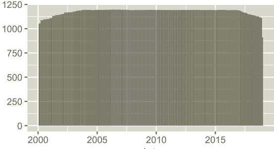

图 1.1：资产随时间变化的数量。

数据集中有四个直接的 **标签**：R1M_Usd、R3M_Usd、R6M_Usd 和 R12M_Usd，分别对应股票的 1 个月、3 个月、6 个月和 12 个月未来/远期收益率。这些收益率是 **总收益率**，即它们包含了所考虑时期内的潜在 **股息** 支付。与仅考虑价格收益率相比，这是财务收益的更好代理指标。我们参考 Hartzmark 和 Solomon (2019) 的分析，以研究剥离价格收益和股息的影响。这些标签位于数据集的最后 4 列。下面我们提供它们的描述性统计量。

| 标签 | 均值 | 标准差 | 最小值 | 最大值 |
|---|---|---|---|---|
| R12M_Usd | 0.137 | 0.738 | -0.991 | 96.0 |
| R1M_Usd | 0.0127 | 0.176 | -0.922 | 30.2 |
| R3M_Usd | 0.0369 | 0.328 | -0.929 | 39.4 |
| R6M_Usd | 0.0723 | 0.527 | -0.98 | 107. |

为未来的模型做准备，我们将预测器的名称保存在内存中。此外，我们还保留了一个更短的预测器列表。

```r
features <- colnames(data_ml[3:95]) # Keep the feature's column names (hard-coded, beware!)
features_short <- c("Div_Yld", "Eps", "Mkt_Cap_12M_Usd", "Mom_11M_Usd",
                    "Ocf", "Pb", "Vol1Y_Usd")
```

预测器已经过均匀化，即对于任何给定的特征和时间点，其分布是均匀的。鉴于有 1,207 支股票，下面的图无法显示完美的矩形。

```r
data_ml %>% filter(date == "2000-02-29") %>%
ggplot(aes(x = Div_Yld)) + geom_histogram(bins = 100) + coord_fixed(0.03)
```

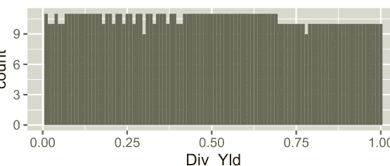

**图 1.2：** 2000-02-29 日期的股息收益率特征分布。

原始标签（未来收益）是数值型的，将用于回归练习，即当目标是预测一个标量实数时。有时，练习可能不同，其目的是预测 **类别**（也称为 **类别**），例如“买入”、“持有”或“卖出”。为了能够进行此类分类分析，我们创建了额外的类别型标签。

```r
data_ml <- data_ml %>% group_by(date) %>% # Group by date
mutate(R1M_Usd_C = R1M_Usd > median(R1M_Usd), # Create the categorical labels
       R12M_Usd_C = R1M_Usd > median(R12M_Usd)) %>%
ungroup() %>%
mutate_if(is.logical, as.factor)
```

新标签是二元的：如果原始收益高于所考虑期间的中位数收益，则等于 1（真），否则等于 0（假）。因此，在每个时间点，一半样本的标签为零，另一半为一：一些股票跑赢大盘，另一些跑输大盘。

在机器学习中，模型在一部分数据（**训练集**）上估计，然后在另一部分数据（**测试集**）上测试以评估其质量。我们相应地拆分了样本。

```r
separation_date <- as.Date("2014-01-15")
training_sample <- filter(data_ml, date < separation_date)
testing_sample <- filter(data_ml, date >= separation_date)
```

我们还在内存中保留了一些关键变量，例如资产标识符列表和收益的矩形版本。为了简单起见，在计算后者时，我们缩小了投资宇宙，只保留我们拥有最多数据点的股票。

```r
stock_ids <- levels(as.factor(data_ml$stock_id)) # A list of all stock_ids
stock_days <- data_ml %>%
  group_by(stock_id) %>%
  summarize(nb = n())
stock_ids_short <- stock_ids[which(stock_days$nb == max(stock_days$nb))] # Stocks with full data
returns <- data_ml %>%
  filter(stock_id %in% stock_ids_short) %>%
  dplyr::select(date, stock_id, R1M_Usd) %>%
  spread(key = stock_id, value = R1M_Usd)
```


## 泰勒和弗朗西斯

泰勒和弗朗西斯集团

http://taylorandfrancis.com

## 2 引言

结论常常呼应引言。本章是在书籍撰写的最后阶段完成的。它概述的原则和思想，很可能比随后涵盖的技术细节之和更具相关性。当遇到令人失望的结果时，我们建议读者暂时离开算法，回到本节，以获取对预测建模中一些问题的更广阔视角。

### 2.1 背景

机器学习在因子投资中的繁荣，源于三项有利发展的交汇：数据可得性、计算能力和经济基础。

首先，*数据*。如今，彭博社和路透社等传统提供商的领域已被利基参与者和聚合平台入侵。1 此外，高频数据和衍生品报价已成为主流。因此，特定公司的属性易于编制，而且通常成本低廉。这意味着公式 (2.1) 中的 X 现在足够大，可以输入机器学习算法。2019 年可达到的数量级如下：针对至少几千只股票（美国上市股票）的几百个每月观测值，涵盖几百个属性。这构成了数千万个数据点的数据集。虽然这是一个相当可观的数字，但我们强调，时间深度可能是薄弱环节，并在未来几十年内仍将如此，因为会计数据仅按季度发布。不用说，这一缺点不适用于高频策略。

其次，*计算能力*，无论是通过硬件还是软件。存储和处理速度不再是技术障碍，模型甚至可以在云端运行，这得益于主要参与者（Amazon、Microsoft、IBM 和 Google）以及较小参与者（Rackspace、Techila）提供的服务。在软件方面，开源已成为常态，由企业（TensorFlow & Keras 由 Google 提供，Pytorch 由 Facebook 提供，h2o 等）、大学（Scikit-Learn 由 INRIA 提供，NLPCore 由 Stanford 提供，NLTK 由 UPenn 提供）以及小型研究团队（caret、xgboost、tidymodels 仅举两个框架为例）资助。因此，机器学习不再是少数计算机科学专家的私人领地，相反，任何愿意学习和编码的人都可以使用它。

最后，*经济框架*。金融中的机器学习应用最初由计算机科学家和信息系统专家引入（例如，Braun and Chandler (1987)、White (1988)），随后不久即被金融经济学学者（Bansal and Viswanathan (1993)）和对冲基金利用（例如，见 Zuckerman (2019)）。非线性关系随后在资产定价中变得更加主流（Freeman and Tse (1992)、Bansal et al. (1993)）。这些贡献开始为自 2010 年代以来蓬勃发展并在全书中多次提及的更粗暴的方法铺平了道路。

1 我们参考 https://alternativedata.org/data-providers/2 获取替代数据提供商列表。此外，我们提醒，Quandl 作为一个替代数据中心，于 2018 年 12 月被纳斯达克收购。随着大型参与者收购新进入者，该领域可能会整合。

在 Arnott et al. (2019b) 的综合建议中，第一条建议是依赖一个在经济上合理的模型。我们赞同这一立场，而本书唯一做出的假设是未来收益取决于公司特征。这些特征与表现之间的关系在很大程度上未知，并且可能随时间变化。这就是机器学习可能有用的原因：检测超出已记录资产定价异常的一些隐藏模式。此外，动态训练允许适应不断变化的市场条件。

### 2.2 投资组合构建：工作流程

构建成功的投资组合策略需要多个步骤。本书涵盖其中许多步骤，但主要集中在预测部分。事实上，大多数时候分配资产需要下注，从而预测和预见哪些资产表现良好，哪些表现不佳。在本书中，我们大多采用监督学习来预测横截面收益。监督学习的基准方程为，

\(\mathbf{y} = f(\mathbf{X}) + \epsilon,\) (2.1)

在金融术语中翻译为

\(\mathbf{r}_{t+1,n} = f(\mathbf{x}_{t,n}) + \epsilon_{t+1,n},\) (2.2)

其中 \(f(\mathbf{x}_{t,n})\) 可以被视为在时间 \(t\) 计算的时间 \(t + 1\) 的**预期收益**，即 \(\mathbb{E}_t[r_{t+1,n}]\)。请注意，该模型对所有资产**共同**（\(f\) 不按 \(n\) 索引），因此与面板方法具有相似之处。

构建准确预测需要关注上述方程中的**所有**术语。按时间顺序，第一步是收集数据并对其进行处理（见第 4 章）。据我们所知，唯一的共识是，在 **x** 侧，特征应包括文献中报告的经典预测因子：市值、会计比率、风险度量、动量代理（见第 3 章）。对于因变量，许多研究人员和从业者使用月度收益，但其他期限在样本外表现可能更好。

尽管很诱人地认为最关键的部分是选择 \(f\)（在数学上它是最复杂的），但我们认为输入（即变量）的选择和工程至少同样重要。\(f\) 的常见建模系列在第 5 至 9 章中介绍。最后，误差 \(\epsilon_{t+1,n}\) 经常被忽视。人们认为香草二次规划是最佳方法（当然也是最常见的！），因此主流目标是最小化平方误差。事实上，其他选项可能是更明智的选择（例如，见第 7.4.3 节）。

即使图 2.1 描绘的整体过程看起来非常顺序，但将其视为**集成**更为明智。所有步骤相互交织，每个部分都不应独立于其他部分来处理。³ 问题的全局框架至关重要，从预测因子的选择，到算法的系列，更不用说投资组合加权方案了（关于后者，见第 12 章）。

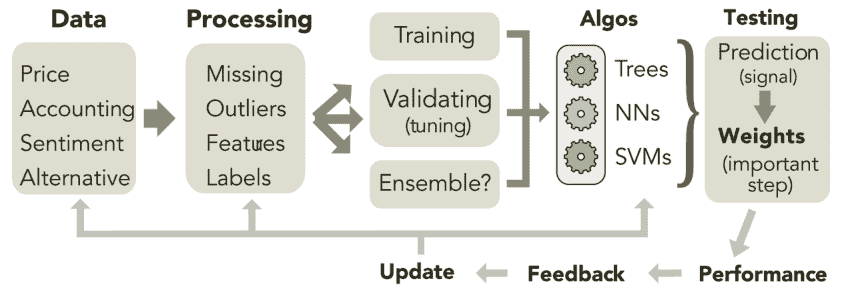

图 2.1：基于机器学习的投资组合构建的简化工作流程。

### 2.3 机器学习不是魔法棒

按定义，预测的诅咒在于它们依赖**过去**数据来推断关于**后续**波动的模式。任何预测者或多或少的明确希望是，过去将证明是未来的良好近似。不用说，这是一个美好的愿望；一般来说，预测表现不佳。令人惊讶的是，这很大程度上不依赖于计量工具的复杂性。事实上，启发式猜测通常很难击败。

为了说明这一令人沮丧的真相，我们在第 5 至 7 章详细介绍的基准算法至多只能产生平庸的结果。这是**故意为之**。这迫使读者理解，盲目地将数据和参数输入编码函数，很少能达到令人满意的样本外准确性。

以下是我们在金融机器学习探索之旅中学到的一些关键点。

- 第一个是**因果性**至关重要。如果能识别出 \(X \rightarrow y\)，其中 \(y\) 是预期收益，那么问题就解决了。不幸的是，因果性极难揭露。

- 因此，研究者大多数时候只能使用简单的**相关性**模式，这些模式远不那么有信息量和稳健性。

- 相关地，金融数据集极其嘈杂。从中**提取信号**是一项艰巨的任务。**无套利**推理表明，如果一个简单的模式产生了持久的利润，它将在机械上迅速消失。


- 沃尔珀特（Wolpert, 1992a）的“没有免费的午餐”定理要求分析师对模型形成看法。这就是为什么经济或**计量经济学框架**至关重要。对因变量和解释性特征所做的假设和选择具有决定性。作为推论，数据是关键。提供给模型的输入可能比模型本身的选择更重要。
- 为了最大化样本外效率，正确的问题可能是转述杰夫·贝索斯：什么不会改变？**持续**的时间序列更有可能揭示持久的模式。
- 人人都会犯错。循环或变量索引中的错误是旅程的一部分。重要的是要从这些疏忽中**学习**。

总之，我们提醒读者这个显而易见的真理：没有什么能取代**实践**。收集和清洗数据、编写回测代码、调优机器学习模型、测试加权方案、调试、重新开始：这些都是绝对不可或缺的步骤和任务，必须无限期重复。没有任何东西可以替代经验。

## 3 因子投资与资产定价异常

资产定价异常是**因子投资**的基础。本章的目标有两点：

- 介绍简单的想法和概念：基本因子模型和常见经验事实（收益和风险溢酬的时间变异性）；
- 为读者提供文章列表，这些文章深入探讨相关主题，以激发和满足好奇心。

本章的目的不是对与因子投资相关的众多主题进行全面阐述。相反，其意图是提供广泛的概述并涵盖基本主题，以便读者被引导至相关参考文献。因此，它可以作为文献的简短、非详尽的综述。金融中因子建模的主题极其广阔，致力于此的论文数量巨大，并且仍在快速增加。

同行评议金融期刊领域可以分为两类。第一类是**学术**期刊。它们的文章大多由教授撰写，读者主要由学者组成。文章通常很长且技术性强。著名的例子包括 _Journal of Finance_、《金融研究评论》（_Review of Financial Studies_）和《金融经济学杂志》（_Journal of Financial Economics_）。第二类更偏向**从业者**导向。论文较短、更易读，主要面向金融专业人士。两个典型的例子是 _Journal of Portfolio Management_ 和 _Financial Analysts Journal_。本章主要综述和提及第一类期刊中发表的文章。

除学术文章外，已有多本专著致力于风格配置（因子投资的同义词，例如在理论文章（Barberis and Shleifer (2003)）或从业者论文（Asness et al. (2015)）中使用）。仅举几例，我们提到：

- Ilmanen (2011): 对众多资产类别的风险溢酬进行详尽探讨，涵盖广泛的描述性统计（跨因子和跨时期），
- Ang (2014): 侧重于资金管理行业的因子投资，
- Bali et al. (2016): 关于信号截面分析的非常完整的书籍，包含统计分析（单变量指标、相关性、持续性等），
- Jurczenko (2017): 由领域专家主导的各种主题之旅（因子纯度、可预测性、选择与加权、因子择时等）。

最后，我们提及该主题的几篇广泛范围的论文：Goyal (2012)、Cazalet and Roncalli (2014) 和 Baz et al. (2015)。

### 3.1 引言

因子投资这一主题虽为数十年的学术话题，但随着交易所交易基金（ETFs）作为投资载体的兴起而受到关注。两者在2010年代都获得了动力。这并不令人惊讶，实用金融工程与学术研究之间的反馈循环以互惠互利的方式刺激了双方。从业者依赖关键学术发现（例如，资产定价异常），而研究人员则深入研究务实的话题（例如，因子敞口或交易成本）。最近，研究人员还试图量化和定性因子指数对金融市场的影响。例如，Krkoska and Schenk-Hoppé (2019) 分析了从众行为，而 Cong and Xu (2019) 表明复合证券的引入会增加波动率和跨资产相关性。

因子模型的核心目标是理解资产价格的**驱动因素**。广义上说，因子投资背后的理由是，企业的财务表现取决于因子，无论这些因子是潜在且不可观察的，还是与内在特征相关（例如会计比率）。确实，正如 Cochrane (2011) 所阐述的，第一个基本问题是 _哪些特征确实提供了关于平均收益的独立信息？_ 回答这个问题有助于理解收益的截面，并可能为其预测打开大门。

理论上，线性因子模型可以视为 Ross (1976) 套利定价理论（APT）的特例，该理论假设资产 $n$ 的收益可以建模为底层因子 $f_k$ 的线性组合：

$$r_{t,n} = \alpha_n + \sum_{k=1}^K \beta_{n,k} f_{t,k} + \epsilon_{t,n}, \tag{3.1}$$

其中线性模型的常见计量经济约束成立：\(\mathbb{E}[\epsilon_{t,n}] = 0\)，\(\text{cov}(\epsilon_{t,n}, \epsilon_{t,m}) = 0\) 当 \(n \neq m\) 以及 \(\text{cov}(\mathbf{f}_n, \boldsymbol{\epsilon}_n) = 0\)。如果此类因子确实存在，则它们与资产定价的基石模型相矛盾：资本资产定价模型（CAPM），由 Sharpe (1964)、Lintner (1965) 和 Mossin (1966) 提出。确实，根据 CAPM，收益的唯一驱动因素是市场组合。这也解释了为什么因子也被称为“异常”。

自 Fama and French (1992) 和 Fama and French (1993) 双篇发表以来，资产定价异常的经验证据不断积累。这套开创性工作为蓬勃发展的文献流铺平了道路，该流派有其元研究（例如，Green et al. (2013)、Harvey et al. (2016) 和 McLean and Pontiff (2016)）。回归 (3.1) 可以评估一次（无条件地）或在不同时间框架上依次进行。在后一种情况下，参数（系数估计）会改变，因此模型因此被称为 _条件的_（关于此主题的近期结果以及相关研究的详细综述，我们参考 Ang and Kristensen (2012) 和 Cooper and Maio (2019)）。条件模型更具灵活性，因为它们承认资产价格的驱动因素可能不是恒定的，这似乎是一个合理的假设。

### 3.2 检测异常

#### 3.2.1 挑战

显然，关键的一步是能够识别异常，这项任务的复杂性不容小觑。鉴于对正面结果的发表偏见（例如，参见金融经济学中的 Harvey (2017)），研究人员常常倾向于报告部分结果，这些结果有时会被后续研究所推翻。因此，复制的需求很高，许多研究成果没有后文（Linnainmaa and Roberts (2018)），特别是在考虑交易成本的情况下（Patton and Weller (2020)、Chen and Velikov (2020)）。然而，正如 Chen (2019) 所示，仅 p-hacking 无法解释文献中记录的所有异常。降低虚假检测风险的一种方法是提高门槛（通常是 _t_-统计量），但争论仍在继续（Harvey et al. (2016)、Chen (2020)），或者采用多重检验（Harvey et al. (2020)）。

一些研究人员记录了因发表而导致的异常消退：一旦异常公开，代理人就会投资于它，推高价格并使异常消失。McLean and Pontiff (2016) 在美国记录了这一效应，但 Jacobs and Müller (2020) 发现所有其他国家都经历了持续的发布后因子回报。采用不同的方法论，Chen and Zimmermann (2020) 对回报引入了发表偏差调整，作者指出这种（负的）调整实际上相当小。Penasse (2019) 建议使用 _alpha 衰减_ 的概念来研究异常的持续性或衰减。

因子溢酬的破坏可能源于从众行为（Krkoska and Schenk-Hoppé (2019)、Volpati et al. (2020)），并可能因所谓的智能贝塔产品（尤其是 ETF）的民主化而加速，这些产品允许投资者直接投资于特定风格（价值、低波动率等）。关于因子投资吸引力的理论视角，我们参考 Jin (2019)。另一方面，DeMiguel et al. (2019) 认为，智能贝塔宇宙中拥挤对价格的影响受到外部机构交易多元化的缓解，这些机构根据该领域外的策略进行交易（例如，通过订单簿算法下注的高频交易者）。

本小节的其余部分受到 Baker et al. (2017) 和 Harvey and Liu (2019a) 的启发。

#### 3.2.2 简单的投资组合排序

这是最常见的程序，也是 Fama and French (1992) 使用的程序。想法很简单。在某一日期，

- 1. 根据特定标准对公司进行排名（例如，规模、市净率）；
- 2. 根据排名形成 \( J \ge 2 \) 个投资组合（即同质组），每个组包含相同数量的股票（通常，根据中位数、三分位数、五分位数或十分位数构建 \( J=2, J=3, J=5 \) 或 \( J=10 \) 个投资组合）；


- 3. 投资组合内股票的权重要么是均等的（等权重），要么与市值成正比；

- 4. 在未来某个日期（通常为一个月），报告投资组合的收益。然后，重复该程序，直到达到样本的时间终点。

其结果是每个分组 \( j \) 的投资组合收益时间序列 \( r_t^j \)。如果第一组（\( j=1 \)）和最后一组（\( j=J \)）之间的 t 检验揭示了平均收益的显著差异，则识别出异常。Cattaneo et al. (2020) 描述了更稳健的检验。这种方法的一个强局限性是，排序标准可能对收益产生非单调影响，而基于两个极端投资组合的检验无法检测到这一点。若干文章回应了这一担忧：例如，Patton and Timmermann (2010) 和 Romano and Wolf (2013)。另一个担忧是，这些排序投资组合可能不仅捕捉与特征相关的有价风险，还可能捕捉一些无价风险。Daniel et al. (2020b) 表明，可以将两者分离，并充分利用经过改造的排序投资组合。

与其只关注一个标准，不如可以根据更多特征对资产进行分组。原始论文 Fama and French (1992) 还将市值与市账率相结合。每个特征被分为 10 个桶，总共得到 100 个投资组合。除了数据可用性之外，排序过程中可以包含的特征数量没有上限。事实上，一些作者研究了更复杂的排序算法，这些算法可以处理潜在的大量特征（见，例如，Feng et al. (2019) 和 Bryzgalova et al. (2019b））。

最后，我们参考 Ledoit et al. (2020) 来改进考虑资产收益协方差结构的方法，并参考 Cattaneo et al. (2020) 对排序程序统计特性进行理论研究（包括与回归基方法的理论联系）。值得注意的是，后一篇论文讨论了最优投资组合数量，并表明该数量可能比文献中常用的 10 大。

在下面的代码和图 3.1 中，我们计算规模投资组合（等权重：高于中位数市值与低于中位数市值）。根据规模异常，中位数市值以下的公司平均应获得更高的收益。只要图表中的橙色条在蓝色条之上，即可验证这一点（大多数情况下都会发生）。

```
data_ml %>%
  group_by(date) %>%
  mutate(large = Mkt_Cap_12M_Usd > median(Mkt_Cap_12M_Usd)) %>% # Creates the cap sort
  ungroup() %>% # Ungroup
  mutate(year = lubridate::year(date)) %>% # Creates a year variable
  group_by(year, large) %>% # Analyze by year & cap
  summarize(avg_return = mean(Rm_Usd)) %>% # Compute average return
  ggplot(aes(x = year, y = avg_return, fill = large)) + # Plot!
  geom_col(position = "dodge") +
  theme(legend.position = c(0.8, 0.2)) + # Legend location
  coord_fixed(124) + theme(legend.title = element_blank()) + # a/y aspect ratio
  scale_fill_manual(values=c("#F87E1F", "#0570EA"), name = "", # Colors
                    labels=c("Small", "Large")) +
  ylab("Average returns") + theme(legend.text=element_text(size=9))
```

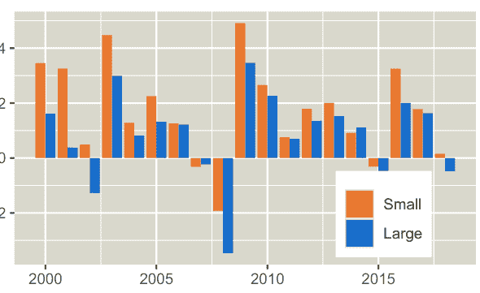

**图 3.1：** 规模因子：小型公司与大型公司的平均收益。

#### 3.2.3 因子

所谓因子的构建遵循与上述相同的思路。投资组合基于一个特征，而因子是一个极端投资组合减去相对极端投资组合的多空组合（对于规模因子，则是小型公司减去大型公司；对于价值因子，则是高市账率减去低市账率）。有时，细微之处包括形成双变量排序并将多个投资组合聚合在一起，如 Fama and French (1993) 的原始贡献所做的那样。下面列出了最常见的因子，并附带一些参考。我们参考本章开头列出的书籍，以获得对因子特性更详尽的处理。对于大多数异常，已经提出了理论证明，无论是基于风险还是基于行为。下面列出了最常被引用的因子：

- 规模（**SMB** = 小型公司减去大型公司）：Banz (1981)、Fama and French (1992)、Fama and French (1993)、Van Dijk (2011)、Asness et al. (2018) 和 Astakhov et al. (2019)。
- 价值（**HM** = 高减低：被低估公司减去“增长”公司）：Fama and French (1992)、Fama and French (1993)、Asness et al. (2013)。
- 动量（**WML** = 胜者减去败者）：Jegadeesh and Titman (1993)、Carhart (1997) 和 Asness et al. (2013)。胜者是过去一年中收益最高的资产（有时收益计算会被截断，以忽略最后一个月）。横截面动量与时间序列动量（趋势跟踪）相关，但不等同，见，例如，Moskowitz et al. (2012) 和 Lempérière et al. (2014)。动量还与在更高和更低频率下都会发生的逆向运动相关（短期和长期反转），见 Luo et al. (2020)。
- 盈利性（**RMW** = 强盈利减去弱盈利）：Fama and French (2015)、Bouchaud et al. (2019)。在前一份参考文献中，盈利性按（收入 -（成本和费用））/权益计算。
- 投资（**CMA** = 保守减去激进）：Fama and French (2015)、Hou et al.

### 表 3.1：月度因子收益率样本。

| 日期 | MKT_RF | SMB | HML | RMW | CMA | RF |
| --- | --- | --- | --- | --- | --- | --- |
| 1963-07-31 | -0.0039 | -0.0047 | -0.0083 | 0.0066 | -0.0115 | 0.0027 |
| 1963-08-31 | 0.0507 | -0.0079 | 0.0167 | 0.0040 | -0.0040 | 0.0025 |
| 1963-09-30 | -0.0157 | -0.0048 | 0.0018 | -0.0076 | 0.0024 | 0.0027 |
| 1963-10-31 | 0.0253 | -0.0129 | -0.0010 | 0.0275 | -0.0224 | 0.0029 |
| 1963-11-30 | -0.0085 | -0.0084 | 0.0171 | -0.0045 | 0.0222 | 0.0027 |
| 1963-12-31 | 0.0183 | -0.0189 | -0.0012 | 0.0007 | -0.0030 | 0.0029 |

(2015)。投资通过总资产增长（除以总资产）来衡量。激进公司是那些资产经历最大增长的公司。

- 低“风险”（有时，**BAB** = 对抗贝塔）：Ang et al. (2006)、Baker et al. (2011)、Frazzini and Pedersen (2014)、Boloerforoosh et al. (2020)、Baker et al. (2020) 和 Asness et al. (2020)。在这种情况下，风险的计算因文章而异（简单波动率、市场贝塔、非系统性波动率等）。

除低风险溢价这一显著例外外，最主流的异常都在 Kenneth French 的数据库中保留和更新（https://mba.tuck.dartmouth.edu/pages/faculty/ken.french/data_library.html）。当然，因子的计算遵循一套特定的规则，但它们在学术界普遍接受。

另一个数据来源是 AQR 存储库：https://www.aqr.com/Insights/Datasets。

在本书使用的数据集中，我们使用市净率而不是市账率来代理价值异常（账面价值位于分母）。Asness and Frazzini (2013) 表明，价值变量的选择可能会产生重大影响。

下面，我们从 Ken French 的数据库导入数据。我们将在本章后面使用它。

```
library(quantmod)                    # Package for data extraction
library(xtable)                      # Package for LaTeX exports
min_date <- "1963-07-31"            # Start date
max_date <- "2020-03-28"            # Start date
temp <- tempfile()
KF_website <- "http://mba.tuck.dartmouth.edu/pages/faculty/ken.french/"
KF_file <- "ftp/F-F_Research_Data_Factors_2x3_CSV.zip"
link <- paste0(KF_website, KF_file)    # Link of the file
download.file(link, temp, quiet = TRUE)  # Download!
FF_factors <- read.csv(unz(temp, "F-F_Research_Data_Factors_2x3.CSV"),
                      skip = 3) %>%    # Check the number of lines to skip!
  rename(date = X1, MKT_RF = `Mkt-RF`) %>% # Change the name of first columns
  mutate_at(vars(-date), as.numeric) %>% # Convert values to number
  mutate(date = ymd(parse_date_time(date, "%Y%m"))) %>% # Date in right format
  mutate(date = rollback(date + months(1))) # End of month date
FF_factors <- FF_factors %>% mutate(MKT_RF = MKT_RF / 100, # Scale returns
                                      SMB = SMB / 100,
                                      HML = HML / 100,
                                      RMW = RMW / 100,
                                      CMA = CMA / 100,
                                      RF = RF/100) %>%
  filter(date >= min_date, date <= max_date) # Finally, keep only recent points
knitr::kable(head(FF_factors), booktabs = TRUE,
             caption = "Sample of monthly factor returns.") # A look at the data (see table)
```


在这些风格化事实被发现之后，一些研究致力于构建能够捕捉这些特性的理论模型。我们在此引用其中几项：

- 规模和价值：Berk et al. (1999), Daniel et al. (2001b), Barberis and Shleifer (2003), Gomes et al. (2003), Carlson et al. (2004), Arnott et al. (2014);
- 动量：Johnson (2002), Grinblatt and Han (2005), Vayanos and Woolley (2013), Choi and Kim (2014).

此外，基于风险的因子表征与行为理论之间最近架起了桥梁。我们主要参考 Barberis et al. (2016) 和 Daniel et al. (2020a) 及其中的参考文献。

尽管这些因子（即，多空组合）表现出时间变化的风险溢价，并受企业新闻和公告的放大（Engelberg et al. (2018)），但有充分记录（且被接受）的是，它们在长期内能够带来正回报。我们参考 Gagliardini et al. (2016) 和调查论文 Gagliardini et al. (2019)，以及相关书目，以获取关于风险溢价估计程序及相应实证结果的技术细节。Ilmanen et al. (2019) 也开展了一项大样本研究，记录了因子溢价的制度转换。此外，回报的可预测性也随时间变化（如 Farmer et al. (2019)、Tsiaras et al. (2020) 和 Liu et al. (2020) 所记录），且估计方法可以改进（Johnson (2019)）。

在图 3.2 中，我们绘制了五个常见因子在每个日历年内的平均月度回报。无风险利率（本身并非一个因子）最为稳定，而市场因子（总市场回报减去无风险利率）最为波动。这很合理，因为它是该五组系列中唯一的多头股票因子。

```
FF_factors %>%
mutate(date = year(date)) %>% # Turn date into year
gather(key = factor, value = value, - date) %>% # Put in tidy shape
group_by(date, factor) %>% # Group by year and factor
summarise(value = mean(value)) %>% # Compute average return
ggplot(aes(x = date, y = value, color = factor)) + # Plot
geom_line() + coord_fixed(500) # Fix x/y ratio
```

投资者配置于特定因子的个人属性是一个蓬勃发展的课题。我们在此列出一些参考文献，尽管它们在一定程度上超出了本书的范围。Betermier et al. (2017) 表明，与最适合承担金融风险的成长型投资者相比，价值型投资者年龄更大、更富有，且面临较低的收入风险。Cronqvist et al. (2015b) 的研究得出不同结论：它发现，投资于价值资产而非成长资产的倾向根植于遗传学和生活事件（后者效应在 Cocco et al. (2020) 中得到证实，前者则在 Cronqvist et al. (2015a) 的更一般语境中得到进一步阐述）。心理特质也可以解释某些因子：当代理人进行外推时，他们可能会推动动量（该主题在 Barberis (2018) 中得到详尽回顾）。这些偏好的微观和宏观经济后果在 Bhamra and Uppal (2019) 中有详细说明。为了结束本段，我们提到，还有一些理论模型被提出，将代理人的偏好和信念（通过前景理论）与市场异常联系起来（参见例如 Barberis et al. (2020)）。

最后，我们强调因子溢价可复制性的必要性，并呼应 Harvey (2020) 的最近社论。Linnainmaa and Roberts (2018) 和 Hou et al. (2020) 表明，许多宣称的因子实际上高度依赖数据，并且在改变投资宇宙或变量定义时，往往无法提供持续的盈利能力（Asness and Frazzini (2013)）。

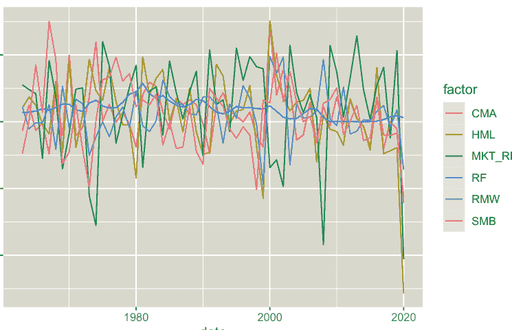

**图 3.2:** 常见异常的平均回报（1963-2020）。来源：Ken French 库。

Campbell Harvey 及其合著者在一系列论文中，试图综合 Harvey et al. (2016)、Harvey and Liu (2019a) 和 Harvey and Liu (2019b) 中关于因子的研究。他的工作强调，需要为异常设定较高标准，才能将其称为“真”因子。提高 $p$-值的阈值只是部分答案，因为人们总是可以诉诸数据挖掘，以找到一种在样本外表现不佳但能产生大于三（甚至四）的 $t$-统计量的优化策略。Harvey (2017) 建议采用贝叶斯方法，将基于数据的显著性与先验相结合，形成所谓的贝叶斯化 $p$-值（见下文小节）。

在此工作之后，研究人员继续探索这个动物园的丰富性。Bryzgalova et al. (2019a) 提出了一种可处理的高维因子模型贝叶斯估计方法，并评估了 50 多个因子的所有可能组合，产生了数量惊人的系数。这与贝叶斯化 Fama 和 MacBeth (1973) 程序相结合，允许区分普遍因子和多余因子。Chordia et al. (2020) 使用 200 万个交易策略的模拟来估计错误发现率，即当检测到虚假因子时（I 类错误）。他们还建议使用远高于三的 $t$-统计量阈值。类似地，Harvey and Liu (2020) 也强调，有时由于一次性 $t$-统计量过低（II 类错误），*真*异常可能会被遗漏。

期刊倾向于发表正面结果，这促使研究人员估计所报告回报与 *真* 回报之间的差异。Chen and Zimmermann (2020) 将这一差异称为 *出版偏差*，并将其估计为约 12%。也就是说，如果已发表的平均回报为 8%，则实际值可能实际上更接近 (1-12%)8%=7%。_从定性上讲，这一 12% 的估计值小于 McLean and Pontiff (2016) 发现的样本外回报下降。_

## 预测回归、排序与 _p_-值问题

为简单起见，我们假设一种简单形式：

```
$r = a + bx + e$,
(3.2)
```

其中，向量 $\boldsymbol{r}$ 汇总了所有股票的所有回报，而 $\boldsymbol{x}$ 是一个滞后变量，因此回归确实是预测性的。如果在给定阈值下估计值 $\hat{b}$ 显著，那么很容易得出结论认为 $\boldsymbol{x}$ 在预测回报方面做得不错。因此，与 $\boldsymbol{x}$ 的极端值相关的多空组合（注意 $\hat{b}$ 的符号）预计会产生利润。不幸的是，这往往是错误的，因为 $\hat{b}$ 提供了 $\boldsymbol{x}$ 预测回报的过去能力的信息。未来会发生什么可能是另一回事。

统计检验也用于组合排序。假设两个极端组合预计会产生非常不同的平均回报（例如，非常小盘股对比非常大盘股，或强劲赢家对比糟糕输家）。组合回报记为 $r_t^+$ 和 $r_t^-$。均值的最简单检验是 $t = \sqrt{T} \frac{m_{r^+} - m_{r^-}}{\sigma_{r_+ - r_-}}$，其中 $T$ 是点数，$m_{r_\pm}$ 表示回报的均值，$\sigma_{r_+ - r_-}$ 是两个序列之间差异的标准差，即多空组合的波动率。简而言之，该统计量可以看作是 Sharpe 比率的缩放版本（尽管通常这些比率仅针对多头组合计算），进而可用于计算 $p$-值以评估异常的稳健性。Linnainmaa and Roberts (2018) 和 Hou et al. (2020) 表明，研究人员发现的许多因子无法在样本外测试中存活下来。

人们对自己检测到的异常过于乐观的一个原因是 $p$-值的广泛逆向解释。通常，它被认为是在给定数据下某一假设（例如，我的异常存在）的概率。实际上，情况恰恰相反；它是在已知异常成立时，对数据样本的似然性。

$p - \text{value} = P[D|H]$

\(\text{target prob.} = P[H|D] = \frac{P[D|H]}{P[D]} \times P[H],\)

其中 $H$ 代表假设，$D$ 代表数据。第二行中的等式是贝叶斯恒等式的直接应用：有趣的是，这个概率实际上是 $p$-值的变换。

至少有两篇文章讨论了这一观点。Harvey (2017) 引入了 **贝叶斯化** $p$-值：

\(\text{Bayesianized } p - \text{value} = \text{Bpv} = e^{-t^2/2} \times \frac{\text{prior}}{1 + e^{-t^2/2} \times \text{prior}}, \quad (3.3)\)

其中 $t$ 是回归得到的 $t$-统计量（即定义 $p$-值的那个），而 prior 是分析师对假设（异常）成立的概率比的估计。Prior 的编码如下。假设原假设成立的概率为 p%（即异常成立的概率为 (1-p)%）。概率比编码为 $p/(1-p)$。因此，如果 $t$-统计量等于 2（对应大约 5% 的 $p$-值）且 prior odds 等于 6，那么 Bpv 等于 $e^{-2} \times 6 \times (1 + e^{-2} \times 6)^{-1} \approx 0.448$，且原假设成立的概率为 44.8%。这种解释与原始 $p$-值形成鲜明对比，后者不能被视为原假设成立的概率。当然，一个缺点是 prior 的水平至关重要，且完全由用户指定。

Chinco et al. (2020) 的工作非常不同，但共享一些关键概念，例如在回归输出中引入贝叶斯先验。他们表明，对预测回归施加 $L^2$ 约束（参见第 5 章的岭回归）相当于对 $b$ 的真实分布引入看法。约束越强，估计值 $\hat{b}$ 就越会向零收缩。他们工作中的一个关键思想是假设许多异常中真实 $b$ 的分布。它被假设为高斯分布且中心化。有趣的参数是标准差：它越大，显著异常被发现的频率就越高。值得注意的是，作者表明


#### 3.2.4 Fama-MacBeth 回归

另一种检测方法由 Fama 和 MacBeth (1973) 通过风险溢价的两阶段回归分析提出。第一阶段是对关系 (3.1) 进行简单估计：回归在相应时间序列上按股票逐只进行。然后将得到的估计值 \(\hat{\beta}_{i,k}\) 代入第二组回归：

\(r_{t,n} = \gamma_{t,0} + \sum_{k=1}^K \gamma_{t,k}\hat{\beta}_{n,k} + \varepsilon_{t,n},\) (3.4)

这些回归按日期在资产横截面上运行。¹ 理论上，贝塔是已知的，回归将在 \(\beta_{n,k}\) 上运行，而不是它们的估计值。\(\hat{\gamma}_{t,k}\) 估计时间 \(t\) 时因子 \(k\) 的溢价。在 \(\varepsilon_{t,n}\) 适当的分布假设下，可以进行统计检验来确定这些溢价是否显著。通常，用于时间聚合（平均）溢价 \(\hat{\gamma}_k = \frac{1}{T} \sum_{t=1}^T \hat{\gamma}_{t,k}\) 的统计量为：

\(t_k = \frac{\hat{\gamma}_k}{\hat{\sigma}_k / \sqrt{T}}\)

通常在纯高斯环境中用于评估因子是否显著（\(\hat{\sigma}_k\) 是 \(\hat{\gamma}_{t,k}\) 的标准差）。

我们引用 Jagannathan 和 Wang (1998) 以及 Petersen (2009) 来讨论标准普通最小二乘（OLS）估计可能引起的偏差和精度损失的技术问题。此外，由于二阶回归中的 \(\hat{\beta}_{i,k}\) 是 *估计值*，可能会产生第二层级的误差（所谓的变量误差）。感兴趣的读者可在 Shanken (1992)、Ang 等人 (2018) 和 Jegadeesh 等人 (2019) 中找到一些扩展和解决方案。

下面，我们对我们的样本进行 Fama 和 MacBeth (1973) 回归。我们从第一遍开始：个体贝塔估计。下面我们构建一个专用函数，并使用一些函数式编程来自动化过程。

```r
nb_factors <- 5
data_FM <- left_join(data_ml %>%
  dplyr::select(date, stock_id, R1M_Usd) %>%
  filter(stock_id %in% stock_ids_short),
  FF_factors,
  by = "date") %>%
mutate(R1M_Usd = lag(R1M_Usd)) %>%
na.omit() %>%
spread(key = stock_id, value = R1M_Usd)
models <- lapply(paste0("'", stock_ids_short,
         ~ MKT_RF + SMB + HML + RMW + CMA'),   # Model spec
```

¹最初，Fama 和 MacBeth (1973) 仅使用市场贝塔：\(r_{t,n} = \alpha_n + \beta_{n,t_M} + \epsilon_{t,n}\)，第二遍包含非线性项：\(r_{t,n} = \gamma_{n,0} + \gamma_{t,1}\hat{\beta}_n + \gamma_{t,2}\hat{\beta}_n^2 + \gamma_{t,3}\hat{s}_n + \eta_{t,n}\)，其中 \(\hat{s}_n\) 是与贝塔无关的资产风险估计。然后可以进行资产定价测试以推断某些属性。例如，检验贝塔对回报是否有线性影响（\(\mathbb{E}[\gamma_{t,2}] = 0\)），或检验 CAPM 的有效性（这意味着 \(\mathbb{E}[\gamma_{t,0}] = 0\)）。

表 3.2：贝塔值样本（行号为股票 ID）。

| | Constant | MKT_RF | SMB | HML | RMW | CMA |
|---|---|---|---|---|---|---|
| 1 | 0.008 | 1.438 | 0.525 | 0.567 | 1.006 | -0.301 |
| 3 | -0.002 | 0.791 | 1.084 | 0.854 | 0.220 | -0.423 |
| 4 | 0.005 | 0.364 | 0.305 | -0.072 | 0.589 | 0.267 |
| 7 | 0.006 | 0.414 | 0.682 | 0.284 | 0.294 | 0.119 |
| 9 | 0.005 | 0.810 | 0.682 | 1.047 | 0.009 | 0.147 |
| 11 | 0.000 | 0.937 | 0.120 | 0.494 | -0.247 | 0.085 |

表 3.3：重新格式化的贝塔值样本（准备进行回归）。

| | MKT_RF | SMB | HML | RMW | CMA | 2000-01-31 | 2000-02-29 | 2000-03-31 |
|---|---|---|---|---|---|---|---|---|
| 1 | 1.438 | 0.525 | 0.567 | 1.006 | -0.301 | -0.036 | 0.263 | 0.031 |
| 3 | 0.791 | 1.084 | 0.854 | 0.220 | -0.423 | 0.077 | -0.024 | 0.018 |
| 4 | 0.364 | 0.305 | -0.072 | 0.589 | 0.267 | -0.016 | 0.000 | 0.153 |
| 7 | 0.414 | 0.682 | 0.284 | 0.294 | 0.119 | -0.009 | 0.027 | 0.000 |
| 9 | 0.810 | 0.682 | 1.047 | 0.009 | 0.147 | 0.032 | 0.076 | -0.025 |
| 11 | 0.937 | 0.120 | 0.494 | -0.247 | 0.085 | 0.144 | 0.258 | 0.049 |

```r
function(f){ lm(as.formula(f), data = data_FM,
na.action="na.exclude") %>% # Call lm(.)
summary() %>% # Gather the output
"$"(coef) %>% # Keep only coefs
data.frame() %>% # Convert to dataframe
dplyr::select(Estimate)} # Keep the estimates
betas <- matrix(unlist(models), ncol = nb_factors + 1, byrow = T) %>% # Extract the betas
data.frame(row.names = stock_ids_short) # Format: row names
colnames(betas) <- c("Constant", "MKT_RF", "SMB", "HML", "RMW", "CMA") # Format: col names
```

在表中，MKT_RF 是市场回报减去无风险利率。相应的系数通常被称为贝塔，尤其是在单变量回归中。然后我们将表 3.2 中的这些贝塔重新格式化，以准备第二遍。每一行对应一个资产：前 5 列是估计的因子载荷，其余的是资产回报（按日期）。

```r
loadings <- betas %>% # Start from loadings (betas)
dplyr::select(-Constant) %>% # Remove constant
data.frame() # Convert to dataframe
ret <- returns %>% # Start from returns
dplyr::select(-date) %>% # Keep the returns only
data.frame(row.names = returns$date) %>% # Set row names
t() # Transpose
FM_data <- cbind(loadings, ret) # Aggregate both
```

我们观察到第一列（市场贝塔）的值围绕一波动，这正是我们所期望的。最后，我们准备好进行第二轮回归。

```r
models <- lapply(paste("", returns$date, "", ' ~ MKT_RF + SMB + HML + RMW + CMA', sep = ""),
function(f){ lm(as.formula(f), data = FM_data) %>% # Call lm(.)
```

表 3.4：Gamma（溢价）值样本。

| | Constant | MKT_RF | SMB | HML | RMW | CMA |
|---|---|---|---|---|---|---|
| 2000-01-31 | -0.031 | 0.037 | 0.227 | -0.157 | -0.276 | 0.044 |
| 2000-02-29 | 0.020 | 0.081 | -0.134 | 0.050 | 0.089 | -0.027 |
| 2000-03-31 | 0.007 | -0.011 | -0.016 | 0.054 | 0.036 | 0.039 |
| 2000-04-30 | 0.127 | -0.132 | -0.104 | 0.088 | 0.117 | -0.002 |
| 2000-05-31 | 0.042 | -0.005 | 0.075 | -0.113 | -0.080 | -0.045 |
| 2000-06-30 | 0.028 | -0.029 | -0.019 | 0.054 | 0.045 | 0.017 |

```r
summary() %>%
"$"(coef) %>%
data.frame() %>%
dplyr::select(Estimate)}
)
gammas <- matrix(unlist(models), ncol = nb_factors + 1, byrow = T) %>%
data.frame(row.names = returns$date)
colnames(gammas) <- c("Constant", "MKT_RF", "SMB", "HML", "RMW", "CMA")
```

直观地看，估计的溢价也非常波动。我们绘制了市场、SMB 和 HML 因子的估计值。

```r
gammas %>%
dplyr::select(MKT_RF, SMB, HML) %>%
bind_cols(date = data_FM$date) %>%
gather(key = factor, value = gamma, -date) %>%
ggplot(aes(x = date, y = gamma, color = factor)) +
geom_line() + facet_grid( factor~ . ) +
scale_color_manual(values=c("#F87E1F", "#0570EA", "#F81F40")) +
coord_fixed(980)
```

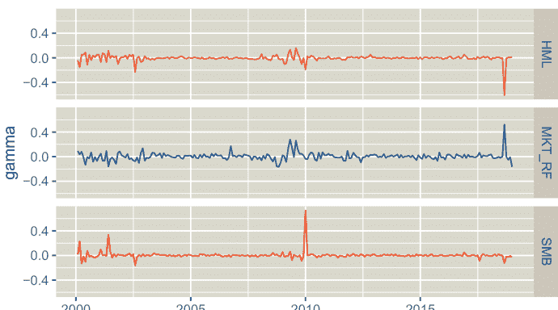

图 3.3：Fama-MacBeth 回归中 Gammas（溢价）的时间序列图。

样本末尾的两个尖峰表明可能存在多重共线性问题；两个因子似乎在不清晰的总体效应中相互抵消。这突出了惩罚估计的有用性（见第 5 章）。

#### 3.2.5 因子竞争

因子的核心目的是解释股票回报的横截面。出于理论和实际原因，最好避免因子内部的冗余。确实，冗余意味着多重共线性，已知会干扰估计（Belsley 等人 (2005)）。此外，当资产经理将其回报表现分解为因子时，因子之间的重叠（高绝对相关性）会产生可解释性较低的敞口；正负敞口会虚假地相互抵消。

排除冗余因子的一个简单协议是将每个因子对其他所有因子进行回归：

$$f_{t,k} = a_k + \sum_{j \neq k} \delta_{k,j} f_{t,j} + \epsilon_{t,k}.$$ (3.5)

然后，感兴趣的指标是与 \(a_k\) 估计相关的检验统计量。如果 \(a_k\) 与零有显著差异，那么（其他）因子的横截面就无法充分解释因子 \(k\) 的平均回报。否则，该因子的回报可以通过对其他因子的敞口来捕获，因此是冗余的。

该技术的一个主流应用在 Fama 和 French (2015) 中进行，作者表明在考虑另外四个因子（市场、SMB、RMW 和 CMA）时，HML 因子是冗余的。下面，我们在更新后的样本中复制他们的分析。我们直接从 Kenneth French 维护的数据库开始分析。

我们可以通过方程 (3.5) 定义的程序运行确定因子冗余的回归。

```r
factors <- c("MKT_RF", "SMB", "HML", "RMW", "CMA")
models <- lapply(paste(factors, ' ~ MKT_RF + SMB + HML + RMW + CMA', factors),
function(f){ lm(as.formula(f), data = FF_factors) %>% # Call lm(.)
summary() %>% # Gather the output
"$"(coef) %>% # Keep only the coefs
data.frame() %>% # Convert to dataframe
filter(rownames(.) == "(Intercept)") %>% # Keep only the Intercept
dplyr::select(Estimate, `Pr(>|t|)`)} # Keep the coef & p-value

alphas <- matrix(unlist(models), ncol = 2, byrow = T) %>% # Switch from list to dataframe
data.frame(row.names = factors)
# alphas # To see the alphas (optional)
```

我们从方程 (3.5) 得到 \(\alpha\) 值的向量。下面，我们将这些数字与 \(p\) 值阈值一起格式化，并将它们导出到汇总表中。系数的显著性水平编码如下：0 < (***) < 0.001 < (**) < 0.01 < (*) < 0.05。

```r
results <- matrix(NA, nrow = length(factors), ncol = length(factors) + 1) # Coefs
signif <- matrix(NA, nrow = length(factors), ncol = length(factors) + 1) # p-values
for(j in 1:length(factors)){
form <- paste(factors[j],
' ~ MKT_RF + SMB + HML + RMW + CMA', factors[j]) # Build model
fit <- lm(form, data = FF_factors) %>% summary() # Estimate model
coef <- fit$coefficients[,1] # Keep coefficients
```


表 3.5：Fama 和 French (2015) 五因子之间的因子竞争。样本始于 1963-07 并止于 2020-03。回归基于月度收益率运行。

| Dep. Variable | Intercept | MKT_RF | SMB | HML | RMW | CMA |
|---|---|---|---|---|---|---|
| MKT_RF | 0.008 (***) | NA | 0.258 (***) | 0.104 | -0.368 (***) | -0.911 (***) |
| SMB | 0.003 (*) | 0.131 (***) | NA | 0.072 | -0.43 (***) | -0.127 |
| HML | 0 | 0.028 | 0.038 | NA | 0.148 (***) | 1.02 (***) |
| RMW | 0.004 (***) | -0.096 (***) | -0.219 (***) | 0.143 (***) | NA | -0.287 (***) |
| CMA | 0.002 (***) | -0.11 (***) | -0.03 | 0.456 (***) | -0.133 (***) | NA |

```r
p_val <- fit$coefficients[,4] # Keep p-values
results[j,- (j+1)] <- coef # Fill matrix
signif[j,-(j+1)] <- p_val
}
signif[is.na(signif)] <- 1 # Kick out NAs
results <- results %>% round(3) %>% data.frame() # Basic formatting
results[signif<0.001] <- paste(results[signif<0.001], " (***)") # 3 star signif
results[signif>0.001&signif<0.01] <- paste(results[signif>0.001&signif<0.01], " (**)") # 2 star signif
results[signif>0.01&signif<0.05] <- paste(results[signif>0.01&signif<0.05], " (*)") # 1 star signif
results <- cbind(as.character(factors), results) # Add dep. variable
colnames(results) <- c("Dep. Variable","Intercept", factors) # Add column names
```

我们证实，当其他四个因子存在于资产定价模型中时，HML 因子仍然冗余。我们得到的数字与原论文（Fama 和 French (2015)）中的数字非常接近，这很合理，因为我们仅在其初始样本基础上增加了 5 年。

在更宏观的层面上，研究人员也试图确定，在给定经验观测数据（以及可能由计量经济学家制定的先验）的情况下，哪些模型（即因子组合）最有可能。例如，这一文献流派试图量化 Fama 和 French (1993) 的三因子模型在多大程度上优于 Fama 和 French (2015) 的五因子。在这方面，De Moor et al. (2015) 引入了一种用于计算 p 值的新方法，用于比较两个模型通过零阿尔法检验的相对可能性。更一般地说，Barillas 和 Shanken (2018) 的贝叶斯方法随后被 Chib et al. (2020) 改进。

最后，即使是最佳因子数量也是近期研究结论中存在分歧的问题。传统文献关注有限数量（3-5）的因子，而 DeMiguel et al. (2020)、He et al. (2020)、Kozak et al. (2019) 和 Freyberger et al. (2020) 等近期研究主张至少使用 15 个或更多因子（相比之下，Kelly et al. (2019) 认为少量隐性因子可能就足够了）。Green et al. (2017) 甚至发现，有助于解释收益率横截面的特征数量随时间而变化。

#### 3.2.6 高级技术

因子数量的不断增加及其在资产管理中的重要性，促使研究人员制定更精细的方法，以“组织”所谓的因子动物园，更重要的是，检测虚假异常并比较不同的资产定价模型规范。下面列举其中几种。

- Feng et al. (2020) 将 LASSO 选择与 Fama-MacBeth 回归相结合，以测试新因子模型是否有价值。他们量化了向一组预定义因子中添加一个新因子的收益，并表明 2010 年代发表的论文中报告的许多因子并未增加多少增量价值；
- Harvey 和 Liu (2019a) （类似地）对正交化因子使用自助法。他们认为预测变量之间的相关性是一个主要问题，他们的方法旨在解决这个问题。他们冗长的程序旨在检验候选变量的最大额外贡献是否显著；
- Fama 和 French (2018) 通过平方最大夏普比率比较资产定价模型；
- Giglio 和 Xiu (2019) 使用基于主成分分析的三遍法估计因子风险溢价；
- Pukthuanthong et al. (2018) 通过结合主成分分析和 Fama 与 MacBeth (1973) 回归来区分有价因子和无价因子；
- Gospodinov et al. (2019) 警告防范因子误设（当虚假因子被包含在回归变量列表中时）。可交易因子（相应地，宏观经济因子）似乎更可能（相应地，不太可能）产生稳健的识别（另见 Bryzgalova (2019)）。

显然没有万无一失的方法，但该领域大量的研究成果凸显了稳健性的必要性。在基于因子直觉制定投资决策时，这显然是一个主要关注点。短期策略的一大障碍是因子可能随时间变化的特征。例如，我们参考 Ang 和 Kristensen (2012) 以及 Cooper 和 Maio (2019) 获得实证结果，并参考 Gagliardini et al. (2016) 和 Ma et al. (2020) 获得更理论性的处理（附有额外实证结果）。

### 3.3 因子还是特征？

将收益率分解为线性因子模型因其解释简单而便捷。然而，学术界关于企业收益率究竟是由对宏观经济因子的暴露解释，还是仅由企业特征解释，存在争论。在其早期研究中，Lakonishok et al. (1994) 认为，价值溢价的一个解释来自对过去收益增长率的错误外推。投资者对近期盈利能力好的企业过于乐观。因此，未来收益率（也）由企业的核心（会计）特征驱动。问题在于，在解释收益率时，区分哪种效应最为显著：特征还是对宏观经济因子的暴露。

就此主题的开创性贡献中，Daniel 和 Titman (1997) 提供了支持前者（即特征）的证据（两篇后续论文为 Daniel et al. (2001a) 和 Daniel and Titman (2012)）。他们表明，账面市值比高或市值小的企业展现出更高的平均收益率，即使它们对 HML 或 SMB 因子的负载为负。因此，看来确实是内在特征重要，而不是因子暴露。关于特征在收益率解释或预测中的作用的进一步资料，我们参考以下贡献：

- Goyal (2012) 的第 2.5.2 节综述了该主题 2010 年以前的研究结果；
- Chordia et al. (2019) 发现，特征对预期收益率估计变动的解释比例大于因子载荷；
- Kozak et al. (2018) 将基于因子的溢价解释与一个理论模型协调一致，其中一些代理人的需求受情绪驱动；
- Han et al. (2019) 使用惩罚回归表明，20 到 30 个特征（共 94 个）对预测美国股票的月度收益率有用。他们的方法很有趣：他们将收益率对特征进行回归以构建预测，然后将收益率对预测进行回归以评估其可靠性。后者回归使用 LASSO 类型惩罚（见第 5 章），因此无用特征被排除在模型之外。该惩罚在 Rapach 和 Zhou (2019) 中扩展到 elasticnet。
- Kelly et al. (2019) 和 Kim et al. (2019) 都估计了这样的模型：因子是隐性的，但载荷（贝塔）和可能的阿尔法取决于特征。Kirby (2020) 通过引入 regime-switching 泛化了第一种方法。相比之下，Lettau 和 Pelger (2020a) 以及 Lettau 和 Pelger (2020b) 估计隐性因子，不与任何特定特征相关联（并提供其方法的大样本渐近特性）。
- 与 Hoechle et al. (2018) 类似，Gospodinov et al. (2019) 和 Bryzgalova (2019) 讨论了使用产生多空收益的投资组合分组时可能出现的潜在错误。作者表明，在某些情况下，基于此程序的测试可能具有误导性。这种情况发生在用于执行分组的特征与外部（不可观察）因子相关时。他们提出了一种基于回归的新方法，旨在绕过此问题。

最近，在另一篇独立的文献流派中，Koijen 和 Yogo (2019) 引入了一个需求模型，投资者根据其对特定企业特征的偏好形成投资组合。他们表明，这使他们能够模仿大型机构投资者的投资组合。在他们的模型中，总需求（因此价格）直接与特征相关联，而不是与因子相关联。在一篇后续论文中，Koijen et al. (2019) 表明，少量特征集足以预测未来收益率。他们还表明，基于英国和美国的机构持股，最大的投资者是对价格形成最具影响力的投资者。类似地，Betermier et al. (2019) 推导了一个优雅的（理论性）一般均衡模型，产生一些有详细记载的异常（规模、账面市值比）。Arnott et al. (2014) 和 Ali 和 Titman (2019) 的模型也能够理论性地产生已知异常。最后，在 Martin 和 Nagel (2019) 中，特征通过其在股息增长可预测性中所起的作用影响收益率。本文讨论了资产数量和特征数量成比例且都趋于无穷的渐近情况。

### 3.4 热门话题：动量、择时和 ESG

#### 3.4.1 因子动量

近期文献揭示了因子收益率的时间序列动量特性。例如，Gupta 和 Kelly (2019) 报告称，这些收益率内部的自相关模式具有统计显著性。² 同样，Arnott et al. (2020) 认为，Moskowitz 和 Grinblatt (1999) 发现的行业动量实际上可以由这种因子动量解释。更进一步，Ehsani 和 Linnainmaa (2019) 得出结论，原始动量因子实际上是所有其他因子中可观察到的自相关的聚合。基于在 Ken French 网站上获得的数据，我们计算

² 自相关在总体/投资组合收益率中是一个广泛有记载的效应，自开创性论文 Lo 和 MacKinlay (1990) 以来（另见 Moskowitz et al. (2012)）。


因素的自相关函数（ACF）。我们回顾一下

ACF_k(x_t) = E[(x_t - \bar{x})(x_{t+k} - \bar{x})].

```
library(cowplot)                 # For stacking plots
library(forecast)                  # For autocorrelation function
acf_SMB  <- ggacf(FF_factors$SMB, lag.max = 10) + labs(title = "")  # ACF SMB
acf_HML  <- ggacf(FF_factors$HML, lag.max = 10) + labs(title = "")  # ACF HML
acf_RMW  <- ggacf(FF_factors$RMW, lag.max = 10) + labs(title = "")  # ACF RMW
acf_CMA  <- ggacf(FF_factors$CMA, lag.max = 10) + labs(title = "")  # ACF CMA
plot_grid(acf_SMB, acf_HML, acf_RMW, acf_CMA,   # Plot
          labels = c('SMB', 'HML', 'RMW', 'CMA'))
```

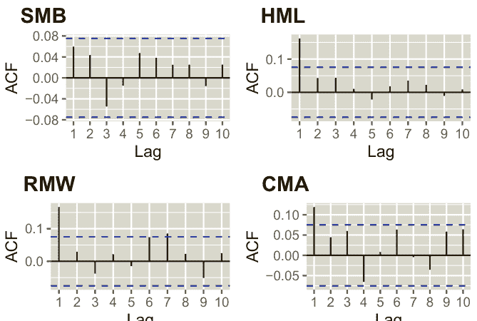

**图 3.4:** 常见因子组合的自相关图。

在四个选定的序列中，只有规模因子在一阶上不具有显著自相关性。

#### 3.4.2 因子择时

鉴于有大量证据表明因子风险溢价具有时间变化特征，合理地思考是否可能预测因子何时表现好或坏是合情合理的。关于择时效果的证据各不相同：Greenwood and Hanson (2012)、Hodges et al. (2017)、Hasler et al. (2019)、Haddad et al. (2020) 以及 Lioui and Tarelli (2020) 指出结果为正；Asness et al. (2017) 指出结果为负；Dichtl et al. (2019) 指出结果不一。关于使用哪些预测变量，尚无共识（Hodges et al. (2017) 中使用一般宏观经济指标，Greenwood and Hanson (2012) 中使用股票发行与回购，Dichtl et al. (2019) 中使用汇总基本面数据）。在基于机器学习的因子投资中，通过将企业特定属性与大规模经济数据相结合，可以实现更细粒度的分析，正如我们在第 4.7.2 节中所述。

#### 3.4.3 绿色因子

在2010年代，对合乎道德的金融产品的需求急剧上升，导致创建了专门致力于社会责任投资（SRI，参见 Camilleri (2020)）的基金。虽然这种现象并非真正新鲜事物（Schueth (2003)、Hill et al. (2007)），但其加速推动了关于与ESG标准（环境、社会、治理）相关的特征是否被定价的研究。数十篇甚至可能数百篇论文都致力于研究这一问题，但尚未达成共识。越来越多的研究人员研究气候变化的金融影响（参见 Bernstein et al. (2019)、Hong et al. (2019) 和 Hong et al. (2020)）以及社会对负责任的企业行为的推动（Fabozzi (2020)、Kurtz (2020)）。我们下面罗列了一份非常简短的论文清单，这些论文的研究结果相互矛盾：

- 有利：ESG投资有效（Kempf and Osthoff (2007)、Cheema-Fox et al. (2020)），可能有效（Nagy et al. (2016)、Alessandrini and Jondeau (2020)），或至少可以被优化为高效（Branch and Cai (2012)）。一项大型元研究报告了压倒性的有利结果（Friede et al. (2015)），但当然，这些结果很可能源于对正面结果的出版偏差。

- 不利：根据 Adler and Kritzman (2008) 和 Blitz and Swinkels (2020)，道德投资并不盈利。ESG因子应当做空不道德企业并做多道德企业（Lioui (2018)）。

- 不一：ESG投资在全球层面可能有益，但在本地层面则不然（Chakrabarti and Sen (2020)）。依赖ESG筛选的组合并不显著优于未进行筛选的组合，但其波动性较低（Gibson et al. (2020)、Goulier and Utz (2020)）。如同常见情况一样，魔鬼藏在细节之中，结果取决于使用E、S还是G（Bruder et al. (2019)）。

在这些相互矛盾的结果之上，多篇文章指出ESG测量存在复杂性。根据所选标准和数据提供商的不同，结果可能会发生剧烈变化（参见 Galema et al. (2008)、Berg et al. (2020) 和 Atta-Darkua et al. (2020)）。

为结束本简短章节，我们指出，当然ESG标准可以直接集成到机器学习模型中，例如 de Franco et al. (2020) 所做的那样。

### 3.5 与机器学习的联系

鉴于数据可用性的指数级增长，任何资产管理者都明显倾向于试图从企业层面海量可用属性中推断未来收益。我们所指的既包括会计比率等传统数据，也包括情绪等另类数据。这项工作正是机器学习的目标。给定大量预测变量（X），其目标是通过形式为(2.1)的模型来预测未来表现的代理y。

在这方面已有一些尝试（例如，Brandt et al. (2009)、Hjalmarsson and Manchev (2012)、Ammann et al. (2016)、DeMiguel et al. (2020)），但最初并未带有任何机器学习意图或聚焦。回顾来看，这些方法确实与机器学习工具存在一些联系。通用表述如下。在时刻\(T\)，代理人或投资者寻求求解以下规划问题：

```
\(\max_{\boldsymbol{\theta}_T} \mathbb{E}_T \left[ u(r_{p, T+1}) \right] = \max_{\boldsymbol{\theta}_T} \mathbb{E}_T \left[ u \left( (\bar{\mathbf{w}}_T + \mathbf{x}_T \boldsymbol{\theta}_T)' \mathbf{r}_{T+1} \right) \right] ,\)
```

其中\(u\)为某种效用函数，\(r_{p, T+1} = (\bar{\mathbf{w}}_T + \mathbf{x}_T \boldsymbol{\theta}_T)' \mathbf{r}_{T+1}\)为投资组合收益率，定义为基准\(\bar{\mathbf{w}}_T\)加上某些偏离基准的量，这些偏离量是特征\(\mathbf{x}_T \boldsymbol{\theta}_T\)的线性函数。上述规划问题可能受到一些外部约束（例如，限制杠杆）。

在实践中，向量\(\boldsymbol{\theta}_T\)必须利用过去数据（从\(T - \tau\)到\(T - 1\)）进行估计：代理人寻求以下问题的解

```
\(\max_{\boldsymbol{\theta}_T} \frac{1}{\tau} \sum_{t=T-\tau}^{T-1} u \left( \sum_{i=1}^{N_T} (\bar{w}_{i,t} + \boldsymbol{\theta}'_t \mathbf{x}_{i,t}) r_{i, t+1} \right) \tag{3.6}\)
```

在样本量为\(\tau\)的数据上进行求解，其中\(N_T\)为投资宇宙中的资产数量。上述表述可视为一种学习任务，其中选择参数以最大化回报（平均收益率）。

#### 3.5.1 近期参考文献简表

无论是否基于特征的方法，机器学习在金融领域的应用已蒸蒸日上，起初仅使用价格数据，后来开始将企业特征作为预测变量纳入。下面按方法学方法列举一些参考文献：

- 惩罚二次规划：Goto and Xu (2015)、Ban et al. (2016) 和 Perrin and Roncalli (2019),

- 正则化预测回归：Rapach et al. (2013) 和 Chinco et al. (2019a),

- 支持向量机：Cao and Tay (2003) 及其文中引用的参考文献,

- 模型比较和/或聚合：Kim (2003)、Huang et al. (2005)、Matías and Reboredo (2012)、Reboredo et al. (2012)、Dunis et al. (2013)、Gu et al. (2020b) 和 Guida and Coqueret (2018b)。后两篇较新的文章使用了大量横截面特征。

我们在第6章、第7章和第16章中分别提供了基于树的方法、神经网络和强化学习技术的更详细列表。此外，我们参考 Ballings et al. (2015) 进行分类器比较，并参考 Henrique et al. (2019) 和 Bustos and Pomares-Quimbaya (2020) 了解基于机器学习的预测技术的综述。

#### 3.5.2 与资产定价模型的显式联系

因子投资与资产定价之间第一个也是最明显的联系是（平均）收益率预测。主要的权威学术参考文献是 Gu et al. (2020b)。让我们先写出通用方程，然后对其进行评论：

```
\(r_{t+1, n} = g(\mathbf{x}_{t,n}) + \epsilon_{t+1}. \tag{3.7}\)
```

有趣的讨论在于上述模型与方程(3.1)之间的差异。第一个明显的差异是引入了非线性函数\(g\)：确实，除了简单性和可解释性之外，没有理由将模型限制在线性关系中。关于资产定价核中非线性的早期参考文献是 Bansal and Viswanathan (1993)。

更重要的是，(3.7)与(3.1)之间的第二个差异是时间指数的偏移。确实，从投资者的角度来看，感兴趣的是能够*预测*关于资产横截面结构的某些信息。使用同步因子解释资产收益率并无用处，因为因子值的实现无法预先得知。因此，如果有人希望从模型中提取价值，状态空间观测（我们称之为\(\mathbf{x}_{t,n}\)）与收益率发生之间需要有一个时间间隔。一旦模型\(\hat{g}\)被估计，时间-\(t\)（可测）值\(g(\mathbf{x}_{t,n})\)将对（平均）未来收益率进行预测。这些预测随后可作为构建投资组合权重的信号（关于该主题的更多内容见第12章）。

虽然大多数研究都使用(3.7)左侧的收益率，但没有理由不使用其他指标。收益率简单易计算，但完全可以被更复杂的指标（例如夏普比率）所取代。此时，企业特征将用于预测风险调整后的表现，而非简单收益率。

除了方程(3.7)的显式形式之外，其他几种与机器学习相关的工具也可用于估计资产定价模型。这可以通过多种方式实现，下面列举了一些。

首先，资产定价中一个主流问题是表征随机贴现因子（SDF）\(M_t\)，它对任何资产\(n\)都满足\(\mathbb{E}_t[M_{t+1}(r_{t+1,n}-r_{t+1,f})]=0\)（参见 Cochrane (2009)）。该方程是广义矩阵法（Hansen (1982））的自然应用场景：\(M_t\)必须满足

\(\mathbb{E}[M_{t+1}R_{t+1,n}g(V_t)] = 0, \quad (3.8)\)

其中工具变量\(V_t\)是\(\mathcal{F}_t\)-可测的（即在时刻\(t\)已知），而大写字母\(R_{t+1,n}\)表示资产\(n\)的超额收益率。为了简化和降低估计问题的复杂性，习惯将SDF定义为一组资产的投资组合（参见 Back (2010) 第3章）。在 Chen et al. (2020) 中，作者使用生成对抗网络（GAN，参见第 7.6.1 节）来估计最接近在强惩罚形式下满足(3.8)的投资组合权重。

第二种方法是尝试将资产收益率建模为因子的线性组合，如同在(3.1)中一样。我们用紧凑的符号表示

\(r_{t,n} = \alpha_n + \beta'_{t,n}\mathbf{f}_t + \epsilon_{t,n},\)

并且我们允许载荷\(\beta_{t,n}\)随时间变化。接下来的诀窍是将企业特征引入上述方程。传统上，特征存在于因子的定义中（如同 Fama and French (1993) 的开创性定义）。收益率的分解是根据企业收益率对这些因子的敞口进行的，这些因子是根据市值、会计比率、过去表现等构建的。给定敞口后，股票的表现被归因于特定的风格特征（例如，小盘股或价值股等）。

习惯上，因子是基于阈值等简单规则构建的启发式投资组合。例如，市净率低于1/3分位数的企业是成长企业，而高于2/3分位数的企业是价值企业。价值因子随后可以由...


对这两组采用多空组合，权重均匀。需要注意的是，Fama 和 French (1993) 采用了一种更为复杂的方法，该方法既在加权方案中也在组合构成中考虑了市值。

机器学习带来的一项进步是自动化因子构建。Feng et al. (2019) 即是这种方法的一个示例。作者们没有启发式地构建因子，而是优化构建过程，以最大化收益率截面的拟合度。优化通过一个相对较深的前馈神经网络进行，特征空间被滞后，因此这种关系确实具有预测性，如方程 (3.7) 所示。从理论上讲，生成的因子有助于解释样本内收益率方差中相当大的比例。模型的预测能力取决于它在样本外泛化的效果。

第三种方法是 Kelly et al. (2019) 的方法（尽管统计处理本身并非严格意义上的机器学习）。$^3$ 他们的想法恰恰相反：因子是潜在（未观测）的，而贝塔（载荷）取决于特征。这提供了许多自由度，因为在 $r_{t,n} = \alpha_n + (\boldsymbol{\beta}_{t,n}(\mathbf{x}_{t-1,n}))'\mathbf{f}_t + \epsilon_{t,n}$ 中，只有特征 $\mathbf{x}_{t-1,n}$ 是已知的，因子 $\mathbf{f}_t$ 和函数形式 $\boldsymbol{\beta}_{t,n}(\cdot)$ 均需估计。在他们的文章中，Kelly et al. (2019) 采用线性形式，这自然更易处理。

最后，第四种方法（由 Gu et al. (2020a) 引入）更进一步，结合了两种神经网络架构。第一个神经网络以特征 $\mathbf{x}_{t-1}$ 作为输入并生成因子载荷 $\boldsymbol{\beta}_{t-1}(\mathbf{x}_{t-1})$。第二个网络将收益率 $\mathbf{r}_t$ 转换为因子值 $\mathbf{f}_t(\mathbf{r}_t)$（见 Feng et al. (2019)）。总体模型可写为：

```
$\mathbf{r}_t = \boldsymbol{\beta}_{t-1}(\mathbf{x}_{t-1})'\mathbf{f}_t(\mathbf{r}_t) + \boldsymbol{\epsilon}_t.$ (3.9)
```

上述规范非常特殊，因为输出（左侧）同时也作为输入（右侧）存在。在机器学习中，自编码器（见第 7.6.2 节）具有相同的特性。其目标，如同主成分分析一样，是为数据集（在这里是收益率）找到一种简洁的非线性表达形式。在方程 (3.9) 中，输入是 $\mathbf{r}_t$，输出函数是 $\boldsymbol{\beta}_{t-1}(\mathbf{x}_{t-1})'\mathbf{f}_t(\mathbf{r}_t)$。其目标是最小化两者之间的差异，就像任何回归类模型一样。

自编码器是输出尽可能接近输入的神经网络，其目标是降维。Gu et al. (2020a) 的创新在于将纯自编码器部分与用于建模载荷的简单感知机合并。神经网络结构如下。

```
returns ($\mathbf{r}_t$) \xrightarrow{NN_1} factors ($\mathbf{f}_t = NN_1(\mathbf{r}_t)$)
characteristics ($\mathbf{x}_{t-1}$) \xrightarrow{NN_2} loadings ($\boldsymbol{\beta}_{t-1} = NN_2(\mathbf{x}_{t-1})$) \big\} \longrightarrow returns ($r_t$)
```

简单自编码器仅包含模型的第一行。该规范在第 7.6.2 节中进行了更详细的讨论。

作为本章结论，不可否认的是，资产定价与机器学习两个领域的交叉提供了丰富的应用。文献已经非常详尽，在关于这些主题的持续发表的出版物流中，往往难以将噪声与优秀想法区分开来。实践与实现是从炒作中提取价值的唯一途径。这一点尤其正确，因为代理人往往倾向于高估因子在现实世界投资者资产配置决策过程中的作用（见 Chinco et al. (2019b) 和 Castaneda and Sabat (2019)）。

### 3.6 编程练习

- 1. 计算成长与价值组合的年收益率，即市净率高于中位数企业的平均收益率（该变量在数据集中名为 ‘Pb’）。
- 2. 同上练习，但计算月收益率并绘制相应组合的价值随时间变化的图表。
- 3. 不再使用单一阈值，根据市值四分位数计算简单分类组合。计算其年收益率并绘制图表。

## 4 数据预处理

本章描述的方法由金融应用驱动。如需了解非金融数据处理的介绍，我们推荐两本参考文献：Boehmke 和 Greenwell (2019) 编写的通用机器学习书籍中的第 3 章，以及 Kuhn 和 Johnson (2019) 关于这一专门主题的专著。

### 4.1 了解您的数据

如同任何定量研究一样，第一步显然是确保数据可靠，即来自可靠的提供商（至少）。金融数据提供领域可谓广袤无垠：一些提供商已成立多年（例如，Bloomberg、Thomson-Reuters、Datastream、CRSP、Morningstar），一些则较新（例如，Capital IQ、Ravenpack），还有一些专注于另类数据利基领域（有关详尽列表，请参见 https://alternativedata.org/data-providers/）。不幸的是，据我们所知，尚无已发表研究从数据可靠性角度对这些提供商的大谱系进行评估。

第二步是查看 **汇总统计量**：范围（最小值和最大值）、平均值和中位数。直方图或时间序列图当然包含更多信息，但在高维下无法妥善分析。不过，它们有时对跟踪特定股票和/或特定特征的局部模式或错误仍有用处。除一阶矩之外，二阶量（方差和协方差/相关性）也很重要，因为它们有助于发现共线性。当两个特征高度相关时，某些模型（例如简单回归，见第 15.1 节）可能会出现问题。

通常，预测变量的数量太大，无法逐一查看这些简单指标。建议进行最低限度的验证。为进一步便于分析：

- 关注预测变量的子集，例如与最常见因子相关的变量（市值、市净率或账面市值比、动量（过去收益率）、盈利能力、资产增长、波动率）；
- 在汇总统计量中跟踪异常值（当最大值/中位数或中位数/最小值比率看起来可疑时）。

如下，在图 4.1 中，我们展示了一个箱线图，说明特征与一个月后收益率之间相关性的分布。相关性是按日期逐日计算的，覆盖整个股票截面。它们大多接近零，但某些日期似乎经历了极端偏移（异常值以黑色圆圈显示）。市值的中位数最负，而波动率是唯一具有正中位数相关性的预测变量（这个特定示例似乎反驳了低风险异常）。

```
data_ml %>%
dplyr::select(c(features_short, "R1M_Usd", "date")) %>%  # Keep few features, label & date
group_by(date) %>%  # Group: dates!
summarise_all(funs(cor(., R1M_Usd))) %>%  # Compute correlations
dplyr::select(-R1M_Usd) %>%  # Remove label
gather(key = Predictor, value = value, -date) %>%  # Put in tidy format
ggplot(aes(x = Predictor, y = value, color = Predictor)) +  # Plot
geom_boxplot(outlier.colour = "black") + coord_flip() +
theme(aspect.ratio = 0.6) + xlab(element_blank())
```

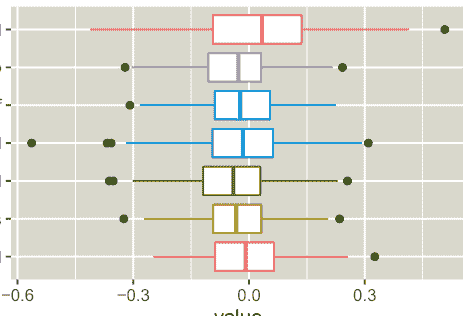

**图 4.1：** 与 1M 前瞻收益率（标签）的相关性箱线图。

更重要的是，当寻求使用监督学习（我们大部分时间都会这样做）时，某些特征与因变量之间的关系可以通过平滑的 **条件平均值** 进一步刻画，因为它展示了特征如何影响标签。使用条件平均值有着深厚的理论基础。假设只有一个特征 \(X\)，并且我们寻求一个模型 \(Y = f(X) + \text{error}\)，其中变量为实数值。最小化平均平方误差 \(\mathbb{E}[(Y - f(X))^2]\) 的函数 \(f\) 即所谓的回归函数（见 Hastie et al. (2009) 第 2.4 节）：

\(f(x) = \mathbb{E}[Y|X=x].\) (4.1)

在图 4.2 中，当因变量（\(Y\)）为一个月后收益率时，我们绘制了该函数的两个示例。第一个涉及过去一年的平均市值，第二个涉及过去一年的波动率。两个预测变量均已标准化（见下文第 4.4.2 节），因此它们的值在任何给定时期的资产截面中均匀分布。因此，特征范围为 \([0, 1]\)，并在图的 \(x\) 轴上显示。线周围的灰色置信带显示计算均值的 95% 置信水平置信区间。基本上，当 (i) 有足够多的数据点且 (ii) 这些点分布不太分散时，它是窄的。

```
data_ml %>%  # From dataset:
ggplot(aes(y = R1M_Usd)) +  # Plot
geom_smooth(aes(x = Mkt_Cap_12M_Usd, color = "Market Cap")) +  # Cond. Exp. Mkt_cap
geom_smooth(aes(x = Vol1Y_Usd, color = "Volatility")) +  # Cond. Exp. Vol
```


```r
scale_color_manual(values=c("#F87E1F", "#0570EA")) +
coord_fixed(10) +
labs(color = "Predictor") + xlab(element_blank())
```

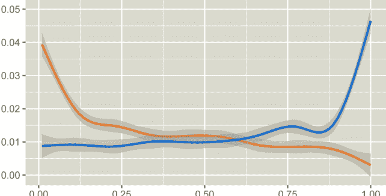

**图 4.2:** 条件期望：作为特征平滑函数的平均收益。

两个变量对未来收益具有近乎单调的影响。平均而言，收益随市值增加而降低（从而印证了所谓的*规模效应*）。对于波动率，这种反向模式不那么明显：曲线在波动率得分的前半部分相当平坦，然后逐渐上升，尤其是在波动率值的最后一组分位数上（从而反驳了低波动率异常）。

特征的一个重要经验属性是**自相关性**（或其不存在）。当某些数据点缺失时，如果某个预测变量具有较高的自相关性，则使用简单的插补技术是合理的。但当转向预测任务时，自相关性也很重要，我们将在下文第 4.6 节简要讨论这一问题。在图 4.3 中，我们绘制了自相关直方图，按股票和特征逐一计算。

```r
autocorrs <- data_ml %>%
dplyr::select(c("stock_id", features)) %>%
gather(key = feature, value = value, -stock_id) %>%
group_by(stock_id, feature) %>%
summarize(acf = acf(value, lag.max = 1, plot = FALSE)$acf[2])
autocorrs %>% ggplot(aes(x = acf)) + xlim(-0.1,1) +
geom_histogram(bins = 60)
```

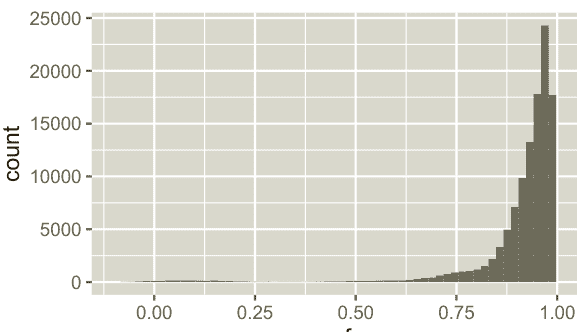

FIGURE 4.3: 样本特征自相关直方图。

鉴于需要评估的数值量很大，上述代码块相当耗时。输出显示预测变量高度自相关：其中大多数的一阶自相关性高于 0.80。

### 4.2 缺失数据

与任何经验学科一样，投资组合管理必然面临缺失数据问题。该主题广为人知，几本书详细介绍了该问题的解决方案（例如，Allison (2001)、Enders (2010)、Little and Rubin (2014) 和 Van Buuren (2018)）。虽然研究人员不断提出新方法来应对缺失点（Honaker and King (2010) 或 Che et al. (2018) 仅举几例），但我们认为，只要执行一些基本的谨慎防护措施，简单的启发式处理通常就足够了。

首先，处理缺失数据主要有两种方法：**删除**和**插补**。删除具有通用性但成本高昂，尤其是当整个实例仅因为一个特征值缺失而被消除时。插补通常更受青睐，但依赖于一些潜在且可能错误的假设。

插补的简化分类如下：

- 基本的插补选择是股票在过去可用数值中的特征中位数（或均值）。如果时间序列中存在趋势，这仍然会改变该趋势。相关地，除非训练集和测试集分别处理，否则这种方法可能具有前瞻性。

- 在以回归测试为目标的时间序列环境中，最简单的插补来自之前的数值：如果 $x_t$ 缺失，则用 $x_{t-1}$ 替换它。大多数情况下这是有道理的，因为过去的数值是所有可用的，并且从定义上讲是回顾性的。然而，在某些特殊情况下，这可能是一个非常糟糕的选择（见下文的注意事项）。

- 中位数和均值也可以计算在资产的**横截面**上。这大致意味着缺失的特征值将被重新安置在观察到的数值主体中。当许多值缺失时，这会在特征分布中创建一个原子点并改变原始分布。一个优点是这种插补不是前瞻性的。

- 许多技术依赖于数据生成过程的某些建模假设。我们提到非参数方法（Stekhoven and Bühlmann (2011) 和 Shah et al. (2014)），它们依赖于随机森林，见第 6 章，贝叶斯插补（Schafer (1999)），最大似然方法（Enders (2001)、Enders (2010)），插值或外推以及最近邻算法（García-Laencina et al. (2009)）。更一般地，本小节开头引用的四本书详细介绍了许多此类插补过程。高级技术在计算上要求要高得多。

几点注意事项：

- 插值应不惜一切代价避免。每季度发布的会计数值或比率绝不应进行线性插值，简单的原因是这是前瞻性的。如果数字在一月和四月披露，那么插值二月和三月需要知道四月的数字，而在实时交易中这将不可知。求助于过去数值是更好的做法。

- 尽管如此，有些特征类型应避免从过去数值进行插补。首先，收益不应被复制。默认情况下，更优的选择是将缺失的收益指标设置为零（这通常接近平均值或中位数）。有助于决策的一个良好指标是特征随时间持续存在的程度。如果它高度自相关（并且时间序列图形成一条平滑曲线，例如市值），那么从过去进行插补可能是合理的。否则，则应避免。

- 有些情况可能需要更多关注。让我们考虑以下股息收益率的虚构样本：

**表 4.1:** 按时间顺序插补的挑战。

| 日期 | 原始收益率 | 替换值 |
|---|---|---|
| 2015-02 | NA | 前一个（如果存在） |
| 2015-03 | 0.02 | 未更改（无） |
| 2015-04 | NA | 0.02（前一个） |
| 2015-05 | NA | 0.02（前一个） |
| 2015-06 | NA | <= **问题**！ |

在这种情况下，收益率按季度发布，在三月、六月、九月等。但在六月，数值缺失。问题在于，我们无法知道它是因为真实的数据故障而缺失，还是因为公司在六月根本没有支付任何股息。因此，在此处从过去数值进行插补可能是错误的。没有完美的解决方案，但必须做出决定。对于股息数据，有三种选择：

- 1) 保留前一个值。在 R 中，来自 *zoo* 包的 na.locf() 函数对此任务非常高效。

- 2) 从先前观察进行外推（这与**插值**非常不同）：例如，在过去数据上评估趋势并延续该趋势。

- 3) 将数值设置为零。这很诱人，但由于高管的股息平滑做法，可能不是最优的（有关该主题的详细信息，请参见例如 Leary and Michaely (2011) 和 Chen et al. (2012)）。对于持续性时间序列，前两种选择可能更好。

可以进行测试以评估每种选择的相对性能。同样重要的是**牢记**这些设计选择。它们太多了，容易被遗忘。显然，跟踪它们是必不可少的。在 ML 管道中，与数据准备相关的**脚本**通常是关键的，因为它们不仅仅用一次！

### 4.3 异常值检测

异常值检测主题也有详细的文档，并有自己的调查报告（Hodge and Austin (2004)、Chandola et al. (2009) 和 Gupta et al. (2014)）以及几本专门的书籍（Aggarwal (2013) 和 Rousseeuw and Leroy (2005)，但后者非常侧重于回归分析）。

同样，极其复杂的方法可能需要大量努力，但收益可能有限。只要在过程中有记录，简单的启发式方法可能就足够了。它们通常依赖于“硬”阈值：

- • 对于给定特征（可能经过时间过滤），区间 $[\mu - m\sigma, \mu + m\sigma]$ 之外的任何点都可以被视为异常值。这里 \(\mu\) 是样本均值，\(\sigma\) 是标准差。倍数值 \(m\) 通常属于集合 \(\{3, 5, 10\}\)，这当然是任意的。
- • 同样，如果最大值大于倒数第二大值的 \(m\) 倍，则也可以将其分类为异常值（尾部另一侧采用相同的推理）。
- • 最后，对于给定的小阈值 \(q\)，任何超出 \([q, 1-q]\) 分位数范围的值都可以被视为异常值。

后一种想法通过**截尾处理**而广为人知。截尾处理是将所有低于 \(x^{(q)}\) 的值设置为 \(x^{(q)}\)，将所有高于 \(x^{(1-q)}\) 的值设置为 \(x^{(1-q)}\)。截尾变量 \(\tilde{x}_i\) 为：

```
\(\tilde{x}_i = \begin{cases} x_i & \text{if } x_i \in [x^{(q)}, x^{(1-q)}] \quad (\text{unchanged}) \\ x^{(q)} & \text{if } x_i < x^{(q)} \\ x^{(1-q)} & \text{if } x_i > x^{(1-q)} \end{cases}.\)
```

\(q\) 的范围通常为 (0.5%, 5%)，其中 1% 和 2% 最常用。

截尾阶段**必须**在特征级别和日期级别上执行。然而，保持时间序列视角也很有用。例如，8000 亿美元的市值可能看起来超出范围，除非查看 Apple 市值的历史。

我们在结束本小节时回顾，*真实*异常值（即非数据提取错误导致的极端点）是有价值的，因为它们可能承载重要信息。


### 4.4 特征工程

特征工程是投资组合构建过程中的一个非常重要的步骤。计算机科学家常引用“垃圾进，垃圾出”这句话。因此，防止配置的 ML 引擎在设计不良的变量上进行训练至关重要。我们邀请感兴趣的读者参考 Kuhn 和 Johnson (2019) 关于此主题的最新工作。相关（较简短）的学术参考文献是 Guyon 和 Elisseeff (2003)。

#### 4.4.1 特征选择

第一步是选择。给定一组庞大的预测变量，过滤掉不需要或冗余的外生变量似乎是个不错的主意。从启发式角度看，简单的方法包括：

- 计算所有特征的相关矩阵，并确保没有（绝对）值高于某个阈值（0.7 是常见值），以免冗余变量污染学习引擎；
- 进行线性回归并剔除不显著的变量（例如，p 值高于 0.05 的变量）。
- 对特征集进行聚类分析，仅保留每个聚类中的一个特征（参见第 15 章）。

这两种方法在某种程度上都过于简化，忽略了非线性关系。另一种方法是拟合决策树（或随机森林），仅保留变量重要性高的特征。这些方法将在第 6 章（关于树）和第 13 章（关于变量重要性）中详细介绍。

#### 4.4.2 预测变量缩放

数据预处理的必要性源于金融数据中量尺范围的广泛差异：

- 收益率绝对值大部分时间都小于 1；
- 股票波动率通常在 5% 到 80% 之间；
- 市值以某一特定货币的百万或十亿单位表示；
- 会计数值也是如此；
- 会计比率可能具有不一致的单位；
- 合成属性（如情绪）也有其特有的表现。

虽然普遍认为特征的单调变换对预测结果影响较小，但 Galili 和 Meilijson (2016) 表明情况并非总是如此（另见第 4.8.2 节）。因此，归一化的选择实际上可能非常重要。

若用 \(x_i\) 表示原始输入，\(\tilde{x}_i\) 表示转换后的数据，常见的缩放方法包括：

- 标准化：\(\tilde{x}_i = (x_i - m_x)/\sigma_x\)，其中 \(m_x\) 和 \(\sigma_x\) 分别是 \(x\) 的均值和标准差；
- [0,1] 上的 min-max 重缩放：\(\tilde{x}_i = (x_i - \min(\mathbf{x}))/(\max(\mathbf{x}) - \min(\mathbf{x}))\)；
- [-1,1] 上的 min-max 重缩放：\(\tilde{x}_i = 2\frac{x_i - \min(\mathbf{x})}{\max(\mathbf{x}) - \min(\mathbf{x})} - 1\)；
- 归一化：\(\tilde{x}_i = F_{\mathbf{x}}(x_i)\)，其中 \(F_{\mathbf{x}}\) 是 \(\mathbf{x}\) 的经验累积分布函数。在这种情况下，向量 \(\tilde{\mathbf{x}}\) 被定义为服从 [0,1] 上的均匀分布。

有时，可以对具有大值（如市值）和大离群值的变量进行对数变换。缩放可以在该变换之后进行。显然，此技术禁止用于具有负值的特征。

通常建议将输入缩放到 [0,1] 范围内，例如在将其送入神经网络训练之前。本书使用的数据集基于经过归一化的变量：在每个时间点上，每个特征的截面分布在单位区间上均匀。在因子投资中，特征缩放必须**分别对每个日期和每个特征进行操作**。这一点至关重要。它确保每个再平衡日期，预测变量都将具有相似的形状，并且确实携带股票截面信息。

归一化有时以不同的方式呈现：对于给定的特征和时间点，对特征值进行排名，然后将排名除以非缺失点的数量。例如，Freyberger 等人 (2020) 就是如此操作的。在 Kelly 等人 (2019) 中，作者执行此操作，然后对所有特征减去 0.5，使其值位于 [-0.5,0.5]。

应禁止跨日期对特征进行缩放。以市值为例。从长期来看（市场崩盘除外），该特征随时间增加。因此，跨日期缩放会导致样本初期值较小，样本末期值较大。这将彻底改变并稀释特征的截面内容。

### 4.5 标记

#### 4.5.1 简单标签

在构建投资组合政策时，有多种方式来定义标签。当然，最终目标是投资组合权重，但很少被认为是标签的最佳选择。$^1$

因子投资中常用的标签如下：

- 资产原始收益率；
- 未来相对收益率（相对于某个基准：例如，市场整体指数或行业投资组合）。一个简单的选择是取收益率减去截面均值或中位数；
- 正收益的概率（或收益超过指定阈值的概率）；
- 超越基准的概率（在给定时间范围内计算）；
- 上述内容的二进制版本：是（超越）与否（不超越）；
- 上述内容的风险调整版本：夏普比率、信息比率、MAR 或 CALMAR 比率（参见第 12.3 节）。

在创建二元变量时，往往很诱人创建一个将收益与零进行比较的测试（盈利与非盈利）。这并非最优，因为它高度依赖时间。在好市时，许多资产将有正收益，而在市场崩盘时，只有少数资产会有正收益，从而产生非常不平衡的类别。更好的想法是将收益按其时刻 _t_ 的中位数（或平均值）分为两类。在这种情况下，指标是相对的，且两个类别要平衡得多。

如本章后面将讨论的那样，这些选择仍留有额外自由度的空间。标签是否也应该像特征一样进行重缩放？计算绩效指标的最佳时间范围是什么？

#### 4.5.2 类别标签

在典型的 ML 分析中，当 _y_ 是未来表现的代理时，ML 引擎将尝试最小化预测值与实现值之间的某些距离。出于数学便利性，使用平方误差和（_L_<sup>2</sup> 范数），因为它具有最简单的导数，并使梯度下降易于访问和计算。

有时，不关注原始表现代理（如收益率或夏普比率），而是关注可由此类代理导出的离散投资决策，这可能很有趣。一个简单示例（决策规则）如下：

```
y_{t,i} = \left\{\begin{array}{ c c }
-1 & \text{if } \hat{r}_{t,i} < r_- \\
0 & \text{if } \hat{r}_{t,i} \in [r_-, r_+] \\
+1 & \text{if } \hat{r}_{t,i} > r_+
\end{array}\right., \quad (4.2)
```

其中 \(\hat{r}_{t,i}\) 是表现代理（例如，收益率或夏普比率），\(r_\pm\) 是决策阈值。当预测表现低于 _r_<sub>-</sub> 时，决策为 -1（例如，_卖出_）；当其高于 _r_<sub>+</sub> 时，决策为 +1（例如，_买入_）；当其位于中间（模型既不十分乐观也不十分悲观）时，决策为中性（例如，_持有_）。表现代理当然可以相对于某个基准，这样决策就与该基准直接相关。通常建议选择阈值 \(r_\pm\)，使三个类别相对平衡，即最终具有可比数量的样本。

在这种情况下，最终输出可被视为类别型或数值型，因为它属于类别变量的一个重要子群：有序类别（**有序**）变量。如果 _y_ 被视为数字，则适用常规回归工具。

当 _y_ 被视为无序类别（**名义**）变量时，则需要新的处理层，因为 ML 工具仅处理数字。因此，必须将类别重新编码为数字。最常用的映射称为“**独热编码**”。类别向量被拆分为一个稀疏矩阵，其中每一列对应一个类。矩阵填充 0 和 1。向对应实例类的列分配一个 1。我们在下表中提供一个简单示例。


表 4.2：独热编码的简洁示例。

| 头寸 | 卖出 | 持有 | 买入 |
|:---|:---:|:---:|:---:|
| 买入 | 0 | 0 | 1 |
| 买入 | 0 | 0 | 1 |
| 持有 | 0 | 1 | 0 |
| 卖出 | 1 | 0 | 0 |
| 买入 | 0 | 0 | 1 |

在分类任务中，输出的维度更大。对于每个实例，它给出了模型分配给每个类别的所属概率。如第 6 章和第 7 章所示，这可以通过 softmax 函数轻松处理。

从配置角度来看，处理类别预测未必容易。对于多空组合，加一或减一的信号可以提供头寸的方向。对于多头组合，有两种可能的解决方案：(i) 使用二元类别（入组合 versus 出组合）或 (ii) 根据预测调整权重：-1 预测对应零权重，0 预测对应 0.5 权重，+1 预测对应满仓权重。然后当然会对权重进行归一化，以符合预算约束。

#### 4.5.3 三重屏障方法

本节以 De Prado (2018) 提到的一种高级贴标技术作为结尾。其理念是考虑交易策略的完整动态，而非简单的绩效代理。这一扩展的理由在于，资金管理人员通常会实施盈亏触发机制，在收益足够时获利了结，或选择退出以止损。在策略启动时，设定了三个屏障（见图 4.4）：

- 一个位于资产当前水平之上的屏障（品红色线），用于衡量合理的预期利润；
- 一个位于资产当前水平之下的屏障（青色线），作为止损信号以防止大额负回报；
- 最后，一个固定策略期限的屏障，到期后策略将被终止（黑色线）。

如果策略触及第一个（分别为第二个）屏障，则输出为 +1（分别为 -1）；如果触及最后一个屏障，则输出等于零，或等于某个线性插值（介于 -1 和 +1 之间），表示终端值相对于两个水平屏障的位置。在计算上，这种方法要求 **多** 得多，因为它需要为每个实例评估整条轨迹。尽管如此，它仍被认为更具现实性，因为交易策略通常伴有止损等自动触发机制等。

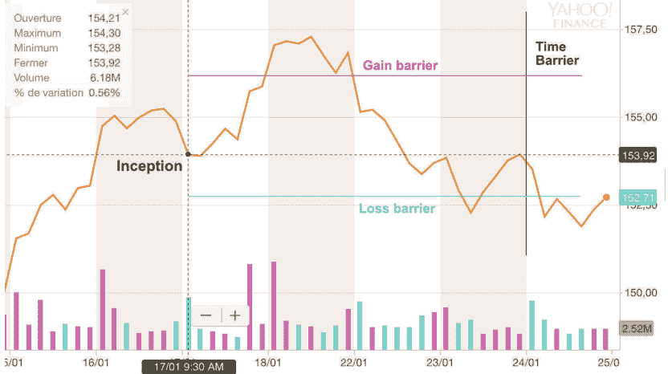

图 4.4：三重屏障方法示意图。

#### 4.5.4 筛选样本

机器学习的主要挑战之一是尽可能多地提取 **信号**。这里的信号是指样本外仍然有效的模式。直觉上，似乎合理地认为收集的数据越多，能提取的信号就越多。但这在普遍意义上是错误的，因为更多数据也意味着更多噪声。令人惊讶的是，筛选训练样本可以提高性能。这一想法例如在 Fu et al. (2018)、Guida and Coqueret (2018a) 和 Guida and Coqueret (2018b) 中被成功实现。

在 Coqueret and Guida (2020) 中，我们研究了为什么较小的样本可能会导致某类机器学习算法（即决策树，参见第 6 章）在样本外精度上表现更优。我们关注一种特定的滤波器：排除非极端的标签（例如回报），保留最小的 20% 和最大的 20% 的数值（分布的主体部分被移除）。这样做，我们从两个方面改变了树的结构：

- 当分裂点被改变时，它们总是更接近分裂变量分布的中心（即，生成的簇更加平衡，可能也更稳健）；
- 分裂变量的选择（有时）会被推向对标签具有单调影响的特征。

这两个特性是可取的。第一个降低了拟合到可能是虚假的小规模实例组的风险。第二个使那些在解释回报方面似乎在全局上更相关的特征更具重要性。但是，筛选不能过度。如果不保留预测器每个尾部的 20%，而仅保留 10%，那么信号损失将过于严重，性能会恶化。

#### 4.5.5 回报期限

本小节讨论了基于因子的机器学习模型中争议最少的问题之一：期限。在整个 ML 驱动的配置工作流中，涉及多个期限：**标签期限**、**估计窗口**（训练样本的时间深度）和 **持有期**。研究这些方面的早期参考文献之一是 Jegadeesh and Titman (1993) 关于动量的奠基性学术论文。作者根据过去 \(J = 3, 6, 9, 12\) 个月的回报计算了组合的盈利能力。测试了四个持有期：\(K = 3, 6, 9, 12\) 个月。他们报告：“_最成功的零成本（多空）策略根据过去 12 个月的回报选择股票，然后持有组合 3 个月。_” 尽管这项研究中完全没有机器学习，但他们关于期限重要的结论也可能适用于更复杂的方法。这个话题确实被广泛讨论，正如关于期限对动量盈利能力影响的持续争论所表明的（参见，例如，Novy-Marx (2012)、Gong et al. (2015) 和 Goyal and Wahal (2015)）。

在使用 ML 算法时，也应考虑这一争论。估计窗口和持有期的问题将在本书后面第 12 章中提到。当然，在本章中，标签期限是重要的要素。从启发式角度看，如果为简化只考虑一个特征，则有四种可能的组合：

- 1. 振荡标签和特征；
- 2. 振荡标签，平滑特征（高度自相关）；
- 3. 平滑标签，振荡特征；
- 4. 平滑标签和特征。

在所有这些选项中，最后一个可能更可取，因为在其他条件相同的情况下，它更稳健。\(^2\) 这里的 _其他条件相同_ 是指，在每种情况下，模型都能够提取出某种相关模式。在两个缓慢变动的序列之间成立的模式更有可能随时间持续。因此，由于特征通常具有高度自相关性（参见图 4.3），将其与平滑标签结合可能是个好主意。为了说明这一点有多么关键，我们将在本书的大多数示例中有意使用 1 个月回报，并展示相应的结果往往令人失望。这些回报的自相关性非常弱，而 6 个月或 12 个月回报则具有更强的持续性，是标签的更好选择。

从理论上讲，可以理解为什么会出现这种情况。为简化起见，假设只有一个特征 \(x\) 解释回报 \(r\)：\(r_{t+1} = f(x_t) + e_{t+1}\)。如果 \(x_t\) 高度自相关，且 \(e_{t+1}\) 中嵌入的噪声不太大，那么两期前瞻回报 \((1+r_{t+1})(1+r_{t+2}) - 1\) 可能比 \(r_{t+1}\) 包含更多信号，因为与 \(x_t\) 的关系随时间扩散和复合了。因此，将记忆考虑因素直接嵌入建模函数可能也有好处，例如 Dixon (2020) 所做的那样。我们将在下一节讨论与自相关相关的一些实际问题。

### 4.6 处理持续性

虽然我们将特征工程和贴标的步骤分在两个不同的小节中，但将它们联合起来考虑可能更明智。ML 算法处理的数据集的一个重要属性应该是特征和标签之间持续性的一致性。直觉上，标签 \( y_{t,n} \)（未来表现）与特征 \( x_{t,n}^{(k)} \) 之间的自相关模式不应相差太远。

一个问题示例是，数据集按月频率采样（在资产管理行业并不罕见），标签为月回报，特征为基于风险或基本面的属性。在这种情况下，标签的自相关性非常弱，而特征通常具有高度自相关性。在这种情况下，大多数复杂的预测工具会在特征之间进行套利，这可能会产生大量噪声。在线性预测模型中，这种配置已知会导致估计偏差（参见 Stambaugh (1999) 的研究以及 Gonzalo and Pitarakis (2018) 的综述）。

在面对这个问题时，除了其他更技术性的选项外，有两种简单的解决方案：要么将自相关性引入标签，要么从特征中去除它。同样，对于线性模型的统计推断，不建议采用第一种方案。从计量经济学角度看，这两种方法都相当容易：

- 要增加标签的自相关性，可以在更长的时间范围内计算表现。例如，使用月度数据时，考虑年度或两年期回报就可以达到目的。
- 要消除自相关性，最简单的方法是求差分/变化：\(\Delta x_{t,n}^{(k)} = x_{t,n}^{(k)} - x_{t-1,n}^{(k)}\)。这种方法的一个优点是，在经济上说得通：与原始水平相比，特征的变化可能是表现更好的驱动因素。

当然，特征空间中持续性变量和振荡变量的混合也是可能的，只要它是由经济动机驱动的即可。

### 4.7 扩展

#### 4.7.1 转换特征

特征空间可以通过简单操作轻松扩展。其中之一是滞后，即考虑特征的旧值，并假设其对标签的影响存在记忆效应。当特征是振荡时，这自然最为有用（在持续性特征上增加记忆层可能有些冗余）。新变量定义为 \(\breve{x}_{t,n}^{(k)} = x_{t-1,n}^{(k)}\)。

在某些情况下（例如，特征数量不足），可以考虑特征之间的比率或乘积。市净率、账面市值比率、资产负债率等会计比率是原始特征函数的有意义示例。由 a 带来的收益


特征谱更大的优势并不明显。过拟合的风险会增加，就像在简单线性回归中机械地添加变量会机械地增加 \( R^2 \) 一样。选择必须在经济上合理。

增加特征空间的另一种方法（如前所述）是考虑变化。情绪的变化、市净率的变化等，都可以是相关的预测因子，因为有时变化比水平更重要。在这种情况下，新的预测因子是 \(\bar{x}_{t,n}^{(k)} = x_{t,n}^{(k)} - x_{t-1,n}^{(k)}\)。

#### 4.7.2 宏观经济变量

最后，我们讨论一个非常重要的话题。数据绝不能脱离其来源的上下文（其环境）。在经典金融术语中，这意味着特定模型很可能取决于整体情况，而整体情况通常由宏观经济指标代理。在数据层面考虑这一点的一种方法只是将特征乘以外生指标 \( z_t \)，在这种情况下，新的预测因子是

```
\(\bar{x}_{t,n}^{(k)} = z_t \times x_{t,n}^{(k)}\) (4.3)
```

Gu et al. (2020b) 使用了这种技术，他们使用了 8 个经济指标（加上原始预测因子（\( z_t = 1 \)））。这使得特征空间扩大了九倍。

整合不断变化的经济环境的另一条路径是条件工程。假设标签通过公式 (4.2) 编码。阈值可以依赖于某些外生变量。在动荡时期，同时提高 \( r_+ \)（买入阈值）和 \( r_- \)（卖出阈值）可能是个好主意，使得标签变得更加保守：需要更高的回报才能进入买入类别，同时有利于空头头寸。动态阈值的一个示例可能是

```
\( r_{t,\pm} = r_{\pm} \times e^{\pm \delta (\text{VIX}_t - \bar{\text{VIX}})}, \) (4.4)
```

其中 VIX\(_t\) 是时刻 \(t\) 的 VIX 值，而 \(\bar{\text{VIX}}\) 是某个平均值或中位数。当 VIX 高于其平均值且风险似乎在增加时，阈值也会增加。参数 \(\delta\) 调节校正的幅度。在上述示例中，我们假设 \( r_- < 0 < r_+ \)。

#### 4.7.3 主动学习

我们以主动学习的概念来结束本节。据我们所知，它在定量投资中并未广泛使用，但其基本概念很有启发性，因此我们为完整性专门用几个段落来阐述这一概念。

在一般的监督学习中，收集特征与标签的能力有时存在非对称性。例如，访问图片是免费的，但对图片内容（例如，“一只狗”、“一辆卡车”、“一个披萨”等）进行标记成本高昂，因为这需要人工标注。从形式上讲，**X** 很便宜，但相应的 **y** 很昂贵。

面对成本限制时，如常见情况，一个显而易见的解决方案是贪婪。在常规学习过程之前，使用一个过滤器（通常称为查询）来决定标记和训练哪些数据（可能与机器学习算法相关）。标记由所谓的 *预言机*（知道真相的人/事物）执行，通常是人类。这种专注于最具信息量的实例的技术被称为 **主动学习**。我们参考 Settles (2009) 和 Settles (2012) 的综述来详细了解该领域（下面我们将简要总结）。**主动**一词来源于学习者不被动接受数据样本，而是积极参与其学习项目的选择这一事实。

主动学习中的一个主要二分法与查询所基于的数据源 **X** 有关。一种明显的情况是当原始样本 **X** 非常大且未标记，学习者要求在该样本中对特定实例进行标记。第二种情况是学习者有能力模拟/生成其自身的值 \(x_i\)。如果 oracle 不识别机器生成的数据，这有时可能会出现问题。例如，如果目标是标记字符和数字的图像，学习者可能会生成不符合任何字母或数字的形状：oracle 无法对其进行标记。

在主动学习中，一个关键问题是：学习者如何选择要标记的实例？从启发式角度来看，答案是选择那些最大化学习效率的观测值。在二分类中，一个简单的标准是属于某一特定类别的概率。如果该概率远离 0.5，那么算法将毫不困难地选择一个类别（即使可能是错误的）。有趣的情况是当概率接近 0.5 时：机器可能会对这个特定实例犹豫不决。因此，在这种情况下让 oracle 对其进行标记很有用，因为它有助于学习者处理犹豫不决的配置。

其他方法试图估计在训练集中包含特定（新）实例时可以获得的拟合度，然后优化这种拟合。回顾 Geman et al. (1992) 第 3.1 节中关于方差-偏差权衡的内容，对于训练数据集 $D$ 和一个实例 $x$（为简单起见，我们省略粗体字体），有

```
\mathbb{E} \left[ (y - \hat{f}(x; D))^2 \mid \{D, x\} \right] = \mathbb{E} \left[ \underbrace{(y - \mathbb{E}[y|x])^2}_{\text{indep. from } D \text{ and } \hat{f}} \mid \{D, x\} \right] + (\hat{f}(x; D) - \mathbb{E}[y|x])^2,
```

其中符号 $f(x; D)$ 用于突出模型 $\hat{f}$ 与数据集 $D$ 之间的依赖关系：该模型已在 $D$ 上训练。第一项是不可约的，因为它不依赖于 $\hat{f}$。因此，只有第二项值得关注。如果我们对该量取平均值，遍历 $D$ 的所有可能值：

```
\mathbb{E}_D \left[ (\hat{f}(x; D) - \mathbb{E}[y|x])^2 \right] = \underbrace{\left( \mathbb{E}_D \left[ \hat{f}(x; D) - \mathbb{E}[y|x] \right] \right)^2}_{\text{squared bias}} + \underbrace{\mathbb{E}_D \left[ (\hat{f}(x, D) - \mathbb{E}_D[\hat{f}(x; D)])^2 \right]}_{\text{variance}}
```

如果这个表达式计算起来不太复杂，学习者可以查询最小化权衡的 $x$。因此，平均而言，这个新实例将是产生最佳学习角度（由 \(L^2\) 误差衡量）的实例。除了这种方法（其局限性在于要求 oracle 标记可能无关紧要的实例）之外，还有许多其他查询标准，我们参考 Settles (2009) 第 3 节以获取详尽列表。

最后一个问题：主动学习适用于因子投资吗？一个直接的答案是，数据无法通过人工干预进行标注。因此，学习者无法模拟自己的实例并要求相应的标签。一种可能的选择是向学习者提供 \(\mathbf{X}\) 但不提供 \(\mathbf{y}\)，仅保留带有相应标签的查询子集观测值。在精神上，这与 Coqueret and Guida (2020) 中所做的工作相似，不同之处在于查询不是由机器执行，而是由人类用户执行。确实，该论文显示，并非所有观测值都携带相同数量的信号。与极端标签值的实例相比，标签值为“平均”的实例平均而言似乎信息量较少。

### 4.8 附加代码和结果

#### 4.8.1 重新缩放的影响：图形表示

我们从不同缩放方法的简单示例开始。我们生成一个任意序列，然后对其进行重新缩放。该序列不是随机的，因此每次执行代码块时，输出都保持不变。

```
Length <- 100 # Length of the sequence
x <- exp(sin(1:Length)) # Original data
data <- data.frame(index = 1:Length, x = x) # Data framed into dataframe
ggplot(data, aes(x = index, y = x)) + geom_bar(stat = "identity") # Plot
```

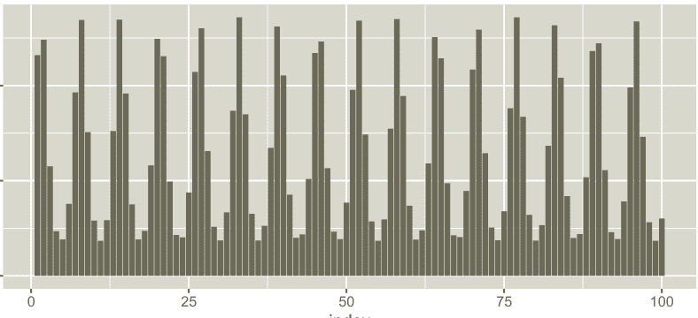

我们在下方定义并绘制缩放变量。

```
norm_unif <- function(v){ # This is a function that uniformises a vector.
  v <- v %>% as.matrix()
  return(ecdf(v)(v))
}

norm_0_1 <- function(v){ # This is a function that uniformises a vector.
  return((v-min(v))/(max(v)-min(v)))
}

data_norm <- data.frame(
  index = 1:Length,
  standard = (x - mean(x)) / sd(x),
  norm_0_1 = norm_0_1(x),
  unif = norm_unif(x) %>%
  gather(key = Type, value = value, -index)
)
ggplot(data_norm, aes(x = index, y = value, fill = Type)) + # Plot!
```


geom_bar(stat = "identity") +
facet_grid(Type~.) # 此选项创建 3 个拼接图表，以便于比较

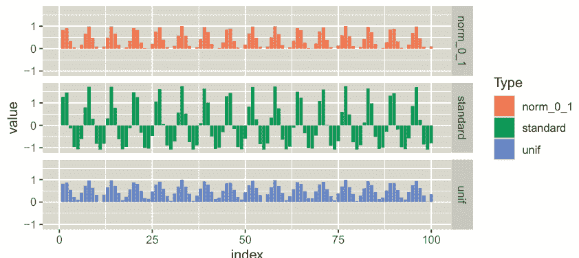

最后，我们查看新创建变量的直方图。

```
ggplot(data_norm, aes(x = value, fill = Type)) + geom_histogram(position = "dodge")
```

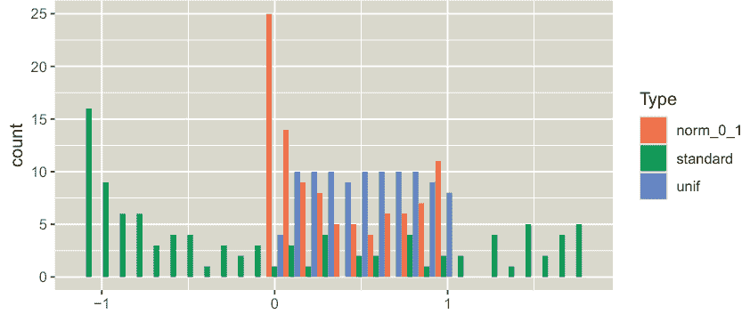

从形状来看，绿色和红色的分布接近原始分布。变化的只有支撑集：最小/最大重缩放确保所有值均落在 [0, 1] 区间内。在两种情况下，最小值（左侧）在分布中呈现出一个峰值。根据构造，该峰值在均一化处理下消失：点在单位区间上均匀分布。

### TABLE 4.3: Sample data for a toy example.
### 表 4.3：玩具示例的示例数据。

| firm | date | cap | return | cap_0_1 | cap_u |
|---|---|---|---|---|---|
| 公司 | 日期 | 市值 | 收益率 | cap_0_1 | cap_u |
| 1 | 1 | 10 | 0.06 | 0.000 | 0.333 |
| 1 | 2 | 50 | 0.01 | 0.364 | 0.667 |
| 1 | 3 | 100 | -0.06 | 1.000 | 1.000 |
| 2 | 1 | 15 | -0.03 | 0.026 | 0.667 |
| 2 | 2 | 10 | 0.00 | 0.000 | 0.333 |
| 2 | 3 | 15 | 0.02 | 0.000 | 0.333 |
| 3 | 1 | 200 | -0.04 | 1.000 | 1.000 |
| 3 | 2 | 120 | -0.02 | 1.000 | 1.000 |
| 3 | 3 | 80 | 0.00 | 0.765 | 0.667 |

#### 4.8.2 Impact of rescaling: toy example
#### 4.8.2 重缩放的影响：玩具示例

To illustrate the impact of choosing one particular rescaling method, we build a simple dataset, comprising 3 firms and 3 dates.
为说明选择特定重缩放方法的影响，我们构建了一个包含 3 家公司和 3 个日期的简单数据集。

```
firm <- c(rep(1,3), rep(2,3), rep(3,3))    # Firms (3 lines for each)
date <- rep(c(1,2,3),3)                   # Dates
cap <- c(10, 50, 100,                     # Market capitalization
    15, 10, 15,
    200, 120, 80)
return <- c(0.06, 0.01, -0.06,           # Return values
    -0.03, 0.00, 0.02,
    -0.04, -0.02, 0.00)
data_toy <- data.frame(firm, date, cap, return)   # Aggregation of data
data_toy <- data_toy %>%                 # Transformation of data
  group_by(date) %>%
  mutate(cap_0_1 = norm_0_1(cap), cap_u = norm_unif(cap))
```

让我们简要评论一下这组合成数据。我们假设日期按时间顺序排列且间隔很大：每个日期代表一年或十年的开始，但（远期）收益率按月计算。第一家公司非常成功，其市值在各期之间增长了十倍。第二家公司的市值保持稳定，而第三家公司则急剧下降。如果我们查看“局部”未来收益率，它们与第一家和第三家公司的规模呈强烈负相关。对于第二家公司，则没有明显的模式。

按日期逐一分析，结果大体相似，尽管略有细微差别。

- 1. 在日期 1 上，规模最小的公司收益率最高，另外两家公司的收益率为负。
- 2. 在日期 2 上，规模最大的公司收益率为负，而两家较小公司则不是。
- 3. 在日期 3 上，收益率随规模递减。

尽管关系并不总是完全单调，但规模与收益之间似乎存在联系，而且通常来说，在这个样本中投资于规模最小的公司将是一个非常好的策略。

### TABLE 4.4: Regression output when the independent var. comes from min-max rescaling
### 表 4.4：自变量来自最小-最大重缩放时的回归输出

| term | estimate | std.error | statistic | p.value |
|---|---|---|---|---|
| 项 | 估计值 | 标准误 | 统计量 | p 值 |
| (Intercept) | 0.0162778 | 0.0137351 | 1.185121 | 0.2746390 |
| cap_0_1 | -0.0497032 | 0.0213706 | -2.325777 | 0.0529421 |

### TABLE 4.5: Regression output when the indep. var. comes from uniformization
### 表 4.5：自变量来自均一化时的回归输出

| term | estimate | std.error | statistic | p.value |
|---|---|---|---|---|
| 项 | 估计值 | 标准误 | 统计量 | p 值 |
| (Intercept) | 0.06 | 0.0198139 | 3.028170 | 0.0191640 |
| cap_u | -0.10 | 0.0275162 | -3.634219 | 0.0083509 |

现在让我们看看简单回归的输出。下面，包 _broom_ 属于 _tidyverse_。它非常适合格式化回归输出。

```
lm(return ~ cap_0_1, data = data_toy) %>% # First regression (min-max rescaling)
broom::tidy() %>%
knitr::kable(caption = 'Regression output when the independent var. comes from min-max rescaling', booktabs = T)
```

```
lm(return ~ cap_u, data = data_toy) %>% # Second regression (uniformised feature)
broom::tidy() %>%
knitr::kable(caption = 'Regression output when the indep. var. comes from uniformization', booktabs = T)
```

就 _p_ 值（最后一列）而言，cap 系数的第一次估计高于 5%（表 4.4），而第二次估计低于 1%（表 4.5）。造成这种差异的一个可能解释是变量的标准差。cap_0_1 和 cap_u 的标准差分别为 0.47 和 0.29。像市值这样的值可能具有非常大的范围，因此会受到相当大的偏差影响（即使在缩放后也是如此）。使用均一化变量可以减少离散度，并有助于解决这个问题。

请注意，这是一把**双刃剑**：虽然它可以帮助避免**假阴性**，但也可能导致**假阳性**。

#### 4.9 Coding exercises
#### 4.9 编程练习

- 1. 圣路易斯联邦储备银行（https://fred.stlouisfed.org）托管了数千个可作为条件变量的经济指标时间序列。选择其中一个并应用公式 (4.3) 来扩展预测变量的数量。如有需要，请使用上面定义的函数。

- 2. 基于公式 (4.4) 和 (4.2) 创建一个新的分类标签。VIX 的时间序列也可以从联邦储备银行的网站获取：https://fred.stlouisfed.org/series/VIXCLS。

- 3. 绘制 R12M_Usd 变量的直方图。显然，存在一些异常值。找出该变量值最高的股票，并确定该值是否可能正确。

# Part II
# 第二部分

# Common supervised algorithms
# 常见监督学习算法


### Taylor & Francis Group
### Taylor & Francis Group

http://taylorandfrancis.com
http://taylorandfrancis.com

## 5 Penalized regressions and sparse hedging for minimum variance portfolios
## 5 最小方差投资组合的惩罚回归和稀疏对冲

In this chapter, we introduce the widespread concept of regularization for linear models. There are in fact several possible applications for these models. The first one is straightforward: resort to penalizations to improve the robustness of factor-based predictive regressions. The outcome can then be used to fuel an allocation scheme. For instance, Han et al. (2019) and Rapach and Zhou (2019) use penalized regressions to improve stock return prediction when combining forecasts that emanate from individual characteristics.

本章将介绍线性模型中广泛使用的正则化概念。这些模型实际上有多种可能的应用。第一种应用很简单：采用惩罚项来提高基于因子的预测回归的稳健性。其结果随后可用于为配置方案提供输入。例如，Han et al. (2019) 和 Rapach 和 Zhou (2019) 在合并来自个别特征的预测时，使用惩罚回归来改善股票收益率预测。

Similar ideas can be developed for macroeconomic predictions for instance, as in Uematsu and Tanaka (2019). The second application stems from a less known result which originates from Stevens (1998). It links the weights of optimal mean-variance portfolios to particular cross-sectional regressions. The idea is then different and the purpose is to improve the quality of mean-variance driven portfolio weights. We present the two approaches below after an introduction on regularization techniques for linear models.

类似的思路也可用于宏观经济预测，例如 Uematsu 和 Tanaka (2019) 的研究。第二种应用源自一个较少为人知的结果，该结果起源于 Stevens (1998)。它将最优均值-方差投资组合的权重与特定的横截面回归联系起来。其思路则不同，目的是改善由均值-方差驱动的投资组合权重的质量。在对线性模型正则化技术进行介绍后，我们将在下文介绍这两种方法。

Other examples of financial applications of penalization can be found in d'Aspremont (2011), Ban et al. (2016) and Kremer et al. (2019). In any case, the idea is the same as in the seminal paper Tibshirani (1996): standard (unconstrained) optimization programs may lead to noisy estimates, thus adding a structuring constraint helps remove some noise (at the cost of a possible bias). For instance, Kremer et al. (2019) use this concept to build more robust mean-variance (Markowitz (1952)) portfolios and Freyberger et al. (2020) use it to single out the characteristics that _really_ help explain the cross-section of equity returns.

惩罚方法在金融应用中的其他示例可见于 d'Aspremont (2011)、Ban et al. (2016) 和 Kremer et al. (2019)。无论如何，其思想与开创性论文 Tibshirani (1996) 中的相同：标准（无约束）优化程序可能导致噪声估计，因此添加结构化约束有助于消除部分噪声（代价是可能引入偏差）。例如，Kremer et al. (2019) 利用这一概念构建更稳健的均值-方差（Markowitz (1952)）投资组合，而 Freyberger et al. (2020) 利用它来筛选出 _真的_ 有助于解释股票收益率横截面的特征。

### 5.1 Penalized regressions
### 5.1 惩罚回归

#### 5.1.1 Simple regressions
#### 5.1.1 简单回归

The ideas behind linear models are at least two centuries old (Legendre (1805) is an early reference on least squares optimization). Given a matrix of predictors **X**, we seek to decompose the output vector **y** as a linear function of the columns of **X** (written **X**\(\beta\)) plus an error term \(\epsilon\): \(\mathbf{y} = \mathbf{X}\beta + \epsilon\).

线性模型背后的思想至少有两个世纪的历史（Legendre (1805) 是最小二乘优化的早期参考文献）。给定预测变量矩阵 **X**，我们试图将输出向量 **y** 分解为 **X** 列的线性函数（写作 **X**\(\beta\)）加上一个误差项 \(\epsilon\)：\(\mathbf{y} = \mathbf{X}\beta + \epsilon\)。

The best choice of \(\beta\) is naturally the one that minimizes the error. For analytical tractability, it is the sum of squared errors that is minimized: \(L = \epsilon'\epsilon = \sum_{i=1}^I \epsilon_i^2\). The loss _L_ is called the sum of squared residuals (SSR). In order to find the optimal \(\beta\), it is imperative to differentiate this loss _L_ with respect to \(\beta\) because the first order condition requires that the

\(\beta\) 的最佳选择自然是使误差最小化的选择。为了便于分析处理，最小化的是误差平方和：\(L = \epsilon'\epsilon = \sum_{i=1}^I \epsilon_i^2\)。损失 _L_ 称为残差平方和（SSR）。为了找到最优 \(\beta\)，必须对 \(\beta\) 关于该损失 _L_ 求导，因为一阶条件要求该


梯度等于零：

$$ \nabla_\beta L = \frac{\partial}{\partial \beta}(y - X\beta)'(y - X\beta) = \frac{\partial}{\partial \beta}\beta'X'X\beta - 2y'X\beta $$ $$ = 2X'X\beta - 2X'y $$

以便一阶条件 \(\nabla_\beta L = 0\) 满足，当

$$ \beta^* = (X'X)^{-1}X'y, \quad (5.1) $$

这被称为线性模型的标准普通最小二乘（OLS）解。如果矩阵 X 的维度为 \(I \times K\)，那么只有当行数 \(I\) 严格多于列数 \(K\) 时，\(X'X\) 才可逆。在某些情况下，这可能不成立；预测变量多于实例，且不存在唯一的 \(\beta\) 值来最小化损失。如果 \(X'X\) 是非奇异的（或正定的），那么二阶条件确保 \(\beta^*\) 对损失 \(L\) 取得全局最小值（\(L\) 关于 \(\beta\) 的二阶导数，即黑森矩阵，恰好是 \(X'X\)）。

迄今为止，我们对上述任何量都未做分布假设。

标准假设如下：

- E[y|X] = X\beta：回归函数的线性形式；
- E[\epsilon|X] = 0：误差项与预测变量独立；
- E[\epsilon\epsilon'|X] = \sigma^2 I：同方差性——误差项不相关且方差相同；
- \epsilon_i 服从正态分布。

在这些假设下，可以对 \(\hat{\beta}\) 系数进行统计检验。有关线性模型的详细处理，请参阅 Greene (2018) 中的第 2 至 4 章，以及同一书中第 5 章以了解相关检验的详情。

#### 5.1.2 惩罚形式

惩罚回归自 Tibshirani (1996) 的开创性工作以来广受欢迎。其思想是对回归系数施加约束，即其总幅度受到限制。在其原始论文中，Tibshirani (1996) 提议估计以下模型（LASSO）：

$$ y_i = \sum_{j=1}^J \beta_j x_{i,j} + \epsilon_i, \quad i = 1, \dots, I, \quad \text{s.t.} \quad \sum_{j=1}^J |\beta_j| < \delta, \quad (5.2) $$

对于某个严格正的常数 \(\delta\)。在最小二乘最小化下，这相当于求解拉格朗日表述：

$$ \min_\beta \left\{ \sum_{i=1}^I \left( y_i - \sum_{j=1}^J \beta_j x_{i,j} \right)^2 + \lambda \sum_{j=1}^J |\beta_j| \right\}, \quad (5.3) $$

对于某个值 \(\lambda > 0\)，它自然取决于 \(\delta\)（\(\delta\) 越低，\(\lambda\) 越高：约束越具约束力）。这种规范与脊回归（\(L^2\) 正则化）似乎相近，而脊回归实际上早于 Lasso：

$$ \min_\beta \left\{ \sum_{i=1}^I \left( y_i - \sum_{j=1}^J \beta_j x_{i,j} \right)^2 + \lambda \sum_{j=1}^J \beta_j^2 \right\}, \quad (5.4) $$

并且等同于估计以下模型

```
y_i = \sum_{j=1}^J \beta_j x_{i,j} + \epsilon_i, \ i = 1, \dots, I, \ \text{s.t.} \ \sum_{j=1}^J \beta_j^2 < \delta,
```

但结果实际上截然不同，这证明单独处理是合理的。从机械上讲，随着 \(\lambda\)（惩罚强度）增加（或随着 (5.5) 中的 \(\delta\) 减小），脊回归的系数都会缓慢地向零减小。在 LASSO 的情况下，收敛有些更为剧烈，因为某些系数会非常快速地收缩到零。对于足够大的 \(\lambda\)，只有一个系数会保持非零，而在脊回归中，零值仅对所有系数而言是渐进达到的。我们邀请感兴趣的读者查阅 Hastie (2020) 关于脊回归在数据科学中所有应用的综述，以及与交叉验证和 dropout 正则化等其他主题的关联。

为了描绘 Lasso 与脊回归之间的差异，让我们考虑 \(K=2\) 个预测变量的情况，如图 5.1 所示。最优无约束解 \(\boldsymbol{\beta}^*\) 用红色描绘在空间中央。问题自然在于它不满足所施加的条件。这些约束以浅灰色显示：在 Lasso 的情况下，它们形成一个正方形 \(|\beta_1| + |\beta_2| \le \delta\)，而在脊回归的情况下形成一个圆 \(\beta_1^2 + \beta_2^2 \le \delta\)。为了满足这些约束，优化需要在 \(\boldsymbol{\beta}^*\) 附近进行搜索，允许更大的误差水平。这些误差水平在图中显示为橙色椭球。当误差要求足够宽松时，一个椭球触及可接受边界（灰色），受约束解就位于此处。

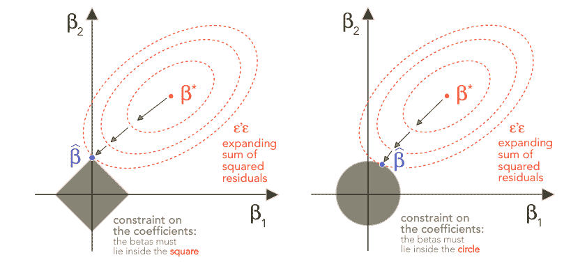

**图 5.1：** Lasso（左）与脊回归（右）的示意图。

两种方法在外生变量数量超过观测数量时都有效，即经典回归定义不良的情况。在脊回归的情况下很容易看出这一点，其 OLS 解为：

```
\hat{\boldsymbol{\beta}} = (\mathbf{X}'\mathbf{X} + \lambda \mathbf{I}_N)^{-1} \mathbf{X}' \mathbf{Y}.
```

与方程 (5.1) 相比的额外项 \(\lambda \mathbf{I}_N\) 确保了每当 \(\lambda > 0\) 时逆矩阵定义良好。随着 \(\lambda\) 的增加，\(\hat{\beta}_i\) 的幅度减小，这解释了为什么惩罚有时被称为**收缩**方法（估计系数的值会收缩）。

Zou and Hastie (2005) 提议以凸方式结合两种惩罚，以兼得两者之长（他们称之为**弹性网**）：

$$y_i = \sum_{j=1}^J \beta_j x_{i,j} + \epsilon_i, \quad \text{s.t.} \quad \alpha \sum_{j=1}^J |\beta_j| + (1-\alpha) \sum_{j=1}^J \beta_j^2 < \delta, \quad i = 1, \dots, N,$$

这与优化程序相关联：

$$\min_\beta \left\{ \sum_{i=1}^I \left( y_i - \sum_{j=1}^J \beta_j x_{i,j} \right)^2 + \lambda \left( \alpha \sum_{j=1}^J |\beta_j| + (1-\alpha) \sum_{j=1}^J \beta_j^2 \right) \right\}.$$

LASSO 相对于脊回归的主要优势在于其变量选择能力。确实，在变量（或预测变量）数量非常大的情况下，LASSO 将逐步剔除最不相关的变量。弹性网保留了这种选择能力，Zou and Hastie (2005) 认为在某些情况下，它甚至比 LASSO 更有效。参数 \(\alpha \in [0, 1]\) 调节系数向零收敛的平滑性。\(\alpha\) 越接近零，收敛越平滑。

#### 5.1.3 图示

我们从惩罚回归的简单图示开始。我们先从 LASSO 开始。作者的原始实现是 R 语言，非常实用。与通常的线性模型相比，语法略有不同。图示在整个数据集上运行。首先，我们估计系数。默认情况下，函数选择大量惩罚值，以便可以立即显示不同惩罚强度（\(\lambda\)）下的结果。

```
library(glmnet)
y_penalized <- data_ml$RIM_Usd           # Dependent variable
x_penalized <- data_ml %>%               # Predictors
  dplyr::select(all_of(features)) %>% as.matrix()
fit_lasso <- glmnet(x_penalized, y_penalized, alpha = 1)  # Model alpha = 1: LASSO
```

计算系数后，在绘图前需要进行一些整理。此外，系数太多，因此我们只绘制其中一个子集。

```
lasso_res <- summary(fit_lasso$beta)   # Extract LASSO coefs
lambda <- fit_lasso$lambda             # Values of the penalisation const
lasso_res$Lambda <- lambda[lasso_res$j] # Put the labels where they belong
lasso_res$Feature <- features[lasso_res$i] %>% as.factor() # Add names of variables to output
lasso_res[1:120, ] %>%                 # Take the first 120 estimates
  ggplot(aes(x = Lambda, y = x, color = Feature)) +   # Plot!
    geom_line() + coord_fixed(0.25) + ylab("beta") +   # Change aspect ratio of graph
    theme(legend.text = element_text(size = 7))        # Reduce legend font size
```


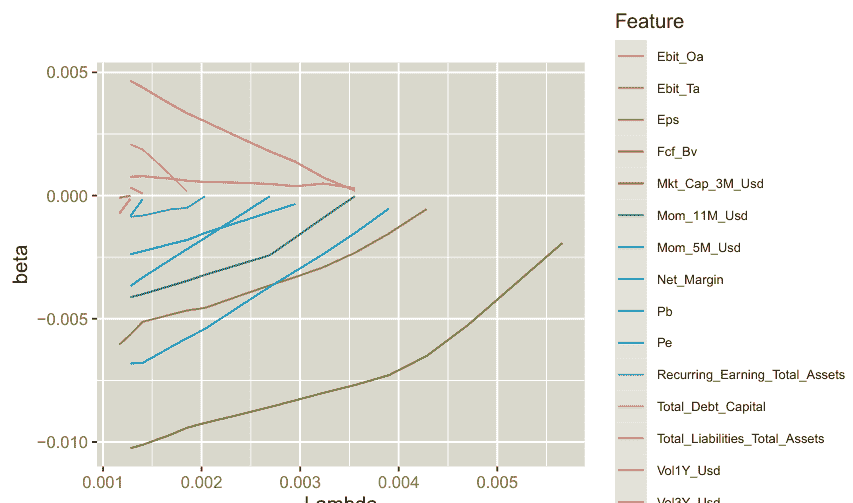

图 5.2：LASSO 模型。因变量为未来 1 个月的收益率。

该图描绘了随着惩罚强度 \(\lambda\) 增加，系数的演变情况。对于某些特征，如 Ebit_Ta（橙色），收敛至零的速度很快。其他变量对惩罚的抵抗时间更长，如 Mkt_Cap_3M_Usd，它是最后一个消失的变量。从本质上讲，这意味着在一阶上，该变量是我们样本中未来 1 个月收益率的重要驱动因素。此外，其系数的负号是对规模异常（再次，在本样本中）的确认，根据该异常，小公司的未来收益率高于其较大的对手公司。

接下来，我们转向岭回归。

```
fit_ridge <- glmnet(x_penalized, y_penalized, alpha = 0)  # alpha = 0: ridge
ridge_res <- summary(fit_ridge$beta)  # Extract ridge coefs
lambda <- fit_ridge$lambda  # Penalisation const
ridge_res$Feature <- features[ridge_res$i] %>% as.factor()
ridge_res$Lambda <- lambda[ridge_res$j]  # Set labels right
ridge_res %>%
  filter(Feature %in% levels(droplevels(lasso_res$Feature[1:120]))) %>%  # Keep same features
  ggplot(aes(x = Lambda, y = x, color = Feature)) + ylab("beta") +  # Plot!
  geom_line() + scale_x_log10() + coord_fixed(45) +  # Aspect ratio
  theme(legend.text = element_text(size = 7))
```

在图 5.3 中，收敛至零的过程要平滑得多。我们强调 x 轴（惩罚强度）采用对数刻度。这使得早期模式（接近零，位于左侧）更加清晰。与前一图一样，Mkt_Cap_3M_Usd 预测变量明显占主导地位，再次具有较大的负系数。尽管如此，随着 \(\lambda\) 增加，其对其他预测变量的主导地位会消退。

按定义，弹性网将产生表现得如上述两种方法混合体的曲线。尽管如此，只要 \(\alpha > 0\)，LASSO 的选择性特性就会保留：某些特征的系数将迅速收缩至零。事实上，LASSO 的强度

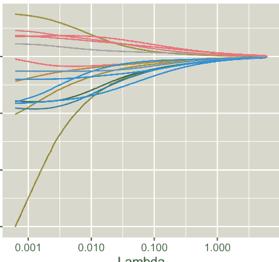

- 特征
- Ebit_Oa
- Ebit_Ta
- Eps
- Fcf_Bv
- Mkt_Cap_3M_Usd
- Mom_11M_Usd
- Mom_5M_Usd
- Net_Margin
- Pb
- Pe
- Recurring_Earning_Total_Assets
- Total_Debt_Capital
- Total_Liabilities_Total_Assets
- Vol1Y_Usd
- Vol3Y_Usd

图 5.3：岭回归。因变量为未来 1 个月的收益率。

的LASSO使得两种惩罚的平衡混合并非在 \(\alpha = 1/2\) 时达到，而是在一个更小的值（可能低于 0.1）。

### 5.2 用于最小方差组合的稀疏对冲

#### 5.2.1 介绍与推导

构建稀疏组合的想法本身并不新鲜（见，例如，Brodie et al. (2009)，Frastrich et al. (2015)），它与 LASSO 的选择性特性在经典二次规划中的联系相当直接。请注意，\(L^1\) 范数的选择是必要的，因为当强制执行简单的 \(L^2\) 范数时，组合的多元化会增加（见 Coqueret (2015)）。

本节的思路源于 Goto and Xu (2015)，但基石结果最初由 Stevens (1998) 发表，我们将在下文中介绍。我们提供细节，因为这些推导在文献中并不常见。

在常规均值-方差配置中，一个核心成分是资产的逆协方差矩阵 \(\Sigma^{-1}\)。例如，最大夏普比率（MSR）组合由以下公式给出：

```
\(\mathbf{w}^{\text{MSR}} = \frac{\Sigma^{-1}\mu}{\mathbf{1}'\Sigma^{-1}\mu},\)
(5.8)
```

其中 \(\mu\) 是预期（超额）收益率向量。取 \(\mu = \mathbf{1}\) 将得到最小方差组合，该组合对预期收益率的一阶矩不敏感（因此，通常比大多数试图估计 \(\boldsymbol{\mu}\) 且常常失败的替代方案更稳健）。

通常，传统方法是估计 \(\boldsymbol{\Sigma}\) 并对其求逆以获得 MSR 权重。然而，几种方法旨在*直接*估计 \(\boldsymbol{\Sigma}^{-1}\)，我们将在下文中介绍其中一种。我们一次处理一个资产，即一次处理 \(\boldsymbol{\Sigma}^{-1}\) 的一行。如果我们将矩阵 \(\boldsymbol{\Sigma}\) 分解为：

$\boldsymbol{\Sigma} = \left[ \begin{array}{ c c } \sigma^2 & \mathbf{c}' \\ \mathbf{c} & \mathbf{C} \end{array} \right] ,$

经典分块结果（例如，Schur 补）暗示

$\boldsymbol{\Sigma}^{-1} = \left[ \begin{array}{ c c } (\sigma^2 - \mathbf{c}'\mathbf{C}^{-1}\mathbf{c})^{-1} & -(\sigma^2 - \mathbf{c}'\mathbf{C}^{-1}\mathbf{c})^{-1}\mathbf{c}'\mathbf{C}^{-1} \\ -(\sigma^2 - \mathbf{c}'\mathbf{C}^{-1}\mathbf{c})^{-1}\mathbf{C}^{-1}\mathbf{c} & \mathbf{C}^{-1} + (\sigma^2 - \mathbf{c}'\mathbf{C}^{-1}\mathbf{c})^{-1}\mathbf{C}^{-1}\mathbf{c}\mathbf{c}'\mathbf{C}^{-1} \end{array} \right] .$

我们关心的是第一行，它包含 2 个分量：因子 \((\sigma^2 - \mathbf{c}'\mathbf{C}^{-1}\mathbf{c})^{-1}\) 和行向量 \(\mathbf{c}'\mathbf{C}^{-1}\)。\(\mathbf{C}\) 是资产 2 到 \(N\) 的协方差矩阵，\(\mathbf{c}\) 是第一个资产与所有其他资产之间的协方差。\(\boldsymbol{\Sigma}^{-1}\) 的第一行是

\((\sigma^2 - \mathbf{c}'\mathbf{C}^{-1}\mathbf{c})^{-1} \left[ \begin{array}{ c c } 1 & - \underline{\mathbf{c}'\mathbf{C}^{-1}} \\ & N-1 \text{ terms} \end{array} \right] .\) (5.9)

我们现在考虑一种替代设置。我们将第一个资产的收益率对所有其他资产的收益率进行回归：

$r_{1,t} = a_1 + \sum_{n=2}^N \beta_{1|n} r_{n,t} + \epsilon_t, \quad \text{i.e.,} \quad \mathbf{r}_1 = a_1 \mathbf{1}_T + \mathbf{R}_{-1} \beta_1 + \epsilon_1, \quad$ (5.10)

其中 \(\mathbf{R}_{-1}\) 汇集了除第一个资产外所有资产的收益率。\(\beta_1\) 的 OLS 估计量为

$\hat{\beta}_1 = \mathbf{C}^{-1}\mathbf{c}, \quad$ (5.11)

这来自 Frisch-Waugh-Lovell 定理（见 Greene (2018) 第 3 章）的分块形式（当回归中包含常数项时）。

此外，

$(1 - R^2)\sigma^2_{\mathbf{r}_1} = \sigma^2_{\mathbf{r}_1} - \mathbf{c}'\mathbf{C}^{-1}\mathbf{c} = \sigma^2_{\epsilon_1} .$ (5.12)

这一最后事实的证明如下。

令 \(\mathbf{X}\) 为 \(\mathbf{1}_T\) 与收益率 \(\mathbf{R}_{-1}\) 的拼接，并令 \(\mathbf{y} = \mathbf{r}_1\)，\(R^2\) 的经典表达式为

$R^2 = 1 - \frac{\epsilon' \epsilon}{T \sigma_Y^2} = 1 - \frac{\mathbf{y}'\mathbf{y} - \hat{\beta}\mathbf{X}'\mathbf{X}\hat{\beta}}{T \sigma_Y^2} = 1 - \frac{\mathbf{y}'\mathbf{y} - \mathbf{y}'\mathbf{X}\hat{\beta}}{T \sigma_Y^2} ,$

拟合值为 \(\mathbf{X}\hat{\beta} = \hat{a}_1\mathbf{1}_T + \mathbf{R}_{-1}\mathbf{C}^{-1}\mathbf{c}\)。因此，

```
$T\sigma_{\mathbf{r}_1}^2 R^2 = T\sigma_{\mathbf{r}_1}^2 - \mathbf{r}'_1\mathbf{r}_1 + \hat{a}_1\mathbf{1}'_T\mathbf{r}_1 + \mathbf{r}'_1\mathbf{R}_{-1}\mathbf{C}^{-1}\mathbf{c}\)

\(T(1-R^2)\sigma_{\mathbf{r}_1}^2 = \mathbf{r}'_1\mathbf{r}_1 - \hat{a}_1\mathbf{1}'_T\mathbf{r}_1 - \left( \tilde{\mathbf{r}}_1 + \frac{\mathbf{1}_T\mathbf{1}'_T}{T}\mathbf{r}_1 \right)' \left( \tilde{\mathbf{R}}_{-1} + \frac{\mathbf{1}_T\mathbf{1}'_T}{T}\mathbf{R}_{-1} \right) \mathbf{C}^{-1}\mathbf{c}\)

\(T(1-R^2)\sigma_{\mathbf{r}_1}^2 = \mathbf{r}'_1\mathbf{r}_1 - \hat{a}_1\mathbf{1}'_T\mathbf{r}_1 - T\mathbf{c}'\mathbf{C}^{-1}\mathbf{c} - \mathbf{r}'_1\frac{\mathbf{1}\mathbf{1}'_T}{T}\mathbf{R}_{-1}\mathbf{C}^{-1}\mathbf{c}\)

\(T(1-R^2)\sigma_{\mathbf{r}_1}^2 = \mathbf{r}'_1\mathbf{r}_1 - \frac{(\mathbf{1}'_T\mathbf{r}_1)^2}{T} - T\mathbf{c}'\mathbf{C}^{-1}\mathbf{c}\)

\((1-R^2)\sigma_{\mathbf{r}_1}^2 = \sigma_{\mathbf{r}_1}^2 - \mathbf{c}'\mathbf{C}^{-1}\mathbf{c}\)
```

其中在第四个等式中我们代入了 \(\hat{a}_1 = \frac{\mathbf{1}'_T}{T}(\mathbf{r}_1 - \mathbf{R}_{-1}\mathbf{C}^{-1}\mathbf{c})\)。请注意，可能存在一个更简单的证明，见，例如，Greene (2018) 第 3.5 节。

结合 (5.9)、(5.11) 和 (5.12)，我们得到 \(\Sigma^{-1}\) 的第一行等于

```
\(\frac{1}{\sigma_1^2} \times 1 - \hat{\beta}'_1 .\) (5.13)
```

给定 \(\Sigma^{-1}\) 的第一行，乘以 \(\boldsymbol{\mu}\) 即可得到第一个资产的组合权重（至一个缩放常数）。

上述结果背后有一个很好的经济学直觉，证明了“稀疏对冲”一词的合理性。我们以最小方差组合为例，其中 \(\boldsymbol{\mu} = \mathbf{1}\)。在方程 (5.10) 中，我们试图用所有其他资产的收益率来解释资产 1 的收益率。在上述方程中，至一个缩放常数，组合在第一个资产中持有单位头寸，在所有其他资产中持有 \(-\hat{\beta}_1\) 头寸。因此，所有其他资产的目的显然是对冲第一个资产的收益率。事实上，这些头寸旨在最小化针对第一个资产的组合的平方误差（这些误差正是 \(\mathbf{e}_1\)）。此外，缩放因子 \(\sigma_1^{-2}\) 也很容易解释：我们越信任回归输出（因为 \(\sigma_1^2\) 较小），我们就在该资产的对冲组合中投资越多。

这种推理可以轻松推广到 \(\Sigma^{-1}\) 的任何一行，该行可以通过将资产 \(i\) 的收益率对所有其他资产的收益率进行回归得到。如果配置方案采用 (5.8) 的形式，针对给定的 \(\boldsymbol{\mu}\) 值，则稀疏组合策略的伪代码如下。

在每个日期（为记号方便，此处省略），

- 对于所有股票 \(i\)，
  1. 在 \(t=1, \dots, T\) 样本上估计弹性网回归，以获得 \(\hat{\Sigma}^{-1}\) 的第 \(i\) 行：

```
\(\hat{\Sigma}^{-1}_{i \cdot} = \text{argmin}_{\beta_{i|i}} \left\{ \sum_{t=1}^T \left( r_{i,t} - a_i + \sum_{n \neq i}^N \beta_{i|n} r_{n,t} \right)^2 + \lambda\alpha||\beta_{i|}||_1 + \lambda(1-\alpha)||\beta_{i|}||_2^2 \right\}\)
```

  2. 为了获得资产 \(i\) 的权重，我们计算 \(\boldsymbol{\mu}\) 加权求和：\(w_i = \sigma_i^{-2} \mu_i - \sum_{j \neq i} \beta_{i|j} \mu_j ,\)


这里我们回顾一下，向量 \(\beta_{i|} = [\beta_{i|1}, \dots, \beta_{i|i-1}, \beta_{i|i+1}, \dots, \beta_{i|N}]\) 是将资产 \(i\) 的收益与所有其他资产的收益进行回归得到的系数。

与 Stevens (1998) 的原始方法相比，引入 **惩罚范数** 是新的成分。好处有两方面：第一，引入约束可以产生更稳健且较少受 \(\mu\) 估计误差影响的权重；第二，由于稀疏性，权重更稳定、杠杆更低，因此策略受交易成本的影响较小。在转向数值应用之前，我们提到一种估计 **稳健逆协方差矩阵** 的更直接方法：图形 LASSO。GLASSO 通过极大似然估计精度矩阵（逆协方差矩阵），同时对矩阵的权重施加约束/惩罚。当惩罚足够强时，这会产生一个稀疏矩阵，即一些或可能许多系数为零的矩阵。有关此主题的更多详细信息，我们参阅 Friedman et al. (2008) 的原始文章。

#### 5.2.2 示例

稀疏对冲组合的目的是为最小方差策略的估计提供一种稳健方法。事实上，由于预期收益向量 \(\mu\) 通常非常嘈杂，一种简单的解决方案是通过设置 \(\mu = \mathbf{1}\) 采取一种不可知的观点。为了测试稀疏约束的附加价值，我们必须进行完整的回溯测试。这样做，我们预示了第 12 章的内容。

我们首先准备变量。稀疏组合仅基于收益；因此我们基于在第 1 章末尾创建的矩形/矩阵格式的专用变量（*收益*）进行分析。

然后，我们初始化输出变量：组合权重和组合收益。我们想比较三种策略：所有股票的等权重（EW）基准、经典全局最小方差组合（GMV）以及基于稀疏对冲的最小方差方法。

```r
t_oos <- returns$data[returns$date > separation_date] %>%  # Out-of-sample dates
  unique() %>%                                            # Remove duplicates
  as.Date(origin = "1970-01-01")                          # Transform in date format
Tt <- length(t_oos)                                       # Nb of dates, avoid T
nb_port <- 3                                              # Nb of portfolios/strats.
portf_weights <- array(0, dim = c(Tt, nb_port, ncol(returns) - 1)) # Initial portf. weights
portf_returns <- matrix(0, nrow = Tt, ncol = nb_port)     # Initial portf. returns
```

接下来，因为这是本节的目的，我们分离出稀疏对冲组合权重的计算。在最小方差组合的情况下，当 \(\mu = \mathbf{1}\) 时，资产 1 的权重将仅仅是方程 (5.13) 中所有项的总和，其他权重具有类似的形式。

```r
weights_sparsehedge <- function(returns, alpha, lambda){   # The parameters are defined here
  w <- 0                                                   # Initiate weights
  for(i in 1:ncol(returns)){                               # Loop on the assets
    y <- returns[, i]                                      # Dependent variable
    x <- returns[, -i]                                     # Independent variable
    fit <- glmnet(x,y, family = "gaussian", alpha = alpha, lambda = lambda)
    err <- y-predict(fit, x)                               # Prediction errors
    w[i] <- (1-sum(fit$beta))/var(err)                     # Output: weight of asset i
  }
  return(w / sum(w))
  # Normalisation of weights
}
```

为了对我们的策略进行基准测试，我们定义了一个元权重函数，该函数包含三种策略：（1）EW 基准，（2）经典 GMV 和（3）基于稀疏对冲的最小方差。对于 GMV，由于资产数量远多于日期数量，协方差矩阵是奇异的。因此，我们有一个小的启发式收缩项。为了更严格地处理这种技术，我们参阅 Ledoit and Wolf (2004) 的原始文章以及 Ledoit and Wolf (2017) 中提到的最近改进。简而言之，我们使用 $\hat{\Sigma} = \Sigma_S + \delta I$，其中 \(\delta\) 为某个小常数（下面代码中等于 0.01）。

```r
weights_multi <- function(returns, j, alpha, lambda){
N <- ncol(returns)
if(j == 1){ # j = 1 => EW
return(rep(1/N,N))
}
if(j == 2){ # j = 2 => Minimum Variance
sigma <- cov(returns) + 0.01 * diag(N) # Covariance matrix + regularizing term
w <- solve(sigma) %*% rep(1,N) # Inverse & multiply
return(w / sum(w)) # Normalize
}
if(j == 3){ # j = 3 => Penalised / elasticnet
w <- weights_sparsehedge(returns, alpha, lambda)
}
}
```

最后，我们进入回溯测试循环。鉴于资产数量，循环的执行需要几分钟。循环结束时，我们计算组合收益的标准差（月度波动率）。这是关键指标，因为最小方差寻求最小化这一特定指标。

```r
for(t in 1:length(t_oos)){ # Loop = rebal. dates
temp_data <- returns %>% # Data for weights
filter(date < t_oos[t]) %>% # Expand. window
dplyr::select(-date) %>%
as.matrix()
realised_returns <- returns %>% # OOS returns
filter(date == t_oos[t]) %>%
dplyr::select(-date)
for(j in 1:nboot){ # Loop over strats
portf_weights[t,j,] <- weights_multi(temp_data, j, 0.1, 0.1) # Hard-coded params!
portf_returns[t,j] <- sum(portf_weights[t,j,] * realised_returns) # Portf. returns
}
}
colnames(portf_returns) <- c("EW", "MV", "Sparse") # Colnames
apply(portf_returns, 2, sd) # Portfolio volatilities (monthly scale)
```

| EW | MV | Sparse |
|---|---|---|
| 0.04180422 | 0.03350424 | 0.02672169 |

稀疏对冲限制的目的是更好地估计资产的协方差结构，从而使最小方差组合权重的估计更准确。从上面的练习中，我们看到，基于稀疏对冲关系构建协方差矩阵时，月度波动率确实降低了。如果我们使用收缩样本协方差矩阵，则情况并非如此，因为资产之间相关性的估计中可能存在太多噪声。使用每日收益可能会提高估计质量。但是，上述回溯测试表明，即使观察数量（日期）与资产数量相比较小，惩罚方法仍能表现良好。

### 5.3 预测回归

#### 5.3.1 文献综述与原理

预测回归的主题基于一系列非常有趣的文章。一篇有影响力的贡献是 Stambaugh (1999)，其中作者展示了自变量存在自相关的回归的风险。在这种情况下，通常的 OLS 估计是有偏的，因此必须进行校正。此后，这些结果已在许多方向上得到扩展（参见 Campbell and Yogo (2006) 和 Hjalmarsson (2011)、Gonzalo and Pitarakis (2018) 的综述，以及更近期的 Xu (2020) 关于多时段可预测性的研究）。

第二个重要主题涉及预测回归中系数的时间依赖性。在这方面的一项贡献是 Dangl and Halling (2012)，其中系数通过贝叶斯程序进行估计。更近期，Kelly et al. (2019) 使用时间依赖的因子载荷来模拟股票收益的横截面。Henkel et al. (2011) 对短期收益进一步记录了预测回归系数的时间变化特性。最后，Farmer et al. (2019) 引入了可预测性口袋的概念：资产或市场经历不同阶段；在某些阶段，它们是可预测的，而在其他阶段则不是。口袋既由 t-统计量高于特定阈值的天数来衡量，也由所考虑期间内 R^2 的大小来衡量。Demetrescu et al. (2020) 开发了正式的统计检验。

将惩罚引入预测回归至少可以追溯到 Rapach et al. (2013)，其中它们被用于评估美国市场与其他国际证券交易所之间的领先滞后关系。更近期，Chinco et al. (2019a) 使用 LASSO 回归来根据过去收益（在横截面上）在各种时段上预测高频收益。他们报告了统计上显著的收益。Han et al. (2019) 和 Rapach and Zhou (2019) 分别使用 LASSO 和弹性网回归来改进预测组合，并找出在解释股票收益时重要的特征。

这些贡献凸显了预测回归与惩罚回归之间重叠的相关性。在基于简单机器学习的资产定价中，我们通常寻求构建如方程 (3.7) 所示的模型。如果我们坚持线性关系并添加惩罚项，则模型变为：

$$r_{t+1,n} = \alpha_n + \sum_{k=1}^K \beta_n^k f_{t,n}^k + \epsilon_{t+1,n}, \quad \text{s.t.} \quad (1-\alpha) \sum_{j=1}^J |\beta_j| + \alpha \sum_{j=1}^J \beta_j^2 < \theta$$

其中我们交替使用 \(f_{t,n}^k\) 或 \(x_{t,n}^k\)，\(\theta\) 是某种惩罚强度。同样，正则化的目标之一是生成更稳健的估计。如果提取的模式在样本外成立，那么

$$\hat{r}_{t+1,n} = \hat{\alpha}_n + \sum_{k=1}^K \hat{\beta}_n^k f_{t,n}^k,$$

将是未来表现的一个相对可靠的代理。


#### 5.3.2 代码与结果

鉴于我们数据集的形式，实现惩罚性预测回归很容易。

```
y_penalized_train <- training_sample$R1M_Usd          # Dependent variable
x_penalized_train <- training_sample %>%              # Predictors
  dplyr::select(all_of(features)) %>% as.matrix()
fit_pen_pred <- glmnet(x_penalized_train, y_penalized_train, # Model
                       alpha = 0.1, lambda = 0.1)
```

接着，我们报告两个关键绩效指标：均方误差和命中率，
后者是预测正确猜中收益率符号的次数比例。
关于指标的详细说明将在本书后面部分给出（第12章）。

```
x_penalized_test <- testing_sample %>%                # Predictors
  dplyr::select(all_of(features)) %>% as.matrix()
mean((predict(fit_pen_pred, x_penalized_test) - testing_sample$R1M_Usd)^2) # MSE
```

```
## [1] 0.03699696
```

```
mean(predict(fit_pen_pred, x_penalized_test) * testing_sample$R1M_Usd > 0) # Hit ratio
```

```
## [1] 0.5460346
```

从投资者的角度来看，MSEs（甚至平均绝对误差）难以解释，因为在脑海中将它们映射到某些直观的财务指标非常复杂。从这个角度看，命中率更自然。它告诉我们预测所实现的正确符号的比例。如果投资者在正面信号上做多、在负面信号上做空，命中率表明“正确”下注的比例（即朝预期方向进行的头寸）。自然阈值是50%，但由于交易成本，51%的准确预测可能也不会盈利。数值0.546可以被视为一个相对良好的命中率，尽管并不十分出色。

### 5.4 编程练习

在测试样本上，评估两个弹性网参数对样本外准确性的影响。

## 6 基于树的方法

分类和回归树是简单而强大的聚类算法，由Breiman等人（1984年）的专著普及开来。决策树及其扩展在处理表格数据时被公认为非常高效的预测工具。ML竞赛中（尤其是在Kaggle网站上）大量获胜解决方案都采用了简单树的改进。例如，Olson等人（2018年）在生物信息学中的一项元研究发现，提升树和随机森林是13种算法（不包括神经网络）中的前两名算法。

最近，机器学习在金融领域应用的激增导致了多篇在投资组合配置问题中使用树的论文。一份虽不详尽但很长的名单包括：Ballings et al. (2015)、Patel et al. (2015a)、Patel et al. (2015b)、Moritz and Zimmermann (2016)、Krauss et al. (2017)、Gu et al. (2020b)、Guida and Coqueret (2018a)、Coqueret and Guida (2020) 和 Simonian et al. (2019)。一个值得注意的贡献是 Bryzgalova et al. (2019b)，其中作者通过简单树对投资组合进行排序，从树中创建因子，他们称之为 _资产定价树_。

本章回顾了与树相关的方法论及其在投资组合选择中的应用。

### 6.1 简单树

#### 6.1.1 原理

决策树旨在将数据集划分为 **同质簇**。给定外生变量 **Y** 和特征 **X**，树会迭代地将样本拆分为组（通常一次拆分为两组），使这些组在 **Y** 上尽可能同质。拆分是根据特征集中的某个变量进行的。关于命名术语，简单说明一下：当 **Y** 由实数组成时，我们谈论 _回归树_，而当 **Y** 是分类变量时，我们使用 _分类树_ 这一术语。

在正式化这一想法之前，我们在图6.1中说明这一过程。这里有12颗恒星，具有三个特征：颜色、大小和复杂度（分支数量）。

因变量是颜色（为了简单起见，我们考虑与颜色相关的波长）。第一次拆分是根据大小或复杂度进行的。显然，复杂度是更好的选择：复杂的恒星是蓝色和绿色，而简单的恒星是黄色、橙色和红色。如果按大小拆分，会混合蓝色和黄色的恒星（小的）以及绿色和橙色的恒星（大的）。

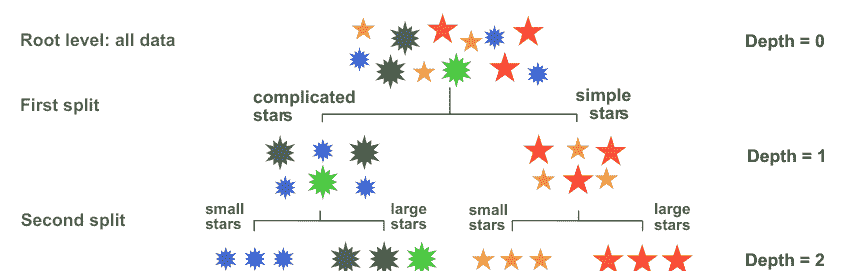

图 6.1：基础树示意图；拆分过程的可视化。

第二步是将两个簇进一步拆分一层。由于只有一个相关变量（大小），二级拆分非常直接。最终，我们的样式化树有四个一致的簇。与因子投资的类比很简单：颜色代表表现：红色代表高表现，蓝色代表平庸表现。特征（恒星的大小和复杂度）被公司特定的属性所取代，例如市值、会计比率等。因此，练习的目的是找到能够将公司拆分为表现良好和表现可能较差的公司的特征。

现在我们转向回归树的技术构建（拆分过程）。我们遵循Breiman等人（1984年）或Hastie等人（2009年）第9章中所阐述的标准文献。给定大小为 \(I\) 的样本 \((y_i, \mathbf{x}_i)\)，回归树寻求能最小化两个子簇内 \(y_i\) 总变化的拆分点。这两个簇不需要具有相同的大小。为此，它分两步进行。首先，它为每个特征 \(x_i^{(k)}\) 找到最佳拆分点（使簇在 \(\mathbf{Y}\) 上同质）。其次，它选择实现最高同质性水平的特征。

回归树中的同质性与方差密切相关。既然我们希望每个簇内的 \(y_i\) 相似，我们就寻求 **最小化其变异性**（或 **离散性**）在每个簇内，然后将两个数字相加。我们不能相加方差，因为这不会考虑到簇的相对大小。因此，我们使用 *总变异*，即方差乘以簇中的元素数量。

下面，记法有些繁琐，因为我们使用了上标 \(k\)（特征的索引），但为了便于理解，可以大体忽略这些上标。第一步是为每个特征找到最佳拆分，即求解 \(\text{argmin}_{c^{(k)}} V_I^{(k)}(c^{(k)})\)，其中

```
\(V_I^{(k)}(c^{(k)}) = \underbrace{\sum_{x_i^{(k)} < c^{(k)}}}_{\text{Total dispersion of first cluster}} (y_i - m_I^{k,-}(c^{(k)}))^2 + \underbrace{\sum_{x_i^{(k)} > c^{(k)}}}_{\text{Total dispersion of second cluster}} (y_i - m_I^{k,+}(c^{(k)}))^2, \quad (6.1)\)
```

where

```
\(m_I^{k,-}(c^{(k)}) = \frac{1}{\#\{i, x_i^{(k)} < c^{(k)}\}} \sum_{\{x_i^{(k)} < c^{(k)}\}} y_i \text{ and}\)
\(m_I^{k,+}(c^{(k)}) = \frac{1}{\#\{i, x_i^{(k)} > c^{(k)}\}} \sum_{\{x_i^{(k)} > c^{(k)}\}} y_i\)
```

这些是Y的平均值，条件是 \(X^{(k)}\) 小于或大于 \(c\)。基数函数 \(\#\{\cdot\}\) 计算其参数的实例数量。对于特征 \(k\)，最佳拆分 \(c^{k,*}\) 因此是两个子组总离散度最小的那个。

最优拆分满足 \(c^{k,*} = \text{argmin}_{c^{(k)}} V_I^{(k)}(c^{(k)})\)。在所有可能的拆分变量中，树将选择不仅在所有拆分上，而且在所有变量上都最小化总离散度的那个变量：\(k^* = \text{argmin}_k V_I^{(k)}(c^{k,*})\)。

在执行一次拆分后，该过程继续在两个新形成的簇上进行。有几个标准可以确定何时停止拆分过程（参见第6.1.3节）。一个简单的标准是为树设置最大层数（深度）。通常的条件是对每个拆分施加预期的最小增益。如果拆分后离散度的减少只是微乎其微且低于指定阈值，则不执行拆分。有关决策树的进一步技术讨论，我们例如参考Hastie等人（2009年）第9.2.4节。

当树构建（训练）完成后，对新实例进行预测很容易。给定其特征值，实例最终会落在树的一个叶节点上。每个叶节点都有一个标签的平均值：这就是预测结果。当然，这仅在标签为数值时有效。我们下面将讨论当标签为分类时发生的变化。

#### 6.1.2 分类的进一步细节

分类练习比回归任务稍复杂一些。最明显的区别在于离散度或异质性的度量。这个损失函数必须考虑到最终输出不是一个简单的数字，而是一个向量。输出 \(\vec{\mathbf{y}}_i\) 的元素数量与标签中的类别数量相同，每个元素都是实例属于相应类别的概率。

例如，如果有3个类别：买入、持有和卖出，那么每个实例都会有一个标签，其列数与类别数量相同。按照我们的示例，买入头寸的一个标签将是 (1,0,0)。关于这个主题的介绍，我们参考第4.5.2节。

在树内部，标签在每个簇级别被聚合。典型的输出看起来像 (0.6,0.1,0.3)：它们是簇内每个类别所占的比例。在这种情况下，该簇有60%的买入、10%的持有和30%的卖出。

损失函数必须考虑到标签的这种多维性。在构建树时，由于目的是偏好同质性，损失会惩罚那些不集中于某一类别的输出。确实，面对 (0.3,0.4,0.3) 这种多元化输出要比 (0.8,0.1,0.1) 这种集中情况难以处理得多。

因此，算法正在寻求纯度：它寻找一种拆分标准，将导致


尽可能纯净的簇，即包含一个非常占优势的类别，或者至少只有少数几个占优势的类别。文献中提出了多种度量指标，所有指标均基于输出生成的比例。如果共有 _J_ 个类别，我们用 _p<sub>j</sub>_ 表示这些比例。对于每个叶子节点，常用的损失函数如下：

- 基尼不纯度指数：\(1 - \sum_{j=1}^J p_j^2\)；
- 错误分类率：\(1 - \max_j p_j\)；
- 熵：\(-\sum_{j=1}^J \log(p_j)p_j\)。

基尼指数实际上就是一减去赫芬达尔指数（后者衡量投资组合的多样化程度）。决策树寻求的是多样化程度最低的划分。基尼指数的最小值为零，当某个 _p<sub>j</sub>_ = 1 且其他所有值均为零时达到。最大值等于 \(1 - 1/J\)，当所有 _p<sub>j</sub>_ = 1/_J_ 时达到。其他两个损失函数也存在类似关系。错误分类率的一个缺点是其不可导性，这解释了为什么通常更偏好另外两种选择。

树生长完成后，新实例会自动归入某个最终叶子节点。该叶子节点与其所包含的各类别比例相关联。通常，在进行预测时，当新实例与某个叶子节点关联时，会选择比例（或概率）最高的类别。

#### 6.1.3 剪枝准则

构建决策树时，划分过程可以持续进行，直到树完全生长，即当满足以下条件时：

- 所有实例都属于独立的叶子节点；和/或
- 所有叶子节点包含的实例基于当前特征集无法再进一步划分。

此时，划分过程无法继续进行。

显然，当预测器相关、数量多且为数值型时，完全生长的树通常能实现近乎完美的拟合。尽管如此，训练样本中细粒度的特殊性对于样本外预测来说关联性不大。例如，能够完美匹配 2000 至 2006 年的模式，在 2007 至 2009 年期间可能就不太有意思了。决策树中最可靠的部分是靠近根节点的部分，因为它们涵盖了大量数据：早期簇中的平均值可信，因为它们是基于大量观测值计算得出的。最初的划分最为重要，因为它们决定了最普遍的模式。最深层的划分仅处理样本的特殊性。

因此，必须限制树的大小以避免过拟合。剪枝有多种方式，都取决于某些特定的准则。我们下面列举其中几种：

- 为每个终端节点（叶子节点）强制设定最小实例数量。这确保每个最终簇包含足够数量的观测值。因此，标签的平均值是可靠的，因为它是基于大量数据计算的。
- 同样，可以强制要求在考虑任何进一步划分之前，簇必须具有最小尺寸。这个准则当然与上述准则相关。
- 要求拟合度的改善达到一定阈值。如果某次划分不能足够降低损失，则可视为不必要。用户指定一个较小的数 \(\epsilon > 0\)，只有当划分后的损失小于划分前损失的 \(1 - \epsilon\) 倍时，该划分才会被验证通过。
- 限制树的深度。深度定义为根节点到树中任意叶子节点之间的最大划分次数。

在下面的示例中，我们同时实现所有这些准则，但通常最多使用两种即可。

#### 6.1.4 代码与解读

我们先从一个简单的决策树及其解读开始。我们使用 `rpart` 包及其绘图引擎 `rpart.plot`。标签是未来 1 个月的回报，特征是样本中所有可用的预测变量。决策树在完整样本上进行训练。

```
library(rpart)          # Tree package
library(rpart.plot)       # Tree plot package
formula <- paste("RIM_USd ~", paste(features, collapse = " + ")) # Defines the model
formula <- as.formula(formula) # Forcing formula object
fit_tree <- rpart(formula,
                  data = data_ml,        # Data source: full sample
                  minbucket = 3500,      # Min nb of obs required in each terminal node (leaf)
                  minsplit = 8000,       # Min nb of obs required to continue splitting
                  cp = 0.0001,           # Precision: smaller = more leaves
                  maxdepth = 3           # Maximum depth (i.e. tree levels)
                  )
rpart.plot(fit_tree)      # Plot the tree
```

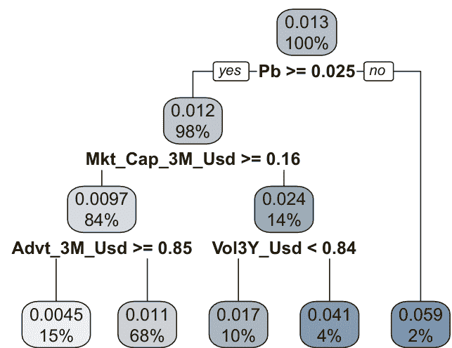

**FIGURE 6.2:** 基于特征的简单决策树。因变量是未来 1 个月的回报。

树的表示通常存在一种惯例。在每个节点，一个条件用布尔表达式描述划分。如果表达式为 **true**，则实例进入 **左簇**；否则，它进入 **右** 簇。对于完整样本，该决策树（图 6.2）的初始划分是根据市净率进行的。如果实例的 Pb 分数（或数值）高于 0.025，则该实例被放入左侧桶；否则，它进入 **右侧桶**。

在每个节点，有两个重要指标。第一个是簇中标签的平均值，第二个是簇中实例的比例。在树的顶部，所有实例（100%）都存在，平均未来 1 个月回报为 1.3%。下一层级，左簇明显最为拥挤，约 98% 的观测值平均回报为 1.2%。右簇要小得多（2%），但集中了平均回报更高（5.9%）的实例。这可能是样本的特殊性。

划分过程在每个节点以类似方式继续，直到满足某个条件（此处通常是：达到最大深度）。颜色编码平均回报：从白色（低回报）到蓝色（高回报）。平均回报最低的最左侧簇包含满足以下所有条件的公司：

- Pb 分数高于 0.025；
- 3 个月市值得分高于 0.16；
- 过去 3 个月平均每日成交量得分高于 0.085。

请注意，决策树的一个特性是簇大小可能存在异质性。有时，少数几个簇聚集了几乎所有的观测值，而少数小组则包含一些异常值。这不是决策树的理想属性，因为小组更可能是偶然现象，且可能无法在样本外推广。

这就是为什么我们在构建决策树时施加了限制。第一个限制（代码中的 minbucket = 3500）要求每个簇至少包含 3500 个实例。第二个限制（minsplit）进一步要求，要继续划分过程，簇必须包含至少 8000 个观测值。这些值在逻辑上取决于训练样本的大小。代码中的 cp = 0.0001 参数要求任何划分必须将损失降低到划分前值的 0.9999 倍以下。最后，最大深度为三基本上意味着从决策树根节点到任何终端叶子节点之间最多只有三次划分。

决策树的复杂度（由终端叶子节点数量衡量）是 minbucket、minsplit 和 cp 的递减函数，也是最大深度的递增函数。

模型训练完成后（即决策树生长完成），对任何实例的预测就是该实例应落入的簇内标签的平均值。

```
predict(fit_tree, data_ml[1:6, ]) # Test (prediction) on the first six instances of the sample
## 1 2 3 4 5 6
## 0.01088066 0.01088066 0.01088066 0.01088066 0.01088066 0.01088066
```

根据图表，我们立即得出结论：前六个实例都属于第二个簇（从左侧开始计数）。

作为对最初几次划分的验证，我们绘制了基于市值、过去回报和交易量的未来回报平滑平均值图。

```
data_ml %>% ggplot() +
stat_smooth(aes(x = Mkt_Cap_3M_Usd, y = R1M_Usd, color = "Market Cap"), se = FALSE) +
stat_smooth(aes(x = Pb, y = R1M_Usd, color = "Price-to-Book"), se = FALSE) +
stat_smooth(aes(x = Advt_3M_Usd, y = R1M_Usd, color = "Volume"), se = FALSE) +
xlab("Predictor") + coord_fixed(11) + labs(color = "Characteristic")
```

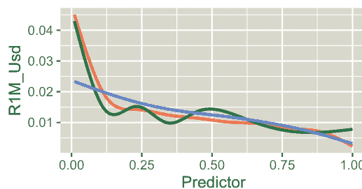

**FIGURE 6.3:** 基于市值、市净率和波动率得分的未来 1 个月平均回报。

该图表显示了基于市值和市净率的簇的相关性。对于这两个特征的低得分值，平均回报较高（曲线左侧接近月度 +4%）。与成交量等特征相比，这种模式更为明显。

最后，我们在测试集上评估单棵决策树的预测质量（决策树在训练集上生长）。我们使用一棵更深的树，最大深度为五。


fit_tree2 <- rpart(formula,
  data = training_sample,
  minbucket = 1500,
  minsplit = 4000,
  cp = 0.0001,
  maxdepth = 5
)
mean((predict(fit_tree2, testing_sample) - testing_sample$R1M_Usd)^2) # MSE

## [1] 0.03700039

mean(predict(fit_tree2, testing_sample) * testing_sample$R1M_Usd > 0) # Hit ratio

## [1] 0.5416619

均方误差通常难以解释。将回报上的误差映射到投资决策的影响并不容易。命中率是一个更直观的指标，因为它评估了正确猜测（进而带来盈利投资）的比例。显然，它并不完美：55%的小幅收益可能会被45%的重大损失所抵消。尽管如此，它是一个流行的指标，而且它对应于二元分类练习中常计算的常规准确度量。在这里，0.542的准确度是令人满意的。即使任何高于50%的数字看起来都有价值，也不应忘记交易成本会削减收益。因此，基准阈值可能至少在52%。

### 6.2 随机森林

虽然树模型能够提供 **Y** 和 **X** 之间关系的直观表示，但可以通过组合的简单思路来改进它们，即将预测工具 *结合*（这一**模型聚合**的主题在第11章中以更一般且更详细的方式讨论）。

#### 6.2.1 原理

大多数时候，当手头有多个建模选项时，并不明显哪个单独模型是最好的，因此组合似乎是朝着预测误差多样化方向的合理路径（当误差之间不存在过高相关性时）。模型多样化的一些理论基础由 Schapire (1990) 奠定。

后来 Ho (1995) 提出了更实际的考虑因素，更重要的是，Breiman (2001) 是随机森林的主要参考文献。从简单树创建多个预测器有两种方式，随机森林结合了这两种方式：

- 首先，模型可以在相似但不同的数据集上进行训练。实现这一点的一种方法是通过自助采样（bootstrap）：实例有放回或无放回地重新采样（对于每棵单独的树），每次构建新树时都会产生新的训练数据。
- 其次，可以通过削减预测器数量来改变数据。基于不同特征集构建替代模型。用户选择保留多少个特征，然后算法在每次尝试时随机选择这些特征。

因此，生长许多不同的树变得简单，而集成只是所有树的**加权组合**。通常，使用等权重，这是一种不可知的稳健选择。我们在下图6.4中说明简单组合（也称为bagging）的思想。终端预测只是所有中间预测的均值。

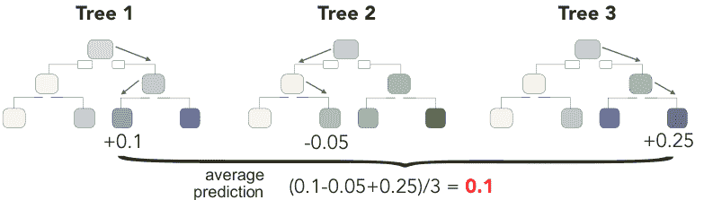

图 6.4：通过随机森林结合树输出。

由于随机森林建立在自助采样（bootstrapping）的思想之上，它们比简单树更高效。它们被 Ballings et al. (2015)、Patel et al. (2015a)、Krauss et al. (2017) 和 Huck (2019) 使用，并且在这些论文中显示出很好的表现。随机森林的原始理论特性在 Breiman (2001) 中针对分类树进行了展示。在分类练习中，决策是通过投票做出的：每棵树为特定类别投票，得票最多的类别获胜（平局时可能进行随机选择）。Breiman (2001) 定义边际函数为

$$mg = M^{-1} \sum_{m=1}^M 1_{\{h_m(\mathbf{x})=y\}} - \max_{j \neq y} \left( M^{-1} \sum_{m=1}^M 1_{\{h_m(\mathbf{x})=j\}} \right),$$

其中左部分是基于 \(M\) 棵树 \(h_m\) 对正确类别的平均投票数（基于 **x** 的模型 \(h_m\) 与数据值 \(y\) 匹配）。右部分是任何其他类别的最大平均值。边际反映了集成森林能够正确分类的信心。泛化误差是 \(mg\) 严格为负的概率。Breiman (2001) 表明，聚合的不准确度（按泛化误差衡量）由 \(\bar{\rho}(1-s^2)/s^2\) 界定，其中

- \(s\) 是单个分类器的强度（平均质量\(^2\)），且
- \(\bar{\rho}\) 是学习者之间的平均相关性。

值得注意的是，Breiman (2001) 还表明，随着树的数量趋向无穷，不准确度会收敛到某个有限数，这解释了为什么随机森林不易过拟合。

虽然 Breiman (2001) 的原始论文专门针对分类模型，但此后许多文章已探讨了回归树的问题。我们将感兴趣的读者引向 Biau (2012) 和 Scornet et al. (2015)。最后，关于分类集成的进一步结果可以在 Biau et al. (2008) 中获得，我们还提到了 Denis et al. (2014) 的简短综述论文，该论文总结了该领域的最新结果。

\(^2\)强度被衡量为平均边际，即只有一棵树时 \(mg\) 的平均值。

#### 6.2.2 代码与结果

存在多种随机森林实现。为求简单，我们选择使用原始 R 库，但另一个选择可能是由 h2o 开发的那个，它是一个高效的机器学习元环境（用 Java 编写）。

randomForest 的语法遵循许多 ML 库的语法。一些随机森林实现的完整选项列表过大，令人望而却步。3 下面，我们训练一个模型并展示测试样本前 5 个实例的预测结果。

```
library(randomForest)
set.seed(42)
fit_RF <- randomForest(formula,
                 data = training_sample,
                 sampsize = 10000,
                 replace = FALSE,
                 nodesize = 250,
                 ntree = 40,
                 mtry = 30
                 )
predict(fit_RF, testing_sample[1:5, ])
```

```
##    1          2          3          4          5
## 0.009787728 0.012507087 0.008722386 0.009398814 -0.011511758
```

首先，每个实例都有自己的预测，这与简单树模型的结果形成对比。结合许多树会产生定制化预测。请注意，代码块的第二行冻结了随机数生成。确实，随机森林本质上取决于为构建单个学习者而选择的任意实例和特征组合。

在上面的示例中，每个单独的学习者（树）建立在10,000个随机选择的实例上（无放回），每个终端叶（簇）必须至少包含240个元素（观测值）。总共聚合了40棵树，每棵树基于30个随机选择的预测器（来自完整的特征集）构建。

与简单树不同，无法简单地展示学习过程的结果（尽管存在解决方案，见第13.1.1节）。可以提取所有40棵树，但合成可视化是无法实现的。可以通过变量重要性获得简化视图，如第13.1.2节所讨论。

最后，我们可以评估模型的准确性。

```
mean((predict(fit_RF, testing_sample) - testing_sample$R1M_Usd)^2) # MSE
```

```
## [1] 0.03698197
```

```
mean(predict(fit_RF, testing_sample) * testing_sample$R1M_Usd > 0) # Hit ratio
```

```
## [1] 0.5370186
```

MSE小于4%，命中率接近54%，合理地高于50%和52%的阈值。

让我们看看是否可以通过进行分类练习来提高命中率。我们首先在新公式上训练模型（标签为 R1M_Usd_C）。

3参见，例如，http://docs.h2o.ai/h2o/latest-stable/h2o-r/docs/reference/h2o.randomForest.html

```
formula_C <- paste("R1M_Usd_C ~", paste(features, collapse = " + ")) # Defines the model
formula_C <- as.formula(formula_C) # Forcing formula object
fit_RF_C <- randomForest(formula_C, # New formula!
                     data = training_sample, # Data source: training sample
                     sampsize = 20000, # Size of (random) sample for each tree
                     replace = FALSE, # Is the sampling done with replacement?
                     nodesize = 250, # Minimum size of terminal cluster
                     ntree = 40, # Number of random trees
                     mtry = 30 # Number of predictive variables for each tree
                    )
```

然后我们可以评估正确（二元）猜测的比例。

```
mean(predict(fit_RF_C, testing_sample) == testing_sample$R1M_Usd_C) # Hit ratio
```

```
## [1] 0.4979062
```

准确性令人失望。除了训练集和测试集可能存在非常不同的模式之外，这里有两种潜在解释。第一个是样本大小，可能太小。原始训练集有超过200,000个观测值，因此在上述训练规范中我们只保留十个中的一个。因此，我们可能正在忽略相关信息，代价可能很高。第二个原因是预测器的数量，设置为30，即可用总数的三分之一。不幸的是，这为算法选择不太相关的预测器留出了空间。例程默认选择的预测器数量分别用于分类和回归任务，为 $\sqrt{p}$ 和 \(p/3\)。这里 \(p\) 是特征的总数。

### 6.3 提升树：Adaboost

与不可知聚合相比，提升的理念稍微更高级一些。在随机森林中，我们希望通过许多树的多样化来提高模型的整体质量。在提升中，每当添加一棵新树时，都旨在迭代改进模型。提升学习有多种方式，我们介绍两种可以轻松用树实现的方式。第一个（Adaboost，即自适应提升）通过逐渐关注产生最大误差的实例来改进学习过程。第二个（xgboost）是一种灵活的算法，其中每棵新树只专注于最小化训练样本损失。

#### 6.3.1 方法论

Adaboost 的起源可以追溯到 Freund and Schapire (1997) 和 Freund and Schapire (1996)，为了完整起见，我们还提到 Schapire and Freund (2012) 专门关于提升的书籍。这些思想的扩展在 Friedman et al. (2000)（所谓的真实 Adaboost 算法）和 Drucker (1997)（用于回归分析）中提出。Breiman et al. (2004) 推导了理论处理方法。

我们首先直接说明算法的一般结构：


- 设置等权重 $w_i = I^{-1}$;
- 对 $m = 1, \dots, M$ 执行:
  1. 找到一个使加权损失最小的学习器 $l_m$，即 $\sum_{i=1}^I w_i L(l_m(\mathbf{x}_i), \mathbf{y}_i);$
  2. 计算学习器权重
    
    $$a_m = f_a(\mathbf{w}, l_m(\mathbf{x}), \mathbf{y});$$
    
  3. 更新实例权重
    
    $$w_i \leftarrow w_i e^{f_w(l_m(\mathbf{x}_i), y_i)};$$
    
  4. 将 $w_i$ 归一化，使其总和为一。
- 对实例 $\mathbf{x}_i$ 的输出是对 $\sum_{m=1}^M a_m l_m(\mathbf{x}_i)$ 的一个简单函数，
  
  $$
  \tilde{y}_i = f_y \sum_{m=1}^M a_m l_m(\mathbf{x}_i) \quad .
  $$

让我们对算法的步骤进行评论。该表述适用于 Adaboost 的许多变体，我们将在下文指定函数 $f_a$ 和 $f_w$。

- 1. 第一步旨在找到一个（树）学习器 $l_m$，以最小化加权损失。这里基础损失函数 $L$ 基本上取决于任务（回归与分类）。

- 2. 第二步和第三步最为有趣，因为它们是 Adaboost 的核心：它们定义了算法顺序自适应的方式。由于目的是聚合模型，相比于给学习器使用均匀权重，为每个学习器定制权重是一种更精巧的方法。一个自然属性（针对 $f_a$）应该是：产生更小误差的学习器应具有更大的权重，因为它更准确。

- 3. 第三步是更改观测值的权重。在此情况下，由于模型旨在改进学习过程，$f_w$ 的构建旨在赋予当前模型表现不佳（即产生最大误差）的观测值更多权重。因此，下一个学习器将被激励更加关注这些病态案例。

- 4. 第四步是一个简单的缩放过程。

在表 6.1 中，我们详细介绍了文献中使用的两种加权函数示例。对于原始 Adaboost（Freund and Schapire (1996)，Freund and Schapire (1997)），标签为二元标签，取值仅为 +1 和 -1。第二个示例源自 Drucker (1997)，专用于回归分析（带有实数标签）。感兴趣的读者可参阅 Schapire (2003) 和 Ridgeway et al. (1999) 中的其他可能性。

表 6.1: Adaboost 类似算法的函数示例。

| | 二元分类（原始 Adaboost） | 回归（Drucker (1997)） |
|---|---|---|
| 个体误差 | \(\epsilon_i = \mathbf{1}_{\{y_i \neq l_m(\mathbf{x}_i)\}}\) | \(\epsilon_i = \frac{|y_i - l_m(\mathbf{x}_i)|}{\max_i |y_i - l_m(\mathbf{x}_i)|}\) |
| 通过 \(f_a\) 的学习器权重 | \(f_a = \log \frac{1-\epsilon}{\epsilon}\)，其中 \(\epsilon = I^{-1} \sum_{i=1}^I w_i \epsilon_i\) | \(f_a = \log \frac{1-\epsilon}{\epsilon}\)，其中 \(\epsilon = I^{-1} \sum_{i=1}^I w_i \epsilon_i\) |
| 通过 \(f_w(i)\) 的实例权重 | \(f_w = f_a \epsilon_i\) | \(f_w = f_a \epsilon_i\) |
| 通过 \(f_y\) 的输出函数 | \(f_y(x) = \text{sign}(x)\) | 预测的加权中位数 |

让我们对原始 Adaboost 规范进行评论。基本误差项 \(\epsilon_i = \mathbf{1}_{\{y_i \neq l_m(\mathbf{x}_i)\}}\) 是一个虚拟数字，指示预测是否正确（我们回顾一下，只有两个可能的值，+1 和 -1）。平均误差 \(\epsilon \in [0, 1]\) 仅仅是个体误差的加权平均，而方程 (6.2) 中定义的第 \(m\) 个学习器的步长由 \(a_m = \log \frac{1-\epsilon}{\epsilon}\) 给出。函数 \(x \mapsto \log((1-x)^{-1})\) 在 \([0, 1]\) 上递减，并在 \(x = 1/2\) 处切换符号（从正变负）。因此，当平均误差较小时，学习器具有较大的正权重，但当误差变大时，学习器甚至可以获得负权重。实际上，阈值 \(\epsilon > 1/2\) 表明学习器有超过 50% 的时间是错误的。显然，这表明存在问题，甚至应该丢弃该学习器。

实例权重的变化遵循类似的逻辑。新权重与 \(w_i \frac{1-\epsilon}{\epsilon}\) 成正比。如果预测正确且 \(\epsilon_i = 0\)，则权重不变。如果预测错误且 \(\epsilon_i = 1\)，则权重根据平均误差 \(\epsilon\) 进行调整。如果误差较小且学习器高效（\(\epsilon < 1/2\)），则 \((1-\epsilon)/\epsilon > 1\)，实例的权重会增加。这意味着在下一轮中，学习器将需要更多地关注实例 \(i\)。

最后，模型的最终预测对应于个体预测加权和的符号：如果和为正，模型将预测 +1，否则将预测 -1。和为零的概率可以忽略不计。对于数值标签，过程略显复杂，有关如何进行的更多细节，我们参阅 Drucker (1997) 第 3 节第 8 步。

我们以关于实例加权的一句话结束本演示。处理此主题有两种方法。第一种方法在损失函数层面工作。对于回归树，方程 (6.1) 自然推广为

```
\(V_N^{(k)}(c^{(k)}, \mathbf{w}) = \sum_{x_i^{(k)} < c^{(k)}} w_i \left( y_i - m_N^{k,-}(c^{(k)}) \right)^2 + \sum_{x_i^{(k)} > c^{(k)}} w_i \left( y_i - m_N^{k,+}(c^{(k)}) \right)^2 ,\)
```

因此，具有较大权重 \(w_i\) 的实例将对其簇的离散度贡献更多。对于分类目标，变化更为复杂，我们参阅 Ting (2002) 中的一个实例加权树生长算法示例。该想法与通过损失矩阵改变误分类风险密切相关（参见 Hastie et al. (2009) 第 9.2.4 节）。强制实施实例加权的第二种方法是通过随机采样。如果实例具有权重 $w_i$，则学习器的训练可以在服从 $w_i$ 分布的随机抽取样本上进行。在这种情况下，具有较大权重的实例在训练样本中被代表的机会更多。原始 Adaboost 算法依赖于此方法。

#### 6.3.2 示例

下面，我们测试原始 Adaboost 分类器的一个实现。因此，我们使用变量 R1M_Usd_C 并更改模型公式。由于 Adaboost 在大型数据集上的计算成本很高，因此我们使用较小的样本，并且只设置三次迭代。

```
library(fastAdaBoost)
subsample <- (1:52000)*4
fit_adaboost_C <- adaboost(formula_C,
                           data = data.frame(training_sample[subsample,]),
                           nIter = 3)
# Adaboost package
# Target small sample
# Model spec.
# Data source
# Number of trees
```

最后，我们评估分类器的性能。

```
mean(testing_sample$R1M_Usd_C == predict(fit_adaboost_C, testing_sample)$class)
```

```
## [1] 0.5028202
```

准确率（根据命中率评估）显然不令人满意。这可能是因为我们对训练施加了限制（样本较小且只有三棵树）。

### 6.4 增强树：极端梯度增强

树增强的背后思想，部分由 Mason et al. (2000)、Friedman (2001) 和 Friedman (2002) 推广。在此情况下，学习者（预测工具）的组合不像随机森林那样是不可知的，而是在学习者层面进行调整（或优化）。在每个步骤 s 中，模型之和 \( M_S = \sum_{s=1}^{S-1} m_s + m_S \) 是这样的，即最后一个学习者 \( m_S \) 是专门设计来减少 \( M_S \) 在训练样本上的损失的。

下面，我们密切遵循 Chen and Guestrin (2016) 的原始工作，因为他们的算法能产生非常准确的预测，并且高度可定制。我们在实证部分使用的就是他们的实现。另一个流行的替代方案是 lightgbm（参见 Ke et al. (2017)）。XGBoost 寻求最小化的目标是

```
\( O = \underbrace{\sum_{i=1}^{I} \text{loss}(y_i, \tilde{y}_i)}_{\text{error term}} + \underbrace{\sum_{j=1}^{J} \Omega(T_j)}_{\text{regularization term}} \) 。
```

第一项（对所有实例）衡量真实标签与模型输出之间的距离。第二项（对所有树）惩罚过于复杂的模型。


为简化起见，我们提出使用最简单的损失函数 loss(y, \(\tilde{y}\)) = \((y - \tilde{y})^2\) 进行完整推导，因此：

\(O = \sum_{i=1}^I (y_i - m_{J-1}(\mathbf{x}_i) - T_J(\mathbf{x}_i))^2 + \sum_{j=1}^J \Omega(T_j).\)

#### 6.4.1 管理损失

假设我们已经构建了所有树 \(T_j\)（其中 \(j=1, \dots, J-1\)，因此也构建了模型 \(M_{J-1}\)）：如何最优地选择树 \(T_J\)？我们重写

\(O = \sum_{i=1}^I (y_i - m_{J-1}(\mathbf{x}_i) - T_J(\mathbf{x}_i))^2 + \sum_{j=1}^J \Omega(T_j)\)

\(= \sum_{i=1}^I \{y_i^2 + m_{J-1}(\mathbf{x}_i)^2 + T_J(\mathbf{x}_i)^2\} + \sum_{j=1}^{J-1} \Omega(T_j) + \Omega(T_J) \quad \text{(squared terms + penalization)}\)

\(- 2 \sum_{i=1}^I \{y_i m_{J-1}(\mathbf{x}_i) + y_i T_J(\mathbf{x}_i) - m_{J-1}(\mathbf{x}_i) T_J(\mathbf{x}_i))\} \quad \text{(cross terms)}\)

\(= \sum_{i=1}^I \{-2y_i T_J(\mathbf{x}_i) + 2m_{J-1}(\mathbf{x}_i) T_J(\mathbf{x}_i) + T_J(\mathbf{x}_i)^2\} + \Omega(T_J) + c\)

步骤 \(J\) 中已知的所有项（即索引为 \(J-1\) 的项）都会消失，因为它们不进入优化方案。它们被包含在常数 \(c\) 中。

使用二次损失时，事情相当简单。对于更复杂的损失函数，则使用泰勒展开（参见原论文）。

#### 6.4.2 惩罚项

为了继续推进，我们需要指定惩罚项的工作方式。对于给定的树 \(T\)，我们通过 \(T(x) = w_{q(x)}\) 指定其结构，其中 \(w\) 是某个叶节点的输出值，\(q(\cdot)\) 是将输入映射到其最终叶节点的函数。这种编码在图 6.5 中有所展示。函数 \(q\) 指示路径，而向量 \(\mathbf{w} = w_i\) 编码终端叶节点的值。

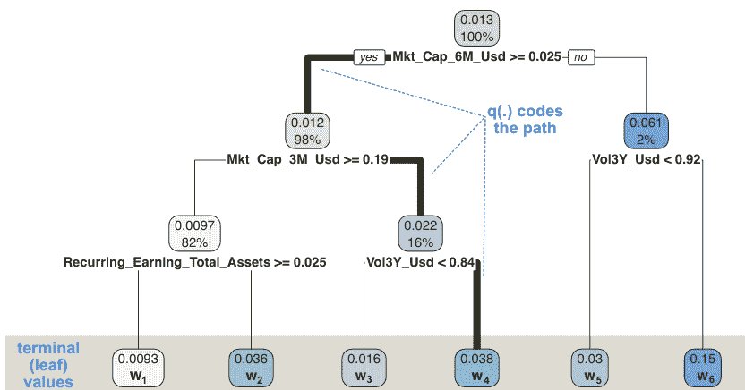

**图 6.5：** 决策树编码：结构与节点和叶值的分解。

我们用 \( l = 1, \dots, L \) 表示树叶节点的索引。在 XGBoost 中，复杂度定义为：

```
\(\Omega(T) = \gamma L + \frac{\lambda}{2} \sum_{l=1}^L w_l^2,\)
```

其中

- 第一项惩罚 **叶节点总数**；
- 第二项惩罚 **输出值的幅度**（这有助于降低方差）。

第一项惩罚项降低树的深度，而第二项则缩小来自最新树的调整幅度。

#### 6.4.3 聚合

我们对目标函数的两部分（损失和惩罚项）进行聚合。我们用 \( I_l \) 表示属于叶节点 \( l \) 的实例索引集合。那么，

```
O = 2 \sum_{i=1}^I \left\{ -y_i T_J(\mathbf{x}_i) + m_{J-1}(\mathbf{x}_i) T_J(\mathbf{x}_i) + \frac{T_J(\mathbf{x}_i)^2}{2} \right\} + \gamma L + \frac{\lambda}{2} \sum_{l=1}^L w_l^2
= 2 \sum_{i=1}^I \left\{ -y_i w_{q(\mathbf{x}_i)} + m_{J-1}(\mathbf{x}_i) w_{q(\mathbf{x}_i)} + \frac{w_{q(\mathbf{x}_i)}^2}{2} \right\} + \gamma L + \frac{\lambda}{2} \sum_{l=1}^L w_l^2
= 2 \sum_{l=1}^L w_l \sum_{i \in I_l} (-y_i + m_{J-1}(\mathbf{x}_i)) + \frac{w_l^2}{2} \sum_{i \in I_l} 1 + \frac{\lambda}{2} \sum_{l=1}^L w_l^2 + \gamma L
```

该函数形式为 \(aw_l + \frac{b}{2}w_l^2\)，其最小值 \(-\frac{a^2}{2b}\) 取于 \(w_l = -a/b\)。因此，将 #(.) 记为集合中元素个数的基数函数，

```
\(\rightarrow \quad w_l^* = \frac{\sum_{i \in I_l}(y_i - m_{J-1}(\mathbf{x}_i))}{1 + \frac{\lambda}{2} \#\{i \in I_l\}}, \text{ so that} \tag{6.5}\)

\(O_L(q) = -\frac{1}{2} \sum_{l=1}^L \frac{\sum_{i \in I_l}(y_i - m_{J-1}(\mathbf{x}_i))^2}{1 + \frac{\lambda}{2} \#\{i \in I_l\}} + \gamma L,\)
```

这里我们在目标函数中加入了对 \(q\)（树的结构）和 \(L\)（叶节点数量）的依赖。确实，树的元形状仍有待确定。

#### 6.4.4 树结构

最终问题：**树结构**！让我们退后一步。在构建简单回归树时，每个节点的输出值等于该节点（或簇）内标签的平均值。当添加新树以降低损失时，节点值必须完全不同地计算，这就是方程 (6.5) 的目的。

尽管如此，迭代树的生长遵循与简单树相似的路径。必须测试特征，以选择能为每个给定分割最小化目标函数的特征。那么最终问题是：最佳深度是多少，何时停止生长树？该方法是：

- 按节点逐个进行；
- 对于每个节点，检查分割是否有用（从目标函数角度）：

```
\(\text{Gain} = \frac{1}{2} (\text{Gain}_L + \text{Gain}_R - \text{Gain}_O) - \gamma\)
```

- 每个增益都是根据每个桶（簇）中的实例计算的：

```
\(\text{Gain}_{\mathcal{X}} = \frac{\sum_{i \in I_\mathcal{X}}(y_i - m_{J-1}(\mathbf{x}_i))^2}{1 + \frac{\lambda}{2} \#\{i \in I_\mathcal{X}\}},\)
```

其中 \(I_\mathcal{X}\) 是簇 \(\mathcal{X}\) 内的实例集合。

\(\text{Gain}_O\) 是原始增益（不分割），而 \(\text{Gain}_L\) 和 \(\text{Gain}_R\) 分别是左簇和右簇的增益。关于上述公式中的 \(-\gamma\) 调整，有句话要说：新增叶节点单位数为一（两个新叶节点减去一个旧叶节点）！这导致一个叶节点的差异；因此 \(\Delta L = 1\)，每个新叶节点的惩罚强度等于 \(\gamma\)。

最后，我们强调 XGBoost 还应用了 **学习率**：每棵新树都由因子 \(\eta\) 缩放，其中 \(\eta \in [0, 1]\)。在每一步提升后，新树 \(T_J\) 的值将乘以 \(\eta\) 进行折扣。这非常有用，因为对 100 棵优化树的纯粹聚合是过拟合训练样本的最佳方式。

#### 6.4.5 扩展

有若干额外功能可用于进一步防止提升树过拟合。确实，给定足够数量的树时，聚合能够非常好地拟合训练样本，但可能无法在样本外良好泛化。

遵循 Srivastava 等人（2014）的开创性工作，Rashmi 和 Gilad-Bachrach（2015）提出了 DART（用于加法回归树的脱校）模型。其思想是在训练期间省略指定数量的树。从模型中移除的树是随机选择的。完整规范可在 https://xgboost.readthedocs.io/en/latest/tutorials/dart.html 找到，并且我们在下面的第一个示例中使用 10% 的脱校率。

单调性约束是 xgboost 和 lightgbm 中都具备的另一个元素。有时，预期某个特定特征对标签具有单调影响。例如，如果有人深信动量，则过去的回报应该对未来的回报产生递增影响（在股票横截面上）。

鉴于分割算法的递归性质，可以选择何时进行分割（根据特定变量）以及何时不进行。在图 6.6 中，我们展示了算法的运行方式。所有分割都根据相同的特征进行。对于第一个分割，事情很简单，因为只需验证每个簇的平均值是否按正确方向排序。对于下面发生的分割，事情则更复杂。确实，所有上方分割设定的平均值很重要，因为它们为下层分割中未来平均值的可接受值提供了边界。如果分割违反这些边界，则会被忽略，并改为选择另一个变量。

#### 6.4.6 代码与结果

在本节中，我们使用 XGBoost 库训练模型。其他选项包括 catboost、gbm、lightgbm 以及 h2o 自身的提升机版本。与许多其他软件包不同，XGBoost 函数需要特定的语法和专用格式。因此，第一步是相应地封装数据。

此外，由于训练时间可能很长，我们遵循 Coqueret 和 Guida（2020）的建议缩短训练样本。我们只保留 40% 最极端的观察值（按标签值计算：前 20% 和后 20%），并使用小型特征子集。在所有

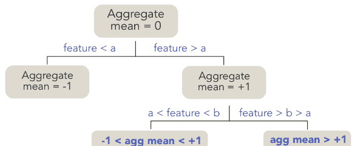

**图 6.6：** 强制单调性约束。约束在底部叶节点中以粗体蓝色显示。


### 6.4 增强树：极端梯度提升

本书中专门用于增强树的编码部分，模型将仅使用 7 个特征进行训练。

```
library(xgboost) # The package for boosted trees
train_features_xgb <- training_sample %>%
  filter(RIM_USd < quantile(RIM_USd, 0.2) |
       RIM_USd > quantile(RIM_USd, 0.8)) %>% # Extreme values only!
dplyr::select(all_of(features_short)) %>% as.matrix() # Independent variable
train_label_xgb <- training_sample %>%
  filter(RIM_USd < quantile(RIM_USd, 0.2) |
       RIM_USd > quantile(RIM_USd, 0.8)) %>%
  dplyr::select(RIM_USd) %>% as.matrix() # Dependent variable
train_matrix_xgb <- xgb.DMatrix(data = train_features_xgb,
                  label = train_label_xgb) # XGB format!
```

第二步（可选）是确定我们要施加的单调性约束。为简单起见，我们将仅对以下三个约束进行强制：

- 1. 市值（负，因为大型公司在尺寸异常下回报较小）；
- 2. 市净率（负，因为高估公司在价值异常下回报也较小）；
- 3. 过去年度收益率（正，因为赢家在动量异常下优于输家）。

```
mono_const <- rep(0, length(features)) # Initialize the vector
mono_const[which(features == "Mkt_Cap_12M_USd")] <- (-1) # Decreasing in market cap
mono_const[which(features == "Pb")] <- (-1) # Decreasing in price-to-book
mono_const[which(features == "Mom_11M_USd")] <- 1 # Increasing in past return
```

第三步是在格式化的训练数据上训练模型。我们包含单调性约束和 DART 特性（通过 rate_drop）。就像随机森林一样，增强树可以在数据子集上单独生长树：既可以按行（通过选择随机实例），也可以按列（通过保留较小比例的预测变量）。这些选项在函数参数中通过 subsample 和 colsample_bytree 实现。

```
fit_xgb <- xgb.train(data = train_matrix_xgb, # Data source
                  eta = 0.3, # Learning rate
                  objective = "reg:linear", # Objective function
                  max_depth = 4, # Maximum depth of trees
                  subsample = 0.6, # Train on random 60% of sample
                  colsample_bytree = 0.7, # Train on random 70% of predictors
                  lambda = 1, # Penalisation of leaf values
                  gamma = 0.1, # Penalisation of number of leaves
                  nrounds = 30, # Number of trees used (rather low here)
                  monotone_constraints = mono_const, # Monotonicity constraints
                  rate_drop = 0.1, # Drop rate for DART
                  verbose = 0 # No comment from the algo
                  )
```

最后，我们评估模型的性能。请注意，在此之前，需要对测试样本进行适当的格式化。

```
xgb_test <- testing_sample %>%
 dplyr::select(all_of(features_short)) %>%
 as.matrix()
 mean((predict(fit_xgb, xgb_test) - testing_sample$RIM_Usd)^2) # MSE
```

[1] 0.03908855

```
mean(predict(fit_xgb, xgb_test) * testing_sample$RIM_Usd > 0) # Hit ratio
```

[1] 0.5077626

该性能与其他预测工具观察到的性能相当。作为最后的练习，我们展示在 XGBoost 下的一个分类任务实现。只有标签发生变化。在 XGBoost 中，标签必须编码为整数，且必须恰好从零开始。在 R 中，因子在数值上编码为从一开始的整数，因此映射很简单。

```
train_label_C <- training_sample %>%
 filter(RIM_Usd < quantile(RIM_Usd, 0.2) |
 RIM_Usd > quantile(RIM_Usd, 0.8)) %>% # Either low 20% returns
 dplyr::select(RIM_Usd_C)
 train_matrix_XC <- xgb.DMatrix(data = train_features_xgb,
 label = as.numeric(train_label_C == "TRUE")) # XGB format!
```

处理类别时，损失函数通常是 softmax 函数（参见第 1.1 节）。

```
fit_xgb_C <- xgb.train(data = train_matrix_XC, # Data source (pipe input)
 eta = 0.8, # Learning rate
 objective = "multi:softmax", # Objective function
 num_class = 2, # Number of classes
 max_depth = 4, # Maximum depth of trees
 nrounds = 10, # Number of trees used
 verbose = 0 # No warning message
 )
```

接下来，我们可以评估模型质量。我们将预测值调整为真实标签的值，并计算准确预测的比例。

```
mean(predict(fit_xgb_C, xgb_test) + 1 == as.numeric(testing_sample$RIM_Usd_C)) # Hit ratio
```

[1] 0.495613

与之前的分类尝试一致，结果令人失望，仿佛切换到二进制标签导致了信息损失。

#### 6.4.7 实例加权

在计算总损失时，可以引入一些灵活性并为实例分配权重：

```
O = \sum_{i=1}^I W_i \times loss(y_i, \hat{y}_i) + \sum_{j=1}^J \Omega(T_j) .
 \text{weighted error term} \qquad \text{regularization term (unchanged)}
```

### 6.6 讨论

在因子投资中，这些权重很大程度上可以取决于特征值（\(W_i = \mathcal{W}_i(\mathbf{x}_i)\)）。例如，对于某个特定特征 \(\mathbf{x}^k\)，权重可以是递增的，从而赋予该特征值较高的资产更多重要性（例如，与成长股相比，价值股受到青睐）。另一个选择是在特征值变得更极端时增加权重（深度价值股和深度成长股具有较大权重）。如果特征是均匀分布的，权重可以简单地设为 \(\mathcal{W}_i(x_i^k) \propto |x_i^k - 0.5|\)：中位数为 0.5 的公司权重为零，随着特征值向 0 或 1 偏移，权重增加。对实例指定权重会使学习过程产生偏差，就像 Black 和 Litterman (1992) 引入的观点会影响资产配置过程一样。区别在于，这种推动是在组合选择问题之前很久就进行的。

```
inst_weights <- runif(nrow(train_features_xgb)) # Random weights
inst_weights <- inst_weights / sum(inst_weights) # Normalization
train_matrix_xgb <- xgb.DMatrix(data = train_features_xgb,
                                label = train_label_xgb,
                                weight = inst_weights) # Weights!
```

然后，在后续阶段，优化将使用这些硬编码权重进行。分割点可以改变（通过簇中的总加权损失），终端权重值（6.5）也会受到影响。

### 6.5 讨论

本章以对预测引擎选择的讨论作为结尾，着眼于投资组合构建。正如第 2 章所述，ML 信号只是投资策略构建的一个阶段。在某个时刻，该信号必须转换为投资组合权重。

从这个角度来看，简单树似乎是次优的。树深度通常设置在 3 到 6 之间。这意味着最多只有 8 到 64 个终端叶节点，且可能存在非常不平衡的簇。存在一个包含 20% 到 30% 样本的簇的可能性很高。这意味着在预测时，大约 20% 到 30% 的实例会被赋予相同的值。

另一方面，投资组合政策通常有固定数量的资产。因此，拥有信号相同的资产无法进行区分和选择要纳入投资组合的子集。例如，如果政策要求正好 100 只股票，而 105 只股票具有相同的信号，则该信号无法用于选择目的。它必须与外生信息（例如均值 - 方差配置中的协方差矩阵）相结合。

总体而言，这是偏好集成模型的原因之一。当学习器数量足够大（5 个几乎就足够了）时，资产的预测将是唯一且针对这些资产量身定制的。然后，就可以通过信号进行区分，只选择那些信号最有利的资产。在实践中，随机森林和增强树可能是最佳选择。


### 6.6 编码练习

- 1. 使用上述分块中的公式，在训练样本上构建两个仅有一个参数 cp 的简单树。对于第一棵树，取 cp=0.001，对于第二棵树取 cp=0.01。在测试样本上评估两个模型的性能。评论。

- 2. 使用较小的预测变量集，在训练样本上构建随机森林。将学习限制在30,000个实例和超过5个预测变量上。构建包含10、20、40、80和160棵树的森林，并在训练样本上评估其性能。在这种情况下，复杂性是否值得，为什么？

- 3. 根据日历年份2008年的数据绘制一棵树，然后是2009年的数据。比较。

## 7 神经网络

神经网络（NNs）是一个极其丰富和复杂的主题。在本章中，我们介绍了NNs最简单架构背后的简单思想和概念。关于NN特性的更详尽论述，我们参考Haykin (2009)、Du and Swamy (2013)和Goodfellow et al. (2016)的专著。后者可免费在线获取：www.deeplearningbook.org。作为实用入门，我们推荐Chollet (2017)的优秀书籍。

首先，我们简要评论“神经网络”这一称谓。大多数专家认为该术语选得不太好，因为NNs与人脑的工作方式关系不大（而我们对人脑了解也不多）。这解释了为何它们常被称为“人工神经网络”——我们不使用该形容词是为了记号简洁。因为我们认为这更为恰当，我们引用François Chollet给出的NNs定义：“可微的、参数化的几何函数链，通过梯度下降进行训练（梯度通过链式法则获得）”。

金融领域早期的神经网络文献包括Bansal and Viswanathan (1993)和Eakins et al. (1998)。两者的目标截然不同。在前一项中，作者旨在为定价核估计一个**非线性形式**。在后一项中，目的是识别和量化机构股票投资与公司属性之间的关系（这是向因子投资的早期贡献）。一篇早期综述（Burrell and Boralín (1997)）列出了1990年代NNs的金融应用。更近期，Sezer et al. (2019)、Jiang (2020)和Lim and Zohren (2020)调查了利用深度学习模型预测金融时间序列的尝试，主要由计算机科学学者完成。

NNs在金融市场中的纯预测能力是一个热门主题，我们还引用例如Kimoto et al. (1990)、Enke and Thawornwong (2005)、Zhang and Wu (2009)、Guresen et al. (2011)、Krauss et al. (2017)、Fischer and Krauss (2018)、Aldridge and Avellaneda (2019)和Soleymani and Paquet (2020)。¹最后一篇参考文献甚至将多种类型的NNs嵌入到一个涵盖性增强学习结构中。此列表远非详尽。在金融经济学领域，关于神经网络的最新研究包括：

- Feng et al. (2019)使用神经网络寻找最能解释股票收益率横截面的因子。
- Gu et al. (2020b)将公司属性和宏观经济变量映射到未来收益。这创建了一个强大的预测工具，能够非常准确地预测未来收益。
- Chen et al. (2020)使用复杂的神经网络结构估计定价核。

¹神经网络最近也已应用于衍生品定价和对冲，例如见Buehler et al. (2019)和Andersson and Oosterlee (2020)的研究，以及Ruf and Wang (2019)的综述。限价订单簿建模也是神经网络应用的一个不断扩展的领域（Sirignano and Cont (2019)、Wallbridge (2020)）。

### 7.1 原始感知机

NNs的起源至少可以追溯到Rosenblatt (1958)。其目标是二元分类。为简单起见，让我们假设输出为{0 = 不投资}与{1 = 投资}（例如，源自收益，负向与正向）。根据当前命名法，感知机可以定义为一种激活线性映射。模型如下：

```
f(x) = \begin{cases} 1 & \text{if } \mathbf{x}'\mathbf{w} + b > 0 \\ 0 & \text{otherwise} \end{cases}
```

权重向量**w**对变量进行缩放，偏置\( b \)移动决策边界。给定\( b \)和\( w_i \)的值，误差为\( \epsilon_i = y_i - 1 \quad \sum_{j=1} x_{i,j}w_j + w_0 > 0) \)。习惯上，我们设置\( b = w_0 \)并向\( x \)添加一个初始常数列：\( x_{i,0} = 1 \)，因此\( \epsilon_i = y_i - 1 \quad \sum_{j=0} x_{i,j}w_j > 0) \)。与回归不同，感知机没有解析解。最优权重只能近似得到。与回归一样，获得良好权重的一种方法是最小化平方误差之和。为此，最简单的方法是

- 1. 计算点\(\mathbf{x}_i\)处的当前模型值：\(\tilde{y}_i = 1 \quad \sum_{j=0} w_j x_{i,j} > 0)\)，
- 2. 调整权重向量：\( w_j \leftarrow w_j + \eta(y_i - \tilde{y}_i)x_{i,j}\)，

这相当于将权重向*正确*方向移动。与树方法一样，缩放因子\( \eta \)是学习率。较大的\( \eta \)意味着较大的移动：学习将很快，但收敛可能缓慢，甚至可能不发生。较小的\( \eta \)通常更可取，因为它有助于减少过拟合的风险。

在图7.1中，我们说明了这一机制。初始模型（虚线灰色）在7个点（3个红色和4个蓝色）上进行了训练。一个新的黑色点出现了。

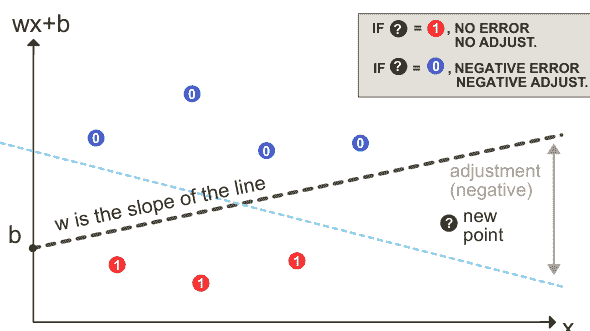

图7.1：感知机示意图。

- 如果该点是红色，则无需调整：它标记正确，因为它位于边界的右侧。
- 如果该点是蓝色，则模型需要适当更新。根据上述规则，这意味着向下调整直线的斜率。取决于η，移动将足以改变新点的分类——或者不会。

感知机诞生之时，是一个巨大的突破，并获得了密集的媒体报道（参见Olazaran (1996)和Anderson and Rosenfeld (2000)）。其相当简单的结构逐步推广为感知机网络（组合）。每个感知机都是一个简单单元，单元被组织成层。下一节描述了简单多层感知机（MLP）的组织。

### 7.2 多层感知机

#### 7.2.1 引言与符号

感知机可以被视为应用特定函数的线性模型：Heaviside（阶跃）函数。当然，其他函数选择也是可能的。在NN术语中，它们被称为激活函数。其目的是在原本非常线性的模型中引入非线性。

与随机森林中的树类似，神经网络背后的思想是组合类似感知机的构建模块。图7.2展示了神经网络的一种常见表示。此方案过于简单化。它隐藏了真正发生的事情：每个绿色圆圈中都有一个感知机，每个输出在发送到最终输出聚合之前都会经过某个函数激活。这就是为什么这种模型被称为多层感知机（MLP）。

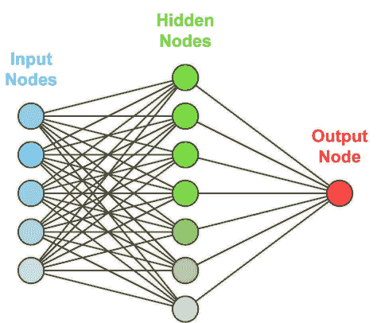

图7.2：多层感知机的简化示意图。

图7.3更忠实地展示了正在发生的事情。

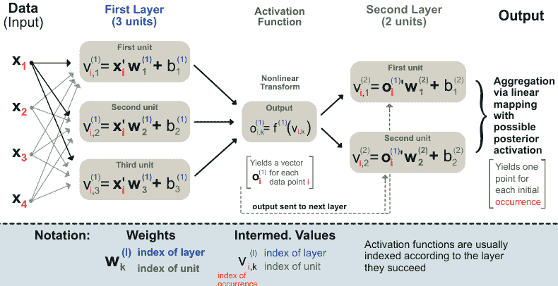

图7.3：带有2个中间层的感知机详细示意图。

在继续评论之前，我们介绍一些将在整个章节中使用的符号。

- 数据被分离为特征矩阵\(\mathbf{X} = x_{i,j}\)和输出值向量\(\mathbf{y} = y_i\)。\(\mathbf{x}\)或\(\mathbf{x}_i\)表示\(\mathbf{X}\)的一行。
- 神经网络将有\(L \ge 1\)层，对于每一层\(l\)，单元数量为\(U_l \ge 1\)。
- 位于层\(l\)中单元\(k\)的权重表示为\(\mathbf{w}_k^{(l)} = w_{k,j}^{(l)}\)，相应的偏置为\(b_k^{(l)}\)。\(\mathbf{w}_k^{(l)}\)的长度等于\(U_{l-1}\)。\(k\)指层\(l\)中单元的位置，而\(j\)指层\(l - 1\)中的单元。


- 输出（激活后）用$o_{i,k}^{(l)}$表示，对应实例$i$、层$l$和单元$k$。

过程如下。当数据进入网络时，它会经过初始线性映射：

```
$v_{i,k}^{(1)} = \mathbf{x}'_i \mathbf{w}_k^{(1)} + b_k^{(1)}, \text{ for } l=1, \ k \in [1, U_1],$
```

然后由非线性函数$f^{(1)}$进行变换。变换后的结果作为下一层的输入，以此类推。网络的每一层都会重复上述线性形式（权重不同）：

```
$v_{i,k}^{(l)} = (\mathbf{o}_i^{(l-1)})' \mathbf{w}_k^{(l)} + b_k^{(l)}, \text{ for } l \ge 2, \ k \in [1, U_l].$
```

层与层之间的连接被称为输出，本质上是应用了激活函数$f^{(l)}$的线性映射。第$l$层的输出是第$l+1$层的输入。

```
$o_{i,k}^{(l)} = f^{(l)} v_{i,k}^{(l)} \text{.}$
```

最后，终端阶段聚合最后一层的输出：

```
$\tilde{y}_i = f^{(L+1)} (\mathbf{o}_i^{(L)})' \mathbf{w}^{(L+1)} + b^{(L+1)} \text{.}$
```

在输入的前向传播中，激活函数自然扮演着重要角色。在图7.4中，我们绘制了神经网络库中最常用的激活函数。

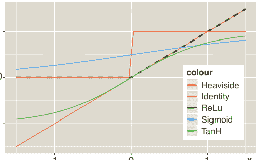

图7.4：最常见激活函数的图。

让我们从因子投资的视角重新阐述该过程。输入**x**是企业的特征。第一步是将它们的值乘以权重并加上偏置。这对第一层的所有单元执行。输出（作为输入的线性组合）随后由激活函数变换。每个单元提供一个值，所有这些值按照相同的过程输入到第二层。此过程重复直到网络结束。最后一层的目的是生成与标签相对应的输出形状：如果标签是数值型的，则输出是一个单一数字；如果是类别型的，则通常是一个长度等于类别数量的向量。这个向量指示值属于某个特定类别的概率。

在输出之后可以使用最终激活函数。这对结果可能有重大影响。确实，如果标签是收益，在最后应用sigmoid函数将是灾难性的，因为sigmoid函数始终为正。

#### 7.2.2 通用近似

神经网络效果良好的原因之一是它们是_通用近似器_。给定任何有界连续函数，都存在一个单层网络可以以任意精度逼近该函数（早期文献参见Cybenko (1989)，更详尽的论文列表参见Du and Swamy (2013)第4.2节和Goodfellow et al. (2016)第6.4.1节，最新结果参见Guliyev and Ismailov (2018)）。

形式上，单层感知机定义为

```
$$f_n(\mathbf{x}) = \sum_{l=1}^n c_l \phi(\mathbf{x}\mathbf{w}_l + \mathbf{b}_l) + c_0,$$
```

其中\(\phi$是一个（非常数）有界连续函数。然后，对于任何$\epsilon > 0$，可以找到一个$n$，使得对于单位超立方体[0, 1]^d上的任何连续函数$f$，

```
$$|f(\mathbf{x}) - f_n(\mathbf{x})| < \epsilon, \quad \forall \mathbf{x} \in [0, 1]^d.$$
```

这一结果相当直观：只需向层中添加单元即可改善拟合。该过程或多或少类似于多项式近似，但根据激活函数的性质（有界性、光滑性、凸性等）会产生一些微妙之处。关于本主题的综述，我们参见Costarelli et al. (2016)。

通用近似的原始结果表明，任何行为良好的函数$f$都可以由一个简单的神经网络充分逼近，只要单元数量可以任意大。然而，它们与学习阶段没有直接关系，即当模型针对特定数据集进行优化时。在一系列论文中（尤其是Barron (1993)和Barron (1994)），Barron给出了神经网络可以实现的更精确的描述。例如在Barron (1993)中，证明了通用近似的更精确版本：对于特定的神经网络（带有sigmoid激活），$\mathbb{E}[(f(\mathbf{x}) - f_n(\mathbf{x}))^2] \leq c_f/n$，这给出了与网络大小相关的收敛速度。在期望中，随机项是$\mathbf{x}$：这对应于数据被视为固定分布的i.i.d.观测样本的情况（这是机器学习中最常见的假设）。

下面，我们陈述一个易于理解的重要结果；它取自Barron (1994)。

在后续内容中，$f_n$对应于一个可能带有惩罚的、只有一个包含$n$个单元的中间层且使用sigmoid激活函数的神经网络。此外，假设预测变量和标签的支撑集都是有界的（这不是一个主要约束）。回归练习中最重要的指标是均方误差（MSE），主要结果是对该数量的一个界（数量级上）。对于随机抽样的$N$个i.i.d.点$y_i = f(x_i) + \epsilon_i$，$f_n$在其上进行训练，最佳可能的经验MSE表现如下

\(\mathbb{E} (f(x) - f_n(x))^2 = \underbrace{O \frac{c_f}{n}}_{\text{size of network}} + \underbrace{O \frac{nK \log(N)}{N}}_{\text{size of sample}} , \quad (7.1)\)

其中$K$是输入的维度（列数），$c_f$是取决于生成函数$f$的常数。上述量给出了给定大小为$N$的数据集时，最佳可能神经网络可以达到的误差界。

这个界的分解中明显有两个组成部分。第一个涉及网络的复杂性。与原始通用近似定理一样，误差随网络中单元数量的增加而减小。但这还不够！确实，样本量当然是学习质量（i.i.d.观测）的关键驱动因素。界的第二个组成部分表明，误差随观测数量（log($N$)/$N$）以稍慢的速度减小，并且与单元数量和输入大小呈线性关系。这清楚地强调了样本量与模型复杂性之间的联系（权衡？）：如果样本量很小，拥有一个非常复杂的模型是没有用的，就像一个简单的模型无法捕捉大型数据集中的精细关系一样。

总体而言，神经网络是一个可能非常复杂的函数，具有大量参数。在线性回归中，可以通过虚假添加外生变量来提高拟合度。在神经网络中，只需通过任意向层中添加单元来增加参数数量。这当然是一个非常糟糕的主意，因为高维网络将主要捕捉其训练样本的特殊性。

#### 7.2.3 通过反向传播学习

与树方法一样，神经网络通过最小化某些损失函数（受某些惩罚约束）进行训练：

\(O = \sum_{i=1}^I \text{loss}(y_i, \tilde{y}_i) + \text{penalization},\)

其中$\tilde{y}_i$是模型获得的值，$y_i$是实例的*真实*值。一个简化计算的简单要求是损失函数可微。最常见的选择是回归任务的平方误差和分类任务的交叉熵。我们将在下一小节讨论分类的技术细节。

神经网络的训练旨在改变所有层中所有单元的权重（和偏置），使得上面定义的$O$尽可能小。为了简化记法，并且鉴于$y_i$是固定的，让我们写出$D(\tilde{y}_i(\mathbf{W})) = \text{loss}(y_i, \tilde{y}_i)$，其中$\mathbf{W}$表示网络中所有权重和偏置的总和。权重的更新将通过梯度下降进行，即通过

\(\mathbf{W} \leftarrow \mathbf{W} - \eta \frac{\partial D(\tilde{y}_i)}{\partial \mathbf{W}} . \quad (7.2)\)

这种机制在优化文献中是最经典的，我们在图7.5中说明了它。我们强调了大学习率的可能次优性。在图中，与高$\eta$相关的下降将在最优点周围振荡，而与小$\eta$相关的下降将更直接地收敛。


上面方程式中复杂的任务是计算梯度（导数），它指出调整应进行的方向。问题是，连续嵌套的层及其相关的激活函数需要对求导中的链式法则进行多次迭代。

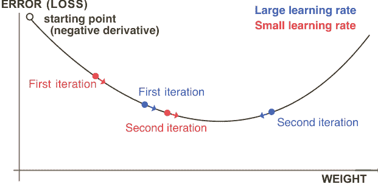

**FIGURE 7.5:** 梯度下降概略图。

近似导数最常见的方法大概是有限差分法。在通常假设下（损失函数可二阶微分），中心差分满足：

```
\(\frac{\partial D(\tilde{y}_i(w_k))}{\partial w_k} = \frac{D(\tilde{y}_i(w_k + h)) - D(\tilde{y}_i(w_k - h))}{2h} + O(h^2),\)
```

where \(h > 0\) 是某个任意取小的正数。尽管这种方法看起来很简单，但在计算上代价高昂，因为它需要的运算量级与权重数量相当。

幸运的是，有一个小技巧可以大大简化并加速计算。思路很简单：直接遵循链式法则，并在过程中回收项。让我们先回顾一下

```
\(\tilde{y}_i = f^{(L+1)} \left( \mathbf{o}_i^{(L)} \right)' \mathbf{w}^{(L+1)} + b^{(L+1)} = f^{(L+1)} \ b^{(L+1)} + \sum_{k=1}^{U_L} w_k^{(L+1)} o_{i,k}^{(L)} ,\)
```

因此，如果我们对最直接的权重和偏差求导，得到：

```
\(\frac{\partial D(\tilde{y}_i)}{\partial w_k^{(L+1)}} = D'(\tilde{y}_i) \ f^{(L+1)} ' \ b^{(L+1)} + \sum_{k=1}^{U_L} w_k^{(L+1)} o_{i,k}^{(L)} \ o_{i,k}^{(L)} \quad (7.3)\)
\(= D'(\tilde{y}_i) \ f^{(L+1)} ' \ v_{i,k}^{(L+1)} \ o_{i,k}^{(L)} \quad (7.4)\)
\(\frac{\partial D(\tilde{y}_i)}{\partial b^{(L+1)}} = D'(\tilde{y}_i) \ f^{(L+1)} ' \ b^{(L+1)} + \sum_{k=1}^{U_L} w_k^{(L+1)} o_{i,k}^{(L)} .\quad (7.5)\)
```

这是最简单的部分。现在我们必须回退一层，而这只能通过链式法则完成。要访问第 \(L\) 层，我们回顾恒等式 \(v_{i,k}^{(L)} = \left( \mathbf{o}_i^{(L-1)} \right)' \mathbf{w}_k^{(L)} + b_k^{(L)} = b_k^{(L)} + \sum_{j=1}^{U_L} o_{i,j}^{(L-1)} w_{k,j}^{(L)}\)。然后可以继续：

```
\(\frac{\partial D(\tilde{y}_i)}{\partial w_{k,j}^{(L)}} = \frac{\partial D(\tilde{y}_i)}{\partial v_{i,k}^{(L)}} \frac{\partial v_{i,k}^{(L)}}{\partial w_{k,j}^{(L)}} = \frac{\partial D(\tilde{y}_i)}{\partial v_{i,k}^{(L)}} o_{i,j}^{(L-1)} \quad (7.6)\)

\(= \frac{\partial D(\tilde{y}_i)}{\partial o_{i,k}^{(L)}} \frac{\partial o_{i,k}^{(L)}}{\partial v_{i,k}^{(L)}} o_{i,j}^{(L-1)} = \frac{\partial D(\tilde{y}_i)}{\partial o_{i,k}^{(L)}} (f^{(L)})'(v_{i,k}^{(L)}) o_{i,j}^{(L-1)} \quad (7.7)\)

\(= \underbrace{D'(\tilde{y}_i) f^{(L+1)\prime}}_{computed \ above!} v_{i,k}^{(L+1)} w_k^{(L+1)} (f^{(L)})'(v_{i,k}^{(L)}) o_{i,j}^{(L-1)}, \quad (7.8)\)
```

其中，如我们在最后一行所示，导数的一部分在前一步中已计算（方程 (7.4)）。因此，我们可以回收这个数值，只关注表达式的右半部分。

所谓反向传播的神奇之处在于，这在求导的每一步都成立。当计算第 \(l\) 层中权重和偏差的梯度时，会有两部分：一部分可以从前面的层回收，另一部分是局部部分，仅取决于当前层的值和激活函数。谷歌开发者团队对此过程有一个很好的示例：playground.tensorflow.org。

当数据使用张量格式化时，可以采用向量化，使调用次数限制在与网络中节点（单元）数量相同的量级。

反向传播算法可以总结如下。给定一组样本点（可能只有一个）：

- 1. 数据从左侧流动，如图 7.6 所示。蓝色箭头显示**正向传递**；
- 2. 这允许计算误差或损失函数；
- 3. 对该函数的所有导数（关于权重和偏差）进行计算，从最后一层开始向左扩散（因此称为反向传播）- 绿色箭头显示**反向传递**；
- 4. 所有权重和偏差都可以更新，以考虑样本点（模型调整以减少这些点产生的损失/误差）。

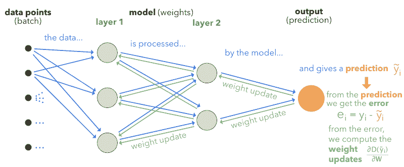

**FIGURE 7.6:** 反向传播图。

该操作可以使用不同的样本大小执行任意次数。我们将在 7.3 节讨论此问题。

学习率 \(\eta\) 可以进行优化。减少过拟合的一个选项是，规定每个 epoch 后更新强度降低。一种可能的参数形式是 \(\eta = \alpha e^{-\beta t}\)，其中 \(t\) 是 epoch，且 \(\alpha, \beta > 0\)。进一步的改进是采用所谓的 *动量*（源自 Polyak (1964)）：

```
\(\mathbf{W}_{t+1} \leftarrow \mathbf{W}_t - \mathbf{m}_t\) with

\(\mathbf{m}_t \leftarrow \eta \frac{\partial D(\tilde{y}_i)}{\partial \mathbf{W}_t} + \gamma \mathbf{m}_{t-1},\) (7.9)
```

其中 \(t\) 是权重更新的索引。动量的思路是，通过包含上一次调整的记忆项（\(\mathbf{m}_{t-1}\)）并在当前更新中沿相同方向进行，从而加速收敛。参数 \(\gamma\) 通常取 0.9。

更复杂和增强的方法逐步被开发出来：

- Nesterov (1983) 通过预测参数的未来变化来改进动量项；
- Adagrad (Duchi et al. (2011)) 为每个参数使用不同的学习率；
- Adadelta (Zeiler (2012)) 和 Adam (Kingma and Ba (2014)) 结合了 Adagrad 和动量的思路。

最后，在某些退化情况下，某些梯度可能会爆炸，并将权重推离其最优值。为避免这种情况，学习库实现了梯度裁剪。用户指定梯度的最大幅度，通常以范数表示。每当梯度超过此幅度时，就会将其重新缩放以达到允许的阈值。因此，方向保持不变，但调整更小。

#### 7.2.4 分类的更多细节

在决策树中，最终目标是创建同质簇，实现这一目标的过程在前一章中已概述。对于神经网络，情况不同，因为目标是明确地最小化预测 \(\tilde{\mathbf{y}}_i\) 与目标标签 \(\mathbf{y}_i\) 之间的误差。同样，这里 \(\mathbf{y}_i\) 是一个全零向量，只有一个 *1* 表示实例的类别。

面对分类问题，诀窍是在网络的最末端使用合适的激活函数。网络末端输出的维度应等于 \( J \)（要预测的类别数量），如果为简化起见，我们将此输出的值写为 \(\mathbf{x}_i\)，则最常用的激活函数是所谓的 *softmax* 函数：

```
\(\tilde{\mathbf{y}}_i = s(\mathbf{x})_i = \frac{e^{x_i}}{\sum_{j=1}^J e^{x_j}}.\)
```

选择这一点的理由很简单：它可以接受实数轴上的任何值作为输入，并且对任何（有限值）输出求和为一。同样如同决策树，这会产生一个关于类别的“概率”向量。通常，所选损失是决策树中使用的熵的推广。给定目标标签 \(\mathbf{y}_i = (y_{i,1}, \dots, y_{i,L}) = (0, 0, \dots, 0, 1, 0, \dots, 0)\) 和预测输出 \(\tilde{\mathbf{y}}_i = (\tilde{y}_{i,1}, \dots, \tilde{y}_{i,L})\)，交叉熵定义为

```
\(\text{CE}(\mathbf{y}_i, \tilde{\mathbf{y}}_i) = - \sum_{j=1}^J \log(\tilde{y}_{i,j}) y_{i,j} . \quad (7.10)\)
```

基本上，它是其两个参数之间不相似性的代理。一种简单的解释如下。对于非零标签值，损失为 \(-\log(\tilde{y}_{i,l})\)，而对于所有其他值，损失为零。在对数中，当 \(\tilde{y}_{i,l} = 1\) 时损失最小，这正是我们所追求的（即，\(y_{i,l} = \tilde{y}_{i,l}\)）。在应用中，这种最佳情况不会发生，当 \(\tilde{y}_{i,l}\) 从 1 向下偏离时，损失会简单地增加。

### 7.3 应有多深以及其他实际问题

除了前几节中介绍的内容之外，用户在构建神经网络时面临许多自由度。我们介绍了构建和训练神经网络时可用的一些经典选择。

#### 7.3.1 架构选择

可以说，第一个选择涉及网络的结构。除了前馈网络与循环网络的二分法（见 7.5 节）之外，当前问题是：网络应该有多大（或多深）。首先，让我们计算网络中估计（优化）的参数（即权重加偏差）的数量。

- 对于第一层，这给出 \((U_0 + 1)U_1\) 个参数，其中 \(U_0\) 是 \(\mathbb{X}\) 中的列数（即解释变量的数量），\(U_1\) 是该层中的单元数量。

- 对于第 \(l \in [2, L]\) 层，参数的数量为 \((U_{l-1} + 1)U_l\)。

- 对于最终输出，仅有 \(U_L + 1\) 个参数。


总体来说，这意味着需要优化的值的总数是

$$
\mathcal{N} = \sum_{l=1}^L (U_{l-1} + 1) U_l + U_L + 1
$$

与任何模型一样，参数数量应远小于样本数量。没有固定比例，但最好样本量至少是参数数量的十倍。比例低于 5 时，过拟合风险较高。考虑到现有数据的量，这一限制很少成为问题，除非有人希望处理一个非常大的网络。

当前金融应用中隐藏层数量很少超过三层或四层。每层的单元数（$U_k$）通常遵循几何金字塔规则（参见，例如，Masters (1993)）。如果有 $L$ 个隐藏层，输入中有 $I$ 个特征，输出中有 $O$ 个维度（对于回归任务，$O=1$），那么对于第 $k^{th}$ 层，单元数量的经验法则是

$$
U_k \approx \left[ O \frac{I}{O}^{\frac{L+1-k}{L+1}} \right].
$$

如果只有一个中间层，推荐的近似值是 $\sqrt{IO}$ 的整数部分。否则，网络开始时单元数量较多，并呈指数级减少到输出大小。通常，层数是 2 的幂次，因为在高维情况下，网络在图形处理单元（GPU）或张量处理单元（TPU）上训练。当输入大小等于 2 的幂次时，这两种硬件都可以得到最优利用。

多项研究表明，非常大的架构并不总是比更浅的架构表现更好（例如，Gu et al. (2020b) 和 Orioloye et al. (2019) 针对高频数据，即非因子基础数据）。经验法则是，最多三个隐藏层似乎足以用于预测目的。

#### 7.3.2 权重更新频率和学习持续时间

在表达式 (7.2) 中，隐含计算是针对给定单个实例进行的。如果样本量非常大（数十万或数百万个实例），按每个点更新权重在计算上成本过高。随后，更新是在称为批次的实例组上进行的。样本被（随机）分割为固定大小的批次，每次更新遵循以下规则：

$$
\mathbf{W} \leftarrow \mathbf{W} - \eta \frac{\partial_{i \in \text{batch}} D(\hat{y}_i)/\text{card(batch)}}{\partial \mathbf{W}}.\quad (7.11)
$$

权重的变化是基于批次中所有实例计算的平均损失计算得出的。训练术语包括：

- 时代：当样本中的每个实例都为权重更新做出贡献时（即训练），即达到一个时代。通常，训练神经网络需要多个时代，多达几十个。

- 批量大小：批量大小是用于单次权重更新的样本数量。

- 迭代次数：迭代次数可以指样本量除以批量大小的比率，或者该比率乘以时代数。它要么是达到一个时代所需的权重更新次数，要么是整个训练期间的更新总次数。

当批次仅包含一个实例时，该方法称为“随机梯度下降”（SGD）：实例是随机选择的。当批量大小严格大于 1 且小于实例总数时，学习是通过“小批次”进行的，即小型实例组。批次也是随机选择的，但在样本中不放回抽样，因为对于一个时代，批次的并集必须等于完整的训练样本。

事先无法知道一个好的时代数量是多少。有时，网络在仅 5 个时代后停止学习（验证损失不再下降）。在某些情况下，当验证样本抽取自与训练样本接近的分布时，网络在 200 个时代后仍继续学习。由用户测试不同值以评估学习速度。在下面的示例中，我们出于计算目的保持时代数量较低。

#### 7.3.3 惩罚与脱校

在每一层（层级）上，可以对权重（和偏差）施加约束或惩罚。与树方法一样，这有助于减慢学习速度，以防止在训练样本上过拟合。惩罚直接施加在损失函数上，目标函数采用以下形式

\(O = \sum_{i=1}^I \text{loss}(y_i, \hat{y}_t) + \sum_k \lambda_k ||\mathbf{W}_k||_1 + \sum_j \delta_k ||\mathbf{W}_j||_2^2\),

其中下标 \(k\) 和 \(j\) 分别对应应用了 \(L^1\) 和（或）\(L^2\) 惩罚的权重。

此外，在训练期间可以直接对权重施加特定约束。通常使用两种类型的约束：

- 范数约束：权重向量或矩阵的最大范数被固定；

- 非负性约束：所有权重必须为正或零。

最后，另一种（有些另类）降低过拟合风险的方法是简单地减少模型的大小（参数数量）。Srivastava et al. (2014) 提议在训练期间省略单元（因此有了“脱校”这一术语）。训练期间，随机选择的单元的权重被设置为零。所有来自和指向该单元的链接都被忽略，这在机械上缩小了网络。在测试阶段，所有单元都恢复，但值（权重）必须进行缩放，以考虑训练阶段期间缺失的激活。

感兴趣的读者可以查阅 Bengio (2012) 和 Smith (2018) 中汇编的建议，以获取关于如何配置神经网络的进一步提示。一篇专门用于股票回报预测超参数调整的论文是 Lee (2020)。

### 7.4 标准 MLP 的代码示例和注释

有几种框架和库允许构建强大且灵活的神经网络。其中，Keras 和 Tensorflow（由 Google 开发）在我们撰写本书时可能是最常用的（PyTorch 由 Facebook 开发，是一个替代方案）。出于简单性，并且因为我们认为这是最佳选择，我们使用 Keras 实现神经网络（Keras 是 Tensorflow 的高级 API，参见 https://www.tensorflow.org）。原始 Python 实现参考 https://keras.io，R 版本的详细信息可在此处找到：https://keras.rstudio.com。我们建议在继续之前进行彻底的安装。由于 Tensorflow 和 Keras 的原生版本是用 Python 编写的（并通过 reticulate 包由 R 访问），因此下面需要一个运行的 Python 版本。要安装 Keras，请按照 https://keras.rstudio.com 提供的说明进行操作。

在本节中，我们详细（虽然远非详尽）地说明了如何使用 Keras 训练神经网络。为了完整性，我们分两步进行。第一步涉及一个非常简单的回归练习。其目的是让读者熟悉 Keras 的语法。在第二步中，我们列出了 Keras 提供的许多选项以执行分类练习。通过这两个示例，我们涵盖了属于前馈多层感知机范畴的大多数主流主题。

#### 7.4.1 回归示例

在深入神经网络核心之前，需要进行一个简短的数据准备阶段。与惩罚回归（glmnet 包）和提升树（xgboost 包）一样，数据必须分为四部分，这是两个二分法的组合：训练与测试以及标签与特征。我们在下面定义相应的变量。出于简单性，第一个示例是一个回归练习。分类任务将在下面详细说明。

```
NN_train_features <- dplyr::select(training_sample, features) %>%   # Training features
as.matrix()                                   # Matrix = important
NN_train_labels <- training_sample$R1M_Usd     # Training labels
NN_test_features <- dplyr::select(testing_sample, features) %>% # Testing features
as.matrix()                                   # Matrix = important
NN_test_labels <- testing_sample$R1M_Usd      # Testing labels
```

在 Keras 中，神经网络的训练通过三个步骤进行：

- 1. 定义网络的结构/架构；

- 2. 设置损失函数和学习过程（关于权重更新的选项）；

- 3. 通过指定批量大小和轮数（时代）进行训练。

我们从一个具有两个隐藏层的非常简单的架构开始。

```
library(keras)
# install_keras() # To complete installation
model <- keras_model_sequential()
```


```model %>%  # This defines the structure of the network, i.e. how layers are organized
  layer_dense(units = 16, activation = 'relu', input_shape = ncol(NN_train_features)) %>%
  layer_dense(units = 8, activation = 'tanh') %>%
  layer_dense(units = 1)  # No activation means linear activation: f(x) = x.
```

网络结构的定义非常直观，它使用的是顺序语法：一个输入会被一层接一层地迭代转换，直到最后一次迭代产生输出。每一层依赖于两个参数：单元数量和应用于该层输出的激活函数。一个重要的一点是第一层的 input_shape 参数。第一层需要该参数，且其值等于特征数量。对于后续层，input_shape 由前一层的单元数量决定，因此不需要指定。当前可用的激活函数列于 [激活函数](https://keras.io/activations/)。我们在倒数第二层使用双曲正切，因为它能产生正负输出。当然，最后一层也可以生成负值，但最好在最终输出之前就满足这一特性。

```model %>% compile(
  loss = 'mean_squared_error',
  optimizer = optimizer_rmsprop(),
  metrics = c('mean_absolute_error')
)
summary(model)
# Model specification
# Loss function
# Optimisation method (weight updating)
# Output metric
# Model architecture
```

| 层 (类型) | 输出形状 | 参数量 |
|---|---|---|
| dense_48 (Dense) | (None, 16) | 1504 |
| dense_49 (Dense) | (None, 8) | 136 |
| dense_50 (Dense) | (None, 1) | 9 |
| Total params: 1,649 | | |
| Trainable params: 1,649 | | |
| Non-trainable params: 0 | | |

模型摘要按从输入到输出（前向传播）的顺序列出了各层。因为我们使用 93 个特征，第一层（16 个单元）的参数量为 93 加上 1（偏置）再乘以 16，即 1504。对于第二层，输入数量等于前一层的输出大小（16）。鉴于第二层有 8 个单元，总参数量为 (16+1)*8 = 136。

我们将损失函数设置为标准均方误差。其他损失函数列于 [损失函数](https://keras.io/losses/)，其中一些仅适用于回归（MSE、MAE），另一些仅适用于分类（分类交叉熵，见公式 (7.10））。RMS 传播优化器是经典的小批量反向传播实现。对于其他权重更新算法，我们参考 [优化器](https://keras.io/optimizers/)。评估指标是用于评估模型质量的函数。它可以与损失函数不同：例如，训练使用交叉熵，而将准确率作为性能指标。

最终阶段将模型拟合到数据，并需要一些额外的训练参数：

```fit_NN <- model %>%
  fit(NN_train_features,
    NN_train_labels,
    epochs = 10, batch_size = 512,
    validation_data = list(NN_test_features, NN_test_labels))
plot(fit_NN)
```

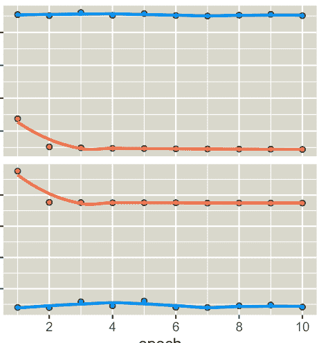

## 图 7.7：训练有素的神经网络输出（回归任务）。

批量大小相当随意。出于在 GPU 上训练的技术原因，这些大小通常是 2 的幂。

在 Keras 中，训练有素模型的图显示四条不同的曲线（如图 7.7 所示）。上图显示随着 epoch 数量增加，损失的改善（或缺乏改善）。通常，算法开始时学习很快，然后收敛到某一点，在此之后任何额外的 epoch 都不会改善拟合。在上面的示例中，这一点到达得相当快，因为第四个 epoch 之后很难注意到任何收益。两种颜色显示两个样本上的性能：训练样本和测试样本。从构造上讲，损失在训练样本上总是会改善（即使幅度很小）。当对测试样本的影响可忽略时（曲线平坦，如本例所示），模型无法对样本外进行泛化：在原始样本上训练获得的收益并未转化为先前未见数据上的收益；因此，模型似乎在学习噪声。

第二个图显示相同的行为，但使用指标函数计算。两条曲线（损失和指标）之间的相关性（绝对值）通常很高。如果其中一条是平坦的，另一条也应该如此。

为了获得模型的参数，用户可以调用 get_weights(model)。² 我们这里不执行代码，因为输出大小太大，存在数千个权重。

最后，从实际角度看，预测是通过常规 predict() 函数获得的。我们在下面对测试样本使用此函数来计算命中率。

```mean(predict(model, NN_test_features) * NN_test_labels > 0) # Hit ratio
```

```## [1] 0.539853
```

再次，命中率在 50% 和 55% 之间，这似乎相当不错。大多数时候，神经网络的权重被随机初始化。因此，两个具有相同架构和相同训练数据的独立训练网络可能会导致非常不同的预测和性能！绕过此问题的一种方法是冻结随机数生成器。模型也可以通过 set_weights() 函数加载权重来轻松交换。

#### 7.4.2 分类示例

我们继续探索神经网络，以一个更详细的示例。目标是对二进制标签 R1M_Usd_C 执行分类任务。在继续之前，我们需要正确格式化标签。为此，我们采用独热编码（见第 4.5.2 节）。

```library(dummies)
NN_train_labels_C <- training_sample$R1M_Usd_C %>% dummy() # Package for one-hot encoding
NN_test_labels_C <- testing_sample$R1M_Usd_C %>% dummy() # One-hot encoding of the label
# One-hot encoding of the label
```

标签 NN_train_labels_C 和 NN_test_labels_C 有两列：第一列标记收益高于中位数的实例，第二列标记收益低于中位数的实例。请注意，我们不更改特征变量：它们保持不变。下面，我们设置网络结构，相比第一个示例具有更多附加功能。

```model_C <- keras_model_sequential()
model_C %>% # This defines the structure of the network, i.e. how layers are organized
layer_dense(units = 16, activation = 'tanh', # Nb units & activation
input_shape = ncol(NN_train_features), # Size of input
kernel_initializer = "random_normal", # Initialization of weights
kernel_constraint = constraint_nonneg()) # Weights should be nonneg
layer_dropout(rate = 0.25) # Dropping out 25% units
layer_dense(units = 8, activation = 'elu', # Nb units & activation
bias_initializer = initializer_constant(0.2), # Initialization of biases
kernel_regularizer = regularizer_l2(0.01)) # Penalization of weights
layer_dense(units = 2, activation = 'softmax') # Softmax for categorical output
```

在开始评论上面使用的众多选项之前，我们强调 Keras 模型与许多 R 变量不同，是可变对象。这意味着在调用模型后，任何管道 %>% 都会改变它。因此，连续的训练不是从头开始，而是从之前训练的结果开始。

首先，上面和下面使用的选项被选作示例，并不特别旨在提高模型质量。与第 7.4.1 节相比的第一个变化是激活函数。前两个只是新案例，而第三个（用于输出层）是必需的。确实，由于目标是分类，输出的维度必须等于标签的类别数量。产生多变量的激活函数是 softmax 函数。请注意，我们还必须在终端层中指定类别（类）的数量。

第二个主要创新是与参数相关的选项。一组选项涉及权重和偏置的初始化。在 Keras 中，权重被称为“核”。初始化器列表非常长，我们建议有兴趣的读者查看 Keras 参考（[初始化器](https://keras.io/initializers/)）。其中大多数是随机的，但有些是常数。

另一组选项是在训练期间应用于权重和偏置的约束和规范惩罚。在上面的示例中，第一层的权重被强制为非负，而第二层的权重其幅度被一个因子（0.01）乘以其 L<sup>2</sup> 范数所惩罚。

最后，新的新颖之处是第一层和第二层之间的脱落层（见第 7.3.3 节）。根据该层，第一层中四分之一的单元将在训练期间（随机）被省略。

训练规格如下所示。

```model_C %>% compile(
  loss = 'binary_crossentropy',
  optimizer = optimizer_adam(lr = 0.005,
                           beta_1 = 0.9,
                           beta_2 = 0.95),
  metrics = c('categorical_accuracy')
)
summary(model_C)
```

| 层 (类型) | 输出形状 | 参数量 |
|---|---|---|
| dense_51 (Dense) | (None, 16) | 1504 |
| dropout_2 (Dropout) | (None, 16) | 0 |
| dense_52 (Dense) | (None, 8) | 136 |
| dense_53 (Dense) | (None, 2) | 18 |
| Total params: 1,658 | | |
| Trainable params: 1,658 | | |
| Non-trainable params: 0 | | |

这里又有许多更改：所有层都已修订。损失现在是交叉熵。因为我们使用两个类别，所以采用特定选择（二元交叉熵），但更通用的形式是选项 categorical_crossentropy，适用于任何类别数量（严格大于 1）。优化器也不同，允许几个参数，我们参考 Kingma and Ba (2014)。简单来说，两个 beta 参数控制用于权重更新的指数加权移动平均的衰减率。两个平均值是梯度第一阶和第二阶矩的估计，可以用来提高学习速度。性能指标


在上面的代码块中是类别准确率。在多类分类中，准确率定义为所有类别和所有预测的平均准确率。由于单个实例的预测是一个权重向量，‘终端’预测是与最大权重关联的类别。准确率衡量的是预测等于实现值的比例（即，当模型正确猜测出类别时）。

最后，我们开始训练模型。

```
fit_NN_C <- model_C %>% 
  fit(NN_train_features, 
      NN_train_labels_C, 
      epochs = 20, batch_size = 512, 
      validation_data = list(NN_test_features, 
                             NN_test_labels_C), 
    verbose = 0, 
    callbacks = list( 
      callback_early_stopping(monitor = "val_loss", 
                              min_delta = 0.001, 
                              patience = 3, 
                              verbose = 0 
                              ) 
          ) 
        )
plot(fit_NN_C)
```

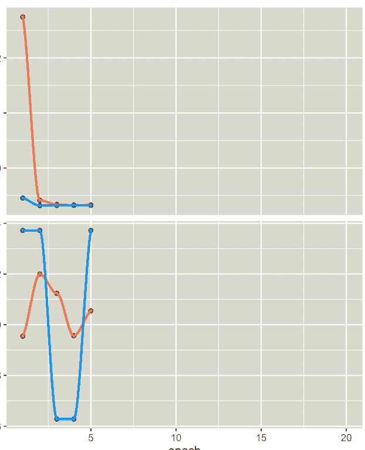

## 图 7.8：带有早停的训练神经网络输出（分类任务）。

与之前的训练调用相比，这里只有一个主要区别。在 Keras 中，回调函数是可以在学习过程的特定阶段使用的函数。在上面的示例中，我们使用了这样一个函数，当一段时间内没有进展时停止算法。

当数据集较大时，训练可能会很耗时，尤其是当批次大小较小和/或 epoch 数量较多时。运行完全部 epoch 并不一定有用，因为损失或指标函数可能早早就会进入平台期。因此，如果在指定的时间段内没有改进，停止过程会非常方便。我们将 epoch 数量设置为 20，但进程很可能在此之前停止。

在上述代码中，改进的重点放在验证准确率（"val_acc"；另一个替代选项是 "val_loss"）。min_delta 值设置了算法继续所需达到的最小改进量。因此，除非验证准确率在每个 epoch 中提升 0.001 个点，否则训练将停止。尽管如此，通过 patience 参数引入了一些灵活性，在我们的例子中，它断言只有在连续三个 epoch 没有改进后才会做出停止决定。在该选项中，verbose 参数决定函数输出的注释量。为求简单，我们不希望有任何注释，因此该值设置为零。

在图 7.8 中，两个图表产生了非常不同的曲线。原因之一是第二个图表的尺度。准确率的范围非常窄。这个范围内的任何变化总体上都不代表太大的差异。在训练样本上，模式相对清晰：损失减少，而准确率提高。不幸的是，这并不适用于测试样本，这表明模型在样本外泛化效果不佳。

#### 7.4.3 自定义损失函数

在 Keras 中，可以定义用户指定的损失函数。在某些情况下，这可能很有用。例如，平方误差包含三项 \(y_i^2\)、\(\hat{y}_i^2\) 和 \(-2y_i\hat{y}_i\)。在实践中，更关注后一项是有道理的，因为它是最关键的：我们确实希望预测值和实现值具有相同的符号！下面我们展示如何在 Keras 中对一个简单的（乘积）函数进行优化，\(l(y_i, \hat{y}_i) = (\hat{y}_i - \bar{m})^2 - \gamma(y_i - m)(\hat{y}_i - \bar{m)}\)，其中 \(m\) 和 \(\bar{m}\) 分别是 \(y_i\) 和 \(\hat{y}_i\) 的样本平均值。当 \(\gamma > 2\) 时，我们给交叉项赋予更大的权重。我们从一个简单的架构开始。

```r
model_custom <- keras_model_sequential()
model_custom %>% # This defines the structure of the network, i.e. how layers are organized
  layer_dense(units = 16, activation = 'relu', input_shape = ncol(NN_train_features)) %>% 
  layer_dense(units = 8, activation = 'sigmoid') %>% 
  layer_dense(units = 1) # No activation means linear activation: f(x) = x.
```

然后我们编写损失函数并将其集成到模型中。重要的技巧是使用特定于库的函数（k__函数）。我们编码预测值的方差减去实现值与预测值之间的缩放协方差。下面我们使用五的缩放因子。

```r
custom_loss <- function(y, f){ # Defines the loss, we use gamma = 5
  return(k_mean((f - k_mean(f))*(f - k_mean(f)))-5*k_mean((y - k_mean(y))*(f - k_mean(f))))
}
model_custom %>% compile(
loss = function(y_true, y_pred, custom_loss(y_true, y_pred), # New loss function!
optimizer = optimizer_rmsprop(), # Optim method
metrics = c('mean_absolute_error') # Output metric
)
```

最后，我们准备训练并简要评估模型性能。

```r
fit_NN_cust <- model_custom %>% # Training features
fit(NN_train_features,
  NN_train_labels, # Training labels
  epochs = 10, batch_size = 512, # Training parameters
  validation_data = list(NN_test_features, NN_test_labels) # Test data
)
plot(fit_NN_cust)
```

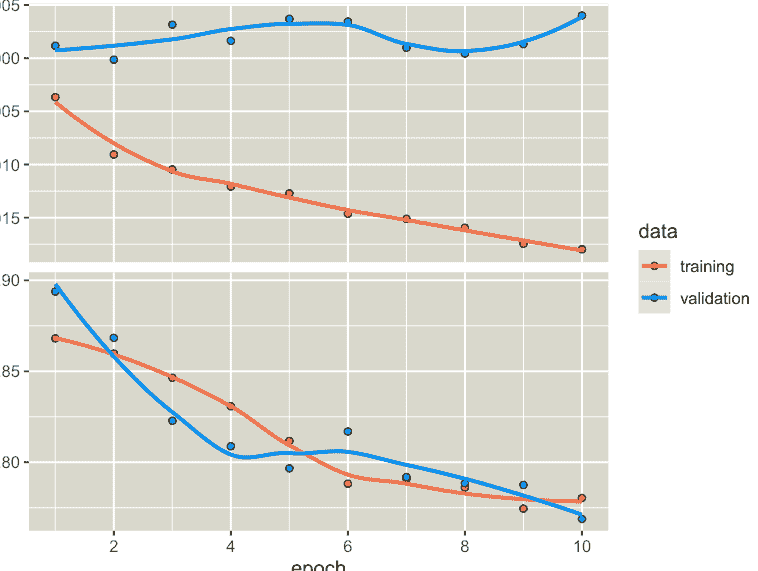

曲线可能朝相反方向发展。原因之一是，在改善实现值与预测值之间的相关性的同时，我们也在增加预测回报的平方和。

```
mean(predict(model_custom, NN_test_features) * NN_test_labels > 0) # Hit ratio
## [1] 0.4468864
```

结果可以改进。有几个方向可能有帮助。其中一个可以说的是，模型应该是动态的而不是静态的（参见第 12 章）。

### 7.5 循环神经网络

#### 7.5.1 概述

多层感知机是前馈网络，因为数据从左到右流动，中间没有循环。对于某些具有序列关联的特定任务（例如，时间序列或语音识别），跟踪前一个样本发生了什么（即，存在自然顺序）可能很有用。建模“记忆”的一种简单方法是考虑仅具有一个中间层的以下网络：

\(\bar{y}_i = f^{(y)} \left( \sum_{j=1}^{U_1} h_{i,j} w_j^{(y)} + b^{(2)} \right)\)

\(\mathbf{h}_i = f^{(h)} \left( \sum_{k=1}^{U_0} x_{i,k} w_k^{(h,1)} + b^{(1)} + \underbrace{\sum_{k=1}^{U_1} w_k^{(h,2)} h_{i-1,k}}_{\text{memory part}} \right)\),

其中 \(h_0\) 通常被设置为零（向量意义上）。

这类模型通常被称为 Elman (1990) 模型，或者在后一种情况下如果在计算 \(h_i\) 时将 \(h_{i-1}\) 替换为 \(y_{i-1}\)，则称为 Jordan (1997) 模型。这两种类型的模型都归属于循环神经网络（RNNs）这一总称。

\(h_i\) 通常被称为状态或隐藏层。这个模型的训练很复杂，必须通过在所有实例上展开网络来获得一个简单的前馈网络，然后像往常一样进行训练。我们在图 7.9 中说明了展开原理。它展示了一个非常深的网络。第一个输入影响第一层，然后通过 \(h_1\) 以同样的方式影响第二层及所有后续层。同样，第二个输入影响除第一层以外的所有层，并且每个实例 \(i-1\) 都将影响输出 \(\bar{y}_i\) 以及所有 \(j \ge i\) 的输出 \(\bar{y}_j\)。在图 7.9 中，正在训练的参数显示为蓝色。它们实际上在展开网络的每一层都会出现多次。

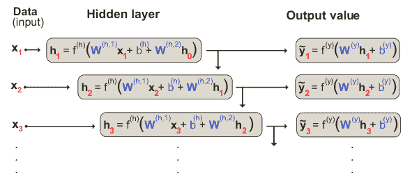

## 图 7.9：展开循环神经网络。

上述架构的主要问题是由**梯度消失**引起的记忆丢失。由于模型的深度，反向传播中使用的链式法则将涉及大量激活函数导数的乘积。现在，如图 7.4 所示，这些函数非常平滑，其导数大多数时候小于一（绝对值）。因此，将许多小于一的数字相乘会导致非常小的数值：超过若干层后，学习无法传播，因为调整太小。

防止这种记忆逐渐贬值的一种方法是由 Hochreiter 和 Schmidhuber (1997)（长短期记忆 - LSTM 模型）引入的。该模型随后由 Chung 等人 (2015) 的作者简化，下面我们介绍了这种更精简的模型。门控循环单元（GRU）是一个稍微复杂一些的


是上面定义的香草循环网络的一个版本。它具有如下表示：

```
\tilde{y}_i = z_i \tilde{y}_{i-1} + (1 - z_i) \tanh \mathbf{w}'_y \mathbf{x}_i + b_y + u_y r_i \tilde{y}_{i-1} \quad \text{output (prediction)}
z_i = \text{sig}(\mathbf{w}'_z \mathbf{x}_i + b_z + u_z \tilde{y}_{i-1}) \quad \text{'update gate'} \in (0,1)
r_i = \text{sig}(\mathbf{w}'_r \mathbf{x}_i + b_r + u_r \tilde{y}_{i-1}) \quad \text{'reset gate'} \in (0,1).
```

紧凑形式下，这给出了

```
\tilde{y}_i = \underbrace{z_i}_{\text{weight past value}} \underbrace{\tilde{y}_{i-1}}, + \underbrace{(1-z_i)}_{\text{weight}} \underbrace{\tanh \mathbf{w}'_y \mathbf{x}_i + b_y}_{\text{candidate value (classical RNN)}} + \underbrace{u_y r_i \tilde{y}_{i-1}},
```

其中 \(z_i\) 决定当前值与过去值之间的最佳混合。对于候选值，\(r_i\) 决定要保留多少过去值/记忆。\(r_i\) 通常被称为‘重置门’，\(z_i\) 称为‘更新门’。

循环网络训练中存在一些细微之处。确实，由于实例之间的链式关系，每个批次必须对应一个连贯的时间序列。因此，合理的选择是每个资产一个批次，实例（逻辑上）按时间顺序排列。最后，某些框架中的一个选项是通过将 \(\tilde{y}_i\) 的最终值传递给下一个批次（对其而言将是 \(\tilde{y}_0\)）来在批次之间保留一些记忆。这通常被称为状态模式，应仔细考虑。在投资组合预测场景中，如果批次大小对应于每个资产的所有观测值，这似乎并不可取：资产之间没有特定的关联。如果给定资产的数据集被分成几个部分，则训练必须非常谨慎地处理。

循环网络，尤其是 LSTM，已被发现是在金融环境下良好的预测工具（参见，例如，Fischer and Krauss (2018) 和 Wang et al. (2020)）。

#### 7.5.2 代码与结果

与多层感知机相比，循环网络在理论上更复杂。在实践中，其实现也更具挑战性。确实，与前馈架构相比，串行链接需要更多关注。在资产定价框架中，我们必须分离资产，因为股票特定的时间序列不能捆绑在一起。学习将是逐个进行的，一次一只股票。

变量的维度至关重要。在 Keras 中，它们对 RNN 定义如下：

- 1. 批次大小：在我们的情况中，它将是资产的数量。确实，递归关系在资产层面成立，因此每个资产将代表模型学习的一个新批次。
- 2. 时间步数：在我们的情况中，它将仅是日期的数量。
- 3. 特征数量：在我们的情况中，只有一个可能的数值，即预测变量的数量。

为简单起见并减少计算时间，我们将使用与第 5.2.2 节相同的股票子集。这产生了一个完美的矩形数据集，其中所有日期都有相同数量的观测值。

### 7.5 循环网络

首先，我们创建一些新的中间变量。

```
data_rnn <- data_ml %>%
  filter(stock_id %in% stock_ids_short)       # Dedicated dataset
training_sample_rnn <- filter(data_rnn, date < separation_date)
testing_sample_rnn  <- filter(data_rnn, date > separation_date)
nb_stocks   <- length(stock_ids_short)         # Nb stocks
nb_feats    <- length(features)                # Nb features
nb_dates_train <- nrow(training_sample) / nb_stocks # Nb training dates (size of sample)
nb_dates_test  <- nrow(testing_sample)  / nb_stocks # Nb testing dates
```

然后，我们构建将作为参数传递的变量。我们回想一下，数据文件首先按股票排序，然后按日期排序（参见第 1.2 节）。

```
train_features_rnn <- array(NN_train_features,
                               dim = c(nb_dates_train, nb_feats)) %>% # Tricky order
  aperm(c(2,1,3))             # The order is: stock, date, feature
test_features_rnn <- array(NN_test_features,
                            dim = c(nb_dates_test, nb_stocks, nb_feats)) %>% # Tricky order
  aperm(c(2,1,3))             # The order is: stock, date, feature
train_labels_rnn <- as.matrix(NN_train_labels) %>%
  array(dim = c(nb_dates_train, nb_stocks, 1)) %>% aperm(c(2,1,3))
test_labels_rnn  <- as.matrix(NN_test_labels) %>%
  array(dim = c(nb_dates_test, nb_stocks, 1)) %>% aperm(c(2,1,3))
```

最后，我们进入训练部分。为简单起见，我们只考虑只有一层的简单 RNN。结构如下所示。就递归结构而言，我们选择门控循环单元（GRU）。

```
model_RNN <- keras_model_sequential() %>%
layer_gru(units = 16,
          batch_input_shape = c(nb_stocks,
                                nb_dates_train,
                                nb_feats),
          activation = 'tanh',
          return_sequences = TRUE) %>%   # Return all the sequence
layer_dense(units = 1)                    # Final aggregation layer
model_RNN %>% compile(
  loss = 'mean_squared_error',            # Loss = quadratic
  optimizer = optimizer_rmsprop(),        # Backprop
  metrics = c('mean_absolute_error'))     # Output metric MAE
)
```

循环层有许多可用选项。对于 GRU，我们参考 Keras 文档 https://keras.rstudio.com/reference/layer_gru.html。我们简要评论我们激活的 return_sequences 选项。在许多情况下，输出仅仅是序列的终端值。如果不要求返回完整序列，我们将面临维度问题，因为标签确实是一个完整序列。一旦结构确定，我们就可以进入训练阶段。

```
fit_RNN <- model_RNN %>% fit(train_features_rnn,  # Training features
                              train_labels_rnn,     # Training labels
                              epochs = 10,          # Number of rounds
                              batch_size = nb_stocks, # Length of sequences
                              verbose = 0)          # No comments
plot(fit_RNN)
```

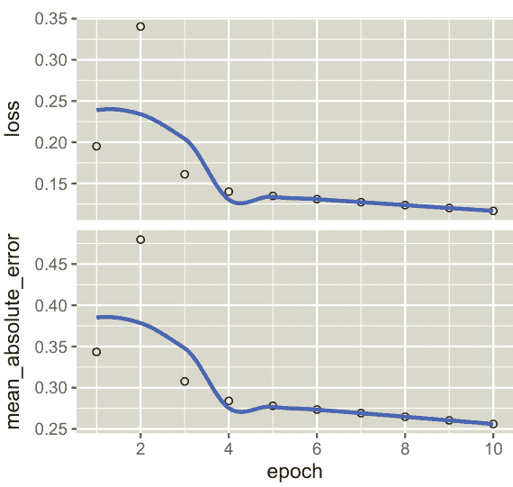

图 7.10：来自训练有素的循环神经网络的输出（回归任务）。

与我们之前的模型相比，输出（图 7.10 中的图表）和输入（代码）之间的主要区别是缺少验证（或测试）数据。原因之一是 Keras 对 RNN 非常严格，要求训练和测试样本共享相同的维度。在我们的情况中显然不是这样，因此我们必须通过复制模型来绕过这一障碍。

```
new_model <- keras_model_sequential() %>%
  layer_gru(units = 16,
            batch_input_shape = c(nb_stocks,
                                  nb_dates_test,
                                  nb_feats),
            activation = 'tanh',
            return_sequences = TRUE) %>%  # New dimensions
  # Activation function
  # Return the full sequence
layer_dense(units = 1)  # Output dimension
new_model %>% keras::set_weights(keras::get_weights(model_RNN))
```

最后，一旦新模型准备就绪且维度匹配，我们就可以继续预测测试值。我们使用 predict() 函数并立即计算模型获得的命中率。

```
pred_rnn <- predict(new_model, test_features_rnn, batch_size = nb_stocks) # Predictions
mean(c(t(as.matrix(pred_rnn))) * test_labels_rnn > 0) # Hit ratio
```

```
## [1] 0.4995844
```

命中率接近 50%，因此该模型与随机猜测相比好不了多少。

在结束关于 RNN 的这一节之前，我们提到一种新型架构，称为 α-RNN，与 LSTM 和 GRU 相比更简单。它们由香草 RNN 构成，并添加了一个


简单自相关被加入以生成长期记忆。关于此主题的更多细节，请参阅 Dixon (2020)。

### 7.6 其他常见架构

在本节中，我们介绍其他网络结构。因为它们不够主流，而且往往更难实现，我们不提供代码示例，仅坚持理论介绍。

#### 7.6.1 生成对抗网络

生成对抗网络（Generative Adversarial Networks，GANs）的想法是通过试图欺骗经典神经网络来提高其准确性。这一非常流行的想法由 Goodfellow et al. (2014) 提出。想象你是一位毕加索绘画专家，并夸口自己能轻易辨认出该画家的任何作品。提高技能的一种方法是与伪造者进行测试。真正的专家应该能够区分真正的原版毕加索和来自伪造者的作品。这就是 GANs 的原理。

GANs 由两个神经网络组成：第一个试图学习，第二个试图欺骗第一个（诱导其出错）。就像上面的例子中一样，也有两组数据：一组（x）是真实的（或正确的），源自经典训练样本，另一组（z）是虚假的，由伪造者网络生成。

在 GAN 术语中，学习的网络是 D，因为它应该进行判别，而伪造者是 G，因为它生成虚假数据。在其原始表述中，GANs 旨在分类。为了便于阐述，我们保持这一范围。判别网络有一个简单的（标量）输出：其输入来自真实数据（而非虚假数据）的概率。G 的输入是任意噪声，其输出与 D 的输入具有相同的形状/形式。

我们直接给出 GAN 的理论公式，并在下方对其进行评论。D 和 G 玩以下最小最大博弈：

```
min max {E[log(D(x))] + E[log(1 - D(G(z)))]} . (7.12)
```

首先，让我们将此表达式分解为两部分（优化器）。第一部分（即第一个 max）是经典的：算法寻求最大化为其试图分类的所有示例分配正确标签的概率。如在经济学和金融中所做的那样，程序并不平均最大化 D(x) 本身，而是最大化一个函数形式（如效用函数）。

左侧，由于期望由 x 驱动，目标必须随输出递增。右侧，期望在虚假实例上评估，正确的分类是相反的，即 1 - D(G(z))。

第二部分，即整体部分，寻求最小化算法在模拟数据上的性能：它旨在降低 D 发现数据确实损坏的概率。网络结构的概述版本如下图（7.13）所示。

训练样本 = x = 真实数据
噪声 = z -> 虚假数据
} -> 输出 = 标签概率   (7.13)

在基于机器学习的资产定价中，GANs 最显著的应用由 Chen et al. (2020) 引入。他们的目标是利用矩条件表达式

$\mathbb{E}[M_{t+1}r_{t+1,n}g(I_t, I_{t,n})] = 0,$

这是方程 (3.8) 的应用，其中工具变量 $I_{t,n}$ 是特定于企业的（例如，特征和属性），而 $I_t$ 是宏观经济变量（综合股息收益率、波动率水平、信用利差、期限利差等）。函数 $g$ 产生 $d$ 维输出，因此上述方程导致 $d$ 个矩条件。诀窍是将随贴现因子（SDF）建模为资产的未知组合 $M_{t+1} = 1 - \frac{1}{n} \sum_{n=1}^N w(I_t, I_{t,n})r_{t+1,n}$。主要判别网络（$D$）是通过权重 $w(I_t, I_{t,n})$ 逼近 SDF 的网络。次要生成网络是通过上述方程中的 $g(I_t, I_{t,n})$ 创建矩条件的网络。

网络的完整规范由以下程序给出：

$\min_w \max_g \sum_{j=1}^N \| \mathbb{E} \left[ \begin{pmatrix} 1 - \sum_{n=1}^N w(I_t, I_{t,n})r_{t+1,n} \\ r_{t+1,j}g(I_t, I_{t,j}) \end{pmatrix} \right] \|^2,$

其中 $L^2$ 范数应用于通过 $g$ 生成的 $d$ 个值。资产定价方程（矩）不被视为等式，而是被视为近似关系。由 $\mathbf{w}$ 定义的网络是资产定价建模者，试图确定最佳可能模型，而由 $\mathbf{g}$ 定义的网络寻找最差可能条件，使模型表现不佳。我们参考原始文章以获取两个网络的完整规范。在其实证部分，Chen et al. (2020) 报告，与 Gu et al. (2020b) 详述的纯预测“香草”方法相比，采用由资产定价要求驱动的强结构可以增加价值。基于模型预测的十分位排序投资组合的样本外表现，与十分位的顺序呈现单调模式。

GANs 也可用于生成人工金融数据（参见 Efimov and Xu (2019)、Marti (2019) 和 Wiese et al. (2020)），但该主题超出了本书范围。

#### 7.6.2 自动编码器

在近期文献中，自动编码器（AEs）被用于 Huck (2019)（组合管理）和 Gu et al. (2020a)（资产定价）。

AEs 是一个奇怪的神经网络家族，因为它们被归类为非监督算法。在监督术语中，它们的标签等于输入。与 GANs 类似，自动编码器由两个网络组成，尽管结构截然不同：第一个网络将输入编码为某些中间输出（通常称为代码），第二个网络将代码解码为输入的修改版本。

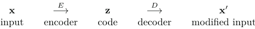

因为自动编码器不属于监督算法的大家族，我们将其介绍推迟到第 15.2.3 节。

文章 Gu et al. (2020a) 采用了 AEs 的想法，同时增加了其资产定价模型的复杂性。从简单的规范 \( r_t = \beta_{t-1}\mathbf{f}_t + e_t \) 开始（我们为简化记法省略了资产依赖性），他们增加假设：贝塔取决于企业特征，而因子可能是回报本身的非线性函数。模型采取以下形式：

\( r_{t,i} = \mathbf{NN}_{\mathbf{beta}}(\mathbf{x}_{t-1,i}) + \mathbf{NN}_{\mathbf{factor}}(\mathbf{r}_t) + e_{t,i},\) (7.14)

其中 \(\mathbf{NN}_{\mathbf{beta}}\) 和 \(\mathbf{NN}_{\mathbf{factor}}\) 是两个神经网络。上述方程看起来像自动编码器，因为回报既是输入也是输出。然而，额外的复杂性来自第二个神经网络 \(\mathbf{NN}_{\mathbf{beta}}\)。现代神经网络库（如 Keras）允许像上面这样的自定义模型。此结构的编码留作练习（见下文）。

#### 7.6.3 关于卷积网络的一点说明

神经网络在 2010 年代因在计算机视觉竞赛中的一系列成功而流行起来。这些进步背后的算法是卷积神经网络（CNNs）。虽然它们似乎是金融预测的惊人选择，但计算机科学领域的几个研究团队已提出依赖于这种神经网络变体的方法（Chen et al. (2016)、Loreggia et al. (2016)、Dingli and Fournier (2017)、Tsantekidis et al. (2017)、Hoseinzade and Haratizadeh (2019)）。因此，我们在神经网络的最后一节中简要介绍其原理。我们针对二维 CNNs 进行阐述，但它们也可用于一维或三维。

CNNs 有用的原因在于，它们允许在保留局部信息的同时逐步减小大数据集的维度。图像是一组像素矩形。每个像素通常通过三个层进行编码，每种颜色一个：红色、蓝色和绿色。但为了简单起见，我们仅考虑一个层，例如 1,000 乘 1,000 像素，每个像素一个值。为了分析此图像的内容，卷积层将通过某种卷积来减小输入的维度。直观上，这种简化是通过使用带有任意权重的矩形扫描和改变值来执行的。

图 7.11 绘制了此过程（深受 Hoseinzade and Haratizadeh (2019) 启发）。原始数据是一个矩阵（\( I \times K \)）\( x_{i,k} \)，权重也是一个矩阵 \( w_{j,l} \)，大小为（\( J \times L \)），其中 \( J < I \) 和 \( L < K \)。扫描将每个大小为（\( J \times L \)）的矩形转换为一个实数。因此，输出具有更小的大小：\( (I - J + 1) \times (K - L + 1) \)。如果 \( I = K = 1,000 \) 和 \( J = L = 201 \)，则输出维度为 \( (800 \times 800) \)，这已经小得多。输出值由以下公式给出：

\( o_{i,k} = \sum_{j=1}^J \sum_{l=1}^L w_{j,l} x_{i+j-1, k+l-1}.\)


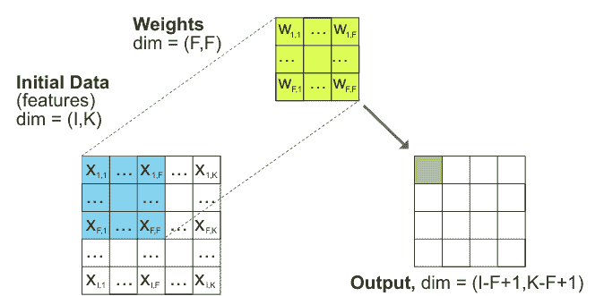

**FIGURE 7.11:** Scheme of a convolutional unit. Note: the dimensions are general and do not correspond to the number of squares.

Iteratively reducing the dimension of the output via sequences of convolutional layers like the one presented above would be costly in computation and could give rise to overfitting because the number of weights would be incredibly large. In order to efficiently reduce the size of outputs, **pooling layers** are often used. The job of pooling units is to simplify matrices by reducing them to a simple metric such as the minimum, maximum or average value of the matrix:

```
o_{i,k} = f(x_{i+j-1,k+l-1}; 1 \le j \le J, 1 \le l \le L),
```

where f is the minimum, maximum or average value. We show examples of pooling in Figure 7.12 below. In order to increase the speed of compression, it is possible to add a stride to omit cells. A stride value of v will perform the operation only every v value and hence bypass intermediate steps. In Figure 7.12, the two cases on the left do not resort to pooling, hence the reduction in dimension is equal to the size of the pooling size. When stride is into action (right pane), the reduction is more marked. From the 1,000 by 1,000 input, a 2-by-2 pooling layer with stride 2 will yield a 500-by-500 output: the dimension is shrinked fourfold, as in the right scheme of Figure 7.12.

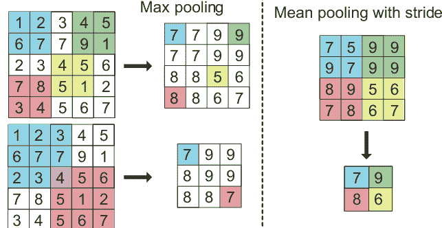

FIGURE 7.12: Scheme of pooling units.

With these tools in hand, it is possible to build new predictive tools. In Hoseinzade and Haratizadeh (2019), predictors such as price quotes, technical indicators and macro-economic data are fed to a complex neural network with 6 layers in order to predict the sign of price variations. While this is clearly an interesting computer science exercise, the deep economic motivation behind this choice of architecture remains unclear.

#### 7.6.4 Advanced architectures

The superiority of neural networks in tasks related to computer vision and natural language processing is now well established. However, in many ML tournaments in the 2010 decade, neural networks have often been surpassed by tree-based models when dealing with tabular data. This puzzle encouraged researchers to construct novel NN structures that are better suited to tabular databases. Examples include Arik and Pfister (2019) and Popov et al. (2019), but their ideas lie outside the scope of this book. Surprisingly, the reverse idea also exists: Nuti et al. (2019) try to adapt trees and random forests so that they behave more like neural networks. The interested reader can have a look at the original papers.

#### 7.7 Coding exercise

The purpose of the exercise is to code the autoencoder model described in Gu et al. (2020a) (see Section 7.6.2). When coding NNs, the dimensions must be rigorously reported. This is why we reproduce a diagram of the model in Figure 7.13 which clearly shows the inputs and outputs along with their dimensions.

label: actual returns r_n = \beta_j f_j + \epsilon_n aim \rightarrow min \epsilon \epsilon
output: model returns \tilde{r}_n = \beta_j f_j dimension: N*1

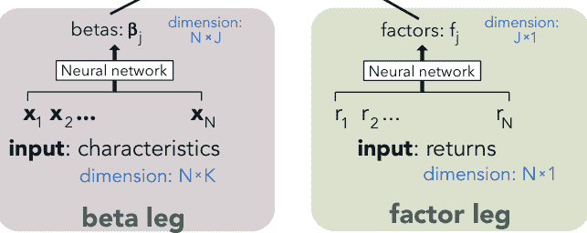

FIGURE 7.13: Scheme of the autoencoder pricing model.

In order to harness the full potential of Keras, it is imperative to switch to more general formulations of NNs. This can be done via the so-called functional API: https://keras.rstudio.com/articles/functional_api.html.

## 8 Support vector machines

While the origins of support vector machines (SVMs) are old (and go back to Vapnik and Lerner (1963)), their modern treatment was initiated in Boser et al. (1992) and Cortes and Vapnik (1995) (binary classification) and Drucker et al. (1997) (regression). We refer to http://www.kernel-machines.org/books for an exhaustive bibliography on their theoretical and empirical properties. SVMs have been very popular since their creation among the machine learning community. Nonetheless, other tools (neural networks especially) have gained popularity and progressively replaced SVMs in many applications like computer vision notably.

### 8.1 SVM for classification

As is often the case in machine learning, it is easier to explain a complex tool through an illustration with binary classification. In fact, sometimes, it is originally how the tool was designed (e.g., for the perceptron). Let us consider a simple example in the plane, that is, with two features. In Figure 8.1, the goal is to find a model that correctly classifies points: filled circles versus empty squares.

A model consists of two weights w = (w1, w2) that load on the variables and create a natural linear separation in the plane. In the example above, we show three separations. The red one

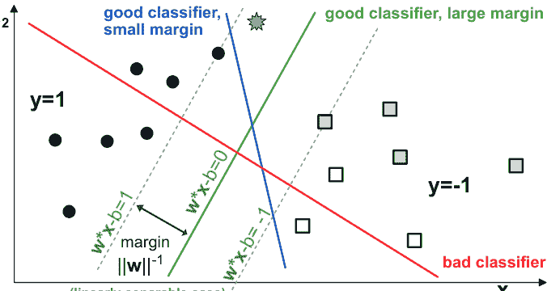

FIGURE 8.1: Diagram of binary classification with support vectors.

is not a good classifier because there are circles and squares above and beneath it. The blue line is a good classifier: all circles are to its left and all squares to its right. Likewise, the green line achieves a perfect classification score. Yet, there is a notable difference between the two.

The grey star at the top of the graph is a mystery point and given its location, if the data pattern holds, it should be a circle. The blue model fails to recognize it as such while the green one succeeds. The interesting features of the scheme are those that we have not mentioned yet, that is, the grey dotted lines. These lines represent the no-man’s land in which no observation falls when the green model is enforced. In this area, each strip above and below the green line can be viewed as a margin of error for the model. Typically, the grey star is located inside this margin.

The two margins are computed as the parallel lines that maximize the distance between the model and the closest points that are correctly classified (on both sides). These points are called **support vectors**, which justifies the name of the technique. Obviously, the green model has a greater margin than the blue one. The core idea of SVMs is to maximize the margin, under the constraint that the classifier does not make any mistake. Said differently, SVMs try to pick the most robust model among all those that yield a correct classification.

More formally, if we numerically define circles as +1 and squares as -1, any ‘good’ linear model is expected to satisfy:

```
\(\begin{aligned} \sum_{k=1}^K w_k x_{i,k} + b \ge +1 \qquad \text{when } y_i = +1 \\ \sum_{k=1}^K w_k x_{i,k} + b \le -1 \qquad \text{when } y_i = -1, \end{aligned}\) (8.1)
```

which can be summarized in compact form \(y_i \times \sum_{k=1}^K w_k x_{i,k} + b \ge 1\). Now, the margin between the green model and a support vector on the dashed grey line is equal to \(\|\mathbf{w}\|^{-1} = \sqrt{\sum_{k=1}^K w_k^2}^{-1/2}\). This value comes from the fact that the distance between a point \((x_0, y_0)\) and a line parametrized by \(ax + by + c = 0\) is equal to \(d = \frac{|ax_0 + by_0 + c|}{\sqrt{a^2 + b^2}}\). In the case of the model defined above (8.1), the numerator is equal to 1 and the norm is that of \(\mathbf{w}\). Thus, the final problem is the following:

```
\(\text{argmin}_{\mathbf{w}, b} \frac{1}{2} \|\mathbf{w}\|^2 \quad \text{s.t. } y_i \sum_{k=1}^K w_k x_{i,k} + b \ge 1.\) (8.2)
```

The dual form of this program (see chapter 5 in Boyd and Vandenberghe (2004)) is

```
\(L(\mathbf{w}, b, \boldsymbol{\lambda}) = \frac{1}{2} \|\mathbf{w}\|^2 + \sum_{i=1}^I \lambda_i \, y_i \sum_{k=1}^K w_k x_{i,k} + b - 1 \quad ,\) (8.3)
```

where either \(\lambda_i = 0\) or \(y_i \sum_{k=1}^K w_k x_{i,k} + b = 1\). Thus, only some points will matter in the solution (the so-called support vectors). The first order conditions impose that the derivatives of this Lagrangian be null:

```
\(\frac{\partial L}{\partial \mathbf{w}} L(\mathbf{w}, b, \boldsymbol{\lambda}) = \mathbf{0} , \qquad \frac{\partial L}{\partial b} L(\mathbf{w}, b, \boldsymbol{\lambda}) = 0 ,\)
```


当第一个条件成立时

\[
\mathbf{w}^* = \sum_{i=1}^I \lambda_i y_i \mathbf{x}_i.
\]

这个解确实是特征的线性形式，但只考虑了一些点。这些点是不等式(8.1)取等号的那些点。

显然，当条件无法满足时，这个问题就变得不可行了，也就是说，无论如何选择系数，一条直线都无法完美地分隔标签。这是最常见的配置，数据集此时被称为逻辑上*不可线性分离*的。这使过程变得复杂，但可以采取一个技巧。思路是在(8.1)中引入一些灵活性，通过添加允许满足条件的校正变量来实现：

\[
\begin{aligned}
\sum_{k=1}^K w_k x_{i,k} + b \ge +1 - \xi_i & \quad \text{when } y_i = +1 \\
\sum_{k=1}^K w_k x_{i,k} + b \le -1 + \xi_i & \quad \text{when } y_i = -1,
\end{aligned}
\quad (8.4)
\]

这里的新增量，即\(\xi_i\)为正的所谓‘松弛’变量，使条件可行。它们在图8.2中说明。在这种新配置中，没有简单的线性模型可以完美地区分两个类别。

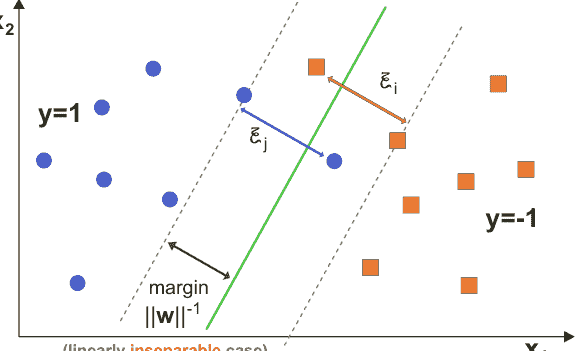

**图8.2:** SVM二分类图 - 线性不可分数据。

优化问题于是变为

\[
\underset{\mathbf{w},b,\xi}{\text{argmin}} \frac{1}{2}||\mathbf{w}||^2 + C \sum_{i=1}^I \xi_i \quad \text{s.t.} \quad y_i \sum_{k=1}^K w_k \phi(x_{i,k}) + b \ge 1 - \xi_i \quad \text{and} \quad \xi_i \ge 0, \quad \forall i, \quad (8.5)
\]

其中参数\(C > 0\)调节误分类的代价：随着\(C\)的增加，错误的惩罚程度越来越重。

此外，该程序可以通过将核函数\(\phi\)应用于输入点\(x_{i,k}\)来推广到非线性模型。非线性核函数可以帮助处理比直线更复杂的模式（见图8.3）。常见的核函数可以是多项式、径向或Sigmoid。解是使用约束二次规划的或多或少标准技术找到的。一旦通过训练设置了权重\(\mathbf{w}\)和偏差\(b\)，对新向量\(\mathbf{x}_j\)的预测只需计算\(\sum_{k=1}^K w_k \phi(x_{j,k}) + b\)，并根据表达式的符号选择类别即可。

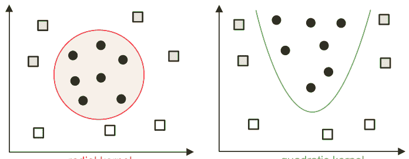

**图8.3:** 非线性核函数示例。

### 8.2 用于回归的SVM

分类SVM的思想可以转移到回归问题上，但边界的作用不同。一个通用公式如下

\[
\underset{\mathbf{w}, b, \xi}{\text{argmin}} \frac{1}{2}||\mathbf{w}||^2 + C \sum_{i=1}^I (\xi_i + \xi_i^*) \quad (8.6)
\]

\[
\text{s.t. } \sum_{k=1}^K w_k \phi(x_{i,k}) + b - y_i \le \epsilon + \xi_i \quad (8.7)
\]

\[
y_i - \sum_{k=1}^K w_k \phi(x_{i,k}) - b \le \epsilon + \xi_i^* \quad (8.8)
\]

\[
\xi_i, \xi_i^* \ge 0, \quad \forall i, \quad (8.9)
\]

如图8.4所示。用户指定一个**边界**\(\epsilon\)，模型将尝试找到标签\(y_i\)和输入\(\mathbf{x}_i\)之间的线性关系（最多经过核变换）。与分类任务一样，如果数据点在带内，松弛变量\(\xi_i\)和\(\xi_i^*\)设置为零。当点违反阈值时，目标函数（代码的第一行）会受到惩罚。注意，设置较大的\(\epsilon\)为更多错误留出空间。一旦模型训练完成，对\(\mathbf{x}_j\)的预测只需\(\sum_{k=1}^K w_k \phi(x_{j,k}) + b\)。

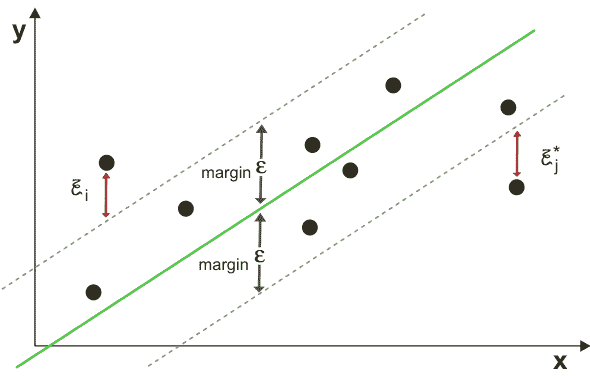

**图8.4:** 回归SVM图。

让我们退后一步，简化算法的做法，即：在误差足够小（模松弛变量）的前提下，最小化权重平方和\(||\mathbf{w}||^2\)。从精神上讲，这与惩罚线性回归有些相反，后者寻求在权重足够小的前提下最小化误差。

本节中阐述的模型是SVM引擎宇宙的预览，还开发了几种其他公式。一个用C和C++编写的参考库是**LIBSVM**，它被许多其他编程语言广泛使用。感兴趣的读者可以参考相关文章Chang and Lin (2011)以了解有关SVM动物园的更多细节（2019年11月的较新版本也可在线查阅）。

### 8.3 实践

在R中，LIBSVM库被多个包利用。其中之一是_e1071_，它是一个不错的选择，因为它还包含许多其他有趣的函数，尤其是我们稍后将看到的朴素贝叶斯分类器。

在LIBSVM的实现中，该包要求分别指定标签和特征。因此，我们重复使用为提升树使用过的变量。此外，由于训练速度慢，我们对这些集的子样本（前一千个实例）进行训练。

```
library(e1071)
fit_svm <- svm(y = train_label_xgb[1:1000],       # Train label
               x = train_features_xgb[1:1000, ], # Training features
               type = "eps-regression",          # SVM task type (see LIBSVM documentation)
               kernel = "radial",                # SVM kernel (or: linear, polynomial, sigmoid)
               epsilon = 0.1,                    # Width of strip for errors
               gamma = 0.5,                      # Constant in the radial kernel
               cost = 0.1)                       # Slack variable penalisation

test_feat_short <- dplyr::select(testing_sample, features_short)
mean((predict(fit_svm, test_feat_short) - testing_sample$R1M_Used)^2) # MSE
```

```
# [1] 0.03839085
```

```
mean(predict(fit_svm, test_feat_short) * testing_sample$R1M_Usd > 0) # Hit ratio
```

```
# [1] 0.5222197
```

结果比提升树略好。所有参数都完全是任意的，尤其是核函数的选择。我们最后转向一个分类示例。

```
fit_svm_C <- svm(y = training_sample$R1M_Usd_C[1:1000], # Train label
                 x = training_sample[1:1000, ] %>%     # Training features
                 dplyr::select(features),
                 type = "C-classification",          # SVM task type (see LIBSVM doc.)
                 kernel = "sigmoid",                 # SVM kernel
                 gamma = 0.5,                        # Parameter in the sigmoid kernel
                 coef0 = 0.3,                        # Parameter in the sigmoid kernel
                 cost = 0.2)                         # Slack variable penalisation
mean(predict(fit_svm_C,
             dplyr::select(testing_sample, features)) == testing_sample$R1M_Usd_C) # Accuracy
```

```
# [1] 0.5008973
```

训练样本较小和我们对参数选择的任意性都可能解释为什么预测准确性如此之差。

### 8.4 编程练习

- 1. 从上面显示的简单示例出发，将SVM模型扩展到其他核函数，并讨论对拟合的影响。
- 2. 训练一个标准SVM模型，标签为12个月前瞻（即未来）回报，并在测试样本上对其进行评估。对简单随机森林做同样的处理。比较。

## 9 贝叶斯方法

本节专门介绍机器学习中对参数做出先验假设的子集。在解释如何将贝叶斯定理应用于机器学习的简单构建块之前，我们在下面的子节中介绍一些符号和概念。贝叶斯分析的良好参考是Gelman et al. (2013)和Kruschke (2014)。后者与本书一样，用许多R代码行来说明概念。

### 9.1 贝叶斯框架

到目前为止，所介绍的模型仅依赖于数据。这种方法通常被称为“频率派”。给定一个数据集，频率派会提取（即估计）一组唯一的最优参数，并将其视为最佳模型。另一方面，贝叶斯派将数据集视为**现实的快照**，因此对他们来说，参数是随机的！他们不像频率派那样为参数估计一个值（例如线性模型中的系数），而是更有雄心，试图确定参数的**整个分布**。

为了概述如何实现这一点，我们介绍一些基本符号和结果。贝叶斯分析中的基础概念是**条件概率**。给定两个随机集合（或事件）\(A\)和\(B\)，我们定义在已知\(B\)的情况下\(A\)的概率（等价地，在已知有\(B\)的条件下有\(A\)的几率）为

\[
P[A|B] = \frac{P[A \cap B]}{P[B]},
\]

也就是说，两个集合的交集的概率除以\(B\)的概率。同样，两者都发生的概率等于\(P[A \cap B] = P[A]P[B|A]\)。给定\(n\)个不相交的事件\(A_i\)，\(i=1, \dots, n\)且\(\sum_{i=1}^n P(A_i) = 1\)，那么对于任何事件\(B\)，全概率公式为（或意味着）

\[
P(B) = \sum_{i=1}^n P(B \cap A_i) = \sum_{i=1}^n P(B|A_i)P(A_i).
\]

基于这个表达式，我们可以制定贝叶斯定理的一般版本：

\[
P(A_i|B) = \frac{P(A_i)P(B|A_i)}{P(B)} = \frac{P(A_i)P(B|A_i)}{\sum_{i=1}^n P(B|A_i)P(A_i)}. \tag{9.1}
\]

有了这个结果，我们可以继续进入本节的核心主题，即给定一个数据集（我们用\(\mathbf{y}\)表示）对某个参数\(\theta\)（可能是向量）进行估计。


因此遵循了 Gelman 等人 (2013) 的惯例。尽管如此，在本书中这种记法仍非最佳，因为在其他所有章节中，**y** 都代表数据集的标签。

在贝叶斯分析中，相比频率派方法，一个复杂之处在于数据并非全能。

参数 \(\theta\) 的分布将是统计学家（用户、分析人员）设定的某些 **先验** 分布与来自数据的经验分布之间的混合。

更准确地说，贝叶斯公式的简单应用得出

\(p(\theta|\mathbf{y}) = \frac{p(\theta)p(\mathbf{y}|\theta)}{p(\mathbf{y})} \propto p(\theta)p(\mathbf{y}|\theta).\)

其解释立即明确：已知数据 \(\mathbf{y}\) 时 \(\theta\) 的分布与 \(\theta\) 的分布乘以已知 \(\theta\) 时 \(\mathbf{y}\) 的分布成正比。项 \(p(\mathbf{y})\) 通常被省略，因为它只是一个缩放数字，用于确保概率密度之和或积分为一。

在公式 (9.1) 和公式 (9.2) 之间，我们使用略有不同的记法。在前者中，\(P\) 表示真概率，即它是一个数值。在后者中，\(p\) 代表 \(\theta\) 或 \(\mathbf{y}\) 的整个概率密度函数。

贝叶斯分析的整个目的是通过 **先验** 分布 \(p(\theta)\) 和 **似然函数** \(p(\mathbf{y}|\theta)\) 计算所谓的 **后验** 分布 \(p(\theta|\mathbf{y})\)。先验有时被称为信息性、弱信息性或非信息性，这取决于用户对先验的相关性和稳健性的信心程度。定义非信息性先验最简单的方法是对某些现实区间设定常数（均匀）分布。

最具挑战性的部分通常是似然函数。解决该问题的最简便方法是为数据的分布采用特定分布（可能是参数族），然后假设观测是独立同分布的（i.i.d.），就像在简单最大似然推断中一样。如果我们假设分布的新参数汇总为 \(\lambda\)，则似然可以写为

\(p(\mathbf{y}|\theta, \lambda) = \prod_{i=1}^{I} f_{\lambda}(y_i; \beta),\)

但在这种情况下，问题变得稍微复杂一些，因为添加新参数将后验分布改为 \(p(\theta, \lambda|\mathbf{y})\)。用户必须找出给定 \(\mathbf{y}\) 时 \(\theta\) 和 \(\lambda\) 的联合分布。由于它们的嵌套结构，这些模型通常称为 **层次模型**。

贝叶斯方法广泛用于投资组合选择。其理由是资产收益的分布取决于某些参数，主要问题是确定后验分布。下面我们非常简要地回顾了大量文献。Lai 等人 (2011)（通过随机优化）、Guidolin 和 Liu (2016) 以及 Dangl 和 Weissensteiner (2020) 研究了贝叶斯资产配置。Frost 和 Savarino (1986)、Kan 和 Zhou (2007) 以及 DeMiguel 等人 (2015) 测试了缩减技术（针对均值和协方差矩阵）。类似地，Tu 和 Zhou (2010) 构建了与资产定价理论一致的先验。最后，Bauder 等人 (2020) 对投资组合收益进行采样，从而可以推导出贝叶斯有效前沿。我们邀请感兴趣的读者也深入研究这些文章中引用的参考文献。

### 9.2 贝叶斯采样

#### 9.2.1 Gibbs 采样

贝叶斯定理的一个相邻应用领域是 **模拟**。假设我们想要模拟随机向量 **X** 的多元分布，其密度由 \(p = p(x_1, \dots, x_J)\) 给出。通常，完整分布较复杂，但其边缘分布更容易获取。的确，它们更简单，因为它们仅依赖于一个变量（当所有其他值已知时）：

\(p(X_j = x_j | X_1 = x_1, \dots, X_{j-1} = x_{j-1}, X_{j+1} = x_{j+1}, \dots, X_J = x_J) = p(X_j = x_j | \mathbf{X}_{-j} = \mathbf{x}_{-j}),\)

此处我们使用紧凑记法 \(\mathbf{X}_{-j}\) 表示除 \(X_j\) 以外的所有变量。生成服从分布 \(p\) 的样本的一种方法如下，它既依赖于条件分布 \(p(x_j | \mathbf{x}_{-j})\) 的知识，也依赖于 **马尔可夫链蒙特卡洛** 的概念，我们将在下面概述。该过程是迭代的，并假设可以绘制上述条件分布的样本。我们用 \(x_j^m\) 表示第 \(j\) 个变量 \((X_j)\) 的第 \(m\) 个样本。模拟从先验（或固定、或随机）样本 \(\mathbf{x}^0 = (x_1^0, \dots, x_J^0)\) 开始。然后，在足够大的次数（设为 \(T\)）内，按照以下方式绘制新样本：

```
\(x_1^{m+1} = p(X_1|X_2 = x_2^m, \dots, X_J = x_J^m);\)
\(x_2^{m+1} = p(X_2|X_1 = x_1^{m+1}, X_3 = x_3^m, \dots, X_J = x_J^m);\)
\(\dots\)
\(x_J^{m+1} = p(X_J|X_1 = x_1^{m+1}, X_2 = x_2^{m+1}, \dots, X_{J-1} = x_{J-1}^{m+1}).\)
```

重要的细节是，每一行之后，变量的值都会更新。因此，在第二行中，\(X_2\) 在已知 \(X_1 = x_1^{m+1}\) 的情况下被采样，而在最后一行中，除了 \(X_J\) 之外的所有变量都已更新到其 \((m+1)^{th}\) 状态。上述算法称为 Gibbs 采样。它与马尔可夫链相关，因为每次新迭代仅依赖于前一次迭代。

在某些技术假设下，随着 \(T\) 增加，\(\mathbf{x}_T\) 的分布会收敛到 \(p\) 的分布。收敛发生的条件在 1990 年代的一系列文章中已得到广泛讨论。感兴趣的读者可以例如参阅 Tierney (1994)、Roberts 和 Smith (1994)，以及 Gelman 等人 (2013) 的第 11.7 节。

有时，完整分布较复杂且条件分布难以确定和采样。此时，可以使用一种更一般的方法，称为 Metropolis-Hastings，它依赖于随机变量模拟中的拒绝采样法。

#### 9.2.2 Metropolis-Hastings 采样

Gibbs 算法可以被视为 Metropolis-Hastings (MH) 方法的一个特例，其最简单版本由 Metropolis 和 Ulam (1949) 引入。前提类似：目标是模拟遵循 \(p(\mathbf{x})\) 的随机变量，并能够从更简单的形式 \(p(\mathbf{x}|\mathbf{y})\) 进行采样，该形式给出了在过去状态 \(\mathbf{y}\) 已知的情况下未来状态 \(\mathbf{x}\) 的概率。

一旦对 \(\mathbf{x}\) 的初始值 (\(\mathbf{x}_0\)) 进行了采样，模拟的每次新迭代 (\(m\)) 都分为三个阶段：

- 1. 从 \(p(\mathbf{x}|\mathbf{x}_m)\) 生成候选值 \(\mathbf{x}'_{m+1}\)，
- 2. 计算接受率 \(\alpha = \min \frac{p(\mathbf{x}_{m+1})p(\mathbf{x}_m|\mathbf{x}_{m+1})}{p(\mathbf{x}_m)p(\mathbf{x}'_{m+1}|\mathbf{x}_m)}\)
- 3. 以概率 \(\alpha\) 选择 \(\mathbf{x}_{m+1} = \mathbf{x}'_{m+1}\)，或以概率 \(1 - \alpha\) 保持先前值 (\(\mathbf{x}_{m+1} = \mathbf{x}_m\))。

在一般情况下，接受率的解释并不直观。当采样生成器是对称的 (\(p(\mathbf{x}|\mathbf{y}) = p(\mathbf{y}|\mathbf{x})\)) 时，只要 \(p(\mathbf{x}'_{m+1}) \ge p(\mathbf{x}_m)\)，候选值总是被选中。如果反向条件成立 (\(p(\mathbf{x}'_{m+1}) < p(\mathbf{x}_m)\))，则候选值以 \(p(\mathbf{x}'_{m+1})/p(\mathbf{x}_m)\) 的比例被保留，即似然比。新建议越可能，保留它的比例就越高。

通常，会丢弃最初的模拟，以便给链留出时间收敛到高概率区域。此过程（通常称为“烧入”）确保首批保留的样本位于可能性较高的区域，即更具代表性的我们试图模拟的分布。

为了简洁起见，此处我们采用简洁的表述，但一些额外细节在 Gelman 等人 (2013) 的第 11.2 节和 Kruschke (2014) 的第 7 章中有概述。

### 9.3 贝叶斯线性回归

由于贝叶斯概念相当抽象，用简单示例说明理论概念很有用。在线性模型中，\(y_i = \mathbf{x}_i\mathbf{b} + \epsilon_i\)，并且通常在统计上假设 \(\epsilon_i\) 是独立同分布且服从均值为零、方差为 \(\sigma^2\) 的正态分布。因此，公式 (9.3) 的似然转化为

\(p(\epsilon|\mathbf{b}, \sigma) = \prod_{i=1}^I \frac{e^{-\frac{\epsilon_i^2}{2\sigma}}}{\sigma\sqrt{2\pi}} = (\sigma\sqrt{2\pi})^{-I} e^{-\frac{\sum \epsilon_i^2}{2\sigma^2}}.\)

在回归分析中，数据由 \(\mathbf{y}\) 和 \(\mathbf{X}\) 给出，因此两者都体现在记法中。仅需承认 \(\epsilon = \mathbf{y} - \mathbf{Xb}\)，我们得到

\(p(\mathbf{y}, \mathbf{X}|\mathbf{b}, \sigma) = \prod_{i=1}^I \frac{e^{-\frac{\epsilon_i^2}{2\sigma^2}}}{\sigma\sqrt{2\pi}} \tag{9.4}\)
\(= (\sigma\sqrt{2\pi})^{-I} e^{-\sum_{i=1}^I \frac{(y_i - \mathbf{x}_i \mathbf{b})^2}{2\sigma^2}} = (\sigma\sqrt{2\pi})^{-I} e^{-\frac{(\mathbf{y} - \mathbf{Xb})(\mathbf{y} - \mathbf{Xb})}{2\sigma^2}}\)
\(= \underbrace{(\sigma\sqrt{2\pi})^{-I} e^{-\frac{(\mathbf{y} - \mathbf{Xb})(\mathbf{y} - \mathbf{Xb})}{2\sigma^2}}}_{\text{depends on } \sigma \text{, not } \mathbf{b}} \times \underbrace{e^{-\frac{(\mathbf{b} - \hat{\mathbf{b}}) \mathbf{X} \mathbf{X} (\mathbf{b} - \hat{\mathbf{b}})}{2\sigma^2}}}_{\text{depends on both } \sigma \text{, and } \mathbf{b}} . \tag{9.5}\)

在最后一行中，第二项是差值 \(\mathbf{b} - \hat{\mathbf{b}}\) 的一个函数，其中 \(\hat{\mathbf{b}} = (\mathbf{X}'\mathbf{X})^{-1}\mathbf{X}'\mathbf{y}\)。


这并不令人惊讶：\(\hat{\mathbf{b}}\) 是 \(\mathbf{b}\) 均值的自然基准。此外，引入 \(\hat{\mathbf{b}}\) 使得概率具有相对简单的形式。

上述表达式是后验的频率学派（基于数据）部分：即似然。如果我们想要获得后验的可处理表达式，需要找到一个先验成分，其形式能与该似然良好结合。这些形式称为 **共轭先验**。对于依赖于 \(\mathbf{b}\) 和 \(\sigma\) 的右侧部分，一个自然候选是多元高斯密度：

\(p[\mathbf{b}|\sigma] = \sigma^{-k} e^{-\frac{(\mathbf{b}-\mathbf{b}_0) \boldsymbol{\Lambda}_0 (\mathbf{b}-\mathbf{b}_0)}{2\sigma^2}}, \quad (9.6)\)

在这里我们必须对 \(\sigma\) 进行条件化。该密度的先验均值为 \(\mathbf{b}_0\)，先验协方差矩阵为 \(\boldsymbol{\Lambda}_0^{-1}\)。这个先验使我们更接近后验，因为

\(p[\mathbf{b}, \sigma | \mathbf{y}, \mathbf{X}] \propto p[\mathbf{y}, \mathbf{X} | \mathbf{b}, \sigma] p[\mathbf{b}, \sigma] \propto p[\mathbf{y}, \mathbf{X} | \mathbf{b}, \sigma] p[\mathbf{b}|\sigma] p[\sigma]. \quad (9.7)\)

为了完全指定概率级联，我们需要处理 \(\sigma\) 并设置以下形式的密度：

\(p[\sigma^2] \propto (\sigma^2)^{-1-a_0} e^{-\frac{b_0}{2\sigma^2}}, \quad (9.8)\)

这与 (9.5) 左侧部分的形式相近。这对应于方差的逆伽马分布，先验参数为 \(a_0\) 和 \(b_0\)（这种标量记法并不理想，因为可能与先验均值 \(\mathbf{b}_0\) 混淆，因此我们必须格外小心）。

现在，我们可以利用 (9.5)、(9.6) 和 (9.8) 简化 \(p[\mathbf{b}, \sigma | \mathbf{y}, \mathbf{X}]\)：

\(p[\mathbf{b}, \sigma | \mathbf{y}, \mathbf{X}] \propto (\sigma\sqrt{2\pi})^{-I} \sigma^{-2(1+a_0)} e^{-\frac{(\mathbf{y}-\mathbf{X}\hat{\mathbf{b}})'(\mathbf{y}-\mathbf{X}\hat{\mathbf{b}})}{2\sigma^2}} \times e^{-\frac{(\mathbf{b}-\mathbf{b})' \mathbf{X}' \mathbf{X}(\mathbf{b}-\hat{\mathbf{b}})}{2\sigma^2}} \sigma^{-k} e^{-\frac{(\mathbf{b}-\mathbf{b}_0)' \boldsymbol{\Lambda}_0 (\mathbf{b}-\mathbf{b}_0)}{2\sigma^2}} e^{-\frac{b_0}{2\sigma^2}}\)

可以改写为

\(p[\mathbf{b}, \sigma | \mathbf{y}, \mathbf{X}] \propto \sigma^{-I-k-2(1+a_0)} \times \exp \left( - \frac{\mathbf{y} - \mathbf{X}\hat{\mathbf{b}} \quad \mathbf{y} - \mathbf{X}\hat{\mathbf{b}} + (\mathbf{b}-\hat{\mathbf{b}})' \mathbf{X}' \mathbf{X}(\mathbf{b}-\hat{\mathbf{b}}) + (\mathbf{b}-\mathbf{b}_0)' \boldsymbol{\Lambda}_0 (\mathbf{b}-\mathbf{b}_0) + b_0}{2\sigma^2} \right) \)。

上述表达式只是关于 \(\mathbf{b}\) 的一个二次形式，经过繁琐的代数运算后可以改写为更紧凑的形式：

\(p(\mathbf{b} | \mathbf{y}, \mathbf{X}, \sigma) \propto \sigma^{-k} e^{-\frac{(\mathbf{b}-\mathbf{b}_*)' \boldsymbol{\Lambda}_* (\mathbf{b}-\mathbf{b}_*)}{2\sigma^2}} \times (\sigma^2)^{-1-a_*} e^{-\frac{b_*}{2\sigma^2}}, \quad (9.9)\)

其中

\(\boldsymbol{\Lambda}_* = \mathbf{X}'\mathbf{X} + \boldsymbol{\Lambda}_0\)
\(\mathbf{b}_* = \boldsymbol{\Lambda}_*^{-1} (\boldsymbol{\Lambda}_0 \mathbf{b}_0 + \mathbf{X}'\mathbf{X}\hat{\mathbf{b}})\)
\(a_* = a_0 + I/2\)
\(b_* = b_0 + \frac{1}{2} \mathbf{y}'\mathbf{y} + \mathbf{b}_0' \boldsymbol{\Lambda}_0 \mathbf{b}_0 + \mathbf{b}_*' \boldsymbol{\Lambda}_* \mathbf{b}_* \)。

该表达式由两部分组成：与 **b** 主要相关的高斯分量，以及完全专门用于 \(\sigma\) 的逆伽马分量。先验与数据之间的混合关系很明显。高斯部分的后验协方差矩阵 (\(\boldsymbol{\Lambda}_*\)) 是先验与来自数据的二次形式之和。后验均值 **b**<sub>∗</sub> 是先验 **b**<sub>0</sub> 与样本估计量 \(\hat{\mathbf{b}}\) 的加权平均。这种将从数据估计的量与用户提供的版本相混合的做法通常称为 **收缩**。例如，原始交叉项矩阵 \(\mathbf{X}'\mathbf{X}\) 会向先验 \(\boldsymbol{\Lambda}_0\) 收缩。这可以被视为一种 **正则化** 程序：源自数据的纯拟合与某种‘外部’成分混合，以给最终估计赋予结构。

有兴趣的读者也可以参阅 Greene (2018) 的第 16.3 节（共轭先验的情形在 16.3.2 小节中讨论）。

上述公式可能冗长且实现有风险。幸运的是，有一个 R 程序包（`spBayes`）可用于基于共轭先验的线性回归贝叶斯推断。下面，我们提供一个工作示例。为了简化代码并缩短计算时间，我们考虑两个预测变量：市值（尺寸异常）和市净率（价值异常）。在统计学中，**精度矩阵**是协方差矩阵的逆。在参数中，前两个先验与高斯定律相关，后两个与逆伽马分布相关：

\(f_{\text{invgamma}}(x, \alpha, \beta) = \frac{\beta^\alpha}{\Gamma(\alpha)} x^{-1-\alpha} e^{-\frac{\beta}{x}},\)

其中 \(\alpha\) 为形状参数，\(\beta\) 为尺度参数。

```
prior_mean <- c(0.01,0.1,0.1,0.1)      # Average value of parameters (prior)
precision_mat <- diag(prior_mean^2) %>% solve()   # Inverse cov matrix of parameters (prior)
fit_lmBayes <- bayesLMConjugate(
  RlM_Usd ~ Mkt_Cap3M_Usd + Pb,       # Model: size and value
  data = testing_sample,              # Data source, here, the test sample
  n.samples = 2000,                   # Number of samples used
  beta.prior.mean = prior_mean,       # Avg prior: size & value rewarded & unit beta
  beta.prior.precision = precision_mat, # Precision matrix
  prior.shape = 0.5,                  # Shape for prior distribution of sigma
  prior.rate = 0.5)                   # Scale for prior distribution of sigma
```

在上述规范中，我们还必须为常数项提供先验。默认情况下，我们将其平均值设为 0.01，即月均回报率为 1%。模型估计完成后，我们可以绘制系数估计值的分布图。

```
fit_lmBayes$p.beta.tau.sq.samples[1:3] %>% as_tibble() %>% 
  `colnames<-`(c("Intercept", "Size", "Value")) %>% 
gather(key = coefficient, value = value) %>% 
ggplot(aes(x = value, fill = coefficient)) + geom_histogram(alpha = 0.5)
```

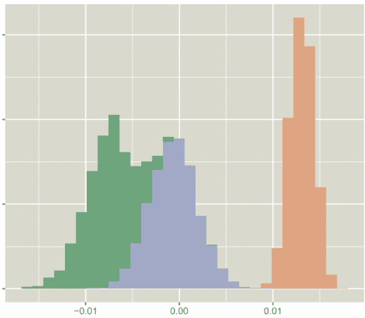

图 9.1：线性回归系数（贝塔）的分布。

图 9.1 中常数项的分布明显偏右且离散度小，因此是稳健的正值。对于尺寸系数，情况正好相反；它是负值（小型公司盈利能力更强）。关于价值，难以得出结论，分布围绕零平衡：对市净率变量没有明显的敞口。

### 9.4 朴素贝叶斯分类器

贝叶斯定理也可以轻松应用于 **分类**。我们将其与标签和特征相关联，并写出

```
$P[\mathbf{y}|\mathbf{X}] = \frac{P[\mathbf{X}|\mathbf{y}]P[\mathbf{y}]}{P[\mathbf{X}]} \propto P[\mathbf{X}|\mathbf{y}]P[\mathbf{y}],$ (9.10)
```

然后将输入矩阵拆分为其列向量 $\mathbf{X} = (\mathbf{x}_1, \dots, \mathbf{x}_K)$。这得出

```
$P[\mathbf{y}|\mathbf{x}_1, \dots, \mathbf{x}_K] \propto P[\mathbf{x}_1, \dots, \mathbf{x}_K|\mathbf{y}]P[\mathbf{y}].$ (9.11)
```

该方法的‘朴素’之名源于对特征的简化假设。$^1$ 如果它们彼此独立，则上述表达式中的似然可以展开为

```
$P[\mathbf{y}|\mathbf{x}_1, \dots, \mathbf{x}_K] \propto P[\mathbf{y}] \prod_{k=1}^K P[\mathbf{x}_k|\mathbf{y}].$ (9.12)
```

$^1$ 该假设可以放宽，但算法随后会变得更复杂，超出了本书的范围。推广朴素贝叶斯方法的一个示例是 Friedman et al. (1997)。


下一步是对似然性做出更具体的规定。这可以通过非参数方式（通过核估计）或使用常见分布（连续数据用高斯分布，二元数据用伯努利分布）来完成。在因子投资中，特征是连续的，因此高斯定律更为适用：

\[
P[x_{i,k} = z|\mathbf{y}_i = c] = \frac{e^{-\frac{(z-m_c)^2}{2\sigma_c^2}}}{\sigma_c\sqrt{2\pi}}
\]

其中 \(c\) 是 \(y\) 所取类别的值，\(\sigma_c\) 和 \(m_c\) 分别是在 \(y_i\) 等于 \(c\) 条件下 \(x_{i,k}\) 的标准误差和均值。在实践中，每个类别都会被覆盖，训练集会相应地被过滤，\(\sigma_c\) 和 \(m_c\) 取样本统计量。这种高斯参数化可能不适合我们的数据集，因为特征呈均匀分布。即使在条件化之后，分布也不太可能与高斯分布有任何接近。从技术上讲，这可以通过双重变换方法来克服。给定特征向量 \(\mathbf{x}_k\) 及其实证累积分布函数 \(F_{\mathbf{x}_k}\)，变量

\[
\tilde{\mathbf{x}}_k = \Phi^{-1} \left( F_{\mathbf{x}_k}(\mathbf{x}_k) \right) \tag{9.13}
\]

只要 \(F_{\mathbf{x}_k}\) 不是病态的，就会服从标准正态分布。非病态情况是指累积分布函数是连续且严格递增的，并且观察值位于开区间 (0,1) 上。如果所有特征都是独立的，该变换不应对相关结构产生任何影响。否则，我们参考关于 NORmal-To-Anything（NORTA）方法的文献（例如，Chen (2001) 和 Coqueret (2017)）。

最后，方程 (9.12) 中的先验 \(P[\mathbf{y}]\) 通常要么在各类别之间取均匀分布（所有 \(k\) 均为 \(1/K\)），要么等于样本分布。

我们用一个简单的例子来说明朴素贝叶斯分类工具。虽然包 e1071 包含这样的分类器，但 naivebayes 库提供了更多选项（高斯、伯努利、多项式和非参数似然）。下面，由于特征呈均匀分布，因此公式 (9.13) 中的变换相当于应用高斯分位函数（逆累积分布函数）。

为了视觉清晰，我们只使用一小部分特征。

```
library(naivebayes)
gauss_features_train <- training_sample %>% # Load package
  dplyr::select(features_short) %>% # Build sample
  as.matrix() %>%
  '*'(0.999) %>% # Features smaller than 1
  + (0.0001) %>% # Features larger than 0
  qnorm() %>% # Inverse Gaussian cdf
  colnames<-(features_short)
fit_NB_gauss <- naive_bayes(x = gauss_features_train, # Transformed features
                            y = training_sample$R1M_Usd_C) # Label
layout(matrix(c(1,2,3,4,5,6,7, 4, 2, byrow = TRUE), # Organize graphs
              widths=c(0.9,0.45))
par(mar=c(1, 1, 1, 1))
plot(fit_NB_gauss, prob = "conditional")
```

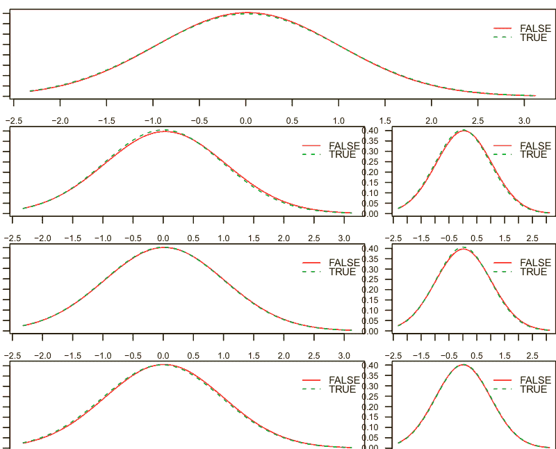

**FIGURE 9.2:** 预测变量的分布，条件于标签的类别。TRUE 表示实例对应高于中位数的回报，FALSE 表示低于中位数的回报。

图 9.2 中的图表显示了特征在标签每个值条件下的分布。本质上，这些就是密度 \( P[x_k | y] \)。对于每个特征，两个分布都非常相似。

惯例一样，一旦模型训练完成，就可以评估预测的准确性。

```
gauss_features_test <- testing_sample %>%
  dplyr::select(features_short) %>%
  as.matrix() %>%
  '*'(0.999) %>%
  + (0.0001) %>%
  qnorm() %>%
  colnames<-(features_short)
mean(predict(fit_NB_gauss, gauss_features_test) == testing_sample$R1M_Usd_C) # Hit ratio

## [1] 0.4956985
```

分类器的性能不尽如人意，因为它不如随机猜测。

### 9.5 贝叶斯加权树

#### 9.5.1 一般表述

贝叶斯加权回归树（BART）是一种集成技术，将贝叶斯思维与回归树相结合。从精神上讲，它们与第 6 章中看到的树集成相似，但在实现上有很大差异。在 BART 中，如同贝叶斯回归一样，正则化来自先验。原始文章是 Chipman et al. (2010) 和实现（使用 R）遵循 Sparapani et al. (2019)。

从形式上看，模型是 _M_ 个模型的聚合，我们写成

\[
y = \sum_{m=1}^M \mathcal{T}_m(q_m, \mathbf{w}_m, \mathbf{x}) + \epsilon, \tag{9.14}
\]

其中 \(\epsilon\) 是方差为 \(\sigma^2\) 的高斯噪声，而 \(\mathcal{T}_m = \mathcal{T}_m(q_m, \mathbf{w}_m, \mathbf{x})\) 是具有结构 _q<sub>m</sub>_ 和权重向量 **w**_<sub>m</sub>_ 的决策树。树的这种分解是我们用于提升树的分解，并在图 6.5 中说明。_q<sub>m</sub>_ 编码所有分裂（用于分裂的变量和分裂的水平），而向量 **w**_<sub>m</sub>_ 对应于叶值（在终端节点）。

在宏观层面，BART 可以被视为传统的贝叶斯对象，其中参数 \(\boldsymbol{\theta}\) 包括通过 _q<sub>m</sub>_、\(\mathbf{w}_m\) 和 \(\sigma^2\) 编码的所有未知数，重点是确定后验分布

\[
q_m, \mathbf{w}_m, \sigma^2 \mid (\mathbf{X}, \mathbf{Y}). \tag{9.15}
\]

给定 \(q_m\)、\(\mathbf{w}_m\)、\(\sigma^2\) 的特定先验形式，该算法使用 Metropolis-Hastings 和 Gibbs 采样器的组合来绘制参数。

#### 9.5.2 先验分布

树模型中先验分布的定义是微妙且复杂的。第一个重要假设是独立性：\(\sigma^2\) 与所有其他参数之间的独立性，以及树与树之间的独立性，即对 \((q_m, \mathbf{w}_m)\) 和 \((q_n, \mathbf{w}_n)\)（\(m \neq n\)）的独立性。这一假设使得 BART 在精神上更接近随机森林，而与提升树更为疏远。这种独立性意味着

\[
P((q_1, \mathbf{w}_1), \dots, (q_M, \mathbf{w}_M), \sigma^2) = P(\sigma^2) \prod_{m=1}^M P(q_m, \mathbf{w}_m).
\]

此外，出于简单起见，惯例是将树的结构（_q<sub>m</sub>_）和终端权重（\(\mathbf{w}_m\)）分开，因此通过贝叶斯条件化

\[
P((q_1, \mathbf{w}_1), \dots, (q_M, \mathbf{w}_M), \sigma^2) = \underbrace{P(\sigma^2)}_{\text{noise term}} \prod_{m=1}^M \underbrace{P(\mathbf{w}_m|q_m)}_{\text{tree weights}} \underbrace{P(q_m)}_{\text{tree struct.}} \tag{9.16}
\]

剩下的就是为这三个部分中的每一个制定假设。

我们先从树的结构 _q<sub>m</sub>_ 入手。树由其分裂（在节点处）定义，这些分裂由分裂变量和分裂水平来表征。首先，树的大小被参数化，使得深度为 _d_ 的节点以概率为非终端节点：

\[
\alpha(1 + d)^{-\beta}, \quad \alpha \in (0, 1), \quad \beta > 0. \quad (9.17)
\]

作者建议设置 \(\alpha = 0.95\) 和 \(\beta = 2\)。这样会有 5% 的概率只有一个节点，55% 的概率有两个节点，28% 的概率有三个节点，9% 的概率有四个节点，3% 的概率有五个节点。因此，目的是强制形成相对较浅的结构。

其次，分裂变量的选择由一个广义伯努利（分类）分布驱动，该分布定义了选择某个特定特征的几率。在 Chipman et al. (2010) 的原始论文中，概率向量是均匀的（每个预测变量被选为分裂点的几率相同）。该向量也可以是随机的，并从更灵活的 Dirichlet 分布中采样。分裂的水平在所选预测变量的所有可能值上均匀抽取。

在确定了树结构 _q<sub>m</sub>_ 的先验之后，剩下的就是确定叶子上的终端值 \((\mathbf{w}_m|q_m)\)。所有叶子上的权重假设遵循高斯分布 \(\mathcal{N}(\mu_\mu, \sigma_\mu^2)\)，其中 \(\mu_\mu = (y_{\min} + y_{\max})/2\) 是标签值范围的中心。方差 \(\sigma_\mu^2\) 的选择使得 \(\mu_\mu\) 加上或减去两倍的 \(\sigma_\mu^2\) 覆盖训练数据集中观察到的 95% 范围。这些是默认值，用户可以进行修改。

最后，出于与线性回归类似的计算目的，参数 \(\sigma^2\)（即 (9.14) 中 \(\epsilon\) 的方差）假设遵循逆伽马分布 IG(\(\nu/2, \lambda\nu/2\)），类似于贝叶斯回归中使用的分布。参数默认从数据中计算得出，以便 \(\sigma^2\) 的分布是现实的并防止过拟合。有关此主题的更多详细信息，我们参考原始文章第 2.2.4 节。

总之，除了 _M_（树的数量）之外，先验还依赖于少量参数：\(\alpha\) 和 \(\beta\)（用于树结构），\(\mu_\mu\) 和 \(\sigma_\mu^2\)（用于树权重）以及 \(\nu\) 和 \(\lambda\)（用于噪声项）。

#### 9.5.3 采样与预测

(9.15) 中的后验分布无法解析求得，但模拟是通往模型 (9.14) 的高效捷径。正如在 Gibbs 和 Metropolis-Hastings 采样中一样，模拟分布预期会收敛到所需的后验分布。在一些烧入样本之后，对于新观察到的集合 \(\mathbf{x}_*\) 的预测将简单是模拟预测的平均值（或中位数）。如果假设烧入后有 _S_ 次模拟，则平均值等于

\[
\tilde{y}(\mathbf{x}_*) := \frac{1}{S} \sum_{s=1}^S \sum_{m=1}^M \mathcal{T}_m(q_m^{(s)}, \mathbf{w}_m^{(s)}, \mathbf{x}_*)
\]

自然复杂的部分是生成模拟。每棵树使用 Metropolis-Hastings 方法进行采样：提出一棵树，但只有在满足某些（可能是随机的）标准时才会替换现有树。然后以类似于 Gibbs 的方式重复此过程。

让我们从 MH 基础构建块入手。我们寻求模拟条件分布


$(q_m, \mathbf{w}_m) \mid (q_{-m}, \mathbf{w}_{-m}, \sigma^2, \mathbf{y}, \mathbf{x}),$

where \(q_{-m}\) 和 \(\mathbf{w}_{-m}\) 收集除了树 \(m\) 之外所有树的结构和权重。BART中的一项精妙之处是将上述吉布斯抽样简化为

$(q_m, \mathbf{w}_m) \mid (\mathbf{R}_m, \sigma^2),$

where \(\mathbf{R}_m = \mathbf{y} - \sum_{l \neq m} \mathcal{T}_l(q_l, \mathbf{w}_l, \mathbf{x})\) 是排除第 \(m\) 棵树的预测的部分残差。

针对 \(q_m\) 的新 MH 提议基于前一棵树，树有三种可能的（随机）改动：

- 生长一个终端节点（通过添加一个补充叶节点增加树的复杂度）；
- 剪枝一对终端节点（相反操作：降低复杂度）；
- 更改分割规则。

为简单起见，第三种选项常被排除。一旦树结构确定（即采样），终端权重将根据高斯分布 \(\mathcal{N}(\mu_\mu, \sigma_\mu^2)\) 独立抽取。

树采样后，MH 原则要求根据某些概率接受或拒绝该树。该概率随新树提升模型似然的几率而增加。其详细计算繁琐，相关详情请参阅 Sparapani et al. (2019) 第 2.2 节。

现在，我们必须概述总的吉布斯程序。首先，算法从简单节点树开始。然后，指定数量的循环包括以下 *顺序步骤*：

| 步骤 | 任务 |
| :--- | :--- |
| 1 | sample \((q_1, \mathbf{w}_1) \mid (\mathbf{R}_1, \sigma^2);\) |
| 2 | sample \((q_2, \mathbf{w}_2) \mid (\mathbf{R}_2, \sigma^2);\) |
| ... | ...; |
| m | sample \((q_m, \mathbf{w}_m) \mid (\mathbf{R}_m, \sigma^2);\) |
| ... | ...; |
| M | sample \((q_M, \mathbf{w}_M) \mid (\mathbf{R}_M, \sigma^2); (last tree)\) |
| M+1 | sample \(\sigma^2\) given the full residual \(\mathbf{R} = \mathbf{y} - \sum_{l=1}^M \mathcal{T}_l(q_l, \mathbf{w}_l, \mathbf{x})\) |

在每个步骤 \(m\) 中，残差 \(\mathbf{R}_m\) 使用步骤 \(m-1\) 的值进行更新。我们在图 9.3 中说明了该过程，其中 \(M=3\)。步骤 1 中，为第一棵树（一个简单节点）提出了一种划分。在这种情况下，该树被接受。在此方案中，为简单起见省略了终端权重。步骤 2 中，为树提出了另一种划分，但被拒绝。在第三步中，第三棵树的提议被接受。第三步之后，抽取了 \(\sigma^2\) 的新值，新一轮吉布斯抽样可以开始。

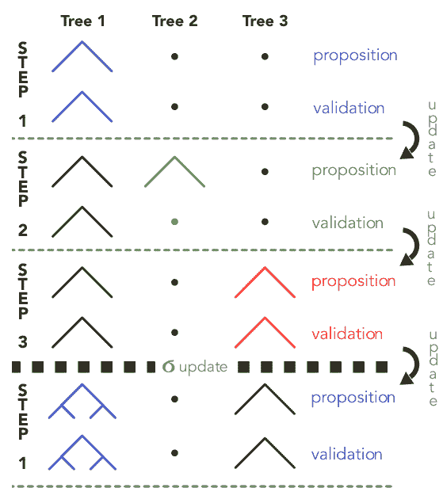

图 9.3: BART 的 MH/吉布斯抽样图解。在步骤 2 中，提出的树未被验证。

#### 9.5.4 代码

有多个 R 包实现了 BART 方法：BART、bartMachine 和一个较老的（原始）包 BayesTree。第一个效率很高，因此我们使用它。我们只使用少数几个参数，如 power 和 base，即 (9.17) 中定义的 \(\beta\) 和 \(\alpha\)。程序略显冗长，并提供一些参数细节。

```
library(BART)                      # Load package
fit_bart <- gbart(                 # Main function
  x.train = dplyr::select(training_sample, features_short) %>%    # Training features
    data.frame(),
  y.train = dplyr::select(training_sample, R1M_Usd) %>%          # Training label
    as.matrix(),
  x.test = dplyr::select(testing_sample, features_short) %>%    # Testing features
    data.frame(),
  type = "vbart",                  # Option: label is continuous
  ntree = 20,                      # Number of trees in the model
  nskip = 100,                     # Size of burn-in sample
  ndpost = 200,                    # Number of posteriors drawn
  power = 2,                       # beta in the tree structure prior
  base = 0.95)                     # alpha in the tree structure prior
```

```
## *****Calling gbart: type=1
## *****Data:
## data:n,p,np: 198128, 7, 70208
## y1,yn: -0.049921, 0.024079
## x1,x[n|x]p1: 0.010000, 0.810000
## xp1,xp[np*p]: 0.270000, 0.880000
## *****Number of Trees: 20
## *****Number of Cut Points: 100 ... 100
## *****burn,nd,thin: 100,200,1
## *****Prior:beta,alpha,tau,nu,lambda,offset: 2.0,0.95,1.57391,3,2.84908e-31,0.0139209
## *****sigma: 0.000000
## *****w (weights): 1.000000 ... 1.000000
## *****Dirichlet:sparse,theta,omega,a,b,rho,augment: 0.0,0.1,0.5,1,7,0
## *****printevery: 100
##
## MCMC
## done 0 (out of 300)
## done 100 (out of 300)
## done 200 (out of 300)
## time: 26s
## trcnt,tecnt: 200,200
```

模型训练完成后，我们评估了其性能。我们只需计算命中率。预测嵌入在 fit 变量中，名为 ‘yhat.test’。

```
mean(fit_bart$yhat.test * testing_sample$R1M_Usd > 0)
```

```
## [1] 0.5429237
```

性能看似合理，但绝非不出色。所有采样树的数据均可在 fit_bart 变量中找到。不过，其结构复杂（树通常也是如此）。我们可以提取的最简单信息是 300 次模拟中 \(\sigma\) 的值（见图 9.4）。

```
data.frame(simulation = 1:300, sigma = fit_bart$sigma) %>%
  ggplot(aes(x = simulation, y = sigma)) + geom_point(size = 0.7)
```

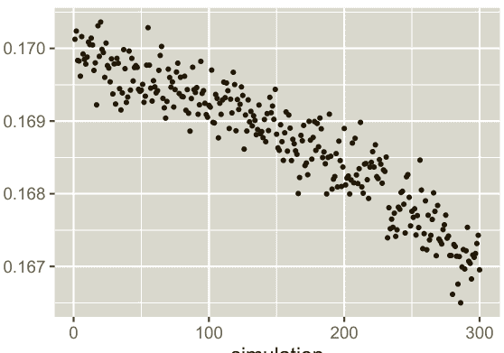

图 9.4: BART 模拟中 sigma 的演变。

我们可以看到，随着样本数量增加，\(\sigma\) 降低。

# 第三部分

# 从预测到投资组合


泰勒与弗朗西斯

泰勒与弗朗西斯集团

http://taylorandfrancis.com

## 10 验证与调优

如第 5 至 11 章所示，ML 模型在训练前需要用户指定的选择。这些选择包括参数值（学习率、惩罚强度等）或架构选择（例如，网络结构）。ML 引擎的不同设计可能导致不同的预测，因此选择一个好的设计至关重要。关于超参数调优对模型性能的影响研究，请参阅 Probst et al. (2018) 的工作。对于某些模型（神经网络和提升树），自由度非常多，以至于找到合适的参数可能变得复杂且具有挑战性。本章解决这些问题，但读者必须意识到，构建好模型没有捷径。打造有效模型耗时，且通常是许多次迭代的结果。

### 10.1 学习指标

在训练前设定的参数值称为超参数。为了能够选择良好的超参数，定义评估 ML 模型性能的指标至关重要。如 ML 中常见的那样，存在旨在预测数值（回归）和试图预测类别（分类）的模型之间的二元对立。在概述常见评估基准之前，我们提及 Li et al. (2020) 的计量经济学方法。作者建议在某些外部变量条件下，将预测方法的性能与给定基准进行评估。这有助于监测在哪些（经济）条件下模型优于基准。该测试的完整实现相当复杂，我们建议感兴趣的读者查看论文中的推导。

#### 10.1.1 回归分析

回归分析中的误差通常以简单直接的方式进行评估。L^1 和 L^2 范数是主流的；两者都易于解释和计算。第二个，即均方根误差（RMSE），处处可导但较难掌握，并且对异常值赋予更多权重。第一个，即平均绝对误差，给出到实现值的平均距离，但在零点不可导。形式上，我们定义如下

```
MAE(\mathbf{y}, \tilde{\mathbf{y}}) = \frac{1}{I} \sum_{i=1}^I |y_i - \tilde{y}_i|, \quad (10.1)
```

```
MSE(\mathbf{y}, \tilde{\mathbf{y}}) = \frac{1}{I} \sum_{i=1}^I (y_i - \tilde{y}_i)^2, \quad (10.2)
```

and the RMSE is simply the square root of the MSE. It is always possible to generalize these formulae by adding weights $w_i$ to produce heterogeneity in the importance of instances. Let us briefly comment on the MSE. It is by far the most common loss function in machine learning, but it is not necessarily the exact best choice for return prediction in a portfolio allocation task. If we decompose the loss into its 3 terms, we get the sum of squared realized returns, the sum of squared predicted returns and the product between the two (roughly speaking, a covariance term if we assume zero means). The first term does not matter. The second controls the dispersion around zero of the predictions. The third term is the most interesting from the allocator's standpoint. The negativity of the cross-product \(-2y_i\tilde{y}_i\) is always to the investor's benefit: either both terms are positive and the model has recognized a profitable asset, or they are negative and it has identified a bad opportunity. It is when \(y_i\) and \(\tilde{y}_i\) don't have the same sign that problems arise. Thus, compared to the \(\tilde{y}_i^2\), the cross-term is more important. Nonetheless, algorithms do not optimize with respect to this indicator.

These metrics (MSE and RMSE) are widely used outside ML to assess forecasting errors. Below, we present other indicators that are also sometimes used to quantify the quality of a model. In line with the linear regressions, the \(R^2\) can be computed in any predictive exercise.

```
R^2(\mathbf{y}, \tilde{\mathbf{y}}) = 1 - \frac{\sum_{i=1}^I (y_i - \tilde{y}_i)^2}{\sum_{i=1}^I (y_i - \bar{y})^2}, \quad (10.3)
```

where \(\bar{y}\) is the sample average of the label. One important difference with the classical \(R^2\) is that the above quantity can be computed on the testing sample and not on the training sample. In this case, the \(R^2\) can be negative when the mean squared error in the numerator is larger than the (biased) variance of the testing sample. Sometimes, the average value \(\bar{y}\) is omitted in the denominator (as in Gu et al. (2020b) for instance). The benefit of removing the average value is that it compares the predictions of the model to a zero prediction. This is particularly relevant with returns because the simplest prediction of all is the constant zero value and the \(R^2\) can then measure if the model beats this naive benchmark. A zero prediction is always preferable to a sample average because the latter can be very much period dependent. Also, removing \(\bar{y}\) in the denominator makes the metric more conservative as it mechanically reduces the \(R^2\).

Beyond the simple indicators detailed above, several exotic extensions exist and they all consist in altering the error before taking the averages. Two notable examples are the Mean Absolute Percentage Error (MAPE) and the Mean Square Percentage Error (MSPE). Instead of looking at the raw error, they compute the error relative to the original value (to be predicted). Hence, the error is expressed in a percentage score and the averages are simply equal to:


MAPE(\mathbf{y}, \tilde{\mathbf{y}}) = \frac{1}{I} \sum_{i=1}^{I} \frac{y_i - \tilde{y}_i}{y_i} ,

MSPE(\mathbf{y}, \tilde{\mathbf{y}}) = \frac{1}{I} \sum_{i=1}^{I} (\frac{y_i - \tilde{y}_i}{y_i})^2 ,

后者可在需要时开平方根进行缩放。当标签为正且可能取很大值时，可以对误差量级进行缩放，误差可能非常大。一种方法是采用均方对数误差的平方根（Root Mean Squared Logarithmic Error，RMSLE），定义如下：

RMSLE(\mathbf{y}, \tilde{\mathbf{y}}) = \sqrt{\frac{1}{I} \sum_{i=1}^{I} \log \frac{1 + y_i}{1 + \tilde{y}_i}} ,

显然，当 \(y_i = \tilde{y}_i\) 时，该误差指标等于零。

在进入类别损失之前，我们简要评述一下 MSE 的一个缺点。MSE 是回归任务中迄今最为广泛使用的指标和目标。简单的分解得到：

MSE(\mathbf{y}, \tilde{\mathbf{y}}) = \frac{1}{I} \sum_{i=1}^{I} (y_i^2 + \tilde{y}_i^2 - 2y_i\tilde{y}_i) .

在求和中，第一项是给定的，对此无能为力，因此模型专注于最小化另外两项。第二项是模型值的离散程度。第三项是交叉项。尽管 \(\tilde{y}_i\) 的变化很重要，但第三项远远是最重要的，尤其在横截面上。通过增加 \(y_i\tilde{y}_i\) 来降低 MSE 更有价值。当两项同号时，该乘积确实为正，这正是投资者所寻求的：赌注的正确方向。对于某些算法（如神经网络），可以手动指定自定义损失。最大化 \(y_i\tilde{y}_i\) 的总和可能是标准二次优化的一个良好替代方案（实现示例见第 7.4.3 节）。

#### 10.1.2 分类分析

类别结果的性能指标与数值输出的指标有很大不同。这些指标中有很大一部分专门用于二元分类，尽管其中一些可以轻松推广到多类模型。

我们按复杂度递增的顺序介绍这些指标相关的概念，并从真与假、正与负这两对二分法开始。在二元分类中，按真与假来思考比较方便。在投资场景中，真可以与正收益相关，或收益高于基准收益，假则相反。

然后，预测有 4 种可能的结果。预测正确时有 2 种（预测为真且实现为真，或预测为假且结果为假），预测错误时有 2 种（预测为真但实现为假，以及相反的情况）。我们如下定义相应的汇总指标：

- 真正例频率：\( TP = I^{-1} \sum_{i=1}^I 1_{\{y_i=\tilde{y}_i=1\}} \),
- 真负例频率：\( TN = I^{-1} \sum_{i=1}^I 1_{\{y_i=\tilde{y}_i=0\}} \),
- 假正例频率：\( FP = I^{-1} \sum_{i=1}^I 1_{\{\tilde{y}_i=1, y_i=0\}} \),
- 假负例频率：\( FN = I^{-1} \sum_{i=1}^I 1_{\{\tilde{y}_i=0, y_i=1\}} \),

通常，真编码为 1，假编码为 0。这四个数值之和等于一。如图 10.1 所示，这四个数字对样本外结果的影响截然不同。在这个表格中（也称为**混淆矩阵**），假设模型预测了未来盈利能力的某个代理。每一行代表模型的预测，每一列代表盈利能力的实现。最重要的情况是顶行中的情况，即模型预测为正结果，因为预测盈利能力为正的资产（可能相对于某个基准）很可能会进入投资组合。当然，如果资产表现良好（左侧单元格），这不是问题；但如果模型出错，则会受到惩罚，因为投资组合将遭受损失。

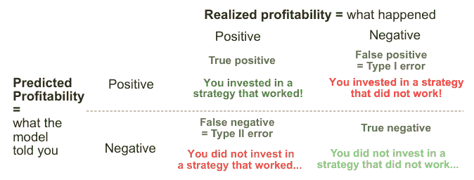

**图 10.1：** 混淆矩阵：二元结果摘要。

在两种错误类型中，**第一类错误**对投资者而言最为棘手，因为它对投资组合有直接影响。**第二类错误**仅仅是错失机会，影响相对较小。最后，真负例是那些被正确排除在投资组合之外的资产。

从这四个基准比率中，可以推导出其他有趣的指标：

- **准确率** = \( TP + TN \) 是正确预测的百分比；
- **召回率** = \(\frac{TP}{TP+FN}\) 衡量检测获胜策略/资产的能力（左侧列分析）。也称为灵敏度或真正例率（TPR）；
- **精确率** = \(\frac{TP}{TP+FP}\) 计算良好投资的概率（顶行分析）；
- **特异度** = \(\frac{TN}{FP+TN}\) 衡量实际负例被正确识别为负例的比例（右侧列分析）；
- **误报率** = \(\frac{FP}{FP+TN} = 1-\text{特异度}\) 是误报概率（或假正例率），即算法错误检测出表现不佳资产的频率（右侧列分析）；
- **F1 分数**，\( F_1 = 2\frac{\text{召回率}\times\text{精确率}}{\text{召回率}+\text{精确率}} \) 是召回率和精确率的调和平均。

所有这些指标都落在单位区间内，当它们增加时模型被认为表现更好（误报率除外，情况相反）。还存在许多其他指标，如假发现率或假遗漏率，但它们不够主流，引用较少。此外，它们通常是上述指标的简单函数。

一个流行但更复杂的指标是（ROC）曲线下面积，通常简称为 AUC。复杂的部分是 ROC 曲线，ROC 代表接收器工作特性；该名称源自信号理论。下面我们解释其构建方法。

如第 6 章和第 7 章所示，分类器生成的输出是一个实例属于某个类的概率。然后通过选择值最高的类将这些概率转换为类别。在二元分类中，得分高于 0.5 的类基本获胜。

在实践中，这个 0.5 阈值可能不是最优的，模型在概率低于 0.4 时很可能正确预测假例，否则预测真例。因此，测试决策阈值变化时会发生什么是合理的想法。ROC 曲线正是如此，它在阈值从零增加到一时，将召回率作为误报率的函数进行绘制。

当阈值等于 0 时，真正例等于零，因为模型从不预测正值。因此，召回率和误报率都等于零。当阈值等于 1 时，假负例和真负例都缩小到零，因此召回率和误报率都等于一。这两个极端之间它们关系的表现被称为 ROC 曲线。下面我们在图 10.2 中提供风格化示例。随机分类器的召回率和误报率表现同样好，因此 ROC 曲线将是从点 (0,0) 到 (1,1) 的一条直线。为了证明这一点，想象一个样本，其中真实例的比例为 \(p \in (0, 1)\)，分类器以概率 \(p' \in (0, 1)\) 随机预测为真。然后，因为样本和预测是独立的，\(TP = p'p\)，\(FP = p'(1 - p)\)，\(TN = (1 - p')(1 - p)\) 和 \(FN = (1 - p')p\)。根据上述定义，这意味着召回率和误报率都等于 \(p'\)。

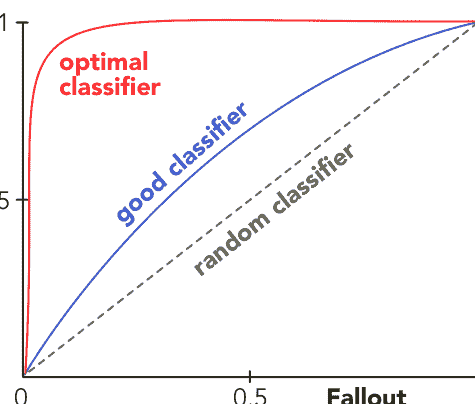

**图 10.2：** 风格化 ROC 曲线。

ROC 曲线位于 45° 角以上的算法优于平均分类器。事实上，该曲线可以看作是收益（y 轴上检测到好策略的概率）减去成本（x 轴上选择错误资产的概率）的权衡。因此，位于 45° 以上至关重要。最佳分类器的 ROC 曲线从点 (0,0) 到点 (0,1) 再到点 (1,1)。在点 (0,1) 处，误报率为零，因此没有假正例，召回率等于一，因此也没有假负例；模型始终正确。相反情况也成立：在点 (1,0) 处，模型始终错误。

下面，我们使用特定的包（`caTools`）来计算测试样本上给定预测集的 ROC 曲线。

```
if(!require(caTools)){install.packages("caTools")}
```

```
library(caTools) # Package for AUC computation
colAUC(X = predict(fit_RF_C, testing_sample, type = "prob"),
 y = testing_sample$R1M_Usd_C,
 plotROC = TRUE)
```

## ROC 曲线

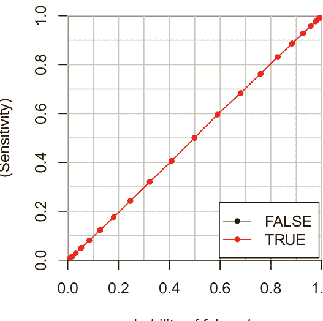

**图 10.3：** ROC 曲线示例。

```
## FALSE TRUE
## FALSE vs. TRUE 0.5003885 0.5003885
```

在图 10.3 中，曲线非常接近 45° 角，模型似乎和随机分类器一样好（或者更确切地说，一样差）。

最后，拥有一整条曲线对于比较目的来说不切实际，因此整个曲线的信息被综合为曲线下方的面积，即积分


对应的函数。45°角（象限角平分线）的面积为 0.5（它是单位正方形的一半，单位正方形面积为 1）。因此，任何良好的模型预期曲线下面积（AUC）高于 0.5。完美模型的 AUC 为 1。

本小节关于多类数据的内容到此结束。当输出（即标签）具有超过两个类别时，情况会变得更加复杂。仍然可以计算混淆矩阵，但其维度更大且更难以解释。TP、TN 等简单指标必须以非标准方式推广。在这种情况下，最简单的指标是方程 (7.10) 中定义的交叉熵。关于与分类标签相关的损失的更多细节，请参阅第 6.1.2 节。

### 10.2 验证

验证是模型在部署到真实或实时数据（例如，用于交易目的）之前进行测试和调整的阶段。不言而喻，它至关重要。

#### 10.2.1 方差-偏差权衡：理论

**方差-偏差权衡**是监督学习中的核心概念之一。为了解释它，让我们假设数据由以下简单模型生成

\[ y_i = f(\mathbf{x}_i) + \epsilon_i, \quad \mathbb{E}[\epsilon] = 0, \quad \mathbb{V}[\epsilon] = \sigma^2, \]

但估计模型得出

\[ y_i = \hat{f}(\mathbf{x}_i) + \hat{\epsilon}_i. \]

给定未知样本 x，平均平方误差的分解为

\begin{align*}
\mathbb{E}[\hat{\epsilon}^2] &= \mathbb{E}[(y - \hat{f}(\mathbf{x}))^2] = \mathbb{E}[(f(\mathbf{x}) + \epsilon - \hat{f}(\mathbf{x}))^2] \\
&= \underbrace{\mathbb{E}[(f(\mathbf{x}) - \hat{f}(\mathbf{x}))^2]}_{\text{总平方误差}} + \underbrace{\mathbb{E}[\epsilon^2]}_{\text{不可约误差}} \\
&= \mathbb{E}[\hat{f}(\mathbf{x})^2] + \mathbb{E}[f(\mathbf{x})^2] - 2\mathbb{E}[f(\mathbf{x})\hat{f}(\mathbf{x})] + \sigma^2 \\
&= \mathbb{E}[\hat{f}(\mathbf{x})^2] + f(\mathbf{x})^2 - 2f(\mathbf{x})\mathbb{E}[\hat{f}(\mathbf{x})] + \sigma^2 \\
&= \mathbb{E}[\hat{f}(\mathbf{x})^2] - \mathbb{E}[\hat{f}(\mathbf{x})]^2 + \mathbb{E}[\hat{f}(\mathbf{x})]^2 + f(\mathbf{x})^2 - 2f(\mathbf{x})\mathbb{E}[\hat{f}(\mathbf{x})] + \sigma^2 \\
&= \underbrace{\mathbb{V}[\hat{f}(\mathbf{x})]}_{\text{模型方差}} + \underbrace{\mathbb{E}[(f(\mathbf{x}) - \hat{f}(\mathbf{x}))]^2}_{\text{平方偏差}} + \sigma^2
\end{align*}

在上述推导中，\(f(x)\) 不是随机的，但 \(\hat{f}(x)\) 是。此外，在第二行中，我们假设 \(\mathbb{E}[\epsilon(f(x) - \hat{f}(x))] = 0$，这可能并不总是成立（尽管这是一个非常常见的假设）。因此，平均平方误差有三个组成部分：

- 模型的方差（关于其预测）；
- 模型的平方偏差；
- 以及一个不可约误差（与特定模型的选择无关）。

最后一个对模型的变化免疫，因此挑战在于最小化前两者的和。这被称为方差-偏差权衡，因为减少其中一个通常会导致另一个增加。因此，目标是评估当其中任意一个的微小增加可能导致另一个的更大减少时的情况。

有多种方式来表示这种权衡，我们展示了其中两种。第一种与射箭有关（参见下方图 10.4）。最佳情况（左上角）是所有射箭都集中在中间：平均而言，射手瞄准正确，所有箭都非常接近。最差情况（右下角）正是相反：平均箭位于靶心上方（偏差非零），且箭的离散程度较大。

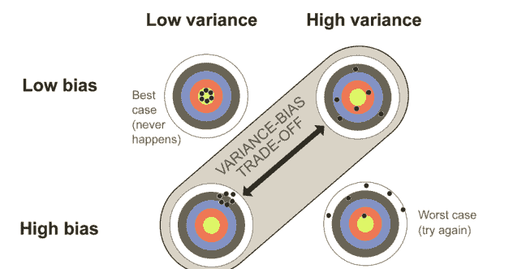

图 10.4：方差-偏差权衡的第一种表示。

在机器学习中最常遇到的情况是另外两种配置：要么箭（预测）集中在一个小范围内，但该范围不是靶心；要么箭平均而言围绕中心分布良好，但平均而言距离中心较远。

方差-偏差权衡的另一种常见表述方式是通过模型复杂度的概念。最简单的模型是常数模型：预测始终相同，例如等于训练集中标签的平均值。当然，这种预测通常会偏离测试集的实际值（其偏差会很大），但至少其方差为零。在光谱的另一端，叶子数量与实例数量一样多的决策树具有非常复杂的结构。它可能具有较小的偏差，但毫无疑问，这并不明显能够补偿模型复杂性带来的方差增加。

权衡的这一侧面在下方图 10.5 中有所体现。在图表左侧，简单模型具有较小的方差但较大的偏差，而在右侧，复杂模型则相反。优秀模型通常位于中间某处，但最佳组合难以找到。


图 10.5：方差-偏差权衡的第二种表示。

方差-偏差权衡最易处理的理论形式是岭回归。² 这种回归的系数估计由 $\hat{\mathbf{b}}_\lambda = (\mathbf{X}'\mathbf{X} + \lambda \mathbf{I}_N)^{-1}\mathbf{X}'\mathbf{Y}$ 给出（参见第 5.1.1 节），其中 $\lambda$ 是惩罚强度。假设数据生成过程具有*真实*的线性形式（$\mathbf{y} = \mathbf{Xb} + \boldsymbol{\epsilon}$，其中 $\mathbf{b}$ 未知，$\sigma^2$ 为误差的方差——误差具有单位相关矩阵），这会得出

$$
\mathbb{E}[\hat{\mathbf{b}}_\lambda] = \mathbf{b} - \lambda(\mathbf{X}'\mathbf{X} + \lambda \mathbf{I}_N)^{-1}\mathbf{b}, \quad (10.8)
$$

$$
\mathbb{V}[\hat{\mathbf{b}}_\lambda] = \sigma^2(\mathbf{X}'\mathbf{X} + \lambda \mathbf{I}_N)^{-1}\mathbf{X}'\mathbf{X}(\mathbf{X}'\mathbf{X} + \lambda \mathbf{I}_N)^{-1}. \quad (10.9)
$$

基本上，这意味着估计器的偏差等于 $-\lambda(\mathbf{X}'\mathbf{X} + \lambda \mathbf{I}_N)^{-1}\mathbf{b}$，在没有惩罚（经典回归）时为零，当 $\lambda \to \infty$ 时趋于某个有限数，即模型变为常数时。请注意，如果估计器的偏差为零，则预测也将为零：$\mathbb{E}[\mathbf{X}(\mathbf{b} - \hat{\mathbf{b}})] = \mathbf{0}$。

无约束回归中估计值的方差等于 $\mathbb{V}[\hat{\mathbf{b}}] = \sigma(\mathbf{X}'\mathbf{X})^{-1}$。在方程 (10.9) 中，$\lambda$ 减小了逆矩阵中数值的幅度。总体效果是，随着 $\lambda$ 增大，方差减小，在 $\lambda \to \infty$ 的极限情况下，当模型为常数时，方差为零。预测的方差为

$$
\mathbb{V}[\mathbf{X}\hat{\mathbf{b}}] = \mathbb{E}[(\mathbf{X}\hat{\mathbf{b}} - \mathbb{E}[\mathbf{X}\hat{\mathbf{b}}])(\mathbf{X}\hat{\mathbf{b}} - \mathbb{E}[\mathbf{X}\hat{\mathbf{b}}])']
$$

$$
= \mathbf{X}\mathbb{E}[(\hat{\mathbf{b}} - \mathbb{E}[\hat{\mathbf{b}}])(\hat{\mathbf{b}} - \mathbb{E}[\hat{\mathbf{b}}])']\mathbf{X}'
$$

$$
= \mathbf{X}\mathbb{V}[\hat{\mathbf{b}}]\mathbf{X}
$$

总的来说，岭回归非常实用，因为只需一个参数，它们就能提供一个用于直接调节方差-偏差权衡的控制柄。

使用岭回归展示权衡是非常简单的。在下面的示例中，我们复用了在第 5 章中训练的岭模型。

²另一种批判神经网络的视角见 Geman et al. (1992)。

```
ridge_errors <- predict(fit_ridge, x_penalized_test) -
  (rep(testing_sample$RIM_Usd, 100) %/%
   matrix(ncol = 100, byrow = FALSE))
ridge_bias <- ridge_errors %>% apply(2, mean)         # Biases
ridge_var <- predict(fit_ridge, x_penalized_test) %>% apply(2, var)  # Variance
tibble(lambda, ridge_bias^2, ridge_var, total = ridge_bias^2+ridge_var) %>%  # Plot
  gather(key = Error_Component, value = Value, -lambda) %>%
  ggplot(aes(x = lambda, y = Value, color = Error_Component)) + geom_line()
```


图 10.6：岭回归的误差分解。

在图 10.6 中，模式与图 10.5 中描绘的不同。在图中，当强度 lambda 增加时，参数的幅度缩小，模型变得更简单。因此，最简单的模型似乎是最佳选择：增加复杂度会增加方差但不能改善偏差！一个可能的原因是，特征实际上并不携带太多预测价值，因此基于无关变量的更复杂模型与常数模型同样好。

#### 10.2.2 方差-偏差权衡：示例

方差-偏差权衡通常以易于理解的理论术语来呈现。尽管如此，展示其如何在真实算法选择中运作仍然很有用。下面，我们以树为例，因为其复杂度易于评估。基本上，具有许多终端节点的树比只有少数簇的树更复杂。

我们从简洁模型开始，如下进行训练。

```
fit_tree_simple <- rpart(formula,
  data = training_sample,     # Data source: training sample
  cp = 0.0001,                # Precision: smaller = more leaves
  maxdepth = 2                # Maximum depth (i.e. tree levels)
  )
rpart.plot(fit_tree_simple)
```


图 10.7：简单树。

图 10.7 所示的模型只有 4 个簇，这意味着预测只能取四个值。最小的一个是 0.011，涵盖了样本的大部分（85%），而最大的一个是 0.062，仅对应训练样本的 4%。

然后我们可以计算 *测试* 集上预测的偏差和方差。

```
mean(predict(fit_tree_simple, testing_sample) - testing_sample$R1M_Usd) # Bias
```

```
## [1] 0.004973917
```

```
var(predict(fit_tree_simple, testing_sample)) # Variance
```

```
## [1] 0.0001398003
```

平均而言，误差略为正，总体高估了 0.005。如预期，方差非常小（10⁻⁴）。

对于复杂模型，我们采用在第 6.4.6 节中获得的提升树（fit_xgb）。该模型聚合了 40 棵树，最大深度为 4，因此无疑更为复杂。

```
mean(predict(fit_xgb, xgb_test) - testing_sample$R1M_Usd) # Bias
```

```
## [1] 0.00324996
```

```
var(predict(fit_xgb, xgb_test)) # Variance
```

```
## [1] 0.002206797
```

与简单模型相比，偏差确实更小，但作为交换，方差大幅增加。净效果（通过 *平方偏差*）有利于更简单的模型。

#### 10.2.3 过拟合的风险：原理

*过拟合* 的概念是机器学习中最重要的概念之一。当模型过拟合时，其预测的准确性会令人失望，因此这是 *某些* 策略在样本外失效的主要原因之一。因此，不仅要理解什么是过拟合，还要了解如何减轻其影响，这一点很重要。

关于这一主题及其对投资组合策略影响的近期参考文献是 Hsu 等人（2018），该研究基于 *White*（2000）的工作。这两篇参考文献都不涉及机器学习模型，但原理是相同的。给定一个数据集，无论是人还是机器，进行足够深入的分析总是能够检测出某些模式。这些模式是否为虚假的，是关键问题。

在图 10.8 中，我们用一个简单的可视化示例来说明这个想法。我们试图找到一个将 x 映射为 y 的模型。（训练）数据点是小黑圆。最简单的模型是常数模型（只有一个参数），但使用两个参数（水平和斜率）时，拟合效果已经相当好。这用蓝色线表示。当参数数量足够时，可以构建一个穿过所有点的模型。一个示例是高维多项式。这样的模型用红色线表示。现在数据集中似乎有一个奇怪的点，复杂模型紧密拟合以匹配这个点。


图 10.8：过拟合示例：一个与训练数据高度匹配的模型通常不是一个好主意。

添加了一个浅绿色的新点。可以公平地说，它遵循其他点的一般模式。简单模型并不完美，误差不可忽视。尽管如此，来自复杂模型（用虚线灰色显示）的误差大约是原来的两倍。这个简化示例表明，过于贴近训练数据的模型会捕捉到在其他数据集中不会出现的特有特征。一个好的模型会忽略这些特有特征，并坚持数据的持久结构。

#### 10.2.4 过拟合的风险：一些解决方案

显然，避免过拟合最简单的方法是抵制使用复杂模型的诱惑（例如，高维神经网络或树集成）。

模型的复杂性通常通过两个指标来代理：模型参数的数量及其大小（通常通过其范数来综合）。这些代理指标并不完美，因为某些复杂模型可能只需要少量参数（甚至参数值很小），但至少它们简单易行。处理过拟合没有通用方法。下面，我们详细介绍了一些机器学习工具家族的几个技巧。

对于回归，有两种简单的方法来处理过拟合。第一是参数数量，即预测变量的数量。有时，只选择特征的一个子样本可能更好，特别是如果其中一些特征高度相关（通常，特征间绝对相关性的阈值为 70% 被认为过高）。第二种解决方案是惩罚（通过 LASSO、岭回归或弹性网），这有助于减小估计值的大小，从而减小预测的方差。

对于基于树的方法，有多种方法可以降低过拟合的风险。在处理简单树时，唯一的方法是限制叶节点的数量。这可以通过多种方式实现。首先，通过施加最大深度。如果等于 d，则树最多可以有 2^d 个终端节点。通常建议不要超过 d = 6。rpart 中的复杂度参数（cp）是缩减树大小的另一种方式：任何新的分割都必须导致损失减少至少等于 cp。否则，该分割不被认为有用，因此不执行。因此，当 cp 较大时，树不会生长。rpart 中可用的最后两个参数是每个叶节点所需的实例最小数量以及继续分割过程所要求的每个簇的实例最小数量。这些数字越高（即越强制），就越难生长复杂树。

除这些选项之外，随机森林允许控制森林中树的数量。理论上（参见 Breiman (2001)），该参数不应影响过拟合风险，因为新树仅通过多样化帮助减少总误差。在实践中，出于计算时间的考虑，不建议超过 1,000 棵树。另外两个超参数是子样本大小（每个学习器在其上训练）和保留用于学习的特征数量。它们对偏差和权衡没有直接影响，而是对原始性能有影响。例如，如果子样本太小，树将学得不够。特征数量太低也有同样的问题。另一方面，选择大量预测变量（即接近总数）可能导致每个学习器预测之间存在高相关性，因为训练样本中包含的信息重叠度可能较高。

提升树有其他选项可以帮助缓解过拟合风险。最明显的是学习率，它以 η ∈ (0, 1) 折扣每棵新树的影响。当学习率较高时，算法学习得太快，容易过于贴近训练数据。当较低时，模型学习得非常循序渐进，如果集成中有足够多的树，这可能是高效的。确实，学习率和树的数量必须同步选择：如果两者都低，集成将学不到任何东西；如果两者都大，则会过拟合。提升树参数的武器库远不止于此。对分数值和叶节点数量的惩罚，自然是防止模型过于深入训练样本特有特征的工具。

最后，像第 6.4.5 节中提到的单调性约束也是一种有效的方法，用于对模型施加一定的结构并强制其检测特定模式。

最后，**神经网络**也有许多旨在防止其过拟合的选项。与提升树一样，其中一些是学习率以及对权重和偏差的惩罚（通过其范数）。当模型理论上需要正输入时，像非负约束这样的约束也有所帮助。最后，退出（dropout）始终是减少网络维度（参数数量）的直接方法。

### 10.3 寻找好的超参数

#### 10.3.1 方法

让我们假设在运行模型之前需要定义 $p$ 个参数。最简单的方法是测试这些参数的不同值，并选择产生最佳结果的值。执行这些测试的主要有两种方式：独立方式和顺序方式。

独立测试很简单，分为两大类：网格（确定性）搜索和随机探索。确定性方法的优点是它能均匀覆盖空间并确保不遗漏任何角落。缺点是计算时间。确实，对每个参数，测试至少五个值似乎是合理的，这会产生 $5^p$ 种组合。如果 $p$ 很小（小于 3），在回测不太冗长的情况下这是可以管理的。当 $p$ 很大时，组合数量可能变得令人望而却步。此时随机探索可能很有用，因为在这种情况下，用户预先指定测试次数，参数随机抽取（通常在每个参数的给定范围内均匀抽取）。随机搜索的缺陷是参数空间中的某些区域可能未被覆盖，如果最佳选择位于那里，这可能会成问题。尽管如此，Bergstra 和 Bengio (2012) 表明随机探索优于网格搜索。

网格搜索和随机搜索都不是最优的，因为它们很可能在参数空间中无关的区域浪费时间，从而浪费计算时间。给定一组已测试的参数点，最好将搜索集中在最可能包含最佳点的区域。这可以通过一个迭代过程实现，在每次测试新点后调整搜索。

在这方面另一种流行的方法是 **贝叶斯优化**（BO）。核心对象是学习过程的目标函数。我们将此函数称为 $O$，它可以广泛地视为可能结合惩罚和约束的损失函数。为简化起见，这里不提及训练/测试样本，它们被视为固定。感兴趣的变量是向量 $\mathbf{p} = (p_1, ..., p_l)$，它综合了对 $O$ 有影响的超参数（学习率、惩罚强度、模型数量等）。我们感兴趣的程序是

```
\(\mathbf{p}_* = \underset{\mathbf{p}}{\text{argmin}} \, O(\mathbf{p}).\) (10.10)
```

此优化的主要问题是计算 $O(\mathbf{p})$ 成本非常高。


### 10.3 寻找良好超参数

因此，为**b**明智地选择每次试验至关重要。BO 的一个关键假设是 $O$ 的分布服从高斯分布，且 $O$ 可以由 $p_i$ 的线性组合来代理。换句话说，目标是在输入 $\mathbf{p}$ 和输出（因变量）$O$ 之间构建贝叶斯线性回归。一旦模型被估计，集中在 $O$ 后验密度中的信息将被用来对在哪里寻找 $\mathbf{p}$ 的新值做出有根据的猜测。

这种有根据的猜测是基于所谓的**获取函数**做出的。假设我们已经测试了 $\mathbf{p}$ 的 $m$ 个值，记作 $\mathbf{p}^{(m)}$。当前最佳参数记作 $\mathbf{p}_m^* = \underset{1 \le k \le m}{\text{argmin}} O(\mathbf{p}^{(k)})$。如果我们测试一个新点 $\mathbf{p}$，则仅当 $O(\mathbf{p}) < O(\mathbf{p}_m^*)$ 时才会带来改进，即新目标改进了我们已知的最小值。这种改进的平均值是

```
\(\mathbf{EI}_m(\mathbf{p}) = \mathbb{E}_m[[O(\mathbf{p}_m^*) - O(\mathbf{p})]_+],\) (10.11)
```

其中正部分 $[\cdot]_+$ 强调当 $O(\mathbf{p}) \ge O(\mathbf{p}_m^*)$ 时，收益为零。期望由 $m$ 索引，因为它是根据 $m$ 个样本 $\mathbf{p}^{(m)}$ 计算出的 $O(\mathbf{p})$ 的后验分布得出的。那么下一个样本 $\mathbf{p}^{m+1}$ 的最佳选择是

```
\(\mathbf{p}^{m+1} = \underset{\mathbf{p}}{\text{argmax}} \mathbf{EI}_m(\mathbf{p}),\) (10.12)
```

这对应于预期改进的最大位置。而不是使用 EI，优化可以在其他度量上进行，例如改进概率，即 $\mathbb{P}_m[O(\mathbf{p}) < O(\mathbf{p}_m^*)]$。

以紧凑形式，迭代过程可以概述如下：

- **步骤 1**：计算 $m = 1, \dots, M_0$ 个参数值的 $O(\mathbf{p}^{(m)})$。
- **步骤 2a**：依次计算所有可用点上 $O$ 的后验密度。
- **步骤 2b**：计算要测试的最优新点 $\mathbf{p}^{m+1}$，如公式（10.12）所示。
- **步骤 2c**：计算新的目标值 $O(\mathbf{p}^{m+1})$。

- **步骤 3**：重复步骤 2a 至 2c，直到认为合理为止，并返回产生最小目标值的 $\mathbf{p}^m$。

感兴趣的读者可以参阅 Snoek 等人（2012）和 Frazier（2018），以了解该方法数值方面的更多细节。

最后，为了完整起见，我们提到调整超参数的最后一种方法。由于优化方案是 $\underset{\mathbf{p}}{\text{argmin}} O(\mathbf{p})$，一种自然的方法是使用 $O$ 对 $\mathbf{p}$ 的灵敏度。确实，如果梯度 $\frac{\partial O}{\partial p_i}$ 已知，那么梯度下降将始终改进目标值。问题是很难计算可靠的梯度（有限差分可能代价高昂）。尽管如此，一些方法（例如，Maclaurin 等人（2015））已被成功应用于优化大维参数空间。

我们通过提及 Bouthillier 和 Varoquaux（2020）的调查来结束，该调查涵盖了 2019 年举行的两个主要人工智能会议。它表明大多数论文都求助于超参数调制。最常引用的两种方法是*手动调参*（手动选择）和*网格搜索*。

#### 10.3.2 示例：网格搜索

为了说明网格搜索的过程，我们将尝试为增强树找到最佳参数。我们试图量化三个参数的影响：

- eta，学习率，
- nrounds，生长的树的数量，
- lambda，权重正则化器，通过总权重/分数平方和惩罚目标函数。

下面，我们创建一个包含要为这些参数测试的值的网格。

```
eta <- c(0.1, 0.3, 0.5, 0.7, 0.9)   # Values for eta
nrounds <- c(10, 50, 100)           # Values for nrounds
lambda <- c(0.01, 0.1, 1, 10, 100)  # Values for lambda
pars <- expand.grid(eta, nrounds, lambda) # Exploring all combinations!
head(pars)                          # Let's see the parameters
```

| 变量1 | 变量2 | 变量3 |
|------|------|------|
| 0.1 | 10 | 0.01 |
| 0.3 | 10 | 0.01 |
| 0.5 | 10 | 0.01 |
| 0.7 | 10 | 0.01 |
| 0.9 | 10 | 0.01 |
| 0.1 | 50 | 0.01 |

```
eta <- pars[,1]
nrounds <- pars[,2]
lambda <- pars[,3]
```

鉴于网格搜索的计算成本，我们在特征数量较少的数据集上进行探索（该数据集来自第 6 章）。为了避免循环的负担，我们通过 purrr 包利用 R 的函数式编程能力。这使我们能够定义一个函数来减轻和简化代码。下面编写的这个函数接收数据和参数输入，并为算法返回一个误差指标。我们选择均方误差来评估超参数值的影响。

```
grid_par <- function(train_matrix, test_features, test_label, eta, nrounds, lambda){
  fit <- train_matrix %>% 
    xgb.train(data = .,             # Data source (pipe input)
              eta = eta,            # Learning rate
              objective = "reg:linear", # Objective function
              max_depth = 5,        # Maximum depth of trees
              lambda = lambda,      # Penalisation of leaf values
              gamma = 0.1,          # Penalisation of number of leaves
              nrounds = nrounds,    # Number of trees used
              verbose = 0           # No comment from algo
    )
  pred <- predict(fit, test_features)   # Predictions based on model & test values
  return(mean((pred-test_label)^2))     # Mean squared error
}
```

然后可以使用函数式编程工具 pmap 处理 grid_par 函数，它将自动对参数值进行循环。

```
# grid_par(train_matrix_xgb, xgb_test, testing_sample$RIM_Usd, 0.1, 3, 0.1) # Possible test
grd <- pmap(list(eta, nrounds, lambda),
            # Parameters for the grid search
            grid_par,
            # Function on which to apply the search
            train_matrix = train_matrix_xgb,
            # Input for function: training data
            test_features = xgb_test,
            # Input for function: test features
            test_label = testing_sample$RIM_Usd
            # Input for function: test labels (returns)
)
grd <- data.frame(eta, nrounds, lambda, error = unlist(grd)) # Dataframe with all results
```

一旦收集了均方误差，就可以将其绘制出来。我们故意使用 3 个参数，因为它们的影响可以同时在一张图上绘制出来。

```
grid$eta <- as.factor(eta) # Params as categories (for plot)
grd %>% ggplot(aes(x = eta, y = error, fill = eta)) + # Plot!
    geom_bar(stat = "identity") +
    facet_grid(rows = vars(nrounds), cols = vars(lambda)) +
    theme(axis.text.x = element_text(size = 6))
```


**图 10.9：** 许多参数值的误差指标（MSE）图。图中的每一行对应 nrounds，每一列对应 lambda。

在图 10.9 中，主要信息是当树的数量较少时（nrounds=10），较小的学习率（$\eta = 0.1$）对预测质量不利，这意味着算法学习得不够。

网格搜索可以分两个阶段进行：第一阶段有助于定位感兴趣的区域（损失/目标值最低的区域），然后在这些区域上使用网格上的细化参数值进行放大。根据上述结果，这意味着要考虑许多学习者（超过 50 个，可能超过 100 个），并避免较大的学习率，如 $\eta = 0.9$ 或 $\eta = 0.8$。

#### 10.3.3 示例：贝叶斯优化

R 中有几个与贝叶斯优化相关的包。我们使用 rBayesianOptimization，它是通用的，但也需要更多的编码参与。

与网格搜索一样，我们需要编码将对其进行超参数优化的目标函数。在 rBayesianOptimization 下，输出必须具有特定形式，包含一个分数和一个预测变量。该函数将最大化分数，因此我们将其定义为均方误差的负值。

```
bayes_par_opt <- function(train_matrix = train_matrix_xgb,
                             test_features = xgb_test,
                             test_label = testing_sample$RIM1_Usd,
                             eta, nrounds, lambda){
  fit <- train_matrix %>%
    xgb.train(data = .,
              eta = eta,
              objective = "reg:linear",
              max_depth = 5,
              lambda = lambda,
              gamma = 0.1,
              nrounds = round(nrounds),
              verbose = 0)

  pred <- predict(fit, test_features)
  list(Score = -mean((pred-test_label)^2),
       Pred = pred)
}
```

一旦定义了目标函数，就可以将其插入贝叶斯优化器中。

```
library(rBayesianOptimization)
bayes_opt <- BayesianOptimization(bayes_par_opt,
                                  bounds = list(eta = c(0.2, 0.8),
                                                lambda = c(0.5, 15),
                                                nrounds = c(10, 100)),
                                  init_points = 10,
                                  n_iter = 24,
                                  acq = "ei",
                                  verbose = FALSE)
```

```
##
## Best Parameters Found:
## Round = 27    eta = 0.3568   lambda = 8.4042 nrounds = 11.9646  Value = -0.0372
```

```
bayes_opt$Best_Par
```

```
##      eta   lambda nrounds
## 0.3567502 8.4041836 11.9645900
```

最终参数表明，建议抵抗过拟合：少量学习者和大惩罚似乎是最佳选择。

为了验证这些结果，我们绘制了损失（不考虑符号）与两个超参数之间的关系。每个点对应优化中测试的一个值。最佳值明显位于左图的左侧和右图的右侧，模式可靠地明显。根据这些图表，选择较少的树木和较大的惩罚因子似乎确实更明智（以最大化负损失）。


```r
library("ggpubr") # Package for combining plots
plot_rounds <- bayes_opt$History %>%
ggplot(aes(x = nrounds, y = Value)) + geom_point() + geom_smooth(method = "lm")
plot_lambda <- bayes_opt$History %>%
ggplot(aes(x = lambda, y = Value)) + geom_point() + geom_smooth(method = "lm")
par(mar = c(1,1,1,1))
ggarrange(plot_rounds, plot_lambda, ncol = 2)
```


图 10.10: 损失（负值）与超参数值之间的关系。

### 10.4 回测中验证的简要讨论

回测中验证的话题看起来比实际更复杂。实际上，它可以在两个尺度上运行，具体取决于预测模型是动态的（在每次再平衡时更新）还是固定的。

让我们先从第一种选择开始。在这种情况下，目标是构建一个唯一的模型，并在不同时间段上对其进行测试。关于在这种情况下适合验证模型的方法，一直存在持续的争论。通常，在连续日期上测试模型并向训练后的时间移动是有意义的。这更合理，因为它复制了在实时情况下会发生的事情。

在机器学习中，一种流行的方法是将数据分成 K 个分区并测试 K 个不同的模型：每个模型在其中一个分区上测试，但在其余 K – 1 个分区上训练。这种所谓的交叉验证（CV）被大多数专家（以及常识）推荐，理由很简单：大多数时候，训练集包含来自未来日期的数据，并在过去的值上进行测试。尽管如此，有些人主张一种特定的 CV 形式，旨在确保训练集和测试集之间没有信息重叠（De Prado (2018) 的第 7.4 和 12.4 节）。前提是，如果收益的截面结构随时间保持不变，那么只要没有重叠，在未来点上训练并在过去数据上测试就不是问题。Schnaubelt (2019) 的论文对许多验证方案进行了全面而详尽的综述。

De Prado (2018) 引用的一个例子是模型对未见危机的反应。在 2008 年市场崩盘之后，至少过去了 11 年，期间没有发生重大金融动荡。测试最近模型对崩盘反应的一种选择是：在最近几年（例如 2015-2019 年）上训练模型，并在 2008 年的各个时间点（例如，月份）上进行测试，以查看其表现。

固定模型的优势在于验证简单：针对一组超参数，在一组日期上测试模型并评估其性能。对其他参数重复该过程并选择最佳方案（或使用贝叶斯优化）。

第二种主要选择是在每次再平衡时更新（重新训练）模型。其背后的想法是，收益结构随时间演变，动态模型将捕捉最近的趋势。缺点是验证必须（应该？）在每个再平衡日期重新运行。

- 让我们回顾一下回测的维度：
    - **策略**的数量：可能几十个或几百个，甚至更多；
    - 交易**日期**的数量：月度再平衡的数量为数百个；
    - **资产**的数量：数百个或数千个；
    - **特征**的数量：数十个或数百个。

即使拥有强大的计算能力（GPU 等），在许多日期上训练许多模型也很耗时，尤其是在参数空间很大时进行超参数调整。因此，在样本外期间的每个交易日期验证模型是不现实的。

一种解决方案是保留训练数据的早期部分，并在此子样本上进行较小规模的验证。超参数在有限数量的日期上进行测试，大多数时候，它们表现出稳定性：某个日期的满意参数通常也可接受于下一个日期及随后的日期。因此，在每个周期更新模型时，可以使用这些值进行完整的回测。尽管如此，回测仍然是计算密集型的，因为模型必须在每个再平衡日期使用最新数据重新训练。

## 11 集成模型

## 集成模型

说实话。面对预测任务时，在 ML 工具之间确定最佳选择并不明显：惩罚回归、树方法、神经网络、SVM 等。一种自然且诱人的替代方案是**组合**多个算法（或其产生的预测），以尝试从每个引擎（或学习者）中提取价值。这种意图并不新鲜，为实现这一目标所做的贡献至少可以追溯到 Bates and Granger (1969)（用于乘客流量预测）。

下面，我们介绍几本关于集成的书籍。后者有许多名称和同义词，例如**预测聚合**、**模型平均**、**专家混合**或**预测组合**。下面的前四个参考文献是专著，而最后两个是贡献汇编：

- Zhou (2012)：一本非常具教育意义的书籍，涵盖了集成的主要思想；
- Schapire and Freund (2012)：提升（因此也包括集成）的主要参考文献，包含许多理论结果，因此有坚实的数学基础；
- Seni and Elder (2010)：主要专门针对树方法的入门书；
- Claeskens and Hjort (2008)：模型选择技术的概述，部分章节专注于模型平均；
- Zhang and Ma (2012)：关于集成学习的专题章节集合；
- Okun et al. (2011)：集成应用示例。

在本章中，我们介绍了集成概念背后的基本思想和概念。我们参考上述书籍以深入了解该主题。我们强调，几种集成方法之前已经提到并讨论过，尤其是在第 6 章。确实，随机森林和提升树是集成的示例。因此，关于学习者组合的其他早期文章包括 Schapire (1990)、Jacobs et al. (1991)（特别是针对神经网络）以及 Freund and Schapire (1997)。最后，对于从贝叶斯视角看待集成的理论观点，我们参考 Razin and Levy (2020)。

### 11.1 线性集成

#### 11.1.1 原理

在本章中，我们采用以下符号。我们使用 $M$ 个模型，其中 $\tilde{y}_{i,m}$ 是模型 $m$ 对实例 $i$ 的预测，错误 $\epsilon_{i,m} = y_i - \tilde{y}_{i,m}$ 堆叠成一个 $(I \times M)$ 矩阵 $\mathbf{E}$。模型的线性组合的样本错误等于 $\mathbf{Ew}$，其中 $\mathbf{w} = w_m$ 是分配给每个模型的权重，并且我们假设 $\mathbf{w}'\mathbf{1}_M = 1$。因此，最小化总（平方）错误是一个带有唯一约束的简单二次规划。拉格朗日函数是 $L(\mathbf{w}) = \mathbf{w}'\mathbf{E}'\mathbf{Ew} - \lambda(\mathbf{w}'\mathbf{1}_M - 1)$，因此

```
\frac{\partial}{\partial \mathbf{w}} L(\mathbf{w}) = \mathbf{E}'\mathbf{Ew} - \lambda \mathbf{1}_M = 0 \Leftrightarrow \mathbf{w} = \lambda(\mathbf{E}'\mathbf{E})^{-1}\mathbf{1}_M ,
```

约束强加 $\mathbf{w}^* = \frac{(\mathbf{E} \mathbf{E}')^{-1} \mathbf{1}_M}{(\mathbf{1}_M \mathbf{E} \mathbf{E}')^{-1} \mathbf{1}_M}$。这种形式类似于最小方差组合。如果错误是无偏的（$\mathbf{1}'_I \mathbf{E} = \mathbf{0}'_M$），那么 $\mathbf{E}'\mathbf{E}$ 就是错误的协方差矩阵。

这个表达式显示了优化线性集成的一个重要特征：只有当模型讲述不同的故事时，它们才能增加价值。如果两个模型是冗余的，$\mathbf{E}'\mathbf{E}$ 将接近奇异，$\mathbf{w}^*$ 会以虚假的方式在两者之间套利。这与使用高度相关资产构建均值-方差组合时的问题完全相同：在这种情况下，多元化失败，因为当事情出错时，所有资产都会下跌。另一个问题是当观察数量相对于资产数量太少，导致收益的协方差矩阵奇异时。这对集成来说不是问题，因为观察数量通常远大于模型数量 $(I >> M)$。

当相关性增加到 1 时，上述公式变得高度不稳定，集成不可信。当 $M = 2$ 时，观察这一点的一种启发式方法是

```
\mathbf{E}' \mathbf{E} = \begin{pmatrix} \sigma_1^2 & \rho \sigma_1 \sigma_2 \\ \rho \sigma_1 \sigma_2 & \sigma_2^2 \end{pmatrix} \Leftrightarrow (\mathbf{E}' \mathbf{E})^{-1} = \frac{1}{1 - \rho^2} \begin{pmatrix} \sigma_1^{-2} & -\rho(\sigma_1 \sigma_2)^{-1} \\ -\rho(\sigma_1 \sigma_2)^{-1} & \sigma_2^{-2} \end{pmatrix}
```

因此，当 $\rho \to 1$ 时，误差最小的模型（最小 $\sigma_i^2$）的权重将趋向于无穷大，而另一个模型将具有类似的**负权重**：模型在两个高度相关的变量之间进行套利。这似乎是个非常糟糕的主意。

相关性引起的问题还有另一个说明。假设我们面临 $M$ 个相关错误 $\epsilon_m$，两两相关系数为 $\rho$，均值为零，方差为 $\sigma^2$。错误的方差是

```
\mathbb{E} \frac{1}{M} \sum_{m=1}^M \epsilon_m^2 = \frac{1}{M^2} \left[ \sum_{m=1}^M \epsilon_m^2 + \sum_{m \neq n} \epsilon_n \epsilon_m \right]
= \frac{\sigma^2}{M} + \frac{1}{M^2} \sum_{n \neq m} \rho \sigma^2
= \rho \sigma^2 + \frac{\sigma^2(1 - \rho)}{M}
```


其中，随着 $M$ 的增大，第二项趋于零，而第二项保持不变，并与 $\rho$ **呈线性增长**。顺便提一下，因为方差始终为正，这个结果意味着 $M$ 个变量之间的共同成对相关性下界为 $-(M-1)^{-1}$。这个结果很有趣，但教材中很少看到。

为规避相关性带来的问题，提出了一种改进方法，该方法在里程碑式出版物（Breiman (1996)）中被倡导，即对权重施加正性约束并求解

\(\text{argmin}_w \, w' E' E w, \quad \text{s.t.} \quad w' \mathbf{1}_M = 1 \quad w_m \geq 0 \quad \forall m\)

从机制上讲，如果多个模型高度相关，约束将强制其中只有一个模型具有非零权重。如果模型数量较多，则最小化程序只会选取其中的少数几个模型。在投资组合优化的背景下，Jagannathan and Ma (2003) 证明了约束在构建均值-方差配置中的好处。在我们的设置中，约束同样有助于明智地在“最佳”模型之间进行甄别。

在文献中，预测组合和模型平均（即集成的同义词）最早已在 Von Holstein (1972) 中在股票市场上进行了测试。令人惊讶的是，这些文章并未发表在金融期刊上，而是发表在管理（Virtanen and Yli-Olli (1987)、Wang et al. (2012)）、经济学与计量经济学（Donaldson and Kamstra (1996)、Clark and McCracken (2009)、Mascio et al. (2020)）、运筹学（Huang et al. (2005)、Leung et al. (2001) 和 Bonaccolto and Patterlini (2019)）以及计算机科学（Harrald and Kamstra (1997)、Hassan et al. (2007)）等领域。

在一般预测文献中，许多组合预测的替代（改进）方法已被研究。修剪意见池（Grushka-Cockayne et al. (2016)）计算不过于极端的预测值的平均值。我们参考 Gaba et al. (2017) 以获取更详尽的组合列表，以及关于它们各自效率的实证研究。总体而言，研究结果不一，启发式简单平均值一如既往地难以超越（例如，参见 Genre et al. (2013)）。

#### 11.1.2 示例

为了构建集成，我们必须将预测值和相应的误差收集到 E 矩阵中。我们将使用之前章节中训练的 5 个模型：惩罚回归、简单树、随机森林、xgboost 和前馈神经网络。训练误差的均值为零，因此 E'E 是模型间误差的协方差矩阵。

```
err_pen_train <- predict(fit_pen_pred, x_penalized_train) - training_sample$R1M_Usd # Reg.
err_tree_train <- predict(fit_tree, training_sample) - training_sample$R1M_Usd # Tree
err_RF_train <- predict(fit_RF, training_sample) - training_sample$R1M_Usd # RF
err_XGB_train <- predict(fit_xgb, train_matrix_xgb) - training_sample$R1M_Usd # XGBoost
err_NN_train <- predict(model, NN_train_features) - training_sample$R1M_Usd # NN
E <- cbind(err_pen_train, err_tree_train, err_RF_train, err_XGB_train, err_NN_train) # E matrix
colnames(E) <- c("Pen_reg", "Tree", "RF", "XGB", "NN") # Names
cor(E) # Cor. mat.
```

           Pen_reg      Tree       RF       XGB      NN
Pen_reg 1.0000000 0.9984394 0.9968224 0.9310186 0.9972770
Tree 0.9984394 1.0000000 0.9974647 0.9296081 0.9976229
RF 0.9968224 0.9974647 1.0000000 0.9281725 0.9975322
XGB 0.9310186 0.9296081 0.9281725 1.0000000 0.9286332
NN 0.9972770 0.9976229 0.9975322 0.9286332 1.0000000

正如相关矩阵所示，模型未能在其预测中产生异质性。最低相关性（尽管高于 95%！）是由提升树模型获得的。下面，我们通过计算误差的平均绝对值来比较模型的训练准确性。

```
apply(abs(E), 2, mean) # Mean absolute error or columns of E
```

Pen_reg Tree RF XGB NN
0.08345916 0.08362133 0.08327121 0.08986993 0.08347214

表现最佳的 ML 引擎是随机森林。提升树模型远远是最差的。下面，我们计算模型组合的最优（非约束）权重。

```
w_ensemble <- solve(t(E) %*% E) %*% rep(1,5)
w_ensemble <- w_ensemble / sum(w_ensemble)
w_ensemble # Optimal weights
```

[,1]
Pen_reg -0.659429079
Tree -0.069388482
RF 1.323525884
XGB -0.001401754
NN 0.406693431

由于相关性很高，最优权重不平衡且缺乏多样化：它们在随机森林学习器（样本内最佳模型）上权重很大，并对少数模型进行‘做空’以进行补偿。正如所料，权重最负的模型（Pen_reg）与随机森林算法的相关性非常高（0.997）。

请注意，权重当然是用训练误差计算的。然后在测试样本上测试最优组合。下面，我们计算样本外（测试）误差及其平均绝对值。

```
err_pen_test <- predict(fit_pen_pred, x_penalized_test) - testing_sample$R1M_Usd # Reg.
err_tree_test <- predict(fit_tree, testing_sample) - testing_sample$R1M_Usd # Tree
err_RF_test <- predict(fit_RF, testing_sample) - testing_sample$R1M_Usd # RF
err_XGB_test <- predict(fit_xgb, xgb_test) - testing_sample$R1M_Usd # XGBoost
err_NN_test <- predict(model, NN_test_features) - testing_sample$R1M_Usd # NN
E_test <- cbind(err_pen_test, err_tree_test, err_RF_test, err_XGB_test, err_NN_test) # E matrix
colnames(E_test) <- c("Pen_reg", "Tree", "RF", "XGB", "NN")
apply(abs(E_test), 2, mean) # Mean absolute error or columns of E
```

Pen_reg Tree RF XGB NN
0.06618181 0.06653527 0.06710349 0.07170802 0.06717428

提升树模型仍然是表现最差的算法，而简单模型（回归和简单树）表现最好。最天真的组合是模型和预测的简单平均值。

```
err_EW_test <- apply(E_test, 1, mean) # Equally weighted combination
mean(abs(err_EW_test))
```

[1] 0.06693159

由于误差高度相关，预测的等权重组合产生的平均误差位于个体误差的“中间”。多样化效益太小。现在让我们测试“最优”组合 $\mathbf{w}^* = \frac{(\mathbf{E}\mathbf{E})^{-1}\mathbf{1}_M}{(\mathbf{1}_M\mathbf{E}\mathbf{E})^{-1}\mathbf{1}_M}$。

```
err_opt_test <- E_test %*% w_ensemble  # Optimal unconstrained combination
mean(abs(err_opt_test))
```

[1] 0.06847281

同样，结果令人失望，因为模型间缺乏多样化。误差之间的相关性不仅在训练样本上很高，在测试样本上也很高，如下所示。

```
cor(E_test)
```

| | Pen_reg | Tree | RF | XGB | NN |
|---|---|---|---|---|---|
| Pen_reg | 1.0000000 | 0.9987069 | 0.99668882 | 0.9537914 | 0.9966683 |
| Tree | 0.9987069 | 1.0000000 | 0.9978366 | 0.9583641 | 0.9975307 |
| RF | 0.99668882 | 0.9978366 | 1.0000000 | 0.9606570 | 0.9976525 |
| XGB | 0.9537914 | 0.9583641 | 0.9606570 | 1.0000000 | 0.9602100 |
| NN | 0.9966683 | 0.9975307 | 0.9976525 | 0.9602100 | 1.0000000 |

最优解带来的杠杆效应只会加剧问题，并表现不如启发式均匀组合。我们使用 _quadprog_ 包以 Breiman (1996) 的约束公式结束本节。如果我们将 \(\unknown\) 记为误差的协方差矩阵，则寻求

```
\(\mathbf{w}^* = \argmin_{\mathbf{w}} \mathbf{w}'\unknown\mathbf{w}, \quad \mathbf{1}'\mathbf{w} = 1, \quad w_i \ge 0,\)
```

约束将按如下方式处理：

```
\(\mathbf{Aw} = \begin{bmatrix} 1 & 1 & 1 \\ 1 & 0 & 0 \\ 0 & 1 & 0 \\ 0 & 0 & 1 \end{bmatrix} \mathbf{w} \quad \text{compared to} \quad \mathbf{b} = \begin{bmatrix} 1 \\ 0 \\ 0 \\ 0 \end{bmatrix},\)
```

其中第一行将是等式（权重之和为一），最后三行将是不等式（所有权重均为正）。

```
library(quadprog)          # Package for quadratic programming
Sigma <- t(E) %*% E        # Unscaled covariance matrix
nb_mods <- nrow(Sigma)     # Number of models
w_const <- solve.QP(Dmat = Sigma,
                    dvec = rep(0, nb_mods),    # Zero vector
                    Amat = rbind(rep(1, nb_mods), diag(nb_mods)) %>% t(), # A matrix for constraints
                    bvec = c(1,rep(0, nb_mods)),   # b vector for constraints
                    meq = 1   # 1 line of equality constraints, others = inequalities
                    )
w_const$solution %>% round(3)  # Solution
```

[1] 0 0 0 1 0 0

与非约束解相比，权重稀疏且集中在一两个模型上，通常是训练样本误差较小的那些模型。


### 11.2 堆叠集成

#### 11.2.1 两阶段训练

堆叠集成是线性集成的自然推广。线性集成推广的想法至少可以追溯到 Wolpert (1992b)。在一般情况下，训练分为两个阶段。第一阶段很简单，即独立训练 _M_ 个模型，得到实例 _i_ 和模型 _m_ 的预测 \(\tilde{y}_{i,m}\)。第二步是将训练好的模型的输出作为新一层机器学习优化的输入。第二级预测为 \(\tilde{y}_i = h(\tilde{y}_{i,1}, \dots, \tilde{y}_{i,M})\)，其中 _h_ 是一个新的学习器（参见图 11.1）。线性集成当然也是堆叠集成，只是第二层是线性回归。

随后应用相同的技术来最小化真实值 _y<sub>i</sub>_ 与预测值 \(\tilde{y}_i\) 之间的误差。

**第一阶段：第一层学习**
简单训练
和预测 \(\tilde{\mathbf{y}}_m\)
模型 1
模型 2
...
模型 M
↓
I*M = nb
个预测
(l = nb 个实例)

**第二阶段：第二层学习**
优化组合
或输入新学习器
**估计该模型：**
y = h(\(\tilde{y}_1\), \(\tilde{y}_2\) ... \(\tilde{y}_M\))
\(\hat{h}\) 是聚合元模型

**第三阶段：预测！**
逆操作：
两步预测
- 在单个学习器层面进行预测
- 将预测结果输入第二个模型 \(\hat{h}\)

图 11.1：堆叠集成示意图。

#### 11.2.2 代码与结果

下面，我们创建一个低维神经网络，它接收每个模型的单独预测，并将其编译为综合预测。

```r
model_stack <- keras_model_sequential()
model_stack %>% # This defines the structure of the network, i.e. how layers are organized
  layer_dense(units = 8, activation = 'relu', input_shape = nb_mods) %>% 
  layer_dense(units = 4, activation = 'tanh') %>% 
  layer_dense(units = 1)
```

配置非常简单。我们不包含任何可选参数，因此模型可能会过拟合。由于我们寻求预测收益，损失函数是标准 _L_<sup>2</sup> 范数。

```r
model_stack %>% compile(
  loss = 'mean_squared_error',
  optimizer = optimizer_rmsprop(),
  # Model specification
  # Loss function
  # Optimisation method (weight updating)
  metrics = c('mean_absolute_error')          # Output metric
)
summary(model_stack)                    # Model architecture
```

| 层 (类型) | 输出形状 | 参数个数 |
|---|---|---|
| dense_59 (Dense) | (None, 8) | 48 |
| dense_60 (Dense) | (None, 4) | 36 |
| dense_61 (Dense) | (None, 1) | 5 |
| 总参数数：89 | | |
| 可训练参数数：89 | | |
| 不可训练参数数：0 | | |

```r
y_tilde <- E + matrix(rep(training_sample$R1M_Usd, nb_mods), ncol = nb_mods)  # Train preds
y_test <- E_test + matrix(rep(testing_sample$R1M_Usd, nb_mods), ncol = nb_mods)  # Testing
fit_NN_stack <- model_stack %>% fit(y_tilde,
                                          training_sample$R1M_Usd,
                                          epochs = 12, batch_size = 512,
                                          validation_data = list(y_testing_sample,
                                                                 testing_sample$R1M_Usd)
                                          )  # Train features
                                          # Train labels
                                          # Train parameters
                                          # Test features
                                          # Test labels
plot(fit_NN_stack)  # Plot, evidently!
```


图 11.2：集成模型的训练指标。

集成的性能再次令人失望；如图 11.2 所示，学习曲线是平坦的，因此反向传播的轮次毫无用处。训练增加的价值很小，这意味着新的顶层 ML 并未提升原始预测。同样，这是因为所有 ML 引擎似乎都在捕捉相同的模式，而它们的线性和非线性组合都未能提升性能。

### 11.3 扩展

#### 11.3.1 外生变量

在金融环境下，宏观经济指标可以为该过程增加价值。某些模型在特定条件下可能表现更好，外生预测变量可以帮助在预测中引入一定程度的经济驱动条件性。

将宏观变量添加到预测变量集合（这里为预测）\(\tilde{y}_{i,m}\) 中似乎是实现这一目标的一种方法。然而，这相当于将预测值与（可能经过缩放的）经济指标混合，这不太合理。

集成范围之外的一种替代方法是，在一组宏观经济指标上训练简单的决策树。如果标签是原始预测产生的（可能是绝对）误差，那么树将生成同质误差值的簇。这将暗示哪些条件会导致最佳和最差的预测。我们将在下面测试这一想法，使用圣路易斯联邦储备银行的汇总数据。*quantmod* 包中提供了一个简单的下载函数。我们将在下一个代码块中下载和格式化数据。CPIAUCSL 是消费者价格指数的代码，T10Y2YM 是利差（10 年期减去 2 年期）的代码。

```r
library(quantmod)       # Package that extracts the data
library(lubridate)      # Package for date management
getSymbols("CPIAUCSL", src = "FRED")  # FRED is the Fed of St Louis
```

```
## [1] "CPIAUCSL"
```

```r
getSymbols("T10Y2YM", src = "FRED")
```

```
## [1] "T10Y2YM"
```

```r
cpi <- fortify(CPIAUCSL) %>%
  mutate(inflation = CPIAUCSL / lag(CPIAUCSL) - 1)  # Inflation via Consumer Price Index
ts <- fortify(T10Y2YM)                              # Term spread (10Y minus 2Y rates)
colnames(ts)[2] <- "termspread"                     # To make things clear
ens_data <- testing_sample %>%
  dplyr::select(date) %>%
  cbind(err_NN_test) %>%
  mutate(Index = make_date(year = lubridate::year(date), # Change date to first day of month
                           month = lubridate::month(date),
                           day = 1)) %>%
left_join(cpi) %>%                                  # Add CPI to the dataset
left_join(ts)                                       # Add termspread
head(ens_data)                                      # Show first lines
```

| | date | err_NN_test | Index | CPIAUCSL | inflation | termspread |
|---|---|---|---|---|---|---|
| 1 | 2014-01-31 | -0.14923912 | 2014-01-01 | 235.288 | 0.002424175 | 2.47 |
| 2 | 2014-02-28 | 0.07663103 | 2014-02-01 | 235.547 | 0.001100779 | 2.38 |
| 3 | 2014-03-31 | -0.01574262 | 2014-03-01 | 236.028 | 0.002042055 | 2.32 |
| 4 | 2014-04-30 | -0.07923669 | 2014-04-01 | 236.468 | 0.001864186 | 2.29 |
| 5 | 2014-05-31 | -0.08927884 | 2014-05-01 | 236.918 | 0.001903006 | 2.17 |
| 6 | 2014-06-30 | 0.04113976 | 2014-06-01 | 237.231 | 0.001321132 | 2.15 |

我们现在可以构建一棵树，试图将模型的准确性解释为宏观变量的函数。

```r
library(rpart.plot) # Load package for tree plotting
fit_ens <- rpart(abs(err_NN_test) ~ inflation + termspread, # Tree model
                 data = ens_data,
                 cp = 0.001) # Complexity param (size of tree)
rpart.plot(fit_ens) # Plot tree
```


图 11.3：ML 引擎的条件性能。

树创建了具有同质绝对误差值的簇。一个大簇汇集了 92% 的预测（即左侧的那个），且是平均值最小的簇。它对应于利差高于 0.29（百分点）的时期。另外两组（利差低于 0.29 时）根据通胀水平确定。如果后者为正，则平均绝对误差为 7%，否则为 12%。这个最后的数字是三个簇中最高的，表明当利差低且通胀为负时，模型的预测不可信，因为其误差幅度是其他时期的两倍。在这种情况下（似乎与严峻的经济环境相关），不使用基于 ML 的预测可能更明智。

#### 11.3.2 缩小模型间相关性

如前面所述，集成的一个主要问题是当第一层预测高度相关时。在这种情况下，集成基本上毫无用处。有几种技巧可以帮助降低这种相关性，但最简单且可能最好的方法是更改训练样本。如果算法看不到相同的数据，它们可能会推断出不同的模式。


有几种方法可以分割训练数据，从而构建不同的训练样本子集。第一种二分法是在随机分割与确定性分割之间。随机分割很容易，只需固定目标样本大小即可。请注意，只要重叠程度不过大，训练样本可以相互重叠。因此，如果原始训练样本有 $I$ 个实例，而集成需要 $M$ 个模型，那么子样本大小 $\lceil I/M \rceil$ 可能过于保守，尤其是当训练样本不够大时。在这种情况下，$\lceil I/\sqrt{M} \rceil$ 可能是一个更好的替代方案。随机森林是基于随机训练样本构建的集成的一个示例。

确定性分割的一个优点是它们易于复现，且结果不依赖于随机种子。由于基于因子的训练样本的性质，第二种分割二分法是在时间和资产之间。在资产内部的分割很简单：每个模型在不同的股票集合上训练。请注意，集合的选择可以是随机的，也可以由某些基于因子的标准决定：规模、动量、市净率等。

日期分割需要做出其他决定：数据是分成大块（例如年份）且每个模型获得一块（可能代表一种特定的市场条件）？或者训练日期是分得更规律？例如，如果集成中有 12 个模型，每个模型可以在给定月份的数据上训练（例如，第一个模型用一月，第二个模型用二月，等等）。

下面，我们在四个不同年份上训练四个模型，以查看这是否有助于减少模型间的相关性。这个过程有点冗长，因为所有样本和模型都需要重新定义。我们首先创建四个训练样本。第三个模型在较小的特征子集上工作，因此样本较小。

```r
training_sample_2007 <- training_sample %>%
  filter(date > "2006-12-31", date < "2008-01-01")
training_sample_2009 <- training_sample %>%
  filter(date > "2008-12-31", date < "2010-01-01")
training_sample_2011 <- training_sample %>%
  dplyr::select(c("date", "features_short", "$R1M_Usd")) %>%
  filter(date > "2010-12-31", date < "2012-01-01")
training_sample_2013 <- training_sample %>%
  filter(date > "2012-12-31", date < "2014-01-01")
```

然后，我们进行模型训练。语法与前几章中使用的相同，这里没有新内容。我们从惩罚回归开始。在下面的所有预测中，原始测试样本用于所有模型。

```r
y_ens_2007 <- training_sample_2007$R1M_Usd           # Dep. var.
x_ens_2007 <- training_sample_2007 %>%               # Predictors
  dplyr::select(features) %>% as.matrix()
fit_ens_2007 <- glmnet(x_ens_2007, y_ens_2007, alpha = 0.1, lambda = 0.1)   # Model
err_ens_2007 <- predict(fit_ens_2007, x_penalized_test) - testing_sample$R1M_Usd # Pred. errs
```

接下来是随机森林。

```r
fit_ens_2009 <- randomForest(formula,
                             data = training_sample_2009,   # Same formula as for simple trees!
                             sampsize = 4000,              # Data source: 2011 training sample
                             replace = FALSE,              # Size of (random) sample for each tree
                             nodesize = 100,               # Is the sampling done with replacement?
                             ntree = 40,                   # Minimum size of terminal cluster
                             mtry = 30                     # Nb of random trees
                             # Nb of predictive variables for each tree
)
err_ens_2009 <- predict(fit_ens_2009, testing_sample) - testing_sample$R1M_Usd # Pred. errs
```

第三个模型是提升树。

```r
train_features_2011 <- training_sample_2011 %>%
  dplyr::select(features_short) %>% as.matrix()       # Independent variable
train_label_2011 <- training_sample_2011 %>%
  dplyr::select(R1M_Usd) %>% as.matrix()             # Dependent variable
train_matrix_2011 <- xgb.DMatrix(data = train_features_2011,
                                 label = train_label_2011)    # XGB format!
fit_ens_2011 <- xgb.train(data = train_matrix_2011,       # Data source
                          eta = 0.4,                    # Learning rate
                          objective = "reg:linear",     # Objective function
                          max_depth = 4,                # Maximum depth of trees
                          nrounds = 18                  # Number of trees used
                         )
err_ens_2011 <- predict(fit_ens_2011, xgb_test) - testing_sample$R1M_Usd # Prediction errors
```

最后，最后一个模型是一个简单的神经网络。

```r
NN_features_2013 <- dplyr::select(training_sample_2013, features) %>%   # Matrix format is important
                    as.matrix()
NN_labels_2013 <- training_sample_2013$R1M_Usd
model_ens_2013 <- keras_model_sequential()
model_ens_2013 %>%   # This defines the structure of the network, i.e. how layers are organized
  layer_dense(units = 16, activation = 'relu', input_shape = ncol(NN_features_2013)) %>%   #
  layer_dense(units = 8, activation = 'tanh') %>%   #
  layer_dense(units = 1)
model_ens_2013 %>% compile(   # Model specification
  loss = 'mean_squared_error',   # Loss function
  optimizer = optimizer_rmsprop(),   # Optimisation method (weight updating)
  metrics = c('mean_absolute_error')   # Output metric
)
model_ens_2013 %>% fit(NN_features_2013,   # Training features
                       NN_labels_2013,      # Training labels
                       epochs = 9, batch_size = 128   # Training parameters
                      )
err_ens_2013 <- predict(model_ens_2013, NN_test_features) - testing_sample$R1M_Usd
```

有了四个模型的误差，我们可以计算它们的相关性矩阵。

```r
E_subtraining <- tibble(err_ens_2007,
                       err_ens_2009,
                       err_ens_2011,
                       err_ens_2013)
cor(E_subtraining)
```

| | err_ens_2007 | err_ens_2009 | err_ens_2011 | err_ens_2013 |
|---|---|---|---|---|
| err_ens_2007 | 1.0000000 | 0.9610165 | 0.6460091 | 0.9990129 |
| err_ens_2009 | 0.9610165 | 1.0000000 | 0.6340258 | 0.9626267 |
| err_ens_2011 | 0.6460091 | 0.6340258 | 1.0000000 | 0.6457394 |
| err_ens_2013 | 0.9990129 | 0.9626267 | 0.6457394 | 1.0000000 |

结果总体令人失望。只有一个模型能够提取与其他模型有些不同的模式，导致整体相关性为 65%。神经网络（2013 年数据）和惩罚回归（2007 年）仍然高度相关。一个可能的解释是，这些模型主要捕捉噪声而非信号。

### 11.4 练习

构建一个由 3 个完全使用 Keras 训练的神经网络组成的集成模型。每个网络将三分之一的预测变量作为输入。这三个网络输出分类结果（是/否或买入/卖出）。上层网络将三个输出汇总为最终决策。在测试样本上评估其性能。使用函数式 API。

## 12 投资组合回测

在本节中，我们将介绍分析和比较投资策略时将使用的符号和框架。投资组合回测通常被视为寻找最佳策略（或至少是一个稳健盈利策略）的过程。当彻底进行时，这项可能漫长的努力可能会诱使外行将偶然事件误认为是稳健的策略。连续发表的两篇论文警告提防 **数据窥探的风险**，这与 _p_-hacking 有关。在这两种情况下，研究人员会对数据进行折腾，直到找到所需结果。

Fabozzi 和 de Prado（2018）承认，只有有效的策略才能公之于众，而至少有数千种策略经过测试。挑选令人满意的异常值（似乎唯一有效的策略）在切换到实盘交易时可能会导致失望。同样，Arnott 等人（2019b）提供了一份任何分析师在回测策略时应遵循的原则和保障措施清单，以避免任何类型的错误。最糟糕的类型可以说是 **假阳性**，即策略（通常通过挑选样本）被发现在某个非常特定的环境下优于大盘，但在实际实施中很可能会失败。

除了这些关于投资组合构建的建议外，Arnott 等人（2019a）还警告不要盲目投资与学术因素相关的智能贝塔产品。显然，期望不应设定得过高，否则可能会面临失望的风险。他们文章的另一个要点是：**经济周期**对因子回报有强烈影响：相关性变化迅速，在重大下跌期间回撤可能会被放大。

回测比表面看起来更复杂，很容易犯一些小错误，从而导致 *表面上* 良好的投资组合策略。本章为这项练习提出了一种严谨的方法，讨论了一些注意事项，并提出了一个详细的示例。

### 12.1 设定协议

我们考虑一个具有三个维度的数据集：时间 \(t = 1, ..., T\)、资产 \(n = 1, ..., N\) 和特征 \(k = 1, ..., K\)。这些属性中必须有一个是资产 \(n\) 在时间 \(t\) 的价格，我们将其表示为 \(p_{t,n}\)。由此，算术回报的计算很简单（\(r_{t,n} = p_{t,n}/p_{t-1,n} - 1\)），任何启发式盈利度量也是如此。为简单起见，我们假设时间点是等距或均匀的，即 \(t\) 例如是交易日或月份的索引。如果每个时间点 \(t\) 都有所有资产的数据，那么这就构成了一个包含 \(I = T \times N\) 行的数据集。

数据集首先分为两部分：样本外期间和 **初始缓冲** 期间。缓冲期用于为第一个投资组合构建训练模型。此期间


由训练样本的大小决定。这个大小有两种选择：固定（通常等于 2 到 10 年）和扩展。在第一种情况下，训练样本会随着时间推移，仅考虑最近的数据。在第二种情况下，模型基于所有可用数据构建，其大小随时间增加。最后一种选项可能会造成问题，因为回测的第一个日期所基于的信息量远小于最后一个日期。此外，关于是否包含收益和特征的完整历史是否有利，一直存在持续的争论。支持者认为，这样做可以让模型看到许多不同的 **市场条件**。反对者认为，旧数据在定义上就是过时的，因此是无用的，甚至可能具有误导性，因为它不会反映当前或未来的短期波动。

因此，我们为训练样本选择滚动周期选项，如图 12.1 所示。


**FIGURE 12.1:** 带滚动窗口的回测。第一个时期的训练集只是缓冲期。

两个关键的设计选择是 **再平衡频率** 和计算标签的 **地平线**。它们不应该相等并不明显，但选择应该合理。训练 12 个月的前瞻标签（捕捉更长期趋势）并按月或按季度投资似乎是正确的。但是，反之亦然，按短期波动（月度）训练并在长期地平线上投资似乎很奇怪。

这些选择直接影响回测的执行方式。如果我们记：

- \(\Delta_h\) 为两个再平衡日期之间的持有期（以天或月为单位）；
- \(\Delta_s\) 为所需训练样本的大小（以天或月为单位 - 不考虑资产数量）；
- \(\Delta_l\) 为计算标签的地平线（以天或月为单位），

则训练样本的总长度为 \(\Delta_s + \Delta_l\)。确实，在任何时刻 \(t\)，训练样本应在 \(t - \Delta_l\) 处停止，以便最后一个点对应一个计算至时刻 \(t\) 的标签。这在图 12.2 中以红色危险区的形式突出显示。我们称之为红区，因为任何时间索引 \(s\) 在区间 \((t - \Delta_l, t]\) 内的观察都会产生前视偏差。确实，如果一个特征由 \(s \in (t - \Delta_l, t]\) 索引，那么根据定义，标签覆盖区间 \([s, s + \Delta_l]\)，且 \(s + \Delta_l > t\)。在时刻 \(t\)，这需要知道未来，自然是不现实的。


FIGURE 12.2: 滚动训练样本的精妙之处。

### 12.2 将信号转换为投资组合权重

第 5 章至第 11 章概述的预测工具仅旨在提供一个信号，该信号预计将提供关于资产未来盈利能力的一些信息。将该信号集成到投资决策中有多种方法（有关将 ML 工具集成到此任务中的方式，请参见 Snow (2020)）。

首先，投资组合构建过程中至少有两个步骤，该信号可以在这些阶段中的任何一个阶段使用。在两个步骤中都依赖信号会对预测寄予很大期望，只有在预测置信度高时才应考虑。

第一步是 **选择**。尽管预测练习可以在大量资产上进行，但并非必须投资于所有这些资产。事实上，对于只做多的投资组合，利用信号排除那些预计未来表现不佳的资产是有意义的。通常，投资组合政策具有固定大小，要求资产数量保持不变。利用信号的一种启发式方法是选择预测最有利的资产并丢弃其他资产。这种天真的想法在资产定价文献中经常使用：根据基础特征的分位数形成投资组合，如果相应的 **排序投资组合** 表现出非常不同的盈利能力，则某些特征被认为很有趣（例如，高分位数的高平均收益与低分位数的低平均收益相比）。

例如，这是测试信号相关性的一种有效方法。如果 Q 个投资组合 q = 1, ..., Q 是根据资产相对于信号的排名形成的，那么人们会期望投资组合的样本外表现随 q 单调变化。尽管对单调性进行严格测试需要考虑所有投资组合（例如，参见 Romano and Wolf (2013)），但通常只假设极端投资组合就足够了。如果投资组合 1 和投资组合 Q 之间的差异显著，则信号是有价值的。只要投资者能够做空资产，这相当于一种美元中性策略。

第二步是 **加权**。如果选择过程依赖于信号，那么简单的加权方案通常是个好主意。等权重投资组合被认为难以被击败（参见 DeMiguel et al. (2009b)），特别是与其市值加权的替代方案相比，如 Plyakha et al. (2016) 所示。更高级的方案包括等风险贡献（Maillard et al. (2010)）和约束最小方差（Coqueret (2015)）。两者都仅依赖于资产的协方差矩阵，而不依赖于预期收益向量的任何代理。

为完整起见，我们明确化了 Coqueret (2015) 的一个推广，它是一个通用约束二次规划：

```
\min_{\mathbf{w}} \frac{\lambda}{2} \mathbf{w}' \mathbf{\Sigma} \mathbf{w} - \mathbf{w}' \boldsymbol{\mu}, \quad \text{s.t.} \quad \begin{aligned} \mathbf{w}' \mathbf{1} &= 1, \\ (\mathbf{w} - \mathbf{w}_-)' \mathbf{\Lambda} (\mathbf{w} - \mathbf{w}_-) &\le \delta_R, \\ \mathbf{w}' \mathbf{w} &\le \delta_D, \end{aligned} (12.1)
```

在左侧可以很容易地识别出常见的 **均值-方差优化**。我们在右侧强加三个约束。¹ 第一个是预算约束（权重总和为 1）。第二个通过一个惩罚交易成本的对角矩阵 \(\mathbf{\Lambda}\) 来惩罚权重的变化（与当前配置 **w**<sub>-</sub> 相比）。这是一个关键点。投资组合很少从零开始构建，大多数时候是从现有头寸进行 **调整**。为了减少订单和相应的交易成本，可以惩罚与现有投资组合的大幅偏差。在上面的程序中，当前权重写作 **w**<sub>-</sub>，所需权重写作 **w**，因此 \(\mathbf{w} - \mathbf{w}_-\) 是与当前头寸的偏差向量。术语 \((\mathbf{w} - \mathbf{w}_-)\mathbf{\Lambda}(\mathbf{w} - \mathbf{w}_-)\) 是一个表达式，用于表征加权的平方偏差之和，权重为对角系数 \(\Lambda_{n,n}\)。这可能有所帮助，因为某些资产可能由于流动性原因而交易成本更高（大盘股流动性更好，交易成本更低）。当 \(\delta_R\) 减小时，周转率降低，因为权重不允许偏离 \(\mathbf{w}_-\) 太多。最后一个约束通过投资组合的赫芬达尔-赫希曼指数强制执行 **分散化**：\(\delta_D\) 越小，投资组合越分散。

回顾宇宙中有 _N_ 个资产，（12.1）的拉格朗日形式为：

```
L(\mathbf{w}) = \frac{\lambda}{2} \mathbf{w}' \mathbf{\Sigma} \mathbf{w} - \mathbf{w}' \boldsymbol{\mu} - \eta (\mathbf{w}' \mathbf{1}_N - 1) + \kappa_R ((\mathbf{w} - \mathbf{w}_-) \mathbf{\Lambda} (\mathbf{w} - \mathbf{w}_-) - \delta_R) + \kappa_D (\mathbf{w}' \mathbf{w} - \delta_D), (12.2)
```

以及一阶条件

```
\frac{\partial}{\partial \mathbf{w}} L(\mathbf{w}) = \lambda \mathbf{\Sigma} \mathbf{w} - \boldsymbol{\mu} - \eta \mathbf{1}_N + 2 \kappa_R \mathbf{\Lambda} (\mathbf{w} - \mathbf{w}_-) + 2 \kappa_D \mathbf{w} = 0,
```

得出

```
\mathbf{w}_\kappa^* = (\lambda \mathbf{\Sigma} + 2 \kappa_R \mathbf{\Lambda} + 2 \kappa_D \mathbf{I}_N)^{-1} \left( \boldsymbol{\mu} + \eta_{\lambda, \kappa_R, \kappa_D} \mathbf{1}_N + 2 \kappa_R \mathbf{\Lambda} \mathbf{w}_- \right), (12.3)
```

其中

```
\eta_{\lambda, \kappa_R, \kappa_D} = \frac{1 - \mathbf{1}'_N (\lambda \mathbf{\Sigma} + 2 \kappa_R \mathbf{\Lambda} + 2 \kappa_D \mathbf{I}_N)^{-1} (\boldsymbol{\mu} + 2 \kappa_R \mathbf{\Lambda} \mathbf{w}_-)}{\mathbf{1}'_N (\lambda \mathbf{\Sigma} + 2 \kappa_R \mathbf{\Lambda} + 2 \kappa_D \mathbf{I}_N)^{-1} \mathbf{1}_N}.
```

此参数确保满足预算约束。(12.3) 中的最优权重取决于三个调谐参数：\(\lambda\)、\(\kappa_R\) 和 \(\kappa_D\)。

- 当 \(\lambda\) 较大时，侧重点更多地放在风险降低而非利润最大化上（鉴于风险更容易预测，这通常是个好主意）；

- 当 \(\kappa_R\) 较大时，(12.2) 中交易成本的重要性很高，因此，在 \(\kappa_R \to \infty\) 的极限情况下，最优权重等于旧权重 \(\mathbf{w}_-\)（对于有限的


其他参数)。

- When \(\kappa_D\) is large, the portfolio is more diversified and (all other things equal) when \(\kappa_D \rightarrow \infty\), the weights are all equal (to 1/N).
- When \(\kappa_R = \kappa_D = 0\), we recover the classical mean-variance weights which are a mix between the maximum Sharpe ratio portfolio proportional to \((\Sigma)^{-1}\mu\) and the minimum variance portfolio proportional to \((\Sigma)^{-1}1_N\).

这个看似复杂的公式实际上非常灵活且易于处理。在找到 \(\lambda, \kappa_R\) 和 \(\kappa_D\) 的现实值之前，需要进行一些测试和调整（参见章末练习）。在 Pedersen et al. (2020) 中，作者推荐一种类似形式，只是协方差矩阵被收缩至样本方差的对角矩阵，而预期收益率是信号与锚定投资组合的混合。作者认为，他们的一般表述与稳健优化（另见 Kim et al. (2014)）、贝叶斯推断（Lai et al. (2011)）、通过随机矩阵理论进行的矩阵去噪，以及自然的收缩有关。事实上，收缩预期收益率已存在很长时间（Jorion (1985)、Kan and Zhou (2007) 和 Bodnar et al. (2013)），其目的仅仅是分散并降低估计风险。

### 12.3 绩效指标

绩效评估是回测中的关键阶段。本节虽不详尽，但旨在涵盖投资组合评估的最重要方面。

#### 12.3.1 讨论

尽管评估机器学习工具的准确性（参见第 10.1 节）当然很有价值（而且必不可少！），但在回测中，投资组合收益率是最终的衡量标准。此类练习中一个基本要素是基准，因为原始和绝对指标本身意义不大。

这不仅在投资组合层面成立，在机器学习引擎层面也成立。在前几章的大多数试验中，模型在测试集上的 MSE 徘徊在 0.037 左右。一个有趣的数字是该集上一月期收益率的方差，它相当于始终预测 0 所产生的误差。该数字等于 0.037，这意味着复杂的算法并未真正改进于朴素启发法。这个基准就是 Gu et al. (2020b) 中样本外 \(R^2\) 所使用的基准。

在投资组合选择中，最基础的分配是均匀分配，即每个资产获得相同的权重。这个看似简单的方案实际上是一个极好的基准，很难持续跑赢（参见 DeMiguel et al. (2009b) 和 Plyakha et al. (2016)）。从理论上讲，当不确定性、模糊性或估计风险较高时，均匀投资组合是最优的（Pflug et al. (2012), Maillet et al. (2015)），从实证上讲，即使在因子层面也无法跑赢它（Dichtl et al. (2020b)）。下面，我们将选取所有股票的等权重（EW）投资组合作为我们的基准。

#### 12.3.2 纯绩效与风险指标

接下来，我们转向从业者和学术界都常用的常规指标定义。此后，我们分别用 $r^P = (r_t^P)_{1 \le t \le T}$ 和 $r^B = (r_t^B)_{1 \le t \le T}$ 表示投资组合收益率和基准收益率。当提及某些通用收益率时，我们简写为 $r_t$。分析它们的方法有很多，其中大多数依赖于它们的分布。

最简单的指标是平均收益率：

```
$\bar{r}_P = \mu_P = \mathbb{E}[r^P] \approx \frac{1}{T} \sum_{t=1}^T r_t^P, \quad \bar{r}_B = \mu_B = \mathbb{E}[r^B] \approx \frac{1}{T} \sum_{t=1}^T r_t^B,$
```

其中，显然，如果 $\mathbb{E}[r^P] > \mathbb{E}[r^B]$，则投资组合值得关注。请注意，上面我们使用的是算术平均，但几何平均也是一种选择，在这种情况下：

```
$\tilde{\mu}_P \approx \prod_{t=1}^T (1 + r_t^P)^{1/T} - 1, \quad \tilde{\mu}_B \approx \prod_{t=1}^T (1 + r_t^B)^{1/T} - 1.$
```

第二种定义的好处在于它考虑了收益率的复利，从而补偿了波动率泵送。要理解这一点，请考虑一个非常简单的两期模型，收益率分别为 $-r$ 和 $+r$。算术平均为零，但几何平均 \(\sqrt{1-r^2} - 1\) 为负。

与准确率类似，命中率评估的是头寸方向正确的比例（当已实现收益率为正时做多，为负时做空）。因此，命中率评估做出 *正确猜测* 的倾向。这可以在资产层面计算（正确方向头寸的比例$^2$），也可以在投资组合层面计算。在所有情况下，计算都可以基于原始收益率或相对收益率（例如，与基准相比）进行。一个有意义的命中率是策略跑赢基准的比例。当然，这还不够，因为许多小收益可能会被少数大亏损抵消。

最后，一个重要的说明。在本书中所有监督学习工具的示例中，我们将命中率与 0.5 进行比较。这实际上是错误的，因为如果投资者看涨，他或她可能总是押注上涨。在这种情况下，命中率是收益率为正的时间百分比。从长期来看，这个概率高于 0.5。在我们的样本中，它等于 0.556，远高于 0.5。这可以被视为一个需要超越的基准。

纯绩效指标几乎总是伴随 **风险指标**。收益率的二阶矩通常用于量化投资组合波动的幅度。较大的方差意味着收益率（进而投资组合价值）有显著波动。这就是为什么收益率的标准差被称为投资组合的 **波动率**。

```
$\sigma_P^2 = \mathbb{V}[r^P] \approx \frac{1}{T-1} \sum_{t=1}^T (r_t^P - \mu_P)^2, \quad \sigma_B^2 = \mathbb{V}[r^B] \approx \frac{1}{T-1} \sum_{t=1}^T (r_t^B - \mu_B)^2.$
```

在这种情况下，如果投资组合相对于基准风险较低，即当 $\sigma_P^2 < \sigma_B^2$ 且平均收益率相等（或可比）时，则可以优先选择该投资组合。

$^2$ 对收益率为正的资产建立多头头寸，或对收益率为负的资产建立空头头寸。

收益率的高阶矩有时也会被使用（偏度和峰度），但它们远不那么常见。例如，我们参考 Harvey et al. (2010) 中的一种方法，该方法在投资组合构建过程中考虑了这些矩。

对某些人来说，波动率是风险的不完全衡量指标。有人认为，它应当被分解为“良好”波动率（价格上涨时）与价格下跌时的“坏”波动率。下行半方差是按负收益率计算的方差：

\(\sigma_{-}^2 \approx \frac{1}{\text{card}(r_t < 0)} \sum_{t=1}^T (r_t - \mu)^2 1_{\{r_t < 0\}}.\)

平均收益率和波动率是从业者使用的典型基于矩的指标。其他指标依赖于收益率分布的不同方面，重点关注尾部和极端事件。**风险价值**（VaR）就是其中一例。如果 \(F_r\) 是收益率的经验累积分布函数，那么置信水平 \(\alpha$（通常取 95%）下的 VaR 为

\(\text{VaR}_\alpha(\mathbf{r}_t) = F_r(1 - \alpha).\)

它等于平均情况下预期发生 \((1 - \alpha)\%$ 时间的一种坏情景（收益）的实现。一个更为保守的措施是所谓的 **条件风险价值**（CVaR），也称为预期短缺，它计算最坏的 \((1 - \alpha)\%$ 情景的平均损失。其实证评估为

\(\text{CVaR}_\alpha(\mathbf{r}_t) = \frac{1}{\text{Card}(r_t < \text{VaR}_\alpha(\mathbf{r}_t))} \sum_{r_t < \text{VaR}_\alpha(\mathbf{r}_t)} r_t.\)

在风险指标严重性递增的层面上，损失的最终评估是 **最大回撤**。它等于相对于策略峰值所遭受的最大损失。如果我们用 \(P_t$ 表示时间 \(t$ 时投资组合的价值，那么回撤为

\(D_T^P = \max_{0 \le t \le T} P_t - P_T,\)

最大回撤为

\(MD_T^P = \max_{0 \le s \le T} \max_{0 \le t \le s} P_t - P_s.\)

该数量评估了时间框架 \([0, T]$ 内的最大损失，因此是所有风险指标中最保守的一个。

#### 12.3.3 基于因子的评估

在因子模型的精神下，绩效也可以通过敞口的视角进行评估。如果我们回顾方程 (3.1) 中的原始表述：

\(r_{t,n} = \alpha_n + \sum_{k=1}^K \beta_{t,k,n} f_{t,k} + \epsilon_{t,n},\)

那么估计的 \(\hat{\alpha}_n$ 就是其他因子无法解释的绩效。


当收益为*超额*收益（超过无风险利率）且只有一个因子（市场因子）时，该量称为詹森的阿尔法（Jensen (1968)）。通常，它简称为 *阿尔法*。另一个估计值，$\hat{\beta}_{t,M,n}$（$M$ 代表市场），是市场贝塔。

由于因子投资的兴起，也习惯报告更详尽回归的阿尔法。加入规模和价值溢价（如 Fama and French (1993) 中所述）甚至动量（Carhart (1997)），有助于了解一种策略是否能产生超出常规因子所能获得的价值。

#### 12.3.4 风险调整后的指标

现在，平均收益与波动率之间的权衡是现代金融的基石，自 Markowitz (1952) 以来。综合这两个指标的最简单方法是通过 **信息比率**：
\[IR(P, B) = \frac{\mu_{P-B}}{\sigma_{P-B}},\]

其中，索引 \(P - B\) 表示均值和标准差是基于长短组合计算的，其收益为 \(r_t^P - r_t^B\)。分母 \(\sigma_{P-B}\) 有时称为 **跟踪误差**。

最广泛使用的信息比率是 **夏普比率**（Sharpe (1966)），其基准是某种无风险资产。与其直接计算两个组合或策略之间的信息比率，不如习惯比较它们的夏普比率。简单的比较可以从统计检验中受益（参见，例如，Ledoit and Wolf (2008)）。

更极端的风险指标可用作风险调整后指标的分母。例如，管理账户报告（MAR）比率计算如下：
\[MAR^P = \frac{\tilde{\mu}_P}{MD^P},\]

而特雷诺比率等于
\[Treynor = \frac{\mu_P}{\hat{\beta}_M},\]

即，（超额）收益除以市场贝塔（参见 Treynor (1965)）。Hübner (2005) 将此定义推广到多因子敞口，形成了广义特雷诺比率：
\[GT = \mu_P \frac{\sum_{k=1}^K \bar{f}_k}{\sum_{k=1}^K \hat{\beta}_k \bar{f}_k},\]

其中 \(\bar{f}_k\) 是因子 \(f_{t,k}\) 的样本平均值。关于该比率分析性质的详细说明，请参阅原文。

#### 12.3.5 交易成本和换手率

更新组合构成并非免费。一般而言，时间 \(t\) 的一次再平衡总成本与 \(C_t = \sum_{n=1}^N |\Delta w_{t,n}| c_{t,n}\) 成正比，其中 \(\Delta w_{t,n}\) 是资产 \(n\) 的持仓变动，\(c_{t,n}\) 是相应的费用。此最后一项通常难以预测，因此习惯使用代理变量，例如取决于市值（大盘股拥有更具流动性的股份，因此需要更低的费用）或买卖价差（价差越小意味着费用越小）。

作为一阶近似，计算平均换手率通常很有用：

\[
\text{Turnover} = \frac{1}{T - 1} \sum_{t=2}^T \sum_{n=1}^N |w_{t,n} - w_{t-,n}|,
\]

其中 \(w_{t,n}\) 是组合中时间 \(t\) 的期望权重，\(w_{t-,n}\) 是再平衡前的权重。按惯例，第一期的持仓（启动权重）不包含在计算中。然后可以将交易成本代理为换手率的倍数（乘以企业横截面中的某些平均或中位成本）。这是已实现成本的一阶估计，不考虑组合规模的变化。尽管如此，一个粗略的数字也好过一无所有。

一旦交易成本（TCs）年化后，就可以从平均收益中扣除，以描绘更现实的盈利图景。同样，组合 $P$ 的交易成本调整后夏普比率为

\[
SR_{TC} = \frac{\mu_P - TC}{\sigma_P}. \quad (12.4)
\]

交易成本在学术文章中常被忽视，但在实际交易中可能有重大影响（参见，例如，Novy-Marx and Velikov (2015)）。DeMiguel et al. (2020) 展示了如何使用因子投资（及敞口）来组合和抵消头寸并降低总体费用。

### 12.4 常见错误和问题

#### 12.4.1 前瞻性数据

投资组合回测中最常见的错误之一是使用前瞻性数据。例如，很容易陷入图 12.2 所描绘危险区域的陷阱。在这种情况下，时间 $t$ 使用的标签是基于对 $t + 1, t + 2$ 等时间将发生情况的了解而计算的。值得在代码中逐步三重检查，以确保策略不是建立在先知数据之上的。

#### 12.4.2 回测过拟合

第二个主要问题是回测过拟合。与训练集过拟合的类比很容易理解。这是一个众所周知的问题，例如在 White (2000) 和 Romano and Wolf (2005) 中被形式化。在投资组合选择中，我们参考 Bajgrowicz and Scaillet (2012) 和 Bailey and de Prado (2014) 及其参考文献。

在任何给定时刻，回测仅取决于 _仅_ 一特定数据集。通常，首次回测的结果不会令人满意——原因有很多。因此，人们很想再试一次，修改一些可能不是最优的参数。第二次测试可能会更好，但仍不够好——暂时如此。因此，在第三次尝试中，可以测试新的加权方案，并配合新的预测引擎（更复杂）。通过迭代，回测者最终只能得到一个表现足够好的策略，这只是时间和尝试的问题。

回测过拟合的一个后果是，希望在实盘交易中获得与回测相同的夏普比率是虚幻的。合格的专业人士至少会将夏普比率除以二（Harvey and Liu (2015)，Suhonen et al. (2017)）。在 Bailey and de Prado (2014) 中，作者甚至提出了一种夏普比率的统计检验，前提是所有测试策略的某些指标存储在内存中。缩减夏普比率的公式是：

\[t = \phi \ (SR - SR^*)\sqrt{\frac{T-1}{1-\gamma_3SR + \frac{\gamma_4-1}{4}SR^2}} , \quad (12.5)\]

其中 $SR$ 是所有测试策略中最佳策略获得的夏普比率，而

\[SR^* = \mathbb{E}[SR] + \sqrt{\mathbb{V}[SR]} \ (1-\gamma)\phi^{-1} \ 1-\frac{1}{N} \ + \gamma\phi^{-1} \ 1-\frac{1}{N_e} ,\]

是理论平均最大夏普比率。而且，

- $T$ 是交易日期的数量；
- $\gamma_3$ 和 $\gamma_4$ 是所选（最佳）策略收益的 *偏度* 和 *峰度*；
- $\phi$ 是标准高斯分布的累积分布函数，$\gamma \approx 0.577$ 是欧拉-马歇罗尼常数；
- $N$ 指策略试验的数量。

如果上述定义的 $t$ 低于某个阈值（例如 0.95），则 $SR$ 不能被视为显著：**最佳策略并不出色**，与所有测试过的策略相比。遗憾的是，大多数情况下情况确实如此。在公式 (12.5) 中，实现的 SR 必须高于理论最大值 $SR^*$，且缩放因子必须足够大，以将 $\phi$ 内部的参数推得足够接近 2，从而使 $t$ 超过 0.95。

在科学界，检验过拟合也称为 *p-值操纵*。它在金融经济学中相当常见，强烈建议阅读 Harvey (2017) 以了解该现象的规模。*p-值操纵* 也存在于大多数使用统计检验的领域（参见，例如，Head et al. (2015) 仅举一例）。应对 *p-值操纵* 有几种方法：

1. 不要依赖 *p*-值（Amrhein et al. (2019)）；
2. 使用检测工具（Elliott et al. (2019)）；
3. 或者，最后，使用处理统计量数组的高级方法（例如，贝叶斯化版本的 *p*-值，以包含 Harvey (2017) 的某些先验评估，或 Romano and Wolf (2005) 和 Simonsohn et al. (2014) 提出的其他检验）。

第一个选项是明智的，但缺点是决策过程随后交给了另一个武断的标尺。


#### 12.4.3 Simple safeguards

正如本章开头所述，回测的两个常识性参考文献是 Fabozzi 和 de Prado (2018) 以及 Arnott et al. (2019b)。这两篇文章提供的建议往往明智且深思熟虑。

关于回测输出，还有一点值得注意。一个简单、直观且广泛使用的指标是方程 (12.4) 中定义的交易成本调整后的夏普比率。在回测中，我们将 \(SR^B_{TC}\) 称为相应的基准值，我们倾向于将其定义为交易宇宙中所有资产的等权重组合（在我们的数据集中，大约一千只美国股票）。如果最佳策略的 \(SR^P_{TC}\) 高于 \(2 \times SR^B_{TC}\)，那么回测中某个地方可能存在故障。

该标准基于两个假设：

- 1) 足够长的样本外期限，以及
- 2) 仅做多组合。

不太可能任何现实策略在长期内能以非常大的幅度跑赢稳健的基准。能够使基准年化回报提高 150 个基点（波动率相当）已是一项伟大的成就。回报高出基准 5% 以上的回测是可疑的。

### 12.5 非平稳性的含义：预测很难

本小节分为两部分：在第一部分，我们讨论使预测成为一项艰巨任务的原因；在第二部分，我们介绍一项最初为机器学习开发的重要理论结果，但它也能启示任何面临样本外测试的学科。与该主题相关的一个有趣贡献是 Farmer et al. (2019) 的研究。作者通过时间评估线性模型的预测拟合度：他们表明拟合度变化很大：有时模型表现非常好，有时则不尽如人意。没有理由认为机器学习算法就不应该是这样。

#### 12.5.1 一般性评论

细心的读者一定已经注意到，在第 5 章至第 11 章中，机器学习引擎的表现都令人失望。这些令人失望的结果是故意保留的，旨在凸显一个关键真相：机器学习并非万能药，也不是魔法棒，更不能像贤者之石一样将数据转化为金色的预测。大多数基于机器学习的预测都会失败。事实上，这不仅适用于非常先进和复杂的技术，也适用于更简单的计量经济学方法（Dichtl et al. (2020a)），这再次强调了需要复制结果以检验其有效性。

原因之一是数据集充满噪声，提取哪怕少量信号都是一项艰巨的挑战（有关此主题的更多细节，我们建议仔细阅读 Timmermann (2018) 的引言）。造成这种情况的一个理由是股票领域因子分析的随时间不断变化的特性。有些因子在某一年可能表现非常好，而在下一年则表现不佳，这种反转在完全自动化的数据驱动配置过程中可能代价高昂。

实际上，这是与机器学习取得巨大进展的许多领域之间的一个主要区别。在图像识别中，数字的形状始终不变，猫、公交车等等也是如此。同样，动词始终是动词，语言的句法也不会改变。这种不变性，尽管有时难以掌握，但仍然是计算机视觉和自然语言处理取得巨大改进的关键。

在因子投资中，似乎不存在这种不变性（参见 \cite(cornell2020stock)）。没有任何因子，也没有因子的（可能是非线性）组合能够解释并准确预测数十年长期的回报。学术文献尚未找到这样的模型；但即使找到了，简单的套利推理在逻辑上也会使其结论在未来的数据集中失效。

#### 12.5.2 The no free lunch theorem

我们首先要强调，机器学习中的“无免费午餐”定理与同名的资产定价条件无关（参见，例如，Delbaen 和 Schachermayer (1994)，或者更近期的 Cuchiero et al. (2016)）。该定理的原始表述由 Wolpert (1992a) 给出，但我们也建议查阅更近期的参考文献 Ho 和 Pepyne (2002)。事实上存在多个定理，其中两个可以在 Wolpert 和 Macready (1997) 中找到。

该定理的表述非常抽象，需要一些符号约定。我们假设任何训练样本 \(S = \{(\mathbf{x}_1, y_1), \dots, (\mathbf{x}_I, y_I)\}\) 都满足存在一个神谕函数 \(f\)，它能完美地将特征映射到标签：\(y_i = f(\mathbf{x}_i)\)。神谕函数 \(f\) 属于一个非常大的函数集 \(\mathcal{F}\)。此外，我们用 \(\mathcal{H}\) 表示预测者将用来逼近 \(f\) 的函数集。例如，\(\mathcal{H}\) 可以是前馈神经网络空间，也可以是决策树空间，或者两者的并集。\(\mathcal{H}\) 的元素写作 \(h\)，\(\mathbb{P}[h|S]\) 表示在已知样本 \(S\) 的条件下 \(h\) 的（大部分未知）分布。同样，\(\mathbb{P}[f|S]\) 是已知 \(S\) 的条件下神谕函数的分布。最后，特征具有给定的分布 \(\mathbb{P}[\mathbf{x}]\)。

现在让我们考虑两个模型，比如 \(h_1\) 和 \(h_2\)。已知 \(S\)，选择 \(h_k\) 时由训练样本 \(S\) 之外的样本引起的误差可以量化为：

```
\( E_k(S) = \int_{f,h} \int_{\mathbf{x} \notin S} \underbrace{(1 - \delta(f(\mathbf{x}), h(\mathbf{x})))}_{\text{error term}} \underbrace{\mathbb{P}[f|S]\mathbb{P}[h|S]\mathbb{P}[\mathbf{x}]}_{\text{distributional terms}}, \)
```

其中 \(\delta(\cdot, \cdot)\) 是 delta Kronecker 函数：

```
\(\delta(x, y) = \begin{cases} 0 & \text{if } x = y \\ 1 & \text{if } x \neq y \end{cases} .\)
```

其中一个无免费午餐定理指出 \(E_1(S) = E_2(S)\)，也就是说，仅凭

\(^3\)我们邀请读者查看 Arjovsky et al. (2019) 那篇发人深思但偏理论的论文。\(^4\)在推特帖子 https://twitter.com/fchollet/status/1177633367472559072 中，Keras 的创建者 François Chollet 认为基于价格数据的机器学习预测在长期内不可能盈利。鉴于金融数据的广泛可访问性，该结论很可能也适用于基于因子相关数据的预测。

### 12.6 第一个示例：完整的回测

我们最终提出一个基于机器学习策略在精心回测中运行的完整详细示例。以下内容是对第 5.2.2 节内容的推广。出于同样的目的，我们将回测分为四个部分：

- 1. 变量的创建/初始化；
- 2. 在一个主函数中定义策略；
- 3. 回测循环本身；
- 4. 性能指标。

因此，我们从初始化开始。

```
sep_00s <- as.Date("2007-01-01")
ticks <- data_ml$stock_id %>%
as.factor() %>%
levels()
N <- length(ticks)
t_oos <- returns$data[returns$date > sep_00s] %>%
unique() %>%
as.Date(origin = "1970-01-01")
Tt <- length(t_oos)
nb_port <- 2
portf_weights <- array(0, dim = c(Tt, nb_port, N))
portf_returns <- matrix(0, nrow = Tt, ncol = nb_port)
```

这一步至关重要，它为回测的核心奠定了基础。我们只考虑两种策略：一种基于机器学习，另一种是 EW (1/N) 基准。主（加权）函数将包含这两个组件，但我们在一个专用的包装器中定义更复杂的那一个。基于机器学习的权重来源于 XGBoost 预测，包含 80 棵树、学习率 0.3 和最大树深度 4。这使得模型复杂，但不过分复杂。一旦获得预测，加权方案就很简单：它是对预测位于中位数以上的一半股票（即预测高于中位数的股票）构建的等权重组合。

在下面的函数中，所有参数（例如，学习率、eta 或树的数量 nrounds）都是硬编码的。它们可以轻松地作为参数与数据输入一起传递。一个非常重要的细节是，与本书其余部分不同，标签是 12 个月的未来回报。这样做的主要原因源于第 4.6 节的讨论。此外，为了加快计算速度，我们去除了标签分布的大部分，仅保留前 20% 和后 20%，正如 Coqueret 和 Guida (2020) 所建议的那样。过滤水平也可以作为参数传递。


```r
weights_xgb <- function(train_data, test_data, features){
train_features <- train_data %>% dplyr::select(features) %>% as.matrix() # Indep. variable
train_label <- train_data$R12M_Usd / exp(train_data$Vol1Y_Usd) # Dep. variable
ind <- which(train_label < quantile(train_label,0.2)| # Filter
             train_label > quantile(train_label, 0.8))
train_features <- train_features[ind, ] # Filtered features
train_label <- train_label[ind] # Filtered label
train_matrix <- xgb.DMatrix(data = train_features, label = train_label) # XGB format
fit <- train_matrix %>% # Data source (pipe input)
xgb.train(data = .,
        eta = 0.3, # Learning rate
        objective = "reg:linear", # Number of random trees
        max_depth = 4, # Maximum depth of trees
        nrounds = 80 # Number of trees used
        )
xgb_test <- test_data %>% # Test sample => XGB format
dplyr::select(features) %>% as.matrix() %>%
xgb.DMatrix()
pred <- predict(fit, xgb_test) # Single prediction
w <- pred > median(pred) # Keep only the 50% best predictions
w$weights <- w / sum(w)
w$names <- unique(test_data$stock_id) # Best predictions, equally-weighted
return(w)
}
```

与第 6.4.6 节提出的结构相比，区别在于标签不仅基于长期回报，还依赖于波动率分量。尽管标签分母中的波动率指数分位数，似乎可以说它受到夏普比率的启发，并且模型试图解释和预测风险调整后的回报，而不是原始回报。波动率非常低的股票在标签中其回报将保持不变，而波动率非常高的股票将看到其回报被除以接近三的因子（exp(1)=2.718）。

然后将此函数嵌入全局加权函数中，该函数仅包含两种方案：EW基准和基于ML的策略。

```r
portf_compo <- function(train_data, test_data, features, j){
if(j == 1){ # This is the benchmark
  N <- test_data$stock_id %>% # Test data dictates allocation
    factor() %>% nlevels()
  w <- 1/N # EW portfolio
  w$weights <- rep(w,N)
  w$names <- unique(test_data$stock_id) # Asset names
  return(w)
}
if(j == 2){ # This is the ML strategy.
  return(weights_xgb(train_data, test_data, features))
}
}
```

有了这个函数，我们可以转向主回测循环。鉴于我们使用大规模模型，循环的计算时间较长（在慢速CPU机器上可能需要几小时）。采用函数式编程可以加快循环速度（参见本章末尾的练习）。此外，一个简单的等权基准组合可以仅使用 tidyverse 函数来编写。

```
m_offset <- 12 # Offset in months for buffer period
train_size <- 5 # Size of training set in years
for(t in 1: (length(t_oos)-1)){ # Stop before last date: no fwd ret.!
  if(t%%12==0){print(t_oos[t])} # Just checking the date status
  train_data <- data_ml %>% filter(date < t_oos[t] - m_offset * 30, # Roll window w. buffer
                                   date > t_oos[t] - m_offset * 30 - 365 * train_size)
  test_data <- data_ml %>% filter(date == t_oos[t]) # Test sample
  realized_returns <- test_data %>% # Computing returns via:
    dplyr::select(R1M_Usd) # 1M holding period!
  for(j in 1:nb_port){
    temp_weights <- portf_compo(train_data, test_data, features, j) # Weights
    ind <- match(temp_weights$names, ticks) %>% na.omit() # Index: test vs all
    portf_weights[t,j,ind] <- temp_weights$weights # Allocate weights
    portf_returns[t,j] <- sum(temp_weights$weights * realized_returns) # Compute returns
  }
}
```

## [1] "2007-12-31"
## [1] "2008-12-31"
## [1] "2009-12-31"
## [1] "2010-12-31"
## [1] "2011-12-31"
## [1] "2012-12-31"
## [1] "2013-12-31"
## [1] "2014-12-31"
## [1] "2015-12-31"
## [1] "2016-12-31"
## [1] "2017-12-31"

对上述代码有两点重要评论。第一条评论涉及在开头定义的两个参数。它们分别指训练样本的大小（5年）和图 12.2 所示的缓冲期长度。这个**缓冲期是强制性的**，因为标签基于长期（12个月）回报。这种滞后是避免回测中任何前瞻性偏差的必要条件。

下面，我们创建一个计算周转率（权重变化）的函数。它需要权重值以及所有资产的回报率，因为再平衡前的权重取决于前一期分配的权重，以及持有期间改变这些原始权重的资产回报率。

```
turnover <- function(weights, asset_returns, t_oos){
  turn <- 0
  for(t in 2:length(t_oos)){
    realised_returns <- asset_returns %>% filter(date == t_oos[t]) %>% dplyr::select(-date)
    prior_weights <- weights[t-1,] * (1 + realised_returns) # Before rebalancing
    turn <- turn + apply(abs(weights[t,] - prior_weights/sum(prior_weights)),1,sum)
  }
  return(turn/(length(t_oos)-1))
}
```

定义周转率后，我们将其嵌入一个计算几个关键指标的函数中。

```
perf_met <- function(portf_returns, weights, asset_returns, t_oos){
  avg_ret <- mean(portf_returns, na.rm = T) # Arithmetic mean
  vol <- sd(portf_returns, na.rm = T) # Volatility
  Sharpe_ratio <- avg_ret / vol # Sharpe ratio
  VaR_5 <- quantile(portf_returns, 0.05) # Value-at-risk
  turn <- 0 # Initialisation of turnover
  for(t in 2:dim(weights)[1]){
    realized_returns <- asset_returns %>% filter(date == t_oos[t]) %>% dplyr::select(-date)
    prior_weights <- weights[t-1, ] * (1 + realized_returns)
    turn <- turn + apply(abs(weights[t, ] - prior_weights/sum(prior_weights)),1,sum)
  }
  turn <- turn/(length(t_oos)-1) # Average over time
  met <- data.frame(avg_ret, vol, Sharpe_ratio, VaR_5, turn) # Aggregation of all of this
  rownames(met) <- "metrics"
  return(met)
}
```

最后，我们构建一个循环处理各种策略的函数。

```
perf_met_multi <- function(portf_returns, weights, asset_returns, t_oos, strat_name){
J <- dim(weights)[2] # Number of strategies
met <- c() # Initialization of metrics
for(j in 1:J){ # One very ugly loop
  temp_met <- perf_met(portf_returns[, j], weights[, j, ], asset_returns, t_oos)
  met <- rbind(met, temp_met)
}
row.names(met) <- strat_name # Stores the name of the strat
return(met)
}
```

鉴于投资组合的权重和回报，还剩下计算资产回报，以将其插入汇总指标函数中。

```
asset_returns <- data_ml %>% # Compute return matrix: start from data
dplyr::select(date, stock_id, R1M_Usd) %>% # Keep 3 attributes
spread(key = stock_id, value = R1M_Usd) # Shape in matrix format
asset_returns[is.na(asset_returns)] <- 0 # Zero returns for missing points

met <- perf_met_multi(portf_returns = portf_returns, # Computes performance metrics
weights = portf_weights,
asset_returns = asset_returns,
t_oos = t_oos,
strat_name = c("EW", "XGB_SR"))
met # Displays perf metrics
```

| | 平均回报 | 波动率 | 夏普比率 | VaR_5 | 周转率 |
|---|---|---|---|---|---|
| EW | 0.009697248 | 0.05642917 | 0.1718481 | -0.07712509 | 0.0714512 |
| XGB_SR | 0.012602882 | 0.06376845 | 0.1976351 | -0.08335864 | 0.5679932 |

基于机器学习的策略最终表现良好！收益主要来自平均回报，而波动率高于基准。净效果是与基准相比夏普比率有所提高。提升幅度并不惊人，但（因此？）看起来合理。值得注意的是，复杂策略的周转率显著较高。在分子中扣除成本（例如，周转率的0.005倍，如Goto and Xu (2015)所示，这是一个保守数字）只会轻微降低基于机器学习的策略在夏普比率上的优势。

最后，绘制相应的投资组合价值总是很诱人，我们在图 12.3 中显示了两个相关图表。

```
library(lubridate) # Date management
library(cowplot) # Plot grid management
g1 <- tibble(date = t_oos,
benchmark = cumprod(1+portf_returns[,1]),
ml_based = cumprod(1+portf_returns[,2])) %>%
```


```r
gather(key = strat, value = value, -date) %>%
ggplot(aes(x = date, y = value, color = strat)) + geom_line() + theme_grey()
g2 <- tibble(year = lubridate::year(t_oos),
benchmark = portf_returns[,1],
ml_based = portf_returns[,2]) %>%
gather(key = strat, value = value, -year) %>%
group_by(year, strat) %>%
summarise(avg_return = mean(value)) %>%
ggplot(aes(x = year, y = avg_return, fill = strat)) +
geom_col(position = "dodge") + theme_grey()
plot_grid(g1,g2, nrow = 2)
```

在回测的 12 年中，高级策略在 10 年内跑赢基准。在四个亏损年份（2015 年和 2018 年）中的两个年份，其亏损程度较轻。这是一种令人满意的改进，因为等权重基准很难被击败！

### 12.7 第二个示例：回测过拟合

为结束本章，我们量化第 12.4.2 节的概念。首先，我们构建一个能够为可批量评估的简单策略生成绩效指标的函数。这些策略是纯因子押注，依赖于三个输入：所选特征（例如，市值）、一个阈值水平（特征的分位数）和一个方向（在分布顶部或底部持有多头头寸）。


**FIGURE 12.3:** 投资组合的图形表示。

```r
strat <- function(data, feature, thresh, direction){
  data_tmp <- dplyr::select(data, feature, date, R1M_Usd)  # Data
  colnames(data_tmp)[1] <- "feature"                     # Colname
  data_tmp %>%
    mutate(decision = direction * feature > direction * thresh) %>%  # Investment decision
    group_by(date) %>%                                    # Date-by-date analysis
    mutate(nb = sum(decision),                            # Nb assets in portfolio
           w = decision / nb,                             # Weights of assets
           return = w * R1M_Usd) %>%                      # Asset contribution
    summarise(p_return = sum(return)) %>%                  # Portfolio return
    summarise(avg = mean(p_return), sd = sd(p_return), SR = avg/sd) %>% # Perf. metrics
  return()
}
```

然后，我们用一组参数测试该函数。我们选择市净率（Pb）比率。持仓方向为正，阈值为 0.3，这意味着该策略购买 Pb 值高于分布 0.3 分位数的股票。

```r
strat(data_ml, "Pb", 0.3, 1)  # Large cap
```

| avg | sd | SR |
|-----|----|-----|
| 0.0102 | 0.0496 | 0.207 |

输出保留了三个数量，这些将有助于计算统计量（12.5）。我们现在必须为许多策略生成这些指标。我们首先创建参数网格。

```r
feature <- c("Div_Yld", "Ebit_Bv", "Mkt_Cap_6M_Usd", "Mom_11M_Usd", "Pb", "Vol1Y_Usd")
thresh <- seq(0.2, 0.8, by = 0.1)   # Threshold values
direction <- c(1, -1)               # Decision direction
pars <- expand.grid(feature, thresh, direction)  # The grid
feature <- pars[,1] %>% as.character()          # re-features
thresh <- pars[,2]                               # re-thresholds
direction <- pars[,3]                            # re-directions
```

总共得到 84 个策略。我们可以继续查看它们的表现。我们在下方的图 12.4 中绘制了相应的夏普比率。上图显示投资于特征分布底部的策略，而下图涉及对这些分布下部持有多头头寸的投资组合。

```r
grd <- pmap(list(feature, thresh, direction),    # Parameters for the grid search
            strat,                              # Function on which to apply the grid search
            data = data_ml                      # Data source/input
) %>%
  unlist() %>%
  matrix(ncol = 3, byrow = T)
grd <- data.frame(feature, thresh, direction, grd)  # Gather & reformat results
colnames(grd)[4:6] <- c("mean", "sd", "SR")        # Change colnames
grd <- grd %>% mutate_at(vars(direction), as.factor) # Change type: factor (for plot)
grd %>% ggplot(aes(x = thresh, y = SR, color = feature)) + # Plot!
  geom_point() + geom_line() + facet_grid(direction ~.)
```


**FIGURE 12.4:** 所有回测策略的夏普比率。

最后一步是计算统计量（12.5）。我们在此对其进行编码：

```r
DSR <- function(SR, Tt, M, g3, g4, SR_m, SR_v){ # First, we build the function
  gamma <- -digamma(1) # Euler-Mascheroni constant
  SR_star <- SR_m + sqrt(SR_v)*(((1-gamma)*qnorm(1-1/M) + gamma*qnorm(1-1/M/exp(1)))) # SR*
  num <- (SR-SR_star) * sqrt(Tt-1) # Numerator
  den <- sqrt(1 - g3*SR + (g4-1)/4*SR^-2) # Denominator
  return(pnorm(num/den))
}
```

剩下的就是评估函数的参数。“最佳”策略是图 12.4 左上角的那个，它基于市值。

```r
M <- nrow(pars)                                # Number of strategies we tested
SR <- max(grd$SR)                              # The SR we want to test
SR_m <- mean(grd$SR)                           # Average SR across all strategies
SR_v <- var(grd$SR)                            # Std dev of SR
# Below, we compute the returns of the strategy by recycling the code of the strat() function
data_tmp <- dplyr::select(data_ml, "Mkt_Cap_6M_Usd", date, R1M_Usd) # feature = Mkt_Cap
colnames(data_tmp)[1] <- "feature"
returns_DSR <- data_tmp %>%
  mutate(decision = feature < 0.2) %>% # Investment decision: 0.2 is the best threshold
  group_by(date) %>%                         # Date-by-date computations
  mutate(nb = sum(decision),                 # Nb assets in portfolio
         w = decision / nb,                  # Portfolio weights
         return = w * R1M_Usd) %>%           # Asset contribution to return
  summarise(p_return = sum(return))            # Portfolio return
g3 <- skewness(returns_DSR$p_return)         # Function from the e1071 package
g4 <- kurtosis(returns_DSR$p_return) + 3     # Function from the e1071 package
Tt <- nrow(returns_DSR)                      # Number of dates
DSR(SR, Tt, M, g3, g4, SR_m, SR_v)           # The sought value!
```

## [1] 0.6676416

0.6676416 的值不够高（未达到 90% 或 95% 的阈值），因此无法使该策略显著优于批量测试中考虑的其他策略。

### 12.8 编程练习

- 1. 仅使用 tidyverse 函数编码等权重投资组合的收益（不使用循环）。
- 2. 编码方程（12.3）中定义的高级加权函数。
- 3. 在小型回测中测试它，并检查其对参数的敏感性。
- 4. 使用函数式编程包 purrr，避免回测中的循环。

# Part IV

# 进一步的重要主题


## Taylor & Francis

Taylor & Francis Group

http://taylorandfrancis.com

本章致力于帮助理解模型如何将输入处理为输出的技术。最近的一本书（Molnar (2019)，可在 https://christophm.github.io/interpretable-ml-book/ 查阅）完全专门讨论此主题，我们强烈建议阅读。另一本更入门且技术性较低的参考书是 Hall and Gill (2019)。显然，在本章中，我们将采用面向因子投资的语气，并讨论与在财务数据集上训练的 ML 模型相关的示例。

旨在实现 ML 模型可解释性的定量工具需要满足两个简单条件：

- 1. 它们提供关于模型的信息。
- 2. 它们具有高度可理解性。

通常，这些工具生成易于阅读且能得出直接结论的图形输出。

在尝试将复杂机器学习模型“白盒化”时，一个显著的二分法是：

- **全局模型**旨在确定特征在模型训练后对预测构建的相对作用。这是在全局层面完成的，因此解释中显示的模式在整个训练集上*平均*成立。
- **局部模型**旨在通过考虑特定实例周围的微小变化来描述模型在该实例附近的行为。原始模型处理这些变化的方式允许通过近似来简化它，例如以线性方式近似。这种近似可以例如确定每个相关特征在原始实例附近的影响符号和幅度。

Molnar (2019) 提出了另一种可解释性解决方案分类，将依赖于特定模型（例如，线性回归或决策树）的解释与可以针对任何类型模型获得的解释区分开来。在后续内容中，我们将根据全局与局部二分法介绍这些方法。


### 13.1 全局解释

#### 13.1.1 简单模型作为替代模型

让我们从最简单的例子开始。在线性模型中，

$$y_i = \alpha + \sum_{k=1}^K \beta_k x_i^k + \epsilon_i,$$

通常从 $\beta_k$ 的估计中提取以下元素：

- $R^2$，它评价模型的**整体拟合度**（可能会被惩罚，以防止在有许多回归变量时过拟合）。$R^2$ 通常在样本内计算；
- 估计值 $\hat{\beta}_k$ 的符号，它指示每个特征 $x^k$ 对 $y$ 影响的**方向**；
- $t$ 统计量 $t_{\hat{\beta}_k}$，用于评价该影响的**幅度**：无论方向如何，绝对值较大的统计量都揭示突出变量。通常，$t$ 统计量会转换为在某些合适的分布假设下计算的 $p$ 值。

后两个指标很有用，因为它们告知用户哪些特征最重要，以及每个预测器效应的符号。这提供了模型如何将特征处理为输出的简化视图。大多数旨在解释黑盒的工具都遵循相同的原则。

决策树因为易于可视化，也是可解释性的绝佳模型。得益于这一有利特性，它们成为简单模型的目标基准。最近，Vidal 等人（2020）提出了一种将树集群归约为单一树的方法。其目的是提出一个行为与复杂模型完全相同的更简单模型。

更一般地说，使用简单模型来替代更复杂的算法是一个直观的想法。一种简单的做法是构建所谓的**替代**模型。过程很简单：

- 1. 在特征 **X** 和标签 **y** 上训练原始模型 $f$；
- 2. 训练一个更简单的模型 $g$ 来解释训练好的模型 $\hat{f}$ 在给定特征 **X** 下的预测：

$$\hat{f}(\mathbf{X}) = g(\mathbf{X}) + \text{error}$$

估计的模型 $\hat{g}$ 解释了初始模型 $\hat{f}$ 如何将特征映射到标签。为了说明这一点，我们使用 *iml* 包（参见 Molnar 等人（2018））。更简单的模型是一个深度为两的树。

```
library(iml)
mod <- Predictor$new(fit_RF,
                 data = training_sample %>% dplyr::select(features))
dt <- TreeSurrogate$new(mod, maxdepth = 2)
plot(dt)
```


图 13.1：替代树示例。

与第 6 章中看到的表示相比，树的表示不同。确实，四种可能的结果（由顶部行中的条件确定）不再给出一个简单值（标签的平均值），而是以箱线图（包括四分位距和离群值）的形式提供更多信息。在上述表示中，似乎是右上角的集群具有最高回报，特别是有许多向上的离群值。这个集群由过去回报波动的小公司组成。

#### 13.1.2 变量重要性（基于树）

简单决策树一个极其有利的特性是其可解释性。其可视化表示清晰明了。就像回归（机器学习中的另一个构建模块）一样，简单树易于理解，并不承受通常与更复杂的工具相关的黑盒指责。

事实上，随机森林和提升树都无法提供关于引擎内部发生情况的完全准确的说明。相比之下，在树训练后，可以计算每个特征在确定树结构方面的总体份额（或重要性）。

训练后，可以计算每个节点 n 随后分割获得的增益 G(n)（如果存在任何分割，即如果该节点不是终端叶子）。也很容易确定选择哪个变量来执行分割，因此我们将 N_k 表示为为分区选择特征 k 的节点集合。然后，每个特征的全局重要性由以下给出：

$$I(k) = \sum_{n \in \mathcal{N}_k} G(n),$$

并且通常会重新缩放，使得所有 $k$ 的 $I(k)$ 之和等于一。在这种情况下，$I(k)$ 衡量特征 $k$ 在训练期间损失减少中的相对贡献。高重要性的变量将对预测产生更大的影响。通常，这些变量是那些位于树根附近的变量。

下面，我们来看看第 6 章中训练的基于树的模型所得结果。我们首先回收使用的三个回归模型的输出。请注意，每个拟合输出都有其自己的结构，重要性向量的名称不同。

```r
tree_VI <- fit_tree$variable.importance %>%    # VI from tree model
  as_tibble(rownames = NA) %>%    # Transform in tibble
  rownames_to_column("Feature")    # Add feature column
RF_VI <- fit_RF$importance %>%    # VI from random forest
  as_tibble(rownames = NA) %>%    # Transform in tibble
  rownames_to_column("Feature")    # Add feature column
XGB_VI <- xgb.importance(model = fit_xgb)[,1:2]    # VI from boosted trees
VI_trees <- tree_VI %>% left_join(RF_VI) %>% left_join(XGB_VI)    # Aggregate the VIs
colnames(VI_trees)[2:4] <- c("Tree", "RF", "XGB")    # New column names
norm_1 <- function(x)(return(x / sum(x)))    # Normalizing function
VI_trees %>% na.omit %>% mutate_if(is.numeric, norm_1) %>%    # Plotting sequence
  gather(key = model, value = value, -Feature) %>%
  ggplot(aes(x = Feature, y = value, fill = model)) + geom_col(position = "dodge") +
  theme(axis.text.x = element_text(angle = 35, hjust = 1))
```


特征

图 13.2：基于树模型的变量重要性。

在上述代码中，tibble 类似于数据框架（可以说它们是数据框架的 v2.0 版本）。鉴于图形的编码方式，图 13.2 实际上具有误导性。确实，根据构造，简单树模型只有少数具有非零重要性的特征：在上述图中，只有 3 个：市值、市净率和波动率。相比之下，由于随机森林和提升树要复杂得多，它们给许多预测器分配了一些重要性。该图仅显示与简单树模型相关的变量。出于缩放原因，标准化是在选择特征子集 *后* 执行的。

出于明显的可读性考虑，我们选择限制图中显示的特征数量。

模型依赖特征的方式存在差异。例如，最重要的特征因模型而异：简单树模型最看重市净率，而随机森林更看重波动率，提升树则更看重市值。

随机森林的一个决定性特性是它们给所有特征一个机会。确实，通过随机化预测器的选择，每个单一的外生变量都有机会解释标签。与提升树一起，重要性在预测器之间的分配更均衡，而简单树则将大部分鸡蛋放在少数几个篮子里。

#### 13.1.3 变量重要性（与模型无关）

量化学习过程中每个特征重要性的想法可以扩展到非基于树的模型。有关该文献流派的更多信息，请参阅 Fisher 等人（2019）研究中提到的论文。前提与上述相同：目的是量化一个特征对学习过程的贡献程度。

跟踪某个特定特征附加价值的一种方法是，查看如果训练集中其值被完全打乱后会发生什么。如果原始特征在解释因变量方面起着重要作用，那么该特征的打乱版本将导致显著更高的损失。

评估特征重要性在一般情况下的基准方法如下：

- 1. 在原始数据上训练模型并计算相关损失 \( l^* \)。
- 2. 对于每个特征 \( k \)，创建一个新的训练数据集，其中特征的值被随机置换。然后，基于此改变的样本评估模型的损失 \( l_k \)。
- 3. 计算每个特征的变量重要性，作为差异 VI\(_k = l_k - l^* \) 或比率 VI\(_k = l_k / l^* \) 进行排名。

是否在训练集或测试集上计算损失是一个开放性问题，取决于分析师的酌情决定。上述过程当然是随机的，可以重复多次，使得重要性在多次试验中平均：这提高了结果的稳定性。该算法在 Molnar (2019) 作者开发的 iml R 包的 FeatureImp() 函数中实现。我们还推荐 vip 包，参见 Greenwell 和 Boehmke (ming)。

下面，我们实际上为图 13.2 中出现的特征手动实现此算法。我们在岭回归上测试这种方法，并回收第 5 章中使用的变量。我们从第一步开始：在原始训练样本上计算损失。

```r
fit_ridge_0 <- glmnet(x_penalized_train, y_penalized_train,
                     alpha = 0, lambda = 0.01)  # Trained model
l_star <- mean((y_penalized_train-predict(fit_ridge_0, x_penalized_train))^2) # Loss
```


接下来，我们评估每个预测变量被依次打乱后的损失。为减少计算时间，我们只进行一轮打乱。

```
l <- c()
for(i in 1:nrow(VI_trees)){
  feat_name <- as.character(VI_trees[i,1])
  temp_data <- training_sample %>% dplyr::select(features)  # Temp feature matrix
  temp_data[, which(colnames(temp_data) == feat_name)] <-  # Shuffles the values
  sample(temp_data[, which(colnames(temp_data) == feat_name)])
  %>% pull(, replace = FALSE)
  x_penalized_temp <- temp_data %>% as.matrix()   # Predictors into matrix
  l[i] <- mean(((y_penalized_train-predict(fit_ridge_0, x_penalized_temp))^2) # Loss
}
```

最后，我们绘制结果。

```
data.frame(Feature = VI_trees[,1], loss = 1 - l_star) %>%
  ggplot(aes(x = Feature, y = loss)) + geom_col() +
  theme(axis.text.x = element_text(angle = 35, hjust = 1))
```


图 13.3：岭回归模型的变量重要性。

得到的重要性与基于树的模型一致：最突出的变量是基于波动率、基于市值和市净率；这些与图 13.2 中的变量高度吻合。请注意，在某些情况下（例如，股票换手率），得分甚至可能为负，这意味着当预测变量的值被打乱时，预测比基准模型更准确！

#### 13.1.4 部分依赖图

部分依赖图（PDP）旨在展示模型输出与特征值之间的关系（关于此主题的早期论述，请参见 Friedman (2001) 的第 8.2 节）。

让我们固定一个特征 $k$。我们希望了解 $k$ 对训练模型 $\hat{f}$ 预测的**平均影响**。

为此，我们假设特征空间是随机的，并将其分为两部分：$k$ 与 $-k$，其中 $-k$ 表示除 $k$ 以外的所有特征。

部分依赖图定义为

\(\bar{f}_k(x_k) = \mathbb{E}[\hat{f}(\mathbf{x}_{-k}, x_k)] = \int \hat{f}(\mathbf{x}_{-k}, x_k) \, d\mathbb{IP}_{-k}(\mathbf{x}_{-k}),\) (13.1)

其中 \(d\mathbb{IP}_{-k}(\cdot)\) 是非-$k$ 特征 \(\mathbf{x}_{-k}$ 的（多元）分布。

上述函数以特征值 $x_k$ 作为参数，并通过其样本分布冻结所有其他特征：这仅显示特征 $k$ 的影响。

在实践中，平均值通过蒙特卡罗模拟来评估：

\(\bar{f}_k(x_k) \approx \frac{1}{M} \sum_{m=1}^M \hat{f} \, x_k, \mathbf{x}_{-k}^{(m)} ,\) (13.2)

其中 \(\mathbf{x}_{-k}^{(m)}\) 是非-$k$ 特征的独立样本。

理论上，PDP 可以一次计算多个特征。在实践中，这仅对两个特征可行（生成 3D 曲面），且计算量更大。

我们将使用专门的包 *iml*（可解释机器学习）在下方阐释这一概念；另请参见 Greenwell (2017) 中记录的 *pdp* 包。

我们希望解释的模型是在第 6.2 节中构建的随机森林。

我们重用了其中的一些变量。

我们选择测试市净率对模型结果的影响。

```
library(iml)
mod_iml <- Predictor$new(fit_RF,
                         data = training_sample %>% dplyr::select(features))
pdp_PB = FeatureEffects$new(mod_iml, feature = "Pb")
plot(pdp_PB)
# One package for interpretability
# This line encapsulates the objects
# This line computes the PDP for p/b ratio
# Plot the partial dependence.
```


**图 13.4：** 随机森林模型中市净率的部分依赖图。

市净率对预测的平均影响呈下降趋势。

考虑到给定市净率时因变量的条件平均值，这在某种程度上是预料之中的。

后者在图 6.3 中描绘，并显示出与上述曲线类似的行为：当 P/B 值较小时急剧下降，然后相对平坦。

当市净率较低时，公司被低估。

因此，它们较高的收益与价值溢价一致。

最后，我们引用 Zhao and Hastie (2020) 来讨论 PDP 的因果属性的理论问题。

事实上，深入研究 PDP 的构造表明，它们可以被解释为特征对模型输出的因果表征。

### 13.2 局部解释

与寻求评估特征对整体输出影响的全局解释不同，局部方法试图量化模型在特定实例或其邻域上的行为。

局部可解释性最近越来越受到重视，关于此主题的许多论文已被发表。

下面，我们概述了最广泛使用的方法。1

1 例如，我们未提及 Horel and Giesecke (2019) 的工作，但感兴趣的读者可以查看他们关于神经网络的工作（以及论文中引用的参考文献）。

#### 13.2.1 LIME

LIME（局部可解释模型-不可知解释）最初由 Ribeiro et al. (2016) 提出。

他们的目标是在两个约束下提供对模型的忠实描述：

- 简单可解释性，意味着变量数量有限且具有可视或文本表示。这是为了确保任何人都能轻松理解该工具的结果；
- 局部忠实性：解释对实例的邻域成立。

原始（黑箱）模型是 $f$，我们假设希望使用可解释模型 $g$ 来近似其实例 $x$ 附近的行为。\(^2\)

简单函数 $g$ 属于更大的类 $G$。

$x$ 的邻域表示为 $\pi_x$，$g$ 的复杂度记为 $\Omega(g)$。

LIME 寻求如下形式的解释

\(\xi(x) = \arg\min_{g \in G} \mathcal{L}(f, g, \pi_x) + \Omega(g),\)

其中 \(\mathcal{L}(f, g, \pi_x)\) 是由 $g$ 在 $x$ 的邻域 \(\pi_x$ 中引起的损失函数（误差/不精确度）。

惩罚项 \(\Omega(g)\) 例如可以是树的叶子数或深度，或线性回归中的预测变量数量。

现在只需定义上述的一些术语。

$x$ 的邻域由 \(\pi_x(z) = e^{-D(x,z)^2 / \sigma^2}\) 定义，其中 $D$ 是某种距离度量，\(\sigma^2\) 是某个缩放常数。

我们强调，当 $z$ 远离 $x$ 时，该函数会下降。

棘手的部分是损失函数。

为了最小化它，LIME 生成靠近 $x$ 的人工样本，并对简单表示在标签上产生的误差进行平均/求和。

为求简单，我们假设 $f$ 的输出为标量，因此公式如下：

\(\mathcal{L}(f, g, \pi_x) = \sum_z \pi_x(z) (f(z) - g(z))^2\)

误差根据其与初始实例 $x$ 的距离进行加权：最近的点获得最大权重。

在最基本的实现中，模型集 $G$ 包含所有线性模型。

在图 13.5 中，我们提供了 LIME 工作原理的简化图示。

\(^2\)在原始论文中，作者深入探讨了可解释表征的概念。在复杂的机器学习环境中（图像识别或自然语言处理），提供给模型的原始特征可能难以解释。因此，这需要一个额外的翻译层，因为 LIME 的结果必须用易于理解的量度来表达。在因子投资中，特征是基本的，因此我们不需要处理此问题）。


图 13.5：LIME 的简单解释：被解释的实例被红色方框包围。生成了五个点（三角形），并相应地拟合了加权线性模型（虚线灰色）。

为便于阐释，我们仅使用一个因变量。

原始训练样本用黑点表示。

拟合（训练）模型用蓝线表示（平滑条件平均值），我们希望近似模型在某个特定实例周围的工作方式，该实例被其周围的红色方框突出显示。

为了构建近似，我们在实例周围抽取 5 个新点（5 个红色三角形）。

每个三角形位于蓝线上（它们是模型预测），并且其权重与其大小成正比：离实例最近的三角形权重更大。

使用加权最小二乘法，我们构建一个拟合这 5 个点的线性模型（虚线灰色线）。

这是近似的结果。

它给出了模型的两个参数：截距和斜率。

两者均可使用标准统计检验进行评估。

斜率的符号很重要。

很明显，如果实例取得更靠近 x = 0 的位置，斜率可能几乎是平坦的，因此预测器可以在本地被丢弃。

另一个重要细节是样本点的数量。

在我们的解释中，我们只取五个，但在实践中，稳健估计通常需要约一千个或更多点。

事实上，当采样的邻居太少时，估计风险很高，近似可能很粗糙。

我们将进行一个实现示例。步骤有几个：

- 1. 在某些训练数据上拟合模型。
- 2. 使用 lime() 函数封装所有内容。


### 3. 关注少数几个预测因子，并观察它们在少数特定实例上的影响（通过 explain() 函数）。

我们从第一步开始。这次，我们使用增强树模型。

```r
library(lime) # Package for LIME interpretation
params_xgb <- list( # Parameters of the boosted tree
  max_depth = 5, # Max depth of each tree
  eta = 0.5, # Learning rate
  gamma = 0.1, # Penalization
  colsample_bytree = 1, # Proportion of predictors to be sampled (1 = all)
  min_child_weight = 10, # Min number of instances in each node
  subsample = 1 # Proportion of instances to be sampled (1 = all)
)
xgb_model <- xgb.train(params_xgb, # Training of the model
                       train_matrix_xgb, # Training data
                       nrounds = 10) # Number of trees
```

接着，我们进行第二步和第三步。如上文强调的，我们使用 lime() 和 explain() 函数。

```r
explainer <- lime(training_sample %>% dplyr::select(features_short), xgb_model) # Step 2.
explanation <- explain(x = training_sample %>%, # Step 3.
                       dplyr::select(features_short) %>%, 
                       dplyr::slice(1:2), # First two instances in train_sample
                       explainer = explainer, # Explainer variable created above
                       n_permutations = 900, # Nb samples for loss function
                       dist_fun = "euclidean", # Dist. func. "gower" is one alternative
                       n_features = 6 # Nb of features shown (important ones)
)
plot_features(explanation, ncol = 1) # Visual display
```


在每个图表中（一个图表对应一个实例的解释），有两类信息：影响的方向和影响的大小。方向通过颜色显示（蓝色表示正向，红色表示负向），大小通过矩形的尺寸显示。

图表左侧的数值显示了计算局部近似所使用的特征范围。

最后，我们简要讨论代码中选择的距离函数。它用于评估真实实例与模拟实例之间的差异，从而对采样实例的预测赋予更多或更少的权重。我们的数据集仅包含数值数据；因此，欧几里得距离是一个自然的选择：

```
Euclidean(\mathbf{x}, \mathbf{y}) = \sqrt{\sum_{n=1}^{N} (x_i - y_i)^2}.
```

另一种可能的选择是曼哈顿距离：

```
Manhattan(\mathbf{x}, \mathbf{y}) = \sum_{n=1}^{N} |x_i - y_i|.
```

这两种距离的问题在于它们无法处理分类变量。这时 Gower 距离便派上了用场（Gower (1971)）。该距离对不同类型的特征（本质上是类别与数值，但也可以处理缺失数据！）施加不同的处理方式。对于分类特征，Gower 距离采用二元处理：如果特征相等，则值为 1，否则为 0（即，\(1_{\{x_n=y_n\}}\)）。对于数值特征，离散度量化为 \(1 - \frac{|x_n - y_n|}{R_n}\)，其中 \(R_n\) 是特征可取的最大绝对值。随后将所有相似度量聚合以得出最终得分。需要注意的是，在这种情况下，逻辑是相反的：如果 Gower 距离接近 1，则 x 和 y 非常接近；如果距离接近 0，则它们相距很远。

#### 13.2.2 Shapley 值

Shapley 值的方法与 LIME 有所不同，在精神上更接近 PDPs。它源于合作博弈论（Shapley (1953)）。其原理如下。评估变量影响（或有用性）的一种方法是查看从数据集中移除该变量后会发生什么。如果这对模型质量（即预测的准确性）非常不利，则意味着该变量非常有价值。

最简单的做法是取所有变量，移除一个来评估其预测能力。Shapley 值在更大规模上计算，因为它们考虑添加目标预测因子的所有可能变量组合。形式上，这给出：

```
\phi_k = \sum_{S \subseteq \{x_1, ..., x_K\} \setminus x_k} \frac{Card(S)!(K - Card(S) - 1)!}{K!} (\hat{f}_{S \cup \{x_k\}}(S \cup \{x_k\}) - \hat{f}_S(S) \quad (13.3)
```

$S$ 是不包含特征 $k$ 的任何联盟子集，其大小为 Card($S$)。

在上述方程中，模型 $f$ 必须进行改造，因为在特征缺失时无法评估 $f$。在这种情况下，有几种可能的选项：

- 将缺失值设置为其平均值或中位数（在整个样本中），使其效果成为某种“平均”效果；
- 直接计算平均值 \(\int_{\mathbb{R}} f(x_1, \dots, x_k, \dots, x_K) d\mathbb{P}_{x_k}\)，其中 \(d\mathbb{P}_{x_k}\) 是 $x_k$ 在样本中的经验分布。

显然，如果预测因子数量较大，计算 Shapley 值可能需要很多时间。我们参考 Chen et al. (2018) 讨论一种简化方法，以减少这种情况下的计算时间。Lundberg and Lee (2017) 研究了可解释性的 Shapley 值扩展。

Shapley 值的实现可以通过 R 中的 `iml` 包进行。与 LIME 相比，有两个限制。首先，必须预先过滤特征，因为所有特征都显示在图表上（超过 20 个特征后图表将难以辨认）。这就是为什么在下面的代码中，我们使用简短的预测因子列表（来自第 1.2 节）。其次，实例是一次分析一个。

我们首先拟合一个随机森林模型。

```r
fit_RF_short <- randomForest(RIM_Usd ~ .,    # Same formula as for simple trees!
                             data = training_sample %>% dplyr::select(c(features_short), "RIM_Usd"),
                             sampsize = 10000,    # Size of (random) sample for each tree
                             replace = FALSE,    # Is the sampling done with replacement?
                             nodesize = 250,    # Minimum size of terminal cluster
                             ntree = 40,    # Nb of random trees
                             mtry = 4    # Nb of predictive variables for each tree
                             )
```

然后，我们可以分析模型在训练样本第一个实例周围的行为。

```r
predictor <- Predictor$new(fit_RF_short,    # This wraps the model & data
                           data = training_sample %>% dplyr::select(features_short),
                           y = training_sample$RIM_Usd)

shapley <- Shapley$new(predictor,    # Compute the Shapley values...
                       x.interest = training_sample %>% 
                           dplyr::select(features_short) %>% 
                           dplyr::slice(1)) %>%    # On the first instance
    plot(shapley) + coord_fixed(1500) +    # Plot
    theme(axis.text.x = element_text(angle = 35, hjust = 1)) + coord_flip()
```

实际预测：0.04
平均预测：0.01


**图 13.6：** Shapley 方法的示例。

在图 13.6 显示的输出中，我们再次获得两个关键洞察：特征影响的 **方向** 和 **相对重要性**（与其他特征相比）。

#### 13.2.3 分解

分解（例如，参见 Staniak and Biecek (2018)）是 PDPs 和 Shapley 值思想的混合物。分解的核心是所谓的 **宽松模型预测**，在方程 (13.4) 中定义。它在精神上与方程 (13.1) 相近。区别在于，我们在局部层面工作，即针对一个特定观测值，记作 \(x^*\)。我们想要衡量一组预测因子与 \(x^*\) 关联的预测的影响，因此，我们固定两组 **k**（固定特征）和 -**k**（自由特征），并评估一个 **代理**，用于当预测因子集 **k** 固定在 \(x^*\) 的值时，估计模型 \(\hat{f}\) 的平均预测，即在下面的表达式中等于 \(x_\mathbf{k}^*\)：

```
\(\tilde{f}_\mathbf{k}(x^*) = \frac{1}{M} \sum_{m=1}^M \hat{f} \, x_{-\mathbf{k}}^{(m)}, x_\mathbf{k}^* \quad .\) (13.4)
```

上述表达式中的 \(x^{(m)}\) 要么是实例的模拟值，要么是从数据集中抽取的值。该符号表示实例的某些值被 \(x^*\) 的值替换，即对应于索引 **k** 的那些值。当 **k** 包含所有特征时，\(\tilde{f}_\mathbf{k}(x^*)\) 等于原始模型预测 \(\hat{f}(x^*)\)；当 **k** 为空时，它等于标签的平均样本值（恒定预测）。


感兴趣的量是所谓的特征 \( j \notin \mathbf{k} \) 相对于数据点 \( x^* \) 和集合 \( \mathbf{k} \) 的贡献：

\( \phi^j_{\mathbf{k}}(x^*) = \tilde{f}_{\mathbf{k} \cup j}(x^*) - \tilde{f}_{\mathbf{k}}(x^*) \)。

与 Shapley 值类似，上述指标在将特征 \( j \) 加入预测器集合时，计算平均影响。按定义，它依赖于集合 \( \mathbf{k} \)，因此这是与 Shapley 值（跨越 _所有_ 排列）的一个显著区别。在 Staniak and Biecek (2018) 中，作者提出了一种逐步增加或减少集合 \( \mathbf{k} \) 的过程。这种贪心思想有助于减轻计算所有可能特征组合的负担。此外，其算法的一个非常方便的属性是，所有贡献之和等于预测值：

\( \sum_j \phi^j_{\mathbf{k}}(x^*) = f(x^*) \)。

可视化使得这一点非常容易看到（如下文图 13.7 所示）。

为了展示 breakdown 的一个实现，我们在有限数量的特征上训练了一个随机森林，如下所示。这将提高 breakdown 输出的可读性。

```
formula_short <- paste("R1M_Usd ~", paste(features_short, collapse = " + "))  # Model
formula_short <- as.formula(formula_short)  # Formula format
fit_RF_short <- randomForest(formula_short,  # Same formula as before
    data = dplyr::select(training_sample, c(features_short, "R1M_Usd")),
    sampsize = 10000,      # Size of (random) sample for each tree
    replace = FALSE,       # Is the sampling done with replacement?
    nodesize = 250,        # Minimum size of terminal cluster
    ntree = 12,            # Nb of random trees
    mtry = 5               # Nb of predictive variables for each tree
)
```

模型训练完成后，预测分解的语法非常简单。

```
library(breakDown)
explain_break <- broken(fit_RF_short,
    data_ml[6, ] %>% dplyr::select(features_short),
    data = data_ml %>% dplyr::select(features_short))
plot(explain_break)
```

### 图 13.7: 分解输出示例。


图形输出易于直观解释。灰色条是所选实例的模型预测。绿色条表示正贡献，淡黄色矩形显示负面影响的变量。相对大小指示每个特征的重要性。

## 14 两个关键概念：因果性与非平稳性

ML 工具面临的一个主要批评点是，它们无法发现特征与标签之间的 **因果性** 关系，因为它们主要（由设计决定）专注于捕捉相关性。相关性远比因果性弱，因为它表征的是双向关系（X $\leftrightarrow$ y），而因果性指定了方向 X $\rightarrow$ y 或 X $\leftarrow$ y。一个时髦的例子是情绪。许多学术文章似乎发现，情绪（不论其定义如何）是未来收益的重要驱动因素。对特定股票的高情绪可能会增加对该股票的需求并推高其价格（不过逆向推理也可能适用：如果情绪高涨，可能意味着均值回归即将发生）。逆向因果关系也合理：收益可能会导致情绪。如果一只股票经历了一段较长的市场增长期，人们会对该股票看涨，情绪会增加（这主要源于外推，理论模型见 Barberis et al. (2015)）。在 Coqueret (2020) 中，发现（与该领域大多数研究相反），后一种关系（收益 $\rightarrow$ 情绪）更有可能成立。这一结果由因果驱动的测试支持（见第 14.1.1 节）。

统计因果性是一个庞大的领域，我们参考 Pearl (2009) 来深入探讨这一主题。最近，研究人员试图将因果性与 ML 方法相关联（见，例如，Peters et al. (2017), Heinze-Deml et al. (2018), Arjovsky et al. (2019)）。他们工作中的关键概念是 **不变性**。

数据通常不是一次性收集的，而是来自不同时间点的不同来源。在这些不同来源中发现的一些关系会发生变化，而另一些可能保持不变。对 **变化的环境** 具有不变性的关系很可能源自（并预示）因果性。一个反例如下（见 Beery et al. (2018)）：训练计算机视觉算法来区分奶牛和骆驼，会导致算法关注草地与沙漠！这是因为大多数骆驼出现在沙漠中，而奶牛出现在绿色草地上。因此，草地上骆驼的图片会被分类为奶牛，而沙漠上的奶牛会被标记为“骆驼”。只有在这些动物在不同环境（背景）下的图片中，学习者才能真正发现区分奶牛和骆驼的特征。无论骆驼出现在何处，它都会保持骆驼：学习者应将其识别为骆驼。如果是这样，骆驼的表示在所有数据集中都变得不变，学习者就发现了因果性，即使骆驼成为骆驼的真实属性（整体轮廓、背部形状、面部、颜色（可能具有误导性！）等）。

这种对不变性的追求对计算机视觉或自然语言处理等许多学科都有意义（猫永远看起来像猫，语言变化不大）。在金融领域，不变性是否存在并不明显。已知市场条件是随时间变化的，公司特征与收益之间的关系也会年年变化。解决这一问题的一个方案可能是接受 **非平稳性**（关于平稳性的定义见第 1.1 节）。在第 12 章中，我们主张通过尽可能频繁地使用滚动训练集更新模型来做到这一点：这样预测就可以基于最新的趋势。在下文第 14.2 节中，我们将介绍其他理论和实践选项。

### 14.1 因果性

传统机器学习模型旨在发现变量之间的关系，但通常不会为这些关系指定 *方向*。一个典型的例子是线性回归。如果我们写 $y = a + bx + \epsilon$，那么 $x = b^{-1}(y - a - \epsilon)$ 也是成立的，这当然也是一种线性关系（关于 $y$）。这些方程并未定义因果关系，即 $x$ 是 $y$ 的明确决定因素（$x \rightarrow y$，但反之可能不成立）。

#### 14.1.1 Granger 因果性

Granger (1969) 首次提出的最显著工具可能也是最简单的。为了简化，我们仅考虑两个平稳过程 $X_t$ 和 $Y_t$。因果性的严格定义可能如下。对于某个整数 $k$，可以说 $X$ 导致 $Y$，

$$(Y_{t+1}, ..., Y_{t+k})|(\mathcal{F}_{Y,t} \cup \mathcal{F}_{X,t}) \stackrel{d}{=} (Y_{t+1}, ..., Y_{t+k})|\mathcal{F}_{Y,t},$$

也就是说，当同时了解两个过程时，$Y_t$ 未来值的分布与仅了解滤波 $\mathcal{F}_{Y,t}$ 时的分布不相同。因此，$X$ 确实对 $Y$ 有影响，因为它的轨迹改变了 $Y$ 的轨迹。

现在，这种表述过于模糊且在数值上无法处理，因此我们通过线性表述简化设置。我们保留与 Granger (1969) 原论文第 5 节相同的符号。该检验包含两个回归：

$$X_t = \sum_{j=1}^m a_j X_{t-j} + \sum_{j=1}^m b_j Y_{t-j} + \epsilon_t$$
$$Y_t = \sum_{j=1}^m c_j X_{t-j} + \sum_{j=1}^m d_j Y_{t-j} + \nu_t$$

为了简化，假设两个过程的均值均为零。常用假设适用：高斯噪声 $\epsilon_t$ 和 $\nu_t$ 以各种方式不相关（相互和随时间）。检验如下：如果某个 $b_j$ 非零，则称 $Y$ Granger-导致 $X$；如果某个 $c_j$ 非零，$X$ Granger-导致 $Y$。两者并非互斥，并且广泛认为反馈回路完全可能发生。

从统计角度看，在原假设下，$b_1 = \cdots = b_m = 0$（分别，$c_1 = \cdots = c_m = 0$），可以使用通常的 Fischer 分布进行检验。显然，可以放弃线性限制，但检验会复杂得多。在这方面的主要金融文章是 Hiemstra and Jones (1994)。

有许多 R 包集成了 Granger 因果性功能。最广泛使用的一个是 `lmtest`，因此我们下面将使用它。语法非常简单。*阶* 是上述方程中的最大滞后阶数 $m$。我们测试平均市值


过去6个月格兰杰导致某只特定股票（样本中的第一只）的未来1个月收益。

```
library(lmtest)
x_granger <- training_sample %>%
  filter(stock_id == 1) %>%   # ... stock nb 1
  pull(Mkt_Cap_GM_Usd)        # ... & Market cap
y_granger <- training_sample %>%
  filter(stock_id == 1) %>%   # ... stock nb 1
  pull(RIM_Usd)               # ... & 1M return
fit_granger <- grangertest(x_granger,
                           y_granger,
                           order = 6,
                           na.action = na.omit)
fit_granger
```

```
### Granger causality test
###
### Model 1: y_granger ~ Lags(y_granger, 1:6) + Lags(x_granger, 1:6)
### Model 2: y_granger ~ Lags(y_granger, 1:6)
### Res.Df Df F Pr(>F)
### 1     149
### 2     155  -6  4.111 0.0007554 ***
### ---
### Signif. codes:  0 '***' 0.001 '**' 0.01 '*' 0.05 '.' 0.1 ' ' 1
```

该检验具有方向性，仅检验X是否格兰杰导致Y。若要检验逆向效应，则需要在函数中颠倒参数顺序。在上述输出中，p值非常低，因此在虚无假设H0成立的前提下，观测到与我们相似样本的概率可忽略不计。由此可见，市值似乎确实格兰杰导致一个月的收益。我们仍要强调，格兰杰因果性可能比下一小节中定义的因果性要弱。一个格兰杰导致另一个过程的过程，仅包含有用的预测信息，这并非严格意义上的因果性证明。此外，我们的检验局限于线性模型，加入非线性项可能会改变结论。最后，加入其他回归变量（可能是遗漏变量）也可能改变结果（见，例如，Chow et al. (2002)）。

#### 14.1.2 因果加性模型

因果模型的动物园涵盖了各种各样的“野兽”（即使是第9.5节中的BARTs也在Hahn et al. (2019)中为此目的使用）。感兴趣的读者可以参考Pearl (2009)、Peters et al. (2017)、Maathuis et al. (2018)以及Hühnermund and Bareinboim (2019)及其中的参考文献。因果模型中一个核心工具是由Pearl开发的do-演算。与传统概率P[Y|X]（即在观测到X取某值x的条件下Y发生的概率）不同，do(.)强制X取值x。这是一种观察与干预的二分法。一个经典的例子如下。观察气压计可以推测天气会怎样，因为高压更常与晴天相关：

P[晴天|气压计显示 "high"] > P[晴天|气压计显示 "low"],

但是，如果你篡改气压计（强制其显示某个值），

P[晴天|气压计被篡改为 "high"] = P[晴天|气压计被篡改为 "low"],

这是因为篡改气压计对天气没有影响。用简短的记号表示，当对气压计进行干预时，P[天气|do(气压计)] = P[天气]。这是一个与因果性相关的有趣例子。上位变量是气压。气压同时影响天气和气压计，这种共同效应被称为混杂。然而，气压计影响天气这一说法可能不成立。希望深入了解这些概念的读者应仔细研读Judea Pearl的著作。do-演算是一个非常强大的理论框架，但将其应用于任何情况或数据集并非易事（例如，参见Aronow and Sävje (2019)的书评）。

虽然我们没有正式地对因果推断背后的理论进行详尽的梳理，但我们希望展示一些实际实现，因为它们易于解释。要单独突出某一种模型始终比较困难，因此我们选择一种可以用简单数学工具解释的模型。我们从结构因果模型（SCM）的最简单定义入手，这里遵循Peters et al. (2017)的第3章。这些模型背后的想法是在模型中引入某种层次结构（即，一些额外的结构）。正式地，这给出了

```
X = \epsilon_X
Y = f(X, \epsilon_Y),
```

其中\epsilon_X和\epsilon_Y是独立的噪声变量。简单地说，X的一个实现是随机抽取的，随后通过f对Y的实现产生影响。如果观测变量的数量更多，此方案可能会更复杂。假设引入第三个变量，使得

```
X = \epsilon_X
Y = f(X, \epsilon_Y),
Z = g(Y, \epsilon_Z)
```

在这种情况下，X对Y有因果影响，随后Y对Z有因果影响。我们因此有以下连接：


上述表示称为图，图论有自己的术语，我们下面非常简要地总结。变量通常被称为_顶点_（或_节点_），箭头称为_边_。由于箭头有方向，它们称为_有向边_。当两个顶点通过一条边连接时，它们称为_相邻_。相邻顶点的序列称为_路径_，如果所有边都是箭头，则该路径是有向的。在有向路径中，排在前面的顶点是父节点，紧随其后的是子节点。

图可以用邻接矩阵来总结。邻接矩阵\mathbf{A} = A_{ij}是一个由0和1填充的矩阵。当顶点i到顶点j存在一条边时，A_{ij} = 1。通常禁止自环（X \rightarrow X），因此邻接矩阵的对角线元素为0。如果我们考虑上述图的一个简化版本，如X \rightarrow Y \rightarrow Z，则对应的邻接矩阵是

| 0 | 1 | 0 |
|---|---|---|
| 0 | 0 | 1 |
| 0 | 0 | 0 |

其中字母$X, Y$和$Z$自然按字母顺序排列。只有两个箭头：从$X$到$Y$（第一行，第二列）和从$Y$到$Z$（第二行，第三列）。

**环**是路径的一种特殊类型，会形成一个回路，即第一个顶点也是最后一个顶点。序列$X \rightarrow Y \rightarrow Z \rightarrow X$是一个环。从技术角度讲，环会带来问题。为说明这一点，考虑简单序列$X \rightarrow Y \rightarrow X$。这将意味着$X$的一个实现导致$Y$，而后者又会导致$Y$的一个实现。虽然格兰杰因果性可以被视为允许这种连接，但一般因果模型通常避免环，并使用**有向无环图**（DAGs）。形式图操作（可能与do-演算相关）可以通过*causaleffect*包计算（Tikka and Karvanen (2017)）。有向无环图也可以使用*dagitty*（textor2016robust）和*ggdag*包来创建和操作。

掌握这些工具后，我们可以明确一种非常通用的模型形式：

$X_j = f_j \mathbf{X}_{\text{pa}_D(j)}, \epsilon_j \quad (14.1)$

其中噪声变量相互独立。符号$\text{pa}_D(j)$指图结构$D$中顶点$j$的父节点集合。因此，$X_j$是其所有父节点和某个噪声项$\epsilon_j$的函数。因果加性模型是上述规范的一种温和简化：

$X_j = \sum_{k \in \text{pa}_D(j)} f_{j,k}(\mathbf{X}_k) + \epsilon_j \quad (14.2)$

其中每个变量的非线性效应是累加的，因此称之为“加性”。请注意，那里没有时间索引。与格兰杰因果性不同，没有自然顺序。此类模型非常复杂且难以估计。详情可见Bühlmann et al. (2014)。幸运的是，作者开发了一个确定DAG $D$的R包。

下面，我们构建与预测变量的小集合加上1个月前瞻收益（基于训练样本）相关的邻接矩阵。我们使用语法非常简单的*CAM*包。$^1$

```
library(CAM)                     # Activate the package
data_caus <- training_sample %>% dplyr::select(c("R1M_Usd", features_short))
fit_cam <- CAM(data_caus)        # The main function
fit_cam$Adj                      # Showing the adjacency matrix
```

```
## 8 x 8 sparse Matrix of class "dgCMatrix"
##
## [1,] . 1 1 1 1 1 1 1
## [2,] . . . 1 . . 1 .
## [3,] . 1 . 1 . . 1 1
## [4,] . . . . . . . .
## [5,] . 1 1 . 1 . 1 1
## [6,] . 1 1 1 . 1 1 1
## [7,] . . 1 . . . . .
## [8,] . 1 . 1 . . 1 .
```

$^1$CAM包已于2019年11月从CRAN移除，但仍可手动安装。首先，下载包的内容：https://cran.r-project.org/web/packages/CAM/index.html。其次，将其复制到在控制台键入`.libPaths()`时获得的目录中。


矩阵并不太稀疏，这意味着模型发现了样本中变量之间的许多关系。遗憾的是，这些关系都不是我们所寻求的预测任务感兴趣的方向。确实，第一个变量是我们想要预测的变量，其列是空的。然而，其行是满的，这表明了相反的效应：未来收益导致预测器值，考虑到特征的性质，这可能显得相当反直觉。

为完整起见，我们还提供了 *pcalg* 包（Kalisch et al. (2012)）的实现。$^2$ 下面，通过所谓的 PC 算法（以其作者 **彼得·斯皮特斯** 和 **克拉克·格莱莫尔** 命名）进行估计。算法细节超出了本书的范围，感兴趣的读者可以查阅 Spirtes et al. (2000) 的第 5.4 节或 Kalisch et al. (2012) 的第 2 节，以获取更多相关信息。我们使用可从 https://www.bioconductor.org/packages/release/bioc/html/Rgraphviz.html 获取的 *Rgraphviz* 包。

```
library(pcalg)                                  # Load packages
library(Rgraphviz)
est_caus <- list(C = cor(data_caus), n = nrow(data_caus))  # Compute correlations
pc.fit <- pc(suffstat=est_caus, indepTest = gaussCItest,   # Estimate model
             p = ncol(data_caus),alpha = 0.01)
iplotPC(pc.fit)                                 # Plot model
```


图 14.1：有向图的表示。

当模型无法确定边的方向时，会显示双向箭头。与第一个模型相比，邻接矩阵不同，但仍然没有似乎对因变量（第一个圆圈）具有明确因果效应的预测器。

#### 14.1.3 结构时间序列模型

我们以提及一种特定的结构模型：**结构时间序列** 来结束关于因果性的话题。因为我们说明了它们对特定类型因果推断的相关性，$^2$

$^2$另一种可能的选择是 Martin 和 Fu (2019) 文档中介绍的 *baycn* 包。

我们密切遵循 Brodersen et al. (2015) 的符号。该模型由两个方程驱动：

$y_t = \mathbf{Z}'_t \boldsymbol{\alpha}_t + \epsilon_t$
$\boldsymbol{\alpha}_{t+1} = \mathbf{T}_t \boldsymbol{\alpha}_t + \mathbf{R}_t \boldsymbol{\eta}_t$.

因变量表示为状态变量 $\boldsymbol{\alpha}_t$ 的线性函数加上误差项。这些变量又是其过去值的线性函数加上另一个误差项，该误差项可能具有复杂的结构（它是矩阵 $\mathbf{R}_t$ 与中心高斯项 $\boldsymbol{\eta}_t$ 的乘积）。这种规范将许多模型作为特殊情况包含在内，例如 ARIMA。

Brodersen et al. (2015) 的目标是通过制度变化检测因果影响。他们在给定的训练期间估计上述模型，然后预测模型在某些测试集上的响应。如果实现值与预测值之间的累积误差（求和/积分）具有显著性（基于某些统计检验），则作者得出结论：断点是相关的。最初，该方法的目的是通过观察干预前训练的模型在干预后的表现，来量化干预的效果。

下面，我们检验样本中的第 $100^{th}$ 个日期点（2008 年 4 月）是否是一个转折点。可以说，该日期属于次级房贷金融危机的时间段。我们使用 *CausalImpact* 包，它使用 *bsts* 库（贝叶斯结构时间系列）。

```
library(CausalImpact)
stock1_data <- data_ml %>% filter(stock_id == 1)  # Data of first stock
struct_data <- data.frame(y = stock1_data$R1M_Usd) %>%  # Combine label...
  cbind(stock1_data %>% dplyr::select(features_short()))  # ... and features
pre.period <- c(1,100)  # Pre-break period (pre-2008)
post.period <- c(101,200)  # Post-break period
impact <- CausalImpact(zoo(struct_data), pre.period, post.period)
summary(impact)
```

```
## Posterior inference {CausalImpact}
##
##
##               Average     Cumulative
## Actual        0.016     1.638
## Prediction (s.d.)  0.031 (0.017)  3.091 (1.715)
## 95% CI        [-0.004, 0.065]  [-0.403, 6.476]
##
## Absolute effect (s.d.)  -0.015 (0.017)  -1.453 (1.715)
## 95% CI        [-0.048, 0.02]   [-4.838, 2.04]
##
## Relative effect (s.d.)  -47% (55%)    -47% (55%)
## 95% CI        [-157%, 66%]    [-157%, 66%]
##
## Posterior tail-area probability p:   0.18293
## Posterior prob. of a causal effect:  82%
##
## For more details, type: summary(impact, "report")
```

```
#summary(impact, "report")   # Get the full report (see below)
```

与模型相关的时间序列如图 14.2 所示。

```
plot(impact)
```


图 14.2：因果影响研究的输出。

下面，我们复制并粘贴函数生成的报告（通过上述代码中的注释行获得）。结论不支持危机对模型有显著影响，这可能是因为事后期间误差的符号不断变化。

在干预后期间，响应变量的平均值约为 0.016。在没有干预的情况下，我们预期平均响应为 0.031。这个反事实预测的 95% 区间为 [-0.0059, 0.063]。将此预测从观察到的响应中减去，得出干预对响应变量产生的因果效应估计。该效应为 -0.015，95% 区间为 [-0.047, 0.022]。

将干预后期间的各个数据点相加（这有时只能有意义地解释），响应变量的总值为 1.64。如果没有发生干预，我们预期总和为 3.09。该预测的 95% 区间为 [-0.59, 6.34]。上述结果以绝对数值给出。以相对术语而言，响应变量显示了 -47% 的下降。该百分比的 95% 区间为 [-152%, +72%]。

这意味着，虽然在将干预期间作为一个整体来看时，干预似乎对响应变量产生了负面影响，但这种影响不具有统计显著性，因此无法有意义地解释。表观效应可能是与干预无关的随机波动的结果。当干预期间非常长且包含效应已经消失的大部分时间时，情况往往如此。当干预期间太短，无法将信号与噪声区分开时，也可能是这种情况。最后，找不到显著效应可能是因为控制变量不足，或这些变量在学习期间与响应变量的相关性不佳。

偶然获得这种效应的概率为 p = 0.199。这意味着该效应可能是虚假的，通常不被认为具有统计显著性。

### 14.2 应对变化的环境

机器学习文献中最常见的假设是，所研究的样本是我们试图描述的现象的独立同分布（i.i.d.）实现。这一限制是自然的，因为如果 $X$ 和 $y$ 之间的关系总是在变化，那么从观察中推断任何东西都非常困难。金融中的一个主要问题是，这种情况经常发生：市场、行为、政策等都在不断演变。这至少部分与无套利的概念有关：如果一种交易策略始终有效，所有代理人最终都会通过从众行为采用它，从而消灭相应的收益。$^3$ 如果该策略保持私有，其持有者将变得无限富有，而这显然从未发生过。

定义环境变化有多种方式。如果我们用 $\mathbb{P}_{XY}$ 表示所有变量（特征和标签）的多元分布，且 $\mathbb{P}_{XY} = \mathbb{P}_X\mathbb{P}_{Y|X}$，则可能出现两种简单的变化：

- **协变量偏移**：$\mathbb{P}_X$ 变化，但 $\mathbb{P}_{Y|X}$ 不变：特征的分布会波动，但其与 $Y$ 的关系保持不变；
- **概念漂移**：$\mathbb{P}_{Y|X}$ 变化，但 $\mathbb{P}_X$ 不变：特征分布稳定，但其与 $Y$ 的关系发生改变。

显然，我们省略了两者都变化的情况，因为这太复杂，难以处理。在因子投资中，特征工程过程（参见第 4.4 节）部分旨在规避协变量偏移的风险。统一化保证边际分布保持不变，但特征之间的相关性当然可能发生变化。主要问题可能是概念漂移，即特征解释标签的方式随时间变化。在 Cornuéjols et al. (2018) 中，$^4$ 作者区分了四种漂移类型，我们在图 14.4 中予以复现。在因子模型中，变化可能是所有四种类型的组合：在崩盘期间可能是突然的，但大多数时候是渐进的（逐步或渐增）且永无止境的（持续反复出现）。

$^3$参见例如关于因子投资中从众行为的论文：Krkoska and Schenk-Hoppé (2019) 和 Santi and Zwinkels (2018)。

$^4$这本书可能是机器学习理论结果最完整的参考书，但它是法语的。


当然，如果我们承认环境会变化，那么相应地动态调整模型似乎是合理的。这引发了所谓的**稳定性-可塑性两难问题**。这一两难是模型**响应性**（新实例对更新有重要影响）与**稳定性**（这些实例可能不具代表性，无法反映较慢的趋势，因此可能会将模型推向次优方向）之间的权衡。

在实际操作中，针对这一两难问题，有两种调整方式：改变训练样本的时间深度（例如，回溯更久的历史），或者在可能时，给最近实例分配更高的权重。我们在第 12.1 节讨论了第一种方案，第二种方案在第 6.3 节中提及（尽管在 Adaboost 中，其目的恰恰是让算法自行处理权重）。在神经网络中，原则上可以在损失函数的计算中引入基于实例的权重，尽管此选项在 Keras 中目前尚不可用（就我们所知：该框架演进迅速）。对于简单回归，这一思路被称为**加权最小二乘法**，其中误差在损失函数内被加权：

\( L = \sum_{i=1}^I w_i(y_i - \mathbf{x}_i\mathbf{b})^2 \).

在矩阵形式中，\( L = (\mathbf{y} - \mathbf{Xb})'\mathbf{W}(\mathbf{y} - \mathbf{Xb}) \)，其中 **W** 是权重的对角矩阵。关于 **b** 的梯度等于 \( 2\mathbf{X}'\mathbf{WXb} - 2\mathbf{X}'\mathbf{Wy} \)，因此当 \( \mathbf{b}^* = (\mathbf{X}'\mathbf{WX})^{-1}\mathbf{X}'\mathbf{Wy} \) 时损失最小。当 **W** = **I** 时，可恢复标准的最小二乘解。为了精确调节模型的响应性，权重必须是一个函数，该函数随样本中实例变旧而递减。

当然，对于不断变化的金融环境并不存在完美的解决方案。下面，我们将提及机器学习文献中用于克服数据生成过程非平稳性问题的两种思路。但在此之前，我们首先提出另一项明确的验证，证明市场确实存在随时间变化的分布。

#### 14.2.1 非平稳性：另一例说明

在（金融）计量经济学中，最基本的做法之一是使用收益率（相对价格变化）。其简单原因在于，收益率似乎随时间保持一致的行为（月度收益率有界，通常介于 -1 和 +1 之间）。而价格则会发生变化，而且往往某些价格永远不会回到过去的水平。这使得价格更难以研究。

平稳性是金融计量经济学中的一个关键概念：如果一个现象的分布特性随时间保持不变，则更容易对其进行刻画（这使得它们成为可捕捉的对象）。遗憾的是，收益率的分布并非平稳的：收益率的均值和方差都会随周期变化。

下面，在图 14.4 中，我们通过计算整个数据集中所有日历年的平均月度收益率来说明这一事实。

```
data_ml %>%
  mutate(year = year(date)) %>%      # Create a year variable
  group_by(year) %>%                 # Group by year
  summarize(avg_ret = mean(R1M_Usd)) %>%  # Compute average return
  ggplot(aes(x = year, y = avg_ret)) + geom_col() + theme_grey()
```


**图 14.4：** 按年计算的平均月度收益率。

均值的这些变化还伴随着二阶矩（方差/波动率）的变化。这一效应被称为波动率聚集，自 Engle (1982) 的理论突破以来已被广泛记录（甚至更早）。有关此主题的更多详情，例如可参阅 Cont (2007)。关于在 R 中计算已实现波动率，我们强烈推荐 Regenstein (2018) 的第 4 章。

在机器学习模型方面，情况也是如此。下面，我们使用一个预测变量（过去 6 个月的平均市值）来估计纯特征回归（$r_{t+1,n} = \alpha + \beta x_{t,n}^{cap} + \epsilon_{t+1,n}$）。标签是 6 个月的远期收益率，且估计是在每个日历年上进行的。

```
data_ml %>%
mutate(year = year(date)) %>%         # Create a year variable
group_by(year) %>%                # Group by year
summarize(beta_cap = lm(R6M_USd ~ Mkt_Cap_6M_USd) %>%  # Perform regression
       coef() %>%                  # Extract coefs
       t() %>%                     # Transpose
       data.frame() %>%            # Format into df
       pull(Mkt_Cap_6M_USd)) %>%   # Pull coef (remove intercept)
ggplot(aes(x = year, y = beta_cap)) + geom_col() +   # Plot
theme_grey()
```


**图 14.5：** 相对于 6 个月市值的贝塔变化。

图 14.5 中的柱状凸显了概念漂移：总体而言，市值与收益率之间的关系是负的（规模效应再次出现）。有时显著为负，有时则不那么明显。市值解释收益率的能力是随时间变化的，模型必须相应地进行调整。

#### 14.2.2 在线学习

在线学习是机器学习的一个子集，其中新信息逐步到达，并且对该流的集成是迭代进行的（“在线”一词与互联网无关）。为了考虑最新的数据更新，必须更新模型（不言而喻）。在金融领域显然是这样，并且这一主题与第 12.1 节中关于学习窗口的讨论密切相关。

问题是，如果 2019 年的模型是使用 2010 至 2019 年的数据训练的，那么（动态的）2020 年模型将不得不使用包含 2020 年最新数据点的完整数据集重新训练。这可能计算量很大，而仅在学习过程中包含最新数据点将大幅降低其计算成本。在神经网络中，权重的顺序批量更新可以允许模型逐步变化。尽管如此，对于决策树来说，这通常是不可能的，因为分割是一次性决定的。一个值得注意的例外是 Basak (2004)，但在这种情况下，树的构建与原始算法有很大不同。

在线学习最简单的示例是 Widrow-Hoff 算法（最初源自 Widrow 和 Hoff (1960)）。最初，这一想法来自所谓的 ADALINE（ADAptive LInear NEuron）模型，这是一个具有一个隐藏层且使用线性激活函数的神经网络（即，类似于感知机，但使用不同的激活函数）。

假设模型是线性的，即 \(\mathbf{y} = \mathbf{X}\mathbf{b} + \mathbf{e}\)（可以在预测变量列表中添加一个常数项），并且数据量既巨大又以高频到达，以至于在全样本上更新模型在技术上是不可行的。更新 \(\mathbf{b}\) 值的一种简单启发式方法是计算

```
\(\mathbf{b}_{t+1} \longleftarrow \mathbf{b}_t - \eta(\mathbf{x}_t \mathbf{b} - y_t)\mathbf{x}'_t,\)
```

其中 \(\mathbf{x}_t\) 是实例 \(t\) 的行向量。理由很简单。二次误差 \((\mathbf{x}_t \mathbf{b} - y_t)^2\) 关于 \(\mathbf{b}\) 的梯度等于 \(2(\mathbf{x}_t \mathbf{b} - y_t)\mathbf{x}'_t\)；因此，上述更新是梯度下降的一个简单示例。\(\eta\) 当然必须足够小：否则，每个新点都会显著改变 \(\mathbf{b}\)，从而导致模型波动剧烈。

Hoi et al. (2018) 对在线学习相关技术进行了详尽综述（第 4.11 节甚至专门讨论投资组合选择）。Hazan et al. (2016) 的书籍涵盖了在线凸优化，这是一个与在线学习高度重叠的非常接近的领域。下面的介绍改编自第一篇综述的第二和第三部分。

数据集按时间索引：我们用 \(\mathbf{X}_t\) 和 \(\mathbf{y}_t\) 表示特征和标签（通常的列索引 \((k)\) 和行索引 \((i)\) 在本节中不会使用）。时间具有有限的时间范围 \(T\)。机器学习模型依赖于一些参数 \(\theta\)，我们用 \(f_\theta\) 表示它。在时间 \(t\)（当数据集 \((\mathbf{X}_t, \mathbf{y}_t)\) 被收集时），训练模型的损失函数 \(L\) 自然取决于数据 \((\mathbf{X}_t, \mathbf{y}_t)\) 以及通过 \(\theta_t\) 的模型，其中 \(\theta_t\) 是拟合到时间-\(t\) 数据的参数值。为了记号简化，我们今后写 \(L_t(\theta_t) = L(\mathbf{X}_t, \mathbf{y}_t, \theta_t)\)。在线学习中的关键量度是整个时间序列上的遗憾：

```
\(R_T = \sum_{t=1}^T L_t(\theta_t) - \inf_{\theta^* \in \Theta} \sum_{t=1}^T L_t(\theta^*).\) (14.3)
```

遗憾是模型 \(\theta_t\) 遭受的总损失减去在完全了解数据序列的情况下本可获得的最小损失（因此是事后计算的）。


在线学习的基本方法实际上与神经网络的批量训练非常相似。参数的更新基于

```
\mathbf{z}_{t+1} = \boldsymbol{\theta}_t - \eta_t \nabla L_t(\boldsymbol{\theta}_t), \quad (14.4)
```

其中 $\nabla L_t(\boldsymbol{\theta}_t)$ 表示当前损失 $L_t$ 的梯度。可能出现的一个问题是 $\mathbf{z}_{t+1}$ 超出了为 $\boldsymbol{\theta}_t$ 规定的边界。因此，新参数的候选向量 $\mathbf{z}_{t+1}$ 将被投影到我们在此称为 $S$ 的可行域中：

```
\boldsymbol{\theta}_{t+1} = \Pi_S(\mathbf{z}_{t+1}), \quad \text{with } \Pi_S(\mathbf{u}) = \underset{\boldsymbol{\theta} \in S}{\arg\min} \|\boldsymbol{\theta} - \mathbf{u}\|_2. \quad (14.5)
```

因此，$\boldsymbol{\theta}_{t+1}$ 尽可能接近中间选择 $\mathbf{z}_{t+1}$。Hazan et al. (2007) 表明，在适当假设下（例如，$L_t$ 严格凸且梯度有界 $\sup_{\boldsymbol{\theta}} \nabla L_t(\boldsymbol{\theta}) \le G$），遗憾 $R_T$ 满足

```
R_T \le \frac{G^2}{2H}(1 + \log(T)),
```

其中 $H$ 是学习率（也称为步长）的缩放因子：$\eta_t = (Ht)^{-1}$。

更复杂的在线算法通过整合黑塞矩阵 $\nabla^2 L_t(\boldsymbol{\theta}) := [\nabla^2 L_t]_{i,j} = \frac{\partial}{\partial \theta_i \partial \theta_j} L_t(\boldsymbol{\theta})$ 和/或通过引入惩罚项来减少 $\boldsymbol{\theta}_t$ 中的不稳定性，从而推广了 (14.4) 和 (14.5)。关于这些扩展的更多细节，请参阅 Hoi et al. (2018) 的第 2 节。

参数更新的一个有趣流派是 Crammer et al. (2006) 正式化的被动-攻击算法（PAAs）。基本情况涉及分类任务，但下面我们坚持回归设置（Crammer et al. (2006) 的第 5 节）。PAAs 的一个强局限性是它们依赖于损失为零或可忽略的参数集：$\Theta^* = \{ \boldsymbol{\theta}, L_t(\boldsymbol{\theta}) < \epsilon \}$。对于一般损失函数和学习器 $f$，该集在很大程度上不可访问。因此，Crammer et al. (2006) 中的算法被限制在特定情况，即线性 $f$ 和 $\epsilon$-不敏感铰链损失：

```
L(\boldsymbol{\theta}) = \begin{cases} 0 & \text{if } |\boldsymbol{\theta}^\top \mathbf{x} - y| \le \epsilon \quad (\text{close enough prediction}) \\ |\boldsymbol{\theta}^\top \mathbf{x} - y| - \epsilon & \text{if } |\boldsymbol{\theta}^\top \mathbf{x} - y| > \epsilon \quad (\text{prediction too far}) \end{cases}
```

对于某个参数 $\epsilon > 0$。如果权重 $\boldsymbol{\theta}$ 使得模型足够接近真实值，则损失为零；否则，它等于误差的绝对值减去 $\epsilon$。在 PAA 中，参数的更新由以下公式给出：

```
\boldsymbol{\theta}_{t+1} = \underset{\boldsymbol{\theta}}{\arg\min} \|\boldsymbol{\theta} - \boldsymbol{\theta}_t\|_2^2, \quad \text{subject to } L(\boldsymbol{\theta}) = 0,
```

因此，新的参数值被选择以满足两个条件：- 损失为零（根据损失的定义，这意味着模型足够接近真实值）；- 并且，参数尽可能接近先前的参数值。

从构造上讲，如果模型足够好，模型就不移动（被动阶段）；但如果不够好，它会迅速移向产生满意结果的值（主动阶段）。

我们以一段历史说明结束本节。在线学习的一些想法源于金融文献，以及由 Cover (1991) 特别提出的 **通用投资组合** 概念。设置如下。假设函数 $f$ 为线性 $f(\mathbf{x}_t) = \theta'\mathbf{x}_t$，数据 $\mathbf{x}_t$ 由资产收益率组成，因此，只要 $\theta'\mathbf{1}_N = 1$（预算约束），这些值就是投资组合收益率。损失函数 $L_t$ 对应于凹效用函数（例如，对数函数），而遗憾被反转：

```
$$R_T = \sup_{\theta^* \in \Theta} \sum_{t=1}^T L_t(\mathbf{r}'_t \theta^*) - \sum_{t=1}^T L_t(\mathbf{r}'_t \theta_t),$$
```

其中 $\mathbf{r}'_t$ 为收益率。因此，该程序被转换为最大化一个凹函数。多篇文章（通常来自计算机科学或机器学习社区）对此类问题提出了解决方案：Blum and Kalai (1999)、Agarwal et al. (2006) 和 Hazan et al. (2007)。大多数贡献仅使用价格数据，值得注意的例外是 Cover and Ordentlich (1996)，该文提到了外部数据（“_侧信息_”）。在后一篇文章中，证明了根据两个随机分布进行持续再平衡的投资组合实现的增长率接近无法达到的最优增长率。这两个分布是均匀分布（再次等权重）和参数恒定为 1/2 的狄里克莱分布。在这个通用分布下，Cover and Ordentlich (1996) 表明获得的财富有如下下界：

```
$\text{wealth universal} \ge \frac{\text{wealth from optimal strategy}}{2(n+1)^{(m-1)/2}},$
```

其中 \(m\) 是资产数量，\(n\) 是周期数量。

关于在线投资组合配置的文献在 Li and Hoi (2014) 中进行了综述，并在 Li and Hoi (2018) 中进行了更详细的阐述。在线学习与神经网络的早期停止相结合，在 Wong et al. (2020) 中应用于因子投资。最后，在线学习与 Khedmati and Azin (2020) 中的聚类方法相关联，用于投资组合选择。

#### 14.2.3 齐次迁移学习

本小节主要是概念性的，不会通过代码应用进行说明。迁移学习背后的思想具有价值，因为它们可以激发新的想法，因此我们下面简要介绍它们。

迁移学习已被多次综述。一个经典参考文献是 Pan and Yang (2009)，但 Weiss et al. (2016) 更新且更全面。假设我们有两个数据集 \(D_S\)（源域）和 \(D_T\)（目标域）。每个数据集都有自己的特征 \(\mathbf{X}^S\) 和 \(\mathbf{X}^T\) 以及标签 \(\mathbf{y}^S\) 和 \(\mathbf{y}^T\)。在经典监督学习中，目标集的模式仅通过 \(\mathbf{X}^T\) 和 \(\mathbf{y}^T\) 学习。迁移学习提出通过源域数据上的函数 \(f^S\)（由 \(y_i^S = f^S(\mathbf{x}_i^S) + \epsilon_i^S\) 得到）来改进目标域数据上的函数 \(f^T\)（通过最小化拟合 \(y_i^T = f^T(\mathbf{x}_i^T) + \epsilon_i^T\) 得到）。当特征空间不变时，称为齐次迁移学习，这正是我们所处的情况。在资产管理中，如果例如加入新预测变量（例如，基于替代数据，如情绪、卫星图像、信用卡日志等），则情况可能并非总是如此。

迁移学习有许多子类别，取决于源域 \(S\) 和目标域 \(T\) 之间发生了什么变化：是特征空间、标签分布，还是两者之间的关系？这些与第 14.2 节中的问题相同。后一种情况在金融中引人关注，因为与非平稳性的联系显而易见：即模型 \(f\) 在 \(\mathbf{y} = f(\mathbf{X})\) 中随时间变化。在迁移学习术语中，它写作 \(P[\mathbf{y}^S|\mathbf{X}^S] = P[\mathbf{y}^T|\mathbf{X}^T]\)：在从源域切换到目标域时，给定特征的标签的条件定律不相同。通常，术语“域自适应”被用作迁移学习的同义词。由于数据偏移，我们必须调整模型以提高其准确性。这些主题在 Quionero-Candela et al. (2009) 编选的系列章节中进行了综述。

理论中一个重要而优雅的结果由 Ben-David et al. (2010) 在二元分类情况下证明。我们如下陈述。我们考虑两个取值为 $\{0, 1\}$ 的分类器 $f$ 和 $h$。两者在域 $S$ 上的平均误差定义为

$$
\epsilon_S(f, h) = \mathbb{E}_S[|f(\mathbf{x}) - h(\mathbf{x})|].
$$

那么，

$$
\epsilon_T(f_T, h) \le \epsilon_S(f_S, h) + \underbrace{2 \sup_B |P_S(B) - P_T(B)|}_{\text{difference between domains}} + \underbrace{\min(\mathbb{E}_S[|f_S(\mathbf{x}) - f_T(\mathbf{x})|], \mathbb{E}_T[|f_S(\mathbf{x}) - f_T(\mathbf{x})|])}_{\text{difference between the two learning tasks}}
$$

其中 $P_S$ 和 $P_T$ 分别表示两个域的分布。上述不等式对 $h$ 的泛化性能给出了一个界限。如果取 $f_S$ 为 $S$ 的最佳可能分类器，$f_T$ 为 $T$ 的最佳分类器，那么 $h$ 在 $T$ 中产生的误差小于三个分量之和：

- $S$ 空间中的误差；
- 两个域之间的距离（数据空间偏移的程度）；
- 两个最佳模型（生成器）之间的距离。

迁移学习中经常提到的一种解决方案是实例加权。我们在此以一般环境下介绍它。在机器学习中，我们寻求最小化

$$
\epsilon_T(f) = \mathbb{E}_T [L(y, f(\mathbf{X}))]
$$

其中 $L$ 是取决于任务（回归与分类）的某个损失函数。这可以重写为

$$
\begin{aligned}
\epsilon_T(f) &= \mathbb{E}_T \frac{P_S(\mathbf{y}, \mathbf{X})}{P_S(\mathbf{y}, \mathbf{X})} L(y, f(\mathbf{X})) \\
&= \sum_{\mathbf{y}, \mathbf{X}} P_T(\mathbf{y}, \mathbf{X}) \frac{P_S(\mathbf{y}, \mathbf{X})}{P_S(\mathbf{y}, \mathbf{X})} L(y, f(\mathbf{X})) \\
&= \mathbb{E}_S \frac{P_T(\mathbf{y}, \mathbf{X})}{P_S(\mathbf{y}, \mathbf{X})} L(y, f(\mathbf{X}))
\end{aligned}
$$

因此，关键量是过渡比率 $\frac{P_T(\mathbf{y}, \mathbf{X})}{P_S(\mathbf{y}, \mathbf{X})}$（在某些假设下的 Radon–Nikodym 导数）。当然，该比率在实践中在很大程度上不可访问，但可以找到一种加权方案（针对实例），从而改善目标空间中的误差。该加权方案，如同 Coqueret and Guida (2020) 中所述，可以是二进制的，从而简单地在误差计算中排除某些观测值。仅仅从训练样本中移除观测值可以产生有益效果。

更一般地，上述表达式可以被视为用户指定实例加权的理论邀请（如第 6.4.7 节所述）。在资产配置术语中，这可以被视为引入关于哪些观测最有趣的观点，例如，如果用户认为价值股票携带更相关的信息，可以允许它们在损失计算中具有更大的权重。当然，随后仍然需要最小化此损失。


我们通过提及 Koshiyama et al. (2020) 开发的迁移学习的一个实际应用来结束本话题。作者提出了一种神经网络架构，允许在多个市场中共享不同策略的学习过程。该方法旨在（除其他外）缓解回测过拟合问题。


Taylor & Francis

Taylor & Francis Group

http://taylorandfrancis.com

## 15 无监督学习

第 5 至第 9 章介绍的所有算法都属于监督学习工具这一更大类别。这类工具寻求揭示预测变量 **X** 与标签 **Z** 之间的映射。监督来自于这样一个事实：要求数据试图解释这个特定变量 **Z**。机器学习的另一个重要部分是无监督任务，即 **Z** 未被指定，算法试图自行理解 **X** 的情况。通常，会识别 **X** 的各个组件之间的关系。这一领域太过宽广，无法在一本书中概括，更不用说一章了。这里的目的是简要说明无监督学习可以用于哪些方面，尤其是在数据预处理阶段。

### 15.1 相关预测变量的问题

通常，将所有预测变量都提供给由 ML 驱动的预测引擎很有诱惑力。当某些预测变量高度相关时，这可能不是个好主意。为了说明这一点，最简单的例子是对两个均值为零且具有协方差和精度矩阵的变量进行回归：

\(\Sigma = \mathbf{X}'\mathbf{X} = \begin{pmatrix} 1 & \rho \\ \rho & 1 \end{pmatrix}, \quad \Sigma^{-1} = \frac{1}{1-\rho^2} \begin{pmatrix} 1 & -\rho \\ -\rho & 1 \end{pmatrix}.\)

当协方差/相关系数 \(\rho\) 趋近于 1（即两个变量共线性）时，\(\Sigma^{-1}\) 中的缩放分母趋近于零，公式 \(\hat{\boldsymbol{\beta}} = \Sigma^{-1}\mathbf{X}'\mathbf{Z}\) 意味着一个系数将呈高度正值，另一个呈高度负值。回归在两个变量之间制造了虚假的套利。当然，这效率极低，并且在样本外产生灾难性的结果。

下面我们说明回归中使用许多变量时会发生什么情况（表 15.1）。对上述现象的一种阐释来自变量 Mkt_Cap_12M_Usd 和 Mkt_Cap_6M_Usd，它们在训练样本中的相关系数为 99.6%。两者都被指出为高度显著，但它们的符号是矛盾的。此外，它们系数的幅度非常接近（0.21 对比 0.18），因此它们的净效应相互抵消。当然，只向回归提供这两个输入中的一个会更明智。

```
library(broom)
training_sample %>%
  dplyr::select(c(features, "R1M_Usd")) %>%
  lm(R1M_Usd ~ . , data = .) %>%
  tidy() %>%
  filter(abs(statistic) > 3) %>%
  knitr::kable(booktabs = TRUE,
  caption = "Significant predictors in the training sample.")
```

表 15.1：训练样本中的显著预测变量。

| 项 | 估计值 | 标准误 | 统计量 | p 值 |
|---|---|---|---|---|
| (Intercept) | 0.0405741 | 0.0053427 | 7.594323 | 0.0000000 |
| Ebitda_Margin | 0.0132374 | 0.0034927 | 3.789999 | 0.0001507 |
| Ev_Ebitda | 0.0068144 | 0.0022563 | 3.020213 | 0.0025263 |
| Fa_Ci | 0.0072308 | 0.0023465 | 3.081471 | 0.0020601 |
| Fcf_Bv | 0.0250538 | 0.0051314 | 4.882465 | 0.0000010 |
| Fcf_Yld | -0.0158930 | 0.0037359 | -4.254126 | 0.0000210 |
| Mkt_Cap_12M_Usd | 0.2047383 | 0.0274320 | 7.463476 | 0.0000000 |
| Mkt_Cap_6M_Usd | -0.1797795 | 0.0459390 | -3.913443 | 0.0000910 |
| Mom_5M_Usd | -0.0186690 | 0.0044313 | -4.212972 | 0.0000252 |
| Mom_Sharp_11M_Usd | 0.0178174 | 0.0046948 | 3.795131 | 0.0001476 |
| Ni | 0.0154609 | 0.0044966 | 3.438361 | 0.0005854 |
| Ni_Avail_Margin | 0.0118135 | 0.0038614 | 3.059359 | 0.0022184 |
| Ocf_Bv | -0.0198113 | 0.0052939 | -3.742277 | 0.0001824 |
| Pb | -0.0178971 | 0.0031285 | -5.720637 | 0.0000000 |
| Pe | -0.0089908 | 0.0023539 | -3.819565 | 0.0001337 |
| Sales_Ps | -0.0157856 | 0.0046278 | -3.411062 | 0.0006472 |
| Vol1Y_Usd | 0.0114250 | 0.0027923 | 4.091628 | 0.0000429 |
| Vol3Y_Usd | 0.0084587 | 0.0027952 | 3.026169 | 0.0024771 |

事实上，市值有几个指标，也许只有一个就足够了，但不清楚哪一个是最佳选择。

为了进一步描绘相关性问题，我们在下方计算了预测变量的相关性矩阵（基于训练样本）。由于其维度较高，我们以图形方式展示。由于标签过多，我们将其移除。

```
library(corrplot)             # Package for plots of correlation matrices
C <- cor(training_sample %>% dplyr::select(features)) # Correlation matrix
corrplot(C, tl.pos='n')       # Plot
```

图 15.1 揭示了对角线周围存在多个蓝色方块。例如，特征前三分之一周围最大的方块与所有基于自由现金流的会计比率相关。由于其计算中包含这个共同项，这些特征自然高度相关。这些局部相关模式在数据集中多次出现，并解释了为什么使用这一组特征进行简单回归不是个好主意。

坦率地说，多重共线性（即预测变量相关）对于 ML 工具来说，远不像对于纯粹统计推断那样是个大问题。在统计学中，一个核心目标是研究 β 系数的性质。共线性会扰乱这种分析。在机器学习中，目标是最大化样本外准确性。如果拥有许多预测变量有帮助，那也无妨。一个简单的例子可以帮助澄清这一问题。构建回归树时，拥有许多预测变量会为分裂提供更多选项。如果特征有意义，那么它们可能有用。同样的推理适用于随机森林和提升树。重要的是，广泛的特征谱有助于提高模型的泛化能力。它们的共线性是无关紧要的。


图 15.1：预测变量的相关性矩阵。

在本章剩余部分，我们将介绍两种有助于减少预测变量数量的方法：

- 第一种旨在创建彼此不相关的新变量。低相关性从算法角度来看是有利的，但新变量缺乏可解释性；
- 第二种将预测变量聚类为同质簇，并仅从该簇中选择一个特征。这里的逻辑是相反的：可解释性优先于统计特性，因为结果特征集可能仍然包含高相关性，尽管与原始集相比程度较低。

### 15.2 主成分分析与自动编码器

第一种方法是降维的基石。它旨在确定较少数量的因子（K′ < K），使得：

- i) 解释力水平保持尽可能高；
- ii) 得到的因子是原始变量的线性组合；
- iii) 得到的因子是正交的。

#### 15.2.1 代数基础

在本小节中，我们定义了一些关键概念，这些概念对于完全理解主成分分析（PCA）的推导是必需的。此后，我们使用矩阵（粗体字体）。如果 \(I > K\) 且 \(\mathbf{X}'\mathbf{X} = \mathbf{I}_K\)，则 \(I \times K\) 矩阵 \(\mathbf{X}\) 是标准正交的。当 \(I = K\) 时，（方）矩阵称为正交矩阵，且 \(\mathbf{X}'\mathbf{X} = \mathbf{X}\mathbf{X}' = \mathbf{I}_K\)，即 \(\mathbf{X}^{-1} = \mathbf{X}'\)。

矩阵理论中一个基础的结果是奇异值分解（SVD，参见，例如，Meyer (2000) 第 5 章）。SVD 的表述如下：任何 \(I \times K\) 矩阵 \(\mathbf{X}\) 都可以分解为

\(\mathbf{X} = \mathbf{U}\boldsymbol{\Delta}\mathbf{V}'\), (15.1)

其中，\(\mathbf{U} \ (I \times I)\) 和 \(\mathbf{V} \ (K \times K)\) 是正交的，\(\boldsymbol{\Delta}\)（尺寸为 \(I \times K\)）是对角矩阵，即当 \(i = k\) 时 \(\Delta_{i,k} = 0\)。此外，\(\Delta_i, i \geq 0\)：\(\boldsymbol{\Delta}\) 的对角项均非负。

为简化起见，我们在下文中假设 \(\mathbf{1}'_I\mathbf{X} = \mathbf{0}'_K\)，即所有列的和均为零（因此均值也为零）。1 这使得可以写出协方差矩阵等于其样本估计值 \(\boldsymbol{\Sigma}_X = \frac{1}{I-1}\mathbf{X}'\mathbf{X}\)。

协方差矩阵的一个关键特性是其对称性。确实，实值对称（方）矩阵享有更强大的 SVD：当 \(\mathbf{X}\) 是对称的时，存在正交矩阵 \(\mathbf{Q}\) 和对角矩阵 \(\mathbf{D}\)，使得

\(\mathbf{X} = \mathbf{Q}\mathbf{D}\mathbf{Q}'\), (15.2)

此过程称为**对角化**（参见 Meyer (2000) 第 7 章），并方便地适用于协方差矩阵。

#### 15.2.2 PCA

PCA 的目标是构建一个数据集 \(\tilde{\mathbf{X}}\)，其列数更少，但在压缩原始数据 \(\mathbf{X}\) 时尽可能保留更多信息。关键概念是**基变换**，它是通过将 \(\mathbf{X}\) 线性变换为维度相同的矩阵 \(\mathbf{Z}\)，即通过

\(\mathbf{Z} = \mathbf{X}\mathbf{P}\), (15.3)

其中，\(\mathbf{P}\) 是一个 \(K \times K\) 矩阵。当然，将 \(\mathbf{X}\) 转换为 \(\mathbf{Z}\) 有无数种方法，但两个基本约束有助于减少可能性。第一个约束是 \(\mathbf{Z}\) 的列不相关。具有不相关特征是可取的，因为它们则都讲述不同的故事且没有冗余。第二个约束是 \(\mathbf{Z}\) 的列的方差高度集中。这意味着少数几个因子（列）将捕获大部分解释力（信号），而大多数（其余的）则主要由噪声组成。所有这些都编码在 \(\mathbf{Y}\) 的协方差矩阵中：

- 第一个条件要求协方差矩阵为对角矩阵；

1 实际上，这并非主要问题；由于我们使用的是均匀分布的特征，去均值化相当于从所有特征值中减去 0.5。


- 第二个条件要求，当对角元素按幅值递减排序时，其数值应下降（如果可能，则急剧下降）。

Z 的协方差矩阵为

$$\Sigma_Y = \frac{1}{I-1} Z'Z = \frac{1}{I-1} P'X'XP = \frac{1}{I-1} P'\Sigma_X P. \quad (15.4)$$

在这个表达式中，我们代入 $\Sigma_X$ 的分解（15.2）：

$$\Sigma_Y = \frac{1}{I-1} P' Q D Q' P,$$

因此取 P = Q，根据正交性，得到 $\Sigma_Y = \frac{1}{I-1} D$，即 Z 的对角协方差矩阵。然后可以将 Z 的列按方差递减顺序重新排列，使得 $\Sigma_Y$ 的对角元素逐步收缩。这很有用，因为它有助于定位包含最多信息内容的因子（即第一批因子）。在极限情况下，常量向量（方差为零）不携带任何信号。

矩阵 Z 是 X 的线性变换，因此预计它携带相同的信息，尽管这些信息的编码方式不同。由于列是按其相对重要性排序的，因此省略其中一些列很简单。新的特征集 X 由 Z 的前 $K'$ 列（其中 $K' < K$）组成。

下面，我们展示如何使用 factoextra 包执行 PCA 并可视化输出。为了便于阅读，我们使用预测变量较少的较小样本。

```
pca <- training_sample %>%
  dplyr::select(features_short) %>%   # Smaller number of predictors
  prcomp()    # Performs PCA
pca           # Show the result
```

```
## Standard deviations (1, ... p=7):
## [1] 0.4536601 0.3344080 0.2994393 0.2452000 0.2352087 0.2010782 0.1140988
```

Rotation (n x k) = (7 x 7):

| 变量 | PC1 | PC2 | PC3 | PC4 | PC5 | PC6 | PC7 |
|------|-----|-----|-----|-----|-----|-----|-----|
| Div_Yld | 0.27159946 | -0.57909866 | 0.04572501 | -0.52895604 | -0.22662581 | -0.506566090 | 0.032011635 |
| Eps | 0.42040708 | -0.15008243 | -0.02476659 | 0.33737265 | 0.77137719 | -0.301883295 | 0.11965041 |
| Mkt_Cap_12M_Usd | 0.52386846 | 0.34323935 | -0.17228893 | 0.06249528 | -0.25278113 | -0.002987057 | 0.714319417 |
| Mom_11M_Usd | 0.04723846 | 0.05771359 | -0.89715955 | 0.24101481 | -0.25055884 | -0.258476580 | 0.043178747 |
| Ocf | 0.53294744 | 0.19588990 | 0.18503939 | 0.23437100 | -0.35759553 | -0.049015486 | -0.676866120 |
| Pb | 0.15241340 | 0.58080620 | -0.22104807 | -0.68213576 | 0.30866476 | -0.038674594 | -0.168799297 |
| Vol1Y_Usd | -0.40688963 | 0.38113933 | 0.28216181 | 0.15541056 | -0.06157461 | -0.762587677 | 0.008632062 |

旋转给出了矩阵 P：它是改变基础的工具。输出的第一行表示每个新因子（列）的标准差。每个因子通过 PC 索引（主成分）来指示。通常，第一个 PC（输出中的第一列 PC1）对所有初始特征都有正负载：所有预测变量的凸加权平均预计会携带大量信息。在上述示例中，情况几乎如此，除了波动率，它在第一个 PC 中的系数为负。第二个 PC 是市净率（多头）与股息收益率（空头）之间的套利。第三个 PC 是逆向的，因为它对动量有显著的负载。并非所有主成分都易于解释。

有时，可视化主成分的构建方式很有用。在图 15.2 中，我们展示了一种常用的表示方法，通常用于两个因子（通常是前两个）。

```
library(factoextra)      # Package for PCA visualization
fviz_pca_var(pca,
             col.var="contrib",
             gradient.cols = c("#00AFBB", "#E7B800", "#FC4E07"),
             repel = TRUE   # Avoid text overlapping
)
```

图表显示，没有任何初始特征对前两个主成分具有负符号。波动率对第一个主成分为负，而每股收益和股息收益率对第二个主成分为负。坐标轴沿线标示的数字是每个主成分的解释方差比例。与输出第一行中的数字相比，这些数字先平方，然后除以总平方和。

一旦已知旋转，就可以从转换后的数据中选择一个子样本。从原始 7 个特征中，很容易只选取 4 个。

```
training_sample %>%     # Start from large sample
  dplyr::select(features_short) %>%  # Keep only 7 features
  as.matrix() %>%       # Transform in matrix
  multiply_by_matrix(pca$rotation[,1:4]) %>%  # Rotate via PCA (first 4 columns of P)
  `colnames<-`(c("PC1", "PC2", "PC3", "PC4")) %>%  # Change column names
  head()                # Show first 6 lines
```

| 行 | PC1 | PC2 | PC3 | PC4 |
|----|-----|-----|-----|-----|
| [1,] | 0.3989674 | 0.7578132 | -0.13915223 | 0.3132578 |
| [2,] | 0.4284697 | 0.7587274 | -0.40164338 | 0.3745255 |
| [3,] | 0.5215295 | 0.5679119 | -0.10533870 | 0.2574949 |
| [4,] | 0.5445359 | 0.5335619 | -0.08833864 | 0.2281793 |
| [5,] | 0.5672644 | 0.5339749 | -0.06092424 | 0.2320938 |
| [6,] | 0.5871306 | 0.6420126 | -0.44566482 | 0.3075399 |


图 15.2：两个维度的 PCA 可视化表示。

### 15.2 主成分分析与自编码器

然后可以将这 4 个因子用作任何 ML 引擎中的正交特征。特征不相关无疑是一个优势。但这种便利的代价很高：特征不再立即可解释。去相关预测变量为算法增加了又一层“黑盒化”。

PCA 也可用于估计因子模型。在公式（15.3）中，只需将 **Z** 替换为收益率，**X** 替换为价值数值，**P** 替换为因子载荷（例如，参见 Connor and Korajczyk (1988) 作为早期参考）。最近，Lettau and Pelger (2020a) 和 Lettau and Pelger (2020b) 对 PCA 估计技术进行了详尽分析。他们特别认为，收益率的一阶矩很重要，应纳入目标函数，同时与二阶矩的优化并列。

我们以一个技术说明结束本小节。通常，PCA 是在收益率的协方差矩阵上进行的。有时，分解 **相关** 矩阵可能更可取。如果变量的方差差异很大（在股票领域通常并非如此），结果可能会大幅调整。如果投资宇宙涵盖多个资产类别，则基于相关性的 PCA 将降低最波动类别的重要性。在这种情况下，就好像所有收益率都按其各自的波动率进行了缩放。

#### 15.2.3 自编码器

在 PCA 中，从 **X** 到 **Z** 的编码是直接、线性且双向可用的：

```
\(\mathbf{Z} = \mathbf{XP}\) and \(\mathbf{X} = \mathbf{YP}'\),
```

因此我们可以从 **Z** 恢复 **X**。这可以写成不同的形式：

```
\(\mathbf{X}\longrightarrow^{\text{encode via }\mathbf{P}}\mathbf{Z}\longrightarrow^{\text{decode via }\mathbf{P}}\mathbf{X}\) (15.5)
```

如果我们采用截断版本并寻求更小的输出（仅含 \(K'\) 列），则得到：

```
\(\mathbf{X}, (I \times K)\longrightarrow^{\text{encode via }\mathbf{P}_K}\tilde{\mathbf{X}}, (I \times K')\longrightarrow^{\text{decode via }\mathbf{P}_K}\check{\mathbf{X}}, (I \times K),\) (15.6)
```

其中 $\mathbf{P}_K$ 是 $\mathbf{P}$ 对应于方差最大的因子的 $K'$ 列的限制。矩阵的维度在括号内指示。在这种情况下，重编无法精确恢复 **P**，只能恢复一个近似值，我们将其写为 $\check{\mathbf{X}}$。这个近似值使用较少的信息进行编码，因此新数据 $\tilde{\mathbf{X}}$ 是压缩的，并对原始样本 **X** 提供了简洁的表示。

自编码器将此概念推广到 **非线性** 编码函数。简单的线性自编码器与潜在因子模型相关（关于单层自编码器的情况，请参见 Gu et al. (2020a) 中的命题 1）。方案如下：

```
\(\mathbf{X}, (I \times K)\longrightarrow^{\text{encode via }N}\tilde{\mathbf{X}} = N(\mathbf{X}), (I \times K')\longrightarrow^{\text{decode via }N}\check{\mathbf{X}} = N'(\tilde{\mathbf{X}}), (I \times K),\) (15.7)
```


where the encoding and decoding functions $N$ and $N'$ are often taken to be neural networks. 术语 **自动编码器** 源于这样一个事实：目标输出（通常记作 **Z**）即原始样本 **X**。因此，算法试图确定函数 $N$，以最小化 **X** 与输出值 $\bar{\mathbf{X}}$ 之间的距离（待定义）。编码器生成 **X** 的另一种表示，而解码器则尝试将其重新编码回原始值。自然，中间（编码）版本 $\bar{\mathbf{X}}$ 的目标是相比 **X** 具有更小的维度。

#### 15.2.4 应用

自动编码器在 Keras 中易于编码（有关 Keras 的更多详情，请参见第 7 章）。为强调框架的强大功能，我们采用另一种编码神经网络（NN）的方式，即所谓的函数式 API。为简化起见，我们使用少量预测变量（7 个）。网络结构由两个对称网络组成，仅包含一个拥有 32 个单元的中间层。激活函数为 sigmoid；这很合理，因为输入值在单位区间内。

```
input_layer <- layer_input(shape = c(7))  # features_short has 7 columns
encoder <- input_layer %>%   # First, encode
layer_dense(units = 32, activation = "sigmoid") %>% 
layer_dense(units = 4)   # 4 dimensions for the output layer (same as PCA example)
decoder <- encoder %>%   # Then, from encoder, decode
layer_dense(units = 32, activation = "sigmoid") %>% 
layer_dense(units = 7)   # the original sample has 7 features
```

在训练部分，我们优化 MSE 并使用 Adam 更新权重（参见第 7.2.3 节）。

```
ae_model <- keras_model(inputs = input_layer, outputs = decoder) # Builds the model
ae_model %>% compile(   # Learning parameters
loss = 'mean_squared_error',
optimizer = 'adam',
metrics = c('mean_absolute_error')
)
```

最后，我们准备对数据本身进行训练！训练样本和测试样本上的损失演变如图 15.3 所示。下降模式显示了压缩质量的进步。

```
fit_ae <- ae_model %>% 
fit(training_sample %>% dplyr::select(features_short) %>% as.matrix(),   # Input
training_sample %>% dplyr::select(features_short) %>% as.matrix(),   # Output
epochs = 15, batch_size = 512,
validation_data = list(testing_sample %>% dplyr::select(features_short) %>% as.matrix(),
testing_sample %>% dplyr::select(features_short) %>% as.matrix()))
plot(fit_ae) + theme_grey()
```


图 15.3: 自动编码器训练的输出。

要获取所有权重和偏置的详细信息，语法如下。

```
ae_weights <- ae_model %>% get_weights()
```

检索编码器并将数据处理为压缩格式只是矩阵操作的问题。在实践中，可以通过加载编码器的权重来构建子模型（参见下面的练习）。

### 15.3 通过 k-means 进行聚类

无监督工具的第二类涉及聚类。特征被分组为同质的预测变量族。然后可以从组中单选一个（或创建所有变量的综合平均值）。从机制上讲，预测变量的数量被减少了。

原理很简单：在一组变量中（对另一维度上的观察值推理也类似）\(\mathbf{x}_{\{1 \le j \le J\}}\)，找到 \(k < J\) 个组的组合，使其最小化

\(\sum_{i=1}^k \sum_{\mathbf{x} \in S_i} ||\mathbf{x} - \mathbf{m}_i||^2,\) (15.8)

其中 || · || 是某种范数，通常取欧氏 l²-范数。Sᵢ 是各组，最小化是在整个组集合 S 上进行。mᵢ 是组均值（也称为质心或重心）：mᵢ = (card(Sᵢ))⁻¹ Σₓ∈Sᵢ x。

为确保最优性，必须测试所有可能的排列，当 k 和 J 较大时，这将耗时极长。因此，该问题通常用贪心算法求解，算法寻找（并找到）非最优但“足够好”的解。

一种启发式方法如下：

- 0. 从 k 个簇的（可能是随机的）划分开始。
- 1. 对每个簇，计算使表达式 (15.8) 最小化的最优均值 mᵢ*。这是一个简单的二次规划问题。
- 2. 给定最优中心 mᵢ*，重新分配点 xᵢ，使它们都最接近其各自的中心。
- 3. 重复步骤 1 和 2，直到步骤 2 中点不再更改簇。

下面，我们通过一个示例说明此过程。从全部 93 个特征中，我们构建 10 个簇。

```
set.seed(42)
k_means <- training_sample %>%
dplyr::select(features) %>%
as.matrix() %>%
t() %>%
kmeans(10)
clusters <- tibble(factor = names(k_means$cluster),
cluster = k_means$cluster) %>%
arrange(cluster)
clusters %>% filter(cluster == 4)
```

| 因子 | 聚类 |
|--------|---------|
| Asset_Turnover | 4 |
| Bb_Yld | 4 |
| Recuring_Earning_Total_Assets | 4 |
| Sales_Ps | 4 |

我们选出第四个簇，该簇主要由与企业盈利能力相关的会计比率组成。鉴于这 10 个簇，我们可以构建一个更小的特征组，然后将其输入第 5 章至第 9 章中描述的预测引擎。簇的代表可以是最接近中心的成员，也可以是中心本身。尽管如此，此预处理步骤在预测阶段仍可能引起问题。通常，它要求训练数据也必须进行聚类。扩展到测试数据并不直接（簇可能不同）。

### 15.4 最近邻

据我们所知，最近邻未用于大规模投资组合选择应用。原因很简单：计算成本。尽管如此，邻域概念在无监督学习中广泛应用，并可局部用于补充可解释性工具。关于 k-NN 及其在分类任务误差率界限方面的理论结果，可参见 Ripley (2007) 的第 6.2 节。其理由如下。如果：

- 1. 训练样本能够准确覆盖 \((\mathbf{y}, \mathbf{X})\) 的分布；且
- 2. 测试样本遵循与训练样本相同的分布（或足够接近）；

那么，基于训练样本计算的测试特征中某个实例 \(\mathbf{x}_i\) 的邻域将对 \(y_i\) 提供有价值的信息。

因此，在接下来的内容中，我们试图找到特定实例 \(\mathbf{x}_i\)（一个 \(K\) 维行向量）的邻居。请注意，与前一节的主要区别在于：聚类针对的是观察值层面（行），而非预测变量层面（列）。

给定具有相同（对应）列 \(\mathbf{X}_{i,k}\) 的数据集，邻域通过相似度量（或距离）定义

\(D(\mathbf{x}_j, \mathbf{x}_i) = \sum_{k=1}^K c_k d_k(x_{j,k}, x_{i,k}),\) (15.9)

其中距离函数 \(d_k\) 可作用于多种数据类型（数值、类别等）。对于数值，\(d_k(x_{j,k}, x_{i,k}) = (x_{j,k} - x_{i,k})^2\) 或 \(d_k(x_{j,k}, x_{i,k}) = |x_{j,k} - x_{i,k}|\)。对于类别值，我们参考 Boriah et al. (2008) 的详尽综述，其中列出了 14 种可能的度量。最后，公式 (15.9) 中的 \(c_k\) 通过加权特征提供了一定的灵活性。这很有用，因为原始值（\(x_{j,k}\) 与 \(x_{i,k}\)）或度量输出（\(d_k\) 与 \(d_k\)）可能具有不同的尺度。

计算整个样本的距离后，使用索引 \(l_1^i, \dots, l_I^i\) 进行排名：

\(D(\mathbf{x}_{l_1^i}, \mathbf{x}_i) \le D(\mathbf{x}_{l_2^i}, \mathbf{x}_i) \le \dots \le D(\mathbf{x}_{l_I^i}, \mathbf{x}_i)\)

最近邻是索引为 \(l_m^i\) 的那些，其中 \(m = 1, \dots, k\)。为简化起见，且因为在拥有足够多数值预测变量时此类情况在实践中很少出现，我们省略了 \(D(\mathbf{x}_{l_m^i}, \mathbf{x}_i) = D(\mathbf{x}_{l_{m+1}^i}, \mathbf{x}_i)\) 类型的问题等式情形。

有了这些邻居，现在可以为标签侧 \(y_i\) 构建预测。理由很简单：如果 \(\mathbf{x}_i\) 与其他实例 \(\mathbf{x}_j\) 接近，那么标签值 \(y_i\) 也应接近 \(y_j\)（假设特征对标签 \(y\) 具有一定的预测信息）。


对 $y_i$ 的直观预测是如下的加权平均：

$$\hat{y}_i = \frac{\sum_{j \neq i} h(D(\mathbf{x}_j, \mathbf{x}_i))y_j}{\sum_{j \neq i} h(D(\mathbf{x}_j, \mathbf{x}_i))},$$

其中 $h$ 是递减函数。因此，$\mathbf{x}_j$ 距离 $\mathbf{x}_i$ 越远，加权平均中的权重越小。对 $h$ 的典型选择是 $h(z) = e^{-az}$，其中参数 $a > 0$ 决定了距离 $D(\mathbf{x}_j, \mathbf{x}_i)$ 受到惩罚的程度。当然，平均也可以在 $k$ 近邻集合上取，此时在超过某个特定距离阈值之外，$h$ 等于零：

$$\hat{y}_i = \frac{\sum_{j \in \text{neighbor}} h(D(\mathbf{x}_j, \mathbf{x}_i))y_j}{\sum_{j \in \text{neighbor}} h(D(\mathbf{x}_j, \mathbf{x}_i))}.$$

更中性的规则是在近邻集合上取 $h := 1$，此时所有近邻具有相同的权重（关于分类情况，参见 Bailey 和 Jain (1978) 的早期讨论）。对于分类任务，该过程涉及投票规则，即得票最多的类别获胜，并可能采用平局处理方法。感兴趣的读者可以查阅 Bhatia et al. (2010) 中的简短综述。

关于最优 $k$ 的选择，存在多种复杂的技术和准则（例如，参见 Ghosh (2006) 和 Hall et al. (2008)）。启发式值通常效果不错。经验法则认为，$k = \sqrt{I}$（$I$ 为实例总数）与最优值差距不大，除非 $I$ 非常大。

下面，我们说明这一概念。我们选择一个日期（2006年12月31日）并筛选出一项资产（stock_id 等于 13）。然后，我们寻找在该特定日期最接近该资产的 $k = 30$ 只股票。我们使用 FNN 包，它提供了高效的欧氏距离（及其排序）计算。

```
library(FNN)              # Package for Fast Nearest Neighbors detection
knn_data <- filter(data_ml, date == "2006-12-31")   # Dataset for k-NN exercise
knn_target <- filter(knn_data, stock_id == 13) %>%  # Target observation
  dplyr::select(features)
knn_sample <- filter(knn_data, stock_id != 13) %>%  # All other observations
  dplyr::select(features)
neighbors <- get.knnx(data = knn_sample, query = knn_target, k = 30)
neighbors$nn.index         # Indices of the k nearest neighbors
```

```
##        [,1]  [,2]  [,3]  [,4]  [,5]  [,6]  [,7]  [,8]  [,9] [,10] [,11] [,12] [,13] [,14] [,15]
##  [1,]  905  876  730  548 1036  501  335  117  789   54  618  130  342  360  673
##  [1,] [,16] [,17] [,18] [,19] [,20] [,21] [,22] [,23] [,24] [,25] [,26] [,27] [,28] [,29]
##  [1,]  153  265  858  830  286 1150  166  946  192  340  162  951  376  785
##  [1,] [,30]
##  [1,]    2
```

一旦已知近邻和距离，我们就可以计算目标股票收益率的预测。我们使用函数 $h(z) = e^{-z}$ 对实例进行加权（通过距离）。

```
knn_labels <- knn_data[as.vector(neighbors$nn.index), ] %>%   # y values for neighb.
  dplyr::select(RIM_Usd)
sum(knn_labels * exp(-neighbors$nn.dist) / sum(exp(-neighbors$nn.dist)))  # Pred w. k(z)=e^(-z)
```

```
## [1] 0.003042282
```

```
filter(knn_data, stock_id == 13) %>%
  dplyr::select(R1M_Usd)
```

```
## ## A tibble: 1 x 1
## R1M_Usd
## <dbl>
## 1 0.089
```

预测既不太好也不太差（方向是对的！）。不过，请注意，本示例不能用于预测目的，因为我们使用 2006-12-31 的数据来预测同一日期的收益率。为避免未来偏差，knn_sample 变量应选择自之前的时间点。

上述计算速度很快（至多几秒钟），但仅适用于单一资产。在 k-NN 练习中，每只股票都会获得定制预测，且每次都必须重新评估近邻集合。对于 N 只资产，需要计算 N(N − 1)/2 个距离。在回测中，这尤其耗费计算成本，尤其是当多个参数可供测试时（近邻数量 k 或加权函数 h(z) = e^{−az} 中的参数 a）。当投资宇宙较小时（例如交易指数），k-NN 方法在计算上具有吸引力（例如参见 Chen and Hao (2017)）。

### 15.5 编程练习

通过自动编码器的编码器部分，对数据的压缩版本（窄训练样本）进行编码。


# Taylor & Francis

Taylor & Francis Group

http://taylorandfrancis.com

## 16 强化学习

由于其在机器学习社区中日益增长的受欢迎程度，我们专门用一章介绍强化学习（RL）。仅在 2019 年，就有超过 25 篇专门关于 RL 的论文在 arXiv 上根据 **q:fin**（定量金融）分类提交（或更新）。此外，Sato (2019) 汇编了一份关于基于 RL 的投资组合的早期综述（另参见 Zhang et al. (2020)），而 Kolm and Ritter (2019b)、Meng and Khushi (2019)、Charpentier et al. (2020) 和 Mosavi et al. (2020) 讨论了一般金融应用。这表明 RL 最近在定量金融社区中获得了关注。[^1]

虽然 RL 更多是一种框架而非特定算法，但正如我们将展示的，其在投资组合管理中的高效应用并不直接。

### 16.1 理论布局

#### 16.1.1 一般框架

在本节中，我们介绍 RL 的核心概念，并密切遵循 Sutton and Barto (2018) 的记号（和布局），该书与 Bertsekas (2017) 一起被广泛视为该领域的坚实参考。该领域的一个核心工具称为**马尔可夫决策过程**（MDP，参见 Sutton and Barto (2018) 第 3 章）。

与所有 RL 框架一样，MDP 涉及**智能体**（例如，交易员或投资组合经理）与**环境**（例如，金融市场）之间的交互。智能体执行**动作**，这些动作可能改变环境的状态，并为每个动作获得奖励（可能为负）。这个简短序列可以重复任意多次，如图 16.1 所示。


**图 16.1：** 马尔可夫决策过程示意图。R、S 和 A 分别代表奖励、状态和动作。

给定环境状态（$S_0$）和奖励（通常 $R_0 = 0$）的初始化值后，智能体执行一个动作（例如，投资于某些资产）。这会产生一个奖励 $R_1$（例如，收益、利润、夏普比率）以及环境的未来状态（$S_1$）。在此基础上，智能体执行新动作，序列继续。当状态、动作和奖励的集合为有限时，MDP 逻辑上被称为 _有限_。在金融框架中，这有些不现实，我们稍后讨论此问题。然而，构思简化和离散化的金融问题并不难。例如，奖励可以是二元的：赢钱与输钱。在只有一项资产的情况下，动作也可以是二元的：投资与不投资。当资产数量足够小时，可以设置固定比例，从而产生投资组合选择的合理数量的组合，等等。

我们将基于有限 MDP 进行论述；它们是文献中最常见的，且形式处理更简单。MDP 的相对简单性有助于掌握其他 RL 技术共有的概念。与马尔可夫对象通常的情况一样，关键概念是**转移概率**：

$p(s', r|s, a) = \mathbb{P}[S_t = s', R_t = r | S_{t-1} = s, A_{t-1} = a],$

这是指在时间 $t-1$ 处于状态 $s$ 并执行动作 $a$ 的条件下，在时间 $t$ 达到状态 $s'$ 和奖励 $r$ 的概率。此后，有限状态集和动作集将分别用 $\mathcal{S}$ 和 $\mathcal{A}$ 表示。有时，该概率在奖励集上取平均，从而得到以下分解：

\(\sum_r r p(s', r|s, a) = \mathcal{P}_{ss}^a \mathcal{R}_{ss}^a, \quad \text{where} \quad \mathcal{P}_{ss}^a = \mathbb{P}[S_t = s' | S_{t-1} = s, A_{t-1} = a], \quad \text{and} \quad \mathcal{R}_{ss}^a = \mathbb{E}[R_t | S_{t-1} = s, S_t = s', A_{t-1} = a].\)

智能体的目标是最大化奖励流的某个函数。该收益通常定义为

\(G_t = \sum_{k=0}^T \gamma^k R_{t+k+1} = R_{t+1} + \gamma G_{t+1},\)

即奖励的折扣版本，其中折扣因子为 $\gamma \in (0, 1]$。时限 $T$ 可以是无限的，这就是 $\gamma$ 最初被引入的原因。假设奖励有界，当 $\gamma = 1$ 时无穷级数可能发散。如果奖励随时间不减少，且没有理由减少，则会发生这种情况。当 $\gamma < 1$ 且奖励有界时，收敛是有保证的。当 $T$ 有限时，该任务称为 _情节_；否则，则称为 _持续_。

在 RL 中，需要优化或学习的核心未知量是**策略** $\pi$，它驱动智能体的动作。更准确地说，$\pi(a, s) = \mathbb{P}[A_t = a | S_t = s]$，即 $\pi$ 等于在环境状态为 $s$ 时采取动作 $a$ 的概率。这意味着动作具有随机性，就像博弈论中的混合策略一样。虽然这可能令人失望，因为投资者希望确保采取 _最佳_ 动作，但这也是一个很好的提醒：面对随机结果的最佳方式可能正是随机化动作。

最后，为了确定 _最佳_ 策略，一个关键指标是所谓的值函数：

\(v_\pi(s) = \mathbb{E}_\pi [G_t | S_t = s],\)

[^1]: 像神经网络一样，强化学习方法也最近被用于衍生品定价和对冲，例如参见 Kolm and Ritter (2019a)。


其中时间索引 $t$ 不太相关，在函数表示法中被省略。期望算子 $\mathbb{E}[\cdot]$ 下的索引 $\pi$ 仅表示在强制执行策略 $\pi$ 时取平均值。值函数仅等于在状态等于 $s$ 的条件下的平均收益。在金融术语中，这相当于当市场环境为 $s$ 时，代理人采取由 $\pi$ 驱动的动作所获得的平均利润。更一般地，不仅可以对状态进行条件设定，还可以对所采取的动作进行条件设定。因此，我们引入 $q_\pi$ 动作值函数：

```
q_\pi(s, a) = \mathbb{E}_\pi [G_t|S_t = s, A_t = a]. \quad (16.5)
```

$q_\pi$ 函数非常重要，因为它在状态和动作固定时给出了平均收益。因此，如果当前状态已知，一个显而易见的选择是选择使 $q_\pi(s, \cdot)$ 最高的动作。当然，如果已知 $q_\pi$ 的最优值，这是最佳解决方案，但在实际中并非总是如此。值函数可以通过 $q_\pi$ 轻松访问：$v_\pi(s) = \sum_a \pi(a,s)q_\pi(s,a)$。

最优 $v_\pi$ 和 $q_\pi$ 直接定义为

```
$v_*(s) = \max_\pi v_\pi(s), \forall s \in \mathcal{S}, \quad \text{and} \quad q_*(s, a) = \max_\pi q_\pi(s, a), \forall (s, a) \in \mathcal{S} \times \mathcal{A}.$
```

如果仅知道 $v_*(s)$，则代理人必须遍历动作集，找出对任何给定状态 $s$ 达到最大值的动作。

寻找这些最优值是一项非常复杂的任务，许多文章都致力于解决这一挑战。寻找最佳 $q_\pi(s, a)$ 之所以困难，原因之一在于它一方面取决于两个元素（$s$ 和 $a$），另一方面取决于 $\pi$。通常，对于固定的策略 $\pi$，评估给定的动作、状态和奖励流中的 $q_\pi(s, a)$ 可能非常耗时。一旦估计了 $q_\pi(s, a)$，就必须测试和评估新策略 $\pi'$，以确定它是否优于原始策略。因此，寻找良好策略的这种迭代搜索可能需要很长时间。有关策略改进和值函数更新的更多细节，我们推荐 Sutton and Barto (2018) 的第 4 章，该章专门介绍动态规划。

#### 16.1.2 Q-learning

求解 $v_*(s)$ 和 $q_*(s, a)$ 问题的一个有趣捷径是消除对策略的依赖。因此，当然不需要再对其进行迭代改进。实现此目标所需的核心关系是所谓的 Bellman 方程，即 $q_\pi(s, a)$ 满足的方程。我们下面详细介绍其推导过程。首先，我们回顾一下：

```
$q_\pi(s, a) = \mathbb{E}_\pi [G_t|S_t = s, A_t = a]$
$= \mathbb{E}_\pi [R_{t+1} + \gamma G_{t+1} | S_t = s, A_t = a],$
```

其中第二个等式源自 (16.3)。表达式 $\mathbb{E}_\pi [R_{t+1}|S_t = s, A_t = a]$ 可以进一步分解。由于期望是关于 $\pi$ 取的，我们需要对所有可能的动作 $a'$ 和状态 $s'$ 求和，并求助于 $\pi(a', s')$。此外，对概率 $p(s', r|s, a) = \mathbb{P}[S_{t+1} = s', R_{t+1} = r | S_t = s, A_t = a]$ 的 $s'$ 和 $r$ 参数求和，可以获得随机对 $(S_{t+1}, R_{t+1})$ 的分布，因此最终 $\mathbb{E}_\pi [R_{t+1}|S_t = s, A_t = a] = \sum_{a', r, s'} \pi(a', s')p(s', r|s, a)r$。类似的推理适用于 \( q_\pi \) 的第二部分，如下：

```
\( q_\pi(s, a) = \sum_{a', r, s'} \pi(a', s') p(s', r|s, a) [r + \gamma \mathbb{E}_\pi [G_{t+1} | S_t = s', A_t = a']] = \sum_{a', r, s'} \pi(a', s') p(s', r|s, a) [r + \gamma q_\pi(s', a')]. \quad (16.6) \)
```

该方程将 \( q_\pi(s, a) \) 与从 $(s, a)$ 可达的状态和动作 $(s', a')$ 的未来 \( q_\pi(s', a')$ 联系起来。

值得注意的是，方程 (16.6) 对最优动作值函数 \( q_* = \max_\pi q_\pi(s, a) \) 也成立：

```
\( q_*(s, a) = \max_{a'} \sum_{r, s'} p(s', r|s, a) [r + \gamma q_*(s', a')] = \mathbb{E}_\pi [r|s, a] + \gamma \sum_{r, s'} p(s', r|s, a) \max_{a'} q_*(s', a') \quad (16.7) \)
```

因为一种最优策略就是针对给定状态 $s$ 并在所有可能动作 $a$ 上最大化 \( q_\pi(s, a) \) 的策略。这一表达式是增强学习中一项基石算法的核心，称为 \( Q \)-learning（收敛性的正式证明见 Watkins and Dayan (1992)）。在 \( Q \)-learning 中，状态-动作函数不再依赖于策略，并用大写 \( Q \) 表示。过程如下：

- 初始化状态 \( S_0 \)，并在每次迭代 \( i \) 直至回合结束时执行；
- 观察状态 $s_i$；
- 执行动作 $a_i$（取决于 \( Q \)）；
- 接收奖励 $r_{i+1}$ 并观察状态 $s_{i+1}$；
- 按以下方式更新 \( Q \)：

```
\( Q_{i+1}(s_i, a_i) \longleftarrow Q_i(s_i, a_i) + \eta \left( \underbrace{r_{i+1} + \gamma \max_a Q_i(s_{i+1}, a) - Q_i(s_i, a_i)}_{\text{echo of (16.7)}} \right) \quad (16.8) \)
```

该更新规则之所以有效，其根本原因可与收缩映射的定点定理联系起来。如果函数 \( f \) 满足 \( |f(x) - f(y)| < \delta |x - y| \)（Lipschitz 连续性），那么满足 \( f(z) = z \) 的定点 \( z \) 可以通过 \( z \leftarrow f(z) \) 迭代得到。该更新规则收敛于定点。方程 (16.7) 可以使用类似的原理求解，只是学习率 \( \eta \) 会减慢学习过程，但在技术假设下也能确保收敛。

更一般地，(16.8) 具有一种在增强学习中广泛应用的形式，其概述于 Sutton and Barto (2018) 的方程 (2.4) 中：

```
\(\text{New estimate} \leftarrow \text{Old estimate} + \text{Step size (i.e., learning rate)} \times (\text{Target - Old estimate}), \quad (16.9) \)
```

最后部分可以视为误差项。从旧估计出发，新估计因此朝着‘正确’（或所求）的方向前进，只要考虑一个折扣项，即可确保该方向的幅度不太大。(16.8) 中的更新规则通常被称为‘时序差分’学习，因为它由已知时间 t + 1（目标）的估计值与已知时间 t 的估计值之间所带来的改进所驱动。

Q-learning 序列（**QL**）中一个重要的步骤是第二个步骤，即选择动作 $a_i$。在 RL 中，最佳算法结合了两个特性：**利用**和**探索**。利用是指机器使用其当前可用的信息来选择下一个动作。在此情况下，对于给定状态 $s_i$，它选择使预期奖励 $Q_i(s_i, a_i)$ 最大化的动作 $a_i$。虽然显而易见，但如果当前函数 $Q_i$ 与 *真实 Q* 相距较远，这种选择就不是最优的。反复采用局部最优策略可能会偏好有限数量的动作，从而只会略微提高 Q 函数的准确性。

为了收集来自尚未经过大量测试（但可能产生更高奖励）的动作的新信息，需要探索。这时会随机选择动作 $a_i$。结合这两个概念的最常见方法称为 $\epsilon$-greedy 探索。动作 $a_i$ 按如下分配：

```
$$a_i = \begin{cases} \argmax_a Q_i(s_i, a) & \text{with probability } 1 - \epsilon \\ \text{randomly (uniformly) over } \mathcal{A} & \text{with probability } \epsilon \end{cases} \quad (16.10)$$
```

因此，以概率 $\epsilon$ 算法进行探索，以概率 $1 - \epsilon$ 它利用对预期奖励的当前知识并选择最佳动作。由于所有动作都有非零的选择概率，该策略称为“软”。的确，最佳动作的选择概率等于 $1 - \epsilon(1 - \text{card}(\mathcal{A})^{-1})$，而所有其他动作的选择概率为 $\epsilon/\text{card}(\mathcal{A})$。

#### 16.1.3 SARSA

在 Q-learning 中，算法寻求找到最优策略的动作值函数。因此，用于选择动作的遵循策略与学习到的策略（通过 Q）不同。此类算法称为 *非策略*。在线策略算法旨在通过持续依据策略 $\pi$ 行动来改进动作值函数 $q_\pi$ 的估计。在线策略学习的一个经典示例是 SARSA 方法，它需要两个连续的状态和动作 **SARSA**。五元组 $(S_t, A_t, R_{t+1}, S_{t+1}, A_{t+1})$ 的处理方式如下所示。

Q-learning 与 SARSA 之间的主要区别在于更新规则。在 SARSA 中，更新规则如下：

```
$$Q_{i+1}(s_i, a_i) \longleftarrow Q_i(s_i, a_i) + \eta (r_{i+1} + \gamma Q_i(s_{i+1}, a_{i+1}) - Q_i(s_i, a_i)) \quad (16.11)$$
```

改进仅来自基于新状态和动作 $(s_{i+1}, a_{i+1})$ 的**局部**点 $Q_i(s_{i+1}, a_{i+1})$，而在 Q-learning 中，改进来自所有可能动作，其中仅保留最佳动作 $\max_a Q_i(s_{i+1}, a)$。

一种更稳健但计算要求也更高的 SARSA 版本是 *期望 SARSA*，其中目标 Q 函数对所有动作取平均：

```
$$Q_{i+1}(s_i, a_i) \longleftarrow Q_i(s_i, a_i) + \eta \left( r_{i+1} + \gamma \sum_a \pi(a, s_{i+1}) Q_i(s_{i+1}, a) - Q_i(s_i, a_i) \right) \quad (16.12)$$
```


Expected SARSA 比 SARSA 更不易波动，因为后者受 \(a_{i+1}\) 的随机选择影响很大。在 Expected SARSA 中，平均值平滑了学习过程。

### 16.2 维度灾难

首先请回顾，强化学习是一种与特定算法无关的框架。事实上，不同的工具可以在 RL 任务中很好地共存（AlphaGo 同时结合了树方法和神经网络，参见 Silver et al. (2016)）。尽管如此，任何 RL 尝试始终依赖于三个关键概念：状态、动作和奖励。在因子投资中，它们相当容易识别，尽管始终存在解释空间。动作显然由投资组合构成定义。状态可以被视为描述经济的当前值：作为一阶近似，可以假设特征水平承担这一角色（可能条件于或补充宏观经济数据）。奖励更加直观。收益或任何相关绩效指标\(^2\)都可以作为奖励。

一个主要问题在于状态和动作的维度。假设没有杠杆（无负权重），动作取值于单纯形

\(\mathbb{S}_N = \left\{ \mathbf{x} \in \mathbb{R}^N \, \sum_{n=1}^N x_n = 1, x_n \ge 0, \, \forall n=1, \dots, N \right\}\) (16.13)

并且假设所有特征都已统一化，其空间为 \([0, 1]^{NK}\)。不用说，两个空间的维度在数值上都不切实际。

解决此问题的一个简单方法是离散化：将每个空间划分为少量类别。一些作者确实采取了这一途径。在 Yang et al. (2018) 中，状态空间根据波动率被离散化为三个值，动作也被分为三个类别。Bertoluzzo 和 Corazza (2012) 以及 Xiong et al. (2018) 也选择三种可能的动作（买入、持有、卖出）。在 Almahdi 和 Yang (2019) 中，学习者预期产生用于买入或做空的二进制信号。García-Galicia et al. (2019) 考虑了更大的状态空间（8 个元素），但将动作集限制为 3 个选项。\(^3\) 就状态空间而言，所有文章都假设经济状态由价格（或收益）决定。

这些方法的一个显著局限在于它们隐含的大幅简化。在多资产投资中，现实的离散化在数值上是不可处理的。确实，将单位区间分割为 \(h\) 个点会产生 \(h^{NK}\) 种特征值的可能性。权重组合的选项数随 \(N\) 指数增长。例如：仅 10 只股票的 10 个特征的 10 个可能值就会产生 \(10^{100}\) 种排列。

上述问题当然不仅限于投资组合构建。已经提出了许多方法来求解连续空间中的马尔可夫决策过程。例如，我们参见 Powell and Ma (2011) 的第 4 节，以回顾早期方法（金融领域之外）。这一维度灾难伴随着训练数据的基本问题。可以设想两种选择：市场数据与模拟。在给定的受控样本生成器下，很难想象算法会击败最大化给定效用函数的解。如果有什么不同，它应该在稳态数据生成过程下趋于静态最优解（例如，参见 Chakoui et al. (2020) 用于交易任务），顺便说一句，这是一个非常强的建模假设。

这使得市场数据成为首选解决方案，但即使有大型数据集，也很难覆盖上述所有（动作，状态）组合。基于特征的数据集深度跨越数十年的月度数据，最多只有几百个时间戳。这远远太有限，无法支持可靠的学习过程。始终可以生成合成数据（如 Yu et al. (2019) 中所示），但不清楚这是否会显著提高算法的性能。

### 16.3 策略梯度

#### 16.3.1 原理

除了动作和状态空间的离散化之外，一种强大的技巧是**参数化**。当 \(a\) 和 \(s\) 可以取离散值时，动作值函数必须为所有对 \((a, s)\) 计算，这可能极其繁琐。绕过此问题的优雅方法是假设策略由相对少量的参数驱动。学习过程随后专注于优化这组参数 \(\theta\)。我们随后将 \(\pi_\theta(a, s)\) 写为在状态 \(s\) 中选择动作 \(a\) 的概率。定义 \(\pi_\theta(a, s)\) 的一种直观方法是采用 soft-max 形式：

\(\pi_\theta(a, s) = \frac{e^{\theta \mathbf{h}(a,s)}}{\sum_b e^{\theta \mathbf{h}(b,s)}},\tag{16.14}\)

其中函数 \(\mathbf{h}(a, s)\) 的输出（与 \(\theta\) 具有相同维度）被称为表示对 \((a, s)\) 的特征向量。通常，\(\mathbf{h}\) 可以非常好地是一个具有两个输入单元和等于 \(\theta\) 长度的输出维度的简单神经网络。

对 \(\pi_\theta\) 的一个期望属性是它对 \(\theta\) 可微，以便可以通过某种梯度方法改进 \(\theta\)。关于策略梯度最简单且最直观的结果是在分段任务（有限时域）的情况下为人所知，其中寻求最大化平均收益 \(\mathbb{E}_\theta[G_t]\)，收益在方程 (16.3) 中定义。期望是根据依赖于 \(\theta\) 的特定策略计算的，这就是为什么我们使用简单的下标。一个核心结果是所谓的策略梯度定理，它指出

\(\nabla \mathbb{E}_\theta [G_t] = \mathbb{E}_\theta \left[ G_t \frac{\nabla \pi_\theta}{\pi_\theta} \right].\tag{16.15}\)

此结果随后可用于**梯度上升**：当寻求最大化一个量时，参数变化必须朝向上升方向：

\(\theta \leftarrow \theta + \eta \nabla \mathbb{E}_\theta [G_t].\tag{16.16}\)

这个简单的更新规则被称为 **REINFORCE** 算法。对这一简单思想的一项改进是添加一个基线，关于此主题的详细内容，我们参见 Sutton and Barto (2018) 的第 13.4 节。

#### 16.3.2 扩展

REINFORCE 的一种流行扩展是所谓的**演员-评论家**（AC）方法，它将策略梯度与 Q-学习或 v-学习相结合。AC 算法可以被视为策略梯度和 SARSA 的一种混合。一个核心要求是状态值函数 \(v(\cdot)\) 是某个参数向量 **w** 的可微函数（通常取为神经网络）。更新规则如下

\(\boldsymbol{\theta} \leftarrow \boldsymbol{\theta} + \eta (R_{t+1} + \gamma v(S_{t+1}, \mathbf{w}) - v(S_t, \mathbf{w})) \frac{\nabla_\pi \boldsymbol{\theta}}{\pi_\boldsymbol{\theta}},\) (16.17)

但诀窍是向量 **w** 也必须更新。演员是策略一侧，它驱动决策。评论家一侧是评估演员表现的值函数。随着学习的进展（每次更新两组参数时），两侧都会改进。精确的算法公式有点长，我们参见 Sutton and Barto (2018) 的第 13.5 节，以了解 AC 的精确步骤序列。

Aboussalah and Lee (2020) 概述了参数化策略的另一个有趣应用。在他们的文章中，作者定义了一种基于循环神经网络的交易策略。因此，在这种情况下，参数 \(\boldsymbol{\theta}\) 包含网络中的所有权重和偏置。

参数化策略的另一个有利特征是它们与连续动作集兼容。除了形式 (16.14) 之外，还有其他方式来塑造 \(\pi_\boldsymbol{\theta}\)。如果 \(\mathcal{A}\) 是 \(\mathbb{R}\) 的子集，且 \(f_\mathbf{\Omega}\) 是带有参数 \(\mathbf{\Omega}\) 的密度函数，那么 \(\pi_\boldsymbol{\theta}\) 的一个候选形式是

\(\pi_\boldsymbol{\theta} = f_{\mathbf{\Omega}(s, \boldsymbol{\theta})}(a),\) (16.18)

其中参数 \(\mathbf{\Omega}\) 反过来是状态和基础（二阶）参数 \(\boldsymbol{\theta}\) 的函数。

虽然高斯分布（参见 Sutton and Barto (2018) 的第 13.7 节）通常是首选选择，但它们需要进行一些处理才能落在单位区间内。获得此类值的一种简单方法是将正态累积分布函数应用于输出。在 Wang and Zhou (2019) 中，多元高斯策略在理论上被探讨，但它假设权重没有约束。

一些自然的参数化分布作为替代方案出现。如果只交易一种资产，则可以使用伯努利分布来确定是否购买该资产。如果存在无风险资产，则 beta 分布提供更多灵活性，因为投资于风险资产的比例值跨越整个区间；剩余部分可以投资于安全资产。当交易许多资产时，由于预算约束，事情变得更加复杂。一个理想的候选是狄里克莱分布，因为它定义在单纯形上（参见方程 (16.13)）：

\(f_\alpha(w_1, \dots, w_n) = \frac{1}{B(\boldsymbol{\alpha})} \prod_{n=1}^N w_n^{\alpha_n - 1},\)


其中 \( B(\boldsymbol{\alpha}) \) 是多项式贝塔函数：

\( B(\boldsymbol{\alpha}) = \frac{\prod_{n=1}^N \Gamma(\alpha_n)}{\Gamma(\sum_{n=1}^N \alpha_n)} . \)

如果我们设置 \( \pi = \pi_\alpha = f_\alpha \)，则因子或特征的联系可以通过 \( \alpha \) 的线性形式进行编码：

(F1) \( \alpha_{n,t} = \theta_{0,t} + \sum_{k=1}^K \theta_t^{(k)} x_{t,n}^{(k)}, \qquad (16.19) \)

这虽然高度可处理，但可能违反某些 \( \theta_{k,t} \) 值下 \( \alpha_{n,t} > 0 \) 的条件。事实上，在学习过程中，对 \( \theta \) 的更新可能会产生超出 \( \alpha_t \) 可行集的值。在这种情况下，可以采用一种在在线学习中广泛使用的技巧（参见，例如，Hoi et al. (2018) 的第 2.3.1 节）。其思想只是找到最接近算法建议的可接受解。如果我们称 \( \theta^* \) 为给定算法更新规则的结果，那么最接近的可行向量是

\( \theta = \min_{z \in \Theta(x_t)} ||\theta^* - z||^2, \qquad (16.20) \)

其中 \( ||\cdot|| \) 是欧几里得范数，\( \Theta(x_t) \) 是可行集，即向量 \( \theta \) 的集合，使得所有的 \( \alpha_{n,t} = \theta_{0,t} + \sum_{k=1}^K \theta_t^{(k)} x_{t,n}^{(k)} \) 都为非负值。

策略形式的第二个选项 \( \pi_{\theta_t}^2 \) 稍微复杂一些，但始终有效（即，具有正的 \( \alpha_{n,t} \) 值）：

(F2) \( \alpha_{n,t} = \exp \ \theta_{0,t} + \sum_{k=1}^K \theta_t^{(k)} x_{t,n}^{(k)} \ , \qquad (16.21) \)

这只是第一个版本的指数形式。经过一些代数推导，可以求出策略梯度。策略 \( \pi_{\theta_t}^j \) 由上述方程 (Fj) 定义。令 \( F \) 表示 Digamma 函数。令 \( \mathbf{1} \) 表示 \( \mathbb{R}^N \) 中全为 1 的向量。我们有

\(\frac{\nabla_{\theta_t} \pi_{\theta_t}^1}{\pi_{\theta_t}^1} = \sum_{n=1}^N (F (\mathbf{1}' \mathbf{X}_t \theta_t) - F (\mathbf{x}_{t,n} \theta_t) + \ln w_n) \mathbf{x}_{t,n}'\)
\(\frac{\nabla_{\theta_t} \pi_{\theta_t}^2}{\pi_{\theta_t}^2} = \sum_{n=1}^N F \ 1' e^{\mathbf{X}_t \theta_t} - F (e^{\mathbf{x}_{t,n} \theta_t}) + \ln w_n \ e^{\mathbf{x}_{t,n} \theta_t} \mathbf{x}_{t,n}'\)

其中 \( e^{\mathbf{X}} \) 是矩阵 \( \mathbf{X} \) 的逐元素指数。

然后，分配可以通过直接抽样，或者使用分布 \( (\mathbf{1}' \alpha)^{-1} \alpha \) 的均值来进行。最后，一个技术说明：狄利克雷分布只能用于小型投资组合，因为密度中的缩放常数在 \( N \) 取较大值时（例如，超过 50）在数值上变得难以处理。

### 16.4 简单示例

#### 16.4.1 带模拟的 Q-learning

为了说明上述问题的要点，我们提出了两种 Q-learning 的实现。为简单起见，第一个基于模拟。这有助于在简化框架下理解学习过程。我们考虑两种资产：一种是有风险资产，另一种是无风险资产，回报率为零。有风险过程的回报率遵循一阶自回归模型（AR(1)）：r_{t+1} = a + \rho r_t + \epsilon_{t+1}，其中 |\rho| < 1，且 \epsilon 遵循方差为 \sigma^2 的标准白噪声。在实践中，个别（每月）回报率很少具有自相关性，但调整自相关性有助于理解算法是否正确学习（参见下面的练习）。

环境仅由观察过去回报率 r_t 组成。由于我们希望估计 Q 函数，需要将该状态变量离散化。最简单的选择是采用二元变量：如果 r_t < 0 则等于 -1（负），如果 r_t \ge 0 则等于 +1（正）。动作由投资于有风险资产的数量总结。它可以取 5 个值：0（无风险投资组合）、0.25、0.5、0.75 和 1（完全投资于有风险资产）。这例如与 Pendharkar and Cusatis (2018) 的选择相同。

R 中用于强化学习的库资源出人意料地匮乏。我们求助于 ReinforcementLearning 包，它对 Q-learning 具有直观的实现（另一种选择是 reinforcelearn 包）。它需要一个包含常规输入的数据集：状态、动作、奖励和后续状态。我们首先模拟回报率：它们驱动状态和奖励（投资组合回报率）。动作是随机抽样的。从技术上讲，该包的主函数要求状态和动作为字符类型。数据在下面的代码块中构建。

```r
library(ReinforcementLearning)
set.seed(42)
n_sample <- 10^5
rho <- 0.8
sd <- 0.4
a <- 0.06 * rho
data_RL <- tibble(returns = a/rho + arima.sim(n = n_sample,
                                           list(ar = rho),
                                           sd = sd),
                  action = round(runif(n_sample)*4)/4) %>%
  mutate(new_state = ifelse(returns < 0, "neg", "pos"),
         reward = returns * action,
         state = lag(new_state),
         action = as.character(action)) %>%
  na.omit()
data_RL %>% head()
```

| 收益率 | 动作 | 新状态 | 奖励 | 状态 |
|:---|:---|:---|:---|:---|
| -0.474 | 0.5 | neg | -0.237 | neg |
| 0.185 | 0.25 | neg | -0.0463 | neg |
| 0.146 | 0.25 | pos | 0.0364 | neg |
| 0.543 | 0.75 | pos | 0.407 | pos |
| 0.202 | 0.75 | pos | 0.152 | pos |
| 0.376 | 0.25 | pos | 0.0940 | pos |

Q-learning 算法实现中有 3 个参数：

- \(\eta\)，即更新方程 (16.8) 中的学习率。在 *ReinforcementLearning* 中，这被编码为 alpha；
- \(\gamma\)，即奖励的折扣率（也显示于方程 (16.8) 中）；
- 和 \(\epsilon\)，即控制探索与利用比率的参数（参见方程 (16.10)）。

```r
control <- list(alpha = 0.1,
                gamma = 0.7,
                epsilon = 0.1)

fit_RL <- ReinforcementLearning(data_RL,
                                s = "state",
                                a = "action",
                                r = "reward",
                                s_new = "new_state",
                                control = control)

print(fit_RL)  # Show the output
```

状态-动作函数 Q：

| | 0.25 | 0 | 1 | 0.75 | 0.5 |
|---|---|---|---|---|---|
| 负 | 0.2473169 | 0.4216894 | 0.1509653 | 0.1734538 | 0.229004 |
| 正 | 1.0721669 | 0.7561417 | 1.4739050 | 1.1214795 | 1.045047 |

策略：
- 负: "0"
- 正: "1"

奖励（最后一次迭代）：2588.659

输出显示了 Q 函数，它自然同时取决于状态和动作。当状态为负时，大额风险头寸（动作等于 0.75 或 1.00）与最小的平均奖励相关联，而小额头寸则产生最高的平均奖励。当状态为正时，最大分配的平均奖励最高。在两种情况下，奖励几乎是投资于风险资产比例的单调函数。因此，算法的建议（即策略）是在正状态下完全投资，在负状态下不投资。考虑到底层过程的正自相关性，这确实是有道理的。

基本上，该算法只是学会了正（resp. 负）回报更有可能跟随正（resp. 负）回报。虽然这有点令人安心，但绝不令人印象深刻，且更简单的工具也能得出类似结论和指导。

#### 16.4.2 基于市场数据的 Q-learning

第二个应用基于金融数据集。为降低问题的维度，我们将假设：

- 仅有一个特征（市净率）捕捉环境的状态。该特征经过处理，使其只有有限数量的可能取值；
- 动作取值于由三个位置组成的离散集合：+1（买入市场）、-1（卖出市场）和 0（不持有风险头寸）；
- 只交易两种资产：stock_id 等于 3 和 4 的资产 - 它们都有 245 天的交易数据。


下面粗糙地编写了数据集的构建代码。

```
return_3 <- data_ml %>% filter(stock_id == 3) %>% pull(R1M.Usd) # Return of asset 3
return_4 <- data_ml %>% filter(stock_id == 4) %>% pull(R1M.Usd) # Return of asset 4
pb_3 <- data_ml %>% filter(stock_id == 3) %>% pull(Pb) # P/B ratio of asset 3
pb_4 <- data_ml %>% filter(stock_id == 4) %>% pull(Pb) # P/B ratio of asset 4
action_3 <- floor(runif(length(pb_3))*3) - 1 # Action for asset 3 (random)
action_4 <- floor(runif(length(pb_4))*3) - 1 # Action for asset 4 (random)

RL_data <- tibble(return_3, return_4, # Building the dataset
                  pb_3, pb_4,
                  action_3, action_4) %>% # Uniting actions
  mutate(action = paste(action_3, action_4), # Simplifying states (P/B)
         pb_3 = round(5 * pb_3), # Simplifying states (P/B)
         pb_4 = round(5 * pb_4), # Simplifying states (P/B)
         state = paste(pb_3, pb_4), # Uniting states
         reward = action_3*return_3 + action_4*return_4, # Computing rewards
         new_state = lead(state)) %>% # Infer new state
  dplyr::select(-pb_3, -pb_4, -action_3, # Remove superfluous vars.
                -action_4, -return_3, -return_4)
head(RL_data) # Showing the result
```

```
## # A tibble: 6 x 4
##   action state reward new_state
##   <chr> <chr> <dbl> <chr>
## 1 1 -1 -1 -1 1 1 -0.061 1 1
## 2 0 1 1 1 0 1 1
## 3 3 -1 0 1 1 -0.018 1 1
## 4 4 0 -1 1 1 0.011 1 1
## 5 5 -1 1 1 1 -0.036 1 1
## 6 6 -1 -1 1 1 -0.056 1 1
```

必须合并动作和状态以生成所有可能的组合。为简化状态，我们将市净率（P/B）乘以5并取整。

我们沿用前一个示例中的相同超参数。下方的列代表动作：第一个数字对应第一个资产，第二个数字对应第二个资产。行对应于状态。缩放后的P/B比率以点分隔（例如，“X2.3”表示第一个资产的缩放P/B为2，第二个资产的缩放P/B为3）。

```
fit_RL2 <- ReinforcementLearning(RL_data, # Main RL function
                                 s = "state",
                                 a = "action",
                                 r = "reward",
                                 s_new = "new_state",
                                 control = "control")
fit_RL2$Q <- round(fit_RL2$Q, 3) # Round the Q-matrix
print(fit_RL2) # Show the output
```

```
## State-Action function Q
##         0 0 0 1 -1 -1 -1 0 -1 0 -1 1 1 -1 1 1 0 0
##  X0.2 0.000 0.000 0.000 -0.017 0.000 0.000 0.000 0.002 0.000
##  X0.3 0.000 0.000 0.003 0.000 0.000 0.000 0.030 0.000 0.000
##  X3.1 0.002 0.000 0.005 0.000 -0.002 0.000 0.000 0.000 0.000
##  X2.1 0.005 0.018 0.009 -0.028 0.010 -0.003 0.021 0.008 -0.004
##  X2.2 0.000 0.010 0.000 0.014 0.000 0.000 -0.013 0.006 0.000
##  X2.3 0.000 0.000 0.000 0.000 0.000 0.020 0.000 -0.034 0.000
##  X1.1 0.002 -0.005 -0.022 -0.011 -0.002 -0.009 -0.020 -0.014 -0.023
##  X1.2 0.006 0.016 0.006 0.028 -0.001 0.001 0.020 0.020 -0.001
##  X1.3 0.001 0.004 0.004 -0.011 0.000 0.003 0.005 0.003 0.010
##
## Policy
## X0.2 X0.3 X3.1 X2.1 X2.2 X2.3 X1.1 X1.2 X1.3
## "1 0" "1 -1" "0 -1" "1 -1" "-1 -1" "-1 1" "0 0" "-1 -1" "1 1"
##
## Reward (last iteration)
## [1] -1.296
```

输出表明，数据中存在许多未被覆盖的状态-动作组合：基本上，Q函数为零，很可能该组合未被探索。某些状态似乎出现频率较高（“X1.1”、“X1.2”和“X2.1”），而其他状态则较少（“X3.1”和“X3.2”）。很难对这些建议做出任何解释。某些状态（如“X0.1”和“X1.1”）很接近，但与它们相关的结果却截然不同（买入和做空与持有和买入）。此外，动作与单个状态值之间既没有一致性，也没有单调性：低状态值可能对应非常不同的动作。

这些结论看起来不可信的一个原因与数据量有关。仅有200多个时间点和99个状态-动作对（11乘9），平均每个Q函数计算只有两个数据点。通过测试更多随机动作可以改善这一点，但样本量的限制最终（迅速）仍会达到。这留作练习（见下文）。

### 16.5 结语

强化学习长期以来一直应用于金融问题。20世纪90年代末的早期贡献包括 Neuneier (1996)、Moody and Wu (1997)、Moody et al. (1998) 和 Neuneier (1998)。此后，计算机科学领域的许多研究者一直试图将RL技术应用于投资组合问题。大规模数据集的出现和维度的增加，使得RL工具难以很好地适应因子投资中遇到的非常丰富的环境。

最近，一些方法试图将RL适应连续动作空间（Wang and Zhou (2019)、Aboussalah and Lee (2020)），但不适应高维状态空间。这些空间是因子投资所需的，因为所有公司都会产生数百个描述其经济状况的数据点。此外，与许多典型的RL任务相比，RL在金融框架中的应用具有一个特殊性：在金融市场上，代理人的行为对环境**没有影响**（除非代理人能够进行大规模交易，但这很罕见且不宜这样做，因为它会将价格推向错误的方向）。行为缺乏这种影响可能会削弱传统RL方法的效率。

要使RL与替代（受监督）方法相竞争，需要解决这些挑战。尽管如此，RL以渐进式（类似在线）的方式工作，似乎适合非平稳环境：算法会在新数据到来时逐渐转变范式。在平稳环境中，已经证明RL能够收敛到最优解（Kong et al. (2019)、Chaouki et al. (2020)）。因此，在非平稳市场中，RL可以作为构建适应不断变化的宏观经济条件的动态预测的一种手段。需要在大维度数据集上对此领域开展更多研究。

本章以强调强化学习也被用于估计复杂的理论模型（Halperin and Feldshteyn (2018)、García-Galicia et al. (2019)）作为结尾。

该领域的研究极其多元化，并朝着多个方向发展。未来不久很可能会出版引人入胜的作品。

### 16.6 练习

- 1. 测试如果生成收益的过程具有负自相关性会发生什么。这对Q函数和策略有什么影响？
- 2. 保持与第16.4.2节相同的2个资产，通过对每个原始数据点测试**所有可能的动作组合**来增大RL_data的规模。重新运行Q-learning函数并查看结果。

# 第V部分

# 附录


## Taylor & Francis

Taylor & Francis Group

http://taylorandfrancis.com

## 17 数据描述

### 表 17.1：数据集中所有变量（特征和标签）的列表

| 列名 | 简短描述 |
|---|---|
| stock_id | 证券ID |
| date | 数据日期 |
| Advt_12M_Usd | 过去12个月平均每日交易金额（美元） |
| Advt_3M_Usd | 过去3个月平均每日交易金额（美元） |
| Advt_6M_Usd | 过去6个月平均每日交易金额（美元） |
| Asset_Turnover | 资产周转率（平均资产上的总销售额） |
| Bb_Yld | 回购收益率 |
| Bv | 账面价值 |
| Capex_Ps_Cf | 资本支出对价格-销售现金流 |
| Capex_Sales | 资本支出对销售额 |
| Cash_Div_Cf | 现金股利现金流 |
| Cash_Per_Share | 每股现金 |
| Cf_Sales | 每股现金流 |
| Debtequity | 资产负债率（债务对权益） |
| Div_Yld | 股息收益率 |
| Dps | 每股股息 |
| Ebit_Bv | EBIT对账面价值 |
| Ebit_Noa | EBIT对非营运资产 |
| Ebit_Oa | EBIT对营运资产 |
| Ebit_Ta | EBIT对总资产 |
| Ebitda_Margin | EBITDA利润率 |
| Eps | 每股收益 |
| Eps_Basic | 基本每股收益 |
| Eps_Basic_Gr | 每股收益增长率 |
| Eps_Contin_Oper | 持续运营每股收益 |
| Eps_Dil | 稀释每股收益 |
| Ev | 企业价值 |
| Ev_Ebitda | 企业价值对EBITDA |
| Fa_Ci | 固定资产对普通股权益 |
| Fcf | 自由现金流 |
| Fcf_Bv | 自由现金流对账面价值 |
| Fcf_Ce | 自由现金流对已用资本 |
| Fcf_Margin | 自由现金流利润率 |
| Fcf_Noa | 自由现金流对净营运资产 |


| 列名 | 简要描述 |
|---|---|
| Fcf_Oa | 经营资产自由现金流 |
| Fcf_Ta | 总资产自由现金流 |
| Fcf_Tbv | 有形账面价值自由现金流 |
| Fcf_Toa | 总经营资产自由现金流 |
| Fcf_Yld | 自由现金流收益率 |
| Free_Ps_Cf | 销售价格自由现金流 |
| Int_Rev | 无形资产对营收比例 |
| Interest_Expense | 利息支出覆盖 |
| Mkt_Cap_12M_Usd | 12 个月平均市值（美元） |
| Mkt_Cap_3M_Usd | 3 个月平均市值（美元） |
| Mkt_Cap_6M_Usd | 6 个月平均市值（美元） |
| Mom_11M_Usd | 价格动量 12 - 1 个月（美元） |
| Mom_5M_Usd | 价格动量 6 - 1 个月（美元） |
| Mom_Sharp_11M_Usd | 价格动量 12 - 1 个月（美元）除以波动率 |
| Mom_Sharp_5M_Usd | 价格动量 6 - 1 个月（美元）除以波动率 |
| Nd_Ebitda | 净债务对 EBITDA 比率 |
| Net_Debt | 净债务 |
| Net_Debt_Cf | 净债务对现金流比率 |
| Net_Margin | 净利率 |
| Netdebtyield | 净债务收益率 |
| Ni | 净收入 |
| Ni_Avail_Margin | 净收入可用利润率 |
| Ni_Oa | 经营资产净收入 |
| Ni_Toa | 总经营资产净收入 |
| Noa | 净经营资产 |
| Oa | 经营资产 |
| Ocf | 经营现金流 |
| Ocf_Bv | 账面价值经营现金流 |
| Ocf_Ce | 使用资本经营现金流 |
| Ocf_Margin | 经营现金流利润率 |
| Ocf_Noa | 净经营资产经营现金流 |
| Ocf_Oa | 经营资产经营现金流 |
| Ocf_Ta | 总资产经营现金流 |
| Ocf_Tbv | 有形账面价值经营现金流 |
| Ocf_Toa | 总经营资产经营现金流 |
| Op_Margin | 经营利润率 |
| Op_Prt_Margin | 净利率 1Y 增长 |
| Oper_Ps_Net_Cf | 每股经营现金流净额 |
| Pb | 市净率 |
| Pe | 市盈率 |
| Ptx_Mgn | 税前利润率 |
| Recurring_Earning_Total_Assets | 总资产经常性收益 |
| Return_On_Capital | 资本回报率 |
| Rev | 营收 |
| Roa | 资产回报率 |
| Roc | 资本回报率 |
| Roce | 使用资本回报率 |
| Roe | 净资产收益率 |
| Sales_Ps | 市销率 |
| Share_Turn_12M | 12 个月平均换手率 |
| Share_Turn_3M | 3 个月平均换手率 |
| Share_Turn_6M | 6 个月平均换手率 |
| Ta | 总资产 |
| Tev_Less_Mktcap | 企业总价值减市值 |
| Tot_Debt_Rev | 总债务对营收比率 |
| Total_Capital | 总资本 |
| Total_Debt | 总债务对营收比率 |
| Total_Debt_Capital | 总债务对资本比率 |
| Total_Liabilities_Total_Assets | 总负债对总资产比率 |
| Vol1Y_Usd | 一年期收益波动率（美元） |
| Vol3Y_Usd | 三年期收益波动率（美元） |
| R1M_Usd | 未来 1 个月收益（标签） |
| R3M_Usd | 未来 3 个月收益（标签） |
| R6M_Usd | 未来 6 个月收益（标签） |
| R12M_Usd | 未来 12 个月收益（标签） |


## Taylor & Francis

Taylor & Francis Group

http://taylorandfrancis.com

### 18.1 第 4 章

For annual values, see 18.1:

```
data_ml %>%
group_by(date) %>%
mutate(growth = Pb > median(Pb)) %>%  # Creates the sort
ungroup() %>%  # Ungroup
mutate(year = lubridate::year(date)) %>%  # Creates a year variable
group_by(year, growth) %>%  # Analyze by year & sort
summarize(ret = mean(R1M_Usd)) %>%  # Compute average return
ggplot(aes(x = year, y = ret, fill = growth)) + geom_col(position = "dodge") +  # Plot!
theme(legend.position = c(0.7, 0.8))
```


FIGURE 18.1：价值因子：年度收益。

For monthly values, see 18.2:

```
returns_m <- data_ml %>%
group_by(date) %>%
mutate(growth = Pb > median(Pb)) %>%  # Creates the sort
group_by(date, growth) %>%  # Analyze by date & sort
summarize(ret = mean(R1M_Usd)) %>%  # Compute average return
spread(key = growth, value = ret) %>%  # Pivot to wide matrix format
ungroup()

colnames(returns_m)[2:3] <- c("value", "growth")  # Changing column names
returns_m %>%
mutate(value = cumprod(1 + value),
       growth = cumprod(1 + growth)) %>%  # From returns to portf. values
gather(key = portfolio, value = value, -date) %>%
ggplot(aes(x = date, y = value, color = portfolio)) + geom_line() + # Plot!
theme(legend.position = c(0.7, 0.8))
```


## FIGURE 18.2：价值因子：投资组合价值。

Portfolios based on quartiles, using the tidyverse only. We rely heavily on the fact that features are uniformized, i.e., that their distribution is uniform for each given date. Overall, small firms outperform heavily (see Figure 18.3).

```
data_ml %>%
mutate(small = Mkt_Cap_6M_Usd <= 0.25, # Small firms...
medium = Mkt_Cap_6M_Usd > 0.25 & Mkt_Cap_6M_Usd <= 0.5,
large = Mkt_Cap_6M_Usd > 0.5 & Mkt_Cap_6M_Usd <= 0.75,
xl = Mkt_Cap_6M_Usd > 0.75, # ...XLarge firms
year = year(date)) %>%
group_by(year) %>%
summarize(small = mean(small * R1M_Usd), # Compute avg returns
medium = mean(medium * R1M_Usd),
large = mean(large * R1M_Usd),
xl = mean(xl * R1M_Usd)) %>%
gather(key = size, value = return, -year) %>%
ggplot(aes(x = year, y = return, fill = size)) + geom_col(position = "dodge")
```


FIGURE 18.3：价值因子：投资组合价值。

### 18.2 第 5 章

Below, we import a credit spread supplied by Bank of America. Its symbol/ticker is “BAMLC0A0CM”. We apply the data expansion on the small number of predictors to save memory space. One important trick that should not be overlooked is the uniformization step after the product (4.3) is computed. Indeed, we want the new features to have the same properties as the old ones. If we skip this step, distributions will be altered, as we show in one example below.

We start with the data extraction and joining. It’s important to join early so as to keep the highest data frequency (daily) in order to replace missing points with **close values**. Joining with monthly data before replacing creates unnecessary lags.

```
getSymbols.FRED("BAMLC0AOCM",
 env = ".GlobalEnv",
 return.class = "xts")
# Extract data
```

## [1] "BAMLC0AOCM"

```
cred_spread <- fortify(BAMLC0AOCM) # Transform to dataframe
colnames(cred_spread) <- c("date", "spread") # Change column name
cred_spread <- cred_spread %>% # Take extraction and...
 full_join(data_ml %>% dplyr::select(date), by = "date") %>% # Join!
 mutate(spread = na.locf(spread)) # Replace NA by previous
cred_spread <- cred_spread[!duplicated(cred_spread), ] # Remove duplicates
```

The creation of the augmented dataset requires some manipulation. Features are no longer uniform as is shown in Figure 18.4.

```
data_cond <- data_ml %>%  # Create new dataset
  dplyr::select(c("stock_id", "date", features_short))
names_cred_spread <- paste0(features_short, "_cred_spread")  # New column names
feat_cred_spread <- data_cond %>%  # Old values
  dplyr::select(features_short)
cred_spread <- data_ml %>%  # Create vector of spreads
  dplyr::select(date) %>%
  left_join(cred_spread, by = "date")
feat_cred_spread <- feat_cred_spread *  # This product creates...
  matrix(cred_spread$cred_spread,  # the new values...
         length(cred_spread$spread),  # using duplicated...
         length(features_short)))  # columns
colnames(feat_cred_spread) <- names_cred_spread  # New column names
data_cond <- bind_cols(data_cond, feat_cred_spread)  # Aggregate old & new
data_cond %>% ggplot(aes(x = Eps_cred_spread)) + geom_histogram()  # Plot example
```


## FIGURE 18.4：条件后的 Eps 分布。

To prevent this issue, uniformization is required and is verified in Figure 18.5.

```
data_cond <- data_cond %>%  # From new dataset
  group_by(date) %>%  # Group by date and...
  mutate_at(names_cred_spread, norm_unif)  # Uniformize the new features
data_cond %>% ggplot(aes(x = Eps_cred_spread)) + geom_histogram(bins = 100)  # Verification
```


## FIGURE 18.5：均一化条件特征值的分布。


第二个问题自然首先需要下载 VIX 系列，并将其与原始数据连接。

```r
getSymbols.FRED("VIXCLS",
             env = ".GlobalEnv",
             return.class = "xts")                  # Extract data
```

```
# [1] "VIXCLS"
```

```r
vix <- fortify(VIXCLS)                                  # Transform to dataframe
colnames(vix) <- c("date", "vix")                       # Change column name
vix <- vix %>%                                        # Take extraction and...
  full_join(data_ml %>% dplyr::select(date), by = "date") %>%  # Join!
  mutate(vix = na.locf(vix))                            # Replace NA by previous
vix <- vix[!duplicated(vix),]                           # Remove duplicates
vix <- data_ml %>%                                      # Keep original data format
  dplyr::select(date) %>%                               # ...
  left_join(vix, by = "date")                           # Via left_join()
```

然后我们可以进行分类。我们在新的（更小的）数据集中创建标签向量，但不将其附加到大的 data_ml 变量。同时，我们检查标签的平衡及其随时间的变化（参见图 18.6）。

```r
delta <- 0.5                                            # Magnitude of vix correction
vix_bar <- median(vix$vix)                              # Median of vix
data_vix <- data_ml %>%                                 # Smaller dataset
  dplyr::select(stock_id, date, R1M_Usd) %>%            # ...
  mutate(r_minus = (-0.02) * exp(-delta*(vix$vix-vix_bar)), # r_-
         r_plus = 0.02 * exp(delta*(vix$vix-vix_bar)))     # r_+
data_vix <- data_vix %>%                                # New label!
  mutate(R1M_Usd_Cvix = if_else(R1M_Usd < r_minus, -1,
                                  if_else(R1M_Usd > r_plus, 1, 0)),
         R1M_Usd_Cvix = as.factor(R1M_Usd_Cvix))
data_vix %>%                                           # ...
  mutate(year = year(date)) %>%                         # ...
  group_by(year, R1M_Usd_Cvix) %>%                      # ...
  summarise(nb = n()) %>%                                # ...
  ggplot(aes(x = year, y = nb, fill = R1M_Usd_Cvix)) + geom_col()
```


**图 18.6：** 分类随时间的变化。

最后，我们转到异常值（图 18.7）。

```r
data_ml %>%
ggplot(aes(x = R12M_Usd)) + geom_histogram()
```


**图 18.7：** 因变量中的异常值。

收益率高于 50 的确实应该很少见。

```r
data_ml %>% filter(R12M_Usd > 50) %>% dplyr::select(stock_id, date, R12M_Usd)
```

```
## # A tibble: 8 x 3
## # stock_id date   R12M_Usd
## # <int> <date>   <dbl>
## # 1     212 2000-12-31   53.0
## # 2     221 2008-12-31   53.5
## # 3     221 2009-01-31   55.2
## # 4     221 2009-02-28   54.8
## # 5     296 2002-06-30   72.2
## # 6     683 2009-02-28   96.0
## # 7     683 2009-03-31   64.8
## # 8     862 2009-02-28   58.0
```

最大收益来自股票 #683。让我们来看看 2009 年的月度收益率序列。

```r
data_ml %>%
filter(stock_id == 683, year(date) == 2009) %>%
dplyr::select(date, R1M_Usd)
```

```
## # A tibble: 12 x 2
## # date        R1M_Usd
## # <date>      <dbl>
## # 1 2009-01-31 -0.625
## # 2 2009-02-28  0.472
## # 3 2009-03-31  1.44
## # 4 2009-04-30  0.139
## # 5 2009-05-31  0.086
## # 6 2009-06-30  0.185
## # 7 2009-07-31  0.363
## # 8 2009-08-31  0.103
## # 9 2009-09-30  9.91
## # 10 2009-10-31  0.101
## # 11 2009-11-30  0.202
## # 12 2009-12-31 -0.251
```

这些收益率都非常高。年度数值是合理的。此外，快速查看 Vol1Y 数值表明该股票是数据集中波动最大的股票。

### 18.3 第 6 章

我们重复使用章节中创建的训练和测试数据变量（特别是编码部分）。此外，我们创建一个专用函数，并借助 _purrr_ 包中的 `map2()` 函数。

```r
alpha_seq <- (0:10)/10          # Sequence of alpha values
lambda_seq <- 0.1^(0:5)           # Sequence of lambda values
pars <- expand.grid(alpha_seq, lambda_seq) # Exploring all combinations!
alpha_seq <- pars[,1]
lambda_seq <- pars[,2]
lasso_sens <- function(alpha, lambda, x_train, y_train, x_test, y_test){ # Function
  fit_temp <- glmnet(x_train, y_train,
                     alpha = alpha, lambda = lambda) # Model
  return(sqrt(mean((predict(fit_temp, x_test) - y_test)^2))) # Output
}
rmse_elas <- map2(alpha_seq, lambda_seq, lasso_sens,       # Automation
                  x_train = x_penalized_train, y_train = y_penalized_train,
                  x_test = x_penalized_test, y_test = testing_sample$R1M_Usd)
bind_cols(alpha = alpha_seq, lambda = as.factor(lambda_seq), rmse = unlist(rmse_elas)) %>%
ggplot(aes(x = alpha, y = rmse, fill = lambda)) + geom_col() + facet_grid(lambda ~ .) +
coord_cartesian(ylim = c(0.19,0.193))
```

如图 18.8 所示，参数的影响非常有限。也许该模型不适合这项任务。

### 18.4 第 7 章

```r
fit1 <- rpart(formula,
              data = training_sample,       # Data source: full sample
              cp = 0.001)                   # Precision: smaller = more leaves
mean((predict(fit1, testing_sample) - testing_sample$R1M_Usd)^2)
```

```
## [1] 0.04018973
```

```r
fit2 <- rpart(formula,
              data = training_sample,       # Data source: full sample
              cp = 0.01)                    # Precision: smaller = more leaves
mean((predict(fit2, testing_sample) - testing_sample$R1M_Usd)^2) # Test!
```

```
## [1] 0.03699696
```


**图 18.8：** 不同参数值下的弹性网性能。

```r
rpart.plot(fit1) # Plot the first tree
```

第一个模型（图 18.9）是**过于**精确：深入训练样本的细节并不能转化为样本外的良好表现。第二个更简单的模型效果更好。

```r
n_trees <- c(10, 20, 40, 80, 160)
mse_RF <- c()
for(j in 1:length(n_trees)){
    fit_temp <- randomForest(
        as.formula(paste("R1M_Usd ~ ", paste(features_short, collapse = " + "))), # New formula!
        data = training_sample, # Data source: training sample
        sampsize = 30000, # Size of (random) sample for each tree
        replace = TRUE, # Is the sampling done with replacement?
        ntree = n_trees[j],      # Nb of random trees
        mtry = 5)              # Nb of predictors for each tree
    mse_RF[j] <- mean((predict(fit_temp, testing_sample) - testing_sample$R1M_Usd)^2)
}
mse_RF
```

```
## [1] 0.03967754 0.03885924 0.03766900 0.03696370 0.03699772
```

树本质上是随机的，因此结果在不同测试之间可能会有所不同。总体而言，更多的树更可取，原因是每棵新树都讲述一个新故事，并分散整个森林的风险。关于为何会出现这种情况的更多技术细节，在 Breiman (2001) 的原文中有所阐述。

对于最后的练习，我们重复使用第 6 章中使用的公式。

```r
tree_2008 <- rpart(formula,
  data = data_ml %>% filter(year(date) == 2008), # Data source: 2008
  cp = 0.001,
  maxdepth = 2)
rpart.plot(tree_2008)
```

图 18.10 中的第一个分割标准是企业价值（EV）。EV 是通过扣除债务并加上现金来调整市值的指标。它对公司真实价值的描述更加准确。在 2008 年，表现相对较好的公司是那些 EV 最高的公司（即规模大、稳健的企业）。

```r
tree_2009 <- rpart(formula,
  data = data_ml %>% filter(year(date) == 2009), # Data source: 2009
  cp = 0.001,
  maxdepth = 2)
rpart.plot(tree_2009)
```

在 2009 年（图 18.11），恢复最快的公司是那些过去经历过高波动（可能是下行波动）的公司。动量也非常重要：过去回报最低的公司反弹最快。这是 Barroso 和 Santa-Clara (2015) 以及 Daniel 和 Moskowitz (2016) 研究的动量崩溃现象的典型示例。其理由如下：市场下跌后，具有最大增长潜力的股票是那些遭受最大损失的股票。因此，动量因子的负向（做空）腿表现非常好，通常


**图 18.10：** 2008 年的树。


### 18.5 第 8 章：自动编码器模型

首先，必须正确格式化输入。为避免任何问题，我们使用完整的矩形数据，因此将投资集限制为没有缺失点的股票。维度也必须按正确顺序排列。

```
data_short <- data_ml %>%	 # Shorter dataset
  filter(stock_id %in% stock_ids_short) %>%
  dplyr::select(c("stock_id", "date", features_short, "R1M_Usd"))
dates <- unique(data_short$date)	 # Vector of dates

N <- length(stock_ids_short)	 # Dimension for assets
Tt <- length(dates)		 # Dimension for dates
K <- length(features_short)	 # Dimension for features

factor_data <- data_short %>%	 # Factor side data
  dplyr::select(date, stock_id, R1M_Usd) %>%
  spread(key = stock_id, value = R1M_Usd) %>%
  dplyr::select(-date) %>%
  as.matrix()

beta_data <- array(unlist(data_short %>%	 # Beta side data: beware the permutation below!
    dplyr::select(-stock_id, -date, -R1M_Usd)),
  dim = c(N, Tt, K))

beta_data <- aperm(beta_data, c(2,1,3))	 # Permutation
```

接下来，我们使用函数式 API 形式来指定网络。

```
main_input <- layer_input(shape = c(N), name = "main_input")	 # Main input: returns
factor_network <- main_input %>%	 # Def of factor side network
  layer_dense(units = 8, activation = "relu", name = "layer_1-r") %>%
  layer_dense(units = 4, activation = "tanh", name = "layer_2-r")
```


图 18.11：2009 年的树。

```
aux_input <- layer_input(shape = c(N,K), name = "aux_input")  # Aux input: characteristics
beta_network <- aux_input %>%  # Def of beta side network
  layer_dense(units = 8, activation = "relu", name = "layer_1_1") %>% 
  layer_dense(units = 4, activation = "tanh", name = "layer_2_1") %>% 
  layer_permute(dims = c(2,1), name = "layer_3_1")  # Permutation!
main_output <- layer_dot(c(beta_network, factor_network),  # Product of 2 networks
                       axes = 1, name = "main_output")
model_ae <- keras_model(
  inputs = c(main_input, aux_input),
  outputs = c(main_output)
)
```

最后，我们查看模型结构并对其进行训练。

| 层 (类型) | 输出形状 | 参数数 | 连接到 |
| --- | --- | --- | --- |
| aux_input (InputLayer) | (None, 793, 7) | 0 | |
| layer_1_1 (Dense) | (None, 793, 8) | 64 | aux_input[0][0] |
| main_input (InputLayer) | (None, 793) | 0 | |
| layer_2_1 (Dense) | (None, 793, 4) | 36 | layer_1_1[0][0] |
| layer_1_R (Dense) | (None, 8) | 6352 | main_input[0][0] |
| layer_3_1 (Permute) | (None, 4, 793) | 0 | layer_2_1[0][0] |
| layer_2_R (Dense) | (None, 4) | 36 | layer_1_R[0][0] |
| main_output (Dot) | (None, 793) | 0 | layer_3_1[0][0]<br>layer_2_R[0][0] |
| 总参数: | | 6,488 | |
| 可训练参数: | | 6,488 | |
| 不可训练参数: | | 0 | |

```
model_ae %>% compile(  # Learning parameters
  optimizer = "rmsprop",
  loss = "mse"
)
model_ae %>% fit(      # Learning function
  x = list(main_input = factor_data, aux_input = beta_data),
  y = list(main_output = factor_data),
  epochs = 20,         # Nb rounds
  batch_size = 49      # Nb obs. per round
)
```

### 18.6 第 9 章

由于我们将多次重复类似的分析，我们可以用 2 个技巧简化任务。首先，使用将作为 `svm` 函数公共参数传递的默认参数值。其次，创建一个计算 MSE 的自定义函数。第三，通过使用 `purrr` 包中的 `map` 函数调用函数式编程。下面，我们重复使用第 6 章中创建的数据集。

```
mse <- function(fit, features, label){
  return(mean((predict(fit, features)-label)^2))
}
par_list <- list(y = train_label_xgb[1:10000],
                 x = train_features_xgb[1:10000,],
                 type = "eps-regression",
                 epsilon = 0.1,
                 gamma = 0.5,
                 cost = 0.1)
svm_par <- function(kernel, par_list){
  require(e1071)
  return(do.call(svm, c(kernel = kernel, par_list)))
}
kernels <- c("linear", "radial", "polynomial", "sigmoid")
fit_svm_par <- map(kernels, svm_par, par_list = par_list)
map(fit_svm_par, mse,
    features = test_feat_short,
    label = testing_sample$R1M_Usd)
```

```
## [[1]]
## [1] 0.03849786
## [[2]]
## [1] 0.03924576
## [[3]]
## [1] 0.03951328
## [[4]]
## [1] 334.8173
```

前两个核函数效果最好，而最后一个应避免使用。请注意，除了线性核函数外，所有其他选项都需要参数。我们使用了默认参数，这可能解释了某些非线性核函数性能不佳的原因。

下面，我们在包含所有观测值但仅限于 7 个主要预测变量的训练样本上训练一个 SVM 模型。即使特征数量较少，训练也很耗时。

```
svm_full <- svm(y = train_label_xgb,
                x = train_features_xgb,
                type = "eps-regression",
                kernel = "linear",
                epsilon = 0.1,
                cost = 0.1)
test_feat_short <- dplyr::select(testing_sample, features_short)
mean(predict(svm_full, test_feat_short) * testing_sample$R1M_Usd > 0)
```

```
## [1] 0.490343
```

这个数值非常低。下面，我们为比较目的测试一种非常简单的提升树形式。

```
xgb_full <- xgb.train(data = train_matrix_xgb, # Data source
                      eta = 0.3, # Learning rate
                      objective = "reg:linear", # Objective function
                      max_depth = 4, # Maximum depth of trees
                      nrounds = 60 # Number of trees used (bit low here)
)
mean(predict(xgb_full, xgb.test) * testing_sample$R1M_Usd > 0) # Hit ratio
```

```
## [1] 0.5017377
```

预测略有改善，但计算时间更短。模型表现不佳的两个原因：

- 预测变量不足；
- 模型是静态的：它们不会根据宏观状况动态调整。

### 18.7 第 12 章：集成神经网络

首先，我们创建三个特征集。第一个包含 3 到 93 之间所有 3 的倍数。第二个使用相同的索引减一，第三个使用初始索引减二。

```
feat_train_1 <- training_sample %>% dplyr::select(features[3*(1:31)]) %>% #First set of feats
                as.matrix()
feat_train_2 <- training_sample %>% dplyr::select(features[3*(1:31)-1]) %>% #Second set of feats
                as.matrix()
feat_train_3 <- training_sample %>% dplyr::select(features[3*(1:31)-2]) %>% #Third set of feats
                as.matrix()
feat_test_1 <- testing_sample %>% dplyr::select(features[3*(1:31)]) %>% #Test features 1
                as.matrix()
feat_test_2 <- testing_sample %>% dplyr::select(features[3*(1:31)-1]) %>% #Test features 2
                as.matrix()
feat_test_3 <- testing_sample %>% dplyr::select(features[3*(1:31)-2]) %>% #Test features 3
                as.matrix()
```

然后，我们指定网络结构。首先是 3 个独立网络，然后是聚合。

```
first_input <- layer_input(shape = c(31), name = "first_input") # First input
first_network <- first_input %>%
                 layer_dense(units = 8, activation = "relu", name = "layer_1") %>% # Def of 1st network
                 layer_dense(units = 2, activation = 'softmax') # Softmax for categ. output
second_input <- layer_input(shape = c(31), name = "second_input") # Second input
second_network <- second_input %>%
                  layer_dense(units = 8, activation = "relu", name = "layer_2") %>% # Def of 2nd network
                  layer_dense(units = 2, activation = 'softmax') # Softmax for categ. output
third_input <- layer_input(shape = c(31), name = "third_input") # Third input
third_network <- third_input %>%
                 layer_dense(units = 8, activation = "relu", name = "layer_3") %>% # Def of 3rd network
```


layer_dense(units = 2, activation = 'softmax')        # Softmax for categ. output
main_output <- layer_concatenate(c(first_network,
                                   second_network,
                                   third_network))  %>%   # Combination
   layer_dense(units = 2, activation = 'softmax', name = 'main_output')
model_ens <- keras_model(
   inputs = c(first_input, second_input, third_input),
   outputs = c(main_output)
)

最后，我们可以训练和评估（参见图 18.12）。

```
summary(model_ens)                    # See model details / architecture
```

| 层 (类型) | 输出形状 | 参数数量 | 连接到 |
|---|---|---|---|
| first_input (InputLayer) | (None, 31) | 0 | |
| second_input (InputLayer) | (None, 31) | 0 | |
| third_input (InputLayer) | (None, 31) | 0 | |
| layer_1 (Dense) | (None, 8) | 256 | first_input[0][0] |
| layer_2 (Dense) | (None, 8) | 256 | second_input[0][0] |
| layer_3 (Dense) | (None, 8) | 256 | third_input[0][0] |
| dense_69 (Dense) | (None, 2) | 18 | layer_1[0][0] |
| dense_70 (Dense) | (None, 2) | 18 | layer_2[0][0] |
| dense_71 (Dense) | (None, 2) | 18 | layer_3[0][0] |
| concatenate_2 (Concatenate) | (None, 6) | 0 | dense_69[0][0]<br>dense_70[0][0]<br>dense_71[0][0] |
| main_output (Dense) | (None, 2) | 14 | concatenate_2[0][0] |

总参数: 836  
可训练参数: 836  
不可训练参数: 0

```
model_ens %>% compile(         # Learning parameters
   optimizer = optimizer_adam(),
   loss = "binary_crossentropy",
   metrics = "categorical_accuracy"
)
fit_NN_ens <- model_ens %>% fit(   # Learning function
   x = list(first_input = feat_train_1,
            second_input = feat_train_2,
            third_input = feat_train_3),
   y = list(main_output = NN_train_labels_C),  # Recycled from NN Chapter
   epochs = 12,                    # Nb rounds
   batch_size = 512,               # Nb obs. per round
   validation_data = list(list(feat_test_1, feat_test_2, feat_test_3),
                        NN_test_labels_C)
)
plot(fit_NN_ens)
```


图 18.12: 学习集成模型。

### 18.8 第 13 章

#### 18.8.1 使用 tidyverse 的等权重投资组合

这个非常简单；它更简单、更紧凑，但在精神上与生成图 3.1 的代码相近。收益在图 18.13 中绘制。

```
data_ml %>%
  group_by(date) %>%  
  summarize(return = mean(R1M_Usd)) %>%  
  ggplot(aes(x = date, y = return)) + geom_point() + geom_line()
```


图 18.13: 收益时间序列。

#### 18.8.2 高级加权函数

首先，我们使用所有输入来编写该函数。

```r
weights <- function(Sigma, mu, Lambda, lambda, k_D, k_R, w_old){
  N <- nrow(Sigma)
  M <- solve(Lambda*Sigma + 2*k_R*Lambda + 2*k_D*diag(N)) # Inverse matrix
  num <- 1-sum(M %*% (mu + 2*k_R*Lambda %*% w_old)) # eta numerator
  den <- sum(M %*% rep(1,N)) # eta denominator
  eta <- num / den # eta
  vec <- mu + eta * rep(1,N) + 2*k_R*Lambda %*% w_old # Vector in weight
  return(M %*% vec)
}
```

其次，我们在一些随机数据集上对其进行测试。我们使用第 1 章末尾创建并在第 5.2.2 节中用于 Lasso 分配的收益。对于 \mu，我们使用样本平均值，这在实践中很少是个好主意。这仅用于说明。

```r
Sigma <- returns %>% dplyr::select(-date) %>% as.matrix() %>% cov() # Covariance matrix
mu <- returns %>% dplyr::select(-date) %>% apply(2,mean) # Vector of exp. returns
Lambda <- diag(nrow(Sigma)) # Trans. Cost matrix
lambda <- 1 # Risk aversion
k_D <- 1
k_R <- 1
w_old <- rep(1, nrow(Sigma)) / nrow(Sigma) # Prev. weights: EW
weights(Sigma, mu, Lambda, lambda, k_D, k_R, w_old) %>% head() # First weights
```

```
## [,1]
## 1 0.0031339308
## 3 -0.0003243527
## 4 0.0011944677
## 7 0.0014194215
## 9 0.0015086240
## 11 -0.0005015207
```

某些权重当然可以为负。最后，我们使用 map2() 函数来测试一些敏感性。我们考察 3 个关键指标：

- **多样化**，我们通过加权平方和的倒数来衡量它（逆赫什曼-赫芬德尔指数）；
- **杠杆**，我们通过负权重的绝对值之和来评估它；
- **样本内波动率**，我们将其计算为 w'Σx

为此，我们在下面创建一个专用函数。

```
sensi <- function(lambda, k_D, Sigma, mu, Lambda, k_R, w_old){
  w <- weights(Sigma, mu, Lambda, lambda, k_D, k_R, w_old)
  out <- c()
  out$div <- 1/sum(w^2) # Diversification
  out$lev <- sum(abs(w[w<0])) # Leverage
  out$vol <- t(w) %*% Sigma %*% w # In-sample vol
  return(out)
}
```

我们不使用基准 map2 函数，而是依赖其一个版本，该版本将结果直接连接到数据框中。

```
lambda <- 10^(-3:2) # parameter values
k_D <- 2^10^(-3:2) # parameter values
pars <- expand.grid(lambda, k_D) # parameter grid
lambda <- pars$lambda
k_D <- pars$k_D

res <- map2_dfr(lambda, k_D, sensi,
                Sigma = Sigma, mu = mu, Lambda = Lambda, k_R = k_R, w_old = w_old)
bind_cols(lambda = as.factor(lambda), k_D = as.factor(k_D), res) %>%
  gather(key = indicator, value = value, -lambda, -k_D) %>%
  ggplot(aes(x = lambda, y = value, fill = k_D)) + geom_col(position = "dodge") +
  facet_grid(indicator ~ ., scales = "free")
```

在图 18.14 中，每个面板显示一个指标。在第一个面板中，我们看到多样化随着 k_D 的增加而增加：确实，随着该数值的增加，投资组合收敛到均匀（等权重）值。参数 λ 的影响较小。第二个面板自然显示了杠杆的逆效应：随着多样化随 k_D 的增加而增加，杠杆（即总负仓位—卖空）会减少。最后，最后一个面板显示样本内波动率主要由风险厌恶参数驱动。随着 λ 的增加，波动率逻辑上会降低。对于较小的 λ 值，k_D 与波动率呈负相关，但对于较大的 λ 值，模式会反转。这是因为等权重投资组合比高度杠杆化的均值-方差策略风险更低，但比最小方差投资组合风险更高。

#### 18.8.3 回测中的函数式编程

通常，程序员更喜欢避免使用循环。为了在回测中避免循环，我们需要编写给定日期发生的情况。这在以下函数中被封装。为简单起见，我们仅针对一种策略对其进行编码。此外，该函数假设数据结构已知，但列（特征和标签）也可以作为参数传递。我们回收第 12 章中的函数 **weights_xgb**。

```
portf_map <- function(t, data_ml, ticks, t_oos, m_offset, train_size, weight_func){
  train_data <- data_ml %>% filter(date < t_oos[t] - m_offset * 30, # Roll. window w. buffer
                                   date > t_oos[t] - m_offset * 30 - 365 * train_size)
  test_data <- data_ml %>% filter(date == t_oos[t])   # Test set
  realized_returns <- test_data %>%                   # Computing returns via:
    dplyr::select(R1M_Usd)    # 1M holding period!
  temp_weights <- weight_fun(train_data, test_data, features)  # Weights = recycled!
  ind <- match(temp_weights$names, ticks) %>% na.omit() # Index of test assets
  x <- c()
  x$weights <- rep(0, length(ticks))                 # Empty weights
  x$weights[ind] <- temp_weights$weights             # Locate weights correctly
  x$Returns <- sum(temp_weights$weights * realized_returns) # Compute returns
  return(x)
}
```

接下来，我们将此函数与 map() 结合使用。我们只测试前 6 个日期：这可以减少计算时间。

```
back_test <- 1:3 %>%   # Test on the first 100 out-of-sample dates
  map(portf_map, data_ml = data_ml, ticks = ticks, t_oos = t_oos,
      m_offset = 1, train_size = 5, weight_fun = weights_xgb)
head(back_test[[1]]$weights)   # Sample weights
```

```
## [1] 0.001675042 0.000000000 0.000000000 0.001675042 0.000000000 0.001675042
```

```
back_test[[1]]$returns   # Return of first period
```

```
## [1] 0.0189129
```

backtest 的每个元素都是一个带有两个组件的列表：投资组合权重和收益。为了轻松访问数据，来自 reshape2 包的 melt 等函数很有用。


### 18.9 第 16 章

我们复用在第15章中训练的自编码器（AE）模型。奇怪的是，从较大的模型（AE）构建较小的模型（编码器）需要保存然后重新加载权重。这会创建一个外部文件，我们称其为“ae_weights”。我们可以检查输出是否确实有4列（压缩后）而不是7列（原始数据）。

```
save_model_weights_hdf5(object = ae_model,filepath ="ae_weights.hdf5", overwrite = TRUE)
encoder_model <- keras_model(inputs = input_layer, outputs = encoder)
encoder_model %>%
load_model_weights_hdf5(filepath = "ae_weights.hdf5",skip_mismatch = TRUE,by_name = TRUE)
encoder_model %>% compile(
loss = 'mean_squared_error',
optimizer = 'adam',
metrics = c('mean_absolute_error')
)
encoder_model %>%
keras::predict_on_batch(x = training_sample %>%
dplyr::select(features_short) %>%
as.matrix()) %>%
head(5)
```

| | [,1] | [,2] | [,3] | [,4] |
|---|---|---|---|---|
| [1,] | 1.038496 | -0.2121131 | 0.5755218 | 0.7277557 |
| [2,] | 1.037245 | -0.1829648 | 0.5782604 | 0.6981937 |
| [3,] | 1.035456 | -0.1848094 | 0.5722961 | 0.7637734 |
| [4,] | 1.030122 | -0.1830992 | 0.5703658 | 0.7688833 |
| [5,] | 1.015239 | -0.1816818 | 0.5698297 | 0.7628086 |

### 18.10 第 17 章

我们所需要做的只是更改第16章代码中的rho系数。

```
set.seed(42)
n_sample <- 10^-5
rho <- (-0.8)
sd <- 0.4
a <- 0.06 * rho
data_RL3 <- tibble(returns = a/rho + arima.sim(n = n_sample,
list(ar = rho),
sd = sd),
action = round(runif(n_sample)*4)/4) %>%
mutate(new_state = if_else(returns < 0, "neg", "pos"),
reward = returns * action,
state = lag(new_state),
action = as.character(action)) %>%
na.omit()
```

学习随即可以开始。

```
control <- list(alpha = 0.1,
             gamma = 0.7,
             epsilon = 0.1)
fit_RL3 <- ReinforcementLearning(data_RL3,
                                 s = "state",
                                 a = "action",
                                 r = "reward",
                                 s_new = "new_state",
                                 control = control)
print(fit_RL3) # Show the output
```

#### 状态-动作函数 Q

| | 0.25 | 0 | 1 | 0.75 | 0.5 |
|---|---|---|---|---|---|
| 负 | 0.7107268 | 0.5971710 | 1.4662416 | 0.9535698 | 0.8069591 |
| 正 | 0.7730842 | 0.7869229 | 0.4734467 | 0.4258593 | 0.6257039 |

#### 策略

| 负 | 正 |
|---|---|
| "1" | "0" |

#### 奖励（最后一次迭代）

| | 值 |
|---|---|
| [1] | 3013.162 |

在这种情况下，回报过程的不断转换特征改变了结果。当投资组合完全投资时，负状态与巨额利润相关联；而当代理人避免投资时，正状态具有最佳平均奖励。

对于第二个练习，诀窍是定义所有可能的动作，即对两种资产在所有日期上所有(+1,0,-1)的组合。我们复用第16章的数据。

```
pos_3 <- c(-1,0,1)
pos_4 <- c(-1,0,1)
pos <- expand.grid(pos_3, pos_4)
pos <- bind_cols(pos, id = 1:nrow(pos))
ret_pb_RL <- bind_cols(r3 = return_3, r4 = return_4, # Returns & P/B dataframe
                       pb3 = pb_3, pb4 = pb_4)
data_RL4 <- sapply(ret_pb_RL,
                   rep.int,
                   times = nrow(pos)) %>%
           data.frame() %>%
           bind_cols(id = rep(1:nrow(pos), 1, each = length(return_3))) %>%
           left_join(pos) %>%
           dplyr::select(-id) %>%
           mutate(action = paste(pos_3, pos_4),
                  pb3 = round(5 * pb3),
                  pb4 = round(5 * pb4),
                  state = paste(pb3, pb4),
                  reward = pos_3*r3 + pos_4*r4,
                  new_state = lead(state)) %>%
           dplyr::select(-pb3, -pb4, -pos_3,
                  -pos_4, -r3, -r4)
```

我们可以将这些数据插入到RL函数中。

```
fit_RL4 <- ReinforcementLearning(data_RL4,
                                 s = "state",
                                 a = "action",
                                 r = "reward",
                                 s_new = "new_state",
                                 control = control)
```

```
fit_RL4$Q <- round(fit_RL4$Q, 3) # Round the Q-matrix
print(fit_RL4) # Show the output
```

```
## State-Action function Q
##     0    0    1    0 -1   -1 -1   -1   0   -1   1   -1   1   0   1   1
## X0.2 0.000 0.000 0.002 -0.017 -0.018 -0.020 0.023 0.025 0.024
## X0.3 0.001 -0.005 0.007 -0.013 -0.019 -0.026 0.031 0.027 0.021
## X3.1 0.003 0.003 0.003 0.002 0.002 0.003 0.002 0.002 0.003
## X2.1 0.027 0.038 0.020 0.004 0.015 0.039 0.013 0.021 0.041
## X2.2 0.021 0.014 0.027 0.038 0.047 0.045 -0.004 -0.011 -0.016
## X2.3 0.007 0.006 0.008 0.054 0.057 0.056 -0.041 -0.041 -0.041
## X1.1 0.027 0.054 0.005 -0.031 -0.005 0.041 0.025 0.046 0.072
## X1.2 0.019 0.020 0.020 0.015 0.023 0.029 0.012 0.014 0.023
## X1.3 0.008 0.019 0.000 -0.036 -0.027 -0.016 0.042 0.053 0.060
```

#### 策略

| X0.2 | X0.3 | X3.1 | X2.1 | X2.2 | X2.3 | X1.1 | X1.2 | X1.3 |
|---|---|---|---|---|---|---|---|---|
| "1 0" | "1 -1" | "0 -1" | "1 1" | "-1 0" | "-1 0" | "1 1" | "-1 1" | "1 1" |

#### 奖励（最后一次迭代）

| | 值 |
|---|---|
| [[1]] | 0 |

与第16章的矩阵相比，该矩阵较少稀疏；我们覆盖了更广的范围！与较小样本相比，一些政策建议未发生变化，但有些发生了变化！变化发生在初次尝试中仅有少数点可用的状态。有了更多数据，决策会被改变。


## 泰勒与弗朗西斯

泰勒与弗朗西斯集团

http://taylorandfrancis.com

# 参考文献

Abbasi, A., Albrecht, C., Vance, A., and Hansen, J. (2012). Metafraud：用于检测金融欺诈的元学习框架. MIS Quarterly, pages 1293–1327.

Aboussalah, A. M. and Lee, C.-G. (2020). 针对投资组合优化的堆叠深度动态循环增强学习的连续控制. Expert Systems with Applications, 140:112891.

Adler, T. and Kritzman, M. (2008). 社会责任投资的成本. Journal of Portfolio Management, 35(1):52–56.

Agarwal, A., Hazan, E., Kale, S., and Schapire, R. E. (2006). 基于牛顿方法的投资组合管理算法. In Proceedings of the 23rd international conference on Machine learning, pages 9–16. ACM.

Aggarwal, C. C. (2013). 异常值分析. Springer.

Aldridge, I. and Avellaneda, M. (2019). 金融中的神经网络：设计与性能. Journal of Financial Data Science, 1(4):39–62.

Alessandrini, F. and Jondeau, E. (2020). ESG投资组合的最优策略. SSRN Working Paper, 3578830.

Allison, P. D. (2001). 缺失数据，第136卷. Sage publications.

Almahdi, S. and Yang, S. Y. (2017). 自适应投资组合交易系统：使用循环增强学习和预期最大回撤的风险回报投资组合优化. Expert Systems with Applications, 87:267–279.

Almahdi, S. and Yang, S. Y. (2019). 使用粒子群算法和循环增强学习的受约束投资组合交易系统. Expert Systems with Applications, 130:145–156.

Altı, A. and Titman, S. (2019). 基于特征的回报可预测性动态模型. *金融杂志*, 74(6):3187–3216.

Ammann, M., Coqueret, G., and Schade, J.-P. (2016). 带有杠杆约束的基于特征的投资组合选择. *银行与金融杂志*, 70:23–37.

Amrhein, V., Greenland, S., and McShane, B. (2019). 科学家反对统计显著性. *自然*, 567:305–307.

Andersson, J. A. and Rosenfeld, E. (2000). 谈论网络：神经网络口述史. MIT Press.

Andersson, K. and Oosterlee, C. (2020). 高维百慕大期权风险曲线计算的深度学习方法. *arXiv预印本*, (2003.01977).

Ang, A. (2014). 资产管理：一种因子投资的系统方法. Oxford University Press.

Ang, A., Hodrick, R. J., Xing, Y., and Zhang, X. (2006). 波动率与预期回报的横截面. *金融杂志*, 61(1):259–299.

Ang, A. and Kristensen, D. (2012). 检验条件因子模型. *金融财经学刊*, 106(1):132–156.

Ang, A., Liu, J., and Schwarz, K. (2018). 在因子模型检验中使用个别股票或投资组合. *SSRN工作论文*, 1106463.

Arik, S. O. and Pfister, T. (2019). Tabnet：用于表格学习的注意力可解释模型. *arXiv预印本*, (1908.07442).

Arjovsky, M., Bottou, L., Gulrajani, I., and Lopez-Paz, D. (2019). 不变风险最小化. *arXiv预印本*, (1907.02893).

Arnott, R., Harvey, C. R., Kalesnik, V., and Linnainmaa, J. (2019a). 爱丽丝在因子国的冒险：困扰因子投资的三个错误. *投资组合管理杂志*, 45(4):18–36.

Arnott, R., Harvey, C. R., and Markowitz, H. (2019b). 机器学习时代的回测协议. *金融数据科学杂志*, 1(1):64–74.

Arnott, R. D., Clements, M., Kalesnik, V., and Linnainmaa, J. T. (2020). 因子动量. *美国统计协会杂志*, 3116974.

Arnott, R. D., Hsu, J. C., Liu, J., and Markowitz, H. (2014). 噪声能否创造规模和价值效应？. *管理科学*, 61(11):2569–2579.

Aronow, P. M. and Sävje, F. (2019). 书评：《为什么》：因果与效应的新科学. *美国统计协会杂志*, 115(529):482–485.

Asness, C., Chandra, S., Ilmanen, A., and Israel, R. (2017). 反向因子时点具有欺骗性的难度. *投资组合管理杂志*, 43(5):72–87.

Asness, C. and Frazzini, A. (2013). HML细节中的魔鬼. *投资组合管理杂志*, 39(4):49–68.

Asness, C., Frazzini, A., Gormsen, N. J., and Pedersen, L. H. (2020). 赌反相关性：检验低风险效应的理论. *金融财经学刊*, 135(3):629–652.

Asness, C., Frazzini, A., Israel, R., Moskowitz, T. J., and Pedersen, L. H. (2018). 尺寸很重要，如果你控制你的垃圾资产. *金融财经学刊*, 129(3):479–509.

Asness, C., Ilmanen, A., Israel, R., and Moskowitz, T. (2015). 带着风格投资. *投资管理杂志*, 13(1):27–63.

Asness, C. S., Moskowitz, T. J., and Pedersen, L. H. (2013). 无处不在的价值与动量. *金融杂志*, 68(3):929–985.

Astakhov, A., Havranek, T., and Novak, J. (2019). 公司规模与股票回报：一份定量调查. *经济调查杂志*, 33(5):1463–1492.

Atta-Darkua, V., Chambers, D., Dimson, E., Ran, Z., and Yu, T. (2020). 负责任投资策略：新兴学术证据. *投资组合管理杂志*, 46(3):26–35.

Bache, S. M. and Wickham, H. (2014). magrittr：R的前向管道运算符. *R软件包版本*, 1(1).


Back, K. (2010). *资产定价与组合选择理论*. Oxford University Press.

Baesens, B., Van Vlasselaer, V., and Verbeke, W. (2015). *使用描述性、预测性和社会网络技术进行欺诈分析：欺诈检测数据科学指南*. John Wiley & Sons.

Bailey, D. H. and de Prado, M. L. (2014). 缩减夏普比率：纠正选择偏差、回测过拟合和非正态性。 *投资组合管理杂志*, 40(5):94–107.

Bailey, T. and Jain, A. (1978). 关于距离加权k最近邻规则的注记。 *IEEE 系统、人与控制论汇刊*, 8(4):311–313.

Bajgrowicz, P. and Scaillet, O. (2012). 技术交易再探：虚假发现、持久性检验和交易成本。 *金融经济学杂志*, 106(3):473–491.

Baker, M., Bradley, B., and Wurgler, J. (2011). 套利的限制：基准作为低波动率异常的理解。 *金融分析师杂志*, 67(1):40–54.

Baker, M., Hoeyer, M. F., and Wurgler, J. (2020). 杠杆与β异常。 *金融与定量分析杂志*, 即将出版:1–24.

Baker, M., Luo, P., and Taliaferro, R. (2017). 检测异常：标准资产定价检验的相关性与效力。

Bali, T. G., Engle, R. F., and Murray, S. (2016). *实证资产定价：股票收益率的横截面*. John Wiley & Sons.

Ballings, M., Van den Poel, D., Hespeels, N., and Gryp, R. (2015). 评估用于股价方向预测的多个分类器。 *基于专家系统的应用*, 42(20):7046–7056.

Ban, G.-Y., El Karoui, N., and Lim, A. E. (2016). 机器学习与组合优化。 *管理科学*, 64(3):1136–1154.

Bansal, R., Hsieh, D. A., and Viswanathan, S. (1993). 国际套利定价的新方法。 *金融杂志*, 48(5):1719–1747.

Bansal, R. and Viswanathan, S. (1993). 无套利与套利定价：一种新方法。 *金融杂志*, 48(4):1231–1262.

Banz, R. W. (1981). 收益与普通股市值之间的关系。 *金融经济学杂志*, 9(1):3–18.

Barberis, N. (2018). 基于心理学的资产价格与交易量模型。载于 *行为经济学手册—基础与应用*。

Barberis, N., Greenwood, R., Jin, L., and Shleifer, A. (2015). X-CAPM：一种外推式资产定价模型。 *金融经济学杂志*, 115(1):1–24.

Barberis, N., Jin, L. J., and Wang, B. (2020). 前景理论与股市异常。 *SSRN 工作论文*, 3477463.

Barberis, N., Mukherjee, A., and Wang, B. (2016). 前景理论与股票收益：一项实证检验。 *金融研究评论*, 29(11):3068–3107.

Barberis, N. and Shleifer, A. (2003). 风格投资。 *金融经济学杂志*, 68(2):161–199.

Barrillas, F. and Shanken, J. (2018). 资产定价模型比较。 *金融杂志*, 73(2):715–754.

Barron, A. R. (1993). Sigmoidal函数叠加的通用逼近界。 *IEEE 信息理论汇刊*, 39(3):930–945.

Barron, A. R. (1994). 人工神经网络的逼近与估计界。 *机器学习*, 14(1):115–133.

Barroso, P. and Santa-Clara, P. (2015). 动量也有它的时刻。 *金融经济学杂志*, 116(1):111–120.

Basak, J. (2004). 在线自适应决策树。 *神经计算*, 16(9):1959–1981.

Bates, J. M. and Granger, C. W. (1969). 预测的组合。 *运筹学会杂志*, 20(4):451–468.

Bauder, D., Bodnar, T., Parolya, N., and Schmid, W. (2020). 指数效用下多期最优组合的贝叶斯推断。 *多元分析杂志*, 175:104544.

Baz, J., Granger, N., Harvey, C. R., Le Roux, N., and Rattray, S. (2015). 横截面与时间序列中的投资策略解剖。 *SSRN 工作论文*, 2695101.

Beery, S., Van Horn, G., and Perona, P. (2018). 未知领域的识别。载于 *欧洲计算机视觉会议（ECCV）论文集*, 第 456–473 页。

Belsley, D. A., Kuh, E., and Welsch, R. E. (2005). *回归诊断：识别有影响力的数据与多重共线性来源*, 第 571 卷. John Wiley & Sons.

Ben-David, S., Blitzer, J., Crammer, K., Kulesza, A., Pereira, F., and Vaughan, J. W. (2010). 来自不同领域的学习理论。 *机器学习*, 79(1-2):151–175.

Bengio, Y. (2012). 深度架构基于梯度训练的实用建议。载于 *神经网络：诀窍与技巧*, 第 437–478 页. Springer.

Berg, F., Koelbel, J. F., and Rigobon, R. (2020). 总体困惑：ESG评级的分歧。 *SSRN 工作论文*, 3438533.

Bergstra, J. and Bengio, Y. (2012). 超参数优化的随机搜索。 *机器学习研究杂志*, 13(2月):281–305.

Berk, J. B., Green, R. C., and Naik, V. (1999). 最优投资、增长期权与证券收益。 *金融杂志*, 54(5):1553–1607.

Bernstein, A., Gustafson, M. T., and Lewis, R. (2019). 地平线上的灾难：海平面上升的价格效应。 *金融经济学杂志*, 134(2):253–272.

Bertoluzzo, F. and Corazza, M. (2012). 用于金融交易的不同强化学习配置测试：介绍与应用。 *程序经济学与财务*, 3:68–77.

Bertsekas, D. P. (2017). *动态规划与最优控制 - 第二卷，第四版*. Athena Scientific.

Bertemier, S., Calvet, L. E., and Jo, E. (2019). 股权定价的供需方法。 *SSRN 工作论文*, 3440147.

Bertemier, S., Calvet, L. E., and Sodini, P. (2017). 谁是价值投资者和成长投资者？ *金融杂志*, 72(1):5–46.

Bhamra, H. S. and Uppal, R. (2019). 家庭金融重要吗？小财务错误的巨大社会成本。 *美国经济评论*, 109(3):1116–54.

Bhatia, N. 等 (2010). 最近邻技术综述。 *arXiv 预印本*, (1007.0085).

Bhattacharyya, S., Jha, S., Tharakunnel, K., and Westland, J. C. (2011). 信用卡欺诈数据挖掘：一项比较研究。 *决策支持系统*, 50(3):602–613.

Biau, G. (2012). 随机森林模型分析。 *机器学习研究杂志*, 13(4月):1063–1095.

Biau, G., Devroye, L., and Lugosi, G. (2008). 随机森林及其他平均分类器的一致性。 *机器学习研究杂志*, 9(9月):2015–2033.

Black, F. and Litterman, R. (1992). 全球组合优化。 *金融分析师杂志*, 48(5):28–43.

Blank, H., Davis, R., and Greene, S. (2019). 使用替代研究数据进行真实世界组合投资。 *投资杂志*, 28(4):95–103.

Blitz, D. and Swinkels, L. (2020). 排除是否有效？ *投资组合管理杂志*, 46(3):42–48.

Blum, A. and Kalai, A. (1999). 有无交易成本的通用组合。 *机器学习*, 35(3):193–205.

Bodnar, T., Parolya, N., and Schmid, W. (2013). 论组合理论中常用的二次规划问题的等价性。 *欧洲运筹学杂志*, 229(3):637–644.

Boehmke, B. and Greenwell, B. (2019). *使用R进行机器学习实战*. Chapman & Hall / CRC.

Boloorforoosh, A., Christoffersen, P., Gourieroux, C., and Fournier, M. (2020). 股票横截面中的Beta风险。 *金融研究评论*, 即将出版.

Bonaccolto, G. and Paterlini, S. (2019). 通过聚合开发新的组合策略。 *运筹学年鉴*, 第 1–39 页.

Boriah, S., Chandola, V., and Kumar, V. (2008). 类别数据的相似度量：一项比较评估。载于 *2008年SIAM国际数据挖掘会议论文集*, 第 243–254 页。

Boser, B. E., Guyon, I. M., and Vapnik, V. N. (1992). 最优边界分类器的训练算法。载于 *第五届年度计算学习理论研讨会论文集*, 第 144–152 页. ACM.

Bouchaud, J.-p., Krueger, P., Landier, A., and Thesmar, D. (2019). 粘性预期与盈利性异常。 *金融杂志*, 74(2):639–674.

Bouthillier, X. and Varoquaux, G. (2020). NeurIPS 2019和ICLR 2020机器学习实验方法调查。研究报告，Inria Saclay Ile de France.

Boyd, S. and Vandenberghe, L. (2004). *凸优化*. Cambridge University Press.

Branch, B. and Cai, L. (2012). 社会责任指数投资者是否承担机会成本？ *财务评论*, 47(3):617–630.

Brandt, M. W., Santa-Clara, P., and Valkanov, R. (2009). 参数化组合策略：

利用股票收益率截面特征。金融评论, 22(9):3411–3447。

Braum, H. 和 Chandler, J. S. (1987). 通过规则诱导预测股票市场行为：基于从示例学习方法的应用。决策科学, 18(3):415–429。

Breiman, L. (1996). 堆叠回归。机器学习, 24(1):49–64。

Breiman, L. (2001). 随机森林。机器学习, 45(1):5–32。

Breiman, L. 等 (2004). 提升集成的种群理论。统计学年鉴, 32(1):1–11。

Breiman, L., Friedman, J., Stone, C. J., and Olshen, R. (1984). 分类与回归树。Chapman & Hall。

Brodersen, K. H., Gallusser, F., Koehler, J., Remy, N., Scott, S. L., 等 (2015). 使用贝叶斯结构时间序列模型推断因果影响。应用统计学年鉴, 9(1):247–274。

Brodie, J., Daubechies, I., De Mol, C., Giannone, D., and Loris, I. (2009). 稀疏稳定的马科维茨组合。国家科学院院刊, 106(30):12267–12272。

Brown, I. 和 Mues, C. (2012). 不平衡信用评分数据集分类算法的实验比较。专家系统与应用, 39(3):3446–3453。

Bruder, B., Cheikh, Y., Deixonne, F., and Zheng, B. (2019). 资产配置中ESG的整合。SSRN工作论文, 3473874。

Bryzgalova, S. (2019). 线性资产定价模型中的虚假因子。

Bryzgalova, S., Huang, J., and Julliard, C. (2019a). 因子动物园的贝叶斯解决方案：我们刚刚运行了两千四百万亿个模型。SSRN工作论文, 3481736。

Bryzgalova, S., Pelger, M., and Zhu, J. (2019b). 林中看林：构建股票收益率截面。SSRN工作论文, 3493458。

Buehler, H., Gonon, L., Teichmann, J., and Wood, B. (2019). 深度对冲。定量金融, 19(8):1271–1291。

Bühlmann, P., Peters, J., Ernest, J., 等 (2014). CAM：因果加性模型、高维阶搜索和惩罚回归。统计学年鉴, 42(6):2526–2556。

Burrell, P. R. 和 Folarin, B. O. (1997). 神经网络在金融中的影响。神经计算与应用, 6(4):193–200。

Bustos, O. 和 Pomares-Quimbaya, A. (2020). 股市走势预测：一项系统综述。专家系统与应用, 即将发表。

Camilleri, M. A. (2020). 社会责任投资市场：发展综述。社会责任期刊, 即将发表。

Campbell, J. Y. 和 Yogo, M. (2006). 股票收益率可预测性的有效检验。财务经济学杂志, 81(1):27–60。

Cao, L.-J. 和 Tay, F. E. H. (2003). 金融时间序列预测中带自适应参数的支持向量机。IEEE神经网络交易, 14(6):1506–1518。

Carhart, M. M. (1997). 共同基金业绩的持久性。*金融杂志*, 52(1):57–82。

Carlson, M., Fisher, A., 和 Giammarino, R. (2004). 公司投资与资产价格动态：对收益率截面的影响。*金融杂志*, 59(6):2577–2603。

Castaneda, P. 和 Sabat, J. (2019). Fama-Macbeth回归的微观基础。*SSRN工作论文*, 3435141。

Cattaneo, M. D., Crump, R. K., Farrell, M., and Schaumburg, E. (2020). 特征分组投资组合：估计与推断。即将发表:1–47。

Cazalet, Z. 和 Roncalli, T. (2014). 关于因子投资的事实与幻想。*SSRN工作论文*, 2524547。

Chakrabarti, G. 和 Sen, C. (2020). 绿色股票中的时间序列动量交易。*经济与金融研究*。

Chandola, V., Banerjee, A., and Kumar, V. (2009). 异常检测：一项综述。*ACM计算机调查(CSUR)*, 41(3):15。

Chang, C.-C. 和 Lin, C.-J. (2011). LIBSVM：支持向量机库。*ACM智能系统与技术交易(TIST)*, 2(3):27。

Chaouki, A., Hardiman, S., Schmidt, C., de Lataillade, J., 等 (2020). 深度确定性投资组合优化。*arXiv预印本*, (2003.06497)。

Charpentier, A., Elie, R., and Remlinger, C. (2020). 经济学与金融中的强化学习。*arXiv预印本*, (2003.10014)。

Che, Z., Purushotham, S., Cho, K., Sontag, D., and Liu, Y. (2018). 带缺失值的多变量时间序列的循环神经网络。*科学报告*, 8(1):6085。

Cheema-Fox, A., LaPerla, B. R., Serafeim, G., Turkington, D., and Wang, H. S. (2020). 去碳化因子。*SSRN工作论文*, 3448637。

Chen, A. Y. (2019). p-hacking的极限：一个思想实验。*SSRN工作论文*, 3272572。

Chen, A. Y. (2020). t统计量门槛需要提高吗？*SSRN工作论文*, 3254995。

Chen, A. Y. 和 Velikov, M. (2020). 聚焦异常的预期收益。*SSRN工作论文*, 3073681。

Chen, A. Y. 和 Zimmermann, T. (2020). 出版偏差与股票收益率截面。*资产定价研究评论*, 即将发表。

Chen, H. (2001). NORTA初始化：具有指定边缘分布和相关性的随机向量生成。*INFORMS计算期刊*, 13(4):312–331。

Chen, J., Song, L., Wainwright, M. J., and Jordan, M. I. (2018). L-Shapley和C-Shapley：结构化数据的高效模型解释。*arXiv预印本*, (1808.02610)。

Chen, J.-F., Chen, W.-L., Huang, C.-P., Huang, S.-H., and Chen, A.-P. (2016). 使用深度卷积神经网络进行金融时间序列数据分析。载于 *2016年第7届云计算与大数据国际会议(CCBD)*, 页 87–92。IEEE。

Chen, L., Da, Z., and Priestley, R. (2012). 股息平滑与可预测性。*管理科学*, 58(10):1834–1853。

Chen, L., Pelger, M., and Zhu, J. (2020). 资产定价中的深度学习。_SSRN工作论文_, 3350138。

Chen, T. 和 Guestrin, C. (2016). XGBoost：可扩展的树提升系统。载于 _第22届ACM SIGKDD知识发现与数据挖掘国际会议论文集_, 页 785–794。ACM。

Chen, Y. 和 Hao, Y. (2017). 用于股票市场指数预测的特征加权支持向量机和k近邻算法。_专家系统与应用_, 80:340–355。

Chib, S., Zeng, X., and Zhao, L. (2020). 关于比较资产定价模型。_金融杂志_, 75(1):551–577。

Chinc, A., Clark-Joseph, A. D., and Ye, M. (2019a). 收益率截面中的稀疏信号。_金融杂志_, 74(1):449–492。

Chinc, A., Hartzmark, S. M., and Sussman, A. B. (2019b). 风险因子相关性的必要证据。_SSRN工作论文_, 3487624。

Chinc, A., Neuhierl, A., and Weber, M. (2020). 异常基础率估计。_财务经济学杂志_, 即将发表。

Chipman, H. A., George, E. I., and McCulloch, R. E. (2010). BART：贝叶斯加性回归树。_应用统计学年鉴_, 4(1):266–298。

Choi, S. M. 和 Kim, H. (2014). 市场均衡的一部分：动量效应。_金融与定量分析杂志_, 49(1):107–130。

Chollet, F. (2017). _用Python进行深度学习_. Manning Publications Company。

Chordia, T., Goyal, A., and Saretto, A. (2020). 异常与虚假拒绝。_金融评论_, 33(5):2134–2179。

Chordia, T., Goyal, A., and Shanken, J. (2019). 个股横截面资产定价：贝塔值与特征。_SSRN工作论文_, 2549578。

Chow, Y.-F., Cotsomitis, J. A., and Kwan, A. C. (2002). Wagner假设的多元协整与因果检验：英国证据。_应用经济学_, 34(13):1671–1677。

Chung, J., Gulcehre, C., Cho, K., and Bengio, Y. (2015). 门控反馈循环神经网络。载于 _国际机器学习会议_, 页 2067–2075。

Claeskens, G. 和 Hjort, N. L. (2008). _模型选择与模型平均_. Cambridge University Press。

Clark, T. E. 和 McCracken, M. W. (2009). 通过结合递归和滚动预测提高预测准确性。_国际经济评论_, 50(2):363–395。

Cocco, J. F., Gomes, F., and Lopes, P. (2020). 关于家庭财务期望的证据。_SSRN工作论文_, 3362495。

Cochrane, J. H. (2009). _资产定价：修订版_. Princeton University Press。

Cochrane, J. H. (2011). 总统致辞：贴现率。_金融杂志_, 66(4):1047–1108。

Cong, L. W., Liang, T., and Zhang, X. (2019a). 大规模文本信息分析。_SSRN工作论文_, 3449822。


- Cong, L. W., Liang, T., and Zhang, X. (2019b). 文本因素：一种可扩展、可解释且数据驱动的非结构化信息分析方法。_SSRN 工作论文_，3307057。

- Cong, L. W. and Xu, D. (2019). 因子投资的兴起：资产定价、信息效率与证券设计。_SSRN 工作论文_，2800590。

- Connor, G. and Korajczyk, R. A. (1988). 均衡 APT 中的风险与收益：一种新检验方法的应用。_金融经济学期刊_，21(2):255–289。

- Cont, R. (2007). 金融市场波动聚集：经验事实与基于代理的模型。在 _经济中的长期记忆_ 中，第 289–309 页。Springer。

- Cooper, I. and Maio, P. F. (2019). 条件因子模型的新证据。_金融与定量分析期刊_，54(5):1975–2016。

- Coqueret, G. (2015). 分散最小方差投资组合。_财务年鉴_，11(2):221–241。

- Coqueret, G. (2017). 用于虚拟样本生成的近似 NORTA 模拟。_具有应用的专家系统_，73:69–81。

- Coqueret, G. (2020). 股票特定情绪与收益可预测性。_定量金融_，即将发表。

- Coqueret, G. and Guida, T. (2020). 尾部树训练及其在投资组合选择中的应用。_运筹年鉴_，288:181–221。

- Cornuejols, A., Miclet, L., and Barra, V. (2018). _人工智能：深度学习、概念与算法_。Eyrolles。

- Cortes, C. and Vapnik, V. (1995). 支持向量网络。_机器学习_，20(3):273–297。

- Costarelli, D., Spigler, R., and Vinti, G. (2016). 基于神经网络算子的近似综述。_神经技术期刊_，1(1)。

- Cover, T. M. (1991). 通用投资组合。_数学金融_，1(1):1–29。

- Cover, T. M. and Ordentlich, E. (1996). 带侧信息的通用投资组合。_IEEE 信息论汇刊_，42(2):348–363。

- Crammer, K., Dekel, O., Keshet, J., Shalev-Shwartz, S., and Singer, Y. (2006). 在线被动-攻击算法。_机器学习研究期刊_，7(Mar):551–585。

- Cronqvist, H., Previtero, A., Siegel, S., and White, R. E. (2015a). 金融中的胎儿起源假设：产前环境、性别差距与投资者行为。_金融研究评论_，29(3):739–786。

- Cronqvist, H., Siegel, S., and Yu, F. (2015b). 价值投资与成长投资：为什么不同投资者的风格不同？_金融经济学期刊_，117(2):333–349。

- Cuchiero, C., Klein, I., and Teichmann, J. (2016). 大型金融市场资产定价基本定理的新视角。_概率论及其应用理论_，60(4):561–579。

- Cybenko, G. (1989). 由 Sigmoid 函数叠加进行的近似。_控制、信号与系统数学_，2(4):303–314。

- Dangl, T. and Halling, M. (2012). 时间变系数预测回归。_金融经济学期刊_，106(1):157–181。

- Dangl, T. and Weissensteiner, A. (2020). 在时间变化的投资机会、参数不确定性和模糊性厌恶下的最优投资组合。_金融与定量分析期刊_，55(4):1163–1198。

- Daniel, K., Hirshleifer, D., and Sun, L. (2020a). 短期和长期行为因素。_金融研究评论_，33(4):1673–1736。

- Daniel, K. and Moskowitz, T. J. (2016). 动量崩盘。_金融经济学期刊_，122(2):221–247。

- Daniel, K., Mota, L., Rottke, S., and Santos, T. (2020b). 风险与收益的横截面。_金融研究评论_，33(5):1927–1979。

- Daniel, K. and Titman, S. (1997). 股票收益横截面变动特征的证据。_金融期刊_，52(1):1–33。

- Daniel, K. and Titman, S. (2012). 市场异常的因子模型解释检验。_关键金融评论_，1(1):103–139。

- Daniel, K., Titman, S., and Wei, K. J. (2001a). 解释日本股票收益的横截面：因子还是特征？_金融期刊_，56(2):743–766。

- Daniel, K. D., Hirshleifer, D., and Subrahmanyam, A. (2001b). 过度自信、套利与均衡资产定价。_金融期刊_，56(3):921–965。

- d'Aspremont, A. (2011). 识别小规模均值回复投资组合。_定量金融_，11(3):351–364。

- de Franco, C., Geissler, C., Margot, V., and Monnier, B. (2020). ESG 投资：过滤与机器学习方法。_arXiv 预印本_，2002.07477。

- De Moor, L., Dhaene, G., and Sercu, P. (2015). 关于多因素资产定价模型中零阿尔法检验的比较。_银行与金融期刊_，61:S235–S240。

- De Prado, M. L. (2018). _金融机器学习的进展_。John Wiley & Sons。

- de Prado, M. L. and Fabozzi, F. J. (2020). 基于竞赛的众筹投资研究。_金融数据科学期刊_，2(1):86–93。

- Delbaen, F. and Schachermayer, W. (1994). 资产定价基本定理的一般版本。_数学年鉴_，300(1):463–520。

- Demetrescu, M., Georgiev, I., Rodrigues, P. M., and Taylor, A. (2020). 股票收益间歇性可预测性检验。_计量经济学期刊_，即将发表。

- DeMiguel, V., Garlappi, L., Nogales, F. J., and Uppal, R. (2009a). 投资组合优化的广义方法：通过约束投资组合范数提高绩效。_管理科学_，55(5):798–812。

- DeMiguel, V., Garlappi, L., and Uppal, R. (2009b). 最优分散化与天真分散化：1/N 投资组合策略有多低效？_金融研究评论_，22(5):1915–1953。

- DeMiguel, V., Martín-Utrera, A., and Nogales, F. J. (2015). 多期带交易成本的投资组合优化中的参数不确定性。_金融与定量分析期刊_，50(6):1443–1471。

- DeMiguel, V., Martin Utrera, A., and Uppal, R. (2019). 什么缓解了因子投资中的拥挤？_SSRN 工作论文_，3392875。

- DeMiguel, V., Martin Utrera, A., Uppal, R., and Nogales, F. J. (2020). 众多企业特征的交易成本视角。_金融研究评论_，33(5):2180–2222。

- Denil, M., Matheson, D., and De Freitas, N. (2014). 缩小差距：随机森林的理论与实践。在 _机器学习国际会议_ 中，第 665–673 页。

- Dichtl, H., Drobetz, W., Lohre, H., Rother, C., and Vosskamp, P. (2019). 股票因子的最佳时机与倾斜。_金融分析师期刊_，75(4):84–102。

- Dichtl, H., Drobetz, W., Neuhierl, A., and Wendt, V.-S. (2020a). 股票风险溢价预测中的数据挖掘。_预测期刊_，即将发表。

- Dichtl, H., Drobetz, W., and Wendt, V.-S. (2020b). 如何构建因子投资组合：配置策略重要吗？_欧洲财务管理_，即将发表。

- Dingli, A. and Fournier, K. S. (2017). 金融时间序列预测——一种深度学习方法。_机器学习与计算国际期刊_，7(5):118–122。

- Dixon, M. F. (2020). 基于指数平滑循环神经网络的工业预测。_SSRN 工作论文_，3572181。

- Dixon, M. F., Halperin, I., and Bilokon, P. (2020). _金融中的机器学习：从理论到实践_。Springer。

- Donaldson, R. G. and Kamstra, M. (1996). 使用神经网络进行预测组合。_预测期刊_，15(1):49–61。

- Drucker, H. (1997). 使用提升技术改进回归器。在 _机器学习国际会议_ 中，第 97 卷，第 107–115 页。

- Drucker, H., Burges, C. J., Kaufman, L., Smola, A. J., and Vapnik, V. (1997). 支持向量回归机。在 _神经信息处理系统进展_ 中，第 155–161 页。

- Du, K.-L. and Swamy, M. N. (2013). _神经网络与统计学习_。Springer Science & Business Media。

- Duchi, J., Hazan, E., and Singer, Y. (2011). 在线学习与随机优化的自适应次梯度方法。_机器学习研究期刊_，12(Jul):2121–2159。

- Dunis, C. L., Likothanassis, S. D., Karathanasopoulos, A. S., Sermpinis, G. S., and Theofilatos, K. A. (2013). 预测与交易任务中混合遗传算法–支持向量机方法。_资产管理期刊_，14(1):52–71。

- Eakins, S. G., Stansell, S. R., and Buck, J. F. (1998). 分析普通股的机构需求性质。_商业与经济季刊_，第 33–48 页。

- Efimov, D. and Xu, D. (2019). 使用生成对抗网络合成人工金融数据集。_神经信息处理系统会议论文集_。

- Ehsani, S. and Linnainmaa, J. T. (2019). 因子动量与动量因子。_SSRN 工作论文_，3014521。

- Elliott, G., Kudrin, N., and Wuthrich, K. (2019). 检测 p-hacking。_arXiv 预印本_，1906.06711。


Elman, J. L. (1990). 时间中的结构发现。认知科学, 14(2):179–211.

Enders, C. K. (2001). 用于缺失数据的最大似然算法入门。结构方程建模, 8(1):128–141.

Enders, C. K. (2010). 缺失数据分析实务。吉尔福德出版社.

Engelberg, J., McLean, R. D., and Pontiff, J. (2018). 异常与新闻。金融学报, 73(5):1971–2001.

Engilberge, M., Chevallier, L., Pérez, P., and Cord, M. (2019). Sodeep: 用于学习排序损失代理的排序深度网络。载于 IEEE 计算机视觉与模式识别会议论文集, 第 10792–10801 页.

Engle, R. F. (1982). 带有英国通胀率方差估计的自回归条件异方差。计量经济学, 第 987–1007 页.

Enke, D. and Thawornwong, S. (2005). 基于数据挖掘和神经网络的股票市场收益预测。专家系统与应用, 29(4):927–940.

Fabozzi, F. J. (2020). 导论：关于伦理投资的专刊。投资组合管理杂志, 46(3):1–4.

Fabozzi, F. J. and de Prado, M. L. (2018). 回测报告中的诚实：披露多重检验的模板。投资组合管理杂志, 45(1):141–147.

Fama, E. F. and French, K. R. (1992). 预期股票收益率的横截面。金融学报, 47(2):427–465.

Fama, E. F. and French, K. R. (1993). 股票和债券收益率中的常见风险因素。金融经济学杂志, 33(1):3–56.

Fama, E. F. and French, K. R. (2015). 五因素资产定价模型。金融经济学杂志, 116(1):1–22.

Fama, E. F. and French, K. R. (2018). 选择因子。金融经济学杂志, 128(2):234–252.

Fama, E. F. and MacBeth, J. D. (1973). 风险、收益与均衡：经验检验。政治经济学杂志, 81(3):607–636.

Farmer, L., Schmidt, L., and Timmermann, A. (2019). 可预测性的角落。SSRN 工作论文, 3152386.

Fastrich, B., Paterlini, S., and Winker, P. (2015). 使用正则化方法构建最优稀疏投资组合。计算管理科学, 12(3):417–434.

Feng, G., Giglio, S., and Xiu, D. (2020). 驯服因子动物园：对新因子的检验。金融学报, 75(3):1327–1370.

Feng, G., Polson, N. G., and Xu, J. (2019). 特征分类因子模型中的深度学习。SSRN 工作论文, 3243683.

Fischer, T. and Krauss, C. (2018). 基于长短期记忆网络的金融市场预测深度学习。欧洲运筹学期刊, 270(2):654–669.

Fischer, A., Rudin, C., and Dominici, F. (2019). 所有模型都有误，但许多有用：通过同时研究整个预测模型类来学习变量的重要性。机器学习研究杂志, 20(177):1–81.

Frazier, P. I. (2018). 贝叶斯优化教程。arXiv 预印本, (1807.02811).

Frazzini, A. and Pedersen, L. H. (2014). 反贝塔投注。*金融经济学杂志*, 111(1):1–25.

Freeman, R. N. and Tse, S. Y. (1992). 证券价格对非预期盈利反应的非线性模型。*会计研究杂志*, 第 185–209 页.

Freund, Y. and Schapire, R. E. (1996). 一种新提升算法的实验。载于 *机器学习：第十三届国际会议论文集*, 第 96 卷, 第 148–156 页.

Freund, Y. and Schapire, R. E. (1997). 在线学习的决策论泛化及其在提升中的应用。*计算机与系统科学杂志*, 55(1):119–139.

Freyberger, J., Neuhierl, A., and Weber, M. (2020). 特征的非参数解剖。*金融评论*, 33(5):2326–2377.

Friede, G., Busch, T., and Bassen, A. (2015). ESG 与财务绩效：来自 2000 多项经验研究的汇总证据。*可持续金融与投资杂志*, 5(4):210–233.

Friedman, J., Hastie, T., and Tibshirani, R. (2008). 基于图形 LASSO 的稀疏逆协方差估计。*生物统计学*, 9(3):432–441.

Friedman, J., Hastie, T., Tibshirani, R., et al. (2000). 加法逻辑回归：提升的统计学视角（附讨论和作者答复）。*统计学年鉴*, 28(2):337–407.

Friedman, J. H. (2001). 贪婪函数近似：梯度提升机。*统计学年鉴*, 第 1189–1232 页.

Friedman, J. H. (2002). 随机梯度提升。*计算统计与数据分析*, 38(4):367–378.

Friedman, N., Geiger, D., and Goldszmidt, M. (1997). 贝叶斯网络分类器。*机器学习*, 29(2-3):131–163.

Frost, P. A. and Savarino, J. E. (1986). 有效投资组合选择的经验贝叶斯方法。*金融与定量分析杂志*, 21(3):293–305.

Fu, X., Du, J., Guo, Y., Liu, M., Dong, T., and Duan, X. (2018). 股票选择的机器学习框架。*arXiv 预印本*, (1806.01743).

Gaba, A., Tsetlin, I., and Winkler, R. L. (2017). 区间预测的组合。*决策分析*, 14(1):1–20.

Gagliardini, P., Ossola, E., and Scaillet, O. (2016). 大型横截面股票数据集中的时间变动风险溢价。*计量经济学*, 84(3):985–1046.

Gagliardini, P., Ossola, E., and Scaillet, O. (2019). 金融中大维条件因子模型的估计。*SSRN 工作论文*, 3443426.

Galema, R., Plantinga, A., and Scholtens, B. (2008). 涉险股票：社会责任投资中的回报与风险。*银行与金融杂志*, 32(12):2646–2654.

Galili, T. and Meilijson, I. (2016). 分割很重要：预测变量的单调变换如何改善决策树模型的预测。*arXiv 预印本*, (1611.04561).

García-Galicia, M., Carsteanu, A. A., and Clempner, J. B. (2019). 带时间惩罚的投资组合管理连续时间强化学习方法。*专家系统与应用*, 129:27–36.

García-Laencina, P. J., Sancho-Gómez, J.-L., Figueiras-Vidal, A. R., and Verleysen, M. (2009). 基于互信息的 K 近邻法用于同时分类和缺失数据插补。*神经计算*, 72(7-9):1483–1493.

Gelman, A., Carlin, J. B., Stern, H. S., Dunson, D. B., Vehtari, A., and Rubin, D. B. (2013). *贝叶斯数据分析（第 3 版）*. Chapman & Hall / CRC.

Geman, S., Bienenstock, E., and Doursat, R. (1992). 神经网络与偏差/方差困境。*神经计算*, 4(1):1–58.

Genre, V., Kenny, G., Meyler, A., and Timmermann, A. (2013). 专家预测的组合：有什么能胜过简单平均值吗？*国际预测杂志*, 29(1):108–121.

Gentzkow, M., Kelly, B., and Taddy, M. (2019). 文本即数据。*经济学文献杂志*, 57(3):535–74.

Ghosh, A. K. (2006). 关于最近邻分类中 k 的最优选择。*计算统计与数据分析*, 50(11):3113–3123.

Gibson, R., Glossner, S., Krueger, P., Matos, P., and Steffen, T. (2020). 全球负责任机构投资。*SSRN 工作论文*, 3525530.

Giglio, S. and Xiu, D. (2019). 带遗漏因子的资产定价。*SSRN 工作论文*, 2865922.

Gomes, J., Kogan, L., and Zhang, L. (2003). 收益率的均衡横截面。*政治经济学杂志*, 111(4):693–732.

Gong, Q., Liu, M., and Liu, Q. (2015). 动量确实是短期动量。*银行与金融杂志*, 50:169–182.

Gonzalo, J. and Pitarakis, J.-Y. (2018). 预测回归。载于 *牛津经济学与金融研究百科全书*.

Goodfellow, I., Bengio, Y., and Courville, A. (2016). *深度学习*. MIT 剑桥出版社.

Goodfellow, I., Pouget-Abadie, J., Mirza, M., Xu, B., Warde-Farley, D., Ozair, S., Courville, A., and Bengio, Y. (2014). 生成对抗网络。载于 *神经信息处理系统进展*, 第 2672–2680 页.

Gospodinov, N., Kan, R., and Robotti, C. (2019). 好得令人难以置信？评估风险因子模型中的谬误。*金融经济学杂志*, 132(2):451–471.

Goto, S. and Xu, Y. (2015). 通过稀疏对冲限制改进均值-方差优化。*金融与定量分析杂志*, 50(6):1415–1441.

Gougler, A. and Utz, S. (2020). 因子敞口与分散投资：经筛选的可持续投资组合有何不同？*金融市场与投资组合管理*, 即将出版.

Gower, J. C. (1971). 一般相似系数及其性质。*生物计量学*, 第 857–871 页.

Goyal, A. (2012). 经验横截面资产定价：综述。*金融市场与投资组合管理*, 26(1):3–38.


- Goyal, A. and Wahal, S. (2015). 动量是回声吗？金融与定量分析杂志, 50(6):1237–1267.

- Granger, C. W. (1969). 通过计量经济模型和交叉频谱方法研究因果关系. 计量经济学报, 页 424–438.

- Green, J., Hand, J. R., and Zhang, X. F. (2013). 回报预测信号的俯视图. 会计研究评论, 18(3):692–730.

- Green, J., Hand, J. R., and Zhang, X. F. (2017). 提供关于美国月度平均股票收益率独立信息的特征. 金融研究评论, 30(12):4389–4436.

- Greene, W. H. (2018). 计量经济分析, 第八版. Pearson Education.

- Greenwell, B. M. (2017). pdp: 用于构建部分依赖图的 R 包. R 期刊, 9(1):421–436.

- Greenwell, B. M. and Boehmke, B. C. (即将出版). 变量重要性图: vip 包介绍.

- Greenwood, R. and Hanson, S. G. (2012). 股票发行与因子时机. 金融杂志, 67(2):761–798.

- Grinblatt, M. and Han, B. (2005). 前景理论、心理账户与动量. 金融经济学杂志, 78(2):311–339.

- Grushka-Cockayne, Y., Jose, V. R. R., and Lichtendahl Jr, K. C. (2016). 过拟合与过度自信预测的集成. 管理科学, 63(4):1110–1130.

- Gu, S., Kelly, B. T., and Xiu, D. (2020a). 自编码器资产定价模型. 计量经济学杂志, 即将出版.

- Gu, S., Kelly, B. T., and Xiu, D. (2020b). 基于机器学习的实证资产定价. 金融研究评论, 33(5):2223–2273.

- Guida, T. and Coqueret, G. (2018a). 量化股票的集成学习应用: 多因子框架中的梯度提升. 载于大数据与量化投资中的机器学习, 页 129–148. Wiley.

- Guida, T. and Coqueret, G. (2018b). 系统性股票配置中的机器学习: 模型比较. Wilmott, 2018(98):24–33.

- Guidolin, M. and Liu, H. (2016). 模糊厌恶与分散投资不足. 金融与定量分析杂志, 51(4):1297–1323.

- Guliyev, N. J. and Ismailov, V. E. (2018). 关于具有固定权重的单隐层前馈神经网络的逼近. 神经网络, 98:296–304.

- Gupta, M., Gao, J., Aggarwal, C., and Han, J. (2014). 时间序列数据的异常值检测. IEEE 知识与数据工程汇刊, 26(9):2250–2267.

- Gupta, T. and Kelly, B. (2019). 处处皆是因子动量. 投资组合管理杂志, 45(3):13–36.

- Guresen, E., Kayakutlu, G., and Daim, T. U. (2011). 股票市场指数预测中的人工神经网络模型应用. 专家系统与应用, 38(8):10389–10397.

- Guyon, I. and Elisseeff, A. (2003). 变量与特征选择入门. 机器学习研究杂志, 3(3 月):1157–1182.

- Haddad, V., Kozak, S., and Santos, S. (2020). 因子时机. 金融研究评论, 33(5):1980–2018.

- Hahn, P. R., Murray, J. S., and Carvalho, C. (2019). 用于因果推断的贝叶斯回归树模型: 正则化、混淆与异质效应. arXiv 预印本, (1706.09523).

- Hall, P. and Gill, N. (2019). 机器学习可解释性导论, 第二版. O’Reilly.

- Hall, P., Park, B. U., Samworth, R. J., 等 (2008). 最近邻分类中邻居序的选择. 统计学年鉴, 36(5):2135–2152.

- Halperin, I. and Feldshteyn, I. (2018). 信号、冲击与最优交易的市场自我学习: 基于自由能的无形之手推断. arXiv 预印本, (1805.06126).

- Han, Y., He, A., Rapach, D., and Zhou, G. (2019). 企业特征与预期股票收益率. SSRN 工作论文, 3185335.

- Hansen, L. P. (1982). 广义矩法估计量的大样本性质. 计量经济学报, 页 1029–1054.

- Harrald, P. G. and Kamstra, M. (1997). 用于组合金融预测的演化人工神经网络. IEEE 进化计算汇刊, 1(1):40–52.

- Hartzmark, S. M. and Solomon, D. H. (2019). 股息脱节. 金融杂志, 74(5):2153–2199.

- Harvey, C. and Liu, Y. (2019a). 幸运因子. SSRN 工作论文, 2528780.

- Harvey, C. R. (2017). 主席致辞: 金融经济学的科学视野. 金融杂志, 72(4):1399–1440.

- Harvey, C. R. (2020). 金融经济学中的可重复性. 关键金融评论, 页 1–9.

- Harvey, C. R., Liechty, J. C., Liechty, M. W., and Müller, P. (2010). 高阶矩下的投资组合选择. 定量金融, 10(5):469–485.

- Harvey, C. R. and Liu, Y. (2015). 回溯测试. 投资组合管理杂志, 42(1):13–28.

- Harvey, C. R. and Liu, Y. (2019b). 因子动物园普查. SSRN 工作论文, 3341728.

- Harvey, C. R. and Liu, Y. (2020). 金融经济学中的假（及遗漏）发现. 金融杂志, 即将出版.

- Harvey, C. R., Liu, Y., and Saretto, A. (2020). 金融应用中替代多重检验方法的评估. 资产定价研究评论, 10(2):199–248.

- Harvey, C. R., Liu, Y., and Zhu, H. (2016). ……以及预期收益率的横截面. 金融研究评论, 29(1):5–68.

- Hasler, M., Khapko, M., and Marfe, R. (2019). 投资者是否应该学习股票风险的时机？. 金融经济学杂志, 132(3):182–204.

- Hassan, M. R., Nath, B., and Kirley, M. (2007). 用于股票市场预测的 HMM、ANN 和 GA 融合模型. 专家系统与应用, 33(1):171–180.

- Hastie, T. (2020). 岭回归: 数据科学中的一个基本概念. arXiv 预印本, (2006.00371).

- Hastie, T., Tibshirani, R., and Friedman, J. (2009). *统计学习基础*. Springer.

- Haykin, S. S. (2009). *神经网络与学习机器*. Prentice Hall.

- Hazan, E., Agarwal, A., and Kale, S. (2007). 在线凸优化的对数遗憾算法. *机器学习*, 69(2–3):169–192.

- Hazan, E. 等 (2016). 在线凸优化导论. *优化基础与动向*, 2(3–4):157–325.

- He, A., Huang, D., and Zhou, G. (2020). 需要新因子: 来自简单设定检验的证据. *SSRN 工作论文*, 3143752.

- Head, M. L., Holman, L., Lanfear, R., Kahn, A. T., and Jennions, M. D. (2015). 科学中 p-hacking 的程度与后果. *PLoS 生物学*, 13(3):e1002106.

- Heinze-Deml, C., Peters, J., and Meinshausen, N. (2018). 非线性模型的不变因果预测. *因果推断杂志*, 6(2).

- Henkel, S. J., Martin, J. S., and Nardari, F. (2011). 时变短期可预测性. *金融经济学杂志*, 99(3):560–580.

- Henrique, B. M., Sobreiro, V. A., and Kimura, H. (2019). 文献综述: 应用于金融市场预测的机器学习技术. *专家系统与应用*, 124:226–251.

- Hiemstra, C. and Jones, J. D. (1994). 股票价格-成交量关系中线性和非线格兰杰因果性的检验. *金融杂志*, 49(5):1639–1664.

- Hill, R. P., Ainscough, T., Shank, T., and Manullang, D. (2007). 企业社会责任与社会责任投资: 全球视角. *商业伦理杂志*, 70(2):165–174.

- Hjalmarsson, E. (2011). 长期回归中推断的新方法. *金融与定量分析杂志*, 46(3):815–839.

- Hjalmarsson, E. and Manchev, P. (2012). 基于特征的均值-方差投资组合选择. *银行与金融杂志*, 36(5):1392–1401.

- Ho, T. K. (1995). 随机决策森林. 载于 *第3届国际文档分析与识别会议论文集*, 卷 1, 页 278–282. IEEE.

- Ho, Y.-C. and Pepyne, D. L. (2002). 无免费午餐定理及其含义的简单解释. *优化理论与应用杂志*, 115(3):549–570.

- Hochreiter, S. and Schmidhuber, J. (1997). 长短期记忆网络. *神经计算*, 9(8):1735–1780.

- Hodge, V. and Austin, J. (2004). 异常值检测方法综述. *人工智能评论*, 22(2):85–126.

- Hodges, P., Hogan, K., Peterson, J. R., and Ang, A. (2017). 使用横截面和时间序列预测因子的因子时机. *投资组合管理杂志*, 44(1):30–43.

- Hoechle, D., Schmid, M., and Zimmermann, H. (2018). 投资组合分类中阿尔法误归因的修正. *SSRN 工作论文*, 3190310.

- Hoi, S. C., Sahoo, D., Lu, J., and Zhao, P. (2018). 在线学习: 全面综述. *arXiv 预印本*, (1802.02871).


- 霍纳克，J. 和 金，G. (2010). 关于时间序列横截面数据中缺失值的处理方法. *美国政治科学杂志*, 54(2):561–581.

- 洪，H.，卡罗利，G. A.，和 申克曼，J. A. (2020). 气候金融. *金融研究评论*, 33(3):1011–1023.

- 洪，H.，李，F. W.，和 徐，J. (2019). 气候风险与市场效率. *计量经济学杂志*, 208(1):265–281.

- 霍雷尔，E. 和 吉塞克，K. (2019). 迈向可解释人工智能：神经网络的显著性检验. *arXiv预印本*, (1902.06021).

- 霍辛扎德，E. 和 哈拉蒂扎德，S. (2019). Cnpred：基于CNN的多变量股票市场预测. *专家系统与应用*, 129:273–285.

- 侯，K.，薛，C.，和 张，L. (2015). 消化异常：一种投资方法. *金融研究评论*, 28(3):650–705.

- 侯，K.，薛，C.，和 张，L. (2020). 复制异常. *金融研究评论*, 33(5):2019–2133.

- 许，P.-H.，韩，Q.，吴，W.，和 曹，Z. (2018). 资产配置策略，数据挖掘，与1/n法则. *银行与金融杂志*, 97:257–269.

- 黄，W.，中森，Y.，和 王，S.-Y. (2005). 利用支持向量机预测股票市场走势方向. *计算机与运筹学*, 32(10):2513–2522.

- 胡布纳，G. (2005). 广义特雷诺比率. *金融评论*, 9(3):415–435.

- 哈克，N. (2019). 大数据集与机器学习：统计套利应用. *欧洲运筹学期刊*, 278(1):330–342.

- 兴尔蒙德，P. 和 巴雷因博因，E. (2019). 计量经济学中的因果推断与数据融合. *arXiv预印本*, (1912.09104).

- 伊尔曼宁，A. (2011). *预期收益：投资者获取市场回报指南*. John Wiley & Sons.

- 伊尔曼宁，A.，以色列，R.，莫斯科维茨，T. J.，塔帕尔，A. K.，和 王，F. (2019). 因子溢价与因子择时：一个世纪的证据. *SSRN工作论文*, 3400998.

- 雅各布斯，H. 和 穆勒，S. (2020). 全球异常：一经公开，是否不再存在？ *金融经济学杂志*, 135(1):213–230.

- 雅各布斯，R. A.，乔丹，M. I.，诺兰，S. J.，辛顿，G. E.，等 (1991). 局部专家的自适应混合. *神经计算*, 3(1):79–87.

- 嘉格纳坦，R. 和 马，T. (2003). 大型投资组合的风险降低：为何施加错误约束有所帮助. *财务杂志*, 58(4):1651–1683.

- 嘉格纳坦，R. 和 王，Z. (1998). 使用横截面回归估计贝塔定价模型的渐近理论. *财务杂志*, 53(4):1285–1309.

- 詹姆斯，G.，维滕，D.，哈斯蒂，T.，和 蒂布希拉尼，R. (2013). *统计学习导论*, 第112卷. Springer.

- 杰加迪什，N.，诺，J.，普克图安通，K.，罗尔，R.，和 王，J. L. (2019). 单个资产的资产定价模型实证检验：解决风险溢价估计中的变量误差偏差. *金融经济学杂志*, 133(2):273–298.

- 杰加迪什，N. 和 蒂特曼，S. (1993). 买入赢家并卖出输家的收益：对股票市场效率的含义. *财务杂志*, 48(1):65–91.

- 詹森，M. C. (1968). 1945–1964年期间共同基金的表现. *财务杂志*, 23(2):389–416.

- 贾，V. (2019). 在投资流程中实施替代数据. 在*量化投资中的大数据与机器学习*中，第51–74页. 威利.

- 蒋，W. (2020). 股票市场预测中深度学习的应用：近期进展. *arXiv预印本*, (2003.01859).

- 姜，Z.，徐，D.，和 梁，J. (2017). 金融组合管理问题的深度强化学习框架. *arXiv预印本*, (1706.10059).

- 金，D. (2019). 因子投资的驱动因素与抑制因素. *SSRN工作论文*, (3492142).

- 约翰逊，T. C. (2002). 理性动量效应. *财务杂志*, 57(2):585–608.

- 约翰逊，T. L. (2019). 使用更高效的估计器重新审视收益可预测性. *资产定价研究评论*, 9(1):1–46.

- 乔丹，M. I. (1997). 串行顺序：一种并行分布处理方法. 在*心理学进展*中，第121卷，第471–495页.

- 乔里昂，P. (1985). 考虑估计风险的国际投资组合多元化. *商业杂志*, 第259–278页.

- 查尔琴科，E. (2017). *因子投资：从传统风险溢价到另类风险溢价*. Elsevier.

- 卡利施，M.，梅赫勒，M.，科伦博，D.，马图伊斯，M. H.，比尔曼，P.，等 (2012). 使用R包pcalg进行图形模型因果推断. *统计软件杂志*, 47(11):1–26.

- 坎，R. 和 周，G. (2007). 参数不确定性下的最佳投资组合选择. *金融与定量分析杂志*, 42(3):621–656.

- 柯，G.，孟，Q.，芬利，T.，王，T.，陈，W.，马，W.，叶，Q.，和 刘，T.-Y. (2017). Lightgbm：一种高效的梯度增强决策树. 在*神经信息处理系统进展*中，第3146–3154页.

- 柯，Z. T.，凯利，B. T.，和 修，D. (2019). 利用文本数据预测收益. *SSRN工作论文*, 3388293.

- 科恩斯，M. 和 内夫米瓦卡，Y. (2013). 市场微观结构与高频交易的机器学习. *高频交易：交易者、市场和监管者的新现实*.

- 凯利，B. T.，普鲁特，S.，和 苏，Y. (2019). 特征即协方差：风险与收益的统一模型. *金融经济学杂志*, 134(3):501–524.

- 坎普夫，A. 和 奥斯托夫，P. (2007). 社会责任投资对投资组合表现的影响. *欧洲财务管理*, 13(5):908–922.

- 赫德玛蒂，M. 和 亚津，P. (2020). 一种使用聚类方法并考虑交易成本的在线投资组合选择算法. *专家系统与应用*, 即将发表:113546.

- 金，K.-j. (2003). 使用支持向量机进行金融时间序列预测. *神经计算*, 55(1-2):307–319.

- 金，S.，科拉季克，R. A.，和 诺伊希尔，A. (2019). 套利投资组合. *SSRN工作论文*, 3263001.

- 金，W. C.，金，J. H.，和 法博齐，F. J. (2014). 解读稳健投资组合. *银行与金融杂志*, 45:1–8.

- 基莫托，T.，阿萨卡瓦，K.，约达，M.，和 竹冈，M. (1990). 基于模块化神经网络的股票市场预测系统. 在1990年IJCNN国际神经网络联合会议上，第1–6页. IEEE.

- 金马，D. P. 和 巴，J. (2014). Adam：一种随机优化方法. *arXiv预印本*, (1412.6980).

- 柯比，C. (2020). 公司特征、股票市场制度与预期收益的横截面. *SSRN工作论文*, 3520131.

- 柯恩，R. S.，里士满，R. J.，和 约戈，M. (2019). 哪些投资者对全球股票估值和预期收益至关重要？ *SSRN工作论文*, 3378340.

- 柯恩，R. S. 和 约戈，M. (2019). 资产定价的需求系统方法. *政治经济学杂志*, 127(4):1475–1515.

- 科尔姆，P. N. 和 里特，G. (2019a). 动态复制与对冲：一种强化学习方法. *金融数据科学杂志*, 1(1):159–171.

- 科尔姆，P. N. 和 里特，G. (2019b). 金融中强化学习的现代视角. *金融机器学习杂志*, 1(1).

- 康，W.，廖，C.，梅塔，A.，和 西瓦库马尔，D. (2019). 老狗学新把戏：RL发现经典优化算法. ICLR会议论文集，第1–25页.

- 科希야마，A.，弗莱纳哈格，S.，布兰伯格，S. B.，菲罗济，N.，和 特里利文，P. (2020). Quantnet：跨系统性交易策略的迁移学习. *arXiv预印本*, (2004.03445).

- 科扎克，S.，内格尔，S.，和 桑托什，S. (2018). 因子模型的解释. *财务杂志*, 73(3):1183–1223.

- 科扎克，S.，内格尔，S.，和 桑托什，S. (2019). 收缩横截面. *金融经济学杂志*, 135:271–292.

- 克劳斯，C.，杜，X. A.，和 哈克，N. (2017). 深度神经网络、梯度增强树、随机森林：标普500的统计套利. *欧洲运筹学期刊*, 259(2):689–702.

- 克雷默，P. J.，李，S.，博格丹，M.，和 帕泰尔利尼，S. (2019). 基于排序L1-范数的稀疏投资组合选择. *银行与金融杂志*, 第105687页.

- 克尔科斯卡，E. 和 申克-霍佩，K. R. (2019). 智能贝塔投资产品中的从众行为. *风险与财务管理杂志*, 12(1):47.

- 克鲁斯凯，J. (2014). 贝叶斯数据分析实务：R, JAGS, 和 Stan教程（第2版）. Academic Press.

- 库恩，M. 和 约翰逊，K. (2019). 特征工程与选择：预测模型的实用方法. CRC Press.


Kurtz, L. (2020). 现代负责任投资的三大支柱。投资期刊, 29(2):21–32。

Lai, T. L., Xing, H., Chen, Z., 等人. (2011). 当均值和协方差未知时的均值–方差投资组合优化。应用统计年鉴, 5(2A):798–823。

Lakonishok, J., Shleifer, A., and Vishny, R. W. (1994). 逆向投资、外推法与风险。金融杂志, 49(5):1541–1578。

Leary, M. T. and Michaely, R. (2011). 股利平滑的决定因素：实证证据。金融研究评论, 24(10):3197–3249。

Ledoit, O. and Wolf, M. (2004). 大维协方差矩阵的良好条件估计量。多元分析杂志, 88(2):365–411。

Ledoit, O. and Wolf, M. (2008). 基于夏普比率的稳健绩效假设检验。实证金融杂志, 15(5):850–859。

Ledoit, O. and Wolf, M. (2017). 投资组合选择的协方差矩阵非线性收缩：马科维茨遇见金发姑娘。金融研究评论, 30(12):4349–4388。

Ledoit, O., Wolf, M., and Zhao, Z. (2020). 高效排序：截面异常的更强有力检验。金融计量学杂志, 17(4):645–686。

Lee, S. I. (2020). 预测股票收益的超参数优化。arXiv 预印本, (2001.10278)。

Legendre, A. M. (1805). 确定彗星轨道的新方法。F. Didot。

Lempérière, Y., Deremble, C., Seager, P., Potters, M., and Bouchaud, J.-P. (2014). 两个世纪的趋势跟踪。arXiv 预印本, (1404.3274)。

Lettau, M. and Pelger, M. (2020a). 估计隐性资产定价因子。计量经济学杂志, 即将出版。

Lettau, M. and Pelger, M. (2020b). 拟合股票收益时间序列与截面的因子。金融研究评论, 33(5):2274–2325。

Leung, M. T., Daouk, H., and Chen, A.-S. (2001). 使用投资组合收益来综合预测：一种多目标方法。运筹学欧洲期刊, 134(1):84–102。

Li, B. and Hoi, S. C. (2014). 在线投资组合选择：综述。ACM 计算机调查 (CSUR), 46(3):35。

Li, B. and Hoi, S. C. H. (2018). 在线投资组合选择：原理与算法。CRC 出版社。

Li, J., Liao, Z., and Quaedvlieg, R. (2020). 条件优越预测能力。SSRN 工作论文, 3536461。

Lim, B. and Zohren, S. (2020). 基于深度学习的时间序列预测：综述。arXiv 预印本, (2004.13408)。

Linnainmaa, J. T. and Roberts, M. R. (2018). 股票收益截面的历史。金融研究评论, 31(7):2606–2649。

Lintner, J. (1965). 风险资产估值与股票投资组合和资本预算中的风险投资选择。经济与统计评论, 47(1):13–37。

Lioui, A. (2018). ESG 因子投资：神话还是现实？SSRN 工作论文, 3272090。

Lioui, A. and Tarelli, A. (2020). 长期因子投资。SSRN 工作论文, 3531946。

Little, R. J. and Rubin, D. B. (2014). 缺失数据统计分析，第 333 卷。John Wiley & Sons。

Liu, L., Pan, Z., and Wang, Y. (2020). 我们能从商业周期的收益可预测性中学到什么？预测期刊, 即将出版。

Lo, A. W. and MacKinlay, A. C. (1990). 逆向利润何时源于股市过度反应？金融研究评论, 3(2):175–205。

Loreggia, A., Malitsky, Y., Samulowitz, H., and Saraswat, V. (2016). 用于算法组合的深度学习。在第三十届 AAAI 人工智能会议论文集中，第 1280–1286 页。AAAI 出版社。

Loughran, T. and McDonald, B. (2016). 会计与金融中的文本分析：综述。会计研究杂志, 54(4):1187–1230。

Lundberg, S. M. and Lee, S.-I. (2017). 解释模型预测的统一方法。在神经信息处理系统进展中，第 4765–4774 页。

Luo, J., Subrahmanyam, A., and Titman, S. (2020). 当自信投资者低估竞争对手时的动量与反转。金融研究评论, 即将出版。

Ma, S., Lan, W., Su, L., and Tsai, C.-L. (2020). 高维资产条件时变因子模型中阿尔法检验。商业与经济统计杂志, 38(1):214–227。

Maathuis, M., Drton, M., Lauritzen, S., and Wainwright, M. (2018). 图形模型手册。CRC 出版社。

Maclaurin, D., Duvenaud, D., and Adams, R. (2015). 通过可逆学习进行基于梯度的超参数优化。在机器学习国际会议中，第 2113–2122 页。

Maillard, S., Roncalli, T., and Teiletche, J. (2010). 等权重风险贡献投资组合的特性。投资组合管理杂志, 36(4):60–70。

Maillet, B., Tokpavi, S., and Vaucher, B. (2015). 在某些模型风险下的全球最小方差投资组合优化：一种基于稳健回归的方法。运筹学欧洲期刊, 244(1):289–299。

Mailund, T. (2019). 管道：magrittr。在 R 数据科学速查手册中，第 71–81 页。Springer。

Markowitz, H. (1952). 投资组合选择。金融杂志, 7(1):77–91。

Marti, G. (2019). Corryan：使用生成对抗网络采样现实的金融相关矩阵。arXiv 预印本, (1910.09504)。

Martin, E. A. and Fu, A. Q. (2019). 带有候选图的有向无环图的贝叶斯方法。arXiv 预印本, (1909.10678)。

Martin, I. and Nagel, S. (2019). 大数据时代的市场效率。SSRN 工作论文, 3511296。

Mascio, D. A., Fabozzi, F. J., and Zumwalt, J. K. (2020). 使用综合预测和机器学习进行市场择时。*预测期刊*，即将出版。

Mason, L., Baxter, J., Bartlett, P. L., and Frean, M. R. (2000). 作为梯度下降的提升算法。在 *神经信息处理系统进展* 中，第 512–518 页。

Masters, T. (1993). *C++ 中实用神经网络配方*。Morgan Kaufmann。

Matías, J. M. and Reboredo, J. C. (2012). 日内股票收益非线性模型的预测性能。*预测期刊*, 31(2):172–188。

McLean, R. D. and Pontiff, J. (2016). 学术研究是否破坏了股票收益可预测性？*金融杂志*, 71(1):5–32。

Meng, T. L. and Khushi, M. (2019). 金融市场中的强化学习。*数据*, 4(3):110。

Metropolis, N. and Ulam, S. (1949). 蒙特卡罗方法。*美国统计协会杂志*, 44(247):335–341。

Meyer, C. D. (2000). *矩阵分析与应用线性代数*，第 71 卷。SIAM。

Mohri, M., Rostamizadeh, A., and Talwalkar, A. (2018). *机器学习基础*。MIT 出版社。

Molnar, C. (2019). *可解释机器学习：使黑箱模型可解释的指南*。LeanPub / Lulu。

Molnar, C., Casalicchio, G., and Bischl, B. (2018). iml：用于可解释机器学习的 R 包。*开源软件杂志*, 3(27):786。

Moody, J. and Wu, L. (1997). 交易系统和投资组合优化。在 *IEEE/IAFE 1997 计算金融工程智能计算 (CIFEr) 会议论文集* 中，第 300–307 页。IEEE。

Moody, J., Wu, L., Liao, Y., and Saffell, M. (1998). 交易系统和投资组合的绩效函数与强化学习。*预测期刊*, 17(5–6):441–470。

Moritz, B. and Zimmermann, T. (2016). 基于树的条件投资组合分类：过去与未来股票收益的关系。*SSRN 工作论文*, 2740751。

Mosavi, A., Ghamisi, P., Faghan, Y., Duan, P., and Shamshirband, S. (2020). 深度强化学习方法及其在经济学中的应用综述。*arXiv 预印本*, (2004.01509)。

Moskowitz, T. J. and Grinblatt, M. (1999). 行业是否解释了动量？*金融杂志*, 54(4):1249–1290。

Moskowitz, T. J., Ooi, Y. H., and Pedersen, L. H. (2012). 时间序列动量。*金融经济学杂志*, 104(2):228–250。

Mossin, J. (1966). 资本资产市场均衡。*计量经济学：计量经济学会杂志*, 34(4):768–783。

Nagy, Z., Kassam, A., and Lee, L.-E. (2016). ESG 能增加阿尔法吗？ESG 倾斜和动量策略分析。*投资期刊*, 25(2):113–124。

Nesterov, Y. (1983). 收敛率为 O(1/k^2) 的无约束凸最小化问题方法。在 *苏联科学院学报* 中，第 269 卷，第 543–547 页。


- Neuneier, R. (1996). 使用自适应动态规划的最优资产配置. 在《神经信息处理系统进展》中, 第 952–958 页.

- Neuneier, R. (1998). 增强 Q-learning 以实现最优资产配置. 在《神经信息处理系统进展》中, 第 936–942 页.

- Ngai, E. W., Hu, Y., Wong, Y., Chen, Y., 和 Sun, X. (2011). 数据挖掘技术在金融欺诈检测中的应用：分类框架与文献学术综述. 决策支持系统, 50(3):559–569.

- Novy-Marx, R. (2012). 动量真的是动量吗？ 金融经济学杂志, 103(3):429–453.

- Novy-Marx, R. 和 Velikov, M. (2015). 异常及其交易成本的分类学. 金融研究评论, 29(1):104–147.

- Nuti, G., Rugama, L. A. J., 和 Thommen, K. (2019). 自适应网格. arXiv 预印本, (1912.05901).

- Okun, O., Valentini, G., 和 Re, M. (2011). 机器学习应用中的集成方法, 第 373 卷. Springer Science & Business Media.

- Olazaran, M. (1996). 感知机争议官方历史的社会学研究. 科学的社会研究, 26(3):611–659.

- Olson, R. S., La Cava, W., Mustahsan, Z., Varik, A., 和 Moore, J. H. (2018). 将机器学习应用于生物信息学问题的数据驱动建议. arXiv 预印本, (1708.05070).

- Orimoloye, L. O., Sung, M.-C., Ma, T., 和 Johnson, J. E. (2019). 比较深度前馈神经网络和浅层架构在预测股票价格指数中的有效性. 专家系统与应用, 第 112828 页.

- Pan, S. J. 和 Yang, Q. (2009). 迁移学习综述. IEEE 知识与数据工程汇刊, 22(10):1345–1359.

- Patel, J., Shah, S., Thakkar, P., 和 Kotecha, K. (2015a). 使用趋势确定性数据准备和机器学习技术预测股票和股票价格指数走势. 专家系统与应用, 42(1):259–268.

- Patel, J., Shah, S., Thakkar, P., 和 Kotecha, K. (2015b). 使用机器学习技术融合预测股票市场指数. 专家系统与应用, 42(4):2162–2172.

- Patton, A. J. 和 Timmermann, A. (2010). 资产收益中的单调性：与期限结构、CAPM 和投资组合分组相关的新检验. 金融经济学杂志, 98(3):605–625.

- Patton, A. J. 和 Weller, B. M. (2020). 所见非所得：交易市场异常的成本. 金融经济学杂志, 即将发表.

- Pearl, J. (2009). 因果性：模型、推理与推断. 第二版, 第 29 卷. Cambridge University Press.

- Pedersen, L. H., Babu, A., 和 Levine, A. (2020). 增强型投资组合优化. SSRN 工作论文, 3530390.

- Penassee, J. (2019). 理解阿尔法衰减. SSRN 工作论文, 2953614.

- Pendharkar, P. C. 和 Cusatis, P. (2018). 使用强化学习代理交易金融指数. 专家系统与应用, 103:1–13.

- Perrin, S. 和 Roncalli, T. (2019). 机器学习优化算法与投资组合配置. SSRN 工作论文, 3425827.

- Peters, J., Janzing, D., 和 Schölkopf, B. (2017). 因果推断要素：基础与学习算法. MIT Press.

- Petersen, M. A. (2009). 金融面板数据集中标准误差的估计：方法比较. 金融研究评论, 22(1):435–480.

- Pflug, G. C., Pichler, A., 和 Wozabal, D. (2012). 在高模型歧义下，1/n 投资策略是最优的. 银行与金融杂志, 36(2):410–417.

- Plyakha, Y., Uppal, R., 和 Vilkov, G. (2016). 等权还是价值权重？对资产定价检验的影响. SSRN 工作论文, 1787045.

- Polyak, B. T. (1964). 加速迭代方法收敛的一些方法. USSR 计算数学与数学物理, 4(5):1–17.

- Popov, S., Morozov, S., 和 Babenko, A. (2019). 用于表格数据深度学习的神经无感知决策集成. arXiv 预印本, (1909.06312).

- Powell, W. B. 和 Ma, J. (2011). 具有连续值函数近似的随机算法综述及用于多维连续应用的一些新近似策略迭代算法. 控制理论与应用杂志, 9(3):336–352.

- Probst, P., Bischl, B., 和 Boulesteix, A.-L. (2018). 可调性：机器学习算法超参数的重要性. arXiv 预印本, (1802.09596).

- Pukthuanthong, K., Roll, R., 和 Subrahmanyam, A. (2018). 因子识别协议. 金融研究评论, 32(4):1573–1607.

- Quionero-Candela, J., Sugiyama, M., Schwaighofer, A., 和 Lawrence, N. D. (2009). 机器学习中的数据集偏移. MIT Press.

- Rapach, D. 和 Zhou, G. (2019). 时间序列和横截面股票收益率预测：新的机器学习方法. SSRN 工作论文, 3428095.

- Rapach, D. E., Strauss, J. K., 和 Zhou, G. (2013). 国际股票收益率可预测性：美国的作用是什么？ 金融学杂志, 68(4):1633–1662.

- Rashmi, K. V. 和 Gilad-Bachrach, R. (2015). DART：辍学遇到多元加法回归树. 在 AISTATS 中, 第 489–497 页.

- Ravisankar, P., Ravi, V., Rao, G. R., 和 Bose, I. (2011). 使用数据挖掘技术检测财务报表欺诈和特征选择. 决策支持系统, 50(2):491–500.

- Razin, R. 和 Levy, G. (2020). 组合预测的极大似然方法. 理论经济学, 即将发表.

- Reboredo, J. C., Matías, J. M., 和 Garcia-Rubio, R. (2012). 高频股票收益率预测中的非线性. 计算经济学, 40(3):245–264.

- Regenstein, J. K. (2018). 可复现的金融与 R：投资组合分析的代码流和 Shiny 应用. Chapman & Hall / CRC.

- Ribeiro, M. T., Singh, S., 和 Guestrin, C. (2016). 我为什么应该信任你？：解释任何分类器的预测. 在第 22 届 ACM SIGKDD 知识发现与数据挖掘国际会议论文集中, 第 1135–1144 页. ACM.

- Ridgeway, G., Madigan, D., 和 Richardson, T. (1999). 回归问题的 Boosting 方法. 在 *AISTATS* 中.

- Ripley, B. D. (2007). *模式识别与神经网络*. Cambridge University Press.

- Roberts, G. O. 和 Smith, A. F. (1994). Gibbs 采样器和 Metropolis-Hastings 算法收敛的简单条件. *随机过程及其应用*, 49(2):207–216.

- Romano, J. P. 和 Wolf, M. (2005). 作为形式化数据窥探的逐步多重检验. *计量经济学*, 73(4):1237–1282.

- Romano, J. P. 和 Wolf, M. (2013). 期望资产收益中单调性的检验. *实证金融杂志*, 23:93–116.

- Rosenblatt, F. (1958). 感知机：大脑中信息存储与组织的概率模型. *心理学评论*, 65(6):386.

- Ross, S. A. (1976). 资本资产定价的套利理论. *经济理论杂志*, 13(3):341–60.

- Rousseeuw, P. J. 和 Leroy, A. M. (2005). *稳健回归与异常值检测*, 第 589 卷. Wiley.

- Ruf, J. 和 Wang, W. (2019). 用于期权定价和对冲的神经网络：文献综述. *arXiv 预印本*, (1911.05620).

- Santi, C. 和 Zwinkels, R. C. (2018). 探索共同基金的风格从众. *SSRN 工作论文*, 2986059.

- Sato, Y. (2019). 金融投资组合的无模型强化学习：简要综述. *arXiv 预印本*, (1904.04973).

- Schafer, J. L. (1999). 多重插补：入门. *医学研究中的统计方法*, 8(1):3–15.

- Schapire, R. E. (1990). 弱可学性的强度. *机器学习*, 5(2):197–227.

- Schapire, R. E. (2003). 机器学习的 Boosting 方法：概述. 在 *非线性估计与分类* 中, 第 149–171 页. Springer.

- Schapire, R. E. 和 Freund, Y. (2012). *Boosting：基础与算法*. MIT Press.

- Schnaubelt, M. (2019). 非平稳时间序列数据机器学习模型验证方案比较. 技术报告, FAU 经济学讨论文件.

- Schueth, S. (2003). 美国的社会责任投资. *商业伦理杂志*, 43(3):189–194.

- Scornet, E., Biau, G., Vert, J.-P., 等 (2015). 随机森林的一致性. *统计学年鉴*, 43(4):1716–1741.

- Seni, G. 和 Elder, J. F. (2010). 数据挖掘中的集成方法：通过组合预测提高准确性. *数据挖掘与知识发现综合讲座*, 2(1):1–126.

- Settles, B. (2009). 主动学习文献综述. 技术报告, 威斯康星大学麦迪逊分校计算机科学系.

- Settles, B. (2012). 主动学习. *人工智能与机器学习综合讲座*, 6(1):1–114.


- 塞泽尔, O. B., 古德莱克, M. U., and 奥兹巴约格卢, A. M. (2019). 基于深度学习的金融时间序列预测：2005-2019 年系统文献综述. *arXiv 预印本*, (1911.13288).

- 夏, A. D., 巴特利特, J. W., 卡彭特, J., 尼古拉斯, O., and 赫明威, H. (2014). 比较随机森林和参数插补模型以使用 mice 插补缺失数据：一项 caliber 研究. *美国流行病学杂志*, 179(6):764–774.

- 尚肯, J. (1992). 关于 beta 定价模型的估计. *金融学评论*, 5(1):1–33.

- 夏普利, L. S. (1953). n 人博弈的一个价值. *博弈论贡献*, 2(28):307–317.

- 夏普, W. F. (1964). 资本资产定价：风险条件下市场均衡理论. *金融杂志*, 19(3):425–442.

- 夏普, W. F. (1966). 共同基金业绩. *商业杂志*, 39(1):119–138.

- 西尔弗, D., 黄, A., 麦迪逊, C. J., 格伊, A., 西夫尔, L., 范登德里施, G., 施特维斯尔, J., 安东格卢, I., 帕尼尔斯谢拉, V., and 兰克托, M. (2016). 使用深度神经网络和树搜索掌握围棋游戏. *自然*, 529:484–489.

- 西莫尼安, J., 吴, C., 伊塔诺, D., and 纳拉扬南, V. (2019). 风险因素的机器学习方法：使用 Fama-French-Carhart 模型的案例研究. *金融数据科学杂志*, 1(1):32–44.

- 西蒙索恩, U., 尼尔森, L. D., and 西蒙斯, J. P. (2014). P-curve：文件夹抽屉的钥匙. *实验心理学杂志：普通*, 143(2):534.

- 西尔尼亚诺, J. and 康, R. (2019). 金融市场价格形成的通用特征：深度学习的视角. *定量金融*, 19(9):1449–1459.

- 史密斯, L. N. (2018). 神经网络超参数的规范方法：第 1 部分——学习率、批量大小、动量和权重衰减. *arXiv 预印本*, (1803.09820).

- 斯努克, J., 拉罗谢尔, H., and 亚当斯, R. P. (2012). 机器学习算法的实际贝叶斯优化. 在 *神经信息处理系统进展* 中，页码 2951–2959.

- 斯诺, D. (2020). 资产管理中的机器学习：第 2 部分——投资组合构建——权重优化. *金融数据科学杂志*, 即将出版.

- 索莱曼尼, F. and 帕凯, E. (2020). 使用在线深度强化学习和受限堆叠自编码器-deepbreath 进行金融投资组合优化. *专家系统与应用*, 即将出版:113456.

- 斯帕拉帕尼, R., 斯潘鲍尔, C., and 麦卡洛克, R. (2019). BART R 包. 技术报告，综合 R 归档网络.

- 斯皮特斯, P., 格莱姆尔, C. N., 谯因斯, R., and 赫克曼, D. (2000). *因果、预测与搜索*. MIT 出版社.

- 斯里瓦斯塔瓦, N., 辛顿, G., 克里热夫斯基, A., 苏特斯克维, I., and 萨拉赫丁尼夫, R. (2014). Dropout：防止神经网络过拟合的简单方法. *机器学习研究杂志*, 15(1):1929–1958.

- 斯坦博, R. F. (1999). 预测性回归. *金融经济学杂志*, 54(3):375–421.

- 斯塔尼亚克, M. and 比埃切克, P. (2018). 使用 live 和 breakdown 包对模型预测的解释. arXiv 预印本, (1804.01955).

- 斯特霍文, D. J. and 比尔曼, P. (2011). Missforest——用于混合类型数据的非参数缺失值插补. 生物信息学, 28(1):112–118.

- 斯蒂文斯, G. V. (1998). 投资组合分析中协方差矩阵的逆. 金融杂志, 53(5):1821–1827.

- 苏霍宁, A., 莱恩克, M., and 佩雷斯, F. (2017). 替代 beta 策略中回测过拟合的量化. 投资组合管理杂志, 43(2):90–104.

- 萨顿, R. S. and 巴托, A. G. (2018). 强化学习：导论（第 2 版）. MIT 出版社.

- 蒂布希拉尼, R. (1996). 通过 lasso 进行回归收缩与选择. 皇家统计学会杂志。B 系列（方法论），页码 267–288.

- 蒂尔尼, L. (1994). 用于探索后验分布的马尔可夫链. 统计学年鉴，页码 1701–1728.

- 蒂卡, S. and 卡尔瓦内宁, J. (2017). 使用 R 包 causaleffect 识别因果效应. 统计软件杂志, 76(1):1–30.

- 蒂默曼, A. (2018). 金融中的预测方法. 金融经济学年度评论, 10:449–479.

- 廷, K. M. (2002). 诱导代价敏感树的实例加权方法. IEEE 知识与数据工程事务, (3):659–665.

- 特雷诺, J. L. (1965). 如何评级投资基金管理. 哈佛商业评论, 43(1):63–75.

- 桑泰基迪斯, A., 帕萨利斯, N., 特法斯, A., 坎奈宁, J., 加布胡, M., and 伊奥西菲迪斯, A. (2017). 使用卷积神经网络从限价订单簿预测股票价格. 在 2017 年 IEEE 第 19 届商业信息学会议 (CBI) 中，卷 1，页码 7–12.

- 茨亚卡斯, I., 李, J., and 张, H. (2020). 股权风险溢价预测与经济状态. 经验金融杂志, 即将出版.

- 涂, J. and 周, G. (2010). 将经济目标纳入贝叶斯先验：参数不确定性下的投资组合选择. 金融与定量分析杂志, 45(4):959–986.

- 上松, Y. and 田中, S. (2019). 通过惩罚回归进行高维宏观经济预测和变量选择. 计量经济学杂志, 22(1):34–56.

- 弗兰布伦, S. (2018). 缺失数据的灵活插补. Chapman & Hall / CRC 出版社.

- 范戴克, M. A. (2011). 规模效应失效了吗？股票回报中规模效应综述. 银行与金融杂志, 35(12):3263–3274.

- 瓦普尼克, V. and 勒纳, A. (1963). 使用广义肖像法进行模式识别. 自动化与遥控, 24:774–780.

- 茆亚诺斯, D. and 乌利, P. (2013). 动量与反转的制度理论. 金融学评论, 26(5):1087–1145.

- 维达尔, T., 帕切科, T., and 施弗, M. (2020). 重生树集成. arXiv 预印本, (2003.11132).

- 虚塔内宁, I. and 尤利奥利, P. (1987). 薄型证券市场中股票市场价格预测. *欧米伽*, 15(2):145–155.

- 伏尔帕蒂, V., 本佐肯, M., 艾斯勒, Z., 马斯特罗马泰奥, I., 托斯, B., and 布肖, J.-P. (2020). 聚焦股票因子拥挤. *arXiv 预印本*, (2001.04185).

- 霍尔斯坦, C.-A. S. S. (1972). 概率预测：与股票市场相关的实验. *组织行为与人类绩效*, 8(1):139–158.

- 沃尔布里奇, J. (2020). 限价订单簿的变换器. *arXiv 预印本*, (2003.00130).

- 王, G., 郝, J., 马, J., and 江, H. (2011). 信用评分中集成学习的比较评估. *专家系统与应用*, 38(1):223–230.

- 王, H. and 周, X. Y. (2019). 连续时间均值-方差投资组合选择：一个强化学习框架. *SSRN 工作论文*, 3382932.

- 王, J.-J., 王, J.-Z., 张, Z.-G., and 郭, S.-P. (2012). 基于混合模型的股票指数预测. *欧米伽*, 40(6):758–766.

- 王, W., 李, W., 张, N., and 刘, K. (2020). 使用长期金融数据的深度学习进行预筛选的投资组合构建. *专家系统与应用*, 143:113042.

- 瓦特金斯, C. J. and 戴扬, P. (1992). Q 学习. *机器学习*, 8(3-4):279–292.

- 韦斯, K., 科什戈夫塔尔, T. M., and 王, D. (2016). 迁移学习综述. *大数据杂志*, 3(1):9.

- 怀特, H. (1988). 使用神经网络进行经济预测：IBM 日度股票回报案例. 在 *IEEE 1988 国际神经网络会议* 中.

- 怀特, H. (2000). 数据窥探的现实检验. *计量经济学*, 68(5):1097–1126.

- 维克勒姆, H., 埃弗里克, M., 布赖恩, J., 张, W., 麦高万, L., 弗朗索瓦, R., 格罗勒姆德, G., 海斯, A., 亨利, L., 赫斯特, J., 等. (2019). 欢迎来到 tidyverse. *开源软件杂志*, 4(43):1686.

- 维德罗, B. and 霍夫, M. E. (1960). 自适应开关电路. 在 *IRE WESCON 大会记录* 中，卷 4，页码 96–104.

- 维斯, M., 克诺布洛赫, R., 科恩, R., and 克雷奇默, P. (2020). 量 GAN：金融时间序列的深度生成. *定量金融*, 即将出版.

- 沃尔珀特, D. H. (1992a). 样本内测试与泛化误差之间的联系. *复杂系统*, 6(1):47.

- 沃尔珀特, D. H. (1992b). 堆叠泛化. *神经网络*, 5(2):241–259.

- 沃尔珀特, D. H. and 麦克雷迪, W. G. (1997). 优化的不免费午餐定理. *IEEE 进化计算期刊*, 1(1):67–82.

- 黄, S. Y., 陈, J., 阿齐兹, L., and 徐, R. Y. (2020). 股票回报预测的时变神经网络. *arXiv 预印本*, (2003.02515).

- 熊, Z., 刘, X.-Y., 钟, S., 杨, H., and 沃利德, A. (2018). 股票交易的实用深度强化学习方法. *arXiv 预印本*, (1811.07522).

- 徐, K.-L. (2020). 多期水平可预测性检验：直接回归法与隐含法. *金融学评论*, 即将出版.


Yang, S. Y., Yu, Y., and Almahdi, S. (2018). 基于高斯逆强化学习算法的投资者情绪奖励交易系统. *Expert Systems with Applications*, 114:388–401.

Yu, P., Lee, J. S., Kulyatin, I., Shi, Z., and Dasgupta, S. (2019). 基于模型的动态投资组合优化深度强化学习. *arXiv Preprint*, (1901.08740).

Zeiler, M. D. (2012). Adadelta：一种自适应学习率方法. *arXiv Preprint*, (1212.5701).

Zhang, C. and Ma, Y. (2012). *集成机器学习：方法与应用*. Springer.

Zhang, Y. and Wu, L. (2009). 基于改进的BCO方法和BP神经网络组合的标准普尔500股市预测. *Expert Systems with Applications*, 36(5):8849–8854.

Zhang, Z., Zohren, S., and Roberts, S. (2020). 用于交易的深度强化学习. *Journal of Financial Data Science*, 2(2):25–40.

Zhao, Q. and Hastie, T. (2020). 黑盒模型的因果解释. *Journal of Business & Economic Statistics*, 即将出版.

Zhou, Z.-H. (2012). *集成方法：基础与算法*. Chapman & Hall / CRC.

Zou, H. and Hastie, T. (2005). 基于弹性网的正则化与变量选择. *Journal of the Royal Statistical Society: Series B (Statistical Methodology)*, 67(2):301–320.

Zuckerman, G. (2019). *解码市场的人：吉姆·西蒙斯如何开启量化革命*. Penguin Random House.

# 索引

- accuracy, 79, 82, 148
- acquisition function, 159
- activation function, 95, 96
- active learning, 48
- actor-critic (reinforcement learning), 254
- adaboost, 79, 81
- alpha decay, 15
- anomalies, 14
- anomaly base rate, 21
- asset pricing anomalies, 14
- AUC, 149
- autocorrelation, 37, 47
- autoencoder, 33, 118, 239, 240, 276, 285
- back-propagation, 97, 99
- backtest, 65, 163, 177, 178, 189, 283
- batch, 102
- batch size, 102, 114
- Bayesianized p-value, 21
- Bayesian additive trees, 138
- Bayesian optimization, 158, 162
- Bayesian regression, 132
- Bayesianized p-value, 20
- benchmark (backtest), 181, 182
- boosted tree, 165, 167, 168, 175, 176, 201
- bootstrapping, 77
- Breakdown (interpretability), 212
- categorical labels, 43
- category, 6, 96
- causal additive models, 217
- causality, 11, 215, 216
- chain rule, 98
- class, 6
- classification, 44, 76, 81, 82
- classification (Bayes), 135
- classification (binary), 92
- classification (neural network), 100, 107
- classification (SVM), 123
- classification loss, 71
- classification tree, 69, 71
- cluster, 69, 71, 74, 78, 241, 242
- cluster purity, 71
- clusters, 173
- comparing factor models, 26
- comparing factors, 25
- concept drift, 223
- conditional average, 36
- confusion matrix, 148
- constraint (neural network), 103, 108, 158
- convolution network, 119
- correlation, 11, 35, 173–175, 177, 215, 233, 239
- covariate shift, 223
- cross-entropy, 101, 108
- cross-validation, 59, 163
- custom loss (neural network), 111
- data imputation, 38
- data snooping, 177
- decision tree, 69
- deflated Sharpe ratio, 186, 196
- directed graph, 218
- diversification, 180
- dropout, 59, 158
- dropout (boosted trees), 86
- dropout (neural network), 103
- elasticnet, 60
- ensemble, 77
- ensemble modelling, 165, 279
- entropy, 72
- epoch, 103
- epoch (neural network), 102
- equally weighted portfolio, 65, 181, 281
- ESG factors, 30
- expanding window, 178
- exploitation (reinforcement learning), 251
- exploration (reinforcement learning), 251
- F-score, 148
- factor competition, 25
- factor construction, 15
- factor investing, 14
- factor zoo, 26
- fallout, 148
- Fama-MacBeth regressions, 22
- feature, 3
- feature engineering, 41
- feature transformation, 47
- filtering training data, 45
- forecast aggregation, 165
- GAN, 32, 117
- generalization error, 77
- geometric pyramid rule, 102
- Gibbs sampling, 131
- Gini index, 72
- gradient boosting, 82
- gradient descent, 97
- Granger causality, 216
- grid search, 160
- GRU model, 113, 115
- Herfindahl index, 72
- hierarchical models, 130
- hit ratio, 68, 107, 182
- homogeneous transfer learning, 229
- hyperparameter, 145, 158
- imputation, 38
- information ratio, 184
- instance, 3
- instance weighting, 82, 88, 230
- interpretability, 199
- invariance, 215
- k-means clustering, 241
- Keras, 104–106, 110, 114, 115
- kernel (SVM), 125
- label, 3
- labelling, 42
- LASSO, 58
- latent factors, 26, 33
- layer (neural network), 94
- learning rate, 161
- learning rate (boosted tree), 85, 157
- learning rate (neural network), 97, 100, 158
- learning rate (perceptron), 92
- likelihood, 133
- likelihood function, 130, 135, 136
- LIME (interpretability), 207, 209, 210
- linear ensemble, 166
- linearly separable, 125
- LSTM model, 113
- macro-economic conditioning, 48
- MAR ratio, 184
- Markov decision process, 247
- maximum drawdown, 183
- mean absolute error, 145
- mean squared error, 145
- mean-variance optimization, 180
- Metropolis-Hastings sampling, 131, 139
- minimum variance portfolio, 63–65
- misclassification error, 72
- mixture of experts, 165
- model averaging, 165
- model complexity, 152
- monotonicity constraints (boosted trees), 86
- multilayer perceptron, 93
- naive Bayes classification, 135
- nearest neighbors, 243, 244
- network depth, 101
- neural network, 167, 175, 176
- no free lunch theorem, 188
- nominal variable, 43
- NORTA simulation, 136
- number of factors, 26
- observation, 3
- one-hot encoding, 43, 107
- online learning, 227
- ordinal variable, 43
- ordinary least squares, 58
- outlier detection, 40, 271
- overfitting, 72, 156–158
- overfitting (backtest), 185, 193
- p-hacking, 15, 177, 186
- partial dependence plot, 205
- PCA, 236, 238, 239
- penalization, 108
- penalization (neural network), 97, 103
- penalization (tree), 83
- penalization intensity, 59, 61
- penalized regression, 57, 58, 60, 67, 167, 174, 176
- perceptron, 92
- persistence, 47
- policy (reinforcement learning), 248
- policy gradient, 253
- pooling layer, 120
- portfolio selection, 179
- portfolio sorts, 15
- portfolio weighting, 179
- posterior, 130, 133
- precision, 148
- prediction combination, 165
- predictive regression, 31, 67, 273
- principal component analysis, 236, 238, 239
- prior, 130, 138
- prior (conjugate), 133
- pruning criteria, 72
- publication bias, 20
- Q-learning, 249, 256, 257, 285
- random forest, 76, 78, 165, 167, 174, 201
- rebalancing frequency, 178
- recall, 148
- recurrent network, 112
- regression, 57
- regression tree, 69, 273, 275
- REINFORCE (reinforcement learning), 254
- replicability, 19
- ridge regression, 58–60, 153
- risk measures, 182
- ROC Curve, 149
- rolling window, 178
- SARSA (reinforcement learning), 251
- scaling methods, 41, 42
- Shapley values, 210, 211
- Sharpe ratio, 184
- shrinkage, 130, 181
- simple regression, 57
- singular value decomposition, 236
- slack variable, 125
- smart-beta, 15
- socially responsible investing, 30
- softmax function, 101
- sparse hedging, 62, 64–66
- sparse portfolios, 62
- specificity, 148
- splitting process, 70
- stability-plasticity dilemma, 224
- stacked ensemble, 170
- standardization, 41
- stochastic discount factor, 32
- structural time series, 220
- support vector, 124
- support vector machine, 31, 123, 278
- surrogate model (interpretability), 200
- testing sample, 146
- testing set, 7
- tracking error, 184
- training sample, 146
- training set, 7, 174
- transaction costs, 180, 184
- tree complexity, 75
- tree structure (boosted trees), 85
- Treynor ratio, 184
- turnover, 185
- uniformization, 42, 53, 270
- unit (neural network), 94
- universal approximation, 96
- universal portfolios, 228
- validation, 151, 163
- Value-at-Risk, 183
- vanishing gradients, 113
- variable importance, 201, 203
- variance-bias tradeoff, 49, 151–155
- volatility, 182
- weighted least squares, 224
- winsorization, 40
- xgboost, 82, 86, 167, 175, 189

