# 金融领域机器学习：银行与金融领域机器学习探索初学者指南（英文版）

本书献给

*我的妻子*

## 关于作者

**Saurav Singla** 是一位数据科学家、机器学习专家、技术作家和播客。他在机器学习、深度学习、自然语言处理和数据分析领域拥有多年丰富经验。他曾在 Udemy、Valance、Harvey 等公司工作，并在机器学习、人工智能等领域开发过许多课程。

## 关于评审员

**Pedro Lewis** 拥有加泰罗尼亚大学的战略学位，以及西敏斯特大学的商业分析硕士学位。他曾在 Ladbrokes、Disney 和 Automobile Association 等公司工作。他在机器学习、人工智能和数据科学领域拥有丰富的经验。

## 致谢

我要感谢许多在撰写本书期间给予我持续支持的人。特别感谢出版者 BPB Publications 的支持，否则我无法完成这本书。首先，我要感谢我的妻子和两个儿子 Aarav 和 Parth，他们在撰写这本书期间给予我的支持。

## 前言

机器学习领域取得了显著进展，这得益于海量数据的应用和创新成就。另一个是赋予机器人视觉、触觉等感知能力。这些成就使得机器人能够在制造业、医疗保健、安全等领域应用。目前的机械机器人并不像人类；具有人类外表的机器人被称为安卓。

目前，我们在生活中以多种方式习惯互联网。例如，为了探索一个陌生的地方，我们使用 `Google Maps`。我们使用社交媒体表达自己的观点或情感。或者，为了了解最新消息，我们访问网站。如果我们尝试理解科学对生活的影响，将会发现这些实际上都是人工智能和机器学习的应用。

在本书的章节中，你将学习：

# 勘误表

我们对 BPB Publications 的工作非常自豪，并遵循最佳实践以确保内容的准确性，为订阅者提供沉浸式的阅读体验。读者是我们的镜子，我们利用他们的反馈来反映并改进在出版过程中可能出现的人为错误（如果有）。为了让我们保持质量并帮助任何可能因不可预见的错误而遇到困难的读者，请通过以下邮箱联系我们：

`errata@bpbonline.com`

BPB Publications 全体非常感谢您的支持、建议和反馈。

您知道吗？BPB 为每本出版的书提供电子书版本，并提供 PDF 和 ePub 文件。您可以在 `www.bpbonline.com` 升级到电子书版本，作为纸质书客户，您有权享受电子书折扣。请联系 `business@bpbonline.com` 了解更多详情。

在 `www.bpbonline.com`，您还可以阅读免费技术文章集，订阅一系列免费新闻简报，并接收 BPB 书籍和电子书的专属折扣和优惠。

# BPB 正在寻找像你这样的作者

如果你有兴趣成为 BPB 的作者，请访问 `www.bpbonline.com` 并立即提交申请。我们已经与成千上万像你这样的开发者和技术专业人员合作过，帮助他们将见解分享给全球技术社区。你可以提交通用申请、申请我们正在招募的特定热门话题，或提交你自己的想法。

本书的代码包也托管在 GitHub 上，地址为 `https://github.com/bpbpublications/Machine-Learning-for-Finance`。如果代码更新，将在现有的 GitHub 仓库中更新。

我们还从丰富的书籍和视频目录中提供了其他代码包，地址为 `https://github.com/bpbpublications`。快去看看吧！

# 盗版

如果你在互联网上发现任何形式的我们作品的非法副本，如果你能提供地址或网站名称，我们将不胜感激。请通过 `business@bpbonline.com` 联系我们并附上材料链接。

# 如果你有兴趣成为作者

如果你擅长某个领域，并有兴趣编写或为书籍做贡献，请访问 `www.bpbonline.com`。

# 评论

请留下您的评价。在阅读并使用这本书后，为什么不在购买网站上留个评价呢？潜在读者可以查看并参考你的中肯意见做出购买决策，我们 BPB 可以了解你对我们产品的看法，我们的作者也能看到你的反馈。谢谢！

更多关于 BPB 的信息，请访问 `www.bpbonline.com`。

# 第一章

## 引言

机器学习是人工智能的一个分支，允许机器像人类一样进行学习和行动。这使得它们能够自己产生各种结果。

通常情况下，机器的程序是根据用户执行的操作以特定方式运行的。这意味着用户也可以规定输出结果。基本上，人类在整个过程中仍然在引导计算机。

然而，在机器学习的情况下，不需要以特定方式对机器编程。人类不需要为机器引导特定的路径。

只需要正确的数据集。机器将学习数据集中的模式。这将允许机器根据这些模式做出自己的决定，而且大部分（如果不是全部）都将在自主或在没有人工干预的情况下完成。

机器学习（ML）通过对可用自由数据的研究和对数据进行高级计算为我们提供有意义的见解。在今天，它是如此无不可缺，以至于我们许多人可能每天都会使用几次而甚至毫无察觉。

在机器学习进步之前的阶段，获益最多的组织是数据公司和在线机构，他们看到了并利用了海量的可用信息。提供真正必要的信息和数据的能力为这些组织赢得了显而易见的领先优势。虽然先发者在很长一段时间内都是巨大的赢家，但随着效率水平的平衡，他们的有利地位将不再持续。数据分析 3.0 的发展是一个独特的优势，因为精明机械化（人工智能和机器学习的结合）能够解决的业务问题范围每天都在扩大。

显示领域正在发生巨大的变化，这些变化在很大程度上归功于机器学习的强大。

机器学习方法被用于解决各种问题，而其成功取决于结构化和非结构化数据以及环境。

在当今时代，快速且准确地做出反应的能力是一项基本要求，因此对人工智能产生了需求。在本章中，我们将研究那些被成功应用的机器学习技术，以及它们的潜在用途。人工智能的背景可以让我们更好地理解它，让我们先进行一个简单的回顾。

## 结构

在本章中，我们将涵盖以下主题：

* 机器是如何学习的
* 导致机器学习成功的因素
* 机器学习与人工智能
* 机器学习与深度学习
* 机器学习与统计学
* 机器学习与数据挖掘
* 机器学习在金融领域的应用
* 机器学习的重要性
* 机器人技术
* 如何在金融领域中使用机器学习
* 机器学习的发展与结合
* 机器学习是如何使用的

## 目标

学习本章后，你将能够：

* 理解机器学习的过程，以及机器学习与 `AI`、深度学习、数据挖掘和统计学之间的关系。
* 理解机器学习在金融领域的应用。

## 机器是如何学习的

整个过程可以被认为是复杂的。应用了不同的方法。然而，为了解释并概述过程中发生了什么，这里是机器学习的三个基本部分：

1. **数据输入**：将使用的信息或数据集输入机器。这些数据可以是 `SQL` 数据库、文本文件或任何类似的形式。
2. **数据抽象**：在这个阶段，数据被标记并表示出来。然后使用选定的算法进行分析。这就是学习过程发生的地方。
3. **泛化**：一旦学习完成，机器就开始形成自己的见解。通过这些见解，它产生输出。然而，并不是所有的机器学习都需要输出。在某些情况下，目标仅仅是将数据聚类。

请注意，在这个过程中，目标始终是创建一个更好的机器。过程结束后，无论是否有输出，预计机器都会变得更聪明。

## 导致机器学习成功的因素

虽然过程中使用的计算机显然比以前先进得多，但当然，仍然需要考虑误差。因此，需要关注那些可以增加成功概率的因素。

在确保机器学习成功时，会考虑到这些因素：

* 泛化的效果如何
* 机器将所学知识应用于实际用途的效果如何

当这两个领域都做得良好时，结果将是成功的。这些也是确保可以预测和规划未来行动的关键因素。

## 机器学习与人工智能

`机器学习` 和 `AI` 密切相关，但将这两个术语互换是非常不恰当的。它们是不同的概念。

`人工智能` 是一个更通用的术语，涵盖了许多应用。它涉及到机器模仿人类行为的能力。这包括机器自主做出智能决策的能力。

`机器学习` 属于 `人工智能` 范畴，因为它也赋予了机器思考的能力。但 `人工智能` 涵盖所有涉及机器像人类一样行动和思考的概念，而 `机器学习` 专注于机器自主学习的能力。正如该术语之前的定义中所提到的，这种能力是在不需要编程的情况下实现的。

## 机器学习与深度学习

就像 `人工智能` 一样，`深度学习` 是另一个与 `机器学习` 密切相关的概念，但本质上仍然是一个不同的应用。

`深度学习` 本质上涉及人工神经网络的创建。这些网络使用算法来学习并自主决策。

## 机器学习与统计学

正如你可能所知的，`统计学` 处理来自总体或从该总体中抽取的样本的数据。从那里，你可以进行分析并得出推断。

统计技术被应用于许多领域，如 `条件概率`、`回归`、`标准差`、`方差` 以及更多。

统计学是如何融入 `机器学习` 的？

虽然 `机器学习` 是计算机科学的一部分，而 `统计学` 是数学的一部分，但它们携手协作，为人工智能提供结果。

一个例子是你的邮件被分类的方式。假设你想确定哪些邮件是重要的，哪些应该被识别为垃圾邮件。在这种情况下，一种名为 `Naive Bayes`（朴素贝叶斯）的机器学习算法将观察过去的垃圾邮件，从而想出一种识别新垃圾邮件的方法。

`Naive Bayes` 使用一种统计技术，它是 `条件概率` 的基础。这种技术将在后面的章节中讨论。

## 机器学习与数据挖掘

再次，`机器学习` 和 `数据挖掘` 中对数据的使用使得人们认为这两个概念是相同的或密切相关的。

基本上，`数据挖掘` 是一个描述在数据中搜索特定信息的术语。另一方面，`机器学习` 只关注一件事——完成被要求的任务。

* 企业对 `machine learning solutions` 及其关联激励有着不切实际的欲望和期望。
* 机器学习的研发成本高昂。
* 缺乏数据科学/机器学习专家是另一个重大的关注问题。
* 精通理财的人士在更新信息方面不够敏捷。

## 机器学习在金融领域的重要性

尽管面临重重困难，目前许多预算型机构已在使用这项创新技术。他们这样做有许多合理的理由：

* 由于流程自动化降低了运营成本。
* 由于更好的盈利能力和升级的客户体验增加了收入。
* 更好的一致性和更强的安全性。

目前有广泛的开源 `machine learning` 算法和应用/工具，与金融数据极其契合。此外，成熟的金融管理机构拥有大量的资金，可以投入到尖端的注册设备中。由于海量的交易信息，`machine learning` 可以改进金融环境的许多环节。这就是为什么如此多的金融机构正在大力投资人工智能的研发。对于那些步步后者来说，忽视人工智能和机器学习的代价可能是昂贵的。

## 机器人顾问

机器人顾问目前在金融领域需求巨大。目前，机器学习在顾问领域有两个值得关注的用途。

投资组合管理是一种在线执行管理工具，它利用计算和洞察来分配、监督和优化客户的资产。客户输入他们目前的财务状况和目标，例如：在五十岁时省下一百万万美元。随后，机器人顾问会根据风险倾向和理想目标，将现有资产跨领域地分配到各个投资机会中。

几家在线保险代理使用机器人顾问为特定客户推荐定制的保险计划。客户选择机器人顾问而非家附近的财务顾问，是因为其费用更低，而且提供定制化且合实际的建议。

## 如何在金融领域利用机器学习

尽管机器学习和人工智能有许多关注点，但即使是财力雄厚的公司也经常在从这项技术中提取真实收益方面遇到严峻困难。金融管理部门需要明智地使用 `machine learning`，因为他们并不清楚数据科学是如何运作的以及如何利用它。

他们经常会遇到诸如缺乏业务 KPI 等困扰。这导致了荒谬的估计并耗尽了预算。建立一个合理的编程基础是不够的（尽管这是一个不错的开始）。要交付一个重要的 `machine learning` 进阶项目，需要清晰的愿景、强大且专业的能力以及信心。

当你对这项技术如何实现你的业务目标有良好的理解时，继续进行计划审批。这是一项数据研究人员的工作。他们研究计划并帮助你制定合理的 KPI 并做出明智的评估。请注意，你需要目前收集的所有信息。否则，你将需要一名数据专家来收集和整理这些信息。

根据特定的用例和业务情况，金融机构可以采取多种方式来实现机器学习。我们来看看这些吧？

人工智能通过使用自然语言处理从原始数据中获取有意义的洞察而受到关注。

通常，金融机构启动其人工智能项目是为了承认他们需要真实的数据构建。N-iX 的高级数据研究人员 `Max Nechepurenko` 提到：

> “目前不存在通用的机器学习算法。数据研究人员在将算法应用于不同的业务案例之前，需要对它们进行更改和调整。”

## 利用外部机器学习方案

无论你的公司是否选择将 `machine learning` 作为未来的任务，你都不需要开发新算法。大多数机器学习任务都关注特定领域的特殊需求。Google、微软、亚马逊和 IBM 等科技巨头将机器学习编程作为服务工具出售。

这些开箱即用的方案现在已准备好处理不同的任务。如果你的任务涵盖了类似的用例，你是否认为你的团队可以胜过这些巨头的计算结果？

一个真实的模型是 Google 的推荐 AI 工具。该产品适用于不同的领域，建议检查它是否符合你的业务案例。

一个机器学习架构师可以通过专注于你的特定数据和业务领域来执行该框架。专家需要从各种来源提取数据，针对特定框架进行转换，获取结果并可视化发现。

权衡是失去了对外部框架的控制权以及方案的灵活性有限。

## 金融服务

中国传信（Experian）是全球最大、如果不是 `唯一` 的信用参考机构之一。他们的记录中包含了关于每个人的海量数据。他们可以向任何金融机构提供你的购买情况、法庭案件和其他相关信息，这些信息可以帮助银行了解你的财务状况。

考虑到系统在处理每笔贷款和抵押贷款申请时所经过的数据量，得知他们利用机器学习来提供帮助并不意外。基本上，机器学习对所有这些数据进行分类，并告诉他们某个人是否是一个风险投资，或者某个贷款申请是否值得批准。

美国通（American Express）是另一个利用机器学习的金融巨头。拥有超过 1.1 亿张活跃美国通卡，他们是如何追踪欺诈活动的？

你猜对了——通过机器学习。通过使用正确的数据集和算法，美国通能够注意到持卡用户消费习惯差异。这使得他们能够实时检测潜在的欺诈。

## 结论

在本章中，我们讨论了机器如何被教导的过程。我们还讨论了机器学习、人工智能、统计学、深度学习和数据挖掘之间的关系。我们并讨论了机器学习在金融领域的应用。

在下一章中，我们将学习正态分布和自动聚类。

# 第二章

## 朴素贝叶斯、正态分布与自动聚类

## 引言

对机器学习看似不可阻挡的兴趣源于数据挖掘和贝叶斯分析应用更广泛的变量。导致这种流行的根本因素是不断增加的数据量和多样性、更廉价且更有效的计算处理，以及廉价的数据存储。为了了解机器学习在我们日常生活中有多重要，只需指出我们先进生活方式中的哪些部分没有受到它的影响即可。人类生活的方方面面都受到旨在扩展人类能力和提高效率的智能机器的影响。人工智能和机器学习是“第四次工业革命”的核心，这可能会对人类的思想产生怀疑。

所有这些因素意味着，模型可以分析更大、更复杂的数据，并在短时间内交付高度准确的结果，并且在更大的规模上快速自动地生成。企业可以通过构建符合其业务需求所需的机器学习模型，轻松地识别潜在的增长机会或避免未知的危险。数据流经每家公司的脉络。数据驱动的策略日益成为优胜者之间的区别特征。机器学习提供了解锁业务和客户数据重要性的魔法，从而产生可操作的措施和决策，使公司的业务和市场份额飞速增长。

机器学习近年来表明，许多曾被认为只有人类活动的活动可以自动化，例如图像识别、文字处理和游戏。在 2014 年，机器学习和人工智能专家认为，机器至少需要十年才能在围棋游戏中击败世界上最大的玩家。但他们错了；Google 的 DeepMind 表明，机器可以学习考虑哪些移动，即使是在像围棋这样复杂的游戏中。在游戏领域，机器已经经历了多次创新，例如 OpenAI 团队的 Dota Bot。机器学习在我们的日常生活中具有巨大的经济和社会影响。全工作活动和整个工业格局都可能实现自动化，劳动力市场将永远改变。

机器现在可以使用先前的计算和底层算法进行自主学习和训练，产生高质量、易于复制的决策和结果。机器学习已经存在了很久，但近期机器学习算法的进展使得机器能够高效地处理和分析大量数据。这是通过使用高速高频自动化，将先进复杂的数学计算应用于机器来实现的。如今复杂的计算机可以快速评估海量数据并交付更快、更准确的结果。使用机器学习算法的企业提高了灵活性，可以根据其业务需求定制训练数据集并相应地训练机器。通过这些自定义的机器学习算法，公司可以识别潜在的危害和增长机会。通过与人工智能和认知技术相结合，机器学习算法被用于开发在处理大量数据（或大数据）方面非常有效且高效的计算机，并产生高度准确的结果。

随着这一研究领域的不断扩展，已经产生了成百上千种机器学习算法。以下是一些按机器学习类型分类的常用算法：

为了唤起你的记忆，引导式学习由数据科学家驱动，他们使用预定义的训练数据集教算法得出何种结论。引导学习需要关于算法所有可能输出的数据，以及已经标记了预期或正确结果的训练数据集。

让我们详细查看用于开发机器学习模型的两个最著名的引导学习算法。

## 结构

在本章中，我们将涵盖以下主题：

* 朴素贝叶斯
* 正态分布
* 数据挖掘中的自动聚类检测
* 高斯模型
* 机器学习在网络安全中的应用

## 目标

学习本章后，你应该能够做到以下：

* 理解朴素贝叶斯、正态分布和自动聚类检测的技术方面。
* 理解机器学习在网络安全领域的应用。

## 朴素贝叶斯

朴素贝叶斯基于贝叶斯法则。这种分类方法假设不同的预测变量之间是相互独立的，并且一个特征与存在的任何其他特征没有任何关系。

例如，你可以称一个水果为橙子，是因为它的橙色颜色、圆的形状和皮的纹理。但这并不意味着颜色、形状和纹理相互依赖以证明所观察到的水果是橙子。

如果你有海量数据集需要处理，这个模型将非常有帮助。事实上，在数据分类方面，它已被证明是最有效的方法。

## 贝叶斯分类

贝叶斯分类取决于条件概率的概念。在给定一个条件成立的情况下，第二个条件也为真的概率是多少？在天气预报的背景下考虑这个问题。如果你知道今天是阴云天气，下雨的概率是多少？如果你知道今天是晴天，下雨的概率是多少？理解为什么第一种情况的概率会比第二种高得多并不太难。


此外，对于贝叶斯分类器，我们需要能够对分类后每个组中预期包含多少项目提供一个大致的概括。在天气案例中，我们可能已经知道平均每天 10% 的时间是雨天，90% 的是晴天（假设我们住在亚利桑那州）。这些被称为**先验概率**。这种方法通常用于构建垃圾邮件过滤器等工具——如果电子邮件中出现了“Viagra”这个词，那么它很有可能是垃圾邮件。通常，系统管理员会知道入站邮件有多大比例可能是垃圾邮件（先验概率）。我们对先验概率提供的估计越准确，分类器（通常而言）的表现就越好。

在下例示例中，我们观察了四封邮件，并将它们分类为垃圾邮件或非垃圾邮件（正常）。此外，我们确定了每封邮件中是否出现了“Viagra”一词，并根据这些数据构建了训练集。

贝叶斯定理是该方法的基石，可以帮助我们计算如果邮件包含“Viagra”一词，那么它是垃圾邮件的概率。

因此，`P = (1 × 0.25/0.50) = 0.50 或 50%`。

正如之前计算的，如果邮件包含“Viagra”一词，它是垃圾邮件的概率为 50%。虽然这个结果并不有趣，因为很容易手动计算，但你可以尝试通过在示例开端的数据框中添加更多项，对更大的数据集进行测试。

## 朴素贝叶斯算法的优点、缺点和参数

以下列表解释了详细信息：

- `MultinomialNB` 和 `GaussianNB` 都使用 `alpha` 参数来控制模型的复杂度。在这种情况下，算法会将所有特征的许多正值数据点加到 `alpha` 值上。这最终会对统计数据产生一种平滑效果，且较大的 `alpha` 值会产生更强的平滑效果，从而降低模型的复杂度。

- `GaussianNB` 最适用于高维数据集，而另外两种类型专门用于小规模数据集。

- 实际上，朴素贝叶斯分类器的优点大多与线性回归模型相似。它们具有快速的训练和预测模式，且复杂度较低，因此非常容易理解。事实上，朴素贝叶斯分类器为非常大的数据集形成了一个重要的基准模型，而这些数据集可能不适用于大多数线性模型。

- 它是测试数据集进行分类预测的一种快速、简单的方法。它也可以应用于多分类问题的预测。

- 当独立性假设成立时，朴素贝叶斯分类器与其他模型相比工作得非常好。所需的训练数据要少得多。

- 当输入变量是类别而非数值型时，它的表现更好。在数值变量的情况下，我们需要假设存在正态分布。

- 对于数据集中未观察到某个类别的类别变量，模型会分配零概率，导致无法生成预测。这被称为**零频率**。可以使用平滑技术来解决这个问题。可以采用拉普拉斯估计来解决它。

- 朴素贝叶斯分类器被认为是一种糟糕的估计器，即它的输出不被认为是可靠的。

- 朴素贝叶斯分类器还假设预测变量是相互独立的。在现实生活中，我们几乎不可能获得独立的预测变量。

## 朴素贝叶斯算法的应用

当用于文本分类时，朴素贝叶斯算法与其他类型的模型相比具有高准确率。它还被用于垃圾邮件过滤以识别垃圾邮件以及情感分析（例如，在社交媒体上判断正面和负面的客户评论）。

## 推荐系统

贝叶斯分类器结合协同过滤可以用于构建推荐系统，该系统利用数据挖掘和机器学习技术来过滤任何未见的数据。它还可以预测用户会喜欢还是拒绝某项资源。

## 正态分布

正态分布也被称为高斯分布。这种分布基于来自不同问题领域的真实实值事件的概率。具有正态分布的连续随机变量被称为正态的或服正态分布的（例如，人的身高、考试分数和学生的成绩）。

正态分布通过两个主要参数定义：均值（`mu`）和方差（`sigma²`）。标准差是离均值的平均偏差，也用 `sigma` 表示。正态分布的可视化表示可见下图：

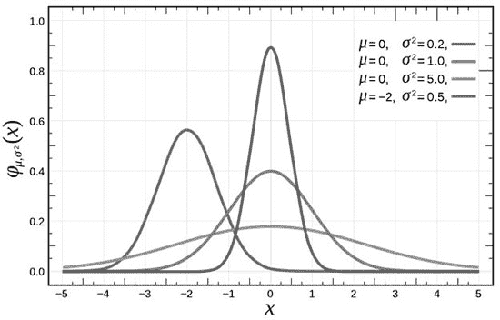

**图 2.1**

在图中，我们可以从从独特的钟形曲线中识别出高斯分布或正态分布。这可以用数学公式的形式表示，如下所示：

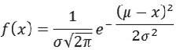

正态分布是目前最广泛使用的概率分布。它被应用于营销、心理学、金融和经济学等多个领域。由于其优良的对称性，正态分布提供了变量在分布均值下方给定距离的概率等于其在均值上方相同距离的概率。鉴于其在实现和解释上的广泛性，正态分布在金融行业被广泛使用。

某些机器学习算法基于距离和梯度下降度量，如 k-means 和 k-最近邻 (KNN)。这些算法对提供的数值尺度非常敏感，为了让算法提供精确解，对分布进行重缩放是必要的。重缩放通常会改变值的范围并可能影响方差。为了执行重缩放，我们还可以使用统计标准化（z-score 归一化）和最小最大变换（标准化）技术。

Python 和 R 编程语言提供了分布转换的内置函数。标准化也可以通过 R 语言中的 `scale` 函数实现`try help scale`）。在 Python 中执行相同的操作，可以考虑 `scikit-learn` 模块的预处理方法。

在机器学习中，独立变量被称为特征。这些是所分析过程的输入，而因变量是过程的输出。

## 数据挖掘中的自动聚类检测

为了在数据中发现有意义的模式，使用了书中描述的数据挖掘技术。但有时找不到模式或模型。其他时候，问题不是模式太少，而是模式太多。数据可能包含如此复杂的结构，以至于最好的数据挖掘技术也无法提取有意义的模式。当挖掘此类数据库以回答特定问题时，竞争性的解释往往相互抵消。

聚类提供了一种学习复杂数据结构的方法，将竞争信号的嘈杂干扰分解为各个部分或组成部分。当人类试图给复杂问题赋予意义时，我们自然或习惯倾向是将主题分解成小块，每个小块都可以用更简单的方法解释。如果有人要求描述森林中树木的颜色，那么冬季、春天、夏天和秋天的答案可能会不同。人们可能对林地植物有足够的了解，从而预测出形成遵循相似颜色规则的树聚类的最佳因素是与森林相关的数百个变量：季节、叶片等，而不是高度和年龄。在建立适当的聚类后，通常可以在每个聚类中识别出简单的模式。“落叶树在冬天没有叶子，所以树木往往呈棕色，”或“落叶树的叶子在秋季会变色，通常变为橙色、红色和黄色。”在很多情况下，非常嘈的数据集仅仅由若干表现更好的聚类组成。

问题是，这些聚类是如何被发现的？这就是自动聚类检测策略大显用场的地方——帮助看到森林而不至于迷失在林中。

k-means 使用的几何思想提出了更通用的相似性、关系和距离测量问题。这些距离测量对数据表示的变化非常敏感，因此下一个讨论的主题是聚类数据规划，特别关注了缩放和加权。k-means 并不是用于自动聚类检测最广泛的算法。

## 寻找简单岛屿

数据挖掘技术被分为直接的或无向的，而自动聚类检测被定义为一种用于发现无向数据的工具。这在技术上是成立的，因为自动聚类检测算法本身仅仅是发现数据中出现的结构，而不考虑任何独特的目标变量。大多数数据挖掘任务始于一个预分类的训练集，该训练集用于创建一个能够对以前未见过的数据进行评分或分类的模型。聚类算法寻找由相关记录组成的记录组——即聚类。这些相似性是由算法发现的。由运行研究的人员来决定相似的文档对业务是否有意义，还是某些神秘且可能不重要的东西。然而，聚类可能是更广泛背景下的一个专注的实践。为业务目的而开发的聚类在营销中通常被称为“细分”（segments），聚类是客户细分的一种常用方法。自动聚类检测是一种数据挖掘技术，很少孤立使用，因为聚类发现并不总是为了其本身。当观察到聚类时，必须利用其他方法来决定聚类代表什么。当聚类成功时，结果可能是戏剧性的。聚类检测的一个著名的早期应用导致了我们目前对恒星演化的理解。

## 月光，亮星

20 世纪初，天文学家试图解释恒星亮度（光度）与其温度之间的关系，绘制了如下所示的散点图。两个天文学家，来自丹麦的 `Enjar Hertzsprung` 和来自美国的 `Norris Russell`，在大同一时间考虑这样做。他们都观察到星星在生成的散点图中落入三个聚类。这一发现导致了进一步的研究，并让我们理解到在恒星生命周期非常不同的阶段，这三个聚类反映了恒星。下面的图像说明了每个聚类内部亮度与温度之间的关系：

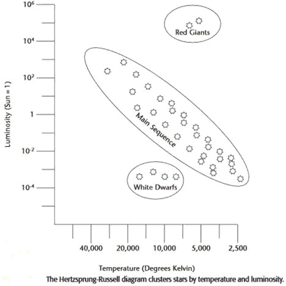

图 2.2

每个聚类内部亮度与温度的关系是类似的，但聚类之间的关系是不同的，因为热和光是由根本不同的过程产生的。通过将氢转化为氦，80% 的恒星在其寿命的大部分时间内处于主序上。氢在几十年后会被耗尽。然后恒星开始融合氦，或者融合停止，取决于它的质量。在后的情况下，恒星的核心坍缩，产生红巨星。现在这颗恒星是白矮星。搜索术语 `Hertzsprung-Russell Diagram` 会返回数千页关注此类聚类的天文学研究报告。即使在今天，基于 HR 图的聚类仍用于寻找棕矮星（质量不足以引发核聚变的天体）以及考虑恒星演化的主序前阶段。

## 赫兹斯普鲁格-塞尔部队

如果目标是为他们量体衣服，我们需要更多的测量数据！20 世纪 90 年代，美军进行了一项关于如何重新设计女军服的研究。军队的目标是减少库存中不同制服尺寸（按身高）的数量，同时为每位士兵提供合身的制服。正如任何买过女装的人所知道的，已经有许多分类结构（包括尺寸、特殊尺寸、大号码、童装、小号码等）。这些系统中没有一个是根据美军的需求开发的。康奈尔大学的研究人员 `Susan Ashdown` 和 `Beatrix Paal` 回到了基础；他们根据军中女性的真实形状设计了一套新尺寸。

上面的地图提供了人们形状的粗略图。下面的图是另一个例子，展示了青少年如何将他们的身高和体重映射为线上的点。注意男孩和女孩是如何混合的：

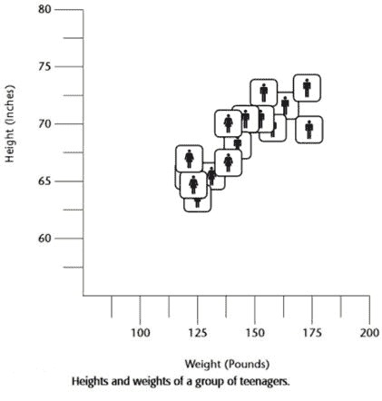

图 2.3

与传统的服装尺码结构不同，Ashdown 和 Paal 并没有设计一套所有尺寸同步扩展的组织化梯度尺码。相反，他们设计了适用于各种体型的尺寸。每种体型都对应人体测量数据库中的一组记录。一个簇可能由短腿、小腰、大胸部且长躯干、中等身材、宽肩和细脖的女性组成，而其他簇则捕捉了其他的测量特征组合。该数据库包含了近 3000 名女性中每个人的百多项测量数据。用于聚类的技术是 `k-means` 算法（将在下一节定义）。仅需百多项测量中的几项即可对簇进行分类。聚类方法的进一步优势是发现了这种变量减少的方法。

## 高斯模型

如前所述，`k-means` 方法存在一些缺点：

* 它在处理簇重叠方面表现不佳。

* 离群值会迅速将簇拉离中心。

* 每个记录要么在给定的簇内，要么在境外。

高斯混合模型是 `k-means` 的概率版本。该名称源于高斯分布，即在处理高维问题时经常假设的概率分布。高斯分布推广到具有正态分布的变量。与之前一样，选择了 `k` 个种子来启动算法。然而，这次种子被视为高斯分布的源。该算法通过迭代两个步骤进行，称为估计步骤和极大化步骤。估计阶段计算每个高斯分布对每个数据点的责任度。请看下图：

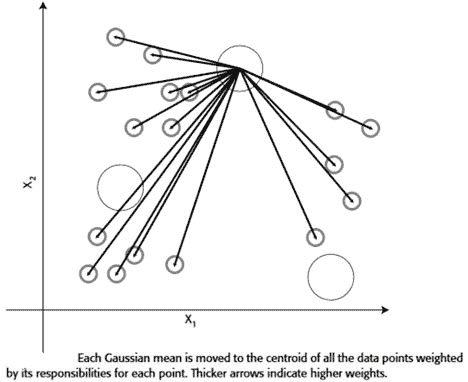


## 图 2.5

重复这些步骤，直到高斯分布不再移动为止。高斯分布本身既可以改变形状，也可以移动。然而，每个高斯分布都受到限制，因此如果它对靠近均值的点显示出极高的责任，意味着责任度的剧降。如果高斯分布涵盖了更广泛的值范围，那么它对附近点的责任就较小。由于分布必须始终整合为一个整体，高斯分布随着其的增大总是变得越来越弱。之所以被称为混合模型，是因为在每个数据点上，似然是许多分布混合的和。过程结束时，每个点都以高或低概率绑定到不同的簇中。这通常被称为软聚类，因为单个簇不会对点进行唯一分类。这种方法的一个迹象是，位于多个簇中的某些点可能具有高概率。其他点在任何簇中的概率可能都非常低。每个点都可以分配到其概率最高的簇中，使得这种软聚类变为硬聚类。

自动聚类检测技术是一种无向数据挖掘工具，可用于学习复杂的数据库结构。通过将复杂的数据集分为更简单的簇，可以使用自动聚类来提高更有针对性的技术的效率。

通过选择不同的距离测量方法，自动聚类可以应用于几乎任何形式的数据。在新闻故事集或保险报告中发现簇与在天文或财务细节中一样容易。聚类算法可以依赖某种形式的相似性指标来确定两个记录是近还是远。有时使用距离的几何表示，但也有其他可能性，当聚类记录中的非数值数据时，某些可能性更易接受。最常见的自动聚类检测算法之一是 `k-means`。

`k-means` 算法是一种基于远程识别 `k` 个簇的迭代方法。高斯混合模型是 `k-means` 概念的变体，允许簇发生重叠。分裂聚类通过连续分裂一个初始大簇来创建簇树。凝聚聚类从几个小簇开始，逐渐合并它们，直到只剩下一个簇。分裂法和凝聚法方法允许数据挖掘人员使用外部参数来评估哪种簇树层级对特定应用最有用。

## 机器学习在网络安全中的应用

机器学习技术可以应用于各种网络安全问题：

* 垃圾邮件和钓鱼攻击检测。
* 恶意软件检测与识别。
* DoS 和 DDoS 攻击检测。
* 异常检测。
* 生物识别。
* 用户身份识别与验证。
* 身份盗窃。
* 社交媒体分析。
* 信息泄露。
* 高级持续性威胁。
* 隐藏通道。
* 软件漏洞。

在接下来的章节中，我们将简单讨论这些网络安全问题以及使用机器学习技术的解决方案。

## 垃圾邮件检测

垃圾邮件是进入我们邮箱的垃圾邮件的电子等物。垃圾邮件可以定义为未经请求的商业邮件或任何未经请求的批量邮件。垃圾邮件不仅烦人，而且可能是危险的。垃圾邮件的内容可以是商品的广告、色情材料、财务广告、非法拷贝软件的信息、索要资金的欺诈信息、恶意软件链接、钓鱼网站等。垃圾邮件还可能发起拒绝服务 (`DoS`) 攻击。

基于电子邮件的文本内容进行垃圾邮件过滤。这被视为文本分类的一个特例，类别为垃圾邮件和非垃圾邮件。`TF-IDF`、`Naive Bayes`、`SVM`、`n-gram`、`boosting` 等文本分类技术可以用于垃圾过滤。这些技术的一些局限性包括需要大量的训练数据、处理能力等。

其他机器学习技术涉及将电子邮件转换为特征向量，其中特征包括邮件的标记、大小、是否存在附件、`IP` 以及收件人数量。我们可以使用机器学习技术如 `CVM`、决策树、`neural networks` 等。

## 钓鱼页面检测

在钓鱼攻击中，人们受到心理影响，恶意网站的内容变得可信，从而诱使用户输入个人详细信息，如用户名、密码、银行账户、信用卡详情等。通常情况下，这是通过伪造声誉良好的网站来实现的，使用户在输入个人信息之前从不怀疑是非活动。如今，钓鱼网站不仅用于嗅探用户凭据，还用于传播 Cookie 窃取器、键盘记录器等恶意软件。此类恶意软件可以从系统中窃取 Cookie 或捕获用户的击键。

现有基于机器学习的检测算法使用的不同类型特征可以分类如下：

* 基于 URL 的特征。
* 基于域名的特征。
* 基于页面的特征。
* 基于内容的特征。

一些基于 URL 的特征包括 URL 中的数字个数、URL 总长度、URL 中的子域名数量、拼写错误的域名、使用的顶级域（TLD）等。一些基于域名的特征包括域名或其 IP 地址是否出现在已知的黑名单服务中、域名年龄、域名类别、注册人名称的可用性等。一些基于页面的特征包括全局和国家 PageRank、在 Alexa 前 100 万个网站列表中的排名、该域名每天、每周或每月的估计访问量、每次访问的平均页面浏览、平均访问时长、各国的网络流量形状、来自社交网络的引用数量、相似网站的存在等。一些基于内容的特征包括页面标题、元数据标签（meta-tags）、隐藏文本、正文文本、图像、视频等。

因此，用于钓鱼页面检测的常用特征包括其 URL、PageRank、SSL 证书、Google 索引、域名以及基于网页源代码的特征。然而，这些特征具有局限性。托管在免费网络托管服务上的网页永远不会包含合法网页具备的某些相关特征，如 PageRank、域名年龄、SSL 证书和 Google 索引。另一方面，黑客可能利用黑帽 SEO 技术（如关键词堆砌）来推广其钓鱼页面，以使钓鱼页面获得更高的索引。此外，通过第三方工具（如网络点击器应用程序）可以增加网站的入流量，在几分钟内产生数千次页面浏览。

钓鱼页面检测是一个监督分类问题。在训练阶段，我们需要包含钓鱼页面样本和合法页面样本的标记数据。我们使用的训练数据集是构建成功检测机制的重要组成部分。因此，我们必须使用类别精确已知的训练样本。Phish Tank 是一个著名的钓鱼网站公共数据集。网站信誉服务可用于收集合法网站。机器学习技术如 `SVM`、`decision tree` 和 `Naive Bayes` 已用于钓鱼页面检测。

## 恶意软件检测

恶意软件（malicious software）是指任何故意设计用于对计算机系统和网络造成损害的软件。恶意软件可以下几类：

* `Virus`：在未经用户许可的情况下加载并运行的恶意软件，它可以自我复制并感染其他软件。
* `Worm`：这种恶意软件与病毒非常相似但与病毒不同的是它可以在网络上传播并自动复制到其他机器上。
* `Adware`：这种恶意软件在计算机上显示广告。
* `Spyware`：这种恶意软件执行间谍活动。
* `Rootkit`：这种恶意软件允许攻击者以 root 权限访问用户的系统和网络。
* `Backdoor`：这种恶意软件为攻击者为系统提供了一个额外的秘密入口。
* `Keylogger`：这种恶意软件记录用户按的所有按键，并捕获包括密码、信用卡号在内的所有敏感数据。

现有的恶意软件检测机制分为静态、动态或混合（静态和动态的结合）。静态分析利用软件源代码的特征，如 `signatures`、`API calls`、`function calls` 和 `permissions`，在不执行软件的情况下检测其恶意本质。另一方面，动态分析是在软件执行时（理想情况下在虚拟环境中）进行的。恶意软件可以使用加密或混淆的源代码轻易绕过静态检测机制，或绕过权限。大多数现有的恶意软件检测机制使用机器学习算法，其中 `permissions`、`API calls`、`system calls`、`system call frequencies`、`densities`、`co-occurrence matric` 和 `Markov chain state transition probability matrix` 被用作特征。静态分析包括多种技术：

* 用于检查输出的 `String extraction`。
* 使用 `anti-malware scanners` 进行扫描。
* 反汇编（`assembling`），即将机器码反转为汇编语言。

DoS 攻击的检测主要通过以下两种入侵检测方式之一进行：

* 基于特征的入侵检测。
* 基于异常的入侵检测。

基于特征的入侵检测通过将网络与数据库中存储的已知网络攻击模式进行比较来工作。虽然这种方法的误报率较低，但它可能无法检测零日攻击。基于异常的入侵检测利用网络流量的统计数据（如数据包头信息、数据包大小和包速率）来检测网络中的各种入侵。虽然基于异常的检测机制不需要异常数据库进行比较（从而减少了内存需求和维护工作），但它检测与正常流量相似的恶意流量（例如低速率 DDoS 攻击）存在困难，且无法保证检测未知攻击。

机器学习模型使用的一些特征包括熵、从源到地传输的数据字节数、到主机的连接数、源 IP 和目的 IP 地址、字节率、包速率、TCP 标志比例、SYN 数据包统计和流统计、SYN 标志是否存在、分类字段和协议字段、TCP SYN 出现次数、目的端口熵、源端口熵、UDP 协议出现情况以及分数据包量等。机器学习技术如 `SVM`、`KNN`、`Naive Bayes` 和 `k-means` 已用于 DoS/DDoS 检测。

## 异常检测

异常并不总是对应于网络攻击，也可能是新行为。正如译文所示，可以检测并对异常、异常或意外行为进行分类。

在 `k-means` 聚类中，根据待聚类对象的特征向量将对象分组为 `k` 个不相交的簇。网络数据挖掘 (NDM) 方法结合 `k-means` 聚类算法可用于从训练数据集中分离出具有正常异常流量的时间段。

在 `k-medoids` 中，每个簇由类内最合适的中心对象（中点，medoid）表示，而不是可能不属于该类的质心。`k-medoids` 可用于检测包含未知入侵的网络异常，并且被发现其准确性高于 `k-means` 算法。

簇的新平均是基于权重度量计算的。发现基于 `EM` 的异常检测机制优于基于 `k-mean` 和 `k-medoids` 的方法。

无监督学习和监督学习算法可以结合形成用于异常检测的混合方法。通过这种方式，可以提高异常检测的效率和准确性。`k-means` 和 `ID3` 决策树的组合用于计算机地址解析协议 (`ARP`) 流量中异常和正常活动的分类。

一些用于入侵检测的机器学习方法还使用了人工神经网络和支持向量机。通过结合网络特征熵和 `SVM` 的混合方法可以克服单一方法的缺点，实现高准确率的异常检测。

因此，存在不同的基于机器学习的异常检测方法。模型基于系统的正常和异常行为构建的。可以根据异常的类型采用不同的方法。当系统模型可用时，将使用观测流量对其进行测试。如果发现偏差大于或少于预定义的阈值，则该流量被识别为异常。

## 结论

在本章中，我们讨论了 `Naive Bayes`、正态分布以及使用 `Gaussian process` 进行自动聚类检测的技术算法方面。我们还讨论了可以应用于各种网络安全领域问题（如垃圾邮件检测、钓鱼网站检测、恶意软件检测和异常检测）的机器学习技术。

在下一章中，我们将讨论如何构建数据结构。

# 第三章

## 数据结构化的机器学习

## 引言

文本挖掘是机器学习领域最复杂的领域之一。这是因为文本挖掘涉及非结构化数据。它没有定义良好的观测值和变量。因此，为了进行某些分析，你必须首先将此非结构化数据集转换为结构化数据集，然后继续使用通常建模框架。结构化数据和非结构化数据的区别是什么？大数据和数据科学的未来是什么？你将在本章中找到这些问题的答案，让我们开始吧。

## 结构

在本章中，我们将涵盖以下主题：

* 数据结构化
* 大数据的未来
* 结构化数据和非结构化数据

## 目标

学习本章后，你应该能够完成以下操作：

* 理解结构化数据和非结构化数据之间的区别。
* 理解大数据的未来。

## 数据结构化

数据有很多形式，但在最高层面，数据主要分为三类：

* **结构化：** 这种数据非常有组织。它存在于数据库、`CSV` 文件（用逗号分隔的值）或其他仓库中。数据格式确保了它可以用于 `SQL` 或其他结构化语言进行计算和查询。
* **半结构化：** 这种数据在与关系型数据库等数据表关联时并不遵循数据模型的结构化方式，但具有标记和标签，可以将语义元素分开，并强制数据字段和记录的层次结构。
* **非结构化：** 这种数据没有真实的结构，例如自然语言文本或音频流。

显然，最有用的是结构化数据，因为它可以被立即处理。按照规律，数据约 20% 由结构化数据表示，而剩下的 80% 是非结构化和半结构化数据的组合。

但要注意，我们所谓的非结构化数据大部分具有某种结构。例如，互联网上发表的文章。虽然它被归类为非结构化，但通过标签和元数据具有某种结构。它被归类为非结构化是因为内容本身没有可以直接使用的结构。

## 大数据的未来

我们正处于数据科学世界地震式变化的中间。这种意识开始在市场上体现，新的分析工具更多地关注从数据中获取见解，而不是运行报告和仪表板。这正是解决此类问题或任何问题的正确方法——关注目标。不要关注“如何”，盯着奖。

然而，目前这些工具主要是旧式的商业智能工具，正尽可能地进行改造以应对这股浪潮。它们是否会真正成功，还是需要出现新一代工具，仍然是一个未解决的问题。

鉴于此，以下是值得关注的五个发展方向：

* **数据将告诉你什么是有趣：** 目前的商业智能恰恰相反，你告诉工具你对什么感兴趣。未来一代将告诉你什么是有趣。在未来几年中，生成这类见解将变得越来越容易，个性化将在其中起很大作用。回想当你第一次尝试 `Pandora` 时它对音乐有多么革命性——它真的在学习你感兴趣的内容！这就是分析的发展方向。

系统本身也将提高自动学习和模式识别的能力，能够更好地识别出你想要看到的内容。这将使它们能够发现离群值、趋势变化以及其他有趣的数据。而在今天，这些必须由人类来发现。

## 狂野可视化

图表和图形已经存在很长时间了。这是有原因的：它们擅长以易于理解的方式传达含义。

但同样地，它们被开发是为了理解比我们现在处理的少得多的数据。观察数据的新方法——特别是与数据交互的方式——正在开发中。目前，我们正看到这一趋势的第一波浪，设计师们正在尝试不同的技术，其中一些有效，另一些无效。如信息图、交互式网页以及一些较新的智能工具，都是尝试观察数据新方法的示例。

我们预见这一趋势将会加速。随着该领域变得越来越流行，并对全球经济变得至关重要，投入在该问题上的脑力和时间将导致在观察和理解数据的新方法上取得突破。

## 自服务智能

使用分析的能力将不再是一项专门技能，我们已经在数据发现工具中看到了这种趋势。对于未来的高管来说，将其作为每日和每小时工作流的一部分将成为一种常见且日常的事。我们已经通过 IBM 的 Watson 看到了这种演变，它在知识行业中将尤为普及。

这有点违背直觉：使用的数据量每天都在增长，但工具却变得更简单了？是的，如此。

例如，那种为了要一个关键的 KPI 而必须等 IT 部门花费很长时间（甚至是好几天）来挖掘出报告的时代已经过去了。自服务智能将细节控制权交给了客户。

数据可以实时查看以进行实时分析和即时可操作的视角，为员工提供战略优势。

随着数据量的增加，它正迫使人们对当前的智能工具进行完全重新评估。那些带有长长工具栏和复杂菜单系统的复杂用户界面已不再适用——它们是为一个数据量少得的世界构建的。

这就带来了我们需要的新类型接口：`Sisense`、`Zoho Reports`、`Microsoft BI`、`Tableau Desktop`、`Tibco Spotfire`、`Alteryx Analytics` 和 `Salesforce Einstein Analytics`。

## 与数据的自然直观交互

商业智能是企业软件最后的堡垒之一，仅仅是因为它的复杂性。如果你发现屏幕的一半被菜单占据，而路人完全不知道你在看什么，你就知道你正在使用商业智能软件。

触摸、语音和手势等自然接口抽象了复杂性。功能越符合直觉，用户的生产力就越高，因为他们不需要学习如何使用它。当你真的可以口头提问“我应该关注哪个人口统计数据来增加销售额？”时，你不需要培训或专家帮助就能找到价值信息。

Apple 通过训练人们使用触摸并创造出直观（且现在已被全球接受）的触摸手势，为世界做了巨大的贡献。Apple 的 `Siri` 非常重要，因为它在训练人们使用语音。微软的 `Kinect` 非常重要，因为它在训练人们使用肢体手势。所有这些输入模式的结合创造了一个交互环境，让你玩转你的数据——探索它并与之交互。

你将用眼睛思考，顺着直觉找到你正在寻找的数据，即使你不确定该问什么问题。

数据将变得有趣。

## 协作

几年前，你无法逃避“协作”这个流行词。这个想法是，通过让人们共同工作，释放他们来汇聚创意和智力资源，当然，希望这能导致想法和良好决策的协同效应爆发。

协作在某种意义上，是在大数据在真正变得庞大之前，处理大量数据（即大数据）的一种方法。它本质上是众包式的报告挖掘。遗憾的是，需要评估的数据量实在太大了，即使是大量的人也无法高效地查看。

新类型的接口（如上所述）将缓解这一问题。但协作有一个核心价值，不会因为不再是“新时尚”而消失。如果在正确的时间出现在正确的地方，两个头脑总比一个好。

当工具允许人们使用直观界面不仅可以探索数据并从中发现数据，还能让多个人同时进行这些操作时，结果将是神奇的。想象一下，以有趣的方式查看数据、探索它，并与全球各地的同事实时分享你看到的内容：引发对话。让人们在同一项任务上工作，同时给他们独立探索的自由，这让你兼得其利。

但什么时候呢？

大多数变化将在未来三到五年内发生。其中一些已经在发生。但所有迹象都指向它们的一种不可避免性——它们处于两个推动我们社会向新型信息消费模式转变的趋势的交汇点，这种模式与我们现在的完全不同。

## 结构化与非结构化数据

与结构化数据相比，世界上确实存在更多的非结构化数据。由于非结构化数据变得可用需要更多工作，它们往往吸引了关注并花费更多时间。因此，机器或程序能够处理和分析非结构化数据的承诺对于任何预测分析模型来说都是一个巨大的卖点。你必须记住永远不要低估非结构化数据及其对你分析的威力。在构建预测分析模型时，分析结构化数据总是比分析非结构化数据更高效，因为后者的处理成本更高。数据的选择、其与分析的相关性、清洗以及后续转换通常是漫长且枯燥的任务。只有在数据经过所有这些过程后，它才具有在预测分析模型中的价值。

使用结构化数据获取结果通常比非结构化数据更容易，因为你永远不需要担心清洗过程存在延迟。文档标记和文本分析是处理非结构化文本文档的两种方法，对数据进行分组、总结并链接其内容。这有助于用户发现数据中的任何隐藏模式。同样重要的是，大多数搜索引擎平台通常提供工具来索引数据并使其变得可搜索。

非结构化数据并不经常缺乏结构，只是需要花更多精力来理解这种结构。任何数字文件中的每个文本都有与其相关的某种结构，这些结构通常出现在元数据中。这适用于其他形式的结构化数据。对数据的结构组件进行彻底分析可能是值得的。这将使你能够估计对非结构化数据进行的任何分析的潜在价值。当分析提供了数据的一点见解时，你应该尝试确定为分析那部分非结构化数据需要分配的资源。

其理念是，你总可以在所收集的数据中找到某些规律。你需要对数据进行大量的挖掘以更好地理解它。两个人之间的一系列邮件中的内容可能会偏离邮件的原始主题，尽管主题行保持不变。有时，主题行甚至可能完全说不通。

区分这两种数据类型的界限并不总是清晰的，因为非结构化数据的某些方面具有结构化数据的特征。在大多数情况下，这种结构是否反映了数据的内容尚不清楚。就此而言，结构化数据也可以包含一些非结构化数据。例如，在网络表单中，用户可能需要通过从选择选题中选择答案来提供反馈，并提供一个评论框以文本形式提供反馈。这个评论框包含非结构化数据，因为信息是自由形式的。这些情况通常被认为是结构化和非结构化数据的混合。

在数据定义领域总会有一些例外，因为这两类数据的定义可能是模糊的。总有办法可以区分这些数据。

## 结论

在本章中，我们讨论了结构化数据与非结构化数据之间的。目前的目前的工具帮助企业做出更快的决策。我们还讨论了机器学习工具如何帮助企业整理数据，以便能够以正确且更有序的方式进行处理。在下一章中，我们将讨论解析。

# 第 4 章

## 使用 NLP 解析数据

## 引言

自然语言处理（NLP）的发展基于人工智能的理论和模型。NLP 是机器学习模型理解人类语言的能力，是人工智能的重要部分。这种方法帮助公司和企业用不同的语言与世界各地的人进行交流。人类语言并不总是精确的，我们每个人都有独特的语言结构。翻译过程取决于几个主要因素，如地区方言、变量和社交背景。

此外，NLP 是计算机以有用且智能的方式理解、分析并从人类语言中推导出准确含义的方法。机器学习和人工智能模型被设计用于执行多项任务，如翻译、关系提取、自动摘要、主题分割和情感分析。NLP 是分析文本的有效方法，允许机器理解人类实际上是如何说话的。这种方法通常用于机器翻译、文本挖掘和自动问答。

解析意味着通过 NLP 按照语法法则从文本数据中提取信息和含义。换句话说，解析是拆解句子以澄清句子的每个方面。

## 结构

在本章中我们将涵盖以下主题：

* NLP 的用途。
* NLP 的主要优势。
* NLP 中的数据处理。
* NLP 应用。

## 目标

学习本章后，你应该能够做到以下：

* 理解 NLP 的用途和优势。
* 理解 NLP 的应用。

## NLP 的用途

自然语言处理（NLP）算法用于多种用途。基本上，它们帮助开发人员开发理解人类语言的软件。由于其复杂性，NLP 很难正确地实现和学习。随着时间的推移，数据科学家和机器学习工程师正努力改进这一过程并带来更好的周转率。

NLP 算法用于总结文本块。为了完成这一操作，在机器学习模型中实现了一个摘要器，用于提取有用的观点并忽略任何无关信息。此外，NLP 模型通过 `AutoTag` 从内容中准确生成关键词标签，这是发现内容中简述主题的一项技术。此外，情感分析方法以积极的方式识别给定文本中字符串的情感。

目前的 NLP 方法依赖于深度学习概念。深度学习是人工智能的一种，它检查并利用数据中的模式来提高程序的理解能力。早期的 NLP 模型基于规则的方法，仅具有在文本中搜索短语并生成简单回答的能力。今天，人工智能和机器学习极大定制了 NLP 模型的工作方式并交付卓越的结果。NLP 模型工具有 `Genism`、`Intel NLP Architect` 和 `NLTK`。

Python 编程语言自带库，可以帮助开发人员创建高级机器学习和人工智能模型。这些库包括 `SciPy`、`NumPy` 和 `Pandas`。数据科学家正在进行研究以改进搜索结果，使用户可以通过问题查询数据集并获得实时的翻译。机器学习模型有能力理解人类语言的关键元素及其句子结构。

## NLP 的主要优势

NLP 模型提供了无限的优势。这些模型具有提高文档效率和准确性的能力，并提供了创建可读文本摘要的机会。此外，这种方法是 `Alexa` 和 `Siri` 等个人助手的主要驱动力，用户通过它们可以轻松地完成多项任务。NLP 为公司带来了长期利益，因为它们可以通过聊天机器人与客户进行有效通信，并实时解决查询。

根据行业人士的数据，约 21% 的可用数据是结构化形式的。数据在我们表达、推文、向 `WhatsApp` 发送消息以及其他活动中产生。这些数据大部分是以文字为基础的形式存在的，在本质上是是非结构化的。NLP 有助于从这种格式的数据中提取价值数据。

几个值得注意的例子包括社交媒体推文和帖子、用户之间的消息、文章、博客、新闻、产品或服务报告，以及医疗领域的患者信息。其他还包括聊天机器人和其他语音驱动机器人。

## NLP 中的数据处理

NLP 系统旨在理解不同风格和语言的对话。从声明或对话产生的数据是非结构化数据的一部分。与结构化数据相比，机器学习模型很难理解非结构化数据，因为没有预定义的关系和标签。NLP 是人工智能的一个领域，使自动机器能够学习、理解并从人类语言中得出准确的含义。只有当模型使用带标记的数据进行训练时，它们才能以高准确率轻松理解多种语言。

## NLP 应用

NLP 是计算机科学领域最热门的话题之一。金融、供应链、营销和物流领域的公司正在向这一科学领域投入大量资金。所有人都在寻求理解 NLP 及其对相关职业的影响。每家公司似乎都想以某种方式将其纳入运营。

## 人才招聘

各公司的人资源部门使用 NLP 模型审核简历并进行候选人面试。在招聘的搜索和筛选过程中，面试官能够识别潜在聘者的技能和能力，并回顾就业市场的最新趋势。

## 语音助手

`Siri` 和 `Alexa` 等 NLP 工具与 AI 模型协作以响应语音提示。特别是 NLP 模型可以完成从寻找特定商店到为指定日期安排预约任何事情。语音助手通过结构化数据学习，需要大量的训练数据来对每种语言建立理解。

## 医疗

得益于人工智能和机器学习技术，医疗和医学部门取得了巨大突破。在 NLP 工具的帮助下，医生和健康专家可以探索更多的健康状况。

## 调查分析

调查是衡量组织成功的有效方法。公司正在开展各种调查，以获取消费者对不同项目的意见。NLP 在识别弱点和鼓励企业开发其商品方面非常有帮助。

## 语法检查器

这是语言通信处理最广泛的应用之一。像 `Grammarly` 这样的语法检查工具提供了许多帮助人们写出更好内容的功能。NLP 将任何普通文本变成优美的文学。如果你想写下任何内容的话。

## 邮件过滤

这是语言通信处理最广泛的应用之一。像 `Grammarly` 这样的语法检查工具提供了许多帮助人们写出更好内容的功能。NLP 将任何普通文本变成优美的文学。如果你想写下任何内容的话。

## 社交媒体监控

这是语言通信处理最广泛的应用之一。像 `Grammarly` 这样的语法检查工具提供了许多帮助人们写出更好内容的功能。NLP 将任何普通文本变成优美的文学。如果你想写下任何内容的话。

## 在线搜索和自动纠错

这是语言通信处理最广泛的应用之一。像 `Grammarly` 这样的语法检查工具提供了许多帮助人们写出更好内容的功能。NLP 将任何普通文本变成优美的文学。如果你想写下任何内容的话。

## 结论

在本章中，我们讨论了 NLP 作为将大量信息转换为人类可以理解的数据的重要工具。我们还讨论了 NLP 在招聘、语音助手、医疗、调查分析、语法检查、邮件过滤、社交媒体监控和在线搜索中的应用。

在下一章，我们将学习计算机视觉。

# 第 5 章：计算机视觉

## 引言

我们已经知道人类的视觉是极其先进的。当你睁开眼睛时，在几分之一秒内就能看到周围的每个细节和物体。我们可以立即检测并识别视野范围内的物体，无需任何犹豫或预设。

我们还能命名周围的每一个物体，并非常准确地感知这些物体的深度，我们可以完美地区分物体轮廓并检测和识别背景中的各种物体。我们的眼睛接收各种颜色数据的原始体素，我们的大脑将这些数据转换为相关且有意义的信息。因此，颜色信息将被感知为不同的线条、形状、曲线等，这些可能指示我们正在看什么，例如物体、人、建筑等。

为计算机视觉编程机器，以在监控、入境检查、候选人筛选等各个领域取代人类。因此，许多主要公司都使用深度学习技术和 `CNNs` 来增强人脸识别和目标检测的性能，而这些都是计算机视觉领域的一部分。一些社交网络平台也使用这种技术进行自动人脸识别，例如 `Facebook`。

这些技术也被整合到代表未来的自动驾驶汽车中。然而，我们已经知道计算机视觉面临的挑战，这些挑战可能非常难以解决。人类能够自动看到物体、轮廓、线条和形状，而计算机看到的仅仅是一堆巨大的矩阵和数字集合。

为了解决这个问题，并从原始像素及其数值中学习更复杂的图像特征，使用了 `CNNs`。此外，开始学习计算机图像的一个很好的起点是编程语言 `Python`，它能为你提供这段旅程所需的一切。

## 计算机视觉中的神经网络

## 激活函数

让我们学习一些核心概念，如 `ReLU` 激活函数、数据预处理、权重初始化以及 `CNN` 架构中的 `CNN` 简介。

`ReLU` 是 `CNNs` 中应用广泛激活函数。如果输入为负，它返回 0。它在计算上非常高效，因为只需要简单的剪裁。根据经验，它被认为比 `sigmoid` 或 `tanh` 更快。

## 数据预处理

所有图像都被转换为相似大小的正方形形状。每张图像的平均值可以从每个像素中推断出来。

## 权重初始化

权重可以调整为均值为 0、标准差为 `0.1` 到 `1e-5` 的 `Gaussian` 分布。这适用于浅层网络，例如具有五个隐藏层的网络。在深度神经网络的情况下，小的权重会导致输出值很小，随着你接近末端，值会变得低得多。结果是梯度也变得非常稀薄，最终导致梯度消失。

## CNN 简介

第一层将尝试区分边缘并为边缘检测创建模板。随后的层可能会尝试将它们合并为更简单的形式，最后合并成各种物体位置和比例的模型。最后层对齐所有模式的输入图像，最终预测就像所有模板的加权和。因此，深层 `CNNs` 能够模拟复杂的变化和行为，提供非常精确的预测。一个 `CNN` 包含三层：卷积层、池化层和全连接层。

## 卷积层

它们是 `CNN` 架构中使用的主要结构块。

## 池化层

它们用于填充卷积层以保持图像大小不变。因此，池化层用于降低图像的幅值。它们通过过滤器在每一层中工作。

## 全连接层

网络通常使用全连接层，在这些层中，每个像素被视为独立的神经元，就像普通的神经网络一样。全连接层的神经元数量等于要预测组的数量。

## 计算机视觉概述

`Python` 是最广泛使用的编程语言之一，并且……（根据指令截断）

与传统的卷积前馈网络一样，你的 `CNN` 将使用随机梯度下降进行训练，并在稠密层中使用 dropout 策略以防止过拟合。因此，你将针对感染阶段进一步对 `CNN` 进行调优，初步结果将表明，该神经网络的性能远优于经典的机器学习方法，例如贝叶斯分类技术或向量机。

此外，百度和谷歌的一些最新工作表明，`CNNs` 具有极高的准确率，在某些任务上，它们甚至优于人类。看起来 `CNNs` 确实可以对即将到来的某些未来技术产生巨大影响。

机器学习模型应用之一是对数据进行排序和分类。这种模型甚至可以用于图像分类。搜索引擎使用此类算法来识别照片，社交媒体网站现在在照片被标记之前，就会使用人脸识别来识别照片中的人物。它们通过从其他照片组成的数据中学习。如果你的社交媒体账户可以识别新照片中的你的脸，那是因为利用你账户中所有其他照片的数据创建模型。

图像识别技术需要深度学习模型。这些模型是用人工神经网络创建的，将在本书的后部分详细讨论。深度学习是机器学习中最复杂的一种类型，数据通过多个隐藏层节点进行过滤。它们之所以被称为隐藏层，是因为模型是无人参与的，这意味着模型识别的特征不是由数据科学家预先选择的。通常，特征是模型自行识别的模式。神经网络中识别的函数可能非常复杂；任务越复杂，模型的层数就越多。图像排序模型可能只有两或三层，而自动驾驶汽车则在一到两百层隐藏层之间。

得益于计算能力的可用性提高，近年来我们在这一领域取得了长足进步。想象一下将成千上万个数据点通过数百个堆叠节点同时运行所需的计算能力。随着计算机的改进和处理海量数据成本的降低，深度学习和人工神经网络在过去十年中变得更具可行性。无疑，随着云出现，数据科学家可以在不使用物理存储空间的情况下访问海量数据。`ImageNet` 是一个网站，对对图像分类和神经网络的数据科学家来说是一个极佳的资源。它是一个公开访问的用于机器学习的图像数据库。其理念是，通过将其公开，世界各地的数据科学家可以合作改进机器学习技术。

`ImageNet` 数据库拥有约 1400 万张照片，包含 21,000 可能的类别组。这为数据科学家提供了巨大的机会，可以访问并分类照片，以学习和实验神经网络。

每年，`ImageNet` 都会为全球数据科学家举办竞赛，创建新的图像分类模型。竞争逐年变得日益激烈。现在他们开始转向分类视频而非图像，这意味着复杂性和所需的处理能力将继续指数级增长。通过使用数据库中的数百万张照片，`ImageNet` 竞赛近年来在图像识别领域取得了突破性进展。

现代照片分类模型需要运行非常特定的方法。即使两张图像被归为同一类，它们看起来也可能完全不同。你如何建立一个能够区分它们的模型呢？看下面的图片：


图 5.1 这是两张不同的树的照片

随着当今技术渗透到现代生活的每一个角落，保护个人数据已变得至关重要。生物识别技术通过对生理或行为数据应用统计分析，将我们的身体作为一种天然的识别系统。现在我们正处于生物识别领域的技术革命时代，广泛的研究和产品开发正在进行，以充分利用这一令人兴奋技术的全部优势。

生物识别涉及测量生理或行为信息以验证个人身份，因此它是准确且可靠的。

任何生物识别系统都涉及两个不同阶段：入历（注册）和验证（身份认证）。如果建立了正向匹配，用户将获得对系统或服务的权限或访问权。在个人识别的情况下，需要根据查询的生物识别模板对整个数据库进行搜索。个人识别系统的一个很好的范例是自动指纹识别系统 (`AFIS`)，它被许多执法机构用于识别和跟踪已知犯罪分子。

用于识别或认证的生物学特征应该是可量化或可测量的，因为只有可量化的特征才能通过比较获得布尔结果（匹配或不匹配）。通用生物识别系统的不同组件包括：传感器或数据采集模块、预处理和增强模块、特征提取模块、匹配模块以及决策模块。数据采集模块负责采集用户的生物特征以进行认证，大多数情况下捕获的数据以图像形式存在。在预处理阶段，需要提高采集的生物识别数据的质量，以获得更好的匹配性能。随后在特征提取阶段，从增强后的生物识别数据中提取显著特征。生成的特征模板存储在数据库中，并在匹配阶段用于与查询生物模板进行后续比较。最终的比较结果由决策模块根据获取的匹配分做出。

基于生物识别的认证或身份识别目前已应用于各种场景，其主要优势包括：

* `生物识别`系统基于人的身份或其行为为，而不是基于人所知的（`密码`、`PIN`）或人所拥有的（`令牌`、`智能卡`）。
* `生物识别`系统使用生理或行为特征进行认证。由于复制人的生物特征非常困难，因此它具有独特性和准确性。
* 生物识别数据的窃取和重用非常困难。用户减轻了记忆`密码`的负担，且由于生物特征无法共享，伪造风险可以降至最低。

在为特定应用确定使用的合适生物特征之前，需要对生物特征的某些重要特性进行分析。需要考虑的生物特征的不同特性如下：

* `通用性`：所选的特征应该是几乎几乎所有人所拥有的。
* `类间与类内性能`：在类间模板（两个不同人的模板）之间应有足够的区分性特征。类内模板（同一个人的模板）应仅具有极少数的区分度。
* `可采集性`：应该易于从用户处采集所选特征的生物模板。
* `接受性`：目标群体应愿意向生物识别系统提供所选的生物模板，且系统的用户界面应越简单越好。
* `成本`：处理所选特征的系统的基础设施和维护成本应最小。

指纹和虹膜是大多数生物系统中常用的生物特征。这主要是因为它们具有用户便利性（指纹系统较高）和准确性（虹膜系统较高）。`Aadhaar`（`Aam Aadmi ka Adhikar`）被认为世界上最大的通用民身份计划和生物识别数据库，目前由印度政府为公民提供社会服务。在 `Aadhaar` 注册期间会同时采集指纹和虹膜生物特征：

| 特征与机器学习技术 | 模态 | 特征 | 机器学习技术 |
| :--- | :--- | :--- | :--- |
| Face | 眼距、`DCT`、`傅里叶变换`、眼距与鼻距比例、主成分 | `PCA`、`LDA`、`Kernel PCA`、`Kernel LDA`、`SVM`、深度神经网络 |
| 虹膜 | `DCT`、`傅里叶变换`、小波变换、主成分、纹理特征 | `PCA`、`LDA` |
| 指纹 | `Delta 形`、`核心点`、`脊终`、`孤岛`、`分支`、`特征点`、`FFT` | 神经网络 |
| 掌脉 | `LBP`、`特征点`、`分支`、`端点` | `SVM`、深度学习 |
| 掌纹 | `形状`、`纹理` | `PCA`、`LDA` |
| 掌脉 | `LBP`、`特征点`、`分支`、`端点` | `SVM`、深度学习 |
| 语音 | `线性预测 (LPC)`、`倒谱系数 (CC)`、`MFCC` | 高斯混合模型、`HMM`、`ANN`、`SVM` |

**表 5.1**

机器学习在提高生物识别系统的性能方面发挥了重要作用。

## 软件漏洞

漏洞是指系统中的缺陷，它可能使其容易受到攻击。软件漏洞是软件中的一种缺陷，可能导致软件崩溃、产生无效输出或以意料之外的方式运行。一些常见的软件漏洞包括：

* `缓冲区溢出`。
* `数值溢出与欠溢`。
* `类型转换错误`。
* `操作符误用`。
* `指针算术中的 Bug`。
* `求值顺序逻辑错误`。
* `结构填充错误`。
* `过程错误`。
* `宏和预处理程序中的错误`。
* `字符串和元字符漏洞`。
* `权限问题`。
* `文件权限问题`。
* `竞态条件`。
* `进程、IPC 和线程中的错误`。
* `环境和信号问题`。
* `SQL 注入漏洞`。
* `跨站脚本 (XSS) 漏洞`。
* `文件包含和访问中的漏洞`。
* `shell 注入和配置中的漏洞`。
* `访问控制和授权缺陷`。

软件漏洞检测是确认软件系统是否包含可能被攻击者利用以破坏软件系统或平台安全的缺陷的过程。代码注入攻击允许攻击者在漏洞程序的权限范围内执行代码。用于漏洞检测的机器学习方法可以归类如下：

* `异常检测方法`：这些方法使用如 `API` 使用模式、缺失检查、缺乏输入验证和缺乏访问控制等特征。已使用 `KNN` 等机器学习技术进行分类。
* `模式识别方法`：使用机器学习算法识别易漏洞代码行以及关键词（特定于编程语言）。特征包括应用程序调用的系统调用和 `API` 调用、语法树等。已使用 `逻辑回归`、`多层感知器 (MLP)`、`随机森林`、`神经网络`、`BLSTM` 等机器学习技术。

计算机视觉在弥合人类与机器差距方面发挥着巨大作用。随着今天突破性的技术进步，这将是自动化验证非常有用的工具，特别是在金融领域。在本章中，我们讨论了用于计算机视觉的 `CNNs` 技术架构。我们还概述了计算机视觉在图像识别、生物识别和软件漏洞方面的应用。

## 第 6 章

## 神经网络、GBM 和梯度下降

## 引言

神经网络使得 AI 能够解决复杂问题。这些网络的设计类似于人类大脑和神经系统，数据科学家和机器学习工程师可以开发出与人类大脑相似的高性能 AI 系统。神经网络、深度学习和人工智能代表了强大且令人兴奋的机器学习技术，最适合解决现实世界的问题。虽然没有计算机能达到人类智能的水平，但基于决策、推理和逻辑的 AI 模型可以带来巨大的成果和准确的预测。

数十亿神经元和数万亿连接之间相互联系——这驱动了我们的智能，以及我们在遇到新事物时学习和适应的能力。

20 世纪 50 代，科学家首次开发了人工神经元的概念，非常简单地模拟了生物神经元的行为。后来，人们提出了将多个人工神经元连接起来创建神经网络的想法，将其作为表示复杂问题的方法。然而直到最近几年，必要的计算能力才变得易于获得，从而使其全部潜力得以释放。如今，先进的神经网络模型正处于 AI 和机器学习研究的最前沿。

为了展示神经网络的工作原理，让我们从神经网络的基础构建块开始：神经元。

## 结构

在本章中，我们将涵盖以下主题：

* 神经网络的工作原理。
* AI 中神经网络的类型。
* 使用人工神经网络的优势。
* 梯度提升算法。
* 梯度下降。

## 目标

学习本章后，你应该能够完成以下操作：

* 理解神经网络、`GBM` 和 `gradient descent` 的概念。
* 理解神经网络的工作原理、不同类型及其益处。

## 神经网络的工作原理

与人类大脑类似，神经网络具有做出决策和提供预测的能力，最适用于特定的数据集。它们通过机器学习感知和原始输入的聚类来解释感官数据。此外，神经网络识别的模式包含在 `vectors` 中，且通常是数值型的。神经网络的输入数据可以包括现实世界的数据，如文本文件、图像、音频、视频或图形文件。每种类型的数据都会转换为适合神经网络的格式，以便毫无困难地进行相关操作。

此外，神经网络基于分类和聚类模型，这使得机器学习模型更容易获得更好的数据洞察。神经网络通过审查输入内部的相似性帮助管理未标记数据。审查完成后，模型对数据进行分类并提供带标记的数据集进行训练。例如，如果我们想开发一个识别猫的网络，初始训练应该包含一系列从每个角度拍摄猫的照片。当每个输入都被赋予匹配的标识（例如“动物”或“非动物”）时，模型就可以区分并毫无困难地提供准确的预测。

为了确定和定义规则，每个节点的决策会被发送到下一层；因此，规则取决于上一层的输入。神经网络基于 `genetic algorithms`、`gradient-based training`、`Bayesian methods` 和 `fuzzy logic theorems`。请参考以下图像：

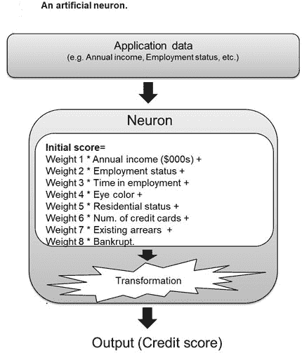

**图 6.1**

神经元的工作原理可以解释如下：

1. 输入乘以 `weight`。
2. 将结果相加。
3. 将和传通过激活函数。
4. 然后将输出发送到下一个神经元。

上述图中网络在最后一层只有一个神经元，用于生成单个信誉分。神经网络的另一个大优势是，它们可以结构化为具有多个输出。这对于那些有成千上万选项供选择的任务非常重要，每个选项都需要一个独立的输出。

回到我们的物体识别任务，让我们思考神经网络如何被结构化以识别图片中的物体。和之前一样，我们需要收集大量的环境信息供训练算法使用。在这种情况下，假设训练数据包含以下几千张猫、蛋糕和土豆的照片：

* **输入数据**：图片中的每个像素都由四部分数据表示——红、蓝、黄三个分量，用以指示像素的颜色，外加一个表示像素强度（亮度）的值。
* **类别数据**：每张图像都标记了标签，用以指示它是否包含猫、蛋糕或土豆的照片。

目标是使用输入数据预测图片中物体的类别（猫、蛋糕或土豆）。像这样的神经网络模型可能具有数百万个输入（每个像素元素对应一个），分布在十几个或更多层中的成千上万个神经元，以及如下所示的三个输出：

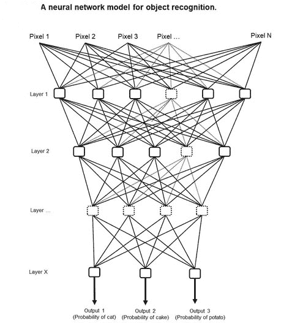

**图 6.4**

在上面的图中，每个输出代表该图像是猫、蛋糕或土豆的概率。训练后，当你向网络输入一张完全全新的图像时，代表图像的像素将通过网络处理。然后，你只需要比较三个输出并选择概率最高的一个。如果输出 1 给出 5% 的概率代表图片是猫，输出 2 给出 15% 的概率代表图片是蛋糕，而输出 3 给出 80% 的概率代表图片是土豆。

这类问题的经典例子是预测蛋白质等复杂分子的 3D 结构。存在数万亿个可能的蛋白质分子，但只有少数具有实际应用价值。能够根据组成部分确定分子的可能形状，意味着更容易识别出哪些分子可能有用，而哪些没用。

机器学习模型（特别是深度神经网络模型）令人惊叹之处在于，只要有高质量的信息（训练数据），它们就可以被训练来预测几乎任何可以想象的结局，其程度可以达到或超过最优秀的人类决策者。想预测棒球或足球比赛的结果吗？只需向训练算法提供历史比赛的数据，一个设计良好的模型就能击败最优秀的人类评论员。想要一个决定买哪些股票的工具？那么信任机器学习模型胜过信任股票经纪人。想优化工厂或超市的布局吗？那么有神经网络算法可以比任何人类都做得得更好。

我们目前为止讨论的所有构建模型的方法，都假设存在一个包含环境数据的数据库，该数据库包含了你想要推断（预测）的事物的详细信息。让我们总结一下目前为止考虑的任务：

* 在构建预测心脏病的决策树模型时，患者的医疗记录被标记，以指示哪一个患者患了心脏病。
* 在创建信用评分的计分卡和神经网络模型时，每份贷款申请都与贷款还款的数据匹配。
* 在谈到使用深度神经网络识别图像时，训练数据中的每张图像都被标记了，以指示该图像是猫、蛋糕还是土豆。

对于所有这些任务，训练数据都经过了标记，以指示每种情况的结果。这种使用标记训练数据的机器学习被称为**监督学习**。

大多数现实世界中基于 AI 的应用（如目标营销、语音识别和员工审查）都是监督学习的例子。然而，有时没有标记数据供训练算法使用。在这些情况下，可以应用另一组技术，被称为**无监督学习**。

目前最常用的无监督学习类型是聚类。`clustering` 算法基于最小化训练数据中案例之间距离的原理。这并不一定意味着物理距离，而是指案例在特定数据项目上的相似性。二十三岁和二十五岁的人之间的距离小于十七岁和七十六岁的人之间的距离。如果我们谈论的是吸烟，那么两个烟民之间的距离为零，而一个烟民和一个非烟民之间则不是，以此此类推。

通过 `clustering`，过程结束时不会产生模型，这意味着它无法用于生成关于单个案例将如何表现的预测。只有一个标识符来说观察值属于哪个簇。例如，你在 `cluster 9`，而我被分配 `cluster 4`。

通过用户画像将相似的人归类在一起是 `clustering` 最为人知的应用之一，但 `clustering` 方法也被成功应用于许多其他任务，例如文档聚类。在法律和学术研究等领域，需要定期检索不断增加的出版文献，以寻找与特定案件或研究类型相关的信息。例如，在医学领域，每年发表近百万篇学术论文。文档根据主题、写作风格、字数以及许多其他特征的相似性进行分组（`clustered`）。

`Document clustering` 也可以应用于推文、新闻馈送、博客文章和其他媒体。社交媒体公司使用这些方法来识别非法或不受欢迎的内容。当有大量标记数据时，`Supervised learning` 效果良好。如果没有可用标签，那么 `unsupervised learning`（如 `clustering`）有时可以被证明是有用的，尽管背景不同。然而，在某些情况下，最初可能没有数据，但学习过程可以在进行过程中逐个案例评估其性能。这种机器学习是**强化学习**。

数据科学家经常讨论三种不同的机器学习类型：`supervised`、`unsupervised` 和 `reinforcement learning`。然而，`reinforcement learning` 与 `supervised learning` 共享许多特征。特别是，它通常交付一个基于某种形式神经网络的模型。关键区别在于它在过程中生成训练数据，而不是使用预先存在的训练数据。

`supervised` 和 `reinforcement learning` 之间区别的一个绝佳例子是创建象棋程序的模型训练方式。`supervised approach` 会从之前过的游戏中获取数千次步法（或移动序列）作为观察数据，标记的输出数据指示该步法的好坏。模型产生的评分用于指示移动哪个棋子以及到哪里。

使用 `reinforcement learning` 时不需要提供任何数据——完全没有！模型评分仍然像 `supervised approach` 一样指示执行哪一步。然而，由于没有任何训练数据，最初这些移动或多是随机的。每当移动一步，棋盘的状态（新的状态）就会被重新评估。然后算法根据其移动被认为成功的程度来调整模型中的权重。

强化学习的一个优势是，随着训练算法的进行，可以探索的动作集是没有限制的。而在监督学习中，你受限于训练数据中的带标签示例。对于像国际象棋这样的游戏，即使是来自数百万局游戏的海量训练数据，也只包含所有可能移动的极小比例。当谷歌 DeepMind AI 团队使用两种强化学习算法相互对弈时，非常有效地证明了这一点。结果生成的模型不仅优于当时最强大的国际象棋程序，而且在过程中，算法发现了人类特级大师此前未曾过的全新对弈策略。

强化学习具有潜力，但它也有其弱点。一个问题是，训练算法受限于试错过程的速度。如果训练一个强化算法来做出抵押贷款决策，那么从采取行动到评估其成功与之间的时间间隔可能是好几年。因此，训练过程将花费太长时间，而没有实际价值。DeepMind 的国际象棋程序需要对弈 6800 万局才能达到现在的水平。它只能通过与另一台计算机对弈来实现，从而在几秒内完成游戏。

好了，在国际象棋上达到超人类水平固然，但强化学习的现实世界应用是什么呢？我做过很多研究，我的结论是，尽管有很多关于强化学习有多出色的文章，但与基于监督学习的解决方案相比，今天使用的基于强化学习的实践方案少得多。

强化学习产生影响的一个领域是提高不确定或混沌环境中控制系统的效率。电厂、供暖系统和服务器农场等复杂系统有许多用于管理系统不同部分的控制。控制与系统性能之间的关系并不总是显而易见的。这并不是一个控制影响一个参数的简单情况；一切都是互相关联的。调节冷却系统的水压以提高涡轮性能，会对下游变压器的效率产生负面影响。就像国际象棋问题中几乎无限可能的对局一样，在电厂中，也有几乎无限可能的控制设置组合。强化学习通过试错找到更好的控制设置方法，以优化系统的整体效率。这反映了经验工程师利用其多年实践积累的知识和直觉，判断调整不同控制对整个系统可能产生的影响。

强化学习展现前景的另一个领域是机器人。它可以用于训练机器人执行复杂的体力任务，而这些任务以前只能由经过训练的人员完成。机器人设备被赋予诸如取酒瓶、分类零件或堆叠架子之类的任务。通过试错过程，它们可能学会非常有效地完成这些工作。

## AI 中的神经网络类型

如之前讨论过的，神经网络的主要组件是输入层、输出层和隐藏层。隐藏层存在输入层和输出层之间，定义了数据之间的关系，并帮助机器学习模型以更好的方式生成数据洞察和预测。神经网络与深度学习相关，是因为数据在层级之间存在前向和反向传播。

以下是主要神经网络类型的简单描述。

## 前馈神经网络

前馈网络是神经网络的基础版本，它们负责将数据通过输入节点。为了让输出到达输出节点，该过程会重复多次。前馈网络用于计算机视觉和人脸识别等主要 AI 技术的发展。与其他类型的神经网络相比，它们操作简单且能产生有效结果。

## 循环神经网络

循环神经网络具有保存处理输出的能力。由于与前馈网络相比，它们非常复杂，数据科学家和机器学习工程师使用这种神经网络来解决复杂问题。循环神经网络中的每个节点都被视为内存单元，负责在反向传播过程中通过重用输出来完成操作。

## 卷积神经网络 (CNNs)

CNN 使用不同的感知器，并有多个相互连接的层。此外，这些层负责在数据上创建未来的特征图，以便可以进一步分解进行非线性处理。流行的神经网络应用包括文本数字化、人脸识别和自然语言处理（NLP）。

反卷积网络的工作原理与 `CNNs` 完全相反。它们旨在寻找被 `CNN` 标记为不重要的信号或特征。

## 模块化神经网络

模块化神经网络具有多个相互独立工作的神经网络。此外，这些网络在任何情况下都不通信，也永远不会干扰其他神经网络的活动。

## 使用人工神经网络的好处

人工神经网络最适合通过整个网络存储信息，并具有并行处理能力。这使得人工神经网络更容易在不损害性能和效率的情况下同时执行多个任务。此外，它们能够通过定义输入与输出数据之间的关系，模拟复杂关系并从非线性数据集中学习。人工神经网络对输入变量没有任何限制，并且也可以按照不同的模式分布。

## 梯度提升算法

梯度提升依赖于前提——弱学习器是可以改进的。正如迈克尔·肯尼斯（Michael Kearns）在他“假设提升问题”中所说，它是对将糟糕的假设转化为非常好假设的追求。

梯度提升算法有多种形式。当有海量数据需要处理时，使用 `GBM`。提升（Boosting）产生了一系列由不同基础估计器的预测组成的学习算法。这些预测反过来会触发对单个估计器的改进。它将多个弱到中等的预测器组合在一起，以试图创建一个强大的预测器。

## Light GBM

Light GBM 利用了基于树的学习算法。它非常高效，训练速度比其他模型更快。它在提供更好准确性的同时，内存占用也惊人地低。它支持 GPU 和并行学习，并能够轻松处理海量数据。

Light GBM 是使用微软的分布式机器学习工具包项目开发的。它非常适用于分类和排序任务等。

## XGBoost

XGBoost 是另外一种梯度提升算法，它决定了 Kaggle 竞赛的胜负。它具有惊人的预测能力，使其在准确性方面具有优势。这是因为它同时包含了树学习算法和线性模型。这使得它比比任何其他梯度提升技术都快十倍。

XGBoost 是如何应用的？它实际上可以应用于分类、排序和回归在内的许多应用中。

该算法也被称为正则化提升技术。它非常适合减少模型过拟合。它在 `C++`、`Java`、`Julia`、`Python`、`R` 和 `Scala` 等不同语言中表现良好。

## CatBoost

CatBoost 在该领域还很新，由 Yandex 开发。它是一个开源算法，可以轻松地集成到不同的深度学习框架中，如 Apple 的 `Core ML` 和谷歌的 `Tensor Flow`。

其他机器学习模型需要大量的数据训练，但 CatBoost 的情况完全不同。尽管如此，它仍然非常健壮，并适用于许多不同的数据格式。

CatBoost 的一个巨大优势是，它可以帮助你专注于微调整个模型，而不是浪费时间尝试修复微小错误。这是因为 CatBoost 会自动处理变量，同时忽略掉类型转换错误。

## 梯度下降

梯度下降发生在存在一个或多个输入时；通过迭代减少模型在训练数据上的误差，可以优化系数的值。这是通过从每个系数的随机值开始的。对于每一对输入和输出值，计算平方误差之和。通过减少误差，使用学习率作为缩放因子并更新系数。该过程重复执行，直到获得最小平方误差和，或者无法进行进一步的改进。

在执行梯度下降时，选择一个学习率（`alpha`）参数关重要，该参数决定了应用于过程每次迭代的改进步长大小。梯度下降通常使用线性回归模型实现，相对容易理解。在实践中，当大规模数据集包含可能无法放入内存的海量行或列时，就会使用它。

## 结论

随着先进神经网络的开发和实施，用户体验将得到极大提高。在本章中，我们讨论了它们的工作原理、不同类型及其益处。我们还演示了不同类型的梯度提升算法，并讨论了梯度下降在神经网络中的优势。

在下一章中，我们将尝试理解序列建模。

# 第 7 章：序列建模

## 引言

预测序列中接下来将出现的内容是非常有趣的。有趣的是，人类大脑非常擅长此，但`computers`并不如此。

## 结构

在本章中，我们将涵盖以下内容：

* 词嵌入
* 前馈神经网络
* 卷积神经网络
* 循环神经网络 (RNN)
* 条件随机场 (CRF)
* 建模流程

## 目标

预测序列中接下来将出现的内容是非常有趣的。有趣的是，人类大脑非常擅长此，但`computers`并不如此。

在本章中，我们将涵盖以下内容：

* 词嵌入
* 前馈神经网络
* 卷积神经网络
* 循环神经网络 (RNN)
* 条件随机场 (CRF)
* 建模流程

## 词嵌入

预测序列中接下来将出现的内容是非常有趣的。有趣的是，人类大脑非常擅长此，但`computers`并不如此。

在本章中，我们将涵盖以下内容：

* 词嵌入
* 前馈神经网络
* 卷积神经网络
* 循环神经网络 (RNN)
* 条件随机场 (CRF)
* 建模流程

词嵌入用于将词表示为稠密向量。流行的技术包括 `Word2Vec`、`GloVe` 和 `FastText`。这些方法有助于捕捉词之间的语义关系。

## 前馈神经网络

预测序列中接下来将出现的内容是非常有趣的。有趣的是，人类大脑非常擅长此，但`computers`并不如此。

在本章中，我们将涵盖以下内容：

* 词嵌入
* 前馈神经网络
* 卷积神经网络
* 循环神经网络 (RNN)
* 条件随机场 (CRF)
* 建模流程

前馈神经网络是最简单的神经网络类型，信息从输入层流向输出层。它们使用 `ReLU`、`sigmoid`、`tanh`、`SoftMax` 和 `SELU` 等激活函数引入非线性。

## 卷积神经网络

预测序列中接下来将出现的内容是非常有趣的。有趣的是，人类大脑非常擅长此，但`computers`并不如此。

在本章中，我们将涵盖以下内容：

* 词嵌入
* 前馈神经网络
* 卷积神经网络
* 循环神经网络 (RNN)
* 条件随机场 (CRF)
* 建模流程

卷积神经网络主要用于处理图像等网格状数据。它们使用卷积层提取边缘、形状和物体等层次特征。

## 循环神经网络 (RNN)

预测序列中接下来将出现的内容是非常有趣的。有趣的是，人类大脑非常擅长此，但`computers`并不如此。

在本章中，我们将涵盖以下内容：

* 词嵌入
* 前馈神经网络
* 卷积神经网络
* 循环神经网络 (RNN)
* 条件随机场 (CRF)
* 建模流程

RNN 是为序列数据设计的。它们维护一个可以捕捉之前输入信息的内部状态。然而，标准的 RNN 会遭受梯度消失问题，这就是为什么经常使用 `LSTM` 和 `GRU` 等变体。

## 条件随机场 (CRF)

预测序列中接下来将出现的内容是非常有趣的。有趣的是，人类大脑非常擅长此，但`computers`并不如此。

在本章中，我们将涵盖以下内容：

* 词嵌入
* 前馈神经网络
* 卷积神经网络
* 循环神经网络 (RNN)
* 条件随机场 (CRF)
* 建模流程

CRF 用于序列标记任务。它们经常与 RNN 结合使用以更好地建模序列中输出标签之间的依赖。

## 建模流程

建模过程包括四个步骤：

1. 特征工程和模型选择。
2. 训练模型。
3. 验证模型。
4. 在新数据上测试模型。

前三个步骤通常需要重复，因为你很可能在第一次尝试时无法为你的项目构建最优模型。因此，你将构建多个模型，然后选择在测试数据集（即未见过的数据）上表现最好的那一个。

此外，建模过程中的测试步骤并不总是执行的，因为在某些情况下，数据科学项目的目标是根因分析（基本上是解释）而不是预测。例如，你的项目目标可能是确定某些物种走向灭绝的原因（解释），而不是预测哪种物种最有可能灭绝（预测）。

机器学习中另一个常用的技巧是链式调用（chaining）。链式调用的原理是：当多个模型链联在一起时，一个模型的输出将作为另一个模型的输入，以此此类推。在将不同的模型链联在一起时，每个模型都需要独立于其他模型进行训练，只有在它们得到结果后才将它们组合到一起。在机器学习的术语中，这种技术被称为集成学习（ensemble learning）。

## 特征工程与模型选择

在特征工程中，你基本上为数据模型创建可行的预测因子。这是建模过程中的第一步也是最关键的步骤之一，因为模型将通过组合这些特征来给出预测，而预测的准确性取决于预测因子的优劣。在这一步，建议咨询机器学习专家，因为初学者很难创建出良好的预测因子。

在教科书的练习中，提供的数据集已经包含了一些特征作为变量；但在实践中，你必须自己从不同的数据集中寻找特征。你甚至会发现，这些特征通常分散在几个不同的数据集之间。例如，在我们其中一个数据科学项目中，我们必须采购总共 20 个数据集，之后我们才获得了所需的原始数据。这是一个非常详细的话题，仅触及特征工程的表面将没有任何帮助。因此，建议你咨询机器学习专家或专门的人员。

在开发任何程序（或任何系统）时，总有一套需要遵循的顺序，以确保高效捕获数据并正确解释数据，这正是本章的核心内容。我们还概述了建模流程，该流程包括特征工程、模型选择、模型训练、模型验证以及在数据数据上模型测试。

在下一章中，我们将学习强化学习如何与金融市场相关联。

# 第 8 章：面向金融市场的强化学习

## 引言

强化学习是一个有趣且动态的领域。强化学习是一种以目标为导向的学习过程，专注于与环境的交互。强化学习被认为是人工智能的希望。这可以理解，因为强化学习所承载的承诺是巨大的。

强化学习正在迅速流行，为各种应用创建了广泛的学习算法。因此，熟悉强化学习技术也是非常重要的。

## 结构

在本章中，我们将涵盖以下主题：

* 机器学习中的问题类型。
* 识别关键预测因子（数据削减）。
* 从经验中学习（强化学习）。
* 强化学习算法。
* 强化学习的类型。
* 强化学习在现实中的应用。

## 目标

学习本章后，你应该能够做到以下点：

* 理解可以使用机器学习的业务问题。
* 理解数据削减技术。
* 理解强化学习的概念、类型和应用。

## 机器学习中的问题类型

在海量数据中寻找模式的机器学习算法用于构建智能系统和人工智能应用。作为人工智能的一个子领域，在过去的几十年里已经开发了数百种机器学习算法，每种算法都可直接或间接地生成新的业务知识。挑战的一部分之一是确定哪种算法或算法族适用于你的业务任务。

通常来说，你可以做五件件事：

* 使用 `unsupervised learning` 寻找模式。
* 通过数据削减技术识别关键预测因子。
* 识别不规则或异常情况。
* 通过 `supervised learning` 从示例中学习。
* 通过 `reinforcement learning` 从经验中学习。

例如，考虑信用卡欺诈检测。由于欺诈模式会随时间变化，使用机器学习算法自动检测新出现的模式可以增强银行防御客户的能力，并比人工手动监控所有交易更快地做出响应。

你可以将过去的交易数据想象成一个具有数百万行的表格，其中每一行（观测值）代表一次交易。列可能包含交易的日期、时间、纬度和经度、金额、商户，甚至可能包括购买了什么。还有另一列提供了关于欺诈问题的答案，告诉我们交易是合法的还是欺诈的。这一列的存在是因为银行有足够的时间与持卡人核实疑交易的有效性。`unsupervised approach` 可能会将交易分为两类，看你是否可以将合法交易与欺诈交易分开。在 `supervised` 或 `semi-supervised` 方法中，算法会寻找合法和欺诈交易之间的相似性和差异，因为它知道（至少在某种程度上）哪种是哪种。

## 识别关键预测因子（数据削减）

有时，你需要处理的数据太庞杂且难以应付。想象之前提到的同一个信用卡交易数据集，但不仅有关于交易金额、位置和特征的信息，还有几百个其他变量。你应该使用哪些变量来确定交易是合法的还是欺诈的？

如果你使用所有的预测因子，存在风险。首先，模型构建过程可能是计算密集型的，这意味着构建模型所需的时间或处理能力可能超过了你拥有的。其次，通过构建一个包含过多预测因子的模型，你面临对噪声而非信号进行建模的风险，这种结果被称为 `overfitting`（过拟合）。过拟合模型在你用于训练的数据上具有极强的预测能力，但在未见过的新数据上表现可能不佳。

数据削减（也称为降维）的常用方法包括 `principal component analysis` (`PCA`）、`linear discriminant analysis` (`LDA`）和自动编码器类型的神经网络。尽管它们不是显式自适应的、反应性的或主动的（因此更准确地归类为统计模型而非机器学习模型），但将它们应用于商业问题通常需要大量的处理能力。它们通常在发送数据通过无监督或监督机器学习算法之前应用，因此有时会被包含在机器学习书中。

当你使用正确的特征并减少它们的数量以只使用预测因子时，计算性能和生成的机器学习模型的准确性都会得到提高。降低维度可以增加你模型的最终威力。

## 从经验中学习（强化学习）

强化学习（`RL`）是一种无监督学习，它为不同的选择定义了潜在奖励，而不是为每个观测值贴上定义特征标签。`supervised learning` 基于已知信息构建模型，而 `reinforcement learning` 通过动态地探索环境来发现它。强化学习可以用于确定智能体与环境交互的最佳方式。

例如，你可能想要找到从建筑物内某个位置到最近火出口的最优路径。如果你将每个户外位置与高奖励相关，出口附近的区域与小奖励相关，建筑深处的区域与零奖励相关，强化学习可以识别出产生最高奖励的最优路径。

*Dowling and Cahill (2004)* 声称，强化学习可能是解决工业环境问题最有益且应用广泛的技术。以下示例：

* RL 可以通过观察行为学习客户偏好，这可以为营销部门提供关键信息。*Halperin (2017)* 展示了如何使用该方法为新产品和力设计营销策略，并制定适用于竞争环境的定价策略。

* 当概念以逻辑方式呈现时，学生学得更好。*West 等 (2019)* 使用强化学习为课程寻找优的学习路径，这可以提高高等教育和培训成果，同时提高学生的满意度。

* 提高声源质量，特别是在环境中，对于助听器制造非常重要。*Koizumi 等 (2017)* 使用强化学习探索这一问题，将奖励定义为感知质量的增加。

* 像败血症等挑战性医学状况需要医生快速识别治疗策略。*Raghu 等 (2018)* 使用强化学习（辅以其他几种监督和无监督方法）来识别临床医生如何使用模型来显著改善死亡率。

强化学习涉及通过算法在定义的奖励基础上对观测系统进行探索、犯错并不断尝试来构建一个模型。这种方法与组织在制定支持创新的政策时所做的非常相似，甚至如此，因为强化学习寻求的是长期奖励的最大化。尽管它需要大量数据才能发挥作用，但强化学习已用于开发许多极其成功的游戏类人工智能（AI），而且它解决的是与其它机器学习方法不同类型的问题。

强化学习涉及学习用于提供反馈的数据，这些数据将决定模型如何适应当前状况以实现目标。系统本身能够根据所提供的反馈评估模型性能，然后进行必要的调整。例如，这一概念被恰当地应用于自动驾驶汽车（AI）以及国际象棋大师级算法中。

如上所述，强化学习发生在交互式环境中。换句话说，学习者完全没有被告知他们应该预期什么，而是根据其行为的后果自行发现，这种概念被称为目标导向学习。在本节中，我们将涵盖的强化学习主要组件列如下：

* 强化学习的基础。
* 强化学习算法。
* 强化学习环境。
* 各种强化学习平台。
* 强化学习的应用。

## 强化学习的基础

假设我们想训练一条狗去接抛在空中的物体。这条狗并不一定理解这里涉及的所有概念和理论。实现这一点的最好方法是将物体抛到空中，每当狗接住它时，就准备好奖励它。如果狗失败了，就没有奖励。狗最终会分析在它获得奖励之前发生了哪些动作。奖励将激励狗重复相同的动作以获得越来越多的奖励。

同样，在强化学习环境中，你可能可以教模型做什么，但基于积极奖励，模型将倾向于重复某些动作。智能体或模型对积极奖励更敏感，并会忘记导致负面奖励的动作。有时，我们面临延迟奖励或只有在任务完成后才给予奖励的情况。在每一步可能会有奖励或奖励，仅仅为了确认是否存在错误。

假设你要教机器人如何在不撞到山的情况下导航：


**图 8.1**

一条规则是当机器人撞到山并被卡住时扣除 10 分。这样，机器人就会理解为每当它撞山时就有负面奖励，因此不会再次撞山：


**图 8.2**

另一条规则是机器人每次向正确方向导航时给它奖励 20 分。当然，机器人必须通过保持在正确路径上尝试奖励最大化：

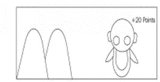
**图 8.3**

模型（或机器人）可以应用强化学习的两个基本概念来平滑导航并获得更多奖励。强化学习模型可以决定探索不同的可能性以获得更多奖励。在这种情况下，智能体表现不佳的可能性更高，因为它可能会利用错误的警告。另一种方法是利用已知的动作。

## 智能体 (Agent)

智能体基本上是一个能够做出决策的软件程序。智能体与环境交互：

* **智能体-环境接口：** 智能体处于状态 `t`，采取动作 `At`，移动到状态 `At+1`，接收奖励 `R`。
* **模型：** 这代表环境。这里的学习可以是基于模型的，也可以是无模型的。对于基于模型的学习，智能体使用以前的信息。另一方面，对于无模型的学习，智能体完全依赖于试错。
* **策略函数：** 策略基本上是控制智能体如何行为的。智能体的行为性质取决于它所处的策略类型。各种路径代表不同的策略。有些路径可能很短，而另一些很长。路径被称为策略，因为它们是实现目标的指导。
* **价值函数：** 每个状态都有一个价值函数。该函数指示智能体处于特定状态有多有利。该函数取决于策略，并表示为 `v(s)`。价值函数代表智能体从初始状态开始的总预期奖励。价值函数的类型如下：
    * **最优价值函数：** 与其他价值函数相比，为所有状态提供了最高值。因此，最优策略拥有最优价值函数。
    * **平稳策略：** 这种策略涉及完全取决于智能体访问的状态的状态。
    * **确定性平稳策略：** 这是一种根据其当前状态确定性地选择智能体动作的策略。

## 控制学习算法

下面讨论了各种强化学习算法：

* **最优准则：** 学习智能体在进入环境的最初阶段将会犯错。因此，如果为了实现最优目标，它应该获得折扣奖励。这里的策略集应该是智能体本身期望最小的策略。有三个策略完全参与了最优性的获取：最优策略、确定性平稳策略和平稳策略。
* **暴力破解法：** 这种强化学习算法包括以下过程：
    * 对于任何可能的策略，都有累积回报。
    * 选择预期回报最高的策略。

这种算法存在各种问题。策略的数量可能极大，因此难以操纵。另一个可能的问题是处理回报多变的策略时存在困难。

* **价值函数方法（Value function approaches）：** 这类算法试图通过维护某些特定策略（当前策略或最优策略）的估计回报集来获取最大回报。从初始状态实现最大回报的策略可能被认为是应用的最佳策略。
* **直接策略搜索（Direct policy search）：** 确定最佳策略的另一种方法是直接从策略空间进行搜索。这里使用的两种方法是基于梯度的和无梯度的方法。基于梯度的搜索涉及从有限维参数到策略空间所在特定的映射。

## 强化学习的应用

在强化学习的广泛应用领域中，某些仍在研究中，而另一些已经投入实现：

* 大规模经验性评估。
* 预测性状态表示。
* 终身学习。
* 大脑中基于多巴胺的学习。
* 人类技能学习模型的一部分。

## 强化学习算法

实现强化学习算法有三种技术：

* **基于价值的（Value-based）：** 在这里，代理正在预测当前策略下流行状态的长期回报，因此你应当最大化价值函数。
* **基于策略的（Policy-based）：** 在这种强化学习方案下，你努力找到一种策略，使得每个状态下执行的动作都能导致未来奖励化。基于策略的方法进一步分为确定性策略（策略对任何状态都产生相同的动作）和随机策略（每个动作都有一个由随机策略确定的确定概率）。随机策略为 `n{a\s) = P\A, = a\S, =S]`。
* **基于模型的（Model-based）：** 在这种情况下，你需要为每个环境生成一个虚拟模型，代理在该模型中学习如何在该环境中表现。

## 强化学习的类型

两种广泛使用的强化学习类型如下：

* **正强化（Positive）：** 这是一个由特定行为触发的事件。它对代理所采取的动作产生积极影响。这通过增强行为的频率和强度来实现。这种方法帮助你利用性能并维持更长时间的改变。尽管如此，你必须小心，因为过度强化可能会导致状态过度优化并影响结果。
* **负强化（Negative）：** 它涉及加强由负面条件引发的行为，而这种条件本应该是被规避或停止的。虽然它有助于定义最低标准性能，但这种方法设定了最低行为，这是一个缺点。

## 强化学习在现实中的应用

* 数据处理与机器学习。
* 商业策略规划。
* 工业计算机化的机器人技术。
* 飞机和机器人运动管理。
* 为学生创建定制化培训系统。

## 结论

随着金融市场技术的进步，学习整个系统将是一个持续的过程。我们讨论了强化学习的概念、类型和应用。强化学习是一种具有三种算法的机器学习方法：(1) 基于价值的，(2) 基于策略的以及 (3) 基于模型的。强化学习的两种类型是 (1) 正强化和 (2) 负强化。

# 第 9 章

## FinTech：金融领域的机器人末日

第一次听到“FinTech”（金融科技）这个词，是在 2016 年 5 月我在阿梅利亚岛参加的亚特兰大联邦储备银行金融市场会议上。在我参加过的九次年度会议上，大约有 150 位世界顶尖经济学家受邀加入地区联储银行行长、政府监管机构、学者，通常还有联邦储备委员会主席，共同讨论当天最热门的经济、货币政策和财政政策问题。

在这场盛大会议的背景下，我与一位相识多年的联储记者翘掉了几场会议，去享受 5 月初佛罗里达的美好天气。我的朋友和另一位专攻金融科技的记者在一起。当时，我还没有听说过 FinTech。于是我天真地问：“那是什么？”记者告诉我，FinTech“就像比特币之类的东西”。我知道比特币是一种数字货币，于是就结束了。

我并没有太在意这段对话，直到几个月后，当我试图为“Prestige Economics”招聘一名销售人员时。我很难找到候选人。高素质的人才正大量离开这个领域，我并不知道为什么。最后，一位高级销售人员告诉我，因为金融科技，所有人都在退出金融市场研究。本质上，机器人正在颠覆研究业务。在得知 FinTech 正在颠覆自己的业务后，我决定通过麻省理工学院的 FinTech 课程来尽可能多了解它。简而言之，机器人已经向我袭来，而我竟然还不知道。

FinTech 是金融科技的流行术语，它代表了一系列旨在颠覆（并抢夺）传统金融机构市场份额的业务。金融科技公司通常为此前属于银行领域的交易降低成本、降低复杂性或提高易用性。

FinTech 正影响着金融服务，而且这种意识正在不断传播。资产管理长期一直由计算机、统计分析和编程主导。而 FinTech 正在颠覆资产管理，通常是通过被动交易策略实现的。其中一些策略由于其自动化（即机器人化）的特性被称为机器人投顾（robo-advising）。结果是什么？资产经理正在失去工作，资产管理的颠覆潜力非常高。

在电影《华尔街》中，戈登·格雷柯（Gordon Gekko）问巴德·福克斯（Bud Fox）：“有没有想过为什么基金经理无法赢过标普 500 指数？”好吧，随着交易型基金（ETFs）的出现，基金经理和零售可以直接购买标普指数（以及其他指数），这正是他们所做的。其中许多 ETF 具有很高的流动性。

FinTech 对金融建议的影响所示：

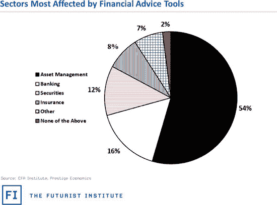

**图 9.1**

被动资产管理技术和机器人投顾的执行通常比主动资产管理更简单、成本也更低。这些策略的实施成本远低于主动资产管理策略，因为它们不再需要人工资产经理。此外，当计算机程序承担了所有的策略工作、分析、规划，以及所有证券的买卖时，就会产生规模效应。被动资产管理也被金融和交易领域采用，因为这些领域在历史上一直拥抱技术，许多公司多年来一直使用箱模型、算法和技术交易策略。

FinTech 的影响所示：

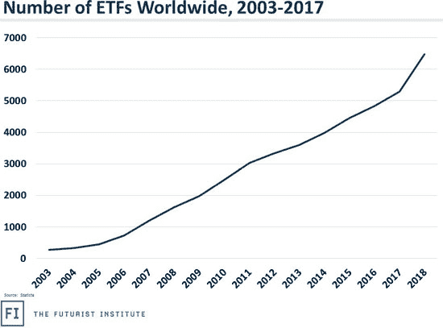

**图 9.2**

被动资产管理技术和机器人投顾的执行通常比主动资产管理更简单、成本也更低。这些策略的实施成本远低于主动资产管理策略，因为它们不再需要人工资产经理。此外，当计算机程程承担了所有的策略工作、分析、规划，以及所有证券的买卖时，就会产生规模效应。被动资产管理也被金融和交易领域采用，因为这些领域在历史上一直拥抱技术，许多公司多年来一直使用箱模型、算法和技术交易策略。

## FinTech 的影响

根据普华道（PwC）的全球报告，FinTech 最强大的武器是服务的去中间化。以前，即使将信用评分从一个账户转移到另一个账户也需要支付中间费。但现在，虚拟钱包应用允许更高效的交易。

那么，银行和金融机构的未来是什么？现有的产品和服务会发生什么？现在很清楚，随着 FinTech 和虚拟货币的出现，银行和服务的颠覆迫在即睫。研究表明，到 2020 年，可能有高达 28%的企业面临风险，而它们都是银行和支付业务。

在金融领域的许多落后和发展中地区，支付领域的金融科技正极大地地帮助着人类。移动技术和金融科技创造了这种新的连接经济，或者说一种共享经济体系，它让经济系统变得更有组织。在金融科技的帮助下，你可以通过点对贷款和众筹直接加入资金持有者和需要现金的个人。这使得人们能够以一种低廉但惊人直观且透明的方式投资资金。

金融科技看起来确实正从字面上席卷整个金融产品行业。它正在重塑公司与客户相互互动的方式。传统银行模式已经遵循同一套系统四十多年，其方法没有做太大——大量的纸质文件已被 `Excel` 表格所取代。经纪公司 `Hybridan` 董事威廉·林恩（William Lynne）认为该系统在很大程度上已经过时，但由于商业企业及其系统的全球性，交易变得非常困难。

金融科技现在正寻求解决许多传统系统无法解决的问题，并开始进行改进。在传统系统中，完成交易的流程仍然保持不变。过去需要几天甚至可能几周时间才能确认和验证一笔大交易，而现在的金融科技策略最有效只需要几分钟。金融科技似乎对传统业务模式构成了风险。在未来几年，俄罗斯的中小企业银行和客户银行预计将在金融科技的帮助下受到严重影响。

此前涉及许多巨头的财富和资产管理企业现在正因资产配置的自动化和替代性数字化经纪服务的创新而面临灭绝。随着越来越多的人使用在线产品或移动应用程序自力完成此类任务，此类金融科技产品的客户群每天都在变大。`PwC` 的研究发现，74% 的保险公司预计在未来五年内其服务将受到金融科技的干扰，而 51% 的资产和财富管理经理表示，由于今天用户友好的财富管理 App 和在线服务，他们的产品可能会受到干扰。

得益于金融科技，整个过程现在是自主的，任何人都可以无问题地通过安全加密方法确认资料。但我们还看到了在客户如何投资和购买保险方面金融科技投资的发展。现有系统正在被重造。根据 `Denovo` 的数据，过去四年保险领域的金融科技投资已超过 34 亿美元。

据说，金融科技是通过演变而非革命来发展的。目前的公司和业务模型不会一夜之间改变——即使是像 `Apple` 或 `Google` 这样被认为是业务模式潮流者的组织也不例外。金融科技的机会和影响是巨大的，交易技术中通常会有少数赢家和一些输家。对于每天都在开发新市场的新兴世代来说，某些群体和初创公司在系统某些阶段失败的可能性非常大。任何令人惊讶的增长，无论是技术上的还是财务上的（在本例中两者都有！），都会创造不可避免的陷阱，而且有些机构注定会失败。其中一个组织就是 `Monetise`，它起初表现非常出色，赢得了大量赞誉；但到 2015 年底，他们的股价下跌了约 90%！

在光谱的另一端是 `PwC`。他们非常安静，所以你再在市场内听到很多关于他们的消息了，但他们做得很好。他们是一个利用金融科技控制风险、洗钱或验证客户身份的盈利机构。到 2015 年，他们的市场份额增长了 60%。有些机构从金融科技中获益最多。开发移动支付系统的 `Mi-Pay` 创建了卓越的反欺诈软件并经营良好。此外，还有 `Vipera PwC`，它已经超过了自身的预设和预期。

金融科技的另一个阶段是高效数据算法的出现。整个系统的自动化使得买更容易寻找定制化产品并做出更可靠的决策。此外，众筹趋势以及贷款和股权转移的改进使得个人投资者能够发现以前无法触及的机会，像一种业务属性一样。

金融科技（FinTech）面临的问题之一是，应用程序需要以能够验证操作者身份的方式运行。否则，如果人们无法确定是在与具有良好信用背景的合法个人进行交易，又如何信任他们所操作的服务的真实性呢？这一原则被称为“了解你的客户（KYC）”。KYC 方法的问题在于，通过电子方式准确确定一个人的身份需要花费大量的精力。

以下是一些简化了解客户这一艰巨任务的建议：

* **不要一次性索要所有信息：** 这样做非常耗时，而且如果你一次性要求所有信息，人们会对你的服务产生怀疑。收集客户信息的最佳方法是从最少的信息开始，然后让他们完成第一笔交易。在对你的服务建立信任后，你就可以获取其余必要的信息了。
* **使其变得简单：** 显然，你可以要求客户扫描并上传身份证明文件的副本，但这对他们来说是一个巨大的麻烦。与其他的身份服务公司合作收集这些信息，可以减轻客户的负担。这些服务将利用他们提供的信息，尝试匹配其数据库中的照片。如果这种方法失败，你也可以要求客户提供扫描件。
* **给他们理由：** 人们天生对提供个人信息持怀疑态度，尤其是当似乎很难理解他们的性别与财务状况可能有什么关系时。这就是为什么最好总是解释你为什么要询问某些信息。这些交流必须建立在信任的基础上，而建立信任的最佳实践是透明化。
* **但不要让它太简单：** 即使是 Venmo 也因为其安全漏洞而饱受批评。这些技术在交互上必须简单，但不能简单到可以被轻易黑客。客户必须在使用你的应用程序时感到安全，这就是为什么安全密码等简单功能是至关重要的。这就是金融科技用户体验与其他应用程序的不同之处。与照片共享应用、即时消息等不同，设计中必须包含安全元素，而这在其他平台是不要求的。

## 创新技术

当全世界都在关注互联网、移动设备、社交媒体和金融科技的兴起时，新的创新再次动摇了整个银行业。在 1970 年到 1990 年间，关于计算机和互联网是否会让体力工人过时存在很大争论，而现在有一个更大的争论：机器人是否会让互联网工作者体力工人过时？争论是无止尽的并将持续下去，但让我们在这一章中学习 AI、机器学习、区块链和大数据等最先进的新技术。

## 包括聊天机器人在内的 AI/机器人

现在让我们关注在银行业中使用 AI/机器人和聊天机器人等新创新。许多时候，由于其拥有海量数据，银行难以识别真正的客户。在这种情况下，AI 非常有用。例如，以前机器人可以回答诸如“我的账户余额是多少？”“我的支票本什么时候寄给我？”“我的转账请求状态如何？”等问题。然而，新一代机器人变得更有分析性，现在可以回答像“我的账户余额是多少？”“我的支票本什么时候寄给我？”“我的转账请求状态如何？”等问题。

## 认知计算

## 银区块链

## 什么是区块链？

区块链是一种新技术，使用加密技术来维护去中心化的公共账本。连接到网络的每个节点都会获得区块链的副本。很难理解吗？好吧，让我们生活变得简单，考虑一个涉及多方的典型买卖案例：

* 卖家（简称为 X）
* 买家（简称为 Y）
* 卖方银行
* 买方银行
* 出口国中央银行（例如，储备银行或联邦银行）
* 进口国中央银行（例如，储备银行或联邦银行）
* `SWIFT`（全球银行间电讯协会），记录每笔交易。

假设 `X` 向 `Y` 开具了一张金额为 `$100,000` 的发票。假设不同方都应该有一份发票副本。你能想象在账簿中在线输入 `$100,000` 吗？计算机化程序和基础设施能做到吗？绝对不能。即使我们使用基于互联网的电子商务，这可能也无法实现。但区块链使其成为可能。

优势是巨大的：

* 极其安全。
* 透明。
* 可信。
* 记录维护非常容易。
* 维护成本低。
* 整个操作过程中不需要中间人，因为双方直接通信。

事实上，最近印度一位著名的钻石出口商 `Nirav Modi` 发生了一起巨大的银行欺诈案，许多金融专家认为，如果当时使用了区块链，这种欺骗是可以避免的。许多领先机构和银行已开始在业务中尝试区块链。例如，澳大利亚证券交易所将用区块链技术取代其注册、结算和清算系统。

## 世界上第一个区块链用户：澳大利亚证券交易所

为了提供区块链的不同行业示例，澳大利亚证券交易所（称为 `ASX`）已成为首个宣布采用区块链技术进行股票结算活动的主要交易所。`ASX` 将使用加密技术来记录持股并管理股权交易的清算和结算。这将大幅节省运营成本，提高透明度，并减少对中间人的需求。

## 银行业中的物联网 (IoT)

让我们来讨论一下银行业的物联网（IoT）。首先，什么是物联网？用通俗的话说，它是机器与机器或设备与设备之间的连接（例如：联网汽车、联网家居、联网商场等）。换句话之，所有的电脑，无论是在家里、商场、银行还是车辆上，都应该相互通信并帮助客户。例如，家庭主妇将不再需要担心本周家里的杂货是否充足。事实上，家用电脑会检测到任何短缺，并通知商场供货，同时联系银行代表客户进行支付。一切都真正实现了自动化。在此过程中，银行将发挥重要作用。它们不仅可以安排支付，还可以根据现成数据，为客户提供针对性的优惠、建议和奖励。

# 美国银行：大数据项目

因此，美国银行正在多个领域使用大数据项目，例如：提高客户留存率、提高财务预测的及时性和准确性等等。

## 语音生物识别

语音生物识别在人们和银行的生活中发挥着重要作用。


**图 9.3**

Nuance 公司最近为 BBVA Bancomer 开发了一项语音生物识别应用，旨在通过改进“身份存活验证”流程来加强其养老金体系。这意味着养老金人员只需通过简单的电话即可识别身份，一旦计算机识别出声音，即可作为该养老金人员还世的证明。这对我们的老爷爷老奶奶来说是多么酷，不是吗？

## 数字银行

到目前，我们已经看到了银行业的许多创新，如桌面/移动互联网、金融科技、银行社交媒体、人工智能、机器人、机器学习、区块链和大数据。然而，银行仅关注这些华丽的名称就足够了吗？这就是让银行完全数字化的原因吗？绝对不是。银行首席信息官（CIO）承担着艰巨的任务，即实现前端和后端的整个数字化格局。美国典型的中型银行可能有五百到九百不同的 IT 应用，与不断变化的技术格局的交互对于 IT 运营来说是一项艰巨的任务。在下一节中，我们将展望可能影响我们数字世界的说明领域。

## AI 作为顶层战略

在全球，高管们日益寻求 AI 创建新的业务价值来源和收入流，或节省成本的机会。这特别适用于顶级的 AI 采用者，即那些已经投资 AI 计划并取得瞩目成效的企业。虽然这是一个少数群体，但他们正在加倍投资 AI。

银行业作为一个行业，其竞争对手不仅来自同行，还来自金融科技、移动行业和科技行业。随着技术演进如此迅速，我们真的不确定会有哪个竞争对手加入名单，以及在何时加入。

银行可以通过淘汰旧技术和投资创新来节省成本。对于任何银行的生存和增长，最重要的标准是增加底线。除了获得市场份额外，银行还考虑削减成本，特别是针对那些单调和重复的任务。在这些任务上浪费人力只会增加业务运营成本。如果我们将银行业与投资银行和资产管理公司相比，它们目前面临着产生阿尔法（alpha）和降低成本的类似困境。对于银行来说，古老的银行时代已经结束，这是一个残酷的事实。基于 AI 的技术不是会过去的时尚，银行可以选择忽视或视而不见几年，最后发现自己正在衰落，或者本应该更早地向 AI 敞开门。

银行和金融服务行业的远见领导者可以预见未来并引导机构朝着这一方向发展。AI 的指数级增长不容忽视。这些领导者已经知道，几年后，AI 将成为其系统的组成部分。然而，要取得成功，AI 战略应该采取自上而下的方法，尽管在决定最佳用例时，它应该采取自下而上的方法。当员工确信 AI 被用作赋能工具而非替代人力劳动力时，这种情况就会发生。这种沟通同样重要，以确保整个组织朝着使 AI 之程变得值得的目标努力。

有多少人准备好跨这一步呢？那些在适应 AI 方面已经领先的 CEO 们是否从中获益？这些是目前最重要的问题。

与任何业务决策一样，AI 应该有一个董事会级别的战略。它要求顶层领导制定战略。AI 并不是银行通常采用的技术之一（这类技术通常没有执行层参与）。如果执行得当，它可以为银行业节省成本。根据关于 AI 的 Autonomous 报告，到 2030 年，传统金融机构可以节省 22% 的成本。报告指出，银行通过在前端部门采用 AI 可以节省 4,900 亿美元。

在压力下，基于高管层通过投资 AI 来降低成本和增加收入，为它的合理性提供了强有力的论据。这需要执行层级的战略，在缺乏战略的情况下，所有的 AI 投资都将失败。

我们为什么需要执行层对 AI 的投入，是因为以下因素。

## 投资 AI 的成本

毫无疑问，金融机构将获得 AI 的收益，但投资 AI 的成本非常高，这是不容置疑的。如果成本巨大，风险就很高。半吊子的执行不仅会损害银行的形象，还会耗费巨资。AI 之程不应像向现有的 IT 系统中注入一套插件那样进行。在没有战略的情况下注入 AI 将不会产生预期的结果。

## 关键领导层的参与

根据普华永道（PwC）《第 21 年度全球 CEO 调查》的美国补充报告，美国 CEO 在过去五年对失去技术领先地位的恐惧增长快于其他类型的威胁。考虑到技术创每天的飞跃，这种恐惧是合理的。银行无法在这一方面落后。然而，如果恐惧是合理的，那么理性的解决方案就能帮助克服这一障碍。这显然要求 CEO 采取更积极的角色，而不仅仅是将 AI 之程分配给 CIO 或首席数据官（CDO）。规划 AI 之程比比随大流重要得多。每家银行或金融机构的历程将是不同的。AI 之程没有万能的解决方案。而这种企业特定的路线图才是真正让银行在旅程中盈利的关键。

那么，银行是如何采用 AI 呢？有些银行已经建立了内部 AI 部门。位于新加坡的华侨银行（OCBC）在 2018 年初建立了内部 AI 部门，而另一些银行则与为银行开发产品的 AI 公司合作。

## 无机增长

银行进入 AI 领域的另一种途径是投资 AI 初创公司。如今，在瞬息变化的技术格局中，银行正呈现出收购金融科技初创公司的日益增长趋势。2017 年，摩根大通（JPMorgan Chase）收购了 `WePay`，这是一家专注于小企业的美国支付公司，旨在为其四百万小微企业客户提供 `WePay` 的支付技术。2016 年，美国金融服务公司 `Ally Financial` 收购了数字财富管理公司 `Trade King`。2018 年，加拿大的 TD 银行购买了其第一家技术公司，即一家基于 AI 的初创公司 `Layer 6`。该银行的主要目标为客户提供个性化服务。

银行必须与其它提供个性化客户体验以及金融服务的行业竞争。客户期望银行能够预判他们的需求和偏好。随着银行在数字化转型转型程中前进，银行将拥有大量的数字数据。AI 可以将孤立的客户互动转化为无缝的客户体验链。

银行业面临着来自金融科技、电子商务、科技巨头和电信公司的竞争，其愿意探索并实施 AI 的背后有两个底层动机：一是降低服务客户的成本，二是通过个性化提升客户体验。

银行可以通过合作伙伴关系、收购或内部开发来采用 AI。没有一种策略可以适用于所有的金融机构。

## 不同 AI 技术的开发状态

请看下图：

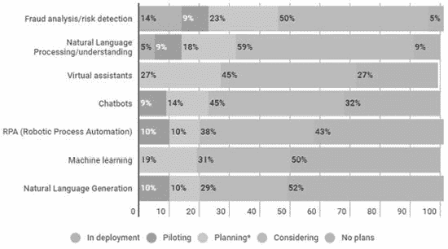

**图 9.4：** 2017 年银行业 AI 投资理解（来源：Celent）

上图中的“计划”意味着银行在未来十二个月内有一项获得资金支持的实施项目。根据最近的一些趋势，我们可以观察到，银行在投资和采用 AI 方面还没有清晰的路线图。对于想要开启这段旅程的新手银行来说，监督学习可以作为第一块垫石。它是最常见的机器学习类型。银行也可以探索协作方法。

一种方法是银行研究 AI 采纳成熟用例。每家银行都必须根据自己的业务战略启动旅程。银行在技术门槛上处于什么位置？银行是否已经具备数据分析能力？如果没有，这些是开启 AI 之旅至关重要的基石。

这里展示了“必做”用例实施者相对于低实施者的平均收益：

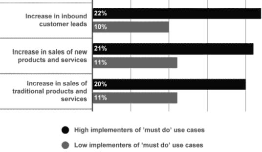

**图 9.5：** （来源：Capgemini）

Capgemini 最近的一项调查明确显示，“易于摘取”的方法为银行（尤其是销售和客户获取方面）带来了收益。

银行需要根据自己的资源和业务计划规划自己的路径、节奏和终点。如果一家银行想要启动内部 AI，它将需要愿景、人才招聘、技术孵化，以及从开发到部署的大量时间。另一个选项是寻求 AI 初创公司的外部帮助，这些公司理解银行的文化和需求，并据此开发必要的 AI 模型。银行也在投资 AI 初创公司，这使得初创公司成为银行的一部分，从而在共享敏感银行数据的同时降低与第三方供应商相关的风险。此外，这为银行带来了创新文化。而对于 AI 初创公司而言，他们现在会将银行视为其组织的一部分，而不是一个客户。

因此，底线是银行需要看到 AI 的成本效益。对于无法在客户留存、削减成本或客户导入方面获得收益，他们对巨资投入 AI 持怀疑态度。银行确实需要意识到，无论他们是否采用，AI 都是未来的技术，所有的竞争对手都在采用它。当我们说竞争对手时，我们指的是在实验和采用 AI 方面远领先的金融科技公司。AI 成为银行业务的一种只是时间问题。

高层银行需要对各种 AI 技术——机器学习、预测性分析、自然语言处理（NLP）、机器人流程自动化和智能虚拟助手——有了解，以及这些技术可以应用于从客户服务到风险管理的银行流程。银行需要理解应用 AI；在应用解决方案中使用这些技术需要强大的数据分析基础。

## 风险管理

由于对安全和性能的高要求，处理金融任务往往变得困难。首先，在金融领域实施 AI 时，数据科学家和机器学习工程师必须进行深入的研究和评估。金融信息系统拥有海量数据，系统能够处理大量交易而不任何延迟。为金融领域设计的算法高度可靠，并经过测试在任何情况下都能交付 100% 的结果。此外，它们还可以管理结构化和非结构化数据，并快速识别可能的失败原因。

## 欺诈检测与预防

AI 和机器学习模型具有检测欺诈活动并实时停止意外操作。银行和金融机构已将 AI 模型应用到他们的系统和数据库中。欺诈检测系统能够分析客户的位置、行为和信用历史。

洗钱等欺诈活动也可以通过 AI 模型来避免。机器的设计旨在终结所谓的洗钱计划，并保护金融和政府机构免受任何意外损失。

## 提高金融规则和设计的真实性

机器学习对金融行业有重大影响。机器学习的优势包括交易、贷款承保和投资组合管理欺诈检测。根据《承保的未来》报告，机器学习促进了数据评估，以评估和发现细微差别和异常。这有助于提高原则和单位的准确性。

## 交易

AI 和机器学习模型基于统计学的概念和理论。全球股票市场的交易正在大幅扩大，交易员正利用 AI 工具获得快速且最佳预测和建议。智能交易系统能够监控结构化和非结构化数据库。在结构化数据库中，我们可以获得来自表格或其他数据库的数据，而在非结构化类别中，数据来自社交媒体或新闻等来源。

交易算法基于 AI 模型并根据市场状况进行预测和计算。机器学习算法在过去的数据和交易历史上进行训练，使其能够提供准确的洞察和预测。此外，这项技术大大改进了验证过程，帮助交易员毫无烦恼地获取有关交易的信息。

在银行领域，AI 驱动了智能机器人，为客户提供实时答案和解决方案。语音控制助手现在已经引入，具有自教育功能，并且每天变得越来越聪明。有不同的 AI 应用和工具提供个性化的财务建议，并支持个人解决任何财务问题。这些智能工具还可以跟踪收入、经常性支出并计算消费习惯。另一方面，AI 融工具也可用于获取优化计划并获得财务支持。

# 银行业中的 AI

在涉及尖端技术进步时，科技巨头往往占据了大部分焦点。但金融部门（包括那些保守的传统银行）对 AI 表现出日益增长的兴趣，并出现了采用迹象。银行或金融行业对几乎所有消费者和企业都有深远影响，对国家经济产生直接影响，因此对于每家企业而言，寻求洞察并紧金融科技与 AI 的融合趋势至关重要。银行业正投入资金基于 AI 的解决方案，以解决多个传统的银行业问题，例如为数百万客户提供优质客户服务、反欺诈、移动技术和数据安全等。

## 以下是银行业中一些流行的基于 AI 的趋势：

20 世纪 60 年代，为了协调全美旅行社的预订工作，旅游业开创了大规模基于计算机的航空订位系统。现在，大多数旅游公司都在从用户那里收集数据，通过合适的 AI 工具，他们能够根据过去的搜索记录为客户提供相关的未来旅行计划。使用 AI 定价工具可以根据市场需求、天气和其他决定因素自主调整机票价格，这有助于航空公司优化其业务。

当潜在的旅行者浏览、购物、预订、飞行甚至更改旅行计划时，公司会收集这些数据，并通过 AI 驱动的解决方案进行分析，以获取可操作的洞察并根据客户需求定制服务。旅游业的竞争非常激烈，精明的旅行者总是在比较并寻找机票、酒店、巴士、火车和租车的价格，以实现物有所值。AI 在通过个性化服务和高效的旅行体验改变旅行体验方面具有巨大潜力。

## 结论

金融处于技术的前沿，我们已经讨论了原因。我们还讨论了为什么在金融领域应该采用机器学习。我们还详细介绍了机器学习对金融行业的影响。对于任职于金融业的机构来说，跟上竞争对手并在技术方面提升地位已变得越来越至关重要。

在下一章中，我们将学习机器学习对金融科技（FinTech）的影响。

# 第 10 章

# 机器学习对金融科技的影响

## 引言

尽管显而易见，传统保守的金融机构并非机器学习增长的前沿，但“金融科技机器学习”现在已成为热门词汇。它为金融分析、客户服务和数据管理交付了新的运营标准。

## 结构

在本章中，我们将涵盖以下主题：

* 金融科技公司概述。
* 技术的影响。
* 挑战。

## 目标

学习本章后，你应该能够做到以下几：

* 理解技术对金融科技公司的影响。
* 理解金融科技公司面临的挑战。

## 金融科技公司概述

金融科技（或 FinTech）由利用技术来确保金融服务交付效率的企业组成。这些公司通常是初创公司，颠覆了现有金融系统，并挑战不依赖技术的既有金融机构。

## 技术的影响

金融处于技术的前沿，我们已经讨论了原因。我们还讨论了为什么在金融领域应该采用机器学习。我们还详细介绍了机器学习对金融行业的影响。对于任职于金融业的机构来说，跟上竞争对手并在技术方面提升地位已变得越来越至关重要。

在下一章中，我们将学习机器学习对金融科技的影响。

## 挑战

除了传统对手之外，金融科技公司还面临来自金融监管的挑战。数据安全是另一个担忧。黑客攻击以及保护敏感企业财务和消费者数据的必要性是每家金融科技初创公司必须面对的问题。即使是微小的数据泄露也会对金融科技公司的声誉造成灾难性的影响。

另一个持续的挑战是在线金融领域日益增加的勒索攻击。此外，许多金融科技公司在营销方面面临挑战，因为规模较大的竞争对手在广告上花费更多资金。事实上，即使是成熟的金融机构也因为其在线客户服务面临着安全挑战。

流程自动化是机器学习在金融领域最广为人认可的应用之一。这一创新能够取代人工工作，使冗余任务计算机化，并提高盈利。

随后，机器学习赋予组织降低成本、改善客户体验和扩大业务规模的能力。以下是机器学习、强化学习和深度学习的自动化用例：

* 聊天机器人。
* 叫中心自动化。
* 文档处理自动化。
* 代理培训的游戏化。

## 结构

在本章中，我们将涵盖以下主题：

* 银行业中的机器学习案例。
* 安全。
* 承保与信用评分。
* 算法交易。
* 机器人顾问（Robo-advisors）。
* 利用第三方机器学习方案。
* 机器学习的应用。

## 目标

学习本章后，你应该能够做到以下点：

* 理解银行业的机器学习案例。
* 理解机器学习在安全、信用评分、算法交易和机器人顾问中的应用。

## 银行业的机器学习案例

以下是银行业流程自动化的若干实例：

摩根大（JPMorgan Chase）推出了合约智能（`COIN`）平台，该平台使用了机器学习方法之一的 `NLP`。它帮助他们制作报告并从中提取重要信息。每年审计 12,000 份业务信贷贷款合同通常需要大约 36 万个工作小时，但机器学习使得在几小时内即可完成对等数量合同的审计。

纽约梅隆银行（BNY Mellon）将流程自动化整合到其金融系统中。这项进展负责着 30 万美元的年度投资资金，并实现了广泛的运营改进。

富国银行（Wells Fargo）通过 Facebook Messenger 利用机器学习驱动的聊天机器人与客户交流，并提供有关密码和记录的帮助。

Privatbank 是一家乌克兰银行，其在移动端和网页平台上执行了聊天机器人协作。聊天机器人加速了普通客户查询的目标的达成，并允许他们减少人工操作员的数量。

## 安全

金融领域的安全风险正随着交易和客户数量的增加而不断扩大。此外，机器学习算法在识别伪造方面表现惊人。例如，银行可以利用这项技术持续筛选每条记录的大量交易参数。计算机会分析持卡人进行的每项操作，并检查该尝试操作对于特定客户而言是否正常——例如，模型可以极高准确率识别虚假行为。

当框架识别出异常行为时，它可以要求客户提供额外的身份证明以批准交易，或者如果存在 95% 的概率是伪造，甚至可以完全拦截交易。机器学习算法只需要几秒钟（甚至几毫秒）即可审查交易。这种速度持续地防止欺诈，而不是在错误行为提交后才发现它们。金融监控是机器学习在金融之外的另一个安全用例。数据科学家可以训练框架来识别许多微支付并标记诸如“拆单”等逃税行为。

机器学习算法还可以全面提高组织安全。数据科学家训练框架来识别并隔离数字威胁，因为机器学习在分解大量参数和常数方面是顶级的。此外，这项技术有望帮助最先进的网络安全机构在不久的将来实现自律。Adyen、Payoneer、PayPal、Stripe 和 Skrill 是一些深度投资安全机器学习的优秀金融科技公司。

## 承保与信用评分

机器学习算法与会计和保险中非常常见的承保任务完美契合。

数据科学家在具有每个客户多个数据字段的大量客户配置文件上训练模型。一个训练良好的框架能够在真实情况下执行同等的承保和信用评分任务。此类评分模型帮助人类代表工作得更快、更准确。

银行和保险公司拥有海量的记录客户信息，因此他们可以使用这些部分来训练机器学习模型。此外，他们还可以使用由电信或服务公司创建的数据集。

## 算法交易

在算法交易中，机器学习做出更好的交易决策。数字模型不断筛选新闻和交易结果，识别可能导致股价上涨或下跌的模式。随后它就能根据其预测主动采取卖出、持有或买入股票的操作。

机器学习计算可以同时分析大量数据源，这是人类交易员以任何形式都无法完成的。机器学习算法帮助人类交易员获得相对于市场的微小优势。此外，鉴于海量的交易任务，这种微小的优势通常会转化为巨大的利润。

## 机器人顾问

金融科技革命的一个主要方面是机器人顾问的出现。第一个机器人顾问成立于 2008 年，当时一场重大金融危机正进入如胶化。最初的想法是重新平衡投资者资产，同时为他们提供一种现代高科技的方式来处理投资。

在 2008 年之前，财富管理软件仅出售给传统的人类财务顾问，他们利用技术能力来自动化他们原本必须辛苦工作的工作。然而，在 2008 年之后，该产品直接出售给消费者，中间没有任何中间人或人类财务顾问。

机器人顾问提供投资组合管理建议，并取代传统的财务顾问。2008 年后消费者使用的机器人顾问服务与传统顾问使用相同的软件和算法。因此，机器人顾问能够在最基础的层面上取代人类顾问，至少在资产和账户平衡方面。它们无法做的是财富管理中更个人化的方面，如税收或退休（目前如此）。

由于这些相对较小的缺点，由于许多明显的原因，机器人顾问被视为传统顾问的主要替代方案。

请记住，机器人投顾并非完全脱离了人性。许多机器人投顾实际上只是在线理财公司，它们利用自动化技术和程序算法来消除财富管理的繁琐过程，并使其整体成为一个更廉价的选择。然而，某些机器人投顾实际上提供接入专属的人类财务顾问师服务，他们可以为你提供一个生动的倾听者来讨论想法，并帮助你全面管理财富。

还有针对不同用途的机器人投顾，例如针对周末投资者以及花费大量时间积极投资或参与股市的人群的服务。每种机器人投顾都有不同的功能、不同的账户起投金额要求以及不同的交易佣金。

在选择机器人投顾时，并非所有人都有相同的细分市场定位或相同的需求。

# 利用外部机器学习安排

机器学习架构师可以通过关注你的特定信息和业务领域来执行该框架。专家需要从各种来源提取信息，将其转换为适合该特定框架的形式，获取结果并对发现进行可视化处理。

目前不存在一种全能的机器学习算法。数据研究人员在将算法应用于不同领域的各种业务案例之前，需要对其进行更改和微调。

## 机器学习的应用

在高效聊天机器人、移动银行应用程序和搜索引擎出现之前，机器学习已经在金融领域找到了应用。鉴于海量数据、对历史数据准确性的要求以及金融世界的量化性质，没有其他行业比金融业更适合人工智能。现在你可以在金融领域发现比以往任何时候更多的机器学习实例。这一趋势由于计算能力的提高以及像 Google 的 `TensorFlow` 这样更易的机器学习工具而得到加强。

机器学习已经到来，并在现代社会和许多金融领域发挥着至关重要的作用。它被用于贷款审批、资产管理和风险评估，但很少精通技术的人清楚机器学习切入人们财务生活的准确方式。

## 当前的金融应用

以下是当今世界中使用的一些示例。请记住，某些应用使用了多种人工智能技术或方法，而不是机器学习。

## 投资组合管理

“机器人投顾”（Robo-advisor）是一个几年前还没听过的术语，但现在已在金融界广泛使用。然而，这个词具有误导性，因为完全没有机器人参与。相反，机器人投顾（例如 `Betterment` 或 `Wealthfront`）是基于机器学习的算法，旨在设计用户的财务投资组合，包括他们的目标和风险承受能力。例如，用户输入目标，如在 65 岁时退休并拥有 3,000,000 美元的储蓄。他们还输入了自己的年龄、当前财务状况和收入。顾问（更准确地称为配置者）随后将投资分配到不同的资产类别和金融工具中，以实现用户的目标。顾问系统随后根据用户目标的变化和市场的实际变化进行校准，使其最符合用户的目标。对于那些不需要实体顾问就能对投资感到舒适的人来说，它们已产生了巨大的兴趣。

## 算法交易

算法交易可以追溯到 20 世纪 70 年代，也被称为自动化交易。它每天处理数百万次的交易。因此，使用了 `HFT`（高频交易）术语，它是算法交易的一部分。大多数金融机构和对冲基金不披露它们使用的 AI 方法。但人们认为深度学习和机器学习在交易中发挥着日益重要的作用。在交易中使用机器学习存在一些局限性。

## 欺诈检测

系统可以通过机器学习检测异常行为或独特活动。该系统面临的最大挑战是防止误报以及标记风险的情况。安全泄露可能发生在无数种方式，因此真实的学习系统将在未来五到十年内成为必要。

## 保险或信贷

在保险或信贷领域，市场上有很大程度上担心机器将取代许多现有的承保职位。这对于大型组织来说尤其是一个问题。机器学习算法可以在数百万消费者数据（如职业、年龄和婚姻状况）中进行训练。它还用于保险结果和金融贷款，以检查某人是否违约、未能付款、未能及时获得贷款或发生过车祸。可以使用算法对底层趋势进行评估并进行持续分析，以检查是否有越来越多的人发生事故。或者在过去十年中，特定人口统计特征下的违约数量是否增加？这些问题的答案对组织大有益处。然而，这目前限于有资源聘用数据科学家且拥有海量数据（过去和现在）来训练算法的大型公司。

## 机器学习与加密货币

近年来，由人工智能和机器学习支持的交易引起了巨大的兴趣。有一种假设，加密货币市场中的低效性可以用来创造巨额利润。由先进机器学习算法支持的正常交易策略能力远强于标准基准。一些并不复杂但实际上很简单的算法可以帮助预测加密货币市场的短期演变。

机器学习技术在股市预测方面的成功表明，这些方法也可以有效地用于预测加密货币价格。但将机器学习算法应用于加密货币市场，主要限于使用 `Bayesian neural network`、`random forests`、`long and short-term memory neural networks` 以及其他算法分析比特币价格。这些研究在某种程度上预测了比特币价格波动，并得出使用基于神经网络的算法可以获得最佳结果。深度学习的增强在预测十二种不同加密货币的一年价格方面，优于买入持有策略的表现。还有其他使用机器学习预测比特币以外加密货币价格的尝试，但它们来自非学术来源，并且没有对结果进行任何比较。

证券领域的投机被称为日内交易。更具体地说，它指的是在同一个交易日内买卖金融工具。严格来说，它是一次一天内的交易事件。这意味着当市场收盘时，所有头寸都已关闭。日内交易者通过寻找具有有利条件的股票，来确定入场和出场位置。这些条件可以产生各种短期收益，这些收益累积起来就能变成巨额利润。

如果市场中存在能够识别市场有利模式的人，我们甚至可以训练机器以相同的方式进行操作。这就是使用机器学习进行日内交易的目的。但首先，我们需要识别出日内交易者用于信号市场入场条件的策略。该技术分为两个过程：第一是高层模式描述，第二是机器学习。

在第一个过程中，会识别输入语义，这可能在数百个预先定义的策略中发生。这是通过使用健壮且高度可扩展的模式匹配来完成的，例如 `Apache Flink`。一旦激活了数据插件（data cartridge），我们就可以遍历历史数据，找到过去数据插件激活的案例，以及十分钟或二十分钟后的结果价格。我们可以使用机器学习为算法生成训练示例，对之前的入场创建概率分布。

## 结论

在本章中，我们讨论了机器学习在金融领域的应用。我们还介绍了银行和金融机构如何利用 `Credit Scoring Models` 通过算法分析客户的信用分。我们还讨论了机器学习在网络安全、算法交易和机器人投顾中的应用。

在下一章中，我们将学习如何避免欺诈。

# 第 12 章

## eKYC 与反欺诈政策

## 引言

技术创新驱动文明进入了一个独特的腐败时代。信用卡被盗刷和身份盗窃的新闻已成为常态。

欺诈识别是 AI 行动在实现可靠和卓越结果方面取得巨大推动的领域之一。它是整个银行业中 AI 程序表现异常出的主要领域之一。欺诈识别已经取得了很远进步，并预计在未来几年内将进一步进展。

## 结构

在本章中，我们将涵盖以下主题：

* 大数据分析：当今真正的流行术语。
* 犯罪分子如何获取网上银行信息。
* 信息可能被盗窃的常见方式。
* 安全措施。

## 目标

学习本章后，你应该能够做到以下点：

* 理解信息被盗窃的不同方式。
* 理解阻止此类欺诈的不同安全措施。

## 大数据分析：当今真正的流行术语

此前在 IT 领域，我们已经见过数据仓库和商业智能的大型项目。让我们来看看金融行业中使用的一项重要创新——大数据，它现在正在分析太字节（`1 gigabyte = 0.000909495 tebibytes`）的结构化和非结构化数据，包括文本、数字、数字算法、视频和语音。根据 `ingrammicroadvisor.com`，大数据可用于银行的各个领域，如欺诈检测、合规、监管要求、客户细分、个性化营销和风险管理。

## 犯罪分子如何获取网上银行信息

数字罪犯和恶意的骗子正不断努力设计更好的方法来窃取客户秘密信息。遗憾的是，这种攻击不仅限于互联网。而且最近发现信用卡/支票卡信息被盗窃，这些策略正越来越多在物理世界中实施。

世界最大的银行之一 `Swift` 最近承认，它在 2016 年曾是网络犯罪的目标，当时欺诈者入侵了连接一万万家银行的通信系统，并通过反转银行与 `Swift` 网络之间的链接，从其中一家银行盗取了现金。

## 信息被盗窃的常见方式

在本节中，我们将学习犯罪分子或黑客窃取数据的最常见方式。

### 零售店或餐厅

骗子们制定了干扰零售场所读卡器的方法。看起来像真卡的恶意智能卡被嵌入到机器中以进行分期付款。但机器基本上会检测到发生了错误，而零售商对刚刚造成的损害一无所知。随后当使用真卡在同一台机器上进行合法的分期付款时，该卡的详情就会被记录。

然后，骗子回到商店，将假卡再次插入机器以进行另一次看起来很诚实的分期付款。在此期间嵌入的所有卡片详情目前会被移动到恶意卡片中，骗子可以通过设备提取这些卡片信息。

### 在线门户网站

最好的网络购物入口强制使用安全策略以确保客户的关注点。不安全的入口容易受到程序员的攻击，并且不费吹之力就能将信息泄露给骗子。已经出现过主要的在线网关被破解、卡片详情被盗取和滥用的案例。

从客户的角度来看，了解 `SSL` 和安全声明是明智的。此外，机器上引入最好的互联网安全程序同样可以识别虚假页面和入口。

### 被黑的邮箱账户

许多人通过电子邮件获取并支付 `Visa` 账单。因此，如果一个程序员发现了如何访问邮箱账户的方法，他就会带来巨大的不便。最好使用不同的设备进行电子邮件安全，如双重身份验证、强密码等。`Gmail` 和 `Yahoo` 等邮件管理员提供了不同的方法来检查你的账户是否被破解。

### 自动取款机

从 `ATM` 盗取卡片信息被称为“侧录”（skimming）。这可以通过读卡设备和记录人员输入 PIN 时的小型摄像头轻松完成。骗子还利用复制卡片磁部分的设备。尽管如此，可以采取措施避免此类攻击，包括在输入 PIN 时确保没有人看到你的手，并监控可疑机器。

### 扒手和盗偷

卡片的物理丢失是这种情况下最大的危险。及时向相关银行和执法部门报告卡丢失是明智的。另一项重要的预防措施是监控卡片账单和操作，查看任何异常迹象。

### 员工记录

你的雇主拥有你的个人信息，犯罪分子可以访问。为了防止这种不当行为，请询问你的老板是如何存储你的信息的。警惕那些你意想不到的事情。

### 诈骗电话

犯罪分子给你打电话，自称是你 `Visa` 组织的代表，要求你确认一些个人信息。然后犯罪分子会联系你的 `MasterCard` 组织并冒充你的身份…… 这种情况下，请直接挂断电话！

## 社交媒体

您的在线简介可能包含流氓窃取您的身份信息所需的所有数据。通过删除个人数据来防止这种情况。对于未在您的网络社交页面上显示的资金记录安全查询，请提供回复。

# 安全措施

信用卡/借记卡很有用，但也充满危险，因为诈骗者想出了了一些创意策略来提取个人数据。鼓励您保持警惕，并采取适当措施维持这种状态。

## 关于卡片安全的建议

* 尽快在卡片背面签名。
* 尽量不要让任何其他人使用您的卡片、`NAB ID` 或验证设备。
* 随时留意卡片的位置，防止其受意外损坏或丢失，并注意家居安全。
* 注意网络上的卡片欺诈和安全问题。你不希望身份被盗用。
* 在 ATM 机处牢记您的卡片和收据。如果卡片丢失或被盗，请及时通知供应商。
* 卡片过期后，将其斜着从中间切断（包括卡片上嵌入的微芯片、磁条和安全代码）。
* 如果认为出现异常，尽量不要使用 ATM 机。

## 网上银行安全提示

* 对安全兴趣点保密，不要将它们记录并与卡片存放在一起。
* 如果可能，请保留您的详细信息。银行绝不会在网上要求安全详情，因此请忽略任何看似来自银行并要求您输入兴趣点的消息。
* 尽量不要让任何人有机会看到您输入密钥或 `PIN`。
* 万一您丢失或忘记了密码或 `PIN`，或者被他人使用，请立即通知银行。
* 避开易于识别的数字或字母组合，或与您身份有效识别的组合，例如您的生日、电话、邮政编码等。
* 频繁更改您的 `PIN` 和密码。联系供应商查看他们提供哪些安全亮点。

## 结论

金融部门是最脆弱的，或者我们应该说它是欺诈的热点目标，仅仅是因为钱。应该使用电子系统了解客户（`eKYC`）并妥善采取安全措施以避免欺诈。

在下一章中，我们将学习数据挖掘、数据可视化及其用途。

# 第 13 章

# 数据挖掘与数据可视化的用途

## 引言

数据来自各种领域，如追踪设备和信用卡，由于人们认为这些有用，数据一直在被收集。挑战在于从所有这些数据中定位有用的信息。这是一项艰巨的任务，而数据挖掘正派上用场。

为了让数据挖掘具有价值且高效，让人类参与数据发现过程是非常重要的。数据挖掘中视觉发现的概念是描述原始可视化数据。人类随后将理解、得出假设并与证据互动。

## 结构

在本章中，我们将涵盖：
* 数据挖掘
* 数据可视化
* 未来的医疗保健
* 教育
* 客户关系管理
* 刑事调查
* 反欺诈检测
* 客户细分
* 入侵检测

## 目标

学习本章后，您应该能够：
* 理解数据挖掘和可视化的概念
* 理解数据挖掘和可视化的应用

## 数据可视化

数据可视化是一种使用图表和图形等视觉要素来展示数据背后的事实并得出有意义见解的方法。

## 数据挖掘

数据挖掘是企业用于将原始数据转换为可用信息的方法。通过使用算法搜索大量数据，公司可以更深入了解客户，从而创建成功的营销活动、增加收入并降低成本。

## 未来的医疗保健

数据挖掘和可视化在医疗系统中显示出巨大的潜力。医疗系统使用多维数据库、软件计算和机器学习来预测患者人数。

## 教育

数据挖掘和可视化可用于教育环境中通过学习行为和推进科学知识来预测学生的未来。

## 客户关系管理

客户关系管理是获取和留客户的好方法。通过数据挖掘和可视化技术，收集的数据可用于分析，使企业能够轻松识别问题并针对重点领域找到解决方案。

## 刑事调查

犯罪学是对某些犯罪特征的研究。海量的犯罪数据集可以显示某些领域之间的关系，基于文本的犯罪可以转换为文字处理文件。

## 反欺诈检测

欺诈是一种涉及数十亿美元的犯罪。虽然传统的欺诈检测方法在某些情况下有效，但它们耗费时间且相对复杂。数据挖掘和可视化可以通过将信息转换为具有洞察的数据来提供有意义的模式。任何在犯罪检测中有效的信息都被视为知识。需要注意的是，欺诈检测系统应该保护所有用户的信息。数据挖掘和可视化有助于收集样本记录，然后将其分类为欺诈或非欺诈。例如，数据挖掘旨在定位数据源（如网络采集）。

## 客户细分

客户细分是业务中非常重要的一部分，不应被忽视。传统市场研究的使用有助于细分客户，但数据挖掘的使用要深入得多，并通过提高市场有效性提供帮助。数据挖掘可以将客户对齐到更独特的细分市场中，同时根据他们的评论量身定制。在业务中，市场涉及获取和留住客户，这应该以最有效的方式进行。通过数据挖掘和可视化，您可以轻松确定客户的脆弱性，企业可以为他们提供特殊功能以增强他们的满意度，并保持他们的参与和兴趣。

## 入侵检测

侵入是许多组织和公司都会经历的现象。这基本上是指可能损害机密来源完整性的行为。为了确保这种情况不会发生，所采用的防御措施包括用户信息身份验证。数据挖掘可以通过对异常检测增加高水平的关注来改进这种入侵检测。通过这种方式，数据分析师可以轻松地将入侵活动与更常见、频繁的日常活动区分开来。数据挖掘可以用于提取与问题特别相关的数据。数据可视化使决策数据理解变得容易得多。

## 谎言检测

谎言检测可能很困难，抓捕罪犯可能是容易的部分，但让他们说出实话可能要困难得多。执法部门可以使用数据挖掘和可视化技术来调查犯罪，并追踪疑似恐怖分子或人员之间的通信。这包括使用文本挖掘并在数据中寻找有意义的模式，这些通常以非结构化文本的形式出现。例如，可以将过去调查中使用的数据样本进行比较，并开发出模型谎言检测器。由此收集的数据可以根据案件的要求进行排序。

数据挖掘和可视化可用于上述所有内容，可能还有更多。底线逻辑是，它们是当今世界中的重要工具，对于企业和公司以最佳方式蓬勃发展来说是必不可少的。视情况，数据挖掘也可以用于数据可视化。最好的部分是，它在不久的未来将带来许多可能性。

## 结论

数据挖掘对于改进现有系统是必要的。它也被称为数据或知识发现，可用于从各个方面分析数据。这些数据可以用于降低成本、增加收入以及运营业务或组织。

数据挖掘是用于从不同角度和维度分析数据，同时对其进行分类并建立不同类型数据之间关系的工具之一。

数据可视化也是一个非常关键的工具。它不仅仅是数据的图形化格式表示，它而且非常强大，这种工具的使用会对组织产生负面或正面的影响。当数据可视化使用不当时，它会影响决策并模糊你试图传达的任何信息。当使用正确时，它可以帮助你实现更有效、更有力的通信，并辅助做出极佳决策。

数据挖掘和可视化都是收集和识别数据的不同方式，如果使用得当，它们可以使组织成长。

在下一章中，我们将讨论机器学习的优点和缺点。

# 第 14 章：机器学习的优点与缺点

## 引言

机器学习是一种非常强大的工具，具有彻底改变事物运作方式的能力。机器学习可以用于克服挑战，并通过做出预测和允许他们做出明智选择来支持业务。每个硬币都有两面；每个面都有其独特的属性和特征。是时候揭示机器学习的这两个面了。

## 结构

在本章中，我们将涵盖以下主题：

* 优点。
* 缺点。

## 目标

学习本章后，你应该能够完成以下操作：

* 理解机器学习的优点和缺点。

## 优点

由于任务的巨大数量和规模，在某些情况下人类无法成功；在这些情况下，机器的优势是显而易见的。

## 识别模式

当工程师向机器输入数据集时，它将学习如何识别模式并就此产生结果。由于机器学习与数据科学（处理大量数据并挖掘底层变量之间关系的过程）之间存在密切联系，通过机器学习，人们可以从海量数据中推导出重要的见解。

## 提高效率

人类在设计某些机器时，可能没有完全理解它们在不同情况下的功能。通过机器学习和人工智能，机器将适应环境的变化并提高其效率。

## 完成特定任务

程序员通常会开发一个存在错误空间的程序；他或她可能会忘记应该包含的几个步骤或细节。拥有可以自学的人工智能机器不会面临这些挑战。

## 帮助机器适应变化的环境

随着技术的不断变化以及为了交流这些技术进步的新语言的发展，几乎不可能将所有现有程序转换为这些新语法。从编码阶段重新设计每个程序以适应环境适得其反。在这种情况下，使用机器学习是非常高效的，让机器可以自行升级并适应技术气候。

## 帮助机器处理大数据

机器学习带来了同时在不确定条件下处理多个维度和种类数据的能力。具有人工智能的机器能够自学并在动态环境中运行，强调了资源的有效利用。

机器学习已帮助开发了在小型更大环境中提供持续质量改进的工具。

## 缺点

获取训练机器所需的数据是困难的。工程师必须知道想用什么算法来训练它，只有这样才能识别出需要使用的数据集。如果工程师没有做出正确决定，会对获得的结果产生重大影响：

* 很难准确解释结果以确定机器学习算法的有效性。
* 工程师在选择训练机器之前必须对不同的算法进行实验。
* 超过机器学习的技术正在研究中；因此，机器不断学习并转型新技术至关重要。

## 机器学习涉及的概念

机器学习使用了多个概念，每个概念都能帮助程序员开发出一种可以在机器学习使用的新方法，而所有这些概念共同构成了机器学习学科。

## 统计学

统计学中的一个常见问题是假设检验以及识别数据遵循的概率分布。这使得统计学家能够为未知的数据集预测参数。假设检验是机器学习中许多统计学概念之一。机器学习中使用的另一个统计学概念是根据样本值预测函数值。此类问题的解决方案都是机器学习的实例，因为这些问题使用历史（过去）数据来预测未来事件。统计学是机器学习中一个至关重要的部分。

## 大脑建模

神经网络与机器学习算法密切相关。科学家们建议，可以使用带有加权输入的非线性元素来创建神经网络。目前正在进行广泛的研究以评估这些元素。

# 自适应控制理论

自适应控制理论处理帮助系统适应变化并继续保持最佳性能的方法。其核心思想是系统应该预见变化并据此进行修改。

## 心理建模

多年来，心理学家一直试图理解人类的学习。EPAM（电子试点活动与警觉监测器）网络是一种常用于理解人类学习的方法。当机器提供一个函数时，该网络用于从数据库中存储和检索词汇。近期，心理学研究受到了人工智能的影响。心理学的另一个方面——强化学习，在近期得到了广泛研究，这一概念也被应用于机器学习。

# 人工智能

如前所述，机器学习很大程度上涉及人工智能（AI）主题。人工智能的研究侧重于利用类比进行学习，以及过去的经验如何帮助预测和适应未来事件。近年来，研究侧重于为使用归纳逻辑编程和决策树方法的系统设计制定规则。

## 进化模型

进化中的一个常见理论是，动物倾向于学习如何更好地适应环境以增强其性能。例如，早期人类开始使用弓箭来保护自己免受比他们更快、更强的捕食者的侵害。对于机器而言，学习和进化的概念可以相互等同。因此，用于解释进化的模型也可以用于设计机器学习技术。利用进化模型开发出的最著名的技术是遗传算法。

## 结论

在本章中，我们讨论了机器学习的优缺点，以便对整个现象有一个清晰的认识。

在下一章中，我们将学习机器学习的应用。

# 第 15 章
# 机器学习在其他行业的应用

## 引言

我们正处于机器学习应用上升趋势的中心。机器学习已应用于自动驾驶汽车、个性化银行服务、客户支持查询、推荐引擎、LinkedIn 推荐等，且列表仍在继续。

## 结构

在本章中，我们将涵盖以下主题：
* 机器学习的通用应用。

## 目标

学习本章后，你应该能够做到以下点：
* 详细理解机器学习的通用应用。

## 机器学习的通用应用

* **财务分析：** 机器学习用于对拥有大量准确且定量历史数据的公司进行财务分析。由于它已被用于算法训练、投资组合管理、欺诈检测和贷款承保，未来的机器学习应用可能包括用于客户服务的机器人、情感分析和安全防护。机器学习模型通过经验学习，并使用数据以更好的方式对未来进行财务预测。
* **预测性维护：** 纠正和预防性维护是制造业的主要部分。虽然使用传统方法进行这一过程既复杂又昂贵，但机器学习现在更容易从工厂数据发现发现有见解和隐藏模式。由于这一过程有助于降低与意外故障相关的风险，公司还可以通过实施机器学习模型来减少不必要的支出。此外，人工智能和机器学习算法协作分析历史数据并确保工作流的可视化。
* **欺诈检测：** 机器学习模型最适合检测垃圾邮件和欺诈。垃圾邮件过滤器现在使用最新的人工智能和机器学习算法设计，其中包括用于检测钓鱼邮件和垃圾邮件的神经网络规则。

谷歌和 Bing 等主流搜索引擎之所以完美运行，是因为系统被程序化为学习页面排名并实时消除垃圾邮件。它们由有效的机器学习算法驱动。此外，邮件客户端还使用了特定数量的垃圾过滤方法，以确保这些垃圾过滤器得到定期更新。

为了执行此类活动，基于规则的垃圾邮件过滤方法与多层感知器和决策树归纳被共同考虑。此外，使用人工智能和机器学习算法设计的系统安全程序可以理解编码模式，并在欺诈活动引起任何问题之前将其拦截。据预测，2020 年在线信用卡欺诈的金额将达到 320 亿美元。因此，这是一个必须快速解决的严重问题。

欺诈检测是机器学习的主要应用之一，有助于使在线交易更安全。来自信用卡、借记卡、UPI、众多钱包和智能手机的交易数量随着时间的推移而增加，也是在线犯罪分子的主要目标。为了使在线交易顺畅安全，机器学习模型会彻底调查过程并搜索可疑模式。机器学习中的这种方法也被称为分类问题，并进行实时处理。

* **图像识别：** 图像识别也称为计算机视觉，涉及机器学习、数据挖掘和用于发现的数据库知识。由于能够从高维数据和图像产生符号和数值信息，该方法被广泛应用于汽车和医疗保健等各个行业。此外，图像识别有助于实时检测犯罪或嫌疑人员。
* **动态定价：** 为服务或产品设定固定价格被认为是传统的交易手段。现在，定价策略基于目标和指标，并据此提供各种促销和折扣。机票或出租车费等服务根据交通或人数等各种外部情况进行动态定价。

人工智能现在能够跟踪购买趋势，并为确定竞争性产品价格提供定价解决方案。此外，实施机器学习算法以根据负载和用户需求预测准确的服务费率。

## 医学诊断

医疗行业中的机器学习为医疗保健机构和公司提供了巨大的支持。医疗行业的预测和分析通常使用机器学习算法进行，因为这些算法通过处理患者记录和数据集来产生相关的结果。通过降低医疗成本并提供高精度的预测，人工智能和机器学习已经提供了有效的治疗方案和更好的诊断工具，以改善患者的健康状况。此外，机器学习现在被应用于医疗保健系统中，用于识别高风险患者、推荐药物以及预测再次入院。

## 谷歌翻译 (Google Translate)

谷歌翻译是机器学习的另一个惊人应用，它帮助人们翻译和理解任何语言的文本。谷歌推出了基于神经机器学习的谷歌神经机器翻译（GNMT）系统。

凭借处理数千种语言和字典的能力，谷歌翻译使用自然语言处理方法来寻找单词和短语的准确翻译。其他技术，如命名实体识别、词性标记（POS tagging）和分句也被建模在谷歌翻译系统中，以产生准确的翻译结果。

## 客户生命价值预测

机器学习可以有效地用于获取有意义的业务洞察。客户生命价值预测和客户细分是营销人员面临的两大挑战之一。为了应对日益增长的客户数量，公司必须使用人工智能和机器学习算法更新其系统，以获得更好的预测结果。

因此，机器学习和人工智能允许企业预测客户行为和购买模式。此外，公司可以通过分析互联网上的客户购买趋势来大幅提高其销售额。

## 金融评估

金融行业已经利用了人工智能和机器学习模型带来的优势。机器学习算法具有进行深度金融分析的能力，并广泛应用于算法交易、欺诈检测和投资组合管理等不同程序。

在贷款审批案例中，模型能够概述个人过去的记录和信用历史。金融机构和公司还可以通过机器学习算法来阻止欺诈活动（例如非法交易或洗钱），因为人工智能和机器学习模型有阻止此类活动并实时报告它们的能力。

## 社交媒体

社交媒体平台拥有数百万活跃用户，其存储系统中存储了海量数据。为了处理更大规模的大数据分析和预测需求，Facebook 和 Twitter 等公司拥有先进的数据中心，这些中心配备了强大的机器学习和人工智能算法。以 Facebook 为例，我们可以注意到，每当你上传你和朋友的照片时，Facebook 都会立即识别出这些人并建议标签。这是通过人脸识别机器学习模型实现的。

此外，Facebook 的“你可能认识”功能是基于机器学习模型的，这些模型旨在根据经验进行理解和做出决策。为了实现这一点，Facebook 会持续关注你与之联系的朋友，并据此做出建议。

## 在线客户支持

为了满足客户需求，网站现在利用聊天机器人即时回答他们的查询并提供最合适的解决方案。并不是所有网站都在后台部署了客服代表。然而，在大多数情况下，你只需要与聊天机器人对话。这些聊天机器人通过有效的机器学习模型设计，能够随着时间的推移进行学习，并立即向客户提供所需信息。理解客户查询和问题的能力使聊天机器人成为在线业务考虑的最佳选择之一。

## 产品推荐与引导

在线购物已成为最新趋势，并在全球范围内。我们可以看到，在线商店或网站经常通过电子邮件推荐合适的商品。这种活动是通过智能学习算法执行的，这些算法理解客户需求并据此建议。

根据市场趋势和客户行为，系统设计用于学习并适应新变化。品牌偏好、网站购买记录和喜欢的物品等因素允许机器学习模型发送相关的预测。

## 搜索引擎

Google 和 Bing 等搜索引擎由机器学习驱动以改进搜索结果。用户每次执行搜索时，后台算法都会提供准确的发现并从搜索结果中学习。具有定期流量的页面会被搜索引擎显示在顶部。通过这种方式，算法利用搜索引擎的估算并提供改进的搜索结果。算法还匹配用户需求并显示包含最相关信息的页面。

## 自自动汽车

自动驾驶或 AI 驱动的汽车是目前最令人印象的基于机器学习的技术发明。基于无监督学习算法的概念，自动驾驶汽车根据深度学习和众包数据工作。

在自动汽车中，机器学习算法的一个主要任务是持续观察周围环境以预测变化。通常，这些子任务包括物体检测、物体识别和移动预测。

## 交通提醒

Google Maps 是位置搜索和获取路线的最流行的应用程序。该应用程序使用机器学习和人工智能算法来寻找最短和最快的路径。全球 Maps 都在 Maps Maps 因为它提供了准确的位置、最佳路线、平均速度以及对交通流量的预测。

## 政府

政府机构经常需要机器学习模型，因为他们有各种数据源并需要定期监督信息。通过识别有用的模式和洞察，可以以不同的方式分析数据，以降低成本并提高项目效率。

## 网络安全

网络安全是在线交易、数据传输和信息处理安全的要因素之一。以金融行业为例，网络安全系统的实施是为了阻止洗钱，并区分买卖双方之间合法与非法的交易。这一切都是通过实施机器学习算法来实现的，这些算法可以实时比较全球范围内发生的数百万次交易。

* **垃圾邮件：** 邮件客户端使用垃圾邮件过滤方法来避免虚假邮件或恶意软件。由于此类邮件一旦打开可能会对系统造成巨大损害，垃圾邮件发送者会利用恶意软件进行网络钓鱼，以获取高度敏感信息，如银行卡详情或密码。机器学习和人工智能算法（如决策树归纳和多层感知器）有助于避免网络犯罪，并提供实时保护。

* **视频监控：** 视频监控系统是监控特定位置的最佳方式。虽然一个人无法管理多个安全摄像头，但视频监控系统的设计中引入了机器学习和人工智能技术，这些技术能够训练计算机高效地完成这一工作。

由人工智能驱动的视频监控系统具有在犯罪发生前检测并报告犯罪的能力，因为系统可以追踪异常行为，例如某人在特定地点长时间站立不动，或经常在特定地点午睡。

每个报告的事件都由后端的机器学习模型处理，以便生成即时响应，阻止任何类型的犯罪活动或意外事故。

* **虚拟个人助手：** 随着技术的最新进展，智能手机和数字设备现在配备了虚拟个人助手，帮助用户在通过文本或语音请求时寻找有用信息。使用机器学习模型设计的虚拟个人助手的主要应用包括语音识别、语音转文本、文本转语音以及自然语言处理（NLP）。`Siri`、`Alexa`、`Google Assistant` 和 `Cortana` 是帮助用户执行日常活动的一些热门虚拟个人助手。

## 结论

在本章中，我们回顾了机器学习不仅用于金融领域，还应用于其他领域。

下一章将完全介绍深度学习的影响。

# 第 16 章

## 人工智能中的伦理考虑

## 引言

深度学习系统因其检测欺诈、优化语言、进行研究、创作艺术以及翻译不同语言的能力而变得流行。这些系统是智能的，并且出于各种良好的理由改变着人类的生活。这些系统变得越来越强大，让我们周围的世界变得更加高效和丰富。`Facebook`、`Microsoft`、`Alphabet`、`Amazon` 等科技巨头以及 `Elon Musk` 等个人引发了讨论，认为现在是探索人工智能无限应用的正确时机。但作为一种新兴技术，讨论伦理和风险管理是至关重要的。

人们对人工智能将统治世界而人类像奴隶一样生活的恐惧日益激增。在目前，这似乎是一个遥不可及的观点，但没有人能否认未来的可能性。威尔·史密斯的电影《机械机器人》就是一个清晰的例子，展示了一个可以胜过人类并控制世界的超级智能。电影展示了 `AI` 系统如何变得自主并控制电网和其他人造系统。可以看到机器巡逻该地区并杀死人类。专家们担心这种机器的崛起。最大的担忧是，如果 `AI` 学会了自我编程会发生什么。

## 结构

在本章中，我们将涵盖以下主题：

* 失业。
* 不平等。
* 人性。
* 虚假信息。
* 人工智能与邪恶分子。
* 种族主义机器人。
* 反对人类的人工智能。

## 目标

学习本章后，你应该能够做到以下：：

* 理解人工智能对人类的影响。

## 失业

深度学习人工智能的首要伦理影响是失业。目前的劳动力层级关注的是自动化。世界在自动化工作方面正变得越来越熟练。人们几乎没有空间承担复杂的角色，从曾经主导工业前世界的体力劳动，转变为全球化社会中专注于行政工作的高认知劳动。看看卡车领域。美国卡车行业有数百万员工，`Elon Musk` 承诺推出自动驾驶卡车。如果你让道路上挤满自动驾驶卡车，那些员工会发生什么？失业是镜子的一面。积极的一面是事故风险降低，这使得自动驾驶卡车成为一种伦理选择。对于美国和英国等发达国家的大多数劳动力，也可以想象出类似的场景。

这确实是最紧迫的担忧。人工智能在这方面带来了复杂的情绪。日益明确的是，人工智能并不是工作的杀手。相反，所使用的术语是“类别杀手”（category killer）。某些类别的工作最终会被人工智能消灭。例如，计算机系统在织布机领域取代了人类，导致就业从一个类别向另一个类别的转变。当人工智能系统落入普通人手中时也会发生同样的事情。研究表明，当人工智能接管世界时，类别流是避免的。目标性极强的部门是需要全天运行的客户服务和专业服务。公司可以将人力投入到更多的认知任务中。

这一新举动加剧了对不同行业劳动力流的担忧。人工智能正在加速不同业务流程的数字化转型。随着不同的公司期待适应并实施若干人工智能策略，现在是时候考虑是否与员工进行诚实对话是重要的了。最新的研究表明，将人工智能系统与人类合作的公司在提高产率方面显示出广阔的前景。他们的表现比完全用人工智能系统取代人类的公司好得多。另一方面，员工欢迎这些决定。他们觉得与机器作为同事一起工作更舒适，而不是将它们视为竞争对手和潜在的替代者。

## 不平等

第二个伦理担忧是，当机器开始赚钱而人类坐在家里休息时，财富分配将发生什么。大多数服务和商品公司依赖于小时工作。通过使用人工智能，公司可以减少对人力劳动的依赖。这意味着收入将进入少数人的口袋。结果是拥有人工智能驱动公司的个人将继续获得大量财富。社会财富差距将继续扩大。创业创始人将获得巨额利润。`Silicon Valley` 现在的员工比过去少。

## 人性

人工智能驱动的机器人可以随着每一次经验学习得更快，并不断改进自己。它们在模拟人类关系和对话方面正变得越来越出色。2015 年，一个人工智能驱动的机器人 `Eugene Goostman` 荣得了图灵挑战。这一里程碑仅仅是一个时代的开始，在这个时代，人类将与机器频繁互动，就像对待真人一样。“辩论者”（Project Debater）就是一个例子。这种互动将在销售和客户服务领域大规模发生。虽然人类在善意和注意力方面可能受到局限，但人工智能驱动的机器人并非如此，它们可以建立并巩固最终造福业务的关系。

我们中的许多人可能没有意识到，但机器已经环绕在我们周围。如果我们批判性地观察周囪，会发现不同的机器正在与我们互动。也许你今天看到一个标题党的标题，它引引你进入一个业务落地页，或者你可能到达了一个视频游戏页面。这些广告和标题是由人工智能驱动的机器人优化的，它们监控你的搜索习惯，并提出你最搜索的话题。这以及其他方法被用来让人们沉迷于视频游戏和其他娱乐。

许多人将人工智能视为一种变革性技术。问题是，这样的系统是否能够完全改变社会。它能修剪我们的草坪吗？它能帮我们养育孩子吗？它们会为我们战斗战争吗？它会写我们的文章并让我们休息看电视吗？它会创建政治广告吗？所有这些问题都值得讨论。

## 虚假信息

人工智能系统正被用于创建虚假视频、图像和对话，以在重要的社会政治辩论中误导人们。我们不能相信在网上看到的东西。如果你无法判断互联网上看到的图像是真实的还是人工智能生成的，这种局面无异于一场灾难。人工智能驱动的机器人被指责在 2016 年美国大选期间发生了混乱。在更广泛的范围内传播并助长了某些政治宣传。自动化社交媒体账户协助互联网上虚假信息的创建和传播，试图操纵来自社会不同阶层的选民。这些活动加剧了社会中的派系分歧，并通过加深社会两个群体之间的鸿沟几乎使其两极分化。让人工智能驱动的机器人比人类更好的地方在于，它们可以日日夜夜、不疲倦地工作。它们非常快，可以在短时间内生成大量内容。一旦新闻被他人分享和转发，它就会开始病毒式传播。这些机器人在传播虚假新闻或歪曲事实方面非常有效。它们可以放大信息并将某些思想植入人们脑中。现在，犯罪分子和不同的国家行为者正在使用虚假图像来干扰政府运作。现在只需要几个恶意行为者承担传播虚假主张的任务来改变公众的观点。

未来，公司和政府必须考虑如何从这些人工智能系统造成的政治损害中恢复。唯一能拯救政府和公司的是他们应对虚假新闻和虚假内容的方式。他们应该对待人工智能支持的虚假内容，就像像对待网络安全威胁一样严肃。

## 人工智能与犯罪

我们希望坏人得到人工智能技术吗？虽然人工智能有潜力为我们带来很多好处，但我们必须记住，在恶意用户手中，人工智能可能是危险的。随着技术变得越来越强大，如果它落入错误的人手中，可能会造成严重的损害。他们可以使用它来窃取大量现金，并对政府机构发动前所未有的攻击。他们可以使用它对大型组织发动恶意黑客攻击并危及其数据。2016 年选举期间发生的事情让大多数人感到惊叹。最新的技术针对计算机网络中的漏洞。随着技术的演进，它将变得更有弹性、更坚韧，并能够抵抗任何削弱这些系统的尝试。这是可怕的。想象这样一个场景：一个人工智能系统在隐藏状态运行，根据目前的安全标准它是无敌的。它可以执行操作者想要的任何事情。因此，有必要构建和管理一个有弹性且先进的数字基础设施。检测这些恶意攻击注定会越来越困难；因此，需要在人工智能系统演进的同时修复安全漏洞。

# 种族主义机器人

人工智能能够超越人类范围的速度和准确性进行处理，但不能总是信任它能保持公平和中立。Google 是人工智能领域的领导者之一，从它的 `Google Photos` 服务中可以看出，它可以将不同人的不同照片分类并放在单独文件夹中以便使用。它还会收集同一个人的照片来创建拼图。`Google Photos` 中的人工智能通常也用于识别不同的人和场景。

但如果设计用于预测未来犯罪犯的软件对黑人有偏见，那是错误的。问题在于，人类编写人工智能系统，所以无论人类告诉他们做什么，他们都会执行。如果人类告诉他们，黑人未来最有可能犯罪，人工智能系统会将他们标记为此类。然而，如果以正确的方式使用这项技术，它可以为给世界带来积极的改变。

## 人工智能 vs 人类

你应该担心的不仅仅是敌人。包括特斯拉 CEO `Elon Musk` 在内的许多人所困扰的最大担忧是，万如果一个人工智能系统反抗我们怎么办？这并不意味着它会像人类那样变邪恶。这意味着一个先进的人工智能系统可以满足你所有的愿望，但最终会产生可怕的后果。机器没有感情；因此它不会对任何人表现出恶意。这意味着它可能对产生愿望的背景缺乏理解。想象一个被赋予从世界上消除癌症任务的人工智能系统。它创建一个消除癌症的公式，结果杀死了地球上所有的人，因为每个人身上都有一点癌症。

## 结论

在本章中，我们讨论了人工智能的伦理考量，包括失业、不平等、人性、虚假信息、人工智能与犯罪、种族主义机器人以及人工智能反对人类等方面。

在下一章中，我们将讨论人工智能在银行业中的应用。

# 第 17 章

## 人工智能在银行业中的应用

## 引言

人工智能（AI）正在迅速改变银行业务的格局。银行正在利用 AI 来提高效率、降低成本并增强客户体验。从欺诈检测到个性化服务，AI 正在重塑金融服务的各个方面。

## 结构

在本章中，我们将涵盖以下主题：

* 欺诈检测。
* 成本削减。
* 客户服务。
* 风险管理。
* 网上银行。

## 目标

学习完本章后，你应该能够做到：

* 理解人工智能在银行业务中的应用。

## 欺诈检测

对于许多金融机构，尤其是银行来说，如果想要赢得客户的忠诚和信任，安全一直是他们必须解决的首要关注问题之一。人们对黑客攻击和欺诈一直存在恐惧，这可能导致金融机构遭受毁灭性打击。在人工智能的帮助下，银行管理层可以降低身份身份事件、欺诈尝试和其他盗窃尝试的发生率。人工智能通过对不同趋势的洞察进行准确解释，可以减少欺诈尝试。它是监督学习和无监督机器学习的结合体，这种组合可以判断交易是否具有欺诈倾向。

随着越来越多的金融机构向数字化转型，支付欺诈正处于快速增长。这类攻击具有数字足迹，这使得它们变得隐形。通过人工智能，银行可以安装一个安全层来保护自己免受任何欺诈尝试。人工智能会监控任何趋势的偏离，即使欺诈是在大规模范围内进行的，也能迅速检测到。这让银行在对抗欺诈尝试和保障储蓄方面处于优势地位。通常情况下，银行使用预测性分析。

# 成本削减

降低运营成本是人工智能在银行业务中的另一个优势。在这里，大量时间被花费在识别、数字化和入职文档模板上。在数字化化的帮助下，银行可以减少完成这些繁琐任务所需的时间。如果你作为一名银行家能够将分支机构的数字化过程自动化，就可以大幅减少员工在相同流程上花费的时间。通过这种方式，你可以缩短周期并将员工重新分配到其他重要项目中。

## 客户服务

客户服务领域是另一个可以通过人工智能工具改进的领域。客户体验影响着全球几乎每一家业务，包括银行业。它影响了人们通常感知特定机构的方式。对于银行来说，人们即使在银行因假期关闭时也希望能够获取自己的资金。他们更倾向于提供快速交易服务的银行。以这样人为例：某人正在和家人度假，现金用完了，必须取出 1000 美元。他去 ATM 机，结果由于某种未知原因卡片被吞了。此时是午夜，银行没有员工在岗。这就是人工智能驱动的聊天机器在引导客户和解决其问题方面发挥重要作用的地方。聊天机器人不需要，也不受任何时区的限制，因此它们可以随时随地为客户提供帮助。

现在几乎每个在线业务都有聊天机器人，所以你可能会怀疑你正在交互的是简单的聊天机器人还是人工智能驱动的聊天机器人。这两类聊天机器人之间存在巨大差异。大多数企业部署在其网站上的简单聊天机器人是静态的。在向其输入后端数据之前，它不会通过自己的经验进行学习。然而，人工智能驱动的聊天机器人可以通过客户的互动进行学习，这有助于改进它们，并而提升客户体验。聊天机器人的一个绝佳例子是美国银行的虚拟财务助手 `Erica`。你可以要求她向你发送信用分的推送通知，并帮助你在线支付账单或进行在线金融交易。

## 风险管理

在保障金融交易方面，信用卡带来了问题。人们总是担心会发生欺诈或恶意交易。减轻这种风险的最佳方法是对潜在客户进行彻底分析，以确保身份验证的是正确的人。人工智能可以帮助你对客户进行实时识别，从而帮助银行业节省原本会浪费在欺诈行为上的数百万美元。你还可以部署人脸识别扫描、虹膜扫描和语音识别等多种技术。

## 网上银行

这是另一个人工智能可以帮助你的领域。人工智能彻底改变了客户体验和银行的概念。移动银行的一个重要特征是其无处不在。

人工智能对银行业的影响是深远的，而且尚未被充分探索。由于机器学习，银行正在经历许多创新。未来几年这些可能会取得进一步进展。

## 总结

在本章中，我们讨论了人工智能在银行业中的应用。下一章将介绍机器学习算法。

# 第 18 章

# 常见机器学习算法

## 引言

机器学习是一种让计算机自己学习的过程。现在，你可能会想，我们到底为什么要要求机器人自己学习呢？是的，这有很多好处。机器学习的应用非常广泛，它们得益于世界各地传感器产生的大量数据、低成本的存储以及最低的计算成本！

## 结构

在本章中，我们将涵盖以下主题：

* 回归。
* k 均聚类。
* k 最近邻算法 (`KNN`)。
* 主成分分析 (`PCA`) 算法。
* 多项式拟合和最小二乘法。
* 强制线性回归算法。
* 支持向量机 (`SVM`) 算法。
* 条件随机场 (`CRFs`) 算法。
* 决策树算法。

## 目标

学习完本章后，你应该能够做到：

* 理解传统的监督学习和无监督机器学习算法的概念。

## 回归

回归技术属于监督学习范畴。它们根据一组先验信息预测或描述给定的数值，例如根据类似特征之前的成本信息预测物业成本。回归技术从简单（线性回归）到复杂（正则线性回归、多项式回归、决策树、随机森林回归和神经网络等）不等。

最简单的方法是线性回归，其数学方程的形式为 `Y = m * X + b`。多个数据对 `(X, Y)` 可以通过计算直线的位置和斜率来训练一个`线性回归模型`，以减少数据点与直线之间的总距离。换句话说，计算“斜率 (m)”和“y 截距 (b)”是为了找到一条对数据观测值提供最高近似值的直线。数据关系可以使用“线性预测函数”进行建模，根据这些数据估算未识别的模型变量，这些系统被称为线性模型。传统上，如果解释变量或预测变量的值已知，则将响应的条件均值作为这些值的亲和函数。在线性模型中，条件媒介和其他措施的使用非常罕见。与任何其他形式的“回归分析”类似，“线性回归”在响应的“条件概率分布”上运行良好，而不是通过多变量分析获得的变量联合概率分布。

线性回归是研究最彻底、应用最广泛的回归分析形式。这是因为与与其参数非线性相关的模型相比，线性依赖于其未识别参数的模型更容易处理。换句话说，通过线性分布可以很容易确定结果预测变量的统计特征。线性回归有很多实用的应用：

* 如果目标是生成预测和估计或减少误差，可以使用线性回归算法将预测模型与已识别的数据集和解释变量连接。一旦模型开发完成，就可以适当的模型轻松预测新的无响应输入数据。
* 线性回归分析可以专门用于量化预测变量与响应之间的关系，评估某些解释变量是否与响应缺乏线性关系。它还可以用于识别跨越响应值包含数据冗余的预测变量子集。

大多数线性回归模型的实现是通过使用最小二乘法完成的。然而，该模型也可以通过显著减少另一种标准中的拟合不足（例如最小绝对偏差回归），或通过使用“如岭回归中那样的对最小平方进行惩罚的版本来完成拟合（`minimize (L2 标准惩罚)` 和 lasso 回归（L1 标准惩罚））”。相比之下，可以使用最小二乘法来拟合非线性的机器学习模型。因此，尽管“最小二乘”和“线性模型”术语密切相关，但它们并不是一回事。

多元线性回归通常是数据科学和大多数统计任务中最常用的回归技术。与线性回归技术一样，多元线性回归中也会有一个输出变量 `Y`。然而，现在的区别在于我们将有许多 `X` 值或独立变量，用于为 `Y` 生成预测。

例如，一个用于预测华盛顿特特区住房成本的模型将由多元线性回归技术驱动。华盛顿特特区的住房成本是模型的 `Y` 或因变量。该模型的 `X` 或独立变量包括诸如离公共交通的远近、培训学区、平方米和单间等数据点，这些因素将最终决定房屋的市场价格。

该模型的数学方程可以写如下：

```


### 房价回归模型

`Housing_price = β0 + β1 sq_foot + β2 dist_transport + β3 num_rooms`

我们在最后两种回归技术中的模型开发出了一条直线。这条直线是 `X` 和 `Y` 之间连接的结果，它是线性的，且 `X` 对 `Y` 的影响不随 `X` 的值而变化。在项式回归的情况下，我们的模型显示出曲线。

如果我们尝试使用线性回归拟合具有非线性特征的图表，将无法产生最佳拟合。例如，在下面的图中，左侧的图是一个显示上升趋势的散点图，但带有曲线。在这种情况下，直线不起作用。相反，我们使用项式回归生成一条与我们数据中的曲线相对应的曲线，如底图中右侧的图所示。项式回归的方程将与线性回归相同，只是一个或多个 `X` 变量将与多项式表达式相关。

```
Y = mX2 + b
```


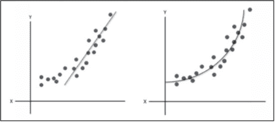

**图 18.1**

数据研究人员另一个重要的回归技术是支持向量回归，它最常用于案例分类。这里的概念是在空间中发现一条线，将数据点划分为不同的类别。它也用于回归分析。它是一种与概率无关的二分类技术形式。

岭回归广泛用于分析多共线性数据集。根据数据集的特征，正确使用因加加模型回归可以减少标准误差并显著提高模型准确性。如果你的数据包含高度相关的独立变量，岭回归可能会很有用。如果你可以使用另一个独立变量预测一个独立变量，你的模型将具有高多共线性风险。例如，如果你使用测量人身高体重的变量，模型中的这些变量可能会产生多共线性。

多共线性可能会影响模型生成的预测准确性。考虑模型中使用的预测变量类型，以避免由你使用的数据类型以及数据收集方法引起的多共线性。另一个原因可能是选择了种类较少的独立变量，或者选择了有限数量的独立变量，导致了非常相似的数据点。

多共线性也由模型类型引起。注意，模型中的变量比数据点多。如果你选择使用线性模型（这会加剧模型的多共线性），你可以尝试实现岭回归。岭回归通过允许模型中存在轻微偏差来使预测更准确。这种技术也称为“正则化”。

提高模型准确性的另一种技术是对独立变量进行标准化。此此最简单的方法是通过将某些独立变量的值置为空来降低复杂度。这种方法不仅是让这些独立变量变为零，而是实现一种奖励接近零的值的结构。这将减少系数，从而减少模型的复杂度，但模型将保留其所有的独立变量。这将赋予模型更多的偏差，以换取更准确的预测。

另一种缩减技术被称为 `LASSO`（最小绝对收缩和选择算子）回归。作为一种高度互补的回归，`LASSO` 回归促进使用更、更精炼的模型来生成预测。在 `LASSO` 回归中，模型降低接近零的系数值。散点图上的数据（例如数据的平均值或中位数）被降低到更紧凑的水平。当与岭回归模型相比，模型存在多共线性时，我们使用它。

`LASSO` 和 `cam regression` 方法的混合体被称为“弹性网络回归”（elastic net regression）。其主要目标是进一步提高 `LASSO 回归` 技术生成的预测准确性。弹性网络回归会奖励较小的系数值。这三种设计在 `R` 和 `Python` 的 `glmnet` 软件套中均可用。

如果数据不足或可用数据分布不均，贝叶斯回归模型非常有用。这些回归模型是基于概率分布而非数据点开发的，这意味着生成的图将呈现为气泡曲线，其中常见值位于曲线中心，代表方差。贝叶斯回归中的因变量 `Y` 不是数值，而是一个概率。我们不是在预测一个具体的数值，而是尝试估计某个事件发生的概率。这被视为频率派统计，基于 `贝叶斯定理`。频率派统计假设某个事件是否会发生以及未来再次发生的概率。

条件概率是频率派统计中不可或缺的一部分。它指的是结果之间相互依赖的事件。事件也可以是条件性的，这意味着上一个事件可以改变下一个事件的概率。假设你有一盒 `M&M’s` 巧克力，你想知道从袋里取出不同颜色的 `M&M’s` 的概率。如果你有一组三个黄色和三个蓝色的 `M&M’s`，你第一次抽到了蓝色的，那么下次抽到蓝色 `M&M` 的概率将低于第一次。这是条件概率的经典例子。相反，独立事件是抛硬币，这意味着上一次抛币的结果不会改变下一次抛币的概率。

## 线性回归

当你需要根据连续数据得一组实际数值时，就会应用线性回归。基本上，它涉及到绘制一条直线，其中考虑因变量和自变量之间的相关性。

在线性回归中，使用方程 `Y = a*X + b`，其中 `Y` 是因变量，`a` 是斜率，`X` 是自变量，`b` 是截距。

为了让这个概念更容易理解，这里有一个例子。被要求在不知道这些人实际体重的情况下对他们按体重排序。然而，你知道他们的身高，也能肉眼看到每个人的体型。利用这些参数，你可以想出一种可能产生准确或接近准确结果排序方法。

线性回归有两种类型：简单和多元。简单线性回归只涉及一个自变量，而多元线性回归涉及两个或多个自变量。

## 逻辑回归

尽管存在回归算法，但这与此完全没有关系。逻辑回归实际上是以自变量为基础来处理二值值（是或否、真或假、0 或 1）。它使用 `logit` 函数来衡量某个事件的概率。因为它涉及概率，所以预计输出应该在 0 到 1 之间的任何地方。

如果你的朋友给你一个谜题，你只能预想两种输出：要么你解决了它，要么你没解决。现在，如果给你若干个不同的谜题来查看你擅长哪些领域；这就是逻辑回归可以应用的地方。

假设给你的谜题之一是通常留给学龄儿童的谜语。那么你可能有 80% 的概率解开。如果给给你一个只有专家才能解决的晦涩谜题呢？那么逻辑回归可能会告诉你，你解决它的概率只有 20%。基本上，得出这些数字涉及选择参数，其目的是观察被用作样本的值，而不是查看平方误差和。

逻辑回归还帮助回答我们在数据科学中常用的常用示例问题：患者每多重一磅，以及每天多抽一包烟，患肺疾病（是与否）的概率如何变化？热量摄入、脂肪摄入、体重和年龄对中风（是与否）的概率有影响吗？正如我们所看到的，这些问题具有程度的复杂性，逻辑回归可以提供解决方案。在业务中，它是组织解决有关趋势和业务模式复杂问题的有力工具。

通过分析下面的图来探索逻辑回归应用的另一个示例。我们看到所有数据点的值要么为 0（失败），要么 1（通过）。我们还可以观察到逻辑拟合是 S 型曲线，它将概率模型为学习时间的函数。通过分析该图，我们可以得出，大多数学习少于四小时的学生没有通过考试。然而，对于学习了四小时的学生，模型预测通过的概率将在 70% 左右。正如我们在图中看到的，S 曲线是逻辑回归估计不同事件概率的副作用。这是逻辑回归为我们提供的相关信息的示例：

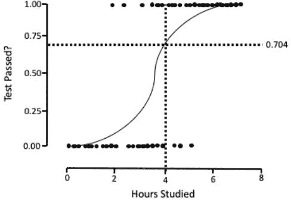

**图 18.2** 逻辑回归：与学习小时的关系（来源：Cerebro MLA）

理解逻辑回归的一个关键点与概率有关。必须理解它们位于 0 到 1 之间，与线性回归相反，我们得到的值并不提供直接的预测。相反，通过观察 `X = 4`，模型告诉我们可以期待 70% 的通过率。

与逻辑回归相比，线性回归处理数据效果良好，通过感知预测变量的值可以很好地预测结果。一些数据科学家对线性回归和逻辑回归的概念及其应用感到困惑。理解这些差异对于为客户和组织提供支持至关重要。

# k-means 聚类

最广泛使用的聚类算法之一是 k-means 算法。名称中的 `k` 指算法根据数据点之间的接近性寻找固定数量的类。这里列出的版本由 `J. B. MacQueen` 于 1967 年发表。该技术使用二维图进行演示以便说明。注意该算法在操作中通常管理远于两个独立变量。

# k-means 算法的三步

k-means 算法的第一步随机选择 k 个数据点作为种子（包含一个元素的簇）。MacQueen 的算法简单地取前 `k` 个记录。在记录具有显著顺序的情况下，选择间隔较大的记录或随机收集的记录可能更好。此示例将类数设置为 3。最后一步是将每个记录分配给最近的种子。做到这一点的方法是找到类与类之间的边界，如几何所示。两个类之间的边界是到每个类距离相等点。

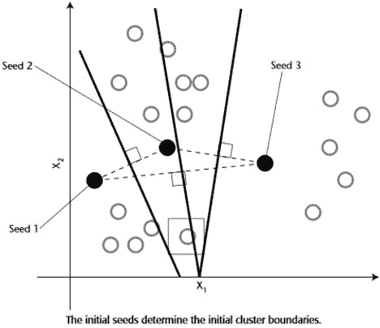

**图 18.3**

回想起高中的几何课，你会发现这比听起来要简单：给定任意两个点 `A` 和 `B`，所有距离点 `A` 和 `B` 几乎相等的所有点都落在一条（称为垂直平分线）上，这条线与连接 `A` 和 `B` 以及它们之间所有点的连线垂直。虚线连接了上图中初始种子；用实线所示生成的簇边界与虚线成直角。以这些线为引导，可以清楚地看出哪些记录距离种子最近。

这些边界在三维空间中是平面，在 N 维空间中是 N 维超平面 `N – 1` 。。幸运的是，计算机算法可以轻松处理此类情况。在簇之间寻找实际边界对于几何化显示操作很有用。然而，在实践中，算法通常计算每个记录与每个种子之间的距离，并在这一步选择最小距离。

例如，考虑图中方框围的记录。根据初始种子，该记录被分配给编号为 `2` 的种子，因为它可能比该种子比其他两个种子中的一个更近。此时，每个点都已根据围绕原始种子的三个簇被分配到其中之一。第三步是测量簇质心；这些质心对簇的描述比初始种子做得更好。寻找质心就是关于对每个簇取平均值。新的质心在[图 1.4](https://example.org/18.4) 中被标记为交叉。箭头显示了种子到新质心的移动。


**图 1.4**

在三维空间中，这些边界是平面，在 N 维空间中是 N 维超平面 `N – 1` 。。幸运的是，计算机算法可以轻松处理此类情况。在簇之间寻找实际边界对于几何化显示操作很有用。然而，在实践中，算法通常计算每个记录与每个种子之间的距离，并在这一步选择最小距离。编号 `1` 的数据现在被分配到[18.5](https://example.org/18.5) 中。

**图 18.5**

在实践中，算法通常会产生如上图所示的聚类。

[什么是 k 均值？](https://wiki.example.org/k_means)
聚类定义了数据的结构。例如，纽约市的记录是分类的。但是，布鲁林或皇后区的记录可能属于纽约市。在几何意义上，如果两个点是相同的，它们代表数据库中的相同记录。这种方法有两个主要问题：(1) 许多变量（包括类别变量和许多排名变量）并不适合作为位置分量的正确处理；(2) 维度贡献在几何上是同等的，但在数据库中，一个字段的微小变化可能比另一个字段的变化显著得多。下一节将介绍一些替代的相似性量。

[距离与相似性](https://wiki.example.org/distance_and_similarity)

变量类型的相似性和几何距离对于良好的数值变量非常有效。数值变量是指其在几何模型中的值表示其在相应轴上的位置的。

真测量（True measures）是从有意义的零点开始测量的间隔变量。这一特性非常重要，因为这意味着变量的两个值之间的比例很大。美国使用的华氏度温度计和世界其他地区使用的摄氏度量表都具有这一属性。在任何一个体系中，说 30 ° 的天比 15 ° 的天暖两倍是没有意义的。同样，12 码的连衣裙尺寸不是 6 码的两倍大，石膏的硬度也不是滑石的两倍，但在硬度量表上，它们分别是 2 和 1。但是，说一个 50 岁的人年龄是 25 岁的人的两倍，或者一个 10 磅的糖袋是 5 磅的两倍则是完全合理的。

真测量的例子包括年龄、重量、长度、客户时长和时长。间隔变量和真测量的几何距离量是有良好定义的。将这些转换为间隔变量以便使用分类变量和排序是非常关键的。遗憾的是，在这些转换中可能会应用错误的细节。如果将 1 到 28 的随机数分配给冰淇淋口味，将意味着第 5 号和第 6 号口味几乎相关，而第 1 号和第 28 号则相遥远。

## KNN 算法

KNN 算法是今天数据科学家使用的最简单的机器学习算法之一。它最早于 20 世纪 70 年代初开发用于统计预测和模式识别，可以应用于回归和分类问题，尽管它最常用于分类模型。

## KNN 是如何工作的？

在进行预测时，KNN 必须访问所有可用训练数据。这意味着不需要学习，因为所有数据必须存储在内存中并始终保持可访问。如果你正在处理大型数据集，你可能想要考虑复杂的数据结构，例如 `k-d 树`，以最大化存储效率和计算速度。

对于每个新数据点，KNN 会在所有训练数据中搜索 k 个最近的条目（最近邻）。`k` 是算法考虑的邻居数量：对于 `k = 1`，只考虑最近的值；对于 `k = 3`，将考虑最近的三个值；对于 `k = infinity`，将考虑整个数据集，依此类推。

一旦确定了 `k` 个最近的数据点（k 最近邻），就会对它们的属性和值进行评估。函数将考虑所有这些属性并为新数据点计算一个输出值。对于回归，预测值可能是最近邻的加权平均值；对于分类，它可能是出现频率最高的类别。

必须考虑新数据点与其邻居之间的距离或分离程度。例如，如果两个正方形邻居比三个草莓邻居更近，那么新输入点点的预测类别可能是正方形。当然，这取决于你如何在数据集中定义距离（目前，你可以将距离视为误差的衡量标准）。

在深入研究距离概念并讨论不同的可用指标之前，让我们先可视化一下为止讨论的内容。在下面的图中，你会发现一个包含两类数据的训练数据集：正方形和菱形。定义这些点的两个变量是：`Loan$` 和 `Age`。这些被称为预测变量。

使用该数据集，可以使用 KNN 算法来预测新数据点的类别：这个圆是正方形还是菱形？在这个特定的例子中，我为我的 KNN 算法选择了 `k = 4`。现在，我必须为新数据点（即圆）选择四个最近的邻居。

如你所见，最近的邻居中有两个菱形和两个正方形。我们应该给圆分配哪个类别？这将取决于你的算法如何定义距离参数。例如，如果你考虑绝对距离（即点在图上距离训练数据有多远），那么你的算法将预测为“菱形”，因为两个菱形更近。然而，如果 `age` 是你研究中更重要的因素，你可能会选择给它一个更大的权重因子 `w`。因此，你的距离更偏向于最小化年龄差异，并将预测为“正方形”（因为正方形在年龄上与圆更近）。距离是任何 KNN 算法的关键参数，因此必须根据你的研究需求仔细选择和调优。

在为你的算法指定距离指标时，必须记住几点。首先，你必须选择最相关的预测变量（上一个例子中的 `age` 和 `loan`）。由于预测变量之间尺度的差异，通常做法是将它们归一化为 0 到 1 之间的值。例如，在上面的示例中，你的 `Loan$` 范围在 `$60,000` 到 `$250,000` 之间，而 `Age` 范围在 20 到 52 之间；这些尺度上的差异必须纳入你的算法处理训练数据之间距离的方式。

如果你想对选定的预测变量分配更大的重要因子，你可以在归一化数据后使用权重因子 `w`。例如，现在你的数据范围将从 0 到 1。权重因子越大，预测变量对最终输出的影响就越大。选择产生最大精度的预测变量和权重因子被称为参数调优。这种方法没有对错，它取决于许多因素，最好的方法仍然是尝试。

尽管这个过程最初看起来很困惑甚至随机，但通过经验，你将能够轻松地调优出适合你的数据和要求的算法——这只需要练习。

一种有效的解决方案是使用数据的随机子集。这意味着，如果你的训练数据有 100,000 条目，你仅使用随机选择的 1,000 个点来构建 `KNN` 算法。这通常是处理大型数据集的一种良好折宜方法。你可以大幅缩短计算时间并保持良好的准确率，特别是当训练数据中存在大量重复时。为了选择合适的随机子集大小，我倾向于运行多次试验并将结果与整个数据集进行比较。你会发现，随着子集大小的减小，预测准确性也会随之下降。根据对计算时间和准确率的需求，选择一个最小阈值差异（例如 95%），然后选择符合该差异的最小子集大小。务必对多个条目运行此测试以避免任何离群值。

# 为 KNN 准备训练数据

在运行任何机器学习算法之前准备和过滤训练数据可以大幅提高预测能力、准确性和效率。在实现 `KNN` 时，你应该始终执行以下操作：

- **缩放预测变量：** 始终尝试归一化你的预测变量，使其落在 0 到 1 之间。
- **移除缺失数据：** 如果数据点缺失（即值为 0），它会对距离计算造成严重破坏。所有全零数据都应从训练数据中删除。
- **减少条目数量：** 正如所解释，`KNN` 必须访问并检查训练数据集中的所有条目。如果其中包含 100,000 个点，将需要很高的计算能力。通过使用随机子集（例如，随机选择的 1,000 个点），你可以大幅减少计算需求，通常对准确率的影响微乎其微。

# 结语

`KNN` 算法是一种简单的机器学习算法，能够提供极具竞争力的结果。该模型需要访问所有训练数据集，因为它不执行学习过程。它是机器学习算法初学者或希望快速构建预测模型的人的完美选择。尽管具有内在的简单性，但有许多变体和参数可以进行调整，以最大化预测准确性和计算速度。请记住，没有单一的最有效设置；与大多数机器学习算法一样，你将需要使用最适合你训练数据的试错法对所有参数进行实验和调优。

## 主成分分析 (PCA) 算法

它是机器学习中最简单的算法之一。这帮助你识别可以预测的最小数据元素，并尽可能地减少细节。它被用于目标检测、计算机视觉和文件编码等各个领域。关键组件的估计限于对初始数据的特征值、特征向量和协方差矩阵值的计算，或数据矩阵的奇异分解。

通过 `PCA`，我们可以交流不同的信号、可以说是组合在一起的简化模型。例如，防止信息缺失绝对是不可行的，尽管 `PCA` 方法会帮助我们缓解这一点。这是一种衡量有序元素的方法。

# 多项式拟合与最小二乘算法

最小二乘法是一种用于解决不同问题的统计技术。它侧重于减少与其他函数理想变量的变化的平方。它可以用于求解超定方程结构（当迭代次数达到不确定性数量时），在普通意义上（非超定）的变分方程系统中寻找答案，以及计算特定函数的得分点。使用此算法拟合基础曲线/回归。

# 强制线性回归算法

最小二乘法可能会误淆过冲、虚假区域等。约束对于减少我们引入数据收集的线条变化至关重要。最佳答案是适应线性回归公式，这意味着权重没有被错误定义。模型可以是 `LASSO` 或岭回归，或者两者都是（`弹性回归`）。使用这种方法适应回归轴上的约束，而不进行覆盖。

## 支持向量机 (SVM) 算法

`SVM` 是一种线性模型（例如逻辑/线性回归）。区别在于它具有损失特征并侧重边缘。使用优化技术（例如 `L-SGD` 或 `BFGS`），你可以最小化损失函数。`SVMs` 的一个方面在数据集上运行良好。分类算法（甚至是回归器）可以配备 `SVM`。

# 条件随机场 (CRFs) 算法

该算法用于表示类似于 `RNN` 的序列，并可以与 `RNN` 结合使用。也可以用于图像分割和其他组织预测活动。`CRF` 算法为序列中的每个部分（例如句子），使得相邻项影响序列中标记的项而不是单个标签。将 `CRF` 算法用于图像、文本、时间序列数据和 DNA 等序列。

## 决策树算法

机器学习中最流行的算法之一，用于分析中的统计建模和数据处理。布局反映了划分和叶节点。目标函数属性依赖于决策树的分支。目标函数的结果在叶节点中计算，残差节点包含了案例变化的属性。

在需要分类新案例时，你必须向下移动到叶节点以提供正确的含义。目标是构建一个以多个输入变量为中心并预测输出变量值的模型。

## 结论

在本章，我们讨论了传统算法：回归、k-means 聚类、k 最近邻、`PCA` 算法、多项式拟合与最小二乘算法、强制线性回归算法、`SVM` 算法、`CRF` 算法和决策树算法。

下一章涵盖常见问题。

# 第 19 章

# 常见问题

1. **什么是人工智能？**

   **答。** 人工智能可以用多种方式定义，但定义人工智能的问题比看起来要复杂，因为随着机器能够做（以及正在做）的天花板不断提高，我们对人工智能的理解发生了变化。

   例如，某些人从机器学习的角度考虑人工智能。这种人工智能的定义将关注从环境中接收外部线索、对环境进行建模并根据这些变化对其核心结构或行为进行更改的能力。

2. **在人工智能背景下什么是代理 (agent)？**

   **答。** 展示智能能力的机器或程序被称为代理。代理本质上是以被称为人工智能的方式进行认知或学习的执行者。“代理”一词基本上让科学家和理论学家能够从现实、实际意义和理论上有一种方便的方法来描述人工智能机器。

### 3. 人工智能代理真的只是智能人类吗？

**答。** 早期人工智能代理的概念通常将这些代理设想为类似于人类的自动机或机器人，它们本质上完成人类会完成的任务，无论是以机械简单的方式，还是以复杂的智能方式。甚至古希腊人也想象自动机能够移动、攻击他人，并本质上做人类所做的事情。唯一的区别在于它们不是真实的人，它们是人造的。

今天的人工智能承认，人工智能所展现的形式可以大异。如今大多数的人工智能代理都是记录环境数据或刺激并对其解释的计算机程序。例如，许多企业拥有人工智能软件，可以记录购买情况、产品查看或其他行为，并根据这些数据做出预测和建议。通过这种方式，人工智能代理可能表现出人类行为的某些方面，同时（至少目前）仍然是人类的替代品：快速且可靠地完成本质人类的任务。简而言之，今天的代理显然是区别于人类的程序。

### 4. 人工智能有不同的类型吗？

**答。** 人工智能有不同的类型。这包括人工智能的子集或推演，如机器学习或深度学习。但该术语通常是指代理运行方式的人工智能方法。主要的分类系统将人工智能分为：(1) 分析型人工智能，(2) 类人人工智能和 (3) 人性化人工智能。

理解不同类型的智能是了解这三种人工智能之间区别的关键。分析型人工智能纯粹从认知角度被考虑。认知代表了一系列技能，如信息处理、语言产生和学习，这些被认为代表了高阶思维。这种思维是人类和一些高等动物所具备的类型。

类人人工智能在其能力范围内为认知智能增加了情感智能。

人性化人工智能也许是这三种人工智能中最具人味的一类。人性化人工智能包含了认知智能、情感智能和社会智能。情感智能和社交智能代表了更微妙的智能形式。例如，机器人为了不被立即识别为机器人，就需要表现出这些类型的智能位点（bits）。

### 5. 为什么人工智能最近受到如此关注？

**答。** 人工智能最近受到如此关注，是因为随着人工智能在能够完成的任务上不断突破新障碍，许多人开始理论化地人工智能代表了所谓的生存威胁。

这种担心在于人工智能可能会试图消灭人类。由于大多数企业在努力过程中使用某种的人工智能，对这件事进行思考显然符合你的最佳利益。

### 6. 人工智能与机器人学之间有什么联系？

**答。** 尽管很多人经常将人工智能认为是与与机器人相关的特质，但目前大多数代理都是完成指定任务的计算机程序。其中一些程序仅仅是从其环境中接收数据并从中学习，这被称为机器学习。

### 7. 什么是神经网络？

**答。** 人工神经网络被设计成至少在部分类似于人类神经系统，该系统包含了以神经元、突触和神经组织形式存在的数百万连接。这些网络允许感知其环境、在环境中运行、与其他物体交互、形成语言并学习。

科学家研究人类神经网络是为了创建这些代理。虽然这项技术的全部能力尚待实现，但很有可能，如果人工智能实现了奇点，神经网络将成为其运行的关键（如果不是核心）组件。

### 8. 人工智能在商业和金融领域可以扮演什么角色？

**答。** 人工智能已经在商业和金融领域发挥着巨大的作用，即使美国或其他西方国家的普通人并没有意识到这一点。公司在其业务网站或其他客户界面上使用人工智能来改进其功能。

人工智能程序可以向消费者提供购买建议，解释消费者电话以引导他们找到正确的人员来处理问题，或者根据之前的活动在音乐和视频网站或社交媒体上提供建议。换句话之，人工智能代理可以记录和分析消费者行为，而这些方式对企业来说可能是不具成本效益的。

### 9. 我需要将人工智能整合到我的业务中吗？

**答。** 确实没有法律规定你必须将人工智能整合到你的业务中。机器还没有接管，所以这个未来事件还有很长的路。然而，如果不考虑将人工智能整合到你的业务中的方法，可能是一个糟糕的商业决策。你可能会对这有多么简单感到惊讶。你可能选择在网站上设置一个聊天机器人，或者你可以拥有一个使用人工智能的客户服务电话，引导用户去他们想去的地方。

### 10. 什么是机器学习？

**答。** 机器学习指的是机器通过算法帮助来学习和适应的能力，这些算法允许机器在没有显式编程的情况下做出预测并产生行为。大多数人认为机器学习是人工智能的一个子集，因为它代表了机器或人工智能智能体可以赋予的一种智力能力。

在这方面，机器学习可能与分析型人工智能关系最密切，因为它涉及认知能力，而不具备某些人工智能智能体所赋予的类人的情感和社会智能特质。理解机器学习至关重要，因为它允许人们研究人工智能，并感知人工智能智能体如何随着时间的推移进行学习并改变其性能。

## 11. 什么是深度学习？

**答。** 深度学习是机器学习的一个领域，它指的是一种分层算法，这些算法允许机器检测信息并以复杂的方式对其进行处理。深度学习模型基于所谓的人工神经网络，这种计算机系统的创建灵感来源于人脑的功能。人脑也以分层或重叠的方式处理信息，这使得设计成模仿大脑的网络具有人类大脑的一些基本特征。

## 12. 人工智能已经存在多久了？

**答。** 能够以类人方式或其他独立方式思考的人工有机体或机器的概念已经存在了数千年。古希腊人描述过一种名为塔洛斯（Talos）的自动机器，它是由神赫菲斯托创造的，能够独立行动并攻击人类。也许这就是危险人工智能智能体想法的起源。作为一个研究领域，人工智能被认为可以追溯到 20 世纪 50 年代。计算机在 20 世纪 40 年代变得突出且重要，而人工神经元的首次提到追溯到 1943 年。

人工智能的研究始于 1956 年在新罕布尔州达特茅学院举行的一次研讨会。这次研讨会涉及能够参与游戏和学习的计算机演示。在这一早期，人工智能的研究很大程度上得到了美国国防部等政府机构的资助，尽管随后资金大幅减少，直到在 20 世纪 70 年代和 80 年代才重新恢复。这种复苏与计算机技术在现代生活中应用的日益增加有关。

## 13. 为什么人们对人工智能的进展如此担忧？

**答。** 关于为什么人工智能的进展是许多人恐惧的源头，有很多论点。这种担忧本质上源于一种恐惧：如果人类被地球上最智能、最强大的智能体所取代，那么我们自身的生存可能会受到威胁。事实上，作为人类，我们将自己的一些动机、思维过程和行为投射到运行着人工智能的机器上。

简而言之，我们假设人工智能智能体的行为将与人类的行为一样。人类可能喜欢想象自己的行为对世界是有益的，但人类经常从事一些不仅对其他物种有害，对我们自己物种以及世界本身也有害的行为。长期以来，人们倾向于赋予人类创造的技术以人类的特质，对人工智能的至少部分担忧就源于此。

## 14. 对人工智能的担忧是合理的吗？

**答。** 毫无疑问，我们每天理解人工智能是多么奇迹的能力每天可以（并且将会）不断增长。当我们理解人类大脑是如何运作的（包括神经网络）时，我们不断被这种想法所吸引：我们设计的智能体能够比人类思考得得多，而且可能更具逻辑性，即使我们以各种方式限制了这些智能体。人工智能智能体能够在象棋和围棋等游戏中击败人类，而且它们似乎在人类知道自己在做什么或为什么要这样做之前，就能预测人类的思想和行为。对 AI 的担忧是合理的吗？绝对合理！

## 15. 使用人工智能的机器有一天会统治世界吗？

**答。** 许多科幻作家、剧作家和电影导演都对这一想法进行过推测，即人工智能有一天会对人类构成某种威胁。即使当古希腊人想象由赫菲斯托斯制造的自动机器时，他们也认为这些自动机器代表了对人类的某种威胁。也许将环境感知为充满了需要被或至少在某些方面受到限制的威胁是人类的本性。

坦率地说，很难说人工智能智能体有一天是否会统治世界。如果你看过《黑客帝国》，那么你可能认为人工智能智能体已经统治了世界，而你目前正在经历一种机器引发的幻觉。无论你相信什么，现实是人工智能已经是我们生活的一部分。也许一个人工智能接管的世界与我们现在居住的世界并不相似（不，我不是指《黑客帝国》那种方式）。

## 16. 所谓的“奇点”到底是指什么？

**答。** 奇点（Singularity）是描述涉及人工智能机器的假设性未来事件的术语。奇点本质是指人工智能智能体的智能超过全人类集体智能的未来点。这代表了一个不可逆转的事件，将永远改变人类文明和地球生活的进程。

围绕奇点的许多恐惧与这样一个现实有关：许多人对计算机、机器和人工智能持怀疑态度。许多人赋予机器、计算机和人工智能人类的特质。他们认为，一个基本上是某些人所谓的“全知”的智能体可能会认为人类是对生命、宇宙或机器本身的一种威胁，因此会对人类采取行动。运行在对奇点发生的恐惧中的根深蒂固的想法是：人工智能智能体将得出某种形式的必然结论。

## 17. 机器学习为什么非常重要？

**答。** 机器学习（以及更复杂的深度学习分层过程）涉及机器根据其与环境的交互对其自身的结构或程序进行更改。这种学习在人工智能程序中很重要，因为某些类型的任务可能需要程序通过学习才能有效地完成任务，即使在已经编程的情况下。

例如，想一下如果人类不能从过去的行动中学习，那么他们完成挑战性游戏或谜题的能力会有多糟糕。赋予人工智能智能体学习的能力本质上改进了程序的功能。学习还涉及理解环境中事物之间的相关性，人工智能智能体以 `.dat` 文件或其他数据形式存储这些信息。这些数据可以被人类访问以进行数据挖掘。

## 18. 量子计算机与人工智能之间有什么关系？

**答.** 量子计算机使用量子比特（qubits）而不是比特（bits）来存储内存，这使其能够超越传统计算机的潜力。量子计算机利用量子力学现象，这些计算机能够执行经典计算机无法完成的模拟。量子计算机大约在二十年前出现，一些专家认为我们距离量子计算机上线只有几年之遥。如果我们把人工智能视为一种知道思考、行为和学习的程序，那么量子计算就是驱动这些核心动机的大脑。正因如此，科学界的一些人士认为，真正的危险不是人工智能，而是量子计算机。

### 19. 什么是图灵测试？

**答.** 图灵测试是由英国计算机科学家艾兰·图灵（Alan Turing）在 1950 年提出的一个概念。尽管图灵测试有不同的形式，而且对于什么应该或不应该被认为是真正的图灵测试还存在争议，但这种测试可以被认为回答了机器是否能够回答问题的问题，但它使用了多种衡量标准来确定情感反应，包括瞳孔放大反应。沃伊-坎夫测试（Voight-Kampff test）的存在意味着未来某一个时刻，人类将难以区分人工智能智能体与人类，因此需要更先进的测试来做出区分。

## 结论

到此时，你应该能够应用各种用于监督学习、无监督学习和强化学习的机器学习算法了。当你想要探索其他关于机器学习的问题时，这些知识将是有益的。尽管如此，给你提供更多建议也是重要的，特别是关于如何处理机器学习方面的问题。

# 如何处理机器学习问题

在第一次接触机器学习问题时，必须非常有条理。努力尝试回答以下问题：

*   对于我的工作模型（例如欺诈预测模型），我衡量什么以及如何衡量？
*   我是否有知识来评估特定的算法？
*   如果我成功了，我的模型最终的影响（业务上或学术上）是什么？

# 人机交互（Humans in the loop）

为你模型中的每一个人类参与者识别并恰当地分配分配角色。

从原型转向生产。

使用 `scikit-learn` 库的功能构建原型，并投入生产团队，他们应该使用 `Python`、`R`、`Go`、`Scala`、`C#`、`C++` 和 `C` 等编程语言。

## 测试生产系统

在将产品发布到市场之前，确保你进行了适当的测试，以确定你的产品是否运行正常。在这一阶段，你可以识别出各种故障甚至是改进点。

## 下一步

此本书对机器学习提供了如此完美的说明，以至于在读完之后，你会预期自己成为一名机器学习专家。然而，如果你需要更多信息，请随时咨询关于那些你可能尚不清楚的概念的其他文献。一些优秀的书籍可能包括 Friedman 等人著的*The Elements of Statistical Learning*，以及 Stephen Marsland 著的 **Machine Learning: An Algorithmic Perspective*。

## 机器学习包

目前市场上有很多机器学习包，旨在增强你对各种算法的理解。一些常用的包包括 `scikit-learn`（交互性最强且显然最受欢迎）、`statsmodels` 包、`vowpal wabbit` (vw)，最后是 `mllib`（构建在 `Spark` 之上的 `Scala` 库）。

使用推荐系统和其他类型的机器学习来识别优中优者。我希望你现在对机器学习深信不疑。

继续挖掘这个新领域并永远不要放弃；还有更多精彩在等待。机器学习是一个活跃的研究课题，特别是神经网络。如今，机器学习被应用于每一个领域，如营销、医疗保健系统、银行系统、股市和游戏应用等。本书的目标是提供对机器学习主要分支的基础理解，以及神经网络背后的哲学。

# 我们以后将走向何方？

我们已经建立了机器学习是多么出色，以及它现在能做什么。更令人惊的是它在未来能够做什么。是的，由于许多原因，未来看起来非常光亮。当然，有很多预测（很可能是由机器学习生成的）了关于我们可以期待的内容，但很有可能，当下一次演变完成后，我们可能会感到非常惊讶，站在旁边喃喃自语：“我真不知道机器还能做到那些！”

但对未来的预测是什么呢？我们现在知道哪些事是可以让我们心地保持关注的呢？

*   量子计算：目前，机器学习主要用于解决问题。它们以惊人的速度处理和分类数据。在未来，量子计算机将能够很好地处理高维向量。它们将通过使用混合训练方法来实现。通过利用监督和无监督算法的混合，向量的数量将大幅增加，从而产生令人印象深刻的速度。
*   改进的无监督算法：它们自主发现数据中隐藏模式的能力以及其自学习技术，使得无监督学习在未来可以被更充分地利用。未来的机器将构建得更加智能，且大部分是无监督的。
*   协作学习：机器将具有更强的能力协作使用其他计算实体。这将允许它们产生比现在更好的结果。
*   更深层的个性化：在未来，机器将更多地了解你。虽然我们可能认为这非常讨厌且侵犯了我们的隐私，但今天使用的无效尝试将得到大大增强。那些令人沮丧的不准确的推荐将成为过去，最终将结束我们对整个过程的沮丧。

- **认知服务：**毫无疑问，我们将在即使是最日常的机器中看到更多智能功能的出现。计算机科学家已经在致力于情感检测系统、语音识别、视觉识别等许多领域。

毫无疑问，你将能够对未来的机器学习想出更多可能性，但正如我之前所说的，很大范围内，世界将对即将出现的结果感到惊讶。

# 索引

## A

- 代理-环境接口 97

### 基于 AI 的趋势
- 银行业 126
- AI/机器人 114

## AI 技术
- 发展状态 122-(124](#c09.xhtml#page124)
- 算法交换 134
- 基于异常的入侵检测 31
- 异常检测 32, 33
- 异常检测方法 60

## 人工智能 (AI)
- 关于 4, 5, 197
- 进展 202, 203
- 商业与金融的角色 200, 201
- 概念 202
- 机器人之间的连接 200
- 上下文代理 198
- 投资成本 120
- 关键的领导力 120, 121
- 银行业 125, 126
- 无机增长 121
- 整合 201
- 需求 199
- 神经网络，类型 77
- 策略 119, 120
- 类型 198, 199
- 使用 203, 204
- 与人类对比 172
- 与量子计算机对比 205
- 有必要的 203

### 人工智能 (AI), 影响
- 网络安全威胁 171
- 虚假信息 170, 171
- 人性 169, 170
- 不平等 169
- 业业损失 168, 169
- 种族主义机器人 171, 172

### 人工智能 (AI), 银行业
- 削减 174
- 客户服务 175
- 欺诈检测 174
- 网上银行 176
- 风险管理 175

## 人工智能代理
- 关于 200
- 益处 79
- ATM 143, 144
- ATM，风险
- 员工记录 144
- 伪电话 144
- 卡片丢失 144
- 社交媒体 144

### 澳大利亚证券交易所 (ASX) 116

### 自动聚类检测
- 高斯模型 24, 26
- 数据挖掘 19, 20
- 散点图 21, 24
- 简单结构，搜索 20, 21

## 自动化
- 关于 105
- 金融科技 (FinTech) 106-(108](#c09.xhtml#page108)
- 机器人 105, 106

## B

### 美国银行
- 大数据项目 117
- 贝叶斯分类 16

## 大数据
- 开发方向 37-(39](#c03.xhtml#page39)
- 未来 36, 37
- 大数据分析 142

### 生物识别 59
- 关于 56-(58](#c05.xhtml#page58)
- 优势 57

## 生物识别特征
- 可接受性 58
- 可收集性 58
- 成本 58
- 类内类性能 58
- 通用性 58

## 区块链
- 关于 115
- 银行业 115

## 区块链
- 优势 116

## C

### 卡安全
- 提示 145
- CatBoost 80
- 数据 69
- 聊天机器人 114
- 认知计算 115
- 认知服务 209
- 协同学习 208

## 计算机视觉
- 关于 50, 51
- 神经网络 51
- 概述 52-(54](#c05.xhtml#page54)

### 概念，机器学习
- 自适应控制理论 156
- 157
- 演化模型 157
- 神经网络，创建 156
- 心理建模 156

## 统计学
- 条件随机场 (CRF) 85, 195, 196
- 卷积层 52

## 卷积神经网络 (CNN)
- 关于 51, 78
- 算法 84
- 卷积层 52
- 全连接层 52
- 池化层 52

### 刑事调查 149
- 客户管理 149
- 客户细分 150

## 网络安全
- 机器学习，应用 26, 27

## 网络安全，问题与解决方案
- 异常检测 32, 33
- 恶意软件检测 29-(31](#c02.xhtml#page31)
- 钓鱼页面检测 27-(29](#c02.xhtml#page29)
- 垃圾邮件检测 27

## D

### 数据
- 骇客 142
- 商店/餐厅攻击 143
- 在线门户网站攻击 143
- 邮件账户攻击 143

## 数据处理
- 自然语言处理 (NLP) 中 45, 46

## 数据挖掘
- 关于 6, 148
- 自动聚类检测 19, 20
- 教育 149
- 医疗保健系统 148
- 与机器学习对比 6

## 数据压缩
- 识别关键预测因子 93, 94

## 数据结构化
- 关于 36
- 半结构化 36
- 结构化 36
- 非结构化 36

## 数据可视化
- 关于 148
- 教育 149
- 医疗保健系统 148

### DDoS 攻击检测 31, 32
### 决策树算法 196
### 深度个性化 208
### 深度学习 5, 202
### 拒绝攻击 (DoS) 31
### 数字银行 118
### 分布式拒绝服务 (DDoS) 31
### DoS 攻击检测 31, 32

## F

## 前馈神经网络
- 关于 77, 78
- 算法 84

## 金融规则与设计
- 改进 124, 125

## 金融科技 (FinTech)
- 关于 106-(108](#c09.xhtml#page108)

### 挑战 129

## 影响
impact 109\-113

## 技术
impact 129

## 金融科技公司
- 概述 128, 129
- 强制线性回归算法 195
- 欺诈检测 149
- 欺诈检测与预防 124
- 全连接层 52

## G
- 高斯模型 24\-26

### GBM
- 关于 79
- CatBoost 80
- Light GBM 79
- XGBoost 80

## 通用应用，机器学习
- 关于 160
- 客户生命价值预测 162
- 网络安全 165
- 动态定价 161
- 邮件垃圾邮件 165
- 金融分析 160
- 金融评估 162
- 欺诈检测 160, 161
- 谷歌翻译 162
- 政府 165
- 图像识别 161
- 医疗诊断 161, 162
- 在线客户支持 163
- 预测性维护 160
- 产品推荐与引导 163
- 搜索引擎 164
- 自驾驶汽车 164
- 社交媒体 163
- 交通警报 164
- 视频监控 165
- 虚拟个人助理 166

## 梯度提升算法
- 关于 79
- GBM 79
- 梯度下降 80, 81

## H
- 海明距离 192

## I
- ImageNet 55
- 图像识别 54\-56
- 输入数据 69
- 网上银行
- 安全提示 145
- 物物网络 (IoT)
- 银行业中的 117
- 入侵检测 150

## K
### k-means 聚类
- 关于 184\-187
- 距离与相似性 189, 190
- 概述 187, 188
- k-means 方法
- 缺点 24

## KNN 算法
- 关于 190
- 概述 194
- 训练数据，准备 193, 194
- 运行 190\-193
- 了解你的客户 (KYC) 113

## L
- 最小二法算法 195
- 谎言检测 150, 151
- Light GBM 79

## 线性回归
- 关于 182, 183
- 应用 179
- 多线性回归 183
- 简单线性回归 183
- 准则回归 113, 114
- 逻辑回归 183, 184
- 循环 206

## M
### 机器学习
- 关于 3, 6, 201, 204, 205
- 网络安全中的应用 26, 27
- 应用 136
- 加密货币 138
- 数据抽象 3
- 数据输入 3
- 日内交易 138, 139
- 开发与组合 10
- 因素 4
- 泛化 4
- 保证与信用评分 133, 134
- 插图 207
- 金融中的重要性 7
- 金融中的 6
- 信息与业务空间，利用 135
- 需要 208, 209
- 外部安排 9, 10
- 软件包 207, 208
- 接近问题 206
- 问题类型 92, 93
- 安全风险 133
- 银行业中的用例 132
- 金融服务中使用 10, 11
- 金融中的利用 8, 9
- 与数据挖掘对比 6

### 机器学习，优势
- 关于 154
- 数据集处理 155
- 效率提高 154
- 环境适应 155
- 模式识别 154
- 任务 154

## 基于机器学习的检测算法
- 特征 28

### 机器学习，劣势
- 关于 155
- 概念 156

### 机器学习，金融应用
- 关于 136
- 算法交易 137
- 欺诈检测 137
- 险或信用保险 137
- 投资组合管理 136
- 恶意工具 31
- 恶意软件检测 29, 31

### 恶意软件检测，分类
- 广告软件 29
- 后门 29
- 键盘记录器 29
- 根内核包 29
- 间谍软件 29
- 病毒 29
- 蠕虫 29

- 哈顿距离 192
- 闵可夫斯距离 193

## 建模过程
- 关于 86
- 特征工程 86, 87
- 模型选择 86, 87
- 模型训练 87
- 模型验证 87, 89
- 观测预测 89
- 模型学习 97

## N
### 朴贝叶斯
- 关于 15
- 贝叶分类 16

## 朴贝叶斯算法
- 应用 17
- 参数 16, 17
- 推荐系统 18
- 优势 16, 17
- 劣势 16, 17

## 自然语言处理 (NLP)
- 数据处理 3, 6
- 关键优势 4
- 使用 4, 5

## 神经网络
- 关于 70, 77
- 激活函数 51
- 数据预处理 51
- 在计算机视觉应用 51
- 权重初始化 51
- 工作原理 64, 69

### 神经网络，类型
- 卷积神经网络 (CNN) 78
- 前馈神经网络 77, 78
- 在人工智能 (AI) 77
- 模块化神经网络 78
- 循环神经网络 78

# 调查分析 46
# 人才招聘 46
# 语音助手 46
# 正态分布 18, 19

# O
## 网上银行
### 信息，获取 142

# P
## 模式识别方法 60
## 钓鱼页面检测 27-(29](#c02.xhtml#page29)
## 策略函数 98
## 多项式拟合 195
## 池化层 52
## 主成分分析 (PCA) 算法 194
## 生产系统
### 测试 207

# Q
## 量子计算机
### 对比人工智能 (AI) 205
## 量子计算 208

# R
## 循环神经网络 (RNN)
### 关于 78
### 算法 85
## 回归技术
### 关于 178-(182](#c18.xhtml#page182)
### 线性回归 182, 183
### 逻辑回归 183, 184
## 强化学习 (RL)
### 关于 94, 95
### 智能体 97
### 算法 98, 99
### 应用 99, 100
### 示例 94, 95
### 基础知识 96, 97
## 强化学习 (RL) 算法
### 关于 99
### 基于模型的 100
### 基于策略的 100
### 基于值的 99
## 强化学习 (RL) 类型
### 关于 100
### 负强化 100
### 正强化 100
## 风险管理 124
## 机器人财务顾问 134, 135
## 机器人警报 7

# S
## 安全措施 144
## 基于特征的入侵检测 31
## 点 204
## 恶意盗取 143
## 软件漏洞 59-(61](#c05.xhtml#page61)
## 垃圾邮件检测 27
## 静态分析
### 技巧 30
## 统计学 3
## 结构化数据 40-(42](#c03.xhtml#page42)
## 支持向量机 (SVM) 算法 195

# T
## 技术
### 关于 114
## AI/机器人 114
## 美国银行，带有大数据项目 117
## 区块链 115, 116
## 银行业业中的区块链 115
## 区块链用户 116, 117
## 聊天机器人 114
## 认知计算 115
## 银行业业中的物联网 (IoT) 117
## 生物识别 118
## 技术与金融 104, 105
## 交易 125
## 训练数据
### 为 KNN 算法准备 193, 194
## 图灵测试 205

# U
## 非结构化数据 40-(42](#c03.xhtml#page42)
## 无监督算法 208

# V
## 值函数 98
## 值函数，类型
### 确定性稳态策略 98
### 优值函数 98
### 稳态策略 98
## 生物识别 118
## Voight-Kampff 测试 206
## 漏洞检测方法
### 异常检测方法 60
### 模式识别方法 60

# W
## 词嵌入 84

# X
## XGBoost 80
