# iOS 开发者机器学习指南


# 第 6 章


# 第 8 章


本书面向中级/高级 iOS 开发者，他们希望掌握机器学习的基础知识，学习数据科学家常用的一些工具，并学习如何将模型构建并部署到他们的 iOS 应用程序中。本书在任何时候尝试平衡理论与实践，在让你深入理解底层概念的同时，提供可以立即应用于工作中的最佳实践和实用的建议。

机器学习是一个快速发展的领域。我已尽一切努力保持内容的实时更新和相关性。尽管这可能导致书籍在少数情况下出现过时，但我相信这些内容在接下来的几个 iOS 版本中将继续保持有用性和相关性。

## 本书涵盖哪些内容？

本书涵盖了机器学习的基础概念，以及如何使用这些概念构建现实世界的模型并将其用于你的 iOS 应用程序中。

# 第 1 章：机器学习简介
本章介绍了现实应用中常见的不同类型的机器学习模型，以及数据科学家用于构建这些模型的工具和库。本章还包含了机器学习的实际应用示例以及训练数据的来源。

# 第 2 章：机器学习方法
本章研究了一个假设场景，即使用基于规则的系统处理信用卡申请。书中分析了基于规则系统的局限性，并设计了一个机器学习系统来解决这些局限性。章节最后概述了构建典型的机器学习解决方案涉及的步骤。

# 第 3 章：数据探索与预处理
本章专注于数据探索和特征工程阶段，特别是使用流行的 Python 库 `NumPy`、`Pandas` 和 `Scikit-learn` 处理表格数据。本章还探索了特征选择技术。

# 第 4 章：在移动应用中实现机器学习
本章探索了 iOS 开发者将机器学习技术集成到应用程序中的选项。本章比较了基于边缘与基于服务器的部署模型的优，并介绍了 Apple 提供的以及可以从应用使用的其他第三方产品。

### 第 5 章：使用预训练模型进行目标检测
本章重点介绍在应用中使用预训练模型进行目标检测。本章还涵盖了人工神经网络（`ANNs`）和卷积神经网络（`CNNs`）的基础知识。

### 第 6 章：使用 Create ML 应用创建图像分类器
本章介绍了如何使用 Apple 的 Create ML 应用训练机器学习模型，以检测图像中的主要物体。该模型在 Kaggle Dogs vs. Cats 数据集的子集上进行训练，并导出为 Core ML 格式。导出的模型用于 iOS 应用程序。

### 第 7 章：使用 Create ML 创建表格分类器
本章介绍了如何使用 Apple 的 Create ML 应用在表格数据上训练分类模型。该模型在流行的 ML wine 数据上进行训练，并导出为 Core ML 格式。训练好的模型用于 iOS 应用程序，允许用户输入葡萄酒的化学特性并了解饮料的质量。

### 第 8 章：创建决策树分类器
本章重点介绍使用 `Scikit-learn` 在流行的鸢尾花（Iris flowers）数据集上创建决策树分类模型。训练后的模型使用 Core ML Tools Python 库导出为 Core ML 格式，并用于 iOS 应用程序。

# 第 9 章：使用 Scikit-learn 和 Core ML 创建逻辑回归模型
本章重点介绍使用 `Scikit-learn` 在流行的 Pima Indians 糖尿病数据集上创建逻辑回归模型。训练后的模型使用 Core ML Tools Python 库导出为 Core ML 格式，并用于 iOS 应用程序。

# 第 10 章：使用 Keras 构建深度卷积神经网络
本章介绍了如何使用 Keras 函数式 API 创建并训练名为 `Inception V4` 的流行深度卷积神经网络架构。Inception V4 网络在较小的公开数据集上进行训练，然后在 iOS 应用程序中使用。


如需提交可能的错误列表，请将邮件发送至我们的客户服务团队 `wileysupport@wiley.com`，邮件主题为“Possible Book Errata Submission”。


# 第 1 章：机器学习简介

你好，欢迎来到兴奋的机器学习世界。如果你在此之前从未听过机器学习，你可能会认为它是计算机科学的一项近期创新，将产生具有意识的计算机程序，这些程序比人类智能得多，并终有一天会让类过时。幸运的是，这种关于机器学习的观点几乎没有任何根据性。首先，它并不是一项最近的进展；计算机科学家几十年来研究让计算机更智能的方法，尝试寻找让计算机学习像人类一样进行概括和预测的方法。然而，智能不仅仅是识别事物，即使是今天最好的机器学习系统也无法像人类一样推理。现有的机器学习系统本质上是模式识别器，例如，它们可以检查照片并检测出桌子边的茶杯。但是，它们无法推理出杯子可能会因为离边缘太近而不小心掉落在子上。

机器学习专门处理创建计算机程序的问题，这些程序能够可靠、快速且准确地概括和预测信息，其类似于人类处理类似信息时的水平。机器学习算法需要大量的处理和存储空间，直到最近，这些算法只能在大公司或学术机构中部署。近期存储、处理器和 GPU 技术的进展为大规模构建和部署机器学习系统并获取实时结果提供了所需的计算能力。

在过去，高质量数据的缺乏也是防止机器学习广泛采用的因素。随着社交媒体和分析应用的出现，开发者获取的关于客户的数据比过去多得多。

另一个导致近期机器学习应用增加的因素是优秀工具和框架的可用，例如 `Core ML`、`Create ML`、`Pandas`、`Matplotlib`、`TensorFlow`、`Scikit-learn`、`PyTorch` 和 `Jupyter Notebooks`，这些工具让新手无需深入研究复杂的底层数学概念，就可以开始构建真实的机器学习应用。在本章中，你将学习什么是机器学习、机器学习系统是如何分类的，以及机器学习在现实世界中的应用示例。

## 什么是机器学习？

机器学习是人工智能领域的一个学科，涉及创建能够从数据中学习的算法。机器学习的根源可以追溯到计算机科学家 Arthur Samuel 在为 IBM 工作期间于 1959 年创建的一个计算机程序。Samuel 的程序可以玩国际跳棋，它的基础是为棋盘上的每个位置分配一个分数，该分数表示通向获胜的可能性。通过让程序进行自我对弈来精炼这些位置分数，随着每次迭代，程序的性能都会提高。该程序实际上在从经验中学习，机器学习领域之此诞生。

机器学习系统可以被描述为基于数学原理的算法集，它们可以挖掘数据以找到其中的模式，并在遇到新数据时对其进行预测。基于规则的系统也可以对新数据进行预测；然而，基于规则的系统和机器学习系统不同。基于规则的系统需要人类在数据中寻找模式并定义一组供算法应用的规则。这些规则通常是一系列 `if-then-else` 语句，按特定的顺序执行。另一方面，机器学习系统会发现自己的模式，并可以在对每个未见数据进行每次新预测时继续学习。

### 数据科学家常用的工具

作为一名 iOS 开发者，在向你的应用中部署机器学习模型时，`Core ML` 可能是你的首选框架。另一方面，训练机器学习模型涉及多个步骤，除了最简单的情况外，它是离线执行并使用不同的工具完成的。Apple 许多工具来训练 `Core ML` 模型，并将使用 `Scikit-learn` 和 `Keras` 等其他框架构建的预训练模型转换为 Core ML 格式。你可能想使用非 Apple 框架（如 `Scikit-learn` 或 `Keras`）来训练模型，是因为该库可能提供了无法使用 Apple 工具集训练的模型实现，或者其更新频率可能更高。

取决于你尝试构建的模型类型，在可以开始训练之前，可能还涉及许多步骤，例如数据预处理、特征工程和数据可视化。数据科学家经常使用一组工具来协助他们完成这些步骤。在本节中，你将了解数据科学家构建机器学习解决方案常用的某些工具。

尽管 R 语言在历史上一直是统计学者的首选语言，但现在大多数数据科学家和机器学习工程师都使用 Python。Python 在机器学习领域的流行归功于丰富的机器学习特定库，这些库可以协助完成从准备数据、特征工程、信息可视化到使用最新算法训练模型的所有步骤。在展示 Python 代码的地方，本书将使用 Python 3.6.5。以下是最流行的 Python 机器学习工具：

*   **Jupyter Notebook:** 这是一个用于数据科学项目的流行的 Web 交互式开发环境。笔记本将代码、执行结果和可视化结果整合在一个文档中。Jupyter Notebook 是一个旧项目 IPython Notebook 的继者。你可以在 `http://jupyter.org` 了解更多关于 Jupyter Notebook 的信息。附录 A 包含了安装 Anaconda Navigator 和在自己的电脑上设置 Jupyter Notebook 的说明。


- **Anaconda Navigator**: 这是一个数据科学家常用的软件包包管理器。它允许用户方便地安装和管理 Python 库，并在不同的库集和 Python 版本之间快速切换。它还包含了流行的工具，如 Jupyter Notebook 和 Spyder Python IDE。你可以在 `https://www.anaconda.com` 找到更多关于 Anaconda 信息。

- **Scikit-learn**: 这是一个 Python 库，提供了用于分类、回归和聚类应用的多种机器学习算法实现。它还提供了强大的数据预处理和降维能力。你可以在 `https://www.scikit-learn.org` 找到更多关于 Scikit-learn 信息。

- **NumPy**: 这是一个常用于科学计算应用的 Python 库。它包含了许多实用的操作，如随机数生成和傅里叶变换。数据科学家最常用的 NumPy 特性是 N 维数据数组（称为 `ndarrays`）以及操作这些数组的函数。NumPy `ndarrays` 允许你在数组上执行向量和矩阵操作，这比使用循环执行逐元素数学运算要快得多。你可以在 `https://www.numpy.org` 找到更多关于 NumPy 信息。

- **Pandas**: 这是一个提供多种数据分析工具的 Python 库。Pandas 基于 NumPy 的 `ndarray` 构建，并提供了数据科学家经常使用的两个对象：`series` 和 `dataframe`。你可以在 `https://pandas.pydata.org` 找到更多关于 Pandas 信息。

- **Matplotlib**: 这是一个流行的 2D 绘图库。数据科学家用它数据可视化任务。你可以在 `https://matplotlib.org` 找到更多关于 Matplotlib 信息。

- **Pillow**: 这是一个提供各种功能来加载、保存和处理数字图像的库。当机器学习系统需要处理图像时就会使用它。你可以在 `https://python-pillow.org` 找到更多关于 Pillow 信息。

- **Google TensorFlow**: 这是一个用于数值计算的 Python 库。它由 Google 开发，并于 2015 年作为开源项目发布。Google TensorFlow 常用于构建深度学习系统。它使用独特的基于计算图的方法，并要求用户构建计算图，其中图中的每个节点代表一个数学运算，节点之间的连接代表数据（张量）。你可以在 `https://www.tensorflow.org` 了解更多关于 TensorFlow 信息。

- **Keras**: 这是另一个用于训练和使用深度学习网络的流行 Python 库。它的设计旨在促进对神经网络的快速实验，并充当 Google TensorFlow 等流行深度学习框架的高级抽象。从 TensorFlow 2.0 开始，Keras 已包含在 TensorFlow 中。

### 常见术语

在本节中，我们将检查一些你可能会遇到的常见机器学习特定术语。虽然这个列表不是全详尽的，但对于想要入门的人来说应该是很有用的。

- **机器学习模型 (Machine learning model)**: 这是用于对数据进行预测的算法。它也可以被认为可以应用于输入数据以得出预测的函数。机器学习算法通常有一组相关的参数，这些参数会影响其行为；这些参数是通过被称为 `training`（训练）的过程确定的。

- **数据获取 (Data acquisition)**: 这是收集训练机器学习模型所需数据的过程。这可能包括从下载现用的 CSV 文件到从网络上爬取数据的各种活动。

- **输入变量 (Input variables)**: 这些是你的机器学习模型用于生成预测的输入。一组 N 个输入变量通常用小写 `x[i]` 表示，其中 `i = 1, 2, 3, … N`。输入变量也被称为特征（features）。

- **特征工程 (Feature engineering)**: 这是选择一组最佳输入变量的过程，通常涉及以创造性的方式修改原始输入变量，以想出在问题领域背景下更有意义的新变量。特征工程主要上是一项手动任务。

- **目标变量 (Target variable)**: 这是你试图预测的值，通常用小写 `y` 表示。当你训练模型时，你拥有一组训练样本，对于这些样本，你知道目标变量的期望值。N 个样本的目标变量的单独值通常称为 `y[i]`，其中 `i = 1, 2, … N`。

- **训练数据 (Training data)**: 这是一个包含所有输入特征以及任何工程特征的数据集，并用于训练模型。对于集合中的每一项，目标变量的值都是已知的。

- **测试数据 (Test data)**: 这是一个包含所有输入特征（包括工程特征）以及目标变量值的数据集。这组数据在训练模型时不使用，而是而是来衡量模型预测的准确性。

- **回归 (Regression)**: 这是一种统计技术，试图在因变量和一组独立变量之间寻找数学关系。因变量通常被称为 `target`（目标），独立变量被称为 `features`（特征）。

- **分类 (Classification)**: 这项使用算法将观测值分配到一组预定义的固定标签中某个标签的任务。

- **线性回归 (Linear regression)**: 这是一种统计技术，试图为一组数据点拟合一条直线。线性回归常用于创建预测连续值（如身高、宽度、年龄等）的模型。

- **逻辑回归 (Logistic regression)**: 这是一种统计技术，它使用线性回归的输出并通过 sigmoid 函数将其转换为 0 到 1 之间的概率。逻辑回归常用于创建预测类别概率的机器学习模型。例如人以后生病的概率，或申请人违约还款的概率。

- **决策树 (Decision tree)**: 这种树形数据结构可用于分类和预测问题。树中的每个节点代表一个条件，每个叶代表一个决策。构建决策树模型涉及检查训练数据并确定获得准确结果节点结构。

- **误差函数 (Error function)**: 这是一个数学函数，将预测值和实际值作为输入并返回一个捕捉预测误差的数值测量。训练函数的目标是最小化误差函数。

- **神经网络 (Neural networks)**: 这是一种模仿人类大脑结构的机器学习模型。神经网络由多个相互连接的节点组成，组织成不同的层——输入层、中间层（也称为 `hidden layers`）和输出层。节点通常被称为 `neurons`。输入层神经元的数量对应输入特征的数量，输出层神经元的数量对应被预测/分类的类别数量。

- **深度学习 (Deep learning)**: 这是机器学习的一个分支，利用了每层具有大量神经元的多层神经网络。深度学习模型也经常并行使用多个深度神经网络。

### 机器学习在现实世界中的应用

机器学习正以前所未有的速度改变着多个行业。在本节中，你将学习一些基于机器学习解决方案的应用：


- **欺诈检测：** 机器学习通常用于银行和金融机构，以对与支付指令相关的整体风险做出决策。在此背景下，支付包括资金转账和使用卡进行购买（向提供者付款）。风险决策基于多个因素，包括交易历史。如果风险较低，则允许交易进行；如果风险过高，则拒绝交易。如果认为风险处于可接受的阈值范围内，可能会要求客户执行某种形式的增强身份验证，以允许交易继续。

- **信用评分：** 每当客户申请贷款或信用卡等信贷产品时，机器学习系统就会计算出一个分数，以指示客户无法偿还贷款的整体风险。

- **保险费计算：** 机器学习系统通常用于在客户申请购买保险产品时，计算向其报价的保险费。

- **行为生物识别：** 机器学习系统可以经过过训练，根据用户使用网站或移动应用程序的方式来建立用户画像。具体而言，此类系统通过分析用户访问平台的来源、一天中的访问时间、点击页面的位置、在页面上停留的时间、鼠标在页面上移动的速度等信息来创建用户画像。一旦系统完成训练，就可以提供关于某人是否冒充客户的实时概率信息。

- **产品推荐：** 在线零售商（如亚马逊）常用机器学习系统根据客户的购买历史向其提供推荐列表。这些系统甚至可以预测客户何时可能用完杂货，并发送提醒他们订购商品。

- **流失预测：** 机器学习系统通常用于预测哪些客户可能在未来几天内取消对产品或服务的订阅。这些信息为企业提供了通过提供促销活动尝试留住客户的机会。

- **音乐和视频推荐：** Netflix 和 Spotify 等在线内容提供商使用机器学习系统构建复杂的推荐引擎，分析你听过的电影和歌曲，并对你可能喜欢的其他内容提供建议。

- **文本预测：** 像 iPhone 上的智能键盘使用机器学习模型来预测你可能输入的下一个单词，在你打字时，前三个预测结果将以建议的形式出现在 iPhone 键盘的上方。

- **对话式界面：** 机器学习模型用于聊天机器人，将用户的自然语言输入映射为机器人可以理解的输入。例如，允许用户访问银行功能的机器人将使用机器学习来解释略有不同的自然语言指令，如“我想付钱给某”、“我想向我妈妈付款”、“付款”和“转一些钱”，将这些都映射到同一个内部银行流程，可能被称为“付款”。

- **文本分析：** 机器学习模型可以用于分析文本文档，以提取文档中引用的实体信息以及文档的整体情感。在此背景下，文档不必是长篇的 Word 文档；也可以是一条短推特消息。此类系统可以监控 Twitter Feed 馈，并告知你趋势话题或你的关注者对你发布的帖子回复的整体情感。

- **场景分析与识别：** 机器学习模型（特别是深度学习模型）通常用于数字图像和视频流的场景分析和物体识别。场景分析涉及将图像（或视频）输入机器学习模型，由模型提供图像内容的描述——例如 `晴天里骑着绿色自行车的男人`。物体识别涉及将图像输入机器学习模型，获取图像中检测到的物体列表以及表示物体在图像中位置的边界框。

## 机器学习系统的类型

分类机器学习系统有多种不同的方法；最常见的方法之一是根据系统的训练方式以及系统做出预测的方式来进行分类。基于这种方法，机器学习系统可以分类如下：


这些标签并不是互斥的；遇到属于多个类别的机器学习系统是非常常见的。例如，一个使用行为使用数据来检测银行网站上潜在欺诈者的系统，可以归类为监督的、基于模型的机器学习系统。让我们详细详细检查这些分类标签。

### 监督学习

`Supervised learning` 指机器学习系统的训练阶段。在监督训练阶段，会向机器学习算法提供一组训练数据。每组数据由算法应用于做出预测的输入以及预期的（正确）结果组成（参见图 1.1）。

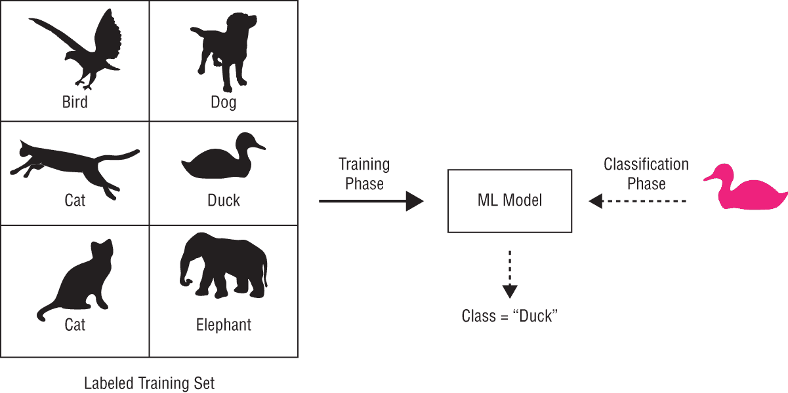

`FIGURE 1.1` 监督学习

训练包括对每组数据进行迭代，将输入交给算法，并将算法输出与预期结果进行比较。实际输出与预期输出之间的差异被用于调整算法的参数，使算法的输出接近（或等于）预期输出。

通常需要人工监督来为训练集中的每个输入定义预期输出。一旦算法学会了在训练集上做出预测，它就可以对以前未遇到过的数据做出预测。

大多数现实世界的机器学习应用都是使用监督学习技术训练的。监督学习的一些应用如下：

- 在数字图像中寻找物体
- 垃圾邮件过滤
- 根据生活方式预测患某种疾病的可能性
- 预测财务交易发生欺诈的概率
- 预测房产价格
- 根据历史购买数据向客户推荐产品
- 音乐流媒体服务根据客户听的内容向其推荐歌曲

### 无监督学习

`Unsupervised learning` 也指机器学习系统的训练阶段。然而，与监督学习不同，算法不会获得与训练集中每个项目相关的类别/分类的任何信息。当你想要从现有数据中发现新模式时，就会使用无监督学习算法。无监督学习算法分为两大类：

- **聚类：** 这些算法根据数据中的模式将输入数据分组为若干簇。可视化这些聚类可以让你对数据产生有帮助的洞察。图 1.2 显示了聚类算法应用于六岁以下儿童身高和年龄数据的结果。一些最流行的聚类算法是 k-means 聚类和层次聚类分析 (HCA)。


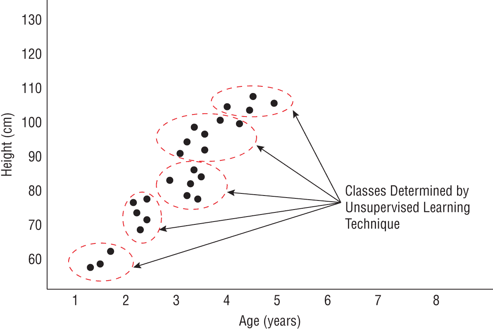

图 1.2 用于发现数据中模式的聚类技术

*   **降维：** 这些算法用于将大量的输入特征合并为较少数量的特征。降维：这些算法用于将大量的输入特征合并为较少数量的特征。通过减少数据的维度，可以提高计算效率、降低模型复杂度，并防止过拟合。常见的降维方法包括主成分分析（PCA）、线性判别分析（LDA）以及自编码器（Autoencoders）等。

### 监督学习

*监督学习*是指通过带有标签的数据集来训练模型。在监督学习中，每个训练样本都对应一个输出标签，模型的目标是学习从输入到输出的映射关系，以便对未知的输入进行准确预测。监督学习任务通常分为两类：分类（预测离散的标签）和回归（预测连续的数值）。

1.  **分类：** [分类任务](https://c01.xhtml#R_c01-fig-0002) 目标是将数据划分到离散的类别中，例如垃圾邮件检测、人脸识别等。
2.  **回归：** [回归任务](https://c01.xhtml#R_c01-fig-0002) 目标是预测连续的数值，例如房价预测、股票趋势分析等。常见的监督学习算法包括：

*   **逻辑回归（Logistic Regression）：** 尽管名称带有回归，但它主要用于分类问题。
*   **决策树（Decision Trees）：** 通过树状结构进行决策，易于理解且解释性强。
*   **支持向量机（SVM）：** 寻找一个最优超平面以使不同类别之间的间隔最大。
*   **随机森林（Random Forest）：** 结合了多个决策树的集成方法，提高了预测的准确性。
*   **神经网络（Neural Networks）：** 模拟人类神经系统，适用于处理复杂的非线性问题。

### 无监督学习

*无监督学习*是指从没有标记标签的数据中发现隐藏的结构或模式。在这种学习模式下，模型没有标准答案，它的目标是探索数据的内在分布或相似性。无监督学习任务主要包括：

1.  **聚类（Clustering）：** 将数据划分为若干组，使得组内数据尽可能相似，而组间数据尽可能不同。例如用户细分。
2.  **降维（Dimensionality Reduction）：** 在尽可能保留数据重要信息的前提下，减少特征的维度。
3.  **关联规则学习（Association Rules）：** 发现数据项之间的有趣关系，例如购物篮分析（发现买啤酒的人通常也会买面包）。

### 强化学习

*强化学习*是一种关于智能体（Agent）如何通过环境（Environment）交互来学习的方法。智能体通过在环境中采取动作，并根据获得的奖励（Reward）或惩罚来学习最优的策略（Policy），以最大化累积奖励。强化学习的核心概念包括：

*   **智能体（Agent）：** 学习和决策者。
*   **环境（Environment）：** 智能体所处的环境。
*   **动作（Action）：** 智能体可以执行的行为。
*   **奖励（Reward）：** 环境对动作的反馈信号。
*   **状态（State）：** 智能体在某一时刻所处的情境。

强化学习广泛应用于机器人控制、自动驾驶、游戏 AI（如 AlphaGo）等领域。


基于实例的学习系统的优势在于训练和预测都相对较快，而且向训练集中添加更多项通常会提高系统的准确性。需要注意的是，基于实例的系统预测出的结果将是训练集中已存在的某个实例。例如，考虑一个基于实例的机器学习系统，它根据输入的高度和体重值作为输入来预测个人的鞋码。假设该系统是使用一个包含 100 个项的训练集进行训练的，其中每个项都由身高、体重和鞋码值组成。

如果使用这个基于实例的机器学习系统，根据一个新人的身高和体重作为输入值来预测该新人的鞋码，那么预测的鞋码将是训练集中匹配最接近的项的值。换句话说，机器学习系统永远不会输出训练集中最初并不存在的鞋码。

## 基于模型的学习

`model-based learning`（基于模型的学习）系统试图构建一个数学、层次或基于图的模型，对输入与输出之间的关系进行建模。预测涉及求解模型以获得结果。大多数机器学习算法都属于这一类。

虽然基于模型的系统需要更多时间来构建，但模型本身的大小只是训练数据大小的一小部分，而且为了获得预测，不需要保留（或呈现给模型）训练数据。例如，一个从超过一百万个项的训练数据集构建的模型可以存储在一个很小的五元素向量中。

## 常见机器学习算法

机器学习系统有时也根据实现模型的算法类型进行分类，到目前现在应该并不意外有多种不同类型的机器学习算法，而且这是一个活跃的研究领域。你可能也遇到过`classical machine learning models`（经典机器学习模型）这一术语，用于涵盖所有非基于深度学习的算法。这可能会让你认为深度学习模型是唯一重要的类型，也是唯一应该实现新解决方案的类型。事实并非如此；非深度学习模型有多个用例，在许多对结果解释的需求与其准确性同样重要的任务中，它们通常是首选。在本节中，你将学习一些不同类型的机器学习算法。此列表并不是详尽的。

### 线性回归

`linear regression`（线性回归）是一种统计技术，旨在找到一条距离数据集中所有点最近的直线（或超平面）。为了理解线性回归的工作原理，假设你有一个包含 100 行的训练数据集，每行由三个特征组成：`X1`、`X2` 和 `X3`，以及一个已知的目标值 `Y`。线性回归将假设目标变量 `Y` 与输入特征 `X1`、`X2` 和 `X3` 之间的关系是线性的，可以通过以下方程表示：

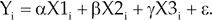<math display="block" overflow="scroll" xmlns="http://www.w3.org/1998/Math/MathML" xmlns:xlink="http://www.w3.org/1999/xlink"><mrow><msub><mi mathvariant="normal">Y</mi><mi mathvariant="normal">i</mi></msub><mo>=</mo><mi>&#945;</mi><msub><mrow><mi mathvariant="normal">X1</mi></mrow><mi mathvariant="normal">i</mi></msub><mo>+</mo><mi>&#946;</mi><msub><mrow><mi mathvariant="normal">X2</mi></mrow><mi mathvariant="normal">i</mi></msub><mo>+</mo><mi>&#947;</mi><msub><mrow><mi mathvariant="normal">X3</mi></mrow><mi mathvariant="normal">i</mi></msub><mo>+</mo><mi>&#949;</mi><mo>.</mo></mrow></math> 

其中：

- `Y[i]` 是第 $i^{th}$ 个目标变量的预测值。
- `X1[i]` 是特征 `X1` 的第 $i^{th}$ 个。
- `X2[i]` 是特征 `X2` 的第 $i^{th}$ 个。
- `X3[i]` 是特征 `X3` 的第 $i^{th}$ 个。
- `α`、`β`、`γ` 是特征 `X1`、`X2`、`X3` 的系数（或斜率）。
- `ε` 是常数项，也称为偏置项或截距。

训练过程将对整个训练集进行多次迭代，并计算 `α`、`β`、`γ` 和 `ε` 的最佳值。如果一组值使误差函数最小就被认为是更好的。误差函数是一个捕捉 `X[i]` 的预测值与实际值之间的数学函数。均方根误差（RMSE）是一种常用的误差函数，其数学表达式如下：

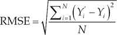<math display="block" overflow="scroll" xmlns="http://www.w3.org/1998/Math/MathML" xmlns:xlink="http://www.w3.org/1999/xlink"><mrow><mi mathvariant="normal">RMSE</mi><mo>=</mo><msqrt><mrow><mfrac><mrow><msubsup><mstyle vsize="140" displaystyle="true"><mo>&#8721;</mo></mstyle><mrow><mi>i</mi><mo>=</mo><mn>1</mn></mrow><mi>N</mi></msubsup><msup><mrow><mrow><mo>(</mo><mrow><mi>Y</mi><mi>i</mi></mrow></mo></mo>2372></mo></mo></mo></mfrac></mfrac></msqrt></math>math>

<math display="inline" overflow="scroll" xmlns="http://www.w3.org/1998/Math/MathML" xmlns:xlink="http://www.w3.org/1999/xlink"><msup><mi>Y</mi><mo>8372;</mo></math> 是预测值而 <math display="inline" overflow="scroll" xmlns="http://www.w3.org/1998/Math/MathML" xmlns:xlink="http://www.w3.org/1999/xlink"><mi>Y</math> 是参考或实际值。

实际上，线性回归试图找到一条拟合所有数据的直线在高维中为超平面）。线性回归的输出是一个连续的、无边界的值。它可以是正数或负数，取决于训练模型的输入。因此，线性回归模型通常用于预测连续数值。

具有大量变量的线性回归很难可视化。图 1.4 是两个变量特征变量 `X` 和目标变量 `Y` 的散点图。

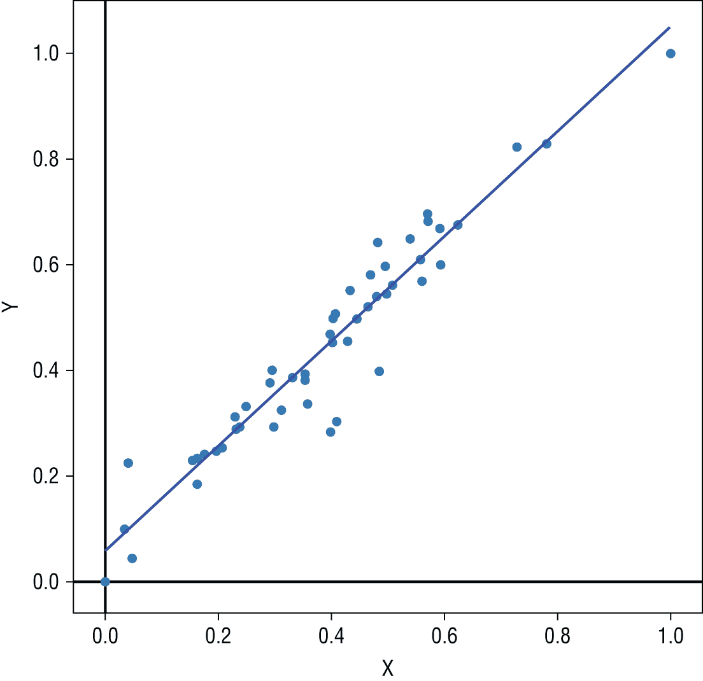

**图 1.4** 简单回归模型

两个变量的值都经过了归一化，以确保它们位于 0.0 到 1.0 之间。图中也绘制了回归线，正如你看到的，尽管它没有完美符合每一个点，但看起来是最佳拟合线。该方程表示如下：

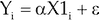<math display="block" overflow="scroll" xmlns="http://www.w3.org/1998/Math/MathML" xmlns:xlink="http://www.w3.org/1999/xlink"><mrow><msub><mi mathvariant="normal">Y</mi><mi mathvariant="normal">i</mi></msub><mo>=</mo><mi>&#945;</mi><msub><mrow><mi mathvariant="normal">X1</mi></mrow><mi mathvariant="normal">i</mi></msub><mo>+</mo><mi>&#949;</mi></mrow></math> 

回归线的系数 `α` 和截距项 `ε` 是通过训练过程确定的值，一旦知道了这些值，就可以将它们代入方程计算任何 `X` 值的预测 `Y` 值。

### 支持向量机


`支持向量机` (SVM) 是一种多功能模型，可用于分类、回归和离群点检测等多种任务。该算法最初由 Vladimir Vapnik 和 Alexey Chervonenkis 在 1963 年作为一种二分类算法发明出来（注：原文此处拼误为 Vladimir）。在训练过程中，支持向量机模型旨在创建一个决策边界，将数据点划分为不同的类别。如果数据集只有两个特征，那么这个决策边界就是二维的，并且可以方便地表示在散点图中。如果决策边界是线性的，它在二维空间中表现为直线，在三维空间中表现为平面，在 n 维空间中表现为超平面。作为人类，我们无法可视化三个以上的维度，这就是为什么为了理解 `SVMs` 的工作原理，我们将考虑一个具有两个特征的虚拟数据集的二维示例，其中每个点属于两个类别之一。我们还假设数据是线性可分的——也就是说，可以画出一条线将它们隔开。

图 1.5 展示了该虚拟数据点特征值的散点图，其中一类观测值用圆圈表示，另一类用星号表示。图 1.5 还展示了三种可能的线性决策边界，每种都能将观测值分为两个不同的集合。

红色决策边界距离第一组观测值太近，如果真实世界的观测值与训练集仅有微小，具有该决策边界的模型可能会对其进行错误分类。绿色决策边界存在类似的问题，因为它距离第二组观测值太近。蓝色的决策边界是最优的，因为它距离两个类别都尽可能远，同时清晰地划分了这两个类别。`SVM` 模型旨在找到这条蓝线，或者换句话说，旨在找到使边界两类观测值之间距离最大化的决策边界。间隔的半宽由希腊字母 `ε` (epsilon) 表示。位于间隔边缘上的点被称为`支持向量`（假设向量源于原点并终止于这些点）。实际上，可以说这些向量正支撑着间隔——因此被称为`支持向量`。

大多数现实世界的数据并不是线性可分的，如图 1.5 所示的数据集，因此线性决策边界无法清晰地划分类别。此外，即使数据是线性可分的，分离间隔也可能没有图 1.5 中的虚拟示例那样宽。数据点之间往往太近，无法在决策边界和两侧的支持向量之间留出宽且清晰的间隔。为了处理这个问题，`SVM` 实现包含了容差参数的概念，该参数控制位于间隔内部的支持向量数量，反之又影响间隔的宽度。设置较大的容差会导致更宽的间隔且间隔内有更多样本，而设置较小的容差值将导致窄间隔。具有宽间隔并不一定是坏事，只要间隔中的大多数点都在决策边界的正确侧。

基于 `SVM` 的分类器的真正威力在于它们创建非线性决策边界的能力。支持向量模型使用一种称为`kernel`（kernel）的数学函数，将每个输入点转换为高维空间，在该空间中可以找到线性决策边界。通过示例将这变得更容易理解。图 1.6 展示了另一个每个数据点具有两个特征的虚拟数据集的散点图，每个数据点属于两个类别之一。在这种情况下，很明显没有一条线性决策边界可以正确分类所有数据。

然而，如果你为数据增加一个维度（z 轴）并使用 `z = x² + y` 计算 `z` 值，那么数据将是线性可分的。这在图 1.7 中所示，无论你如何画直线，总会有一些样本位于错误的一侧。由于 `z = 0.3`，决策边界在二维空间中变成了非线性决策边界。这在图 1.8 中所示。

这是对核工作原理的简化，如果你对了解更多 `SVM` 感兴趣，应该阅读[Machines and Other Kernel Methods](https://www.cambridge.org/core/books/A6F056A4B23FC)。图 1.7 无法通过二维决策边界进行分类，但在三维空间中可以分类

图 1.5 三种可能的决策边界

图 1.6 无法通过线性决策边界进行分类

图 1.8 二维空间中的非线性决策边界

### 逻辑回归

*逻辑回归*尽管名称中带有“回归”一词，但它是一种用于构建二分类和多分类分类器的技术。逻辑回归（也称为逻辑回归）基于线性回归的输出，并返回数据点属于某一类的概率。回想线性回归的输出是连续无界的值，而概率是连续的有界值——边界在 0.0 到 1.0 之间。为了使用连续值进行二分类，逻辑回归通过将线性回归的输出输入逻辑函数，将其转换为 0.0 到 1.0 之间的概率值。在统计学中，逻辑函数是一种将值从 \[-负无穷, 正无穷\]转换为 \[0, 1\]的特定类型函数。

在逻辑回归的情况下，逻辑函数是 sigmoid 函数，其定义如下：

```
Sigmoid(x) = 1 / (1 + e^-x)
```

sigmoid 函数的图像在图 1.9 中所示。


# [图 1.9]](#c01.xhtml#R_c01-fig-0009) Sigmoid 函数

sigmoid 函数的输出可以通过设置阈值来用于二分类，将所有低于阈值的值视为类别 A，将所有高于阈值的值视为类别 B（参见图 1.10）。

逻辑回归本质上是一个二分类器，但对于目标变量可能属于两个以上类别的数据集，它也可以作为多分类器使用。对于多分类问题，有两种可以使用二分类器的两种基本方法。

- **一元对多方法（One-versus-rest approach）：** 这也称为 OVR 方法，它涉及创建多个二分类模型，每个模型预测输出属于某一个子类的概率。这种方法会为 N 个类别创建 N 个模型，多分类器输出的最终类别对应于预测概率最高模型。考虑流行的鸢尾花（Iris）数据集，目标变量可以取三个值之一 `[0, 1, 2]`，对应于鸢尾花的类型。在这种情况下，OVR 方法涉及训练三个逻辑回归模型。第一个模型预测输出类别为 0 或非 0 的概率。同样，第二个模型仅预测输出类别为 1 或非 1 的概率，依此类推。一元对多方法有时也称为一元对全方法（one-versus-all approach，简称 OVA）。

- **一元对一方法（One-versus-one approach）：** 这被称为 OVO 方法，它也涉及创建多个二分类模型，并选择输出最大概率值的模型对应的类别。OVO 方法与 OVR 方法的区别在于创建的模型数量。OVO 方法为每个输出类别的两两组合创建一个模型。在鸢尾花数据集的情况下，OVO 方法也会创建三个模型：

    - 预测输出类别为 0 或 1 的逻辑回归模型
    - 预测输出类别为 0 或 2 的逻辑回归模型
    - 预测输出类别为 1 或 2 的逻辑回归模型

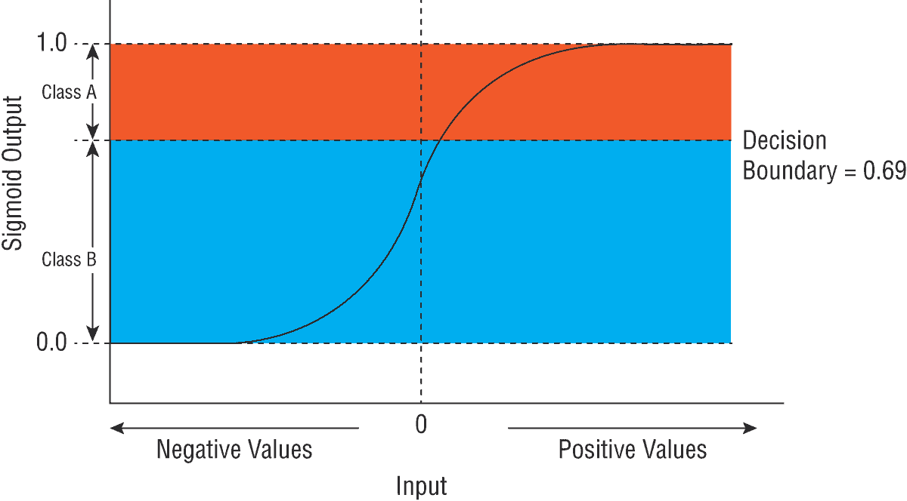

# [图 1.10]](#c01.xhtml#R_c01-fig-0010) 使用 sigmoid 函数进行二分类

如你所见，生成的模型数量随着特征数量的而增加。

虽然训练二分类模型的集成是构建多多分类模型的方法之一，但逻辑回归等算法可以被修改以从本质支持多分类。在逻辑回归的情况下，这种修改涉及在内部训练多个线性回归模型，并将 sigmoid 函数替换为另一个函数——softmax 函数。softmax 函数能够接收来自多个线性回归模型的输入并输出每个类别的概率。softmax 函数也称为归一化指数函数，其方程如图图 1.11 所示。

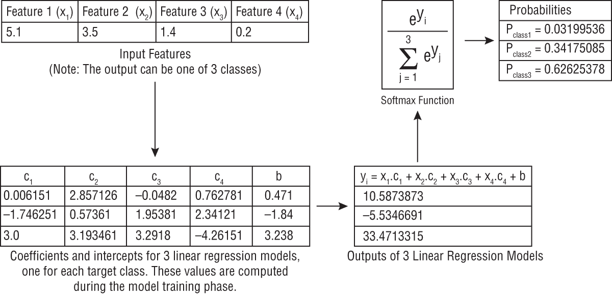

# [图 1.11]](#c01.xhtml#R_c01-fig-0011) Softmax 逻辑回归

为了理解该函数如何工作，请考虑一个数据集，其中每行包含四个连续数值属性和一个具有三个可能输出类别（0, 1, 2）的多分类目标。当在该数据集上训练 softmax 逻辑回归模型时，它内部将包含三个线性回归模型，每个对应一个目标类别。当使用模型进行预测时，每个线性回归模型将输出一个连续数值，该值被输入 softmax 函数，随后函数输出三个类别的概率。

### 决策树

决策树如其名，是树状结构，每个父节点代表一个决策边界，子节点代表决策的结果。树的最顶端节点被称为根节点。构建决策树模型涉及在根节点选择一个合适的属性进行决策，然后递归地划分树的节点，直到满足某些最优标准。

决策树是多功能的，既可以用于分类任务也可以用于回归任务。当用于分类任务时，它们本质上能够处理多分类问题，且不受单个特征尺度的影响。决策树的预测具有易于解释的优势；你只需要遍历决策树的节点，就能解释预测结果。对于神经网络等模型来说情况并非如此，因为无法解释模型为什么预测某些内容。像决策树这样让你轻松理解预测背后的逻辑的模型被称为白箱模型，而像神经网络这样不提供解释能力的模型被称为黑箱模型。

图 1.12 描述了一个在流行的鸢尾花数据集上训练的决策树。该数据集包含 150 行，每行包含四个特征变量和一个目标变量。四个特征变量分别是花萼长度、花萼宽度、花瓣长度和花瓣宽度（单位为厘米）。目标变量是一个字符串，可以取三个可能的值——setosa、virginica 和 versicolor——指示鸢尾花的品种。你将在第 8 章学习更多关于决策树的知识。

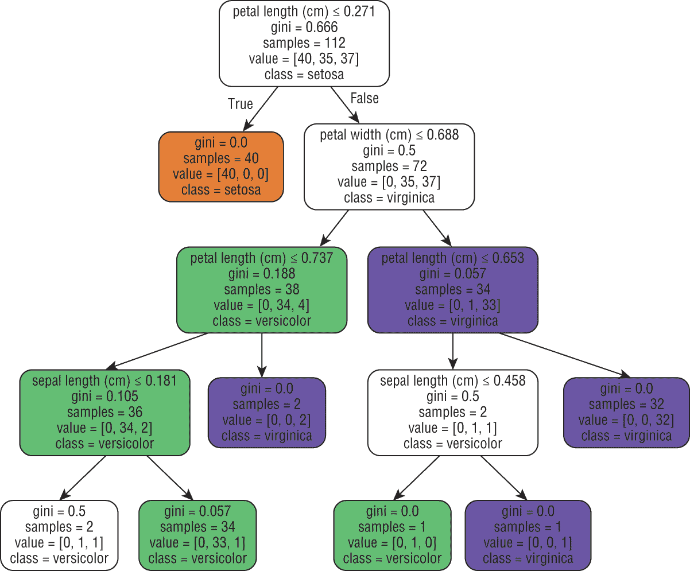

# [图 1.12]](#c01.xhtml#R_c01-fig-0012) 决策树可视化

表 1.1 包含了用于训练决策树的鸢尾花数据集五行样本。

[**表 1.1]](#c01.xhtml#R_c01-fig-0012)** 跨 100 个样本的数据类型和范围

| 花萼长度 (厘米) | 花萼宽度 (厘米) | 花瓣长度 (厘米) | 花瓣宽度 (厘米) |
| :--- | :--- | :--- | :--- |
| 5.1 | 3.5 | 1.4 | 0.2 |
| 4.9 | 3.0 | 1.4 | 0.2 |
| 4.7 | 3.2 | 1.3 | 0.2 |
| 4.6 | 3.1 | 1.5 | 0.2 |
| 5.0 | 3.6 | 1.4 | 0.2 |

要使用此决策树进行预测，从根节点的条件开始：`petal length <= 0.271`。该节点有两个分支；如果满足条件则遍历左分支，如果不满足则遍历右分支。然后重复此过程直到到达叶子节点，叶子节点关联的类别即为预测结果。决策树也可以用于回归问题，关键区别在于每个节点预测的是数值而非类别。

### 人工神经网络

人工神经网络（ANN）是由 Warren McCulloch 和 Walter Pitts 在 1943 年开发的计算工具，其设计灵感来源于生物神经网络。图 1.13 展示了简单人工神经网络的结构。

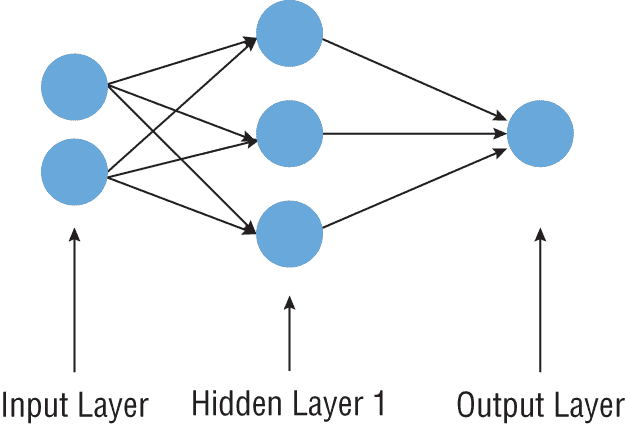

# [图 1.13]](#c01.xhtml#R_c01-fig-0013) ANN 的结构

人工神经网络由称为*神经元*的单元组成，并组织成一系列层。有三层：

- **输入层**：直接接收计算输入。人工神经网络只有一个输入层。

- **输出层**：提供计算输出。根据网络用于解决的问题类型，该层可以包含一个或多个神经元。


- **隐藏层：** 位于输入层和输出层之间。输入层的神经元连接到隐藏层的神经元，而隐藏层的神经元又连接到输出层的神经元。当某一层中的所有神经元都连接到前一层的每一个神经元时，该网络被称为`全连接网络`。简单的神经网络不一定有隐藏层，而复杂的神经网络（如深度学习网络）具有多个隐藏层，每层包含大量的神经元。

神经元之间的每个连接都关联有一个权重值；该权重乘以连接起始神经元的值。每个神经元的工作原理是计算其输入的和，并将该和传递通过非线性激活函数。神经元的输出值即为激活函数的结果。图 1.14 展示了一个具有两个输入层神经元和一个输出层神经元的简单神经网络。

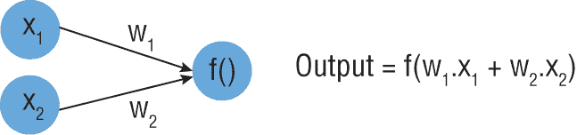

`图 1.14` 简单神经网络

如果 `x[1]`、`x[2]` 是加载到输入层神经元的值，如果 `w[1]`、`w[2]` 是输入层和输出层之间的连接权重，且 `f()` 是输出层神经元的激活函数，那么图 1.14 中神经网络的输出值为 `f(w[1].x[1] + w[2].x[2])`。

存在许多不同类型的激活函数，它们各自有优缺点。设置激活函数是为了确保网络不仅仅是一个庞大的线性模型。当实例化神经网络时，权重被设置为随机值。训练神经网络的过程涉及寻找权重的值。

有许多不同类型的神经网络架构；深度学习领域处理的是具有多个隐藏层的神经网络，每层可以有几十个、甚至上百个神经元。卷积神经网络（CNNs）是一类深度神经网络，它们包含一系列被称为`卷积`层和`池化`层的隐藏层。卷积神经网络通常用于基于图像的任务，如目标检测和场景分析。卷积层执行一种在图像处理社区中被称为`卷积`的过滤操作，其目的是转换输入数据以找到有用特征。池化层执行下采样，其目的是使生成的模型对输入的细微变化具有鲁棒性。

基于神经网络的模型使用库进行训练，这些库允许通过组合不同类型的层来快速创建网络。这些库通常提供高效的训练方法。你可以从头创建一个 CNN 架构，或者更常见的是使用著名的 CNN 架构，如 `LeNet`、`AlexNet`、`VGGNet` 和 `ResNet50`。由于训练神经网络是一项耗时任务且需要大量数据，Apple 在 `https://developer.apple.com/machine-learning/models/` 基于流行的 CNN 架构提供了几个预训练模型。

神经网络模型的优点是能够处理复杂的问题空间，如语音识别、图像理解等。神经网络模型的缺点是需要大量数据进行训练，并且无法确定为什么基于神经网络的模型会产生特定的输出。

## 机器学习数据集的来源

训练机器学习模型需要高质量的数据。事实上，缺乏高质量训练数据会导致即使使用最先进机器学习算法构建的模型性能不佳。在这种情况下，`质量`指的是训练数据准确捕获底层问题领域细微差别的能力，并且合理地没有错误和遗漏。接下来将介绍一些公共可用机器学习数据的常见来源。

### Scikit-learn 数据集

Scikit-learn 中的 `datasets` 包包含了流行机器学习数据集的下采样版本，如 `Iris`、`Boston` 和 `Digits` 数据集。这些数据集通常被称为`toy`（玩具）数据集，当你学习使用现有的机器学习算法或正在构建新算法并需要一个小型知名数据集在使用时，它们非常有帮助。

Scikit-learn 提供了函数，可以将玩具数据集加载到具有以下属性的类字典对象中：

- `DESCR`: 返回关于数据集的人类可读描述。
- `data`: 返回数据集的特征。
- `feature_names`: 返回特征的名称。
- `target`: 返回目标值。

```python
from sklearn import datasets
iris_dataset = datasets.load_iris()
print(iris_dataset.DESCR)
print(iris_dataset.data)
print(iris_dataset.feature_names)
print(iris_dataset.target)
```


- **糖尿病发病数据集 (Onset of diabetes dataset):** 这是一个用于构建回归模型的流行数据集。该数据集的玩具版本可以使用 `load_diabetes()` 函数加载。该数据的完整版本可以在 `http://www4.stat.ncsu.edu/˜boos/var.select/diabetes.html`找到。
- **手写数字数据集 (Handwritten digits dataset):** 这是一个包含 0 到 9 手写数字图像的数据集，用于分类任务。该数据集的玩具版本可以使用 `load_digits()` 函数加载。该数据的完整版本可以在 `http://archive.ics.uci.edu/ml/datasets/Optical+Recognition+of+Handwritten+Digits`找到。
- **Linnerud 数据集 (Linnerud dataset):** 这是一个测量中年男性运动变量的数据集，用于多元回归。该数据集的玩具版本可以使用 `load_linnerud()` 函数加载。该数据集的完整版本可以在 `https://rdrr.io/cran/mixOmics/man/linnerud.html`找到。
- **葡萄酒识别数据集 (Wine recognition dataset):** 该数据集是对意大利种植葡萄酒进行化学分析的结果。它用于分类任务。该数据集的玩具版本可以使用 `load_wine()` 函数加载。该数据的完整版本可以在 `https://archive.ics.uci.edu/ml/machine-learning-databases/wine/`找到。
- **乳腺癌数据集 (Breast cancer dataset):** 该数据集描述了乳腺癌肿瘤细胞核的特征。它用于分类任务。该数据集的玩具版本可以使用 `load_breast_cancer()` 函数加载。该数据的完整版本可以在 `https://goo.gl/U2Uwz2`。

### AWS 公共数据集

Amazon 托管了一个公共机器学习数据集库，可以轻松集成到部署在 AWS 上的应用程序中。数据集以 S3 桶或 EBS 卷的形式提供。S3 桶中的数据集可以使用 `AWS CLI`、`AWS SDKs` 或 `S3` HTTP 查询 API 访问。EBS 卷中的数据集需要挂载到 `EC2` 实例。公共数据集包含以下类别：

- **生物学 (Biology):** 包括人类基因组计划等流行数据集。
- **化学 (Chemistry):** 包含多个版本的 PubChem 其他内容。PubChem 是一个化学分子数据库，可以通过 `https://pubchem.ncbi.nlm.nih.gov` 访问。
- **经济学 (Economics):** 包括人口普查数据和其他。
- **百科 (Encyclopedic):** 包括维基百科内容和其他。

你可以在 `https://registry.opendata.aws` 浏览 AWS 公共数据集列表。

### Kaggle.com 数据集

`Kaggle.com` (http://kaggle.com) 是托管机器学习竞赛的流行网站。`Kaggle.com` 还包含大量供通用使用的的数据集，可以通过 `https://www.kaggle.com/datasets` 访问。除了页面上列出的通用数据集外，Kaggle.com 上的竞赛赛也有自己的数据集，可以通过参加比赛来访问。数据集文件可以下载到你的本地计算机，然后加载到 `Pandas` 数据帧中。你可以在 `https://www.kaggle.com/competitions` 获取当前和过去比赛的列表。

### UCI 机器学习仓库

UCI 机器学习仓库是一个包含 450 多个数据集的公共集合，由加州大学欧尔文分校的机器学习与智能系统中心维护。它是机器学习数据集最古老的来源之一，也是初学者和资深专业人士的首选地。数据集由公众提供，根据你将其用于模型构建时所需的预处理程度而异。数据集可以下载到你的本地计算机，然后使用 `Pandas` 和 `Scikit-learn` 等工具进行处理。你可以在 `https://archive.ics.uci.edu/ml/datasets.php` 浏览完整的数据集列表。

部分流行的 UCI 机器学习仓库数据集也托管在 `Kaggle.com` 上，可以通过 `https://www.kaggle.com/uciml` 访问。

### 总结

- 机器学习是人工智能的一个分支，涉及创建从数据中学习的算法。
- 机器学习处理创建能够可靠且快速地泛化和预测信息的程序的问题。
- 机器学习通常用于实施欺诈检测系统、信用评分系统、身份验证决策引擎、生物识别系统、流预测和产品推荐引擎。
- 用于训练机器学习所需的训练数据类型可以将机器学习系统分类为监督学习、无监督学习或半监督学习。
- 批量学习 (Batch learning) 指在使用模型进行预测之前，在整个数据集上训练机器学习模型的方法。
- 增量学习 (Incremental learning)，也称为在线学习，是指使用小批量数据连续训练机器学习模型，并逐步提高模型性能的方法。
- 基于实例的学习系统 (Instance-based learning) 通过从训练数据集中选取最近的实例来对新的未见数据进行预测。
- 基于模型的学习系统 (Model-based learning) 尝试构建一个数学、分层次或基于图的模型，对输入与输出之间的关系进行建模。

# 第 2 章：机器学习方法

在上一章中，你学习了机器学习的基础知识、与机器学习系统相关的术语以及不同类型的模型。在本章中，你将研究一个假设的场景，即设计一个基于规则的系统来处理信用卡申请。随后将检查基于规则系统的局限性，并设计一个机器学习系统来解决这些局限性。本章将以概述构建典型的机器学习解决方案的步骤作为结束。

当你完成本章时，你应该对机器学习系统是如何构建的及其相对于传统方法的优势有更好的理解。

## 传统的基于规则的方法

作为人类，我们熟悉学习的概念。学习主要有两种形式——记忆和理解。记忆你的密码和学习开车驾驶之间有明显的区别。后者涉及理解车辆如何工作以及在道路上不同情况下如何做出反应。你不需要记忆在家里和公司之间开车需要执行的精确活动序列；相反，你是在评估道路状况时应用你所获得的理解。

机器学习算法的能力并不像人类学习那样复杂。机器没有理解和推理的能力；然而，它们可以预测和泛化，并且处理数据的速度比人类快得多。在这一节中，你将研究一个假设的情况，并理解如何应用机器学习系统来解决当前的问题。

假设你被一家银行的信用卡团队聘用，并被赋予创建一个解决方案以向客户提供新的信用卡产品任务。符合条件的客户可以根据这项新产品获得信用额度高达 25,000 美元且利率的信用卡。银行希望将损失降到最低，并要求只向可能向银行还款的客户提供信用卡。

从这里开始，你决定创建一个新的申请表，客户需要填写该表以申请此信用卡。在申请表上，你询问了以下信息：

- 姓名
- 年龄
- 性别
- 现居住地址年限
- 过去五内的地址数量


* 在其他银行持有的信用卡数量
* 贷款总额（不含抵押贷款）
* 税后总收入
* 预计每月常规支出
* 每月还还款总额
* 房屋主身份
* 婚姻状况
* 家庭中抚养人数

在现实场景中，你还会要求更多信息，并使用信用评分公司来提供申请人的信用评级，但对于本示例而言，这个列表足够了。我们还假设允许客户申请信用卡的机制在银行网站上已经可用，并且所有申请表的数据都存储在银行 `SQL` 数据库的一张表中。

当产品发布时，你的银行预计该产品深受客户欢迎，因此你需要制定一个计划来处理每周大量的申请。对于你的银行来说，在信用卡领域保持竞争力也至关重要，因此，你不能让申请人等待数周才能得知信用卡申请的结果。你需要确保银行的标准服务条款适用于你的新产品，因此，至少有 51% 的信用卡申请需要在银行收到申请后的几分钟内做出决定。

显然，雇佣几百名分析师来逐一审查提交的贷款申请并进行必要的检查以做出决策是不符合效益的。在你面前，你有两个选择：

* 你可以构建一个基于规则的决策系统。
* 你可以构建一个机器学习系统。

在本中，你将研究如何构建基于规则的系统并将其应用于审查贷款申请的问题。在下一节中，你将研究如何使用机器学习算法构建类似的系统。

为了实现基于规则的系统，你决定将业务规则存储在数据库中，并将将规则应用于新贷款申请的逻辑封装在服务器端应用程序中。你计划拥有这样一个服务器集群，并根据需要进行扩展以处理不断增加的量。图 2.1 描述了所提系统的架构。

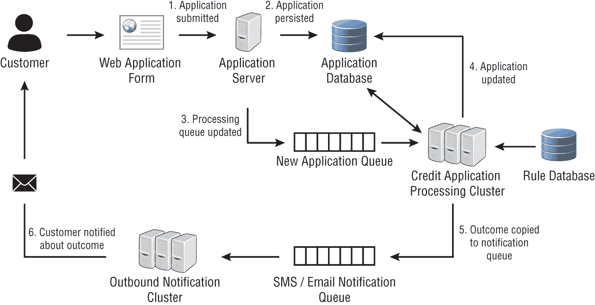

FIGURE 2.1 基于规则的决策系统的架构

当申请人在银行网站上提交信用卡申请时，会生成一个唯一的卡申请标识符，Web 应用程序向数据库添加记录。Web 应用程序还会向消息队列发布一条消息。该消息的内容包含唯一的申请标识符。一个贷款处理服务器集群订阅该消息队列，第一个可用的服务器将获取消息并开始处理信用卡申请。当服务器做出决策时，它将更新数据库中的贷款申请并在另一个消息队列上发布消息。这条新消息的内容将包含向客户发送短信或电子邮件通知所需的所有信息，告知客户结果。

你如何定义用于做出决策的规则？首先，你需要根据你对该问题领域的经验以及你认为有利的贷款申请表特质来创建规则。如果你的业务有另一个你的解决方案正试图替换的基于规则的系统，那么你可能可能还可以从现有系统中迁移一些规则。

假设你无法访问现有系统，需要自己定义业务规则。查看你的贷款申请表中的字段，你决定在决策过程中可以丢弃以下字段，因为你认为它们可能对个人维持按月还款的能力没有影响：

* 姓名
* 性别
* 婚姻状况
* 家庭中抚养人数
* 房屋主身份

你现在留下了以下可以用于构建规则的信息：

* 在当前地址居住的年限
* 过去五内的地址数量
* 在其他银行持有的信用卡数量
* 贷款总额（不含抵押贷款）
* 税后总收入
* 预计每月常规支出
* 每月还款总额

你决定创建规则来拒绝符合以下任一标准的标准的申请：

* 在当前地址居住不满一年的申请人
* 在过去五年中有三个以上地址的申请人
* 在其他银行持有两张或以上信用卡的申请人
* 每月可用收入低于税后总收入 15%的申请人

这些规则可以使用任何编程语言通过 `if-then-else` 语句进行编码。图 2.2 包含一个使用你所定义的规则描述决策过程的流程图。

你所创建的规则和初始假设可能并非最优，但如果你观察到由于逾期导致的损失超过了银行的风险阈值，你可以随时调整规则。随着时间的推移，由于申请量的增加，你需要调整业务规则来处理增加的量。你可能会遇到一些问题：

* 你的规则变得复杂且相互依赖；用新规则替换旧规则变得越来越复杂。
* 你的规则没有基于任何数值分析；它们是为了应对日益增长的需求而临时创建的。
* 你的规则没有考虑到经济不断变化的模式。例如，在衰退期间，可能会更多的人最终未能还款，尽管你的规则预测他们不应该。你需要不断更新规则，这可能是一个耗资且耗时的过程。

现在让我们看看如何使用机器学习系统来解决这些问题。

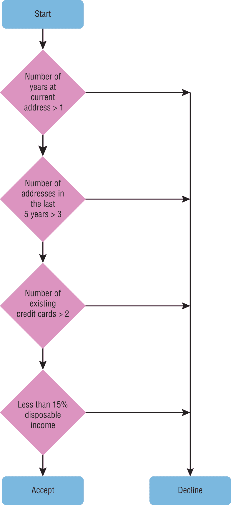

FIGURE 2.2 描述基于规则的决策过程的流程图

## 机器学习系统

与基于规则的解决方案不同，没有历史数据你就无法创建机器学习解决方案。对于要解决的问题，拥有准确相关的数据很重要。你可能会被来自其他贷款（例如个人贷款）的数据来构建你的机器学习模型。这是不建议的。

你可能会奇怪，为什么在构建基于规则的系统时不需要历史数据，为什么仅根据问题的直觉理解来定义规则就足够了。因为在基于规则的方法中，你是根据对问题领域的个人知识和经验来定义规则的。另一方面，机器学习系统并不具备对问题领域的任何先验知识，也不具备人类的直觉能力。相反，机器学习系统尝试完全从它遇到的数据中进行自我推断。你不仅需要数据，还需要相关的数据。如果用于训练机器学习系统的数据与系统被要求进行预测时遇到的数据显著不同，那么预测很可能是错误的。


你到底需要多少数据？这个问题没有简单的答案。通常情况下，机器学习算法需要大量数据才能进行有效训练，但关的不仅是数量，数据的质量也同样重要。如果你的数据中有太多遵循特定趋势的样本，那么你的机器学习系统将偏向于该趋势。

为了本示例的目的，假设你已经决定从数据库中随机选取 5,000 名申请者的数据，并将这些行导出到 `CSV` 文件中。这些人都是申请过你的信用卡产品的申请人，他们要么按时定期还款，要么至少错过了一次还款。在这种情况下，输入变量将表单上问题的答案；目标变量将是一个 `Boolean` 值，用于指示申请人是否至少错过过一次还款。

这种已经知道目标变量值的数据被称为 `labeled data`（标记数据），通常用于训练机器学习模型。并不是所有数据都是标记的；事实上，世界上绝大多数数据都是未标记的。使用未标记（或部分标记）数据来训练机器学习算法是一个活跃的研究领域。

如果你想构建机器学习解决方案，但完全没有自己的数据，且无法等待几个月（或几年）来收集高质量的标记数据怎么办？在这种情况下，最好的选择是从互联网上的免费/付费来源中找到现有数据集，这些数据集要与你工作的领域尽可能接近。第 1 章 提供了几个公共机器学习数据集的链接。

### 选择输入特征

一旦你收集了标记的输入数据，你就需要对数据进行基础统计分析，以挑选可能相关的输入变量，并为机器学习模型准备输入数据。将数据存储在 `CSV` 文件中便于加载到数据分析工具中。大多数云数据分析工具允许你上传 `CSV` 文件，某些工具还支持从云关系型数据库导入数据。

数据可视化技术通常用于指示单个特征的分布和相关性。你可能会使用一组初始特征构建并训练模型，并在模型进行预测时计算性能指标的值。然后你将使用额外的输入特征重新训练模型，只要观察到性能指标的值有显著改进就重复此过程。

你选择的特征数量也会影响你可能需要的数据集的大小。具有三个特征的模型可以使用 500 个项目的数据集构建，而具有 10 个特征的模型可能需要包含数千个项目的训练数据集。

可能会让你惊讶的是，数据科学家大部分的工作是查看数据并研究使用数据的方法。这项工作通常被称为 `data munging`（数据清洗），它涉及几个步骤，包括但不限于以下步骤：

* 查看数据中是否存在缺失值
* 找出处理缺失值的最佳方法
* 检查数据的统计分布
* 检查输入变量之间的相关性
* 通过拆分或组合现有输入变量创建新的输入变量

`Python`、`Jupyter Notebook`、`NumPy`、`Pandas` 和 `Matplotlib` 常用于统计分析和特征工程。附录 B 提供了介绍。

现在让我们申请单上的问题，并根据个人经验进行一些特征工程，以获得我们机器学习模型的输入。表 2.1 列出了申请单上的所有问题及其类型、范围和在 5,000 个样本中观察到的实际值。

### 表 2.1：类型与范围

| 问题 | 数据类型 | 实际范围 |
| :--- | :--- | :--- |
| 性别 | categorical | 女性，未披露 |
| 年龄 | continuous | 18–45 |
| 现址的年限 | continuous | 0–7 |
| 最近五年的地址数量 | continuous | 0–6 |
| 银行持有的卡数 | discrete | 0–10 |
| 贷款总额（不含房贷） | continuous | 5000–50000 |
| 税后总收入 | continuous | 30000–200000 |
| 预计每月支出 | continuous | 300–15000 |
| 房主状态 | categorical | 是，否 |
| 婚姻状况 | categorical | 单身，已婚，未披露 |
| 家庭抚养人口人数 | discrete | 0–10 |

很明显，某些答案是分类的，而另一些是数值。数值特征是离散的或连续的，具有不同的范围。大多数机器学习模型对大值也敏感。在检查问题类型后，你决定将所有答案作为输入特征，除非：

* 申请人姓名
* 抚养人口人数
* 银行持有的卡数

你还决定构建一个名为 `Total Income`（总收入）的新特征，并将分类特征转换为数值特征，如表 2.2 所示。

### 表 2.2：将分类特征转换为数值

| 原始分类特征 | 新数值特征 | 允许值/范围 |
| :--- | :--- | :--- |
| 性别 | SexIsMale | 0 或 1 |
| | SexIsFemale | 0 或 1 |
| | SexIsUndclosed | 0 或 1 |
| 房主状态 | IsHomeOwner | 0 或 1 |
| | IsNotHomeOwner | 0 或 1 |
| 婚姻状况 | MaritalStatusIsSingle | 0 或 1 |
| | MaritalStatusIsMarried | 0 或 1 |
| | MaritalStatusIsUndclosed | 0 或 1 |

新工程的特征 `Total Disposable Income`（总可支配收入）定义如下：

```Total Disposable Income = Total Income After tax - Monthly outgoings - Monthly Loan Repayments
```


特征工程

特征工程技术在第三章中有所介绍，但值得注意的是，那些回答为“未披露”的问题被视为一等值处理，并且通过创建特征变量 `SexIsUndisclosed` 和 `MaritalStatusIsUndisclosed` 来捕捉未提供答案这一事实。如果不将缺失答案视为有意义的数据，你将需要拒绝申请表，或者尝试用平均值或中位数来填充缺失的答案。

表 2.3 列出了新的一组输入和工程特征、每个特征的预期值范围，以及在 5,000 份申请表中观察到的实际值范围。

**表 2.3**：**修改后的输入特征

| 特征名称 | 特征描述 | 数据类型 | 观测范围 | 最大范围 |
| --- | --- | --- | --- | --- |
| F1 | 年龄 | 连续型数值 | 22–45 | 18–150 |
| F2 | 性别为男性 | 离散型数值 | 0, 1 | 0 或 1 |
| F3 | 性别为女性 | 离散型数值 | 0, 1 | 0 或 1 |
| F4 | 性别未披露 | 离散型数值 | 0, 1 | 0 或 1 |
| F5 | 在当前地址居住年数 | 连续型数值 | 0–7 | 0–150 |
| F6 | 过去 5 年的地址数量 | 连续型数值 | 1–6 | 0–10 |
| F7 | 总可支配收入 | 连续型数值 | 0–5000 | 0–1000 万 |
| F8 | 贷款总额（不含房贷） | 连续型数值 | 0–17500 | 0–1000 万 |
| F9 | 税后总收入 | 连续型数值 | 50000–200000 | 0–1000 万 |
| F10 | 预计每月常规支出 | 连续型数值 | 3000–15000 | 0–1000 万 |
| F11 | 每月总还款额 | 连续型数值 | 0–1500 | 0–1000 万 |
| F12 | 房业主 | 离散型数值 | 0, 1 | 0 或 1 |
| F13 | 非业主 | 离散型数值 | 0, 1 | 0 或 1 |
| F14 | 婚姻状况单身 | 离散型数值 | 0, 1 | 0 或 1 |
| F15 | 婚姻状况已婚 | 离散型数值 | 0, 1 | 0 或 1 |
| F16 | 婚姻状况未披露 | 离散型数值 | 0, 1 | 0 或 1 |

显然，特征允许值的范围并不完全相同。例如，`F1` 的值处于 `[18,100]` 范围，而其他特征值则处于 `[0,1]`、`[0, 150]`、`[1,10]` 和 `[0, 10000000]` 范围内。在使用这些数据之前，你需要将所有特征的值归一化，使其处于相同的范围 `[0, 1]` 内。归一化在第三章中有所介绍，涉及转换每个特征的值使其落在 `[0, 1]` 区间内。你需要对训练数据以及你的解决方案将进行预测的数据进行归一化。

你也可以选择通过定义值范围将数值特征转换为分类特征。例如，*税后总收入*问题的响应（在 0 到 1000 万之间）可以转换为以下分类值之一：

* `0 到 1 万之间`
* `1 万到 5 万之间`
* `5 万以上`

特征工程本身没有绝对的对错之分，有时关键在于特征的选择。

### 准备训练集和测试集

交叉验证有助于减少模型捕捉训练集中意外偏差的可能性。交叉验证的思想是将整个模型构建数据集洗牌，并将其分为若干较小的集合（称为`折`）。例如，如果数据被分为 10 折，则将训练并评估 10 个不同的模型。每个模型将使用相同的超参数。模型之间的唯一区别在于训练时使用的数据。其中一折被留作测试集，其余的组成训练集。这如图 2.3 所示。

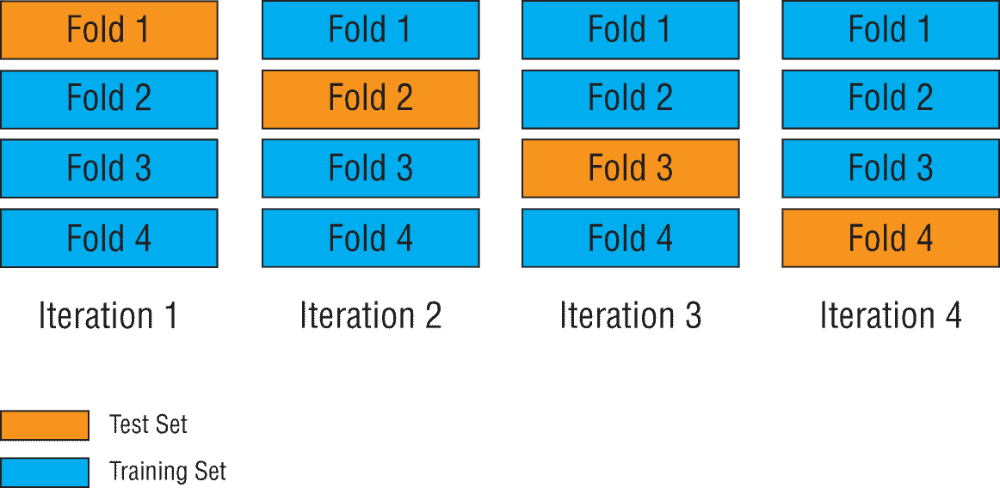

**图 2.3** 使用四折交叉验证

模型在各自测试集上的性能会被记录，并使用性能指标的平均值来评估模型的质量。

有时偏差是在数据收集阶段引入的（称为*采样偏差*），任何交叉验证都无法消除它。例如，你可能正在处理一个捕捉消费者趋势并在圣诞假期期间收集的数据集。这些数据将对特定的假日购物趋势产生偏差，如果使用该模型来预测全年的购买情况，其表现将会很差。在这种情况下，最佳选择是收集更多数据以消除采样偏差。

### 选择机器学习算法

有很多机器学习算法可以用于分类任务。在当前示例中，目标是在申请时决定是否应向申请人发放信用卡。做出此决策的机器学习系统将在标记数据上进行训练，这些标记指示客户历史上是否错过过还款（负面结果）或客户从未错过任何还款（正面结果）。


是否签发信用卡的决定直接取决于机器学习系统指示客户是否会违约。这是一个典型的分类问题，可以使用许多算法：

* 逻辑回归
* 决策树
* 随机森林
* XGBoost
* 神经网络
* 基于聚类的技术

算法的选择通常受多种因素影响，例如：期望的准确率、所需的类别数量（二分类与多分类）、是否有足够的训练数据可可用、训练模型所需的时间、训练后模型的内存占用，以及将模型部署到生产环境中所需的资源。

在例例中，我们将使用一种名为`logistic regression`（逻辑回归）的算法，该算法在二分类问题中表现良好。二分类问题涉及将某物归为两类之一，并在第 1 章中介绍。逻辑回归模型的工作原理是通过训练一个线性回归模型，然后将线性模型的连续实值输出传递给映射函数（例如 `sigmoid` 函数）。

`sigmoid` 函数将范围在 `[-∞, +∞]` 之间的连续实值转换为 `[0, 1]` 范围内的数值。由于 `sigmoid` 函数的输出是 0 到 1 之间的数字，你可以选择一个合适的阈值，并将所有高于该阈值的视为正类结果（签发信用卡），将所有低于阈值的值视为负类结果（不签发信用卡）。这在图 2.4 中所示。

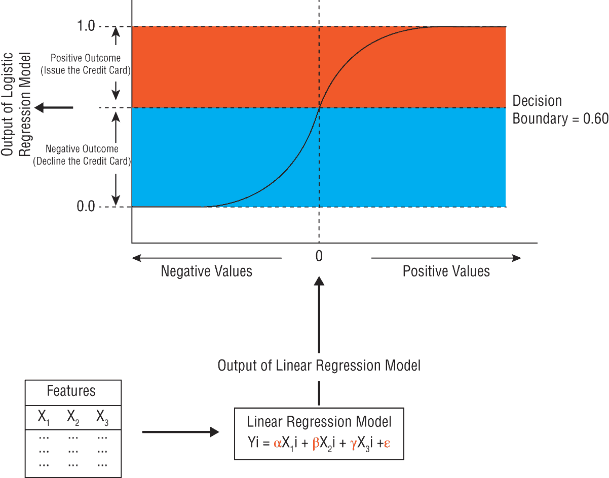

`FIGURE 2.4` 使用 sigmoid 函数进行二分类

阈值的选择是任意的，不同的值将产生不同的结果。逻辑回归模型中的阈值是一个超参数，可以通过调整来获得更好的结果。逻辑回归易于理解；然而，如果目标变量与输入特征之间的关系非常复杂，它可能无法提供良好的结果。在这种情况下，你可以考虑使用基于树的模型（如决策树）或基于实例学习的聚类模型（如 `k-means`）。

### 评估模型性能

一旦你构建了一个可以用于确定判断申请人是否应该签发信用卡的模型，你就能够量化地衡量它的性能，并在理想情况下对模型进行微调以提高性能。评估模型的目的是确定它在训练期间未遇到过的数据上表现如何。你构建的第一个模型通常称为 `baseline model`（基准模型），其性能在标记的测试集上进行评估，该测试集在训练过程中未被使用。一旦有了基准模型，你通常会尝试不同的超参数组合，以找到比基准版本性能更好的模型。

然而，模型的最终性能是使用单独的标记验证集评估的，该验证集是在数据集准备阶段预留的。评估模型涉及使用模型在测试/验证集上进行预测，并计算一个量化指标，以指示预测结果与预期结果之间的偏差。

用于评估机器学习模型的指标取决于模型的类型以及模型所被用的任务。由于本例中的模型试图解决二分类问题，你可以简单地统计模型预测正确结果的次数，并将其作为一种粗略的评估指标。

这个简单的指标是否有任何意义，取决于属于每个类别的样本比例以及类别本身的重要性。例如，如果一个测试集包含 100 个样本，其中 50 个属于 A 类，另外 50 个属于 B 类，且两类对该问题领域的重要性相同，那么一个预测准确率为 80% 的模型是易于理解的。

然而，如果测试集中的 95 个项目属于 A 类，只有 5 个属于 B 类，那么一个预测准确率为 80% 的模型表现就没那么好了。如果该模型旨在预测个人是否患有致命疾病，而那 5 个 B 类样本是唯一指示存在疾病的样本，那么情况可能会变得糟糕得多。这并非你想象中那么不可能。在普通人口的随机样本中，极有可能会有少数患有特定疾病的人员。

为了更好地了解模型的性能，你需要一组能够捕捉类别级性能的指标。主要指标列在下面。这些指标假设两个类别中的一个代表正类结果，而另一个代表负类结果。在信用卡申请系统中，签发信用卡可以定义为正类结果。

* `True positive count`（真阳性计数）：模型预测为正类且正确的次数
* `False positive count`（假阳性计数）：模型预测为正类但错误的次数
* `True negative count`（真阴性计数）：模型预测为负类且正确的次数
* `False negative count`（假阴性计数）：模型预测为负类但错误的次数

这种类别级的预测准确率有时称为 `confusion`（混淆），当这四个主要指标被放在 2×2 矩阵中，生成的矩阵被称为 `confusion matrix`（混淆矩阵）。图 2.5 展示了一个混淆矩阵并解释了每个数字的含义。

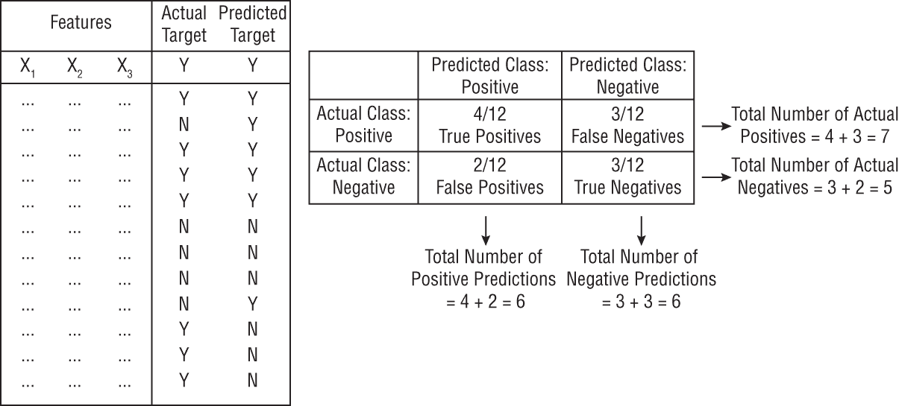

`FIGURE 2.5` 

除了这些主要指标外，数据科学家在二分类中还使用以下二级指标。这些指标的值是从主要指标计算出的。

* `Accuracy`（准确率）：定义为 `(TP + TN) / (预测总数)`。这基本上等于统计模型预测正确值的次数。
* `Precision`（精确率）：定义为 `TP / (TP + FP)`。如果你查看图 2.5，你会发现分母是模型预测的正类总数。因此，精确率也可以写为 `TP / (预测预测总数)`，它衡量了你的模型的精确程度。当假阳性的代价很高时，精确率是一个很好的衡量标准。该值越接近 1.0，正类预测越精确。
* `Recall`（召回率）：定义为 `TP / (TP + FN)`。查看图 2.5，你会发现该表达式的分母是数据集中正类样本的实际数量。因此，计算召回率的表达式可以重写为 `TP / (测试集中正类样本总数)`。当假阴性的代价很高时，召回率是一个很好的衡量标准。


数据科学家经常使用一种称为受者工作特征（ROC）曲线的可视化工具以及一种称为 ROC 曲线面积（AUC）的指标来评估分类模型的质量。ROC 曲线是通过通过在 0.0 到 1.0 之间的阈值之间计算的一系列不同的混淆矩阵，将真正例率绘制在 x 轴、假正例率绘制在 y 轴上得到的。图 2.6 展示了在相同数据上训练的两种不同类型二分类模型的 ROC 曲线。

在比较不同二分类模型的性能时，AUC 指标较大的模型通常性能更好。

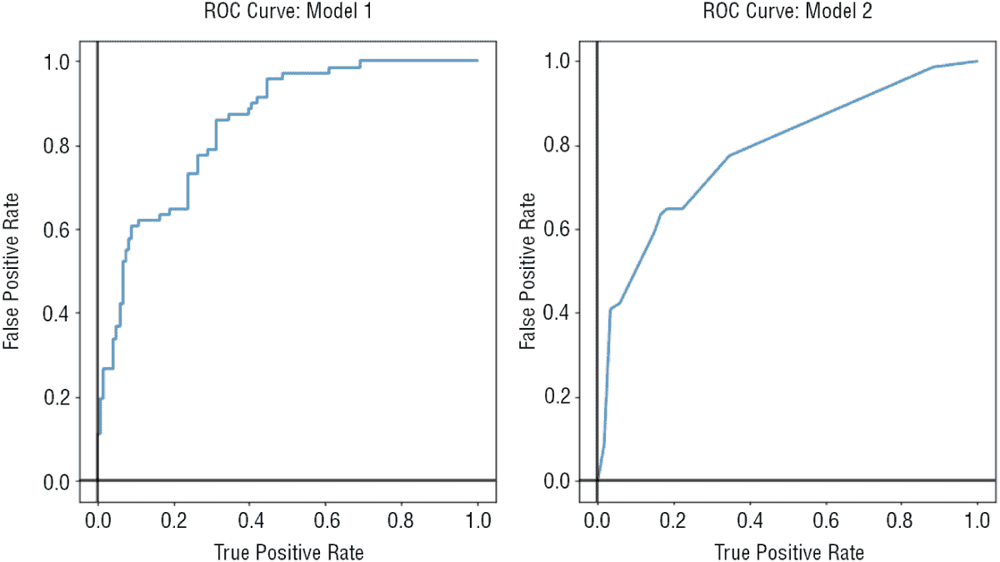

图 2.6 两个二分类模型的 ROC 曲线

## 机器学习流程

在上一节中，你学习了传统方法与机器学习方法之间的区别。在本节中，你将获得构建机器学习系统所涉及的步骤总结。

### 数据收集与预处理

这是该流程的第一阶段，通常是数据科学家花费大部分时间的地方。很少有数据科学家手头有现成的高质量数据。通常，想要训练和部署机器学习解决方案的公司必须等待通过各种手段（如实时传感器、分析数据馈、客户问卷、应用程序日志等）捕获足够的训练数据。即使获得了足够数量的数据，这些数据也不可能以其初始形式直接使用。例如，典型移动应用程序捕获的分析数据是一个 `JSON` 或 `XML` 对象，记录了时间戳、用户正在查看的屏幕名称、用户点击的单元界面元素名称、IP 地址等信息。如果数据是日志消息，那么它可能更加晦涩，只有少数理解创建日志消息时所用规范的人才能解读。

正如你想象的，大量的精力被投入到对多个源的数据进行清洗、富化和组合中，以便工程出有意义特征。如果数据科学家使用的算法需要监督训练，那么数据科学家还必须以某种方式对所有数据进行标记。

### 训练集、测试集和验证集的准备

一旦有了足够的训练数据，下一步是将主数据集打乱并分为的训练集、测试集和验证集。每个数据集的作用描述如下：

*   **训练集：** 训练集由标记项组成，用于训练模型。换句话说，你的机器学习模型将处理这些数据并从从中学习模式。
*   **测试集：** 测试集由标记项组成，并与训练集不同。测试集的目的是计算模型在训练阶段未遇到过的数据上的性能。如果发现模型性能不够好，数据科学家会调整模型的一个或多个超参数，在训练集上重新训练模型，并在测试集上评估调优过程的结果。虽然模型不会直接从测试集中学习模式，但由于测试集的性能会影响数据科学家调优的特定超参数组合，这一事实意味着验证集对模型有间接影响。
*   **验证集：** 验证集由既不属于训练集也不属于测试集的标记项组成。它被用金标准来评估模型的性能，并确保模型不会对训练或测试数据产生过拟合。模型在验证集上的性能不会用于影响数据科学家做出的任何超参数调优或特征选择决策。有时同一个数据集同时用于测试和验证，但不建议这种方法。

### 模型构建

在准备好训练、测试和验证集后，你就可以构建机器学习模型了。构建模型的过程也称为*训练*模型，它涉及将训练集中的观测值提交到实现机器学习算法的代码中。观测值可以一次提交一个，也可以分批（mini batches）提交。取决于你正在训练的模型类型，可能利用并行处理的力量来加速训练过程。模型构建的结果是一个经过训练的机器学习模型。

### 模型评估

机器学习流程的评估阶段涉及使用测试集对数据集内部的观测值进行预测，并计算一个代表预测值与预期值之间偏差的指标。你使用的指标取决于许多因素，例如你使用的模型类型以及你试图解决的问题性质。例如，如果你正在处理一个分类问题，问题领域将影响决策，例如准确率、精确率还是召回率是你优化的首选指标。

### 模型调优

机器学习模型在第一次评估时在测试集上的性能很少良好。在特征工程之后，模型调优是数据科学家花费时间的下一个领域。根据你使用的模型类型，你可能有许多可以调整的超参数来获得不同的结果。有时，无论调整多少超参数，模型的性能就是不够好。在这种情况下，你可能需要重新考虑从训练数据中选择的特征，可能会更改特征的数量或完全构建新的特征，并再次重复整个训练和评估过程。

### 模型部署

为了在应用程序中使用已训练并调优的机器学习模型，你需要将模型导出（序列化）到文件中，并将模型部署在合适的执行（运行）环境中。作为一名 iOS 开发者，你的显然选择是 Apple 的 `Core ML`，它既定义了文件格式又提供了执行环境。然而，Apple 的 Core ML 格式并不是唯一的序列化格式；一种流行的格式是 `RecordIO` protobuf 格式，它通常用于序列化用 `Google TensorFlow` 训练的模型，并部署到各种服务器端托管环境中，包括 Google 的 `TFServe`、`AWS SageMaker` 等。

你的应用程序与机器学习模型交互的方式由执行环境决定。在 Apple `Core ML` 环境中执行的模型可以使用 Swift 代码进行接口。部署在服务器端执行环境中的模型使用 `HTTPS RESTful APIs` 让应用程序与模型交互。除了服务器端部署选项 `TFServe`，Google 还提供了 `TensorFlow Lite`这是一个可以在不使用 Core ML 的 iOS 设备上执行 `Google TensorFlow` 模型的框架。

### 总结

*   基于规则的系统需要领域专家根据对问题领域的经验来定义业务规则。因此，可以在没有任何训练数据的情况下创建基于规则的系统。
*   基于规则系统中的规则随着时间的推移可能会变得相互依赖且复杂，从而使得用新规则替换旧规则变得困难。


-   基于规则的系统需要不断更新和维护，以确保规则的相关性，并考虑到变化和社会经济模式。
-   机器学习系统要求你拥有足够的训练数据，并将从数据中推导出规则。
-   数据科学家的大部分时间花在清洗输入数据和特征工程上。
-   构建机器学习模型是一个迭代过程，涉及多个步骤，包括特征工程、模型构建、评估和调优。
-   在创建基准模型和后续超参数优化过程中，会使用在数据集准备阶段留出的标记测试集对模型进行评估。评估模型涉及使用该模型对测试集进行预测，并计算一个定量指标，以指示预测与预期结果之间的偏差。
-   一旦创建了最终的优化模型，将在单独的验证集上对其进行评估，以确保超参数优化没有导致模型对测试集产生过拟合。验证集在超参数优化阶段不会使用。

# 第 3 章：数据探索与预处理

在上一章中，你研究了一个假设性场景，并学习了传统方法与基于机器学习的方法之间的区别，以及构建机器学习解决方案涉及的高级步骤。在本章中，你将学习使用 `NumPy`、`Pandas` 和 `Scikit-learn` 来探索数据、执行常见的特征工程任务，并选择用于训练模型的特征。

## 数据预处理技术

在第 1 章中，你已经学习了不同类型的机器学习系统以及构建机器学习解决方案的通用流程。并不意外的是，机器学习系统的性能很大程度上取决于训练数据的质量。在本节中，你将学习为机器学习模型准备数据的一些常用方法。本节中的示例将使用网上常见的数据集，这些数据集包含在随课程提供的下载文件中。

### 获取数据概览

在构建机器学习模型时，你想做的第一件事之一就是探索数据，以获取变量和目标的概述。本节在 Jupyter Notebook 中结合 `NumPy` 和 `Pandas` 使用泰坦尼克数据集。泰坦尼克数据集是一个流行数据集，包含了泰坦尼号上 1309 名乘客的人口统计和票务信息，目标是预测哪些乘客更容易生存。

完整数据集可以从范德堡大学生物统计系获取（`http://biostat.mc.vanderbilt.edu/wiki/Main/DataSets`）。`titanic3` 数据集的版本也可以从其他几个来源获取，包括一个名为“Titanic: Machine Learning From Disaster”的流行 `Kaggle.com` 竞赛，位于 `https://www.kaggle.com/c/titanic`。

Kaggle 版本的数据集包含在本章的资源中，它的优点是经过洗乱并预分为训练集和验证集。训练集包含在一个名为 `train.csv` 的文件中，验证集名为 `test.csv`。

Kaggle 版本泰坦尼克数据集的属性如下：

-   `PassengerId`: 作为行标识的文本变量。
-   `Survived`: 布尔变量，表示人员是否在灾难中生存。0 = 否，1 = 是。
-   `Pclass`: 分类变量。1 = 一等，2 = 二等，3 = 三等。
-   `Name`: 文本变量。
-   `Sex`: 分类变量。
-   `Age`: 数值变量。
-   `SibSp`: 数值变量，表示兄弟姐妹/配偶。
-   `Parch`: 数值变量，表示父母和孩子。
-   `Ticket`: 文本变量。
-   `Fare`: 数值变量。
-   `Cabin`: 文本变量。
-   `Embarked`: 分类变量。C = 塞尔堡，Q = 皇后镇，S = 南安普普顿。

加载泰坦尼克数据集的使用：

```python
import numpy as np
import pandas as pd
input_file = './datasets/train.csv'
df_titanic = pd.read_csv(input_file)
```

第一件事是获取行数信息。dataframe 的 `shape` 属性可以提供这些信息：

```python
df_titanic.shape
(891, 12)
```

你可以看到 dataframe 有 891 行 12 列。可以使用以下代码段获取列名：

```python
print(df_titanic.columns.values)
['PassengerId' 'Survived' 'Pclass' 'Name' 'Sex' 'Age' 'SibSp' 'Parch' 'Ticket' 'Fare' 'Cabin' 'Embarked']
```

数据科学家面临的最常见问题之一是缺失值。原始数据集通常在一个列或多列中具有缺失值。值缺失可能有很多原因。当你将 CSV 加载到 Pandas dataframe 时，Pandas 使用 `NaN` 作为标记来表示缺失值。有多种方法可以找出某列是否包含缺失值。一种方法是使用 `info()` 函数，如下所示所示：

```python
### 有多少缺失值？
df_titanic.info()
<class 'pandas.core.DataFrame'>
RangeIndex: 891 entries, 0 to 890
Data columns (total 12):
 Survived  891 non-null int64
 Pclass      891 non-null int64
 Name      891 non-null object
 Sex       891 non-null object
 Age       714 non-null float64
 SibSp     891 non-null int64
 Parch      891 non-null int64
 Ticket    891 non-null object
 Fare       891 non-null float64
 Cabin      204 non-null object
 Embarked  889 non-null object
dtypes: float64(2), int64(4), object(6)
memory usage: 83.5+ KB
```

查看 `info()` 函数的结果，可以明显看到大多数列都有 891 个值，而三列——`Age`、`Cabin` 和 `Embarked` 的值少于 891。使用 `info()` 函数检测缺失值仅当该值在 CSV 文件中真实缺失时才有效，这意味着 Pandas 能够检测到缺失值并将其替换为 dataframe 中的 `NaN` 标记。然而，如果生成数据的过程使用了空格或特殊字符序列（如 `##`）来表示缺失值，那么 Pandas 将不会自动解释这些字符为代表缺失数据。

获取缺失值信息的另一种方法是将 Pandas `isnull()` 函数的输出与 `sum()` 函数链用。当 `isnull()` 应用于 dataframe 时，它返回一个与原始 dataframe 维度相同的布尔值 dataframe。如果原始 dataframe 中对应位置的值为 `None` 或 `NaN`，则新 dataframe 中对应位置的值为 `True`。当 `sum()` 应用于这个新的布尔值 dataframe 时，它将返回一个列表，其中包含每列 `True` 值的数量。

以下代码段显示了链用 `isnull()` 和 `sum()` 函数以获取 dataframe 中每列缺失值数量的结果：


```python
# 另一种确定 dataframe 中缺失
# 值数量的方法。
df_titanic.isnull().sum()


PassengerId   0
Survived      0
Pclass        0
Name          0
Sex           0
Age         177
SibSp         0
Parch         0
Ticket        0
Fare          0
Cabin       687
Embarked      2
dtype: int64
```

从这些结果可以清楚地看出，大量的 `Age` 和 `Cabin` 值是缺失的。我们将在本章稍后介绍处理缺失值的方法。

有时，获取数据直感的最佳方法是视觉上检查 dataframe 的内容。你可以使用 dataframe 对象的 `head()` 函数来查看 dataframe 前几行的内容（参见图 3.1）。

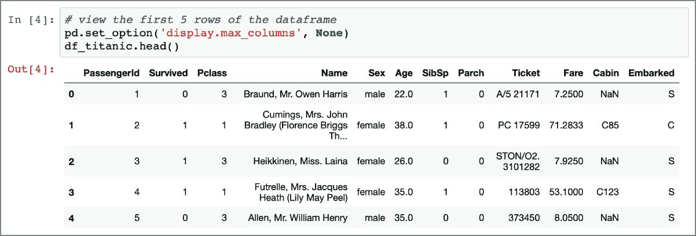

图 3.1 `head()` 函数显示 Pandas dataframe 从开始的行。

如果列数过多，Pandas 无法水平放入单行中，那么 Pandas 默认会显示 dataframe 的子集。该子集由 dataframe 左侧的几列和右侧的几列组成。图 3.2 展示了在具有 30 列的 dataframe 上使用 `head()` 函数的效果。

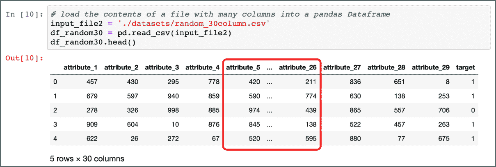

图 3.2 `head()` 函数为大型 dataframe 显示截断的数据。

你可以通过设置 Pandas 属性 `display.max_columns` 来更改 Pandas 显示的最大列数。例如，以下代码段将确保 Pandas 显示的列不超过四列：

```python
pd.set_option('display.max_columns', 4)
df_random30.head()

  attribute_1.  attribute_2  …  attribute_29  target
0  457          430          …       8          1
1  679          597          …       253        1
2  278          326          …       706        0
3  909          604          …       263        1
4  622          26           …       675        1

 5 rows × 30 columns 
```

如果你想显示所有列，请将 `display.max_columns` 的值设置为 `None`。

```python
pd.set_option('display.max_columns', None)
```

敏锐的读者可能已经注意到 Titanic 数据集的 `PassengerId` 属性是一个数值行标识符，在构建模型方面它不提供任何有用的输入。每个 Pandas dataframe 都可以有一个索引，该索引包含 dataframe 中每行的唯一值。默认情况下，Pandas 不会为 dataframe 创建索引。你可以使用以下代码段来检查 dataframe 是否有索引：

```python
### 这个 dataframe 是否有名索引？如果是，它是什么？
print (df_titanic.index.name)

None
```

要将 `PassengerId` 属性设置为 `df_titanic` dataframe 的索引，请使用以下代码段：

```python
df_titanic.set_index("PassengerId", inplace=True)
```

图 3.3 显示了在设置索引之前后对 `df_titanic` dataframe 应用 `head()` 函数的结果。

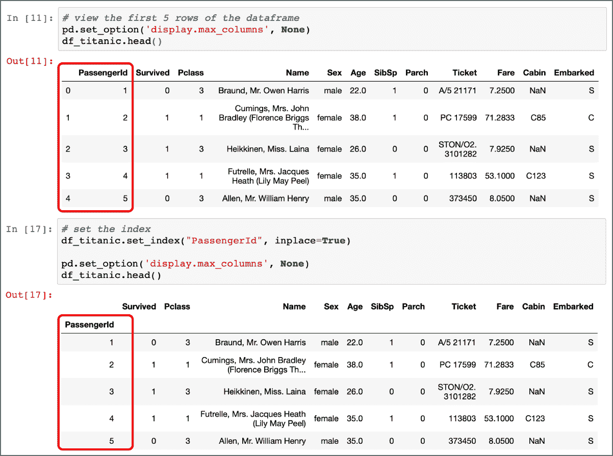

图 3.3 `set_index` 函数对 dataframe 的影响

如果你使用 dataframe 的 `shape` 属性来获取行列数，你会发现列数现在报告为 11 而不是 12。这在以下代码段所示：

```python
### 设置索引后，dataframe 中有多少行和多少列？
df_titanic.shape

(891, 11)
```

你可能已经注意到，在 `PassengerId` 用作索引后，`Survived` 属性是 `df_titanic` dataframe 中剩余 11 个属性之一。在训练过程中，你需要确保不要将目标属性作为输入特征之一。你有多种方法可以确保这一点，但最简单的方法是将特征变量和目标变量分离到不同的 dataframe 中。

以下代码会将 `Survived` 属性从 `df_titanic` dataframe 提取到名为 `df_titanic_target` 的单独 dataframe 中，并将 10 个特征变量从 `df_titanic` dataframe 分离到名为 `df_titanic_features` 的单独 dataframe 中。

```python
### 将目标属性提取到自己的 dataframe 中
df_titanic_target = df_titanic.loc[:,['Survived']]

### 创建包含 10 个特征变量的 dataframe
df_titanic_features = df_titanic.drop(['Survived'], axis=1)
```

`Survived` 属性是一个二分类属性，值为 1 表示个体幸存。当你的机器学习模型尝试预测的目标是分类（二分类或多分类）时，了解训练数据集中每个类别的值分布是有用的。你可以通过以下代码段获取此示例中目标值的分布：

```python
### 目标变量两个类别之间的划分情况是怎样的？
df_titanic_target['Survived'].value_counts()

0  549
1  342
Name: Survived, dtype: int64
```

`value_counts()` 函数的默认行为是不提取 `NaN` 值。要让 `value_counts()` 函数包含 `NaN` 标记的计数，请包含 `dropna=false` 参数，如下所示所示：

```python
### 分类属性 'Embarked' 的唯一值和计数
### 包含 NaN 标记
df_titanic_features['Embarked'].value_counts(dropna=False)

S   644
C   168
Q    77
NaN   2
Name: Embarked, dtype: int64
```

如果你更喜欢值分布的可视化表示，可以使用以下代码段创建直方图。直方图见图 3.4。

```python
### 目标变量直方图
%matplotlib inline
import matplotlib.pyplot as plt
df_titanic_target.hist(figsize=(5,5))
```

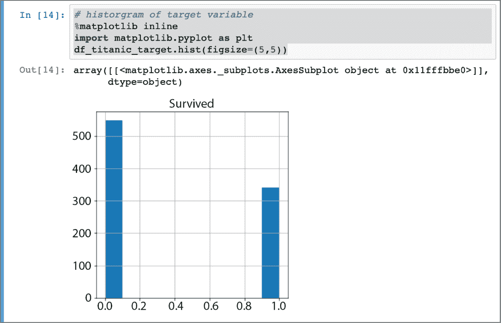

图 3.4 幸存值的分布

除了目标变量的直方图外，使用直方图获取特征值分布的概述也是非常有用的。Pandas dataframe 对象提供的 `hist()` 函数只会为数值生成直方图。Titanic 数据集中的数值特征是 `Age`、`Fare`、`Pclass`、`Parch` 和 `SibSp`。可以使用以下代码段生成数值特征直方图。生成的特征直方图见图 3.5。

```python
### 特征直方图
df_titanic_features.hist(figsize=(10,10))
```

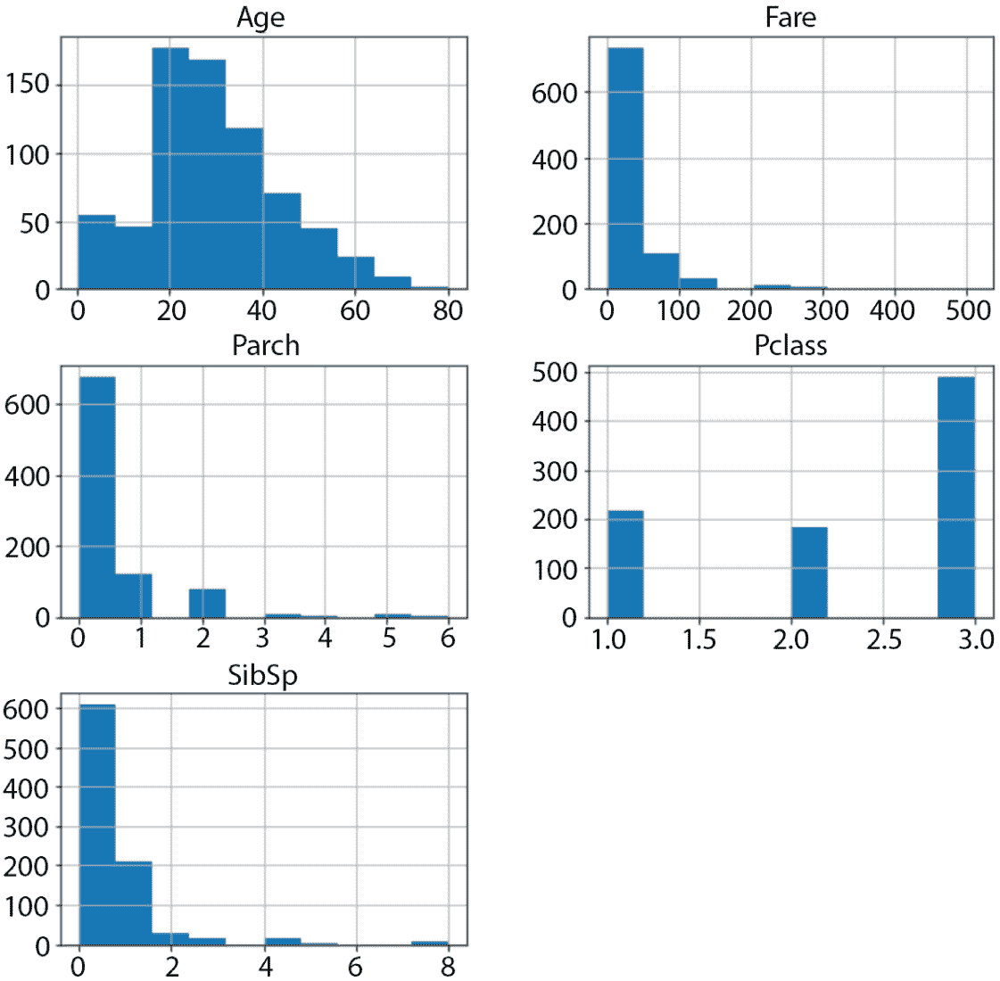

图 3.5 数值特征直方图


例如，假设你有一组包含 50 个人身高的数据集（以厘米为单位），并想创建一个直方图。如果你选择在图表上绘制这 50 个点，你得到的将不是直方图，而是一个散点图。要获得直方图，你需要决定想要多少个柱子。如果你决定在直方图中设置五个柱子，则你需要定义五个区间（例如 `0 cm` 到 `60 cm`、`60 cm` 到 `120 cm`、`120 cm` 到 `180 cm`、`180 cm` 到 `240 cm`、`240 cm` 到 `300 cm`），并将所有 50 个值填入这五个区间之一。

### 区间数量的选择

区间数量的选择完全由你决定，如果你选择不同的数字，直方图看起来也会不同。数据科学家经常使用不同的区间宽度为同一个 `variable`-`variable` 生成多个直方图，以更好地理解数据的分布。

以下代码段可创建单个数值属性的直方图，并指定 x 轴上的等宽区间数量。图 3.6 描述了为同一个数值特征选择不同区间宽度时获得的直方图。

```
### 单个特征的直方图 - Age
# 尝试不同的箱宽（bin widths）以更好地了解 
# 数值的分布是一个好主意。
df_titanic_features.hist(column='Age', figsize=(5,5), bins=2) 
```

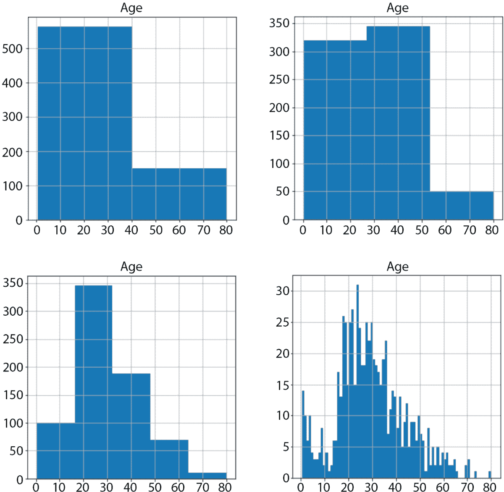

FIGURE 3.6 使用不同宽度（2, 3, 5, 80）的数值特征 `Age` 直方图

### 理解 Bins

Pandas 的绘图功能依赖于名为 `Matplotlib` 的库，它将这些区间称为 `bins`。在前面的代码段中，`bins = 2` 标记应该理解为两个等宽且不重叠的区间。

`value_counts()` 函数同时适用于离散数值特征和分类特征。因此，你可以通过使用 `value_counts()` 函数的输出来生成分类特征的直方图。以下代码段演示了在 `Embarked` 分类特征上使用这种方法。结果直方图如图图 3.7。

```
### 分类属性 'Embarked' 的直方图
### 根据 value_counts() 函数的输出计算
vc = df_titanic_features['Embarked'].value_counts(dropna=False)
vc.plot(kind='bar') 
```

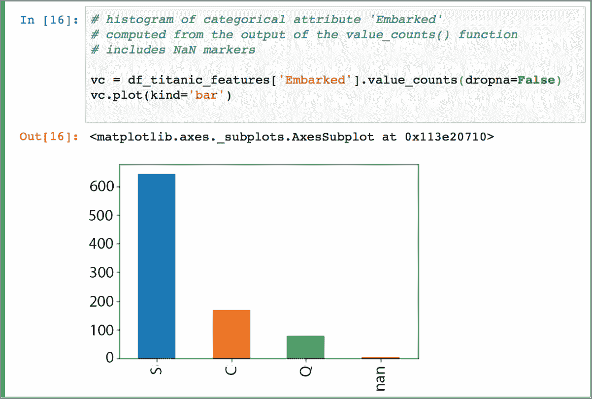

FIGURE 3.7 分类特征 Embarked 直方图

### 统计特征

除了特征和目标变量分布的信息外，这些变量的统计特征以及它们之间的相关性可以为训练数据提供有用的见解。Pandas 提供了一个 `describe()` 函数，可以用于 dataframe 以获取 dataframe 内数值属性的统计信息。以下代码段显示了 `df_titanic_features` 数据集上 `describe()` 函数的结果：

```
### 获取数据的统计特征
df_titanic_features.describe()
 
 
       Pclass     Age         SibSp       Parch       Fare
count 891.000000  714.000000  891.000000  891.000000  891.000000
mean  2.308642    29.699118   0.523008    0.381594    32.204208
std   0.836071    14.526497   1.102743    0.806057    49.693429
min   1.000000    0.420000    0.000000    0.000000    1.500000
25%   2.000000    23.000000   1.000000    0.000000    14.050000
50%   3.000000    29.699118   0.000000    0.000000    31.000000
75%   4.000000    38.000000   2.000000    1.000000    53.100000
max   5.000000    84.000000   8.000000    6.000000   514.000000
```


通过本节描述的更改，你已经在可能的情况下填补了缺失值，并在数据框中创建了一个新列。数据框中不应再有缺失值，名为 `CabinIsKnown` 的新列在数据框中可见，并且 `Cabin` 列已从数据框中删除。可以通过执行以下代码段来验证这些更改：

```
### display the columns of the dataframe.
print (df_titanic_features.columns.values)
 
### display number of missing values in the columns
df_titanic_features.isnull().sum()
 
 ['Pclass' 'Name' 'Sex' 'Age' 'SibSp' 'Parch' 'Ticket' 'Fare' 'Embarked'
 'CabinIsKnown']
Out[10]:
Pclass        0
Name          0
Sex           0
Age           0
SibSp         0
Parch         0
Ticket        0
Fare          0
Embarked      0
CabinIsKnown  0
dtype: int64
```

### 创建新特征

如果你观察泰坦尼克数据集列的描述，你会遇到 `SibSp` 和 `Parch` 列。根据数据集的描述：

- `SibSp`: 数值型变量，表示同行的兄弟姐妹/配偶人数。
- `Parch`: 数值型变量，表示同行的父母和子女人数。

将这些值合并为一个代表同行的出行家庭人数的单一数值可能是有意义的。在目前阶段无法判断模型在使用此额外的合成特征后是否会表现更好，但在数据中拥有此新特征将为你在构建和评估模型时提供更多选择。以下代码段在数据框中创建了一个名为 `FamilySize` 的新属性，该属性计算结果为 `SibSp` 和 `Parch` 属性的算术和。

```
# create a numeric feature called FamilySize that is
# the sum of the SibSp and Parch features.
df_titanic_features['FamilySize'] = df_titanic_features.SibSp + df_titanic_features.Parch
```

`Age` 和 `Fare` 特征是数值型的，并取一系列范围的值。对这些特征的值进行分箱处理并创建分类特征可能是很有用的。在构建模型期间，你可能会发现 `Age` 和 `Fare` 的分类（分箱）值提供了更好的结果。要创建一个名为 `AgeCategory` 的新分类特征，你可以使用 Pandas 的 `cut()` 函数，如以下代码段所示：

```
### generate new categorical feature AgeCategory
bins_age = [0,20,30,40,50,150]
labels_age = ['<20','20-30','30-40','40-50','>50']
 
df_titanic_features['AgeCategory'] = pd.cut(df_titanic_features.Age, 
                      bins=bins_age, 
                      labels=labels_age, 
                      include_lowest=True)
```

图 3.10 展示了创建 `AgeCategory` 特征后对 `df_titanic_features` 数据框执行 `head()` 函数的输出。

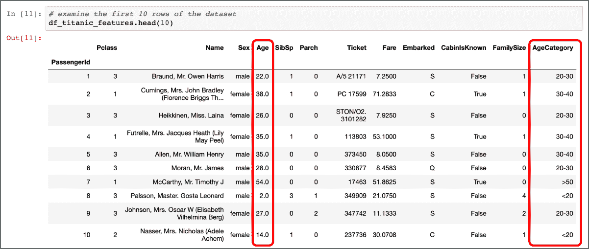

FIGURE 3.10 具有工程特征 `AgeCategory` 的数据框

`cut()` 函数有几个参数。在本例中，`bins` 参数包含一个定义分箱边界的数字序列。最低值和最高值被刻意选择在 `Age` 特征中观察到的值范围之外。`labels` 参数包含一个字符串列表，作为分箱的标签（以及执行 `cut()` 函数后生成的分类特征的值）。`include_lowest` 参数设置为 `True`，表示第一个区间是左包含的。你可以在 `cut()` 函数的完整参数列表处找到其相关信息，地址为：https://pandas.pydata.org/pandas-docs/version/0.23.4/generated/pandas.cut.html。

没有固定的公式来确定正确的分箱数量和分箱宽度。在模型构建过程中，你可能会发现自己正在尝试不同的分箱策略。如果你想使用分位数将连续变量拆分为分类变量，可以使用 `cut()` 函数。以下代码段使用 `cut()` 创建了一个名为 `AgeCategory` 的新分类特征：

```
### generate new categorical feature AgeCategory
df_titanic_features['AgeCategory'] = pd.cut(df_titanic_features.Age, 
                      q=4, 
                      labels=['Q1', 'Q2', 'Q3', 'Q4'])
```

第二个参数 `q=4` 表示你想使用四分位数作为边界。关于 `cut()` 函数的信息可以访问：https://pandas.pydata.org/pandas-docs/version/0.23.4/generated/pandas.cut.html。

图 3.11 展示了创建 `AgeCategory` 特征后对 `df_titanic_features` 数据框执行 `head()` 函数的输出。

*(注：此处原文示例中图 3.11 的描述和图片与上方重复，已按要求原样保留)*

### 转换数值特征

在上一节创建了分类特征 `AgeCategory` 和 `FareCategory` 后，你可能想要对数值属性进行转换。丢弃原始值的决定很大程度上取决于你将构建的模型类型。

在使用连续变量构建模型时，当数值属性较小时，许多机器学习模型收敛更快且效果更好。例如，如果你正在训练一个线性回归模型，其中一个特征的范围在 [0, 100] 之间，另一个在 [100 万] 范围内，那么第二个特征较大的数值会给模型引入偏差。

归一化和标准化是在数值属性上执行的两种常见转换类型。归一化特征的结果是特征值被缩放到 0 到 1 之间。标准化特征的结果是新特征值分布的均值为 0，标准差为 1，但标准化后的值范围并不保证在 0 到 1 之间。当你想要的模型假设特征变量符合高斯分布时，可以使用标准化。归一化通常用于神经网络模型，这些模型要求输入位于 [0, 1] 范围内。Scikit-learn 提供了许多类来帮助扩展数值属性。`MaxScaler` 类常用于归一化，而 `StandardScaler` 类用于标准化。以下代码段在 `df_titanic_features` 数据框中创建了名为 `NormalizedAge` 和 `StandardizedAge` 的两个新列。图 3.12 比较了 `Age`、`NormalizedAge` 和 `StandardizedAge` 特征的直方图。

```
### generate new feature NormalizedAge using MinMaxScaler
from sklearn import preprocessing
 
minmax_scaler = preprocessing.MinMaxScaler()
ndNormalizedAge = minmax_scaler.fit_transform(df_titanic_features[['Age']].values)
df_titanic_features['NormalizedAge'] = pd.DataFrame(ndNormalizedAge)
 
### generate new feature StandardizedAge using StandardScaler
standard_scaler = preprocessing.StandardScaler()
ndStandardizedAge = standard_scaler.fit_transform(df_titanic_features[['Age']].values)
df_titanic_features['StandardizedAge'] = pd.DataFrame(ndStandardizedAge)
 
### histogram of Age, NormalizedAge, StandardizedAge
df_titanic_features[['Age', 'NormalizedAge', 'StandardizedAge']].hist(figsize=(10,10), bins=5) 
```


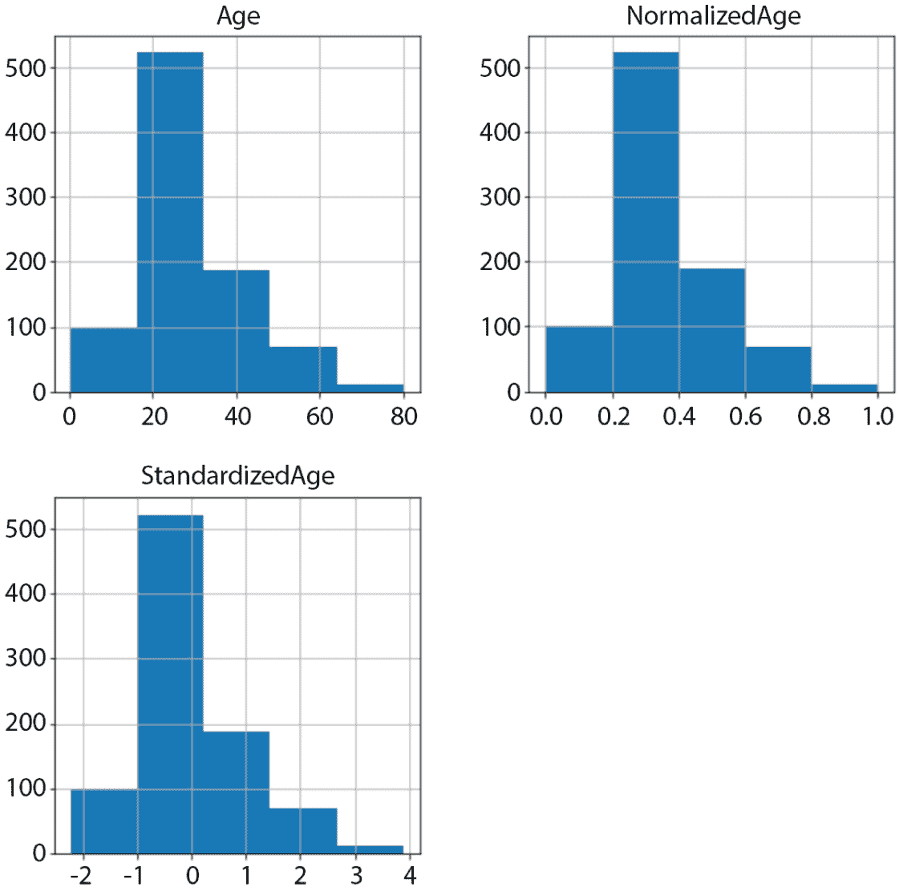

FIGURE 3.12 `Age`、`NormalizedAge` 和 `StandardizedAge` 直方图

### 分类特征的独热编码

现在让我们来看看使用独热编码（one-hot encoding）将分类特征转换为特征的方法。你可能会好奇为什么要将分类特征转换为数值，尤其是本章之前的章节已经讨论了相反的技术——将数值特征转换为分类特征。

并不是所有的机器学习算法都能处理分类数据。例如，线性回归和逻辑回归只能使用数值特征。而像 `XGBoost` 和 `Random Forests` 这样的算法可以毫无问题地使用分类特征。

独热编码是将分类特征转换为多个二数值特征的技术，每个类别对应一个。Pandas 提供了 `get_dummies()` 函数来帮助进行独热编码。以下代码段将分类特征 `Sex`、`Embarked`、`CabinIsKnown`、`AgeCategory` 和 `FareCategory` 转换为二数值特征，并列出数据框的列：

```python
# 使用独热编码将分类属性 
# 转换为二数值属性
df_titanic_features = pd.get_dummies(df_titanic_features, columns=['Sex','Embarked','CabinIsKnown','AgeCategory','FareCategory'])
 
### 显示数据框的列。
print (df_titanic_features.columns.values)
 
['Pclass' 'Name' 'Age' 'SibSp' 'Parch' 'Ticket' 'Fare' 'FamilySize'
 'NormalizedAge' 'StandardizedAge' 'Sex_female' 'Sex_male' 'Embarked_C'
 'Embarked_Q' 'Embarked_S' 'CabinIsKnown_False' 'CabinIsKnown_True'
 'AgeCategory_<20' 'AgeCategory_20-30' 'AgeCategory_30-40'
 'AgeCategory_40-50' 'AgeCategory_>50' 'FareCategory_Q1' 'FareCategory_Q2'
 'FareCategory_Q3' 'FareCategory_Q4']
```

从这段代码段可以看出，原始的分类属性不再存在于 `df_titanic_features` 数据框中；但是，数据框添加了许多新列。为了理解 Pandas 是如何创建额外列的，请考虑 `Sex` 分类属性。该属性有两个值：`male` 和 `female`。为了将此分类属性转换为二数值属性，Pandas 在数据框中创建了两个新列，称为 `Sex_male` 和 `Sex_female`。其他分类属性如 `Embarked`、`CabinIsKnown` 等也使用了类似的方法进行处理。以下代码段列出了数据框前五行的 `Sex_male` 和 `Sex_female` 列的值：

```python
df_titanic_features[['Sex_male', 'Sex_female']].head()
 
              Sex_male    Sex_female
PassengerId        
1             1           0
2             0           1
3             0           1
4             0           1
5             1           0
```

敏锐的读者可能会注意到，由于原始 `df_titanic_features` 数据集中 `Sex` 属性取的值为 `male` 或 `female`，因此你不需要同时拥有 `Sex_male` 和 `Sex_female` 属性，因为你可以从其中一个推导出另一个。这种情况与 `CabinIsKnown_False` 和 `CabinIsKnown_True` 特征类似。以下代码段删除了 `Sex_female` 和 `CabinIsKnown_False` 属性以及非数值属性 `Name` 和 `Ticket`，得到一个只包含数值属性的数据框：

```python
### 删弃 Name, Ticket, Sex_female, CabinIsKnown_False
### 以获得可以用于线性或逻辑回归的数据框
df_titanic_features_numeric = df_titanic_features.drop(['Name', 'Ticket', 'Sex_female', 'CabinIsKnown_False'], axis=1)
```

## 选择训练特征

在上一节中，你学习了探索数据、插值缺失值和特征工程的技术。在这一节中，你将学习用于选择最佳训练特征集以及减少大型数据集中特征数量的技术。

### 相关性

输入特征与目标之间相关性的信息有助于从数据中挑选出最佳特征，用于模型构建和预测。特征之间的相关性信息有助于减少特征数量并降低通的过拟合风险。Pandas 提供了 `corr()` 函数，可以计算数据框列之间的 Pearson 逊相关系数。对 `df_titanic` 数据框应用 `corr()` 函数的结果如图 3.13

Pearson 逊相关系数只能检测变量之间的线性相关性。`corr()` 函数允许你从标准系数中选择，如 Pearson、Kendall 和 Spearman。你可以在 https://pandas.pydata.org/pandas-docs/stable/api/pandas.DataFrame.corr 找到更多信息。以下代码段列出了数值特征与目标 `Survived` 之间的相关性，并按值降序排序：

```python
### 哪些特征与目标的相关性最强？
corr_matrix = df_titanic.corr()
corr_matrix['Survived'].sort_values(ascending=False)
```

计算属性对之间的相关性值并不是获取特征间相关性的唯一方法。你还可以通过创建特征散点图来可视化它们之间的关系。以下代码段使用 Pandas 的 `scatter_matrix()` 函数创建所有数值特征之间的散点图。生成的散点图如图 3.14 所示。

```python
### 使用散点图矩阵可视化
### 特征之间的关系
from pandas.plotting import scatter_matrix
scatter_matrix(df_titanic, figsize=(12,12))
```


如果你计算目标属性 `Survived` 与上一节结束时数值特征之间的相关性，你会发现比特征工程之前好得多。以下代码段演示了这一点：

```python
# 为了计算 Pearson 相关系数，
# 创建一个包含 df_titanic_features 所有属性
# 以及生存属性的数据框
df_temporary = pd.concat([df_titanic_features, df_titanic['Survived']], axis=1)
df_temporary.head()
 
# 特征工程后哪些特征与目标变量
# 相关性最强？
corr_matrix = df_temporary.corr()
corr_matrix['Survived'].sort_values(ascending=False)
 
Survived           1.000000
CabinIsKnown_True  0.316912
Fare               0.257307
FareCategory_Q4    0.233638
Embarked_C         0.168240
FareCategory_Q3    0.084239
Parch              0.081629
AgeCategory_<20    0.076565
AgeCategory_30-40  0.057867
FamilySize         0.016639
Embarked_Q         0.003650
AgeCategory_40-50 -0.000079
NormalizedAge     -0.001654
StandardizedAge   -0.001654
AgeCategory_>50   -0.022932
SibSp             -0.035322
Age               -0.064910
AgeCategory_20-30 -0.093689
FareCategory_Q2   -0.095648
Embarked_S        -0.149683
FareCategory_Q1   -0.221610
Pclass            -0.338481
Sex_male          -0.543351
```


请注意生存概率与工程化特征 `Sex_male` 之间存在特别强的负相关性。这告诉我们，男性的总体生存概率通常低于女性。此外，生存概率与工程化属性 `FareCategory_Q4` 之间存在强正相关性，这意味着票价更昂贵的人（头等舱乘客）更有可能幸存。所有这些都与历史记录相吻合。

你可能还注意到生存概率与某些属性（如 `NormalizedAge`、`StandardizedAge`、`AgeCategory_<20`、`AgeCategory_30-40`、`AgeCategory_40-50` 和 `AgeCategory_>50`）之间的相关性极弱。由于这些属性与目标变量之间的相关性较，你可能希望将它们从模型中排除。

### 主成分分析

许多真实世界数据集每个数据点都有几十个（有时是数百个）属性。过多的输入特征会导致模型训练过程变得极其缓慢，并且很难使用可视化技术来挑选出最佳属性。正如你在上一节中看到的，并不是所有特征与目标变量都表现出强程度的相关性。只有在最终不会丢弃数据集中太多特征的情况下，排除相关性差的特征才是可行的。在大型数据，完全可能没有任何特征与目标变量表现出强相关性。主成分分析（PCA）是一种统计技术，用于减少数据集中的特征数量，同时保持原始数据大部分比例的方差。

对 PCA 的详细讨论超出了本书的范围。然而，为了理解它的工作原理，请考虑一个简单的二维数据集，其散点图如图 3.15

FIGURE 3.15 沿 x 轴和 y 轴的数据方差

你可以看到，数据在两个轴上并不是均匀分布的。沿 x 轴的方差显著大于 y 轴。你可以说该散点图的数据点没有利用 y 轴上可用值的完整范围。这种普遍行为对于具有大量特征的大多数真实世界数据集也是如此。如果你认为每个特征代表高维空间中的一个轴，并将每个轴归一化为 [0, 1]，那么通常大多数方差被限制在少数几个轴（维度）上，数据没有利用高维轴的完整范围。一种解决方案可能是尝试收集更多数据，以便尝试改进所有轴上的离散程度；然而，这并不总是可行的。

PCA 试图在低维空间中寻找一组新轴，并将数据点从原始高维空间投影到这组新轴上。选择这组新轴的方式是为了保留原始方差的大部分。这一思想在图 3.16 中得到了说明。

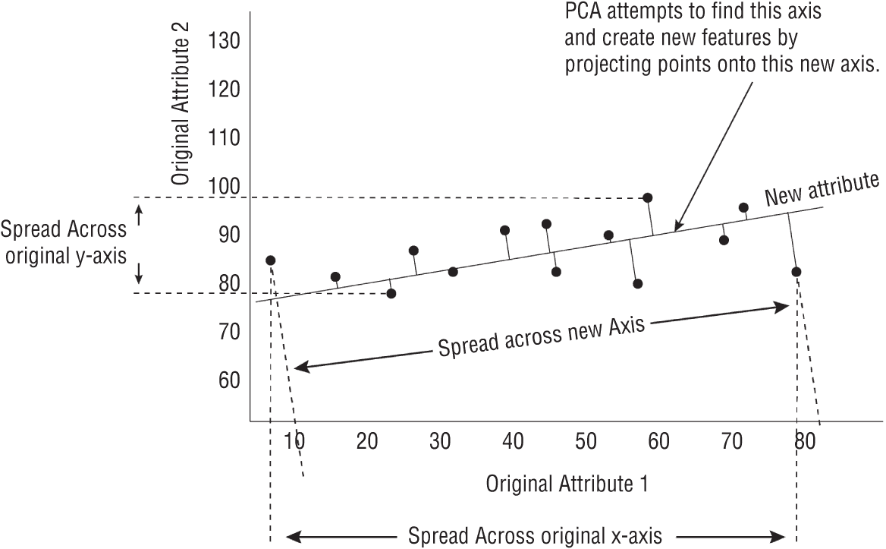

FIGURE 3.16 将二维数据投影到一维直线

如所示，图 3.16 中描述的新轴捕捉了数据集近 90% 的方差，通过将点从原始二维空间投影到这条条直线上，PCA 将每个数据点的特征数量从 2 减少到了 1。同样的概念也适用于更高维。

Scikit-learn 使用奇异值分解（SVD）算法通过名为 `PCA` 的类实现了主成分分析，该类是 `sklearn.decomposition` 包的一部分。下面的代码段使用 `PCA` 类减少 `df_titanic_features_numeric` DataFrame 中的特征数量，以便保留 99.9% 的方差。

```python
# use PCA to reduce the number of features in 
# df_titanic_features_numeric so as to preserve 
# 99.90% of the variance. 

from sklearn.decomposition import PCA
pca_decomposer = PCA(0.9990)
PCAResult = pca_decomposer.fit_transform(df_titanic_features_numeric)
 
print (pca_decomposer.n_components_)
```

`PCA` 对象的 `n_components_` 属性包含了还原后的轴（特征）的数量，可以使用 `fit_transform()` 方法将特征从原始高维空间投影到低维空间。

下面的代码段创建了一个带有投影特征值的 DataFrame：

```python
dfPCAResult = pd.DataFrame(data = PCAResult, columns = ['C1', 'C2', 'C3', 'C4'])
dfPCAResult.head()
```

新特征已被命名为 `C1`、`C2`、`C3` 和 `C4`。需要注意的是，这些特征与 `df_titanic_features_numeric` DataFrame 中的特征不同，通过使用 PCA，你正在丢弃部分原始数据。图 3.17 包含了新特征的前几行。

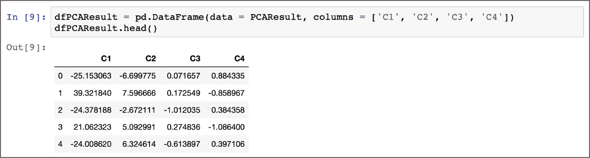

你可以在 https://scikit-learn.org/stable/modules/generated/sklearn.decomposition.PCA.html 了解更多关于 PCA 类的信息。

### 递归特征消除

最后介绍介绍递归特征消除（RFE）的暴力方法，它可以用于评估特征在机器学习模型性能中的重要性。递归特征消除背后的思想是使用特征训练模型，然后每次丢弃一个特征进行递归训练。在过程结束，可以评估每个特征的相对重要性。

Scikit-learn 在 `sklearn.feature_selection` 模块中的 `RFE` 类实现了递归特征消除。下面的代码段使用逻辑回归模型对 `df_titanic_features_numeric` 中的特征重要性排名。

```python
# use recursive feature elimination to work out 
# the relative importance of the features in the
# df_titanic_features_numeric dataset
from sklearn.feature_selection import RFE
from sklearn.linear_model import LogisticRegression

use logistic regression as the model
logisticRegressionClassifier = LogisticRegression(penalty='l2', solver='liblinear', max_iter=500)
rfe = RFE(logisticRegressionClassifier, n_features_to_select=1)
rfe.fit(df_titanic_features_numeric, np.ravel(df_titanic_target))

print (rfe.ranking_)
```

可以通过检查 `RFE` 对象的 `ranking_` 属性获取特征的排名。结果是一个数组，每个索引包含对应特征的排名。训练逻辑回归模型将在第 5 章介绍。

### 总结

特征工程是数据科学中最耗力且最耗时的部分，没有固定的公式可以适用于特定情况。在本章中，你学习了一些用于探索数据、插补缺失值和特征工程的技术。


* 你可以结合使用 Pandas 的 `isnull()` 和 `sum()` 函数来获取 dataframe 中每列缺失值的数量。
* Pandas dataframe 对象提供的 `hist()` 函数只会为数值值生成直方图。
* Pandas 提供了一个 `describe()` 函数，可以用于 dataframe 以获取该 dataframe 中数值型属性的统计信息。
* Pandas 提供了一个 `corr()` 函数，可以用于计算 dataframe 中列与列之间的皮尔逊相关系数。
* 你还可以创建特征对之间的散点图，以可视化的方式它们之间的关系。
* Pandas 提供了一个 `fillna()` 函数，可以用新值替换缺失值。
* 主成分分析（PCA）是一种统计技术，用于减少数据集中的特征数量，同时保持原始数据的大比例方差。
* 递归特征消除（RFE）虽然计算开销较大，但它可以帮助我们理解每个特征对模型性能的贡献有多大。

# 第 4 章：在移动端应用中实现机器学习

本书之前的几个章节介绍了机器学习的几个概念，包括特征工程和选择技术。在本章中，你将学习作为 iOS 开发者将机器学习集成到你的应用中的可用选项。虽然选择 Apple 的产品通常是你的首选，但你也将学习其他可以在你的应用内部使用的第三方产品。

## 基于设备的方法 vs. 基于服务器的方法

当你完成机器学习模型的训练后，你可能想在应用程序中使用该模型。若要使用该模型，你首先需要将模型导出到你计算机硬盘上的一个合适文件格式。遗憾的是，由于模型构建库数量繁多且缺乏标准，导致机器学习模型自定义文件格式数量的激增。大多数模型构建库都有自己的自定义文件格式，有时这些格式之间是不相互互通的。目前有多种工具可以将模型从一种专有格式转换为另一种格式。在编写本文时，以下是几种最流行且似乎获得了行业广泛认可的格式：

* **Pickle**: `Pickle` 是一个 Python 模块，可以将任何 Python 对象转换为字节流并保存到磁盘。你可以使用此库来序列化（以及反序列化）在 Python 中构建的机器学习模型，前提是你打算在 Python 环境中使用它们。
* **ONNX**: 开放神经网络交换（Open Neural Network Exchange）格式是行业内机器学习模型最流行的格式。尽管它最初是为神经网络模型设计的，但 `Scikit-learn` 模型也可以导出到这种格式。
* **Core ML**: Apple 的 `Core ML` 不仅是一个运行时，还是一个文件格式。如果你想在 iOS 应用中使用模型，则需要将模型保存为这种格式。`Core ML Tools` 是一个 Python 库，可以将许多从流行格式的模型转换为 `Core ML` 格式。

将模型保存到文件后，你需要将模型部署到合适的运行时环境中，以便你的应用程序可以使用它。运行时的目的是加载模型并提供一个编程接口，允许你使用该模型进行预测。运行时环境可以是服务器端环境，如 `Google TF Serve`，也可以是设备端环境，如 `Core ML`。在一种情况下，你的移动应用代码将通过 `HTTPS REST API` 与模型交互；在另一种情况下，则使用 `Swift` 代码。

有了这两种从根本上不同的部署选项，你应该选择哪一个呢？你可能倾向于选择*设备端推理*（也称为*基于边缘*的推理）而非服务器端推理的一些原因如下：

* 不涉及任何服务器端的往返，因此你不需要担心传输安全、身份验证、授权和凭据管理。
* 请求推理的数据将保留在 iOS 设备上。你可以选择将数据发送到服务器端应用程序以用于某些目的，但这与 `Core ML` 无关。
* 在没有网络连接的情况下，移动应用的机器学习部分仍然可以工作。

在某些情况下，服务器端推理可能是首选方案。以下是支持服务器端推理的一些原因：

* 你的模型可能除了从移动设备提交的数据外，还需要访问来自不同实时的数据。例如，一个用于判断申请人是否应获得信用卡的模型，可能需要申请表上问题的答案，以及来自之前生成的分析反馈的数据，以确定申请人在页面上停留的时间、离开页面的次数等。
* 你的模型可能需要访问有关用户的交易历史和其他相关产品的数据。例如，一个用于判断申请人是否应获得信用卡的模型，可能需要客户开设的其他账户信息、开户日期及其余额。
* 你的模型可能基于 `Core ML` 不支持的前沿算法或框架。机器学习是一个快速发展的领域，由于 Apple 每年仅更新一次 `Core ML`，很有可能某些新的突破性算法在多个 `Core ML` 版本中都无法使用。

尽管你可以选择在哪里部署训练好的模型，但模型训练几乎总是使用服务器资源完成的。有少数类型的模型可以在资源受限的环境（如移动设备）中进行高效训练，这种训练通常涉及对预训练模型进行微调（这一过程被称为*迁移学习*）。


任务级框架提供了相关方法，允许你执行高级任务，而无需显式地处理机器学习模型的训练和部署。该框架包含许多预训练模型，并会根据你想要执行的任务选择其中一个。在编写时，Apple 提供的关键任务级框架如下：

* `Vision`：该框架提供了用于执行任务的高级 API，例如人脸检测、地标检测、条形码扫描和物体跟踪。该框架还提供了实用的方法，可用于与其他框架（如 `Core ML`）配合准备图像。事实上，如果你想在应用中使用自定义的 `Core ML` 格式模型来处理图像和视频，强烈建议使用 `Vision`。你可以在 `https://developer.apple.com/documentation/vision` 了解更多关于 `Vision` 框架的信息。

* `Natural Language`：该框架提供了高级 API 来分析文本并推断特定语言的元素，如名词、动词、形容词以及人物、地点和组织等命名实体。它还可用于检测文本文档的主导语言。你可以在 `https://developer.apple.com/documentation/naturallanguage` 了解更多关于 `Natural Language` 框架的信息。

* `Speech`：该框架可识别音频流中的口语内容。该框架支持多种语言，并且其大部分功能使用了托管在 Apple 服务器上的机器学习模型。如果你在应用中使用此框架，你的应用将需要连接互联网。值得注意的是，Apple 对应用每天发起的请求数量设有限制。你可以在 `https://developer.apple.com/documentation/speech` 了解更多关于 `Speech` 框架的信息。

### 模型级框架
模型级框架提供了一种在应用中使用机器学习模型的机制。`Core ML` 是 Apple 的模型级框架，尽管还有其他第三方框架可以替代 `Core ML`，但它通常是 iOS 开发者的首选。任务级框架与 `Core ML` 之间的区别在于完成某项任务时需要的工作量。任务级框架提供了方便的高级 API，处理了许多任务，如输入预处理、多线程、使用合适的模型以及模型输出的后处理。

然而，要使用 `Core ML` 实现等等的功能，你需要执行各种预处理和后处理操作。你可能会想，既然有额外的开销，为什么我还要大麻烦直接使用 `Core ML` 呢？有两个充分的理由：

* 对于你需要执行的高级任务，Apple 的任务级框架可能并不。例如，没有用于预测股价走势的任务级框架。
* 即使存在任务级框架，该框架内部使用的模型可能无法满足你的需求。

Apple 提供了许多 `Core ML` 格式的预训练模型，可以从 `https://developer.apple.com/machine-learning/models/` 下载。这些模型是开源的，Apple 还提供了用于创建这些模型的 Python 源代码链接。

除了 Apple 提供的模型外，你还可以从第三方网络仓库获取 `Core ML` 格式的模型。这些模型仓库通常被称为模型库（model zoos）。在互联网上快速搜索 `Core ML model zoo` 会得到几个选项。值得注意的是你。

### 转换器
`Core ML Tools` 是 Apple 提供的一个 Python 模块，可以将流行的框架（如 `Scikit-learn`、`LightGBM` 和 `XGBoost`）转换为 Core ML 格式。你可以在 `https://pypi.org/project/coretools/` 了解更多。

某些框架如 TensorFlow 和 `MXNet` 不支持 `Core ML Tools`，但 Apple 为 TensorFlow 提供了一个转换器。你可以在 `https://github.com/tensorflow/coreml` 了解更多。

Apache 软件基金会为 MXNet 提供一个名为 `mxnet-to-coreml` 的转换器。你可以在 `https://github.com/apache/incubator-mxnet/tree/tools/coreml` 了解更多。

如果你在使用不受支持的框架，可以尝试将其转换为 ONNX 格式，然后使用 `onnx-coreml`。你可以在 `https://github.com/onnx/coreml` 了解更多。

### 迁移学习工具
Apple 还提供了工具，允许你使用名为迁移学习（transfer learning）的技术，用你自己的数据修改现有的预训练模型。迁移学习通常用于深度学习模型，该方法背后的核心是通过重用现有模型中的大部分知识来处理不同的数据，从而节省训练时间。

例如，训练一个能够检测不同类型物体的良好深度学习模型是一项耗时任务，并且需要大量的标记图像库。一旦训练完成，该模型只能处理它经过训练的类别。如果你想让模型识别不同的物体，那么你需要从零开始训练。

然而，某些类型的深度学习模型架构（例如卷积神经网络——CNN）具有不同的特征提取和分类部分。网络的特征提取部分学习从输入图像中提取许多有用特征，而网络的分类部分负责处理将这些特征映射到目标物体类别。迁移学习利用了这种架构设计，允许你只重新训练已训练模型的分类部分。模型的分类部分通常只有几层，因此重新训练非常快。

这种方法仅在你想要重新训练模型的物体类别与构建模型时使用的原始物体类别某种相似时才有效。这是因为在迁移学习期间，模型的特征提取部分将保持不变，而该部分模型已经学习了如何从其训练的图像中提取最佳类型的特征。因此，如果你有一个可以识别不同型号汽车的模型，并想重新训练它来识别不同型号的卡车，就可以迁移学习。

Apple 为迁移提供的两个核心产品是 `Create ML` 和 `Turi Create`，它们都在任务级上运行。

#### TURI CREATE


Turi Create 是 Apple 在 2017 年发布的开源 Python 库，它本质上是 Apple 第一个迁移学习产品。该产品的起源可以追溯到一家名为 Turi 的初创公司，Apple 在 2016 年收购了它。要使用 Turi Create，你需要创建一个 Python 脚本文件并在 Jupyter Notebook 或命令行中执行该脚本。该 Python 脚本文件将对预训练模型进行迁移学习操作，并输出与 Core ML 兼容的模型文件，然后你可以配合 Xcode 使用它。Turi Create 允许你使用迁移学习创建可以完成以下任务的模型：

* 创建个性化推荐
* 分类声音
* 识别图像中的物体
* 从传感器数据中检测活动
* 分析文本消息情感
* 使用基于树的回归模型预测值

你可以在 `https://github.com/apple/turicreate` 了解更多关于 Turi Create 的信息。

## CREATE ML

Create ML 是 Apple 在 2018 年发布的 Swift 库，为 Swift 开发者提供了 Turi Create 的部分功能。Create ML 的初始版本可用于目标检测和情感分析的迁移学习。2019 年，Apple 发布了 Create ML 应用，这是一款 macOS 应用程序，允许你通过拖放操作使用迁移学习创建 Core ML 模型。在编写时，Create ML 应用正处于 Beta 阶段，并支持 Turi Create 的所有功能。

## 第三方机器学习框架与工具

除了 Apple 提供的工具外，作为 iOS 开发者，你也可以选择许多非 Apple 提供的机器学习框架和工具。本节总结了一些较为流行的选项。

* **Google TensorFlow-lite**：TensorFlow 是由 Google 创建的流行机器学习框架，主要用于创建深度学习模型。Google 提供了一个名为 `TensorFlow-lite` 的轻量级移动优化运行时，可以在 iOS 和 Android 设备上部署 TensorFlow 模型。你可以在 `https://www.tensorflow.org/lite` 了解更多关于 TensorFlow-lite 的信息。

* **Google ML Kit**：这是 Google 提供的一个机器学习 SDK，为 iOS 和 Android 开发者提供了许多特定任务的功能。Google 正在积极增强 ML Kit 的功能，在本书编写时，ML Kit 提供了自然语言处理 (NLP)、文本翻译、人脸检测、目标检测、条码扫描和地标检测的 API。Google ML Kit 与 Apple 框架之间的主要区别之一是，ML Kit 能够处理部署在设备端和云端的模型。你可以在 `https://developers.google.com/ml-kit/` 了解更多关于 Google ML Kit。

* **Scikit-learn**：Scikit-learn 是一个流行的 Python 机器学习框架，用于各种任务，如特征工程、交叉验证和模型构建。你可以使用 `Core ML Tools` 将 Scikit-learn 模型转换为 Core ML 格式，并通过 Core ML 框架在设备上执行。你还可以使用 `Amazon SageMaker` 等工具将 Scikit-learn 模型部署在 AWS 云端，并在你的 iOS 应用中使用这些模型。你可以在 `https://scikit-learn.org/stable/` 了解更多关于 Scikit-learn 的信息。

* **Amazon Web Services (AWS)**：Amazon 提供许多云端机器学习服务。其中某些服务专注于任务，并使用预训练模型允许你执行文本转语音等任务；另一些是通用的，允许你训练自己的模型并部署到 AWS 托管的虚拟机中。Amazon 提供了适用于 iOS 和 Android 的 SDK，用于调用这些基于服务器的机器学习服务。以下是一些流行的 AWS 机器学习服务：

    * **Amazon Comprehend**：这是一个专注于任务的服务，使用预训练模型允许你构建需要理解文本结构和内容的应用程序。Amazon Comprehend 使用自然语言处理提取文档内容的洞察。这些洞察可以是实体（人物、地点）、关键语、情感（积极、中性、混合或消极）以及语法。

    * **Amazon Lex**：这是一个专注于任务的服务，使用预训练模型并允许你构建支持文本和语音的对话界面（聊天机器人）。Amazon Lex 使用深度学习来实现自然语言理解 (NLU) 和自动语音识别 (ASR)，它与 Amazon Alexa 使用的是同一个引擎。

    * **Amazon Rekognition**：这是一个专注于任务的服务，提供基于深度学习的图像和视频目标检测与识别 API。你可以将其视为 Amazon 对 Apple Vision 框架的回答。

    * **Amazon Translate**：这是一个文档翻译服务，使用预训练模型允许你将在多种语言之间翻译文本。

    * **Amazon SageMaker**：这是 Amazon 为想要训练自己的机器学习模型并将其部署到 AWS 云端的用户提供的核心产品。Amazon SageMaker 包含了集成 Jupyter Notebook、现成的常用机器学习算法实现，以及对使用 Scikit-learn、Keras 和 Google TensorFlow 创建的模型进行训练（和托管）的支持。

你可以在 `https://aws.amazon.com/machine-learning/` 了解更多关于 Amazon 特定的机器学习产品。你可以在 `https://aws.amazon.com/developers/getting-started/ios/` 了解更多关于 AWS iOS SDK。

### 总结
（注：原文中的摘要要点似乎是关键要点列表或不同的章节。已按要求保留了这些内容。）


* 第 6 章:使用 Create ML App 创建图像分类器
* 第 7 章:使用 Create ML 创建表格分类器
* 第 8 章:创建决策树分类器
* 第 9 章:使用 Scikit-learn 和 Core ML 创建逻辑回归模型
* 第 10 章:使用 Keras 构建深度卷积神经网络

# 第 5 章：使用预训练模型进行检测

在本章中，你将学习人工神经网络（ANNs）和卷积神经网络（CNNs）的基础知识，并使用带有 `Core ML` 的预训练卷积神经网络模型来创建一个应用程序，该程序允许用户通过拍照检测图像中的主要物体。

## 什么是目标检测？

在我们开始编写代码在 App 中实现目标检测之前，了解什么是目标检测以及它的工作原理将非常有帮助。目标检测是计算机视觉技术的应用，用于检测图像中的一个或多个物体。计算机视觉是人工智能的一个分支，主要负责开发可以应用于数字图像和视频领域的算法。

目标检测算法的早期应用主要用于制造设施的质量控制。通常，会使用静态或视频摄像机拍摄部件（如电路板）的图像，然后由计算机处理该图像以检测图像中的任何异常。如果检测到异常，该部件就会被丢弃。同种类型的检测技术也可以应用于其他场景——例如检查传送带上新鲜采摘的苹果，并丢弃那些没有表现出理想特征（如尺寸/形状）的苹果。图 5.1 展示了这种类型设置背后的通用原理。

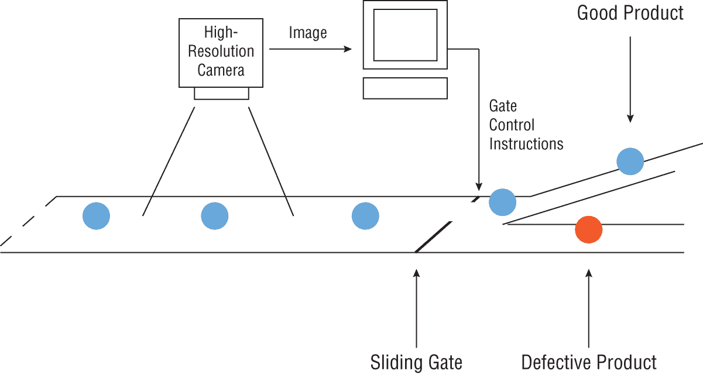

图 5.1 应用于工业检测的目标检测技术

这些早期的目标检测实现三个三个阶段（参见图 5.2）。

* **预处理阶段：** 此阶段涉及对图像运行一系列预定的图像处理操作，例如平衡图像中的亮度级别、将其转换为灰度，以及应用流行的边缘检测算法，以得到黑白图像，其中图像中的主要边缘为白色，图像的其他部分为黑色。
* **特征提取阶段：** 此阶段涉及分析预处理阶段的输出（带有图像主要边缘信息的图像），并尝试寻找几何结构，如线、矩形和椭圆。在此阶段还计算了这些形状的统计特征（尺寸、方向等）。
* **目标检测阶段：** 最后阶段涉及创建领域特定的算法，以将来自特征提取阶段的信息组合成有意义的输出。例如，如果在图像中检测到两个圆圈，且它们之间的距离不超过 20 像素，那么该物体可能是一对眼镜。

正如你可能推断出的那样，以这种方式实现目标检测需要具有专业知识的人员，而且解决方案无法在不同领域之间通用。一个检测传送带上橙子图像的系统无法用于检测葡萄的图像。

下一代目标检测算法基于一类称为`小波特征`（wavelet features）的新特征，特别是 `Haar 特征`。一种名为 Viola-Jones 的流行方法使用 Haar 小波特征在数字图像中检测人脸，具有很高的成功率。你可以从他们 2001 年题为“Rapid Object Detection Using a Boosted Cascade of Simple Features”的论文中了解更多信息，地址为：`https://www.cs.cmu.edu/~efros/courses/LBMV07/Papers/viola-cvpr-01.pdf`。

尽管 Viola-Jones 人脸检测器的成功率很高，但它仍然受限于尺度和方向问题。它要求人脸处于特定的方向。个人必须正对着摄像头，不能微笑，不能眨眼等。人们采取了许多方法来克服这些缺点，其中最引人注目的是创建了用于目标检测的专利尺度不变特征变换（SIFT）算法。在很长一段时间里，`SIFT` 是目标检测、运动匹配和物体跟踪等问题中的主导方法。

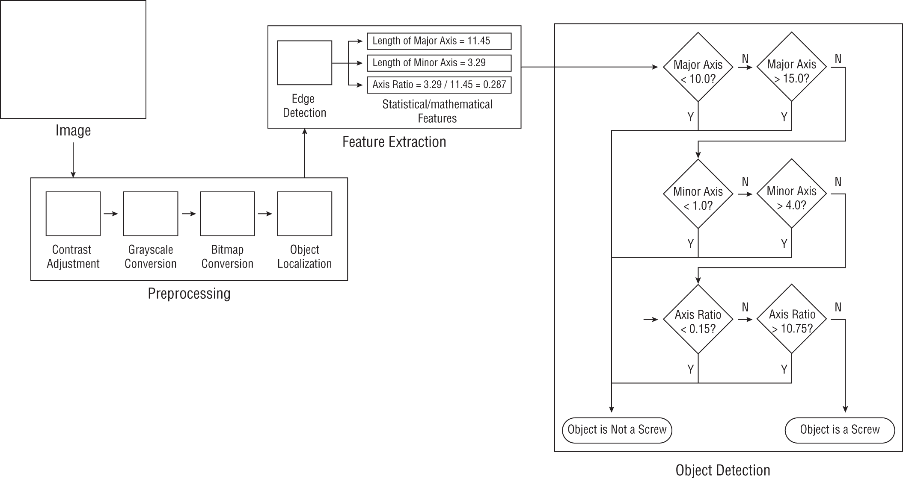

图 5.2 目标检测阶段

同时，研究人员正在寻找使用人工神经网络解决目标检测问题的方法，并创建了一种新型神经网络架构，称为`卷积神经网络`（CNN）。第一个商业上成功的 CNN 由 Yann LeCun 创建，并被称为 `LeNet`；它在 20 世纪 90 年被美国邮政用于自动读取邮政编码。

不幸的是，CNN 需要大量的计算能力，这在 20 世纪 90 年只有少数机构能够拥有。对 CNN（以及神经网络）的兴趣下降了十多年。

基于 CNN 的目标检测由于一种名为 `AlexNet`（由 Alex Krizhevsky 等创建）的 CNN 而引起，并在 2012 年的 ImageNet 大规模视觉识别挑战中以显著优势获胜。ImageNet 挑战非常困难，涉及将高分辨率图像分为 1000 个不同的类别。仅训练集就有超过百万张图像。使用传统技术构建的最佳准确率为 74%。AlexNet 的准确率为 83%，提升了近 10%。

AlexNet 的成功引发了神经网络兴趣的复兴，自此 CNN 已成功应用于许多不同的图像识别问题，并能够达到与人类相似的准确率，有时更高。现在的 CNN 模型是处理图像输入问题的首选模型，与以前的目标检测方法相比具有许多优势，最重要的优势是它们对输入图像的预处理要求显著减少，并且能够处理不同的物体尺度和方向。神经网络的详细讨论超出了本书的范围；然而，下一节对该主题进行了高层次介绍。

## 人工神经网络简述

人工神经网络（ANNs）是由 Warren McCulloch 和 Walter Pitts 在 1943 年开发的计算工具，其设计灵感源于生物神经网络。图 5.3 展示了简单人工神经网络的结构。


图 5.3 人工神经网络的结构

ANN 由称为`神经元`（neurons）的单元组成，并组织成一系列层。三层：

* **输入层：** 此层直接接收计算输入。人工神经网络中只有一个输入层。
* **输出层：** 此层提供计算的输出。根据网络用于解决的问题类型，该层可以包含一个或多个神经元。


- **隐藏层：** 该层位于输入层和输出层之间。输入层的神经元连接到隐藏层的神经元，而隐藏层的神经元连接到输出层的神经元。当某一层中的所有神经元都连接到前一层的每一个神经元时，该网络被称为 `fully connected`（全连接或稠密）网络。简单的神经网络不一定有隐藏层，而复杂的神经网络（如深度学习网络）具有多个隐藏层，每层都包含大量的神经元。

神经元之间的之间的每个连接都关联有一个权重值。该权重乘以连接起始处神经元的值。每个神经元通过计算其输入之和并将该和传递通过非线性激活函数来工作。神经元的输出值是激活函数的结果。图 5.4 展示了一个包含输入层两个神经元和输出层一个神经元的简单神经网络。


FIGURE 5.4 简单神经网络

如果 `x[1]`，`x[2]` 是加载到输入层神经元的值，`w[1]`，`w[2]` 是输入层和输出层之间的连接权重，且 `f()` 是输出层神经元的激活函数，那么图 5.4 中神经网络的输出值为 `f(w[1].x[1] + w[2].x[2])`。

有许多不同类型的激活函数，它们各自有优缺点。设置激活函数的原因是为了确保网络不仅仅是一个巨大的线性模型。当实例化一个神经网络时，权重被设置为随机值。训练神经网络的过程涉及寻找权重值。在训练过程中，将某些训练样本（你已知其结果的）逐个输入网络，并将网络做出的预测与预期结果进行比较。使用一种数学误差函数（如均方误差）来捕获预测中的整体误差，并调整神经网络的权重以减小该误差函数的值。假设你有几个训练样本，误差函数的计算和随后的权重优化可以在训练过程中的三个时间点之一：

- 在网络处理完每个训练样本后
- 在网络处理完一批训练样本后（假设 `batch size` 小于训练样本的总数）
- 在网络处理完所有训练样本后

当神经网络遇到所有训练样本时，称为完成了一个 `training epoch`（训练轮）。网络通常会训练几个 epoch，直到预测的误差停止减少。

对于给定的误差函数值，神经元权重的调整逐层进行，从网络的最后一层开始一直回溯到网络的第一层。用于将误差分配到单个神经元的算法被称为 `back propagation`（反向传播），它利用微分的链法则来计算每个神经元对整体网络误差的贡献。对反向传播的详细讨论超出了本书的范围；但重要的是，反向传播要求神经元的激活函数是可微的。这意味着你不能任意选择任何激活函数，只能选择定义导数的函数。

卷积神经网络架构由两部分组成——卷积基和在基之上的正规全稠密神经网络。卷积基的目的是从输入图像中提取有用特征，而稠密网络的目的是利用卷积基的输出来解决典型的二分类或多分类分类问题。在二分类问题中，最终输出是一个数字，表示输入图像包含特定类别对象的概率。图 5.5 展示了可以用于解决二分类问题的简单 CNN 结构。

从图 5.5 中可以看出，网络的卷积基部分由若干堆叠的层组成。这些层可以是三种类型：

- **卷积层：** 该层对其输入执行卷积操作。卷积操作是图像和信号处理中的常用操作。它涉及使用一个名为 `kernel`（卷积核，通常为 3×3）的小浮点数矩阵来修改输入图像，方法是将卷积核中心置于输入图像的每个像素位置上，并将输出图像相应像素的值计算为邻域像素的加权和。卷积矩阵的值即权重。图 5.6 释了卷积操作。
- 如果你不熟悉图像处理领域的卷积操作，这个想法对你来说可能非常抽象。理解该操作的关键点是，具有特殊选择权重的卷积核可以变换输入图像以突出某些特征。
- 对图像应用一系列卷积操作（使用不同的卷积核）将产生一张可能看起来完全不像原始图像的图像。典型的卷积层可以包含多个卷积核，这些卷积核的输出可以作为另一个卷积层的输入。每个连续的卷积层都会为之前检测到的特征增加抽象层次。图 5.7 用手机图像说明了这一概念。
- **池化层：** 这种层用于将输入图像缩小 50%。这种缩小可以通过多种方式实现，但常见的方法是检查输入图像中的每个 2×2 像素区域，并将区域内的最高像素值作为输出图像像素的值。这种操作被称为 `max pooling`（最大池化，因为你取了 2×2 子区域的最大值）。如果使用的是最小值，则称为 `min pooling`（最小池化）。如果使用的是平均值，则称为 `average pooling`（平均池化）。

    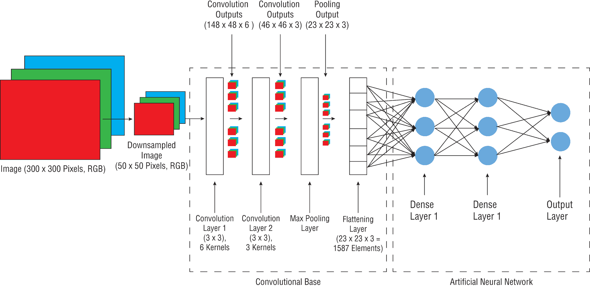

    FIGURE 5.5 卷积神经网络架构

- 池化层效果就像是缩小图像。当你缩小视野时，不重要的细节会消失。留下的是最重要的视觉信息。这不仅增加了模型的鲁棒性，还由于你有效地丢了 50% 的数据而减少了高层的整体计算量。图 5.8 展示了最大池化的效果。

    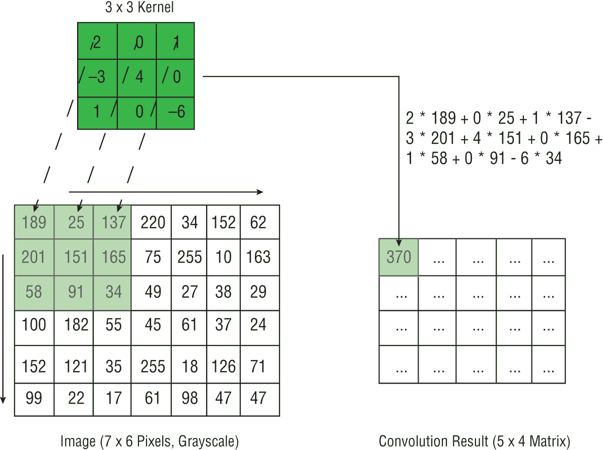

    FIGURE 5.6 卷积操作

    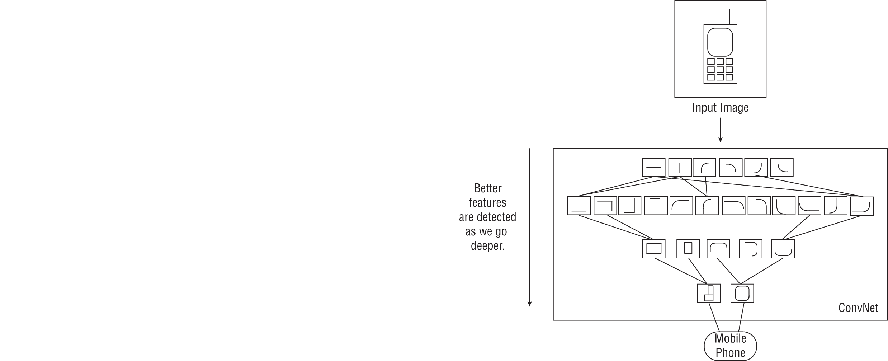

    FIGURE 5.7 连续卷积的结果

    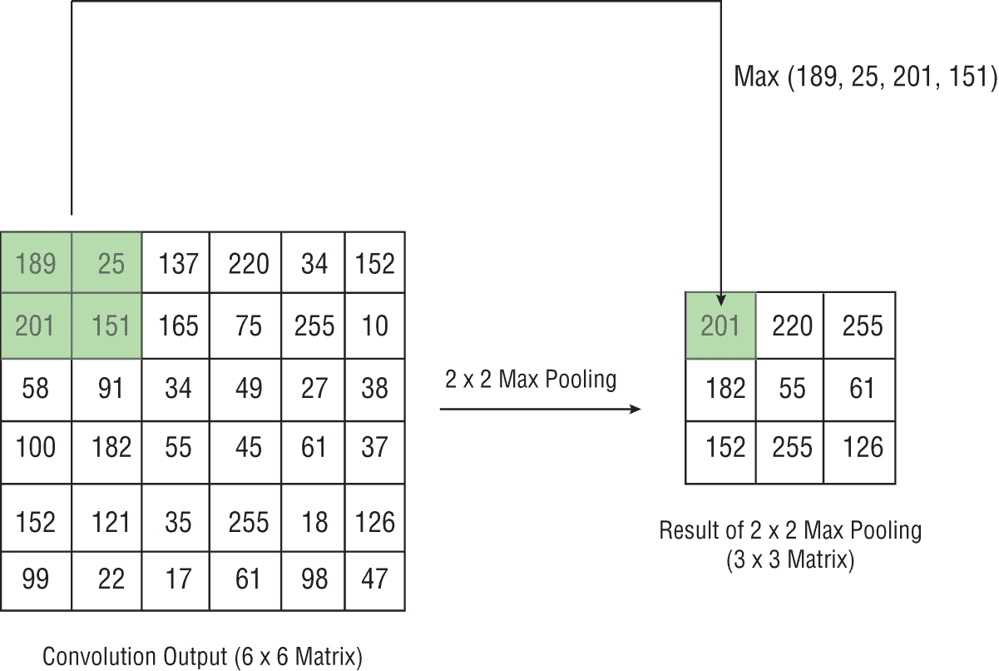

    FIGURE 5.8 最大池化的效果


*   **展平层（Flattening layer）：** 该层位于卷积基底和全连接神经网络的边界。它用于将所有二维卷积结果展平为一个长长的一维数组，然后该数组可以作为神经网络全连接层的输入。

如果你想可视化连续卷积层的效果，请访问 Adam Harley 的网页：`http://scs.ryerson.ca/~aharley/vis/conv/flat.html`。Adam 创建了一个基于 Web 的 CNN 可视化工具，可以识别手写数字。图 5.9 显示了该工具。

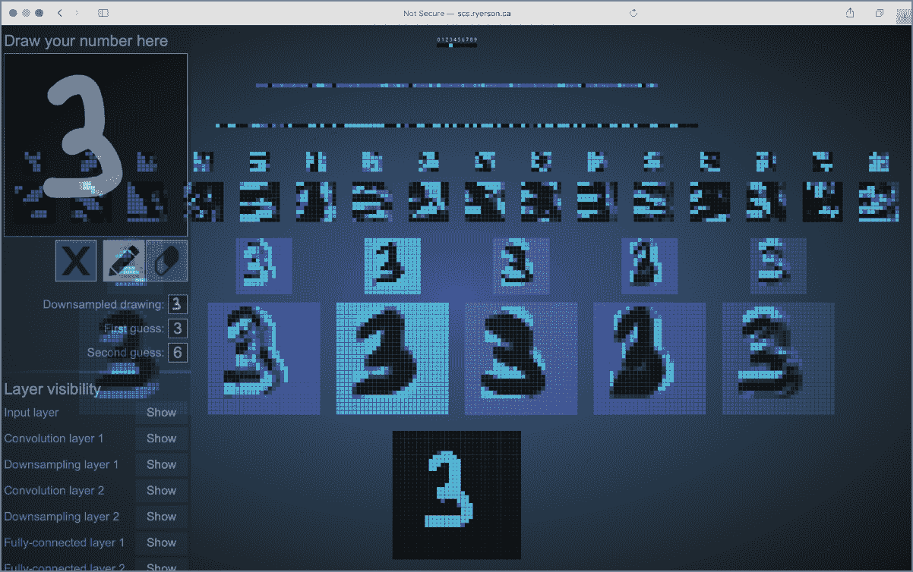

`FIGURE 5.9`](#c05.xhtml#R_c05-fig-0009) Adam Harley 提供的 CNN 层可视化图

目前没有固定的公式来规定 CNN 中应该包含多少层每类型的层。目前有许多流行的 CNN 架构，如 `VGG16`、`Inception`、`VGG19`、`ResNet50` 和 `MobileNet`。在第 10 章，你将使用 `Keras` 从头创建一个 `Inception` 深度卷积神经网络。

图 5.10 描述了 `VGG16` 模型卷积基底的结构，这是一个相对简单的模型，由一系列连续堆叠的卷积层和池化层组成。`VGG16` 网络由 Karen Simonyan 和 Andrew Zisserman 创建，并在名为“用于大规模图像识别的深度卷积网络”的论文中进行了讨论。你可以在 `https://arxiv.org/abs/1409.1556` 找到该论文的副本。这里提到的其他架构更为复杂，涉及模型内部的分支。

在查看了 `VGG16` 网络的架构后，你可能会想要堆叠更多的卷积层和池化层，以期提高模型的准确性。虽然人们通常认为深层网络能够学习输入数据中更复杂的关系，但在实践中观察到，当层数变得很大（几十层）时，反向传播的效果会降低。为了解决这个问题，何恺明等人提出了在深度网络中使用残差（residuals）的概念。该思想是将较早层的输出馈到后续层的输入中，跳过中间的几层。图 5.11 展示了 CNN 卷积基底中的残差连接。

你可以在名为“用于图像识别的深度残差学习”的论文 `https://arxiv.org/abs/1512.03385` 中阅读关于残差学习的内容。

`ResNet` 是一种流行的 CNN 架构类型，使用了残差概念。在下一节中，你将下载预训练的 `ResNet` 模型并在应用中使用它。

## 下载 ResNet50 模型

虽然可以在 Python 中使用 `Keras` 从头构建 `ResNet` 模型并使用数百万张图像进行训练，但 Apple 提供了一个 `Core ML` 格式的预训练 50 层 `ResNet` 模型 `Resnet50`。该模型在 `ImageNet` 竞赛数据集上进行了训练，可以识别 1,000 类物体。要下载此模型，请导航到 `Core ML` 模型页面 `https://developer.apple.com/machine-learning/models/` 并找到 `Resnet50` 模型（参见图 5.12）。

点击 View Models（查看模型）按钮，然后下载 `Resnet50.mlmodel` 文件（参见图 5.13）。

你将在本章后面创建的应用中使用此模型。

## 创建 iOS 项目

下载预训练的 `Core ML` 模型后，在你的 Mac 上启动 `Xcode` 并使用 Single View App 模板创建一个新项目（参见图 5.14）。

在提示时，使用以下项目选项：

*   **Product Name（产品名称）：** `DominantObjectDetector`
*   **Organization Name（组织名称）：** 提供一个合适的值
*   **Organization Identifier（组织标识符）：** 提供一个合适的值
*   **Language（语言）：** `Swift`
*   **User Interface（用户界面）：** `Storyboard`

    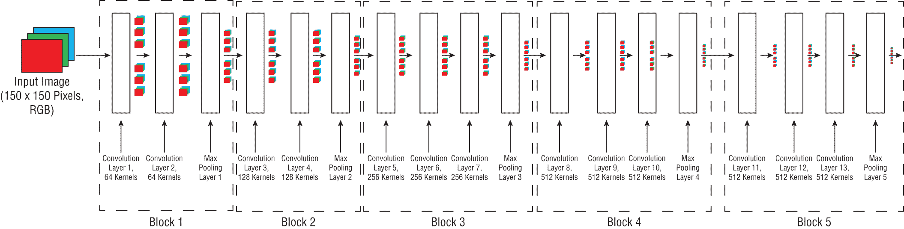

    `FIGURE 5.10`](#c05.xhtml#R_c05-fig-0010) VGG16 架构图

    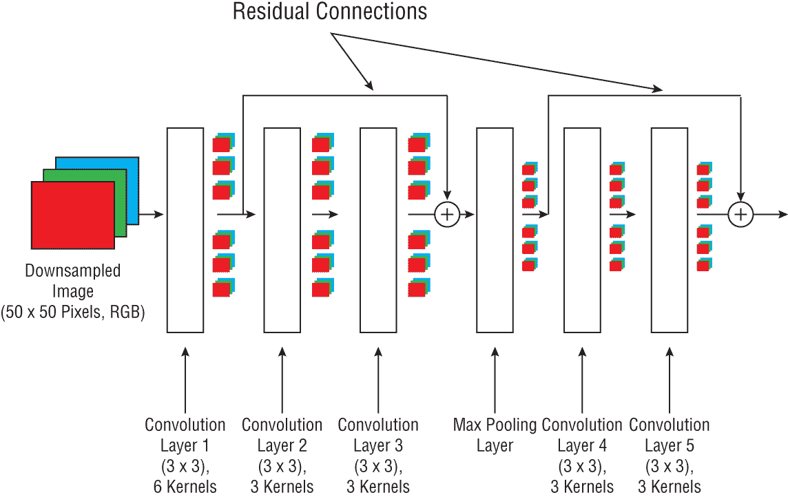

    `FIGURE 5.11`](#c05.xhtml#R_c05-fig-0011) 使用残差学习的网络

    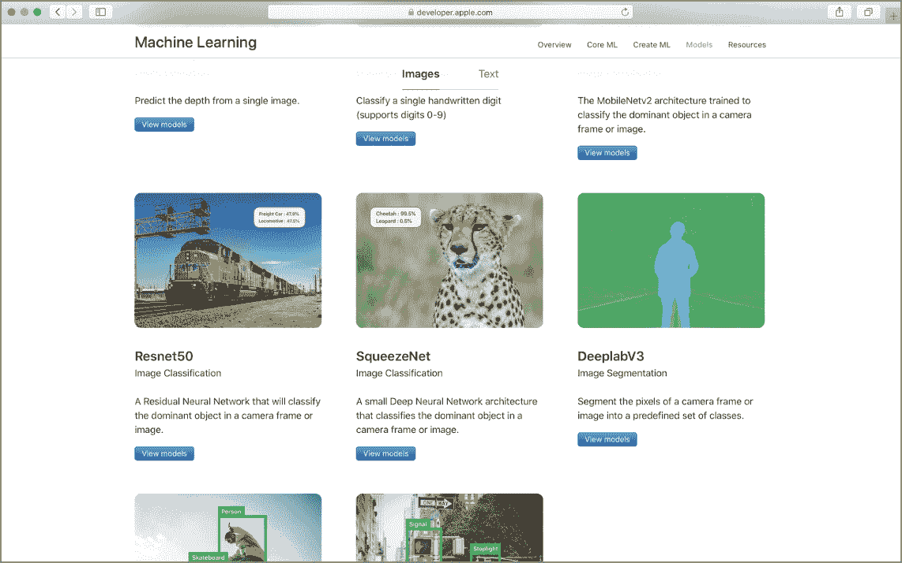

    `FIGURE 5.12`](#c05.xhtml#R_c05-fig-0012) 预训练的 Core ML 模型

    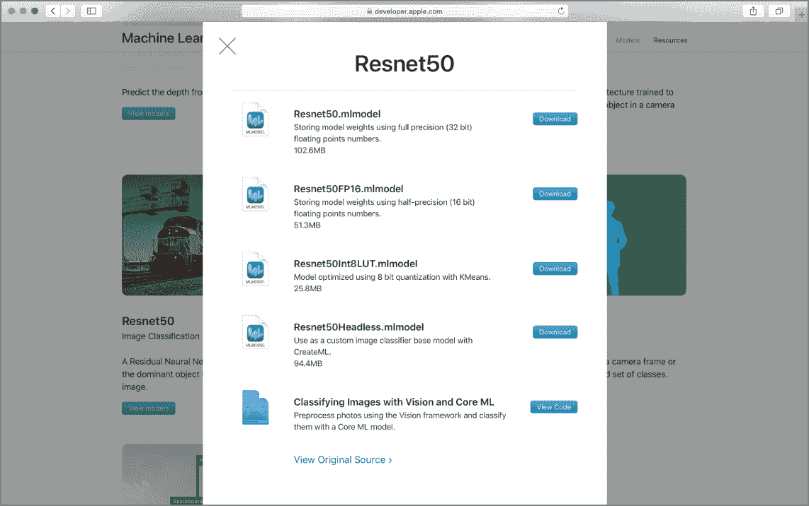

    `FIGURE 5.13`](#c05.xhtml#R_c05-fig-0013) 下载预训练的 Resnet50 Core ML 模型

    

    `FIGURE 5.14`](#c05.xhtml#R_c05-fig-0014) 使用 Single View App 模板创建新的 iOS 项目

*   **Use Core Data（使用 Core Data）：** 未勾选
*   **Include Unit Tests（包含单元测试）：** 未勾选
*   **Include UI Tests（包含 UI 测试）：** 未勾选

### 创建用户界面

项目创建后，按照以下步骤设置项目的用户界面：

1.  打开 `Main.storyboard` 文件并使用 `View`（视图） ➢ `Show Library`（显示库）菜单项访问对象库窗口。从对象库拖入一个图像视图（image view）、两个按钮实例和一个标签（label）到默认视图控制器场景中。

2.  使用 `Attributes Inspector`（属性检查器），将其中一个按钮的标题（caption）更改为 `Select an Image`，并将另一个按钮的标题更改为 `Capture an Image`。将两个按钮的背景颜色都改为灰色，以便在 storyboard 中更容易看到。你可以通过 `View`（视图） ➢ `Inspectors`（检查器） ➢ `Attributes Inspector`（属性检查器）菜单项访问属性检查器。

3.  整理视图控制器场景上的元素，类似于图 5.15，并设置合适的约束。

4.  使用 `Editor`（编辑器） ➢ `Assistant`（助手）菜单项访问助手编辑器并确保 `ViewController.swift` 文件已打开。在视图类中创建两个名为 `imageView` 和 `resultLabel` 的输出（outlet）。将这些输出与 storyboard 中的图像视图和标签对象关联（参见图 5.16）。

    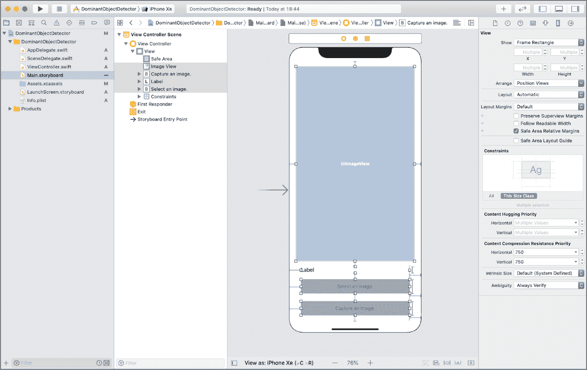

    `FIGURE 5.15`](#c05.xhtml#R_c05-fig-0015) 带有默认控制器场景的应用程序 storyboard

    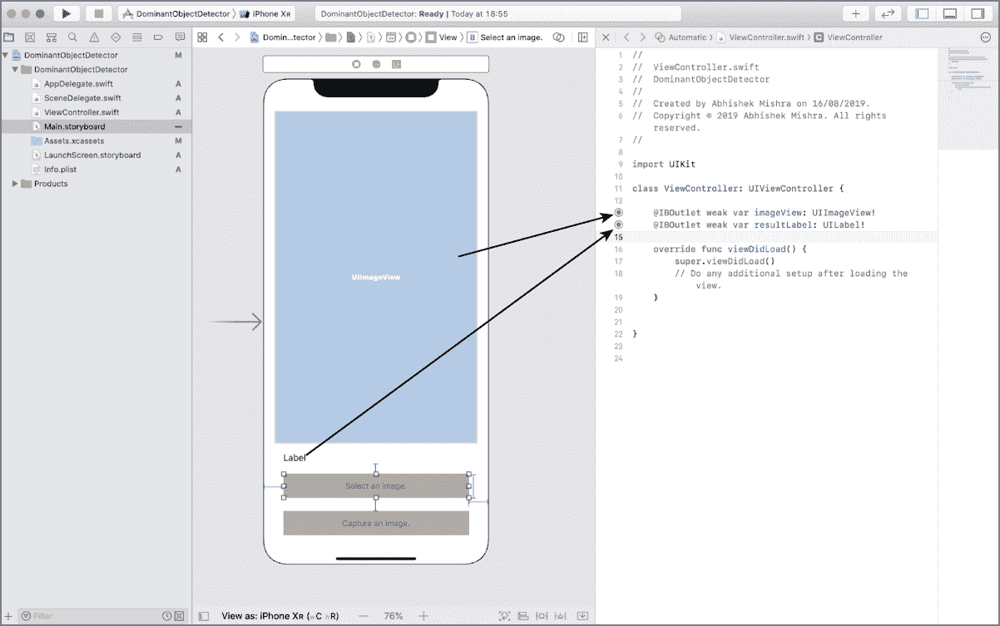

    `FIGURE 5.16`](#c05.xhtml#R_c05-fig-0016) 使用助手编辑器创建输出

5.  在你的 `ViewController.swift` 文件中添加一个名为 `detectDominantObject(in:)` 的方法并按如下方式实现：

    ```
    func detectDominantObject(in image: UIImage) {
      // 编写代码使用 Core ML 进行目标检测
    }
    ```

    该方法的实现将在本章后面介绍并将使用 Core ML 模型识别用户选择图像中的主要物体。

6.  将 `OnSelectImageFromPhotoLibrary(_ sender: Any)` 方法的实现更新为：

    ```swift
    @IBAction func onSelectImageFromPhotoLibrary(_ sender: Any) {
      let picker = UIImagePickerController()
      picker.delegate = self
      picker.sourceType = .photoLibrary
      present(picker, animated: true)
    }
    ```

    此代码使用 `UIKit UIImagePickerController` 对象允许用户从 iOS 设备的照片库中选择照片。


8. 将 `OnSelectImageFromCamera(_ sender: Any)` 方法的实现更新如下：

```swift
@IBAction func onSelectImageFromCamera(_ sender: Any) {
  // ensure camera is available.
  guard UIImagePickerController.isSourceTypeAvailable(.camera) else {
    
    let alertController = UIAlertController(title: "Error",
               message: "Could not access the camera.",
               preferredStyle: .alert)
      
    self.present(alertController, animated: true, completion: nil)
    return
  }
    
  let picker = UIImagePickerController()
  picker.delegate = self
  picker.sourceType = .camera
  present(picker, animated: true)
}
```

这段代码检查设备是否具有摄像头，以及用户是否已授予应用访问相机的权限。如果访问摄像头没有问题，代码将创建一个 `UIKit UIImagePickerController` 对象，允许用户使用相机拍照。

9. 在 `ViewController.swift` 底部添加以下代码段，以便类扩展中实现 `UIImagePickerControllerDelegate` 的方法 `func imagePickerController(_ picker:, didFinishPickingMediaWithInfo:)`：

```swift
extension ViewController: UIImagePickerControllerDelegate, 
             UINavigationControllerDelegate {
 
  func imagePickerController(_ picker: UIImagePickerController,
     didFinishPickingMediaWithInfo info: 
     [UIImagePickerController.InfoKey : Any]) {
     picker.dismiss(animated: true)
     let image = info[UIImagePickerController.InfoKey.originalImage] 
           as! UIImage
     imageView.image = image
     detectDominantObject(in: image)
  }
}
```

这段代码将用户选择（或相机拍摄）的图片显示在应用程序用户界面的视图对象中，并调用 `detectDominantObject(in:)` 方法执行物体检测。`ViewController.swift` 中的代码应类似于 Listing 5.2。

### 更新隐私设置

在你的应用程序访问设备上的摄像头之前，你需要请求用户的许可，并对你的应用意图如何使用摄像头提供简短的描述。请求用户许可由 `UIImagePickerController` 类自动完成。你只需要在应用程序的 `Info.plist` 文件中添加一个键，并将该键的值设置为一条友好的消息，告知用户你的应用意图如何使用摄像头。

点击项目导航器中的 `Info.plist` 文件以在 plist 编辑器中打开它。选择 Editor ➢ Add Item 菜单向 `Info.plist` 文件中插入一个新键。从可用键列表中选择 Privacy – Camera Usage Description 键，并提供一段简短的文本，描述你的应用将如何使用摄像头（参见图 5.17](#c05.xhtml#c05-fig-0017)).

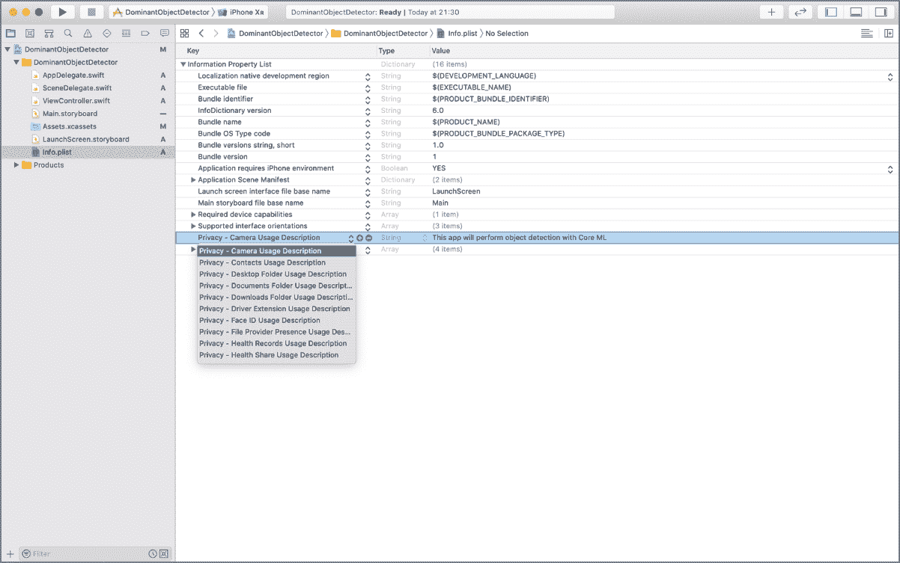

FIGURE 5.17 编辑应用程序的 info.plist 文件

### 在 iOS 项目中使用 Resnet50 模型

现在我们已经构建了应用程序的用户界面，是时候使用早些部分节中下载的 Resnet50 模型来检测用户选择图片中的物体了。请执行以下步骤：

1. 在项目导航器窗口中 Control-点击 `DominantObjectDetector` 文件夹组，并选择 Add Files to DominantObjectDetector 菜单项。导航到下载文件夹中的 `Resnet50.mlmodel` 文件，并确保勾选了 Copy Items If Needed ，并在对话框中选择了 `DominantObjectDetector` target（参见图 5.18](#c05.xhtml#c05-fig-0018)).

   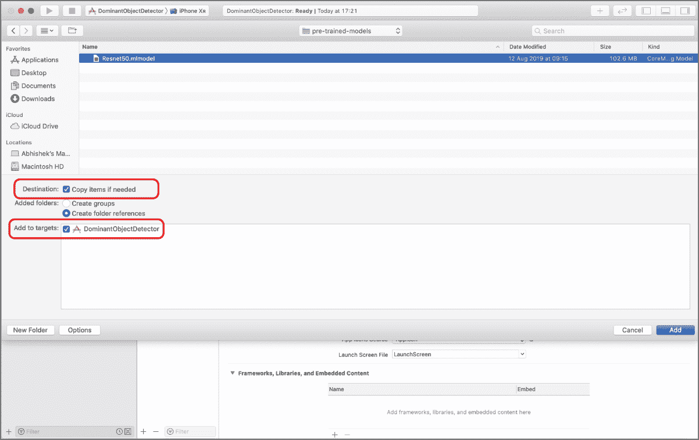

   FIGURE 5.18 Resnet50.mlmodel 文件的导入设置

2. 在项目导航器中选择 `Resnet50.mlmodel` 文件以获取模型的概览（参见图 5.19](#c05.xhtml#c05-fig-0019)).

   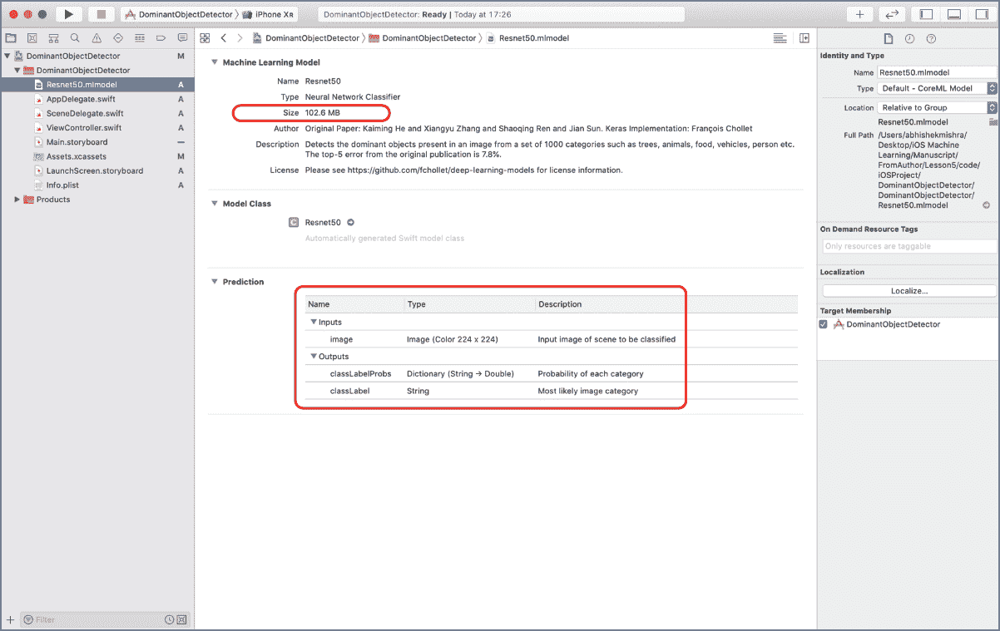

   FIGURE 5.19 Resnet50.mlmodel 文件的概览

从模型概览屏幕可以看出，模型的大小超过了 100 MB，并且模型的输入是 224×224 像素的 RGB（彩色）图像。你从照片库（或相机）选择的图片比这大得多，需要缩小到这个尺寸。你可能奇怪为什么输入图像尺寸这么小。这里有两个很好的原因：

* 较大的图像会创建一个更大的 `.mlmodel` 文件，训练时间会更长，且运行速度会更慢。
* 缩小到此尺寸有利于性能。


通过使用 `lazy` 变量，你确保了这段代码不会在类加载时执行，而是在你最终从代码中访问 `classificationRequest` 变量时执行。

这段代码从自动生成的 Core ML 模型类 `Resnet50` 创建了一个 `VNCoreMLModel` 实例，然后通过将 `VNCoreMLModel` 和完成处理程序作为参数，创建了一个 `VNCoreMLRequest` 实例。

`VNCoreMLRequest` 对象有一个名为 `perform()` 的方法，它负责处理将图像转换为 `CVPixelBuffer` 并使用模型执行对象检测的繁重工作。你将在本章的稍后部分调用 `perform()` 方法。你在创建 `VNCoreMLRequest` 对象时提供的完成处理程序会在操作完成时被调用，在此段代码中，该完成处理程序调用了 `processResults(for:, error:)` 方法，你接下来将创建该方法。

在返回 `VNCoreMLRequest` 实例之前，`imageCropAndScaleOption` 属性被设置为 `centerCrop`。Vision 使用此属性来决定它应该如何将图像缩小到模型所需的尺寸。由于相机拍摄的图像是矩形的，而模型要求的图像是正方形的，因此也会发生一些裁剪。你可以指定三个可能的选项：

*   `centerCrop`：此选项按比例缩放图像，直到图像的最小维度与模型预期的尺寸匹配。缩放后的图像（仍为矩形）将通过中心部分被裁剪成正方形。此选项可能会裁剪掉图像中心物体的部分。
*   `scaleFill`：此选项按非比例缩放图像，直到图像的两个维度都与模型预期的尺寸匹配。缩放后的图像看起来会被挤压或伸。
*   `scaleFit`：此选项按比例缩放图像，直到图像的最长维度与模型预期的尺寸匹配。通过用黑色像素填充较短的维度将缩放后的图像转换为正方形。

图 5.22 展示了这三种缩放和裁剪选项的效果。理想情况下，你应该选择与模型训练时的选择相匹配的选项。如果你训练了模型，这是可能的；但在使用预训练模型的情况下，最好选择 `centerCrop` 或 `scaleFill`，并要求用户将主体尽可能放在图像的中心。

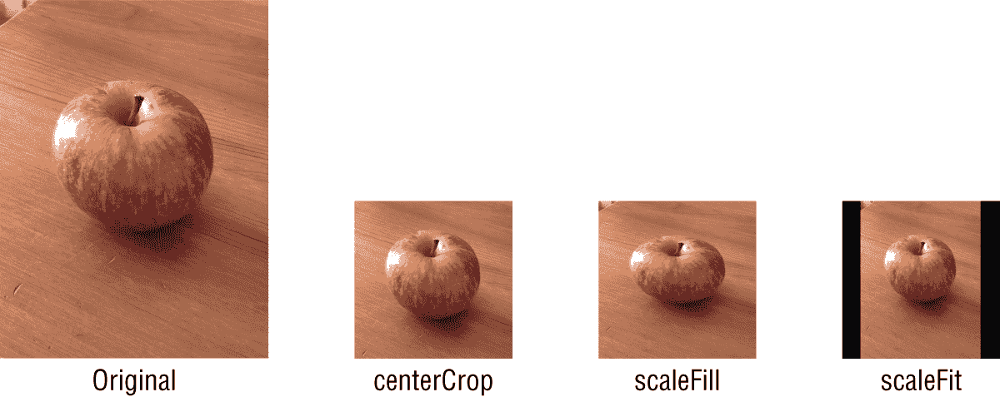

FIGURE 5.22 VNCoreMLRequest 缩放和裁剪选项

1. 在 `ViewController.swift` 文件中如下实现 `processResults(for:, error:)` 方法：

```swift
func processResults(for request: VNRequest, error: Error?) {
  DispatchQueue.main.async {
    guard let results = request.results else {
      print("Unable to classify image.\n\(error!.localizedDescription)")
      self.resultLabel.text = "Unable to classify image."
      return
    }
 
    let classifications = results as! [VNClassificationObservation]
    
    if classifications.isEmpty {
      self.resultLabel.text = "Did not recognize anything."
    } else {
      self.resultLabel.text = String(format: " percent@ percent.1f percent percent",       
                 classifications[0].identifier, 
                  classifications[0].confidence * 100)
    }
  }
}
```

该方法从 `VNCoreMLRequest` 对象的完成处理程序调用。该方法接受两个参数；第一个是名为 `request` 的 `VNRequest` 实例，另一个是可选的错误对象。你可以通过 `VNRequest` 对象的 `results` 成员来访问分类结果。分类结果以 `VNClassificationObservation` 对象数组的形式返回。每个对象都有两个成员变量：`identifier`（代表检测物体的类别）和 `confidence`（代表该类别的概率）。结果按概率降序排列，数组中的第一个项目是概率最高的物体类别。

注意的是，该方法不是在主 UI 线程上调用的，因此对用户界面的任何更新必须封装在 `DispatchQueue.main.async{}` 块中。

2. 现在你已经编写了创建 `VNCoreMLRequest` 并处理图像分类结果的代码，你只需要编写代码，在用户选择图像时创建并执行 `VNCoreMLRequest`。在本章的早些时候，你创建了一个名为 `func detectDominantObject(in image: UIImage)` 的空方法。用以下内容替换该空方法：

```swift
func detectDominantObject(in image: UIImage) {
  resultLabel.text = "Processing…"
    
  guard let ciImage = CIImage(image: image),
     let orientation = CGImagePropertyOrientation(rawValue: 
             UInt32(image.imageOrientation.rawValue))
  else {
    print("Unable to create CIImage instance")
    resultLabel.text = "Failed."
    return
  }
    
  DispatchQueue.global(qos: .userInitiated).async {
    let handler = VNImageRequestHandler(ciImage: ciImage, 
                  orientation: orientation)
    do {
      try handler.perform([self.classificationRequest])
    } catch {
      print("Failed to perform classification.\n\(error.localizedDescription)")
    }
  }
}
```


图 5.23 使用花盆图片运行 App 的结果

### 总结

* 计算机视觉是人工智能领域的一个分支，涉及开发可以应用于数字图像和视频领域的算法。
* 目标检测是计算机视觉技术的一种应用，用于检测图像中的一个或多个物体。
* 人工神经网络（`ANNs`）是由 Warren McCulloch 和 Walter Pitts 在 1943 年开发的计算工具；其设计灵感源于生物学神经网络。
* `ANNs` 由称为神经元的单元组成，并组织成一系列层。
* 在训练过程中，一组训练样本（你已知其结果的样本）被逐一个地输入网络，并将网络给出的预测结果与预期结果进行比较。使用数学误差函数（如均方误差）来捕获预测中的整体误差，并调整神经网络的权重以减小该误差函数的值。
* 当神经网络遇到所有训练样本时，即认为一个训练轮次（epoch）已经完成。网络通常会训练几个轮次，直到预测的误差停止减少为止。
* 卷积神经网络架构由两部分组成：卷积基底和一个位于该基底之上的普通全连接神经网络。卷积基的作用是从输入图像中提取有用特征，而全连接网络的作用是使用卷积基的输出来解决典型的二分类或多分类分类问题。
* Apple 提供了几种 `Core ML` 格式的预训练模型，你可以下载并在你的 App 中使用它们。

# 第 6 章：使用 Create ML App 创建图像分类器

在本章中，你将使用 `Create ML` App 训练机器学习模型，该模型可以检测图像中的主要物体，并将图像分类为包含狗或猫。模型将在 Kaggle Dogs vs. Cats 数据集的子集上进行训练。训练完成后，你将在一个 iOS App 中该模型，该 App 允许用户拍照并判断照片中是狗还是猫。该数据集的完整版本包含 25,000 张图像可以在 `Kaggle.com` 上的 `https://www.kaggle.com/c/dogs-vs-cats/data` 获取。

训练图像分类模型可能需要很长时间，因此，随本章节提供的下载包含一个精简版的 Kaggle 数据集，仅包含 404 张图像，而不是原始的 25,000 张。精简后的数据集由两个文件夹组成。

* `Train`：包含 202 张图像。在 `train/dog` 文件夹中有 101 张狗的图像。其余图像是位于 `train/cat` 文件夹中的猫。
* `Test`：包含额外的 202 张图像，使用与 `train` 文件夹类似的文件夹层级。

如果你决定使用 Dogs vs. Cats 数据集的完整版本，将需要从 `Kaggle.com` 下载并重新组织其内容，以确保训练数据中的每个物体类别都在自己的子文件夹中。

## Create ML App 简介

`Create ML` App 是一个 macOS 应用程序，允许你使用向导式用户界面构建机器学习模型。`Create ML` App 在 WWDC 2019 上引入，是 `Create ML` 框架的后续者。

同名的 `Create ML` 框架是一个 Swift 框架，允许你使用 Swift 代码通过 Xcode 使用 `Create ML` 模型。另一方面，`Create ML` App 不需要你编写任何代码。`Create ML` App 包含在 Xcode 11 中，并需要 macOS Catalina 或更高版本。如果你在较版本的 macOS 上使用 Xcode 11，则无法使用 `Create ML` App。

除了不需要编写任何代码外，`Create ML` App 还提供了一种面向任务的机器学习方法。正如你在本书的之前章节中所学到的，有许多不同类型的模型，其中一些可以用于不同类型的问题，且成功程度不一。像 `Scikit-learn` 库要求你为特定问题选择算法，然后开始构建模型。`Create ML`（包括 Swift 库和 App）采取了不同的模型构建方法。你不是选择算法，而是从选项列表中选择你尝试解决的问题，`Create ML` 将为该任务选择最佳算法。在本书编写时，它支持以下任务：

* 图像分类和目标检测
* 声音分类
* 活动分类
* 文本分类
* 表格分类和回归

虽然面向任务的高级界面简化了模型构建，但它也存在一些局限性，Apple 可能会在 `Create ML` App 的未来发布版本中解除某些限制。

* 根据当前处理的任务，你可能对所选的算法或选择该算法的原因没有任何控制权。
* 你对超参数的控制有限。
* 你只能使用 `Precision`（精确率）和 `Recall`（召回率）作为性能指标。无法定义自定义指标。
* 对于表格数据，你需要在将数据导入 `Create ML` App 之前进行特征工程。

对于图像分类和目标检测模型，`Create ML` App 使用迁移学习来加速训练过程。`Create ML` App 的输出是 `Core ML` 格式的模型，准备好用于你的 iOS 应用程序。模型的大小通常很小（几 KB）。这是因为 `Create ML` 出的模型不包含卷积基底。卷积基是机器学习模型中较大的部分，已包含在 iOS 和 macOS 中。

## 使用 Create ML App 创建分类模型

在本书编写时，`Create ML` App 要求使用 macOS Catalina 和 Xcode 11 或更高版本。在你的 Mac 上启动 Xcode，然后通过 Xcode ➢ Developer Tool ➢ Create ML 菜单项启动 `Create ML` App（见图 6.1）。


图 6.1 启动 Create ML

`Create ML` App 启动后，使用 `File ➢ New Project` 菜单项创建一个新的 `Create ML` 项目。系统将提示你选择一个任务。从任务类别列表中选择 `Image`，从可用选项中选择 `Image Classifier`见图 6.2），并点击 `Next` 按钮。

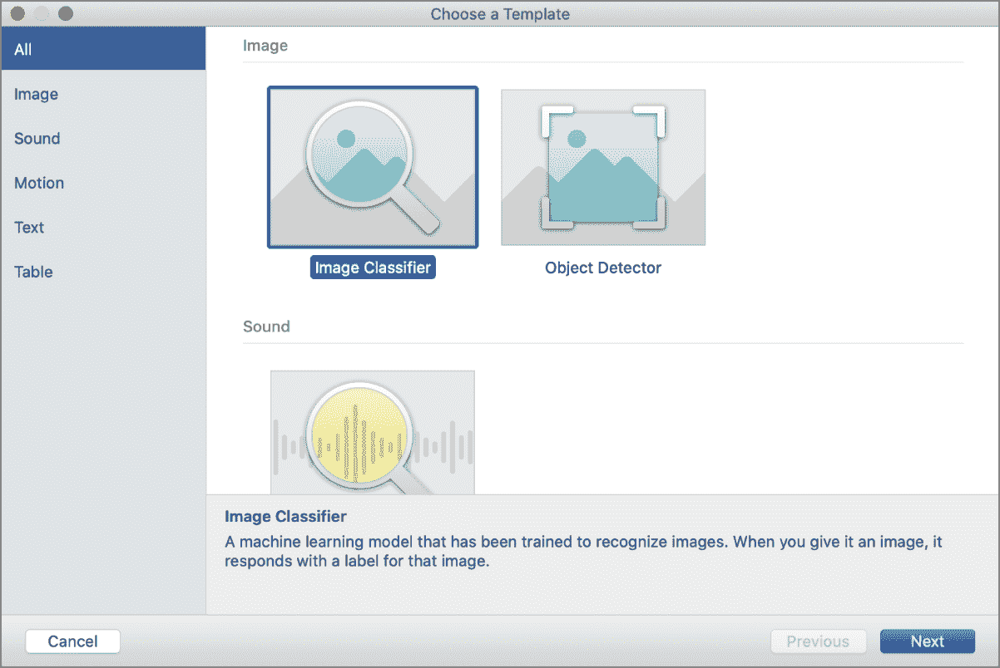

图 6.2 选择图像分类模板

你将看到一个对话框，允许你指定新的 `Create ML` 项目名称以及与项目相关的元数据（见图 6.3）。将新项目命名为 `DogsCatsTransferClassifier`，提供适当的项目描述，并点击 `Next` 按钮。

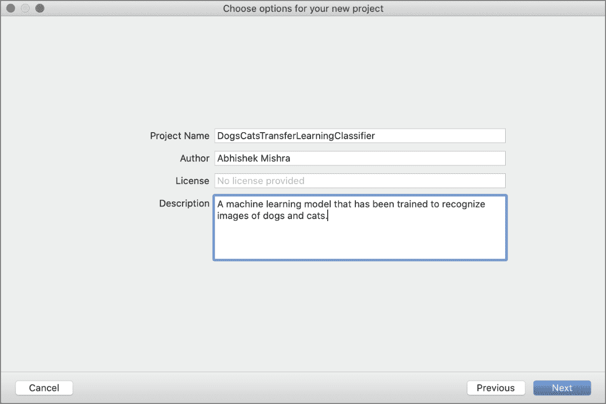

图 6.3 Create ML 项目选项

在指定项目元数据后，系统将提示为新的 `Create ML` 项目指定位置。在你的硬盘上选择一个位置并点击 `Create` 按钮完成新项目的创建。

项目创建后，它将加载到 `Create ML` 中。在 `Inputs` 标签中找到 `Training Data` 部分，使用 `Select Files` 下拉菜单项导航到 Dogs vs. Cats 数据集的 `train` 文件夹。

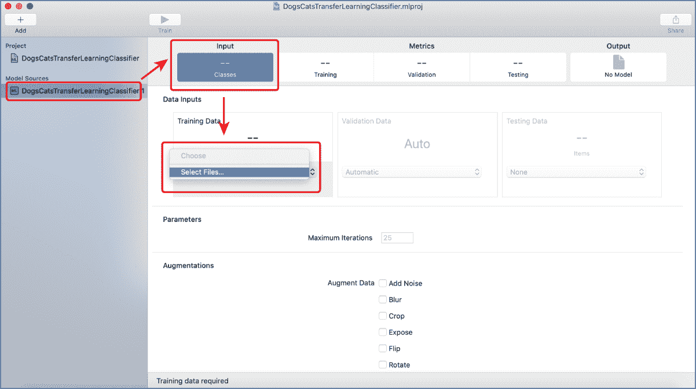

图 6.4 指定输入数据


指定输入数据的位置后，向下滚动到屏幕上的 Augmentations（增强）部分，并勾选所有数据增强选项（参见图 6.5）。

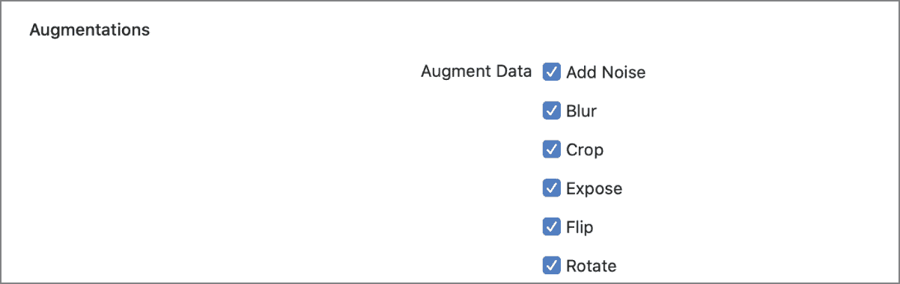

图 6.5 训练数据增强选项

数据增强是一种用于使深度学习卷积神经网络模型对主物体姿态的变化以及图像间光照条件的变化更具鲁棒的技术。具体而言，该技术涉及创建原始数据的增强副本，并选择一系列几何变换和亮度/对比度增强。增强后的图像将与原始训练数据一起包含进来，并将更大的数据集用于训练过程。点击工具栏中的 `Train` 按钮开始训练分类模型（参见图 6.6）。

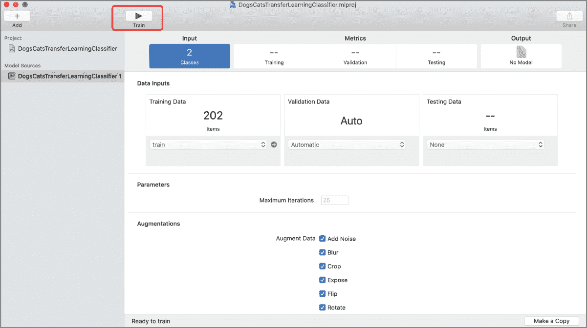

图 6.6 开始模型训练过程

根据计算机的硬件配置，训练过程可能花费大量时间。即使数据集较小，训练过程在 MacBook 上花费了大约四小时。训练完成后，你将看到模型在训练集和验证集上的性能信息（参见图 6.7）。`Create ML` 应用会自动预留部分训练数据用于模型验证。

在编写时，`Create ML` 为多分类分类模型提供的唯一性能指标是 `Precision`（精确率）和 `Recall`（召回率）。未来，Apple 可能会决定添加指标或允许你定义自己的自定义指标。如图 6.7 所示，该模型在验证集上的精确率为 88%，考虑到数据集规模较小，这个结果并不糟糕。如果你使用包含 25,000 张图像的整个“猫狗大战”数据集，将获得更高的准确率。然而，这将显著增加模型训练时间。


图 6.7 模型性能统计

要测试模型的预测结果，点击 `Testing` 标签并使用 `Choose Files` 下拉菜单导航到数据集的 `test` 文件夹（参见图 6.8）。


图 6.8 导航到测试数据集

随章节下载的测试数据集包含 202 张图像，`Create ML` 应用需要几分钟时间对整个集合进行预测。在进行预测时，不会执行数据增强。当预测结果就绪时，你将看到预测过程的结果（参见图 6.9）。

模型在测试集上的平均精确率为 86%，略低于验证集上的 88% 精确率。这表明模型可能对训练数据过过拟合。然而，由于你无法控制超参数或算法，除了增加训练数据的大小外，你几乎无能改变这一点。`Output` 标签包含你训练好的 Core ML 模型，你可以将其拖放到 macOS 桌面或 `Finder` 窗口以访问 `.mlmodel` 文件。`Create ML` 应用生成的输出 Core ML 模型将名为 `DogsCatsLearningClassifier 1.mlmodel`。在进入下一节之前，请将文件重命名为 `DogsCatsLearningClassifier.mlmodel`。


图 6.9 测试集上的预测

## 创建 iOS 项目

在计算机上保存 Core ML 模型后，在你的 Mac 上启动 `Xcode`，并使用 `Single View App` 模板创建一个新项目（参见图 6.10）。


图 6.10 使用 Single View App 模板创建新项目

在提示时，使用以下项目选项：

-   **Product Name**: `PetDetectorTL`
-   **Organization Name**: 提供适当的值
-   **Organization Identifier**: 提供适当的值
-   **Language**: Swift
-   **User Interface**: Storyboard
-   **Use Core Data**: 未勾选
-   **Include Unit Tests**: 未勾选
-   **Include UI Tests**: 未勾选

### 创建用户界面

创建项目后，按照以下步骤设置项目的用户界面：

1. 打开 `Main.storyboard` 文件并使用 `View` -> `Show Library` 访问对象库。从对象库中将一个图像视图、两个按钮实例和一个标签拖放到默认的视图场景中。
2. 使用 `Attributes Inspector`（属性检查器），将其中一个按钮的标题更改为 `Select an Image`，另一个按钮的标题更改为 `Capture an Image`。将两个按钮的背景颜色都改为灰色，以便在 storyboard 场景中更容易查看。你可以通过 `View` -> `Inspectors` -> `Show Attributes Inspector` 访问 `Attributes Inspector`。
3. 组织默认视图控制器场景中的元素，使其类似于图 6.11，并设置相应的 storyboard 约束。


图 6.11 带有默认视图控制器场景的应用 storyboard

4. 使用 `Editor` -> `Assistant` 菜单访问辅助编辑器，并确保 `ViewController.swift` 文件已打开。在视图控制器类中创建两个名为 `imageView` 和 `resultLabel` 的输出（outlet）。将这些输出与 storyboard 中的图像视图和标签关联（参见图 6.12）。


图 6.12 使用辅助编辑器创建输出

5. 在 `ViewController.swift` 文件中创建名为 `onSelectImageFromPhotoLibrary(_ sender: Any)` 和 `onSelectImageFromCamera(_ sender: Any)` 的方法。将这些方法分别与标记为 `Select an Image` 和 `Capture an Image` 的按钮的 `Touch Up Inside` 事件关联。你的 `ViewController.swift` 代码现在类似于列表 6.1。

6. 在 `ViewController.swift` 文件中添加名为 `detectPet(in image: UIImage)` 的方法并按如下方式实现：

```swift
func detectPet(in image: UIImage) {
  // 完成：使用 Core ML 执行目标检测
}
```

该方法的实现将在本章节后面介绍，并将使用 Core ML 模型检测用户选择的图像中的物体。

7. 将 `onSelectImageFromPhotoLibrary(_ sender: Any)` 方法的实现更新为：

```swift
@IBAction func onSelectImageFromPhotoLibrary(_ sender: Any) {
  let picker = UIImagePickerController()
  picker.delegate = self
  picker.sourceType = .photoLibrary
  present(picker, animated: true)
}
```

此代码使用 `UIKit UIImagePickerController` 对象允许用户从 iOS 设备的相库中选择照片。

8. 将 `onSelectImageFromCamera(_ sender: Any)` 方法的实现更新为：


```swift
@IBAction func onSelectImageFromCamera(_ sender: Any) {
  // 确保相机可用。
  guard UIImagePickerController.isSourceTypeAvailable(.camera) else {
    
    let alertController = UIAlertController(title: "错误",
               message: "无法访问相机。",
               preferredStyle: .alert)
      
    self.present(alertController, animated: true, completion: nil)
    return
  }
    
  let picker = UIImagePickerController()
  picker.delegate = self
  picker.sourceType = .camera
  present(picker, animated: true)
}
```

这段代码用于检查设备是否具有相机，以及用户是否已授权该应用访问相机。如果访问相机没有问题，代码将创建一个 `UIKit UIImagePickerController` 对象，允许用户使用相机拍照。

9. 将以下代码段添加到 `ViewController.swift` 的底部，以便在类扩展中实现 `UIImagePickerControllerDelegate` 方法 `func imagePickerController(_ picker:, didFinishPickingMediaWithInfo:)`：

```swift
extension ViewController: UIImagePickerControllerDelegate, 
             UINavigationControllerDelegate {
 
  func imagePickerController(_ picker: UIImagePickerController,
     didFinishPickingMediaWithInfo info: 
     [UIImagePickerController.InfoKey : Any]) {
     picker.dismiss(animated: true)
     let image = info[UIImagePickerController.InfoKey.originalImage] 
           as! UIImage
     imageView.image = image
     detectPet(in: image)
  }
}
```

这段代码将用户选择（或用相机拍摄）的图片显示在应用程序界面的视图对象中，并调用 `detectPet(in:)` 方法进行对象检测。`ViewController.swift` 中的代码应类似于 列表 6.2。

### 更新隐私设置

在您的应用访问设备相机之前，您需要请求用户许可，并对您的应用意图如何使用相机提供简短描述。请求用户权限由 `UIImagePickerController` 类自动完成；您只需要在应用程序的 `Info.plist` 文件中添加一个键值，并将该键的值设置为用户友好的消息，以告知用户您的应用意图如何使用相机。

点击项目导航器（Project Navigator）中的 `Info.plist` 文件以在 plist 编辑器中打开它。点击 Editor ➢ Add Item 菜单向 `Info.plist` 文件中插入一个新键。从可用键列表中选择 `Privacy – Camera Usage Description` 键，并提供描述您的应用如何使用相机的简短字符串（参见图 6.13）。


**图 6.13** 编辑应用程序的 `Info.plist` 文件

### 在 iOS 项目中使用 Core ML 模型

现在您已经构建了应用的用户界面，是时候使用用 Create ML 应用构建的机器学习模型，检测检测用户选择的图片是否包含狗或猫了。执行以下步骤：

1. 在项目导航器窗口中 Control-点击 `PetDetectorTL` 文件夹组，并选择 Add Files to PetDetectorTL 菜单项。导航到计算机上的 `DogsCatsTransferLearningClassifier.mlmodel` 文件，并勾选 Copy Items if Needed 选项，并在对话框中选择 `PetDetector` 目标（参见图 6.14）。


**图 6.14** `DogsCatsTransferLearningClassifier.mlmodel` 文件的导入设置

2. 在项目导航器中选择 `DogsCatsTransferLearningClassifier.mlmodel` 文件以获取模型的概述（参见图 6.15）。


**图 6.15** `DogsCatsTransferLearningClassifier.mlmodel` 文件的概述

从模型概述屏幕可以看出，模型的大小仅为 17KB，模型的输入是 229x229 像素的 RGB（彩色）图像。您从相库（或相机）选择的图片比这大得多，需要降采样到此大小。请记住，这个 17KB 的模型不包含卷积基，并且仅适用于 WWDC 2019 之后引入的 iOS 和 macOS 版本。

从模型概述页也可以很明显地看到，模型有两个输出。第一个是名为 `classLabelProbs` 的类别级概率字典，第二个输出是图像最可能的类别的名称，称为 `classLabel`。最可能的类别仅仅就是概率最高的类别。您可以从模型概述页的 Model Class（模型类）部分访问此 Swift 类（参见图 6.16）。


**图 6.16** 访问 Core ML 模型文件的 Swift 接口

图 6.17 描绘了模型类文件的一部分。值得注意的是，输入图像预计被表示为 `CVPixelBuffer` 对象而不是 `UIImage`。

从 `UIImage` 创建 `CVPixelBuffer` 对象是一项复杂的任务，涉及若干辅助活动，如调整图像大小和旋转图像以确保其是正的。虽然您可以手动创建 `CVPixelBuffer`，但常用的方法是将 `UIImage` 转换为 `CIImage`，然后使用 Vision 框架将 `CIImage` 实例转换为 `CVPixelBuffer`。使用 Vision 框架的优势在于，它不仅可以将 `CIImage` 实例转换为 `CVPixelBuffer` 实例，还可以调整 `CIImage` 的尺寸到模型预期的尺寸。


**图 6.17** `DogsCatsTransferClassifier.Swift` 文件的一部分

3. 在项目导航器中选择 `ViewController.swift` 文件，并在文件顶部添加以下 `import` 语句以导入 Core ML 和 Vision 框架。

```swift
import CoreML
import Vision
```

4. 要使用 Vision 框架通过自定义 Core ML 模型执行对象检测，您需要将请求封装到 `VNCoreMLRequest` 对象中，然后使用 `VNImageRequestHandler` 对象执行请求。在 `ViewController.swift` 文件中添加以下 `lazy` 变量：

```swift
lazy var classificationRequest: VNCoreMLRequest = {
  do {
    let model = try VNCoreMLModel(for: DogsCatsTransferLearningClassifier().model)
      
    let request = VNCoreMLRequest(model: model, 
      completionHandler: { [weak self] request, error in
            self?.processResults(for: request, error: error)
        })
      
    request.imageCropAndScaleOption = .scaleFit
    return request
  } catch {
    fatalError("Failed to load Core ML model")
  }
}()
```

通过使用 `lazy` 变量，可以确保此代码不会在类加载时执行，而是在您最终从代码中访问 `classificationRequest` 变量时执行。

这段代码从自动生成的 Core ML 模型类 `DogsCatsTransferLearningClassifier` 创建一个 `VNCoreMLModel` 实例，然后通过传递 `VNCoreMLModel` 和处理程序作为参数创建一个 `VNCoreMLRequest` 实例。


`VNCoreMLRequest` 对象有一个名为 `perform()` 的方法，它负责将图像转换为 `CVPixelBuffer` 以及使用模型执行目标检测的繁重工作。你将在本章后续部分调用 `perform()` 方法。你在创建 `VNCoreMLRequest` 对象时提供的完成处理程序（completion handler）会在操作完成后调用，在代码片段中，该处理程序调用了 `processResults(for:, error:)`，这是你接下来要创建的方法。

在返回 `VNCoreMLRequest` 实例之前，`imageCropAndScaleOption` 属性设置为 `scaleFit`。Vision 使用此属性来确定如何将图像缩小到模型所需的尺寸。由于相机拍摄的图像是矩形，而模型要求的图像是正方形，因此还会发生一些裁剪。你可以指定三个可能的选项：

- `centerCrop`：此选项按比例调整图像大小，直到图像的最小边匹配模型预期的尺寸。调整大小后的图像（仍为矩形）将通过中心部分裁剪成正方形。此选项可能会裁剪掉图像中心物体的部分。
- `scaleFill`：此选项非比例地调整图像大小，直到图像的两个维度都匹配模型预期的尺寸。调整大小后的图像看起来会被挤压。
- `scaleFit`：此选项按比例调整图像大小，直到图像的最长边匹配模型预期的尺寸。通过用黑色像素填充较短边将调整大小后的图像转换为正方形。

### 5. 在 `ViewController.swift` 文件中如下所示实现 `processResults(for:, error:)` 方法：

```swift
func processResults(for request: VNRequest, error: Error?) {
  DispatchQueue.main.async {
    guard let results = request.results else {
      print("Unable to classify image.\n\(error!.localizedDescription)")
      self.resultLabel.text = "Unable to classify image."
      return
    }
  
    let classifications = results as! [VNClassificationObservation]
      
    if classifications.isEmpty {
      self.resultLabel.text = "Did not recognize anything."
    } else {
      self.resultLabel.text = String(format: " percent@ percent.1f percent",
                      classifications[0].identifier,
                      classifications[0].confidence * 100)
    }
  }
}
```

该方法从 `VNCoreMLRequest` 对象的完成处理程序调用。该方法接受两个参数：第一个是名为 `request` 的 `VNRequest` 实例，另一个是可选错误对象。你可以通过使用 `VNRequest` 对象的 `results` 成员访问分类结果。分类结果以 `VNClassificationObservation` 对象数组的形式返回。每个对象有两个成员变量：`identifier`（代表检测到的物体类别）和 `confidence`（代表该类别的概率）。结果按概率降序排序，数组中的第一个项目是概率最高的物体类别。

需要注意的是，此方法不是在主 UI 线程上调用的，因此对用户界面的任何更新必须封装在 `DispatchQueue.main.async {}` 块中。

### 6. 现在，你已经编写了创建 `VNCoreMLRequest` 并处理图像分类结果的代码，你只需要编写代码，在用户选择图像时创建并执行 `VNCoreMLRequest` 即可。在本章早些时候，你创建了一个名为 `func detectPet(in image: UIImage)` 的空方法。请将该空方法替换为以下内容：

```swift
func detectPet(in image: UIImage) {
  resultLabel.text = "Processing…"
    
  guard let ciImage = CIImage(image: image),
     let orientation = CGImagePropertyOrientation(rawValue: 
             UInt32(image.imageOrientation.rawValue))
  else {
    print("Unable to create CIImage instance")
    resultLabel.text = "Failed."
    return
  }
    
  DispatchQueue.global(qos: .userInitiated).async {
    let handler = VNImageRequestHandler(ciImage: ciImage, 
                  orientation: orientation)
    do {
      try handler.perform([self.classificationRequest])
    } catch {
      print("Failed to perform classification.\n\(error.localizedDescription)")
    }
  }
}
```

该函数已经连接好可以从 `UIImagePickerController` 代理方法调用。它接收一个 `UIImage` 实例，代表用户从照片库选择或用相机拍摄的图像。此函数中的代码将 `UIImage` 实例转换为 `CIImage` 实例，然后使用 `CIImage` 实例创建一个 `VNImageRequestHandler` 对象。

```swift
guard let ciImage = CIImage(image: image),
   let orientation = CGImagePropertyOrientation(rawValue: 
           UInt32(image.imageOrientation.rawValue))
else {
  print("Unable to create CIImage instance")
  resultLabel.text = "Failed."
  return
}
```

记住，`VNImageRequestHandler` 对象可以用于执行 `VNCoreMLRequest`，这是通过调用处理程序对象上的 `perform` 方法实现的。

```swift
let handler = VNImageRequestHandler(ciImage: ciImage, 
              orientation: orientation)
do {
  try handler.perform([self.classificationRequest])
} catch {
  print("Failed to perform classification.\n\(error.localizedDescription)")
}
```

由于目标检测是一个耗时操作，且你不希望阻塞应用程序的用户界面，因此创建 `VNImageRequestHandler` 和执行 `VNCoreMLRequest` 的调用被封装在 `DispatchQueue.global(qos: .userInitiated).async` 块中。保存项目并在 iOS 设备上运行应用。使用相机拍摄一张狗或猫的照片。你应该能在屏幕上看到目标检测的结果。`ViewController.swift` 文件中的代码现在应该类似于列表 6.3。

如你所见，结果表明模型成功检测出图像为狗，置信度为 67.8%。请记住，你已经将 `VNCoreMLRequest` 对象的 `imageCropAndScale` 选项值设置为 `.scaleFit`。你可以尝试不同的 `imageCropAndScale` 值，以衡量模型在这些值下的性能。


-   取决于所要处理的任务，`Create ML` 应用可能无法对所选算法或超参数提供任何控制。

# 第 7 章使用 Create ML 创建表格分类器

在本章中，你将创建一个分类模型，该模型可以根据葡萄酒的化学成分对其质量进行分类。该模型将使用 `Create ML` 应用在流行的 UCI ML 葡萄酒数据集上进行训练。

如果你还记得第 6 章，`Create ML` 应用是 Apple 在 `Xcode 11` 中提供的一种新型模型构建工具。它运行在 `macOS Catalina` 上，并提供了一个高级的面向任务的接口。它允许你使用图形用户界面（GUI）来训练并将模型导出为 `Core ML` 文件格式。作为一种面向任务的接口，`Create ML` 应用会要求你指定想要执行的操作，并尝试为你的任务选择最佳模型。根据你想要执行的任务，你可能可以选择应该生成的模型类型。

模型训练完成后，你将在 iOS App 中中使用该模型，允许用户输入葡萄酒的化学特性并了解该饮料的质量。

## 为 Create ML 应用准备数据集

本章使用了托管在 UCI 机器学习存储库中的葡萄酒数据集。本课程的资源中包含了该数据集的副本。原始数据集也可以从 `https://archive.ics.uci.edu/ml/machine-learning-databases/wine/` 下载。`Scikit-learn` 也将该数据集作为其玩具数据集（toy datasets）模块的一部分。

该数据集由 178 行组成，代表了意大利同一地区三个不同种植者种植的葡萄酒的化学分析结果。每行包含 13 个特征，代表葡萄酒中一种化学成分浓度的测量值，以及一个可以取三个值（0、1 和 2）的单一目标属性。`target` 属性的值代表葡萄酒的质量，其中 0 代表质量最低，2 代表质量最高。这 13 个特征如下：

*   **Alcohol（酒精）：** 葡萄酒中酒精的百分比。酒精是发酵过程直接产生的物，可以作为葡萄酒含糖量的指标。
*   **Malic acid（苹果酸）：** 葡萄酒中苹果酸的百分比。这是葡萄中发现的一种酸，会影响葡萄酒的味道。
*   **Ash（灰分）：** 葡萄酒中灰分的百分比。
*   **Alkalinity of the ash（灰分碱度）：** 灰分碱性的测量。
*   **Magnesium（镁）：** 每份葡萄酒中镁的含量（毫克计，假设一份 = 100 克）。
*   **Total phenols（总酚）：** 葡萄酒的酚类含量，单位为 ml/100g。酚类是一类参与葡萄酒味道和气味的分子。葡萄酒中有两种酚类——黄酮类和非黄酮类。
*   **Flavanoids（黄烷醇类酚）：** 葡萄酒中黄烷三醇类酚的含量，单位为 ml/100g。黄酮类是一种对红葡萄酒味道有重大影响的酚类。
*   **Nonflavanoid phenols（非黄烷类酚）：** 葡萄酒中非黄烷类酚的含量，单位为 ml/100g。
*   **Proanthocyanins（花青素）：** 葡萄酒中花青素的含量，单位为 mg/100g。
*   **Color intensity（颜色强度）：** 葡萄酒深浅的测量。
*   **Hue（色调）：** 色调的测量。
*   **OD280/OD15：** 浓度的测量。
*   **Proline（脯氨酸）：** 葡萄中常见的一种氨基酸。

在本书编写时，`Create ML` 应用还不支持特征工程。`Create ML` 要求预先数据集拆分为训练集和验证集。


如你所见，13 个特征列的值并没有相似的尺度。在本节的稍后部分，我们将对这 13 列的值进行标准化处理，将它们带入 `[0, 1]` 范围。目前，重要的是记录每个特征的最小值和最大值。你将在本章之后创建的 iOS 应用程序中用到这些值。这些信息汇总在表 7.1 中。

表 7.1:UCI ML 葡萄酒数据集特征的最小值和最大值

| 特征 | 最小值 | 最大值 |
| --- | --- | --- |
| `alcohol` | 11.030000 | 14.830000 |
| `malic_acid` | 0.740000 | 5.800000 |
| `ash` | 1.360000 | 3.230000 |
| `alcalinity_of_ash` | 10.600000 | 30.000000 |
| `magnesium` | 70.000000 | 162.000000 |
| `total_phenols` | 0.980000 | 3.880000 |
| `flavanoids` | 0.340000 | 5.080000 |
| `nonflavanoid_phenols` | 0.130000 | 0.660000 |
| `proanthocyanins` | 0.410000 | 3.580000 |
| `color_intensity` | 1.280000 | 13.000000 |
| `hue` | 0.480000 | 1.710000 |
| `od280/od315_of_diluted_wines` | 1.270000 | 4.000000 |
| `proline` | 278.000000 | 1680.000000 |

让我们使用直方图来检查目标属性中的数据的分布。在空的 notebook 单元格中输入以下代码并执行。生成的直方图如图图 7.5 所示。

```
### histogram of columns
import matplotlib
df_wine['target'].hist(figsize=(7,4))  
```


图 7.5 鸢花数据集目标属性数据的直方图

如你所见，数据集是不平衡的，类别 1 的数据比其他类别多。现在，让我们使用名为 `train_test_split()` 的 Scikit-learn 函数将数据集的 178 个观测值分为训练集和测试集。该函数定义在 `model_selection` 子模块中，可以将一个 Pandas dataframe 分分为两个 dataframe，一个用于模型构建，另一个用于模型评估。

`train_test_split()` 函数有几个参数，其中大多数参数都有默认值。最常用的参数如下：

*   `test_size`: 此值可以是整数或浮点数。当该值为整数时，它指定了应保留在测试集中的元素数量。当该值为浮点数时，它指定了包含在测试集中原始数据集百分比。
*   `random_state`: 这是一个整数，用于洗牌样本的随机数生成种子。为此参数指定值是一个好主意，这样每次执行 notebook 时，都能得到相同的结果。
*   `stratify`: 此参数的默认值为 `None`，意味着不使用分层采样。由于你想启用分层采样，该参数的值将设置为你想要分层的列名。

`train_test_split()` 函数的输出是一个包含四个数组的列表，顺序如下：

*   列表的第一个元素是包含训练集特征的数组。
*   列表的第二个元素是包含测试集特征的数组。
*   列表的第三个元素是包含训练集标签（目标变量）的数组。
*   列表的第四个元素是包含测试集标签的数组。

你可以在 `https://scikit-learn.org/stable/modules/generated/sklearn.model_selection.train_test_split.html` 找到 `train_test_split()` 函数参数的详细信息。

在空 notebook 单元格中输入以下代码，将 14 列的 dataframe `df_wine` 分分为两个 dataframe：一个名为 `df_wine_features` 的 13 列 dataframe（包含所有特征属性），以及一个名为 `df_wine_target` 的 1 列 dataframe（包含目标变量）。

```
### split the df_iris dataframe into two dataframes—a 13-column dataframe called df_wine_features that contains all the feature attributes, and a 1-column dataframe called df_wine_target that contains the target variable.
```
*(注：原文此处已中断，代码块未翻译)*


在本书编写时，Create ML 应用要求你使用 macOS Catalina 和 `Xcode 11.0` 或更高版本。在你的 Mac 上启动 `Xcode`，然后通过 Xcode ➢ Open Developer Tool ➢ Create ML 菜单项启动 Create ML 应用（参见图 7.7）。


FIGURE 7.7 启动 Create ML 应用

当 Create ML 应用启动后，使用 File ➢ New Project 菜单项创建一个新的 Create ML 应用项目。系统会提示你选择一个任务；从任务类别列表中选择 `Table`，并在可用选项中选择 `Tabular Classifier`（参见图 7.8），并点击 `Next` 按钮。


FIGURE 7.8 选择 Tabular Classifier 模板

你将看到一个对话框，允许你指定新 Create ML 项目的名称以及项目相关的元数据（参见图 7.9）。将新项目命名为 `WineClassifier`，提供合适的项目描述，并点击 `Next` 按钮。


FIGURE 7.9 Create ML 项目选项对话框

在指定项目元数据后，系统会提示你为新的 Create ML 项目指定位置。在硬盘上选择一个位置并点击 `Create` 按钮完成新项目的创建。

项目创建后，它将被加载到 Create ML 中。在 `Inputs` 标签中找到 `Training Data` 部分，使用 `Select Files` 下拉菜单项导航到你在上一节中创建的 `wine_train.csv` 文件（参见图 7.10）。


FIGURE 7.10 指定输入数据集

`wine_train.csv` 文件包含 14 列，其中 13 列是特征，剩余的一列（称为 `target`）是目标属性。由于 Create ML 并不知道你 CSV 文件中目标属性的名称，你需要从 `Target` 下拉菜单中选择它（参见图 7.11）。


FIGURE 7.11 选择目标属性

在选择目标属性名称后，你需要指定用于训练模型的特征（列）。默认情况下，未选中任何特征。点击目标属性下拉菜单下方的 `Select Features` 按钮进入特征选择对话框（参见图 7.12）。


FIGURE 7.12 访问特征选择对话框

当特征选择对话框出现时，确保你已勾选所有 13 个特征，并点击 `Select` 按钮（参见图 7.13）。

指定特征名称和目标属性后，使用 `Testing Data` 部分中的 `Select Files` 选项指定测试数据集名称。选择你在上一节中创建的 `wine_test.csv` 文件（参见图 7.14）。

你的屏幕现在应该类似于图 7.15。在屏幕底部的参数区域，Create ML 提供了一个下拉菜单，允许你选择算法。默认选择为 `Automatic`，这意味着 Create ML 将选取最佳算法。点击工具栏中的 `Train` 按钮开始训练。

训练过程将在几秒内完成，你将看到模型在训练集和测试数据集上的性能信息（参见图 7.16）。

## 创建 iOS 项目

将模型导出为 Core ML 格式后，在你的 Mac 上启动 `Xcode` 并使用 `Single View App` 模板创建一个新项目（参见图 7.17）。

在提示时，使用以下项目选项：
- **Product Name**: `WineClassifier`
- **Organization Name**: *提供一个合适的值*
- **Organization Identifier**: *提供一个合适的值*
- **Language**: `Swift`
- **User Interface**: `Storyboard`
- **Use Core Data**: 未勾选
- **Include Unit Tests**: 未勾选
- **Include UI Tests**: 未勾选


FIGURE 7.17 使用 Single View App 创建新项目

### 创建用户界面

项目创建完成后，按照以下步骤设置项目的用户界面：

1. 打开 `Main.storyboard` 文件并使用 `View ➢ Show Library` 菜单项访问对象库窗口。从对象库中拖放 13 个 `label` 实例到默认的视图控制器场景中。
2. 将这些标签一个接一个排列，使用 `Attributes Inspector`（属性检查器）根据以下列表更改这些标签的标题。你可以通过 `View ➢ Inspectors ➢ Show Attributes Inspector` 菜单访问 `Attributes Inspector`：
   - `Alcohol content`
   - `Malic acid content`
   - `Ash content`
   - `Alkalinity of Ash`
   - `Magnesium content`
   - `Total phenol content`
   - `Flavanoid content`
   - `Non-flavanoid content`
   - `Proanthocyanin content`
   - `Color intensity`
   - `Hue`
   - `OD280/OD315 content`
   - `Proline content`
3. 从对象库中拖放 13 个 `text field` 实例到默认的视图控制器场景中，并将它们一个接一个排列，位于你在上一步中创建的标签右侧。为了让文本字段易于查看，使用 `Attributes Inspector` 将每个文本字段的边框样式改为 `Line`（参见图 7.18）。


FIGURE 7.18 使用属性检查器更改文本字段的边框样式


4. 从对象库中拖放一个按钮到默认视图控制器场景中，并将按钮放置在场景底部，位于所有文本字段和标签的下方。使用属性检查器（Attributes Inspector）将按钮的标题（caption）更改为“Get Wine Quality”。将按钮的背景颜色更改为灰色，以便在 storyboard 场景中更眼查看。

5. 从对象库中拖放一个轻点手势识别器（tap gesture recognizer）对象到默认视图控制器上。

6. 组织默认视图控制器场景上的元素，使其类似于图 7.19，并设置相应的 storyboard 约束。

    

    **图 7.19** 带有默认视图控制器场景的应用程序 storyboard

7. 使用 `Editor` ➢ `Assistant` 菜单项进入助手编辑器（assistant editor），并确保助手编辑器中打开了 `ViewController.swift` 文件。根据以下列表在视图控制器类中创建 13 个输出（outlet）：

    * `alcoholContentTextField`
    * `malicAcidContentTextField`
    * `ashContentTextField`
    * `ashAlkalinityTextField`
    * `magnesiumContentTextField`
    * `totalPhenolContentTextField`
    * `flavanoidContentTextField`
    * `nonFlavanoidContentTextField`
    * `proanthocyaninContentTextField`
    * `colorIntensityTextField`
    * `hueTextField`
    * `od280ContentTextField`
    * `prolineContentTextField`

    将这些输出与 storyboard 场景中对应的文本字段关联（参见图 7.20）。

    

    **图 7.20** 使用助手编辑器创建输出

8. 设置视图控制器类，使其作为 storyboard 场景中每个文本字段的代理（delegate）。实现此有许多方法；其中一种方法是在 storyboard 中 Ctrl-点击文本字段，并将代理输出（delegate outlet）连接到视图控制器对象（参见图 7.21）。

    

    **图 7.21** 设置文本字段代理

9. 在 `ViewController.swift` 文件中创建一个名为 `onGetWineQuality(_ sender: Any)` 的动作方法（action method），并将该方法与按钮的 `Touch Up Inside` 事件关联。

10. 在 `ViewController.swift` 文件中创建一个名为 `onBackgroundTapped(_ sender: Any)` 的动作方法，并将该方法与轻点手势识别器的 `selector` 属性关联（参见图 7.22）。

    

    **图 7.22** 设置轻点手势识别器的 selector 属性

    你的 `ViewController.swift` 文件中的代码现在应该类似于列表 7.1。

11. 更新 `ViewController.swift` 文件中的 `viewDidLoad()` 方法，使其类似于下面的代码段。此代码确保当文本字段成为第一响应者（first responder）时显示数字键盘作为默认键盘，并设置了每个文本字段的占位符（placeholder）属性以显示允许的值范围。

```swift
override func viewDidLoad() {
  super.viewDidLoad()
  
  alcoholContentTextField.keyboardType = .decimalPad
  
  malicAcidContentTextField.keyboardType = .decimalPad
  ashContentTextField.keyboardType = .decimalPad
  ashAlkalinityTextField.keyboardType = .decimalPad
  magnesiumContentTextField.keyboardType = .decimalPad
  totalPhenolContentTextField.keyboardType = .decimalPad
  flavanoidContentTextField.keyboardType = .decimalPad 
  nonFlavanoidContentTextField.keyboardType = .decimalPad 
  proanthocyaninContentTextField.keyboardType = .decimalPad
  colorIntensityTextField.keyboardType = .decimalPad
  hueTextField.keyboardType = .decimalPad
  od280ContentTextField.keyboardType = .decimalPad
  prolineContentTextField.keyboardType = .decimalPad
  
  alcoholContentTextField.placeholder = "11.03 - 14.83"
  malicAcidContentTextField.placeholder = "0.74 - 5.8"
  ashContentTextField.placeholder = "1.36 - 3.23"
  ashAlkalinityTextField.placeholder = "10.6 - 30.0"
  magnesiumContentTextField.placeholder = "70 - 162"
  totalPhenolContentTextField.placeholder = "7.4 - 18.8"
  flavanoidContentTextField.placeholder = "2.8 - 3.8"
  nonFlavanoidContentTextField.placeholder = "3.8 - 12.7"
  proanthocyaninContentTextField.placeholder = "700 - 1600"
  colorIntensityTextField.placeholder = "1.1 - 2.9"
  hueTextField.placeholder = "5.1 - 6.2"
  od280ContentTextField.placeholder = "846 - 1138"
  prolineContentTextField.placeholder = "478 - 1236"
}
```

12. 将 `onBackgroundTapped` 方法的实现如下：

```swift
@IBAction func onBackgroundTapped(_ sender: Any) {
    alcoholContentTextField.resignResponder()
    malicAcidContentTextField.resignResponder()
    ashContentTextField.resignResponder()
    ashAlkalinityTextField.resignResponder()
    magnesiumContentTextField.resignResponder()
    totalPhenolContentTextField.resignResponder()
    flavanoidContentTextField.resignResponder()
    nonFlavanoidContentTextField.resignResponder()
    proanthocyaninContentTextField.resignResponder()
    colorIntensityTextField.resignResponder()
    hueTextField.resignResponder()
    od280ContentTextField.resignResponder()
    prolineContentTextField.resignResponder()
}
```

    此代码在检测到轻点时撤回键盘。

13. 在类扩展中实现 `UITextFieldDelegate` 方法 `textFieldDidEditing(_, reason)`：

```swift
extension UIViewController : UITextFieldDelegate {
    public func textFieldDidEditing(_ textField: UITextField, reason: UITextField.DidEditing) {
        textField.resignResponder()
    }
}
```

    `ViewController.swift` 中的代码类似于列表 7.2。

### 在 iOS 项目中使用分类模型

现在你已经构建了应用程序界面，可以使用之前章节创建的分类模型根据化学成分预测葡萄酒。执行以下步骤：

1. 在导航窗口中 Control-点击 `WineClassifierApp` 文件夹组，选择 `Add Files to WineClassifierApp` 菜单项。导航到计算机上的 `WineClassifier.mlmodel` 文件，并勾选 `Copy Items If Needed` 选项，并在对话框中选择 `WineClassifierApp` 目标（参见图 7.23）。

    

    **图 7.23** 导入 WineClassifier.mlmodel

2. 在项目导航器器中选择 `WineClassifier.mlmodel` 文件以获取模型概览（参见图 7.24）。

    

    **图 7.24** WineClassifier.mlmodel 文件的概览

    从模型概述屏幕可以看到，模型的大小为 8 KB，模型的输入是 13 个双精度数字，其名称与用于训练模型的 `.csv` 文件中存在的名称相同。


### 3. 从模型概述页的 Model 类部分访问自动生成的 Swift 类（参见图 7.25）。


图 7.25 访问 Core ML 模型文件的 Swift 接口

在自动生成的 `WineClassifier.swift` 文件中找到名为 `WineClassifierInput` 的类定义。该类代表 Core ML 模型的输入；该类的初始化器在此处列出。你需要将你的四个输入变量（你将从文本字段中收集这些变量）封装成 `WineClassifierInput` 实例，然后作为输入传递给 Core ML 模型。

```swift
init(alcohol: Double, malic_acid: Double, ash: Double, 
     alcalinity_of_ash: Double, magnesium: Double, 
     total_phenols: Double, flavanoids: Double, 
     nonflavanoid_phenols: Double, proanthocyanins: Double, 
     color_intensity: Double, hue: Double, 
     od280_od315_of_diluted_wines: Double, proline: Double) {
        self.alcohol = alcohol
        self.malic_acid = malic_acid
        self.ash = ash
        self.alcalinity_of_ash = alcalinity_of_ash
        self.magnesium = magnesium
        self.total_phenols = total_phenols
        self.flavanoids = flavanoids
        self.nonflavanoid_phenols = nonflavanoid_phenols
        self.proanthocyanins = proanthocyanins
        self.color_intensity = color_intensity
        self.hue = hue
        self.od280_od315_of_diluted_wines = od280_od315_of_diluted_wines
        self.proline = proline
 }
```

### 4. 在项目导航器中选择 `ViewController.swift` 文件，并在文件顶部添加以下 `import` 以导入 Core ML 框架。

```swift
import CoreML 
```

### 5. 修改 `ViewController.swift` 文件中的 `onGetWineQuality(_ sender:Any)` 方法，使其如下所示：


```swift
@IBAction func onGetWineQuality(_ sender: Any) {
    // 从文本字段中读取数据
    guard let alcoholContent = Double(alcoholContentTextField.text ?? "0.0"),
        let malicAcidContent = Double(malicAcidContentTextField.text ?? "0.0"),
        let ashContent = Double(ashContentTextField.text ?? "0.0"),
        let ashAlkalinity = Double(ashAlkalinityTextField.text ?? "0.0"),
        let magnesiumContent = Double(magnesiumContentTextField.text ?? "0.0"),
        let totalPhenolContent = Double(totalPhenolContentTextField.text ?? "0.0"),
        let flavanidContent = Double(flavanoidContentTextField.text ?? "0.0"), 
        let nonFlavanoidContent = Double(nonFlavanoidContentTextField.text ?? "0.0"),
        let proanthocyaninContent = Double(proanthocyaninContentTextField.text ?? "0.0"),
        let colorIntensity = Double(colorIntensityTextField.text ?? "0.0"),
        let hue = Double(hueTextField.text ?? "0.0"),
        let od280Content = Double(od280ContentTextField.text ?? "0.0"),
        let prolineContent = Double(prolineContentTextField.text ?? "0.0") else 
    {
        let alertController = UIAlertController(title: "Error",
            message: "一个或多个字段包含非数字数据。",
            preferredStyle: .alert)
        alertController.addAction(UIAlertAction(title: "Ok",
                                   style: .cancel, handler: nil))
        self.present(alertController, animated: true, completion: nil)
        return
    }

    // 确保用户输入的值在创建决策树模型
    // 使用的数据范围内。
    //
    // 范围请参考章节中的表 7.1。
    if (alcoholContent < 11.03 || alcoholContent> 14.83) {
        let alertController = UIAlertController(title: "Error",
            message: "酒精浓度必须在区间 [11.03, 14.83] 之间。",
            preferredStyle: .alert)
        alertController.addAction(UIAlertAction(title: "Ok",
                                   style: .cancel, handler: nil))
        self.present(alertController, animated: true, completion: nil)
        return
    }

    if (malicAcidContent < 0.74 || malicAcidContent> 5.8) {
        let alertController = UIAlertController(title: "Error",
             message: "苹果酸浓度必须在区间 [0.74, 5.8] 之间。",
             preferredStyle: .alert)
        alertController.addAction(UIAlertAction(title: "Ok",
                                   style: .cancel, handler: nil))
        self.present(alertController, animated: true, completion: nil)
        return
    }

    if (ashContent < 1.36 || ashContent> 3.23) {
        let alertController = UIAlertController(title: "Error",
            message: "灰分浓度必须在区间 [1.36, 3.23] 之间。",
            preferredStyle: .alert)
        alertController.addAction(UIAlertAction(title: "Ok",
                                   style: .cancel, handler: nil))
        self.present(alertController, animated: true, completion: nil)
        return
    }

    if (ashAlkalinity < 10.6 || ashAlkalinity> 30.0) {
        let alertController = UIAlertController(title: "Error",
            message: "灰分碱度必须在区间 [10.6, 30.0] 之间。",
            preferredStyle: .alert)
        alertController.addAction(UIAlertAction(title: "Ok",
                                   style: .cancel, handler: nil))
        self.present(alertController, animated: true, completion: nil)
        return
    }

    if (magnesiumContent < 70.0 || magnesiumContent> 162.0) {
        let alertController = UIAlertController(title: "Error",
            message: "镁浓度必须在区间 [70.0, 162.0] 之间。",
            preferredStyle: .alert)
        alertController.addAction(UIAlertAction(title: "Ok",
                                   style: .cancel, handler: nil))
        self.present(alertController, animated: true, completion: nil)
        return
    }

    if (totalPhenolContent < 0.98 || totalPhenolContent> 3.88) {
        let alertController = UIAlertController(title: "Error",
            message: "总酚类浓度必须在区间 [0.98, 3.88] 之间。",
            preferredStyle: .alert)
        alertController.addAction(UIAlertAction(title: "Ok",
                                   style: .cancel, handler: nil))
        self.present(alertController, animated: true, completion: nil)
        return
    }

    if (flavanoidContent < 0.34 || flavanoidContent> 5.08) {
        let alertController = UIAlertController(title: "Error",
            message: "黄烷醇类浓度必须在区间 [0.34, 5.08] 之间。",
            preferredStyle: .alert)
        alertController.addAction(UIAlertAction(title: "Ok",
                                   style: .cancel, handler: nil))
        self.present(alertController, animated: true, completion: nil)
        return
    }

    if (nonFlavanoidContent < 0.13 || nonFlavonidContent> 0.66) {
        let alertController = UIAlertController(title: "Error",
            message: "非黄烷醇类浓度必须在区间 [0.13, 0.66] 之间。",
            preferredStyle: .alert)
        alertController.addAction(UIAlertAction(title: "Ok",
                                   style: .cancel, handler: nil))
        self.present(alertController, animated: true, completion: nil)
        return
    }

    if (proanthocyaninContent < 0.41 || proanthocyaninContent> 3.58) {
        let alertController = UIAlertController(title: "Error",
            message: "花青宁类浓度必须在区间 [0.41, 3.58] 之间。",
            preferredStyle: .alert)
        alertController.addAction(UIAlertAction(title: "Ok",
                                   style: .cancel, handler: nil))
        self.present(alertController, animated: true, completion: nil)
        return
    }

    if (colorIntensity < 1.28 || colorIntensity> 13.0) {
        let alertController = UIAlertController(title: "Error",
            message: "颜色强度必须在区间 [1.28, 13.0] 之间。",
            preferredStyle: .alert)
        alertController.addAction(UIAlertAction(title: "Ok",
                                   style: .cancel, handler: nil))
        self.present(alertController, animated: true, completion: nil)
        return
    }

    if (hue < 0.48 || hue> 1.71) {
        let alertController = UIAlertController(title: "Error",
            message: "色度必须在区间 [0.48, 1.71] 之间。",
            preferredStyle: .alert)
        alertController.addAction(UIAlertAction(title: "Ok",
                                   style: .cancel, handler: nil))
        self.present(alertController, animated: true, completion: nil)
        return
    }

    if (od280Content < 1.27 || od280Content> 4.0) {
        let alertController = UIAlertController(title: "Error",
        message: "OD280/OD315 浓度必须在区间 [1.27, 4.0] 之间。",
        preferredStyle: .alert)
        alertController.addAction(UIAlertAction(title: "Ok",
                                   style: .cancel, handler: nil))
        self.present(alertController, animated: true, completion: nil)
        return
    }

    if (prolineContent < 278.0 || prolineContent> 1680.0) {
        let alertController = UIAlertController(title: "Error",
        message: "脯氨酸浓度必须在区间 [278.0, 1680.0] 之间。",
        preferredStyle: .alert)
        alertController.addAction(UIAlertAction(title: "Ok",
                                   style: .cancel, handler: nil))
        self.present(alertController, animated: true, completion: nil)
        return
    }

    // 准备 Core ML 模型的输入
    let input = WineClassifierInput(alcohol: alcoholContent,
                      malic_acid: malicAcidContent,
                      ash: ashContent,
                      alcalinity_of_ash: ashAlkalinity,
                      magnesium: magnesiumContent,
                      total_phenols: totalPhenolContent,
                      flavanoids: flavanidContent, 
                      nonflavanoid_phenols: nonFlavonidContent,
                      proanthocyanins: proanthocyaninContent,
                      color_intensity: colorIntensity,
                      hue: hue,
                      od280_od315_of_diluted_wines: od280Content,
                      proline: prolineContent)

    // 使用模型来确定葡萄酒的质量
    let model = WineClassifier()
    
    guard let result = try? model.prediction(input: input) else {
         let alertController = UIAlertController(title: "Core ML Error",
                               message: "发生了意外错误。",
                               preferredStyle: .alert)
         alertController.addAction(UIAlertAction(title: "Ok",
                                   style: .cancel, handler: nil))
         self.present(alertController, animated: true, completion: nil)
         return
     }
    
    var wineQuality:String?
    
    if result.target == 0 {
         wineQuality = "Category 0（low）"
     } else if result.target == 1 {
         wineQuality = "Category 1（medium）"
     } else if result.target == 2 {
         wineQuality = "Category 2（high）" }
     
    guard let quality = wineQuality else {
         return
     }
     
    let alertController = UIAlertController(title: "Prediction result",
                               message: "葡萄酒质量为: " + quality,
                               preferredStyle: .alert)
    alertController.addAction(UIAlertAction(title: "Ok",
                                   style: .cancel, handler: nil))
    self.present(alertController, animated: true, completion: nil)
}
```


当点击 Get Wine Quality 按钮时会调用此方法。它从文本字段中读取所有值并尝试将这些值转换为双精度数字。如果转换失败，则会向用户显示错误消息。如果转换成功，代码将对用户提供的值进行一些基本检查，以确保它们位于训练数据集相应特征范围内。

如果用户提供的输入处于适当的数值范围内，代码首先对用户输入的值进行标准化，然后根据标准化后的值创建一个 `WineClassifierInput` 实例。由于模型是使用标准化数据集构建的，因此将用户输入也带入 [0, 1] 范围非常重要，并且要使用与 Jupyter Notebook 代码相同的特征级标准化因子（最小值和最大值）。

```
// standardize the values supplied by the user to lie within the range 
// [0, 1].
// Note: the minimum and maximum values for each feature are taken 
// from table 7.1.
let standardizedAlcoholContent = (alcoholContent - 11.03) / (14.83 - 11.03)
let standardizedMalicAcidContent = (malicAcidContent - 0.74) / (5.8 - 0.74)
let standardizedAshContent = (ashContent - 1.36) / (3.23 - 1.36)
let standardizedAshAlkalinity = (ashAlkalinity - 10.6) / (30.0 - 10.6)
let standardizedMagnesiumContent = (magnesiumContent - 70.0) / 
                                   (162.0 - 70.0)
let standardizedTotalPhenolContent = (totalPhenolContent - 0.98) / 
                                   (3.88 - 0.98)
let standardizedFlavanoidContent = (flavanoidContent - 0.34) / (5.08 - 0.34)
let standardizedNonFlavanoidContent = (nonFlavanoidContent - 0.13) / 
                                   (0.66 - 0.13)
let standardizedProanthocyaninContent = (proanthocyaninContent - 0.41) / 
                                   (3.58 - 0.41)
let standardizedColorIntensity = (colorIntensity - 1.28) / (13.0 - 1.28)
let standardizedHue = (hue - 0.48) / (1.71 - 0.48)
let standardizedOd280Content = (od280Content - 1.27) / (4.0 - 1.27)
let standardizedProlineContent = (prolineContent - 278.0) / 
                                   (1680.0 - 278.0)
 
// prepare inputs to Core ML model.
let input = WineClassifierInput(alcohol: standardizedAlcoholContent,
                  malic_acid: standardizedMalicAcidContent,
                  ash: standardizedAshContent,
                  alcalinity_of_ash: standardizedAshAlkalinity,
                  magnesium: standardizedMagnesiumContent,
                  total_phenols: standardizedTotalPhenolContent,
                  flavanoids: standardizedFlavonidContent,
                  nonflavanoid_phenols: standardizedNonFlavanidContent,
                  proanthocyanins: standardizedProanthocyaninContent,
                  color_intensity: standardizedColorIntensity,
                  hue: standardizedHue,
                  od280_od315_of_diluted_wines: standardizedOd280Content,
                  proline: standardizedProlineContent) 
```

接下来将创建 Core ML 模型包装类 `WineClassifier` 的实例，并在该实例上调用 `prediction()` 方法。预测方法可能会抛出异常。在本章展示的代码在检测到异常时会向用户显示通用的错误信息。

```
let model = WineClassifier()
 
guard let result = try? model.prediction(input: input) else {
 
     let alertController = UIAlertController(title: "Core ML Error",
                               message: "An unexpected error occurred.",
                               preferredStyle: .alert)
 
     alertController.addAction(UIAlertAction(title: "Ok", 
                               style: .cancel, handler: nil))
     self.present(alertController, animated: true, completion: nil)
     return
} 
```

如果没有发生异常，预测结果是一个类型为 `wineClassifierOutput` 的对象，该类型在自动生成的 Core ML 包装类中也有声明。`WineClassifierOutput` 类包含一个名为 `target` 的成员变量，它对应于机器学习模型的目标变量。

`ViewController.swift` 文件中的完整代码显示在 Listing 7.3 中。

### 测试 App

保存项目并在 iOS 模拟器上运行 App。为特征变量指定值，然后点击屏幕背景区域以收起键盘。点击 Get Wine Quality 按钮并观察结果。图 7.26 描述了在模拟器上运行 App 的结果。


### 总结

* Create ML App 提供了一个高层面向任务的接口，可以用于创建与 Core ML 的模型。
* Create ML App 不提供任何特征工程、数据预处理或超参数选择。
* 在本书编写时，支持的分类指标仅有精确率（Precision）和召回率（Recall）。
* 使用 Jupyter Notebook 对葡萄酒数据集进行了预处理，并将其保存为 Create ML App 可以使用的格式。
* 使用的数据是著名的鸢花数据集，包含 178 行，每行有 13 个数值特征和一个分类目标变量。
* Create ML 要求目标变量为整数或字符串类型。
* 如果在训练阶段对模型输入进行了标准化，则在推理阶段也必须对模型输入进行标准化。

# 第 8 章 创建决策树分类器

在本章中，你将创建一个用于分类鸢花的决策树模型。该模型将在著名的鸢花数据集上进行训练。训练完成后，你将使用 Core ML 工具将模型导出为 Core ML 文件，并将其模型应用到 iOS App 中，允许用户输入鸢花的特征并学习它可能代表的品种。

## 决策树回顾

决策树在第 1 章中简要介绍过，正如其名，它们是树形结构，每个节点代表一个决策边界，叶节点代表决策结果。基于树的算法（如决策树、随机森林和提升树）常用于现实世界的分类问题，并且通常是许多基于表格数据的 Kaggle 竞赛冠军算法。

以下是基于树算法成功的关键原因之一：

* 许多基于树的算法不需要输入数据进行归一化。它们对特征变量值的范围差异不敏感。
* 与逻辑回归和神经网络等数学算法不同，基于树的算法并不尝试将输入值转换到可能更容易分离的抽象空间。相反，基于树的算法将问题的输入空间划分为更小的子空间，并尝试得出一种能够整齐将输入数据分为不同类别的划分策略。
* 决策树算法的结果易于解释。你只需要遍历决策树即可解释分类器的输出。


决策树的形状（以及预测能力）深受树根节点的影响，且基于树的算法既可以用于分类任务，也可以用于回归任务。当用于回归任务时，决策树实际上充当了聚类算法，并预测一个与其训练数据值最接近的值。

基于树模型的主要缺点是容易过拟合。你可以轻松地创建一个非常深的树，其中每个数据点恰好位于树的一个特定叶子节点中。有几种策略用于防止过拟合；最主要的策略被称为 `pruning`（剪枝），它涉及删除树中不符合某些统计标准的一个或多个节点。

创建决策树涉及从特征变量中选择一个作为根节点，选择一个阈值作为决策边界，并从根节点开始构建两个分支。一个分支对应于小于或等于阈值的值，另一个分支对应于大于阈值的值。然后，该过程会递归地检查每个分支末端的子节点，并尝试根据数据集中其他某些特征的值进一步划分该子节点，直到满足某些终止标准。常见的终止标准如下：

*   树的最大深度超过了设定的值。
*   每个叶子节点中的数据点数量在设定的最大值范围内。

构建决策树的关键问题是选择哪种特征来划分树的当前层，以及使用什么阈值。一种朴素的实现可以使用特征的平均值作为阈值，但这不能保证提供更好的整体划分，因为它没有考虑数据点的其他特征。一些更常用的划分技术涉及在生成的划分上计算统计指标，并选择能产生更纯净划分的值。节点的纯度（purity）是衡量该节点所捕获的目标类别的数量。一个拥有 10 个全部属于同一类的数据点的节点，其纯度为 100%。一个拥有 10 个数据点的节点，其中 8 个属于 A 类，2 个属于 B 类，则其纯度仅为 80%。

正如你可能预期的那样，你不需要从零开始编写决策树构建算法。相反，你可以使用如 `Scikit-learn` 等库来构建决策树。你将在本章的稍后部分构建决策树模型，但首先让我们检查用于构建模型的数据集。

## 检查数据集

本章使用了托管在 UCI 机器学习库中的鸢尾花（Iris flowers）数据集。本课程随附的资源包含了该数据集的副本。原始数据集也可以从 `http://archive.ics.uci.edu/ml/datasets/Iris` 下载。`Scikit-learn` 也将此数据集作为其玩具数据集（toy datasets）模块的一部分。

该数据集包含 150 个样本，代表三类鸢尾花——六花鸢尾（Iris Setosa）、长毛鸢尾（Iris Virginica）和三色鸢尾（Iris Versicolor），每类 50 个样本。数据集的每行都包含以下属性：

*   **Sepal length**（花萼长度）：花萼的长度（厘米）
*   **Sepal width**（花萼宽度）：花萼的宽度（厘米）
*   **Petal length**（花瓣长度）：花瓣的长度（厘米）
*   **Petal width**（花瓣宽度）：花瓣的宽度（厘米）
*   **Class**（类别）：用于识别花朵类别的字符串

启动 macOS Terminal 应用并输入以下命令启动一个新的 Jupyter Notebook 实例：

```
$ cd <your directory>
$ jupyter notebook
```

当 Jupyter Notebook 在你的浏览器中加载完成后，使用 `IOS_ML_BOOK` 内核创建一个新的笔记本文件（参见 图 8.1），并将文件命名为 `decision_tree_model.ipnyb`。


FIGURE 8.1 创建新的笔记本文件

在笔记本单元格中输入以下代码，将 `Scikit-learn` 版本的数据集加载到名为 `df_iris` 的 Pandas dataframe 中：

```
import numpy as np
import pandas as pd
 
from sklearn import datasets
iris_dataset = datasets.load_iris()
 
df_iris = pd.DataFrame(data= np.c_[iris_dataset['data'], 
                  iris_dataset['target']],
columns= iris_dataset['feature_names'] + ['target'])
```

鸢尾花数据集包含 150 行，每行有五个属性（列），其中之一是目标属性。你可以使用以下代码段验证数据集的形状：

Figure 8.2 描述了使用 dataframe 的 `head()` 方法检查 dataframe 前几行的结果。


FIGURE 8.2 检查鸢尾花数据集的前五行

如果你仔细观察，会发现 `target` 列中的值是浮点数。你可以通过使用 dataframe 对象的 `info()` 方法来验证列的数据类型。

现在让我们检查 `target` 列中值的分布。在空笔记本单元格中执行以下代码。生成的 `target` 值的直方图如图所示 图 8.3 所示：

```
# target 的直方图
import matplotlib.pyplot as plt
df_iris.hist(figsize=(12,12))
```


FIGURE 8.3 target 值的直方图

正如你所见，数据集中不存在类别不平衡；每个类别都有 50 个数据点。之前确定 `Scikit-learn` 可以轻松训练决策树，但除非目标是离散的，否则机器学习工具无法导出决策树模型。因此，让我们更改 `target` 属性的数据类型。

在空笔记本单元格中输入并执行以下代码：

```
# 将 target 转换为字符串
df_iris[['target']] = df_iris[['target']].astype(uint8)
df_iris['target'] = df_iris['target'].apply(str)
```

执行这些语句后，你可以使用 `info()` 方法检查 `df_iris` dataframe 列的数据类型，或者使用 `head()` 方法采样前五行。图 8.4 描述了在转换 `target` 属性数据类型后检查的结果。


FIGURE 8.4 转换目标属性数据类型后检查鸢尾花数据集的前五行

接下来，让我们检查列中是否包含缺失值，以及列中数据的统计特征。可以使用以下代码段确定数据集的任何列是否包含缺失值：

正如你所见，150 行中没有包含缺失数据。现在让我们使用 Pandas 的 `describe()` 函数检查五列的统计特征。结果如图 图 8.5 所示：

```
df_iris.describe()
```


# 图 8.5](#c08.xhtml#R_c08-fig-0005) 检查鸢尾花数据集数值型列的统计特征

如你所示，四个特征列具有相似数量级的值。请注意，`target` 属性已从 `describe()` 函数的结果中排除，因为它不再是数值型属性。让我们使用直方图查看 `target` 属性中数据的分布。在空的 notebook 单元格中输入以下代码并执行。生成的直方图如图图 8.5 所示。

现在，我们将数据集中的 150 个观测值分为训练集和测试集。在本章中，你将不会进行任何超参数优化，因此不会创建独立的训练集、测试集和验证集。此外，鸢尾花数据集是一个小型数据集，只有 150 行，因此没有足够的样本来让你创建一个独立的验证集。因此，如果你决定进行超参数优化，将需要对同一集合同时进行测试和验证。这并不是最佳实践，但对于如此的小数据集，你在这方面没有太多选择。

## 创建训练集和测试集

在上一节中，你检查了数据集，以理解特征变量和目标变量取值的分布和范围。在本节中，你将你的 150 行数据集拆分为训练集和测试集。训练集将用于训练模型，测试集将用于评估模型。Scikit-learn 在 `model_selection` 子模块中提供了一个名为 `train_test_split()` 的函数，它可以将 Pandas dataframe 分分为两个 dataframe，一个用于模型构建，另一个用于模型评估。

`train_test_split()` 函数有多个参数，其中大多数都有默认值。最常用的参数如下：

* `test_size`: 该值可以是一个整数或浮点数。当值为整数时，它指定了应保留在测试集中的元素数量。当值为浮点数时，它指定了包含在测试集中原始数据集百分比。
* `random_state`: 这是一个整数，用于洗牌样本的随机生成器的种子。为此参数指定一个值是一个好主意，这样每次执行 notebook 时都能得到相同的结果。
* `stratify`: 该参数的默认值为 `None`，意味着不使用分层采样。由于当前数据集不需要分层采样，你将该参数的默认值。

`train_test_split()` 函数的输出是一个包含四个数组的列表，顺序如下：

* 列表的第一项是包含训练集特征的数组。
* 列表的第二个元素是包含测试集特征的数组。
* 列表的第三项是包含训练集标签（目标变量）的数组。
* 列表的第四项是包含测试集标签的数组。

你可以在 `https://scikit-learn.org/stable/modules/generated/sklearn.model_selection.train_test_split.html` 找到 `train_test_split()` 函数参数的详细信息。

在空的 notebook 单元格中输入以下代码，将五列 dataframe `df_iris`拆分为两个 dataframe——一个名为 `df_iris_features` 的四列 dataframe（包含所有特征属性），以及一个名为 `df_iris_target` 的单列 dataframe（包含目标变量）。

```
# split the df_iris dataframe into two, 
# one with the features and the other with the target
df_iris_target = df_iris.loc[:,['target']]
df_iris_features = df_iris.drop(['target'], axis=1)
```

在将 `df_iris` dataframe 拆分为两个 dataframe 后，在空的 notebook 单元格中输入以下代码创建训练集和测试集：

```python
# create a training set and a test set.
from sklearn.model_selection import train_test_split
 
iris_split = train_test_split(df_iris_features, df_iris_target, 
                             test_size=0.25, random_state=17, 
                             stratify = df_iris_target['target'])
 
df_iris_features_train = iris_split[0]
df_iris_features_test = iris_split[1]
df_iris_target_train = iris_split[2]
df_iris_target_test = iris_split[3]
```

创建测试集和训练数据集后，你将在下一节创建一个决策树分类模型。

## 使用 Scikit-learn 创建决策树分类模型

Scikit-learn 在 `tree` 模块中提供了 `DecisionTreeClassifier` 类，它可以用于构建决策树分类模型。`DecisionTreeClassifier` 类的文档可以在 `https://scikit-learn.org/stable/modules/generated/sklearn.tree.DecisionTreeClassifier.html` 找到。

在实例化 `DecisionTreeClassifier` 实例时，你可以提供若干参数来控制树的构建方式。这些参数是决策树模型的超参数，控制节点划分的方式以及限制树总深度的机制。所有参数都有默认值，这些默认值对于我们使用的小型数据集运行良好。在现实场景中，你会使用默认值构建一个基准模型，然后通过尝试不同的超参数组合来构建优于基础的模型。

在空的 notebook 单元格中输入以下代码在集合上创建决策分类器：

```python
# train a decision tree model
from sklearn.tree import DecisionTreeClassifier

model = DecisionTreeClassifier(random_state=17)
model.fit(df_features_train, df_target_train.values.ravel())
```

执行此代码应得到如下输出：

你可以看到用于超参数的默认值。特别感兴趣的是 `criterion='gini'` 参数，它表示使用基尼指数来确定划分节点的阈值。

创建模型后，你可以使用 `DecisionTreeClassifier` 类提供的 `predict()` 方法对测试集进行预测。在空的 notebook 单元格中输入以下代码进行预测并打印预测值：

现在让我们计算一个用于评估分类器的性能指标值。在本章使用的指标是准确率，虽然它可以从分类器的混淆矩阵计算出来，但我们将使用 Scikit-learn 的 `accuracy_score` 函数，它是 `metrics` 模块的一部分。以下片段演示了该函数的使用：

你可以看到决策树分类器在测试集预测上的准确率为 92.15%，考虑到我们完全没有进行任何特征工程或超参数优化，这个结果已经不错了。

如果你记得，在之前的课程中提到，决策树模型的优点之一是可以通过遍历决策树的结构来轻松解释预测结果。你可以通过训练模型的 `tree_` 属性访问决策树本身；然而，决策树是由 `sklearn.tree._tree.Tree` 类型的对象表示的。你可以使用 `graphviz` 和 `pydotplus` Python 数据包将此 `Tree` 对象转换为图像。这些包没有包含在书中，如果你想执行代码段来可视化决策树，你需要在你的 `IOS_ML_BOOK` Conda 环境中安装这些包。

要安装 `graphviz` 和 `pydotplus` 包，请执行以下步骤：


1. 保存您的笔记本并关闭浏览器中的 Jupyter Notebook 网页页。

2. 关闭 macOS Terminal 窗口以停止 Jupyter Notebook 服务器。

3. 重新启动一个新的 macOS Terminal 窗口，并输入以下命令，每条命令后按按 Enter 键：

   ```
$ conda activate IOS_ML_BOOK
$ conda install pydotplus
$ conda install graphviz
```

   这些命令将 `IOS_ML_BOOK` 环境设置为您电脑上的活跃 Python 环境，并安装了 `pydotplus` 和 `graphviz` 包及其依赖项。安装完成后，您的 Terminal 窗口中的输出应类似于所示：

4. 使用 Terminal 应用，导航到您第 1 步中保存 Jupyter Notebook 的目录。

5. 输入以下内容并按 Enter 键重启 Jupyter Notebook 服务器：

   ```
$ jupyter notebook
```

   将为您打开一个新的 浏览器窗口（或标签页），其中显示 Jupyter Notebook Web 界面。从可用文件列表中点击打开 `decision_tree_model.ipnyb` 笔记本文件。

6. 打开笔记本后，点击 Cell（单元格）➢ Run All（运行所有）菜单项以执行笔记本中所有单元格中的代码（参见图 8.6）。

   

   图 8.6 执行 Jupyter Notebook 中所有单元格中的代码

您现在应该回到了关闭笔记本以安装额外库之前的相同位置。

在新的笔记本单元格中输入以下代码并执行它，以图形化方式可视化决策树。执行此代码段的结果如图 8.7 所示。

```
# visualize the decision tree
from sklearn.externals.six import StringIO 
from IPython.display import Image 
from sklearn.tree import export_graphviz
import pydotplus
 
dot_data = StringIO()
export_graphviz(model, out_file=dot_data, 
               filled=True, rounded=True,
               special_characters=True,
               feature_names=df_iris_features.columns)
 
graph = pydotplus.graph_from_dot_data(dot_data.getvalue()) 
Image(graph.create_png()) 
```

  

  图 8.7 决策树模型的图形化表示

正如您预期的，树由节点和叶子组成。每个节点和叶子都由圆矩形表示，在节点内部您将看到关于该节点的信息。例如，在树的顶部您应该看到根节点，它包含以下信息：

* `Petal length (cm) <= 2.45`: 代表第三个特征列（花瓣长度），阈值值为 2.45 cm。

* `gini = 0.667`: 代表该节点的 Gini 纯度分数。

* `samples = 112`: 代表节点中数据点的总数。

* `value = [38, 37, 37]`: 代表节点中三个类别每个类样本的总数。该节点中有 38 个类 0 的数据点（鸢尾花 Setosa）、37 个类 1 的数据点（变色花 Versicolor）和 37 个类 2 的数据点（三色花 Virginica）。

树分类器的另一个非常有用的属性是，可以从模型输出中获取单个特征相对重要性（或贡献）的信息。这有助于发现哪些特征比其他特征更。在空白笔记本单元格中输入以下代码并执行它：

结果非常有趣。看来第一个特征（花萼长度）在该模型中没有重要性，而第三个特征（花瓣长度）是最重要的特征。作为一个课外练习，您可能想舍弃第一个特征，仅基于剩余的三个特征训练第二个决策树模型，并将其准确率与原始模型进行比较。本章下载内容包含的笔记本文件包含了该课外练习的代码。在本章的剩余部分，我们将继续使用在四个特征上训练的模型。

## 使用 Core ML Tools 将 Scikit-learn 模型转换为 Core ML 格式

Core ML tools 是 Apple 提供的开源 Python 包，可用于将 Scikit-learn 等库创建的模型转换为 Core ML 格式。您可以在 `https://github.com/apple/coremltools` 学习更多关于 Core ML tools 的信息。

安装 Core ML tools 是一个简单的过程。如果您尚未安装，请在 Mac 上启动 Terminal 并执行以下语句：

```
$ conda activate IOS_ML_BOOK
$ pip install coremltools
```

安装 Core ML tools 后，在空白笔记本单元格中输入以下代码，将之前之前训练的模型导出为 Core ML 格式：

```
# export the model to Core ML format
import coremltools
 
coreml_model = coremltools.converters.sklearn.convert(model, 
                                   ["sepal length (cm)", "sepal width (cm)", 
                                   "petal length (cm)", "petal width (cm)"], 
                                   "target")
 
coreml_model.author = 'Abhishek Mishra'
coreml_model.short_description = 'Decision tree model trained on the dataset.'
 
# feature descriptions
coreml_model.input_description['sepal length (cm)'] = 'Sepal length in cm.'
coreml_model.input_description['sepal width (cm)'] = 'Sepal width in cm.'
coreml_model.input_description['petal length (cm)'] = 'Petal length in cm.'
coreml_model.input_description['petal width (cm)'] = 'Petal width in cm.'
 
# description of target
coreml_model.output_description['target'] = 'A categorical value, 0 = Iris-Setosa, 1 = Iris-Versicolor, 3 = Iris-Virginica'
coreml_model.save('iris_dtree.mlmodel')
```

`coremltools.converters` 包提供了一个名为 `sklearn` 的转换类，可将 Scikit-learn 模型转换为 Core ML 格式。`sklearn` 类暴露了一个名为 `convert()` 的方法来执行大部分工作。`convert()` 方法需要三个参数——模型、特征数组以及目标名称。`convert()` 方法返回一个 Core ML 的 Python 对象，可以使用 `save()` 方法保存到磁盘。

在将模型保存到磁盘文件之前，设置模型元数据是一个好主意。当您在 Xcode 中导入 `.mlmodel` 文件时，这些数据将可见。您可以使用 Core ML 对象的 `author` 和 `short_description` 属性指定作者名称和模型类型的通用描述。您还可以使用 `input_description` 和 `output_description` 字典分别为每个特征和目标指定描述。执行此代码段后，您应该会在笔记本相同的目录下找到一个名为 `iris_dtree.mlmodel` 的文件。

## 创建 iOS 项目

将 Scikit-learn 模型导出为 Core ML 格式后，在 Mac 上启动 Xcode 并使用 *Single View App* 模板创建一个新项目（参见图 8.8）。

  

  图 8.8 使用 Single View App 模板创建 iOS 项目

根据提示，使用以下项目选项：

*   **Product Name:** `IrisClassifier`

*   **Organization Name:** *提供适当的值*

*   **Organization Identifier:** *提供适当的值*

*   **Language:** Swift

*   **User Interface:** Storyboard

*   **Use Core Data:** 未勾选

*   **Include Unit Tests:** 未勾选

*   **Include UI Tests:** 未勾选

### 创建用户界面


项目创建完成后，按照以下步骤设置项目的用户界面：

1.  打开 `Main.storyboard` 文件，并使用 `View` ➢ `Show Library` 菜单访问对象库窗口。从对象库中拖放四个标签（label）实例到默认视图控制器场景中。

2.  将这些标签一个接一个排列，并使用 `Attributes Inspector`（属性检查器）根据以下列表更改这些标签的标题（caption）。你可以通过 `View` ➢ `Inspectors` ➢ `Show Attributes Inspector` 菜单访问 `Attributes Inspector`。

    *   花萼长度 (cm):
    *   花萼宽度 (cm):
    *   花瓣长度 (cm):
    *   花瓣宽度 (cm):

3.  从对象库中拖放四个文本字段（text field）实例到默认视图控制器场景中，并将它们一个接一个排列在在上一步创建的标签右侧。为了让文本字段清晰可见，使用 `Attributes Inspector` 将每个文本字段的边框样式设置为 `Line`（参见图 8.9）。

    

    FIGURE 8.9 使用属性检查器更改文本字段的边框样式

4.  从对象库中拖放一个按钮（button）到默认视图控制器场景中，并将按钮放置在场景底部，位于所有文本字段和标签下方。使用 `Attributes Inspector` 将按钮的标题更改为 `Get Iris Flower Species`。将按钮的背景颜色改为灰色，以便在 storyboard 场景中更容易看到。

5.  从对象库中拖放一个点击手势识别器（tap gesture recognizer）对象到默认视图控制器上。

6.  组织默认视图控制器场景上的元素，使其类似于图 8.10，并设置相应的 storyboard 约束。

    

    FIGURE 8.10 带有默认视图控制器场景的应用 storyboard

7.  使用 `Editor` ➢ `Assistant` 菜单访问辅助编辑器（Assistant Editor），并确保 `ViewController.swift` 文件在辅助编辑器中打开。根据以下列表在视图控制器类中创建四个 outlet：

    *   `sepalLengthTextField`
    *   `sepalWidthTextField`
    *   `petalLengthTextField`
    *   `petalWidthTextField`

将这些 outlet 与 storyboard 场景中对应的文本字段关联（参见图 8.11）。

    

    FIGURE 8.11 使用辅助编辑器创建 outlet

8.  设置视图控制器类作为 storyboard 场景中每个文本字段的代理（delegate）。有很多方法可以实现这一点。一种方法是 Ctrl-点击 storyboard 中的文本字段，并将代理 outlet 连接到 View Controller 对象（参见图 8.12）。

    

    FIGURE 8.12 设置文本字段代理

9.  在 `ViewController.swift` 文件中创建一个名为 `onGetIrisSpecies(_ sender: Any)` 的动作方法（action method），并将该方法与按钮的 `Touch Up Inside` 事件关联。

10. 在 `ViewController.swift` 文件中创建一个名为 `onBackgroundTapped(_ sender: Any)` 的动作方法，并将该方法与点击手势识别器的 `selector` 属性关联（参见图 8.13）。

    

    FIGURE 8.13 设置点击手势识别器的 selector 属性

    现在你的 `ViewController.swift` 文件中的代码应该类似于代码 8.1。

11. 更新你的 `ViewController.swift` 文件中的 `viewDidLoad()` 方法，使其类似于下面的代码。这段代码确保当文本字段成为第一响应者时，数字键盘作为默认显示。

```swift
override func viewDidLoad() {
  super.viewDidLoad()
    
  sepalLengthTextField.keyboardType = .decimalPad
  sepalWidthTextField.keyboardType = .decimalPad
  petalLengthTextField.keyboardType = .decimalPad
  petalWidthTextField.keyboardType = .decimalPad
}
```

12. 将 `onBackgroundTapped(_ sender: Any)` 的实现更新为如下：

```swift
@IBAction func onBackgroundTapped(_ sender: Any) {
  sepalLengthTextField.keyboardType = .decimalPad
  sepalWidthTextField.keyboardType = .decimalPad
  petalLengthTextField.keyboardType = .decimalPad
  petalWidthTextField.keyboardType = .decimalPad
}
```

13. 实现 `UITextFieldDelegate` 方法 `textFieldDidEndEditing(_:)` 如下：

```swift
extension ViewController: UITextFieldDelegate {
    @objc func textFieldDidEndEditing(_ textField: UITextField) {
        // 在此处实现实现
    }
}
```

    `ViewController.swift` 中的代码类似于代码 8.2。


```swift
init(sepal_length__cm_: Double, sepal_width__cm_: Double, petal_length__cm_: Double, petal_width__cm_: Double) {
  self.sepal_length__cm_ = sepal_length__cm_
  self.sepal_width__cm_ = sepal_width__cm_
  self.petal_length__cm_ = petal_length__cm_
  self.petal_width__cm_ = petal_width__cm_
}
```

### 4. 在项目导航器（Project Navigator）中选择 `ViewController.swift` 文件，并在文件顶部添加以下 `import` 语句以导入 Core ML 框架：

```swift
import CoreML
```

### 5. 修改 `ViewController.swift` 文件中的 `onGetIrisSpecies(_ sender:Any)` 方法，使其类似于所示：

```swift
@IBAction func onGetIrisSpecies(_ sender: Any) {
    
  // 从文本字段读取数据
  guard let sepalLength = Double(sepalLengthTextField.text ?? "0.0"),
    let sepalWidth = Double(sepalWidthTextField.text ?? "0.0"),
    let petalLength = Double(petalLengthTextField.text ?? "0.0"),
    let petalWidth = Double(petalWidthTextField.text ?? "0.0") else {
         
    let alertController = UIAlertController(title: "Error",
        message: "一个或多个字段包含非数字数据。",
        preferredStyle: .alert)
        
    alertController.addAction(UIAlertAction(title: "Ok",
                       style: .cancel, handler: nil))
    self.present(alertController, animated: true, completion: nil)
    return
  

 
  // 确保用户输入的值在创建决策树模型时
  // 使用的数据范围内。
  //
  // 范围请参阅章节中的图 8.4。
  if (sepalLength < 4.3 || sepalLength> 7.9) {
      let alertController = UIAlertController(title: "Error",
          message: "花瓣长度必须在 [4.3, 7.9] 间内。",
          preferredStyle: .alert)
        
    alertController.addAction(UIAlertAction(title: "Ok",
               style: .cancel, handler: nil))
    self.present(alertController, animated: true, completion: nil)
    return
  }
    
  if (sepalWidth < 2.0 || sepalWidth> 4.4) {
      let alertController = UIAlertController(title: "Error",
          message: "花瓣宽度必须在 [2.0, 4.4] 间内。",
          preferredStyle: .alert)
        
    alertController.addAction(UIAlertAction(title: "Ok",
                   style: .cancel, handler: nil))
      self.present(alertController, animated: true, completion: nil)
      return
  }
    
  if (petalLength < 1.0 || petalLength> 6.9) {
      let alertController = UIAlertController(title: "Error",
          message: "花瓣长度必须在 [1.0, 6.9] 间内。",
          preferredStyle: .alert)
        
      alertController.addAction(UIAlertAction(title: "Ok",
                 style: .cancel, handler: nil))
      self.present(alertController, animated: true, completion: nil)
      return
  }
    
  if (petalWidth < 0.01 || petalWidth> 2.5) {
      let alertController = UIAlertController(title: "Error",
          message: "花瓣宽度必须在 [0.01, 2.5] 间内。",
          preferredStyle: .alert)
        
      alertController.addAction(UIAlertAction(title: "Ok",
                   style: .cancel, handler: nil))
      self.present(alertController, animated: true, completion: nil)
      return
  }
    
    
  // 准备 Core ML 模型的输入。
  let input = iris_dtreeInput(sepal_length__cm_: sepalLength,
                              sepal_width__cm_: sepalWidth,
                              petal_length__cm_: petalLength,
                              petal_width__cm_ : petalWidth)
  
  // 使用模型确定花卉品种。
  let model = iris_dtree()
      
  guard let result = try? model.prediction(input: input) else {
  
      let alertController = UIAlertController(title: "Core ML Error",
                            message: "发生了一个意外错误。",
                            preferredStyle: .alert)
        
      alertController.addAction(UIAlertAction(title: "Ok",
                               style: .cancel, handler: nil))
      self.present(alertController, animated: true, completion: nil)
      return
  }
    
  var flowerSpecies:String?
    
  if result.target.compare("1") == .orderedSame {
      flowerSpecies = "Iris Setosa" 
  } else if result.target.compare("2") == .orderedSame {
      flowerSpecies = "Iris Virginica"
  } else if result.target.compare("3") == .orderedSame {
      flowerSpecies = "Iris Versicolor"
  }
    
  guard let species = flowerSpecies else {
      return
  }
    
  let alertController = UIAlertController(title: "Prediction result",
                        message: "Flower Species is: " + species,
                        preferredStyle: .alert)
      
  alertController.addAction(UIAlertAction(title: "Ok",
                     style: .cancel, handler: nil))
  self.present(alertController, animated: true, completion: nil)
}
```

当点击“Get Iris Flower”按钮时会调用此方法。它从文本字段中读取所有值并尝试将这些值转换为双精度数字。如果转换失败，则会向用户显示错误消息。

```swift
guard let sepalLength = Double(sepalTextField.text ?? "0.0"),
  let sepalWidth = Double(sepalWidthTextField.text ?? "0.0"),
  let petalLength = Double(petalLengthTextField.text ?? "0.0"),
  let petalWidth = Double(petalWidthTextField.text ?? "0.0") else {
     
  let alertController = UIAlertController(title: "Error",
      message: "一个或多个字段包含非数字数据。",
      preferredStyle: .alert)
      
  alertController.addAction(UIAlertAction(title: "Ok",
                     style: .cancel, handler: nil))
  self.present(alertController, animated: true, completion: nil)
  return
}
```

如果转换成功，代码将对用户提供的值进行基础检查，以确保它们位于数据集相应特征的范围内。与逻辑回归模型不同，基于树的分类模型对于与训练数据相似的数据效果最好。值的范围在本章节稍之前使用 Pandas DataFrame 的 `describe()` 函数获取（请参见图 8.4](#c08.xhtml#c08-fig-0004)）。如果用户提供的值在相应的数值范围内，代码将根据用户输入的值创建一个 `iris_dtreeInput` 对象的实例。

```swift
let input = iris_dtreeInput(sepal_length__cm_: sepalLength,
                            sepal_width__cm_: sepalWidth,
                            petal_length__cm_: petalLength,
                            petal_width__cm_ : petalWidth)
```

接下来创建一个 Core ML 模型包装类 `iris_dtree` 的实例，并在该实例上调用 `prediction()` 方法。预测方法可能会抛出异常。本章介绍的代码在检测到异常时会向用户显示一个通用的错误。


```python
let model = iris_dtree()
        
guard let result = try? model.prediction(input: input) else {
  let alertController = UIAlertController(title: "Core ML Error",
                        message: "An unexpected error occurred.",
                        preferredStyle: .alert)
  alertController.addAction(UIAlertAction(title: "Ok", 
                                          style: .cancel, handler: nil))
  self.present(alertController, animated: true, completion: nil)
  return
}
```

如果没有发生异常，预测结果将是一个类型为 `iris_dtreeOutput`的对象，该类型在自动生成的 Core ML 包装类中声明。`iris_dtreeOutput` 类包含一个名为 `target` 的成员变量，它对应于机器学习模型的目标变量。

`ViewController.swift` 文件中的完整代码如 Listing 8.3 所示。

### 测试应用程序

保存项目并在 iOS 模拟器上运行应用。为四个特征变量指定值，然后点击屏幕背景区域以收起键盘。点击“Get Iris Flower Species”按钮并观察结果。图 8.17 展示了在模拟器上运行应用的结果。


FIGURE 8.17 在 iOS 模拟器上运行应用的结果

### 总结

* 在本章中，训练了一个决策树分类模型，根据花瓣和花片的测量值对鸢尾花的物种进行分类。
* 使用的数据集是著名的鸢尾花数据集，包含 150 行，每行有四个数值特征和一个分类目标变量。
* 创建了一个未经过任何特征工程或超参数优化的基准模型。
* 使用模型生成的决策树使用 graphviz 进行了视觉化处理。
* 决策树模型还能提供有关训练特征相对重要性的信息。
* Core ML Tools 是一个 Python 库，可将 Scikit-learn 模型导出为 Core ML 格式。

# 第 9 章

使用 Scikit-learn 和 Core ML 创建逻辑回归模型

在本章中，你将使用逻辑回归构建一个机器学习模型，该模型用于预测糖尿病的发生。该模型将在 Pima 印第人糖尿病数据集上进行训练，该数据集的副本包含在本课程下载文件中。模型训练完成后，你将使用 Core ML Tools 将模型导出为 Core ML 文件格式，最后在 iOS 应用中使用该模型，该应用允许用户输入信息并判断他们可能患有 2 型糖尿病。

## 检查数据集

本章使用了 Pima 印第人糖尿病数据集，该数据集最初由国家糖尿病、消化和肾脏疾病研究所创建。数据集本身是一个更大数据集的样本，包含了来自皮马印第血裔女性的数据。该数据集最初托管在 UCI ML 存储库的 `http://www.ics.uci.edu/~mlearn/MLRepository.html`。该数据集已用于多项研究和论文。`Kaggle.com` 也有该数据集的副本，可以通过 `https://www.kaggle.com/uciml/pima-indians-diabetes-database` 访问。

数据集包含以下属性：

* `Pregnancies`: 怀孕次数
* `Glucose`: 口服葡萄糖耐量测试两小时后的血血糖浓度
* `BloodPressure`: 舒张压 (mm HG)
* `SkinThickness`: 三头肌皮肤褶厚度 (mm)
* `Insulin`: 两小时血清胰岛素水平 (mu U/ml)
* `BMI`: 身体质量指数 (kg/m2)
* `Age`: 受试者年龄
* `DiabetesPedigreeFunction`: 根据家族史确定糖尿病风险的函数
* `Outcome`: 如果诊断患有 2 型糖尿病则为 1，否则为 0

在创建逻辑回归模型之前，让我们花些时间分析数据集。下载随本章附的代码资源并在并在计算机上创建一个新文件夹。使用 macOS Terminal 应用程序导航到该文件夹，并输入以下命令启动一个新的 Jupyter Notebook 实例：

```bash
$ cd <your directory>
$ jupyter notebook
```

当 Jupyter Notebook 在你的浏览器中加载完成后，使用 `IOS_ML_BOOK` 内核创建一个新的笔记本文件（参见图 9.1），并将文件命名为 `LogisticRegressionModel.ipnyb`。


FIGURE 9.1 创建新的笔记本文件

在笔记本单元格中输入以下代码，将数据集加载到名为 `df_diabetes` 的 Pandas dataframe 中。忘记将数据集 CSV 文件的路径替换适用于你计算机的数值。

```python
import numpy as np
import pandas as pd
 
# 将文件内容加载到 pandas Dataframe
input_file = './dataset/diabetes_dataset/diabetes.csv'
df_diabetes = pd.read_csv(input_file)
```

糖尿病数据集包含 768 行，每行有 9 个属性（列），其中一个是目标属性。你可以通过以下代码验证数据集的形状：

Listing 8.3 展示了使用 `head()` 方法查看前几行的结果（注：此处原文引用可能有误，图 8.1 类似逻辑）。


FIGURE 9.2 查看数据集的前几行

使用以下代码确定数据集的任何列是否有缺失值。如你所示，768 行中没有缺失数据。现在让我们使用 `describe()` 函数检查 9 个列的统计特征。结果如 图 9.3 所示。


FIGURE 9.3 检查数据集的统计特征

你可以看到，八特征列的值范围不同。例如，`Pregnancies` 列的范围是 (0, 17)，而 `Insulin` 列的范围是 (0, 846)。让我们也为列创建直方图，以了解值的分布情况。在空笔记本单元格中输入以下代码生成列直方图（参见图 9.4）：

```python
# 列直方图
import matplotlib
df_diabetes.hist(figsize=(12,12)) 
```


FIGURE 9.4 数据集的每列直方图

从直方图中可以得出几个推论：

* 三个特征似乎存在离群值（`BMI`、`Glucose` 和 `BloodPressure`）。
* 二进制目标变量 `Outcome` 值为 `0`（未患糖尿病）的样本多于 `1`。这在预测负面状态（如疾病）的数据集中非常常见，因为大多数人并没有患该疾病。

图 9.5 展示了 `BMI`、`Glucose` 和 `BloodPressure` 特征的直方图。从这些直方图中明显看出，`BMI` 特征在 (0, 10) 范围内存在离群值，`Glucose` 特征在 (0, 25) 范围内，`BloodPressure` 特征在 (0, 20) 范围内都存在离群值。


在此时，你可以选择对数据集进行一些特征工程，或许用相应特征的中位数值替换所有离群值，然后将所有值缩放到到 (0, 1) 范围内。然而，在没有基准模型的情况下，无法知道这些更改是否会导致更好的模型。


`FIGURE 9.5` `BMI`、`Glucose` 和 `BloodPressure` 特征直方图

在本章中，你将直接使用数据集中的特征创建一个基准模型。但请记住，在现实情况下，你不会止步于基准模型。相反，你将尝试通过以下手段迭代出更好的模型：

*   修改数据集（移除离群值，缩放特征值）。
*   创建新特征（例如 `BMI` 的平方可能比 `BMI` 特征具有更好的预测能力）。
*   选择不同的特征集（例如使用较少的特征可能会产生更好的模型）。
*   尝试不同的超参数组合。
*   尝试完全不同的算法（某些先进的树算法如 `XGBoost`、`LightGBM` 和 `CatBoost` 在分类任务中的表现几乎总是更好）。

工业界常用的一种流行技术涉及创建不同类型的模型的集成，然后结合它们的预测以得出最终预测。例如，你可以在同一个数据集上训练逻辑回归、`XGBoost` 和 `LightGBM` 模型；为每个数据样本从每个模型获得三个预测；并选择多数值。由模型组成的集成性能通常优于集成中的任何一个单一模型，因为各个模型根据不同的理由提供预测，而通过组合一组不相关的模型，你的集成模型可能会捕捉到单个模型的优势。遗憾的是，Core ML 不支持不同模型的集成（在本书编写时），所以如果你想采用这种方法，将需要使用服务器端推理。

## 创建训练数据集和测试数据集

在上一节中，你检查了数据集，以理解特征和目标变量取值的分布和范围。在本节中，你将你的 768 行数据集拆分为训练集和测试集。训练集将用于训练模型，而测试集将用于评估模型。Scikit-learn 在 `model_selection` 子模块中提供了一个名为 `train_test_split()` 的函数，它可以将 Pandas dataframe 拆分为两个 dataframe，一个用于构建模型，另一个用于评估模型。

然而，由于二分类目标变量 `Outcome` 中的两个类别是不平衡的（`0` = 无糖尿病，`1` = 检测到糖尿病），你需要确保测试集和训练集在目标变量中的值比例大致相同。如果你不这样做，就存在风险创建一个训练集，其中大多数行的 `Outcome` = `0`（意味着无糖尿病），以及一个大多数行的 `Outcome` = `1` 的测试集。显然，在一个只有极少数行对应糖尿病患者的数据集上构建的模型，在数据主要由糖尿病患者组成的测试集上表现将不会良好。

分层采样是统计学家在目标属性成员高度不平衡等情况下使用的一种技术。幸运的是，当使用 `train_test_split()` 函数时，Scikit-learn 使实现分层采样变得简单。

`train_test_split()` 函数有几个参数，大部分都有默认值。以下是最常用的参数：

*   `test_size`：此值可以是整数也可以是浮点数。当该值为整数时，它指定了保留用于测试集的元素数量。当该值为浮点数时，它指定了包含在测试集中的原始数据集的百分比。
*   `random_state`：这是一个整数，用于初始化洗乱样本所需的随机数生成器。
*   `stratify`：此参数的默认值为 `None`，这意味着不能使用分层采样。如果你要求数据以分层方式拆分，则此参数必须包含一个类别标签数组。

`train_test_split()` 函数的输出是一个包含四个数组的列表，顺序如下：

*   列表的第一项是包含训练集特征的数组。
*   列表的第二个项是包含测试集特征的数组。
*   列表的第三项是包含训练集标签（目标变量）的数组。
*   列表的第四项是包含测试集标签的数组。

你可以在 `https://scikit-learn.org/stable/modules/generated/sklearn.model_selection.train_test_split.html` 找到 `train_test_split()` 函数参数的详细信息。

在空笔记本单元格中输入以下代码，将九列 dataframe `df_diabetes` 拆分为两个 dataframe——一个名为 `df_diabetes_features` 的八列 dataframe（包含所有特征属性），以及一个名为 `df_diabetes_target` 的单列 dataframe（包含目标变量）。

在将 `df_diabetes` dataframe 拆分为两个 dataframe 后，在空笔记本单元格中输入以下代码来创建训练集和测试集：

```python
# create a training set and a test set.

from sklearn.model_selection import train_test_split
diabetes_split = train_test_split(df_diabetes_features, df_diabetes_target,
                                  test_size=0.25, random_state=17,
                                  stratify = df_diabetes_target['Outcome'])

df_diabetes_features_train = diabetes_split[0]
df_diabetes_features_test = diabetes_split[1]
df_diabetes_target_train = diabetes_split[2]
df_diabetes_target_test = diabetes_split[3]
```

你可以使用以下代码段在创建测试-训练划分之前和之后可视化目标变量中类别的分布。生成的图表所示图 9.6。注意分布大致是相同的。

```python
# visualize the distribution of target values in the
# original dataset and the test/train sets created by the train_test_split function

import matplotlib.pyplot as plt

# use Pandas dataframe functions to plot a bar chart of the 'Embarked' attribute
fig, axes = plt.subplots(1, 3, figsize=(15,5))

axes[0].set_title('df_diabetes_target')
df_diabetes_target['Outcome'].value_counts(dropna=False).plot.bar(grid=True, ax=axes[0])

axes[1].set_title('df_diabetes_target_train')
df_diabetes_target_train['Outcome'].value_counts(dropna=False).plot.bar(grid=True, ax=axes[1])

axes[2].set_title('df_diabetes_target_test')
df_diabetes_target_test['Outcome'].value_counts(dropna=False).plot.bar(grid=True, ax=axes[2])
```


在上一节中，你准备了分层的测试集/训练集，并了解到目标变量 `Outcome` 有两个可能的值：`1` 和 `0`。由于目标变量是二元的，你需要的构建的模型类型是二分类模型。在第 1 章中，你学习了不同类型的分类和回归模型。在本章中，你将使用逻辑回归算法训练一个二分类分类器。逻辑回归（也称为 `logit regression`）是一种简单的算法，它基于线性回归的输出构建，并返回数据点属于某一类别的概率。回想，线性回归试图创建一条最拟合所有数据点的直线（或超平面），而线性回归的输出是一个连续的无界值，但概率是连续的有界值——限制在 0.0 到 1.0 之间。

为了将连续值用于二分类，逻辑回归通过将线性回归的输出输入 `sigmoid` 函数，将其转换为 0.0 到 1.0 之间的概率值，该函数的定义如下：


```
<math display="block" overflow="scroll" xmlns="http://www.w3.org/1998/Math/MathML" xmlns:xlink="http://www.w3.org/1999/xlink"><mrow><mi mathvariant="normal">Sigmoid</mi><mrow><mo>(</mo><mi mathvariant="normal">x</mi><momomo></mrow><mo>=</mo><mfrac><mn>1</mn><mrow><mn>1</mn><mo>+</mo><msup><mi mathvariant="normal">e</mi><mrow><mo>&#8722;</mo><mi mathvariant="normal">x</mi></mrow></msup></mrow></mfrac></mrow></math>
```

`sigmoid` 函数的图像如图 9.7](#c09.xhtml#c09-fig-0007）所示。无论输入值是多少，`sigmoid` 函数的输出永远不会低于 0.0 或高于 1.0。


FIGURE 9.7 Sigmoid 函数

在你章将创建的模型中，`sigmoid` 函数的输出将应用 0.5 的阈值。所有低于 0.5 的值都将被视为类别 0（非糖尿病），所有高于 0.5 的值将被视为类别 1（糖尿病）。参见图 9.8。


FIGURE 9.8 使用 Sigmoid 函数进行二分类

Scikit-learn 在 `linear_model` 模块中提供了 `LogisticRegression` 类。在空的 notebook 单元格中输入以下代码段，可以在训练集上创建一个逻辑回归分类器：

```python
# train a logistic regression model on the diabetes dataset.
from sklearn.linear_model import LogisticRegression
logistic_regression_model = LogisticRegression(penalty='l2', fit_intercept=True, solver='liblinear', multi_class='ovr')
logistic_regression_model.fit(diabetes_train, outcome_train)
```

以下代码使用 `predict` 方法来评估测试集：

```python
# access the predictions
predictions = logistic_regression_model.predict(diabetes_test)
```

你可以在 `https://scikit-learn.org/stable/generated/sklearn.linear_model.LogisticRegression.html` 找到更多关于这些参数的信息。


Scikit-learn 的 `model_selection` 包中提供了两个类，用于创建折叠并对折叠进行枚举。这两个类分别为 `KFold` 和 `StratifiedKFold`，后者在准备 k 折折叠时会执行分层采样。`StratifiedKFold` 类的构造函数与 `KFold` 类的构造函数相同，并接受三个参数：

*   `n_splits`: 一个整数，表示所需的折叠数量。
*   `shuffle`: 一个可选的布尔值，表示在创建折叠之前是否应对数据进行打乱（洗牌）。
*   `random_state`: 一个可选的整数，用于为打乱数据时使用的随机数生成器种子。

`StratifiedKFold` 和 `KFold` 类都提供了两个方法：

*   `get_n_splits()`：返回折叠的数量。
*   `split()`：获取每个折叠训练集和测试集成员的索引。

在本章我们将使用 `StratifiedKFold` 类；你可以在 `https://scikit-learn.org/stable/modules/generated/sklearn.model_selection.StratifiedKFold.html` 更多关于 `StratifiedKFold` 类的信息。

在空笔记本单元格中输入以下代码段，使用 `StratifiedKFold` 类将糖尿病数据集的内容分为 10 折，训练 10 个逻辑回归模型，并计算这 10 个模型的平均值。

```
# 执行 10 折交叉验证并
# 计算这 10 折的平均准确率。

from sklearn.model_selection import StratifiedKFold
kf = StratifiedKFold(n_splits=10, shuffle=True)

fold_number = 1
fold_accuracy = []

for train_indices, test_indices in kf.split(df_diabetes_features, y = df_diabetes_target['Outcome']):

  df_diabetes_features_train = df_diabetes_features.iloc[train_indices]
  df_diabetes_target_train = df_diabetes_target.iloc[train_indices]

  df_diabetes_features_test = df_diabetes_features.iloc[test_indices]
  df_diabetes_target_test = df_diabetes_target.iloc[test_indices]

  # 训练一个逻辑回归模型
  model = LogisticRegression(penalty='l2',
                             fit_intercept=True,
                             solver='liblinear',
                             multi_class = 'ovr')

  model.fit(df_diabetes_features_train,
            df_diabetes_target_train.values.ravel())

  # 获取预测（使用默认 0.5 sigmoid 阈值）
  predictions = model.predict(df_diabetes_features_test)

  # 计算折叠准确率，并将值添加到 fold_accuracy 数组中。
  cm = confusion_matrix(df_diabetes_target_test, predictions)
  accuracy = (cm[0][0] + cm[1][1]) / df_diabetes_target_test.shape[0]
  fold_accuracy.append(accuracy)

  print("Fold number:", fold_number)
  print ('Fold accuracy: ' + str(accuracy))

  fold_number = fold_number + 1

# 计算模型在折叠上的平均准确率。
print ('Average 10-fold accuracy: ' + str(np.mean(fold_accuracy)))
```

执行代码的结果应类似于所示，其中平均 10 折准确率接近 77.08%。

在训练数据集上达到 77.08% 的平均准确率对于一个基准模型来说并不差。在真实世界场景中，你现在会尝试通过尝试不同的超参数和特征组合来提高模型的准确率。请记住，数据集非常小，只有 768 行。数据不足以创建一个高准确率的模型，因此对模型进行后续改进不太可能显著提高预测准确率。

## 使用 Core ML Tools 将 Scikit-learn 模型转换为 Core ML 格式

Core ML tools 是 Apple 提供的一个开源 Python 包，可将使用 Scikit-learn 等库创建的模型转换为 Core ML 格式。你可以在 `https://github.com/apple/coremltools` 学习更多关于 Core ML tools 的信息。

安装 Core ML tools 的过程非常简单。如果你还没有安装过，请在你的 Mac 上启动终端（Terminal）窗口并执行以下语句：

```
$ conda activate IOS_ML_BOOK
$ pip install coremltools
```

安装好 Core ML tools 后，在空笔记本单元格中输入以下代码，将本章之前训练的名为 `logistic_regression_model` 的模型导出为 Core ML 格式。

```
# 将模型导出为 Core ML 格式
import coremltools

coreml_model = coremltools.converters.sklearn.convert(logistic_regression_model,
                           ['Pregnancies', 'Glucose', 'BloodPressure', 'SkinThickness', 'Insulin', 'BMI', 'DiabetesPedigreeFunction', 'Age'],
                           'Outcome')
coreml_model.author = 'Abhishek Mishra'
coreml_model.short_description = 'Logistic regression model trained on the Kaggle.com version of the PIMA Indians diabetes dataset. https://www.kaggle.com/uciml/pima-indians-diabetes-database'

# 特征描述
coreml_model.input_description['Pregnancies'] = '怀孕次数。'
coreml_model.input_description['Glucose'] = '口耐量测试 2 小时后的血糖浓度。'
coreml_model.input_description['BloodPressure'] = '舒张压。'
coreml_model.input_description['SkinThickness'] = '皮肤厚度。'
coreml_model.input_description['Insulin'] = '2 小时胰岛水平。'
coreml_model.input_description['BMI'] = '体重指数。'
coreml_model.input_description['DiabetesPedigreeFunction'] = '根据家族史确定糖尿病的函数。'
coreml_model.input_description['Age'] = '年龄。'
# 目标变量描述
coreml_model.output_description['Outcome'] = '二值，1 表示患有 2 型糖尿病。'
coreml_model.save('diabetes_logreg.mlmodel')
```

`coremltools.converters` 包提供了一个名为 `sklearn` 的转换类，可以将 Scikit-learn 模型转换为 Core ML 格式。`sklearn` 类暴露了一个名为 `convert()`的方法来执行大部分工作。`convert()` 方法需要三个参数——要转换的模型、特征数组以及目标名称。`convert()` 方法返回一个 Core ML 兼容的 Python 对象，可以使用 `save()` 方法将其保存。

在将模型保存到磁盘文件之前，设置一些模型元数据是一个很好的做法。这些数据会在你导入 `.mlmodel` 文件时在 Xcode 中可见。你可以使用 Python 对象的 `author` 和 `short_description` 属性指定作者名称和模型类型的描述。你还可以使用 `input_description` 和 `output_description` 字典分别为每个特征和目标指定描述。执行之前的代码段后，你应该会在 Jupyter Notebook 文件相同的文件夹中找到名为 `diabetes_logreg.mlmodel` 的模型文件。

## 创建 iOS 项目

将 Scikit-learn 模型转换为 Core ML 格式后，在你的 Mac 上启动 Xcode 并使用 Single View App 模板创建一个新项目（参见图 9.9）。


[**图 9.9**] 使用 Single View App 模板创建 iOS 项目

在提示时，使用以下项目选项：

*   **Product Name:** `DiabetesPredictor`
*   **Organization Name:** *提供适当的值*
*   **Organization Identifier:** *提供适当的值*
*   **Language:** Swift
*   **User Interface:** Storyboard
*   **Use Core Data:** 未勾选
*   **Include Unit Tests:** 未勾选
*   **Include UI Tests:** 未勾选

### 创建用户界面

创建项目后，按照以下步骤设置项目的用户界面：


1. 打开 `Main.storyboard` 文件，并使用 View ➢ Show Library（显示库）菜单项访问对象库窗口。从对象库中拖放八个标签（label）实例到默认视图控制器场景中。

2. 将这些标签逐一排列，并使用属性检查器（Attributes Inspector）根据列表更改这些标签的标题（captions）。你可以通过 View ➢ Inspectors ➢ Show Attributes Inspector（显示属性检查器）菜单项来访问属性检查器。

    * 怀孕次数 (Number of pregnancies):
    * 血糖水平 (Glucose level):
    * 血压 (Blood pressure):
    * 皮肤厚度 (Skin thickness):
    * 胰岛素水平 (Insulin level):
    * BMI 指数:
    * 糖尿病家族史功能 (Diabetes pedigree function):
    * 年龄 (Age):

3. 从对象库中拖放八个文本字段（text field）实例到默认视图控制器场景中，并将它们逐一排列，位于你上一步中创建的标签右侧。为了让文本字段清晰可见，请使用属性检查器将每个文本字段的边界样式设置为 Line（线条）（参见 图 9.10）。

    

    **FIGURE 9.10** 使用属性检查器更改文本字段的边界样式

4. 从对象库中拖放一个按钮（button）到默认视图控制器场景中。将按钮放在场景底部，位于所有文本字段和标签下方。使用属性检查器将按钮的标题更改为 `Check for Type 2 Diabetes`（检查 2 型糖尿病）。将按钮的背景颜色改为灰色，以便在 storyboard 场景中更容易看到。

5. 从对象库中拖放一个点击手势识别器（tap gesture recognizer）对象到默认视图控制器。

6. 组织默认视图控制器场景上的元素，使其类似于 图 9.11，并设置相应的 storyboard 约束。

    

    **FIGURE 9.11** 带有默认视图控制器场景的应用程序 storyboard

7. 使用 Editor ➢ Assistant 菜单项访问助手编辑器，确保助手编辑器中打开了 `ViewController.swift` 文件。根据以下列表在视图控制器类中创建八个输出（outlet）：

    * `pregnanciesTextField`
    * `glucoseLevelTextField`
    * `bloodPressureTextField`
    * `skinThicknessTextField`
    * `insulinLevelTextField`
    * `bmiTextField`
    * `pedigreeFunctionTextField`
    * `ageTextField`

    将这些输出与 storyboard 场景中对应的文本字段关联（参见 图 9.12）。

8. 设置视图控制器类，作为 storyboard 场景中每个文本字段的代理（delegate）。有很多方法可以实现这一点。一种方法是在 storyboard 中 Ctrl-点击文本字段，并将代理输出连接到视图控制器对象（参见 图 9.13）。

9. 在 `ViewController.swift` 文件中创建一个名为 `onCheckForType2Diabetes(_ sender: Any)` 的动作方法（action method），并将该方法与按钮的 `Touch Up Inside`内部点击结束）事件关联。

    

    **FIGURE 9.12** 使用助手编辑器创建输出

    

    **FIGURE 9.13** 设置文本字段代理

10. 在 `ViewController.swift` 文件中创建一个名为 `onBackgroundTapped(_ sender: Any)` 的动作方法，并将该方法与手势识别器的 `selector` 属性关联（参见 图 9.14）。

    你的 `ViewController.swift` 文件中的代码现在应该类似于 Listing 9.1。

    

    **FIGURE 9.14** 设置手势识别器的 selector 属性

11. 更新你 `ViewController.swift` 文件中的 `viewDidLoad()` 方法，使其类似于以下代码段。这段代码确保了当文本字段成为第一响应者（first responder）时，显示数字键盘作为默认键盘。

    ```
    override func viewDidLoad() {
      super.viewDidLoad()

      pregnanciesTextField.keyboardType = .decimalPad
      glucoseLevelTextField.keyboardType = .decimalPad
      bloodPressureTextField.keyboardType = .decimalPad
      skinThicknessTextField.keyboardType = .decimalPad
      insulinLevelTextField.keyboardType = .decimalPad
      bmiTextField.keyboardType = .decimalPad
      pedigreeFunctionTextField.keyboardType = .decimalPad
      ageTextField.keyboardType = .decimalPad
    }
    ```

12. 更新 `ViewController.swift` 中的 `onBackgroundTapped(_ sender: Any)` 方法：

    ```
    @IBAction func onBackgroundTapped(_ sender: Any) {
      pregnanciesTextField.resignFirstResponder()
      glucoseLevelTextField.resignFirstResponder()
      bloodPressureTextField.resignFirstResponder()
      skinThicknessTextField.resignFirstResponder()
      insulinLevelTextField.resignFirstResponder()
      bmiTextField.resignFirstResponder()
      pedigreeFunctionTextField.resignFirstResponder()
      ageTextField.resignFirstResponder()
    }
    ```

    这段代码在检测到点击背景时隐藏键盘。

13. 在类扩展中实现 `UITextField` 方法 `textFieldDidEnd(_:)`：

    ```
    extension UIViewController : UITextFieldDelegate {
      public func textFieldDidEnd(_ textField: UITextField, reason: UITextField.DidEnd) {
        textField.resignResponder()
      }
    }
    ```

    `ViewController` 中的代码应类似于 Listing 9.2。

### 使用 Scikit-learn 模型

现在我们已经构建了应用程序的用户界面，是时候使用之前章节创建的逻辑回归模型来预测糖尿病了。执行以下步骤：

1. 在项目导航器中 Control-点击 `DiabetesPredictor` 文件夹，选择 `Add Files to DiabetesPredictor`（添加到 DiabetesPredictor）菜单项。导航到文件夹中的 `diabetes_logreg.mlmodel` 文件，并勾选 `Copy Items If Needed` 选项，在对话框中选择 `DiabetesPredictor` （参见 图 9.15）。

    

    **FIGURE 9.15** 导入 diabetes_logreg.mlmodel

2. 在项目导航器中选择 `diabetes_logreg.mlmodel` 文件以获取模型概述（参见 图 9.16）。

    从模型概述屏幕可以看到，模型的大小仅为 1KB，模型的输入是八个双精度数字，名称与你使用 Core ML 工具导出模型时指定的名称相同。

    

    **FIGURE 9.16** diabetes_logreg.mlmodel 文件

3. 从模型概述页的 Model Class 部分访问自动生成的 Swift 类（参见 图 9.17）。

    

    **FIGURE 9.17** 访问 Core ML 的 Swift 接口


在自动生成的 `diabetes_logreg.swift` 文件中找到类 `diabetes_logregInput` 的定义。该类代表 Core ML 模型的输入。该类的初始化方法列如下。你的八个独立输入变量（你将从文本框中收集它们）在作为输入传递给 Core ML 模型之前，需要封装进 `diabetes_logregInput` 实例。

```swift
init(Pregnancies: Double, Glucose: Double, BloodPressure: Double, SkinThickness: Double, Insulin: Double, BMI: Double, DiabetesPedigreeFunction: Double, Age: Double) {
    self.Pregnancies = Pregnancies
    self.Glucose = Glucose
    self.BloodPressure = BloodPressure
    self.SkinThickness = SkinThickness
    self.Insulin = Insulin
    self.BMI = BMI
    self.DiabetesPedigreeFunction = DiabetesPedigreeFunction
    self.Age = Age
  }
```

4. 在项目导航器中选择 `ViewController.swift` 文件，并在文件顶部添加以下 `import` 语句以导入 Core ML 框架。

```swift
import CoreML
```

5. 修改 `ViewController.swift` 文件中的 `onCheckForType2Diabetes(_ sender:Any)` 方法，使其类似于：

```swift
@IBAction func onCheckForType2Diabetes(_ sender: Any) {
  // 从文本框中读取数据
  
  guard let pregnancyCount = Double(pregnanciesTextField.text ?? "0.0"),
      let glucoseLevel = Double(glucoseLevelTextField.text ?? "0.0"),
      let bloodPressure = Double(bloodPressureTextField.text ?? "0.0"),
      let skinThickness = Double(skinThicknessTextField.text ?? "0.0"),
      let insulinLevel = Double(insulinLevelTextField.text ?? "0.0"),
      let bmi = Double(bmiTextField.text ?? "0.0"),
      let pedigreeFunction = Double(pedigreeFunctionTextField.text ?? "0.0"),
      let age = Double(ageTextField.text ?? "0.0") else {
 
      let alertController = UIAlertController(title: "Error",
          message: "One or more fields contain non-numeric data.",
          preferredStyle: .alert)
 
      alertController.addAction(UIAlertAction(title: "Ok",
                                style: .cancel, handler: nil))
      self.present(alertController, animated: true, completion: nil)
      return
  }
 
  let input = diabetes_logregInput(Pregnancies: pregnancyCount,
                                   Glucose: glucoseLevel,
                                   BloodPressure: bloodPressure,
                                   SkinThickness: skinThickness,
                                   Insulin: insulinLevel,
                                   BMI: bmi,
            DiabetesPedigreeFunction: pedigreeFunction,
                                   Age: age)
 
  let model = diabetes_logreg()
 
  guard let result = try? model.prediction(input: input) else {
 
    let alertController = UIAlertController(title: "Core ML Error",
                            message: "An unexpected error occurred.",
                            preferredStyle: .alert)
 
    alertController.addAction(UIAlertAction(title: "Ok",
                                              style: .cancel, handler: nil))
      self.present(alertController, animated: true, completion: nil)
      return
  }
   if result.Outcome == 1 {
    let alertController = UIAlertController(title: "Prediction result",
                          message: "Type 2 diabetes detected.",
                          preferredStyle: .alert)
 
    alertController.addAction(UIAlertAction(title: "Ok",
                                              style: .cancel, handler: nil))
    self.present(alertController, animated: true, completion: nil)
  } else {
    let alertController = UIAlertController(title: "Prediction result",
                          message: "Type 2 diabetes not detected.",
                          preferredStyle: .alert)
 
    alertController.addAction(UIAlertAction(title: "Ok",
                                              style: .cancel, handler: nil))
    self.present(alertController, animated: true, completion: nil)
  }
}
```

当点击“Check For Diabetes”（检查糖尿病）按钮时会调用此方法。它从文本框中读取所有的值，并尝试将这些值转换为双精度数字。如果转换失败，则会向用户显示错误消息。

```swift
  guard let pregnancyCount = Double(pregnanciesTextField.text ?? "0.0"),
      let glucoseLevel = Double(glucoseLevelTextField.text ?? "0.0"),
      let bloodPressure = Double(bloodPressureTextField.text ?? "0.0"),
      let skinThickness = Double(skinThicknessTextField.text ?? "0.0"),
      let insulinLevel = Double(insulinLevelTextField.text ?? "0.0"),
      let bmi = Double(bmiTextField.text ?? "0.0"),
      let pedigreeFunction = Double(pedigreeFunctionTextField.text ?? "0.0"),
      let age = Double(ageTextField.text ?? "0.0") else {
 
      let alertController = UIAlertController(title: "Error",
          message: "One or more fields contain non-numeric data.",
          preferredStyle: .alert)
 
      alertController.addAction(UIAlertAction(title: "Ok",
                                style: .cancel, handler: nil))
      self.present(alertController, animated: true, completion: nil)
      return
  }
```

如果转换成功，代码将根据用户输入的值创建一个 `diabetes_logregInput` 实例。

```swift
let input = diabetes_logregInput(Pregnancies: pregnancyCount,
                                 Glucose: glucoseLevel,
                                 BloodPressure: bloodPressure,
                                 SkinThickness: skinThickness,
                                 Insulin: insulinLevel,
                                 BMI: bmi,
        DiabetesPedigreeFunction: pedigreeFunction,
                                 Age: age)
```

接下来会创建 Core ML 模型包装类 `diabetes_logreg` 的实例，并在该实例上调用 `prediction()` 方法。`prediction` 方法可能会抛出异常。本章中展示的代码在检测到异常时会向用户显示通用错误。

```swift
let model = diabetes_logreg()
 
guard let result = try? model.prediction(input: input) else {
 
  let alertController = UIAlertController(title: "Core ML Error",
                        message: "An unexpected error occurred.",
                        preferredStyle: .alert)
 
  alertController.addAction(UIAlertAction(title: "Ok",
                                            style: .cancel, handler: nil))
  self.present(alertController, animated: true, completion: nil)
  return
}
```

如果没有发生异常，预测结果是 `diabetes_logregOutput` 类型的对象，该类型在自动生成的 Core ML 包装类中也有声明。`diabetes_logregOutput` 类包含一个名为 `Outcome` 的成员变量，它对应于机器学习模型的目标变量。

`ViewController.swift` 文件的完整代码如列表 9.3 所示。

### 测试应用程序

保存项目并在 iOS 模拟器上运行应用程序。为八个特征变量指定值，然后点击屏幕背景区域以关闭键盘。点击“Check for Type 2 Diabetes”按钮并观察结果。图 9.18 描述了在模拟器上运行应用程序的结果。


**图 9.18** 在 iOS 模拟器上运行应用的结果

### 总结

* 在本章中，使用 Pima Indian 糖尿病数据集训练了一个用于预测糖尿病发生的逻辑回归模型。
* 该数据集包含八个数值特征和一个二分类目标变量。
* 某些特征似乎存在离群值。
* 在没有进行任何特征工程或超参数优化的情况下创建了基模型。
* 由于目标变量存在类别不平衡，我们使用分层采样将数据集划分为独立的训练集和测试集。
* 你使用了 k 折交叉验证来计算模型在整个数据集上的平均准确率。
* Core ML Tools 是一个 Python 库，可将 Scikit-learn 模型导出为 Core ML 格式。

# 第 10 章：使用 Keras 构建深度卷积神经网络

在`第 5 章`中，你学习了卷积神经网络（`CNNs`）的基础知识，并从 Apple 下载了一个预训练的卷积神经网络模型。在本章中，你将使用 `Keras` get 式 API 从头开始构建一个深度卷积神经网络，在一个小型公开数据集上训练该网络，然后将训练好的模型用于 iOS 应用中。

用于训练此模型的数据集是 `Dogs vs. Cats` 数据集，可以在 `Kaggle.com`上的 `https://www.kaggle.com/c/dogs-vs-cats/data` 获取。该数据集由 Kaggle 提供，作为比赛的一部分，旨在创建一个检测图像中狗和猫的模型。该数据集包含两个文件夹。

* `Train`：包含 12,500 张图像；其中 6,250 张是狗的图像，其余是猫的。文件名清楚地表明图像中包含的是狗还是猫。
* `Test`：包含额外的 12,500 张未标记图像，完成任务的目标是将图像准确地分类为包含狗或猫。数据集创建者确保了没有同时包含狗和猫的图像。

由于本章的目的是教你如何使用 `Keras` 从头开始构建深度学习模型，而不是参加比赛，因此你将只使用 `train` 文件夹中的标记图像。本节随附的下载文件中已提供该文件夹的副本。

选择该数据集是因为其规模较小（小于 1 GB）。如果你愿意，可以尝试在较大的数据集（如 `ImageNet` 数据集）上训练在本章构建的模型。

## Inception 系列深度卷积神经网络

在 `AlexNet` 在 2012 年 ImageNet 大规模视觉识别挑战（`ILSVRC`）中成功后，研究人员提出了许多受欢迎的卷积神经网络架构。本章重点关注 `Inception` 系列网络，并使用 `Keras` 从头实现 `Inception-v4`。第一代 `Inception` 深度学习网络由 Christian Szegedy 等人于 2014 年在名为“Going Deeper with Convolutions”的中提出。你可以在 `https://arxiv.org/pdf/1409.4842v1.pdf` 阅读原始论文。

`Inception` 网络的发展代表了一个里程碑。在此之前，深层网络主要关注于堆叠更多的层。相比之下，`Inception` 网络使用了优化技术来降低成本。`Inception` 系列包括：

* `Inception-v1`
* `Inception-v2`
* `Inception-v3`
* `Inception-ResNet`

### GoogLeNet (Inception-v1)

`Inception-v1` 的核心假设是同一个物体可以在不同的尺度出现。图 10.1 显示了引入 `1×1` 卷积的结果。作者还决定使用 `1×1` 卷积来减少输入数量。`1×1` 卷积操作由 Lin 等人在名为“Network in Network”的论文中引入，该论文可以在 `https://arxiv.org/pdf/1312.4400.pdf` 找到。

图 10.2 显示了生成的架构。

图 10.3 显示了被称为 `Inception` 块的层布局。作者还在网络架构中添加了两个辅助分类器，以确保训练损失能够正确传播到网络的中间部分。


*   重构后的卷积操作被设计得更宽而不是更深。

这些更改导致了三个不同的 Inception 模块的创建，如图图 10.5 架构](images/c10f004.png)

**图 10.4** GoogLeNet (Inception-v1) 架构

### Inception-v4 和 Inception-ResNet

2016 年，Inception 网络的作者（Christian Szegedy 等）在题为《Inception-v4, Inception-ResNet 以及残差连接对学习的影响》的论文中提出了他们网络架构的新变体。论文的副本位于 `https://arxiv.org/pdf/1602.07261.pdf`。


**图 10.5** Inception-v3 模块

他们提出的 `Inception-v4` 网络架构相比其前身具有更简化的架构和更多的 Inception 模块。此外，微软科学家最近的工作证明了在 CNN 中使用残差连接可以显著提高旧网络架构的性能。因此，理理，在 Inception 网络中使用类似的残差连接可以实现训练时间缩短和分类准确率提高结合。为了实现，作者在同一篇论文中提出了 Inception 架构的两个额外版本。这些残差变体被称为 `Inception-ResNet` 和 `Inception-ResNet-v2`，并在过滤器级联阶段使用了残差连接。

`Inception-v4` 和 `Inception-ResNet` 架构是今天流行的深度学习架构，通常是包含不同架构的网络集合的一部分。图 10.6 显示了 `Inception-v4` 网络的架构。


**图 10.6** Inception-v4 网络架构

Christian Szegedy 等人在论文中提出的网络架构要求输入图像为 299×299 像素的 RGB 格式。网络的输出是 1,000 个对象类别的类别分类概率。输出 1000 类的原因是该网络是为 ImageNet ILLSVRC 竞赛设计的，该竞赛的训练数据由 1000 类图像组成。需要注意的是，你可以根据尝试将网络应用的问题自由选择不同的输入大小和输出类别数量。在本章的后半部分，我们将从头创建一个仅有两个输出类的 `Inception-v4` 网络。

图 10.7 显示了三个 Inception 模块的结构。


**图 10.7** Inception-A, Inception-B, Inception-C 模块

图 10.8 显示了主干（stem）的结构。网络的主干是网络中第一个 Inception 模块之前的部分。


**图 10.8** Inception-v4 网络主干结构

`Inception-v4` 架构还引入了还原模块（reduction blocks）的概念。这些模块的目的是降低网络的计算复杂度。网络中有还原模块，分别标记为 `Reduction-A` 和 `Reduction-B`。图 10.9 显示了这些还原模块的架构。

这就是 `Inception-v4` 网络架构的介绍。在下一节中，你将学习 Keras 函数式 API 并从头实现 `Inception-v4` 网络。


**图 10.9** Reduction-A 和 Reduction-B 模块

## Keras 简介绍

Keras 是由 François Chollet 创建的流行的基于 Python 的深度学习框架。如果你熟悉深度学习领域，你可能听过 Google TensorFlow、Theano 和 Microsoft Cognitive Toolkit 等库。与这些库不同，Keras 本身并不是一个库；而是位于这些库之上的一个抽象层。

如果你使用过 Google TensorFlow，那么根据经验知道它的语法可能很难掌握，而且像 Inception4 这样的深度学习架构可能很难表示。Keras 的创建是为了提供一个简化的、易用的 API，它提供了许多优势，例如：

- 支持备选的深度学习后端框架
- 使用 Google TensorFlow 的能力
- 流行的卷积网络层的实现
- 包含多个即用深度学习模型的模型库（model zoo）
- 定义任意网络架构的能力

需要注意的是，Keras 是与低级库结合使用的，因此你需要安装 Keras 和该低级库。默认情况下，Keras 使用 Google TensorFlow；但是它可以配置为使用其他库（参见图 10.10）。


**图 10.10** Keras 的模块化架构

如果你对了解更多后端库感兴趣，可以使用链接：

- Google TensorFlow: `https://www.tensorflow.org`
- Microsoft Cognitive Toolkit: `https://github.com/microsoft/CNTK`
- Theano: `http://deeplearning.net/software/theano/`

这里列出的后端张量库反过来使用低级库与 CPU/GPU 交互。例如，... 为了使用 Keras，你不需要了解这些低级库的任何知识。

使用 Keras 构建模型时，通用工作流涉及以下步骤：

1. 准备训练、测试和验证数据集。
2. 编写 Python 代码定义深度学习模型架构。这可以通过从头编写定义模型的代码或使用 Keras 提供的预构建模型来实现。
3. 编译模型。
4. 训练模型。

Keras 提供了两种模型构建 API：sequential API 和函数 API。sequential API 稍微更容易理解，但它只能创建架构由层堆叠组成的模型。如果模型架构包含分支，则你需要使用函数式 API。

神经网络操作的数据是称为 `tensor`（张量）的 n 维矩阵。例如，一个二维彩色图像可以用一个三维张量（高度、宽度和通道数）表示。输入图像张量在通过网络流动时，会被每一层进行变换，直到到达网络的最终（输出）层。这些变换是对张量的内容和形状的变换。


Keras 函数式 API 允许你将网络的每一层表示为一个函数，并将此函数应用到前一层的输出上。函数式 API 能够创建任何由顺序 API 定义的架构，甚至更多。你可以在 `https://keras.io/getting-started/functional-api-guide/` 学习更多关于 Keras 函数式 API 的信息。

## 使用 Keras 函数式 API 实现 Inception-v4

在本章的节节中，你已经学习了 Inception-v4 网络的架构以及 Keras 深度学习库的基础知识。在本节中，你将使用 Keras 函数式 API 在 Python 中实现 Inception-v4 网络。开始之前，请启动 macOS 终端应用程序并输入以下命令来启动一个新的 Jupyter Notebook 实例。

```
$ cd <your directory>
$ jupyter notebookf
```

当 Jupyter Notebook 在你的浏览器中完成加载后，使用 `IOS_ML_BOOK` 内核创建一个新的笔记本文件（参见图 10.11），并将将其文件命名为 `Inceptionv4.ipnyb`。


FIGURE 10.11 创建一个新的笔记本文件

在空的笔记本单元格中执行以下代码以加载所有的 Keras 模块：

```
from keras.layers.convolutional import MaxPooling2D, Conv2D, AveragePooling2D
from keras.layers import Input, Dropout, Dense, Flatten, Activation
from keras.layers.normalization import BatchNormalization
from keras.layers.merge import concatenate
from keras import regularizers
from keras import initializers
from keras.models import Model
from keras.optimizers import Adam
from keras import backend as K
```

在空的笔记本单元格中执行以下代码以确定当前的图像数据格式：

图像数据格式决定了输入图像数据张量在网络中的结构。共有两种可能的值。

- `channels_last`：这意味着输入数据将以三个值元组的形式提供（行数、列数和通道数）。对于一张 300×300 的 RGB 图像，这将是 (300, 300, 3)。这是 TensorFlow 和 CNTK 后端使用的格式，也是 Keras 默认使用的格式。
- `channels_first`：这意味着输入数据将以三个值元组的形式提供（通道数、行数和列数）。对于一张 300×300 的 RGB 图像，这将是 (3, 300, 300)。这是 Theano 使用的格式，它是另一个可以作为 Keras 后端的流行的深度学习库。

本节的代码假设你正在使用 `channels_last` 排序格式。如果报告的图像数据格式为 `channels_first`，则可以使用以下代码片段强制使用通道排序格式：

```
# if the data ordering format is not channels_last, you
# can use this snippet to force the ordering format
K.set_image_data_format('channels_last')
print (K.image_data_format())
```

在空的笔记本单元格中输入以下代码创建一个名为 `conv2d_batchnorm_relu` 的辅助函数。该函数用于创建一个 2D 卷积层，对卷积层的输出应用批归一化，然后对归一化后的输出应用修正线性单元（RELU）激活函数。

```
# create a 2d convolutional layer with 'num_kernels' convolutional kernels,
# each with dimensions (height = kernel_rows x width = kernel_cols)
#
# add a batch normalization layer to the output of the 2d convolutional layer.
#
# add a Relu activation later to the output of the batch normalization layer.
#
# based on IncpetionV3 keras implementation by François Chollet at
# https://github.com/keras-team/keras-applications
def conv2d_batchnorm_relu(input,
                          num_kernels,
                          kernel_rows, kernel_cols,
                          padding='same',
                          strides=(1, 1)):
  
  x = Conv2D(num_kernels,
            (kernel_rows, kernel_cols),
             strides=strides,
             padding=padding,
             use_bias=False,
             kernel_regularizer =
             regularizers.l2(L2_REGULARIZATION_AMOUNT),
             kernel_initializer =
             initializers.glorot_normal(seed=42))(input)
  
  x = BatchNormalization()(x)
  
  output = Activation('relu')(x)
  
  return output
```

输入参数代表网络的前一层（或输入图像张量）。`num_kernels` 参数代表应该使用的卷积核数量。卷积核有时也被称为 `filters`。需要注意的是，大多数卷积神经网络在每个卷积层都使用多个卷积核，训练网络的目标是确定这些卷积核中的数值，以产生最佳的整体结果。

`kernel_rows` 和 `kernel_cols` 参数控制卷积核的高度和宽度（例如 3×3、1×3、1×7 等）。`padding` 参数决定了在执行卷积操作之前是否应对输入数据应用任何填充。默认值意味着输入数据将用包含零的行和列进行填充，以确保卷积操作结果的高度和宽度与输入维度相同（参见图 10.12）。

`conv2d_batchnorm_relu` 函数首先调用 Keras 函数 `Conv2D()` 来创建卷积层，在不作修改的情况下传入 `num_kernels`、`kernel_rows`、`kernel_cols`、`padding` 和 `strides` 参数。除了这些参数外，还使用 `l2` 正则化对象应用 L2 正则化，并使用 `glorot_normal` 初始化器。正则化确保卷积滤波器的权重在训练过程中不会变得太大，从而防止过拟合。初始化对象用于在训练之前提供卷积核的初始默认值。你可以在 `https://keras.io/layers/convolutional/` 学习更多关于 `Conv2D()` 函数的信息。你可以在 `https://keras.io/regularizers/` 学习更多关于正则化的知识，在 `https://keras.io/initializers/` 学习更多关于初始化器的知识。

卷积层的输出传递给 Keras `BatchNormalization()` 函数在卷积层之上添加批归一化层。批归一化层确保卷积操作的输出在每个训练批结束时归一化为均值接近 0、标准差接近 1。Keras `BatchNormalization()` 函数接受多个参数，所有参数都有默认值。你可以在 `https://keras.io/layers/normalization/` 学习更多关于 `BatchNormialization()` 函数的信息。


FIGURE 10.12 卷积层的填充选项

批归一化层的输出传递给 Keras `Activation()` 函数，该函数在批归一化层之上添加激活层。`Activation()` 函数的输入是字符串 `relu`，这确保 Keras 将使用修正线性单元激活函数。你可以在 `https://keras.io/activations/` 学习更多关于 Keras 激活层。

现在你已经有可以创建一个带有批归一化和激活函数的 2D 卷积层的函数，你可以实现三个 Inception-v4 块。这些块在 Szegedy 等人的论文中被称为 InceptionA、InceptionB 和 InceptionC 块。在空的笔记本单元格中输入以下代码定义一个名为 `build_InceptionA_block()` 的函数，该函数使用之前定义的 `conv2d_batchnorm_relu` 函数来实现 InceptionA 块：


```python
def build_InceptionA_block(input):
  # refer to Figure 10.7 for a visual representation of this block.
  # this is the first branch from the left 
  # (96 1x1 convolutions)
  branch_A = conv2d_batchnorm_relu(input, 96, 1, 1)
  # this is the second branch from the left 
  # (64 1x1 convolutions), followed by
  # (96 3x3 convolutions)
  branch_B = conv2d_batchnorm_relu(input, 64, 1, 1)
  branch_B = conv2d_batchnorm_relu(branch_B, 96, 3, 3)
  # this is the third branch from the left 
  # (64 1x1 convolutions), followed by
  # (96 3x3 convolutions), followed by
  # (96 3x3 convolutions)
  branch_C = conv2d_batchnorm_relu(input, 64, 1, 1)
  branch_C = conv2d_batchnorm_relu(branch_C, 96, 3, 3)
  branch_C = conv2d_batchnorm_relu(branch_C, 96, 3, 3)
  # this is the fourth (right-most) branch
  # (3 x 3 average pooling), followed by
  # (96 1x1 convolutions)
  branch_D = AveragePooling2D((3,3), strides=(1,1), padding='same')(input)
  branch_D = conv2d_batchnorm_relu(branch_D, 96, 1, 1)
  # concatenate all the results from the four branches.
  output = concatenate([branch_A, branch_B, branch_C, branch_D], axis=-1)
  return output
```

这个 `build_InceptionA_block()` 函数非常直观。在学习这段代码时，如果查看 图 10.7 中的 InceptionA 模块结构图，可能会有所帮助。每层卷积滤波器的数量初看起来可能像魔术数字，但它们是 Christian Szegedy 在论文中提出的，是对于他们提交给 ILSVRC 竞赛时效果最佳的值。`build_InceptionA_block()` 函数使用 Keras 的 `AveragePooling2D()` 函数来添加一个在其输入上实现 3x3 平均池化的层，并使用 Keras 的 `concatenate()` 函数来添加一个用于合并四个输入分支输出的层。你可以在 `https://keras.io/layers/pooling/` 了解更多关于 `AveragePooling2D()` 函数，可以在 `https://keras.io/layers/merge/` 了解更多关于 `concatenate()` 函数。

在新的笔记本单元格中输入以下代码，定义一个名为 `build_InceptionB_block()` 的函数，该函数将创建一个 InceptionB 模块：

```python
def build_InceptionB_block(input):
  # refer to Figure 10.7 for a visual representation of this block.
  # this is the first branch from the left 
  # (384 1x1 convolutions)
  branch_A = conv2d_batchnorm_relu(input, 384, 1, 1)
  # this is the second branch from the left 
  # (3 x 3 average pooling), followed by
  # (128 1x1 convolutions)
  branch_B = AveragePooling2D((3,3), strides=(1,1), padding='same')(input)
  branch_B = conv2d_batchnorm_relu(branch_B, 128, 1, 1)
  # this is the third branch from the left 
  # (192 1x1 convolutions), followed by
  # (224 1x7 convolutions), followed by
  # (256 7x1 convolutions)
  branch_C = conv2d_batchnorm_relu(input, 192, 1, 1)
  branch_C = conv2d_batchnorm_relu(branch_C, 224, 1, 7)
  branch_C = conv2d_batchnorm_relu(branch_C, 256, 7, 1)
  # this is the fourth (right-most) branch
  # (192 1x1 convolutions), followed by
  # (192 1x7 convolutions), followed by
  # (224 7x1 convolutions), followed by
  # (224 1x7 convolutions), followed by
  # (256 7x1 convolutions)
  branch_D = conv2d_batchnorm_relu(input, 192, 1, 1)
  branch_D = conv2d_batchnorm_relu(branch_D, 192, 1, 7)
  branch_D = conv2d_batchnorm_relu(branch_D, 224, 7, 1)
  branch_D = conv2d_batchnorm_relu(branch_D, 224, 1, 7)
  branch_D = conv2d_batchnorm_relu(branch_D, 256, 7, 1)
  # concatenate all the results from the four branches.
  _output = concatenate([branch_A, branch_B, branch_C, branch_D], axis=-1)
  return output
```

`build_InceptionB_block()` 函数的代码与 `build_InceptionA_block()`get。InceptionB 模块的结构图在 图 10.7 中。在新的笔记本单元格中输入以下代码，定义一个名为 `build_InceptionC_block()` 的函数，该函数将创建 InceptionC 模块：

```python
def build_InceptionC_block(input):
  # refer to Figure 10.7 for a visual representation of this block.
  # this is the first branch from the left 
  # (256 1x1 convolutions)
  branch_A = conv2d_batchnorm_relu(input, 256, 1, 1)
  # this is the second branch from the left 
  # (3 x 3 average pooling), followed by
  # (256 1x1 convolutions)
  branch_B = AveragePooling2D((3, 3), strides=(1, 1), padding='same')(input)
  branch_B = conv2d_batchnorm_relu(branch_B, 256, 1, 1)
  # this is the third branch from the left 
  # (384 1x1 convolutions), followed by
  # (256 1x3 and 3x1 convolutions)
  branch_C = conv2d_batchnorm_relu(input, 384, 1, 1)
  branch_C_left = conv2d_batchnorm_relu(branch_C, 256, 1, 3)
  branch_C_right = conv2d_batchnorm_relu(branch_C, 256, 3, 1)
  # this is the fourth (right-most) branch
  # (384 1x1 convolutions), followed by
  # (448 1x3 convolutions), followed by
  # (512 3x1 convolutions), followed by
  # (256 1x3 and 3x1 convolutions)
  branch_D = conv2d_batchnorm_relu(input, 384, 1, 1)
  branch_D = conv2d_batchnorm_relu(branch_D, 448, 1, 3)
  branch_D = conv2d_batchnorm_relu(branch_D, 512, 3, 1)
  branch_D_left = conv2d_batchnorm_relu(branch_D, 256, 1, 3)
  branch_D_right = conv2d_batchnorm_relu(branch_D, 256, 3, 1)
  output = concatenate([branch_A, branch_B, branch_C_left, branch_C_right, branch_D_left, branch_D_right], axis=-1)
  return output
```

`build_InceptionC_block()` 函数的代码与构建 InceptionA 和 InceptionB 模块的代码相似，并遵循 图 10.7 所示的架构。

在编写了创建 Inception-v4 模块的代码后，现在可以创建两个还原模块了。在空笔记本单元格中输入以下代码，创建一个名为 `build_ReductionA_block()` 的函数：

```python
def build_ReductionA_block(input):
  # refer to Figure 10.9 for a visual representation of this block.
  # The purpose of this block is to reduce a 35 x 35 input into a 17 x 17 input.
  # this is the first branch from the left 
  # (3 x 3 Max pooling) - stride is 2 x 2, no padding is used.
  branch_left = MaxPooling2D((3,3), strides=(2,2), padding='valid')(input)
  # this is the middle branch 
  # (384 3x3 convolutions) - stride = 2 x 2, no padding is used.
  branch_middle = conv2d_batchnorm_relu(input, 384, 3, 3, strides=(2,2), padding='valid')
  # this is the right branch.
  # (192 1x1 convolutions), followed by
  # (224 3x3 convolutions), followed by
  # (256 3x3 convolutions) - stride = 2 x 2, no padding is used.
  branch_right = conv2d_batchnorm_relu(input, 192, 1, 1)
  branch_right = conv2d_batchnorm_relu(branch_right, 224, 3, 3)
  branch_right = conv2d_batchnorm_relu(branch_right, 256, 3, 3, strides=(2,2), padding='valid')
  output = concatenate([branch_left, branch_middle, branch_right], axis=-1)
  return output
```

ReductionA 模块的目的是高效地将 35×35 的输入转换为 17×17 的输入。该模块的架构在 图 10.9 中给出。在还原模块的实现中需要注意的关键点是使用了 `strides=(2 x 2)` 以及在某些层使用了 `padding=valid` 参数，这意味着不进行输入填充。当不使用输入填充时，卷积操作的输出维度小于输入的维度。水平和垂直步长大于 1 意味着将跳过原始图像中的每个位置，从而进一步减小输出的维度。步长卷积的概念通过一个简单的一维示例说明得最好（参见 图 10.13）。卷积滤波器是一个单独的数字（或 1×1 核），每个交替的输入值都会被忽略。


## 图 10.13 一维步长卷积操作

在空的 notebook 单元格中输入以下代码，以创建一个名为 `build_ReductionB_block()` 的函数：

```python
def build_ReductionB_block(input):
  # 请参考图 10.9 获取此模块的可视化表示。
  #
  # 此模块的目的是将 17 x 7 的输入还原为 8 x 8 的输入。
  # 这是左侧第一个分支
  # (3x3 最大池化) - 步长为 2x2，不使用填充。
  branch_left = MaxPooling2D((3,3), strides=(2,2), padding='valid')(input)
  
  # 这是中间分支
  # (192 个 1x1 卷积)， 接着是
  # (192 个 3x3 卷积) - 步长为 2x2，不使用填充。
  branch_middle = conv2d_batchnorm_relu(input, 192, 1, 1)
  branch_middle = conv2d_batchnorm_relu(branch_middle, 192, 3, strides=(2,2), padding='valid')
  
  # 这是右侧分支
  # (256 个 1x1 卷积)， 接着是
  # (256 个 1x7 卷积)， 接着是
  # (320 个 7x1 卷积)， 接着是
  # (320 个 3x3 卷积) - 步长为 2x2，不使用填充。
  branch_right = conv2d_batchnorm_relu(input, 256, 1, 1)
  branch_right = conv2d_batchnorm_relu(branch_right, 256, 1, 7)
  branch_right = conv2d_batchnorm_relu(branch_right, 320, 7, 1)
  branch_right = conv2d_batchnorm_relu(branch_right, 320, 3, strides=(2,2), padding='valid')
  
  output = concatenate([branch_left, branch_middle, branch_right], axis=-1)
  return output
```

第二个还原模块目的是高效地将输入数据从 17×17 缩小到 8×8。`ReductionB` 模块的代码与 `ReductionA` 模块相似。`ReductionB` 模块的架构如图 10.9 所示。

在新的 notebook 单元格中输入以下代码以创建 Inception-v4 网络的主干（stem）：

```python
def build_InceptionV4_stem(input):
  # 参考图 10.8 获取此模块的可视化表示。
  
  # 主干的第一阶段：
  # (32 个 3x3 卷积) - 步长为 2x2，不使用填充，接着是
  # (32 个 3x3 卷积) - 步长为 1x1，不使用填充，接着是
  # (64 个 3x3 卷积)。
  # 假设输入维度为 (299 x 299)，
  # 此阶段的输出维度为 (147 x 147 x 64)
  stem = conv2d_batchnorm_relu(input, 32, 3, strides=(2,2), padding='valid')
  stem = conv2d_batchnorm_relu(stem, 32, 3, padding='valid')
  stem = conv2d_batchnorm_relu(stem, 64, 3)
  
  # 主干的第二阶段：
  # 左分支：(3x3 最大池化) - 步长为 2x2，不使用填充。
  # 右分支：(96 个 3x3 卷积) - 步长为 2x2，不使用填充。
  # 此阶段的输出维度为 (73 x 73 x 160)
  left_1 = MaxPooling2D((3,3), strides=(2,2), padding='valid')(stem)
  right_1 = conv2d_batchnorm_relu(stem, 96, 3, strides=(2,2), padding='valid')
  stem = concatenate([left_1, right_1], axis=-1)
  
  # 主干的第三阶段：
  # 左分支：(64 个 1x1 卷积)， 接着是
  # (96 个 3x3 卷积) - 步长为 1x1，不使用填充。
  # 右分支：(64 个 1x1 卷积)， 接着是
  # (64 个 1x7 卷积)， 接着是
  # (64 个 7x1 卷积)， 接着是
  # (96 个 3x3 卷积) - 步长为 2x2，不使用填充。
  # 此阶段的输出维度为 (71 x 71 x 192)
  left_2 = conv2d_batchnorm_relu(stem, 64, 1, 1)
  left_2 = conv2d_batchnorm_relu(left_2, 96, 3, padding='valid')
  right_2 = conv2d_batchnorm_relu(stem, 64, 1, 1)
  right_2 = conv2d_batchnorm_relu(right_2, 64, 1, 7)
  right_2 = conv2d_batchnorm_relu(right_2, 64, 7, 1)
  right_2 = conv2d_batchnorm_relu(right_2, 96, 3, padding='valid')
  stem = concatenate([left_2, right_2], axis=-1)
  
  # 主干的第四阶段：
  # 左分支：(192 个 3x3 卷积) - 步长为 2x2，不使用填充。
  # 右分支：(3x3 最大池化) - 步长为 2x2，不使用填充。
  # 此阶段的输出维度为 (35 x 35 x 384)
  left_3 = MaxPooling2D((3,3), strides=(2,2), padding='valid')(stem)
  right_3 = conv2d_batchnorm_relu(stem, 192, 3, strides=(2,2), padding='valid')
  stem = concatenate([left_3, right_3], axis=-1)
  
  return stem
```

`build_InceptionV4_stem()` 函数非常直观。它只是使用已经定义的函数构建主干，并堆叠了四个 InceptionA 模块、一个 ReductionA 模块、五个 InceptionB 模块、一个 ReductionB 模块以及三个 InceptionC 模块。

现在你已经创建了可以构建卷积基的 Python 函数，可以在此基础上添加稠密全连接分类器，以创建一个完整的 Inception-v4 网络。在空的 notebook 单元格中输入以下代码：


在描述 `Inception-v4` 网络架构的原始论文中，作者选择的输入图像尺寸为 299×299 像素和三个颜色通道。当使用 Keras 的 `Input()` 函数构建输入层时，指定了输入图像的维度。

```
input_tensor = Input((IMAGE_HEIGHT, IMAGE_WIDTH, IMAGE_CHANNELS))
```

此代码段分别使用了在常量 `IMAGE_HEIGHT`、`IMAGE_WIDTH` 和 `IMAGE_CHANNELS` 中指定的值。在第二个 notebook 单元格中，这些值分别被设置为 299、299 和 3。你可以在 `https://keras.io/layers/core/` 了解更多关于 Keras `Input()` 函数的信息。

以下行创建了添加在卷积基底之上的分类器网络：

```
pool_output = AveragePooling2D((8,8), padding='valid')(conv_base)
dropout_output = Dropout(DROPOUT_PROBABILITY)(pool_output)
flattened_output = Flatten()(dropout_output)
network_output = Dense(units=2, activation='softmax')(flattened_output)
```

`AveragePooling2D` 层用于减少卷积基底输出的维度。卷积基底的输出是一个 8×8x1536 的张量，这意味着有 1536 个 8×8 的矩阵。使用 8×8 平均池化实际上是从这 1536 个矩阵中的每个矩阵取一个数字，将 8×8×1536 的输入转换为 1×1536 的输出。

`Dropout` 层应用于平均池化操作生成的 1×1536 张量。Dropout 层通过随机将部分输入值设置为零来防止过拟合。该比例由 notebook 中较早之前定义的常量 `DROPOUT_PROBABILITY` 指定。

Dropout 的概念最早由 Nitish Srivastava 等人在一篇标题为“Dropout: A Simple Way to Prevent Neural Networks from Overfitting”的论文中进行描述。你可以在 `http://www.jmlr.org/papers/volume15/srivastava14a/srivastava14a.pdf` 找到这篇论文的副本。

`Flatten` 层应用于 `Dropout` 层的输出。其目的是将 1× 1536 张量转换为一维数字数组。`Flatten` 层的输出形状为 `(None, 1536)`，意味着它只是包含 1536 个值的数组。

最后，在展平化操作的输出之上添加了一个 `Dense`（全连接）层。该层中的神经元数量对应于你训练数据集中对象类别的数量。这里指定值为 2，是因为你将将使用该网络对狗和猫的图像进行分类（这是两个不同的类别）。原始的 Inception-v4 网络是为了 ILSVRC 挑战构建的，该挑战包含 1,000 个对象类别。使用 `softmax` 激活函数可以确保网络输出的概率之和为 1.0。

构建 Keras 模型的最后一步是编译模型，通过以下语句实现：

```
adam_optimizer = keras.optimizers.Adam(learning_rate = INITIAL_LEARNING_RATE, beta_1 = 0.9, beta_2 = 0.999, amsgrad=False)
model = Model(input_tensor, network_output, name='InceptionV4')
model.compile(optimizer = adam_optimizer, loss = 'binary_crossentropy', metrics = ["accuracy"])
```

在编译模型时，你需要提供一个优化器、损失函数以及你想使用的误差指标。优化器顾如其名，是在训练过程中使用的优化函数，用于更新网络中神经元的权重，以方式最小化损失函数的值。Adam 优化器是一种高效的优化器。Keras 提供了多种优化器的实现，包括 `SGD`（随机梯度下降）优化器。学习率是作为优化器的参数提供的超参数。使用 `Cell ➢ Run All` 菜单项执行所有 notebook 单元格中的代码。几分钟后，你将看到编译后模型结构的摘要。摘要的最后部分应如下所示：

如你所见，模型中有超过 4100 万个权重。在此时，它们被分配了随机值。在接下来的部分中，你将学习如何在 Dogs vs. Cats 数据集上训练此模型。

##  训练 Inception-v4 模型

在没有 NVIDIA GPU 的计算机上训练 Inception-v4 模型是一个极其耗时的过程，出于这个原因，随本章节下载的内容中还包含了一组预训练权重。如果你无法访问带有高端 NVIDIA GPU 的计算机，则可以在 notebook 单元格中执行以下代码段，将预训练权重加载到编译后的模型中并跳过本部分的其余内容。

```
weights_path = './inceptionv4_dogscats_weights.h5'
model.load_weights(weights_path, by_name=True)
```

然而，如果你可以访问物理或云端的 GPU 实例，或者只是对学习 Keras 模型是如何训练的感兴趣，请继续阅读。

本节代码用于在 Kaggle Dogs vs. Cats 数据集上训练模型，该数据集由 25,000 张包含狗和猫的图像组成。


```python
# 创建训练和测试集
from sklearn.model_selection import train_test_split
x_train, x_test, y_train, y_test = train_test_split(dfTrainingData['Filename'],  
                                                dfTrainingData['ObjectClass'], 
                                                test_size=0.25, 
                                                random_state=42,      
                                      stratify=dfTrainingData['ObjectClass']) 

num_train_samples = len(x_train)
num_test_samples = len(x_test) 

dfTrain = pd.DataFrame(list(zip(x_train, y_train)), 
              columns =['Filename', 'ObjectClass']) 

dfTest = pd.DataFrame(list(zip(x_test, y_test)), 
             columns =['Filename', 'ObjectClass']) 

del x_train, x_test, y_train, y_test
```

训练深度学习模型涉及向模型呈现带标签的训练数据、使用合适的指标评估分类误差、调整网络权重，然后反复重复此过程，直到分类误差停止减少。为了优化训练过程，训练数据被分成若干个等大的批次（batches），每个批次顺序呈现给网络。当所有训练图像都呈现给网络时，称为完成了一个 epoch（迭代）。典型的训练过程会运行几个 epoch。

为了允许分批输入训练数据，Keras 使用了 Python 生成器（generators）。生成器是一个生成某些数据的函数，在训练过程中，它会生成一批样本。生成器在实际训练数据和模型之间提供了一层抽象。你可以在数据通过生成器时对其修改，甚至可以通过算法生成数据。

你可能会奇怪，为什么不能简单地从 Pandas dataframe `dfTrain` 中提取行并将其输入模型。这有以下几个原因：

* `dfTrain` dataframe 不包含实际的图像数据。它只包含文件名。你需要编写一些代码，从 dataframe 中读取文件名并将图像数据加载到内存中。
* Keras 模型的输入层期望维度为 `(299, 299, 3)` 的张量。大多数输入图像比这大或小，因此你需要编写代码来动态调整图像的大小。
* 为了让你的模型对图像方向、比例和光照条件的变化更具鲁棒性，你希望对图像随机执行图像处理操作，如旋转、剪切和亮度增强。
* 模型期望输入张量经过归一化。数字图像的像素值范围在 0–255 之间。你需要编写代码动态地将像素值从 `[0, 255]` 转换为 `[0.0, 1.0]`。

所有这些目标都可以使用 Keras 内置的图像处理支持和 Python 生成器来实现。下面的代码段创建了一个 Keras `ImageDataGenerator` 对象，用于对批图像进行像素缩放和图像处理操作，然后使用 `flow_from_dataframe` 方法返回一个 Python 生成器，该生成器将作为训练过程的输入之一：

```python
# 为训练数据创建 Keras 生成器
from keras.preprocessing.image import ImageDataGenerator

# 将像素值缩放到 0.0-1.0 范围
train_datagen = ImageDataGenerator(
    rescale=1./255,
    rotation_range=40,
    width_shift_range=0.2,
    height_shift_range=0.2,
    shear_range=0.2,
    zoom_range=0.2,
    brightness_range=[0.7, 1.3],
    horizontal_flip=True)

train_generator = train_datagen.flow_from_dataframe(
    dfTrain,
    directory=None, # 路径在 dataframe 中
    target_size=(299, 299),
    batch_size=32,
    class_mode='categorical')

test_datagen = ImageDataGenerator(rescale=1./255)

test_generator = test_datagen.flow_from_dataframe(
    dfTest,
    directory=None,
    target_size=(299, 299),
    class_mode='categorical')
```

创建测试生成器的代码与创建训练生成器的代码相似。区别在于你不需要对测试数据执行动态图像操作。一旦你创建了训练和测试生成器，可以使用以下代码段训练模型：

```python
# 训练 30 个 epoch
import math
import datetime
from keras.callbacks import EarlyStopping, ModelCheckpoint, ReduceROnPlateau

start_time = datetime.datetime.now()

callbacks = [
  EarlyStopping(patience=10, verbose=1),
  ReduceROnPlateau(factor=0.1, patience=5, min_lr=0.00001, verbose=1),
  ModelCheckpoint('inceptionv4_checkpoint_weights.h5', verbose=1, save_best_only=True, save_weights_only=True)
]

history = model.fit_generator(train_generator,
                              steps_per_epoch = math.ceil(num_train_samples / BATCH_SIZE), 
                              epochs = 30, 
                              callbacks=callbacks,
                              validation_data = test_generator,
                              validation_steps = math.ceil(num_test_samples / BATCH_SIZE))

model.save('./inceptionv4_dogscats_fullmodel.mod')
model.save_weights('inceptionv4_dogscats_weights.h5')

end_time = datetime.datetime.now()
print('训练完成，耗时：')
print(end_time - start_time)
```

训练通过在编译后的 Keras 生成器上调用 `fit_generator()` 方法来启动。`fit_generator()` 方法需要多个参数，包括训练和测试生成器以及训练的 epoch 数。你可以在 `https://keras.io/preprocessing/image/` 了解更多关于 `ImageDataGenerator` 类的信息。


由于训练深度学习模型是一个耗时的过程（有时需要数几天），因此在训练过程中能够控制训练过程的某些方面（例如学习率）很有用。起初看起来这可能违背直觉，但实际上是一种常见的做法。在创建优化器时使用的学习率是固定的；然而，如果模型的性能在多个迭代次（epoch）后没有提高，你可能希望降低（或增加）学习率。同样，如果损失函数的值在多个迭代次后没有下降，你可能希望完全停止模型训练。另一个你需要的常用控制方法是能够在每个 epoch 结束时保存模型的最佳版本。不能保证最好的模型就是最后一个 epoch 结束时的模型。

Keras 提供了你可以在训练过程中监控的回调事件（callback events）。如果触发了其中一个事件，你在训练过程开始时指定的函数就会被调用。这些回调函数可以终止训练过程、修改学习率，并在训练过程中保存你的模型最佳版本的快照。关于 Keras 回调的详细讨论超出了本书的范围。如果你想了解更多关于 Keras 回调的信息，可以访问 `https://keras.io/callbacks/` 文档。

训练模型的代码使用了三个回调函数。

```
callbacks = [
  EarlyStopping(patience=10, verbose=1),
  ReduceLROnPlateau(factor=0.1, patience=5, min_lr=0.00001, verbose=1),
  ModelCheckpoint('inceptionv4_checkpoint_weights.h5', verbose=1, save_best_only=True, save_weights_only=True)
]
```

`EarlyStopping` 回调函数是 Keras 库的一部分，如果损失函数的值在指定的迭代次后没有提高，它将中止训练。`ReduceLRonPlateau` 回调函数也是 Keras 库的一部分，如果模型评估指标（准确率）的值在指定的迭代次后没有提高，可以使用它来降低学习率。`ModelCheckpoint` 函数可能是最常用的回调函数之一。它会在训练过程的每个 epoch 期间保存你的模型的最佳副本。

训练模型的代码提供在一个名为 `InceptionV4_model_training.py` 的独立 Python 文件中。训练代码没有包含在 Jupyter Notebook 文件中，因为在没有 GPU 的计算机上无意执行可能会导致 notebook 实例冻结，并导致你丢失未保存的更改。Inception-v4 模型是在一台带有 64GB 内存和 NVIDIA RTX 2080Ti 11Gb 显卡的 Windows 10 工作站上训练的。训练 30 个 epoch 大约花了三个小时，最佳模型的准确率为 87.9%。训练过程的输出在此处：

如你所示，第 29 个 epoch 的模型验证准确率为 92.85%，而第 30 个（最后一个）epoch 的模型准确率较低，为 90.37。

由于你在训练开始时使用了 `ModelCheckpoint` 回调函数，最佳模型（epoch 29）的权重将可用于 `inception_v4_checkpoint_weights.h5` 文件。

```
  ModelCheckpoint('inceptionv4_checkpoint_weights.h5', verbose=1, save_best_only=True, save_weights_only=True)
```

最后一个（第 30 个）epoch 结束的模型和权重可用 `inceptionv4_dogscats_fullmodel.mod` 和 `inceptionv4_dogscats_weights.h5` 文件。

```
model.save('./inceptionv4_dogscats_fullmodel.mod')
model.save_weights('inceptionv4_dogscats_weights.h5')
```

有时，可视化每个 epoch 在训练集和测试集上的损失函数值和性能指标是有帮助的。`fit_generator()` 函数的结果是一个包含这些数据的 `History` 对象。可以使用以下代码绘制 `History` 对象中的数据。图 10.15 显示了生成的图表。

```
# display a graph of the training process
import numpy as np
import matplotlib.pyplot as plt
 
def plot_training_stats(stats):
    plt.figure(figsize=(8, 8))
    plt.title("Learning curve")
   
    plt.plot(stats.history["loss"], label="loss")
    plt.plot(stats.history["val_loss"], label="val_loss")
    plt.plot(stats.history["acc"], label="acc")
    plt.plot(stats.history["val_acc"], label="val_acc")
  
    plt.plot( np.argmin(stats.history["val_loss"]), np.min(stats.history["val_loss"]), marker="x", color="r", label="best model")
    plt.xlabel("Epochs")
    plt.ylabel("accuracy and loss")
    plt.legend();
 
plot_training_stats(history) 
```


FIGURE 10.15 训练历史的图表

现在你已经有了 Inception-v4 模型，需要使用 Core ML 工具将其导出为 Core ML 格式。这将在下一节介绍。

## 将 Keras Inceptionv4 模型导出为 Core ML 格式

无论你是从零训练还是加载了预训练权重，在 iOS 应用中使用该模型之前，都需要将其导出为 Core ML 格式。

在空 单元格中执行以下代码以将 Keras 模型转换为 Core ML 格式：

```
# export the model to Core ML format
import coremltools

coreml_model = coremltools.converters.convert(model, 
                                            input_names=['image'], 
                                            output_names=['output'], 
                                            class_labels=['0', '1'], 
                                            image_input_names='image')
 
 
coreml_model.author = 'Abhishek Mishra'
coreml_model.short_description = 'An InceptionV4 model trained on the Kaggle Dogs Cats dataset.'
 
coreml_model.save('Inceptionv4-dogcats.mlmodel')
```

此代码段使用 Core ML 工具导出模型。由于模型层数较多，该片段执行需要一些时间。转换过程的输出将列出每一层。输出的一部分如下：

如你所示，Core ML 工具已将具有 488 层的 Keras 模型转换为 Core ML 格式。你将在下一节创建的应用中使用它。

## 创建 iOS 项目

将 Keras 模型转换为 Core ML 格式后，在你的 Mac 上启动 Xcode 并使用 Single View App 模板创建一个新项目（参见图 10.16）。


FIGURE 10.16 使用 Single View App 模板创建新项目

在提示时，使用以下项目选项：

*   **Product Name:** `PetDetector`
*   **Organization Name:** *提供适当的值*
*   **Organization Identifier:** *提供适当的值*
*   **Language:** Swift
*   **User Interface:** Storyboard
*   **Use Core Data:** 未勾选
*   **Include Unit Tests:** 未勾选
*   **Include UI Tests:** 未勾选

### 创建用户界面

项目创建后，按照以下步骤设置项目的用户界面：

1.  打开 `Main.storyboard` 文件，并使用 View ➢ Show Library 菜单项访问对象库窗口。从对象库中拖入一个图像视图、两个按钮实例和一个标签到默认视图控制器场景中。


2. 使用属性检查器（Attributes Inspector），将一个按钮的标题更改为 `Select an Image`，并将另一个按钮的标题更改为 `Capture an Image`。将两个按钮的背景颜色更改为灰色，以便在 storyboard（故事板）场景中更容易查看。你可以通过 `View ➢ Inspectors ➢ Show Attributes Inspector` 菜单项访问属性检查器。

3. 整理默认视图控制器场景中的元素，使其类似于图 10.17 所示，并设置相应的 storyboard 约束。


FIGURE 10.17 带有默认视图控制器场景的应用故事板

4. 使用 `Editor ➢ Assistant` 菜单项访问助手编辑器（Assistant Editor），并确保 `ViewController.swift` 文件在助手编辑器中打开。在视图控制器类中创建两个名为 `imageView` 和 `resultLabel` 的 outlet（输出）。将这些 outlet 与 storyboard 场景中的图像视图和标签对象关联（参见图 10.18）。


FIGURE 10.18 使用助手编辑器创建 outlet

5. 在 `ViewController.swift` 文件中创建两个动作方法（action methods），分别 `onSelectImageFromPhotoLibrary(_ sender: Any)` 和 `onSelectImageFromCamera(_ sender: Any)`。将这些方法分别与标记为 `Select an Image` 和 `Capture an Image` 的按钮的 `Touch Up Inside` 事件关联。现在，你的 `ViewController.swift` 文件中的代码应该类似于代码列表 10.1。

6. 在你的 `ViewController.swift` 文件中添加一个名为 `detectPet(in image: UIImage)` 的方法，并如下方式实现它：

```swift
func detectPet(in image: UIImage) {
  // to do: write code to perform object detection with Core ML
}
```

该方法的实现将在本章稍后介绍，并将使用 Core ML 模型来检测用户选择图像中的主对象。

7. 将 `OnSelectImageFromPhotoLibrary(_ sender: Any)` 方法实现更新为：

```swift
@IBAction func onSelectImageFromPhotoLibrary(_ sender: Any) {
  let picker = UIImagePickerController()
  picker.delegate = self
  picker.sourceType = .photoLibrary
  present(picker, animated: true)
}
```

此代码使用 `UIKit UIImagePickerController` 对象允许用户从 iOS 设备的相库中选择照片。

8. 将 `OnSelectImageFromCamera(_ sender: Any)` 方法实现更新为：

```swift
@IBAction func onSelectImageFromCamera(_ sender: Any) {
  // ensure camera is available.
  guard UIImagePickerController.isSourceTypeAvailable(.camera) else {
    
    let alertController = UIAlertController(title: "Error",
                          message: "Could not access the camera.",
                          preferredStyle: .alert)
    alertController.addAction(UIAlertAction(title: "Ok", 
                               style: .cancel, handler: nil))  
    self.present(alertController, animated: true, completion: nil)
    return
  }
    
  let picker = UIImagePickerController()
  picker.delegate = self
  picker.sourceType = .camera
  present(picker, animated: true)
}
```

此代码检查设备是否有摄像头以及用户是否已授予应用访问摄像头的权限。如果访问摄像头没有问题，代码将创建一个 `UIKit UIImagePickerController` 对象，允许用户使用相机拍照。

9. 将以下代码片段添加到 `ViewController.swift` 底部，在类扩展中实现 `UIImagePickerControllerDelegate` 方法 `func imagePickerController(_ picker:, didFinishPickingMediaWithInfo:)`：

```swift
extension ViewController: UIImagePickerControllerDelegate, 
                          UINavigationControllerDelegate {
 
  func imagePickerController(_ picker: UIImagePickerController,
       didFinishPickingMediaWithInfo info: 
       [UIImagePickerController.InfoKey : Any]) {
       picker.dismiss(animated: true)
       let image = info[UIImagePickerController.InfoKey.originalImage] 
                   as! UIImage
       imageView.image = image
       detectPet(in: image)
  }
}
```

此代码将用户选择（或用相机拍摄）的照片显示在应用程序用户界面的视图对象中，并调用 `detectPet(in:)` 方法执行目标检测。`ViewController.swift` 中的代码应该类似于代码列表 10.2。

### 更新隐私设置

在你的应用访问设备上的摄像头之前，你需要请求用户许可，并简要描述你的应用意图如何使用摄像头。`UIImagePickerController` 类会自动请求用户权限。你所需要是在应用程序的 `Info.plist` 文件中添加一个键（key），并将该键的值设置为一条用户友好的消息，告知用户你的应用意图如何使用摄像头。

在项目导航器（Project Navigator）中点击 `Info.plist` 文件以在 plist 编辑器中打开它。点击 `Editor ➢ Add Item` 菜单向 `Info.plist` 文件插入一个新键。从可用键列表中选择 `Privacy – Camera Usage Description` 键，并提供一段简短的文本，描述你的应用将如何使用摄像头（参见图 10.19）。


FIGURE 10.19 编辑应用的 `Info.plist` 文件

### 在 iOS 项目中使用 Inception-v4 模型

现在你已经构建了应用用户界面，是时候使用早些章节中构建的 Inception-v4 模型来检测用户选择图像上的对象了。执行以下步骤：

1. 在项目导航器中 Control-点击 `PetDetector` 组并选择 `Add Files to PetDetector`。导航到文件夹中的 `Inceptionv4-dogscats.mlmodel` 文件，确保勾选 `Copy Items if Needed` 选项并在对话框中选择 `PetDetector` 目标（参见图 10.20）。


FIGURE 10.20 导入 `Inceptionv4-dogscats.mlmodel`

2. 在项目导航器中选择 `Inceptionv4-dogscats.mlmodel` 文件以获取模型概览（参见图 10.21）。


FIGURE 10.21 `Inceptionv4-dogscats.mlmodel` 文件的概览

从模型概览屏幕可以看到，模型的大小略大于 164 MB，模型的输入是 229×229 像素的 RGB（彩色）图像。你从相库（或相机）选择的图像比这大得多，需要降采样到该尺寸。

从模型概览页也可以明显看出，模型有两个输出。第一个是名为 `output` 的类别级概率字典，第二个输出是图像最可能的类别的名称，名为 `classLabel`。最可能的类别简单来说概率最高的类别。你可以从模型概览页的 Model Class 部分访问此 Swift 类（参见图 10.22）。


### 图 10.22 访问 Core ML 模型文件的 Swift 接口

`图 10.23` 描述了模型类文件的一部分。值得注意的是，输入图像被期望表示为 `CVPixelBuffer` 对象，而不是 `UIImage`。


### 图 10.23 Inceptionv4-dogscats.Swift 文件的一个部分

从 `UIImage` 创建 `CVPixelBuffer` 对象是一项复杂的任务，它涉及若干侧边活动，如调整图像大小和旋转图像以确保它是正立的。虽然你可以手动创建 `CVPixelBuffer`，但最常用的方法是将 `UIImage` 转换为 `CIImage`，然后使用 `Vision` 框架将 `CIImage` 实例转换为 `CVPixelBuffer`。使用 `Vision` 框架的优势在于，它不仅可以将 `CIImage` 实例转换为 `CVPixelBuffer` 实例，还可以将 `CIImage` 调整为模型预期的尺寸。

3. 在项目导航器中选择 `ViewController.swift` 文件，并在文件顶部添加以下 `import` 语句以导入 Core ML 和 `Vision` 框架。

```swift
import CoreML
import Vision
```

4. 要使用 `Vision` 框架结合自定义 Core ML 模型进行目标检测，你需要将请求封装到 `VNCoreMLRequest` 对象中，然后使用 `VNImageRequestHandler` 对象来执行请求。在 `ViewController.swift` 文件中添加以下 `lazy` 变量：

```swift
lazy var classificationRequest: VNCoreMLRequest = {
  do {
      let model = try VNCoreMLModel(for: Inceptionv4_dogscats().model)
      
      let request = VNCoreMLRequest(model: model, 
        completionHandler: { [weak self] request, error in
          self?.processResults(for: request, error: error)
      })
    
      request.imageCropAndScaleOption = .scaleFit
      return request
  } catch {
      fatalError("Failed to load Core ML model")
  }
}()
```

通过使用 `lazy` 变量，你可以确保这段代码不会在类加载时执行，而是在你最终从代码中访问 `classificationRequest` 变量时执行。

此代码从自动生成的 Core ML 模型类 `Inceptionv4_dogscats` 创建了一个 `VNCoreMLModel` 实例，然后通过传递 `VNCoreMLModel` 和完成处理器作为参数创建了一个 `VNCoreMLRequest` 实例。

`VNCoreMLRequest` 对象有一个名为 `perform()` 的方法，它负责将图像转换为 `CVPixelBuffer` 并使用模型执行目标检测的繁重工作。你将在本章后续部分调用 `perform()` 方法。你在创建 `VNCoreMLRequest` 对象时提供的完成处理器将在操作完成后调用，在此代码段中，完成处理器调用了一个名为 `processResults(for:, error:)` 的方法，你接下来将创建它。

在返回 `VNCoreMLRequest` 实例之前，`imageCropAndScaleOption` 属性被设置为 `scaleFit`。Vision 使用该属性来确定应如何将图像缩小到模型所需的尺寸。由于相机拍摄的图像是矩形的，而模型要求的图像是正方形，因此还会发生一些裁剪。你可以指定三个潜在选项：

*   `centerCrop`：此选项按比例缩放图像，直到图像的最小维度与模型预期的尺寸匹配。缩放后的图像（仍为矩形）通过使用中心部分被裁剪成正方形。此选项可能会裁剪掉图像中心物体的部分。
*   `scaleFill`：此选项按等比例缩放图像，直到图像的两个维度都与模型预期的尺寸匹配。缩放后的图像看起来会被挤压变形。
*   `scaleFit`：此选项按比例缩放图像，直到图像的最长维度与模型预期的尺寸匹配，并通过用黑色像素填充较短维度将缩放后的图像转换为正方形。

5. 如下所示在 `ViewController.swift` 文件中实现 `processResults(for:, error:)` 方法：

```swift
func processResults(for request: VNRequest, error: Error?) {
  DispatchQueue.main.async {
    guard let results = request.results else {
      print("Unable to classify image.\n\(error!.localizedDescription)")
      self.resultLabel.text = "Unable to classify image."
      return
    }
 
    let classifications = results as! [VNClassificationObservation]
    
    if classifications.isEmpty {
      self.resultLabel.text = "Did not recognize anything."
    } else {
      // 将 objectType 0, 1 转换为 cat, dog
      var objectType:String = "Cat"
      if (classifications[0].identifier.compare("1") == .orderedSame) {
        objectType = "Dog"
      }
        
      self.resultLabel.text = String(format: "%@ %.1f%%", objectType, classifications[0].confidence * 100)
    }
  }
}
```

此方法由 `VNCoreMLRequest` 对象的完成处理器调用。它接收两个参数：第一个是 `VNRequest` 实例，另一个是可选的 `error` 对象。你可以通过 `VNRequest` 对象的 `results` 访问分类结果。结果以 `VNClassificationObservation` 数组的形式返回。每个对象有两个成员变量：`identifier`（代表检测对象的类别）和 `confidence`（代表该类的概率）。结果按概率降序排列，数组中的第一项是概率最大的类别。

需要注意的是，此方法不是在主 UI 线程上调用的，因此任何对用户界更新必须封装在 `DispatchQueue.main.async` 块中。

6. 现在既然你已经编写了创建 `VNCoreMLRequest` 并处理图像分类结果的代码，你只需要编写在用户选择图像时创建并执行 `VNCoreMLRequest` 的代码。在本章之前，你创建了一个空方法 `func detectPet(in image: UIImage)`。请用以下内容替换空方法：

```swift
func detectPet(in image: UIImage) {
  resultLabel.text = "Processing…"
  
  guard let ciImage = CIImage(image: image),
        let orientation = CGImagePropertyOrientation(rawValue: UInt32(image.imageOrientation.rawValue))
  else {
      print("Unable to create CIImage instance")
      resultLabel.text = "Failed."
      return
  }
  
  DispatchQueue.global(qos: .userInitiated).async {
      let handler = VNImageRequestHandler(ciImage: ciImage, orientation: orientation)
      do {
         try handler.perform([self.classificationRequest])
      } catch {
         print("Failed to perform classification.\n\(error.localizedDescription)")
      }
  }
}
```

此函数已经连接好由 `UIImagePickerController` 代理方法调用。它接收一个 `UIImage` 实例，代表用户从照片库选择或使用相机拍摄的图像。该函数中的代码将 `UIImage` 实例转换为 `CIImage` 实例，然后使用 `CIImage` 实例创建一个 `VNImageRequestHandler` 对象。


```swift
guard let ciImage = CIImage(image: image),
      let orientation = CGImagePropertyOrientation(rawValue: 
                   UInt32(image.imageOrientation.rawValue))
else {
    print("Unable to create CIImage instance")
    resultLabel.text = "Failed."
    return
}
```

记住，`VNImageRequestHandler` 对象可以用于执行 `VNCoreMLRequest`，这是通过调用处理器对象的 `perform` 方法来实现的。

```swift
let handler = VNImageRequestHandler(ciImage: ciImage, 
                                 orientation: orientation)
do {
    try handler.perform([self.classificationRequest])
} catch {
    print("Failed to perform 
          classification.\n\(error.localizedDescription)")
}
```

由于目标检测是一个耗时操作，且你不希望在 Core ML 执行模型时阻塞应用程序的用户界面，因此创建 `VNImageRequestHandler` 和执行 `VNCoreMLRequest` 的调用被封装在 `DispatchQueue.global(qos: .userInitiated).async` 块中。`ViewController.swift` 文件中的代码现在应该类似于列表 10.3。

保存你的项目并在 iOS 设备上运行应用。使用相机拍摄一张狗或猫的照片。你应该能在屏幕上看到目标检测过程的结果。图 10.24 描绘了在设备上运行应用并从相库中选择狗的照片的结果。


FIGURE 10.24 使用狗的照片运行应用的结果

如你所见，结果表明模型已成功识别出该图像为一只狗，且置信度为 100%。请记住，你已经将 `VNCoreMLRequest` 对象的 `imageCropAndScale` 选项值设置为 `.scaleFilt`。你可以尝试不同的 `imageCropAndScale` 值，以评估模型在这些值下的性能。

### 总结

*   第一代 Inception 深度学习网络由 Christian Szegedy 等人于 2014 年提出。
*   原始的 Inception 架构有多次修订，最新的是 Inception-v4 和 Inception-ResNet 架构。
*   Inception 风格网络的核心思想是 Inception 块。有类型的 Inception 块，网络架构由堆叠这些块组成。
*   Keras 是一个由 François Chollet 创建的流行的基于 Python 的深度学习框架。
*   Keras 在其他学习库（如 Google TensorFlow）之上提供了一层抽象。
*   Keras 提供了两个模型构建 API：序列 API（sequential API）和函数式 API（functional API）。
*   Keras 函数式 API 允许将网络的每一层表示为一个函数，并将此函数应用于上一层的输出。
*   从头开始训练如 Inception-v4 这样的深度神经网络需要一台配备高端 NVIDIA GPU 的计算机。
*   Keras 使用 Python 生成器（generators）。生成器是一个产生某些数据的函数，在训练过程中，它会生成一批样本。
*   生成器在实际训练数据和模型之间提供了一层抽象。你可以在数据流经生成器时对其修改，甚至可以通过算法生成数据。
*   Keras 提供了有限的图像预处理支持，可在训练数据呈现网络之前对其进行修改。这些修改（也称为数据增强）用于增强网络对图像中物体尺寸、形状和方向的细微变化的鲁棒性。
*   Core ML Tools 可将 Keras 模型导出为 Core ML 格式。

# 附录 A：Anaconda 和 Jupyter Notebook 设置

在本附录中，你将学习如何在计算机上安装 Anaconda Navigator，设置包含若干常用机器学习库的 Python 环境，并配置 Jupyter Notebook。

## 安装 Anaconda 分发版

Anaconda 是一种 Python 分发版（预构建且预配置的包集合），用于数据科学。Anaconda 分发版除了预配置的 Python 包和其他工具外，还包含了 `Conda` 包管理器。可以使用命令行从 `Conda` 包管理器来设置 Python 环境并安装默认 Anaconda 分发版自带的额外包。

Anaconda Navigator 是 Anaconda 分发版包含的一个 GUI 工具，可以方便地配置、安装和启动 Jupyter Notebook 等工具。虽然我们在本书中使用了 Anaconda Navigator，但请记住，你可以通过命令行使用 `conda` 命令完成所有操作。

要开始安装 Anaconda Navigator，请访问 `https://www.anaconda.com` 并点击页面右上角的 Downloads 链接（参见图 A.1）。

在 Downloads 页面，找到包含 Python 3.7 或更高版本的下载链接（参见图 A.2）。点击 Download 链接下载适用于你操作系统的安装程序。

在计算机下载文件夹中找到安装程序并启动它开始安装过程（参见图 A.3）。安装 IDE 是可选的，在书中我们没有使用任何第三方 IDE。如果你想安装第三方 IDE，可以在 Anaconda 分发版的安装过程中进行，也可以以后通过 Anaconda Navigator 用户界面进行。


FIGURE A.1 `Anaconda.com` 首页


FIGURE A.2 下载对应版本的 Anaconda 分发版

当安装程序成功完成后，Anaconda 分发版将安装在你的计算机上（参见图 A.5).

## 创建 Conda Python 环境

全新的 Anaconda 安装带有一个名为 `base (root)` 的 Conda Python 环境，它包含一组预装包。在本节中，你将创建一个新的 Conda Python 环境并安装书中示例中使用的包。Conda Python 环境是一个隔离环境，允许你在不修改系统 Python 安装的情况下安装包。


FIGURE A.3 macOS X 上的安装程序


FIGURE A.4 安装程序提供安装第三方 IDE 的选项

Python 官方认可的包管理器被称为 `PiP`（Pip Installs Packages）。它从一个名为 Python Package Index (`PyPI`) 的在线仓库获取包。`Conda` 是一种语言无关的包管理器，用于在 Conda 环境中安装包。这是一个重要的区别——`Conda` 无法帮助你在系统 Python 安装上安装包。

Anaconda Navigator 包含的许多工具（如 Jupyter Notebook 和 Spyder IDE）会自动识别你计算机上可用的 Conda 环境，并允许你以极小的开销切换不同的环境。


**图 A.5** Anaconda 已成功安装。

要开始创建一个新环境，请启动 Anaconda Navigator 并切换到用户界面的 Environments（环境）部分（参见图 A.6）。


**图 A.6** Anaconda Navigator 中的环境设置

你将看到由 Anaconda 安装程序创建的 `base (root)` 环境，以及该环境中包含的所有包。点击 `Create`（创建）按钮创建一个新的 Conda 环境。

为新的 Conda 环境提供一个名称（参见图 A.7）。确保勾选了 Python 语言，并将 Python 版本设置为 `3.7` 或更高。确保 R 语言复选框未勾选。本书中的 Python 示例假设 Conda 环境名为 `IOS_ML_Book`。不过，你可以自由使用自己的名称。在尝试本书中的示例时，请记住选择相应的环境。点击 `Create New Environment`（新建环境）对话框中的 `Create` 按钮完成环境创建。


**图 A.7** 创建新的 Conda Python 环境

几分钟后，你的计算机上将创建一个新的 Conda 环境，你将在 Anaconda Navigator 中看到列出的它（参见图 A.8）。


**图 A.8** 切换到 IOS\_ML\_Book Conda 环境

点击新环境将显示该环境中的包列表。默认情况下，所有新 Conda 环境都是用最小一组包创建的。

## 安装 Python 包

在本节中，你将在新的 Conda 环境中安装若干 Python 包。首先，确保已在 Anaconda Navigator 应用程序中选择了你的 Conda 环境。在包类型组合框中选择 `All`（全部）选项（参见图 A.9）。


**图 A.9** 显示所有可用的 Python 包

使用搜索文本框搜索 `Pandas` 包。在搜索结果中找到 `Pandas` 包，选中它并点击 `Apply`（应用）按钮（参见图 A.10）。


**图 A.10** 搜索包

Anaconda Navigator 将弹出一个对话框，列出 `Pandas` 包以及将安装的所有依赖项（参见图 A.11）。点击 `Apply` 按钮完成 `Pandas` 包及其依赖项的安装。

使用相同的技术安装以下额外的包及其各自的依赖项：

* `matplotlib`
* `pillow`
* `scikit-learn`
* `tensorflow`
* `keras`


**图 A.11** 包依赖关系对话框

## 安装 Jupyter Notebook

在本节中，你将在之前在本附录中创建的 Conda 环境中安装 Jupyter Notebook。启动 Anaconda Navigator 并切换到 `Home`（首页）标签页。找到 `Jupyter Notebook` 图并点击 `Install`（安装）按钮（参见图 A.12）。

几分钟后，安装将完成。你现在可以通过再次点击图标来启动 Jupyter Notebook。


你现在可以使用 `Anaconda Navigator` 来启动 `Jupyter Notebook`。该笔记本将在你的默认浏览器中启动，并配置为显示你的用户目录内容（参见图 A.13）。


图 A.13 在浏览器中运行的 Jupyter Notebook

点击 浏览器中 `Jupyter Notebook` 页面上的 `New` 按钮，将显示下拉菜单，允许你使用计算机上安装的内核之一创建一个新的笔记本。与你在本附录之前创建的新的 `Conda` 环境对应的内核应该列在下拉列表中。

你也可以通过在 `Terminal`（或命令提示符）窗口中输入以下命令并按回车通过命令行启动 `Jupyter Notebook`：

```
$ jupyter notebook
```

### 总结

- `Anaconda` 是一个 Python 分发版（预构建和预配置的包集合），通常用于数据科学。`Anaconda` 分发版除了预配置的 Python 包和其他工具外，还包含了 `Conda` 包管理器。
- `Anaconda Navigator` 是包含 `Anaconda` 分发版中的 GUI 工具，可以轻松地配置、安装和启动 `Jupyter Notebook` 等工具。
- `Conda` Python 环境是一个隔离环境。它允许你在不修改系统 Python 安装的情况下安装包。

# 附录 B NumPy 和 Pandas 简介

在本附录中，你将学习使用数据科学家常用的两个 Python 库——`NumPy` 和 `Pandas`。这些库在项目的数据探索和特征工程阶段常用。本附录中的示例需要使用 `Jupyter Notebook`。

## NumPy

`NumPy` 是一个用于 Python 的数学库，允许快速高效地操作数组。`NumPy` 提供的主要对象是名为 `ndarray` 的同质多维数组。`ndarray` 的所有元素必须是相同的数据类型，在 `NumPy` 术语中维度被称为 `axes`（轴）。

要在 Python 项目中使用 `NumPy`，你通常会在 Python 文件中添加以下 `import` 语句：

``` becomeimport numpy as np
```

小写别名 `np` 是 Python 项目中引用 `NumPy` 的标准约定。

### 创建 NumPy 数组

有多种方法可以创建 `ndarray`。要由三个元素的 Python 列表创建一个 `ndarray` 对象，请使用 `np.array()` 语句。在 Jupyter 笔记本中输入以下代码段，将结果创建一个具有三个元素的 NumPy 数组：

```
# creating an ndarray
x = np.array([10, 27, 34])
print (x)


 [10 27 34]
```

注意括号内使用方括号。省略方括号会导致错误。`ndarray` `x` 有一个轴和三个元素。与使用 Python 库类 `array` 创建的数组不同，`NumPy` 数组可以是多维的。以下语句创建了一个有两个轴的 `NumPy` 数组并打印 `ndarray` 对象的的内容：

```
# creating a two-dimensional ndarray
points = np.array([[11, 28, 9], [56, 38, 91], [33, 87, 4]])
print (points)
 
[[11 28 9]
 [56 38 91]
 [33 87 4]]
```

由此语句创建的 `ndarray` 有两个轴，为了可视化目的，可以表示为四行三列的二维矩阵。

| | | |
| --- | --- | --- |
| 11 | 28 | 9 |
| 56 | 38 | 91 |
| 33 | 87 | 36 |
| 87 | 8 | 4 |

第一个轴包含四个元素（行数），第二个轴包含三个元素（列数）。表 B.1 包含了 ndarrays 的一些常用属性。

| 属性 | 描述 |
| --- | --- |
| `ndim` | 返回 轴的数量 |
| `shape` | 返回沿每个轴的元素数量 |
| `size` | 返回 ndarray 中元素的总数 |
| `dtype` | 返回元素的数据类型 |

`ndarray` 中的所有元素必须具有相同的数据类型。`NumPy` 提供了自己的数据类型，其中最常用 `np.int16`、`np.int32` 和 `np.float64`。与 Python 不同，`NumPy` 为特定的数据类提供了多种数据类型。这类似于 C 语言中 `short`、`int`、`long` 以及符号和无符号数据类变体的概念。例如，`NumPy` 为有符号整数提供了以下数据类型：

- `byte`: 与 `char` 兼容。
- `short`: 与 `short` 兼容。
- `int`: 与 `int` 兼容。
- `long`: 与 `int` 和 `long` 兼容。
- `longlong`: 与 `long long` 兼容。
- `intp`: 此数据类型可以表示指针，字节数取决于运行你代码的处理器和操作系统。
- `int8`: 8 位有符号整数。与 C 中的 `int8_t` 相同。
- `int16`: 16 位有符号整数。与 C 中的 `int16_t` 相同。
- `int32`: 32 位有符号整数。与 C 中的 `int32_t` 相同。
- `int64`: 64 位有符号整数。与 C 中的 `int64_t` 相同。

某些 `NumPy` 数据类型与 Python 兼容。它们通常以下划线结尾（如 `int_`、`float_`）。`NumPy` 数据类型的完整列表可以在 https://docs.scipy.org/doc/numpy-1.15.1/reference/arrays.html#arrays-scalars-built-in 找到。

在创建 ndarrays 时可以指定数据类型，如下代码段所示：

```
#creating a one dimensional array, whilst specifying the data type
y = np.array([10, 27, 34], dtype=np.float64)
print (y)
[10. 27. 34.]
```


例如，以下代码段创建了一个 ndarray，其元素范围在 `[0,9(` 之间。ndarray 中的每个元素都比前一个元素大三。

```
# use the arange function to create a sequence of numbers
sequence1 = np.arange(0, 9, 3)
print (sequence1)

[0 3 6]
```

`arange` 函数生成的数字中不包含范围的上限值。因此，上一个语句生成的 ndarray 将包含以下元素，且不包含数字 9：

```
0, 3, 6
```

如果你想获得一个从 0 到特定数字的整数序列，可以带一个参数调用 `arange` 函数。以下语句实现了相同的结果：

```
# these arange statements achieve identical results.
sequence2 = np.arange(5)
sequence3 = np.arange(0,5,1)

print (sequence2)
[0 1 2 3 4]

print (sequence3)
0 1 2 3 4]
```

`linspace` 函数与 `arange` 相似，它们都能生成位于范围内的数字序列。区别在于第三个元素是起始值和结束值之间所需的数值。以下语句创建了一个包含三个元素的 ndarray，位于 0 和 9 之间：

```
# the linspace function can also be used to obtain a sequence
sequence4 = np.linspace(0, 9, 3)
print (sequence4)

[0.   4.5   9. ]
```

与 `arange` 函数不同，`linspace` 函数确保下限和上限是序列的一部分。

### 修改数组

NumPy 提供了几个函数，允许你修改数组的内容。虽然在这个附录中无法涵盖其中的每一个函数，但将讨论最常用的操作。

#### 算术运算

NumPy 允许在两个数组之间执行元素级算术运算。操作结果存储在一个新数组中。`+`、`-`、`/` 和 `*` 运算符保留了它们的算术含义。以下代码段演示了如何对两个 ndarray 执行算术运算：

```
# Elementwise Arithmetic operations can be performed on ndarrays
array1 = np.array([[1,2,3], [2, 3, 4]])
array2 = np.array([[3,4,5], [4, 5, 6]])

Sum = array1 + array2
Difference = array1 - array2
Product = array1 * array2
Division = array1 / array2

print (Sum)
[[ 4 6  8] 
 [ 6 8 10]] 

print (Difference)
[[-2 -2 -2] 
 [-2 -2 -2]] 

print (Product)
[[ 3  8 15] 
 [ 8 15 24]] 

print (Division)
[[0.33333333 0.5    0.6       ] 
 [0.5        0.6    0.66666667]]
```

你可以使用 `+=`、`-=`、`*=` 和 `/=` 运算符执行就地元素级算术运算。这些操作的结果不会存储在新数组中。以下代码段演示了这些运算符的使用：

```
# in-place elementwise arithmetic operations
array1 = np.array([1,2,3], dtype=np.float64)
array2 = np.array([3,4,5], dtype=np.float64)
array3 = np.array([4,5,6], dtype=np.float64)
array4 = np.array([5,6,7], dtype=np.float64)
# in-place arithmetic can be performed using arrays of the same size
array1 += np.array([10,10,10], dtype=np.float64)
array2 -= np.array([10,10,10], dtype=np.float64)
array3 *= np.array([10,10,10], dtype=np.float64)
array4 /= np.array([10,10,10], dtype=np.float64)

# in-place arithmetic can be performed using scalar value
array1 += 100.0
array2 -= 100.0
array3 *= 100.0
array4 /= 100.0

print (array1)
[111.]

print (array2)
[-107. ]

print (array3)
[400.]

print (array4)
[0.0]
```

幂运算符由两个星号 `**` 表示。以下语句演示了其用法：

```
# exponent operator
array1 = np.arange(4, dtype=np.float64)
array1 **= 4
print (array1)
[0.]
```

#### 比较运算

NumPy 提供了标准的比较运算符 `<`、`<=`、`!=` 和 `==`。比较运算符可以用于相同大小 ndarray 或标量。比较的结果是一个布尔数组。用法演示如下：

```
array1 = np.array([1,4,5])
array2 = np.array([3,2,5])

# less than
print (array1 < array2)
[True False]

# less than equal
print (array1 <= array2)
[True False]

# greater than
print (array1 > array2)
[False True]

# greater than equal
print (array1 >= array2)
[False True]

# equal to
print (array1 == array2)
[False False]

# not equal to
print (array1 != array2)
[True True]
```

NumPy 提供了在 ndarray 上执行矩阵运算的能力。列表包含了一些常用的运算：

- `inner`: 执行两个数组之间的点积
- `outer`: 执行两个数组之间的外积
- `cross`: 执行两个数组之间的叉积
- `transpose`: 交换数组的行和列

矩阵运算的用法如下：

```
array1 = np.array([1,4,5], dtype=np.float64)
array2 = np.array([3,2,5], dtype=np.float64)

# inner (dot product)
print (np.inner(array1, array2))
36.0

# outer product
print (np.outer(array1, array2))
[[ 3.  2.  5.]
 [12.  8. 20.]]

# cross product
print (np.cross(array1, array2))
[10. -10.]
```

### 索引与切片

NumPy 提供了对数组元素进行索引以及将大数组切分为较小数组的能力。NumPy 数组索引从 0 开始。以下代码段演示了如何对一维数组进行索引和切片：

```
# create a one-dimensional array with 10 elements
array1 = np.linspace(0, 9, 10)

print (array1)
[0. 1. 2. 3. 4. 5. 6. 7. 8. 9.]

# get the third element. Indexes are zero-based.
print (array1[3])
3.0

# extracts elements 2, 3, 4 into a sub array
print (array1[2:5])
[2. 3. 4.]

# extract first 6 elements of the array (elements 0 to 5)
print (array1[:6])
[0. 1. 2. 3. 4. 5.]

# extract elements 5 onwards
print(array1[5:])
[5. 6. 7. 8. 9.]

# extract every alternate element, step value is specified as 2
print (array1[::2])
[0. 2. 4. 6. 8.]

# reverse all the elements in array1
print (array1[::-1])
[9. 8. 7. 6. 5. 4. 3. 2. 1. 0.]
```

索引多维数组需要你提供一个包含每个轴值的元组。以下代码段演示了如何对多维数组进行索引和切片：

```
# create a two-dimensional array with 12 elements
array1 = np.array([[1,2,3,4], [5,6,7,8], [9, 10, 11, 12]])

print (array1)
[[1  2  3  4]
 [5  6  7  8]
 [9 10 11 12]]

# get the element in the second row, third column. Indexes are zero-based.
print (array1[1,2])
7

# get all the elements in the first column
print (array1[:,0])
[1 5 9]

# get all the elements in the first row
print (array1[0,:])
[1 2 3 4]

# get a sub 2-dimensional array
print (array1[:3, :2])
[[ 1  2]
 [ 5  6]
 [ 9 10]]
```

## Pandas

Pandas 是一个免费的开源 Python 数据分析库，是数据清洗工具之一。Pandas 提供的核心对象是 series 和 dataframe。Pandas series 类似于一维列表，而 dataframe 类似于二维表格。Pandas dataframe 与 NumPy 数组的一个主要区别是，dataframe 对象的列可以具有不同的数据类型，甚至可以处理缺失值。

### 创建 Series 和 Dataframes

使用 Pandas 创建 series 和 dataframe 对象的方法有很多。最简单的方法是从 Python 列表创建一个 Pandas series，如下代码段所示：


```python
# create a Pandas series from a Python list.
car_manufacturers = ['Volkswagen','Ford','Mercedes-Benz','BMW','Nissan']
pds_car_manufacturers = pd.Series(data=car_manufacturers)
print (pds_car_manufacturers)
 0     Volkswagen
1           Ford
2  Mercedes-Benz
3            BMW
4         Nissan
dtype: object
```

Pandas series 包含一个额外的索引列，该列为 series 的每一行包含一个唯一的整数值。在大多数情况下，Pandas 会自动创建此索引列，并可以使用索引值通过方括号 `[ ]` 来选择项目：

```python
print (pds_car_manufacturers[2])
 
Mercedes-Benz
```

如果你的数据被加载到 Python 字典中，你可以将字典转换为 Pandas dataframe。从 Python 字典构建的 dataframe 默认不会为 dataframe 的每行提供整数索引。以下示例显示了如何将 Python 字典转换为 Pandas dataframe：

```python
# create a Pandas series from a Python dictionary
#
# Pandas does not generate a series index.
cars = {'RJ09VWQ':'Blue Volkswagen Polo',
        'WQ81R09':'Red Ford Focus',
        'PB810AQ':'White Mercedes-Benz E-Class',
        'TU914A8':'Silver BMW 1 Series'}
 
pds_cars = pd.Series(data=cars)
 
print (pds_cars)
RJ09VWQ         Blue Volkswagen Polo
WQ81R09               Red Ford Focus
PB810AQ  White Mercedes-Benz E-Class
TU914A8          Silver BMW 1 Series
dtype: object
```

尽管 dataframe 没有数字型索引，你仍然可以使用数字来选择值。

```python
print (pds_cars[2])
 
White Mercedes-Benz E-Class
```

由于 dataframe 是从 Python 字典创建的，因此可以使用字典的键来选择值。

```python
print (pds_cars['WQ81R09'])
 
Red Ford Focus
```

你能够使用字典对象中的键是因为 Pandas 足够聪明，为你的 dataframe 创建了一个 `Index` 对象。你可以使用以下语句查看 dataframe 索引的内容：

```python
print (pds_cars.index)
 
Index(['RJ09VWQ', 'WQ81R09', 'PB810AQ', 'TU914A8'], dtype='object')
```

在大多数真实使用场景中，你不会从 Python 列表和字典创建 Pandas dataframe；相反，你希望直接将 CSV 文件的全部内容加载到 dataframe 中。以下代码片段了如何将本课程配套资源的 CSV 文件内容加载到 Pandas dataframe：

```python
# load the contents of a file into a pandas Dataframe
input_file = './titanic_dataset/original/train.csv'
df_iris = pd.read_csv(input_file)
```

在这种情况下创建的 dataframe 是行列矩阵。你可以通过使用 `columns` 属性获取列列表。

```python
# print the names of columns
print (df_iris.columns)
Index(['PassengerId', 'Survived', 'Pclass', 'Name', 'Age', 'SibSp', 'Parch', 'Fare', 'Cabin', 'Embarked', 'Class'], dtype=object)
```

你也可以通过选择子集来创建 dataframe，如下所示：

```python
# create a dataframe with a subset
df_subset = df_iris.iloc[0:5, :]
```

### 获取 dataframe 信息

Pandas 提供了几个实用的函数来获取 dataframe 统计特性和内存占用的信息。以下是获取统计信息最常用的函数：

```python
# how many rows and columns
df_iris.info()

# get statistical information
print (df_iris.describe())
```


# 获取数值列的统计信息

```python
print (df_iris_subset.describe())
 
      PassengerId   Survived     Pclass        Fare        Age
count  891.000000 891.000000 891.000000  891.000000 714.000000
mean   446.000000   0.383838   2.308642   32.204208  29.699118
std    257.353842   0.486592   0.836071   49.693429  14.526497
min      1.000000   0.000000   1.000000    0.000000   0.420000
25%    223.500000   0.000000   2.000000    7.910400  20.125000
50%    446.000000   0.000000   3.000000   14.454200  28.000000
75%    668.500000   1.000000   3.000000   31.000000  38.000000
max    891.000000   1.000000   3.000000  512.329200  80.000000
```

# 所有列的平均值

```python
print (df_iris_subset.mean())
 ```
PassengerId  446.000000
Survived       0.383838
Pclass         2.308642
Fare          32.204208
Age           29.699118
dtype: float64
```

# 下述语句与上一个相同，因为 `axis = 0` 意味着操作列。

```python
print (df_iris_subset.mean(axis=0))
 ```
PassengerId  446.000000
Survived       0.383838
Pclass         2.308642
Fare          32.204208
Age           29.699118
dtype: float64
```

# 列之间的相关性

```python
print (df_iris_subset.corr())
 ```
             PassengerId  Survived    Pclass      Fare       Age
PassengerId     1.000000 -0.005007 -0.035144  0.012658  0.036847
Survived       -0.005007  1.000000 -0.338481  0.257307 -0.077221
Pclass         -0.035144 -0.338481  1.000000 -0.549500 -0.369226
Fare            0.012658  0.257307 -0.549500  1.000000  0.096067
Age             0.036847 -0.077221 -0.369226  0.096067  1.000000
```

# 每列非空值的数量

```python
print (df_iris_subset.count())
 ```
PassengerId  891
Survived     891
Pclass       891
Sex          891
Fare         891
Age          714
dtype: int64
```

`info()` 函数提供了每列的数据类型信息以及存储 dataframe 所需的总内存。以下代码片段演示了 `info()` 函数的使用：

```python
# 获取数据类型和内存占用的信息
print (df_iris_subset.info())
 ```
<class 'pandas.core.frame.DataFrame'>
RangeIndex: 891 entries, 0 to 890
Data columns (total 6 columns):
PassengerId  891 non-null int64
Survived     891 non-null int64
Pclass       891 non-null int64
Sex          891 non-null object
Fare         891 non-null float64
Age          714 non-null float64
dtypes: float64(2), int64(3), object(1)
memory usage: 41.8 KB

`isnull()` 函数可用于高亮 dataframe 中的空值。`isnull()` 函数的输出是一个与原始维度相同的 dataframe，如果原始 中的对应位置为空，则包含布尔值 true。以下代码片段演示了 `isnull()` 函数：

```python
# 在随机样本中高亮空值
print (df_iris_subset.sample(10).isnull())
 ```
   PassengerId Survived Pclass   Sex  Fare  Age
385      False False False False False False
530      False False False False False False
166      False False False False False True
334      False False False False False True
603      False False False False False False
807      False False False False False False
819      False False False False False False
99       False False False False False False
```......

如果你想快速确定 dataframe 每列的空值数量，请使用 `sum()` 函数配合 `isnull()` 函数：

```python
# 查找数据中的缺失值
print (df_iris_subset.isnull().sum())
 ```
PassengerId 0
Survived    0
Pclass      0
Fare        0
Age         177
```

### 选择数据

Pandas 提供了强大的函数从 dataframe 中选择数据。你可以通过指定列名创建一个包含现有 dataframe 子集的 dataframe（或 series）：

```python
# 提取列作为 series 对象
ds_class = df_iris_subset['Pclass']
print (ds_class.head())
 ```
0    3
1    3
2    3
3    1
4    3
```

```python
# 将特定列提取到新的 dataframe
df_test1 = df_iris_subset[['PassengerId', 'Age']]
print (df_test1.head())
 ```
  PassengerId     Age
0         22.0
1         38.0
2         26.0
3         35.0
4         35.0

你可以通过指定行范围创建一个包含现有 dataframe 子集的 dataframe：

```python
# 提取前 3 行到新的 dataframe
df_test2 = df_iris_subset[0:3]
print (df_test2.head())
 ```
  PassengerId Survived Pclass Sex   Fare  Age
0           891         0      3 male  71.5 22.0
1           980         1 female  71.8 38.0
2           987         1 female  79.2 26.0

你可以使用 `iloc()` 从 dataframe 中提取子矩阵：

```python
# 提取前 3 行和 3 列到新的 dataframe
df_test3 = df_iris_subset.iloc[0:3,0:3]
print (df_test3.head())
 ```
  PassengerId Survived Pclass
0           891         0      3
1           980         1      1
2           987         1      3

你还可以使用比较运算符从 dataframe 中提取符合特定标准的行；例如，以下代码将提取 `df_iris_subset` 中所有 `Age` 列大于 26 的行：

```python
# 将 Age > 26 的行提取到新的 dataframe
df_test4 = df_iris_subset[df_iris_subset['Age'] > 26]
print (df_test4.count())
 ```
>>> PassengerId  395
Survived         395
Pclass           395
Fare             395
Age              395

除了附录中涵盖的函数外，Pandas 还提供了其他函数，包括用于排序数据的函数以及使用标准 Python 函数作为 dataframe 所有值的过滤技术。要了解更多 Pandas 功能，请访问 `http://pandas.pydata.org`。

### 总结

* NumPy 是一个 Python 数学库，允许高效处理多维数组。
* 小写别名 `np` 是 Python 项目中引用 NumPy 的标准。
* ndarray 中的所有元素必须具有相同的数据类型。NumPy 了自己的数据类型，某些与 Python 数据类型兼容。
* Pandas 是一个免费的开源数据分析库，通常用于数据清洗（data munging）。
* Pandas 提供的对象是 series 和 dataframe。
* Pandas series 类似于一维列表，dataframe 类似于二维表格。
* Pandas dataframe 对象中的列可以是不同的数据类型，甚至处理缺失值。
* 小写别名 `pd` 是 Python 项目中引用 Pandas 的标准。

# 索引

* **符号**
* `*=` 运算符，302
* `+=` 运算符，302
* `-=` 运算符，302
* `/=` 运算符，302
* `-=` 运算符，302
* `/=` 运算符，302
* `-`（差）运算符，301–302
* `/`（除法）运算符，301–302
* `==`（等于）运算符，303
* `**`（幂）运算符，302
* `>`（大于）运算符，303
* `>=`（大于等于）运算符，303
* `<`（小于）运算符，303
* `<=`（小于等于）运算符，303
* `!=`（不等于）运算符，303
* `*`（乘）运算符，301–302


` 标签内并不完整（在 `C` 之后似乎中断了），我为您翻译了提供的提供的所有可见部分。如果您有完整的文本，请重新提供，我将为您完成剩余剩余的翻译。

[content]

- `[]` (方括号), 306
- `+` (加法)运算符, 301–302
- `A`
- 1x1 卷积, 238
- 1x3 卷积, 238
- 3x1 卷积, 238
- 3x3 卷积, 238
- 5x5 卷积, 238
- `Activation()` 函数, 249
- Adam 优化器, 258
- 代理 (agent), 11–12
- AlexNet, 86
- 机器学习算法, 13–24
- Amazon Comprehend, 79
- Amazon Lex, 79
- Amazon Rekognition, 79
- Amazon SageMaker, 79
- Amazon Translate, 79
- Amazon Web Services (AWS), 79
- Anaconda 发行版，安装, 287–288
- Anaconda Navigator, 5, 287
- ANNs (人工神经网络), 23–24, 86–92
- Apache MXNet 模型, 77
- Apache 基金会, 77
- Apple 机器学习框架和工具, 75–78
- 应用，测试, 172–173, 201–202, 232–233
- 算术运算, 301–302
- `arrange` 方法, 300
- 数组 (NumPy), 297–304
- 人工神经网络 (ANNs), 23–24, 86–92
- 属性
    - `columns`, 307
    - `DESCR`, 24
    - `feature_names`, 24
    - target, 25
    - `target_names`, 25
- 属性 (Scikit-learn 数据集), 24–25
- 自动编码, 10
- `AveragePooling2D()` 函数, 250
- AWS (Amazon Web Services), 79
- AWS 公共数据集, 27
- `B`
- 反向传播, 88
- 基 (root), 288, 290
- 基准模型, 41
- 批量学习, 12
- `BatchNormalization()` 函数, 248
- 行为生物识别机器学习, 7
- 箱体 (bins), 56
- 生物公共数据集, 27
- 黑箱模型, 21
- 波士顿房价数据集, 26
- `boxplot()` 函数, 57
- 乳腺癌数据集, 26
- `build_InceptionA_block()` 函数, 249–250, 252–253
- `build_InceptionB_block()` 函数, 250–251, 253–254
- `build_InceptionC_block()` 函数, 251–252
- `build_Inceptionv4_conv()` 函数, 256
- `C`
- 回调 (Keras), 264
- `centerCrop` 属性, 103–104, 126, 279
- 通道 (channel), 294
- 化学公共数据集, 27
- Chervenkis, Alexey, 15
- Chollet, François, 244
- 机器学习流失预测, 8
- 类别 (classes)
    - `DecisionTreeClassifier`, 181–182
    - `ImageDataGenerator`, 261, 262
    - `KFold`, 215
    - `LogisticRegression`, 212
    - `sklearn`, 186–187
    - `StratifiedKFold`, 215
    - `UIImagePickerController`, 100, 122, 128, 276, 281
    - `WineClassifier`, 165
- 经典机器学习模型, 13–14
- 分类, 6
- iOS 项目中的分类模型, 156–172
- 类别混淆矩阵, 43
- 聚类, 10
- CNN (卷积神经网络), 24, 86, 235–285
- 收集数据, 44
- `columns` 属性, 307
- 比较运算符, 303
- `concatenate()` 函数, 250
- Conda 包管理器, 287
- Conda Python 环境, 288–291
- 混淆矩阵, 43
- 连续任务, 12
- `Conv2D()` 函数, 248
- `conv2d_batchnorm_relu` 函数, 247–250
- 对话式接口机器学习, 8
- `convert()` 方法, 186–187, 217
- 转换 Scikit-learn 模型, 186–187
- 卷积层, 24
- 卷积神经网络, 24, 86, 235–285
- Core ML
    - 关于, 78
    - 使用 Image Classifier 创建分类, 111–132
    - 使用 Tabular Classifier 创建分类, 135–173
    - 为其准备数据集, 135–173
- 创建
    - Conda Python 环境, 288–291
    - Pandas 中的 dataframes, 305–307
    - 使用 Scikit-learn 进行决策树分类, 181–186
    - 决策树分类器, 175–202
    - 使用 Keras 的深度卷积神经网络, 235–285
    - 特征, 60–62
    - 使用 Create ML 创建 Image Classifier, 111–132
    - iOS 项目, 92–109, 117–132, 147–173, 187–202, 218–233, 270–285
    - 使用 Scikit-learn 和 Core ML 的逻辑回归模型, 203–233
- 模型, 45
- NumPy 数组, 297–301
- Pandas 中的 series, 305–307
- 使用 Create ML 创建 Tabular Classifier, 135–173
- 测试数据集, 180–181, 208–210
- 训练数据集, 180–181, 208–210


-   用户界面，95–100, 117–122, 148–155, 188–193, 219–235, 271–276
-   信用评分，机器学习，7
-   Cristianini, Nello
    - *支持向量机及其他核学习方法简介*，17
-   交叉操作符，303–304
-   交叉验证，39
-   `cut()` 函数，60–61
-   CVM（支持向量机），15–18
-   `CVPixelBuffer` 对象，124–125, 278
-   D
-   数据
    -   获取概述，47–57
    -   预处理，44
    -   在 Pandas 中选择，311–312
-   数据采集，6
-   数据属性，24
-   数据增强，115
-   数据收集，44
-   数据清洗，35
-   数据预处理，47–65
-   数据科学家，4–5
-   数据抓取，35
-   数据框 (dataframes)
    -   获取信息，307–311
    -   序列 (series)，305–307
-   数据集
    -   AWS 公共，27
    -   生物学公开，27
    -   波士顿房价，26
    -   乳腺腺癌，26
    -   化学公开，27
    -   猫狗大战，111, 235, 259
    -   经济公开，27
    -   百科全公开，27
    -   检查，176–180, 203–208
    -   鸢尾花，26, 175, 176–180
    -   [Kaggle.com](http://Kaggle.com)，27
    -   Linnerud，26
    -   机器学习，24–27
    -   Pima 印第人糖尿病，203–208
    -   为 Create ML 应用准备，135–143
    -   Scikit-learn，24–26
    -   测试，44–45, 180–181, 208–210
    -   泰坦尼克，47–48
    -   玩具数据集，24–26
    -   训练，44–45, 180–181, 208–210
    -   葡萄酒识别，26
    -   葡萄酒，135
-   决策树
    -   关于，21–22, 175–176
    -   使用 Scikit-learn 创建分类模型，181–186
    -   创建分类器，175–202
    -   定义，7
    -   `DecisionTreeClassifier` 类，181–182
    -   深度学习，7
    -   深度残差学习，92
    -   部署模型，46
    -   `DESCR` 属性，24
    -   `describe()` 函数，56–57, 139, 179–180, 197, 205, 309
    -   `detectPet()` 方法，273, 275
    -   基于设备的方法与基于服务器的方法，73
    -   `dfTrain` 数据框，261
    -   维度降维，10
    -   分布，287
    -   除法 (/) 运算符，301
    -   猫狗数据集，111, 235, 259
    -   下载 ResNet50 模型，92
    -   Dropout：防止神经网络过拟合的简单方法，Srivastava, 258
-   E
    -   `EarlyStopping` 函数，264
    -   经济公开数据集，27
    -   基于边缘的推理，74–75
    -   `empty` 函数，298
    -   百科公开数据集，27
    -   情节任务，12
    -   等于 (==) 运算符，303
    -   误差函数，7
    -   评估
        -   模型性能，41–44
        -   模型，45
    -   指数运算符，302
    -   将 Keras Inception-v4 模型导出为 Core ML 格式，269–270
-   F
    -   特征工程，6, 35
    -   目标检测中的特征提取阶段，84
    -   `feature_names` 属性，24
    -   特征
        -   创建，60–62
        -   类别特征的独热编码，64–65
    -   `fillna()` 函数，58–59
    -   过滤器，248
    -   `fit_generator()` 函数，263, 268–269
    -   `fit_transform()` 方法，69
    -   5x5 卷积，238
    -   Flatten 层，在 ANNs 中，91
    -   `flow_from` 数据框，261
    -   折 (folds)，39
    -   格式，76
    -   框架
        -   Apple，75
        -   第三方，78
    -   欺诈检测，机器学习用于，7
    -   全连接网络，23
    -   `detectPet()` 方法，281
    -   函数式 API (Keras)
        -   `Activation()`，249
        -   `AveragePoolingD()`，250
        -   `BatchNormalization()`，248
        -   `boxplot()`，57
        -   `build_InceptionA_block()`，249
        -   `build_InceptionB_block()`，250, 253
        -   `build_InceptionC_block()`，251
        -   `build_Inceptionv4_base()`，256
        -   `concatenate()`，250
        -   `conv2d_batchnorm`，247
        -   `corr()`，65
        -   `count()`，309
        -   `cut()`，60–61
        -   `describe()`，56–57, 139, 179–180, 197, 205, 309
        -   `EarlyStopping`，264
        -   `empty`，298
        -   `fillna()`，58–59
        -   `fit_generator()`，263, 268–269
        -   `get_dummies()`，64
        -   `head()`，50–51, 61, 137, 138, 142, 177–179, 205, 260, 307, 308
        -   `hist()`，54


- `info()`, 49, 138, 178, 179, 310
- `Input()`, 257–258
- `isnull()`, 49–50, 310–311
- `load_boston()`, 26
- `load_breast_cancer()`, 26
- `load_diabetes()`, 26
- `load_digits()`, 26
- `load_iris()`, 26
- `load_linnerud()`, 26
- `load_wine()`, 26
- `max()`, 309
- `mean()`, 309
- `median()`, 309
- `min()`, 309
- `ModelCheckpoint`, 264, 268
- `ones`, 298
- `random.random`, 298
- `ReduceLRonPlateau`, 264
- `sample()`, 308
- `scatter_matrix()`, 66
- `shape()`, 307, 308
- `softmax`, 20–21
- `std()`, 309
- `sum()`, 49–50, 311
- `tail()`, 308
- `train_test_split()`, 141, 142, 180–181, 208–209, 260–261
- `value_counts()`, 53, 56
- `zeros`, 298

### G
- `get_dummies()` function, 64
- `get_n_splits()` method, 215
- "Going Deeper with Convolutions" (Szegedy), 236
- Google ML Kit, 78
- Google TensorFlow, 5, 244, 245
- Google TensorFlow-Lite, 78
- GoogLeNet (Inception-v1), 236–238
- graph, of sigmoid function, 211
- greater than (>) operator, 303
- greater than or equal to (>=) operator, 303

### H
- `Haar features`, 84
- handling missing values, 57–60
- Handwritten digits dataset, 26
- `Harley`, Adam, 91
- `HCA` (Hierarchical Cluster Analysis), 10
- `head()`, 50, 61, 137, 138, 142, 177, 205, 260, 307, 308
- held-out set, 42
- hidden layer, 23, 87
- `hist()`, 54

### I
- `IDE`, installing, 287
- `if-then-else` statement, 32
- Image Classifier, creating with ML app, 111–132
- `ImageDataGenerator` class, 261, 262
    - Inception-v4 with Keras functional API, 246–259
    - machine learning on mobile apps, 73–79
    - Inception network
    - about, 236
    - GoogLeNet (Inception-v1), 236–238
    - Inception-ResNet, 239–244
    - Inception-v2, 238–239
    - Inception-v3, 238–239
    - Inception-v4
    - about, 239–244
    - exporting models to Core ML format, 269–270
    - implementing with Keras functional API, 246–259
    - training models, 259–269
    - using in iOS projects, 277–285
- "Inception-v4, Inception-ResNet, and the Impact of Residual Connections on Learning," 239
- incremental learning, 12–13
- `Index` object, 307
- indexing, in NumPy, 304–305
- `info()` function, 49, 138, 178, 179, 310
- inner operator, 303–304
- input features, 34, 86
- `Input()`, 257–258
- input layer, 23, 86
- input variables, 66
- installing
    - Anaconda distribution, 287
    - IDE, 287
    - Jupyter Notebook, 293–296
- instance-based learning, 13
- interfaces
    - Amazon Web Services (AWS), 79
    - Anaconda Navigator, 287
    - Python packages, 291–293
- Jupyter Notebook, 4
- Kaggle competitions, 27
- Keras, 5
- Keras activation layers, 249
- Keras callbacks, 264
- Linnerud dataset, 26
- Matplotlib, 5, 54
- Microsoft Cognitive Toolkit, 245
- Natural Language framework, 76
- "Network in Network" (Lin), 237


* "重新思考计算机视觉的 Inception 架构," 238
* Scikit-learn, 5, 79
* 语音框架 (Speech framework), 76
* `tf-coreml`, 76
* Theano, 245
* 坦尼克号数据集, 48
* UCI 机器学习库, 27
* 视觉框架 (Vision framework), 75
* 葡萄酒识别数据集, 26
* 白盒模型 (white-box models), 21
* 葡萄酒识别数据集, 26
* `WineClassifierOutput` 类, 165
* 葡萄酒数据集, 135–143
* *支持向量机及其他基于核的学习方法* (Cristianini and Shawe-Taylor), 17
* iOS 项目
    * 创建, 92–109, 117–132, 147–173, 187–202, 218–233, 270–285
    * 在...中使用分类模型, 156–172
    * 在...中使用 Core ML 模型, 123–132
    * 在...中使用 ResNet50 模型, 100–109
* 鸢尾花数据集, 26, 175, 176–180
* `isnull()` 函数, 49–50, 310–311
* **J**
* Jupyter Notebook
    * 关于, 4, 289
    * 安装, 293–296
* **K**
* [Kaggle.com](http://Kaggle.com) 数据集, 27
* Keras
    * 关于, 4, 5, 244–246
    * APIs, 246–259
    * 使用...构建深度卷积网络, 235–285
    * 回调 (callbacks), 264
    * 卷积 (kernel), 16, 88
    * `kernel_cols` 参数, 248
    * `kernel_rows` 参数, 248
    * `KFold` 类, 215
    * k 折交叉验证, 214
    * k-means 聚类, 10
    * Krizhevsky, Alex, 86
* **L**
* `LDA` (线性判别分析), 10
* 留一交叉验证 (leave-one-out cross-validation), 214
* LeNet, 86
* 小于 (`<`) 运算符, 303
* 小于等于 (`<=`) 运算符, 303
* Lin, Min
    * “网络中的网络,” 237
* 线性判别分析 (LDA), 10
* 线性回归 (linear regression), 6, 14
* Linner 数据集, 26
* `linspace` 方法, 300
* `load_boston()` 函数, 26
* `load_breast_cancer()` 函数, 26
* `load_diabetes()` 函数, 26
* `load_digits()` 函数, 26
* `load_iris()` 函数, 26
* `load_linnerud()` 函数, 26
* `load_wine()` 函数, 26
* 逻辑回归 (logistic regression)
    * 关于, 19, 40, 210
    * 使用 Scikit-learn 和 Core ML 创建模型, 203–233
    * 定义, 6
* `LogisticRegression` 类, 212
* logit 回. *参见逻辑回归*
* **M**
* 机器学习 (machine learning)
    * 关于, 3–4
    * Apple 框架和工具, 75–78
    * 常用算法, 13–24
    * 数据集来源, 24–27
    * 在移动应用 上实现, 73–79
    * 真实世界的应用, 7–8
    * 第三方框架和工具, 78–79
    * 系统类型, 8–13
* 机器学习模型 (machine learning model), 6
* 机器学习算法, 40–41
* Matplotlib, 5, 54
* 矩阵运算符, 303–304
* `max()` 函数, 309
* 最大池化 (max pooling), 88
* McCulloch, Warren, 23, 86
* `mean()` 函数, 309
* `median()` 函数, 309
* 方法
    * `arrange`, 300
    * `convert()`, 186–187, 217
    * `detect()`, 273, 275
    * `fit()`, 69
    * `flow_dataframe`, 261–262
    * `func()`, 281
    * `get_n()`, 215
    * `linspace`, 300
    * `onBackground()`, 153, 190, 211, 222
    * `onCheck()`, 220, 227
    * `onSpecies()`, 190, 194
    * `onGet()`, 158
    * `onGetCamera()`, 272, 273
    * `onGetFromLibrary()`, 272, 274
    * `perform()`, 103, 126, 279
    * `predict()`, 182, 212
    * `prediction()`, 164, 197, 229
    * `predict_proba()`, 212
    * `processResults()`, 279, 280
    * `save()`, 187, 217
    * `split()`, 215
    * `UITextField`, 192, 223


* 不等于 (`!=`) 运算符， 303
* `np.array()` 语句, 297–298
* `n_splits` 参数, 214
* 数值特征，变换, 62–63
* `num_kernels` 参数, 248
* NumPy
    * 关于, 5, 297
    * 创建数组, 297–301
    * 修改数组, 301–304
* Nvidia GPU, 292
* O
* object 检测
    * 关于, 83–86
    * 目标检测阶段, 84
    * 使用预训练模型, 83–109
* objects
    * `CVPixelBuffer`, 124–125, 278
    * `Index`, 307
    * `VNCoreMLRequest`, 279, 280
    * `VNImageRequestHandler`, 282
    * `VNRequest`, 280
* 获取数据概览, 47–57
* 离线学习, 12
* `onBackgroundTapped()` 方法, 153, 190, 191–192, 221–222, 223
* `onCheckForType2Diabetes()` 方法, 220, 227–228
* 设备端推理, 74–75
* 1x1 卷积操作, 237
* 1x3 卷积, 238
* 类别特征的独热编码, 64–65
* `ones` 函数, 298
* 一对一 (OVO) 方法, 20
* 一对多 (OVR) 方法, 19–20
* `onGetIrisSpecies()` 方法, 190, 194
* `onGetWineQuality()` 方法, 158
* 在线学习, 12–13
* `onSelectImageFromCamera()` 方法, 272–273, 274
* `onSelectImageFromPhotoLibrary()` 方法, 272–273
* 糖尿病发生数据集, 26
* 开放神经网络网络交换 (ONXX), 73
* 运算符
    * 算术, 301–302
    * 比较, 303
    * 矩阵, 303–304
    * 优化器, 258
    * 外部运算符, 303–304
    * 输出层, 23, 87
    * 过拟合, 176
    * OVO (一对一) 方法, 20
    * OVR (一对多) 方法, 19
* P
    * Pandas
        * 关于, 5, 297, 305
        * 创建 dataframe, 305–307
        * 创建 series, 305–307
        * 选择数据, 311–312
        * 参数
            * `kernel_cols`, 248
            * `kernel_rows`, 248
            * `n_splits`, 214
            * `num_kernels`, 248
            * `random_state`, 141, 180, 208, 215
            * `shuffle`, 214
            * `stratify`, 141, 180, 208
            * `test_size`, 141, 180, 208
    * `Parch` 变量, 60
    * PCA (主成分分析), 10, 68–70
    * `perform()` 方法, 103, 126, 279
    * Pickle, 73
    * Pillow, 5
    * Pima Indians 数据, 203
    * Pi (安装包), 289
    * Pitts, Walter, 23, 86
    * 池化层, 24, 88, 90
    * `predict()` 方法, 182, 212
    * `prediction()` 方法, 164, 197, 229
    * `predict_proba()` 方法, 212–213
    * 准备
        * 创建应用的数据集, 135–143
        * 测试数据集, 44–45
        * 测试集, 39–40
        * 训练数据集, 44–45
        * 训练集, 39–40
        * 验证数据集, 44–45
    * 预处理
        * 数据, 44
        * 目标检测阶段, 84
    * 目标检测使用的预训练模型, 83–109
    * 主成分分析 (PCA), 10, 68–70
    * 隐私设置，更新, 100, 122–123, 276
    * `processResults()` 方法, 279, 280
    * 产品 (\*) 运算符, 301–302
    * 机器学习用于产品推荐, 8
    * 属性
        * `centerCrop`, 103–104, 126, 279
        * `scaleFill`, 103–104, 126, 279
        * `scaleFit`, 103–104, 280
    * 剪枝, 176
* Python
    * 关于, 4
    * 安装包, 291–293
    * 机器学习工具, 4
* Python 包索引 (PyPI), 289
* Q
* `qcut()` 函数, 61
* R
* R 编程语言, 4
* `random.random` 函数, 298
* `random_state` 参数, 141, 180, 208, 215
* “基于简单特征级联的快速目标检测”, 84
* 机器学习的现实应用, 7–8
* 接收者工作特征 (ROC) 曲线, 43
* RecordIO protobuf 格式, 46
* 修正的线性单元 (RELU), 247–248
* 递归特征消除 (RFE), 70–71
* `ReduceLRonPlateau` 函数, 264
* 回归
    * 定义, 6
    * 线性回归, 6, 14–15
    * 逻辑回归, 6, 19–21, 40, 203–233, 210
* 强化学习, 11–12


* `root` (根), 288, 290
* 均方根误差 (RMSE), 15
* 根节点, 21
* **S**
* `sample()` 函数, 308
* 采样偏差, 40
* Samuel, Arthur (计算机科学家), 4
* `save()` 方法, 187, 217
* 尺度不变性特征变换 (SIFT) 算法, 84
* `scaleFill` 属性, 103–104, 126, 279
* `scaleFit` 属性, 103–104, 280
* `scatter_matrix()` 函数, 66
* 场景分析与识别，机器学习用于, 8
* Scikit-learn
    * 关于, 4, 5, 78–79
    * 使用 Core ML tools 转换为 Core ML 格式, 186–187
    * 使用...创建决策树分类模型, 181–186
    * 使用...创建逻辑回归模型, 203–233
    * 数据集, 24–26
    * 在 iOS 项目中使用决策树分类模型, 193–201
* SD (标准差), 62
* 选择
    * 在 Pandas 中选择数据, 311–312
    * 为机器学习系统的输入特征, 34–38
    * 机器学习算法, 40–41
    * 训练特征, 65–71
* 半监督学习, 11
* 序贯 API (Keras), 246
* 系列，在 Pandas 中创建, 305–307
* 基于服务器的方法，基于设备的方法, 73–75
* `shape()` 函数, 307, 308
* Shawe-Taylor, John
    * 《支持机及其他核方法的引论》 17
* `shuffle` 参数, 214
* `SibSp` 变量, 60
* SIFT (尺度不变性特征变换)算法, 84
* sigmoid 函数
    * 关于, 40
    * 图形, 19, 211
* Simonyan, Karen, 92
* 单视图模板, 147, 188, 219
* 奇异值分解 (SVD) 算法, 69
* `sklearn` 类, 186–187
* 在 NumPy 中切片, 304–305
* softmax 函数, 20–21
* Speech 框架, 76
* `split()` 方法, 215
* Spyder IDE, 289
* 方括号 `[]`, 306
* Srivastava, Nitish
    * Dropout: 防止神经网络过拟合的简单方法, 258
* 标准差 (SD), 62
* 语句
    * `if-then-else`, 32
    * `np.array()`, 297
* `std()` 函数, 309
* `StratifiedKFold` 类, 215
* `stratify` 参数, 141, 180, 208
* `sum()` 函数, 49–50, 311
* 求 `+` 运算符, 301–302
* 监督学习, 9–10
* 支持向量机 (SVM), 15–18
* 支持向量, 16
* SVD (奇异值分解)算法, 69
* 机器学习的系统, 8–13
* Szegedy, Christian, 238, 241, 250
    * 深入理解卷积, 236
* **T**
* 表格分类器，使用 Create ML 创建, 135–173
* `tail()` 函数, 308
* target 属性, 25
* target 变量, 6
* `target_names` 属性, 25
* 任务级框架, 75–76
* 张量, 246
* 术语, 5–7
* 测试数据, 6
* 测试数据集
    * 创建, 180–181, 208
    * 准备, 44–45
* 测试集，准备, 39–40
* 测试应用, 172, 201, 202, 232
* `test_size` 参数, 141, 180, 208
* 文本分析，机器学习用于, 8
* 文本预测，机器学习用于, 8
* `tf-coreml`, 76
* The, 245
* 第三方机器学习框架和工具, 78–79
* 3x1 卷积, 238
* 3x3 卷积, 238
* 泰坦尼克数据集, 47–48
* 工具
    * Apple, 75–78
    * 第三方, 78–79
    * 迁移学习, 77–78
    * 数据科学家使用, 4–5
* 税后总收入, 38
* 玩具数据集, 24
* 传统方法
    * 关于, 29
    * 数据收集与预处理, 44
    * 评估性能, 41
    * 机器学习过程, 44
    * 机器学习系统, 33
    * 模型构建, 45
    * 模型部署, 46
    * 模型评估, 45
    * 模型调优, 45
    * 准备训练/测试集, 39
    * 准备训练/测试/验证集, 44
    * 选择特征, 34
    * 选择机器学习算法, 40
* 训练
    * Inception-v4 模型, 259
    * 训练特征, 65
* 训练数据, 6
* 训练数据集
    * 创建, 180–181, 208
    * 准备, 44
* 训练集，准备, 39
* `train_test_split()` 函数, 141, 142, 180–181, 208, 260–261
* 迁移学习
    * 关于, 74
    * 用于...工具, 77–78
* 转换数值特征, 62–63
* 转置运算符, 303–304
* 调优模型, 45
* Turi Create, 77–78
* **U**
* UCI 机器学习库, 27
* `UIImagePickerController` 类, 100, 122, 128, 276, 281


- 无监督学习，10
- 更新隐私设置，100, 122–123, 276
- 用户界面，创建，95–100, 117–122, 148–155, 188–193, 219–235, 271–276

## V
- 验证集，准备，44–45
- 验证集，42
- `value_counts()` 函数，53, 56
- Vapnik, Vladimir，15
- “用于大规模图像识别的深度卷积网络”（Simonyan and Zisserman），92
- VGG16 网络，92
- 视频推荐，机器学习，8
- `viewDidLoad()` 方法，152–153, 191, 223
- Viola-Jones 算法，84
- Vision 框架，75
- `VNCoreMLRequest` 对象，279, 280
- `VNImageRequestHandler` 对象，282
- `VNRequest` 对象，280

## W
- 小波特征，84
- 网站
    - 亚马逊云服务 (AWS)，79
    - Anaconda Navigator，5, 287
    - 波士顿房价数据集，26
    - 乳腺癌数据集，26
    - Core ML，92
    - Core ML 工具，216
    - `DecisionTreeClassifier` 类，181
    - 狗*对比*猫数据集，111
    - “Dropout：一种防止神经网络过拟合的简单方法”（Srivastava），258
    - `fit_generator()` 方法，263
    - “通过卷积加深”（Szegedy），236
    - Google ML Kit，78
    - Google TensorFlow，5, 245
    - Google TensorFlow-Lite，78
    - 手写数字数据集，26
    - `ImageDataGenerator` 类，262
    - “Inception-v4, Inception-ResNet 以及残差连接对学习的影响”，239
    - 鸢花数据集，26
    - Jupyter Notebook，4
    - Kaggle 竞赛，27
    - Keras，5
    - Keras 激活层，249
    - Keras 回调，264
    - Inner 数据集，26
    - Matplotlib，5, 54
    - Microsoft Cognitive Toolkit，245
    - 自然语言框架，76
    - “Network in Network”（Lin），237
    - NumPy，5
    - NumPy 数据类型，298
    - 糖尿病发生数据集，26
    - Pandas，5, 312
    - Pillow，5
    - Pima 印第人糖尿病数据集，203
    - “重新思考视觉 Inception 架构”，238
    - Scikit-learn，5, 79
    - 语音框架，76
    - `tf-coreml`，76
    - Theano，245
    - 泰坦尼克数据集，48
    - UCI 机器学习库，27
    - Vision 框架，75
    - 葡萄酒识别数据集，26
    - 白盒模型，21
    - 葡萄酒识别数据集，26
    - `WineClassifierOutput` 类，165
    - 葡萄酒数据集，135–143
## Z
- `zeros` 函数，298
- Zisserman, Andrew，92

版权 © 2020 John Wiley & Sons, Inc.
在加拿大同步出版
ISBN: 978-1-119-60287-3
ISBN: 978-1-119-60291-0
ISBN: 978-1-119-60290-3 

美国制造
本出版物的任何部分均不得再复制、存储在检索系统中，或以任何形式或通过任何手段（电子、机械、复印、录音、扫描或其他）传输，除非符合 1976 年《美国版权法》第 107 节或第 108 节的规定，且事先获得出版者的书面许可，或通过向版权许可中心（222 Rosewood Drive, Danvers, MA 01923, (978) 750-8400, 传真 (978) 646-8600）支付适当的副本费用获得授权。向出版者申请许可请致：John Wiley & Sons, Inc., 111 River Street, Hoboken, NJ 07030, (201) 748-6011, 传真 (201) 748-6008，或访问 `http://www.wiley.com/go/permissions`。


`Abhishek Mishra` 在 IT 行业活跃了 19 多年，在多种编程语言、企业系统、服务架构和平台方面拥有丰富经验。他获得伦敦大学的计算机科学硕士学位，目前在伦敦的罗莱德银行集团（Lloyds Banking Group）担任安全与欺诈解决方案架构师提供咨询服务。他是多本书的作者，包括`Machine Learning in the AWS Cloud` 和 `Amazon Web Services for Mobile Developers`。

# 关于技术编辑

`Paul Pires` 在过去的五年里一直从事专业的 iOS 应用开发，曾服务于金融、媒体和时尚等多个行业。他获得伦敦城市大学的计算机科学学士学位，目前担任自由职业 iOS 顾问。

# 致谢

如果没有 Wiley 团队的支持，这本书将无可能完成，包括 Jim Minatel、Kenyon Brown、Kezia Endsley、Kim Wimpsett 和 Pete Gaughan。

我还要感谢 Paul Pires 他对细节的敏锐洞察力。

能与大家一起工作是我的荣幸。谢谢。

# WILEY 终端用户许可协议

请访问 `www.wiley.com/go/eula` (http://www.wiley.com/go/eula) 获取 Wiley 的电子书用户许可协议 (EULA)。
