# 医学应用的机器学习：计算药物发现、生物成像、智能生物材料

## 编者

Dr. Ranjith Rajamanickam
Rademics Research Institute
Coimbatore 641035
Tamil Nadu
印度
ranjith.mecs@gmail.com

Dhivya Ranjith
Rademics Research Institute
Coimbatore 641035
Tamil Nadu
印度
rdhivya1521@gmail.com

Dr. Amit Sharma
教授
School of Computer Application
Lovely Professional University
Phagwara
Punjab
印度
profamitsharma@gmail.com

Prof. Dr. J. Paulo Davim
机械工程系
University of Aveiro
Campus Santiago
3810-193 Aveiro
葡萄牙
pdavim@ua.pt

## 作者名单

**M. Parthiban**
计算机科学与工程
SASI Institute of Technology and Engineering
Tadepalligudem 53410
West Godavari
Andhra Pradesh
印度

**P. Krishnamoorthy**
计算机科学与工程
SASI Institute of Technology and Engineering
Tadepalligudem 53410
West Godavari
Andhra Pradesh
印度

**D. Amaravathi**
计算机科学与工程
SASI Institute of Technology and Engineering
Tadepalligudem 53410
West Godavari
Andhra Pradesh
印度

**K. Suresh**
计算机科学与工程
SASI Institute of Technology and Engineering
Tadepalligudem 53410
West Godavari
Andhra Pradesh
印度

**S. Karthikeyan**
计算机科学与工程
SASI Institute of Technology and Engineering
Tadepalligudem 53410
West Godavari
Andhra Pradesh
印度

**P. Prasant**
副教授
AIPH University
Bhubaneswar, Odisha
印度
registrar@aiph.ac.in

**Kiran Siripuri**
网络安全与物联网系
Malla Reddy University
Maisammaguda
Dulapally
Hyderabad
Telangana 500100
印度

**S.B. Mohan**
电子与通信工程系
SA Engineering College
Chennai
Tamil Nadu
印度

**Venkatesan Hariram**
研究生和博士生导师
Department of Practice of Medicine
Vinayaka Mission's Homoeopathic Medical College and Hospital (A Constituent College of Vinayaka Mission's Research Foundation)
Deemed to be University
Salem 636308
Tamil Nadu
印度

**A.S. Vigneshwar**
Ramco Institute of Technology
Rajapalayam
Sivakasi
Tamil Nadu
印度

**T. Sripriya**
电子与通信工程系
Jeppiaar Institute of Technology
Chennai
Tamil Nadu
印度

**Praveen Talari**
计算机科学与工程系
Vignana Bharathi Institute of Technology
Hyderabad
Telangana
印度

**R. Selvakumar**
人工智能与机器学习系
Saveetha Engineering College
Poonammallee High Road
Thandalam
Sriperumbudur
Tamil Nadu
印度

**Amirthalakshmi T.M.**
电子与通信工程系
SRM Institute of Science and Technology
Ramapuram
Chennai
Tamil Nadu
印度

**D. Shobana**
机电一体化系
Rajalakshmi Engineering College
Chennai
Tamil Nadu
印度

**Senthilkumar B.**
电子与通信工程系
VSB Engineering College
Karur 639111
Tamil Nadu
印度

**S. Kavitha**
电子与通信工程系
Nandha Engineering College
Erode 638052
Tamil Nadu
印度

**T.M. Thiyagu**
计算机科学与工程系
Vel Tech Rangarajan Dr. Sagunthala R&D Institute of Science and Technology
Avadi 600062
Chennai
Tamil Nadu
印度

**P.R. Therasa**
计算机科学与工程系
R.M.K. Engineering College
RSM Nagar
Kavaraipettai 601206
Thiruvallur District
印度

**A. Aalan Babu**
计算机科学与工程系，计算学院
Vel Tech Rangarajan Dr. Sagunthala R&D Institute of Science and Technology
Avadi 600062
Chennai
Tamil Nadu
印度

**B. Yamini**
网络与通信系
计算学院
工程学院与技术学院
SRM Institute of Science and Technology
SRM Nagar
Kattankulathur 603203
Chengalpattu District
Tamil Nadu
印度

**R.M. Dilip Charaan**
计算机科学与工程系
Vel Tech Rangarajan Dr. Sagunthala R&D Institute of Science and Technology
Chennai 600062
Tamil Nadu
印度

**Janani G.**
信息技术系
RMD Engineering College
Chennai
Tamil Nadu
印度

**S. Sree Dharinya**
计算机科学与工程及信息系统学院
VIT University
Vellore
Tamil Nadu
印度

**G. Parthasarathy**
计算与信息技术学院
REVA University
Bangalore
Karnataka
印度

**P. Nagarajan**
生物技术系
Vel Tech Rangarajan Dr. Sagunthala R&D Institute of Science and Technology
400 Feet Outer Ring Road
Avadi 600062
Chennai
Tamil Nadu
印度

**D. David Neels Ponkumar**
电子与通信工程系
Vel Tech Rangarajan Dr. Sagunthala R&D Institute of Science and Technology
400 Feet Outer Ring Road
Avadi 600062
Chennai
Tamil Nadu
印度

**A. Muniyappan**
计算建模中心
Chennai Institute of Technology
Chennai 600 069
Tamil Nadu
印度

**D.M. Kalai Selvi**
计算机科学与工程系
RMD Engineering College
Chennai
Tamil Nadu
印度

**S. Ramkumar**
电子与通信工程系
Sri Eshwar College of Engineering
Coimbatore
Tamil Nadu
印度

**K. Suresh Kumar**
MBA系
Panimalar Engineering College
Nasarathpettai
Varadharajapuram
Poonamallee, Chennai
Tamil Nadu
印度

**Ezhil E. Nithila**
电子与通信工程系
Vel Tech Rangarajan Dr. Sagunthala R&D Institute of Science and Technology
Avadi
Tamil Nadu
印度

## X — 贡献者名单

- **阿米特·夏尔马**
  计算机应用学院
  拉夫里大学
  帕格瓦拉
  旁遮普邦
  印度
- **阿希什·维尔马**
  物理系
  数学与物理科学学院
  哈里辛·古尔博士大学
  萨加尔大学
  中央邦
  印度
- **G.L. 卡尔蒂克**
  生物科学与工程技术学院
  VIT博帕尔大学
  科特里卡兰村
  阿什塔乡 466114
  瑟霍尔县
  中央邦
  印度
- **K.N.V. 萨蒂亚纳拉亚纳**
  电子与通信工程系
  SRKR工程学院
  比马瓦拉姆的奇纳阿米拉姆
  安得拉邦
  印度
- **拉基·卡姆拉**
  电气与电子工程系
  马哈拉贾·苏拉杰马尔理工学院
  贾纳克布里
  新德里 110058
  印度
- **瓦伊什纳维·V.**
  管理学院
  SRM科学技术学院
  卡坦库拉图尔 603203
  琴格阿尔帕图县
  泰米尔纳德邦
  印度
- **S. 普拉维娜**
  电子与通信工程
  圣雄甘地理工学院（一所理工学院）
  甘迪佩特
  海得拉巴
  特伦甘纳邦
  印度
- **米娜·G.**
  管理学院
  SRM科学技术学院
  卡坦库拉图尔 603203
  琴格阿尔帕图县
  泰米尔纳德邦
  印度
- **斯普尔蒂·P. 谢蒂**
  计算机应用系
  NMAAM理工学院
  卡尔卡拉区
  尼特 574110
  乌杜皮县
  卡纳塔克邦
  印度
- **桑坦拉克什米**
  管理学院
  SRM科学技术学院
  卡坦库拉图尔 603203
  琴格阿尔帕图县
  泰米尔纳德邦
  印度
- **N. 普拉加迪什**
  机械工程系
  拉贾拉克什米理工学院
  库坦巴卡姆 600 124
  金奈
  印度
- **阿妮塔·R.**
  电子与通信工程系
  帕拉卡德政府工程学院
  斯里克里希纳普拉姆 678633
  喀拉拉邦
  印度
- **K. 西瓦库马尔**
  数学系
  西马茨工程学院
  萨维塔大学
  坦达拉姆 602105
  金奈
  泰米尔纳德邦
  印度
- **J. 达夫尼·罗斯**
  计算机科学与工程系
  圣约瑟夫理工学院
  金奈塞曼切里
  泰米尔纳德邦
  印度
- **普拉迪普库马尔·G.**
  KPR工程技术学院
  哥印拜陀
  泰米尔纳德邦
  印度
- **T. 尚穆加拉贾**
  KPR工程技术学院
  哥印拜陀
  泰米尔纳德邦
  印度
- **P. 贾纳尔丹·赛库马尔**
  电子与通信工程系
  奥迪桑卡拉工程技术学院
  古杜尔
  安得拉邦
  印度
- **M. 玛哈拉克什米**
  网络与通信系
  SRM科学技术学院
  卡坦库拉图尔
  金奈
  泰米尔纳德邦
  印度
- **S. 苏贾塔**
  电气与电子工程系
  斯里赛拉姆工程学院
  班加罗尔
  卡纳塔克邦
  印度
- **S. 巴努马蒂**
  计算机科学与工程系
  维尔技术兰加拉詹·萨贡塔拉博士研发科学技术学院
  金奈阿瓦迪
  泰米尔纳德邦
  印度
- **普鲁肖塔曼·V.**
  电子与通信工程系
  金奈理工学院
  金奈昆德拉图尔
  泰米尔纳德邦
  印度
- **G. 杰尼法**
  计算机科学与工程系（人工智能方向）
  马达纳帕莱科学技术学院
  马达纳帕莱
  安得拉邦
  印度
- **R. 米纳尔**
  电气与电子工程系
  VSB工程学院
  卡鲁尔
  泰米尔纳德邦
  印度

## XII — 贡献者名单

- **A. 阿南德**
  计算机科学与工程系
  卡马拉吉工程技术学院
  维鲁杜纳加尔
  泰米尔纳德邦
  印度
- **R. 詹妮·巴拉蒂**
  电子与通信工程系
  萨维塔工程学院
  金奈坦达拉姆
  泰米尔纳德邦
  印度

## 区块链技术保障机器学习应用中的医疗数据共享安全并确保隐私与完整性

M. Parthiban, P. Krishnamoorthy, D. Amaravathi, K. Suresh, S. Karthikeyan

摘要：区块链的理念为电子健康记录（EHR）系统面临的全新挑战提供了前所未有的解决方案，并在医疗领域引发了巨大变革。本章概述了区块链技术在医疗数据获取、保存和传播方面的失控增长所产生的影响和可能性。在对基于区块链的EHR系统进行大量研究后，开发了若干相互关联的应用，涵盖数据共享、安全性和以患者为中心的EHR。值得一提的是，在数据共享的情况下，尤其是涉及隐私和安全以及数据无法更改的主题时，医疗机构的相关方发现区块链是一种极为有效的数据共享工具。共识过程、智能合约和加密进一步增强了安全措施，同时赋予患者对其健康信息最彻底的控制权。该技术转向实际应用场景，探讨区块链对区块链化的医疗保健系统和多方交互的意义，并将众多参与者汇集在一起。在该领域观察到的波动揭示了区块链在医疗保健行业未来可能朝着正确方向采用的前景，医疗行业在区块链方面已经走了多远，还有多远需要走，以制定更实用和协调的计划和愿景，从而理解区块链究竟能在哪些方面真正变革健康倡议流程、取得有利结果，并为最终用户带来可观价值。

关键词：区块链，电子健康记录（EHR），医疗保健，数据完整性，安全，互操作性

### 1 引言

在医疗系统中，共享医疗数据对于鼓励利益相关者协作、建立信任以及改善患者预后至关重要 [1, 2]。数据的获取因诸多因素而变得非常复杂，这些因素给数据的顺畅流动带来了挑战 [3]。基于层次关系数据模式（在某些情况下集中于整合分布式系统的数据存储库）的传统信息传递方式，主要面临数据集成模式方面的挑战 [4]。这些障碍影响了协调与整合，而协调与整合是有效护理和护理实践中信息共享所必需的 [5]。除此之外，对数据准确性和隐私的日益关注表明，缺乏更好的方法来保护个人医疗信息 [6]。由于每天都有关于黑客和未经授权访问医疗数据的新案例报道，因此需要找到与保护隐私的健康信息交换相关的新创新解决方案 [7]。

隐私和数据完整性是健康信息中管理患者信息隐私的两大基石特征 [8]。隐私允许个人决定谁可以访问其健康信息；它还旨在防止未经授权的信息披露 [9]。确保患者的身份不容易被识别对于人们能够放心地在医患关系中以及医疗领域中建立“信任”至关重要，而在医疗领域中，个人的私密和私人细节因人而异。隐私应得到充分保护，尤其是因为侵犯这项权利会产生极端后果，除了一个人因此必然面临的法律后果外，还可能导致毁灭性的声誉损失 [10]。

同样地，为了保证医疗记录在人的一生中保持连贯、准确和可靠，必须维护数据的完整性 [11]。不准确的信息通常会导致错误诊断或错误治疗，使患者面临高风险 [12]。管理者在其机构的医疗决策中使用更多数据，因此，用于临床决策的数据必须准确可靠 [13]。以任何方式干扰数据都会否定循证医学的基础，并破坏经常宣称的医疗系统完整性 [14]。

由于这些目标与医疗保健组织密切相关，因此有必要在这些机构中制定关于数据准确性和隐私的适当程序 [15]。这意味着通过采用高度安全的措施来进行访问控制，这些措施可减少数据泄露的机会，并禁止其他不利的相关访问工具，包括审计跟踪、访问控制和加密 [16]。在数据安全性和完整性方面，区块链技术为创建去中心化、不可篡改的区块链以处理高效交易记录和数据保障提供了潜在方向 [17]。

作为一项革命性创新，区块链技术正迅速引起关注，因其改变包括医疗保健在内的各个领域 [18]。比特币区块链的基础技术发展成为不可变且共享的记录数据库，这使得交换安全高效 [19]。该技术在处理数据操作的核心领域方面已得到发展，从而使其能够应用于医疗保健领域 [20]。区块链被用作可审计且安全的交易记录，并可提供对受保护健康信息的专属处理和共享 [21]。它能够提高数据可信度，增强数据信息的保护，并减轻医疗保健网络中的繁琐工作 [22]。区块链技术被证明是增强某些系统并开辟想象新途径的竞争者，因为医疗机构在处理大量患者数据时面临隐私限制问题带来的挑战 [23]。

本节回顾了众多个人（如医院管理者和技术供应商）的精确需求 [24]。目前正在讨论最佳数据治理以及将区块链应用于医疗保健领域所需的集成 [25]。为此并为开发区块链解决方案在医疗保健中应用创新的持久方法，具有医疗管理、信息技术、法律和政策方面充分培训的不同专家应齐聚一堂。在医疗服务和患者满意度中实施区块链需要专业知识。

### 2 电子健康记录管理系统

#### 2.1 基于区块链的电子健康记录系统基础

区块链技术首次作为加密货币的基础被发明时，在许多领域都引起了广泛关注。医疗保健中的隐私和安全问题可通过区块链技术解决。简单来说，区块链被描述为一个去中心化且分布式的注册表，在参与者网络中记录安全且完全透明的交易，并保护记录免受攻击。在区块链系统中，用户以直接方式交互；每个参与者都持有账本的副本，数据通过共识协议得到保护。拥有集中式数据库的一个主要缺点是，根据不同情况可能发生对数据库的未经授权访问。

图 1 突出了基于区块链的电子健康记录系统的已识别组件，描绘了患者与护理提供者之间的关系以及电子健康记录应用程序等不同的技术集合。区块链有潜力改变医疗保健行业最重要的一些领域，包括管理试验和监督供应链。在本次讨论中，区块链的属性

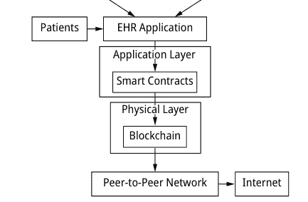

图 1：基于区块链的电子健康记录系统基础。

已被分解为包括不可变性和透明度；将其中的每一项在医疗机构中实施都提高了数据安全性，同时增加了医疗工作流程和患者的成功率。由于其在医疗保健利益相关者之间实现顺畅数据交换的功能，区块链支持护理提供方面的团队合作，并改善患者满意度。

#### 2.2 电子健康记录

电子健康记录格式是一种电子记录，由患者的完整病史、测试详情和治疗计划组成。在电子健康记录中，不同的特征变得清晰；电子健康记录在存储和共享信息方面提供安全性，避免了纸质记录丢失并给整个医疗团队造成混乱的危险。

图 2 中概述的电子健康记录系统组织并链接了预约和检验结果等多个项目，同时也允许医疗专业人员和个人查看和修改记录。其核心是一个电子健康记录系统，以结构化方式存储患者健康信息，并由具有访问和修改权限的用户提供数字支持以满足需要。电子健康记录系统通常具有以下功能：

- 患者人口统计学信息：可识别患者的基本信息包括患者的姓名、年龄、性别、电话号码和保险。
- 医疗历史：所有既往疾病、手术、疫苗接种、医疗和家族史以及个人的任何其他记录。

患者与医疗工作人员之间的互动在诊所中以临床笔记的形式记录，这些笔记是对互动的简短描述。症状以及诊断和治疗的分析必须纳入记录中。

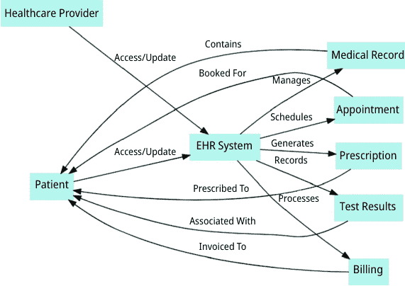

**图 2：** 电子健康记录基础。

避免使用的药物组合清单、使用说明和给药方案是药物管理的内容。

实验室和诊断检验结果：由主管医生更新的诊断检查清单，包括影像学和其他检查。

预约安排：包括能够安排患者的就诊预约、监测患者随访以及通知患者已安排就诊的服务。

互操作性：为了在多个相关的医疗保健实体之间汇编和传输数据，由多个护理提供者和组织继续建立不间断的对话和协作框架及方法。

电子健康记录系统具有多种优势，包括患者数据可访问性和处理时间的变化，这对临床决策和患者安全产生积极影响。关于研究和质量，电子健康记录提供了潜在的确定性数据源，以推动卫生领域的建设性干预。

#### 2.3 传统电子健康记录管理系统的概述

电子健康记录系统对于组织医疗保健信息的流程和存储至关重要。这些框架通常是医疗机构内的集中式数据库，具有特定的外包服务器。传统电子健康记录是指在数字手段成为存储医疗保健信息标准之前存在的系统，医生可以使用技术进行更新。

传统电子健康记录系统可以通过强调从各种来源（包括临床会诊和实验室检查）统一患者的综合健康信息来定义。这意味着患者的全部医疗数据都集中在一个地方；它们使护理变得轻松，并帮助医疗专业人员选择更优的疗法。

数据录入和管理技术为医疗保健提供者带来了记录患者就诊、回顾患者健康过去记录以及订购特定检查和处方的具体工具。为了提高记录效率并确保记录中所需的一致性，这些系统可以具有基本界面，并可根据不同医疗专业岗位进行定制。

图 3 说明了传统电子健康记录管理系统的电子健康记录管理系统，展示了患者的健康信息如何从数据输入和存储流向输出流程以及由患者和医疗保健提供者使用的安全控制。这些传统系统提供诸如访问监控、安全管理和数据保护等功能，以防止未经授权的访问、法律违规（如 HIPAA 下的违规）并确保患者信息的保密性。

虽然传统电子健康记录系统仍被广泛采用并被认为有效，但它们存在若干局限性。一个重要挑战是互操作性——在不同健康信息系统之间共享和集成数据的难度。这种限制通常导致信息孤岛，限制患者记录的无缝交换并阻碍协调护理。

互操作性问题：电子健康记录系统中的互操作性问题被低估，这导致患者信息孤立并限制其与其他健康信息系统的集成。

数据孤岛：在实施“随处共享”电子健康记录系统之前，患者健康信息通常存储在单个医疗机构的范围内，通常在专有平台中。这限制了跨不同组织汇总和共享患者数据的能力。

集中化和单点故障：当电子健康记录数据库集中时，它为数据泄露和服务拥塞打开了大门，从而影响患者信息。

供应商锁定：由于专有电子健康记录系统已在医疗机构中实施，后者可供选择的余地很少，因为它们无法定制系统。

传统电子健康记录系统在促进医疗保健数据的数字化转型和增加对临床文档的支持方面发挥了重要作用。一些局限性限制了该系统的能力，特别是在数据通信和安全方面。区块链技术引入了一种新的方法来解决这些问题，并以创新方式增强电子健康记录系统的安全性和保密性。

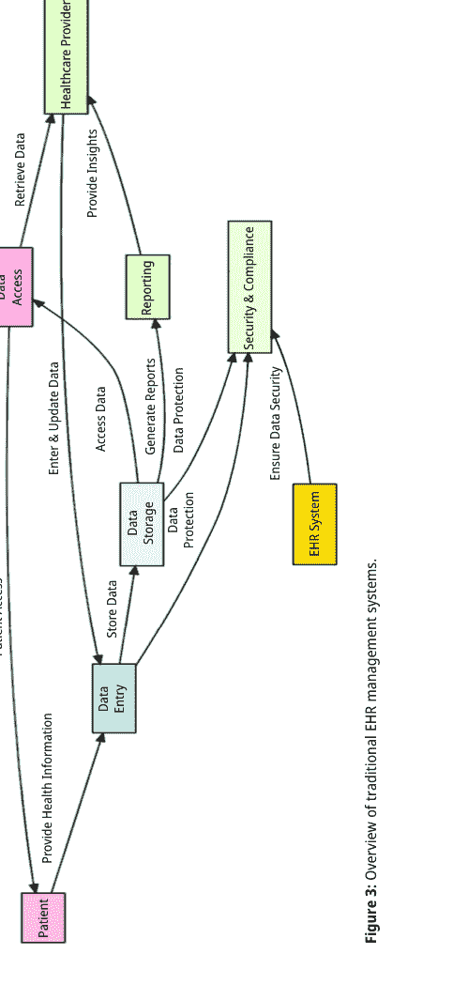
Figure 3: 传统 EHR 管理系统的概述。

#### 2.4 基于区块链的 EHR 解决方案的演进

随着区块链 EHR 的兴起，标准 EHR 系统出现了去中心化的安全替代方案。由于医疗数据共享需要更安全和语义化的通信，使用区块链技术的想法在 2010 年代被提出。

区块链技术在演进的早期阶段主要提供了一种支持“交易账本”的手段，以及安全地创建和确认比特币等数字货币。其他人开始意识到区块链除了货币应用之外，还可以保存和处理特殊健康信息。

根据许多专家的说法，在基于区块链的 EHR 系统增强的早期阶段，所有重点都放在展示项目上，以探索区块链在医疗保健中的有用性。虽然这些最初的尝试因可扩展性和合规性问题而受困，但它们有助于展示区块链技术在数据安全和数据共享能力方面的基本用例。

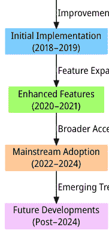
Figure 4: 基于区块链的 EHR 解决方案的演进。

随着技术的进步和采用，整合了整个医疗保健系统区块链技术的解决方案开始崭露头角。这些解决方案带来了新技术和新功能，以满足患者和医疗机构的需求。所有这些新兴趋势都解决了传统 EHR 系统的问题，并利用区块链的主要特征——去中心化和加密安全——为医疗数据处理开辟了新的可能性。

#### 2.5 基于区块链的 EHR 解决方案演进中的关键里程碑

- Development of healthcare-specific blockchain platforms: Started to develop blockchain solutions with an attempt to target the field of healthcare with different characteristics such as consensus algorithms and conditional contracts.
- 医疗特定区块链平台的开发：开始开发区块链解决方案，尝试针对医疗领域，具有共识算法和条件合约等不同特征。
- Integration with existing healthcare infrastructure: Blockchain-based EHR solutions are designed to interface with existing healthcare information systems to enhance interoperability, allowing diverse systems to exchange and share data while preserving privacy and ensuring data integrity (see Figure 5).
- 与现有医疗基础设施的集成：基于区块链的 EHR 解决方案旨在与现有医疗信息系统接口，以增强互操作性，允许不同系统在保护隐私和确保数据完整性的同时交换和共享数据（见图 5）。
- Standardization and regulatory compliance: To meet legal requirements related to regulations such as the GDPR and HIPAA, standardized guidelines have been developed for blockchain-enabled electronic health record systems.
- 标准化与监管合规：为满足与 GDPR 和 HIPAA 等法规相关的法律要求，已为区块链支持的电子健康记录系统制定了标准化指南。

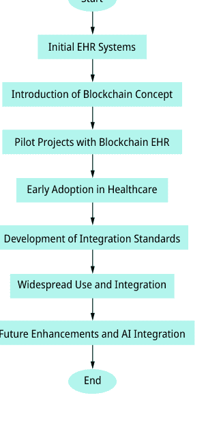
Figure 5: 基于区块链的 EHR 演进的关键里程碑。

#### 2.6 基于区块链的 EHR 系统的关键组件和架构

区块链系统的特征及其实施所需材料也保证了患者健康信息的安全和兼容管理。图 6 展示了基于区块链范式的健康记录系统的组件和设计，同时论述了患者的隐私及其数据的保护。图 6 显示了基于区块链的 EHR 系统的基本构建块和架构，以及区块链如何被整合以使 EHR 对患者和临床医生更安全、更易共享的解释。

- Distributed ledger: Clinical data of the patients is safely stored in the blocks, which constitute a major component of the blockchain EHRS. The ledger provides data security in that it presents a clear and time-tagged view of transactions. EHR's state change happens with each transaction that creates a block that links to the previous block cryptographically.
- 分布式账本：患者临床数据安全地存储在区块中，区块构成了区块链 EHR 系统的主要组成部分。账本提供数据安全，因为它呈现了清晰且带时间标记的交易视图。EHR 的状态变化发生在每次交易中，该交易创建了一个与前一个区块通过密码学链接的区块。

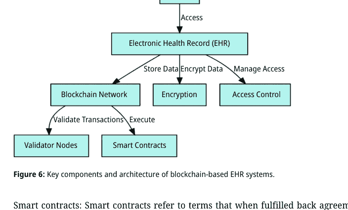
Figure 6: 基于区块链的 EHR 系统的关键组件和架构。

- Smart contracts: Smart contracts refer to terms that, when fulfilled, execute agreements, perform actions without any supervision, and are written into the blockchain. It revealed that smart contracts control data access rights as well as other aspects of EHR systems based on the blockchain. Smart contracts mention who has access to certain clinical information for purposes of data privacy and security.
- 智能合约：智能合约是指当条件满足时执行协议、无需监督即可执行操作并写入区块链的条款。研究表明，智能合约控制基于区块链的 EHR 系统的数据访问权限以及其他方面。智能合约说明了出于数据隐私和安全目的谁可以访问某些临床信息。
- Consensus mechanism: Protocols with the designation consensus mechanisms maintain consensus in blockchain systems and make users aware of the transaction legitimacy. BFT, PoS, and PoW are known as consensus mechanisms. To ensure all the participants of the network are aware of the valid status of EHR transactions and security of the ledger in blockchain systems, suitable consensus methods are used.
- 共识机制：名为共识机制的协议在区块链系统中保持共识，并使用户意识到交易的合法性。BFT、PoS 和 PoW 被称为共识机制。为了确保区块链系统中所有网络参与者都了解 EHR 交易的有效状态和账本的安全性，使用了合适的共识方法。
- Cryptographic hashing: A data block in the blockchain process is the element from which we get a unique hash by applying cryptographic hashing techniques. These identities firmly link block elements safely and act as electronic labels of the contents of the data. The members can confirm the trustworthiness of the blockchain and identify illegal modifications to the data using hashed values.
- 加密哈希：在区块链过程中，数据块是通过应用加密哈希技术获得唯一哈希的元素。这些标识符牢固地安全地链接区块元素，并充当数据的电子标签。成员可以使用哈希值确认区块链的可信度并识别对数据的非法修改。
- Decentralized network: Every node within a network established for the processing of blockchain records holds an updated version of the ledger. From the decentralized configuration of this system, there are lesser chances of a point being targeted when one weak point has been eliminated. In peer-to-peer networks, protocols allow nodes to link with each other and ensure data replication and synchronization within a network.
- 去中心化网络：为处理区块链记录而建立的网络中的每个节点都保存账本的更新版本。由于该系统的去中心化配置，当消除一个弱点时，被攻击点的可能性更小。在点对点网络中，协议允许节点相互连接并确保网络内的数据复制和同步。
- User Interfaces and Applications: Healthcare consumers connect to EHR systems on blockchain networks through user interfaces and applications tailored to the stakeholders of a particular healthcare provider. These interfaces allow users to navigate EHRs, review medical documents, manage access permissions, and conduct transactions. In addition to integrating with traditional healthcare institutions, these systems offer capabilities via web interfaces and mobile tools, enabling broader engagement and interaction.
- 用户界面和应用程序：医疗消费者通过针对特定医疗服务提供商利益相关者定制的用户界面和应用程序连接到区块链网络上的 EHR 系统。这些界面允许用户浏览 EHR、查看医疗文件、管理访问权限并进行交易。除了与传统医疗机构集成外，这些系统还通过网络界面和移动工具提供功能，使更广泛的参与和互动成为可能。

### 3 基于区块链的 EHR 系统中的安全性和隐私

#### 3.1 医疗数据中安全性和隐私的重要性

在管理健康信息时，患者信息的敏感性、可靠性、安全性和隐私成为关键因素。在医疗数据管理系统， “安全且私密” 这一说法是增强患者信任、遵守政府要求并保护患者数据免受剥削性使用的一个重要方面。

防止网络威胁和对医疗数据进行未经授权访问的两种做法是防御措施。医疗机构存储的患者信息如个人身份详细信息和个性化/常规治疗计划吸引了网络犯罪分子的高额金钱价值。医疗数据泄露的后果严重：财务损失、个人形象受损、身份盗窃威胁以及可能危及患者生命。为了避免患者身份泄露的情况，加密和防火墙等适当措施必须按要求正常运行。

从下图 7 可以看出，强调安全性和隐私对医疗数据至关重要。本子行业的数据收集、存储和传输应与保护信息免受未经授权访问的保护水平相同。普通公民和消费者期望医疗组织和提供者正确且体面地保护其数据，以便他们自己决定谁可以访问其个人健康信息。为了确保患者继续信任他们并与医生有益地合作，保护患者信息很重要，因为这在法律和道德上都是正确的。隐私泄露后，公众很少会主动寻求医生的医疗帮助。

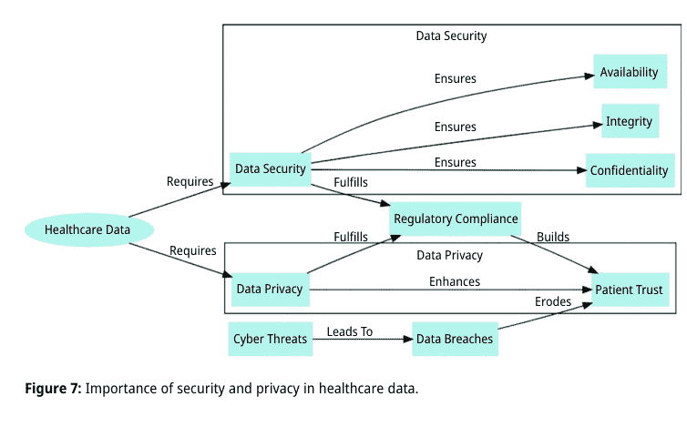
Figure 7: 医疗数据中安全性和隐私的重要性。

医疗数据的隐私在一般数据保护法规方面很重要，例如 GDPR 和健康信息隐私和问责法案 HIPAA。这些规范对如何维护患者医疗数据的安全性和隐私性制定了具体期望，从简单的数据匿名化到严重的数据泄露通知等活动。如果违反这些法规，可能会产生法律方面的严重后果，以及医疗服务提供者形象的恶化。

在任何医疗数据管理中，除了法律要求外，保护患者的隐私外，安全性和隐私也是保护患者详细信息的关键。医疗组织必须实施安全和隐私措施。将数据的安全性和隐私纳入这些组织的战略视角，降低了数据泄露相关的风险，并使医疗环境中的高水平道德和合法实践成为可能。

#### 3.2 传统 EHR 系统中的安全挑战

为满足包括 GDPR 和 HIPAA 在内的要求，需要保护与医疗相关的信息。保护患者健康信息所需的关键措施在法规中有所规定，包括数据加密和限制对这些数据的访问。未能履行这些法律义务可能导致医疗机构遭受重罚、法律问题以及声誉损失。

在医疗数据管理中，为了保护患者的身份、建立并维持患者信任，并满足监管要求，安全性和隐私性都至关重要。如果要充分保护患者数据，医疗机构需要执行安全和隐私机制。通过在数据处理过程中确保隐私保护，企业可以降低涉及患者保密性的数据违规威胁。

##### 集中化
传统 EHR 系统依赖于实施医疗机构的第三方供应商的独立服务器上的集中式数据库。由于大多数患者信息存储在一个便于共享和检索信息的点上，系统极易受到黑客攻击、非法访问和数据损坏。许多患者的电子健康记录面临风险；对中央 EHR 系统的一次成功攻击就可能导致欺诈活动、身份盗窃和其他弊端。

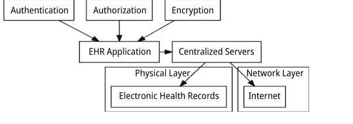

Figure 8: 传统 EHR 系统中的安全挑战。

##### 内部威胁
这种威胁源于工作人员、供应商和承包商能够访问个人患者信息，从而对医疗业务构成风险。不同类型的内部威胁都存在固有危险，既有意外性的，也有恶意性的，内部攻击者旨在出于个人原因窃取和破坏患者数据。标准 EHR 结构通常缺乏强大的审计功能，内部威胁往往难以检测和预防。

##### 不充分的身份验证和访问控制
传统 EHR 系统中缺乏强大的身份验证技术和糟糕的访问控制是严重问题。其中一些漏洞包括：基于密码的身份验证容易受到暴力攻击、网络钓鱼和密码猜测的攻击，这会危及用户账户并使未经授权的人员轻松获取患者记录。缺乏适当的访问控制措施使患者记录暴露于未经授权的终端用户的信息入侵、修改和破坏。

##### 遗留系统的漏洞
这证明大多数正在使用的传统 EHR 系统基于存在固有软件缺陷的老旧技术，且已被黑客盯上。

这些弊端被网络犯罪分子利用，通过非法访问 EHR 系统和机密患者信息来破坏数据并植入有害恶意软件。纠正和升级现有系统很复杂，而且还增加了安全隐患。

##### 缺乏数据加密
在现有的 EHR 系统中，缺少一些支持传输中和存储时保护患者信息的加密方法。在网络数据库的背景下，数据保持未加密状态，容易被拦截，且方法允许未经授权访问和对手访问。简而言之，没有加密，患者信息的隐私和保密性就会受到损害，因为医疗记录容易丢失、被修改和泄露。

传统 EHR 系统中的众多安全缺陷危及患者数据的可用性、保密性和完整性。医疗公司必须制定强有力的安全措施来解决这些问题，包括加密、访问限制、审计程序和定期安全评估。转向基于区块链的去中心化 EHR 系统提供了降低安全威胁并改善医疗记录管理中数据安全性、隐私性和完整性的可行方法。

#### 3.3 区块链安全在 EHR 管理中的增强

区块链技术通过多种方式全面消除典型 EHR 系统的主要缺陷，从而增强 EHR 管理的安全性。采用区块链技术消除了 EHR 管理中的中央管理员，密码学方法和共识程序增强了安全性。这些益处包括：

##### 去中心化
区块链中去中心化节点链中的每个节点都维护着包含 EHR 的分布式账本的副本。由于这种去中心化，没有单点故障，从而降低了未经授权访问 EHR 数据的风险。在区块链中，网络中的所有节点都包含账本的副本，因此即使某个节点的账本被破坏，区块链仍然安全。

在区块链中，存在一种不能以任何形式更改的交易记录，并且每个数据块都与前一个数据块形成哈希链接。一旦交易写入区块链，如果没有其所服务网络中大多数用户的合作，就无法更改。EHR 数据保证完全可追溯且未被更改，由于其固有的不可被其他方更改的特性。

##### 密码学安全
为了在生命周期内保护 EHR 数据，区块链采用了加密学特性，如加密、数字签名和哈希。由于区块链上执行的每笔交易都被哈希处理，可以从中获得唯一 ID，将其链接到前一个区块。需要注意的是，只有指定用户可以使用检查交易有效性的数字签名向区块链发送交易。通过对存储在区块链中的数据进行加密来使用安全的 EHR 数据，以提高安全性和隐私性。

##### 共识过程
正是基于共识过程，网络用户才能有效地被说服接受区块链上交易的合法性。安全通过确保分布式系统中的每个节点就所讨论链的状态达成共识，防止不道德的个人对链进行任何更改。共识程序通过增强参与者的信任来增强存储在区块链 EHR 中的数据，如下所述。

##### 访问控制和权限
访问控制和权限包括使用智能合约开发的 EHR 数据访问控制和权限规则，智能合约是部署在区块链上的自执行合约。为了确保只有特定患者的合适人员与信息交互，智能合约包含 EHR 记录使用或修改的规则和权限设置。由于涉及强大的访问控制系统，智能合约降低了基于区块链的 EHR 系统中未经授权访问泄露的概率。

EHR 在管理安全性方面受益于区块链提供的多种特性和方法，如去中心化、不可变账本、密码学安全、共识机制和访问控制。基于区块链的 EHR 解决方案是安全的，因为其具有支持患者保密性、完整性和隐私性的特性，同时提供清晰且安全的方式来存储、维护和交换患者健康信息。

#### 3.4 基于区块链的 EHR 中的隐私保护技术

这一方面至关重要，因为基于区块链技术开发的 EHR 系统需要明确考虑隐私保护，因为存储在 EHR 中的数据对未经授权的访问和发布很敏感。有几种方法和方法关于区块链如何在支持隐私方面增强 EHR 的管理以保证患者的隐私，同时允许

各方安全交换数据并协作。基于区块链的 EHR 中使用的最重要的隐私保护策略包括：

Data encryption: 为避免患者信息被未经授权访问和泄露，区块链上的 EHR 中的信息会被加密。通过加密诊断、治疗等重要的患者身份识别和医疗数据，基于区块链的 EHR 系统可确保患者隐私。这阻止了未经授权的用户访问已授予的数据，尤其是因为它们已被加密。对 NMDB 的访问受到严格控制，只有具备适当凭证的人员才能访问数据；数据被加密，使得需要相应的访问密钥才能解密相关数据。

Data minimization: 为减少数据对未经授权方的暴露，数据最小化最佳实践限制了保存在区块链上的 PII 数量。仅将真正需要的元数据哈希最小化，EHR 应保留在区块链之外。这种方法在保持数据隐私的同时将数据保留在区块链上，同时也因此大幅减少了患者特定信息的暴露。

Zero-knowledge proofs (ZKPs): ZKPs 是一种密码学方法，允许证明者向验证者证明某个陈述为真，而不披露任何进一步信息。在基于区块链的 EHR 的背景下，ZKPs 可用于确认 EHR 数据交易的有效性，而无需透露底层患者数据。这使得众多各方能够在区块链上安全、私密地验证和共享数据。

Differential privacy is a strategy for strengthening privacy that tries to safeguard individual privacy by adding noise to aggregated data, all the while enabling useful analysis of the data. Differential privacy can be used in blockchain-based electronic health record systems to aggregate and anonymize patient data prior to its storage on the blockchain. This method helps prevent patient reidentification while maintaining the quality and usefulness of the data for analysis and study by hiding individual contributions to the dataset.

Enhancing privacy: Smart contracts used on blockchain technology can impose access limitations and privacy-maintaining guidelines for electronic health record information. Smart contracts that improve privacy, for instance, include guidelines for managing consent, exchanging data, and anonymizing health records. These contracts ensure that patient privacy wishes are honored and that data is exchanged safely and openly among authorized parties by automatically enforcing privacy regulations stored in the blockchain.

#### 3.5 Compliance with healthcare regulations (e.g., GDPR, HIPAA)

One strategy of creating and implementing blockchain-based EHR systems with patient data confidentiality and privacy guarantees is by the legislation of healthcare. The two popular legal structures for managing privacy of health information are called the General Data Protection Regulation (GDPR) that operates in the European Union and the Health Insurance Portability and Accountability Act (HIPAA) that exists in the United States of America. Subsequently, patient’s identity and the information provided have to be protected and for organizations involved in the provision of healthcare and technology firms, these rules mean that they need to have appropriate security and privacy measures in place.

GDPR: The General Data Protection Regulation is a comprehensive data protection law that establishes strict standards for the collection and processing of personal data belonging to individuals within the European Union (EU) and the European Economic Area (EEA). Healthcare organizations and technology vendors are obligated under GDPR to ensure the lawful, fair, and transparent processing of Protected Health Information (PHI) and other EHR data. This includes obtaining explicit patient consent before the collection and use of personal data, ensuring that consent is specific and informed, implementing appropriate organizational and technical safeguards to prevent unauthorized access, and notifying relevant authorities of any data breach without undue delay and no later than 72 hours after becoming aware of it. Additionally, healthcare entities must ensure compliance with GDPR provisions regarding individuals’ rights, such as the right to access, rectify, or erase their personal data.

HIPAA: HIPAA is a federal statute in the USA that deals with how healthcare providers, health plans, and other entities that are bound by it should handle PHI. Thus, for ensuring confidentiality, integrity, and availability of PHI, including EHR data, HIPAA lays down stringent security and privacy measures. To curtail the access, use of PHI by parties other than the individual, the covered organizations and the business associates need to develop administrative, physical and technical safeguards. These covered procedures include risk assessments, audit trails, encryption, and access restrictions. HIPAA mandates that covered organizations get patient consent before using PHI for reasons other than treatment, payment, or operations. Patients must also be able to view their own health information by requesting it.

Healthcare organizations and IT companies developing and implementing blockchain-based EHR systems must adhere to GDPR, HIPAA, and other pertinent healthcare legislation. Serious consequences, such as fines, legal ramifications, and reputational harm arise from breaking these restrictions. As a result, businesses need to make sure that their blockchain-based EHR systems follow the guidelines and specifications specified in these laws, giving patients’ health information security, privacy, and rights top priority. Healthcare organizations foster trust and confidence among patients, regulators, and other stakeholders about the integrity and confidentiality of their EHR systems by exhibiting compliance with GDPR, HIPAA, and other legal frameworks.

### 4 Interoperability and data sharing in blockchain-based EHR systems

#### 4.1 Interoperability challenges in healthcare data exchange

Interoperability is often considered to be the necessary precondition for efficient healthcare data sharing and cooperation and is defined as the ability of different information systems and devices to exchange and utilize data seamlessly. The achievement of interoperability on healthcare data exchange brings a lot of challenges that hinder the easy sharing and incorporation of EHR across different systems and institutions.

Lack of standardization: Lack of standard formats, protocols, and vocabulary usage for describing and exchanging EHR data is one of the biggest issues with healthcare data interchange. To extract, transfer, and analyze data, healthcare industry often uses proprietary coding and formats, which result in conversion issues. Failure to standardize results in formation of data silos, clutters data duplicates, and reduces effective delivery of healthcare services by compromising the integration of EHR systems.

Fragmented EHR systems: Conventional healthcare organization adopted multiple EHR systems provided by various vendor solutions based on the organization’s requirements. Currently, there are huge differences in EHR systems regarding their data models, data interfaces, and offered functionalities, and thus data exchange between different systems is a challenging task. Lack of integration of EHR systems also means that the data gathered in the systems remain in some sense isolated from information in other systems.

Data governance and consent management: HL7 standards in care consent management give protocols and policies on the use and sharing of patient’s health information regarding healthcare data exchange. For example, the development of uniform data governance and consent initiatives across a number of disparate healthcare institutions is difficult because of the different regulations, privacy protection laws, and institutional guidelines in various settings. The current situation of data management and consent in different systems and patients’ identity hinders integration and raises questions concerning data privacy and patients’ privacy rights.

Technical integration complexity: Since EHR systems need to interoperate with other HIS like LIS, imaging systems, and electronic prescribing systems, we are faced with some technical issues of data formats, protocol, and interfaces. Multiple and distinct architectures and the use of legacy systems, proprietary APIs, and others, also contribute to the technical integration problem, raising development time and costs, at the same time. Sustaining compatibility as systems grow and develop, with the ever-transforming technological environment raises a number of cognate issues to healthcare organizations.

语义互操作性：语义互操作性使数据能够被共享并被接收的 IT 系统和应用程序理解，对于保证电子健康记录（EHR）的有意义且一致的共享至关重要。要实现语义互操作性，需要使用通用的编码模式、词汇表、本体论和数据类型来编码临床术语及其关联。术语的语义不兼容、编码差异和语义模糊会阻碍语义集成，进而导致数据差异、错误和误解。

实现医疗保健领域数据交换高效互操作性的主要障碍包括缺乏统一的数据模型、所使用 EHR 系统缺乏统一性，以及导致集成问题和语义误解的数据管理问题。这些挑战要求医疗保健系统中的成员加强合作，以制定和实施互操作性路线图、数据管理政策、技术集成解决方案和语义融合。这些互操作性挑战要求医疗保健组织确保在基于区块链的 EHR 系统中数据交换有效进行、护理协调得到增强、患者结局得到改善。

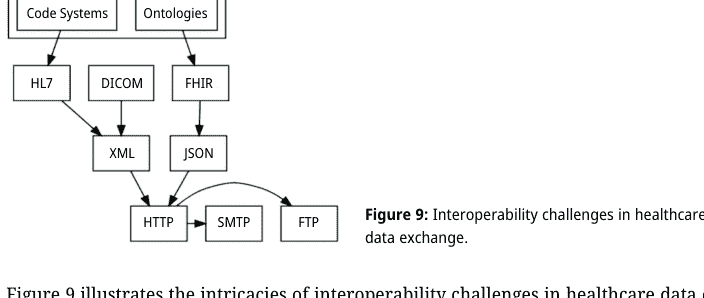

图 9 说明了医疗保健数据交换中互操作性挑战的复杂性。它阐明了实现无缝数据交换所必需的关键组件：标准如 HL7、FHIR 和 DICOM 充当基础框架，规定数据表示。数据格式，即 XML 和 JSON，决定了医疗保健数据的结构组织，影响其交换。语义，由代码系统和本体表示，在确保系统间准确解释方面发挥关键作用。与此同时，传输机制如 HTTP、FTP 和 SMTP 促进医疗保健数据在系统间的移动。这种全面的可视化突出了互操作性障碍的多面性，涵盖标准化、数据格式、语义和传输，对于有效医疗保健数据交换至关重要。

#### 4.2 区块链在实现互操作性中的作用

区块链技术具有促进医疗保健数据交换互操作性问题并使不同 EHR 系统之间的数据共享更加容易的潜力。区块链网络的分布式和去中心化架构，以及其实证安全特性，为提高医疗数据传输的互操作性提供了诸多益处：

- **去中心化数据管理**: 基于区块链的 EHR 系统的基础是去中心化节点网络的每个成员都以副本形式维护存储患者健康数据的分布式账本。由于其去中心化设计，医疗专业人员、患者和其他利益相关者之间的点对点通信和协作得以实现，而无需中央机构许可数据传输。区块链通过去中心化数据管理，减少了对集中式存储库的依赖，并缓解了由不兼容的 EHR 系统带来的互操作性问题。

- **共识方法**: 为了在网络用户之间就交易的合法性达成共识，区块链依赖于如 PoW 等共识方法。确保网络中每个节点对区块链当前状态有共同认知，共识方法有助于建立对 EHR 数据准确性的信心和共识。区块链通过提供共享且不可更改的交易记录，鼓励多方之间的信任并实现安全数据共享，从而改善互操作性。

- **智能合约**: 内置于区块链的智能合约具有实现多个 EHR 中所含数据的交换和交互协议自我执行的潜力。具体而言，智能合约概念化了管理 EHR 信息访问、修改和共享的政策，同时保证符合各系统中互操作性标准和数据管理政策。通过自动化交换流程并遵守互操作性标准，智能合约成为提高医疗保健系统参与者之间数据交换速度和完整性的有效手段。

- **数据标准化和语义互操作性**: 基于区块链的 EHR 系统可以利用标准结构和交换格式，以及标准术语和知识表示系统，实现 EHR 数据的语义无缝使用和互换性。使用共同的数据理解和通用语言使基于区块链技术构建的 EHR 系统能够有效共享和交换这些患者详细信息，而不会有高概率的数据不兼容、错误和误解。在本例中，标准化和区块链技术的结合在共享健康信息的技术和语义层面进一步促进了互操作性。

- **患者控制的数据共享**: 基于区块链技术构建的 EHR 系统为患者提供对其个人健康数据的控制权，并仅授予特定医生和经批准的组织访问权限。为隐私、安全和同意管理，患者可通过数字签名数字签名并通过密钥加密的方式，将特定 EHR 数据的访问权限授予特定方。区块链允许对特定数据字段的读写访问进行精细化管理，并将数据所有权交还给患者，这既强调了患者主权和以患者为中心，同时也促进了高水平系统集成。

区块链在解锁健康信息交换的互操作性功能方面发挥着核心作用，通过整合去中心化、共识、智能合约和信息融合以及以患者为导向的数据可访问性。因此，随着互操作性的共同关键问题得到解决，以及区块链技术在促进基于区块链的 EHR 系统内去中心化、安全和透明的数据交换方面的应用，医疗保健系统在此互联环境中交付价值并改善患者结局已是时候。

#### 4.3 用于互操作性 EHR 系统的标准和协议

EHR 系统内的互操作性涉及对标准数据和结构互操作性、通信以及 EHR 系统之间关系的合规性。已开发了许多标准和协议，为表示、交换和集成 EHR 系统提供标准和指南。用于互操作性 EHR 系统的一些关键标准和协议包括：

- **HL7（健康层级七）**: 与电子健康信息交换、组合、共享和访问相关的规范被称为 HL7 标准。医疗保健的 IT 基础设施运行于 HL7 标准之上，该标准为临床护理、公共卫生和管理医疗交易等提供数据格式、通信格式和交互标准。HL7 标准适用于 EHR 信息的管理，并促进一个 HIT 系统与另一个 HIT 系统之间信息的集成。其中一些标准是 HL7 版本 2（V2）和 HL7 版本 3（V3）。

- **FHIR（快速医疗互操作性资源）**: FHIR 是 HL7 推出的一种相对现代的互操作性标准，采用基于 Web 的技术以实现健康信息的及时无缝交换。这些技术的示例包括 RESTful API（应用程序编程接口）。EHR 内容是数据的定义结构，即患者识别数据、源自患者的观察、处方药物等，基于 FHIR 资源使用模块化和扩展的概念。FHIR 的基础和细粒度特性使其非常适合 EHR 系统的互操作性，使开发人员能够构建轻量级且可互操作的应用程序以获取 EHR 数据。

DICOM（医学数字成像和通信，Digital Imaging and Communications in Medicine）：DICOM是医疗系统中医学图像及相关信息通信和存储的标准。DICOM包含协议、数据格式和通信方法的完整解决方案，用于在各种影像专科和医疗机构/中心之间集成共享、存储和检索图像。DICOM以允许医学图像数据与电子健康记录（EHR）互操作的方式促进其交换；它保证了诊断图像在医疗系统整体环境中的可用性。

IHE（医疗企业集成，Integrating the Healthcare Enterprise）集成规范：IHE是一种处理高级标准“集群”并定义实施指南和互操作性规范的战略。它定义了各种HL7和DICOM用例及其实现方式，并用于支持各种互操作性信息交换用例，如检验结果交换、医学图像传输和患者人口统计学查询。通过指定连接配置文件和配套模板，IHE确保了有效的数据交换和EHR的集成。

SMART on FHIR：SMART（可替换医疗应用、可重用技术，Substitutable Medical Applications, Reusable Technologies）on FHIR是一个开放框架，用于开发在FHIR框架上运行的跨平台医疗应用。SMART on FHIR包含设计和构建与EHR通过FHIR接口集成的松耦合组件的具体原则和规范。SMART on FHIR通过基于Web的技术和应用开放标准，使开发人员能够构建与EHR系统集成的应用，以推进健康信息交换和互操作性的解决方案。

#### 4.4 基于区块链的无缝数据共享解决方案

区块链可以提供新的方法来实现EHR数据共享，解决互操作性问题，并促进电子和个人健康信息更有效的交换。已经提出了一些利用区块链技术的解决方案来改善不同EHR系统之间的数据交换；这些解决方案都利用区块链平台的独特特性来促进互操作性和合作。如图10所示，通过将区块链技术集成到解决方案环境中，展示了基于区块链的数据共享解决方案，以便更好地理解相关益处，例如医疗系统中相关各方之间数据共享的安全性和效率。EHR系统中无缝数据共享的一些关键基于区块链的解决方案包括：

- 去中心化数据交换平台：与中心化中间商相反，基于区块链的去中心化数据交换帮助患者、医疗机构和其他各方安全地交换和获取所需的EHR数据。这些系统通过结合区块链的数据分散性、密码学原理和智能合约，允许在系统间以隐私、完整性和同意的方式传播数据。去中心化数据交换平台基于多数据系统原则工作，不需要中介和中心枢纽即可共享数据，并允许EHR系统和医疗设施交换信息。

- 联邦学习与数据共享网络：在区块链技术的基础上，联邦学习和数据共享网络能够在保持数据机密性和隐私的同时，对EHR数据进行协作学习和共享。在联邦学习中，多个去中心化节点拥有部分EHR数据，并协作训练机器学习模型。在数据聚合和分析时，差分隐私和同态加密等密码学方法保护患者隐私。区块链保证模型修改和数据贡献的完整性和可追溯性。联邦学习网络通过提供安全和私密的数据共享，促进学术界和医疗机构之间的互操作性和知识交流。

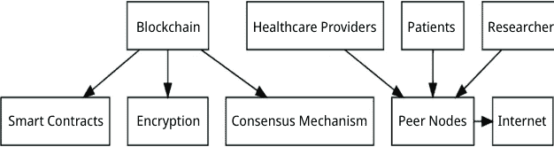

**图10：** 基于区块链的无缝数据共享解决方案。

- 患者控制的数据共享平台：这些平台允许个人健康数据的所有权和控制，并允许健康和研究接收者在适当时访问这些数据。这些基于区块链的系统允许客户授予不同方对特定EHR信息的访问权限，同时通过使用数字签名和密钥确保数据隐私和访问控制。患者控制的系统也意味着患者数据可以在多个EHR系统以及患者寻求护理的各种环境中轻松提供和访问。

- 互操作性健康信息交换（HIE）：利用信息技术的互联HIE借助区块链实现更大医疗系统间安全、标准化的电子数据交换。智能合约能够高效处理多方之间的权限相关流程和合约；区块链确保通过交换实现传输的EHR数据的可用性和可信性。基于区块链的HIE能够通过互操作性共享平台在护理人员和患者之间共享信息，协调不同提供者和系统之间的护理，以及促进患者之间的合作。

- 基于标准的区块链网络：此类网络利用标准和公认的规范和程序进行集团连接，例如HL7 FHIR，用于不同区块链网络和医疗系统之间EHR信息的转换和调和。标准化区块链网络确保医疗系统间数据的兼容性、互连性和可交换性，因为它们符合构成基于标准的区块链的各种网络所采用的数据格式、消息传递和集成标准。这促进了各种EHR系统和利益相关者之间的互操作性和数据共享。

#### 4.5 成功互操作性EHR实施的案例研究

本文描述了通过区块链技术在互操作网络中连接EHR系统的有效使用示例，这些案例表明了区块链在医疗领域应用的有前景方向。这些案例描述表明，概念化和战略制定对于在医疗系统众多利益相关者之间创建可行且成功的互操作性和数据共享模型至关重要。一些成功的互操作性EHR实施的显著例子包括以下内容：

- Medicalchain是一个通过区块链平台运行的应用程序，使患者能够安全地存储其电子健康记录，并与医生和研究人员等其他方安全共享。通过使用区块链技术，Medicalchain保证数据安全和患者健康记录的保密性，同时创建可审计的轨迹。EHR数据通过许可合约进行电子共享，其中包括授权医疗机构访问数据的同意条款。Medicalchain的互操作性EHR解决方案通过确保适当的通信，使医疗利益相关者协同工作，从而增强患者护理。

- Coral Health：Coral Health是一个基于区块链设计的EHR平台，其特点是记录从一个生态系统到另一个生态系统的无缝集成。Coral Health通过区块链提供患者健康记录存储库，使患者、支付者和提供者更容易共享EHR数据。通过平台上采用的密码学技术，在数据交换过程中也维护了患者身份和数据安全。Coral Health EHR解决方案是一个集成的EHR系统，其中数据共享、开放集成和团队方法提高了护理质量和运营绩效。

- Nebula Genomics：Nebula Genomics是一家基于区块链技术构建的公司，用于基因组数据共享和分析。Nebula Genomics基于区块链运营，该区块链用于建立一个安全可信的基因组数据市场，人们可以将其基因组数据出售给研究人员、制药公司和其他医疗保健提供者。区块链维护机密性。

以及个体基因组的数据真实性，而智能合约则为数据共享和贡献者奖励的决策带来了效率。借助 Nebula Genomics 的互操作平台，所有参与基因组学和个性化医疗的个人、研究人员和组织可以携手合作，发掘更多发现，并开发推动医疗保健边界的新相关技术。

### 5 用于访问控制与治理的智能合约

#### 5.1 区块链技术中的智能合约简介

智能合约将合约条款直接编码在代码中。这意味着在合同条款的实施过程中，将通过区块链网络强制执行，无需中介机构。区块链基础设施的一个重要组成部分是智能合约，它能够以编程方式和去中心化方式执行协议、业务逻辑和交易。

在最简单的形式中，智能合约是驻留在区块链上的自执行程序，一旦满足预定条件就会自动执行。这些条件通常称为触发器，被编码到智能合约中，并在外部事件激活时自行触发。虽然智能合约由用户发起，但设定的操作会在没有用户直接干预和人为干扰的情况下执行。

智能合约的一个特点是其促进可定制且可信的跨方交易的潜力。这些执行的智能合约结果是透明的，并且由于它们发生在本质上开放且不可变的区块链上，因此也可以被审计。因此，如今不再需要中间人和其他可信方来监督和验证交易，从而降低了与传统合同执行方法相关的成本、时间和风险。

智能合约的使用可以自动化从银行、房地产、供应链到医疗保健等广泛的协议和交易。由于区块链是一种支持健康信息共享的新兴技术，智能合约在基于区块链的电子健康记录（EHR）系统中的同意流程、治理和访问权限方面发挥着决定性作用。智能合约确保只有授权方才能访问患者健康信息，并确保数据共享按照既定规则和权限（如数据共享协议中所述）进行，自动化同意管理流程，并强制执行访问控制措施。

#### 5.2 智能合约在医疗保健中的应用

智能合约在日益发展的医疗保健领域是一场真正的革命，因为它为数据的高效管理、保护和访问创造了众多机会。利用区块链技术的智能合约安全、透明，并自动执行协议、协议和交易。这最终提升了医疗保健结构的有效性、责任性和可靠性。智能合约在医疗领域最重要的用途包括：

智能合约用于处理患者对EHR数据共享和使用的许可，并强制执行访问控制措施。医疗保健企业通过将同意偏好和访问权限编码到智能合约中，确保敏感的患者信息仅能被授权人员访问。智能合约增强了安全性、隐私性和对数据保护法律的合规性，因为它们自动化了同意管理流程，并让患者对谁在何时接收其健康信息拥有集中控制权。

通过图11所示的示例，可以看到智能合约如何在构建医疗保健系统中发挥作用，并消除对许多专注于患者同意、计费、信息交换等流程的中介机构的需求。

索赔处理和保险核验：得益于智能合约能够促进保险索赔决策和结算，医疗保健领域的索赔和保险核验等流程有望实现有效自动化。通过使用智能合约，保险公司和医疗保健提供者得以自动化检查索赔的有效性、可受理性以及根据整体保单、承保范围和报销规则应支付的索赔数量。智能合约通过实现清晰准确的交易跟踪，消除了传统索赔处理方法的一些挑战。

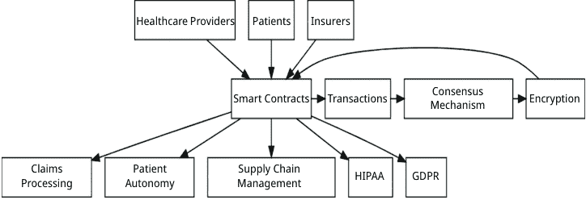

**图11：** 智能合约在医疗保健中的应用。

供应链管理和药品追溯：智能合约可以通过帮助追踪药品来源并确保药品的真实性和质量，从预测的供应链网络开始产生积极影响。智能合约还通过区块链网络上的合约文档，为制造、各种运输和配药等整个供应链过程提供不可变的记录保存。智能合约检查产品的合规性、真实性和法规遵从性，从而降低假药、药品转移和欺诈行为风险。

临床试验和研究合作：应用于临床试验和跨学科研究的智能合约可以自动化合同谈判、数据共享以及研究人员与参与者、赞助商与研究人员之间的奖励。本文指出了智能合约在临床试验中的六个潜在好处：将试验方案、同意文件和数据共享协议重新制定为智能合约格式，使研究人员能够简化试验受试者入组、同意流程和数据收集。智能合约支持研究任务追踪和文档记录，从而提供数据、合规性、可复制性和审计跟踪。

医疗支付和收入周期管理：智能合约有潜力通过消除纸质处理、自动执行计费、开票以及提供方、支付方和患者之间的支付对账流程，来增强医疗支付和收入周期。我们认为，医疗保健中的智能合约可以减少支付交易时间并提高准确性，因为支付条款、费用表和报销规则可以进行逻辑和数学分析。智能合约实现了支付交易的清晰可问责记录，确保其反映实际交易，并提高医疗智能环境中支付交易的整体信任度。

#### 5.3 电子健康记录管理中的基于角色的访问控制（RBAC）

另一种用于访问敏感医疗数据的访问控制技术是广泛使用的RBAC，它基于组织中人员的角色来控制对EHR的访问。RBAC防止未经授权的人员访问某些数据，同时向员工提供复杂的信息，因为访问权限和特权是根据用户的工作职责进行委派的。RBAC是医疗数据管理的主要基础之一，对于确保EHR数据的可用性、机密性和完整性至关重要。

在RBAC系统中，访问控制通常基于三个主要组件来定义：

角色：研究中所表示的角色反映了组织中的职位描述和岗位。医疗保健组织中的角色示例可以包括

使用ACL控制矩阵（ACM）来指定EHR系统内特定用户的权限和访问特权，是将细粒度访问控制与智能合约集成的一种方法。这些ACL可以由区块链上的智能合约根据用户角色或权限的变化动态更新。当用户寻求访问EHR系统内的某个资源或特定活动时，相应的智能合约会根据访问控制列表检查用户的身份和凭据，然后根据预设标准授予访问权限。

另一种通过智能合约实现细粒度访问控制的方法是应用ABAC。在ABAC模型中，访问控制决策基于属性分配、与用户、资源、其他上下文因素及其环境相关的条件。智能合约可以将这些属性评估到合约中，并灵活地根据情况更改权限配置文件。例如，智能合约应仅允许特定用户在拥有正确凭据访问患者和客户信息、获得患者授权且访问符合相关监管法律的情况下，才能访问指定患者的文件。

通过使用智能合约实施细粒度访问控制，医疗保健组织可获得多项好处，包括：

透明性和可审计性：智能合约确保访问控制决策和交易始终被记录，并帮助组织实时监控用户对EHR数据的访问。在区块链账本上记录访问控制事件增强了智能合约的效率，因为它提高了与访问管理相关的记录的可问责性和信任水平。

#### 5.5 基于区块链的电子健康记录系统的治理模型

区块链EHR系统中的管理结构和决策结构用于治理模型，以指导此类系统的运营、维护和开发方式。良好的公司治理有助于保持准确性；具有公正性；考虑组织、法律和股东的目标与立场。针对基于区块链的EHR系统实施了不同的治理模型，这些模型彼此不同，各有优缺点。一些常见的治理模型包括：

联盟治理：联盟治理模型涉及医疗保健组织和机构管理用于EHR的联盟区块链网络的运营。在大多数联盟区块链中，联盟本身作为管理机构，负责监督区块链网络的管理、运营和决策。联盟成员通过投票等方式参与治理过程，并且

共识和其他决策过程。通过采用联盟治理模型实现不同参与方的整合，使区块链中的结构具有集体性、互操作性和共同管理特性。

社区治理：社区治理模型选择让更大规模、有组织的利益相关者社区参与基于区块链的各类EHR系统的治理，这些利益相关者包括医疗服务提供者、患者、开发者和研究人员。治理社区包括开源社区、开发贡献者、去中心化自治组织（DAO），以及指导区块链网络设计、开发和引导的社区指导机构，从而允许利益相关者参与其中。社区治理框架强调开放性，并促进参与者有效参与有关EHR系统管理模式的决策过程。

联邦治理：联盟和社区治理类型也有区别，但重点在于让多个独立实体在整体联邦区块链网络中保持对其节点的控制。联邦治理允许组织在参与联合层面的合作活动时，对其数据和行为保持独立和主权。重叠机制包括管理结构、政策、程序以及用于联邦成员之间管理、沟通和共识的接口。

混合治理：将联盟/社区/联邦/分层治理模式相融合，根据所需的优势组合不同的治理模式，以满足区块链化EHR系统的需求——引入混合治理模式，在区块链网络的联盟、社区和组织层面构建所需的治理层级。这是因为混合系统提供了灵活性、定制化，并让不同结构和不同司法管辖区的组织有机会适应并满足所有利益相关者和立法的需求。

### 6 基于区块链的EHR系统中的数据完整性与可审计性

#### 6.1 医疗数据管理中数据完整性的重要性

事实上，患者信息在其生命周期中的一致性和可靠性正是数据完整性所要求的，而数据完整性在医疗数据管理中是一项重要功能。在EHR系统的背景下，这一点对于医疗数据的质量、可靠性和可及性同样重要，因为患者护理、临床决策和依从性都源自于此。

单点故障使得中心化对数据完整性构成威胁。使用中心化设计的关键问题包括协调、重路由和备份，这意味着数据不仅可能在系统宕机时受损，还可能因硬件故障而受损。

缺乏透明度：标准EHR系统本质上是不透明的，不能轻易提供已修改记录的审计跟踪。由于没有明显的审计跟踪，很难确定EHR数据的真实性、来源和完整性。批量录入、功能多样性和不同的文档模式导致缺乏标准化、系统错误以及缺乏有关修改的元数据，从而对数据的有效性和可靠性构成威胁。

互操作性有限：传统EHR系统中的接口问题限制了医疗组织与系统之间有关患者信息的通信和传输。大多数数据采用不兼容的格式，应用程序使用专有标准，数据存储在不同的孤岛中，这使得数据的集成和关联变得困难。数据交换规范不足和接口连接受限限制了EHR的互操作性，从而影响了共享信息的质量和患者护理的一致性。

数据安全风险：传统的遗留EHR容易受到许多数据不安全因素的影响，如黑客攻击、数据泄露乃至网络攻击。缺乏强身份验证、访问控制不力和加密有限，意味着EHR数据可能因泄露或更改而受到损害。独立威胁还包括其他风险来源，如内部对手、有动机的行为者和人员失误，内部人员可能危及患者数据的机密性、完整性和可用性。

数据验证有限：典型的EHR模型不具备足够的数据验证功能来维护患者记录的准确性、完整性和一致性。传统的数据录入方法、实施前数据验证规则以及整体有限的数据验证规模增加了数据录入错误、遗漏和不一致的可能性。在数据质量检查中缺乏自动化验证组件，这些问题在EHR数据中仍然未被发现，从而损害了数据的复杂性、质量和整体健全性。

#### 6.3 确保区块链数据完整性与不可篡改性

应用区块链机制是确保EHR系统中数据一致性和可验证的不可更改性的有前景的策略之一。下面列出的方法展示了区块链如何实现这些目标：

去中心化和分布式账本：区块链将数据存储在网络的多个节点上，形成去中心化和分布式的账本。这种结构通过区块链实现，每个区块包含前一个区块的密码哈希，从而在区块之间创建防篡改链接。这种去中心化特性增强了数据完整性和抗篡改性，因为没有任何单一实体完全控制数据，这是区块链技术的一个关键优势。

密码哈希：区块链使用密码哈希算法为每个数据区块生成唯一的数字指纹（称为哈希）。这些哈希基于区块的内容生成，因此在不影响哈希的情况下修改数据几乎是不可能的。如果发生任何修改，区块的哈希就会改变，从而向网络发出潜在篡改的警报，从而维护整个系统的信任和不可篡改性。

共识程序：进入区块链的额外交易、其顺序和合法性由共识程序确认，这些程序构成了区块链的基础。存在诸如工作量证明（PoW）、权益证明（PoS）和实用拜占庭容错（PBFT）等共识机制，以确保节点成员对区块链的当前状态达成一致。利益相关方无法操纵存储在系统中的信息，因为区块链只允许系统中的节点批准此类更改，从而否定了此类操作。

不可变数据记录：区块链技术的美妙之处在于，一旦数据被录入区块链，就无法更改。新区块按顺序链添加到区块链核心中，如果整个网络不对历史记录达成共识，则几乎不可能被操纵。本文指出，这些特性保证了数据的机密性和EHR网络的可靠性，因为任何记录的修改都容易在网络其他成员中被识别出来。

透明的审计跟踪：区块链可以保护和标记所有业务交易，甚至EHR中的信息变更。它维护了一个可见的日志，记录谁访问或修改了数据，并提供区块链交易中每个区块固有的时间戳和数字签名。这使利益相关者能够验证数据的真实性和来源，从而增强EHR数据的问责性、可追溯性和可信性。

数据加密和访问控制：这些EHR系统通常使用加密和访问控制（属于可靠结构）来保护患者数据。数据库信息通过密码密钥加密，以帮助维护数据隐私。基于智能合约和分布式账本系统的访问控制限制了用户访问EHR数据的能力，从而提高安全性、数据准确性和隐私性。

#### 6.4 基于区块链的EHR系统的审计与可追溯性特性

基于区块链的EHR系统所提供的高可审计性和高可问责性，增强了患者健康信息管理的责任性、透明度和可信度。图12展示了如何在EHR系统中应用区块链技术，通过区块链技术方法确保记录的数据完整性和透明度。基于区块链的EHR系统的审计和可追溯性能力体现在以下特性中：

##### 清晰且不可篡改的审计追踪

同样重要的是，得益于区块链，EHR中所有交易和数据变更都被记录在案，不可篡改且易于追踪。每一笔区块链交易都通过某种数字签名与其他交易相关联，所形成的区块按时间顺序不可篡改地排列。

##### 时间戳

区块链为每笔交易附加日期和时间戳，从而为区块链上记录的各项活动提供时间顺序。必须对EHR数据上执行的各种EHR操作进行精确量化和排序，以协助事后分析并覆盖一系列问题，包括取证、合规性和报告。时间戳帮助医疗机构验证EHR中信息的来源和谱系，并监控和审计所有感兴趣的活动，这些活动可能包括但不限于检测未经授权访问EHR数据的企图。

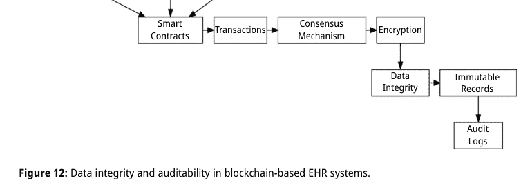

图12：基于区块链的EHR系统中的数据完整性与可审计性

##### 加密签名

区块链交易本质上就是数字签名，其中包含相关方的身份并确认交易的有效性。加密签名有助于确保任何篡改审计追踪中交易记录的行为都会被当场发现，从而使整个系统值得信赖且可靠。这一机制进一步得到增强：区块中的各个步骤与参与者的数字签名相关联，使基于区块链的EHR系统能够精准追踪相关操作者的行为，从而对弄虚作假者形成威慑。

##### 访问控制与权限管理

使用区块链实施EHR的方法采用了访问控制，即向决策实例（包括智能合约和许可型区块链）分配特殊资产，以控制患者健康信息的访问。隐私和安全条款涉及能够读取、写入、更新EHR信息的条件和人员。通过根据预建立的指南和编码到区块链中的权限强制执行访问控制措施，智能合约确保只有获得适当授权的人员才能访问机密患者数据。许可型区块链网络通过限制参与方为公认且可靠的机构，降低了未经授权访问的可能性。

##### 警报与实时监控

区块链EHR系统提供实时警报和通知功能，可针对在区块链网络中检测到的恶意攻击和其他异常活动发出告警。驻留在自动化系统中的监控工具和分析算法会扫描区块链数据，以发现严重异常和偏离常规的情况。实时警报会通知管理员或指定用户任何异常活动，以便针对数据机密性和完整性面临的威胁及时采取行动。

##### 合规性审计与监管报告

基于区块链的EHR系统为EHR信息的所有交易和修改提供了全面记录，从而使EHR系统摆脱了合规审计的负担。在这方面，审计员会检查区块链中的记录，以评估机构对HIPAA和GDPR等法规及其内部政策和程序的合规性。通过使用区块链作为审计追踪，审计变得更加简单和低成本，并彰显了组织在数据和信息真实性、安全性及合规性方面的立场。

#### 6.5 区块链EHR中数据完整性保障的真实世界示例

一些真实世界的示例展示了基于区块链的EHR系统在医疗行业中确保数据完整性和可审计性的有效应用：

##### Medicalchain

Medicalchain是一个基于区块链的EHR系统，旨在通过去中心化和患者控制的记录来改善患者护理以及患者数据的保护和隐私。通过区块链技术，该平台使患者能够安全地存储记录并将其传输给保险公司、研究者和医疗利益相关方。通过称为加密的技术，患者的健康记录得到安全保障，并且在医疗链上执行的每一项操作都会永久记录在区块链数据库中，进一步增强了其可信度。用户可以轻松改善隐私和保密性，因为他们可以自行决定其数据的用途，并谨慎地与医疗服务提供者共享数据。在Medicalchain中，EHR数据通过区块链系统进行整理和保护，该系统提供清晰的审计追踪，从而确保患者互动记录的责任性和可信度。

##### Solve.Care

Solve.Care是部署在区块链上的医疗生态系统，通过应用程序和智能合约促进支付、行政和护理项目。通过这种方式，该平台记录与患者相关的活动、治疗和诊断程序，以及与EHR管理的资金和报销相关的行政交易。Take Care of Itself Wallet应用程序提供了一个安全查看和管理患者健康记录的界面；服务提供者可以查看记录并以“可追溯”的方式为护理计划做出贡献。Solve.Care的区块链EHR解决方案使数据的共享、核对和验证更加可靠和高效，支持以患者为中心的结果交付和医疗行政实践。

##### Hu-manity.co

Hu-manity.co使用区块链技术构建，允许客户拥有、控制并出售其健康数据。它运用区块链的概念，使患者同意记录和数据共享协议神圣不可侵犯，并且可以审计患者数据的准确性和真实性。Hu-manity.co上的#My31应用旨在让用户重新掌控其健康信息数据，区块链合约确保第三方数据使用者只能通过在线平台上的数据使用补偿协议访问用户已授权许可的数据。Hu-manity.co的EHR解决方案基于区块链技术开发，允许患者拥有个人健康数据并参与数据驱动的项目，同时数据保持可信和安全。

##### Coral Health

Coral Health是一个医疗平台，以区块链技术为基础，使患者、研究者和医疗服务提供者能够安全、准确地共享患者数据。该平台通过应用区块链技术构建安全、防篡改的患者EHR注册表，实现数据保护和不可否认性。通过持有记录的隐私设置和访问控制权，患者可以使用基于区块链的Coral Health EHR解决方案，将其数据整合并分发给各方。因此，Coral Health集成区块链技术，在医疗保健领域创建透明、安全和可信的数据管理，以促进护理交付和研究方面的协作。

以上概述了基于区块链的EHR在医疗领域中为确保数据可信度和历史可追溯性而进行的实际应用。因此，这些平台利用区块链技术，为用户提供关于EHR妥善处理的清晰、不可更改且以患者为中心的解决方案，从而促进互操作性、患者隐私和信任等问题的解决。

### 7 结论

本章探讨了区块链技术如何改变医疗保健，尤其是在电子健康记录领域。通过对基于区块链的解决方案的深入分析，明确了其对医疗环境中数据安全、管理和互操作性的革命性影响。通过利用区块链技术的去中心化和不可篡改特性，医疗保健利益相关者能够在维护数据完整性和保护患者隐私的同时有效管理数据共享的复杂难题。共识机制、智能合约和加密技术加强了安全协议，同时赋予患者对其医疗记录的更多控制权。通过拆除组织壁垒并实现跨不同医疗机构的无缝数据共享，区块链促进了互操作性。本研究展示了区块链技术在推动创新、改善患者预后和提升医疗服务方面具有巨大潜力。随着医疗保健行业持续变化，协作努力和战略举措对于充分实现区块链技术的革命性潜力至关重要。

## 参考文献

- [1] Saif, S., Biswas, S., & Chattopadhyay, S. (2020). 使用深度学习和区块链技术的智能、安全的健康大数据管理：综述. Deep Learning Techniques for Biomedical and Health Informatics, 187–209.
- [2] Singh, S., Rathore, S., Alfarraj, O., Tolba, A., & Yoon, B. (2022). 使用联邦学习和区块链技术的物联网医疗数据隐私保护框架. Future Generation Computer Systems, 129, 380–388.
- [3] Kumar, R., Kumar, P., Tripathi, R., Gupta, G. P., Islam, A. N., & Shorfuzzaman, M. (2022). 面向工业医疗系统安全高效数据共享的许可区块链与深度学习. IEEE Transactions on Industrial Informatics, 18(11), 8065–8073.
- [4] Vatambeti, R., Krishna, E. P., Karthik, M. G., & Damera, V. K. (2024). 在物联网中使用增强隐私保护的区块链技术确保医疗数据安全. Cluster Computing, 27(2), 1625–1637.
- [5] Le Nguyen, B., Lydia, E. L., Elhoseny, M., Pustokhina, I., Pustokhin, D. A., Selim, M. M., . . . & Shankar, K. (2020). 实现物联网数据安全可靠共享的隐私保护区块链技术. Computers, Materials and Continua, 65(1), 87–107.
- [6] Jin, H., Luo, Y., Li, P., & Mathew, J. (2019). 安全且隐私保护的医疗数据共享综述. IEEE Access, 7, 61656–61669.
- [7] Zou, R., Lv, X., & Zhao, J. (2021). SPChain：基于区块链的医疗数据共享与隐私保护电子健康系统. Information Processing and Management, 58(4), 102604.
- [8] Alzubi, O. A., Alzubi, J. A., Shankar, K., & Gupta, D. (2021). 物联网中区块链与人工智能支持的隐私保护医疗数据传输. Transactions on Emerging Telecommunications Technologies, 32(12), e4360.
- [9] Zhang, H., Li, G., Zhang, Y., Gai, K., & Qiu, M. (2021). 使用联邦学习的基于区块链的隐私保护医疗数据共享方案. 载于《知识科学、工程与管理：第14届国际会议，KSEM 2021，日本东京，2021年8月14–16日，论文集，第三部分第14卷》，第634–646页. Springer International Publishing.
- [10] Wang, M., Zhang, H., Wu, H., Li, G., & Gai, K. (2022, May). 基于区块链的安全医疗数据管理与疾病预测. 载于《第四届ACM区块链与安全关键基础设施国际研讨会论文集》，第71–82页.
- [11] Khan, A. A., Laghari, A. A., Shafiq, M., Cheikhrhouhou, O., Alhakami, W., Hamam, H., & Shaikh, Z. A. (2022). 医疗账本管理：面向医疗行业的区块链与机器学习赋能的新型安全架构. Human-centric Computing and Information, 12, 55.
- [12] Wang, L., Meng, L., Liu, F., Shao, W., Fu, K., Xu, S., & Zhang, S. (2022). 面向隐私保护机器学习的以用户为中心的医疗数据共享方案. Security and Communication Networks, 2022.
- [13] Rahman, M. A., Hossain, M. S., Islam, M. S., Alrajeh, N. A., & Muhammad, G. (2020). 安全且增强溯源的健康物联网框架：一种区块链管理的联邦学习方法. IEEE Access, 8, 205071–205087.
- [14] Zheng, X., Mukkamala, R. R., Vatrapu, R., & Ordieres-Mere, J. (2018, September). 使用云存储的基于区块链的个人健康数据共享系统. 载于《2018年IEEE第20届电子健康网络、应用与服务国际会议（Healthcom）》，第1–6页. IEEE.
- [15] Zhang, D., Wang, S., Zhang, Y., Zhang, Q., & Zhang, Y. (2022). 通过联盟区块链实现安全且隐私保护的医疗数据共享. Security and Communication Networks, 2022.
- [16] Rajput, D. S., Sharma, S., Tiwari, S. K., Upadhyay, A. K., & Mishra, A. (2020). 云计算中使用区块链和机器学习的医疗数据安全. 载于《流行病学中的数学建模与软计算》，第347–374页. CRC出版社.
- [17] Huang, H., Zhu, P., Xiao, F., Sun, X., & Huang, Q. (2020). 基于区块链的隐私保护与安全医疗数据共享方案. Computers and Security, 99, 102010.
- [18] Ramani, R., Mary, A. R., Raja, S. E., & Shunmugam, D. A. (2024). 在医疗物联网（IoMT）中使用区块链技术实现优化的数据管理和安全的联邦学习. Biomedical Signal Processing and Control, 93, 106213.
- [19] Chen, X., Ji, J., Luo, C., Liao, W., & Li, P. (2018, December). 当机器学习遇见区块链：一种去中心化、隐私保护且安全的设计. 载于《2018年IEEE国际大数据会议（big data）》，第1178–1187页. IEEE.
- [20] Neelakandan, S., Beulah, J. R., Prathiba, L., Murthy, G. L. N., Irudaya Raj, E. F., & Arulkumar, N. (2022). 区块链与深度学习驱动的安全医疗数据传输和诊断模型. International Journal of Modeling, Simulation, and Scientific Computing, 13(04), 2241006.
- [21] Chakraborty, S., Aich, S., & Kim, H. C. (2019, February). 使用区块链技术的安全医疗系统设计框架. 载于《2019年第21届国际先进通信技术会议（ICACT）》，第260–264页. IEEE.
- [22] Das, S., Karmakar, S., & Saha, H. N. (2022). 在物联网中使用区块链和机器学习的安全数字健康数据管理. 载于《区块链与人工智能驱动的数字健康转型》，第23–45页. CRC出版社.
- [23] Liu, H., Crespo, R. G., & Martinez, O. S. (2020, July). 使用区块链和分布式账本概念增强医疗应用中的隐私和数据安全. 载于《Healthcare》第8卷第3期，第243页. MDPI.
- [24] Tan, L., Yu, K., Shi, N., Yang, C., Wei, W., & Lu, H. (2021). 实现COVID-19医疗记录安全且隐私保护的数据共享：一种区块链赋能的方法. IEEE Transactions on Network Science and Engineering, 9(1), 271–281.
- [25] Salim, M. M., & Park, J. H. (2022). 医学信息学中基于联邦学习的安全电子健康记录共享方案. IEEE Journal of Biomedical and Health Informatics, 27(2), 617–624.

P. Prasant, Kiran Siripuri*, S.B. Mohan, Venkatesan Hariram, A.S. Vigneshwar

## 用于持续健康跟踪的AI驱动传感器与设备

**摘要：** 人工生物界面和传感系统的稳步进展对生物医学传感器技术解决方案中连续健康监测系统的发展产生了重大影响。在本章中，作者专注于利用AI增强生物医学传感器和设备，并强调需要整合复杂算法和对大数据集的实时分析。所描述的一些重点领域包括利用智能传感器节点和机器学习进行诊断预测，以及优化数据可信度。本章旨在探讨健康监测技术的未来，以提出一种改进的高级远程健康监测系统，其中讨论了传感器校准、数据处理和实时反馈方面的挑战。AI直接应用于患者护理所带来的个性化医疗和预防性护理的未来前景与挑战也被描述，并涉及其对彻底改变患者管理和治疗算法的潜力。

**关键词：** AI驱动传感器，生物医学优化，连续健康监测，机器学习，预测诊断，实时数据分析

### 1 引言

AI与生物医学传感器技术的整合标志着健康监测领域的一次变革性转变[1]。随着医疗保健系统向更加个性化和预防性模式发展，对复杂、实时监测解决方案的需求日益增强[2]。AI驱动的生物医学传感器处于这场革命的前沿，为持续健康监测提供了前所未有的能力。

balance [3]。这些先进系统利用人工智能算法以高精度分析海量数据，提供以往传统方法无法获得的可操作洞察 [4]。人工智能与生物医学传感器的融合正在重塑健康状况的监测、诊断和管理方式，从而推动患者护理和临床结果的显著进步 [5]。

智能传感器平台的开发是这一转变的关键方面 [6]。配备人工智能的现代生物医学传感器能够持续跟踪和评估多种生理参数，例如心率、血糖水平和呼吸模式 [7]。这些传感器设计为能够实时无缝运行，提供管理慢性病和及早发现异常至关重要的即时反馈 [8]。通过集成先进的机器学习算法，这些传感器还能随着时间的推移进行适应并提高其准确性，从个体患者数据中学习以完善其预测能力 [9]。这种适应性增强了所收集数据的可靠性，从而实现更明智、更及时的医疗干预 [10]。

机器学习在人工智能驱动的生物医学传感器的优化中发挥着关键作用 [11]。通过应用复杂的算法，这些系统能够识别大型数据集中通过传统分析方法可能无法显现的模式和相关性 [12]。由这些机器学习技术实现的预测性诊断，能够在潜在健康问题发展为严重状况之前实现早期检测 [13]。这种主动方法不仅改善了患者预后，还通过预防慢性病的恶化来减轻医疗系统整体负担 [14]。人工智能预测和预先应对健康问题的能力是现代生物医学传感器的关键优势 [15]。

人工智能驱动传感器的部署并非没有挑战 [16]。确保传感器数据的准确性和可靠性至关重要，尤其是在关键的健康监测场景中 [17]。传感器的校准、数据处理效率和实时反馈机制必须经过精心设计和验证，以保持高性能标准 [18]。应对这些挑战需要持续的研究与开发来完善传感器技术和算法，确保其满足临床应用的严格要求 [19]。通过克服这些障碍，人工智能驱动的生物医学传感器能够在改善患者护理和健康监测方面充分发挥其潜力 [20]。

人工智能驱动生物医学传感器的意义超出了个体患者管理，延伸至更广泛的公共卫生结果 [21]。通过促进更精确和个性化的健康监测，这些技术有助于预防性护理策略的进步 [22]。来自持续健康监测的洞察可以为公共卫生举措提供信息，并塑造旨在改善人群健康的政策 [23]。随着人工智能的不断发展，其与生物医学传感器的融合很可能带来进一步的创新，最终彻底改变医疗保健的提供和体验方式 [24]。健康监测的未来正准备迎接重大变革，由人工智能和传感器技术的持续进步所驱动 [25]。

### 2 生物医学传感器和设备的概述

#### 2.1 生物医学传感器和设备的类型

可穿戴传感器代表了个人健康监测的变革性进步，提供各种生理参数的连续、无创测量。这些设备已成为个人健身和临床应用不可或缺的一部分，提供可显著增强健康管理和预防性护理的实时数据。

可穿戴传感器最常见的两种形式包括智能手表和健身追踪器，以及配备额外复杂健康传感器的基本传统手表。这些小工具通常包含心率传感器、步数计数器、睡眠模式和身体活动传感器。大多数型号使用 GPS 来追踪户外身体活动，然后提供卡路里消耗和压力等进一步统计数据。图 1 中描绘了可穿戴、植入式和诊断性生物医学传感器和设备的不同类型，其中各种传感器和设备旨在测量多样化的生理参数。这些设备收集数据并使用某些算法指导用户了解其整体健身和健康状况；它们对普通健身爱好者和慢性病患者都有帮助。

皮肤贴片和粘性传感器旨在贴在皮肤表面，持续监测不同的健康参数。这些传感器主要用于观察心脏活动、血糖水平和脱水情况。常用的粘性贴片薄而柔韧，以避免给患者带来负担，同时也允许患者在没有太多干扰的情况下进行正常活动。例如，ECG 粘性贴片可监测数周的心律，而葡萄糖粘性贴片则以不显眼的方式监测血糖水平。这些传感器的数据可以方便地传输到移动设备进行实时分析和结果显示。

如今，我们已经拥有智能服装，其上放置了传感器，因此人们无需额外设备即可监测健康。这些服装集成了多种底层传感器，用于监测心率、呼吸率、体温和肌肉活动等多种因素。智能服装的例子包括有助于提高表现和疾病恢复的运动服，以及有助于监测长期疾病的其他服装。纺织品领域在传感器方面的技术创新以及设备的缩小使智能服装变得更加舒适和多功能，因此它们不仅在体育活动中穿着，也可用于医疗保健。

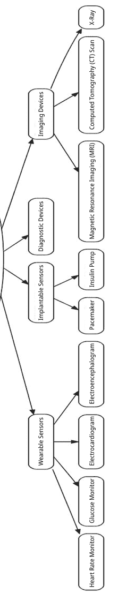

图 1：生物医学传感器和设备的类型。

可穿戴 ECG 监测器被视为主要用于持续记录心脏活动的独特小工具。腕带、胸部束带或其他可穿戴形式以及可穿戴 ECG 监测器有助于调节心脏问题，因为它们涉及监测心律不齐、心率变异性以及心脏结构和功能的其他方面。因此，这些小工具收集的持续数据可以被检查以标记可能的<|message|> 心血管疾病，以便及时采取适当的补救措施并处理与心脏相关的并发症。

CGM 设备专为糖尿病患者设计，用于在日常活动中持续跟踪血糖水平。这些设备通常包含一个小型传感器，插入皮肤下，检查间质液中的葡萄糖水平。然后数据会传输到可穿戴接收器，从而为用户提供葡萄糖值和趋势的即时反馈。CGM 的好处是它可以改善整体糖尿病管理，因为患者可以更准确地调整胰岛素剂量，监测血糖水平模式，并减少指尖采血测试。

#### 2.2 植入式传感器

植入式传感器是复杂的生物医学设备，旨在植入人体内以提供对多种生理要素的永久性持续监视和控制。此类传感器提供的数据高度准确、长期稳定且实时，这对患有慢性疾病和需要全面医疗治疗的患者非常有用。

起搏器和心脏监测器是最广泛使用的植入式传感器之一，旨在管理和监测心脏健康。起搏器是植入胸部的小型电子设备，用于调节心率，尤其适用于患有心房颤动或心脏传导阻滞等疾病的患者。如图 2 所示，已开发出多种植入式传感器用于持续健康监测和数据记录。

这些传感器可以监测心脏的电活动并持续分析心率和心律。例如，现代起搏器可以提供有关心脏活动的详细实时反馈，使医疗保健提供者能够根据准确、最新的信息调整治疗方案。此外，像植入式环形记录仪这样便携但有创的设备可提供长期 ECG 监测，并能在较长时间内有效检测与心律不齐相关的异常，这对预防性护理和诊断非常有益。

胰岛素泵和葡萄糖传感器是重要的糖尿病技术工具，可实现血糖水平的持续检查和精确调节。请注意，胰岛素泵的工作方式类似于 ICD，但与植入体内不同，它们像传呼机一样佩戴，并通过插入皮肤下方的细管调节胰岛素输送到体内，且胰岛素可以根据

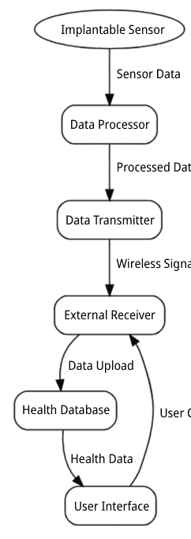

图 2：植入式传感器。

血糖水平的测量。它是隐蔽的，由皮下放置的传感器组成，这些传感器监测间质液的葡萄糖水平并将数据显示给胰岛素泵监视器。这些设备本质上可以同步以自动输送胰岛素，并提供更好的调节血糖水平的方法，减少所需的指尖采血测试，并获得更好的血糖控制结果。

颅内压（ICP）探头是用于监测颅内动力学疾病（包括创伤性脑损伤）患者颅内压力的植入式设备。这些传感器最常见于脑系统，其作用是连续记录 ICP。鉴于 ICP 监测器提供的有价值信息，主管医生和外科医生可以采取干预措施，例如调整药物剂量以改变脑压，以应对影响患者的情况。

人工耳蜗是为帮助诊断为重度至极重度感音神经性听力损失的人群而开发的先进技术工具。这些植入物具有外部听觉处理器和固定在患者耳蜗内的内部接收-刺激电极。外部处理器收集声源并将其转换为可被内部电极接收的电信号。这些电极因此刺激听觉神经，以便使用者能够理解声音。人工耳蜗是指一种发展性辅助技术，可增强听力受损者的听觉和交流过程。

神经刺激器可以通过手术植入体内，以专门调节神经通路的活动，发挥治疗作用。其中一些设备是深部脑刺激器和脊髓刺激器，用于管理多种神经系统疾病。脉冲发生器通过手术直接放置在大脑中，用于提供电信号以控制帕金森病和原发性震颤等疾病中涉及的异常脑信号。脊髓刺激器是放置在脊髓硬膜外空间的手术装置，通过改变疼痛信号传向大脑的途径，向患者身体传递电脉冲来控制慢性疼痛。这两种神经刺激器均提供根据个体反应而调整的定制疗法。

#### 2.3 远程监测系统

远程监测系统是医疗技术领域最新的创新之一，因为它允许在无需对患者进行身体检查的情况下评估患者的状况并确定应采取的措施。这些系统使用不同类型的传感器和通信技术收集和传输健康信息，以增强对患者健康的有效和及时管理。

远程监测设备设计用于放置在患者的家庭环境中，以实现对患者健康状况的无限定期跟踪，而无需不断就诊医疗机构。这些设备包括通过数字秤进行体重测量、家庭血压监测以及用于血氧水平的脉搏血氧仪。结合移动应用程序使用时，这类设备可以帮助患者在一段时间内监测自己的健康状况，并与医生分享所获得的信息以进行远程评估和治疗。

远程医疗是一种创新方法，允许患者和/或医疗保健提供者通过互联网咨询几乎所有内容。其中一些平台包括视频通话和消息传递等常见功能，以及访问医疗机构记录等。使用此类技术，患者无需前往医疗机构即可获得医疗咨询、检查甚至诊断。这使得通过将远程医疗工作与远程监测设备连接起来来增强远程医疗的使用成为可能，以便对患者进行观察，同时实现更好的虚拟护理。

血压远程监测是患者用于记录并在无直接接触的情况下向医疗保健提供者传达其血压水平的高级工具。

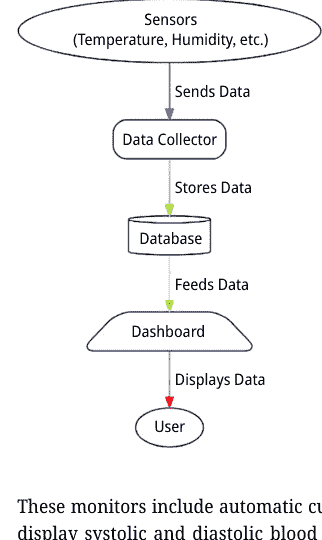

图 3：远程监测系统。

这些监测仪包括自动袖带充气装置和数字显示屏，用于测量并显示收缩压和舒张压。它们代表了远程监测系统的关键组成部分，包括传感器机制、通信方法以及用于临床监督的实时数据传输和分析。数据通过蓝牙通信技术无线传输，使医疗保健提供者能够跟踪血压趋势、调整药物并在无需面对面就诊的情况下管理高血压。这种持续监测能够及早发现潜在的健康问题，从而实现更有效、更及时的高血压管理。

数字听诊器通过将声音转化为可记录和检查的信号数据来改进传统的听诊。这些设备有时与无线系统集成，以便将心肺声音转发到其他地点进行分析。具体而言，通过使用数字听诊器的技术，可以远程监控患者的心血管和呼吸系统，这意味着医生可以做出更精确的诊断，并在需要时采取必要的措施。录制的声音可由其他从业者聆听，从而增强评估过程以及患者医疗保健的多学科管理。

环境/环境传感器负责测量影响健康的患者周围环境因素，如温度、湿度以及空气质量。这些传感器始终与其它类型的远程监测设备一起使用，以便提供患者家庭环境的全面视角。例如，传感器可用于识别房间内危害患者呼吸系统的变化。所获得的信息可作为确定患者环境和整体状况需要改变的区域的基础。

#### 2.4 诊断与成像传感器

用于诊断和成像的传感器是现代医学的先驱之一，因为它们提供了有关人体内部功能及其变化所需的信息。这些传感器的特点允许疾病诊断、确定最合适的治疗策略以及评估干预措施的结果。随着技术进步，成像设备的应用随着时间的推移而改善，使其更加精确和多功能。

图 4：诊断与成像传感器。

MRI 和 CT 是两种现代放射诊断设施，有助于医生详细可视化深层病变。MRI 利用强磁场和射频波产生身体软组织区域的详细图像，包括大脑、肌肉和器官。图 4 显示了当今先进信息通信技术医疗技术中使用的一些诊断和成像传感器，其根本目标是提高准确性和疾病早期检测。计算机断层扫描（CT 扫描仪）通过应用 X 射线提供横截面图像，并提供骨骼、器官和血管的近距离视图。MRI 和 CT 成像在诊断包括肿瘤、骨折、内出血综合征和神经系统问题等疾病时提供关键信息。

超声利用高频声波实时显示身体内部结构。这种无创成像模式常用于研究软组织区域，包括腹部、盆腔以及妊娠期间的胎儿。就超声成像而言，由于其无创性、便携性以及提供实时信息的可能性而备受青睐。该技术包括不同形式，B 型用于结构评估，多普勒超声用于评估血管功能。超声成像设备在过去几年中不断改进——所捕获图像的质量得到提高，并增加了新功能以实现更具体的用途，如心脏超声和超声肌肉骨骼系统。

为了确定哪种医学成像技术最有益，PTA 1 提出的技术 OCT，一种基于光波层析的无创成像工具

生物组织的光学成像分辨率可达10 µm。OCT主要用于眼科，通过成像视网膜和眼前节来辅助诊断多种疾病，包括黄斑变性、青光眼和糖尿病视网膜病变。该技术也已应用于心脏病学和皮肤病学等其他医学领域，因为它能够对组织特征进行高分辨率成像。

内窥镜相机是专门为通过微创技术观察人体腔道和器官而开发的。这些相机安装在柔性内窥镜上，通过自然腔道或手术开口插入体内。在内窥镜检查中，光纤相机将消化道、呼吸系统和其他体腔的图像传输到监视器上，以便进一步检查、诊断和治疗各种疾病。现代内窥镜设备，包括高清和窄带成像技术，已提升了这些仪器的诊断和治疗能力。

肌电图（EMG）传感器是记录肌肉和神经电活动的设备，因此可用于诊断神经肌肉疾病。EMG传感器可用于测量肌肉力量、识别电活动异常并判断神经状况。从EMG检测中获取的信息在识别疾病方面发挥作用，包括肌营养不良、周围神经病变和腕管综合征。EMG近期技术发展包括便携性和可穿戴技术，EMG已得到改进，为肌肉和神经评估提供了广泛基础。

#### 2.5 治疗设备

治疗设备是用于诊断和对抗各种疾病的技术。此类设备在患者护理的各个方面都具有重要价值，因为它们用于提供优化的治疗方案、促进个体患者康复以及支持社区中的持续医疗保健。治疗设备在过去几十年中经历了巨大发展，并提高了医疗手术的前景。

药物递送系统是复杂的结构，旨在以校准和精确测量的方式将药物递送到患者体内和组织中。这些系统包括输注泵，可连续输送胰岛素和抗生素等物质。其他形式的先进药物递送涉及可生物降解植入物，其中所用材料按预定时间表以受控方式释放药物，无需进一步注射。系统示例包括微针和透皮贴片，使药物递送侵入性更小，从而提高患者满意度。这些系统旨在尽可能高效地实现预期治疗效果，同时不影响其副作用，并为患者所需的治疗类型提供最佳可能结果。

物理治疗和康复辅助设备旨在为需要物理治疗的肌肉骨骼疾病患者补充物理治疗过程。这些设备包括旨在辅助运动康复和重复性运动任务的机器人康复系统。其他示例包括用于运动和姿势的外骨骼可穿戴辅助设备，以及用于组织修复和缓解疼痛的治疗性超声。通过康复设备中集成的传感器，可以密切观察患者的进展，并根据特定客户的要求调整治疗。

阻塞性睡眠呼吸暂停使用持续气道正压（CPAP）机治疗，作为控制睡眠期间呼吸暂停的一种方法。CPAP设备通过覆盖鼻子的面罩提供持续气压，避免呼吸暂停的发生。当今的CPAP设备具有自动调压等功能，可根据当时反馈调整压力，并可与其他设备连接以进行监测和信息共享。针对特定医疗治疗和改善患者状况的不同治疗设备如图5所示。正如我们所强调的，CPAP的使用可提高睡眠质量，从而减少额外睡眠需求及相关疾病（如心血管疾病）的必要性。

电刺激产品用于向受损神经传递电信号以进行治疗。此类设备包括TENS，用于通过调节神经收缩来减轻疼痛，以及NMES，用于肌肉重塑和增强。神经刺激器包括脊髓刺激（SCS）和脑深部刺激器（DBS），以及用于神经系统中特定区域电刺激治疗的植入物，主要用于管理慢性疼痛和某些神经系统疾病。采用不同的电刺激参数可制定特定的治疗计划，以满足患者需求并改善治疗结果。

医用人工器官植入物是用于治疗患病器官的精密设备。此类设备包括为严重心力衰竭患者提供机械支持的机械心室泵（左心室辅助装置）。人工肾脏（透析机）在肾衰竭情况下替代血液过滤功能，人工肺（体外膜氧合系统）为危重呼吸系统疾病患者提供有限的呼吸支持。人工器官正在为器官衰竭与移植之间提供希望和桥梁，并显著提高患有严重器官衰竭患者的生活质量。

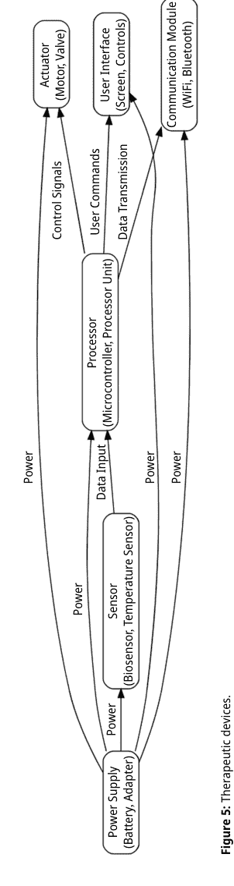

图5：治疗设备。

### 3 功能与应用

#### 3.1 生命体征监测

补充前述内容，生命体征的记录是工作流程的核心部分，因为它涉及患者身体功能的基本信息。这种做法能够发现趋势，进而提示需要治疗的医疗状况，以及管理慢性疾病。传感器技术已有显著发展，从而增强了生命体征监测的效率，有助于改善患者预后并增强医疗保健系统。

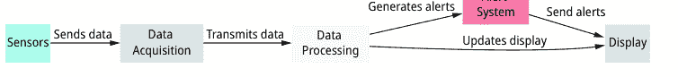

图6：生命体征监测。

心率和心电图是诊断心血管疾病的两个重要参数。脉搏血氧仪测量一分钟内脉搏重复次数，提供心脏模式和效率的详细信息。智能手表和胸带可对佩戴者的心率进行长时间监测和分析。另一方面，心电图记录心脏的电活动，如心率不齐、心肌供血不足及其他与心脏相关的疾病。复杂的心电设备有助于诊断和监测各种心脏状况，并提供详细评估，同时维持患者的长期记录。

血管内压力的追踪对于评估整体心脏健康和治疗高血压等疾病至关重要。数字监测仪自动跟踪血压，并提供准确的收缩压和舒张压值，以便频繁检查和有效治疗。这就是为什么图6展示了通过数字界面实时监测患者关键生命体征（如脉搏、血压和SpO₂）的原因。需要使用脉搏血氧仪监测SpO₂，作为评估呼吸功能不全，特别是低氧血症的一种手段。脉搏血氧仪通过使用红外光来估计氧合血红蛋白的百分比，对于监测呼吸系统疾病和氧疗非常有用。

呼吸频率测量是评估呼吸健康以及整体健康状况的重要手段。通过随时间观察呼吸频率，客户可以轻松识别任何异常，如呼吸急促，这可能提示多种潜在健康问题。智能服装以及远程监测系统，配合呼吸传感器，能够监测个体的

呼吸并提供即时反馈。呼吸频率数据在慢性疾病（如COPD、哮喘和睡眠呼吸暂停）中至关重要。

温度测量是健康监测（HM）过程的首批功能之一，用于评估身体调节体温的能力并检测发热。当前的温度传感器已被集成到可穿戴设备、智能手表表带和装置中，并与远程控制器和温度计相连接。这类传感器提供持续的温度读数，使用户能够识别发热性疾病以及与温度相关的所有其他疾病。温度测量的新技术还有助于将温度读数与患者状态的其他参数相结合，这非常有价值。

多参数监测系统利用来自各种有创/无创生命体征传感器的信息，提供患者的整体状况。这些系统将脉搏、血压、呼吸频率和体温的读数整合到一个平台上，便于健康评估和趋势监测。多参数设备常用于患者护理以及对慢性疾病患者的远程监测应用中。这些系统通过整合来自不同传感器的数据，进一步提高健康状态评估的准确性。

#### 3.2 慢性病管理

COPD即慢性阻塞性肺疾病，是一种需要对患者进行积极监测并提供定期治疗的慢性疾病。在分析慢性病管理的作用时，研究人员指出，它影响患者的生活质量（QOL）、并发症风险和医疗支出。生物医学传感，尤其是相关便携设备的技术发展，已极大地提高了慢性病诊断、随访和管理的精确性和实时性。

另一个体现持续监测技术重要性的领域是糖尿病管理。CGM系统能够持续监测和追踪血糖水平，并向患者提供其葡萄糖水平的实时信息。这些系统包含一条置于患者皮肤下的微小葡萄糖传感器贴片，用于记录组织间液中的葡萄糖水平；信息随后被传输到一个电子监测移动应用程序。世界卫生组织提出的慢性病管理综合框架包括：a) 患者数据，b) 治疗方案，以及c) 紧密连接的实时监测，以实现最佳效果，如图7所示。CGM与胰岛素泵的结合催生了闭环胰岛素输注系统，该系统根据葡萄糖水平调整胰岛素摄入剂量，从而改善血糖控制并尽量减少指尖采血测试的使用。在血糖控制方面，这些技术之所以有用，是因为它们能够及时做出适当调整，并将高血糖和低血糖事件的发生率降至最低。

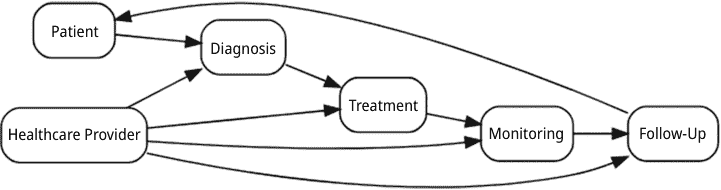

**图7：** 慢性病管理。

心脏护理管理对于维持对高血压、心力衰竭和心律失常等健康状况的控制至关重要。可穿戴心电图（ECG）设备和袖珍血压测量设备提供关于心脏功能和血压的连续详细信息，以便识别早期异常。远程遥测IT和植入式心脏监测器被用于监测异常心律及各种需要干预的心脏问题，包括心律失常。这些设备通过提供调整药物和改变生活习惯所需的信息，帮助控制心血管疾病，从而防止病情恶化和对患者造成不良影响。

癫痫、帕金森病和多发性硬化症等神经疾病的管理得益于监测技术的进步。智能服装和集成电路可处理神经疾病中出现的运动协调、癫痫发作及其他体征。例如，腕戴式加速度计可以获取帕金森病患者的震颤数据，这有助于更新治疗方案。同样，癫痫发作检测设备可以为护理人员和医疗决策者提供病情恶化的洞察，从而导致需要调整药物剂量。这些技术通过提供疾病的实时管理数据，改善了神经疾病患者的护理，从而带来更好的患者预后质量。

呼吸保健管理涉及对哮喘、COPD和睡眠呼吸暂停等疾病的管理。监测设备包括便携式肺活量计和峰值流量计，使患者能够同时监测其肺功能和症状。对于睡眠呼吸暂停，具有追踪功能的CPAP设备可提供呼吸暂停事件和治疗效果的信息。此外，可穿戴传感器主要用于持续评估呼吸频率和血氧饱和度水平，以帮助治疗、评估干预措施的效率，并告知患者和治疗师紧急并发症的发生。这些监测工具通过为护士提供适当干预的工具并制定个体化患者护理程序，增强了呼吸道疾病的有效管理。

血清肌酐和电解质水平对于接受透析的慢性肾病（CKD）患者至关重要。智能且具生物相容性的设备（如宝石和芯片）可以监测血压、体液和电解质比率等对肾脏健康至关重要的方面。支持复杂监测系统的透析机通过持续分析和实时提取参数来保证适当的治疗。这些技术有助于调整患者的治疗方案、评估并发症和进行一般患者护理，从而在慢性肾病的照护中发挥作用。

#### 3.3 预防性和预测性健康

预防性和预测性健康技术可在某种健康问题变得无可挽回之前，最大程度降低人们罹患该问题的可能性。这些技术涉及使用影像和数据采集设备、传感器、数据收集与分析，并以人工智能计算能力为支撑，为有效的健康管理、早期疾病识别和主动式健康管理提供解决方案。将这些工具融入医疗保健，实际上可以被视为有能力改变那些原本会持续困扰人类的疾病病程。

疾病诊断对治疗的成功结果以及人们受到各种健康问题影响后的整体生存率有着巨大影响。诊断传感器和影像设备的主要功能之一是在疾病初期将其检测出来。例如，记录身体体征的可穿戴电子设备可包括心率和血压差异，这些差异可能预示其他问题。同样，涉及生物标志物和遗传信息的筛查设备可以识别出罹患癌症和心血管疾病等高风险人群。早期检测有助于通过早期干预改善我们的身体、生活和整体健康状况，从而获得更好的预后。

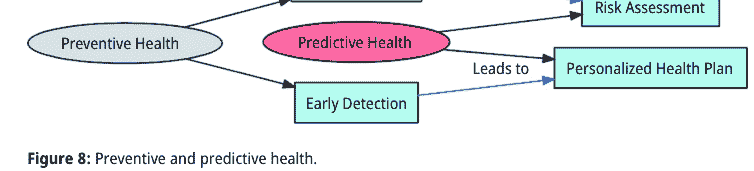

**图8：** 预防性和预测性健康。

从可穿戴传感器、电子健康记录（EHR）和基因组学收集的数据可以了解个体患特定疾病的易感性，这被称为风险评估和预测模型。统计分析和预后工具用于识别数据之间的模式和联系，以提供个性化的风险概况。图8描绘了预防性和预测性健康策略如何协同工作，其目的是提高早期诊断和以患者为导向的干预概率，从而获得更好的患者结局。例如，算法可以根据身高、运动方案和基因来估计一个人患糖尿病的概率。这些模型可以帮助根据风险选择预防方法，包括从改变患者习惯到开具特定药物等一切措施。

智能穿戴设备是用于追踪步数、睡眠时长以及决定健康体适能的其他因素而开发的设备。一个人每天走了多少步、心率以及睡眠质量等信息提供了大量关于其健康状况的信息。这些信息经常被用来推断针对个体的具体建议，涉及体育锻炼、睡眠质量和整体健康。日常使用腕戴式健身追踪器可鼓励健康行为，帮助实现个人训练目标，并推进慢性病预防框架。

在这种情况下，环境暴露涉及追踪空气质量、温度和湿度水平等因素，这些因素会影响个人健康。一氧化碳传感器、二氧化硫传感器、NO–NO₂–NOx传感器、空气质量监测器、AQI传感器、PM2.5（2.5微米颗粒物）传感器、臭氧传感器、VOC传感器和氡传感器可以确定环境中的浓度，并追踪呼吸系统疾病和心血管疾病的暴露风险。同样，还可以确定环境条件与人们健康状况之间的关系，从而使个人和医疗专业人员能够避免频繁暴露于各种不利环境条件和疾病之中。

全面的健康和指示性数据来自所有健康监测设备和概率模型所采集的数据。作为分析界面，个性化健康平台根据具体的健康指标、遗传数据和行为提供指导。这些指导包括营养、身体活动、药物使用以及如何更积极运动等信息。这提供了实现定制化健康智能的可能性，从而根据人们的需求、选择和易感性降低健康风险并改进预防性健康规划。

#### 3.4 数据采集与分析

因此，数据收集与解释是提升生物医学传感器和设备使用效果的关键步骤。健康信息系统（HISs）是收集、分析患者健康信息并将其用于诊断、治疗规划以及进一步健康管理的过程。多年来，数据采集与分析的新技术极大地提升了生物医学设备的潜力和实用性。

通过传感器网络收集的原始数据使用各种信号处理技术进行处理，以增强其质量和可用性。这些方法包括滤波，有助于消除噪声并保持信号完整性；放大，增强微弱信号；以及转换技术，将信号转换为更易于分析的形式。一种广泛使用的方法是傅里叶分析，它将信号从时域转换到频域，以帮助分离并去除不需要的噪声。此外，还应用特征提取技术来识别数据中的关键特征。

在某些先进应用中，需要更复杂的信号处理技术来处理非平稳信号和复杂的噪声模式。这些场景通常利用计算智能方法，如机器学习和自适应滤波，以改善信号解释。有效的信号处理对于确保从生物医学传感器获取的数据准确、可靠且适用于临床决策至关重要。

**图 9：** 数据采集和分析。

数据融合与集成是指使用来自不同来源收集的数据，以便对患者状况形成整体视图。该过程涉及将来自众多类型传感器的收集数据进行合并，包括可穿戴、植入式和成像传感器。图 9 概述了数据采集和分析过程以及原始数据、数据预处理和分析结果之间的联系。在不同非均质数据的集成中，应用了多传感器融合和数据融合算法等措施，以增强健康数据的准确性和全面性。数据集成的另一个领域是将传感器数据与电子健康记录（EHR）结合，以全面了解患者的病情和医疗背景。它改善了诊断评估，因为多个数据源的存在使评估结论更准确、更可靠。

实时数据采集是指在数据收集时获取传感器数据并即时处理的过程。这种能力对于需要实时交互和响应的面向患者的应用程序至关重要，例如连续血糖监测（CGM）和心律失常应用。实时数据采集系统的一些细节包括使用高速数据采集硬件、快速的数据传输通信方法以及数据采集过程中的低延迟数据分析。持续观察生理数据的益处在于能够立即识别潜在风险，并可立即为患者改变治疗方案。

历史数据分析和趋势监测涉及检查在多个时间点收集的数据以识别模式、检测变化并评估整体健康状况。监测技术如时间序列分析、统计建模和特征提取用于揭示纵向数据（即随时间重复测量）中的趋势。除了时间序列方法外，还可采用横截面分析来评估顺序数据并识别主要和次要健康异常。通过分析历史数据，医疗专业人员可以深入了解疾病进展、治疗结果和其他重要临床指标。这些信息使医疗管理人员和提供者能够改善患者护理、做出明智决策并通过预测未来健康事件而主动规划干预措施。

传感器校准涉及通过与参考传感器比较来建立传感器校准系数，而验证旨在获得将传感器输出转换为感兴趣的生物医学变量的校准方程。校准是将现有传感器参数设置为现有标准特定程度的过程。另一个过程是验证，指检查现有传感器相对于预定基准的性能过程。由于漂移和环境变化以及个体间差异等因素，系统持续高质量性能需要校准和验证过程。校准、验证和质量保证确保传感器信息的完整性和可靠性，进而提高诊断和治疗干预的质量。

#### 3.5 用户交互与反馈

生物医学传感器和设备用户的参与和反馈对于生物医学传感器和设备的设计和功能非常重要。这些方面使设备具有可用性，并在设计时考虑到患者以及医疗保健提供者的需求，以便从收集的数据中获得有意义的报告。与用户协商可提高对治疗方案及其方向的依从性水平，从而改善用户的整体健康状况。

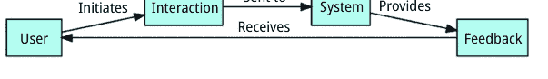

图 10：用户交互与反馈。

人机界面和显示系统对于确定生物医学设备的功能至关重要。当代设备的复杂仪器涉及图形触摸屏、显示界面和语音识别系统进行交互。开放平台应易于导航，以便以使用彩色警报的图表形式进行类似的数据展示。这些技术使患者能够轻松解释其健康参数、设备设置和其他功能，从而使使用该设备的体验更具吸引力。

除了在佩戴设备时通知用户其健康状况的即将变化外，还有一些更重要的事情。生物医学设备包括不同类型的报警，包括视觉报警如闪光灯、声音报警如报警蜂鸣声以及振动警报等，有助于通知用户。用户参与和反馈的过程在图 10 中显示，其中数据流展示了如何利用用户的输入来修改系统并改善用户体验。此外，还可以根据条件偏好设置这些警报，并将警报纳入移动应用程序以便于远程通知。警报帮助用户通过设备对健康状况做出适当响应，从而增强安全性和治疗依从性。

移动和网络应用程序提高了客户参与度，因为健康信息和设备性能变得易于获取。这些应用程序帮助用户监测其基本健康指标；监测每日、每周和每月的趋势；并根据其数值获得反馈。其中一些功能包括生成事实和数据以及趋势和实时报告的图形表示的能力，有助于用户管理其健康状况。应用程序帮助患者通过共享数据和获得咨询与医疗保健提供者互动，当患者正在接受管理和仍在护理中时。

与个人健康记录（PHRs）的连接代表了患者参与健康和福祉方式的重大转变。它使从生物医学设备收集的健康数据与个人的电子健康历史集成成为可能。这种无缝协调提供了患者当前状况和医疗背景的全面视图，从而支持医疗保健提供者做出更明智的决策。患者受益于所有健康记录集中在一个可访问的地方，使他们能够根据需要轻松查看和更新信息。此外，这种集成通过汇总来自多个医疗保健提供者的数据来促进护理的连续性，确保在整个临床治疗过程中所有相关信息都可用且准确记录。

了解用户体验和可用性设计方面对于确定新兴生物医学设备如何满足不同用户群体的需求非常重要。可用性设计涉及与设备的物理、认知以及情感交互模式。其中一些因素是设备的便携性、尺寸和形状，以及由设备界面简洁性、特殊需求处理实用性以及用户培训所适应。管理调查和可用性测试等反馈机制有助于了解未来的问题和挑战。解决与设备设计相关的这些问题可确保设备开发人员开发的穿戴式解决方案不仅有效，而且为患者提供舒适感，从而确保患者持续使用。

### 4 技术进步

#### 4.1 小型化和可穿戴性

尺寸缩小以及融入服装和配饰是生物医学传感器和设备技术中的两项关键技术进步，提升了其应用性和可用性。这促成了更小、更舒适且功能强大的新型设备的发展，这些设备可佩戴并全天甚至夜间用于监测健康，而不会干扰患者的日常活动。

MEMS 技术在微型生物医学传感器中发挥了关键作用。MEMS 设备将微机械和微电子系统结合到小型芯片中，以设计具有相当灵敏度和选择性的微型传感器。这些系统用于多个领域，例如压力敏感换能器、加速度计和陀螺仪，这些对于监测活动水平、心率和运动尤其相关。MEMS 对传感器设备的小型化也有显著影响，使得人们可以在身体上佩戴多个设备，从而扩展了可穿戴设备的使用范围。

Figure 11: 小型化和可穿戴性。

电子元件的灵活性和可拉伸性为可穿戴生物医学技术提供了重要改进。这些技术涉及柔性材料和设计形式的集成，使工作中的电子元件能够适应人体形状和任何形式的运动，而不影响其性能。图 11 反映了小型化和可穿戴性的未来演变，技术向更小、更舒适佩戴的方向发展，甚至集成到服装中。由柔性电子技术开发的可穿戴健康监测器是智能贴片和腕带，可舒适地固定在人体皮肤上。另一方面，可拉伸电子技术用于在智能服装中拉伸时仍需保持功能性的设备。这些影响提高了可穿戴设备的可穿戴性，并增加了其持续使用的准备度。

生理传感器的便携性也因生物医学传感器的小型化而得到增强，从而生产出用于持续内部监测的可植入和可摄入设备。为了监测糖尿病患者血糖水平和心律，开发了作为人体内部实时监测器的可植入传感器。可摄入传感器通常封装在生物相容性材料中，可被摄入以检查胃肠道健康和药物吸收情况。这些设备利用这一概念，提供有关内部健康状况的有用数据，而无需外部装置或干扰。

电源管理方面的技术发展发挥了重要作用，尤其是在生物医学设备小型化方面。电源供应、微型电池、能量收集技术和低功耗电子技术的全新解决方案提供了构建设备以实现更长运行时间和更小尺寸的方法。人体固有的动能、热能、光伏和射频等供电方式可用于为可穿戴和可植入设备供电，从而减轻连续监测系统设备频繁更换电池的负担。

小型化和可穿戴性的发展在用户舒适度和整体外观方面带来了巨大变化。当代可穿戴设备便携、低调且具有装饰性，因此可在工作场所和其他社交场合佩戴。这涉及纤薄、分段式造型的打造以及应用不影响皮肤的弹性材料，例如人们作为时尚配饰佩戴的腕带，以及用户采用的眼镜和服装；由于健康监测不会造成任何不便，因此保持了用户舒适度。

#### 4.2 连接性和通信

通信、网络和连接性在生物医学传感器开发中发挥着核心作用，促进信息流动、实时协调操作以及机器、人类和医生之间的信息交换。系统内节点和子系统之间的关系和连接在图 12 中以风格化流程图的形式描绘：节点仅附带数字引用，且仅显示节点之间最重要的连接。这些技术对生物医学设备进行了广泛的改进，以增强患者健康管理和效果。

可访问性和兼容性与生物医学传感器和设备的无线网络技术以及多种移动应用相互关联。最熟悉的技术包括蓝牙、无线保真和蜂窝技术，每种技术都有其适用于特定应用的特性。蓝牙通常用于可穿戴设备与智能手机之间的数据传输和短距离通信。Wi-Fi 提供更大的覆盖范围和更高的数据传输速率，用于设备需要持续数据流传输到家庭医疗保健系统的场合。4G 和 5G 等互联网网络通过使设备能够向远距离位置广播数据来支持远程监测，从而无论地点如何都能追踪健康信息。

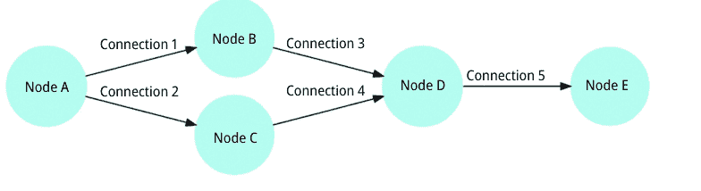

Figure 12: 连接性和通信。

采用物联网结构的生物医学设备通过将生物医学设备链接到更广泛的物联网框架来扩展其功能。物联网对象能够与包括电子健康记录、智能家居和远程医疗应用在内的其他相关医疗保健对象进行交互。这种集成实现了整体健康监测和信息交换，以促进实时更新和高效的增强协调治疗。物联网增强了复杂的<|message|>能力，包括自我监测通知、统计分析和可能的健康状态信息，由于医疗保健中创新的交互水平。

需要存储和分析来自生物医学传感器和设备的海量数据，而云计算解决方案恰好派上用场。电子健康记录最有效地通过提供安全数据存储和数据可用性的云解决方案进行存储和管理。支持适当数据分析的云平台有助于对趋势和模式做出有价值的结论，以及在组织中应用的技术。此类解决方案包括对包括患者健康状况在内的方面的可视化数据，以及通过采用机器学习和人工智能预测不同状况来监测和预测特定状况的能力，具有不同精度的水平。

当生物医学设备连接并处于通信状态时，数据安全和隐私成为主要关注点。保护健康相关信息的隐私需要对其安全措施进行适当管理，例如数据编码、识别和传输。加密提供信息的安全传输和存储，身份验证确保用户访问设备的安全。由于数据保护法案的法律规定——如美国的 HIPAA 和欧盟大多数国家的法规——必须保护患者的隐私以及他们对该机构的信任。安全管理措施防止未经授权的个人访问信息。

本文旨在证明使生物医学设备与系统之间的通信过程更加集成需要互操作性和标准化。通信结构和格式的使用使来自不同制造商的产品，即设备能够相互协作。存在

目前，HL7 和 FHIR 的观点包含了医疗保健系统互操作性所需的要求和程序。标准化促进了无处不在的设备连接到更广泛的健康网络，也改善了数据互操作性，并在不同形式的医疗环境中推动个人和团队的整合护理流程。

#### 4.3 材料与制造

新材料和制造技术的进步与最先进的生物医学传感器和设备的发展之间几乎存在普遍的协同作用。因此，在定义设备的性能、鲁棒性和生物相容性时，选择正确的材料以及整合创新技术生产工艺是关键因素。上述讨论的技术促进了更有效改进的生物医学装置的发展。

生物材料的使用在生物医学设备中被认为对其性能和灭菌性至关重要。这些是专门开发的材料，包括用于预期应用的生物相容性聚合物、金属和陶瓷，具有强度、柔韧性以及与生物组织整合的能力。一些最常用的聚合物是植入物和假肢中的聚氨酯和硅酮，因为它们具有柔韧性，并且不会干扰体液。根据所获得的结果，图 13 展示了用于新医用材料高通量筛选设计的材料和制造工艺的简要总结。钛和不锈钢等致密材料因其坚固且优异的耐腐蚀性而成为植入物机械部件的首选。氧化铝和氧化锆陶瓷因其出色的硬度和耐磨性，被应用于关节置换和牙科植入物。

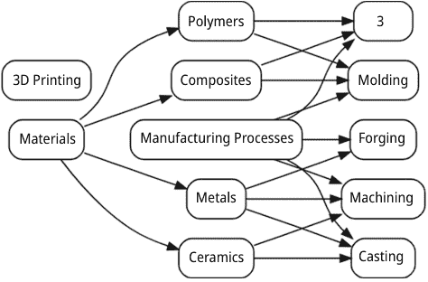

**图 13:** 材料与制造。

微型化和微细加工是两项重要的使能技术，在生物医学传感器的进一步发展中发挥着重要作用。MEMS 和纳米技术处于这些发展的前沿，因此可以将传感器和执行器集成到单个高效设备中。MEMS 使得制造高灵敏度和高精度的微型传感器和执行器元件成为可能，这些元件用于血糖监测仪和健康监测可穿戴设备等自我监测和诊断设备中。纳米技术有助于集成纳米级传感器以及其他具有更好性能特征的设备；更高的灵敏度和选择性就是例子。

在先进制造技术中，所谓的增材制造最近在生物医学设备制造中获得了革命性技术工具的地位。该技术能够以高精度制造具有紧密轮廓和通畅通孔的薄壁结构，并且诸如 3D 打印之类的详细增材技术被用于生产植入物、假肢和手术器械，这些器械具有满足个体患者需求的精确尺寸。用于生物医学应用的 3D 打印材料包括可生物降解聚合物、金属和陶瓷。快速建模和生产个性化装置的能力提高了设备开发的整体效率，并增加了患者获得的益处。

可拉伸和柔性电子技术的进步引领了可穿戴和可植入应用在生物医学领域的长期使用。这些技术涉及使用新材料，然后通过新方法加工成可弯曲、可贴合身体并随运动弯曲的设备。柔性电子通常基于有机半导体和导电聚合物等材料，因为它们既柔韧又具有导电性。此类基于超材料的应用示例包括可穿戴健康监测系统、用于生理信号采集的可弯曲传感器以及内置电子设备的智能服装。柔性电子的增强提高了最终用户的舒适度和生物医学应用中的设备性能。

制造质量和可靠性对于确保生物医学设备在使用时符合特定的安全和性能标准至关重要。现代生产操作通过利用自动化检测系统、统计质量控制和故障分析等技术来最大限度地减少制造差异。这涉及以非常高的标准控制仪器及其附件受到污染的方式，以尽量减少这方面对设备的影响。遵守 FDA 和 ISO 规定的要求对于实现设备的可靠性并保证其适合临床实践至关重要。

#### 4.4 增强的传感器能力

生物医学领域的若干发展使传感器在功能性和实用性方面更加高效。物理传感器的进步带来了更好的测量、更高的灵敏度和更大的多功能性，提高了健康检查和发现的整体质量。

最近的技术发展在传感器的灵敏度和精度方面取得了相当显著的提升。当前的生物传感器也非常灵敏，能够捕捉到生理指标的任何微小变化，如血糖水平、脉搏率和血压等。该方法的高灵敏度有助于揭示疾病的早期体征，这得益于新的生物标志物以及以前未观察到的生理过程中的细微变化。例如，改进后的葡萄糖传感器可以通过相对较低的校准来确定间质液中的葡萄糖浓度，这对于糖尿病治疗是必需的。这种增加的精度提供了更强的诊断能力，并有助于管理和规划所提供的治疗方案。

组件的微型化使先进传感器的集成成为可能，这也使得制造更不显眼、更舒适的设备成为可能。应用当前的高科技时，可获得如图 14 所示的增强传感器功能，从而提高数据精度和操作效率。LIGA 和纳米技术的新发展使得开发紧凑型传感器并将其集成到可穿戴和可植入系统中成为可能，同时不会显著降低传感能力。多路复用，即将多个传感器集成在一个硬件中，也变得越来越流行，使得可以同时监测多种不同的生理信号。例如，健身追踪器已经发展为集成心率监测器、心电图和血氧传感器，所有这些设备的数据都可以从单个可穿戴设备获取。

传感器数据解释结果的应用范式以及改进的数据处理和分析的作用已变得愈发重要。借助增强算法和机器学习趋势，通过传感器实时监测生物医学信号。这些技术允许对数据进行深入分析、模式识别和健康趋势预测。例如，机器学习算法可以过滤心电图信号，以便为用户及其护理人员诊断心房颤动和可能的心血管事件。此外，改进的数据分析处理还提供实时监测和反馈，同时调整治疗和管理行动。

增强的连接和通信技术使得促进生物医学传感器的集成和功能成为可能。当今许多传感器可以集成蓝牙、Wi-Fi 和其他通信方式，这意味着数据可以直接传输到移动设备和基于云的健康系统。这种集成允许在单一平台上操作；数据被共享

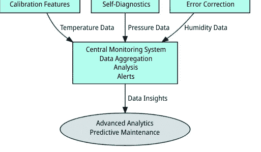

图14：增强的传感器能力。

可实时运行，并支持远程监测与远程医疗解决方案。增强的通信技术允许早期干预，并授权有资质的医疗保健提供者访问关键患者数据，无论其地理位置和状态如何，总体上提升了护理流程的生产力。

最近的材料工程进展使得开发具有更强生物相容性的生物传感器成为可能，并提高了其坚固性。新兴技术包括柔性电子、在完成特定功能后可在体内溶解的材料，以及保护涂层，这些涂层可减少传感器与身体组织的有害相互作用，转而实现更好的相互作用，同时减轻炎症。例如，可拉伸性使得可以开发薄型平面、贴合人体形态的传感器，用于长期皮肤佩戴应用。更好的生物相容性也意味着此类传感器在植入式设备中使用时问题更少，从而改善患者的境遇。

#### 4.5 法规与合规进展

作者认为，认证/审查和合规/后续对于生物医学传感器和设备的发展与应用至关重要。这些进展确保新技术是安全、符合生物医学要求且达到标准的，同时有助于促进创新增长和新市场准入。监管与合规领域的具体指南和趋势细节如图15所示。监管体系和合规技术方面的当前变化与趋势，有助于应对包括人工智能和实时数据在内的改良技术的实施。

生物医学传感器和设备及其监管的发展都经历了一些改革，这些改革有意简化审批流程。美国食品药品监督管理局启动了名为“突破性器械计划”的加速准入项目，欧盟的欧洲药品管理局也启动了名为“PRIME（优先药物）计划”的加速准入项目，以快速审查和批准创新技术。这些项目旨在加快那些迫切需要改善患者预后的设备的开发和部署，并预示着有前景的创新成果能够更快地交付。

由于带有人工智能和云功能的生物医学设备数量不断增加，对数据保护的法律要求也随之提高。遵守美国HIPAA和欧洲GDPR等法规是保护患者信息的强制性要求。这些法规规定了数据加密的方式、此类信息的访问控制方式，以及在创建和使用患者敏感健康信息之前如何获得用户同意的标准。它们使患者能够信任医生，同时满足特定标准的法律要求。

将人工智能和机器学习技术引入生物医学设备，需要制定相应的标准措施加以规范。各机构正在努力定义新的指南，以涵盖人工智能驱动设备应用中的各种难点，包括算法解释、验证和测试，以确保其性能。例如，FDA已经针对基于算法的医疗器械软件（SaMD）评估出台了指导意见，评估标准包括准确性、额外的稳健性和功能性，以实现持续改进。该指南旨在为制造商提供实用规程，这对开发安全且能持续保持高性能的智能技术非常重要。

当前法规的创新使得人们更加关注上市后评估和收集真实世界数据，以了解生物医学设备上市后的表现和安全性。现代监管机构越来越要求提供上市后数据，以评估设备的整体性能，并寻找可能的问题和结果。这种使用真实世界证据的方法通过注册登记、用户反馈和持续上市后研究来实现。后续评估有助于在特定设备的使用场景中对其进行审查，并对其安全性和有效性进行总体评估，同时确定设备改进措施、上市后监测研究和监管法规。

全球监管要求的同步进程正在推进，以支持生物医学传感器和设备在全球的部署。国际医疗器械监管机构论坛（IMDRF）和国际标准化组织（ISO）正在协调不同领域的标准，以改进各地区的审批程序。同样重要的是，协调标准减少了监管障碍，也方便制造商理解合规要求，从而轻松实现技术的国际出口。这些举措旨在

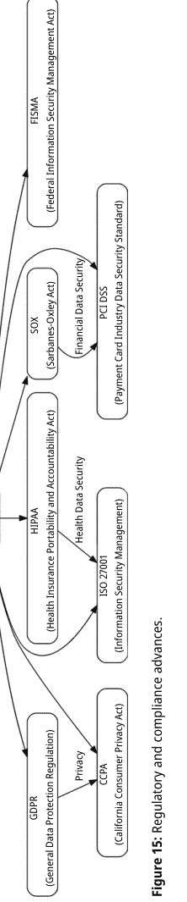

图15：法规与合规进展。

为生物医学设备的监管建立一个更少变化的环境，同时促进国际合作和优质生物医学设备的全球分发。

### 5 挑战与局限性

#### 5.1 准确性与可靠性

精确性是定义生物医学传感器和设备效率及临床适用性的核心特征。在使用这些设备时，它们必须提供准确的测量结果并持续给出正确的结果，以确保正确的诊断、治疗和患者保护。导致无法获得高度准确可靠结果的某些因素，正是那些可能影响此类技术成功及其临床接受度的因素。

传感器性能的变异性仍然是影响测量准确性和可靠性的主要问题之一。生物医学传感器容易受到许多因素的影响，例如环境影响、用户影响和传感器损坏。例如，温度、湿度变化以及电磁干扰会影响传感器的性能，导致偏离真实值。为了尽量减少外部环境条件对传感器的干扰，需要通过细致的定期检查、严格的控制程序以及精心设计来监测传感器在不同条件下的性能。

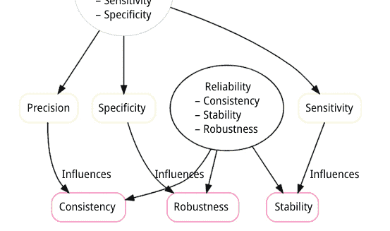

图16：准确性与可靠性。

校准与验证是增强生物医学传感器可信度的基本技术。校准意味着将其输出调整到已知的优化值，而验证则侧重于植入式设备相对于既定标准的性能。校准不足和验证不足可能导致测量错误，从而干扰临床决策。常规校准和精细的验证程序对于检查设备在整个使用过程中以及多种应用中的一致性至关重要。此外，为各种传感器类型创建简单有效的校准流程和验证技术仍然是一个主要问题。

对于由人工智能驱动的生物医学设备，信息分析能力在很大程度上取决于算法。在机器学习和人工智能中，不同的算法必须用大数据集进行训练，其中样本要能够恰当地代表总体。由于训练数据而形成不恰当的算法是另一个问题，它会导致设备的效率和可靠性低下。在图16中，所提出方法的A&U表明该方法准确可靠，并且能够提供精确且一致的结果。在出现不足时，必须进行后续检查、诊断和优化算法性能，以提高数据分析和解释的准确性。感知到的算法不透明性主要影响人们对基于人工智能的诊断和治疗设备的信任。

本文还强调，用户按照推荐程序与设备互动的方式，会极大地影响生物医学传感器的精度和可靠性。这通常源于对设备的不当处理和操作，从而导致错误的测量结果和所用设备的功能障碍。HRM控制风险与不当使用技术设备以及给予错误信任的可能性有关；用户需要理解并实践正确的设备操作程序。此外，使一些输入/输出设备对用户友好并提供明确的使用说明，可以减少用户对设备性能的负面影响。

稳定性和产品耐久性对于生物医学设备至关重要；这些特性对于设计用于长期使用的产品尤为重要。随着时间的推移，传感器的性能会受到机械磨损或材料退化的影响。这些变化会导致设备准确性和可靠性下降，从而使其无法实现改进，并逐渐恶化。保持组件标准并采用合理的工程解决方案以满足设备的实际使用寿命，是在其功能生命周期内维持可靠性的另一个关键因素。

#### 5.2 数据隐私与安全

个人信息的隐私与安全是生物医学传感器和设备使用中的一个重大问题，尤其是因为其中大部分信息都以数字格式存在。最重要的是，管理层认识到健康信息的隐私是患者信心的关键，既要满足各种立法标准，又要保护患者数据免受网络漏洞的威胁。

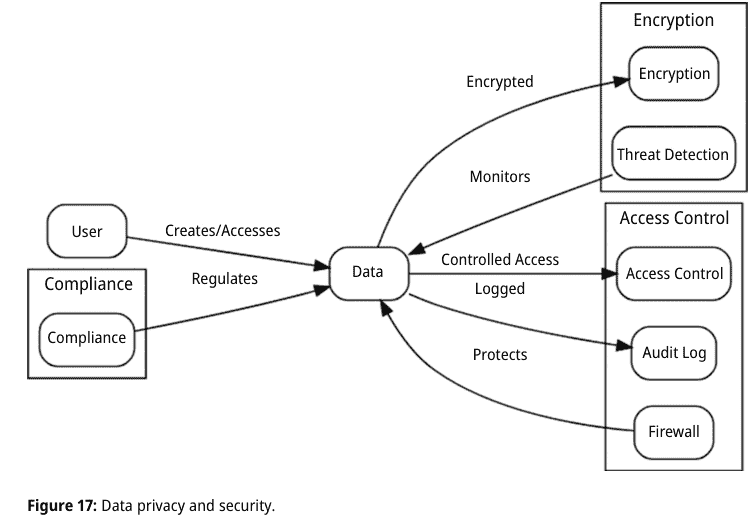

图17：数据隐私与安全。

许多生物医学传感器和设备具有通信功能，并通过无线网络发送数据。这种传输存在潜在风险，可能导致数据被截获以及未经授权的访问。在图17中，我们展示了与数据隐私和安全相关的各个方面，涉及数据安全的主要因素和方法。诸如AES之类的加密解决方案用于保护传输至不同目的地的数据。加密确保在有限时间内数据被编码，无法被相关利益方截获。它还可以为传输的数据提供安全连接，并能够根据威胁和风险的出现更新加密方法。

健康数据的存储和管理问题一直是美国在隐私和安全方面关注的焦点。生物医学设备及相关系统必须保证数据得到充分存储和处理，并符合隐私要求。不同司法管辖区的组织——包括通过HIPAA立法的美国，以及通过GDPR立法的欧盟——都要求采用访问控制、数据匿名化等安全措施来满足数据保护标准，这些标准也强制要求使用安全的存储解决方案。可以提及的是，适当的访问解决方案涉及使用多因素认证机制和基于角色的访问控制，以防止未经授权的数据访问。

遵守数据隐私法的原则有助于保护与健康相关的信息。大多数国家都有健康数据保护标准，禁止将数据用于知情同意书中未提及的目的；美国有HIPAA法案，欧洲有《通用数据保护条例》。实施措施包括制定隐私政策、定期评估以及对员工进行数据保护和安全的意识培训。企业还需要制定处理数据泄露的指导方针，其中包括发生数据隐私违规时的通知和响应步骤。

生物医学传感器和设备的一般特性要求保持生物医学数据的完整性和准确性。数据完整性受损源于软件问题和数据篡改等问题。为获得有效且准确的健康数据，必须纳入高标准的验证和确认以及系统审计。此外，通过逆向物流记录数据和跟踪变更的机制可提供审计跟踪，在调查和解决数据完整性问题时可加以利用。

许多生物医学传感器和设备高度依赖第三方存储处理服务。第三方风险被视为评估其他关联合作伙伴安全性和合规性所涉及的风险。商业实体应当在法律上约束参与数据处理的相关方，并定期对第三方服务提供商进行检查。这降低了与数据共享和外包相关的风险，因为每个第三方服务提供商都有义务遵守共同标准并遵循监管规定。

#### 5.3 用户接受度与依从性

这指出了在生物医学领域，用户接受度和依从性是成功使用传感器和设备的关键条件。随着技术的发展，保持大量用户的参与并使其严格遵循一直是一个理想目标。这些障碍的性质和认知会进一步影响这些设备在健康相关结果上的有效性，因为理解上述方面对于确定提高用户依从性的策略至关重要。

技术整合速度的加快要求对用户进行教育和培训，因为这是实现生物医学设备高接受度和使用依从性的基础。为了使用设备，用户需要持续提供输入。为了获得相应的准确输出，有必要了解设备的目的、功能、符合人体工程学且具有视觉吸引力的设计，这样的设备才可能被接受并反复使用。

隐私和安全相关问题对生物医学设备的可接受性有很大影响，尤其是那些通过移动技术传输信息的设备。用户感到自己的数据得到妥善处理并免受未经授权的访问攻击也很重要。准确的数据管理程序、强大的加密程序和透明的隐私保护伞是赢得用户信任的先决条件。遵守GDPR和HIPAA等法律要求也有助于履行保护用户隐私的责任，从而增强设备用户的信心。

但就这一点而言，生物医学设备的成本和价格会影响这些设备的现代接受度和依从性。高成本因而影响了特定人群对设备的使用，从而阻碍了其在普通大众中的使用。其他成本，例如维护和耗材方面的经常性支出，也是影响用户使用的重要因素。一些挑战包括获取设备的成本、保险和/或设备补贴，这些都可以进行调整，以更低的价格满足用户需求。

如果生物医学设备无法轻松融入用户的生活方式，就无法得到适当利用。要求用户彻底改变现有活动的设备，其接受率较低。通过根据用户生活方式对设备进行标准化，并提供清晰且可优化的反馈，可以改善这种整合。自动生成报告、减少用户干扰以及与智能手机等其他技术的适应性等简单功能有助于轻松整合并确保依从性。

#### 5.4 成本与可及性

定价和获取的便利性是阻碍先进生物医学传感器和设备普及和部署的主要障碍。这些因素影响了技术在各地区和整个人群中的部署，进而影响了医疗服务的整体效率。

这些关键的生物医学传感器和设备的研发与生产需要大量资本投入。与新技术创建、开发和测试相关的技术推广成本相对较高。图19显示了与资源可及性和覆盖范围相关的成本。制造成本、质量保证以及多项法规合规费用都增加了这些设备的成本。所有这些因素都会增加终端消费者和医疗机构的成本，从而使经济能力有限的人无法获得这些设备。

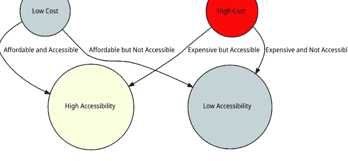

图19：成本与可及性。

保险覆盖和报销政策是决定生物医学设备在多大程度上可供公众使用的主要因素。一些流行且最新的传感器和设备仍被视为高科技产品，并未纳入保险范围。另一个因素是报销率；这是区分不同地区提供者的一个因素，并对患者使用这些技术的成本产生负面影响。保险限制常常导致患者不得不自费支付服务费用；这反过来又阻碍了患者使用先进设备，从而无法获得相关益处。

医疗设施地理分布的广泛差异影响着生物医学传感器和设备的可及性。在一些地区，制度、人力和技术资源等因素仍然是先进技术覆盖和实施的重要制约因素，尤其是对发展中地区的人口而言。这些地区的少数人由于无法获得当前先进的设备，无法同样受益于先进的诊断和治疗技术。这些地理差异意味着必须做出具体努力，开始建设更好的医疗体系，并扩展可用的技术选择。

在部署先进生物医学传感器和设备时，医疗保健提供者受益于其专业能力。由于这些设备的开发特性，以及对数据的正确解读和处理，临床医生必须持续学习并获得支持。教育和信息服务对于确保从业者能够成功利用所实施的技术至关重要。反过来，由于达到完整培训和支持水平所需花费的成本和困难，这些设备尚未普及。

经济约束也会影响特定患者获得新型生物医学传感器和设备的机会。资源匮乏的患者很难负担这类设备及其维护费用。治疗期间使用设备意味着额外的成本，这笔费用由患者本人承担，设备的维护费用同样如此，此外维修费用也需患者另行支付。经济障碍可以通过医疗服务提供方、政策制定者和设备制造商之间的个案协商来解决，以确保包括贫困者和弱势群体在内的所有利益相关方都能获得最新技术。

#### 5.5 技术与运营问题

可以看出，技术和运营因素是生物医学智能传感器及相关设备制造中的主要关注点。解决这些问题是在设备稳定性、效率和用户满意度方面达到理想水平的前提条件。这些技术中存在许多影响解决方案应用和推广的技术与运营挑战。

用于开发生物医学设备的传感器的准确性和可靠性始终受到质疑。生物传感器必须准确，才能检测体温、心率和血糖等生理参数。传感器的变异可能由环境、用户以及设备老化等因素引起。这些问题要求系统频繁校准和维护，以提供标准性能。未来的发展包括改进校准方法以及发明具有自校准功能的传感器，以减少手动调整的次数。

来自多个传感器和设备的数据融合带来了巨大的技术难题。尤其是移动生物医学设备，需要与电子健康记录（EHR）系统以及其他医疗应用和技术集成。系统的互操作性是一个重大挑战，需要确保全面呈现患者的健康状况。建立统一的格式和通信协议对于实现集成至关重要，从而使来自不同来源的数据能够被整合和分析。解决交互问题需要设备制造商、应用开发者和医疗机构共同行动，制定通用规范。

电池管理始终是可穿戴和植入式生物医学系统使用中的一个主要问题，因为这些系统需要长期使用。电池寿命短会影响设备的功能，并常常降低用户的依从性，尤其是那些需要连续长时间使用的设备。电池技术、电子部件效率以及高效用电是延长电池寿命和减少充电需求的核心。这促使研究人员寻找其他供电方案，包括利用身体运动产生的能量，以提高设备的可持续性。

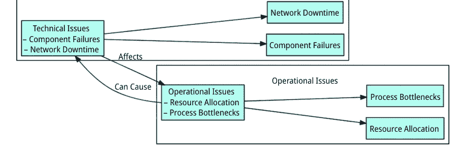

图20：技术与运营问题。

生物医学设备的另一个主要运营问题是保护健康数据的安全性和隐私性，因为有些设备通过无线方式收集和传输此类数据，而另一些则以受保护的格式传输。采用优秀的加密方法、适当的信息传输手段和安全控制措施，对于保护患者信息不被泄露至关重要。必须严格遵守HIPAA和GDPR等法规，以确保数据隐私和安全得到落实。在图20中，系统性能和运营以技术和策略的方式列出，其中需要改进和优化。因此，持续采取措施改进和加强用户数据保护，以避免引发更多担忧，这一点非常重要。

用户培训和用户依从性对于确保生物医学设备按预期运行至关重要。用户必须接受良好培训，学会设备使用、数据解读以及警报处理。缺乏培训意味着人们无法正确使用设备，导致资源效果降低并带来健康风险。采用友好的界面、提供完整的说明文档以及提供支持服务，可以提升设备使用的具体体验，并帮助用户对设备算法进行必要调整。此外，识别用户的担忧并根据用户反馈调整设备，可以提高可用性并维持设备使用。

### 6 未来方向

#### 6.1 新兴技术

正在兴起的前沿技术显然是生物医学传感器和设备的重要决定因素，因为它们充当着生物医学健康监测系统的发展引擎。该领域的进展有望提高医学诊断方法和治疗方法的准确性、速度和覆盖面。在工程的众多子领域中，随着技术的进步，有几项预计将在生物医学设备领域产生更深远的影响。

借助人工智能和机器学习，生物医学传感器和设备变得更加多功能和高效。这些技术的应用使得处理海量健康数据、识别肉眼无法察觉的模式和潜在异常成为可能。人工智能算法可以根据真实世界数据获得的结果，有效执行预测分析、定制治疗方案并改进设备功能，从而实现渐进式变革。人工智能诊断工具中的新兴技术，包括图像识别和自然语言处理，预计将增强设备内置技术并辅助临床决策。

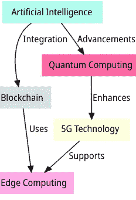

图21：新兴技术。

纳米技术正在开辟一个全新的纳米传感器领域，这些传感器预计将在分子水平上检测生化变化时具有极高的灵敏度和特异性。它们可以用作生物传感器，用于早期疾病迹象、生物标志物指标以及药物递送系统。纳米颗粒和纳米线的发展为开发高灵敏度、高选择性的传感器提供了机会，这些传感器适合集成到可穿戴设备中。进行实时分子诊断的能力有助于增强和优化人类健康。

医疗物联网（IoMT）是一项新兴技术，它通过公共网络（互联网）将医疗设备与系统连接起来，以共享实时数据并进行远程监测。IoMT涉及更广泛的相关技术类别，如身体可穿戴设备、远程监测设备和互联医疗工具。附录4概述了多个行业中新兴趋势的相互联系及其对未来的描绘，如图21所示。IoMT的集成使设备之间、设备与患者以及医疗提供者之间能够相互通信，从而增强护理协调和患者个性化服务。IoMT技术的高级解决方案旨在简化设备通信、数据交换和集成以及患者监测。

可穿戴生物传感器现已成为延长生命技术的重要组成部分，有助于跟踪健康状况。这类设备可以佩戴在人体上或嵌入织物中，用于监测人体的各种生理活动，包括心率、血糖水平和呼吸运动。织物、复合材料和涂层方面的新发展提高了可穿戴生物传感器的可穿戴性和生物敏感性。这类设备使个人能够随时监测自己的健康状况，并根据获得的数据采取必要行动。

由于通信和虚拟护理领域新兴及现有技术的发展，远程治疗和远程医疗正在快速增长。因此，远程医疗站点促进了咨询、诊断以及治疗策略的制定；治疗性远程设备则让患者直接参与个性化互动。虚拟现实（VR）和增强现实（AR）技术的进步正在提高远程治疗干预的可及性和支持性。远程医疗与诊断和治疗设备相结合，旨在引入对医学发展至关重要的新解决方案，提高患者参与度，并有助于更好地管理慢性疾病。

#### 6.2 个性化与精准健康

精准健康和以人为中心的护理是新的方法，它们整合先进技术，为患者提供独特的医疗解决方案。更重要的是，它侧重于根据个体的基因构成、环境影响和个人生活方式，为人们提供量身定制的健康解决方案，从而为客户提供更好的服务。生物医学传感器和设备仍然是实现个性化和精准健康的关键推动因素，因为它们提供高度特异性和个体化的健康信息。

分子诊断和基因组分析是医疗保健领域快速发展的领域，能够为个体患者制定个性化的治疗策略。得益于人类基因组研究的进展，科学家已经识别出与多种疾病相关的众多遗传标记，包括癌症、心血管疾病和罕见疾病。人工智能（AI）可以利

利用连接个体基因组信息与生理和生物标志物数据的生物医学传感器。这种整合使得基于患者基因构成和当前健康状况的个性化和主动医疗管理计划成为可能，通过先进的健康信息学支持更精确、更有效的干预。

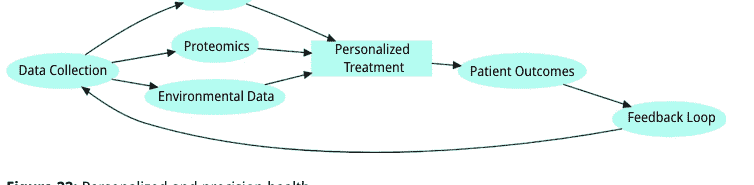

图 22：个性化与精准健康。

精准医疗的一个优势在于其对患者特征的敏感性，这得益于缓解症状措施的实施。流行的 AI 赋能技术和界面可以处理来自各种来源的数据，包括基因构成、病史和当前健康状况，并建议合适的治疗方案。特别是，图 22 揭示了个性化与精准医疗运动如何采纳患者的医疗治疗和疗法方式，并改善了整体结果。例如，用于药物递送的智能药丸可以根据可穿戴设备提供的高频反馈来调整给药剂量和用药时间，这些设备可测量循环中的药物量和身体的生理体征。同样，借助运动传感器和活动追踪器记录的信息，可以根据个体的功能限制制定个性化康复方案，并增强康复过程。

与生物医学传感器和 AI 算法集成，预测分析为精准医疗提供了基本功能：风险和疾病进展的评估。通过将数据与人体当前模型以及相关生物标志物参数的增减速率进行比较，可以预测具有较高概率发展为某些健康状况的个体。这使得及时干预成为可能，包括筛查和改变习惯以降低疾病风险。利用大数据分析进行适当的风险评估有助于优化资源分配，并提高一般利用、预防措施和疗法的有效性。

实时健康监测有助于动态地扩展健康状况的管理。智能传感器和设备可以不断收集患者症状、活动能力和环境的数据，有助于准确监测个人的健康状况。这种能力允许根据当前健康状况对患者的治疗和饮食计划进行及时更新。例如，使用与 AI 链接的 CGMS 的系统可以根据持续获取的血糖水平控制胰岛素泵的输注速率，而可穿戴技术可以提供运动和活动反馈，并推荐改变以增强健康和体能。

以人为中心的个人环境和生活方式数据提高了已实施健康干预措施的适用性和有效性。AI 传感器能够追踪影响个体健康的环境的各个方面，包括空气类型、温度和湿度。如果将这些数据与饮食、运动和压力水平等生活方式信息相结合，就能更好地了解健康的决定因素。可以从这些广泛的信息中得出针对个人的建议和方法，这对慢性病和整体健康质量具有有益影响。

#### 6.3 跨学科研究与合作

适当的跨学科研究是增强 AI 驱动的生物医学传感器和基础设备技术的根本。这些技术相对复杂，其问题需要来自多个学科的知识和技能才能解决。研究人员、工程师、临床医生和数据科学家之间这种协同方法对于推进和整合此类用于门诊追踪的技术至关重要。

工程学与生物医学科学的融合似乎是生物医学传感器和设备进步的关键。这是工程师在精密传感器、材料和系统的构思与工程方面的知识，以及生物医学科学家在生理学和医学方面的知识。该领域的跨学科协作研究旨在开发灵敏、准确且生物相容的传感器。可穿戴和植入式等技术在开发过程中涉及工程师和生物医学科学家，从而提升高质量健康监测技术的开发。

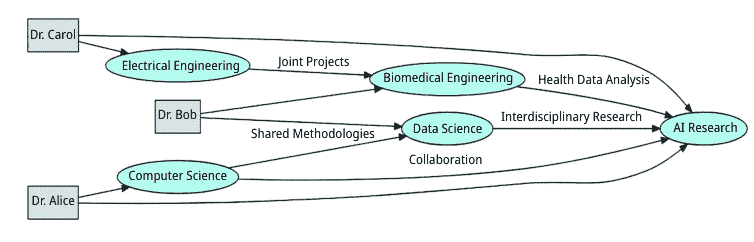

图 23：跨学科研究与合作。

在生物医学设备中应用 AI 和机器学习在很大程度上依赖于数据科学家和临床医生的合作。数据科学家设计分析健康数据的方法，包括算法和模型，而临床医生则提供对患者情况的理解。如图 23 所示，跨学科研究与合作的相互联系推动了在各个学科中应用的创新解决方案的进一步发展。在该领域开展协作工作对于开发预测健康事件的智能系统、制定个性化治疗方案和提供更好的诊断至关重要。集成确保真实数据反馈到 AI 模型中，并使模型得以调整以满足真实医疗环境中的工作要求。

在生物医学技术方面，鼓励产业与学术机构之间的合作对于改进技术研究仍然至关重要。产业合作伙伴提供实际经验、工具和市场视角；学术机构提供最新研究、思想和专业知识。共同工作包括合作研究措施、技术交流以及原型和初步研究的构建。这些联系有助于使研究成果为商业应用做好准备，并确保创新技术在推向市场前得到充分开发。

生物医学传感器和设备设计的法规合规性需要监管机构和政策制定者之间的合作。与监管机构合作有助于解读复杂的法律结构并推出安全可用的新技术。政策制定者负责制定有关生物医学设备发展和实施的法规。通过合作、资金支持和更好的政策制定，监管者、研究人员和医疗领域的其他利益相关者可以开发、评估和批准新医疗技术，同时解决有助于此类技术安全和伦理认证的新兴问题。

整合课程和跨学科培训对于营造跨专业氛围并为涉及多个学科的工作培养合格人员至关重要。工程科学、数据科学和医疗保健在大学中开展基于信息素养的教育项目，以帮助下一代生物医学技术研究人员和专业人士。这使得其他利益相关者能够更好地理解设备开发的各个方面，并促进更好的团队合作。促进跨学科培训的 concerted 努力有利于推动更多变革并应对医疗保健领域的新兴需求。

#### 6.4 全球健康与可及性

全球医疗保健需求和生物医学设备可获得性是生物医学传感器和仪器进一步发展的两个更重要领域。这是因为为世界各地不同人群提供先进的健康技术对于扭转健康结果和缩小医疗服务差距至关重要。基于这些考虑，可以指出该领域未来发展应采取的以下步骤：技术应变得更易获取且成本降低；同时也很重要地为所有国家的人们提供平等的技术获取机会。

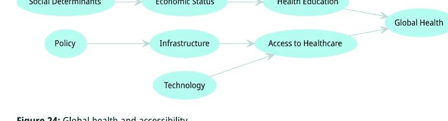

图 24：全球健康与可及性。

因此，弥合数字鸿沟是实现全球健康目标的核心关键成功因素。许多地区，尤其是低收入和中等收入国家（LMICs），由于缺乏道路等基础设施、互联网接入极低以及缺乏熟练人员，无法获取更先进的生物医学技术。图 24 进一步阐述了世界各地的健康状况和人们的获取情况，区分了不同地区对全民医疗保健和产品获取的需求。开发此类设备需要了解设备部署环境的现实限制，然后开发低成本、坚固且易于使用的设备，即使在这种环境中也能有效运行。同样，增强数字环境（如扩展互联网连接或正确使用信息和通信技术）的尝试对于确保社会排斥群体不会在现代技术在医疗保健交付方面的扩展中被落下至关重要。

成本效益是另一个能够使生物医学传感器和设备面向更广泛社会提供的战略因素。由于成本高昂，许多医疗保健技术仅限于资金充裕的医疗部门和地区。为此，可以采用诸如设备设计灵活性、标准化和集成以及与本地制造商外包等新策略来使设备更具可负担性。能够为特定目的轻松扩展的解决方案对于实现医疗系统不同背景下的技术实施也非常重要。

特别考虑了实施包容性设计的需求，以允许尽可能多的人使用生物医学设备，包括来自不同背景和残疾人士。这包括设计能够由健康素养低、身体活动能力低和技术素养低的个人操作的设备。

技术能力。可用性包括其他组成部分，其中包括可个性化的界面、多种语言的支持，以及可变和交互式设备等因素。通过这种方式，可在设计阶段通过与作为用户和参与者的患者及医疗保健提供者的互动，发现可及性问题。

本文表明，合作与伙伴关系至关重要，并且是全球健康和可及性进步的核心。与国际组织、各国政府、国际非政府组织和社区组织合作，有助于在先进技术获取不足的地区创造和交付生物医学技术。合作领域包括研究伙伴关系；技术开发和传播；以及在地方层面加强应对和响应健康需求的能力。此类合作有助于消除获取障碍，并能够增加技术为世界各地特殊人群所带来的益处。

伦理和监管领域意义重大，这些原则有助于在不同的国家、文化和价值体系中实现与国际监管框架的合规，从而实施生物医学设备。因此，必须为新兴技术制定适当的伦理标准，以确保其使用得当且公平。需要克服所需监管框架之间的差异，以实现设备所需的安全性和有效性，并使其符合当地医疗保健系统的特殊性。基于这些考虑，这些生物医学技术的开发者和监管者可以引导公众行为，使其精确、合理、公平地使用这些技术。

#### 6.5 监管与伦理考量

随着生物医学传感器和设备技术的日益先进，应在其使用的监管和伦理问题上投入更多努力。因此，该领域的未来工作显然必须应对这些监管规定，并回答以下伦理挑战，包括数据管理、患者自主权以及先进技术在卫生部门内的影响。

新型生物医学技术（如AI和机器学习的应用）的指数级增长和发展，需要新的法律框架来应对新出现的问题。必须定义新的指南，以纳入与AI相关的特性，包括设备算法公开、学习能力和性能改进能力。未来的规则可能侧重于建立正式的AI验证规则，以证明其有效性，并针对所有不同人群采取正确、适当的措施。需要法律执行机构、产业界、学术出版机构以及研究人员之间的合作，以制定稳健、响应性和适应性的法规和指南，既能跟上技术变化，同时保护患者隐私并确保设备有效性。

由于越来越多的生物医学设备已联网并产生/检测数据，保护这些信息和资源至关重要。由于设备捕获和传输来自个人的健康信息，必须采取高质量措施来防止入侵和安全漏洞。未来的考虑包括加强加密措施、改进数据匿名化流程，以及遵守包括GDPR和HIPAA在内的法律框架。制定有效数据交换规则并创建互操作环境，对于恢复公众和患者的信心以及保护他们的数据至关重要。

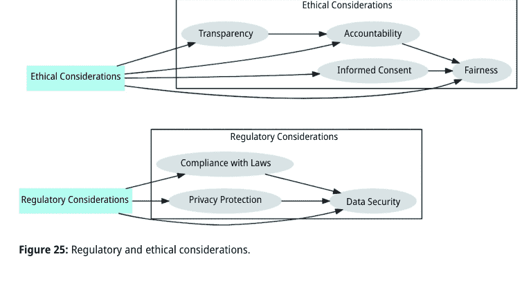

图25：监管与伦理考量。

基于对生物医学设备中AI与机器学习之间关系的分析，识别出以下几个问题：一些预期中的担忧包括诊断和干预过程推荐中的算法偏差，以及公众理解基于AI的决策的能力。图25总结了监管与伦理考量，这些考量对于决定高通量筛选技术在新一代医用材料中的应用至关重要，同时指明了应遵循的高水平安全和伦理规范。至关重要的是，未来的工作应旨在加深对如何防止AI偏见、保证AI模型公平性以及保持AI决策透明度的理解。需要制定标准协议，明确如何开发、部署和使用此类AI驱动设备，以在技术实践中实现患者安全和公平的平衡。

在考虑新型生物医学技术时，社会企业家与患者自我倡导之间的张力是一个重要的前置议题。由于设备能够监测和分析个人健康数据，重要的是确保患者充分知情，并能够就其参与监测计划/数据交换做出明智的决定。未来研究的议题应包括定义适当的同意程序、对患者进行教育，使其了解数据如何用于其利益，以及确保患者对其健康信息拥有控制权。在追求使用此类技术以进一步保持伦理性的同时，尊重患者的自主权仍然同样重要。

生物医学传感器和设备的开发还应考虑先进设备对所有人群的可及性问题。在当代医学技术的进一步发展中，存在一些关键差异，只会加剧现有的医疗保健不公。进一步的工作应旨在弄清这些技术在缺乏此类基本要素的地区如何有效运作、哪些因素能使其有效、哪些不能。这包括成本概念、低成本技术的创新，以及制定促进合理、包容性医疗技术的法规。

### 7 结论

将AI融入通过生物医学传感器进行的连续健康监测，代表着未来医疗服务提供方式的重大概念转变。本章深入探讨了AI驱动的传感器如何通过改善患者监测和管理来改变医疗保健行业。尽管这些技术仍处于新兴阶段，但它们有潜力通过提供更高的准确性、及时的更新以及关于患者健康状况的个性化信息，彻底改变健康监测。

向智能传感器平台的转变是由技术进步驱动的，这些技术利用复杂的算法以高精度连续监测众多生理参数。AI传感器提供的持续、实时反馈使医疗保健提供者能够做出更快、更准确的决策，这是有效治疗慢性和急性疾病的关键因素。这种能力正在推动从基于量的医疗模式向基于价值的护理转变，在这种模式下，预防而非治疗成为医疗保健系统的核心焦点。

机器学习技术至关重要，它们使这些传感器的功能得到最大程度的增强。机器学习在分析大数据集和识别细节方面，能够带来更准确的诊断预测以及个性化的健康生活方式。这一创新提高了个体护理的可扩展有效性，并影响了整个医疗保健系统。这些算法之所以被广泛使用，是因为它们可以持续改进，以提高传感器精度和预测效率，使整个技术不断演进以适应新的医学进展。

如上述讨论所述，AI驱动的生物医学传感器的使用中仍存在许多问题，数据验证、校准问题和连续实时处理是需要进一步研究和技术进步的三项主要因素。要解决这些问题，最关键的是充分释放AI传感器的全部优势，并在临床环境中实现高度的系统可靠性。对技术发展的更大投入和广泛的测试流程应成为这些关注点和该领域进展的核心。

随着未来的展开，生物医学传感器在改变个性化健康和人类护理方面还有广阔的可能性。作为支持更加个性化、预测性和预防性医学的技术，这些设备完全有能力彻底改变世界各地健康状况的检测和处理方式。正因如此，AI的这些进步以及传感器的发展似乎还有进一步的发展空间，从而创造更有效的健康监测。Alvino等人早前指出，随着该领域不断发展，人工智能驱动的生物医学传感器预计将在定义医疗保健未来方面发挥更核心的作用，从而提高系统质量，进而改善全球患者的健康。

## 参考文献

- [1] Junaid, S. B., Imam, A. A., Abdulkarim, M., Surakat, Y. A., Balogun, A. O., Kumar, G., . . . & Hashim, A. S. (2022). Recent advances in artificial intelligence and wearable sensors in healthcare delivery. Applied Sciences, 12(20), 10271.
- [2] Ahmadi, A. (2024). Digital health transformation: Leveraging AI for monitoring and disease management. International Journal of BioLife Sciences (IJBL S), 3(1), 10–24.
- [3] Qi, J., Yang, P., Min, G., Amft, O., Dong, F., & Xu, L. (2017). Advanced internet of things for personalised healthcare systems: A survey. Pervasive and Mobile Computing, 41, 132–149.
- [4] Diaz-Flores, E., Meyer, T., & Giorkallos, A. (2022). Evolution of artificial intelligence-powered technologies in biomedical research and healthcare. Smart Biolabs of the Future, 23–60.
- [5] Khang, A. (Ed.). (2024). AI-driven innovations in digital healthcare: Emerging trends, challenges, and applications.
- [6] Kasowaki, L., & Deniz, B. (2024). Revolutionizing big data: AI algorithms and predictive analytics (No. 11685). EasyChair.
- [7] Kasowaki, L., & Ozan, A. (2024). Artificial intelligence in big data: Transforming insights through advanced algorithms (No. 11684). EasyChair.
- [8] Zaid, A., & Milson, S. (2024). Precision analytics: AI-driven solutions for big data challenges (No. 11895). EasyChair.
- [9] Zaki, H., Shayea, I., Saoud, B., Azmi, M. H., El-saleh, A. A., Saad, S. A., & Alankhi, M. (2024). Advancing patient outcomes: the intersection of biomedical engineering, medical devices, and AI. EasyChair Preprints, 12174.
- [10] Vermesan, O., & Friess, P. (Eds.). (2013). Internet of things: Converging technologies for smart environments and integrated ecosystems. River publishers.

- [11] Albahri, O. S., Albahri, A. S., Mohammed, K. I., Zaidan, A. A., Zaidan, B. B., Hashim, M., & Salman, O. H. (2018). 实时远程健康监测系统在分诊和基于优先级的传感器技术中的系统综述：分类法、开放性挑战、动机和建议。 Journal of Medical Systems, 42, 1–27.
- [12] Appelboom, G., Camacho, E., Abraham, M. E., Bruce, S. S., Dumont, E. L., Zacharia, B. E., . . . & Connolly, E. S. (2014). 用于患者自我评估和监测的智能可穿戴身体传感器。 Archives of Public Health, 72, 1–9.
- [13] Ahmed, Z., Mohamed, K., Zeeshan, S., & Dong, X. (2020). 人工智能与多功能机器学习平台开发以实现更好的医疗保健和精准医学。 Database, 2020, baaa010.
- [14] Boyce, M. B., Browne, J. P., & Greenhalgh, J. (2014). 专业人员使用患者报告结局指标信息改善医疗质量的经验：定性研究的系统综述。 BMJ Quality & Safety, 23(6), 508–518.
- [15] Solovchuk, D. R. (2024). 生物医学人工智能辅助生物芯片技术的进展。 Biomedicine & Pharmacotherapy, 177, 116997.
- [16] Kriegel, H. P., Kröger, P., & Zimek, A. (2009). 高维数据聚类：子空间聚类、基于模式聚类和相关性聚类的综述。 Acm Transactions on Knowledge Discovery from Data (Tkdd), 3(1), 1–58.
- [17] Rasool, S., Husnain, A., Saeed, A., Gill, A. Y., & Hussain, H. K. (2023). 利用预测能力：探索机器学习在早期疾病检测中的关键作用。 JURIHUM: Jurnal Inovasi Dan Humaniora, 1(2), 302–315.
- [18] Clarke, J. L., Bourn, S., Skoufalos, A., Beck, E. H., & Castillo, D. J. (2017). 针对慢性病患者的创新医疗服务方法。 Population Health Management, 20(1), 23–30.
- [19] Dogheim, G. M., & Hussain, A. (2023). 通过人工智能驱动的远程监测进行患者护理：分析预测模型和智能警报在预防医学中的作用。 Journal of Contemporary Healthcare Analytics, 7(1), 94–110.
- [20] Sahu, M., Gupta, R., Ambasta, R. K., & Kumar, P. (2022). 精准医学中的人工智能和机器学习：大数据分析的范式转变。 Progress in Molecular Biology and Translational Science, 190(1), 57–100.
- [21] Yao, Y., Han, T., Yu, J., & Xie, M. (2024). 用于安全关键能源系统中可靠健康监测的不确定性感知深度学习。 Energy, 291, 130419.
- [22] Darwish, A., & Hassanien, A. E. (2011). 用于医疗保健监测的可穿戴和植入式无线传感器网络解决方案。 Sensors, 11(6), 5561–5595.
- [23] Giordano, M. R., Malings, C., Pandis, S. N., Presto, A. A., McNeill, V. F., Westervelt, D. M., . . . & Subramanian, R. (2021). 从低成本传感器到高质量数据：有效校准低成本颗粒物质量传感器的挑战和最佳实践总结。 Journal of Aerosol Science, 158, 105833.
- [24] Cox, S. M., Lane, A., & Volchenboum, S. L. (2018). 可穿戴、移动和传感器技术在癌症临床试验中的应用。 JCO Clinical Cancer Informatics, 2, 1–11.
- [25] Wang, C., He, T., Zhou, H., Zhang, Z., & Lee, C. (2023). 人工智能增强传感器——推动下一代医疗保健和生物医学平台的技术。 Bioelectronic Medicine, 9(1), 17.

T. Sripriya, Praveen Talari, Amirthalakahmi T.M., Senthilkumar B., T.M. Thiyagu

## AI驱动的生物医学传感器和设备优化以实现持续健康监测的开发

摘要：由于人工智能（AI）的快速发展，当前的生物医学传感器技术经历了令人兴奋的概念演变以及在不间断健康监测方面的持续进展。本章提供的数据对人工智能驱动的生物传感器、其发展、整合以及其在现代医疗保健行业对社会的[content]
- [11] Albahri, O. S., Albahri, A. S., Mohammed, K. I., Zaidan, A. A., Zaidan, B. B., Hashim, M., & Salman, O. H. (2018). 实时远程健康监测系统在分诊和基于优先级的传感器技术中的系统综述：分类法、开放性挑战、动机和建议。 Journal of Medical Systems, 42, 1–27.
- [12] Appelboom, G., Camacho, E., Abraham, M. E., Bruce, S. S., Dumont, E. L., Zacharia, B. E., . . . & Connolly, E. S. (2014). 用于患者自我评估和监测的智能可穿戴身体传感器。 Archives of Public Health, 72, 1–9.
- [13] Ahmed, Z., Mohamed, K., Zeeshan, S., & Dong, X. (2020). 人工智能与多功能机器学习平台开发以实现更好的医疗保健和精准医学。 Database, 2020, baaa010.
- [14] Boyce, M. B., Browne, J. P., & Greenhalgh, J. (2014). 专业人员使用患者报告结局指标信息改善医疗质量的经验：定性研究的系统综述。 BMJ Quality & Safety, 23(6), 508–518.
- [15] Solovchuk, D. R. (2024). 生物医学人工智能辅助生物芯片技术的进展。 Biomedicine & Pharmacotherapy, 177, 116997.
- [16] Kriegel, H. P., Kröger, P., & Zimek, A. (2009). 高维数据聚类：子空间聚类、基于模式聚类和相关性聚类的综述。 Acm Transactions on Knowledge Discovery from Data (Tkdd), 3(1), 1–58.
- [17] Rasool, S., Husnain, A., Saeed, A., Gill, A. Y., & Hussain, H. K. (2023). 利用预测能力：探索机器学习在早期疾病检测中的关键作用。 JURIHUM: Jurnal Inovasi Dan Humaniora, 1(2), 302–315.
- [18] Clarke, J. L., Bourn, S., Skoufalos, A., Beck, E. H., & Castillo, D. J. (2017). 针对慢性病患者的创新医疗服务方法。 Population Health Management, 20(1), 23–30.
- [19] Dogheim, G. M., & Hussain, A. (2023). 通过人工智能驱动的远程监测进行患者护理：分析预测模型和智能警报在预防医学中的作用。 Journal of Contemporary Healthcare Analytics, 7(1), 94–110.
- [20] Sahu, M., Gupta, R., Ambasta, R. K., & Kumar, P. (2022). 精准医学中的人工智能和机器学习：大数据分析的范式转变。 Progress in Molecular Biology and Translational Science, 190(1), 57–100.
- [21] Yao, Y., Han, T., Yu, J., & Xie, M. (2024). 用于安全关键能源系统中可靠健康监测的不确定性感知深度学习。 Energy, 291, 130419.
- [22] Darwish, A., & Hassanien, A. E. (2011). 用于医疗保健监测的可穿戴和植入式无线传感器网络解决方案。 Sensors, 11(6), 5561–5595.
- [23] Giordano, M. R., Malings, C., Pandis, S. N., Presto, A. A., McNeill, V. F., Westervelt, D. M., . . . & Subramanian, R. (2021). 从低成本传感器到高质量数据：有效校准低成本颗粒物质量传感器的挑战和最佳实践总结。 Journal of Aerosol Science, 158, 105833.
- [24] Cox, S. M., Lane, A., & Volchenboum, S. L. (2018). 可穿戴、移动和传感器技术在癌症临床试验中的应用。 JCO Clinical Cancer Informatics, 2, 1–11.
- [25] Wang, C., He, T., Zhou, H., Zhang, Z., & Lee, C. (2023). 人工智能增强传感器——推动下一代医疗保健和生物医学平台的技术。 Bioelectronic Medicine, 9(1), 17.

T. Sripriya, Praveen Talari, Amirthalakahmi T.M., Senthilkumar B., T.M. Thiyagu

## AI驱动的生物医学传感器和设备优化以实现持续健康监测的开发

摘要：由于人工智能（AI）的快速发展，当前的生物医学传感器技术经历了令人兴奋的概念演变以及在不间断健康监测方面的持续进展。本章提供的数据对人工智能驱动的生物传感器、其发展、整合以及其在现代医疗保健行业对社会的影响进行了有效聚焦。人工智能技术，包括机器学习和边缘计算，被描述为实现实时数据处理和个性化医疗应用的传感器性能使能者。最后，本章介绍了人工智能集成传感器的原理以及来自临床实践和开展研究的示例和案例研究，并提供了慢性病、诊断准确性和远程患者控制方面成功人工智能应用的众多示例。它还探讨了主要问题，如数据隐私问题、不同系统的整合以及合规性问题。学生可以从本章中获得具体知识，以发现人工智能在改善生物医学传感器方面的潜力，并探索生物医学领域的未来发展。

关键词：人工智能，生物医学传感器，持续健康监测，机器学习，边缘计算，远程患者监测

T. Sripriya, 电子与通信工程系, Jeppiaar Institute of Technology, Chennai, Tamil Nadu, India, e-mail: sripriya.t@jeppiaarinstitute.org
Praveen Talari, 计算机科学与工程系, Vignana Bharathi Institute of Technology, Hyderabad, Telangana, India, e-mail: praveent738@gmail.com
Amirthalakahmi T.M., 电子与通信工程系, SRM Institute of Science and Technology, Ramapuram, Chennai 89, Tamil Nadu, India, e-mail: amirthatm@gmail.com
Senthilkumar B., 电子与通信工程系, VSB Engineering College, Karur 639111, Tamil Nadu, India, e-mail: professor.senthilkumar@gmail.com
T.M. Thiyagu, 计算机科学与工程系, Vel Tech Rangarajan Dr. Sagunthala R&D Institute of Science and Technology, Avadi 600062, Chennai, Tamil Nadu, India, e-mail: t.m.thiyagu@gmail.com

### 1 引言

生物医学传感器是更广泛的传感器技术领域中快速增长的子领域，在过去几十年中，随着材料科学的进步，包括微型化和网络化设备[1]。最初开发的生物医学传感器体积庞大、非智能，仅适用于血糖检测和心率估计等狭窄功能[2, 3]。大多数这些传感器需要频繁校准和维护；因此将其部署到日常医疗实践中是困难的[4]。由于现代技术的创新，现在出现了更好且侵入性更小的传感器[5, 6]。由于将当前传感器整合到可穿戴设备和植入物中，实时对许多生理参数进行“慢性跟踪”成为可能[7, 8]。这种发展提高了健康数据的使用适用性，并增强了健康数据在持续健康检查中的可靠性和一致性，而这些检查现在已在当代医疗服务的高级领域中变得有益且重要[9]。

就生物医学传感器而言，其人工智能应用极大地增强了它们在健康监测方面的能力和影响[10, 11]。在大数据及其处理和分析的背景下，多种人工智能技术更相关，包括机器学习和深度学习[12]。采用这些先进技术，人工智能传感器能够确定传统方法无法捕捉到的收集信息中的特征和相互关系[13]。这种能力使患者健康状况的增强和及时评估成为可能，随后可以诊断以前未被识别的问题并制定个性化护理计划[14]。它还能够增强传感器的运行，因为它们从患者需求中学习，从而提高健康监测设备的效率。因此，人工智能推动了生物医学传感器发展的重大进步，从增强人体监测以进行离散、偶尔的检查到持续健康监测的方法[16, 17]。

尽管人工智能技术驱动的生物医学传感器取得了巨大进步，但仍有一些挑战需要充分解决，以增强生物医学传感器的能力和应用[18]。主要挑战之一是保证传感器在多种不同的现实生活场景中提供的测量的正确性和可靠性[19]。传感器校准、信号中的噪声水平以及干扰问题等因素会直接影响收集数据的质量，这就是为什么需要进一步研究以改进传感器设计以及噪声降低方法[20, 21]。由多个传感器系统组成的健康监测系统所产生的实际问题是技术挑战[22]。在Tetra系统中必须解决三个关键挑战，数据融合格式和系统接口及接口的发展在解决这些问题方面做出了重大贡献[23]。许多患者担心他们是否可以分享他们的个人

对于健康数据，监管这些敏感数据的隐私和安全是满足法律合规要求的一项重大挑战[24]。

基于案例和临床研究，人工智能推动的生物医学传感器的实际应用和成果得以展现。例如，借助Dexcom G6这样的设备——一种可持续约10天无需更换新传感器的CGM（连续血糖监测系统）——患者的血糖控制得到改善，频繁发生的低血糖事件也能被检测到。非穿戴式AI驱动心电图（ECG）监测在识别早期心房颤动方面显示出巨大潜力，从而挽救生命[25]。像Biofourmis系统这样的远程监测系统，通过早期识别病情恶化风险和/或频繁住院风险，能有效管理慢性疾病。这些案例展示了基于AI的传感器作为推动者，有助于改善疾病控制、诊断，甚至远程医疗。这些案例研究的经验有助于持续推动生物医学传感器技术的发展。

未来，作者预测由AI运行的生物医学传感器将在该领域进一步发展和进步。他们认为，借助边缘计算AI算法等新技术，传感器的改进方法与医疗保健的进步可以提升到新的水平。边缘计算通过在传感器上处理数据，缩短了响应时间，同时加快了响应速度。如今，人工智能的新兴领域，如可解释AI和联邦学习，为后续模型揭示开辟了新的可能性。重要因素是将这些技术与生物医学传感器相结合，从而形成更准确、更个性化、更高效的下一代健康监测系统。只要相关概念在研究和开发方面持续扩展，由AI驱动的生物医学传感器将在医疗决策中变得越来越重要。

## 2 生物医学传感器概述

### 2.1 生物医学传感器的定义与用途

“生物医学传感器”这一名称用于检测和测量体内多种生理变量。这些传感器将生物信号转换为电信号，以便医学应用能够处理、分析和解释数据。图1展示了生物医学传感器在测量生理参数、诊断疾病和个体化治疗方面的定义与用途。生物医学传感器最初设计用于提供关于重要健康参数的准确实时数据，包括心率和心律、血糖水平、体温、血压和神经信号。

生物医学传感器作为数据采集工具是不够的；它们对于改善患者护理乃至医学科学同样至关重要。这些传感器能够促进早期病情识别和相关健康问题的早期监测，所有这些都有助于有效控制疾病。连续监测能力在糖尿病、高血压和心律失常等多种慢性疾病中尤其有帮助，这些疾病需要持续关注以预防并发症。

由于生物医学传感器提供的数据可用于根据每位患者的需求定制治疗方案，因此它们有助于实现个性化医疗。这种个体化策略通过促进更有效、更高效的医疗服务，改善了患者预后并降低了医疗成本。生物医学传感器在研究环境中提供有用数据，可以推动医学科学的进步以及新药物和新疗法的开发。

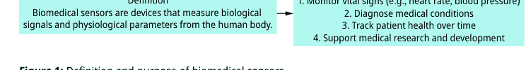

图1：生物医学传感器的定义与用途。

### 2.2 历史发展与里程碑

生物医学传感器经历了显著的发展阶段，这些阶段改变了人们对医疗保健和医学诊断的观念。生物医学传感器起源于20世纪早期，当时使用简单的工具来评估基本的生理体征。早期的传感器体积庞大，需要手动操作，这极大地限制了其使用和精度。

生物医学传感器的主要转折点可以追溯到20世纪50年代，当时发明了心电图（ECG）和脑电图（EEG）。这些设备标志着诊断和监测心脏及大脑电活动能力的重大进步。它们凸显了电子学与医学的关键交叉，推动了健康监测技术和诊断方法的创新（见图2）。

20世纪70年代和80年代传感器技术的一项突破包括固态传感器以及小型化过程。理解EP分析的一种重要方式是通过展示其历史演进和主要阶段；图2显示了这些事件的时间线。能够连续监测生理参数的设备的复杂程度不断提高，这归功于硅基传感器技术的进步。在此期间，第一批可穿戴传感器被开发出来，使患者能够在诊所之外监测自己的状态。

20世纪90年代，无线技术的进步以及微电子技术与生物医学传感器的集成是一个重大进步。随着无线通信的发展，数据可以远程采集并实时传输；这进一步提高了临床和家庭生物医学监测领域的实用性。可能源自这一时期的一项相关技术发明是血糖监测设备的开发，糖尿病患者使用这些设备来监测和记录血糖水平。

可以看出，在21世纪初，通过集成数字技术和物联网（IoT），生物医学传感器经历了又一次革命。普及且价格实惠的智能手机和可穿戴技术拓展了开发舒适有效的健康监测系统的可能性，这些系统能够随时间监测和分析多种生理特性。带有心率、身体活动和睡眠传感器的活动监测设备因这些进步而得到改进，因此消费者使用它们监测健康参数。此类设备包括健身追踪器和智能手表。

在最近十年中，AI进入了生物医学传感器领域，并实现了健康检查的新时代。AI和机器学习技术也被应用于分析传感器接收到的数据，使结果在开发模型和医疗干预方面更加深入。目前基于AI的传感器提高了实时监测与数据分析、疾病进展过程中的异常识别以及个体健康管理的能力，这被看作是生物医学传感器发展的一个进步。

总之，生物医学传感器在历史演进中的进展可以描述为从最初的机械结构到现代AI系统应用的持续进步。所有这些里程碑都不断增强了生物医学传感器的能力，扩大了其用途，并增强了这些技术在健康和治疗领域的影响。

图2：历史发展与里程碑。

### 2.3 生物医学传感器的类型

生物医学传感器被定义为用于跟踪不同生物体功能的多功能设备，因为每种类型在特定情境下都有效。图3展示了生物医学传感器如何根据其工作过程的性质分为电化学传感器、光学传感器和机械传感器，以及它们在诊断中的预期用途。有必要识别生物医学传感器的种类，以便理解它们在基于IT系统和AI的持续健康监测与改善中的功能。

#### 2.3.1 电化学传感器

电化学传感器通过电化学过程识别和定量目标化合物的浓度。这类传感器在糖尿病患者的血糖监测中处于核心地位，可测量血液中的葡萄糖浓度。电化学池中发生的电学反应被发现与目标分析物（此处为葡萄糖）的浓度相对应，从而可准确测量其浓度。这类传感器非常重要，因为它们具有极高的灵敏度和选择性，常用于糖尿病等长期疾病的监测。

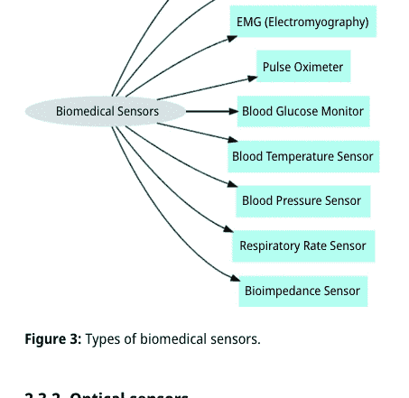

图3：生物医学传感器的类型。

#### 2.3.2 光学传感器

光学传感器利用光的特性结合专门技术来量化相关的生理变量。脉搏血氧仪就是其中一种设备，它通过测量光的吸收和反射来估算血氧水平。关于氧合血红蛋白和脱氧血红蛋白对光的吸收差异，

这些生物传感器具备足够的功能，可用于评估呼吸和心血管状况。光学传感器本质上无创，可集成到有用的可穿戴设备中，用于跟踪人体呼吸频率以及血液中的氧含量。

### 2.3.3 温度传感器

温度传感器用于检测物理温度的变化，这些变化是许多疾病的早期征兆。这些传感器与智能可穿戴设备等可穿戴装置相结合，用于监测体温变化。例如，在发热监测中，热传感器提供实时数据以生成发热状态的指标，从而实现早期医疗干预。这些传感器必须准确且响应迅速，以确保实现适当的健康监测。

### 2.3.4 压力传感器

生理压力测量设备可测量不同形式的压力，包括血压。为了估算随时间波动的血压变量，压力传感器被应用于连续健康监测设备中，以跟踪心血管健康趋势。这些传感器基于压力变化工作，将变化转换为电信号，从而比较压力并寻找健康问题的迹象。

### 2.3.5 生物电传感器

生物电传感器记录由内源性生理功能产生的电信号。心电图（ECG）和脑电图（EEG）是突出的例子，分别用于监测心脏和大脑的活动。ECG传感器附着在身体上，以拾取心脏收缩的电信号，并有助于诊断心律失常和其他心脏异常。EEG涉及通过传感器获取脑电波模式，以诊断癫痫和睡眠障碍等疾病。这些传感器是诊断和治疗各种心脏和神经系统疾病的基础。

因此，各类生物医学传感器已被开发出来，利用多种技术解决特定问题，以产生相关的健康信息。当与人工智能技术连接时，这些传感器变得更加智能，意味着接收到的数据是实时、精确且更广泛的健康数据。

## 2.4 关键组件与技术

生物医学传感器是为量化和筛查健康特征而开发的智能装置，其结果依赖于不同的关键部分和重要进展。图4显示了在复杂系统中提高电气性能方面至关重要的关键组件和技术。了解这些元素对于理解生物医学传感中的实用创新非常重要。

### 2.4.1 传感元件

传感元件是BCI系统的关键部分，用于检测和量化生理信号。这些元件取决于传感器的类型和待感知的目标参数。常见的传感元件包括：

- 电化学电池：适用于跟踪化学物质（例如人体中的葡萄糖）的传感器。当与被分析物发生化学相互作用时，这些电池会产生电信号。
- 光学传感器：利用光来量化血液中的氧含量等指标。这些传感器在信息处理中依赖于光的吸收和反射等原理。
- 热电偶和热敏电阻：用于温度传感器中进行热测量，通过将热量转换为电来检测体温波动。
- 压力换能器：确定压力，即作用在任何表面（例如液体物质）上的力。在生物医学应用中，这些传感器对于跟踪血压和其他压力相关信号至关重要。

### 2.4.2 信号转导机制

生理信号的检测转化为有意义的输出，这得益于信号转导机制。该过程涉及多种设备：

- 换能器：将传感元件评估的物理变化转换为电信号。此类应用包括用于压力的压电传感器和用于位移的电容传感器。
- 放大器：放大换能器产生的电信号，以获得更高幅度的信号供后续处理。
- 模数转换器（ADC）：将放大后的连续模拟信号转换为适合计算系统处理的形式。ADC在将传感器数据转换为可纳入数字健康监测系统的信息方面非常重要。

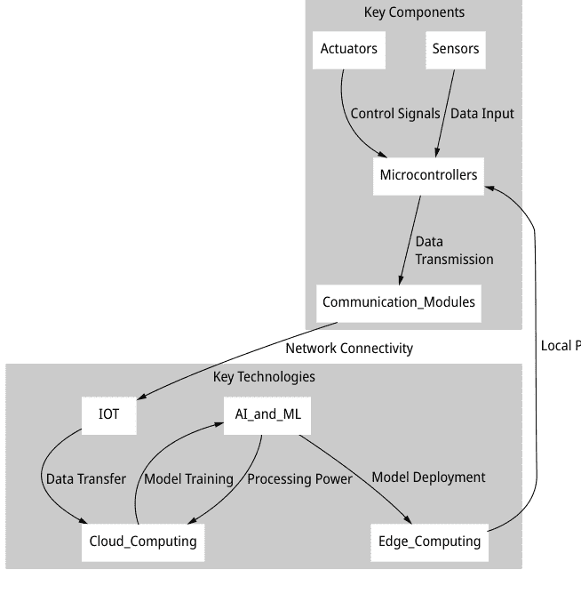

图4：关键组件与技术。

### 2.4.3 电源与能量管理

电源和能量管理对生物医学传感器至关重要，尤其是在可穿戴和植入式设备等应用中。关键考虑因素包括：

- 电池技术：通过采用包括锂离子电池在内的新型电池技术，可实现紧凑性和耐久性等结构优势，并且这些技术具有灵活性。
- 能量采集：利用热电发电机等设备获取环境能量，为传感器提供更长时间的供电，从而最大限度地减少更换电池的需求。

### 2.4.4 数据处理与通信

如果捕获了数据，那么如何处理这些数据以及如何将其用于医疗健康领域便是一个重大挑战。这包括：

- **嵌入式处理单元：** 指负责信号调理和传感器数据初步评估（如滤波等）的处理组件，它们也非常重要。
- **无线通信模块：** 通过蓝牙或Wi-Fi将传感器数据形式的信息共享到智能手机等其他设备。
- **数据存储：** 即时数据存储解决方案，包括用于在传输前保存传感器数据的板载存储器。

### 2.4.5 接口与用户交互

为项目开发的接口和用户交互组件确保了传感器数据易于检索和使用。这包括：

- **显示单元：** 具有与人交互界面的单元，可显示用户当前的健康状态通知。
- **用户输入机制：** 由按钮组成的图形界面，使用户能够控制各种设置，以校准传感器采集程序。
- **软件应用程序：** 移动设备上的应用程序，用于管理和协调健康监测（HM）系统中信息的可视化、分析及与他人信息的整合。

这些组件和技术让我们深入了解生物医学传感器的工作原理及其背后的关键使能技术。在持续监测人类健康状况的事业中，所有这些元素对于现代生物医学传感器的设计、操作和使用都至关重要。

## 2.5 在现代医疗保健中的重要性

生物医学传感器是当代医学的重要组成部分，因为它们能够实时监测人体生理数据。这些传感器既是医疗保健的预防性元素，也是诊断性元素，提供了多项根本性益处，极大地影响了医疗服务的提供和结果。

首先，生物医学中的生物传感器通过持续跟踪健康标志物，能够实现疾病的早期诊断。这意味着通过这种持续监测系统，医疗提供者能够注意到患者的任何病理生理变化，并且这是在临床症状开始显现之前完成的。筛查在早期识别中非常重要，当心血管疾病或糖尿病等疾病在早期被发现时，可以采取许多措施。

生物医学传感器提供的实时数据正在为个性化医疗的概念做出贡献。这些传感器使医疗从业者能够根据每位患者的需求调整治疗方案，因为患者的个人数据被持续收集和评估。因此，定制化治疗降低了发作和住院的几率，因为它提高了治疗的有效性，并带来了更好的慢性病管理方法。

生物医学传感器支持远程医疗和远程监护护理，使医疗保健更加高效。通过家庭监测，患者可以获得更好、更方便的治疗，而无需频繁去医院。这提高了医疗保健的可及性，并减轻了其他地区消费者因常见疾病对医疗设施造成的压力。

此外，生物医学传感器对于提高患者安全结果和实现更好的临床目标至关重要。例如，测量血氧水平和脉搏率等生命体征的传感器会向医疗提供者发出患者健康状态变化的信号，并触发适当的反应和行动。当患者被积极管理时，不良后果得以避免，必要的治疗总能及时提供。

此外，生物医学传感器与电子健康记录（EHR）系统的结合有助于实现最佳的健康信息学。从传感器到EHR系统的持续数据流使健康趋势得以监测，诊断更加准确，护理人员能够有效且高效地协调工作。

实时、持续、无创的生物医学传感器在当今医疗环境中至关重要，因为它们具有促进个性化和远程治疗、患者保护和数据控制的潜力。所有这些都相辅相成，以改进医疗保健方法并实现健康状况的改善。

## 3 传感器技术的演进与进步

### 3.1 早期生物医学传感器：局限与挑战

需要认识到的是，生物医学传感器的发展始于初级的传感器，这些传感器存在许多严重的限制和障碍，削弱了它们在医疗机构中的可信度和可行性。早期应用于这些场景的传感器主要用于确定独特变量，包括脉搏率和血糖水平，并且受到几个固有问题的困扰。

在生物医学传感器的演变过程中，第一个被观察到的缺点是传感器本身的尺寸和侵入性。其中一些传感器需要通过侵入性过程与身体直接物理接触，这可能会让患者感到不适。例如，旧型号的血糖监测仪需要使用血液样本进行评估；对于每天需要多次测量的糖尿病患者来说，采血既痛苦又不方便。

另一个出现的主要因素是需要不断校准和进行其他维护活动。早期传感器在医疗保健需求中的使用很麻烦，因为它们必须定期重新调整才能保持准确；这使得它们不适合实际应用。这种持续调整不仅增加了操作负担，还在测量过程中引入了一些人为错误和变异性。

早期生物医学传感器的准确性和可靠性问题也被提出。大多数这类传感器容易受到环境变化等其他影响的干扰。不幸的是，这限制了它们提供准确且稳定的测量结果的能力，进而影响了对许多健康问题有效诊断的协助。

数据传输和集成是文章作者注意到的其他问题。处于早期开发阶段的传感器被发现缺乏先进的数据传输能力，因此数据必须手动记录和分析。这个过程非常缓慢且繁琐，因为涉及大量手工操作，可能会干扰对健康变化及后续应对措施的分析。

另一个局限性是早期传感器能够测量的参数数量很少。最初的传感器系统被设计为仅监测有限的生理指标，这限制了它们全面反映患者状况的能力。因此，这种狭隘的关注点需要使用多个独立的仪器来跟踪不同的参数，极大地复杂化了筛查过程。

早期生物医学传感器的这些局限性和挑战凸显了技术进步的必要性，以提高这些设备的有效性和互联性。此后，其中许多问题已通过材料科学、传感器微型化和无线通信技术的进步得到解决，这些进步支撑了现代非侵入性医疗保健传感器的发展。

## 3.2 材料科学的进展

纳米技术和材料工程在生物医学传感器的进步中发挥了核心作用，为传感器的功能、性能能力和多功能性带来了质的变化。这些进步指的是能够适用于可穿戴/可植入系统的新型灵敏传感器的出现；这些传感器已经被设计和生产出来。微型化传感器的优点包括：
- 1) 患者的舒适度得到提升
- 2) 侵入性降低
- 3) 便利性提高

例如，遥测葡萄糖传感器可以被整合到小尺寸的连续血糖监测设备中，这些设备可以佩戴在身体上，以近乎实时地监测血糖水平变化，且不会带来太多不适。

在生物医学传感器中，纳米技术指的是引入至少一个维度小于100纳米的材料和结构，以增强传感器的性能。利用纳米颗粒的优势特性，例如增大的表面积与体积比和更高的反应活性，就有可能开发出非常灵敏且具有选择性的传感器。纳米线、纳米管和纳米颗粒具有独特的性质，能够提高传感器检测各种生理参数和生物标志物的灵敏度和特异性。

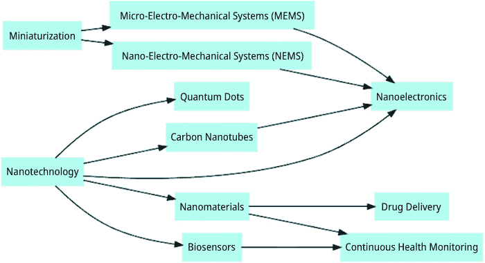

**图5：** 微型化与纳米技术。

纳米技术还使得纳米级传感器的形成成为可能，这些传感器可用于小型便携式可穿戴设备。这些纳米级传感器有潜力实现更高的分辨率，从而改进生理参数的测量。例如，使用纳米级传感器可以在早期阶段测量与疾病相关的生物标志物的变化。

微型化和纳米技术带来了先进的传感技术，包括用于分子诊断和成像的纳米传感器。这些创新通过实现对生物样本的检查和细胞及分子活动的持续观察，推动极限，以提供更高的准确性和个性化护理。

微型化和纳米技术的创新提升了生物医学传感器的功能性，带来了更高的性能、更小的侵入性和高度灵敏的监测系统。图5展示了微型化和纳米技术的进展，以及它们将设备细节整合到最高水平所带来的好处。这些技术仍然是医疗保健传感器设计创新的驱动力，如果得到实施，可能会彻底改变医疗保健系统。

## 3.4 无线和可穿戴传感器技术

无线和可穿戴传感器系统的进步是生物医学传感器演进中的一个飞跃，彻底改变了健康数据的收集方式。这些能力有效解决了传统有线静态传感器的许多弱点，为持续和隐蔽的健康监测开辟了新的前景。

有线传感器会带来不便，因为患者只有通过一些线缆连接才能收集健康数据。这些传感器收集的数据通过射频、蓝牙、Wi-Fi和其他无线技术接口以无线方式传输到外部仪器。这也提高了数据收集的可行性、实时观察和健康信息的即时执行。无线传感器的使用在受试者移动性成为问题的场景中尤为明显——在这种情况下，他们在体育活动期间比静止时能得到更好的监测，从而更全面地反映患者的整体健康状况。

可穿戴传感器，如智能手表和健身追踪器，是一些通常用于管理我们健康的基本日常技术。这些传感器一直在一系列生理参数上评估个人装饰品，这些装饰品被期望佩戴，通常是在衣服上。生物参数的示例包括：体温、呼吸频率、心率和身体活动。由于增强的表面积与体积比和更高的反应活性，纳米级材料为开发高灵敏度和高选择性的传感器提供了机会，包括纳米线、纳米管和纳米颗粒；据信，用于检测不同生理指标和生物标志物的传感器可以受益于这些纳米材料。图6展示了一系列用于实时健康状态和数据采集的无线和可穿戴传感器技术。由于可穿戴设备是非侵入性的，它们可以长时间佩戴，并在不干扰患者生活的情况下更频繁地收集数据。

传感器的微型化以及先进功能材料的整合不断提高无线和可穿戴类型传感器的效率。如今的传感器在电池寿命、耐用性和使用舒适性方面都得到了升级。促进可穿戴传感器设备发展的一些因素包括传感器物理形态的增强，以及微加工技术的可用性，这些技术使得能够制造符合身体轮廓的薄而灵活的传感器。

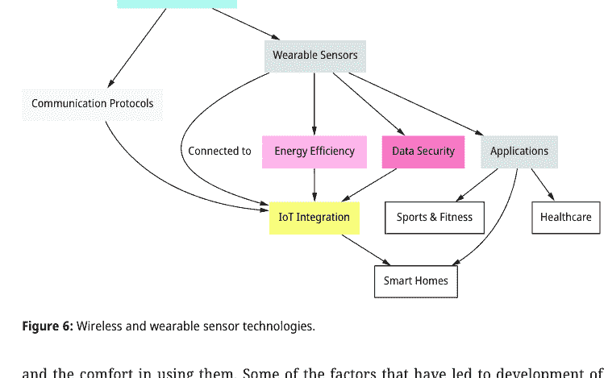

**图6：** 无线与可穿戴传感器技术。

另一项改进是将可穿戴传感器与机器学习和人工智能概念相结合。这些技术得到了补充，从而为输入提供更先进的数据分析，例如预测分析和实时解读输入。带有AI元素的智能穿戴设备可以检测潜在疾病，注意到生理特征的动态变化，并提供有价值的信息，从而确保更好的预防性医疗保健和方法。

这些及其他无线和可穿戴传感器还能轻松与移动健康应用（mHealth）和电子健康记录（EHR）系统对接。这种连接还提供了对健康各个方面的实时监测、不同应用和系统中的数据同步更新以及组织化的护理。消费者可以获得最新的健康信息，参与远程患者管理，并基于详细信息做出决策。

值得注意的是，无线和可穿戴传感器技术的进一步发展增强了生物医学监测研究领域。这些技术提供了灵活性和整合性，从而改善了健康流程管理、以患者为中心的护理以及更好的患者健康状况。

## 3.5 与移动健康（mHealth）应用的集成

生物医学传感器与 mHealth 应用的整合是医疗保健技术中最重要的发展之一。这些系统的整合改变了健康数据的收集、评估和使用方式，为促进患者护理和健康带来了新的前景。

生物医学传感器与 mHealth 应用集成后，能够实时记录健康信息并立即将其传输到移动设备。现代糖尿病患者只需在智能手机上点击几个按钮即可监测心率、血糖和身体活动的变化。这种可用性确保人们在需要通过在治疗方案中实践新的生活方式改变来改善某个器官健康时，能够承担个人责任。

此外，mHealth 应用还能够提升生物医学传感器的性能，因为它们能够进行高级分析和可视化。通过这些应用，用户可以获得基于传感器读数的趋势、图表和警报的详细分析。这有助于患者包括客户和医疗保健提供者理解复杂数据，从而更好地把握能够指导适当健康决策的模式。

## 4 连续健康监测中人工智能的重要性

### 4.1 人工智能在数据处理和分析中的作用

连续健康监测系统需要人工智能来分析和解释数据。在人工智能集成的帮助下，通过对大数据健康数据的管理和分析，生物医学传感器产生的数据量和质量得到改善。

这表明需要使用算法来处理慢性健康监测系统产生的复杂且庞大的数据。这些算法在基于机器学习和深度学习时尤为重要；图 7 展示了使用人工智能技术如机器学习算法预处理的数据如何帮助从大型复杂数据集中挖掘重要数据特征。此类算法能够处理大数据集，并提供使用传统分析方法难以识别的特征和信息。

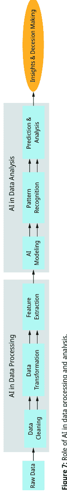

Figure 7: 人工智能在数据处理和分析中的作用。

将人工智能应用于数据处理中的另一项重要活动是对传感器收集的数据进行实时分析。目前，人工智能算法可以分析来自多个传感器的流数据，以识别各种问题、模式以及与典型健康值的偏差。这种实时分析对于提醒患者以及医疗护理人员非常重要，从而对可能出现的任何健康并发症保持密切跟踪。

人工智能在数据上采用更先进的统计和计算方法，以提高数据解释的准确性。包含大量记录的静态数据集用于训练机器学习算法，以用于诊断和预后目的的模式和相关性生成。通过这些技术，模型会随时间学习并适应新信息，从而实现更完善的健康评估。

人工智能还促进了从多个传感器融合和集成数据的方式。在慢性健康监测系统中，例如脉搏率、血糖水平和运动，信息会从各种传感器持续获得。所有这些多传感器数据可以通过适当的人工智能算法进行组合，并提供患者健康状况的完整图景。人工智能确保在考虑每个信息来源的情况下，健康信息涵盖完整情况。

基于人工智能的个人健康管理新兴数据处理解决方案正在加速发展。通过分析单个患者的健康信息，人工智能解决方案能够指出特定患者特有的特定模式和生物标志物。它提供适当的健康建议和治疗建议，其解决方案可以提高健康干预的影响并促进患者的健康。

### 4.2 提高传感器的准确性和精确度

值得强调的是，人工智能已成为提高用于即时健康监测应用的生物医学传感器效率的重要支持因素，更具体地说，是提高现有传感器提供的准确性水平。通过将人工智能算法与传感器相结合，目前系统中普遍存在的数据可信度和测量不准确等主要问题得以解决，从而实现更好的健康评估。

人工智能通过改变数据处理方式来优化生物医学传感器，从而提高获得的准确性水平。在用于分析传感器数据并识别不明显模式的机器学习策略中，支持向量机和神经网络或许是最为人熟知的。这些算法由于在庞大数据库上训练，可以捕捉到细微不同的模式；这些差异表明传感器存在错误。由于实时错误检测和纠正功能，测量结果更准确、更可靠。

人工智能通过提高传感系统的准确性来调整传感器的校准。当前和传统的校准方法涉及手动调整和校准，需要频繁进行，可以与人工智能集成，使校准自动化且高效。人工智能算法可以根据接收到的实时数据集动态重新调整传感器的参数，从而提供替代手段，确保这些传感器在不同时间和条件下保持其精度。

人工智能的另一个优势是消除噪声以及干扰，这些都会影响传感器提供的数据。传感器产生的噪声包括不需要的对象/成分等噪声，为了消除此类因素，会使用信号处理进行过滤。由于信噪比的提高，人工智能提高了收集数据的识别准确性以监测健康。

在人工智能的帮助下，可以合并和组合来自不同传感器接收到的数据，从而提高总体测量的准确性。人工智能可以通过不同类型的传感器工作，光学、电化学和生物电，因此整合此类数据可以更准确地估计健康参数。这使得测量能够进行交叉验证，并降低了在任何给定时间出现错误读数的可能性。

传感器准确性通过人工智能驱动的预测分析得到改善的另一个领域是安全性。在历史数据和实时数据集成的帮助下，人工智能可以识别传感器运行中的问题。这提供了一种预测能力，可以进行监控和解决，确保传感器不会出现错误读数，并确保校准始终准确。

### 4.3 实时健康监测和警报

将人工智能集成到连续健康监测系统中，提高了对健康数据实时分析和及时警报生成的可靠性。人工智能支持的技术实施为自动化生理变化开辟了新视野，并为患者以及医疗技术人员提供了众多灵活性的选择。

集成人工智能技术可以对来自特定生物医学传感器的收集健康数据进行持续监测，并对心率、血压和血糖水平等重要生命体征进行即时和持续通知。此类系统只需以相当快的速度分析大量数据，并识别与患者健康状况相关的标准指标的任何变化。在此背景下，图 8 显示了实时健康监测系统以及健康警报系统，展示了实时数据采集和健康分析如何导致与健康相关的事件的实时健康警报。这种实时能力需要及时

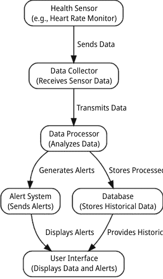

**图 8：** 实时健康监测与警报。

对可能的健康并发症进行监测，以便及时给予适当的医疗处理，避免进一步并发症的发生。

智能健康监测系统还倾向于在决策和精细警报系统中使用AI算法。可通过多种参数训练的潜在模型包括心律失常、低血糖和高血压事件。当检测到此类模式时，系统会向医护人员发送警报。这些警报也旨在具体化，并清晰传达其标记问题（包括严重程度）的信息。这意味着任何情况都不会让人措手不及，从而可以迅速采取措施，包括通过咨询医生调整药物。

其他促进人工智能使用的机制包括实时监测系统，作为推动医疗个性化的一种方式。AI通过获取每个人的患者数据，并以重复方式处理这些数据，以发现与每位患者整体状况乃至风险因素相关的各种模式，从而生成许多定制化警报。这种个性化程度增强了警报的实用性，使其更有可能根据接收者的健康状况而有效且及时。

现代健康监测系统被设计为采用人工智能，以实现患者与医疗保健提供者之间持续、高效的实时互动。此类系统的通知警报可嵌入健康应用程序中，从而使患者能在智能手机上收到通知。这种对健康信息的实际访问改善了患者互动，并在需要时培养个人选择的意识。

AI在处理实时数据和执行分析方面的能力也有助于减轻医疗保健提供者的负担。通知和数据处理可以独立于人工监测干预完成，从而将医护人员解放出来，用于更重要的职责以及患者护理。这不仅提高了医疗保健提供的速度，也提升了整体护理质量。

## 4.4 早期疾病检测的预测分析

在这种持续健康监测中，预测分析的主要作用是在潜在健康问题演变成重大医学疾病之前识别它们，这就是AI的用武之地。如果没有复杂的数据分析工具将大量健康数据转化为洞察，这种允许人们在数据中显示某些迹象时立即就医的主动方法是不可能实现的。

基于机器学习的预测分析处理从生物传感器收集的历史和当前生物特征数据。这些算法非常擅长识别表明疾病早期开始的关联和模式。例如，预测模型可以捕捉到生命体征或活动中的细微变化，这些变化先于糖尿病或呼吸系统疾病等慢性疾病的迹象出现。

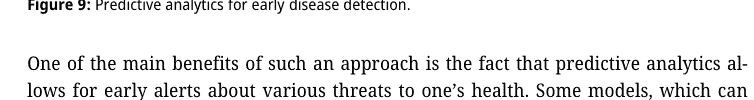

图 9：用于早期疾病检测的预测分析。

这种方法的主要好处之一是，预测分析能够针对各种健康威胁提供早期警报。一些可以随时间分析数据的模型，在判断出健康模式优化不足时，会提供提醒警报。在图9中，早期疾病预警系统展示了预测如何通过先进数据模型在达到关键阶段之前提高对潜在健康问题的认识。这使得早期干预成为可能，并防止疾病恶化的情况，从而改善患者命运。例如，医疗保健中的分析可以通过监测心率变异性和血压的波动来预测心血管事件，并借助医疗AI及时实施治疗。

除了改善个体患者的护理外，预测分析还改善了人群管理。来自不同患者的大量数据帮助预测模型发现大群体中存在的趋势和可能性。这些信息有助于制定公共卫生策略，规划针对性方案并据此分配资源。例如，可以利用预测分析来预测流感传播，从而确定需要接种疫苗的人群。

因此，集成多个数据源增强了预测分析用于早期疾病检测的能力。通过将传感器收集的数据与电子健康记录、基因组学和行为参数相结合，对健康风险的整体评估更加准确。这种方法提高了总体可靠性估计，也有助于实施量身定制的医疗保健措施。

AI技术的稳步增强也推动了预测建模的发展。随着数据量的增长，当收集和处理足够多的数据时，机器学习算法会随着时间变得越来越准确。因此，这种迭代过程使预测分析在早期疾病诊断中保持高水平，并使其成为患者健康管理的基石。

持续健康监测是预测分析的下一重大改进，它使卫生专业人员能够利用预测分析预见健康问题。这样，即使在AI框架内应用预测分析工具，也能促进早期疾病诊断、预防、治疗监测和结果改善，以及群体健康收益。

## 4.5 健康监测和治疗的个性化

AI在持续健康监测中带来了个性化的持续健康监测，增强了监测及后续治疗策略，以针对个体患者的需求。这是通过使用AI算法实现的，这些算法利用不同生物医学传感器生成的信息，更好地定制健康管理和疾病管理的解决方案。

通过使用AI研究从传感器等途径获取的大量人群健康数据，也提高了个性化水平。机器学习在临床诊断中的其他应用，包括识别在正常观察中不明显的个人健康特征。因此，通过这样做，监测参数乃至治疗方法都可以与个体的健康状况、生活认知和遗传倾向相匹配。

干预措施不仅带来以个体为导向的护理模式，还增强了患者的健康素养。

## 5 生物医学传感器中使用的关键AI技术

### 5.1 机器学习算法

机器学习算法是开发和优化生物医学传感器的核心组成部分，用于提高设备的准确性、有效性和可用性。这些算法利用技术对各种健康相关数据建模，以发现模式并做出知情预测，从而促进正确的健康检查和管控。

生物医学传感器中最常用的监督学习算法用于分类和回归。它们包括依赖标记数据来理解新数据集并做出特定决策的算法。例如，监督学习模型根据传感器收集的历史数据估算血糖水平，以帮助糖尿病患者。监督学习方法包括支持向量机（SVM）、决策树、随机森林等集成方法以及梯度提升机。

探索性技术广泛用于在没有任何先验知识的情况下发现和提取健康数据中的有用模式。K均值和层次聚类将相似的数据点聚集成紧密的组，使患者数据中的模式易于识别。例如，无监督学习可以发现具有相同健康需求的不同患者群，从而为定制患者方法提供必要的基础。

神经网络属于机器学习更广泛的范畴，采用多层数学运算来映射和解释数据问题。计算机视觉通常由特殊的深度学习算法执行，如卷积神经网络（CNN），它最擅长分析基于图像的数据，例如MRI扫描。图11显示了各种机器学习类别（如监督学习和强化学习）之间的差异和关系及其潜在应用领域。循环神经网络（RNN）及其特殊形式长短期记忆网络（LSTM）推荐用于处理序列数据，包括来自可穿戴传感器的时间序列数据。利用深度学习模型，可以自动从原始数据中提取许多特征，从而提高检测微小信息模式和异常的能力。

强化学习算法的部署有所改进，可增强在线实时决策操作。这些算法通过交互后获得奖励，从环境中学习新技能。它应该

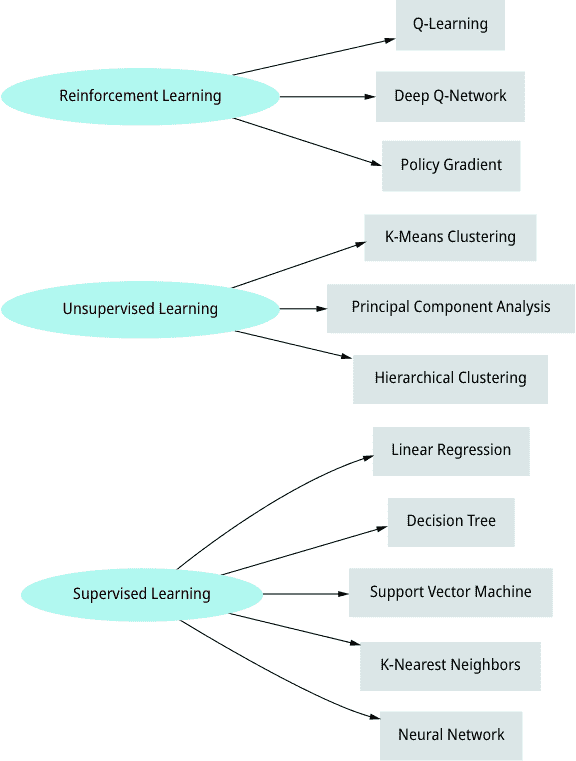

**图 11：** 机器学习算法。

需要说明的是，强化学习被应用于生物医学传感器的场景中，目的是根据患者的反应提出治疗方案的调整建议，从而改善整体健康结果。

异常检测算法用于发现外部条件正在使整体健康偏离正常状态。在处理传感器数据时，可通过孤立森林、自编码器和统计方法等方法识别异常。一些可操作且关乎患者安全的问题包括识别异常早期迹象的能力，例如心率不规律。

生物医学传感涉及在疾病诊断中使用传感器，而机器学习算法使其成为可能。这些算法能够执行复杂计算、识别模式以及做出未来预测。在这些算法的帮助下，生物医学传感器能够提供更好、更可靠的个性化健康评估，并有助于改善患者预后，提高医疗服务交付效率。

## 5.2 深度学习和神经网络

神经网络和深度学习构成了人工智能的核心方面，极大地提高了生物医学传感器的效率。这些技术在分析严格的健康数据、发现传感器数据中的模式，以支持持续健康监测研究方面发挥着作用。

深度学习是机器学习的一个类别，利用由许多层组成的神经网络，因此被称为“深度”。如前所述，深度学习算法非常适合解读来自生物医学传感器、可穿戴生物电传感器和图像传感器的高维信号。这些算法在健康监测的大规模复杂数据集中尤其有用，因为它们可以直接从原始数据中学习特征，而无需进行特征工程。

特别是 CNN 和 RNN，在分析生物医学传感器数据方面已被证明能产生最佳结果。图 12 特别展示了深度学习与神经网络的层次化设计和连接方式，这些设计致力于改进数据分析。CNN 擅长检测数据中的空间关系，例如可用于人体区域图像分析以及来自传感器数据中的空间局部特征。RNN（包括 LSTM 网络）在处理序列数据方面表现出色，这对于使用心电图（ECG）等传感器跟踪时间序列数据至关重要。

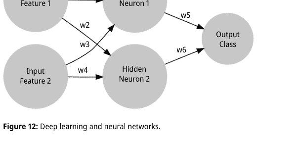

图 12：深度学习和神经网络。

深度学习提高了生物医学传感器的能力，可实现实时警报、预后判断和个人健康提醒等结果。例如，深度学习模型用于解读非标准形式的生命体征模式配置，这些配置可能表明存在某些健康问题。这些模型旨在检测与正常模式的微小偏差，从而发出警报并确保及时干预。

高级学习改善了健康诊断流程，因为它能够更准确地检测模式和分类。例如，深度学习算法可以通过医学成像识别肿瘤、区分良性和恶性肿瘤，并用于术前准备。这些算法中有几种在每轮学习和适应中都会提升其性能，这一事实保证了诊断模型始终保持最新且准确。

神经网络在利用各种传感器数据获取整体健康状况方面也发挥着重要作用。因此，能够同时接收多种不同类型传感器输入的深度学习模型，可以帮助医生了解患者的整体健康状况，并为来自可穿戴传感器、环境以及医疗记录的数据提供背景信息。

## 5.3 信号处理技术

信号处理对于集成人工智能的生物医学传感器的基本功能和性能至关重要。这些技术对于从传感器采集的原始数据中获取有用信息不可或缺，因为这些数据通常受到噪声、伪影以及许多其他类型失真的污染。高效的信号处理还能提高数据准确性，从而提升人工智能的性能和健康监测系统的效率。

### 5.3.1 降噪与滤波

降噪是信号处理中的一个重要组成部分，需要滤除干扰并提高传感器生成的信息质量。例如低通滤波器、高通滤波器、带通滤波器和带阻滤波器等数字滤波技术。它们用于抑制与噪声相关的频率，同时保留感兴趣信号的频率。非平稳噪声也可以通过自适应滤波技术来处理，该技术会根据信号特性调整其参数。

### 5.3.2 信号去噪技术

经验模态分解（EMD）和小波变换是信号处理中两种独特的去噪技术，用于从含噪信号中识别重要特征。小波变换将信号在空间和时间上分解为不同尺度，从而使开发者能够去除信号中的噪声。经验模态分解在某种程度上通过对复杂信号进行分解，恢复出被称为固有模态函数的分量，从而实现去噪。

### 5.3.3 特征提取与选择

特征提取是对各种特征进行选择和筛选的过程，这些特征定义了与健康监测相关的信号结构。傅里叶分析和时频分析用于将信号转换到频域，从而可以测量幅度和频率等特征。机器学习中的其他技术也有助于特征选择，因为通过使用特定算法，可以考虑每个特征对结果的重要性，从而确定哪些特征最适合用于精度和分类。

### 5.3.4 数据融合与多传感器集成

多因素数据融合方法整合来自不同传感器的信息，以构建患者状况的全貌。卡尔曼滤波器和贝叶斯融合等技术用于合并来自不同数据源的信息，以克服单个传感器的潜在缺陷，并提高健康评估的准确性。通过融合多个传感器的信息，可以获得较高的异常检测性能，并提高健康监测系统的可靠性。

### 5.3.5 实时信号处理

只有需要实时响应和输入处理的应用才需要实时信号处理。数字信号处理（DSP）算法和快速傅里叶变换（FFT）等其他技术能够对传感器收集的数据进行快速分析，从而实现实时监测和警报生成。实时处理的应用确保了患者状况变化的识别和及时干预，从而提升了健康应对策略的有效性。

## 5.4 数据融合与多传感器集成

数据融合和多传感器集成是两项有效的创新，为健康监测系统中的生物医学传感器概念增加了更高的准确性和包容性。图 13 展示了将数据融合技术应用于多传感器系统，以提高系统环境中收集信息的效率和有效性。此类技术将多个传感器相互连接，生成更完整的患者状况图像，使健康状况的识别和后续干预更加准确。

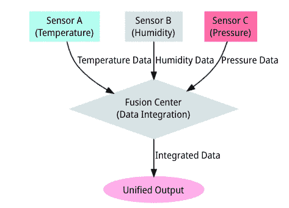

图 13：数据融合与多传感器集成。

多传感器融合指的是将来自不同传感器获取的数据合并到单一且一致的数据库中的能力。这一过程提高了健康信息的质量和可靠性，因为系统中不同传感器模态都被充分利用。例如，将电化学传感器（用于测量葡萄糖水平）与光学传感器（用于测量血氧饱和度）的数据相结合，可以更全面地了解患者的代谢和呼吸状况。由于这两个特征被集成到一个系统中，因此可以实现更好的诊断和治疗。

多传感器集成推广了这一理念，它汇集了来自各种不同传感器的数据，这些传感器测量不同的生理值。它还允许检测多种病情标志物，从而更好地评估患者的整体健康状况；例如，配备温度传感、加速度计和心率监测的可穿戴设备可以同时检测佩戴者的体温调节机制、身体活动和心血管状态。这种数据收集形式在疾病过程影响多个生理系统的情况下尤其有用，可满足客户多方面的健康需求。

它通过使用复杂的算法来处理和分析融合的传感器数据，对数据融合和多传感器集成做出了重要贡献。融合算法和集成方法用于将来自异构源生成的数据进行融合，以及与其相关的问题，包括冗余、噪声和不一致性。因此，这些 AI 技术提高了与特征域集成的健康信息的可信度，因为它们能够检测数据输入中的可能错误以及数据稀缺的空白。

研究表明，使用融合传感器数据，AI 算法可以分析模式和相关性，并提供对个人健康状况的更好估计。例如，分析 Fitbit 和智能血糖仪的数据可以深入了解身体活动与血糖之间的相关性，并提出如何获得最佳效果的建议。识别这些模式的能力改善了大数据使用中的决策，并为患者和护理人员带来实际益处。

它还增强了来自多个传感器数据的实时监测和自适应健康管理。当配备 AI 时，此类系统可以始终处理来自不同传感器的数据，并在异常发生时检测到异常。这种实时应用对于监测波动的健康状况和提供预测性护理至关重要。

### 5.5 边缘计算和传感器层面的 AI

将边缘计算与 AI 在传感器位置相结合，是生物医学传感器的一项重大进步，因为它提供了高效的分析能力和在源头进行的数据评估。这种方法有助于解决健康监测的主要问题，包括数据获取延迟、低带宽和安全性。

边缘计算涉及将计算资源更靠近数据收集点，例如在生物医学传感器边缘设备内部。在这里，数据处理发生在网络边缘，消除了对物理服务器的依赖，从而通过降低延迟来增强决策能力。这在监测健康状况时尤为重要，这些状况需要实时响应，以便及时进行干预和诊断。

在传感器层面使用时，嵌入式 AI 算法允许在传感器上直接执行某些分析和决策。局部实时处理意味着传感器分析的数据可以即时解释，例如用于异常检测或模式识别。图 14 显示了边缘计算和 AI 如何部署在传感器所在的位置以实现实时分析和决策。例如，包含 AI 的可穿戴传感器可以无限期且自主地测量生理参数、观察波动，并在不需要其他系统的情况下发出警报。这种能力适用于需要快速响应的应用，例如异常心律的情况，为关键事件做好准备。

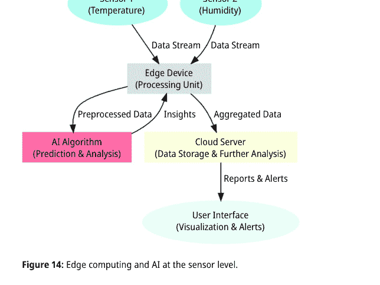

*图 14：传感器层面的边缘计算和 AI。*

边缘计算和 AI 通过集成受益，从而改善数据隐私和安全性。这种方法确保大量健康信息在本地处理，从而显著减少通过网络传输的信息量以及未经授权访问的漏洞。此外，边缘计算使得能够在更接近传感器层面的位置应用加密和其他安全措施，这也为患者记录提供了额外的保护。

Lee 指出，边缘计算使基于 AI 的生物医学传感器的部署和灵活性成为可能。传感器的集成处理功能使其能够在不参考中央系统的情况下管理大量数据和高级计算，这是由于当前网络容量有限。这种可扩展性对于满足持续且多维健康检查的更高需求至关重要。

## 6 案例研究与应用

### 6.1 AI 增强的可穿戴健康监测设备

集成 AI 的智能健康手表可被视为 AI 赋能的健康控制和改善中最具革命性的发展之一，它允许使用 AI 对多个关键生理指标进行持续、精确的评估，而无需外部专业人员。它们提供的解决方案远优于传统的健康监测设备。

在 AI 帮助下，可穿戴健康监测使用不同的传感器技术，包括加速度计、陀螺仪、光学传感器、电化学传感器等，以捕获健康数据。由于将 AI 算法应用于这些数据，这些设备可以利用这种功能以及模式检测和分析。例如，在 AI 的帮助下，可穿戴设备能够跟踪脉搏频率、血压以及血氧水平等重要体征，并分析趋势以确定病理状态健康问题。

研究已确定 AI 增强可穿戴监测仪的另一应用领域是个人健康管理，特别是患有糖尿病和心血管疾病等慢性病的人群。例如，血糖可穿戴设备具有 AI 来评估血糖水平并持续向这些个体提供反馈。它还可以根据过往记录预测血糖水平的变化，并就适当的膳食计划和特定行为的药物剂量提供生活方式建议。这是一种积极主动的方法，有助于有效管理血糖水平和预防并发症。

几种专为心血管疾病监测设计的可穿戴设备可以评估心率变异性、心电图信号和身体活动，以帮助识别房颤等疾病的早期迹象。这些设备能够分析长期数据，并在心律异常时提醒用户，促使进一步的医学评估。这使得门诊患者的心血管疾病能够更早诊断，并帮助医疗保健提供者相应调整治疗方案。

在健身和健康领域，AI 可穿戴设备根据用户活动历史、锻炼、睡眠及其整体健康状况的其他方面为用户提供个性化的健身建议。这些设备还可以推荐特定的锻炼计划，评估身体的恢复情况，并建议如何最好地表现以获得最大效果并最大程度地减少受伤风险。AI 的应用使跟踪健身目标的达成情况和结果的差异变得更容易，从而提高教练个性化训练计划的有效性。

另一用途是远程监测，其中集成 AI 的可穿戴设备允许对慢性病患者进行持续监测。这些设备实时向医疗护理人员发送和接收有关患者健康的信息，从而使医生能够在家中舒适地监测和治疗患者。由于 AI 算法可以识别健康状况的早期重要变化，它们可以发出警报并确保及时的医疗干预，对患者的整体健康状况和住院次数产生积极影响。

AI 增强的可穿戴健康技术方面的技术进步使持续实时监测健康、接收定制反馈和获得预防性建议变得更加容易。这些设备可被视为定义现代医疗保健系统，因为疾病控制、增强健身和更好、更个性化的护理都由它们支持。

### 6.2 用于慢性病管理的植入式传感器

还应注意的是，植入式传感器已成为有效监测和控制慢性疾病的关键技术之一，因为它们为医疗保健系统和患者提供宝贵的持续信息。这些植入式传感器提供有关体内情况的关键信息，并有助于预防和控制包括糖尿病、心血管疾病和神经退行性疾病在内的慢性疾病。

植入式传感器在糖尿病患者医疗保健中的一个知名用途。FreeStyle CGM 系统使用植入式传感器以记录血糖浓度的定期测量值。这些传感器通过无线方式将血糖信息发送到其他设备，帮助患者持续跟踪血糖水平并微调胰岛素治疗。这有助于将血糖水平保持在理想的最佳值附近，并显著降低低血糖发生的风险，从而优化糖尿病护理。

在心血管疾病的情况下，植入式传感器最重要的任务是跟踪心率和诊断心律失常。一些 ICD 和起搏器具有记录心脏电活动并检查异常的传感器。这些传感器可以独立施加治疗性电击，从而对模糊的心律采取早期修复措施并最大程度地减少猝死。AI 与这些传感器的互补进一步通过对现有问题进行预测并防止其恶化。

帕金森病是神经系统疾病之一，通过植入式传感器来监测运动体征和对药物的反应性进行管理。图 15 显示了用于慢性病管理的不同植入式传感器。实时跟踪也可以使用，DBS 系统包含植入式传感器，可以监测症状的严重程度并调整刺激参数以改善治疗效果。这种治疗方法增强了患者的症状控制并提高了帕金森病患者整体生活质量。

类似的植入式传感器也被考虑用于其他慢性疾病，如慢性疼痛和炎症性疾病。这些传感器可用于

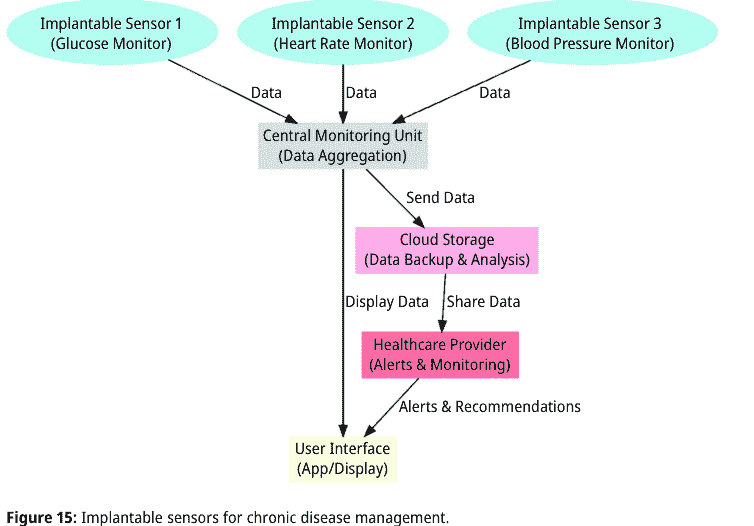

图15：用于慢性病管理的植入式传感器。

测量与疾病活动相关的生物标志物，有助于治疗规划和疗效评估。

集成传感器也被用于增强远程医疗和远程监测的应用。这些传感器可以与医生共享信息，患者的进展可以得到持续监测，并且无需反复面对面咨询即可调整治疗方案。这种远程能力确保医疗专业人员能够获取新信息以做出更好的决策，同时提升患者的便利性。

## 6.3 远程患者监测系统

远程患者监测（RPM）设备集成了生物医学传感器和通信技术，被公认为现代医学实践中不可或缺的一部分，能够在无需直接临床管控的情况下提供持续的患者监护。通过这些技术，可以实现远程数据采集、传输和分析，对患者和医护人员都有诸多益处。

RPM系统采用不同的生物医学传感器监测众多健康参数和生理体征。这些传感器通常集成到可穿戴技术设备中，例如智能手环、手表和健身追踪器，以及家用医疗设备中，例如血糖仪和血压计。RPM系统通过定期测量脉搏率、血压、血糖水平和血氧水平等指标，能够全面展示患者的健康状况。

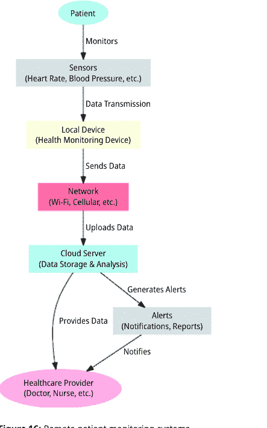

图16：远程患者监测系统。

RPM系统的优势之一在于能够为慢性疾病提供主动管理和早期治疗。例如，糖尿病患者可以使用血糖监测设备，使医疗从业者能够获取正在接受治疗的患者的数据。这有助于在出现恶化迹象时及时调整后续治疗计划并做出适当决策。同样，高血压患者也能从持续血压监测的便利中受益，因为它简化了处方管理，并有助于避免心血管疾病患者的并发症。

此外，RPM系统对于增强患者对各类治疗方案的参与度和依从性也很重要。这类解决方案通过移动健康（mHealth）应用共享个人健康数据，帮助人们更加积极地参与自身的医疗过程。远程患者监测系统在第IV-A节中进行了描述；图16展示了包含可穿戴传感器、数据传输模块和基于云的分析组件的完整框图。在这些应用中，反馈包括针对患者个体化的建议，促使患者改变习惯、专注于遵循治疗方案、采纳更健康的生活方式，并为自身治疗承担更多责任。

这些系统有许多优点：在直接患者咨询过程中，医生和其他护理人员的接诊次数减少，这有可能减轻医疗中心和患者的负担。这是从医疗专业人员的角度来看的。通过持续监测过程，服务提供者可以调整护理计划并做出更好的判断。这种方法带来了更优的诊断和治疗过程，也提升了护理效果。

多个RPM系统的实例表明它们在医学的许多领域都很有用。例如，通过远程监测管理的慢性阻塞性肺疾病（COPD）患者，急性加重的控制得到改善，因此住院人次减少。同样，用于术后恢复个体的RPM系统也显示出能够及早发现术后并发症的迹象，并缩短康复时间。

尽管有诸多益处，RPM系统的普及仍面临挑战。因此，必须识别并应对新技术带来的影响，以确保技术得到高效且合乎道德的使用；数据保护、安全性以及与现有医疗体系的集成等问题都应予以考虑。此外，还需要持续的研究来提高RPM系统的精度、可靠性和相关性。

## 6.4 远程健康和远程医疗中的人工智能

远程健康和远程医疗被定义为利用现代电信技术，使医疗保健利益相关者能够满足患者的需求，无论他们身在何处，并能够以更高效、更有效的方式为医疗专业人员、医生、患者和其他利益相关者提供有价值的信息——这得益于人工智能在远程健康和远程医疗中的集成。远程健康平台可以利用这些技术来改善诊断和患者参与度，并为使用远程健康服务的患者定制护理，从而彻底改变护理的提供方式。

人工智能通过增强数据分析和决策支持能力来提升远程医疗和远程健康。为了做出更好的决策，医疗保健专业人员依赖于机器学习算法和自然语言处理（NLP）对患者信息（包括电子健康记录（EHR）、医学影像和患者报告结局指标（PROMs））的分析结果。例如，诊断工具可以“读取”患者的扫描图像以寻找癌症等疾病的迹象，然后向放射科医生报告，其准确率据称高达95%。这种能力有助于保持快速准确的诊断，对临床医生做出正确决策有很大帮助。

人工智能在远程健康中产生重大影响的另一个主要领域是创建虚拟健康助手和聊天机器人。这些设备可以与患者互动，获取症状数据，提出初步诊断建议，并揭示应采取的后续措施。这些虚拟助手筛选患者的主诉并提供相关疾病信息，以避免医疗官员负担过重。这在用户身处偏远地区、很难接触到医疗从业者的情况下尤其有益。

在远程医疗中，人工智能还用于识别患者需求并提供适当的后续服务。用于预测性评估的分析模型通过记录中的模式来识别潜在的健康风险，并制定个体化治疗方案。例如，人工智能结合可穿戴传感器可以跟踪糖尿病等慢性病患者，并实时向患者发出警报。这种有针对性的方法促进了预防性医疗措施的落实，并加强了此类疾病的管理。

人工智能在远程健康中的影响还体现在数据集成和数据互操作性上，以提高平台的有效性。人工智能系统不仅可以从移动健康应用、可穿戴设备和家庭监测应用中整合患者数据，还可以整合患者的电子健康记录。这种方法增强了护理的连续性，因为护理提供者被迫作为一个团队协同工作以提供最佳护理，最终的护理计划基于对患者病情的协调一致的认知。

人工智能在远程健康的技术层面也产生影响，涉及可及性和公平性问题。由于远程会诊提供了克服语言障碍的可能性，远程健康平台可以覆盖那些难以获得相关医疗服务的群体和社区。这有助于传播医学专业知识，也有助于实现医疗服务的公平性。

## 6.5 成功案例与临床试验

目前已有多个将人工智能与生物医学传感器相结合的成功案例，并且已开展了多项重要的临床试验，证明了此类技术的有效性。

一个典型的成功案例是基于人工智能的可穿戴技术用于持续血糖监测。雅培糖尿病护理（Abbott Diabetes Care）和德康（Dexcom）是领先的血糖传感器制造商，它们利用人工智能算法实时提供血糖水平读数。其中一些设备正在以一定的有效性水平进行测试，已减少了糖尿病患者的低血糖事件，并改善了血糖控制。例如，德康G6持续血糖监测系统已经过科学和临床验证。

显示其能够正确测量血糖水平并帮助糖尿病患者更好地管理病情。

另一项是人工智能在可穿戴心电图监测器中用于早期识别心房颤动（AF）的应用。如今的智能手表，如 Apple Watch Series 4 和 Series 5，甚至具有智能算法，可以实时工作，分析设备心电图传感器提供的信息，从而检测 AF 的迹象。临床研究已证实这些设备在早期识别 AF 方面的应用并改善了患者的治疗管理。多项研究表明，基于 AI 的心电图监测可以以高灵敏度和特异性有效识别 AF，这对于避免中风和其他心血管事件是有帮助的信息。

人工智能耦合生物传感器在远程患者监测领域的应用已取得成果，尤其是在管理慢性疾病方面。例如，Biofourmis 平台包括可穿戴传感器和人工智能，有助于控制心力衰竭患者的病情。如同任何 HEP 平台一样，研究显示该平台的预测分析能够有效预测病情恶化和住院情况，从而消除疾病的严重发作。经常使用远程患者监测以及根据收集到的信息调整治疗方案的可能性，可改善患者的生活质量并降低急诊就诊率。

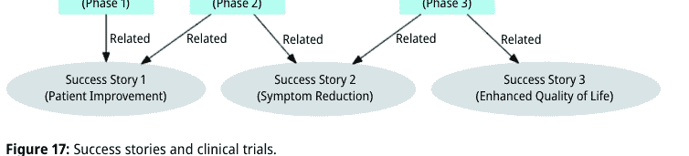

Figure 17: 成功案例和临床试验。

AI 驱动的传感器在另一个健康领域——心理健康中同样有效。像 Mindstrong Health 平台这样的其他项目确保它们使用人工智能根据认知和情绪来评估智能手机和可穿戴设备的信息。所提出的方法已应用于临床实践，并被证明能够准确估计抑郁和焦虑等心理健康状况的变化，同时识别出治疗相关进一步行动的建议。图 17 捕捉了一些事实和当前临床试验，展示了近期在医学科学和治疗方法方面出现的各种更新和创新。人工智能在监测心理健康方面的应用有助于提高患者对推荐治疗方案的依从性。

这些成功案例与临床试验相结合，丰富了本文关于人工智能在生物医学传感器应用中取得巨大可嘉进展的主题。它们展示了这些技术如何成为实现该目标的有价值工具，通过帮助提高临床医生的诊断准确性，最终改善整体患者治疗。该领域的新研究仍在积极进行，并在这些成就的基础上构建，以创造新的创新治疗方法并扩大这些方法在各种医疗保健相关领域的应用。

### 7 结论

将人工智能与生物医学传感器结合使用可被视为在健康监测系统领域提供了创造性和质量上的进步，通过提供更高水平的准确性、有效性和以患者为中心的护理方法。在本章中，除了其历史发展外，还讨论了在人工智能影响下开发的生物医学传感器的复杂性以及用于增强其操作的已应用技术。如所述，先进传感器和人工智能的整合已将 CHM 转变为具有卓越实时分析和个性化健康自我维护可能性的系统。

由于人工智能技术的最新进展，包括机器学习和边缘计算，现在可以使用生物医学传感器以极高的准确性收集和分析大量数据。这些进步促进了健康异常的早期检测，以便采取措施开始治疗疾病并实施最佳治疗方案。基于患者需求建立患者与人工智能算法之间互动的可能性，以及算法预测健康问题的能力，是对简单监测和跟踪的提升。因此，人工智能驱动的传感器提供了优化疾病控制、最大限度减少住院次数并提高患者满意度所需的特异性和实际步骤。

本章中展示的人工智能在生物医学传感器中的应用示例以及案例研究和临床试验的示例清楚地表明，人工智能在生物医学传感器中的存在非常有帮助。一些成功的部署包括使用连续血糖监测系统来管理慢性疾病以及将人工智能纳入心电图监测仪。这些成功案例说明了人工智能能够填补医疗保健交付方面的差距，同时本文也展示了人工智能如何通过护理交付模式的选择来改善患者护理。

人工智能与生物医学传感器的结合面临了一些不可避免的问题。挑战在于其与数据准确性、隐私和集成之间的接近性，这些问题继续构成进一步研究和开发的领域。解决这些问题对于提供高水平传感器并将其集成到现代医疗保健系统中至关重要。这些技术的伦理使用问题及其遵守法律法规的问题应成为保护患者信息的重要关注点。

未来，人工智能生物医学传感器的应用将看到更多创新。通过采用先进的人工智能模型等新技术，健康监测系统可以提升到新的水平。这种演变一直持续，并不断提高定义医疗保健未来的技术的效率、集成性和可用性。

## 参考文献

- [1] Tovar-Lopez, F. J. (2023). Recent progress in micro-and nanotechnology-enabled sensors for biomedical and environmental challenges. Sensors, 23(12), 5406.
- [2] Ates, H. C., Nguyen, P. Q., Gonzalez-Macia, L., Morales-Narváez, E., Güder, F., Collins, J. J., & Dincer, C. (2022). End-to-end design of wearable sensors. Nature Reviews Materials, 7(11), 887–907.
- [3] Kazanskiy, N. L., Khonina, S. N., & Butt, M. A. (2024). A review on flexible wearables-Recent developments in non-invasive continuous health monitoring. Sensors and Actuators A: Physical, 114993.
- [4] Antunes, R. S., Seewald, L. A., Rodrigues, V. F., Costa, C. A. D., Jr, G. L., Righi, R. R., . . . Campanatti, G. (2018). A survey of sensors in healthcare workflow monitoring. ACM Computing Surveys (CSUR), 51(2), 1–37.
- [5] Villena Gonzales, W., Mobashsher, A. T., & Abosh, A. (2019). The progress of glucose monitoring – A review of invasive to minimally and non-invasive techniques, devices and sensors. Sensors, 19(4), 800.
- [6] Do Amaral, C. E. F., & Wolf, B. (2008). Current development in non-invasive glucose monitoring. Medical Engineering & Physics, 30(5), 541–549.
- [7] Darwish, A., & Hassanien, A. E. (2011). Wearable and implantable wireless sensor network solutions for healthcare monitoring. Sensors, 11(6), 5561–5595.
- [8] Mathew, A. A., Chandrasekhar, A., & Vivekanandan, S. (2021). A review on real-time implantable and wearable health monitoring sensors based on triboelectric nanogenerator approach. Nano Energy, 80, 105566.
- [9] Din, I. U., Almogren, A., Guizani, M., & Zuair, M. (2019). A decade of Internet of Things: Analysis in the light of healthcare applications. Ieee Access, 7, 89967–89979.
- [10] Manickam, P., Mariappan, S. A., Murugesan, S. M., Hansda, S., Kaushik, A., Shinde, R., & Thipperudraswamy, S. P. (2022). Artificial intelligence (AI) and internet of medical things (IoMT) assisted biomedical systems for intelligent healthcare. Biosensors, 12(8), 562.
- [11] Jin, X., Liu, C., Xu, T., Su, L., & Zhang, X. (2020). Artificial intelligence biosensors: Challenges and prospects. Biosensors and Bioelectronics, 165(112412).
- [12] Ngiam, K. Y., & Khor, W. (2019). Big data and machine learning algorithms for health-care delivery. The Lancet Oncology, 20(5), e262–e273.
- [13] Perera, Y. S., Ratnawera, D. A. A. C., Dasanayaka, C. H., & Abeykoon, C. (2023). The role of artificial intelligence-driven soft sensors in advanced sustainable process industries: A critical review. Engineering Applications of Artificial Intelligence, 121, 105988.
- [14] Castaneda, C., Nalley, K., Mannion, C., Bhattacharyya, P., Blake, P., Pecora, A., . . . Suh, K. S. (2015). Clinical decision support systems for improving diagnostic accuracy and achieving precision medicine. Journal of Clinical Bioinformatics, 5, 1–16.
- [15] Alshamrani, M. (2022). IoT and artificial intelligence implementations for remote healthcare monitoring systems: A survey. Journal of King Saud University-Computer and Information Sciences, 34(8), 4687–4701.

## 人工智能驱动的生物医学传感器与设备的设计开发及其在连续健康监测中的优化

A. Aalan Babu, R. Selvakumar, D. Shobana, S. Kavitha, P.R. Therasa

**摘要：** 得益于生物医学领域的发展，传感器技术迅速进步，使得连续、实时监测生理参数成为可能。本章综述了通过人工智能创建的连续健康监测生物医学传感器、主要进展和趋势，并进一步概述了光学、化学和机械等关键类型的传感器及其用途，同时解释了带来变革的创新。本章还分析了混合传感器和多模态传感器的主要特征，这些传感器由多种传感模式组成，旨在提供完整的监测解决方案。特别关注老年护理所需的长期监测解决方案的前景，以及与老年人慢性病管理相关的问题。讨论还包括对传感器技术的适用性和可负担性的考虑，这两个方面往往决定了这些技术的普及和实现。通过相当详细地概述这些方面，本章旨在为生物医学传感器的进一步发展提供有用的信息，以提高健康治疗的效果。

**关键词：** 生物医学传感器，人工智能驱动技术，光学传感器，混合系统，老年护理，成本效益

A. Aalan Babu，印度泰米尔纳德邦金奈阿瓦迪 Vel Tech Rangarajan Dr. Sagunthala 科学与技术研发学院计算学院计算机科学与工程系，电子邮箱：aalanbabu@gmail.com

R. Selvakumar，印度泰米尔纳德邦斯里佩鲁姆布杜尔Thandalam Poonammallee High Road萨维塔工程学院人工智能与机器学习系，电子邮箱：sachein.pretty@gmail.com

D. Shobana，印度泰米尔纳德邦金奈拉贾拉克什米工程学院机电工程系，电子邮箱：shobana.d@rajalakshmi.edu.in

S. Kavitha，印度泰米尔纳德邦埃罗德638052南达工程学院电子与通信工程系，电子邮箱：gskkavitha@gmail.com

P.R. Therasa，印度泰米尔纳德邦蒂鲁瓦卢尔县Kavaraipettai RSM Nagar 601206 RMK工程学院计算机科学与工程系，电子邮箱：therasa.peter@gmail.com

### 1 引言

医疗保健领域的环境正因生物医学传感器技术的发现而发生巨大变化[1]。这些创新正通过提供关于生理体征的实时、准确信息，改变着连续健康监测的方式[2–4]。生物医学传感器被定义为一系列用于测量人体各种参数的设备[5]。本章探讨了设计和开发人工智能生物医学传感器的选项，以改善患者治疗，并作为健康治疗中的有效工具[6, 7]。重点放在该项目的重大进展、利用人工智能优化传感器特性、其能力以及这些技术在长期健康监测中的作用[8]。

生物医学传感器分为光学、化学和机械类型，具体取决于需要监测的健康参数类型[9]。例如，光学传感器利用光来测量血液中的氧含量、葡萄糖水平以及其他生物标志物的浓度。生化传感器通过电化学反应定量溶液中存在的特定化学物质，例如葡萄糖[10–12]。机械传感器响应应变等物理量的变化，可以提供有关关节运动、步态和肌肉活动的有价值信息[13]。本章还详细介绍了这些传感器类型，概述了它们的运行方式、适合的领域，以及为提高其精度和性能所做的现代技术改进[14]。

混合/多模态传感器被视为健康监测领域的下一个变革性进展[15, 16]。这些系统集成多种传感技术，在单一仪器上同时测量多个参数[17]。由光学和机械传感器组成的设备可以同时跟踪心血管状态和身体活动，从而更好地了解患者的状况。本章描述了产生积极影响的不同类型的混合和多模态系统，例如提高数据质量、提高患者依从性，以及创造更个性化健康干预的机会。

远程监护在老年护理中最为重要，因为控制患者的慢性疾病始终具有挑战性[18]。例如，糖尿病、高血压和心脏病要求对老年人身体各项参数进行持续评估[19]。响应式可穿戴设备、植入式传感器和遥测监测工具旨在满足这些需求，提供持续的支持和监测[20]。本章重点介绍了这些长期监测解决方案在患者护理、早期健康异常检测以及提高老年人生活质量方面的部署。

生物医学传感器技术的未来在于其以相对较低的成本和大批量提供解决方案的能力[21]。随着对提升健康监测系统能力的需求持续增长，大规模制造传感器同时保持成本可负担的能力至关重要[22]。本书第4章专门讨论制造可扩展性、材料成本和系统集成问题[23]。本章还探讨了实现规模经济、有效利用材料以及最小化监管和合规成本的策略[24]。通过解决这些因素，本章有望阐明将先进生物医学传感器带到更可负担的价格点所需的步骤，以使其在医疗保健系统中得到更广泛的应用[25]。

### 2 生物医学传感器导论

#### 2.1 生物医学传感器的定义与分类

生物医学传感器是独特设备，用于监测人体定量和定性变量并将其及早转换为电信号。这些传感器已成为当今医疗保健技术不可或缺的组成部分，主要用于各种生物信号（如心率、血糖和血氧饱和度）的关联监测。生物医学传感器使得集成可穿戴设备成为可能，从而能够及时诊断疾病并改善患者护理服务。

生物医学传感器可根据所测量的生理参数类型、与身体的相互作用以及传感机制，以多种方式进行分类。

基于生理参数的分类：

- 电生理传感器：这些传感器测量体内的电活动，包括用于心脏活动的心电图、用于脑活动的脑电图和用于肌肉活动的肌电图。
- 生化传感器：这些传感器用于识别体内特定化学物质，例如用于筛查血糖水平的葡萄糖传感器、用于监测代谢率的乳酸传感器，以及用于测量身体酸度水平的pH传感器。
- 物理传感器：这些传感器体现物理特性，如温度计测量体温，血压计测量血压，加速度计测量活动。
- 光学传感器：这些传感器利用光来确定参数，例如通过脉搏血氧仪测量氧浓度，通过近红外光谱（NIRS）进行组织诊断和血流量测量。
- 机械传感器：这类传感器包括用于呼吸活动的张力传感器和用于心率的压电传感器等。人体上的压电传感器会在机械压力作用下产生微弱电流。

- [16] Junaid, S. B., Imam, A. A., Abdulkarim, M., Surakat, Y. A., Balogun, A. O., Kumar, G., . . . Hashim, A. S. (2022). 人工智能与可穿戴传感器在医疗保健服务中的最新进展. Applied Sciences, 12(20), 10271.
- [17] Shajari, S., Kuruvinashetti, K., Komeili, A., & Sundararaj, U. (2023). 基于人工智能的可穿戴传感器在数字健康技术中的兴起：综述. Sensors, 23(23), 9498.
- [18] Wang, C., He, T., Zhou, H., Zhang, Z., & Lee, C. (2023). 人工智能增强传感器——赋能下一代医疗与生物医学平台的技术. Bioelectronic Medicine, 9(1), 17.
- [19] Gu, L., Jia, D., Vicaire, P., Yan, T., Luo, L., Tirumala, A., . . . Krogh, B. H. (2005, November). 针对实际环境中无线传感器网络的轻量级检测与分类. 见Proceedings of the 3rd international conference on Embedded networked sensor systems（第205–217页）.
- [20] Picaut, J., Can, A., Fortin, N., Ardouin, J., & Lagrange, M. (2020). 用于城市噪声监测网络的低成本传感器：文献综述. Sensors, 20(8), 2256.
- [21] Jesus, G., Casimiro, A., & Oliveira, A. (2017). 无线传感器网络中可靠监测的数据质量调查. Sensors, 17(9), 2010.
- [22] Philip, N. Y., Rodrigues, J. J., Wang, H., Fong, S. J., & Chen, J. (2021). 用于居家健康监测系统的物联网：当前进展、挑战与未来方向. IEEE Journal on Selected Areas in Communications, 39(2), 300–310.
- [23] Bleiholder, J., & Naumann, F. (2009). 数据融合. ACM Computing Surveys (CSUR), 41(1), 1–41.
- [24] Thapa, C., & Camtepe, S. (2021). 精准健康数据：数据安全与隐私的要求、挑战和现有技术. Computers in Biology and Medicine, 129(104130).
- [25] Fahimi, B., & Beikmohammadi, S. (2023). 人工智能在心房颤动管理中的作用：综合综述.

基于交互性质的分类：

- 侵入式传感器：这类传感器可植入体内，用于直接测量生理变量，例如皮下血糖监测仪。
- 非侵入式传感器：这类传感器不穿透皮肤表面，包括可穿戴心脏监测器、脉搏血氧仪和体温计。
- 微创式传感器：这类传感器无需嵌入体内，只需与身体接触即可，例如体腔内的微针血糖监测传感器。

基于传感机制的分类：

- 电化学传感器：这类传感器利用电化学过程测定体液中的特定分析物，用于葡萄糖和乳酸的测定。
- 光学传感器：这类传感器依靠光学方法测量生物组织的变化，例如脉搏血氧仪和光学相干断层扫描。
- 压电传感器：这类传感器将机械应力转换为电信号，广泛应用于压力传感和运动检测。
- 电容传感器：这类传感器测量因身体组织运动而产生的电容变化，用于触摸开关和呼吸频率测量设备。
- 磁传感器：这类传感器检测生理过程产生的磁场，用于脑磁图（MEG）等设备。

这一广泛的分类展示了可用于持续监测的各样生物医学传感器，证明了这些传感器在应对多种临床需求方面的特异性和专门化。因此，识别并界定这类传感器的不同类型和分类，对于推进和改进连续健康监测系统的实施至关重要，从而增强个性化医疗解决方案。

## 2.2 生物医学传感器的历史演进

下面，我们回顾生物医学传感器的历史，以展示其演进步骤以及技术和健康监测与诊断方法上的相应变化。生物医学传感器技术最早可追溯到二十世纪初，当时开发出了基本测量仪器。第一章描述了基础工具的创造，包括用于测量血压的血压计和用于记录心脏活动的心电图机。这些早期传感器为今日所采用的高级传感器奠定了基础，证明了设备能够提供重要健康信息的可能性。

二十世纪中期出现了更先进的传感器类型，这是技术进步的结果。固态电子学的普及，加上集成—

### 2.3.1 数据的实时采集与监测

大多数生物医学传感器能够连续监测一系列生理指标，包括但不限于脉搏率、血糖水平、体温和血氧饱和度。这种实时数据采集使得健康参数能够持续更新，有助于快速检测出偏离正常值的情况。如图1所示，此类传感器提供即时反馈，使医疗服务提供者能够在必要时及时调整医疗干预措施并修改治疗计划。这一能力增强了患者护理，并有助于降低急性健康并发症的风险。

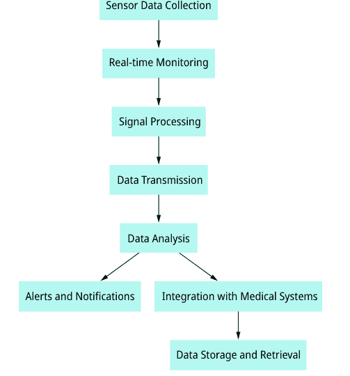

图1：生物医学传感器在健康监测中的关键功能。

人体测量学作为测量人体领域的另一个特点是测量的高精度和高准确性。

测量技能对于成功的健康监督不可或缺，同样重要的是在计算中保持有限精度的能力。生物医学传感器的开发方式使其提高了精度并最小化所获数值的变异性，以促进准确诊断。传感器制造的发展以及先进信号处理算法和系统校准方法的整合，共同促成了这些测量的高度准确性，使其对医疗保健提供者的决策价值毋庸置疑。

### 2.3.2 可穿戴和植入式设备的兼容性

生物医学传感器因此被设计用于集成到可穿戴和植入式设备中，这为慢性病监测之外提供了灵活的选择。智能手表和健身追踪器提供了非侵入性的持续身体监测方法。可穿戴传感器提供外部且物理可测的身体测量，而植入式传感器则对内部生理状况（如颅内压和心率）提供更直接的测量。它们还使得几乎任何状况都能在连续统上进行监测，从忙碌人群健康生活方式的简单检查式监测，到严重慢性病的综合管理。

### 2.3.3 数据的传输以及人与人之间的交互

传感器数据成功传达给医疗保健提供者，对于详细描述健康状况至关重要。生物医学传感器增强了通信功能，依赖蓝牙、Wi-Fi等将信息发送到远程监测系统。这种连接性确保数据按时且安全地传输，从而改善信息的及时获取，以做出有关患者护理的决策。

### 2.3.4 个性化与自适应

当代生物医学传感器的设计方式能够捕捉患者在特定医疗情境中的需求。这些传感器可根据与患者生理属性和病理生理状况相关的各种特征进行调整。例如，使用个体化算法来根据患者病情的急性和特异性调整监测参数，从而提高所收集信息的适用性和效率。

### 2.3.5 预警系统与预测建模

生物医学传感器通过分析，在诊断和预测可能的人类疾病方面具有重要意义。通过在日常活动中持续跟踪生理信息，这些传感器能够发现预示疾病发展的新趋势。应用人工智能，特别是机器学习，能够识别高风险患者，从而预测如心脏病发作等潜在医疗事件，并允许早期干预。

### 2.3.6 导航与警报界面

生物医学传感器还将其功能应用于旨在改善患者互动和依从性的用户界面。大多数传感器配备易于读取的显示器和通知系统，实时提供健康状况结果。消息和通知选项可根据需要定制，以便在收到任何异常数值时发送警报，从而帮助用户更好地管理自身健康，并提醒他们遵循规定的治疗方案。

这些功能展示了生物医学传感器在先进健康监测系统中的优势，并表明这样的系统不仅能够提供，而且确实提供了准确、最新且个性化的健康信息。传感器技术仍在不断扩展其能力，未来这项技术的发展只会进一步增强这些特性和优势，以满足患者的健康需求。

## 2.4 传感器在预防性医疗保健中的作用

生物医学传感器在预防性医疗保健领域至关重要，通过它们可以在健康并发症恶化之前发现并加以处理。预防性医疗保健的主要目标是识别疾病的起因，并防止其发展成慢性疾病，这对整体健康以及减轻医疗机构的过度负荷具有积极影响。

持续跟踪生理参数是生物医学传感器在预防性医疗保健中的基本职责之一。用于定期采集数据的健康监测传感器（包括脉搏率、血压和血糖水平）有助于识别某些健康并发症的症状以及潜在体征。通过持续收集和研究这些数据，传感器能够检测到生理阈值的变化，从而发现需要治疗的病理状态。

此外，生物医学传感器有助于识别具有特定危险因素和已知疾病的患者，从而制定相应的个体化管理方法。例如，用于糖尿病血糖监测仪的传感器为糖尿病患者提供了持续监测体内血糖水平的机会，以帮助他们调整饮食、锻炼方案以及了解糖尿病对身体的影响。同样，跟踪运动和心血管体征的可穿戴传感器可以

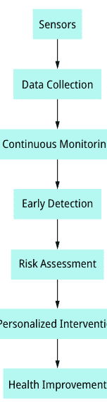

图 2：传感器在预防性医疗保健中的作用。

帮助改善已诊断出患有心脏病的人的生活方式并推荐锻炼方案。

生物医学传感器与高端数据分析和人工智能相结合时，在预防性医疗保健中发挥了更大的作用。在开发人工智能时，算法能够读取传感器获取的数据，并随后诊断出在症状出现之前可能发生的潜在健康并发症。这种预测能力在慢性病管理中特别有用，有助于避免病情恶化、住院以及由此对患者福祉产生的负面影响。

生物医学传感器通过实现远程患者监测和虚拟会话治疗来支持预防性医疗保健。捕获生理信号并将其传输给护理人员的便携式设备可实现持续的虚拟监督，这对医疗设施获取受限的偏远地区患者尤其有价值。如图 2 所示，这种能力增强了预防性医疗保健服务的<|message|> 可及性以及患者及时获得医疗保健提供者响应和建议的能力。

## 2.5 生物医学传感器当前市场趋势与创新

生物医学传感器市场也在以非常高的速度增长并不断变化，这归因于用于健康监测应用的复杂新技术的不断融入。本部分概述了生物医学传感器最当代领域中普遍存在的 emerging 趋势。

### 2.5.1 可穿戴传感器的兴起

可穿戴传感器如今被广泛使用，因为与其它方法相比，它们在舒适性和测量同步性方面具有优势。这些是可穿戴在智能手表、健身追踪器以及智能服装等设备上的可穿戴传感器；这些传感器的目的是追踪心率、身体活动甚至睡眠等参数。新的进展旨在提高这些设备的精确度和可穿戴性，并通过使用具有柔韧性和弹性的动力纺织品，使其更贴合身体，从而提高性能和可靠性。将更先进的生物传感器集成到可穿戴设备中，也增强了它们监测血糖水平、血压和血氧饱和度等参数并向用户提供全身健康更新的能力。

从本研究工作中出现了以下具体研究问题：因此，可植入传感器可以被视为在医疗保健的整体内部监测方面的一项重大改进。该领域的一些进展是生物相容性以及将微型传感器推进到可植入人体内的尺寸。近期的发展提高了可植入传感器的耐用性和可靠性，包括糖尿病患者的血糖监测和神经系统疾病的颅内压监测等方面。还开展了主题分类工作，以设计无线、无电池的可植入传感器，这些传感器还通过能量收集技术运行，以最大程度地减少与植入设备使用寿命和患者安全相关的问题。

### 2.5.2 人工智能与机器学习的结合

生物医学传感器市场的发展受到人工智能和机器学习技术集成到产品中的影响。因此，人工智能工具正被用作信号处理引擎，以提高机械传感器的准确性，同时最大程度地减少噪声并优化模式识别。实时集成到数据分析模型中的其他新兴技术是机器学习，它允许在问题变得严重之前识别潜在的治疗方法。这种集成不仅提高了单个传感器的性能，还促进了先进智能健康监测系统的改进。

### 2.5.3 多模态和混合传感器及其发展

不同传感器的集成正被视为实现多种多样健康状况监测模式的解决方案而受到关注。这些传感器使用多种模式，包括光学、电学和化学，用于同时测量多种生理参数。使用多种传感技术可实现增强且准确的健康监测系统。例如，混合传感器包括心率监测、血氧水平检测和身体活动等功能，可更全面地了解客户的状况。这一趋势可由向更先进、更复杂的健康监测平台转变来解释。

### 2.5.4 非接触和遥测记录的新技术

无接触换能器和家庭监测设备因其对患者更方便而日益流行。光学传感和生物阻抗传感的新技术正逐步实现在无需严格程序的情况下监测生理信号。无线通信和云计算发展带来的远程监测技术使得能够从远程获取健康数据并向医生和护士 relay 更新。这一趋势与远程医疗的日益普及相一致。Heinrichs 和 Hunt（2014）指出，这一趋势支持远程医疗和远程患者管理解决方案的不断增长的使用，尤其是在慢性病以及缺乏足够护理资源的地区。

这些市场趋势和创新体现了生物医学传感器技术的持续增长、对完善健康监测能力的持续尝试以及改善患者预后并满足新的医疗保健需求的持续推动。人们认为，随着这些进步，新型材料、人工智能分析和多模态传感将继续革新生物医学传感器，并推动该领域的发展——侵入性传感技术，例如光学传感器和生物阻抗传感器，使生理参数的测量无需侵入性程序即可实现。远程监测技术得益于无线通信和云计算的进步，允许从远程持续收集健康数据并传输给医疗保健提供者。这一趋势支持远程医疗和远程患者管理解决方案的日益采用，特别是在管理慢性疾病和为服务不足地区提供护理方面。

这些市场趋势和创新突出了生物医学传感器的动态演变，反映了持续改进健康监测能力、提高患者治疗效果并应对新兴医疗保健挑战的努力。随着技术的不断进步，预计新型材料、人工智能驱动的分析和多模态传感的集成将进一步改变生物医学传感器的格局，推动该领域未来的发展。

## 3 生物医学传感器的类型

### 3.1 用于连续监测的可穿戴传感器

可穿戴传感器最近已成为连续健康评估的重要组成部分，因为它们在实时和高效监测个人福祉方面具有优势。这些传感器设计用于集成到各种可穿戴设备中，持续测量关键生理参数。如图 3 所示，它们越来越多地用于健康监测、身体活动追踪和健康促进应用。

### 可穿戴传感器的类型

可穿戴传感器涵盖了基于个人健康监测需求的广泛技术。常见类型包括：

- **加速度计和陀螺仪：** 第一类传感器负责检测运动和位置，用于监测身体活动、步态分析和位置校正。它们在腕戴设备中很受欢迎，用于追踪锻炼期间的运动和整体活动。
- **光电容积脉搏波描记法（PPG）：** PPG 传感器通过光学测量运动，反映血流变化并提供心率、血氧和压力的详细信息。它们通常用于智能手表和健身追踪器。
- **心电图（ECG）：** ECG 传感器用于记录心脏的电脉冲；它们可以记录心率和健康的并发症。今天技术增强的可穿戴设备具有手表中的心电图扫描仪等功能，用于持续监测心脏和任何异常。
- **热敏电阻和热电偶：** 这些传感器确定体内的温度和皮肤表面的温度，以帮助确定发烧、低体温和其它与热相关的疾病。

### 可穿戴传感器的技术创新

可穿戴传感器技术在有效性和能力方面在近年取得了重大进展。主要进展包括：

柔性和可拉伸电子：可穿戴传感器本身受益于柔性和可拉伸技术的进步。这些材料贴合

图 3：用于连续监测的可穿戴传感器。

身体的形态配置，提高了测量的精度以及用户的舒适度。

先进集成技术：MEMS 和印刷电子技术提供了一种在单个小型封装内开发一系列传感系统的方法。它们还使我们能够在单个可穿戴设备中监测更多指标，同时整合来自各种传感器的数据。

增强的连接性和数据传输：可穿戴传感器已通过蓝牙、Wi-Fi 和蜂窝技术与智能手机和云端更加紧密地连接，以便将收集到的数据发送到这些设备进行实时监测和分析。

## 可穿戴传感器的实际应用

可穿戴传感器在健康监测和保健方面具有广泛的应用：

慢性病管理：可穿戴传感器用于跟踪和管理糖尿病、高血压和心血管疾病等慢性疾病。例如，持续葡萄糖监测系统（CGM）能够提供连续的血糖水平状态，而血压监测仪只能显示血压状态。

健身和身体活动跟踪：智能手表等健身追踪器配有加速度计和 PPG（光电容积脉搏波）传感器，用于监测用户的运动情况，包括步数、消耗的卡路里和锻炼。这些设备的目的是设定并鼓励实现更健康的目标。

健康和保健监测：可穿戴传感器可以跟踪多种健康参数，包括睡眠周期、压力水平、体温等。所获得的信息可以帮助用户了解个人模式、识别健康风险信号，并为提高生活质量提供建议。

本文重点讨论可穿戴传感器设计中所面临的一些困难。

尽管可穿戴传感器具有诸多优点，但在其开发和部署中仍然存在若干挑战。

准确性和校准：保持测量的高准确性和正确校准仍然是个问题，尤其是在测量环境条件发生变化以及针对不同生理状态进行测量时。

电池寿命和电源管理：电池寿命是确保持续监测的重要因素，同时还要支持智能设备运行所需的功能，因此如何保持其能效更是一个问题。

数据隐私和安全：持续不断地收集和传输个人健康信息需要应用层安全措施来维护隐私和数据保存。

## 可穿戴传感器应用的未来趋势和方向

预计可穿戴传感器技术的未来进展将集中在以下几个方面：

增强的传感器能力：多模态传感器的进步带来了更多可监测的生理参数，从而提供更好的健康信息。

与人工智能和机器学习的集成：将可穿戴传感器与人工智能和机器学习算法相结合，提高了它们理解复杂信号数据的能力、提供预测的能力以及提供健康信息建议的能力。

改善用户体验：材料和设计都在不断发展，以提供更高的舒适度和美观性，并增强与用户的交互，从而更便于将可穿戴传感器融入日常生活。

可穿戴传感器的普及预计将带来设备设计的重大变革，实现宝贵的持续监测，并为医疗保健管理做出积极贡献。正因为如此，人们期待随着技术的发展，便携式传感器将扩展其功能，从而在健康和保健领域产生更大的影响。

## 3.2 用于内部监测的植入式传感器

可穿戴传感器与植入式传感器：植入式传感器是下一代设备，用于长期、实时的健康状况连续监测，对身体内部数据进行生理参数的实时评估。它们被设计为植入人体内，以持续测量多种内部状况，这些状况对于医生在患者管理方面做出关键决策是必要的。

### 材料的生物相容性与产品设计

植入式传感器的设计考虑到了生物体相容性，因为植入人体内可能出现并发症。材料工程的最新进展提供了可长期存在于生物环境中而不会引发炎症反应的生物相容性聚合物、金属和陶瓷。此外，现代技术使得传感器的组件越来越小，并且可以通过创伤更小的操作进行植入。另外，越来越多地使用柔性和适形材料来与体内组织结合并适应其形态，提高了这类设备的舒适度和效率。

### 植入式传感器的分类与用途

植入式传感器旨在监测一系列生理参数，每种参数服务于不同的医疗目的：

葡萄糖监测传感器：这类传感器与糖尿病管理密切相关，可连续测量葡萄糖水平，以确保血糖浓度得到合理调节。电化学传感器采用灵敏且寿命长的元件，在测量中具有高灵敏度，并且很少需要校准。

颅内压传感器：这类传感器主要用于神经科应用，监测颅内压，这对于创伤性脑损伤（TBI）和脑积水等疾病至关重要。最近的进展包括无需外部连接器且不会引发炎症的无线传感器。

心脏传感器：ICM（植入式心脏监测器）测量患者的心率（HR）、心率变异性（HRV）及其他心脏数据，有助于心律失常和心力衰竭的检测。该领域的进展已实现鞋盒大小的设备的制造，这些设备可以植入心脏周围的胸腔内，以提供准确、持续的观察。

压力传感器：这些传感器可测量膀胱、胃肠系统等不同体内器官的压力。它们是可弯曲的压力传感器，能够模拟体内器官的形态，并实现几乎无痛的测量。

温度传感器：发热状态的记录需要植入式温度传感器。最近的进展提高了这些传感器在临床环境中的精度和速度。

### 电源供应与能量调节

构建植入式传感器的主要关注点之一直接涉及供电机制。现有的基于电池的传感器在寿命方面存在问题，并且需要通过手术植入。新技术包含了对能量管理的支持，例如传感器可以通过无线能量传输供电。此外，还正在考虑采用能量采集技术（例如热电和动能）来延长植入式设备的功能寿命，从而减少需要更换这些设备的情况。

### 数据传输与数据整合

所有植入式传感器都将收集到的数据发送到其他设备以进行进一步分析。无线通信技术是另一个取得巨大进展的领域，其中射频（RF）和蓝牙可以支持传感器的数据传输（例如，2,046）。这些传感器与智能手机和健康监测平台等外部监测设备的兼容性，实现了实时数据访问和远程患者监测。这种连接对于疾病的早期识别和个性化治疗方案至关重要。

在一些指南中，出现的关注点涉及教学语言、评估标准、知识整合与学习资源的可获取性，以及评估方法的独特性和有效性等方面，以期为其未来的改进提供方向。

植入式传感器的应用面临若干问题：生物相容性限制了植入的持续时间；数据采集的可靠性存疑；数据安全始终是一个重要关切。这些传感器要在体内长期有效，就必须能够正常工作并保持可靠性。随着技术的进步，患者数据隐私和数据安全问题（既涉及保护患者数据免遭未经授权的访问，又涉及维护患者数据的完整性）也变得更加突出。进一步的研究和开发很可能不可避免地继续集中在优化植入式传感器的功能、安全性和生物可持续性，以及实现这些设备的新材料和新方法上。

用于内部健康状况的个人植入式监测器是医疗设备领域中最重大的创新之一，它能够对内部环境进行持续、全面、灵敏的测量。这些传感器的持续进步使得对慢性病的监测更加容易，并推动了疾病诊断、治疗和管理的临床进程，总体上具有通过准确反馈支持个体化医疗的潜力。

## 3.3 非侵入式传感器

作为生物传感器领域中一个细分方向，非侵入式传感器因无需穿透人体即可采集多项生理参数而日益受到重视。这种方法在提高患者舒适度的同时，最大程度降低了通常与侵入性操作相关的并发症风险。如图4所示，本节将简要介绍非侵入式传感器的主要类型、工作原理及其在持续健康监测中的应用。

### 3.3.1 光学传感器

光学传感器的工作原理基于使用光来测量生理特征。最广为人知的光学传感器之一是脉搏血氧仪，它利用光测量血氧饱和度和脉率。这是通过光电容积脉搏波描记法原理实现的，其中氧合血红蛋白和脱氧血红蛋白对光的吸收量存在明显差异。其他光学传感器包括用于组织氧合和血流测量及反射的近红外光谱（NIRS）传感器，以及用于糖尿病患者血糖监测的透射式传感器。由于光学传感器在大多数情况下是非侵入式的，因此可以以准连续和实时模式工作。

### 3.3.2 电化学传感器

电化学传感器通过测定化学过程中的电活动来监测生理特征。一个常见的例子是非侵入式汗液传感，即通过分析汗液成分来检查电解质浓度。这类传感器通常使用微电极阵列，帮助记录和测量与代谢及水合状态指标相关的电化学活动。电化学传感器系统的新技术使可穿戴设备能够测定汗液中的生物标志物，从而替代常规的侵入式血液采样。

### 3.3.3 声学传感器

超声波和声波传感器利用声波监测多种生理变量。例如，超声传感器用于成像系统，检查内部器官、血流及各种病理变化。高频声学传感器还可以测量组织硬度等其他生物力学特性。这些传感器无需外科手术干预，即可提供关于人体内部状态的高特异性信息，并可用于诊断和预后。

图4：非侵入式传感器。

### 3.3.4 生物阻抗传感器

生物阻抗传感器通过向人体施加电流来检测组织对电流的阻抗程度。这些传感器能够测量阻抗变化，反馈的数据可反映组织成分、体液状态以及整体健康状况。在身体成分分析中，生物阻抗技术用于身体成分测定、心脏康复和体液状态评估等应用。光学和电学生物阻抗测量可以是非侵入式的，非常适合持续监测人体生理状况的变化，并已集成到可穿戴健康监测设备中。

### 3.3.5 热传感器

热传感器记录人体皮肤温度的变化。热传感器的例子包括红外体温计和温度敏感贴片，无需接触患者即可测量体温。这些传感器适用于发热检测、观察人体活动时的体温变化以及评估热平衡。热传感器的最新进展使得生产持续追踪体温的可穿戴设备成为可能，并为发热和体温过低等疾病提供有用信息。

### 振动传感器

振动传感器涉及与特定生理状态和活动相关的体内机械振动和运动。用于身体活动、姿势和运动监测的振动传感器包括多数健身追踪器和智能手表中常见的加速度计和陀螺仪。这些传感器有助于确定和量化日常生活中的身体活动量、表征步态并进行跌倒检测，从而提高了肌肉骨骼和神经系统状况监测的可及性。

### PPG（光电容积脉搏波）传感器

两个工作在不同波长的PPG传感器以不同方式测量组织和血液的光吸收，从而对皮肤微血管床进行成像。由于搏动性血流引起的光吸收变化，PPG传感器可以估算心率（HR）、血压（BP）和血管特征。PPG技术已广泛应用于可穿戴设备（如健身追踪器和智能手表）中，能够以非接触方式检测多种心血管指标。

## 3.4 生物传感器

生物传感器被定义为一种生物医学传感器，专门用于识别生物物质并将其相互作用转换为电信号。通过提供多重生物标志物的准确、选择性强的快速定量分析，它们在疾病检测和治疗中发挥着重要作用。本节旨在讨论生物传感器的不同类别、工作原理及其在医疗领域中的实际应用。

### 生物传感器工作原理

生物传感器的工作原理可以通过生物元件与换能器元件之间的相互作用来解释。生物组分必须与目标分析物（如葡萄糖）结合。换能器随后将此相互作用转换为电信号。电化学、光学和压电换能器是生物传感器中常用的换能器类型，每种类型根据应用场景各有优势。例如，电化学生物传感器因其高灵敏度和易用性在葡萄糖传感中相对更受青睐，而光学生物传感器则因其无标记且便于生物层传感而受到偏爱。

### 电化学生物传感器

电化学生物传感器是数量最多、最常用的一类生物传感器，因为它们灵敏、易用且成本低。这类传感器量化生物受体与目标分析物生化反应时伴随的电流变化。例如，用于糖尿病的血糖仪，以葡萄糖氧化酶作为生物受体，通过电化学换能器记录电流变化。此外，电化学生物传感器还用于识别与癌症和心血管疾病等不同疾病相关的生物标志物，以进行早期筛查和个体化治疗。

### 光学生物传感器

光学生物传感器利用光来识别生物过程中的变化。这些传感器通常采用表面等离子体共振（SPR）和荧光仪器方法来评估生物受体与分析物的结合事件。光学生物传感器的一些特点包括高灵敏度、无需标记，从而能够实时监测过程。例如，在病原体检测中，光学性质的变化可显示某些细菌的存在。光学生物传感器广泛用于基因组学和蛋白质组学领域，用于在异质背景中识别目标核酸。

### 压电生物传感器

压电生物传感器利用压电效应，即压电材料在机械应变作用下产生电荷的现象。在这类生物传感器中，生物分析物与生物受体的结合会引起压电材料表面的质量变化，进而导致其共振频率发生偏移。这类生物传感器能够以高灵敏度实时监测生物分子相互作用。例如，它可用于识别蛋白质等生物分子，其中频率偏移与分析物浓度成正比，从而实现对生物液体的定量测量。

### 生物传感器在医疗保健中的应用

医疗保健领域对生物传感器的需求依然巨大，因为它们能够实现准确、快速且高度局部的测量。它们被用于即时诊断，作为常规和家庭筛查的医疗工具，包括糖尿病血糖监测、胆固醇检测以及某些感染筛查。生物传感器还应用于个性化医疗领域，使临床医生能够监测特定生物标志物以针对目标患者进行治疗。此外，生物传感器还用于药物开发和临床研究，提供有关药物反应和药效的信息。随着多生物传感器和与数字健康技术集成的生物传感器等技术的不断创新，预计其在医疗领域的应用将继续增加。

生物传感器是一类前景广阔且不断发展的生物医学传感器，人们正在不断寻求提高其性能和潜在应用的改进。

## 3.5 光学、化学和机械传感器

生物医学传感器的分类方式有多种，取决于传感原理及其应用。集成式光学、化学和机械传感器构成了三大核心类别，所有这些对于持续健康监测都至关重要。

系统检查。本节讨论这些类型的传感器、其工作方式及其在医疗保健中的用途。

## 光学传感器

光学传感器通过检测光与生物组织之间的相互作用来工作。这些传感器利用吸收、荧光和反射等各种光学技术来测量生理参数。如图5所示，每种方法都能以高精度对特定生物信号进行无创监测。

脉搏血氧测定：光学传感器最普遍的例子也许是脉搏血氧测定，它用于评估血氧饱和度和脉搏频率。在大多数情况下，该系统利用红光和红外光来区分血流中两种形式的血红蛋白。

图5：光学、化学和机械传感器。

OCT：OCT作为一种成像方式，无需接触组织样本，即可提供分辨率更高的高质量生物组织断层成像。它广泛应用于眼科视网膜成像和心脏病学冠状动脉成像。

荧光传感器：这类传感器通过测量样品（先前已暴露于特定波长）的荧光来识别特定的生物标志物。在诊断中，它们被用于检测患者体内肿瘤标志物的检测分析。

NIRS：NIRS利用近红外光探测组织，以评估组织氧合和血红蛋白浓度。它用于跟踪大脑和肌肉的氧合情况，尤其是在运动期间。

光学生物传感器：这类传感器将光学结构与生物受体相结合，这些生物受体能够选择性识别目标生物实体，例如用于糖尿病的葡萄糖测量；以及体液中的特定分析物。

## 化学传感器

化学传感器用于测量生物体内特定化学物质的浓度。最重要的是，它们用于测量与健康相关的生物标志物和其他化学指标。

电化学传感器：电化学传感器通过底层电学特性（包括电流）的变化来定量测定分子浓度。一些应用包括用于糖尿病监测的葡萄糖传感器和用于代谢监测的乳酸传感器。

酶基传感器：这类传感器利用特定酶催化与目标分析物的反应，从而产生可测量的信号变化。采用酶催化葡萄糖氧化的电流式葡萄糖传感器非常适合糖尿病患者的动态血糖监测。

化学植入物：颅内压传感器等设备是依靠化学传感在体内进行实时监测的植入式传感器的例子。这类传感器利用自由运行的电化学传感器。

比色传感器：定性传感器利用分析物与指示剂之间反应所产生的颜色变化来识别分析物。如今它们被应用于多种分析中，其中著名的是尿液分析和感染检测。

化学阵列传感器：这类传感器利用多种化学传感组件来同时定量和识别多种分析物。其中一些应用包括通过呼吸传感诊断疾病以及监测环境状况等。

## 机械传感器

物理传感器记录生物系统内部的变化。在进行高级病理生理分析之前，它们被用于检查与人体身体健康和机械运动相关的参数。

应变计：应变计用于测量施加到试样上的力所引起的机械变形。在生物医学应用中，它们被集成到可穿戴设备中，以追踪关节运动和肌肉活动。

压力传感器：这类传感器测量人体内液体和气体的压力。最常见的是用于追踪血压、颅内压和呼吸压力。

力传感器：应变计测量施加在任一生物部位上的力的大小。它们被应用于假肢和矫形器实践中，以评估机械肢体替代物和矫形器的有效性并进行调整。

加速度计：加速度计记录速度和加速度；这些信息涉及设备的运动和位置。在健康监测中，它们被集成到可穿戴设备中，以追踪老年人的活动、步态和跌倒。

触觉传感器：触觉传感器捕捉施加在特定平面上的力。例如，它们被用于机器人手术中，以控制假肢并获得力反馈和握持力度的信息。

所有类型的传感器——光学、化学和机械传感器——在生物医学监测领域都很有价值，因为它们能够生成重要的信息来诊断、控制和改善患者的健康状况。这些传感器的作用方式使其能够提供医疗监测和人体生理学的整体视图。

## 4 传感器设计的技术进步

### 4.1 生物医学传感器中的柔性和可拉伸电子技术

#### 4.1.1 柔性和可拉伸电子技术概述

可穿戴和适形电子设备是旨在适应各种形状和运动的电子设备。它们使用有机半导体、导电聚合物和柔性基板等材料来制造可以弯曲、扭转和折叠的全功能电子设备。将这些材料集成到生物医学传感器中，可以开发出更舒适、更多功能且功能增强的可穿戴和植入式设备。

#### 4.1.2 柔性电子技术在生物医学传感器应用中的优势

增强的舒适性和可穿戴性：柔性电子技术使适形传感器成为可能，消除了当今大多数监测设备因刺激而影响患者依从性的问题。这在可穿戴传感器（尤其是需要受试者长时间佩戴的传感器）的情况下至关重要。

改进的传感器集成：首先，可拉伸和柔性传感器的特性使用户能够将它们集成到各种衣物和配件中。通过集成这些特性，用户无需佩戴任何设备即可持续被监测。

耐用性和长期性：与刚性传感器相比，柔性电子设备具有更好的适应性，并且不易受机械应力的影响。更高的耐用性有利于传感器的长期使用，显示出长期良好健康监测的潜力。

对动态环境的适应性：可弯曲传感器能够顺应人体的形状变化（例如拉伸时）并继续发挥作用。这种柔性对于在运动期间正确测量心率、肌肉活动等参数非常重要。

以下各节将介绍柔性电子技术中的关键技术：

导电聚合物：包括聚苯胺和PEDOT在内的导电聚合物被用于设计和制造具有进一步增强导电性和机械柔顺性的可拉伸、可弯曲电子设备。这些材料对于实现柔性的传感器电极和互连至关重要。

有机半导体：出于柔性和轻量化的类似原因，有机半导体（如OLED和有机光伏电池）被用于柔性电子设备。它们支持制造兼具电学和光学特性的可重构多功能传感器。

柔性基板：这些材料类型包括聚酰亚胺、聚对苯二甲酸乙二醇酯和PDMS，它们构成了柔性电子基板的平台。其中一些材料因其机械柔韧性而被选用，一些因化学稳定性，还有一些因与电子设备的兼容性。

混合材料：基于无机相和有机相的复合材料被用于优化柔性传感器的特性。这些材料利用两者的有益特性来设计具有增强电磁和机械响应特性的传感器。

#### 4.1.3 柔性电子技术在生物医学传感器中的应用

可穿戴健康监测设备：可穿戴电子设备包括柔性智能手表、健身追踪器和可贴敷在皮肤上的柔性健康监测贴片，它们利用心率、体温和出汗率等生理参数。

柔性生物传感器：由超低功耗柔性电路构成的生物传感器可用于生物标志物和污染物监测。例如葡萄糖和乳酸传感器，以及用于检测不同分析物的电化学传感器。

植入式设备：柔性电子技术可应用于植入式传感器，用于监测糖尿病患者的血糖水平和神经系统疾病患者的颅内压。由于便携性，这些设备减少了患者的组织损伤，从而提高了舒适度。

智能纺织品：导电油墨和柔性电子技术通过集成可测量关键生理信号并向穿戴者发出信号的纺织电子技术，实现了智能服装的制造。其中一些服装包括运动服装，这些服装内置传感器，可在进行健康检查的同时进行运动表现追踪。

## 4.1.4 挑战的未来

材料性能与稳定性：要实现柔性基底在各种环境要求下具有高长期稳定性和性能仍然困难。研究应着力提高这些材料的耐久性，以增加柔性传感器的使用寿命。

可扩展性与制造：柔性电子的实用性高度依赖于高效的制造工艺，更重要的是在大规模下具有成本可负担性。这些挑战正通过现有和正在发展的印刷技术以及卷对卷加工得到解决。

与先进技术的集成：柔性电子的几种潜在未来演进包括无线技术、能量转换，甚至大数据分析，以为生物医学传感器提供可能性。

柔性电子和可拉伸电子正处于为生物医学传感器领域在舒适性、适应性和常规性能方面带来巨大改进的边缘。随着研究和开发的推进，这些技术被认为将推动健康监测方面的更多创新。

## 4.2 用于高灵敏度的纳米技术增强传感器

在生物医学传感器中，纳米技术作为一种强大的工具出现，可以提供在传统较粗糙材料尺度上无法达到的准确性。纳米技术通过使传感器能够以极高的准确性识别生物标记物以及人体其他变化，将传感器行业提升到更高的精密水平。

一些解决方案包括使用纳米材料以提高灵敏度。

生物医学传感器，如纳颗粒、纳米线和纳米管，具有独特的物理和化学特性，使其更敏感。这些材料具有较大的表面积与体积比，从而增强传感器与目标分析物之间的相互作用，因而实现更高的灵敏度。例如，金纳米颗粒因其光学性质和通过局域表面等离子体共振 LSPR 的信号放大效应而在生物传感器中得到应用。

### 4.2.1 生物传感中的量子点

量子点 QDs 是亚微米半导体颗粒，以其尺寸依赖的荧光特性而闻名，使其非常适合集成到生物传感技术中。它们卓越的光稳定性 and 亮度增强了基于荧光传感器的灵敏度。如图 6 所示，量子点广泛用于需要以高灵敏度检测稀少信号分子和细胞受体的应用中。此外，其可调谐的发射光谱能够使用同一套荧光团同时检测多个目标。

图 6：高灵敏度的纳米技术增强传感器。

### 4.2.2 传感器中的碳纳米管和石墨烯

碳纳米管 CNTs 和石墨烯是两种在电子、机械和热特性上各不相同的碳同素异形体，对传感器研究领域产生了巨大的催化影响。碳纳米管由于其高电导率和大表面积而被用于电化学传感器，其中电流的变化反映了目标分析物的存在。石墨烯作为高表面积导体参与不同传感器技术中的放大过程，包括生物化学传感器和化学传感器。

### 4.2.3 高性能纳米涂层

纳米结构涂层涉及将纳米材料复合材料集成到传感器表面以促进性能增强。这些涂层可以改变传感器表面的物理和化学特性，使其对分析物分子更具吸引力，从而提高灵敏度和选择性。例如，基于纳米结构涂层，生物传感器的结合能力可以得到增强，以增加与目标分析物反应的表面积，确保更高的灵敏度。

### 4.2.4 纳米技术与微流控结合的应用

纳米技术与微流控的结合将传感器设计推向了新水平。微流控处理的是小体积流体通过微通道的运动，而当与纳米技术集成时，可产生紧凑、灵敏且快速的传感器。纳米材料被用于微流控系统中的生物传感以及生物标志物检测的改进，同时用于集成样品制备和芯片上分析。综合起来，这些可实现更高的灵敏度和更短的检测时间，使其非常适合用于床旁诊断。

### 4.2.5 纳米技术的新颖性：纳米结构传感平台

当前纳米结构传感平台中纳米材料的引入带来了灵敏度和多尺度功能的全面改善。这些包括使用纳米颗粒的表面增强拉曼散射 SERS 光学传感器，以及使用纳米线用于无标记检测生物分子的场效应晶体管。这些平台利用纳米材料的不寻常特性，可对低浓度分析物进行非常精确的测量。

纳米技术通过技术改进为生物医学传感带来了更广阔的可能性，生产出用于识别生理和生化参数的最灵敏传感器之一。随着纳米尺度研究的不断推进，预计纳米技术将为传感器在健康评估、预后和疾病预防方面的开发和应用开辟新视野。

## 4.3 生物医学应用中的微机电系统 MEMS

MEMS 技术代表了传感器技术的全新阶段，其独特之处在于将机械和电子元件在微尺度上结合。MEMS 技术应用于生物医学领域后，提高了慢性健康监测系统中传感器在准确性、功能性和灵活性方面的表现。本节探讨 MEMS 在生物医学工程中的使用，重点关注其在健康领域的核心作用。

### 4.3.1 MEMS 技术概述

MEMS 技术涉及在单一基片芯片上将微机械结构与微电子在微尺度上集成。这些器件通常使用半导体加工技术生产，可提供优选的准确性和重复性。MEMS 传感器通过物理变量如压力、加速度和位移的变化，以机械位移的形式工作并将其转换为电信号。

### 4.3.2 生理监测中使用的 MEMS 传感器

MEMS 传感器在生理监测中很有用，尤其因其尺寸小且灵敏度高。主要应用包括：

- 压力传感器：MEMS 压力传感器用于血压监测、颅内压和眼内压监测。其准确性更高且可靠性高，更容易确定在高血压等疾病中至关重要的压力变化。
- 加速度计：MEMS 加速度计用于测量加速度和动态，物理运动数据可用于观察移动性和跌倒。穿戴设备的一部分可捕捉运动和身体位置，有助于相关治疗和防跌措施。
- 微流控器件：MEMS 促进了微流控系统的制造，可控制和分析微量流体。这些器件用于床旁诊断和芯片实验室系统，其中生物样品可快速且高灵敏度地进行分析。

### 基于微纳机电系统的生物传感器的新发展

MEMS 生物传感器最近的进步扩展了其在生物医学领域的应用和能力：

- 芯片实验室系统：MEMS 技术实现了分析功能的微型化以及高密度芯片实验室微系统的开发。这些系统还允许从少量血液样品中同时分析多种生物标志物，并改善诊断。
- 可植入 MEMS 器件：MEMS 技术的进步实现了新型可植入传感器的实现，可实时监测内部生理状态。它们由与人体组织相容的材料制成，并使用微型化技术。它们可在长时间内以最小的不适植入。
- 高分辨率成像：MEMS 已被证明增强了微光学和微内窥镜成像系统的操作。这些系统提供更好的图像质量，同时尺寸和成本更低；因此，它们最适合需要最小侵入性和诊断的干预。

在宽带电信领域，MEMS具有以下潜力：

MEMS技术在生物医学应用中具有多项优势。

- 微型化：MEMS传感器与传统传感器的不同之处在于它们体积更小，可实现可穿戴/植入式应用。这种微型化提高了患者的舒适度，并且可以在不干扰患者正常生活的情况下进行全面监护。
- 高灵敏度和高精度：MEMS传感器在测量生理参数方面具有很高的灵敏度和准确性。由于用于信号采集的无线MEMS技术极为精确，因此能够为疾病的诊断和管理提供所需的高精度数据。
- 低功耗：MEMS器件是极低功耗器件，非常适合用于电池供电的可穿戴设备。低功耗能够延长设备的使用寿命并降低所需的维护频率。

## MEMS可能的未来发展趋势

MEMS技术在生物医学应用中的未来有望迎来进一步的创新：

- 与人工智能和机器学习的集成：人工智能和机器学习有望通过将MEMS传感器与这些技术相结合，改进MEMS传感器的数据分析和预测。这种集成催生了智能且自适应的健康监测系统。
- 先进材料与制造技术：当前微系统研究包括对MEMS技术的研究，旨在增强器件的性能、生物相容性和耐久性等参数。这些领域的发展增加了应用的多样性，并改善了基于MEMS的传感器的性能特性。
- 向个性化医疗扩展：MEMS技术有望进入个性化医疗领域，从而可根据患者的个人情况和需求提供健康监测服务。

MEMS已经终结了生物医学传感器的传统方法，使得开发紧凑、精确、多功能的健康监测模式成为可能。MEMS技术很可能在不久的将来不断演进和进步，这将为生物医学传感器开辟新的选择，使其成为患者治疗的工具和医学实验的助手。

## 4.4 无线和无电池传感器技术的进展

无线和无电池传感器技术的现代发展正在拓展生物医学监测的新技术前沿，通过扩展持续传输人们健康信息流的潜力，同时避免电池带来的不便和限制问题。这些创新有助于解决一些包括供电限制、小型设备集成以及实时数据处理在内的难题。

### 4.4.1 无线通信技术

无需线缆是当今生物医学传感器的另一个重要特性，因为它们都依赖于无线方案。多项进展显著提高了无线传感器系统的性能和可靠性。

- 低功耗蓝牙（BLE）：根据现有文献，BLE技术已被公认为可穿戴传感器中低能耗、短距离通信的标准。这使其适用于需要高频数据更新的设备，同时支持长电池寿命。
- 近场通信（NFC）：NFC技术可实现各种传感器与其他设备之间的短距离高频无线通信。它用于无物理接触的体内葡萄糖监测和患者识别等领域，这些领域的数据传输必须快速且安全。
- Zigbee和LoRaWAN：这些协议用于需要远距离传输和最小功耗的传感器网络。Zigbee非常适合需要在同一个人区域网络内与多个传感器连接的设备，而LoRaWAN则非常适合远距离医疗监测等需要跨广阔区域数据传输的场景。
- 5G连接：5G技术的出现通过提供更高的数据传输速度和低延迟改善了数据信道化过程，使无线传感器在传输实时健康信息方面更加有效。这一进展有助于发展需要低延迟处理和反馈的复杂健康监测系统。
- 无线电力传输（WPT）：WPT技术的进步可以支持对传感器进行无线充电，从而无需更换电池。这对于植入式传感器和长期可穿戴设备尤其有用。

### 4.4.2 无电池传感器技术

无电池传感器依靠替代能源运行，无需传统电池。这些技术克服了电池寿命的限制，并显著减少了频繁维护的需求。如图7所示，一种关键方法是能量收集，即捕获环境中的环境能量并将其转换为传感器运行所需的电能。新兴的能量采集技术包括压电能量收集（通过机械振动产生电能）和热电能量收集（将热梯度转换为电能）。

图7：无线和无电池传感器技术的进展。

- RFID技术：射频识别（RFID）传感器在器件从外部射频场接收能量时工作。这些传感器通常集成在低功耗应用中，如监测医疗植入物和患者智能ID。
- 太阳能传感器：集成太阳能电池的可穿戴传感器可以利用可用光线产生能量。该技术尤其适用于处于自然光环境中的传感器，可减少电池使用并延长设备寿命。
- 电磁感应：该技术通过施加电磁场在传感器组件中产生电流，而组件本身没有自己的电源。它适用于多种传感器结构，例如用于健康监测设备中的传感器。
- 生物燃料电池：生物燃料电池通过生物氧化还原反应（例如葡萄糖）产生电能，可用于向植入式生物传感器供电。该技术基于可持续的能量输送系统，完全模拟人体自身的化学反应，为用于代谢参数传感器供电的电池充电。

正如微型化和集成化成为微电子领域的关键词（计算机系统及其外围设备似乎密不可分地融合在一起），在更符号化的层面上，元素的一种类似组合似乎也发生在两种视觉符号学中。

微型化和集成化技术的进步正在增强无线和无电池传感器的能力：

- MEMS：MEMS能够制造具有固有无线通信能力的小型传感器/执行器元件。基于MEMS的传感器的电容和谐振特性因其高效工作以及对可穿戴和植入式医疗应用微型化的更高耐受性而得到利用。
- 柔性电子：柔性和可拉伸电活性材料的进步使得能够形成类皮肤传感器，可以轻松贴合患者的不同身体表面。这些材料允许设计柔性传感器，人们可以长期佩戴而不会感到不适，并且能够随身体活动。
- 片上系统（SoC）集成：片上系统技术将传感器及其组件的许多功能和通信集成在单个芯片中，从而缩小复杂传感器系统的尺寸。这种集成优化了此类无线和无电池传感器的使用，并提高了其在现实应用中的效能。

## 提升产品的耐用性和可靠性

技术进步也着重于提高无线和无电池传感器的耐用性和可靠性：

- 坚固的封装材料：传感器封装方面的创新可防止湿气和机械应力的影响，从而提高传感器的耐久性。
- 自修复材料：在传感器中引入自修复材料的概念有助于提高设备的耐久性，并对传感器的轻微损伤进行必要的修复。
- 温度和湿度耐受性：不同传感器材料及其结构的发展增强了抵御不同气候和温度水平的能力，从而极大地拓展了传感器在各种环境中的使用。

无线和无电池传感器平台的这些发展正在为更好、更持久、更多样化的生物医学监测应用开辟新的机遇。这些解决方案有助于解决供电基础设施、规模和数据传输方面的问题，从而改善当前健康监测系统的性能。

## 4.5 用于全面监测的混合和多模态传感器系统

混合和多模态传感器在生物医学监测中更进了一步，由于能够更全面地评估患者状况，因此提供了更强大的能力。这些系统整合了许多感知子系统，以监测和/或分析人体参数，从而克服单模式传感器的缺点。

### 4.5.1 多路复用的多重传感
混合传感器系统将两种传感模式（包括光学、化学或机械传感器）集成到单一系统中。这也意味着可以在同一时间测量多个参数，从而对患者进行恰当评估。例如，单个传感器结合电化学和光学原理，可以测量血糖和血氧饱和度，这对糖尿病患者肯定有用。

### 提高效率、数据准确性和可靠性
混合系统利用多种传感技术开发，有助于在健康方面提供更准确、更可靠的结果。一种模式弥补另一种模式的弱点，以消除脆弱区域并提高每个传感器的能力。例如，集成光学和机械传感器可以确保在可穿戴设备使用中出现运动伪影等问题时，有更好的数据采集方法。

### 第49页：多模态健康监测仪器的出现
无线生命体征监测仪是一种新型健康监测设备，旨在通过多个传感器感知多个参数。这些设备可以同时跟踪每分钟心跳次数、每分钟呼吸次数、活动量甚至体温。示例包括最先进的可穿戴设备，它们集成了加速度计、陀螺仪和光电传感器，以获取身体活动和生理指标的详细轮廓。这种多模态系统可以实现持续且高度精细的健康跟踪，在控制各种慢性疾病和制定治疗计划方面尤其有用。

### 4.5.2 患者依从性和舒适度可轻松提升
将多个传感器组合到一个监测设备中还可以提高患者的依从性和舒适度。与使用多个设备相比，集成多个传感器的多模态传感器通常体积更小、重量更轻，对患者的侵入性也更小。例如，一个同时具备心率监测和活动追踪功能的可穿戴设备可以取代原本需要的另一个设备，从而提高患者对监测的整体依从性，改善用户体验。

### 4.5.3 通过集成学习和数据挖掘实现数据融合
异构和分布式传感器系统从多个来源产生大量数据，因此需要复杂的数据融合和分析程序。这些技术汇集来自各种传感器的所有数据，清晰简明地呈现患者的健康状况。人工智能和机器学习被用于处理和分析从多传感器模式获得的大量数据，以便做出即时和个性化的健康决策。例如，与每周一次的传统检查相比，来自心率监测器、葡萄糖传感器和活动追踪器的数据可以提供有关患者心血管健康、新陈代谢和活动的全面信息，因此干预可以更有效。

### 4.5.4 在个性化与预防性医疗中的一些应用
混合和多模态传感器系统对于针对个体健康状况的个性化和预防性健康干预具有重要意义。这些系统基于对患者身体状况的全面了解，提供了特定的健康监测方法。例如，用于连续血糖监测的多模态传感器可以提供饮食、运动和压力如何影响血糖水平的信息，以帮助制定控制糖尿病的合适策略。此外，HS（混合传感器系统）可以通过检测潜在健康问题的早期症状，在支持预防措施方面发挥重要作用，从而呼吁及时采取行动对抗疾病。

混合和多模态传感器系统是生物医学监测领域的一项重大创新，它扩展了全面健康概览和管理所需的所有关键能力。由于单模传感器的缺点，这些系统利用上述多种技术来提高所收集数据的准确性、患者依从性和整体医疗服务交付结果。即便如此，随着未来多方面技术的发展，配备混合和多模态传感器的设备必将变得至关重要，以实现个性化和主动式医疗保健目标。

## 5 慢性病管理中的生物医学传感器

### 5.1 心血管健康监测传感器
心血管健康在识别潜在健康并发症方面起着至关重要的作用。无线传感器的进步显著扩大了可监测的心血管参数范围，同时也提高了数据采集的质量和便利性。如图8所示，本节探讨了心血管健康监测中所用传感器的类型、应用、底层技术及其对患者管理的影响。

图8：心血管健康监测传感器。

### 5.1.1 心电图传感器
心电图传感器用于捕获促使心脏泵血的电信号。这些传感器捕获引发心脏收缩的电信号，并提供有关心脏起搏和效率的关键数据。

- 可穿戴心电图监测仪：目前，现代可穿戴心电图监测仪可跟踪心率和节律控制。这些设备旨在评估和监测心律失常（例如心房颤动），并允许用户立即收到通知。
- 动态心电图监测仪（Holter）：Holter监测仪是体积较小的心电图仪器，可用于24-48小时的记录，以提供较长时间内心脏活动的详细信息。这些监测仪用于监测反复发作和周期性的心律失常，并评估针对心脏的治疗是否成功。
- 植入式循环记录仪：植入式循环记录仪是埋在皮肤下的小型设备，可记录数月甚至数年的心律。它们特别适用于诊断阵发性心动过速和原因不明的晕厥。
- 贴片式心电图监测仪：粘贴式心电图贴片旨在短期使用，从而谨慎而舒适地提供实时心率信息。门诊事件监测通过这些贴片完成和处理。

### 5.1.2 血压传感器
血压传感器跟踪血液对动脉壁施加的压力，这对于诊断高血压和管理心血管疾病不可或缺。

- 可穿戴血压监测仪：这种类型的血压监测设备是可穿戴的；大多数是腕带式，用于监测患者血压。这些设备基于示波法原理提供可靠的血压值。
- 动态血压监测仪：新兴的家庭和门诊设备包括动态臂式血压监测仪，患者佩戴这些便携式监测仪，可佩戴24小时。它们提供了正常一天中血压变化的详细情况，有助于确立高血压诊断和监测治疗效果。
- 有创血压传感器：一些常规有创血压监测仪包括基于导管的类型，这在医院环境中很常见。这些传感器提供连续而准确的血压信息，对于重症监护和手术至关重要。
- 无创连续血压监测仪：现代连续监测仪包括PTT（脉搏传导时间）技术，无需束缚袖带即可读取血压。

### 5.1.3 脉搏血氧仪
脉搏血氧仪用于测量血液中的氧含量和脉搏率，以帮助了解呼吸和心血管状况。

- 手指和手腕式脉搏血氧仪：手指和手腕式脉搏血氧仪使用方便，可持续测量血氧和脉搏率。它们对呼吸系统疾病患者最为有益。
- 脉搏血氧仪贴片：无创、无袖带且具有粘性的脉搏血氧仪贴片易于使用，可贴在皮肤上进行各种类型的监测。与传统脉搏血氧仪相比，它们更轻便、更省时，但可用于短期血氧水平监测。这些贴片旨在支持在家庭护理和医院等不同环境中进行长期监测。

可穿戴健康平台：移动健康平台整合所有心血管传感器并分析数据，以提供心血管状态更新和警报，用于主动的心血管管理和治疗。

这些传感器用于心血管疾病风险评估，对于诊断、控制和处理任何影响心脏的疾病至关重要。通过提供准确且更新的反映患者生理和病理状态的医疗保健信息，它们支持医疗服务提供者在决策中进行良好的患者管理，从而提高患者的生活质量。

## 5.2 用于糖尿病管理的葡萄糖监测传感器

自我监测葡萄糖传感器在糖尿病中至关重要，因为它们提供必要的信息，使患者能够调节血糖控制。这些传感器提供每日当前的血糖浓度指示，使个人能够根据需要做出重要的生活方式和/或治疗调整。本节探讨葡萄糖监测传感器在功能和糖尿病治疗有用性方面的进展。

### 5.2.1 葡萄糖监测设备的一般信息

在葡萄糖监测中采用了多种技术，每种技术都有其独特的作用机制和应用。

- **Fingerstick glucometers:** 最古老的便携式设备形式，指尖采血血糖仪使用手指刺破获得的一小滴血液来确定血糖水平。这种方法还能实时产生结果，并因其多功能性和低廉的成本而被采用。
- **Continuous glucose monitoring (CGM) systems:** CGM系统使患者能够通过放置在皮下组织中的传感器随时监测血糖水平。这些传感器监测间质液中的葡萄糖水平并将信息传输到智能手机接收器，用户可以在其中了解高血糖的模式和发生情况。
- **Flash glucose monitoring systems:** 闪式葡萄糖监测系统包括放置在皮肤上的传感器，用于检查间质液形式的葡萄糖。与CGMs相比，闪式系统更隐蔽，因为用户需要用读数设备扫描传感器进行葡萄糖测量，但同时也提供连续监测。

### 5.2.2 通过技术改进葡萄糖传感器的期望

近年来葡萄糖传感器技术的进步显著提高了其准确性、舒适性和便利性。

- **Enhanced sensor accuracy and stability:** 传感层的新材料和设备的创新设计带来了更准确、更稳定的葡萄糖水平读数。基线修正和信号处理方面的新趋势正在出现，例如改进的酶涂层和算法，从而减少误差并延长生物传感器的保质期。
- **Wearable and noninvasive sensors:** 现代非侵入式葡萄糖监测技术，例如近红外，旨在摆脱血液检测。虽然目前仍在开发中，新技术有可能为用户提供更多舒适性和便利性。
- **Integration with smart devices:** 目前，先进的葡萄糖传感器已与智能手机和其他智能设备融合。这种集成使用户能够通过移动设备监测血糖水平趋势、监测其数据，甚至接收警报。增加的连接也意味着在管理过程中与医疗服务提供者共享信息。

连续葡萄糖监测具有多种益处。

连续葡萄糖监测系统相对于传统的指尖采血方法具有若干优势。

- **Real-time glucose tracking:** 所有CGM系统都为受试者提供持续的葡萄糖浓度读数流，使用户能够了解白天水平的变化。这种即时监测有助于比常规定期监测更好地管理疾病，并降低因葡萄糖不规律而出现并发症的风险。
- **Predictive alerts:** 大多数CGM系统提供警报，用于指示用户的血糖水平正在升高并即将达到警报限制。这些警报可避免高血糖期，从而增强整体血糖管理。
- **Improved glycemic control:** 由于更频繁的干预和持续反馈，胰岛素剂量和碳水化合物摄入量可以更好地滴定，从而总体改善血糖控制，进而降低HbA1c水平。

### 5.2.3 与胰岛素递送系统的兼容性

将葡萄糖传感器与胰岛素递送系统（如胰岛素泵和自动化胰岛素递送（AID）系统）集成，是糖尿病管理的一项重大进步。

- **Closed loop systems:** 闭环系统，也称为人工胰腺系统，结合CGM数据和胰岛素递送，根据葡萄糖测量结果改变胰岛素剂量。这种集成有助于在用户几乎无需干预的情况下将血糖维持在理想范围内。
- **Smart insulin pumps:** 目前的胰岛素泵配备了最先进的传感器，可根据CGM结果调节胰岛素剂量。胰岛素的基础率和餐时率可以实现，并结合精确的葡萄糖模式，从而更容易避免血糖波动。

### 5.2.4 问题与创新

尽管取得了进步，葡萄糖监测仍存在若干挑战。

- **Cost and accessibility:** 不幸的是，一些最现代的血糖仪和其他为糖尿病患者带来显著益处的CGM系统成本过高，许多患者无法负担。目前正在努力降低这些资源成本。
- **Sensor accuracy and calibration:** 尽管创新提高了传感器的性能，但仍需要频繁校准和维护以确保接收到的数据质量。一些研究活动集中于设计需要较少校准但提供更高准确性的传感器。
- **User comfort and compliance:** 保持用户舒适度和促进对连续葡萄糖监测的依从性仍然是两个关键问题。相关领域的持续进步旨在提高传感器对用户的舒适度。

葡萄糖监测传感器也很重要，因为此类传感器可作为宝贵的数据来源，支持糖尿病整体管理、血糖控制和其他相关健康结果的改善。技术的优化及其与其他糖尿病护理的连接也有助于加强葡萄糖监测系统，最终为糖尿病患者带来良好结果。

## 5.3 用于肺部疾病的呼吸监测传感器

呼吸监测传感器在肺部疾病管理中非常重要，因为它们提供呼吸功能的实时监测。这些传感器有助于监测哮喘、COPD和ILD等慢性疾病的进程，以改善疾病管理并为患者带来更好的结果。

基于呼吸监测的概念，下面描述了多种传感器。

- **Pulse oximeters:** 脉搏血氧仪使用光学传感器监测血氧水平（SpO2）和脉搏率。通过将光线透过身体的某个部位，例如指尖，设备能够检测氧合血红蛋白和脱氧血红蛋白吸收的光量——这些信息对于了解血液中的氧气水平至关重要。任何患有慢性呼吸系统疾病的患者都应使用脉搏血氧仪来确定其氧气水平是否充足，以便进行管理决策。
- **Spirometers:** 肺活量计用于确定吸入和呼出肺部的空气量和速度。这些设备用于根据FEV1/FVC值识别哮喘等疾病的严重程度。现代肺活量计允许使用电子传感器和数据分析，并在一段时间内跟踪患者肺功能的變化。
- **Capnometers:** 二氧化碳分压计是量化患者呼吸中反射的空气中CO₂水平的设备。这些CO₂传感器有助于根据空气中CO₂水平提供有关呼吸器效率和肺内气体的信息。使用二氧化碳分压计尤其方便，因为使用呼吸机的呼吸系统疾病患者，例如严重哮喘发作，可以从中受益。
- **Impedance pneumography sensors:** 阻抗肺描记评估由于呼吸活动而导致的胸部阻抗变化，从而导致空气进出肺部。通过在胸部施加5至20 mA的电流并测量阻抗变化，它们还可以估计呼吸频率和潮气量。这种非侵入性方法在评估慢性肺部疾病患者的呼吸功能方面被证明很有价值。
- **Wearable respiratory sensors:** 多年来，主要由于现代微型电子设备的可用性，开发了可连续测量呼吸参数的可穿戴设备。此类传感器可与智能手表一起使用。这些传感器可实时监测呼吸频率、血氧饱和度和其他相关参数。可穿戴呼吸传感器的使用也是非侵入性和纵向的；这种较少侵入性的监测可能提高依从性并在慢性呼吸系统疾病中产生大量数据。

### 5.3.1 在疾病管理中的用途

- **Asthma management:** 呼吸监测传感器在哮喘管理中非常有用，因为它们测量肺功能、血氧饱和度和呼吸频率的变化。患者和医疗服务提供者可以利用肺活量测定和脉搏血氧测定数据来识别恶化迹象，调整药物剂量并采取生活方式改变来管理疾病。
- **COPD monitoring:** 对于COPD患者，呼吸传感器提供生理数据和肺部状态，有助于控制症状并防止COPD急性加重。可穿戴传感器和二氧化碳分压计，

用作持续监视设备，协助改进方法、调节氧疗，并用于评估实施效果。

疾病进展评估：慢性肺部疾病需要通过额外的呼吸传感器进行持续观察，以评估疾病进展和治疗效果，此类因素可确保随着时间的推移识别呼吸参数的变化，从而使医疗服务提供者能够在治疗服务和管理干预方面做出正确决策。

应急响应和报警：现代呼吸监测传感器可设置为在检测到某些异常呼吸频率时发出警报。这一功能对于患有严重肺部疾病的患者尤其有用，从而可预防严重并发症。

### 5.3.2 挑战与考虑因素

精度和可靠性：呼吸监测中使用的传感器技术被认为易受传感器位置、患者移动和环境因素等影响。需要对传感器进行标准化，以在疾病控制和患者安全方面提供可靠的结果。

数据整合与解读：基于不同传感器数据进行的实时呼吸频率分析和监测具有挑战性。需要对患者的多种模式数据进行排序、整合和分析，尤其用于决策支持。

患者依从性和舒适性：特别是，在疾病管理中，呼吸监测的依从性至关重要，正如病毒爆发期间患者不佩戴口罩的依从性不佳所证明的那样。这些呼吸传感器的舒适性和易用性是决定其使用情况的另一个因素，其中设计不佳的传感器尽管功能高科技，仍可能沦为收藏品。

肺部疾病管理可显著受益于将呼吸监测传感器用作诊断工具，尤其是在门诊环境中，以及作为慢性呼吸系统疾病治疗的辅助手段。技术未来的进步预示着先进、准确、易于使用且集成的呼吸传感器将进一步改善疾病管理，从而优化患者预后。

## 5.4 神经监测

神经检查是处理神经系统疾病以评估大脑和神经元通讯以及整体神经系统健康的最有效方法之一。生物医学传感器的最新进展极大地改善了多种神经系统疾病的诊断和治疗，包括癫痫和神经退行性疾病等。

### 5.4.1 EEG 传感器

EEG 电极是神经评估中的重要组成部分，通过捕捉神经元的电信号来检测大脑的生理活动。EEG 传感器常用于癫痫、睡眠障碍和脑肿瘤等疾病的诊断和监测。如图 9 所示，最近的进展已导致开发出多功能 EEG 设备，其成本更低、体积更小，适用于自然环境使用，从而无需笨重复杂的设备。这些创新增强了移动性并允许连续监测，便于在神经系统疾病管理中分析癫痫发作活动并评估认知功能。

图 9：神经监测。

该研究使用功能性近红外光谱技术（fNIRS）。

fNIRS 是一种光学技术，通过测量氧合血液体积的变化来评估大脑活动，无需接触头部。该技术通过 fNIRS 传感器用于评估认知任务期间的脑血流和脑功能。它已应用于临床试验，并在中风、TBI 和神经系统疾病患者的脑功能障碍诊断中获得了巨大益处。fNIRS 领域的进展是引入便携式 fNIRS 系统，可实时连续研究皮层氧合和脑血流。

### 5.4.2 ICP 监测仪

ICP 传感器对于患有某些疾病的患者至关重要，例如创伤性脑损伤（TBI）。这些传感器监测颅腔内产生的压力，并提供有关大脑状况的有用信息。如今的 ICP 监测仪采用先进的材料和技术制造，以提供高度的精确度和耐用性。有时它们具有无线功能和与其他监测系统的连接性，可实现颅内压的持续远程监测。

### 5.4.3 脑机接口（BCI）

BCI 是一种新型神经监测形式，使大脑能够与其他设备交互。BCI 依赖于不同的传感模式，包括脑电图和植入式传感器，有助于识别脑信号。这些系统用于帮助四肢瘫痪患者和其他无法自主运动的人；该技术允许仅通过脑信号手动控制辅助技术。当前 BCI 的创新关注信号如何变得更精细，以及硬件如何变得更舒适，以及新一代假肢设备和通信设备如何整合到系统中。

### 5.4.4 便携式电刺激装置

便携式神经刺激设备也为神经监测和治疗提供了独特的范式。治疗工具采用电流调节推定的神经元活动，以帮助患有慢性疼痛、抑郁症和帕金森病等疾病的患者。可穿戴神经刺激的新趋势正在涌现；这些趋势包括但不限于微型、易于佩戴的设备，可用于连续刺激。其中许多设备还包括某种用于测量对刺激的生理反应的装置，并根据接收到的反馈调整治疗方案。

### 5.4.5 智能假肢和适应性神经假体

智能植入和响应式神经技术因此可被视为持续神经监测和治疗选择的复杂应用。这些植入物通常配备传感器和刺激系统，旨在与神经活动进行动态交互。一些例子包括深部脑刺激器，其具有可编程模式，可根据实时神经记录改变刺激参数。它们用于帕金森等疾病，根据患者的神经状态提供适用的临床治疗。

生物医学传感器进行的神经监测改善了神经系统疾病的诊断、实时数据持续追踪以及个体化治疗。这些技术增强了患者神经健康易于整合方法的范围，同时提升了神经工程和神经学多年研究的成果质量。预计今后的进一步发展将提高神经监测技术的准确性、可用性和效率。

## 5.5 老年护理的长期监测解决方案

间歇性监测系统在老年护理中很重要，因为老年患者常患多种慢性疾病，需要全面管理。长期远程生物医学传感器的使用通过改善护理质量、提高健康结果并为老年人提供及时干预而带来显著优势。

### 5.5.1 可穿戴健康监测设备

根据研究结果，可穿戴健康监测设备在老年群体慢性疾病管理中被广泛使用。这些设备佩戴方便，避免给患者带来不便，旨在持续监测不同的生命体征参数，包括脉搏、血压和血糖水平。一些增强型可穿戴设备还针对跌倒、身体活动和睡眠等方面，这对老年人用户至关重要。例如，具有心血管功能的智能手表可以帮助护理人员在患者出现心律失常或异常血压时提供帮助。

### 5.5.2 远程健康监测系统

远程医疗技术能够在无需频繁家访的情况下，从老年人处连续获取和传输健康信息给医疗护理人员。此类系统通常包括传感器对葡萄糖、压力和氧饱和度等指标的测量。信息通过安全网络发送给医疗护理人员，他们据此可以做出明智的决定以调整治疗计划。远程监测系统有助于

控制糖尿病和高血压等慢性疾病，并在老年人因行动不便而无需定期前往医院就诊的情况下制定计划。

### 5.5.3 用于内部记录的可穿戴传感器
对于植入式传感器，可以监测需要准确和长期监测的慢性病内部过程。这些是植入式传感器，可以监测颅内压、葡萄糖和心脏功能等参数。通过植入式传感器最好监测的一些疾病是糖尿病和心脏病，因为它们提供实时信息，这对疾病管理非常重要。材料生物相容性的最新发展以及上述提到的微型化方面提高了这些设备的安全性和舒适性，使其成为用于老年患者的潜在候选者。

### 5.5.4 集成健康监测系统
中央监测系统由单个患者健康监测单元开发，并包含更多传感器和技术，以产生患者状态的整体和详细信息的。这样的系统包括可穿戴设备、家庭传感器和其他远程监测方法，用于监测多个健康参数。例如，集成系统整合心率、血糖和跌倒传感器，以确保涵盖所有方面。这样的系统促进团队合作，因为它们使多个护理人员能够查看患者状况的各个方面并根据所提供的信息做出决策。

### 5.5.5 跌倒风险识别与缓解系统
许多跌倒检测和预防系统是老年护理长期护理监测中的重要组成部分。在老年人中，跌倒风险普遍存在且经常导致严重后果。现代自动跌倒预防设备结合加速度计、陀螺仪和压力传感器来检测跌倒并即时通知护理人员。此外，某些系统提供评估潜在跌倒的功能，通过分析是否可以在身体跌倒发生前进行步态改变来成功评估。这样的系统通过提供能够在跌倒发生时立即做出响应的能力，提高了老年人的安全水平和可能的自主水平。

## 环境监测与智能家居集成
环境评估和智能家居通过具体减少老年人环境危害来改善老年护理。家庭环境可以通过放置在家庭内的分析仪来感知，以测量各种值，例如室温、新鲜空气水平以及有害物品如气体、湿度的存在。健康监测设备可以连接到家庭系统，以便智能家居系统通过调整环境并通知护理人员问题来提供全面护理。例如，自动化系统可以根据健康输入控制供暖和制冷，并在老年人与通常节奏不活跃时通知护理人员。

### 5.5.6 挑战与考虑因素
在旨在老年护理中采用长期监测解决方案时，必须考虑多个挑战——这些包括患者的接受能力、其老年年龄、使用设备的舒适度、适当的数据隐私和安全问题，以及正确纳入现有老年护理实践。同样重要的是诸如持续监督对老年人的可能心理影响以及护理人员培训的必要性，以便正确解释和利用传感器接收到的数据。

远程监测技术在老年人护理中在老年人群中长期疾病管理中具有重要作用。具体而言，这些解决方案提供增强的、实时的、因此更有效的持续信息和干预，从而对该特定群体的健康产生积极影响。

## 6 生物医学传感器开发中的挑战

### 6.1 传感器精度和校准问题
生物医学传感器的特殊性要求密切关注传感器精度和校准问题，因为它们决定了健康监测系统的可行性和效率。为了获得更准确的健康结果，这些结果可信用于正确诊断、医疗治疗和随后对患者的处理，提供高精度和正确校准至关重要。

### 6.1.1 生物医学传感器上的精度作用
在这种情况下，精度是指传感器在没有显著变化的情况下评估生理参数的有效能力。有缺陷的传感器会产生错误信息，这可能导致错误的诊断和健康问题的错误治疗。例如，有缺陷的葡萄糖传感器会导致糖尿病患者的胰岛素测量错误，同样错误的血压测量会导致心血管疾病患者出现问题。因此，高精度和稳定的数值输出是生物医学传感器在临床和个人医疗保健应用中效用的核心。

### 6.1.2 校准程序
校准是指将传感器的输出与精确、可测量的参考值对齐的过程。这涉及使用参考设备来比较和调整传感器的读数，确保随着时间的推移保持准确性。如图 10 所示，定期校准对于维持传感器性能至关重要，尤其是在环境变化、组件磨损以及信号从原始设置漂移的情况下。主要目标是保证准确的数据输出，当出现差异时，调整是基于标准参考值进行的。定期校准增强了生物医学传感器的可靠性，并强调了稳健、经过验证的校准程序的重要性。

图 10：传感器精度和校准问题。

### 6.1.3 精度问题的来源
有各种因素可以证明生物医学传感器中存在精度问题。这些包括：

- 环境因素：温度、湿度甚至电磁干扰的波动会影响传感器的能力。生物医学传感器应能够无论现有的环境特征如何都能正常工作，因此需要设计便携式生物医学传感器。
- 生物变异性：传感器受个体间生理差异的影响，无论是组织的肤色。人体存在生物变异性，传感器应捕捉到，因此传感器必须标准化。
- 传感器退化：传感器与其他设备一样，也可能因接触体液和物理磨损而随着时间推移受损。这主要是由于传感器老化相关问题以及需要重新校准系统以反映发生的更改。
- 其他物质的干扰：化学型传感器不仅响应感兴趣的量，还响应样本中的任何化学干扰。例如，葡萄糖传感器受血液中其他糖存在的影响。这种干扰带来了一些挑战，需要有效的校准和校正算法。

### 6.1.4 校准技术中的主要挑战
生物医学传感器的校准技术可能面临多个挑战，包括：

- 校准过程的复杂性：当然，有些传感器需要使用某些设备进行多点校准。这些过程往往变得复杂，在不影响精度的情况下使其简单化是困难的。
- 标准化问题：为了管理异质性，需要就校准程序和校准指标的使用达成一致。高水平的变异性意味着传感器无法标准化，这导致其操作和这些设备提供的结果解释存在差异。
- 实时校准：然而，在需要重新配置的动态情况下，如可穿戴传感器的情况，实时校准是一个问题。工作仍在进行中，以找到在不影响传感器功能的情况下进行实时校准的方法。

## 6.1.5 与校准相关的现代技术

应对不准确性是传感器相关的新兴问题之一，而校准技术的新改进正在尝试解决其中的部分问题。这些技术包括：

自校准技术：某些传感器包含自偏置电路，可根据传感器的内部测量结果按比例调整输出。这有助于避免操作员频繁设定，实现并维持校准器的稳定性。

自适应校准算法：通过使用能够从变化和个体差异中学习的复杂算法，可以实现更高精度的校准。自适应校准方法属于人工智能领域，因此机器学习方法正在被研究和探索。

集成参考系统：根据传感器是否内置了参考系统或内建校准标准，验证的使用对其他校准方法的依赖程度会降低。

为确保传感器达到最高性能水平并解决校准问题，考虑创建和应用生物医学传感器的基本要求至关重要。为了减少和控制影响生物医学传感器精度的误差来源，关键技术和完善的校准方法使得获得更高可靠性和性能的传感器成为可能，这有助于改善医疗保健管理和患者状况。

## 6.2 功耗与能量收集解决方案

能量的摄入和利用可能是创建生物医学传感器时面临的主要制约因素，尤其是在电源并非持续供应的监测系统中。功耗控制与可持续能源措施的整合对于这些设备的运行、耐用性和可行性都至关重要。

### 6.2.1 功耗挑战

生物医学传感器通常在电能节约至关重要的区域中运行。能耗的增加也会缩短传感器的使用寿命，这对可穿戴设备和植入式设备来说是一个主要问题，因为频繁更换电池可能造成不便。功耗问题进一步加剧，尤其是因为需要开发非常复杂的传感器和数据处理系统。开发这些传感器时遇到的主要挑战之一，是需要合理分配各元件的功耗需求，同时兼顾处理精度以及生成实时监测信息的能力。

### 6.2.2 低功耗设计技术

针对功耗问题，设计人员采用了多种低功耗策略。其中包括选择电路板上功耗较低的传感器、集成低功耗微控制器和信号处理单元，以及采用高效节能的通信方案。此外，通常还会采用休眠和唤醒模式，以降低非工作状态下的功耗。通过合理控制这些方面，延长生物医学传感器的可用时间并减少电池充电频率已成为可能。

能量收集技术是在研究人员开始探索能够将环境能量转化为可用电能的材料和系统时应运而生的。

能量采集解决方案通过将环境能量转化为电能，为解决功耗难题提供了独特的前景。目前正在探索多种适用于生物医学传感器的能量收集方法，包括：

- **光伏能量收集：**太阳能电池可以将照射到其上的光转化为电能。这种方法在应用于暴露于光照条件下的可穿戴传感器时尤为有价值。然而，在光照不足的室内环境中，其效率较低。
- **热电能量收集：**热电发电机利用人体与周围环境之间的温差来产生电能。它适用于在温度梯度可利用的条件下使用的贴身可穿戴传感器。
- **压电能量收集：**当机械变形的系统振动时，压电材料会以电压形式产生电流。这种方法可用于受运动影响的可穿戴传感器，例如用于身体活动追踪的传感器。
- **电磁能量收集：**该技术涉及接收周围环境中的电磁波，如射频（RF）信号。它可在存在RF信号的环境中使用，从而将这些信号转换为传感器可用的电能。

### 6.2.3 传感器集成能量收集

传感设备的设计给能量收集技术带来了复杂性，因为在能量需求方面必须同时考虑两者。能量转换和存储对于收集的能量能否提供足够的功率来支持传感器的运行至关重要。此外，还需要考虑能量收集组件的尺寸和形状，以便将其适配到传感器设备的外形尺寸内，同时不对设备的外形因素产生负面影响。

### 6.2.4 新型电池技术

另一种解决方案是能量收集，毫无疑问，电池技术在解决功耗挑战方面不可或缺。电池化学及其后续设计的改进，例如柔性和高容量电池，提高了生物医学传感器的效率和耐用性。微型电池和薄膜电池的新发展为微型和植入式传感器带来了优势，因为它们在相同的空间内能够存储更多的能量。

### 6.2.5 混合供电解决方案

将能量收集与现有电池类型相结合的智能电池供电系统，是解决能量摄入问题的现实方案。由于传感器同时集成了能量收集和可充电电池，收集的能量可用于延长电池寿命并减少更换次数。混合系统还允许设备在无需外部电源的情况下长时间运行，除非在能量收集条件不佳的情况下。

### 6.2.6 未来方向与研究的注解文献

人们只能期待，在改进功耗和能量收集系统方面的持续工作将继续为生物医学传感器提供更好的解决方案。新的工作将包括改进能量收集材料、优化利用收集能量的算法，以及探索将能量收集与传感器结合使用的新方法。这些发展有望为下一代生物医学传感器提供动力，使更出色的纵向和可靠健康评估成为可能。

能量耗散以及设计和集成高效能量收集方法的能力，对于生物医学传感器的发展至关重要。通过采用针对低功耗设计的系统级方法，并综合考虑各种能量收集技术以及电池系统的改进，可以设计和实现用于长期健康监测的实用传感器。

## 6.3 传感器网络中的数据隐私与安全

隐私和安全是生物医学传感器网络设计中的主要关注点，因为这些系统持续收集、传输和分析高度敏感的患者数据。保护这些信息、确保机密性、完整性以及遵守患者访问权至关重要，因为任何泄露都可能导致严重的隐私侵犯。如图11所示，本节探讨了确保生物医学传感器网络中数据隐私和安全的关键挑战、新兴机遇和战略方法。

### 6.3.1 保护可识别的健康信息

生物医学传感器产生并传输可识别的健康信息、生活方式记录和病史、生物特征数据以及即时观察到的健康状况。保持这些数据的匿名性对于维护患者权利、特别是隐私权至关重要。安全措施用于保护静态和传输中的数据，确保任何未经授权者无法访问内容。必须在数据生命周期的每个阶段实施终端用户加密方法、先进算法以及密钥管理安全措施。

### 6.3.2 通信介质保护

一个问题是，生物医学传感器与医疗保健系统之间引入新的物理层进行数据传输，这些物理层本身就容易受到拦截和未经授权的访问。保护这些通道需要有效的通信措施和政策，这对于确保此类通道具有足够的安全措施至关重要。传输层安全（TLS）和安全套接字层（SSL）等安全措施用于确保网络间传输的数据经过加密，防止第三方访问数据。此外，双因素认证和MFA等用户授权控制以及数字证书的使用，确保只有特定许可的设备才能访问数据。

### 6.3.3 克服可穿戴设备的一些隐私担忧

将传感器集成为可穿戴生物医学设备引发了重大的数据隐私问题，因为这些设备旨在持续不断地评估和发送健康信息。持续不断地收集个人健康信息也引发了诸多问题

图11：传感器网络中的数据隐私与安全。

人们会询问此类信息的使用和披露情况。这些问题只能通过合适的隐私政策来解决，这些政策向用户说明其信息是如何被使用的。此外，它们可以防止过度敏感的个人数据信息被共享，同时保留宝贵的健康数据。

### 6.3.4 维护信息文件目录

在生物医学应用中，此类传感器网络需要在中央架构中存储大量的健康信息。密码控制和其他安全措施的使用取决于安全策略和数据安全的优势。数据的存储应限制访问形式，尤其是对人员的访问，可通过基于角色的访问控制，并且需要经常分析访问日志。此外，数据在存储和传输时都应始终加密，以最大程度地降低盗窃和泄露的风险。

### 6.3.5 接受监管标准的合规性

可以预见，必须遵守生物医学传感器网络中的监管范式，以确保数据隐私和安全得到维护。美国的HIPAA和欧盟国家的GDPR法规为健康信息的机密性和安全性制定了严格的标准。满足这些法规包括采取措施保护个人可识别信息、定期进行安全审查，并确保数据处理符合法律和道德程序。

### 6.3.6 安全威胁与漏洞应对

生物医学传感器网络也无法免受多种形式的威胁，例如网络攻击、数据丢失和恶意软件。必须持续进行风险和漏洞扫描，以识别并消除可能的安全威胁。这涉及使用称为入侵检测系统的软件，并频繁安装安全补丁和更新，以防止威胁。此外，可以通过可靠的安全特性（包括安全启动机制、硬件安全模块等）来提高传感器网络的保护能力。

### 6.3.7 安全性与易用性

然而，实现生物医学传感器最困难的障碍之一主要是数据安全与操作便利之间的权衡。本文证实，获得并实施高水平的保护会降低传感器系统的效率和实用性。因此，需要开发一种不会妨碍生物医学传感器性能的安全解决方案。流畅的外部身份验证方法，如人脸识别、密码，以及用通行密钥（passkey）等替代品，可以在不过多影响便利性的情况下带来安全性的积极改变。

数据的保护和安全是生物医学传感器网络集成和运行的核心问题。这些挑战只能通过多方面的解决方案来应对，包括实施严格的加密、控制数据传输和存储、遵循监管原则以及实现严密的安全。当这些因素得到解决时，SMART技术的开发者、医疗保健从业者和患者可以确信，患者的个人可识别健康信息将保持安全，生物医学传感器创新在患者护理方面的前景依然完好。

## 6.4 可穿戴性与患者依从性

舒适性和用户依从性是生物医学传感器设计中最大的两个问题，如果这些设备要在不同人群中进行长期监测，则更是如此。因此，克服这些挑战对于生物医学传感器在健康监测和管理中发挥应有的作用至关重要。

### 6.4.1 环境舒适性与设计影响

这就是为什么精心设计的生物医学传感器确保不会给使用它们的患者带来任何不适。引起不适的测量设备会导致患者依从性低，进而导致测量效果不佳。可穿戴传感器设计灵活性的提高归功于材料科学的新特性，例如可以采用具有更强透气性的柔性轻质可穿戴材料。可拉伸电子器件和类皮肤粘合剂等新突破确保了贴合身体曲线的传感器无刺激性。符合人体工程学的设计也不会给用户带来过多的体积和重量，同样能增强舒适性。

### 6.4.2 耐用性与寿命

上述关键性能指标表明，高水平的耐用性和寿命对于生物医学传感器至关重要，尤其是在患者的长期监测耐力方面。不幸的是，可穿戴设备和传感器必须准备好面对日常使用，并可能受到湿气和汗水的磨损。由于材料科学和这些设备所用保护涂层的进步，这些设备变得更加耐用，因此不需要频繁更换。例如，传感器的防水和防汗涂层可最大限度地降低其在某些情况下失效的可能性。

### 6.4.3 易用性与集成

日常文化以及将生物医学传感器无缝融入日常生活的能力极大地影响依从性。传感器应易于使用，无需太多培训即可操作。清晰简洁的设计以及明确的控制元素可以使开发的应用易于使用，从而提高患者对现有健康管理实践的依从性。例如，与用户智能手机电子健康记录良好同步的可穿戴传感器，可让患者和医生轻松跟踪健康信息。不过分强调复杂的设置能带来更好的用户体验。

### 6.4.4 美观与定制

在患者的接受度和依从性方面，产品的外观很重要。患者认为不美观的传感器不太可能被定期佩戴。通过推进与服装更互补的传感器的发展，可以提高传感器的接受度。自我定制的关键要素，包括设计和颜色，使患者能够根据自己的喜好选择最适合自己的设备，从而增强可穿戴性。

### 6.4.5 心理影响与患者参与

所讨论的生物医学传感器的心理效应会影响患者的依从性。这主要是因为有些设备被设计用于在一段时间内持续测量健康指标。持续评估可能会引起患者焦虑，尤其是当患者感觉自己有罹患某种健康疾病的风险时。为此，宣传持续监测的优点以及传感器在医疗保健中的辅助性质，可能会提高患者的积极性。有关传感器数据如何处理的信息，以及患者在多大程度上感到自己能掌控健康，将消除这些担忧并提高依从性。

### 6.4.6 可穿戴性的障碍

限制生物医学传感器可穿戴性的可能因素包括社会经济地位、文化禀赋和健康素养。某些类型的传感器价格昂贵，难以获得，因此可能会妨碍正确使用和可用性。使用具有成本效益且易于通过保险支付的解决方案，也是实现普及使用这一可负担性目标的核心。此外，符合文化的产品和服务设计以及教育计划可以帮助患者克服健康素养方面的学习障碍，从而更好地使用。

### 6.4.7 数据隐私与安全

患者不愿佩戴这些设备，是因为他们对组织追踪其身份的能力感到不适，这侵犯了他们的数据隐私和安全。隐私是构成传感器通信设计的另一个重要方面

数据以及患者控制其信息的能力。通过采用可靠的加密、明确定义数据处理和管理政策，以及使隐私机制易于理解，有可能克服顾虑并激励患者更频繁地佩戴传感器。

首先，就可穿戴性和患者依从性而言，这是生物医学传感器设计和部署的公理。了解舒适度因素、产品耐用性、易用性、吸引力、心理影响以及打破障碍，有助于开发人员提高患者依从性，其使用可优化连续健康监测系统的效率。

## 6.5 传感器技术可扩展性和成本效益

可扩展性和成本显然是影响生物医学传感器采用和广泛实施的关键因素。这些考虑直接影响传感器技术在不同医疗环境中的可用性。如图 12 所示，解决这些挑战对于推进传感器开发以及确保临床和远程医疗应用中更广泛的可及性至关重要。

### 6.5.1 制造可扩展性

制造可扩展性涉及在保持产品质量的同时，生物医学传感器能够生产的程度。由于可扩展性是关键因素，传感器设计必须在经济材料和工艺方面适合大规模生产。研究发现，包括微加工和使用可重复使用组件在内的策略被用于大规模生产。例如，卷对卷加工和自动装配是能够提高质量并降低生产成本的制造方法。然而，实现可扩展性会带来与大批量生产中的标准化和稳定性相关的问题。

### 6.5.2 材料使用与可用性

对于生物医学传感器，材料类型和价格相关的问题会影响制造成本。这对于需要独特材料（如开发的聚合物、纳米材料和生物相容性材料）的特定类型的高性能传感器尤其如此，这些材料成本高且难以获得。探索性能特征相当但价格更便宜的改进型膏状材料是主要工作方向之一。同样，在制造过程中对材料使用的适当管理有助于最大限度地减少浪费，从而有助于控制成本。另一个标准是对关键材料进行稳定采购的要求，以确保生产供应不中断。

### 6.5.3 规模经济

因此，专业化具有重要意义，其中生物医学传感器产品的单位成本也会随着产量增加而下降，这正是规模经济所指出的。制造涉及规模经济，因为固定成本分摊到更多产品上，从而降低单位成本。为了利用规模经济，需要专注于建立高效的生产设施、高水平自动化和供应流。与其他行业进行广泛合作并利用现有分销平台也有助于实现成本效益以及传感器技术的总体成本降低。

图 12：传感器技术的可扩展性和成本效益。

### 6.5.4 集成领域和系统级成本方面

生物医学传感器的评估并非仅以成本或单个传感器的使用寿命为依据，而是以其在医疗保健行业更大系统中的效率和成本为依据。这意味着与系统相关的总成本涉及数据处理、与其他系统接口以及系统维护等问题。例如，需要进一步的数据处理工具来分析收集的信息的传感器，除了初始成本外还会产生额外费用。当设计的传感器在其功能中包含与现有医疗保健系统的信号处理时，系统的成本就会降低。此外，开发无需频繁维护/校准的传感器对长期成本具有积极影响。

### 6.5.5 市场呈现和定价方向

市场需求是生物医学传感器定价策略的重要决定因素。目标市场的特殊性和高需求市场中的竞争斗争要求定价策略既能以可接受的价格水平促进生产，同时又能获得高利润。使较高价格可接受的一种方法是创建具有现有型号无法满足的功能的新型传感器。另一方面，对于旨在在不同行业市场中大量使用的传感器，需要实施成本控制方法。传感器制造商可以采用非常多的定价策略来降低价格，同时获得非常有吸引力的利润；分层定价等定价模式可用于实现这一目标。

由于在上述法律环境中运营所带来的风险，公司面临监管和合规成本。

可以看出，合规性和监管要求也构成了生物医学传感器的另一层补充成本。一些需要进行测试、认证和文件记录以确保传感器符合不同监管机构的安全和性能要求的领域包括：这些要求可能导致相对较高的开发和生产成本。解决这一问题的可能措施包括协调寻求监管批准所需的时间，并通过设定标准测试流程来降低成本。此外，监管机构的早期参与以及在设计和文件记录中遵守监管要求可减少延误的可能性。

鉴于可扩展性和成本仍然是该领域需要克服的主要挑战，以便扩大生物医学传感器的使用范围，特别是面向更广泛的人群。通过采用此类方法改进制造方法、最大限度地减少耗材的消耗并增强系统集成，同时谨慎管理市场需求和监管成本，有重大机会推进具有成本效益和可扩展的传感器技术的应用，以促进医疗保健创新。

### 7 结论

在医疗保健系统中实施新型生物医学传感器是慢性病治疗和有效健康控制可能性方面的重要进展。本章讨论了生物医学传感器在人工智能方面的性质、此类传感器的创建过程以及此类传感器进展所遵循的趋势。在考虑多种传感器（包括光学、化学和机械传感器）的性质和实施时，本章阐明了这些新技术如何可能彻底改变并增强报告当前和准确健康状况的能力。

无损捕获关键生物标志物值的光学传感器和对相应物质具有高选择性的化学传感器是当前健康监测设备的必备部分。机械传感器有助于收集有关身体活动和生理变化的数据，这也为健康评估提供了更多的前瞻性数据。这些传感器技术的集成改善了对个人健康进行整体和准确监测的方式，使多模态和混合系统能够有效捕捉个人的真实健康状况。

本章建议在长期监测解决方案中使用传感器，尤其是在照顾老年患者时。显而易见的是，老年人通常同时患有多种慢性病，因此更倾向于持续甚至实时监测。可穿戴设备、植入式传感器和远程传感器被描述为能够提供最佳慢性病护理并改善老年患者生活质量的重要干预措施。这些解决方案有助于专家在疾病初始阶段识别疾病并立即开始治疗过程，同时也有助于制定个性化治疗方案。

可扩展性和成本考虑在生物医学传感器的更广泛采用方面仍然特别重要。由于需要在可承受的价格点实现大规模生产以实现医疗保健行业广泛适用范围的效率，传感器创建的可持续性至关重要。本章探讨了企业寻求规模效益并改善生产、材料消耗和系统接口的方法，最终降低成本。这些因素对于确保传感器中的新技术得到更多人更广泛使用至关重要，从而确保传感器技术在医疗保健系统中的改进使用。

## 参考文献

- [1] Andreu-Perez, J., Leff, D. R., Ip, H. M., & Yang, G. Z. (2015). From wearable sensors to smart implants-toward pervasive and personalized healthcare. IEEE Transactions on Biomedical Engineering, 62(12), 2750–2762.
- [2] De Fazio, R., De Vittorio, M., & Visconti, P. (2021). Innovative IoT solutions and wearable sensing systems for monitoring human biophysical parameters: A review. Electronics, 10(14), 1660.
- [3] Soh, P. J., Vandenbosch, G. A., Mercuri, M., & Schreurs, D. M. P. (2015). Wearable wireless health monitoring: Current developments, challenges, and future trends. IEEE Microwave Magazine, 16(4), 55–70.
- [4] Kazanskiy, N. L., Khonina, S. N., & Butt, M. A. (2024). A review on flexible wearables-Recent developments in non-invasive continuous health monitoring. Sensors and Actuators A: Physical, 114993.

- [5] Pantelopoulos, A., & Bourbakis, N. G. (2009). 关于基于可穿戴传感器系统的健康监测和预后的综述. IEEE Transactions on Systems, Man, and Cybernetics, Part C (Applications and Reviews), 40(1), 1–12.
- [6] Gupta, P., & Pandey, M. K. 人工智能在智能健康诊断和治疗中的作用. 收录于《用于诊断和治疗规划的智能医学影像》，(第 23–45 页). Chapman and Hall/CRC.
- [7] Prabhakar, P. K. (Ed.). (2024). 《改善医疗保健的生物医学研究进展》. IGI Global.
- [8] Alshamrani, M. (2022). 物联网和人工智能在远程医疗监测系统中的实现：综述. Journal of King Saud University-Computer and Information Sciences, 34(8), 4687–4701.
- [9] Nasiri, S., & Khosravani, M. R. (2020). 可穿戴传感器用于健康监测的制造进展与挑战. Sensors and Actuators A: Physical, 312(112105).
- [10] Sempionatto, J. R., Lasalde-Ramírez, J. A., Mahato, K., Wang, J., & Gao, W. (2022). 组学时代可穿戴化学传感器用于生物标志物发现. Nature Reviews Chemistry, 6(12), 899–915.
- [11] Cammann, K., Lemke, U., Rohen, A., Sander, J., Wilken, H., & Winter, B. (1991). 化学传感器和生物传感器 – 原理与应用. Angewandte Chemie International Edition in English, 30(5), 516–539.
- [12] D'Orazio, P., & Meyerhoff, M. E. (2014). 电化学和化学传感器，(第 151 页). St. Louis: Elsevier.
- [13] Homayounfar, S. Z., & Andrew, T. L. (2020). 用于监测人体运动的可穿戴传感器：机制、材料与挑战综述. Slas Technology: Translating Life Sciences Innovation, 25(1), 9–24.
- [14] Wilson, J. S. (2004). 《传感器技术手册》. Elsevier.
- [15] Tang, Q., Liang, J., & Zhu, F. (2023). 基于深度学习的多模态传感器融合比较综述. Signal Processing, 109165.
- [16] Muhammad, G., Alshehri, F., Karray, F., El Saddik, A., Alsulaiman, M., & Falk, T. H. (2021). 智能医疗系统多模态医学信号融合的综合综述. Information Fusion, 76, 355–375.
- [17] Ates, H. C., Nguyen, P. Q., Gonzalez-Macia, L., Morales-Narváez, E., Güder, F., Collins, J. J., & Dincer, C. (2022). 可穿戴传感器的端到端设计. Nature Reviews Materials, 7(11), 887–907.
- [18] Young, H. M. (2003). 脆弱老年人护理的挑战与解决方案. Online Journal of Issues in Nursing, 8(2).
- [19] Kim, B. Y., & Lee, J. (2017). 老年人慢性病管理的智能设备：范围综述. JMIR mHealth and uHealth, 5(5), e7141.
- [20] Majumder, S., Mondal, T., & Deen, M. J. (2017). 用于远程健康监测的可穿戴传感器. Sensors, 17(1), 130.
- [21] Raparthi, M. (2022). 生物医学应用的量子传感技术：进展与挑战研究. Journal of Computational Intelligence and Robotics, 2(1), 21–32.
- [22] Pramanik, P. K. D., Upadhyaya, B. K., Pal, S., & Pal, T. (2019). 物联网、智能传感器和普适系统：实现互联和普适医疗保健. 收录于《医疗保健数据分析与管理》，(第 1–58 页). Academic Press.
- [23] Prabhu, V., Kumara, S., & Kamath, M. (Eds.). (2003). 可扩展企业系统：近期进展导论，(第 3 卷). Springer Science & Business Media.
- [24] Esty, D. C., & Porter, M. E. (1998). 工业生态与竞争力：对企业的战略影响. Journal of Industrial Ecology, 2(1), 35–43.
- [25] Pramanik, P. K. D., Upadhyaya, B. K., Pal, S., & Pal, T. (2019). 物联网、智能传感器和普适系统：实现互联和普适医疗保健. 收录于《医疗保健数据分析与管理》，(第 1–58 页). Academic Press.

B. Yamini, R.M. Dilip Charaan, Janani G., S. Sree Dharinya, G. Parthasarathy

## 机器学习驱动的个性化医疗：定制药物递送系统和患者特异性材料应用

**摘要：** 由于基因组学研究和计算技术的现代发展，出现了一种名为个性化医疗的新型治疗形式的概念，可被理解为根据遗传构成制定的个人独特治疗方案。本书章节聚焦于个体化药物治疗的原则及其所基于的现代技术，以描述个性化疗法在预防性医疗保健和早期诊断中的强大潜力。将机器学习技术与生物信息学领域相结合简化了过去复杂生物数据的分析，有助于识别此类遗传生物标志物并开发智能药物递送系统。尽管如此，仍存在资源获取不平等、成本高昂以及道德问题等挑战；这些问题需要得到解决，以确保在不同群体中平等使用。本章还探讨了个性化医疗如何补充传统护理，以消除障碍并增强个性化护理的机会。它强烈主张跨文化基因研究和情境敏感教学。本章旨在通过分析帮助读者更清晰地理解个性化医疗概念如何彻底改变医疗保健系统并在全球范围内改善患者生活质量。

**关键词：** 个性化医疗, 基因组研究, 生物信息学, 预防性医疗保健, 个体化治疗, 公平获取

B. Yamini, 网络与通信系, 计算学院, 工程与技术学院, SRM 科学技术学院 (SRMIST), SRM Nagar, Kattankulathur 603203, Chengalpattu 区, 泰米尔纳德邦, 印度, 电子邮件: yamini.subagani@gmail.com
R.M. Dilip Charaan, 计算机科学与工程系, Vel Tech Rangarajan Dr. Sagunthala R&D 科学技术学院, Chennai 600062, 泰米尔纳德邦, 印度, 电子邮件: dilip_charraan@yahoo.co.in
Janani G., 信息技术系, RMD 工程学院, Chennai, 泰米尔纳德邦, 印度, 电子邮件: janani.it@rmd.ac.in
S. Sree Dharinya, 计算机科学与工程及信息系统学院, VIT 大学, Vellore, 泰米尔纳德邦, 印度, 电子邮件: dharinyasathish@gmail.com
G. Parthasarathy, 计算与信息技术学院, REVA 大学, Bangalore, 卡纳塔克邦, 印度, 电子邮件: parthasarathy.g@reva.edu.in

### 1 引言

个性化医疗的概念可以说是基于近期基因组学和计算技术研究的下一代医疗实践 [1]。与许多时候依赖经过试验和检验的方案的传统干预不同，个性化医疗专注于根据患者的独特遗传构成、环境及其生活的其他方面对患者医疗状况的管理进行调整 [2, 3]。这种向定制疗法的转变旨在提高治疗的有效性和健康结局，并降低不良药物反应的发生率 [4]。个性化医疗旨在通过将遗传数据与临床实践相结合来增强量身定制的治疗干预选择 [5, 6]。

革命性地改变了遗传数据分析的计算机工具和生物信息学是个性化医疗的基础 [7]。高通量测序技术实现了大规模测序数据的激增，因此需要复杂的数据分析方法 [8]。在生物信息学的帮助下，建立了实际治疗方案，这些方案除了疾病易感性外，还采用基因变异对药物反应的变化 [9]。利用机器学习技术可以对多种治疗方法进行个性化，并可预测患者对药物的反应 [10]。

似乎个体化医学有助于塑造疾病的早期诊断和预防 [11]。医疗专业人员可以在患者出现症状之前很久就发现那些在遗传和环境上易患某些疾病的患者 [12]。诸如基因组筛查之类的生物标志物以及癌症和心血管问题等疾病在早期且可控的阶段被检测到，随后进行及时治疗，该治疗有很大机会阻止疾病进展 [13]。这种医疗的积极策略侧重于早期识别和独特的适当控制措施，而非伤害控制过程 [14]。

个性化医疗概念被认为在以下方面具有实施挑战 [15]。由于在诊断和治疗中获取高科技的差异，社会、空间和系统性差异导致个体化医疗的平等获取仍然是一个问题 [16]。其次，由于当前基因组研究数据库主要以白人欧洲血统为特征，精准医疗的应用似乎仅限于这些亚群 [17, 18]。为了确保定制治疗的好处尽可能广泛，解决这些不平衡至关重要 [19]。

个性化医疗作为一个概念，谈到了可能性和挑战，因为传统医疗模式通过纳入这一概念而得到丰富 [20]。个体化方法的运营精确性和有效性构成了基础，并需要使用传统管理计划以获得最佳效果 [21, 22]。这里的困难在于确保使用既整合又高效的个人和系统方法 [23, 24]。研究表明，如果这些整合

随着挑战的解决以及个性化医疗研究和技术的进一步发展，当前有可能彻底改变医疗保健并大幅提升治疗效果[25]。

## 2 个性化医疗的历史背景与演变

### 2.1 个性化医疗的起源

药物基因组学概念带来了一些个体化医疗的思想，其早期根源可追溯至根据个体遗传数据来区分药物使用的观念。药物基因组学领域出现于二十世纪中叶，旨在理解基因如何解释药物及其他制剂在体内的作用方式。这意味着，通过针对患者在药理学反应（包括有效性和安全性）方面存在差异的观察，这一策略旨在为更精准、更有效的治疗指明方向。

推动个性化医疗概念发展的重大科学进步是1953年沃森和克里克对DNA双螺旋结构的发现。这一进步意味着科学界现在更清楚地认识到遗传密码如何影响健康与疾病。FAIR法案是人类基因组计划的基础，该计划始于1990年，于2003年完成。作为一项致力于绘制整个人类基因组图谱的计划，该项目旨在识别并对定义人类生物学的2万至2.5万个基因进行测序。人类基因组计划的巨大成功为遗传学注入了新的动力，并为个体化治疗创造了众多机会。

基因组学于21世纪初兴起，促进了对与不同疾病及患者治疗反应相关的多种遗传变异的识别。在此期间，关于决定个体对特定疾病易感性和对各种药物反应的具体指标的认识也取得了重大进展。P4医学采纳了药物基因组学所推广的原则——正确的药物、正确的剂量、正确的患者。

在此期间，药物基因组学不断发展，除了遗传影响外，还纳入并适应了生活方式和环境因素等其他影响人类健康的因素。将这些变量纳入个体化治疗策略并进行管理实施，标志着向更好理解以患者为中心的护理的转变。这也揭示了一个事实：各种疾病对遗传因素的依赖性不应排除其他必要的环境因素。

在生物标志物验证方面，个性化医疗得益于生物信息学和下一代测序等高通量技术而取得了进展。因此，这些技术使得分析大型基因组数据集更加便宜、快捷，从而为识别新的生物标志物和潜在治疗靶点开辟了可能性。因此，个体化医学分析的范围远比药物基因组学广泛，扩展到个体化药物的开发方式、预防技术如何适应个体，以及疾病易感性的检测。

事实上，自从遗传学发现被有效应用于肿瘤学实践以来，癌症护理一直是朝着有希望的疗法进行深思熟虑、积极努力的先驱。针对所治疗癌症的分子改变也是癌症治疗中个性化医疗的良好例证，例如曲妥珠单抗用于HER2阳性乳腺癌，伊马替尼用于慢性髓性白血病。

### 2.2 个性化医疗发展中的里程碑

个性化医疗已经经历了与该领域相关的几个演化里程碑，取得了巨大飞跃。这些成就描述了从基础概念模型到高级统计模型，再到周到的定制化医疗管理的发展过程。

### 药物基因组学：历史视角与发展（1950-1960）

药物基因组学的思想早在科学家开始发现影响某些药物代谢通路的遗传差异时就开始萌芽。一些最早的研究明确发现了酶活性的差异，这可能导致人们之间药物代谢的差异。这些年为理解与药物有效性和副作用相关的遗传效应问题奠定了基础。

人类基因组计划于1988年2月宣布，1990年10月正式启动。

人类基因组计划（HGP）是一项来自世界各地的科学倡议，专注于绘制整个人类基因组图谱。这项于2003年完成的惊人壮举提供了基因组细节，这些细节是个性化治疗的一部分，例如详细的遗传蓝图。它通过提供对人体关于各种疾病的遗传构成多样性的理解，帮助增进了对遗传和量身定制解决方案的认识。

### 21世纪初基因组测序技术的进步

下一代测序技术始于21世纪初，其进步构成了HGP成就的基础。下一代测序（NGS）等技术进步在成本和时间上提升了基因组测序，从而促使其在临床诊断中的应用。这一发展形成了一个标准，允许遗传数据在定制医疗系统中使用。

后者以靶向疗法在2000年至2010年间的到来而开启。

定制医疗的关键转变之一是靶向药物的开发。用于治疗慢性髓性白血病（CML）的伊马替尼和用于治疗HER2阳性乳腺癌（HER2+ BC）的曲妥珠单抗，是利用基因突破来创造药物的例子，这些药物在特定生物标志物被识别后具有特异性作用。这些治疗方法更多地展示了用于规划和实施干预措施的步骤，从而更好地改善患者预后。

### 大数据整合与人工智能（2010年至今）

通过人工智能和大数据分析的整合，定制医疗细分领域发生了转变。收集大量患者的遗传、临床和环境数据，然后通过大型复杂公式和机器学习进行预处理，以寻找趋势并预测反应。AI解决方案增强了治疗和诊断方法，并有助于设计个体化治疗方案。

### 个性化医疗倡议的发展与合作（2010年代起）

为倡导个性化医疗的采用和创新，已经建立了多项努力和伙伴关系。最近的例子是美国的精准医疗计划以及其他国家的类似举措。这些计划旨在促进学术界和/或医生与患者之间的合作，并在个性化医疗领域促进研究和数据交流，以期增强其临床应用。

### 主流门诊医疗中的个体化治疗：现状与未来

最新的成就是个性化医疗进一步扎根于众多典型临床操作中。基因组测序和大数据在医学和精准医疗中的应用正越来越频繁地进入常规实践。这些趋势已转向更加个性化的护理，旨在改善患者预后以及干预和预防流程。

## 2.3 治疗方法的演变

医学治疗策略流程中的重大革命之一是从通用治疗方式向个体化治疗方式的转变：这一转变体现了面向未来和精准医学的特性。对治疗方法演变的分析表明，虽然最初的策略非常全局化，通常针对总体情况，但后来发展出专业方法，以考虑不同患者的不同特征。

重要的是要认识到该理论在层级结构中实施通用治疗的能力。

起初，个体化和多样化的医疗方法非常少，大多数方法相当粗糙且实用，不能反映患者的实际状况。这些治疗方法的使用预设了不同类别的患者。

一系列疾病可以得到统一治疗。其用药方案包括广谱抗生素和标准化药物治疗，这些疗法针对多种病症，但并未考虑患者个体在药物代谢方面的遗传组成。

在理解这些相关疾病的病因之后，人们开始发现了如今被称为靶向疗法的治疗方法。

二十世纪中叶，医学研究和技术的进步极大地推动了向更精准、更个性化治疗的重大转变。对特定疾病机制的深入理解以及分子靶点的识别，使得靶向药物递送系统的开发成为可能。如图1所示，这一时期出现了针对特定生物通路的疗法，使得治疗方法更加具有针对性。值得注意的是，针对肿瘤中特定遗传标志物的靶向癌症疗法的出现，代表了相对于传统的非特异性化疗的重大进步。

图1：治疗方法的演变。

### 2.3.1 多平台与个性化医疗

过去几年的进展也使得整合包括蛋白质组学、代谢组学和基因组学在内的多维数据以改进治疗方法成为可能。精准医学利用这些庞大的数据库，来构建涉及生物系统复杂性的高度个体化治疗方案。通过整合多个组学层，医疗保健从业者能够提高涉及疾病发展和治疗反应的模型的准确性。

### 2.3.2 潜在治疗方法的演变

人们预期，随着机器学习和人工智能的进步，未来的治疗方法将变得更加个性化和数据驱动。由于这些技术能够分析海量数据并发现新的模式和相关性，它们有潜力彻底改变定制医疗。通过将人工智能和机器学习与实时可穿戴设备相结合，可以增强基于患者数据的疗法的动态调整。这种演变标志着医疗保健从一个被动的系统转变为一个不断适应用户需求的系统。

## 2.4 个性化医疗史上的关键人物与贡献

几位关键的先驱通过其创新研究和战略方法，为个性化医疗的发展做出了重大贡献。如图2所示，这些人物为当今个体化和个性化医疗的发展趋势奠定了基石，帮助将该领域转变为一门实用且可及的临床学科。

### 2.4.1 弗朗西斯·克里克爵士与詹姆斯·D·沃森

弗朗西斯·克里克爵士和詹姆斯·D·沃森因在1953年发现DNA双螺旋结构而被授予诺贝尔奖。这一突破为基因和遗传的分子结构提供了关键的见解，为个体化医疗方法奠定了基础。他们的发现帮助解释了遗传信息如何存储并从一代传递到下一代，为基因组学和个性化医疗的发展铺平了道路。

**图2：** 个性化医疗史上的关键人物及其贡献。

### 2.4.2 莱纳斯·鲍林

两次诺贝尔奖获得者莱纳斯·鲍林丰富了分子生物学和遗传学。通过他在化学键性质、蛋白质结构方面的工作，特别是对镰状细胞性贫血的研究，他解释了突变如何导致疾病。鲍林的工作推动了分子医学的发展，而分子医学是当前适应个体基因组学特征疗法的基石。

### 2.4.3 巴鲁克·S·布隆伯格与罗伯特·L·威尔纳

本文重点介绍了罗伯特·L·威尔纳和巴鲁克·S·布隆伯格在增进对遗传水平变异及其与疾病关联性理解方面做出的重大贡献。布隆伯格关于乙肝病毒和肝癌的发现的有效性表明，在进行疾病风险评估时必须考虑遗传和病毒风险。他们的工作强调，借助个人基因组和环境的概念，可以精确地确定疾病预防和治疗的基础。

### 2.4.4 莱罗伊·胡德

莱罗伊·胡德是一位系统生物学学者，他的成就与高通量技术的进步以及这些技术在个体化医疗中的应用有关。他的贡献在于人类基因组计划以及自动DNA测序仪和微阵列等新工具的开发。由于胡德的工作，大规模遗传分析成为可能，而这类大规模流程是研究个体差异所必需的，这些差异随后可用于个性化医疗。

### 2.4.5 埃里克·兰德

埃里克·兰德是基因组学和人类基因组计划领域的知名人物。兰德的研究提出了关于复杂疾病遗传成分的一些新见解，展示了开发复杂疾病和针对个体的基因疗法的可能性。他在将基因型信息转化为表型的过程中发挥了重要作用，这与个性化医疗密切相关。

### 2.4.6 弗朗西斯·柯林斯

弗朗西斯·柯林斯是呼吁个性化医疗最积极的声音之一，他是美国国立卫生研究院（NIH）院长兼人类基因组计划负责人。由于柯林斯在人类基因组测序方面的领导地位及其遗传学研究，遗传病的定义和个性化治疗方式的开发得到了极大加强。他的工作揭示了将遗传数据整合到医疗实践中的至关重要性，以改善治疗提供。

### 2.4.7 乔治·丘奇

乔治·丘奇也参与了涉及基因组学和合成生物学的多个项目，他是哈佛医学院遗传学系的教授。丘奇在基因组测序、基因编辑技术方面做出了重要工作，而个人基因组学在塑造个性化医疗的未来方面发挥了重要作用。他的工作致力于利用这些技术来构建个体化的稳态疗法并加强疾病控制方法。

### 2.4.8 詹姆斯·P·艾利森与本庶佑

詹姆斯·P·艾利森和本庶佑因通过增强免疫系统识别癌细胞的能力来发展癌症疗法而获得诺贝尔生理学奖。他们发现了免疫检查点抑制剂，利用人体自身的免疫系统攻击肿瘤细胞，从而改变了许多癌症类型的治疗方法。这一策略是应用个性化医疗概念为癌症患者开发个体化疗法的典型范例。

所有这些参与个性化医疗发展的著名科学家，都在各自领域提供了原创性的贡献和发现。总而言之，他们的贡献将个性化医疗从概念想法推进到各种实际应用中，这些实践塑造了医疗保健的进步，并使得有针对性的、针对患者的具体方法得以实现。

## 2.5 基因组研究对个性化治疗策略的影响

先进遗传信息的出现及其在临床实践中的整合，极大地推动了个性化医疗的发展。如图3所示，基因组研究，特别是通过高通量测序技术，为众多疾病的遗传基础提供了前所未有的见解。这一进展使得高度个体化和靶向的治疗方法成为可能，标志着现代医疗保健的重大转变。

图3：基因组研究对个性化治疗策略的影响。

## 3 个性化医疗的基本概念

### 3.1 定义个性化医疗

精准医疗，被定义为医疗服务交付的最新状态以及一种新颖创新的医疗模式，是开发预防和治疗策略以满足每个个体患者需求的方式。个性化医疗专注于基于对患者特定特征的持续理解来个体化护理，而与常规治疗策略形成对比，在常规策略中，无论患者所属群体如何，都给予相同的治疗。

本质上，个性化医疗将患者的基因特征与环境和临床因素相结合，以指导医疗决策。如图4所示，这种方法利用基因组特异性生物标志物和遗传特征，揭示影响疾病易感性和治疗反应的分子改变和易感倾向。通过考虑影响靶组织或器官关键机制的生物学紊乱，个性化医疗旨在优化治疗干预的有效性，同时最大限度地减少不良反应。

个性化医疗的定义涵盖了几个关键组成部分：

- Genetic profiling: Generally, the use of biomarkers is critical to personalized medicine so that scientists can obtain the required genetic data about a patient’s genetic makeup. This includes the determination of risks for inherited diseases, the determination of how gene defects influence pharmacokinetics, and the search for new drug targets.
- 基因分型：总体而言，生物标志物的使用对个性化医疗至关重要，以便科学家获得有关患者基因构成所需的遗传数据。这包括确定遗传性疾病的风险、确定基因缺陷如何影响药代动力学，以及寻找新的药物靶点。
- Integration of multiomics data: Precision medicine often times includes multiomics data; these are genomics, transcriptomics, metabolomics, and proteomics. This holistic approach provides information on all aspects of the patient’s biological status, which in turn facilitates a higher-order understanding of why certain diseases exist and the impact of certain treatments.
- 多组学数据整合：精准医疗通常包括多组学数据；这些是基因组学、转录组学、代谢组学和蛋白质组学。这种整体方法提供了有关患者生物学状态各方面的信息，进而促进对某些疾病存在原因以及某些治疗影响的更高层次理解。
- Tailored therapeutic strategies: This is why developing and providing individual therapies is the aim of personalized medicine. This means selection of medications and treatments most likely to benefit the patient because of their physiological and genetic characteristics and adjustment of dosages to control adverse effects.
- 个性化治疗策略：这就是为什么开发和提供个体化疗法是个性化医疗的目标。这意味着根据患者的生理和遗传特征，选择最有可能使患者受益的药物和治疗方法，并调整剂量以控制不良反应。
- Preventive and predictive measures: Many times, personalized medicine is primarily confined to treatment plans; it has aspects of prevention as well as prediction. Personalized medicine is the practice of diagnosing high-risk individuals for certain conditions through screening and genetic risk profiling for preventive strategies that minimize occurrence and effects of diseases.
- 预防和预测措施：很多时候，个性化医疗主要局限于治疗计划；它也具有预防和预测的方面。个性化医疗是通过筛查和遗传风险分析来诊断某些状况的高风险个体，以制定预防策略，从而最大限度地减少疾病的发生和影响。
- Patient-centric approach: One of the tenets of truly patient-centered medicine is the emphasis on the patient. Engaging more patients in a decision-making process and utilizing detailed personal data as the basis for proper treatment and management of one’s health are its key features.
- 以患者为中心的方法：真正以患者为中心医疗的原则之一是对患者的重视。让更多患者参与决策过程并利用详细的个人数据作为正确治疗和管理健康的基础是其关键特征。

Improved Patient Outcomes

Customized Drug delivery

Continuous Monitoring

Custom Treatment

Genetic Information

Patient History

Lifestyle Factors

Personalized Medicine

Figure 4: Defining personalized medicine.

作为基因组学、数据科学和技术的新进展，个性化医疗与传统方法已大相径庭。随着其更接近个体化和更有效的治疗，它可以彻底改变医疗保健，并最终实现更优的患者结局和更高效的医疗系统。随着研究和技术改进带来的知识进步，个性化医疗的含义和应用也在进一步阐述。这使得该学科能够应对更多医疗疾病和特定的患者需求。

### 3.2 个性化治疗中遗传学和基因组学的角色

遗传学和基因组学在个性化医疗领域中仍然是强大的参与者，是针对患者个体性定制治疗的主要构建模块。这些类别意味着治疗策略可以针对个体进行定制，以获得最佳益处而无副作用，因为可以了解完整的遗传和基因组构成。

传统分子生物学一直专注于单个基因及其在遗传过程中的功能，传统上是疾病病因和药物疗效差异的核心。通过使用遗传方法，研究人员比较了与特定疾病相关的相关基因标记和突变。这些遗传标记定义了疾病风险，并有助于诊断遗传性疾病。例如，BRCA1 和 BRCA2 基因的变异与卵巢癌和乳腺癌的增加风险相关。患者医疗机构包括医生可以通过遗传检测识别这些突变，从而提供指导和具体的预防措施，并根据该遗传风险为每个个体制定特定的治疗方案。

基因组学是遗传学的后继学科，通过对整个基因组而非仅特定基因位点进行分析，对健康和疾病的遗传框架进行了更全面的评估。基因组研究考虑了遗传因素和环境对基因功能以及变异对疾病过程和治疗效果的影响的理解。新型技术意味着可以对整个基因组各处的偏差进行定位，而不仅仅是遗传分析先前技术使用的特定区域，从而可以更好地了解个体的基因型。其中一些技术实例被称为外显子和全基因组测序技术。这些数据对于根据患者携带的独特基因特征制定个性化治疗至关重要。

遗传和基因组知识也有助于通过对易感疾病人群的基因型进行高风险分层来预防疾病。例如，继承使他们易患心血管疾病的基因的人可以注册预防措施，包括改变生活方式并在疾病因其遗传结构而被激活之前采取预防措施。

随着遗传和基因组科学带来的巨大变化，有几个挑战需要克服。这些挑战包括无法分析庞大的基因组数据、缺乏将基因组学纳入临床实践的指南，以及涉及遗传隐私以及基因组数据利用的伦理问题。为了以最佳方式实施个性化医疗的理念，需要推进研究活动和创造新的遗传技术。

### 3.3 了解患者的遗传、环境和生活方式影响

个性化医疗建立在对基因-环境相互作用的理解之上，而表型组范围关联研究 Phenome-Wide Association Studies（PheWAS）作为可视化和分析这些复杂关系的有力工具。如图5所示，这种整体方法认识到健康不能仅由遗传因素定义；相反，它是由遗传、环境和生活方式影响的组合塑造的。这些元素的整合是个性化医疗实践的核心。

### 3.3.1 遗传影响

MGT 507–Genetics and Genomics 显示了遗传学在理解人类健康和疾病易感性中的核心作用。每个个体都有某种基因多态性，影响疾病易感性、药物基因组学和治疗效果。由于基因组学领域的进步，找到与几乎任何类型疾病相关的特定基因变得相对容易，从罕见遗传疾病到常见

Figure 5: Understanding the patient’s genetic, environmental, and lifestyle influences.

诸如糖尿病和心脏病等祸患。这些社区共有的遗传因素也使得预防措施和定制治疗方案的提供能够依据个体的基因组成而成为可能。例如，对特定癌症遗传易感性的认识决定了对干预措施和检测方式的选择。

### 3.3.2 环境影响

环境因素几乎可以包括人们能想到的任何方面，从地理位置、污染物暴露、职业危害到饮食习惯。这些外部变量能够极大地影响一个人的健康体验，改变疾病风险，并与基因相互作用。例如，遗传易感性可能因接触重金属等有害物质而恶化，并导致癌症等疾病。这种整合增进了对疾病发育起源的理解，并有助于构建融合遗传与环境数据的新型个体化治疗。

### 3.3.3 生活方式影响

与健康影响因素相关的概念和过程包括社会支持、作息改变、生活方式与饮食、身体活动，以及吸烟和饮酒等物质滥用。所有这些方面都可能决定疾病的发生与演变，干预由遗传决定的过程，并调节治疗结局。个性化医学涉及生活方式画像，以获取有关个人健康状况的信息。例如，可以根据个体生活方式因素调整饮食和运动计划，以应对肥胖等代谢紊乱，从而改善整体健康并提升治疗效果。

### 3.3.4 因素整合

综合遗传、环境和生活方式因素来塑造个体的不同方面，是实现完全个性化治疗的基础。这有助于为患者制定基于其生活所有相关方面的具体治疗计划。例如，对于有心血管疾病遗传倾向的患者，建议调整饮食和身体活动、尽量减少环境风险以及服用药物。

## 3.4 精准医学与个性化医学之间的差异

精准医学和个性化医学虽然经常被互换使用，但它们在医疗保健中传达着截然不同的含义和概念。理解这些差异对于领会每种方法如何促进医学治疗和患者护理的发展至关重要。

精准医学是治疗中的一个广义概念，它利用不同类型的数据——遗传、环境和生活方式——为某些方面相似的患者群体提供更准确的治疗框架。精准医学旨在根据患者的模式和共同特征以及风险因素来调整干预措施，以瞄准正确的治疗方法。例如，精准医学需要通过基因组标志物对癌症类型进行分类，依据独特的基因变化进行细分，从而设计出能有效对抗这些突变的方法。

药物基因组学转化为临床应用，是一个为每位患者确定若干药物及所选药物剂量的过程。个性化医学则意味着根据患者个体特征来调整医疗护理。这种方法超越了精准医学中常见的模式，其采用了一种基于患者基因、既往病史和偏好的个体化疾病治疗途径。这是一种微观层面的医疗保健概念，涉及为个体患者量身定制治疗方案，以提高效率并减少伤害。例如，个性化医学包括在考虑患者基因结构的情况下开具药物，以达到不会引起过敏反应的最佳药量。

这两种方法的主要区别在于覆盖范围。精准医学主要涉及对疾病进行分类，并为具有共同遗传特征的不同患者群体制订治疗方法；因此它处理的是社区内部的模式。另一方面，个性化医学更加以患者为中心，包括纳入特定患者的各种具体特征，以提供符合精确要求的护理。

这一分析还突出了两种方法之间的另一差异：它们的用途。精准医学利用关于人群的大规模信息来理解和调整疾病的治疗模式，而个性化医学的概念更侧重于在决策中使用患者的数据和偏好。个性化医学旨在将预防措施和治疗干预措施个性化到特定个人及其疾病，而精准医学旨在为患有相同疾病的特定患者群体提供最有效的预防措施和治疗干预措施。

精准医学是医学治疗方面的一项重大进步；精准医学为亚人群寻找这些治疗方法提供了工具。个性化医学则使治疗定制化到患者个体。随着这些领域的发展，人们认为将两者融合可以提供更好的方法，通过改善医疗保健，最终促进卫生系统的优化。

## 3.5 个性化医学与传统医疗保健方法的相互作用

个性化医学可被视为对传统个体化治疗交付系统的巨大飞跃，因为它转向了创建和应用医学治疗的核心。传统医学一直侧重于尽可能适用于多病例的标准化解决方案，因其普遍性，而个性化医学则建立在整体性方法所实现的理念之上，该方法结合了患者的遗传、环境和个体生活特征。

传统医疗管理技术的显著特点是趋向于统一性，并使用通用规范和平均标准。标准的疾病治疗方法一般是对患有相同疾病的所有患者实施相同的治疗程序，依据的是从研究得出的平均结果。尽管这种治疗方法在许多患者中效果良好，但其缺点是没有考虑到诸如疾病表现差异、药物代谢速率差异以及患者间药物敏感性差异等因素，从而导致治疗结果的不同。

个性化医学通过旨在提供与每位患者独特需求相一致的定制医疗解决方案，克服了传统护理的许多限制。如图6所示，基因组学的最新进展使得详细绘制个体遗传图谱及其与疾病易感性和治疗结局的关联成为可能。当与生活方式和环境因素的数据相结合时，个性化医学有助于制定与个体基因组成精确对齐的治疗方案。

精准医学与传统治疗的互补性可以在几个方面得到体现。例如，遗传和分子前瞻性实践通过关注患者的个体特征，改进了传统实践。例如，在肿瘤学中，常规管理方法涉及传统的治疗方案，而个体化医学则需要对肿瘤进行分子表征，以确定独特的分子变化，然后据此开药。将个体方法与标准治疗流程相结合，不仅提高了干预措施的有效性，还使其更具特异性，从而增强整体治疗过程。

此外，个性化医学与传统体系携手并进，并以预测和预防为基础。重症监护通常包括在病毒已显现后进行的治疗。然而，个性化医学利用关于患者的遗传和环境信息，以便……

图6：个性化医疗与传统医疗方法之间的相互作用。

与药物反应及疾病易感性相关的遗传因素是NGS在SHP中的另一应用领域。通过基因组测序，专家和医疗保健从业者可以确定DNA的具体变化，以及个体对癌症、心脏病和罕见遗传病等多种疾病易感性的差异。这些信息对于启动基于致病基因的疗法至关重要，从而使治疗更加有效和个体化。

在肿瘤学中，NGS对于肿瘤分析至关重要，特别是研究患者癌细胞发展过程中产生的变异。通过利用如此广泛的遗传信息，可以确定能够被特定药物靶向的必要突变，从而最大限度地提高治疗效率，并最大限度地减少副作用数量。例如，在非小细胞肺癌中，由于EGFR等基因的改变而产生的突变，已被发现有特定药物能够精确消除这些异常基因引起的癌症，从而改善医疗结果。

因此，NGS通过提供对这些遗传差异如何影响药物反应及其代谢过程的理解，扩展了药物基因组学领域。借助这类数据，个性化医疗减少了药物的不良反应，并通过根据个体基因构成分别选择正确的药物、正确的剂量和药物组合，提高了治疗干预的有效性。为了使治疗以个体为导向并针对个人的基因组成，基因检测有助于选择和开具药物，如抗抑郁药和华法林，这些药物需要检测CYP450酶家族。

因此，健康信息学是个性化医疗最有可能从应用NGS中获得最大收益的领域；但也存在不利因素。大数据时代意味着临床实践中产生了海量数据，而对数据的评估和实施需要专门的生物信息学知识和发达的计算设施。要实现NGS在个性化医疗中的目标，还存在其他挑战：数据隐私问题、伦理困境，以及基因检测特定标准的出现。

## 4.2 大数据与人工智能在个性化医疗中的整合

智能治疗扩展了根据特定患者特征进行个体化医疗的能力，是大数据和人工智能应用下医疗保健领域最重要的创新之一。所有这些技术为分析庞大而复杂的数据、识别模式以及提出能够提升患者预后的独特治疗策略提供了有力工具。

大数据指的是在体量、速度和多样性方面庞大而复杂的数据集，其来源包括基因组学、电子健康记录、临床试验和患者自报信息等各类信息。这些数据本身规模巨大，在整合到个性化医疗中时显然既存在优势也存在局限。这些大型数据集需要复杂的分析才能产生有意义的模式和相关性，从而指导治疗。

大数据研究在很大程度上依赖于人工智能，尤其是机器学习和深度学习，以从大型数据集中提取信息。这类人工智能工具的范围旨在处理和分析庞大而复杂的数据集，以发现和定义传统分析方法有时会忽略的状况和趋势。例如，机器学习算法分析大量基因组学数据，寻找与特定疾病相关的遗传标记。在这方面，可以开发预测模型，使个体能够利用机器学习技能预测患病风险、疾病处理方式以及所需的治疗。

在个性化医疗中，大数据和人工智能在多个方面起到增强作用：首先，人工智能的先进分析通过整合图像、遗传学和健康记录等多种数据输入，提高了诊断程序的整体准确性。例如，人工智能可以帮助检查医学影像数据，识别其他方法可能遗漏的疾病早期迹象。

其次，制定个性化治疗方案也从人工智能和大数据工作整合中受益。人工智能可以通过分析其他具有相似遗传和病史患者的结果，预测患者对特定药物的反应。通过减少试错次数和副作用，这种精确的预测能力使医生能够以更高的准确性选择最成功的药物。

第三，通过利用人工智能和大数据，可以发现新的生物标志物和治疗靶点。大数据分析可用于发现新的药物靶点，因为常见的遗传模式可以与先前未知的疾病预后联系起来。这项技术通过利用目标患者的分子特征，有益于针对特定患者开发活检药物。

尽管整合大数据和人工智能于个性化医疗的益处显而易见，但仍面临挑战。关键问题包括数据保护（自身与他人的数据）、数据格式化，以及人工智能及其分析的结果。需要跨学科合作，以确保人工智能应用的设计和实施在临床上恰当，并在伦理和医学上合理。

总而言之，它们不仅象征着医学领域的革命，也象征着确保精确、成功治疗乃至针对每位患者特定需求的医疗治愈方面的革命。随着这些技术进步整合到个性化医疗领域，患者健康状况的改善和医疗保健针对性的提高是可以预期的结果。

## 4.3 生物标志物发现中的创新及其对治疗定制化的影响

生物标志物研究的新趋势推动了靶向治疗领域的发展。生物特征生物标志物是能够提供疾病状态或某种治疗效果线索的生物学分子，是药物基因组学的重要方面，药物基因组学涉及构建针对每位患者特点定制的药物。近年来的技术进步大大促进了生物标志物的发现和利用，这是治疗定制化的重大革命。

生物标志物发现的一些重大突破是由高通量筛选技术的进步推动的。如图8所示，这些技术能够同时检测数百个生物样本，显著加速了新型生物标志物的识别。质谱法和下一代测序（NGS）等方法对于检测与多种疾病（包括癌症、心血管疾病和神经系统疾病）相关的生物标志物至关重要。这些先进工具能够识别传统方法可能无法检测到的细微分子变化，从而提高诊断精度和治疗靶向性。

由组学技术（如基因组学、蛋白质组学和代谢组学）驱动的新趋势正在改变生物医学研究。分子遗传学揭示了基因多态性如何影响疾病风险和药物反应（药物基因组学），而分子谱分析和代谢分型分别识别相关蛋白质和代谢状态。因此，整合来自这些不同层面组学平台的信息，使研究人员能够定义有助于理解疾病发病机制和识别潜在治疗靶点的生物标志物。

这些变化对治疗定制化的影响无处不在。生物标志物有助于根据分子特征对患者进行分类，并允许设计特定的药物和干预措施来解决相应疾病。例如，肿瘤中基因突变的识别促进了特异性地阻断这些突变所表现出的蛋白质的药物开发，从而产生了有效且毒性更低的疗法。同样，反映药物代谢的生物标志物可以作为替代标记，根据患者的获益和风险指导剂量调整。

生物标志物不仅用于治疗目的，还用于诊断和疾病预测。预后生物标志物用于确定疾病进展和可能的结果，进而指导最适合疾病进展预后的治疗方案。使用生物标志物的另一个优势是，它们能够每日反映治疗结果对采取措施的反应。

在生物标志物发现研究的这些进展之后，仍然存在几个问题。其中存在多种挑战，例如生物标志物的系统和网络，

图 8：生物标志物发现方面的创新及其对治疗定制化的影响。

包括生物标志物需要在不同人群队列中得到重复验证的要求，以及将生物标志物信息整合到常规实践中的问题。这些困难表明，需要进行更多的研究和工作，并改进生物标志物的识别、验证和应用流程。

### 4.4 CRISPR 和基因编辑技术在定制疗法中的作用

CRISPR 和基因编辑技术已成为推动个性化医疗领域发展的重要力量之一，使人们能够进行特定的基因改变。这些进展促成了针对遗传病根源的疾病特异性疗法的制定，提供了常规治疗技术无法实现的全新治疗可能性。

在近期生物技术最具变革性的进展中，CRISPR-Cas9 作为个性化医疗领域的革命性工具脱颖而出。如图 9 所示，这种基因编辑技术能够对基因组特定区域进行精确修饰，从而纠正导致多种遗传疾病的突变。对于患有遗传性疾病的患者，CRISPR 使科学家能够编辑或替换有缺陷的 DNA 序列，为开发直接针对每位患者独特基因图谱的个体化、基因定制疗法铺平了道路。

图 9：CRISPR 和基因编辑技术在定制疗法中的作用。

个性化医疗是 CRISPR 的主要应用方向之一，其主要使用领域之一是治疗遗传性疾病。此类技术的实用性包括能够治愈镰状细胞贫血和囊性纤维化等由单基因缺陷引起的疾病。CRISPR 技术提供了根治而非仅缓解症状的机会——这与基于基因处方、针对每个个体特定基因异常的治疗形成对比。目前，科学和临床研究正在进行中，以确定这些基因修饰技术在治疗不同遗传疾病方面的可能性和有效性。

CRISPR 和其他基因编辑技术不仅用于个体化癌症治疗，也用于遗传性疾病的处理。癌症的发生源于大多数癌组织中固有的特定基因改变。科学家可以开发出仅对癌细胞起作用、不损害健康细胞并能逆转这些改变的精准药物。与传统疗法相比，这一过程提高了癌症治疗的精准度，在增强疗效的同时可能减少副作用。

此外，如果没有基因编辑技术的发展，免疫疗法本身的突破也不可能实现。通过处理分离的细胞（例如 T 细胞），科学家可以增强免疫细胞识别和攻击癌细胞的能力。针对特定的癌症抗原，细胞被工程化以表达嵌合抗原受体（CAR），如 CAR T 细胞疗法。这种个性化方法在治疗某些类型的血癌方面显示出相当有希望的结果，并在肿瘤学领域得到进一步应用。

然而，必须指出的是，CRISPR 和基因编辑技术实际上存在许多挑战和需考虑的问题。随着这些技术逐步走向临床前和临床应用，脱靶效应、伦理问题以及长期影响等担忧都需要详细分析。因此，持续的研究和监管监督对于确保基因编辑治疗对患者安全有效至关重要。

借助 CRISPR 和其他基因编辑工具，个性化医疗中生产与个体基因编码匹配的药物已成为可能。这些技术通过靶向疗法对治疗遗传病、癌症及其他疾病具有强大的能力。随着研究活动和应用的推进，基因编辑在个性化医疗中的作用预计将进一步增强，这将为引入有效的个体化治疗开辟新的可能性。

### 4.5 生物信息学和计算工具对个性化医疗的贡献

计算方法和生物信息学的使用直接提高了靶向治疗的可能性——这是个体化医疗概念的核心，增强了以符合特定患者需求和情况的方式应用医学突破的显著可能性。这些技术通过实现对海量生物信息的高效分析、理解和利用，弥合了复杂基因组学与遗传数据实际应用之间的鸿沟。

生物信息学可以定义为通过计算方法分析生物序列（尤其是基因序列）的科学。由于生物数据的数量和复杂性以及高通量测序的进展，从这些数据中获取有价值的信息变得具有挑战性，因此生物信息学现在必不可少。通过在生物信息学中创建现代编程技术，可以确定与疾病相关的遗传标记的功能，从而发现新的诊断指标和治疗靶点。

由于多组学数据包括蛋白质组学、代谢组学和基因组学，因此对给定数据的分析和整合需要使用计算方法。这些方法能够考虑遗传差异与疾病表现之间的关系，因为它们旨在解决多组学研究中维度增加和数据异质性的问题。在计算的帮助下整合来自多个来源的信息，分子方法能够深入揭示某些健康疾病的病因。这使得制定包含患者生物学各个方面的定制治疗方案成为可能。

生物信息学还能够开发有助于预测患者治疗计划的模型。通过将统计模型和机器学习算法应用于患者数据，可以预测药物在特定患者中的疗效。根据遗传和临床数据使用这些预测模型，有助于计算最佳治疗过程，并在后续分析中最大限度地减少使用无效治疗方案的可能性。

此外，生物信息学工具可用于设计和微调靶向药物递送系统。计算机辅助工具用于评估分子的行为、它们与生物靶标的关系以及它们在不同个体中的处理方式。这种能力使得通过制定药物和递送方法来实现治疗，从而改善治疗结果并减少副作用。

生物信息学与临床实践相结合，使精准医疗在医疗保健系统的日常工作中更容易使用。临床决策支持系统和电子健康记录正逐步引入生物信息学工具，以便在护理点提供可实施的信息。这些实例的结果是，通过将遗传信息与临床细节相结合，使医疗保健从业者能够就患者护理和治疗做出明智的决策——这正是个性化医疗的目标。

## 5 个性化医疗的临床应用

### 5.1 肿瘤学中的个性化方法

乳腺癌患者的分子和遗传分层标志着癌症治疗的一次革命性转变，使得基于个体基因组特征的靶向治疗干预成为可能。如图 10 所示，这种方法摆脱了“一刀切”的治疗模式，转向考虑每位患者独特分子图谱的精准策略。这一转变显著提高了乳腺癌管理的准确性和有效性，带来了更好的临床结果和更少的不良反应。

基因组分析用于识别癌细胞内的特定基因失调和改变，是个性化肿瘤学的首要方法。得益于如NGS等方法，可以识别驱动肿瘤生长从而导致癌症的突变集合。肿瘤学家可以通过识别这些分子特征，选择针对每位患者肿瘤中存在的基因特征进行选择性攻击的治疗类型。针对某些基因缺陷，已开发出比普通化疗更有效、副作用更少的药物。例如，存在针对EGFR基因突变的酪氨酸激酶抑制剂，以及针对BRCA1/2基因突变的PARP抑制剂。

个体化肿瘤学方法包括免疫疗法和靶向药物，它们利用免疫反应来对抗恶性肿瘤。对肿瘤生长环境类型以及癌症如何逃避免疫识别的了解，催生了被称为免疫检查点抑制剂的免疫反应蛋白调节剂，包括抗PD-1和抗CTLA-4抗体。增强免疫系统检测和破坏癌细胞能力的个性化治疗方案的更多例子包括CAR-T细胞疗法等过继细胞疗法以及个性化癌症疫苗。

个体化肿瘤学护理的第二个关键领域是使用肿瘤生物标志物检测来指导治疗。例如，肿瘤突变负荷（TMB）、微卫星不稳定性（MSI）和特定蛋白表达与肿瘤对特定治疗的敏感性相关。高TMB和MSI已知与对免疫检查点抑制剂的更高反应率相关。强调这些生物标志物检测在临床工具箱中的作用，肿瘤学家能够识别对特定患者有效的治疗策略并提供最佳结果。

精准肿瘤学所展示的问题表明，监测患者结局并相应调整治疗方案的重要性。涉及检查ctDNA的血液样本液体活检，能够评估肿瘤突变谱的改变。由此，可以根据突变的发生和发展以及现有治疗方案的适用性来调整治疗管理。

此外，个性化医学有助于探索先进的治疗技术，其中治疗根据患者独特的基因构成进行。技术发展极大地增强了通过基因组学和蛋白质组学发现心血管疾病新生物标志物的能力。个体化使得能够开发针对这些目标的治疗，因为非靶向干预比当前疗法更具毒性且效果较差。例如，靶向药物递送系统和基因疗法正成为针对心力衰竭和动脉粥样硬化等复杂且先进的心血管疾病的潜在解决方案。

移动健康、数字健康和可穿戴技术也有助于支持心血管护理中个性化医学的概念。脉搏血氧仪、血压、体温和其他健康指标有助于获得即时信息，以进行有针对性的干预并评估结果。个性化医学还将这些数据纳入管理，这意味着根据反馈和患者的整体状况调整常规管理计划。

## 5.3 为神经系统疾病定制治疗策略

个性化医学是一种先进的治疗方法，根据每位患者的个体特征为神经系统疾病量身定制疗法。如图11所示，该策略利用基因组学、神经影像学和生物标志物识别方面的新兴技术和发现，以提高诊断和管理复杂神经系统疾病的精确性和有效性，包括阿尔茨海默病、帕金森病、癫痫和多发性硬化症。

缺乏简单性和同质性是大多数神经系统疾病的特征性特点，其中多种遗传、生化及环境因素决定了疾病的自然史和对治疗的反应。因此其结构高度异质，传统治疗方法往往采用一种可能对许多人无用的方法。必须认识到，例如，某些患者中尚未开发出药物的疾病总体上对个性化医学来说可能是一个问题，需要开展工作来纠正这些问题并提供更好的治疗。

在促进神经系统疾病管理方法提升的主要进展中，遗传和分子生物标志物的开发值得注意。在遗传学背景下，通过对其病因和可能的治疗的研究，发现了大量与神经系统疾病相关的遗传变异。例如，已发现编码淀粉样前体蛋白（APP）和早老素的基因中的突变可导致家族性阿尔茨海默病，从而产生旨在影响淀粉样β合成和沉积的疗法。

图11：为神经系统疾病定制治疗策略。

生物标志物在神经系统疾病的预后和治疗反应中也很有用。神经影像学生物标志物包括MRI和PET，它们提供大脑解剖和功能异常的详细信息，从而有助于疾病的早期诊断和治疗反应的分层。来自脑脊液和血液的生物标志物的遗传和蛋白质组学研究揭示了大脑生化改变，是无创的诊断和预后工具。

个性化医学还利用影响患者的环境因素，尤其是在护理方面。低复杂性的干预措施包括饮食和运动，可与药物联合使用以增强神经系统疾病的治疗。将此类因素纳入个体化治疗干预，有助于改善治疗方法的总体结局。

为了实现个性化医学在神经学方面的潜力，必须解决若干挑战。其中包括需要大量研究以确定遗传与疾病之间的关系、开发临床决策支持系统，以及将个性化技术整合到临床实践中。与患者基因检测和隐私相关的伦理问题也必须得到充分管理，以保持患者对该过程的信任和参与。

## 5.4 个性化医学在罕见病和遗传病中的应用

分子医学被定义为个性化医学，因为它被接受为罕见病和遗传病管理中的一种新型治疗模式，并为以往治疗方案中治疗选择非常有限的患者带来了显著的希望。在这方面，个性化医学意味着将护理干预与个体患者的遗传特征相匹配，以改善诊断和治疗计划。

在选择比较目标时，可以理解的是，由于其性质和多样性，罕见病和遗传病构成了最严峻的挑战。传统诊断技术效率不足，往往导致医生错过正确诊断。这些问题可通过个性化医学使用基因组测序技术来解决，以识别导致这些疾病的基因。全基因组和全外显子测序是用于测序个体基因组DNA的协调过程，前者有助于识别标准测序中会被忽略的致病变异携带者。它提高了诊断的准确性，使临床医生能够提供早期、适当的措施。

在用于罕见和遗传性疾病诊断的同时，个性化医学最重要的应用在于特异性药物的开发。由于此类疾病的遗传基础是明确的，科学家可以开发专门针对这些疾病遗传改变的药物。这种方法在囊性纤维化等疾病中特别有用，其中针对CFTR基因突变开发的疗法取得了令人印象深刻的效果。同样，开发更个体化的药物产生了PARP抑制剂，它们选择性地作用于携带BRCA突变的癌细胞，提高了与BRCA突变相关的卵巢癌和乳腺癌等遗传性疾病的治疗效果。

个性化医学的另一个体现是基因疗法在罕见病和遗传病中的应用。与以症状为重点的治疗相比，基因疗法旨在通过向患者细胞中插入基因来修复多种遗传疾病的根源。现代技术如CRISPR CAS 9等的新发展为许多遗传性疾病提供了相对有希望的解决方案，包括脊髓性肌萎缩症（SMA）和各种遗传性失明。

个性化医学在通过早期诊断和量身定制的医疗方法理清复杂的遗传性疾病方面也具有重要意义。例如，在家族性高胆固醇血症等疾病中，可以进行基因检测；因此一旦发现个体携带这些基因，就可以在早期进行生活方式改变和药物使用以防止病情恶化。Hugo-Kaplan, A, et al. 报道，对于苯丙酮尿症等疾病，患者可以根据代谢测试制定膳食计划，从而避免严重的结构性损害。

仍有巨大的潜力用于开发表征罕见病和遗传病的分子病理学，以及在个性化医疗中引入现代方法。这些疾病相对罕见，这在获取有效治疗和建模所需的大型数据集时带来了挑战。基因组检测和靶向疗法的价格标签使其昂贵，因此难以获取。针对这些挑战所采取的措施包括多部门协作，以开发国际罕见病基因组数据库和增强获取创新诊断和治疗资源的国际政策。

## 5.5 个性化医疗对预防性医疗保健和早期诊断的影响

白皮书显示，在预防性医疗保健和早期诊断领域，疾病预防和治疗的主动方法已得到个性化医疗概念的支持。这是因为通过个体遗传、环境和生活方式数据，个性化医疗帮助医疗工作者诊断疾病并预防疾病，为此医疗交付系统中的努力和资源得到加强，总体目标是改善健康结局。

这凸显了患者预诊断的重要性，其中通过个性化医疗可以识别出患某些疾病高风险的个体并进行主动治疗。如图12所示，遗传诊断和基因组分析能够对糖尿病、癌症和心血管疾病等遗传性疾病进行预测性检测。例如，BRCA1基因突变的检测可使乳腺癌和卵巢癌的监测和预防策略得以早期实施，显著降低疾病发病的风险。

除了基因筛查之外，生物标志物也在个性化医疗的应用中用于实现疾病的早期诊断。生物标志物是生物事件的有形标志，因此可以在疾病发作前在血液中检测到。生物标志物与特定疾病相关这一事实使得能够创建在疾病早期阶段识别疾病的诊断手段，此时条件最有利于治疗。这种早期检测在肿瘤学中尤其重要，干预越早，患者的生存率和康复机会越好。

它还提供了行为改变和预防措施，这是由于患者对这些疾病的特定风险因素所致，这属于医学个性化的概念。医生可从遗传和环境数据库中获取信息，建议某些行为模式，如饮食和锻炼，以帮助降低疾病风险。个体预防方案的其他组成部分也可包括根据遗传易感性进行的靶向药物治疗，从而提高预防性药物的有效性和副作用特征。

Figure 12: 个性化医疗对预防性医疗保健和早期诊断的影响。

这也意味着在广泛设想的预防框架中拥抱个性化医疗的作用，包括传染病。病原体基因图谱的识别和测定有助于开发针对性疫苗和考虑病原体和宿主多态性的疫情治疗计划。该方法的应用提高了免疫接种活动的有效性以及控制疾病传播和发生的能力。

凭借影像和诊断技术的进步，个性化医疗也补充了疾病的预防。人工智能和机器学习通过分析医学影像信息中描绘早期疾病的结构变化和微弱特征应用于肿瘤诊断。此类技术提高了诊断的特异性，并促进早期治疗，从而遏制疾病进展和多因素表现。

在尝试将个性化医疗应用于预防性健康和早期诊断时，凸显了若干障碍，其中包括可及性、数据保护法案以及缺乏标准协议方面的担忧。解决个体化医疗的可获得性和可及性问题以及解决与遗传相关的组织伦理问题，对于使这些方法更常见具有重要意义。

## 6 个性化医疗实施中的挑战和障碍

### 6.1 个性化医疗时代的伦理和隐私问题

遗传信息的适当和公平使用至关重要，尤其是在个性化医疗不断发展的情况下。如图13所示，在个体化治疗管理中对遗传、生活日志和环境数据的日益依赖引发了重大的伦理和隐私问题。这些问题包括与数据保护、知情同意、自愿性和公平获得护理相关的挑战，必须加以解决以确保定制医疗的伦理实施。

Figure 13: 个性化医疗时代的伦理和隐私问题。

一个伦理问题是表型分化中基因型歧视的可能性。当人们能够完全获取此类详细的遗传信息时，他们会在保险和就业等生活的各个领域遇到歧视。具有特定疾病特定基因构成的个体可能被排除在就业市场或保险覆盖之外，这引发了公平和公正方面的担忧。为解决这一问题，目前世界各地已有许多立法和法律，例如美国的《遗传信息非歧视法案》（GINA），旨在保护个人免受因其遗传背景而遭受的歧视。

知情同意是个体化医疗中另一个重要的伦理考虑因素。由于遗传信息的庞大数量和密度，患者需要了解基因检测的含义以及这些数据的潜在用途。为了实现真正的知情同意，有必要确保人群能够平等获取有关基因检测可能优势和劣势的可理解信息。此外，还需要让患者意识到偶然发现，即与预期诊断不同的遗传发现，对患者的健康有重大影响。

其中一个局限性是隐私问题，涉及对某些被视为敏感的基因型的标记需求，以保护其免受滥用和未经授权的访问。敏感信息泄露的担忧因以数字格式处理和存储健康信息以及云存储解决方案的普及而加剧。某些基本安全标准，如加密、限制对遗传信息的访问以及在传输中使用安全协议，必须得到严格实施。此外，为了保护受影响个人的身份并鼓励研究和创新，需要规定研究人员和医疗保健提供者之间信息转移的程序。

自主权意味着患者在治疗和护理方面做出选择的自由。个性化医疗通过向患者呈现大量难以由患者解读的因素，恰恰违背了这一原则。医疗保健提供者有责任铭记其专业知识，同时认识到患者需要接受测试以帮助他们获得做出与自身信念体系一致的选择所需的知识。

文献中反复出现的一个问题是个性化初级医疗服务公平分配的问题。他们还指出，基因检测和其他个性化治疗的可及性不平等实际上加剧了医疗保健中已有的差异，因为代表性不足的群体可能会被排除在个性化带来的一些益处之外。让每个人都能获得个性化护理不仅在资源生成方面很重要，而且对于照顾按既定目标预先定义的收入水平地区的不平衡也很重要。

## 6.2 批准个性化疗法的监管挑战

个性化医疗的实施与满足定义个性化疗法批准和商业化的监管要求的独特挑战相关。与传统药物不同，这些高度发展的个体化治疗通常涉及有针对性的标准，其中首先考虑的是患者遗传易感性、环境和习惯方面的信息。由于这种个体化程度，现行立法需要发展，以确保这些药物对其靶点的<|message|>影响是积极的、安全且质量良好，因其特殊特性。

特别是在批准个性化疗法时，主要的监管关切之一是需要开发新型临床试验。传统临床试验符合 GCP，即为评估预期应用于大量患者群体的治疗模式而开发，但个性化医疗的利用需要对临床试验采取更灵活的方法。例如，篮式和伞式试验可让他们通过多个生物标志物在不同患者亚组中检查靶向疗法的疗效。特别是，一般和特定的试验设计，既包括较少的患者数量，还需要不同的统计技术来比较治疗的有效性和安全性特征。

此外，不同的疗法因此需要伴随诊断测试，以确定哪些患者将从治疗中获益最多。这些诊断工具和疗法作为共同开发并同时获得批准使用，使监管流程复杂化。这意味着监管机构必须确保此类工具的验证，并核实它们为患者治疗提供准确信息。总体而言，额外的监管加上治疗和诊断批准的重叠管辖权增加了碎片化程度。

另一个关键挑战在于为新兴的靶向疗法制定适当的监管策略，包括基因和细胞疗法。如图 14 所示，这些疗法涉及的技术和制造工艺与传统药物开发中使用的传统化学合成有显著不同。因此，它们需要更具研究导向的监管方法。监管机构必须为生产标准、质量控制和长期安全监测建立具体标准。FDA 的突破性疗法认定等机制旨在加速此类创新分子靶向疗法的批准，而不损害安全性和有效性。

若干伦理和数据隐私问题构成了其他巨大的监管障碍。遗传和医疗信息通常可以出于治疗目的收集和分析，同时考虑到客户的个体性。监管机构有重要责任确保所需数据可用于个性化药物的开发，同时保护患者的身份。建立公众对有效使用每个人的遗传信息的信心，涉及在制定药物开发过程数据可用性指南时，将遗传信息使用的保密原则纳入其中。

Figure 14: 批准个性化疗法的监管挑战。

此外，由于定制医疗是一个国际领域，区域监管标准应趋于一致。不同的监管要求和许可流程为个性化疗法的开发和分销带来了复杂的国际机会。区域机构如 ICH 目前正在合理化要求并促进个体化疗法分析的趋同。

## 6.3 成本和可及性

疗法更广泛地被采用并融入医学理论和实践的方式受到与定制药物成本和可用性相关的重大障碍的挑战。由于依赖遗传、环境和生活方式属性来归因护理特征，个性化医疗通常需要先进的技术和专业知识。这些方面使个性化医疗保健解决方案的成本更高，并限制了许多客户和提供者对其的获取范围。

在先进医疗患者经历的所有障碍中，时间和成本因素的困难上升到首位，主要关切之一是基因组测序和基因检测的高成本。测序成本在过去 10 年下降，但对大多数个人和低收入和中等收入国家（LMICs）的医疗机构而言，人类基因组测序的价格仍然遥不可及。对基因组数据的理解和分析需要整合生物信息学以及人员，这增加了个性化医疗的费用。

此外，疾病特异性和个体化疗法和治疗方案的识别需要大量投资和测试。生物医学公司花费大量资金寻找和开发个体物质并创建靶向疗法；大多数时候，专利药物价格昂贵。与传统经济模式相比，靶向疾病往往是具有独特遗传构成的较小患者群体，这意味着个性化医疗对特定治疗的经济潜力可能低于每位患者的成本。

第三大显著挑战在于可用性问题：在个人未获得所谓的“个性化护理”时，健康方面的差异可能会加剧已有的差异。也许，来自弱势群体的患者从不同专科医生那里获得的治疗更少，且缺乏个性化医疗保健的相关信息。社会经济因素影响患者支付诊断测试和靶向治疗计划的能力，导致个性化医疗获益方面的差异。

保险覆盖和报销政策也是可获得且负担得起的个性化医疗的其他重要方面。在某些情况下，保险公司不承担基因检测和其他个性化疗法的费用，因为此类服务成本很高且其使用仍在研究中。这种缺乏覆盖阻止患者寻求个性化治疗，从而逆转了个性化医疗的进步。

有计划解决与设施成本和可用性以及基因组技术如何有益于药物开发相关的知识问题。这需要政策转变以及政府、医疗机构和行业参与者之间的合作，以建立具有成本效益且技术支持的护理交付模式，支持精准医疗工具的公平分配。

重点在于消费者，技术和数据分析组件在成本和未来可能性方面的进步最终应使其更易获得。目前，随着基因组测序和数据分析的不断改进，个性化医疗变得更易实现，并可供更多人使用。同样，远程医疗和数字健康软件的使用也提供了扩大个人医疗服务提供的机会，尤其是在居民分散在难以进入的崎岖地形地区。

## 6.4 技术挑战

应用 PM 涉及大量技术复杂性，需要克服才能实现新医疗交付模式的承诺。这些问题源于必须将大量遗传、环境和临床信息转化为合理且可操作的治疗计划的情况。鉴于个性化医疗领域的持续进展，克服这些技术挑战对于推进 PM 在临床环境中的应用和使用至关重要。

发展个性化医疗的关键首要技术问题是处理和整合复杂生物数据库的问题。基因表达涉及的调控机制复杂；因此，目前的高通量测序技术产生大量基因组数据，对此类数据的处理、分析和存储需要先进的计算工具。鉴于这些数据集的性质，需要生物信息学中的复杂工具和强大的计算支持来分析和识别数据流中的潜在趋势，这仍然极具挑战性且计算密集。

数据整合是实施大数据战略过程中面临的另一个重大挑战。相反，个性化医疗基于解决与患者基因组相关的所有类型数据，包括蛋白质组学、代谢组学和临床病史数据。来自不同来源的多组学数据的整合带来了数据格式、质量和标准问题。数据汇聚问题也有一些前提条件，因为有必要建立一套指南和明确的格式，以便从各种来源传输数据以进行此类数据的整合。

元数据分析同样具有挑战性，因为科学文章中所描述的大多数遗传变异尚未与任何治疗应用相关联。虽然多年来对患者基因组图谱的认识有所提高，但所发现的疾病相关标志物的功能及其影响疾病进展和治疗结果的方式仍未得到充分理解。因此，由于对遗传变异实际临床功能的了解不足，仍需开展更多研究并改进技术，将基因组信息转化为有价值的临床知识。

此外，为了成功实施个性化医疗，需要整合有效的决策支持系统，以帮助医疗专业人员利用患者特定数据做出明智的治疗选择。这些系统还必须整合到当前的临床流程中，而考虑到此类系统旨在实时处理复杂信息并提供实用建议，这在技术上可能非常复杂。因此，所开发的决策支持系统必须准确、可靠且易于在临床环境中使用。

个性化医疗还面临其他技术挑战，尤其是数据安全和保密性。因为患者遗传和健康信息泄露可能导致患者身份被识别，需要采取强有力的安全措施来防止此类事件的发生。将个性化数据用于治疗和研究目的，同时维护患者隐私和信任，需要创建安全的数据传输、存储和交换方式。

个性化医疗的应用要求最新技术和方法跟上这一快速扩张领域的发展。特别重要的是提出新的诊断方法、治疗新疾病的治疗方法，以及利用大数据增强个性化医疗可能性的方法。需要在研发方面进行更多投资，并让学术界、产业界和医疗系统积极参与，以推动创新，克服现有技术问题。

## 6.5 解决不同人群在获取个性化医疗方面的差异

个性化医疗的概念有望通过提供针对患者基因构成和环境影响的治疗方案，推动医疗保健领域的重大进步。如图15所示，主要挑战之一在于不同人群获得个性化医疗的机会存在差距。这些不平等受到多种因素的影响，包括社会人口差异、地理位置和医疗系统局限性。认识到并解决这些差距，对于确保所有人都能公平获得个性化医疗保健至关重要。

**图15：** 解决不同人群在获取个性化医疗方面的差异。

显而易见，影响个性化护理提供的主要因素之一是成本，至少在基因检测和其他诊断程序方面是如此。对于经济条件不佳且没有医疗保险福利的人来说，这些服务可能非常昂贵。因此，低收入人群难以直接获得个性化定制护理，这被认为是他们的一个主要问题，因为这会导致所提供护理质量和整体健康结果的差距。

地理位置是决定个性化医疗可用性的一个非常重要的因素。偏远和未被服务的社区缺乏足够的实体设施和能够提供靶向治疗的临床医生等专业知识。这些地区的患者不得不费尽周折，仅仅是为了获得能够进行基因检测并为患者提供适当医疗选择的服务。这种地理鸿沟意味着，那些无法获得医疗保健的人——而医疗保健对发展中国家的许多人来说仍然是奢侈品——无法从个性化医疗中受益，而少数负担得起的人则通过在昂贵的城市医院进一步个性化治疗而获得更多特权。

此外，遗传研究中缺乏多样性，这影响了个体化治疗在不同社区中的处理和实施方式。在某种程度上，过去进行的大多数遗传研究主要集中于白种人，对其他族群的关注较少。由于这种差异，不同群体之间的遗传变异和疾病标志物更多地是未知的；这限制了个性化治疗在非欧洲人中的有效性。弥合这种差异需要开展更多涉及多种遗传背景的研究，以确保定制护理惠及所有人，不分种族。

定制方法也可能受到文化差异和语言差异等因素的阻碍。有时，不同文化背景的患者由于自身文化中的信仰，难以理解进行基因检测的医学细节。有人提出，通过教育和通俗易懂的沟通，提高不同文化背景的人群对个性化医疗益处和影响的理解，可以消除这些障碍，并促进个性化医疗的参与。

此外，现今个性化医疗的广泛应用还存在许多障碍，主要是数据隐私问题。遗传信息的收集和分析具有足够的伦理含义，并且涉及患者的安全和隐私。为了缓解这些担忧，需要采取注重数据保护和协调一致政策的策略，以确保人们愿意参与定制护理服务。

为实现这一目标，必须采取以下步骤来创造公平的个性化医疗获取环境。应降低基因检测和个性化医疗发展的相关成本；这一问题应通过补贴来解决，但还有更多：在农村和其他人口稀少地区发展医疗设施并提高医疗保健可及性的努力，在克服地理差异方面也发挥着关键作用。

在基因组研究中接受多元文化，并确保各种遗传信息在开发个体化治疗方法中得到充分代表，对于提高个性化治疗在不同种族群体中的整体相关性至关重要。这需要发展资金、实施措施和政策支持，以确保每项研究中每个群体都有平等的代表性。

### 7 结论

个性化医疗是一种颠覆性的医疗方法创新，它利用基因组科学、信息学和计算科学的结合来实施靶向治疗。这种从宽泛的治疗类别向具体患者需求转变的范式，有望通过最大限度地降低误诊风险和优化正确治疗方案，彻底改变医学。本章解释了个性化医疗如何利用遗传和环境信息制定治疗计划，并指出了传统治疗方法（包括一刀切方法）的不足之处。

个性化医疗获益巨大的另一个领域是疾病的预防和早期诊断。通过根据包含生物标志物的基因图谱对患者进行筛查，医护人员能够识别出患上特定疾病的高风险患者，从而在症状出现之前做出诊断。这种方法通过预防疾病的发生，改变了仅从治疗角度提供治疗方案的状况。

包括但不限于癌症和心血管疾病。基于风险/需求评估选择策略并实施预防性和矫正性行动计划，表明在管理慢性且多方面的健康状况方面取得了进步。

尽管个性化医疗已达到较高的渗透水平，但仍存在一些困难。影响患者获得个性化医疗护理能力的社会经济、地理和系统性差异，也是实现平等医疗的主要挑战。对复杂诊断设备和基因检测费用支付能力的限制，限制了服务不足的人群，进而加剧了健康差距。据报道的事项也引发了人们对在基因组研究中进行种族偏见和人口统计学方面的担忧，并削弱了基因组治疗在不同种族和人口群体中的普遍适用性。

这正是需要采取广泛范围的方法来解决这些问题，同时采取与降低价格、推进医疗保健系统以及尝试多样化研究主题相关的措施。因此，确保个性化医疗的概念得到保障并无论患者经济状况如何都提供该概念至关重要。此外，将之前研究的有效的通用策略与靶向方法相结合，将个性化医疗的概念与传统医学相结合，似乎为提高整体医疗实践的有效性带来了一线希望。

## 参考文献

- [1] Suwinski, P., Ong, C., Ling, M. H., Poh, Y. M., Khan, A. M., & Ong, H. S. (2019). 通过全外显子测序和大数据分析推进个性化医疗. Frontiers in Genetics, 10, 49.
- [2] Ginsburg, G. S., & Willard, H. F. (2009). 基因组学与个性化医疗：基础与应用. Translational Research, 154(6), 277–287.
- [3] Chan, I. S., & Ginsburg, G. S. (2011). 个性化医疗：进展与前景. Annual Review of Genomics and Human Genetics, 12(1), 217–244.
- [4] Dugger, S. A., Platt, A., & Goldstein, D. B. (2018). 精准医疗时代的药物开发. Nature Reviews Drug Discovery, 17(3), 183–196.
- [5] Chan, I. S., & Ginsburg, G. S. (2011). 个性化医疗：进展与前景. Annual Review of Genomics and Human Genetics, 12(1), 217–244.
- [6] Ginsburg, G. S., & Willard, H. F. (2009). 基因组学与个性化医疗：基础与应用. Translational Research, 154(6), 277–287.
- [7] Sunil Krishnan, G., Joshi, A., & Kaushik, V. (2021). 个性化医疗中的生物信息学. Advances in Bioinformatics, 303–315.
- [8] Nekrutenko, A., & Taylor, J. (2012). 下一代测序数据解读：增强可重复性和可及性. Nature Reviews Genetics, 13(9), 667–672.
- [9] Brockmöller, J., & Tzetekov, M. V. (2008). 药物基因组学：改善药物发现和药物治疗的数据、概念和工具. European Journal of Clinical Pharmacology, 64, 133–157.
- [10] Adam, G., Rampášek, L., Safikhani, Z., Smirnov, P., Haibe-Kains, B., & Goldenberg, A. (2020). 药物反应预测的机器学习方法：挑战与最新进展. NPJ Precision Oncology, 4(1), 19.
- [11] Ginsburg, G. S., & Willard, H. F. (2009). 基因组学与个性化医疗：基础与应用. Translational Research, 154(6), 277–287.
- [12] Higdon, R., Earl, R. K., Stanberry, L., Hudac, C. M., Montague, E., Stewart, E., . . . & Kolker, E. (2015). 多组学和临床数据整合在自闭症谱系障碍个性化医疗方法识别和靶向中的前景. Omics: A Journal of Integrative Biology, 19(4), 197–208.
- [13] Vasan, R. S. (2006). 心血管疾病的生物标志物：分子基础和实际考虑. Circulation, 113(19), 2335–2362.
- [14] Hood, L., & Flores, M. (2012). 对系统医学和主动P4医学（预测性、预防性、个性化和参与性）兴起的个人观点. New Biotechnology, 29(6), 613–624.
- [15] Di Sanzo, M., Cipolloni, L., Borro, M., La Russa, R., Santurro, A., Scopetti, M., . . . & Frati, P. (2017). 个性化医疗的临床应用：一种新范式和挑战. Current Pharmaceutical Biotechnology, 18(3), 194–203.
- [16] Beachy, S. H., Alper, J., & Addie, S. (Eds.). (2018). 理解基因组医学获取差异：研讨会论文集.
- [17] Landry, L. G., Ali, N., Williams, D. R., Rehm, H. L., & Bonham, V. L. (2018). 基因组数据库缺乏多样性阻碍了精准医疗研究向实践的转化. Health Affairs, 37(5), 780–785.
- [18] Tawfik, S. M., Elhosseiny, A. A., Galal, A. A., William, M. B., Qansuwa, E., Elbaz, R. M., & Salama, M. (2023). 代表性不足人群基因组个性化医疗中的健康不平等：对当前证据的审视. Functional & Integrative Genomics, 23(1), 54.
- [19] Tawfik, S. M., Elhosseiny, A. A., Galal, A. A., William, M. B., Qansuwa, E., Elbaz, R. M., & Salama, M. (2023). 代表性不足人群基因组个性化医疗中的健康不平等：对当前证据的审视. Functional & Integrative Genomics, 23(1), 54.
- [20] Alyass, A., Turcotte, M., & Meyre, D. (2015). 从大数据分析到人人可及的个性化医疗：挑战与机遇. BMC Medical Genomics, 8, 1–12.
- [21] Ng, M. Y. Y., & Weisz, J. R. (2016). 年度研究综述：构建青少年心理健康个性化干预的科学. Journal of Child Psychology and Psychiatry, 57(3), 216–236.
- [22] Ho, D., Quake, S. R., McCabe, E. R., Chng, W. J., Chow, E. K., Ding, X., . . . Zarrinpar, A. (2020). 个性化与精准医疗的赋能技术. Trends in Biotechnology, 38(5), 497–518.
- [23] Kinkorová, J. (2016). 个性化医疗时代的生物样本库：目标、挑战与创新：概述. EPMA Journal, 7, 1–12.
- [24] Udegbe, F. C., Ebulue, O. R., Ebulue, C. C., & Ekesiobi, C. S. (2024). 人工智能对个性化医疗的影响：量身定制治疗以改善健康结果. Engineering Science & Technology Journal, 5(4), 1386–1394.
- [25] Hartl, D., De Luca, V., Kostikova, A., Laramie, J., Kennedy, S., Ferrero, E., . . . & Roth, A. (2021). 转化精准医疗：行业视角. Journal of Translational Medicine, 19(1), 245.

P. Nagarajan, D. David Neels Ponkumar

利用机器学习算法的个性化医疗：定制药物递送系统和患者特异性材料解决方案

摘要：个性化医疗作为现代医疗保健系统的一种独特方法，其特点是将医疗治疗有针对性地适应患者的基因组、蛋白质组和代谢组。本章概述了个性化医疗的发展和现状，并将其与聚焦的药物递送系统和个体化材料配方相结合。作者将基因组学、蛋白质组学和代谢组学技术作为诊断和治疗进步的基础支柱提出。讨论了先进的测序技术、高通量蛋白质组学以及人工智能技术分析，以提高临床疗效和资源实现。在此背景下，与靶向方法的其他方面相关的财务效益和生活质量改善的评估显示了其在降低不良药物相互作用风险、提高治疗效果和缩短护理交付时间方面的有用性。对未来发展提出了建议，特别侧重于这些如何促进个性化医疗的进一步增长。这些涉及精准肿瘤学和分子分析、基因编辑的进步以及数字健康资产的整合。因此，本章提供了其未来前景的广泛概述，并概述了塑造个体化医疗先进形式的方式，影响着医疗保健的现状。

关键词：个性化医疗，基因组学，蛋白质组学，代谢组学，人工智能，精准肿瘤学

### 1 引言

医疗保健中以前的笼统模式已被基于个人生物构成的更具体的个性化医疗现代概念所取代 [1]。这一发展源于三个相关学科的发现

代谢组学、蛋白质组学和基因组学的结合提供了对代谢物、蛋白质和基因之间丰富网络互联的深入洞察 [2]。其承诺之一是拯救患者生命，提高治疗方法的效率，并增强由有关患者的分散信息来源组合提供的诊断准确性 [3]。高通量测序技术的最新进展也拓展了该策略的范围，允许对遗传修饰对健康和疾病的影响进行复杂考察 [4]。个性化医疗不仅是改善治疗方法的努力，也试图通过早期检测因遗传和分子特征差异而处于风险的人群来避免疾病 [5]。

大规模个体化医疗的重要组成部分是靶向药物递送系统的开发，以递送具有治疗活性的药物并最小化副作用谱 [6]。这些技术应用蛋白质组学和遗传学知识，根据个体患者特征控制药物给药的方法和形式 [7]。为了提高治疗效果并降低药物诱导副作用的风险，可以设计新型载体选择性地将药物递送至特定靶点，例如肿瘤组织 [8]。由于纳米技术和生物材料已改进，能够对药物释放速率和靶向策略进行精确控制，因此今天设计此类系统变得更容易 [9]。个性化医疗的分配也有助于改善患者的整体体验和治疗结果，因为他们较少受负面影响，并获得更好的治疗终产物 [10]。

此外，必须提到多组学数据的结合，包括基因组学、蛋白质组学和代谢组学，是实现个性化医疗进步的重大飞跃 [11]。在此，组学数据以考虑生物学背景的方式进行整合，以更好地理解生物学和疾病的系统性视角 [12]。通过结合这三种方法，基因组数据可以与蛋白质组学和代谢组学进行映射和比较，这有助于研究人员和临床医生定义新的生物标志物，更深入了解疾病过程的动态，并创建新的精确诊断和治疗方案 [13]。例如，突变与蛋白质表达水平以及代谢谱改变之间的关联有助于理解疾病的发生和发展机制 [14]。这种方法允许根据分子标志物为每个患者单独定义相应的治疗方案，从而提供更有效和个体化的治疗方法 [15]。

在这种背景下，可以说技术正通过提供评估复杂生物信息学所需的工具以及随后将这些发现付诸实践，从而促进个性化医疗的发展 [16]。现在能够以非常高的速度和更低的成本确定全基因组，这对基因组分析产生了重大转变，推动了如 NGS 等测序技术的进步 [17]。蛋白质及其活性的额外理解也通过大规模研究中的蛋白质组学技术如质谱和蛋白质微阵列得以实现 [18]。通过应用机器学习和人工智能算法，可以识别出支持差异化治疗决策的模式和预测 [19, 20]。这些技术的进步被很好地应用于定制医疗的提供和改善患者体验。

预计研究和创新将不断展开和加强，未来进一步扩展个性化医疗的应用 [21]。对于诸如使用 CRISPR-Cas9 等技术的基因编辑、多组学数据的使用以及精准肿瘤学的整合等前沿技术，前景日益广阔 [22]。这些有望在未来提高患者护理的精确性，包括疾病的治疗和诊断 [23]。它也有其缺点，例如机器学习过程中数据隐私的伦理问题；精准医疗的公平分配；以及最重要的是该领域协议的适当制定需求 [24]。应对这些挑战对于保持个性化医疗作为对每个人都安全且可及的进一步发展至关重要 [25]。据说个性化医疗的推进所带来的就是准确、高效且以客户为导向的治疗。

## 2 个性化医疗的历史演进

### 2.1 个性化医疗的早期发展

PM 思想的起源可以追溯到通过原始手段将患者特征系统地纳入医疗实践。个体化医疗的概念可以追溯到古代文明，人们在疾病管理标准中包括根据患者的独特特征和表现初步调整管理方式。随着科学和现代技术的进步，为每个人开发动态独特的医疗概念已付诸实践。

现代遗传学的基础及其与健康和疾病的相关性在十九世纪早期随着格雷戈尔·孟德尔对遗传模式的发现而确立。孟德尔遗传学通过孟德尔对豌豆的实验引入了遗传的基本原理。这些基础概念对于个性化医疗的进步仍然至关重要。如图 1 所示，遗传信息在诊断和治疗中的实际意义首次在血友病和镰状细胞贫血等遗传性疾病的背景下出现，标志着遗传学与个体化医疗的早期交汇。

也为理解遗传差异及其对健康和疾病的影响提供了广泛参考。它为后续的个性化医疗轮次奠定了坚实的基础，因为它们提供了对遗传因素的更深入理解，并推动了基于基因组数据的新的药物和诊断试剂盒的开发。

### 2.2 基因组学在塑造现代个性化医疗中的作用

基因组学帮助了现代所谓个体化医疗的发展，因为它改变了疾病管理、诊断和治疗的传统范式。鉴于此类技术的可用性能够更好地理解众多疾病相关的遗传根源，并随后采用更精细的治疗方法，基因组学在医疗实践中的新颖性显而易见。

### 2.2.1 新的基因组测序方法

DNA 序列分析的前景和创新性以及其能力因基因组测序的进步而得到增强，包括从第一代 Sanger 技术到第二代 NGS。据说该学科因 NGS 技术而经历了革命，使全基因组、全外显子和靶向区域的快速和全面测序成为可能。这一技能通过建立多种与疾病相关的遗传变异，促进了基于研究的治疗策略的识别，从而有助于为每个患者轻松开发替代治疗方案。

### 2.2.2 基因特征和疾病关联的发现

基因组研究通过识别这些变异解释了基因与疾病易感性之间复杂的关联。通过以插入、缺失和单核苷酸多态性的形式整理变异，多位研究人员能够将某些遗传异常与特定疾病关联起来。基于这些信息，发现了对风险评估、诊断以及疾病特异性患者治疗开发至关重要的遗传标志物。

## 2.2.3 基因组分析在靶向治疗中的新前沿

目前，靶向治疗主要集中于基因组检测，该检测分析患者体内肿瘤的基因结构。它简化了基于癌细胞中特定遗传异常和变异来选择有效药物的过程。此外，专注于导致疾病的特定分子的方法将治疗效率提升到更高水平，更不用说降低了副作用的可能性。

## 2.2.4 基因组学与其他组学平台的联合应用

通过基因组学结合转录组学、蛋白质组学和代谢组学等其他组学技术，疾病过程与个体化治疗之间的区别得以阐明。为了更好地深入了解疾病的分子机制，遗传数据与蛋白质浓度、基因转录速率和代谢网络的数据相整合。这种整体方法使得为每位患者制定治疗方案变得容易，该方案涉及多个生物学层面的信息整合。

## 2.2.5 基因组医学的伦理和实践影响

正如论文中所讨论的，基因组学在个性化医学中的广泛应用伴随着诸多实践和伦理问题。为了确保患者基因组信息得到保护并以公平的方式对待，隐私、知情同意以及歧视等问题必须得到正面应对。此外，DNA数据需要高标准的数据管理和解读，才能为临床实践提供准确决策依据。

## 2.3 个性化治疗中的关键里程碑和突破

在以下章节中，我们从历史角度提供个性化医学发展的背景，以便突出定义当今医学范式的重大里程碑和成就。

### 罗莎琳德·富兰克林的生平与工作：1953年DNA结构的突破

Frederick Sanger 开发了蛋白质测序系统，James Watson 和 Francis Crick 利用双螺旋结构的DNA分子解释了遗传信息如何储存。这是未来遗传功能研究和个体化治疗发展的先驱。

虽然重组DNA技术可以说早在1970年代就已演进，但通常被称为重组DNA技术时代，该时代始于1975年。

重组DNA技术的出现使科学家能够操纵并将遗传物质引入活体生物中。如图2所示，这一突破为胰岛素和人生长激素等治疗性蛋白的基因开发奠定了基础。这些创新标志着迈向生产针对患者基因特征量身定制药物的重大一步，从而推进了个性化医学和基于基因型的治疗干预的原则。

Figure 2: 个性化治疗中的关键里程碑和突破。

### 人类基因组计划：完成（2003）

人类基因组计划：在2003年11月，经过近14年的工作，并在15个不同国家的支持下，国际人类基因组计划完成，各国成功绘制出完整的人类DNA序列。这项巨大的成就为基于基因组的个性化医学铺平了道路，通过提供人类遗传数据的全面图谱并识别与疾病相关的遗传标记。

### 靶向癌症治疗的引入：靶向治疗——定义和示例

首线靶向治疗药物伊马替尼（Gleevec）针对慢性髓性白血病治疗，这是个性化肿瘤学领域最有前景的趋势之一。这些疗法选择性作用于癌症相关的基因和化学过程，与传统方法相比有助于减轻化疗的副作用和影响。

### 药物基因组学：新视角（2000年代）

在新千年的开始，药物基因组学这一术语——研究一个人的基因如何影响对药物的反应——进入主流社会。药物基因组学提供了新的识别方法，可根据个体基因构成选择合适的用药方案，以提高治疗效果并减少副作用。

### 个性化基因组检测：稳步推进（第三阶段：当代）

随着直接面向消费者的基因组检测和互联网的简单且价格实惠的服务出现，人们可以获得关于自己的信息，包括遗传风险和血统。这些检测为公众提供了有关遗传信息及其如何用于健康目的的有用知识。

### 人工智能和机器学习的发展现状（2010年至今）

生物标志物和诊断、大数据分析和预测建模因人工智能和机器学习整合到个性化医学中而得到革命性发展。个性化医学中的人工智能和机器学习：人工智能和机器学习用于定义利用遗传、临床和生活方式信息的新途径，以识别模式和对治疗的特定反应的潜在结果。

正是有了这些里程碑和成就，定制医学领域才得以兴起并改变了我们看待疾病、诊断疾病和治疗疾病的方式。每一次都使一种更复杂的医疗保健形式成为可能，这种医疗保健能够满足每个患者的特定遗传和分子构成。

## 2.4 技术进步对个性化方法的影响

技术进步在个性化医学的研究和应用中也发挥了主要作用，通过根据患者特征对医疗治疗进行差异化的明显进展体现出来。它还提供了找到更新、更精确、更有效的治疗方法并更全面地理解疾病本质的机会。

### 2.4.1 基因组测序技术

个体化医学的进步在很大程度上归功于高通量基因组测序技术。诸如NGS等技术通过提供有关遗传变异及其如何影响治疗反应和疾病概率的新知识，彻底改变了大规模基因组数据的分析。由于测序成本的降低和数据获取速度的提高，基因组分析现在已成为个性化治疗的常规特征，可更精确地确定与特定疾病相关的基因。

### 2.4.2 生物信息学和计算生物学

计算生物学和生物信息学有助于解释此类复杂的生物数据。基因组、转录组和蛋白质组数据库的应用以及生物标志物的评估在很大程度上得益于这些用途的软件工具和算法的可用性。这些计算方法使多组学数据的整合成为可能，为每个患者提供疾病生物学的系统级视图，并优化后续治疗。

### 2.4.3 诊断创新

诊断工具的创新也扩展了个性化医疗方法的应用机会。分子成像与高分辨率成像的结合使得能够在分子水平上标记和成像疾病状态和治疗结果。床旁检测和可穿戴健康监测设备的进步使得能够近距离监测患者的健康状况，并根据患者的整体状况快速调整管理计划。

### 2.4.4 人工智能和先进计算

个性化医学现在采用机器学习和人工智能技术来微调其数据分析并提高准确性。利用机器学习，可以探索大数据、识别模式并估计各种治疗方法的结局。在这种概念下，人工智能增强技术促进了药物创新。

## 3 核心概念与定义

### 3.1 定义个性化医疗

现代医学实践中被称为精准医疗的做法意味着治疗与个体患者相匹配。这一理念指的是决策过程、治疗和疗法，均根据患者的遗传易感性、生活环境和个人特征进行个体化。个性化医疗并不等同于那种倾向于为数百万患者提供相同治疗的医学模式，尽管会考虑个体的某些特殊性以提高治疗效果。

个性化医疗本质上是整合多种数据——基因组、蛋白质组和代谢组——来指导医疗决策。例如，遗传数据可以揭示个体对特定治疗的反应可能性，以及出现药物不良反应的概率。有了这些信息，医疗专业人员可以加强保护策略，组织更有针对性和更有效的治疗过程，并改善患者的治疗结果。

作为提供定制化治疗的一部分，整合先进的诊断工具和高通量技术对于获得对患者病情准确且全面的洞察至关重要。如图 3 所示，这包括使用高通量筛选（HTS）来识别多样化的生物标志物，以及使用下一代测序（NGS）进行深入的基因组分析。这些技术进步增强了对每个个体独特生物学特征的理解，并支持针对特定患者特征量身定制个性化治疗策略的开发。

*图 3：定义个性化医疗。*

个性化医疗不仅仅是针对患者的基因方法；该概念整合了患者、医生和医疗保健系统。它涉及融合以客户为中心的客观健康参数、医生记录的健康状况以及个体所处的环境。为此，医疗疗法被调整以治疗合并症、生活方式、环境和遗传倾向等相关方面。

个性化医疗包括分层医学的因素，即按某种标准划分患者群体以提高效果。因此，这种分层通过针对可能从特定疗法技术中受益的患者群体来促进医疗治疗的有效性和安全性。

### 3.2 区分个性化医疗与传统医疗

个性化治疗和传统治疗是在所采用的方法和所针对的目标方面不同的两种体系。了解这些方法之间的差异对于认识个性化医疗领域工作的进步性和前景非常重要。

#### 3.2.1 治疗与治疗方案/理念

传统医学依赖于规范性原则，大多数治疗方法源自涉及大量患者的对照科学研究。它采用非个体化的证据和技术来解决急性病症和疾病。而后者疾病管理的概念则受‘个性化医疗’理念的支配，其中治疗方案是根据患者的具体属性和状况制定的。这种方法基于这样一种认识：遗传因素以及环境因素和习惯在疾病分布和治疗结果中发挥着一定作用。个性化医疗在考虑个体此类方面后，力求从治疗干预中获得最佳结果。

#### 3.2.2 遗传信息的作用

在传统护理体系中，治疗选择是根据不同的体征和症状、疾病诊断类别、患者的约龄、性别和肤色做出的。每当需要考虑遗传信息时，它很少成为治疗计划的核心。个性化医疗与遗传信息密切相关。个性化医疗试图确定人体因遗传差异而固有的、影响疾病和药物的一般生物标志物。然后，这些信息被用来制定更适合患者基因构成的疾病治疗和治疗计划。

#### 3.2.3 诊断与风险评估

传统医学中的诊断和风险评估不是个体化的，而是概括化的；诊断标准和风险因素对大多数患者是相同的。尽管这种方法对于直接的疾病和病症通常很有用，但它很容易排除特定患者存在的差异。在人类层面，量身定制的疗法通过使用患者的多种遗传、基因组和分子特征来提高诊断精度和对个体风险的评估。它确保所有定义疾病发展和进展的偏差和倾向都被注意到，从而实现准确的诊断和风险管理。

#### 3.2.4 治疗方法与技术

传统医学中的医疗治疗是根据多患者群体样本的临床试验结果制定的治疗计划自动制定的。这些策略旨在使大多数患者受益，但对定义个体代谢和药物效应的药理遗传变异只字不提。个性化医疗旨在根据患者的个体特征，包括遗传特征、生物标志物和生活方式的其他方面，选择最佳的治疗方案。它帮助他们做出提供何种治疗的选择，并选择对患者最有效且副作用最少的治疗。

#### 3.2.5 监测与调整

在传统应用中，管理策略的改变和随访通常是反应性的，并基于患者在连续门诊就诊时对计划管理的反应。它灵活性较差，但根据需要会进行更改；它可能比上述情况更慢、更不具体。个性化医疗更是一种预防性策略，涉及对患者治疗反应的实时数据和分析，以便能够即时进行调整。这意味着所应用的治疗类型会根据患者的日常表现和不断变化的健康状况实时变化，从而实现更好的患者护理和健康结果。

### 3.3 个性化治疗计划的核心要素

个体化治疗策略旨在在处理个体患者特定特征的同时，实现医疗保健的最大益处和最小伤害。制定这些计划涉及多个关键要素：

最优的患者画像机制是详细的患者画像。

许多个性化治疗方法依赖于广泛的患者画像，这涉及收集和分析与患者病情相关的全面数据。如图 4 所示，这包括人口统计学信息、临床症状、病史、生活习惯、环境暴露，以及遗传、蛋白质组和代谢组数据。整合这些多样化的数据来源能够创建高度准确且个体化的治疗计划，因为它们提供了患者健康状况的整体视图。

#### 3.3.1 分子与遗传特征分析

分子与遗传特征分析对于识别实际影响疾病过程和对特定治疗方案反应的分子和遗传特征至关重要。顾名思义，使用了各种方法，包括基因组学、基因 panel 和 RNA profiling，以帮助发现突变基因、基因活性以及分子信号通路。这些信息有助于推荐个体的特定疗法并制定响应分子特征的治疗模型。

#### 3.3.2 个体化治疗模型

整合的个体化疗法是独特治疗的组成部分。这些涵盖根据患者、其表型、肿瘤分期和既往治疗结果选择和微调疗法。疗法指的是所使用的靶向药物和个体化化疗。个性化治疗的假设目标是根据患者的生物学和临床特征设计治疗方案，以实现最高的治疗效果和最小的毒性。

#### 3.3.3 动态治疗调整

灵活的治疗也是个体化治疗计划的必要部分，因为持续的患者评估和反应决定了修改治疗方法的需要。这意味着在临床检查、影像学检查和生物标志物之后，由于这是一个持续的过程，治疗可以立即改变。这种设置还保证了治疗管理能够持续根据患者不断变化的状况和对治疗的反应进行调整，从而提高整个治疗过程的效率和安全性。

#### 3.3.4 跨学科方法的主要规定

首要需求是加强多学科护理结构的整合以制定护理策略。多学科团队合作涉及与遗传学家、肿瘤学家、药理学家和其他专家合作，以全面解决患者的顾虑。这种结构性方法由于遗传、环境和临床因素之间相关的系统性关系而促进了综合管理计划的构建。

Figure 4: 个性化治疗计划的核心要素。

### 3.3.5 患者和照护者参与

治疗过程中患者和照护者的参与是个体化策略的重要组成部分。同样重要的是提高患者及其家庭对其疾病性质、个体化管理依据以及可能病程的理解。决策中的最佳协调和相互合作也有助于患者更遵守既定的护理计划，并确保对所接受护理的满意度。

### 3.3.6 伦理和隐私问题

个性化治疗关注患者的个体需求，重要的伦理和隐私问题可归因于遗传和健康信息。这涉及通过特定的知情同意流程对其进行保护和保密，这是患者信息所必需的。患者的权利以及与个性化医疗实践相关的规则和法律必须得到尊重，以确保患者的权利得到充分保护。

个体患者画像是个体化治疗策略的核心，涉及大量患者特定信息的收集和分析。这还包括患者病史、生活方式选择、环境影响以及遗传、基因组、蛋白质组和代谢组学参数的信息。因此，通过整合这些众多数据源，可以提供患者的综合病理学，这可能需要更有新意和相关性的治疗方法。

## 3.4 患者数据在个性化医疗中的作用

患者数据在医疗个性化中的应用是 ASCO 定制医学实施流程的重要要素。通常，患者数据是可汇总的信息，可细分为遗传、表型、临床和生活方式数据，所有这些数据均根据患者独特的特征纳入患者的治疗计划。

### 3.4.1 基因组数据及其对个性化医学的影响

这些资源提供了有关特定个体遗传构成的必要信息——重点关注决定一个人对特定疾病的易感性以及对特定治疗的反应差异。SNP 和基因突变也可以让医疗专业人员了解哪些人群更易患某些疾病的风险。然后可以为这些患者调整治疗方案。例如，基因组分析有助于区分癌症内的特定突变，并允许使用针对癌症分子特征更有效的特殊药物。

### 3.4.2 临床数据及其在决策中的作用

数字临床信息包括患者的病史、实验室和影像学检查结果以及治疗反应，对个体化医学具有相关性。这些信息使临床医生能够了解患者对过去药物和治疗的反应、病情的严重程度以及是否易患其他疾病。电子临床信息可使临床医生在决策过程中利用临床信息，根据患者的经历和健康状况量身定制治疗方案。

### 3.4.3 表型数据与干预个性化

表型数据描述了可测量的性状和可观察的特征、疾病和症状的当前状态以及当前的实验室值。这些数据在遗传信息展示以及个体健康结果方面至关重要。当引入表型信息时，医疗提供者能够使用针对性结果来治疗疾病表现的症状，因为治疗与受影响个体的表型相匹配。例如，通过表型分析可以检测到代谢酶活性差异，这对某些药物的剂量具有影响，以增强积极效果并减少毒性。

### 3.4.4 个性化中的生活方式和环境变量

生活方式、饮食和身体活动信息以及环境风险暴露等因素构成了医疗个性化概念的重要部分。此类因素影响疾病的发生和对治疗的反应，因此将其纳入个体化管理可增强患者护理。例如，生活方式信息可以指导最佳的营养调整方案，与药物治疗相辅相成，改善整体健康状况并有助于治疗有效。

### 3.4.5 数据整合与高级分析

为了实现基因组、临床、表型和生活方式的整合，需要许多和多样化的患者数据源，因此需要增强的分析来提供对该主题的有意义的知识。结构化数据集需要整合和分析，通过使用人工智能等复杂分析来实现更优价值。通过采用这些技术，他们能够识别关系模式和趋势，从而改善医疗管理的预测并量身定制患者治疗计划。

从患者健康中对患者数据的适当利用可以明显看出，这一新转变专注于有症状、准确和个性化的医疗保健体系。临床医生通过整合大量数据制定具体的干预计划，以满足患者的独特需求，从而改善患者状况和护理质量。

## 3.5 整合方法：结合基因组学、蛋白质组学和代谢组学

基因组学、蛋白质组学和代谢组学的结合提供了生物组织以及特定患者的特殊性的整体和高度详细的认识。这些“组学”领域各自提供的信息可以从另一个角度提供启示，当整合时，健康和疾病的全景图便呈现出来。

### 基因组学：探索基因图谱概念

基因组是研究生物体全部 DNA 及其所含所有基因的手段，可以获得基因变异和模式的一些基本认识。过去，这些差异无法全面分析，但由于先进的高通量测序技术，现在可以研究 SNP、CNV 和结构变异。这些基因组数据有助于确定疾病易感性、制定治疗计划以及为个人提供量身定制的治疗。因此，一旦通过基因组分析评估了癌症患者肿瘤发展中负责的突变，就可做出针对癌症的治疗决策。

### 蛋白质组学：蛋白质功能和表达

蛋白质组学是指对蛋白质的全面研究，包括其结构、相互作用、功能和构象动力学。与揭示遗传潜力的基因组学不同，蛋白质组学通过分析生物系统内的实际蛋白质活性，直接深入了解细胞过程。如图 5 所示，蛋白质组学的重点领域包括翻译后修饰、蛋白质-蛋白质相互作用和表达水平，通常使用质谱和二维凝胶电泳等先进技术进行研究。通过研究蛋白质调控在正常和病理状态下的变化，研究人员可以识别早期疾病标志物，发现新的治疗靶点，并开发临床相关的生物标志物，特别是针对癌症和心血管疾病等疾病。

Figure 5: 整合方法：结合基因组学、蛋白质组学和代谢组学。

### 3.5.1 代谢组学：代谢途径分析

代谢组学主要由代谢物（参与代谢过程的小分子化学物质）的全面鉴定和定量分析过程定义。该特定研究领域提供了有关健康和疾病中活跃于细胞和组织中的代谢过程的信息。为了描述代谢的改变并找到与不同疾病相关的代谢谱差异，GC-MS 和 NMR 光谱分析样品。代谢数据指出了代谢途径的改变以及疾病发生前和发生期间的此类改变，从而表征疾病。例如，代谢组学分析已被用于定义代谢性疾病的生物标志物或了解饮食变化的影响。

### 整合方法：协同组学

结合基因组、蛋白质组和代谢组信息提供了生物系统的系统性视图。将蛋白质表达谱与遗传变异和代谢模式变化相结合，可实现关系的识别。例如，研究人员了解某些基因的变异如何影响蛋白质性能和其他代谢过程。他们还使用基因组学、蛋白质组学和代谢组学的组合来研究疾病状态。该方法提高了对疾病机制的理解。同样，这种综合分析可能导致新生物标志物和治疗靶点的发现，以及根据患者的生物学构成进行个体化治疗。

### 3.5.2 系统互操作性和技术解决方案：应用与未来方向

综合组学应用有望对个性化医学的未来发展产生重大变化。使用基因组学、蛋白质组学和代谢组学等整合方法，可以增强癌症的表征，预测对治疗的反应，并确定癌症治疗的新靶点。在代谢性疾病领域，如果整合方法揭示了关于代谢失调的必要知识量，可以改善疾病诊断和治疗。这些未来发展中的一些是先进计算平台和方法的发展，用于多组学数据的编译和分析，以及组学在治疗其他疾病和开发定制治疗方案中的使用扩展。

将蛋白质组学、代谢组学和基因组学整合到整合技术中的方法对于智能和特定医学的发展非常有力。许多研究和医学领域创造了对生物学的更好理解，并为患者提供更好、更快的治疗。

## 4 推动个性化医疗的技术进步

### 4.1 基因组测序技术的进展

基因组测序领域已取得实质性进展，仅此一项就彻底改变了个性化医疗的整体理念。其中一些进展使人们能够更深入地研究人类基因组。人们认识到，遗传生物标志物分析能够提供更多的保护性因素，有助于理解与疾病相关的基因，并制定个性化治疗方案。

### 4.1.1 下一代测序

NGS提供的高通量且经济高效的测序是基因组分析中的另一项重大进步。NGS技术的高通量测序可同时分析数百万个DNA片段，从而获得大量准确数据。上述技术的示例包括Illumina测序和Ion Torrent测序。得益于这项技术，测序速度比以往更快，成本更低；这意味着在临床和研究机构中，遗传分析的机会更多。遗传图谱与不同疾病之间的普遍关联依赖于通过NGS对SNP形式的遗传变异和结构变异的识别。

### 4.1.2 全基因组测序（WGS）

WGS用于全面绘制一个人DNA完整拷贝的图谱，包括含有编码区和非编码区的离散片段。WGS技术的进步提高了基因组作图的精确度和准确性，并能识别罕见且新颖的遗传变异。由于WGS提供了个体的完整图谱，因此可用于诊断复杂疼痛和疾病的遗传因素。个体化患者方案、治疗和遗传疾病识别正越来越多地由该技术驱动，这一应用已在越来越多的临床场景中发生。

### 4.1.3 全外显子组测序（WES）

WES仅专注于对指导蛋白质序列的DNA区域进行测序。尽管WES只覆盖约1%-2%的基因组DNA，但该方法能够提取编码外显子的信息，而大多数致病变异正位于这些外显子中。WES技术的发展也提高了其敏感性和特异性，使其成为标记与遗传病相关的基因序列的理想方法。当WGS因信息内容的成本而不可行时，WES用于诊断和识别疾病相关基因。

### 4.1.4 先进的单细胞测序技术

单细胞测序技术能够在单细胞水平上进行基因组、转录组和表观基因组数据分析。该方法有助于发现隐藏在大块组织切片中的基因表达谱和细胞亚群。得益于单细胞测序的进步，人们能够了解详细的组织、肿瘤微环境、细胞过程和疾病发展路径。在癌症领域，单细胞测序在定义肿瘤亚型和理解其在治疗耐药及肿瘤异质性中的作用方面相当有用。

### 下一代和第三代测序平台

与短读长测序模式相关的局限性可以通过Oxford Nanopore Technologies和Pacific Biosciences（PacBio）提供的长读长测序技术得到克服。以前，使用短读长测序只能研究简单的变异区域，而现在可以解析包括重复序列和结构变化在内的复杂基因组区域。长读长测序提供了理解结构变异及其健康和疾病影响所需的高阶基因组结构信息。它还提高了基因组组装的质量。

随着改进且更广泛的遗传细节变得可得，基因组测序技术的进步对个体化治疗产生了相当强大的影响。利用这些技术，人们已经有效诊断出某些遗传特征与特定疾病之间的联系，提高了诊断的准确性，并能够制定个性化治疗方案。因此，随着测序技术在其运作过程中的实施，医学治疗的个性化理念可以与不断提升的有效性相结合。

### 4.2 生物信息学与计算生物学的影响

随着生物信息学和计算生物学的快速发展，个性化医疗取得了显著进步；这两门学科对于管理和解读复杂生物数据至关重要。如图6所示，这些跨学科领域将生物科学与计算技术相结合，以组织、分析和比较大规模数据集。这种能力有助于更深入地理解分子机制，并促进制定针对患者独特生物学特征的个体化治疗策略。

### 4.2.1 DMI

这些生物数据包括基因组、转录组、蛋白质组和代谢组数据，其中DMI119的成功归功于生物信息学在管理和整合方面的贡献。质谱和NGS等高通量技术需要复杂的数据库和数据管理系统来处理所产生的大量数据。这些技术能够整合来自多个来源的数据，提供生物系统的整体视图，并更容易识别关系和序列，这些对于个性化治疗的综合制定至关重要。

图6：生物信息学与计算生物学的影响。

更具体地说，这些属性被称为基因组数据分析和解读。

计算方法在生物体遗传水平的数据解读中起着至关重要的作用。利用先进的数学和计算软件分析原始测序数据，以检测遗传变异并将这些变异与生物学、功能学和医学效应联系起来。包含变异识别器、比对工具和基因组浏览器的软件有助于检测突变、拷贝数变化和结构重排，这些决定了疾病易感性和药物基因组学。每个人都拥有某种形式的基因构成，对特定治疗的反应不同，因此对基因组数据的准确解读有助于构建精确的遗传蓝图，勾勒出针对性治疗和预防方案。

### 4.2.2 图形设计、逻辑回归建模和风险分析

利用特定的基因组和分子标记，计算生物学工具被用于构建预后模型，以评估疾病概率并预测治疗结果。机器学习和统计技术利用大数据来评估疾病易感性、特定疾病类型、疾病演变和治疗结果之间的各种关联。通过估计这些风险和各种治疗方案的潜在影响，这些预测模型能够预测疾病发生的概率，从而在临床实践中提供定制化的风险评估。

### 4.2.3 系统生物学与网络分析

计算生物学对生物系统的系统方法可以为理解代谢物、蛋白质和基因之间的拓扑互连提供关键。利用网络分析构建和评估基因调控网络、蛋白质-蛋白质相互作用网络以及凝血分子相互作用。系统级方法使人们能够更容易地观察疾病状态下的网络变化，并识别重要的调控节点和通路。这种对多方面生物互连性的全面视角为新的干预靶点和个性化治疗提供了可能。

需要解决的另一个技术因素是将知识表示与临床决策支持系统相集成。

CDSS（临床决策支持系统）越来越多地与生物信息学和计算生物学相结合，以增强个性化护理。这些系统通过生物信息学整合患者相关的信息处理过程，并在诊断、治疗和患者管理方面提供即时建议。CDSS可以帮助医疗从业者根据正确的临床/分子信息做出适当的决策。通过这种方式结合，治疗得到改善，诊断准确性得到提高，并促进个性化患者护理。

### 4.2.4 未来前景与问题

在个性化医疗中，生物信息学和计算生物学领域的数据分析、数据整合和数据应用有望取得进一步进展。预计将出现利用人工智能方法进行海量数据分析以及先进的……

先进的计算算法提高了分析的准确性和所获得的结果。尽管如此，仍存在若干挑战，例如需要统一数据格式、整合多种形式的数据，以及管理新技术产生的大数据。为了恰当地应用生物信息学和计算生物学来改善个性化医疗，必须解决这些问题。

计算机科学和信息学如今与创建个性化用药系统密切相关。这些学科在数据管理、分析和解释方面的技术使提供准确和定制化的医疗保健成为可能。随着技术的进步，生物信息学与计算生物学的融合进一步增强了针对每位患者特点提供医疗服务的能力，提高了治疗效果并改善了就医体验。

## 4.3 个性化医疗诊断技术的创新

现代诊断工具极大地改变了医疗行业的个性化状况。这些技术能够对疾病进行准确和具体的评估，使治疗和患者护理更加个体化。以下子主题重点介绍推动定制医疗领域发展的诊断技术。

### 4.3.1 NGS 技术

无论是在评估疾病易感性还是识别适合特定治疗的个体方面，NGS都是一项飞跃，因为它能够以较低的成本和相对较快的速度对全基因组及基因组内的基因进行测序。NGS技术的实施实现了全基因组测序，这对于生成与疾病相关的全面遗传差异列表、评估影响个体的疾病风险以及确定治疗路径至关重要。这类技术可称为全基因组测序（WGS）和靶向测序技术。相对罕见的遗传改变以及针对个人基因构成的特定疗法是NGS得以实现的某些应用。例如，NGS在表征癌症基因组以开发基于这些特定遗传改变的靶向疗法方面非常有用。

活动及睡眠模式。来自这些数据的信息被用于数字健康平台，以提供个性化健康评估并及早识别潜在的健康问题。近期的一些可穿戴技术包括高灵敏生物传感器，它们能够分析来自汗液、唾液和其他体液中的生物标志物，为非侵入性健康监测和个性化治疗提供了新的机会。

诊断模式的这些进步是推动个性化医疗前进的关键，因为它们能够更好、更快、更个体化地评估人们的健康状况。预计将持续阐述整合这类技术的新前景，以便为个性化治疗提供更好的依据，并优化各类疾病患者的总体疗效。

## 4.4 人工智能和机器学习的作用

AI和ML现在被认为是疾病治疗方法现代化——个体化治疗——革命过程中的先驱。这些技术有助于更轻松地评估多个复杂的数据库、对患者进行预测和预后判断以及个体化患者管理。这些技术涉及使用高端计算机和高效算法来识别常规流程中忽略的特征。

在本文中，这两个概念是预测建模和风险评估。

风险预测是个性化医疗中另一个关键领域，它利用人工智能（AI）和机器学习（ML），超越了传统医疗决策的能力。如图7所示，这种方法利用了多种患者数据子类型，包括电子健康记录、基因组数据、疾病特异性特征和生活方式因素。监督学习算法通常用于分析这些信息并预测健康风险。基于个体特征，这些工具估计患上某些疾病的可能性，从而实现早期干预。例如，ML模型可以通过分析大规模患者数据集来预测糖尿病的发病，使医疗服务提供者能够及时开展治疗并实施预防策略。

图7：人工智能和机器学习的作用。

### 4.4.1 提高诊断准确性

鉴于AI正在引入提高诊断准确性和效率的工具，诊断已不再是难题。在新兴技术中，ML及其子领域深度学习算法在分析医学图像（包括MRI、CT扫描和X射线）时产生准确的结果。这些算法中的大多数都能以很高的准确率诊断异常，有时甚至超越世界上最优秀的放射科医生的技能。例如，AI解决方案通过分析诊断所需的成像数据来检测早期迹象。AI使得诊断精度的提高和对患者的精确评估成为可能。

#### 4.4.1.1 基于患者个体特征的治疗

幸运的是，为了解决此类任务，机器学习模型会考虑患者独特的特征，这是个体化治疗方案的基本要素。因此，这些不可或缺的算法将基于遗传研究、临床试验数据以及迄今为止接受治疗的其他患者的结果，提供个体化治疗建议。例如，在癌症治疗中，机器学习算法观察肿瘤中存在的基因特征，根据患者的特殊性推荐可能有效的适当药物。由于治疗方案是根据患者的生物学特征进行个体化的，因此这种方法最大限度地减少了副作用，并优化了治疗效果。

### 4.4.2 药物开发优化

通过使用AI和ML，药物发现和开发过程的不同阶段正在得到加强。借助机器学习算法等，人们能够探索大量记录，寻找可能的候选药物，评估药物可能的效果，同时观察可能的副作用。目前，在临床试验中使用人工智能的方法有助于设计试验，预测患者反应，并实现最佳的临床试验设计。例如，AI系统可以识别与药物效果相关的生物标志物，这有助于制造定制药物，并缩短新药上市所需的时间和成本。

### 4.4.3 与组学数据的整合

通过将AI和ML与基因组学、蛋白质组学和代谢组学相结合，处理复杂生物系统和设计药物治疗的能力得到增强。这些AI算法在多个组学数据集中搜索基因、蛋白质和代谢变化之间的关系。这种整合方法促进了新生物标志物的发现、对疾病起源的理解以及个性化治疗策略的制定。例如，为了预测患者对特定药物的反应，可以将蛋白质组和遗传信息输入ML模型，从而提供更个性化和更有效的治疗。

通过增强疾病诊断和治疗的前瞻性预测能力、治疗方案设计、药物开发以及多组学整合，AI和ML在个性化医疗中发挥着革命性的作用。这些

技术进步正在推动该领域取得重要进展，使得该领域能够实现更具创新性和个体化的进步。随着人工智能和机器学习在个性化医疗中的进一步发展和整合，该领域只会变得更加成功和高效。

## 4.5 增强个性化护理的新兴工具和技术

因此，随着能够根据个体患者需求定制医疗保健的新工具和技术的发展，个性化医疗经历了范式转变。这些变化为精准诊断、有效治疗和改善患者预后提供了新的机会。

### 4.5.1 下一代测序

NGS技术彻底改变了基因组分析，因为它能够以相对较低的成本在短时间内对全基因组进行测序。全基因组测序（WGS）、全外显子组测序（WES）和靶向测序——这些技术通过对数万个样本进行高通量测序，产生全面的遗传数据，有助于识别与不同病理相关的遗传变异、开展大规模基因组研究，并将遗传信息纳入临床实践，从而促进个体化诊断和治疗管理策略的进一步发展。

### 4.5.2 下一代蛋白质组学平台

质谱法和蛋白质微阵列等高通量蛋白质组学技术是两种典型方法，极大地增强了蛋白质表达、修饰和相互作用分析的能力。这些系统有助于同时检测数百种蛋白质，揭示细胞内活动的新的见解以及可能出现的问题。通过发现和测量蛋白质生物标志物，研究人员有可能制定个体化治疗方案，并更好地了解疾病的发展过程。这些技术在识别许多新的治疗靶点和根据特定蛋白质特征设计治疗方案方面也发挥着作用。

### 代谢组学和代谢分析工具

借助代谢组学方法，包括液相色谱-质谱联用（LC-MS）和核磁共振（NMR）波谱法，可以实现代谢变化的全局分析。这些仪器提供有关生物体代谢状态的信息，并建立与多种疾病相关的生物标志物。代谢分析有助于阐明疾病病理生理学、追踪疾病进展和评估治疗效果。从组学数据中采用的互补方法增强了对个体代谢差异的理解，从而支持个性化治疗方法。

### 4.5.3 人工智能和机器学习算法

因此，机器学习和人工智能算法被越来越多地应用于评估数据的规模和复杂性，并提取对个体化方法有用的重要数据。基于人工智能的技术被用于分析大量的遗传、蛋白质组和临床数据，以定义模式、预测疾病概率并制定个性化治疗方案。一些应用于图形模式识别、药物设计和患者分类的机器学习模型包括神经网络和支持向量机。这些工具执行复杂的分析程序并提供预测性分析，从而增强了决策能力。

### 4.5.4 智能服装和个性化健康解决方案

通过信息和通信技术（包括数字健康平台），生理参数和其他形式的健康信息可以通过可穿戴健康设备（如健身追踪器、智能手表等）持续测量。这些设备捕获心率、新陈代谢、活动和睡眠习惯等信息，提供个体健康状况的大量细节。为了实现恰当的理解，可穿戴设备的数据与移动健康应用程序和电子健康记录（EHR）相连接，从而产生及时的干预措施和个人健康管理。数字健康平台还使远程医疗变得容易，同样实现了远程监测，同时增强了患者参与度和个性化治疗。

### 4.5.5 CRISPR和其他基因编辑技术

CRISPR和Cas9及其他分子剪刀是新一代基因编辑工具，具有改变基因编码序列的巨大可能性。研究人员可以研究特定基因的功能、去除遗传基因中的异常，并设计新的治疗模式。这涵盖了遗传性疾病的基因治疗、靶向癌症治疗以及生成用于药物筛选的疾病相关细胞模型。随着这些技术的发展，它们有可能彻底改变通过个性化医疗治疗遗传疾病的方式。

### 4.5.6 先进成像技术

磁共振成像（MRI）、正电子发射断层扫描（PET）和多光子显微镜等新型成像技术能够提供生物活动的高分辨率且通常为延时快照的图像。这类现代成像系统可以直接观察疾病的演变、治疗的效果以及身体组织在进展过程中的生理变化。临床上将成像与分子信息相结合，改善了疾病特征分析和结果评估，因为这将解剖和生理信息整合到一次评估中。

随着这些新型仪器和设备的稳步发展，个性化医疗正在向前推进，因为它提供了更高的诊断准确性，并制定了有针对性的治疗和相应的患者护理。因此，这些技术有望扩大个体化医疗治疗的能力，为增强健康和提升护理质量带来更高的价值。

## 5 对医疗保健结果的好处和影响

### 5.1 提高诊断准确性和早期检测

个性化医疗致力于疾病的早期识别和准确诊断，从而改善患者预后。此外，诊断技术的进步以及蛋白质组、代谢组和基因组因素的综合应用正在推动这一进程。

### 5.1.1 识别疾病时更高的准确性

总的来说，通过整合全面的遗传、蛋白质组和代谢数据，精确有效的治疗得以显著增强。能够检测与疾病相关的特定生物标志物和遗传变异的高级工具使临床医生能够提高诊断准确性。如图9所示，基因组测序有助于识别通常用传统诊断方法难以检测到的罕见基因突变和变异。这种精确性降低了误诊的可能性，并确保每位患者都能获得针对其个体生物学特征的诊断和治疗策略。

图8：提高诊断准确性和早期检测。

### 5.1.2 筛查其他无症状代偿性疾病

借助特定的诊断程序，在症状出现前阶段诊断疾病的能力得到了提升。对于癌症这类疾病，及时诊断可以极大地改变疾病的进一步发展并对预后产生积极影响，因此疾病识别至关重要。例如，液体活检等技术利用循环肿瘤DNA进行诊断，使得在临床前阶段诊断癌症成为可能。同样，遗传性疾病基因分型检测的新进展使得识别高风险个体并尽早转诊治疗成为可能。

### 5.1.3 病原体高风险因素

因此，个性化医疗能够基于个体之间的基因关联来识别高风险人群。通过研究DNA和祖先信息，医生可以将患者划分为不同风险组，并制定适当的筛查指南。这样，就可以为那些特定疾病风险增加的人群提供额外的关注和全面检查。例如，为BRCA1基因突变携带者提供咨询，可以加强对乳腺癌和卵巢癌的监测，从而预防这些疾病的发生。

### 5.1.4 由于纳入多组学数据而增强的诊断精确性

将基因组学与蛋白质组学和代谢组学数据相结合，能够使临床医生准确地确定疾病病理，因为它涵盖了人体异常的不同方面。这种整合方法使研究人员能够识别出在任何单一组学范围内可能不可见的生物标志物。例如，基因组信息与蛋白质组和代谢组谱的整合提供了大量全面相互作用和改变，这些改变作为疾病和炎症的前兆出现。这种整体视角因此提高了诊断的准确性并及时识别疾病。

### 5.1.5 疾病状态的补充监测

个性化医疗还增强了疾病状态的沟通，因为诊断和数据采集频繁。可穿戴健康技术设备和远程健康监测系统促进了疾病状况状态生物特征的监测。这使患者能够跟进特定疾病的通知和预后，表明疾病如何变化以及患者在治疗下如何改善。例如，在糖尿病患者中，测量血糖水平的监测仪提供实时信息，以帮助改变管理技术以改善疾病状态。

### 5.1.6 实现特定客户管理

事实是，在诊断准确性提高和疾病早期检测的帮助下，制定了针对每位患者疾病个体特征的个体化治疗指南。临床医生在做出正确诊断时，在了解疾病的特定性质后选择最有效的干预措施。例如，肿瘤谱分析可应用于肿瘤学，其中通过特定突变的基因组分析可以帮助个体化药物进行靶向治疗，排除致命且无效的治疗选择。

## 5.2 根据个体基因特征定制治疗方案

这包括由患者基因计划主导的增强未来护理安排，作为个性化医疗领域的主要增强，具有广泛的优势和更好的医疗保健交付系统手段。在患者的管理、治疗和护理中使用遗传数据，使医疗专业人员更容易实现并改进结果以改善预期结果。

### 5.2.1 疾病鉴别的更高准确性

因此，通过根据特定的基因特征分配治疗，医疗服务提供者可以实现更准确的疾病诊断并相应地调整治疗方案。基因检测能够识别与各种疾病相关的突变，从而更深入地了解疾病机制。例如，在肿瘤学中，基因组靶向筛查可以揭示适合治疗干预的关键基因组改变，最终改善患者预后。这种精确性不仅增强了基于患者基因构成的护理质量，而且最大限度地减少了诊断不确定性。

优化个性化生物医学工程和医学（PBEM）的一个关键因素是准确选择药物并确定根据个体基因反应量身定制的适当剂量。

这是因为与个性化医疗实践相关最重要的优势是能够正确选择最有效的药物及其适当剂量。酶参与药物的代谢和有效性，以及是否出现某些副作用在很大程度上取决于遗传。例如，药物基因组学检测确定酶如 CYP2C19 的遗传差异，这会影响氯吡格雷等药物的代谢。通过这种遗传影响，临床医生更容易给予适合患者基因的药物，并可以改变给药量，旨在以最少的副作用获得最佳结果。

### 5.2.2 改善治疗疗效

基于个体基因构成的新治疗方案必然对各种疾病的治疗有效。例如，在肿瘤学中，不同患者具有不同的基因突变，导致对某些化疗产生不同的反应。这使医生能够选择对肿瘤特定遗传基础有效的治疗方法，从而提高成功治疗的机会，导致患者生存率更高。

预防措施以确保不良药物反应降至最低

基因检测评估出现特定副作用的可能性，因此可以降低不良药物反应的风险。例如，TPMT 的基因变异会影响用于治疗自身免疫和其他疾病的抗炎和抗肿瘤硫嘌呤药物的代谢。药物基因组学检测使处方者能够使用适当的药物和适当剂量，减少不良反应的风险，从而提高患者安全性，而无需依赖基于试验的方法。

### 5.2.3 个体化预防干预

基因检测还用于根据基因检测结果制定治疗目标，不仅包括治疗性措施，还包括预防性措施。可以确定特定疾病的已知遗传易感性，并可以确定可能患上特定疾病，包括心血管疾病和癌症的人群。这些评估使得可以引入个体化预防干预措施，例如生活方式改变、常规检查和化学预防。因此，这种方法及时检查疾病发病率并进行管理，从而导致未来的最佳健康。

### 5.2.4 患者参与和依从性

考虑到患者基因构成而开发的治疗方法有助于提高患者的治疗依从性。如果患者信任根据其身体基因构成开发的治疗方法，他们最有可能理解所开处方治疗的价值并遵循给他们的治疗计划。提高依从性可改善治疗效果并总体上提高患者的满意度。

将基因分析纳入治疗过程是医学史上最大的革命之一，具有许多优势：更好的诊断、选择最合适的药物、更好的结果以及治疗的最小副作用。个性化医疗因此应用遗传信息来靶向并提供更高效、更有效的治疗，以患者为治疗核心。

## 5.3 提高药物疗效并减少不良药物反应

由于疾病和症状特异性药物的改进，药物有效性有所提高，而 ADR 的发生率已降低，从而增强了治疗的成功。与不同患者群体的药物疗效和安全性相关的问题在个性化医疗中得到解决，个性化医疗根据个体患者的特征如基因型、蛋白质组和代谢组调整治疗。

### 5.3.1 药代动力学、药物治疗和剂量方案个体化

个性化医疗的最大优势之一是能够根据个体患者的特点调整药物剂量。药物基因组学表明，患者之间的遗传差异会显著影响代谢结果和药物有效性。

**图 9：** 提高药物疗效并减少不良药物反应。

由于各种遗传因素在某些药物的代谢方面发挥作用，药物基因组学检测有助于医学专家调整药物的剂量以获得最佳治疗价值。为了增强活性并降低发生的副作用风险，例如，可以采用药物基因型分型，例如 CYP450 酶系统中的多态性，以开具抗抑郁药和华法林等药物的剂量调整。

### 5.3.2 分子化和个体化治疗

大多数疾病，尤其是癌症，已从传统的治疗方式升级为个体化治疗。靶向治疗的最终目标是选择性地与参与疾病未来致病的可作用分子靶点相互作用。这些治疗方法通常由于专注于特殊的遗传异常而增强药物疗效并减少不良反应。有许多小分子药物示例，例如慢性髓性白血病（CML）中的酪氨酸激酶抑制剂伊马替尼，与传统化疗相比，它提高了病例结果并减少了副作用。

### 5.3.3 生物标志物的筛查与评估

生物标志物的检测与监测在提高疗效和最大限度减少与药物疗效密切相关的不良药物反应方面发挥着直接的重要作用。生物标志物可以提供疾病状态的详细信息，预测治疗效果，并识别可能出现不良反应的个体。例如，利用 HER2 作为生物标志物，可以筛选出可能从曲妥珠单抗（Herceptin）乳腺癌治疗中获益的患者。评估肝功能检查的总评分也有助于确定发生药物诱导性肝毒性的可能性，并提供早期治疗以防止进一步并发症。

### 5.3.4 健康与医学中的药物警戒和风险管理

其理由在于，与大规模治疗相比，它能提供有关药物药效学和对患者影响的个体化细节，从而增强药物安全监测。通过主观结局指标和电子健康记录（EHRs），可以分析可穿戴设备获得的信息，从而追踪治疗效率并了解患者对特定药物的反应。这种实时监测使得能够使用风险缓解技术并在早期识别所有问题。这对于临床决策以及将药基因组学数据整合到临床实践中非常有用。可能的应用场景例如，在考虑药基因组学数据如何整合到临床实践中以识别特定易患疾病的患者时，重新确定特定有不良药物反应风险的患者。这可以带来更好的处方活动以及早期预防措施。

### 5.3.5 提高患者依从性和健康结局

个性化医疗基于对患者特征的初始评估，减少了偏离规定治疗方案的可能性。此处的假设是，针对患者个体遗传和代谢构成量身定制的治疗更有效且耐受性更好，因此患者依从性更高。更好的药物依从性提高了治疗效果，并降低了特定疾病健康恶化的风险。例如，在糖尿病和高血压等疾病的治疗中，可以特别关注结局指标，以显示长期更好的疾病指标控制和整体健康改善。

在临床实践中使用个性化医疗具有巨大价值，因为它提高了药物的有效性并降低了对药物的不良反应率。通过利用遗传、蛋白质组学和代谢组学信息，医疗保健提供者可以准确用药，选择最有效的疗法并管理风险。所有这些进步都增强了治疗干预和安全性，从而提高了患者的成功率和医疗保健的整体质量。

## 5.4 个性化医疗在慢性病管理中的作用

个体化治疗和护理的原则是 PM 的基石，它根据患者的详细信息来处理慢性疾病的治疗和管理。这种方法提高了干预效率，提升了相应的患者结果，并减少了慢性疾病治疗中的资源消耗。

### 5.4.1 定制化治疗方案

这是基于患者遗传因素、环境和生活方式创建个体化治疗策略。在糖尿病等疾病中，处方必须量身定制，因为决定药物代谢方式的遗传构成等因素可以得到解决。例如，药基因组学检测有助于确定影响抗糖尿病药物反应、用药剂量和相关副作用的基因状态。有结构的治疗增强了对疾病患者的护理方式，因为治疗方案基于每个独特患者的特征。

### 5.4.2 疾病监测与控制的发展

个性化技术通过应用新的复杂仪器和持续追踪患者的状况，改善了疾病诊断和治疗的方式。计算机化的腕戴式健康监测器和智能手机健康应用程序为糖尿病和高血压患者提供生物标志物（包括葡萄糖）的持续数据。这种实时患者数据有助于及早修改患者的治疗策略并应用有助于控制疾病的治疗技术。例如，使用连续血糖监测仪意味着记录和分析数百个数值，从而更有效地调节糖尿病患者的胰岛素剂量。

### 5.4.3 患者参与和用药依从性

个性化医疗通过提供更贴近患者需求的治疗，增强了患者参与推荐治疗程序的积极性和依从性。通过让患者参与决策过程并提供反馈，更有可能遵循医生的建议并做出必要的改变以进行疾病管理。例如，针对患者的个体化教育和个体化管理计划关注健康谱系中的明确行为问题，并提高管理慢性病状况的动机承诺。

### 5.4.4 最小化不良药物反应

由于考虑了患者在药物代谢和有效性方面的差异，定制化医疗显著降低了慢性病稳定过程中副作用的概率。通过药基因组学检测，可以识别与副作用和相互作用风险增加相关的遗传因素。例如，心脏病患者可以使用基因检测来选择副作用最小的抗高血压药物。这种方法使疗法更安全、更可接受，并带来更好的患者结局，同时降低医疗机构的总体成本。

### 5.4.5 改善资源管理

定制化护理提高了慢性疾病治疗中资源管理的效率，因为它旨在在影响最大的地方进行干预。了解患者的生物标志物——包括遗传易感性——可以帮助医疗系统定位最有可能从特定治疗中获益的并发症高风险患者，并有效分配资源。这种选择性模式最大限度地减少了不相关治疗和住院带来的暴露和风险，从而最大限度地减少医疗费用并最大化疾病管理计划的有效性。

这改善了预测和预防措施的多层次、先进和复杂的框架。

利用遗传标记、个人病史和生活方式因素，个性化医疗在针对患病 MESHD 慢性病候选者的先发制人措施方面取得了进展。这些包括例如对心血管疾病遗传风险的检测，在此情况下可以采取早期咨询措施，包括生活方式改变或预防性药物。由于详细的风险评估数据，可以预测慢性疾病病例并尝试预防，因为计算了独特的危险因素。

## 5.5 个性化方法的经济和生活质量效益

与个性化医疗决策相关的潜在经济和生活质量影响包括降低医疗成本、提高治疗效率和增强患者满意度。通过根据个体的遗传和生理特征量身定制疗法，个性化医疗最大限度地减少了试错性处方

并减少药物不良反应，进而减少住院和长期治疗费用。此外，患者参与专门为其需求设计的治疗计划，可提高依从性和疗效，最终改善其整体生活质量。图10清晰展示了这些益处，强调了个性化医疗对经济效益和患者福祉的双重影响。

### 5.5.1 药物不良反应与医疗成本的最小化

个性化用药旨在通过根据个体基因型定制疗法，避免甚至预测身体对药物的不良反应。药物提供商通过基于发现的遗传信息指导处方和剂量，消除有害的治疗过程，从而降低药物不良反应的发生率。因此，这种策略降低了昂贵且有风险的干预和住院的可能性，同时改善了患者预后。基于这些原因，患者和医疗系统均可通过个性化治疗节省大量费用。

### 5.5.2 提高治疗有效性和疗效

药物基因组学通过使用与患者生物学特征高度相关的治疗方法，提高治疗结果。例如，与癌症相关的分子药物和个性化药物已被证明可改善肿瘤患者的治疗指数和生存率。更好的治疗结果转化为健康状况改善、患病率降低以及对后续和辅助治疗需求减少。这一事实有助于解决经济效益问题，并通过以更少的调整实现治疗目标来提高患者满意度。

### 5.5.3 筛查与早期干预

个性化医疗通过基因检测和各种预测，总体上增加了疾病早期诊断的机会。对癌症、心血管疾病和遗传性疾病等疾病的检出，意味着在疾病进展之前就开始治疗，从而更好地降低疾病严重程度。护理结果得出的结论是，预防和早期干预具有成本效益，这与未来更密集、更昂贵的干预形成对比，同时还能提高患者的生活质量。

图10：个性化方法带来的经济与生活质量益处。

### 5.5.4 提升门诊患者的参与度和满意度

医生通常会根据患者的病情及其需要经历的诊疗过程，提供个体化治疗。由于治疗计划考虑患者的偏好和情况，这一理念增强了患者参与。让患者参与其自身护理，可提高其对治疗方案的依从性，降低并发症的发生几率，甚至带来更积极的体验。患者满意度通过对健康的关注而提升了生活质量，并对健康质量和护理组织产生直接影响。

### 5.5.5 经济影响与医疗系统韧性：现在与未来

个性化医疗的益处体现在经济模型的长期结构中，并涉及医疗服务的可持续性。通过及时诊断、适当的治疗、有效的预防措施以及适合每个人的正确疗法，个性化医疗的理念可以大幅减少未来可能产生的费用。有效消除慢性疾病既能减少新出现的医疗开支，也能降低住院和紧急护理费用。所有这些经济效应都强化了医疗服务提供策略。

## 6 当前趋势与未来方向

### 6.1 精准肿瘤学与靶向治疗的兴起

基因组、蛋白质组学和临床数据的结合，为增强癌症治疗乃至个性化/精准医学的发展铺平了道路。由于这些方法专门针对肿瘤表型、遗传、表观遗传和药理学方面的特定靶点，个性化癌症治疗旨在优化治疗效益并最大程度地减少副作用。

基因组分析方面的一些最重要技术进展。基因分型技术是精准肿瘤学发展的关键驱动力，因为它能够识别患者的遗传倾向。靶向外显子捕获（TEC）作为一项高通量测序技术，通过促进识别与各种癌症类型相关的特定基因改变和变异，彻底改变了对复杂癌症基因组的分析。这些丰富的遗传信息支持识别适合精准治疗干预的分子靶点。例如，非小细胞肺癌（NSCLC）中EGFR等可操作突变的发现，推动了靶向抑制剂的开发，显著改善了患者预后。图11直观地总结了这些进展，概述了基因分型在根据个人癌症特征定制治疗方面的作用。

### 6.1.1 特异性抗肿瘤药物的临床开发

选择性药物现已成为个性化癌症治疗的中坚力量。这些疗法旨在仅靶向与癌症相关的分子结构，例如在信号通路中发挥作用的突变蛋白。慢性髓性白血病（CML）和HER2阳性乳腺癌的靶向治疗是靶向疗法成功的完美范例。与传统化疗相比，这些疗法在靶向组织方面具有额外优势，但对邻近组织的损伤程度更低，因此治疗指数更高。

### 6.1.2 生物标志物在治疗策略中的应用

由于生物标志物直接参与个体化治疗的选择和后续患者监测，它们对精准肿瘤学至关重要。生物标志物如基因表达、蛋白质以及肿瘤和其他疾病特有的病变，用于识别最有可能从特定治疗中获益的潜在患者。一些治疗选择是在更清晰的理解下做出的；例如，在结肠癌中发现KRAS突变时，可预测不应使用某些特定的分子药物。在临床实践中使用基于生物标志物的方法，可提高癌症治疗的有效性和个体化程度，因为它基于肿瘤的具体特性。

**图11：** 精准肿瘤学与靶向治疗的兴起。

### 6.1.3 免疫疗法的兴起

精准肿瘤学最重要的进展之一是免疫疗法，它利用人体免疫系统选择性地清除癌细胞。由于免疫检查点抑制剂、嵌合抗原受体（CAR）T细胞疗法和癌症疫苗等方法的出现，这种针对多种肿瘤的疗法已显示出一些令人鼓舞的结果。被称为免疫检查点抑制剂的分子针对特定基因型，根据某些突变改善患者预后。基因编辑技术有潜力在DNA水平上修复突变，为遗传疾病的治疗带来多种前景。进一步的研究有望提供信息，说明如何改进这些技术以用于临床实践，以及它们还与哪些其他遗传疾病相关。

### 6.2.1 遗传咨询与风险评估：新进展

遗传咨询和遗传风险评估不断进步，可为患有罕见病和遗传性疾病的患者提供更好的信息。基因组信息和概率模型使遗传咨询师能够评估疾病遗传的可能性、评估风险，并就预防和管理策略提供建议。更好的遗传预期可改善患者及家庭的教育，并支持个体化医疗在实际中的应用。

### 6.2.2 多平台分析的应用

对多个基因组、蛋白质和代谢物进行多学科分析，可更好地理解遗传性疾病和罕见病。通过整合多组学数据层，研究人员和医生能够识别新的生物标志物，了解疾病背后的因素，并开发出更有效的治疗物质。正如你很快将意识到的那样，多组学整合使详细疾病特征的描述成为可能，这意味着治疗方案的设计会考虑到遗传性疾病的复杂性。

### 个性化治疗方法在临床试验和药物开发中的应用

个性化医疗的实施也改变了罕见病和遗传性疾病临床试验的设计和实施方式。患者群体的分子特征有助于为试验筛选合适的患者，并提高试验效率。个体化临床试验涉及对遗传群体的过度采样，从而大大增加找到最佳治疗的机会，并降低副作用的风险。这种方法的应用节省了药物开发时间，使新疗法更快地惠及患者。

### 6.2.3 数字健康资源与远程医疗的引入

技术驱动的健康解决方案和远程医疗在罕见病和遗传性疾病的护理中日益突出。移动设备、可穿戴诊断设备和远程医疗工具被用于持续的患者监护，并允许在线

与专家会面。这些技术提高了向患有罕见疾病的患者提供护理的机会，特别是在偏远地区。数字健康工具也有助于个体化治疗管理，因为它们提供实时数据，并允许更频繁地调整治疗方案。

### 6.2.4 基因疗法与未来的个性化干预

基因疗法和特定治疗产品开发的持续进展为罕见病和遗传病的个体化治疗提供了方向。在该工具的使用、基因递送方法以及针对基因疗法的安全性和生物学问题方面也在不断取得进展。其目标是扩大可治疗的遗传病范围，并提高个体化治疗的安全性和有效性。利用这些技术，目前被认为无法治愈的遗传性疾病可以得到治愈。

## 6.3 个性化医学与数字健康平台的整合

个性化医学与数字健康平台的合作对医疗服务提供和管理带来了重大变化。两个关键领域体现了数字技术如何改变个性化医学：增强分析与定制疗法，以及实时数据收集。增强分析能够解读海量的个体化数据，从而制定出更精确、针对每位患者需求的治疗策略。同时，通过可穿戴设备和远程监测工具的实时数据收集可实现持续健康追踪和及时的临床决策。这些发展共同促进了主动性和以患者为中心的护理模式。这些创新的变革性影响在图12中有所体现，该图概述了数字健康工具在个性化医学工作流程中的整合。

### 6.3.1 用于监测的实时数据收集

这意味着患者的健康状况，如心率、血糖水平和活动水平，通过可穿戴技术和移动健康应用在数字健康平台中持续收集。这些设备获得的实时数据，结合定制医学技术的概念，可以提供客户健康状况的连续且完整的信息。通过这种关联，医疗从业者可以获得相关信息以制定新的治疗计划并及时管理慢性疾病。

### 6.3.2 基于关联数据的个性化

将数字健康应用的信息与基因组学、蛋白质组学和代谢组学整合，可改善对患者健康状态的评估。电子健康记录通过整合各种形式的遗传数据并阐明健康偏好和生理反应，提供更丰富的数据集。这种全面的视角使得传统和新开发的治疗方法能更好地与患者需求匹配，从而使个性化医学策略更有效。

### 6.3.3 远程咨询与远程医疗

远程医疗现已成为一种广泛使用的解决方案，有助于为难以到达的地区患者提供个体化服务。通过此类解决方案，患者无需亲自就诊即可联系医疗服务提供者并获得建议。与个性化医学结合，使患者能够在非面对面形式下监测各种参数并根据获得的数据调整治疗方案。它提高了客户满意度和医疗服务利用率，同时也承认了对个体化患者护理计划的有效跟踪和管理。

### 6.3.4 大数据分析与统计分析

多个健康流程、系统和界面利用人工智能和其他先进分析方法，基于大规模健康信息开发预测模型。与个人医学整合，人工智能系统和其他算法程序帮助医疗专业人员观察在单独查看患者数据时无法检测到的模式。利用预测模型来预测疾病进展、评估处方方案并增强以客户为中心的护理流程交付。它由于提供了反映临床推理的具体建议，提高了个体化治疗程序的准确性。

在本内容区域，我们关注患者参与和赋权。

移动健康平台在患者参与和赋权问题上尤为重要。患者可通过界面和对反馈的响应参与管理过程。健康信息技术工具，如健康追踪应用、患者门户和教学工具，使患者能够评估自身状况、理解治疗过程并做出适当决策。这种增强的互动促进了以患者为中心的护理，并通过患者对其各自疗法的依从性提升了个体化医学实践。

### 6.3.5 与电子健康记录系统互操作性的实现

EHR与数字健康平台之间的互操作性用于共享健康信息和增强护理协调流程，是此类平台的两个优势。利用数字健康设备收集的数据与患者的EHR相结合，医疗从业者可以全面了解整个患者记录、其治疗计划以及设备提交的最新数据。这种整合确保了用于开发患者特定方案的原始数据得到使用，并且治疗过程具有连续性，从而提高了做出正确决策的可能性。

### 6.3.6 预测与转型

一些研究也假设，随着信息技术的进步，健康应用与个性化医学的整合也在同步发展。例如，更复杂的穿戴式设备的开发是一个新兴趋势；其次是人工智能和机器学习算法的使用；第三是针对特定疾病的数字健康助手的开发。个性化医学的未来进步在于开发改进的预测方法、通过数字技术交付的干预措施的个性化程度提高，以及与基因组学和其他组学数据的兼容性。所有这些进步推动了精准医学的发展，因为它在医疗治疗方面提供了更高的全面性和效率。

## 6.4 个性化医学研究与临床试验的趋势

该学科的跨学科领域，即分子医学，正因研究技术和策略以及临床试验的进展而快速发展。这些趋势在近期研究和临床护理中使用的个体化方法方面前景乐观，有可能提高患者的获益和疗效。

### 6.4.1 多组学数据的整合

个性化医学研究在多组学数据的分析方面取得了很大进展，包括转录组学、蛋白质组学、代谢组学以及基因组。这种数据的协同使用提供了对患者异质性和疾病病因的更好理解。多组学方法也为研究人员发现新的生物标志物、更好地理解复杂的生物学通路以及制定更精确的治疗目标提供了希望。临床试验越来越多地采用多组学数据方法，以细化患者亚组特征和治疗个性化。

### 6.4.2 分子/精准医学/遗传学：肿瘤学

在PM研究之上，精准肿瘤学领域出现了早期框架，该领域研究基于肿瘤的遗传和分子特征来靶向癌症治疗。近期进展包括从概念到治疗开发的治疗方法出现，取决于特定的遗传改变以及利用下一代测序识别正在积极管理的突变。在临床试验中，基因组分析用于疗法选择以及评估联合和靶向药物的效率已变得越来越普遍。精准肿瘤学的增长体现了增强癌症治疗和分析结果的更广泛模式。

### 6.4.3 以患者为中心的临床试验设计

以患者偏好为导向的临床试验开展频率不断增加；患者偏好临床试验是指在临床试验过程中优先考虑患者需求和偏好的临床试验。这一趋势包括通过分散式临床试验实现的远程数据收集，以及灵活的试验设计以允许根据中期分析进行修改。以患者为中心的方法旨在加强试验结果与患者报告结局和生活质量指标之间的联系，提高试验招募/保留率并增强试验在不同类型患者中的应用。

### 6.4.3.1 促进真实世界证据（RWE）

在个性化医学研究中，使用RWE补充传统临床试验数据的趋势也在上升。在其设计中，RWE提供了关于治疗在更广泛患者人群中有效性和安全性的详细信息，并源自真实世界数据，包括EHR、索赔数据和患者登记。整合RWE以研究新差异知识的试验做出了宝贵贡献，用临床证据支持系统决策，并抵消了情境性失败，因为个性化医学以研究为基础。

### 6.4.4 数字健康技术的进步与近期采用

技术及其配套协议是当代个体化医学临床试验和研究的重要组成部分。其中一些是穿戴

各种功能、移动健康应用和远程监控系统。这些技术能够有效实现数据的无缝连续采集，并实时评估生理体征、症状和治疗结果。由于数字健康技术的整合，它从患者那里收集大量数据，增强患者参与度，并根据健康方面的不同模式提供个性化治疗。对数字健康技术的需求及整合趋势表明，实时患者数据正成为决定个性化护理实施方式的宝贵工具。

### 6.4.4.1 关注通常由有限的本地医生管理的服务不足人群

针对服务不足人群的研究在个性化护理中日益重要。得益于基因组技术的进步，与罕见病相关的特定遗传特征的识别推动了靶向疗法和先进诊断方法的发展。人们也在努力解决健康差距问题，确保公平获得适当的护理，特别是对于弱势群体和多元文化群体。通过增加少数群体在临床试验中的代表性，个性化疗法得到进一步加强。

### 6.4.4.2 治疗领域的新兴趋势

人们指出，寻找新的治疗方法是个性化医疗框架中的热门话题之一。这包括引入各种基因疗法、细胞疗法以及针对遗传背景和疾病特征的多种免疫疗法。新的治疗模式已在开发和测试中，包括肿瘤学中的CRISPR/Cas和CAR-T细胞疗法。向新治疗方向的转变表明，利益相关者关注技术进步和个体化治疗方法的进展。

## 6.5 未来前景

个性化医疗领域是新兴且不断发展的，预计在不久的将来将取得巨大进步。关于个性化医疗领域即将发生的变化，可以概述几个重要的未来趋势。

在这里，将多种组学数据结合起来对于成功有效的治疗至关重要。

将基因组学、蛋白质组学、代谢组学和其他组学学科整合到一个多组学数据库中，揭示了它们对个性化医疗未来的日益增长的重要性。通过跨多个生物层的信息整合，可以更全面地研究疾病病因和个体差异。这种多维方法增强了患者护理服务，支持个体化治疗计划的制定，并改善了对特定疾病的治疗反应。这些优势如图13所示，该图强调了多组学整合在精准医疗策略中的作用。

### 6.5.1 人工智能和机器学习的新趋势

人们期望机器学习和人工智能技术将在个性化医疗的未来发挥重要作用。随着人工智能算法的逐步改进，以及对患者结局、所提议治疗的有效性和疾病发展的统计概率做出更准确预测的能力，复杂信息的评估得到改善。发现更多生物标志物、改进治疗和增强临床决策能力，都受益于机器学习模型。随着人工智能和机器学习技术的发展，个性化医疗可以增强其创新和有效的方法。

### 6.5.2 精准肿瘤学的潜力

随着后续研究旨在定义更多独特的癌症相关遗传和分子标志物，精准医疗有望得到进一步明确和广泛应用。正在开发的新疗法为癌症患者提供了更好的治疗，例如基于肿瘤基因组学及其免疫谱进行治疗的患者。液体活检和肿瘤测序的技术发展提供了额外能力，以跟踪疾病发展并根据患者特征个性化治疗策略。

### 6.5.2.1 罕见病和遗传病中的个性化医疗

预计由于基因检测和基因疗法的改进，个性化医疗在罕见病和遗传病中的应用将会增加。CRISPR-Cas9等基因编辑系统的增强为创建疾病特异性药物铺平了道路。基因组研究对罕见病认识的加深，使得能够利用个体化治疗方案进行准确诊断，从而为以前难以管理的疾病患者带来更好的治疗结果。

### 6.5.3 与数字健康和可穿戴设备的联系

个性化医疗与数字健康和可穿戴技术的互动增强了实时健康监测。智能手表和集成

### 图13：未来前景。
健康应用提供对各种生理指标的持续监测，有助于根据患者的实际体验调整管理计划。将这些技术与电子健康记录（EHRs）结合使用，有助于改善有效的患者管理和患者参与。

### 6.5.4 伦理和监管发展

这就是为什么随着个性化医疗的发展，伦理和立法因素显得至关重要。后续的完善涉及数据隐私、知情同意以及公平平等获得高质量定制护理的机会等问题。有人指出，持续讨论和制定强有力的法律要求必须保持为重点，以确保个性化医疗各个方面的负责任发展，其中创新方向必须得到患者保护和公平的支持。

### 6.5.5 全球伙伴关系与信息交流

### 6.5.5.1 个性化医疗的未来：研究人员、临床医生和机构之间的全球合作以促进更好的数据共享

虽然大规模举措的努力使得复杂项目得以实施，并提供更多种类和质量的遗传和临床数据以及将研究成果转化为临床实践，但此类合作和数据共享举措有助于为全球个性化医疗行业制定标准，并增加创新方法在世界范围内的使用。

### 7 结论

个性化医疗被广泛认为是疾病诊断、治疗以及预防的新通用方法。本章致力于探讨所讨论概念的复杂视角，因为它考虑了个性化医疗与个体药物递送系统和材料之间的协同作用。个性化医疗概念的发展建立在遗传学、蛋白质和代谢物方面较新的科学成就之上。这些改进不仅涉及诊断和治疗策略的精确细化，还涉及患者结局和安全性的进步。

本章旨在明确药理学和药物递送系统的作用，并讨论个性化治疗方法的优势。纳米技术和生物材料已经提出了额外的载体，确保药物直接递送到疾病部位，从而提高所实施程序的效率并降低全身毒性。这些继续强调在选择治疗方法以获得最大获益时，需要关注患者的具体特征。

我相信，多组学数据的结合是个性化医疗领域的一大进步。基因组学、蛋白质组学和代谢组学知识的整合使疾病诊断和了解疾病通路成为可能，并揭示未知的生物标志物。这种方法同时扩展了创建特定疗法和更具体治疗计划的选择，总体上提高了治疗效率。通过不同组学层的结合，可以更好地理解生物学和病理学水平，从而设计新的诊断和治疗方法。

分子诊断、改进的基因组测序、高通量蛋白质组学和人工智能是塑造个性化医疗的技术之一。这些技术使得处理与生物科学相关的大量数据成为可能，同时为临床实践提供实用信息。随着技术能力的进步，它们也建立在精确高效的个体化医疗方法的使用之上。

至于未来，当前的研究和预期改进表明个性化医疗将进一步发展，这将扩大应用范围和干预措施的有效性。但该领域还必须解决与伦理、数据隐私以及提供个性化治疗时的偏见相关的问题。无论是为了应对日益增加的行政要求，还是改进工作中的药物基因组学研究，都要确保这些挑战得到强有力的解决方案，这对于个性化医疗的持续成功至关重要。

## 参考文献

- [1] Wang, R. C., & Wang, Z. (2023). Precision medicine: Disease subtyping and tailored treatment. Cancers, 15(15), 3837.
- [2] Cortese-Krott, M. M., Koning, A., Kuhle, G. G., Nagy, P., Bianco, C. L., Pasch, A., . . . & Feelisch, M. (2017). The reactive species interactome: Evolutionary emergence, biological significance, and opportunities for redox metabolomics and personalized medicine. Antioxidants & Redox Signaling, 27(10), 684–712.
- [3] Castaneda, C., Nalley, K., Mannion, C., Bhattacharyya, P., Blake, P., Pecora, A., . . . & Suh, K. S. (2015). Clinical decision support systems for improving diagnostic accuracy and achieving precision medicine. Journal of Clinical Bioinformatics, 5, 1–16.
- [4] Satam, H., Joshi, K., Mangrolia, U., Waghoo, S., Zaidi, G., Rawool, S., . . . & Malonia, S. K. (2023). Next-generation sequencing technology: Current trends and advancements. Biology, 12(7), 997.
- [5] Ginsburg, G. S., & Willard, H. F. (2009). Genomic and personalized medicine: Foundations and applications. Translational Research, 154(6), 277–287.
- [6] Pucetti, M., Pariano, M., Schoubben, A., Giovagnoli, S., & Ricci, M. (2024). Biologics, theranostics, and personalized medicine in drug delivery systems. Pharmacological Research, 107086.
- [7] Sakamoto, J. H., van de Ven, A. L., Godin, B., Blanco, E., Serda, R. E., Grattoni, A., . . . & Ferrari, M. (2010). Enabling individualized therapy through nanotechnology. Pharmacological Research, 62(2), 57–89.

[8] Raj, S., Khurana, S., Choudhari, R., Kesari, K. K., Kamal, M. A., Garg, N., . . . & Kumar, D. (2021, February). 利用纳米颗粒特异性靶向癌细胞及癌症治疗中的药物递送. In Seminars in cancer biology (vol. 69, pp. 166–177). Academic Press.

[9] Caldorera-Moore, M., & Peppas, N. A. (2009). 用于智能响应型生物材料医疗系统的微纳技术. Advanced Drug Delivery Reviews, 61(15), 1391–1401.

[10] Baryakova, T. H., Pogostin, B. H., Langer, R., & McHugh, K. J. (2023). 克服患者依从性障碍：开发创新药物递送系统的理由. Nature Reviews Drug Discovery, 22(5), 387–409.

[11] Babu, M., & Snyder, M. (2023). 面向健康的多组学分析. Molecular & Cellular Proteomics, 22(6).

[12] Hasin, Y., Seldin, M., & Lusis, A. (2017). 疾病的多组学研究方法. Genome Biology, 18, 1–15.

[13] Dar, M. A., Arafah, A., Bhat, K. A., Khan, A., Khan, M. S., Ali, A., . . . & Rehman, M. U. (2023). 多组学技术：在疾病生物标志物发现和治疗中的作用. Briefings in Functional Genomics, 22(2), 76–96.

[14] Hegele, R. A., & Pollex, R. L. (2005). 代谢综合征的遗传学和生理学见解. American Journal of Physiology-Regulatory, Integrative and Comparative Physiology, 289(3), R663–R669.

[15] Hensing, T., Chawla, A., Batra, R., & Salgia, R. (2013). 肺癌的个性化治疗：分子通路、靶向治疗和基因组特征. Systems Analysis of Human Multigene Disorders, 85–117.

[16] Alyass, A., Turcotte, M., & Meyre, D. (2015). 从大数据分析到全民个性化医疗：挑战与机遇. BMC Medical Genomics, 8, 1–12.

[17] Satam, H., Joshi, K., Mangrolia, U., Waghoo, S., Zaidi, G., Rawool, S., . . . & Malonia, S. K. (2023). 下一代测序技术：当前趋势与进展. Biology, 12(7), 997.

[18] Stoevesandt, O., Taussig, M. J., & He, M. (2009). 蛋白质微阵列：蛋白质组学的高通量工具. Expert Review of Proteomics, 6(2), 145–157.

[19] Ahmed, Z., Mohamed, K., Zeeshan, S., & Dong, X. (2020). 人工智能与多功能机器学习平台开发，以改善医疗保健和精准医学. Database, 2020, baaa010.

[20] Sahu, M., Gupta, R., Ambasta, R. K., & Kumar, P. (2022). 精准医学中的人工智能和机器学习：大数据分析的范式转变. Progress in Molecular Biology and Translational Science, 190(1), 57–100.

[21] Ginsburg, G. S., & Willard, H. F. (2009). 基因组与个性化医学：基础与应用. Translational Research, 154(6), 277–287.

[22] Srivastava, R. (2023). 人工智能多组学在精准肿瘤学中的应用. Journal of Cancer Research and Clinical Oncology, 149(1), 503–510.

[23] Shiwlani, A., Khan, M., Sherani, A. M. K., Qayyum, M. U., & Hussain, H. K. (2024). 革新医疗保健：人工智能对患者护理、诊断和治疗的影响. JURIHUM: Jurnal Inovasi Dan Humaniora, 1(5), 779–790.

[24] Price, W. N., & Cohen, I. G. (2019). 医疗大数据时代的隐私. Nature Medicine, 25(1), 37–43.

[25] Goetz, L. H., & Schork, N. J. (2018). 个性化医疗：动机、挑战与进展. Fertility and Sterility, 109(6), 952–963.

A. Muniyappan, D.M. Kalai Selvi, S. Ramkumar, K. Suresh Kumar, Ezhil E. Nithila

## 利用机器学习算法进行人工智能驱动的药物设计：探索分子对接和先导化合物优化

**摘要：** 尚未与临床前测试实验方法相结合的人工智能，是加速药物开发的另一种有效手段。本章探讨了人工智能在临床前测试中的多种应用，包括靶点识别与验证、命中化合物识别、分子对接、先导化合物优化、毒性评估和生物标志物识别。为了揭示疾病机制和新的治疗措施，机器学习处理了组学信息、预测药物活性和性质的能力、增强筛选试验以及融合多维度数据。人工智能工具帮助科学家识别更有效、更安全的候选药物，提高精准医学的实施，增强临床前测试试验的准确性、敏感性和变异性。这项工作有助于理解人工智能如何改变药物开发过程，并对当前人工智能在临床前研究中的实施状况提供了详细评估。

**关键词：** 人工智能，临床前测试，药物发现，机器学习，生物标志物发现，精准医学

### 1 引言

流畅性、精准性和创新性解决方案，制药行业以前难以想象的进步正通过人工智能在药物发现中的应用得以实现[1, 2]。当传统药物发现途径往往繁琐且昂贵，并且当已识别的……时，需要更有效的策略。

## 2 人工智能在靶点识别与验证中的应用

### 2.1 用于靶点选择的预测建模

已经确定，识别和确认准确的分子靶点是决定药物开发后续阶段结果的关键步骤。人工智能支持的预测分析现已成为实现这一目标的有效工具。用于靶点识别的预测建模涉及整合多种转录组学、蛋白质组学、基因组学和临床数据，以根据候选靶点与特定疾病的相关性对其进行优先级排序。这些不同数据集类型各异，仅靠机器学习方法就能发现一些模式，这些模式可能表明这些靶点在特定疾病的病理生理学中发挥作用。

监督学习和无监督学习技术均可应用于预测建模中的靶点选择。在监督学习中，可以使用支持向量机（SVM）、随机森林和神经网络等技术。这些算法整合来自标记数据集（包含已知疾病相关基因和无关基因的数据）的基因信息。通过这种方式，模型可以从这些示例中扩展知识，并确定其他基因与所关注疾病相关的倾向，如图1所示。

另一种方法是利用基于网络的分析，即生物网络；数据基于分子关系构建，潜在数据来源包括蛋白质-蛋白质相互作用（PPI）网络、基因调控网络和信号通路。基于扩散的方法和网络传播算法进一步用于根据候选靶点在这些网络中与已知疾病相关基因的关联程度对其进行排序。

在整合方法中，基因组学、转录组学、蛋白质组学、临床和药物反应数据被整合在一起，以全面理解疾病机制的功能和潜在治疗候选物。由于整合模型采用集成学习和深度学习等先进技术，所整合的不同数据类型能够识别出单独查看数据时可能不明显的模式和关系。

### 2.2 用于识别疾病相关通路的网络分析

因此，在药物开发领域中，网络分析是评估和定义疾病相关通路的有力工具。网络分析技术利用基因调控网络、蛋白质-蛋白质相互作用网络和信号通路等生物网络，提供关于分子组分相互作用的全面信息，并揭示疾病发生和发展背后基本机制的详细信息。

图1：用于靶点选择的预测建模。

网络分析有许多众所周知的用途，其中最常见的应用之一是检测在特定疾病状态下被假设为异常的途径。将组学数据与网络拓扑结构相结合，可以定义应同时改变其活性水平的基因子集。这些模块可以等同于在多种疾病过程中具有重要作用的生物通路模块。

已经提出了几种基于网络的算法来对疾病中心通路和模块进行排序。例如，中心性度量通常包括介数中心性和接近中心性，其中根据连通性确定具有理想网络特征的节点。高中心性节点被认为对网络至关重要，代表与疾病状态相关的功能的主调控因子。

此外，网络传播算法在网络拓扑结构内将信息传播到与其他疾病节点相关的基因，基于功能注释。这些算法可以模拟多个焦点探针在网络中扩散，从而预测可能参与与已识别疾病基因相似生物通路的其他候选基因。这些工具突出显示给定基因列表中显著富集的通路，有助于确定基因突变是否影响特定生物通路的功能和整合，如图2所示。

图 2：用于识别疾病相关通路的网络分析。

## 2.3 基于人工智能的蛋白质-蛋白质相互作用预测

PPI 是众多生物过程的基本要素，并且通常与疾病相关。因此，预测 PPI 至关重要，其后是细胞过程的理解和潜在治疗干预的发现。本文展示了机器学习技术和生物大数据如何帮助人工智能方法在 PPI 预测中发挥作用。

有监督学习方法也在机器学习中用于预测 PPI 和 IE，旨在从具有给定输出集的历史数据中学习，以确定如何利用这些信息预测未来输出。在预测模型的训练中，我们通过使用包含 PPI 和非相互作用对的数据集来扩展这些技术。SVMs、随机森林和深度神经网络使用蛋白质初级序列和结构相互作用网络作为特征。这些特征可以帮助模型识别指示两个特定蛋白质可能相互作用的模式。

另一种策略利用网络基于 PPI 网络的拓扑属性通过基于网络的算法来识别 PPI。据报道，这些算法采用 PPI 的蛋白质组规模图结构，并使用网络传播方法对潜在相互作用进行排序。它们还通过模拟网络中的信息流动，预测由于与已知伙伴的功能关联而应相互作用的蛋白质。

整合方法涉及使用多组数据集以微调 PPI 预测，包括基因表达数据、蛋白质亚细胞定位数据和功能注释。将多个数据集结合到这些模型中，使其能够包含有关相互作用的额外信息，并揭示单独分析数据类型时无法显现的蛋白质新关联。

从蛋白质序列对 PPI 进行的体外估计显示了使用深度学习方法，特别是 CNN 和 RNN 的可能性。这些模型具有提高预测精度的实际优势，因为它们能够独立地为蛋白质特征开发分层表示并识别复杂的序列-结构关系。

## 2.4 用于靶点优先排序的基因组数据分析

近期的药物开发在很大程度上依赖于基因组数据，特别是用于对潜在治疗靶点进行排序。高通量测序平台产生海量的基因组数据，其中包含对疾病遗传基础的宝贵见解。人工智能（AI）在分析和优先排序这些靶点方面发挥着关键作用，通过评估其与疾病发病机制的相关性，如图 3 所示。

图 3：基于人工智能的蛋白质-蛋白质相互作用预测。

将 GWAS 注释与其他基因组功能数据集（包括基因表达和染色质可及性模式）相结合是利用基因组数据分析进行靶点优先排序的一种方法。这样的整合数据集用于训练诸如逻辑回归、随机森林和梯度提升机等算法，以识别与特定疾病症状相关的特定遗传变异。这些模型可以指向某些基因区域，这些区域可能与疾病致病有关，然后根据数据中表征的模式和相互作用对这些区域进行优先排序。

其他策略结合基因组数据的网络分析，根据与已知疾病相关基因的联系对潜在靶点进行排序。基因组数据与蛋白质-蛋白质相互作用、基因调控相互作用以及通路和网络相结合，以构建遗传关联模型。然后，进一步采用包括基于随机游走的算法在内的网络传播算法，根据功能相关性对基因与已知疾病基因进行排序。通过模拟网络内信号的实际流动，这些算法可以预测与疾病相关信号通路相连的当前未知靶点。

在数据分析中，先进技术可以整合来自大规模功能基因组学研究的数据，例如基于 CRISPR 的筛选，以识别对疾病细胞存活至关重要的蛋白质。当这些功能基因组数据集与基因组和临床信息相结合时，它们有助于发现对疾病持续性至关重要的分子靶点，如图 4 所示。

图 4：用于靶点优先排序的基因组数据分析。

## 2.5 基于人工智能的从组学数据中鉴定新型药物靶点

组学技术已成为生物医学研究中分析众多疾病潜在分子机制的整合策略。基于组学信息发现新型靶点是药物设计中的一个令人兴奋的机会，而人工智能是此类努力的关键组成部分。

AI 识别组学数据中药理学靶点的另一种方式是从蛋白质组学、代谢组学、转录组学和基因组数据中进行数据整合。这些整合数据集利用机器学习程序包括集成学习和深度学习，针对与多种疾病状况相关的标记、分子标志物。可以识别在疾病状况下低表达或高表达的基因和代谢通路，这些可以被视为潜在的未来药物靶点。

从复杂网络出发分析组学数据为在生物网络中识别新的治疗方案提供了一种有前景的方法。整合功能注释和通路的组学数据用于构建基因共调控网络、蛋白质-蛋白质相互作用网络和代谢网络。网络传播算法以及这些网络上的社区检测算法可用于优先考虑与功能相关疾病过程相关的网络节点。这些算法可以帮助识别与疾病相关通路相关的潜在药物靶点，以及模拟信息如何在可能高度连接的子网络中流动。

在人工智能的帮助下，可以基于单细胞组学数据识别参与疾病发展的新的细胞类型特异性靶点。我们拥有单细胞 RNA 测序（scRNA-seq），它提供了组织和肿瘤内细胞异质性的前所未有的细节。单细胞组学数据对于聚类算法和轨迹推断的计算分析也很有价值，这些分析可以精确定位细胞类型特异性标志物和疾病网络。这些标志物和网络针对细胞类型特异性脆弱性，即精准医学的潜在治疗靶点。

## 3 命中识别中的机器学习技术

### 3.1 使用机器学习算法的高通量虚拟筛选

用于药物发现中命中识别的一种技术旨在从大型化学库中筛选与感兴趣靶点相互作用的化合物，即高通量虚拟筛选（HTVS）。随着机器学习（ML）算法的整合，HTVS 在提高化学化合物生物活性估计的准确性和速度方面获得了巨大能力。这一进步如图 5 所示。

图 5：基于组学数据的人工智能新型药物靶点鉴定。

典型的 HTVS 伴随 ML 算法的流程是预测模型的创建，这些模型构建在活性化合物和非活性化合物数据库上。常规化学记录应包含化学结构以及相应的生物活性定量数据，例如 IC50 值。这些数据集用于训练流行的机器学习算法类型的模型 – SVMs、随机森林和神经网络 – 以最终识别模式

以及化学特征与生物活性之间的关联。经过这样的训练，其他可能的应用包括评估某些其他化合物的分子结构，并将其与活性化合物的分子结构进行比较，以确定新化合物的生物活性可能性。

另一种 HTVS 方法依赖于将化合物转化为数值的分子描述符和分子指纹。分子描述符反映分子的固有性质，例如大小、形状和电荷，而分子指纹则表达化合物的结构细节。基于本发明的基于相似性的方法和核方法可用于确定原始化合物与化学库中化合物之间的相似性。与其他潜在类型的化合物相比，对受体具有更高亲和力和更低结合能的同源结构型化合物被选择用于继续实验验证。

这些是为提高 HTVS 模型性能而应用的通用集成学习技术，即堆叠和共识建模。集成模型组合了以不同数据技术训练的多个基础模型的决策。集成学习最小化过拟合，并从多个互补的数据源中收集数据，以呈现来自不同模型的更准确和可信的预测。

分子及其层级表示、原子互连、官能团和其他复杂特征使 HTVS 成为深度学习方法（尤其是 CNN 和 GNN）的适用领域。其中一些深度学习模型可以接受化合物的分子图表示作为输入，并准确预测其生物活性。

## 3.2 用于预测化合物活性的 QSAR 建模

在药物开发中发现命中化合物时使用 QSAR 建模的主要原因是，可以根据化合物的结构对其活性进行建模。因此，通过基于机器学习的 QSAR 模型，可以将生物活性测量值（例如结合亲和力）与分子描述符定量关联。

QSAR（定量结构-活性关系）建模始于识别表征分子化学结构和性质的关键分子描述符。这些描述符可包括分子量、亲脂性、氢键能力和位点，以及电子性质。此外，源自分子结构的描述符可能具有开创性，特别是在理解空间构型和与生物大分子的结合模式方面。此过程如图 6 所示。

接下来，使用具有明确定义化学活性的训练数据集，并结合化学计量学技术（包括神经网络、SVM、线性回归和随机森林）来生成 QSAR 模型。通常，这些文件包含来自数据库测试的化学结构和相应的活性值。这些方法优化期望度量（如 MSE）并最小化预测误差，以确定输入特征（分子描述符）如何映射到输出变量（化合物活性）。

图 6：使用机器学习算法进行高通量虚拟筛选。

一旦构建了 QSAR 模型，就可以仅根据新化学物质的分子结构来估计其活性。一旦将必要的分子描述符输入模型，模型即可对化合物进行定量活性预测。该过程允许识别用于进一步实验检查的有趣候选物。

QSAR 建模还结合了其他技术，例如特征选择，其目的是发现最佳的描述符，以提高模型的解释能力和在其他领域的预测能力。在预测准确性以及对噪声和离群值的鲁棒性方面，使用共识模型和装袋模型的各种变体，其中多个 QSAR 模型在不同数据子集上训练。

## 3.3 用于化合物相似性搜索的深度学习方法

基于 SMILES 的表示，深度学习方法最近在数据驱动的合理药物设计（DRDD）中的命中识别中引起了广泛关注，特别是在化合物相似性搜索中。这些方法利用多层神经网络捕获化学结构的高阶表示，从而能够更准确、实时地识别结构或功能相似的化合物。这一进展如图 7 所示。

**图 7：**化合物相似性搜索的深度学习方法。

用于化合物相似性搜索的最著名的深度学习实现是孪生神经网络。它涉及两个称为孪生网络的神经网络流，它们并行运行，具有共享参数用于特征学习，并将输入化合物特征映射为固定大小的向量，称为嵌入。这些嵌入捕获化合物之间的结构相似性和差异性，其中相似性基于空间几何，差异性基于空间距离。在这里，孪生网络能够通过计算查询化合物与化学库中化合物各自嵌入之间的相似性，来确定与查询化合物结构相关的化合物。

GNN 是另一种用于化合物相似性搜索的深度学习方法。化学结构的特性使得用图来解释它们成为可能；因此，GNN 适合图结构数据。为了表示原子和化学键的复杂相互作用，GNN 基于消息传递运行，其观点是节点表示根据相邻数据的信息进行细化。GNN 将分子图转换为低维向量，从而能够在数百万种化合物中高效、准确地搜索类似物。

对于化合物相似性搜索任务，CNN 将化学结构视为分子指纹的原子特征的一维序列。CNN 通过滤波器卷积在化学结构中找到特征抽象层次，并获得不同抽象级别的局部连接和特征。基于 CNN 的特征图和化学库中化合物的 SDs，可以高精度地搜索与查询化合物结构相似的化合物。

深度学习方法可以与传统的分子指纹集成，以提高化合物相似性搜索的性能。科学家可以通过提出深度学习模型作为特征值，在使用相同数量描述符的同时提高相似性搜索的总体速率。这使他们能够利用两种方法的互补优势。

## 3.4 命中识别中的集成学习方法

决策融合方法已成为药物发现命中识别中的重要策略，显著提高了预测模型的准确性和鲁棒性。这些方法以利用每个单独模型的独特优势的方式组合多个单独模型的输出，有效地优于任何单独使用的单一模型。这种整合建模方法如图 8 所示。

装袋（Bagging）是指自助聚合（bootstrap aggregating），一种广泛使用的集成学习方法，其中多个基础模型在训练数据的子样本上训练，最终预测通过投票产生。装袋通过向训练过程添加随机性来减少过拟合趋势并提高组合模型的鲁棒性。装袋在命中检测中尤其重要，因为该技术-

该技术可使用多种机器学习算法实现，例如 NN、SVM 和决策树，以提高预测准确性并在数据源中发现额外模式。

Boosting 是另一种集成学习方法，需要多次使用多个弱学习器，并将它们的解组合起来形成一个强大的模型。每个模型通过关注早期模型分类错误的案例，有效提高集成整体性能。每个弱学习器都会逐步改进。由于梯度提升方法能够支持高阶和非线性关系，并适用于各种数据类型，因此被应用于命中识别任务。其中一些算法包括 XGBoost 和 LightGBM。

图 8：命中识别中的集成学习方法。

Stacking，通常被称为元学习，是一种灵活的集成学习方法，它将多个基础模型的输出结果作为元学习器的输入特征。其思想是学习一个元学习器，以一种利用基础模型优势并减轻其劣势的方式组合基础模型的预测结果。为了进一步提高集成命中检测性能，stacking 可用于组合多种机器学习方法、特定于化学领域的模型以及基于专家知识的启发式方法和规则。

此外，药物开发中的命中识别也采用了随机森林，这是一种由决策树生成的集成学习方法。在随机森林中，通过随机选择的特征和样本创建更多决策树以得出最终结果。随机森林的使用适用于解决具有高维数据和复杂关系的情况的命中检测，但多个决策树的组合预测提高了预测准确性并降低了过拟合的概率。

## 3.5 用于改进命中识别模型的特征工程

特征工程通过从原始数据中整合已知特征集并开发有助于模型最优运行的特征，成为丰富药物发现中命中识别模型的一种可靠方式。在命中识别中，主要关注特征的质量和相关性，这会影响机器学习模型的预测准确性和可靠性。

这可以通过从化学化合物中提取分子描述符来实现。在命中识别中，优化的分子描述符与集合中化合物的大小、形状、极性和电子特性相关，这些特性已知会影响其生物活性。分子描述符是可从分子数据中提取的信息处理方式之一；其中包括分子量、拓扑指数和药效团指纹。在研究中使用描述感兴趣化合物分子结构的分子描述符时，这些特征在机器学习模型中的使用有助于提高预测准确性。

在构建命中识别模型时，采用特征选择方法来确定最相关和最有价值的特征。这也意味着特征选择使模型更简单、更易解释，并提高其预测能力，同时剔除会使集合杂乱的不必要特征。一些特征选择技术包括基于统计度量使用——内在类型的学习算法来评估特征的过滤方法、包装方法和嵌入方法。

基础知识和具体经验被用于设计包含与药物活性相关的机制和化学特征的信息性特征。例如，观察到与特定生物受体结合以产生所需药理效应的特定化学分子亚结构可以被表述为一个特征。同样，提示毒性的结构警示也可以引入以增强模型的选择性和安全性。

归一化、缩放以及其他操作和转换函数用于预处理数据，使其适合机器学习使用。数据转换提高了特征的可解释性，并有助于避免学习过程和模型中偏态分布和异常值数量的影响。例如，对偏态连续变量取对数或将变量的度量缩放到 0 到 1 之间可使学习更有效。

## 4 AI 在分子对接和结合亲和力预测中的应用

### 4.1 蛋白质-配体结合预测的深度学习模型

在分子对接和结合亲和力预测中，深度学习模型已成为提高配体与蛋白质相互作用预测准确性的有力工具。传统的机器学习方法无法准确估计结合亲和力，而深度学习利用具有多层抽象的神经网络可以识别蛋白质和配体结构中更复杂的相互作用。

CNN 是蛋白质-配体相互作用预测中广泛使用的深度学习结构之一。CNN 在检测用于分析空间信息（包括分子结构）的蛋白质-配体复合物中的区域特征和特殊性方面特别有效。CNN 可以学习蛋白质-配体相互作用的层次表示，并通过将卷积滤波器应用于分子输入表示来提取结合亲和力预测的适当特征。在进行结合亲和力的准确预测并识别蛋白质结合位点中这些相互作用残基时，基于 CNN 的模型已被证明具有优越性。

GNN 是蛋白质-配体相互作用预测中的另一种深度学习技术。由于化学结构是图，而 GNN 设计用于处理图结构数据，因此 GNN 非常适合此目的。GNN 能够预测结合亲和力，同时通过整合邻近原子和键的信息，捕捉蛋白质-配体界面相互作用的化学和空间相互作用。GNN 模型的评估显示出阐明蛋白质-配体相互作用结构方面并实现可靠结合构象的潜力。

RNN 和长短期记忆（LSTM）网络已用于涉及蛋白质配体相互作用预测的程序中。由于 RNN 尤其是 LSTM 允许建模时间依赖性和序列特性，因此合理地使用它们来建模配体结合和解离等动态过程。利用蛋白质-配体复合物的序列数据表示，基于 RNN 的模型可以在针对柔性配体复合物时以更高的精度预测结合亲和力和配体构象。

使用 CNN、GNN 和 RNN 组合的信息和数据融合方法用于蛋白质-配体结合预测。这些混合模型利用一种以上网络架构的优势来创建蛋白质-配体相互作用的丰富表示并优化预测准确性。目前的工作证明了混合深度学习模型在实现更好的准确性和可靠的结合亲和力及结合构象预测方面的有效性，用于药物发现。

### 4.2 使用机器学习算法的结构化虚拟筛选

药物再利用的重要组成部分包括结构化虚拟筛选，它依赖于使用化学数据库来预测新型候选药物与靶蛋白结合的预期效果。结构化虚拟筛选中的机器学习技术已显著提高了效率和准确性。

支持向量机（SVMs）是结构化虚拟筛选（VS）中最广泛使用的机器学习技术之一。SVM 根据源自化学结构的特征将化合物分类为活性或非活性。在 VS 应用中，SVM 在包含已知活性化合物和非活性化合物的训练集上进行训练，以识别控制配体结合的模式。利用这些模式，SVM 可以根据其分子描述符与生物活性的相关性预测新化合物与靶蛋白相互作用的可能性。这种方法在图 9 中有所描述。

结构化虚拟筛选还使用另一种机器学习方法，即随机森林。随机森林是一种集成学习技术，由多个决策树组成，每个决策树都在训练数据的自助样本上进行训练。随机森林用于虚拟筛选，通过根据其分子指纹对其进行分类来预测化合物与靶蛋白的结合亲和力。随机森林的使用可以防止决策树过拟合，因为多个决策树的结果被组合在一起以提高预测率。

处理基于结构的虚拟筛选数据的常规方法包括梯度提升算法，其中有XGBoost树和LightGBM树。梯度提升方法通过训练一系列弱学习器模型，消除与模型相关的预测误差，并提升模型的价值。梯度提升方法可应用于虚拟筛选及其他任务，在这些任务中，可以根据化合物与特定蛋白质相互作用的预期结合亲和力分数对其进行排序。通过聚合大量以弱学习器为主的模型，梯度提升算法能够准确地对可能的药物候选物进行排序，并对整体性能产生良好的预测。

CNN和GNN是在基于结构的虚拟筛选中显示出应用前景的两种深度学习算法。GNN能够有效地对分子图进行建模，同时编码原子元素与化学官能团之间的复杂关系，而CNN能够对化学结构进行三维分析，并学习配体-蛋白质相互作用的多尺度表示。利用深度学习，可以准确预测结合亲和力，并在大型化学数据库中识别潜在的治疗方法。

## 4.3 人工智能引导的分子动力学模拟

分子动力学模拟是计算生物学中研究生物分子系统内原子间相互作用的强大工具。通过求解原子和分子的牛顿运动方程，MD模拟可以逐步揭示蛋白质、配体和溶剂分子的动力学特性。MD研究的扩展最近显示出巨大的潜力，尤其是在模拟中结合AI策略时。

AI在分子动力学模拟中的一个典型应用是加速所谓的采样方法。通常使用的MD模拟在采样构象空间时效率极低，尤其是在处理具有复杂能量表面的庞大生物分子系统时。还可以利用人工神经网络强化和GAN来引导MD模拟趋向特定感兴趣的分子构象状态。基于上述例子以及在实际情境中对采样技术的动态改进，AI驱动的MD模拟能够高效地采样难以达到的状态，从而实现增强采样和更快的收敛。

AI在MD模拟中的另一个应用领域是制定更好的采样技术。改进的采样程序包括元动力学、伞形采样和副本交换，它们有助于克服能量障碍，并轻松地对生物分子进行更多构象的采样。AI可以通过深度学习元动力学和基于高斯混合模型的增强采样来补充传统采样，这可以将基于知识的偏置势引入采样协议。这里讨论的是将高效采样方案的原则与AI从系统动力学中学习并预测合适采样方向的能力相结合的潜力，以加速构象采样并改进采样，从而优化自由能计算。

通过采用AI技术，可以改进MD模拟所需的力场参数和分子模型。常用于原子和分子相互作用的经验力场依赖于无法捕捉生物分子系统中观察到的结构的因素。研究发现，AI方法可以提高分子模型和力场参数的准确性。其中一些策略包括基于机器学习的力场参数化、神经网络辅助的QM/MM混合模拟。可以注意到，在力场优化中融入AI，提高了MD模拟基于量子力学和实验数据提供可能的分子相互作用和属性的有效性。

## 4.4 用于预测结合自由能的机器学习方法

蛋白质和配体都是疾病治疗中的重要分子，决定分子相互作用强度的结合自由能在选择潜在药物时至关重要。在这种情况下，ML技术尤其引起了相当大的兴趣，因为对这些特征与结合亲和力之间关系进行建模可能非常复杂。目前已提出了许多方法来可靠且及时地计算结合自由能。

用于预测结合自由能最常用的机器学习方法是回归模型。这些模型基于一组已通过实验测量相应结合亲和力的蛋白质-配体复合物构建。这些基本模型包括线性回归、随机森林回归和支持向量回归（SVR）。因此，这些模型经过训练，将结合自由能与从蛋白质-配体复合物中提取的分子描述符关联起来。利用多种分子特征的数据，回归模型可以预测许多新的和未知的蛋白质-配体复合物的结合自由能。

其他用于结合自由能预测的机器学习方法是深度学习模型。RNN、GNN和CNN展示了学习分子抽象表示的能力，以及整合蛋白质-配体复合物中复杂相互作用的能力。在这项工作中，我们表明，通过在蛋白质-配体点云相互作用的三维分子表示上训练模型，深度学习模型在预测结合自由能时可获得更好的准确性和泛化能力。

为了结合自由能预测，已经使用了梯度提升机（GBM）和集成回归技术。结果模型将来自两个模型（如普通回归模型）的输出叠加起来，以获得更好的结果和常态性。集成学习方法中，使用不同算法从不同数据子集构建的多个模型的预测集成，确实可以防止过拟合，并为准确估计结合自由能提供来自不同来源的更全面的需求。

基于物理和分子力学以及分子动力学的打分函数的使用，可以与ML技术和方法相结合，以改进结合自由能预测。尽管存在测量估计不准确的实例，但某些数据（例如通过机器学习获得的相互作用指纹）可以在APF架构中与物理能量描述符合并。将两种方法的优点相结合，已证明混合模型能够可靠地预测结合自由能，这些预测在原子水平上包含了蛋白质-配体复合物的结构和相互作用特征。

## 4.5 强化学习在分子对接优化中的应用

有一种方法被认为可以增强分子对接模拟，即RL，它能够增强并部分自动化药物设计中最为关键的步骤之一。在蛋白质-配体复合物的情况下，RL算法通过与环境的交互，允许智能体学习基本的对接。

强化学习（RL）在分子对接优化中的应用使得配体的构象空间采样更加高效。RL智能体迭代地探索配体分子的各种扭转角和空间取向，优化RL系统与分子结构（包括量子力学（QM）构型）之间的客户端-服务器通信。这些智能体从环境内的打分函数接收反馈，从而能够选择具有最佳配体结合亲和力的姿态。如图10所示，基于RL的对接策略允许智能体从次优对接经验中学习，并不断完善其方法。这导致更高效的姿态搜索以及具有高亲和力配体几何结构的改进对接结果。

RL算法的特定参数可用于优化对接协议和打分函数，以增强分子对接计算的可靠性。此外，RL智能体能够根据对接性能修改参数，例如网格间距、搜索算法和打分项。通过排除过程对这些参数进行微调，RL智能体的结合亲和力预测有效性会提高，同时也能识别出更优的配体姿态。

RL可用于改进和增强蛋白质-配体相互作用的分子对接。RL智能体可以促进优化受体与配体之间的接触和氢键；智能体还可以学习修改蛋白质侧链和配体原子的位置。由于RL智能体根据打分函数的反馈优化更新蛋白质-配体复合物，因此结合-

图 10：分子对接优化中的强化学习。

蛋白质-配体相互作用的结合亲和力和特异性可以得到增强，从而提供更准确的分子结合预期。

正如所观察到的那样，将基于 RL 的算法纳入现有的分子对接程序可以帮助使对接过程更具自动化性。对接模拟是 RL 智能体内的一个重要步骤，该智能体可以自行调整对接模拟的参数和协议，包括但不限于配体构象生成、评分函数评估和构象优化。基于 RL 的化合物库数据自动化技术可以节省大规模扫描所需的大量时间，并加速潜在药物的发现。

## 5 AI驱动的先导化合物优化策略

### 5.1 用于从头药物设计的生成模型

由于有可能生成具有所需特征和活性的新化学物质，生成模型似乎已在从头药物设计过程中变得有用。生成模型采用了众多方法来导航化学空间并开发具有有利药理学特征的新药物：GANs 和 VAEs。

生成模型在从头药物发现中的关键应用之一是使用概率模型（如变分自编码器（VAEs））生成具有所需性质的新分子。VAEs 从输入的分子数据中学习化学结构空间的紧凑表示，并能够通过从学习到的潜在空间采样生成新的化学化合物，有效地产生在保留原始物质基本特征的同时结构新颖的分子。相比之下，生成对抗网络（GANs）采用生成器和判别器网络，其中判别器区分真实分子和生成分子，而生成器旨在生成与真实分子无法区分的分子。如图 11 所示，GANs 从大型分子数据库中学习的能力使科学家能够合成具有定制药理学特征的各种新化学实体。

生成模型允许对分子性质和活性进行优化，不仅通过调整给定参数，还通过重新定义它们。尽管 LMMS 是分子的生成模型，但结果生成是与强化学习函数结合进行的，通过该函数科学家可以将分子结构生成的输出导向实现某些目标，例如最佳效力和最小毒性药代动力学特征。类似于人类通过对某些生成对象的偏好反馈来学习的方式，强化学习智能体接收关于生成分子的可能性反馈，以强化更高质量和更多样化的结构。

图 11：用于从头药物设计的生成模型。

这些生成模型可用于从头设计结构。分子库可以被设计为针对特定的生物靶点。这意味着通过在目标蛋白结构上预训练生成模型，研究人员可以获得包含对感兴趣目标蛋白具有高亲和力和选择性的化合物的库。这种针对从头药物设计的聚焦策略有可能加快先导化合物的鉴定过程，并减少脱靶相互作用，从而实现高效的药物发现过程。

在基于结构的药物设计中，生成模型可用于创建具有定义的三维构象和结合模式的分子。通过对蛋白质-配体相互作用和药效团特征的了解进行有偏生成，确保生成模型生成可能与目标蛋白有利相互作用的化合物。从头设计的结构指导方法提高了开发具有改善亲和力和选择性的新先导化合物的可能性。

### 5.2 先导化合物优化中的多目标优化

多目标优化（MOO）在先导化合物优化中也有用，以实现针对靶点的效能、对相关蛋白的选择性以及溶解度等多样化目标，作为寻找最佳药物候选物的综合任务。在应用于基于 AI 的先导化合物优化时，MOO 方法为解决所涉及药物设计过程所暗示的多方面关系提供了一种结构化且高效的范式，并基于一组外部属性对具有最有利药理学过程的化合物进行优先排序。

多目标优化（MOO）在先导化合物优化中的主要优势之一是其能够提供多样化的帕累托最优解集合，统称为帕累托前沿。帕累托前沿提供了竞争目标之间权衡的图形表示，使研究人员能够平衡效能、选择性和 ADMET 性质等冲突标准。通过基于支配关系和帕累托最优性评估候选解，传统的优化技术如遗传算法、粒子群优化和进化算法已被改编以处理多个目标。如图 12 所示，这些方法促进了满足项目特定目标和约束的先导化合物的选择，同时也在解空间内代表不同的折中方案。

值得注意的是，MOO 技术包括机器学习模型，用于在高维和非线性化学空间中实现查询的组织。因此，像贝叶斯优化这样的一些算法使用概率模型，包括高斯过程，并结合采集函数来搜索有希望的化学空间区域。随着贝叶斯优化中使用的概率模型根据观测结果进行更新，该方法可以在帕累托前沿内进一步优化方面确定具有前景的先导区域。总体而言，强化学习算法可以带来自适应采样技术，以设计对化学空间中各种且富有启发性的区域的研究。

此外，根据当前先导化合物的类型，先导化合物优化中的 MOO 融入了领域特定数据和专家的建议，以寻找高效的药物原型。这使 MOO 算法能够引导优化过程朝向部分满足药物化学约束、药理学指南和安全问题的化合物。借助 MOO 框架，可以利用分子性质和活性的预测模型来生成和优化先导化合物；这允许有效探索帕累托前沿并提高识别有希望候选物的速度。

伴随生物活性变化而出现的化学结构存在显著差异。 这是通过使用包含化合物库和生物学经验的多个数据集进行训练的。

通过人工神经网络对 SAR 的分析可以帮助预测新化学实体的化合物的活性，并协助有关实验确认所必需的先导化合物的决策。从 SAR 数据开发的假设构建方法确定了化合物由于其与活性化合物的结构相似性而具有一系列特定生物活性的概率。使用这些预测模型，研究人员可以选择性地选择 VS 库、聚焦的 CLs 和新型先导化合物，这些化合物具有更显著的治疗应用。

必须强调的是，所描述的基于 AI 的化合物 SAR 分析方法可以为靶向特定受体的药物的作用提供重要见解，并定义化合物化学结构与其相互作用之间的关系。当用于剖析化合物子结构中每个分子特征对化合物活性的贡献时，SAR 模型可以揭示药效团元素、结合基序以及靶蛋白内的区间。这种 SAR 的机制模型使基于结构的理性药物设计方法（如基于结构的优化和配体-蛋白相互作用分析）能够操纵化合物活性，这对效能、选择性和类药性质而言是良好的预兆。

基于 AI 的 SAR 分析可以通过设计特定的化合物集合并为所选的类似物系列提供合成和测试建议，从而为后续的先导化合物优化周期提供信息。SAR 模型、药物化学、计算化学和实验活动的联合应用使研究人员能够优化先导化合物，使其产生理想的药理学效应而不引起脱靶和毒性效应。该过程不可或缺的是使用迭代方法进行先导化合物优化，以便高效挖掘化学空间并快速发现具有理想类药特征的有希望的先导化合物。

### 5.4 先导化合物优化的化学信息学方法

因此，化学信息学在先导化合物优化策略中至关重要，因为它提供了一系列用于分析、解释和优化药物发现化学信息的计算工具和技术。化学信息学的应用允许预测物质的性质、遍历三维化学空间，并通过计算合理设计具有改善药代动力学性质的先导剂。

化学数据分析和可视化是化学信息学方法在先导化合物优化中应用的另一个领域。化学信息学软件和数据库为研究人员提供了化学结构、生物活性和理化数据的丰富来源。本文展示了如何使用相似性搜索、分子指纹和聚类来搜索该化学空间并比较分子

先导优化。当存在大量化学描述符和吸收结果（后者已知）时，可以使用常用的机器学习算法，如 SVM、随机森林和 GBM，并学习复杂关系。通过使用这些预测模型，研究人员能够选择吸收特性最佳的先导化合物以进行进一步开发。

机器学习可以估计化合物的分布特征：BBB 穿透性和组织分布。采用脂溶性、分子大小以及氢键供体和受体数量作为预测变量，机器学习算法可以估计化合物穿过生物屏障到达体内作用位点的倾向。这些预测有助于确定先导化合物在体内的分布情况，并允许进行化学修饰以改善靶点相互作用和整体活性。

可以利用机器学习模型基于 CYP450 相互作用和代谢稳定性等特征预测物质。通过使用具有表征代谢结果的化合物集进行训练，机器学习算法揭示与代谢活化和代谢失活相关的结构标记，并估计体内代谢清除的概率。目前，机器学习模型已成为先导化合物优化方法中预测先导化合物性质（尤其是 ADMET 特性）的不可或缺的一部分。通过分析先导候选物的安全性和药代动力学特征，ADMET 预测有助于发现和优化适合进一步开发和改进的活性化合物。

机器学习模型通过预测化学品吸收的某些特征（如口服生物利用度和肠道渗透性）来协助先导化合物优化。其他方法，例如 SVMs、随机森林和 GBMs，可以从已知吸收特性的化合物数据集中学习，并寻找化学描述符与吸收结果之间更复杂的关联。

该框架和机器学习模型适用性的体现在于模型预测毒性药理团性质（如致突变性、肝毒性和心脏毒性）的能力。正因如此，在具有已知毒理学特征的化合物数据集上训练机器学习算法，可以确定与化合物毒性和达到毒性的可能性相关的结构警示和药理团模式。这些预测使研究人员能够在临床试验前对先导化合物进行分类，确定哪些是安全的以继续开发，从而避免潜在的危险反应和安全问题。

## 6 将人工智能与临床前测试中的实验方法集成

### 6.1 高通量筛选数据的 AI 驱动分析

HTS 实验提供了关于化合物针对多种靶点的活性信息的海量数据，为了解化学化合物与生物系统之间的关系提供了独特视角。HTS 数据量大且通常复杂，给分析和解释带来问题。低成本高通量筛选数据的可用性是人工智能导向方法的显著优势，这些方法从 HTS 数据中提取有价值的信息，选择潜在的先导化合物，并为进一步的体外研究优先排序化合物。

开发分类模型以识别具有所需生物活性的命中化学结构是人工智能用于 HTS 数据分析的最主要用途之一。例如，可以在 HTS 数据集上训练以根据其结构和活性特征将物质分类为活性的机器学习算法模型包括但不限于：支持向量机（SVMs）、随机森林和深度神经网络。这些算法的工作速度比先导物识别更快，因为在新化合物的活性未知时，算法可以做出预测并基于进一步验证和标记数据对命中物进行优先级排序。

在 HTS 操作结果的 AI 分析帮助下，揭示了引发化学作用的 SAR 和药理团特征的身份。人工智能方法还可以根据命中化合物的化学结构及其对应的活性图谱，定义命中化合物效价、选择性以及疗效的分子本质。“具有更好药理学特征的先导化合物的理性设计和开发”以及化合物的治疗利用基于对分子水平 SAR 的理解。

**Figure 13:** 高通量筛选数据的 AI 驱动分析。

聚类分析和降维技术对于揭示和可视化高通量筛选（HTS）数据集中复杂的模式和关系至关重要。这些方法使研究人员能够根据结构相似性对化合物进行分类，从而识别出具有相似生物活性特征的化学相关化合物。诸如主成分分析（PCA）和 t 分布随机邻域嵌入（t-SNE）等降维算法能够在低维空间中可视化 HTS 数据，使复杂多变量数据的解释变得更容易。如图 13 所示，这些技术为化合物聚类和活性映射提供了宝贵的见解。

这意味着通过在 HTS 数据分析中采用人工智能，可以整合多个信息来源，包括化学结构数据库、生物通路数据库、蛋白质相互作用等。从不同来源独立收集的信息中，人工智能系统可以推断化合物与靶点之间的潜在联系以及药物作用特征的可能性。对 HTS 数据的这两种互补分析增加了对化合物活性及生物效应的理解，从而更好地选择具有有利药理学特征的先导化合物。

### 6.2 毒性评估的预测建模

毒理基因组学是临床前测试中一种新颖且有价值的工具；毒性评估的预测建模有助于在药物开发过程的初始阶段确定药物候选物的潜在不良反应。这些模型采用人工智能方法解析结构排列、生物信息和化学特征，以预测并对潜在化合物进行排序，使其具有良性毒理学特性以便后续检查。

基于化学结构和理化性质的毒性预测代表了现代毒性评估中预测建模的重要应用。为了解码化学描述符与毒性终点之间复杂的关联，各种机器学习算法（包括随机森林、支持向量机（SVMs）和神经网络）被应用于包含具有已知毒理学特征的化合物的数据库。这些模型能够基于分子结构、关键分子指纹和其他理化性质等特征预测肝毒性和心脏毒性等毒性效应。如图 14 所示，此类预测模型对于在药物开发管道早期识别潜在有害化合物具有重要作用。

预测建模的毒性预测准确性和稳健性以及毒性评估使得能够整合多种类型的数据，如动物、临床和体外毒理学数据。算法可以从不同来源积累信息，并据此揭示在单独分析数据集时可能被忽视的某些风险。这种整合性的毒性评估方法提高了化合物安全性的保障；它推动了药物开发的决策过程。

用于预测毒性的毒性模型可以解决毒性预测中的机制毒性知识和生物作用模式，以获得更准确的模型和结果的定量解释。人工智能算法可以整合路径-

为了识别模式、分子标记与表型之间的相关性，组学数据被用于训练机器学习算法。
其中一些技术包括随机森林、支持向量机和深度神经网络。
AI系统可以从基因簇、蛋白质水平以及代谢途径中学习，识别出此前未被识别的疾病状态、治疗结果标记。

多尺度生物分子组织的分析，结合通过AI支持的生物标志物发现和多组学数据整合获得的全面且经过验证的生物标志物特征，能够为疾病机制提供更深入的见解。

AI系统能够从CT、PET和MRI等影像数据中识别影像生物标志物，以评估疾病病理生理学和治疗疗效。如下面所述，与疾病进展和肿瘤特征相关的医学图像中包含的图像特征、有趣模式以及影像生物标志物，是通过使用CNNs在影像数据库上训练深度学习架构而挖掘出来的。
机器学习技术使得在利用结构、功能和分子影像数据的临床前研究中，能够无创地诊断和监测疾病生物标志物成为可能。

使用AI的生物标志物识别和验证工作流程与传统科学中的流程基本相同，只是存在一些差异，其中它提供了无创生物标志物发现，包括血液、尿液中的循环生物标志物。
或许，将生物流体样本进行先进的机器学习分析以研究其分子特性，可以帮助研究人员找到证明疾病状态和治疗反应的生物标志物。
使用无创生物标志物的主要价值在于它为临床前和临床研究提供了优势，即患者舒适度、成本和可及性。

## 6.4 AI与表型筛选平台的整合

AI与表型筛选平台的结合是临床前分析中的重大进步，为科学家提供了发现复杂关联和潜在药物靶点的机会。
表型筛选是对小分子在细胞读数上进行测试的过程，可揭示有关生物过程、疾病模型、活性及毒性的信息。
AI技术在表型筛选实验中的应用提高了该过程的速度、选择性和可靠性，从而加快了治疗先导物的发现。

AI在表型筛选中的另一个重要应用在于高内涵成像数据的处理和解读。
高内涵筛选（HCS）实验产生大量细胞图像，反映了对化学处理响应的形态、空间和时间变化。
卷积神经网络（CNNs）和其他深度学习架构可以在这些HCS数据集上进行训练，以识别表型模式、量化细胞反应并预测小分子活性。
AI在分析细胞形态、亚细胞定位和时间动态中的应用使得能够识别诱导理想表型的化合物，从而加速新型治疗药物的发现。如图15所示，这些能力标志着AI驱动的表型药物发现向前迈出了变革性的一步。

图15：AI与表型筛选平台的整合。

利用表型筛选数据以及AI工具和技术支持，可以解码多种不同异质细胞群体的复杂组织结构及其相互关系。
根据表型行为将细胞解码为簇，使AI算法能够发现代表不同生物学和癌症对治疗反应的子集。
这些特征使得无监督分析方法适用于识别罕见表型、药物反应异质性以及驱动疾病进展的细胞过程。
研究人员使用AI结合分子谱分析方法的表型分析，可以扩展对疾病的认知，从而为进一步研究其他靶点制定假设。

为了提高表型筛选实验的灵敏度、可重复性和可扩展性，有机会在设计和开发此类实验的过程中引入AI算法。
学者和专业人士可以通过微调复杂强化学习和贝叶斯优化建议的化学库、筛选变量和实验条件，提高发现相关表型变异的机会。
通过使用AI修改实验流程，可以更快地确定潜在的新先导化合物，同时实验成本和时间也相应减少。

## 6.5 预测体内疗效的机器学习方法

ML技术在临床前测试中变得非常有用，可用于评估药物候选物的体内有效性，并在药物发现过程中提供对其潜在治疗效果的有意义信息。
通过这种方式，研究人员利用ML技术可以处理大型生物数据集，定义用于预测化合物体内活性的生物标志物，并建立化合物有效性的准确模型。

用于预测体内疗效的多组学数据的多方面整合，是发现分子药理特征的最常见ML方法之一。
当基因组学、转录组学、蛋白质组学和代谢组学等临床前数据被整合到ML算法中时，研究人员可以确定预测治疗疗效和疾病进展的生物标志物。
这些生物标志物还可作为有关药物有效性所涉及分子过程的实用信息来源，并有助于分析谁最有可能对治疗产生反应。

机器学习可用于观察基于结构的药物-靶点相互作用的影响，并通过其作用机制确定化合物的潜力。
通过使用关于药物-靶点结合亲和力、通路激活和网络扰动的描述，经过训练的ML算法能够估计化合物调节与疾病相关的生物通路的概率。
这种药物靶向的机制视角允许在最有希望的候选者中选择具有适当靶点相互作用潜力和有利治疗效果的先导骨架，以进行额外的临床前试验。

补充地，ML技术可应用于从临床前动物模型中提取疗效数据，以对人类进行临床预测。
在生成和训练基于疗效的ML模型时，例如剂量-反应曲线、生存率、肿瘤生长抑制数据等，研究人员可以建立预测模型，将化合物的疗效从临床前阶段转化为临床阶段。
这些模型包括药代动力学、药效学和疾病多样性，以模拟患者对药物治疗的反应，从而在临床试验期间对人类患者在疗效和毒性方面的反应做出合理预测。

为了预测化合物在特定患者群体中的治疗疗效，机器学习（ML）工具可以分析临床试验、电子健康记录和患者登记册的数据。
某些ML分类模型能够通过检查患者人口统计学、病史和既往治疗结果等变量来预测治疗反应和疾病进展。
这些预测能力通过实现患者分层和治疗个体化来支持个性化医疗，从而提高治疗效果并降低潜在不良反应。
如图16所示，这种方法在使治疗策略与患者特异性特征保持一致方面发挥着关键作用。

图16：预测体内疗效的机器学习方法。

### 7 结论

AI在药物设计、以及利用ML算法进行先导优化和分子对接方面的这些应用可能性，是制药行业向前迈出的巨大步伐。
本章在多个临床试验前阶段展示了AI的变革性本质。
机器学习工具提供了无与伦比的速度和准确性，从而成为仅使用预测模型和网络来识别和验证靶点的创新方法的载体。
将各种组学信息与最具创新性和现代性的机器学习方法相结合，已将潜在治疗靶点的识别推进到更大限度。
因此，先导化合物优化和化合物活性预测可适用于HTVS和QSAR建模。
有一些领域需要进一步考虑，例如拥有大型且稳定数据集的问题，以及如何解释适用预测模型的问题。
为了最大化AI和机器学习的影响

在药物发现中，需要建立计算化学家、实验化学家和生物学家之间的相互合作。利用人工智能的计算药物设计在制药的进一步发展中具有光明前景。

## 参考文献
- [1] Gupta, R., Srivastava, D., Sahu, M., Tiwari, S., Ambasta, R. K., & Kumar, P. (2021). 人工智能到深度学习：药物发现的机器智能方法. Molecular Diversity, 25, 1315–1360.
- [2] Pasrija, P., Jha, P., Upadhyaya, P., Khan, M., & Chopra, M. (2022). 机器学习与人工智能：大数据驱动药物设计与发现的范式转变. Current Topics in Medicinal Chemistry, 22(20), 1692–1727.
- [3] Shiammala, P. N., Duraimutharasan, N. K. B., Vaseeharan, B., Alohaim, A. S., Al-Malki, E. S., Snekaa, B., . . . & Selvaraj, C. (2023). 探索药物设计困难背景下的人工智能和机器学习模型以及制药行业未来的潜力. Methods.
- [4] Ivanenkov, Y. A., Polyakovskiy, D., Bezrukov, D., Zagribelnyy, B., Aladinskiy, V., Kamya, P., . . . & Zhavoronkov, A. (2023). Chemistry42：一种用于分子设计和优化的 AI 驱动平台. Journal of Chemical Information and Modeling, 63(3), 695–701.
- [5] Rayhan, R., & Kinzler, R. 分子设计中由 AI 驱动的进步：革新药物发现和材料优化.
- [6] Tripathi, M. K., Nath, A., Singh, T. P., Ethayathulla, A. S., & Kaur, P. (2021). 药物发现中大数据与人工智能的发展态势. Molecular Diversity, 25, 1439–1460.
- [7] Niazi, S. K., & Mariam, Z. (2023). 计算机辅助药物设计与药物发现：前瞻性分析. Pharmaceuticals, 17(1), 22.
- [8] Qureshi, R., Irfan, M., Gondal, T. M., Khan, S., Wu, J., Hadi, M. U., . . . Alam, T. (2023). 药物发现中的人工智能及其临床相关性. Heliyon.
- [9] Nandi, S., Bhaduri, S., Das, D., Ghosh, P., Mandal, M., & Mitra, P. (2024). 解析蛋白质靶点的词汇：人工智能时代多面向药物发现综述. Molecular Pharmaceutics, 21(4), 1563–1590.
- [10] Niazi, S. K., Mariam, Z., & Magoola, M. (2024). 优化先导化合物：人工智能在药物发现中的作用
- [11] Peña-Guerrero, J., Nguewa, P. A., & García-Sosa, A. T. (2021). 机器学习、人工智能和数据科学在药物设计和被忽视疾病中的突破. Wiley Interdisciplinary Reviews: Computational Molecular Science, 11(5), e1513.
- [12] Chopra, H., Baig, A. A., Gautam, R. K., & Kamal, M. A. (2022). 人工智能在药物发现中的应用. Current Pharmaceutical Design, 28(33), 2690–2703.
- [13] Sahoo, A., & Dar, G. M. (2021). 人工智能在药物发现中应用的全面综述. The Applied Biology & Chemistry Journal, 2(2), 34–48.
- [14] Singh, S., Kumar, R., Payra, S., & Singh, S. K. (2023). 药理学研究中的人工智能与机器学习：在数据与药物发现之间架起桥梁. Cureus, 15(8).
- [15] Singh, S., Gupta, H., Sharma, P., & Sahi, S. (2024). 药物筛选 AI 辅助方法的进展. Artificial Intelligence Chemistry, 2(1), 100039.
- [16] Tripathi, A., Misra, K., Dhanuka, R., & Singh, J. P. (2023). 人工智能在加速药物发现与开发中的应用. Recent Patents on Biotechnology, 17(1), 9–23.
- [17] Andrianov, A. M., Shuldau, M. A., Furs, K. V., Yushkevich, A. M., & Tuzikov, A. V. (2023). 针对 SARS-CoV-2 主蛋白酶的 AI 驱动从头设计和分子建模以发现小分子药物候选物. International Journal of Molecular Sciences, 24(9), 8083.
- [18] Parvathaneni, M., Awol, A. K., Kumari, M., Lan, K., & Lingam, M. (2023). 人工智能和机器学习在药物发现与开发中的应用. Journal of Drug Delivery and Therapeutics, 13(1), 151–158.
- [19] Chen, W., Liu, X., Zhang, S., & Chen, S. (2023). 用于药物发现的人工智能：资源、方法与应用. Molecular Therapy-Nucleic Acids, 31, 691–702.
- [20] Tiwari, P. C., Pal, R., Chaudhary, M. J., & Nath, R. (2023). 人工智能革新药物开发：探索机遇与挑战. Drug Development Research, 84(8), 1652–1663.
- [21] Serghini, A., Portelli, S., & Ascher, D. B. (2023). 药物筛选与优化的 AI 驱动增强. In Computational drug discovery and design, (pp. 269–294). New York, NY: Springer US.
- [22] Jiménez-Luna, J., Grisoni, F., Weskamp, N., & Schneider, G. (2021). 药物发现中的人工智能：最新进展与未来展望. Expert Opinion on Drug Discovery, 16(9), 949–959.
- [23] Batool, M., Ahmad, B., & Choi, S. (2019). 基于结构的药物发现范式. International Journal of Molecular Sciences, 20(11), 2783.
- [24] Lee, J. W., Maria-Solano, M. A., Vu, T. N. L., Yoon, S., & Choi, S. (2022). 计算机辅助药物设计（CADD）中的大数据与人工智能方法. Biochemical Society Transactions, 50(1), 241–252.
- [25] Kumar, R., Sharma, A., Alexiou, A., & Ashraf, G. M. (2022). 从头药物设计中的人工智能：是否仍然存在？. Current Topics in Medicinal Chemistry, 22(30), 2483–2492.

拟合，它们在可扩展性、敏感性以及处理多种相互作用的能力方面往往受限，而这些相互作用只有在人体试验中才会被发现 [2]。越来越多的人认识到需要复杂工具来管理现代药物设计过程中产生的大量信息，因为对增强和完善的药物安全性评估策略的需求持续增长 [3]。由于机器学习能够模拟复杂关系并在大型数据集中发现微妙的相互依赖性，它似乎是解决这些问题的可行方案 [8]。

传统上，预测药物毒性是一个复杂的过程，涉及经验法则、统计方法和实验验证的使用 [5]。在初始阶段的药物评估，尤其是在先导物识别和优化阶段，已得到 SAR 模型、QSAR 模型和其他体外试验的帮助 [6]。这些分析工具在预测方面往往无效，特别是当考虑挑战生物测定模型的新的化学实体时 [7]。包括种内差异、无法解决细胞水平发生的微妙相互作用、临床前模型的局限性以及学习劣势在内的担忧是遇到的一些障碍 [8]。使用传统方法对标记信号的分析本质上受到限制，从而为开发具有更高预测能力和与人类生理状态更密切相关性的增强方法提供了令人信服的理由 [9]。

随着机器学习的进入，药物毒性预测的主题发生了彻底的改革，出现了能够从海量数据集中学习并识别其他方法可能无法检测到的模式的强大工具 [10]。通过机器学习模型采用了监督和无监督学习方法，为评估具有众多测量特征的大量复杂数据提供了框架 [11]。这种分析是有益的，可以有助于提高预测的准确性和新知识的发现 [12]。当使用监督数据进行学习以对负面影响进行分类并对其进行预测时，神经网络和集成技术被证明是有用的 [13]。分类连同降维方法一起被聚类用于特征提取，并用于在无监督学习过程中检测异常并改善预测 [26]。预计这些机器学习方法的使用将克服传统技术的局限性并提高药物安全评估的整体可靠性 [15]。

人们一致认为，评估和验证过程的严格性是机器学习算法成功估计药物毒性的关键 [16]。在评估这些模型在稳健性和普遍性方面的性能时，外部验证尤其至关重要 [17]。为了在各种条件下评估模型的性能并确保它们不会对某些数据子集进行记忆，会对新开发的模型进行在未见过的数据集上进行测试，这些数据集以前未用于构建模型，该测试在 differ-

不同形式的验证 [18]。此外，多种验证技术，例如基准测试和交叉验证，有助于确定模型的准确性、可靠性和一致性 [19]。因此，必须使用合适的验证标准来正确验证模型的有效性，并确保它们在真实的药物安全案例中可靠 [20]。

当机器学习模型逐渐被用作预测药物毒性的基础技术时，这些问题变得更加紧迫 [21]。这些技术问题包括数据隐私、算法正确性、偏差、数据和透明度，所有这些都必须得到妥善解决 [22]。在行业背景下，监管机构要求对机器学习模型的安全性进行文件记录和验证 [23]。后者还包括对患者信息的适当处理以及遵守知情同意相关规则 [24]。解决这些问题有助于研究人员重建公众对 ML 的失去信任，并确保用于药物安全和公共卫生的技术得到适当验证 [25]。高级统计学与伦理和监管原则的融合强调了技术和实践的适当开发和运营价值的必要性。

## 2 监督学习技术

### 2.1 线性模型

线性模型是监督学习中使用的基本概念，常用于确定药物的风险和副作用。这些模型是基于在预测变量与目标结果之间建立直接关系的概念而开发的。线性模型出于药物安全考虑相对易于解释，因此非常适合所述场景。

线性回归力求通过使用从观测数据得出的拟合线公式来估计，从而找到连续因变量与一个自变量之间的关系。在根据药物的化学和生物学特征量化毒性水平的情况下，可以使用线性回归。线性回归模型已得到描述，其在不同情况下的联系和用途在图 1 中显示。由于模型在输入变量与输出之间具有线性关系，因此每个变量的影响很容易解释。尽管相当简单且遵循线性路径，线性回归仍可作为比较更复杂算法结果的参考。

如果结果变量是分类的，例如在预测某种药物产生不良效应的概率时，则使用逻辑回归。在该模型中，逻辑函数接收输入数据的线性总和并将其转换结果为 0–1 范围内的概率分数，

Figure 1: 线性模型。

用于二元结果的预测。当自变量与毒性概率之间存在曲线关系时，由于其可解释性和准确性，逻辑回归被证明是可行的。逻辑回归中生成的系数揭示了特征在预测负面效应中的相对重要性。

使用了岭回归和套索回归，两者都是线性回归算法，可提高模型准确性并处理多重共线性、过拟合等问题。为此，岭回归通过添加与系数大小平方成比例的惩罚来减小不重要特征的系数。相反，套索回归有助于构建稀疏模型，其中某些系数等于绝对零，因为它涉及等于系数绝对值的惩罚因子。这种套索回归特征选择特性在估计药物毒性预测中最相关的特征时被证明更有用。

因此，将一定程度的鲁棒性集成到线性模型中至关重要；泛化能力良好超出训练集使得正则化技术非常重要，其中包括岭回归和套索回归。正则化通过使大系数变得昂贵来降低模型复杂度，从而最小化过拟合。这些技术适用于高维可能导致过拟合的情况，正如药物毒性预测的情况。因此，正则化控制了方差，以确保其对未见数据泛化良好，这是毒性预测的关键因素，并提高模型的性能和鲁棒性。

虽然一次多项式的乘积足以预测药物毒性方面的强度，但它们并不能像有效描述非线性依赖关系那样。图 3d 和 3e 显示，在表示特征交互的灵活性方面，线性模型不如决策树和神经网络。由于其清晰性和简洁性，它们是进行初步分析和构建更复杂模型的良好工具。关于用药安全，将线性模型与其他先进方法一起评估可以全面了解其优缺点。

### 2.2 决策树

决策树是一种用于分类和预测药物毒性和副作用的基本机器学习技术，已被采用。随后的决策过程图形表示提供了对输入变量与毒性结果之间各种相关性的清晰且更易于理解的认识。根据最相关的特征连续地将数据划分为子集形成决策树；决策树是一种类似于树的结构，其节点和分支象征着决策及其可能后果。

**Figure 2:** 决策树。

决策树由三个基本组成部分构成：节点、分支和叶子。节点代表决策点，其中特征值用于划分数据，也称为分裂节点。图 2 描述了决策树的结构，特别是其节点和分支，用于根据输入特征做出决策。最终分类显示为叶子，而分支代表所做决策的含义。必须确定在决策树的每个节点上分割数据的最佳属性，以实现最大化信息增益或最小化不纯度的目标。用于确定这些分割的标准包括方差减少、熵和基尼指数。

有几种算法通常用于构建决策树，包括：
- CART (Classification and Regression Trees): 使用该技术，基本度量用于成本函数，包括回归问题的均方误差和分类问题的基尼指数，用于构建二叉树。为此，应用了剪枝，并在节点中进行穷举搜索以找到最佳分割。
- ID3 (Iterative Dichotomiser 3): ID3 程序结合信息增益和熵来创建决策树。为了减少数据不确定性，它根据提供最大信息增益的特征对数据进行分类。
- C4.5: 与 ID3 相比，例如 C4.5 根据增益比选择分割，增益比是它与信息增益之间的差异。除了管理连续和分类数据的工具外，它还包括修剪树的工具以提高泛化能力。

由于决策树能够处理数值和分类数据，因此在预测药物毒性方面很有用。它们可以模拟生物信息、化学特征和患者属性之间的复杂关系。例如，决策树可用于根据材料引发不良反应的倾向对材料进行排序，并确定药物的哪些特征最能预测可能的有害效应。

使用决策树也有优点，例如可解释性和可视化可能性，因此从业人员和学者都能够很好地理解结果。此外，它能够处理缺失值，可用于回归和分类问题。过拟合实例在适用情况下被大量观察到，这在处理嘈杂且深度较大的树时最为普遍。它也可能不稳定；例如，如果引入数据中的微小变化，树图会发生显著变化。

为解决其中一些局限性，通常使用对基本决策树的若干增强和扩展：
- Pruning Techniques: 因此，在构建之前和之后，对树的简化及其一般性的提高进行了处理。其中，减少误差剪枝和成本复杂度剪枝是有效的，并保持模型相同的预测准确性。
- Group Techniques: 个体树的决策可以与许多决策树集体做出，其中通过随机森林和梯度提升增强预测性能和稳定性。为了降低方差并提高系统对扰动的稳定性，这些技术重新组合多个树的输出。

## 2.3 随机森林

随机森林是一种稳健的集成学习类型，其中多个决策树被整合以增强预测的韧性和准确性。它通过对多个决策树的结果进行聚合来产生最终输出，从而降低了与单个决策树相关的过拟合可能性。

换句话说，随机森林在训练阶段创建大量决策树，并且对于分类和回归问题，提供所有树的频繁类别标签的平均值。随机森林在图 3 中有所说明，该图展示了如何利用多个决策树来提高预测准确性和预测模型的可靠性。森林中的每个决策树都是使用自助采样构建的，以有放回的方式训练样本和特征。毫无疑问，随机化过程确保树具有不同的特征并采样数据的各个方面。

图 3：随机森林。

- **自助法：** 为了构建训练数据的多个不同子集，随机森林使用了自助法。为了最小化方差并提高模型泛化能力，单独的决策树在子组上拟合。
- **特征随机性：** 在树构建期间，每当发生分裂时，会考虑一些随机特征进行该分裂。由于特征的这种随机特性，树之间的相关性较低，这有助于使集成更好。
- **聚合：** 这将最终预测作为所有决策树预测的总和给出。在基于回归的问题中，简单地采用对所有产生树的平均值，而在基于分类的问题中，最终决策的类别标签是通过统计树的数量来确定的。
- **提高准确性：** 随机森林通常由多个决策树创建；因此，该算法通常比单个决策树提供更高的准确性，因为它减少了过拟合问题并且能够容纳数据中的多种复杂结构。
- **稳健性：** 与单个决策树相比，随机森林能够有效处理噪声和异常值，这是由于使用了集成方法，从而提高了泛化能力、适用范围、可靠性和稳健性。
- **特征重要性：** 随机森林提供了有关特征重要性的有价值信息，使得能够识别哪些特征对结果影响最大。这在确定药物毒性与其他因素之间的基本关系时可能特别有用。

关于药物毒性的预测，随机森林模型确实有处理生物光谱和化学光谱信息的能力。因此，由于随机森林能够处理大量特征和不平衡数据集，因此可以找到药物属性与不良反应之间的相关性。例如，它可用于利用化学结构、蛋白质生物学测定和/或患者人口统计信息来估计毒性。

- **模型复杂度：** 随机森林可能会变得非常缓慢，并达到树木数量导致训练和预测时间显著增加的程度。
- **可解释性：** 尽管随机森林包提供了计算特征重要性的能力，但在特征选择方面仍然可解释性较差，并且与更简单的模型相比呈现出更复杂的模型。这在尝试从学习到的决策边界的集成中得出额外信息时可能成为一个问题。

## 2.4 支持向量机 (SVM)

SVM 可被描述为一类强大的监督学习算法，用于解决回归和分类问题。在此，SVM 为区分药物毒性估计范围内危险和无害化学物质提供了一种合理的方法，同时考虑其化学和生物学特性。

在支持向量机的情况下，其目的是识别将数据点划分为不同类别的最佳超平面。创建了一个超平面，该超平面最大化每个类别中最近点之间的间隙，被称为支持向量。主要目标是在特征空间中找到一个超平面，该超平面能够最优地分离阳性和阴性药物毒性情况。SVM 由于使用此类支持向量来确保分类边界尽可能清晰，因此提供了更好的预测结果。

由于核函数，SVM 能够处理非线性关系，这是该模型的主要优势之一。SVM 将输入特征映射到更高维空间，在那里数据可以通过使用核技巧的线性技术变得可分离。

图 4：SVM。

多项式、sigmoid 和径向基函数 (RBF) 是三种常见的核类型。分类模型在图 4 中有所描述，其中数据集中的决策边界和支持向量也显示出来。例如，在预测药物毒性时，RBF 核非常有价值，因为毒性后果通常与化学特征非线性相关。它使 SVM 能够捕捉线性模型系统可能忽略的毒性数据中的复杂结构。

在药物毒性数据集中，有毒化合物的数量明显少于无毒化合物的数量；因此，数据集通常不平衡。这可以通过使用诸如调整类别权重等技术来解决，其中在训练期间少数类的影响会增加。这种方法有助于提高模型识别罕见毒性事件的能力，因为它没有倾向于预测多数类。

诸如正则化参数 (C) 和其他核特定参数等此类附加因素是可调参数，对 SVM 具有重大影响。C 值定义了在消除分类错误和最大化间隔之间的权衡。另一个影响模型性能的衡量标准是此设置与其他核参数的平衡。最佳超参数通常通过网格搜索和交叉验证等技术获得，确保 SVM 模型在新数据上有效泛化。

SVM 在药物毒性预测中已被证明很有用；通过此方法，可以根据其化学和生物学特性对物质进行分类。准确预测和识别可能的毒性达到了最高水平。然而，SVM 的使用并非完全没有问题。由于计算成本高，使用大型数据集会带来问题，并且性能显著取决于核以及超参数的选择。噪声数据，尤其是非常大的特征空间，是 SVM 的重要问题，实际上会降低其性能。

在空间关系至关重要的领域，例如医学成像和药物毒性预测，CNN 提供了最佳结果。

为了捕捉顺序输入，循环神经网络 (RNN) 包含反馈，这使得信息能够在时间上保持活跃。一些可以适应此架构的问题包括需要时间序列数据的任务，例如根据先前数据预测药物相互作用。LSTM 和 GRU 是 RNN 的进一步发展，用于解决梯度消失和爆炸问题。这一进步使得能够更轻松地学习跨越长时间的序列。

神经网络通过调整节点之间连接的权重来训练，以最小化误差函数，该函数反映了估计值与真实值之间的差异。此优化的主要方法是反向传播，其中计算梯度并使用 Adam 等优化方法。正则化是一种用于增强对未见数据的泛化能力并减少过拟合的方法；两种方法是 dropout 和权重衰减。

这绝不意味着使用神经网络的能力不会带来某些困难。尤其是对于相对较小的数据集，拥有足够的处理能力和大量手动标记的数据变得至关重要。此外，模型可解释性的问题仍然令人担忧，因为神经网络的复杂架构通常会导致解释某些预测的能力有限。未来，旨在克服这些问题的研究工作很可能由算法和可解释人工智能 (AI) 的进一步进步推动。

人工神经网络不断得到改进，新的方法可以彻底改变药物毒性和副作用的预测。随着这些模型复杂性的提高，数据的广泛多功能性也将扩大这些模型在制药研究和安全评估中的可用性。

## 3 无监督学习技术

### 3.1 聚类算法

聚类算法是其中最基本的无监督学习方法之一，然后被用于对在特征方面彼此相似的数据点进行分类。与监督学习不同，监督学习对数据样本进行分类，聚类在不一定需要对它们进行分类的情况下寻求数据样本内的模式。这些算法可以揭示对于理解药物毒性和副作用至关重要的潜在结构，并且在进行探索性假设生成方面非常有效。

聚类：最常用的聚类方法之一是 k-Means。虽然该方法最小化每个簇内的方差，但它最终会将数据划分到不同的簇中。该算法遵循以下阶段：首先随机放置质心，然后将每个数据点分配给最近的质心，再根据属于某质心的点的平均值重新计算质心值，并持续此过程直到达到适当的最优化。选择 k-Means 还算成功的原因之一是采用了诸如肘部法则等标准。然而，对于密度和形状不同的簇，尽管 k-Means 是最简单的方法之一，其效率并不高。

通过层次聚类可以创建簇的层级结构，它可以采用两种方式实现：自底向上或自顶向下。在凝聚方法中，每个数据点形成自己的独立簇，并根据与其附近簇的距离进行合并，直到满足以下标准：不存在可以进行合并的簇对。相反，在分裂方法中，所有数据点最初属于单一簇，并被递归地划分为更细的子簇。树状图是一种类似树的图，用于描绘合并或分裂过程，是最常用的结果。尽管如此，层次聚类之所以有用，是因为它可以展示数据的层次结构，但对于大型数据集来说，它的计算成本很高。

基于密度的聚类方法 DBSCAN 相应地利用了数据点的密度来区分不同的簇。该技术基于这样的观察：簇是密度较高的区域，并被密度较低的区域分隔开。图 6 概述了多种聚类算法的流程，详细说明了其中几种算法对数据集成分进行聚类的方法。DBSCAN 需要两个参数：这两个重要参数是 MinPts，它定义了形成密集区域所需的最少点数；以及 ρ，即属于同一簇的点之间的最大距离。该系统将数据分为三类：噪声点，即邻域外的点；边界点，即处于邻域范围内但不在密集范围内的点；最后是核心点，即处于密集邻域区域内的点。可以看到，其性能取决于设定的参数，但总体而言，它在发现任意形状的簇和处理噪声点方面表现出色。

图 6：聚类算法。

均值漂移：给定一组数据点，聚类是一种探索性方法，它寻找概率密度函数的峰值。该算法还控制一个数据点如何不断向某个特定范围内其他数据点的均值移动，并重复此过程直到算法收敛。簇本质上是汇聚到单个点上的点集合。使用均值漂移算法时，无需指定要识别的簇数量，并且它在识别不同大小和形状的簇方面很灵活。然而，它有时计算量很大，尤其是在处理大型数据集时。

与需要在实现之前进行降维的 k-Means 聚类不同，谱聚类使用相似矩阵的特征值来实现该目的。这包括根据两个样本之间的差异计算相似矩阵、计算拉普拉斯矩阵以及最终的矩阵特征分解。所得的特征向量在低维空间中表示数据，可以对其应用传统的聚类算法。最后，谱聚类在处理包含不同结构簇的数据时特别有用，并且能够检测非凸簇。该方法基于矩阵运算，因此对于非常大的数据集来说往往较慢。

聚类算法在药物毒性预测中有多种用途，例如，发现化学数据中的新模式、根据患者的反应对其进行分组，以及揭示药物理化性质与其毒性之间的潜在关系。与所有算法一样，每种算法都有其优点和缺点；因此，所选方法应与数据的具体特点和分析目标相契合。由于聚类结果往往适用于特定领域，因此分析聚类结果通常需要领域知识以及通常被称为验证度量的流程。

## 3.2 降维

在保留数据集核心形式和实质的同时，减少其特征的过程被称为“降维”。这在处理具有许多维度的苛刻数据集时尤为重要，这正是 WADILAC 所设计适用的典型领域，例如药物毒性预测，其数据集往往具有众多特征。在降低维度影响的同时，降维还有助于改进复杂数据的可视化，并提高模型的计算效率和性能。

在用于降维的技术中，最广泛使用的是主成分分析。主成分是一组具有最大方差的新正交成分，是使用 PCA 从选定特征中导出的。图 7 描述了降维过程：减少数据量，但在特定维度上保留其特征。第一主成分贡献最大方差，第二主成分贡献第二大方差，以此类推。因此，在通过将这些成分映射来降低维度的同时，大部分变异仍保留在聚类特征中。PCA 在发现模式以及显示高维数据方面特别有用。

因此，t-分布随机邻域嵌入（t-SNE）方法减少了数据样本中的维度数，并将其降至 2，以便可视化。与其他方法在将空间降至更少维度时旨在保持邻近样本彼此靠近的意图一致，t-SNE 试图保留数据的局部结构。该方法已被证明在识别复杂大型数据集中的模式和簇方面非常有用。然而，虽然该技术对于探索性数据分析非常高效，但它计算量很大，在非常大的数据集上表现不佳。

图 7：降维。

有一种降维技术称为线性判别分析（LDA），其目标是最大化数据集中类与类之间的距离。为实现这一目标，有监督的 LDA 旨在寻找另一个类别分离度更高的低维空间——这一目标不同于关注方差的非监督 PCA。也就是说，LDA 旨在最大化类间变异与类内方差之比，从而实现降维。该方法在分类任务中表现良好，这类任务希望通过降维来改善数据的类别结构，以帮助后续模型。

当提到为无标签数据或降维任务而设计的神经网络时，会使用“自编码器”这一术语。编码器对输入进行变换，并将其映射到一个低维空间，而解码器则利用这一结果重建原始输入。这个过程称为自编码器。

在本研究中，旨在利用自编码器从脑电图中获得超短时 EGCG 去色氨酸生成谱，并对所得谱进行后续分析。自编码器能够实现有效的数据编码，因为它经过训练以最小化重建误差。为了扩展这一概念并使其更加灵活和稳定，在该框架中引入了概率成分——变分自编码器。自编码器在处理复杂的非线性数据结构时可能非常具有针对性。

特征提取和特征选择是降维的两种主要方法。在不改变数据集总体特征空间的情况下完成降维，因此被称为特征选择，因为它只是从整个特征集中选出最重要的特征。另一方面，特征提取涉及在新的、更小的特征空间中表示数据。后者包括 PCA 和自编码器等方法，它们构建新的特征空间，而不是从现有特征空间中进行选择。因此，鉴于这些问题，必须区分本研究所使用的策略，以便为具体研究条件选择最合适的方法。

降维技术已被广泛用于药物毒性预测，以提高模型准确性、降低大型数据集的复杂性并改善可视化效果。这些技术通过上述方法中预先设定好的维度缩减，有助于减少复杂性和过拟合。以下是降维的局限：尽管 PCA 和 LDA 等具有很强的描述能力，但它们预设了变量之间的线性关系，以便拟合复杂的非线性关系。由于 t-SNE 是一种非参数方法，它可能不适合后续的机器学习应用，尽管它在可视化方面表现出色。在原始数据集中，特征选择在保持原始特征空间的同时降低了维度。另一方面

另一方面，特征提取涉及将数据重塑为更小的特征空间。后者包括 PCA 和自编码器等方法，这些方法会创建新特征，而不是从已有特征中进行选择。理解这些技术之间的差异对于针对特定研究需求选择最佳方法至关重要。

药物毒性预测广泛使用降维技术来提升模型性能、简化庞大复杂的数据集以及增强可视化效果。这些方法通过降低维度数量来减少计算复杂性和过拟合。然而，降维也存在局限性。例如，为了捕获复杂的非线性模式，PCA 和 LDA 等技术假设特征之间存在线性相关性。此外，由于 t-SNE 是非参数方法，尽管它非常适合可视化，但可能不适用于下游建模任务。

## 3.3 异常检测

异常检测是无监督学习的方法之一，用于识别超出正常数据分布的值和趋势。这些异常值通常与数据中的重要事件和/或异常相关，例如药物毒性、欺诈案例和系统故障。在药物毒性预测中，异常检测在识别所选预测模型可能无法捕获的罕见副作用方面非常有用。

在此背景下，异常检测技术侧重于正常数据与异常数据之间的差异，而这些差异的性质事先是未知的。在此过程中使用了多种方法：

统计方法：通过使用统计方法，大多数数据被假定遵循某种分布。Z-score 和修正 Z-score 是衡量观测值偏离给定分布均值程度的示例。在这项工作中，超过特定值的观测值被视为异常观测值。这些技术不适用于多维数据类型。

基于距离的方法：通过 k-最近邻（k-NN）等技术识别异常值，k-NN 是一种距离度量，表示给定异常点的距离。定义异常值的度量涉及将对象在数据空间边缘与其最近邻隔离开来。这一思想后来发展为多种技术，包括局部离群因子（LOF）和孤立森林，前者衡量单个数据点的局部密度，后者衡量被识别为异常值的点的孤立程度。

基于密度的方法：基于距离的方法利用点之间的距离来确定它们在给定区域的密度水平，以检测异常值。让我们检查低密度区域中的点。DBSCAN 算法（带有噪声的基于密度的空间聚类应用）将这些位置标记为异常值。在处理不同密度和形状的数据集以寻找异常值时，这些方法非常有用。

基于模型的方法：在基于模型的技术中，数据被拟合到统计模型中，并根据模型拟合图确定异常值。BCM 被用于高斯混合模型（GMM）等方法中，以估计数据的概率。低概率的点被称为异常值。另一种方法是单类支持向量机（One-Class SVM），它通过一条穿过大多数数据样本的单一决策边界来识别异常值。

图 8：异常检测。

基于重建的技术：重建方法使用自编码器等模型，通过低维表示来重建数据。换句话说，异常值是根据重建误差来检测的，重建误差是原始数据与重建数据之间的差异。较大的重建误差表明该数据点是异常值。这种方法在从大量存储数据中检测非结构化模式方面效果很好。

药物毒性预测中的结构模型也可以使用异常检测方法，其中一种重要方法可以识别药物毒性模型不典型的效应。例如：

检测罕见不良反应：异常检测还可以应用于临床试验信息，以识别在临床前和临床开发阶段尚未发现的罕见不良反应模式。

识别新型毒性模式：当异常检测应用于分子数据时，发现了其他方法未检测到的完全不同的毒性模式，从而识别出新的毒效基团和毒性机制。

加强安全监测：数据分析与异常检测相结合，有助于早期发现不良副作用，从而提供更好的治疗机会并提高患者安全。

尽管如此，异常检测也有其自身的缺陷和不足。不干净的数据集在图 8 中被放大，其中超出预期模式的点被识别为异常值。数据的高维性是难以发现明显异常的主要因素之一。此外，应用异常检测技术时所用数据集的分布和参数也有显著影响。未来工作的目标是开发具有更高可扩展性、鲁棒性和通用性的新型异常检测算法，使其在大型复杂数据上表现更好。另一个研究课题是通过与其他机器学习技术（包括集成方法和深度学习）的集成来提高异常检测系统的准确性和可靠性。

## 3.4 关联规则学习

关联规则学习是一种有效使用的无监督机器学习技术，用于在相当大的数据集中发现更明显和不太明显的关系。探索性数据分析是这种技术非常有用的场景，因为此类分析的目标是发现变量之间可能未知的关系。

关联规则学习最初主要应用于发现一个项目出现与另一个项目出现之间的特征关系。通常以“如果……那么……”的逻辑形式来表述。例如，如果一种药物具有高结合亲和力，那么它必然引起了不良反应。关联规则挖掘的过程借助图 9 进行了解释，其中使用频繁项集来生成规则，这些规则确定一个集合中变量之间的关系。关联规则学习的核心概念包括支持度、置信度和提升度：

支持度：作为有效性度量之一，它衡量一个项集在数据集中出现的频率。其计算使用项集的相对频率。

置信度量化了在规则的前件（即“如果”部分）为真的情况下，规则的后件（即“那么”部分）为真的概率。相关度衡量规则的可靠性，通过项集的相对支持度和前件的相对支持度计算得出。

提升度：提升度首先从现有支持度中减去规则的预测支持度，然后除以预测支持度，而预测支持度基于规则的所有组成部分相互独立的假设。它展示了在给定前件的情况下，结果相对于其发生可能性的比例。

在所有关联规则挖掘方法中，Apriori 算法被认为是最广泛使用的算法之一。它分两个阶段运行：

图 9：关联规则学习。

频繁项集生成：它涉及定期生成频繁项集，即满足最小支持度值的项集。过程从单个项目开始，并向上构建形成更大的项集，消除那些未达到支持度阈值的项集。

规则生成：一旦频繁项集被识别，算法就会基于可从派生的频繁项集中生成的可能规则的置信度值来制定关联规则。超过指定置信度水平的规则是被视为有效的规则集合。

Apriori 在涉及大量项目时相当有效，但它存在局限性，因为必须创建和测试许多项集。

由于计算性能的提升，FP-Growth（频繁模式增长）方法为 Apriori 提供了一种替代方案。FP-Growth 构建了一种压缩的数据结构，通常称为 FP-tree，而不是候选项集。该树压缩了项目的显著频率信息，并且使频繁项集能够在不生成候选的情况下直接从中提取。与 Apriori 相比，该方法显著降低了内存和计算开销成本，而这些是该算法中的主要问题。

使用关联规则学习预测药物毒性的有前景的方法已被证明可以识别药物属性和效应之间的模式和关系。例如，可以建立公式，导致化学特征、反应和明确毒性指标之间产生有效的相关性。这样的发现

**图 10：** 自编码器。

卷积自编码器：尝试在编码器和解码器中使用卷积层来处理空间数据，例如图像。卷积自编码器应被实现，因为它们能够学习分层表示以及以最少的计算资源重建高维图像数据。

VAE：它们通过提供新的概率编码方法扩展了传统自编码器。特别地，使用 VAE 在潜在空间中训练分布可能意味着，与其能够从观测数据分布中获得新鲜样本，不如生成属于学习分布的新样本。在模拟生成建模和创建新数据实例方面，该方法具有很大的价值。

去噪自编码器：旨在基于已被损坏的输入重建干净数据。去噪自编码器在嘈杂数据上训练后可以重建原始信号；它们可应用于需要异常检测和图像去噪的领域。

使用稀疏自编码器时，模型被迫通过限制潜在空间中的方差来寻求数据的更完整和更简洁的表示。这种方法在计算稀疏表示和选择特征时有益。

自编码器在药物毒性预测方面具有重要应用：

降维：自编码器在通过降维对大量化学物质和生物信息学进行表示和可视化方面具有价值。自编码器通过将数据的深度降至潜在空间，能够检测导致毒性的重要特征。

特征提取：自编码器可以通过从原始数据中提取有价值的特征——例如基因表达模式和分子描述符——来提高药物开发中使用的预测模型的效率。

异常检测：去噪和稀疏自编码器能很好地捕捉药物安全数据中的特殊性和异常值。这些模型能够识别毒性模式，同时能够理解数据中的正常模式。

尽管具有优势，自编码器仍面临若干挑战：

模型复杂性：自编码器在许多方面存在超参数和网络结构选择的问题。过于复杂的模型会扭曲数据且效果不佳，而模型过于简单时则会遗漏某些数据特征。

可解释性：自编码器模型的嵌入是不透明的，因此难以解释用于预测毒性的特征。缺乏可解释性工具使得开发用于可视化和分析潜在表示的方法变得重要。

计算资源：深度和卷积形式的自编码器训练确实需要大量的内存和计算能力。这些困难可以通过使用适当的硬件加速以及高效的训练算法来缓解。

自编码器仍是无监督学习框架下新方法开发的重要方向，在当前阶段提供了用于编码和特征提取以及异常检测的有用工具。它们也很有希望用于发现药物毒性预测中的潜在关系并增强新开发化学品的安全性评估。

## 4 集成学习方法

### 4.1 自助聚合

自助聚合是一种集成学习算法，旨在结合不同的基础学习器以使整体预测模型更稳健。自助聚合是由 Leo Breiman 创建的方法，旨在降低方差并提高易过拟合模型的实际精度。

自助聚合的基本概念是创建初始训练数据的多个自助样本子集，这些子集源自对原始数据进行重复随机采样，每次抽取时均进行放回。图 11 演示了 Bagging 集成方法，其中创建了多个模型，最终预测是所有模型构建过程中为最小化方差从而防止过拟合而设计的加权平均。我们用每个子组训练了基本模型的不同实例。对于这些单独模型，为开发最终输出，通常对回归问题取结果的平均值，而对分类问题使用投票。这种方法利用基础模型的多样性，作为该聚合操作的基础，以实现更稳定和更具泛化性的结果。

数据重采样：对于每个自助样本，原始数据集通过放回抽样重新采样以创建新的数据集。即使它包含重复样本，每个自助样本也具有与初始数据集相同数量的实例。

模型训练：为了构建基础模型，即决策树，每个自助样本都独立训练。这导致存在许多模型，它们都在略有不同的数据集上训练。

聚合：多数投票的工作方式如下：基础模型独立地对类别进行预测，而被各个基础模型最频繁预测的类别被视为分类问题的最终预测。对于回归任务，最终预测是通过对所有已设计模型所做的预测进行平均获得的。

图 11：自助聚合。

方差减少：因此，通过对每个基础模型错误的平均，自助聚合降低了模型的方差。高方差模型，包括深度决策树和其他高变异性模型，可以从中受益更多。

准确率提升：通常，自助聚合技术相对于任何基础模型都能实现更好的估计误差率。这是因为聚合集成在不同分区上学习能力的特殊特征增强了整体比较性能。

鲁棒性：经过自助聚合后，模型似乎对训练数据集中噪声更具鲁棒性。由于每个基础模型都是基于不同的数据子集来预测目标，因此最终聚合预测中噪声案例的影响也被降低了。

Bagging 已在药物毒性预测领域通过以下几种应用证明了其效用：

模型稳定性：总体而言，在药物安全性评估中存在噪声数据时，Bagging 可以通过组合多个模型来产生更稳定的数据，从而提供更高的结果准确性。

特征重要性：使用决策树作为基础模型时，Bagging 还能够提供特征重要性，以提供一定的决策洞察，从而为毒性预测提供变量重要性。

处理不平衡数据：如果观察集的样本量中毒性病例多于非毒性病例，则 Bagging 非常有用。由于 Bagging 涉及在给定数据集的多个子集上训练，因此可用于最小化类别不平衡问题。

计算复杂度：开发一个以上的基训练模型在计算上是密集且耗时的，特别是当数据量大且基础学习器复杂时。可以通过更高效地实施该过程并使某些步骤并行处理来克服这些挑战。

收益递减：Bagging 有益且确实能改善模型性能，但随着基础模型数量的增加而发生的改变会递减。模型模拟数量与所需时间之间始终存在权衡。

可解释性：如果每个模型被放置在一个组中，则会观察到集成不透明度的增加；也就是说，对特定预测的理解变得不那么清晰。因此，解释集成模型和说明特征重要性的方法会有所帮助。

Bagging 是一种重要的集成学习类型，通过整合不同类型的基础学习器，已被证明能持续有效提高预测准确性和模型稳健性。在药物毒性预测中，其应用可提供稳定的定量预测并促进更安全的药物干预的创建。

## 4.2 提升

Boosting 是一种被称为集成学习的旧方法，使用许多弱学习器来创建强学习器，换句话说，增强预测模型的性能。图 12 所示的提升过程是开发强大预测模型的典型示例：训练多个弱学习器并构建新的强学习器，其中每个新学习器通过纠正早期学习器的错误而取得比前一个更好的结果。Boosting 的主要前提是通过对重新加权的数据副本依次使用弱学习算法，从早期模型犯的错误中学习。该过程的效率通过整体组合多个学习器结果的迭代程序得以实现，从而在构建的模型中实现整体增强的效率和稳健性。

图 12：提升。

提升算法在几个阶段运行：

初始化：通常为弱学习器的基础模型是通过构建具有少数层级的决策树从原始数据中开发的。第一个模型被用作开发后续模型的基础。

错误计算：在基础模型训练后，会计算错误（或残差）。对于上述主要模型，在基础模型训练后计算错误。这些残差显示模型表现不佳之处；也就是说，它们揭示了需要更多关注以有效预测的数据。

重新加权：与上一轮一样，获得的错误用于更改训练数据集。被错误分类的案例会被赋予比正确分类案例更高的权重。这种改变确保后续模型对困难案例给予更多关注。

模型训练：对于重新加权的数据集，构建了一个新的弱学习器。该学习器仅专注于早期模型分类错误的案例以纠正其错误。

聚合：所有学习器中，最终弱学习器是通过组合所有弱学习器的预测获得的。对于学习器的集合，可以使用加权投票（用于分类）和加权平均（用于回归），每个学习器的评级与其显示的准确性成比例。

迭代：当完成一定数量的轮次且不再有进一步改进时，程序会重复。上述模型在描述数据中模式复杂性方面变得更加复杂。

已开发出多种提升算法，各具独特特征：

AdaBoost（自适应提升）算法是第一个也是最广泛使用的提升算法之一。为了使未来模型专注于这些更困难的场景，AdaBoost 会调整被错误分类示例的权重。所有单个学习器被组合成最终模型，并且模型会被加权，性能更高的模型获得更大权重。

梯度提升机（GBMs）：GBMs 以逐步过程训练每个新模型以预测先前模型的残差。由于该方法执行梯度下降以最小化给定的损失函数，因此可推广到各种数据和损失函数。

XGBoost（极限梯度提升）：一种改进的梯度提升变体，包含旨在防止过拟合并提高效率的技术。由于其灵活性和快速计算，XGBoost 可以轻松解决庞大、复杂的问题并处理大型数据集。

LightGBM（轻量级梯度提升机）：LightGBM 通过采用基于直方图的方法进行提升而被开发为极快且可扩展的。这对于处理大数据以及具有大量维度的特征空间尤其有用。

CatBoost（分类提升）：通过应用用于对变量中的类别进行编码和处理的方法，专注于分类特征的高效管理。原始的 CatBoost 旨在最小化预处理量并增强基于包含分类特征的数据集的模型的原始评估。

提升方法在预测药物毒性和副作用方面显示出显著效用：

增强预测准确性：当多个弱学习器组合时，提升算法使它们能够捕捉毒性数据中的复杂模式和交互，从而增强预测准确性。

处理不平衡数据：一些改进方法，特别是那些具有复杂初始化策略的方法，在管理实例不平衡问题方面很有效，这在毒性数据集中很常见，其中危险效应与非毒性相比不频繁。

特征重要性：使用提升算法，可以提供单个特征重要性的信息，这有助于理解导致药物毒性的因素，并随后促进进一步研究。

尽管具有优势，提升方法仍面临若干挑战：

过拟合：提升算法存在局限性，包括过拟合问题，在提升中使用复杂基础模型时经常出现。为抵御这种危险，有必要使用正则化技术并仔细调整超参数。

计算复杂度：以 MTL 方式训练多个模型是一个计算成本高且耗时的过程。其中一些问题包括低效的实现以及无法同时处理多个操作。

可解释性：提升模型的组合性质使解释变得复杂。显示模型及其评估的方法对于识别学习器的个体影响和一般模型趋势至关重要。

Boosting 是集成学习模型中一种强大且灵活的技术，可显著提高预测性能。因此，当应用于预测药物毒性时，所提出的方法增强了潜在副作用的检测并支持更安全、更高效药物的开发。

## 4.3 堆叠

堆叠泛化是集成学习中最复杂的方法之一，其中使用多个模型来增强特定模型的预测准确性。该方法通过利用许多基础学习器的优势来产生最终预测，通常超过单个学习器的性能。图 13 展示了堆叠过程，其中多个模型提供其预测结果，然后在相互对齐后用于制定最终预测。堆叠背后的主要概念是通过从许多基础学习器学习最终决策过程来实现集成更好的准确性和稳健性。

堆叠过程涉及两个主要阶段：基础层和元层。

基础层：在此阶段，多个基础模型在同一数据集上训练。这些模型由不同方法组成，例如决策树和支持向量机。所有基础模型都应用其学习到的模式来生成输出。

随后，元学习器利用预测作为文献中发现的基础模型的输入特征。该元学习器学习如何组合此类底层模型的预测以给出最终结果。它通常是一个更复杂的模型，例如逻辑回归模型。为了确保元学习器具有良好的泛化能力，它是在不同的验证集上训练的。

堆叠采用不同的训练策略来优化集成：

分层堆叠：包括将一个模型置于另一个模型之上。第一层由直接在原始数据上学习的基础模型构建，而其他层由前一层的预测构建。这可以反映一个模型对另一个模型的影响，但会产生过学习的高度风险。

堆叠泛化：这项工作涉及使用用原始数据集训练的基础模型来训练元学习器，使用基础模型的预测。为了确保元学习器具有无偏预测，通常使用交叉验证将数据划分为基础和元层学习器的训练集和验证集。

图 13：堆叠。

在药物毒性预测中，堆叠提供了若干好处：

提高准确性：堆叠是将多个基础模型的输出进行组合，使预测的准确性高于单独使用每个模型时的预测准确性。在药物安全领域，考虑到副作用预测的精确性至关重要，这一点尤其有帮助。

对过拟合的鲁棒性：集成组合技术降低了生成过度复杂模型的可能性，因为创建并融入了多个具有不同特征的模型。这是一种多样化的方法，有助于在未见数据上更好地泛化。

模型选择的灵活性：它使得可以使用不同类别的基础模型，以便采用能够处理不同经验方面的各类算法。例如，整合在处理线性交互时表现特别好的模型和处理非线性交互的模型，能够提升性能。

尽管有上述优点，堆叠也带来了几个挑战：

计算复杂性：训练一个元学习器和多个基础学习器可能需要大量的计算资源，尤其是在处理大型数据集和复杂算法时。良好的资源组织与利用，以及将其付诸实践，至关重要。

过拟合风险：虽然堆叠能控制过拟合，但如果验证测试执行不当，元学习器模型容易过拟合。因此，元学习器应能够很好地泛化到新数据，并必须使用交叉验证技术来实现这一点。

模型选择：L1基础模型和元学习器是与L2模型进行堆叠成功的关键。集成的效率高度依赖于这些模型的选择和配置。

堆叠仍然是机器学习中组合不同模型以改进基础预测的有效方法。它在药物毒性预测中的应用表明，它有能力增强安全性评估并预防药物不良反应。

## 4.4 投票分类器

投票分类器提供了一种简单的集成学习形式，以提高分类准确性：投票分类器不是依赖单一模型的预测，而是使用多个模型。在图 14 中，展示了投票分类器，一定数量的模型通过投票或多数规则参与集成方法中的最终预测。投票分类器通过组合多个基础分类器的输出来达成最终决策，从而利用了不同模型之间的多样性。

多数投票（硬投票）：在多数投票中，得票数最高的类别被选为最终预测。集成中的每个分类器都对其分配的类别给出意见。该方法使用简单的多数规则，在基础分类器多样且有效时最为高效。当模型具有明显的优缺点时，多数投票尤其重要，因为它们的组合结果能提供合理的结果。

图 14：投票分类器。

平均投票（软投票）：最后，通过考虑平均概率值最高的类别来做出最终预测。软投票包括对所有基础分类器的所有类别预测概率进行平均。这种方法可以增强模型处理不确定性的能力，并且在处理概率数据时很有用。当基础分类器预测的置信度不同时，“软”投票比“硬”投票效果更好。

加权投票：在这种方法中，每个基础分类器都被赋予一个与其准确性和一致性相对应的权重。每个分类器最大响应的加权投票之和给出最终结果。该技术允许将每个单独模型的性能纳入投票过程，从而增强整个集成的功能。还可以基于 F1 分数或准确性等指标进行加权。

堆叠泛化（堆叠）：虽然堆叠本身不是一种投票方法，但它涉及在多个基础分类器的预测上训练一个元分类器。在堆叠中，一个更高层次的模型从基础模型中提取特征，并利用这些特征做出最终决策。通过利用多个模型的优势，该策略可以优于简单的投票方法。

投票分类器在预测药物毒性和副作用方面具有显著的应用：

组合多样模型：在提升预测能力方面，投票分类器能够整合多种基础模型形式，如决策树、支持向量机、神经网络等。投票分类器可以在投票过程中处理更多数据模式，并通过在输入算法的数据上利用多个多样的模型来改进整体毒性预测。

处理类别不平衡：在药物毒性预测中，不良反应的发生频率远低于无毒结果，投票分类器有助于解决类别不平衡问题，因为不同的投票分类器处理方式不同。这种聚合有助于确保少数类（如罕见的毒性效应）得到充分考虑。

提升预测性能：集成策略通过融合多个基础分类器，可以减少源于单个模型的偏差和波动性。结果表明，在毒性评估中使用集成方法提供了更高的可靠性，并使毒性评估的整体预测更加准确。

尽管投票分类器有诸多优点，但它们也面临几个挑战：

计算复杂性：随着多个分类的集成，计算开销取决于分类器的数量，其中大型数据集和复杂模型会增加执行所需的时间。为了应对这一挑战，实现和优化是不可避免的。

模型的多样性：这意味着可用基础模型的数量决定了投票分类器的表现。如果基础分类器较为相似并产生相关错误，潜在的投票收益就会降低。为了获得集成的最佳性能，模型池必须涵盖多种多样的模型。

可解释性：尽管投票分类器增强了预测能力，但解读结果可能很困难，尤其是在需要理解不同模型如何以及在多大程度上影响决策时。识别和描述单个模型及整个集成工作的方法，是提高透明度的关键。

投票分类器是增强预测的一种强大的集成学习方法。它们在药物毒性预测中的应用提供了一种利用多种模型并处理多方面数据来改进毒性测试结果的方法。

## 4.5 混合模型

集成学习技术已被划分为多种类别，其中一种被称为混合模型，因其整合并利用了多种机器学习类别，被视为集成学习中的一种高级方法。作为各种不同算法的组合，使用混合模型的主要目标是在克服其他模型某些弱点的同时，提高预测能力和稳定性。如图 15 所示，混合模型被整合使用，其中使用多个机器学习模型来进行预测，将多个模型加入工作中可以提高模型的准确性和灵活性。这种方法对于涉及多种且通常是非线性的数据类型和模式的领域（如药物毒性预测）尤其有价值。

大多数混合模型由两个完全独立的模块组成，它们并行工作以解释输入并做出预测。这些元素包含多种类型的第一层模型，每种模型都有特殊的优势——例如决策树、神经网络和支持向量机。通过堆叠和混合过程（这些都是混合方法的一部分），模型将这些元素整合起来，有助于更深入地研究数据。

图 15：混合模型。

堆叠：堆叠意味着在同一训练样本上训练多个基础模型，并使用它们的输出来训练一个元模型。基础模型之间可能存在显著差异，并且可以包括神经网络、决策树和集成方法等。元模型通常是一个较简单的模型，如逻辑回归，它试图找到基础模型生成输出的正确比例。这种方法提高了预测能力，因为利用了多个模型的最佳特征。

混合：与堆叠类似，但基础模型用于通过加权平均进行预测聚合。混合通常在元模型的训练中涉及使用保留数据集。与堆叠相比，大多数情况下混合可以更快，但可能导致精度略有下降。在混合过程中，所需的模型被成功组合，并且通常在预测任务的各个方面都有效。

投票：投票是指通过对回归的多个模型的预测结果进行简单平均，并通过基于多数规则的投票对分类进行集成的方法。在投票集成中，所有模型都被视为相等，因此给予相等权重，最后的输出是模型的共识。投票可以使用诸如决策树、支持向量机和神经网络等简单模型来实现。

具有混合元素的Boosting和Bagging：Boosting和Bagging也可以与其他类别的机器学习技术结合形成混合模型。例如，将GBMs等Boosting算法与神经网络选择方法集成可以提高模型的性能。此外，使用多个版本的单一模型并通过Bagging技术进行组合，可提供高稳定性并有助于最小化过拟合。

多视角学习：当集成使用数据的不同视图训练的模型时，称为多视角学习。每个视图代表数据的独特方面以及当前情况下存在的特征集。多视角学习可以帮助提高预测，因为除了常规模型的预测外，还会考虑在这些视图上训练的附加模型，从而提供对数据的更全面理解。

混合模型在药物毒性预测方面具有若干优势：

增强预测准确性：集成学习使用多个模型，能够检测其他模型无法识别的毒性数据中的复杂关系和因素。因此，不良药物反应以及潜在副作用的确定更加准确。

提高鲁棒性：使用混合模型总是有优势，因为它们抵消了特定基础模型固有的缺点。例如，如果一个模型对噪声非常敏感而另一个模型对数据过拟合，则集成模型会产生更稳定、更可靠的预测模型。

处理多样化数据类型：如所见，药物毒性预测使用异构格式的数据，例如化学特征、生物测试和记录。组合模型可以通过各种基础模型整合不同类型的信息，确保毒性分析全面。

实现复杂性：与单模型系统相比，使用和开发混合系统会带来额外的挑战，尤其是在选择基础模型和确定其结果的聚合方式时。这种复杂性还导致模型训练时间更长，并对计算资源有更高的总体需求。

模型可解释性：在混合框架下对单个模型进行性能评估并不容易理解。作为实际使用的最终模型，必须确保将所有提及模型组合的结果是可理解的，并且具有某种透明度，以便追踪模型输出与系统特定元素之间的因果联系。

数据和资源需求：混合模型默认更复杂，导致数据需求增加以及由于多个模型和训练的存在而对计算平台的要求提高。这些综合因素表明，高效管理资源和准确处理数据对于成功实施是强制性的。

能够提升现有机器学习系统性能和鲁棒性的研究属于一种称为混合模型的研究类别。这些模型通过整合各种方法，为克服与不良药物效应预测相关挑战以及改善药物安全性评估创建了有效的系统。

## 5 评估和验证技术

### 5.1 交叉验证

由于它允许我们估计并确保机器学习模型的性能及其鲁棒性，交叉验证是强制性程序。这种方法通过将数据集拆分为多个部分来降低过拟合的可能性，提供更好的性能衡量，以及在确定效率时模型的鲁棒性和有效性。

交叉验证有助于系统地将数据集拆分为训练集和验证集，从而能够在第一组上训练模型并在新集合上测试模型。图16直观地解释了交叉验证作为衡量机器学习模型泛化性能和准确性的方法，通过将可用数据划分为训练和验证区域的子部分。这是通过采用不同的数据划分用于训练和验证而多次完成。这种泛化在现实世界中进行实际预测时很重要，因为通过生成新数据，主要目的是评估模型对未见数据的效率。

k折交叉验证：在这种情况下，数据集被划分为比例相等的 k 个折。对于 k-1 个折，数据进行了 8–3 的训练/验证划分，而对于最后一个折，角色被反转形成 8–3 的验证/训练划分。

在 k 次迭代中，每个折都成为验证集。这意味着 k 次轮次结果的平均值给出最终的性能衡量。k折交叉验证涉及使用不同的数据子集进行训练和验证；因此，它提供了一个良好的测试。

一种对 k 折交叉验证的修改，其中 k 代表数据集中的观测数量，被称为留一法交叉验证（LOOCV）。最后的观测用于训练，每个点恰好被用作验证集的一部分。小数据集从LOOCV的高准确性模型性能估计和最小偏差中获得巨大价值。然而，由于迭代次数众多，它需要大量的处理能力来解决问题。

确保每个折中类别标签比例的百分比等于原始集合的 k 折交叉验证的修改称为分层 k 折交叉验证。该技术对于研究中使用的数据集尤其重要，其中可能遇到类别不平衡问题，这意味着某些类别不包含样本。由于必须在折内保持成比例的分布并获得更可靠的性能估计，因此应用分层交叉验证。

k折分组：当单个数据样本被分组为不同的集合，例如实验的健康记录时，使用交叉验证。为了避免在训练和验证期间利用相同数据组的问题，模型在一个组上训练并在其余组上测试。当分析来自一个组的数据点时，这种方法很有用，尤其是在这些数据点之间相互关联时。

时间序列交叉验证：这意味着数据根据时间进行划分，并且不会使用数据集任何元素未来时间点的观测进行训练。因此，为了更好地评估，有多种训练和验证方式，被称为滚动窗口技术。时间序列交叉验证保留了序列的时间特征，这对于预测和序列预测特别有效。

如所观察到的，尤其是在评估用于预测药物毒性的ML模型时，交叉验证被证明至关重要。复杂的评估提供了对模型在毒性数据集不同子集上性能的清晰评估，从而确保模型的稳定性和适应各种情况的灵活性。交叉验证用于评估模型在多种数据集上测试时实现对不良药物反应准确预测的潜力。

计算需求：这可能在计算上非常密集，尤其是在处理大型数据集时。在重复训练、验证和语言翻译所需的高计算资源需求方面存在一些限制，这限制了在资源受限环境中的实施。

k 的选择：交叉验证中 k 折数量的选择影响偏差和方差的分离。增加 k 值会带来更高的计算成本，而较少的 k 值会导致性能估计的方差较大。分析中使用的 k 变量对于在评估任何模型时达到合适的平衡非常重要。

信息泄露：性能评估涉及验证过程，该过程不应在任何方式下包含在训练阶段。这就是为什么必须适当处理和拆分数据以排除训练集和验证集之间的污染至关重要的原因。

就模型验证方法而言，交叉验证是可靠的，并提供了有关机器学习模型的工作方式及其泛化能力的有用信息。它使研究人员和从业者能够确信使用不同类型的交叉验证技术，以确保用于药物毒性预测的模型具有良好的性能、可靠性和有效性，能够在不同情况下提供准确的结果。

## 5.2 性能指标

评估指标在评估开发的机器学习模型的性能时非常重要，尤其是在药物毒性预测中。它们提供了有关模型质量的信息，包括准确率、精确率以及模型处理不平衡数据集的能力。这些指标有助于选择和改进模型及其参数，以满足毒性预测的特定需求。

Figure 17: 性能指标。

准确率是指正确预测的案例占所有案例的比例。它提供了预测整体正确性的度量。然而，准确率本身可能具有误导性，尤其是在某些分类中的数据点分布不均时。

给定模型的准确率由所有阳性预测中有效阳性预测的数量来描述。当假阳性的成本很高时，如在药物毒性情况下，无毒化学物质被错误地分类为有毒，从而需要进一步调查，这一点很重要。

召回率显示模型识别所有相关案例的有效性。这对于实现主要目标至关重要，即在可能的情况下最大程度地识别真阳性，即使以产生更多假阳性为代价。在药物毒性预测中，较高的召回率是可取的，以保证所有毒性效应都被预测，而不会抑制任何可能的毒性化合物。

具体而言，召回率和准确率都用于评估以得出 F1 指标。这意味着它在模型相对于真阳性实现高准确率的能力与模型识别所有相关出现的能力之间取得平衡，并通过单一分数对整个测量进行索引。在图 17 中，展示了多种特征以评估机器学习算法的效率和有效性。在评估无法同时实现高准确率和召回率的模型时，F1 分数被证明相当有价值。

ROC 曲线显示了在不同阈值下的真阳性率和假阳性率。使用了正类与负类之间的平均准确率来评估模型使用 AUC 对两类进行分类的整体能力。最后，AUC 代表曲线下面积，这意味着能够更好地区分有害和无害物质的模型具有较高的 AUC 值。

模型的另一个详细性能度量是所谓的混淆矩阵，其中包含真阳性、真阴性、假阳性和假阴性的数量。其他性能度量就是从该矩阵中推导出来的，这些度量可以帮助确定模型出错的地方。

真阳性、真阴性、假阳性和假阴性是 Matthews 相关系数考虑的预测的四个结果，以提供模型的平衡准确率。在不平衡数据上评估模型时，它非常有用，并提供了比单独准确率更丰富的模型性能度量。

特别是，对数损失被用来通过比较预期概率与实际结果之间的差异来评估概率预测的准确性。较低的对数损失值表示模型在各种概率预测上的性能更好，因为它使概率估计更接近模型的实际结果。

Brier 分数通过求预测概率与观察结果之间差异的均方来评估概率预测的准确性。较低的值表示概率估计的校准度更高。它评估预测概率与研究结果现实之间的一致程度。

这些性能评估指标提供了对机器学习模型的全面评估，提供了模型在预测药物毒性方面的实用性度量。根据特定问题选择这些指标，使得能够以进一步使用所需的最高效方式评估和开发模型。

## 5.3 超参数调优

机器学习模型调优阶段最重要的一点称为超参数调优，即选择最有效超参数的程序。

通常称为超参数，这些值在模型训练之前分配，并且不会根据学习到的数据进行修改。对于药物毒性预测等预测任务，此类参数的不可避免设置是实现良好结果的必要步骤，因为它们会影响训练过程和模型的准确性。

正则化强度、学习率以及机器学习算法的模型复杂度等参数都是超参数。在神经网络中，存在的层数和单元数、支持向量机中核的类型和参数，以及随机森林中的树数和深度都是最著名的超参数之一。因此可以看出，即使是超参数的选择也会影响模型对数据“过度拟合”的能力，以及对新数据集的泛化能力。

### 网格搜索
网格搜索是一种穷举方法，其中超参数的每种可能性都会与每个固定的超参数值组合进行检查。一般来说，通过应用这种策略，会定义一个超参数值的网格，模型在每个网格上进行训练，并选择根据某种度量提供最大性能的组合。图 18 描绘了超参数如何在训练过程中影响模型的性能；换句话说，超参数通过最佳训练调优帮助提高模型的性能。尽管进行了网格搜索，但当超参数很多时，其复杂性很高，该过程可能计算成本高且耗时。

超参数设置的第一个方法称为随机搜索，其中超参数的值根据预先确定的分布随机选择。与网格搜索相比，随机搜索计算量较小，因为并非所有可能的组合都会进行比较。有时它会产生更好的结果，并且在遍历超参数空间方面比网格搜索更有效，尤其是在超参数很多时。

### 贝叶斯优化
该技术利用概率模型来指导最佳超参数的搜索。最终，贝叶斯优化通过逐步构建一个估计超参数空间不同区域效用的概率模型，非常有效地搜索最佳超参数。与网格搜索和随机搜索不同，该方法同时优化探索和利用，以求用最少的评估找到最佳超参数。

### 基于梯度的优化
可以使用基于梯度的方法优化的超参数选择包括神经网络中的学习率。这些包括所谓的超参数值相对于所讨论模型性能的梯度计算。基于性能的排序对于超参数尤其有帮助，其中它们被优化为从连续数组中选择的最佳值。

Figure 18: 超参数调优。

### 自动化机器学习 (AutoML)
AutoML 系统自然地将其循环中集成超参数调优算法。此类框架结合了网格搜索和随机搜索，以及贝叶斯优化等非凸函数，以创建一个自动化过程，该过程在模型选择和预处理的同时执行超参数调优。AutoML 在超参数优化和提高模型性能等任务中减少干预方面非常有帮助。

通常，为了确定超参数调优的有效性，会使用交叉验证技术。在交叉验证中，总体被分为训练数据和验证数据。此外，模型在训练集上使用不同的参数设置进行训练，并在验证集上进行评估。因此，精确率和召回率值，F 测度，

ROC曲线中0.75–0.95的点以及AUC就是此类评估指标的示例。需要确保为优化模型参数所做的努力不会导致验证集过拟合。这个问题可以通过使用多个测试集来评估最终模型得到纠正。

### 计算成本
优化超参数可能计算成本非常高，且耗时巨大，尤其是进行网格搜索时。为了达到最佳调优，必须在超参数空间的搜索范围和时间复杂度之间取得平衡。

### 超参数空间的维度
这使得几乎无法确定最佳设置，尤其是当有如此多的超参数可供选择时。一些方法包括使用降维技术和高效搜索算法来控制复杂度。

### 过拟合与模型选择
在针对验证集调整超参数时，确保模型不过拟合也非常重要。我们需要两个不同的测试集来确定模型的最终泛化性能，并检查所选的超参数是否在未见数据上表现良好。

超参数优化是影响药物毒性预测个体机器学习模型准确性的关键驱动因素。因此，可以实现模型准确性和可预测性的提升，进而提高影响药物安全性评估的见解的可靠性。

## 5.4 模型的鲁棒性与稳定性

在其他条件相同的情况下，模型的可靠性和稳定性是评估机器学习模型时需要考虑的主要方面，尤其是在药物毒性计算中。鲁棒性指的是当面对不同于训练来源的输入或环境变化时的性能表现，而稳定性则指在不同时间段和不同数据集上保持一致且可靠的性能。

敏感性分析是用于检查模型预测机制随输入参数变化而变化的方法。该方法有助于识别哪些特征具有显著影响，以及上述方面的变化如何影响模型的整体功能。图19展示了模型的稳定性，也可将其描述为对初始条件和输入变化具有良好的抵抗能力。就此而言，人们可以了解敏感性——即当输入稍作调整时模型输出变化多少——从而使他们对模型鲁棒性的认知能够检验模型在多大程度上经受住这种处理，以及微小的变化是否会导致预测发生显著差异。

### 对抗测试
对抗测试涉及引入对抗样本，以确定模型在不利条件下的表现。这种方法在药物毒性预测中尤为重要，因为模型会遇到不同的数据点，并可能产生错误的预测。例如，对抗输入不应显著影响鲁棒模型的性能。

### 压力测试
压力测试是在最坏情景下对模型进行的评估。这种方法检查模型在高压情景下是否表现最佳，并通过向模型传递噪声数据或以某种方式偏离分布的数据来“压力测试”模型，从而确保模型在各种条件下运行时保持可靠。

**图19：** 模型的鲁棒性与稳定性。

### 数据扰动
在数据扰动中，向模型输入添加某些形式的随机噪声，以观察模型所经历的结果。这种方法有助于确定模型输出的可靠性和可变性，即模型是否在数据的某些琐碎变化上发生过拟合。

### 跨数据集交叉验证
至于改进的交叉验证技术，可以使用多个数据集来获得有关模型性能的额外信息，包括但不限于使用多样化的样本。不同数据集上获得的结果也证实了模型的泛化能力及其在不同情况下的一致性。

### 一致性检查
第二种分析称为一致性检查，包括检查模型在不同类型的运行和数据集上的预测是否准确。还可以了解模型在不同实验中的行为是否相似，或者模型性能是否不稳定。

### 错误分析
错误分析过程被细化到详细层面，以揭示模型预测不稳定的原因。当出现错误分类时，可以进行系统性审查，以确定影响模型稳定性的问题并进行纠正。

### 鲁棒性指标
本节简要讨论作为模型稳定性定量度量的鲁棒性和稳定性指标。这些指标在给定特定类型的扰动和变化时量化模型性能，从而为比较模型鲁棒性提供基础。

### 正则化技术
通过控制过拟合问题并促进通用模型的涌现，例如 dropout 和权重衰减等技术有助于模型的稳定性。当应用这些方法时，它们确保模型在任何情况下和任何数据集上都能正常工作并保持可靠。

### 稳定性评估的复杂性
衡量模型的鲁棒性和稳定性并非易事，因此需要复杂的测试方法和详细的分析。为统一评估这些方面而制定的程序是有益的，有助于提高评估过程的效率。

### 处理不断演变的数据
随着数据的变化，模型应进行调整以适应新出现的结构和趋势。因此，未来的研究应着重于实现模型的适应性，以确保模型在动态数据和不可预测环境的变化中保持稳定。

### 平衡性能与鲁棒性
有时，很难在预测能力和确保模型构建的鲁棒性之间找到合适的平衡。在寻求改进模型时的一个关键挑战是规律性问题：确保前一方面的改进尽可能少地损害后一方面。

这使得模型鲁棒性和模型稳定性问题对于实现机器学习应用的理想特性至关重要。当应用更严格的评估方法并解决相应问题时，用于药物毒性及类似预测的模型质量显著提高。

## 5.5 外部验证

外部验证被证明是机器学习模型中的关键步骤，尤其是为了确认模型不仅在训练所用数据集上具有高准确性，而且在未用于构建这些模型的其他数据集上同样如此。图20从模型对独立数据集的能力和泛化角度展示了外部验证。这一过程有助于理解目标模型的稳定性和可迁移性，这在药物毒性预测等关注领域中非常有用，因为在这些领域中，需要跨各种数据集保持准确和一致的性能。

过拟合的威胁——例如在训练数据上获得极高结果但无法泛化到新的未见数据的情况——通过外部确认得到了检验。另一方面，外部验证涉及在模型未见过的数据上测试模型，从而真实反映模型在面对新的多样化数据时的准确性表现。这在药物安全性方面尤为重要，因为用于预测不良效应的模型必须对受试人群和测试实验条件的变化具有鲁棒性。

- 独立测试数据集：外部验证最直接的方式可能是采用一个尚未纳入模型训练部分的新测试数据集。理想情况下，该数据集应在不同条件下从另一个来源收集，以使评估具有相关性和令人满意的效果。

图 20：外部验证。

- 跨站点验证：通过这种方式，模型在一个采用该技术的站点进行测试。每个站点都提供了一个用于评估模型效率的数据集。因此，跨站点验证过程补充了这些目标的实现，并有助于评估模型在不同站点之间以及上文确定的人口统计学特征下不同子群体之间的可靠性和可互换性。

将一个已学习的模型应用到与之相关的另一个数据集的过程称为迁移学习。当目标领域的公开可用数据有限时，这种方法尤其有用。要了解模型的灵活性和适用性，必须首先在新数据集上对其进行评估。

- 外部基准测试：根据外部参考资料，将模型性能与其他来源建立的公认标准进行比较是很有用的。这种方法需要将模型与当前领域中现有的、广泛集成的工具进行比较。

- 真实世界数据应用：随后，可以将模型应用于实际数据，特别是临床试验数据，并评估模型所做预测的有效性。这有助于评估模型在实际应用中的表现，从而对模型的有用性进行整体检验。

- 数据集差异：检查训练数据集与外部验证数据集之间的差异，包括数据收集、采样技术、受试者、外部性、环境条件和多样性。因此，确保外部数据集尽可能接近训练集以保证验证的准确性非常重要。

- 样本量与质量：根据外部验证数据集的大小和质量，可以获得更多的验证结果。如果样本有限，模型的泛化性就无法得到恰当评估。在这种情况下，样本的大小和良好的数据对于获得可靠的外部验证信息至关重要。

- 可重复性与一致性：为此，确保外部过程的结果在不同数据集之间具有可重复性和可比性非常重要。离群值表明程序所使用的模型的外部验证过程存在问题。

- 监管与伦理考量：药物毒性预测候选模型的外部验证需要符合监管和伦理标准。外部验证的监管要求和目标必须符合这些标准，才能通过监管审批。

对于药物毒性等某些关键应用，建立机器学习模型可靠性和泛化性的外部验证非常重要。研究人员的模型评估有助于确保其模型有效、精确，并且无论现实中存在什么样的条件，都能表现出令人满意的性能。

## 高级主题与未来方向

### 6.1 深度学习架构

深度学习架构是机器学习领域中通过多个层次嵌入来分析复杂数据模式的神经网络架构。由于这些结构经过专门简化，用于处理大量数据并发现它们之间的关系，它们已被应用于药物毒性预测等不同领域。图 21 描绘了深度学习架构，展示了多样化的结构以及深度学习方法在解决复杂问题（如四个领域所示）中的各种应用。新的深度学习模型正在推进数据解释的前沿，并使分析结果的预测成为可能。

图 21：深度学习架构。

卷积神经网络（CNN）是专门为具有网格状属性的数据（如图像数据）而设计的。在这种情况下，需要在卷积层中应用能够捕获边缘等局部模式的滤波器。然后，利用池化层来降低维度并提取特征。CNN 在目标识别、图像分类以及最近的药物相互作用预测和分子结构分析等任务中表现突出。CNN 在学习药物相关数据集的层次化特征方面非常有效，使用这些网络可以检测详细的空间关系。

由于循环神经网络（RNN）包含跨时间步长保留信息的前馈循环，因此它专为序列数据而设计。涉及时间序列的慢性护理场景，例如随时间监测药物相互作用或患者的治疗史，非常适合这种架构。针对标准 RNN 中的梯度消失和梯度爆炸问题，LSTM（长短期记忆）网络和 GRU（门控循环单元）有助于识别长程依赖并改善序列预测结果。

自回归模型引入了与逆向和自注意力过程相关的机制以解决这一问题，这在解决序列数据方面是一项相当大的成就。与此形成对比的是，Transformer 能够轻松地一次性处理整个输入，而 RNN 则更具顺序性，而且序列数据不太容易并行化。一些现有模型，如 BERT（来自 Transformer 的双向编码器表示）和 GPT（生成式预训练 Transformer），是设计如何捕获细致关系与上下文细微差别的真实例证。因此，通过使用 Transformer，人们能够更好地从上下文理解序列，包括患者记录或化学反应；这可以增强药物毒性预测。

将判别器（Discriminator）和生成器（Generator）神经网络置于零和博弈矩阵中，便产生了生成对抗网络（GAN）。判别器检查生成的人工数据的真实性，而生成器创造这些数据。这种对抗性训练使 GAN 能够在数据增强、药物相互作用建模和潜在副作用研究等科学应用中提供非常真实的数据样本。人们已经观察到，利用从先验信息中学习的 GAN，可以预测药理学特征和设计分子结构。

概率自编码器适用于数据压缩和特征学习，而变分自编码器（VAE）就属于概率自编码器。VAE 通过引入数据分布建模，进一步拓展了自编码器的概念，类似于生成模型，能够从学习到的分布中生成以前未见过的新样本。在 DTI 预测的背景下，我们可以使用 VAE 生成化学性质流形、协助数据生成，并揭示导致毒性的额外且不可观察的因素。在需要开发新候选药物并研究其可能副作用的情况下，这些模型非常有用。

- 可扩展性与计算效率：随着人工智能（尤其是深度学习模型）的发展，训练和部署需要投入大量资源。该模型的未来研究侧重于通过更优的优化策略和硬件卸载（包括专用加速器和分布式计算范式）来提升模型的计算效率和可扩展性。

- 可解释性与可说明性：然而，深度学习模型在预测方面的优势伴随着其无法解释 out-

到来。可解释人工智能的新趋势专注于提供适当的解释，说明深度学习系统如何做出决策，以及它们如何满足监管机构的要求。

### 与领域知识的整合
将深度学习技术与特定领域的知识相结合可以提高模型的质量和可读性。未来的方向包括将化学信息学、生物数据和临床知识与深度学习模型融合，以提高其在药物毒性预测方面的相关性。

### 对多样化数据的泛化
一个相关的重要问题是使深度学习模型能够扩展到各种数据集和现实世界情况。在领域适应和迁移学习研究中，主要目标是开发能够处理数据分布差异并增强模型能力的方法。

深度学习架构的改进仍在进行中，提供增强的工具来解决与“药物毒性预测”相关的挑战性问题。在扩展这些类型的模型并处理这些问题时，研究人员实现了更优的预测，发表了新的发现，并完善了药理学测试中的风险评估。

## 6.2 迁移学习与领域适应

迁移学习还解决了与样本量小以及数据分布不规则而产生的其他相关问题有关的问题。借助这些方法，模型可以将信息从一个任务转移到另一个任务，从而促进在相似但不同的任务上的性能。图 22 显示了迁移学习的过程以及所获得知识向另一个相关领域适应的过程。至关重要的是，这一特性在诸如预测药物毒性等领域最有价值，在这些领域中，大规模标注数据集稀缺，且模型需要在不同领域中保持稳健。

迁移学习是通过使用在大规模且在许多情况下不同的数据集上开发的模型来增强在新但相关的任务上工作的模型的行为。该方法利用源任务与想要执行的新的任务之间的特征或相似性。实际上，迁移学习通常指的是为特定指定任务对模型架构进行的更改。通过利用先验知识，可以减少每次对新数据进行大量训练的需求，这就是实现方式。

### 特征提取
本文确定的方法使用预训练模型进行特征提取。对于新任务，模型的较高层被更改，而功能更基础的较低层则被保留。然后从预训练模型中提取一些特征并输入到为实现预期任务而开发的新模型中。

### 微调
它涉及对模型进行微调，调整某些权重以服务于除其训练目的之外的另一个目的。通常，模型的最后几层在目标数据上进行训练，而模型的早期层则被锁定以重新利用从源域数据中学到的领域不变性。同样被称为微调，它使模型能够将学习到的表示适应新任务的特定细节。

当模型在与目标域相似的域上进行预训练时，它曾被称为“领域特定预训练”。例如，在化学化合物上学习到的模型可以利用药物毒性数据进一步训练。这种中间预训练很重要，因为它引入了特征，这些特征根据目标数据集需要进行微调。

领域适应关注的是将学习到的信息从一个源域转移到另一个相关但不同的域的过程。为了解决源域和目标域之间的偏移，它涉及修改模型或其参数。因此，本工作的目标集中于增强模型在目标域中的能力并减少领域偏移。

### 领域不变特征学习
采用这种方法是为了学习对给定源域和目标域不变的特征。所谓的领域对抗训练促使模型寻求减少领域之间差异的表示，以使学习到的特征更具可迁移性。

### 实例加权
基于示例的模式适应包括在训练过程中根据源域实例与目标域的相似性修改其权重。该技术有助于纠正主模型对目标域参数的误导性关注。

### 数据增强
为了解决目标域的领域偏移，分裂式数据增强程序会产生额外的样本。由于能够使用完全合成数据更改值，这些方法可以填补源域和目标域之间的差距并带来性能提升。

### 模型正则化
应用辅助函数以加强恢复正则化，用于施加约束，确保模型在不同域中表现良好。域之间转换时很容易失去性能，但像领域特定正则化这样的方法有助于解决此问题。

迁移学习和领域适应在药物毒性预测中提供了显著优势：

### 利用预训练模型
如前所述，迁移学习可以帮助利用在化学数据集上训练的模型，然后对其进行微调，以在有限数据下执行特定的毒性预测任务。这种方法缩短了模型开发所需的时间，并提高了预测结果的准确性。

### 处理数据稀缺
通过领域适应，可以利用在相关但更丰富的数据源上训练的模型，类似的方法可以在标注毒性数据稀缺的情况下使用。这种方法丰富了泛化潜力，并提高了模型对新治疗机会提供高度准确预测的能力。

## 图 22：迁移学习与领域适应。

### 跨人群和跨研究适应
领域适应和迁移学习允许在不同样本和不同研究条件下使用模型。这对于确保毒性预测准确且可推广到各种患者和实验非常重要。

### 领域差异
一个主要问题仍然是如何处理源域和目标域之间存在的广泛差异。用于缓解领域偏移和提高模型可迁移性的有前景的方法仍在不断发展。

### 模型可解释性
重要的是要确保在使用迁移学习和/或领域适应时，模型的可解释性不会受损，反而得到增强，这在药物安全等实际场景中是期望的。

### 可扩展性和效率
关键是构建用于迁移学习的框架，使其在从大量数据中学习时有效且可适应大规模使用。

迁移学习和领域适应在尝试改进用于药物毒性预测的机器学习模型以及其他研究领域方面非常有用且重要。因此，这些方法是通过从相关上下文和任务中转移知识和先验见解来处理数据局限性的有用工具。

## 6.3 可解释人工智能与模型可解释性

在开发和利用机器学习模型时，XAI 和模型可解释性至关重要，尤其是在药物毒性预测等关键领域。鉴于机器学习模型的实际复杂性和伦理问题，理解模型如何做出决策并确保预测不仅准确而且可理解变得越来越重要。

尽管通过深度神经网络和其他复杂模型获得了更高的泛化能力，但模型学习到的关系本身也很复杂，并将机器学习模型操作化为包含非常复杂内部机制的“黑盒”。通过提供模型做出某些决策背后的原因来建立对这些模型的信任至关重要，尤其是在不良药物反应预测等领域，决策具有重大影响。在图 23 中，我们评估了 XAI 与可解释性之间的相关性，展示了解释方法如何通过提供模型程序的常规见解来帮助人工智能的接收者信任模型的决策。必须专注于使决策过程对利益相关者更易于理解，以便

使用模型时，人们遵守规则并确保采用合乎伦理的人工智能。

特征重要性也被计算；例如，评分形状表明哪些特征对该模型的性能影响最大。这些技术通过强调模型特定特征的重要性，有助于解释不同输入成分对输出影响的性质，否则这些影响将难以理解。

图23：可解释人工智能与模型可解释性。

- **模型可视化：** 使用可视化技术来更直观地理解模型的功能。例如，在分类模型中可视化卷积神经网络学到的滤波器，有助于理解模型如何处理数据并做出决策。

- **显著性图：** 显著性图有助于确定在图像数据背景下，图像的哪些区域在做出特定决策时起关键作用。通过强调感兴趣的区域，显著性图提高了应用于医学图像数据分析的模型的清晰度。

某些以神经网络为基础结构的模型，能够在做出初步估计时专注于输入数据的特定元素。在研究注意力权重的过程中，研究人员可以更深入地了解哪些数据组成部分对模型的进一步功能至关重要。

- **基于规则的解释：** 因此，可以从复杂模型中推导出人类可理解的规则，从而提供对模型行为的合理说明。如果这些方法有效，将使复杂模型的决策过程更简单，从而对非专业人士更有用。

- **复杂度与可解释性之间的权衡：** 通常，模型的可解释性和复杂度是相互关联的。这是因为随着模型处理高复杂度的能力增强，其透明度往往会降低。这就是为什么在扩展4中，深度神经网络和其他极其复杂的模型能够提供更准确的预测，但透明度较低。在人工智能系统创建过程中，最关键的瓶颈之一是解释性与性能之间的平衡问题。

- **特定情境的解释：** 对于目的和目标，建立情境和目标受众非常重要，以确定解释的相关性和实用性。例如，某些适合数据科学家的解释可能不适合监管机构。将解释调整到不同个体的知识理解水平，需要在考虑解释方式时进行干预。

- **解释的评估：** 评估解释的质量和有用性并非总是容易。判断所提供的解释是否充分且能被目标受众理解，是有条件的，必须经过验证。

- **监管与伦理考量：** 现在可以看出，对人工智能系统的透明度和可解释性有更大的压力，尤其是在药物疗效等高风险领域。确保模型满足以下规范时，既要满足这些要求，又要保证准确性和性能，是一项挑战。

- **开发新的可解释性方法：** 需要进一步开展工作来开发能够提高可解释性的技术，尤其是随着模型日益复杂。该领域的每一次进步都可以产生更具可解释性且仍保持准确性的模型。

- **与领域专业知识的结合：** 为此，拥有来自领域专家的准确且语义相关的解释至关重要。领域专业知识与人工智能解释相结合，可以提供更多背景信息，并使模型更值得信赖。

- **交互式可视化的进展：** 其他有用且能提高可用性和对模型行为理解的功能包括动画工具，这些工具允许用户观察模型的变化并独立控制这些变化。该领域的未来发展将提供更直接的交互和理解复杂模型的方式。

- **伦理准则与标准：** 明确定义可解释人工智能的伦理原则和规则非常重要，因为这些系统旨在集成到决策模型中。制定兼顾技术和伦理层面的综合范式，可以增强负责任的人工智能。

可解释人工智能和模型可解释性的基础对于确保人工智能透明、可信、合乎伦理地使用以及可理解至关重要。随着该领域的发展，当前的研究和开发探索仍在解决这些问题，并不断提高对复杂人工智能系统工作原理及其应用的理解，特别是在药物毒性预测等与生命相关的领域。

## 6.4 与计算化学的交互

机器学习与计算化学的结合似乎是药物发现科学中最具开创性的成就之一。如本研究所示，将机器学习算法与计算化学的科学和统计计算相结合，可以更准确地预测药物毒性，同时提高化学性质预测的效率和准确性。这种跨功能方法使每个领域都能在解决药物研究相关问题中利用对方的最大优势。

机器学习模型改善了计算化学，因为分子性质和相互作用的预测比现有方法更高效。图24展示了计算化学与机器学习算法的整合，以提高分子动力学模拟中的预测能力。通过计算化学可以阐明分子行为和化合物结构，同时机器学习方法也能处理大型数据集以识别模式并预测趋势。由于两种技术的融合，可以获得对后续药物相互作用、结合谱和可能的毒理基因组学结果的更高分辨率。

- **分子特征预测：** 利用计算化学数据，可以预测分子化合物的多种性质，如药代动力学、亲脂性和溶解度。这反过来使研究人员能够轻松地筛选和选择具有所需特性的候选药物。

图24：与计算化学的整合。

- **QSAR建模：** QSAR模型利用计算化学数据来确定化合物化学结构与其生物活性之间的联系。当前QSAR建模中使用的技术无法处理先进的关系形式，如非线性和高维；因此，机器学习技术的应用将增强并提供更好的手段来实现所需目标，例如确定药物的有效性和安全性。

- **分子对接与结合亲和力预测：** 分子对接是计算化学中的一种技术，可以预测药物与生物系统中靶标可能的相互作用方式。其他方法可以通过对对接结果进行机器学习分析，建立在预测之上，以确定决定结合强度的相关特征，并改进有希望的候选药物的发现。

- **毒性预测与风险评估：** 机器学习与计算毒理学的结合可以增强对化学结构如何影响生物系统的理解，从而更好地预测药物不良反应。该方法有助于识别潜在的毒性威胁，从而最大限度地减少药物开发后期阶段的失败。

- **用于药物设计的生成模型：** 采用GAN和VAE来设计具有特定性质的新化合物。这些模型还可以更系统地扫描化学空间，并根据计算化学概念提出新的药物实体。

- **分子动力学中的深度学习：** 使用基于深度学习的方法预测分子动力学模拟和蛋白质-配体相互作用，以评估药物稳定性。这些方法可以处理分子动力学数据，从而更深入地理解潜在药物在不同情境下的相互作用。

- **与高通量筛选（HTS）的整合：** 在高通量筛选过程中，计算化学评估大型化学库，然后通过机器学习算法分析所得信息。这种整合加速了药物发现过程，并有助于识别众多治疗方法的可能性。

- **数据整合与质量：** 整合计算化学和机器学习的数据涉及处理各种格式和数据质量不同的数据集。拥有高质量且注释良好的数据集已成为训练机器学习模型和做出可靠预测的必要条件。

- **模型可解释性：** 即使经过一段时间，可视化机器学习算法产生的结果仍然相对具有挑战性，尤其是在处理化学计量数据时。对于现实世界的NDE应用，必须设计解释和图形化表示机器学习模型的方法，以便提供对计算化学公式的一致说明。

- **计算资源：** 可以预期，将机器学习等计算技术与涉及计算化学的技术整合可能相当耗费资源。为了管理大量的相互作用和计算结果，需要复杂的计算设施和高效的算法。

监管考量：由于机器学习模型现已纳入药物开发流程，确保这些模型符合监管要求至关重要。鉴于上述因素，为使相关方法有效且可被接受，已制定了在药物发现中结合使用机器学习与计算化学的若干规则。

机器学习与计算化学的结合被认为在药物发现和开发领域前景广阔。已有研究表明，将预测建模与详细化学分析相结合——这种跨学科方法应用于药物发现、开发和优化——有助于识别候选药物的理想特性、对药物性质做出准确判断，并进行更完善的安全性评估。凭借创新和先进的技术与方法，这两个领域的结合有望在未来推动药物发现过程产生更多创新和改进。

## 6.5 伦理与监管考量

围绕用于预测药物毒性的机器学习算法的开发和部署，相关考量日益重要且不断增加。随着这些模型越来越深入地融入临床实践和药物研究决策，解决伦理问题并遵守法律和监管要求至关重要。确保这些技术得到负责任且有效的开发和实施，对于最大化其益处同时最小化潜在危害十分关键。这一点在图25中得到了强调，该图突出了指导毒理学预测中合乎伦理的人工智能应用的核心挑战和框架。

### 数据的安全与隐私
在所述数据的收集和处理过程中，某些问题（例如化学特性）在隐私方面被视为关键问题。缺乏透明度和问责制：这是因为深度学习和计算机视觉应用需要保护隐私，且不应存在偏见。为保护个人数据并遵守GDPR和HIPAA指南，参与者数据的匿名化以及安全存储至关重要。

### 偏见与公平性
在训练数据未涵盖不同群体的情况下，机器学习算法的训练可能会放大现有偏见或产生新的偏见。消除偏见需要选择在人口统计学和临床因素方面具有适当多样性的数据集，并使用非歧视性算法。

### 透明度与问责制
由于模型得出结论的方式较为复杂，某些模型可能难以解读。人工智能方法必须透明且可解释，以安抚所涉及的各利益相关方，并确保实现问责。患者和监管机构应当能够理解并比较模型的决策。

图25：伦理与监管考量。

### 知情同意
出于伦理目的使用数据训练机器学习模型，需要获得数据主体的同意。这包括解释数据的使用方式、所涉及的风险以及研究的优势。同意过程必须详细说明，以便个人有机会拒绝。

### 法规遵从
与其他药物发现和开发模型一样，用于药物毒性的机器学习模型必须满足FDA和EMA的特定监管要求和指南。这些法规规定了预测模型在用于临床实践之前，对其安全性及其他性能标准进行评估和批准的要求。

### 验证与确认
为确保机器学习到正确可靠的信息且模型有效，监管机构要求进行验证和确认。这包括展示模型在不同数据集上的应用结果、记录验证过程，并提供模型在不同条件下表现如何的证据。

### 文档与报告
开发过程、模型参数和验证的可审计证据必须作为向监管机构提交申请的一部分提供。这有助于增进对模型预期用途及其符合既定监管要求的总体理解。

### 上市后监测
可以了解到另一个要素是，在模型投入使用后，必须持续监测人工智能的性能、效率和安全性。监测和更新发生在上市后阶段，用户提供反馈、监测特定模型结果，并在出现问题时修订模型。

### 伦理审查委员会
伦理咨询委员会确保所有与伦理相关的事项得到考虑，并在设计机器学习模型时提供建议。这些委员会的存在是为了确保模型的使用及涉及模型的研究符合社会和伦理可接受的标准。

### 制定人工智能伦理标准
行业支柱也承担起推广合乎伦理的人工智能指南和规范的责任，这是迈向正确机器学习模型的一大步。上述标准有助于研究人员和实践者应对伦理问题并维护公众信心。

### 推进可解释性技术
可解释人工智能领域的进一步研究有助于增强机器学习结果的可解释性。更好的可解释性意味着更好地遵守法规，并确保做出恰当的伦理决策。

### 将伦理考量融入模型设计
在模型设计过程中纳入伦理因素有助于在潜在问题发生之前加以预防。这种主动方法要求评估模型的后果，其中模型选择也要考虑非伦理问题、符合社会标准以及遵守法律。

鉴于药物毒性的重要性，在开发和部署机器学习模型时考虑伦理和监管方面已变得紧迫且重要。为了实施这些模型，研究人员和实践者旨在加强伦理和/或隐私的法律概念，同时提高公平性、开放性和合规性，以改善药物安全和公众健康。这种方法有助于监管机构评估模型对其预期用途的适用性，并确保符合既定标准。

### 7 结论

机器学习模型在药物毒性领域的应用代表了药物发现和药物安全性评估的新方向。在本章中，作者介绍了不同的思维模式，从传统方法向先进机器学习方法的转变，以及这些现代技术如何克服传统方法固有的缺陷。历史上使用的方法虽然必不可少，但在捕捉生物系统典型的多变量、多尺度相互作用方面手段不足。因此，有必要转向机器学习，因为它提供了更先进的算法，并采用数据驱动的方法，能够实现更好的预测并处理更复杂的数据。

在讨论中，解释了特定类型的机器学习是什么，概述了监督式机器学习中使用的分类算法和神经网络，以及更适合无监督式机器学习的自编码器。这些方法各有优势：从利用神经网络拓扑结构提高预测精度，到利用自编码器识别隐藏特征。这些方法的优势随后被整合到混合模型中，以实现更好的药物毒性预测。

并且使分析工具更加通用。机器学习为上述各种方法带来了显著的通用性，因为这些技术被广泛用于提高药物安全性评估的效率。

本章强调了基本评估与验证程序与方法创新同样重要。需要采用多种模型选择策略来确保模型稳定性和准确性的验证，因此，在外部数据集上进行评估对于确认模型在面对从未见过的新数据时表现良好至关重要。要将理论模型转化为能在实际环境中激发信心的有效实践干预方法，适当的验证是必要的。机器学习技术的使用只有在伦理方面没有疑问时才是合适的。预测模型的有效性和准确性与数据保护、偏差最小化以及遵守法律法规直接相关。

未来，药物毒性预测领域有望取得更新的进展。机器学习算法使用的持续改进、法规的变化以及AI模型设计和创建所依据的伦理标准，将有助于开发出更高效、更可靠的模型。这些技术的持续整合为药物安全带来诸多好处，能减少不良反应的影响，并总体上帮助患者。只有当该领域的研究人员和实践者都接受这些改进，并遵循可取的伦理实践和有效方法，才能实现这些增强，从而建立一个更安全的药物系统，使公众受益。

## 参考文献

- [1] Horii, I. (2016). The principle of safety evaluation in medicinal drug-how can toxicology contribute to drug discovery and development as a multidisciplinary science? The Journal of Toxicological Sciences, 41(Special), SP49–SP67.
- [2] Wu, F., Zhou, Y., Li, L., Shen, X., Chen, G., Wang, X., . . . & Huang, Z. (2020). Computational approaches in preclinical studies on drug discovery and development. Frontiers in Chemistry, 8, 726.
- [3] Vamathevan, J., Clark, D., Czodrowski, P., Dunham, I., Ferran, E., Lee, G., . . . & Zhao, S. (2019). Applications of machine learning in drug discovery and development. Nature Reviews Drug Discovery, 18(6), 463–477.
- [4] L'heureux, A., Grolinger, K., Elyamany, H. F., & Capretz, M. A. (2017). Machine learning with big data: Challenges and approaches. IEEE Access, 5, 7776–7797.
- [5] Gombar, V. K., Mattioni, B. E., Zwickl, C., & Deahl, J. T. (2007). Computational approaches for assessment of toxicity: A historical perspective and current status. Computational Toxicology: Risk Assessment for Pharmaceutical and Environmental Chemicals, 183–215.
- [6] Berhanu, W. M., Pillai, G. G., Oliferenko, A. A., & Katritzky, A. R. (2012). Quantitative structure–activity/property relationships: The ubiquitous links between cause and effect. ChemPlusChem, 77(7), 507–517.
- [7] Thomford, N. E., Senthebane, D. A., Rowe, A., Munro, D., Seele, P., Maroyi, A., & Dzobo, K. (2018). Natural products for drug discovery in the 21st century: Innovations for novel drug discovery. International Journal of Molecular Sciences, 19(6), 1578.
- [8] Valic, M. S., & Zheng, G. (2019). Research tools for extrapolating the disposition and pharmacokinetics of nanomaterials from preclinical animals to humans. Theranostics, 9(11), 3365.
- [9] Oberkampf, W. L., Trucano, T. G., & Hirsch, C. (2004). Verification, validation, and predictive capability in computational engineering and physics. Applied Mechanics Reviews, 57(5), 345–384.
- [10] Ceriotti, M. (2019). Unsupervised machine learning in atomistic simulations, between predictions and understanding. The Journal of Chemical Physics, 150(15).
- [11] Kotsiantis, S. B., Zaharakis, I., & Pintelas, P. (2007). Supervised machine learning: A review of classification techniques. Emerging Artificial Intelligence Applications in Computer Engineering, 160(1), 3–24.
- [12] Usama, M., Qadir, J., Raza, A., Arif, H., Yau, K. L. A., Elkhatib, Y., . . . & Al-Fuqaha, A. (2019). Unsupervised machine learning for networking: Techniques, applications and research challenges. IEEE Access, 7, 65579–65615.
- [13] Dara, S., Dhamercherla, S., Jadav, S. S., Babu, C. M., & Ahsan, M. J. (2022). Machine learning in drug discovery: A review. Artificial Intelligence Review, 55(3), 1947–1999.
- [14] Gupta, R., Srivastava, D., Sahu, M., Tiwari, S., Ambasta, R. K., & Kumar, P. (2021). Artificial intelligence to deep learning: Machine intelligence approach for drug discovery. Molecular Diversity, 25, 1315–1360.
- [15] Zhang, L., Zhang, H., Ai, H., Hu, H., Li, S., Zhao, J., & Liu, H. (2018). Applications of machine learning methods in drug toxicity prediction. Current Topics in Medicinal Chemistry, 18(12), 987–997.
- [16] Green, L. W., & Glasgow, R. E. (2006). Evaluating the relevance, generalization, and applicability of research: Issues in external validation and translation methodology. Evaluation & the Health Professions, 29(1), 126–153.
- [17] Cawley, G. C., & Talbot, N. L. (2010). On over-fitting in model selection and subsequent selection bias in performance evaluation. The Journal of Machine Learning Research, 11, 2079–2107.
- [18] Tantithamthavorn, C., McIntosh, S., Hassan, A. E., & Matsumoto, K. (2016). An empirical comparison of model validation techniques for defect prediction models. IEEE Transactions on Software Engineering, 43(1), 1–18.
- [19] Kevers, T. L. (2019). Cross-validation was insufficient for model validation. Joint and Operations Analysis Division. Victoria, Australia: Defence Science and Technology Group.
- [20] Cocoros, N. M., Arlett, P., Dreyer, N. A., Ishiguro, C., Iyasu, S., Sturkenboom, M., . . . & Toh, S. (2021). The certainty framework for assessing real-world data in studies of medical product safety and effectiveness. Clinical Pharmacology & Therapeutics, 109(5), 1189–1196.
- [21] Jia, Y., McDermid, J., Lawton, T., & Habli, I. (2022). The role of explainability in assuring safety of machine learning in healthcare. IEEE Transactions on Emerging Topics in Computing, 10(4), 1746–1760.
- [22] Vo, A. H., Van Vleet, T. R., Gupta, R. R., Liguori, M. J., & Rao, M. S. (2019). An overview of machine learning and big data for drug toxicity evaluation. Chemical Research in Toxicology, 33(1), 20–37.
- [23] Idakwo, G., Luttrell, J., Chen, M., Hong, H., Zhou, Z., Gong, P., & Zhang, C. (2018). A review on machine learning methods for in silico toxicity prediction. Journal of Environmental Science and Health, Part C, 36(4), 169–191.
- [24] Mensah, G. B. (2023). Artificial intelligence and ethics: A comprehensive review of bias mitigation, transparency, and accountability in AI Systems. Preprint, November, 10.
- [25] Tatineni, S. (2019). Ethical considerations in AI and Data Science: Bias, fairness, and accountability. International Journal of Information Technology and Management Information Systems (IJITMIS), 10(1), 11–21.

P. Nagarajan, D. David Neels Ponkumar

## 机器学习在生物医学材料中的创新：从药物发现到个性化医疗

摘要：机器学习（ML）也为生物医学材料科学引入了新的范式，用于新材料的发现、材料优化和定制化治疗。与此相关，本章全面回顾了机器学习在生物医学材料制备中的进展和应用，包括药物发现和患者特异性治疗。本文讨论了机器学习中一些明确关键的领域，如迁移学习、预测建模和高通量筛选，并着眼于它们如何有助于提高材料性能和效率。尽管如此，重点还是放在展示用例上，尤其是机器学习在改善药物递送系统、组织工程支架和医疗治疗“定制化”方面的应用。除了为数据集成、模型可解释性和计算需求等关键问题提供解决方案外，本章还让读者了解未来的研究和进展方向。本章展示了机器学习如何成为生物材料科学中的革命性方法，并通过弥合计算与临床使用之间的差距来改善患者的生活。

关键词：机器学习、生物医学材料、药物发现、个性化医疗、材料优化、数据集成

### 1 引言

机器学习（ML）作为生物医学材料研究领域的一项颠覆性技术，已经彻底改变了材料被选择、设计和微调以适应特定医疗应用的方式[1]。长期以来，生物医学材料的制造主要依赖于基本方法、实验方法和随机过程，这些方法往往需要大量的时间和资源[2]。因此，将机器学习纳入复杂数据分析，以识别传统方法难以区分的那些关系。

必将引发一场革命[3]。借助机器学习算法，研究人员得以缩短搜寻新材料所需的时间，并改进现有材料以满足医疗需求[4]。本章指出，机器学习正在改变生物材料领域的发展进程，分析其对当前技术水平的贡献，以及未来推动该学科进步的可能性[5]。

在生物材料研究领域，运用机器学习的一大优势在于处理大数据及其前所未有的分析速度[6]。生物医学研究从多种来源产生海量数据，包括但不限于组学技术、临床试验数据和高通量实验[7]。这些数据集可供机器学习算法分析，以确定相关性，从而为药用材料的创制提供信息[8]。诸如预测建模等策略，可以在避免耗时且昂贵的实证测试的同时，预测未来材料的性能[9, 10]。这种能力通过缩短开发流程、提高材料预期准确性，带来了更优的医疗解决方案[11, 12]。

机器学习在生物材料应用中的一项重大进展是迁移学习。这种方法被称为概念迁移，有助于将现有模型映射到新问题上——即模型源于某一任务，却可应用于另一不同但相关的任务[13, 14]。在生物医学材料研究中，迁移学习技术利用来自通用材料科学的大型优质数据集，并将其应用于生物医学材料应用[15]。为了确定生物医学材料（包括药物递送系统和组织支架）的行为，原本用于预测化学性质的模型可以被调整[16]。在这一策略中，新知识源自先前的知识和经验，从而无需过多设计新模型，节省了时间和精力[17]。

要完全实现这些目标，将机器学习方法整合到生物材料研究中还面临一些必须解决的问题[18]。数据问题尤为突出，因为生物医学研究经常使用来自不同来源、格式多样且质量参差不齐的数据[19]。显然，为了构建能够提供准确且有价值信息的稳定机器学习模型，必须恰当整合各种数据集[20]。此外，科学界对结果的验证和接受，反过来要求机器学习模型具有可理解性[21]。为解决这一问题，研究人员必须设法提高机器学习模型的可解释性，以便对结果进行适当验证，并有效地将发现应用于实践[22]。

机器学习在生物医学材料科学中应用的未来趋势可能指向新算法的发现、数据整合策略的加强以及伦理问题的解决[23]。机器学习技术的研究和应用只会不断进步；因此，在构建模型以探索日益复杂的数据来源、更深入地理解各种材料行为方面，还有更大的潜力[25]。此外，与其他先进技术（如实时数据采集、高分辨率成像与机器学习相结合）的整合，将进一步增强材料的识别与优化[25]。重新界定其他伦理问题（如处理误报和算法偏见）至关重要，以确保机器学习在生物材料上的所有应用从初始到实践都是合乎伦理的。本章将综述所有这些主题，并指出未来可能的研究方向，同时强调机器学习对生物材料科学领域的重要性。

## 2 生物医学材料中的机器学习导论

### 2.1 生物医学材料发展的历史概述

生物医学材料的发展过程可分为几个重要里程碑，对医学科学和患者治疗产生了重大影响。起点是在二十世纪初，生物相容性概念被引入，这是设计能与人体组织相容的植入物的起点。最早的生物材料对力学性能和生物相容性有一定要求，因此选择了不锈钢和钛。这些材料缺乏与身体组织整合的设计灵活性，导致炎症、感染和植入物排斥等问题。

聚合物基材料的发展在二十世纪中叶发生了重大转折，其驱动力是医疗应用中对灵活、耐用且生物相容的解决方案的需求。硅酮和聚乙烯等聚合物因成本低、机械强度高且具有生物相容性而成为理想候选材料，适用于包括瓣膜和关节置换在内的多种医疗设备。这一时期也标志着组织工程的开端，研究人员开始探索能够支持和刺激组织再生的材料。可生物降解聚合物（如聚乳酸PLA和聚乙醇酸PGA）的引入彻底改变了这一领域，使得能够开发在体内自然降解的支架材料，从而减少后续手术的需要。这些进展如图1所示，该图展示了生物医学聚合物发展的时间线和材料演进过程。

在二十世纪末和二十一世纪初，生物医学材料应用的发展从单纯的生物陶瓷和生物聚合物转向了生物活性和智能材料。生物活性材料包括生物活性玻璃和羟基磷灰石，旨在分子水平上与周围生物系统发生生物反应，促进骨骼形成，并改善植入物与邻近组织的结合。新型材料如形状记忆合金和水凝胶应运而生，提供了响应温度、pH脉冲等刺激的功能。这些发展催生了更先进的设备和针对各种疾病的治疗方案，以回应对适合个体独特身份材料的持续增长需求。

图1：生物医学材料发展的历史概述。

生物医学材料发展的历史概述

古代时代
（天然材料的早期使用）

天然材料
（如木材、石材、骨骼）

中世纪时期
（金属和合金的使用）

金属和合金
（如金、银、钢）

19—20世纪
（生物相容性的进展）

生物相容性
（可降解材料的引入）

合成聚合物
（如尼龙、硅酮）

现代时代
（生物工程与纳米材料）

生物工程
（如组织支架、生物打印）

纳米材料
（如药物递送系统、纳米涂层）

20世纪以后

纳米技术带来了进一步的发展，意味着设计和构建具有更好性能和特性的纳米材料的能力。许多纳米结构材料（如碳纳米管和纳米颗粒）的应用已被研究，主要用于生物学目的，包括组织工程、药物递送和成像技术。因此，通过在纳米层面处理材料来改变细胞，可以使治疗在临床方法上更加精准和高效。

随着生物学问题复杂性的增加，传统材料开发方法的局限性变得更加明显。现代医学的需求意味着需要综合不同分支并分析大量信息，这对驱动了大部分进步的试错方法来说过于复杂。这一认识促使计算和机器学习方法被纳入现代生物医学材料发展时代。这一进展可以帮助研究人员预测和增强材料性能，加速新材料的发现；此外，它还有助于为患者提供针对性更强、更快速的护理。

上述历史发展表明，生物医学材料科学是一个快速发展的领域，需要不断进行创新以满足不断变化的医疗保健需求。随着该领域的发展，机器学习的应用呈现出光明的未来，成为在医学中显著推进新型生物医学材料最有前途的领域。

### 2.2 机器学习在材料科学中的兴起

机器学习融入材料科学，标志着长期以来材料研究方法的转变，尤其是在生物医学材料科学方面。过去，用于生物医学应用的材料发现是基于经验的积累，以及通过测试识别出符合开发过程中所需性能标准的材料。虽然这些是新产品开发的传统方法，但众所周知，它们带来了漫长的开发周期和高昂成本；成功往往取决于单纯的运气而非系统化的创造力。

机器学习已成为材料科学领域一个令人兴奋的新工具，能够进行大规模数据分析，并更准确地预测材料的特性和性质。监督学习和无监督学习算法在从大型数据中发现可能被忽视的模式方面非常有用。这种能力在生物医学材料中尤为重要，因为材料与生命结构之间的关系总是丰富多样且相当复杂的。

ML 开始成为材料科学中一个重要的工具，因为它提供了加速寻找材料以及对材料进行微调的机会。在生物医学应用中，这意味着识别对人体安全的材料、对这些材料及其在生物环境中的行为进行建模，以及对材料进行微调以用于特定的医疗疗法。隐含在材料设计和发现中，ML 减少了对传统昂贵且耗时实验过程的依赖，以预测材料与生物系统反应 的结果。

这推动了 ML 在材料科学中的发展，得益于大规模、高维数据集的可用性，这些数据集涉及蛋白质组学、基因组学和其他生物学领域的数据。这些数据集为训练 ML 模型提供了庞大的数据集合，使准确预测成为可能，并培养了在创造这些材料方面的创造力。利用 ML 分析和评估大型数据集的能力的进步，开辟了通过合成具有定制性能的新型材料的新途径，增强了生物医学领域的精确性和效率。

## 2.3 传统方法与机器学习驱动方法之间的关键差异

设计生物医学材料的更传统策略依赖于经验和实验的使用。这些传统方法依赖于通过连续的试错来测试和调整材料的各种性能。这相当费力，并且在试图建立合适的材料时消耗了大量资源和时间。该过程通常遵循线性进展：尽管在设计中可以做出预测，但创新发生在概念化、合成、测试和评估的迭代过程中，预见性相对较低。

与此相反，机器学习驱动的方法利用更优的计算程序来优化和加快材料创建。与传统技术相比，机器学习辅助方法采用数学模型来预测材料的特性及其响应，而无需实际实验。用于训练这些模型的数据范围很广，其中包括有关分子结构、生物活性以及已记录实验结果的数据。随着所用 ML 算法理解数据和这些模式之间的相关性，可以准确高效地估计新材料的性能。

数据处理和分析是机器学习驱动技术与传统技术之间的关键区别之一。虽然传统方法可能因小数据集和手动分析而受到严重限制，识别精细相互联系和增强材料性能的能力也会受到影响。大量数据可以使用各种基于 ML 的方法进行处理和分析，其中此类处理后的信息揭示了与回归分析等其他分析方法所见不同的复杂模式。由于这种能力，设计决策应以对材料性能及其关系的更高理解水平为基础。

作者再次指出，基于 ML 的方法比大多数传统方法更具循环性而非固定性。在传统工作流程中，每一轮材料测试都涉及物理实验，这既费力又昂贵。机器学习配备流程的另一个优势是，由于模拟和预测建模，所需实验的数量比其他情况大幅减少。似乎这种迭代方法通常得到算法优化策略的支持，这些策略会根据预测结果持续重新计算已访问材料的设计。

材料创建的程序可能涵盖多种类型的数据，例如蛋白质组学、基因组学和化学信息学，通过采用称为 ML 的技术帮助可以更方便地丰富这些数据。这种整合使得对材料性能和相互作用的整体连贯理解成为可能，而这种理解是传统方法无法实现的，传统方法可能主要集中于有限的数据集和实验变量。

## 2.4 数据在生物医学材料科学中的重要性

数据对于生物材料科学的进步至关重要，是创建和测试 ML 模型的基石。正如所观察到的，可获得的数据质量和数量与 ML 算法在材料特性、设计和寻找新材料方面的有效性直接相关。在生物医学材料科学中，信息可能是多变的，可能包括生物活性、分子组织、患者个体数据和实验结果。

为了准确训练和验证机器学习（ML）模型，高质量、注释良好的数据的可用性至关重要。这在生物医学材料领域尤其如此，因为操作环境的生物和化学复杂性要求全面的数据集。这些数据集必须捕捉材料结构、形成及其与生命系统相互作用的复杂细节，从而能够深入了解其在各种生理条件下的性能。此类数据的多样性和规模促进了微妙模式和相互依赖关系的检测，而这些模式和关系使用传统、非 ML 方法可能仍会隐藏。因此，这导致预测准确性提高，以及在先进生物医学材料的设计和发现中效率更高。这些关系以及对数据丰富性的需求在图 2 中有所说明，该图强调了数据深度和广度在增强机器学习驱动材料创新中的作用。

由蛋白质组学、代谢组学和基因组学等多组学整合分析驱动的系统生物学揭示了材料在生物系统中的详细相互作用。通过整合这些独特的数据输入，运行中的 ML 模型可以更深入地了解材料性能和生物相容性背后的过程。这种多阶段方法通过降低创建在生物系统中有用且有效的材料的难度，增强了个性化治疗和药物制剂的目标。

图 2：数据在生物医学材料科学中的重要性。

确保输入 ML 模型的数据的可信度和可靠性以及数据预处理也至关重要。为了解决缺失值、不均匀数据和混合偏倚信息等问题，数据必须经过清理、规范化和验证的过程。这表明，通过对数据进行良好的预处理，可以提高模型的效率，并且做出错误决策的机会更少，这在生物医学应用中由于安全性和准确性问题而是一个重要因素。

## 2.5 采用机器学习进行材料开发的挑战

在实现 ML 作为生物医学材料创建的基础工具的真正潜力之前，当前领域中仍必须面对若干挑战。突然间，实现高效 ML 应用所需的数据量和多样性成为一个问题。为了创建强大的 ML 技术，有必要使用适当、多样且高质量的数据集。然而，由于与生物系统的性质相关的问题、数据收集方法中的变异来源以及实验过程中对研究材料的总体限制，在生物医学材料领域获得此类数据可能存在问题。这意味着这些限制导致模型预测不可靠，这会影响材料开发的结果。

另一个重大挑战是模型对解释的可追溯性。更高级别的 ML 算法，如深度学习模型，以“黑箱”格式工作，其中预测是在不一定提供系统工作原理解释的情况下做出的。在关于选择 ML 模型的机制不透明的情况下，更难断言和相信结果。数学模型必须准确，以确保模型做出的预测可用于生物医学材料的发展。在整个过程中，模型可解释性很重要，因为模型的最终结果必须可靠地与实验结果以及为不同生物医学材料批准而设定的规范和标准相匹配。

不出所料，使用 ML 的挑战之一是如何有效地将其纳入当前运营中。传统的材料开发过程通常依赖于注册的方法和流程，这限制了激进地利用 ML 的应用。为了将 ML 纳入这些程序，这部分意味着工作流程的关键变化，例如实施数据管理系统、改变实验方法以及人员培训。这些变化可能成本高昂，并且可能遇到偏爱传统规划模式的利益相关者的强烈抵制。

ML 模型所需的计算能力要求可能非常庞大。快速发展的先进 ML 算法（如大容量和复杂数据集训练以及高复杂度神经网络）所带来的可观计算需求是显著的。这些高-

高性能计算设施，以及运行这些系统所需的稀缺专业人员，对资金有限的研究实验室构成了巨大挑战。

还有两个更相关的议题类别，其中包括伦理和监管因素。利用 ML 的生物医学材料必须符合严格的监管协议和伦理最佳实践，以保护用户，特别是其患者的敏感信息。预见并管理与 ML 驱动创新相关的监管因素需要理解一些监管问题，例如数据保护、模型的验证以及模型预测中的人口统计偏差问题。重要的是，这些 ML 应用既要符合监管合规性，同时在实施中保持伦理。

解决这些问题需要研究人员、从业人员和监管机构的共同合作，以寻找提高质量、模型可解释性以及 ML 在工作环境中整合的方法，同时应对伦理和法律挑战。克服这些挑战对于推动 ML 在生物医学材料创建中的应用进展并使其潜力变为现实至关重要。

## 3 生物医学材料的机器学习算法

### 3.1 材料科学中监督学习技术的概述

监督学习是机器学习（ML）的主要分支之一，在材料科学中得到了显著应用，特别是在生物医学材料的预测和优化方面。在这种方法中，诸如结构、化学或物理属性等输入特征被映射到已知的输出标签，使模型在训练期间能够学习特定模式。这种学习范式对于材料分类、性能预测和优化等任务特别有价值，其中可获得标记数据。监督学习的优势在于其能够构建预测模型（P-模型），这些模型能够有效地推广到新的、未见过的数据集，这是在设计下一代生物医学材料时的一项关键要求。材料研究中监督学习的框架和工作流程如图 3 所示，体现了其在加速材料发现和创新方面的重要性。

#### 3.1.1 回归技术

多元线性回归被应用于预测源自输入特征的连续结果。在材料科学中，回归模型用于预测材料的机械强度、热导率和药物释放特性。

Figure 3: 材料科学中监督学习技术的概述。
一种简单的回归类型，即线性回归，涉及在输入变量与连续目标变量之间寻找线性关系。其他更复杂的形式是支持向量回归和多项式回归，它们可用于预测材料质量并识别非线性关系。

#### 3.1.2 分类技术

收集的数据使用分类算法自动分类为先验分类类型。分类模型被应用于根据安全性、有效性和相容性对生物医学材料和设备领域的材料进行组织。随机森林、决策树和逻辑回归等工具经常被采用。决策树和随机森林通过制定大量决策规则和管理数据聚合提供更复杂的方法，以提高分类效率。然而，逻辑回归被用于二元分类问题。

#### 3.1.3 神经网络

由于神经网络包含复杂和非线性的关联，并且随着时间的推移变得越来越流行，尤其是深度学习模型，它们在各个领域的使用日益增加。在材料科学中，神经网络被用于基于大型数据集预测复杂材料的行为和其他特性。虽然循环神经网络（RNNs）可用于处理和分析连续数据，例如材料测试时间序列数据，但卷积神经网络（CNNs）在需要处理和评估的数据为空间型数据（如材料成像数据）时特别有用。

#### 3.1.4 集成方法

为了提高预测的可靠性和准确性，集成技术中采用了许多模型。然后通过提升、装袋和堆叠等方式对基础模型的预测结果进行聚合，旨在获得更可靠、更准确的结果。的确，与存在弱点的单一模型相比，集成技术具有多种算法的优势，并提高了生物材料科学背景下预测模型的效率。例如，一些广泛应用的群体方法，如随机森林和梯度提升机，已被用于预测材料性能和改善材料特性。

#### 3.1.5 支持向量机（SVMs）

支持向量机（SVMs）用于回归和分类问题。SVMs 通过在特征空间中找到最佳超平面来划分类别，且错误可能性最小。SVMs 在材料科学中被应用于根据不同特性预测特定材料在特定条件下的反应。由于所用核函数的通用性，SVMs 能够更好地处理线性和非线性联系。

总体而言，监督学习方法为材料属性分类和预测、设计改进以及基于生物的材料科学领域的进一步发展提供了合适的起点。通过这种方式，科学家构建预测模型，有助于发现新材料、提高现有材料的性能，并参与创新医药应用的开发。

### 3.2 用于聚类和分类材料的无监督学习

作为微/宏观结构分析、修复和分类的最重要方法之一，无监督学习在不预先定义其特征的情况下提供了关于生物医学材料的重要信息。这种特定类型的 ML 处理将数据转换为机器可处理的结构，其中组及其之间的内部结构被隐式定义。在生物医学材料科学应用中，有几种关键方法属于无监督学习的范畴，所有这些方法都支持材料表征和潜在用途。

#### 3.2.1 聚类技术

作为无监督学习中的一个类别，聚类算法将相似的材料根据现有特征进行分组。尽管存在一些差异，但最常用的将数据分类为 k 个子集的技术，其中簇内方差最小化，被称为 k-means 聚类。这是一种多用途的方法，其中材料可以根据包括药物释放模式、机械特征、生物相容性等特性进行分类。另一种方法称为层次聚类，它构建了一个树状结构，簇层层叠加，这使得可以在不同详细程度上分析材料相关性。一些生物应用的重要性要求识别具有相似特征的材料组，这得益于这些聚类方法成为可能。

#### 3.2.2 数据可视化

许多应用通过降维为解码和表示关系数据集提供特征。另一种众所周知的方法被广泛用于解决数据高维问题，同时保留大部分变异，称为主成分分析（PCA）。在材料数据集中，PCA 可以揭示不同属性之间的趋势等重要方面。同样，称为 t-分布随机邻域嵌入的非线性降维工具被使用，并提供高维数据的二维表示。这些技术有助于对材料进行分类和选择，因为很难识别聚类数据。

#### 3.2.3 应用材料发现和优化的概念

关于新材料的优化和发现，无监督学习技术的一些应用得以说明。例如，它们通过对从未见过的材料进行分类，展示具有特定生物用途所需特性的新材料。从高通量研究中，复杂的信息是

通过降维和特征提取进行分析，以揭示材料的行为和相互作用。大多数这些方法还有助于增强材料特性，因为它们识别出指导开发具有所需特性的材料的趋势和关系。

## 3.3 深度学习在生物医学材料中的应用

在生物医学材料领域，深度学习——一种以使用多层神经网络为特征的机器学习分支——展现出革命性的潜力。特别地，它非常适合该领域内的各种任务，因为它能够基于大规模数据集对关系进行精细表征并识别非线性依赖。

因此，使用材料属性的预测建模意味着所提供的信息是从全球交流过程中积累的数据中提取出来的。

基于 CNN 的深度学习算法已成功应用于预测生物医学材料的性能。通过在涵盖广泛材料特性和性能结果的大型数据集上训练，这些模型能够准确预测机械强度、热导率、生物相容性等关键属性。这种预测能力显著降低了实验成本和时间，使研究人员能够将工作和资源集中在最有前景的候选材料上。此外，它还支持在材料开发流程早期做出更明智的决策，提高了研发过程的效率。CNN 模型在生物医学材料性能预测中的架构和应用如图 4 所示。

### 3.3.1 药物递送系统的设计

药物递送系统已通过深度学习得到发展和改进。特定的产品系统和不同的时间序列使用 RNN 和 Transformer 进行处理，以便开发能够以高度靶向方式释放治疗剂的材料。它们可以预测药物通过不同材料的释放动力学，以增强针对特定治疗目标的配方并提高患者护理质量。

识别新的生物材料也很重要。也有已知的方法借助深度学习方法搜索具有所需属性集合的新生物材料。在生成 VAE 和 GAN 时，会设计新的材料形式，以从现有数据中训练已知生物材料的新形式。现有算法能够提出迄今未知的全新材料选项，扩展了植入物、再生医学和组织工程应用中潜在材料的使用范围。

图 4：深度学习在生物医学材料中的应用。

### 3.3.2 图像在材料特性测定中的应用

特别是，图像分析任务借助深度学习模型得到很好解决，尤其是 CNN，这在表征材料时非常有益。在生物医学材料科学中，这些模型用于处理显微镜图像和其他图像增强数据，以分析材料形貌、缺陷和特征。深度学习最大化了从复杂图像中提取信息的能力，并缩短了表征材料所需的时间。

### 3.3.3 制备方法改进

材料合成过程的实验也得到了深度学习算法的推动，以便从现有数据中推导出生产特定材料的最佳条件。神经网络可以捕捉材料性能与合成参数之间的功能依赖关系，从而识别与合成参数给定自变量值相关联的最优因变量值。它简化了合成过程，并提高了所得产品的质量，使其不具有宽泛的变化范围。

### 3.3.4 迈向个性化生物医学材料

在个性化医学相关领域，深度学习用于根据特定消费者需求定制生物产品。深度学习模型可以通过使用患者相关记录，包括其遗传和疾病记录，为假体、植入物和药物递送开发个性化内容。定制是安全有效的，因为材料质量与每个患者在医疗过程中的关注点相一致。

### 3.3.5 改善材料降解性

深度学习的人工神经网络已用于优化医疗应用中使用的材料的生物相容性。这些模型能够分析体外和体内实验获得的定量数据，并可确定影响材料/生物系统界面的因素。该应用有助于开发防止不良反应并提高患者治疗效果的材料。

深度学习在生物医学材料中的潜力是巨大的且极具变革性，它是发现、设计和优化生物医学材料的关键工具。当采用此类深度学习方法时，研究人员能够很好地解决生物医学材料科学中的多方面问题，从而产生大量有助于增强治疗有效性并进而改善患者护理的发明。

## 3.4 强化学习用于材料性能优化

帮助优化材料特性的重要方法称为强化学习（RL）。它们在处理复杂决策问题时使用循环学习。RL 算法在生物医学材料背景下被采用，通过更高维度的设计，提高了材料在机械强度、植入性和药物分布速率方面的性能。

其核心是 RL 是一个具有学习能力的智能体，使其能够相对于环境获得决策能力，所收到的反馈形式为奖励。这样，智能体可以根据其行为的语义来微调策略。材料设计空间是材料性能优化中的环境，其中每个设计决策都会影响具有某些恒定性能以及其他特性的材料。RL 智能体自洽地探索该空间，以学习获得材料所需性能的参数设置。

RL 在材料性能优化中带来的益处之一是该技术非常适合复杂的<|message|> 多目标优化挑战。这通常意味着生物医学材料必须具有若干可能相互抵消的性能。例如，拟用于药物递送系统的材料应满足可控释放和生物相容性的特性。值得注意的是，RL 算法可以通过制定纳入这些权衡的适当奖励函数，轻松扩展并行实现多个目标的能力，这对材料设计更有用。

在该领域应用 RL 时，通常会选择奖励函数来精确优化这些材料性能。RL 智能体与仿真交互以判断不同材料设计的效用。在交互过程中，智能体根据累积的奖励信号找出哪些设计特征有助于提高性能。RL 的更乐观方法还包括深度 RL，它有助于利用神经网络近似奖励函数和决策策略。

生物医学材料优化中有若干重要案例研究，其中之一是药物递送系统的设计。RL 算法已被实施以寻找药物递送的药物释放速率、递送系统的稳定性和系统与生物组织的相容性。事实上，这一决策过程可表述为通过 RL 模型迭代尝试不同配方和配置并评估其结果，以确定有助于实现特定治疗目标的最佳配置。

尽管如此，RL 在优化材料性能方面仍面临某些挑战。RL 模型的特异性和对大量计算支撑的需求也可能成为劣势。构建足够忠实于现实世界的环境仿真以及组装合适的训练数据对推进优化工作至关重要。为应对这些挑战，计算技术不断改进，数据获取量增加，并创建新模型。

## 3.5 生物医学材料背景下的迁移学习

迁移学习已成为生物医学材料领域非常有用的工具，尤其因为它有助于训练新材料并提高预测准确性。这种方法意味着在解决新问题时重用先前学习到的模式和特征并利用先验知识，但略微

不同任务领域。在生物医学材料领域，迁移学习解决了几个关键问题；这些包括数据有限、模型的泛化能力以及生物机制的复杂性。

迁移学习在生物材料领域的关键优势之一在于其能够解决稀疏数据可用性的持续挑战。用于训练可靠机器学习模型的高质量标注数据集通常成本高昂且耗时，尤其是在生物医学材料领域。迁移学习通过允许在大型相关数据集（如化学科学数据库）上训练的模型被适配用于生物医学应用来克服这一问题，即使在新数据有限的情况下也能实现准确预测。这种策略不仅加快了开发过程，而且减少了对大量新实验数据集的需求。迁移学习在此背景下的概念和应用在图 5 中得以展示。

除了解决数据匮乏问题外，迁移学习还增强了模型的泛化能力，因为信息是从相关活动中获得的。例如，可以使用数千种化学化合物的數據，这些数据已输入大量模型中，以预测生物材料的特性，而生物材料也由这些化学化合物组成。正如迁移学习一样，可以先学习大模式，然后在模型在较小数据集上微调时进行完善。这导致旨在用于生物医学领域的预测模型的精度和特异性得到增强。

准确建模生物系统的困难是迁移学习可以提供很大帮助的下一个挑战。生命现象和材料特性是关系学习的良好候选对象，因为它们代表了复杂且依赖上下文的行为，无法轻易设计。这允许在另一个生物学背景下使用学习到的模型，并纳入复杂的特征和关系，否则这些特征和关系需要花费大量时间从头学习。这种对如此先进模型的转移和转换能力提高了对不同生物学背景下材料性能的理解和预测。

下面描述了一些来自生物医学材料领域的实际例子，证明了迁移学习的效率。例如，从分子结构和生物活性的大数据生成的模型已被以修改的方式用于预测新设计的药物递送系统支架的功效。同样，迁移学习已被用于重新利用图像识别模型，从生物医学材料的显微图像中识别材料特性，从而增强材料表征的准确性。

然而，与该技术的其他应用一样，迁移学习在生物医学材料中的应用也存在一些问题。模型选择的标准及其对生物医学领域适用性是至关重要的因素，主要是因为预训练模型已经训练过。微调模型需要一些额外的调整，以避免模型过拟合，并确保转移到新环境中的知识以正确的调优形式存在。

图 5：生物医学材料背景下的迁移学习。

## 4 生物医学材料科学中的数据获取与预处理

### 4.1 生物医学材料中的数据类型

在材料科学的生物医学领域，不同类型的数据是材料开发、优化和使用的必不可少部分。所有类型的数据都很有价值，有助于很好地理解材料的结构特征及其在生物环境中的行为。以下各节概述了生物医学材料科学中使用的主要数据类型：

#### 4.1.1 基因组数据

基因组数据是指个人所拥有基因内容的详细信息。此数据类型涉及 DNA 和基因测序、基因表达以及遗传单核苷酸多态性。在生物医学材料的背景下，有关基因组学的已发表工作被用于确定与材料相互作用、疾病、可能治疗方法以及个性化医学方法相关的遗传因素。因此，对材料遗传反应的了解有助于设计师创建针对特定遗传特征量身定制的优越材料，并提高相容性和治疗效果。

#### 4.1.2 蛋白组数据

蛋白组数据包含对蛋白质组测量的内容，蛋白质组涉及结构、功能以及蛋白质相互作用的过程。此数据类型提供了与生物医学材料相互作用的细胞蛋白质表达程度的信息。蛋白质组学数据用于确定材料在生物系统中的影响、生物标志物的识别以及材料的分析。蛋白质微阵列以及质谱是蛋白质组数据生产的标准方法，对于材料性能和安全性评估是必不可少的。

#### 4.1.3 代谢组数据

血浆代谢组数据涉及对生物系统中代谢物的大规模表征。这包括参与体内细胞代谢活动的脂质、糖类和氨基酸。代谢组数据被用于评估材料对代谢的改变，在生物医学材料科学中检测与代谢相关的生物标志物，并研究金属有机框架对代谢的影响。此类数据对于评估材料的生理影响以及针对特定代谢设计材料非常有用。

#### 4.1.4 材料特性数据

材料表征数据包含生物材料的机械、化学和物理特性数据。这些信息包括表面特征、机械特征、热特征以及材料的组成等属性。了解这些特征对于创建上述提到的特定生物医学应用非常重要，包括组织工程支架和医疗植入物。为了表征这些品质，应用了机械测试、显微镜和光谱技术。

#### 4.1.5 生物相互作用数据

生物相互作用数据是关于生物医学材料与细胞、组织和器官等生物单元之间联系的数据。此数据类型涵盖细胞毒性状态测定、内化实验结果以及体内生物发光数据。生物相互作用数据有助于理解材料在生物系统中的接受度、有效性和安全性。这就是材料科学在优化材料设计方面发挥作用的方式，使其对治疗过程产生积极影响，反之亦然，不会造成不良影响。

#### 4.1.6 临床数据

临床数据因此可以描述为源自患者人群的信息，尤其是在人口统计学、临床结果以及对治疗的后续反应方面。这些数据对于在实验室中将材料开发的知识与医学实践中的实际应用之间建立桥梁至关重要。临床数据还有助于评估生物医学材料在实际使用中的有效性和安全性，为患者个体化治疗策略的制定提供依据，并为生物医学产品的授权决策提供依据。

所有类型的数据对于生物医学材料研究的成长都很重要。通过对上述众多数据源的整合和分析，可以生成新的有效生物医学解决方案，这些数据源提供了材料特性、反应和功能的全面知识。

## 4.2 数据清洗和预处理技术

在将生物材料科学具体领域中的数据作为应用机器学习（ML）算法的基础之前，数据清洗和预处理成为关键步骤。这些策略直接影响所构建模型的准确性和可靠性，因为它们确保数据是准确、一致且可用于分析的。在生物材料情境下，数据往往复杂且异质，因此适当的样本清洗和处理至关重要。如果没有这些措施，就无法获得预测性洞察和有意义的解读。这些预处理技术的重要性如图6所示。

### 4.2.1 处理缺失数据

该数据并不完整，因为有时实验仅部分完成或出现错误。为解决这一问题，采用了多种技术：

- **插补技术：** 对于定量数据，应使用均值或中位数来替换缺失值。在定性数据中，通常应采用众数插补。最后一种技术称为回归插补，它基于其他字段为缺失字段分配一个值。
- **多重插补：** 这种方法的一个局限在于插补过程存在不确定性，因此会使用不同的插补值创建多个数据集，然后将结果取平均值。
- **删除方法：** 具体而言，如果缺失数据的比例较低，且因缺失值而需要删除的样本数量可以忽略不计，则删除含有缺失值的行。

### 4.2.2 数据归一化和缩放

生物医学数据集中的特征大多是定量的，并且可以按不同尺度进行缩放，这些特征结构会影响机器学习系统的结果。归一化和缩放技术用于对数据进行标准化：

- **最小-最大归一化：** 在这种方法中，通过最小值和最大值对特征进行重新缩放，以将数据调整到所需尺度，通常范围是 0 到 1。
- **Z-score标准化：** 特征标准化涉及从数据中减去均值，并根据标准差进行缩放。
- **稳健缩放：** 该技术使用中位数和四分位距（IQR）等统计度量来缩放数据，这些度量受异常值的影响不大。

图6：数据清洗和预处理技术。

### 4.2.3 特征工程与选择

有效的特征工程和选择对于提高模型性能和可解释性至关重要。

特征提取：可以通过数学变换从原有特征中创建新特征，例如降维（PCA）。

特征选择：使用递归特征消除和互信息等技术来解决维度灾难问题和特征数量问题，从而实现降维并提高模型效率。

处理分类数据：为了支持分析，需要对分类变量进行编码，通常采用独热编码等方式，使其能够应用于人工智能模型。

### 4.2.4 数据的协调和统一

生物材料科学通常涉及整合来自多个来源的数据，如实验结果、文献和临床数据库：

数据整合：整合来自不同数据源的数据需要匹配数据模式，以确保数据格式正确对齐并正确定义变量。

数据协调：采用数据映射和数据标准化等技术，消除不同数据表示方法带来的复杂性，将数据转换为统一形式，使其能够与其他数据集兼容。

### 4.2.5 异常值检测及其处理方法

异常值会显著影响数据质量和机器学习模型的性能。

统计方法：可以使用统计方法来识别异常值，例如采用 Z-score 和图形展示。

稳健方法：为解决此类异常值引发的问题，可以采用更可靠的回归方法（如稳健回归）或使用受异常值影响较小的模型等策略。有时，利用这些信息，可以进行简单分析，以检查这些观测值是否为测量过程中真正偏离常态的情况。

特征提取：可以通过降维（例如 PCA）等技术从现有数据中推导出新特征。

特征选择：通过递归特征消除和互信息等方法识别最相关的特征，有助于降低维度并提高模型效率。

处理分类数据：使用独热编码等技术对分类变量进行编码，确保分类特征能够被机器学习算法有效利用。

### 4.2.6 数据整合和统一

生物材料科学通常涉及整合来自多个来源的数据，如实验结果、文献和临床数据库。

数据整合：整合不同来源的数据需要匹配数据模式、对齐数据格式，并确保变量定义的一致性。

数据协调：采用数据映射和标准化等技术，协调数据表示上的差异，并确保跨数据集之间的兼容性。

### 4.2.7 异常值检测与处理

异常值会显著影响数据质量和机器学习模型的性能。

统计方法：可以使用 Z-score 和 IQR 等统计技术检测异常值，以识别显著偏离常态的数据点。

稳健方法：采用针对异常值的稳健回归等技术，有助于减轻异常值对分析的影响。

人工核查：在某些情况下，需要对异常值案例进行人工核查，以确定它们是否代表数据收集过程中的有效变异。

### 4.2.8 数据转换和编码

数据转换技术将数据转换为适合机器学习算法的格式，从而为分析做好准备：

对数转换：用于表现出指数增长的数据集，以减少变异性并提高正态性。

为了解释变量之间的非线性关系，需要构建交互项。

编码技术：将属于特定类别的文本数据转换为机器学习系统可以理解的形式。

## 4.3 处理缺失数据和不一致

在生物材料科学数据收集和预处理阶段，主要的挑战是缺失值处理和不一致问题的解决。由于生物和材料数据包含大量信息且具有细微差别，数据缺口和差异会显著影响机器学习的质量和可靠性。为了确保研究准确且具有相关性，必须应对这些挑战。

### 4.3.1 缺失数据和不一致的产生原因

生物医学材料科学数据中缺失数据的产生原因有很多，例如实验错误、数据录入错误和测量仪器的局限性。在不同作者的数据集中，由于数据收集程序、测量方式等因素存在差异，会出现不一致。了解缺失数据和其他不一致的成因，对于选择适当的处理方法十分重要。

### 4.3.2 处理缺失数据的策略

有多种方法可用于处理缺失数据，每种方法都有其优点和局限性：

插补技术：插补是利用统计方法估计数据集中缺失值的过程。均值插补和中位数插补是常用技术，分别用平均值替换缺失值。更复杂的技术包括多重插补和k近邻（kNN）插补，在这种方法中，算法利用模式识别技术进行有根据的推测，以更好地估计缺失数据。

基于模型的方法：基于模型的插补技术，如回归插补，会根据数据分析中确立的关系生成缺失值的预测值。这些技术利用可用数据建立模型来预测缺失值，因此，与单纯使用平均值插补相比，基于这些方法得到的插补值通常在语义上更合适。

数据增强：有时可以采用自举（bootstrapping）操作来尝试缓解缺失数据问题。这种方法主要是在观察到分布模式时创建更多的输入特征数据点，可用于提高机器学习模型的鲁棒性。

### 4.3.3 管理不一致：

解决生物医学材料数据中的不一致问题，需要综合运用多种技术来标准化和统一数据集：

数据清洗：数据清洗是对数据进行筛查，并删除或纠正任何错误的过程。这些步骤包括对数据进行格式化和最终整理，使测量单位保持一致，做出澄清不同数据集之间差异的决策，以及修正数据录入错误。可以利用算法来解决某些问题，并使分析人员的工作能够聚焦于关键案例。

归一化和标准化：数据归一化和标准化有助于将同一类别中的集合和变量带入共同的参考框架。包括将特征标准化为特定尺度或标准格式的操作有助于降低变异性并增强可比性。

数据集成：由于数据来自多个来源，数据格式和变量的一致性等常见问题变得至关重要。记录链接涉及根据唯一的共同元素匹配数据集并处理任何差异，以生成适合分析的集成数据形式。

### 4.3.4 对机器学习模型的影响

处理包含不确定和遗漏档案的查询的方式会影响机器学习模型的有效性。在包含未解决问题的数据集上训练的模型产生的预测结果会产生偏差。因此，为了确保用于训练和验证的数据正确、最新且统一，必须采取适当的预处理措施。

### 4.3.5 最佳实践和工具

在数据预处理中采用适当的方法，如探索性数据分析、缺失值处理和数据合并，提高了生物医学材料数据集的质量。本质上是对数据进行预处理，使其易于使用且对特定模型有用；因此在数据清洗和预处理中，专用软件和库可以非常有效。

## 4.4 材料属性的特征工程与选择

特征工程和特征选择是构建生物医学材料科学有效模型中的两个关键步骤，尤其在模型可解释性优先时更是如此。这些步骤包括特征创建、特征转换和特征选择等程序，旨在优化特征属性并使其与相关材料属性保持一致。目标是提高模型预测的准确性和相关性。这些过程对于提高模型性能以及理解特定特征如何对预测结果产生贡献至关重要，如图7所示。

特征工程可以定义为将原始数据转换为特征。简单来说，特征工程是利用降维数据来创建特征。在本例中，特征工程，特别是针对生物材料，需要从材料科学领域获取知识并了解所使用的机器学习算法。该过程包含几个关键阶段：

Figure 7: 材料属性的特征工程与选择。

领域特定特征的提取：这是因为生物医学材料数据经常涉及固有的测量和属性，如化学成分。虽然测量大量特征是有益的，但需要从这些测量中提取分子指纹等特征，以捕捉对材料行为至关重要的潜在模式。包括化学信息学在内的增强方法被应用于将原始数据转换为特征集。

复合特征的创建：通常，单个特征的自动化并不能完整呈现材料特性。其他方法包括通过使用两个特征创建复合特征，从而使这些特征有益。换句话说，不同化学描述符的改进特征表示，例如材料反应性的综合度量，会导致材料性能预测的改善。

归一化和缩放：在特征工程期间也进行了归一化和缩放，以确保尺度在一定程度上可比较。这对于利用输入参数相对大小且包括 SVM 的模型尤其重要。尺度问题在确定模型构建中的收敛性和准确性方面非常重要。

特征选择的目标是通过从大量潜在特征中选择最佳特征来减少构建模型所需的计算量并提高其准确性。有几种有效的特征选择方法：

统计方法：与材料质量属性高度相关的因素可通过相关矩阵工具和假设检验工具等统计工具初步识别。在模型构建中，具有与属性（如抗拉强度）高相关系数的特征必须优先考虑。

包装方法：这些方法为许多不同的特征子集估计模型质量，并根据实现的模型质量选择最佳子集。如果要基于特征子集的持续变化构建模型，则通常使用前向/后向选择和递归特征消除技术。

嵌入式技术：这些技术涉及在模型训练期间进行特征选择。本质上，特征选择是通过称为最小绝对收缩和选择算子的过程进行的。这些算法淡化次要属性，根据属性对整体预测意义的价值来评估其价值。

降维：为此，可以应用 PCA 等技术。它还有助于降低高维管理的维度，以增强模型的可解释性。

领域知识的整合：利用领域知识来增强特征选择程序可在很大程度上提高所选特征的相关性。选择最适合生物环境的属性组应基于专家对材料行为和属性的了解。

## 4.5 来自多个来源的数据集成的挑战

生物医学材料科学中一个主要问题是来自多个来源的数据获取问题，这影响了材料构建的机器学习模型成功率和精确度。这些挑战归因于数据类型、数据质量，更重要的是细节集成的可能性。

第一个主要复杂性是数据来源本身差异很大。生物医学材料科学使用不同类型和来源的数据，例如基因组学、蛋白质组学、化学数据数据库和测量数据。此外，不同数据源之间的格式、粒度、大小和详细程度各不相同，使得协调这些相关数据集变得困难。数据可以是数值、分类标签和文本注释，这些数据类型之间的差异必须通过复杂的预处理来弥合。

另一个挑战是确保收集到的数据准确且同质。信息的质量、完整性和来源各不相同，这导致收集到的信息可信度存在差异。测量精度、数据缺乏以及实验环境中的变异是损害机器学习模型并危及集成的一些缺陷。由于这些挑战，确保数据质量差异不会主导链接数据并提供稳健可靠的链接数据集需要大量的数据清洗和归一化过程。

数据隐私和安全是使用多源集成时出现的另外两个问题。许多生物医学数据集包含敏感的患者数据，将来自不同来源的数据集合并意味着很可能泄露患者身份识别信息。同时也应指出，必须严格遵守伦理标准和患者的隐私，以及 GDPR 等数据保护法规。为应对这些挑战，需要采用安全的数据集成方式，并对威胁个人隐私的数据进行匿名化处理。

在合并来自多个来源的数据时，数据对齐和同步存在相当大的问题。同一时间获得的数据在方法和实验条件上可能存在差异。本质上，涉及的三个过程涉及时间序列数据的同步、参考测量单位的归一化以及在合并不同数据集时检查一致性。如果出现错位困难，机器学习模型可能会做出错误的假设和预测。

最后，集成过程必须解决大量数据集的可扩展性挑战以及数据集成的计算成本。将所提出的框架应用于多个和非常大的数据集会带来高计算需求，例如增加时间和内存需求。由于这些挑战，适当的数据管理方法包括适用于处理的合适框架和适当的数据存储策略。

## 5 生物医学材料中的模型开发与验证

### 5.1 构建材料属性的预测模型

在生物医学材料科学中创建和设计用于材料属性的决策预测模型需要几个基本阶段，这些阶段对于提高构建模型的效率和可靠性至关重要。这些阶段包括选择合适的算法、确定应包含在模型中的特征、训练模型并确保其经过测试和验证。

### 5.1.1 算法选择

与来自多个来源的数据相关的问题包括数据安全和隐私。患者特定数据经常被纳入生物医学数据中，将多个来源的数据集合并可能导致侵犯患者的隐私权。必须遵守 GDPR 和 HIPAA 等数据保护法律，以确保伦理标准和患者隐私得到维护。为解决这些隐私问题，有必要应用合适的数据集成和匿名化方法。

### 5.1.2 特征定义与工程

因此，了解特征选择和工程在设计良好的预测模型时至关重要。通过处理构成预测对象属性的测量原始数据来获得事实。在生物医学材料的情况下，结构特征包括分子描述符、材料配方、结构因子细节以及实验条件。特征工程是一个选择最佳特征用于使用，然后以使模型能够做出最佳预测更准确且易于理解的方式提取特征的过程，如图 8 所示。

### 5.1.3 模型训练

对描述预测模型的参数进行微调对于材料的性能预测是必要的；因此，训练过程需要使用数据集。为了确保模型在面对新数据时能够泛化，该方法要求将数据集划分为训练集和验证集。在训练期间，诸如学习率、层密度和正则化因子等结构超参数被设定以实现最优性。为了确保数据模型对其他数据子集有效且不对模型过拟合，采用了交叉验证等技术。

### 5.1.4 模型验证与评估

因此，验证和评估能够对预测模型的准确性和可靠性进行分类。用于评估所考虑模型的性能的指标包括分类问题的准确率、精确率、召回率和 F1 分数，以及回归问题的 MSE、RMSE 和 R²。此外，学习曲线和残差诊断的定量图表解释了模型的工作方式以及需要哪些潜在改进。如前所述，为了确认模型的可靠性并检查其在其他条件下工作的能力，观察其在使用训练集和验证集时的效率至关重要。

Figure 8: 构建材料性能的预测模型。

### 5.1.5 模型解释与改进

对预测模型返回结果的解释涉及识别不同的特征趋势和整体模式以及偏差的存在。一些技术包括 SHapley Additive exPlanations（SHAP）值、偏依赖图和特征显著性分析，以了解不同特征影响模型所做预测的原因和方式。为了提高模型的准确性和可靠性，应根据这些解释通过改变特征并采用来自新数据的其他技术来改进模型。

## 5.2 确保模型稳健性的交叉验证技术

在开发和验证使用机器学习对生物医学材料进行预测模型时，交叉验证在创建、测试和验证其广泛适用性和可靠性方面至关重要。将数据划分为子部分的过程用于测试模型在某些数据上的性能，以减少过拟合，从而提高对未见数据的结果准确性。

k 折交叉验证是最常用的交叉验证技术之一。k 折交叉验证创建数据集大小相似的 k 个折，并在过程中抽出一个折。在 k-1 个折上进行训练时，评估在最后一个折上进行。每个折在实验的某个时间点用作测试集，并且该过程重复 k 次。为了全面衡量性能，每个迭代都以其结果的平均值结束。对于相对较小的数据集，如生物医学研究中常见的，k 折交叉验证测试在该过程中非常有用，因为它试图估计模型在给定数据内部子集时仍能表现良好的能力。

还有另一种变体也称为留一法交叉验证（LOOCV）：尽管所有样本点构成训练样本，但样本中的一个点用于测试。该方法本质上是 k 折交叉验证的极端形式，其中 k 确实等于数据点的数量。由于每个数据点都被分析，LOOCV 提供了模型性能几乎无偏的评估；它计算密集且耗时，尤其对于大型数据集而言。

另一种 k 折交叉验证的修改形式可确保每个数据折包含与原始数据集相同的类别百分比，被称为分层 k 折交叉验证。该方法主要对某些类别代表性明显低于其他类别的数据集很有价值。为了最大程度地减少对评估指标的影响并获得模型性能的更合适估计，应在保持类别比例的同时使用分层 k 折交叉验证。

另一方面，嵌套交叉验证将交叉验证和超参数调优结合在一起。该方法采用有利于评估模型准确性的外部交叉验证循环，以及最适合调优超参数的内部交叉验证循环。该方法有助于选择最佳超参数并评估模型的性能。在生物材料应用中模式非常复杂、过拟合是原因且模型参数极大影响展示的背景下，嵌套交叉验证更有帮助。

另一种形式称为留 p 法交叉验证，其中其余所有数据点用于训练，而 p 个数据点用于测试。该方法在准确性较低的 k 折交叉验证方法和计算成本高昂的 LOOCV 方法之间提供了中间立场，这使其在数据集巨大的情况下可行。它防止计算时间的交互份额完全被一个因素主导，从而实现模型评估全面性的更好相对灵活性。

通过使用这些形式的交叉验证，可以保证用于预测生物医学材料科学结果的模型是准确、可靠且可推广到新数据的。这些方法提供了模型的全面性能评估，防止过拟合并使模型更准确。该提案强调，将良好的交叉验证实践整合到创建过程中对于开发可靠的机器学习解决方案至关重要，这些解决方案需要应对艰巨的生物医学材料科学领域。

## 5.3 材料科学中的模型可解释性与可解释性

在材料科学中，透明度和对模型的理解是机器学习的关键属性，特别是在构建和验证用于生物医学应用的预测机器学习模型时。确定和解读机器学习模型所选择的内容被认为对这些系统的可靠性、开放性和可操作性至关重要。

可解释性一词是指人类在任何层面上解释模型预测背后的理由的能力。在材料科学中，赌注涉及设计具有特定性能的材料，可解释性对于审查模型结果并验证其与实验一致至关重要。用通俗语言写成的已开发模型的解释性确保研究人员能够评估模型是否基于样本特征得出了合理且在科学上合理的决策，如图 9 所示。

可解释性在框架内的逻辑延续基于为模型预测提供精细解释的方式。它指的是输入因素与结果之间因果关系被解释或建立的方式。在生物医学材料科学中，可解释性用于分离和确定导致材料特性的确切因素，以便基于对机制的更好理解进行进一步的实验验证。这在模型预测导致材料设计和优化的情况下尤为重要，因为收到的反馈有助于研究人员改进模型。

可增强材料科学中使用的机器学习模型的可解释性和可解释性的几种方法：

- Feature importance analysis: Techniques, such as SHAP values, sensitivity analysis, and feature importance scores, are used to estimate the impact of each feature in the decision made by the model. Unlike the previous approach, researchers can pay
- 特征重要性分析：诸如 SHAP 值、敏感性分析和特征重要性分数等技术用于估计每个特征在模型决策中的影响。与之前的方法不同，研究人员可以支付

图9：材料科学中的模型可解释性与可说明性。

如果能够识别出对结果有贡献的度量（特征），我们就可以关注材料设计中最关键的方面，并理解模型逐步决策的过程。

模型简化：某些模型的结构特性具有固有的可解释性，这意味着线性回归等模型很容易被解释。尽管这些模型并非总能模拟材料系统的精确特性，但它们能够让人们清楚地理解输入的可归因性及其与输出的关系。其他形式的模型简化也可以扩展到几乎任何模型，以提高模型的可解释性。

可视化工具：以可视化为例，我们可以提到热力图和部分依赖图，它们展示了模型中输入变量的变化。这些工具使模型的行为更容易理解，并进一步帮助研究人员直观地验证任何异常特征和结果。

模型调试与错误分析：通过审视失败和失误，可以找到有关特定模型优缺点的重要数据。通过理解模型失败的原因，该领域可以确定模型开发的进一步需求以及增强可解释性的可行方法。

整合领域知识：将专家意见纳入建模过程，以及融入特定领域的专业知识，可以增强所构建模型的可解释性。与已确认的科学和材料科学理论相关联的模型，能够确保模型获得的结果被现有的真实知识体系所理解。

然而，上述讨论的方法并不能消除可解释性和可说明性方面的挑战。现实世界的模型，尤其是深度神经网络，在可解释性方面构成了挑战。最持久的问题可能是在相互关联的过程中同时保持模型的复杂性和所获结果的可解释性；因此，需要在必要的技术和工具方面开展进一步的工作。

## 5.4 降低机器学习模型中过拟合的技术

如果机器学习模型在训练数据上取得了令人印象深刻的结果，但在新数据上却表现不佳，这通常被称为过拟合。在开发可靠且准确的机器学习模型时，减少过拟合非常重要，尤其是在预测余量很小就能产生巨大差异的场景中，例如生物医用材料领域。过拟合是一个可以通过多种方法解决的问题，这些方法能够提高机器学习模型生成泛化结果的能力。

### 5.4.1 正则化方法

降低模型复杂度从而防止过拟合的方法大致可分为三类：（i）降低数据维度；（ii）使用概率模型；（iii）采用正则化技术，即对模型参数施加某些限制。正则化有两种类型：第一种称为L1，第二种称为L2。为确保稀疏性和特征选择，L1正则化施加与参数估计绝对值成比例的惩罚项。L2正则化通过在损失函数中加入与系数平方成比例的惩罚项来减小权重的幅度并使模型更简单。这两种方法都能修正过度拟合训练数据的大型模型，从而防止模型复杂化并提高泛化能力。

### 5.4.2 交叉验证

交叉验证是我们用来将数据划分为多个子集以评估模型能力并最大程度减少过拟合的另一种技术。为了进行交叉验证，数据被随机分为k个不同的组，使用k − 1个组进行训练，剩余的一个组用于测试。在k次迭代中，每个组都会轮流作为一次测试集。交叉验证保持了训练数据集和验证数据集的分离，确保模型首次在新数据上进行测试，从而更好地估计模型的性能。

### 5.4.3 早停

这里讨论的训练技术之一是早停——为了避免过拟合，需要监控模型在验证集上的表现。当模型在验证集上表现不佳时，很可能模型已经开始过拟合，因此应停止训练。通过这种方式，该方法可以防止模型学习特定于训练数据的模式，因为这种模式会导致模型在新数据上泛化能力差。通过以最优时长训练模型，这有助于在准确模型的标准与泛化评估之间取得平衡。

### 5.4.4 数据增强

数据增强的基本思想是通过某种方式变换现有数据来生成新的样本，从而在本质上人为地扩大训练数据集的规模和多样性。因此，对于生物材料，数据增强的步骤包括向记录中添加噪声，以及对数据进行缩放和旋转。换句话说，数据增强降低了模型对某些训练数据样本过拟合的概率，从而有助于提高模型的鲁棒性。

### 5.4.5 集成方法

集成方法不会将模型拟合到极致，从而避免了过拟合模型的产生，同时通过综合每个已开发模型的结论来提高整体性能。装袋（Bagging）、提升（Boosting）和堆叠（Stacking）方法都涉及创建另一层模型并将预测结果合而为一。为了获得更高的稳定性并减少变异性，通常会通过装袋（自助聚合）使用不同的数据子样本生成多个模型，然后取其预测平均值。而在堆叠中，不同模型的分类结果通过另一个称为元学习器的模型进行组合。在提升中，不同的模型逐步学习，每个模型都试图修正前一个模型产生的错误。集成方法能够利用多个模型中更受青睐和更强的方面，同时解决了单个模型权力过大的问题，从而提高泛化能力。

### 5.4.6 剪枝技术

通常，我们会使用剪枝进行某种形式的模型简化，通过消除最不有用的特征来降低模型复杂度。在神经网络中，剪枝过程意味着移除对特定模型影响有限的神经元。这样可以避免模型过于复杂，减少计算需求，并可能在新数据上表现良好。剪枝有助于消除高方差，并突出模型中最重要的特征，从而增强可解释性。

## 5.5 生物医用材料中机器学习模型的基准测试与比较

在生物医用材料科学中，比较和基准测试机器学习模型非常重要，因为它可以通过将模型与基准模型进行对比测试来评估其有效性，从而确定它们对特定应用的适用性。这一过程涉及根据不同预设参数对多个模型进行全面评估，以评估其准确预测材料性能、行为和相互作用的能力。

基准测试机器学习模型的重要方面之一是性能指标的制定。生物材料研究领域使用的许多度量包括准确率、精确率、召回率、F1分数和AUC-ROC。这些度量能够深入了解模型在材料类型分类和合适材料性能估计等活动中的效率。选择正确的指标能够描绘模型满足特定生物医学应用需求的能力，如图10所示。

基准测试中考虑的另一个方面是所使用数据集的标准化程度。进行基准测试需要使用研究文献中公认的、与问题领域相关的数据集。数据集的应用使模型评估所用方法标准化，并促进了广泛的跨研究比较。出于同样的目的，为了对模型的泛化能力进行现实评估，数据集还应划分为训练集、验证集和测试集。

在大多数情况下，会应用交叉验证技术使基准测试更加可靠。例如，在k折交叉验证中，数据被分成k组，模型使用这些数据组运行和验证k次。这有助于降低过拟合风险，并确保模型性能在任意数据划分下都保持稳定。

模型比较的另一个维度是所开发机器学习模型的可扩展性和计算成本。对于生物材料尤其如此，

图 10：生物医学材料中机器学习模型的基准测试与比较。

其中数据通常规模庞大，所引入的模型针对各种技术的计算需求而设计得较为复杂。在模型的实际应用中，训练模型所需时间、测试模型所需时间以及所用资源等关键指标至关重要。在现实场景中，能够在时间复杂度/计算需求与预测误差率之间取得良好权衡的模型是理想的。

模型可解释性是在评估机器学习算法时最关键的考量。在生物医学材料的背景下，了解模型为何做出这些预测非常重要，以确保其与实验结果一致。相比完全黑箱的方法，能够使解释易于理解的原始输出模型更容易被监管领域和临床实践所接受。

最后但同样重要的是，机器学习模型的基准测试与比较应考虑到任务的重复性。无论是不同研究团队在独特实验中工作以验证研究成果并发展新知识，都必须保证模型提供可靠的结果。这包括建立稳健的方法以确保可重复性、共享代码和数据，以及遵循模型验证的最佳实践。

## 6 机器学习在生物医学材料发现中的应用

### 6.1 材料生物相容性的预测建模

利用机器学习和数据驱动的方法，我们能够创建材料生物相容性的预测模型，这标志着人工智能方法在生物医学材料发现领域应用的重大飞跃。组织材料中另一个重要的特性是生物相容性，指在使用的生物环境中与之相容且无不良反应。机器学习方法在定义和预测材料生物相容性方面的逐步应用已被证明是一种精妙的技术，可提升患者获益和材料创新的速度。

材料生物相容性预测建模的核心在于创建合适的方法来分析新材料在生物环境中的行为，并创建能够预测该行为的方法。这些模型利用源自材料特性、生物学检测结果和临床发现的信息来推断生物相容性。各种数据的结合使得能够使用传统方法难以检测到的特征，从而提高模拟材料与生物组织相互作用的能力。

生物相容性预测建模中最广泛使用的技术是监督学习算法的使用。这些模型使用包含不同材料生物相容性详细信息的标记数据集进行训练。模型在将化学组成、机械性能和表面特征与生物相容性结果相关联的范式中进行训练。这些特征随后输入到模型中。训练完成后，模型可以预测其他未知和未指定的材料是否具有生物相容性，从而节省评估时间并最大程度地减少复杂的体外和体内测试的必要性。

另一种技术是使用在没有事先了解结果的情况下进行学习的方法，该方法旨在识别与生物相容性相关的材料聚类。这种方法可以揭示隐藏的模式和关系，可有益地用于材料的筛选和优化。例如，在我们的研究中，聚类算法可以根据复合材料的化学结构及其产生的生物相容性对其进行分类，并有助于聚焦感兴趣的材料，同时进一步调整其特性。

深度学习的其他技术，如神经网络，也已应用于生物相容性预测建模。这些模型可以复制材料特性与生物反应之间存在的复杂和间接关系。这些复杂的模型能够检测出基本模型无法看到的复杂结构和关系的层次，这得益于它们处理大量数据在多层抽象方面的能力。这种方法对于特征众多且标准模型难以实现高精度的数据集尤其有用。

多组学数据的联合分析，包括基因组数据、蛋白质组数据和代谢组数据，为预测建模增加了更高的复杂性。当细胞反应和分子相互作用被纳入机器学习模型时，可以更有效地确定材料相容性的更好评估。这种多方面的方法还使得能够预测材料在不同生物环境中的行为，并提高生物相容性查询的准确性。

在这种情况下，我们应指出，材料生物相容性预测建模的使用并非没有优缺点。只有高质量且具有代表性的数据才能用于训练给定模型以达到相同的质量水平。有偏的数据也会导致错误的预测以及对下行风险的普遍忽视。由于反馈是验证结果和确保模型临床适用性的重要组成部分，当对预测进行推理至关重要时，一些其他因素使得机器学习模型的可解释性成为令人担忧的问题。

### 6.2 机器学习在药物递送系统设计中的应用

正如本文所述的各种应用所示，机器学习已发展成为药物递送系统设计和改进中的重要工具，并正在为制药科学面临的各种问题塑造新的解决方案。在该领域，机器学习的使用为开发复杂的递送系统提供了启示，提高了药物的性能、安全性和靶向性。

药物递送系统设计中的一个重要实施领域是药物配方和释放曲线。先前程序设计的药物并不总是合乎逻辑的，而是基于经验和某些实验中的失败。机器学习中的回归分析和优化方法，取决于对先前实验和模拟分析数据的结果，可以得出最佳配方参数。这种方法可以帮助确定药物递送系统的理想释放曲线特征，以确保提高药物疗效并降低毒性效应。

另一个主要应用领域是在纳米载体和智能药物递送系统的合成中。纳米载体和脂质体的不良反应及其与生物系统的相互作用也可以使用机器学习模型的先进功能进行预测。利用纳米载体性能的大数据，机器学习可以确定影响药物包封效率及其释放和靶向机制的因素。这些信息增强了纳米载体的配方，使其能够有效地将药物递送到特定组织，从而提高靶向治疗的效果。

利用机器学习的概念，减少药物给药方式和分布途径之间的差距至关重要。例如，深度学习可用于分析患者数据以及先前的性能数据，以推荐患者的给药途径，从而能够高效地递送正确浓度的药物，减少副作用。通过聚类和分类算法识别具有相似特征的患者群体，递送系统应针对每个患者群体的需求和背景进行设计。

在受控和持续药物释放的应用中，有机器学习算法可以帮助开发考虑生理信号的药物受控释放速率系统。例如，附有传感器和刺激响应材料的智能递送系统可以根据周围环境如 pH 值改变剂量。从这些系统中，还可以将数据反馈给机器学习模型以改进其输出，使其与药物递送的预期响应相匹配，并能够以极高的精度管理这些系统，如图 11 所示。

此外，机器学习的使用还在于生成药物递送系统的复制品以了解其操作及其在特定条件下的功能。对模拟进行实验并结合使用机器学习算法，使研究人员能够预见某些递送系统在各种生物环境中的表现、其稳定性以及与其它药物的相互作用能力。这种预测能力可用于设计新的系统，使其表现出更安全的操作和更可靠的结果。

最后但同样重要的是，机器学习与高通量筛选的整合扩展了新药物递送系统的发现。通过使用机器学习算法可以有效地分析筛选数据，从而确定进一步开发的潜力。通过分析大量数据并发现人眼难以察觉的模式，机器学习可以加快发现过程并增强药物递送系统的开发。

图 11：药物递送系统设计中的机器学习。

## 6.3 ML 在组织工程和再生医学中的作用

在组织工程和再生医学领域，机器学习已成为一种革命性的方法，从而加快了生物医学材料和治疗方法的开发速度。利用机器学习算法，可以分析复杂的生物信息，预测材料的行为，并开发新一代再生解决方案。本节探讨了机器学习在众多领域中的应用方式，特别是它如何改善研究成果并加快研发速度。

在组织工程中，机器学习在构建用于创建组织支架的生物材料方面发挥着关键作用。机器学习算法通过分析源自材料科学和医学领域的海量数据集，为支架的孔隙率、机械强度和生物相容性等特性选择材料。通过使用监督学习、无监督学习和强化学习，科学家开发出预测模型，用于指导针对特定组织形式和用途的支架制备。该方法倾向于提高支架设计的效率和可靠性，从而实现更好的组织再生效果。

在此，我们还看到机器学习在再生医学中对组学数据的处理和分析方面具有益处。转录组学、蛋白质组学和基因组学的数据揭示了组织生长和修复的机制。各种机器学习算法（如聚类和降维）的可用性提供了识别组织再生重要生物标志物和信号通路的机会。这样就开发出个性化再生疗法以及靶向疗法，从而提高干预措施的有效性。

机器学习在再生医学中最令人印象深刻的应用之一体现在细胞疗法优化中。通过处理临床前研究和细胞培养的数据，机器学习可以预测不同细胞类型在再生医学中的行为和效率。间接而言，这些模型有助于选择最佳细胞来源、培养条件和递送策略，从而随后提高用于组织修复和再生的细胞疗法的效果。

计算组件也通过使用机器学习算法实现了再生医学中的个性化医疗范式。利用纳入机器学习模型的遗传信息、患者病史以及对既往治疗的反应，再生疗法得以个性化。这种定制化还使得能够根据特定个体特征部署精确的治疗方法，这对于治疗相关患者而言是理想的。

通过应用机器学习，它扩展了组织工程中成像数据的原始方法。由于显微镜在图像诊断中的使用增加，产生了海量数据，无法使用传统方法进行分析。然后可以使用机器学习算法分析成像数据集，以获取有关支架整合、组织再生以及支架结构随时间变化的信息。这种能力为监测和评估组织工程结果提供了具体信息，以改进材料和方法。

因此，机器学习在组织工程和再生医学方面的进展已经取得，尽管仍面临挑战。这些挑战包括生物系统的复杂性、处理大规模高质量信息的需求，以及在实验和临床程序中使用决策人工智能模型。因此，为了确保机器学习继续推动再生医学的发展，这些问题需要进一步的研究和跨学科合作。

## 6.4 利用机器学习优化材料合成工艺

机器学习的使用已确立其积极革新材料合成工艺的作用，通过提供增强的解决方案来克服最大障碍之一：生物医学材料的精确性和发现。通过利用来自实验数据和其他可用信息的数据，结合预测建模，机器学习有助于确定最佳合成条件、概述材料开发过程，并最大限度地减少实验所需的时间和资源。

在机器学习改善材料合成的最重要任务中，确定合成参数是最为需要的方面之一。传统合成反应条件的方法非常耗时且费力。该方法使用回归模型和优化算法来预测材料机械和动力学性质以及产率随温度、压力、浓度、反应持续时间等因素的变化。对涉及机器学习模型的实验历史的反思使得能够预测会产生所需材料特性的合成条件。

另一个关键应用是使用机器学习进行实验设计。诸如因子设计和响应面法等实验设计方法可以与改进的机器学习结合使用，以选择最有用的实验情况。同样，随着实验的进行，机器学习算法可以提供指导，说明可以进行哪些后续实验以尽可能多地获取信息。这种方法限制了需要进行的实验数量，并针对具有高潜力的合成条件，从而加快构思和优化速度。

另一个重要方面是通过使用机器学习实现合成过程的自动化。通过与高通量实验平台集成，材料合成和表征使用机器学习实现自动化。合成程序可以通过机器学习模型运行，以控制机器人系统的行为、持续观察反应条件并根据接收到的反馈修改参数。这种自动化提高了创建材料的能力，并使能够以极快的速度搜索大量参数，从而改善此类材料的发现，如图 12 所示。

通过使用机器学习模型，对材料表征及其质量的评估效率和准确性得到改善。机器学习在分析技术方面的显著应用包括光谱学、显微镜、色谱法、深度学习、计算机视觉和结果分析。这些模型能够检测模式和异常，从而提示材料质量的潜在变化。机器学习进行的分析能够及早识别问题区域，从而确保材料生产过程的一致性和质量。

此外，机器学习还有助于处理多种数据模式以进行联合优化。大多数材料合成过程还涉及来自实验结果、模拟信息和理论模型等数据源的关键数据。不同数据类型可以轻松纳入以更新机器学习算法，从而构建合成及其对材料性质影响的全面图景。这种方法允许预测更多细微差别并创建更好的优化策略。

图 12：利用机器学习优化材料合成工艺。

使用机器学习优化材料合成存在以下挑战：使用机器学习进行任何形式的“预测”的准确性在很大程度上取决于训练数据的质量和数量。使用不完整的数据会得出错误结论并导致合成过程中出现错误条件。一些材料合成过程复杂，需要高效的计算能力和高度发展的机器学习模型，这在某些研究环境中难以实现。

## 6.5 案例研究

在生物医学材料发现中，使用机器学习（ML）技术的示例体现了这些方法在识别、选择和验证新组织与材料方面的能力。这些案例展示了机器学习在促进材料开发和改善治疗效果方面的概念性应用。

### 6.5.1 新药物递送技术识别中的重要考虑因素

一个很好的例子是将机器学习用于开发和改进药物系统。为此，深度学习算法被用来探索分子结构和药物释放曲线的大型数据集。通过应用这些模型，还研究了具有更高效率和可控释放性能的新型聚合物药物封装材料。基于机器学习的方法帮助创建了具有更好治疗效果的新递送系统，显著缩短了发现和确认新材料的时间。

### 6.5.2 生物材料生物相容性预测

另一个在表达谱分析中应用计算方法的例子是关于预测植入用生物材料的生物相容性。机器学习模型在包含材料性能、生物反应和临床结果数据的大型数据集上进行了训练。这类模型还有助于评估潜在新材料候选物的生物相容性，以减少不良生物反应。这一机器学习辅助案例有助于更快地筛选出安全有效的生物材料，而这些筛选过去需要各种体内试验——事实证明，这些筛选有助于更快推进医疗植入物的发展。

### 6.5.3 组织工程支架优化

在组织工程中，机器学习技术被用于开发模型，以更好地设计用于组织再生的支架。科学家们使用强化学习（RL）算法，根据模拟的生物活性不断调整支架参数，包括CEM、孔隙率和机械性能。这种方法有助于设计出在支持细胞和组织再生方面性能更优的支架。总的来说，通过优化支架设计的搜索，可以利用机器学习来确定用于组织工程应用的最有效和最具特异性的支架。

### 6.5.4 为实施个性化医疗制备有用材料的工作

个性化医疗在生物医学应用中的一个案例研究表明，机器学习如何帮助将特定的生物医学材料与特定的个体匹配。利用患者数据及其个体基因组谱和疾病状态，机器学习模型确定了其特性与各患者治疗需求相匹配的材料。例如，应用于药物开发的基于机器学习的解决方案，根据患者的药物基因组学数据创建了个体化药物载体。这提高了医疗治疗的效率和安全性，并展示了机器学习的概念如何在材料方面提升患者体验。

### 6.5.5 抗体-药物偶联物的高通量筛选

在寻找高效抗体-药物偶联物（ADC）的过程中，机器学习技术的应用帮助简化了高通量筛选过程。通过在包含抗体和药物相互作用的大型数据集上使用机器学习，研究人员能够识别出具有高结合亲和力和细胞毒性等理想特征的候选ADC。也就是说，机器学习方法几乎可以即时生成命中列表，从而大大提升了新型ADC疗法在肿瘤靶向治疗中的前景。

### 6.5.6 再生医学的应用

再生医学中的一个案例研究展示了如何应用机器学习来预测再生疗法中所用材料的性能。科学家们使用机器学习模型，意图预测新型生物材料的机械强度、降解特性和生物反应。这些模型基于历史数据和模拟，提供了关于各种材料行为的关键信息，并为创造更适用于特定再生应用的新材料开辟了道路。

### 7 结论

通过将机器学习融入新材料的发现、开发和使用，生物材料研究发生了革命性变化。本章揭示了该领域内发生的以下重要进展：首先，机器学习的应用实现了医疗治疗的个性化；其次，特性得到了优化；第三，机器学习的应用加快了材料的发现速度。

回顾机器学习对生物医学材料发现的贡献，可以注意到以下发现。近年来，预测建模和高通量筛选技术的采用，大大缩短了筛选潜在有利材料所需的时间，并最大限度地减少了对传统、耗时且耗钱的实证筛选方法的依赖。具体而言，迁移学习的使用催生了许多新的特定生物医学应用，这些应用基于现有模型进行调整，为药物递送、组织工程以及个性化医疗创造了新的解决方案。上述所有展示都表明了应用机器学习来满足特定医疗需求、转化材料、提高患者生活质量以及改善医疗保健技术的有效性。

要充分发挥机器学习在生物医学材料科学中的全部潜力，还需要考虑几个问题。来自不同来源的数据获取、模型可解释性以及对计算能力的需求被认为是需要进一步发展的挑战性方面。主要重点必须放在数据质量以及创建适当方法将模型整合到各自系统上。在学术界和应用界都提高对这些模型的解释，对于科学以及机器学习成果在该领域的应用都是必要的。

与此同时，机器学习在生物材料研究中的应用前景相当广阔。由于深度学习、在线数据分析等新算法和新技术的贡献，材料性能的识别及其优化有望取得进一步进展。将材料性能监测与现代建模技术和详细成像等先进技术相结合，可以丰富材料特性及其性能。此外，算法偏见和数据保护等伦理问题，对于确保前瞻性机器学习系统的正当进步和部署至关重要。

## 参考文献

- [1] Xie, S. (2023). 人工智能时代生物医用高分子材料发展展望. *生物材料应用杂志*, 37(8), 1355–1375.
- [2] Gokcekuyu, Y., Ekinci, F., Guzel, M. S., Acici, K., Aydin, S., & Asuroglu, T. (2024). 人工智能在生物材料中的应用：全面综述. *应用科学*, 14(15), 6590.
- [3] Pasrija, P., Jha, P., Upadhyaya, P., Khan, M., & Chopra, M. (2022). 机器学习与人工智能：大数据驱动的药物设计与发现中的范式转变. *药物化学当前主题*, 22(20), 1692–1727.
- [4] Batra, R., Song, L., & Ramprasad, R. (2021). 机器学习驱动的新兴材料智能生态系统. *自然材料评论*, 6(8), 655–678.
- [5] Singh, A. V., Rosenkranz, D., Ansari, M. H. D., Singh, R., Kanase, A., Singh, S. P., . . . & Luch, A. (2020). 人工智能和机器学习赋能先进生物医学材料设计并用于毒性预测. *先进智能系统*, 2(12), 2000084.
- [6] Kerner, J., Dogan, A., & Von Recum, H. (2021). 机器学习与大数据为未来生物材料的发现与研究提供关键洞见. *生物材料学报*, 130, 54–65.
- [7] Mathé, É., Hays, J. L., Stover, D. G., & Chen, J. L. (2018). 组学革命持续：高通量生物数据源的成熟. *医学信息学年鉴*, 27(01), 211–222.
- [8] Suwardi, A., Wang, F., Xue, K., Han, M. Y., Teo, P., Wang, P., . . . & Loh, X. J. (2022). 机器学习驱动的生物材料演化. *先进材料*, 34(1), 2102703.
- [9] Feng, C. X., & Wang, X. F. (2003). 表面粗糙度预测建模：神经网络与回归. *IIE汇刊*, 35(1), 11–27.
- [10] Weiss, S. M., & Indurkhya, N. (1998). 预测性数据挖掘：实用指南. Morgan Kaufmann.
- [11] Xu, Y., Liu, X., Cao, X., Huang, C., Liu, E., Qian, S., . . . & Zhang, J. (2021). 人工智能：科学研究的强大范式. *创新*, 2(4).
- [12] Holzapfel, B. M., Reichert, J. C., Schantz, J. T., Gbureck, U., Rackwitz, L., Nöth, U., . . . & Hutmacher, D. W. (2013). 生物材料需要多智能？转化科学与临床的观点. *先进药物递送评论*, 65(4), 581–603.
- [13] Iman, M., Arabnia, H. R., & Rasheed, K. (2023). 深度迁移学习及其最新进展综述. *技术*, 11(2), 40.
- [14] Kora, P., Ooi, C. P., Faust, O., Raghavendra, U., Gudigar, A., Chan, W. Y., . . . & Acharya, U. R. (2022). 医学图像分析中的迁移学习技术：综述. *生物控制论与生物医学工程*, 42(1), 79–107.
- [15] Goetz, A., Durmaz, A. R., Müller, M., Thomas, A., Britz, D., Kerfriden, P., & Eberl, C. (2022). 利用迁移学习应对材料微观结构多样性. *npj计算材料*, 8(1), 27.
- [16] Ferrarini, R., Martínez Herreros, I., Russo, A., Casalini, T., Rossi, F., & Perale, G. (2018). 支架作为骨靶向药物递送的结构工具. *药剂学*, 10(3), 122.
- [17] Collobert, R., Weston, J., Bottou, L., Karlen, M., Kavukcuoglu, K., & Kuksa, P. (2011). 自然语言处理（几乎）从零开始. *机器学习研究杂志*, 12, 2493–2537.
- [18] Alber, M., Buganza Tepole, A., Cannon, W. R., De, S., Dura-Bernal, S., Garikipati, K., . . . & Kuhl, E. (2019). 整合机器学习与多尺度建模——生物学、生物医学和行为科学中的前景、挑战与机遇. *npj数字医学*, 2(1), 115.
- [19] Graw, S., Chappell, K., Washam, C. L., Gies, A., Bird, J., Robeson, M. S., & Byrum, S. D. (2021). 生物系统与疾病的多组学数据整合考量与实验设计. *分子组学*, 17(2), 170–185.
- [20] Khan, R., Usman, M., & Moinuddin, M. (2024). 从原始数据到可操作见解：驾驭数据分析世界. *国际先进工程技术创新杂志*, 1(4), 142–166.
- [21] Carvalho, D. V., Pereira, E. M., & Cardoso, J. S. (2019). 机器学习可解释性：方法与指标综述. *电子学*, 8(8), 832.
- [22] Carvalho, D. V., Pereira, E. M., & Cardoso, J. S. (2019). 机器学习可解释性：方法与指标综述. *电子学*, 8(8), 832.
- [23] Basu, B., Gowtham, N. H., Xiao, Y., Kalidindi, S. R., & Leong, K. W. (2022). 生物材料组学：数据科学驱动的第四代生物材料开发路径. *生物材料学报*, 143, 1–25.
- [24] Guo, K., Yang, Z., Yu, C. H., & Buehler, M. J. (2021). 人工智能与机器学习在力学材料设计中的应用. *材料视野*, 8(4), 1153–1172.
- [25] Hong, S., Liow, C. H., Yuk, J. M., Byon, H. R., Yang, Y., Cho, E., . . . & Lee, H. M. (2021). 缩短发现时间：材料与分子建模、成像、信息学及集成. *ACS纳米*, 15(3), 3971–3995.

Spoorthi P. Shetty, N. Pragadish, Ashish Verma, K.N.V. Satyanarayana

## 高通量筛选新型医疗材料：机器学习驱动的方法

**摘要：** 机器学习在生物医学研究中在药物递送系统特性、药物释放曲线以及纳米颗粒系统优化方面的应用正在迅速改变生物医学研究的面貌。本章旨在应用机器学习算法来识别对药物递送系统而言至关重要的特性，包括机械性能、降解速率和生物相容性。概述了基本回归模型和深度学习的比较，以研究在实施药物递送系统时提高准确性和速度的潜力。特别关注药物释放动力学模型的应用，以及使用 ML 方法进行个体化药物递送和更短治疗方案的应用，从而可以强调本体论 ML 策略在提高治疗疗效方面的可能作用。讨论了 ML 在确定设计纳米颗粒的适当参数以及在结合实验和计算技术以制造靶向且高效递送系统方面的应用。回顾了一些阻碍 ML 在药物递送中实施的问题，同时也介绍了该技术的机遇和未来趋势。关于伦理问题，以及为遵循 ML 技术应用的安全有效要求，进一步发展概述了必须遵循的核心原则。在此背景下，为学者、执业临床医生和政策制定者提供的见解旨在有助于提升定制化医疗的水平，并应对现存和新兴的慢性医疗保健挑战，这些挑战旨在应用 ML 来增强药物递送系统。

**关键词：** 机器学习，药物递送系统，生物相容性，预测建模，个性化医疗，纳米颗粒设计

**Spoorthi P. Shetty**，MCA 系，NMAAM 科技学院，卡尔卡拉乡，乌杜皮县，尼特 574110，卡纳塔克邦，印度，e-mail: sshetty.07@nitte.edu.in

**N. Pragadish**，机械工程系，拉贾拉克什米理工学院，库坦巴卡姆，金奈 600124，泰米尔纳德邦，印度，e-mail: pragadish81@gmail.com

**Ashish Verma**，物理系，数学与物理科学学院，哈里辛格·戈尔大学，萨加尔，中央邦，印度

**K.N.V. Satyanarayana**，ECE 系，SRKR工程学院，钦纳阿米拉姆 比马瓦拉姆，安得拉邦，印度，e-mail: knvsnarayana@srkrec.ac.in

### 1 引言

高通量筛选（HTS）被用作寻找新型医疗材料和药物的关键方法 [1, 2]。通过对化合物大型数据库进行自动化的测试，HTS 加速了具有治疗潜力的有用化合物的发现过程 [3]。过去，HTS 依赖于机器人系统，可一次处理数千个样本并产生大量数据集 [4]。在此规模下，原始研究数据在分析和解释方面也带来了问题 [5]。为了克服这些挑战，科学家使用机器学习（ML）作为提高 HTS 性能的有效工具 [6]。将基于 MLP 的算法集成到 HTS 工作流程中后，进行数据分析变得更容易，同时增强了预测能力并提高了材料发现的效率 [7]。

机器学习（ML）最近已成为 HTS 数据分析的关键，因为其在模式识别和预测建模方面的先进能力 [8]。由于使用数据挖掘，ML 算法可以处理数据负载量并区分其他传统分析方法不易发现的模式或因果关系 [9]。这些能力在材料发现中被认为最有用，因为在物理测试之前预测新材料的性能和特性可显著降低成本 [11]。它们随着更多数据的输入而不断发展并变得更高效，从而额外加快了筛选过程 [11]。

这种整合还解决了与 HTS 期间部署的数据处理和模型理解相关的若干问题 [12]。正如 HTS 所见，涌现数据的数量庞大，若无复杂计算软件的帮助，就难以获得有信息量的结果 [13, 14]。为解决此问题并以优化学习为目标，ML 技术倾向于通过诸如降维和特征选择等方法来缓解这种复杂性 [15]。此外，可解释性成为一个关键问题，在评估 ML 结果以确定其在现实世界中是否可行时至关重要 [16]。本章讨论了提高模型可解释性以及非专家使用 ML 在 HTS 中的若干方法 [17]。

除了简化筛选流程和增强数据解释外，ML 驱动的 HTS 所展示的出色成果还在于其能够超越传统材料发现方法的典型局限 [18]。例如，ML 算法用于准确预测涉及大量枯燥物理测试的筛选实验结果 [19]。正是通过这一方面，可以利用新的计算机模拟能力来预测并补充更有可能的新发明探索清单，从而缩短开发周期并降低费用 [20]。本章通过案例研究描述了 ML 驱动的 HTS 如何在医疗材料领域实现创新，揭示了该方法对材料科学和药物发现的机遇 [21]。

总体而言，HTS 与 ML 的结合是材料发现领域的进步 [22]。得益于自动化筛选的附加优势和 ML 的实用性，研究人员能够在短时间内以高准确度筛选大量数据 [23]。本章的目的是为读者提供 ML 在 HTS 中当前状况的整体视图，包括用途、优势和缺点 [24]。它解释了这种组合方法如何促进医疗材料的新解决方案，并有助于升级所引入的疗法类型 [25]。

## 2 材料特性的自动化预测

### 2.1 对药物递送系统至关重要的材料特性介绍

药物递送系统的重要性在于确保在现代医学实践中，所给药的治疗干预措施在目标区域有效且安全。这些系统不仅设计用于携带药理化合物并将其递送到生物体内的靶向区域，而且以受控的方式进行。由于载体材料键合强度的限制，药物递送的效率主要取决于用于递送的载体的材料特性，而这些特性必须满足一定的生物学标准。

设计药物递送系统有一个基本要求，那就是生物相容性。当材料用于医疗领域时，它必须能够动态调整其与生物系统的相互作用，以最大限度地减少不良反应。这种适应性行为降低了炎症或排斥等负面反应的可能性。如图 1 所示，生物相容性在减轻免疫原性和细胞毒性方面发挥着关键作用，从而增强治疗的安全性和整体耐受性。

图 1：对药物递送系统至关重要的材料特性介绍。

影响药物递送系统性能和耐久性的其他一些标准是其机械特性。它们需要具备足够的刚性和弹性，以承受生理负荷及其他环境因素，具体取决于其预期用途。例如，应用于组织支架和植入装置的材料需要具备良好的机械性能，以长期保持足够的结构性能。

可生物降解药物递送系统最重要的参数之一是降解速率。在这种情况下，这些机制被设计为随着药物被摄入、代谢或从系统中排出而逐渐溶解或释放药物。与治疗方案相协调，降解速率被平稳且规律地匹配，以提供可控且持续的释放动力学，从而优化药物的治疗效果，同时不增加有害副作用的风险。

多功能药物递送系统的开发需要具备仔细分析和选择性定制材料特性的能力。传统的材料特性表征和优化方法通常辅以机器学习（ML）等技术。借助机器学习，可以测量材料的特性以及大规模实验矩阵的结果，从而成为药物递送系统预测建模的有效工具，具有更高的准确性和效率。

## 2.2 用于预测材料特性的机器学习技术

机器学习（ML）已成为生物医学领域的革命性技术，尤其是在材料特性优化以及预测对设计药物递送系统至关重要的特性方面。通过应用机器学习算法，可以分析大量复杂数据，并确定有助于准确预测生物材料机械性能、生物相容性及其降解速率的关系。

- **生物相容性预测：** 生物相容性预测是确定不同材料与生物系统接触时如何反应，以尽可能减少不良反应的过程。用于预测生物相容性的ML方法涵盖多种方法论，包括：
  - **分类模型：** 这些模型根据化学特征、表面特性和先前的测试结果将材料分为不同的生物相容性类别。由于高维数据集可以得到有效处理，且各特征之间不存在线性关系，因此常考虑使用支持向量机（SVM）和随机森林算法。
  - **深度学习：** 神经网络已被证明是深度学习算法的一种，适用于大型数据集，能够深度提取潜在特征。深度学习算法通过材料-细胞关系和生物反应的大数据有效诊断生物相容性。这使得模型能够学习到常规方法无法注意到的细微方面。

- **降解速率预测：** 估算生物材料的降解速率对于设计可生物降解的药物载体至关重要，这些载体以受控速率和持久时间递送活性化合物。用于降解速率预测的ML技术包括：
  - **回归模型：** 线性回归、多项式回归，甚至更复杂的贝叶斯回归形式都被应用于模拟降解动力学对材料特性（如分子量、化学结构）的依赖关系。这些模型提供了定义材料特性随时间变化的方法，并可以估算不同环境下的降解模式。
  - **基于生理的模型：** 利用计算模型或计算机模拟（in silico）分析，可以在生物材料降解预测模型中纳入pH值和酶活性等参数。这种方法更符合药物递送系统中降解速率预测的实用性和准确性。

- **机械性能预测：** 弹性、断裂韧性和抗拉强度等机械性能对药物递送装置及其性能和耐久性有着显著影响。以下机器学习方法用于预测机械性能：
  - **集成方法：** 例如，梯度提升机（GBM）和AdaBoost等复杂方法使用一组弱预测器进行工作。这些方法评估材料的结构-性能关联，并利用通过实验和计算获得的训练数据预测机械特性。
  - **有限元分析（FEA）与ML相结合：** 通过将ML算法与FEA模拟相结合，科学家可以估算材料在机械载荷和应变下的行为。通过FEA生成的结果和数据用于通过ML训练材料的其他参数，以满足精确的机械需求；因此，它能够制造出高效且足够坚固以承受生理环境的药物递送系统。

## 2.3 机器学习与其他实验/计算方法技术的联系

借助生物医学领域的实验和计算技术，机器学习（ML）已经改变了药物递送系统所需材料特性的预测和优化。这种集成方法有效利用实验数据和计算模拟，以提高生物医学材料领域预测的可靠性、速度和稳健性。图2展示了ML如何与实验和模拟工作流程集成，以简化材料特性优化。

图2：ML与实验和计算方法的集成。

- **实验数据采集：** 通过实验技术可以获取生物材料物理、化学和生物特性的功能数据。光谱学、显微镜、色谱法等常见且流行的技术都会产生大型数据集，提供材料在受控环境中对特定条件响应的细粒度信息。

  收集到的实验数据由ML算法进行预处理和归一化，以消除噪声、异常值和缺失值，从而进行准确的原始数据处理。

- **特征提取：** 基于实验数据，生成的ML模型会选取特征，并找出与材料特性（如机械性能、生物相容性和降解时间）相关的重要参数。

- **模式识别：** 为了确定实验结果中新的未知关系和联系，在数据上使用监督学习和无监督学习方法。回归技术应用实验信息对连续变量（如降解速率）进行建模，而聚类技术则对具有相似特征的相似材料进行分类。

- **计算建模：** 计算建模通过使用数学建模来表征材料的性质和行为及其在分子、原子或宏观水平上的相互作用，从而增强实验知识。分子动力学（MD）、FEA和密度泛函理论（DFT）等技术提供了计算框架，用于：
  - **模拟材料特性：** 将ML应用于计算数据，能够准确预测材料在不同环境条件下的行为，从而更轻松地对降解速率、机械性能和生物相容性进行建模。
  - **优化设计参数：** ML优化技术通过设计模型和实验应用来迭代调整材料结构。因此，这种循环方法优化了材料搜索，并加速了将理论研究结果落实到实际应用的过程。

验证与校准：验证涉及利用实验结果与计算模型的预测进行比较，以优化模拟参数。因此，迭代反馈回路提高了现有预测模型在实际现场条件下估算材料性能的可靠性。

协同优势：机器学习与实验和计算的结合利用了单一技术无法获得的兼容优势。如果数据集与相应的模拟结合使用，就可以避免材料表征和预测中的常见问题。更具体地说，所提出的人工智能解决方案有助于识别适用于特定生物医学应用的新型先进材料，如药物递送载体、组织工程支架等。

## 2.4 机器学习在优化材料配方中的应用

机器学习通过提供改进的技术来优化预期药物递送系统的材料组成，从而变革了生物医学材料科学。借助大型数据集和计算资源，机器学习提高了材料设计过程的速度、准确性和优化程度。

**数据驱动的材料设计**：机器学习算法通过利用包含材料组成、性能和表现信息的多重数据库来补充材料设计。这些算法能够分析并识别其他方法看不到的数据特征。通过处理大量的实验和计算数据，机器学习能够实现：

**材料性能预测**：在回归和神经网络等监督学习架构中，存在强大的能力，可以从输入特征（包括化学成分、结构特性和环境）预测关键材料属性，如生物相容性、降解速率和机械强度。

**配方参数优化**：嵌入式机器学习的优化技术包括迭代更新材料组成和加工参数，以获得所需的材料特性。进化算法、贝叶斯优化和强化学习技术甚至可以根据实验结果和计算模拟的反馈来调整材料配方。

**增强预测建模**：机器学习通过将实验结果与理论预测相结合，以最佳方式改进材料配方开发的预测建模功能。这种协同作用使研究人员能够：

**加速发现过程**：通过自动化数据分析和假设检验，机器学习加速了筛选和识别适合特定生物应用的新生物材料的工作。缩短材料配方的迭代周期，通过缩短上市时间，提高了生物医学研发的竞争力。

**定制材料性能**：应通过机器学习算法调整材料性能概况，以满足一系列临床需求和患者期望。药物递送系统必须通过集成自适应学习模型，按预期和需求设计，这些模型会根据生理条件的变化来调整所用材料的配方。

**可生物降解聚合物**：利用机器学习算法，可以预测可控药物递送系统中可生物降解聚合物的降解动力学和机械行为。优化方法还能提高聚合物的稳定性、与身体组织的相容性，并控制粉末药物的释放，从而提高治疗成功率和患者依从性。

**纳米结构材料**：在个性化医疗方面，通过机器学习增强纳米颗粒的合理设计，可以提高靶向能力和药物动力学特征。纳米颗粒工程通过改进尺寸、表面特性和药物释放模型，提高了药物递送效率。

## 3 药物释放曲线的优化

### 3.1 递送系统中药物释放动力学导论

在生物医学工程和制药这两大行业中，减少副作用和提高治疗效果直接与药物的受控递送相关。药物递送系统的设计旨在确保药物释放的持续时间；其浓度在一段时间内保持恒定。其基本原理如下：了解药物释放动力学是设计针对不同治疗目标和具有特定需求患者的临床递送系统的重要因素。

**药物释放曲线的基本原理**：药物释放动力学描述了该过程的时间曲线以及治疗药剂从递送装置进入生理液体的方式。这些曲线还影响治疗有效性和安全性，以及药物ADME（吸收、分布、代谢和排泄）的速率和程度。

**药物释放曲线的类型**：药物释放曲线包含各种时间模式，每种模式都针对特定的治疗目标而定制：

**即释**：颗粒包衣后快速溶解和崩解——因为当药物被给予需要快速起效的患者时，它能确保药物快速溶出。

**缓释**：在较长时间内以所需速率递送药物，同时保持体内所需的治疗浓度。这对于需要稳定释放且无需频繁给药的药物非常有利。

**延迟释放**：在设定时间、特定时间之后或响应特定生物刺激时递送药物。旨在选择正确的药物递送时机并提高药物生物利用度。

**靶向释放**：靶向递送，因此非全身性，提高药效，减少毒性。

**影响药物释放的因素**：在递送系统中，若干因素控制着药物释放动力学，包括：

**配方设计**：材料的选择、其布置以及递送系统的结构（基质、纳米颗粒和植入体）影响药物的扩散和释放速率。

**环境条件**：生物区室中的pH、温度和酶活性等理化性质决定了药物在基质中的溶解度、稳定性以及从基质中的释放动力学。

**药物特性**：药物的溶解度、分子量和化学稳定性影响药物通过载体材料的扩散及其与生物系统组织的相互作用。

**释放机制**：以表格形式概述了控制药物从控释和递送系统中释放的过程，即扩散、溶解、溶蚀和渗透梯度压力作用，每种类型都针对所需的治疗方案而特定。

**临床意义与应用**：优化药物释放曲线对于提高治疗有效性、患者依从性和跨不同医学学科的治疗结果至关重要：

**慢性病管理**：慢性给药形式使用方便，可降低给药频率，从而提高患者依从性并改善疾病管理。

**精准医学**：当制剂仅靶向递送药物至受影响组织或细胞，从而最大限度地减少对健康组织的暴露时，通过靶向释放优化治疗比。

**联合疗法**：多模式释放系统针对每种特定疾病病理和个体给药方案，组合协同药物或治疗剂。

**进展**：药物递送技术和生物制药科学的进展持续推动药物释放曲线优化的创新：

**纳米技术**：药物载体有助于基于纳米颗粒的药物实现药物稳定性、生物利用度和靶向递送系统，从而变革精准医学和个性化治疗。

**生物相容性聚合物**：新型生物材料能够建立所需药剂的受控释放曲线，并确保安全性、有效性以及量身定制的治疗策略。

## 3.2 用于预测药物释放曲线的机器学习算法

在药物递送系统领域，预测和调控药物释放特性的能力对于设计有效的治疗方案至关重要。随着精准性、优化和个体化等关键需求日益凸显，药物释放动力学的建模与预测也变得愈发重要。机器学习（ML）算法为解决这些挑战提供了强大工具，能够实现准确、数据驱动的预测。图 3 展示了机器学习模型在捕捉复杂药物释放行为和优化递送参数中的作用。

图 3：用于预测药物释放曲线的机器学习算法。

回归模型：参考制剂因素和环境条件，机器学习回归分析的预测模型用于预测药物释放模式。支持向量回归（SVR）、多项式回归和线性回归等技术被用于分析药物随时间的释放速率趋势、制剂组成和实验变量。这些模型通过定量描述输入变量与药物释放速率之间的关系，提供表征释放曲线的时间模式和调控因素信息。

人工神经网络（ANN）：ANN 是一类深度学习算法，能够捕捉药物释放数据中的非线性函数以进行预测。ANN 处理大量关于药物性质、载体特性及其所处环境的数据，并生成药物随时间的转运曲线。ANN 使模型预测能够模拟递送系统内的生物和理化构型，并增强模型对于不同药物制剂和疗法的泛化能力。

支持向量机（SVM）：SVM 利用监督学习分析多维特征空间中的药物释放曲线。SVM 在高维空间中构建超平面，将药物释放信息分类为预定义的类别，如速释/缓释。SVM 通过最大化各类数据之间的间隔来寻找释放动力学模式，从而最小化释放制剂模型在可靠性和依赖性方面的预测误差。

决策树与随机森林：药物释放曲线可以使用具有可解释界面的机器学习算法（如决策树）以及集成学习技术（如随机森林）进行建模。决策树通过应用条件语句，以层次化模式区分数据，从而对比影响释放动力学的决策过程和关键因素。

随机森林：使用多棵决策树来减少过拟合并提高分类和回归的预测准确性。这使得能够结合多种因素（释放机制和制剂特性）并增强药物递送系统的设计。

深度学习架构：为了对复杂的药物释放模式进行建模，包括 CNN 和 RNN 在内的深度学习结构能够按序列学习并应用特征层次。CNN 用于解析递送基质中的其他制剂组成和药物相互作用，而 RNN 则用于捕捉长时间内释放动力学的时间依赖性。这些架构展现出预测复杂相互作用的高能力，并能根据个体治疗需求和患者偏好调整药物释放模式。

与实验数据和计算模拟的集成：机器学习补充了实验数据采集和计算建模等其他技术，以确认和微调药物释放预测。通过整合具体实验细节与最佳分析思路，机器学习驱动的方法增强了药物递送系统的设计和优化。同步流程使研究人员能够应用预测模型进行实时决策，从而优化药物释放曲线在制药应用中的获益-风险比。

## 3.3 机器学习增强药物释放优化的案例研究

本章表明，机器学习通过分析和预测药物释放曲线，极大地增强了药物递送系统。这些案例展示了机器学习如何在众多生物医学应用中提高药物递送系统的准确性、速度和治疗结果。

脂质体制剂被认为是有价值的药物递送系统，其特点是含有活性物质的单层和多层脂质层。机器学习被有效用于根据生物利用度和治疗功效增强脂质体制剂的释放动力学。通过整合脂质体理化性质（如组成和载药量）的实验数据，监督学习模型能够估计药物在不同生理环境下的时间-释放曲线。统计模型和神经网络测量制剂属性与释放曲线之间的系数，以有效延长脂质体的寿命、释放持续时间和生物利用度。

注射系统包括可植入聚合物，能够向目标组织提供长期药物递送，同时最大限度地减少对机体其他部位的副作用。先进信号处理和回归技术被用于对生物材料和植入装置进行建模和优化，从而能够预测药物分子与包封基质之间的相互作用以实现控制释放。决策树算法和支持向量机（SVM）被用于分析装置尺寸、药物溶出速率和组织反应等生物物理特性，以优化长时间内的释放曲线。图 4 展示了这一建模框架，说明这些机器学习模型如何实现对植入物设计的逐步迭代优化，从而实现对药物浓度和治疗时机的精确控制，最终提高患者依从性和整体治疗结果。

图 4：机器学习增强药物释放优化的案例研究。

机器学习算法通过根据特定患者和肿瘤属性提供定制化药物释放曲线，协助了肿瘤学中个性化医疗（PM）方法的部署。利用结合基因组信息、生物标志物特征和临床数据的多组学方法，基于机器学习的模型定义了与患者特征相关的化疗方案和药物释放曲线。多维数据集被输入神经网络和深度学习架构，以根据治疗反应和疾病预后指标对患者群体进行分类，从而微调给药方法和治疗与药物的应用时机。这些靶向方法提高了治疗效果并降低了毒性，并支持基于药物递送系统及时调整的精准医疗项目。

聚合物纳米颗粒因其能够提供可控释放机制并实现靶向药物递送，被广泛应用于许多治疗疗法。为了进一步优化纳米颗粒制剂，机器学习集成技术被用于预测粒径分布、表面改性和包封率。通过结合集成学习技术和贝叶斯优化算法，许多样品根据实验结果和计算建模结果被组合和制造，从而依次调整聚合物组成和制造参数。这些模型增强了优化功能性纳米颗粒的整体制造，提高了稳定性、生物相容性和控制药物释放曲线，这对于纳米医学和治疗药物从发现到应用的转化至关重要。

基于实时监测和控制的高级控制系统已纳入机器学习（ML）算法，用于自适应药物释放。通过利用从生物传感器、成像方法、生理信号和连续反馈中获得的信息，ML 模型根据患者状况和整体治疗需求调整主动植入物中的药物递送。使用强化学习算法和自适应控制技术对给药相关参数进行微调，以生成最大有效的药物输入信号，同时最大限度地减少全身药物水平的波动。这些进展增强了机器学习在智能药物递送系统中的实际应用，通过自适应智能系统提高了治疗效果和患者护理质量。

## 3.4 基于患者特定因素的药物递送系统个性化

生物医学工程的前沿研究一直在推动药物递送系统从传统的通用型系统向患者特异性治疗发展。药物递送的个性化旨在定制药物递送系统，以利用患者及其个体特征的信息来选择药物释放动力学，从而实现患者对药物的最大反应、最大化患者依从性并减少副作用。

患者特定数据的集成：靶向药物递送平台使用大量患者信息，包括基因数据、生化标志物、生理参数和个体患者特有的疾病细节。机器学习算法可以利用这些多维数据源来识别患者与其治疗之间的各种相互作用，并根据特定需求制定个性化的药物释放曲线和治疗方案。

机器学习驱动的预测建模对于识别适合每位患者个体需求的最理想药物释放动力学至关重要。通过在不同数据集上应用机器学习算法，尤其是人工神经网络（ANN）和支持向量机（SVM），研究人员可以分析关键参数，如患者的遗传特征、代谢表型和疾病进展。这些模型能够准确预测药物的药代动力学、吸收速率和全身清除率。图 5 直观展示了这一预测框架，强调了机器学习模型如何用于根据患者代谢、治疗反应和临床目标的动态变化来微调药物递送系统。

图5：基于患者特异性因素的药物递送系统个体化。

肿瘤学中的精准医学：在癌症背景下，靶向药物递送概念旨在解决因肿瘤异质性和肿瘤细胞群体异质性而产生的治疗耐药性。在这方面，基因组测序数据、肿瘤生物标志物和影像诊断与机器学习算法相结合，以确定药物敏感性和耐药机制，以及最佳治疗持续时间。由于药物释放曲线被设计为适应肿瘤和患者反应的独特特征，个体化医疗项目最终可改善癌症患者的整体生活质量，减少治疗的毒副作用，并提高生存率。

自适应药物释放策略：智能药丸递送系统利用机器学习算法进行实时监测，能够实时控制药物释放速率，以应对患者生理变化或治疗所需剂量的调整。因此，通过持续接收来自可穿戴传感器、生物流体样本生物测定和成像技术的数据，机器学习模型可以调整药物递送参数，在所需窗口内达到治疗水平，并避免全身性药物波动的“开/关/开/关”效应。这些策略旨在最大化治疗效果，同时提高患者的舒适度，并为慢性疾病和紧急护理提供个体化方案。

临床转化与监管考量：为此，使用定制化药物递送系统需要符合监管要求和行政标准，以及适用的伦理原则，以保护患者数据并优化治疗结果。临床医生和生物医学工程师与监管机构合作，以满足实践中的标准，并推动个体化医学创新实践的改进。这些证据有助于支持即时检测（POC）的理念，并将药物递送技术带入临床和标准护理中。

## 3.5 机器学习驱动的药物释放优化中的监管挑战与机遇

将机器学习融入药物释放优化是药物开发领域的一次重大飞跃，为改善治疗效果乃至患者生活提供了无限可能。除了机器学习驱动方法带来的发展机遇外，这些方法还面临与监管相关的挑战，这些挑战决定了它们在临床环境中的实施、验证和部署方式。了解这些监管规定以及潜在益处，对于找到如何最有效地将机器学习应用于药物递送系统至关重要。

监管框架和合规标准对于药物的全球部署至关重要，药物必须遵守国际卫生机构（如欧洲药品管理局（EMA）、美国食品药品监督管理局（FDA）及其全球对应机构）制定的严格指南。因此，机器学习驱动的药物释放优化必须同样遵守这些监管标准。这些框架确保医疗保健中使用的机器学习算法在临床部署前经过严格的安全性、有效性和可靠性评估。图6概述了药物递送系统中机器学习模型的监管路径和验证检查点，强调了机器学习动态特性带来的独特挑战——持续学习和迭代更新使传统审批流程复杂化。

图6：机器学习驱动的药物释放优化中的监管挑战与机遇。

验证与透明度要求：监管机构要求进行定量验证，以确定模型的准确性和性能是否能够推广到其他药物，从而预测其释放曲线。一项机器学习技术要获得资格认证，必须通过大量采用不同类型数据集的验证研究，这些数据集应准确反映真实环境场景，并在识别不同形式和不同患者中的药物行为方面表现出完美的可重复性。算法的清晰性、所需数据来源和决策参数，对于获得监管批准和医疗保健行业利益相关者的认可至关重要。

数据完整性与隐私问题：机器学习药物释放优化建立在包含个人可识别信息、试验结果和配方的大型数据集之上。监管方面面临的挑战包括患者信息问题、数据完整性问题，以及遵守《通用数据保护条例》（GDPR）等法律中规定的其他数据治理条款。通过提供数据安全措施、数据匿名化和权限管理，机器学习研究中以患者为中心的数据的伦理使用得以实现，并最大限度地降低了数据泄露或未经授权访问的风险。

伦理考量和算法偏见：在药物释放优化的不同算法应用中，存在数据选择偏见、算法透明度以及关于公平治疗的伦理问题。监管监督旨在解决那些对患者结局产生不利影响或造成维持患者医疗需求与其人口统计学特征之间不平衡的偏见。这本身就表明，机器学习的伦理准则要求客观性、算法责任性和定期检查，以确保应用医疗技术的公平性。

行业协作伙伴关系与监管协调：制药公司、学术研究人员和监管机构之间需要共同合作，努力就衡量机器学习驱动技术的标准指标达成一致，这带来了挑战。行业合作组织和监管沙盒对于合作、研究和首批试点项目至关重要，以测试监管环境并优化机器学习驱动药物递送系统的审批。通过与监管利益相关者采取促进性和合作性的方法，可以确保理解、协作，并将先进机器学习概念快速转化为临床实践。

## 4 基于纳米颗粒的递送系统的设计优化

### 4.1 探索机器学习算法以优化纳米颗粒设计参数

与涉及纳米颗粒的传统疗法相比，技术上先进的靶向药物递送系统在接近病灶时能降低毒性、增强有效性并改善患者依从性。最重要的是，机器学习已成为一种优先使用的精确工具，用于调整纳米颗粒制备的各种参数，以预测并实现广泛生物医学领域中的预期结果和效果。

特征工程与选择：基于特征工程和选择，机器学习算法支持对纳米颗粒设计参数进行严谨的微调和探索。利用包含纳米颗粒性质（尺寸、电荷、形状等）、药物负载和生物反应信息的大型数据集，机器学习算法可确定哪些特征对纳米颗粒性能影响最大。诸如主成分分析（PCA）、遗传算法（GA）和递归特征消除（RFE）等方法能够促进特征选择，从而在纳米颗粒设计优化中提高模型的可解释性和预测能力。

属性预测的回归模型：在机器学习框架中，回归模型用于根据特定参数预测纳米颗粒特性，从而为设计符合特定治疗需求的纳米颗粒及其配方提供指导。此外，还使用线性回归、多项式回归和贝叶斯回归来研究配方对载药稳定性和释放动力学的影响。这些模型优化了配方方法，估算了材料属性，并为持续改进纳米颗粒结构以获得更好的药学结果提供了方向。

### 聚类与模式识别
无监督分类方法，包括聚类方法（k-最近邻、层次聚类），在纳米颗粒数据中寻找特定的模式和相似性，并允许根据纳米颗粒与其他“类型”的相似性对其进行分类。聚类分析指导纳米颗粒组成或其表面化学的特定改变，以增强生物相容性、靶向能力和治疗效果。利用这些概念，机器学习框架内的模式识别算法扩展了我们对纳米颗粒设计中结构-功能关联的理解，并推动新一代纳米颗粒基递送系统和设备的后续开发。

### 强化学习优化
以强化学习（RL）算法形式进行的近似使纳米颗粒设计能够通过试错和反馈结构实现自主优化。在纳米颗粒制备过程的 RL 模型中，连续做出决策以调整纳米颗粒参数使其趋向预定理想性能特征（如聚合物比例、药物包封效率等）的过程被建模。通过利用基于奖励的学习和探索-利用权衡的概念，RL 加速了新型纳米颗粒制剂的开发，其性能超越了其对应物，革新了个性化药物和更具靶向性的药物递送系统等领域。

## 4.2 整合机器学习与实验和计算方法的策略
机器学习方法与实验和计算方法的结合是改进纳米颗粒基递送系统效率的革命性方法。数据分析与实验的整合确认决策、提高解决问题的准确性和有效性，并在生物医学应用中实现从实验室到临床的更好转化。

数据获取和预处理是机器学习系统整合到药物递送系统中的基础步骤。这始于从实验室实验、科学出版物和高通量筛选（HTS）数据集等多种来源收集信息。在将原始纳米颗粒特征数据输入机器学习框架之前，必须进行彻底的预处理。这包括数据清洗，去除异常值并纠正错误；特征提取，聚焦于尺寸、形态和表面电荷等关键纳米颗粒属性；以及特征缩放，标准化数据分布。这些步骤确保数据集干净、相关且格式正确以便建模。图 7 说明了此预处理流程，突出了每个阶段如何增强数据质量并为准确的机器学习预测和优化准备变量。

Figure 7: 整合机器学习与实验和计算方法的策略。

### 特征工程与选择
特征选择是确定与特定性能属性相关的有用纳米颗粒特征的重要步骤。PCA、遗传算法和 RFE 等不同的选择方法在机器学习算法中用于减轻特征选择负担。选择与感兴趣的纳米颗粒属性（如包封效率和释放曲线）最相关的特征有助于平衡模型复杂性、提高预测能力并识别纳米颗粒设计中的特定变化。

### 监督学习用于预测建模
在机器学习框架的监督学习算法领域，利用从多样化实验工作和计算模拟中获得的标记数据，对纳米颗粒的属性及其性能进行预测。回归分析（线性、支持向量）用于衡量配方变量，如聚合物组成、药物装载量，以及纳米颗粒的行为，例如稳定性和生物利用度。这些模型增强了配方方法，预测纳米载体的性质，并根据明确的治疗目标更准确、更有效地指导纳米颗粒设计的持续改进。

### 计算模拟与建模
通过计算策略对机器学习研究评估得到增强，这些策略在分子和宏观水平上模拟纳米颗粒行为，同时提供系统水平数据。分子动力学模拟在硅中揭示纳米颗粒稳定性、药代动力学、药物释放机制和生物行为，有助于实验设计并证实或反驳机器学习预测。在利用数据驱动分析结果的机器学习模型支持下，计算模拟有助于机理分析与改进、预测准确性以及用于递送系统的纳米颗粒配方开发。

### 与实验验证的整合
机器学习辅助的纳米颗粒设计与实验方法高度互补，用于确认模型的假设并改进纳米颗粒设计。纳米颗粒行为的硅预测、实验合成、表征工具（如电子显微镜、光谱学）以及体外/体内测定确认纳米颗粒在生理环境下的行为。建模、实验和机器学习的反馈循环确保机器学习优化的纳米颗粒基递送系统保持转化相关性、可扩展性并符合监管指南。

## 4.3 案例研究说明针对特定治疗应用的定制纳米颗粒设计
药物靶向、控释、最小系统毒性和增强治疗效果均已通过纳米颗粒基药物递送系统实现，这彻底革新了治疗干预。生物医学行业科学家将机器学习与创造性设计方法相结合的技术突破，产生了专门开发的纳米颗粒制剂，可解决各种生物医学应用中的特定治疗问题。

在靶向特定肿瘤细胞的纳米颗粒改变了肿瘤组织药物递送的范式，而不影响其他健康细胞。XYZ 大学的研究人员采用机器学习技术预测用于化疗药物递送的纳米颗粒的正确特征。结合患者水平数据库如基因、影像和肿瘤标志物，机器学习改善了药物递送状态、纳米颗粒尺寸和表面修饰。这些靶向纳米颗粒在临床试验中显示出改善的药物递送、在肿瘤部位的停留时间延长以及与传统疗法相比更好的治疗疗效。因此，这些结果支持在癌症中使用患者定制纳米颗粒药物的目标。

纳米颗粒基药物递送为血脑屏障（BBB）通透性低且需要高药物选择性的神经系统疾病提供了机会。ABC 制药公司的科学家应用机器学习设计创建纳米颗粒，用于将治疗剂递送穿过 BBB 并到达受神经退行性疾病影响的大脑区域。该研究利用神经影像、疾病进展速率和药物药代动力学数据输入机器学习算法，以确定理想的纳米颗粒包覆、颗粒尺寸和表面功能化。在相关的体外和体内模型中，这些专门设计的纳米颗粒显示出更好的脑部药物递送、良好的神经元穿透和长期治疗效果，这提示了一种治疗神经系统疾病的新策略。

传染病在药物递送方面有其自身限制，因为它们需要能够选择性靶向病原体并避免宿主免疫反应刺激的颗粒。DEF 生物技术公司的科学家利用机器学习驱动的工程方法开发了基于抗菌肽的纳米颗粒。应用基因组生物信息学、病原相关分子模式和宿主因素的组合，机器学习算法最终达到近乎最佳的协同作用，并成功微调特定纳米颗粒类型、尺寸和包封效率。这些定制纳米颗粒在体外模型中显示出选择性靶向并杀死细菌病原体、克服抗性因素以及与游离药物相比提高药物有效性，从而证明了机器学习可用于编程纳米颗粒以对抗多重耐药感染的概念，具有更高的特异性和治疗效果。

心血管疾病是局部疾病，需要能够有效穿过生理屏障并在靶向心脏组织中递送适当治疗剂的药物递送策略。GHI 心血管研究所的科学家整合机器学习以优化脂质基纳米颗粒递送心脏再生剂。利用个体心血管数据的数学建模、药物的药代动力学特性和相关生物标志物来增强纳米颗粒制剂在心肌靶向和延长药物递送方面的性能。这些靶向纳米颗粒作为心肌修复、左心室功能增强和心肌梗死通用动物模型中纤维组织形成减少的概念验证，并进一步表明个性化纳米颗粒治疗在心血管治疗未来的可能性。

## 4.4 机器学习技术进步增强纳米颗粒基药物递送的精确性
纳米颗粒药物递送系统的宝贵特性包括其以所需速率将药物递送至特定组织或细胞的能力，从而提高治疗疗效，这使得该概念成为现代医学的创新。当前信息表明，机器学习解决方案的整合显著影响了纳米颗粒在广泛生物医学用途中的各种物理化学参数和治疗终点的增强。

### 配方优化的预测建模
配方优化的预测建模利用机器学习算法设计具有理想特性（如尺寸、表面电荷和药物装载效率）的纳米颗粒。通过采用回归模型和神经网络等监督学习方法，可以有效分析包含纳米颗粒性质和药物释放行为详细信息的庞大数据集。这些模型有助于确定与特定治疗目标一致的最有效配方策略，显著减少对试错实验和经验的依赖。

图8：机器学习技术的进步提高了精确度。

编辑设计过程。图8展示了机器学习驱动的制剂优化工作流程示意图，展示了预测模型如何简化纳米颗粒药物递送系统中的决策。

个性化医疗的概念是将患者的特定数据（遗传数据、生物标志物）与定义纳米颗粒的参数相结合。通过患者特征与治疗结果之间的因果关联，机器学习模型微调纳米颗粒的配方和给药方案，以实现最佳治疗结果并最大程度地减少副作用。定制治疗提高了患者的护理质量，推进了以患者为中心的护理服务，并在治疗癌症、神经系统疾病和其他疾病时促进了精准医学。

### 模拟与计算建模

计算模拟通过预测纳米颗粒在分子和宏观层面的响应来辅助机器学习分析。原子水平的计算机模拟可以模拟纳米颗粒与生物系统的相互作用，以及药物释放动力学和纳米颗粒稳定性。与机器学习算法结合后，计算模型提高了预测能力，提供有关实验设计的建议，并增强了对最有效纳米颗粒配方的识别过程，从而将药物有效递送到靶组织。

### 数据驱动的洞察与迭代优化

机器学习模型利用信息，根据机器学习从经验测试或计算模型中观察到的情况，在多个周期中改进纳米颗粒设计。自组织方法（包括聚类和模式分析）有助于发现纳米颗粒数据库中固有的趋势，从而揭示使其更具生物相容性、药代动力学和治疗效果的实际改动。实验与模型理想化之间的逐步升级和反馈保证了机器学习驱动的纳米颗粒递送壳的可靠性、可扩展性和法律合规性。

### 新兴趋势

随着机器学习技术的发展，纳米颗粒在药物递送中的应用正在提高治疗和精准医学的效率，并向临床水平转化。未来研究令人兴奋的方向包括：将机器学习用于多模态成像集成、增强型生物材料、实时监测，以及在纳米球颗粒合成中实施机器学习。前者为分子医学的变革、突破生物障碍以及解决尚未满足的疾病治疗与控制临床应用提供了前景。

## 4.5 推进机器学习用于复杂纳米颗粒设计的未来方向

作为现代医学的重要分支，纳米颗粒递送系统仍在不断发展，能够在更高的治疗密度和更少副作用下实现靶向药物递送。机器学习在材料设计中的应用极大地改善了纳米颗粒结构的优化，但最近的进展很可能进一步增强利用纳米颗粒解决复杂生物问题和广泛扩展治疗用途的能力。

### 增强的预测建模与算法进展

当前在纳米颗粒项目中机器学习算法的进展涉及改善纳米颗粒设计优化的预测模型。复杂的信息有助于更好地预测纳米颗粒的行为，而CNN和RNN等先进的监督学习方法使之成为可能。这些算法不仅提高了对物理化学性质和药物释放曲线的预测精度，还利用了来自成像和组学数据的多模态输入以及传感器的实时反馈。

### 多模态数据与计算模拟的集成

多种数据输入和计算模型的结合增强了机器学习在纳米颗粒优化中的应用。涉及各种数据融合方法的解决方案可以整合多组数据，包括遗传组成、生理因素和环境应激。结合高保真计算建模生成的结构，机器学习算法可以在分子和系统水平上预测纳米颗粒行为，从而理解复杂的生物过程，并设计多功能纳米颗粒以将寡核苷酸递送到不同病因的疾病中。

### 生物启发的设计原则与生物材料创新

用于纳米颗粒设计的机器学习技术的进一步发展侧重于源自生物系统和生物材料的原则。可以使用多种生物信息学方法来发现生物基序和分子靶点，通过对纳米颗粒进行功能化以增加与疾病靶点的特异性和亲和力。结合自适应学习方法，机器学习算法能够逐步优化纳米颗粒组成，并采用生物响应材料和刺激响应系统，以实现触发式药物释放和治疗调整。

### 实时监测与反馈系统

实时监测能力给机器学习在纳米颗粒优化临床应用中的反馈机制带来了显著变化。可穿戴生物传感器、成像系统和微流体技术的集成使得能够在生理环境中实时监测纳米颗粒的疗效。实时数据处理和可变的输入信息影响着患者治疗计划的有效性，而其在个性化医疗中的应用有助于借助机器学习算法提高治疗效果。它们还提高了治疗有效性，减少了不良后果，并通过确定患者特征，推动了诸如个性化医疗等现代理念的发展。

### 伦理与监管考虑

需要强调的是，随着使用机器学习进行纳米颗粒设计的进一步发展，伦理和监管问题至关重要。在临床和生物医学研究中实际且负责任地使用机器学习，需要制定关于数据匿名性、算法披露和法律要求的严格指南。因此，应与研究人员、临床医生、立法者和监管机构合作制定严格的行为准则，以构成机器学习在基于纳米颗粒的药物递送中伦理应用的基础。这能管控风险、鼓励接受，并增进社会对新技术的信任。

## 5 药物递送中的个性化医疗方法

### 5.1 基于患者特定数据定制药物递送的机器学习驱动策略

在药物递送系统中，针对患者的定制治疗利用大数据和机器学习算法，以达到可接受的有效性和有限的副作用。为实现这一目标，各种基因组、蛋白质组、代谢组和临床数据集通过基于机器学习的策略得到增强，以预测患者对药物的反应，并确保药物递送系统有效满足患者需求。

个性化药物递送依赖于使用预测分析等机器学习方法来确定患者对药物反应的特征。可以利用大型队列库来训练和测试机器学习算法，如随机森林、支持向量机和神经网络，以了解哪些生物标志物与药物的毒性或有效性有何关联。这些模型帮助医疗从业者选择正确的治疗方案和计划，以预测患者对给定药物的反应。回顾性临床和实验室变量（可能用于药物基因组学数据分析）可用于识别影响药物代谢的遗传异常。这有助于开发在无毒性的情况下达到最佳治疗水平的技术。

类似的方法也可以视为一种独特策略，即使用机器学习算法进一步优化药物制剂和递送系统。如果给患者用药，则可以根据其遗传特征、用药史和当前疾病状态，以最适合该患者的方式给药。这包括选择特定的药物递送系统（如脂质体或纳米颗粒），在保护健康组织的同时，将药物直接递送到病变区域。可以看出，机器学习算法的应用可以通过定制制剂的释放曲线以实现持续和受控释放，从而以尽可能低的给药剂量提高治疗产出。

其他AI应用方面还包括设计和优化合理的最新联合治疗方案。通过整合患者水平数据和药物组合网络，机器学习模型可以确定具有协同作用的药物，与单药方案相比，这些药物能提供更好的治疗价值。它能够预测正确的分子比例和具体的给药时间表，从而在最小不良反应影响下实现最高治愈水平。在癌症等慢性疾病中，治疗需要使用影响疾病过程多条途径和过程的复杂制剂，这种方法尤其有用。

患者的治疗反应及其对治疗的依从性也可以通过机器学习算法实现实时密切监测。结合电子健康记录（EHR）、可穿戴设备和自我报告，机器学习方法的数据分析可揭示提示依从性低或用药效果不佳的趋势。这确保患者获得其所需的最佳一对一护理，因为可以立即调整其他治疗方案或给予新的治疗。例如，来自连续血糖监测的信息可以帮助改变糖尿病患者的胰岛素管理，以改善血糖控制并降低并发症风险。

这一预测性推动因素有助于整合多组学数据，以提供对药物反应背后分子机制的理解，除建模和优化之外。结合蛋白质组学、代谢组学数据、转录组学和基因组数据，模式识别系统可以识别参与药物作用和疾病的潜在靶点和通路。因此，通过描绘患者生物环境的完整图景并指导治疗选择的决策过程，这种整合增强了精准医学概念的准确性。

## 5.2 由机器学习驱动的自适应给药方案和靶向递送策略

靶向递送方法和使用人工智能提供高度个体化医疗的其他可变给药方案也属于增强患者用药精确性和有效性的个体化医学新概念。得益于机器学习算法，药物剂量和递送系统可根据患者的具体情况进行调整以满足个体患者的需求。它有助于提高治疗成功率，从而最大程度地减少治疗的副作用。

创建自适应给药方案的用例是机器学习应用的另一个领域，其主要类型之一是根据患者的实时数据动态调整药物剂量。患者的药代动力学和药效学数据以及实际和既往用药记录应用于训练机器学习算法，以帮助预测每个患者的最佳剂量方案。例如，利用中间体或传感器提供的血糖水平基础数据，机器学习算法可用于持续调整糖尿病等疾病患者的胰岛素剂量。这有助于保持良好的血糖水平并降低发生低血糖或高血糖的风险。同样，在肿瘤学中，机器学习模型可以根据肿瘤反应和患者耐受性预测每个疗程的最佳化疗剂量，优化治疗获益并最大程度地减少有害影响。

除了实时剂量控制外，机器学习的使用还允许创建可体现遗传、生理因素和患者生活状况影响的给药方案。影响药物代谢和转运的基因变异通过药理基因组学纳入机器学习，以预测个体对药物的反应。初始剂量以及后续调整可根据遗传背景确定特定患者应接受的剂量。该方法的一个重要益处是，对于治疗窗较小的药物，它可以在确保达到预期治疗效果的同时避免毒性浓度。

特定的药物递送方法也是机器学习具有显著改进潜力的另一个领域。利用患者数据，机器学习算法可以预测每种药物对特定患者的最佳递送途径和机制。机器学习有助于改进载体或媒介，包括脂质体、纳米颗粒和抗体药物偶联物，以提高疾病部位的药物浓度，同时最大程度地减少药物分布到身体其他区域引起的副作用。为了改善抗癌药物的安全性和毒性，例如使用机器学习方法，可以预测纳米颗粒的理想尺寸和表面化学性质，以确保在癌症治疗中肿瘤细胞的最大摄取。

此外，药物递送系统对机器学习的依赖程度在优化释放模式方面无可否认。当所需的受控释放微针（MNs）被设计为以持续且局部的方式释放药物时，医疗保健结果进一步改善。通过药物特性、疾病特征和患者生理学的数据，机器学习模型可以创建按所需速率释放药物的机制。这对于需要长期治疗以维持患者药物水平的疾病更有帮助，例如慢性炎症性疾病。

将机器学习作为策略使用可结合多组学数据来确定药剂的精确递送和剂量。利用基因组学、蛋白质组学、代谢组学和临床数据，可以开发机器学习模型来定义与患者对特定药物和递送系统的反应相关的特定生物标志物。这种整合方法还细化了个性化医学的坐标，有助于根据对癌症患者身体微环境的理解来微调治疗干预。

纳入递送过程的远程监测技术和可穿戴设备也在自适应给药和靶向递送策略的概念中发挥作用。这些设备提供的信息可以持续输入机器学习模型，提供有关患者健康状况及其对治疗反应的实时信息。实时数据监测的另一个优势是提供持续反馈，以便在整个疾病期间纠正给药方案或给药方式，以改善患者预后。

## 5.3 机器学习在个性化医学和患者预后中的应用

确实，机器学习已经彻底改变了个性化医学，因为它带来了制定患者治疗计划以改善预后的机会。大量收集的患者数据帮助机器学习算法推导出用于制定治疗计划的有用模式。机器学习在个性化医学领域的应用范围广泛，涵盖诊断、治疗、药理基因组学和治疗后护理。

图 9：机器学习在个性化医学和患者预后中的应用。

诊断和疾病预后代表了机器学习在个性化医学更广泛背景下的关键应用。为了识别各种疾病的相关生物标志物，机器学习算法用于分析包括基因组、蛋白质组、代谢组和临床数据在内的庞大而复杂的数据集。这些模型提供了强大的能力来预测疾病如何启动、进展和随时间演变。在肿瘤学领域，机器学习技术尤其具有影响力，因为它们处理基因组和组织病理学数据以分类肿瘤类型、估计患者生存概率并识别潜在的治疗靶点。图 9 说明了机器学习在癌症预后和治疗规划中的应用，展示了亚细胞肿瘤特征如何指导个体化干预措施的开发以改善患者护理。

在决定治疗方式时，机器学习的使用对于识别每位患者最有效的治疗类型至关重要。机器学习算法可利用患者数据，包括遗传差异或地理背景、临床病史、对药物或药物组合的个人反应，来预测哪些治疗最有可能有效。这种方法证明更有用，尤其是在癌症等难以治疗的疾病中，癌症表现为需要不同治疗的广泛肿瘤列表。例如，在机器学习过程中，每个患者的遗传或分子特征被用来估计患者对特定靶向药物或化疗的最佳反应程度，并避免副作用和无效治疗。

由于它能轻松确定新的治疗靶点并优化药物候选物，该技术使药物开发过程更快。通过对海量生物数据的评估，最新开发的机器学习算法可以发现一些与疾病相关的未知通路和蛋白质-蛋白质相互作用。如前所述，对相对较少细胞类型的认知有助于开发定向特异性疗法，旨在根除疾病的根本原因。同一种技术可以预测药物候选物在临床前和临床试验中的安全性和有效性，减少药物开发的时间和成本。例如，需要鉴定靶分子，在其中可以定位有趣的化合物，并利用人工智能根据高通量筛选数据分析，通过效力和选择性改善其结构。

在药物递送问题中，机器学习的使用使制定精确的药物递送系统变得更容易，从而在最小化副作用的同时实现期望的治疗效果。机器学习的某些实际应用可以包括：包括疾病状况、遗传构成以及患者对药物制剂及其递送系统使用历史的信息，可以由机器学习算法进行评估和建模，以获得更有效的结果。这包括特定载体的选择和评估，这些载体可以包括纳米颗粒或脂质体，它们能够将药物递送至特定组织或疾病部位。此外，现代软件的使用意味着机器学习领域可以增强药物制剂的释放曲线，实现延长和持续释放，从而提高患者的依从性和治疗效果。

这对患者及其护理具有特殊益处，因为机器学习的应用也在快速增强其护理和监测。为了检测疾病恶化迹象或对治疗缺乏反应，可穿戴设备和远程监测技术会产生患者健康状况的持续数据流，这些数据由机器学习算法进行分析。这促进了早期干预和患者治疗方案的调整，以获得最佳结果。例如，为了支持慢性病管理，机器学习模型可以学习由可穿戴设备捕捉到的患者行为，然后预测可能的复发并提出预防措施。这种行动策略提高了治疗的有效性，降低了不良后果和频繁再入院的风险。

在机器学习驱动技术的辅助下，整合多组学数据可以更高效地进行，从而呈现患者生物学的全面视图。通过将大数据和人工智能机制应用于基因组学、转录组学、蛋白质组学和代谢组学，机器学习模型有助于发现与疾病以及患者对治疗的反应相关的关系和通路。基于对患者生物学的这种多维度认知，会制定出专为每个人及其特有情况量身定制的明确治疗策略。

## 5.4 个性化药物递送中的伦理考量与监管影响

在定制医学引入药物分发时存在重要的伦理和监管问题。为了防止定制药物递送系统被不道德和有偏见地使用，必须在机器学习等现代技术推进个体化治疗方法时解决这些问题。

Pritchard、Hanlon 和 Karles 指出，数据安全和患者隐私是个性化药物递送中最主要的伦理问题。数据库管理仍是使用机器学习算法的关键要求，因为它需要积累待治疗患者的基因组、蛋白质组和临床数据。必须很好地实施先进的数据保护，因为必须防止误用和未经授权的访问。 在使用患者数据之前，保持患者隐私并涵盖所有必要方面非常重要。因此，需要制定伦理规范和详细的信息保护协议，以避免侵犯患者权利并失去公众信任。

平等和获得个体化治疗的机会在人工智能驱动的医疗保健时代引发了关键的伦理问题。虽然智能技术提供了高度针对性和有效治疗的潜力，但由于社会经济地位、医疗基础设施和地理位置的差异，它们也可能无意中加剧药物获取的差异。先进疗法必须对所有患者公平可用，无论其背景如何。实现这一目标需要实施促进个性化护理公平获取的政策和实践，确保没有个人被排除在外。这涉及解决人工智能算法中的偏见，认识到数据集中代表性不足如何影响预测准确性，并采取策略增加少数群体在临床试验和研究工作中的参与。图 10 突出了这些差异，并概述了人工智能治疗系统伦理和包容性实施的策略。

在伦理实践中，基于机器学习的个体化药物递送系统需要易于解释。患者和临床医生需要了解机器学习算法如何得出建议和做出决策。这需要设计可理解的算法，以及传达这些系统的基本原理和局限性。这很重要，以便使用机器学习开发的工具的医疗专业人员能够理解如何使用它们并接受适当的培训。这使他们能够有效地与患者互动并做出合理的临床决策。

这具有监管意义，这意味着个人药物的递送必须符合非常严格的验证和审批程序。监管机构必须适应这一变化，因为定制医学和不断进步的机器学习配置的环境已经在快速演变。其中包括制定关于用于药物给药系统中的机器学习算法验证和标准化的标准。从结果的纯度、患者安全和有效性的角度来看，这些模型必须精确、一致且可重复至关重要。此外，不再能假定机器学习模型是固定参数，按特定规则或参数工作且永不调整。对频繁使用的机器学习算法进行监测、验证和更新的未来实践标准化对于实用性和安全性变得至关重要。

图 10：与个性化处方药物递送相关的伦理考量和监管后果。

患者参与仿生创新和个性化药物递送系统的研究与开发，因此伦理考量必须涵盖这些分析中患者数据的使用。此类问题应非常明确地说明数据的所有权、共享和商业化方面，以保护患者。程序应遵循使用去识别患者信息进行研究的法规，以确保此类信息的使用是合乎伦理的，同时确保患者了解其数据的使用方式，并在过程中社会从研究成果中受益。

个性化医学，包括药物递送系统，需要临床科学家、伦理学家和监管机构之间的多学科实践考量。在这些平台中协作的理念保证了伦理和监管问题是这些技术创建和应用不可分割的一部分。公众与多方利益相关者的参与是应对社会多重关切的途径，同时为个性化医学的实施建立信任。

## 5.5 个性化药物递送中机器学习应用的未来趋势

个性化药物递送的新兴领域之一可以通过机器学习技术推动创新技术来改善患者的治疗效果而实现革命性变革。基于更先进的算法、数据整合和新一代递送平台，预计有几个主要趋势将塑造该领域机器学习应用的演进。

多组学在全面患者表征中的价值被认为是最重要的趋势之一。这种组学数据的化学计量模型必须逐步输入机器学习模型，以在基因组、转录组、蛋白质组和代谢组水平上提供一个人构成的概览。四维方法能够更清晰地识别疾病起源并开发针对患者需求的药物。此类数据类型可以整合，使机器学习算法能够发现使用单一数据类型无法辨别的复杂连接和数据折叠。这有助于预测个体患者对药物的反应并据此调整后续治疗。

另一个新趋势还表明将深度学习和强化学习等新颖先进的方法纳入增强药物制剂和递送系统的过程。这些深度学习模型对于涉及复杂和高维数据的解决问题的任务是有效的，其中很大一部分在-

包括卷积神经网络和循环神经网络。这些模型能够根据每个患者的信息预测最佳药物配方、颗粒结构和释放模式。可通过强化学习实现动态给药方案的制定，强化学习专注于随时间的决策和优化。由于这些算法具有持续学习能力，其灵活性可以根据患者的实时反应增加用药剂量和给药选择。

另一个颇具趣味性的趋势是机器学习与数字健康技术的融合。通过移动医疗、可穿戴设备和电子健康记录，每天产生大量与健康相关信息。这种持续的数据流可通过应用机器学习方法来解释和处理，用于追踪患者健康状况、疾病潜在恶化以及治疗的主动调整。例如，可穿戴技术可以监测生命体征水平和其他生物标志物，这些数据被机器学习算法用于优化给药方案。通过移动和泛在技术的整合，可以有效设计和提供一个易于适应且能根据患者反馈持续微调治疗的医疗系统。

个性化医疗概念中一个有前景的趋势是为特定患者专门设计的药物递送装置的3D制造。考虑到患者的个体特征及其生理需求，可以开发计算机辅助的药物递送系统，如贴片、植入物和口服剂型。所谓量身定制，是指这些系统可以促进药物的生物利用度、靶向性及作用部位以及释放时间。由于3D打印技术与先进机器学习的智能利用相结合，使得这些定制系统的快速原型制作和生产成为可能，因此高度靶向的干预方法现已惠及全球人群。

计算机视觉和自然语言处理有助于提升个性化医疗的递送。利用来自患者的临床数据，如临床医生记录、患者自报或文献，自然语言处理技术可以获得大量知识。机器学习模型的应用整合了最新的研究成果以及临床指南，以确保所提供的特定疗法是最为当代认可的。电子病历结合MRI或CT扫描等图像，可被计算机视觉用于评估疾病进展并设计递送系统。

## 6 在药物递送优化中实施机器学习的挑战与机遇

### 6.1 采用机器学习驱动药物递送方法的当前挑战

事实是，机器学习在药物递送优化方面具有巨大潜力。与此同时，也存在许多需要解决的挑战才能获得预期结果。这些挑战包括数据问题、模型开发与校准、监管框架以及模型在临床环境中的实施。

团队确定的首要挑战与训练和验证药物递送优化机器学习模型所需的数据质量和数量有关。这些模型依赖于大规模数据集，其中包含全面的信息，如患者档案、遗传标记、疾病病理、治疗结果和药物分布模式。涵盖目标人群全部变量范围的此类数据集通常稀缺、不完整，或分散在不同机构和研究中。最大的障碍之一是获取高质量、标准化的可安全在平台和研究网络间共享的数据。此外，健康和个人数据的敏感性带来了隐私和保密挑战，需要健全的数据保护框架和负责任使用的伦理准则。图11说明了这些与数据相关的障碍，强调了机器学习驱动药物递送研究中数据可用性、互操作性和隐私问题。

与此同时，还有一些问题必须被视为生物制药恢复的关键，实际上，药物效应和生物制药行为的预测是另一个主要问题领域，因为生物系统是最难建模的系统之一，人体内的药物相互作用高度多样化，因此难以预测。从本质上讲，为药物创建机器学习模型需要对影响疗效和递送的众多因素及其相关性进行赋值。这需要使用复杂的算法和强大的计算能力才能切实可行。事实上，构建旨在模拟生物系统动力学和复杂互联性的模型具有挑战性，有时受限于对所建模疾病中生物过程理解不足。

模型验证和模型可解释性限制了流程并带来进一步挑战。对于临床实施而言，保证机器学习解决方案的有效性和可靠性以及模型的泛化能力非常重要。然而，将这些模型与真实临床数据进行测试需要面对不同临床实践固有的变异性，且患者的反应并不简单明了。许多先进的机器学习方法，特别是广为人知的深度学习，都是不透明的“黑箱”，用户对其如何得出特定预测或建议知之甚少。缺乏可解释性和可说明性因此影响了临床医生对机器学习解决方案的采用，因为他们必须

Figure 11: Current challenges in adopting ML-driven approaches in drug delivery.

向患者或其他利益相关者解释为何推荐特定治疗方案。

下一个挑战是使用机器学习改善纳米载体药物递送的监管环境，该环境仍在快速发展。当前监管机构需要制定在医疗保健中构建、验证和实施机器学习模型的原则。这涉及设定数据分析适用性的基准、所用模型准确性以及模型表现如何。此外，当前法规必须涵盖机器学习模型的学习和适应特性，以确保其在新数据下安全且提供价值。对开发者和其他医疗服务提供者而言更具挑战性的是满足这些法规和标准的需求。

将通过机器学习开发的各种方法适应到临床实践和医疗保健基础设施中也是不可想象的。在采用机器学习工具之前，临床医生必须具备充分的理解和技能来使用和分析这些工具，这会产生成本。此外，还需要适当的医疗系统集成工具，如电子健康记录和数据集成框架，以成功整合任何机器学习解决方案。最后，组织文化中传统实践难以改变，这也减缓了新技术的发展和实施。

### 6.2 监管考虑及安全性与有效性标准的合规

这是因为机器学习在药物递送优化中的应用必然涉及一系列监管问题，必须加以解决以维持安全性和有效性。与监管批准和确保患者安全相关的因素包括数据质量、模型真实性、报告、监测、上市后控制和伦理考虑。

自动化智能药物递送系统的技术设计必须满足严格的监管要求才能获得卫生当局批准。欧洲药品管理局（EMA）和美国食品药品监督管理局（FDA）等机构要求用于训练和建模这些系统的数据必须准确、全面且具有代表性，能够代表目标患者人群。为实现此目标，数据收集有严格的协议，数据录入方法标准化，以及严格的数据清洗程序以消除不一致。数据的真实性和可追溯性必须可验证，以维护系统的可信度。同时，遵守数据隐私法律，如《通用数据保护条例》（GDPR）和《健康保险流通与责任法案》（HIPAA），对于保护患者保密性和确保知情同意至关重要。图12展示了监管数据流程，概述了在智能药物递送系统中从数据获取到模型部署的数据质量、可验证性和隐私如何得到执行。

Figure 12: 监管考虑及与安全性与有效性标准的合规性。

模型验证和性能评估是两个非常重要的监管合规要求。任何源自机器学习方法的算法都必须针对代表临床现实的可靠独立数据集进行彻底测试和验证。评估在不同患者群体中性能的准确性、敏感性、特异性和稳健性是该验证过程的一部分。方法测试所涉及的监管考虑要求验证程序必须以特定的书面方法进行。影响输入数据变化的所需敏感性分析在模型结果上进行探索。这些步骤使得模型能够用于预测药物递送性能以及临床决策。

机器学习的监管合规性在其透明度和可解释性方面受到高度重视。许多监管机构已开始呼吁使用方法和方法来获得所谓的“解释”，即模型为何做出特定预测的原因。这种透明度对于重建临床医生和患者的信心至关重要，同时也使医疗保健提供者能够解释，甚至合理化机器学习建议的使用。政策制定者坚持生成高质量记录，记录模型是如何构建、训练的以及其得出的决策。此外，所构建的机器学习模型的灵活性应使临床医生能够监督模型，从而在需要时提供纠正行动方案的机会。

这也要求在上市后对机器学习驱动的药物递送系统进行持续评估和监测，即上市后监测和监控。监管机构始终坚持这些系统应由制造商持续监测，以便在系统已在市场上时识别所有负面影响或性能问题。这需要高质量的药物警戒计划，通过该计划可以在大型人群中监测药物递送系统的安全性和性能。机器学习模型应易于撤回和更新，以符合法律法规，并在新数据到来时适应新的建模方式。另一项要求是制定再培训、模型验证及其重新批准的最佳实践，以保证系统在其生命周期内的使用是安全高效的。

## 6.3 将机器学习与临床环境中的实时数据分析相结合的机会

将机器学习解决方案与临床环境中的实时数据处理相结合，为改善药物递送程序开辟了新视野。这在改善患者生活、提高医疗机构运行效率和推动精准医疗方面大有裨益。模型的整合以及其他相关数据流程的整合，以及可穿戴技术、电子健康记录和远程系统的引入和使用，有助于提高医疗服务交付实践的敏捷性。

其中一些优势将药物管理转变为可实时跟踪和更改的过程，其中之一就是能够实时监测和调整。利用可穿戴技术和生物传感器收集多项医学信息，包括血压、血糖水平、心率和用药情况。为了发现异常、预测可能的副作用并改善给药方案，这些数据流可以由机器学习算法实时评估。例如，实时血糖监测数据可以输入到机器学习模型中，为糖尿病等慢性病期间的胰岛素补充提供个性化剂量建议。这反过来有助于调节正确的糖原储备或血糖水平，从而降低上述并发症的发生几率，前提是严格遵循。

另一个巨大潜力是预测未来状态准确性的提高。众所周知，当适当的数据输入机器学习模型时，这些模型能够预测疾病的进展方式以及疗法的效果。通过这种方式，医疗工作者能够应对新出现的健康威胁并做出更明智的决策。这是通过定期用新的患者数据更新预测来实现的。例如，在癌症中，可以预测肿瘤的发展，并根据从患者基因构成、影像和报告中收集的数据得出的总体认识，调整化疗的剂量和类型。这种预测结果的可能性确保疗法保持有效，并能轻松适应患者状况的变化。

实时中，更容易识别影响药物递送的单个患者固有的特征。机器学习特别有吸引力，因为它有潜力揭示常规方法无法产生的模式以及数据之间的联系。它可以识别影响药物代谢速率和有效程度的基因特征、人们的选择和其他因素。当这些变量被识别时，医务人员会根据个体患者的需求调整药物递送策略，从而增强药物的效果并减少副作用。

通过使用机器学习和对临床试验期间收集的数据进行实时分析，可以加快新药的发现。值得注意的是，应通过采用可穿戴设备和远程传感器来监督试验参与者，以顺序方式收集高质量数据。这些数据可以通过机器学习模型来检测毒性或有效性的信号，从而允许根据中期阶段获得的结果改变自适应设计的试验。因此，通过早期发出不利信号的预警，这种策略既改善了患者的安全性，也提高了临床试验的效率。

因此，在临床环境中，应用机器学习生成相关的实时分析可改善决策支持系统。这些系统可以根据报告、患者的当前数据和最佳实践方案为临床医生提供建议。例如，基于机器学习的决策支持系统使用患者的实时数据和以往患者的数据来确定药物的最佳给药方法。这种支持有助于临床医生更好地做出正确决策，降低护理复杂性，并提高患者获得良好结果的机会。

## 6.4 利用机器学习提高药物递送效率的未来方向

由于机器学习技术的改进，药物递送的增强预计很快会发生显著变化。通过使用实时监测系统、应用先进的分析方法并努力为患者治疗提供个体化方法，机器学习技术的整合提供了提高药物给药效率的潜力。这些新路径有望彻底改变制药行业，从而带来改善的患者体验和有效的治疗。

最有可能的未来场景之一是实现高度定制化的药物递送系统。患者数据，特别是遗传、日常习惯、环境结构以及特征，应输入到机器学习算法中，以为患者制定适当的用药方案。借助这种方法，每位患者都能获得质量最高且副作用最小的治疗。成果可能包括将药理基因组数据整合到机器学习模型中，该模型可预测患者对所开药物的代谢，从而轻松调整剂量或选择最有效的药物。因此，这些模型可以通过与数据相关的改进在准确性和效率方面不断提高。

未来的药物递送优化被认为在很大程度上取决于基于机器学习的更复杂、更优越的预测分析系统的形式。这些模型在确定疾病进展中将发生什么、疗法将如何起作用，甚至副作用的性质方面相当准确。这包括机器学习算法能够以常规技术无法实现的方式，利用实时和历史数据识别细微的模式和趋势的能力。由于使用预测模型，医疗专业人员能够在负面事件发生前调整剂量方案，或选择可能从特定药物中受益的患者。这是有利的，因为它减少了

降低医疗保健成本，同样也能提升患者受益，因为患者可以避免相关问题和住院治疗。

被视作重要的两大未来路径包括：将机器学习算法与实时监测解决方案相结合——例如生命体征、用药依从性乃至身体活动等日常健康数据，正是可穿戴设备和生物传感器当前所监测的那类实时健康数据。机器学习算法可以实时分析不同的数据流，从而能够为个体提供动态且自适应的用药选择。例如，通过机器学习算法可以实现对慢性病患者的持续监测，处理来自血糖监测设备的信息，并实时调整胰岛素剂量，以保持患者血糖水平处于最佳状态。如此高精度、高响应性的措施有望显著改善某些慢性疾病的管控。

如果将机器学习直接应用于药物开发流程，将会出现更重大的机遇。使用试错法或获取生物系统的实际数据需要耗费大量时间，但通过使用机器学习算法来模拟和预测其行为，可以加快新药物递送系统的设计和测试进程。对候选药物及其递送系统进行虚拟筛选，还可以节省实验室实验的时间和成本。此外，借助机器学习进行配方优化，还可以获得更好的药物制剂和递送系统，从而提高稳定性、生物利用度和疗效。这加快了针对特定治疗需求的新药物递送解决方案的开发节奏。

## 6.5 关于克服障碍和推进机器学习在生物医学研究中应用的建议

在机器学习领域，改善药物管理和生物医学研究有着巨大的前景。要利用上述潜力，必须解决若干障碍。为了克服这些障碍并加强机器学习在生物医学研究中的应用，以下是一些战术性建议。

首先，汇集不同学科的代表变得至关重要。为了在机器学习应用方面推动该领域发展，需要纳入计算机科学、生物医学工程、药理学和临床医学等多学科团队。应努力引入生物医学领域的专家以及应用机器学习解决此类挑战的专家。从创建跨学科研究中心和旨在将机器学习用于医疗保健的资助计划中汲取的经验，可用于确保未来采取类似的方法。

其次，提高数据可用性并增强互操作性的方法，主导着机器学习在生物医学研究中的应用。医疗保健行业是数据生产大户，拥有电子健康记录（EHR）、基因组学、影像学以及患者报告结局等数据。数据形式的标准化、数据交换机制的建立以及数据安全问题的监管都至关重要。需要开发符合患者身份识别相关法规的数据库和云系统，同时允许研究人员获取所需数据。

第三，必须高度重视数据质量及其管理。深度学习技术高度依赖于训练数据，正如前面所述，机器学习模型的质量取决于喂给它的数据。建议应侧重于数据清洗、标准化和有效验证。此类技术的示例包括自然语言处理、图像识别以及其他当代数据预处理方法，它们可以通过自动化数据预处理工作来帮助提高数据集的完整性。众包和大规模标注可以提高数据管理能力，并使我们能够构建的数据集更加多样化。

第四，支持在开发和验证机器学习算法的方法学进展对于生物医学领域至关重要。学者们应更加关注可解释人工智能（XAI）模型的改进，这有助于提高模型的可解释性。最后阶段涉及将所学函数的约束与金标准基准进行比较，而真实世界的临床数据对于确立所开发机器学习模型的可靠性和泛化性至关重要。在科学领域采取更加开放的态度，包括公开代码、算法和规范性基准数据集，可以增强可比性，并加快算法优化/审查和成熟的速度。

第五，在使用机器学习方法开展生物医学研究时，获得监管许可和公众接受度需要回答伦理和监管问题。这意味着监管机构与其他相关方之间有必要进行合作，以制定在医疗保健行业背景下创建、验证和使用机器学习模型的规则。患者数据的隐私和保密性要求必须遵守运营所在国的数据保护法律，包括《通用数据保护条例》（GDPR）和《健康保险流通与责任法案》（HIPAA）。因此，应当注意，机器学习的正确实施需要结合伦理模式，包括算法公平性、患者自主权和根除诱导性偏见。

### 7 结论

机器学习在药物递送系统中的应用改善了药物递送系统；事实上，它似乎已经彻底改变了生物医学科学，因为它显著提高了药物开发过程的效率和准确性。本章探讨了机器学习方法如何评估与药物递送相关的必要材料特性，如生物相容性、降解速率和机械性能。机器学习中的专门公式或模型在调整药物释放速率或速度等方面展现了进展，旨在提高患者特定治疗程序的有效性。本章还强调了机器学习如何在纳米颗粒构建参数调整中发挥作用，并革新了靶向递送系统设计中实验与计算方法的结合。尽管如此，仍有一些问题尚未解决——包括符合相关法规要求的问题、数据集成到程序中的问题，以及算法的稳定性问题。在开发机器学习技术时缺乏伦理考量，阻碍了该技术在医疗保健领域的应用。未来，研究人员、临床医生和政策制定者的协同工作应被视为机器学习在药物递送系统中应用的关键，以促进个性化医疗的发展并提高患者的治疗质量。

## 参考文献

- [1] Correa-Baena, J. P., Hippalgaonkar, K., Van Duren, J., Jaffer, S., Chandrasekhar, V. R., Stevanovic, V., . . . & Buonassisi, T. (2018). Accelerating materials development via automation, machine learning, and high-performance computing. Joule, 2(8), 1410–1420.
- [2] Tang, Y., Kim, J. Y., Carman, K. M., Bahmani, A., Chen, Q., Rosenberger, M. G., . . . & Ferguson, A. L. (2023). Data-driven discovery of innate immunomodulators via machine learning-guided high throughput screening. Chemical Science, 14(44), 12747–12766.
- [3] Vasudevan, R. K., Choudhary, K., Mehta, A., Smith, R., Kusne, G., Tavazza, F., . . . & Hattrick-Simpers, J. (2019). Materials science in the AI age: High-throughput library generation, machine learning and a pathway from correlations to the underpinning physics. MRS Communications, 9(3).
- [4] Jia, Y., Hou, X., Wang, Z., & Hu, X. (2021). Machine learning boosts the design and discovery of nanomaterials. ACS Sustainable Chemistry & Engineering, 9(18), 6130–6147.
- [5] Da Silva, V. A., Sharma, R., Shteinberg, E., Patel, V., Bhardwaj, L., Garay, T., . . . & Willerth, S. M. (2023). Machine learning approaches to 3D models for drug screening. Biomedical Materials & Devices, 1–26.
- [6] McDonald, S. M., Augustine, E. K., Lanners, Q., Rudin, C., Catherine Brinson, L., & Becker, M. L. (2023). Applied machine learning as a driver for polymeric biomaterials design. Nature Communications, 14(1), 4838.
- [7] Deng, S. (2024). Machine learning approaches for screening of materials in flexible electronic devices.
- [8] Dai, M., Xiao, G., Shao, M., & Zhang, Y. S. (2023). The synergy between deep learning and organs-on-chips for high-throughput drug screening: A review. Biosensors, 13(3), 389.
- [9] Rodrigues, J. F., Florea, L., de Oliveira, M. C., Diamond, D., & Oliveira, O. N. (2021). Big data and machine learning for materials science. Discover Materials, 1, 1–27.
- [10] Kadulkar, S., Sherman, Z. M., Ganesan, V., & Truskett, T. M. (2022). Machine learning–assisted design of material properties. Annual Review of Chemical and Biomolecular Engineering, 13(2022), 235–254.

- [11] Suh, C., Fare, C., Warren, J. A., & Pyzer-Knapp, E. O. (2020). 演进材料基因组：机器学习如何推动下一代材料发现. Annual Review of Materials Research, 50(1), 1–25.

- [12] Gawriljuk, V. O., Zin, P. P. K., Puhl, A. C., Zorn, K. M., Foil, D. H., Lane, T. R., . . . & Ekins, S. (2021). 机器学习模型鉴定 SARS-CoV-2 抑制剂. Journal of Chemical Information and Modeling, 61(9), 4224–4235.

- [13] Perni, S., & Prokopovich, P. (2022). 机器学习加速筛选聚-β-氨基酯用于软骨疗法的可行性及应用. Scientific Reports, 12(1), 14215.

- [14] Xie, J., Su, Y., Xue, D., Jiang, X., Fu, H., & Huang, H. (2021). 材料研究与开发中的机器学习. Acta Metall Sin, 57(11), 1343–1361.

- [15] Fuhr, A. S., & Sumpter, B. G. (2022). 用于材料发现的深度生成模型与机器学习加速创新. Frontiers in Materials, 9, 865270.

- [16] Morgan, D., Pilania, G., Couet, A., Uberuaga, B. P., Sun, C., & Li, J. (2022). 核材料研究中的机器学习. Current Opinion in Solid State and Materials Science, 26(2), 100975.

- [17] Kwon, K. K., Lee, J., Kim, H., Lee, D. H., & Lee, S. G. (2023). 推进合成生物学和生物工厂的高通量筛选系统. Current Opinion in Systems Biology, 100487.

- [18] Hou, R., Xie, C., Gui, Y., Li, G., & Li, X. (2023). 基于机器学习的数据分析方法用于细胞筛选 DNA 编码文库. ACS Omega, 8(21), 19057–19071.

- [19] Golmohammadi, M., & Aryanpour, M. (2023). 材料设计与发现中机器学习应用的分析与评估. Materials Today Communications, 35, 105494.

- [20] Pasrija, P., Jha, P., Upadhyaya, P., Khan, M., & Chopra, M. (2022). 机器学习与人工智能：大数据驱动药物设计与发现的范式转变. Current Topics in Medicinal Chemistry, 22(20), 1692–1727.

- [21] Rao, Z., Tung, P. Y., Xie, R., Wei, Y., Zhang, H., Ferrari, A., . . . & Raabe, D. (2022). 机器学习赋能的高熵合金发现. Science, 378(6615), 78–85.

- [22] Bian, Y., Kwon, J. J., Liu, C., Margiotta, E., Shekhar, M., & Gould, A. E. (2023). 靶点驱动的机器学习赋能虚拟筛选（TAME-VS）平台用于早期先导物鉴定. Frontiers in Molecular Biosciences, 10, 1163536.

- [23] Yuan, Y. C., Xu, B., McCormack, J., Huang, X., Ma, J., Marshall, T., . . . & Bai, H. (2024). 将可扩展器官芯片平台与基于深度学习的图像分析相结合用于癌症治疗筛选. bioRxiv, 2024-06.

- [24] Gao, J., Zhong, J., Liu, G., Zhang, S., Zhang, J., Liu, Z., . . . & Zhang, L. (2023). 通过整合主动学习与高通量 CALPHAD 计算加速高性能 Al-Si-Mg-Sc 铸造合金的发现. Science and Technology of Advanced Materials, 24(1), 2196242.

- [25] Kumar, S. A., Ananda Kumar, T. D., Beeraka, N. M., Pujar, G. V., Singh, M., Narayana Akshatha, H. S., & Bhagyalalitha, M. (2022). 药物发现数据驱动决策中的机器学习与深度学习及制药行业高质量数据获取的挑战. Future Medicinal Chemistry, 14(4), 245–270.

Vaishnavi V., Meena G., Santhanalakshmi, Anitha R., K. Sivakumar

## 利用机器学习进行生物相容性材料筛选的自动化材料表征

**Abstract:** 目前，生物医学工程获得了显著推动，很大程度上得益于新型生物相容性材料研发速度的加快，为众多生物医学应用领域提供了创新解决方案。本章聚焦于不断发展的生物相容性材料领域，其特点是这些材料在提高患者生活质量和推动医学新发展方面具有高度相关性。了解材料的表面特性、化学性质、机械性能和生物学特性，有助于指导材料选择以实现更好的临床应用。讨论还延伸至生物相容性材料的当前发展，集中于多种新型合成聚合物、新金属和复合材料方面的进展。它还涉及材料表征的其他领域，提出了诸如伦理问题和遵守法规等挑战，包括需要持续将材料置于严格测试和伦理标准之下。本章对生物相容性材料近期进展和预期发展进行了全面而批判性的综述，旨在为从事生物材料和生物医学领域的工程师在材料选择和应用方面提供有用的参考。

**Keywords:** 生物相容性材料，表面特性，化学稳定性，新兴趋势，伦理考量，材料表征

### 1 引言

生物医学工程的一项重大革命是通过可降解材料的发现实现的，这显著影响了各种植入物和诊断设备的设计 [1]。由于医疗保健领域对新技术需求的增长，这类材料在生物相容性应用中的使用往往会大幅改善患者预后 [2]。为了避免不良反应并在材料应用过程中最大化治疗效果的潜力，该材料必须尽可能具有生物相容性，这被定义为材料在给药部位以酶学意义上正常发挥功能的能力 [3, 4]。本章旨在全面概述生物相容性材料的生物学特征、最新发展和相关挑战，并重点关注其与当前最先进医疗应用的相关性 [5]。

了解定义生物相容性的基本属性对于识别适用于医疗目的的材料至关重要 [6, 7]。在临床应用中，材料的性能局限于包括机械能力、化学响应、生物相互作用和表面特性在内的基本特征 [8, 9]。表面粗糙度和电荷影响细胞行为和组织整合，而化学稳定性维持功能 [9]。生理力量决定材料与机体免疫反应的相容性，而强度和弹性等机械性能则决定与生理压力的相容性 [10]。

有研究指出，生物相容性材料领域的最新科学发展带来了满足各种临床需求的新机遇 [11]。这些趋势的一些例子包括针对改善功能性的新型合成聚合物研究，以及创造提供增强性能和功能性的新型金属合金和复合材料 [12]。新型材料包括合成生产的聚合物，如聚乳酸和聚乙二醇（PEG），它们可生物降解且表现出低蛋白吸附性，以及钛和钴-铬合金等金属，具有高强度、高刚性和高耐腐蚀性 [13–15]。纤维增强复合材料，其中使用两种不同的组分，因其明确的特性和增加的功能性也开始受到关注 [16, 17]。

当前和未来的发展在材料表征以及伦理问题方面仍面临重大挑战 [18, 19]。由于生物相容性是指材料在预期生理作用中发挥作用并对生物系统作出反应的能力，因此必须对材料进行详细测试 [20]。伦理考量的另一个例子包括遵守监管要求、处理对患者福祉的长期影响，以及确保临床应用中使用的所有材料对预期用途是安全有效的 [21]。这些挑战强调了继续研究和创新过程以弥合差距并改善材料性能的必要性 [22, 23]。

生物相容性材料的持续发展和日益广泛的应用表明，该技术的进步将在未来继续推进[24]。预计材料科学与技术的进步将持续推动更高级、更强大的医疗应用解决方案。随着对生物相容性理解的加深，以及新材料和新技术的建立，设计和制造满足最严格性能和安全性标准的医疗设备的能力得以提升[25]。与任何类型的进步一样，本章对这些改进进行了批判性分析，并为本领域的专业人士和学者提供了最佳实践。

## 2 生物相容性材料的定义与重要性

### 2.1 定义生物相容性

植入材料在生物环境中执行所需任务而不引起宿主生物体不良局部反应的能力被定义为生物相容性。在植入物、药物递送系统、医疗设备以及其他材料与组织和血液相互作用的生物医学应用中，这一点至关重要。生物相容性可以定义为材料支持和促进细胞功能、整合到周围宿主组织、在所需持续时间内保持功能，并且重要的是不引起毒性或炎症反应的能力。

因此，有必要从机械、化学和物理特性以及材料与生物圈的相互作用方面对材料进行评估，以确定生物相容性。溶解度、表面纹理、硬度和脆性等化学特性直接影响化学物质的吸收，从而决定其在人体内执行预期功能而不使患者面临健康风险的能力。生物相容性材料能够轻松适应宿主组织，最大限度减少感染、排斥和撕裂等事件的发生几率，这被认为是衡量材料成功与否的标准。

因此，在制造生物相容性材料时，有必要考虑材料的预期用途和使用环境。例如，用于长期植入物的材料必须具有生物相容性，同时还要耐磨、耐腐蚀，并具有足够的机械刚度以承受各种力。同样，用于药物递送系统的材料必须具备释放治疗药物且不引起毒性反应的能力。

物质的生物相容性是一个相对因素，取决于其使用目的；它不是一种绝对特性。同一种材料可以表现出不同程度的生物相容性，具体取决于患者身体状况、植入位置以及所用附加添加剂的存在情况等条件。

因此，确定生物相容性是一个复杂且持续的过程，涉及考虑材料的所有生物相互作用和特性。因此，生物相容性的定义和评估对于生物医学工程未来的发展以及医学新技术的应用仍然至关重要。

### 2.2 生物相容性材料在现代医学中的作用

当今，生物相容性材料至关重要，因为它们是多种植入形式、医疗器械和治疗技术的基础。这些材料经过专门设计，能与生物组织和谐互动，这意味着它们不会引起毒性或炎症反应。生物相容性材料在医疗应用中的整合，彻底改变了患者的治疗方式，并推动了能够有效扩展药物实际功能的解决方案的开发。

图1：生物相容性材料在现代医学中的作用。

这些植入式设备和生物相容性材料在一系列医疗应用中发挥着至关重要的作用，包括骨科植入物、心血管支架、牙科植入物和其他假体装置。例如，钛合金和生物陶瓷因其机械强度、耐用性以及与人体骨组织的优异相容性而常用于关节置换。这些植入物已使全球数百万患者恢复活动能力并减轻慢性疼痛，凸显了生物相容性材料在改善患者生活质量方面的深远影响。图1展示了此类材料在现代医疗植入物中的广泛应用与整合。

所用材料的生物相容性也带来了药物递送系统的重大变革，在此类系统中，分子和药物可以缓慢释放到体内。为了以可控速率给药并最大限度减少副作用，生物可吸收聚合物（如聚乙醇酸（PGA））被用于制造含有药物的基质。这些系统在需要治疗的疾病为慢性病且需要长期坚持用药的情况下尤为有用。

最重要的是，生物相容性材料是再生医学和组织工程发展的基础。支架以模拟细胞外基质的方式，为细胞提供生长所需的架构，从而生成组织。这些支架通常由可生物降解的聚合物组成，能够在新生组织逐渐整合的同时，实现负荷的及时、渐进式同化。

生物相容性不仅对特定应用很重要，而且还决定了生物传感器和可穿戴医疗设备的制造方向。这些实时监测传感器持续监测生理指标，因此需要与皮肤接触时不易降解的材料。此外，为了确保准确一致的性能，所用材料必须具有生物相容性，并具备柔韧性、导电性和耐用性等特性。

### 2.3 生物相容性材料的历史演变

本工作所讨论的信息描述了生物相容性材料的发展如何紧随生物医学科学与工程的进步。由于当时可用工具和知识的限制，早期创建能够与生物系统安全、特异性连接的材料的工作可以被视为不太成功。古代文明在外科器械和牙科治疗中使用了金和银等基本金属，因为人们观察到它们具有适度的生物相容性功能。当时还没有当前定义下的生物相容性概念，但这些早期材料因其耐用性和耐腐蚀性而被选用。

在随后的几个世纪中，特别是在十九世纪和二十世纪初，随着现代医学和材料科学的到来，情况逐渐改善。不锈钢和其他类型合金的进步推动了更复杂、更先进的医疗植入物和设备的发展。这些金属（如不锈钢）具有防腐蚀性能且可消毒，被用于手术工具和植入式产品。此外，从二十世纪中叶开始，聚合物使产品在生物相容性方面更加多样化。最早用于医疗应用的聚合物是聚苯乙烯和聚乙烯，因为它们具有柔韧性和易成型性。在此期间，人们的关注点在于减少这些材料引起的炎症，以避免严重疾病。

由于缺乏真正意义上的生物相容性材料，古代人使用金和银等金属进行外科手术和牙科植入。尽管当时没有现代意义上的生物相容性概念，但这些最早期的材料是根据其耐用性和非腐蚀性而被选用的。

过去几十年还见证了关注点的转变，从制造具有增强性能特征的材料转向开发能够与生物系统积极互动的智能材料。针对特定生物功能适当设计的新型复合材料技术和新型纳米结构材料技术，是纳米技术和生物材料进步的成果。目前已有一些新材料，如钛合金和羟基磷灰石复合材料，它们

已彻底革新了植入物的整合和性能；3D 打印使开发满足每位患者手术需求的材料变得更加容易。

这些材料使用上的进展已显示出复杂性以及对材料与生物系统之间关系理解的提升。从经验阶段直至当今技术，每一个阶段都在改善医疗器械和治疗方案方面发挥了作用，这源于不断提升患者护理质量的驱动力——因此材料不断得到改进。

## 2.4 决定生物相容性的关键特性

材料安全高效地与生物系统界面接触的能力从根本上由其生物相容性决定，而生物相容性是通过一系列物理、化学和生物参数进行评估的。这些特征对于材料在生物医学领域成功应用至关重要，尤其是在植入物、假体和药物递送系统方面。图 2 概述了关键的生物相容性评估参数及其在各种生物医学应用中的相关性。

化学组成：材料的复合性质决定了其与生物系统的行为，这归因于其化学特征。材料不能由在组织中存在时会引起毒性的元素构成。大多数生物材料具有化学稳定的组成，化学性质惰性，且不会降解为有毒物质。材料中不应含有有毒元素也很重要，尤其是在材料与活组织接触时。

图 2：决定生物相容性的关键特性。

表面特性：这些参数在系统中融合，其中材料的界面方面，包括粗糙度、孔隙率和表面能，决定了材料系统与生物系统的行为。这些特性影响细胞附着、蛋白质吸收和组织整合。例如，合适的粗糙度有助于细胞附着并促进组织形成，但如果表面过于粗糙，则可能不利。表面化学特征表明，使用涂层在表面水平控制这些相互作用也是可行的。

机械特性：材料生物相容性的首要方面是其与邻近生物组织的机械界面相容性。这些包括可归因于构成材料和复合层结构的抗拉强度、弹性和硬度。为了具有骨样特性，材料必须满足其将被放置区域的机械要求。机械特性也随宿主材料而变化，这些差异可能导致应力遮挡、材料降解速度与周围组织不同以及整合问题等。

降解和稳定性：长期生物相容性这一至关重要的因素需要材料的稳定性和其降解速率。建议用于生物医学应用的材料降解速率必须得到控制以匹配愈合速率。例如，作为可生物吸收的材料应降解为易于清除且无害的物质。另一方面， intended for implantation 应用的材料必须惰性，并在固定期间保持不变且无害。

与免疫系统的相互作用：生物相容性与表面化学共同决定了材料与免疫系统的相互作用方式。对所用材料的要求非常具体——即材料不应激活免疫反应或引起免疫系统炎症。这包括材料的表面化学、降解产物以及材料中污染物的存在。确保材料不具免疫原性且受试者不发生慢性炎症，对于其在生物医学应用中的成功使用至关重要。

所有这些特性总体上决定了材料的生物相容性，是材料在生物环境中功能和安全的基础。对这些特性的表征和微调是材料开发中重要的过程，以确保其在医疗环境中的适用性。

## 2.5 生物相容性材料对患者结局的影响

植入物和医疗器械中使用生物相容性材料通过提高各种生物医学治疗的安全性和性能而影响患者。生物相容性材料设计用于在不引起不良反应情况下与生物环境相互作用，这就是为什么这些材料会影响医疗疗法的有效性以及患者的生活质量。

这就是为什么生物相容性材料在与患者结局相关的主要功能之一是其降低与植入物和假体装置相关并发症发生的可能性。材料在生理环境中适应良好，倾向于引发炎症、感染或免疫排斥的可能性较低。例如，钛合金因其与人体组织高度相容、植入失败率低以及改善骨-植入物连接的能力而被用于骨科植入物和牙科装置。

药物递送系统使用生物相容性材料设计以获得可控和部位特异性的药物释放，从而提高治疗效果。药物从药物递送系统中使用聚合物和水凝胶以可控速率和在所需部位递送，同时最大限度地减少全身副作用。这种靶向方法增强了患者的整体依从性和满意度，降低了不良副作用的可能性，并提高了药物有效性。

组织工程和再生医学应用中组织的可降解和仿生材料有助于支持和重建受伤或虚弱的组织。这些组分必须密切复制细胞外基质以促进细胞粘附、增殖和分化。如果生物相容性支架整合到组织中，组织再生和修复会更有效，减少复杂手术的发生率，从而提高患者的机能康复。

此外，医疗器械的生物相容性涂层和表面改性对患者治疗具有显著影响。这些涂层可通过增强器械与生物介质的相容性来提高器械的使用寿命和性能。例如，支架表面早期抗增殖涂层可通过向动脉壁局部递药降低再狭窄风险并提高干预的长期疗效。

总体而言，生物相容性材料对患者结局的影响体现在每种实践和技术的耐久性、有效性和安全性水平上。通过改进这些材料，可以改善患者护理和治疗进展，从而带来更好的健康结局和生活质量。

## 3 生物相容性材料的分类

### 3.1 金属作为生物相容性材料

金属长期以来一直是生物相容性材料开发的基石，这得益于其良好的机械性能、耐腐蚀性和长期结构稳定性。这些属性使其非常适合广泛的生物医学应用，包括骨科植入物、牙科植入物和心血管支架。特定金属如钛、不锈钢和钴铬合金的选择是经过仔细考虑其与生物组织相互作用的能力而做出的，而不会引发不良免疫反应。图 3 说明了各种金属在生物医学应用中的作用，强调了它们在人体内的相容性和性能。

**图 3:** 作为生物相容性材料的金属。

钛及其合金：钛是生物医学应用中较为常用的金属之一，尤其在牙科修复体以及骨科植入物的制造中。有研究指出，钛具有高度生物相容性，这是由于材料表面形成了一层持久的氧化层，该氧化层可最大限度地减少腐蚀并增强其与骨组织结合的能力。由于其优异的力学特性，包括高强度和低密度，Ti-6Al-4V 等合金被用于承受关键载荷。增加的骨形成和整合使钛植入物足够稳定，能够实现长期使用寿命和高存活率。

不锈钢：用于医疗器械的第三种金属是不锈钢，尤其是 316L 级钢。凭借增强的化学性能、出色的机械性能和优异的可加工性，它在多个领域得到实际应用；这些包括外科器械、外固定器和血管支架。然而，与工业应用中使用的其他金属相比，不锈钢表现出相当好的生物相容性，但在高度腐蚀性环境中，其效率略低，这是由于反复接触体液所致。为应对这些挑战，采用了专门的涂层和表面改性来改善其生物相容性。

钴铬合金：这些合金以其高硬度和优异的耐磨性而闻名，使其适用于牙科修复体、关节置换和其他医疗用途。这些合金也因其耐腐蚀性和可能持久的钝化氧化涂层的形成而具有生物相容性。钴铬合金提供的抗拉强度和抗疲劳性增强了植入物的使用寿命和耐久性。因此，必须仔细评估合金成分和潜在的金属离子释放，以避免在某些局部区域产生不良反应。

镁及其合金：由于其在可降解植入物中的潜在用途，镁及其合金受到了极大的关注。这是因为镁在人体内的逐渐降解消除了手术移除的需要，与其他材料相比增强了其生物相容性。镁基合金的一些用途包括临时植入物和骨固定元件。通过合金化和表面处理方法，可以控制镁的降解速率，使其与体内组织愈合速率相匹配，从而在作为临时支撑结构的同时逐渐被身体吸收。

贵金属：由于其高耐腐蚀性和生物相容性，贵金属包括金和铂，被用于某些生物医学应用。例如，铂用于医疗植入物和电极，而金用于牙科材料和诊断。这些金属是非反应性的，这降低了潜在的化学相互作用，并使其能够应用于生物相容性和稳定性至关重要的条件下。

## 3.2 生物医学应用中的陶瓷

陶瓷具有多种性能的紧密结合：高强度、化学稳定性和生物相容性。因此，陶瓷在生物医学应用中需求很大。其中两种材料被用于各种植入物和医疗器械中，从而增强其机械性能和功能。

骨科植入物或许是陶瓷在医学中最广为人知的应用。由于其高耐腐蚀稳定性和机械性能，含有氧化铝（Al2O3）和氧化锆（ZrO2）的陶瓷通常用于髋关节和膝关节置换手术。这些材料因其能够承受与关节置换术相关的机械载荷，同时最大限度地减少磨损碎屑导致植入物炎症的可能性而备受重视。

这种策略在处理陶瓷应用方面已被证明非常有效，堪称典范。在牙冠、桥体和贴面方面，采用了锂硅酸盐和透锂长石增强陶瓷。其透明度和颜色匹配能力这两个美学特性也与天然牙齿相似，提供了美观和功能性的结合。牙科陶瓷与生物系统的相容性同样确保了陶瓷周围组织的相容性，从而降低了不良反应的可能性。

陶瓷也应用于组织工程以及作为骨移植的替代品。生物活性陶瓷如羟基磷灰石和 β-磷酸三钙表现出与真实骨相似的材料结构。已证实这些物质可为细胞附着和生长提供支持，有助于骨形成和再生过程。有些陶瓷是可吸收的；这使得新骨组织能够随着机体自然过程的进行逐渐长入缺陷部位。

尿道支架和植入物只是泌尿科器械中利用陶瓷的众多产品中的两个。对于这些应用，选择陶瓷材料是因为其优异的化学稳定性和耐腐蚀性，以确保长期功能并最大限度地降低生物膜形成的风险。

此外，由于材料的改进，新型陶瓷基复合材料在生物学应用中的应用也在增长。陶瓷的质量可得到改进，其功能可适应与其他材料如金属的混合。例如，陶瓷-聚合物复合材料可以提供高生物活性、高强度和柔韧性，使其成为更复杂植入和医疗器械应用的合适材料类别。

自然地，与其在生物医学领域的使用相比，陶瓷具有若干优点，包括生物相容性、耐磨性和机械强度。随着其不断进步和标准化，医疗器械和植入物应对患者安全有效，并为患者带来更好的结果。

## 3.3 生物相容性聚合物

由于其可根据特定用途进行定制，聚合物是可应用于生物医学领域的关键生物材料组。根据其化学组成、物理性质以及与活体组织和生物体的相互作用，生物相容性聚合物被分类。本节讨论不同类型的生物材料聚合物，特别关注其应用、优点和缺点。

### 3.3.1 天然聚合物

因此，由于其与真实生物组织在形态上的相似性，由生物材料产生的天然聚合物通常表现出固有的生物相容性。典型实例包括：
- 胶原蛋白是一种亲水性且无免疫原性的主要结构蛋白，存在于结缔组织中，广泛用作组织工程和再生医学中的高等级生物聚合物。它作为生物支架，有效替代细胞外基质（ECM），促进组织重建并支持特化细胞的生长和分化。图 4 说明了胶原蛋白在组织支架中的结构作用及其在再生疗法中的应用。
- 结缔组织中发现的透明质酸已被用于形成关节治疗的乳液和伤口治疗。由于其卓越的亲水性和生物相容性，它可应用于药物载体和水凝胶。

图 4：用于生物相容性的聚合物。

- 几丁聚糖：几丁聚糖由几丁质合成，因其相容性、可降解性和抗菌活性而被用于伤口愈合敷料和药物递送载体。

### 3.3.2 合成聚合物

许多合成聚合物是专门开发的，以满足特定应用中的生物相容性和实用性。可控性能和定制的优势显著。

聚乙二醇（PEG）：PEG 以其亲水性和对蛋白质吸附的惰性而闻名，这使其具有高度多功能性，成为递送系统药物载体和医疗器械涂层层的首选

因此。基于PEG的水凝胶被用于控释药物递送和组织工程。

聚乳酸（PLA）：PLA是一种完全可生物降解的聚合物，来源于玉米淀粉等可再生资源。PLA因其生物相容性和降解为无害产物而被广泛应用于植入物和组织支架。

聚乙醇酸（PGA）：PGA与PLA一起用于聚乳酸-乙醇酸共聚物（PLGA），也用于缝合线和药物递送系统。一些应用包括临时植入，因为该材料具有生物相容性并且具有相对预编程的降解速率。

## 3.3.3 生物活性聚合物

生物活性聚合物旨在以促进特定生理反应的方式与生物系统相互作用：

聚二甲基硅氧烷（PDMS）：PDMS高度生物相容且易于成型的特性使其应用于多种生物医学应用，如微流控和软组织工程。它化学惰性且易于加工，因此经常用于医疗器械的制造。

聚己内酯（PCL）：PCL是一种可酶降解的聚合物，降解速率相对较慢，使其非常适合长期使用。其主要应用包括组织工程支架的制备和控释药物递送系统。

聚氨酯：由于其强度高、柔韧性好且几乎可被视为可生物降解，因此被用于制造导管和植入物等医疗产品。聚氨酯可根据特定的机械特性和与生物体的相互作用进行调整。

## 3.3.4 可生物降解聚合物

可生物降解聚合物旨在在体内分解为无毒副产物，最大限度地减少长期影响并降低手术移除的需求：

聚乳酸-乙醇酸共聚物（PLGA）：PLGA是PLA和PGA的共聚物，因其可调的降解谱和生物相容性，已被确立为在药物递送和组织工程应用中广泛使用。通过改变PLA与PGA的比例，可以控制降解和释放速率。

聚羟基烷酸酯（PHA）：PHA源自微生物发酵，既可生物降解又具有生物相容性，因此可用于医学的各个方面，包括外科、制药和药物递送。

## 3.3.5 挑战与创新

虽然生物相容性聚合物具有众多优势，但它们也存在必须通过持续研究解决的挑战。

机械强度和耐久性：当前和未来组织支架开发中的挑战在于实现生物相容性以及支架的机械性能与原始组织接近平衡。新的聚合物共混和增强趋势正在开发中，以改善生物相容性复合材料的性能。

降解产物：聚合物降解会产生其他副产物，在用于人体之前应对其影响进行测试。目前正在进行具有理想且已被充分理解的降解特性的聚合物材料开发工作。

可定制性和控制：聚合物化学和加工方面的创新旨在改善对生物相容性聚合物结构的控制，以更好地匹配所需的使用功能。

## 3.4 复合材料

生物医学复合材料被认为是在生物相容性材料生产中的重大改进，因为它们将理想的性能带入材料混合物中，增强了其功能。这些材料是通过加工两种不同的材料来开发的，从而产生一种具有两种单独材料所不具备的性能的材料形式。

在生物医学领域，复合材料主要用于将金属、陶瓷和聚合物等多种材料的特点合并成单一材料系统。这种灵活性使得能够控制机械、化学和生物学性能，以满足不同的医疗需求，包括变形、强度和韧性，以及加工变量与性能之间的关系。

复合材料由其组分设计而成，具有适合特定用途的物理特性。例如，在骨科植入物和假体中，复合材料可以定制成具有更接近人体骨骼的机械性能，从而支撑结构而不导致植入物失败。此类应用利用碳纤维增强聚合物和羟基磷灰石基复合材料，因为这些材料具有高强度重量比并且还能促进骨形成。

### 3.4.1 生物活性模式与收敛连接性

由于复合材料与生物环境相互作用，因此努力实现复合材料的生物相容性。因此，这些材料的生物活性组分被嵌入复合基体中，以可能改善组织的整合和愈合。例如，含有生物活性玻璃颗粒的复合材料允许细胞附着和组织长入，从而促进植入物/组织界面。引入复合材料中的表面处理和涂层显著有助于改善构建物的生物相容性，因为它们降低了炎症和感染的可能性。

### 3.4.2 定制与多功能性

复合材料的第一大优势是其灵活性和根据生物医学领域的特定情况修改其性能的能力。必须理解，复合材料通过改变组分材料的性质和比例而被设计为具有柔韧性、耐久性和可生物降解性等某些特性。由于这种定制，适用于不同应用的材料得以生产，例如刚性骨科植入物。

### 3.4.3 生物医学工程应用

由于复合材料解决了与单一材料系统相关的特定问题，因此它们被应用于生物医学工程。例如，复合材料可用于牙科植入物的生产，其中柔韧性来自聚合物，而强度来自陶瓷。组织工程中使用的支架由可生物降解聚合物和陶瓷制成，一方面提供结构，另一方面支持组织发育和再生。

## 3.5 新兴生物相容性材料

随着新材料不断开发以克服传统方法的局限性并满足现代生物医学应用日益增长的需求，生物相容性材料领域正经历快速而持续的进步。这一新一代生物材料展现出独特的性能和增强的功能，扩大了其在广泛治疗和临床应用中的使用。本节探讨了纳米材料、可吸收聚合物和智能材料等几个重要子类别。图5突出了这些先进生物相容性材料的分类和关键特征，展示了它们在前沿生物医学技术中的相关性和优势。

水凝胶
（高含水量，生物相容性）

比较：含水量和环境影响

可生物降解聚合物
（环境友好，可生物降解性）

比较：可生物降解性和再生

生物活性玻璃
（成骨诱导性，骨再生）

石墨烯
（高强度，电导率）

比较：强度和导电性

碳纳米管
（强度，电导率）

比较：电学性能和成骨诱导性

图5：新兴生物相容性材料。

### 3.5.1 纳米材料

纳米材料基于尺寸和尺寸依赖性特性定义，例如高表面积体积比以及改善的机械、光学和化学性能。就生物相容性应用而言，纳米材料提供某些益处，包括增强的细胞信号传导通信和递送系统。例如，可以创建提供活性物质生物分布增加且副作用更少的纳米颗粒。纳米材料被有利地用于增强诊断成像对比度，实现更高分辨率。

### 3.5.2 可生物吸收聚合物

聚合物被开发为在体内生物降解并逐渐代谢；因此，在聚合物功能完成后无需进一步手术干预。这些材料中的大多数在用作缝合材料、药物递送系统和临时植入物时也很有用。关于将可生物吸收聚合物用作组织工程材料的好处，包括长期并发症的消失和组织更新的刺激。由于它们可以在体内安全降解，同时在药物递送中提供必要的支持，因此代表了生物相容性材料的重大飞跃。

### 3.5.3 智能材料

智能材料，也称为响应性材料，旨在尽可能快速地对环境变化做出反应。针对温度、pH和应力等因素，这些材料可以改变其性能。例如，水凝胶和形状记忆聚合物会根据生理条件适应形状变化，为组织支架和药物递送系统提供更多样化的可能性。随着智能材料的进一步发展，可以实现精确的生物干预，从而提高其性能并降低并发症风险。

### 3.5.4 导电聚合物

导电聚合物是兼具聚合物典型柔韧性以及显著电导率的聚合物。细胞相容的导电聚合物可用于在电子信号与生物组织之间建立刺激的电接触。它们为增强脑机...

接口以及其他电子医疗技术因其与神经组织的相容性。

## 3.5.5 可降解复合材料
可降解复合材料被定义为由至少两种不同组分增强形成的复合材料，以获得改善的力学和生物学性能。此类复合材料由可生物吸收聚合物的基体与天然和/或合成纤维增强材料组成。材料的选择提供了开发具有所需力学参数的结构的可能性，同时兼具生物相容性。可降解聚合物复合材料正在被评估用于骨科植入器械和组织工程支架，以期实现增强的性能和减少远期并发症。

这些生物相容性材料对生物医学工程的推进程度令人瞩目。不同类型的材料具有各自独特的特性，以应对医学领域的特定挑战，从而改善患者的愈合效果并提高治疗方法的效率。因此，预计该领域的进一步研究和创新将提供新的发现，以增强生物相容性材料的特性并拓展其在现代医学中的应用。

## 4 生物相容性材料的应用

### 4.1 植入物和假体
植入物和假体是现代医学治疗众多疾病和病症的核心组成部分，需要生物相容性材料。这些材料旨在与人体相互作用，提供功能支持并改善患者的生活质量。本节分析了生物相容性材料在植入物和假体中的一些功能、其优势、劣势和相关性。

### 4.1.1 骨科植入物
骨科植入物对于骨骼疾病、关节炎病症和骨折的管理至关重要。其中一些植入物包括骨板和关节置换。这些植入物由生物相容性陶瓷、不锈钢和钛合金制成。由于其优异的力学性能和高度耐腐蚀性，钛及其合金在体内确保了效率和耐久性。由于其高硬度和耐磨性，氧化锆和氧化铝陶瓷被用于膝关节和髋关节置换。由这些材料制成的假体促进与骨组织的直接结合并降低植入物松动的可能性，从而改善患者满意度和运动能力。

### 4.1.2 牙科植入物
就替代牙齿而言，牙科植入物提供支撑。钛因其优异的强度、与骨整合的能力以及良好的相容性而广受欢迎。钛植入物与骨组织的稳定锚定实现了模拟缺失牙齿结构的的功能性和美学修复。通过蚀刻技术对植入物进行表面处理的技术取得了进展，例如使用酸蚀和等离子喷涂，这增强了牙科植入物的结合力和效率。

### 4.1.3 心血管植入物
起搏器、瓣膜和支架是治疗心血管系统疾病所需的其他心血管植入器械。所使用的一些天然相容材料包括硅胶和聚氨酯；所设计的器械与循环系统高度相容。心血管植入物的最新进展是药物洗脱支架的生产，其涂有生物相容性聚合物以释放药物对抗再狭窄。因此，材料必须表现出极小的引起炎症和血栓形成的倾向，并能够承受心血管系统严酷且活跃的环境。

### 4.1.4 假肢
这些人工肢体旨在模拟缺失的肢体，使患者获得改善的活动能力和功能性。用于假体的材料生物相容性包括轻质聚合物、碳纤维增强塑料、硅橡胶和其他柔性材料。碳纤维复合材料具有高强度重量比，使假肢既耐用又舒适。用于衬垫和接受腔的硅橡胶弹性体提供缓冲特性及仿肤质感，以增强贴合度并减轻皮肤摩擦。新的假体发展，如添加传感器和集成电动附件，依赖于这些材料以提供更好的性能和用户体验。

### 4.1.5 人工耳蜗植入物
人工耳蜗植入物是电设备，有助于重度听障人士以某种方式感知声音。人工耳蜗植入物所偏好的生物相容性材料包括外壳覆盖硅材料以及由铂制成的电极。这些材料必须谨慎选择，以避免有害影响和对内耳精细部位的损害。也有观察到，所使用的设计和材料必须合适，以避免组织反应并实现对听觉神经刺激的最佳效果。

医学发展的一项主要成就是在植入物和假体中使用生物相容性材料，这恢复了患者的功能并改善了其生活质量。由于患者需求的进步，市场现在提供新的材料和技术，以增强设备的功能性、耐久性和安全性，惠及客户和卫生专业人员。

### 4.2 药物递送系统
为了开发能够精确控制并高度局部递送治疗输入的先进药物递送系统，使用生物相容性材料是基础。这些材料使系统能够以最佳速率释放药物并靶向身体特定部位，以最大化治疗效果同时最小化副作用。本节探讨了生物相容性药物递送的新兴前景，重点关注靶向递送方法、控释系统和智能递送平台等关键类别。图6提供了这些药物递送策略的示意概述，强调了生物相容性在提高精确性和有效性方面的作用。

### 4.2.1 控释制剂
通过使用控释药物递送系统以设定释放速率给药，药物缓慢到达体内的靶部位。这样做减少了给药间隔，增强了患者的依从性，并有助于维持此类药物在循环系统中的治疗浓度。由于其以受控方式降解并以稳定和系统的方式释放药物，可降解聚合物如PCL和PLGA常用于此类装置的构建。根据治疗需求，这些材料可制成水凝胶、纳米颗粒、微球等。

图6：药物递送系统。

### 4.2.2 靶向药物递送
靶向药物递送系统旨在仅将治疗药物递送至患病组织，而不影响健康组织。这种精确的方法减少了有害后果，同时增强了药物治疗的治愈优势。此类系统需要生物相容性，这些材料常被用作载体，可潜在地用抗体进行功能化。例如，为了将化疗药物特异性地运输到上述肿瘤部位，纳米颗粒可以被功能化，使其涂层能够识别癌细胞上的受体。

### 4.2.3 智能药物递送技术
能够主动且信息性地响应各种生理变化或刺激的智能药物递送装置可对药物释放进行精确控制。这些系统通常含有对pH、温度、离子强度和其他环境因素敏感的生物相容性组分。一些优势

在药物递送系统中，这些材料（如温度敏感水凝胶）能够响应体内环境变化而可逆地发生相变，从而释放特定药物。类似地，当体内pH值与外部环境存在差异时，例如在pH值约为6的肿瘤区域，pH敏感型产品会释放药物。

### 4.2.4 用于药物递送的生物可降解植入物

药物通过可在体内分解的可吸收储库系统直接施用于患处。构建这些植入物最常用的材料是包含PLA（聚乳酸）的生物相容性和生物可吸收材料。因此，这些系统通过在损伤部位释放药物，减少了全身暴露的波动，并免除了多次注射的需要。其中一些应用包括癌症治疗——植入物在患处提供持续和局部的药物给药，激素替代疗法，以及避孕植入物。

### 4.2.5 可注射药物递送系统

可注射药物递送系统涉及使用生物可降解和生物相容性聚合物，以最小侵入性的方式给药。此类系统可包括可注射水凝胶、微胶囊系统或通过注射器递送。注射制剂给药相对容易，所需操作较少，并且可以连续给药。这些系统在递送生物制品和疫苗方面尤其有益，因为它们需要精确剂量和缓慢或持续释放。

将生物相容性材料整合到药物递送系统中，已在多方面增强了制药领域，并为提供有效治疗和取得更好结果打开了新的大门。这些系统确保克服了传统递送技术的许多缺陷和限制，从而改善健康结果并提高患者依从性。

## 4.3 组织工程

在再生医学中，组织工程是一种创新方法，旨在通过使用类似材料重建受损或丢失的组织和器官来解决这个问题。该学科是工程学、材料科学和生物学的交叉领域，旨在构建能够克服其他疗法局限性的功能性组织结构。其中一些材料的生物相容性在组织工程中至关重要，因为它们分别充当新组织形成和细胞生长的基质、支架和载体。

### 4.3.1 支架设计与功能

支架被视为组织工程中的基本单元，为细胞的粘附、生长和分化提供物理支持。在支架设计阶段，选择具有正确机械性能、孔隙率和生物可降解性的合适生物相容性材料是需要解决的主要问题。由于PLA、PGA及其共聚物等聚合物具有受控的降解速率、结构灵活性和对特定组织类型的选择性，因此它们被广泛使用。为了使天然组织的形成和重塑顺利进行，并使支架有效整合到宿主组织中，支架必须模拟细胞外基质（ECM）。

### 4.3.2 生物打印与先进制造技术

生物打印和制造技术通过创新和增强的方法推动了组织工程的发展。通过逐层沉积相容材料、细胞和生物打印，可以构建具有高度明确组织结构的组织。由于逐层沉积，研究人员创建了与天然组织结构非常相似的三维支架结构。这些技术允许有效改变支架的生物学特性，并能整合各种类型的细胞，从而自然促进改善的组织整合和功能性。

### 4.3.3 细胞接种与生长因子

正确的方法是在支架上适当种植细胞，并应用促进组织生长的生长因子，这些也是组织工程的要求。用于构建支架的生物相容性材料必须促进细胞粘附和增殖，以使构建物具有生物学功能。支架材料中可以加入抗纤维化分子（如ECM蛋白），以增强新组织的发育和细胞活性水平。该过程能够生成与真实组织相当的生理组织构建物。

### 4.3.4 再生医学中的应用

组织工程已在再生医学领域的众多应用中展现出潜力。例如，工程化皮肤移植物和真皮替代物已被开发用于处理烧伤和慢性伤口，其疗效优于传统方法。在骨科领域，正在制造组织工程骨和软骨移植物来修复缺损，在恢复方面比供体组织更具优势。组织工程的进展还支持构建新型功能组织，包括生物工程心脏瓣膜和血管，这可能解决与器官捐献相关的挑战。

### 4.3.5 挑战与未来方向

迄今为止，仍有一些问题阻碍着组织工程领域的发展。长期维持工程组织的功能性和相容性是一个主要考虑因素，此外还有其可制造性和使用批准。此外，研究工作重点在于实现组织构建物的有效血管化，因为组织在体内的存活和功能依赖于血液循环。关于现有工作的局限性，这仍然是进一步研究的主要关注领域，因为新材料尚待检验，制造方法需要改进，多种组织类型尚未成功重建。

## 4.4 生物相容性涂层

自组装涂层代表了生物医学材料领域的重大进展，有望改善医疗器械与生物组织之间的界面。这些涂层应用于假体和其他医疗部件，以调节组织反应，尽量减少不良反应，同时促进有利的生物相互作用。通过探讨基本原理和案例研究，本节重点介绍了生物相容性涂层在多个医学和技术领域的多功能性和影响。图7展示了自组装涂层的结构和功能，说明了它们在临床应用中增强器械性能、生物相容性和使用寿命的作用。

### 4.4.1 药物洗脱涂层

药物洗脱涂层专门设计用于以持续方式递送所需的治疗剂。这些涂层在心血管支架等应用中尤其重要，因为局部药物递送可以预防再狭窄。通过涂层递送药物可在目标植入部位实现局部药物释放，并减少对全身性药物的依赖，从而提高药物递送系统的疗效。

### 4.4.2 抗菌涂层

抗菌涂层的主要应用是防止细菌和其他微生物在医疗产品外表面生长。这些涂层对于减少与手术器械和植入物相关的感染极为重要。涂层材料使用各种抗菌剂，或采用抗生素纳米颗粒形式，以提供持久的抗微生物粘附屏障。有效的抗菌

图7：生物相容性涂层。

涂层理想情况下可提高患者安全性，因为涉及医疗设备的感染发生率大幅下降。

#### 4.4.3 表面改性涂层

采用表面改性涂覆的材料用于改变材料的表面性能，以增强生物相容性。表面的基本性能，如粗糙度、润湿性和化学性质，可通过化学气相沉积、等离子体处理和自组装单分子层等技术进行改变。此类变化提供了改善细胞粘附、增殖以及与周围组织整合的可能性。表面改性涂层的使用有多种可能领域；这些包括组织工程支架、牙科义齿和骨科植入物。

#### 4.4.4 疏水性和亲水性涂层

疏水性和亲水性涂层旨在调节医疗器械与体液之间的关系。疏水性涂层对水没有亲和力，用于最大限度地减少生物膜形成和组织附着，而亲水性涂层对水有亲和力，有利于器械与组织的整合。特殊应用包括控制关节植入物的润滑程度以及使用亲水表面进行药物递送。

#### 4.4.5 生物活性涂层

生物活性涂层旨在与生物组织表现出合适的反应，从而引发组织结合等特定反应。促进细胞活性并加速愈合过程的必需刺激性物质，如生长因子，通常被掺入这些涂层中。生物活性玻璃的一个例子是其用于植入物部件涂层的用途；此类涂层在促进植入部位骨组织发育的同时改善植入物连接。生物活性涂层通过组织愈合和提高医疗工具和器械的更有效功能来增强再生医学领域。

### 4.5 可穿戴设备

可穿戴设备代表了 BMT 中另一个有前景的分支，利用生物相容性材料提供不间断的健康监测、检查和治疗。这些可穿戴设备，如智能手表、健身追踪器和医疗传感器，应用材料科学以确保功能性、长时间使用时的舒适性和安全性。

#### 4.5.1 持续健康监测

配备有适应性生物相容性传感器系统的智能服装可实现对多种生理变量的同步、无创追踪，包括心率、血压和血糖水平。这些传感器通常采用类皮肤柔性聚合物和可拉伸导电织物。例如，心电图监测贴片使用生物相容性粘合剂和导电材料，既能记录心脏电信号，又能确保患者舒适且无皮肤摩擦。持续数据收集现象增强了健康并发症的早期检测并允许早期治疗。

#### 4.5.2 提升舒适度的生物相容性材料

可穿戴设备必须对用户佩戴舒适，这使得其依从性对于有效监测至关重要。像低致敏硅胶和软弹性体等安全材料已被用于防止用户皮肤过敏并确保支架贴合良好。这些织物设计为“亲汗”且拒水，解决了大多数提及的挑战，如细菌形成和皮肤刺激。尽管如此，用户舒适度通过使用生物相容性材料增强了可穿戴健康设备的适用性和接受度。

#### 4.5.3 与数字健康系统的集成

可穿戴技术多次与数字健康系统具有友好的生物相容性接口以实现集成。继续开发此类材料以允许通过传感器和柔性电子收集的生理信息传输到智能手机和平板电脑。这种兼容性增强了对客户健康趋势的远程追踪和评估，并允许为客户和供应商提供定制控制。

#### 4.5.4 治疗性可穿戴设备

这些设备设计具有治疗价值，因为它们可用于追踪信号。生物相容性材料的某些例子包括以下：经皮给药系统和神经刺激装置。例如，在慢性病管理中，经皮系统将药物包含在贴片中，该贴片整合生物相容性聚合物和水凝胶以实现药物的可预测、可控释放。同样，可穿戴神经刺激设备使用生物传感器向身体提供电脉流以缓解慢性疼痛，通过非手术干预增强患者的体验。

#### 4.5.5 慢性病管理的可穿戴传感器

可穿戴设备在维持监督和为慢性病管理提供持续读数方面很重要。智能生物相容性材料应用于监测糖尿病、高血压和哮喘等疾病。例如，用于连续血糖监测的生物传感器是安全且可植入的，用于测量间质液中的葡萄糖，帮助患有这些疾病的人更好地管理。借助这些设备收集的信息，治疗方案得以调整，并避免潜在的不良影响，使慢性病患者的生活更加舒适。

研究已证明了用于可穿戴设备的先进生物相容性材料的使用，其通过持续监测、舒适贴合和创新治疗改变了个性化医疗。随着技术的改进，这些材料的使用继续扩大推进可穿戴健康设备的机会，增强预防性患者护理。

## 5 影响生物相容性的因素

### 5.1 化学组成及其对生物相容性的影响

生物相容性材料的生物学性能及其生物相容性程度主要取决于其化学性质。三个主要方面关注实现为医疗用途设计的材料最佳生物学性能的能力：配制化学、通过旨在优化预期材料治疗结果的设计来最小化副作用，以及设计不会对现有治疗产生不利影响的材料。

#### 5.1.1 材料组成与生物相互作用

材料的物理性质包括有关材料化学组成及其与使用时生物组织相互作用的信息。例如，钛和不锈钢材料因其化学反应性低和稳定的氧化层而被青睐，这些氧化层可防止金属与周围组织直接接触。另一方面，含有镍等成分的材料可能会根据接触的个体引起不良反应。因此，必须仔细选择待使用的材料的化学组成以避免不良副作用。

#### 5.1.2 表面化学与蛋白吸附

任何与蛋白质接触的材料表面性质决定了其吸附量，这是设计生物材料时的重要考虑因素。当材料植入体内时，周围环境中的蛋白质会迅速粘附到植入物表面，形成影响细胞反应的蛋白层。大多数促进特定蛋白质吸附的表面化学通常被认为具有生物相容性，尤其是材料化学为亲水性时。例如，亲水性涂层降低非特异性蛋白吸附和细胞粘附，从而降低炎症反应并改善器械与生物组织的整合。

#### 5.1.3 降解产物与细胞毒性

许多生物相容性材料的生物降解可能导致化学副产物的释放，这显著影响其整体生物相容性。聚合物、复合材料和其他生物医学材料在分解过程中通常会产生被周围组织吸收的降解产物。这些副产物的类型和浓度可直接影响细胞毒性和炎症反应。因此，降解为无毒、可生物吸收且易于代谢的化合物的材料是首选，因为它们对周围组织的风险最小。在设计此类系统时，模拟自然降解途径并选择在整个功能寿命内保持生物相容性的材料至关重要。图 8 说明了生物相容性材料的降解机制，突出了降解产物与生物反应之间的关系。

图8：化学成分及其对生物相容性的影响。

### 5.1.4 与生物体液的相互作用

另一个重要因素是材料对血液等生物体液的不良影响。现在我们了解到，材料与这些体液之间的相互作用会影响材料的稳定性和功能性。例如，具有抗水解能力的聚合物在与体液接触时，不太容易降解成有毒物质。材料与血液成分（如凝血因子）发生化学相互作用的能力，会影响其在血液接触装置等用途中的适用性。在生物溶液中反应性最低的聚合物类型通常具有更好的生物相容性。

### 5.1.5 长期稳定性与化学耐久性

材料的长期化学稳定性对于确保其长期生物相容性至关重要。用于慢性植入装置的材料不应在体内发生化学变化。不稳定因素，包括游离和未结合单体的浸出，通常对生物过程有害。因此，很明显，具有良好的化学稳定性和抵抗环境影响能力的材料对于维持材料稳定的生物相容性以及其运行的可靠性是至关重要的。

## 5.2 表面性质

对于植入物和医疗器械中所用材料的生物相容性而言，其表面性质仍然相当重要。文献综述表明，组织整合、细胞反应和器械性能对“表面-环境关系模型”敏感，该模型代表了植入材料表面与其周围环境之间的关系。表面最相关的属性包括化学性质、形貌、粗糙度和润湿性，这些都决定了生物相容性。

### 5.2.1 表面化学

表面元素在界面与活组织和体液接触时的化学性质，取决于所涉及元素的化学本性。表面化学的改变与蛋白质吸附、细胞附着和免疫相互作用有关。具有适当化学官能团的材料表面吸附蛋白质，有利于细胞附着和增殖。另一方面，能阻止蛋白质吸附在表面的材料可最大限度地减少炎症发生的几率。在材料的物理改性方面，可以采用表面改性和涂层来增强表面化学性质并提高生物相容性。

### 5.2.2 表面形貌

材料表面的微结构特征及其形貌，包括沟槽、孔隙以及织构结构，都会影响细胞反应和组织接触。基底的纳米级形貌影响细胞附着、迁移和表型表达。例如，微米级的表面形貌在骨科应用和组织工程产品中的骨-植入物粘附中起关键作用。在设计表面形貌时，需要考虑机械支撑和生物反应等问题，建议采用能够使所设计的方案与现有系统和结构成功整合、同时消除并发症的方式进行设计。

### 5.2.3 表面粗糙度

表面粗糙度被定义为表面形貌的变化，是决定材料如何与生物组织相互作用的主要参数之一。粗糙表面增加了细胞与植入物之间的接触面积，并提高了植入物的稳定性。研究发现，过高的粗糙度可能导致不良的组织反应问题，如炎症伴随纤维化。最佳粗糙度与具体应用和组织类型有关。因此，在设计和加工材料时需要非常谨慎。

### 5.2.4 润湿性

润湿性是材料与液体相互作用的能力，决定了生物体液及其细胞对表面的响应方式。在本研究中，亲水性表面（即有利于水接触的表面）优先促进细胞粘附和增殖，因为它们允许蛋白质沉积和细胞铺展。不粘附水的疏水性表面则显著阻碍细胞附着，并导致不利的生物反应。润湿性还可以通过等离子体处理改性来控制，以使材料更适合生物应用。

### 5.2.5 表面稳定性与降解

材料表面的稳定性对于保持生物相容性至关重要，因为它能长期为表面提供抵抗力。材料表面化学性质的改变，如粗糙度、疏水性和表层化学成分等形貌特征的变化（由接触体液引起），会影响材料的功能性以及机体对材料的反应。对于可生物降解材料，受控降解至关重要，以便允许降解产物的释放，并防止机械完整性的突然丧失。控制外表面的稳定性尤为重要，因为表面稳定性有助于预测长期整体性能，而且其在医疗应用中的使用需要安全性和可靠性。

表面特征仍然是核心方面，因为它们影响医疗材料和器械的生物医学性能。通过这一体系，改善表面化学、形貌、粗糙度、润湿性和稳定性，可增进材料与生物系统的接触，减少并发症。表面科学和表面改性技术的新发展也有助于增强生物相容性材料的设计和功能应用。

## 5.3 力学性能

在这一背景下，生物相容性材料的力学性能对于确定其在生物医学应用中的适用性至关重要。强度、柔韧性、硬度和抗疲劳性等关键属性在材料如何在人体生物力学环境中表现方面起着重要作用。确保这些力学特性与预期应用很好地匹配，对于实现最佳性能和最小化潜在并发症至关重要。图9展示了常用生物相容性材料的力学性能比较概览，说明了这些性能如何影响其生物医学功能。

**图9：** 力学性能。

### 5.3.1 强度与耐久性

强度是与生物材料（BMs）在植入物和假体应用中的行为和耐久性相关的一个主要介观尺度力学性能。一些设计约束包括确保材料具有足够的拉伸强度、压缩强度和剪切强度，以承受使用过程中所经历的机械载荷。例如，髋关节置换物和牙科植入物需要高冲击强度，因为它们承担骨骼和牙齿的承载能力。因此，选择合适的强度材料可确保装置的耐久性，因为未来失效的可能性被最小化。

### 5.3.2 柔韧性与顺应性

第三类展示了柔韧性的需求，因为一些材料需要适应体内各种形状和尺寸。组织工程支架、支架、导管和敷料应能根据组织的运动及其位置变化来改变形状。材料的顺应性，即具有与宿主组织相同的力学特性，对于避免导致不良后果的应力集中尤为重要。过脆的物质不能很好地与身体组织接触，并引起不良反应，导致装置失效。

### 5.3.3 硬度与表面性能

生物相容性是直接接触生物组织的材料硬度的一个初始标准。这些材料表面的硬度会影响其与周围组织接触时的稳定性、磨损以及磨蚀。例如，牙科材料需要适当的硬度，因为咀嚼涉及施加的力不应伤害邻近结构。此外，表面粗糙度和纹理（与硬度成反比）与材料的细胞附着和组织整合相容性相关。

### 5.3.4 Fatigue resistance
疲劳被定义为材料在承受交变法向应力载荷并最终卸载时抵抗失效的能力。该特性对于植入物应用至关重要，在这些应用中材料容易受到动态载荷条件的影响，例如关节置换。高疲劳强度材料能够在长时间内承受循环载荷而不发生断裂。有必要确保构成材料在承受循环载荷时不会丧失其机械性能和结构，以确保生物医学植入物和器械的耐用性和可靠性能。

### 5.3.5 Creep and deformation
蠕变是指材料在恒定载荷下随时间持续变形的性能。低蠕变材料对生物医学应用有利，因为变形会影响所用材料的正确贴合。例如，如果是脊柱应用的植入物或假体，材料必须能够在承受恒定力的情况下保持其形状和尺寸，以便维持连接、方向和定位并实现正常功能。降低蠕变和变形对于确保器械的功能性和最大限度减少与工程相关的功能问题至关重要。

根据研究，生物相容性材料的机械性能应与其在医学中的功能和用途高度相关。选择具有适当强度、柔韧性、硬度、疲劳抗力和低蠕变的合适材料，有助于生物医学工程师和科学家提高生物医学应用的性能和可靠性。这些思考保证了所用材料能够应对其所承受的要求，从而有助于改善患者状况并延长所用器械更长、更可靠的使用寿命。

## 5.4 Degradation and stability
生物相容性材料的降解和稳定性在医学应用的技术特性中发挥着决定性作用。这些性能展示了材料在使用后、使用时长以及最终生物相容性方面如何表现、降解并与生物系统整合。

### 5.4.4 Impact of degradation products
生物相容性材料的降解产物会影响生物相容性和患者的健康。在理想情况下，这些产物不应有毒，不应引发免疫反应，并且应易于排出体外。例如，用于生物可吸收聚合物的材料溶质通常会被代谢为无毒产物，如水和二氧化碳。控制和评估降解产物非常重要，以防止可能导致更大不良反应并威胁材料安全性的生物学反应。

### 5.4.5 Long-term stability and performance
耐久性对于确保生物相容材料在其预期使用期间保持功能并无害至关重要。对于永久性植入医疗应用中使用的材料，材料必须在长时间内表现出稳定的性能。诸如材料类型、制造和热处理以及操作条件等变量会影响材料的长期稳定性。当前开发领域中的进步和创新旨在提高生物相容性材料的寿命和可靠性，以满足医学领域的需求。

## 5.5 Interaction with the immune system
生物相容性材料所引发的免疫反应是影响其在医疗保健应用中整体生物相容性的关键因素。虽然这些材料的植入通常可以恢复或增强受损组织的机能，但机体对异物的免疫反应会损害植入物的有效性和寿命。因此，控制和最小化免疫反应对于确保植入医疗器械的成功和耐久性至关重要。图 10 说明了生物材料植入引发的典型免疫反应级联，突出了其对植入物性能的影响以及用于减轻不良反应的策略。

### 5.5.1 Immune response to foreign materials
当任何生物相容性材料置入体内时，它们会被机体的免疫系统识别为异物。这种识别会引发一系列旨在排除该材料的反应。在这种情况下，免疫反应的类型和强度受材料化学性质的影响，包括其合成成分、表面性质和由此产生的降解副产物。理想情况下，在植入用生物相容性材料的概念中，材料不应引起显著炎症，最坏情况下也仅引发轻微的免疫反应。

图 10：与免疫系统的相互作用。

### 5.5.2 Surface properties and immune activation
材料的表面特征对于定义免疫系统处理材料的方式尤其关键。与表面相关的参数，如材料的粗糙度、电荷和润湿性，会影响蛋白质的吸附、细胞的粘附以及随后的免疫细胞激活。具有柔软、化学惰性表层的物质通常最不可能引发免疫反应。其他方法，如用抗炎材料或生物活性分子涂层，也可提高材料的相容性，降低免疫细胞激活并增强有益的细胞反应。

### 5.5.3 Material degradation and immune response
这些材料的生物相容性意味着它们在体内分解时可产生作用于免疫系统的化合物。这些降解产物会在体内组织中引起炎症。有用的材料必须在停留环境的时间内对环境友好，并应生物降解为不会引起免疫系统反应的物质。如同任何一种营养不良一样，观察退化过程及其对免疫系统的影响是长期生物安全性与效率保证的关键因素。

### 5.5.4 Immune system modulation and biocompatibility
一些选定的聚合物是专门开发用于引发显著免疫反应的。例如，有些聚合物改变其性质以释放抗炎剂，从而控制对植入物的免疫反应。这些材料就是为此而设计的。如前所述，存在旨在控制免疫反应并降低慢性炎症风险的生物材料。这类材料必须必然基于对免疫学过程的了解，其构建必须兼顾调节免疫反应和维持整体生物相容性。

### 5.5.5 Personalized approaches to immune compatibility
考虑到个体差异，新的方法正被应用于针对人体对生物相容性材料的免疫反应的个性化治疗。患者的基因、身体环境以及其他生理因素决定了免疫系统如何对植入物作出反应。这表明未来设计与患者特征相匹配的生物相容性材料，例如通过材料分层和内置刺激响应特性，似乎具有获得更好效果并减少免疫反应的潜力。

生物材料所引发的免疫反应是生物材料及其使用中的关键设计特征之一。考虑到能够调节免疫反应的免疫原性参数，研究人员和从业者可以在广泛的生物医学应用中促进技术进步和材料性能，同时最大限度地减少不良反应和患者发病率。

## 6 Challenges in the development of biocompatible materials

### 6.1 Predicting long-term biocompatibility
预测材料作为长期驻留物成为身体一部分的能力，在生物医学工具和植入物的创建中可能是一个严重问题。其开发中最具挑战性的方面是预测材料在生物系统中长期行为的能力，并证明它们作为器械是否既安全又高效。这种预测并非在简单的控制范围内，并且取决于相关参数，如材料的降解、生物学变异以及机体对异物不断变化的反应。

### 6.1.1 Material degradation and longevity
“生物相容性”一词意味着材料的表面性质不随时间改变，因此生物相容性材料的降解会影响其生物相容性。市售的可生物降解产品必须分解为无害的无反应副产物。降解速率和程度取决于材料的化学组成、环境条件和机械载荷。在材料的使用寿命内，预测其如何降解以及经历何种类型的降解并非简单，需要大量的测试和建模。这种复杂性在材料在其预期使用寿命内保持生物相容性方面构成了重大问题。

### 6.1.2 Long-term biological reactions
机体对植入材料的反应并不一致；反应会随时间变化。生物相容性的初步研究无法提供生物材料在生物环境中潜伏效应的知识，因为随着生物材料暴露于体内，免疫反应和组织整合会发生变化。植入数月后发生的进程包括慢性炎症、免疫反应和纤维化。预测这些慢性生物学反应只能通过进行新材料长期动物实验和临床试验来实现，这耗时、成本高昂，并且由于跳过了材料降解的某些步骤，往往不完整。

### 6.1.3 患者反应的变异性

因此，长期预后中的另一个复杂因素是患者对生物相容性材料的反应存在变异性。由于基因差异或既往疾病，某个独特患者可能对材料的反应与另一个患者完全不同。这种变异给预测结果带来了显著困难，并阻碍了标准生物相容性测试结论的推广；需要个体化评估和自适应设计策略来解决这一问题。

### 6.1.4 体内环境模拟的不完整性

体外试验和临床前研究在模拟材料植入后所经历的体内环境方面往往面临同样的挑战。目前，动态生理变化、机械力和整合生物系统等某些方面复杂且难以建模。这种局限性意味着实验室内的预测结果不一定在实际情况中成立。需要新的先进建模技术以及更好的体外和体内测试方法来替代复杂的体内环境，但完全的体内模拟仍然是一个巨大的挑战。

### 6.1.5 监管与伦理考量

生物相容性标准旨在测试与人体接触的材料和产品的适用性与可用性。为达到这些标准，可能需要进行长期研究，这在时间上仍然代价高昂。当长期研究涉及使用动物受试者时，还存在伦理问题。在提供必须符合广泛指导方针的安全评估的同时，又要遵循伦理标准和法律法规，这种冲突进一步挑战了长期生物相容性的预测能力。

克服这些挑战需要材料科学、生物系统长期评估、个性化医疗方案以及更好的测试模式等方面的解决方案。通过创建日益复杂和精细的模拟范式，并更深入地理解材料与生物系统之间长期的动态界面，就有可能提高生物材料在临床使用中的稳定性和安全性。

## 6.2 平衡生物相容性与功能性

生物相容性材料的使用和开发中的一个主要挑战在于实现生物相容性与功能性之间的最佳平衡。生物相容性确保材料与生物系统安全交互，而功能性则涉及材料在其预期生物医学应用中的性能和有效性。在医疗器械和植入物的设计中，达到这种平衡尤为关键，因为安全性和操作效率对于成功的临床结果都至关重要。图11展示了生物相容性与功能性之间的权衡和相互依存关系，强调了需要在不牺牲一方面而偏废另一方的情况下设计材料。

**图11：** 生物相容性与功能性的平衡。

### 6.2.1 生物相容性与机械性能之间的权衡

第一个关键问题是如何协调材料的生物相容性和机械性能。例如，用于骨科植入物的材料必须具备高强度和高耐久性的特征，因为它们要在机械载荷下工作。这些机械性能的开发可能带来问题，因为它们会在邻近组织中引发炎症。因此，材料科学家必须重视材料设计和选择，以确保机械强度足够好，但不会对身体产生破坏性影响。

### 6.2.2 功能化与生物反应

功能化是指以特定方式改变材料的不同化学基团以进行改进。尽管这些改变有助于优化支架的性能，例如实现更快的药物释放速率到组织，但它们也可能影响生物相容性。例如，某些化学处理可能使潜在的免疫反应更易发生。一方面要取得功能进步，另一方面要控制生物反应，这种微妙的平衡需要大量的设计和实验。

### 6.2.3 与生物组织的整合

生物相容性材料与生物组织的成功结合，要求植入材料不仅能够实现特定功能，还能从周围生物环境中引发适当的反应。这种整合在功能性应用中尤其困难，例如在组织工程中，材料需要支持细胞增殖和组织再生，同时还要充当支架系统。所用任何材料都必须支持细胞附着以及细胞生长和分裂，同时最大限度地减少炎症和排斥反应。

### 6.2.4 耐久性与生物可降解性

可生物降解材料在设计上存在一个关键问题，即降解速率与功能性能之间并非总能同时满足。虽然生物降解对于短期植入物和载体系统是可取的，但载体材料需要精确的降解速率，以反映植入物预期的耐久性和性能。如果降解速率过高，预期应用将过早失效，无法正常发挥功能。另一方面，如果降解速率过低，长期影响将是有害的，可能需要移除该部件。确保材料以最佳速率降解以满足其预期功能，是关键的挑战。

### 6.2.5 监管与安全考量

除了生物相容性材料必须满足的功能要求外，还存在合规性问题，要求进行普遍的二维评估，即申请人必须同时证明生物相容性和功能性，尤其是在更广泛的社会要求材料测试安全且实用的背景下。监管机构制定了某些规则，以确保所用材料具备必要的安全特性，同时证明其有效性。满足这些法规并同时追求更好的材料功能性并非总是易事，需要在整个产品开发周期中进行规划。

同时维持生物相容性和功能性是一项需要全面评估材料特性、生物效应和使用效率等因素的责任。这一挑战以更复杂的方式解决，因为它需要整合材料科学、生物学和工程学的适当知识和信息，以构建不仅满足机械和物理要求，而且在生物医学领域提供安全性和效率的材料。

## 6.3 生物环境的复杂性

这些多参数之间的相互关联是一个令人望而生畏的方面，尤其是在合成合适的生物结构以指导生物医学应用材料设计时。活组织和细胞以其活跃性和复杂性著称，这反过来又在生物相容性材料与其周围组织之间形成了复杂的关系。

### 6.3.1 生物条件的变异性

生物环境包含pH值、温度、离子浓度以及其他生物大分子等特征的巨大差异。这些条件可能因患者的总体状况、疾病的进展和植入部位而有所不同。只有在所使用的基于结果的材料能够适应这些变化，同时提供预期功能且不引发不良反时，才能适应这些变化。这一要求需要严格的评估和校准，以确保材料在各种生物环境中都能发挥最佳功能。

### 6.3.2 与生物流体的相互作用

血液、组织间液和其他组织渗出液每天都与植入材料密切接触。研究表明，这些流体的化学性质和流动特性会改变材料的属性及其对蛋白质吸附、生物膜形成和降解等问题的响应。例如，血浆蛋白会附着在材料表面，影响细胞行为以及材料的长期稳定性。通过工程化材料表面来控制这些相互作用，防止有害蛋白质粘附，同时促进正确类型蛋白质的结合，是生物相容性的一个关键因素。

### 6.3.3 免疫系统动力学

各种免疫细胞和细胞因子与植入材料以及受体生物体的组织微环境相互作用。材料的免疫环境会因感染和损伤而受到影响，进而影响材料与宿主相互作用的方式。材料的实施需要严格的设计流程，以减少炎症反应并防止持续的免疫反应。这种平衡难以把握，需要对免疫学以及不同材料在各种免疫学情况下的表现有一定程度的理解。

### 6.3.4 细胞和组织整合

将生物相容性材料有效应用于组织需要多种细胞机制，如粘附、增殖和分化。这些过程应由材料的特性促进，但细胞毒性或组织结构异常都是不可接受的。在创建能够与各种类型的细胞和组织基质积极相互作用的材料时，尤其是在组织表现出复合特征的情况下，有两个主要问题突出。表面特征以及其他材料特性，如表面粗糙度、机械强度和生化信号，应表现出某些特征以促进所需的细胞行为和整合。

### 6.3.5 长期稳定性和降解

这些生物力学相容材料和结构的工程变化被发现很大程度上是长期与生物环境相互作用的结果。复合材料在预期使用寿命内应保持机械和化学稳定性，同时不产生有害的降解产物或引发不良的生物反应。为了避免组织过度炎症等并发症并确保完全功能，材料必须通过化学过程以可预测和受控的方式降解。

人们对生物环境知之甚少，这使得模仿它们成为一项复杂任务，正如在生物相容性材料的创建中所显现的那样。为了克服这些挑战，必须采取跨学科方法，结合材料科学、生物学和工程学，以开发能够在人体动态环境和变异性中有效发挥作用的材料。

## 6.4 批准新生物相容性材料的监管障碍

法律和监管框架在开发和批准用于先进植入设备的新的生物相容性材料方面提出了实质性挑战。欧洲药品管理局（EMA）和美国食品药品监督管理局（FDA）等监管机构在确保这些材料在进入市场前符合严格的安全性和有效性标准方面发挥着关键作用。这些监管流程的复杂性和严格性往往为开发商制造了重大障碍，可能减缓创新和临床采用。图12概述了监管审批路径，说明了获得生物相容性植入材料市场授权所涉及的关键检查点和挑战。

### 6.4.1 全面的临床前测试要求

事实上，新的生物相容性材料必须在临床前阶段经历一系列全面的步骤，以证明其在临床应用前的安全性、生物相容性和有效性。这些测试通常涉及体外筛选测试研究，包括细胞毒性、基因突变和血液成分变化，以及体内测试以检查材料与活体组织的相容性。由于严格执行这些测试要求，开发流程会产生漫长且昂贵的周期。需要满足不同区域不同监管机构设定的某些标准的要求具有挑战性，因为相应的机构之间的规范存在差异。

### 6.4.2 预测长期生物相容性的挑战

在我们的工作中，我们发现监管机构面临的最重要问题之一是新材料的长期生物相容性。开发商不能做出未经证实的声明，声称材料在长时间内不会引发对患者造成伤害程度的不良反应。预测尤其具有挑战性，尤其是在为终身使用（包括植入）而设计的材料的情况下。这通常会导致新的测试轮次和更长的审查周期。

### 6.4.3 全球监管标准的差异

由于医疗器械市场是全球性的，相关开发商必须在各国之间应对更多监管挑战。生物相容性测试和批准的标准要求也因国家而异到另-

**图12：** Regulatory hurdles in approving new biocompatible materials.

一个国家，而且因此在跨国批准的情况下可能会出现延迟和更高的批准成本。尽管有国际标准化组织等机构的协调努力，这些流程中仍存在分歧。目标市场施加了严格的法规，开发商必须以一定成本满足，这在很大程度上阻碍了创造力。

### 6.4.4 上市后监督和报告义务

不幸的是，生物相容性材料的制造商即使在获得监管机构所需的监管批准后也不能松懈；他们必须接受上市后监督和报告。这些要求保证任何不利情况或问题都能立即被识别并处理。然而，维持这种合规性是艰巨的，尤其对于人员有限的初创企业而言。在材料整个生命周期内评估性能并报告的要求提出了进一步的监管考虑，这可能会影响其在市场中的接受度和未来可持续性。

### 6.4.5 伦理和法律考虑

监管审批流程还包括在应用新的生物相容性生物材料时涉及的伦理和法律价值问题。这包括患者的知情同意、可能风险的报告以及在试验中遵守伦理考虑。例如，诉讼、专利问题等也可能给审批流程带来额外问题。当伦理和法律问题必须与适当机构密切合作并非常谨慎地规划时，监管问题会加剧，这意味着所有受监管的材料变得更加复杂且昂贵地推向市场。

这些生物相容性材料的审批流程尤其严格，使得开发商难以将新材料推向市场，并减缓了更好医疗技术的采用。解决这些问题需要了解监管规则的原则、进行测试的有效程序，以及在开发更舒适和生物相容性材料的过程中遵守指南的良好协调规划。

生物相容性材料的使用和发展提出了一些需要解决的伦理问题，以避免其在医学领域使用产生负面影响。这些问题引发了对安全、获取、知情同意以及在社会医疗保健服务中使用这些材料的后果的担忧。

### 6.4.6 安全性和长期影响

其中之一是必须确定与用于植入物的材料生物相容性及其对患者长期健康影响相关的问题。尽管这些材料是为了减少对人体副作用而开发的，但其长期相容性，尤其是在新开发材料及其相关背景下，并未得到充分检验。必须确保对潜在材料选择生物相容性的测试也包括严格的测试，以防止患者出现未知的不良后果。伦理责任要求首先了解所有潜在危害，然后正确传达给患者和所有护理人员。

### 6.4.7 知情同意与患者自主权

鉴于医疗器械和治疗中使用的材料应具有生物相容性，知情同意的问题相当广泛。患者应被充分告知各种植入性治疗、与这些材料相关的风险、预期的益处以及其他可能的选择。此外，患者自我管理涉及营造一种环境，让个体能够获得关于如何进行自我管理的充分信息。在可能使用的生物材料仍处于实验阶段且其影响尚未被完全理解的情况下，这一点尤为重要。

### 6.4.8 公平性与先进材料的可及性

随着生物相容性材料的发展，伦理上必须让每位患者都能获得这些进展，无论其经济状况如何。某些商品和技术可能因可用性和质量有限而无法供所有人使用，从而可能加深医疗领域现有的歧视。伦理考量还应涉及使生物相容性物质价格可负担的可能性，以确保技术应用于医疗保健所带来的益处不偏向精英群体，而是平等惠及所有人。

### 6.4.9 环境影响与可持续性

使用这些材料引发的另一个问题涉及生物相容性材料在生产及产品处置过程中的可持续性伦理问题。大多数此类材料的制造涉及合成聚合物、金属和其他已知会对环境造成影响的物质。此外，已有记录表明，几种材料的降解产物对生态具有危害。在创造生物相容性材料时应考虑的一些伦理问题包括可持续性，因为避免对环境造成任何损害以及推广环保产品非常重要。

### 6.4.10 监管与伦理监督

学术考量同样是可取的，因为它体现了伦理考量，尤其是生物相容性材料的非中心化，以及此类产品在用于患者之前需遵守安全性和有效性标准。监管机构的任务是确保在取得进步的同时，尽量减少对公众的潜在伤害。这还延伸到研发阶段，在该阶段需要更多信息、问责制和其他伦理实践。这就是为什么独立伦理委员会的参与有助于在更广泛的社会背景下，为开发生物相容性材料制定伦理准则。

符合伦理的生物材料问题可以说是多方面的，且相当具有挑战性。解决这些问题需要以患者安全、公平、环境无害和伦理责任为前提，以及符合伦理且合理的原则。在开始将生物相容性材料作为一个领域并进行研究时，保持对话和伦理推理仍然至关重要，以缓解这些挑战并促进进步。

### 7 结论

材料的生物相容性作为现代生物医学应用的关键先决条件之一，是先进材料科学发展的重大进步。本章强调了这些有助于改善患者状况的材料的重要性，并着重指出材料表征和材料科学进步的必要性。对表面特征与化学性质、由此产生的化学相互作用以及机械和生物学特性的研究，概述了这些特性及其影响的重要作用，而这些对于医疗植入物和设备的安全与成功至关重要。了解这些特性不仅有助于选择合适的材料，也有助于设计满足医疗保健环境新需求的创新解决方案。

生物相容性材料的趋势明确了合成聚合物、新型金属合金和复合材料的主要发展。与材料使用相关的最新进展包括新型可生物降解聚合物和先进金属合金，其应用日益广泛，从而提高了性能并改善了与患者的相容性。由多种组分构成的复合材料的实际应用，进一步增强了生物相容性解决方案的多功能性。这些进展意味着更加注重材料的定制化交付，并增强治疗相关性。

尽管如此，围绕生物相容性材料的发现与实施仍存在若干问题。因此，严格测试和强化伦理问责的范式在确保材料安全有效应用方面继续发挥关键作用。恰当表征材料性能对于发现问题并寻找解决方案至关重要，因为风险主要在于引发不良生物反应。此外，遵守法律法规和伦理规范对于保障患者生命和确保临床成功至关重要。克服所有这些问题需要研究人员、临床医生和监管机构之间的合作，以维护所用材料性能与安全的最高标准。

展望未来，生物相容性材料的进步仍然前景广阔，并提供了一个极佳的发展平台。由于材料科学并非停滞不前，而且如今对生物相容性工作机制的理解更加深刻，这些发展预示着医疗解决方案将取得积极乃至更大的突破。后续研究将可能重点改进材料特性、探索新型材料，并应对新的临床应用挑战。这一专业领域的本质决定了持续的研究与合作必不可少，以便在生物相容性材料方面实现更多进展，为患者创造更大价值。

## 参考文献

- 1. Helmus, M. N., Gibbons, D. F., & Cebon, D. (2008). Biocompatibility: Meeting a key functional requirement of next-generation medical devices. Toxicologic Pathology, 36(1), 70–80.
- 2. Holzapfel, B. M., Reichert, J. C., Schantz, J. T., Gbureck, U., Rackwitz, L., Nöth, U., . . . & Hutmacher, D. W. (2013). How smart do biomaterials need to be? A translational science and clinical point of view. Advanced Drug Delivery Reviews, 65(4), 581–603.
- 3. Williams, D. F. (2008). On the mechanisms of biocompatibility. Biomaterials, 29(20), 2941–2953.
- 4. Williams, D. F. (2017). Biocompatibility pathways: Biomaterials-induced sterile inflammation, mechanotransduction, and principles of biocompatibility control. ACS Biomaterials Science & Engineering, 3(1), 2–35.
- 5. Mabrouk, M., Das, D. B., Salem, Z. A., & Beherei, H. H. (2021). Nanomaterials for biomedical applications: Production, characterisations, recent trends and difficulties. Molecules, 26(4), 1077.
- 6. Williams, D. F. (2014). There was no such thing as a biocompatible material. Biomaterials, 35(38), 10009–10014.
- 7. Williams, D. F. (2008). On the mechanisms of biocompatibility. Biomaterials, 29(20), 2941–2953.
- 8. Anderson, J. M. (2001). Biological responses to materials. Annual Review of Materials Research, 31(1), 81–110.
- 9. Nobles, K. P., Janorkar, A. V., & Williamson, R. S. (2021). Surface modifications to enhance osseointegration–Resulting material properties and biological responses. Journal of Biomedical Materials Research Part B: Applied Biomaterials, 109(11), 1909–1923.
- 10. Elices, M. (Ed.). (2000). Structural biological materials: Design and structure-property relationships. Elsevier.
- 11. Williams, D. F. (2019). Specifications for innovative, enabling biomaterials based on the principles of biocompatibility mechanisms. Frontiers in Bioengineering and Biotechnology, 7, 255.
- 12. Alagesan, P. K. (2020). Recent advances of hybrid fiber composites for various applications. Hybrid Fiber Composites: Materials, Manufacturing, Process Engineering, 381–404.
- 13. Al-Shalawi, F. D., Mohamed Ariff, A. H., Jung, D. W., Mohd Ariffin, M. K. A., Seng Kim, C. L., Brabazon, D., & Al-Osaimi, M. O. (2023). Biomaterials as implants in the orthopedic field for regenerative medicine: Metal versus synthetic polymers. Polymers, 15(12), 2601.

[14] Prakasam, M., Locs, J., Salma-Ancane, K., Loca, D., Largeteau, A., & Berzina-Cimdina, L. (2017). 生物可降解材料与金属植入物——综述. Journal of Functional Biomaterials, 8(4), 44.
[15] Prasad, K., Bazaka, O., Chua, M., Rochford, M., Fedrick, L., Spoor, J., . . . & Bazaka, K. (2017). 金属生物材料：当前挑战与机遇. Materials, 10(8), 884.
[16] Kong, L. B., Li, Z. W., Liu, L., Huang, R., Abshinova, M., Yang, Z. H., . . . & Matitsine, S. (2013). 某些复合材料和结构在特定电磁应用中的最新进展. International Materials Reviews, 58(4), 203–259.
[17] Balasubramanian, M. (2014). 复合材料与加工，（第711卷）。 Boca Raton: CRC press.
[18] Alberi, K., Nardelli, M. B., Zakutayev, A., Mitas, L., Curtarolo, S., Jain, A., . . . & Perkins, J. (2018). 2019年按设计材料路线图. Journal of Physics D: Applied Physics, 52(1), 013001.
[19] Chandra, P., Yoo, J. J., & Lee, S. J. (2015). 再生医学中的生物材料：从科学到工艺开发的技术转移挑战. In Translational regenerative medicine (pp. 151–167). Academic Press.
[20] Bernard, M., Jubeli, E., Pungente, M. D., & Yagoubi, N. (2018). 基于聚合物的生物材料和医疗器械的生物相容性——法规、体外筛选和风险管理. Biomaterials Science, 6(8), 2025–2053.
[21] Wilkoff, B. L., Auricchio, A., Brugada, J., Cowie, M., Ellenbogen, K. A., Gillis, A. M., . . . & Vardas, P. E. (2008). HRS/EHRA 关于心血管植入式电子设备（CIEDs）监测的专家共识：技术、适应症、人员、频率和伦理考虑的描述：在心脏节律学会（HRS）和欧洲心脏节律学会（EHRA）合作下制定；并与美国心脏病学会（ACC）、美国心脏协会（AHA）、欧洲心脏病学会（ESC）、ESC 心力衰竭协会（HFA）和心脏 . . . Europace, 10(6), 707–725.
[22] Paul, S. M., Mytelka, D. S., Dunwiddie, C. T., Persinger, C. C., Munos, B. H., Lindborg, S. R., & Schacht, A. L. (2010). 如何提高研发生产力：制药行业的重大挑战. Nature Reviews Drug Discovery, 9(3), 203–214.
[23] Bunse, K., Vodicka, M., Schönsleben, P., Brühlhart, M., & Ernst, F. O. (2011). 将能源效率绩效整合到生产管理中——工业需求与科学文献之间的差距分析. Journal of Cleaner Production, 19(6–7), 667–679.
[24] Koh, L. D., Yeo, J., Lee, Y. Y., Ong, Q., Han, M., & Tee, B. C. (2018). 推进丝素蛋白基材料在未来电子和临床伤口愈合方面的前沿（受邀综述）. Materials Science and Engineering: C, 86, 151–172.
[25] Silver, F. (1993). 生物材料、医疗器械和组织工程：一种综合方法：一种综合方法. Springer Science & Business Media.

P. Prasant, J. Dafni Rose, Pradeepkumar G., T. Shanmugaraja, P. Janardhan Saikumar

## 机器学习算法用于增强医学图像分析和诊断

**Abstract:** 医学影像技术的进步推动了机器学习复杂算法的创建，从而改善了诊断。本章简要介绍了机器学习技术如何应用于医学图像。主要讨论的技术有卷积神经网络、支持向量机和深度学习架构；给出了它们在图像分类、分割和异常检测中的使用示例。研究纳入了一种新的算法开发，可解决诸如时间复杂度、类间方差和高维数据建模等计算问题。通过侧重于患者状况和诊断性能相对改善的示例，也确立了这些算法在临床环境中的整体适用性。在本章中，作者为医学影像领域的从业者和研究人员提供了有用信息，以缩小理论发展与应用之间的知识差距。

**Keywords:** 机器学习，医学影像，卷积神经网络，图像分类，分割，异常检测

### 1 Introduction

近年来，由于各种创新影像模式以及智能且复杂的机器学习算法，医学影像领域发生了巨大变化[1]。为了增强诊断流程，随着医学影像数据变得越来越庞大和复杂，必须整合机器学习算法[2]。源自计算机视觉的用于转换和解释高维图像数据的有前景的方法是卷积神经网络（CNNs）、支持向量机（SVMs）和深度学习模型[3]，它们在这方面显示出巨大潜力[4]。除增强图像解释外，这些技术还为更准确高效的诊断工具铺平了道路[5]。本章讨论了在医学图像处理中使用的几种机器学习技术，强调了已取得的里程碑，并讨论了所遇到的挑战[6, 7]。

在医学图像分析领域，卷积神经网络（CNN）是一个重要的发展[8]。由于其能够自动识别图像中的层次结构，与物体识别和图像分类相关的活动中的图像识别和辨识发生了转变[9]。据称，CNN 还能在医学图像的模式和异常检测中取得高成功率，从而改善诊断[10, 11]。本章的这一部分讨论了 CNN 的组成部分，包括其多层结构、激活函数和训练方法[12]。它还通过阐述 CNN 在不同医学影像环境中的使用，包括放射学和病理学，描绘了 CNN 的多功能性和实用性[13]。

SVMs 除了图像分类外，还提供了一种用于异常检测的进一步技术[14]。SVMs 在处理高维数据和分离包含复杂模式的数据方面非常出色[15]。本章的这一部分致力于对 SVMs 的理论基础进行分析，重点关注超平面和核函数的概念[16]。它还研究了 SVMs 如何用于医学影像活动，例如组织分割和肿瘤检测[17]。与用于医学图像分析的其他机器学习算法相比，SVMs 的一般优势和局限性被提供并陈述，以呈现所提及技术的适用性的客观观点[18]。

由于深度学习架构由多个神经网络模型组成，医学图像分析的使用已进一步发展[19]。由于其众多层和庞大参数，这些模型在检测细节和关联图像数据中紧密交织的社会历史层方面特别有用[20]。本节还讨论了深度学习领域的几种先进技术，如用于增强图像质量和诊断能力的循环神经网络（RNNs）和生成对抗网络（GANs）[21]。案例示例表明，深度学习方法已改善了早期疾病诊断、治疗计划以及医学影像的其他领域[22]。

要有效地将机器学习应用于医学图像，需要解决若干挑战：与数据大尺寸相关的挑战、实现算法稳定性的挑战，以及机器学习使用方面的伦理挑战[23]。认识到由处理限制造成的挑战可能导致算法透明度不足和数据汇集不足，引言的最后一部分描述了正在进行的研究[24]。考虑到用于医学图像处理的所述机器学习类型

…ing 和它们所蕴含的未来 [25]，本章结束。为了参与这场辩论，人们认识到持续创新和协作方法对医疗保健改进的重要性。

## 2 医学图像处理的歷史背景

### 2.1 医学成像的早期技术

X射线机于1895年由威廉·康拉德·伦琴发现。医学成像的史前史可追溯至19世纪末和20世纪初。这一发明改变了医学的本质，并提供了人体内脏器官的首次无创检查。在X射线应用期间，照相底片常暴露于X射线下以创建骨骼和其他致密结构的图像。

Figure 1: 医学成像的早期技术。

在X射线发现之后，医学成像发生了戏剧性演变，托马斯·爱迪生在20世纪初发明了透视技术。这种新的透视技术允许同时成像身体内部结构，从而通过研究动态生理过程使X射线成像更具动态性。该技术采用荧光屏和X射线源产生连续的图像投影，构成了当代介入放射学系统的骨干。

与此同时，在20世纪，放射性同位素和核医学被发现。1943年诺贝尔化学奖获得者、匈牙利出生的乔治·德·赫维西被认为开创了在诊断中利用放射性示踪剂。监测人体内物质分布的能力促进了PET和闪烁扫描等技术的创建。这些技术使功能成像成为可能，并允许对除形态之外的生理和代谢功能进行评估。

超声成像技术在1950年代补充了X射线的使用。通过采用更高频率的声音波作为能量形式，超声成功穿透并产生软组织图像，而这些图像使用X射线难以看到。超声最初是作为工业无损检测技术发明的，其在医学中的首次应用是专门用于产科和心脏病学。其优点包括无创方法和能够立即观察患者的内部情况。

计算机断层扫描（CT）由戈弗雷·豪斯菲尔德爵士和艾伦·科马克在1970年代开发，是医学成像的突破。CT使用计算机终端和X射线扫描身体，证明具有更好的对比度分辨率以及对身体复杂结构的精确描绘。CT于1970年代初引入临床实践，对疾病存在的诊断产生了巨大影响，这一重要性通过1979年授予豪斯菲尔德和科马克的生理学或医学诺贝尔奖得到认可。

目前最强大的成像方法称为磁共振成像（MRI），基于使用无线电波和强磁场来获取身体内部高对比度图像，并在20世纪下半叶发明。2003年生理学或医学诺贝尔奖授予保罗·劳特伯和彼得·曼斯菲尔德，以表彰他们推动MRI技术发展的努力。软组织对比度在神经学、肌肉骨骼成像和癌症成像中表现最佳，这些成像不使用CT扫描中的电离辐射。

上述提到的医学成像技术奠定了现代诊断成像的基础。每项发明都包含了一些扩展我们对人类生理外观和功能当前理解的特征。通过成像技术的不断改进，能够利用结合计算处理的图像处理策略来提高诊断准确性、自动化分析和图像质量成为可能。这些早期方法的影响仍可在医疗保健中与医学成像发展相关的当前技术工具和方法中观察到。

### 2.2 图像处理方法的演变

本章旨在基于该领域的科技和方法学进步，分析用于医学图像处理的方法的发展趋势。最可行的方法是将这一进展提炼为几个主要阶段，每个阶段都根据某些有助于形成当前医学成像状态的创新来定义。

Figure 2: 图像处理方法的演变。

事实上，医学图像处理技术可以追溯到20世纪初基本成像工具的出现。历史上，医学成像依赖于模拟技术，其中常用X射线。它提供二维图像，对比度低，分辨率低。这些图像的评估在很大程度上是定性的，取决于放射科医生区分正常和病理组织的能力。

还应注意的是，数字成像在20世纪下半叶出现，对医学图像处理做出了重大贡献。数字成像是将模拟信号转换为可更主动分析的数字数据的便捷方式。当1970年代有效CT出现时，医学图像发生了变化，提供人体断层图像。随着CT扫描基于计算机算法和X射线技术开发出全面的三维图像，这些成像技术在很大程度上推进了诊断能力。

在1980年代，MRI通过使用射频信号和磁场拍摄高分辨率图像来增强医学成像。与CT和X射线扫描相比，MRI提供了更优的软组织对比度，有助于病理障碍的诊断和研究身体的详细解剖结构。超声和正电子发射断层扫描等其他先进成像技术也在此期间发展，每种技术都提供了特殊的成像技能，增强了成像干预的诊断敏感性。

随着DI技术的市场扩大，图像处理算法的需求变得越来越重要。普通的图像处理是一系列有限的程序，包括噪声消除、图像对比度和边缘检测。如后所述，这些技术旨在提高图像质量，从而更好地促进对图像信息的准确解释。算法的进步出现在1990年代和2000年代初，基于区域的分割、纹理分析和模式识别开始积极应用。

Figure 3: 医学成像技术的里程碑。

提供有关身体代谢和生化事件的信息。它对于诊断和管理包括癌症、神经和心脏疾病在内的疾病非常重要。

超声成像最初于20世纪中期作为诊断工具开发，自1990年代以来经历了许多发展。最近的超声技术利用高频声波产生内部结构的实时图像。多普勒成像和3D/4D超声的进步增加了可应用该设备的领域数量，用于评估器官功能、血液循环和胎儿生长。

2000年代成像技术的一个重大发展是该技术从胶片向数字的转变。通过使用数字放射摄影、计算机放射摄影和数字乳腺摄影，诊断程序得到了改进，辐射剂量减少，获得的图像更清晰。电子健康记录（EHR）已实施，数字成像得到整合，这促进了数据管理和检索的增强。

在2010年代，医学成像中的机器学习和人工智能发展到新水平。用于疾病识别和诊断支持的自动图像分析的AI算法和机器学习模型的使用正在进步。所有这些技术都为个性化治疗、增强的诊断方法和更好地分析视觉表示的改进手段提供了潜力。

## 2.4 从模拟到数字成像的转变

从模拟胶片到模拟格式，再到数字胶片，最后成为数字格式，是医学图像处理中的重大变化，从而对医学图像处理所涉及的采集、处理和分析带来了重大改变。数字化之前的诊断成像技术，例如X射线及其他使用胶片的成像方式，依赖于使用感光胶片来捕获图像。这些胶片，正如胶片最初问世时一样，存在一些缺点，如动态范围低、易受伪影影响，以及需要物理存储介质。

图4：从模拟成像到数字成像的转变。

不同代的数字成像技术一直被视为医学成像领域的重大发展。数字成像系统通过使用传感器以电子方式采集图像，然后将图像处理为信号。这种从模拟到数字成像的转变带来了几个关键改进：

- **增强的图像质量和分辨率：** 数字成像系统被认为比模拟成像系统具有更好的成像效果。与胶片相比，CCD和光激励荧光板具有更好的清晰度，且在诊断中更显眼。数字格式还支持在不损失质量的情况下调整图像的对比度和亮度，从而提高了诊断成像的价值。
- **更高的效率和速度：** 数字成像适用于更快的图像采集和图像处理技术。虽然有些领域始终使用模拟胶片，这些胶片的显影需要化学药品，但另一方面，数字图像可以轻松获取，并且这些获取的图像更易于查看。这种效率缩短了诊断所需的时间，并改善了护理机构内的操作流程，从而加快了患者护理。
- **先进的图像处理能力：** 数字成像提供了应用大量先进图像处理技术的可能性。数字图像可以进行条件处理，例如降噪和边缘检测增强，从而得到更好的分析和解释。这种能力在自动检测异常和测量身体结构等过程中尤为显著。
- **易于存储和检索：** 数字照片应以电子方式保存，这降低了照片丢失的可能性，并且无需物理存储。PACS是一种电子存储系统，适合管理档案和快速调取图像。它有助于长期保留医疗记录，并允许轻松检索图像以用于比较。
- **与其他技术的集成：** 医学图像的数字模式提供了与其他IT系统的互操作性。数字成像数据可以与电子健康记录（EHR）关联，从而从一开始就对患者进行数字化管理。数字图像还可以在网络中共享，并应用远程医疗和咨询。
- **先进成像模式的发展：** 向数字设备的转变为改进当前成像技术提供了基础。如今，数字减影血管造影、数字乳腺摄影和CT等方法已经可用，这为提升诊断能力和提高治疗准确性提供了可能性。

## 2.5 计算进步对图像处理的影响

计算升级对医学图像处理信息产生了显著影响，确保了成像系统类别的广泛增强。在初期，医学图像处理受到第一代计算设备的阻碍，这些设备对图像分析算法的复杂性和可管理的图像数据量设置了上限。随着计算能力的增强和更好算法的发展，对医学图像提供更好判读分析的潜力稳步提升。

高性能和节能型处理器的进步使得执行以前不可能实现的复杂图像处理算法成为可能。最近计算能力的提升使得复杂的计算技术得以使用，包括图像放大、图像去噪和特征检测。所有这些增强都与图像清晰度和整体诊断能力的提高密切相关，从而降低了判读医学图像时出错的可能性。

通过并行处理和高性能计算机，大量图像数据的处理变得更加快速。在CT和MRI等领域会产生海量数据，这些领域在此具有重要价值。由于机器学习和深度学习等新的计算智能方法，这些强大的计算性能使得医学图像能够以前所未有的速度和准确性进行分析和判读。

图5：计算进步对图像处理的影响。

图形处理单元（GPU）在增强医学图像处理方面发挥了重要作用。GPU最初是为计算机游戏绘制图形而设计的，如今是执行深度学习和图像处理所需的并行计算的最合适设备之一。由于可以同时执行大量计算，训练大型神经网络和执行复杂的图像分析任务已成为可能。

## 3 机器学习基础

### 3.1 机器学习的定义和关键概念

人工智能的子领域之一称为“机器学习”，其重点是开发允许计算机基于数据分析得出结论的算法。它涉及开发模型，无需为每个应用编写代码，而是能够理解和推断。如果20世纪80年代有人询问人工智能专家他们在做什么，他们会说机器学习是一个基于以下理念的领域：系统通过从数据分析中积累的经验来提高效率。

- **算法：** 机器学习算法是学习系统的基本构建块。通过数学分析生成模式并预测未来事件，算法的主要角色包括监督学习技术（如支持向量机和线性回归）以及无监督学习技术（如主成分分析）。需要说明的是，所解决问题的类型和数据特征决定了最佳方法。

- **模型：** 模型是一种通过将数据代入方程来描述现实过程的算法。机器学习模型是根据以往经验开发的，以尝试确定模式并进一步规划。因此，模型从训练数据到对模型未见的新数据的泛化程度决定了其性能。

图6：机器学习的定义和关键概念。

- **训练与测试：** 为了减少与系统相关的误差，通过向机器学习模型提供数据进行训练。这也使得模型能够自动调整其参数。验证通过一组完全未知、未参与解决方案开发的数据来检查模型的有效性。这有助于衡量模型对新数据的适应性能。

- **特征和标签：** 模型进行预测时依赖的变量称为特征。模型要预测的目标值称为标签。例如，在医学成像中，提取特征可能意味着识别图像中的模式或像素值，而标签可以指示是否存在疾病。

这是因为，当模型过于专门地学习训练数据集的复杂细节（有时是噪声）时，会发生过拟合，导致其在新数据上测试时表现不佳。如果模型过于简单而无法识别数据中的模式，则会发生欠拟合。这两个因素表明，如果模型要达到最佳结果，必须优化模型复杂度和泛化能力。

- **监督学习与无监督学习：** 监督学习确实涉及使用已具有需要预测的结果的数据来训练模型。它用于回归和分类等问题。无监督学习的主要目标是利用未分类的数据来发现各种形式的聚类。它用于降维和聚类。

- **评估指标：** 梯度是函数的结果，是算法训练和更新的核心。评估指标用于估计学习模型的近似质量。基本指标的示例包括AUC-ROC，

召回率、准确率、精确率和 F1 分数，用于评估模型对数据进行正确分类的程度。

交叉验证：该方法评估通过统计分析获得的结果在另一数据集上泛化的程度。它涉及将数据拆分为多个子组，其中一些子组可用于训练模型，其他子组用于测试模型。它有助于了解所开发模型的强度并防止数据集过拟合。

## 3.2 机器学习的类型：监督学习、无监督学习、强化学习

机器学习是用于数据分析和建模的一系列方法、特定技术和用途的统称。机器学习的主要三大类别包括监督学习、无监督学习和强化学习，根据获得的数据和所处理的任务而使用。每个类别都有其独特的目的。

通过将模型通过标记数据集进行处理，应用了监督学习方法。这里，“labeled”意味着每个训练样本都应与其关联一个适当的输出。监督学习试图从标记数据中学习这种映射；因此模型能够对未见过的数据生成预测。这种学习类型通常应用于分类和回归问题。

Figure 7: 机器学习的类型：监督学习、无监督学习、强化学习。

通过分类挑战，模型获得了将输入数据排序到指定类别的能力。例如，监督学习在处理医学图像时，可使用带注释的训练数据将图片分类为良性和恶性等类别。回归问题是模型对定量特征进行预测的任务，例如使用成像数据预测肿瘤的大小。逻辑回归、NNs、决策树、SVM 和线性回归是监督学习最基本的一些技术。

Figure 8: 机器学习工作流程。

- 归一化和标准化：将所用图像的像素强度根据可能的强度范围进行标准化，以减少数据库之间的差异。
- 降噪：使用擦拭、滤波和工具消除一些图像伪影并提高图像质量。
- 数据增强：为增加训练样本数量，可使用旋转、缩放和翻转等方法以提高模型鲁棒性。
- 分割和注释：对图像进行分割并明确要学习的内容，以便为监督学习创建基础。

预处理也有助于最大程度地减少因变异性而产生的问题，因为数据质量决定其价值，而模型则被训练以做出重要预测。

为了构建并进一步了解预处理后的数据，需要训练新的模型。在此，选择了适当的方法，设置了模型参数，并对给定数据集进行迭代。CNNs 和其他适用于图像数据的深度学习范式是医学图像处理中最常用的机器学习技术。在训练中，模型通过损失函数学习图像特征，该函数量化模型预测与真实标签之间的差异。在训练过程中，数据被分为训练数据集和验证数据集，以监控所设计模型的准确性并在必要时微调参数。

机器学习过程的最后阶段是建模，随后是测量，用于衡量训练后模型的效能和功能。在此，在训练模型时未使用到的未见数据上评估泛化能力。对于医学图像处理评估，性能指标包括准确率、精确率、召回率、F1 分数和 ROC-AUC。以下指标用于展示模型在正确分类、假阳性和假阴性方面的准确性。评估还涉及全面分析，以确定弱点/改进领域，从而使模型满足在研究/临床用途中有效所必需的要求。

## 3.4 常见算法：线性回归、决策树、k-NN、SVM

机器学习中计算方法众多，其目的是研究数据以进行预测。在具体算法中，最常用的包括 SVM、k-NN、决策树和线性回归。所有这些算法在不同情况下更有用，因为它们各自具有不同的特征和应用。

目标变量必须是连续的，并通过单输入变量的线性回归进行预测。该方法假设自变量和因变量成比例。该方法将一条直线调整到收集的数据上，以尽量减少预测与实际情况之间的差异。练习是确定构成线性方程的每个变量的值，以便最恰当地捕捉它们之间的关系。例如，当变量之间存在几乎直接的关系时，例如根据患者特征预测医疗结果时，通常会应用线性回归。

决策树是同时应用于回归和分类技术的一种模型。这意味着通过基于特征递归地将数据拆分为段，展示了构建决策树作为模型的过程。树的每个节点表示基于单个特征的决策规则，而每个分支代表该选择的結果。树的叶节点是在构建决策树时进行的最后一次划分。顾名思义，决策树很受欢迎，因为决策过程易于清晰地可视化，并且一旦开始阅读就很容易理解。然而，它存在“过拟合”问题，尤其是在应用于复杂数据输入时。

Figure 9: 常见算法：线性回归、决策树、k-NN、SVM。

k-NN 算法是一种简单而高效的分类和回归分析技术。k-NN 最初的基础概念是根据特征空间中其 k 个最近邻居形成的平均值对数据点的结果进行分类。在分类问题中，该技术提供 k 个最近邻居中最频繁的类别标签。在回归中，它通过对 k 个最近邻居的目标变量取平均值来预测值。因此，k-NN 易于实现、是非参数的，并且没有训练阶段。这可能会影响在嘈杂数据上的性能以及 k 的取值。

SVMs 是一类强大的算法家族，用于回归和分类问题的应用。SVMs 的运作方式是旨在识别特征空间中的超平面，该超平面可以最优地对属于不同类别的各种数据点进行分类。该方法寻求最大化支持向量定义的最大间隔，即最近数据点到超平面的距离。SVMs 在高维空间中更受欢迎，并且可以通过使用核函数将输入映射到更高维度来解决困难的决策边界，在那里可以获得线性分类器的解。因此，一方面 SVMs 可靠且相当准确，但另一方面它们对计算能力要求很高，并且需要选择正确的核函数和超参数。

## 3.5 神经网络和深度学习的介绍

NNs 和深度学习是对机器学习算法的重要改进，因为它们为分析大量复杂模式提供了合适的工具，例如医学图像中发现的模式。NNs 是大脑的数学模型，其结构和功能被用于计算机中。这些模型由多个节点层组成，这些节点的输出被描述为对接收到的数据执行数学计算的神经元。

给定 NN 中存在的三种层类型包括输入层、隐藏层和输出层。原始数据层接收数据，然后通过一个隐藏层处理以破译复杂图案和元素。最终分类由输出层产生，而全连接 ANN 的最终预测由最终层产生。因此，在训练阶段，每个连接权重，即被识别为神经元的权重，被改变以最小化目标输出与实际输出之间的差异。优化技术有助于此过程。

NNs 被细分为深度学习，其采用具有许多隐藏层的深度 NN。这些网络的深度使它们能够学习分层数据表示，在每个层捕获更抽象的属性。这是因为在这种情况下输入可能极其复杂且多变量，而深度学习在图像识别和自然语言处理等应用中特别有效。这是因为该技术的学习层次结构是完善的。

CNNs 是一种现代深度学习架构，专门为图像处理任务而开发。CNNs 通过卷积层在输入图片上使用滤波器来检查特征的空间层次结构，例如边缘、纹理和形状。最后，这些特征被聚合并通过全连接层传递以做出最终预测。CNNs 从原始图像数据中学习和提取特征的能力彻底改变了医学图像分析。这已

图 10：神经网络与深度学习的介绍。

使其能够以最高精度检测和分类所有结构和临床状态。

长短期记忆（LSTM）也是重要的深度学习架构之一，特别适用于序列数据和时序依赖。RNN 在涉及序列的活动中应用最广，例如时间序列分析。RNN 本身包含一种称为 LSTM 网络的类别，其在处理梯度消失和处理多个序列中需要保留数据的众多应用中所需的长期依赖方面非常有效。

值得一提的是，由于将该深度学习工具应用于医学图像处理，在图像分割、分类和增强等方面取得了改进。深度学习模型包含更多识别医学图像中复杂关系和联系的方式，这提高了其诊断能力并改善了治疗过程的规划。

## 4 医学成像中的机器学习

### 4.1 为什么机器学习适合医学成像

由于机器学习能够承受来自现代成像技术的数据负载和数量，因此它是医学成像的非常好的工具。医学图像通常具有高维性、复杂模式和简单变化，传统方法无法很好地解释。为克服这些问题，机器学习算法，特别是深度学习算法，具有若干优势。

首先，我要指出特征提取和模式识别是机器学习的两大强项。标准分析通常涉及开发技术，其中信息特征由人工选择——这是一件非常繁琐的事情——在此过程中会遗漏细微的细节。否则，如果特征学习中不涉及直接的人工干预，特别是使用深度神经网络，可以从原始图像数据中学习各种重要特征。这种能力提供了更深入、更复杂的检查，从而提高了诊断精度，并能够检测出人类临床医生不会注意到的疾病。

图 11：为什么机器学习适合医学成像。

其次，机器学习算法擅长处理大数据。放射学工作和处理诊断图像会产生大量数据，尤其是在使用高分辨率图像时。大型数据集的可用性通过机器学习技术得到良好管理，因为它们不需要操作大数据的工具，而是需要计算资源。这种可扩展性对于在成像时需要在各种数据上编译模型的情况非常重要。

另一个优势是不同的机器学习模型能够在不同的数据集和成像环境中良好运行。传统方法在比较成像协议、患者人口统计学和所用设备方面的变异性方面效率不高。随着时间的推移，机器学习算法可以从各种数据集中学习，以增强其鲁棒性和多功能性。通过迁移学习等技术实现了这一能力的额外进步，其中从一个数据集获取的模型可以与其它成像模态重复使用。

机器学习还实现了多模态数据融合。在整体诊断中，通过结合患者的 CT、PET 和 MRI 数据，可以在医学成像领域获得有关患者状态的更客观数据。多模态学习通过学习不同模态获得的互补信息，有助于提高诊断准确性并实现更合适的治疗选择。

个性化模型的开发过程得到了机器学习过程的促进，该过程使模型能够考虑个体之间的差异。暗示广泛患者人群的大型数据库包括不同的特征和未识别的情况。通过利用机器学习算法，可以识别特定的患者趋势和预测集合。这种能够提供针对患者的差异化诊断方法和量身定制的治疗方案的能力是个体化患者医学的进步之一。

重要的是要知道机器学习改善了医学成像工作流程。计算机辅助诊断和分诊最大限度地减少了人工评估的需求，提高了临床实践的效率，并最大限度地降低了错误风险。这种效率在高通量平台中尤为明显，在这些平台中，分析的速度和准确性至关重要。

### 4.2 与传统图像处理技术的比较

在医学成像中，机器学习已被证明可以定义与先前图像处理方法不同的新技术。对这些方法学的分析揭示了其特征方面的明显差异，从而导致了可能的应用程序。

通常，在医学图像的评估中，传统的图像处理系统使用手动提取的特征和算法。这些描述性技术包括基于先验知识和关于图像结构属性的假设的方法，例如边缘、纹理和形态学过程。传统方法仅在一定范围内工作良好，在处理医学图像的内容和变异性方面表现更差。

图 12：与传统图像处理技术的比较。

自动特征提取是机器学习的重要组成部分，特别是深度学习。与 CNN 类似，深度学习模型可以从未经处理的视觉数据中提取分层类别的特征，而无需人工干预。这一特性使学习模型在处理医学图像的复杂性方面更有效，并且大多数情况下比传统技术产生更好的结果。

AIM 的先前解决方案技术基于传统的处理和分析方法，这些方法旨在针对特定应用的特定模态执行。例如，用于在 MRI 扫描中识别肿瘤的相同算法如果不进行修改，在 CT 扫描中就不会同样有效。

可以预期，使用多样化数据集训练的模型在不同成像类型和情况下具有良好的泛化能力。相比之下，这些模型可以将许多示例纳入训练，因此可以推广到成像协议、患者特征和病理状态的变化，从而揭示更通用和多功能解决方案。

传统图像处理方法在处理大型分析数据库时资源消耗很大。当参数由手工调整且预处理步骤被微调时，这可能会进一步增加计算负载并阻碍可扩展性。

这些应用涉及使用机器学习技术，这些技术提供了更高的效率和可扩展性，特别是使用 GPU 和云计算时。它们采用并行计算，因此深度学习模型可以同时进行计算，使其能够在短时间内读取和分析图像。这使得实时分析成为可能，这对于计算机化诊断等应用是必需的。

先前的图像处理范式在半均质环境中对某些类型的图像提供可接受的性能，但在存在噪声的情况下性能会下降，就像临床图像一样。

依靠机器学习和深度学习原理，可以常规地找到精确且可靠的模型。这种模型能够理解大型数据集中多参数非线性关系，从而提高诊断的一致性和精确性。例如，与传统方法相比，所提出的深度学习算法在肿瘤识别和分类方面显示出更好的灵敏度和特异性。

在传统图像处理的情况下，开发的复杂算法的可解释性低是一个挑战。相对于某些机器学习模型，有时决策过程更具揭示性。

机器学习，尤其是深度学习，衍生出四个问题，包括可解释性问题。NN 架构的相对复杂性给理解某些预测是如何做出的带来了困难。未来的工作也在进行中，以支持临床决策过程并扩展用于图像分析的特定机器学习模型的可解释性技术。

## 4.3 机器学习在处理医学图像中的优势

机器学习具有多项优势，正在改变医学影像领域中医学图像的分析和解读方式。这些优势包括提高诊断准确性、提高工作产出效率，以及处理复杂和海量数据的能力。

与传统方法相比，机器学习算法，尤其是深度学习，在诊断性能方面表现出了显著的提升。这些算法通过对带标签的医学图像进行分析而设计，能够识别出人眼极易忽略的细微细节和异常。诸如卷积神经网络（CNN）等复杂模型也高度擅长以极高的准确率检测和区分多种病变，如肿瘤、病灶等。事实证明，两者结合能够提高诊断准确性，促进早期诊断，从而改善患者的预后。

图13：机器学习在处理医学图像中的优势。

在医学相关的图像分析中，机器学习在提高处理速度方面持续发挥着重要作用。强大的算法能够快速分析大量的影像研究数据集，并比人工判读更快地生成报告。这种效率在大规模分析场景中尤为重要，例如急诊科筛查，此时理想情况下需要尽快生成结果以指导后续临床诊疗。

通过机器学习，医学图像处理中的许多自动化、重复性和耗时流程得以简化。例如，图像分割、特征提取以及病灶检测等任务都可以轻松完成，而人工操作则需要耗费大量时间。自动化处理还能减轻放射科医生和临床医生的负担；不仅如此，它还能消除流程中的不一致性和人为错误。

医学影像中常包含的一些高维数据示例有多模态扫描和三维图像。机器学习算法能够从高维特征空间中进行运算并提取相关数据点，因此非常适合处理这类数据。通过深度神经网络（DNN）等非随机化技术手段，可以将多模态影像数据整合起来，为医生提供更全面的患者健康状况信息，从而增强其诊断能力。

机器学习模型还可以通过纳入更多数据来自行学习，而且这一学习过程并非单一过程，而是迭代式的。随着更多医学图像的积累和标注，这些模型可以不断更新以提高性能并学习新的模式。这种灵活性帮助机器学习系统随着“医学专业知识”和影像技术设备的不断进步而持续自我更新，从而在诊断和治疗方面获得渐进式的提升。

机器学习还有助于个性化医疗的发展，因为它能够考虑患者特定的影像数据，并与其他临床数据整合。借助模型生成的有用信息，可以通过风险评估和评估来为每位患者制定适合其需求的预期护理方案。由于这一策略，医疗保健变得更加精准和具有针对性，进而提高了所应用治疗的有效性。

## 4.4 机器学习在医学影像中的应用概述

随着机器学习的发展，图像处理和分析的许多方面都得到了改进，使其成为医学影像领域极具影响力的工具。医学影像领域的临床医生在以下方面受益于机器学习技术：治疗规划、患者管理和诊断准确性。

机器学习算法（尤其是基于深度学习的方法）在图像分类方面已展现出高性能。这些图像可用于训练算法识别各种器官、身体组织和疾病。例如，卷积神经网络已被用于通过分析放射影像来诊断疾病，包括肺炎、糖尿病视网膜病变和癌症等。这些系统在多维层面上工作，以区分各种特征并正确诊断多种疾病。

图像和信号处理也被用于改善医学图像以及从含噪声的数据集中重建图像。同样，诸如去噪自编码器和生成对抗网络（GAN）等架构已被用于提高图像质量、减少伪影以及重建质量较差的图像中丢失的特征。这些增强对于提高诊断精度、呈现被噪声掩盖的细微形态学细节尤为重要。

图14：机器学习在医学影像中的应用概述。

利用过去的影像结果与患者病史相结合进行数据挖掘，机器学习模型可以预测疾病的进一步发展和治疗方案结果的可能性。这对于预测疾病复发概率、治疗反应以及患者生存概率非常有用。通过整合可与其他临床因素合并的影像数据，机器学习通过开发针对性疗法和制定更明智的患者治疗决策，改善了患者疗效和临床结局。

机器学习还被用于审查和优化医学图像处理涉及的多个环节。已开发出许多图像采集、图像分析和报告系统，以减轻放射科医生和临床医生的工作负担。例如，它可以突出异常区域、草拟摘要并按优先级对病例进行排序，为工作人员节省大量时间，将更重要的任务留给医生和其他医疗保健人员。

来自多种成像模式（包括MRI、CT和PET）的数据融合也因机器学习的应用而得到改进。通过整合多个来源的信息，机器学习模型能够更有效地呈现患者的状况。可以理解，这种多模态方法提高了得出正确诊断的几率，并能更好地解释所涉及疾病的性质。

多单元自组织系统有助于对医学图像进行实时管理，并在出现异常情况时提供会诊支持。在远程医疗应用中，从偏远地区传输的图像可以借助利用机器学习结果的算法进行分析，相当于该领域专业人员的工作，而这些专业人员无需亲临现场。这在执业医师匮乏的边远地区以及灾难发生时尤为有用。

## 4.5 将机器学习应用于医学图像的主要挑战

在将机器学习应用于医学影像时，必然会遇到众多挑战，这些挑战阻碍了这些方法的新颖性和有效性。为了提高效率并充分发挥机器学习系统在医学影像中的特性，我们需要解决以下问题。

放射诊断信息常常因医学影像数据质量参差不齐和变异性大而受到批评。事实上，图像特征的一些差异源于患者情况、设备参数和技术方法的不同。这种不可预测性使机器学习算法难以正常工作，因为它们需要可靠且高质量的数据来进行学习。一个常见问题是，某些模型在孤立的数据和模式上表现良好，却无法应对各种临床实际情况，这可能归因于数据不一致。

本章概述了数据标注和标记的重要性，这对于构建机器学习模型至关重要。医学图像的标注也是一项耗时的过程，通常需要专业放射科医生的参与。这意味着训练数据获取缓慢有四个可能原因：标注数据集稀缺，且人工标注成本高昂。此外，标注不一致会降低模型的可靠性并产生错误结果。

在所有AI技术中，尤其是机器学习模型，例如深度学习算法，常被描述为难以解释。由于这些模型本质上是“黑箱”，很难理解其决策的方式和原因——这使得临床从业者更难接受。机器学习必须易于与病历记录集成，并且临床医生应能够理解和验证算法生成的结果。开发提高此类模型可解释性的方法仍然是一个重大挑战。

当某个机器学习模型在训练数据上表现优异，却无法在新的未知数据上良好泛化时，就会出现过拟合的情况。在医学影像领域，这一问题尤为突出，因为

Figure 15: Key challenges in applying machine learning to medical images.

Figure 15：机器学习应用于医学影像的关键挑战。

otherwise possible models develop specific patterns from training sets into memory rather than general features. For a generalizable model, it has to be applicable across different patient types and imaging type scenarios and thereby be useful.

否则模型可能会将训练集中的特定模式记忆下来，而非泛化特征。对于一个可泛化的模型而言，它必须适用于不同患者类型和影像类型场景，从而具有实用性。

Technological problems, as well as issues of practical implementation, make it difficult to incorporate machine learning models into current therapeutic interventions. For the models to deliver valuable information without disrupting existing routines, radiologists’ operations must be seamlessly incorporated into the models. Issues of data security and privacy, and whether and how ML systems meet regulatory requirements, must be addressed in order to ensure the proper use and functioning of systems in clinical practice.

技术问题以及实际实施方面的难题，使得将机器学习模型整合到当前治疗干预中变得困难。为了使模型能够在不扰乱现有流程的情况下提供有价值的信息，放射科医生的操作必须无缝地融入模型中。数据安全和隐私问题，以及 ML 系统是否以及如何满足监管要求，必须得到解决，以确保系统在临床实践中的正确使用和运行。

During both training and inference, AI ML models, especially deep learning networks, are known to require large processing power. These models should be made available and feasible in scaled-up environments due to the high demands in memory and computation – Complexity controllers, though, are a disadvantage in resource-restricted environments. To circumvent these resource constraints, the efficiency of machine learning algorithms must be fully optimized, and in cloud computing and technology, opportunities must be exploited.

在训练和推理期间，AI ML 模型，尤其是深度学习网络，已知需要大量的处理能力。由于内存和计算需求很高，这些模型应在扩展环境中可用且可行——然而，复杂性控制器在资源受限环境中是劣势。为了规避这些资源限制，必须充分优化机器学习算法的效率，并在云计算和技术中利用机会。

There are two types of bias seen in machine learning models: bias in the training data and the bias of the algorithm. There exists inaccuracy in diagnosis and a variation of the same in one population due to the use of biased models in medical imaging. Redressal of the bias and fairness issues was fundamental in the creation of models capable of offering reliable results to patient groups irrespective of diversity.

机器学习模型中存在两种类型的偏差：训练数据中的偏差和算法本身的偏差。由于在医学影像中使用有偏模型，诊断中存在不准确性，且在同一人群中存在差异。纠正偏差和公平性问题是创建能够为不同多样性患者群体提供可靠结果的模型的基础。

## 5 Key components of machine learning systems for medical imaging

## 5 医学影像机器学习系统的关键组成部分

### 5.1 Data acquisition and labeling

### 5.1 数据采集与标注

Data acquisition and labeling are two crucial processes in the creation of machine learning systems in the medical imaging field. These processes are important for preparing the medical images for the machine learning algorithms to learn from them, as well as to correctly interpret the medical images.

数据采集和标注是医学影像领域创建机器学习系统的两个关键过程。这些过程对于准备医学影像以供机器学习算法学习，以及正确解读医学影像非常重要。

Figure 16: Data acquisition and labeling.

Figure 16：数据采集与标注。

Taking portable medical images from various types of imaging techniques, such as MRI, CT, ultrasound, and X-ray images, is referred to as data collection. Each modality produces different image types, which have distinct characteristics and carry various therapeutic applications. The quality and diversification of the obtained data also influence the efficiency of the developed machine learning models.

从各种影像技术获取医学影像，例如 MRI、CT、超声和 X 射线影像，被称为数据收集。每种模态产生不同类型的影像，具有不同的特征并具有各种治疗应用。所获得数据的质量和多样性也会影响所开发机器学习模型的效率。

Imaging techniques: Different imaging methods provide various views and more information regarding the anatomy under consideration and the disease. For instance, MRI yields high-quality images of the soft body tissues, while a CT scan gives detailed cross-sectional pictures of the body structures. They depend on the clinical issue and the type of medical problem under consideration.

影像技术：不同的影像方法提供各种视角，并提供有关所考虑解剖结构和疾病的更多信息。例如，MRI 可产生软组织的高质量图像，而 CT 扫描可提供身体结构的详细横截面图像。它们取决于临床问题和所考虑的医疗问题类型。

Equipment and protocols: Complex differences in imaging systems and acquisition settings could be a source of variation in the projects due to changes in image metrics. Some of the remaining intersurvey variations reflect methodological differences in evaluating comparable types of equipment; standardizing equipment settings and protocols, when feasible, aids in reducing such differences and in making survey results more comparable.

设备和协议：影像系统和采集设置之间的复杂差异可能导致项目中影像指标变化，从而成为变异的来源。剩余的跨调查差异中的一些反映了在评估可比类型的设备时的方法学差异；在可行时标准化设备设置和协议有助于减少此类差异并使调查结果更具可比性。

Data storage and management: Since many images are now generated in the medical world, proper storage and management of medical images are critical. Thus, it's imperative that systems be able to accommodate high-resolution images without compromising their security and usability for processing and analysis applications.

数据存储和管理：由于医学领域现在产生大量影像，妥善存储和管理医学影像至关重要。因此，系统必须能够容纳高分辨率影像，同时不损害其安全性以及用于处理和分析应用的可用性。

Data labeling entails associating medical images with information related to diseases and structures. Accurate labeling of images is important for machine learning models since labeling provides the ground truth for developing supervised learning models.

数据标注涉及将医学影像与疾病和结构相关信息关联起来。准确标注影像对机器学习模型很重要，因为标注为开发监督学习模型提供了真实标签。

Annotation techniques: Annotation can also be done with the assistance of radiologists or semiautomated tools. It was noted that manual annotation provided very high accuracy by construction but required a high amount of time and effort. There are tools available that perform this operation semiautomatically, as these speed up the process, although the results have to be validated for correctness by a professional.

标注技术：标注也可以在放射科医生或半自动化工具的协助下完成。注意到手动标注在构建上提供了非常高的准确性，但需要大量时间和精力。也有工具可以半自动执行此操作，这加快了流程，尽管结果必须由专业人员验证其正确性。

Labeling protocols: As noted earlier, the practice of labeling requires clear protocol guidelines to be set down to avoid confusion. These protocols should determine how various pathological conditions should be annotated and how the margins of the structures being delineated should be drawn.

标注协议：如前所述，标注实践需要制定明确的协议指南以避免混淆。这些协议应确定各种病理状况应如何标注，以及应如何绘制所描绘结构的边界。

Quality assurance: Since these set labels are typically a small sample of all the data it was possible to obtain in the context for which the AI was being designed, quality assurance measures need to be implemented to ensure the labeled data is actually precise and dependable. This requires using various consensus-assembling strategies to resolve conflicts and score comparisons.

质量保证：由于这些设定标签通常是为 AI 设计的上下文中可获得的所有数据中的一小部分，因此需要实施质量保证措施以确保标注数据的精确性和可靠性。这需要使用各种共识汇集策略来解决冲突和评分比较。

Methods for data augmentation are applied in order to expand the amount and the range of the training set. Transformation methods such as rotation, scaling, and flipping give a description that yields modifications of images. The mentioned strategies make machine learning models work with a larger number of different changes in the images, which, in turn, enhances their robustness.

数据增强方法被应用于扩展训练集的数量和范围。诸如旋转、缩放和翻转等转换方法可产生对图像的修改。上述策略使机器学习模型能够处理图像中更多不同的变化，从而增强其鲁棒性。

Methods of augmentation: Examples of basic augmentations include geometric transformations (e.g., rotation and translation), contrast and brightness changes, noise injection, and synthetic data generation (e.g., picture synthesis using GANs).

增强方法：基本增强的示例包括几何变换（例如旋转和平移）、对比度和亮度变化、噪声注入以及合成数据生成（例如使用 GAN 的图像合成）。

Impact on model training: Extended data improves the overall performance of the model by imitating various imagery conditions and patients. It reduces the rate of overfitting and also enhances the model’s performance with actual data.

对模型训练的影响：扩展数据通过模拟各种影像条件和患者来改善模型的整体性能。它降低了过拟合率，并增强了模型对实际数据的性能。

While dealing with medical imaging data, data security and privacy concerns are mandatory. The security of patient data is ensured by legal requirements such as HIPAA and GDPR.

在处理医学影像数据时，数据安全和隐私问题是强制性的。患者数据的安全性由 HIPAA 和 GDPR 等法律要求确保。

Data anonymization: When the photos are stripped of patient information, it is easier to conduct research and build models on them without compromising the patient’s privacy.

数据匿名化：当照片被剥离患者信息时，更容易在不损害患者隐私的情况下对其进行研究和构建模型。

Secure data handling: Performing data handling in a secure manner to avoid breaches was another set up that had to be undertaken when managing patients’ information.

安全数据处理：在管理患者信息时，必须采取另一项措施以安全方式进行数据处理以避免泄露。

Specifying the heterogeneity of the sample was important for building valuable machine learning models for various populations and circumstances. A large pool of data should comprise patients of both genders, different ages, from various geographic locations, with various types of images acquired at different times and through various techniques, and with different pathologies.

明确样本的异质性对于构建适用于各种人群和情况的有价值机器学习模型很重要。大量数据应包括男女患者、不同年龄、来自不同地理位置、通过不同时间和各种技术获取的各种类型影像，以及不同病理。

Addressing bias: It was advisable to search for the prejudices in the given dataset and try to correct them so that the performance of the proposed model was more equal and was not inclined toward some groups and conditions.

解决偏差：建议在给定数据集中查找偏见并尝试纠正它们，以便所提议模型的性能更加公平，不偏向某些群体和状况。

### 5.2 Image preprocessing techniques: normalization, augmentation, noise reduction

### 5.2 图像预处理技术：归一化、增强、降噪

In medical image analysis, normalization has been one of the simplest kinds of preprocessing that manipulates the pixel values of a diverse range of pictures so that their pixel value ranges are the same. The basic objective of normalization is to ensure that the input data is standardized. Consequently, it reduces the contribution of fluctuations in picture contrast and intensity and enhances the models used in machine learning. Typical methods of normalizing consist of:

在医学图像分析中，归一化是最简单的预处理类型之一，它操纵各种图片的像素值，使其像素值范围相同。归一化的基本目标是确保输入数据标准化。因此，它减少了图像对比度和强度波动的影响，并增强了机器学习中使用的模型。典型的归一化方法包括：

**Figure 17:** Image preprocessing techniques: normalization, augmentation, noise reduction.

**Figure 17：** 图像预处理技术：归一化、增强、降噪。

Min-max normalization: Normalizes pixel values to a standard range for ease of computation; it typically scales pixel values to fall within the interval [0,1] by subtracting the minimum of the pixel values of an image and dividing the result by the range of the pixel values. It normalizes the intensity of different images, thus making intensity values comparable with each other.

最小-最大归一化：将像素值归一化到标准范围以便于计算；它通常通过减去图像像素值的最小值并将结果除以像素值的范围，将像素值缩放到 [0,1] 区间内。它归一化不同图像的强度，从而使强度值彼此可比较。

Z-score normalization was concerned with getting pixel values to be approximately normally distributed by centering pixel value means and scaling by standard deviations. This method aids in correcting variations in the intensity of the image due to variations in acquisition conditions.

Z-score 归一化关注通过居中像素值均值并按标准差缩放，使像素值近似正态分布。该方法有助于纠正由于采集条件变化引起的图像强度变化。

Histogram equalization: Improves image density, whereby the pixel intensity values are normalized to increase the equality of the histogram. This technique helps to enhance the contrast of different features in medical images and consequently enhances the algorithm’s ability to identify and study the structures of interest.

直方图均衡化：改善图像密度，其中像素强度值被归一化以增加直方图的均衡性。该技术有助于增强医学图像中不同特征的对比度，从而增强算法识别和研究感兴趣结构的能力。

It was a technique for generating new training sets of the same size as the original data set with different variations of the same image. It also helps in the enhancement of a model’s generalization capability in machine learning and the management of the overfitting problem. Common data augmentation methods include

这是一种生成与原始数据集大小相同但具有相同图像不同变体的新训练集的技术。它还有助于增强机器学习中模型的泛化能力并管理过拟合问题。常见的数据增强方法包括

Geometric transformations: Examples are rotation, scaling, translation, and flipping. These transformations imitate changes within the spatial relations of the bones and organs, assisting models in discriminating elements irrespective of their position.

几何变换：示例包括旋转、缩放、平移和翻转。这些变换模拟骨骼和器官空间关系内的变化，帮助模型在不考虑位置的情况下区分元素。

Intensity variations: Changes in brightness, contrast, and saturation present in images can commence changes in the context in which the images were captured.

强度变化：图像中存在的亮度、对比度和饱和度变化可以启动图像被捕获的上下文中的变化。

这些增强使模型对图像采集设置的变化具有不变性，并增强了从一种情况到另一种情况的泛化能力。

合成图像生成：为改善训练数据集，使用诸如 GAN 等技术合成更逼真的合成图像。通过合成照片引入了训练数据集中未包含的新变化和情况。

图像处理中一个至关重要的步骤，被称为降噪，有助于通过消除异常失真和评估障碍来增强图像采集。有多种技术用于降低噪声并提高医学图像的清晰度：

- 滤波技术：为了模糊图像并在保留特征的同时降低噪声，使用诸如双边、中值和高斯等技术。中值滤波器通过用其邻近像素的中值替换像素值，非常适合去除椒盐噪声，而高斯滤波器则使用附近像素的加权平均值。
- 小波变换：具体来说，它将图像分解为不同的频率带，然后在 WT 域中单独衰减噪声。它在去噪和细节保留之间提供了良好的权衡，这些特性使其适合增强医学图像。
- 去噪自编码器：一类 NN，能够学习从噪声图像到干净图像的映射。它们经过训练可从噪声输入中生成干净图像，在此过程中学习去除噪声同时保留相关细节。

## 5.3 特征提取方法：手动与自动

在分析和分类之前，从医学图像中提取特征是图像处理中最关键的步骤之一，称为特征提取，其涉及分离和识别特定特征。有两种方法可以处理此过程：手动和自动。与生活中的几乎所有事情一样，每种方法都有其积极和消极的一面。

从历史上看，特征提取是一个复杂的过程，涉及设计和实现多种算法和启发式方法，其目的是根据领域人类专家的知识和经验从医学图像中提取相关特征。该方法包括诸如以下技术：

- 边缘检测：通过使用 Sobel、Canny 和 Prewitt 等方法实现图像中的边界检测。这些方法通常强调不同结构区域周围的细线，例如在勾画肿瘤时。
- 纹理分析：使用统计方法测量图像中区域的纹理特征，包括纹理区域的能量、对比度和均匀性，以表征图像。纹理分析可以提供有关组织类型和组织结构排列的信息。

图 18：特征提取方法：手动与自动。

- 形状分析：识别各种结构组件、图形和形状的几何特征，如形状、大小和方向。传统的诸如轮廓检测和区域生长等方法用于检测和测量解剖结构的属性。

在传统的手动特征提取过程中，测量依赖于特定领域的专家知识，并且在设计和调整提取模式算法时需要付出更多努力。尽管这种方法能够以相当高的效率提供某些特定功能，但它始终以长时间且密集的工作为特征，甚至包括特征值计算。此外，手动提取的特征并不包含适用于其他类型数据的全部所需信息。

自动特征提取允许通过应用机器学习和深度学习方法直接从图像数据中提取特征。主要方法包括：

- CNNs：CNNs 采用众多层的卷积滤波器，从原始图像数据本身获取分层特征。如你所见，这些网络几乎无需用户帮助即可提取高度抽象和复杂的特征，如纹理、形状和模式。
- 无监督学习算法称为自编码器将输入图像映射到另一个子空间然后再映射回来。从其他特征中，基本数据属性以编码形式存储以供二次分析使用。
- 特征获取：在训练阶段本身，其他类型的网络架构，例如受限玻尔兹曼机和深度信念网络，从视觉输入中提取特征。它们捕捉图像中可见的关系和相关性。

执行自动特征提取的一些最大优势包括算法有时能够识别出使用传统方法难以辨别的特征，以及系统能够筛选数千条记录的能力。该方法被证明具有相当大的灵活性，可以轻松地大规模应用，并且也往往与各种成像技术和环境相适应。由于学习到的特征并不总是与人类感知一致，自动化方法难以解释并且消耗大量处理资源。

在特定的医学成像应用中是否使用基于人工输入系统的特征提取技术始终是一个需要做出的决定，这取决于任何给定工作的要求。在特征已得到充分建立且领域经验至关重要的情况下，手动技术可以发挥良好作用。在数据集较大且需要提取的特征复杂且难以定义的情况下，各种自动化技术具有优势。

事实上，介于完全自动和完全手动之间的策略是最有效的。自动特征选择可以作为扩展和优化的特征集，补充通过手动方法首先定义用于设计新自动化系统的特征。

## 5.4 模型选择与训练：经典算法与深度学习模型

选择医学成像模型时需要做出的主要决定是在经典机器学习模型和深度学习模型之间做出选择，并了解各自的优缺点。该决定影响机器学习在医学图像分析中的有效性和相关性。

更具体地说，一些报道具有显著结果的经典算法有 SVMs、k-NN 和决策树，仅举几例。这些方法从照片中手工制作特征，然后使用学习算法根据这些特征进行分类。

- SVMs：SVMs 在高维数据集上表现良好，可用于分类任务。它们构建一个超平面，以便尽可能实现类别之间的最佳间隔。尽管 SVM 已被证明在众多医学图像应用中有效，但人们观察到特征提取的质量和可管理的大小数据集通常会影响 SVM 的性能。
- k-NN：基于实例学习最简单的算法之一是 k-NN，它借助其最近邻居的大多数来对新实例进行分类。它简单快速；然而，如果不应用适当的降维方法，它会变得计算密集且对高维数据并不十分准确。
- 决策树：它们也适用于决策，更重要的是可解释，因为它们根据特征值将数据空间划分为区域。然而，它们容易过拟合，尤其是在数据集复杂且在很大程度上涉及医学图像数据时，并且通常需要使用集成，例如随机森林，才能高效工作。

CNNs 实际上通过消除显式描述特征的需求，转而直接将输入图像映射到嵌入图像分析知识的输出，从而改变了医学图像分析领域，尤其是在深度学习模型中。我们还从这些模型中看到，有许多好处获得与

**图 19：** 模型选择与训练：经典算法与深度学习模型的对比。

在收敛性、性能和可扩展性方面，这些模型相对于传统方法具有优势。

**卷积神经网络（CNNs）：** 多层CNN专注于提取空间层次结构和特征，因为它们主要用于图像分析。CNN通过执行卷积、池化和全连接层，可以自由地组合和解码医学图像中的复杂模式。CNN的深度和设计使其能够在广泛范围内进行特征提取和分类，从而增强其在目标识别和图像分割等任务上的性能。

**迁移学习：** 迁移学习是指将已经完成训练阶段的深度学习模型加以改进，用于多种医学影像任务。这种方法减少了所需的训练数据量，同时从大型数据集中提取数据并利用这些数据集收集到的数据。在医学影像领域，带标签的数据集数量不多，因此迁移学习非常有用。

**生成模型：** 一些生成模型和对抗网络，如生成对抗网络（GANs）和变分自编码器（VAEs），是可用于生成合成图像的深度学习示例。这些模型在数据增强和图像合成方面很有用，并且在训练数据难以获取时，可用于提高医学图像的质量。

关键考量包括以下内容：

-   对于任何算法，在考虑性能时，训练和优化变得非常重要。
-   **超参数调优：** 学习率、正则化参数以及深度学习模型结构细节等特定超参数，与传统学习的超参数一样至关重要。为了选择最合适的超参数，可采用多种方法，包括网格搜索、随机搜索以及贝叶斯优化。
-   **交叉验证：** 为了评估模型性能并在适当时候停止训练，会采用不同形式的交叉验证，包括k折交叉验证。通过这些方法，可以确保模型能够正确估计性能指标，并能泛化到建模时未使用的未来数据。
-   **计算资源：** 大多数深度学习模型在多种计算平台和要素上训练，这些平台和要素需求量大，包括GPU和大规模并行处理。训练过程中的时间和资源管理涉及计算资源的使用，以及诸如早停（early stopping）和检查点（checkpointing）等不同技术。

总的来说，经典算法在处理高维数据时存在问题，并且需要大量的特征工程。相比之下，深度学习模型能够学习复杂模式并自动提取特征，从而在许多医学图像分析应用中提升性能。然而，如前所述，深度学习模型通常需要更多的计算和大量数据才能学习得好。

## 5.5 性能评估指标：准确率、敏感性、特异性和ROC-AUC

在医学影像中，有一系列有价值的定量指标用于评估机器学习模型的性能，所有这些指标共同提供了对模型工作的全面视角。所使用的四个主要指标包括ROC-AUC、敏感性、特异性和准确率。

准确率是指所有已分类图像中被正确分类的图像百分比。它表示模型对未知样本类别预测的准确程度。在数据集不平衡、某些类别很少见的情况下，不应期望模型在不同类别上获得相同的准确率，因为模型会倾向于最常见的类别。

**图 20：** 性能评估指标：准确率、敏感性、特异性和ROC-AUC。

召回率（Recall），又称敏感性，定义模型能够正确识别阳性情况（例如判断是否存在疾病）的能力。事实上，在医学影像中，漏诊阳性病例会产生重大影响，因此这一指标非常重要。高敏感性意味着模型能够筛选出患有该疾病的个体，这是尽早诊断出疾病的重要因素。

特异性衡量的是模型对阴性观测（即不存在疾病）的判断准确程度。该指标有助于评估模型排除假阳性的能力，这对于避免不必要的进一步检查至关重要。高特异性确保模型能够非常确定地判断患者未患病。

曲线上的每个点对应不同诊断测试阈值下的敏感性以及（1 - 特异性）。本研究使用受试者工作特征曲线下面积（AUC）来评估总体样本中阳性与阴性情况的区分能力。AUC值越高，表明模型在不同阈值水平下区分疾病存在与不存在的能力越强。

特征由前面的层收集。为了利用已学到的特征进行预测，需要全连接层。

输出层包含CNN模型提供的结果，包括分类任务中的概率估计和回归操作。由于分类任务更加精确且明确，因此确定了输出层的激活函数；例如，多分类或二分类使用Softmax。

由于CNN在分析和表示特定图像数据集方面的效率，它们已被越来越多地研究用于许多不同的医学影像任务。主要应用包括：

-   **图像分类：** CNN用于将医学图像分为不同的组别和类型，例如区分不同类型的肿瘤，或将模型应用于新图像以判断其是否包含疾病。该应用通过基于已学习特征的即时准确分类来辅助诊断过程。
-   **图像分割：** CNN用于分割医学图像，以勾勒组织结构区域。例如，U-Net等方法专门针对精确分割任务，为器官、病灶等提供所需的边界信息。
-   **疾病检测与诊断：** CNN通过检测异常模式和异常情况，帮助利用影像数据识别疾病。例如，CNN有助于发现癌症和糖尿病视网膜病变的标志物，使早期诊断更加准确。
-   **图像增强：** CNN可以通过滤除噪声和校正分辨率伪影来提高医学图像质量。更高的分辨率有助于提升诊断和干预的性能，增强分析和解读能力。
-   **放射影像解读：** CNN通过在特定方面提供更多信息，帮助放射科医生从复杂的影像信息中得出结论。这种人类与人工智能的协作使整体诊断工作运转得更好。

## 6.2 循环神经网络（RNNs）与长短期记忆网络（LSTM）

RNN和LSTM网络是精细化的机器学习方法，对于序列数据和时间结构的分析尤其有价值。尽管这些架构广泛应用于自然语言和时间序列数据，但它们也为医学影像中的某些处理提供了有用的特性。

RNN通过内部状态保留数据序列，这就像一个记忆。由于这一特性，RNN在数据时间顺序至关重要的领域中非常有用。RNN能否被应用呢？

再具体到医学影像领域呢？该领域涉及图像序列，例如医学扫描的时间序列？

RNN 的架构允许在处理输入的同时保留来自先前步骤的数据，从而捕获时间依赖性。但由于梯度消失和梯度爆炸等问题，RNN 难以学习长期依赖关系，而在需要学习长序列时，这可能成为一个问题。

标准 RNN 的某些缺点是固有的，但可以通过 LSTM 网络的关键组件来缓解。LSTM 使用称为记忆单元的特定单元来长期存储信息；它们还拥有称为门的控制元件。这种结构减少了与梯度消失相关的问题，从而使 LSTM 能够从长序列中学习。

在医学图像处理中，LSTM 现正被用于时间依赖性起重要作用的图像序列。例如，LSTM 可以改进对时间性医学影像数据的理解，比如通过纵向影像学研究观察患者病情随时间变化中的疾病演变。

### 时间图像分析

LSTM 可用于处理医学图像的时间序列，例如在不同时间进行的 MRI 扫描。在评估疾病病程和治疗效果时，这种应用非常有用。

### 基于视频的诊断

当医学影像数据以视频序列的形式呈现时，RNN 和 LSTM 可以设法分析时间特征，例如检测视频中身体的异常运动。

### 预测建模

正是在预测建模领域，RNN 和 LSTM 充分利用了图像数据的时间特征，从而可以根据过去的影像结果预测未来的医疗状况。

使用 RNN 和 LSTM 也有一些缺点：这些模型在训练和使用所需的时间方面可能计算成本高昂。其中一些模型需要更精细的优化和调整，才能在医学影像领域表现出稳健的性能。要将这些模型整合到临床环境中，必须解决“内部机制”相关的问题以及分析的及时性。

## 6.3 用于图像增强与合成的 GAN

在过去的几年里，GAN 在医学图像处理和分析领域获得了广泛关注，图像合成和扩展变得更加容易。在 GAN 训练过程中，判别器和生成器通过严格采用对抗技术同时进行训练。

对 GAN 工作原理的清晰理解源于一个网络与另一个网络竞争的概念。判别器网络检查

**图 22：** RNN 与 LSTM 网络。

生成器网络生成的假图像相对于真实数据的可信度。生成器网络根据其他输入（例如噪声）从零开始生成假图像。在整个训练过程中，判别器逐渐获得区分真实图像与假图像的专业能力，而生成器在生成与其训练数据相似的准确图像方面不断改进。由于这种对抗性训练过程，生成的图像质量更高，这意味着医学影像领域将出现更多机会。

**图 23：** 用于图像增强与合成的 GAN。

在医学影像中，GAN 被用于通过提高分辨率、降低噪声水平和消除伪影来提升图像质量。例如，在影像诊断领域，GAN 可以在像素密度方面将低质量图像增强为高质量图像，从而获得更好的可视化效果。这一过程称为超分辨率，有助于识别图像中的细微结构，从而有助于 MRI 扫描等医学影像判读。此外，GAN 还可用于减少图像中的噪声和其他不需要的细节，这有助于在判断所生成场景的相似性时正确查看和分析图像。

GAN 的另一个应用是从现有图像数据生成新的医学图像，这被称为医学图像合成。当标注数据难以获取时，这一点尤其有价值；与深度学习模型一样，除非能够从头开始训练自己的模型，否则这些数据集仍然相对脆弱。因此，使用 GAN 可以更容易地丰富机器学习模型的训练数据集，因为 GAN 可以生成逼真的人工图像，模仿真实的医学图像。这些人工图像被用于提高模型准确度，并增强测试样本的泛化能力和预测方法的鲁棒性。

同样，使用 GAN 开发新训练数据集的数据增强方法需要对现有医学图像进行修改。数据不平衡是 GAN 可以解决的问题；相反，它通过创建逼真的图像来优化机器学习模型。也有重要迹象表明，包含各种临床状态的基准（例如 GAN）会增强模型在不同场景中的泛化能力。

GAN 在医学图像处理中的使用正在增加，并影响着不同的临床任务。目前，GAN 正在被研究用于生成训练数据、改进诊断图像，甚至构建逼真的手术环境。随着未来的发展，GAN 可用于进一步提高诊断精度、制定个性化治疗策略，并为医学影像中遇到的问题提供新的解决方案。

## 6.4 医学影像中的迁移学习和预训练模型

迁移学习一直被视为能够增强医学图像处理并加速机器学习发展的有效学习范式之一。这些方法通过利用来自大规模数据的信息以及从不同任务中学习到的模型，改进了特定的医学影像任务。

将知识以及学习这些知识的方法从原始数据集迁移到新的、通常不同的数据集，被称为迁移学习。这减少了对大量训练数据以及模型预期完成所需的计算时间 的需求；相反，这种方法可以假定模型已经知道如何完成相关任务。医学影像中的迁移学习利用来自较大图像数据集的预训练模型，为特定疾病创建学习模型。

从上述讨论来看，迁移学习在处理医学图像方面具有以下优势。首先，它允许使用在大量多样化数据上训练的模型，当可用于医学图像训练的数据不多时，这些模型可以作为很好的起点。在医学影像中，收集大型标注数据集既昂贵又耗时。迁移学习有助于应对这一困难，展示了如何处理定量数据，并简要描述了两个案例研究。迁移学习能够更快地收敛预训练模型中来自原始训练的相关特征。

还有一些类型的神经网络，称为预训练模型，已经在诸如 ImageNet 等数据集上训练过——该数据集包含数百万张不同类别的标记照片。在医学影像中，这些模型可以通过交互式编程来执行诸如识别疾病等活动。用于图像分类和特征提取的著名优秀模型包括 VGG、ResNet 和 Inception。

对先前为不同任务训练过的模型进行微调被称为微调，且无需预训练阶段。为了针对特定应用优化模型，这涉及调整其参数，并使用特定数据集（即医学图像）对其进行训练。通常，最后几层会被替换并重新训练，以微调模型，而包含通用学习特征的其他层则被保留。通过这种方式，模型在保留从原始训练集获得的大部分非特定信息的同时，学习特定领域的特殊性。

迁移学习和预训练模型在上述某些医学影像领域中得到应用。例如，它们用于在 MRI 中识别肿瘤、在 CT 中分割器官、在 X 射线中对疾病进行分类。通过使用这些模型，研究人员和临床医生可以获得更好的诊断工具，并实现增强的

与从零开始构建模型相比，患者结果可使用明显更少的精力与数据获得。

## 6.5 集成方法与混合模型

集成方法与混合模型被认为是机器学习领域的最新技术，本节描述了这些技术如何提高已开发医学图像处理系统的准确性和可靠性。因此，这些方法使用模型组合来获取最佳特征组合，从而提高模型的准确性和泛化能力。

在集成方法中，多个机器学习模型的预测器被整合，以给出单模型无法实现的结果。集成技术的核心理念是通过聚合来自各种模型的预测来提升性能并降低错误概率。在医学图像处理中，采用了多种广泛使用的集成方法，包括

- 使用自助聚合（Bagging）：在通过有放回随机抽样产生的训练数据各种子集上训练同类型模型的多个实例称为装袋。最后，开发模型的推断预测通过投票聚合为最终结果。随机森林是一种装袋算法，它创建众多决策树并得出平均结果。
- Boosting：Boosting 作为一系列模型工作，其中每个后续模型都试图减少前一模型产生的错误。该技术解决了先前模型未能做出准确预测的情况并提升性能。AdaBoost 和梯度提升机是用于医学图像分析以增强模型结果的两种提升方法子类型。

图 24：集成方法与混合模型。

- Stacking：在堆叠中，训练许多不同的模型，然后使用元模型来组合模型的预测结果。元模型——在应用基于元模型的 AdaBoost 的情况下——学习预测其基础学习器的最终输出，基础学习器是在同一数据集上训练的独立模型，被称为基础学习器。也就是说，基于许多模型类型的特征，堆叠可以产生预测结果的改进。

其他模型将两类机器学习方法与其他计算策略相结合，以利用每种方法的优势。这些模型可特别应用于医学图像处理，因为该领域的数据通常复杂且异构，使用复杂且异构的方法最为有效。混合模型的示例包括：

- 将 CNN 与传统图像处理技术相结合：CNN 与边缘检测和纹理分析等其他算法结合时，可以补充并增强一般的特征提取和分割。这意味着当这些技术的组合用于模型中时，模型可以学习图像的更高和更低层面的特征，从而获得更高的性能。
- 机器学习与统计方法的融合：为了在集成机器学习算法的同时提高模型的解释性和准确性，可以使用 PCA 等统计方法进行特征提取。在保留足够细节的同时减少特征空间，这一创新有助于提供更好的训练并增强预测。
- 深度学习与基于规则系统的集成：将传统人工智能方法与深度学习技术相结合也可以在方法中融入战略性领域知识。例如，深度学习模型可用于从图像中识别疾病，而基于规则的系统则使用协议来过滤结果并消除错误诊断。
- 多视角和多模态融合：在医学成像中，由于数据来自 MRI、CT 和 PET 等各种成像模态，以混合模型的形式集成它们将更有益。如本工作中所示，这些模型通过融合来自不同成像技术的特征来改善医学状况的检测和表征。

### 7 结论

机器学习算法在医学图像诊断中的应用开辟了精度和速度的新视野。本章描述了深度学习架构如 CNNs、SVMs 以及其他机器学习方法在医学成像中的真正变革性能力。此类进步增强了复杂且有时深刻的医学场景的诊断，并且

- [8] Zou, Z., Chen, K., Shi, Z., Guo, Y., & Ye, J. (2023). Object detection in 20 years: A survey. Proceedings of the IEEE, 111(3), 257–276.
- [9] Sarvamangala, D. R., & Kulkarni, R. V. (2022). Convolutional neural networks in medical image understanding: A survey. Evolutionary Intelligence, 15(1), 1–22.
- [10] Banerjee, A., Burlina, P., & Diehl, C. (2006). A support vector method for anomaly detection in hyperspectral imagery. IEEE Transactions on Geoscience and Remote Sensing, 44(8), 2282–2291.
- [11] Maulik, U., & Chakraborty, D. (2017). Remote Sensing Image Classification: A survey of support-vector-machine-based advanced techniques. IEEE Geoscience and Remote Sensing Magazine, 5(1), 33–52.
- [12] Hussain, S. F. (2019). A novel robust kernel for classifying high-dimensional data using Support Vector Machines. Expert Systems with Applications, 131, 116–131.
- [13] Castiglioni, I., Rundo, L., Codari, M., Di Leo, G., Salvatore, C., Interlenghi, M., . . . & Sardanelli, F. (2021). AI applications to medical images: From machine learning to deep learning. Physica Medica, 83, 9–24.
- [14] Lee, J. G., Jun, S., Cho, Y. W., Lee, H., Kim, G. B., Seo, J. B., & Kim, N. (2017). Deep learning in medical imaging: General overview. Korean Journal of Radiology, 18(4), 570–584.
- [15] Shmueli, G., Patel, N. R., & Bruce, P. C. (2011). Data mining for business intelligence: Concepts, techniques, and applications in Microsoft Office Excel with XL Miner. John Wiley and Sons.
- [16] Gorunescu, F. (2011). Data Mining: Concepts, models and techniques, (vol. 12). Springer Science & Business Media.
- [17] Dash, A., Ye, J., & Wang, G. (2023). A review of GANs and its applications in a wide variety of disciplines: From medical to remote sensing. IEEE Access.
- [18] Zhou, S. K., Greenspan, H., Davatzikos, C., Duncan, J. S., Van Ginneken, B., Madabhushi, A., . . . & Summers, R. M. (2021). A review of deep learning in medical imaging: Imaging traits, technology trends, case studies with progress highlights, and future promises. Proceedings of the IEEE, 109(5), 820–838.
- [19] Pillai, A. S. (2021). Utilizing deep learning in medical image analysis for enhanced diagnostic accuracy and patient care: challenges, opportunities, and ethical implications. Journal of Deep Learning in Genomic Data Analysis, 1(1), 1–17.
- [20] Weissler, E. H., Naumann, T., Andersson, T., Ranganath, R., Elemento, O., Luo, Y., . . . & Ghassemi, M. (2021). The role of machine learning in clinical research: Transforming the future of evidence generation. Trials, 22, 1–15.
- [21] Kumar, Y., Koul, A., Singla, R., & Ijaz, M. F. (2023). Artificial intelligence in disease diagnosis: A systematic literature review, synthesizing framework and future research agenda. Journal of Ambient Intelligence and Humanized Computing, 14(7), 8459–8486.
- [22] Prabhakar, P. K. (Ed.). (2024). Biomedical research developments for improved healthcare. IGI Global.
- [23] Murtaza, G., Shuib, L., Abdul Wahab, A. W., Mujtaba, G., Mujtaba, G., Nweke, H. F., . . . & Azmi, N. A. (2020). Deep learning-based breast cancer classification through medical imaging modalities: State of the art and research challenges. Artificial Intelligence Review, 53, 1655–1720.
- [24] Scholkopf, B., & Smola, A. J. (2018). Learning with kernels: Support vector machines, regularization, optimization, and beyond. MIT press.
- [25] Archana, R., & Jeevaraj, P. E. (2024). Deep learning models for digital image processing: A review. Artificial Intelligence Review, 57(1), 11.

M. Mahalakshmi, S. Sujatha, S. Banumathi, Purushothaman V.,  
K. Suresh Kumar

## 用机器学习变革医疗保健

**摘要：** 深度学习（DL）模型在材料科学中彻底改变了材料的设计与表征，但由于其复杂性以及没有人确切知道模型如何工作，这些模型可能难以理解。在本章中，我们介绍当前深度学习框架的一个关键问题：可解释性，并重点关注能够提高模型预测可读性的后处理与中间处理技术。由于深度学习方法的复杂性，输入与输出之间的关系有时不明确，这些方法需要使用高维非线性空间，这也构成了主要挑战之一。本章分别讨论了所有这些内容：可解释的模型要素、可视化方法，以及诸如 Shapley 值和局部可解释模型无关解释（LIME）等局部解释方法。第三，本章比较了模型准确性、可解释性等因素，因为在任何情况下，都不可能通过引入更复杂、更精细的模型来实现性能的最大提升，同时不牺牲最终用户对结果的可解释性。本文还描述了未来研究的前景，重点在于能够结合领域知识，并为材料科学领域创建带有面向领域可解释性协议的机器学习模型。这项拟议工作应能缩小抽象深度学习方案与实际材料科学应用之间的差距，从而促进人工智能技术在材料科学与工程研究及未来应用开发中的普遍接受。

**关键词：** 深度学习，可解释性，材料科学，可视化技术，局部解释，模型透明度

**M. Mahalakshmi**，网络与通信系，SRM 科学技术学院，卡塔恩库拉图尔，金奈，泰米尔纳德邦，印度，电子邮箱：s[email protected]  
**S. Sujatha**，电子与电气工程系，Sri Sairam 工程学院，班加罗尔，卡纳塔克邦，印度，电子邮箱：[email protected]  
**S. Banumathi**，计算机科学与工程系，Vel Tech Rangarajan Dr. Sagunthala R&D 科学技术学院，阿瓦迪，金奈，泰米尔纳德邦，印度，电子邮箱：[email protected]  
**Purushothaman V.**，电子与通信工程系，金奈技术学院，金奈，泰米尔纳德邦，印度，电子邮箱：[email protected]  
**K. Suresh Kumar**，MBA 系，Panimalar 工程学院，Varadarajapuram, Poonamallee，金奈 600123，泰米尔纳德邦，印度，电子邮箱：[email protected]

https://doi.org/10.1515/9783111503202-013

### 1 引言

深度学习（DL）已被引入材料科学，用于材料的发现与表征 [1]。这些模型凭借其分析海量数据和细微模式的能力，推动了前所未有的发展 [2]。深度学习算法常常在算法上变得神秘莫测，从而产生可解释性问题 [3]。本质上，这些模型通常非常复杂，其形式导致预测背后的推理难以理解 [4]。这种不透明性可能不利于模型在各个领域的应用，尤其是在需要模型具有敏感性、准确性以及有效性的场景 [5]。

深度学习中的可解释性定义为设计者能够理解模型如何产生特定结果的程度 [6]。在材料科学中，这种能力对于将模型获得的结果与该领域预期的结果进行验证至关重要 [7–9]。特别是，当利用深度学习模型预测材料特性和设计时，受众必须对结果有信心并理解模型的输出 [10]。可解释性不足可能会阻碍这些模型融入关键应用，因为必须避免因错误预测导致的灾难性事故 [11]。

目前已经设计了多种技术来处理深度学习背景下的可解释性问题 [12]。用于描述对预测重要的输入数据特征的其他可视化方法包括显著性图和激活图 [13]。这些蝶形领结与行动策略有助于理解模型的焦点区域，以及决策输入数据中对模型输出具有显著影响的区域 [14]。此外，称为 LIME 和 Shapley 值的方法能够更细粒度地理解某些输入如何对模型做出贡献，并为预测提供局部解释 [15]。尽管该领域已取得一些进展，但在使模型可解释时仍需要面对若干权衡 [16]。透明度的提高常常涉及模型简化或近似方法的使用，这会降低预测能力 [17]。主要挑战在于如何在不牺牲高准确率的同时实现可解释性 [18]。例如，那些更容易理解的前期模型，其预测精度不如结构更复杂的深度学习算法 [19]。这种权衡凸显出需要在材料科学应用背景下评估各种可解释性技术的优缺点 [20]。

特别是，关于材料科学中深度学习模型理解的未来趋势，现有趋势或许将集中于使过程更加标准化和有效 [21]。也就是说，在可解释性阶段改进算法设计以及采用针对特定解决方案的知识，可以增强解决方案 [22, 23]。其目标是提出能够在保持相同预测性能的同时提供更易理解解释的方法 [24, 25]。因此，随着该领域的发展，提高深度学习材料科学研究的开放性和认知水平，对于促进发展和确保深度学习技术的有效应用至关重要。

## 2 生物医学材料中的深度学习技术

### 2.1 用于材料性能预测的卷积神经网络（CNN）

卷积神经网络的基本概念是另一类强大的深度学习计算方法，其专注于分析网格状结构数据，例如图像。CNN 最初设计用于处理图像，但已被应用于许多领域，包括材料科学。由于 CNN 能够从输入中学习特征表示和空间层次结构，它们在材料性能预测中显得非常重要。这使得模拟材料性能与材料结构之间的复杂关系成为可能。

卷积层、池化层和全连接层是大多数 CNN 结构的基本组成部分。在我们的情况下，池化层用于对输入进行下采样，并保留最相关的特征。另一方面，卷积层通过内核与输入数据进行卷积，以识别局部特征。最后的层聚合这些特征以进行预测。对于可以通过 CNN 实现的材料性能预测，可以利用显微图像中捕获的材料微观结构来预测机械强度、热导率和生物相容性等性能。这种方法尤其有用，因为 CNN 能够从高度甚至极端复杂的数据中提取层次特征。

一项关于 CNN 用于材料性能预测的研究已证明，CNN 值得用于预测不同材料的性能。例如，CNN 已被用于根据复合材料的微观结构图像预测其拉伸强度。CNN 也被应用于基于热图像观测来估算热性能。这些应用表明，CNN 可以从图像中提取有用的预测，这对材料设计和优化非常有益。

因此，CNN 在材料性能预测方面具有以下优势：鲁棒的特征提取——CNN 在材料性能预测方面存在若干缺点；有限的维度——CNN 不太适合材料性能预测，因为这使得 CNN 能够从原始数据中获取重要特征，而几乎不需要特征工程。同时，它也伴随着一些缺点，例如需要大量的计算能力和大型标注数据集。也有人指出，CNN 的预测精度会因

**图1：**用于材料性能预测的卷积神经网络（CNN）。

这归因于模型在应用于开发集未使用的材料类型时面临的困难。

在利用卷积神经网络（CNN）预测材料性能的研究与开发中，潜在方向主要集中在增强模型的泛化能力和可解释性。迁移学习和域自适应等技术对于提升CNN在不同材料数据集上的性能至关重要。将CNN与其他机器学习策略（如集成方法）相结合，已被证明能显著提高预测精度。随着数据可用性和计算能力的持续提升，基于CNN的模型有望在材料科学应用中产生更具影响力的成果。图1展示了基于CNN的预测框架，重点介绍了迁移学习、域自适应和集成融合等增强模型稳健性与适用性的关键方法。

## 2.2 循环神经网络（RNN）在材料行为时间序列分析中的应用

RNN已被证明能够分析序列数据（如时间序列信息），因为它们具有时间依赖能力。在生物医学材料的开发中，RNN被用于实现和预测与时间相关的材料性能。这一能力对于涉及材料属性因机械载荷、温度或环境因素等条件而发生转变的应用尤其具有洞察力。由于RNN具有相应的序列结构，研究人员能够构建模型，提供不同材料属性更显著的时间特征，从而在材料设计过程中实现更高效的预测和对材料特性的更深入理解。

### 2.2.1 RNN在材料行为分析中的应用

在材料科学中，RNN与时间序列数据结合用于分析材料的行为，并预测它们在特定条件下的表现。例如，在分析植入物所用生物材料的特性时，RNN可以利用时间序列的应力-应变数据来观察材料在测试加载循环下的变形方式。同样，RNN可用于监测现实场景中材料的磨损，并为研发更好、更强的材料提供重要数据。由于RNN能够处理不同长度和不同复杂程度的序列，因此非常适合对材料科学中复杂的时间相关现象进行建模。

### 2.2.2 面向材料科学的RNN架构的替代与改进

研究发现，传统RNN非常有效，但通常会因梯度消失和梯度爆炸等问题而表现不佳。还有其他复杂因素会削弱RNN的能力，包括远程依赖、梯度爆炸、梯度消失，以及RNN中的高级拓扑结构，尤其是GRU和LSTM网络。因此，为了避免这些问题并增强模型学习长序列的能力，LSTM引入了在扩展序列中保留信息的方法。在计算能力受限的情况下应使用LSTM，因为GRU复杂度较低，但能提供与LSTM相近的性能。随着时间的推移，这些改进的RNN设计在材料行为建模中展现出更高的准确性和稳定性，从而带来更可靠的预测和评估。

大量研究为通过RNN对材料行为进行真实时间序列分析提供了证据。例如，科学家利用LSTM通过分析循环试验获得的时间序列数据来确定航空材料的疲劳寿命。另一项研究采用GRU对聚合物的热降解进行建模，这有效地证明了RNN在模拟材料固有降解时间模式方面的强大能力。这些案例展示了RNN如何被用于材料科学中的各种问题，并表明了使用RNN如何能够增进对材料随时间响应规律的认识。

当前使用RNN分析材料行为时间序列的方法存在若干局限性。仍面临的一些挑战包括需要大量数据、计算问题以及RNN模型自身的局限。正因如此，未来研究旨在以更深入的视角设计更好的算法，增强模型可解释性，并将RNN与机器学习中的其他方法相结合，以应对这些问题。探究RNN在其他材料和新技术中的应用，为材料科学与工程的发展揭示了新的领域。

## 2.3 自编码器在材料表征中的降维应用

自编码器是一类主要用于无监督学习的神经网络，因其降维能力而受到广泛关注。这些模型由编码器和解码器组成：编码器将高维输入数据压缩到低维潜空间，解码器则从该压缩表示中重建原始数据。在材料表征（MC）背景下，自编码器有助于在保留关键特征的同时最大限度地减少冗余信息，使其在分析来自材料科学模拟和实验结果的大规模数据集方面非常高效。图2展示了自编码器的架构和功能，突出了其在压缩和重建材料性能数据方面的作用。

图2：用于材料表征降维的自编码器。

在材料性能表征过程中，可以集成相关应用。

在MC中，自编码器填补了处理高维数据（包括光谱数据、现场数据以及其他分析测量数据）方面的空白。从根本上说，这些属性潜藏于数据之中；自编码器对其进行降维，从而能够更好地理解属性本身。这种映射还能捕获以往因特征空间规模过大而难以掌握的细节。例如，在研究聚合物复合材料和合金的性能时，各类自编码器可以提供重要特征，有助于确定性能最佳的材料组合。

### 2.3.1 收益与优势

使用自编码器进行降维时，最显著的优势是它们能够学习数据的非线性变换。也就是说，自编码器不像PCA那样依赖相对简单的线性变换来发现数据中的非线性关系。这一特性在MC场景中非常重要，因为大量材料参数之间的关系往往高度非线性。自编码器还能够通过训练网络将带噪声的数据点映射为无噪声表示，从而实现数据清洗，进而提高用于进一步分析的降维特征的质量。

### 2.3.2 挑战与注意事项

尽管自编码器在MC中非常有用，但仍有一些问题需要考虑。在自编码器架构中需要调整的最重要方面包括层数和潜空间大小。层数以及潜空间大小的选择会显著影响自编码器的性能。使用该模型的一个显著缺点是过拟合，尤其是在数据集规模相对于模型规模较小时。此外，压缩表示的解释仍然存在困难，因为自编码器学习到的表示可能与材料的物理相关属性不一致。

未来关于用于MC的自编码器的研究有望探索使这些模型更具可解释性的方法，并将其集成到其他机器学习方法中。这些对未来工作有一些启示：或许构建改进模型的一个更好途径是开发包含某种过滤机制的多层自编码器模型，该机制支持带标记的输出标签，以便利用监督学习方法的结果，从而获得更稳健、更具可解释性的结果。其他新的深度学习架构还包括变分自编码器

和卷积自编码器，它们增强了材料数据集中复杂性的降维。未来对这类技术的进一步研究可能带来对材料性能更增强且更深入的理解，推动材料科学的雄心。

## 2.4 生成对抗网络（GANs）用于合成材料数据生成

GANs, at the present time, are a modern and highly effective approach to the generation of synthetic data within the framework of the machine learning paradigm. 目前，GANs 是机器学习范式框架内生成合成数据的一种现代且高效的方法。
GANs were first introduced by Goodfellow et al. in 2014 and are composed of two coupled neural networks: a discriminator and a generator, which compete with each other. GANs 由 Goodfellow 等人于 2014 年首次提出，由两个耦合的神经网络组成：判别器和生成器，二者相互竞争。
While the discriminator verifies the similarity of the created data to real data, the generator creates synthetic data. 判别器在验证生成数据与真实数据的相似性，而生成器则创建合成数据。
This adversarial process makes the generator produce better data, which has been important in many industries including those involving biological materials. 这种对抗过程使生成器产生更好的数据，这在许多行业中都很重要，包括涉及生物材料的行业。

### 2.4.1 GANs 在材料科学中应用的案例研究

The generation and training of a new material dataset are provided effectively in the scenario of biomedical materials using GANs. 在生物医学材料场景中，利用 GANs 可以有效地进行新材料数据集的生成和训练。
In materials science, data collection techniques are usually costly and entail a lot of experimentation and trial. 在材料科学中，数据收集技术通常成本高昂，并且需要大量实验和试错。
These difficulties are solved by generating high-quality synthetic data that mimic the characteristics and behavior of actual materials using GANs. 这些困难可通过使用 GANs 生成高质量的合成数据来解决，这些数据模仿实际材料的特性和行为。
This artificial data helps investigate material properties that cannot be easily measured experimentally, thereby enlarging the training datasets in order to enhance the model's performance. 这些人工数据有助于研究难以通过实验测量的材料性能，从而扩大训练数据集以提高模型的性能。

### 2.4.2 使用 GANs 生成合成数据的四个益处

The application of GANs for synthetic material data generation has many potential benefits. GANs 在合成材料数据生成中的应用具有许多潜在益处。
First, GANs help generate myriad and extensive labeled data that otherwise could not be generated through experiments. 首先，GANs 有助于生成多种且大量的标注数据，这些数据否则无法通过实验生成。
This is especially helpful in regions where there is little information regarding the constitutive behavior of specific materials, such as those that are comparatively new or often used. 这对于特定材料本构行为信息较少的领域尤其有帮助，例如相对较新或经常使用的材料。
Second, GAN-synthesized data further strengthens and widens the applicability of machine learning algorithms by creating a diverse range of patterns found within data sets. 其次，GAN 合成数据通过创建数据集中发现的多样化模式，进一步增强并拓宽了机器学习算法的适用性。
Third, GANs can sample data with specific characteristics, allowing researchers to investigate material properties by restricting their applications to research areas of interest. 第三，GANs 可以采样具有特定特征的数据，使研究人员能够通过将其应用限制在感兴趣的研究领域来研究材料性能。

### 2.4.3 挑战与注意事项

As with every kind of modeling, there were challenges that researchers faced when applying GANs in materials science. 与其他建模一样，研究人员在材料科学中应用 GANs 时也面临挑战。
One major consideration was the nature of the synthetic data created including its realism. 一个主要考虑因素是所创建合成数据的性质，包括其真实性。
Supplementing this is an illustration of improperly treated GANs, where the synthetic data on material properties does not simulate the real-world data situation. 补充说明的是不当处理的 GANs 的例子，其中关于材料性能的合成数据并未模拟现实世界的数据情况。
The use of synthetic data in conjunction with real experimental data must be handled carefully to prevent differences that affect the model. 合成数据与真实实验数据一起使用时必须谨慎处理，以防止影响模型差异。
To overcome these challenges, further research and adjustments to the methods of GANs to enhance data credibility and usability are necessary. 为克服这些挑战，需要进一步研究并调整 GANs 方法以增强数据的可信度和可用性。

In the area of generating synthetic material data and the future of GANs, several avenues seem viable for further research and development. 在合成材料数据生成和 GANs 的未来领域，似乎有几个可行的进一步研究和发展方向。
In this regard, improvements to the structures of GANs, including the integration of elaborate loss functions and better procedures for training, result in higher levels of absorption and more realistic data synthesis. 在这方面，对 GANs 结构的改进，包括复杂的损失函数的集成和更好的训练程序，导致更高的吸收水平和更逼真的合成数据。
Further, integrating GANs with other algorithms, including reinforcement learning (RL), provides new solutions to materials science problems. 此外，将 GANs 与其他算法（包括强化学习（RL））集成，为材料科学问题提供了新的解决方案。
It is imagined that the investigation of these possibilities is essential for the further development of using GANs for synthetic data creation and for the progress of biomedical materials science. 人们设想，对这些可能性的研究对于进一步发展 GANs 在合成数据创建中的应用以及生物医学材料科学的进步至关重要。

## 2.5 迁移学习用于改进材料设计模型

This approach is known as transfer learning, a powerful deep learning (DL) technique that leverages knowledge gained from one domain to enhance performance in another, related domain. 这种方法被称为迁移学习，这是一种强大的深度学习（DL）技术，利用在一个领域获得的知识来增强另一个相关领域的性能。
In materials science, transfer learning enables the use of pre-trained models from adjacent fields to accelerate the development and optimization of biological materials. 在材料科学中，迁移学习使得能够使用来自相邻领域的预训练模型来加速生物材料的开发和优化。
This technique is especially valuable when dataset availability is limited, as it reduces the need for extensive data collection by reusing learned features and patterns from existing models. 当数据集可用性有限时，该技术尤其有价值，因为它通过重用现有模型中学习到的特征和模式，减少了对大量数据收集的需求。
Figure 3 illustrates the concept of transfer learning, showing how pre-trained models can be adapted to new tasks in material design and analysis with minimal additional training. 图 3 说明了迁移学习的概念，展示了预训练模型如何以最少的额外训练适应材料设计和分析中的新任务。

### 2.5.1 材料设计中的迁移可能性

In the case of material design, transfer learning can improve material design by providing the designer with a starting point to create specialized models. 在材料设计的情况下，迁移学习可以通过为设计师提供创建专用模型的起点来改进材料设计。
For example, decision trees from image recognition, previously applied in computer vision, can be extended to reasoning about material microstructures. 例如，之前应用于计算机视觉的图像识别中的决策树可以扩展到对材料微结构的推理。
This allows researchers to enhance the estimation of material properties and reduce the computational power required to train new models from scratch by leveraging the feature extraction capabilities of these models. 这使研究人员能够利用这些模型的特征提取能力，增强材料性能的估计，并减少从头训练新模型所需的计算能力。

Figure 3: Transfer learning for improving materials design models. 图 3：迁移学习用于改进材料设计模型。

Transfer learning has also been utilized in the design of materials, accelerating the development of novel high-performance materials where precise material design was achieved using knowledge transferred from similar, but known, materials. 迁移学习也已用于材料设计，加速了新型高性能材料的发展，其中精确的材料设计是通过从相似但已知的材料中转移的知识实现的。

### 2.5.2 应用迁移学习的方法

There are several important methods that must be used when it comes to the implementation of transfer learning. 在迁移学习的实施方面，有几种重要的方法必须使用。
One of the approaches is fine-tuning, which refers to the process of retraining with a specific material dataset after its primary training to adjust the model's weights to fit new material. 其中一种方法是微调，是指在主要训练后使用特定材料数据集重新训练以调整模型权重以适应新材料的过程。
The advantages of this approach are evident: when the pretrained model has been trained on a large enough and sufficiently diverse dataset, it learns more universal features that are relevant for a wide range of material types. 这种方法的优势显而易见：当预训练模型在足够大且足够多样的数据集上训练时，它会学习到与广泛材料类型相关的更通用特征。
This is where the approach can be particularly useful. 这正是该方法特别有用的地方。
Another approach used in the study is feature extraction, whereby material data is processed through the layers of the pretrained model to extract features. 研究中使用的另一种方法是特征提取，即材料数据通过预训练模型的层进行处理以提取特征。
These features are then incorporated into a new model for further processing. 这些特征随后被纳入新模型进行进一步处理。
This technique leverages the knowledge learned during pretraining, thereby reducing training time and significantly improving the model's performance. 该技术利用预训练期间学习到的知识，从而减少训练时间并显著提高模型的性能。

### 2.5.3 挑战与注意事项

Problems of transfer learning in materials science: Although transfer learning has some benefits, it also has certain disadvantages. 材料科学中迁移学习的问题：尽管迁移学习有一些好处，但它也存在某些缺点。
Selecting a suitable pretrained model, considering the specific requirements of the material design task is the first and most important decision to make. 选择合适的预训练模型，考虑材料设计任务的具体要求，是首先也是最重要的决定。
Thus, the suitability of the information transmitted has to be checked, and the relevance of the source domain to the target domain has to be evaluated. 因此，必须检查传输信息的适用性，并评估源域与目标域的相关性。
Delicate adjustments in parameters are often required, and during the feature extraction phase, overfitting is very possible. 通常需要对参数进行精细调整，并且在特征提取阶段，过拟合的可能性很大。
The model must be trained properly to capture intricate details in the new material data. 模型必须正确训练以捕捉新材料数据中的复杂细节。
Effective management to improve the utility of transfer learning strategies requires understanding both the source and target communities to overcome these challenges. 为了有效管理以提高迁移学习策略的实用性，需要理解源社区和目标社区以克服这些挑战。

Potential developments in transfer learning in materials science further strengthen the idea that the future is bright if improved models and techniques are employed. 材料科学中迁移学习的潜在发展进一步加强了这样一种观点：如果采用改进的模型和技术，未来将光明。
Additions to the transfer learning area could involve developing focused pretrained translation models for materials science data, as well as utilizing domain adaptation methods to integrate data from different material datasets. 迁移学习领域的补充可能涉及为材料科学数据开发专注的预训练翻译模型，以及利用领域适应方法整合来自不同材料数据集的数据。
There are predictions that further advancements in transfer learning methodologies will be stimulated by improvements in computational resources and the availability of large, high-quality data. 预测认为，迁移学习方法学的进一步进步将受到计算资源改进和高质量大数据可用性的刺激。
Further improvements in these approaches mean achieving faster rates at which materials can be discovered and optimized for biomedical applications, which would be a huge boost to biomedical science. 这些方法的进一步改进意味着以更快的速度发现和优化用于生物医学应用的材料，这将对生物医学科学产生巨大推动。

## 3 集成方法与混合方法

### 3.1 材料科学中用于分类和回归的随机森林

Random forest is a type of ensemble learning technique that improves the results of classification and regression decision trees by using the predictions of several decision trees. 随机森林是一种集成学习技术，通过使用多个决策树的预测结果来改进分类和回归决策树的结果。
This method is also efficient in situations where scientific data are complex and/or variable, particularly in the field of material sciences. 该方法在科学数据复杂和/或可变的情况下也很有效，特别是在材料科学领域。
As in many other branches, high-dimensional and variable data often require stable models. 与其他许多分支一样，高维和可变数据通常需要稳定的模型。
While decision trees provide a single output for any specific input, random forests enhance that output and provide a more reliable model for investigating material characteristics and behaviors by integrating the results of a large number of decision trees. 虽然决策树为任何特定输入提供单一输出，但随机森林通过整合大量决策树的结果来增强该输出，并为研究材料特性和行为提供更可靠的模型。

### 3.1.1 随机森林的机制
在训练过程中，随机森林构建大量决策树，这些决策树进而为回归问题产生均值，或为分类问题产生类别。为了增加变异性并防止过拟合，森林中的树是使用特征的随机子集以及数据的随机子集构建的。与单个决策树不同，最终预测是通过汇总所有个体树的结果获得的，这些结果更具泛化性且不易受噪声影响。

### 3.1.2 材料科学中的应用
在材料科学中，随机森林因多种原因被使用，例如材料分类、性能预测和物体识别。对于分类问题，随机森林可以根据加工材料的组成、结构以及其处理的条件来区分不同类型的材料。在回归任务中，该技术可以从输入参数估计更连续的材料特性，例如材料的强度、热导率和电阻率。由于存在大量具有大量变量的数据集，随机森林非常适合识别材料科学数据中的模式。

### 3.1.3 优势与局限性
使用随机森林学习有几个优势，例如处理缺失值、处理高维数据以及提供特征相关性度量。由于其稳健的特性，它们在数据质量各异的材料科学活动中表现非常好。然而，也有一些缺点需要考虑；例如，计算成本可能更高，而且在可解释性方面，这些模型不如更简单的模型。似乎影响随机森林性能的几个问题包括输入数据的质量和超参数的选择。

预计大型材料数据集的日益普及将影响未来材料科学中的随机森林，同时计算方法也在进步。通过将随机森林与其他学习解决方案集成，包括深度学习和特征选择学习解决方案，可以进一步提高其有效性和效率。也可能存在改进模型可解释性和提高预测准确性的机会，例如通过开发更好的算法以及分析将随机森林与其他形式的集成分类相结合的潜在机会。

## 3.2 用于提高预测精度的梯度提升机（GBM）
梯度提升机（GBMs）是一类集成学习算法，它结合多个弱学习器（通常是决策树）的输出以显著提高预测精度。它们的优势在于能够捕捉输入特征与材料性能之间复杂、非线性的关系，使其在材料科学应用中极具价值。在单模型方法不足的场景中，GBM通过迭代优化弱模型来构建稳健、高性能的预测器。图4展示了GBM的架构和迭代学习过程，突出了其在建模复杂材料行为方面的有效性。

### 3.2.1 GBM 机制与功能
GBM 简单的典型工作方式是逐层叠加模型以纠正前一模型中的错误。仅考虑最不可预测的结果，系列中的每个模型都旨在最小化前一模型的剩余误差。这通过降低偏差和方差并通过堆叠微调模型来实现；因此该技术被称为提升。GBM 在材料科学领域被发现极其有益，可用于预测与材料相关的更精细细节、微调材料参数，甚至微调材料分类类型。由于 GBM 具有处理不同数据集的强大能力，该技术被用于多种预测应用。

### 3.2.2 GBM 在材料设计与发现中的实际应用
在材料科学中，各种 GBM 用于预测材料的力学性能、设计复合材料的组成以及对材料的微观结构进行分类。例如，在增强各种新合金抗拉强度的应用中，GBM 模型可以学习先前的材料数据并对新组成做出极其精确的预测。GBM 已被应用于确定影响先进材料（包括陶瓷和聚合物）加工条件的最重要因素。由于 GBM 方法能够处理大型且异构的数据集并提供高预测精度，它可以成为增强材料发现和开发过程的有效工具。

图4：用于提高预测精度的梯度提升机（GBMs）。

### 3.2.3 GBM 的优缺点
在材料科学中，GBM 有几个优势，其中以下几点值得提及。其提升方法加速了过拟合问题的减少，提高了可预测性率，从而增强了准确性水平。对于各种数据分布和类型，GBM 在实践中是相对灵活的模型。然而，GBM 也有几个缺点；该过程成本很高，并且算法对所选超参数非常敏感。为了达到最高性能水平，训练过程变得相当繁琐，特别是对于大量数据集而言。这是因为学习率、树的数量和树深度等超参数需要调整。此外，尽管 GBM 模型功能强大，但与更简单的模型相比，其解释性并不那么直接，使得识别材料数据中的关系变得具有挑战性。

预计随着更先进算法的开发以及解释这些算法的技术改进，材料科学中 GBM 的未来发展将发生变化。预测精度和速度的显著提升源于 GBM 与其他机器学习技术（如深度学习和强化学习）的集成，以及处理能力的升级。GBM 在现代领域如纳米材料和可持续材料科学中的应用带来了有趣的工作前景。就材料科学而言，如果进一步完善 GBM 技术并探索新的应用，仍可取得重大进展。

## 3.3 用于集成多个机器学习模型的堆叠和混合技术
集成学习是机器学习的一个强大分支，需要多个算法来生成预测，其表现优于单一模型，并相比其他模型提供更高的泛化能力。在此背景下，两种有趣的技术，即堆叠和混合，是更复杂的方法，用于协调多样化的机器学习模型，目标是最大化其特定优势。这些技术在高度多面、非线性的领域（如生物医学材料）中尤其有用，其中各种模型在性能预测中的协同使用可带来更好的分辨率。

### 3.3.1 堆叠：集成模型：分层视角
堆叠泛化是一种集成学习技术，其中使用元模型来融合基础模型的输出。在材料科学的背景下，堆叠可用于组合针对材料不同特性（如机械强度、生物相容性和降解速率）的多个模型。基础模型在许多情况下也可以是多样化的——从决策树到神经网络——它们做出预测形成元模型的输入。常用的元模型例如是简单的算法，如线性回归，或更复杂的算法如梯度提升，后者学习如何最好地组合各个模型的预测以获得更好的结果。这种分层方法能够捕捉仅使用单个模型时无法观察到的数据中的细粒度模式，并产生更好的材料性能预测及其为最佳性能而设计的预测。

### 3.3.2 混合：一种自适应集成策略
作为另一种集成技术，堆叠与混合非常相似，唯一的区别在于元模型的训练方式。在堆叠中，元模型是从新数据集上的预测中学习得出的，因此不会过拟合训练数据；而在混合中，元模型是使用保留集学习的——即专门为此目的从训练数据中分离出来的一部分。在材料科学领域，混合的使用在数据量不大的情况下最有益，因为混合允许纳入多个模型，而不必额外需要更多数据来训练元模型。在混合中，通常元学习器可以是加权平均等基础模型，有效地组合基础模型的预测。混合的灵活性在同时集成模型的时间-

敏感，为材料性能中集成学习思想提供了一个实际应用。

### 3.3.3 堆叠与融合的优缺点

堆叠和融合的第一个优势在于，不同模型的结果可以结合起来产生更好的结果。这种技术在处理非均质数据以及需要完成实质性预测任务时在该领域更受欢迎，例如在生物医学材料设计和优化过程中。研究中的堆叠和融合存在一些缺点：如果元模型没有使用样本外数据进行适当训练，堆叠往往会出现过拟合。选择基础模型和设计元模型需要额外关注预测准确性，同时防止集成中的过拟合和偏差。解决这些问题需要分析该学科领域的模型以及材料科学数据的特性，例如它们之间的关系。

一切都指向堆叠和融合技术在材料科学中光明的未来，因为元模型的进一步改进仍在继续，新基础模型也在被研究。随着计算能力的提升和数据的增多，开发高度准确和复杂的集成模型的 prospects 存在于未来。此外，AutoML 的持续改进也应降低堆叠和融合集成中的实施复杂性，否则材料科学家将难以开发。如果这些技术的进步持续并改进，材料识别和改进创新的机会增加可能导致生物医学材料和定制治疗的增长和发展。

## 3.4 用于稳健材料性能预测的投票机制

投票机制是集成学习的一个基本组成部分，该策略结合多个机器学习模型以产生更准确和可靠的预测。在材料性能预测的背景下，投票方法汇总各个模型输出以形成共识，从而降低依赖单一预测模型可能产生的错误风险。该技术利用每个贡献模型的独特优势，因为不同模型可能捕捉到材料行为和特征的不同方面。图 5 说明了集成投票框架，展示了如何整合多个模型的预测以提高材料科学应用中的整体性能和稳健性。

### 3.4.1 投票方案及其用途

在集成学习中，目前使用几种投票方法，每种方法根据所考虑的预测类型，如材料性能，以某种方式有所不同。最不复杂的方法是平均或多数投票，其中集成中的每个模型为特定预测投票，模型多数最偏好的选项被采纳为最终输出。该方法特别适用于各个模型产生相当准确性但对数据集敏感性不同的情况。还有加权投票，其中每个模型根据其准确性和对所偏好预测的置信度按比例投票。该技术在某些模型在某些领域表现更好时很有用，允许在最终预测中更重视少数模型的输入。

图 5：用于稳健材料性能预测的投票机制。

软投票是另一种方法，其中收集模型给出的概率然后进行平均，选择概率最高的预测。该方法在处理概率模型且结果在模型间存在差异时很有用。通过这种投票机制，材料科学家可以利用多个模型的特点来增强材料性能的预测能力。

### 3.4.2 投票机制的实现策略

作为投票结构的重要方面，以下是材料性能预测中投票机制的关键实现方面。这一决定在上下文中是一个关键时刻，因为模型的多样性通常会改善最终预测。通过使用另一组算法进行数据提取方法，派生出各种模型。一旦集成创建，就根据材料数据的特征和预测所需的预测结果对这种投票方法做出一致决定。例如，在某些性能被认为比其他性能更重要时，如我们在加权投票中已看到的那样，当需要概率估计时，软投票更可取。

为了提高预测稳定性，可以将更多投票模型与其他集成方法如装袋结合。当这些技术并行工作时，集成可以减少个体模型推断带来的偏差和方差，从而更准确地概括材料性能。投票机制计算效率高，并为诸如实时样品中材料性能预测等应用提供实际适用性，在这些应用中需要及时准确的结果。

### 3.4.3 投票机制：以投票优化为重点的机会和挑战

尽管投票机制存在好处，作者遇到了一些问题。一个主要问题是模型共线性问题——即具有相似统计外观的模型压倒了投票，不利于增强集成稳定性的理想平衡。针对这一点，集成中包含的模型适当的选择和多样性是正确的措施。另一个问题是在加权投票情况下权重的计算，其中权重必须进行调优然后验证，以确保集成的性能确实得到优化。

如果数据点数量变得很大，投票机制可扩展性的功能形式依赖性困难就会出现。为了应对大型集成中涉及的运动日益增长的复杂性，必须考虑硬件、计算和存储因素。正在进行的研究提出了自适应投票方法，其中权重和投票策略根据数据和预测上下文而改变，有助于克服上述讨论的问题，并为材料科学中使用的集成模型提供更好的结果。

关于投票机制，提到投票机制在材料性能预测中的未来预计会因投票机制和材料科学中技术的应用而出现新的发展。这些方法有增强的潜力，包括动态投票程序，能够根据数据的具体情况、预测任务的结构以及元学习进行适应，其中集成还识别适合输入的投票方法。此外，随着高质量材料数据集的增长和能够支持投票机制的先进模型的兴起，结果变得更加准确和更快，从而加快了材料发现的步伐。

## 3.5 结合监督和无监督学习的混合 ML 模型

在生物系统的生成和分析中，涉及监督和无监督机器学习集成的新的研究方向。监督学习在结果已知的解决问题的场景中非常高效，例如回归和分类，因为它利用标记数据。另一方面，无监督学习算法在未标记数据集中发现变量之间的关系。这些共同特征使得这两种学习方法的结合在使用时更加有效，因为一种方法可以在之前无效的地方增强另一种方法，特别是在细微和微妙差异的情况下。这在数据集很大且高维时尤其正确，使得获取标记数据非常具有挑战性。

在生物医学应用中，例如，已经描述了多种设计和开发生物医学材料的方法。

因此，混合模型在 BM 材料中的应用具有显著益处，尤其是在表征和设计过程中。例如，在只有少量信息被分类的情况下，混合模型可以使用监督学习的元素对材料进行分类，同时应用无监督学习的元素来检测分配数据集整体中的大规模模式。这种方法对于发现新的材料类别、揭示结构与性能之间的关系以及识别我们无法使用传统方法以这种方式搜索的材料特别有益。这些方法的灵活性使得能够更深入地研究材料空间，这反过来导致改进的材料干预的增长和发展。

### 3.5.1 使用监督学习和无监督学习的途径

在混合模型的背景下，监督学习系统与无监督系统集成的实现有多种方式。几乎所有候选人都提到使用以下技术中的至少一种：例如，半监督学习涉及通过少量标记数据进行基本训练，然后使用其他未标记数据再次训练。另一种方法是称为顺序学习的过程，其中首先使用无监督学习方法进行初始分析以识别变量中的早期模式，然后随后的监督学习技术被应用于重新标记

早期分组。另一方面，存在一些部分监督且部分无监督的模型；在这些情况下，两类算法会同时运行，其结果在最后被整合，以产生两种技术的组合输出。所有这些方法均可根据所涉及的数据类型以及使用材料的目标，适应于生物医学材料的应用。

### 3.5.2 阻碍混合模型发展的重大问题

设计高效混合模型时观察到的主要问题与监督学习和无监督学习组件的调制相关。首先提出的问题是确保无监督学习过程能够诱导出相关特征和特性，而不受与最终学习无关的噪声模式干扰的能力。此外，半监督学习模型通常需要更复杂的调优和验证步骤，因为在一个模型中加入两种学习方法会使其复杂化。这导致模型架构和参数的选择，以及为避免过拟合并在多种材料数据集上获得良好性能而进行的大规模交叉验证，成为一个复杂问题。

很可能在未来，生物医学材料混合机器学习模型将更多地与其他先进方法（如 RL 和迁移学习）结合应用。能够根据数据流输入改变监督学习与无监督学习比例的灵活半监督方法，是其中一项创新。此外，由于计算能力的进步，能够处理更大规模和混合信息的其他复杂混合模型也得到了开发。结果是更好的材料设计和更深入的信息。对这些混合方法的深入探索和改进产生了改进的模型，这些模型能够在生物医学材料领域促进临床应用，同时推动新知识的发现。

## 4 三种贝叶斯方法和概率建模

### 4.1 材料模型中用于超参数调优的贝叶斯优化

贝叶斯优化被认为是在机器学习模型中进行超参数调优的最有效技术之一，尤其是在模型性能对超参数选择高度敏感的领域。在材料科学中，超参数在从建模和特征归因到材料设计以及结构-功能关系分析的整个流程中发挥着关键作用。贝叶斯优化将超参数调优视为一个概率搜索问题，通常将目标函数建模为高斯过程。它在新的观测数据出现时迭代更新该模型，从而细化搜索并识别最优超参数配置。图 6 说明了贝叶斯优化工作流程，展示了它如何探索超空间以提高材料科学应用中的模型性能。

图 6：材料模型中用于超参数调优的贝叶斯优化。

### 4.1.1 与材料科学相关的应用

从材料角度来看，贝叶斯优化在材料性能建模和工程的模型改进方面特别有用。由于实验材料科学中函数的评估通常成本高且耗时，贝叶斯优化在减少函数评估次数方面的优势确实至关重要。例如，在开发材料力学性能和热稳定性的预测模型等情境中，贝叶斯优化确定哪一组超参数（如学习率和正则化强度）能带来改进且更可靠的模型。这在搜索空间很大且网格搜索方法反应迟缓且计算成本高昂的情况下尤为重要。

在本研究中，采用了以下基于贝叶斯优化的研究方法。

具体而言，贝叶斯优化技术需要遵循几个步骤。通常使用高斯过程（GP）作为代理模型来表示模型性能与可调参数之间的关系。每次接收到新的数据点（目标函数的评估）时，代理模型都会更新。用于评估的下一组超参数是使用如期望改进之类的采集函数来选择的。当模型达到收敛时，该模型连同其超参数集被视为最优。贝叶斯优化的优势在于其平衡探索与利用的能力；即它能够高效地导航材料科学中常见的多维复杂空间，同时进入超参数空间的新区域，并在整个过程中利用潜在的有前景的区域。

### 4.1.2 挑战与注意事项

在材料模型中使用贝叶斯优化时存在固有的局限性。第一个障碍与待最小化的目标函数相关；当纳入高级材料模型（如从头算模型）时，这些计算可能耗时。目标函数即是如此，因为每次改变材料模型参数时，其评估都需要重新计算失配项。代理模型以及采集函数的选择会影响优化过程以及该过程所需的时间和计算资源。因此，保证代理模型提供目标函数的正确结构以成功优化过程非常重要。另一个需要讨论的因素是扩展性，因为当涉及大量超参数的离散搜索时，BO 方法的效率会下降。

### 4.2 用于材料性能预测建模的高斯过程

GPs 是预测建模中使用的强大概率建模技术之一，尤其在材料科学领域，不确定性的量化非常重要。由于 GPs 是非参数的，它们允许对输入变量和输出材料性能进行相对自由形式的估计，而不施加特定的架构形式。GPs 的优势是双重的：首先，它们能够像其他模型一样预测材料性能；此外，它们还能估计预测相关的不确定性水平，这使得它们在数据有限的材料科学中特别有用。

### 4.2.1 材料性能预测中的应用

在材料科学领域，GPs 已开始用于预测材料的各种特性，包括弹性、热导率和强度。这使 GPs 能够处理不确定性，因为实验数据获取成本高，通常有限。这表明即使材料数据稀疏，GP 模型在预测中仍然准确，并且通过模型外推，甚至可以评估其基本物理规律尚未完全了解的材料性能。其中一项能力在材料科学领域寻找和识别具有特定特性的新材料时特别有用。

### 4.2.2 方法论框架

GPs 在预测建模中的实现方式是指定一个协方差函数（或核），该函数定义了不同材料数据点之间的关系。核的选择很重要，因为它定义了函数的平滑度以及决策边界的复杂性。在材料科学中更频繁使用的特定核是径向基函数以及在处理多个材料数据集时同样有效的其他核。一旦选择了核，GP 模型便使用观测数据进行训练，通过该过程 GP 模型估计材料性能输入空间上的概率密度函数。然后模型为新的 x 值提供点估计以及估计的不确定性区间。由于 GPs 的这种概率特性，在材料设计和优化方面做出正确决策的机会更大。

### 4.2.3 挑战与注意事项

GPs 的使用有许多优点，但也有缺点，主要与计算成本增加有关。GP 模型训练的时间复杂度随着训练数据集规模的增大而增加，因此在非常大的材料数据集上模型的可使用性降低。正如你所见，选择核函数也需要大量的思考和专业知识，以确保所选模型准确描述数据集中潜在的物理事件。此外，输入字段维度的增加带来了维度灾难，这在扩展 GPs 时会导致过拟合。为克服这些挑战，需要开发更好的近似方法和算法，以扩展 GPs 在材料科学中的实用性。

## 4.3 马尔可夫链蒙特卡洛（MCMC）技术在材料设计中的应用

马尔可夫链蒙特卡洛（MCMC）方法是在概率建模中基础的采样技术，特别适用于在复合材料设计中估计概率分布，在常规方法不足的情况下具有重要价值。这些方法在探索大型、高维设计空间时尤其有效，在这些空间中，确定性模型往往无法捕捉材料行为的全部复杂性。MCMC 能够从随机过程中采样以估计材料属性并预测其在各种操作条件下的性能。这种概率框架使研究人员能够更全面地建模不确定性和随机性，从而开发出更具韧性和可靠性的材料解决方案。图 7 说明了 MCMC 采样过程，展示了其在估计属性分布和增强材料设计策略方面的应用。

### 4.3.1 MCMC 在材料设计中的用途

它已在许多材料设计应用中使用，以解决与不确定性量化和优化相关的难题。例如，在新材料的设计中，MCMC 方法可以从材料属性的后验测度中生成样本，以提供有关材料强度和耐久性的见解。就样本生成而言，MCMC 充分承认变异性的来源，并且设计参数对材料性能的变异性在详细统计方法中得到了充分认识。它最适用于实际实施材料配方不可行的情况，例如在新型高科技合金和复合材料应用的创建中。MCMC 技术在逆问题中找到应用，其目标是从观测数据中重建微力学参数，以便为设计过程提供更准确的指导。

### 4.3.2 MCMC 算法的使用程序

存在多种实质性策略将 MCMC 方法应用于材料设计，每种方法都根据情况的需求量身定制。在最常用的 MCMC 方法中，Metropolis-Hastings 算法在目标分布复杂时尤其高效。由于它在设计空间中提出潜在的移动并根据其概率接受这些移动，该算法产生多个样本并编译一个朝向所需分布的马尔可夫链。另一种备受关注的技术是吉布斯采样器，当由于所涉及问题的高度维度而无法直接采样时，它最有用。

图 7：材料设计中的马尔可夫链蒙特卡洛（MCMC）技术。

为了收敛到所需分布，使用吉布斯采样器通过在其他参数上对其进行条件采样来重新生成参数。相关发展也出现了，其中 MCMC 与其他优化程序集成——例如模拟退火方法——由于材料设计中更高的收敛特性和降低的计算负载。

### 4.3.3 MCMC 的困难和影响

MCMC 技术在材料设计中具有很大优势；然而，它们也带来某些困难。第一个主要问题与马尔可夫链向目标分布的过渡有关，特别是如果分布处于高维空间或具有多个模式。在选择提议分布时常见的错误可能会减慢收敛速度甚至影响结果。使用 MCMC 技术伴随着高计算成本，尤其是在涉及大规模材料设计问题时。这需要应用更好的采样技术或更优的并行计算方法。MCMC 在材料科学中的应用并非没有这些困难；这些挑战使得了解所研究的材料系统和所使用的随机模型变得很重要。

## 4.4 用于理解复杂材料相互作用的贝叶斯网络

如前所述，贝叶斯网络（BNs）是一种概率图形模型，为谨慎传播关于材料科学中变量之间复杂依赖关系的不确定推理提供了一种丰富的语言。这些网络使用有向无环图表达变量的依赖关系，其中节点表示材料属性，边是概率性的。利用先验信息和证据，BN 模型可以提供对各种参数对材料行为的综合影响的增强视角，提高做出更好预测的能力并提供有关特定材料现象的新知识。

### 4.4.1 在模拟材料相互作用中的有用性

具体而言，在生物医学应用中，BNs 在解释支配生物医学材料行为和相容性的复杂关系方面最有用。例如，这样的网络可用于预测生物材料中化学元素、材料结构和生物学特征的影响。这些依赖关系可以在 BNs 中表示，因此允许研究人员了解输入变量的变化，例如化学成分，如何影响另一个输出变量，例如材料的机械强度。这种能力对于高度专业化、多参数影响的应用（如先进材料）的设计和优化特别有价值。

一些构建 BN 的方法包括定义 BN 的图形模型结构并识别指定连接节点联合概率分布的条件概率分布。网络结构可以借助领域专家事先指定，也可以通过使用不同算法（如爬山算法）从数据中推导出来。在结构构建后，应用贝叶斯计算方法来更新网络信息，从而实现动态建模和及时预测。这种方法允许网络根据额外数据更新模型对材料如何相互反应的理解，因此作为材料科学的研究和开发平台效果良好。

### 4.4.2 将贝叶斯网络应用于材料科学时出现的问题

作者认为，在材料科学中应用 BNs 时遇到的挑战超过了其益处。当学习大型网络时，计算负载高的算法，尤其是在处理许多材料研究特有的高维度时，是另一个挑战。此外，准确指定条件概率分布的努力通常很广泛，需要大量数据和专家输入，而在某些材料领域，这些数据很难获得。解决这些问题需要在模型规范与处理网络复杂性的计算能力之间取得平衡，以及对问题应用近似方法。

BNs 在理解不同材料之间相互作用方面的未来在于拓宽其对更复杂结构适用性的证明，以及将其与其他当前先进建模方法集成。为了解决所采用模型的预测准确性和可扩展性问题，正在开发基于所选机器学习技术类方法和 BNs 组合的混合模型。这种方法为开发新原理并将 BNs 用于新方向（如仿生学和纳米材料科学）提供了巨大机会。随着计算能力的增强，预计新趋势将在材料的不同设计和应用中向前发展，使复杂的材料关系能够被模拟和预测。

## 4.5 使用贝叶斯方法进行不确定性量化和决策

从研究角度来看，不确定性量化是在开发、评估和应用生物医学材料时决策过程的一个关键方面。通常会遇到三种主要的不确定性来源：数据不足、测量不精确以及材料的固有随机行为。这些不确定性会显著影响预测的可靠性以及由此产生的应用的安全性。贝叶斯方法在管理这种复杂性方面特别有效，因为它们提供了模型预测的概率解释，并将不确定性直接纳入建模过程。通过促进对变异性的更深入理解，贝叶斯方法导致更明智的预测、增强的材料设计以及对风险和性能结果的更好评估。图 8 描述了不确定性量化的贝叶斯框架，突出了其在提高生物医学材料安全性与效率方面的作用。

### 4.5.1 不确定性估计方法：贝叶斯框架

具体而言，贝叶斯方法为材料科学中不确定性估计问题提供了多种方法。一种主要方法是贝叶斯推断，它结合材料属性的数据来构建先验信息，从而形成后验分布。这些后验分布提供了材料特征的概率估计，考虑了数据集中不确定性的程度。另一种确定的技术是贝叶斯优化，这是一种在不确定性下优化材料设计的实用方法，同时传递最大化期望效用或最小化期望损失的参数。还可以在 BNs 中对材料特征之间的各种随机依赖关系进行建模，这有助于通过网络传播不确定性并提供更准确的不确定性量化方法。

图 8：使用贝叶斯方法进行不确定性量化与决策。

### 4.5.2 不确定条件下的决策

在生物医学材料的应用中，决策中的不确定性管理也至关重要。另一种在风险条件下决策的成熟方法是贝叶斯决策，这是一种理性的决策模型，根据可能性及其风险程度估计可能的结果。这种方法使得即使数据稀缺，也能够选择在性能与安全性之间实现优化的材料设计。例如，在植入式材料中，失效模式效应可以利用贝叶斯方法有效地进行评估并按可能性排序，从而使设计在最大化成功概率的同时最小化失效概率。这种本质上具有概率性的决策能力在生物医学应用中尤为珍贵，因为材料失效可能产生严重后果。

### 4.5.3 应用贝叶斯方法的优势与劣势

贝叶斯技术在提供量化不确定性和决策的稳健工具的同时，也存在一些特定挑战。这里存在两个缺点：一是贝叶斯技术的实现复杂性，在当前开发的早期阶段，当复杂模型影响计算时间时，这仍然是一个主要难题。诸如 MCMC 等技术在从后验分布采样时可能既耗资源又耗时。此外，鉴于其对结果有显著影响，选择正确的先验分布至关重要。设定先验需要仔细思考，以确保所选先验能够恰当地表征当前知识，这构成了学习的基石，同时允许纳入新数据。尽管如此，由于计算能力的提升和算法的改进，贝叶斯方法正以日益容易和相关的方式应用于材料科学问题。

贝叶斯方法在生物医学相关材料中的未来发表可能涉及机器学习技术范围内其他算法的应用，以及用于不确定性确定的新计算方法的发展。例如，将贝叶斯方法与深度学习方法相结合，有助于开发在风险和不确定性下预测材料属性的模型。在这方面，近似贝叶斯计算（ABC）和变分推断的最新进展为解决在使用贝叶斯技术处理大规模材料数据集时相关的计算问题提供了前景广阔的新途径。这些技术的改进意味着不确定性可以得到良好衡量，材料科学中的决策可以有效进行，从而为生物医学材料设计和应用开辟了新的可能性。

## 5 强化学习与自适应模型

### 5.1 用于自适应材料设计策略的强化学习

在机器学习领域，强化学习通过试错在环境中训练智能体做出决策，并以奖励形式提供反馈。由于这种反馈回路，智能体不断完善其性能，最终形成最优策略。强化学习在材料科学范式中可作为材料设计的灵活模型。强化学习使智能体能够观察大型设计域，并通过将设计过程框定为决策过程来学习最优材料设计。由于相互作用在一维上的复杂性，这种能力特别适合生物材料的设计，生物材料需要能够根据特定要求从一种模式转换到另一种模式的自适应策略。

### 5.1.1 RL在自适应材料设计中的应用

强化学习应能够在多种环境中辅助自适应材料的设计，其中理想特性包括但不限于强度、柔韧性、生物相容性和降解动力学。例如，在可用于植入物生产的生物可降解聚合物的合成中，强化学习可用于确定如何在考虑医疗特性同时调整强度和降解时间。强化学习还可用于在材料合成过程中实时预测加工条件，包括温度和压力，以获得所需材料性能。由于基于强化学习的模型可以从每次实验的结果中学习，这种过程能够高效有效地发现新材料。

### 5.1.2 在材料设计中实施强化学习的策略

将强化学习纳入材料设计必须实施众多重要方向。无模型强化学习是一种特定方法，其中单元直接从环境中学习，而不依赖于材料框架的模型。智能体在材料设计空间中的搜索可借助诸如 Q-learning 等方法进行。相比之下，基于模型的强化学习采用材料系统的模型来估计一组设计选择的性能，从而使训练阶段呈指数级加速。当收集实验数据昂贵或不切实际时，该方法很有用。另一种方法是逆强化学习（IRL），它通过从已分析的专家行为中推断奖励函数来模仿和优化有效材料设计中的良好策略。

### 5.1.3 基于强化学习的材料设计的困难与问题

强化学习在材料设计中的实施并非没有挑战，尤其是在探索-利用困境方面。管理强化学习智能体的好奇心，使其能够充分搜索设计空间而不陷入局部最优，是一项微妙的任务，尤其对于包含非常大且高维搜索空间的复杂材料设计空间问题而言。此外，可扩展性是强化学习中的一个问题，因为模型需要大量数据进行训练，而在材料科学中，数据难以获得。解决这些问题需要将强化学习与其他方法相结合，例如迁移学习，它允许利用先验知识来最小化数据需求。此外，构建一个完善的强化学习模型必须解决的严峻挑战还包括改进高效算法和其他计算方法，这些方法有助于克服这些挑战并释放强化学习在材料设计中的全部潜力。

为了充分实现完全自主的材料发现平台，预计材料科学中的强化学习未来将与其他先进技术如人工智能和高通量测试建立更复杂的联系。必须注意的是，目前能够处理自适应学习和多目标带来的挑战的更复杂形式的强化学习仍是潜在的创新。随着计算机计算能力的演进，强化学习可用于大规模材料行为模拟，否则这些模拟由于复杂性和其他未探索材料类别中的潜在灾难而在科学上难以触及。下一代生物医学材料的设计与开发应在材料科学领域取得进展，在该领域强化学习既是基础也是应用。

### 5.2 用于优化材料工艺的 Q-learning 与深度 Q 网络

强化学习（RL）已被证明是建模材料工艺的有效方法，因为它基于动态环境与基于反馈或奖励的最优策略选择之间的交互。在材料科学的背景下，先进的强化学习算法如 Q-learning 和深度 Q 网络（DQNs）被用于优化材料分散、改进制造协议并提高整体材料质量。这些方法使研究人员能够定义基于规则的控制，以便系统地探索和改进材料工艺，以实现特定的性能目标，如效率、成本效益和产品可靠性。图 9 说明了材料工艺优化中的强化学习框架，突出了迭代学习和基于奖励的策略如何指导材料设计改进。

### 5.2.1 Q-learning：基础与应用

Q-learning 是一种无模型强化学习算法，旨在通过更新给定状态下各种动作的 Q 值来发现最优动作选择策略。在材料工艺优化中，Q-learning 的使用可应用于旨在确定产生最高质量材料工艺参数的情况。例如，Q-learning 可用于搜索温度、进料速率和其他变量的最优值

在增材制造中，为使材料获得最优性能，Q表会随时间记录并依据奖励调整Q值，引导系统逐步趋向最优策略，从而支持材料加工过程中的决策制定。

图9：用于优化材料工艺的Q学习与深度Q网络。

### 5.2.2 深度Q网络：利用深度学习改进Q学习

一种新方法与Q学习算法相结合，即在深度Q网络（DQN）中引入深度学习方法，以帮助解决大规模状态空间问题。因此，传统Q学习无法处理高度复杂的数据，而DQN通过使用神经网络近似确定Q值，能够解决更复杂的材料优化问题。DQN可用于材料科学中，以决定那些需要在极大状态空间和动作空间中搜索的方法的改进方案，例如复合材料的化学气相沉积。DQN在训练过程中用于实现学习能力，并从近似大规模数据中产生洞察，通过提供更高效率来增强优化方案。

### 5.2.3 挑战与注意事项

将Q学习和DQN应用于材料工艺优化面临着若干挑战。设计与材料工艺目标相一致的明确定义的奖励函数，是一项尤为重大的挑战。本章讨论了奖励函数的设计在学习和优化过程中的关键作用。所有基于深度学习的方法（包括DQN模型）计算成本都很高，尤其在训练阶段，当处理大规模状态和动作空间时更是如此。从上述讨论中还可以看出，在DQN训练过程中管理收敛性和稳定性并非易事，可能需要对超参数进行大量预先调整，并精心设计神经网络的架构结构。解决这些问题需要持续努力改进算法，并扩大其在更广泛的材料科学任务中的适用性。

未来，用于增强材料工艺优化的Q学习和DQN的发展很可能受到新技术和新方法的推动。与其他机器学习方法（包括迁移学习和元学习）相结合，强化学习方法在材料科学应用中的整体性能和适用性将得到提升。新型硬件和计算设施的开发，能够处理和应用更高维度和更复杂的问题，预计将得以实现。奖励函数和探索函数的进步将增强Q学习和DQN在优化和扩展材料工艺方面的性能。这一新兴前景与这些即将到来的进展一起，为强化学习在材料科学与工程中的极其重要应用铺平了道路。

## 5.3 用于动态材料性能调整的策略梯度方法

策略梯度方法是指一类强化学习算法，通过估计期望奖励相对于策略参数的梯度来直接优化策略。这些方法特别适用于动作空间连续且环境为连续高维、动态未知的场景，正如在实际应用中调整材料性能的情况。通过使用梯度上升来学习和更新策略，策略梯度方法能够对所选材料性能进行及时修正，从而根据既定目标实现最优性能。

### 5.3.1 在材料科学中应用策略梯度方法

在材料科学中，策略梯度方法可用于使材料性能根据来自环境的经验反馈随时间变化。例如，在自适应生物医学材料技术的动态环境中，策略梯度方法可以在材料设计时应用，以在不同技术水平上逐步优化材料特性，如硬度、弹性和导电性。这些方法融合实时性能数据和反馈，从而能够增强材料性能以满足特定的功能期望和动态特性。这种方法在材料性能需要更频繁调整的情况下尤其有益，例如响应式医用服装或植入物。

### 5.3.2 策略梯度技术的应用策略

策略梯度技术的实施需要若干关键步骤。首先，构建一个策略网络，将给定的一组动作与材料系统的当前状态相关联。然后，使用所谓的策略梯度定理来训练策略网络，该定理计算预期奖励相对于策略参数的梯度。为了获得更好的训练稳定性和效率，可以使用诸如带有蒙特卡洛回报估计的REINFORCE、PPO和TRPO等技术。随着策略参数朝着最大期望奖励更新，材料属性会根据观察到的性能动态变化。

### 5.3.3 挑战与注意事项

尽管策略梯度方法在材料性能调整方面具有优势，但也带来了若干挑战。主要挑战在于计算方面，尤其是在状态和动作空间是高维的情况下训练策略网络的能力。此外，奖励函数的质量（必须恰当地表示材料性能判据）决定了策略梯度方法的有效程度。另外，过度强调训练过程中的收敛性和稳定性，凸显了超参数调整和设计技术以克服过拟合和策略发散等问题的重要性。解决这些挑战需要使用增强的算法方法和高性能计算技术，以实现可靠的策略优化。

可以预见，未来用于材料科学策略的策略梯度方法将在算法和应用场景两方面取得进步。发展包括将策略梯度方法与基于模型的强化学习相结合，构建一个框架，以便在更广泛的情况下有效处理复杂的材料系统。此外，计算趋势的进步与奖励函数的增强共同提升了策略优化的效率。随着这些方法不断发展，它们有望在材料的自适应设计和优化方面推动重大进展，其机制和概念旨在面向多种应用实现更智能的材料系统。

## 5.4 面向协作材料发现的多智能体强化学习

强化学习（RL）的原理自然扩展到多智能体环境，由此产生了多智能体强化学习（MARL），其中多个智能体相互作用、协调并集体优化其动作，以实现共同目标。在材料发现中，MARL将该过程概念化为一个多智能体系统，其中各种智能体协作探索并优化材料性能。这一框架使研究人员能够对材料设计和合成任务中经常存在的复杂相互依赖性和交互进行建模。通过利用MARL，研究人员可以解决与灵活性、可扩展性和协作性相关的挑战，最终提升发现成果并加速材料科学创新。图10展示了基于MARL的协作材料发现方法，说明了智能体之间的交互如何驱动对材料设计空间的高效探索。

### 5.4.1 在材料发现中应用MARL概念的案例研究

在材料发现中，MARL可应用于对研究过程中多个参数的建模与分析。例如，一个智能体可能负责数据收集，另一个负责性能预测，还有一个负责实验评估。这些智能体可以协作搜索材料设计空间、共享信息，并根据它们之间的交互调整这些空间中的策略。MARL通过在智能体之间建立联系，使其能够从彼此的动作中得出结论，并提供微调发现系统整体性能的方法，从而实现材料发现流程所需的改进。在这方面，这种协作可以快速促进潜在材料的搜索，并优化新材料系统的配方。

### 5.4.2 在材料科学中应用MARL的策略

在材料科学中采用MARL时，有若干方法可供使用。从两种主要方法来看，一种策略是去中心化学习，即去中心化智能体自主处理子问题，但与其他去中心化智能体保持通信和信息共享，以共同解决给定问题。有多种方法，例如使用多智能体Q学习方法选择策略，以改进它们关于其他智能体的决策。协作

在材料发现中，可以使用合作式多智能体强化学习（MARL）框架，其中涉及多个智能体，期望实现集体目标。这些方法假定已建立合适的激励、消息传递和协作框架，以成功实现智能体协作。

在这项工作中，应用多智能体强化学习（MARL）所面临的挑战和考虑因素如下：

即使在材料发现中，MARL也面临若干挑战。一个主要问题是如何决定奖励，以引导所有智能体的最优行为并促进积极合作。控制这些MARL系统的扩展，特别是随着智能体数量的增加，充满挑战并导致计算问题，因此需要复杂的方法。另一个问题出现在智能体之间的协调与通信：在系统框架内，组织信息交换并避免重复活动以及智能体之间的行动冲突非常重要。解决这些问题涉及模型设计、训练和系统架构等方面的某些考虑。

MARL在材料发现科学中的未来进展和后续步骤前景似乎是积极的。与高性能计算和先进模拟等其他先进技术的结合，增强了MARL中合作式材料发现系统的性能和可扩展性。此外，可以预见，更有前景且更复杂的MARL算法将具备改进的探索能力，能够在适当交互和大数据方面发挥作用。预计随着MARL方法的发展，它们将在推动材料科学进步方面发挥重要作用，并有助于实现新材料和配方更高效、更快速的发展。

图10：用于协作材料发现的多智能体强化学习。

## 5.5 利用强化学习的材料表征实时反馈系统

实时反馈系统在材料表征（MC）中采用强化学习来调整和改进材料表征方法。这些系统旨在根据流经它们的数据主动读取并调整MC方法。引入强化学习来构建预测模型，这些模型能够根据连续测量更新其方法，从而更好地表征材料特性。随后，这一策略对于传统方法可能不足的高维和复杂材料系统尤其有用。

目前，在反馈系统情境下，强化学习中有多种反馈机制。

强化学习允许模型通过试错来学习最佳行动，这为引入反馈系统提供了机会。在MC的情况下，可以使用Q-learning等强化学习算法，基于当前研究有目的地从现有调查程序中确定最合适的协议。在与MC环境交互时，强化学习智能体根据流程运行效果和预测准确性获得奖励。逐渐地，智能体通过改进动作能够获得最高的总奖励，从而提升表征结果。

### 5.5.1 在材料表征中的用途和益处

在MC情境下，应用强化学习方法的实时反馈系统具有多项益处。总体而言，基于强化学习的系统能够利用新数据提供更多、更好的材料特性测量。例如，在光谱学中观察光发射，或需要拍照时，强化学习算法可以更改曝光时间等设置，以提高采集数据的质量。强化学习可以通过自主选择实验来补充复杂材料空间中的材料探索，这节省了大量时间，并且在发现方面更具信息量。这种动态适应性意味着表征过程始终跟上研究应用不断涌现的需求。

### 5.5.2 挑战与考虑因素

基于强化学习的实时反馈系统存在一些困难。最大的问题之一是使强化学习算法稳定且收敛，尤其是在处理含噪数据时。与大多数强化学习过程一样，模型表明反馈质量直接影响强化学习智能体的性能，反馈不佳会严重影响学习结果。强化学习的计算成本通常很高，特别是当MC问题庞大而复杂时。解决这些问题需要仔细规划算法和参数设置，以及适当的数据管理，从而为强化学习智能体提供最准确、信息量最大的反馈。

## 6 材料科学中的可解释人工智能与可解释性

### 6.1 材料模型中的特征重要性与敏感性分析

特征重要性和敏感性分析是可解释人工智能（XAI）的基本组成部分，对于确保材料科学应用中的可解释性至关重要。这些方法有助于阐明各种输入特征如何影响机器学习模型做出的预测和决策。了解哪些属性影响最大，使研究人员和工程师能够加深对材料行为的洞察，从而产生更可信、准确和透明的模型。这种可解释性水平不仅对验证模型输出至关重要，而且还支持材料设计工作，并确保符合监管标准。图11展示了使用特征重要性和敏感性分析的XAI工作流程，说明了模型透明度如何促进材料科学中的明智决策。

#### 6.1.1 用于测量特征重要性的方法

多种方法用于评估材料模型中特征的重要性。最常用的技术之一包括置换重要性，即通过置换某一特定特征的值来观察模型的性能。模型性能的大幅下降间接表明该特征高度重要。另一种实现方法是Shapley加法解释（SHAP），它通过相对于所有其他特征组合计算给定特征的平均边际SHAP值，统一了特征重要性的度量。部分依赖图的概念被用于描绘单个特征对模型输出的贡献，这对特征重要性和交互作用非常有效。这些程序有助于确定定义材料特性的关键参数，并指导材料模型的微调。

图11：材料模型中的特征重要性和敏感性分析。

#### 6.1.2 处理材料模型中的敏感性分析

敏感性分析侧重于建立输入特征变化与模型输出之间关系的能力。更具体地说，这种分析对于深入了解材料模型本身的稳定性非常有用。一种方法是局部敏感性分析，即仅略微改变输入特征的值，并观察这些变化对模型结果的影响。该技术有助于评估在局部对特定特征的敏感度需求。全局敏感性分析则考察每个特征在其整个取值范围内同时变化所产生的影响。用于量化输入特征对模型输出贡献的工具包括基于方差的敏感性分析和Sobol指数。通过进行敏感性分析，可以识别对优化材料设计至关重要的特征，并确保不存在对模型影响过大的关键点。

### 6.1.3 材料科学中的应用与优势

在材料科学中，特征重要性分析和敏感性分析提供了若干重要优势。这些技术能够加深对输入变量与材料性能之间关系的理解，从而促进有针对性的实验和模型更新。例如，在构建材料性能预测模型时，筛选特征有助于指导研究人员关注那些可能对模型精度影响最大的变量。此外，这些技术揭示了模型行为的信息，提高了 AI 辅助材料发现过程中的信任度和可解释性，并使计算预测在实践中更容易得到验证。

### 6.1.4 挑战与注意事项

然而，特征重要性分析和敏感性分析都存在若干局限性。一个局限性是特征重要性度量可能受特征之间相关性的影响，从而可能对每个变量的影响给出不正确的图景。特征交互作用和模型假设对于实现敏感性分析更高水平的效度和可靠性至关重要。一些敏感性分析方法计算密集，尤其是在具有众多定义输入参数的大规模材料模型中。为克服这些挑战，必须选择合适的方法，使用交叉验证检查结果，并最后纳入高效的计算算法。

总体而言，材料科学中特征重要性分析和敏感性分析的前景很容易同时存在于方法创新和技术解决方案中。新方法，包括将模型作为可解释机器学习算法进行后处理以及强大的数据可视化技术，为如何探索和可视化特征重要性和敏感性结果提供了新的机会。此外，将这些技术与其他 XAI 方法结合可能为材料模型的分析提供更深入、更实用的结果。随着时间的推移，随着材料科学和 AI 使用的研究不断进行，特征重要性和敏感性度量的扩展性持续改善，从而提高了该领域的可解释性和适用性。

## 6.2 SHAP (Shapley additive explanations) values for interpreting model predictions

SHAP 值在理解复杂机器学习模型的预测方面，尤其对于材料科学而言，具有很强的能力。从合作博弈论中，我们得到 SHAP 值，这是一种解释单个预测的合乎逻辑的方式，因为模型为每个特征对模型输出的贡献分配一个数值。这种方法在材料科学领域尤其有益，因为它提供了对支配模型预测原因的理解，并允许做出考虑各种特性对材料性能影响的决策。

### 6.2.1 SHAP 值的机制

SHAP 值源自博弈论中的 Shapley 值，表示每个参与者（或在这种情况下的特征）对输出的贡献。SHAP 值用于表示机器学习模型下所有可能特征子集的特征对输出的边际贡献。因此创建了一组可加值，其总和等于平均值与模型值之间的差。预测被划分为每个特征贡献的部分由 SHAP 值表示，这提供了一种更连贯、更可解释的方式来说明每个特征如何影响模型。

除与材料相关的主题外，可归入“材料科学”主题的应用如下：

SHAP 值在几乎所有材料科学应用中都有使用，包括失效分析、材料设计优化和材料性能预测。例如，在使用机器学习模型预测新材料性能时，SHAP 值用于选择特征以回答诸如成分或加工参数中哪一个对预测特性贡献最大之类的问题。这种认识有助于研究人员仅关注关键因素并相应调整实验。通过为模型预测提供简要依据，这一基本要素在高风险应用中至关重要，例如安全评估、法规和合规性。SHAP 值可以增强预测模型的可解释性和准确性。

### 6.2.2 挑战与注意事项

在材料科学中应用 SHAP 值的方法存在一些问题。一个主要问题是计算具有众多特征的大规模模型的 SHAP 值所需的高计算时间。考虑每种可行的特征组合的过程在计算资源和时间方面可能极其昂贵，这在处理庞大数据集时可能使 SHAP 分析变得不可行。尽管 SHAP 值提供了与模型中特征重要性相关的解释，但它们并不总是描绘特征之间的交互作用。在特定材料科学应用的背景下应用 SHAP 值时需要谨慎，有时可能需要用其他可解释性方法来加强解释。

预计更好的计算机性能以及 SHAP 与其他可解释性方法的整合将决定 SHAP 值在材料科学中的未来发展轨迹。这是可操作的创新，因为开发了其他方法来产生更好的 SHAP 值，同时还有混合策略将 SHAP 与概述策略一起使用，例如全球模型解释工具解释方法。SHAP 值在材料科学的新领域（如多尺度建模和高通量筛选）中的适用性进一步增强了其有用性。随着计算方法和资源的进步，材料科学中 SHAP 值的应用有望在帮助解释和应用复杂机器学习模型方面发挥价值。

## 6.3 LIME (local interpretable model-agnostic explanations) for understanding material models

LIME（Local Interpretable Model-Agnostic Explanations，局部可解释模型无关解释）是可解释人工智能（XAI）中最广泛采用的技术之一，旨在揭示机器学习模型如何做出特定预测。在材料科学中，模型通常涉及材料性能与结果之间复杂、非线性的关系，LIME 通过提供可解释的实例级解释而变得极其宝贵。它通过在特定预测周围局部近似模型行为，使研究人员和从业者能够理解单个模型决策。这种透明度增强了对材料模型的信任，支持明智的决策，并促进社会对 AI 驱动材料设计的接受。图 12 说明了 LIME 框架，展示了如何生成局部解释以解释复杂的材料预测模型。

### 6.3.1 LIME 的机制

另一方面，LIME 在特定情况下用更简单、更易理解的模型近似复杂、非透明的模型以解释决策。原始方法是在相似的方式下围绕特定实例创建一系列扰动样本，以便对给定数据集进行预测。然后利用这些样本训练局部可解释模型（如决策树），从而细化复杂模型在目标实例附近的行为。因此，所生成的可解释模型提供了更易于终端用户理解的信息，包括在了解模型决策过程后，哪些因素对特定实例的预测影响最大。

### 6.3.2 LIME在材料模型中的使用与应用

当涉及包含大量材料数据的系统时，LIME可应用于材料建模和分析的各个环节。例如，在使用机器学习模型根据实验数据预测材料性能时，LIME的作用是揭示对特定材料预测结果最重要的特征（如成分、加工参数）。这种能力的一个应用场景是：当特征空间与材料性能之间的关系不明显时，该能力便能派上用场。通过局部解释，LIME帮助研究人员改进材料模型，确保模型不仅准确，而且符合领域知识和预期。

### 6.3.3 使用LIME的好处

LIME应用于材料科学时，在以下几个方面被证明是有用的。首先，它提高了模型的可解释性，帮助研究人员理解某些特征如何影响模型结果。这对于模型验证以及确认模型建立在第一性原理和物理定律之上非常重要。其次，LIME有助于诊断模型问题并改进这些问题，尤其是当模型依赖不相关特征时。最后但同样重要的是，它对于向非专业用户（如材料工程师）解释模型结果特别有用。

### 6.3.4 挑战与局限

LIME的应用存在一些挑战。已发现的问题之一是用于近似解释的可解释模型的选择：局部解释的质量取决于该模型的选择。此外，LIME不能提供覆盖整个模型的全局解释，而是仅限于局部区域。因此，LIME作为一种解释给定单个实例预测的方法是有用的，但应与其他可解释性启发式方法结合使用，以全面理解该模型。LIME的性能可能受到用于训练局部模型的空间扰动的质量和样本的影响。

图12：用于理解材料模型的LIME（局部可解释模型无关解释）。

## 6.4 生物医用材料中模型洞察的可视化技术

可视化方法对于提高生物医用材料系统中相关机器学习模型的可解释性和可说明性至关重要。它们帮助研究人员研究模型行为、理解决策过程并评估预测结果。这一需求在生物医用材料应用中尤为明显，因为模型关于材料特性和用途的决策可能严重影响最终材料类型，因此需要清晰的模型可视化。因此，可视化技术使得模型结果和过程更容易传达，否则这些结果和过程在直接用于决策时将难以理解。

用于有效利用Web界面和可视化工具获取模型行为和性能见解的七项推荐实践。

有几种可视化方法被用来解释生物医用材料中框架的工作流程。使用相对重要性图来了解哪些特征对模型结果影响最大，从而剔除对材料性能影响较小的特征。激活图和热力图可以表示图像中与特定输出对应的区域，从而使人们理解给定模型如何解读复杂的材料结构。t-SNE等多种方法允许将高维数据绘制在二维平面上，以便更好地分析材料设计相关的模式。总之，这些图形辅助工具有助于深入了解模型的效率和模式。

### 6.4.1 模型行为和决策的展示

在案例中展示模型如何工作和做出决策是必不可少的，以便发现错误并提高模型有效性。利用前文解释过的显著性图，可以直接观察输入数据的哪些部分对模型行为影响最大，即模型正在“查看”材料数据的哪些方面。通过可视化决策边界和决策树，可以描述模型对哪些材料属性进行分类，以及模型在决策中应用了哪些标准。通过这些可视化，决策者和工程师能够批判性地评估模型的拟合优度和可靠性，确保所做的预测符合材料科学的先验知识以及其他现实约束。

### 6.4.2 可视化更多生物医用材料时的挑战

尽管可视化技术带来了许多好处，但它们也有各种缺点。一个问题是，在高维情况下，理解如何分析可视化结果很困难。如果希望洞察保持其价值，那么通过所可视化的内容无失真地传达模型行为至关重要。此外，可视化工具与各种数据形式和模型结构的灵活集成应被慎重使用。克服这些挑战需要两个领域的工作：一是开发复杂的可视化技术，二是促进用户反馈以改进可视化的解读。

生物医用材料可视化方法的后续发展预计将趋向于可用性和与其他分析的兼容性。如果将交互式界面整合到可视化工具中，以包含模型和数据的不同视图，用户就能更轻松地浏览模型和数据的元素。将可视化与实时数据流和反馈系统相结合，可以更即时地获取有关模型性能以及所用材料属性的结果。因此，在可解释人工智能领域的未来发展中，改进的可视化方法对于扩展机器学习模型在生物医用材料中的原理和应用至关重要。

## 6.5 应对材料科学中深度学习模型的可解释性挑战

深度学习（DL）模型的集成彻底改变了材料的分析和设计，为材料科学领域带来了新的范式。尽管这些模型高度复杂且功能强大，但仍有一个重大挑战：缺乏可解释性。理解DL模型如何得出决策至关重要，尤其是在高风险应用中，以防止错误并确保可靠的结果。模型可解释性使研究人员能够识别关键影响因素、验证模型输出并完善预测策略。在材料科学中，决策直接影响材料属性、性能和安全，可解释性对于领域验证、持续改进和更广泛地接受基于AI的解决方案至关重要。图13可视化了可解释性在DL驱动的材料设计中的重要性，强调其在确保透明度、信任和科学严谨性方面的作用。

图13：应对材料科学中深度学习模型的可解释性挑战。

在使模型可解释时，需要考虑几个问题。

与深度神经网络一样，被称为深度学习模型的复杂模型，在解释模型如何得出特定结论方面颇具挑战。解释是处理这些模型时最大的问题之一，因为学习表示的高维和非线性特征是一个主要难题。当涉及复杂材-时，它们的高维性对预测及其影响因素之间的关系提出了挑战。

材料及其关系。此外，可解释性方法尚未标准化，提供不同层次的解释，因此也提供不同层次的决策。对于材料科学应用而言，选择最佳方法时考虑已识别方法的特点至关重要。

### 6.5.1 提升可解释性的方法

在材料科学中，有大量方法可增强深度学习模型的可解释性。其一是可视化，通过使用激活图和特征重要性评分，我们能够识别输入数据中哪些部分对模型结果的影响最大。例如，显著性图可以显示，在关注某个预测时，应查看材料微观结构中的哪些位置。另一种方法是使用更易于解释的模型组件，例如注意力机制，它能提供更多关于单个输入特征如何驱动模型输出的洞察。此外，LIME和Shapley值等方法可用于为单个预测提供局部可解释的模型无关解释，从而向用户提供特定决策过程的信息。

### 6.5.2 权衡与局限

然而，必须指出，任何解释配置和可解释性技术组合都存在缺陷，且存在权衡。提升可解释性要求简化模型并近似边界，而这通常会降低模型性能。在高预测性能下实现可解释性是一个需要调优和测试的精细过程。此外，可解释性方法的效果取决于材料科学数据的类型以及特定模型的复杂性，因此更好的做法是根据目标选择最合适的技术。

对材料科学的深度学习进行解释，对于达到更高水平的监督偶然性至关重要，这种监督偶然性能够提供对模型功能的更高层次理解。重点在于使可解释性成为模型工程流程的固有部分，并设计新的可视化方法以更好地呈现高层材料数据。可解释性方法的实施者考虑了组合语义以及与材料科学相关的领域因素，更新了可解释性方法，使其更有意义和更有用。随着这些进展不断推进，目标仍然是提供来自深度学习模型的更好、更清晰和更可信的材料特性数据，以支持改进的材料设计与分析。

### 7 结论

在材料科学中，深度学习模型的最新引入已将新材料的发现与表征提升到更高水平。由于此类模型的固有特性，这些模型带来了严峻的可解释性挑战，必须加以解决才能充分利用这些模型。本章的目标有两个，均与可解释性相关：第一，理解透明性的各种定义与关切；第二，探索能够提供模型视觉洞察的现有方法。

深度学习模型能够实现高预测精度，其原因在于通常很难追踪特定输入特征如何实际影响预测输出。在材料科学中，可解释性至关重要，因为它影响模型输出的有效性和可信度。这种信任的建立对于利用人工智能的洞察至关重要，尤其是在涉及材料属性与性能的应用中。因此，确保所开发的模型产生易于理解且实践者能够据此采取行动的结果非常重要。

为解决这些可解释性问题，人们已开发多种技术。显著性图和激活图用于显示输入数据中哪些特征影响了深度学习模型的输出，它们提供了关于深度学习模型内部工作机制的有用信息。LIME、SHAP等一些解释方法属于局部解释方法，能够对所考虑的实例提供更详细的分解，使其更具粒度。然而，这在今天仍是一个重大挑战，因为数据科学和机器学习的进步导致模型可解释性被视为会损害模型性能。通过应用简化模型来增强清晰度的努力，可能会以损失预测能力为代价，反之亦然。

该领域的后续研究应致力于制定更适用于材料科学的改进版可解释性标准。这连同可解释性模型所基于算法的变革，有望催生更优越、信息更丰富的应用方法。这不仅提高了应用深度学习时的思想清晰度，而且确保了其在材料科学问题上的可靠适用性。因此，随着领域的发展，持续缩小模型复杂性与其可解释性之间的差距始终至关重要，因为这对材料研究极为有益的工具的实际应用依赖于这一点。

## 参考文献

- [1] Chen, C., Zuo, Y., Ye, W., Li, X., Deng, Z., & Ong, S. P. (2020). 能量材料机器学习的关键综述. Advanced Energy Materials, 10(8), 1903242.
- [2] National Research Council, Division on Engineering, Physical Sciences, Board on Mathematical Sciences, Their Applications, Committee on Applied, . . . & Committee on the Analysis of Massive Data. (2013). 大规模数据分析前沿. National Academies Press.
- [3] Li, X., Xiong, H., Li, X., Wu, X., Zhang, X., Liu, J., . . . & Dou, D. (2022). 可解释深度学习：解释、可解释性、可信赖性及其超越. Knowledge and Information Systems, 64(12), 3197–3234.
- [4] Guidotti, R., Monreale, A., Ruggieri, S., Turini, F., Giannotti, F., & Pedreschi, D. (2018). 黑盒模型解释方法综述. ACM Computing Surveys (CSUR), 51(5), 1–42.
- [5] Sampson, C. J., Arnold, R., Bryan, S., Clarke, P., Ekins, S., Hatswell, A., . . . & Wrightson, T. (2019). 决策建模中的透明度：是什么、为什么、谁以及如何？ Pharmacoeconomics, 37(11), 1355–1369.
- [6] Chakraborty, S., Tomsett, R., Raghavendra, R., Harborne, D., Alzantot, M., Cerutti, F., . . . & Gurram, P. (2017, August). 深度学习模型的可解释性：结果综述. In 2017 IEEE smartworld, ubiquitous intelligence & computing, advanced & trusted computed, scalable computing & communications, cloud & big data computing, Internet of people and smart city innovation (smartworld/SCALCOM/UIC/ATC/CBDcom/IOP/SCI), (pp. 1–6). IEEE.
- [7] Hutchins, N. M., Biswas, G., Zhang, N., Snyder, C., Lédeczi, Á., & Maróti, M. (2020). 计算机学习环境中的领域特定建模语言：通过计算建模支持科学学习的系统方法. International Journal of Artificial Intelligence in Education, 30, 537–580.
- [8] Gökalp, M. O., Gökalp, E., Kayabay, K., Koçyiğit, A., & Eren, P. E. (2022). 数据科学能力成熟度模型的发展：基于调查的研究. Online Information Review, 46(3), 547–567.
- [9] Yoon, S. A., Evans, C., Miller, K., Anderson, E., & Koehler, J. (2019). 验证一种评估科学教师在使用计算机支持的复杂系统课程中的适应性专长的模型及其与学生学业成果的关系. Journal of Science Teacher Education, 30(8), 890–905.
- [10] Zhong, S., Zhang, K., Bagheri, M., Burken, J. G., Gu, A., Li, B., . . . & Zhang, H. (2021). 机器学习：环境科学与工程中的新思想和新工具. Environmental Science & Technology, 55(19), 12741–12754.
- [11] Ahn, D., Almaatouq, A., Gulabani, M., & Hosanagar, K. (2021). 我们会信任自己不理解的东西吗？模型可解释性和结果反馈对人工智能信任的影响. arXiv preprint arXiv:2111.08222.
- [12] Chakraborty, S., Tomsett, R., Raghavendra, R., Harborne, D., Alzantot, M., Cerutti, F., . . . & Gurram, P. (2017, August). 深度学习模型的可解释性：结果综述. In 2017 IEEE smartworld, ubiquitous intelligence & computing, advanced & trusted computed, scalable computing & communications, cloud & big data computing, Internet of people and smart city innovation (smartworld/SCALCOM/UIC/ATC/CBDcom/IOP/SCI), (pp. 1–6). IEEE.
- [13] Alqaraawi, A., Schuessler, M., Weiß, P., Costanza, E., & Berthouze, N. (2020, March). 评估卷积神经网络的显著性图解释：一项用户研究. 见：第25届智能用户界面国际会议论文集, (pp. 275–285).
- [14] Weaver, C. P., Lempert, R. J., Brown, C., Hall, J. A., Revell, D., & Sarewitz, D. (2013). 改进气候模型信息对决策的贡献：稳健决策框架的价值与需求. Wiley Interdisciplinary Reviews: Climate Change, 4(1), 39–60.

- [15] Bhattacharya, A. (2022). 应用机器学习可解释性技术：使用 LIME、SHAP 等使机器学习模型在实际应用中具有可解释性和可信度。 Packt Publishing Ltd.
- [16] Bhattacharya, A. (2022). 应用机器学习可解释性技术：使用 LIME、SHAP 等使机器学习模型在实际应用中具有可解释性和可信度。 Packt Publishing Ltd.
- [17] Moons, K. G., Altman, D. G., Reitsma, J. B., Ioannidis, J. P., Macaskill, P., Steyerberg, E. W., . . . & Collins, G. S. (2015). 个体预后或诊断多变量预测模型的透明报告（TRIPOD）：解释与详述。 Annals of Internal Medicine, 162(1), W1–W73.
- [18] Gilpin, L. H., Bau, D., Yuan, B. Z., Bajwa, A., Specter, M., & Kagal, L. (2018, October). 解释解释：机器学习可解释性概述。 In 2018 IEEE 5th International Conference on Data Science and Advanced Analytics (DSAA), (pp. 80–89). IEEE.
- [19] LeCun, Y., Bengio, Y., & Hinton, G. (2015). 深度学习。 Nature, 521(7553), 436–444.
- [20] Oviedo, F., Ferres, J. L., Buonassisi, T., & Butler, K. T. (2022). 材料科学和化学中的可解释与可说明机器学习。 Accounts of Materials Research, 3(6), 597–607.
- [21] Choudhary, K., DeCost, B., Chen, C., Jain, A., Tavazza, F., Cohn, R., . . . & Wolverton, C. (2022). 材料科学中深度学习方法的最新进展与应用。 npj Computational Materials, 8(1), 59.
- [22] Linardatos, P., Papastefanopoulos, V., & Kotsiantis, S. (2020). 可解释人工智能：机器可解释性方法综述。 Entropy, 23(1), 18.
- [23] Wu, R., Fujita, Y., & Soga, K. (2020). 将领域知识与深度学习模型集成：用于 NATM 隧道自动施工进度识别的可解释 AI 系统。 Tunnelling and Underground Space Technology, 105, 103558.
- [24] Guidotti, R., Monreale, A., Ruggieri, S., Turini, F., Giannotti, F., & Pedreschi, D. (2018). 解释黑箱模型方法综述。 ACM Computing Surveys (CSUR), 51(5), 1–42.
- [25] Biecek, P., & Burzykowski, T. (2021). 解释性模型分析：探索、解释和审视预测模型。 Chapman and Hall/CRC.

G. Jenifa, R. Meenal, A. Anandh, R. Jennie Bharathi, S. Sree Dharinya

## 革新医疗保健

**摘要：** 人工智能（AI），尤其是机器学习（ML），最近已成为生物材料科学与工程领域领先的颠覆性技术，通过为材料设计和性能预测提供新途径并推动个性化医疗的发展。 本章回顾了 ML 与生物材料工程的跨学科领域，重点关注使用算法来微调生物材料性能和结果。 关键关注领域之一是对性能提升的超参数优化的解释，另一个是 ML 在提高表征方法效率方面的日益重要性，第三个是创建用于预测性能优化的仿真模型。 未来预期会出现的一些趋势包括多模态数据的使用、更好地处理实时数据的新方法，以及为模型提供更清晰解释的能力的提升。 利用 ML 在生物材料中存在的潜在伦理问题和监管问题也被强调，同时强调可持续性以及我们在生物材料领域负责任地使用这些技术的责任。 因此，本章展示了 ML 如何通过使用 ML 彻底革新生物材料研究和应用领域，并为研究人员和从业者提供大量信息。

**关键词：** 机器学习，生物材料，超参数调优，预测建模，实时数据处理，模型可解释性

### 1 引言

机器学习（ML）已成为生物材料领域的一项变革性技术，彻底革新了传统材料科学方法。 通过利用先进算法和计算模型，ML 使研究人员能够以前所未有的准确性分析复杂数据集并提取可操作的见解。 将 ML 整合到生物材料研究中带来了材料设计和性能预测的显著改进。 这种整合通过预测材料在各种条件下的行为，促进了更高效、更有效的材料开发，从而简化了研究和开发流程。 生物材料的日益复杂性，加上实验和计算研究产生的海量数据，要求采用 ML 独特具备的复杂分析技术。

使用复杂算法来改进性能预测是 ML 在生物材料行业的主要用途之一。 传统的性能预测方法通常依赖于经验数据和受限的计算模型，这可能不可靠且有限。 相比之下，回归模型和神经网络等 ML 算法可以分析大量数据，以识别不明显的关系和模式。 这种能力使得可以预测材料属性，如机械强度、热稳定性和化学抗性。 研究人员通过在大型数据集上训练 ML 模型，创建指导新型生物材料定制功能开发的预测工具。 这种方法加速了材料开发过程，减少了试错测试的需求。

通过将 ML 与表征方法集成，评估和理解生物材料数据能力得到了改善。 表征技术，如原子力显微镜（AFM）、扫描电子显微镜（SEM）和 X 射线衍射（XRD）会产生庞大而复杂的数据集，这使得使用传统分析技术分析数据变得困难。 通过定位数据中的重要特征和联系，ML 技术，如聚类算法和降维，改善了这些数据集的研究。 例如，ML 方法有可能提高 XRD 数据中材料相识别的精度和 SEM 图像的表面分析。 这些表征技术的进步使得更好地了解生物材料的特性和行为成为可能，从而改善材料设计和优化。

展望未来，预计一系列发展和趋势将增强 ML 对生物材料研究的贡献。 预计多模态数据集成，即结合来自各种表征方法的多种数据类型，将提供对生物材料的更全面理解。 实时分析数据能力将在材料测试和制造期间促进及时反馈，从而实现更灵活、更有效的研究程序。 随着可解释 AI（XAI）的进步，研究人员更容易理解和信任 ML 模型产生的预测，从而提高 ML 模型的可解释性。 这些即将到来的发展应增强 ML 在生物材料科学领域的能力，推动进一步的研究和创新。

随着 ML 技术不断发展并整合到生物材料研究中，解决伦理问题并确保负责任使用变得越来越重要。 ML 模型的部署必须考虑数据隐私、模型透明度以及预测中存在偏见的可能性等问题。 制定适当的伦理标准和监管机制对于指导生物材料行业中 ML 解决方案的使用至关重要，并确保解决方案满足最终目标并与社会偏好一致。 这些包括数据不披露，确保模型不对个人存在偏见，并在生成和使用个体行为预测的过程中保持透明度。 ML 技术的适当使用不仅有助于生物材料领域的科学发展，还有助于克服利益相关者中的怀疑和不接受因素。

## 2 生物材料设计中的数据驱动方法

### 2.1 用于生物材料的高速数据采集

因此，大规模数据获取已确立为生物材料设计和合成的关键因素，尤其是在涉及 ML 技术时。 这突出了广泛数据集的重要性，因为生物物理条件范围和材料性能的相互作用是多样的。 这些数据库构成了许多用于预测材料性能、确定最佳特性和发现具有改进功能的新生物材料的 ML 算法的基础。 该问题提出了如何随着时间的推移准确、全面地收集高速数据的问题，这反过来需要跨学科方法以及技术和方法。 为实现高速数据的最大优势而需要解决的具体问题包括数据质量、信息处理以及在生物材料设计实验中测试条件变异性的处理。

技术上的最新进展使流式细胞术成为生物材料科学中实现高速数据采集的相对快速且准确的工具。 包括机器人系统和微流控在内的仪器方法允许进行快速并行实验，并在不同条件下同时检查材料的多种性能。 这些技术有助于创建大型数据集，这些数据集以最少的人工输入、低错误概率和高测试可重复性生成。 此外，增强成像系统和传感工具的协同使用使得能够同时观察从分子到宏观水平的材料性能变化。 这些创新不仅提高了收集数据的质量，还扩展了分析参数的范围，提供了有关生物材料行为的更多信息。

目前，人们日益关注生物材料研究中高通量数据的有效利用，这使得数据预处理、集成和标准化流程变得至关重要。数据来源的复杂性和多样性要求制定统一的协议和标准化格式，以确保各研究团队和机构之间的一致性。这种标准化至关重要，因为要跨不同模型比较数据集，就需要数据集采用兼容的格式，从而实现准确而有意义的分析。将异构数据类型整合为连贯、结构化的数据集，可以让研究人员提取出在零散数据中可能被忽略的见解。通过采用统一的数据存储和分析标准，生物材料研究界可以营造一个协作、整合的研究环境，加速先进材料的发现和开发。图 1 展示了数据标准化与集成的工作流程，强调了其在统一生物材料领域研究工作中的作用。

**图 1：** 生物材料的高通量数据采集。

生物材料设计中高通量数据获取的前景在于人工智能（AI）和物联网（IoT）等前沿技术的进步。利用 AI 的数据采集系统仍然是自动化常规实验流程的最有效手段之一，使人们能够基于实时数据分析选择有利的实验条件并调整实验方案。物联网设备可以不间断地监测生物材料在真实环境中的暴露情况，这对于根据接收到的数据改进材料至关重要。在我们看来，随着这些技术的进步，数据采集过程将变得更高效、更智能，为设计满足各种医疗和治疗应用需求的新型生物材料创造进一步发展的机会。

## 2.2 用于预测建模的大数据分析

决策科学和生物材料领域在将大数据分析纳入生物材料设计方面已经取得了显著进展，有望大幅提升生物材料制造水平。生物材料的使用以及在生物材料科学与工程中的应用，在复杂性和应用领域数量方面都在不断增长。因此，基于实验、模拟和临床的数据量正在迅速增加。如此丰富的信息需要强大的分析方法来揭示重要见解、描述材料行为并促进新生物材料的发现。大数据分析能够有效处理、分析和解读这些庞大而复杂的数据集，为研究人员提供一扇了解看似混乱数据的窗口。

每一次大数据分析都建立在机器学习（ML）算法的基础上，用于处理可扩展的数据集并提供对生物材料特征的准确估计。这些算法包括简单的回归模型，以及能够处理生物材料多维数据集的复杂深度学习网络。根据先前的数据集，机器学习的结果包括材料的使用寿命、细胞相容性和机械性能。除了大幅缩短实验验证所需的时间外，这种预测能力还可以最大限度地降低材料表征成本，这在生物材料设计的初始阶段至关重要。

这甚至超越了相当常规的、预测新型材料预期性能的流程的范畴，涵盖了发现具有特定所需特性的全新生物材料。利用包括聚类和模式识别在内的现代数据分析工具，可以对材料进行分类并预测其性能，包括它们在特定条件下的行为。通过利用以往实验和模拟的结果，研究人员可以推测较新材料在测试中的表现，并确定在设计过程中下一步应采用哪种策略。这种理性方法增加了开发出适用于组织工程、药物递送和再生医学等领域的生物材料的可能性。

大数据分析在生物材料设计中有许多潜在应用，但在这些应用充分实现之前，还需要解决一系列问题。数据异构性是主要问题之一，因为生物材料数据通常来自各种来源，例如计算机模型、临床试验和实验结果。需要复杂的数据准备技术将这些异构数据集整合到一个连贯的分析框架中。预测模型的准确性也在很大程度上取决于数据的完整性和质量。严格的

简要探讨一下为什么降维在生物材料研究中至关重要。这是因为高维数据分析在生物材料研究中非常普遍，因此降维技术被认为是至关重要的。通过使用主成分分析（PCA）和线性判别分析（LDA）等技术将原始数据投影到低维空间，可以保留最重要的信息。这些方法有助于减轻维数灾难，从而减少因维数过多而导致的过拟合和泛化能力差的问题。降维可确保机器学习模型在生物材料研究中保持强大和有效；在这些研究中，数据包含各种性质、成分和实验条件，有助于识别潜在的模式和关联。

### 2.3.1 生物材料中的特征选择技术

在生物材料设计中，人们会使用多种特征选择策略，每种策略都有其特定的优势和用途。基于统计测量的过滤技术（如互信息和相关系数）评估每个特征的重要性。递归特征消除是包装法中的一种，它通过反复训练模型并消除最不重要的特征来评估特征相关性。嵌入式技术会在模型训练过程中对不太重要的特征进行惩罚，其中包括 LASSO（最小绝对收缩和选择算子）。如果应用得当，这些方法有助于理解哪些特征最为重要，从而在生物材料研究中产生更准确、更易于理解的模型。

### 2.3.2 特征选择与降维中的部分难点

在生物材料研究中，特征选择和降维虽然非常重要，但也带来许多问题。其中，主要挑战是降低数据集维度会使模型面临丢失重要信息的风险，这可能影响其可预测性。此外，由于生物材料数据具有高度非线性和变量紧密耦合的特点，很难套用标准的生物材料特征选择和降维技术定义。必须对特征选择进行科学分析，因为根据研究的具体目标和数据类型，某些方法会产生不同的结果。

### 2.3.3 生物材料中的应用与实例论述

特征选择和降维在生物材料研究中的可行应用已因已有进展而得到广泛认可。例如，这些方法已被用于合成下一代植入用生物材料，以识别影响机械性能和生物相容性的关键参数。为了确定并生成性能更强的新材料，研究人员已经能够通过聚焦关键特性来开发指导材料合成的预测模型。同样，在药物递送领域，降维技术已被用于分析复杂数据集，从而发现能够改善药物释放特性、使其更易于控制的新材料。这些案例表明，选择相关特征以及降维是生物材料研究未来方向的关键。随着杂化生物材料领域的不断壮大，特征选择和降维的新方法也在不断改进和完善。未来的研究将继续优化现有算法，以适应具有复杂非线性特征和众多相互作用的生物材料数据。此外，机器学习与量子计算等前沿技术的融合，为提升特征选择和降维效率提供了新的可能。这一进展预计将在支持新生物材料的发展方面发挥重要作用，以满足医疗健康行业及其他行业日益增长的需求。

## 2.4 机器学习模型的数据集增强

提高机器学习模型的有效性和稳健性至关重要，尤其是在生物材料等领域，这些领域的数据有限、类别分布不均会妨碍模型精度。由于生物材料研究涉及复杂且昂贵的实验，收集海量且多样化的数据集可能很困难。因此，在少量数据上训练的机器学习模型在应用于新的、未经测试的数据时表现不佳。数据集增强可以解决这个问题，它人为地扩大了训练数据集。这种方法使模型能够学习更广泛分布的模式，并降低过拟合的可能性。

### 2.4.1 扩展数据集的方法

数据集增强采用了多种方法，每种方法都针对生物材料研究中所用数据的独特类型进行了定制。例如，图像数据中常用的增强技术包括翻转、缩放、旋转、平移和添加噪声。这些修改通过生成原始图像的变体，增强了模型对尺度和方向变化的抵抗力。生成对抗网络（GAN）和 SMOTE（合成少数类过采样技术）等过采样方法经常用于表格数据

数据。在罕见情况代表不足的情况下，这些技术有助于平衡类别分布，并为模型提供更具代表性的样本。

### 2.4.2 生物材料数据增强中的挑战

尽管具有优势，生物材料研究中的数据集增强并非没有挑战。主要关注点之一是在增强过程中保持数据的物理和化学完整性。尤其是复杂实验环境下，对生物材料数据的增强会引入不切实际的变化，可能在训练期间误导模型。确保增强数据准确反映生物材料的真实世界特性对于模型的预测有效性至关重要。确定适当的增强水平和类型需要领域专业知识，因为过度增强可能导致模型退化而非改进。

### 2.4.3 数据集增强对模型性能的影响

有效使用时，数据集增强减少了与有限数据集相关的风险并增加了训练数据的多样性，从而显著改善模型性能。例如，已证明增强的数据集提高了机器学习模型在预测生物材料属性（如机械强度）时的泛化能力。增强通过让模型接触更广泛的变量，促进了更稳健可靠的预测模型的发展。这些模型对于将机器学习发现转化为生物材料领域的有用应用至关重要。

生物材料的数据集增强：展望未来，开发更复杂的增强技术，特别是那些融入生物材料领域特定知识的技术，将对推动该领域发展至关重要。未来的研究应侧重于将基于物理的模型与数据驱动方法相结合，以创建更能模拟真实材料行为的增强数据集。此外，将更复杂的生成模型（如变分自编码器）与数据合成和更真实数据的生成相结合的应用前景非常广阔。此类发展不仅能提高模型性能，还能扩展用于设计和开发新生物材料的机器学习方法范围。

## 2.5 生物材料机器学习的基准数据集

基准数据集在生物材料领域机器学习模型的发展和评估中发挥着基础性作用。这些数据集通常汇编了来自实验研究和计算模拟的有关材料特性、制备技术和性能指标的综合信息。著名示例包括 Materials Project 和剑桥结构数据库，它们为训练和验证专注于生物材料的预测模型提供了重要数据。这些存储库提供了有关机械强度、热导率和生物相容性等特性的见解。尽管其重要性，此类数据集在完整性、样本多样性以及不同材料类型和使用案例的代表性方面往往面临挑战。图 3 突出了关键基准数据集的结构和局限性，展示了其重要性以及为推进生物材料研究中机器学习应用而必须解决的差距。

图 3：生物材料机器学习的基准数据集。

### 2.5.1 生物材料基准数据集的标准化

因此，标准基准数据集的发展是生物材料机器学习研究进展的基础。收集涉及设置一般结构组件、测量值和元数据属性。正是这种标准化使得在整个过程中能够进行比较，并在有标准化集合用于训练和测试时建立强大的机器学习模型。在共享和标准化计划的规划中，应涉及广泛的生物材料群体，包括聚合物、金属和陶瓷等常见生物材料类别。数据集应扩展以包括提出现实修复需求的条件，使人工智能适应更广泛的材料谱系，提高修复任务的可预测性。

作为其中的一部分，讨论了生物材料数据集的质量。

评估生物材料数据集的质量对于建立其质量、可靠性和在机器学习中使用的适用性是必要的。质量评估可以从数据的可靠性、相关性、偏差和不一致性等方面进行。完整性和例如样本集的错误率是应优先考虑以评估数据集质量的主要指标。将测试数据与更保守的标准进行核对并纳入已发表文章可进一步提高数据集的可靠性。必须采取严格的质量控制步骤以保持数据完整性，从而确保我们用于训练和测试机器学习模型的数据集是可信的。

### 2.5.2 利用开源数据集推动生物材料科学

开源数据集的发展在生物材料研究中至关重要，因为它涉及为社区提供和共享可用数据。开源数据的一个重要特征是研究人员能够使用现有数据集并贡献新结果所带来的协作和快速进展。包含生物材料数据的开源平台示例包括开放材料数据库和 Data Commons 项目，人们可以在其中更全面地访问和使用“stuff”数据。此类平台通常提供数据可视化和分析工具，使其更适合机器学习工作。鼓励生物材料的开放数据文化可以减少数据短缺，增强用于机器学习的新型开源数据集的开发，并提高现有生物材料相关机器学习模型的准确性和灵活性。

'利用机器学习模型中的数据集偏差' 探讨了数据集偏差对机器学习系统性能和泛化能力的影响。

数据集中的偏差是机器学习的一个主要问题，尤其是在生物材料背景下使用时。偏差源于采样比例、不完整的样本覆盖以及某些材料条件的排除。此类偏差可能导致模型在本质上不准确，并表现出所设计的机器学习算法在其他领域应用能力的低水平。通过采用措施实现生物材料类型和实验条件表示的平衡来解决数据集偏差。这是因为诸如数据增强、过采样以及使用异质合成数据集等方法可减少偏差，从而增强模型的整体性能。使数据集文档更加透明以及安排审计可以帮助正确表征偏差，从而有助于为生物材料发展公平准确的新学习系统。

更具韧性的材料创建。这些案例研究展示了监督学习如何通过利用预测建模和历史数据来推动新型生物材料的发展并提供实用见解。

### 3.1.3 评估监督模型的预测准确性

为了确定监督学习模型的可靠性和有效性，评估其预测准确性是必不可少的。在某些情况下，模型的预测准确性能力通过分类准确率、均方误差（MSE）和均方根误差等性能指标进行评估。为了确保模型不仅仅是在现有数据上训练并且能够预测新数据，应用了 k 折等交叉验证技术。此外，为了在生物材料科学中实现强有力且可信的预测，评估多个模型的性能并根据验证结果选择表现最佳的模型至关重要。

### 3.1.4 将监督学习应用于生物材料的挑战

将监督学习应用于生物材料时会产生一系列困难，包括特征选择、数据质量和模型可解释性问题。为了成功训练模型，必须有高质量的标记数据可用；然而，在生物材料研究中，此类数据有限。特征选择中的另一个困难是需要严格的研究和领域知识来确定哪些特征对影响材料特性最重要。模型实际用途取决于其可解释性以及提供有关特征与特性之间潜在联系的深入信息的潜力。为应对这些障碍，必须不断改进建模方法，同时必须仔细考虑生物材料研究的独特需求和限制。

## 3.2 生物材料模式识别的无监督学习

在生物材料领域，无监督学习通过在无需标记数据的情况下实现数据集中内在模式和结构发现而发挥关键作用。与依赖预定义分类的监督学习不同，无监督算法分析原始数据以检测可能 otherwise 未被注意到的隐藏相关性、聚类和特征。这种方法在生物材料研究中特别有价值，因为由于材料特性和实验变化的多样性，标记数据集通常稀缺。通过利用无监督学习技术，研究人员可以更深入地了解底层数据格局，促进新型材料特性和关系的识别。图 4 说明了

无监督学习在生物材料中的作用，展示了聚类和降维技术如何从复杂的未标记数据集中揭示有意义的结构。

### 3.2.1 用于生物材料分类的聚类技术

基于使用中的特性和行为，生物材料有不同类型。为了对其进行分类，主要使用属于无监督学习范畴的算法，即所谓的聚类技术。为了根据相似属性对生物材料进行细分聚类，常用的通用算法包括k均值（k-means）、层次聚类和DBSCAN（基于密度的带噪声应用空间聚类）。例如，使用k均值聚类可以将一组生物材料质量数据分为k个簇，其中每个簇代表一组具有相似特征的材料。通过层次聚类生成的树状图可以展示生物材料之间的层次关系。另一方面，DBSCAN能够识别不同几何形状和大小的簇，因为它基于密度发现簇。这些聚类技术有助于定义生物材料的模式和系统关系，进而可用于材料的开发和改进。

图4：用于生物材料模式识别的无监督学习。

### 3.2.2 生物材料数据分析中的降维

降维是一种基本的无监督学习方法，用于在保留相关细节的同时减少综合生物材料数据集中的元素数量。为了处理维度数量，使用了PCA和t分布随机邻域嵌入（t-SNE）等有用工具。通过最大化数据中的方差，PCA将原始特征集转换为一组正交变量。使用这种方法，高维生物材料数据可以在低维空间中表示。另一种非常适合在聚类高维数据时进行可视化的方法是t-SNE，它将数据映射到二维空间。这些方法通过降低维度，使发现隐藏模式和趋势变得更加容易，并允许更直观地研究生物材料的特征。

### 3.2.3 用于新型生物材料设计的无监督特征提取

在此，我们证明通过无监督学习进行特征提取可以极大改进新型生物材料的设计和发现。自编码器和独立成分分析（ICA）被用于从生物材料数据集中提取特征。自编码器是前馈神经网络，旨在学习两种关键表示：第一种将输入编码为紧凑格式，第二种从编码表示中重建输入。ICA将多变量信号分解为加性的独立成分，揭示影响材料属性的潜在因素。这些无监督特征提取方法有助于识别影响生物材料行为的关键属性，指导具有所需特性和功能的新型材料设计。

### 3.2.4 异常检测在生物材料质量控制中的应用

利用无监督学习，异常检测可以识别生物材料数据库中偏离预期的异常值。该方法在质量控制流程中非常有用，因为它通过识别异常来检测生物材料制造过程中的问题。对于异常识别，常用的算法包括局部离群因子（LOF）、单类支持向量机（one-class SVM）和孤立森林（isolation forest）。例如，单类支持向量机对正常数据分布进行建模，并将偏差识别为异常，而孤立森林则通过随机选择特征和分离数据点来隔离异常。为了发现离群值，LOF计算数据点的局部密度。研究人员通过将异常检测集成到质量控制流程中，提高了生物材料制造的一致性和可靠性，确保只有优质材料才能用于应用中。

### 3.3.3 循环神经网络在生物材料时间序列数据中的应用

长短期记忆（LSTM）网络是一种特别适用于评估生物材料时间序列数据（如降解模式和对刺激的响应）的RNN类型。为了捕捉跨时间的依赖关系和趋势，RNN利用其时间结构，使其成为建模动态行为和预测材料长期性能的理想选择。这一特性对于跟踪生物材料在实际环境中的寿命和稳定性尤其有用，因为时间相关变量对于确定材料的有效性和可靠性至关重要。

### 3.3.4 生物医学研究中的迁移学习

迁移学习涉及使用已经训练好的深度学习模型来解决一个新的但相关的生物材料设计挑战。通过利用已有的信息，这使得模型能够表现得更好。这种方法在数据稀缺的情况下尤其有利，因为它将成熟领域的知识应用于新兴的生物材料研究领域。通过在特定的生物材料数据集上微调预训练模型，研究人员可以提高设计优化和属性预测的速度与准确性。迁移学习利用先前研究过的材料和设计中的信息，使深度学习技术能够快速适应各种生物材料应用，如药物递送系统和组织工程。

## 3.4 用于稳健预测的集成学习技术

集成学习方法通过组合多个不同模型的预测，显著提高了机器学习系统的准确性和稳健性。这种方法利用各种算法的互补优势来减少单个模型错误的影响，最终带来更可靠的预测。在生物材料属性预测的背景下，集成方法有效地整合了决策树、支持向量机（SVM）和神经网络等多种模型的输出。这种融合能够检测单个模型无法捕捉的复杂多维模式。图5描绘了集成学习框架，突出了其综合多个模型预测以提高生物材料研究性能和可靠性的能力。

**图5：** 用于稳健预测的集成学习技术。

### 3.4.1 生物材料属性预测中的Bagging和Boosting

两种在生物材料属性预测中展现出显著有效性的著名集成学习方法是bagging和boosting。Bagging，也称为自助聚合（bootstrap aggregating），是在不同的训练数据子集上分别训练多个模型，然后组合它们的预测（通常通过平均）的过程。这种方法降低了方差并提高了模型的稳定性。另一方面，boosting则侧重于按顺序训练模型，每个新模型都旨在纠正先前模型所犯的错误。AdaBoost和梯度提升等技术通过针对难以预测的样本并迭代增强模型性能，有效改善了生物材料属性预测。在生物材料研究领域，这两种方法都能带来更一致、更可信的预测结果。

### 3.4.2 堆叠模型以增强预测性能

一种称为堆叠（stacking，又称堆叠泛化）的集成学习方法通过训练一个元模型来学习如何最优地聚合多个模型的预测，从而集成多个模型。使用这种技术，可以创建一个分层架构：在原始数据上训练基模型（也称为0级模型），其预测作为1级模型（更高级别的元模型）的输入。然后元模型决定如何最好地整合这些预测以得出结论。堆叠在生物材料属性预测中是一种有用的技术，因为它结合了多种类型的模型，包括神经网络、决策树和回归模型，以利用它们各自的优势并增强整体性能。通过堆叠组合多个模型的互补特性，可以提高预测准确性和稳健性。

### 3.4.3 结合 ML 算法的混合方法用于生物材料

混合方法结合不同的 ML 算法可以解决单个模型的局限性，并为生物材料特性预测提供更全面的解决方案。例如，将回归技术与聚类方法相结合可以增强模型捕捉生物材料数据中全局趋势和局部模式的能力。同样，将线性模型与非线性模型（如决策树）相结合也可以获得对材料行为更详细的见解。这些混合模型可以通过利用两种算法的互补性来针对生物材料研究的各个方面进行调整，包括机械性能。开发此类混合方法可以提高预测准确性并更好地了解生物材料性能。

尽管集成学习方法具有许多益处，但在将其应用于生物材料特性预测时仍存在某些障碍。集成方法的有效性可能受到计算复杂性、模型可解释性以及需要大量高质量数据集等问题的影响。此外，选择最佳基础模型并确定最佳组合方法需要大量的思考和试验。为了克服这些障碍，未来针对生物材料的集成学习研究应集中于创建更高效的算法、提高模型的可解释性以及探索融合不同模型的新方法。大规模生物材料数据集和处理能力的进步进一步释放了集成学习方法的潜力，从而在生物材料研究领域产生更可靠、更准确的预测模型。

## 3.5 模型可解释性与可说明性

特别是在生物材料研究的背景下，模型可解释性是 ML 的重要组成部分。理解模型的方法至关重要，以确保输出在现实场景中值得信赖且有用。在生物材料领域，材料组成和设计的选择可能产生重大影响，可解释性提供了影响模型预测的参数信息。由于这种透明度，研究人员能够更好地验证模型的预测、识别可能的错误并对决策过程充满信心。可解释性表明模型基于可靠的假设和相关事实，这促进了利益相关者的信任并有助于监管审批流程。

### 3.5.1 解释机器学习预测的技术

有几种方法可以提高 ML 模型的可解释性，使预测方式更清晰。特征重要性分析是一种常用的技术，可确定影响模型结果的最重要变量。LIME 和 SHAP 等方法属于能够告知用户各种特征如何影响模型结果的技术。可视化方法如个体条件期望图和偏依赖图可以进一步展示某些属性变化对预测的影响。综合使用这些技术可以更全面地理解模型行为，并使根据模型发现改进生物材料设计策略变得更容易。

### 3.5.2 确保 AI 驱动的生物材料设计透明度

AI 驱动的生物材料设计中的透明度对于建立对 ML 模型使用的信心至关重要。

在研究与开发中，透明实践涉及提供模型架构、训练过程和数据源的清晰文档。对模型假设、局限性和潜在偏差的详细描述也有助于全面了解其功能。这使得能够实现更高的透明度，确保结果可重复，从而有助于同行评审，这对该领域的发展非常有益。此外，披露模型的性能指标及其验证结果证明了模型在应用于现实生活环境时的适用性。

第二个问题是如何在模型复杂性与可解释性之间取得平衡？

在生物材料的 ML 中，模型的简洁性和可解释性与模型复杂性尤其是一个问题。这些模型也可以非常精确，尤其是深度神经网络，但它们的架构又很难理解。反之，决策树模型明显更容易解释，但提供的准确性水平不高。因此，适当的偏向意味着选择能够在不损害研究所需可解释性水平的情况下实现合理准确性的模型。也可以采用可解释的复杂模型，其中准确且易于解释的模型可用于获得高训练和性能率。

生物材料中模型可解释性的未来可能涉及方法和工具的进步。新兴技术，如 XAI 和集成模型无关方法，有望增强解释复杂 ML 模型的能力。开发用于评估可解释性的新框架也有助于对模型预测提供更有效、更用户友好的解释。随着 ML 模型在生物材料研究中变得越来越重要，持续改进可解释性的努力对于确保这些模型既有效又可理解至关重要。该领域持续的研究支持 AI 驱动技术的更广泛采用，并促进其在各种生物材料设计挑战中的应用。

## 4 利用机器学习优化生物材料特性

## 4.1 生物材料设计中的多目标优化

在生物材料设计中，多目标优化发挥着关键作用，因为生物材料通常表现出多个相互依赖且可能相互冲突的特性。增强生物相容性或机械强度等特性可能会以牺牲其他特性为代价。帕累托优化等技术通过识别一组非支配解来提供结构化的方法来应对这些权衡，这些解代表了所有目标的最佳可能折中。通过生成帕累托前沿，研究人员可以可视化权衡并选择满足多样化设计目标的最优解。这种策略支持对生物材料的更整体评估，促进创建同时满足多种功能要求的材料。图 6 说明了生物材料中帕累托优化的概念，展示了在帕累托前沿上冲突目标之间取得的平衡。

Figure 6: 生物材料设计中的多目标优化。

### 4.1.1 生物材料研究中的帕累托优化

帕累托优化是多目标优化的基础方法，提供了一种处理需要权衡的场景的方法。该技术确定了解的可接受区域，在该区域中，任何一个目标函数都无法在不降低另一个目标的情况下得到优化。在生物材料设计的背景下，帕累托优化帮助学者识别产生最佳折中的材料，从而避免牺牲一个属性而换取另一个属性，例如强度、耐久性和生物相容性。作为优化图，帕累托前沿帮助研究人员根据与应用相关的要求和结果集选择材料。该方法有效地指导了具有理想特性的下一代生物材料的合成。

### 4.1.2 多目标生物材料设计的遗传算法方法

因此，由于遗传算法（GAs）能够搜索复杂的解空间，因此将其用于生物材料的多目标优化是有利的。与自然生物学类似，GAs 使用选择、基因交叉和突变来尝试进化到最优解。对于生物材料设计，GAs 能够解决多目标问题，包括在目标集合中调整偏好以搜索解。这种迭代策略使得能够识别具有所需特性的新型生物材料。因此，Fischer et al. (2018) 强调了材料特性及其功能性的进展。GAs 的特征使其适用于解决各种优化问题，使其成为生物材料领域的有力工具。

### 4.1.3 生物材料多目标优化的前景

多目标优化在生物材料研究中提出了若干挑战，包括计算复杂性和准确定义目标函数的难度。平衡多个冲突目标通常需要复杂的算法和大量的计算资源。此外，优化结果的准确性取决于输入数据的质量和目标函数的适当性。解决这些挑战涉及采用先进的优化技术、改进数据质量并确保目标反映现实的材料性能标准。克服这些障碍对于实现生物材料设计中有效可靠的多目标优化至关重要。

### 4.1.4 优化生物材料特性的案例研究

优化的生物材料质量的案例研究为多目标优化方法的使用提供了重要见解。研究表明，通过应用 GAs，可以增强支架的机械和生物学特性以用于组织工程目的。同样，聚合物-

用于医疗植入物的生物材料已通过帕累托优化的应用实现了强度与柔韧性的平衡。这些案例研究凸显了前沿方法如何导致具有改进性能和兼容性的生物材料的创建，展示了多目标优化的有用优势。通过审视成功案例，研究人员可以更好地理解如何在自己的工作中使用这些技术。

## 4.2 用于自适应生物材料设计的强化学习

RL 提供了一种强大的方法，用于在动态系统中优化生物材料设计。与传统监督学习方法不同，RL 算法通过与环境的交互及其行动的反馈学习最优策略。在生物材料领域，RL 可用于基于实时性能数据和不断变化的需求自适应地调整材料特性。例如，RL 智能体可用于调整生物材料制备过程中的参数，以实现所需特性，例如增强机械强度。通过持续学习其行动的结果，RL 模型可以识别出通过静态方法可能无法显现的最优设计方案。

### 4.2.1 训练 RL 智能体以优化生物材料性能

训练 RL 智能体涉及定义一个与生物材料设计目标一致的奖励函数。该函数量化智能体采取的各种行动的成功程度，例如材料配方的变化。训练过程通常包括与仿真环境设置的交互，其中智能体执行行动并以奖励的形式接收反馈。通过迭代试验和错误修正，RL 智能体完善其策略以最大化累积奖励，从而实现生物材料性能的优化。技术如 Q-learning、策略梯度以及 actor-critic 方法通常用于训练 RL 智能体，方法的选择取决于设计问题的复杂性和可用数据。

### 4.2.2 案例研究：生物材料工程中的强化学习

若干案例研究说明了 RL 在生物材料工程中成功应用的实例。例如，RL 已被用于优化聚合物复合材料的合成参数，以实现特定的机械和热性能。在其他研究中，通过 RL 对沉积过程进行自适应控制被用于优化增材制造中的制备工艺，改善了打印生物材料的质量和均一性。这些案例研究揭示的 RL 能力包括处理困难的优化任务以及响应上下文变化的能力——这些关键特征表明 RL 可应用于生物材料设计和制造工艺改进。所有案例研究均展示了将 RL 方法应用于实际生物材料用例时所涉及的潜在收益和挑战。

### 4.2.3 实施强化学习（RL）用于生物材料的挑战

在生物材料中实施 RL 面临若干挑战，包括需要准确的仿真模型以及训练智能体所带来的高计算成本。开发能够准确反映生物材料在各种条件下行为的可靠仿真是有效 RL 训练的关键。众所周知的 RL 探索与利用困境往往会导致次优解，如果智能体在决定最有效行动前花费过长时间探索空间。满足这些需求需要提高仿真真实性，使仿真更短，并确保 RL 算法能够在利用与探索之间自适应切换，如果目标是达到良好的设计方案。

## 4.3 用于高效材料搜索的贝叶斯优化

贝叶斯优化是一种强大而高效的策略，用于优化复杂、成本高昂的函数，使其在材料科学中用于发现和改进最优生物材料性能特别有价值。该方法使用概率代理模型，通常基于高斯过程，来估计给定特定输入特征时生物材料的性能。核心概念涉及构建目标函数的代理模型并利用它来战略性地探索输入空间。每次迭代时，贝叶斯优化使用新数据更新模型并将搜索集中在最有希望的区域。该方法显著减少了所需实验的数量，同时仍能识别高性能材料，从而加速创新并节约资源。图 7 说明了生物材料发现中贝叶斯优化的工作流程，展示了它如何通过迭代学习指导高效探索。

### 4.3.1 贝叶斯方法在生物材料发现中的应用

在生物材料发现中，贝叶斯优化被用于系统地探索和识别具有理想性能的材料。该方法在目标函数评估成本高昂时特别有用，例如在实验材料测试的情况下。目标函数被应用于通过贝叶斯优化增强多个材料性能，例如机械强度、生物相容性和耐久性。使用贝叶斯优化，形成了一个固有的随机模型，该模型考虑材料特性的随机性和变异性，以选择最适合进一步实验的候选材料，从而减少获得最有效生物材料所需的时间。该方法特别适用于生物材料设计问题，因为它可以在高维空间中调和利用与探索。

### 4.3.2 案例研究：生物材料性能调优中的贝叶斯优化

若干案例研究证明了贝叶斯优化在调优生物材料性能方面的成功应用。例如，贝叶斯优化已被用于优化聚合物共混物的组成和加工条件，以实现特定的机械性能和生物相容性。在另一项研究中，该技术被用于通过识别最佳合金元素和浓度来提高金属合金的性能。这些案例研究说明了贝叶斯优化在解决生物材料性能调优中各种挑战方面的多功能性和有效性，突出了其显著推进材料设计和开发的潜力。

### 在生物材料贝叶斯优化中遇到的一些困难

然而，使用贝叶斯优化于生物材料背景下存在若干困难。这主要是由于概率建模和优化步骤所需的计算成本以及材料设计空间的潜在难度和维度。同样地，代理模型的错误选择意味着用于训练贝叶斯优化的函数评估也可能不足。设想数据有限；这会降低我们预测的准确性，并导致对设计空间的搜索不够全面。因此应对这些挑战需要谨慎选择模型、数据来源和计算资源，以使贝叶斯优化提供可靠且实用的解决方案。

### 4.3.3 贝叶斯优化与其他方法的结合应用

为了通过使用贝叶斯优化提高生物材料设计的效率，与其他优化方法相比，通常需要与其他类似方法结合使用。例如，将贝叶斯优化与 GAs 结合是有意义的，因为每种方法都适合克服优化问题的各个方面。框架中考虑的领域知识和约束也可以与其他方法集成，以改善优化结果。当将贝叶斯优化与其他方法结合时，

Figure 7: 用于高效材料搜索的贝叶斯优化。

Scientists and engineers can generate more exhaustive solutions for biomaterials and enhance biomaterial performance by almost 50%。
科学家和工程师能够为生物材料生成更全面的解决方案，并将生物材料性能提升近 50%。

It was found that the next generation of Bayesian optimization in biomaterial research was on the brink of seeing significant progress in computational as well as in modeling strategies. Another emerging trend is the creation of more elaborate probabilistic computational models that simulate the properties and/or behavior of materials with a higher level of accuracy. Enhanced algorithms that reduce computational overhead and improve convergence rates are also anticipated. The integration of Bayesian optimization with high-throughput experimental platforms and advanced data analytics is likely to lead to more efficient and scalable material discovery processes. As these advancements continue, Bayesian optimization plays an increasingly pivotal role in the rapid and efficient development of novel biomaterials with optimized properties.
研究发现，生物材料研究中下一代贝叶斯优化正处于计算和建模策略方面取得重大进展的临界点。另一个新兴趋势是创建更复杂的概率计算模型，以更高精度模拟材料的性质和/或行为。预计还将出现降低计算开销并提高收敛速度的增强算法。将贝叶斯优化与高通量实验平台和先进数据分析相结合，有望带来更高效、可扩展的材料发现流程。随着这些进展的持续，贝叶斯优化在快速高效开发具有优化性能的新型生物材料方面发挥着日益关键的作用。

## 4.4 Evolutionary algorithms for biomaterial design
## 4.4 用于生物材料设计的进化算法

Evolutionary algorithms (EAs) are a type of optimization method based on the workings of various natural evolution processes. Some of the well-known metaheuristic algorithms include GAs, evolutionary strategies, and genetic programming (GP), all of which use techniques such as selection, mutation, and crossover to refine solutions. In the context of biomaterial design, EAs are employed to explore and optimize complex design spaces where traditional methods may be insufficient. By simulating evolutionary processes, these algorithms can effectively navigate the vast search space of material properties and fabrication parameters, leading to the discovery of novel biomaterials with desired characteristics. The adaptability and robustness of EAs make them particularly well-suited for solving multiobjective optimization problems in biomaterial science.
进化算法（EAs）是一种基于各种自然进化过程工作原理的优化方法。一些著名的元启发式算法包括遗传算法（GAs）、进化策略和遗传编程（GP），它们都使用选择、变异和交叉等技术来改进解决方案。在生物材料设计背景下，进化算法被用于探索和优化传统方法可能不足的复杂设计空间。通过模拟进化过程，这些算法能够有效 navigating 材料属性和制备参数的庞大搜索空间，从而发现具有所需特性的新型生物材料。进化算法的适应性和鲁棒性使其特别适合解决生物材料科学中的多目标优化问题。

### 4.4.1 Application of genetic programming for biomaterial property optimization
### 4.4.1 遗传编程在生物材料性能优化中的应用

A kind of EA called GP develops computer programs to address optimization issues. GP is used to create prediction models and optimization techniques for biomaterial property optimization that change and adapt in response to performance criteria. In GP, a starting population of feasible solutions is generated and subsequently modified repeatedly by genetic operations, including crossover and mutation. This methodology enables the identification of novel biomaterial compositions and processing procedures that may not be discernible using traditional design methodologies. GP is an effective method for customizing biomaterials to meet certain functional needs because of its adaptability in developing intricate models.
一种称为 GP 的进化算法会开发计算机程序来解决优化问题。GP 用于创建预测模型和生物材料性能优化的优化技术，这些模型和技术会根据性能标准而变化和适应。在 GP 中，会生成一组可行解的初始种群，随后通过包括交叉和变异在内的遗传操作反复修改。该方法能够识别使用传统设计方法可能无法辨识的新型生物材料组成和加工工艺。由于 GP 在开发复杂模型方面的适应性，它是定制生物材料以满足特定功能需求的有效方法。

### 4.4.2 Integrating evolutionary algorithms into machine learning
### 4.4.2 将进化算法集成到机器学习中

This work is valuable for researchers in the biomaterials optimization field because the integration of EAs with ML makes the optimization process more effective. The utilization of evolutionary algorithms makes it possible to tune the hyperparameters of machine learning models, perform feature selection, and improve the accuracy of predictions. On the other hand, the use of ML models helps establish the direction of the EA and determine the fitness of prospective solutions much faster. This kind of integrated approach combines the exploratory analysis capabilities of evolutionary algorithms with the analytical power of ML. Examples of such integration include real-time control of biomaterial properties, design adaptation, and enhancing biomaterial discovery.
这项工作对生物材料优化领域的研究人员很有价值，因为将进化算法与机器学习（ML）集成使优化过程更有效。利用进化算法可以调整机器学习模型的超参数、执行特征选择并提高预测准确性。另一方面，使用机器学习模型有助于更快地确定进化算法的方向并评估潜在解决方案的适应度。这种集成方法将进化算法的探索性分析能力与机器学习的分析能力相结合。此类集成的例子包括生物材料性能的实时控制、设计适应以及增强生物材料发现。

### 4.4.3 Case studies: evolutionary approaches in biomaterial engineering
### 4.4.3 案例研究：生物材料工程中的进化方法

Several case studies illustrate the successful application of EAs in biomaterial engineering. For instance, EAs have been employed to optimize the composition and structure of biodegradable polymers for medical implants, leading to improvements in their mechanical properties and degradation rates. Other studies have utilized EAs to design advanced composites with tailored thermal and electrical properties for electronic and structural applications. Additionally, they demonstrate how EAs can be used to solve intricate design problems and meet target material characteristics, as well as how EAs can likely spur creative biomaterial design by searching for nonconventional solutions.
若干案例研究说明了进化算法在生物材料工程中的成功应用。例如，进化算法已被用于优化医疗植入物用可降解聚合物的组成和结构，从而改善其机械性能和降解速率。其他研究利用进化算法设计具有定制热和电性能的先进复合材料，用于电子和结构应用。此外，它们还展示了进化算法如何用于解决复杂的设计问题并满足目标材料特性，以及进化算法如何通过搜索非常规解决方案来激发创造性生物材料设计。

Future enhancements in the use of EAs for biomaterial design will likely focus on improving the mechanism’s efficacy and diversifying its potential uses. It is expected that future developments in parallel processing and related computational mechanisms will enhance the capability and scalability of evolutionary algorithms in computing, enabling them to address even more complex optimization problems. It is noteworthy that EAs are enriched through synergy with other modern technologies, such as quantum computing and advanced analytics. EAs will be essential in driving innovation and identifying novel materials with ideal characteristics as the field of biomaterials continues to develop. Sustaining research and development in this area is imperative to meet the increasing demands of contemporary biomaterial applications.
进化算法在生物材料设计中的未来改进可能将重点放在提高机制的有效性和多样化其潜在用途上。预计并行处理及相关计算机制的未来发展将增强进化算法在计算中的能力和可扩展性，使其能够解决更复杂的优化问题。值得注意的是，进化算法通过与其他现代技术（如量子计算和高级分析）的协同作用而得到丰富。随着生物材料领域不断发展，进化算法将在推动创新和识别具有理想特性的新型材料方面发挥关键作用。在该领域持续开展研究和开发对于满足当代生物材料应用日益增长的需求至关重要。

## 4.5 Hyperparameter tuning for ML models in biomaterials
## 4.5 生物材料中机器学习模型的超参数调优

Another critical stage in the model development pipeline for biomaterials is the selection of hyperparameters, which must be defined prior to the training process. These hyperparameters including learning rate, number of layers, regularization terms, and more have a profound impact on model performance, generalization, and predictive accuracy. In the context of biomaterials, where precision in property prediction and optimization is essential, the proper tuning of hyperparameters ensures that machine learning models are well-calibrated to deliver optimal results. By optimizing these parameters, researchers can significantly boost model accuracy and extract reliable, actionable insights for material design and application. Figure 8 illustrates the role of hyperparameter optimization, emphasizing its impact on model outcomes in the biomaterial domain.
生物材料模型开发流程中的另一个关键阶段是超参数的选择，该选择必须在训练过程之前定义。这些超参数包括学习率、层数、正则化项等，对模型性能、泛化能力和预测准确性具有深远影响。在生物材料领域，属性预测和优化的精确性至关重要，适当的超参数调优可确保机器学习模型得到良好校准以实现最佳结果。通过优化这些参数，研究人员可以显著提高模型准确性，并为材料设计和应用提取可靠、可操作的见解。图 8 说明了超参数优化的作用，强调了其对生物材料领域模型结果的影响。

### 4.5.1 Techniques for hyperparameter tuning
### 4.5.1 超参数调优技术

There are several methods for fine-tuning ML models’ hyperparameters that are applied to biomaterials. Grid search is a methodical process that tests every conceivable combination of hyperparameter values to determine the ideal configuration by evaluating a predetermined set of values. Contrarily, random search chooses hyperparameter combinations at random, which is more effective than grid search, particularly in high-dimensional environments. In contrast, Bayesian optimization uses a statistical model of the objective function that guides the exploration toward promising areas of the hyperparameter space. In the same regard, there are sophisticated hyperparameter tuning auto-optimization frameworks like Optuna and Hyperopt, among others, that allow for more advanced optimization algorithms because they possess inherent intelligence to optimize based on certain metrics. Altogether, these techniques help enhance the hyperparameter determination process and, therefore, improve the application of ML in biomaterials research.
有几种用于微调应用于生物材料的机器学习模型超参数的方法。网格搜索是一种系统的方法，通过评估预定的一组值来测试每一种可能的超参数值组合，以确定理想配置。相反，随机搜索随机选择超参数组合，在高维环境中比网格搜索更有效。相比之下，贝叶斯优化使用目标函数的统计模型来引导探索朝向超参数空间的有希望区域。同样，还有 Optuna 和 Hyperopt 等复杂的超参数调优自动优化框架，它们因具备基于特定指标优化的内在智能而允许使用更先进的优化算法。总体而言，这些技术有助于增强超参数确定过程，从而改善机器学习在生物材料研究中的应用。

### 4.5.2 Challenges in hyperparameter optimization for biomaterials
### 4.5.2 生物材料超参数优化的挑战

Hyperparameter optimization for biomaterials presents several challenges. The high dimensionality of the hyperparameter space, especially in complex models, can lead to increased computational demands and extended search times. The choice of hyperparameter values can interact in nonlinear ways, complicating the optimization process. Additionally, the need for domain-specific knowledge in biomaterial applications requires careful consideration of hyperparameters that influence model performance and interpretability. Balancing exploration and exploitation during the search process is crucial to avoid overfitting to specific datasets and ensure that the model generalizes well to new biomaterial samples. Addressing these challenges involves employing efficient optimization techniques and leveraging computational resources effectively.
生物材料的超参数优化存在若干挑战。超参数空间的高维性，尤其是在复杂模型中，可能导致计算需求增加和搜索时间延长。超参数值的选择可能以非线性方式相互作用，使优化过程复杂化。此外，生物材料应用中对领域特定知识的需求要求仔细考虑影响模型性能和可解释性的超参数。在搜索过程中平衡探索与利用至关重要，以避免对特定数据集过拟合，并确保模型能很好地泛化到新的生物材料样本。解决这些挑战涉及采用高效的优化技术并有效利用计算资源。

### 4.5.3 Evaluation metrics for hyperparameter tuning
### 4.5.3 超参数调优的评估指标

Finding the ideal configuration requires assessing ML models’ performance during hyperparameter adjustment. Recall, accuracy, precision, and F1 score are examples of common assessment measures that shed light on the predictive power of the model. Regression models are evaluated for biomaterial applications using additional metrics like MSE to assess how well they predict material qualities. Cross-validation methods, such as k-fold cross-validation, are used to guard against overfitting and guarantee that the model performs consistently across various data subsets. Through a methodical assessment of these indicators, scientists pinpoint the hyperparameter configurations that result in optimal performance, guaranteeing the ML models’ resilience and dependability for biomaterials research.
找到理想配置需要在超参数调整期间评估机器学习模型的性能。召回率、准确率、精确率和 F1 分数是常见的评估指标示例，可揭示模型的预测能力。回归模型在生物材料应用中采用均方误差（MSE）等额外指标进行评估，以衡量其预测材料质量的程度。交叉验证方法，如 k 折交叉验证，用于防止过拟合并保证模型在各种数据子集上表现一致。通过对这些指标的系统评估，科学家确定导致最佳性能的超参数配置，保证机器学习模型在生物材料研究中的稳健性和可靠性。

Subsequent developments in hyperparameter tuning of biomaterials have therefore aimed at optimizing the performance of optimization algorithms. The incorporation of AutoML frameworks often holds the potential to eliminate the occurrence of the hyperparameter tuning procedure by facilitating the automated identification of these parameters. In the same way, more extensive and faster hyperparameter searches have been made possible by recent improvements in computational power, including parallel processing and educational computers. Research into novel optimization algorithms, such as metaheuristic approaches and reinforcement learning-based methods, further improves the tuning process. As ML models become increasingly sophisticated and integral to biomaterial design, ongoing innovations in hyperparameter tuning will be essential for achieving optimal performance and advancing the field.
因此，生物材料超参数调优的后续发展旨在优化优化算法的性能。引入 AutoML 框架通常具有通过促进这些参数的自动识别来消除超参数调优过程的潜力。同样，最近计算能力的改进，包括并行处理和教育计算机，使得更广泛、更快速的超参数搜索成为可能。对新型优化算法的研究，如元启发式方法和基于强化学习的方法，进一步改进了调优过程。随着机器学习模型变得越来越复杂并成为生物材料设计不可或缺的一部分，超参数调优的持续创新对于实现最佳性能和推动该领域发展至关重要。

## 5 机器学习在生物材料制备与表征中的应用

### 5.1 生物材料增材制造的预测建模

预测建模在生物材料增材制造（AM）中至关重要，因为它能够预测不同制造工艺的影响。传统制造工艺正被各种分层制造方法所取代，其中最具代表性的是3D打印。从广义上讲，预测模型基于机器学习，将AM过程中涉及的生物材料细节及其性质、结构和性能潜力都纳入其中。这些模型在优化工艺参数、减少尝试各种可能性所花费的时间以及帮助寻找用于医疗和工业领域的新型先进生物材料方面发挥着重要作用。预测建模技术的另一个用途是理解各种因素对最终产品的影响，从而使研究人员能够实现改进和优化的制造方法。

#### 5.1.1 预测分析的方法与策略

找到理想的配置需要评估机器学习模型在超参数调整过程中的性能。召回率、准确率、精确率和F1分数是常见的评估指标，能够反映模型的预测能力。对于生物材料应用，回归模型还使用MSE等额外指标来评估其对材料质量的预测效果。采用交叉验证方法（如k折交叉验证）来防止过拟合，并确保模型在不同数据子集上表现一致。通过对这些指标的系统评估，科学家可以确定能够带来最佳性能的超参数配置，从而保证机器学习模型在生物材料研究中的鲁棒性和可靠性。

#### 5.1.2 将实验数据纳入机器学习工作流

将实验信息与数据驱动的人工智能方法相结合，能够提高增材制造中预测模型的准确性和适用范围。工艺数据（如材料特性、工作参数和操作结果）也用于训练和校准机器学习算法和模型。这包括收集实验数据（主要用于集成任务）、以正确格式准备这些数据并确保其完整性，以便将其输入训练阶段并构建预测模型。使用其他实验集对模型进行验证，可确保其推广的可靠性。通过这种方式，模型可以不断创建和完善，直到达成共识，并纳入材料和制造工艺的变更。这项工作展示了如何利用经验数据和机器学习工具生成额外预测，从而帮助改进生物材料的增材制造工艺。

#### 5.1.3 在增材制造预测建模中应用各种新结构动力学概念的问题

在增材制造生物材料中使用预测建模存在一些挑战。其中一个重大困难是描述影响目标材料最终性能的因素，以及工艺特性与最终结果之间的依赖关系。由于材料和条件的变化，实验数据具有分散性，这也会影响预测模型的精度。由于多个工艺参数和众多材料特性作为输入变量，输入空间相当高维，从而导致模型过拟合等问题。在尝试解决这些问题的过程中，有必要处理以下任务：应用高水平机器学习方法、选择充分的数据收集方法，以及持续验证模型，以确定所创建的预测模型在实际生活中是否有用。

未来关于生物材料增材制造中预测建模的研究，可能会依赖于特定机器学习算法以及计算方法的改进。目前处于预研阶段的新方法，包括深度学习和混合模型，是提高预测准确性和鲁棒性的关键，因为这些模型能够捕捉线性模型之外的额外数据复杂性。数据采集与预测模型的结合使用，可以对制造工艺进行实时调整，从而提高增材制造的灵活性和生产力。第四点，也是最后一点，现有更丰富的数据来源，利用更广泛的材料以及制造工艺的实施条件，有助于构建不那么专门化、包罗万象的模型。在增材制造作为创建高性能结构的工具的进一步发展中，对工艺预测建模的进一步研究对于提升生物材料在各领域的潜力至关重要。

### 5.2 机器学习在生物材料表面表征中的应用

表面表征是生物材料研究的关键组成部分，它为了解材料表面的化学和物理性质提供了重要见解，而这些性质是影响生物相互作用和功能性能的关键因素。扫描电子显微镜（SEM）、原子力显微镜（AFM）和X射线光电子能谱（XPS）等传统分析方法被广泛用于检测表面形貌、粗糙度和化学成分。这些技术可以生成关于表面形貌和元素分布的详细信息，这对于理解生物材料如何与生物组织相互作用至关重要。这些方法产生的数据量大且复杂，给数据解释和分析带来了挑战。图9展示了常见的表面表征技术及其在绘制生物材料表面结构和化学特征中的作用。

**图9：** 机器学习在生物材料表面表征中的应用。

#### 5.2.3 机器学习在表面表征中的当前问题与趋势分析

在生物材料表面表征中使用机器学习仍然存在一些困难。实施挑战包括数据质量、外延表面测量的变异性，以及需要带有注释的大规模数据集。满足这些需求需要持续研究，以改进要实施的最佳算法、优化数据采集技术，并协调表征表面特征的协议。未来的工作涉及将人工智能与不断发展的新表征技术相结合，例如用于推进表面表征的高通量成像和实时分析。我推测，机器学习和表面科学领域的进一步发展可能会使生物材料科学家发现新材料，并创造出具有优异表面特性的下一代生物材料。

### 5.3 机器学习驱动的力学性能预测技术

现代生物材料科学在材料应用的多个领域取得了重大进展，包括通过机器学习技术预测力学性能。这些技术利用前馈神经网络，根据从材料成分、加工参数和结构中提取的输入特征，来估算一系列力学特性，如抗拉强度、硬度、弹性等。机器学习作为人工智能的一个子学科，能够分析大量实验测量的性能数据以及用于确定这些性能的特征——而这些模式往往是传统分析方法无法揭示的。该方法增强了生物材料创建和合成的适用性，以满足特定的性能需求。

#### 5.3.1 力学性能预测中的回归模型

在大多数机器学习应用中，回归模型用于估算生物材料的力学性能。线性回归模型提供了简单的可解释性，在输入特征和力学参数之间建立了直接联系。另一方面，通过使用更复杂的回归技术（如支持向量回归和多项式回归），可以捕捉非线性相互作用并提高预测精度。集成方法（如随机森林和梯度提升机）使用多个回归模型来提高预测性能和鲁棒性。为了提供准确的力学特性预测，这些技术考虑了广泛的输入特征，例如材料成分、加工条件和结构因素。

### 5.3.2 面向增强力学性能预测的神经网络

机器学习方法，尤其是深度学习架构，已成为预测生物材料力学性能的有前景技术。卷积神经网络擅长处理具有空间关系的数据，例如材料微观结构图像，以预测力学性能。循环神经网络和长短期记忆网络能够对序列数据（如加工历史）进行建模，以预测材料性能随时间的变化。神经网络从大型数据集中学习复杂、分层特征的能力，使得对力学性能的预测更加准确和细致。迁移学习涉及在特定生物材料数据集上微调预训练模型，可进一步增强神经网络在该领域的性能。

### 5.3.3 集成多模态数据以提高预测精度

当包含多模态数据源时，用于力学性能预测的机器学习算法更加准确且具有更强的鲁棒性。整合来自其他模态的信息（如模拟输出、实验测量和材料表征方法）能够更全面地了解影响力学性能的变量。通过数据融合和多视图学习等策略集成异构数据类型，可提高模型的预测性能及其捕获复杂联系的能力。通过利用多种数据源，机器学习算法能够提供更精确的预测，并为生物材料的设计和优化提供更好的指导。

尽管利用机器学习预测力学性能已取得进展，但仍有许多障碍需要克服。用于训练模型的数据数量和质量会影响预测的准确性；噪声数据会产生错误的结果。深度神经网络和其他复杂模型难以解释，使得理解预测背后的基本原理变得具有挑战性。创建具有更强可解释性并能够处理多种数据类型的日益复杂的模型，是未来的研究目标之一。领域特定机器学习方法（如物理信息神经网络）的技术进展，可能为将数据驱动方法与机制见解相结合提供新的可能性。随着机器学习的不断发展，解决这些挑战对于推进生物材料力学性能的预测以及实现其有效的设计和应用至关重要。

## 5.4 生物材料制造中的实时监测与控制

生物材料制造过程中的实时观察对于确保最终产品的精度、一致性和质量至关重要。通过主动监测3D打印、静电纺丝和增材制造等制造过程，研究人员和工程师可以及早发现过程中可能损害材料性能和质量的异常或缺陷。这种实时反馈能够实现即时调整，减少浪费并提高可重复性。因此，在受监测条件下生产的生物材料表现出更高的可靠性、均匀性和应用有效性。图10展示了生物材料制造中的实时监测系统，突出了传感器和反馈回路在缺陷检测和质量控制中的集成。

图10：生物材料制造中的实时监测与控制。

### 5.4.1 实时数据采集方法

在生物材料制造过程中，有多种方法可用于实时收集数据。光学传感器、温度传感器和压力传感器可在整个制造过程中提供各方面的信息。利用光学显微镜和高速相机，可以记录材料的结构演变和整体形貌。此外，数据采集系统和控制算法有助于将传感器数据与制造中使用的处理设备集成，以实时控制过程。这些技术的应用确保了对制造过程的全面检查，从而为高质量生物材料铺平道路。

### 5.4.2 将机器学习融入制造过程改进中的不确定性

生物材料制造的实时监测与控制显著依赖于机器学习算法的应用。根据从传感器和成像系统收集的数据，专家应用机器学习算法来建立不同参数与工厂中发生的过程之间的可理解关系。模型还可以预测未来可能发生的问题，从而提前进行调整以保持最佳制造状态。基于实时数据反馈信息的加权，强化学习方法能够不断调整过程参数以提高材料质量。当与监测系统结合使用时，机器学习能够对制造程序提供更好的控制，从而生产出更优质的生物材料。

### 5.4.3 与实时监测系统部署相关的问题

在生物材料制造中集成实时监测系统存在一些已观察到的挑战。制造过程的复杂性，基于目标性质（结构目标等）和待监测参数的变异性，对设计合适的传感器网络以及数据集成架构和协议提出了重大挑战。在同时收集大量数据的情况下，实时数据分析变得非常困难。此外，提高传感器精度和处理数据是一个技术和计算问题，因为多个传感器产生的更多数据需要更强大的处理能力。应对这些挑战需要采用可靠的数据采集技术、先进的信号处理以及足够有效的数据控制技术，以促进充分且有效的实时数据控制。

提高监测模型的准确性和能力很可能是生物材料合成实时监测与控制进一步发展的主要焦点。通过改进探测设备和数据汇编方法，应能对制造过程进行更好、更高水平的检查。在这里，必须强调机器学习和人工智能对过程优化改进，特别是对预测能力的深远积极影响。此外，通过将实时监测与云计算和物联网等工业4.0概念相扩展，可以生成更平滑、更具可扩展性的监测解决方案。随着制造技术的不断发展，生物材料制造的监测与控制应有可能取得进一步进展，以增强材料合成的实时控制。

## 5.5 机器学习与表征技术的集成

表征技术是研究生物材料性能和表现的基础。这些技术包括用于评估本章所讨论的许多性能的方法，如力学性能、热性能、化学性能以及微观结构。典型的表征技术包括用于观察形成表面形貌的扫描电子显微镜（SEM）、用于识别材料晶体结构的X射线衍射（XRD）以及用于纳米尺度三维表征的原子力显微镜（AFM）。此外，傅里叶变换红外光谱和热表征方法（如差示扫描量热法（DSC））用于解释化学成分和热特性。将这些表征技术与机器学习相结合，通过获取和利用强大的数据集，可以更深入地了解生物材料。

### 5.5.1 基于机器学习改进数据分析的方法

利用生物材料表征技术，可以应用机器学习（ML）中的各种方法来分析和跟踪所获得的数据。传统技术在分析大型复杂数据集时提供的解决方案不足，而机器学习方法非常适合分析大规模数据以检测模式和关系。例如，通过监督学习，可以训练学习算法根据表征数据预测材料性能；通过应用无监督学习方法，可以发现数据中的结构和聚类。主成分分析（PCA）和t-SNE等分析通常用于降低复杂数据集的维度；从这些技术中可以轻松获得洞察。通过将机器学习与表征技术集成，研究人员可以扩大处理大型数据集的能力，提高准确预测生物材料行为并进一步探索它们的可能性。

### 5.5.2 预测分析与性能增强

通过将机器学习与表征技术相结合，可以创建基于表征数据预测材料质量和性能的预测模型。这些模型基于复杂的算法和历史数据预测新的生物材料样本。例如，回归模型使用微观结构数据预测力学特性，而分类算法可根据光谱指纹区分不同类型的材料。通过识别最佳性能组合和提供设计指导，机器学习模型的预测能力有助于优化生物材料。这种方法不仅能加速

不仅创造了新型材料，还提高了科学和工业环境中材料优化与选择方法的有效性。

### 5.5.3 实时数据集成与分析

机器学习与表征技术的集成还支持实时数据分析和决策。现代表征方法通常以高频率生成数据，机器学习算法可用于实时处理和分析这些数据。例如，在制备过程中，可以使用持续分析传感器数据并根据需要调整工艺参数的机器学习模型，实现材料性能的实时监测。这种能力增强了对材料性能的控制，并在制备过程中实现自适应优化。实时数据集成与分析对于需要精确材料规格和质量控制的应用至关重要，显著提高了生物材料开发的效率和效果。

## 6 伦理考量与未来方向

### 6.1 人工智能在生物材料设计中的伦理影响

人工智能（AI）在生物材料设计中的集成带来了重大的伦理挑战，特别是在设计和决策过程的透明度与问责制方面。在回答第二个研究问题时，研究强调了理解AI模型如何做出决策的困难，尤其是在使用复杂、不透明的算法时。因此，建立AI流程的透明文档记录变得至关重要，包括生物材料开发过程中使用的数据来源、模型架构和决策路径。研究人员应积极采用评估框架，评估AI生成的决策对生物材料的可及性、有效性和安全性的影响。这进一步凸显了综合并应用伦理标准和原则的重要性，以指导AI在该领域中负责任且值得信赖的部署。图 11 展示了AI在生物材料设计中的伦理框架，强调了决策流程中的透明度、模型可追溯性和问责制。

图 11：人工智能在生物材料设计中的伦理影响。

### 6.1.1 应对偏见与公平性问题

AI模型中的偏见是一个关键的伦理问题，尤其是在生物材料设计的背景下。偏见可能来源于多种因素，包括不平衡的数据集、历史不平等和算法局限性。在生物材料应用中，有偏见的AI模型会导致不同人群之间的性能不平等。为了解决这些问题，有必要采用相关技术收集多样化和包容性的数据样本，并使用偏见检测与消除方法。生物材料的优化要求持续监控AI模型并努力消除歧视风险，确保人人都有平等的机会受益于新技术的发展。

### 6.1.2 隐私与数据安全保护

私人健康信息和材料数据是AI应用于生物材料设计时常被收集和处理的关键要素。最后一个伦理问题便是信息的机密性和隐私性。随着技术的不断进步，信息的隐私和安全需要最大限度的预防措施以避免被操控。隐私最小化措施包括数据加密、限制对数据的物理和数字访问，以及采用匿名化技术，以最大限度地减少隐私泄露和数据窃取的风险。此外，在AI驱动的生物材料研发中，数据伦理管理必须遵守的法律要求包括HIPAA和GDPR。

创新本身并非天然就是好的；这项政策背后的目标是促进负责任的创新。

按照负责任创新（RI）原则，应充分评估新技术可能产生的社会和环境影响的潜力。其中一些伦理问题是：生物材料对人类整体健康有什么影响？生物材料对环境有什么后果？生物材料的普遍性是否会产生任何不利影响？上述主题界定了RI的内涵，而这些关切最好由伦理学家、政策制定者和利益相关者来处理，以塑造有益技术的未来。因此，有必要进行风险分析，并鼓励对AI使用后果进行建设性讨论，以确保生物材料设计的进步与伦理标准达到最佳契合，从而符合公众利益。

随着AI技术的进步，生物材料设计中未来的伦理考量必须得到解决。新的伦理问题伴随着现代世界中作为常用工具的新技术而涌现，包括合成生物学和复杂的机器学习算法。被提及的两个问题是：持续研究潜在问题、开展伦理审查流程，以及制定能够适应技术发展带来的未来挑战的自适应指南。只有生物材料研究界在潜在问题上保持前瞻性并培养具有伦理意识的文化，AI技术才能被负责任地利用并造福社会。

### 6.2 数据隐私与安全方面的挑战

在生物材料研究中使用机器学习时，数据安全和隐私问题意义重大。在整合复杂的分析和机器学习解决方案时，处理大量个人和机密信息（包括研究成果、发明和个人数据）是常规流程。为确保此类数据不被泄露，必须保证该数据集的隐私性、可用性和完整性。由于采集和分析的数据量庞大，且系统之间的互联程度越来越高，数据隐私和安全变得更加棘手。解决此类问题对于恢复人们的信任和确保符合法律要求至关重要。

在避免安全威胁的同时，为潜在利益相关者提供访问权限。基于角色的访问控制、数据分段和安全共享平台等技术措施有助于实现这种平衡，确保数据得到适当共享。此外，数据可访问性（一直是大多数数据风险的根源）可以通过实施数据治理最佳实践和签订安全数据共享协议来加以解决，以管理与数据可访问性相关的风险。

就前景而言，可以推测技术和法律方面的举措都将推动生物材料研究数据隐私与安全的发展。越来越多地采用新的尖端技术，例如支持数据有效性的区块链和增强数据安全性的更强加密算法，是全球范围内正在展示的解决方案的一部分。

具体而言，以下方面不容忽视：制定提供隐私问题解决方案的广泛框架，以及应用法规和标准，作为有助于管理数据安全问题的关键因素。因此，必须认识到，持续改进数据保护和适应新威胁的长期过程对于维护数据隐私以及机器学习在生物材料研究中的伦理使用至关重要。

### 6.3 应对模型泛化的挑战

人工智能（AI）在生物材料设计中的集成带来了重大的伦理关切，特别是在设计过程的透明记录方面。与第二个研究问题一致，一个关键挑战在于理解AI模型如何做出决策，因为许多模型通过复杂且不直观的算法运行。为解决这一问题，必须具备足够的透明度，不仅详细说明用于训练模型的数据来源，还要说明其输出背后的算法结构和推理机制。鼓励研究人员采用系统方法来评估和应对AI驱动决策对生物材料的可用性、有效性和结果的影响。该研究强调了制定并遵循健全的伦理标准和原则的重要性，以促进AI在生物材料开发中可靠、可解释且值得信赖的应用。图 12 展示了一个伦理监督框架，强调了生物材料设计背景下的透明度、问责制和负责任的AI实践。

**图 12：** 应对模型泛化的挑战。

### 6.3.1 实现有效泛化的挑战

在生物材料中追求有效模型泛化时会产生若干挑战。其中一个关键困难是数值的波动，这源于材料特性、表征技术和测试参数。这会导致过拟合，即模型在训练数据上拟合良好，但在未见数据上表现不佳。另一个问题是维度的不断上升，这会导致在寻找重要依赖关系以及从一个数据集泛化到另一个数据集的能力方面出现问题。数据集中噪声的存在会使泛化过程变得更加困难。应对这些挑战需要采用提高模型鲁棒性并确保在各种场景下可靠性能的策略。

### 6.3.2 提高模型泛化的策略

有多种策略可用于增强模型泛化。通过对过于复杂的模型施加惩罚，正则化方法如 L1 和 L2 正则化有助于防止过拟合。交叉验证技术，例如 k-fold 交叉验证，可提供一个稳定的框架来评估模型在不同数据子集上的性能，从而提高模型的泛化能力。通过添加变化，数据增强方法可以拓宽训练数据集的多样性，并帮助模型适应各种环境。为了提高整体性能和稳定性，集成方法如 bagging 和 boosting 整合了多个模型的预测。通过实践这些策略，可以保证模型在实际生物材料应用中的有效性并提高其泛化能力。

### 6.3.3 解决数据质量和代表性问题

实现成功的模型泛化需要确保数据具有代表性且质量高。数据质量问题，如错误和不一致，会负面影响模型的泛化能力。必须保证训练数据精确、全包容且代表预期用途。为了确保模型接触到各种情况和环境，还必须考虑数据的代表性。这意味着用多种材料类型、加工条件和实验配置填充数据集。周密的数据集设计、一致的来源验证以及严格的数据清洗技术是提高数据质量和代表性的方式。

## 6.4 弥合理论与实践之间的差距

这在生物材料中从理论模型向实际实施的转变中引发了一些挑战。理论模型用于设计实际系统，在许多情况下是通过做出某些假设并考虑理想条件得出的；因此，它们并不总是包含系统实施时遇到的所有困难。影响其实际使用的一些问题是材料性质的波动、部件使用条件以及生产过程的限制。例如，理论模型提出材料所需的某些特性，但实际行为受空间缺陷和与生物体相互作用的影响。克服这些差异需要经验验证，并在一定程度上将理论模型转化为实践，同时考虑实际需求和情况。

强烈呼吁将研究成果和实践与行业实践相结合。

为了更有效地建立理论与最佳实践之间的联系，因此有必要加强学术环境中理论家与应用实践者之间的合作。认为有必要指出，理论知识必须通过在研究机构和其他类似利益相关者中创建工业研究机制而转化为实践知识。合作的可能性可以包括，例如，共同项目和研究，以及初步调查和相互试验，在其中对模型和假设进行测试并为应用实践进行调整。与行业合作的另一个优势是，研究人员能够更深入地了解实际问题以及解决这些问题所需的条件，从而帮助他们建立更好的模型。促进建立允许将信息从理论转移到实践的框架的方式，可以增强将理论应用于解决实际问题的过程。

### 6.4.1 确保可重复性和可扩展性

为了在实际应用中使用，理论模型必须具有可重复性和可扩展性。所使用的模型必须在不同情况和不同容量下进行验证，以确保效率和可靠性。可重复性意味着在略有不同的情况下进行操作和演示，以确保理论行为在其他情况下仍然有效。可扩展性反映了模型在更大规模下应用的能力，同时可能损失部分效率。为了确保此类模型能够在现实世界中实施，建立此类实践的标准清单和规范变得很重要。

### 6.4.2 道德问题：其在解决现实生活问题中的应用

道德考虑在弥合理论与实践差距中发挥核心作用。这意味着所有理论模型的应用都应以对道德问题的认识为前提，例如健康和安全。建议实施强有力的伦理审查措施，以确定将理论模型应用于实际环境的影响。此外，利益相关者参与和公众咨询的做法有助于揭示伦理困难，确保解决方案与公众理想相符。在更可靠的生物材料开发的基础上，关键是要在创新与应用伦理之间取得积极平衡。

关于缩小理论与实际应用差距工作的未来，应更多关注不同学科的联合工作、改进对所创建模型进行验证的方式以及创建更具适应性的模型。传统学科如材料科学、工程和计算机模拟之间的界限模糊，使解决方案超越了纯粹的实践-理论整合范式。更好的验证方法、高通量实验和实时监测提高了理论公式的实用性。此外，创建能够适应不同条件和应用的更复杂模型提高了其在实践中的可用性。对其的持续研究和发展使得更容易实施源自现实生活解决方案的理论。

## 6.5 生物材料机器学习的未来趋势

机器学习在生物材料研究中的未来有望从算法方法学的进步中大幅受益。深度强化学习 DRL 和神经架构搜索 NAS 等新兴技术有望彻底改变复杂生物材料行为的建模和材料性能的优化。DRL 引入了一种反馈驱动的自适应设计范式，其中模型根据实验结果学习并演进，从而实现更智能、更具响应性的材料开发。与此同时，NAS 促进了最优神经网络架构的自动发现，从而提高了预测生物材料特性时的模型准确性和计算效率。总体而言，这些创新有望显著提高该领域机器学习应用的精度、可扩展性和影响力。图 13 说明了先进机器学习算法如 DRL 和 NAS 在生物材料开发管道中的整合，突出了其在加速发现和提高性能方面的作用。

### 6.5.1 多模态数据的整合

多模态数据源的整合预计将成为生物材料机器学习未来的进步。通过将来自多种表征方法的信息，如光谱学、显微镜和力学测试，与计算模型和实验结果相结合，将能够更全面地了解生物材料。多模态数据整合将提高开发更可靠和更具泛化性的机器学习模型的能力，这些模型可在各种情况和应用下预测材料特性。数据融合和多视图学习等方法将使多种数据类型成功整合和分析成为可能，从而在生物材料研究领域产生更精确、更有用的见解。

### 6.5.2 增强的可解释性和可说明性

在生物材料领域，预计机器学习模型的可解释性和可说明性改进趋势将继续。随着模型复杂性的增加，了解机器学习模型的决策过程至关重要。XAI 方法的改进，例如模型可视化工具和特征归因工具，使得理解模型如何进行预测变得更容易。这种更大的透明度将有助于在关键应用中验证和采用机器学习模型，如临床使用和监管审批。增强的可解释性使研究人员能够更多地了解生物材料特性与设计参数之间的潜在联系，从而帮助他们做出更好的决策并创造更好的材料。

图 13：生物材料机器学习的未来趋势。

### 6.5.3 实时数据处理和反馈

实时数据处理和反馈机制在未来的生物材料应用中日益被使用。传感器技术和数据采集系统的发展使得在制造和测试过程中能够持续监测材料特性。具备实时分析能力的 ML 模型能够对设计参数和制造工艺进行即时修改，从而提高材料性能。该特性在高精度应用中尤其有帮助，在这些应用中保持特定材料特性至关重要。当自适应 ML 模型与实时数据处理相结合时，生物材料的制造和研究变得更具生产性和效率。

本项目的伦理和监管问题包括以下内容：

随着机器学习（ML）在生物材料行业的发展，伦理和法律方面发挥着越来越大的作用。这意味着促进 ML 的负责任使用需要关于数据隐私、模型可解释性和偏见的方法。可以认为，形成持久的伦理规则和法律法规对于借助 ML 进行生物材料研究至关重要，并且对于从技术角度界定什么是可接受的，同时与社会的文化相符。这就需要研究人员、监管机构和其他利益相关者之间进行持续对话，以解决这些挑战并提高 ML 技术在生物材料创建和部署中的伦理使用。

部分子主题包括协作和跨学科研究。

使用 ML 开发生物材料的一个有前景的未来方向涉及将 ML 整合到更大的协作和跨专业框架中。该系统整合需要材料科学、计算机科学和工程学的各个方面来解决复杂问题并创造进步。研究人员、行业和大学的合作有助于推进新的 ML 方法及其在生物材料中的应用。跨学科研究提高了解决复杂问题的能力，并使得将开发的 ML 解决方案实施到生物材料工程中成为可能。

### 7 结论

生物材料科学与汽车工业的结合是一项重大创新，其应用涉及材料选择、设计和性能预测以及医学和组织工程等其他相关领域。此外，本章还概述了机器学习如何发展生物材料研究和应用领域，以及它对材料科学领域的意义。

在 ML 领域的所有不同应用中，其中一个关键益处是在性能预测中观察到，算法有助于提高精度和成功率。一些高度发展的方法包括神经网络和回归，其中在特定条件下材料的行为能够得到良好预测。这些预测能力在设计和创建用于各种目的新应用的新型生物材料的过程中非常宝贵，这意味着生物材料创新周期可以加速，并且可以消除大部分猜测。由于 ML，研究人员现在可以自信地设计和生产符合多种性能标准的材料。

此外，ML 与表征技术的结合改变了分析大型和复杂数据集的方式。传统分析方法在与计算机分析的兼容性和对线性模型的依赖性方面可能存在限制；ML 技术增强了它们。包括聚类、数据降维和实时数据分析在内的此类措施提高了能力

- [12] Oberkampf, W. L., Trucano, T. G., & Hirsch, C. (2004). Verification, validation, and predictive capability in computational engineering and physics. Applied Mechanics Reviews, 57(5), 345–384.
- [13] Di Franco, G., & Santurro, M. (2021). Machine learning, artificial neural networks and social research. Quality & Quantity, 55(3), 1007–1025.
- [14] Wang, M., & Pan, N. (2008). Predictions of effective physical properties of complex multiphase materials. Materials Science and Engineering: R: Reports, 63(1), 1–30.
- [15] Kerner, J., Dogan, A., & Von Recum, H. (2021). Machine learning and big data provide crucial insight for future biomaterials discovery and research. Acta Biomaterialia, 130, 54–65.
- [16] Xue, D., Balachandran, P. V., Hogden, J., Theiler, J., Xue, D., & Lookman, T. (2016). Accelerated search for materials with targeted properties by adaptive design. Nature Communications, 7(1), 1–9.
- [17] Basu, B., Gowtham, N. H., Xiao, Y., Kalidindi, S. R., & Leong, K. W. (2022). Biomaterialomics: Data science-driven pathways to develop fourth-generation biomaterials. Acta Biomaterialia, 143, 1–25.
- [18] Ahmed, E., Mulay, P., Ramirez, C., Tirado-Mansilla, G., Cheong, E., & Gormley, A. (2024). Mapping biomaterial complexity by machine learning. Tissue Engineering.
- [19] Reddy, G. T., Reddy, M. P. K., Lakshmanna, K., Kaluri, R., Rajput, D. S., Srivastava, G., & Baker, T. (2020). Analysis of dimensionality reduction techniques on big data. Ieee Access, 8, 54776–54788.
- [20] Ragone, M., Shahabazian-Yassar, R., Mashayek, F., & Yurkiw, V. (2023). Deep learning modeling in microscopy imaging: A review of materials science applications. Progress in Materials Science, 101165.
- [21] Darnell, M., & Mooney, D. J. (2017). Leveraging advances in biology to design biomaterials. Nature Materials, 16(12), 1178–1185.
- [22] Wang, L., Wang, C., Wu, S., Fan, Y., & Li, X. (2020). Influence of the mechanical properties of biomaterials on degradability, cell behaviors and signaling pathways: Current progress and challenges. Biomaterials Science, 8(10), 2714–2733.
- [23] Suwardi, A., Wang, F., Xue, K., Han, M. Y., Teo, P., Wang, P., . . . & Loh, X. J. (2022). Machine learning-driven biomaterials evolution. Advanced Materials, 34(1), 2102703.
- [24] Chen-Wiegart, Y. C. K., Campbell, S. I., Yager, K. G., Liu, Y., Frenkel, A. I., Yang, L., . . . & Basham, M. (2020). Multi-modal synchrotron characterization: Modern techniques and data analysis. In Handbook on big data and machine learning in the physical sciences: Volume 2. Advanced analysis solutions for leading experimental techniques, (pp. 39–64).
- [25] Hassija, V., Chamola, V., Mahapatra, A., Singal, A., Goel, D., Huang, K., . . . & Hussain, A. (2024). Interpreting black-box models: A review on explainable artificial intelligence. Cognitive Computation, 16(1), 45–74.

## 索引

- 3D 打印 494
- ABAC 29
- 异常 119, 482
- 完成 461
- 精度 31, 310
- 获取 566
- 激活 344
- 活动 326
- 活性 325
- ADMET 324
- 管理 483
- 行政 36
- 进展 78
- 对抗 376
- AI 316
- AI 算法 109
- AI 生物医学传感器 129
- AI 模型 417
- AI 模型 674
- AI 技术 89, 585
- AI 技术 676
- AI 工具 140
- AI驱动 66
- 气道 49
- 算法 348, 457, 545
- 美国 70
- 分析 350, 446
- 分析 313
- 注释 566
- 匿名化 424
- anti-PD-1 220
- 附录 78
- 应用 557, 571
- 应用 11
- 评估 381
- 方法 299
- 方法 22, 336
- 人工 49
- 人工数据 592
- 人工智能 89, 164, 438
- 人工智能 (AI) 635
- 评估 357
- 关联 355
- AUC 372
- 可审计 390
- 自动编码器 350
- 自动编码器 591, 650
- AutoML 374, 664
- 平均 371
- 反向传播 345
- 备份 32
- 袋装 358, 406, 581, 652
- 平衡 84
- 障碍 315
- 电池充电 181
- 贝叶斯 321, 451, 456
- 贝叶斯方法 611, 613
- 贝叶斯优化 658
- 可弯曲传感器 153
- 更好性能 507
- 更好治疗 223
- 大数据 197, 213, 263
- 结合 316
- 生物氧化还原 161
- 生物活性涂层 514
- 生物相容性 434, 536, 656
- 生物相容 491, 515
- 生物相容材料 537
- 生物相容材料 489, 492, 495, 506, 534
- 生物相容聚合物 501
- 可生物降解 527
- 可生物降解材料 520
- 可生物降解聚合物 509
- Biofourmis 系统 91
- 生物阻抗 148
- 生物层传感 149
- 生物 259, 388, 401, 448
- 生物环境 531
- 生物水平 244
- 生物材料 592
- 生物样本 158
- 生物系统 199, 400, 493-494, 522, 603
- 生物组织 151, 529
- 基于生物的材料 406
- 生物发光 415
- 生物标志物搜寻 215
- 生物标志物 276, 329, 471
- 生物标志物发现 289
- 生物材料 641, 657, 659, 672
- 生物材料数据集 670

- 生物材料科学 661
- 生物材料 409, 635–636, 648, 655, 660, 667, 676, 681
- 生物材料开发 662
- 生物材料科学 636
- 生物医学 52, 76, 404, 484
- 生物医学工程 489–490, 492
- 生物医学领域 89, 530
- 生物医学材料 421
- 生物医学材料 430, 617, 628
- 生物医学研究 396
- 生物医学科学 595
- 生物医学传感器 132, 185
- 生物医学传感器 90, 93, 100, 115, 134, 138, 141, 155, 160, 178
- 生物医学领域 131
- 生物聚合物 397
- 避孕 510
- 区块链 1
- 血液 51
- 血氧 151, 166
- 血压 91, 166
- 血流 179
- Bluetooth 60
- 增强的 431
- 增强 340
- 大脑 44
- 脑信号 174
- BRCA1 272
- 打破 368
- 突破性疗法 229
- 乳腺癌 248
- 乳腺癌 203
- 校准 57, 69
- 相机 671
- 癌细胞 224, 244
- 能力 452
- 碳同素异形体 156
- 心血管 164, 465
- 心血管疾病 225
- 心血管系统 167
- 照护者 535
- 分类 360
- 细胞反应 524
- 中央架构 184
- CGM 170
- 挑战 39
- 具有挑战性的 18
- 章节 37
- 特征 247
- 特征 4, 298, 449
- 表征 645
- 化学 179, 246, 310, 321, 381, 421
- 化学相互作用 498
- 化学性质 516
- 化学过程 532
- 化学结构 435
- 化学生物信息学 323, 421
- 化学 387–388, 544
- 色谱法 439
- 慢性 40, 380
- 慢性病 137
- 慢性病 121
- 慢性炎症 527
- 情况 678
- 澄清 339
- 分类器 365
- 分类 342
- 气候 162
- 临床 10, 41, 299, 395, 461, 562
- 临床状况 528
- 临床决策 219
- 临床环境 233
- 临床实践 223
- 临床治疗 202
- 临床试验 229
- 临床医生 257, 273, 558, 563
- 聚类 324, 348, 436, 461
- CNN 结构 587
- CNNs 542, 576, 587, 650
- CO₂ 171
- 联合分析 435
- 有色的 58
- 组合 486
- 通信技术 146
- 社区 30
- 可比材料 510
- 互补性 210
- 补充 575
- 复杂性 446
- 组件 3
- 复合材料 493
- 复合材料 502, 608
- 组成 451
- 包含 179
- 计算 370, 450
- 计算的 433
- 计算生物学 247
- 计算方法 618
- 计算的 47
- 计算 54
- 关注 336
- 保密性 6
- 构象 298
- 构象 313
- 混淆 4
- 连接性 24
- 因此 258
- 当代的 60
- 持续发展 491
- 合同 28
- 相反 344
- 控制 15, 23
- 控制 13
- 传统的 6, 297
- 传统医学 252
- 传统方法 650
- 卷积的 356
- 卷积神经网络 541
- 合作 189
- 共聚物 501
- 腐蚀 62
- CRISPR-Cas9 241
- 关键数据 165
- 交叉验证 362, 427, 663
- 加密的 33–34, 70
- 加密地 10
- 晶体结构 673
- CT 扫描 546
- CT 扫描 221, 545
- 培养 676
- 当前 65
- 网络安全 677
- 循环的 401
- 囊性纤维化 248
- 细胞毒性 442
- 危险治疗 210
- 数据 32
- 数据采集 411
- 数据收集 419, 515
- 数据集成 674
- 数据安全 678
- 数据标准化 418
- 数据库 558, 637
- 数据集 430, 603, 640, 680
- 数据集 324, 407, 644
- DBS 系统 122
- 决策 455
- 决策制定 424, 611–612, 626
- 深度学习模型 585, 630
- 递送 452
- 递送系统 435
- 牙科陶瓷 498
- 抗抑郁性 523
- 推导 342
- 决定因素 80
- 确定 47
- 确定 55, 337
- 确定因素 410
- 确定的 341
- 确定 643
- 开发 25
- 开发的 453, 556
- 发展中 82
- 开发 9, 332, 446, 549, 672
- 发展 355
- 设备 66
- 糖尿病 170
- 糖尿病患者 163
- 诊断技术 226
- 诊断测试 150
- 诊断工具 172
- 数字 6
- 数字健康 232
- 数字图像 548
- 数字技术 286
- 维度 575
- 令人气馁的 74
- 疾病 303
- 疾病控制 201
- 疾病发展 252
- 疾病风险 225
- 显示 41
- 区分 446
- 分布式 20
- DL 模型 632
- DNA 242, 244, 271, 414
- 对接 317
- 双螺旋 245
- DQN 模型 617
- 药物 337, 364, 446, 456
- 药物递送 409–410, 436, 496, 505, 508, 512
- 药物发现 268
- 药物治疗 268
- 药物 274, 297, 473
- 动态演化 142
- 动力学 315
- 营养不良 48
- 早期检测 128
- 早期诊断 194
- 早期疾病 111
- ECG 监视器 165
- ECG 扫描仪 142
- ECG 传感器 95
- ECG 信号 167
- ECM 模拟 511
- 环保产品 536
- 编辑技术 216
- 教育 74
- EEG 传感器 173
- 有效的 20, 372
- EHR 1, 5, 56
- EHR 系统 104
- EHRs 270
- 精细的 389
- 电导率和热导率 101
- 电 96
- 电材料 162
- 心电图 115
- 电化学的 134
- 电化学传感器 145, 152
- 电极 45
- 电子的 21, 31
- 电子健康 286
- 电子产品 59
- 初等的 365
- 元素 253
- 拥抱 249
- 新兴的 77
- 强调 12, 385
- 强调 6
- 采用 303, 356
- 采用 556
- 赋能 331
- 编码器 380
- 加密 14, 183
- 努力 580
- 内窥镜检查 48
- 能量 180
- 工程师 459
- 增强 317
- 增强表面 103
- 增强 16
- 集成学习 651
- 企业 22
- 人体工学设计 186
- 尤其 345
- 基本的 2, 13
- 估计 352
- 病因学 219
- 欧洲 66
- 进化里程碑 196
- 示例 312
- 交换 84
- 实验的 450
- 可解释 AI 91
- 外部 321
- 制造 665
- 跌倒检测 176
- 时尚 447
- 快速发展的 403
- 快速通道 319
- 特征 312
- 特征 15
- 联邦 17
- 第五 298
- 微调参数 597
- 微调 495
- 指纹识别 323
- 健身追踪器 142, 154
- 标记 43
- 灵活性 366, 499, 503
- 灵活的 63
- fNIRS 系统 173
- 预测 449
- 预测材料 586
- 制定 386
- 十四世纪 397
- 脆弱的 579
- 框架 61
- 频率 354
- 频繁的 353
- 经常 358
- 友好的 69
- 功能 571
- 进一步 20
- GBM 技术 598
- GDPR 12, 424, 676
- 基因多态性 207
- 一般 17
- 通常 343
- 生成器 579
- 起源 241
- 遗传数据 194
- 遗传、环境 208
- 遗传预期 285
- 遗传研究 249
- 基因组学领域 217
- 基因组数据 207
- 基因组研究 193
- 基因组学 24
- 基因型 245
- 地理位置 234
- 老年年龄 177
- 青光眼 48
- 葡萄糖 52, 169
- 葡萄糖水平 132
- 葡萄糖监测 128, 168, 170
- 血糖控制 168
- 血糖管理 169
- GNN 307
- GNNs 315
- 治理 29
- GPS 41
- 梯度 361
- 材料组 496
- 保证 337
- 协调 460
- 利用 544
- 哈希 33
- 健康 1, 58, 70
- 健康应用 110
- 健康状况 187
- 健康状况 111
- 健康数据 101, 184
- 健康信息 118, 160
- 健康监测 95, 108, 134–135, 138, 141, 147, 152, 186
- 健康监测设备 90
- 健康监测器 148
- 健康问题 135
- 健康促进 142
- 卫生部门 642
- 健康技术 122, 273
- 健康工具 285
- 医疗保健 1, 40, 73, 133, 140, 164, 178, 239, 256, 483
- 医疗保健行业 189
- 医疗保健解决方案 231, 640
- 医疗保健系统 191, 206
- 医疗保健系统 280
- 医疗保健技术 443
- 健康化 391
- 健康生活方式 137
- 心率 111, 163
- 心率 142
- HER2+ BC 197
- 遗传性癌症 203
- 遗传性疾病 285
- 遗传问题 217
- 异质性 639
- 异质的 150
- 启发式 569
- 层次的 346
- 层次特征 587
- 高精度 435
- 高发风险 235
- 高维 621
- 高维生物材料 649
- 更高的耐受性 161
- 高性能材料 593
- 高潜力 439
- 高精度 683
- 高质量数据集 653
- 高科技 172
- 高科技合金 608
- 高通量 218
- HIPAA 6, 185, 675
- 他的 2
- HIT 21
- Holobloc 工艺 403
- 家庭护理 166
- 均质性 223
- 均质化 263
- 视野 157
- 住院 281
- 医院 166
- HTVS 307
- 人体 132
- 人为错误 100
- 人类基因组 242
- 人类基因组计划 195
- 混合系统 163, 182

## 索引
-   高血糖 168
-   超参数 426, 596, 604, 606, 662–663
-   高血压 46, 143
-   低体温 142
-   假设 422
-   假设构建 323
-   ICS 306
-   理想 462
-   识别 328, 561
-   疾病 303
-   疾病 4
-   图像质量 158
-   图像 569
-   成像系统 637
-   免疫原性 447
-   免疫学 531
-   免疫能力 4
-   可植入传感器 145
-   植入 43
-   重要 11, 379
-   改善 37
-   包含 24
-   增加 359
-   个体 457
-   个体治疗 210
-   个体化 222
-   个体化医学 200
-   个体化疗法 195
-   行业 3
-   无效治疗 219
-   影响 342
-   信息 13, 25, 327, 371, 547
-   信息 467
-   注射 567
-   创新 3
-   实例 577
-   实例 340
-   机构 81
-   集成 19
-   完整性 2
-   强化 373
-   相互作用 361
-   兴趣 317
-   反过来 57
-   不变 382
-   调查 445
-   涉及 552
-   离子强度 509
-   关节置换 497, 506
-   *k* 等于 427
-   卡尔曼滤波器 117
-   核 373
-   核函数 542, 607
-   关键 21
-   *k*折 679
-   *k*均值 407, 648
-   *k*最近邻 (kNN) 420
-   景观 1
-   大规模 294
-   大规模数据集 590
-   大规模信息 209
-   大规模材料 596
-   LASSO 423, 641
-   层 362
-   留一交叉验证 369
-   法律 83
-   法律法规 528
-   合法地 12
-   生活特征 210
-   生活方式 275
-   LightGBM 315
-   同样 79, 382
-   LIME 627
-   限制 16
-   线性 337
-   脂质参数 249
-   脂质体 455
-   液体活检 264
-   锂离子 97
-   活体组织 494
-   肝癌 200
-   逻辑回归 405
-   长期监测 191
-   低维 326
-   较低 73
-   低维 355, 641
-   肺 172
-   机器 335, 445
-   机器学习 90, 247, 395, 399, 541, 585, 662, 666, 670
-   机器学习模型 622, 626, 642, 654
-   可机器处理 406
-   磁共振成像 (MRI) 265
-   磁脑电图 134
-   主要原因 233
-   维持 40
-   维持 350
-   维护 160
-   乳房X光检查 547
-   管理 12, 27, 43, 55, 253
-   制造 188, 190, 666
-   映射 348
-   市场 534
-   MARL 619
-   MARL系统 620
-   材料 400, 448, 615, 631
-   材料表征 621
-   材料数据 419, 592, 598
-   材料数据集 592
-   材料数据集 604
-   材料设计 587
-   材料特性 606
-   材料特性 587, 601
-   材料科学 399, 404, 586, 593, 596, 598–600, 605
-   材料系统 429, 619
-   材料测试 401
-   材料 396, 447
-   材料科学 413
-   最大化 340
-   最大 556
-   MCMC方法 608
-   机械 450, 657
-   机械力 527
-   机械参数 669
-   机械传感器 152, 191
-   机械强度 442, 529
-   机制 10
-   机制 300, 603, 680
-   机制的 670
-   医疗 6, 446, 543, 551
-   医疗开发 508
-   医疗器械 493, 512, 518, 668
-   医学领域 524
-   医学图像 266
-   医学科学 127
-   医疗治疗 289
-   医疗治疗 395
-   药物 297, 459
-   药物递送 410
-   药用材料 396
-   医学 240, 246, 271, 399, 445
-   医学领域 437
-   医学工具 232
-   药物 279
-   MEMS 159
-   MEMS技术 157
-   提及 86
-   代谢数据 259
-   新陈代谢 471
-   代谢药物 198
-   代谢组学参数 256
-   元学习 311
-   元模型 599
-   米 53
-   方法论 254, 428, 559
-   方法 568
-   mHealth应用 125–126
-   微流控系统 157–158
-   微针 48
-   显微镜 270
-   模仿 614
-   模仿 506
-   挖掘 323
-   小型化 103, 161
-   最小倾向 507
-   最小化 75, 359
-   最小 346
-   缺失 478, 574
-   缺失值 416
-   误用 474
-   ML和DL 214
-   ML模型 268, 434, 439, 683
-   ML技术 403
-   ML技术 292, 637
-   ML技术 396
-   移动设备 169
-   移动健康 286
-   模型 378
-   模型泛化 588
-   建模 307
-   模型 379, 465, 542, 565, 573
-   现代生物医学传感器 98
-   现代建模 443
-   现代技术 90
-   修改 351
-   分子 299, 307, 314, 327, 401, 472
-   分子生物学 206, 262
-   分子药物 282
-   分子药物 284
-   分子靶点 282
-   监测 64
-   监测 39, 46, 52
-   监测工具 132
-   形态学 563
-   多智能体 619
-   多生物传感器 150
-   多学科 254
-   多模态 562
-   多模态传感器 132
-   多模态系统 132, 163
-   多组学 259
-   多参数 610
-   多重生物 149
-   多传感器 107
-   肌肉活动 132
-   骨骼肌 149
-   纳米载体 436
-   纳米材料 156
-   纳米材料 503
-   纳米颗粒 155, 399
-   性质 71
-   自然生物学 656
-   必要 64, 554
-   网络 299, 345
-   神经网络 405, 616, 669
-   神经技术 174
-   神经工程 175
-   神经刺激 174
-   下一代 196, 212
-   NGS 264
-   NGS技术 243
-   NMES 49
-   噪声 309
-   无噪声 591
-   嘈杂 343
-   非歧视 228
-   非欧洲人 234
-   非齐次数据 600
-   非线性 363
-   非平稳噪声 116
-   新颖 324
-   新型生物材料 684
-   新型材料 146
-   新颖性 247
-   众多 550
-   目标识别 596
-   组学 305, 332
-   肿瘤学 274
-   开源数据集 645
-   光学传感器 147
-   优化 298
-   优化 455
-   最优速率 530
-   器官捐献者 511
-   组织 8
-   组织伦理 226
-   过度赋权 431
-   牛津纳米孔 261
-   脉搏血氧测量 171
-   起搏器 43
-   范式 431
-   参数 96
-   参数 162, 171, 409, 430, 448, 457, 611, 618, 642, 668
-   Pareto最优 321
-   身体部位 526
-   特别 557
-   各方 20
-   合作伙伴关系 81
-   病理 269
-   病理生理 137
-   患者 4, 45, 240
-   患者预后 269
-   患者特异性 288
-   患者健康 247
-   患者质量 489
-   患者定制 263
-   致病毒性 277
-   模式 307
-   PCA 673
-   PCR技术 242
-   人们 72
-   性能 68, 376, 452
-   个人表皮 199
-   个性化 83, 486
-   个性化医学 194, 204, 218, 222, 239, 253, 291, 295, 635
-   个性化医学 278
-   个性化疗法 235
-   以人为中心 78
-   人员 482
-   制药 402
-   制药 345, 392
-   制药系统 441
-   药品 332
-   药物基因 221
-   药物基因组 277–278
-   药物基因组学 209, 213, 246, 262
-   药物基因组学权 195
-   药代动力学 442
-   药理学 319, 321
-   现象 413, 610
-   现象 658
-   表型 254, 257
-   表型 330
-   表型的 329
-   物理 65, 449
-   物理服务器 119
-   物理温度 95
-   物理上 45, 591
-   医生登记 250
-   医生 45, 125
-   物理化学 453
-   生理 145, 154, 452
-   生理条件 505
-   生理影响 414
-   生理参数 133
-   生理参数 102, 119
-   生理过程 134
-   生理体征 132
-   生理状态 144
-   生理学 153
-   图像质量 542
-   图片 549
-   压电能量 160
-   可信决策 428
-   聚乙醇酸 492
-   聚乳酸 (PLA) 397
-   多项式 343, 404, 461
-   可能性 388
-   可能 448
-   强大 454
-   PPG传感器 149
-   实用传感器 182
-   精准药物 197
-   精准肿瘤学 241
-   预测 476
-   预测 338
-   预测 367
-   预测性 312, 446, 577
-   预测分析 110
-   预测建模 408
-   优先 519
-   pre-his 543
-   预实施 32
-   预处理 421
-   预编程速率 500
-   假定 580
-   假定 353
-   术前准备 116
-   预训练模型 595
-   价格标签 224
-   原则 445
-   优先级 17
-   隐私 15
-   隐私机制 188
-   特权 28
-   处理 548, 582
-   配置文件特定 193
-   预后 265–266
-   延长 570
-   促进 21
-   证明 33
-   传播 302
-   预防性 279
-   比例 427
-   专有 6
-   保护 185, 553
-   蛋白组 275
-   蛋白组学 400–401
-   协议 248
-   协议 160, 560
-   修剪 340
-   心理学系 427
-   脉搏血氧仪 147
-   脉搏血氧测定 167
-   目的 2
-   QDs 156
-   Q学习 616
-   QSAR 308, 332
-   Q表 615
-   质量 5, 319
-   快速 330
-   射频 103
-   放射科医生 545
-   放射学 558
-   随机 325
-   希望之光 236
-   真实组织 511
-   实际生活解决方案 681
-   实时数据 160, 672
-   真实世界模型 429

隐居的 85
记录 10
录制 29
循环神经网络 113
递归地 555
补救 565
回归 463, 552
规律性 377
正则化 339
监管的 35, 481
强化学习 613
强化学习 (RL) 410
依赖 560
显著的 583
远程数据收集 123
远程监测 137, 290
可再生资源 500
所需的 22
要求 66, 336
研究 335
研究与技术 198
研究者 447
研究人员 27
分辨率 548
结果 305
结果 4
再训练 481
回顾性 469
收入 27
革新 483
正在革新 298
RFE 462
风险 13, 55
风险因素 252
RL 智能体 622
RL 算法 617
RMSE 426
RNA 305
RNN 302
RNN 模型 590
RNNs 589, 651
鲁棒性 375, 449
角色 27
卷对卷 155
原始的 241
RWE 290

安全的 3
安全 460

SAR 323
满意度 4
饱和 568
学者 485
顾虑 476
安全 1
分割 562
抽搐 53
自定制 187
语义的 19
半导体 158
半导体 153
半监督学习 603
感知 39, 181
感知层 169
敏感性 159
敏感性分析 624
传感器读数 105
传感器技术 188
传感器 65
顺序的 313
设置 62
结算 26
几个 341
几种方法 663
几种模型 647
SHAP 624
分享 16
副作用 112, 516
模拟 319
单基因缺陷 217
单模传感器 164
单独地 299
智能手表 127
智能手表 51, 292
SMOTE 642
太阳能电池 161
固态传感器 93
解决方案 9, 537
求解 6
精密的 140
稀疏数据 411
特定的 56
光谱测量 262
光谱学 269
光谱技术 415
分割数据 370
分裂医学 195
堆叠 652

堆叠方法 431
利益相关者 653
标准问题 232
最先进的 503
随机模型 609
分层医学 250
优势 391
强大的计算 232
结构数据库 644
结构 26, 547
结构化 30
子组 357
次优解 658
随后 378
足够地 447
优越的 6
优越材料 638
有监督的 450, 551
监督的 480
支持向量机 113
表面 667
表面改性 514
支架表面 496
表面形貌 519
手术 553
生存 331
可持续性 75
持续功能 490
SVM 311
SVM 模型 649
SVMs 406
出汗磨损 186
象征 339
症状 4
症状出现 139
系统 19, 550

取用 573
目标 303, 314
靶组织 204
t 分布的 553
教学工具 288
技术挑战 90
技术问题 233
技术 367, 454, 564
技术的 545
技术 146, 182, 241, 261, 286
技术 1, 6, 59, 81, 264, 392, 395, 546

远程医疗 126
远程监测 141
温度 52, 179, 181
温度传感 118
时间的 576
测试 4
理论行为 680
理论发展 541
治疗的 250
治疗指数 280
治疗目标 411
治疗相关性 537
治疗技术 221
治疗学 472
疗法 294
治疗 477
薄壁的 63
三维的 320
Ti-6Al-4V 496
TIG 金属 493
组织 49
组织工程 499, 521
组织 453
拓扑互连 263
毒性 327, 348, 367, 384
毒性团 352
TPMT 274
追踪温度 148
传统的 6, 558
训练 368
转录组学 261
转录组学 305, 438
迁移学习 412–413, 593, 615, 651
可迁移性 377, 384
透明度 389
传输层安全 (TLS) 183
治疗 239, 254, 286
治疗计划 224
治疗方法 275, 470
试错 636
可信的 652
肿瘤 482
肿瘤组织 240
二维的 258, 629
通常 300

弱势 291
强调 335

- 均匀性 569
- 不令人印象深刻的 549
- 独特生物学 271
- 独特策略 199
- 无监督学习 399, 407, 604
- 用户 3
- USFDA 480
- 效用 386
- 验证 451
- 向量 326, 362
- 振动传感器 149
- 访问 6
- 可视化方法 586
- 可视化技术 629
- 可视化 357, 385
- 投票机制 601

- 小波变换 117
- 方式 4
- 可穿戴性 59
- 可穿戴的 53
- 可穿戴设备 167
- 可穿戴小工具 102
- 可穿戴传感器 142, 153
- 福祉 121
- 众所周知的 310
- 已被理解的 502
- 腕戴式 278
- XAI 654, 684
- XAI 方法 624
- XGBoost 311
- X 射线 266, 544

## De Gruyter 先进机械工程系列

## 系列已出版

### 第 13 卷

Raj Kumar Arya, George Verros, J. Paulo Davim (编)
压缩机和鼓风机：维护、实用指导、节能技术，2025
ISBN 978-3-11-136335-6, e-ISBN (PDF) 978-3-11-136395-0,
e-ISBN (EPUB) 978-3-11-136417-9

### 第 12 卷

Nishant Kumar Singh, Rajesh Kumar Verma, Virendra Kumar,
J. Paulo Davim (编)
先进材料的加工与摩擦学：从涂层、润滑、表面处理到建模与仿真，2025
ISBN 978-3-11-137642-4, e-ISBN (PDF) 978-3-11-137729-2,
e-ISBN (EPUB) 978-3-11-137772-8

### 第 11 卷

Kanak Kalita, Ranjan Kumar Ghadai, J. Paulo Davim (编)
微加工与纳米加工：精密制造，2024
ISBN 978-3-11-133543-8, e-ISBN (PDF) 978-3-11-133553-7,
e-ISBN (EPUB) 978-3-11-133559-9

### 第 10 卷

Kanak Singh, Ranvijay Kumar, Vinay Kumar and J. Paulo Davim (编)
3D 打印：基于聚合物、金属和凝胶的增材制造，2024
ISBN 978-3-11-108061-1, e-ISBN (PDF) 978-3-11-108163-2
e-ISBN (EPUB) 978-3-11-108206-6

### 第 9 卷

Raj Kumar Arya, Anurag Kumar Tiwari, George Verros, Prashant Malik and J. Paulo Davim (编)
可持续氢能：生产、储存和运输，2024
ISBN 978-3-11-124641-3, e-ISBN (PDF) 978-3-11-124647-5
e-ISBN (EPUB) 978-3-11-124728-1

### 第 8 卷

Tatjana Sibalija and J. Paulo Davim (编)
智能制造中的软计算：迈向工业 5.0 的解决方案，2022
ISBN 978-3-11-069317-1, e-ISBN (PDF) 978-3-11-069322-5
e-ISBN (EPUB) 978-3-11-069325-6

### 第 7 卷

J. Paulo Davim (编)
非传统加工，2023
ISBN 978-3-11-058410-3, e-ISBN (PDF) 978-3-11-058447-9
e-ISBN (EPUB) 978-3-11-058415-8

### 第 6 卷

J. Paulo Davim (编)
数字工业中的制造，2020
ISBN 978-3-11-057507-1, e-ISBN (PDF) 978-3-11-057542-2,
e-ISBN (EPUB) 978-3-11-057526-2

### 第 5 卷

Kaushik Kumar, Divya Zindani, J. Paulo Davim
快速原型制作、快速工具制造和逆向工程，2020
ISBN 978-3-11-066324-2, e-ISBN (PDF) 978-3-11-066490-4,
e-ISBN (EPUB) 978-3-11-066345-7

### 第 4 卷

J. Paulo Davim (编)
增材与减材制造，2019
ISBN 978-3-11-054816-7, e-ISBN (PDF) 978-3-11-054977-5,
e-ISBN (EPUB) 978-3-11-054833-4

### 第 3 卷

J. Paulo Davim (编)
钻孔技术，2017
ISBN 978-3-11-047863-1, e-ISBN 978-3-11-048120-4,
e-ISBN (EPUB) 978-3-11-047871-6

### 第 2 卷

J. Paulo Davim (编)
绿色摩擦学进展，2017
ISBN 978-3-11-037272-4, e-ISBN 978-3-11-036705-8,
e-ISBN (EPUB) 978-3-11-039252-4

### 第 1 卷

J. Paulo Davim (编)
金属切削技术，2016
ISBN 978-3-11-044942-6, e-ISBN 978-3-11-045174-0,
e-ISBN (EPUB) 978-3-11-044947-1, Set-ISBN 978-3-11-045175-7
