# 医疗应用的机器学习

## 贡献者列表

**M. Chitra**
计算机科学与工程系
印度斯坦技术学院
哥印拜陀
泰米尔纳德邦
印度

SRM 科学与技术学院
卡塔图库拉图
泰米尔纳德邦
印度

**V. Tejasri**
信息技术系
SRKR 工程学院
钦纳阿米拉姆
比马瓦拉姆
安得拉邦
印度

**Mercy Theresa M.**
数据科学与商业系统系
计算学院
工程技术学院
SRM 科学与技术学院
卡塔图库拉图
泰米尔纳德邦
印度

**K. Balachandar**
机电一体化系
机械工程学院
萨蒂亚巴玛科学与技术学院
金奈 600119
泰米尔纳德邦
印度

**B. Yasotha**
数据科学与商业系统系
计算学院
工程技术学院
SRM 科学与技术学院
卡塔图库拉图
泰米尔纳德邦
印度

**Mohit Tiwari**
计算机科学与工程系
Bharati Vidyapeeth 工程学院
A-4 罗塔克路
帕斯奇姆维哈尔
德里
印度

**S. Kavitha**
电子与通信工程系
南达工程学院
埃罗德
泰米尔纳德邦
印度

**Manas Ranjan Mohapatra**
计算机科学系
班基自治学院
克塔克
奥迪沙邦
印度

**Dhandapani Samiappan**
电子与通信工程系
萨维萨工程学院
金奈
印度

**Arthy M.**
数据科学与商业系统系
计算学院
工程技术学院

**C. Thangamani**
信息技术系
斯里·拉马克里希纳文理学院
哥印拜陀
泰米尔纳德邦
印度

## VIII — 贡献者列表

**Revathi S.**
计算机科学系
科学与人文学院
SRM 科学与技术学院
卡塔图库拉图
琴格尔帕图 603203
泰米尔纳德邦
印度

**Subhashini S.**
计算机科学与工程系
BS Abdur Rahman Crescent 科学与技术学院
金奈 600048
泰米尔纳德邦
印度

**Anand M.**
数据科学与商业系统系
计算学院
SRM 科学与技术学院
卡塔图库拉图
金奈
泰米尔纳德邦
印度

**Brindha Merin**
计算机科学与工程系
BS Abdur Rahman Crescent 科学与技术学院
金奈 600048
泰米尔纳德邦
印度

**Anantha Murthy**
计算机应用系
NMAM 技术学院
NITTE（被视为大学）
乌杜皮县
卡纳塔克邦
印度

**R. Akila**
计算机科学与工程系
BS Abdur Rahman Crescent 科学与技术学院
金奈 600048
泰米尔纳德邦
印度

**S. Praveena**
电子与通信工程
圣雄甘地技术学院
甘迪佩特
海得拉巴
特伦甘纳邦
印度

**S. Shanthini**
圣约瑟夫工程学院
金奈
泰米尔纳德邦
印度

**Revathi S.**
计算机科学与工程系
BS Abdur Rahman Crescent 科学与技术学院
金奈 600048
泰米尔纳德邦
印度

**Finney Daniel Shadrach**
电子与通信工程系
KPR 工程技术学院
哥印拜陀
泰米尔纳德邦
印度

**Shadrach**
电子与通信工程系
KPR 工程技术学院
哥印拜陀
泰米尔纳德邦
印度

**Cowsigan S. P.**
电子与通信工程系
斯里·克里希纳工程技术学院
哥印拜陀 641008
泰米尔纳德邦
印度

**Anupriya R.**
计算机科学系
斯里·克里希纳文理学院
库尼亚穆图尔
哥印拜陀
泰米尔纳德邦
印度

**L. Ganesh Babu**
机器人与自动化系
拉贾拉克什米工程学院
金奈 602105
泰米尔纳德邦
印度

**P. Senthilkumar**
机械工程系
尼赫鲁工程技术学院
蒂鲁马莱扬帕拉耶姆
哥印拜陀 641108
泰米尔纳德邦
印度

**K. Kalpana**
电子与通信工程系
Hindusthan 技术学院
哥印拜陀
泰米尔纳德邦
印度

**P. Krishnamoorthy**
计算机科学与工程系
SASI 工程技术学院
塔德帕利古登
西戈达瓦里 534101
安得拉邦
印度

**Mangala Shetty**
计算机应用系
NMAM 技术学院
（NITTE 被视为大学）
卡尔卡拉乡
乌杜皮县
NITTE 574110
卡纳塔克邦
印度

**V. R. Kavitha**
计算机科学与商业系统系
RMK 工程学院
RSM 纳加尔
卡瓦拉伊佩泰 601206
泰米尔纳德邦
印度

**V. Manivelmuralidaran**
机械工程系
库马拉古鲁技术学院
哥印拜陀
泰米尔纳德邦
印度

**A. Aalan Babu**
计算机科学与工程系
Vel Tech Rangarajan Dr. Sagunthala 研发科学与技术学院
阿瓦迪
金奈
泰米尔纳德邦
印度

**Spoorthi B. Shetty**
计算机应用系
NMAMIT NITTE
卡尔卡拉乡
NITTE 邮局 574110
卡纳塔克邦
印度

**D. Shobana**
机电一体化系
拉贾拉克什米工程学院
金奈
泰米尔纳德邦
印度

## 贡献者列表

**G. Kumaran**
计算机科学与工程系
萨维萨工程学院
萨维萨医学与技术科学学院
萨维萨大学
金奈
泰米尔纳德邦
印度

**Venkatesan Hariram**
医学实践系
Vinayaka Mission 顺势疗法医学院与医院
Vinayaka Mission 研究基金会下属学院
被视为大学
塞勒姆 636308
泰米尔纳德邦
印度

**K. Dhanasekaran**
电子与通信工程系
梅拉姆工程学院
梅拉姆
泰米尔纳德邦
印度

**Lakshmanan S. A.**
电子与通信工程系
Amrita 工程学院
Amrita Vishwa Vidyapeetham
金奈
泰米尔纳德邦
印度

**Monelli Ayyavaraiah**
计算机科学与工程系
Rajeev Gandhi 纪念工程技术学院
南迪亚尔
安得拉邦
印度

**D. M. Gokul Varshan**
萨斯特拉大学
坦贾武尔
泰米尔纳德邦
印度

**J. Vinisha**
信息技术系
圣约瑟夫技术学院
OMR
金奈
印度

**Savita Verma**
化学系
工程学院
总统大学
班加罗尔 560064
卡纳塔克邦
印度

**A. Balamurugan**
计算机科学与工程
KPR 工程技术学院
哥印拜陀
泰米尔纳德邦
印度

**Swati Mutha**
药剂学系
维什瓦卡玛大学
浦那
马哈拉施特拉邦
印度

**V. S. Nishok**
电子与通信工程系
Akshaya 工程技术学院
哥印拜陀
泰米尔纳德邦
印度

**P. Balaji**
SNS 技术学院
哥印拜陀
泰米尔纳德邦
印度

**A. Sakira Parveen**
电子与通信工程系
SNS 技术学院
哥印拜陀
泰米尔纳德邦
印度

**J. Indra**
电子与通信工程
KPR 工程技术学院
哥印拜陀
泰米尔纳德邦
印度

**Goutam Kumar Mahato**
数学系
百夫长科技与管理大学
布巴内斯瓦尔
奥迪沙邦
印度

**S. P. Sundar Singh Sivam**
机械工程系
工程技术学院
SRM 科学与技术学院
卡塔图库拉图 603203
泰米尔纳德邦
印度

**M. Jawahar**
贾亚穆基技术科学学院
瓦朗加尔
特伦甘纳邦
印度

**Sanjay Sharma**
数学系
NIET
NIMS 大学拉贾斯坦邦
德里公路，NH-11C
斋浦尔 303121
拉贾斯坦邦
印度

**M. Chrispin Das**
机械工程系
圣约瑟夫技术学院
OMR，金奈
泰米尔纳德邦
印度

## 计算机视觉中的深度学习

M. Chitra, V. Tejasri, K. Balachandar, Mohit Tiwari, and Manas Ranjan Mohapatra

**摘要：**深度学习引领了计算机视觉学科的重生，并为进一步发展新的理论概念和实际应用提供了新的驱动力。在本章中，作者概述了计算机视觉深度学习中较为重要的浪潮和新的推进趋势，以及它们的演变与影响。这是通过介绍深度学习的一般原理、阐述这些新架构的作用，以及支持图像计算的硬件进步来实现的。本章还举例说明了深度学习在增强现实、自动驾驶汽车、特定商店、安全监控和医疗保健等真实世界动态计算机视觉操作中的应用。此外，本章还提供了关于模型评估、超参数调优以及模型伦理问题重要性考量的基本信息。在本章框架下，作者更全面地讨论了这些组成部分，指出了当代深度学习技术的革命性特征及其作为计算机视觉研究与发展未来的前景。

**关键词：**深度学习，计算机视觉，实时系统，超参数调优，模型评估，硬件进步

**M. Chitra**，印度斯坦理工学院计算机科学与工程系，哥印拜陀，电子邮件：chitra72m@gmail.com

**V. Tejasri**，SRKR工程学院信息技术系，China Amiram，比马瓦拉姆，安得拉邦，电子邮件：teja23vemuri@gmail.com

**K. Balachandar**，萨蒂亚巴玛科学技术学院机械工程学院机电一体化系，金奈600119，电子邮件：balachandar3089@gmail.com

**Mohit Tiwari**，巴拉蒂维迪亚皮斯工程学院计算机科学与工程系，A-4，罗塔克路，帕西姆维哈尔，德里，电子邮件：mohittiwari@bharatividyapeeth.edu

**Manas Ranjan Mohapatra**，巴基自治学院计算机科学系，克塔克，电子邮件：manasbanki@gmail.com

https://doi.org/10.1515/9783112205198-001

## 1 引言

尽管计算机视觉在过去几十年中已经存在，但由于深度学习提供了先进的计算系统和架构，极大地革新了这一领域，因此过去十年中取得了突破性进展 [1]。深度学习算法通过采用多层神经网络从原始数据中识别特征，融合了机器学习的精髓 [2]。对于视觉数据的处理，这种能力在准确性和不可知的评估与治疗方面已经发生了向好的根本性转变 [22]。在零售系统中，深度学习被应用于自动结账和消费者行为跟踪，以提高满意度和生产率。这些用例展示了深度学习的实际应用，同时也揭示了它如何提供在不同领域产生重大影响的变通方案 [23]。

尽管深度学习推动了重大进步，但计算机视觉领域仍存在众多挑战。例如，超参数调优仍然是一个复杂且计算密集的过程，必须仔细优化才能达到最大模型性能。模型评估也面临自身困难，尤其是在建立一套全面的指标和可靠的验证策略以确保结果具有稳健性和泛化能力方面。深度学习模型的训练和部署必须考虑伦理问题，包括偏差和公平性。在这些领域需要持续投入，关键目标是提高模型的效率、可解释性和公平性 [24]。随着当前限制得到解决和新领域被探索，计算机视觉的未来很可能将由硬件、软件和算法设计方面的持续创新所塑造。未来几年，通过深度学习框架的进一步发展，计算机视觉的能力和影响预计将大幅增长 [25]。

## 2 深度学习概述

### 2.1 深度学习的定义与范围

深度学习是机器学习的一个子集，它使用多层人工神经网络（也称为深度神经网络，DNN）来建模和理解数据中的复杂模式。本质上，深度学习旨在对数据进行分层表示，并从原始数据中自动推导特征。这使得模型能够在几乎无需人类干预的情况下生成、预测甚至分类。由于能够处理海量数据并揭示其中复杂的相关性，深度学习已在众多领域得到广泛应用。图1展示了深度学习的基本概念、关键方法和主要应用领域。在计算机视觉领域，目标检测、图像分割和分类等任务已被深度学习方法显著改变。与通常依赖原始数据中表层特征的传统方法不同，深度学习算法能够识别细粒度模式，例如不同数据集中微观特征的方向和位置。这是通过多层神经网络实现的，这些网络能够对输入数据进行日益抽象且准确的表示。深度学习还包含多种架构和方法，如CNN、GAN（生成对抗网络）和循环神经网络。从处理序列数据、生成新数据实例，到推断图像中存在的空间嵌入性，每种架构设计都有特定用途。最后，深度水平表明，深度学习需要大规模数据集和大量计算能力，通常使用GPU来加速训练和推理过程。计算能力的增强以及深度学习模型直接从原始数据中学习特征的能力，使深度学习成为当前人工智能应用的主要框架之一，为语音识别技术、自然语言处理、机器人技术等铺平了道路。

### 2.2 历史发展与里程碑

在本章中，我们概述了深度学习发展中对人工智能产生重大影响的三个主要里程碑。在20世纪40年代和50年代，麦卡洛克（McCulloch）和皮茨（Pitts）提出了神经网络的第一个数学描述，人工神经网络的原理，即深度学习的基础，已经确立。这一早期模型为其它更复杂的神经网络改进奠定了基础。反向传播算法早在20世纪80年代由罗纳德·威廉姆斯（Ronald Williams）、戴维·鲁梅尔哈特（David Rumelhart）和杰弗里·辛顿（Geoffrey Hinton）提出。这种方法通过计算神经网络的梯度来实现多层网络的训练，重新引起了人们对神经网络的兴趣。尽管存在潜力，但大型标注数据集的缺乏以及计算机资源受限的事实，仍然限制了神经网络的应用。由于计算能力和技术的进步，深度学习在2000年代中期经历了一次复兴。杰弗里·辛顿及其团队在2006年对深度信念网络的研究开启了该领域的新阶段。通过训练深度信念网络（DBN），证明了更高阶的神经网络可以在无监督情况下快速训练，从而为更复杂、更强大的模型打开了大门。2012年，由亚历克斯·克里热夫斯基（Alex Krizhevsky）、伊利亚·苏茨克维（Ilya Sutskever）和杰弗里·辛顿提出的AlexNet架构使深度学习从文本转向图像。AlexNet在ILSVRC中超越了其他方法，实现了图像分类精度的提升。这一成就展示了深度学习的潜力，从而促进了其应用和进一步研究。在AlexNet之后，深度学习实践领域出现了若干重要改进。2014年，牛津大学视觉几何组的VGGNet作者展示了使用极小卷积核尺寸设计的更深层次网络。2014年，GoogLeNet（Inception）诞生，其专注于Inception模块以提升架构的有效性和效率。

另一项里程碑式的工作是ResNet，由何（He）及其同事于2015年提出。为了实现更深层神经网络的训练而不会出现性能退化，他们引入了残差连接。这一创新在多个计算机视觉挑战中树立了新的基准，并使训练具有数百层网络成为可能。

这些里程碑共同标志着深度学习的高速发展，并证明该领域具有巨大的学习和进步能力。这进一步表明，深度学习改进在许多领域持续推进，尤其是在计算机视觉领域，重申了其作为AI持续革命的关键地位。

### 2.3 关键概念与术语

### 神经网络
这些是基于人脑结构开发的计算机模型，在深度学习过程中至关重要。这种神经网络由隐藏层、输出层和输入层的神经元组成。理解本章所讨论的更高级技术和概念所需的基本概念及其相应术语，如图2所示。这类网络引导数据通过这些层，每个神经元接收输入，计算数据的加权和，并通过激活函数对其进行处理。

### 激活函数
激活函数使神经网络更具非线性，这有助于系统呈现的识别过程。标准的激活函数包括sigmoid（将输入范围限制在0到1之间）、tanh（将输入限制在-1到1之间）以及ReLU（如果输入为正，则原样返回，否则返回0）。不同的函数具有不同的特性，调节网络的性能和训练。

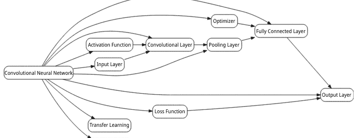

图2：关键概念与术语。

### 卷积层
作为CNN的组成部分，卷积层旨在以自动和自适应方式学习图像中特征的空间层次结构。它们使用卷积核对输入数据进行卷积，从而获得特征图。我们可以利用它们来检测复杂结构、形状、纹理、边缘等的局部特征。

### 池化层
这些层通过减小特征图的尺寸，有助于降低处理复杂度并减少过拟合的程度。最常用的池化过程称为最大池化，因为它通过从一组值中预先指定的窗口中选择最大值来保留最明显的特征。

### 全连接层
这些层中，上一层的所有神经元都与所有其他神经元相连。这类层通常在神经网络实现的后期使用，以整合前面层学习到的特征，然后根据提取到的特征生成预测结果。

### 损失函数
损失函数标记理想条件与现实条件之间的差异，因此，通过刻画误差来指导训练过程。在损失函数方面，均方误差（MSE）用于回归问题，而交叉熵损失用于分类问题。至于损失函数的选择，取决于最终要解决的问题。

### 优化算法
这些算法通过调整神经网络的权重来降低损失。梯度下降是一种过去研究过的方法，通过损失函数的梯度按顺序更新权重。有两种能够提升模型性能和收敛速度的形式：Adam和随机梯度下降。

### 正则化方法
防止过拟合的方法包括dropout和L2正则化，它们是在训练过程中限制惩罚的策略。dropout在训练期间通过随机关闭部分神经元，迫使网络考虑更可靠的特征；而L2正则化则在损失函数中引入一个基于权值平方的项。

### 超参数
它们与训练参数相关，涉及学习率、训练轮数（epochs）等方面。需要格外小心地调整超参数，以确保模型获得最佳结果。

### 反向传播
这是神经网络训练的关键部分。该过程计算损失函数相对于神经网络权重的梯度，并利用这些梯度更新权重。此方法包含两个主要步骤：一个步骤是使用前向传播确定损失，而反向传播用于确定梯度并更新权重。

## 2.4 深度学习与传统机器学习的差异

深度学习属于机器学习大家族的子集，两者都是AI的分支。这些方法的主要区别在于模型结构、数据处理和学习能力。

大多数传统人工神经网络组织性较差，层数较少。一些最常用的模型包括决策树、支持向量机和线性回归模型。大多数时候，这些模型在特征间交互较少、更清晰、更易于指定时使用。另一方面，深度学习模型使用包含多层节点的深度神经网络（DNN）。与浅层模型相比，深度学习模型能够从图像和语音等复杂数据流中解释更复杂的结构，从而具有深度。

特征工程是经典机器学习中的一个特定过程，由领域专家有意识地从原始数据中选择合适的特征。它耗时且需要对讨论主题领域有良好的专业知识。然而，深度学习通过神经网络的分层结构以综合方式实现这一点。CNN无需手动设计特征，因为DNN可以学习低级特征，然后通过多层结构从这些数据中构建高级特征。深度学习尤其适合处理高维数据，因为它可以自动获取所需特征。

由于大多数传统机器学习模型依赖精心构建的特征来概括数据，它们通常在相对较小的数据集上能够达到较高精度。如果这些模型不进行相应调整，在面对大规模复杂数据集时难以泛化，这仍是一个挑战。深度学习模型通常需要大量标注数据才能有效工作。得益于大规模数据集，深度学习网络获得高阶表示，从而能很好地泛化到未见过的数据。图3展示了深度学习与传统机器学习在特征工程、模型复杂度和数据需求方面的比较。计算和存储领域的进步使得这种数据密集型特性得以实现。

传统模型的计算需求也远低于所谓的深度学习模型。与当代模型相比，传统模型的训练采用基础且更简单的硬件配置。另一方面，由于深度学习模型在训练DNN时需要大量矩阵运算，其训练过程需要特定硬件，如GPU。这些模型计算强度更高。深度学习带来的能力和准确性的提升，是以计算方面的代价换来的。

在需要细致细节的情况下，上述开放性很有用，因为它允许人们根据需要深入探究任何模型预测的依据。深度学习模型的架构复杂，且难以简单检视，这使得它们在部分决策过程中有些像个“黑箱”。尽管深度学习算法比其他模型具有更高的准确性，但它面临一个根本性的可解释性问题，即难以解释模型为何得出给定预测。

## 2.5 深度学习的优势与局限

### 复杂问题上的高性能
深度学习模型在处理需要大规模高维数据集参与的复杂任务时表现非常出色。由于它们能够从原始数据中学习特征提取，在语音识别、图像识别和自然语言处理等领域已经取得了显著进展。

### 特征提取
大多数典型的机器学习方法都需要特征工程，而深度学习在数据预处理阶段会自动选择有意义的特征。因此，这种能力减少了预处理和领域知识所需的时间，消除了开发过程中的时间浪费。

### 可扩展性与适应性
基于大数据的深度学习模型已适应大规模数据，并伴随先进的计算能力出现。它们灵活、易于调整，并且随着更多数据输入系统，能够很好地与大量数据一起扩展。该模型的这种可扩展性使得模型准确性和可靠性随时间不断提高。

### 跨领域的灵活性
事实上，深度学习非常通用，几乎可以应用于所有领域和学科。图4总结了深度学习的主要优点和缺点。基于学习算法，深度学习可以从原始数据集中自动提取特征，并在大型复杂任务中表现出高准确性。深度学习计算成本高，需要大量数据。这就是深度学习被应用于语言翻译、自动驾驶汽车、图像和视频分析等多种任务的原因。

### 基于应用的持续改进
深度学习是一个不断发展、持续研究的主题，新的架构、途径和方法不断涌现。这种持续发展也意味着模型的改进，以及创造和实现可能性的增长。

### 资源密集型计算
深度学习模型通常需要资源密集型计算，因为大型网络的训练通常使用大量数据，需要大量的内存和计算资源。对于硬件资源有限的小型企业和应用来说，这种高需求可能是一个显著的缺点。

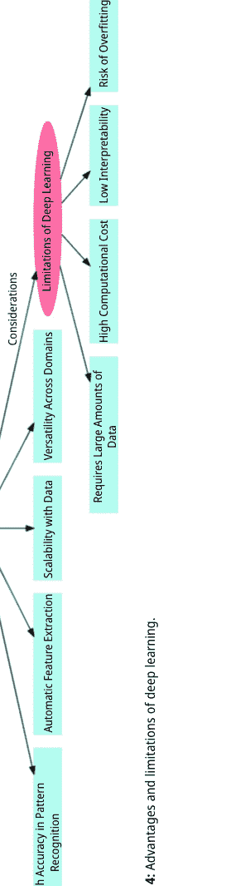

图 4：深度学习的优势与局限性。

随着对带标签的大数据的需求增加，为深度学习模型提供输入的大规模带标签数据集的重要性变得更加突出。深度学习技术在数据匮乏的情况下帮助有限，因为在各个领域收集和标注此类数据集需要花费大量时间和金钱。

缺乏可解释性和可解释性：由于它们是黑箱模型，深度学习模型常被视为有问题。这种关于模型如何得出结论及其决策过程的缺乏清晰度，使得难以深入了解某些模型，在需要一定解释的情况下尤其不可取。

过拟合风险：在非常小的数据集上构建时，深度学习模型中过拟合很常见。虽然特定的正则化策略可以缓解这种危险，但很难保证所构建的模型能很好地应用于新数据。

伦理问题：大多数深度学习算法可能助长某种形式的刻板印象，正如前一节中暗示的偏见和道德关切所说明的那样。为了解决这些伦理困境，必须对偏见识别、减少此类偏见的方法以及平等机会导向的 AI 训练进行深入思考。

这展示了深度学习的优势和劣势，从当前视角提供了对该技术现状的全面看法，指出深度学习在广泛的应用领域中的革命性影响，以及需要解决的挑战，以确保该技术的进一步发展及其恰当使用。

## 3 计算机视觉中深度学习的演进

### 3.1 早期神经网络及其影响

就计算机视觉领域神经网络的起源而言，可以追溯到 1980 年代，这也是图像处理领域，特别是图像识别领域开发新方法的整个过程的开始。初始的简单结构旨在避免人工思考并使计算机识别我们想要的内容，如感知器和多层感知器（MLPs），在启动阶段展示了如何从图像数据中学习表示。这些模型有助于说明，尽管存在缺陷，神经网络仍能够为模式识别问题提供良好的解决方案。

在这些模型中，最早开发的一种被称为感知器，由美国研究员弗兰克·罗森布拉特于 1957 年描述。尽管其影响持续到 1980 年代，感知器仍是构建人类大脑中单个神经元模型的最早尝试之一。已证明它可以区分线性可分模式，这为神经网络的进一步研究奠定了基础。感知器不适用于更复杂、非线性可分的模式，算法的进一步开发仍在继续。

当单层感知器让位于具有多层神经元以匹配更广泛过程的 MLP 时得到了进一步改进。神经网络基本架构的信念和设计在图 5 中有详细讨论，并表明早期神经网络为当代人工智能和机器学习奠定了基础。作者发现了训练 MLP 模型的问题；尽管容量增强，MLP 在训练时仍存在问题，尤其是在面对梯度消失问题时，这使得学习深度网络变得困难。直到发明更好的训练技术来模拟计算机生成的方法，这种限制才得以克服。

1980 年代的反向传播学习算法是开发训练多层神经网络技术的重要进展。由 Geoffrey Hinton 教授等人提出，反向传播在梯度计算中发挥了作用，不同层权重的优化练习使一些早期训练挑战更容易克服。这一进展扩展了神经网络在计算机视觉中的机会，并促进了强连接的发展。

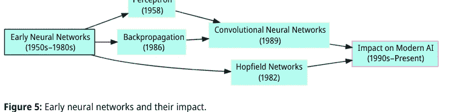

图 5：早期神经网络及其影响。

与此同时，基于局部感受野和特征提取的研究为 CNN 奠定了基础。昆尼希科·福岛关于新皮层认知机的研究为后续 CNN 架构之前的分层特征提取提供了基础。随后能够识别不同尺度和平移的模式的能力，是新皮层认知机中神经网络用于图像分析使用的显著改进。

这些早期神经网络为计算机视觉的后期改进架构铺平了道路，并体现了基于神经网络解决方案的优势和劣势。他总结了由于这些巨大飞跃，感知器、MLP、反向传播和新皮层认知机成为当今深度学习模型的先驱，这些模型改变了计算机视觉的面貌。

极大地改变了图像检测和分析，如图 6 所示。LeNet-5 架构在测试期间提供了数字识别的高结果，同时为视觉深度学习的后续研究奠定了基础。

在比较 CNN 时的真正惊喜在 2012 年随着名为 AlexNet 的更深 CNN 结构的引入而揭晓，它在 ILSVRC 中超越了所有传统方法。据称，AlexNet 的实际架构包含了 dropout 正则化和 ReLU 激活函数；此外，它拥有三个全连接层和五个卷积层。这一成就激起了研究人员的兴趣，并由于深度学习的高精度而在大型视觉识别工作中创造了对 CNN 的广泛认知。

CNN 设计中的后期创新使该领域更进一步。2014 年推出的 VGGNet 包含 16–19 层的统一结构，同时紧凑，并传输深层网络以强调其深度和规律性。这使得提高图像分类任务的质量变得更容易，并增强了特征提取能力。VGGNet 之后是 GoogLeNet（称为 Inception v1），它广泛传播了 inception 模块，由于池化操作和单层中众多强大的卷积滤波器，允许创建深度且高效的网络。

通过包含残差连接，ResNet 于 2015 年创建，以解决训练非常深网络相关的一些问题。这些连接减少了在某一层发生的梯度消失问题，从而使训练包含数百层的网络成为可能。更深的网络收敛更快，同时在整个训练过程中对梯度消失具有抵抗力，正如 ResNet 架构所强调的那样。

已开发出其他类型的 CNN，其中一些被称为 EfficientNet，通过深度、宽度和分辨率缩放来提高网络能力。所有这些创新都塑造了 CNN 的新改进，使其能够以更高的准确性和效率解决复杂的计算机视觉任务。

CNN 与计算机视觉的结合被视为在图像识别系统应用深度学习历史上的重大突破。CNN 架构和方法在应用领域以及不同领域的进一步研究中被证明是灵活且活跃的。

### 3.3 深度学习架构中的关键创新
（例如，AlexNet 和 VGGNet）

可能在计算机视觉深度学习发展中最重要的里程碑是 2012 年 AlexNet 的引入。该架构标志着转折点，展示了深度卷积神经网络在大规模图像分类任务上的能力。其他关键的深度学习架构进展随之而来，包括特征提取和分层学习的方法，这些方法

应用于 AlexNet 和 VGGNet 等模型中。这些架构在图像分类和目标检测等任务中取得了卓越的性能。Alex Krizhevsky、Ilya Sutskever 和 Geoffrey Hinton 做出了一项尤其重要的贡献：在 ImageNet 大规模视觉识别挑战赛（ILSVRC）中，通过显著降低分类错误率，大幅超越了早期方法。AlexNet 引入的主要创新如图 7 所示，其中重点展示了其核心组件和架构设计。

### 深度卷积架构
AlexNet 采用具有八层的深度 CNN 架构，其中五层为卷积层，三层为全连接层。这种深度还使网络能够从原始图像数据中提取分层的特征表示。

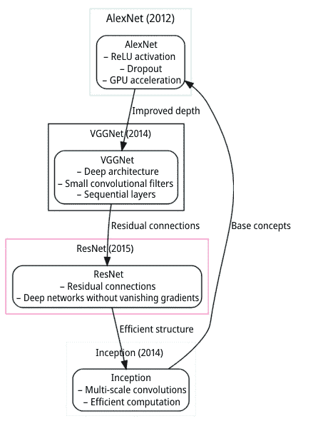

图 7：深度学习架构中的关键创新（例如 AlexNet 和 VGGNet）。

### ReLU
由于早期激活函数存在梯度消失问题，引入 ReLU 激活函数提升了网络性能，加快了训练过程，并引入了非线性。

### 重叠池化
AlexNet 没有完全采用全连接层，而是通过使用重叠最大池化来减少特征图的维度，同时保留重要的空间信息。

### 数据增强
由于训练数据量相对较小，研究人员尝试通过图像平移和水平翻转等数据增强技术人为地扩大数据集。

### Dropout 正则化
为避免过拟合问题，训练期间在全连接层中加入了 dropout 层；在每个 epoch 中，部分神经元会被随机置零。

VGGNet 由牛津大学视觉几何组发布，也在 2014 年通过注重简洁性和深度进一步构建了深度学习架构。VGGNet 架构，尤其是 VGG16 和 VGG19，引入了以下几项关键创新：

### 统一的卷积层
在其架构中，VGGNet 仅使用 3 × 3 的极小滤波器，并在整个网络中仅使用 2 × 2 池化。作为小型滤波器设计原则的一部分，这种设计侧重于使用小型且堆叠的滤波器，以提取模式的细节和分层特征。

### 增加深度
为了增加卷积网络的深度，VGGNet 提出了 16 层和 19 层配置，并表明无需采用过于复杂的结构也能有效增加网络深度。

### 一致的池化策略
在网络中一致地应用 2 × 2 最大池化层，意味着特征图和空间信息会逐步且系统地减少，从而确保良好的特征提取效果。

### 大型全连接层
VGGNet 在其架构末端附近使用大型全连接层，从而能够基于模型对图像特征进行推理，并利用提取出的特征完成高层次分类。

### 预训练模型
VGGNet 使大规模预训练模型得到更广泛的应用，将迁移学习引入多个计算机视觉任务，并为后续架构建立了基线。

GoogLeNet 由 Google 于 2014 年提出，率先使用了多个 Inception 模块。GoogLeNet 的主要特征包括：

该网络建立了 Inception 模块，在其中使用了两个以上具有不同内核大小的卷积算法以及池化层。通过这种方法，模型能够在单个层中覆盖多种尺度的特征。

### 网络中的网络层
GoogLeNet 的架构使用 1 × 1 卷积作为网络中的网络层，以减少计算量，同时保持良好的特征。

### 全局平均池化
GoogLeNet 没有使用全连接层，而是使用全局平均池化，该操作被称为胶囊。它能够最大限度地减少参数数量，并将特征图映射为分类输出。

### 高效设计
通过引入 Inception 模块并处理网络的维度，作者设计出了一个参数大幅减少、计算复杂度较低且准确率良好的网络。

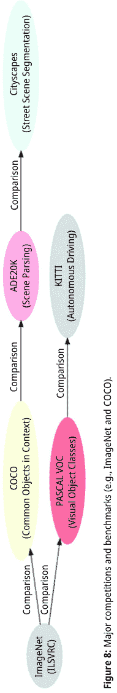

图 8：主要竞赛和基准（例如 ImageNet 和 COCO）。

## 4.3 卷积层和操作

CNN 是当代深度学习框架中计算机视觉系统不可或缺的工具，主要由卷积层构成。这些层借助高效的自动化机制，有助于最佳地识别模式和对象，同时使网络能够从输入图像中学习信息的空间层次结构。

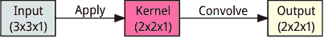

**图 12：**卷积层和操作。

给定卷积层的主要目的是使用一系列称为内核的滤波器对输入图像执行卷积。如图 12 所示，该图解释了深度学习模型中用于从图像提取特征的卷积层和相关操作。每个滤波器都会与特征图中的元素相乘，并将结果加到一个小型矩阵中，然后在输入图像上移动，从而生成特征图。卷积是一种能够帮助网络感知输入数据局部特征的层，例如边缘、纹理和形状。通过使用多个滤波器，网络能够从图像中获取大量属性。

在卷积过程中，步幅定义了滤波器在输入图像上移动时的距离。当步幅较大时，输出特征图的空间维度会减小；而当步幅设置为 1 时，滤波器每次移动一个像素。填充作为卷积过程中的一种技术，会在输入图像的边缘添加额外像素，从而扩展输入图像，确保完整图像都能与滤波器组接触。填充有助于保留空间维度，同时也能更好地控制输出特征图的大小。

卷积过程结束后，生成的特征图会经过激活函数处理。ReLU 已成为卷积层中最常用的激活函数，它通过以下方式有效地引入非线性：正输入值保持不变，而负输入值则几乎全部消失。这种非线性特性有助于网络更充分地表达自身，并学习更加复杂的模式。

池化层通常与卷积层一起应用，以限制特征图的空间大小，从而降低计算复杂度和过拟合程度。在所有池化技术中，最大池化的使用最为广泛，即从特征图的子区域中选取最大值。通过这种方式，池化降低了网络对微小变化的敏感性

为了使输出类别的数量与特征图的数量相匹配，通常会在最终分类层之前使用全局平均池化。

### 降低计算复杂度
池化层会降低特征图的维度，因此后续层所需的参数和计算量更少。计算复杂度的降低意味着推理和训练速度都能得到提升。

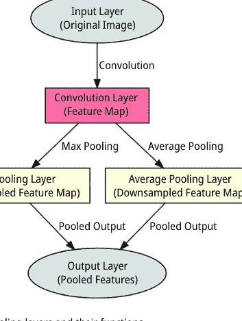

图 13：池化层及其功能。

### 控制过拟合
因此，池化层起到了一种正则化的作用，使模型具有更强的泛化能力。作为后续评估的前提，下采样使输入中的细微变化对网络而言变得不那么重要，并引入平移不变性，从而进一步减少过拟合。

### 特征提取
这意味着借助池化层，输入数据中的必要特征得以保留和提取。网络能够舍弃输入图像中对分割不太有用的部分，同时聚焦于每个池化窗口中的主要值。

使用池化层会缩小特征图的维度，从而导致数据空间分辨率降低。考虑到更低的计算成本和更好的特征表示所带来的积极影响，这种权衡通常是合理的。为了开发输入数据的多种日益抽象的表示，以在目标识别和图像分类等任务中实现高性能，池化层发挥着重要作用。

观察到池化方法和核大小的选择会显著影响深度学习模型的性能。设计者必须根据任务的具体要求和所分析数据的特征仔细选择这些参数。虽然平均池化和全局平均池化为某些应用提供了更合适的替代方法，但最大池化因其在保留主特征方面的有效性而经常受到青睐。

池化层在深度学习模型中起着至关重要的作用，能够增强网络在各种视觉任务中的泛化能力。它们还有助于降低计算复杂度并简化特征提取过程。

## 4.5 全连接层及其作用

全连接层是深度学习结构的基本特征，尤其以神经网络架构著称。这些层对于将前几层提取的特征转化为最终预测至关重要。

全连接层包含该层中与上一层神经元相连的所有神经元。由于与上一层的深层连接有助于模型发现数据中的模式和相关性，因此也可以从前面的每一层提取特征。全连接层中的每个神经元在使用激活函数之前计算其输入的加权和，这反过来为模型增加了更多的非线性。

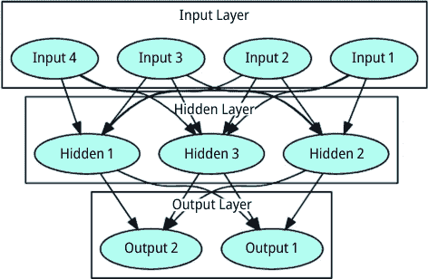

**图 14：** 全连接层及其作用。

全连接层使得可以聚合并整合由卷积层提取的其他特征。总而言之，全连接层利用卷积层和池化层从数据中学习、识别并提取的属性特征，生成输入数据的高层表示。这种聚合过程对于模型能够对从网络收集的属性进行有意义的分类至关重要。

全连接网络（FCNs）被用于许多深度学习结构（尤其是 CNN）的最后阶段，用于分类问题中的特征提取。图 14 表明神经网络中的全连接层能够耦合前几层提取的特征，并通过应用在输入特征集上学习到的权重和偏置来生成最终输出。分类目标（如分类任务的类别得分）和生成连续值的目标，都由全连接层创建，这些层处理由卷积层收集和表示的信息。

由于全连接层中高度连接的节点，模型能够区分数据集中存在的多种模式和相关性。这些层汇集所有前层，并利用它们的特征来捕捉特征之间微妙的关联。这对于涉及理解全局的任务（如图片分类）非常有用。

我们还了解到，当两个网络的层都完全耦合时，深度学习模型更加灵活和强大。你可以修改这些层的数量以及这些层中嵌入的神经元数量，以增强给定模型从数据中学习的能力。这是因为节点更多的全连接层具有更高的过拟合能力，并且需要更多的计算来处理更复杂的信息。因此，需要通过正则化精心设计，在模型容量和泛化能力之间取得平衡。

在深度学习模型中，全连接层在连接特征提取和最终预测阶段方面发挥着关键作用。作为特征聚合器持续参与该过程，使其能够学习复杂的特征和模式并进入输出预测，这使得该架构在各种 DNN 任务中实现高性能至关重要。

## 5 训练用于计算机视觉的深度学习模型

### 5.1 数据准备与增强技术

数据预处理和数据增强是训练用于图像分析的深度学习模型时特别重要的步骤，因为它们会显著影响模型的有效性和将学习到的行为外推到新数据的能力。增强的特点是，经过适当预处理和增强的数据可以提高模型的稳定性和准确性，从而在各类已知和未知数据上取得良好结果。

### 5.1.1 数据准备

数据准备的第一步是识别并收集一个大型且多样化的数据集，该数据集具有正确的标注，以适应当前的特定计算机视觉任务。这可能涉及收集图像，并分别通过标签和对象类别对其进行真实标注。正确的标注对整个过程至关重要，因为注释质量极大地影响模型准确预测的学习能力。

纠正不一致记录中的错误被称为数据清理。在此过程中，我移除了冗余图像，修正了错误标签，并处理了数据中的任何问题。当训练一个在新数据上表现良好的模型变得重要时，用于训练模型的数据集必须是恰当且干净的，这一点至关重要。

数据集通常包含三个子集：测试集、验证集和训练集。图 15 解释了一些数据准备和补充技术，以增强模型训练集的多样性和质量，从而获得更好的结果。训练集用于模型开发，验证集用于调整超参数，测试集用于最终衡量模型质量。正确划分数据可以消除过拟合，并确保模型性能是在未知数据上进行评估的。

为了对像素值进行缩放并确保它们在整个数据集中标准化，使用了归一化和标准化技术。标准化涉及变换像素值，使其均值为 0，标准差为 1；而归一化通常指将像素值缩放到 0 到 1 的范围内。这些过程有助于细化调整并使模型收敛，同时给训练带来稳定性。

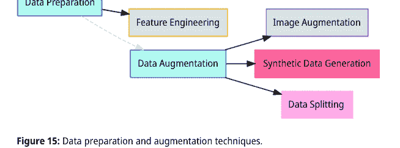

图 15：数据准备与增强技术。

### 5.2 损失函数与优化算法

因此，损失函数（也称为目标函数）在训练深度学习模型中至关重要，因为它们提供了目标值与预期结果之间差异的度量。图 16 展示了深度学习系统中不同的损失函数和优化算法，描述了它们如何在训练和优化训练模型中使用。损失函数的选择对模型的有效性和性能有显著影响。

交叉熵损失常用于分类问题，它衡量真实类别分布与期望概率分布之间的散度。这类损失函数在训练过程中为模型参数调整提供了独特的梯度指示，对于多分类问题非常有用。

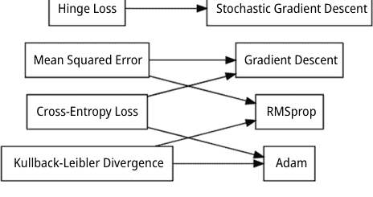

**图 16：** 损失函数与优化算法。

MSE 是回归问题中最常用的度量之一。它旨在估计实际值与预测值之间残差平方的平均值。MSE 在比较连续预测的准确性时很有用，因为较大的误差比较小的误差受到更多惩罚。然而，MSE 可能对异常值敏感。

交叉熵损失被用于所有二分类问题。二元交叉熵用于二分类问题。当输出是介于 0 和 1 之间的概率值时，它评估分类模型的性能。由于该损失函数计算给定概率与真实二元标签之间的差异，因此适用于涉及两个类别的任务。

Huber 损失结合了绝对误差和 MSE 的优点，可用于稳健回归。它对异常值不如 MSE 敏感，同时保持可微性。Huber 损失是回归任务的一个良好选择。

优化方法和损失函数在深度学习模型训练中至关重要。研究表明，损失函数和优化方法的选择会影响模型的收敛性、功能性以及从新数据中学习的能力。要设计和训练用于计算机视觉应用的深度学习模型，必须理解这些要素。

## 5.3 梯度下降与反向传播

在训练深度学习模型时，梯度下降和反向传播算法的评估被认为是至关重要的，尤其是在优化计算机视觉应用中的神经网络时。

### 5.3.1 梯度下降

梯度下降是一种迭代修改模型参数值的优化过程，旨在最小化神经网络的损失函数。其目标是找到正确的配置参数，使估计输出与实际目标之间的差异最小化。

在梯度下降过程中，需要确定每个模型参数对损失函数的贡献。该分析还指明了参数应向哪个方向调整以最小化损失。每个参数的变化由变化发生时的特定步骤中的学习率控制。为了降低损失函数的值，需要调整设置。

还有一些超参数会影响最小化损失所需的步数，学习率就是其中之一。因此，当学习率选择得当以提供有效的收敛速度时，模型才能达到最优解。图17展示了使用反向传播的梯度下降示意图，通过最小化损失函数来获得神经网络的最佳权重和偏置。学习率过低会导致收敛缓慢，而学习率过高则会导致模型越过正确的参数。

梯度下降有多种方法可使其更有效，并确保在训练阶段良好收敛。其中包括：

- **批量梯度下降：** 在处理大型数据集时，由于使用全部数据计算梯度，计算成本可能很高。
- **SGD：** 它会引入噪声，但由于每个数据点都会更新参数，因此可以加快收敛速度，并有助于跳出局部最小值。
- **小批量梯度下降：** 这是批量梯度下降和随机梯度下降的混合体，仅使用数据的一个子集进行更新，既足够快，又具有足够的收敛稳定性。

结果。它能够更好地估计模型的泛化能力，并有助于减少数据波动带来的问题。

深入了解模型的鲁棒性需要确定模型在输入数据被改变时的表现如何。敏感性分析研究模型性能因输入特征或超参数变化而产生的偏移。通过这些评估，模型在实际应用场景中的适用性和可靠性得以增强。

超参数调整和模型评估是深度学习模型创建流程中的关键阶段。调优使模型表现良好，而评估则有助于确保模型能够在各种其他情况下如预期般表现良好。

## 6 深度学习对计算机视觉应用的影响

### 6.1 图像分类准确率的提升

特别是，深度学习带来了图像分类的变革，改善了各个领域的许多应用。卷积神经网络（CNN）提高了以深度学习模型为主的图像分类系统的精度和有效性。

从自然场景开始，深度学习模型学习输入图像由易到难的特征表示。每个卷积网络都有一个编码边缘和纹理等基本特征的较低层，以及编码结构等复杂特征的深层。因此，由于分层特征提取，那些容易被标准方法忽略的重要和微弱特征会被模型捕获，从而提供更好的图像理解和分类。

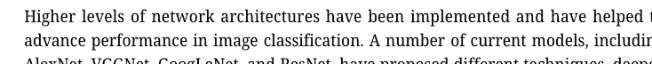

图20：图像分类准确率的提升。

更高级的网络架构已被实现，并有助于提升图像分类的性能。许多当前模型，包括AlexNet、VGGNet、GoogLeNet和ResNet，提出了不同的技术、更深的架构、Inception模块和残差连接。这些架构改进极大地增强了大多数涉及图像分类的任务，因为特征提取更好，过拟合的机会也减少了。

这些提升主要归功于更大的标注数据集，如用于训练图像分类器的ImageNet。图20详细展示了通过应用不同的模型优化和先进技术在图像分类方面取得了多大的改进。深度学习模型在大量图片上表现良好，并在大型数据集上训练时提高泛化能力。迁移学习技术涉及在给定多个针对特定任务的预训练模型时使用微调，利用广泛的数据集经验，从更少、更具体的数据集中实现高精度。

先进图像分类还通过数据增强获得了积极改进，数据增强可人为扩展训练数据。包括图像旋转、图像缩放、图像翻转和颜色处理在内的技术创造了原始图像集的更多变体，使模型更加鲁棒且泛化能力更强。这有助于减少过拟合，并提高模型在区分现实输入变化方面的性能。

训练过程的改进，尤其是获取模型参数的更好方法，如优化算法、正则化、学习率及其调度策略，已带来分类准确率的提升。Adam和RMSprop优化、dropout、批归一化和学习率调度等工具通过调整学习过程、提高收敛速度、降低过拟合风险并保持稳定的学习来发挥作用。

深度学习在图像分类中的应用非常显著，因为在各种应用中其整体准确率已取得重大进展。因此，更鲁棒的特征表示、新的和改进的网络结构、大数据的易获取性、数据预处理技术和特殊的训练方法可以被认为是现代图像分类系统如此有效的主要原因。

### 6.2 目标检测与定位的进展

近年来，深度学习技术的强大影响进一步推动了目标检测和定位领域的发展，这对各种计算机视觉方法的发展很有帮助。目标检测涉及识别图像中存在的物体，而定位涉及识别图像中检测到的物体的坐标。该领域的进步促使研究人员提供了更清晰、更快、更灵活的最新方法。

因此，传统目标检测方式已被深度学习系统的融入所改变。为了生成区域建议并使用CNN进行分类，早期方法如基于区域的卷积神经网络（R-CNN）被引入。图21展示了近期目标检测和定位的发展，包括通过其他算法和深度学习方法在准确率和处理速度上的提升。前一种模型

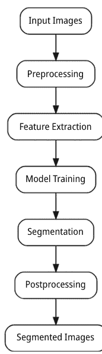

图 22：图像分割任务中的性能提升。

从而获得更准确、更快速的结果。视觉 Transformer（ViT）和 Swin Transformer 等模型通过解决长程依赖和全局上下文问题，能够提升分割的准确性和效率。

图像分割是受深度学习影响最大的领域之一；模型架构和方法论的进步使许多应用取得了更好的成果。这些进展通过实现更出色的分割效果，推动了环境监测、自动驾驶和诊断扫描等领域的发展。

## 6.4 图像合成生成模型的创新

作为一种有效的方法，生成模型尤其受到关注，深度学习在图像生成领域的表现最为显著。这些模型提供了许多现代计算机视觉服务和能力，能够生成看起来极其真实的全新数据图像。

后来，随着 Ian Goodfellow 等人对 GAN 的发展，生成建模取得了重大进展。GAN 通常由两个神经网络组成，即判别器和生成器，二者以相互对抗的方式进行训练。判别器在评估生成器所创建的、人工生成的可感知图像是否真实方面发挥着重要作用。由于这种对抗过程，生成器能够生成越来越逼真的视觉内容。因此，GAN 被广泛应用于风格迁移、数据增强和高分辨率图像生成等领域。

此外，还有一类生成模型专注于学习数据的低维表示，被称为 VAE。VAE 使用编码器网络将输入图像编码到潜在空间中，再使用解码器网络从潜在空间中解码图像。因此，VAE 能够根据概率性的潜在分布生成各种质量良好的图像。VAE 的应用包括图像修复、图像去噪，以及根据所学习的分布生成数据集的新样本。

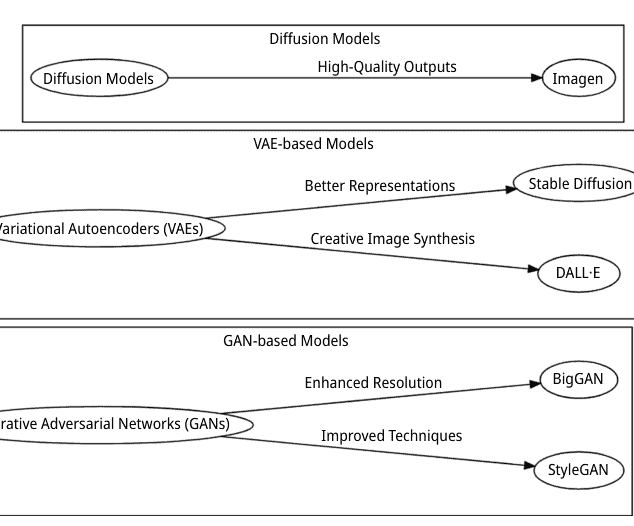

图 23：图像合成生成模型的创新。

以这一理念为基础，基于生成模型的风格迁移方法将一幅图像的内容与另一幅图像的外观融合起来。卷积网络被广泛应用于神经风格迁移，因为它们能够生成合成图像，将参考图像的外观与内容图像的结构特征结合起来。该领域近期的发展使人们能够创作出视觉效果令人印象深刻的图像，这些图像能够呈现某些艺术流派独特的艺术风格。

通常，图像超分辨率旨在以低质量图像作为输入数据，生成清晰且细节丰富的图像。本章指出，生成模型在显著提升超分辨率图像质量方面发挥了革命性作用。图 23 展示了生成模型用于图像合成的最新发展，重点体现了其生成高度逼真且多样化视觉数据的能力。ESRGAN 等其他基于深度学习的技术被用于学习细致的属性和纹理，从而生成清晰、锐利且高质量的增强图像，并可应用于卫星图像、医疗保健等行业。

条件生成模型是 GAN 和生成式 VAE 的变体，它们在生成过程中利用其他数据。例如，条件 GAN 等深度学习模型能够根据给定的图像生成条件创建图像。这使得图像合成能够以更加可控和有选择性的方式进行，从而拓展图像到图像转换以及新颖、特定内容生成的应用范围。

用于新图像合成的生成模型推动了潜在计算机视觉应用的进一步发展。这些模型能够创建准确且高质量的图像。这些进展不仅提升了视觉内容的制作能力，也促进了包括数据增强和艺术创作在内的一系列计算机视觉应用的发展。

## 6.5 实时计算机视觉系统中的应用

实时计算机视觉系统利用深度学习对所观察到的视觉数据进行初步分析，并提供因果性的行动和响应。在人工智能领域，深度学习从多个方面为这些系统带来了革命性的变化，拓展了现有的领域和应用，也扩大了这类系统适用的场景。

深度学习凭借实时感知和决策能力，改变了自动驾驶的发展模式。在这些系统中，深度学习模型用于分析摄像头和传感器数据，以检测和识别车辆、道路上的行人以及交通标志等物体。这种能力对于方向判断、避免与其他车辆发生碰撞，以及在道路状况不明的情况下安全行驶至关重要。深度学习推动了高级驾驶辅助系统和完全自动驾驶车辆的发展，这是其最重要的优势之一。

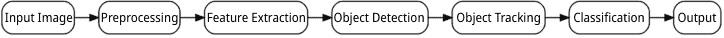

**图 24：**实时计算机视觉系统中的应用。

在监控与安全领域，深度学习模型有助于增强实时警戒和威胁评估能力。摄像头利用深度学习进行人脸识别、读取汽车车牌，以及识别视频流中的异常情况。这些能力主要用于识别人员、快速应对安全威胁事件，以及持续监控被认为可疑的人员。无论是在公共场所还是私人区域，这些活动都能使工作和生活环境更加安全、高效。

由于深度学习推动了实时物体识别与跟踪，增强现实（AR）领域得到了极大提升。AR 系统集成深度学习算法，根据视频流将虚拟物体放置到真实环境中。这项技术被应用于娱乐休闲、寓教于乐，以及商业领域的维护和远程支持等场景，在提升体验的同时增加了功能性。

医疗保健行业目前使用深度学习模型自动解读各种医学影像，包括 X 射线、MRI 和超声扫描图像。这些模型能够帮助放射科医生识别病理状况、确定疾病类型，并提出治疗措施，还可以实时建议调整方案。图 24 展示了深度学习在实时计算机视觉系统中的应用，体现了这些方法在物体检测与跟踪、场景分析与理解，以及实时物体跟踪与识别方面的效率。“实时”处理在紧急情况下尤其有用，因为用于评估的即时图像会直接影响患者的病情判断。

深度学习等先进技术帮助零售商构建实时计算机视觉系统，从而提升客户参与度和商店运营效率。典型案例包括全自动结账系统，其中模型能够实时识别商品并处理付款；以及智能分析系统，通过分析顾客在店内的互动和行为，为店面布局和未来促销活动提供决策依据，从而改善购物体验并确保零售业务顺畅运行。

上述内容强调，深度学习已融入实时计算机视觉，用于推动自动化运行、安全、AR、医疗诊断和零售效率等多个领域的发展。这些案例说明，深度学习能够改变实时流处理方式，并使决策成为整个流程的一部分。

## 7 结论

自深度学习诞生以来，计算机视觉的方法发生了转变，其理论和实践都取得了显著进展。本章介绍了历史背景和基本概念

计算机视觉领域深度学习及其在各个领域的广泛适用性已被回顾。

计算机视觉领域的当前技术进步无可否认地被深度学习的广度所革新，其中包括 CNN、ResNet 和 inception 模块等令人难以置信的架构。利用这些架构，视觉数据处理达到了以前不可能实现的水平，并在分割、物体识别和图像分类等任务上提高了模型的性能。随着技术的增长，从原始数据中学习和提取信号特征的能力使得生成更精细和复杂的模型成为可能。

值得注意的是，硬件在深度学习模型的发展中发挥了巨大的作用，因为它在近年提升了其性能。从原始微处理器的基础设置转向 GPU 和 TPU，显著提高了模型训练的速度，并能够容纳大量数据和更复杂的算法。深度学习加速器也已被开发出来以增强性能，从而实现实时计算机视觉系统。

深度学习在实时计算机视觉系统中的实际应用在许多领域带来了有效变革。自动驾驶汽车中的实时物体检测和分类可归因于深度学习，这使其操作更安全高效。监控系统在实时人脸识别和异常检测中获得了额外的安全保障。AR 应用使用深度学习进行增强现实和虚拟现实等操作，而医疗保健系统则使用实时图像识别进行诊断。其他优势还包括使用自动结账系统和客户行为分析，所有这些都证明深度学习解决方案可以惠及零售环境的许多方面。

问题仍然存在，其中包括模型评估、超参数调优以及伦理问题。为了充分发挥模型的潜力，确保其可靠性，鼓励正确使用模型，并解决所提出的问题。然而，为了克服上述困难并为计算机视觉中的视觉计算模型开辟新的前沿，研究和发展应坚持不懈。

## References

[1] Junaid, S. B., Imam, A. A., Abdulkarim, M., Surakat, Y. A., Balogun, A. O., Kumar, G., . . . & Hashim, A. S. (2022). 医疗保健服务中人工智能和可穿戴传感器的最新进展. Applied Sciences, 12(20), 10271.

[2] Srinivas, T., Aditya Sai, G., & Mahalakshmi, R. (2022). 深度学习技术、应用和挑战的全面综述：机器学习的革命. International Journal of Mechanical Engineering, 7(5), 286–296.

## 1 引言

文献表明，在新型深度学习（DL）技术的帮助下，医学图像分割领域发生了革命性变化 [1]。为了区分器官和癌变区域，以前的诸如阈值分割、区域生长和边缘检测等方法需要大量手工特征和人工干预 [2]。这些技术虽然在某些情况下有所帮助，但更常存在噪声、图像质量差且不断恶化以及医学成像固有困难等问题 [3–5]。因此，自动且高度准确的分割方法从其他学习方法转向 DL，特别是转向卷积神经网络（CNNs）[6]。为了在医学图像中检测复杂结构和关系，并在不同的成像模态和临床应用中实现泛化，DL 模型需要大量标注数据 [7]。这一转变为提高诊断准确性、制定详细准确的治疗计划以及最终改善患者的整体结果创造了可能性 [8]。

DL 在医学图像分割中的一项重要成就是在特定架构上的发展，尤其是 U-Net 及其衍生模型 [9, 10]。这些模型旨在压缩和解压缩编码器-解码器结构，以便分析同时考虑局部和全局上下文，从而更准确地定位不同尺度的特征 [11]。由于其能够在最少输入数据的情况下生成准确的密集像素分割图，因此在生物医学分割中非常有用 [12]。该设计及其变体在广泛的医学成像应用中被证明显著优于传统方法：肿瘤分割、器官轮廓描绘、病变检测等 [7]。数据增强和迁移学习的发展也增强了 DL 模型的应用可能性，而这在医学成像中一直是主要关注的问题，因为缺乏大量标注数据集。

多模态数据融合的必要性尤其被医学图像分割的最新发展所强调 [13]。通过多种成像技术获取的数据组合被称为多模态技术；在组合数据时，解剖和病理的合并图像得到了更好的定义，尤其是在使用功能磁共振成像（fMRI）、计算机断层扫描（CT）和正电子发射断层扫描（PET）扫描时 [14–16]。这两种方法都利用了各模态的协同特征，以提高诊断的可靠性并提高临床决策的效率 [17]。例如，PET/CT 将 PET 和 CT 扫描图像结合起来，以提高识别肿瘤位置和确定其性质的能力，从而改善癌症的治疗计划。多模态数据的分析通过立体定位图像配准和数据融合得到促进，其中各种图像集被对齐并融合为统一的数据分析系统 [18]。这些变化正在彻底改变医学成像，因为它们为复杂疾病提供了更多更详细的信息。

在医疗机构中使用基于 DL 的分割算法会引发一系列问题和疑问。一个问题是确定这些模型如何在广泛的患者群体以及不同类型的成像技术中实现泛化和有效性 [7, 19, 20]。尽管如此，当应用于不同的临床场景时，由特定数据集得出的模型被证明准确性较低，并且需要大量调整才能适应。此外，由于医生需要信任并理解 DL 模型的决策，因此可解释性对于这些模型的治疗使用至关重要。引入有助于解释模型的技术对于提高对这些工具的信心和信任是必要的 [21]。需要更多的研究和工作来使基于 DL 的分割工具在临床使用中更有效、更公平，并确保其符合数据隐私和模型偏差等法规和伦理原则 [22, 23]。

## 2 医学图像分割的定义与范围

### 2.1 什么是医学图像分割？

医学图像分割是将医学图像分割成与器官或疾病直接相关的适当区域和/或片段的过程。该过程涉及识别和勾勒图像中具有临床兴趣的方面，如病变或肿瘤。其主要目的是使图像的表示去中心化，以便对其进行分析和解释，以用于研究和治疗目的。

分割可以通过多种方式进行，从完全手动到完全自动的方法，以及在两者之间取得平衡的半自动技术。手动分割虽然有时成本效益高，但会引入操作者偏差并可能损害性能一致性。相比之下，自动方法通过算法逻辑模仿人类认知，从而提高精度和速度。如图 1 所示，全自动分割系统能够以最少的人工干预处理大量数据，依靠先进的机器学习算法提供可扩展且高效的结果。

医学成像中的分割对于处理多种问题非常重要。它允许对身体部位的大小进行量化，确定疾病的阶段，并重建手术操作计划。适当的切片分割使人们能够获得体积、表面和形状等数值特征，这些特征对于监测疾病进展、测试疗效等非常有用

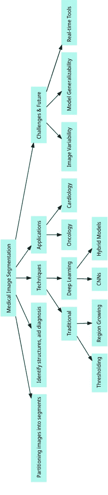

**图1：** 医学图像分割。

在评估治疗效果以及制定患者个性化治疗方案时，分割在诊断和治疗干预的精准性中起着关键作用，因此它是现代成像系统的关键要素。

## 2.2 范围与应用

医学图像分割已成为现代医疗保健的关键组成部分，服务于多种目的。分割技术主要用于区分医学图像中的细小独立部分，如图像的特定区域、不同的静脉、导管、感染区域等。分割在治疗和学术上都具有重要价值，因为它能够为诊断、治疗计划和医学研究提供精确而详细的分析。

### 2.2.1 临床应用

分割在疾病诊断和检测中非常有优势，因为它有助于区分和描述各种疾病，如肿瘤、病变和异常。精确分割为临床医生提供信息，使其能够更准确地诊断疾病，如癌症或神经系统疾病。因此，分割有助于加强对这些关键区域的及时、准确的医疗干预。

在治疗计划方面，适当分离生物组织结构对于设计成功的治疗方案至关重要。例如，在放射治疗中，肿瘤及相关组织的精确勾画可用于制定具体的治疗策略，将高剂量辐射直接作用于摧毁肿瘤，同时尽可能减少健康组织的暴露。这种靶向方法提高了治疗效果，并最大限度地减少了患者出现副作用的机会。

分割对于手术导航和规划也变得至关重要。通过将结构详细划分为不同部分，可以生成执行手术的具体指南。这种规划通过支持实时规划来优化手术过程中的导航，从而在手术中实现正确的策略。

分割的大部分益处适用于疾病监测和治疗结果评估。通过分割，可以监测疾病进展，提供病理区域大小和形状随时间变化的定量测量。在综合评估治疗结果以制定后续适当的患者护理决策方面，这种能力极具价值。

对于临床和研究目的而言，基于分割的定量分析中的一致性至关重要。器官、病变及其他参数的解剖测量用于诊断和时间维度上的比较研究。这些特征量化数据，有助于决策和加深对疾病的了解。

### 2.2.2 研究应用

在研究领域，分割技术是评估新成像技术及其后续框架的基础。医学成像背景下提出的研究涉及提高分辨率、对比度噪声比和准确性，这些直接反映在分割算法中。这些进步有助于更深入地理解成像选项的持续发展以及这些改进的进一步应用。

算法开发和用于医学图像分割的算法验证是一个持续的过程。研究致力于开发新方法，以提高分割过程的精度、稳定性和速度。管理图像质量的变化和被分割解剖结构的难度，一直是增强分割方法可靠性努力中的其他主要关注点。

另一项重要工作涉及成像数据的多模态整合。结合CT、PET和MRI的信息，可以获得解剖结构和病理特征的全面视图。多模态分割利用多种成像技术的优势，提高了诊断的准确性和治疗结果。

分割技术通过使治疗像患者本身一样独特，服务于个性化医疗领域。已有研究探索将分割应用于部署靶向治疗方法，具体取决于器官部分的形态和功能，以全面提升精准医疗服务的水平。

利用人工智能（AI）和深度学习（DL）处理医学图像分割问题是当前一个积极发展的课题。其重点在于生成复杂的方法，以检查临床数据集、提高分割精度，并考虑各种临床应用。这些改进将改变医学图像分析领域，并在未来带来更好的患者护理。

## 2.3 在医疗保健中的重要性

医学图像分割在医疗保健中非常重要，因为它有助于提高诊断可靠性、治疗规划和疾病追踪。凭借清晰的界定，可以区分所涉及的组织和病理区域，这对于做出正确诊断至关重要。由于分割有助于定义和测量各种组织和病变类型，一种能被早期发现的疾病是癌症，从而带来更好的治疗结果。

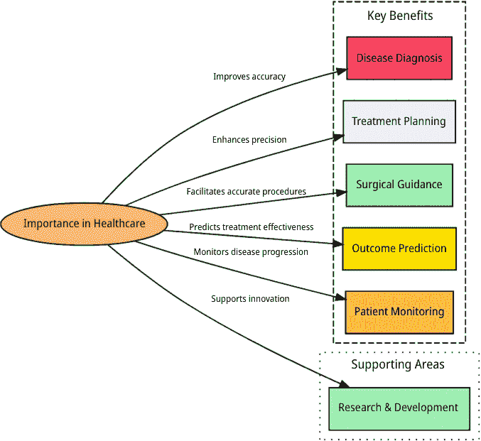

**图2：** 在医疗保健中的重要性。

在治疗计划中，分割提供可用于手术和放射治疗的重要数据。分割能够勾勒出目标肿瘤的精确边界，以尽可能有效地实施治疗，减少对肿瘤周围健康组织的伤害。为了在手术中更好地恢复，同时将放射治疗引起的副作用影响降至最低，这种精确性非常重要。

医学图像分割对于评估特定疾病的进展以及给定治疗的有效性非常有用。临床医生在做出关于调整治疗方式的关键决策时，会依据从分割图像分析中获得的时效性观察结果来评估肿瘤的大小、形状和治疗反应。图2说明了这一过程，强调了分割成像如何支持临床解释和决策。这种能力还有助于对慢性疾病进行持续监测，并促进针对每位患者独特需求制定个性化治疗策略。

自动分割方法还减少了对图像分析的依赖，这种分析可能不一致且耗时。自动化加快了工作流程的推进，使工作标准化，并使医疗专家能够将时间投入到结果分析和临床决策上。

总的来说，医学图像分割为精准医学铺平了道路；基于各种成像参数构思解决方案，通过个性化的健康管理方法使患者受益。分割技术的持续改进和进步有助于改善医学成像，使其在当前的医疗保健中显得尤为重要。

## 2.4 分割任务与挑战

医学图像分割包含许多不同的过程，所有这些过程都旨在识别医学图像中的特定结构。组织分割是这项工作的主要焦点，需要区分各种组织类型，例如，在脑部MRI扫描中区分脑脊液、灰质和白质。由于强度值相似以及组织外观的差异，这项任务特别具有挑战性，但它对于理解大脑结构和检测异常至关重要。在器官分割中，会围绕肾脏、肝脏和心脏等单个器官绘制轮廓以界定其边界。如图3所示，准确的器官分割能够实现体积测量，支持手术规划，并促进针对每个器官独特特征的功能评估。

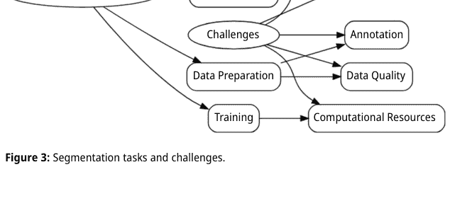

图3：分割任务与挑战。

另一个挑战是任何人体器官周围结构形状的变化。病变和肿瘤检测是指病变的检测和分割。该任务对于癌症分期和评估癌症患者的治疗反应至关重要。病变的形状和大小以及模糊的边缘带来了诸多困难。血管分割旨在利用 CT 和 MRI 血管造影等医学影像技术对血管进行描绘和提取。成功进行血管分割对于识别血管病变和规划干预措施至关重要；然而，除了迂曲之外，细小的血管相对难以与其他组织和伪影区分。最后，功能区域分割用于分割感兴趣区域，包括在认知任务中表现出代谢活动的活跃脑区。该任务在 fMRI 和 PET 中很重要；功能活动及其与解剖结构的关系的可变性使得分割变得困难。

### 2.4.1 分割中的挑战

有几个因素影响医学图像分割。强调的一些问题包括成像模态的可变性。各种成像技术，如 MRI、计算机轴向断层扫描和超声，生成具有不同分辨率、对比度水平和失真的图像。这种观察者内变异性凸显了采用特定模态的先前使用的分割技术以在不同成像模态间获得准确分割的必要性。其他也 somewhat 具有挑战性的因素包括图像质量和伪影，这些伪影出现在采集的图像中。有许多因素对分割过程产生负面影响，包括噪声、模糊以及在医学图像中常见并遮蔽边界的伪影。这种不完美要求所采用的技术也足够强大，能够处理这些缺陷并给出准确的结果。存在患者变异性：每个患者在某些方面都是独特的，例如器官大小和器官形状，这意味着分割也可能受到影响。这些变化必须反映在模型中，以确保目标适合所有类别的患者。另一个缺点是类别不平衡，尤其是在罕见病变中。这是因为，平均而言，由于几乎没有此类类别的注释示例可用于训练模型，因此开发出在最常出现的类别上表现良好但在最少出现的类别上表现不佳的有偏模型。最后，计算复杂性是一个问题，因为先进的分割方法，尤其是使用 DL 算法的那些方法，需要很长时间和大量的计算。医学影像数据，特别是大规模数据的当前技术进步，需要高效的算法和资源管理策略。

正在提高诊断和治疗策略的准确性，并为准确的个体化治疗打开大门。

这些当前趋势和创新处于人类医学图像分割的最前沿，从而显示出该领域的高发展速度以及它如何通过提高准确性、效率和灵活性来革新临床实践。

## 3 传统分割技术

### 3.1 阈值方法

固定水平阈值和 Otsu 方法属于最简单的图像分割方法类型，主要应用于简单的双水平分割。这些方法涉及使用像素强度值将图像划分为不同的区域，因此非常适合基本且定义明确的分割问题。

选择阈值时基本遵循四个主要原则。

通过将强度值固定在某个阈值水平，可以区分图像的背景和前景。前景像素定义为强度值大于阈值“T”的像素，而背景像素的值小于“T”。当感兴趣区域与背景之间存在明显的强度对比时，该技术特别有效。图 4 说明了这种基于阈值的分割方法，强调了它如何根据像素强度分离解剖结构。由于其简单性和较低的计算需求，该方法特别适合处理资源受限的应用。

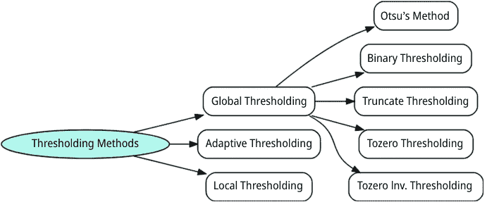

**Figure 4:** 阈值方法。

尽管存在这些缺点，阈值化仍是图像分割中的基本步骤，并且在需要简单性和速度的应用中可作为更复杂方法的依据。

### 3.2 基于区域的方法

基于区域的方法也是传统图像分割技术的主要类型之一，它根据图像中像素值的某些标准和空间关系对图像进行划分。这些技术基于这样的假设：某些属性，如强度和纹理的差异，必须用于确定图像中的区域。

### 3.2.1 区域生长

分割中使用的一种最简单技术称为区域生长；该过程首先从图像中分割出几个种子点。然后算法将这些种子点多次扩展到满足若干标准（如纹理）的邻近像素中。当整个图像被分离成符合标准的区域时，该过程继续进行。区域生长对于划分具有相似属性的区域特别有效，但大多数情况下，它无法处理显示出大量变化的簇。

### 3.2.2 区域合并

由此可见，区域合并技术基于分割获得的原理，其中相邻区域根据相似性进行合并。最初，图像被划分为过度分割的小段图，然后使用强度、纹理和统计测量等特征逐步合并。在合并过程中，分割得到改善并产生更大、更完整的区域。尽管区域合并在将小段分组为合理结构方面很有用，但其适用性在很大程度上取决于初始分割，并且在许多情况下需要正确调整合并标准。

### 3.2.3 分水岭分割

分水岭分割是一种强大的技术，它将图像作为地形图来操作；像素强度描述高度。然后算法逐渐填充该表面，模仿洪水并以局部最小值处的种子作为物体边界进行作用。一段时间后，它根据水位引起的集水区将区域联合起来，因为“洪水”开始进展。分水岭分割可用于以捕捉结构和边界的方式划分数据集，但存在图像过度分割的问题，这意味着通常需要后续处理来清理最终分割结果。

### 3.2.4 区域分裂与合并

区域分裂与合并是一种策略，从整个图像作为单个区域开始，基于同质性标准将其分裂成更小的区域。初始分裂后，如果两个区域满足同质性标准，算法会融合相邻区域。这种方法介于区域极细细分和每个段的凝聚力之间。该方法的有效性取决于所应用的分裂合并标准，这些标准必须足够敏感以避免过度分裂和合并。

### 3.2.5 主动轮廓（蛇）

蛇形轮廓是一种使用能量最小化曲线勾勒物体边界的技术。算法使用包含归因于轮廓连续性的内部能量和与图像梯度相关的外部能量的能量函数主动更新轮廓。它根据物体的形状和大小持续调整轮廓，这是有利的，因为某些图像中的分割可能很复杂。主动轮廓特别适合具有清晰边界的物体的分割，但它们需要初始放置轮廓并调整参数以获得最佳结果。

这些基于区域的方法是许多更传统图像分割技术的基础，并提供了可根据空间和强度属性对图像进行划分的有用工具。这两种方法各有利弊，其应用效率因图像特征和预期应用而异。

### 3.3 边缘检测技术

诸如边缘检测等基本方法是医学图像中识别图像内物体边界的计算策略。这些技术通过强调不同类型组织和病理区域之间的变化，在分割感兴趣区域方面非常有用。在医学图像分割中，边缘检测

能够检测这些急剧变化率的边缘检测方法被用于解释其性能。

基本上，边缘检测算法利用像素强度的变化，这些变化给出了图像的边界。此类方法通常涉及使用图像强度的微分，以期放大差异显著的区域。其主要目的是识别并勾勒出解剖结构的形状，这对于进一步的表征至关重要。

常用的边缘检测算子有多种，每种都有其优势和局限性：

- **Sobel 算子：** Sobel 算子用于处理图像，并测量图像强度在水平和垂直方向上的一阶导数。它应用卷积核来增强边缘，在基于方向的边缘检测中很有用。但它对噪声敏感，在弱边缘区域效果不佳。

- **Canny 边缘检测器：** 这是一种多阶段技术，除了梯度计算、非极大值抑制和高斯平滑外，还涉及滞后过程用于图像边缘检测。它具有出色的边缘检测精度和一定程度的降噪能力。由于在任何成像场景下都具有高性能，因此常被使用。

- **Prewitt 算子：** 与 Sobel 算子类似，Prewitt 算子也测量一阶灰度差和强度梯度。它允许使用不同的核。它在边缘检测中表现良好，并且可以轻松修改以适应不同环境。但它噪声较大，需要一些额外处理才能获得更好的边缘检测结果。

- **Roberts Cross 算子：** Roberts Cross 算子旨在检测边缘；其梯度通过使用两个卷积掩模计算。在对象与背景对比度高的图像中非常有效，但在对比度低且图像有噪声的情况下，确定边缘的效果不佳。

在医学图像处理中，边缘检测方法用于定位清晰边界，如器官的结构边界。在较简单的分割方法中，它们被用作独立方法，也可与其他方法结合以提高性能。这尤其适用于 X 射线等成像模态，在这些模态中，高对比度图像可以通过边缘检测得到良好处理。

医学图像分割给边缘检测技术带来了若干挑战。医学图像中常见的噪声和伪影会显著影响边缘检测的准确性，增加假阳性的可能性，并导致边缘映射不完整或碎片化。在图像对比度低且边缘过渡平滑的场景中，这些方法尤其无效，这种情况常见于特定的病理案例。如图 5 所示，基本的边缘检测技术在这种情况下难以发挥作用。然而，这些局限性已在更先进的方法中得到解决，这些方法结合了噪声抑制和边缘增强，从而带来更可靠、更准确的分割结果。

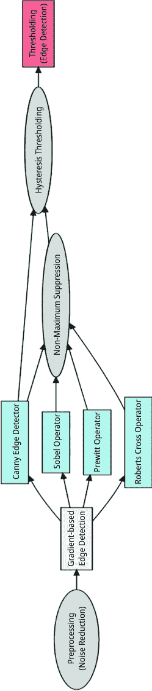

**图 5：** 边缘检测技术。

边缘检测方法的最新发展是自适应和多尺度边缘检测技术的提出，这些技术改善了不同图像条件下的边缘检测结果。与机器学习和深度学习的集成也提高了边缘检测能力；模型可以学习特定的图像特征。这些创新有助于在医学图像分割中实现更高的准确性，以识别必要特征、表现疾病症状并制定适当的诊断和治疗策略。

论文中仍将边缘检测方法视为医学图像分割的重要工具，因为它们为结构和病理区域提供了所需信息。这些算法结合现代计算技术的持续发展，凸显了它们在增强医学图像处理方面贡献的可行性。

## 3.4 基于聚类的方法

这种医学图像分割方法多年来被广泛使用，是一种基于相似性标准对图像进行划分的通用而强大的框架。这些技术的工作原理是，具有相似特征（如强度或纹理）的图像像素可以被分组为不同的簇。图 6 展示了这一概念，说明了聚类算法如何通过分析像素间的特征相似性来分割感兴趣区域。以下是医学图像分割中使用的几种主要基于聚类的方法：

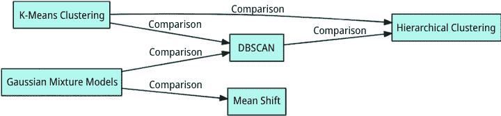

**图 6：** 基于聚类的方法。

### 3.4.1 *k*-均值聚类

*k*-均值聚类是图像分割中最常用的聚类方法之一。在该方法中，通过将每个像素迭代分配给最近的聚类质心，将图像划分为 *k* 个簇；另一方面，质心根据所分配像素的均值进行更新。*k*-均值在分割均值大致相等且分区清晰的图像时实用而简单。请注意，该算法对初始化敏感，并且需要预先指定簇的数量，从而限制了其适用性。

### 3.4.2 高斯混合模型（GMMs）

高斯混合模型（GMMs）是 *k*-均值的一种扩展，它假设数据由若干高斯分布生成。每个簇的分布被假定为高斯密度函数，并使用期望最大化（EM）算法计算这些密度参数的最大似然估计。GMM 特别适用于图像强度分布重叠且分布形状不同的情况。该方法允许所谓的软聚类；它不是将每个像素分配到特定簇，而是给出每个像素属于每个簇的概率。

### 3.4.3 模糊 *c*-均值聚类（FCM）

模糊 *c*-均值（FCM）是 *k*-均值算法向模糊逻辑方向的扩展。在 FCM 中，每个像素可以属于与实际簇数相同数量的簇，并拥有区分不同分类显著水平的隶属度值。这种方法有助于分割那些分割边界难以确定且分割区域重叠的图像，从而更好地表示像素。通过隶属度加权的像素强度增强了簇中心更新过程，并取代了传统的 *k*-均值更新过程。

### 3.4.4 均值漂移聚类

均值漂移聚类通过搜索数据分布的模式来生成簇。该算法迭代地将数据点移向窗口中心，从而定义基于密度的簇。当底层图像密度和分割形状是任意的时候，均值漂移非常有效。由于无需预先指定簇的数量，它可以用于具有众多簇的图像。结果受带宽参数的影响很大，窗口大小由该参数决定。

### 3.4.5 分水岭算法

分水岭算法源自地形学中的分水岭概念，并在“水流”的思想下应用于图像分割。它将图像视为拓扑表面，通过模拟从局部最小值开始的水流来检测集水盆地和分水岭线。该算法在分割边界清晰、结构高度规则的图像时成功率最高。它对噪声敏感，如果要抑制噪声，通常需要对图像进行平滑以获得最佳结果。

基于聚类的方法以灵活的方式构建问题，并提供了多种专门用于医学图像分割的工具，每种工具都有其优缺点。尽管文献中存在各种聚类方法，可以为不同的分割问题提供满足上述要求的优越解决方案，但这些技术在大多数情况下仍需要精确的参数调整和数据预处理，才能在医学图像上获得更好的准确性。聚类算法的最新进展还将其与深度学习等较新的先进方法相结合，这不断优化分割效果，使其在临床应用中更加高效。

## 3.5 基于模型的方法

基于模型的医学图像分割方法涉及使用数学和统计模型，旨在从图像中提取结构和区域。这些方法为图像分割提供了一个框架，并考虑有关患者身体结构形式和特征的先验知识和假设。

### 3.5.1 活动轮廓与蛇模型

活动轮廓模型（也称为蛇模型）是一种基于模型的技术，利用能量来检测对象边缘。该方法使用由内部力和外部力组成的能量函数来调整对象轮廓。内部力使轮廓尽可能平滑，而外部力则将轮廓推向对象边缘。该方法在分割边缘清晰的对象时特别有效，但对于边缘模糊的对象则效果不佳。

### 3.5.2 水平集方法

在进一步讨论之前，让我们扩展主动轮廓方法，其中轮廓通过水平集函数表示为隐式表面。它包含一个水平集函数，通过该函数在捕获物体边缘时从一种状态转换为另一种状态。水平集方法的一大优势在于能够处理拓扑变化，例如轮廓的合并和分裂，这对于尖锐和动态几何形状非常重要。这种灵活性在医学成像中尤其有利，因为不同结构之间差异巨大。

### 3.5.3 可变形模型

其他基于模型的技术是可变形模型，它结合了关于物体形状和外观的先验知识来驱动分割过程。这些模型通过使用统计形状模型（也称为模板）对观测数据进行变形和拟合。这种变形是根据能够保持模型与图像特征一致性的目标函数实现的。如前所述，当图像中的结构在不同个体中具有相似形状（例如器官）时，可变形模型非常有用，但需要针对外观和微小形状差异进行微调。

### 3.5.4 统计形状模型

统计形状模型从我们所建模形状的训练样本集中提取信息。这些模型将物体形状表示为相对于平均形状的变形，而平均形状嵌入在低维形状空间中。利用训练数据，统计形状模型识别形状中发生的变化，并将新图像映射到这些变化上进行分割。该方法在线性结构中尤其有利，因为这类结构的几何形状相对于主要结构变化很小，例如骨骼；如果能够获得关于类别内形状变异的先验信息，这种方法有望改善分割结果。

### 3.5.5 模板匹配

模板匹配是指应用特定解剖结构的模板，然后使用这些模板来匹配和分割图像。通常，它将图像数据扩展到预定模板，并利用相关的相似性评估来决定选择。模板匹配通常可以采用相关方法，这是一种基于特征的方法。尽管该方法在某些配准中证明有效，但在模板较大且物体外观变化巨大时，其应用效果相当有限。

这些基于模型的方法通过数学和统计框架为医学图像分割提供了结构化、原理性的解决方案。每种图像分割方法都有其优缺点，其效率取决于待分割图像和物体的特征。

## 4 向基于深度学习的方法演进

### 4.1 传统方法的局限性

现有的医学图像分割方法属于传统方法，存在以下影响其在各种疾病诊断中的性能和适用性的缺点。这类方法广泛基于启发式规则和算法，这可能难以应对医学图像固有的变异性和丰富性。

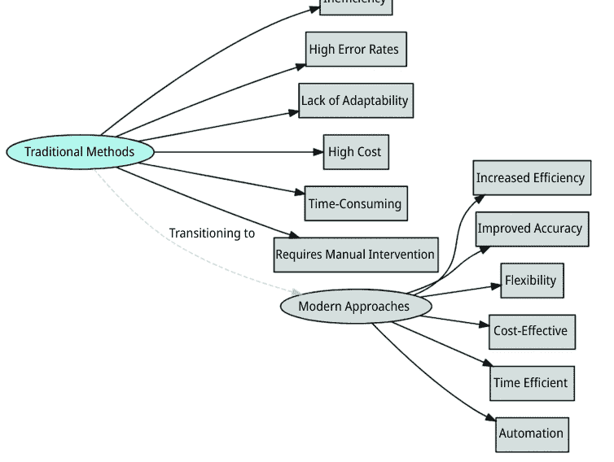

图7：传统方法的局限性。

在这种方法中，必须提取主要特征并应用启发式规则。

大多数分割技术采用传统方法，即必须手动输入特征，然后应用有限的、预定义的准则来描绘图像中的结构。这些方法需要大量用户输入，从而降低了其通用性，并在应用于新数据集或不同临床场景时限制了有效性。此外，它们需要训练有素的专业人员的专业知识和时间。如图7所示，此类情况下的识别过程在很大程度上是定性的，这意味着结果可能因观察者不同而有显著差异，导致在不同条件下或不同操作者之间产生不一致且不可重现的结果。

### 4.1.1 对噪声和伪影的敏感性

传统方法由于医学图像中的噪声和伪影而表现不佳。阈值分割和边缘检测方法对图像质量的变化和噪声的存在尤其敏感。这种层面的敏感性会导致分割出现问题，尤其是在噪声水平较高的低质量图像中。

### 4.1.2 应对复杂层次结构的灵活性不足

很少有经典分割方法能够处理与其他组织高度相似且结构复杂的问题。区域生长检测等方法对于边缘清晰的对象是准确的，但无法令人满意地分割与相邻组织重叠的结构。在复杂多样的分割问题求解中，由于这一局限性，这些方法存在不足。

在许多情况下，人们依赖于已经完成并被证明的固定参数。

许多传统分割方法依赖于由模型开发的诸多策略性因素，这些因素限制了通用性和适用性。例如，在阈值分割方法中，使用某些阈值不能适用于任意给定图像。为了解决这个问题，需要调整和优化的参数通常会带来额外的步骤，从而减慢分割速度并损害技术的可靠性。

即使成功，它们也依赖于冗长的特征提取，并且高度依赖图像质量和内容。

另一方面，无监督学习算法在数据中搜索模式和分组，这与使用标记数据集的方法不同。为了根据统计特征对图像进行划分，通常采用 GMM 和 k-means 聚类等方法作为补救措施。虽然无监督方法在没有初始真实数据时很有用，但在需要结构先验知识的复杂图像中，它们往往存在问题。

### 4.2.3 早期机器学习模型的局限性

关于使用机器学习方法进行图像分割的早期方法的缺点，包括：所用特征的复杂性和大量预处理的需求。其中许多模型专门针对某一类图像，无法很好地泛化到其他数据集，甚至其他模态。此外，构建详细的手工特征进一步限制了模型捕获复杂模式和数据分布变化的能力。

### 4.2.4 问题向深度学习范式的迁移

随着深度学习（DL）被用于解决经典机器学习所面临的问题，图像分割得到了极大的改进。作为深度学习模型，CNN 能够自动学习未处理图像数据的分层特征，而无需进行特征工程。它们还允许直接从底层数据中提取细粒度模式和空间组织，从而实现更好的分割。

### 4.2.5 影响与进展

U-Net 和 FCN 的引入使不同医学成像技术中的分割性能远高于此前的传统方法。这些模型受益于端到端训练，从而获得了较高的准确性，并克服了以往机器学习模型面临的许多挑战。大规模数据集和多样化训练提高了模型在临床环境中的通用性和实用性。

总体而言，医学图像分割向基于深度学习方法的转变，揭示了利用高端计算工具解决医学成像中其他挑战的日益增长的趋势。深度学习的持续进步必然带来分割能力、速度和通用性的进一步提升，并将创新扩展到医疗保健和医学领域。

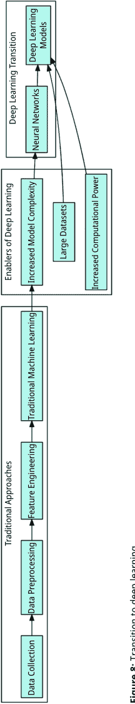

图 8：向深度学习的过渡。

这些网络在零和博弈中面临困境。为了提高模型的性能和泛化能力，这种增强方法解决了一个被称为“标注数据缺乏”的问题。基于 GAN 的技术增强了分割的实用性，尤其是在没有预先标注数据集可用的场景中。

### 4.3.4 迁移学习与预训练模型集成
迁移学习是一种强大的方法，它要求利用在大数据上预训练的模型来增强分割效果。科学家可以通过微调，将在大规模通用影像数据（如 ImageNet）上训练的模型无缝适配到小型医学专用图像数据库中。这是在临床中引入和应用深度学习模型的捷径，因为无需海量训练数据和计算性能。

### 4.3.5 深度学习中的挑战与机遇
尽管如此，仍有一些挑战阻碍着基于深度学习的分割技术扩展其应用。由于持续需要大规模、高质量的标注数据集，模型构建和泛化的过程面临诸多困难。此外，由于临床对深度学习模型的信任和采用需要理解这些复杂网络的决策过程，模型本身在某种程度上是不透明的。为了克服这些困难，建议进一步努力提高深度学习系统的透明度和可监控性，提升数据利用效率，并提供更好的模型设计。

基于深度学习的方法已显著改变了医学图像分割技术的重点，为获得更好、更快且更精确的分割结果提供了机会。同时，随着研究领域和技术的不断发展，这些理论还有进一步发展的潜力。

## 4.4 用于分割的深度学习架构
随着深度学习的发展，出现了一些强大的架构，在准确性和处理效率方面提升了医学图像分割的水平。由于医学影像的复杂性，这些系统采用了复杂的处理技术和基于层次结构的特征提取方法。

### 4.4.1 卷积神经网络
基于 CNN，深度学习在图像分析尤其是医学图像分割领域得到了发展。CNN 通过多个步幅引入深度卷积层来提取特征，并在图像中存储空间金字塔。CNN 可以通过一系列卷积层和池化层有效地提取和过滤信息，从而为分割复杂的解剖结构提供了良好手段。由于能够处理大量数据并进行跨模态泛化，CNN 对分割任务至关重要。

### 4.4.2 U-Net 架构
U-Net 最初是为生物医学图像分割而设计的，如今已成为该领域的主导框架之一。特别是，U-Net 以其编码器-解码器结构而闻名，其中编码器部分通过下采样进行上下文提取，解码器部分通过上采样实现精确定位。跳跃连接弥补了紧凑间距的不连续性，它将对应的编码器和解码器层连接起来，以保留空间信息。由于 U-Net 在分割小型和不平衡数据集方面的有效性，它已被多次应用和更新。

### 4.4.3 注意力机制
为了促进分割，一些技术如注意力机制被嵌入到深度学习架构中，以减少在图像无关部分上浪费的时间。源序列和目标序列的内部表示通过放大输入的某些部分同时屏蔽其他区域，使模型能够关注输入的特定部分，从而产生积极影响。注意力 U-Net 和自注意力模块已被提出，用于将注意力集成到现有结构中，从而提高分割准确性和模型鲁棒性。

### 4.4.4 DeepLab 系列
DeepLabv1、DeepLabv2 和 DeepLabv3 是用于语义分割的 DeepLab 架构家族中的先进架构。这些模型采用空洞（扩张）卷积，以获得多尺度上下文描述，同时保持空间连贯性。随后，DeepLabv3 中加入了空间金字塔池化，以融合不同尺度的特征，重点在于更好地分割不同大小和形状的物体。在该系列中，已在医学影像任务（包括器官和病灶分割）中展现出良好性能。

### 4.4.5 用于分割的 Transformer
Transformer 最初用于自然语言处理，如今在医学图像分割中正取得越来越令人瞩目的性能。Transformer 的自注意力特性使模型能够考虑全局依赖关系以及图像各部分之间的交互。视觉 Transformer（ViT）和分割变体等架构利用这些能力，以增强对图像中各种复杂结构的管理。将 Transformer 引入分割模型是近期的实践，也将进一步推动分割和泛化能力的发展。

这些深度学习架构是一系列为改进医学图像分割而开发的模型。每一种都为其优势增添了价值——从特征提取和定位到上下文感知和注意力。这些改进是这些模型持续演进以及新技术不断发展的结果，这些新技术提高了分割性能，进而改善了临床产出和研究成果。

## 4.5 在临床实践中的应用
在临床实践中使用深度学习技术进行医学图像分割，在某种程度上是朝着提高诊断工具效率迈出的根本性进步。这一转变具有几个关键发展和考量：

### 4.5.1 融入临床实践
目前已有多种基于深度学习的分割工具被用于临床环境，以增强诊断性能并加快整体工作流程。这些工具显著减少了分割所需的时间，并最大限度地减少了人工输入的需求。如图 9 所示，它们与现代影像系统和电子健康记录（EHR）的集成，通过使临床医生能够随时获取分割图像和相关的定量数据，简化了临床操作。这种无缝集成不仅改善了实时决策，还提升了常规临床程序的整体有效性和效率。

### 4.5.2 对诊断准确性的影响
深度学习方法的采用还缩小了测量结果的变异性，并提高了对解剖结构和病理区域的分割精度，从而提升了诊断准确性。基于 CNN 的深度学习模型能够学习人眼无法看到的复杂模式以及医学图像中的细微变化，而这些是传统方法无法识别的。这些更高的准确性有助于早期诊断、更精准的疾病定位、对疾病演变的谨慎观察以及精确的治疗规划，所有这些都提高了患者的生存率。

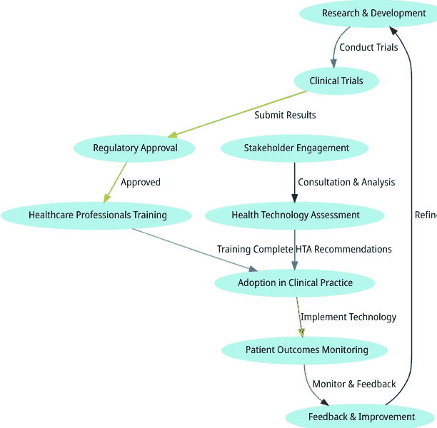

**图 9：** 临床实践中的采用情况。

### 4.5.3 实施中的挑战
基于深度学习的分割工具在实际实施中面临若干问题。一个重要的问题是将这些模型扩展到不同的患者群体和影像场景。基于特定数据集开发的模型在不同临床环境中预测临床结果时会产生不准确性。

不同协议下的环境。这一挑战只能通过在不同临床情境中对模型进行验证并逐步丰富其内容来应对。

监督学习模型及其可解释性还存在另一个问题。临床医生要在实践中接受这些工具，所需的技能包括理解模型如何得出分割结果。在临床决策流程中实施此类技术，意味着要增强模型决策过程的可解释性，并简明地提供分割结果的依据。

### 4.5.4 医疗保健的监管与伦理方面

基于深度学习的分割工具在实践中应用的相关规则仍在讨论之中。这些有益于健康的工具必须符合医疗器械法规，才能获准进入市场，这一点非常重要。数据所有权、模型偏见和模型公平性等问题必须加以考虑，以确保这些工具被正确使用。

### 4.5.5 实例与验证

事实上，基于深度学习的分割工具已在多个案例研究和试点研究中证明了其实践应用的可行性。以下示例展示了这些工具在获得更准确诊断、提高工作效率和改善患者健康方面的优势。要使这些工具成功落地，需要数据科学家、临床医生和医学影像专家共同努力，根据临床医生的需求调整工具，并在临床环境中评估其性能。

### 4.5.6 未来前景

基于深度学习的分割在临床实践中的未来工作仍有进一步发展的可能。未来工作包括：构建更稳定且语义灵活度更高的模型；提升实时处理速度以优化性能；结合不同的影像数据模态以提高分割精度。此外，可解释人工智能的进步和更优秀的图形用户界面也将继续推动此类技术在临床实践中的更广泛应用。

基于深度学习的算法在医学图像分割中的应用是医疗保健领域的一场革命，它提高了多种诊断的临床效率和准确性。这将促进这些技术在临床实践中的落地，但必须应对相关挑战，同时应充分利用有效实施这些技术所取得的成果。

## 5 影像模态及其特征概述

### 5.1 磁共振成像（MRI）

磁共振成像是一种常见的影像学方法，能够提供身体组织和器官的详细图像。由于它利用核磁共振（NMR）原理生成清晰图像，因此是研究和临床分析中的重要工具。

### 5.1.1 MRI 技术原理

磁场的施加通过影响体内的原子核，在 MRI 的功能中起着至关重要的作用。施加强磁场可使质子核（尤其是黏膜下结缔组织中的质子）沿磁场方向排列。随后，这些质子受到射频（RF）脉冲的干扰，短暂地偏离轴向排列。当射频脉冲关闭后，质子恢复到原来的排列状态，并在此过程中释放射频信号。如图 10 所示，这些发射的信号由 MRI 传感器捕获并经过处理，生成高度详细的图像。这些图像为解剖结构和功能提供了宝贵的见解，不同的组织特性和对比机制有助于临床判读。

### 5.1.2 在软组织成像中的应用

MRI 的优势之一在于能够以鲜明对比度呈现软组织。与 CT 扫描等其他结构成像技术相比，MRI 能更好地突出脑与脊髓、肌肉和韧带等软组织之间的差异。这一特性在神经病学、骨科学和肿瘤学中尤其有用，因为这些领域通常需要区分组织密度非常相似的结构，并制定治疗方案。

### 5.1.3 成像序列与对比机制

MRI 中使用的不同成像序列可以突出并增强身体部位内各种组织的结构细节，包括质子密度成像、T1 加权成像和 T2 加权成像。T2 图像有助于显示水肿和其他病理变化的存在，而 T1 图像对解剖结构具有非常好的对比度。质子密度成像则在组织对比度和图像分辨率方面兼得两者之长。此外，用于估算未绘制路径的新技术包括分数各向异性和扩散张量成像（DTI），而功能性磁共振成像（fMRI）则用于监测代谢活动。

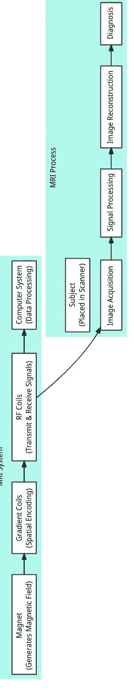

图 10：磁共振成像。

### 5.1.4 MRI 分割中的问题

尽管 MRI 在分割任务中具有许多宝贵属性，但该领域仍观察到若干复杂问题。主要问题包括噪声和伪影，因为它们常常损害图像清晰度和分割效果。这些问题包括患者和内部器官的运动、磁敏感性效应以及化学位移的变化。此外，图像采集差异和患者健康状况的可变性也会影响分割结果。解决这些挑战通常需要复杂的预处理以及强大的分割模型，以帮助生成正确的结果。

### 5.1.5 近期改进与变化

随着 MRI 的发展，有充分证据表明图像质量、扫描时长和分辨率均有所改善。高场强 MRI 扫描仪、更好的线圈和并行成像等技术提高了获取更高分辨率图像的效率。此外，机器学习和深度学习的扩展也已显示出在增强 MRI 分割和分析方面的价值。这些改进不仅有助于拓展 MRI 检查的适用范围，还能优化其对多种疾病的诊断能力。

MRI 仍然是医学成像的主要方法之一，因其对软组织提供高对比度和高细节而备受赞誉。这些特性加上持续的发展，使其成为现代医学中不可或缺的临床诊断辅助工具和研究工具。

### 5.2 计算机断层扫描

CT 是一种传统的成像技术，它从不同方向拍摄多张简单的 X 射线图像，并将其分层组合，以生成全身图像。由于该方法能够提供内部结构的全面视图，因此在多种治疗应用中非常有效。

### 5.2.1 CT 成像原理

CT 成像的基础是 X 射线的相对吸收，其原理在于 X 射线穿射人体时在不同类型的组织中具有不同的穿透率。从人体穿出的 X 射线束被探测器捕获，计算机利用捕获的数据构建高细节的横断面图像。为了获得多个图像切片（这些切片随后被组合成扫描区域的三维图像），该过程需要使 X 射线源和探测器围绕受检者旋转。

本文旨在讨论该概念在我们临床实践中的一些应用。

CT 在诊断和评估各种疾病方面都发挥着重要作用，例如创伤性损伤、癌症、心血管疾病等。它在识别和描述肿瘤、观察内出血以及分析复杂骨骼结构方面尤为优势明显。CT 还用于术前规划、活检引导以及疾病进程和治疗效果的评估。

### 5.2.2 CT 成像的优势

事实上，CT 成像的主要优势之一被认为是能够提供快速而详细的解剖信息。由于 CT 扫描具有高空间分辨率，可以显示精细的解剖细节，这对于诊断和制定治疗计划至关重要。此外，与其他一些成像方法相比，CT 耗时更少，因此在分秒必争的紧急情况下尤为理想。CT 技术的进步，包括多层螺旋 CT 扫描仪，不断提高了图像质量和扫描速度。

### 5.2.3 CT 成像中的分割

如果没有对 CT 图像进行分割，就无法很好地界定解剖结构和病理区域。因此，已有多种深度学习技术被应用于 CT 图像分割，以识别不同的组织和病变，并取得了令人鼓舞的结果。这些方法利用 CT 扫描固有的高分辨率特性来提高分割性能，从而提升诊断和治疗的准确性。然而，一些持续存在的问题仍然有待解决，例如处理解剖结构图像质量的可变性，因此仍需进一步研究分割方法。

## 5.3 超声成像

一种诊断成像技术——超声检查，又称超声成像，是一种常见的诊断疾病的方法，它利用高频声波产生内脏器官的图像。正因如此，该成像技术的实时成像、便携性和非电离辐射特性备受重视。

### 5.3.1 超声成像原理

声波的传输和反射原理构成了超声成像的基础。高频声波由换能器探头发出，穿过人体组织，并在不同组织类型相遇的界面处反射回来。这些反射波随后被换能器捕获，转换为电信号并进行处理，以生成内部结构的准确图像。如图 11 所示，反射回波的强度和时间在决定所得图像中解剖特征的可见性和清晰度方面起着关键作用。

### 5.3.2 临床应用

由于其灵活性和无创性，超声成像被应用于医学的不同领域。它用于探查软组织、肝脏、肾脏和心脏，以及血流分析和肿瘤和囊肿等疾病的识别。在产科，超声用于评估胎儿生长、诊断妊娠并发症以及制定产前管理计划。此外，肌肉骨骼超声用于分析关节、肌肉和肌腱的状况，产生对运动医学和骨科有用的图像。

### 5.3.3 超声成像的优势

实时成像允许对器官及其运动进行功能评估，这是使用超声成像的一个优势。该方法在安全性方面也特别有价值，因为它不使用电离辐射，使其最适合常规扫描以及儿童和有时孕妇等脆弱人群。在某些情况下，超声使用的设备比其他成像方式如 CT 更便宜且更易运输，从而促进了其在临床实践中的使用。

机器学习算法实现了图像处理的自动化，并增强了诊断的清晰度和精确度，甚至在临床实践中提供决策支持。

## 5.4 X射线及其他成像方式

X射线成像是在患者诊断中使用的主要且最受信任的成像方法之一。在这种方法中，通过将 X 射线穿过身体并记录探测器接收到的程度来制作内部结构的图像。不同组织对 X 射线的吸收不同，这导致了 X 射线图像中显示的对比度：例如，脂肪组织比脂肪含量少的组织更暗，而像骨骼这样非常致密的材料则呈白色。

### 5.4.1 特征与应用

- **骨骼和关节成像：** 理想的成像方式通常是 X 射线，它在显示骨骼结构方面特别有用，常用于骨折、脱位和退行性骨病的诊断。鉴于骨骼具有较高的衰减值，而软组织与骨骼相比衰减值相对较低，因此可以实现对骨骼系统的极佳描绘。
- **胸部成像：** X 射线成像被用作相应病理状态的标准诊断形式，用于诊断胸部疾病。它用于诊断肺部疾病，包括肺炎、结核和肺水肿，并用于观察心脏和大血管。
- **局限性：** X 射线可提供关于组织的有用诊断信息；然而，它们无法区分软组织；此外，它们在分期早期疾病方面并不那么有用。辐射暴露是 X 射线成像中的一个关键问题，因为它涉及使用电离辐射，这对儿童和孕妇尤其危险。

### 5.4.2 计算机断层扫描

CT 是一种非常先进的成像方法，使用 X 射线以薄切片形式创建身体的横截面视图。CT 扫描仪通过从不同方向重建许多 X 射线图像并创建一系列二维切片来实现这一点，这些切片组合后可形成内部结构的 three-dimensional 视图。

#### 5.4.2.1 特征与应用

- **高分辨率和细节：** CT 成像提供高空间分辨率，并可清晰显示皮质骨和松质骨以及软组织。因此，它在创伤、肿瘤和内出血的诊断和评估方面非常有用。
- **横截面成像：** 横截面研究在检测和定位异常以及确定疾病总体受累范围方面更胜一筹。CT 常用于肿瘤学中肿瘤分期和创伤手术中对患者的评估。
- **局限性：** 与常规放射摄影相比，CT 成像使用更高剂量的 X 射线，使患者面临辐射诱导效应的风险，尤其是在多次扫描时。因此，新的辐射剂量降低方法和策略正在常规开发中。

### 5.4.3 超声成像

压电晶体发射高频声波，有助于形成内脏器官的图像。超声换能器产生的波从组织反射并转换为显示在监视器上的图像。

#### 5.4.3.1 特征与应用

- **实时成像：** 超声允许实时成像，从而促进器官和结构的动态评估。它在心脏病学中常用于确定患者的心功能，在产科中用于监测胎儿生长。
- **非电离辐射：** 超声不如其对应物如 CT 那样危险，后者产生电离辐射。因此，该方式对某些患者群体更安全，包括新生儿和孕妇。
- **局限性：** 该方式的主要问题是其穿透力低，无法轻松穿透骨骼成像，这限制了其用途，且身体某些区域无法成像。影响图像质量的因素有两个：操作者的专业知识和患者的活动能力。

### 5.4.4 磁共振成像

MRI 是另一种使用磁场和射频波产生人体图像的方法。MRI 在软组织成像方面特别出色，与 X 射线和 CT 相比具有更高的对比度。

不同方式的增强图像。这些技术允许无缝集成并有助于最大化每种方式在多模态分析中的效用。

临床实践是一个领域，可以描述各种应用以帮助更好地理解患者的状况。

集成成像策略在不同的临床过程中越来越多地使用。在肿瘤学中，PET/CT 的使用很常见，因为它结合了肿瘤代谢及其解剖分布，用于分期、治疗计划和评估。MRI 和 fMRI 在神经学中广泛联合使用，以评估神经系统疾病患者大脑的结构和功能变化。同样，在心脏病学中，整合 MRI 和超声心动图可提供对心血管疾病评估中心脏结构和功能精确分析。

### 5.5.3 挑战与注意事项

在多模态成像数据集成中会出现若干困难。不同方式之间空间分辨率、对比度以及采集方法和协议的差异有时会使配准和融合任务变得具有挑战性。多模态数据增加了复杂性，这意味着它们需要复杂的计算处理和方法才能正确集成并得出准确的含义。其中一些挑战包括数据管理和存储，因为多源和多步骤的多媒体数据捕获和构建需要健全的获取、组织、存储和检索大数据解决方案。

## 6 准确分割在临床实践中的重要性

### 6.1 提高诊断准确性

医学图像分割是诊断过程中的重要步骤，直接影响患者的治疗和预后。对解剖结构和病理区域定义准确性的影响会影响诊断准确性和后续治疗步骤的成功。

### 6.1.1 病理特征的增强检测

因此，可以对图像进行分割、变形、主动分析特定特征并适当采取可能必要的行动。分割算法很重要，因为它们通过提供边界的精确解剖信息

## 提高诊断准确性

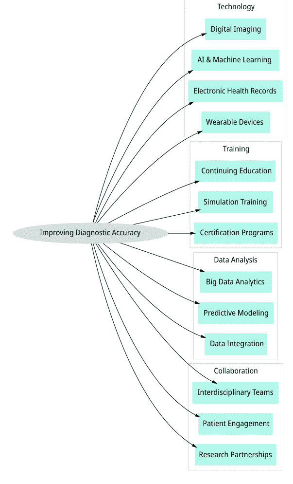

图 13：提高诊断准确性。

异常的肿瘤或病变，可以精确量化其大小和形状的范围及分布。这使得诊断癌症等疾病变得更容易，从而在早期发现时可以进行治疗以改善预后和疗效。由于大多数特征都能够以高度准确性被检测和表征，早期准确诊断得以实现，从而使有效治疗策略的应用成为可能。

更好的疾病分期：除了疾病分期整体改善外，用于确定疾病分期的分级系统也得到了增强。

在肿瘤学和其他医学领域，准确的分割在正确分期和分级疾病方面发挥着至关重要的作用。例如，在癌症治疗中，区分恶性肿瘤和良性肿瘤需要精确的体积分割，这为分期提供信息并直接影响治疗计划。如图 13 所示，分割后的图像允许临床医生在治疗前后比较肿瘤体积，为评估治疗反应提供可靠依据。分期和分级系统的进步越来越多地依赖于详细的影像特征，从而能够开发出提高疗效同时最大限度减少不必要干预的个性化治疗策略。

### 6.1.2 手术计划的优化

精确分割对于增强时空分割至关重要，后者揭示了指导手术操作的详细解剖信息。术前，分割分析允许识别所有相关结构，帮助外科医生更好地可视化治疗区域。关于特定器官解剖的此类详细信息可降低手术相关并发症的概率，并提高大多数手术操作的安全性。术后分割在评估手术结果和在随访护理期间监测潜在并发症方面发挥关键作用。

### 6.1.3 放疗治疗辅助

在放疗中，必须准确分割表面以确定需要治疗的体积和要施用的辐射剂量。在将癌组织与周围健康组织进行分割时，肿瘤勾画可确保癌症治疗设定的剂量将预期辐射剂量传递给肿瘤，同时不损害周围健康组织的健康。这种对谨慎治疗计划的调整对于实现最高治疗成功率并防止任何副作用至关重要。正确的分离也有助于放疗形式的应用，该形式会根据治疗各个阶段肿瘤质量大小的变化而调整治疗计划。

### 6.1.4 支持长期密集观察

疾病预后疗效评估需要在时间轴上进行分割以绘制疾病演变图。跨多次影像检查的高质量递归和时间同步结构划分允许对影像数据进行比较，从而有助于评估疾病进展和治疗效率。这种能力对于需要长期治疗服务的慢性疾病的持续监测尤其有用。

## 6.2 促进治疗计划制定

分割是治疗计划制定的基石，因为它提供了关于结构和病理区域的精确信息。显然，在今天从业者可用的精细分割技术的帮助下，治疗计划的多个方面得到了明显改善，从而确保更有效和量身定制的治疗策略。

术前手术计划的使用可最大限度地减少手术室中的错误。

体积准确分割是准确手术计划的前提。从分割角度来看，包括器官、肿瘤和血管在内的相关特征可以被检测到，因此可以准备详细的术前地图以帮助外科医生在手术过程中使用。这种准确性也有助于最大限度地减少与健康细胞的关系并改进手术方法，使手术总体上更安全有效。在存在空腔的复杂乳房切除术中，例如癌症切除术以及人体高度复杂结构如腹部手术，分割在更好的术前计划中被证明是有益的。

### 6.2.1 放疗优化

放疗需要高度的分割以减少对癌症周围健康细胞和组织的辐照。粗肿瘤体积（GTV）、临床靶体积（CTV）和计划靶体积（PTV）的定义允许对肿瘤边界进行准确定义。这种准确性允许最大化剂量分布，增加治疗效果并最大限度地减少可能的负面影响。分割过程中的现代技术还允许进行自适应放疗等先进治疗，其中进一步的治疗计划取决于人体内肿瘤的缓慢移动。

### 6.2.2 个性化治疗方法

因此，分割通过提供其解剖结构和疾病状态的精确描述，有助于为每位患者制定适当的治疗策略。例如，在肿瘤学中，肿瘤边界可实现适当治疗周期的选择，以解决肿瘤病理类型及其解剖位置。在心血管干预中，心脏的结构分辨率允许对先天性心脏病等手术进行调整。此外，通过将患者数据输入治疗计划，分割可优化问题解决的治疗策略。

### 6.2.3 与复杂概览技术的互操作性

最优分割促进了复杂治疗技术（包括影像引导手术和微创治疗）的应用。在介入应用中，对感兴趣区域的正确勾画对于工具和设备的准确定位至关重要，从而提高手术成功率并降低其固有风险。在此，分割有助于手术中使用机器人系统和导航工具，并对过程提供即时反馈。

### 6.2.4 监督与管理调整

分割还有助于监督治疗过程并计算可能必要的调整。在分割的帮助下，临床医生能够评估治疗结果后的进展并识别任何并发症。这种监测的持续有助于及早修改患者护理计划，以使实施的干预措施有用且相关。

本文旨在强调分割在护理计划和管理中的重要性，特别是治疗计划。分割使术前准备、设计准确治疗、计划放疗、制定个性化治疗方案、适应新先进治疗以及监测进展变得更容易。这些贡献显著提高了临床环境中患者的治疗质量和结果。

## 6.3 监测疾病进展

形态和病理结构的时相关变化在准确分割效率中得到了很好的体现。这种能力对于监测疾病患病率变化、治疗反应率和持续管理至关重要。

### 6.3.1 监测疾病变化及趋势

分割使研究人员能够量化与疾病相关的因素，如肿瘤体积、病变大小、器官大小等。通过在两次影像研究中使用分割方法，临床医生可以确定这些参数的定量变化，从而衡量疾病进展。这些信息对于评估治疗方法的成功、修改治疗策略以及在临床环境中进行循证决策非常重要。

### 6.3.2 评估治疗疗效

用于评估疾病进展的分割使测量治疗计划的有效性变得容易。例如，在肿瘤学中，组织的出色分辨率允许评估肿瘤在化疗、放疗反应下的大小和形状变化。它有助于判断治疗是否产生预期影响，是否需要修改，或是否需要不同的治疗计划。适当的分割还意味着所有这些评估都是基于准确且一致的数据进行的，从而使治疗管理尽可能有效。

### 6.3.3 检测疾病复发

分割对于疾病过程出现的早期诊断也很重要。例如，治疗后照片中区域的区分可用于追踪接受过癌症治疗的患者，以诊断任何残留疾病，而这些疾病在肉眼简单的皮肤检查中不易识别。如前所述，复发可在早期诊断，并可能比晚期病例更有效地管理。

本文展示了支持纵向研究的益处。

通过纵向研究中的准确分割，可以显著增强对疾病随时间发展的深入了解。这些研究需要在多次影像检查中对解剖和病理变化进行一致且精确的量化。如图 14 所示，应用准确的分割和测量技术使研究人员和临床医生能够追踪疾病进展、评估治疗结果并识别演变模式。这种洞察水平对于提高对疾病动态的理解至关重要，并在设计更有效和个性化的治疗策略中发挥核心作用。

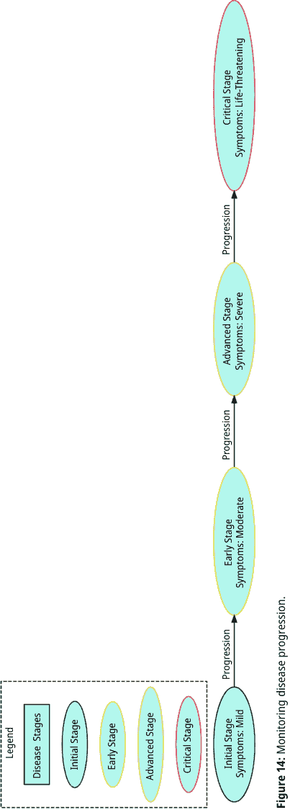

## 图 14：监测疾病进展。

### 6.3.4 增强个性化医疗

精准靶向被纳入疾病追踪中以制定个体患者的治疗方案，这构成了解决个性化医疗问题的概念基础。通过详细的分割数据，治疗方法可以根据特定疾病特征以及与疾病相关的进展进行定制。最终，个体化治疗方法带来了诸如高治疗有效性和患者副作用概率降低等益处。

精确的边界界定对于评估疾病的演变、治疗反应、复发、慢性化、随时间的行为以及推动个体化医学领域的发展至关重要。分割有助于改善患者护理服务，并通过在医疗行业中对众多分割的正确定义而及时跟上疾病特征的改变得以体现。

## 6.4 减少人工工作量和主观性

自动化分割技术通过补充和/或取代医学影像中的手动分割偏差，成为减少人工工作量和改进标准化诊断方法的重要手段。

### 6.4.1 组织工作以最小化重复性活动

自动边缘检测有助于减少手动定义感兴趣区域、解剖结构以及病理组织感兴趣区域所需的工作量。这种自动化是有益的，因为它节省了医学影像解读的时间，从而为患者的其他护理方面腾出更多时间。这些算法有助于加快影像工作流程和整体吞吐量，并减少放射科医生及其他医疗保健专业人员必须完成的工作量。

### 6.4.2 最小化人为错误

本研究中使用了手动分割，这引入了某些局限性，例如操作者疲劳、主观解读以及技术上的差异。这些人为因素会影响结果的一致性和准确性。相比之下，自动化分割方法通过在所有图像上应用一致的算法来缓解这些问题。这降低了人为错误的可能性并增强了影像发现的可重复性——这是诊断准确性、治疗规划和疾病随访的重要方面。

### 6.4.3 增强可重复性和一致性

与手动分割技术相反，由于使用特定的算法和参数，自动化分割保证在图像间给出一致的结果。这确保了针对不同患者和不同扫描会话的不同区域的分割结果可以相互比较，从而实现改进的比较。更高的可重复性在随访病例中很有用，其中后续扫描的准确分割对于评估疾病动态变化和治疗有效性至关重要。

该方法的一个至关重要的特征旨在最小化解读的主观性。

手动分割中的变异性来源可归因于解剖边界和病理特征识别上的差异。这种推测并非建立在个人主观性之上，因为这些自动方法限制了确定边界的必要性，并被训练根据学习到的特征来识别和划分结构。这种客观性最大限度地减少了分割结果的变异性，并确保分割不易受不同人为因素和从业者背景带来的偏见影响。

### 6.4.4 支持定量计算

定量特征包括体积测量、病变面积和其他形状特征，这归功于自动化分割。这些指标用于以无偏的方式测量和比较病理特征。鉴于这些发现，自动化分割为决策提供了准确的数量数据，并促进了随访、治疗结果评估和研究。

## 6.5 个性化医疗的潜力

个性化医疗的概念是根据个体患者的器官特异性特征来指导治疗。在这种情况下，正确定义医学影像的分割至关重要。获得图像分割的准确和详细的信息有助于后续区分患者的解剖结构和病理，从而指导定制治疗。

### 6.5.1 为个人量身定制干预措施

为了根据患者独特的解剖结构提供量身定制的治疗，由分割促进的身体结构和病变区域的精确描绘发挥着至关重要的作用。如图 15 所示，例如在肿瘤学中，准确的肿瘤分割支持创建个性化的放射治疗计划，有效靶向恶性组织，同时保护周围健康的组织。这种精确性不仅提高了治疗效果，还最大限度地减少了副作用，最终改善了患者护理并提高了治疗干预的整体成功率。

### 6.5.2 在精准肿瘤学中的作用

准确的分割在精准肿瘤学中对于确定肿瘤模式和评估对治疗的反应至关重要。医学影像分割允许推导出肿瘤体积、形状、纹理等定量信息，可用于预测患者的预后并指导治疗决策。这些定量影像生物标志物提供了有关肿瘤活动的宝贵知识，从而可以选择针对人们特定癌症的有效个体化药物。

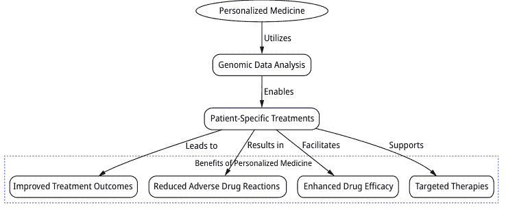

图 15：个性化医疗的潜力。

### 6.5.3 增强手术规划

在手术规划中，准确的分割提供了详细的解剖术前规划图，帮助外科医生在复杂手术中操作。分割的应用有助于可视化相关结构和手术可能的轨迹，并指导医生进行适当操作。这种细节水平在微创和/或机器人手术中尤其有帮助，在这些手术中，准确的影像引导对于在相关区域操作并获得最佳手术结果是必要的。

### 6.5.4 观察疾病发展

准确的分割在评估疾病的动态和一段时间内治疗的效率方面也很重要。问题在于，在大多数情况下，我们只能获得疾病过程的单一快照，而分割允许对疾病进行连续观察，从而频繁、准确地评估解剖变化和病理过程。这些数据对于做出关于患者护理的明智决策、改变治疗策略以及评估实际使用治疗的有效性是必要的。

### 6.5.5 多组学整合的进展

其主要组成部分是尝试将影像数据与多组学数据相结合，包括基因组学、蛋白质组学等。这是因为准确的分割使我们能够将分子特征与影像特征联系起来，从而更深入地了解疾病机制。这种整合为新药和生物标志物的发现铺平了道路，进而用于根据患者的生物特征制定量身定制的治疗计划。

### 6.5.6 机遇与威胁

准确分割在个性化药物开发中的适用能力前景广阔，然而仍有一系列障碍需要解决。保持分割在不同患者群体和影像技术中应用时的外部有效性以及所用算法的可靠性，对于将开发的软件转化为临床实践很重要。数据隐私和保护、模型可解释性以及模型开发中的公平性和偏见等问题日益突出，需要克服医疗提供者和用户/患者的接受障碍。

预计，随着优越分割算法的持续改进以及新的大规模标注影像数据库的趋势，将促进个性化医疗系统的未来推广。因此，准确分割在实现个性化医疗的真正愿景中的重要性仍然存在，因为分割提供了有关相关患者解剖结构和病理的更详细和具体的<|message|>

## 7 结论

医学影像研究领域随着基于深度学习的医学图像分割在该领域的日益增多而发展，产生了高精度、高效率的信息，用于检查复杂的解剖结构和病变区域。包括深度学习模型在内的卷积神经网络，在分割任务自动化方面展现出巨大潜力，从而通过更好的诊断提升了医疗效果。本章讨论了从传统图像分割方法到最先进深度学习方法的转变，特别关注了 U-Net 和多模态融合等重大进展，这些进展已经轻松改变了临床格局。

基于深度学习的分割技术已应用于临床，如个性化医疗、手术规划、精准肿瘤学等。整合和综合多模态数据的能力也有助于确定定量成像生物标志物，这些标志物可以促进个性化治疗方案的制定，并利用这些模型更好地理解疾病动态。由于能够制定适合个体患者的治疗方案，这些进展使个性化健康方法成为现实。

在基于深度学习的分割技术被广泛应用之前，仍有一些挑战需要进一步关注。在临床环境中应用此类模型还意味着，模型的开发方式应使其对一系列重要协变量（如患者的人口统计学特征、所使用的成像模态等）不那么敏感。除此之外，说服医生接受深度学习模型的关键在于其可解释性。通过可解释的人工智能技术提高开放程度，对于建立对这些工具的信任至关重要。深度学习模型在临床护理中的人群级临床应用，不能仅仅依靠医疗保健部门实施负责任和公平的方法来保证；还需要考虑法规遵从性以及伦理问题，包括数据保护、模型偏差等。

由于持续的研究和健康发展，医学图像分割领域深度学习模式的发展在提高精度、效率和可用性方面看起来非常有前景。多组学数据的整合，以及具有实时计算能力的复杂分析工具，将进一步把临床决策能力和诊断准确性提升到新的水平。此外，关于人工智能等某些趋势，预计在不久的将来会在实践中得到广泛应用。

## 参考文献

- [1] Bhattacharya, S., Maddikunta, P. K. R., Pham, Q. V., Gadekallu, T. R., Chowdhary, C. L., Alazab, M., & Piran, M. J. (2021). Deep learning and medical image processing for coronavirus (COVID-19) pandemic: A survey. Sustainable Cities and Society, 65, 102589.
- [2] Liu, L., Wolterink, J. M., Brune, C., & Veldhuis, R. N. (2021). Anatomy-aided deep learning for medical image segmentation: A review. Physics in Medicine & Biology, 66(11), 11TR01.
- [3] Panayides, A. S., Amini, A., Filipovic, N. D., Sharma, A., Tsaftaris, S. A., Young, A., . . . & Pattichis, C. S. (2020). AI in medical imaging informatics: Current challenges and future directions. IEEE Journal of Biomedical and Health Informatics, 24(7), 1837–1857.
- [4] Bierbrier, J., Gueziri, H. E., & Collins, D. L. (2022). Estimating medical image registration error and confidence: A taxonomy and scoping review. Medical Image Analysis, 81, 102531.
- [5] Wagner, R. F., Metz, C. E., & Campbell, G. (2007). Assessment of medical imaging systems and computer aids: A tutorial review. Academic Radiology, 14(6), 723–748.
- [6] Khan, K., Khan, R. U., Ahmad, K., Ali, F., & Kwak, K. S. (2020). Face segmentation: A journey from classical to deep learning paradigm, approaches, trends, and directions. IEEE Access, 8, 58683–58699.
- [7] Zhou, S. K., Greenspan, H., Davatzikos, C., Duncan, J. S., Van Ginneken, B., Madabhushi, A., . . . & Summers, R. M. (2021). A review of deep learning in medical imaging: Imaging traits, technology trends, case studies with progress highlights, and future promises. Proceedings of the IEEE, 109(5), 820–838.
- [8] Castaneda, C., Nalley, K., Mannion, C., Bhattacharyya, P., Blake, P., Pecora, A., . . . & Suh, K. S. (2015). Clinical decision support systems for improving diagnostic accuracy and achieving precision medicine. Journal of Clinical Bioinformatics, 5, 1–16.
- [9] Mahmood, T., Rehman, A., Saba, T., Nadeem, L., & Bahaj, S. A. O. (2023). Recent advancements and future prospects in active deep learning for medical image segmentation and classification. IEEE Access.
- [10] Zhang, C., Achuthan, A., & Himel, G. M. S. (2024). State-of-the-art and challenges in pancreatic CT segmentation: A systematic review of U-Net and its variants. IEEE Access.
- [11] Ji, Y., Zhang, H., Zhang, Z., & Liu, M. (2021). CNN-based encoder-decoder networks for salient object detection: A comprehensive review and recent advances. Information Sciences, 546, 835–857.
- [12] Du, G., Cao, X., Liang, J., Chen, X., & Zhan, Y. (2020). Medical image segmentation based on U-Net: A review. Journal of Imaging Science & Technology, 64(2).
- [13] Zhang, Y., Yang, J., Tian, J., Shi, Z., Zhong, C., Zhang, Y., & He, Z. (2021). Modality-aware mutual learning for multi-modal medical image segmentation. In Medical Image Computing and Computer Assisted Intervention–MICCAI 2021: 24th international conference, Strasbourg, France, September 27–October 1, 2021, proceedings, part I 24, (pp. 589–599). Springer International Publishing.
- [14] Aiello, M., Cavalieri, C., Fiorenza, D., Duggento, A., Passamonti, L., & Toschi, N. (2019). Neuroinflammation in neurodegenerative diseases: Current multi-modal imaging studies and future opportunities for hybrid PET/MRI. Neuroscience, 403, 125–135.
- [15] Bhavana, V., & Krishnappa, H. K. (2016, March). A survey on multi-modality medical image fusion. In 2016 international conference on Wireless Communications, Signal Processing and Networking (WiSPNET), (pp. 1326–1329). IEEE.
- [16] Shoeibi, A., Khodatars, M., Jafari, M., Ghassemi, N., Moridian, P., Alizadehsani, R., . . . & Gorriz, J. M. (2023). Diagnosis of brain diseases in fusion of neuroimaging modalities using deep learning: A review. Information Fusion, 93, 85–117.
- [17] Pillai, A. S. (2021). Utilizing deep learning in medical image analysis for enhanced diagnostic accuracy and patient care: Challenges, opportunities, and ethical implications. Journal of Deep Learning in Genomic Data Analysis, 1(1), 1–17.
- [18] Cui, C., Yang, H., Wang, Y., Zhao, S., Asad, Z., Coburn, L. A., . . . & Huo, Y. (2023). Deep multimodal fusion of image and non-image data in disease diagnosis and prognosis: A review. Progress in Biomedical Engineering, 5(2), 022001.
- [19] Zwanenburg, A. (2019). Radiomics in nuclear medicine: Robustness, reproducibility, standardization, and how to avoid data analysis traps and replication crisis. European Journal of Nuclear Medicine and Molecular Imaging, 46(13), 2638–2655.
- [20] Azizi, S., Culp, L., Freyberg, J., Mustafa, B., Baur, S., Kornblith, S., . . . & Natarajan, V. (2023). Robust and data-efficient generalization of self-supervised machine learning for diagnostic imaging. Nature Biomedical Engineering, 7(6), 756–779.
- [21] Sasikala, B., & Sachan, S. Decoding decision-making: Embracing explainable AI for trust and transparency. Exploring the Frontiers of Artificial Intelligence and Machine Learning Technologies, 42.
- [22] Davatzikos, C., Rathore, S., Bakas, S., Pati, S., Bergman, M., Kalarot, R., . . . & Kontos, D. (2018). Cancer imaging phenomics toolkit: Quantitative imaging analytics for precision diagnostics and predictive modeling of clinical outcome. Journal of Medical Imaging, 5(1), 011018–011018.
- [23] Olivier, M., Asmis, R., Hawkins, G. A., Howard, T. D., & Cox, L. A. (2019). The need for multiomics biomarker signatures in precision medicine. International Journal of Molecular Sciences, 20(19), 4781.

C. Thangamani, Revathi S., Anand M., Anantha Murthy, and S. Praveena

## 深度学习用于图像分割

**摘要：** 图像分割作为计算机视觉的重要组成部分，或许在深度学习结构的应用下经历了一些最革命性的变化。本文旨在对图像分割的深度学习方法进行系统性综述，主要关注最先进的架构及其相关问题。从第一个启发式卷积神经网络和最初的 U-Net 模型开始，讨论涵盖了 DeepLab 家族的特征以及最近将 Transformer 纳入分割任务的尝试。包括计算成本高昂的方法、小特征丢失以及不同数据集之间的迁移在内的难题也被考虑在内。本文还提供了未来展望，并提出了提升机制效率、可扩展性和灵活性的建议。本章的目的是为读者提供关于图像分割当前发展状态和方向以及潜在研究主题的全面知识和分析。

**关键词：** 图像分割, 深度学习, 卷积神经网络, U-Net, DeepLab, Transformer 模型

## 1 引言

在计算机视觉中，将图像分割成有意义的区域是一种基本过程，被称为图像分割 [1]。包括目标识别、医学图像分析和自动驾驶在内的应用都由此机制实现，该机制对于理解和评估视觉输入至关重要 [2, 3]。由于深度学习的进步，图像分割在过去 10 年里发生了革命性的变化，产生了在各种场景下具有高精度和鲁棒性的模型 [4]。传统机器学习算法和手工特征是早期系统的支柱，但它们经常难以处理复杂图像和各种物体尺寸 [3]。这些限制已被深度学习的发展所克服，深度学习产生了能够以前所未有的精度分割数据并自动从数据中提取特征的模型 [5]。

卷积神经网络（CNNs）标志着图像分割的重大突破 [6]。如全卷积网络（FCNs）等开创性工作展示了 CNN 在逐像素分类方面的潜力，使图像能够被分割成不同的类别 [7, 8]。如 U-Net 等架构的引入进一步完善了这一方法，专门针对生物医学图像分割进行了定制 [9]。U-Net 的编码器-解码器结构结合跳跃连接，通过在各层中保留空间信息，实现了对复杂解剖结构的精确分割 [9]。这些早期模型通过解决分割中的一些基本挑战，如保持空间分辨率和处理可变物体尺寸，为更先进的技术奠定了基础 [8, 10]。

DeepLab 架构家族代表了分割技术的重大进步 [10–12]。DeepLab 引入了诸如空洞空间金字塔池化（ASPP）等创新，增强了模型捕捉多尺度特征和上下文的能力 [13, 14]。这种能力对于在不同尺度和变化的上下文中分割物体尤为重要，这是在复杂环境中常见的挑战 [15]。DeepLab 模型通过有效利用局部和全局信息，在 PASCAL VOC 和 COCO 等标准基准上表现出优越的性能 [10, 16, 17]。尽管取得成功，这些模型仍面临与计算复杂度和保持分割图像中精细细节能力相关的挑战 [18]。

基于 Transformer 的架构最近已成为 CNN 在图像分割中一种强大的替代方案 [19, 20]。Transformer 最初设计用于自然语言处理任务，通过自注意力机制捕捉长距离依赖和全局上下文，为处理视觉数据提供了一种新方法。这一创新解决了 CNN 的一些局限性，特别是在处理复杂交互和在较大图像区域中保持上下文信息方面。近期，与视觉 Transformer（ViTs）和 Swin Transformer 相关的若干模型在广泛且复杂的数据集上展示了更好的分割结果。然而，它们带来了诸如高计算复杂度和需要大量参考数据等问题。

即使有了这些复杂结构带来的进步，图像分割仍面临诸多障碍。模型性能仍受计算效率、跨数据集泛化以及精细特征保持等问题的影响。当前的研究领域包括将诸如自监督学习和结合 Transformer 与 CNN 优势的混合模型等新方法纳入其中。为克服这些障碍，必须开发新技术以提高分割的效率和准确性，并进行持续的创新和模型改进。本章对图像分割深度学习架构的发展进行了全面分析，探讨了这一快速发展的领域中的成功经验以及当前困难。

**C. Thangamani**, 信息技术系，斯里拉马克里希纳艺术与科学学院，金奈，泰米尔纳德邦，印度，电子邮件：thangamani@srcas.ac.in
**Revathi S.**, 计算机科学系，理学与人文学院，SRM 科学技术学院，卡坦库拉图尔，钦奈帕图 603203，泰米尔纳德邦，印度，电子邮件：revathis4@srmist.edu.in
**Anand M.**, 数据科学与商业系统系，计算学院，SRM 科学技术学院，卡坦库拉图尔，金奈，泰米尔纳德邦，印度，电子邮件：anandmenscall@gmail.com
**Anantha Murthy**, MCA 系，NMAM 科技学院，NITTE（被视为大学），卡尔卡拉，卡纳塔克邦，印度，电子邮件：anantham2004@gmail.com
**S. Praveena**, 电子与通信工程，甘地理工学院，甘地佩特，海得拉巴，特伦甘纳邦，印度，电子邮件：spraveena_ece@mgit.ac.in

## 2 CNN 在图像分割中的早期发展

### 2.1 计算机视觉中 CNN 的介绍

CNNs 通过改变视觉输入的处理和分析，对计算机视觉的发展做出了重大贡献。CNNs 是一种独特的深度神经网络类别，专门设计用于处理图像数据的复杂性，并在特征提取和模式识别方面提供显著增强。通过一系列卷积层，与主要依赖手工特征的典型机器学习方法相比，CNNs 能够直接从输入图像中自动学习重要特征。这种捕捉不同维度上空间层次和关系的能力使 CNNs 成为从目标分类到图像分割等多个视觉任务的支柱。

CNN 的基本架构建立在三个核心操作之上：卷积、池化和激活。卷积层应用了一组滤波器。这些滤波器随后在输入图像上滑动，生成强调边缘、纹理和形状等重要模式的特征图。由于卷积过程保持了像素之间的空间连接，CNNs 非常适用于处理像照片这样以网格排列的数据。为了降低特征图的空间维度，在每个卷积层之后使用诸如最大池化和平均池化等池化操作。通过保留重要特征，这种下采样有助于降低网络的计算复杂度。通过添加非线性激活函数（如 ReLU），CNNs 在表示复杂视觉模式的能力上得到进一步增强，这些函数使网络能够捕捉输入中的复杂非线性相关性。

CNNs 的关键优势之一是其学习图像层次化表示的能力。在较低层，CNNs 通常捕捉低级特征，如边缘和角点。随着网络加深，它开始检测更高层次的抽象，包括纹理、形状，最终是整个物体。这种层次化特性使 CNNs 既能识别图像中的细微模式，又能在不同的视觉上下文中泛化——能够执行端到端

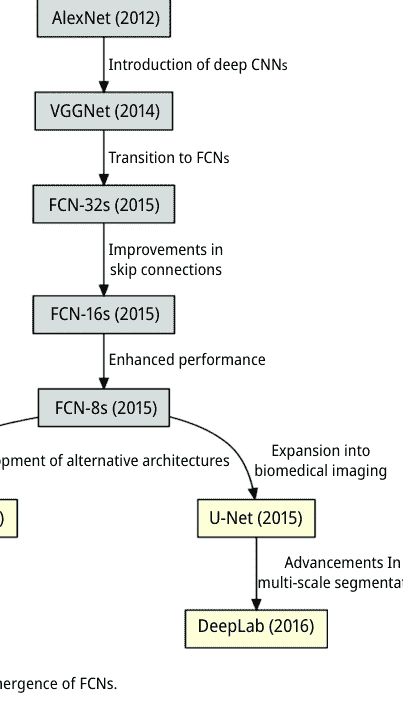

图1：全卷积网络（FCN）的出现。

输入图像。由于这种架构上的修改，FCN成为首批能够从头到尾训练密集预测任务而无需繁琐的特征提取流程的深度学习模型之一。

分割中的一个关键挑战是在整个网络中保持高分辨率预测，尤其是在多次下采样操作（如池化和步进卷积）之后，这些操作在传统CNN架构中很常见。全卷积网络（FCN）通过一种称为上采样的过程解决了这个问题。通过应用学习到的上采样层，FCN可以恢复特征图的空间分辨率，使网络能够生成高分辨率的预测。如图1所示，FCN还利用跳跃连接将来自更深层的高级语义信息与来自更早层的低级空间细节融合在一起。这种整合有助于细化分割边界，并捕获对边缘检测和物体轮廓描绘等任务至关重要的更精细细节。FCN的引入标志着用于分割的神经网络设计取得了重大进展，为更复杂的编码器-解码器架构（如U-Net和SegNet）奠定了基础。这些架构在FCN结构的基础上进行了扩展，提高了分割任务的有效性和速度。此外，还出现了各种FCN变体，它们融合了多尺度特征以提高复杂场景分割的性能。尽管后来开发出了更新的模型，但FCN仍然是一种基础性的深度学习架构，并继续作为评估分割方法的基准。

## 2.3 SegNet

现有的深度学习架构SegNet是早期为语义图像分割而设计的架构之一，旨在对高维图像进行逐像素分类。SegNet以计算效率和内存利用率为设计重点，提出了一种具有高性能平衡的编码器-解码器网络。其设计源于这样一个问题：在获取高级特征表示的同时，保留像素级分割所需的空间信息。正因如此，SegNet的方法非常适合用于道路场景等真实世界场景中的紧凑、实时图像理解应用。

SegNet的基本架构是编码器-解码器框架。编码器模仿了著名的CNN架构（如VGG-16），使用池化和卷积层从输入图像中提取分层特征，同时逐渐降低其空间分辨率。为了使模型能够识别图像中的复杂模式，编码器的任务是记录输入在不同尺度下的抽象表示。相比之下，解码器对编码后的特征进行上采样，试图重建高分辨率的分割图。

SegNet解码器的一个关键特征是在上采样过程中使用来自编码器阶段的最大池化索引。SegNet不是学习新的上采样参数，而是复用编码器中最大池化层的索引来执行非参数上采样。这种策略减少了解码器中的参数数量，使网络在计算上更高效，同时也有助于保留对分割任务至关重要的边界信息。

SegNet的一个显著创新是在解码器中使用池化索引进行上采样。传统的上采样方法通常依赖反卷积（转置卷积）层，这需要学习额外的参数，并增加了计算负担。相比之下，SegNet的非参数方法使用最大池化层的索引来指导上采样过程。通过记录池化过程中最大激活的位置，SegNet确保上采样后的特征图保留原始输入图像中的重要空间信息，从而实现更准确的分割，尤其是在物体边界处。

这种方法不仅提高了分割精度，而且使SegNet具有很高的内存效率。这在实时应用中尤为重要，例如自动驾驶图像分析，此类场景中内存和处理能力往往有限。

在多项应用和实验研究中，SegNet已显示出良好的效果，尤其是在驾驶场景理解方面。到目前为止，其分离多个物体和复杂场景的能力对自动驾驶等应用非常有利，在这些应用中，对道路、汽车、行人等的精确分割至关重要。该架构在精度和计算效率之间取得了平衡，使其适用于需要实时处理且不牺牲分割质量的任务。

在诸如CamVid数据集等道路场景分割的基准测试中，SegNet在推理速度和内存使用方面表现出了与其他早期架构（如FCN和DeepLab）相当的竞争力。虽然更新的架构在整体分割精度上已超越SegNet，但SegNet因其对池化索引的创新使用以及对计算效率的重视而仍然具有影响力。

尽管SegNet对高效分割做出了贡献，但它也有一定的局限性。对池化索引的依赖虽然节省内存，但并非总能像使用可学习上采样层（如转置卷积）的架构那样有效地捕获精细细节。这可能导致在纹理复杂的区域分割不够精确。此外，缺少跳跃连接（跳跃连接在后来的U-Net等架构中已成为标准配置）意味着SegNet难以在整个网络中充分保留低层空间信息。

## 2.4 条件随机场（CRF）的进展

CRF与CNN的整合在提升图像分割精度方面发挥了关键作用，尤其是在细化边界和捕获详细空间关系方面。CRF传统上用于计算机视觉中的结构化预测任务，是一种概率图模型，可以捕获图像中相邻像素之间的依赖关系。虽然CNN擅长特征提取和密集预测，但它们往往会产生粗糙的分割输出，尤其是在物体边界附近。CRF作为后处理层被引入，通过强制执行空间一致性并建模相邻像素之间的关系来细化这些预测，从而产生更精确的分割结果。

CRF通常用于细化CNN的输出，即获取初始的粗糙预测并应用概率方法，基于局部和全局上下文调整像素级标签。这种组合最著名的应用之一出现在DeepLab架构中，其中CRF被用作后处理步骤，以纠正CNN难以精确描绘的边界。通过考虑相邻像素可能具有相似标签的可能性，CRF有助于生成更准确且视觉上更连贯的分割。这种细化在现实场景中至关重要，因为在医学影像、自动驾驶和物体识别等任务中，像素级精度（尤其是物体边缘处的精度）是必不可少的。

CRF通过整合外观信息（如像素强度）和空间关系来实现这种细化。它们的工作原理是最小化一个能量函数，该函数根据像素视觉特征的相似性及其在图像中的邻近性来惩罚像素标签之间的不一致。能量函数为相邻像素具有相似强度且标签相同的配置分配较低成本，从而在保持强度发生显著变化处锐利边界的同时，促进分割区域之间的平滑过渡。这种建模长距离依赖并强制执行平滑性约束的能力，使CRF成为纠正CNN局限性（CNN通常依赖固定大小的感受野，容易忽略细粒度的空间细节）的有效工具。

尽管CRF在提高分割质量方面效果显著，但CRF与CNN的结合也带来了一些计算挑战。在早期的实现中，CRF是作为独立的后处理步骤应用的，导致推理时间增加，并给整个流程带来额外的复杂性。可微分CRF的进展使得CRF能够无缝地直接集成到神经网络架构中。这一创新以DenseCRF和CRF-RNN等工作为代表，实现了端到端的训练，使得CRF参数可以与CNN权重一起学习，从而产生更高效、更强大的分割模型。

CRF也并非没有局限性。虽然它们在改善边界定位方面非常有效，但在需要全局上下文来解决歧义的复杂场景中（例如区分近距离的相似外观物体），它们会显得力不从心。CRF严重依赖于超参数的选择，并且需要针对不同数据集和任务进行精细调整才能达到最佳性能。研究持续探索比CRF更复杂的替代方案，将CRF的优势与深度学习的表示能力相结合，例如基于图的方法和注意力机制，这些方法为建模图像中的上下文和空间关系提供了更灵活的方式。

## 2.5 基于图像块的CNN分割

基于图像块的CNN代表了卷积神经网络用于图像分割的早期方法之一。与全卷积网络（FCN）在单次前向传播中处理整个图像不同，基于图像块的CNN将输入图像划分为较小且可管理的块。每个块随后由CNN独立处理以生成分割预测。如图2所示，该方法利用CNN的局部感受野从特定区域提取特征，随后将这些特征聚合以构建最终的分割输出。

基于补丁的方法最初因其实现简单和计算可行性而受到青睐，尤其是在硬件资源有限的情况下。

### 2.5.1 基于补丁的分割面临的挑战

由于其简单性，基于补丁的CNN面临若干挑战。一个显著的局限是单个补丁捕获的上下文不足。由于补丁是独立处理的，模型难以在相邻区域之间保持连贯性，导致分割结果出现不一致。固定大小的补丁在遇到跨越多个补丁的物体时会产生问题。这个问题需要仔细处理补丁边界，并且通常需要后处理步骤来无缝合并相邻补丁的输出。

### 2.5.2 基于补丁方法的优势

基于补丁的CNN最初被使用是因为它们具有许多优势。一个显著的好处是相对于全图像方法，它们所需的计算量较小。基于补丁的CNN的一个特点是，由于它们从比完整图像更小的区域开始处理，因此可以节省内存和计算能力；这使得此类网络非常适合内存和功耗受限的系统。此外，基于补丁的方法允许同时应用数据增强技术，如翻转和裁剪，这可以增强模型的泛化能力，并降低其对数据变化的敏感性。由于这些特性，基于补丁的CNN在图像分割的初步尝试中是合理的。

### 2.5.3 与全卷积网络的比较

与FCN相比，基于补丁的CNN既有优势也有劣势。FCN通过一次处理整幅图像，可以利用全局上下文并生成更连贯的分割图。相比之下，基于补丁的方法难以整合整幅图像的信息，可能导致分割精度较低。基于补丁的CNN通常实现起来更简单，并且在局部上下文足够的特定应用中可能非常有效。这种比较凸显了处理效率与分割质量之间的权衡，为结合两种方法元素的混合方法铺平了道路。

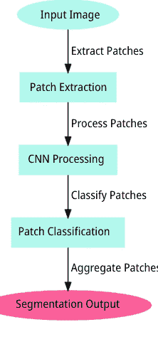

图 2：基于补丁的CNN分割。

### 2.5.4 应用与发展

基于补丁的CNN已在多个领域得到应用，包括医学影像，用于肿瘤检测和器官分割等任务。在这些情况下，基于补丁的方法能够分析小区域，这在需要高精度标注时尤其有用。近年来的进展试图解决与使用基于补丁方法相关的一些问题，包括重叠补丁和多尺度分析。这些创新旨在增强分割结果的稳定性，更准确地反映客观数据，同时保持基于补丁方法的计算优势。

## 3 用于生物医学图像分割的U-Net及其变体

### 3.1 U-Net架构简介

U-Net是一种专门为生物医学图像分割而设计的深度学习架构。U-Net旨在解决医学图像精确分割的难题，并且由于即使在标注数据很少的情况下也能生成正确的分割图，它已成为该领域的中流砥柱。该架构以其独特的U形结构著称，该结构包含收缩路径（编码器）和扩展路径（解码器），这一结构最初由Ronneberger等人于2015年提出。凭借这种特性，该模型能够通过捕获上下文信息和空间信息，在医学图像中精确分割复杂结构。

### 3.1.1 收缩路径：编码器

编码器也称为U-Net的收缩路径，负责从输入图像中收集上下文并提取特征。它由一系列卷积层和随后的最大池化操作组成。凭借这些卷积层，网络可以学习图像数据的分层表示，这些卷积层逐渐减小图像的空间维度，同时加深特征图。编码器的任务是提取区分图像中不同结构所需的上下文数据和高层特征。

### 3.1.2 扩展路径：解码器

扩展路径（也称为解码器）利用编码器生成的高层特征图来重建图像。它由卷积层组成，这些卷积层在上采样操作之后用于提高特征图的空间分辨率。通过将收缩路径相应级别的特征图进行拼接，跳跃连接使解码器能够整合来自编码器的信息。为了保持细粒度细节并确保分割输出保持源图像的空间精度，这些跳跃连接是必不可少的。

### 3.1.3 跳跃连接及其重要性

使用连接编码器和解码器路径的跳跃连接是U-Net的一个显著特征。这些连接通过促进高分辨率特征从收缩通道传递到扩展路径，有助于保留在下采样过程中可能丢失的空间信息。通过将编码器和解码器的特征图拼接在一起，U-Net能够生成更精确、更详细的分割图。这使得它特别适用于需要高分辨率输出的任务，例如定义微小结构。

### 3.1.4 应用与影响

论文未讨论任何局限性。U-Net在广泛的生物医学成像应用中表现出色，包括从MRI、CT、显微镜图像和其他多种图像中分割器官、肿瘤和其他结构。一些常见的架构类型已被开发出来，它们具有很大的灵活性，并且可以根据具体情况进行扩展。U-Net的影响不仅限于医学成像，还影响了其他领域中分割模型的发展，并为深度学习中编码器-解码器架构的设计树立了先例。

### 3.2 U-Net的扩展与改进

U-Net最初是为生物医学图像分割而开发的，它已成为众多扩展和增强的基础，这些扩展和增强旨在提高其性能和适应性。其编码器-解码器结构以对称的跳跃连接为特征，能够在实现高分割精度的同时有效保留空间信息。如图 3 所示，这种架构设计在各种医学成像应用中发挥了重要作用。研究人员此后对原始U-Net提出了改进，以解决训练数据有限、计算效率和成像模态差异等具体挑战。这些增强通常侧重于提高分割精度、减少计算开销以及增强在不同临床场景中的鲁棒性。

### 3.2.1 U-Net++：嵌套U-Net架构

一个重要的进展是U-Net++，它引入了嵌套的跳跃路径来改善特征传播和分割精度。U-Net++在原始U-Net的基础上，通过在跳跃路径中添加额外的卷积块，创建了更精细的特征提取过程。这些嵌套的跳跃路径有助于捕获更详细的上下文信息，并实现更好的特征复用。U-Net++中引入的深度监督和改进的特征融合技术带来了性能的提升，特别是在细节至关重要的复杂生物医学成像任务中。

### 3.2.2 Attention U-Net：融入注意力机制

Attention U-Net是另一个值得注意的变体，它将注意力机制融入U-Net框架。该扩展在跳跃连接中集成了注意力门控。

<!-- no content -->

机制可以实现自动化，以增强制造过程中几乎所有方面的能力，从而最大限度地降低生产缺陷产品的概率。

### 3.4.4 机器人技术与无人机应用

U-Net在机器人和无人机中也有应用，用于物体检测和场景理解。例如，U-Net已被用于检测无人机拍摄图像中的物体和障碍物，用于环境监测、搜索救援行动和精准农业。在实际机器人应用中，U-Net提供了场景特征的详细信息，有助于物体操作和导航。这揭示了机器人在出色完成机械操作与周围空间相互作用方面的前景，从而能够独立完成复杂任务。

### 3.5 U-Net架构面临的挑战

尽管U-Net设计因其在生物医学图像分割中的应用而变得相当流行，但它仍然面临挑战。虽然U-Net具有带有跳跃连接的编码器-解码器结构，且实验证明它能同时成功捕获细粒度的高级特征，但仍然存在若干挑战，影响着U-Net在不同情况下的工作效果。理解这些障碍对于构建改进模型和提高分割水平非常重要。

### 3.5.1 时间与空间复杂度及时间需求

所提出的U-Net的主要缺点是计算成本非常高。卷积层的数量和深度以及特征图的消耗使模型需要很高的计算和内存资源，尤其是在处理高分辨率图像数据时。当应用于系统资源有限的环境中时，这种计算在资源方面变得昂贵，因此需要优化解决方案来应对这一挑战。

### 3.5.2 过拟合与泛化问题

U-Net在训练数据上实现高精度的能力并不总能转化为在未见数据上的优越表现。过拟合仍然是一个令人担忧的问题，特别是在带标注数据集有限的场景中，这在生物医学成像中很常见。模型倾向于从训练数据中学习噪声和不相关的细节，这可能导致泛化能力差，并在新数据集上效果降低。这一挑战凸显了对稳健的正则化技术和策略的需求，以提高模型的泛化能力。

### 3.5.3 处理输入数据的变异性

由于成像协议、患者人群和病理状况的差异，生物医学图像通常表现出显著的变异性。U-Net的性能可能会受到这种变异性的不利影响，因为模型难以适应多样的图像特征。解决这一挑战需要先进的预处理方法和自适应学习技术，以确保U-Net模型能够适应生物医学成像数据中固有的变异性。

### 3.5.4 细节和空间分辨率的丢失

尽管U-Net旨在通过跳跃连接保留空间分辨率，但在某些情况下，对细粒度细节的保持仍然可能不够理想。下采样和上采样操作与固有的池化层相结合，会导致关键细节的丢失，这在需要精确描绘小结构的任务中尤其成问题。增强模型保留细节和改善空间分辨率的能力仍然是一个持续的挑战。

### 3.5.5 可扩展性与适应性

U-Net对大规模数据集的可扩展性是另一个挑战。虽然U-Net在单模态图像上表现良好，但将其应用扩展到多模态数据（如结合MRI和CT图像）需要对架构进行修改，并额外考虑训练问题。使U-Net适应新的生物医学成像模式，需要不断更新和创新模型的设计与训练过程。

## 4 DeepLab 架构家族

### 4.1 DeepLab 架构简介

鉴于早期基于CNN的模型的局限性，DeepLab架构代表了语义图像分割领域的一项重大进步。DeepLab由Google Research开发，融合了多种前沿技术，以提高像素级分类的精度和效率。如图5所示，DeepLab的关键创新之一是使用空洞（或扩张）卷积，在不增加参数数量的情况下扩大感受野，使模型能够捕获更多上下文信息。这种能力对于准确分割复杂多样的视觉场景至关重要，使DeepLab能够在各种医学和自然图像分割任务中表现稳健。

### 4.1.1 空洞卷积及其影响

DeepLab的一个主要改进是使用空洞卷积（也称为扩张卷积）。扩张通过在滤波器之间插入零来增加卷积层的感受野，从而在不丢失特征图中高分辨率信息的情况下拓宽视野。这种设计选择使DeepLab能够捕获多尺度的更多上下文信息，增强其分割不同大小和形状物体的能力。空洞卷积的使用解决了传统卷积的局限性，传统卷积通常需要下采样才能获得更大的感受野，从而导致空间细节的丢失。

### 4.1.2 DeepLab 的空间金字塔池化模块

因此，在DeepLab中集成空间金字塔池化（SPP）模块带来了更好的性能，因为它使用多尺度池化来收集上下文信息。SPP模块使用ASPP以不同膨胀率应用空洞卷积，从而有效捕获多尺度上下文。这种方法使网络能够结合来自不同分辨率的特征，改进跨越不同大小的物体的分割。将ASPP集成到DeepLab架构中，为处理真实图像中的各种物体尺度和复杂性提供了一种稳健的机制。

### 4.1.3 DeepLab 架构的优势

DeepLab架构的改进相对于先前的分割模型具有一些优势。空洞卷积和SPP减少了物体尺寸错位、不均匀以及背景影响的问题，从而提高了其分割性能。由于空间分辨率在网络中保持连续，DeepLab具备处理高分辨率图像的高效成熟能力，正如我们的实验所展示的那样。这些增强使DeepLab成为众多领域中的领先工具，包括城市场景分析和医学图像分析。

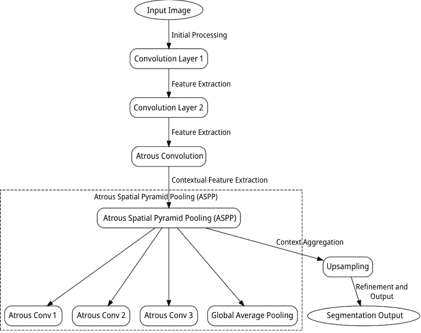

**图5：** DeepLab 架构简介。

### 4.1.4 DeepLab 模型的发展

DeepLab框架随着时间的推移不断发展，后续版本不断改进并增加了不同的策略。DeepLabv2引入了ASPP模块，极大地增强了上下文聚合。为了扩展DeepLabv3，作者在设计中引入了全局池化，并改进了ASPP机制。DeepLabv3+结合了先前模型的特点与编码器-解码器结构，在边界定义和分割方面进行了增强。DeepLab架构的每一次新变革都代表从先前版本中学习以解决特定问题。

### 4.2 DeepLabv2

实际上，DeepLabv2可以被视为对DeepLab分割模型家族中其他架构的改进，并基于DeepLab模型形成的开创性思想。DeepLabv2由Chen等人于2016年提出，添加了多个新组件，以实现更好的语义分割性能和可靠性。该模型嵌入了DeepLab框架的主体设计，同时吸收了重要的增强功能，以克服先前版本的弱点，包括多尺度上下文的管理以及分割结果的改善。

### 4.2.1 ASPP

DeepLabv2的一个核心特征是引入了ASPP。ASPP旨在通过以多种膨胀率应用空洞（或扩张）卷积来捕获多尺度信息。这种技术使模型能够从不同尺度捕获上下文，而无需进行大量可能降低空间分辨率的池化操作。ASPP通过聚合来自不同感受野的特征，增强了模型处理不同物体大小和复杂场景结构的能力。这一创新显著改善了具有不同尺度和复杂背景的物体的分割。

### 4.2.2 相对于先前模型的优势

DeepLabv2相对于其前代模型具有多项优势，尤其是在准确性和灵活性方面。ASPP的集成使得上下文理解更准确、分割边界更精确。通过避免过度下采样并保留更多空间信息，DeepLabv2解决了早期模型的一个关键局限，即早期模型在精确描绘细节和小物体方面常常表现不佳。此外，DeepLabv2的架构在PASCAL VOC和COCO等具有挑战性的基准上提升了性能，展示了其在现实应用中的有效性。

### 4.2.3 实现细节与性能

在实际使用中，DeepLabv2利用ResNet骨干网络进行特征提取，这提高了训练稳定性和特征学习，同时利用残差连接来提升速度。为了保持生成的分割图的高分辨率，模型在ASPP和最后的卷积中均使用了膨胀卷积。

### 4.4.4 应用与使用案例

需要注意的是，由于 DeepLabv3+ 的加深和扩展，该模型也可应用于图像的通用分割。其中两个优势最适合自动驾驶领域，因为它能产生高输出分辨率，同时还能区分物体边缘与周围环境，例如道路。在医学影像中，DeepLabv3+ 模型对于需要精细勾勒结构（如器官、肿瘤等）的应用最为有益。所提出的方法能够处理多种模态，得益于其灵活性，这使其适用于遥感和卫星图像。

DeepLabv3+ 存在一些问题；一个是计算成本，另一个是泛化性能。编码器-解码器结构加上 ASPP 模块相当复杂，导致计算需求很高，这对于计算能力有限的实时应用而言是一个重要问题。未来的工作应集中于改进架构设计以提高效率和构建更轻量的模型，并引入诸如注意力机制等新模块，以改善这些问题的分割稳定性。

## 4.5 DeepLab 模型中的挑战与开放问题

通过 DeepLab 系列架构，语义分割取得了实质性进展，主要得益于空洞空间金字塔池化（ASPP）和增强的卷积技术等创新。这些发展显著提升了模型捕捉多尺度上下文信息并产生精确像素级预测的能力。如图 6 所示，仍有一些挑战和未解决的问题阻碍了 DeepLab 模型的最佳性能。这些包括处理精细物体边界的局限性、计算复杂性以及跨多样化数据集的泛化能力。理解这些挑战对于确定改进领域并进一步提高分割过程的效率和有效性至关重要。

### 4.5.1 时间复杂度和推理时间

DeepLab 模型，尤其是具有 ASPP 特性的 DeepLabv3+，被认为计算密集度很高。空洞卷积以及在特征提取中关注多个尺度都会增加计算和推理所需的时间。对于计算能力有限的实时应用而言，这是一个问题，例如手机甚至某些嵌入式环境。在进行高质量分割的同时降低计算复杂度始终是研究的关键领域。

### 4.5.4 可扩展性与多分辨率处理

DeepLab 模型的主要困难之一在于其对超高分辨率图像和 3D 体积数据的可扩展性。处理数据维度大的图像需要大量内存和计算，使得模型在某些情况下几乎不可行。此类别中提出的先前工作较少，包括扩展模型可扩展性的解决方案，例如分层处理高效多分辨率方法，从而进一步扩展这些应用在多个领域的应用。

DeepLab 模型的性能取决于系统可用的训练数据的质量和数量。事实是，不完美的分割结果源于数据不足。模型也无法处理类别不平衡，即某些类别在训练集中被剥夺。解决此类问题需要提出提高标注质量的解决方案以及使用无监督学习的方法，并在训练模型时使用数据增强。

## 5 Mask R-CNN 与实例分割的兴起

### 5.1 Mask R-CNN 简介

Mask R-CNN 可被视为将实例分割提升到下一个层次的模型，其基础源自 Faster R-CNN 所引入的基本概念。通过添加像素分割来提升目标检测，Mask R-CNN 提供了一种新思路，能够有效识别物体甚至勾勒其轮廓。该架构通过加入分割分支来输出每个检测实例的精确掩码，从而改进了传统目标检测通常缺乏实例级信息的问题，后者仅提供边界框和类别标签。

### 5.1.1 架构与主要构建模块

Mask R-CNN 的基础在于该方法的特殊性，即目标检测和实例分割同时进行。为了实现物体区域的候选，模型使用区域建议网络（RPN）；为了准确定位区域，模型使用 RoIAlign 层。架构包括三个主要组件：用于特征提取的主干网络、用于生成区域建议的 RPN，以及用于预测类别标签、边界框和分割掩码的全连接网络。分割掩码分支的加入使 Mask R-CNN 与其前身区别开来，因为它为每个实例提供了详细的逐像素标注。

### 5.1.2 RoIAlign 的创新

结合 RoIAlign 层，Mask R-CNN 在区域建议方法上引入了创新。与因量化而存在错位问题的 RoIPool 不同，RoIAlign 使用双线性插值从建议区域中采样固定大小的特征图。这一改进解决了量化问题并提供了更好的分割掩码，从而提高了模型在复杂场景下的性能。

### 5.1.3 性能与基准测试

我们发现所提出的 Mask R-CNN 在 COCO 和 PASCAL VOC 数据集等一系列基准上具有出色的性能。它完美地结合了实例分割和物体识别的优势，实现了最先进的性能。由于其能够处理不同尺寸和形状的多个实例，因此被用于自动驾驶、医学影像和视频分析等需要精确物体描绘的应用中。Mask R-CNN 的成就提高了实例分割的标杆，并推动了该领域的更多研究和进展。

### 5.1.4 应用与影响

在实例分割至关重要的领域，Mask R-CNN 带来了显著改进。对于诊断影像，模型例如应用于肿瘤识别和器官轮廓勾画等任务；这些领域需要精细的边界定义。在自动驾驶（AD）背景下，Mask R-CNN 有助于识别道路上的物体及其边界，用于避障和场景分析。模型的实用性和功能性也使其在机器人等领域得到广泛应用，进一步增加了其广泛的相关性。

### 5.2 Mask R-CNN 的技术创新

Mask R-CNN 是基于 Faster R-CNN 方法的实例分割现有最先进技术的重大改进，并将其扩展到目标检测与逐像素分割的集成。它之所以重要，是因为这种集成引入了一些技术新颖性，提高了模型在实例级定义物体的能力。这些进展不仅增强了物体分割的有效性，还帮助将实例分割领域的应用扩展到各种复杂的数据集。

### 5.2.1 ROIAlign 以获得更好的区域建议

Mask R-CNN 的主要技术贡献之一是使用 ROIAlign 作为 ROI 池化的更好替代方案。ROIAlign 通过消除池化过程中的量化问题提高了区域建议的准确性。为了改善用于分割的特征对齐，ROIAlign 使用双线性插值对由浮点坐标表示的像素位置进行采样。这一改进有助于准确识别掩码位置并改善分割结果。

也有一些工作提出了多任务学习的集成。

Mask R-CNN 使用多任务学习框架并行解决目标检测和实例分割的目标。该框架包括以下并行分支：分类分支、边界框回归分支和分割掩码生成分支。这些任务同时学习的结果是更好的掩码预测以及特征共享特性的利用。这种方法与先前将目标检测和分割视为两个不同问题的模型不同，从而实现了更结构化、更精确的实例分割场景。

### 5.2.2 用于多尺度特征学习的特征金字塔网络（FPNs）

将 FPN 引入 Mask R-CNN 是另一项重要创新。FPN 通过创建多尺度特征金字塔增强了模型处理不同尺度物体的能力。该金字塔使 Mask R-CNN 能够从不同分辨率级别提取特征，提高了小物体和大物体的检测和分割。FPN 的集成解决了图像中尺度变化的挑战，有助于在不同物体尺寸下实现更稳健、更准确的实例分割。

### 5.2.3 通过密集预测改进掩码预测

Mask R-CNN 通过在感兴趣区域（ROI）内引入密集预测来推进掩码预测。模型的掩码分支生成二值掩码用于

理解 Mask R-CNN 是如何发展起来，以应对更高分割挑战中的特定问题并发挥相应功能。

### 5.4.1 PointRend：增强的掩码预测

PointRend 相较于传统的 Mask R-CNN 架构是一项重大改进，其具体目标是提升细粒度掩码预测的质量。标准的 Mask R-CNN 模型在像素级精度上往往表现不佳，尤其是在物体边界处。图7展示了 PointRend 如何通过引入基于点的渲染方法来克服这一局限。该方法使用神经网络在选定的离散点上预测分割掩码，然后通过插值生成高分辨率、细节丰富的边界。将 PointRend 集成到 Mask R-CNN 模型中，显著增强了模型捕捉精细轮廓和细微变化的能力，使其特别适合对分割精度要求高的应用场景。

### 5.4.2 Mask Scoring R-CNN：改进掩码置信度

Mask Scoring R-CNN 的作者提出在模型框架中增加一个附加分支，用于估计其生成的掩码的置信度。然而，与同时给出分割掩码和边界框的传统 Mask R-CNN 模型相比，这些模型并不会直接提供与掩码质量相关的置信度度量。Mask Scoring R-CNN 通过添加一个掩码评分头来评估每个预测掩码的质量，从而解决了这一问题，使掩码预测更加可靠，并能更好地处理误检。该扩展通过增加一层置信度评估，提升了实例分割的整体性能。

### 5.4.3 混合任务级联（HTC）：多阶段检测增强

混合任务级联（HTC）在 Mask R-CNN 的基础上引入了多阶段检测方法。HTC 通过级联检测头逐步优化目标提议和分割掩码，从而增强分割过程。这种多阶段细化在处理诸如最终检测结果中物体空间重叠等问题时非常有用。HTC 的架构改进了 Mask R-CNN，并应对具有挑战性的场景问题，从而显著提升了分割精度和鲁棒性。

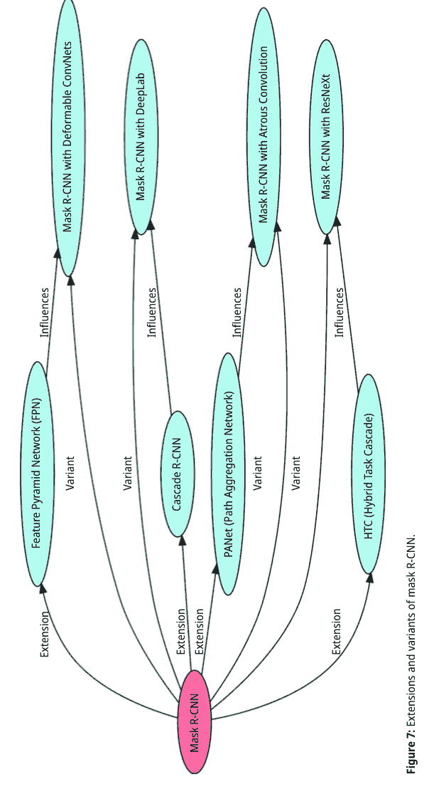

图7：Mask R-CNN 的扩展和变体。

### 5.4.4 高效 Mask R-CNN：针对速度和资源消耗的效率优化

Mask R-CNN 存在多种变体，其中包括高效 Mask R-CNN，其设计目标是减少处理时间并降低资源消耗。标准的 Mask R-CNN 虽然通常可靠，但速度不够快，而且相当耗时，尤其是在实时操作中。高效 Mask R-CNN 解决了这一挑战，它使用轻量级骨干网络和简单的处理方法以降低计算负载。该变体仍能保持顶尖精度，同时理想情况下也应具备较高的速度和较低的延迟，因此非常适合在资源有限但需要高速处理的环境和/或任务中使用，例如实时应用。

### 5.4.5 与 Transformer 的集成：利用注意力机制

近期研究将 Mask R-CNN 与 Transformer 架构相结合，利用注意力机制来提升性能。Transformer 因其在自然语言处理中的成功而广为人知，现被应用于实例分割，以增强模型捕获长距离依赖和上下文信息的能力。通过将 Transformer 与 Mask R-CNN 结合，这些模型受益于更强的特征提取能力，并能更好地处理包含多个物体的复杂场景。Transformer 的集成为推进 Mask R-CNN 的能力提供了一个有前景的方向，尤其是在具有挑战性的分割任务中。

## 5.5 实例分割的局限性与挑战

基于实例级关联，像 Mask R-CNN 这样的实例分割方法推动了对图像中特定物体实例的检测和勾勒。但这种能力并非没有局限性和挑战，这些因素会影响实例分割模型成功与否及其适用性。理解这些问题对于进一步改进实例分割技术并扩大其适用范围至关重要。

### 5.5.1 高昂的计算开销

与 Mask R-CNN 等实例分割模型相关的主要挑战之一是其高昂的计算开销。该模型的架构涉及多个阶段，包括区域提议生成、目标检测和掩码预测，这些都会带来大量计算需求。对大量处理能力和内存的需求可能会阻碍实时应用以及资源受限设备上的部署。在保持高精度的同时优化计算效率仍是一项关键挑战。

### 5.5.2 处理遮挡与重叠物体

遮挡和重叠物体仍然是实例分割模型面临的问题。在物体相互部分遮挡的场景中，区分并准确分割每个实例会面临诸多挑战。难以分离重叠实例会导致掩码预测不准确，进而降低性能。需要在模型架构和训练技术方面取得进展，以更好地处理此类遮挡，并确保在拥挤环境中实现更精确的分割。

### 5.5.3 面向大规模数据集的可扩展性

可扩展性是实例分割模型面临的另一项重大挑战。在应用于大型复杂数据集时，保持模型有效且快速的问题会愈发凸显。此外，由高分辨率图像组成的大规模数据集中包含大量实例，这也使模型的训练和测试变得更加复杂。开发能够处理大规模数据集且不牺牲性能的可扩展解决方案，仍是一个持续的研究领域。

### 5.5.4 跨不同领域的泛化能力

实例分割模型在应用于不同领域时，其性能往往会有波动。在特定基准上训练的模型难以很好地泛化到新的图像分布，这限制了它们在不同场景下的适用性。这一问题凸显了提升实例分割模型泛化能力的必要性，相关方法包括域自适应和迁移学习等技术。

### 5.5.5 标注质量与数据不平衡

实例分割模型的有效性高度依赖于标注质量以及训练数据中类别分布的平衡性。不准确的标注会导致模型性能不佳和分割精度下降。此外，某些物体类别的不平衡——即代表性样本很少的类别——也会影响性能水平。解决其中一些问题意味着要改进标注流程、应用半监督技术，并使用数据增强技术来生成更平衡的训练数据集。

## 6 基于 Transformer 的图像分割架构

### 6.1 ViT 简介

视觉 Transformer（Vision Transformer, ViT）的引入标志着图像分割和计算机视觉领域的重大范式转变。Transformer 起源于自然语言处理，在处理序列数据方面表现出色，这主要归功于自注意力机制的有效性。ViT 对该架构进行了改造，将图像划分为图像块，从而能够对长距离依赖和复杂的空间关系进行建模。如图8所示，这种基于图像块的注意力机制使 ViT 能够比传统 CNN 更有效地捕获全局上下文，而传统 CNN 往往受限于其局部感受野。这一进展为克服传统分割模型的关键局限性开辟了新的可能性。

### 6.1.1 架构与机制

视角：Transformer 背后的基本概念是将图像划分为固定大小的图像块，随后将这些图像块线性嵌入为向量。与文本处理 Transformer 中的层类似，这些向量会经过多层前馈网络和自注意力网络的处理。借助自注意力机制，模型能够有效地捕获整幅图像中的长距离关系和上下文信息，同时该机制还能评估各个图像块之间的相对重要性。相比之下，CNN 通常使用池化层和卷积过程来关注局部特征。

### 6.1.2 相比卷积网络的优势

ViT 的一个关键优势在于其能够捕获图像内部的全局关系，而这对于主要关注局部特征提取的传统 CNN 而言往往颇具挑战。通过利用自注意力机制，ViT 可以整合图像各部位的信息，从而在需要整体理解空间关系的任务中提升性能。这种能力对于全局上下文对准确预测至关重要的复杂分割任务尤其有益。

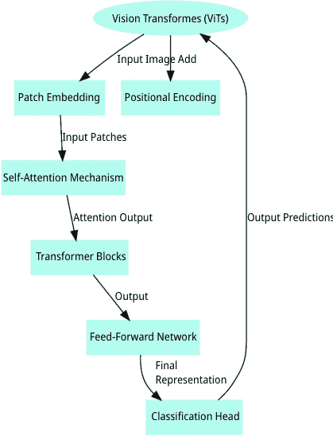

**图 8：** ViT 简介。

## 6.1.3 性能与基准测试

对 ViT 的初步实验表明，其性能可与成熟的基于 CNN 的模型相媲美。在包括 ImageNet 在内的多个基准数据集中，ViT 在分类和分割任务中展现出了更高的准确性。ViT 的有效性取决于大规模训练数据和大量计算资源的可用性，因为其性能往往会随着模型规模和数据量的增加而提升。这些特点既凸显了 ViT 在实际应用中的潜力，也揭示了其部署所面临的挑战。

尽管 ViT 能力出众，但也并非没有挑战。对大规模数据集和大量训练资源的需求，限制了其在资源受限环境中的部署。当应用于小样本数据集时，ViT 可能具有更高的过拟合风险；且截至撰写本文时，对这些模型的解释方法尚不成熟。解决这些问题需要持续在模型优化、数据增强以及 ViT 高效训练等领域进行研究，以便在更广泛的应用中取得更好的成果。

## 6.2 Swin Transformer

Swin Transformer 作为一种分层 ViT，是扩展 Transformer 用于图像分割的新尝试。为了克服以往 Transformer 模型无法处理高分辨率图像和不同尺度的缺陷，Swin Transformer 提出了一种分层策略，将图像划分为一系列不重叠的窗口，并通过移位窗口注意力方法进行处理。这种设计实现了高效且可扩展的图像处理，同时注意不丢失全局和局部上下文信息。

### 6.2.1 次级特性：架构层次与基于窗口的注意力

Swin Transformer 的主要创新在于其分层结构，能够以不同分辨率计算图像。在该模型中，图像首先被划分为若干互不重叠的窗口，并在每个窗口内独立使用自注意力。跨层的窗口移位机制使模型能够捕捉相邻窗口之间的交互，从而有效地整合整个图像的信息。这种基于窗口的注意力方法降低了与全图注意力相关的计算复杂度，从而提升了模型效率，使其适用于高分辨率图像和大规模数据集。

### 6.2.2 相较以往 Transformer 的优势

Swin Transformer 相比 ViT 等早期 Transformer 模型具有多项优势。其分层设计使其具备更好的可扩展性，并能更高效地处理高分辨率输入。传统 Transformer 受困于自注意力的二次复杂度，而 Swin Transformer 基于窗口的方法则显著降低了计算成本，同时保留了捕捉全局上下文的能力。这使得 Swin Transformer 在需要精细局部信息和更广泛上下文理解的图像分割任务中尤为有效。

### 6.2.3 图像分割性能

在图像分割任务中，Swin Transformer 展现出了优于以往基于 Transformer 的方法的性能。高精度输入以及强大的多尺度信息捕获能力，进一步带来了更精确、更出色的分割结果。该模型在 ADE20K 等基准上取得了最先进的分割成果，验证了其在不同分割场景中的适用性。由于其分层结构，该模型在需要时间与空间粒度以及整体执行上下文的场景中表现良好。

### 6.2.4 应用与使用场景

Swin Transformer 的通用结构使其适用于各种图像分割方法。例如，该技术在医学影像中已被很好地应用于分割肿瘤等复杂结构。在遥感领域，其处理卫星图像的能力已有效用于土地覆盖分类和目标检测。该模型的可靠性和速度也使其可用于自动驾驶汽车和机器人技术，其中物体的精确分割至关重要。

Swin Transformer 仍面临一些有待进一步探索的挑战。尽管其复杂度和内存需求相比早期 Transformer 已有所降低，但在资源受限环境中的部署仍存在困难。此外，虽然分层方法提高了可扩展性，但针对实时应用优化模型仍然是一个持续的挑战。未来的研究将聚焦于提升 Swin Transformer 的效率、探索新颖的注意力机制，并将其能力扩展到更大、更多样化的数据集。

## 6.3 SegFormer

SegFormer 代表了基于 Transformer 的架构在图像分割应用中的重大进步。作为一个旨在解决以往 Transformer 方法局限性的模型，SegFormer 将 Transformer 的优势与高效的分割技术相结合。通过利用自注意力机制的能力，SegFormer 旨在提供准确且上下文丰富的分割结果，同时保持计算效率。

### 6.3.1 架构与设计原则

SegFormer 的特点在于其新颖的设计，它将 Transformer 以同时优化性能和效率的方式集成到分割流程中。与常常面临计算开销问题的传统 Transformer 不同，SegFormer 利用轻量级注意力机制来降低自注意力层带来的计算复杂度。该架构通常包含一个用于捕捉全局上下文的轻量级编码器，以及一个用于以高分辨率细化分割输出的解码器。这种设计确保 SegFormer 能够有效处理各种图像尺寸和分辨率。

### 6.3.2 相较以往模型的优势

SegFormer 的主要优势之一在于，它能够以较低的计算成本捕捉长距离依赖和上下文信息。传统 Transformer 虽然功能强大，但在处理速度和资源需求方面常常面临挑战。SegFormer 通过引入兼顾精度与性能的高效注意力机制解决了这些问题。此外，SegFormer 的架构能够有效处理不同的图像尺度和分辨率，使其可灵活适用于各种分割任务。

### 6.3.3 基准数据集上的性能

SegFormer 在多个基准数据集上展现出了强劲性能，证明了其在各种分割任务中的有效性。正如在 ADE20K 数据集上进行的其他评估所强调的那样，SegFormer 能够提供精确且详细的分割图，同时比以往的 Transformer 架构更加高效。这些结果为 SegFormer 作为语义分割的多功能工具提供了有力证据，其应用涵盖自然图像以及某些医学影像领域。

### 6.3.4 应用与实际使用

上述 SegFormer 的结构特点使其能够用于广泛的任务。在自然场景分割中，其效率和准确性表明，该方法可实际应用于实时导航和视频内容分析等场景，例如自动驾驶车辆。在医学影像领域，由于需要使用高分辨率图像进行分割，SegFormer 为肿瘤外观和器官边界勾画等任务提供了可行的解决方案。这些特性使得该模型在多个领域具有很强的实用性和适用性，并且能够与不同类型的数据融合。

## 6.4 混合 CNN-Transformer 架构

预训练的混合 CNN-Transformer 模型是深度学习图像分割领域的一项重大突破。CNN 凭借其分层结构能够很好地分析局部特征，而 Transformer 则擅长建模全局关

文本关系。可以通过结合两者来尝试实现每种提及模型类型的优势，从而更准确、更有效地获得所需结果。

### 6.4.1 CNN 与 Transformer 的组合

通常，Transformer 被集成到 CNN 主干网络中，以利用两种架构的优势：CNN 用于局部特征提取，Transformer 用于捕捉全局上下文。在这种混合方法中，CNN 层首先用于处理和下采样输入图像，生成包含细粒度局部信息的丰富特征图。如图 9 所示，随后 Transformer 模块被应用于这些特征图，以对整个图像中的长程依赖和上下文关系进行建模。这种协同作用使模型能够将精确的局部细节与全面的全局理解相结合，最终提高分割的准确性和鲁棒性。

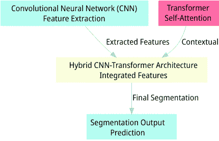

**图 9：** 混合 CNN-Transformer 架构。

### 6.4.2 混合方法的优势

混合 CNN-Transformer 架构相比传统模型具有多项优势。CNN 的使用提供了高效的局部特征提取，而 Transformer 增强了模型在多尺度上捕捉复杂模式和关系的能力。这种双重方法可以提高对具有复杂边界和不同尺寸物体的分割准确性。可以缓解每种架构单独存在的主要缺点：CNN 的有限感受野和 Transformer 的计算强度。

### 6.4.3 混合架构及其实验状态与挑战

尽管具有潜在优势，混合 CNN-Transformer 架构仍面临若干挑战。一个主要问题是结合这两种模型所带来的计算复杂度增加。Transformer 组件，特别是那些具有自注意力机制的组件，需要大量的计算资源，这可能导致更高的内存使用和更长的训练时间。在保持模型性能的同时平衡 CNN 与 Transformer 组件之间的计算负载，是开发高效混合架构的关键挑战。

### 6.4.4 设计考虑因素和模型变体

设计有效的混合 CNN-Transformer 模型需要仔细考虑如何集成两种架构并优化其交互。已经探索了各种方法，包括在 CNN 流程的不同阶段将 CNN 的特征图与 Transformer 嵌入或 Transformer 模块进行拼接。还提出了诸如具有卷积编码的 Transformer 注意力层的 CNN 等模型变体。设计模型所做的每一个决定都会影响模型在目标分割任务中的速度、有效性和能力。

近期关于采用 CNN-Transformer 架构的工作在医学图像分析、遥感和自动驾驶等多个领域取得了成功。当获得正确分割时既需要局部细节又需要全局视角时，这些模型更有用。未来的研究应侧重于优化混合架构以降低计算需求、提高处理高分辨率图像的可扩展性，并探索将 CNN 与 Transformer 集成的新方法。该领域的持续创新有望推动图像分割的进步，并扩展混合模型在多样化领域的应用。

## 6.5 基于 Transformer 分割的挑战与未来方向

基于 Transformer 的架构在分割任务中已被证明是一种强大的工具，因为它们能够考虑长程交互和全局上下文。然而，也能识别出许多与此类模型效率和可行性相矛盾的缺点。解决这些问题是增强基于 Transformer 的分割方法及其在许多其他领域应用的关键步骤。

### 6.5.1 时间和空间复杂度

这是与基于 Transformer 的分割模型相关的一个关键问题，因为它们具有高计算时间和利用率。Transformer 的基本结构包含自注意力，这使得 Transformer 在处理高分辨率图像数据集时对内存和计算资源需求很大。这种计算负载阻碍了 Transformer 在处理能力受限的实时应用中的实际适用性。目前的研究表明，只有通过更好的架构改进和优化方法才能将这些资源需求降至最低。

### 6.5.2 处理细节和空间分辨率

Transformer 虽然在捕捉全局上下文方面有效，但通常难以保留细节并保持高空间分辨率。自注意力的全局特性可能导致局部空间精度的降低，而这对于小特征的准确分割至关重要。增强模型在处理全局信息的同时捕捉和保留细节的能力仍然是一个重大挑战。引入分层方法有助于解决此问题，通过提高空间分辨率和细节保留能力。

### 6.5.3 可扩展性和效率

可扩展性是基于 Transformer 分割模型的另一个关注点。随着图像尺寸和数据集规模的增加，Transformer 的计算和内存需求呈指数级增长。开发在各种图像尺寸和模态下保持效率的可扩展 Transformer 架构对于实际部署至关重要。诸如稀疏注意力机制、高效 Transformer 变体和分层处理等技术可以提供改善可扩展性和效率的解决方案。

### 6.5.4 对多样化领域的泛化

将基于 Transformer 的分割模型应用于新场景时经常会出现性能不一致的情况。特定数据集上开发的模型可能无法很好地迁移到其他领域场景。为了提高 Transformer 的泛化能力，研究人员应研究领域自适应、迁移学习和鲁棒训练策略，以确保在各种场景和数据格式下高效运行。

### 6.5.5 训练数据和标注需求

基于 Transformer 模型的训练特别依赖于大规模、高质量标注数据的存在。基于深度学习的 Transformer 需要大量数据来捕捉复杂的结构和依赖关系。某些领域中标注数据量小会阻碍模型的工作和应用。可行的解决方案可以是集中使用半监督和无监督学习方法，以及数据增强程序和利用预训练模型的迁移学习，以最大限度地减少对庞大标注数据集的依赖。

## 7 结论

深度学习技术以巨大的突破彻底改变了已知的图像分割领域，改变了视觉数据的传统分析和解释。从基础的 CNN 模型，到近期复杂的 U-Net 和 DeepLab 等模型，再到在分割模型中引入 Transformer，分割方法中所做的想法和改进仅仅体现了在广泛领域中不断提升精度、速度和多功能性的进步。

CNN 的发展标志着图像分割的一个关键转折点。早期模型如 FCN 为逐像素分类奠定了基础，解决了空间分辨率和物体尺度等关键挑战。随后的发展，特别是 U-Net 架构，引入了针对生物医学成像的创新，展示了专用模型如何在特定上下文中改善分割性能。U-Net 的编码器-解码器框架结合其跳跃连接，有效保留了空间信息并细化了分割结果，为未来模型树立了基准。

DeepLab 系列通过集成 ASPP 来捕捉多尺度特征并增强上下文理解，进一步推动了该领域的发展。这些模型在 PASCAL VOC 等知名数据集上表现出优越性能，通过有效平衡局部和全局信息。尽管取得成功，DeepLab 模型仍面临与计算需求和细节保留相关的挑战，凸显了持续改进和优化的必要性。

已证明基于 Transformer 的架构见证了图像分割的革命性变化。Transformer 最初设计用于自然语言处理，随后通过自注意力引入了长程依赖和全局上下文。还观察到另一种等价性，包含 ViT 和 Swin Transformer 的模型已证明在处理大型和多样化数据集方面表现出色，而这是基于 CNN 模型的弱点。Transformer 已出现新的 re-

- [14] Wang, Z., Zhang, H., Huang, Z., Lin, Z. 和 Wu, H.（2022）。基于改进 DeepLabv3+ 的图像语义分割多尺度密集注意力机制。*Journal of Electronic Imaging*，31(5)，053006–053006。
- [15] Tu, Z. 和 Bai, X.（2009）。自动上下文及其在高级视觉任务和三维脑图像分割中的应用。*IEEE Transactions on Pattern Analysis and Machine Intelligence*，32(10)，1744–1757。
- [16] Rashwan, A., Du, X., Yin, X. 和 Li, J.（2021）。用于语义分割的扩张式 SpineNet。*arXiv 预印本*，arXiv:2103.12270。
- [17] Yu, H., Yang, Z., Tan, L., Wang, Y., Sun, W., Sun, M. 和 Tang, Y.（2018）。语义分割的方法与数据集：综述。*Neurocomputing*，304，82–103。
- [18] Asgari Taghanaki, S., Abbishk, K., Cohen, J. P., Cohen-Adad, J. 和 Hamarneh, G.（2021）。自然图像与医学图像的深度语义分割：综述。*Artificial Intelligence Review*，54，137–178。
- [19] Yuan, F., Zhang, Z. 和 Fang, Z.（2023）。用于医学图像分割的有效 CNN 与 Transformer 互补网络。*Pattern Recognition*，136，109228。
- [20] Xiao, H., Li, L., Liu, Q., Zhu, X. 和 Zhang, Q.（2023）。医学图像分割中的 Transformer：综述。*Biomedical Signal Processing and Control*，84，104791。

Revathi S.、Subhashini S.、Brindha Merin、R. Akila 和 S. Shanthini

## 医学图像处理的机器学习算法

**摘要：** 医学图像处理实际上已经成为医疗领域不可或缺的组成部分，因为它提高了诊断流程的准确性，也提升了整体临床流程的效率。本章详细介绍了医学图像的处理方法，涵盖基础技术以及特征提取、机器学习算法等高级技术，并说明了这些技术如何应用于各种成像模态。文章探讨了利用核心成像技术揭示生理现象功能特征的可能性，其中包括正电子发射断层显像。章节还讨论了医学图像管理与分析中的当代问题，例如远程医疗和远程诊断、法律法规以及数据保护。这些内容体现了医学图像处理如何推动临床实践变革；本章还考察了它如何改善患者护理、护理规划和诊断。本章重点关注现代方法的创新及其应用，以进一步推动个体化医疗和医疗保健系统其他方面的发展。

**关键词：** 医学图像处理、特征提取、机器学习算法、PET 成像、SPECT 成像、远程医疗

**Revathi S.，** 计算机科学与工程系，B S Abdur Rahman Crescent 科学技术学院，印度泰米尔纳德邦金奈 600048，电子邮箱：srevathi@crescent.education，Orcid ID：0000-0001-9584-5089

**Subhashini S.，** 计算机科学与工程系，B S Abdur Rahman Crescent 科学技术学院，印度泰米尔纳德邦金奈 600048，电子邮箱：subhashini10@gmail.com，Orcid ID：0000-0003-4297-8528

**Brindha Merin，** 计算机科学与工程系，B S Abdur Rahman Crescent 科学技术学院，印度泰米尔纳德邦金奈 600048，电子邮箱：brindhamerin@crescent.education，Orcid ID：0000-0001-9736-1061

**R. Akila，** 计算机科学与工程系，B S Abdur Rahman Crescent 科学技术学院，印度泰米尔纳德邦金奈 600048，电子邮箱：rakila@crescent.education，Orcid ID：0000-0003-4000-4535

**S. Shanthini，** 圣约瑟夫工程学院，印度泰米尔纳德邦金奈，电子邮箱：shanthini.shanmugam@gmail.com，Orcid ID：0000-0002-9831-9532

https://doi.org/10.1515/9783112205198-004

心脏、大脑和癌症中的异常。另一方面，SPECT 成像利用发射伽马射线的放射性示踪剂生成功能性数据，并提供有关骨骼、大脑以及心脏灌注异常的数据。除解剖成像研究外，PET 和 SPECT 还能够提供其他有用的诊断信息，以协助治疗，并更全面地呈现患者的病情。

本章讨论 MIP 面临的一些挑战。

医学图像处理已经取得了长足发展，但与此同时，这些方法的效率和可靠性仍受到若干挑战的影响。另一个需要考虑的因素是，医学照片包含患者信息，必须防止其泄露和遭到未经授权的访问 [19]。此外，为了进行精确的分析和诊断，各种成像技术及其系统都需要具备适当的图像质量和一致性 [20]。图像采集过程中的不一致、噪声水平以及伪影的出现，也会影响特征提取所采用的整体方法 [21]。此外，将 MIP 与远程医疗及异地诊断相结合，会因处理后数据的保护问题以及电信信道的技术要求而进一步扩大问题范围。

另一个重要考虑因素是实施这一框架后可能出现的未来发展方向和创新。这些方向值得在若干关键领域进行探索。毫无疑问，进一步的进步以及随之而来的技术革命，可能会对医学图像处理（MIP）的未来产生深远影响 [22]。预计将人工智能（AI）和机器学习（ML）等新兴技术融入其中，将通过提高各种诊断和治疗方法的有效性，显著增强医学图像分析的功能 [23]。

在医疗保健和患者管理中，人工智能在预测分析、异常检测和图像分割方面的应用，有望带来更准确、更及时的临床决策 [24]。此外，放射性示踪剂、成像系统、光学技术和数学算法的持续进步，将为 MIP 的创新开辟新的机遇 [25]。这些技术的融合有望改变临床实践、改善患者护理，并推动个体化医疗的发展。

## 2 医学图像处理的历史背景

### 2.1 医学成像的早期发展

能够创造此前无法获得的人体和器官系统视图的技术，从根本上改变了诊断方式，标志着医学发展中的重要阶段。1895 年，威廉·伦琴开创了以 X 射线为基础的现代专门成像技术。伦琴发现的这项技术使人们能够在无需手术的情况下间接观察骨骼和部分内部器官，并迅速获得医学界的认可。此后，通过 X 射线获取骨骼系统图像的前景进一步促进了诊断技术的发展，并逐渐成为全球各地医院和诊所的常规手段。

继 X 射线之后的第二项重大进步，是戈弗雷·豪恩斯菲尔德于 20 世纪 70 年代初开发的计算机轴向断层扫描（CAT 或 CT 扫描）。利用 CT 扫描可以获取身体的横截面图像，从而更详细、更清晰地呈现内部器官、组织和异常情况。这项创新结合计算机算法和 X 射线生成三维图像，使医学诊断发生了革命性变化。除了有助于疾病识别和诊断外，这项 CT 成像新技术还开启了医学成像进一步发展的新阶段。

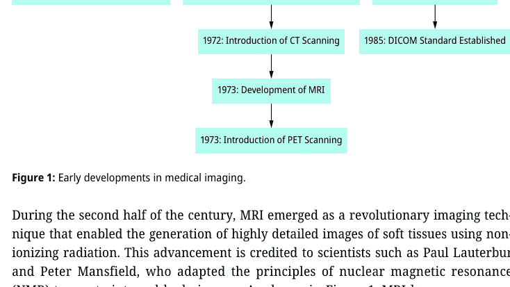

图 1：医学成像的早期发展。

在 20 世纪下半叶，磁共振成像（MRI）作为一种革命性的成像技术出现。它利用非电离辐射生成高度详细的软组织图像。这一进步归功于保罗·劳特伯和彼得·曼斯菲尔德等科学家，他们将核磁共振（NMR）原理应用于人体内部成像。如图 1 所示，MRI 能够区分不同类型的软组织，因此在神经系统、肌肉骨骼系统和心血管成像中尤其具有价值。MRI 的发展是非侵入性医学成像领域的重要里程碑，为临床医生提供了强大的新型诊断能力。

另一项重大进展是超声成像的应用，这项技术自 20 世纪中叶起逐渐普及。超声最初仅应用于产前诊断成像，但由于其非侵入性和低成本等特点，很快便被应用于众多医学领域，同时

随着获得实时图像的可能性。该技术在评估软组织结构和灌注方面被证明很有用，因为它通过组织中高频声波的反射提供图像。由于超声设备便携且不使用任何辐射，因此可用于治疗和诊断。

这些成像技术的有效性在早期就因医学中数字图像处理的应用而得到提升。数字放射学取代了旧的胶片式程序，不仅转移、修改和归档图像。这一转变的一个结果是引入了图像归档和通信系统（PACS），它彻底改变了医疗机构中医学图像的处理方式。历史上，数字医学成像系统的扩展为随后更广泛的图像处理和解释的进步奠定了基础，包括人工智能和机器学习在医学成像系统中的融合。

所有这些发展可以被描述为一个综合集合，它通过为临床医生提供有效且高效的可视化和分析患者的方法，彻底改变了人体的诊断。该时期的创新为具有增强医学研究、诊断和治疗能力的成像过程的巨大发展奠定了基础。

## 2.2 数字成像的兴起

医学图像处理的另一个重大进展是从模拟到数字图像的迁移；它改变了医学图像的获取、存储和审查方式的范式。这一过程始于二十世纪下半叶，由于计算机技术的逐步进步以及认识到模拟系统的缺点。

模拟技术主导了成像系统的早期阶段，但这些系统存在诸如图像随时间衰减、无法复制图像以及处理和增强图像困难等问题。数字化可见图像的能力的出现抵消了这些限制，该能力基于数字成像的概念应用于医学成像这一革命性概念。

在七十年代，戈弗雷·豪斯菲尔德爵士提出了也许是通往现在称为 CT 的数字成像的最重要和最初的步骤之一。基于当前计算机算法的 CT 技术使用从不同角度拍摄的 X 射线图像并创建横截面图像。这是医学领域数字图像处理的非常早期的实际应用之一，证明该技术能够提供比传统 X 射线成像方法更详细和深入的信息。

在 1980 年代和 1990 年代，数字成像所使用的技术通过 MRI 的整合和超声成像的进步而显著改善。上述模态从数字数据的操纵中获得了很大益处。

- **索贝尔和普雷维特算子：** 首次使用于 1960 年代，这类算子是首批通过突出显示强度差异较大的区域来进行图像边缘检测的方法。这些简单的边缘检测方法为用于分割医学图像和提取图像特征的先进边缘检测方法奠定了基础。
- **坎尼边缘检测器：** 设计于 1986 年的坎尼边缘检测器，其优越性在于使用多阶段算法检测噪声图像中的各种边缘。该算法至今仍是医学图像中边缘和结构检测图像分析的主要方法之一。

### 2.3.1 图像滤波技术入门课程

- **高斯滤波：** 使用高斯滤波器进行图像平滑和噪声去除的方法在 1970 年代变得流行。高斯滤波在医学成像中用于预处理图像，以消除噪声，使重要特征可读。
- **中值滤波：** 尽管最初被用作消除图像椒盐噪声的可靠技术，中值滤波最近在医学成像中找到了许多应用，在不模糊边缘的情况下增强图像质量。

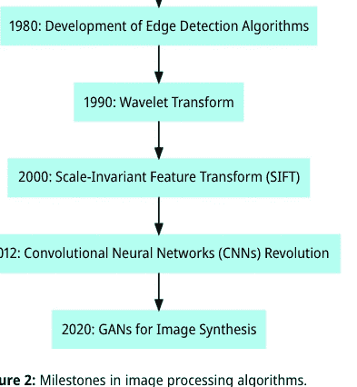

Figure 2: 图像处理算法的里程碑。

### 2.3.2 新型图像分割技术综述
- **区域生长与分裂：** 包括区域生长/合并和区域分裂在内的局部区域-based 分割方法于 1970 年代和 1980 年代发展起来。这些方法根据同质性标准定义的相似性度量对图像进行分组，并证明对描绘医学图像中的结构很有用。
- **主动轮廓模型（蛇形模型）：** 由 Kass 等人在 1988 年引入的主动轮廓模型，或称蛇形模型，是图像分割中最受欢迎的技术之一；它们最小化能量并允许轮廓沿物体边界演化。它们已被广泛用于医学图像分割，尤其用于解剖结构的描绘。

### 2.3.3 重建方法的改进

- **滤波反投影（FBP）：** 在 CT 进展过程中出现的发展中，起源于 1970 年代的 FBP 算法因提供从投影数据重建图像的技术而受到认可。FBP 在计算机断层扫描中仍被广泛用于此目的。
- **迭代重建技术：** 在 1990 年代和 2000 年代，迭代重建算法被引入以解决临床图像质量和伪影问题。这些方法逐步更新图像估计，目前在临床实践中用于提高诊断的准确性。

### 2.3.4 机器学习和深度学习基础的融合

- **早期神经网络：** 在 1980 年代，人工神经网络用作特征提取器和图像分类。此项早期工作为医学成像中更先进的机器学习技术未来的发展铺平了道路；然而，当时其可行性和使用相当有限。
- **卷积神经网络（CNNs）：** 巨大的创新出现在 1990 年代末，当时 LeCun 等人设计了改进图像处理的 CNNs。CNNs 在现代医学图像分析中的主要应用很大程度上归功于其从图像中提取分层特征的能力。CNNs 的应用示例包括图像分割和分类等功能，在这些功能中它们表现出最佳性能。
- **生成对抗网络（GANs）：** 由 Goodfellow 等人于 2014 年引入的近期 GANs 已提供创建高质量合成医学图像和执行数据增强的能力。GANs 用于增强图像质量和生成机器学习模型训练数据集的应用正在增加。

这些是与医学成像领域密切相关的图像处理算法里程碑。它们都已发展成为复杂的技术，以提高图像质量、提取有用的信息和特征，最重要的是实现更好的诊断，从而在医疗保健解决方案中产生了显著差异。

## 2.4 关键技术创新

### 2.4.1 成像硬件和传感器设备的最新发展

医学图像硬件的发展经历了不同阶段；图像种类和质量的重大变化导致诊断的改善。这些早期成像系统具有传感器或探测器开发不足的情况，造成了敏感性和/或分辨率方面的限制，阻碍了诊断系统的工作。最新的探测器采用高分辨率和其他创新传感器技术开发，使图像更清晰。数字放射学等技术用数字传感器取代了传统的胶片技术，有助于提高图像质量并减少辐射暴露，从而提高成像过程的效率。此外，固态探测器和光致存储磷光板的设计也实现了改进的图像获取和处理。

### 2.4.2 利用 GPU 支持图像处理工作

图形处理单元（GPUs）已成功引入医学图像处理管道，其加入使计算性能提高了数倍。最初为图形计算而开发，这些 GPU 具有适合医学成像所需计算的并行处理结构。它们的使用提高了处理大量成像数据以及图像重建、增强和分析等任务的吞吐量。GPU 的技术进步有助于实现复杂的算法，例如深度学习中使用的算法，加速医学图像分析。

## 2.5 标准与协议的演进

MIP 中标准和协议的开发在该领域的发展以及实现不同成像系统间的协同方面发挥了关键作用。标准的日益使用确保了数据传输的标准化，这与图像质量的提升和临床流程的改善一起，对诊断和管理至关重要。

### 2.5.1 DICOM 标准的开始

医学影像演进中的一个重要里程碑出现在 1985 年，当时美国放射学会 (ACR) 和美国国家电气制造商协会 (NEMA) 引入了 DICOM 标准。DICOM 为医学图像的数字归档和传输提供了一个统一框架，确保了各种成像设备和医疗网络之间的兼容性。如图 3 所示，该标准定义了图像存储格式和通信协议，显著增强了不同制造商系统之间的互操作性。随着影像数据现在通常以 DICOM 格式存储，与电子健康记录 (EHRs) 和医学影像存档与通信系统 (PACS) 的整合提高了医学影像工作流程的效率和一致性。

### 2.5.2 图像质量保证协议的发展

随着医学影像技术的改进，对健全的图像质量保证进行开发的需求日益增长。这些指南的目的是确保成像设备始终提供出色的图像质量，这对于辅助医院手术中的诊断和治疗计划制定是强制性的。众多关于图像质量的指南和措施已由 RSNA 和 AAPM 等多个组织制定和开发。其中一些是用于校准和测试成像设备性能的协议，以及用于成像设备维护的协议。这些已付诸实践的质量保证措施有助于使医学影像更准确、更可信，从而增强诊断流程。

### 2.5.3 医学影像实施的监管指南引入

FDA 和 EMA 是两大监管机构，它们为医学影像技术的管理制定规则、法规和指南。其中包括规范新型成像设备准入的规则、此类设备安全性的要求以及数据保护规则。这是因为监管框架需要反映组织间的标准协议，以保证生成的数据集干净、准确且多样化——这些都是有助于最大限度降低算法过拟合风险的有价值属性。

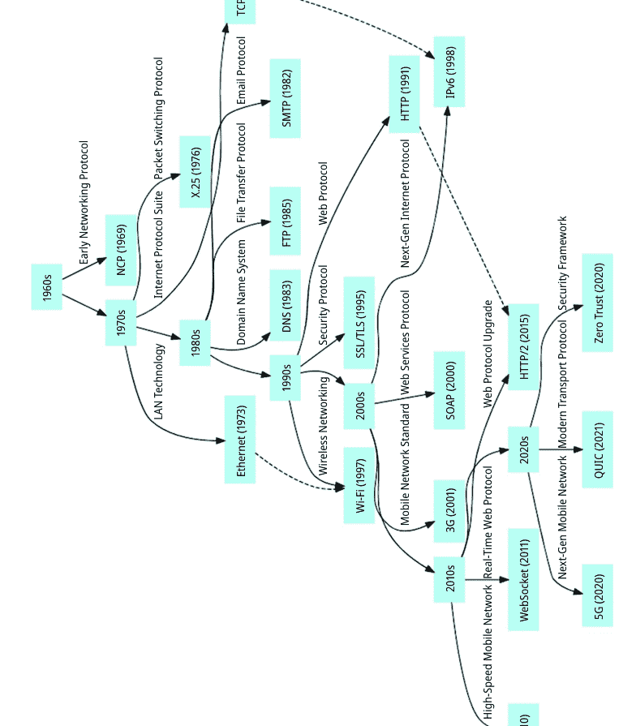

图 3：标准与协议的演进。

### 3.1.2 操控图像分辨率和格式的差异

不同技术可能会保留图像分辨率和/或格式，这决定了所捕获信息的精细细节和准确性如何受到影响。分辨率更高的图像能提供更清晰的场景细节，但在图像处理或分析时需要更多的计算能力。另一方面，由于分辨率低而产生的粗糙图像因细节较少而难以分析。为了确保算法能够提供准确的结果，必须设计其以校正不同质量的图像，这意味着图像处理方法必须根据图像质量具有可扩展性；虽然不同的格式和分辨率可能导致失真，但有必要使算法适应多种成像条件。

医学图像分析的数据异质性增加了定义和开发新方法与规则的需求，以处理由模态、协议、人群和数据集差异引起的问题。正因如此，必须解决以下问题，才能使 MIP 系统成为在广泛的医疗保健应用中支持临床决策的有用工具。因此，它们也带来了关于系统有效性、可靠性、可迁移性和可信赖性的问题。

## 3.2 可扩展性与数据量

医学图像分析是一种受可扩展性和数据量管理问题高度影响的诊断程序。解决这些问题对于在成像设备发生变化且生成的信息量增加的情况下保持医学影像服务的质量和可用性至关重要。

### 3.2.1 管理不断增长的影像信息量

成像技术的持续进步导致每次成像会话产生的数据量大幅增加。MRI 和 CT 等模态产生庞大的图像数据集，使得采集、存储、分析和管理流程日益复杂。如图 4 所示，由个性化和精准诊断需求驱动的对更高分辨率和更具信息量的图像的需求增长，进一步加剧了这一数据激增。有效管理这一数据量现已至关重要，不仅为了保持运营效率，也为了确保诊断结果及时、准确地交付。

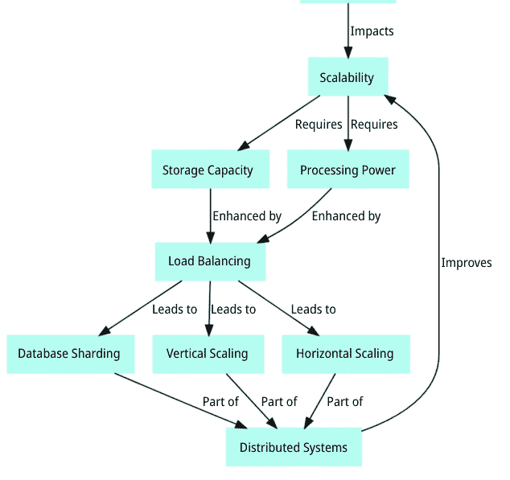

图 4：可扩展性与数据量。

### 3.2.2 大数据存储与管理问题

由于影像数据集的累积规模庞大，其存储和处理方式需要显著的计算能力和硬件。当前的传统存储系统在应对不断扩大的数据存储需求方面存在问题，导致数据拥塞和数据访问缓慢等问题。因此，任何大型数据集都需要可扩展的存储方式，例如云存储系统和高容量存储阵列。因此，数据管理实践必须保证影像数据的质量、安全性和可检索性，这使得数据管理过程变得复杂。

### 3.2.3 为庞大的高维图像设计图像处理算法的挑战

问题在于，许多医学影像数据采用难以处理的格式，例如产生多层切片或包含时间序列分析的成像技术。对这些庞大且多方面的數據进行分析和处理所需的计算量相当可观，需要高级算法和计算能力。自相似处理模型、分布式计算和 GPU 的利用有助于克服这类可扩展性问题，但也会带来自身的问题，尤其是在实现和资源管理方面。

### 3.2.4 大数据对所需计算量影响的方式

主要挑战之一，至少在美国，涉及由于影像数据量大而对计算机属性如内存和存储以及计算能力的需求。图像处理活动中大量数据的软件和总体组织需要高效的方法和高性能计算系统。大型数据集处理可能耗时，因此与更长的处理时间和更高的运营成本相关，这在医疗实践中是不利的，并降低了医学影像的效率。算法优化和资源分配是减轻临床实践环境中这些困难的两种方式。

在当今世界，由于对存储空间需求的增加和存储成本的下降，对高效数据压缩技术的需求已长期存在。

压缩有助于减少定量数据的体积，而医学影像对压缩已知较为敏感。压缩被定义为医学影像中的一个基本过程，它可以最大限度地减少容纳图像所需的存储空间，并在不损失视觉质量的情况下提高图像通过网络传输的速度。数据压缩的不同机制——无损压缩技术和有损压缩技术——有助于在额外数据和图像质量之间进行权衡。对高度压缩数据的改进可产生高质量图像和较小的数据量，该技术正在开发中，可能对存储和分析产生进一步影响。

必须对分析对象进行更改，因为医学图像无法大规模有效分析；它们的数量太多，无法手动处理。已实施的策略包括部署可扩展存储平台、审查数据处理策略以及高效的压缩技术，以遏制日益增长的需求问题并提供及时的医学影像服务。

## 3.3 注解与标注

本章首先对医学图像注解和标注进行了定义，将其作为医学图像分析过程中与机器学习模型训练和验证相关的两个基本步骤。然而，在该领域仍存在若干挑战，成为自动化图像分析系统有效性和可靠性的影响因素。

### 3.3.1 缺乏标注的医学图像数据集

医学图像分析最大的问题之一是缺乏大型标注数据集。在对扫描图像进行标注时，需要放射科医生或其他专业人员的见解，这可能成本高昂且耗时。缺乏标注图像使得生成准确模型变得更加困难，因为模型需要大型数据集才能在患者、扫描和成像模态之间实现广泛适用性。

### 3.3.2 获取专家标注的障碍概述

获取专家标注的过程存在困难。依赖关系有时模糊不清，并且存在因专家而异的变异性。大多数专家需要特定的知识才能进行标注。时间始终是放射科医生和医学专家中的限制因素，这会影响标注的可靠性。此外，部分诊断标准反映了主观程度，因此当不同专家进行标注时，所引入的差异可能会影响模型的性能。

观察者间和观察者内分析会带来很大变异性。通过对观察者间和观察者内变异性的分析，可以阐明使用图像分析进行 KBA 评估的潜在缺陷。

观察者间变异性涉及不同专家做出不同标注，而观察者内变异性涉及同一专家在不同时间做出不同标注。这两种变异形式对于开发可靠的机器学习流程来说是有问题的。标注必须一致且可重复，以便我们构建的模型保持一致并给出可靠的预测。这些问题可以通过统一的标注协议和共识方法来解决，以最小化方差。

### 3.3.3 为什么标准化标注协议很重要？

结果分析还表明，标准化标注协议对于控制变异性并实现标注数据集的高可靠性是必要的。图像标注应以系统的方式进行，最好制定基本规则，以便大量标注图像能够更易获取且更有价值。一些标准化研究涉及制定识别感兴趣区域、标注解剖结构以及定义诊断算法方式的指南。因此，研究人员、临床医生和组织共同合作以制定并维持这些基准至关重要。

### 3.3.4 应用半监督和无监督学习

由于标签不足的问题，学者们探索了半监督和无监督学习技术。为了提高模型性能，半监督学习的概念利用了一组标注数据以及一组未标注数据，尽管后者更大。聚类和降维等技术有助于在照片未以特定方式标注时发现模式和特征。这些方法可以丰富医学图像分析机器学习方法的发展，并为数据短缺问题提供合理的解决方案。

为了增强医学图像分析以及机器学习模型的可靠性和可信度，必须解决这些注解和标注问题。更高质量的数据、标注协议的统一以及训练的新方法，共同使医学成像中的诊断工具更有效、更通用。

## 3.4 模型的解释性

医学图像分析中的主要任务之一是模型的透明度，这也是在实践中应用复杂深度学习技术的普遍问题。虽然深度学习架构尤其是由于其模型复杂，在一系列图像处理任务中表现呈指数级提升，但其“类黑箱”特性不允许此类模型被纳入医疗行业的流程中。

复杂性长期以来与深度学习模型相关联

两种常见的深度学习架构，卷积神经网络（CNNs）和生成对抗网络（GANs），具有复杂的多层结构，能够在疾病诊断和图像分割等医学任务中提供接近最优的结果。这些架构擅长从高维图像数据中提取有意义的特征并进行学习。如图 5 所示，其内部复杂性往往导致缺乏可解释性，使得难以理解特定预测或分类背后的理由。这种“黑箱”特性在临床环境中构成挑战，因为医疗专业人员需要透明且可解释的决策过程，以确保自动化诊断系统中的信任和监管合规性。

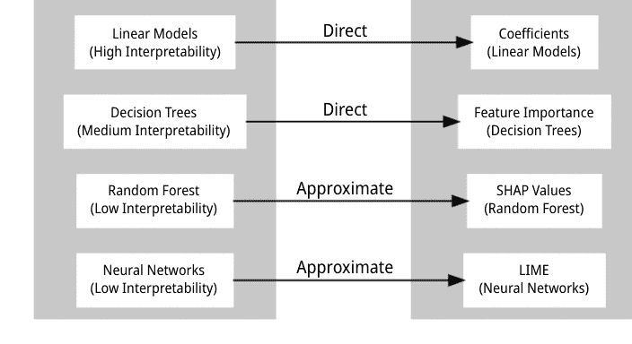

图 5：模型的解释性。

### 3.4.1 可解释人工智能或 XAI 的引入

因此，为纠正机器学习模型可解释性的主要问题，可解释人工智能（XAI）发展的迫切需求已出现。XAI 旨在通过使用人类易于理解的解释来阐明算法如何得出预测的过程。突出图像中与模型决策相关的最重要区域的显著性图也是一个活跃的研究领域，而局部可解释模型无关解释（LIME）旨在用可解释模型近似复杂模型。这些技术旨在通过展示更多决策过程，使这些机器学习模型在医疗环境中更易被接受。

### 3.4.2 模型验证中的统计学

每个机器学习模型高度复杂的特性使得其输出的验证变得非常困难，尤其是在输出标注预测的解释方面。交叉验证和准确率、敏感性、特异性等性能指标更多地关注审查模型的整体效率，而非探索其决策能力。因此，需要验证框架也拥抱模型可解释性，以便识别模型所基于的认知和临床知识及其逻辑对应关系。这涉及创建验证方法，不仅测试模型做出正确预测的能力，还测试模型所提供理由的稳定性和合理性。

### 3.4.3 对临床实践的影响

机器学习模型的使用需要在临床决策中具有可解释性，因此本章如此。医疗保健研究表明，临床医生使用明确的理由来对患者做出合理决策。一些模型可解释性较差的事实将使获得使用者信任变得不可能，从而导致使用这些技术的犹豫。出于这些原因，将机器学习模型纳入临床实践要求结果必须对临床医生来说可理解且可操作，以确认和支持临床判断。这些并发的模型预测和临床记录对于确定机器学习工具在患者护理中是否得到最优应用至关重要。

### 3.4.4 提高可解释清晰度方面的可能未来发展

对机器学习持续的研究涉及以多种方式提高高层次模型可解释性。其中一些包括：使用更可能可解释的学习算法原理、在学习过程中插入先验知识使模型对人类可解释，以及设计包含独立可解释和复杂部分的模型。此外，人们正努力为医学图像处理中的模型可解释性开发标准框架和基准。推进这些研究领域的目标是将高性能机器学习与期望可解释、稳定且可解释结果的临床医生和临床终端用户联系起来。

医学图像分析中模型可解释性的问题强烈表明，仍存在研究和发展议程，使机器学习技术对临床应用更透明且更可解释。克服这些挑战对于带来将这些先进成像工具整合到医疗保健中所需的改进并提高人们对自动化诊断信息的信任至关重要。

通过能够在提供良好性能的同时产生解释的“插值模型”。

### 3.5.3 Overview – guidelines and principles for the use of artificial intelligence-based tools

与此同时，人工智能工具，尤其是医学影像的法律环境正成为一个快速发展的专业领域。诸如 EMA 和 FDA 等监管机构正在制定此类诊断工具的批准和监管标准。所有这些建议都涉及验证、上市后监督和性能评估的必要性，以确保人工智能技术在医疗保健中的安全性和有效性得到充分实现。在人工智能系统被纳入常规实践之前，它们必须满足与其可靠性、有效性和符合上述规则的循证信息相关的具体标准。

### Examination of the ethical question that arises during the process of applying artificial intelligence

但遵守法律和保护患者信息只是关于人工智能在医学影像解读中使用的伦理辩论的一部分。需要回答的问题包括：人工智能的适当使用、知情同意书、人工智能将如何改变临床决策过程的问题。人工智能在医疗保健中的伦理使用取决于患者的自我管理、关于在患者护理中使用人工智能系统的沟通，以及人工智能建议如何影响患者的治疗结果。此外，问题还包括在临床实践中对这些系统过度依赖的情况，以及未来的人工智能系统可能如何削弱临床技能以及与技术持续人机交互的必要性。

正因如此，参考上述杰出的学术和伦理考量对于理解如何最好地开发和应用机器学习算法于各种类型的医学图像分析至关重要。开发和应用此类技术需要数据隐私、公平性、透明度以及遵守规范医疗机构活动的规则，以支持当代医疗保健战略的关键目标。

## 4 Key imaging modalities in medical image processing

### 4.1 X-ray imaging

### 4.1.1 Introduction to mechanisms of X-ray production and detection

X 射线成像的基础假设是 X 射线辐射会被身体部分吸收。X 射线由 X 射线管产生；辐射进入人体，并以不同程度被不同类型的组织吸收。透射 X 射线较少的生物组织在所得图像中呈现灰色阴影，而透射 X 射线更多的骨骼则呈现白色。探测器将穿透身体的 X 射线束转换为传统的摄影胶片或电子传感器。该过程创建了一幅放射图像，提供有关身体内部结构的信息，对诊断很有价值。

Some of the most recurrent applications of diagnostic radiology are:

X 射线成像在多个医学专科中被广泛用于各种诊断应用。它在识别骨骼损伤和骨折方面特别有效，因为它提供了骨骼系统的清晰、高对比度图像。如图 6 所示，胸部放射摄影在可视化胸腔内的结构和诊断肺癌和肺炎等呼吸系统疾病方面发挥着至关重要的作用。腹部 X 射线用于检测肾结石和胃肠道异常，而在牙科中，X 射线有助于治疗计划和龋齿的检测。乳房X光摄影是一种专门的X射线技术，对乳腺癌的早期检测和诊断至关重要，使其成为女性预防性医疗保健的基石。

### 4.1.2 Different methods for improving X-ray images

通过图像处理对图像增强带来了令人印象深刻的变化，从而得到增强的 X 射线图像。涉及对比度改善、边缘和清晰度增强以及噪声消除的技术可提高图像质量。伪影减少方法侧重于运动模糊和图像噪声等区域，从而实现增强的诊断。机器在病理的自动识别和分析方面的能力不断增强，例如骨折或肿瘤，从而提高 CI。此外，CT 利用投影图像产生多个二维 X 射线图像以创建三维图像，在一定程度上揭示了不可见的结构，仅使用 X 射线。

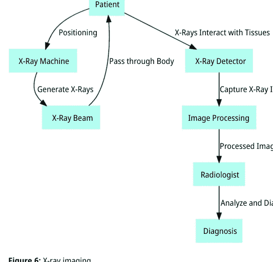

Figure 6: X-ray imaging.

### 4.1.3 Constraints of X-ray imaging and their resolution

然而，X 射线成像的使用受到某些缺点的限制；这些问题正由现代技术以如下方式解决。其中一些问题包括高辐射，这可能是一种危险，尤其是在拍摄多张图像时。放射防护策略和剂量减少技术旨在在剂量率和诊断质量之间取得正确的平衡。与骨骼相比，X 射线对软组织的对比度较差；软组织也具有非常均匀的密度。为此，有包括双能 X 射线吸收测定法和使用造影剂在内的方法，有助于软组织的显示。此外，X 射线图像的解读可能具有一定挑战性，因为这需要专业知识。正在创建机器学习算法以帮助放射科医生定位轻微表现并提高评估的准确性。

### 4.1.4 Application of machine learning in diagnosis using X-ray images

机器学习为 X 射线成像增加了更高的分析能力，以提高诊断的准确性和速度。检测算法可以检测异常情况 such

手术方法与解剖特征相关，因为术前获得了准确的信息，而实时成像有助于进行微创手术。

### 4.2.2 Recent breakthroughs in image processing: noise reduction and artifact removal

然而，CT 成像存在一些局限性；这些是噪声和伪影，它们会扭曲图像并导致不准确的诊断。为克服这些困难，采用了复杂的图像重建方法。IR 方法降低了随机噪声的可见性，并提供更好的图像质量以显示解剖细节。已知某些伪影校正技术（如金属伪影减少和束硬化校正）被用于补偿金属植入物和其他混杂成像源的影响。这些改进提高了 CT 图像的分析并降低了复查率。

### 4.2.3 Methods of increasing the contrast of CT pictures

锐化技术对于 CT 扫描中组织的分割和病理的感知是必要的。基于碘的造影剂静脉注射以勾勒血管、器官和肿瘤，便于识别。进一步提高 CT 图像对比度和细节显示的技术包括图像对比度增强和直方图均衡化。多期成像技术和动态对比增强 CT 在组织表征和诊断范式中提供了有关组织血流和功能的进一步信息。

### 4.2.4 Artificial intelligence in automated CT image analysis

CT 成像越来越多地与机器学习和人工智能集成，以提高诊断的速度和准确性。一种深度学习算法的子类，特别是 CNN，被输入大量数据，使其能够自行学习、检测和分类 CT 扫描中的异常。这些人工智能工具通过识别潜在问题区域、自主执行测量并提供决策支持来增强放射科医生的工作。通过增强对 CT 图像获取的数据的分析能力，机器学习在 CT 成像中的应用可能改善特定治疗，加快诊断过程并减少人为错误。

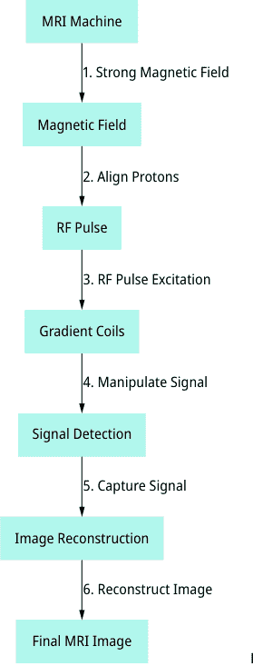

图 7：磁共振成像（MRI）。

通过追踪组织中的水分子来获取大脑白质连接的信息。磁共振波谱通过提供不同疾病中发生的代谢改变信息，对组织进行生化方面的表征。然而，使用类似对比增强 MRI 等等效技术，检查采用静脉注射造影剂来改善血管和病理病变的显示，以获得准确的诊断。

### 4.3.4 先进 MRI 成像的技术分析

磁共振图像的生成涉及不同的图像分析方法，以提高图像质量并检测有用信息。任何照片在被考虑进行分析或进行任何分析之前，都必须经过某种形式的预处理，如降噪和伪影校正，这些伪影可能会扭曲图像，甚至妨碍或扭曲分析结果。图像配准和分割等高阶技术提高了结构和疾病识别与测量的准确性。出于这些原因，MRI 数据分析中使用的更传统程序越来越多地采用机器学习算法，以自动化和增强这些程序，从而提高诊断准确性。为了更有效地查看和解释 MRI 图像，采用了去噪、超分辨率成像和特征提取等技术。

### 4.3.5 展望与问题

然而，MRI 存在一些挑战。然而，由于设备成本高以及技术基础设施要求，MRI 在医院中的广泛普及仍然是一个挑战。此外，它极易受到患者移动和伪影的影响，从而可能扭曲基于 MRI 图像的诊断结果。此外，其中一些问题，例如成像速度过慢以及无法校正受试者运动，正通过开发更快的成像技术和更好的运动校正方法而得到解决。MRI 技术中可以预期的当前研究进展包括：考虑使用更高磁场强度以产生更清晰图像的可能性，考虑在所创建图像的分析中使用人工智能，以及增加功能性和分子成像，这将进一步深入了解疾病的原因以及身体对治疗的反应。

MRI 一直是提供卓越分辨率和诊断潜力的重要的医学成像类型。预计其应用将扩展，与先进处理技术和机器学习算法集成，从而在临床应用中具有更高的实用性，为各种临床状况提供改进的、丰富且细节丰富的成像解决方案。

## 4.4 超声成像

超声成像又称超声诊断，是使用高频声波显示人体内部结构实时图像的最常用诊断技术之一。其特殊之处在于无创性，因为它不产生电离辐射，并且具有众多治疗应用。在后续章节中，对超声成像进行了全面分析，涉及其基本原理、应用、图像处理技术和进展。

### 4.4.1 超声成像的实践原理

一些重要原理，包括声波原理和声波回波原理，将用于解释超声成像。换能器产生超声波进入体内，通常频率范围为 2–18 MHz。换能器接收反射回来的回波；这些声波穿过体内的显著组织和表面。为了通过处理使内部结构可见，回波在利用步骤后被转换为电信号。组织的分类取决于组织的声阻抗，不同阻抗的组织对发射声波的反射不同。它产生一幅具有相对亮度和对比度的图像，对应于给定组织的密度和组成。

### 4.4.2 超声诊断在人类治疗中的应用

由于超声成像安全且具有实时成像优势，它常被用于许多医学领域。在产科和妇科，超声主要用于诊断需要产前干预的状况、评估胎儿发育并监测胎儿健康。超声心动图是心脏病学实践中使用的诊断模式，通过提供心脏的精确图像来协助治疗计划和心血管疾病的管理。腹部超声除了用于评估肝脏、肾脏、胆囊等腹部器官外，还可诊断囊肿、肿瘤和胆结石等疾病。在检查肌腱、韧带和软组织时，肌肉骨骼超声有助于提供炎症和损伤的信息。此外，血管成像采用超声技术来估计血流并识别血管异常。

### 4.4.3 超声图像处理的常用技术

在超声检查中，图像生成过程中使用了许多方法，旨在提高图像质量并得出正确诊断。基本处理形式是增益控制，涉及图像亮度，以及时间增益补偿（TGC），它描述了由于衰减而导致的来自不同深度的回波幅度加权的差异。因此，采用空间滤波和自适应滤波等方法对图像进行处理，以减少斑点并提高图像质量。图像后处理技术、锐化和亮度变化被应用于定义身体的不同结构，从而增强图像的诊断特性。特殊程序包括多普勒成像，它可以根据反射声波的频率变化作为血流速度和方向的标志，进一步确定血流和血管特征。

### 4.4.4 超声图像分析的困难

积极地说，超声成像作为诊断工具具有许多优点，尽管存在一些缺点，会影响图像质量和诊断准确性。这些失真阻碍了对潜在解剖结构的正确解释，因为结构看起来被增强、出现斑点或被遮蔽。另一个挑战是操作者依赖性，因为超声图像的质量在很大程度上取决于操作者的技能和知识。通常，深部组织成像中微小结构或病变的可见性会因分辨率限制而降低。此外，患者特征和所用设备设置的差异也会导致图像一致性问题，影响比较研究的可靠性。

### 4.4.5 超声的更多创新

超声方法最近经历了几项发展，扩大了该领域范围并提高了诊断效率。三维和四维超声成像实现了体积结构成像，可提供更高的准确性和空间分辨率。一种名为弹性成像的新技术可确定组织的弹性和硬度，并提供有关肿瘤和肝纤维化特征的有价值数据。微泡造影剂增强了造影超声，因为超声在显示血流和组织血管方面表现出色，有助于肿瘤检测和心脏功能评估。此外，手持式和便携式超声系统可以制造，这意味着在急诊和随时情况下诊断的可用性和便利性。

因此，由于其无干扰、实时控制可能性以及对各种临床情况的适应性，超声一直是诊断的重要组成部分。由于硬件技术和图像增强技术的不断进步提高了应用和准确性，超声已成为现代医学实践中不可或缺的模式。

## 4.5 核成像（PET 和 SPECT）

由于核成像提供了生理结构信息的额外功能信息，它正在医学成像领域实现革命。核成像由 PET 和 SPECT 实现。这些方法补充了其他基于形态的成像技术

诸如MRI和CT等技术，并能够可视化组织和器官的代谢和生化功能。

本课程于2005年首次开设，涵盖PET原理。

在正电子发射断层成像（PET）中，通过检测体内正电子与电子湮灭事件产生的伽马射线来生成诊断图像。该过程始于注射放射性示踪剂——通常是一种用正电子发射放射性核素标记的生物活性化合物。当放射性示踪剂在特定器官或组织中积累时，会发生正电子发射，从而释放伽马射线。如图8所示，这些光子被PET扫描仪检测到，并重建出反映示踪剂全身分布的三维图像。PET广泛用于评估脑功能、诊断癌症、评估代谢活动以及监测治疗干预的效果。

### 4.5.1 PET扫描的临床应用与价值

在心脏病学、神经病学和癌症领域，PET成像常常被使用。PET扫描有助于确定治疗反应、疾病分期以及肿瘤学中恶性肿瘤的识别。PET对代谢变化具有出色的响应能力；这意味着即使在癌细胞形态特征发生变化之前，PET也能发现肿瘤。在神经病学中，PET用于研究大脑代谢和观察神经退行性疾病，例如阿尔茨海默病。目前对神经疾病进展的了解有限，而PET成像进一步用于测量大脑活动。在心脏病学中，PET提供有关心脏代谢和功能的数据，因此可用于诊断冠状动脉疾病和评估心脏质量。

最后，介绍SPECT的原理。

SPECT放射性示踪剂是发射伽马射线的示踪剂，用于获取有关器官和组织功能的信息。与使用正电子湮灭事件的PET不同，SPECT依赖于直接从示踪剂发射的伽马射线。为了从不同角度获取患者的二维图像，伽马相机绕患者旋转。然后将这些源图像合并形成立体可视化图像，从而获得三维视觉外观。SPECT的灵敏度低于PET，但在技术成熟度和操作成本的比较分析中，SPECT具有优势。它用于检查骨骼疾病、脑部问题和心脏功能。

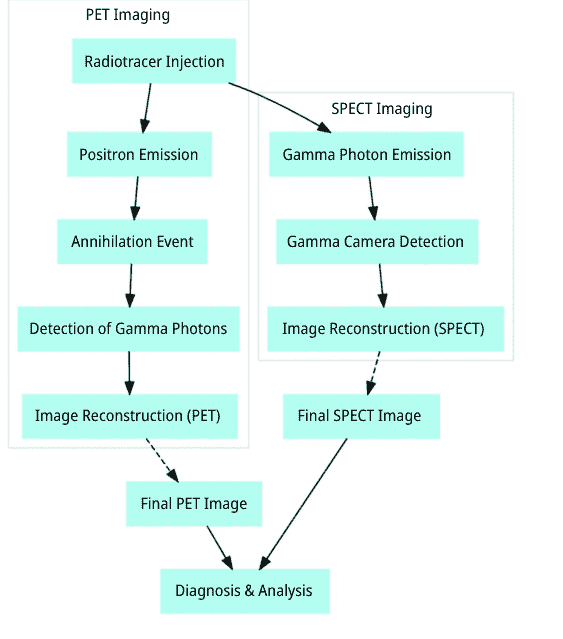

图8：核医学成像（PET和SPECT）。

### 4.5.2 SPECT的临床应用

SPECT的应用主要有三大领域：肿瘤学、神经疾病和心血管疾病。SPECT在心脏病学中用于确定心肌功能和灌注，以诊断冠状动脉疾病（CAD）和评估心肌梗死（MI）的严重程度。在神经病学中，SPECT用于评估和诊断癫痫、痴呆、缺血性卒中及其相关结局等疾病，并提供脑血流数据。SPECT成像在肿瘤学中不如PET常见，但可用于肿瘤定位和治疗效果评估。由于SPECT提供动态功能图像，它在评估多种生理功能和病理状态方面非常有效。

成三维图像。MRI利用射频脉冲和磁场，根据组织质子密度和弛豫特性形成图像。它们通过组织回波并利用高频声波构建图像。各模态图像生成原理的差异影响诊断能力和图像质量。

### 5.1.2 传感器和探测器的作用

成像信号还需要传感器和探测器来拾取信号并将信号转换为数字平台上的图像。X射线和CT成像使用的探测器可分为胶片型或数字型；然而，数字方法具有图像生成快速和图像处理灵活等优点。在MRI中，探测器集成在射频线圈天线中，接收由外加磁场在组织中产生的信号。超声扫描技术使用压电换能器，将声波转换为电脉冲。传感器和探测器的类型因测试期间采集图像的分辨率、灵敏度和质量而异。

### 5.1.3 某些采集参数对图像质量的影响

图像采集因素如曝光时间、辐射剂量和图像分辨率对图像质量有显著影响。在X射线和CT中，影响辐射剂量与图像质量之间权衡的定量因素包括管电流、管电压和层厚。影响图像对比度和分辨率的因素可能包括场强、回波时间（TE）和重复时间（TR）。在超声检查中，图像清晰度和诊断信息取决于扫描深度、增益控制和换能器频率等因素。准确校准这些值对于在最小患者风险下获得最佳图像质量至关重要。

### 5.1.4 增强图像采集过程的方法

我们讨论了一系列方法，以在图像质量和诊断方面尽可能优化图像采集。在X射线和CT成像中，诸如患者X射线剂量调制和迭代重建算法的应用等现代化技术可降低辐射风险，同时提供可接受的图像质量。在MRI中，包括并行成像和使用先进脉冲序列在内的方法有助于在更短时间内获得高分辨率图像。超声成像优化是指通过使用谐波成像来优化探头设置。

增强图像的可比性。直方图修正或匹配将图像的直方图转换为所需的直方图。这对于标准化图像外观或突出某些特征尤其有用。这些方法有助于解决医学图像解释中的问题，以产生具有更好可见性的结果。

## 5.2.4 多模态图像复原与增强

融合是指将两幅或多幅通常来自不同成像模式的图像融合成一幅融合图像的过程。该方法通过添加其他互补信息（如CT扫描的结构信息和PET的功能信息）来改进先前的诊断模式。多模态叠加增强技术主要关注各模态内结构的整体可见性和对比度，以及确保一个模态中识别出的所有重要特征在融合图像中得以保留。多模态图像融合方法包括基于强度的融合、基于特征的融合和基于小波的融合，相比仅使用单一图像，能更好地诊断患者状况。

由于诊断应用需要详细的人体图像，图像增强方法在提高此类图像质量方面发挥着重要作用。对比度拉伸、噪声滤波、边缘检测、直方图评估以及图像融合等操作有助于放大医学图像以揭示特定信息，使精确诊断更易实现，并有助于制定有效的治疗方案。其动机包括改善患者护理，同时使医学成像中持续发生的变化更易于处理。

## 5.3 图像分割

MIP中讨论的另一个主要概念是分割过程，即将图像划分为若干离散区域或片段，这些区域或片段代表图像中感兴趣的结构。它是一种通过图像分析和医学图片解释，从复杂图像信息中获取相关信息的过程。

分割技术既有历史方法也有近期方法——自动分割技术和手动分割技术。

采用自动分割方法时，计算机算法用于识别和描绘感兴趣区域（ROI），无需直接人工干预。常用的技术包括阈值分割、区域生长和聚类（尤其是k均值算法）。阈值分割通过选择特定的强度值来分离图像中的区域；区域生长方法从种子点开始，根据预定义标准扩展；聚类算法将具有相似特征的像素分组为不同的段。如图9所示，这些方法能够...

模型的发展。诸如 U-net 和 FCN 之类的技术是专门为医学图像分割而开发的，具有高精度和鲁棒性。

### 5.3.2 分割在疾病诊断和治疗管理中的应用

分割是众多医学应用中最关键的环节之一。肿瘤分割对于肿瘤学诊断、治疗计划制定以及评估治疗反应至关重要。在心脏病学实践中，心脏结构的分离对于策略制定和功能评估都很重要。在神经病学中，组织分割有助于确定可用性并评估神经疾病的进展。分割还能有效促进解剖结构的精确测量，从而提高临床评估和治疗效率。

### 5.3.3 医学图像分割的困难与机遇

在进行医学图像分割时出现的一些问题包括：采集图像质量的波动、图像噪声以及不同患者结构的变异性。有一些方法，如高级滤波、预处理和后处理，可以减少这些问题。结合所谓的多模态数据（即使用来自不同成像模态的数据）也能提高分割性能。当前活跃的研究工作包括改进更好更高效的算法以及大规模标注数据集，以有效处理这些问题。

对 MIP 的需求源于这样一个事实：图像处理有时需要从复杂的图像数据中提取特定特征，例如图像的某个特定区域。由于机器学习的进步和算法效能的提高，分割技术不断改进；诊断和治疗干预的机会在医学领域广泛存在。

## 5.4 图像配准

在 MIP 背景下发展起来的一个重要概念是图像配准，它是指将在不同时间、不同角度或借助不同成像模态获取的同一场景的多幅图像进行匹配。在进行图像比较和分析之前，图像配准过程旨在将图像对齐到同一坐标系。这一过程对于开展各种临床试验、微调诊断以及融合多光谱成像数据至关重要。

### 5.4.1 图像配准的基本原理

图像配准涉及通过识别两幅或多幅图像中对应的点或特征来对齐它们。该过程包括几个基本步骤：选择参考图像和目标图像，确定合适的变换模型，估计其参数，以及应用变换以实现对齐。如图 10 所示，成功的配准取决于多个因素，包括图像的质量和相似性、配准窗口的大小、迭代次数以及图像的内在特征。鲁棒的配准算法应确保高位置精度，并保持对齐图像间的结构一致性。

### 5.4.2 刚性配准方法

刚性配准仅通过估计平移和旋转参数来实现图像的匹配，不会使图像中的对象发生形变。当图像使用相同模态采集，或感兴趣对象在扫描之间位置不变时，这种技术通常被使用。刚性配准的方法包括：

- 基于特征的方法：在图像中寻找对应的点或特殊子集，例如骨骼或预期手术区域的某些点。
- 基于强度的方法：应通过最大化像素强度在图像区域间的对应关系来对齐图像。
- 互信息（MI）：涉及特征匹配，以依赖关系为优化准则，估计一个强度分布中若干像素与另一个强度分布之间的关联强度。

### 5.4.3 非刚性配准方法综述

配准方法分为两类：刚性配准，图像只能进行平移、缩放和旋转；以及非刚性配准，图像可以根据局部形变进行变形以匹配另一幅图像。在处理解剖结构或组织结构随时间或模态间发生改变的图像时，这种方法不可或缺。主要方法包括：

- B 样条和薄板样条：利用样条函数构建图像模型，实现平滑的配准变形。
- 弹性变形模型：这种移动必须与弹性调整相关，使组织在拉伸时能够弯曲和扭转。

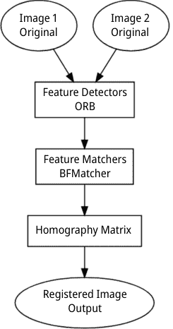

**图 10：** 图像配准。

Demons 算法：基于数学方程，通过减小图像之间的距离，在连续过程中调整对齐。

这里我们提供有关图像配准的基础知识，然后描述其几个应用。

图像配准在各类医学成像应用中广泛使用：

- **多模态成像：** 融合 MRI、CT 和 PET 成像，以观察身体更详细的功能性和解剖学数据。
- **纵向研究：** 跟踪采集的图像，分析疾病发展、治疗反应或术后变化。
- **手术规划与导航：** 将术前影像与术中影像并行定位，以提供精确的手术引导，从而改进术前成像。
- **图像融合：** 将解剖图像叠加到同一帧中，提高诊断准确性，因为每种模态都提供了对方无法提供的信息。

即使在从大致相同视角拍摄且相机位置发生微小变化的情况下，图像配准仍然是一个难题。

尽管图像配准很重要，但它也带来了若干挑战：

- **图像质量的变异性：** 图像分辨率、噪声水平的变化以及图像的对比度差异将决定配准精度。
- **伪影的存在：** 变形和运动是阻碍对齐过程的一些伪影，只能通过某些方法加以校正。
- **计算复杂性：** 非刚性配准算法通常计算成本高昂，因此消耗大量的计算能力和时间。

选择适当的算法：最后，使用哪种配准方法取决于图像的某些属性以及临床领域，这是一个高度依赖于具体情境和上下文的问题。

图像配准是医学图像分析中的一个重要步骤，通过它可以将来自不同来源或在不同时间拍摄的图像重新对齐，以便在诊断中进行综合分析。新的配准方法仍然是影响配准方法改进、进而影响医学影像临床实践的关键因素。

## 5.5 特征提取与分析

特征提取与分析是医学图像处理的一部分，旨在将医学图像的原始数据转换为可用于疾病诊断、监测和治疗计划制定的有用信息。这一过程涉及对医学图像中特征或结构的差异或相似性进行有效检测和测量，以供分析和评估。

本节的主要任务是描述检测和提取与分类问题相关的特征集的方法。

另一方面，特征提取涉及从医学图像中提取分析所需的特定属性或模式。这一过程采用了多种技术，包括：

纹理分析：在图像中，像素强度的空间排列通过纹理特征来度量。纹理信息具有可推广性，可以使用诸如 Gabor 滤波器、局部二值模式（LBP）和灰度共生矩阵（GLCM）等预处理方法捕获纹理特征，以区分不同类型的组织并突出异常。

形状分析：形状特征是指任意给定图像中特定结构的几何外观特征。轮廓检测（例如边界提取）甚至区域属性可用于量化包括面积、周长和几何形状在内的特定参数。这些特征对于基于解剖结构或病变将相应的训练模型划分或排列成多个部分特别有用。

基于强度的特征：基于强度的特征度量图像内像素强度的分布和变化。直方图分析、像素强度的均值、方差和偏度是统计分析中使用的一些方法，用于提供有关图像对比度和亮度的信息，这些信息可能包含病理变化的相关信息。

边缘检测：在特征检测中，有 Sobel、Canny 和 Prewitt 算子，用于检测图像中结构的边缘和轮廓。这些特征有助于以更高的对比度描绘感兴趣区域，从而改进结构特征的识别。

基于区域的特征：基于区域的特征是从区域中提取的，这里所说的区域指图像中分割出的区域。区域生长、分水岭技术和形态学处理等方法用于识别特定区域内的面积、体积和最终形状等特征。

如下所示，特征分析是疾病分类和诊断过程中的重要方面。

特征分析在医学图像分类与解释中起着至关重要的作用。从提取的结果特征中可以区分不同类型的组织、病变或疾病。在基于这些特征进行图像识别时，会使用神经网络、随机森林和支持向量机（SVM）等机器学习技术。在分类过程中，模型在标记数据集上进行训练，其中与不同情况相关的模式被标记。也许，对特征进行细致的定义和分类可以提高诊断准确性、指导治疗决策，并增强个体化治疗的过程。

### 5.5.1 使用特征提取进行疾病诊断和治疗

特征提取和分析广泛应用于一系列医学成像应用中：

- 肿瘤检测与特征描述：纹理、形状和强度用于量化和定位 MRI、CT 和 PET 成像中的肿瘤。这些特征有助于区分良性和恶性肿瘤、评估肿瘤侵袭性以及确定治疗结果。

- 器官与组织分割：精确锁定器官和组织对于诊断和治疗计划至关重要。应用各种特征提取方法来勾勒解剖体积和病理区域，以评估器官功能和手术策略。

- 疾病监测与预后：时间序列提取的特征可以揭示疾病进展或对某些干预（如治疗）反应的潜在趋势。因此，肿瘤大小或一致性等特征的识别可用于评估治疗疗效和疾病预后。

- 个性化医疗：特征分析允许在选择治疗方案时采用差异化方法，利用患者特征选择最佳策略。通过这种方式，可以突出与患者病情特征相关的差异，使临床医生能够改进治疗方法并改善患者预后。

特征提取和分析是该领域中最棘手的难题之一。

医学成像中的特征提取和分析伴随着多个挑战：

- 图像质量的变异性：图像采集参数和图像噪声的这种变化也会影响成像特征的质量。这些变化要求良好的特征提取技术考虑这些因素，以提供准确的结果。

- 高维性：从医学图像中获得的特征通常数量很大，往往导致高维数据。为了解决这个问题，采用传统降维技术（如 PCA）和特征选择方法来促进相关分析。

- 观察者间变异性：由不同观察者进行识别时，特征识别（或特征抽象）的变异性（即特征变异性）是潜在的变异来源。需要确保这些过程标准化，并配备常规自动化方法以减少这一问题。

- 计算资源：许多增强型特征提取和分析过程需要大量计算，尤其是在大数据情况下。为了满足这些计算要求，需要采用高效的算法和 GPU 硬件资源。

临床实践中每一次使用医学图像都依赖于对图像内所包含数据的特征提取和分析。这样，提取和表征的特征对专注于疾病描述、治疗和患者预后的医疗专业人员很有用。本章关注特征提取过程，并指出成像技术和计算方法的不断发展扩大了特征提取在医学图像分析中的潜力和多样性。

## 6 医学图像处理对临床实践的影响

### 6.1 提高诊断准确性

医学图像处理（MIP）通过提高结果的精确度彻底改变了医学诊断。成像和处理算法技术改进了疾病和病症的检测、描述和评估方式，与早期方法相比，精确度更高。

### 6.1.1 增强的可视化与检测

此外，通过使用图像处理方法，病理异常和其他相关解剖结构的模式得到了改善。高级功能，例如噪声处理、图像锐化和滤波，有助于揭示可能隐藏在普通图像中的信息。例如，自适应滤波和对比度增强等技术可通过增强组织密度细微变化的可见性，用于癌症检测。通过以视觉方式丰富呈现的信息，那些原本可能被忽略的可疑或微弱模式可以更早被发现，从而使诊断更快捷、更准确。

### 6.1.2 图像分割和分析的增强

对受影响结构和病灶进行最优分割对于准确诊断和治疗计划非常重要。图像分析的最新进展提供了全自动或半自动分析和分割器官、肿瘤或血管等结构的功能。阈值分割、边缘检测和区域生长方法的应用能够精确定义感兴趣区域。更高程度的分割可提高肿瘤大小、体积和分布测量的准确性，这对于癌症分期、术前计划和治疗效果评估至关重要。

全面机器学习和人工智能的融合彻底改变了医学成像，为模式识别和预测提供了新的先进工具。在人工智能领域，利用大数据训练 CNN 和深度学习模型，以区分医学图像中的复杂模式和疾病。这些算法使传统放射科医生能够以一定精度实际识别并细分这些异常。例如，人工智能已被证明在识别糖尿病视网膜病变和乳腺癌等疾病的早期预警信号方面，其准确性和速度比传统方法高出许多倍。

### 6.1.2 诊断错误的预防和最小化

误诊，可能表现为错误的阳性诊断或错误的阴性诊断，会对预后产生影响。提供更好图像数据分析的 MIP 方法可将这些错误降至最低。计算机辅助图像分析系统的操作者间变异性较小，因此比人工方法更不容易出错。可测量参数分析和模式识别提供了更准确的成像数据评估，从而降低了错误解读的可能性，提高了诊断效能。

### 6.1.3 有助于早期识别疾病

早期诊断对于疾病管理和改善患者预后至关重要。利用先进图像分析技术，可以指出标志着疾病出现的改变，而这些改变通常早于医生开始注意到症状。例如，更先进的成像系统和改进的图像处理技术可以检测早期癌症或大脑中的其他早期临床前状况，其中可能包括神经退行性疾病。从某种意义上说，MIP 有助于更早发现疾病，从而使患者获得更好的预后。

### 6.1.4 倡导个性化医疗

个体化治疗是基于患者个体特征进行的治疗，因此具有独特性。MIP 提供对每位患者形态学和病理生理状态的分析，意味着可采用更个体化的治疗方法。成像模式与图像量化相结合，可提供适合评估患者在疾病表现和治疗方面差异的特征。治疗方案与患者特征匹配的适宜性可提高治疗效率，并最大限度地减少潜在的负面结果。

**实际上，允许纵向监测取决于某些条件的达成，而正是这些条件使上述结果成为可能。**

在慢性疾病中，疾病和治疗效果的监测至关重要；这只能通过纵向评估来实现。MIP 能够评估此类系列影像研究，以监测发生的时间变化。处理技术，例如图像配准和变化检测，能够对齐和比较不同时间点获得的图像。这种能力可用于持续评估疾病的进展情况、治疗的疗效，或需要如何调整治疗管理策略。

MIP 的进步已在临床前沿得到体现，诊断有效性方面也出现了积极变化。因此，医学图像可视化、分割和分析的改进以及先进人工智能技术的整合，使得更准确、精确和及时的诊断成为可能。这些进步增强了患者护理和治疗效果，提高了治疗效率，并促进了个体化医学的发展，这再次强调了图像处理在当代实践中的重要性。

## 6.2 优化治疗计划

与医学影像相关的流程在制定治疗计划中起着至关重要的作用，它们能提供详细而准确的诊断信息。这种精确性使临床医生能够为个体患者制定更具针对性和更有效的治疗策略。如图11所示，影像技术的进步结合复杂的图像分析和处理技术，显著提高了各医学专科中诊断、监测和预防疾病的能力。这些创新有助于更精准地实施治疗干预，并推动更具前瞻性的患者护理方法。

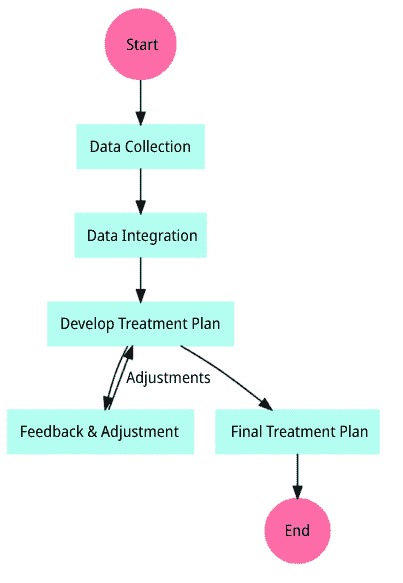

图11：优化治疗计划。

### 6.2.1 更详细的身体解剖结构呈现

由于特定解剖部位的显像方法得到改进，临床医生能够确定肿瘤、病灶及其他病理改变的尺寸、轮廓和位置。本研究所使用的影像包括MRI、CT和PET扫描，它们提供高分辨率图像，有助于从解剖和病理特征方面对图像进行详细分析。这种更高的可视性使得治疗靶点的定位更加准确，从而减少损伤周围健康细胞的机会。

### 6.2.2 放射治疗的精准性

放射治疗旨在实现疾病的局部控制，其核心在于向恶性组织输送最大剂量，同时将周围健康组织的剂量降至最低。影像在图像处理中具有独特作用，这是结合医学图像与治疗计划系统建立精准治疗规划技术的重要因素。图像融合等方法将来自不同影像研究的信息整合在一起，能够实现肿瘤边缘和结构的正确勾画。这一整合有助于制定三维放射治疗计划，描述放射剂量分布，从而提高治疗效率并降低副作用风险。

### 6.2.3 器官特异性手术

医学图像处理（MIP）为手术规划提供了重要价值。术前影像可使外科医生了解肿瘤与内部器官和结构的相对位置，从而选择合适的手术入路。三维模型和虚拟手术等工具使外科医生能够在给患者做手术之前进行观察和练习。这种准备有助于减少手术相关风险，提高精准度，从而改善手术结果。

### 6.2.4 个体化治疗方案

图像处理涉及在医学诊断和治疗中使用图像，因为它能够将影像数据与患者其他数据相整合。基于图像的机器学习技术和统计模型可让专家根据患者相关特征判断预后和治疗后果。这使得可以根据患者的具体特征和病情严重程度设计针对性的治疗干预，从而提高治疗效果并减少副作用。

### 6.2.5 治疗干预的监督与再评估

需要持续评估治疗效果，以确保治疗计划根据患者反应进行调整。MIP通过定期提供肿瘤和身体组织的尺寸测量以及其他指标，帮助定量评估治疗效果。例如，功能影像和图像减影可以帮助识别随时间发生的微小变化，以便及时调整治疗策略。这种方法使治疗具有一定的灵活性，以适应该患者的当前状态，从而提高治疗成功率。

### 6.2.6 与其他诊断工具的兼容性

将医学影像数据与其他诊断资源（如基因数据和生物标志物）整合，有助于治疗计划的制定。通过将影像特征与遗传和分子特征对齐，图像处理技术可以提供对患者的全面了解。这种基于整合的联合作用将带来更加个性化和有效的治疗计划；不过，在癌症等个性化医疗不断发展的领域尤其如此。

### 6.2.7 降低治疗相关风险

MIP通过提供详细信息降低了治疗计划相关的风险。由于准确识别靶区，通过排除邻近正常组织和器官，可最大限度地减少治疗并发症的发生。此外，它还提高了患者安全性，并改善了治疗程序的结果质量和患者的生活质量。

MIP在改进医学许多领域的治疗方法、有效性、精准聚焦和个体化护理方面发挥着重要作用。随着影像技术和图像分析方法的不断进步，以及治疗计划的制定和应用，预计将对患者的预后和医疗保健组织产生积极影响。

## 6.3 监测疾病进展

通过分析医学图像来监督疾病，对于诊断和跟踪疾病进展、判断治疗效果以及做出治疗选择非常重要。合适的影像技术和分析方法

### 6.3.3 如何评估自身免疫性疾病的疾病进展

MIP也用于追踪自身免疫性疾病（如类风湿性关节炎和红斑狼疮）的演变。超声和MRI用于评估关节炎症、滑膜增厚和骨侵蚀。这些影像学发现可帮助临床医生评估疾病活动和关节破坏情况，并监测改善病情抗风湿药（DMARDs）和其他治疗的影响。人工智能开发的影像技术，包括并促进动态对比增强MRI（可增强组织灌注和炎症变化的显示），对所有自身免疫性疾病都是有效的。

这些挑战表明以下预测：

MIP在监测疾病进展方面存在一些挑战。不同成像方案的使用差异、扫描过程中的患者运动以及图像采集参数的差异，都会影响扫描测量及其解释。在这方面，适当的成像方案和稳定的图像分析技术的建立对于获得准确的疾病演变评估至关重要。通过影像数据整合、高分辨率成像等方法，有更好且无偏倚的疾病监测方式，这些方式提高了监测机制的灵敏度和准确性。此外，还应借助人工智能和机器学习技术，提高疾病进展分析的自动化程度和公认的准确性。

MIP通过提供追踪疾病进展的关键终点，对临床实践产生了重大影响。借助影像和分析新技术，他们持续记录疾病进展、观察治疗反应，并就患者的必要措施做出决策。影像系统和计算技术的新发展正在不断提高该领域的疾病监测系统和目标，从而改善患者健康并促进个性化医疗的发展。

## 6.4 个性化医疗和患者特定治疗

### 6.4.1 影像在个性化治疗中的目的

因此，医学影像已成为个体化治疗最重要的组成部分之一，因为它能够获得每位患者解剖和生理环境的整体情况。MRI、CT、PET和SPECT高分辨率图像有助于显示器官或组织活动、组成和病理信息。利用这些影像结果，结合基因型和病史等其他参数，可以制定针对个体患者的治疗计划。这确保了医疗应用能够根据患者的独特需求进行个性化定制，从而提高医疗质量。

考虑到上面强调的重要要素，PET 在制定个体化治疗方案方面的有用性变得显而易见。

在个性化医学范围内使用医学影像和处理（MIP）涉及多个关键流程。如图 12 所示，影像在界定疾病方面发挥基础作用，例如识别肿瘤类型、确定癌症分期和追踪疾病进展。这种诊断精确性对于选择最合适的治疗方法、确定最佳剂量以及决定适当的给药途径至关重要。影像还能够设计专门针对受影响区域的治疗干预，同时保护周围健康结构，从而提高治疗疗效。在外科手术环境中，影像通过提高精确度并降低风险来辅助计划和执行。同样，在放射治疗中，影像用于界定肿瘤边界并监测治疗反应，最终支持制定限制健康组织辐射暴露的复杂治疗方案。

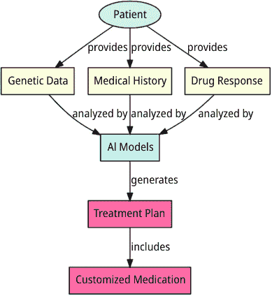

**Figure 12:** 个性化医学与患者特异性治疗。

影像数据和基因组信息随后可以结合：

将医学影像与基因组数据相结合可被视为个性化医学领域的下一个重大飞跃。将影像细节纳入基因组图谱可为临床医生提供疾病在基因层面的病理生理学。这种整合有助于推进精准医学实践，包括将基因组生物标志物作为针对遗传标记的靶向治疗策略。影像补充

### 6.5.1 医学图像处理在远程医疗中的应用

本章讨论远程医疗如何纳入 MIP，因为它涉及远程获取和分析图像。远程医疗平台涉及使用多种图像处理方法，确保只有高质量图像通过安全网络传递给其他医疗保健提供者。此类站点可能支持多种影像技术，如 X 射线和 CT、MRI 以及超声，医生可以在对患者图像进行初步检查后对其进行审查甚至与患者进行咨询。计算机无需对患者进行身体检查即可分析图像的能力也增强了诊断能力，因为患者无需往返于医疗机构，从而提高了持续获得高质量结果的可能性。

### 6.5.2 诊断的改进与效率

由于 MIP 和远程医疗这两个概念的整合，与过去相比，诊断变得更准确、更高效。摄像操作员、放射科医生或任何其他审查图像的医生都可从中获益匪浅，他们使用基于机器学习算法构建的自动图像分析工具来检测和描述异常。此类技术能够快速分析大量影像数据，识别几乎难以辨别的趋势，并指出需要进一步调查的感兴趣区域。因此，图像解读的周转时间减少，诊断程序得到增强。总体不良事件发生率与诊断疾病和管理医疗状况的能力之间的关系表明，更好的诊断和疾病识别与改善的患者结局和有效处理问题相关。

### 6.5.3 远程监测和后续联系

远程医疗允许通过可穿戴技术或家庭影像设备对患者的病情进行部分或完全监测和随访。一些例子是便携式超声系统和患者佩戴的家庭监测设备，它们能够在家中进行影像检查。它还表明输入这些设备的数据可以 relay 给医疗保健提供者用于诊断目的。它有助于在慢性病稳定后进行监测，识别新的发展，并相应地修改护理方案。这种方法减少了所需的面对面咨询次数，并给予患者更大的自由来照顾自己的健康。

### 6.5.4 关于远程医疗和远程诊断的问题及需要考虑的领域

Several challenges and considerations must be addressed to optimize the impact of telemedicine and remote diagnostics:
为了优化远程医疗和远程诊断的影响，必须解决若干挑战和考虑因素：

- **Data security and privacy:** The security and privacy of patient data are of considerable importance in telemedicine. There is need for use of appropriate controls like secure transmission protocols, encryption to enable patient information privacy, and compliance with the regulations like HIPAA and GDPR.
- **数据安全和隐私：** 患者数据的安全性和隐私性在远程医疗中非常重要。需要使用适当的控制措施，如安全传输协议、加密以确保患者信息隐私，并遵守 HIPAA 和 GDPR 等法规。
- **Image quality and standardization:** Particular attention to technique is key to achieving very high image quality and ensuring most of the units comply with standard specifications to facilitate remote diagnosis. The deviations of the image acquisition equipment and transmission and processing algorithms can affect the image quality and the diagnostic reliability. People need to standardize imaging protocols and apply a quality assurance process to provide suitable and accurate information.
- **图像质量和标准化：** 特别注意技术是实现非常高的图像质量并确保大多数设备符合标准规范以促进远程诊断的关键。图像采集设备以及传输和处理算法的偏差会影响图像质量和诊断可靠性。人们需要标准化影像协议并应用质量保证流程以提供合适和准确的信息。
- **Integration with electronic health records (EHRs):** The lack of telemedicine and remote diagnostic systems integration with EHRs required additional effort to manage the data and provide continuity of care in large organizations. One of the benefits of the EHRs system is having interoperability between the different systems, meaning that the images and diagnosis made can be shared over the different systems, that is, patients’ records will be joined up and be made more comprehensive.
- **与电子健康记录（EHRs）的集成：** 远程医疗和远程诊断系统与 EHRs 集成不足需要在大型组织中额外努力管理数据并提供连续护理。EHRs 系统的一项好处是不同系统之间具有互操作性，这意味着图像和诊断结果可以在不同系统之间共享，即患者的记录将被整合并变得更全面。
- **Technical and infrastructure challenges:** The use of telemedicine and remote diagnosing involves use of effective technology such as internet and good communication networks. Possible technical problems including connection problems and compatibility of systems pose a major threat to the telemedicine services deployment and utilization.
- **技术和基础设施挑战：** 远程医疗和远程诊断的使用涉及使用互联网和良好的通信网络等有效技术。可能的技术问题包括连接问题和系统兼容性，对远程医疗服务的部署和利用构成重大威胁。

### 6.5.5 远程医疗和远程诊断的未来演进

很可能未来的技术增强和采用创新方法的趋势会影响远程医疗和远程诊断。一些被认为具有增强远程诊断能力潜力的新兴技术包括：区块链、人工智能和先进的影像系统。虽然区块链技术提供更好的数据保护和患者同意，AI 解决方案使图像分析更精确、更有效。远程医疗和远程诊断将继续发展，患者结果得到改善，同时客户能够获得治疗。

在 MIP 的帮助下，远程医疗和远程诊断通过提高可及性、诊断效率和远程具身护理重新定义了实际临床实践。围绕数据安全和图像质量以及围绕基础设施提供的方式对于利用这些技术的此类益处至关重要。如前所述，改进仍在进行中，进一步的进步不断改善远程医疗、医疗保健和患者护理管理。

## 7 结论

医学图像处理是一种近期技术，是医学诊断和治疗过程中最有用的创新。本章讨论的一些 MIP 的进步性转变包括重塑临床实践的技术/技术整合。影像方法的增加利用和发展提高了分析的准确性和效率、疾病诊断和治疗方案的精确性以及患者状况的观察。

此外，所讨论的图像分析的所有基本程序都提到了需要更深入的图像处理方法，包括特征提取或机器学习。这些技术使得能够从复杂的影像数据中搜索重要信息，为医生提供前所未有的诊断精确性，用于诊断、解释和管理各种医疗疾病。CNN 和支持向量机的应用进一步扩展了诊断潜力，因为这些模型可确保对医学图像进行即时且极其准确的分析。能够根据每个患者的特征创建不同形式的治疗并进行规划，这种整合有助于优化流程并坚持医学个体化方法的理念。

此外，Hsieh 指出，对包括 SPECT 和 PET 在内的关键影像技术的评估构成了提供生理功能功能信息的关键组成部分。这些影像技术为解剖影像提供额外信息，使人们对患者状态有更丰富的理解，并为更好的治疗提供方向。随着本研究中看到的此类方法的持续演进和微调，预计这些模式在临床实践以及患者改善方面将进一步发展。

然而，仍存在一个由数据隐私、图像质量和与远程医疗集成等各种挑战所表征的差距。因此，克服这些挑战对于维持 MIP 技术的效率和稳健性至关重要。这些挑战源于系统不一致、应用复杂性和安全性差，可通过确保健康信息技术（如电子医学图像传输）、将 MIP 与指南和协议集成以及医学影像的有效技术结构来缓解。

关于未来展望，未来十年快速的技术改进和创新被称为 MIP 领域。人们相信，由于新影像技术和人工智能等进步，该领域将出现比其他任何领域更多的创新。这些发展改变了药物基因组学领域，增强了

- [18] Khalil, M. M. (2021). 正电子发射断层扫描（PET）：物理学与仪器。载于《核医学基础科学》（第289–318页）。查姆：施普林格国际出版公司。
- [19] Supriya, S., & Padaki, S. (2016, 12月). 采用物联网解决方案中的数据安全与隐私挑战。载于2016年IEEE国际物联网会议（iThings）暨IEEE绿色计算与通信会议（GreenCom）暨IEEE网络、物理与社会计算会议（CPSCom）暨IEEE智能数据会议（SmartData）（第410–415页）。IEEE。
- [20] Aggarwal, R., Sounderajah, V., Martin, G., Ting, D. S., Karthikesalingam, A., King, D., . . ., & Darzi, A. (2021). 深度学习在医学影像中的诊断准确性：系统综述与荟萃分析。NPJ数字医学，4(1)，65。
- [21] Zhao, B. (2021). 理解变异来源以提高放射组学的可重复性。肿瘤学前沿，11，633176。
- [22] Najjar, R. (2023). 重新定义放射学：医学影像中人工智能集成综述。诊断学，13(17)，2760。
- [23] Barragán-Montero, A., Javaid, U., Valdés, G., Nguyen, D., Desbordes, P., Macq, B., . . ., & Lee, J. A. (2021). 医学影像的人工智能与机器学习：技术综述。Physica Medica，83，242–256。
- [24] Agrawal, S. (2022). 通过AI驱动的异常检测与预测分析增强支付安全。国际城市与社会可持续基础设施杂志，7(2)，1–14。
- [25] Kharfi, F. (2013). 核医学影像的原理与应用：近期发展综述。《跨学科研究中的成像与放射分析技术——基础与前沿应用》。

来自多种模态的消息，包括视觉、听觉和基于传感器的消息，可以全面了解多方面的系统和过程[2]。这种方法优于单模态系统，因为单模态系统仅分析单一来源的数据，无法收集足够的信息谱以产生准确的异常[3–10]。多模态数据的组合呈现有助于检测在单独分析每个数据集时无法识别的边缘模式，从而提高了准确诊断和优化工作流程的可能性。特别是在多个耦合和相互依赖关系存在的领域，例如工业生产、诊断和实时监控，这种集成方法被证明非常有益。

为了更方便地集成和分析多模态数据以发现异常，人们已经创建了许多方法[11]。两种重要的方法是决策级融合和特征级融合，决策级融合集成了在多种模态上训练的独立模型的输出，特征级融合则在分类之前结合来自不同模态的数据特征[12]。模型级融合通过组合分别处理不同模态的多个机器学习模型，进一步扩展了这些方法[13]。新增加的方法还包括深度学习和基于图的方法，这些方法改善了多模态数据中高阶关系和交互建模的特征。虽然基于图的方法利用复杂的图结构来突出数据相关性，但CNN和RNN模型在高维数据的特征提取和融合方面表现出色。

多模态异常检测的应用跨越了几个重要领域，每个领域都得益于融合和分析不同类型信息的能力[14]。例如，在工业制造中，通过视觉检测获得的传感器数据集成在一起，在检测缺陷和优化制造过程方面发挥了很大作用[15]。大量数字案例表明，从高清摄像头和机床获取的信息有助于降低汽车行业的缺陷率并提高产品质量。同样，在医疗领域，将MRI和CT扫描数据与患者健康记录相结合，已经带来了正确的诊断和良好的治疗计划。智能城市和自动驾驶汽车采用的实时监控系统也归功于能够跨多种模态识别异常事件，从而提升态势感知并提高安全性[16]。

多模态数据集成有益，但要充分发挥其潜力，还需要解决一些问题[17]。由于数据的数量和复杂性随着模态和数据源的数量而增加，可扩展性是一个主要问题[18]。管理大规模数据集成需要强大的存储解决方案和高效的计算资源。实时处理是另一个挑战，特别是在需要即时处理和分析数据的动态环境中[19]。此外，数据格式的互操作性和标准化对于确保跨不同模态的无缝集成至关重要[20]。应对这些挑战需要开发能够处理多模态数据复杂性同时保持性能和准确性的先进算法和技术[21]。

展望未来，预计有几个有前景的方向和创新将推动多模态异常检测的发展[22]。解决当前问题依赖于创建可扩展的计算框架和更有效的数据融合方法[23]。分布式系统和边缘计算的发展有望提高实时数据处理能力[24]。人工智能（AI）和物联网（IoT）传感器等未来技术的集成为提高异常检测的效率和准确性带来了新的前景[25]。对新融合技术的研究以及多模态异常检测在新领域中的应用继续推动着进步，并拓展了这项技术的潜在应用。随着这些进展的展开，多模态数据集成有望成为追求更准确和可操作洞察的日益强大的工具。

## 2 多模态数据集成基础

### 2.1 多模态数据简介

多模态数据的使用已成为异常检测中的一个关键发展，极大地提高了检测系统的精度和鲁棒性。多模态数据集成包括合并来自不同数据源的信息，以获得对数据环境更全面的了解。这种方法利用多种数据类型（包括文本、音频、图片和传感器测量）的优势，克服了仅依赖单一模态的缺点。通过综合不同的数据源，多模态系统可以捕获更丰富的特征和模式，这对于识别仅依赖单一数据类型时会遗漏的异常至关重要。

多模态数据的集成既带来了有前景的机遇，也带来了复杂的挑战，包括不可预见的隐私问题。如图1所示，来自各种模态的互补信息（如来自摄像头的视觉数据和来自传感器的文本或数值数据）的结合，能够对研究对象进行更精细和准确的分析。例如，将基于图像的观察与传感器读数相关联，可以显著增强对制造过程的理解，并提高缺陷检测的可能性。有效处理多模态数据引发了数据同步、对齐和融合等技术挑战。一个关键的考虑因素是确保集成过程在产生连贯且可解释的输出时保留每种模态的独特价值，这已成为成功设计多模态系统的关键标准。

## 重大突破的3个特征

- 通常它们并非由已知技术构成
- 通常它们可能含糊不明
- 通常它们需要跨学科协作

这类工作对数据处理要求极高，涉及将来自多个来源的数据同步到特定范式中的艰巨任务，而当应用于实时系统时，这一任务更加困难。

另一个重大挑战是数据异构性。多模态数据源经常具有不同的格式、结构和信息域，导致在协调这些多样化输入时产生复杂性。例如，将文本数据与图像数据相结合，需要协调信息表示和处理方式上的差异，这会使特征提取和融合过程变得更加复杂。

数据融合的复杂性也在集成过程中扮演重要角色。来自不同模态的特征组合必然需要采用无损合并技术，以避免引入不必要的信息。在何处进行融合——特征级还是决策级——会影响许多异常检测系统的功能，并且必须在充分考虑三种方案各自的优缺点后作出决定。

处理缺失和不完整的数据是另一个关键问题。多模态数据集经常会出现某一模态数据缺失的情况。开发应对这些空缺的稳健方法，例如能够处理部分数据的插补技术，对于保持异常检测系统的完整性和性能至关重要。

最后，计算复杂性是一个重大障碍。由于多模态数据具有更高的维度和更大的数据量，其集成通常需要更多的处理能力。这导致处理时间延长和资源消耗增加，因此有必要创建高效的算法和系统，在满足这些需求的同时不牺牲性能。

## 2.3 多模态数据的类型

多模态数据是指从不同来源收集的数据。不同模态提供关于某一现象的不同的且相关的视图。整合这些多样化的数据可以对更广泛的分析技术进行捕获，从而有助于提升对异常感知的认识。

### 2.3.1 图像数据

第二类多模态数据是图像数据，包含灰度、彩色和高光谱图像等不同格式。在异常检测中使用图像数据时，图像中的高细节水平对于确定与正常行为的偏差仍然很重要。这类数据经常应用于诊断成像等领域，例如磁共振图像可提供有关信息。

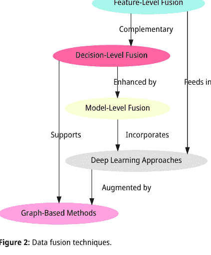

图2：数据融合技术。

加权投票和集成技术（即结合多个分类器输出的方法）是决策级融合的方式。采用这些方法时，每个模型独立处理各自类型的数据，融合过程将它们各自的预测结果结合起来，从而提供更全面的判断。当模态需要专门处理且彼此差异极大时，决策级融合就非常有用。

### 2.4.3 模型级融合

模型级融合是指使用联合模型同时处理多种模态。这种方法涉及设计和训练能够直接处理并整合来自不同来源数据的模型，从而允许模态之间的同时处理与交互。相关技术包括多输入神经网络——每个输入代表一种不同模态，网络学习利用它们之间的相关性；以及跨模态共享参数的多模态深度学习模型。模型级融合能够增强系统捕获不同类型数据之间复杂关系和依赖性的能力，从而提升异常检测性能。

### 2.4.4 基于图的融合方法

基于图的融合方法利用图结构来建模不同模态之间的关系。在这些方法中，节点表示不同的数据模态，边表示它们之间的关系。通过使用诸如GCN和多图等概念，可以构建捕捉模态间依赖关系的表示形式。这种方法有助于结构化信息，并通过对不同类型信息的情境和相关依赖进行整合，增强异常值的检测能力。

### 2.4.5 混合融合方法

混合融合方法结合多种融合技术，以发挥每种方法的优势。例如，一个系统先执行特征级融合以创建统一的特征表示，然后应用决策级融合来聚合基于不同模态训练的独立模型的预测结果。这种分层方法能够灵活、自适应地整合多模态数据，应对数据异构性和数据质量参差不齐等各类挑战。混合融合策略可以提供一种平衡的解决方案，在最大化每种融合技术优势的同时，降低其各自的局限性。

## 2.5 多模态集成的评估指标

需要一套合适的测量指标，用于评估针对弱势人群异常事件检测中的多模态集成效果，以便全面展示集成系统不同方面的性能。如后续章节所示，与可以使用单一指标值进行评价的单模态运动监测系统不同，多模态系统需要进行全局评估，以确保多数据源融合确实改善了异常检测流程。

### 2.5.1 准确率与精确率

迄今为止，精确率被认为是评估多模态异常检测系统性能的关键指标。它计算异常与非异常准确分类相对于总样本量的比例。预测值的准确性在侧重异常识别正确性的场景中尤为重要，即使用真实异常数占真实异常与虚假异常总数之比来衡量。在多模态方法的背景下，准确率和精确率无法在单模态层面进行评估，而应从模态组合如何增强检测性能的角度来考量。

### 2.5.2 召回率与F1分数

灵敏度（召回率）衡量的是在假阴性与真阳性总数中，真实异常所占的比例。该统计量用于确定系统在所有模态上的异常检测有效性。F1分数是较好的衡量指标之一，因为它同时兼顾假阳性和假阴性。其计算方法为精确率（正确值数量与实际值总数的比值）与召回率（正确值数量与检索值数量的比值）的算术平均值。在评估多模态集成在整体上对异常检测的有效性时，必须同时考虑真阳性结果和假阳性结果。这一做法正是基于*F1分数*所展现的内容。

### 2.5.3 受试者工作特征曲线（ROC-AUC）

ROC-AUC指标考察不同阈值下的特异性/灵敏度关系，并在多个阈值上得出一个综合性的性能指标。对于多模态系统，ROC-AUC可以提供有关融合模态相对作用效果以及它们在多大程度上增强异常检测能力的信息。严格的单位ROC-AUC数值增加，表明区分异常与非异常的准确性有所提高，同时也验证了所提出数据融合方法的有效性。

### 2.5.4 多模态融合指标

评估多模态融合的专用指标包括衡量不同数据模态整合的有效性。融合性能指数（FPI）和融合交叉验证分数（CVSF）等指标可以评估数据集成对整体模型性能的影响。FPI评估的是与单模态方法相比，多模态集成在检测准确率方面带来的改进；而CVSF则涉及对融合模型进行交叉验证，以确保其泛化能力和稳健性。

我们还通过仿真证明了该方法在计算效率和可扩展性方面的优势。

在比较多模态系统的性能和可分解性时，通常会显著地联系到拥有大量用户的大规模数据集。性能与通用性

质量指标使其能够在不损害整个系统性能风险的情况下评估系统处理流程的效率以及来自多个源系统的数据集成能力。实际实用性要求高效计算，因为它表明多模态异常检测系统应实时运行。

评估自动化系统的两个最重要标准是可解释性和可用性。

最后，可解释性和可用性指标考虑开发的多模态异常检测系统所获得的结果在多大程度上可以被专家理解和应用。在此类指标中，涉及系统检测到的异常的解释能力以及可被纳入其他决策系统的用户满意度。任何多模态系统不仅应准确识别这些变化，还应为终端用户提供易于理解且可操作的输出。

## 3 多模态数据融合技术

### 3.1 特征级融合

在特征级融合中，在使用任何学习方法之前，从多种模态中提取的特征被合并为单一表示。该方法利用每种模态的独特优势，提供更广泛的特征集并提高异常检测模型的整体有效性。特征级融合通过在此步骤合并特征来寻求获取对数据更全面、更细致的视图。这增强了在单独评估模态时可能被忽略的异常的识别。

#### 3.1.1 特征提取方法

特征级融合过程的第一步是从每个模态中提取相关特征。不同类型的数据使用不同的特征提取技术。例如，照片可以具有纹理和边缘特征，时间序列数据可以具有统计特征，而文本可以具有语义特征。为了获得数据的<|message|> 表示，通常使用先进的特征提取技术，例如用于图像数据的 CNN 和用于序列数据的 RNN。源自每个模态的高质量且相关的特征对特征级融合的有效性至关重要。

### 3.2 决策级融合

在其各自模态内的异常。通过多数投票、加权平均或基于规则的逻辑等策略聚合每个模型的决策或预测，决策级融合利用了每种模态的优势。这种融合技术增强了异常检测系统的整体准确性、鲁棒性和容错性，特别是在复杂的多模态环境中。

#### 3.2.1 模型输出组合方法

有多种技术用于组合不同模型做出的决策。一种常见的方法是多数投票，其中最终决策基于模型中最频繁的预测。另一种方法是加权投票，其中根据模型的性能为不同模型分配权重，最终决策由预测的加权聚合决定。此外，还可以使用平均和堆叠等方法来集成输出，其中使用元分类器组合各个模型的预测以产生最终结果。

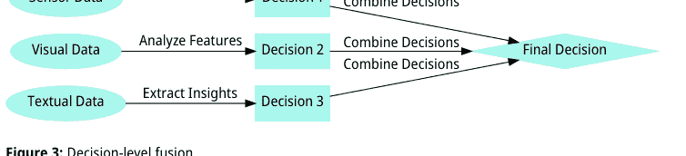

图 3：决策级融合。

#### 3.2.2 决策级融合的优势

与之前的融合系统相比，决策级融合提供了各种优势。它使得模型能够针对每种模态独立开发和优化，从而有助于简化实施和设计过程。由于多个模型被训练来处理不同的模态，因此该策略也更容易整合各种数据格式。通过添加来自多个来源的补充数据，决策级融合可以提高识别单个模型会遗漏的异常的性能，从而增强异常检测系统的弹性。

#### 3.2.3 挑战与注意事项

尽管具有优势，决策级融合仍存在某些挑战。一个挑战是确保各个模型足够互补，即它们应提供对异常检测问题的不同见解，而不产生冗余信息。另一个考虑因素是计算复杂性可能增加，因为组合多个模型需要额外的资源用于聚合和决策。此外，决策级融合的有效性会受到各个模型质量和可靠性的影响，因此仔细评估和选择纳入融合过程的模型至关重要。

#### 3.2.4 评估与性能指标

使用衡量最终决策过程的准确性、精确率、召回率和整体有效性的指标来评估决策级融合方法的效果。比较评估通常表明，与单模态方法相比，决策级融合可以提高异常检测性能，尤其是在不同模型提供互补信息的情况下。实际应用，例如监控系统和工业过程故障检测，经常证明决策级融合在实现更可靠、更准确的异常检测结果方面的实际益处。

### 3.3 模型级融合

为了提供单一预测，模型级融合结合了多个同时分析多种模态的机器学习模型。与在分类前整合来自多种模态的信息的特征级融合相比，模型级融合在更高层级运行，其中每个模型单独从其特定模态学习，其输出在后期阶段进行整合。这种方法使每种模态的特殊特性和优势能够在整个学习过程中直接利用，从而实现更准确、更细微的异常识别。

#### 3.3.1 模型级融合方法

实现模型级融合有几种方法。为每种模态训练不同的模型，然后通过加权投票或平均组合其预测是一种流行的方法。在平均时，最终预测是通过对多个模型的输出进行平均产生的。使用加权投票时，根据模型的表现为每个模型的输出赋予不同的权重。为了获得最终预测，元学习，也称为堆叠，涉及使用基础模型的输出训练元分类器。每种策略都有其优点，最佳选择取决于异常检测任务的具体情况。

#### 3.3.2 模型级融合的优势

模型级融合提供了多个优势，包括处理多样化数据类型的能力以及利用每种模态的专用模型的灵活性。通过允许模型专注于各自的模态，模型级融合可以捕捉在特征级合并所有模态时会被忽略的复杂模式和异常。该技术还促进了增量模型开发，其中不同模态的模型可以在集成之前独立开发和完善，从而增强整体系统的适应性和可扩展性。

#### 3.3.3 挑战与注意事项

尽管有其优势，模型级融合仍面临若干挑战。一个挑战是计算需求可能增加，因为训练和评估多个模型可能资源密集。此外，确保模型有效集成且其组合输出导致有意义且准确的预测需要仔细设计和调优。还存在管理模型之间潜在差异的挑战，其中不同模态产生冲突的输出，需要稳健的解决和聚合策略。

#### 3.3.4 评估与性能指标

模型级融合通过准确率、精确率、召回率和 F1 分数进行分析，以确定集成模型识别异常的有效性。如比较研究所示，跨模型融合可以通过利用每种模态特定模型的优势来提高异常检测性能。在实际应用中，例如多模态医学诊断、监控系统，模型级融合已证明能够提高检测准确性和鲁棒性，从而带来更可靠、更有效的异常检测解决方案。

模型级融合代表了一种强大的多模态异常检测集成技术，允许每个模型利用模态特定信息，同时组合其输出以提高整体性能。这种方法提供了灵活性和增强的准确性，使其成为复杂异常检测场景中的有价值策略。

## 3.4 深度学习方法

多模态数据融合尤其因深度学习技术而得到增强和加速，因为深度学习技术拥有能够处理不同形式数据的复杂神经网络结构。这些方法利用深度神经网络同时从多种模态学习表征，能够处理传统方法无法处理的细节和关系。由于深度学习模型可以提供每种模态的详细分层信息，多模态融合可以通过利用提取到的信息来准确高效地检测异常。

### 3.4.1 多输入神经网络

我发现，多模态数据融合的深度学习方法中有一项主要技术，即多输入神经网络。这类架构为每种模态设置独立的神经网络通路，各自独立处理对应数据流，然后合并输出。常见方法包括在某一层拼接这些通路的输出，以及使用注意力机制来选择性地加权每种模态的贡献。这种方法使各个模态专属网络能够专注于提取相关特征，随后将这些特征组合起来形成用于异常检测的全面表示。

### 3.4.2 多模态自编码器

另一类深度学习解决方案将多模态自编码器视为另一种数据融合形式。这些模型旨在通过对所有模态中存在的信息进行编码和解码来联合学习模态。多模态自编码器意味着数据以两种模态为条件，这使得模型能够更好地识别那些在不同数据类型中潜在表达不同的异常。在这种情况下，变分自编码器（VAE）和类似的生成模型被用来捕获期望的数据分布，并为 AuAD 提供更好的结果。

### 3.4.3 跨模态注意力机制

跨模态注意力机制是改进多种模态数据整合方式的精巧方法。基于其他模态提供的上下文，这些技术使模型能够动态关注每种模态中的相关信息。基于 Transformer 的注意力模型允许融合过程自适应地平衡各种模态及其特征的重要性，从而以更复杂的方式增强模型识别和分析异常的能力。

一种常见方法是，利用从成像数据和临床数据中提取的特征来构建特征向量。例如，成像特征可以用纹理表示；而临床数据可以是年龄、病史等。这些组合后的特征向量随后被作为输入提供给机器学习模型，由于可获得高度丰富且多模态的数据，这些模型能够更高效地学习并检测异常。

### 4.1.2 数据融合中的挑战

成像数据和临床数据的整合带来了若干挑战。数据对齐和同步至关重要，因为成像数据和临床记录通常在不同时间采集且格式各异。处理这些差异需要进行预处理步骤来对齐和标准化数据。此外，数据类型和尺度的多样性要求使用复杂的融合技术，以确保整合后的数据对异常检测而言是有意义且可操作的。

### 4.1.3 用于整合的机器学习方法

重要的是，这些技术还需要侧重于使用成像和临床信息，并将其细节融合。先进算法（如深度学习模型）被用来从组合数据中学习复杂模式。例如，多输入神经网络可以通过卷积层处理成像数据，同时通过全连接层处理临床数据。这些层的输出被合并，以生成用于识别异常的统一表示。其他技术，如集成方法，可以组合在成像数据和临床数据上分别训练的模型的预测，以提高整体检测性能。

### 4.1.4 临床选择的用途与优势

成像与临床关联的存在已在许多临床适应症中显示出其显著优势。例如，在肿瘤学中，将影像信息与患者的临床病史和遗传标志物结合，有助于识别恶性组织并了解肿瘤的行为。在心脏病学中，将影像发现与血压、胆固醇水平等临床因素结合，有助于提高心脏病诊断的准确性和风险评估能力。所提出的多模态方法有助于为患者提供更多样化、更具体的治疗选择。

这显然意味着，未来在同时使用成像和临床数据方面的进展，将朝着开发更好的数据融合方法以及如何利用新技术来实现这一目标的方向发展。人工智能和机器学习预计将提高多模态分析中异常检测的准确性和效率。第三，大型多样化的医学数据集正在变得可用，同时数据整合方法也在改进，从而提供更高的准确性和数据通用性。该领域的进一步研究和发展工作还可以扩展多模态异常检测在医学影像及诊疗中的功能。

## 4.2 MRI 与 PET 扫描的融合

MRI 和 PET 是两种不同的成像方法，虽然它们在疾病诊断中用途不同，但在外科手术中具有重要意义。MRI 特别适合显示精细的解剖结构和软组织对比；而 PET 通过识别放射性示踪剂来提供代谢和功能状态的信息。二者的整合可以从结构和功能数据两方面提高整体诊断准确性，这在描绘癌症、神经系统疾病和心血管疾病等异质性疾病中的异常时尤其有用。

### 4.2.1 MRI 与 PET 的整合方法

MRI-PET 融合利用多种整合方法，将 PET 的功能信息叠加到 MRI 的结构细节上。一些常规技术包括图像配准，即在空间上匹配 MRI 和 PET 图像，使相应的解剖特征和功能特征可以直接比较。因此，患者图像需要使用刚性、仿射和非刚性变换等技术进行预处理，以尽量减少患者图像差异以及采集技术带来的位置差异。配准后，像素级、特征级和图像级融合方法会生成新的融合图像，使解剖模态和功能模态在配准后均具有更好的可视性。

### 4.2.2 MRI 与 PET 融合的优势

与单一成像模态相比，MRI-PET 具有以下优势。与功能数据的整合比单纯的患者结构图像提供了更优越的非关联结构细节视图。例如，MRI 可以提供肿瘤边界的出色解剖细节，而 PET 则提供肿瘤的代谢细节，从而实现更好、更准确的肿瘤诊断和有效治疗方案的制定。这种方法可以增强局部区域肿瘤的边界划定、肿瘤分期以及对各种治疗方式的反应评估。同样，在神经病学中，融合技术有助于检测脑部异常及其导致的功能障碍，包括癫痫和神经退行性疾病。

### 4.2.3 MRI 与 PET 整合中的困难

然而，MRI 和 PET 扫描的整合也存在一些困难：一个基本限制来自当前模态在细节层次和对比度上的差异，这导致图像同步和配准困难。其次，采集时间和患者运动的差异会产生伪影和误配准。只有精确的配准和稳健的融合方法才能克服这些问题，而且预处理步骤应使用严格的数学算法。由于计算复杂性和对高性能计算的需求，多模态成像的数据整合和分析变得更加困难。

### 4.2.4 最终用户与实践意义

因此，MRI 与 PET 融合的应用在上述领域已发挥出显著的临床效用。在肿瘤学中，这种组合成像方法主要用于指导活检、放射治疗计划制定和治疗反应评估。在神经病学中，它有助于癫痫手术规划以及神经退行性疾病进展的评估。使用多模态融合加强诊断的优势在于，能够围绕患者结局和个体化治疗计划做出更好的决策。

## 4.3 利用基因组数据

基因数据与医学影像的整合显著提高了多模态异常活动检测的效率，因为这种方法严谨，并能对不同疾病的病理状况提供非常详细的理解。基因组数据以广泛的方式提供个体的疾病过程和基因组成变异。这些信息补充了医学影像（如 MRI 扫描），从而提供了对异常的广泛认知，进而也提高了对患者的诊断准确性和治疗方案分配的针对性。

### 4.3.1 整合基因组学与影像信息

由于基因组学数据必须与医学影像数据结合使用，因此需要复杂的数据融合策略。基因组信息通常被表征为来自SNP数据、基因表达谱和突变图谱的遗传标记向量，而医学影像数据则通过某些器官解剖结构的视觉表征形成。因此，整合方法包括在共同的生物学过程基础上将基因组特征与影像数据进行对齐。在本研究中可用的差异化策略包括特征融合，即将基因组和影像特征汇集并用一组特征表示，其中分别开发基因组和影像数据两个模型，然后进行组合。

### 4.3.2 利用基因组数据改进异常检测

这为利用基因组数据改进医学影像分析中的异常检测提供了机会，因为基因组数据可以提供关于观察结果背后生物学过程的更多信息。例如，通过比较基因组杂交检测到的基因变化与特定类型的影像发现相关联，从而能够更有效地区分疾病指标和可能的异常。这种整合还使得检测某些肉眼无法辨别的异常变得更加容易，从而促进早期诊断和确定正确的介入治疗程序。

### 4.3.3 应用与案例研究

多个示例表明，基因组数据与医学影像的整合是有益的。例如，在肿瘤学中，基因组谱与肿瘤影像的协调统一可以揭示特定基因变化与肿瘤性质之间的关系，从而改善癌症诊断和管理。同样，在神经影像学中，神经退行性疾病关键神经影像预测因子的结果可以与基因组数据整合，以确定疾病进展和病理学对应的遗传标记。这一汇总表明，将这一第五模态与其他医学影像程序相结合，可以提高诊断性能并促进对疾病过程的更深入理解。

处理和计算复杂、多样且异质的数据一直是一个挑战，也是基因组与影像数据整合过程中面临的问题之一。被认为至关重要的其他考量包括数据兼容性问题、管理高维遗传数据与影像数据合并的复杂性，以及解决基因组数据使用所涉及的伦理和隐私问题。后续研究侧重于改进数据融合过程中使用的算法、扩大整合技术的应用范围，并在精准医学和个体化治疗这一不断发展的领域中探索该方法的新的应用方向。

## 4.4 实时监测系统

在实时监测的医学影像应用中，数据分析和解释过程与数据采集过程同步进行，以便及时识别异常。在临床环境中，早期干预可能改变患者命运的情况下，这些系统至关重要。当与其他类型的数据（如影像、生理信号和电子健康记录）结合时，实时监测系统可以提供患者状态的完整图景，尤其是当前的异常情况，从而在并发症发生时实现早期检测和干预，具体如下：

### 4.4.1 多模态数据流整合

整合来自不同模态的多个数据流是高效实时监测的必要条件。在医学影像中，这通常涉及整合临床病史、生理参数（血压、脉搏率等）和影像数据（CT、MRI、US等）。这些数据源通过复杂的数据融合技术（如基于图的方法）被合并到一个统一的分析框架中。通过整合，可以更全面地了解患者的健康状况，系统也能更好地识别那些单独检查模态时可能被忽视的细微异常。

处理如此庞大数据集的实时分析具有挑战性，因此传统的批处理方法无法适用。

实时分析涉及在数据接收时即时处理数据，主要目标是及时识别偏差或异常。如图5所示，流式数据分析和实时机器学习等技术被用于不断更新模型并接收新数据，从而实现即时检测和响应。例如，卷积神经网络（CNN）常用于实时处理影像数据，而循环神经网络（RNN）则用于分析生理信号等时间序列数据。实时系统的核心挑战在于在高准确度与快速处理速度之间取得平衡，这需要高效的算法设计和计算资源优化，以处理大规模、高速的数据流。

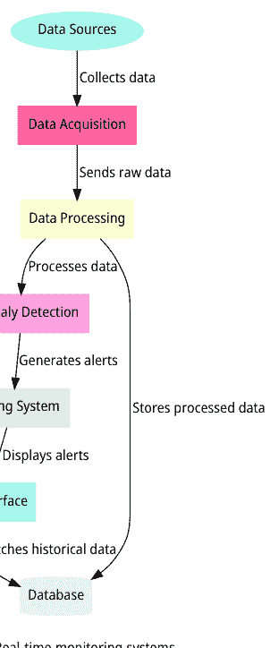

图5：实时监测系统。

### 4.4.2 临床应用与优势

在临床环境中使用实时监测系统具有多项主要优势。例如，在重症监护病房中，上述系统用于同时跟踪患者的生命体征和影像数据，并通知相应的医护人员任何可能发展为严重状况（如急性呼吸窘迫）的异常。在手术过程中，它有助于跟踪操作结果并尽早识别不良反应。实时提供反馈和警报的功能使医疗团队响应更迅速，并提高了患者安全。

### 4.5.1 区分良性和恶性病变

这种方法在区分恶性病变和良性病变方面非常有用，从而有助于制定更好的管理方案。

这种模型增强形式因此改善了神经系统疾病的检测。

### 4.5.2 多模态异常检测在神经学中的应用

多模态异常检测也已有效用于神经系统疾病的诊断和观察。例如，结构MRI结合功能MRI和EEG，可显示大脑某些区域的代谢活动增加，同时伴随结构完整性受损。研究表明，结合这些技术可提高检测与癫痫、阿尔茨海默病和多发性硬化症等疾病相关异常的可能性。结构变化指向疾病进展，而功能紊乱则提供了对病理生理进展的理解，这有助于临床医生制定更合适的治疗策略。

### 4.5.3 PET和基因组数据的使用

PET与基因组数据在肿瘤学中的整合是个性化患者护理领域最大的飞跃之一。PET扫描提供了倾向显示代谢活动水平和肿瘤负荷的细节，而基因组数据则提供肿瘤分子特征的信息。这些方法的整合有助于更全面地了解肿瘤形成的机制及其对治疗的反应性。已有示例说明这种多模态方法如何指出赋予耐药性的特定基因变化，从而主动改进治疗策略。它还有助于确定个体化患者疗法，并提高结果预测的可能性。

### 4.5.4 跨学科工作：心脏病学中的多种变体

在心脏病学中，多模态异常检测已被用于分析心脏功能和疾病。例如，超声心动图与心脏MRI的结合可提供心肌、血流模式和组织组成的信息。这种组合方法改善了对瓣膜性心脏病、心肌病、先天性心脏和血管疾病等病理的感知。多项研究表明，多模态分析增强了诊断和治疗评估，改善了患者护理，并最终优化了护理服务。

### 4.5.5 挑战与未来方向

在医学影像应用中使用多模态异常检测所表现出的性能相当令人鼓舞；然而，也揭示了以下挑战。其中一些挑战包括数据整合困难、计算需求以及大规模标注数据的缺乏，这些因素阻碍了上述任何方法的大规模应用。预计后续研究将通过采用克服这些局限性的策略来解决这些问题。

更好的算法、增强的数据集成方法，以及新的传感与信息获取方法。多模态异常检测方法的进一步发展可以革新医学影像，并为不同医疗领域的诊断准确性带来显著提升。

## 5 工业与制造业应用

### 5.1 结合视觉检测与传感器数据

因此，弥合视觉评估与传感器数据之间的差距，是识别工业和制造业异常最有效的方法。视觉检测通常使用相机拍摄产品和过程的图像，目的是观察表面特性和对齐情况，从而容易识别瑕疵。添加传感器数据，包括对温度、压力、振动以及提供制造过程信息的物理因素的定期测量，可以增强对过程的了解。这种集成提高了系统检测和诊断那些仅通过观察图像无法识别的缺陷的机会。

#### 5.1.1 集成方法

将视觉检测与传感器数据相结合有几种方法。一些提出的解决方案包括同步视觉和传感器数据输入源，以便在一个源中捕获的异常可以与另一个源的数据进行比较。这通常需要额外的预处理，包括从图像和测量中提取特定特征，以及对齐两个或多个相似类型的信息，例如纹理和颜色等视觉数据，以及振动水平和温度等传感器数据。在数据融合转换之后，可以使用其他处理方法，如拼接和多模态深度学习网络，来提高异常样本的识别能力。

#### 5.1.2 集成技术的优势

视觉和传感器数据的集成有助于识别工业中出现的各种异常。通过这些方法，集成这些数据源能够检测各种异常，不仅包括传感器显示的异常，还包括与物理传感器异常相关的视觉缺陷。例如，视觉检测系统识别出组件上的表面裂纹，而传感器数据检测到与故障相关的异常振动模式。这种分层方法使诊断和及时干预更加有效，从而降低缺陷产品的发生率并减少停机时间。

#### 5.1.3 案例研究与实际应用

工业应用中的几个示例展示了视觉检测如何与传感器信息协同工作以改善决策。例如，在汽车制造中，检查车身瑕疵的视觉检测可以与测量焊接过程温度和压力的传感器相结合。当所有这些数据源整合在一起时，制造商可以保证生产过程的有效性、最终产品的质量，以及过程中所用各种工具的效率。例如，半导体制造行业的公司采用视觉手段检查晶圆的物理表面瑕疵，同时环境传感器检测湿度和温度水平。这些数据源的协作有助于识别影响产品质量的问题。

尽管视觉检测与传感器数据结合使用非常有益，但它也有局限性，如下所述。包括同步、对齐和高维数据管理在内的挑战可能会给数据融合带来问题。更具体地说，处理大数据甚至更大规模的多模态数据涉及计算复杂性，这可能在所需的计算能力和存储空间方面造成问题。未来这一领域的进步可能会强调数据融合策略的进一步发展、实时计算的进步，以及研究更复杂的机器学习算法，以便更好地集成和分析视觉与传感数据。

### 5.2 质量控制系统

在制造业中，质量保证程序对于确保最终产品符合规定的质量标准至关重要。多模态异常检测在质量保证中已被证明相当有效。它使制造商能够识别通过传统检查难以发现的异常。通过将外部和内部收集的数据（如视觉观察和传感器数据）与工艺参数相结合，这些系统为确保产品质量和控制生产过程提供了整体解决方案。

本章旨在探讨如何在自动化系统中将视觉检测与传感器数据连接起来。

处理异常的健全基础。利用这种组合的多模态数据，预测性维护系统可以判断设备是否运行异常或出现磨损迹象，从而提前预测故障。

#### 5.3.2 先进的数据融合技术

统计模型和机器学习等数据融合方法是预测性维护不可或缺的一部分。这些技术利用在历史数据上训练的有监督和无监督学习算法，对系统性能与故障模式之间的关系进行建模。集成学习、降维和特征提取等工具被用于分析多模态工业数据，以增强集成并实现准确的故障预测。

工业应用：在现代工业环境中，预测性维护已成为一项关键运维策略。例如，在制造工厂中，已部署针对电机、泵和压缩机等关键设备的健康监测系统。当这些系统与先前的维护记录相结合时，能够实现早期故障检测、经济高效的维护规划，并减少设备停机时间。同样，在能源领域，预测性维护用于监测涡轮机和发电机，从而提高电力供应的可靠性和可用性。

下面介绍一些案例，说明各组织如何成功地将预测性维护应用到其运营中。如图7所示，在制造工厂中，已开发出持续监测电机、泵和压缩机等关键设备健康状况的系统。当这些监测系统与历史维护记录配合使用时，已被证明在实现潜在故障早期检测、降低维护成本以及最大限度减少设备停机时间方面非常有效。同样，在能源领域，预测性维护被用于监测涡轮机和发电机的状况，从而增强系统可靠性，并确保向市场稳定供应电力。

### 5.4 智能工厂中的异常检测

除了预测性维护之外，智能工厂中的异常检测还涉及利用互联系统的实时数据来识别偏离正常运行的情况。在这种背景下，多模态数据融合发挥着至关重要的作用，它结合传感器信号、视觉检测输出和机器遥测数据进行全面监控。自动编码器、一类支持向量机和深度神经网络等先进算法被用于检测罕见而复杂的异常。这些系统有助于检测产品缺陷、未经授权的机器行为或安全违规等问题，从而能够立即采取纠正措施。

工业应用：工业环境中的系统也被称为跨工业环境应用的系统。

下面给出了一些示例，说明组织如何在其运营中实施预测性维护。例如，在制造工厂中，已经开发出一些系统来监控最关键设备（如电机、泵和压缩机）的健康状况。当与先前的维护记录结合使用时，这些系统已被证明在提高故障设备的早期识别、维护的可负担性以及最终减少设备故障造成的停机时间方面非常有效。同样，在能源领域，预测性维护已被采用，以帮助检查涡轮机和发电机，从而提高电力在市场上的可靠性和可用性。

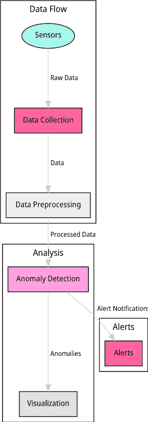

**图 7：** 智能工厂中的异常检测。

工艺与设备健康视图。本节提供了多模态异常检测在这些领域中应用的案例研究和实施示例。

### 5.5.1 汽车制造中的一致性

最好的案例之一是将多模态异常检测应用于汽车质量控制。在这种情况下，视觉检测系统与高分辨率摄像头以及生产设备中的传感器集成在一起。处理不同分辨率的单独图像以区分表面粗糙度误差；而其他传感器则提供有关机械和环境的信息。结合这些数据采集变量，系统能够检测到一些从视觉角度不易观察到的缺陷，例如由于机器工作参数失调导致的缺陷。这种方法已被证明可以降低缺陷率并提高组织内产品的整体质量。

### 5.5.2 航空航天工业中的预测性维护

在航空航天领域，多模态异常检测已用于飞机发动机的预测性维护。当来自多个温度传感器、振动传感器和声学传感器的数据与历史维护报告和工作参数一起被综合分析时，人们可以更好地了解发动机的健康状况。来自这些多个来源的各种数据由机器学习模型处理，以识别有价值的模式，这些模式揭示了即将发生的故障的早期预警信号，例如振动异常和波动。我发现这种方法可以更容易、更快速地准确预测维护需求，减少非计划停机的情况，并提高飞行安全水平。

### 5.5.3 用于改进半导体生产流程的结构性改进

多模态异常检测方法也被用作改进新半导体制造运营的一种方式。在该领域，来自光学检测系统、环境传感器和工艺日志等其他来源的数据被用于观察半导体晶圆的制造过程。使用进出站表面缺陷检测数据，而环境数据包括温度和湿度等影响产品质量的数据。因此，这些数据源的集成使制造商能够了解与平均偏差和破坏性事件相关的异常。各种成功的

### 6.1.1 数据同步中的挑战

数据同步的主要挑战是处理来自不同模态数据的不同时间戳。例如，在医疗保健环境中，在不同时间收集的成像数据（例如MRI扫描）与生理数据（例如心率监测器）会产生差异，从而使分析复杂化。此外，数据采集的频率和粒度可能因模态而异，导致错位。通常采用插值和重采样等技术来解决这些时间差异，但如果管理不当，它们可能会引入错误。

### 6.1.2 数据对齐中的挑战

数据对齐涉及确保来自不同模态的数据在空间上匹配。在医学成像的背景下，对齐来自各种成像技术（如MRI和CT扫描）的数据需要精确的空间配准，以确保解剖结构被准确比较。由于成像参数、患者移动和数据采集协议的差异，可能会出现错位。刚性配准和非刚性配准以及基于特征的方法等技术通常用于解决这些问题，但需要仔细校准和验证才能获得准确的结果。

多模态数据集成中最重要的问题包括数据同步和对齐，因为来自不同采集源的数据必须适当合并以形成一致且连贯的框架。这些挑战之所以出现，是因为不同模态具有不同的时间戳、分辨率和格式级别，因此合并数据点具有挑战性。同步和对齐对于实现这些目标以及使集成数据忠实于现象并能够揭示可靠的异常至关重要。

### 6.1.3 数据同步问题

数据同步中的第一个问题是了解每个来自不同传感模态的数据对应的时间。例如，在医疗保健环境中，收集的数据可能存在时间不一致，例如MRI扫描等成像数据与心率监测器等生理数据相比。此外，每种模态的测量频率和程度不同，这导致了问题。这些时间差异通常通过包括插值和重采样在内的方法来解决，尽管如果控制不当，这些方法会增加误差，从而在信号中产生数字伪影。

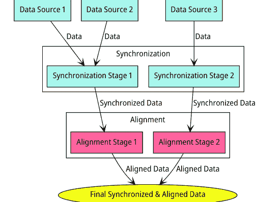

**图 8：** 数据同步与对齐。

### 6.1.4 数据对齐中的挑战

数据配准要求来自各种模态的数据进行空间对齐。在医学成像的背景下，这包括使用高分辨率MRI和CT脑部扫描，这些扫描需要在不同技术之间进行空间配准，以确保结构被正确比较。当图像分辨率和患者移动等参数在数据采集期间不同时，就会出现差异。这些问题可以通过刚性配准和非刚性配准以及基于特征的方法等程序来处理，但准确的配准通常涉及这些方法的校准。

## 6.2 处理缺失和不完整的数据

多模态数据集成中的一个重要问题是处理不完整和缺失的数据。因此，缺失数据的来源可归因于数据收集程序中的方法错误、数据录入错误以及传感器失效。这些缺失变量严重影响了异常检测系统的可靠性和效率。为了保持集成多模态系统的准确性和鲁棒性，处理部分数据的有效方法至关重要。

### 6.2.1 插补技术

插补是处理缺失数据的一种常用方法；它需要使用已有信息来估计和填充缺失值。有多种插补方法可用，例如均值插补，即用观测值的平均值替代缺失数据。更复杂的技术，如基于回归的插补，利用数据中的模式和相关性来预测缺失值。基于模型的插补技术（如链式方程多重插补（MICE））利用统计模型来估计缺失数据，并提供多种可能的插补以考虑不确定性。

### 6.2.2 数据增强

通过人为扩大和多样化数据集，数据增强技术也有助于解决不完整和缺失的数据。增强原始数据集并减少缺失值影响的方法包括从彼此相似的模态中创建合成数据。例如，当来自一种模态的数据不足时，向数据集中添加来自其他模态的相关数据可以提高其整体质量并提供更多上下文。通过提供更全面和更具代表性的数据，这种方法有助于增强异常检测系统的鲁棒性。

### 6.2.3 数据融合策略

在多模态集成中，有效的数据融合策略有助于管理和减轻缺失数据的影响。融合方法如早期融合（在特征级别组合数据）和晚期融合（在决策级别组合数据）可以适应处理缺失值。例如，在早期融合中，可以通过采用允许部分数据输入的技术来处理缺失值，确保模型仍然可以利用来自其他模态的可用信息。在晚期融合中，模型可以被设计为处理来自单个模态的不完整输出，在考虑缺失数据的同时整合预测。

### 6.2.4 鲁棒性和模型自适应

在异常检测模型中构建鲁棒性对于处理不完整数据至关重要。包含处理不确定性和缺失值机制（如不确定性估计技术）的模型，即使面对不完整数据也能保持性能。此外，能够动态地

根据不同模态数据的可用性进行调整是有益的。这些模型可以根据输入数据的完整性改变其行为，确保检测过程即使在信息缺失的情况下仍然有效。

### 6.2.5 Evaluation and validation

评估缺失数据对异常检测系统的影响对于确保所实施的解决方案有效至关重要。用于验证各种插补技术结果的一些技术包括交叉验证和敏感性分析。还需要一个参数，以显示模型的预测变异性，取决于 X2 的存在。这种评估允许在每次遇到缺失值时确定最合适的处理方法。这些见解构成了数据集成持续改进的一部分。

处理缺失和不完整的数据是多模态数据融合的主要挑战之一。插补、数据增强和其他方法能够抵消与缺失值相关的问题，同时保持异常检测的效率。该领域额外的研究不断改进处理待处理数据的计算步骤，以支持准确且精确的多模态分析。

## 6.3 Computational complexity

集成过程本身在多模态数据中仍然是一个计算复杂性问题，尤其是在数据来源数量本身包含高度异构数据时。多种模态的组合通常与数据处理、特征提取和融合步骤相关联，所有这些都耗时且计算成本高。本节专门讨论多模态数据融合带来的计算复杂性的主要问题，并讨论解决这些复杂性的方法。

### 6.3.1 Issues of high-dimensional data

数据的高维性是多模态数据集成中识别出的计算复杂性的一种形式。以文本、图像和传感器读数为例，它们分布在不同的高维特征空间中。为了将此类度量综合为共同的表示，需要处理大量数据，这反过来又引入了计算和内存复杂性。问题在于以一定的性能和准确度有效地处理和组合此类各种数据类型。

### 6.3.2 Scalability issues

可扩展性是多模态数据集成中的另一个关键问题。随着模态数据集数量的增长，数据融合和模型训练所需的计算资源呈指数级增长。诸如降维等技术可以帮助管理可扩展性，但也会导致信息丢失。确保集成方法能够有效扩展以处理大型和多样化的数据集仍然是一个重大挑战。

### 6.3.3 Algorithmic complexity

用于多模态数据集成的算法的复杂性会进一步加剧计算需求。许多输入的高级融合技术，如深度学习模型，需要大量的时间和计算资源。例如，具有大量层的自动编码器、循环深度神经网络或基于注意力的模型可能需要很长时间且计算需求高，因此需要在专用设备（如图形处理单元（GPU））上进行训练。这些算法的实际实现需要创建能够处理高复杂性同时保持能力的方法。

### 6.3.4 Real-time processing needs

在需要实时数据集成的应用中，计算复杂性也会带来其他限制问题。鉴于频繁且多样化的数据流，对快速处理和选择的需求可能对可用的计算能力构成挑战。实时机器学习对于解决这些挑战非常重要，这些挑战需要各种技术，包括并行处理、分布式计算以及算法改进以保证处理时间。

### 6.3.5 Solutions and strategies

如下面所述，存在处理多模态数据集成中计算复杂性的可能方法。一些基本策略，如数据子集划分、特征选择和创建简化模型，用于降低高维性。此外，必须设计改进的算法，其中算法的性能可以通过使用并行和分布式计算来扩展。硬件的进步，如 GPU 和专用处理器，也为管理高计算需求提供了解决方案。探索在复杂性和计算效率之间取得平衡的新算法方法仍然是一个持续的研究领域。

## 6.4 Data privacy and security

保护和集成多模态数据带来了重大的隐私和安全挑战。如图 9 所示，从文本记录、图像和传感器输出等不同来源汇总敏感信息增加了数据泄露和未经授权访问的风险。管理异构数据集的复杂性使得执行一致的安全协议更加困难。在保持集成数据集的完整性和保密性的同时确保数据保护，对于最大限度地降低风险暴露并满足 GDPR 或 HIPAA 等监管标准至关重要。强加密、访问控制和安全的数据融合框架是解决这些问题的关键组成部分。

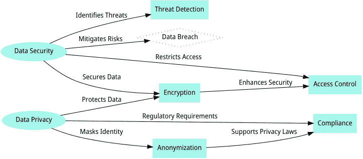

**Figure 9:** 数据隐私和安全。

### 6.4.1 Challenges in data privacy

个人身份信息（PII）和敏感数据是多模态数据集成的主要问题。最大的担忧是，当将不同模态的数据关联起来时，最终会泄露 PII 信息，尤其是在从临床记录、金融交易和社交媒体账户等各种来源融合数据集时。为了避免识别个人，部分个人数据措施需要匿名化。此外，数据的组合可以，并且经常会，在与其他数据集组合时重新识别个人，因此需要同时应用健全的匿名化和隐私保护措施。

### 6.4.2 Security risks and threats

另一个重要领域是多模态数据集成系统的安全性。当来自不同来源的数据经过输入、存储和分析过程时，就变得容易受到网络犯罪分子的入侵。此类威胁要求数据在传输过程中以及存储在不同数据库中时都受到保护。此外，由访问控制和身份验证机制指定的技术控制需要足够强大，以防止无权人员获取此类信息。通过纳入全面的安全措施，可以最大限度地降低此类风险，从而保护数据完整性；包括安全评估和安全审查。

### 6.4.3 Proposals for data protection and protection

企业已知有几种策略可望解决有关数据隐私的新出现问题：仅包含特定研究所需的原始数据；纳入数据缩减方法也有助于降低个人身份被披露的可能性。在保持个人隐私的同时允许有用分析的策略包括差分隐私，它会在数据中引入噪声。通过使用安全多方计算（SMPC），收集多模态生物识别数据的多个研究人员可以将其组合和处理，通过获得结果而不披露参与者的个人数据。

因此，数据安全的经典保障仍然是加密以保护信息内容。传统对称和现代非对称加密方式都可用于传输和存储期间的数据加密。组织可以使用适当的访问控制安全控制措施，包括 RBAC 和 MFA，以消除非法访问并仅允许授权人员访问。频繁更新软件和系统的保护对于应对新的安全威胁也很重要。

### 6.4.4 Compliance with regulations

这些法律要求规定了与多模态数据集成程序相关的法律法规和标准。这些法律制定了数据隐私及其安全的相关规则和法规，如美国的 HIPAA 和欧洲的 GDPR。这些法律规定组织必须征得用户使用其数据的许可，并确保采取适当措施增强企业中用户数据的安全性。

数据处理是新型硬件的开发，包括专用处理器和 GPU。

## 6.5.3 实时数据集成与分析

多模态数据的实时集成和分析在处理大量持续生成且必须实时提供输入的数据时被证明存在可扩展性问题。为了保持 MMI 在实时功能中集成和分析多模态数据的能力，需要高效的数据流和处理。实时数据集成例如可以通过使用数据流处理和事件驱动架构等技术来解决。通过这些方法，数据可以实时处理和分析，同时提供适当的异常早期识别，并保持系统的集成性和可扩展性优势。

## 6.5.4 互操作性和数据标准化

为了在多个应用中大规模实施多模态集成，有必要在数据层面实现互操作性并拥有统一的数据格式标准，而该标准目前在该领域尚缺失。数据在格式、结构和含义方面的差异可能带来集成挑战并限制集成的规模。针对这一问题，采用标准化数据格式和互操作性框架的实现。与 HL7 用于医疗保健数据类似，RDF 对语义网数据的应用集成被视为互操作性的通用数据标准。应部署中间件和数据集成应用程序，以确保不同格式数据之间没有差距，从而使数据流能够顺利进行。

多模态数据可扩展性问题带来的一些挑战包括：大量数据、计算成本以及实时性能和兼容性。解决这些挑战需要采用先进的存储系统技术、分布式计算平台、实时处理方法以及数据标准化等复杂方法。通过应用这些解决方案并实施新技术，可以控制数据集成系统的可扩展性，并提高其处理多模态数据的能力。

- [5] Zhao, C., Ma, M., Zhong, Z., Zhang, S., Tan, Z., Xiong, X., . . . & Zhang, D. (2023, August). 微服务系统的鲁棒多模态故障检测. In Proceedings of the 29th ACM SIGKDD conference on knowledge discovery and data mining, (pp. 5639–5649).
- [6] Raya, S., Orabi, M., Afyouni, I., & Al Aghbari, Z. (2024). 使用深度学习的 multimodal 数据聚类：系统综述. Neurocomputing, 128348.
- [7] Wu, P., Pan, C., Yan, Y., Pang, G., Wang, P., & Zhang, Y. (2024). 视频异常检测的深度学习：综述. arXiv preprint arXiv:2409.05383.
- [8] Duan, J., Xiong, J., Li, Y., & Ding, W. (2024). 基于深度学习的多模态生物医学数据融合：概述与比较综述. Information Fusion, 102536.
- [9] Liu, P., Tao, Q., & Zhou, J. T. (2024). 从单模态到多模态面部 DeepFake 检测的演进：综述. arXiv preprint arXiv:2406.06965.
- [10] Liu, P., Li, J., Wang, L., & He, G. (2022). 生成对抗网络的遥感数据融合：最先进方法与未来研究方向. IEEE Geoscience and Remote Sensing Magazine, 10(2), 295–328.
- [11] Fahim, M., & Sillitti, A. (2019). 物联网环境中的异常检测、分析和预测技术：系统文献综述. IEEE Access, 7, 81664–81681.
- [12] Kalamkar, S. (2023). 多模态图像融合：系统综述. Decision Analytics Journal, 100327.
- [13] Martínez, H. P., & Yannakakis, G. N. (2014, November). 深度多模态融合：离散事件与连续信号的结合. In Proceedings of the 16th international conference on multimodal interaction, (pp. 34–41).
- [14] Pang, G., Shen, C., Cao, L., & Hengel, A. V. D. (2021). 异常检测的深度学习：综述. ACM Computing Surveys (CSUR), 54(2), 1–38.
- [15] Czimmermann, T., Ciuti, G., Milazzo, M., Chiurazzi, M., Roccella, S., Oddo, C. M., & Dario, P. (2020). 工业应用的基于视觉的缺陷检测与分类方法——综述. Sensors, 20(5), 1459.
- [16] Chen, J., Seng, K. P., Smith, J., & Ang, L. M. (2024). 基于 AI 技术和多模态系统中的态势感知：架构、挑战和应用. IEEE Access.
- [17] Boehm, K. M., Khosravi, P., Vanguri, R., Gao, J., & Shah, S. P. (2022). 利用多模态数据集成推动精准肿瘤学. Nature Reviews Cancer, 22(2), 114–126.
- [18] Belle, A., Thiagarajan, R., Soroushmehr, S. R., Navidi, F., Beard, D. A., & Najarian, K. (2015). 医疗保健中的大数据分析. BioMed Research International, 2015(1), 370194.
- [19] Habeeb, R. A. A., Nasaruddin, F., Gani, A., Hashem, I. A. T., Ahmed, E., & Imran, M. (2019). 用于异常检测的实时大数据处理：综述. International Journal of Information Management, 45, 289–307.
- [20] Malathi, K., Shruthi, S. N., Madhumitha, N., Sreelakshmi, S., Sathya, U., & Sangeetha, P. M. (2024). 通过医疗设备远程监测实现医疗数据集成和互操作性. Journal of Wireless Mobile Networks, Ubiquitous Computing, and Dependable Applications (JoWUA), 15(2), 60–72.
- [21] Lahat, D., Adali, T., & Jutten, C. (2015). 多模态数据融合：方法、挑战与前景概述. Proceedings of the IEEE, 103(9), 1449–1477.
- [22] Su, J., Jiang, C., Jin, X., Qiao, Y., Xiao, T., Ma, H., . . . & Lin, J. (2024). 用于预测和异常检测的大语言模型：系统文献综述. arXiv Preprint arXiv:2402.10350.
- [23] Papalexakis, E. E., Faloutsos, C., & Sidiropoulos, N. D. (2016). 用于数据挖掘和数据融合的张量：模型、应用和可扩展算法. ACM Transactions on Intelligent Systems and Technology (TIST), 8(2), 1–44.
- [24] Alnomaan, A., Sharma, S. K., Ejaz, W., & Anpalagan, A. (2019). 分布式物联网系统的新兴边缘计算技术. IEEE Network, 33(6), 140–147.
- [25] Mellit, A., & Kalogirou, S. (2021). 人工智能和物联网提高太阳能光伏系统诊断和遥感效能：挑战、建议和未来方向. Renewable and Sustainable Energy Reviews, 143, 110889.

Mangala Shetty, S. Praveena, V. Manivelmuralidaran, Spoorthi B. Shetty, Anupriya R., and P. Senthilkumar

## 用于扫描视觉数据准确高效异常检测的先进机器学习模型

摘要：作为多模态信号的输入组合以及现代数据动态特性，要求采用更复杂的异常检测方法。本书章节的文献综述侧重于使用监督学习、无监督学习和强化学习的组合来克服传统方法的缺点。其中一些是集成方法，基本上是混合深度学习框架和涉及迁移学习以及特征融合的多模态深度学习框架，以解决不同领域的异常检测问题。特别关注将卷积神经网络、循环神经网络、生成对抗网络和变分自编码器等算法集成到循环中，以提高特征提取算法的性能及其可靠性。此外，还描述了为增强异常检测而学习的策略，包括策略梯度方法和深度 Q 学习。然后讨论多模态异常检测，并进一步分析利用来自不同信息来源和上下文的数据的方法，例如图像数据、传感器数据和元数据。章节中讨论了许多问题，如数据不平衡、跨模态迁移和计算限制，而解决方案则以集成和混合方法呈现。还回顾了医疗保健、生产和网络安全等多个领域的实现，以展示混合模型的不同用途。进一步针对研究结果，本章以对未来工作方向的见解结束：可扩展算法和自监督学习，以及在异常检测背景下可解释 AI 的重要性。

Mangala Shetty, MCA 系, NMAMIT NITTE, Karkala Taluk, NITTE 邮编 574110, Karnataka, India, 电子邮件: mangalapshetty@nitte.edu.in
S. Praveena, 电子与通信工程, Mahatma Gandhi Institute of Technology, Gandipet, Hyderabad, Telangana, India, 电子邮件: spraveena_ece@mgit.ac.in
V. Manivelmuralidaran, 机械工程系, Kumaraguru College of Technology, Coimbatore, Tamil Nadu, India, 电子邮件: manivelmuralidaran.v.mec@kct.ac.in
Spoorthi B. Shetty, MCA 系, NMAMIT NITTE, Karkala Taluk, NITTE 邮编 574110, Karnataka, 电子邮件: sshetty.07@nitte.edu.in
Anupriya R., 计算机科学系, Sri Krishna Arts and Science College, Kuniyamuthur, Coimbatore, Tamil Nadu, India, 电子邮件: anupriyachandran1999@gmail.com
P. Senthilkumar, 机械工程系, Nehru Institute of Engineering and Technology, Thirumalayampalayam, Coimbatore 641108, 电子邮件: nietsenthilkumar.p@nehrucolleges.com

关键词：混合学习架构、多模态异常检测、强化学习、集成方法、深度神经网络、迁移学习

## 1 引言

扫描视觉信息已被纳入工业自动化、医疗诊断、安全系统等关键应用中，人们对可靠、高效的异常检测方法的需求也在上升[1]。光学信号中的异常指向缺陷和不规则性，这需要可靠的检测方案来维护系统和决策的可靠性[2]。一些异常检测技术基于规则和统计模型，在处理大规模、高维数据时效果不佳[3]。这些局限性源于算法中所用的离散方法，固定阈值和假设无法在很大程度上捕捉现实场景中数据集的可变性[4]。

传统技术无法解决这些问题，机器学习（ML）模型因其数据模式学习能力而广受欢迎[5]。SVM和PCA等常规方法在异常检测中仍然流行[6]。这些方法有时会遇到许多问题，例如如何处理大数据以及从更高维的视觉数据库中提取特征[7]。但深度学习已将该领域提升到新的高度，主要体现在特征学习和增强检测能力方面[8]。卷积神经网络（CNN）和自编码器在识别空间模式和扫描图像中的微小差异方面表现尤为突出[9]。

当前领域趋势指向将现有与新型ML方法与特定情境需求相结合，以提高检测性能[10, 11]。为解决数据不平衡、实时适应性和时间复杂性问题，人们提出了包括强化学习（RL）模型在内的多种监督和无监督学习方法[12]。可解释AI（XAI）方法已成为一个重要的研究领域，旨在增强异常检测框架的可解释性，从而提升高风险应用中的信任度和实用性。这里，我们针对扫描视觉数据上的异常检测提出了先进的ML模型，力求在准确性和复杂度之间取得平衡[13–15]。

图1：监督学习与无监督学习模型的集成。

能够实现。无监督方法的效果取决于对数据分布所做的假设。特别是，当数据带有噪声且包含复杂重叠模式时，无监督方法会产生许多误报，将正常数据判为异常。许多无监督学习方法对特征选择很敏感，必须进行调优才能达到最佳性能。

监督学习和无监督学习技术通常都用于此，但两者的结合最为有效，尤其是在处理图1中复杂且高维的视觉模态数据时。混合模型表明，标记数据的特征可以补充大量未标记数据，从而在保留无监督学习方法的灵活性和可扩展性的同时，改进异常检测。例如，系统先对数据集应用无监督学习以指出异常迹象，然后在此基础上构建一个改进的、更准确的监督学习系统。

两种方法的结合解决了异常检测应用中的一些相关问题，例如数据有限、数据高维性以及异常在不同领域不断变化的问题。这种方法在实际应用中已显示出巨大潜力，是高精度监督模型与高灵活性无监督模型之间折衷的良好例证。尽管在实践中已有应用，混合学习用于异常检测的进一步发展涉及增强模型泛化能力、在没有显式标记数据的情况下进行学习，以及对这些方法中使用的黑盒模型形成更清晰的理解等方面。

### 2.1 用于异常检测的半监督学习方法

在许多现实应用中，首要问题是缺乏标记数据，尤其当异常是例外情况且通常难以刻画时。半监督学习似乎是解决这一问题的最佳方案之一，因为它融合了监督学习和无监督学习两类方法的优点。半监督学习是指在少量标注数据和大量未标记数据上训练模型。这种方法是一个很好的折衷，因为它利用少量可用的标记数据来指导过程，同时利用大量可用的未标记数据，因此在标记成本高昂的异常检测中非常有用。

在这种半监督学习方法中，算法侧重于学习正常数据的性质，并将其应用于未标记部分以分离异常。当标记异常点有限时，这种方法尤其有利，模型从大量典型的未标记数据中学习得更多。半监督方法通常通过结合聚类、分类方法和密度估计来区分正常数据和异常情况。

应用半监督异常检测最流行的方法是自训练，即首先使用小型标记数据集训练初始模型，然后利用来自未标记集的对同一数据的预测迭代优化模型。在自训练过程中，所考虑的模型根据当前学到的正常行为为未标记数据打标签，这些伪标记实例随后被纳入训练数据集。在多次遍历数据集后，模型得到优化，能够识别所选集合中未包含的异常模式。这种方法的好处在于它既可使用标记数据也可使用未标记数据，从而改进对未见数据的泛化能力。

另一种模式是使用图进行半监督异常检测，其中节点是数据点，边构成节点之间的连接。基于图的半监督异常检测方法以标记节点为中心，通过图传播标签，以便利用标记节点与未标记节点之间的强相似性将该未标记节点标记为异常节点。这些方法在大型复杂系统和高维数据空间中识别异常点方面尤其有益，因为当单一属性无法提供洞察时，数据点间的关系可以提供信息。

同样，自编码器和变分自编码器（VAE）也正被用于半监督异常检测。这些模型经过训练以提取输入数据的压缩表示，可以在有限的归一化标记数据上进行训练。训练后的自编码器随后重建输入数据，两个数据集之间的差异被视为异常程度的度量。由于这些模型通常在正常数据上训练，高重建误差意味着异常数据。这也表明模型可以用其他未标记数据进一步微调，以增强其识别更深层、更隐蔽异常的能力。

将集成学习应用于半监督学习方法也能增强检测，因为多个模型在标记和未标记数据集的不同划分上训练，并使用联合结果来检测恶意模式。例如，bagging和boosting策略对半监督异常检测方法有利，因为由于模型的分散性，过拟合的影响得以降低。集成方法可以综合各种关于什么应被视为正常行为的观点，然后利用这些观点更巧妙地评估偏差行为。

尽管半监督学习方法看似高效，但并非没有缺点。挑战之一是防止伪标记数据引入由错误标记产生的噪声，这必然会影响模型在检测方面的性能。此外，半监督学习模型的选择取决于数据集的性质和异常检测的具体问题。尽管如此，在半监督框架中使用标记和未标记数据为解决异常检测应用中常见的标记数据有限这一关键问题提供了实用方案。

异常检测背景下的半监督学习也显示出前景，目前的研究集中于提高模型的稳定性和有效性。进一步的演进涉及改进用于伪标记的算法本身、利用额外领域知识实现学习过程的领域适应，以及将半监督学习概念推广到更强大、多维的特征。因此，后续…

半监督异常检测的最新发展可以在很大程度上提高检测的准确性，并在实际应用中变得极其有用，其中可用标记数据的数量有限，而未标记数据可能非常庞大。

## 2.2 用于监督模型中无监督特征提取的自编码器

自编码器在监督异常检测系统中的特征学习应用已成为一种首选策略，尤其是在具有众多特征的数据（如图像和视频数据）的情况下。自编码器是神经网络，旨在通过编码输出将源输入数据转换为紧凑且低维的特征空间，在该空间中模型能够重建输入。这一过程能够对数据的潜在结构进行编码，因此使自编码器适用于无监督学习，在无监督学习中待学习的特征是有用的，且没有标签可用。自编码器可用于异常检测的构成步骤中，并从原始未标记数据中提取独特特征，这些特征可用于后续的监督学习异常检测模型以获得更高的准确性。

自编码器的工作原理：它们使用神经网络来最小化通过其中的数据的损失，并在重建数据中特别关注正常数据的特征，因此由于学习到的潜在表示而被偏爱用于异常检测。如果自编码器仅从包含正常实例的集合中学习，它能够相当好地重建这些实例。这是因为在重建过程中，常规的自编码器无法映射和重建模型测试时异常数据所特有的、奇特且未见过的模式。然后可以通过比较上述两个结果来提出异常检测的指标。

Figure 2: 用于监督模型中无监督特征提取的自编码器。

采用自编码器进行无监督特征提取的主要好处之一，如图2所示，是数据的学习表示比使用传统的“无形状”技术（如PCA）时更有序且更易解释。相比之下，通过捕捉有助于量化数据变异性的最相关特征，自编码器获得了解码非线性特征关系的能力，这是在处理数据中复杂或隐藏模式时的优势。这些

在聚类和分类中，同时使用无监督和监督学习系统是有利的，可以改进所设计异常检测系统的设计和准确性。

将聚类与分类相结合应用的主要优势在于噪声的检测，特别是在数据有限的环境中。考虑到异常检测的背景，可以确定这些是测量值，它们不能很好地融入特定聚类，并且位于形成聚类的边界处。单独的聚类并不能提供最可靠的信息来判断这些实例是否正确地定义了异常情况的聚类或正常数据的聚类。这里使用分类模型来提供一种方法，利用标记数据识别找到的离群点是否被分类为异常实例。

聚类技术在集成过程中被广泛用作预处理方法。总体而言，包括对数据进行适当转换以进行聚类的中间步骤会产生相似数据的分组聚类。一旦形成聚类，就使用标记数据训练包括支持向量机在内的分类模型用于此目的。用作分类器输入特征的聚类结果增加了更多信息，并使分类器更通用以检测异常。

用于异常检测的聚类和分类的另一种方法是在半监督学习下。因此，可以使用聚类算法将未标记数据划分为初步聚类。随后，在整个网络的一个小标记子集上训练分类模型，然后在聚类组上运行以检测组内的离群点。该方法体现了使用无监督聚类来找出相似模式组的固有优势，并随后通过分类以监督方式为异常模式分配明确标签。无监督学习用于数据发现和监督学习用于预测的整合为解决标记数据有限的异常检测问题提供了一种高效范式。

通过集成学习将聚类与分类结合也很重要，其中结果来自多个聚类算法。例如，模型结合了包括 k-means、DBSCAN 和高斯混合模型（GMM）在内的聚类算法，从而涵盖了各种各样的聚类形状。随后，在上述聚类结果的聚合上训练分类模型，这使得系统能够使用数据的多个聚类方面更有效地检测异常。这种集成学习策略基于某些数据集具有多个潜在结构这一事实，提高了异常检测模型的可靠性和效率。

尽管聚类和分类的整合具有许多优势，但在采用这种两步方法时仍会出现几个关键问题。存在识别与特定数据集相关的聚类算法的问题。在数据空间的不同位置可以找到给定数量的聚类；
数据的分布、噪声和密度会影响聚类解决方案。因此，必须选择正确的聚类算法，以使识别出的异常点具有应用相关性。

这种方法中出现的一个问题与数据具有许多特征有关，因为这可能导致聚类和分类都出现问题。由于处理高维数据，对象之间的主要距离由于“维度灾难”而变得意义不大。这个问题可以通过常见方法例如主成分分析（PCA）进行低维投影来解决。

为了检测异常，将聚类与分类集成似乎是高度可行的。这种组合方法提供了检测使用两种方法都难以区分的不规则性的能力。应用聚类算法来发现数据的固有结构以及分类模型对这些发现的组结构进行明确标记，从而提高了异常检测系统的准确性、灵活性和鲁棒性。

## 2.4 通过混合监督和无监督学习增强异常检测的鲁棒性

在过去几年中，监督和无监督学习方法在异常检测中的结合一直是研究的重点，因为它有可能提高检测系统在实际问题中的整体性能，特别是鲁棒性。图3显示，虽然在有新的标记数据可用时监督学习模型非常准确，但存在难以找到的实例。事实上，使用聚类和离群点检测等技术可以在没有提供训练数据集的情况下发现新模式，但由于其决策区域的划分不精确，也可能存在问题。可以看出，通过整合两种策略的思想，有可能开发出用于异常检测的模型增强准确性、灵活性和鲁棒性。

大多数混合异常检测方法使用一种称为无监督学习的技术来测试数据的结构。这些已知方法如聚类算法（k-means, DBSCAN）等，以及降维（PCA, t-SNE）等，可以帮助根据迄今未知的特征对相似数据进行分组。这些无监督模型有助于检测最可能包含离群点的数据集区域，因为不属于学习到的聚类且未符合假设分布的样本会被算法标记。然而，尽管这些模型可以指出潜在的离群点，但它们没有能力在不测量特定特征的情况下将这些记录明确分类为离群点。这就是监督模型发挥作用的地方。

*图 4：异常检测的集成学习方法。*

用于训练的实例权重使得对最令人困惑的样本给予更多关注。

随机森林是另一种集成方法，它累积决策树以提高异常检测过程的效率和有效性。随机森林通常在数据集的随机样本上构建许多决策树，并通过投票合并个体预测。随机森林在处理具有大量特征的大数据时非常强大，且过拟合风险低。当数据具有难以用单一结构建模的众多特征时，它们在异常检测场景中非常有效。随机森林可用于检测异常，因为各个树在树之间捕捉不同的决策边界，从而提高检测能力。

堆叠泛化是另一种在线集成技术，当需要在多个层级组合不同模型时会被应用。该方法的思想是生成多个基模型，这些模型从数据库中学习，并将它们的预测结果组合起来以做出元模型的最终预测。这可以是任何机器学习算法；它可以是逻辑回归，其任务是根据基模型提供的信息给出最佳答案。在异常检测问题中使用时，堆叠是一种非常有效的方法，因为不同的模型在数据的不同特征上训练，并通过堆叠系统输出结果以做出最终预测。此外，它在需要检测彼此不同且涵盖广泛特征谱的各种异常类型的应用中效果最佳。

另一种常用的异常检测集成方法称为 XGBoost；该方法因其效率和对大型数据集产生高预测精度的能力而被选中。XGBoost 与 boosting 类似，构建一系列弱学习器，但它在其中包含收缩度量，用于避免过拟合并提高模型的泛化能力。具体而言，XGBoost 的基于树的方法更适合高维和稀疏数据，以检测异常特征的复杂模式，同时在计算方面也很高效。该方法提供的巨大自由度在于，可以在包含缺失观测的各种异常检测设置中调整 XGBoost 算法。

与常规的单模型方法相比，使用多样化的集成方法进行异常检测具有以下优势：首先，检测率提高，因为对源数据的多重视角不太可能遗漏重要案例；其次，鲁棒性增强，因为导致单模型性能下降的噪声影响可以降低。例如，一个在识别异常时出错的特定模型会被组中的其他模型纠正。第三，同一类型的异常可以由不同类型的不同模型检测，例如由基于树的模型和神经网络检测，这可以大幅提升其性能。

### 3.1 用于检测视觉异常的随机森林和梯度提升

这成为一个问题，因为由于固有的复杂性，视觉数据中的不一致难以发现，而且图像构成高维数据集。尽管如此，随机森林和梯度提升在处理这一挑战方面取得了显著成果。结合多个模型结果的此类方法，是构建可靠框架以识别视觉异常的良好方法，可用于医学成像、工业缺陷检测和监控系统等通用应用。因此，由于在数据中出现频率低而通常不显重要的因素，被这些集成方法捕捉，因为个体分类器的优势被累加在一起，使得追踪单模型会遗漏的通常微妙的异常变得更容易。

*图 5：用于检测视觉异常的随机森林和梯度提升。*

由于图 5 使用的是照片，即高维数据，因此另一种同样基于决策树的随机森林技术被用于视觉异常识别。随机森林应用多个在不同数据样本上训练的决策树，森林中的每棵树都给出自己的预测。此外，最后的预测是从每棵树产生的输出中得出的，并涉及简单的投票。这种方法最小化了过拟合，并且在处理具有高度偶发视觉奇怪伪影的图像时，模型的整体可靠性更高。随机森林也是在存在噪声或缺失值时表现良好的学习算法，而这些在现实的视觉异常检测中很常见。在单棵树内以及多棵树之间确定决策的局部性的可能性，使得随机森林非常适合分析视觉数据中的异常。

随机森林可应用于视觉异常检测的众多任务中，包括但不限于生产线缺陷的识别、医学成像中异常组织模式的区分，以及监控视频中入侵和异常事件的识别。例如，在检测制造缺陷时，随机森林用于对具有关于纹理和颜色密度的像素特征的产品图像进行聚类。从在不同图像片段上构建的多个决策树中，随机森林可以识别几乎无法辨别的特征，例如裂纹和划痕。再者，随机森林消耗的计算时间较少，因此可以很好地处理大型图像数据集。

像 XGBoost 和 LightGBM 这样的梯度提升算法提供了另一种强大的方法来识别视觉异常数据。与随机森林中独立于数据生长的一组树不同，梯度提升算法按顺序生长树，其中下一棵树旨在最小化前一棵树的误差。这种循环过程使梯度提升模型能够集中于复杂且最难解决的案例，使其适用于现有异常不仅稀少而且复杂的案例。GB 中的最后决策是所有树的输出的加权和，这反过来有助于最终的边界调整，从而提高检测率。

总体而言，当异常在像素特征内是非线性的时，梯度提升方法对基于 VAD 方法的模型很有用。例如，在医学成像中，梯度提升模型已被用于识别肿瘤或病变等在经典图像处理中几乎不可见的不规则性。因此，梯度提升模型中的多个弱学习器可以对图像数据中的复杂关系进行建模，从而对异常分类做出几乎完美的决策。这些模型在处理大量数据点方面也表现出良好的特性，因此可以用于涉及高分辨率图像的任务。

与视觉异常检测相关的梯度提升的另一个好处是它能自适应数据复杂性。梯度提升相对于大多数其他机器学习算法的主要优势之一是，它可以自适应地在整个训练数据上微调学习过程，从而对难以学习的样本给予更多重要性。这种动态控制导致更好的检测水平，特别是在给定异常在训练数据集中不频繁时。此外，梯度提升方法，包括 XGBoost，具有处理特征空间复杂性和防止过拟合的集成方法，在样本数量有限时更为重要，而这在视觉异常检测中经常出现。

比较随机森林和梯度提升算法，很明显两者都应用于视觉异常检测，因为它们可以相互改进。使用随机森林和梯度提升方法，可以实现两种方法的优势；随机森林有效地处理噪声和高维数据，而梯度提升提供迭代以更有效地挑选出异常。利用这两种方法的方法可能产生更精确和高效的异常检测系统，特别是在处理现实世界的视觉信息时。

## 3.2 异常检测系统中的提升与装袋

提升和装袋是两种常见的集成学习技术，常用于检测异常模式，因为它们能有效提高对应学习器的性能和对噪声的容忍度。这类技术利用多个基模型并产生更可靠、更稳定的整体预测，这在离群点检测中尤为重要。异常本质上是不常见的，且不符合数据中的典型模式，这使得识别变得困难。提升和装袋都通过汇总各种基学习器产生的结果来解决这一问题，以增强训练功能并减少错误。尽管两者都归类为集成学习技术，但每种方法在处理问题时有不同的视角，并在异常检测场景中各有优势。

装袋是一种集成技术，涉及使用不同的随机数据样本对训练数据训练多个相互独立的模型。这些子集是通过有放回地抽取数据子集生成，然后将新的数据子集传递给下一个模型生成的。训练完成后，各个模型进行预测，结果通过平均进行集成（对于回归类问题为残差/均方根误差的平均）。装袋的使用降低了模型的方差，因为各个学习器的结果被平均，从而避免了过拟合，而过拟合在决策树等高方差模型中很常见。

装袋很有帮助，因为它允许检测系统识别真实数据库中存在的噪声和高方差。由于异常稀少且变异性高，装袋可以通过使用多个基模型来稳定检测过程，同时引入输入的偏差。例如，在属于装袋方法的随机森林模型中，决策树是在数据的不同样本上训练的，所有树的输出结果用于判断数据点是否为异常。这种方法很有用，因为即使在构建时某些单棵树遗漏了异常，随着树数量的增加，异常在所有树集体预测时很可能被发现。

异常检测任务的常见问题是类别不平衡，其中大多数实例属于正常类。装袋过程解决了这一问题，因为当每个模型对数据有不同的视角时，集成就有更好的机会识别那些罕见且模糊的模式。总的来说，装袋最大限度地减少了假阴性的可能性，即确保无论在训练数据中多么罕见，离群点都能被检测到。

相比之下，提升是另一种集成技术，其中一个模型在另一个模型的基础上依次构建，当前模型试图最小化前一个模型的错误。与装袋中模型单独训练不同，提升通过关注之前模型错误分类的困难样本点，在之前弱学习器模型输出的基础上进行构建。提升的最终预测是通过对所有单模型的加权预测进行平均得到的。这种迭代学习特性增强了处理最困难示例的能力，这在异常检测中非常有帮助，因为大多数异常样本不易从正常数据集中识别出来。

AdaBoost 和梯度提升本质上是增强方法，在识别单个模型难以单独指出的复杂异常方面更胜一筹。例如，在医学影像中，提升可用于辨别包含疾病异常但不易察觉的图像细节。提升的优势在于，随着模型通过迭代重新定义决策边界而准确率提高，它对模糊案例的关注度也随之增加。上述特点使其非常适合异常检测领域的应用，其中异常数量稀少且可能存在于特征空间的复杂结构中。

XGBoost 和 LightGBM 是异常检测中广泛使用的两种结构，因为梯度提升算法的高效性。它们通过减少通常由过去模型错误产生的特定损失函数来计算高效的训练计划。因此，如果在噪声数据上进行学习，梯度提升表现出对准确解的非常快速的收敛。对于异常检测，梯度提升被证明能够通过识别特征维度内丰富且可能非线性的关系，将选定的数据点分类为正常或异常。梯度提升涉及在这些模型应用的领域中对错误的反复修正，因此使其非常适合用于时间序列的检测过程，其中特征之间存在显著交互。

## 3.3 基于集成学习的异常检测中多样性的作用

集成学习模型在异常检测领域变得越来越突出，因为它们能够通过结合多个模型的优势来提高检测准确性。如图 6 所示，基于集成的方法利用各个模型之间的多样性，每个模型使用不同的结构、特征或训练集进行训练，以捕捉更广泛的异常模式。这种多样性至关重要，因为它防止集成仅仅复制相同的见解，而是整合不同的视角，从而实现更稳健、更具泛化能力的检测。在异常检测的背景下，异常情况稀少且通常微妙，模型之间的这种差异显著提高了系统的敏感性和可靠性。因此，模型异质性和预测多样性是集成学习在检测离群值和意外行为方面成功的关键驱动因素。

创建集成中模型多样性的方式有多种，包括以下几种；训练模型时使用不同的数据集、创建模型时使用不同的模型结构，以及开发模型时使用不同的学习算法。当模型在概念上不同时，它们会检测不同类型的异常，因为异常呈现出许多实体和特征模式，单个模型难以识别。例如，在给定数据集中存在不同类型异常的情况下，一个模型在识别某些异常方面表现良好，而另一个模型在识别其他异常方面表现良好。通过融合这些模型，集成的整体结果在检测更广泛的异常方面的能力优于集成中的任何一个组成模型，从而产生更好的全局异常检测系统。

在异常检测背景下，有效的集成变化及其多样化已被认可，其中一种方法是使用不同的数据子集来形成集成中每个模型。这可以通过使用诸如装袋等技术来实现，其中每个模型使用从训练数据中随机选择的一些数据开发，或使用提升，其中每个模型使用前一个模型难以学习的实例开发。通过在数据的不同部分上训练模型，集成可以了解底层数据分布的不同部分。这种训练数据的分散也使集成能够更好地泛化，并对噪声和离群值不那么敏感，这两者都是异常检测问题的典型特征。

除了系统用于训练的数据外，还可以在集成中使用不同的学习算法来暂时提高多样性水平。例如，集成方法中的某些模型可能是决策树，而其他模型可能实现 SVM。联合多种学习算法的原因是每种学习方法都有其优势，并针对不同的模式进行配置，可发现各种异常。流行的算法如决策树，例如，可以处理分类特征以及非线性决策边界，而 SVM 在高维特征空间中表现良好。由于多种算法的协同作用，集成可以得到增强，从而提高在各种数据类型中识别异常事件的能力。

架构差异是提高基于集成异常识别多样性的另一个关键要素。即使在学习算法内部，性能也不保持不变，因为分类器模型架构中可能存在变化。例如，包含一个以上隐藏层的深度结构能够识别数据集中固有的模式，而浅层模型能够识别数据集中直接的特征。值得注意的是，通过包含不同深度的模型，集成可以增强其识别大量异常模式的能力。这种架构上的多样性有助于构建可靠的异常检测系统，因为管道的不同组件利用了数据的不同方面。

### 图6：多样性在基于集成的异常检测中的作用

谈到偏差-方差权衡这个话题，这也与基于集成的异常检测中多样性的作用有关。多样性的另一个优势在于，凭借更多的机会，它同时降低了模型自身的偏差和方差。特别是，如果以某种方式进行组合，例如对模型取平均，则由于能够更准确地识别从数据样本中提取的数据结构，异常检测中的偏差程度会降低。一方面，多个模型的训练会减少方差，因为不同模型产生的错误会相互抵消。因此，对噪声的过拟合得以减轻，集成模型对未见数据的泛化性能得到增强。

增加多样性有助于解决模型内部的不稳定问题。在异常检测任务中，噪声和离群值会产生波动结果，从而妨碍单个模型的性能。然而，当具有不同训练数据、算法和架构的多个模型被纳入一个集成中时，所有这些差异都可以得到平衡。最终产物是在预测方面更稳定的结果，不易受到某个单独模型异常的影响，从而使整体异常检测的实用模型更加稳健。

多样性对集成方法是有益的，因为它提高了模型性能，尽管特征选择的问题需要适度处理。还应注意，如果多样性程度过高，则可能导致模型本身的过度指定，进而导致集成学习器难以训练且过于不稳定。如果多样性程度过低，则集成的行为类似于单一模型，无法获得组合多样模型的好处。因此，对多样性程度的管理对于基于集成的异常检测系统实现最高性能仍然至关重要。

## 3.4 优化集成模型以处理不平衡的异常检测数据集

在异常检测数据集中，大量正常实例往往压倒少量异常实例，这带来了诸多挑战。在这样的数据集中，包括集成方法在内的传统机器学习模型常常在少数类分类上存在问题。这种偏斜分布会影响性能，因为模型倾向于多数类，并对异常产生较高的假阴性率。为了评估集成模型优化方法的可复制性，必须缓解这一挑战，这些方法能够改善类别不平衡，同时在金融数据上保持有效的异常检测。

针对不平衡异常检测，帮助微调集成模型的主要方法之一是适当调整决策阈值。通常，在机器学习模型中，根据先验设定的概率/分数来确定一个实例是否被分类为异常的决策边界。在不平衡数据集中，平衡负载是一个大问题，因为训练时的默认阈值往往倾向于过度预测正常类。通过降低用于标记异常的决策阈值，集成模型能够实现对少数类更高的敏感性。这种调整旨在将更多数据泛化为异常，从而以可能较低的精度为代价，实现对罕见案例更高的召回率。问题在于需要在精确率和召回率之间取得最佳平衡，以保持模型的高效率。

另一种使用基于集成方法处理异常检测中类别不平衡的技术是重采样技术，包括对少数类进行过采样和对多数类进行欠采样。过采样会复制感兴趣类别中的一些样本，使它们在数据集中出现更多；欠采样则对正常样本执行相反操作。这些措施有助于减少多数类不平衡对集成性能的影响，同时增强模型识别异常的能力。为了改进模型学习，其他方法如SMOTE（合成少数类过采样技术）会创建新的少数类人工实例。但是，必须明智地选择重采样技术，因为错误的应用可能导致模型的过拟合和欠拟合。

除了数据层面的方法，专门应用于集成的方法也可以用来提升在不平衡异常检测问题上的性能。例如，在集成方法的决策过程中，加权投票方法根据每个模型在异常实例上的表现赋予不同权重。那些在区分少数类方面表现最好的模型可以被赋予更高的权重，从而比其他模型更大程度地影响最终决策过程。这种方法有助于定义一种获得更精确异常检测的新方法，因为它聚焦于那些更有可能识别罕见异常的模型。

另一种综合方法是集成缩减，它有两种类型：第一，从集成中剔除弱分类器，以提高效率并优化模型；第二，从集成中减少高方差分类器，以改进效率并优化模型。具体来说，在异常分布不均匀的样本中，集成剪枝具有移除那些倾向于多数类、因而对异常识别没有贡献的模型的有用功能。一些不良模型可以被剪除——这些模型无法对解决方案做出贡献，反而因为成为集成的一部分而给解决方案增加额外噪声。这随后提高了模型在利用少数类方面的效率。

此外，集成模型可以适用于代价敏感学习，该学习为使用异常分类器和正常实例分类器分配不同的代价。不平衡数据集的一个常见问题是，由于问题领域的性质，漏分类异常的代价很高。使用代价敏感方法，在集成框架中，真正例和假反例都被赋予更高的代价；因此，模型被迫加强异常检测。这种调整使集成更加关注少数类，从而提升其识别不平衡数据集的能力。

其他可用于拟合集成模型的增强技术在不平衡数据集的情况下也非常有效，例如 AdaBoost 和梯度提升。这些技术具有在无界循环中训练模型的操作方式，然后强调前几轮中被错误分类的数据。当异常模式被错误分类时，样本会以更高的权重进行训练，以提高集成在异常检测中针对特定少数类的性能。由于提升方法的迭代性，模型能够从错误中学习，从而准确检测少数几个异常实例。此外，与基于装袋（bagging）的集成相比，提升方法对显著的类别不平衡具有免疫力，因为提升方法自然地更关注最难分类的样本。

## 4 用于复杂异常检测的混合深度学习架构

### 4.1 CNN 和 RNN 混合模型用于时空异常检测

在生产、视频监控和气候观测中，被分析的对象状态模式往往发生在任意时间和空间点，并且依赖于空间和时间。要能够捕捉这些关系，就需要使用能够同时处理空间和时间数据的模型。CNN 因能够捕捉数据中的空间特征而备受赞誉，尤其是类图像数据；而循环神经网络（RNN）则以能够捕捉数据中的序列特征而闻名。将这两种架构集成到混合模型中，已被证明是面向时空异常检测模型的有效解决方案，它发挥 CNN 和 RNN 模型的优势，改进了对同时发生在空间和时间上的异常变化的检测。

CNN 最常用于从视觉数据中提取空间特征。在异常检测的背景下，CNN 确实可以发现数据的局部模式和纹理，这些是区分正常和异常区域的重要依据。图7展示了CNN如何用于从视频数据中的单个帧提取特征，这些帧包含显示不规则性的静态空间模式。这些固定大小的局部块使 CNN 能够强调像素级强度、物体轮廓和空间布局的差异，所有这些也都是异常的特征。简单的 CNN 不足以检测时间变化，因为它们本身不建模时间动态。

LSTM 模型旨在处理序列数据，因为它们通过循环连接携带先前时间的输入信息。在时间数据中，尤其是在行为模式随时间变化的异常检测中，这些架构在捕获长程依赖性方面表现出色。例如，在视频监控中，它检测物体随时间的运动，比如某些区域出现人员，这种模型可以检测到异常。虽然 CNN 受限于无法提供时空域中可靠异常检测所需的时间上下文，但 RNN 固有的时间结构使其能够提供这种上下文。尽管 RNN 很强大，但存在一个问题：如果时间信息是可变的，它们会遇到长程依赖问题。

为了获得两种表示的优势，CNN 和 RNN 可以以一种方式连接起来，其中 CNN 为 RNN 提供空间图像输入，以建模时间序列。这种方法使模型能够同时利用 CNN 在识别细微和复杂空间关系方面的强大能力，以及 RNN 学习时间关系的能力。换句话说，在 CNN 的场景中，它对每一帧

**Figure 7:** 用于时空异常检测的 CNN 与 RNN 混合模型。

(if the input was video data)然后以特征图的形式提供空间内容的描述。这些特征图随后被传入 RNN，以便捕捉这些时间步长中特征的时序方面。这样，就能够以显著的准确度获得情况进一步发展的预测，同时定义空间上个别的异常并考虑导致某些异常的时间波动。

CNN-RNN 混合模型有几种变体，具体取决于空间和时间部分如何组合。在双流 CNN-RNN 模型中，CNN 和 RNN 是两个独立的流：CNN 提取每一帧中的空间信息，而 RNN 处理时间部分。这两个网络在最终层产生输出，用于对所调用的输入数据是否表现出正常行为进行分类。在另一种被称为联合架构 CNN-RNN 的模型中，CNN 的输出可以直接在每个时间步融入 RNN，从而使空间和时间信息能够同时处理。尽管这种方法会降低全局空间模式信息，但它有助于 RNN 捕捉空间模式之间的时序关系，并提高异常检测的准确性。所有三种架构都可根据数据的性质和异常检测任务的类型选用。

最初为视频监控开发，其中时空异常检测是必需的，CNN-RNN 模型在检测物理环境中异常物体或人群的移动等不规律现象方面被证明是成功的。例如，异常的空间行为，如在特定位置出现不太可能的人群聚集，从一个角度即空间上由 CNN 刻画，从另一个角度即时间上由 RNN 刻画。事实上，所提出的混合模型的两种架构都能有效检测这些活动，不仅在其静态形式中，也在其随时间变化时。此外，可以堆叠 CNN 和 RNN 层并使用不同尺度计算的信息，其中多个 CNN 层可以学习明确的层次化空间表示，而多个 RNN 层可以同时建模长短期时序依赖。这种堆叠使模型能够学习连续且更复杂的时空模式，增强其检测不同类型异常的能力。

用于时空域异常检测的混合 CNN-RNN 需要根据数据特征选择参数。学习过程可能计算成本高昂，因为空间和时间两个维度需要同时学习。并行计算和 GPU 集成的现代发展使得这类模型即使在大规模数据（如长视频序列数据）上也能训练。除了提高训练效率外，模型性能还可通过使用各种方法进一步提升，例如迁移学习，其中现有的 CNN 模型会被重新训练以用于特定的异常检测问题。它还可以大幅降低模型训练所需的手动标注异常实例数量，并提高模型对新未知异常的泛化速度。

就模型的评估而言，我们可以使用异常检测中更常见的评估指标，包括精确率、召回率、F1 值以及曲线下面积值（AUC-ROC）。由于这些偏差在许多时空数据集中通常非常稀疏，准确率指标往往不如精确率-召回率曲线有用。模型的解释性仍然是一个问题，因为将 CNN 和 RNN 结合的架构产生了大量交互，在解释为何被检测出来时并不立即清晰。尽管如此，可解释 AI（XAI）的最新趋势试图提供更多关于此类复合模型结果如何产生的可解释性，这可以让用户验证其输出。

## 4.2 将卷积神经网络与自编码器集成用于异常检测

在检测大型且特别是高维结构（如图像）中的异常时，会出现许多主要挑战。传统的大规模模型通常难以解释此类数据，因为其中涉及复杂多样的模式。一种被称为 CNN 的深度学习模型因其管理数据内空间层次结构的能力而被证明对图像处理有效。自编码器作为无监督深度学习模型，在降低数据维度方面表现出色。将 CNN 与自编码器结合的拟议方法为异常检测提供了一个稳健的框架，利用 CNN 的特征提取优势和自编码器的降维能力，更易于识别异常模式。

CNN 对图像数据最有效；CNN 的层能够学习并产生低级特征，如边缘、纹理和形状，然后升级为高级语义特征。在异常检测任务中，这些特征在判断物体何为正常、何为异常时非常重要。CNN 的操作在于使用一组卷积滤波器扫描输入数据，寻找可暗示正常行为的预定模式。当涉及在更高抽象层级识别数据中的模式时，单独的 CNN 对于异常更难发现且易被掩盖的大型复杂数据集是不够的。

另一类神经网络是自编码器，主要用于学习输入的表示以实现高效编码。它们包括一个编码器，将输入数据转换为称为潜在空间的低维空间，以及一个解码器，将该潜在空间转换回原始输入数据空间。特别是，用于异常检测的自编码器基于训练期间对常规数据分布的学习。如果它在仅包含正常实例的数据集上训练，自编码器将能够重建正常模式。如果测试数据异常，重建误差会升高，潜在的异常值即可被轻松区分，如实验所示。这使得自编码器非常适合异常检测，因为如果数据集包含一些不符合训练数据模式的点，自编码器能够指出它们。

因此，建议为了利用两者的优势，将 CNN 和自编码器在图 8 中结合。CNN 用于从输入数据（可能是图像）中提取层次化空间表示，然后是自编码器。CNN 的特征提取部分工作于卷积层将原始数据转换为有价值且简洁的特征集。这些特征随后输入自编码器，后者进而在低维潜在空间中学习正常分布。自编码器被训练以最高精度逼近 CNN 提取的特征；任何偏离都被视为异常。

这种集成架构更适合高维数据；其原始输入包含空间依赖关系，常规机器学习算法难以处理。这样，系统可以从图像的各个深度提取特征，这在利用 CNN 进行特征提取时对发现异常很重要。自编码器在压缩的潜在空间中进行，这再次使异常检测过程比单独使用 CNN 更有效且不易过拟合。因此显而易见，利用混合 CNN-自编码器模型使系统更容易泛化并能够在新的未见数据集中识别异常数据。

训练任何自编码器 CNN 模型是一个微妙的过程，特别是 CNN-自编码器，因为特征和重建两个阶段的训练必须同时进行。在训练期间，CNN 识别输入数据中的重要特征，而 AE 使用其训练过的特征重建输入数据。用于此任务的常用损失函数是自编码器重建与 CNN 分类（如果在监督学习上下文中使用）的组合。这同时使模型不仅能学习正常空间特征，还能学习数据的分布。最终得分基于重建误差得出，其中误差越高，异常分数越高。

在实践中，CNN-自编码器混合模型已应用于各种系统，例如用于制造中识别视障物品、诊断肿瘤等异常医学图像，以及监控安防摄像头视频中的奇怪行为。例如，在医学应用如 X 射线诊断中，CNN 提取空间特征，然后馈送给自编码器以学习健康组织的正常模式。正常重建中的任何差异，例如由于肿瘤的存在，会导致更高的重建误差，作为异常的指示。同样，CNN 可以在视频监控中识别移动物体；自编码器识别典型的平均运动模式。例如，如果有人违反规则进入禁止区域，系统可以根据重建误差识别它。

## 4.3 使用 GAN 和 CNN 进行生成式异常检测

在复杂结构化数据集中寻找特殊性，尤其是高维数据，如图像序列，可能具有挑战性。传统的异常检测方法通常难以应对此类数据固有的复杂性和高变异性。诸如生成对抗网络（GANs）之类的连续生成模型因其建模非参数分布的能力而受到关注。当与 CNN 集成时，后者有效地提取空间特征

对于图像而言，这种混合架构提供了一种强大的异常检测方法。将生成对抗网络（GAN）与卷积神经网络（CNN）相结合，能够发挥两种技术的优势，既能生成逼真的数据，又能在识别偏离正常模式的输出时保持高准确率，因此特别适合视觉异常检测。

基于神经网络的生成对抗网络由两个神经网络组成——生成器和判别器，两者相互对抗。生成器的目标生成与训练数据集相似的虚假数据样本，而判别器的任务则相反——区分来自生成器的假样本与真实样本。通过这种方式，生成对抗网络能够学习复杂的数据分布，使其成为异常检测的理想选择。在异常检测场景中，生成对抗网络使用正常数据进行训练，以尽可能逼近输入数据中某一部分样本的分布。当输入一个超出该学习数据分布的样本时，生成器会因异常而产生不真实的输出。这种不匹配是可量化的；可以计算生成数据与真实数据之间的差异程度，从而使异常得以显现。

卷积神经网络在处理视觉数据时非常高效，这得益于数据在空间上的层次性。CNN对输入数据施加多个滤波器，这些滤波器搜索边缘、纹理和形状等特征。随后，这些特征逐步累积，从而构建出数据的高层抽象。虽然CNN常被提及用于图像中的特征提取，但提取出的特征可以进一步传递给生成对抗网络使用。CNN捕捉精细特征的能力，降低了生成对抗网络提取特征的复杂度，并为样本生成和异常模式检测提供了所需的高质量输入特征。

利用生成对抗网络和卷积神经网络进行异常检测的方法分两步执行。首先，CNN中的初始组件主动学习从输入视觉数据中提取特征。这些特征作为输入传递给GAN的生成器，生成器尝试生成能够与正常数据混淆的新样本。在GAN中，判别器分析并认可由生成器合成的样本图像以及数据集中的真实样本。当异常输入被送入网络时，生成器无法合成属于正常数据分布的样本。生成数据与真实数据之间的这种偏差可以通过均方误差等距离度量来测量，并可依据指定的感知损失函数用于异常检测。

## 4.4 用于视觉数据序列异常检测的循环神经网络

在序列图像信息（如图像序列）中检测异常并非易事，因为序列数据中嵌入了时间关系和复杂模式。数据可能是序列化的，其结构随时间变化，表明帧处于动态发展状态。循环神经网络（RNN）近年来已成为处理序列数据的主流解决方案，因为它们能够学习时间关系及其他上下文特征。由于可以学习随时间的序列信息，例如学习正常事件序列，RNN能够识别异常事件，因此与LSTM结合后，非常适合视频监控、活动识别和时序图像异常检测等任务。

RNN旨在处理序列输入：它引入一个额外的隐藏状态，该状态包含先前输入的信息，并影响当前输入的预测。这种传递时间信息的能力是RNN能够理解长期关系的原因，而这是前馈神经网络无法做到的。在异常检测中，RNN用于训练正常序列，以获取数据的正常时间模式。对于正常数据，程序学习时间模式；一旦呈现异常输入，程序就会强调与所学模式之间的差异。该模型的效用取决于其不仅评估帧本身，还评估帧之间在时间动态上的关系。

门控循环单元（GRU）和长短期记忆（LSTM）网络是两种RNN变体，旨在解决传统RNN的一些问题，如图9所示的梯度消失问题。LSTM和GRU使用额外的控制门，使网络能够捕获长距离依赖信息，并在处理长序列数据时遏制已知的遗忘问题。这些架构在序列的时间组织很重要时，特别有助于识别视觉数据中的异常。例如，在视频监控中，LSTM可以学习物体随时间变化的运动序列；如果出现不规则情况（如以异常方式运动），LSTM会将其检测为异常。

在基于感知的序列异常检测中利用RNN的首要好处是，可以学习视觉数据中连续两帧之间的时间递归特征。这种时间上下文在检测安全摄像头画面中某些生产线设备上的异常行为等场景中尤为重要。这里，“正常”的含义是明确的；也就是说，正常意味着存在一个既定的序列，任何改变该序列的行为都是异常的。例如，在基于视频的异常检测中，RNN可以将一个人在特定方向行走的模式作为一个序列来学习。当出现异常观测（例如车辆不移动和/或改变方向）时，RNN会结合当前帧和先前帧的分析来识别这些情况。

图9：用于视觉数据序列异常检测的循环神经网络。

由于RNN用于视觉异常检测，因此需要将视觉数据转换为合适的序列形式。一种常见的方法是使用CNN将视频帧表示为特征向量，并从每一帧中提取特征图。这些包含视觉内容基本信息的特征向量随后被输入基于RNN的模型，以考虑时间关系。CNN在空间特征提取中的适用性和RNN在时间建模中的适用性，意味着系统能够同时关注帧的内容及其时间依赖关系，从而为检测动态场景中的细微变化提供基础。

RNN训练中用于发现序列异常的一个输入参数是损失函数，它描述了模型发现异常存在的能力。在大多数情况下，学习后的模型会根据先前帧预测序列中的下一帧。发现异常的方法有两种：逐帧的预测误差法和重构误差法。如果误差信号超过某个阈值，则该帧被视为异常。例如，如果使用RNN学习了视频中物体的运动轨迹，任何偏离物体正常预期方向的剧烈或突然变化都会导致重构误差值较高，从而表明存在异常行为。

至于接下来提到的两种RNN类型，即LSTM和GRU，它们擅长捕获时间依赖关系，但上述RNN类型也有自身的问题，尤其是在处理具有复杂多变视觉信息的长序列时。其中一些困难可以通过注意力机制来缓解，注意力机制帮助模型在进行预测时聚焦于序列的某些部分。堆叠和双向RNN使注意力机制能够引导检查序列中行为发生变化的关键帧，从而增强模型检测异常的能力。因此，基于注意力的方法可以提高模型识别时间步特征的能力，并在高动态场景中提供更精确的异常模式。

## 4.5 结合变分自编码器与深度神经网络实现鲁棒异常检测

变分自编码器（VAE）与深度神经网络（DNN）的集成被认为是为高维数据（尤其是视觉数据集）提供异常检测最佳解决方案之一。VAE属于生成模型家族，擅长通过学习数据高效的概率表示，将输入映射到潜在空间，并从学到的潜在空间中重构数据。这种重构过程使VAE能够较好地捕获数据的原始结构和内在模式。另一方面，DNN在其架构中融入深度，能够推断大型数据集的复杂非线性映射。通过集成这两种功能模型，系统兼具生成属性和判别学习属性，从而使异常检测系统更加准确和鲁棒。

在传统的异常检测设置中，VAE首先用于学习正常数据的分布。VAE通过将图像等输入映射到潜在空间，学习数据库中所有正常分布的必要特征。当新的未见数据输入VAE架构时，模型会尝试

进一步增强模型的鲁棒性，尤其是当所考虑的异常难以识别时。

因此，将VAE与耦合DNN结合使用的一些实际应用包括：在图像异常检测中，VAE对正常图像的外观进行编码和解码，而DNN对潜在空间中的重构误差进行分类，以发现制造业和医学成像中的异常事件。在视频监控中，只要空间和时间特征构成视频帧的基础，这种方法的使用就能使混合方法适应这一需求。在网络安全中，VAE可以捕获正常网络流量数据的分布，而DNN可以执行识别网络中入侵的任务。

## 5 强化学习增强的混合模型

### 5.1 用于自适应异常检测的强化学习

RL是自适应异常检测的一种特别有用的方法，因为它为系统提供了根据所发现的环境制定最佳策略的机会。与监督学习不同，RL智能体不依赖于固定的数据库。相反，它们学习最大化奖励信号的策略，这就是为什么它们能够成功应用于多变且不确定世界中的异常检测。在异常检测的背景下，可以定制奖励函数，专注于正确识别异常，同时降低误报率，使系统足够敏捷，能够适应具有不同数据分布的不同场景。

图10：用于自适应异常检测的强化学习。

图10中基于RL的异常检测过程的前提是，需要将检测任务表述为马尔可夫决策过程（MDP）。系统状态构成当前上下文，并借助输入数据的特征进行计算。动作涉及将给定数据分配为正常，而奖励信号是对标签正确性的反馈。在长期的交互过程中，RL智能体优化累积奖励的策略，并增强异常数据检测能力。这种建模方式的特点使系统能够理解来自其运行环境的反馈有时是奇异的，因此在处理此类反馈时采用不同的决策机制。

RL的另一个特征是双重方法，涉及对环境的探索以及利用所学信息。探索非常重要，它使模型能够搜索数据集中尚未识别的新策略，尤其是在搜索新的且相当罕见的异常时；而在利用阶段，则使用已学习的策略来获得各种对象的最高检测率。在异常检测任务中，这种平衡很重要，因为它使系统能够为新的异常模式产生良好结果，而不受先前异常模式的影响。为了将探索保持在可接受的水平，使用了诸如epsilon贪婪策略之类的方法，这也使基于RL的系统在更复杂和非平稳的环境中更具能力。

RL方法深化了各个应用领域的异常检测，其中包括网络安全、工业监控和医疗诊断。例如，在网络安全中，RL智能体可以学习不同的策略来防御新威胁，因为策略可以轻松更新。因此，工业系统中基于RL的异常检测可以适应设备恶化和运行设置，在故障恶化之前提示故障。同样，在医疗保健领域，RL可用于实时检测患者数据流中的变化信号，并为每位患者管理变异性。

### 5.2 探索深度Q学习在异常检测任务中的应用

DQL是Q学习与深度神经网络集成的改进形式，由于其在高维数据空间中的学习能力，已被用于异常检测。原始的Q学习方法基于Q值的表格表示，无法应用于大型数据集。DQL通过训练深度神经网络来近似这些Q值，从而解决了这个问题，可在各种环境中设计异常检测，包括时间序列分析、图像分类和网络安全。借助经验回放和TD学习，DQL能够为现实世界中的异常检测问题找到良好的解决方案。

**图11：** 用于异常检测的DQL框架。

在基于DQL的异常检测框架中，环境是数据源；因此，状态是数据的特征，动作定义数据是否正常的决策，奖励根据准确检测率给出。其想法是为智能体找到最佳策略，从而获得最大总奖励，即良好检测到的异常和尽可能少的误报。严格来说，深度Q网络是一种函数逼近模式，将状态-动作对转换为有助于决策的Q值。图11展示了如何利用经验回放和目标网络来提高收敛性并减少整个训练过程中的不稳定性。

在使用DQL进行异常检测方面，另一个巨大优势是分析高维输入的可能性。这种能力在基于图像的异常检测等情况下最为有用，其中每个图像都转化为高维特征空间。DQL应用CNN从视觉数据中识别新颖的空间特征，从而最小化维度并针对显著的异常区域。在时间序列数据中，我们在DQL内部使用循环结构，帮助捕获时间结构，以改进顺序数据模式中的异常检测。这些策略帮助DQL在各种数据集中检测各种复杂的模式。

在DQL中，奖励函数设计的关键点对于异常检测非常重要。奖励函数旨在调整真正例检测和误报之间的平衡，同时使模型专注于有价值的异常。对误报的惩罚和对正确异常检测的奖励为智能体构建了最佳检测策略。除了鼓励智能体避免未知状态的简单奖励函数外，更高级的奖励函数在遇到异常时会增加，并考虑关键异常的数量及其发生的稀有性，这也能补充DQL方法处理不平衡数据集的能力。它们确保模型不会让重要类型的故障通过，但也不会对不太严重的故障过度保护。

DQL已在需要高级异常检测功能的各个领域成功实施和使用。在网络安全中，DQL模型通过传入和传出数据包的行为以及自学习来发现网络中的现有入侵。在医疗保健领域，许多基于DQL的系统能够扫描医学成像数据并发现暗示疾病的异常，这构成了早期诊断的基础。在工业自动化中，DQL观察传感器数据以识别运行设备中的任何故障，减少停机时间。上述应用展示了DQL在满足多种异常检测需求方面的可扩展性。

当与混合学习框架结合时，DQL通过RL方法与监督和无监督学习技术相结合，增强了异常检测系统的功能。例如，DQL可以与自编码器协作进行特征提取，其中从任务中学到的表示

可用于异常检测的策略中。同样，聚类技术也可以成功地用于 DQL 模型的初始化，因此至少存在一个明确的直接思路来组织状态空间的探索。这些混合架构利用了不同学习范式的两种方法论，因此异常检测系统更准确、更高效。

## 5.3 将强化学习与自编码器结合用于动态异常检测

RL 与自编码器的结合是动态异常检测领域目前的里程碑。RL 可用于不确定和动态环境中的决策，而自编码器擅长特征提取和基于重构的异常检测。两种方法的结合能够在通常很大且尤其在动态系统中高效地标记数据集中的异常。通过这种方式，我们提出了一种方法，将自编码器的重构误差作为 RL 智能体的反馈，同时在整个系统中保持准确的异常检测。

混合架构由两个核心组件组成：自编码器的结构和 RL 智能体的结构。自编码器由编码器/解码器网络组成，该网络将数据压缩为潜在表示并将其重构回来。重构误差计算为输入与输出之间的差异。该误差是 RL 智能体中特征信号的输入之一，因此在持续的学习过程中得以保留。RL 智能体将重构状态，位于输入和重构之间，映射到诸如将数据评估为正常检查之类的动作。这种架构使系统保持强大和灵活，因此即使在不确定的条件下也不会退化。

自编码器是分析海量数据的这种混合模型中的另一个关键组件，因为它们有助于压缩此类数据，同时识别指向异常值的关键特征。由于其学习无监督表示的能力，它们在无组织数据集的情况下是理想的。重构误差作为一个综合度量也是理想的工具，因为它映射了输入与输出之间的差异。这些误差不仅用于异常检测，也用作强化 RL 智能体的输入，其中无监督和 RL 机制同时使用。

RL 组件通过允许在复杂场景中采取适当行动来完善异常检测过程。根据所概述的奖励塑造策略，智能体学习在重构误差中检测模式，并在累积奖励函数的连续实例中学习改进这些检测策略的最佳方法。还指出，奖励系统的评分可以构建为在鼓励识别实际异常的同时，阻止假阳性和假阴性。鉴于 RL 智能体会定期重新学习所有策略，系统固有地具有动态适应数据分布变化的灵活性。

图 12：结合强化学习与自编码器进行动态异常检测。

如前所述，我们下一个关注领域是连续流和动态地形。图 12 说明了在数据持续流动且变异性高的动态环境中，异常检测系统如何产生模糊性。为了克服这些挑战，所提出的 RL-自编码器模型实现了实时学习以及高效的特征提取机制。自编码器在更新的特征方面进行泛化，而 RL 智能体则适应持续模式的变化。也可以看出，这种能力保证了系统即使在面临导致方差的概念漂移时也能实现高检测准确率。

为了提高混合模型的效率和有效性，可以使用一些优化技术。这是因为自编码器中的正则化方法如 dropout 有助于模型以较低的容量运行，从而最小化过拟合问题并实现良好的泛化。为此，对于 RL 组件，经验回放和优先级采样增强了学习系统的稳定性和学习速率。此外，奖励塑造通过修改奖励函数使特定奖励特征在检测中获得更高优先级，用于引导 RL 智能体朝着异常检测的主要目标努力。综合起来，这些策略有助于提高模型在大量应用中的准确性。

## 5.4 用于视觉数据在线异常检测的策略梯度方法

策略梯度方法构成 RL 的一个分支，旨在通过在策略空间中进行梯度上升来调整策略，从而直接优化决策策略。通常，这些方法在考虑 Web 视觉数据背景下异常检测问题的动态性和维度性时，表现出更高的灵活性以及增强的鲁棒性。虽然其他方法依赖于专注于价值的深度 RL，但策略梯度专门设计用于可以推荐一系列值的动作空间和随机系统，这对于 RTAD 具有广泛的相关性，因为模式和异常本质上是动态的。

策略梯度涉及定义一个随机策略，该策略可由参数向量控制，用于在数据分类过程中作为正常数据从视觉数据中提取的输入状态。然后，策略在累积奖励函数上最大化，该函数量化检测的准确性和速度。在在线检测的情况下，系统使用视觉数据的恒定流，并以逐步模式从所获得的奖励开始更新策略。这种灵活的学习能力使模型能够进行细微的更改和微调以实现更好的检测。

对于上述描述的策略梯度方法，其性能高度依赖于从视觉数据派生的状态表示。CNN 用于从原始图像中提取特征，这些特征用作 RL 智能体的输入，涵盖有效异常检测所需的空间和上下文信息。诸如图像归一化和增强等技术用于提高提取特征的质量。利用这些状态表示，策略梯度模型能够学习偏差并实时标记异常。

解释和设计适当的奖励函数应该是改进异常检测任务中策略的重要步骤。一些研究描述了奖励是根据系统分类性能给出的，假阳性和假阴性受到惩罚，而真实检测则得到奖励。例如，在识别视频监控中的不规则性时，例如在

**图 13：** 强化学习用于在异常检测中平衡精确率和召回率。

召回率，反之亦然。

可以应用基于决策的强化框架，其中比率与假阳性和假阴性的惩罚相关联。例如，在网络安全异常检测中，未能识别入侵（假阴性）比将良性活动识别为恶意（假阳性）更糟；因此我们应为召回错误设置更高的惩罚。奖励函数应如何塑造将在下面描述，以在 RL 智能体的学习追求与应用目标之间建立对应关系。

因此，在 RL 算法学习到的策略中，动态阈值设定可被视为控制精确率和召回率之间关系的关键策略之一。RL 智能体将决策阈值视为从传入数据流中分类异常所必需的，因为它们的策略可以根据反馈进行更新。它们使得能够相应地设置检测阈值，从而对分布变化和异常模式进行模型微调。这种灵活性保证了在各种和动态变化的环境中，例如工业应用，提高了检测率。

最后，它使强化学习补充监督学习和无监督学习，并再次提高精确率和召回率。例如，监督式机器学习算法生成第一层级的异常分类，而无监督算法则能更深入地洞察给定数据集的分布。利用这两种信息，强化学习代理更新其策略，以自适应地平衡精确率和召回率。这种方法结合了多种学习范式，提高了异常检测系统的可靠性。

## 6 多模态异常检测的混合模型

### 6.1 用于集成异常检测的多模态学习方法

异常检测系统通常应用于数据形式多样且依赖于图像、文本、语音、传感器等的情境。使用单一模态会导致重要的特性被忽略，除非同时处理多个数据源。多模态学习通过允许来自不同模态的信息训练模型，从而获得对模式和异常案例更深入的理解，为这一问题提供了解决方案。在特征融合方面，多模态方法提高了异常实例识别的性能和可靠性。

多模态学习采用三种主要的融合策略：早期融合、晚期融合和混合融合。自适应融合过程在提供异常检测模型的集成输入之前，对各模态的低层特征进行交互。这种方法旨在低特征层面找到两种模态之间的关系，但由于可扩展性问题，效果并不理想。晚期融合首先在组合模型中分别处理每个模态，这通常并不总是理想的选择，因为它阻碍了系统独立隔离和分析每个模态的能力。这种方法更高效，且不需要完整的数据集，但对跨模态交互不敏感。混合融合结合了早期融合和晚期融合的优点，使系统能够构建更复杂、更高效的多模态异常行为检测系统。

深度学习架构是多模态异常检测的中坚力量。图14展示了RNN数据，而CNN则用于图像数据。这些架构通常以两种方式设计，但在多模态系统中，这两种架构被集成，并且存在能够实现跨模态学习的层。例如，多模态自编码器能够将来自多个模态的数据编码到一个主潜在空间中，其中存储着用于异常检测的公共表示。同样，注意力机制可以有效地放大来自不同模态的重要特征，而不是在异常检测过程中将它们混合。

图14：用于集成异常检测的多模态学习方法。

### 6.2 结合图像、传感器和元数据以提高异常检测性能

异常检测系统通常部署在面临多种数据类型的环境中，这些数据类型包括图像数据、传感器数据和时间戳数据。仅使用单一数据源会掩盖某些异常情况，因为其中一些异常只有结合其他数据源才能被注意到。将图像、传感器数据及其元数据结合起来是全面的；关联丰富且相互补充的信息可以提高旨在检测异常的模型的准确性和稳定性。

同样，图像是一种基本方式，可以观察到结构和物体中存在的缺陷，这些缺陷出现在不应出现的位置，或属于不属于所讨论类别的特定类型。CNN被广泛用于金字塔特征和空间特征，这使得检测微小的异常点成为可能。上下文可视化的数据限制了变化，因此集成传感器数据和元数据等其他形式至关重要。

数字传感器提供温度、压力、振动等物理特性的定性值。这些测量值通常可以解释图像数据中无法记录的事件，例如环境变化。为此使用的传感器数据时间序列预测模型包括RNN和LSTM网络。

上下文信息是元数据的一个微妙方面，包含位置和时间戳，为模型在开发异常检测模型时提供了所需的可解释性。作为数据的额外维度，元数据有助于解释图像读数中发现的异常特征。例如，可以检测到视觉缺陷，但该缺陷仅在元数据描述的某些运行条件下才重要。这种模态提供了传感器和图像数据中间结果的集成，从而提供异常上下文的完整视角。

因此，图像、传感器和元数据模态的有效融合必须纳入模态融合问题的解决方案。特征级融合从每个模态中提取原始级特征，使模型能够学习联合表示。决策级融合综合来自不同单模态模型的结果，以便在做出最终决策之前分别检查不同的模态。混合方法将这两种策略结合起来，使系统能够利用模态特定数据和跨模态数据。自注意力能力和多模态自编码器提高了系统关注相关特征的能力。

为混合模型引入的多模态异常检测框架为每种数据类型提供了相应的结构。CNN应用于图像数据，传感器数据则使用另一种通常称为时序模型的模型（包括LSTM）进行处理。元数据通过嵌入层机制与其他模态结合，使其可视化。这些架构被集成，使得一种结构中的层与另一种结构中的层相互作用，从而实现模态切换。这些模型有助于捕获空间、时间和上下文特征，从而提高整体检测性能。

### 6.3 使用混合神经网络进行跨域异常检测

跨域异常检测是指在来自不同领域（视觉、音频和传感器数据）的数据集中检测异常。在异常发生在位于不同领域的相当不同种类数据中的情况下，这种方法至关重要。在为每个领域开发专门的神经网络以提供全面异常检测的情况下，混合神经网络形成了一种通用解决方案。

通过使用包含领域特定模型于单一架构中的混合神经网络，解决了领域受限的跨域异常检测问题。例如，CNN用于图像的空间特征；LSTM网络用于序列传感器数据中的时间特征。通过集成这些架构，可以同时分析来自不同领域的特征；因此，可以实现领域内和领域间的相关性。

在异常检测中，来自不同领域的数据是否正确融合对准确性至关重要。特征级融合是指在特征提取过程的中间阶段整合从某个特定领域提取的特征，以使模型能够学习一组共享表示。决策级融合整合特定领域的输出，从而允许在做出最终决策之前进行各种处理。最近的趋势包括基于注意力的融合，它根据各领域在异常检测过程中的适用性，特别强调其贡献，从而提高了可解释性和准确性。

图15：用于提高异常检测准确性的多模态融合网络。

### 6.4 用于提高异常检测准确性的多模态融合网络

深度多模态融合网络结合了包括图像、文本、传感器和音频在内的不同模态，提升了异常检测系统的性能。每个模态都带来不同的信息，模态的融合提高了系统学习模式的能力，而这些模式是仅使用单一模态的方法无法捕获的。这些网络将不相关的信息结合起来

可以通过识别彼此不同的离群点，克服不同数据流所固有的框架限制。

多模态网络中的融合可以发生在三个主要层面：早期融合、中间融合和晚期融合。早期融合直接对来自不同模态的原始信号执行数据融合，使网络能够接收集成输入。中间融合结合从各个模态中提取的特征，因此能够让网络学习模态间的关系，同时保留模态内的特征。图 15 展示了晚期融合如何通过结合独立训练模型的输出，实现简单且相对不受限制的架构解决方案。近年来的注意力机制和基于图的架构等发展，进一步提升了区分各模态贡献的能力。

广为人知的多模态融合方法基于混合神经架构。例如，CNN 处理图形数据，而 RNN 处理序列数据。为此，特定模态的模型会在融合层连接起来，以学习同步表示。在融合框架中，VAE 和 GAN 也被用于生成和重构多模态网络，进而有助于提升复杂场景下的检测性能。

## 7 结论

本章全面讨论了用于扫描视觉信息有效异常检测的最先进机器学习模型及其组合。通过结合监督学习、无监督学习和强化学习方法，本研究充分应对了异常检测所面临的一些长期挑战，例如处理高维数据和不平衡数据集的能力下降。对包含 CNN、RNN、GAN 和 VAE 的混合模型进行介绍，展示了这些框架的应用如何提高异常检测的准确率，并减少所需的计算量。值得关注的发展领域包括特征提取技术、可靠的集成方法，以及利用多种形式的数据来改善异常检测。本文还讨论了实施所建议方法时涉及的问题和关注点，包括可扩展性、可解释性，以及在相关领域中的灵活性，尤其是在诊断医学、数字安全和制造业领域。这些方法能够改善检测结果，并使该框架具备实际应用价值；不同类型细粒度异常的高召回率和高精确率也证明了这一点。

## 参考文献

- [1] Haleem, A., Javaid, M., Singh, R. P., & Suman, R.（2022）。医疗 4.0 技术：特征、能力与应用。Internet of Things and Cyber-Physical Systems，2，12–30。
- [2] Wang, D., Zhang, C., Chen, W., Yang, H., Zhang, M., & Lau, A. P. T.（2022）。基于机器学习的光网络故障管理综述。Science China Information Sciences，65(11)，211302。
- [3] Taha, A., & Hadi, A. S.（2019）。分类数据的异常检测方法：综述。ACM Computing Surveys (CSUR)，52(2)，1–35。
- [4] Train, K. E.（2009）。离散选择模拟方法。Cambridge University Press。
- [5] Paleyes, A., Urma, R. G., & Lawrence, N. D.（2022）。机器学习部署中的挑战：案例研究综述。ACM Computing Surveys，55(6)，1–29。
- [6] Patcha, A., & Park, J. M.（2007）。异常检测技术概述：现有解决方案与最新技术趋势。Computer Networks，51(12)，3448–3470。
- [7] Chen, C. P., & Zhang, C. Y.（2014）。数据密集型应用、挑战、技术与科技：大数据综述。Information Sciences，275，314–347。
- [8] Zhao, Z. Q., Zheng, P., Xu, S. T., & Wu, X.（2019）。基于深度学习的目标检测：综述。IEEE Transactions on Neural Networks and Learning Systems，30(11)，3212–3232。
- [9] MacLeod, N., & Kolska Horwitz, L.（2020）。用于检验小样本形态变异模式的机器学习策略：灰狼（Canis lupus）颅骨的性二态性。BMC Biology，18，1–26。
- [10] Mikkelsen, B.（2005）。发展工作与研究方法：实践者新指南。Sage。
- [11] Kumar, R., & Agrawal, N.（2023）。基于边缘–雾–云架构框架的多维工业物联网（IIoT）数据分析：当前状态与研究挑战综述。Journal of Industrial Information Integration，100504。
- [12] Usama, M., Qadir, J., Raza, A., Arif, H., Yau, K. L. A., Elkhatib, Y., . . . & Al-Fuqaha, A.（2019）。面向网络的无监督机器学习：技术、应用与研究挑战。IEEE Access，7，65579–65615。
- [13] Ma, X., Wu, J., Xue, S., Yang, J., Zhou, C., Sheng, Q. Z., . . . & Akoglu, L.（2021）。基于深度学习的图异常检测综合综述。IEEE Transactions on Knowledge and Data Engineering，35(12)，12012–12038。
- [14] Simanek, J., Kubelka, V., & Reinstein, M.（2015）。通过异常检测改进多模态数据融合。Autonomous Robots，39(2)，139–154。
- [15] Fernando, T., Gammulle, H., Denman, S., Sridharan, S., & Fookes, C.（2021）。用于医学异常检测的深度学习——综述。ACM Computing Surveys (CSUR)，54(7)，1–37。
- [16] Carbonneau, M. A., Cheplygina, V., Granger, E., & Gagnon, G.（2018）。多示例学习：问题特征与应用综述。Pattern Recognition，77，329–353。
- [17] Alloghani, M., Al-Jumeily, D., Mustafina, J., Hussain, A., & Aljaaf, A. J.（2020）。面向数据科学的监督式和无监督式机器学习算法系统综述。Supervised and Unsupervised Learning for Data Science，3–21。
- [18] Hastie, T., Tibshirani, R., Friedman, J., Hastie, T., Tibshirani, R., & Friedman, J.（2009）。无监督学习。The Elements of Statistical Learning: Data Mining, Inference, and Prediction，485–585。
- [19] Osisanwo, F. Y., Akinsola, J. E. T., Awoleye, O., Hinmikaiye, J. O., Olakanmi, O., & Akinjobi, J.（2017）。监督式机器学习算法：分类与比较。International Journal of Computer Trends and Technology (IJCTT)，48(3)，128–138。
- [20] Elkan, C., & Noto, K.（2008 年 8 月）。仅利用正类数据和无标签数据学习分类器。发表于第 14 届 ACM SIGKDD 国际知识发现与数据挖掘会议论文集，（第 213–220 页）。
- [21] Steinwart, I., Hush, D., & Scovel, C.（2005）。异常检测的分类框架。Journal of Machine Learning Research，6(2)。
- [22] Chalapathy, R., & Chawla, S.（2019）。用于异常检测的深度学习：综述。arXiv 预印本 arXiv:1901.03407。
- [23] Karimi, D., Dou, H., Warfield, S. K., & Gholipour, A.（2020）。带噪声标签的深度学习：探索医学图像分析中的技术与补救措施。Medical Image Analysis，65，101759。
- [24] Riboni, D., Bettini, C., Civitarese, G., Janjua, Z. H., & Helaoui, R.（2016）。SmartFABER：识别细粒度异常行为，以早期检测轻度认知障碍。Artificial Intelligence in Medicine，67，57–74。
- [25] Goldstein, M., & Uchida, S.（2016）。多变量数据无监督异常检测算法的比较评估。PloS One，11(4)，e0152173。

P. Krishnamoorthy、V.R. Kavitha、A. Aalan Babu、D. Shobana 和 G. Kumaran

## 提升疾病检测与诊断敏感性的 AI 增强型诊断材料

**摘要：**人工智能（AI）的应用改变了疾病诊断过程，因为它能够与诊断材料融合，从而提高医疗实践中的敏感性和精确度。在本章中，作者介绍了 AI 辅助诊断技术，重点关注其在提高疾病识别准确性和生产效率方面带来的重大变化。我们将深入探讨其中一些关键突破领域，例如实时数据分析、生物传感器和其他先进的 AI 制造算法。本章高度关注 AI 在应对重要问题方面的作用，包括提高诊断敏感性、增强大数据处理能力以及实现实时监测。此外，本文还讨论了 AI 在诊断领域现存及新兴的伦理问题和研究前景，涉及数据隐私、算法偏差与数据偏差，以及相关政策。本文对 AI 的各个方面进行了研究和评述，面向希望了解并挖掘 AI 潜力的学者、相关领域专业人士和政策制定者，旨在推动 AI 成为可靠的医疗解决方案和更优的诊断工具。

**关键词：**人工智能，诊断敏感性，生物传感器，机器学习，数据隐私，实时监测

**P. Krishnamoorthy**，CSE 系，SASI 科技与工程学院，Tadepalligudem，West Godavari 534101，安得拉邦，电子邮箱：krishnaseo0206@gmail.com

**V.R. Kavitha**，计算机科学与商业系统系，R.M.K. 工程学院，RSM Nagar，Kavaraipettai 601206，电子邮箱：vr.kavitha.cs@gmail.com

**A. Aalan Babu**，CSE 系，Vel Tech Rangarajan 博士 Sagunthala 科学与技术研发学院，Avadi，Chennai，电子邮箱：aalanbabu@gmail.com

**D. Shobana**，机电一体化系，Rajalakshmi 工程学院，Chennai，电子邮箱：shobana.d@rajalakshmi.edu.in

**G. Kumaran**，计算机科学与工程系，Saveetha 工程学院，Saveetha 医学与技术科学研究院，Saveetha 大学，Chennai 602105，泰米尔纳德邦，印度，电子邮箱：gkumarantrk@gmail.com

https://doi.org/10.1515/9783112205198-007

## 1 引言

医学行业的进步以及人工智能（AI）在诊断中的引入极大地提高了疾病诊断的准确性和效率 [1]。不幸的是，许多传统诊断工具的敏感性和特异性往往受到损害，这有助于确定疾病的早期诊断和控制 [2]。由于诊断的改进和加快，利用高数据分析和强大 AI 算法的 AI 技术改善了这些领域 [3, 4]。这已通过使用 AI 处理海量数据来实现，其中包括相互关联且通常复杂的变量，往往超出了人类能够进行复杂分析的能力 [5]。

结果还显示，AI 的整体诊断敏感性极其显著 [6, 7]。传统分析和相关技术往往缺乏 AI 系统所达到的敏感性，后者可利用在大型数据集上训练的先进算法检测细微和复杂的模式 [8]。这种能力意味着疾病的早期指标更有可能被检测到，从而增加了早期诊断的机会。这对于癌症、心血管疾病和神经系统疾病等医疗状况尤其有益 [9]。这些疾病的早期识别可以带来更好的治疗效果，使及时的医疗干预成为可能，并最终提高整体医疗保健标准。

AI 通过自动化和实时数据分析提高诊断程序的准确性，同时提升速度 [10]。AI 驱动的生物传感器使医生能够在评估患者后立即获取结果，从而实现患者健康数据的持续监测 [11]。这通过支持及时高效的医疗服务，减少了对侵入性程序和频繁住院就诊的需求 [12]。AI 驱动的实时监测提高了医疗从业者在检测到患者病情变化时及时干预的能力，从而提高治疗效率和患者安全 [13]。

AI 集成到诊断材料中也引发了许多伦理和法律问题 [14]。因此，在确保 AI 系统以合乎道德的方式设计和实施时，数据隐私、算法公平性以及开放性必须成为需要考虑的关键问题 [15]。保护患者信息的安全机制、消除诊断检测结果中的偏见，以及确保 AI 系统对其建议有充分理由，是在诊断决策过程中合乎道德地使用 AI 的前提 [16]。为确保患者安全并促进新型诊断设备的发展，法规的重点正越来越多地转向这些方面 [17]。

更令人鼓舞的是，未来 AI 在诊断方面的持续进步在近期内有望实现 [18]。新兴趋势涵盖多组学数据整合、可穿戴生物传感器以及用于预后模型的机器学习（ML）算法和 AI 的开发等领域 [19, 20]。这些进步有望彻底改变诊断流程，并持续提高诊断信息的特异性、准确性、选择性和深度

图 1：诊断技术的演变。

### 2.2.3 现代 AI 的第三和第四波发展（2000s–2010s）

自 2000 年代初以来，新的机器学习算法，即深度学习（DL）的可用性推动了该领域的发展。当然，当 AlexNet 在 2012 年 ImageNet 挑战赛中展示了此类 DL 程序的可行性并取得了前所未有的性能时，图像识别领域获得了极大的推动力。卷积神经网络（CNNs）也在此期间被发明，并在医学领域的处理和诊断中被广泛使用。

### 2.2.4 AI 在医疗保健应用中的实施（2010–至今）

在 2010 年代，使用 AI 的医疗系统应用增长明显，更多地应用于基因组学、预测性和诊断性影像学领域。两种获准使用的技术示例是用于乳腺癌和糖尿病视网膜病变的 AI 算法，它们展示了 AI 改善诊断性能的未来能力。AI 在提高患者管理质量和临床决策方面的效用已通过 AI 驱动的 e-Hope 和患者分析系统的开发得到证实。

### 2.2.5 人工智能中的可解释性：时间线（2020 年代起）

在过去几年中，可解释 AI 和伦理问题这两个概念受到了广泛关注，以解决医疗保健领域 AI 系统透明度和责任方面的担忧。通过创建 AI 适当使用的指南以及新引入的增强 AI 系统可解释性的技术，持续努力确保 AI 技术得到适当和有益的应用已得到证明。这些进步对于确保 AI 驱动诊断在实践中的可靠性和有效整合至关重要。

它们代表了 AI 进步及其在诊断设备中适用性的渐进过程。所有这些步骤都促进了 AI 能力的进一步发展，并为疾病诊断和医疗保健进步开辟了所需的空间。

### 2.3 AI 与传统诊断的整合

在医学诊断领域看到的一个重要发展是 AI 与标准诊断流程的整合。几年前，大多数诊断程序都是手工完成的，几乎所有程序都依赖医生的技能、才能和感知来在获得结果后得出明确结论。其他传统评估技术包括组织病理学、实验室评估、血液检测和 MRI，而 X 射线、CT 扫描和 MRI 等影像学在评估患者整体健康状况方面也很重要。这些技术在敏感性、特异性以及高效处理大量数据能力方面往往面临局限。

AI 通过先进的数据处理和模式识别能力开创并彻底改变了传统诊断工具的增强。如图 2 所示，应用于医学影像的机器学习（ML）技术通过检测肉眼可能遗漏的异常显著提高了诊断准确性。特别是深度学习（DL）模型，在庞大而多样的数据集上训练，可以识别人类观察者通常无法察觉的图像中细微模式。放射学是这些进步的主要受益者，因为 AI 系统现在通过提供诊断建议并根据先前的图像输入突出潜在问题来协助临床医生，从而简化工作流程并改善临床决策。

图 2：AI 与传统诊断的整合。

AI 决定了实验室诊断中数据的处理方式以及结果的解释方式。大量检测数据由字符组成，这些数据通过 AI 算法的帮助由自动化系统快速、且在许多情况下比人工系统更准确地处理和分析。此类系统包括 AI，能够分析例如血液分析中的模式和异常，从而促进糖尿病、心脏病和病毒等疾病的疾病特征分析。在大多数过程中，AI 减少了在单调任务上花费的时间，从而帮助医疗工作者专注于患者护理质量和所做的前沿决策。

AI 也进入了组织病理学领域，该领域用于组织样本分析。它能够检查组织学图片以确定细胞是否呈恶性并根据生物标志物对它们进行分类。这种方法加快了诊断和治疗计划，因为它增强了诊断过程，同时减少了分析所需的时间。

尽管取得了所有这些进步，但在将 AI 与传统诊断相结合方面仍存在挑战。用于诊断的 AI 引发了几个问题，例如算法偏见、需要良好的训练数据样本以及数据隐私。最重要的变化与工作流程有关，以及为医疗人员提供特定培训以充分使用这些技术，从而从 AI 系统中获得最大成果。

总体而言，AI 与标准工具在诊断中的使用提高了医学诊断的准确性、有效性，并有可能为患者提供更个性化的方案。随着基础 AI 技术的不断成熟，预计它们对增强传统诊断方法的贡献将增长，整个医疗保健系统的整体背景也将发生变化。

## 2.4 AI 前诊断的挑战

在 AI 用于诊断之前，传统诊断技术受到多种问题的困扰，阻碍了其效率和准确性。其中一个主要问题是几乎没有诊断测试可以被认为对 COVID-19 的早期检测敏感。多种传统技术，包括比色测定法和手动显微镜，由于无法量化低浓度生物标志物，其敏感性受限，导致假阴性率增加。由于这种不敏感，评估往往不及时；这种影响在需要早期干预时可能对患者预后产生有害影响。

诊断准确性中另一个可避免的困难是基于手动分析的自然观察者间变异。助听器和诊断测试，就影像学而言，需要专家评估，这并不完美，并且由于不同个体之间的解释差异而容易出现变异。不同机构之间不同操作者之间的标准偏差可能是灾难性的，从而损害患者的诊断，并可能引发一系列其他并发症。

传统诊断方法执行的速度也是一个额外的缺点。大多数诊断程序缓慢且停滞不前，消耗了大量

大量时间和精力被投入其中，许多检测的诊断结果需要更长时间才能产出。受 COVID-19疫情影响，非紧急医疗被推迟，许多患者困在家中，无法获得诊断和治疗所需的影像检查，而这种延误对就诊量大/病情紧急的医疗环境造成了负面影响，在这些环境中，及时的诊断信息最为宝贵。

研究中发现了若干障碍：成本限制被证明是影响该项目的关键因素。有证据表明，诊断能力的建设和维持（包括设备和熟练人力资源）存在成本差异和升级成本。在许多情况下，尤其是在发展中国家，信贷紧缩影响了咨询，一些医疗机构无法获得先进的诊断工具，从而损害了这些机构所提供的诊断质量，使患者在服务提供方面面临差异。

最后，在 AI 出现之前，并不存在微观和宏观层面整合大数据分析的选择。由于现代影像诊断方法的发展，一些传统方法在处理和人工管理海量数据的能力上受到限制。这种限制制约了更好数据分析的实现，不仅影响诊断准确性的提升，也影响患者的整体结局。

这些 AI 之前的挑战为理解 AI 技术如何通过解决传统技术面临的诸多问题来彻底改变诊断实践提供了背景，并展示了提高诊断准确性、速度和可及性的新可能性。

## 2.5 向 AI 驱动的诊断转变

医学检测和疾病诊断的发展历经数百年，最终进入当前 AI 辅助诊断时代。如图 3 所示，早期的诊断方法主要依赖临床医生的主观意见和估计，这常常导致结果差异和准确性较低。比色法和免疫分析等传统技术在当时具有开创性，为疾病检测提供了重大进步。随着病例复杂性和数量的增加，灵敏度、特异性和速度方面的局限性逐渐显现。对更快、更精确、更客观的诊断工具的需求推动了人工智能的整合，标志着现代临床诊断的关键转变。

诊断领域的这一变化受到 AI 发展的影响，因为它带来了方法的范式变革。AI 技术带来的新能力体现在深度学习和机器学习领域。使用和分析大量数据的机会，使得机器学习算法能够作为一种新的创新解决方案，解决以往诊断方法中遇到的效率和准确性问题。这一转变由深度学习促成，它是一种支持识别复杂数据（如基因数据和医学图像）的机器学习。

## 向 AI 驱动的诊断转变

图 3：向 AI 驱动的诊断转变。

一旦 AI 进入诊断设备领域，传统方法中的巨大差距便可以得到纠正。AI 可以分析自助医疗设备，以提供更快、更好的诊断，从而及早发现疾病。例如，已有研究表明，AI 系统能够清晰识别图像中人类放射科医生无法注意到的细微变化，从而提高影像诊断的整体灵敏度和特异性。同样，在基因组学应用领域，AI 简化了处理海量基因数据的任务，以优化治疗方案结果并更早识别与疾病相关的生物标志物。

向 AI 驱动诊断的转变还催生了新型诊断材料和平台。人工智能生物传感器、芯片实验室和智能诊断材料等技术得以开发，并将 AI 功能集成其中。它们不仅提高了诊断检测的检测极限，还使即时检测和可穿戴诊断系统成为可能，从而使先进诊断在各种医疗服务模式中更加可行。

人们期望，随着 AI 的发展，该技术将相应融入诊断领域，并预计在准确性、效力和可及性方面得到提升，同时增强疾病检测技术。这种动态变化通过 AI 对诊断的增强得以实现，这体现了医疗实践的巨大进步以及 AI 在现代问题解决场景中的潜力。

## 3 医疗保健中的人工智能基础

### 3.1 AI 技术概述

AI 是一个总括性术语，涵盖多种技术，这些技术目前正在重塑多个行业，尤其是医疗保健。AI 的定义是创建结构和策略，使机器能够执行通常需要人类认知的任务。在医疗保健环境中，AI 被用于加强患者管理、制定治疗计划和改进诊断方法。

- **机器学习（ML）：** 机器学习（ML）作为 AI 的一个分支，专注于开发能够分析数据并基于数据分析结果进行预测的算法。由于 ML 算法会随着学习而改进，其性能会随时间推移而提升。近年来，许多医疗公司采用 ML 分析电子健康记录和医学图像等大型数据集，以识别趋势并预测结果。构建这些模型的方法包括强化学习、无监督学习和监督学习，这些都可以支持疾病诊断、治疗建议和个体化治疗等任务。

- **深度学习（DL）：** 深度学习（DL）被描述为机器学习（ML）的一个类别，专注于通过实现大量神经网络来识别和分析各种类型的数据，这正是“深度”一词的含义所在。DL 在语音和图像识别等领域取得了巨大进步。在医学应用中，DL 模型也被用于识别 MRI、CT 扫描等医学图像的准确性。这些模型能够检测异常，并协助放射科医生分析疾病，而且比人类同行更快、更准确。

- **自然语言处理（NLP）：** 自然语言处理（NLP）是 AI 的一个子领域，关注人与计算机之间的关系，特别是计算机与语言交互的方式。借助它，机器能够真正理解人类语言并生成语言。NLP 已应用于医疗信息中非结构化数据集的分析，以识别相关信息，例如来自已发表文献和临床报告的信息。它还支持患者交互，使信息检索更容易，并维护记录保存。

- **计算机视觉（CV）：** AI 的这一领域侧重于如何将从视觉中获取的信息呈现给机器。医学图像、组织病理学切片图像以及视网膜图像均使用 CV 技术进行分析。CV 通过构建图像识别和目标检测算法，有助于识别和分类疾病体征。这加强了对整个治疗过程进展的评估，并增加了做出正确诊断的机会。

预测分析是利用历史数据预测未来结果的过程，采用统计建模和基于 AI 的学习等工具。如图 4 所示，在医疗保健领域，这种方法在优化护理计划、识别前瞻性风险因素和预测患者结局方面发挥着重要作用。预测模型在分析患者数据以揭示潜在趋势和行为模式方面特别有用。这些洞察使医疗服务提供者能够提供更个性化和高效的治疗，最终改善临床决策和患者满意度。

### 3.2 诊断中的 AI 算法

机器学习（ML）现已被视为一种核心技术，它改善了医疗保健领域诊断决策的方式，在准确性、效率以及预测分析方面都取得了成效。这些算法利用高级计算过程来解决复杂数据集，并得出辅助诊断的结论。

图 4：诊断中的 AI 算法。

## 3.3 AI 在数据处理中的作用

AI 对于医疗领域数据处理的发展至关重要，因为它极大地增强了诊断工具的功能。医疗信息（来自基因组数据、影像和电子病历）的复杂性和数据量不断增加，带来了重要挑战，这些挑战有时无法通过基本的数据处理技术来应对。这些问题最好由人工智能技术来解决，特别是机器学习（ML）以及深度学习（DL），其中算法能够对异构数据进行复杂的数据分析。

大数据是模式和关系的存储库，而这正是机器学习算法最擅长的。大数据在此被用于训练这些算法，以寻找指示某些疾病的复杂且难以解读的数据。例如，医学影像中的机器学习模型可以考虑数百张照片来诊断和分类问题。具体而言，早期疾病识别和个体化治疗需要相当依赖诊断的精确性和稳定性，而这些模型通过学习和迭代改进使其成为可能。

这些技能由机器学习的一个子类型即深度学习（DL）所增强，深度学习采用多层神经网络来执行更复杂分析工作。深度学习模型在识别 CT 和 MRI 以及 X 射线图像等不同医学影像中的模式方面，在医疗行业中已表现出显著成效。这些算法促进了准确且具体的基于影像的诊断，因为微小异常的发现可能不会被人类放射科医生注意到。人们倾向于将深度学习算法应用于基因组数据，分析导致疾病的遗传成分，并提出更佳的个体化治疗建议。

AI 在数据处理中的功能先前被定义为包括多个数据源的整合和分析。最常见的是，与医疗保健相关的数据来自多个来源，包括检测结果、可穿戴设备和患者报告的数据。此类数据由人工智能技术进行处理和整合，以提供患者状况的全面概述，例如，基于可穿戴传感器和电子记录信息的整合，对患者健康状况进行多部门视角和长期预后。

在自然语言处理（NLP）和复杂数据挖掘的帮助下，人工智能也是增强数据分析的额外创新。人工智能有助于识别支配治疗决策的规律性和关联性。数据挖掘是从重要数据库中检索有用信息的技术。为了支持人工智能系统从非结构化数据中提取相关信息，然后将其与结构化数据整合以获得更精确的诊断和决策结果，自然语言处理使得分析非结构化数据和医学文献成为可能。

图 5：医疗保健中的人工智能与决策。

决策过程仍取决于专业人员的判断。随着人工智能系统的不断发展，人们认为它们将继续更深入地参与决策过程，以复杂和逻辑的方法为医疗保健的未来发展做出更大贡献，并更显著地改善患者预后。

## 3.5 人工智能整合于诊断中的益处

人工智能现已整合到医疗实践中，提供跨解决方案和决策的选择，有助于改善对患者的护理服务。传统的医疗保健决策通常涉及复杂的程序，依赖于医疗机构工作人员的理解。这就是为什么上述动机受到认知限制、临床实践差异以及需要评估的海量信息所抵消的原因。

人工智能的当前应用改变了这一维度，因为它为该领域的人类决策过程提供了卓越的分析能力。人工智能功能所基于的机器学习算法非常适合处理大量数据并识别医生无法立即注意到的模式。为了获得能够指导临床实践的更好的治疗管理方法，此类算法促进了对患者记录（包括影像、实验室和临床记录）的分析。人工智能系统，例如，可以根据历史信息预测疾病的轨迹，这意味着医生可以更准确地提供治疗方案。

在人工智能的帮助下，决策已提升到下一个水平，通过深度学习（DL）实现，深度学习是机器学习的一个子类别，允许分析复杂数据，例如遗传和其他医学影像信息。机器学习方法在放射学中，更具体地说是深度学习模型，在检测图像中的细微异常方面通常比人类放射科医生更准确。涵盖关注领域，这一能力不仅提高了诊断的准确性，还实现了疾病的早期检测。

就决策而言，人工智能提供的不仅仅是预后诊断工具。人工智能能够执行预测分析，以优化治疗计划和患者预后。后者可以通过评估患者数据流中的趋势和变异性，为直接管理决策的系统提供有用的见解。一些这些见解如下：患者再入院的概率和药物危险混淆的可能性。疾病预测因子在医疗保健中很常见，业内人士可以利用这种预测能力在后果发生前采取行动，从而改善患者预后并减少不良结果。

此外，交互式、知识驱动的决策支持系统，也称为实时决策支持，增强了临床医生在治疗时的决策能力。这些系统提高了非临床健康决策的准确性，因为数据来自不同来源，并且此类算法提供个性化治疗方案。该策略最好通过将人工智能整合到电子健康记录（EHR）中来说明；决策支持系统会提醒医生潜在问题，基于最佳实践对情况进行分类，并基于证据和数据支持决策。

话虽如此，新的发现强调了人们需要认识到人工智能是对人类判断的补充，而非替代。将人工智能用作医疗保健中决策支持工具的概念旨在通过提供额外数据和见解来增强决策。这只有在人工智能整合到医疗保健专业人员的决策过程中时才有用。有人建议，随着人工智能技术适用性的扩展，它们将在塑造医疗保健决策中变得更加不可或缺，最终导致改善患者预后和患者护理未来的更先进方法。

## 4 诊断敏感性和特异性的重要性

## 4.1 诊断中敏感性的定义

在诊断测试中，敏感性是衡量测试正确识别患有特定疾病的人的能力的指标。它显示了测试在实际意义上有效识别真正患病人群中阳性结果的能力。高度敏感的测试用于诊断大多数患病患者，从而最大限度地减少患病患者中假阴性的可能性。

敏感性的相关性在早期疾病检测至关重要的情况下变得尤为明显。如图 6 所示，高敏感性可确保诊断测试在身体症状出现之前就能有效识别癌症等疾病的最早期阶段。这种早期检测显著提高了成功干预的机会并改善了患者的生存结果。在癌症筛查项目中，例如，高度敏感的测试可以检测细微异常，从而允许及时且有针对性的治疗策略，可显著改变疾病进程。

**图 6：** 诊断中敏感性的定义。

高敏感性测试在需要及时诊断至关重要的病例管理中非常有用。例如，在 HIV 和艾滋病中，早期诊断已被证明确实能改善患者的生活质量，高敏感性测试可保证几乎所有感染者都被诊断并开始服药。

要认识到这一事实，除了测试敏感之外，还需要准确的诊断报告。尽管敏感性表明患病者确实会被测试发现，但特异性用于确定有多少无病者被测试标记。优化诊断测试时寻求敏感性和特异性之间平衡的重要性进一步由发现所强调-

研究结果表明，虽然高灵敏度是可取的，但有时会导致更高的假阳性率，即无病者被归类为携带者。

## 4.2 诊断中特异性的理解

在诊断测试中，特异性是一个关键参数，定义了测试识别无相关疾病个体能力的优劣。具体而言，它指的是未患病者中获得阴性检测结果的人所占比例。特异性高的诊断测试可最大限度地降低健康个体被错误归类为患病者的可能性，从而减少假阳性结果。在诊断中，高特异性对于避免将健康个体误分类为患病者至关重要。这尤其有价值，因为这意味着测试产生假阳性的可能性更低，避免了基于误诊阳性结果而带来的不必要压力、额外检查以及可能的有创操作。

在诊断情况下，特异性很重要，以避免将无病的人归类为患有特定疾病。测试的特异性意味着其假阳性率较低。这非常有用，因为这意味着测试在无病人群中不会产生大量假阳性。这更有利于避免因不当的阳性诊断而必须承受的不必要压力、额外检查，甚至侵入性操作。

特异性确实在不同的医疗方面发挥着关键作用。例如，在癌症诊断中，必须拥有高特异性测试以降低被错误识别为患癌的人数比例。此类病例的误诊可能产生假阳性结果，导致活检、治疗以及给患者带来令人不安的消息。同样，在传染病检测的情况下，高特异性可确保无病者不会被标记为感染者而遭受污名化，避免对公共卫生和心理系统产生极端不利影响。

提高诊断测试的准确性是提升诊断程序技术目标之一。新型生物标志物、测定其水平的技术以及基于人工智能的诊断工具的开发旨在提高测试的选择性。例如，诊断检测中高度选择性的抗体有助于最小化交叉反应，从而提高测试的可靠性。此外，人工智能算法可以区分分子层面的复杂特异性数据模式，以区分疾病与非疾病状态，从而提高特异性。

然而，当获得高特异性至关重要时，两者通常存在反向关系，即一方增加会导致另一方减少。因此，需要采取平衡的方法来实现两个目标，即在测试中实现高特异性水平，同时保持足够的灵敏度。其思路是预测如何开发出特异性高、因此假阳性低的诊断工具，同时仍能识别真正的阳性病例。

总体而言，特异性的概念和提升仍是创建诊断测试的基石。在这种情况下，关于测试在确保检测到无病者方面的性能信息，可使医疗保健提供者做出更好的决策、诊断更准确，并总体改善医疗服务。

## 4.3 人工智能对灵敏度的影响

诊断灵敏度是指测试检测出患病患者的能力程度。它对于机构内的疾病早期诊断和控制非常重要。低假阴性率对于确保疾病能够被早期检测和治疗非常重要，通过降低过度灵敏的程度。通过应用人工智能，诊断灵敏度得到了显著改善，解决了传统诊断流程中观察到的大多数缺陷。

这是直接受益于人工智能的一个领域，因为该技术的应用可以分析多种诊断测试的灵敏度。例如，深度学习算法通过识别肉眼不可见的微小异常，彻底改变了医学影像。这些算法在分析高质量图像和检测疾病早期迹象方面优于以往方法。先进的诊断技术提高了检测影像数据中细微变化的能力，从而提高了诊断测试的灵敏度。这种增强的灵敏度允许更早的干预，显著改善患者预后。

人工智能通过增强复杂分子数据的分析，在分子诊断和基因组学中促进了更高的灵敏度。如图7所示，人工智能驱动的模式识别算法可以检测细微的遗传变异，比传统方法更精确地识别与疾病相关的基因。这些模型特别擅长发现标准测试经常忽略的罕见突变和低频生物标志物。通过提高基因筛查的灵敏度，人工智能能够及早识别患特定遗传性疾病风险的个体，从而实现及时的个性化医疗干预，显著改善患者预后。

人工智能通过整合不同的数据输入对于提高灵敏度至关重要。人工智能比人类能够更广泛地分析来自可穿戴设备、患者病史和电子病历的生命体征及其他体征变化数据。它允许识别在单一来源数据中不明显疾病指标。因此，基于人工智能的诊断设备由于更好地接收其他临床数据并对疾病可能性进行定位，可以以更高的灵敏度运行。

在早期实现更准确的诊断正在提高诊断结果的灵敏度，因为预测分析的工作表明了在临床表现出现之前指示疾病存在的模式和趋势。基于健康测量、实时数据以及传统患者记录，人工智能系统会给出特定疾病进程的预期预后，并告知医疗从业者任何预期的健康并发症。此外，早期预警能力有助于提高诊断灵敏度，使测试和干预更具前瞻性。

图7：人工智能对灵敏度的影响。

了解人工智能能否增强灵敏度，关键在于人工智能模型训练的数据质量和样本人群。没有人希望人工智能系统犯错，因此对其进行大量高质量数据集训练以获得准确结果至关重要。随着人工智能技术在未来不断发展，预计诊断灵敏度将受到极大影响，从而提升与疾病识别相关的服务，改善患者护理。

## 4.4 人工智能提升特异性的作用

其中一些方面包括诊断患者的灵敏度、假阴性几率低，以及诊断患者的特异性，即测试最不可能给人患者患病的错误印象。在疾病诊断中尽可能提高特异性很重要，这样通过测试为阴性的人确实是阴性、健康且无病，因为此类测试及其结果会引发焦虑。

在许多方面，在人工智能的帮助下提高诊断特异性已成为可能。其中一个核心突破归因于人工智能提供几乎完美的复杂数据分析能力。许多以基因标记形式以及诊断图像形式的诊断数据，最准确地可借助现代机器学习工具（包括深度学习）进行分析。由于这些特点，可以利用大型数据库获得不断改进的高特异性算法，适用于学习正常与病理状态之间的细微差异，这对于提高诊断可靠性是必要的。

## 5 诊断材料中人工智能驱动的五大创新

### 5.1 生物传感器与人工智能

人工智能与生物传感器技术的结合标志着诊断领域的一场革命，因为与传统方法相比，新方法在疾病诊断方面的能力更为强大。分析型生物传感器问世于三十年前，作为一种能够将生物反应转译为可分析检测信号的仪器，广泛应用于临床和环境领域的生物标志物检测。随后，人工智能的发展进一步推动了这些技术的进步，使灵敏度、特异性和整体检测有效性等性能指标提升到了一个新高度。

生物传感器通常通过生物分子识别事件来工作，例如抗原-抗体结合或酶活性反应。生物传感器面临的问题在于，如何在生物系统中存在其他分子的情况下，增强分析物对低浓度目标分子的识别能力。借助人工智能算法，尤其是那些利用机器学习来改善生物传感器信号处理和数据分析功能的算法，人们已经能够解决这一问题。

在人工智能发展之前，生物传感器领域中受益较多的方面包括信号处理。机器学习方法能够从噪声和测量伪影中识别出差异性的生物传感器信号。这一能力主要通过提高灵敏度来增强生物传感器的效率，从而避免不确定的结果。例如，人工智能可以被训练用于识别目标生物标志物的某些特征，从而提升疾病的早期诊断能力。

人工智能不仅支持信号处理，还增强了不同生物传感器的设计。人工智能提出的建议之一是在选择性和响应时间方面提升生物传感器的性能。从生物传感器实际应用的角度来看，利用人工智能对生物传感器组件与目标分析物之间的生物亲和力进行虚拟分析，有助于研究人员开发出更适合预期诊断用途的生物传感器。

人工智能在将生物传感器集成到更广泛的诊断系统中发挥着关键作用，能够更全面地反映患者的健康状况。如图8所示，人工智能算法能够同时聚合和解读来自多个生物传感器的数据，为临床医生提供关于生理和生化信号的整合实时视图。这种集成使得多种生物标志物可以同步监测，从而提高疾病检测的准确性和覆盖范围。通过协作式人工智能技术和先进的数据融合方法，来自不同生物传感器的信息可以被协调统一，从而构建出稳健、智能的诊断平台，显著改善患者护理水平。

图8：生物传感器与人工智能。

与人工智能集成的生物传感器是诊断工具发展中的前沿技术，能够改变疾病诊断和控制的方法。当前在该领域的研究、开发和创新工作，正在推动生物传感器不断改进，使其成为用于早期检测、长期跟踪和智慧医疗的有效诊断设备。随着人工智能技术的持续发展，其与生物传感器系统结合的应用，有望推动诊断性能的进一步开发和提升。

### 5.2 人工智能诊断中的纳米技术

纳米技术作为基于人工智能的诊断领域的一种革命性方法，已进入前沿地位，诊断材料也因此得到了大规模发展和改进。纳米技术与人工智能这两项技术的结合，使得设计出高度灵敏、特异且更具多样性的诊断方法成为可能，从而取代了传统诊断方法的局限性。

尤其以下因素正是这一创新的核心：纳米材料的物理和化学特性、其高表面积与体积比、可用特定配体进行功能化的能力，以及光学和电子特性。这些特性使纳米材料在需要高灵敏度和高特异性的诊断中更为适用。例如，金纳米粒子和量子点因其增强信号放大和实现精确测量的特性，已被用于各种诊断检测中。

人工智能算法的应用对于提高利用纳米技术开发的诊断材料的效率至关重要。基于纳米材料的检测可以产生复杂的信息，通过应用机器学习，这些复杂信息可以得到分析，从而有助于提高诊断效率和结果解读能力。例如，人工智能系统可以评估依赖纳米粒子的各种成像过程所产生的信息，并能够以更高的准确性识别生物标志物，用于包括心血管疾病和癌症在内的疾病的早期诊断。

纳米技术在人工智能诊断中另一个特别重要的领域是创建能够以极高灵敏度识别生物标志物的纳米传感器。这些纳米传感器利用纳米材料的理化特性来增强信号和检测能力；这对于在生物标志物浓度非常低的疾病早期诊断中尤其有用。人工智能进一步增强了这种能力，因为多个传感器可能附着于患者身上以远程监测其病情和状态，而来自这些传感器的数据经过统计分析和机器学习处理，使人工智能系统能够发现许多通过普通手段无法检测到的相关性。

此外，纳米技术还推动了芯片实验室（LoC）系统的发展，在该系统中可在单个芯片上执行多项诊断操作。这些设备利用了纳米材料体积小、灵敏度高的优势，同时使用人工智能进行数据处理，尤其是模式识别。这种集成加快了临床样本的快速、多目标检测，因为诊断变得更迅速且经济。来自这些芯片实验室仪器的实时数据可以由结合人工智能的诊断过程高效处理。

另一个重要改进是纳米技术在靶向药物递送系统中的应用，这些系统配备了人工智能分析能力。这些系统的优势在于，可以用能够识别疾病相关生物标志物的适当配体对纳米材料进行功能化，从而实现治疗药剂向靶细胞的精准递送。人工智能还协助设计这些纳米材料并评估其在生物系统中的行为，从而提高了靶向治疗的效果和安全性。

尽管取得了这些进展，但仍存在一些挑战阻碍纳米技术在人工智能诊断中的广泛应用。为了确保此类技术的更安全使用，需要解决纳米材料的毒性、此类结构的测试方法标准化问题以及大规模生产的可行性等问题。持续研究和开发的重点是克服这些挑战，利用纳米技术所提供的可能性，并将其应用于诊断领域的全面革新。

### 5.3 智能材料与人工智能

现代诊断领域最具变革性的进展之一是将人工智能与智能材料相结合，显著扩展了诊断仪器的功能和适用性。如图9所示，智能材料具有独特的响应能力，可以根据环境条件的变化（如pH值、温度或特定生物分子的存在）改变其形状或结构。当与人工智能结合时，可以利用这些响应特性来制造高度灵敏、便携的诊断设备，实现疾病的实时跟踪。初步研究表明，基于人工智能的智能材料可以达到前所未有的诊断精度和适应性，为个性化和即时医疗解决方案开辟了新的前沿。

图9：智能材料与人工智能。

智能材料是物理上经过专门设计的材料，预期在其特定环境条件下产生某些特性变化。例如，热响应材料在接触温度变化时会改变其状态，而pH响应材料则会在酸度变化时改变颜色。

在诊断中使用时，这些材料可以设计为容纳与多种疾病相关的生物分子。智能材料的性能通过使用人工智能算法得到大幅提升，因为它提供了对智能材料响应的即时分析和解释。

要使智能材料生成的数据具有任何用途，需要人工智能。这意味着由于机器学习算法的特性，通过分析智能材料的复杂反应，可以区分不同的状况，例如，人工智能用于测量比色测试的结果，其中某些生物标志物触发智能材料改变颜色。疾病的存在及其发展可以通过人工智能系统根据这些色调变化来衡量，人工智能系统提供精确的诊断数据。

人工智能还进一步提升了智能诊断材料的定制性和灵活性。通过机器学习过程，人工智能根据诊断系统中出现的需求，通过提高灵敏度、响应时间和特异性来进一步改善智能材料的性能。这一特性使得能够设计出非常独特的诊断工具，以满足特定客户和/或其特定疾病负担的需求。

人工智能与智能材料相结合，还增强了像 LoC 系统这样的多重诊断工具的创建。这些平台将微流控系统与智能结构集成，可在一个芯片内执行多种检测。这些平台结合了由人工智能算法分析的结果，提供可用于 POC 测试的诊断信息。LoC 设备体积小，将其与人工智能结合后，可在众多医疗环境中实施，形成一个综合系统。

人工智能和智能材料的实施也提高了这些工具的诊断能力，同时提供了更友好的诊断和治疗机制。可以使用智能材料的穿戴式诊断设备可以频繁评估生理细节并向消费者提供相应反馈。这些信息帮助人工智能系统预测可能出现的健康并发症类型，并发出警报并通知需要立即采取的行动。

综合以上所述，我们可以说，人工智能与智能材料的整合为诊断提供了一种革命性的方法，使创建高度准确、灵敏和智能的诊断系统成为可能。由于其围绕技术展开，随着技术进步提供新的疾病早期检测方法、独特的治疗方案以及整体治疗结果的改善，人工智能和智能材料在诊断中的可能用途预计会扩展。

### 5.4 片上实验室系统

LoC 系统可以描述为将多个实验室操作集成在一个微芯片上的小型设备。所有这些系统都利用微流控原理、纳米技术和人工智能的要求，提供快速、准确和高效的诊断性能。LoC 系统通过逐步缩小和分散一些复杂的实验室程序，在诊断方面发生了巨大演变。

LoC 技术的核心是微流控——在微米尺度上处理流体。它通过大幅减少诊断过程中所需的试剂和样品量来实现高通量分析，从而使诊断更具成本效益。

人工智能与智能材料集成的实现不仅提高了诊断性能，还推动了开发对每个人更友好的诊断仪器。基于智能材料的便携式诊断技术具有持续评估并向消费者提供身体数据反馈的能力。通过数据分析，人工智能系统能够在早期检测到此类健康问题并发出警报/采取行动。

综合上述事实，人工智能与智能材料的整合为解决问题提供了一种激进的解决方案，并创造了一种构建高度精确、灵敏和可适应的诊断系统的方法。随着技术的进步，预计智能材料和人工智能在诊断中的应用会扩展，提供疾病早期检测的新方法、定制护理计划的制定以及改善的积极患者结局。

与大多数复杂技术一样，LoC 系统不受特定诊断领域的限制。例如，它们可用于 LoC 环境中的患者监测、核酸扩增和检测、基因突变诊断等。在免疫分析中，这些系统可用于检测某些生物标志物的低量并将其与其他结构不相似的分子区分开，以改善癌症等疾病的诊断。

在 LoC 系统的开发和实施中存在一些挑战。挑战仍然存在，表现为标准技术问题，包括微流控设计改进的需要、在同一芯片内多重检测的能力，以及校准和质量控制的重要性。存在改进结果在不同环境中交付或由不同用户使用时的可靠性和稳健性的选择。

LoC 与人工智能作为工具的结合可被视为诊断设备进一步发展的考虑因素。随着制造技术的进步，LoC 系统有望成为当代诊断平台的一部分，以提供疾病诊断和控制的改进准确性、速度和可及性。

### 5.5 人工智能与即时检测诊断

人工智能增强的 POC 诊断是一项重大创新，大大增强了临床实践和管理各个领域的检测。由于 POC 诊断旨在在护理点使用，它受到挑战，特别是设备、技能和及时结果等因素。随后的 POC 诊断局限性正逐渐被人工智能驱动的创新所缓解，以改善设备的性能和实用性。

将人工智能与即时检测（POC）诊断整合的另一个显著优势是检测准确性和效率的显著提高。如图 10 所示，人工智能系统能够进行实时数据处理，减少获取诊断结果的延迟，同时确保解释的高精度。与生物传感器结合时，人工智能增强的诊断平台与传统实验室方法相比表现出更高的灵敏度和特异性。这在紧急情况下尤其有价值，例如急诊科或农村卫生环境，其中无法立即获得集中实验室。人工智能与 POC 诊断之间的协同作用不仅简化了决策，还提高了在时间关键和资源受限环境中检测的可靠性。

**图 10：** 人工智能与即时检测诊断。

人工智能还可以促进日常使用的 POC 诊断设备的创建。这些设备可以通过不同的算法和优雅的用户界面进行控制，可以帮助用户在不犯太多错误的情况下进行测试，并且结果可以被轻松理解并在未来应用。这在护理人员资质水平各不相同的机构中工作时尤其有帮助。通过将人工智能引入 POC 设备，可以为市场上更多参与者提供复杂的诊断分析工具，因为这些过程可以通过简单按下一个按钮完成。

这一进步还可以使 POC 诊断具备连续监测和实时集成数据的能力，同时由于人工智能集成而具有更高的准确性、便携性和易用性。智能和移动诊断工具还持续跟踪生物标志物、监测系统以及患者的其他基本健康方面。这一特性在疾病进入慢性阶段且护理人员希望跟踪疾病进展和身体对治疗的反应时尤其有价值。通过人工智能对数据进行不断更新的趋势和异常检测，可以立即采取适当行动，并且针对个别患者，疗法可以及时进一步调整。

人工智能同样参与 POC 诊断的数据集成和管理。人工智能系统在提供患者健康的更全面视图方面具有独特性，其数据可能包括电子健康记录和其他检测结果。这种同步治疗交付增加了随时间跟踪和修改患者状况的能力，从而可以增强信息收集。人工智能对数据的分析提供了做出更准确诊断的手段，并增加了对更聚焦治疗计划的需求；数据分析还有助于揭示否则在单次检测结果中仍未被注意到的关系和联系。

尽管取得了这些进展，但在人工智能驱动的 POC 诊断日益普及方面仍存在一些障碍。为了使技术安全有效，必须考虑数据保护、政府授权以及在实验中证明有效性的需求等问题。因此，为了消除这些挑战并实现 POC 诊断的全规模人工智能实施，需要进一步研究。

## 6 人工智能增强诊断的当前趋势与未来前景

### 6.1 新兴人工智能技术

通过机器学习和人工智能的进步，诊断人工智能分支正在不断发展。人工智能的未来进步显示出基于其提高的精度、效率和性能而主导诊断实践的更大潜力。所有这些创新都在努力解决疾病诊断和治疗中存在的缺陷。

预见诊断的未来，可以说人工智能诊断的发展也具有前瞻性和进步性。其中一些缺点，包括算法透明度低和数据隐私性差，将通过联邦学习等先进解决方案得到解决。可解释人工智能是人工智能的一个目标，旨在增强医生对人工智能决策的理解，从而增强他们的信任并使其更容易整合到临床实践中。应用于诊断时，联邦学习可以通过多个机构之间的协作模型训练扩展可靠且可泛化的诊断模型的潜力，同时保留患者数据隐私。

### 6.2 人工智能在个性化医疗中

关于疾病诊断和治疗的范式转变是人工智能在个性化医疗概念中的应用。在个性化医疗领域，人工智能通过采用适合患者的特定疗法来提高所提供疗法的准确性和效率。将先进智能整合到定制医疗中对患者治疗的药物进步以及整个医疗保健行业都具有重大意义。

人工智能在个性化医疗的发展中仍然处于核心地位，其中从庞大的相互交织的数据集中寻找模式。对于诊断和治疗的推荐，遗传特征、EHR 和临床试验的信息会使用机器学习算法进行分析。这种特性使得可以根据患者的基因、病史和生活方式偏好来开发个性化疗法。

基因组研究是人工智能能够显著影响个性化医疗的主要领域之一。人工智能系统能够在基因组中搜索与特定疾病相关的遗传标记，从而实现准确的风险评估和个性化治疗计划。例如，人工智能系统分析复杂的遗传密码以预测个人患遗传病的易感性，有助于指导预防策略和个体化药物治疗的开发。人工智能的这种应用促进了针对遗传性疾病的精准医疗设计。

人工智能还通过考虑到个体之间药物反应存在差异，在药物开发和个性化用药管理中发挥变革性作用。如图 11 所示，人工智能利用患者的遗传特征、临床历史和真实世界健康数据来预测他们对特定药物的反应。这种方法被称为药理基因组学，有助于最大限度地降低不良药物反应的风险，并为每位患者选择最佳药物和剂量。通过将临床试验数据与更广泛的真实世界数据集相结合，人工智能促进了高度个性化治疗方案的设计，提高了不同患者群体的疗效和安全性。

除了基因组学和药理基因组学之外，人工智能还支持未来个性化医疗的先进成像和诊断。因此，人工智能方法在医学图像方面可以非常准确，甚至能够注意到指向某些疾病的特定变化和模式。这种能力使得成像和诊断准确性能够根据特定患者的特征进行定制，从而提高疾病诊断和跟踪效率。

图 11：人工智能在个性化医疗中。

用于医疗决策、鉴别诊断、治疗个体差异分析和群体遗传分析的训练数据组织都应纳入人工智能和先进模型，以用于定制医疗和慢性病治疗。人工智能对患者表现的远程跟踪可以持续说明疾病的进展以及疗法的有效性。智能服装和遥测设备可以跟踪患者健康状况的多个方面，例如心率和血糖，从而实现对患者治疗的直接干预和控制。这种半结构化的疾病管理方法增强了以患者为中心的护理，因为它提供了及时的输入并允许根据患者的需求修改护理。

在未来使用人工智能于此类领域，尤其是医学领域，似乎存在巨大的前景。例如，人们认为将更优算法越来越多地纳入人工智能框架以及改进的数据集成工具的可用性将极大地提高个人医疗方案的精确性和效率。迄今为止，人工智能在个性化医疗中得到了进一步的增强和发展，确保了对每个患者独特疗法的依从性取得更大的成功，以及对患者的理解得到改善。

### 6.3 人工智能在诊断中的全球采用

人工智能在诊断中日益增长的应用被视为医疗服务交付的重要进展，表明人工智能在全球医疗保健中的适用性得到越来越多的认可。人工智能在临床应用中的使用因技术发展、计算资源获取的改善以及向治疗个性化转变而加速。通过在诊断过程中实施人工智能，全球医疗保健的状况正在逐渐发生变化，对发达国家和发展中国家都产生重大影响。

机器学习/人工智能已迅速整合到高资源环境中的临床实践中，包括发达国家，以增强常规诊断。基于人工智能的诊断系统已在许多领先医院和研究机构中得到广泛采用，以提高诊断准确性和效率。例如，人工智能算法在放射学中的应用，用于解释 MRI 和 CT 扫描等重要成像技术。这些工具帮助放射科医生早期发现疾病，这有助于患者的治疗，取得更好的效果。同样，诸如基因组学等具有大量风险相互作用的数据源正在被实施以个性化治疗和预测风险，利用基于人工智能的平台。

另一方面，低资源环境在引入人工智能用于诊断方面具有相当不同的前景和挑战。挑战通常是由于基础设施和医疗设施受限，禁止引入复杂技术。虽然目前一些国家不具备实施如此先进的诊断系统的奢侈条件，但人工智能开发的便携式且更便宜的诊断工具会影响这些地区。例如，使用包含人工智能的 mHealth 解决方案，使得可以通过智能手机和平板电脑建立诊断基础，从而扩大偏远地区的诊断可及性。这些创新可以帮助诊断在低收入国家地区流行的疾病，包括疟疾、结核病和糖尿病等，但由于这些国家无法获得一流的诊断设施，这些疾病同时仍未被诊断。

人工智能在诊断中的应用也由全球的国际关系推动。如今，组织和政府在人工智能研究上的支出越来越多，全球医疗保健组织正在积极在公共卫生项目中使用基于人工智能的技术。例如，国际卫生组织与科技巨头合作，在疾病高发地区使用人工智能诊断设备。他们还致力于知识共享和技术转让，以及能力建设和提升工作，以解决使用人工智能诊断的当地障碍。

此外，规范和法规正在转变以适应人工智能在诊断中应用的演变。由于人工智能在诊断中日益使用，政府和监管机构继续制定政策，以确保人工智能驱动诊断工具的安全性、效率和伦理应用。还有必要在不同司法辖区同步法律，以增加全球使用的可能性，并确保人工智能技术符合规定的性能和可靠性标准。旨在证明人工智能诊断辅助的有效性和安全性的持续研究和验证推动了这一监管变化。

尽管前景乐观，人工智能在诊断中的采用仍面临诸多挑战。为了确保公平和准确的过程，必须解决数据隐私、算法偏见风险以及需要在不同人群中进行验证等问题。医疗机构还需要确保医务人员接受正确培训，了解如何将人工智能技术融入现有流程。

### 6.4 人工智能诊断中的伦理考虑

关于人工智能在诊断中应用的若干伦理问题出现，这些问题需要适当考虑，以确保相关技术的精确使用。随着这些工具对患者护理和疾病识别的医疗选择至关重要，使用人工智能系统是否正确和道德的程度变得越来越清晰。阐明这些应用对患者、护理人员和医疗系统运作的潜在影响很重要。

确定的首要伦理问题是数据安全和隐私。大量患者数据，可被视为敏感信息，例如遗传数据、病史和个人健康信息，被用于人工智能诊断。与患者打交道并响应法律法规要求保护这些数据的隐私。因此，必须制定严格的数据保护措施，以确保患者信息不被未经授权的人员访问。另一个需要讨论的问题是自主权和同意：人工智能系统收集、存储和处理的数据必须得到解决。

诚实和欺骗也引发伦理问题，人工智能驱动医疗保健中的偏见和公平性也是如此。如图 12 所示，偏见出现在医疗偏见被嵌入人工智能算法中时，主要是因为这些系统从历史临床数据中学习模式。如果此类偏见未被正确识别和缓解， resulting 人工智能模型可能会延续甚至放大不同患者人群在诊断准确性和治疗建议方面的差异。为了确保公平护理，必须制定和实施全面的策略以

关于这些设定是否意味着对待患者的方式会去人格化，存在潜在担忧。我们采取一切可能的细心措施，确保患者护理与关怀能与AI的益处（包括效率和精准度）相结合。重要的是确保AI技术与判断力及人际互动协同工作，以维持医患沟通的质量。

必须考虑这种AI诊断方法将如何影响社会。随着AI技术逐步整合到医疗机构中，这些进步的出现与应用及其在加剧健康差距方面的影响是一个令人关切的问题。尤其重要的是，要避免片面的伦理问题，即AI增强诊断的益处未能惠及全体人群。为解决这些问题并促进AI在医疗保健领域充分发挥潜力，当前和未来的医疗行业成员、政策制定者及技术专家需要进行讨论与审议。

这些伦理困境必须提上议程，以便负责任地成功管理AI诊断。基于以下伦理原则，医学界确实能够应对AI发展带来的伦理问题，同时受益于创新技术发展预期带来的更高精准度。保持数据隐私是首要关注点，同时还需要评估和消除偏见、在系统应用中增加价值和透明度，并积极参与以患者为中心和以公平为中心的解决方案。

## 6.5 未来方向

鉴于AI及类似技术的持续增长和发展，我认为基于AI的诊断效果是AI集成诊断的未来。更重要的是，若干可能有利于AI诊断新发展和改进的重要趋势和潜在发展领域，预计将影响该领域的未来进展，从而带来更高的统计精度、对患者个体差异更多的关注，以及诊断技术可及性的提高。

方向之一是AI模型和算法的开发。关于深度学习和机器学习的预测源于这样的期望：诊断仪器在灵敏度和特异性方面，诊断准确率将提高3%到10%。关键在于，通过集成学习和神经网络的深入理解，AI系统应能更准确地预测和分类复杂数据集，且误差更小。通过应用不断发展和扩展能力的AI模型，可以从多个数据源（影像、基因组、临床等）处理和学习，从而得出更新、更深层、更准确的诊断模式。

AI可以利用先进的机器学习算法解释和分析大量复杂数据，识别出能显著提高诊断准确性和早期检测能力的关系。

AI的积极影响在诊断灵敏度的提高上显而易见，因为它能够检测到传统技术往往忽视的细微变化。这种方法对于癌症和心血管疾病等严重及危及生命疾病的早期识别至关重要，早期检测可显著改善患者预后。AI支持早期精准诊断的能力使临床医生能够根据患者的具体情况选择个性化治疗方案。

AI驱动的实时数据处理和自动化工作流进一步提高了诊断效率。支持AI的生物传感器可对患者健康进行持续监测，并提醒患者和医疗服务提供者注意病情变化。这种能力减少了对有创操作的需求，并确保能迅速调整护理策略以维持患者安全并改善治疗结果。

随着AI技术的持续发展，诊断程序未来很可能取得进步。诸如整合多组学数据和开发精密可穿戴生物传感器等新兴概念，有望通过提供更详细、更具患者特异性的信息来颠覆诊断领域。为了充分实现这一潜力并克服剩余挑战，持续进行AI诊断领域的研发至关重要。这些进步旨在为患者提供最高标准的医疗保健，并显著提高他们的生活质量。

## 参考文献

- [1] Alowais, S. A., Alghamdi, S. S., Alsuhebany, N., Alqahtani, T., Alshaya, A. I., Almohareb, S. N., . . . & Albekairy, A. M. (2023). Revolutionizing healthcare: The role of artificial intelligence in clinical practice. BMC Medical Education, 23(1), 689.
- [2] Yang, S., & Rothman, R. E. (2004). PCR-based diagnostics for infectious diseases: Uses, limitations, and future applications in acute-care settings. The Lancet Infectious Diseases, 4(6), 337–348.
- [3] Ahmed, Z., Mohamed, K., Zeeshan, S., & Dong, X. (2020). Artificial intelligence with multi-functional machine learning platform development for better healthcare and precision medicine. Database, 2020, baaa010.
- [4] Sahu, M., Gupta, R., Ambasta, R. K., & Kumar, P. (2022). Artificial intelligence and machine learning in precision medicine: A paradigm shift in big data analysis. Progress in Molecular Biology and Translational Science, 190(1), 57–100.
- [5] Górriz, J. M., Ramírez, J., Ortiz, A., Martínez-Murcia, F. J., Segovia, F., Suckling, J., . . . & Ferrandez, J. M. (2020). Artificial intelligence within the interplay between natural and artificial computation: Advances in data science, trends and applications. Neurocomputing, 410, 237–270.
- [6] Mei, X., Lee, H. C., Diao, K. Y., Huang, M., Lin, B., Liu, C., . . . & Yang, Y. (2020). Artificial intelligence–enabled rapid diagnosis of patients with COVID-19. Nature Medicine, 26(8), 1224–1228.
- [7] Park, S. H., & Han, K. (2018). Methodologic guide for evaluating clinical performance and effect of artificial intelligence technology for medical diagnosis and prediction. Radiology, 286(3), 800–809.
- [8] Esposito, E. (2022). Artificial communication: How algorithms produce social intelligence. MIT Press.
- [9] Upadhyay, R. K. (2015). Emerging risk biomarkers in cardiovascular diseases and disorders. Journal of Lipids, 2015(1), 971453.
- [10] Venigandla, K. (2022). Integrating RPA with AI and ML for enhanced diagnostic accuracy in healthcare. Power System Technology, 46(4).
- [11] Wasilewski, T., Kamysz, W., & Gębicki, J. (2024). AI-assisted detection of biomarkers by sensors and biosensors for early diagnosis and monitoring. Biosensors, 14(7).
- [12] Fromer, L. (2011). Implementing chronic care for COPD: Planned visits, care coordination, and patient empowerment for improved outcomes. International Journal of Chronic Obstructive Pulmonary Disease, 605–614.
- [13] Patil, S., & Shankar, H. (2023). Transforming healthcare: Harnessing the power of AI in the modern era. International Journal of Multidisciplinary Sciences and Arts, 2(1), 60–70.
- [14] Pesapane, F., Volonté, C., Codari, M., & Sardanelli, F. (2018). Artificial intelligence as a medical device in radiology: Ethical and regulatory issues in Europe and the United States. Insights into Imaging, 9, 745–753.
- [15] Mensah, G. B. (2023). Artificial intelligence and ethics: A comprehensive review of bias mitigation, transparency, and accountability in AI systems. Preprint, November, 10.
- [16] Zhang, J., & Zhang, Z. M. (2023). Ethics and governance of trustworthy medical artificial intelligence. BMC Medical Informatics and Decision Making, 23(1).
- [17] Bloom, G., Henson, S., & Peters, D. H. (2014). Innovation in regulation of rapidly changing health markets. Globalization and Health, 10, 1–11.
- [18] Farooq Mohi-U-din, S., & Tariq, M. (2024). Advancing healthcare: The power of AI in robotics, diagnostics, and precision medicine. Revista de Inteligencia Artificial en Medicina, 15(1), 87–112.
- [19] Mohr, A. E., Ortega-Santos, C. P., Whisner, C. M., Klein-Seetharaman, J., & Jasbi, P. (2024). Navigating challenges and opportunities in multi-omics integration for personalized healthcare. Biomedicines, 12(7), 1496.
- [20] Flynn, C. D., & Chang, D. (2024). Artificial intelligence in point-of-care biosensing: Challenges and opportunities. Diagnostics, 14(11), 1100.
- [21] Chowdhury, R. H. (2024). Intelligent systems for healthcare diagnostics and treatment. World Journal of Advanced Research and Reviews, 23(1), 7–15.
- [22] Ginsburg, G. S., & Willard, H. F. (2009). Genomic and personalized medicine: Foundations and applications. Translational Research, 154(6), 277–287.
- [23] Ball, J. R., Miller, B. T., & Balogh, E. P. (Eds.). (2016). Improving diagnosis in health care.
- [24] Shah, P., Kendall, F., Khozin, S., Goosen, R., Hu, J., Laramie, J., . . . & Schork, N. (2019). Artificial intelligence and machine learning in clinical development: A translational perspective. NPJ Digital Medicine, 2(1), 69.
- [25] Lee, D., & Yoon, S. N. (2021). Application of artificial intelligence-based technologies in the healthcare industry: Opportunities and challenges. International Journal of Environmental Research and Public Health, 18(1), 271.

K. Dhanasekaran、Monelli Ayyavaraiah、Anand M.、Mohit Tiwari、J. Vinisha 和 S. Praveena

## 用于优化医学成像量子点合成与功能化的机器学习方法

**摘要：** 生物医学工程的最新进展表明，量子点（QDs）是强大的成像剂，具有尺寸可调发射和光稳定性等理想特性。在本章中，我们回顾了量子点的合成及其表面功能化，重点介绍它们在最先进成像系统中的应用。当然，还讨论了量子点尺寸和表面结构对光学特性的影响、各种合成方法的优缺点，以及量子点生产在降低成本和提高可制造性方面所面临的困难。除了概述用于生物医学应用的量子点合成和功能化之外，本章还讨论了量子点表面涂层领域的最新进展，这些进展提高了量子点在医学应用中的生物相容性和特异性。本章通过分析当前可能的发展和局限性，试图描绘量子点技术现有和未来的议程，并提出能够推动该技术实际应用的未来研究方向。涵盖的主要主题包括量子点的合成及其表面化学、光学特性和颗粒功能化；以及该材料商业化过程中的成本和实际瓶颈问题。

**关键词：** 量子点，医学成像，光学特性，表面修饰，合成方法，商业化挑战

**K. Dhanasekaran**，电子与通信工程系，梅拉姆工程学院，梅拉姆，电子邮件：hidhanaa@gmail.com  
**Monelli Ayyavaraiah**，计算机科学与工程系，拉吉夫·甘地纪念工程技术学院，南迪亚尔，ORCID ID：0000-0002-4141-4774  
**Anand M.**，数据科学与商业系统系，计算学院，SRM 科学技术学院，印度金奈卡塔恩库拉图尔，电子邮件：anandamenscall@gmail.com  
**Mohit Tiwari**，计算机科学与工程系，巴拉蒂维迪亚皮斯工程学院，A-4，罗塔克路，帕希姆维哈尔，德里，电子邮件：mohit.tiwari@bharatividyapeeth.edu  
**J. Vinisha**，信息技术系，圣约瑟夫技术学院，OMR，金奈，电子邮件：vinishavini9@gmail.com  
**S. Praveena**，电子与通信工程系，圣雄甘地技术学院，甘迪佩特，海得拉巴，特伦甘纳邦，印度，电子邮件：spraveena_ece@mgit.ac.in

https://doi.org/10.1515/9783112205198-008

捕获时间。了解这些特性并通过设计和后续合成对其进行定制，对于使用量子点的医学成像非常重要 [17]。

## 1.4 成本与商业化障碍

量子点的开发和商业化面临与成本和可扩展性相关的重大挑战 [18]。高质量量子点的生产通常涉及昂贵的原材料和复杂的制造工艺，这导致生产成本居高不下 [19]，[20]。从实验室规模的合成扩大到工业规模的制造存在困难，例如保持质量一致性和管理增加的费用 [21]。经济可行性是另一个问题，因为量子点必须证明其相对于现有技术的明显优势，才能证明其较高成本的合理性。解决这些成本和商业化障碍对于使量子点成为医学成像和其他领域中实用且广泛采用的技术至关重要 [22]。

## 1.5 未来方向与研究机遇

尽管如此，由于对先进策略的持续研究旨在实现更好的结果和更低的量子点使用成本 [23]。未来对合成方法性质的改进，例如获得更便宜且可大规模重复的合成路线，将提高应用量子点的技术的经济效率 [24]。除表面涂层外，功能化有望增强量子点的生物相容性和靶向性，并扩大其在诊断和治疗中的应用 [25]。研究人员将致力于解决当前的这些不足，并探索其他预期的潜在应用，使量子点成为推动医学成像等领域发展的始终相关工具。

## 2 量子点的定义与特性

### 2.1 定义与基本概念

量子点表现出依赖于尺寸的可调光物理特性，例如发射波长和量子产率 [15]。由于量子限域效应，量子点的尺寸能够改变电子性质，这是决定光学特性的关键因素。应当指出，较小的量子点发射较短波长的光，而较大的量子点发射较长波长的光 [16]。量子点的表面化学性质会显著改变量子产率和光稳定性。量子产率对于实现图像亮度和高对比度很重要，而光稳定性对于在预期图像捕获时间内保持量子点活性很重要。了解这些特性并通过设计和后续合成对其进行定制，对于使用量子点的医学成像非常重要 [17]。

量子限域效应的主要优势在于量子点（QD）器件的尺寸与电子和空穴的德布罗意波长相当。这种限域改变了电荷载流子可用的能量状态，使量子点的性能与其块体对应物显著不同。如图1所示，这一独特特性使得仅通过改变量子点的尺寸即可精确调谐其发射波长：较小的量子点发射较短波长的光（例如蓝色），而较大的量子点发射较长波长的光（例如红色）。

图1：定义与基本概念。

量子点具有高光稳定性和亮度，这源于其明确的电子结构，并且与传统荧光团相比，它们具有更低的光漂白倾向。这种稳定性使它们特别适用于需要长时间成像的应用。

量子点的合成和表面修饰可以优化，以更好地与不同的环境（包括有机和水性环境）相互作用。与量子点溶解性和生物相容性相关的问题可以通过配体交换来解决，从而将可能的应用领域从医学诊断扩展到环境监测。

以实现量子点纳米晶体的受控合成，从而操纵其光学特性，如颜色和发射强度。

### 2.4 电子特性与量子限域

量子点是一种半导体纳米晶体，由于量子限域效应而具有尺寸量子化的电子特性。量子限域被描述为材料的电学和/或光学特性因尺寸缩小到纳米尺度而发生变化的一种状态。这种效应是电子和空穴运动被限制在称为量子点的体积范围内的直接结果。

对于量子点而言，其电子特性受其尺寸、形状以及构建所用材料类型的影响。随着量子点尺寸的变化，电子和空穴的电子态变得量子化，产生与块体材料中连续能带显著不同的独特能级。这种量子化导致尺寸依赖的光学跃迁，这意味着只需改变量子点的尺寸即可调谐其发射波长。较小的量子点表现出更强的量子限域，导致更高能量的跃迁，发射光谱向蓝端移动。相反，较大的量子点具有较低能量的跃迁，发射向红端移动。

量子点中电荷载流子限域的性质意味着材料内部存在量子化的能级，即量子态。这些量子态与原子的电子能级相似，因此得名量子点。量子态之间的间隔取决于量子点的尺寸，其中量子点的尺寸决定了两个态之间的能量差。基于量子限域的器件表现出这样的特性：较小的量子点具有比较大的量子点更大的带隙。这种依赖于尺寸的带隙有助于对相关光的发射波长进行适当控制，因此量子点在包括医学成像在内的广泛领域中具有很高的使用灵活性。

量子点的电子特性在很大程度上取决于表面化学和周围介质。通过改变表面电荷并钝化敏感的表面位点，可以使用表面配体和涂层来修饰量子点的电子结构。这些表面修饰可以影响光稳定性和荧光效率等关键特性。量子限域使量子点的电学行为与传统电子材料明显不同，使其能够用于一系列光学和电子应用。这些独特特性在医学成像中尤其有价值，因为量子点提供具有可调发射波长的高分辨率图像，适用于生物结构的识别和可视化。为了在超高分辨率成像系统中最大化量子点的性能，必须通过精确的尺寸控制和表面工程来理解和控制其电子特性。

量子限制使得量子点的电学特性与传统电子器件显著不同，并在多种光学和电子应用中发挥作用。这些特性随后被用于医学成像，以提供高分辨率图像，并具有灵活的发射波长，适用于生物结构的识别和成像。这些电子特性必须通过尺寸和表面修饰来理解和控制，以便增强量子点在超高分辨率成像系统中的更广泛应用性能。

## 2.5 与传统荧光材料的比较

量子点的使用在多种实践中，尤其是医学成像实践中，相对于传统荧光材料具有重要优势。此比较旨在阐明量子点与传统荧光染料在性质和效率方面的主要差异。

### 2.5.1 可调谐发射

光的发射是量子点（QDs）的另一个显著特性，并且由于其发射可以根据颗粒尺寸进行调谐而超越了传统荧光材料。如图3所示，量子点的荧光输出可以在合成过程中通过调节其尺寸精确控制，从而允许

从单一材料来源发射宽光谱的颜色。相比之下，传统荧光染料表现出由其分子结构决定的固定发射光谱。这种可调谐性为量子点在多重成像应用中提供了显著优势，能够同时标记多个生物标志物，否则这些标志物将难以区分。

### 2.5.2 光稳定性与亮度

除效率外，量子点与传统荧光材料相比还表现出高光稳定性。通常，有机染料会发生光漂白，这会导致发射荧光的强度在暴露于激发光源时随时间减弱；量子点则不会。这种非凡的光稳定性使得成像会话可以延长并获得更稳定的数据。此外，量子点还显示出比传统有机染料更高的亮度和荧光强度，这提高了成像模式的灵敏度和分辨率水平。

### 2.5.3 量子产率与效率

量子产率，即发射荧光量与吸收光子数量之比的表示，通常在量子点中高于典型荧光染料。量子点由于纳米级的小尺寸和独特的电子特性，能够更有效地将吸收的光子转化为发射的荧光。这种更高的量子产率导致成像信号更强、更清晰，从而使成像应用的整体性能更好。

### 2.5.4 光谱范围与重叠

与传统荧光材料相比，量子点提供更宽的光谱范围和更窄的光谱宽度。能够产生窄且尺寸依赖的发射光谱的事实使得多重分析中信号的分离成为可能。传统荧光染料表现出更宽的发射光谱以及它们之间更大的光谱重叠，因此在单个样品中涉及多个靶标的分析 somewhat 具有挑战性。由于量子点的尖锐发射峰值，在多重成像中更容易区分紧密放置的吸收波长。

### 2.5.5 化学稳定性与功能化

量子点通常比荧光染料，例如有机染料，表现出更高的化学稳定性。这种稳定性减少了试剂补充的频率并最大限度地减少了成像研究中的伪影。此外，量子点的表面化学可以通过不同的涂层和配体进行改变，从而能够控制与生物分子的特异性。经典染料也可以被功能化，但量子点表面修饰的化学稳定性和其他机会为特异性靶向和更大的成像能力提供了额外机会。

## 3 材料与合成方法

### 3.1 使用的半导体材料（例如，CdSe、CdTe 和 Si）

量子点由决定其光学和电子特性的半导体材料组成。半导体的种类对量子点的发射波长、量子产率和整体性能有直接影响。半导体物质：量子点应用的潜在材料为 CdSe、CdTe 和 Si。每种材料都有其自身的益处和特性，以实现不同的用途和应用。

### 3.1.1 硒化镉（CdSe）

CdSe 也是半导体中量子点领域最受欢迎的材料之一。CdSe 量子点以其高效的光致发光和宽吸收带而著称。CdSe 量子点可以通过颗粒尺寸的变化合成在可见光谱范围内以多种波长发射光，从而允许广泛的成像用途。尽管这里使用的材料是镉，这是一种重金属，具有环境和健康影响，但这导致了更多研究以寻找其他材料。

### 3.1.2 碲化镉（CdTe）

量子点材料包括 CdTe，这是一种广泛使用的半导体材料。CdTe 量子点以高光稳定性和量子产率为特征，并且通过改变 CdTe 量子点的尺寸来实现不同波长的光发射转变。对于可用于生产性应用的 CdTe 量子点，特别关注那些具有良好吸收和发射特性用于传感的量子点。与 CdSe 一样，量子点中镉的使用，特别是 CdTe，增加了环境和安全问题，因此研究人员正在寻找环保的替代品。

### 3.1.3 硅（Si）

事实上，与镉相关产品相比，硅量子点危害较小。Si 量子点是安全的，因为基底材料硅无毒且易于获得，前一特性对于生物医学图像增强非常重要。通常，与 CdSe 和 CdTe 量子点相比，Si 量子点具有相对较低的量子产率和对光致发光发射的控制较少。过去，由于光致发光和稳定性差，量子点难以加工，但 Si 量子点表面钝化工程的进步彻底改变了这些材料的质量。因此，组织成像、细胞成像和环保应用等应用最好通过使用 Si 量子点来增强。

本工作专门涉及硫化铅（PbS）和硒化铅（PbSe）材料。

PbS 和 PbSe 是半导体材料的两个重要例子，适用于量子点，因为以下光学特性。发现不同的 PbS 和 PbSe 量子点具有窄发射带，可以尺寸调谐至红外区域。这些材料表现出高光致发光效率和光稳定性；铅成分的毒性表明需要对这些材料的应用和处置进行适当控制。

### 3.1.4 氧化锌（ZnO）和硫化锌（ZnS）

氧化锌和硫化锌是用于量子点合成的其他半导体材料。ZnO 量子点以大带隙和高抗光漂白性为特征，使其成为光电子学和成像应用的良好前景。ZnS 量子点用于核壳量子点的结构中，其中它们充当壳层以增强稳定性和最小化表面缺陷。据报道，与镉量子点相比，ZnO 和 ZnS 材料在毒性和环境解决方案方面具有优势。

### 3.2 胶体合成技术

使用胶体方法合成量子点是制造量子点的流行解决方案，因为可以调节尺寸和形状以及光学特性。本节讨论了用于医学和其他用途的量子点生产的核心不同胶体合成方法。

### 3.2.1 热注入法

热注入法是制造具有窄尺寸分布和理想光物理特性的量子点（QD）材料最广泛采用的胶体合成技术之一。如图4所示，该技术涉及将前驱体溶液快速注入含有稳定表面活性剂的热溶剂中。升高的温度促进了量子点的受控成核和随后生长，使其光学发射特性可以通过调节颗粒尺寸进行调谐。该方法对于合成

半导体量子点，包括在捷克实验室中开发的量子点。热注入工艺可靠地产生具有高量子产率和强光稳定性的量子点，这两者是有效成像应用的两个必备特性。

### 3.2.2 溶剂热合成

溶剂热合成包括在高温高压溶剂溶液中进行反应处理前驱体材料。该技术能够制造不同材料和几何结构的量子点：核壳结构和合金量子点。溶剂热方法具有生长动力学和量子点形貌可被紧密控制的优势，从而生产出高产率、均匀且高质量的产品。通过改变溶剂热合成的反应条件，可以解决合成具有所需性能的量子点的问题；所合成的量子点可应用于成像和诊断技术。

### 3.2.3 水热合成

因此，水热合成是使用水溶液的溶剂热合成的一个子类别。该技术以在水溶液中高温高压下前驱体反应为特征。水热合成在制备水溶性量子点以及需要生物相容性表面修饰的量子点生产中具有特殊用途。该方法允许对量子点的尺寸和形状进行控制，同时还能对量子点表面进行功能化，以便与特定功能基团结合用于靶向成像，这使得水热合成更适合用于生物系统和体内成像中的量子点合成。

### 3.2.4 反胶束方法

使用表面活性剂作为静止笼的反胶束过程允许在纳米尺度上合成量子点。在此，胶束被用于通过表面活性剂在非水介质中形成纳米级反应物区室。然后将这些前驱体加入这些胶束中，在其中反应形成量子点。与其他方法相比，反胶束方法对量子点的尺寸和单分散性提供了强有力的控制，并且任何涉及颗粒尺寸和图像的应用都将保持一致。该技术用于合成具有多种表面化学性质的量子点，以用于不同的成像系统。总体而言，这些技术在增强量子点技术和医学成像相关领域方面发挥作用。

## 3.3 化学气相沉积

CVD是另一种常见的量子点合成方法，因为该技术提供了获得具有定义尺寸、形状和组成的优质纳米颗粒的良好机会。该方法中的过程包括将气化化学前驱体冷凝到基底上，随后反应形成固体量子点。CVD过程具有某些优势和特定特征，使其适用于量子点形成。

### 3.3.1 作为化学气相沉积基础的砷化镓生长

CVD过程通过向反应管供应气态前驱体启动。这些前驱体通常由含有量子点形成所需元素的金属有机化合物气体表示。加热时，前驱体在基底表面分解形成量子点胶体。沉积材料粘附在基底上，然后接受进一步处理以获得其预期尺寸和特性。

### 3.3.2 化学气相沉积（CVD）优势

相对于量子点合成，使用CVD的优势如下。第一个优势是实现随后获得的量子点的高纯度和均匀性。CVD腔室提供了一个封闭环境，其中沉积条件，如温度、压力和前驱体流量可以被调节以获得可重复的量子点特性。此外，已证实CVD可以生产尺寸分布窄且几何形状明确的量子点，这对于化合物的预定光学和电子特性很重要。

用于量子点合成的各种CVD技术包括：

- **金属有机化学气相沉积（MOCVD）：** 在MOCVD中，引入金属有机前驱体在基底上生长自组装量子点。该技术特别适用于实现包括CdSe和InP材料在内的II-VI和III-V半导体量子点。该方法通过改变金属与有机组分的比例，提供了一种高度精确控制量子点尺寸和组成的方法。
- **氢化物气相外延（HVPE）：** HVPE使用砷化氢和磷化氢等氢化物与金属前驱体反应以创建量子点。该技术广泛应用于高质量III-V半导体量子点的合成。通过提供高生长速率和优异的晶体质量，HVPE特别适合大量量子点的大规模生产。
- **MBE：** MBE是一种非常谨慎的CVD技术，其中元素源的分子束在真空腔室中指向基底。该方法能够实现量子点的受控外延生长，并用于构建纳米尺度上厚度不同的结构。MBE在具有尖锐界面和厚度变化的量子点外延过程中特别有用。

### 3.3.3 挑战和考虑

尽管CVD是合成量子点的成熟技术，但仍存在若干缺点和挑战需要克服。另一个困难是对工艺特性的控制，以实现基底平面上的适当沉积和所需的量子点特性。系统温度、压力和前驱体流量的波动也会影响所生产量子点的尺寸和形状。此外，一个潜在的弱点是维持稳定反应环境设备的成本高昂。另一个问题是通过CVD方法使操作能够有效扩展以实现大规模生产。

现在可以列举这些CVD合成量子点的用途：通过CVD方法生产的量子点用于不同的领域：医学诊断、光电子学和环境分析。CVD合成量子点的高质量和窄尺寸分布特性结合成像的更好可靠性，为荧光成像提供了更好的分辨率和灵敏度。CVD技术允许制造具有所需光学性能的量子点，用于传感器和LED。

## 3.4 分子束外延

MBE是一种用于量子点合成的复杂方法，提供了创新性地控制合成纳米结构尺寸和组成及其结构质量的手段。该方法以在超高真空下在基底上生长原子束为特征，并确保具有相当均匀轮廓的高质量半导体。

### 3.4.1 分子束外延的一个原理

MBE实践的基本思想是将材料原子沉积在加热基底上的方法。采用超高真空，每个组成材料都需要一个产生原子束的源。这些束聚焦在基底上，在那里冷凝形成薄层。生长过程也是原位进行的，并且像反射高能电子衍射这样的技术被用来获取所得薄膜的实时表面形貌和薄膜质量。

### 3.4.2 生长控制和精度

分子束外延（MBE）在量子点（QD）形成参数的精确控制方面具有明显优势。如图5所示，通过调节原子束通量、基底温度和沉积速率，可以精细调节量子点的尺寸和组成。生长过程中的这种高度控制使得能够制造具有定制光学性能和最小尺寸分散的量子点，这对于医学成像等应用至关重要。MBE中元素组成和材料的选择通常由实际考虑因素指导，包括热导率、机械稳定性和与集成系统的兼容性，用于通风、照明、加热和隔音等目的。

**图 5:** 分子束外延。

MBE的效用并不局限于用于量子点合成的基底材料类型。MBE适用于大量半导体的合成，例如III-V（GaAs、InP）、II-VI（CdSe、CdTe），甚至多层结构。这

灵活性确保可以开发出多种 QD 结构，例如核心-壳和核心-壳-壳结构，适用于不同条件下的成像。

与上述讨论的其他合成方法相比，该合成方法具有以下一些优势：

与其他合成方法相比，例如胶体合成和 CVD，MBE 具有多个优势。MBE 系统提供超高真空，避免污染并提高界面的质量；因此，所制备的 QD 缺陷更少。受控合成以单分散且明确定义的方式制备 QD，以确保可重复的成像特性。

最后，还将讨论该领域的具体应用和未来研究方向。

MBE 生长的 QD 已应用于其他复杂领域，例如成像和光电子学。由于可以精确操控 QD 特性，MBE 是一种可能有用的技术，用于生成改进的成像剂和传感器组件。后续研究集中于修改 MBE 技术以用于新型材料和多面纳米结构，以及在新型成像系统和诊断设备中使用 MBE 合成的 QD。

## 3.5 不同合成方法的优缺点

QD 的合成涉及以下方法，每种方法都有其自身的优点和缺点。了解每一种方法及其相对优势和劣势对于确定哪种技术更适合根据所需性质和/或应用来合成特定类型的 QD 至关重要。

### 3.5.1 胶体合成

- 多功能性和控制性：胶体合成获得的 QD 具有强烈的尺寸、形状和组成依赖性特性，可以通过改变反应条件（如温度、前驱体浓度、反应时间）轻松调节。这种多功能性使得能够合成具有特定光学特性的 QD。
- 可扩展性：整体胶体合成过程并不过于繁琐，因此能够大规模合成 QD 用于不同应用。
- 表面功能化：这种方法还允许用配体和涂层改变 QD 表面，有助于稳定 QD，同时提高其溶解性和与生物系统的相容性。
- 反应条件的复杂性：实现所需反应中均匀的尺寸和组成需要严格控制反应条件，并且由于批次间差异可能很困难。
- 溶剂使用：在制备胶体时，应注意有机溶剂和稳定剂具有毒性，因此需要谨慎处理，因其对环境和人类安全有影响。

### 3.5.2 CVD

- 高纯度和均匀性：上述提到的 CVD 技术可制备高纯度且均匀的 QD，这对于需要明确定义光学特性的用途至关重要。
- 可扩展性：CVD 方法适用于大规模生产，其中 QD 需要高质量用于商业用途，尤其是在工业应用中。
- 复杂设备需求：CVD 需要专用且昂贵的仪器，因此启动费用可能高于其他合成方法。
- 尺寸控制有限：尽管 CVD 工艺可以实现良好的覆盖和尺寸均匀性，但更容易失去对形成 QD 结构的尺寸控制；因此，CVD 仅在尺寸控制相关的成像应用中有用。

### 3.5.3 MBE

- 原子级精度：MBE 对 QD 层的生长和尺寸提供最佳控制，并能够合成具有适当电子和光学特性的高质量 QD。
- 高均匀性：该方法产生异常小且单分散的 QD，这对于可重复应用是理想的。
- 高成本和复杂性：MBE 通常复杂且不便宜，这意味着此类设备并非所有研究领域都可用。该过程还需要在真空环境中进行，并对沉积参数进行严格控制。
- 沉积速率慢：与其它 PVD 技术相比，尤其是溅射，MBE 的沉积速率较低，这使得处理时间更长且通量更低。

### 3.5.4 水热和溶剂热合成

金属和金属氧化物纳米颗粒合成的绿色技术中最广泛使用的方法是水热和溶剂热合成。

- 简单且经济：水热和溶剂热过程更直接，无需昂贵的前驱体和危险条件即可使用水基溶剂合成 QD。
- 能够制备多种材料：这些方法可用于合成大多数类型的 QD 材料，包括其他方法难以合成的材料。
- 尺寸控制有限：两个主要标准——尺寸和均匀性——难以精确控制，这反过来会导致 QD 光学特性的波动。
- 安全问题：这些方法涉及高压和高温，导致多种风险；通过采取适当的安全措施和使用防护装备可以防止事故。

### 3.5.5 激光烧蚀

- 高纯度：激光烧蚀技术合成的 QD 纯度良好，因为它们使用直接以受控方式从靶材去除材料的技术。
- 材料灵活性：它能够使用任何可回收材料合成 QD，无论使用其他方法时其复杂程度如何。
- 产率低且可扩展性差：与大规模生产的其他方法相比，非质子溶剂中的激光烧蚀的缺点是 QD 生产相对较少。
- 设备复杂性：激光烧蚀使用的装置昂贵且复杂，这使其在某些用途中受到一定限制。

因此，根据应用的不同，每种 QD 合成方法都表现出独特的优势和劣势。方法的选择取决于 QD 所需的特性、生产水平以及可用工具。

## 4 量子点结构和变体

### 4.1 核心-壳量子点

QD 最受欢迎的功能形式之一是核心-壳 QD，因为额外的层旨在改变其光学和电子特性。这些结构由中央主体和同心层组成，每层都发挥关键作用以增强 QD 的性能。

### 4.1.1 结构和组成

核心-壳型 QD 通常具有半导体核心，原本具有光学特性，被一层壳包围，该壳不仅调节核心的特性，还提供保护。核心通常由具有优选光学特性的半导体材料制成，例如硒化镉或碲化镉。壳由不同的半导体材料制成，例如 ZnS，用于调节核心的电子和光学特性。

**图 6：** 核心-壳量子点。

壳在增强量子点（QD）性能方面发挥多重作用。如图 6 所示，它钝化表面缺陷，从而抑制电荷载流子的非辐射复合，进而提高光致发光效率。壳通过提供抵御环境降解的保护屏障来提高 QD 的量子产率和稳定性。对壳组成和厚度的系统控制至关重要，因为这些参数直接影响 QD 的发射波长、光学亮度和长期稳定性，使其成为生物成像和光电子应用的关键设计考虑因素。

#### 4.1.2 纳米核心-壳结构的优势

- **增强光稳定性：** 外层壳有助于保护核心 QD 免受可能导致其破坏的外部过程的影响，例如氧化和降解，从而增强点子的光稳定性和稳定性。在需要长时间在恶劣环境中获取图像的应用中尤其如此。
- **提高量子产率：** 已证明壳层可以钝化表面缺陷并抑制非辐射复合，从而提高 QD 的量子产率。这导致更增强且更高效的荧光，适用于基于分辨率和检测的应用。
- **可调光学特性：** 核心-壳结构也可以设计以实现对材料光学特性（如发射波长和强度）的极其精确的控制。因此，研究人员能够找到通过核心和壳材料以及壳厚度来控制 QD 发射特性的方法。

- 改进的生物相容性：可以引入壳层以增强量子点（QDs）与生物系统的相容性。这些功能基团可以在表面进行修饰，以改善溶解性、降低毒性，并促进对生物分子的靶向。

### 4.1.3 合成方法

合成核壳量子点有多种方法，每种方法都有其优势和局限性：

- 胶体合成：第一种方法是在定义良好的体系中逐步加入核心材料和形成壳层的前驱体。首先形成核心，然后沉积壳层材料。在胶体合成过程中，核壳结构、尺寸和组成容易控制，但需要优化反应条件。
- 化学气相沉积（CVD）：在CVD技术中，壳层材料可以生长在预先合成的核心量子点上，以制备复合结构。高纯度和均匀性是其他优点，但与胶体合成相比，这种方法通用性不强，且需要专门的设备。
- 分子束外延（MBE）：MBE是另一种以精确原子尺度促进核壳量子点生长的技术。这样可以仔细控制核心和壳层的尺寸，从而合成高质量的量子点。MBE需要复杂且昂贵的设备，通常仅适用于特定用途。

### 4.1.4 应用

核壳量子点因其增强的性能而广泛应用于各种领域：

- 医学成像：核壳量子点增强的光稳定性和亮度使其可用于荧光显微镜和活体成像等增强成像方法。
- 生物标记：这些多功能核壳结构通过特定配体锚定，因此可用于生物分子和细胞的生物靶向。这使得在生物学研究领域中进行详细追踪和分析成为可能。
- 光电器件：这些核壳量子点的光电应用包括LED和太阳能电池，其中利用量子点可调的光学特性来提高性能和效率。

## 4.3 点-棒和点-基质结构

点-棒（QD）结构和其他相关结构在根据应用需求调节量子点的发光和电学特性方面至关重要。在这些结构中，点-棒和点-基质结构因其结构差异而具有不同的用途和应用。

### 4.3.1 点-棒结构

点-棒量子点是指将量子点包覆在半导体棒内的结构。这种结构结合了固体核心和纳米棒的元素，以提高各种应用中的性能。

- 增强的光学特性：由于核心量子点周围存在棒状基质，可以获得不同的吸收和发射特性。棒结构的性质可以提高核心量子点的发射强度和光稳定性。
- 各向异性发射：点-棒结构可以表现出各向异性发射特性，即发射方向随棒的位置而变化。在需要发射光检测方向性的应用中，这是一个优势。
- 提高量子效率：棒基质还可以作为限制层，阻止非辐射复合过程，从而提高掺杂在基质中的核心量子点的量子效率。
- 合成复杂：点-棒结构的合成需要大量构建过程，难以高精度调控。这使其组成细节更为复杂，并导致在批量生产中难以获得所需的均匀性和可重复性。
- 尺寸和形状控制：通常难以精确控制棒基质和核心量子点的尺寸及长径比，这会影响光学特性。

### 4.3.2 点-基质结构

点-基质量子点是将量子点置于中心，封装在由另一种半导体材料构成的三维基质中构建而成。这种结构在调节量子点的光学和电学特性方面提供了额外的灵活性。

增强了来自不同模式的成像结果的融合，有助于基于收集到的数据进行更优的诊断评估。

- 增强的成像与检测：同时使用多种模式可以对生物系统和疾病状态进行详细表征，因为可以同时收集空间、时间和功能信息。这种能力在癌症检测等应用中尤其有用，因为多种成像模式的组合可以提供关于肿瘤特征和进展的更多互补信息。

## 4.5 功能化和表面包覆的量子点

表面功能化和表面包覆的量子点是纳米技术的一项突破，特别是在标记纳米技术试剂需要更高稳定性、特异性和性能的应用领域。本节介绍量子点的功能化和表面包覆、所用技术及其在各种应用中的重要性。

在本文中，我们将讨论各种表面功能化技术以提高其性能。

- 配体交换：配体交换是一种常用的方法，用于实现量子点表面化学的合成改性。该过程涉及用其他配体替代最初的稳定配体，以提高溶解性、生物相容性和物质靶向性。通过这种方式，研究人员可以修饰量子点的表面配体，以满足其应用需求，包括医学成像中的选择性细胞靶向。
- 共价键合：共价化学用于功能化量子点表面，将官能团接枝到核心上。这种方法可以形成包括肽和抗体在内的生物分子的牢固且不可逆的连接。通过共价功能化过程，量子点在生物环境中的特异性和稳定性得到增强，使其在成像和诊断中具有应用价值。
- 静电和范德华相互作用：利用库仑力和非库仑力对量子点进行化学修饰，使化学吸附电荷附着在量子点表面。这种方法为连接其他可能改变量子点行为的生物分子提供了可能。与共价键合相比，这种方法稳定性较低，相互作用较弱，最终容易丢失官能团。

可以通过靶向配体进行功能化。表面包覆延长循环时间是有利的，同时还能减少脱靶效应，从而提高量子点在疾病治疗中的性能。

- 环境监测：在环境监测中，功能化量子点用于污染物传感。量子点，尤其是其表面，可以通过修饰来提高对特定环境毒素的选择性和灵敏度。持久、耐环境影响的元素和化学涂层能够为被测对象提供物理化学稳定性，这对于确保处理设备的高性能并获得准确数据至关重要。

### 4.5.2 挑战与注意事项

- 稳定性与聚集：功能化量子点和表面包覆量子点可能遇到的问题包括稳定性和聚集。上述表面修饰方法的可靠性取决于环境条件和所采用的涂层类型。保持量子点性能至关重要，需要记住官能团不能降解，涂层必须坚硬。
- 毒性与生物相容性：虽然聚合物表面功能化和材料包覆等修饰可以改善生物相容性，但应充分讨论材料的选择及其应用方法，以排除毒性。对于生物应用，重要的是在表面修饰后测试量子点的毒性及其性质。
- 成本与复杂性：量子点的功能化和包覆过程会带来一些额外的成本和制造困难。因此，寻找经济高效且可扩展的表面修饰生产技术仍是量子点及其进一步商业应用的关键问题。

## 5 光学特性和性能指标

### 5.1 发射光谱与颜色调节

量子点因其优异的光物理特性而备受重视，特别是具有尺寸依赖的荧光特性。本节将进一步探讨发射

光谱的量子点 (QDs) 以及如何实现颜色调谐，以及它们在成像、传感和显示技术中的应用。

因此可以开发上述讨论过的发射光谱的机制。

## 大小依赖性

为了量子限制效应的目的，量子点的发射光谱被发现具有尺寸依赖性。当量子点尺寸较小时，能级被量子化，因此峰值发射波长经历蓝移。另一方面，大量子点表现出红移。这种尺寸依赖的发射可以被利用来将发射颜色拟合在两者极值之间，几乎适用于任何预期应用。

## 核壳结构

如图 8 所示，当核心材料被不同半导体制成的壳包覆时，所得到的核壳量子点 (QD) 会在其发射光谱中产生偏移。这种偏移源于壳引起的电子结构改变。壳在增强理想的光致发光特性方面发挥关键作用，例如提高量子产率和改善发射光的颜色纯度。通过仔细选择和设计核心和壳材料，研究人员可以精细调谐发射波长，从而实现适用于特定成像或传感应用的精确光谱控制。

**Figure 8:** 发射光谱和颜色调谐。

## 表面效应

发射光谱还受表面钝化的影响，其中量子点被有机物覆盖。基底表面可以影响电子结构并最小化非发射复合中心，从而提高发光量子产率和稳定性。表面钝化的优化也可以改善发射光谱的质量，如有明显体现。

### 5.1.1 颜色调谐技术

### 合成过程中的尺寸控制

调谐发射颜色的方法之一是通过在合成过程中调整量子点尺寸。通过仔细控制反应条件，例如反应温度、前体浓度以及反应时间，可以获得所需尺寸的量子点，进而将其与特定发射波长结合。该方法可独立用于在可见光谱范围内获得颜色的简单直接手段。

### 组成工程

还可以在量子点材料中应用局部控制，其中通过改变材料的组成可以改变发射光谱。例如，改变核心某些元素的比例可以移动发射波长。在这种方法中，量子点以不同的组成形式掺入，以获得一组胶体并微调其性能属性。

### 合成后修饰

表面钝化处理也用于合成的量子点样品上以改变发射波长。例如，在周围表面掺入特定配体可以使发射波长得到调谐并提高颜色稳定性。这些变化中的任何一种都可以应用于满足量子点光学特性某些用途的特定需求。

### 5.1.2 性能指标

### 量子产率

荧光效率：荧光产率是量化由荧光团吸收的光子数与发射光子数之比的重要性能参数。高量子产率意味着大部分吸收的能量转化为发射光。高量子产率的量子点发出更亮、更强烈的发射，这在需要灵敏度和分辨率的情况下至关重要。

### 光稳定性

光稳定性以量子点在特定光的多次激发循环中保持发射强度和激发态寿命等性能的能力来衡量。量子点的高光稳定性意味着它们具有非常低的光漂白水平，因此可在长时间内实现可靠且恒定的优化成像。该特性在需要持续光照的应用中很重要。

### 半高全宽 (FWHM)

发射光谱中的半高全宽 (FWHM) 测量发射峰在最大强度一半处的宽度。低 FWHM 因此代表高颜色纯度和非常陡峭的发射线，这在需要非常高的颜色选择性和相邻波段之间最小串扰的所有应用中都有益。量子点的窄 FWHM 对于多路成像和高分辨率显示是优选的。

### 寿命和衰减特性

另一个相关特性是量子点的荧光寿命，定义为量子点处于激发态并发射光子的平均时间。这意味着更长的荧光寿命可以提高成像对比度并允许时间分辨测量。荧光衰减行为，指量子点荧光的速率和形状，是这些半导体纳米晶光物理学的关键特征，也是其可能用途的指针。

## 5.2 光稳定性和亮度

光稳定性和亮度是决定量子点在生物成像和生物诊断等不同应用中用途的最重要光学属性之一。本节重点介绍量子点的光稳定性和亮度的重要性及其与性能的关系。

### 5.2.1 光稳定性

### 定义和重要性

光稳定性描述了量子点在持续激发下随时间保持相似荧光发射的能力。长时间观察对于成像场景很重要，尤其是需要荧光分子长时间光稳定性的场景。该特性也优于传统使用的有机荧光团，后者通常会发生光漂白，从而限制成像时间和多次测量的可能性。

### 影响光稳定性的因素

因此量子点的光稳定性受量子点尺寸、量子点的组成以及量子点表面涂层类型等参数的影响。表面钝化也是核壳结构量子点相比其他量子点具有更高光稳定性的原因。表面涂层和功能化等特性能够通过最小化与周围介质的活性接触来控制量子点的光漂白速率。

### 比较优势

总体而言，量子点的光稳定性高于传统荧光染料。这种优势在需要连续成像会话的活细胞成像中尤其有价值。由于量子点长时间稳定，收集的数据更可靠，需要更换的样品更少，因此实验效率得到提高。

### 5.2.2 亮度

### 定义和重要性

亮度是与量子点荧光发射强度相关的一个属性，取决于量子产率和激发效率。由于灵敏度和分辨率对大多数实际应用至关重要，需要高亮度以确保发射信号足够强以区别于背景噪声。

### 量子产率及其作用

量子点的亮度可归因于另一个参数，即量子产率。荧光强度代表将吸收的光子数转化为荧光团发射的能力。高量子产率的量子点对于信号强度是关键因素的多路成像测定等应用是理想的。

### 尺寸和组成效应

发射光的标准也可以通过考虑量子点的尺寸和组成来控制。当量子点尺寸增大时，量子产率值会降低，因为较大的量子点表现出额外的非辐射复合过程。此外，所使用的半导体材料和核壳结构会影响量子点的整体亮度。为了获得应用所需的亮度，化合物的精确合成参数至关重要。

### 比较优势

在大多数情况下，量子点比老式荧光材料更亮。分析物更敏感，并且由于其在特定波长下荧光的能力而具有更好的信噪比。这种增加的亮度再次表明量子点在转化环境中具有相当大的优势，包括疾病早期检测和精确细胞诊断。

## 5.3 量子产率和效率

量子产率和效率是另外两个光学参数，在定义量子点在应用领域中的性能方面发挥着至关重要的作用。这些指标提供信息-

关于量子点（QDs）有效表现出光致发光现象——将吸收的光转化为发射荧光的信息，该现象在成像和传感等应用中至关重要。

### 5.3.1 量子产率

定义和测量：

如图 9 所示，绝对光致发光量子产率（PL Quantum Yield）定义为量子点（QD）中发射光子数与吸收光子数之比。该指标评估荧光发射的效率，通常以百分比或 0 到 1 的尺度表示。高量子产率表明有相当比例的吸收光子被重新发射为荧光，从而产生更亮的信号。这种亮度提升增强了可检测性，在生物成像等应用中尤其宝贵，因为在这些应用中强信号清晰度至关重要。

图 9：量子产率和效率。

影响因素：

诸如尺寸、材料类型以及量子点表面化学性质等特性决定了它们的量子产率。量子点的尺寸也是决定电子结构和光学性质的重要参数——尺寸较小的量子点由于非辐射衰减途径较少而具有更高的量子产率。材料选择和合成工艺在量子产率中起着关键作用，因为这些方面的变化与荧光输出相关。表面涂层和功能化的一般性质会影响量子产率，这是由于量子点环境的改变和非辐射损失的减少。

### 5.3.2 光致发光效率

**定义和测量：**

与光致发光效率密切相关的另一个量是量子产率，它表示在量子点处入射光中发射光子与吸收光子之比。它以百分比表示，按每个量子点计算，并量化量子点将吸收能量转化为发射光而非热的效率。较大的光致发光效率表明量子点吸收的能量用于产生发光的程度。

**与量子产率的比较：**

虽然量子产率更接近发射光子与吸收光子之比，但光致发光效率对光转换效率提供了更一般的指示。虽然这两个指标密切相关，但它们各自有影响结果的变量。量子产率是用于确定量子点在特定应用中性能的常用参数，但总体光致发光效能是识别量子点将吸收光子转化为发射荧光效能的最佳参数。

### 5.3.3 非辐射过程

**非辐射过程的类型：**

非辐射过程是指导致吸收能量耗散而没有伴随荧光输出的过程。这些过程包括内转换、振动弛豫和表面捕获。非辐射损失会大幅降低量子点的量子产率和光致发光效率。

**对性能的影响：**

减少这些不需要的效果对于实现量子点的高量子产率和高效光致发光至关重要。表面钝化方法包括用保护层涂覆以及用稳定配体进行功能化，以使通过非发射机制的能量损失最小化。最佳钝化可改善量子点的整体性能，实现更高的荧光强度和更好的稳定性。

### 5.3.4 测量技术

光谱方法：

大多数情况下，量子点的量子产率和光致发光效率是通过光谱方法确定的。这些方法包括使用标准校准光源激发量子点并测量发射的荧光以推导出发射光子与吸收光子之比。在标准方法中，稳态荧光光谱法和时间分辨荧光光谱法被广泛用于分析量子点的光学特性及其性能参数。

标准化和比较：

只有在关键参数固定并定义，且结果以参考材料表示时，量子产率和光致发光效率才能以可接受的重复性和可靠性进行测量。在比较不同量子点方法时，在相同环境下进行非常重要，以便获得真实可靠的结果。测量的标准化通常有助于对任何量子点在特定用途中的性能进行评级和比较。

## 5.4 激发和发射波长

量子点具有可调的光致发光特性，非常适合成像和传感等应用。鉴于其性能和多功能性，量子点的激发和发射波长是在确定其效率和功能性时有用的参数。本节解释了这些波长的原理及其实际用途。

### 5.4.1 波长对尺寸的依赖性

由于量子点特有的量子限制效应，激发和发射波长都取决于尺寸。当量子点尺寸减小时，从价带到导带的跃迁所需的能量更高，从而使发射波长向光谱的蓝色区域移动。相比之下，较大的量子点在更长波长处具有更红移的发射。这种尺寸可调的特性还使得能够合成发射范围覆盖多种颜色的量子点，以满足多重成像的需求。

### 5.4.2 激发波长

由于量子限制，量子点在特定波长光激发下表现出独特的荧光发射。通常，激发波长被量子点吸收以使电子跃迁到高能级。激发波长的选择取决于所使用的量子点材料和量子点的尺寸。例如，对于 CdSe 量子点，需要紫外至可见光进行激发，而对于 PbS 量子点，则需要近红外激发。量子点的激发光谱通常较宽，涉及不同波长的激发，有助于各种成像模式。

### 5.4.3 发射波长

当量子点被激发时，它们会在取决于量子点中能量差的特定波长下发光。发射波长取决于量子点的尺寸、其核心材料以及任何额外的表面涂层。通常，较小尺寸的量子点辐射蓝至绿光，而较大尺寸的量子点辐射红至近红外光。这种可调性允许针对各种成像用途选择具有特定发射特性的量子点。荧光发射光谱通常尖锐且明显，这最大限度地减少了光谱拥堵并提高了多色成像的灵活性。

### 5.4.4 光谱范围和分辨率

量子点具有宽光谱范围和尖锐的发射峰，使成像更敏感且分辨率更高。该系统能够在较窄范围内改变发射光的波长，从而有可能在多重分析中区分通道。发射峰的半高全宽减小可降低噪声水平并提高信号测量的可靠性。该特性在需要识别精细细节的应用中很有用。

### 5.4.5 表面涂层的影响

因此，可以通过修饰量子点表面并使用表面涂层来改变激发和发射波长。这些表面变化改变了量子点的电子结构，从而引起激发和发射波长的变化。例如，特定配体的结合会改变量子点的能态及其荧光光学性质。一些应用需要表面的理想光学性质，这就是为什么表面涂层的层叠是仔细进行的。

## 5.4.6 实际考虑

可以通过参照成像工具和应用需求确定激发和发射波长来选择用于实际应用的量子点。激发源的类型，例如激光器、LED，以及检测系统（如滤光片和探测器）的选择应适合量子点。关于量子点在不同波长（如激发和发射）下使用的光稳定性与量子产率的信息，可用于考虑成像任务的功能性和效率。

## 5.5 尺寸和表面修饰对光学性质的影响

量子点具有可调的光致发光特性，这些特性在很大程度上取决于尺寸和表面涂层的性质。了解这些因素对于更恰当地调谐量子点以适应特定任务至关重要，尤其是在生物医学成像和诊断以及传感等领域。

图10：尺寸和表面修饰对光学性质的影响。

## 5.5.1 尺寸依赖的光学性质

### 发射波长：

量子点（QDs）的发射波长主要受其尺寸支配，这是由于图10所示的量子限制效应。当量子点尺寸减小，价带与导带之间的能隙增大，导致发射向可见光谱的较短波长（即蓝端）移动。相反，更大的量子点表现出较小的带隙，导致其发射向较长（红）波长移动。这种固有的、依赖尺寸的发射可调性使量子点在多重成像系统中具有极高的价值，使研究人员能够从单一材料平台设计并利用发出不同颜色荧光的量子点。

### 量子产率：

荧光量子产率定义为发射光子与吸收光子之比，取决于量子点尺寸。有证据表明，较小的量子点具有更高的量子产率，因为它们发生非辐射衰减的可能性较小。在非常小的量子点中，由于表面效应增加和非辐射复合，量子产率会急剧降低。控制尺寸以实现高量子产率以及其他有利特性，对于其在成像和传感中的应用至关重要。

### 光稳定性：

这也对量子点的光稳定性，即其光漂白能力产生影响。一般而言，更大的量子点比小尺寸量子点更具光稳定性。这种稳定性提高被认为与相对较低的表面积与体积比有关，从而抵消了表面异常（如氧化）对材料的影响。但是，尺寸对光稳定性的影响必须与其他光学性质相关联，以确定样品在实际使用中的使用寿命。

## 5.5.2 表面修饰效应

### 表面涂层和配体：

量子点的光学特性主要受表面涂层和配体影响。量子点的荧光强度和发射光谱会受到所用表面涂层类型的影响。涂层材料的使用会影响以下其中一种特性：荧光强度；发射光谱；光稳定性。这类有机配体可提高溶解度并减少非辐射损失；无机涂层中的二氧化硅可提高量子点的稳定性并防止降解。这表明涂层类型和厚度的多样性会影响光的入射和吸收，从而影响量子点的光学性质。

### 表面钝化：

研究发现，表面钝化是最小化表面缺陷并提高量子点光学质量的重要步骤。通过形成合适的配体，可以抑制载流子的表面非辐射复合，从而提高量子产率和光稳定性。钝化在决定发射性质方面也起着关键作用，因为它可将量子点的核心与改变其光学特性的不良环境因素隔离开来。

### 功能化效应：

生物分子基团与量子点表面的缀合会因新的相互作用和/或周围环境的改变而影响其发射性质。除了量子点的量子限制和尺寸外，功能基团对材料的荧光强度、发射光谱和稳定性也有影响。例如，靶向配体与生物分子的相互作用会根据局部环境与其他分子的改变而影响量子点的荧光。

### 尺寸与表面相互作用：

材料的尺寸和表面修饰会使对光学性质的影响变得复杂。例如，具有大量表面功能化的超小量子点表现出与表面功能化很少的大量子点截然不同的荧光特性。特别是，该结构提供了纳米颗粒尺寸与其表面粗糙度之间关系的信息，从而提示了尺寸和表面修饰的最佳条件，以为特定应用提供必要的光学性质，例如在高分辨率成像探测器中。

## 5.5.3 优化性能指标

### 荧光强度与分辨率：

量子点荧光强度是取决于尺寸和表面修饰的性能参数，而大多数受访者更关注分辨率、检测和更高的强度。为了提高荧光分辨率并降低背景信号，控制微结构的尺寸和表面化学性质非常重要。

### 光谱范围与分离：

最大的关注点是宽光谱范围和高光谱分离，这对多重成像很重要。发射范围取决于量子点的尺寸，表面修饰必须优化以赋予荧光标记合适的光谱特性，并避免与其他标记重叠。

### 长期稳定性与可重复性：

光学和电子稳定性、尺寸分布和分散性是影响其在多种应用中稳定性和性能的关键因素。增加光稳定性的大表面和表面变化也有助于降低批次间差异，从而获得一致的结果。

## 6 量子点开发中的挑战

## 6.1 毒性与环境问题

与量子点的使用和进步相关的主要问题之一是与量子点相关的毒性。当然，这是一个需要考虑的重要问题，因为量子点已应用于包括医学成像和诊断在内的各种应用中。认识到这些挑战以及克服它们的努力至关重要，以便消除与量子点应用相关问题的风险。

## 6.1.1 量子点的毒性

### 化学组成与潜在风险：

由 CdSe、PbS 等材料制成的量子点如果在生物系统中扩散到周围环境中是有害的。镉和铅可能是最令人担忧的，因为它们对人体健康有毒，并带来长期的健康风险。量子点降解时释放此类物质对人类健康和环境构成重大威胁。

### 细胞与系统毒性：

用于生物应用的量子点在尺寸、涂层、浓度和其他生物应用方面可能具有毒性。细胞损伤源于细胞内化量子点，并诱导氧化应激、活性氧的形成以及细胞功能的破坏。量子点体内应用的另一个问题是系统毒性；量子点被认为会在器官中积累，从而产生负面影响。减轻和量化这些毒性影响对于量子点在生物医学应用中的未来使用非常重要。

### 积累与生物累积的潜力：

量子点在生物体中积累和生物累积的能力也是人们关注的另一个问题。量子点在生物系统中被发现是稳定的，这导致循环时间延长并缓慢、持续释放有害物质。器官中的积累会导致长期持续的影响和健康危害。为了克服这些风险，确保量子点在设计上具有生物相容性和可生物降解性至关重要。

## 6.1.2 环境影响

### 环境释放与持久性：

通过工业应用、量子点的误用及其降解将量子点排放到环境中会造成环境污染。人们担心量子点在放置的环境中不会降解，尤其是当它们不可生物降解时。在此规定，量子点的持续排放会在土壤和水中积累，并影响野生动物和生态系统的平衡。

### 生态毒性及对野生动物的影响：

这些问题对于稳定量子点在从医学到环境等领域的应用至关重要。

## 6.2.1 化学稳定性

### 降解与氧化：

量子点是一种独特的纳米颗粒，会发生化学衰变和氧化，尤其是在环境应力下。核心材料通常由半导体化合物制成；它们可能被氧化，从而彻底破坏其光学特性。如图11所示，这些扰动会极大影响量子点在需要稳定性的应用中的稳定性和寿命特性。因此，必须通过构建良好的表面结构和高质量的保护层来增强化学稳定性，以防止环境对材料内部的侵蚀。

图11：稳定性与可重复性问题。

### 表面配体稳定性：

由于环境恶劣，表面配体的稳定性也是一个严重问题。封端配体用于钝化量子点并改善其溶解性和生物相容性。随着时间的推移，配体从量子点表面解离会改变其化学性质及由此产生的光学特性。未来需要研究更稳定、更持久的配体和良好的表面钝化措施，以提高长期稳定性。

## 6.2.2 光稳定性

### 光漂白：

另一个问题是光漂白，即量子点在被适当光源激发时荧光强度降低。虽然在大多数情况下，量子点比有机染料具有更高的光稳定性，但它们仍然对光漂白敏感。因此，人们普遍认为，光照的强度和持续时间以及质量

## 6.3.2 CVD

### 设备成本：

初期获取CVD设备的成本高昂，工艺的扩展需要对尖端设备和设施进行巨额投资。由于CVD系统固有的复杂性，维护和操作同样复杂，且只能由专家完成。

### 沉积速率与产能：

连续气相沉积工艺中的沉积速率可能较低，这会影响产能和可扩展性。要实现高生产率，有时难以同时确保制造高质量的量子点。

### 批量与连续CVD系统：

因此，可以开发更先进的批量系统来实现高产量。通过将沉积参数优化到最佳水平并购买高吞吐量系统，可以提高生产率。

## 6.3.3 MBE

### 高成本与复杂性：

MBE系统精密且昂贵，因此不适合大规模制造。对更高真空度以及各种沉积参数控制的要求，进一步增加了生产过程的复杂性和成本。

### 沉积速度：

需要注意的是，沉积速率慢是MBE的特点，由于处理时间长，这使得量子点的生产规模化变得困难。

### 创新的MBE设计：

提高沉积速度和降低设备成本是使MBE更具可扩展性的两个有效途径；为此应开发新的MBE设计和技术。通过寻找更廉价的方法和材料，还可以将MBE方法和材料扩展到更多应用中。

## 6.3.4 水热与溶剂热合成

### 反应容器的可扩展性：

水热和溶剂热合成在高温高压下进行，需要使用大型且耐机械应力的反应器。在保持安全和高效设计的同时，扩大这些容器的规模可能很困难。

### 一致性与均匀性：

通过水热法大规模合成量子点时缺乏均匀性，是大面积组装面临的挑战之一。

### 放大反应系统：

关于可扩展性问题，开发大规模反应体系以及改进HTS和STS工艺的反应器设计是潜在的解决方案。在组织应用中确保适当的监测和控制水平，将保证网络化组织具有一定程度的秩序。

## 6.3.5 激光烧蚀

### 低产率：

激光烧蚀的量子点产率可能非常低，这在尝试批量生产时常常构成挑战。低产率仍然阻碍着将该方法应用于大规模工业商业生产的可能性。

### 设备与维护成本：

激光烧蚀成本高昂，而且所需设备非常复杂，难以大批量生产所需数量的烧蚀图案。此外，这类设备的实用价值被其维护和运行成本所抵消。

### 激光参数优化：

控制激光参数并提高烧蚀效率可以提高产率，并使规模化过程更容易实现。另一种提高工艺可扩展性的方法是研究不同类型的烧蚀和其他材料。

## 6.4 功能化挑战

量子点的表面修饰是另一个重要参数，它能大大提高其在成像剂、诊断工具、生物传感器等不同应用领域的通用性。功能化过程会带来许多影响量子点性能和适用性的问题，具体如下。

## 6.4.1 功能基团的稳定性

### 化学稳定性：

这些问题涉及连接到量子点主体上的功能基团的稳定性。功能基团不应脱落，并应在任何给定时期以及特定环境条件和应力下能够执行其任务。化学不稳定性会导致功能基团脱落，进而影响量子点的性能。在量子点的实际应用中，开发几乎不受化学反应影响的功能基团至关重要。图12展示了这一挑战，说明了环境应力如何导致表面结合的功能基团降解或脱落，从而损害量子点性能。

图12：功能化挑战。

### 物理稳定性：

其他需要考虑的问题包括功能基团的物理稳定性。甚至表面变化也可能与温度、pH和离子浓度等物理特性密切相关。改变这些条件会导致功能基团聚集，而功能基团负责与目标分子的相互作用和系统性能。重要的是设计出使材料在物理上更稳定、同时保持功能活性的功能化策略。

## 机器学习在组织工程中的应用：支架设计

### 摘要：

组织工程和再生医学的主要进展之一是将预测建模引入支架的构建过程。本研究探讨了使用预测建模方法来预测支架质量并优化支架生产环境。研究收集了一系列数据，涵盖制造参数和所得支架的相应特性，包括但不限于打印速率、温度、层厚、复合材料类型、孔隙率、孔径、力学性能和降解速率。在编译数据集后，使用回归方法开发了有监督机器学习模型，以根据制造参数预测支架性能。为了比较结果，采用了一些最常用的回归方法，包括神经网络、决策树、随机森林和线性回归。通过特征工程对输入数据进行预处理以得到相关特征，并采用特征选择方法来确定哪些特征对预测支架属性最有价值。机器学习模型的性能通过基于决定系数、平均绝对误差（MAE）和均方误差（MSE）的定量结果拟合程度来衡量。结果表明，使用预测建模可以很好地预测支架特性，其中随机森林和神经网络等模型最为有效。通过将这些机器学习模型整合到支架生产中，实现了对新支架设计的支架特性预测和制造参数优化。这种方法有助于在更短的时间、更低的成本和更简单的支架制造过程中，生成组织工程所需具有特定性能的支架。这项工作展示了预测建模如何被整合

Mangala Shetty, A. Balamurugan, V.S. Nishok, Venkatesan Hariram, and Lakshmanan S.A.

Mangala Shetty，NMAM理工学院（NITTE Deemed-to-be-University）MCA系，Karkala Taluk，Udupi，Nitte 574110，卡纳塔克邦，印度，电子邮件：mangalapshetty@nitte.edu.in

A. Balamurugan，KPR工程技术学院计算机科学与工程系，哥印拜陀，泰米尔纳德邦，印度，电子邮件：abala1970@gmail.com

V. S. Nishok，Akshaya工程技术学院电子与通信工程（ECE）系，哥印拜陀，泰米尔纳德邦，印度

Venkatesan Hariram，Vinayaka Mission's研究基金会（视为大学）的组成学院Vinayaka Mission's顺势疗法医学院暨医院医学实践系，塞勒姆636308，泰米尔纳德邦，印度，电子邮件：venkathompath@gmail.com

Lakshmanan S. A.，Amrita Vishwa Vidyapeetham，Amrita工程学院电子与通信工程（ECE）系，金奈，泰米尔纳德邦，印度，电子邮件：sa_lakshman@ch.amrita.edu

特性 [16, 17]。通过应用机器学习技术 [18, 19]，可以利用计算模拟和实验数据识别制造参数与支架特性之间的关系。这些信息可以帮助研究人员定制支架设计，特别是针对某些组织工程应用 [20]。这种特定的支架设计方法被证明对提高制造过程高效可靠，并且由于处理后的数据，支架设计可以轻松调整以尽可能满足组织工程要求 [21]。

作为组织工程领域中可能彻底改变支架设计和构建，并随后在再生医学中得到最佳应用的强大工具，机器学习的应用意义深远 [22, 23]。尽管在采用计算机算法和数据分析制造支架的设计过程中暴露出诸多困难，科学家仍设法开发出新的生物工程策略，用于创建适用于其医疗应用的适当组织构建物 [24]。组织工程基于多学科的多模式合作以及人工智能策略的进一步提升，为改善医疗保健和解决未满足的医疗需求提供了充分机会 [25]。

## 2 数据获取与预处理

### 2.1 支架材料数据来源

数据获取和数据预处理是决定支架结构设计中预测建模输入数据潜力与可靠性的关键因素。数据获取过程是指从存储库、研究数据库和实验工作中收集与本项目中支架材料相关信息的过程。为了提高为支架设计收集数据的覆盖面和平衡性，必须妥善选择能够涵盖所有类型特性、制造技术和生物因素的数据来源。咨询组织工程和材料科学专家有助于确定应收集哪些数据集，并保证收集到分析所需的所有信息。

在数据检索时，通过预处理程序对收集到的原始数据进行清洗和格式化。这需要开展多项活动，其中包括数据清洗以消除对分析构成威胁的错误、缺口和杂乱数据。缺失数据在数据集中通过插补过程进行处理，以避免分析值集中出现大量缺口。实验测量、文献综述和数据库，如图1所示，是支架材料数据的来源。采用数据规范化和标准化技术对数据集中固有的特征进行标准格式处理，从而消除偏差并确保所有特征在预测建模阶段发挥同等作用。

Figure 1: 支架材料数据来源。

采用质量评估和认证方法来研究接收数据集的可靠性和可信度。这包括对数据在一致性、准确性和可靠性方面的严格验证，并通过与先前研究比较来核实输入数据。使用诸如留出验证和交叉验证等验证技术，在子集上对模型在未见数据上的性能进行测试，以检验预测模型的泛化能力和鲁棒性。总之，数据收集和预处理步骤是支架设计进一步阶段的先决条件，用于建立预测模型，该模型提供准确可靠的预测结果。

### 2.2 支架设计中的数据预处理技术

支架设计中的数据预处理更为重要，因为它能够评估适用于后续预测建模任务的输入数据质量。在实际数据分析开始之前，支架设计应用中经常使用几种方法，以应对某些困难并保证数据质量。

数据清洗，即数据分析师可以查找并纠正数据集中的错误和不一致，是最简单的数据预处理技术。这意味着删除重复输入、纠正拼写错误，并确定和处理不正确的数据成分。为了改善数据，应用清洗和各种统计技术，如均值插补异常值检测。

Figure 2: 支架设计中的数据预处理技术。

归一化，也称为特征缩放，是将给定数据集的特征转换为共享范围值的重要且强制性步骤之一。这确保每个输入在预测建模过程中同等参与，这在数据集成员特征具有不同单位时尤为重要。Z-score 归一化和 Min-Max 缩放是常用的归一化技术，用于归一化给定特征。

在解决维度灾难和提高计算效率时，专门用于支架设计应用的另一种常见预处理技术是降维。如图2所示，支架设计中的更多数据预处理作为提高所用计算模型准确性和效率的策略：归一化、选择和特征降维。这些方法（包括主成分分析（PCA）中识别的主要特征向量和特征选择）的目标是在保持低噪声和最终冗余的同时确定相应数据集的相关特征。这些方法有助于使解释更容易，并通过降低数据集的维度来提高预测模型性能。

机器学习算法通过使用类别编码技术来处理分类变量的数值表示。这涉及特征映射方法，例如标签映射，其中为每个类别分配一个数字映射，其中为每个特征创建 0 和 1 的变量向量。通过使用此类编码技术，分类变量被编码，并在进行预测建模任务时有助于编码练习。

本质上，支架设计预处理是一系列清洗、转换和优化技术的集合，在进行实际分析和建模之前需要完成这些技术。因此，科学家通过应用这些方法确保输入数据的标准化并扩展支架设计应用中预测模型的功能。

### 2.3 处理缺失数据

支架设计常见的挑战之一是数据缺乏，必须在数据准备阶段正确管理，以确保预测模型分析中的模型准确性和可靠性。处理测量数据：处理部分数据有多种方法，每种方法都有其优势和劣势。

处理缺失数据的另一种策略是删除，即消除包含缺失值的任何观测值。虽然删除易于快速实施，但会导致有价值数据的丢失并降低数据集的特异性，尤其是在许多属性中存在大量缺失数据时。

已知为插补方法的技术也用于预测数据的缺失值并提供可能的填充值。其中，中位数插补 simply 用该特征的中位数替换缺失值，而均值插补则用给定数据集中该特征的均值替换缺失值。这些方法简单快速，确保失真数据不会与数据库中其他变量随机相关。

还有更先进的插补技术，如回归插补，它使用从可用数据构建的回归方程预测缺失值，而 KNN 插补则使用数据集中相似的观测值来估计缺失值。上述所有方法均应用于数据集。参数选择计算量更大，可产生更准确的缺失数据估计。

处理缺失数据的另一种策略是多重插补，其中缺失值被多次插补，并生成插补值不同的完整数据集。每个数据集由作者分别分析，然后针对删失问题，使用适当的方法进行合并，这些结果也被纳入。与单次插补方法相比，多重插补提供更准确的估计；它需要重新考虑模型假设和参数。

### 2.4 数据的标准化与归一化

在支架制备中，归一化是最早且最关键的步骤之一，确保数据集中使用的特征具有相同的尺度。数据标准化过程是归一化步骤，其中数据集的特征被转换，使其均值为 0，方差为 1。每个特征的标准化形式包括从每个特征值中减去均值，然后将结果除以标准差。由于标准化特征具有零均值和关于零的单位标准差，易于比较，并确保它们在建模中同等贡献。

研究。这涉及对目标研究对象群体中多样性和可变性的评估，相对于所抽样的数据。为确保目标群体在数据集中得到充分体现，并避免因样本选择系统性方式而产生的偏差，应用了诸如分层抽样等检验方法。

为确保从数据集中开发的预测模型的效用和泛化能力，适当的验证方法至关重要。这些模型在未见数据上进行测试以评估其性能。交叉验证技术如 k 折交叉验证和留一交叉验证将数据集划分为训练和测试子集以确保稳健性。留出验证技术将数据集划分为不同的训练集和验证集以进行性能评估。通过采用适当的验证方法，研究人员可以评估预测模型的可靠性和稳定性，并评估其对新的未见数据的泛化能力。

在支架设计中，数据准备阶段包括彻底的质量评估和数据集评估。通过严格的数据审计确保数据完整性、完整性和代表性，支架设计应用中的预测建模可以实现高度的可信度和准确性。使用合适的方法仔细验证和核查预测模型可增强结果的可信度。

## 3 特征选择与工程

### 3.1 支架设计中相关特征的识别

通过在支架设计中使用特征选择的概念，重要特征的自动识别是特征工程过程中的重要一步，其目标是选择能够表征支架结构及其性能的正确特征。可以使用多种策略来确定支架在设计中的适用性，每种策略都有其优缺点。

特征识别的第一种方法是基于领域知识的特征选择，其中组织工程和材料科学领域的从业者根据当前的研究和理论提供他们认为应重要的特征的意见。这些包括用于制造的材料特性、制造方法以及关于支架的生物学特性，据信会影响孔隙率、孔径、机械性能和生物相容性等方面的性能。这很重要，因为通过应用领域知识，研究人员可以战略性地选择对支架设计任务目标贡献最大的特征。

基于过滤器的特征选择技术通常基于数据，其中关于选择哪些特征的决策是基于对数据集中特征之间相互关系和相关性相对于预测能力的评估。这包括相关技术等方法，其中计算每个特征之间的关系以确定其相关系数。

图 3：机器学习模型中特征选择的方法。

模型。虽然过滤器技术可以处理高维数据集并且计算效率高，但它们会忽略特征关系和交互。

另一方面，包装器方法衡量包含不同特征子集的构建预测模型的性能如何，以便评估特征的重要性。包装器技术的示例包括递归特征消除（RFE）、前向选择和后向消除。这些方法不断构建预测模型，采用不同的特征组合，并选择具有最高模型性能的集合。尽管它们能够全面捕捉特征依赖性和交互，但包装器方法通常计算成本高，尤其是在具有大量特征的大规模数据集上。

通常，特征选择在训练期间执行，当它用作嵌入式技术时，训练会选择特征。几种现代树基模型如随机森林、随机梯度提升机以及线性回归技术如 LASSO，通过惩罚信息量较少的特征而固有地执行特征选择。嵌入式方法的计算效率和预测结果质量令人满意，但特征选择的性能在调整其超参数后是合适的。

混合方法使用嵌入式、过滤器和包装器技术以利用三者各自的优势。为了增强集成稳定性与鲁棒性，本工作将多个特征选择算法纳入集成特征选择方法。过滤器技术涉及使用统计度量从现有数据中识别模型最佳特征集。虽然特征

因此，改进特征选择策略以在利用更多计算资源和拥有更多特征之间找到平衡是解决该问题的一种方法。事实上，过滤器方法相对易于使用高维的大型数据集，并且计算需求较低，因为确定特征重要性超出了预测模型。过滤器技术通过统计检验分析其相关性来选择相关特征，这在不丢失关键信息的情况下大大简化了建模过程。

在使用诸如主成分分析（PCA）等方法减少特征空间中特征数量时，仅保留重要数据。随着通过识别与数据集中最大变异水平相关的正交线性特征组合来降低特征空间维度，PCA 不会影响预测准确性。与 CCA 不同，后者我们被迫坚持使用两个较低维度的特征，PCA 通过仅保留解释大部分方差的少数主成分，在计算速度和特征表达能力之间取得平衡。这进而提高了预测模型的扩展性和可解释性。

集成特征选择方法采用多种特征选择方法，并提供更高的稳定性和鲁棒性，同时保持计算效率。特征选择的集成方法允许使用大量特征，而不会过度强调不同算法提供的某些表现最佳的特征。廉价的计算技术，如随机森林和提升机，在特征选择中提供稳定且易于解释的结果。

## 4 模型选择与评估

### 4.1 支架设计中机器学习算法的比较

为了提高支架设计中模型的性能，有必要选择最佳的机器学习算法以获得准确可靠的建模结果。在支架设计应用中，倾向于使用众多机器学习方法。每种方法都有其优缺点，性能取决于所用数据集的属性和建模目标。

监督学习算法在标记数据上运行，将输入分类到预定类别中，是支架设计中最常用的机器学习技术之一。示例包括神经网络、KNN、SVM、决策树，最小化泛化与稳定性问题。一些常用的集成学习技术包括随机森林、梯度提升机（GBMs）和集成神经网络。与单一模型相比，集成神经网络提供更好的预测准确性和稳定性。

### 4.2 模型评估的交叉验证技术

k 折交叉验证通常用于评估模型性能。在此方法中，数据集被划分为 K 个相等子集，每个子集包含大致相同数量的记录。模型训练并验证 K 次，每个子集一次用作验证集，其余 K-1 个子集用于训练。此迭代过程有助于降低与单次训练-测试划分相关的变异性，并提供更可靠的模型性能估计。最终性能指标随后通过对所有 K 次迭代的结果取平均值获得，从而对模型的泛化能力进行全面评估。

另一种交叉验证形式是留一交叉验证（LOOCV），其中数据集中每个观测值一次用作验证集，其余观测值构成训练集。LOOCV 对于样本量小的模型特别有用，因为每个单独数据点都可能显著影响模型。与 k 折交叉验证相比，LOOCV 计算更密集，并且可能导致估计性能指标的方差更高。

为了在分割数据时保持类别数据的正确分布，k 折交叉验证可以是分层类型。这在数据集中一个类别的样本多于其他类别的情况下尤其如此。在这种情况下，由于按类别进行分层，因此它会产生可靠的模型估计，因为它在用于 k 折交叉验证的折中保持了类别的平衡。

k 次交叉验证意味着对上述过程应用多次，使用不同的随机划分将数据集划分为 k 个子集，然后取性能度量的平均值。在此方法中，数据分割的随机性降低，模型的性能度量波动性更小。

在模型选择方面，上述方法称为嵌套交叉验证。另一种 CV 形式，外层循环 CV，用于评估模型。在此，内层循环用于调整模型的超参数。外层交叉验证——嵌套交叉验证提供了更精确的指示，并且还允许避免在验证样本上过拟合。

在支架设计应用中，交叉验证方法对于模型评估至关重要，因为它们提供了预测性能的可靠估计，并且还有助于确定适当形式的模型和用于的超参数。通过正确选择交叉验证技术，作者

保证预测模型在支架设计和组织工程中的准确性、可靠性和相关性。

### 4.3 用于评估模型性能的指标（例如，准确率、精确率和召回率）

模型在支架设计预期应用中的适用性、准确性和可靠性只能通过评估预测模型的性能来确定。模型的性能通常通过不同的标准来衡量，每个标准都提供了关于模型预测适用性的特定方面的信息。

准确率是另一个常用的统计指标，用于衡量模型识别数据集中实例的能力，以百分比表示其正确识别的程度。模型具有准确性很重要，但准确率通常更是指模型整体性质的体现。

第二个重要指标是精确率，其计算为真正例（即模型有100%把握为阳性的实例）与模型预测为阳性的所有实例之比。精确率衡量模型避免做出错误阳性预测的能力。这在药物和诊断等各个领域至关重要，在这些领域中应避免错误阳性预测。

召回率显示通过真正例预测正确识别为阳性的集合中所有实际阳性病例的比例。它有时被称为真正敏感性。如果要不惜一切代价避免假阴性，如疾病的情况，则召回率提供了模型识别所有阳性病例（真正例）的能力信息。

F1 分数是一个组合参数，等于精确率和召回率值的调和平均数。F1 分数是模型性能的统一评估指标，可以为不平衡的数据集提供必要的额外信息，因为它始终兼顾精确率和召回率。

在二分类任务中，有一个称为ROC曲线下面积（AUC-ROC）的统计量，常用于衡量模型在各种阈值下区分阳性事件和阴性事件的能力。AUC-ROC在评估模型的判别能力时特别有用，因为它涵盖了模型在所有可能分类阈值下的性能相关信息。

正如我们在回归问题中已经看到的那样，存在MAE和MSE来估计目标值与预测值之间差异的平均值。MAE变量用于计算预期值与实际值之间绝对差异的平均值，而MSE则计算平方差异的平均值。这些在回归应用中特别有用，例如在预-

这些问题导致过拟合和欠拟合，这意味着正则化方法、交叉验证、集成学习和特征工程必须同时应用。通过采用这些策略，科学家提高了预测模型在支架设计范式中的相关性和可用性，从而扩展了组织工程和再生医学的知识。

### 4.5 支架设计中机器学习模型的可解释性

将输入数据与输出预测联系起来并识别影响支架属性和性能的变量在很大程度上依赖于支架设计中机器学习模型的可解释性。可解释性是指能够清晰地解释决策并轻松理解做出此类决策的原因，以便区分重要特征、模型行为和局限性。

若干方法提高了支架设计中机器学习模型的可解释性。其中一种方法包括采用复杂度最小的模型，如决策树、线性回归等。这些模型提供了相对易于解释的系数，将输入数据映射到输出预测。这样的模型对于理解某个方面如何影响支架的性能和质量非常有用。

另一种模型解释方法是特征重要性分析，它追踪每条输入信息对模型参数估计的影响程度。诸如偏依赖图、SHAP和排列特征重要性等技术可以告诉我们某些属性和特征如何影响模型。通过特征排序，研究人员可以获得关于哪些方面对支架设计结果有显著影响的重要信息，从而设计更好的支架。

决策边界和模型预测的表示是可视化技术，可以增强机器学习模型的可解释性。特征空间的排列被描述，数据中聚类的局部密度可以被识别，并且输入特征与输出预测之间的关系可以使用散点图、热图和降维算法（t-SNE、UMAP等）等现有工具进行可视化。通过视觉信息，研究人员能够识别某些类型的异常观测，并获得关于模型性能的更广泛信息。

任何机器学习模型都可以使用模型无关的方法（如LIME和SHAP）来提供关于单个预测值的解释。这些方法创建局部单案例分析，解释输入的每个特征如何导致特定预测，并使研究人员能够理解给定模型的推理。

为支架设计制定可解释的机器学习模型决定了它是否能够揭示相关特征，提供对支架质量和性能原因的理解，并增强模型的可靠性和有效性。它们增强了ML模型的透明度，积极使用特征重要性分析、可视化、简单模型和模型无关的解释技术。

## 5 优化技术

### 5.1 支架设计中使用的优化算法概述

优化算法在支架设计中特别有帮助，因为它们用于帮助找到在设计空间中用高维度最好描述的问题的解决方案。这些算法用于调整支架特性与功能方面的任何方面，例如材料、支架结构和制造工艺变量。许多优化方法已以不同的成功率、灵活性和对特定设计背景的适用性被纳入支架设计。

梯度算法是确定设计变量优化方向并在满足标准前不断更新的优化方法之一。这些算法，即拟牛顿法、梯度下降和共轭梯度下降，用于优化许多连续且为单一可微变量的函数的目标函数。支架的形状和材料特性特别适合这些方法，因为目标函数可以表示为设计变量的连续函数。

由于其能够应对目标函数中的非线性、不连续性和多峰性，以及探索极大解空间的能力，源自自然选择和遗传特征原理的进化算法在支架设计中被广泛使用。这些包括模拟退火、遗传算法（GAs）、差分进化（DE）和粒子群优化。为了提高候选解群体相对于目标函数的适应度，这些算法例如使用选择、交叉、变异等并迭代构建群体。GAs在搜索大型复杂设计域以及设计函数具有多个局部最优且离散和/或非线性的情况下非常有用。

由于其能够在大型解空间中有效地、高效地找到近似最优解，萤火虫算法、蚁群优化以及人工蜂群等元启发式算法被应用于支架设计。这些算法受集体行为和物理过程的启发。通常，这类算法应用局部搜索算子和概率搜索程序以顺序改进候选解。在复杂、非线性、多方面的优化中

在约束条件下测试的目标函数；以及在标准优化能否找到全局最优解存疑的问题中，元启发式算法非常有用。

几种基于机器学习的优化技术在支架设计中极具价值，包括代理建模、强化学习和贝叶斯优化。这些技术利用预测模型引导搜索走向最优解。两种常用的代理建模方法是人工神经网络和高斯过程回归，它们利用历史数据评估目标函数并指导优化。强化学习已被应用于机器人和自适应制造过程，使系统能够通过与环境的交互学习最优策略来构建支架。支架设计还受益于贝叶斯优化，它有助于参数调优并改善设计结果。这些方法结合基于概率的机制来管理探索与利用的权衡，从而能够高效搜索接近最优的解。

支架设计中也采用了广泛的全局优化技术。这些技术系统地探索解空间，以确定最有效的设计策略。通过结合基于模型的方法和全局优化方法的优势，研究人员可以在庞大而复杂的设计空间中导航，发现接近最优的解，从而为组织工程和再生医学开发创新支架。

## 5.2 基于梯度的优化方法

支架设计中常用的优化算法中，基于梯度的方法因其对多种可微且连续的目标函数高效而广受欢迎。这些技术的优化目标是在满足收敛准则的前提下，通过沿目标函数最陡方向移动设计变量，在搜索空间中寻找使目标函数尽可能大的向量。

梯度下降是最简单的依赖梯度的优化方法之一。通过梯度下降，设计变量根据梯度幅值进行调整，而目标函数的下降方向由负梯度决定。在梯度下降方法中，不仅逐步趋向目标函数的目标，而且实际采用的方向正是梯度方向。在每次迭代中，设计变量被修改以实现更低的目标函数值。

共轭梯度下降因此是一种通过提供先前步骤的信息来帮助梯度下降收敛的优化方法。逐步下降方法如图6所示，该方法基于梯度的迭代方式对模型参数进行更新以优化损失函数。共轭梯度下降算法采用共轭方向来消除更新设计变量时的振荡，并更快地达到目标函数的全局最小值。通过使用共轭方向，共轭梯度法可以比某些基于差分的算法更快地下降，尤其是在病态和高度非线性问题中。

图6：基于梯度的优化方法。

拟牛顿法是另一类基于梯度的优化技术，其中使用逆Hessian矩阵的估计值来更新设计变量。拟牛顿技术利用先前步骤中计算的梯度来近似上述二阶导数，而不是求解Hessian矩阵，后者在高维空间中相当耗时。拟牛顿技术虽然最小化目标函数并估计Hessian矩阵，但通过增量更新估计的Hessian矩阵来实现向最小值的收敛，同时避免了计算精确Hessian的计算负担。

利用梯度信息来指导搜索更好的解，使这些方法能够导航复杂的设计空间，找到最佳设计方案，并促进为组织工程和再生医学应用创建新支架。

## 5.3 用于支架优化的进化算法

进化算法是一类基于遗传学和自然选择原理的优化技术。这些方法能够在目标函数非线性、和/或不连续、多模态、复杂性质的环境中运行，以及它们逼近最优性的能力，使其在支架设计中得到广泛应用。

支架优化借助最流行的进化算法之一——遗传算法（GA）得以实施。GA的核心机制是维持一个潜在解的种群，然后基于选择、交叉和变异算子对其进行进化，在这方面，GA模仿了自然选择的过程。在图7中，我们举例说明了进化算法在支架结构上的应用，并展示了算法如何循环迭代并改进结构以获得最大效果。就适应度而言较“弱”的基因在多代中逐渐被替换，而那些以目标函数衡量“较强”的基因则有更高的概率被选中进行繁殖、交叉和高突变率操作。因此，候选解种群在GA的每一代中不断改进，最终逐渐接近最优解。

图7：用于支架优化的进化算法。

支架优化还使用另一种进化方法，即粒子群优化（PSO）。PSO模拟鱼类和鸟类的群体行为，其中每个粒子根据其邻近粒子以及自身经验在搜索空间中移动位置，从而找到最佳解。在搜索空间中，每个粒子保持其位置和速度，并根据群体发现的全局最佳解和该粒子自身发现的最佳解来更新它们。PSO方法允许在搜索空间中找到解，并通过粒子的交互和数据交换来解决问题。

另一种有前景的支架优化随机方法是差分进化（DE）。在DE中，每个向量都是一个潜在解的种群，并通过差分变异、交叉和选择算子持续地改变种群。DE通过识别随机选择的向量之间的差异来使用和交替其他现有向量。

机器学习方法用于评估性能，并以更快的速度系统地对组织再生和再生医学进行排名。

## 6.2 案例研究：使用机器学习预测支架的力学性能

支架在组织工程支架设计中的力学行为确保其能够承受生理负荷并允许组织形成。一种预测支架力学性能的有用方法可以通过人工神经网络来实现，该方法参考支架的结构、组成和制造参数。

在作者进行的一项研究中，收集了关于不同支架形成材料及其相关力学特性的信息，构成一个数据集。收集的数据包括支架特性（即支架的材料类型、用作增强的材料和聚合物）、支架设计（即孔径和孔隙率）以及工艺条件（即打印速率和温度）。支架的杨氏模量和抗压强度通过标准力学测试确定。

本研究应用监督机器学习方法在支架数据集上开发回归模型，目标是预测支架的力学性能。当前实验的结果表明，为了确定预测支架力学特性的最佳模型，使用了支持向量回归、决策树、随机森林和线性回归。

对输入数据进行了预处理，并构造了表示支架特性与力学性能之间潜在关系的所谓特征。为了降低输入空间数据的维度并提取预测支架力学性能最有用的特征，作者使用了特征选择技术、主成分分析和递归特征消除技术。

机器学习模型的效率通过统计分析方法进行评估，如决定系数（R平方）、均方误差（MSE）和平均绝对误差（MAE）。测试了模型的泛化能力；使用了包括留一交叉验证和k折交叉验证在内的交叉验证技术，以确保开发的模型不过拟合。

研究结果表明，机器学习方法能够以中等可靠性的水平准确预测支架的力学性能。在比较各种回归模型时，随机森林回归被认为是预测支架力学性能最合适的方法，因为它具有高准确性和良好的模型泛化能力。

训练好的机器学习模型被用于预测新支架设计的力学性能，从而使研究人员能够筛选和

根据预期的机械性能改进支架设计。这种方法使研究人员能够最大限度地减少设计支架所需的时间和实验成本，并为组织工程应用开发更多支架。

## 6.3 案例研究：支架降解动力学的预测建模

在组织工程中，了解支架的降解速率有助于控制支架内封装生物活性分子的递送、支架与组织连接处的相互作用，并有助于维持组织修复过程中的机械强度。基于支架组成、形态和环境条件的参数，利用数学模型可以有效地预测支架降解动力学。

研究人员最近编制了一个包含支架降解动力学信息的数据集。数据集的特征包括支架组成（包括聚合物类型、交联密度）、支架形态（包括孔径、表面积）以及降解环境（包括pH值、温度和降解时间）。降解行为（包括支架的降解特性和降解机制）通过实验方法确定，如失重分析、扫描电子显微镜和光谱分析。

在分析给定数据集时，采用监督机器学习中的标准回归模型方法来构建支架降解动力学模型。为了确定最适合预测支架降解动力学的模型，采用了多种回归方法：支持向量回归、多项式回归和线性回归。

借助特征工程范式对输入数据进行预处理，以找到捕获支架特征与降解速率关联的有用特征。为了减少由大量预测因子导致的输入空间稀疏性，并确定建模支架降解动力学的最关键特征，进行了相关性分析和递归特征消除等多种特征选择方法。

每个机器学习模型还通过决定系数（R²）、均方误差（MSE）和平均绝对误差（MAE）进行评估。检查了它们的泛化能力，并通过留一交叉验证（LOOCV）和k折验证等技术对模型进行了过拟合测试。研究结果证实，使用机器学习模型能够以合理的精度估计支架降解动力学。MARS分析将支持向量回归确定为评估支架降解动力学最合适的模型，与其他回归模型相比，以测试模型的泛化性并确保没有模型易于过拟合。

这项研究的结果表明，机器学习模型可以近似估计支架与细胞的相互作用。训练和预测的结果均表明，随机森林和支持向量机算法是预测支架-细胞相互作用最有效的模型。

通过这种方式，研究人员指出，他们能够通过作用于支架特征来增强特定的细胞反应，正如机器学习模型所学到的用于预测新支架对细胞行为的影响。在组织工程应用背景下，该方法补充了能够创建具有特定属性的支架以促进所需细胞行为和组织发育的方法。

## 6.5 案例研究：将预测建模整合到支架制造过程中

将新开发的预测建模组件整合到支架制造中是组织工程和再生医学的一个里程碑。多种预测建模方法为提高支架制造和评估支架性能提供了一个有效的平台，从而设计出具有特定性能特征的支架。

在研究人员最近进行的一项研究中，将支架制造与预测建模相结合，以确定最佳的制造参数和支架性能。收集了大量关于支架制造参数的数据，包括打印速率、温度、层厚和所用材料类型。还包括支架的额外特征：支架孔隙率、孔径、支架的机械性能和降解速率。

在数据集上开发了属于回归家族的监督机器学习模型，以根据制造参数预测支架特征。在决定哪种回归方法适合预测支架特征之前，对包括神经网络、决策树、随机森林和线性回归在内的几种模型进行了比较。

通过应用特征工程对输入数据进行预处理，以评估和导出描述支架质量与制造参数之间内在关系的合适特征。为了降低输入空间维数并确定预测支架质量的最佳特征，使用了主成分分析和递归特征消除。

基于MSE、MAE和决定系数（R²）评估了机器学习模型的性能。通过应用留一交叉验证（LOOCV）和k折交叉验证等交叉验证方法，衡量了模型的泛化能力以及确保模型不过拟合的方面。

研究结果表明，预测建模能够以合理的精度根据制造输入预测支架性能。在这项工作中，随机森林和神经网络算法被证明是预测支架性能最合适的方法，可提供更高的准确性和泛化能力。因此，该方法使得最大限度地降低支架制造成本和时间成为可能，并推动了具有适合组织工程应用特性的支架的创建。

## 7 结论

组织工程和再生医学可以从预测建模实践在支架制造过程中的有效整合中获益巨大。“可行性研究揭示了该方法能够以合理的精度预测支架特性，并使用机器学习算法优化支架制造条件。”事实上，通过本研究的进行，我们展示了各种回归技术（如随机森林和神经网络）如何基于制造变量准确预测支架质量。通过特征工程和特征选择，识别出的有价值特征代表了支架特性与制造条件之间的内在关系。将这种预测建模用于各种支架制造过程，对更快开发针对特定组织工程应用的支架具有非常积极的意义。前者之所以可能，是因为使用预测建模允许研究人员迭代地创建具有所需特性的新支架，并节省昂贵材料和实验时间。这种方法有助于轻松构建少量支架，并涉及在不同组织工程应用中使用多种支架设计的想法。未来还需要进一步研究，以增强所识别的机器学习模型的泛化能力，并扩展其预测支架构建的识别能力。通过预测建模技术提高支架构建的可靠性意味着需要在特征选择、模型优化和评估方面投入更多的研究。用于设计相关制造工艺的优化算法以及多尺度建模方法可以进一步改进支架设计和制造方法。从事该项目的研究人员可以通过机器学习来增强支架设计和制造方法，从长远来看，所生产的支架将具有更好的组织再生和修复质量。

[18] Liu, W., Zhang, Y., Lyu, Y., Bosiakov, S., & Liu, Y. (2023). 基于机器学习和再生遗传算法的各向异性骨支架逆向设计. Frontiers in Bioengineering and Biotechnology, 11.
[19] Pemmada, R., Gowtham, N. H., Xia, Y., Basu, B., & Thomas, V. (2023). 用于组织支架设计的机器学习和人工智能方法. Artificial Intelligence in Tissue and Organ Regeneration, 29–56.
[20] Kim, J., McKee, J. A., Fontenot, J. J., & Jung, J. P. (2020). 利用机器智能进行工程组织制造：生成再生蓝图. Frontiers in Bioengineering and Biotechnology, 7, 443.
[21] Suwardi, A., Wang, F., Xue, K., Han, M. Y., Teo, P., Wang, P., . . . & Loh, X. J. (2022). 机器学习驱动的生物材料演进. Advanced Materials, 34(1), 2102703.
[22] Kiratitanaporn, W., Guan, J., Berry, D. B., Lao, A., & Chen, S. (2023). 通过机器学习实现支架刚度微调的多模态三维打印. Tissue Engineering Part A.
[23] Shin, J., Lee, Y., Li, Z., Hu, J., Park, S. S., & Kim, K. (2022). 基于机器学习的优化三维生物打印技术：近期趋势与进展综述. Micromachines, 13(3), 363.
[24] Lee, J., Oh, S. J., An, S. H., Kim, W. D., & Kim, S. H. (2020). 基于机器学习的三维可打印生物墨水设计策略：弹性模量和屈服应力决定可打印性. Biofabrication, 12(3), 035018.
[25] Roldán, E., Reeves, N. D., Cooper, G., & Andrews, K. (2023). 迈向理想血管植入物：使用机器学习和统计方法优化制造参数. Frontiers in Physics, 11, 1112218.

纳米技术和材料科学的兴趣，再次推动了静电纺丝的发展。对纳米结构材料不断增长的需求，尤其是在生物医学和工业应用领域，也凸显了静电纺丝在生产亚微米和纳米尺寸纤维方面的能力。人们开始意识到，可以利用该工艺构建具有大外表面积与体积比、可刻意设定孔隙率值以及合理机械性能等高适用性特征的纤维。因此，静电纺丝技术具有从合成聚合物和天然聚合物中生产纳米纤维的多样性，这扩展了其在医学、过滤和能量存储等多领域中的可用性。

20世纪最后二十年和21世纪头二十年中，材料科学和纳米技术的必要进步也极大地促进了静电纺丝技术的发展。科学家开始有意识地研究影响静电纺丝过程的因素，包括聚合物溶液浓度、施加电压、流速和环境条件。初步研究结果还表明，控制纤维直径、形状和表面性能变得更加容易。由于纤维性能范围的缩小，还开发了其他静电纺丝方法，如熔体静电纺丝和同轴静电纺丝。得益于这些进步，可以将多种材料纳入单根纤维，从而生产用于组织工程、药物分配和其他高质量过滤系统的纳米纤维复合材料。

静电纺丝在医学领域获得了显著关注，因为它能够生产与天然组织细胞外基质（ECM）高度相似的纳米纤维支架。由于这些形态学上的相似性，静电纺丝纳米纤维非常适合应用于组织工程和再生医学，因为它们能促进细胞附着、增殖和分化。在其他纳米纤维制造技术中，静电纺丝纳米纤维在药物递送系统中更受青睐，因为静电纺丝能生产具有可调药物释放特性的纤维。

最近，人们致力于扩大静电纺丝工艺的工业规模。这些努力包括提高纳米纤维生产效率，以及在制造过程中将生物活性成分（如生长因子、抗菌剂和其他治疗分子）直接整合到纤维基质中。

## 2.2 静电纺丝的基本原理

静电纺丝利用静电力来拉伸尺寸从微米到纳米不等的纤维，是一种从聚合物溶液中制造纳米纤维的灵活而流行的方法。静电纺丝的基本思想是对注射器内的熔体施加高压电场，注射器的针头用作喷丝头。当施加电压时，液滴表面带电，在针尖形成泰勒锥。当静电排斥力大于液体表面张力时，从泰勒锥尖端喷射出聚合物溶液的细射流。

在射流穿过电场时，鞭动不稳定性导致聚合物射流拉伸并蒸发溶剂，从而形成超细纤维。随后，纤维沉积在通电的带电收集器上，该收集器可采用平板、转鼓等不同结构。根据静电纺丝工艺的特定条件，所开发纳米纤维的厚度从几十纳米到几微米不等。

图1：静电纺丝的基本原理。

控制静电纺丝过程以及纤维形状的其他参数包括：聚合物溶液的粘度和浓度、电导率、施加电压、针尖到收集器的距离，以及聚合物溶液的流速。静电纺丝过程中所用溶剂溶液的类型也显著影响纤维的形态和溶剂蒸发速率。沸点较低的溶剂通常由于快速蒸发而形成较细的纤维，而沸点较高的溶剂往往产生较粗且常呈串珠状的纤维，因为溶剂在射流飞行路径中可能未完全蒸发。此外，湿度、温度等环境因素在纤维形成和一致性方面起着关键作用。图1示意性地表示了溶液性质、加工条件和环境因素在静电纺丝过程中对纤维形态的相互作用，说明了这些关系。

研究发现，这些不同参数之间存在多种权衡，必须找到最佳平衡点，以影响纤维直径、孔隙率和表面特性，所有这些都会影响纳米纤维在生物医学应用中的性能。例如，通过调整静电纺丝参数，可根据应用需求（包括药物递送）生产出具有不同孔隙度和表面粗糙度的光滑无珠纤维。因此，静电纺丝过程在生成具有所需特性的聚合物纳米纤维方面具有很高的通用性，以满足特定的功能需求。

对于生物医学应用，精确控制纤维形态被认为是至关重要的，因为纳米纤维的尺寸、孔隙率和粗糙度是已知会影响细胞附着、生长和药物洗脱等因素之一。例如，用于组织工程的纳米纤维应具有一定的机械特性和表面拓扑结构，以利于细胞-支架以及随后的组织相互作用。同样，在药物递送应用中，应调控纳米纤维的孔隙率和表面积，使纳米纤维通过控释过程将药物输送到作用部位，从而产生治疗效果。

## 2.3 用于生物医学应用的静电纺丝聚合物类型

聚合物对静电纺丝的适用性对纳米纤维的结果起着关键作用，尤其是在生物医学应用中。静电纺丝中广泛使用的两大类聚合物是合成聚合物和天然聚合物，每种聚合物都具有满足医疗需求的独特特征。机械强度、生物相容性、生物降解性以及包含生物活性物质的能力等重要元素都受聚合物选择的影响，而这些对于药物给药、组织工程和伤口愈合等医疗应用至关重要。具体来说，聚合物化学与静电纺丝的相互作用方式极大地影响了纤维的形态和功能。

由于天然聚合物具有固有的生物活性和良好的生物相容性，因此在静电纺丝中经常使用。这些生物产生的聚合物非常适合需要与活组织密切接触的应用。胶原蛋白能增强细胞附着和增殖，因此被广泛用于制造组织工程支架。这种基质主要由胶原蛋白组成。同样，明胶作为胶原蛋白家族的一员，以其生物活性和易于

包括PLA和PGA。这些聚合物是临时支架和医疗植入物的理想选择，因为它们会分解成人体自然代谢的无毒代谢物。另一种重要的可生物降解聚合物是PCL，其降解速度较慢，适用于骨组织工程等长期支撑应用。由于可以精确控制这些聚合物的降解速度，纳米纤维支架可以在被人体吸收之前，按需对天然组织进行机械支撑。

## 2.4 影响纳米纤维形态和性能的参数

其中，纳米纤维的类型及其形状和特征主要受电纺聚合物溶液性能的影响。控制因素包括聚合物浓度，它影响溶液的粘度，进而影响纤维的直径和均匀性。较高的聚合物浓度会产生较柔软的纤维，而较低的聚合物浓度则会产生更细且更不均匀的纤维。在电纺过程中，纤维的形成及其固化受到溶剂类型和蒸发速率的影响。为了获得稳定的射流并将纤维连续沉积在收集器上，需要微调溶液的粘度和表面张力特性。

管理纳米纤维的生产需要调控电纺参数，这些参数包括施加电压、流速以及喷丝头到收集器的距离。施加的电压控制着将聚合物溶液喷出喷嘴的静电力，并影响纤维的取向和直径。尽管较高电压可产生更细的纤维，但可能会出现串珠并导致纤维不稳定。挤出和沉积速率影响纤维的直径和密度，并由聚合物溶液的流速控制。通常，较长的距离会产生更细且直径几乎均匀的纤维。喷丝头到收集器所需的最小距离会影响纤维的拉伸和固化。

在此过程中，温度和湿度等各种环境条件在控制电纺过程和纳米纤维性能方面发挥主要作用。溶剂的蒸发速率很大程度上受温度影响，而温度又决定了所形成纤维的形态和尺寸。通常，温度升高会加速溶剂蒸发，从而促进较细纤维的形成。然而，蒸发过快可能会导致纤维出现结构缺陷。相对湿度也会显著影响聚合物溶液的流变行为以及纳米纤维网的整体制造。高湿度由于溶剂蒸发不充分和水分引起的溶胀，往往会产生串珠状纤维；而低湿度条件通常会产生更均匀的纱线状纤维，但这些纤维因脆性而容易断裂。

图2：影响纳米纤维形态和性能的参数。

温度和湿度对纳米纤维形成的这些影响如图2所示，该图展示了不同环境条件下的形态转变。

收集器的形状对电纺纳米纤维的取向和分布也具有至关重要的影响。由于收集器可以有多种形式，例如平板和旋转滚筒，特定的收集器取向会影响沉积纤维的流动及其取向。例如，旋转收集器可使纤维拉伸并取向排列，从而提高纤维的机械性能。收集器相对于喷丝头的位置也会影响纤维的取向和形态，同时收集器相对于喷丝头的横向和纵向距离也会产生影响。获得均匀纤维沉积并减少缺陷的关键要求之一是收集器表面的均匀性。

后纺处理同样能够改变电纺纳米纤维的性能，包括热处理、化学交联和等离子体处理。热处理有助于增强聚合物的结晶结构并去除残留溶剂，从而提高纤维的强度和稳定性。通过称为化学交联的过程，还可以在聚合物链之间形成共价键；这增强了纤维的实用性和使用寿命。等离子体改性能增强纳米纤维的生物相容性，使生物活性分子附着在其表面。由于必须在不损害纤维性能的前提下获得特定的纤维特性，因此应对这些处理加以控制。

## 2.5 电纺技术的进展

电纺技术自被发现以来一直在发展，并采用了新技术来提高纳米纤维基质制造的精度。新的电纺方法已被定义以克服电纺的缺点，包括对纤维性能控制不佳、可扩展性差以及难以制造多纤维结构。这些发展旨在提高电纺纳米纤维的性能、多功能性和应用多样性，以满足生物医学工程、电子学、环境工程等不同领域日益增长的需求。

电纺领域已取得三项重大进展。多针头电纺系统的开发：七针头系统可从一个系统产生多条纳米纤维流。该技术提高了产量并缩短了加工时间，非常适合大规模作业的企业。多针头电纺还允许使用多种类型的聚合物，并可在单一步骤中形成不同尺寸的纳米纤维，从而使所制备的材料更加有用。

更大的表面积允许将更多的药剂掺入纤维中，使其在药物递送应用中特别有效。在此类系统中，有效的药物封装以及持续、受控的释放对于治疗成功至关重要。纳米纤维的大表面积支持药物的逐渐扩散，这有助于最大程度地减少不良副作用，同时提高整体治疗效果。这些优势如图3所示，该图展示了纳米纤维形态、载药能力和控释行为之间的关系。

由于电纺纳米纤维具有大表面积，生长因子、肽和其他治疗物质可以更容易地掺入并相互作用。这种大表面积使得生物活性化合物在整个纳米纤维中的均匀分布和有效负载成为可能。在这种情况下，在多种生物医学应用中，包括伤口愈合（生物活性化学物质可促进组织修复和再生），这一特性增强了纳米纤维系统的功效。

由于具有高表面积/体积比（S/V），通过电纺生产的纳米纤维适用于提高传感器和诊断领域的灵敏度和检测能力。由于更大的表面积提供了更高密度的功能位点，这有助于更成功地靶向分析物。这一特性对于生物传感器和诊断工具的开发非常有用，在这些应用中，快速检测和高灵敏度对于获得精确、快速的结果至关重要。

## 3.2 机械性能

电纺纳米纤维的机械性能对不同应用的性能有显著影响。其中最重要的是生物医学应用，因为该材料强度高、柔韧性好且持久耐用。纳米纤维的尺寸、聚合物类型和电纺参数都会影响上述特性。理解和控制这些机械性能对于定制纳米纤维以满足特定应用至关重要，这些应用包括防护服、医用敷料和组织再生基底。

拉伸强度是表征电纺纳米纤维在拉伸下不发生失效的强度的机械性能之一。聚合物的固有强度和纤维半径对该性能都有深远影响。因此，与具有较小表面积/体积比的较宽纤维相比，较细纤维具有更高的抗变形能力，不易弯曲，从而具有更高的拉伸强度。最后需要考虑的基本特性是纤维在变形后恢复其初始形状的能力，即纤维的弹性。通过选择聚合物类型，可以调节电纺纳米纤维的柔韧性和可逆变形能力。

以及工艺参数，决定了它们在柔性和智能结构中的应用。

决定静电纺纳米纤维力学性能的一个重要因素是所制造纳米纤维的直径。一般来说，直径较小的纤维倾向于具有较高的抗拉强度和刚度，但柔韧性和应变较低，而非大直径纤维。纳米纤维及其结构的其他特性，例如纤维的排列和取向，也会对力学性能产生一定影响。当纤维排列整齐时，复合材料通常表现出比随机取向纤维的相同复合材料更大的力学性能。此类纤维在定向应用中特别有用，例如在细胞外基质中。

通过静电纺丝生产纳米纤维时，不同聚合物及其复合材料的性能会发生变化。例如，尽管 PLA 和 PGA 基聚合物都是生物相容的，但它们具有独特的力学性能，适用于不同的生物医学应用。使用无机纳米颗粒，包括二氧化硅纳米管，可以改善纳米纤维聚合物基体的力学性能。此类复合材料可以表现出更高的抗拉强度、增加的刚度以及更大的抗形变能力——所有这些特性都使其非常适合在需要更高强度和耐久性的情况下使用。

研究发现，静电纺纳米纤维的力学性能高度依赖于温度和湿度等环境条件。较高的温度会削弱纳米纤维聚合物基体的机械强度并保持其弹性，而较高的湿度会改变纤维的润湿和溶胀特性。为了了解所开发的纳米纤维材料应具备哪些性能以在上述环境影响下保持其性能，研究这些因素对纳米纤维力学特性的影响至关重要。

## 3.3 孔隙率和纤维直径

静电纺纳米纤维的一个基本特性是其孔隙率，它极大地影响其在各种应用中的性能。在静电纺丝过程中，溶剂蒸发和聚合物射流拉伸形成了一个相互连接的空隙网络，从而赋予纳米纤维多孔结构。对于伤口敷料和组织工程等用途，纤维模仿 ECM，允许气体和营养物质交换，并促进细胞浸润和组织发育。在这里，高孔隙率至关重要。较高的孔隙率通常会导致更高的药物吸收和受控释放。这意味着孔隙率在递送装置装载药物和释放药物的能力中发挥着重要作用。

影响静电纺纳米纤维孔隙率的各种参数包括聚合物浓度、溶液粘度、电压和流速。较低的聚合物浓度和较高的溶剂蒸发速率被认为会增加孔隙率，这是由于纤维形成增强和空隙增大所致。另一方面，较高的聚合物浓度和较慢的蒸发速率会产生致密的纤维结构，可能是由于孔隙尺寸较小。此外，溶剂的性质及其蒸发速率对纳米纤维的孔隙率有直接影响。这些参数的值可以调整以满足特定应用的目标孔隙率，因此对这些参数进行精细调节至关重要。

**Figure 4:** 孔隙率和纤维直径。

另一个直接影响静电纺纳米纤维力学、物理和生物学性能的重要特性是纤维直径。较小的纤维直径通常会导致更高的表面积与体积比，从而提高药物装载效率，促进与生物环境的更好相互作用，并改善支架的力学行为。这些纳米尺度在组织工程中尤其有利，因为它们更接近天然细胞外基质（ECM）的结构，从而促进细胞粘附、增殖和组织再生。相比之下，大直径纤维更适合伤口敷料等应用，在这些应用中优先考虑机械强度、耐久性和湿度管理。纤维直径对不同生物医学应用性能的影响如图 4 所示，该图比较了纳米纤维尺寸变化及其相应的功能结果。

静电纺丝中的纤维直径可以通过改变某些因素来控制，即聚合物浓度、溶液粘度、电压和收集距离。通过提高聚合物浓度可以获得较厚的纤维，而通过提高电压拉伸聚合物射流可以获得较细的纤维。另一个因素是溶液粘度：溶液粘度越高，产生的纤维越大，而低粘度溶液则提供更细的纤维。这些参数被有效控制，以获得所需的纤维直径，以及为特定用途定向纳米纤维的能力。

由于孔隙率和纤维直径被证明会影响静电纺纳米纤维在各种应用中的总体效率，性能的程度取决于这两个因素。例如，在组织工程支架中，它们必须能够支持细胞增殖和组织形成，同时提供机械稳定性和孔隙率，并且纤维直径必须取得平衡。研究表明，药物释放的速率和程度取决于纤维直径和孔隙率，其中较高的孔隙率和较小的直径纤维提供更高的药物释放效率。理解和改进这些属性对于创建具有针对特定医疗用途的定制性能属性的静电纺纳米纤维至关重要。

## 3.4 纳米纤维的生物降解性和生物相容性

静电纺纳米纤维的一个关键特征是其生物降解性，尤其是在临床应用中，预计相关材料会在体内无害地分解并代谢。已证实，纳米纤维的降解速率受类型、化学组成和环境控制。可生物降解聚合物通过酶促和水解机制降解，使 PLA、PGA 和 PCL 成为制造静电纺纳米纤维的合适材料。聚合物类型、分子量、结晶度以及添加剂的量和类型控制着分解速率。这些特性最大限度地减少了长期后的异物反应，并且由于纤维可以在与组织愈合要求相兼容的速率下自行溶解，从而避免了移除材料的手术。

静电纺纳米纤维的另一个重要特性是其生物相容性，因为这些纳米纤维非常适合用于组织工程和作为伤口敷料。物质能够与生物系统发生反应且不产生不良反应的能力称为生物相容性。静电纺纳米纤维必须有利于细胞粘附、增殖和分化，同时降低炎症和毒性水平。纳米纤维的生物相容性取决于多种因素，如纤维直径、表面化学性质以及官能团和活性化合物的存在。鉴于纳米纤维与生物组织之间的关系，通常采用体内动物研究和体外细胞培养研究。其目的是确保用于医疗应用的纳米纤维无害、无细胞毒性，并且不会引发免疫反应，以避免不良后果。

静电纺纳米纤维的生物降解性和生物相容性高度依赖于聚合物的选择。可生物降解的合成聚合物包括 poly(ethylene glycol)、PLGA 和 PCL，而生物相容的天然聚合物包括壳聚糖、丝素蛋白、胶原蛋白等。这些聚合物经常有助于组织再生和正常的细胞功能。尽管合成聚合物提供机械性能和受控的降解速率，但它们需要被功能化

## 4.3 用于靶向药物递送的纳米纤维

靶向药物递送系统通过将治疗化合物精确递送至病变组织，减少了所需药物剂量并最大限度地降低了脱靶效应，同时提高了治疗的有效性和安全性。由于电纺纳米纤维具有高比表面积、可调孔隙率以及在其结构内部进行封装的能力，它们已成为此类系统的理想平台。利用这些特性，纳米纤维被设计用于以受控方式运输药物，从而改善治疗效果并简化患者的治疗方案。

图5：用于靶向药物递送的纳米纤维。

为了实现精确的药物释放曲线和靶向递送，必须在电纺纳米纤维的制备中融入具体的设计策略。其中一种策略是利用同轴静电纺丝开发多级核-壳纳米纤维，其中外壳层被设计为对外部刺激（如pH、温度或酶）作出响应，而内核则安全地封装治疗剂。这种双层结构能够实现受控的、位点特异性的药物释放。另一种功能化方法涉及掺入靶向配体（如肽），这些配体可选择性地与靶细胞上过表达的受体结合。这种靶向机制确保药物主要在目标部位蓄积，从而增强治疗效果，同时最大限度地减少全身性副作用。图5展示了用于靶向药物递送的这些先进结构和生化策略，其中突出显示了同轴纳米纤维结构和基于配体的靶向方法。

被人体降解。因此，可生物降解的聚合物纳米纤维材料因其特性而被广泛使用。对于用于癌症的纳米纤维，重要的是它既能分解，又不会产生任何自身的副作用。

## 5 电纺纳米纤维在组织工程中的应用

### 5.1 纳米纤维支架

细胞增殖、组织形成和再生过程的启动在很大程度上依赖于模拟生物环境的纳米纤维支架，这是组织工程的核心原则。天然组织的ECM与电纺纳米纤维的结构非常相似，尤其是在其高SSAV和纤维结构方面。这些特性使纳米纤维支架在促进细胞粘附、增殖和分化方面特别有效，使其非常适合构建组织模型和修复受损组织。

在纳米纤维支架的设计和构建中，需要控制多个静电纺丝工艺参数，以获得所需的纤维特性和支架性能。支架的制造涉及溶液中聚合物的浓度（这会影响纤维直径）、支架的排列和孔隙率、静电纺丝过程中使用的电压（对决定支架特征起着非常重要的作用）以及所用收集器的设计。采用同轴静电纺丝和多针静电纺丝等复杂技术，可以制造复杂的三维纳米结构和结构层。凭借改变这些特性的能力，这使得能够制造出可模拟特定组织条件并适应众多细胞和组织用途的支架。

为了使组织工程充分发挥作用，纳米纤维支架应具有足够的细胞粘附性和高生物相容性。通过采用化学功能化方法，可以改变纳米纤维的表面特性，以增强细胞粘附、增殖和分化能力。用官能团对纳米纤维进行功能化可以改善其沉积特性，并有助于形成目标组织。通过体外和体内进行的细胞毒性试验、细胞附着试验以及细胞生长和组织整合研究，评估了纳米纤维支架的生物相容性。

由纳米纤维制成的支架在皮肤、骨骼、软骨和神经组织工程等众多组织工程应用中已显示出良好的前景。在皮肤组织工程中，纳米纤维结构充当基质，参与伤口愈合的细胞可以在其上生长和分化，以重建皮肤的表皮和真皮层。对于骨骼和软骨形成，则使用具有最佳机械性能并掺入生物信号分子以支持成骨细胞和软骨细胞的支架来修复骨骼组织。同样，通过为纳米纤维支架施加特定方向的取向，该区域变得有利于神经再生，这基于生长线索的支持以及神经元的促进，而神经元在受损神经的修复中起着重要作用。虽然在组织工程中使用纳米纤维支架显示出许多优势，但其应用也面临一些挑战。这些挑战包括对长期稳定性、可规模化生产方法以及与宿主组织相互作用而不引发负面反应的能力的要求。为了克服这些障碍，未来的研究应集中于开发更复杂的材料、改进支架设计，并加入诸如刺激响应性结构等附加功能。纳米纤维支架技术的进步不断推动组织工程向前发展，增加了其可能的用途，并改善了再生医学的结果。

### 5.2 在骨组织工程中的应用

骨组织工程这一相互关联的研究领域旨在提供重建因疾病或意外事故造成的损伤骨组织的技术。因此，电纺纳米纤维变得尤为重要，因为它们可以模拟真实骨组织的ECM。由于电纺纳米纤维的机械和结构特性旨在促进骨细胞的生长和分化，它们有望用于骨组织再生的支架系统。

使用包含电纺纳米纤维的改性支架，为构建人体骨组织提供了理想的操作环境。特别是，这些支架的理想特性包括孔隙率、纤维排列和机械强度，以支持刺激成骨细胞增殖和矿化这一主要目标。纳米纤维的高比表面积增强了营养运输和细胞粘附，这两者对于新骨组织的发育都至关重要。所使用的聚合物基质包括天然聚合物胶原蛋白和合成聚合物PLA，以构建具有特定特性的纳米纤维垫，用于骨组织工程应用。

通常将生长因子和肽等补充性生物活性剂掺入支架材料中，以增强电纺纳米纤维的成骨潜力。这些生物活性成分在加速矿物质沉积、刺激成骨细胞活性和促进整体骨再生方面起着关键作用。通过主动影响细胞行为，它们支持新骨组织的形成并改善愈合过程。例如，已在纳米纤维基质中加入转化生长因子-β（TGF-β）等生长因子，已证明可促进成骨分化，并显著提高支架的骨组织再生能力。这些掺入物质的作用和作用机制

Figure 7: 骨组织工程中的应用。

促进成骨的生物活性剂的整合如图7所示，该图突出了其与纳米纤维的整合以及对骨愈合的后续影响。

电纺纳米纤维支架的结构和力学特性是骨组织工程中最关键的因素。利用电纺技术开发纳米纤维支架，材料必须在再生过程中具有天然骨的力学性能以提供支撑。电纺技术的最新改进促进了具有可调孔径、纤维直径和力学特性的支架设计。这意味着通过改变和优化这些参数，研究人员可制备出不仅用于细胞附着，而且能够承受生理负荷并最终与宿主骨组织整合的支架。

电纺纳米纤维支架已在动物测试和临床实验的基础上在骨组织工程中进行了研究。这些研究评估了支架在动物受试者中的生物相容性、可降解性和组织再生能力。这些研究中的积极结果证明了电纺纳米纤维具有促进新骨形成并与骨组织整合的潜力。这些支架的应用用于骨移植、骨科植入物和重建手术，在这些应用中它们为复杂的骨修复和再生提供了潜在的解决方案。

## 5.3 纳米纤维在软骨和韧带再生中的用途

有助于运动和承重结构的肌肉骨骼系统组成部分包括软骨和韧带。当这些组织在任何形式的退行性疾病中受损时，会观察到严重的临床相关影响。通常，在这种情况下，常规疗法并不能恢复这些组织的机能完整性。由于电纺纳米纤维能够提供组织修复和再生所需的仿生环境，因此可被视为软骨和韧带再生的潜在方法。由于其独特的特性，如大表面积和高孔隙率，纳米纤维创造了一个支持细胞生长和组织形成的环境。

由于纳米纤维与软骨细胞外基质的相似性，电纺纳米纤维已被用于软骨再生。软骨细胞负责产生软骨，可附着并在电纺支架的纳米级纤维大表面积上增殖。例如，可将刺激软骨细胞活性和软骨组织形成的生长因子掺入纳米纤维支架中。为了改善组织修复的功能结果，这些支架构建设计可进一步优化，以提供接近天然软骨的承重力学性能。

在韧带修复中，电纺纳米纤维用途广泛且具有高抗张强度，能够与天然韧带组织非常相似。电纺过程中纳米纤维的排列和取向可以被调节，以帮助成纤维细胞以排列的方式定向，而成纤维细胞被认为是韧带形成的细胞。这些排列的纳米纤维支架可以有效引导胶原纤维的正确特定排列和组织，这对韧带的机械强度和功能康复至关重要。兼容的生物信号成分可以编织到纳米纤维中，以提供修复和功能性韧带组织成功成熟的额外优势。

与其他传统支架材料相比，使用电纺纳米纤维支持组织工程支架的理由得以确立。营养递送和细胞附着对组织的发育和细胞维持至关重要，而纳米纤维的高表面积与体积比特性增强了这些过程。互连且多孔的内部设计的高度特异性物理结构增强了纳米纤维支架内废物和营养物质的交换，从而促进健康组织的生长。基于纳米纤维的支架具有组成、结构和力学性能的特异性，因此可用于各种再生。

尽管使用电纺纳米纤维在软骨和韧带再生医学方面取得了令人鼓舞的进展，但仍有许多问题需要解决。纳米纤维复合材料应用中的挑战包括放大纳米纤维合成的能力、将纳米纤维支架与周围组织整合，以及确定支架最合适的稳定性和降解期。进一步的研究应涉及纳米纤维的先进配方和改进的超细纤维制备工艺，包括在人体使用前对这些支架在临床前和临床模型中进行广泛研究的需求。这些对于推进该研究以找到如何应用现成组织修复和再生解决方案的方法可能是关键的。

## 5.4 电纺纳米纤维在神经组织修复中的应用

被誉为最常见的临床问题，神经损伤和神经退行性疾病仍然是再生医学中最大的挑战之一，因为人体中枢神经系统自我再生的能力非常差。不幸的是，电纺纳米纤维通过提供适合神经元萌发和再生的细胞外基质替代物，为弥合神经组织修复的差距提供了一种潜在策略。这些纳米纤维可用于修复周围神经损伤并刺激中枢神经系统中难以治疗的损伤。

电纺纳米纤维支架设计为具有神经组织所需的结构和力学特性。设计中重要的参数是纤维直径、纤维排列和孔径，所有这些都决定了细胞反应和神经再生。例如，已知排列的纳米纤维以与天然对应物基本相同的方式引导轴突伸长和定向。这些因素结合电纺参数的可操控性和聚合物选择的能力，使得能够实现定制化的神经修复支架微环境。

为了能够修复受损的神经组织，电纺纳米纤维必须是生物相容的。用于组织时，这些纳米纤维应促进细胞附着、增殖和分化，同时不诱发不良免疫反应。纳米纤维与脑细胞相互作用的特殊性可通过用粘附肽功能化纳米纤维来解决，以增强细胞粘附并促进神经发生。研究发现，当干细胞培养在纳米纤维支架上时，它们可能被诱导分化为神经元，并且纳米纤维支架可支持施万细胞的增殖，而施万细胞在周围神经再生中非常重要。

本文强调了将生长因子和神经营养因子整合到电纺纳米纤维中如何显著提高其性能。这些分子可以以受控的方式在较长时间内递送，从而实现神经的再生和修复。例如，神经生长因子和脑源性神经营养因子在脊髓轴突外生和神经元保护方面有效。任何因子都可以掺入纳米纤维并与纤维表面连接。因此，可以开发出不仅提供修复所需结构框架，而且参与神经再生所需生化通讯的支架。

电纺纳米纤维在神经组织修复中的应用稳步推进，许多研究和临床前试验证明了其良好的潜力。这些纳米纤维为神经再生提供结构引导，并可定制以递送生物活性分子，支持功能恢复。未来的研究必须解决若干关键挑战，包括纳米纤维生产的规模化、与现有手术技术的整合以及确保长期生物相容性。如可降解纳米纤维、先进表面功能化方法和多模态治疗系统等新兴创新有望进一步增强其临床适用性。目标是将这些技术进步转化为治疗各种神经损伤和神经系统疾病的实用解决方案，从而改善患者预后。纳米纤维神经修复的当前趋势、挑战和未来方向如图8所示，该图总结了其治疗潜力和转化路线图。

## 5.5 通过纳米纤维支架增强干细胞分化

在组织工程实践中，主要操作之一涉及干细胞分化，即引导干细胞形成特定细胞类型以修复受损组织。在该技术中，电纺纳米纤维支架发挥重要作用，因为它们模拟了干细胞粘附和增殖/分化的机制。由于纳米纤维具有为少量材料提供大表面积的能力以及与细胞外基质的结构相似性等特性，它们非常适合创建可调节干细胞反应并促进新组织形成的支架。

## 6 静电纺纳米纤维的伤口愈合应用

### 6.1 用于增强愈合和保湿的纳米纤维敷料

伤口愈合是一个涉及多个阶段的复杂过程。它包括凝血、炎症、细胞增殖和组织重塑。适当的敷料对于增强组织再生和最大限度地降低与伤口感染相关的风险因素非常重要。传统的封闭性敷料在局部环境方面通常也不理想。它们不能为伤口提供愈合环境，无论是水合还是抗菌状态。为了克服这些缺点，静电纺纳米纤维敷料被认为是一种强大的工具，可改善伤口部位的伤口愈合和保湿。

重要的是敷料保持湿润的能力；标准非静电纺纳米纤维敷料不如后者。几项研究已证实，由于其相对较大的表面积和孔隙率，纳米纤维可保留伤口渗出物，并确保相关的愈合过程得到增强，疼痛减轻。由于纳米纤维敷料的结构，它们提供适量的水分，保持伤口不干燥，同时避免伤口部位因过量液体而泛滥。任何不需要的水分也可以以受控的方式蒸发。这对于促进愈合过程中涉及的适当五个因素以及维持伤口床的湿润平衡至关重要。

为了增强纳米纤维敷料抵御感染的能力，敷料可以用抗菌材料和抗菌膜进行功能化。纳米纤维基质中本身掺入的碘已被证明具有抗菌特性，而铜不仅可以防止细菌生长，还可以降低伤口感染率。这使得这些抗菌纳米纤维敷料具有持续且受控的抗菌效果，确保伤口环境保持无微生物，并可用于慢性伤口和感染伤口的管理。

在开发合适的纳米纤维敷料时考虑的因素之一是生物相容性。用于制造静电纺纳米纤维的材料通常是非反应性的并且与组织生物相容。纳米纤维具有与细胞外基质相对应的决定性结构组织，可增强组织再生和细胞运动。因此，敷料可迅速融入伤口床，促进机体的愈合过程而不会形成疤痕。这对于伤口愈合是有用且有效的。一些纳米纤维敷料还可以掺入生长因子和活性物质。

这种纳米纤维敷料可以根据特定的伤口护理需求进行改变，由于其静电纺特性，使其在用途上具有高度灵活性。纳米纤维的特性，包括纤维尺寸、拉伸强度和生物降解速率是可以调节的，以便它们可用于满足不同类型的伤口愈合，从急性伤口愈合到慢性溃疡愈合。使用各种功能性添加剂的可能性因此可以创建非常特殊的敷料类型，具有特定临床情况下所需的临床特征。例如，可以将均匀的纳米纤维敷料掺入以缓慢地将药物输送到伤口中，并具有更好的粘附表面以更好地定位在伤口上。

### 6.2 用于感染控制的抗菌静电纺纳米纤维

伤口感染一直被认为会使治疗过程以及伤口愈合复杂化，因为大多数伤口感染的特点是结果恶化、住院时间延长和治疗费用增加。由于其高表面积以及可修饰的特性，静电纺纳米纤维是伤口护理感染控制的可行选择。这些先进的织物可以通过将抗菌剂浸渍到纳米纤维结构中提供局部和长期的抗菌活性。这降低了感染的可能性并提高了伤口愈合速度。

含有抗菌静电纺纳米纤维的器械采用多管齐下的策略来抑制微生物粘附和生长。这些方法通常涉及将抗菌剂如银纳米颗粒、抗生素和精油嵌入纳米纤维支架中。例如，银纳米颗粒通过释放银离子表现出强大的抗菌特性，银离子可穿透细菌细胞，破坏细胞膜并破坏必需的代谢活动。抗生素可以被掺入以靶向特定的细菌过程，而精油提供广谱抗菌效果。这些机制共同在伤口部位创造协同和整体的抗菌环境，增强保护并支持愈合。

抗菌静电纺纳米纤维的合成使用多种方法来掺入和释放抗菌剂。在制备过程中将聚合物与其他试剂混合以及将抗菌剂浸渍到静电纺纤维上是典型技术。为了将抗菌剂掺入纳米纤维基质中，抗菌剂在静电纺丝之前被掺入聚合物溶液中，以控制分布。表面改性技术包括将抗菌剂挤出到成型的纳米纤维上，这可以提供均匀的治疗。这种制造方法至关重要，其中考虑了最终的抗菌潜力和活性剂的持续释放。

抗菌静电纺纳米纤维的功能性首先在体外和体内进行测试，以证明其对抗典型伤口

### 6.4 纳米纤维用于慢性伤口和糖尿病溃疡

糖尿病溃疡和慢性伤口意味着严重的医疗并发症，因为它们的愈合时间长且容易感染。对于慢性损伤，如压疮和静脉性腿溃疡，以及糖尿病患者中最常见的糖尿病溃疡，需要各种治疗技术，以促进愈合并防止不良后果。与静电纺纳米纤维相关的特殊特征包括大表面积、孔隙率以及能够针对特定治疗用途进行功能化，这使其成为伤口愈合过程中的首选材料。由于这些特性，由纳米纤维衍生的敷料在糖尿病溃疡和慢性伤口的治疗中非常有益。

含有静电纺纳米纤维敷料的慢性伤口敷料提供良好的水分吸收，这对于实现最佳愈合效果至关重要。纳米纤维垫的结构能够吸收渗出物，同时保持水分以增强细胞迁移和组织再生——这是伤口愈合过程中众所周知的特性。此外，纳米纤维提供了一层覆盖层，防止外界污染和摩擦影响。这种保护有助于防止感染和创伤对伤口的影响，同时促进愈合过程。

感染控制是维持慢性伤口和糖尿病溃疡的重要组成部分。亲水性静电纺纳米纤维还可以设计有额外的抗感染因子，相当于银纳米颗粒、抗生素和肽。将这些试剂掺入纳米纤维基质中可保证受控释放机制，具有抵抗微生物攻击的潜力，从而最大限度地减少与伤口相关的感染。这种抗菌功能除了更容易并推荐维持无菌环境外，还会导致愈合过程，因为由感染引起并发症被避免。

由于其卓越的特性，纳米纤维敷料还可用于将生物活性化合物输送到伤口部位，试图形成自组装纳米组织以加快愈合过程。为了更好地控制细胞生长，其他蛋白质如EGF和FGF也可以包含在纳米纤维基质中以增强组织再生和细胞增殖。还可以使用其他物品以减少炎症并改善愈合环境。在糖尿病和慢性伤口中，纳米纤维敷料中这些生物活性化学物质的封装和缓慢释放增强了组织生长并加速了伤口愈合。

静电纺纳米纤维敷料的生物相容性对其功能至关重要，尤其是在治疗慢性伤口和糖尿病溃疡时。PLGA用于构建敷料，可确保敷料不会对伤口产生任何负面影响，并且易于被伤口细胞接受。CDKN2A，一个重要

被采用以提供伤口所需的临时支撑，并在伤口愈合时溶解。在这些特性中，成型特性在开发促进愈合并减少疤痕形成的伤口敷料时至关重要。

确保伤口部位保持湿润对愈合以及最大程度减少疤痕形成都很重要。静电纺纳米纤维可以吸收渗出物，同时调节伤口部位的湿度，从而导致细胞迁移和增殖。所形成的纳米纤维基质的多样化纳米结构为细胞和组织提供了抵御毒素攻击的保护覆盖，同时维持氧气/营养物质的扩散限制传输。因此，可生物降解纳米纤维不仅能防止伤口干燥，还能帮助人体皮肤在无需外部帮助的情况下相当迅速地愈合。

为加速组织再生，可生物降解纳米纤维支架可负载相关生长因子、细胞因子和治疗剂。这些生物活性化合物的可控释放在增强伤口愈合所必需的细胞功能方面发挥着关键作用，例如胶原沉积、血管生成和成纤维细胞增殖。纳米纤维基质既作为物理支撑，也作为生化刺激，促进有序的组织修复。此外，通过选择性抑制过度炎症来靶向调节炎症反应，有助于防止纤维化并降低疤痕形成的可能性。这种局部治疗方法为组织再生创造了最佳微环境。纳米纤维支架通过生化释放、炎症控制和结构支撑促进愈合的机制在图10中有所说明，该图概述了支架在促进高效且无疤痕组织修复中的作用。

近期的临床和临床前研究表明，可生物降解纳米纤维有助于加速无疤痕愈合。此类研究提供了纳米纤维基伤口敷料在不同类型伤口中提高疗效的证据，包括急性损伤、慢性溃疡以及主要是外科手术。已在动物模型中应用了三维可生物降解纳米纤维，初步人体研究显示了其辅助组织再生和减少疤痕的能力。

## 7 结论

对静电纺纳米纤维在医疗应用中的研究揭示了其在多个治疗领域应用的开创性机遇。本章指出，静电纺纳米纤维能够创造多功能结构以增强伤口愈合、组织工程和药物递送系统。具体而言，其在需要极端相容性的应用中

## 参考文献

- [1] Leung, V., & Ko, F. (2011). Biomedical applications of nanofibers. Polymers for Advanced Technologies, 22(3), 350–365.
- [2] Keirouz, A., Wang, Z., Reddy, V. S., Nagy, Z. K., Vass, P., Buzgo, M., . . . & Radacsi, N. (2023). The history of electrospinning: Past, present, and future developments. Advanced Materials Technologies, 8(11), 2201723.
- [3] Lukáš, D., Sarkar, A., Martinová, L., Vodsed’álková, K., Lubasová, D., Chaloupek, J., . . . & Komárek, M. (2009). Physical principles of electrospinning (Electrospinning as a nano-scale technology of the twenty-first century). Textile Progress, 41(2), 59–140.
- [4] Sharma, G. K., & James, N. R. (2022). Electrospinning: The technique and applications. In Recent developments in nanofibers research. IntechOpen.
- [5] Rafiei, S., Hamrang, A., & Balkose, D. (2014). Electrospinning process: A comprehensive review and update. Applied Methodologies in Polymer Research and Technology, 1, 1–100.
- [6] Brown, T. D., Dalton, P. D., & Hutmacher, D. W. (2016). Melt electrospinning today: An opportune time for an emerging polymer process. Progress in Polymer Science, 56, 116–166.
- [7] Rangkupan, R. (2002). Electrospinning process of polymer melts. The University of Akron.
- [8] Keshvardoostchokami, M., Majidi, S. S., Huo, P., Ramachandran, R., Chen, M., & Liu, B. (2020). Electrospun nanofibers of natural and synthetic polymers as artificial extracellular matrix for tissue engineering. Nanomaterials, 11(1), 21.
- [9] Smith, L. A., & Ma, P. X. (2004). Nano-fibrous scaffolds for tissue engineering. Colloids and Surfaces B: Biointerfaces, 39(3), 125–131.
- [10] Yan, B., Zhang, Y., Li, Z., Zhou, P., & Mao, Y. (2022). Electrospun nanofibrous membrane for biomedical application. SN Applied Sciences, 4(6), 172.
- [11] Naveenkumar, R., Senthivelan, S., & Karthikeyan, B. (2024). A review on the recent developments in electrospun nanofibers for drug delivery. Biomedical Materials & Devices, 2(1), 342–364.
- [12] Xue, J., Wu, T., Dai, Y., & Xia, Y. (2019). Electrospinning and electrospun nanofibers: Methods, materials, and applications. Chemical Reviews, 119(8), 5298–5415.
- [13] Agarwal, S., Greiner, A., & Wendorff, J. H. (2009). Electrospinning of manmade and biopolymer nanofibers – Progress in techniques, materials, and applications. Advanced Functional Materials, 19(18), 2863–2879.
- [14] Li, Y., Zhu, J., Cheng, H., Li, G., Cho, H., Jiang, M., . . . & Zhang, X. (2021). Developments of advanced electrospinning techniques: A critical review. Advanced Materials Technologies, 6(11), 2100410.
- [15] Zupančič, Š. (2019). Core-shell nanofibers as drug-delivery systems. Acta Pharmaceutica, 69(2), 131–153.
- [16] Sperling, L. E., Reis, K. P., Pranke, P., & Wendorff, J. H. (2016). Advantages and challenges offered by biofunctional core–shell fiber systems for tissue engineering and drug delivery. Drug Discovery Today, 21(8), 1243–1256.
- [17] Perez, R. A., & Kim, H. W. (2015). Core–shell designed scaffolds for drug delivery and tissue engineering. Acta Biomaterialia, 21, 2–19.
- [18] Monfared, M., Taghizadeh, S., Zare-Hoseinabadi, A., Mousavi, S. M., Hashemi, S. A., Ranjbar, S., & Amani, A. M. (2019). Emerging frontiers in drug release control by core–shell nanofibers: A review. Drug Metabolism Reviews, 51(4), 589–611.
- [19] Huang, Z. X., Wu, J. W., Wong, S. C., Qu, J. P., & Srivatsan, T. S. (2018). The technique of electrospinning for manufacturing core-shell nanofibers. Materials and Manufacturing Processes, 33(2), 202–219.
- [20] Yoo, H. S., Kim, T. G., & Park, T. G. (2009). Surface-functionalized electrospun nanofibers for tissue engineering and drug delivery. Advanced Drug Delivery Reviews, 61(12), 1033–1042.

## 1 引言

可生物降解支架通过提供组织愈合的短期机械框架为组织工程提供关键支持。这些支架模仿细胞外基质，有助于细胞生长、发育并合成新组织[2, 3]。它们逐渐萎缩并被新形成的组织取代，从而降低手术干预的可能性并减少慢性不良影响的风险[4-6]。可生物降解支架的成功实施对再生医学的进步至关重要，因为它解决了对与身体自然过程无缝整合的相容性、可吸收材料的需求[7]。

评估支架降解的传统实验方法涉及耗时且资源密集的程序[8]。这些方法通常包括体外研究、动物模型和临床试验，每种方法都为支架的长期行为提供了宝贵但有限的见解[9-12]。实验试验可能受样本量、实验条件变异性以及观察降解所需时间等因素限制[13]。这些局限性凸显了需要补充方法以更全面地了解支架在较长时间内的性能[14-18]。

预测性机器学习模型通过提供先进的分析能力，为克服传统方法的局限性提供了变革性方法[19]。这些模型利用算法分析大型数据集，识别出仅通过实验方法难以显现的复杂模式和关系[20]。机器学习模型可以模拟各种降解情景，预测长期行为并优化支架设计参数[21-23]。这种方法使研究人员能够做出数据驱动的决策并提高对支架稳定性和功能性的预测精度。

预测模型的效能在很大程度上取决于多样化数据源的质量和整合[24]。通过纵向研究收集的数据、收集的实验数据和临床观察在模型开发中同样有用，因为所收集的信息是兼容的。来自多个资源的大量信息提供了对支架在组成、降解和生物性能方面的行为的更全面理解。数据整合和分析工具和方法对于输入这些信息至关重要，以确保模型从大量和多样化的数据集构建和发展[25]。

尽管如此，在基于建模努力提高可生物降解支架性能方面，仍有一些因素未得到充分解决。诸如数据质量、数据一致性和验证要求等问题至今仍是这些模型有效性的主要决定因素。未来的研究应将努力重新导向解决这些问题，通过改进数据收集和分析方法、改进支架设计中的预测算法以及扩展机器学习在支架设计中的应用。借此

可以在审计审查期间被检测到，因为其他方会分析并检查组织是否遵循标准实践。

透明高效的报告以及文档是验证支架研究的重要要素。以下内容应成为标准化协议的一部分：实验条件的记录方式、数据的收集方式以及结果的记录方式。文档应包括研究的全部特征，包括支架构建信息以及分析方法论。再一次，这意味着标准有助于研究的整体可靠性，并允许在研究之间进行比以往收集到的更具可比性的分析。

## 2.2 记录支架特性与环境条件的最佳实践

采用支架特性与环境条件的标准化文档是获得可重复且可靠结果的基本要求。文档最初对支架材料的表征在描述性和定量性方面进行，包括抗拉强度、弹性和孔隙率。部分测量需要使用统一的技术和设备以实现不同研究之间的可比性。例如，通过符合 ASTM International 制定的标准，小心地以建筑行业熟悉的单位报告支架特性。

除材料特性外，本研究中三维支架的制备过程也必须记录在案。这包括记录所使用的具体方案，例如溶剂体系、温度条件和加工时间，因为这些因素会显著影响支架特性。这些参数的详细记录不仅有助于实验装置的可重复性，还能提供有关制备技术变化如何影响支架性能的宝贵见解。

实验和长期研究期间的环境条件必须细致记录，因为它们对可降解纳米纤维支架的性能和稳定性起着关键作用。诸如温度、湿度和 pH 等关键因素会显著影响支架材料的降解速率和结构完整性。为了确保实验可靠性，应使用校准过的传感器，并定期记录环境参数。全面的文档应不仅包括预期的设定点，还应包括偏离这些条件的任何情况以及采取的纠正措施。这些基本的环境监测实践在图 1 中有所说明，该图强调了环境条件对支架行为的影响以及在实验装置中保持一致环境控制的重要性。

图 1：记录支架特性与环境条件的最佳实践。

使用标准化的文档数据格式和协议增强了所收集数据的可访问性和实用性。实施用于报告支架特性与环境条件的一致格式可确保数据易于解释并与其他数据集集成。该做法支持研究社区内的数据共享和协作努力，有助于更全面地了解支架性能。

## 2.3 确保降解速率测量一致性的方法

为了确保可降解支架降解速率测量的一致性，实施标准化测量协议至关重要。这涉及定义统一的制备和测试支架的程序，以最大限度地减少不同实验之间的变异性。特别推荐的是关于支架材料的选择、其处理和制备、所用支架样品尺寸以及预处理步骤的描述。此外，流体中的温度和湿度设置等环境因素也必须保持恒定，并在整个研究中采用其标准协议。遵循此类程序
以保证测量的可靠性以及在其他后续研究甚至不同实验室中的可重复性。

降解速率最好由经过良好校准并定期维护的仪器测定。这意味着包括天平、分光光度计和显微镜在内的设备经常进行校准很重要。应按照制造商的操作程序建议进行预防性维护，以确定仪器是否正常运行。制定仪器维护计划并记录校准记录有助于降低获得错误测量的可能性，而错误测量通常是由未校准的仪器产生的。

在降解研究中纳入参考材料和对照样品为一致性提供了基准。具有已知降解速率的参考材料可用于验证测量技术并确保实验装置按预期运行。对照样品在与实验支架相同的处理条件下进行，但具有已知特性，可用于识别测量结果中的任何偏差。定期使用这些对照有助于验证降解速率测量的可靠性并识别数据中的任何异常。

质量控制（QC）程序对于确保支架降解研究中测量的一致性至关重要。QC 措施应包括常规检查和验证步骤，例如重复测量并在不同实验之间比较结果。建立降解速率可接受范围的标准并实施统计分析以识别异常值对于维护数据完整性至关重要。对 QC 程序和结果进行全面记录可实现及时跟踪和解决潜在问题。

确保参与降解速率测量的人员熟练掌握协议并接受良好培训对于保持一致性至关重要。培训计划应涵盖标准化程序、校准技术和 QC 实践。定期的复习课程和评估有助于保持研究人员的高水平专业知识。通过培养一致的技能和知识水平，由于人为因素造成的变异可能性降至最低，从而有助于获得更可靠且可重复的降解速率测量结果。

## 2.4 实验数据质量控制技术

因此，在可降解支架研究中，实验数据在科学上有效且可信对于产生准确的研究结果非常重要。从上述讨论可以看出，QC 措施可以在整个数据收集过程中在提高良好标准方面发挥重要作用。所采用的最重要方法之一是严格的校准实践的应用

图 2：实验数据质量控制技术。

## 2.5 支架研究中报告和共享数据的建议

对实验条件的精确详细描述对于使支架研究具有可重复性和有效性至关重要。应详细说明支架材料、支架制备所用技术以及支架降解所采用的方法。这包括要掺入的聚合物的选择及其比例、制备纳米结构垫的方法（例如电纺丝）以及确定垫降解特性所处的实验条件（温度、pH、湿度等）。这些条件被反复报告，这使得能够复制实验并在各种研究之间进行比较。

支架的特性及其降解研究涉及多个定量测量；记录所有实验数据至关重要。这应包括原始数据、最终统计数据以及已进行的数据预处理的所有活动。必须附上实验和校准数据采集程序，并附带元数据。因此，完整提供的文档提高了研究的信誉，并使其他学者能够跟进并验证结果的分析。

folds. 这些特性对于支架能够提供支持组织形成的能力以及在一定时间内抵抗生理应力而不丧失结构稳定性至关重要。

降解动力学数据提供了支架在模拟生理条件下降解速率以及降解过程机制的信息。所采用的分析工具包括用于估算损失量的重量测量和用于监测降解过程的 pH 测量。质谱用于产物分析。重量损失测量涉及将支架定期浸入降解介质中然后测定其质量，而 pH 测量反映了由支架降解引起的介质酸度变化。这些数据对于确定支架在体内降解的速度/可预测性至关重要。

生物相容性评估对于确定支架与生物组织的相容性至关重要。细胞培养测试中的生物相容性分析可通过体外测试中的细胞活力、增殖和粘附测定轻松完成。这些测定包括 MTT 测定、活/死染色和扫描电子显微镜，其中确定了细胞对支架材料的反应。为了评估体内生物相容性，研究以动物植入研究的形式进行，以分析可能的组织反应和炎症。

多孔性和结构分析构成了支架微结构的一部分，影响降解和组织整合。支架结构及其孔隙率的表征通过显微计算机断层扫描（µCT）、扫描电子显微镜（SEM）和汞压入孔隙度测定进行。这些分析还提供了关于支架允许细胞浸润和营养运输的能力的重要见解，这对组织修复工作很重要。

化学和物理表征用于确定支架的机械强度和化学稳定性。支架材料的化学性质采用傅里叶变换红外光谱、核磁共振光谱、X 射线衍射和其他相关技术进行评估。这些分析有助于确定所用材料组成与降解速率和支架机械性能之间的关系；此外，还证实降解过程中没有释放有毒副产物。

## 3.2 将临床数据与实验室结果整合

将临床数据与实验室结果整合是将支架研究从实验环境推进到实际应用的关键步骤。实验室研究通常在受控条件下提供关于可降解支架基本性质和降解行为的详细见解。这些实验和结果应在临床环境中考虑，这允许评估其在人体中的应用。将测试数据转化为临床性能表明能够将实验室环境中实验结果的抽象映射到临床使用器械的条件、患者反应、所用支架结构的整合以及长期整体效率等有效性能指标。

为了将临床数据与实验室结果合并，实验参数必须与临床条件相匹配。这应涉及确保实验室中的模型模拟体内常见的温度、酸度水平和机械应力等条件。此外，利用实验室研究获得的信息应辅以临床发现，例如支架降解速率、支架组织整合以及患者中注意到的任何并发症。这种一致性有助于支持实验室结果，并为支架性能提供更广阔的视角。

因此，将临床数据与实验室结果整合可能需要多种数据同步和整合策略。这样，实验室层面获得的值，例如降解速率和材料的特性，与临床值等效，后者包括患者详情、治疗结果和随访。这些数据集可使用更复杂的数据整合技术连接，包括数据融合和交叉引用，以实现对研究和应用各个阶段支架性能的连贯理解。

各种方面导致实验室和临床数据存在差异和变异性，而且变异也可归因于实验条件、样本人群和测量方法的变化。处理这些问题需要探究变异的根源并确保对原因有适当的理解。精确的性能应检查变异的来源并修改实验结构和理解技术。变异性可使用正确可靠的统计方法处理，而整合数据质量可通过敏感性分析改进。

实验室和临床数据的实时和易于获取被认为是在整合中至关重要的因素。对研究人员来说，确保所有以实验方法、患者记录/结果和结果测量形式存在的数据得到妥善记录、记录并可用于纳入分析部分非常重要。通过生成包含元数据和上下文的大量数据报告，研究人员、临床医生和参与整合的监管机构更容易对该项目有更深入的理解。

## 3.3 计算模拟和建模数据的利用

模拟作为支架研究中至关重要的补充工具，使能够在各种环境和生物条件下分析可降解支架的行为

将计算机建模和计算与实验分析相结合有助于改进预测模型的工作。通过调整模拟，可以增强稳定数值模型以整合实际环境。这种整合包括将模拟结果与实验结果进行比较，例如降解速率和机械测试，以便细化模型参数。逐步构建模型以尽可能接近现实的方法增强了模拟结果与实验发现的相关性。

该方法的主要优势包括在无需直接进行物理建模和测试的情况下研究广泛的设计参数和操作条件的能力。实验也可用于难以建模且几乎不可能建立的领域。存在一些限制，例如自身数据的准确性，以及由于某些假设模型可能并不非常准确。这些局限性研究人员必须熟悉，以及将模拟与实验校准相结合的使用，以呈现支架功能的全貌。

预计计算模拟和建模的未来发展将为支架研究增添新的价值。大部分应用领域涉及使用算法对社会系统的各种特征进行建模的需求，由于人工智能众多可能的进步的发展，这些算法变得逐渐复杂。通过计算模型增强机器学习算法可以通过识别以前未检测到的其他复杂数据结构来改进预测方法。模拟技术和未来方法的持续发展改进了可降解支架在组织再生中的设计、评估和使用。

## 3.4 临床试验中真实世界性能数据的收集和使用

临床试验中的真实世界性能数据对于验证可降解支架在实际应用中的有效性和安全性至关重要。与受控实验室环境不同，临床试验提供了支架在不同条件和不同患者人群中表现的见解。这些数据的优势在于，它们提供了在现实生活场景中实施时支架有效性和机制的更具体见解，为支架使用的理论处理提供更扎实的方法。

临床性能数据收集涉及多个过程，包括为临床现场试验构建有效方案、选择临床结果的有效测量指标以及定义有效的数据收集方法。试验需要收集的指标包括支架整合、组织形成、降解以及任何患者感知结果。数据收集应尽可能有条理。

在严格平衡伦理问题的前提下是可行的。电子健康记录（EHRs）和其他有用技术的应用提高了数据收集过程的准确性和速度。

经验表明，性能数据，尤其是来自开放和自然环境的数据，只有在数据管理和保障的质量可信时才值得信赖。这意味着需要对数据进行分类、溯源、缺失数据处理、安全性和敏感化等程序。审计和人工核查旨在确保数据库符合推荐的质量控制标准。遵守既定的行业标准以及数据监管合规，有助于使最终临床试验结果更具可信度。

用临床前和实验数据补充大规模性能数据，可进一步阐明支架的行为特征。对临床试验的持续监测还允许将其结果与临床前试验获得的数据进行比较，从而揭示多种相关模型以改进支架设计。当前集成系统提供了对支架性能的更好理解，以及改变现有实验室模型以更好地模拟现实的方向。

临床性能的详细撰写和记录对于支架研究的成长和发展至关重要。每份报告都必须提供支架在性能和患者状况方面的效力和有效性，以及观察到的任何并发症的附加信息。这些报告应以适当方式发表在科学期刊上，并在临床试验注册库和数据库中可访问。结果清晰、精确的呈现使其他研究人员、临床医生以及对研究结果感兴趣的任何人都能评估结果并推动该领域和支架技术的发展。

在捕获和分析临床性能信息时，伦理和监管因素更为重要。临床试验是研究方法，研究人员必须遵循诚信标准并获得参与者的批准。所收集的数据具有一定敏感性，必须尽一切努力保护 HIPAA 规定的具体数据隐私和数据保密法规。与此同时，它体现了避免损害参与者权利和研究过程的必不可少的伦理和监管标准。

## 3.5 支架降解数据收集中的纵向研究作用

队列分析在描述可降解支架的长期行为方面非常有用，因为它能在降解长达数年后提供定量信息。纵向研究捕捉支架在不同生命周期阶段的行为和降解速率。这种额外的成像时间对于捕捉支架特征和降解谱的演变至关重要，这可以

支架在降解过程中仍保持支持足够组织再生的目的。

研究结果直接指导生物可降解支架的制造和优化，确保其能够有效发挥预期功能。通过随时间分析不同支架材料和构型的降解行为，研究人员可以就必要的修改做出循证决策，例如调整降解速率以匹配组织再生时间线。由长期性能数据驱动的设计、测试和再设计迭代循环促进了更高效、可靠且具有临床适用性的支架的开发。利用降解分析指导支架改进的过程在图 4 中有所说明，该图概述了材料性能评估与支架改进之间的反馈回路。

纵向研究在这一点上具有优势，尽管也存在一些缺点：受试者必须反复观察，且实验条件可能随时间变化。解决这些问题的前提是系统地保持在定性研究规划、定性数据分析和数据管理方面的良好实践。尽管存在这些挑战，纵向研究在支架降解和性能分析中仍具有若干优势，这使得此类工具成为支架研究中的宝贵资产。

## 4 数据集成方法

### 4.1 合并实验与计算数据的技术

实验数据与计算数据的有效集成始于数据集的对齐和同步。该过程涉及确保来自不同来源的数据在格式、尺度和测量单位方面兼容。数据规范化和标准化等技术被用于协调实验测量与计算输出。例如，实验降解速率和计算预测必须在时间分辨率和测量单位方面保持一致，以便进行准确比较和集成。

实验和计算数据源通过数据融合技术进行集成，形成利用各自优势的数据集。一些方法，如贝叶斯融合和卡尔曼滤波，利用误差概率和方差的概念以正确组合数据。例如，贝叶斯融合用实验数据更新计算模型以细化预测并提高准确性。卡尔曼滤波通过结合实时实验数据与计算预测，有助于跟踪和预测降解趋势。

Figure 5: 合并实验与计算数据的技术。

为弥合实验测量与计算预测之间的差距，采用了多尺度建模技术。这些方法在从分子和原子尺度到宏观结构尺度的各种层级之间整合信息，更准确地捕捉支架材料的复杂行为。例如，实验支架的微结构成像数据可输入计算模拟，以提高与降解行为和力学性能相关的预测准确性。通过将详细的实验观察纳入模拟输入，多尺度建模增强了计算结果的保真度和可靠性。这种集成方法在图 5 中有所说明，该图展示了如何将不同尺度的材料表征联系起来构建全面且可预测的支架模型。

机器学习在实验数据与计算数据的结合中发挥着关键作用，其中通常可以检测到不易识别的模式和相关性。监督学习涉及使用标记的实验数据，而无监督学习则检查数据中的固有结构，这两者是实现数据集集成的方式。还可以使用机器学习通过实验与计算模拟之间的模式外推来增强支架行为的预测。

合并和清洗数据都很重要，因为它们允许从两个不同的数据集创建一个数据集。因此，采用交叉验证程序和敏感性分析测试等策略来确保集成数据的准确性和稳定性。交叉验证可用于将数据分为训练数据和验证数据以确定给定模型的准确性，而敏感性分析则处理实验数据调整如何影响所进行的总体分析。这些方法有助于提醒实验结果与计算结果之间的差异。

组合数据的整体呈现需要健全的可视化程序用于分析和展示。其他工具，如绘制图表、地图、热图和 3D 模型，有助于在相关性和其他情况下比较实际的实验与计算结果。集成信息使研究人员能够通过解读复杂的数据和知识集获得优势，从而做出合理决策。

### 4.2 用于预测建模的多源数据集成方法

在支架研究中创建更准确的预测模型时，结合这些不同来源的信息至关重要。多源数据的集成允许更好地整合各种数据类型，例如实验数据、临床发现和模拟结果，从而提供对支架行为和降解的更知情的视角。这对于改进支架性能尤其相关，因为模型应涵盖支架性能的更多方面，并在适用于所有支架而非仅特定类型的更多样化的条件下进行。

有不同的方法可用于组合从多个来源收集的数据资产。这些包括数据融合，即将来自不同来源收集的数据汇编成单一数据池以供使用，以及特征融合，即将各种数据集的特征整合以形成用于模型训练的完整特征集。此外，决策级融合发生在对不同数据集训练的不同模型的结果被组合以增强预测能力时。选择合适的数据融合技术取决于可用数据的性质和预测建模的特定用途。

在整合多源数据时出现的所有问题中，造成麻烦的一个问题是数据集之间的差异。格式、尺度甚至测量单位的差异可能使创建完全准确的预测模型的尝试变得徒劳。这些问题可以通过使用更标准化的格式规范化数据格式来解决。离线验证技术如数据协调，即将不同数据库中不相似的数据调整到共同参考域的过程，以及接受差异然后融合数据库的对账过程，在期望数据绝对兼容的集成数据中被广泛使用。

多源数据集成的主要方面涉及使用机器学习和统计方法等计算技术。我们将能够使用集成学习和元学习从使用不同数据集训练的多个模型中进行预测，从而提高总体准确性。数据挖掘和知-

面向集成数据库上应用的知识发现技术可以揭示此前未知的可辨识模式和相关性，这对于支架设计和改进很有帮助。

为了进行准确的预测建模，集成数据的质量保证是一个重要步骤。用于评估基于集成数据开发的模型的测试是交叉验证，例如 k 折交叉验证。考虑到敏感性分析的价值，可以识别输入数据的变化如何影响模型结果。严格的数据验证程序有助于确保汇编的数据精确且具有有意义的预后，从而提高模型在预测支架作用时的可靠性水平。

每次合并来自不同来源的数据时都会涉及隐私方面的挑战，尤其是在处理个人信息时。需要确保数据集成符合隐私法规和伦理的规定。这包括对数据主体身份进行掩码、获得数据主体的事先许可，并建立数据保护措施。本节包含保护参与者并维护研究标准的措施。

### 4.3 用于增强支架稳定性预测的数据融合策略

数据融合是将来自不同来源的数值数据汇编成单一数据集以使我们的支架稳定性估计更准确的过程。数据融合应用来自众多来源的信息——实验、临床和计算——并提供支架在各种条件下行为的更综合的图景。这种方法建立在不同形式数据的能力之上，提供对可降解支架如何工作以及如何降解的更复杂视图。

数据融合的执行涉及合并来自多个来源的数据，如实验室实验、体内分析和计算模型。实验室收集的大部分数据以机械性能和降解速率表示，而临床数据更多涉及实际性能和患者特征。更重要的是，理论模型可以在计算模拟中进行测试以提供预测。通过整合此类数据源，可以得出更全面的数据，从而使创建更好的建模方法成为可能。

在数据融合过程中，同步来自各个来源收集的信息以确保一致性和分析准确性至关重要。采用的关键方法包括数据归一化、标准化和插值。归一化涉及将数据缩放到共同范围，促进不同单位或量级之间的可比性，而标准化则调整值使其能够

结构化和非结构化数据集的整合，允许进行完整评估和实时报告。

应用程序编程接口（API）是数据集成的另一个组成部分，因为它允许使用它的各种程序与其他程序交互和交换数据。API 使来自各种研究仪器、数据库和平台的数据之间能够交互。例如，连接器可以帮助实验数据管理系统与预测数学程序通信，以便数据自动馈送，而无需用户上传。

Tableau 和 Microsoft Power BI 等演示工具凭借其正确解读和呈现集成数据的能力提供帮助。这些工具提供增强可视化的功能，进而允许研究人员构建生动的图形形式，如闪图、仪表、地图、股票和折线图。集成数据库的利用需要集成数据分析，而趋势识别和模式识别等功能有助于从集成数据中得出可操作的结论。

## 5 数据预处理和清洗

### 5.1 支架研究中处理缺失或不完整数据的方法

处理缺失和不完整值首先要确定存在的缺失数据的程度和类型。确定缺失数据是完全随机缺失（MCAR）还是随机缺失（MAR）对于选择正确技术很重要。确定数据是 MCAR 还是 MAR 成为研究人员的任务。此评估有助于选择填补空白的方法并确保数据集的完整性得以保持。

涉及用各种技术估计值的处理缺失值的若干程序称为插补方法。对于数值数据，常见方法包括均值插补、中位数插补和众数插补；而对于分类数据，可以采用最频繁类别插补。其他技术更复杂，例如多重插补，其中缺失值被多次填充，创建多个数据集，然后关于缺失数据的变量所获得的结果被汇总作为插补不确定性的度量。除此之外，属于统计算法类的经典方法包括基于邻居分布的多重插补、回归插补、KNN 以及基于人工智能的其他方法，可借助这些方法根据数据模式预测缺失值。

数据增强解决了不同研究中大量数据可用性的问题。一些方法，如数据合成，可以通过向数据集添加内容来丰富和提高质量。从本质上讲，增强策略可以在一定程度上减少因数据不完整造成的损害，从而最终影响预测和统计估计的可靠性。

如果数据缺失程度非常大且无法进行数据插补，则会考虑排除数据。此类情况下分析的逻辑是研究人员可以删除未完成的情况；然而，这一过程必须全面进行以消除偏差。在进行数据分析时，会做出更多假设，而敏感性分析可用于确定缺失数据处理对研究结果的影响。通过对不同处理技术结果进行分析，作者可以衡量其结果的稳定性并减轻缺失数据带来的偏差。

出于问责和记录目的，妥善记录缺失数据的处理过程很重要。研究人员应记录缺失数据及其相关信息；插补缺失数据的方式和目的以及所做的假设也应记录下来。这些方法的记录清晰明确，以便确定结果并帮助其他学者核查这些发现。

现代数据科学趋势提供了处理缺失数据的新方法。例如，期望最大化（EM）算法和大多数贝叶斯方法都是基于统计模型插补缺失值的更有效方法。此类技术在应用于传统插补技术无法提供足够结果的数据集时尤其有益。增强方法的使用可以提高支架研究和开发中发现的确定性。

值得注意的是，通过直接解决数据不完整问题，可以首先减少此类情况的数量，例如由于收集方法的优化。通过应用严格的数据录入程序、使用计算机辅助数据收集以及定期进行有效性检查，可以最大限度地减少缺失数据问题。因此，通过尝试发现数据集中不完整的原因，数据集的质量被认为得到了改善。

### 5.2 数据归一化和标准化技术

数据准备的主要过程包括数据归一化和标准化步骤，有助于使来自不同来源甚至不同尺度的数据具有可比性。这些技术解决了与数据分布异常和测量单位相关的问题，这些问题极大地影响机器学习方法和进一步分析的效率。显然，适当的归一化和标准化

使机器学习算法性能更好，因为它们很少假设正态分布。

分位数变换涉及根据数据分位数将数据映射到均匀分布。这种方法对数据点进行排序，并用目标分布中的相应分位数值替换它们。分位数变换有效地使数据分布更均匀，这可以增强需要数据遵循特定分布的算法的性能。

在归一化和标准化之前，处理缺失值的方法被认为是在数据预处理中必不可少的一部分。为了管理缺失数据，应使用均值插补、中位数插补或多重插补。检查缺失值可确保归一化和标准化过程正确进行，以消除分析中的偏差。

## 5.3 支架研究中数据异常值和异常的处理

在支架构建中，检测和处理偏离常规实验数据的此类点是实现研究和实验有效性的关键策略。这非常危险，因为超出范围的值通常会扭曲分析结果，并导致人们对支架的性能和破坏得出错误信息。此类离散数据来自不同的因素，例如实验误差和由于影响过程的意外条件导致的不准确测量。对这些变化进行适当控制对于防止偏差破坏研究并加强预测方程的准确性至关重要。

识别支架研究数据异常值涉及各种技术，例如统计和计算方法。其中包括 Z 分数法，即将数据值与其均值进行比较，以及 IQR 法，即定义超出设定四分位距范围的值。此外，对于更复杂的数据集，还可以使用聚类算法和基于机器学习的异常检测程序。这些是利用历史数据预测未来趋势并挑出行为与整体显著不同的数据点的方法。

在识别之后，有必要评估异常值对总样本的影响。这涉及分析异常值是数据收集中的人为产物还是真实现象的结果。异常值会影响数据分布和模型性能；因此，可以通过比较包含和不包含异常值的分析结果来进行分析。在决定是否应排除异常值时，对其及其影响的了解有助于做出适当的选择。

处理异常值的方法有很多，取决于异常值的特征和重要性。大多数情况下，只有当它们被视为与研究目标相关的错误观测时，删除异常值才是可以接受的。如果异常值表明支架性能和降解不同，则应进行进一步分析（如相关）。其他方法包括对数据进行归一化，例如使用对数，以尽量减少异常值对结果的影响，而无需从数据集中剔除它们。

异常值和异常最好通过严格的数据清洗措施来处理，这些措施是数据预处理步骤的一部分。这是为了减少测量异常的情况，并制定了测量收集标准、评估和验证的协议。在数据获取和数据预处理措施期间进行额外的质量保证，有助于更容易识别和缓解问题。此外，记录所使用的方法和处理异常值的理由可以增强研究工作的可信度。

有不同的软件和工具可以帮助识别和处理数据异常值。许多计算机库允许在统计图形软件中进行异常值检测和异常分析，例如 R 和 Python 库，包括 SciPy 和 NumPy 等。箱线图和散点图是用于清晰识别异常值的其他方法。使用此类工具有助于提高数据清洗工作的有效性并改善最终结果的质量。

## 5.4 从实验数据中去除噪声的策略

从实验数据中分离噪声的总体方法在于识别其来源。实验结果的随机性由多个来源引起，例如测量误差以及实验条件中环境的变化。这种知识使得可以应用特定措施来减少这些来源的影响。其他来源包括仪器不准确引起的噪声、样品污染以及观察技术中的变异。对这些来源的正确识别和表征对于应用合适的降噪方法也很重要。

数据滤波技术是消除噪声和提高实验数据清晰度的基本工具。其中一种技术是低通滤波器，它在保留原始形态的同时去除信号中的高水平噪声。其他可用于去除随机波动的技术包括移动平均滤波器和高斯滤波器。此外，还可以采用基于数字信号处理方法的技术实现，例如傅里叶变换，以滤除周期性噪声。因此，滤波手段的选择应取决于所探索的噪声和数据的特征。

统计方法为实验数据的降噪提供了稳健的解决方案。诸如异常值检测和去除等技术可以解决扭曲数据并导致噪声的异常。回归分析等统计方法也可以用于通过将数据拟合到预测模型并去除残差来建模和校正系统性噪声。此外，使用对异常值和噪声不敏感的稳健统计估计量可以提高数据分析的准确性。

改进实验设计并纳入适当的控制是主动策略，可从一开始就最大限度地减少噪声。具有受控变量的良好设计的实验降低了引入额外噪声的可能性。实施对照样本和重复有助于解释变异性，并确保观察到的效应不是噪声的产物。此外，进行初步研究以完善实验方案和校准程序可以进一步提高数据质量，减少潜在的噪声来源。

图 8：从实验数据中去除噪声的策略。

数据验证和交叉验证是检测和减轻实验数据集中噪声的基本过程。将实验数据与在可比条件下获得的独立数据集进行交叉引用有助于确认结果的准确性和可靠性。采用诸如将观测数据与理论预测进行比较等验证技术，可以识别差异和潜在错误。这些做法确保异常可以及时解决，从而保持数据集的完整性。常规验证检查在最大限度地减少与噪声相关的伪影和提高数据的整体质量方面发挥着至关重要的作用。这些验证策略的重要性在图 8 中得以说明，该图概述了实验数据分析中交叉验证和降噪的工作流程。

以便应用数据验证和相应修改的规则。该主题极其敏感；因此，保持高质量的数据以增加获得正确结果的机会至关重要。

DataRobot 和 RapidMiner 都提供了数据清洗更高程度的改进和自动化。这些平台使用机器学习模型进行特征识别、处理缺失值的方法以及数据转换建议。它们使研究人员能够在数据清洗上节省大量时间，从而有更多时间来完善分析和随后的模型。这些工具在大数据和非常大的数据集的情况下非常有用，因为手动清洗数据是不可能的。

Alteryx 和 Informatica 是用于集成和转换数据的工具，换句话说，是将来自各种来源的数据塑造成一个通用格式的过程。这些工具配备了提取、转换和加载不同数据集的功能，并包括用于设计数据流程和应用转换以将数据转换为适合全面分析的格式的组件。这意味着应进行适当的集成和转换，以便创建正确集成的的数据集，从而增强适当的分析。

有许多平台作为基于云的数据清洗工具可用，包括 Google Cloud DataPrep 和 AWS Glue 等。这些平台提供数据准备即服务，任何数据科学家都可以在互联网上随时使用。云解决方案有助于保持所有研究小组的联系，并有助于高效管理大数据。它们还与其他云服务接口，以便顺利进行数据操作。

## 6 数据验证和质量保证

### 6.1 验证实验数据准确性和可靠性的协议

因此，为了保持各种实验中展示的数据的有效性和可靠性，在开始数据收集之前设定某些参数是先决条件。这涉及确定应如何进行不同的实验，例如设备如何校准、材料如何选择、应遵循的程序等。基线标准提供了一个比较点，有助于确定数据的一致性和准确性，以便在观察到异常的情况下在标准化和重复条件下进行实验。

QC 和其他术语指的是确保实验证据可信度的重要程序。校准可以定义为使测量仪器与所讨论测量的标准值一致的过程。

是可信的。尤其是作为一套应被清晰描述以证实研究结果和方法所采用的实践，它对于研究的可信度以及在后续调查中复用研究成果至关重要。

## 6.2 跨验证不同来源数据的技术

对从不同来源获得的数据进行验证，被认为是提高研究结果和总体成果可靠性与准确性的基本方法之一，尤其是在可生物降解支架研究中。因此，如果将不同实验配置和临床研究的数据进行比较，就可以发现不一致之处，验证研究结果，且得出的结论更不易受到质疑。交叉验证能够减少偏差、验证数据，并增强研究发现的整体普适性。

比较分析可以定义为系统地比较来自不同来源的不同数据集，以检查其异同的过程。这一技术涉及将不同格式的数据、标准化流程和计量单位进行适当的比较。不同的数据集包含相同的变量和结局指标，但来自不同的研究；通过对这些项目进行比较，研究人员可以识别并比较其结果。例如，实验室层面的降解速率可以与临床研究中呈现的降解速率进行比较，以确保它们的一致性。

正是通过对来自不同来源的数据进行交叉验证，才使用了相关分析、回归分析、假设检验及相关工具。简单相关检验各数据集中变量的相似性；复杂相关检验模型在不同数据集中的预测一致性。假设检验有助于识别数据集中观察到的差异是真实存在还是随机变异。所有这些统计技术都为数据的准确性和一致性提供了量化指标。

数据合并与累积方法将多个数据集合并为一个数据集，作为最终数据集的基准。数据融合、数据组合和数据集成等方法被用于整合数据，这有助于对数据的有效性进行确定性检测。例如，将实验结果与计算预测叠加，可以显示模型与经验发现的一致性程度。数据融合技术也有助于解决冲突和不一致问题，因为总能从更宏观的视角看待所研究的内容。

敏感性分析评估来自不同来源的高数据输入对预测和分析模型结果的影响。为了确认结果的稳定性和可靠性，研究人员系统地改变输入并观察其影响。对模型进行敏感性分析，可以识别出对结果影响最大的数据来源；此外，模型还能免受因数据准确性和质量等因素引起的所用数值的任何细微变化的影响。

已实施的交叉验证方案涉及使用公认的方法，以一致的方式验证数据。因此，采用k折交叉验证和留一交叉验证来评估相对效率以及模型在不同数据集上的表现能力。这些程序需要将数据划分为训练模型的数据集和测试模型的数据集，使研究人员能够评估模型在不同条件下的可靠性和普适性。

独立验证是指某个组织使用并非原始数据来源的研究人员开展一项研究。它的额外优势在于数据来自独立来源，从而提供对数据可靠性的外部评估。独立验证有助于探索其他可能产生类似结果的方法，从而在存在其他偏倚来源时，为研究结果建立有效性检验。外包分析有助于防止冗余，从而确保在不同人工设定下所提供结果的稳定性。

## 6.3 支架稳定性研究中的质量保证实践

标准操作程序（SOP）用于验证支架稳定性研究的质量保证。标准的实验方案如果不明确，则应当保持一致并清晰概述，以确保所获得结果具有高度的可信度。下文提及的要素包括支架的制备、降解检查以及本研究实验部分的数据记录程序，以便该领域其他科学家能够复现此处开展的实验。SOP确保研究返回的结果获得某种形式的认可，符合ASTM等行业标准。

需要注意的是，有关支架稳定性的实验研究所展示的结果受到所用设备的校准水平和维护状况的影响。对用于数据收集的拉伸测试仪和降解速率分析仪保持适当的校准是重中之重。清洁以及相关的目视检查（检查设备和部件是否有磨损迹象）可以降低故障风险，确保设备在允许的公差范围内运行。质量保证的一个重要部分是实施经过深思熟虑的校准计划，并记录所有执行的维护工作。

支架稳定性研究中质量保证措施的详细描述包括方法验证。用于确定支架机械强度、降解速率和生物相容性的各种方法必须由研究人员进行准确测试。这包括评估和验证研究过程、所有测量结果以及详细记录发现，以便轻松进行审计追踪。这包括详细记录任何与传统实践的差异、实验程序的变化以及任何异常事件。数据完整性措施涉及防止数据篡改、未经授权的访问，并检查数据是否已正确录入其存储介质。

同行评审和独立验证已被证明对科学界验证支架稳定性研究的发现具有不可估量的价值。同行评审过程涉及领域专家对研究方法、数据分析和结论的客观评估，从而能够识别潜在缺陷、方法弱点或偏倚。同时，通过重复研究和第三方分析进行的独立验证，进一步强化了研究结果的可靠性，确认其在相似条件下的可重复性。这些机制共同维护了科学的严谨性，并确保所报告结果的可信度。图9展示了同行评审和独立验证在加强支架研究中的作用，该图概述了科学研究中的双层验证框架。

质量保证是一个闭环过程，这意味着程序通过反馈信息不断改进。质量保证措施应根据同行反馈、审计以及领域内的进展进行修订和调整，研究人员至少应每年进行一次。当前的研究结果以先前研究的经验教训为指导，向当前作者通报新的实践会提高质量保证的效率和相关性，从而增强支架稳定性研究的可靠性和有效性。

## 6.4 评估数据精确性和一致性的方法

统计度量是评估数据精确性的基础，能够深入了解测量的变异性和可靠性。常用统计技术包括计算标准差、方差和变异系数。这些度量量化了数据点围绕均值的离散程度，从而提供了精确性的度量。在支架研究中，支架性能重复测量的低变异性表明高精确性。统计有助于定义相关误差并消除可能的错误，同时确保实验的一致性和可重复性。

在测试预测模型的可靠性和有效性时，数据储备至关重要。例如，交叉验证包括*k*折交叉验证，即将数据集分成多个子集，模型通过这些子集进行训练和验证。这一过程会进行多次，以便用不同的分区数据集测试模型的性能。这一过程可防止模型过于依赖某些数据来进行预测

关于支架行为，而交叉验证评估这些预测的可靠性。

在数据质量检查中，会对数据进行与预期格式、范围和比较的核查。这包括确保所做的条目在要求的范围和格式之内，并且条目之间具有正确类型的关系。例如，在支架研究中，逻辑正确性意味着检查支架材料的过度降解，并确保力学性能的值不会偏离正常趋势。在数据录入之前，一些常见技术被用来确保关键录入准确，包括一致性检查。

解释有效性检查研究是否可以重复并达到同等程度的有效性。这需要使用一系列实验来检查结果的一致性。在支架研究中，可靠性可以通过降解研究的一致性来确定。另一方面，高再现性意味着数据是准确的，并且研究中观察到的效应很可能真实存在，而不是特定测试条件的产物。

在这里，比较分析意味着将研究数据与称为参考标准的一定参考点进行比较。这包括将实验结果与理论和历史数据进行比较。在支架研究中，比较分析是指将新数据与已建立的基准进行确认，并将一项研究与其他研究进行比较。它还有助于确认研究结果的合法性以及需要进一步分析的差异，因为相似的人群在不同环境下并不等同。

在本出版物中，误差分析和不确定性估计在理解数据的问题和可信度方面发挥着重要作用。它包括确定各种误差来源、它们对数据精度影响的程度，以及测量中固有的总体不精确程度的评估。除其他方法外，可以使用敏感性分析和不确定性传播来确定数据输入变化的影响。主要用于支架研究，误差分析有助于结果的解释并为改进实验的修改提供方向。

数据审计和同行评审流程是另一项独立层面的政策，用于检查所收集数据的质量和完整性。审计包括对数据存储实践、录入程序以及与研究方案相关的其他因素的检查。同行评审涉及同一专业领域其他研究人员对技术、提交材料和研究结果的专业评估。这些流程有助于确保所收集的数据准确且一致，同时检查研究是否符合既定标准，从而提高研究结果的可靠性。

## 6.5 评估数据质量对预测模型性能的影响

卓越的数据质量是应用于可降解支架研究时模型性能的关键决定因素。数据的质量是准确可靠模型的基础，这些模型提供相关且准确的数据，从而可以预测支架的降解和稳定性。有了这种数据，几乎没有出错的余地。另一方面，数据质量差，以数据错误、重复和格式错误缺失值定义，会产生不可预测的模型结果、误解，进而导致错误决策。

各种问题，如错误变量测量和变量标记，会严重损害模型的质量。机器学习使用数据进行学习，这些值实际上被输入到模型中；因此，数据集中的错误会影响模型的泛化能力和预测准确性。例如，记录降解速率属性中的错误会导致对支架未来性能的错误估计。判断不准确程度会影响模型的精度；这需要比较均方误差、R平方等多个参数，以及将模型结果与数据库中获得的实际结果进行比较。

对模型而言被认为至关重要的其他因素包括缺失数据。当某些参数缺失时，模型要么丢弃记录，要么做出假设，两者都会影响预测的准确性。如果数据集不完整，就会丢失数据中的某些变异性，从而使模型泛化。应根据其对模型准确性的影响来采用数据填充等方法。针对缺失数据计划的强模型规范应通过针对不同缺失观测概率的模拟进行彻底检查。

这意味着在构建模型以使其推广到其他未见数据集时，不同数据集之间相同属性的一致性很重要。一些不一致包括在不同时间、不同程序、不同测量尺度或条件下收集的数据，这些数据会产生彼此不同的数据集，从而影响模型的泛化。因此，评估此类不一致的后果需要计算模型在不同数据段和不同条件下的预测性能。保持数据术语和技术完整性是获得准确且更全面的模型的关键。

为减轻数据质量对预测模型性能的影响，可以实施多种主动措施。一个关键方法是使用交叉验证技术和敏感性分析，这有助于评估模型的稳健性并识别数据变化如何影响其输出。此外，定期进行数据审计并采用专门的数据质量工具，使研究人员能够在数据质量问题损害模型可靠性之前检测不一致、错误或缺失值。通过在工作流程早期解决数据质量问题，研究人员可以提高预测模型的准确性和可信度。这些确保高质量数据输入的策略及其对模型性能的影响如图 10 所示，该图突出了在构建可靠模型中验证、分析和早期检测的作用。

Figure 10: 评估数据质量对预测模型性能的影响。

## 7 结论

将预测机器学习模型纳入可降解支架的评估是组织工程学科的一项重大发展。本章强调了利用先进分析工具来应对支架降解和稳定性固有挑战的必要性。尽管很有用，但传统的实验方法并不能充分解决长期支架行为的表征问题。这种经过长期考验的技术之所以极具价值，是因为预测建模能够分析海量数据，例如降解模拟，这有可能大幅提高支架评估的速度和准确性。

数据质量已被明确确定为与预测建模项目实施相关的所有内容的核心。纵向研究数据和实验衍生的现场数据研究必须以足够高质量和集成的格式结合起来，以生成这些准确模型来预测支架性能。本章继续关注数据清洗、预处理和集成工具与平台，强调其对模型稳健性的作用和影响。复杂的软件有助于处理大量数据，并有助于开发可应用于支架设计的紧密结合的模型。

关于可降解支架预测模型的应用，仍有一些问题在讨论中。数据差异、空值和验证问题仍然是模型性能的障碍。应对这些挑战需要持续在数据管理方法和模型以及验证程序方面进行研究和开发。进一步的研究应致力于改进预测算法、开发更好的数据收集方法，以及机器学习在支架方面的新相关用途。

最后，本章提供了将预测建模纳入支架研究的见解，旨在通过设计更高效、更精确和更个性化的支架来增强组织工程。考虑到现有研究局限性，机器学习的应用为再生医学领域带来了令人印象深刻的进步机会。本章介绍的概念为进一步研究奠定了基础，并强调了合成可降解支架科学和实践复兴所必需的共同价值观。

## 参考文献

- [1] Zhang, F., & King, M. W. (2020). 可降解聚合物作为组织工程支架设计中的关键因素. Advanced Healthcare Materials, 9(13), 1901358.
- [2] Kim, T. G., Shin, H., & Lim, D. W. (2012). 组织工程的仿生支架. Advanced Functional Materials, 22(12), 2446–2468.
- [3] Hussey, G. S., Dziki, J. L., & Badylak, S. F. (2018). 基于细胞外基质的材料用于再生医学. Nature Reviews Materials, 3(7), 159–173.
- [4] Vieira, A. C., Guedes, R. M., & Marques, A. T. (2009).韧带组织可降解装置的开发：一项综述. Journal of Biomechanics, 42(15), 2421–2430.

M. Jawahar, Sanjay Sharma, M. Chrispin Das, Venkatesan Hariram, and S.P. Sundar Singh Sivam*

## 利用3D打印实现医疗植入物的个性化定制

**摘要：** 三维（3D）打印技术极大地改变了植入物及其他医疗设备的研发与设计方式。在撰写本章时，作者梳理了3D打印在医学领域的发展历程、当前应用以及未来可能产生的巨大影响。人体模型、定制化植入物与假体、手术规划的改进，以及基于不同患者解剖结构构建3D模型等进展，均可视为该领域的主要成就。本章还探讨了在开发和应用快速、准确的手术可视化与模拟技术时所面临的局限与挑战，例如如何将新技术融入现有临床实践、相关法规以及成本问题。本章重点阐述了3D打印领域的著名科学进展与研究如何彻底改变手术精准度、患者护理和医学培训。借助3D医学，个性化治疗的新可能性正展现在人类面前；因此，对这一快速发展的细分领域进行进一步的研究与开发至关重要。

**关键词：** 3D打印，医疗植入物，手术规划，个性化医疗，解剖模型，法规遵从

**通讯作者：** S.P. Sundar Singh Sivam，印度泰米尔纳德邦琴格阿尔帕图县卡塔恩库拉图尔603203，SRM科技学院工程技术学院机械工程系，电子邮件：legendsundar2k6@gmail.com

**M. Jawahar**，印度特伦甘纳邦瓦朗加尔市贾亚穆基技术科学研究所，电子邮件：jawahar.m.achala@jits.in

**Sanjay Sharma**，印度拉贾斯坦邦斋浦尔市303121，斋浦尔–德里公路NH-11C，NIMS大学拉贾斯坦邦NIET数学系

**M. Chrispin Das**，印度泰米尔纳德邦金奈市OMR圣约瑟夫技术学院机械工程系，电子邮件：vinishavini9@gmail.com

**Venkatesan Hariram**，印度泰米尔纳德邦塞勒姆市636308，Vinayaka Mission研究基金会（视为大学）下属Vinayaka Mission顺势疗法医学院及医院医学实践系，电子邮件：venkathompath@gmail.com，https://orcid.org/0000-0003-2237-7071

https://doi.org/10.1515/9783112205198-012

对手术中遇到的复杂结构进行手术模拟，可提高手术的整体成功率并缩短患者康复时间，从而减少手术过程中出现的问题[19]。此外，应用3D打印模型能够向参与手术的不同人员清晰描述手术流程，使每个人都理解预定的手术方案[20]。这种协同规划方法可整体提升效率并改善手术结果。

部分困难与医疗实践的整合有关。

尽管如此，将3D打印技术引入传统医疗实践仍存在一些困难[21, 22]。一个关键挑战是如何将MRI与现有成像和诊断设备集成。由于主要数据来自成像设备，再传输至3D打印软件，因此正确的连通性至关重要[23, 24]。此外，该过程与传统规划方法不同，这意味着需要在一定程度上改变手术流程，同时充实和培训特定人员。3D打印的标准化也是一个问题，因为模型精度和所用材料质量的差异会影响患者的治疗效果[25]。可以看出，要充分发挥3D打印在医疗应用中的价值，解决这些集成问题至关重要。

## 2 3D打印技术的历史发展

### 2.1 增材制造的起源与演变

增材制造（通常称为3D打印）是一个始于20世纪80年代初的领域，与当时所谓的减材制造相比，它是一项革命性的技术。虽然增材制造是作为传统材料去除技术的对立策略而发展起来的，但其核心理念是通过逐层添加材料来制造三维物体。

增材制造的历史可以追溯到1983年，当时Hull发明了立体光刻（SLA）。当Hull利用紫外（UV）光固化液态光敏聚合物树脂时，他为未来制造业和物品概念的根本性变革铺平了道路。这种增材制造方式是其开端，并为该技术其他创新（用于高精度制造小型形状）的发展奠定了基础。

在20世纪90年代初SLA问世之后，又出现了几种增材制造工艺。当然，值得一提的是，Scott Crump于1988年发明了熔融沉积成型（FDM），这使得3D打印变得价格亲民且更加普及。熔融沉积成型是一种逐层构建模型的增材制造技术，通过加热喷嘴挤出热塑性材料。

由于其简单性和使用上的多功能性，该技术被广泛应用于3D打印，成为最受欢迎的应用之一。

在21世纪初，选择性激光烧结（SLS）和直接金属激光烧结（DMLS）为增材制造的发展铺平了道路。SLS是一种于20世纪80年代末在德克萨斯大学由Carl Deckard及其同事开发的技术。它利用激光束将多种固体粉末材料粘合在一起。对于制造用于航空航天和医疗领域的更精细、复杂且大型的部件，这种方法相当有效。DMLS实际上是SLS的延伸，专注于金属粉末，用于生产需要高强度和承载能力的部件。

多材料打印和生物打印的进步也推动了增材制造的发展。生物打印利用活细胞和生物材料，在21世纪初兴起，使得组织和器官复制品的开发成为可能。该技术在组织工程和再生医学领域向前迈进了一步。另一方面，多材料打印使得多种材料的使用成为可能，从而增加了打印产品的复杂性和趣味性。

21世纪10年代见证了增材制造商业化的阶段，制造技术取得了显著进步。开源打印机的普及以及打印材料价格的下降，使研究人员、工程师和业余爱好者群体都能广泛使用这项技术。3D打印过程的民主化使得该技术的应用范围从快速原型制作一直延伸到定制化医疗植入物。

首先，增材制造今天仍在持续推进，涉及材料科学、工艺改进，以及更重要的与机器人技术和人工智能等其他技术的融合。增材制造的历史发展表明，它已成为生产和设计领域的转折点，并最终可能改变汽车、飞机等一些行业，尤其是在医疗领域。

### 2.2 3D打印在医学中的早期应用

3D打印在医学领域的先驱者是开创性时代的一部分，为增材制造在医疗保健领域所代表的创新奠定了基础。最初，3D打印仅用于制造前体和原型，这就是该技术引入医学领域的最初方式。

数百个模型最初且最广为人知的用途是用于手术准备。在进行复杂手术之前，医生也开始使用3D模型，以便深入了解手术中涉及的精细结构。

从基本的小装置式模型发展到能够彻底改变包括医学在内的众多领域的复杂系统。

### 2.3.1 借助光实现三维物体立体光刻（1986）

犹他大学的查克·赫尔发明了称为立体光刻（SLA）的工艺，由此开启了现代3D打印。SLA最初设想是用紫外光一次固化一层液态树脂，以制造三维物体。最终，这一发现为3D打印技术的进一步发展铺平了道路，并让人们清楚认识到增材制造工艺如何应用于制造复杂且高度精细的结构。

### 2.3.2 熔融沉积成型专利（1988）

斯科特·克伦普创造的熔融沉积成型（FDM）是技术发展中的一个重大进步。FDM使用热塑性材料，由一体式加热小车按特定图案逐层铺设来制造物品。该技术因降低了生产和开发成本，在工业和消费领域都变得流行。

### 2.3.3 选择性激光烧结的发展（1989）

另一种3D打印技术依赖于SLS，由卡尔·德卡德发明，它用激光以选择性方式熔合粉末材料。SLS使得制造远比此前增材制造技术所能制造的零件更耐用、更实用的零件成为可能。这一发展为涉及精度、机械强度及其他方面的应用扫清了道路。

### 2.3.4 新兴技术：直接金属激光烧结（1995）

借助DMLS，在打印具有高强度的金属零件方面取得了重大进展。DMLS使用激光束烧结金属粉末，最终几何形状可以很复杂，同时保留基体金属的优异机械性能。这种材料应用已经彻底改变了依赖金属零件的行业，如航空航天、汽车制造和植入物。

### 2.3.5 生物打印机概述：生物打印的挑战（2003）

由于生物打印技术涉及生物组织和结构的创建，3D打印已成为该领域的重大突破之一。生物打印的最初步骤通过创建注入细胞的支架结构来解决这一问题，用于组织工程和再生医学目的。由于它能同时开发具有生物性和功能性的组织结构，这一发展彻底改变了医疗植入物行业。

### 2.3.6 多材料与彩色打印、多材料打印、高级彩色打印（2009）

通过将附加功能集成到3D打印机的彩色和多材料打印技术中，增材制造技术的多功能性和功能性得到了提高。由于有了组合不同颜色和材料的新技术，设计和制造既多色又多功能组件已成为可能。这一发展将应用范围扩大到个性化假肢装置和医疗植入物等领域。

### 2.3.7 2014年向公众发布的高分辨率3D打印

新的高分辨率3D打印技术提高了增材制造可达到的精度和细节。由于打印精度的提高，能够形成精细且逼真的结构，植入物和假肢的保真度得以提高。达到这一里程碑对于满足该技术在医学应用中的高要求至关重要。

这些里程碑是3D打印技术向前迈进的重要步骤：它们都有助于改进增材制造并扩展其应用。从早期将抽象设计转化为有形模型的创造力起步，3D打印已在众多领域产生了革命性影响，特别是在生物定制、医学和植入物领域。

## 2.4 早期与现代3D打印技术的比较分析

必须理解，即使至今仍在使用的早期技术自3D打印技术诞生以来也已不断演进，现代实践则提供了更精细的能力和更多的应用。通过将第一代3D打印技术与当前一代技术进行比较，可以明显看出该技术已大幅进步，尤其是在精度、材料选择和功能性方面。

### 2.4.1 早期技术：3D打印的现在与未来角色

最早的3D打印方法起源于20世纪80年代，最初技术的主要目标是奠定FDM的基础。其中第一个是SLA，由查尔斯·赫尔于1986年提出。SLA使用激光逐层固化光聚合物树脂，能够根据提供的数字模型制造精细模型。可以看出，第一代SLA系统往往受限于可使用的材料选择较少，以及制造速率相对较慢，这使其不太适合许多医学应用。

斯科特·克伦普于1988年发明了另一种称为FDM的方法。FDM通过加热挤出机应用热塑性棒材，逐层构建结构。尽管FDM技术的分辨率和机械强度直到最近对于更复杂的用途仍相对较差，但它比SLA更便宜且更易使用。

### 2.4.2 现代技术：进步与创新

3D打印技术领域的情况就是如此，当前的实例表明其取得了显著进步，消除了先前方法的缺陷。因此，由于DMLS和SLS等现代方法，3D打印可用的材料选项和功能得到了扩展。

SLS（即选择性激光烧结）于20世纪90年代发明，它使用激光将金属和聚合物等粉末材料结合在一起形成固体物体。该方法具有改进的机械性能、能够生产复杂形状、能够创建功能性有用的原型以及成品等优点。这使得SLS可用于多种应用，包括生产医疗植入物，因为该技术改善了以往技术典型的某些分辨率和材料缺陷。

SLS有一个称为DMLS的变体，专注于金属粉末，在需要高要求机械零件（如牙科和骨科植入物）时特别有用。凭借对几何形状和材料参数的精确控制，DMLS为承重医疗功能提供了可靠的应用。

### 2.4.3 比较见解

从早期技术到现代3D打印的演变存在一些明确的差异，如下所示。最初的技术包括SLA和FDM，它们具有基础性，但在材料选择、层厚和部件制造速率方面存在一些缺陷。另一方面，SLS和DMLS等技术则不受这些限制，具有更好的性能、更高的分辨率，并能够生产功能性零件。

## 2.5 医学3D打印的开创性研究与突破

具体而言，医学3D打印的发展深受开创性研究的影响，这些研究为文献中的现代应用奠定了基础。一些早期案例研究是概念验证研究，确立了增材制造在医学领域的可能性和多功能性。

卡尔·德卡德博士仍是20世纪80年代医学3D打印领域最著名的先驱之一，他发明了SLS技术。这一突破使人们能够从粉末材料中形成既复杂又坚固的具体结构，相比传统工艺具有优势。在3D打印领域，德卡德奠定了一个基础，后来对利用该技术开发复杂医疗设备和植入物非常有用。

第二个重要的新纪元是在90年代初，查克·赫尔博士引入了SLA技术。赫尔发明的SLA能够使光聚合物树脂正确对准交联，从而制造复杂的三维物体。在医学领域，该技术对于创建精确的解剖模型和手术工具非常有帮助。

在新千年伊始，研究员安东尼·阿塔拉博士及其在维克森林再生医学研究所的团队登上头条。他们通过整合和优化3D打印技术来生成仿生天然组织的血管化组织构建体，实现了一个重要的发展里程碑。这项研究表明，生物打印在为研究和治疗生成组织和器官模型方面具有巨大潜力。

2010年代取得的其他进展包括3D打印在定制医疗植入物中的应用和使用。2014年由弗拉基米尔·P·扎罗夫博士领导的最具开创性的项目之一涉及开发3D打印颅骨植入物，用于重建患者复杂的颅骨缺损。该研究倡导在手术中采用3D打印，因为它能有效创建适合患者解剖结构的定制植入物，同时显示了手术如何积极影响患者的康复率。

2017年迈克尔·J·伊普博士进行的另一项研究也为3D打印成像技术的发展做出了其他重要贡献。伊普

同时他还解释说，他的研究证明，借助高分辨率成像和3D打印技术，可以为复杂手术非常精确地制作术前模型，从而更好地规划和执行手术。

## 3D打印的3条基本原理

### 3.1 增材制造工艺基础

3D打印作为一种增材制造方式，是通过逐层沉积材料来构建三维物体的过程。这与传统减材制造工艺（需要从一块材料上去除多余部分）形成对比。由于增材制造需要生产复杂形态和精细几何结构，因此必须对材料放置进行全面控制。

增材制造无疑是建立在逐层叠加的概念之上的。完成的第一步是开发计算机辅助设计（CAD）模型作为起点。随后，我们将该模型细分为XY平面上许多薄而平坦的层。这些切片为机器提供了逐层沉积材料的蓝图，从而制造出物体。过去那些结构复杂到无法通过其他方式临时设计和制造的物体，如今正因为这种逐层方法而得以实现。

增材制造工艺涉及多种可识别的核心技术，每种工艺都采用不同的材料铺设技术。最常见的技术包括：

- 熔丝制造是一种使用加热喷嘴挤出热塑性丝材的工艺。由于材料逐层堆积并在冷却后固化，从而形成连续的固体材料序列。该技术因其成本相对较低且功能多样而被广泛使用；然而，其实际应用通常受到最终零件机械性能和挤出层分辨率的限制。

- SLA：在SLA中，液态光敏聚合物树脂在紫外光的作用下固化。利用紫外激光光源使树脂表面在与数字模型对应横截面处固化。SLA以其零件分辨率高以及能够制造复杂、抛光部件而闻名。尤其是在需要精度和特定细节时，该技术非常高效。

- SLS：粉末冶金，通常称为选择性激光烧结，是指利用强激光将金属等粉末材料结合成固体结构的过程。激光不受设计约束，选择性地熔化并固化粉末中的颗粒。该技术因能够实现具有内置支撑结构的精美几何形状而备受推崇，而且

具体取决于设计横截面积。因此，在零件构建过程中，使用光来固化树脂，构建平台向下移动以允许铺设更多树脂层。高分辨率和精度使SLA闻名于世，该工艺能够制造出用于医疗领域的非常精准的模型和植入物。

### 3.3.3 SLS

SLS使用激光将粉末材料（通常是金属）熔合成固体形态。构建平台上涂覆一薄层粉末，然后根据预设设计选择性暴露于激光，以熔化粉末颗粒。随着构建平台下降，再施加第二层粉末。SLS的价值在于能够制造极其精细的图案，同时制造出具有高机械密度和耐久性的有用部件，这对于必须承受载荷的医疗植入物来说非常理想。

### 3.3.4 DMLS

SLS有一个专注于金属材料的子类别，称为DMLS。在DMLS中，使用高强度激光选择性烧结金属颗粒，以生产厚重致密的金属零件。对于需要高强度部件的用途（包括骨科植入物和牙科修复体），上述方法是必需的。正是由于需要调整植入物的机械性能和生物相容性，DMLS能够形成复杂的金属形状以及集成晶格结构。

### 3.3.5 数字光处理和数字微镜器件（DMD）

SLA与DLP非常相似，但DLP是使用数字光投影仪一次性照射整个设计层来固化光敏聚合物树脂，而SLA则是逐点进行。该技术还因构建时间更短且能提供高质量打印件而闻名。DLP被认为在生成精细的医疗模型和原型方面最为有用，能够保证表面细节的精度和光滑度。

### 3.3.6 喷墨打印

在构建平台上沉积小滴构建材料的工艺称为喷墨打印，也称为材料喷射。其结构与喷墨打印技术相同，打印头将蜡等材料逐层铺展在构建平台上并使其固化。这种喷墨技术允许多种材料和颜色打印，其卓越之处在于能够提供复杂且颇具吸引力的医疗模型。

这些流行的3DP方法各有其优势，并适用于医疗植入物制造的不同阶段。因此，了解它们的功能和能力有助于在医疗行业中选择合适的方法。

### 3.4 3D打印中使用的材料及其性能

已经证实，3D打印在医疗应用中的成功以及技术的效率在很大程度上取决于材料的选择。增材制造中使用的每种材料都提供独特的性能，这些性能决定了其是否适合特定的医疗植入物和设备。这种理解引发了关于如何最好地增强这些材料的功能并评估其在不同治疗应用中的有效性的重要问题。

聚合物仍然是3D打印中使用最广泛的材料，因为它们价格低廉、易于加工且用途广泛。常用材料包括用于熔融沉积建模（FDM）的材料，如聚乳酸（PLA）和丙烯腈-丁二烯-苯乙烯（ABS）。PLA尤其受到青睐，特别是在大约四年前，因为其具有生物相容性、生物可降解性和最小的热收缩性，使其非常适合对温度变化敏感的用途。另一方面，ABS具有优异的机械强度和抗冲击性，适用于耐用的原型。在更先进的医疗植入中，使用聚醚醚酮和聚酰胺等高性能聚合物，因为它们具有增强的机械性能、耐化学性和热稳定性。

3D打印中使用的金属包括钛、钴铬合金和不锈钢——主要通过直接金属激光烧结（DMLS）和选择性激光烧结（SLS）进行加工。钛尤其因其良好的强度重量比、优异的耐腐蚀性和公认的生物相容性而备受重视，非常适合颅面重建、牙科修复体和骨科植入物。不锈钢因其高抗拉强度和抗疲劳性而常用于手术工具和临时植入物。与此同时，钴铬合金凭借其优异的耐磨性被选用于涉及高机械载荷的应用。

### 3.5 理解CAD到打印的工作流程

CAD到打印是3D打印中的主要流程之一，它将设计转化为打印机上的有形产品。上述工作流程的常见步骤如下：每一步对于成功生成持续正确且功能完善的产品，在3D打印技术应用中都起着重要作用。

创建CAD模型：在流程开始时，需要制作一个CAD模型。因此，要开发待打印物品的CAD模型，包含其设计的完整数字布局。这种模型可以在没有成像测试等先前数据输入的情况下开发。研究发现，打印材料的质量和细节反映了用于生成它的CAD模型的细节水平和精度。

文件准备与优化：CAD模型设计完成后，必须将其导出为适合3D打印软件的格式，通常是STL（立体光刻）文件。这一特定阶段涉及改进模型文件并确保文件可打印。优化包括检查模型是否为流形（即模型内没有孔洞）、重叠，并进行其他修改以尽量减少打印过程中可能出现的错误。

切片模型：切片模型是将先前创建的3D物体分割成薄的水平层的过程。这通过切片软件实现，该软件生成3D打印机的指令以及若干横截面层。打印时设置的其他功能包括层厚、填充密度和支撑类型。

CAD到打印是3D打印中的主要流程之一，它赋予打印机上的设计以实际形状。上述工作流程的常见步骤如下：每一步都很有用，并在采用光聚合技术有效生成持续正确且功能完善的产品方面发挥了决定性作用。

创建CAD模型：在初始阶段，创建CAD模型，同时完成模具设计图案。因此，创建了待打印物体的广泛数字布局，并生成了物品的CAD模型。这种模型可以在不使用先前数据（如成像测试数据）的情况下构建。研究发现，打印材料的质量和细节显示了用于创建打印件的CAD母版的细节水平和真实度。

文件准备与优化：CAD模型设计完成后，必须将其导出为适合3D打印软件的格式，尤其是STL格式。这一特定阶段涉及改进模型文件并确保文件可打印。所做的优化包括确保

模型内部没有相互交叉的孔洞，以及其他方面，以减少打印过程中预期出现的其他错误。

模型切片：模型切片就是上文给出的以下过程。创建好的3D物体现在沿水平方向被切成薄层。这是通过切片软件实现的，该软件生成3D打印机的特性和多个层间横截面。打印时设置的其他参数包括层高、填充密度和支撑类型。

## 4 3D打印在医学中的当前应用

### 4.1 定制植入物和假体

这项技术在医学领域有许多应用，其中假体和定制植入物是最重要的应用之一。该方法利用增材制造的固有特性来制造独特的医疗设备，以满足患者的功能和解剖需求。

针对个体解剖结构定制植入物：使用3D打印创建适合患者结构的定制植入物是该技术最重要的应用之一。成像技术（本质上包括对患者身体进行多次数字扫描）包括MRI和CT扫描。这些模型有助于以非常高效的方式确定适合患者的植入物，就功能性能和植入物结果而言。尽管定制植入物在各种手术中都有需求，但重点更多放在重建手术上，尤其是骨科和颅面手术，因为标准植入物在这些情况下并不适用。

在医学领域中，3D打印得到显著应用的两个领域包括假体和定制植入物。该方法利用了增材制造所提供的机会，可以制造复杂的医疗设备和植入物，以适应每位患者的个体功能和身体需求。

针对个体解剖结构定制植入物：也许3D打印最广为人知的应用是制造适合患者特定身体结构的专用植入物。包括MRI和CT在内的常规及专业成像分析技术可以对人体的3D细节进行重建。

复杂且功能化的设计：这项发明还为植入物和假体提供了高度设计自由的好处，这通常是通过传统制造技术无法实现的。内部设计、开放式多孔基底和几何结构可以被纳入植入物和假体中，以改善功能和生物相容性。例如，相互连通的孔隙率可以增强骨与植入物的接触和骨整合，表面拓扑结构可以满足特定的功能需求。

减少制造时间和成本：在制造定制植入物和假体时，3D打印在制造时间和成本方面成为更好的选择。这些方面意味着辅助制造设计工程创造了在短时间内生产和交付特定设备并在必要时及时干预的机会。此外，增材制造过程减少了材料浪费并降低了制造成本，从而使定制解决方案变得可负担。

改善手术结果：具体而言，改良植入物已被证明可以改善手术效果，例如与标准手术应用相比，具有更好的定向、更少的并发症和更短的修复时间。例如，在患者特异性植入物中，器械可能更精确地匹配，因此在关节置换手术中往往更有效，提供更好的关节功能。同样，个体化定制颅骨板可以以更高的精度修复复杂的颅骨损伤，从而最大程度地减少美学和功能后果。

### 4.2 3D打印在外科手术规划和模拟中的应用

这样，3D打印推进了外科手术规划和模拟，为更好的手术和患者治疗提供了巨大价值。当在手术前使用患者的3D模型进行规划和模拟时，这为手术增加了精确性、定制化和可视化。

术前可视化：过去，使用3D打印进行手术规划涉及根据医学成像数据构建详细的生物解剖模型。这些模型具有额外优势，可以为外科医生提供清晰准确的患者解剖结构图像，这些模型通过SLA和FDM等工艺制作。协调详细的技术操作需要对复杂地形特征有更全面的认识，而这只有通过对这些模型进行操作和物理观察才能获得。

定制手术器械和工具：通过3D打印可以设计和打印适合特定手术的手术器械和工具。可以制造具有特定尺寸、符合患者身体特点的器械，这有助于提高操作精度和手术中的易用性。这种快速原型制作还可以开发新的器械设计，并不断改进手术工具，从而提高外科手术的质量。

模拟和培训：3D打印模型在外科手术模拟和培训练习中很常见。值得注意的是，这些模型为外科医生提供了真实体验，使他们在对真人进行手术之前能够在人体模型上进行练习。3D打印机的技术进步可以在模拟中加以利用，从而在学习过程中提供更好的反馈，因为这些模型接近真实解剖结构。

术前规划和决策：通过3D打印开发的可触物理模型还使外科医生能够在手术开始前对多种手术策略和方法进行初步评估。使用这些模型的医生可以预估手术中可能出现的情况、涉及的风险以及适合每位患者的最佳方法。这种综合规划往往能够最大限度地减少手术部位及其他相关区域的术中不可预测性，从而提高手术效率。

患者沟通和教育：3D模型还被用作信息工具，有助于向患者解释病情和计划的手术。颅骨样和玩偶样模型帮助患者了解自己的情况、计划的手术、其目的和可能的结果。患者更好的理解促进了患者的参与过程，也是知情同意和患者满意度的核心。

医学实践中最重要的进步之一是将3D打印用于外科手术规划和模拟。在这种情况下，3D打印通过提供准确、个体化的模型、器械和培训练习来惠及外科手术。通过恰当使用规划和模拟方法，3D打印技术的使用改善了患者护理和治疗，正如外科手术方法传授中所展示的那样。

### 4.3 生物打印

当专门关注工程化生物组织和器官结构时，生物打印是3D打印系统在医学科学中的一个前瞻性应用。在这项革命性技术中，细胞和生物材料被精确放置，形成像真实组织和器官一样工作的活性结构。组织工程、再生医学和个性化医疗行业都因生物打印技术的进步和应用而经历了全面变革。

生物打印的原理：与传统3D打印类似，它涉及材料的层层堆叠，但基本材料是活细胞。它指的是生物墨水的分层，生物墨水由细胞与合适的材料混合而成，以创建三维结构。这些结构旨在模拟真实组织的结构和功能特征。通过打印头制造组织构造体时使用的不同技术用于实现所需的分辨率和精度，其中包括挤出、激光和喷墨技术。

生物墨水与材料类型：选择合适的材料类型（无论是固体还是用于生物打印的生物墨水）非常关键。水凝胶、其他生物材料以及

活细胞应当混合在一起，以获得能够为细胞和组织形成提供必要环境和支持的生物墨水。由于胶原蛋白和海藻酸盐属于水凝胶，接近能够促进细胞附着和分裂的细胞外基质，因此它们被频繁使用。材料科学的最新进展不断改善生物墨水的性能和生物相容性。

组织工程中的应用：组织工程中的生物打印：该科学的主要用途是应用于组织构建，用于研究、药物试验和移植。组织打印应应用于疾病源鉴定、新药测试以及患者特异性疗法的开发。目前已经能够生物打印皮肤、软骨、骨骼和血管组织，但吻合和血管再生的挑战仍然是关注的主要问题。

器官模型开发：生物打印有潜力用于培养可定制的器官模型，以促进移植和再生医学科学的发展。目前正在开展打印复杂器官结构（如肾脏、肝脏和心脏）的工作。尽管功能完备的器官仍在开发中，但在类器官的创建方面已取得巨大进展，类器官是在功能上模拟器官的小型器官，有助于理解器官的发育以及影响它们的疾病。

挑战与未来方向：生物打印要想在临床上取得预期的突破，还需要克服一些挑战。其中一些关键挑战包括：在打印过程中维持细胞存活率、实现细胞整合和血液供应的途径，以及从小规模制造向大规模临床使用转化的问题。新的工作旨在应对这些挑战，研究新型生物材料，并改进现有的生物打印方法，以提高生物打印组织和器官的实用性和整合性。

## 4.4 医疗器械和工具的开发

通过3D打印实现的医疗器械和工具的技术进步，彻底改变并改善了医疗保健的多个实践领域。这也促进了满足不同需求的大量医疗器械的开发，使医疗程序更加有效。

定制化手术器械：3D技术在手术中的应用使手术工具能够满足特定的手术需求。甚至手术用的镊子和夹钳等形式也可以根据特定手术要求进行设计和制造。这也提高了外科医生在实施某些复杂手术时的舒适度，从而实现更精确的成功手术操作。

## 5 3D打印在医疗应用中的优势

### 5.1 增强的个性化与患者预后

采用3D打印技术在医学中的两个显著优势如下：3D打印最明显的优势在于通过更个性化的医疗治疗，提高了患者护理质量。

定制化植入物和假肢：在3D打印的所有用途中，最重要的用途之一是生产与患者解剖结构完美匹配的人工肢体，这与许多其他需要标准化植入物和假肢形状的程序不同。患者获得更贴合、更实用、更舒适的装置，从而带来高患者满意度和良好的临床结果。

提高手术精度：由于使用3D打印机根据真实患者图像制作的模型，治疗规划变得更加有效和高效。这些模型使外科医生能够详细预演手术流程、模拟操作，并从空间角度观察身体结构组成部分。它们还降低了手术风险和截肢几率，优化了手术结果，因为它们缩短了手术时间。

增强生物相容性：用于个性化植入物和医疗器械的3D直接金属打印，允许选择和改进特别适合患者生物需求的材料。这些包括与患者组织更好的贴合、更低的排斥率和更高的生物相容性。定制化还考虑了与植入物的功能和机械要求相关的材料属性。

增强患者舒适度和功能：此外，通过使用3D打印，由于获得了贴合良好并在患者身体环境下正常运作的装置，患者舒适度得到了提升。例如，定制化的假肢、矫形器和牙科修复体达到更高的公差标准，因为与标准产品相比，患者可以更舒适、更高效、更有效地使用它们。

个性化医疗器械：除了植入物和假肢之外，这也为生产相当独特且患者特异性的医疗器械创造了机会。这包括专门为特定患者使用而制作的手术导板、功能性器具和独特的康复装置。由于这些器械针对每位患者的具体需求，因此能够实现更好的治疗结果，并有助于提高患者的整体满意度。

由于3D打印在医疗领域的技术应用，医疗器械通常具有更好的贴合度、功能性和舒适性，这归功于增强的个性化。这种个性化水平提升了患者接受的高水平治疗，从而提高了患者的满意度。

例如医院。这种能力实现了运输的最小化，从而除了缩短生产线内的时间外，还降低了其他生产成本。本地化生产还确保了所需医疗器械的即时可用，从而提高了紧急情况下的响应速度。

首先，3D打印带来的制造过程灵活性是医疗领域的一项改进，因为它提供了更短的生产时间和更低的成本。由于能够减少制造和原型制作的时间与成本，3D打印技术提高了服务效率，从而带来定制化医疗解决方案的益处。

### 5.3 医疗器械准确度和精度的提高

此外，由于3D打印应用于医疗产品和服务的生产，医疗器械生产中改进的精确性和一致性可以被视为3D打印技术最明显的优势之一。这一进步正在以多种方式令人惊叹地重塑医疗器械行业，包括其生产周期，并对患者护理和结果产生重大影响。

增强的定制化：个性化医疗器械通过3D打印进行设计和开发，其精度前所未有，具体针对每位患者。医生们不再使用标准产品，而是通过考虑大量患者身体图像（尤其是CT和MRI）来开发精细贴合其身体特征的器械。这种定制化水平确保了假肢、植入物和其他医疗器械在功能和形态上具有更高的兼容性，从而增强患者的舒适度和整体有效性。

几何精度的提高：凭借3D打印逐层增材制造的概念，可以创建复杂精细的立体几何结构，而这些结构在通常使用一次性工具切割材料的常规制造过程中难以轻松实现。这种能力对于制造像手术用植入物和工具这样复杂的器械至关重要，这些器械需要精确制造以确定尺寸和强度，从而能在人体内运行而不存在失败风险。

制造公差的降低：在许多制造过程中，常见的制造方法是基于“去除材料”的，这导致特定零件精度存在差异。3D打印根据模型构建物体，使其不易出错，并缩小制造偏差。这种精度对于某些需要严格符合现行标准并在医疗应用中成功运行的器械至关重要。

增强功能集成：一个重要的优势是可以将多个功能组合到单一设备中，这在使用 3D 打印时提高了其性能。例如，将传感器、通道、复杂内部空腔和其他设计特征嵌入医疗设备中，这些在过去难以容纳，现在可以实现。这种功能集成还导致医疗设计的增强、患者的健康结果更好，以及复杂手术程序的可能性增加。

精简设计迭代：3D 打印的一个优势是，由于使用数字设计，很容易对设计进行小幅更改并在短时间内创建新原型。设计周期很短，这对医疗器械开发商有利，因为他们可以轻松提出多种设计并对其进行测试，以根据记录的最佳性能得出最佳设计。这一循环使最终设备得到改进，成为非常精确的模型，能够满足预期应用所需的所有需求。

总体而言，由 3D 打印技术元素带来的准确性和精度的提高增强了医疗器械的进步。实际上，3D 打印加强了实际应用，优化了几何精度，有助于减少公差，并结合多个功能以提高医疗器械的功效和可靠性，从而带来更好的患者治疗和更积极的临床医生结果。

## 5.4 复杂和定制设计的创新

3D 打印由于在复杂和个性化医疗设备的设计和制造中应用新思想而彻底改变了医疗应用领域。凭借这一能力，它提供了若干重要优势，从而提高了医疗解决方案的功能性和个性化特征。

个体解剖定制：3D 打印的关键优势之一是能够为医学构建适合每个患者独特个体解剖的物品。因此，许多植入物、假肢以及手术工具和设备可以根据患者的 CT 扫描单独定制。当设备适应特定患者的需求时，患者满意度和临床结果体验会更好。

复杂几何设计：传统机械加工对于复杂几何形状往往成为挑战，更主要是由于工具和制造工艺的限制。由于这些限制，3D 打印超越了这些约束，使得能够将物体作为单一结构打印，而过去由于其困难，无法将结构打印成多个部件然后组装。这种能力对于构建针对患者需求定制的最新药物输送系统特别有价值。这种定制提高了手术操作的准确性并预测了患者积极的结果。

术前模拟和演练：这种前景不仅意味着更好的手术准备，也提供了在 3D 打印机打印的人体模型上演练的机会。这种演练伴随着突出的并发症，并且可以促进手术计划的更改，从而提高准确性并节省时间。此外，演练使手术团队的不同成员能够了解相关结构相对于计划手术的位置和位置，使手术期间的协调活动更高效。

与手术团队的沟通改善：当有模型可供参考时，手术计划更容易解释，而 3D 打印模型使手术团队成员能够更好地理解预期手术。外科医生和麻醉师以及洗手护士和巡回护士使用模型来增强对即将进行的手术的共同心理图像，以便更好地协调他们的努力。这种沟通的改善在使手术团队更具凝聚力和更有组织性方面发挥了重要作用。

增强患者教育和参与：使用 3D 打印机打印的模型反过来有助于患者理解他们的疾病以及对他们进行的手术。患者能够看到身体出了什么问题以及手术中将要做什么，因此能够更积极地参与治疗过程。这种患者意识的提高可以转化为更好的互动和严格遵守给出的术前指示，从而使过程变得积极。

降低手术风险和并发症：这种实用模型的实际应用，特别是 3D 打印模型，有助于在实际手术进行前检测风险和可能的手术并发症。这些问题意味着外科医生可以为潜在问题做好准备，希望获得最佳结果，并以减少并发症几率的方式行动。这种工作方法有助于预防并发症并提高手术操作的质量和安全性。

## 6 3D 打印在医学中的挑战和局限性

### 6.1 材料限制和生物相容性问题

3D 打印在医学中的使用仍然是一个相对较新的概念；该方法面临与所用材料类型和生物相容性相关的若干挑战。这些问题对包括医疗器械和植入物在内的 3D 打印医疗设备具有重大影响；因此，它强调了进一步研究的必要性。

### 6.2 监管和安全问题

监管框架和标准：据报道，虽然 3D 打印医疗器械的监管有所增长，但在世界许多地区仍缺乏针对该技术的明确和全面的法规。规范传统药品的先前分类和法规并未涵盖增材制造医疗工具和产品引入的一些现实。建立与 3D 打印相关的协调一致和集成的法律措施是保证通过 3D 打印技术制造的产品的安全性和效率的不可避免的。谈到 3D 打印在医学中的应用时，该领域出现了必须解决的一系列新的监管和安全问题，以保证 3D 打印医疗产品适当性和安全性。政策制定者、生产行业以及医疗保健提供者应谨慎审查这些问题。

质量控制和验证：保持 3D 打印医疗器械的质量和性能水平的方法相当令人担忧。制造技术、所用物质和所用工具的波动使最终产品暴露于一定的变异性。严格的质量控制方面和验证步骤也是确保打印设备的质量和合规性所必需的。

生物相容性和材料安全性：3D 打印中使用的材料选择是一个重大挑战，尤其是在可能与人体组织直接接触时。还必须确保所用材料不会对使用者产生任何负面反应。必须进行当前的研究和实验，以评估此类材料对人类的慢性影响，并制定更详细的使用于医疗实践的规则。

知识产权和专有技术：由于 3D 打印的快速发展，出现了若干开放式发明和各种专有程序和材料；这些问题导致了关于信息共享和知识侵权的争论。所有这些因素必须与继续创新的需要以及在保护此类发明的同时尤其作为团队工作相平衡。创建和交付 3D 打印医疗设备的便利性，以及专利和许可问题，应由监管机构解决。

临床证据和审批流程：这意味着获得 3D 打印医疗器械的批准涉及对结果安全性和有效性的严格证明。创建这些证据也要求很高，因为该技术相对较新，需要进行测试和试验。在保持高标准的同时确保此类创新的快速批准是基于 3D 打印的新设备出现的前提条件。

伦理和责任问题：关于 3D 打印的医疗应用存在一些担忧，包括伦理以及使用 3D 打印技术时患者责任的问题。有必要让患者理解

使用3D技术打印的植入物和设备的所有益处和风险。此外，在设备发生故障时，需要有一个标准程序来确定责任归属。

消除这些问题需要关注如何在不损害法规和安全措施的前提下简化3D打印融入医疗实践的方式。建立健全的法律规则、保证产品的高质量以及解决材料安全和伦理问题，能够促进3D打印医疗设备和植入物的合理使用，从而造福患者和医疗机构。

### 6.3 3D打印技术的成本与可及性

3D打印技术的成本和可用性是医学界的一个主要问题。尽管3D打印正在彻底改变提供定制医疗植入物、假肢和教育模型的可能性，但一些因素影响了这些技术的使用。

- 高昂的初始投资：3D打印设备，尤其是能够制造复杂医疗保健物品的精密系统，初始成本很高。因此，这些高额费用不仅包括打印机本身的价格，还包括其他相关技术，如成像系统、切片软件以及用于质量控制的高附加值设施。这种资金限制可能会阻止医疗保健开发者和从业者获取3D打印技术，尤其是服务于欠发达地区的小型机构。

- 材料成本：3D打印中使用的一些材料，如金属、生物相容性树脂和特种聚合物，价格昂贵。这些材料通常比传统制造过程中使用的常规投入品更昂贵，因此增加了通过3D打印开发植入物和其他医疗设备的总体成本。材料的高成本制约了3D打印解决方案的能力发挥，并限制了其在医学领域的应用。

- 运营和维护费用：除了资本成本外，3D打印技术的运行和维护成本也可能很高。3D打印机的维护、校准和维修通常是必要的，并且需要一定的专业知识和工具。成本包括材料成本以及与保持3D打印操作运行相关的软件更新成本。所有这些运营成本都可能增加3D打印在医疗机构中使用的成本并限制其使用。

- 专业人才稀缺：将3D打印恰当地应用于医学，需要充分理解CAD/CAM设计、打印机操作和后处理工艺等相关领域。当时合格的从业人员很少，而为实施和提升3D打印解决方案所需的合格人员招聘成为一道障碍。这些差距会限制3D打印技术在价值链中的优化使用及其在医学领域的成果。

- 主要的医学成像和诊断设备。数据集成通过直接输入进行管理，即来自CT扫描等成像过程的数据应无缝传输到3D打印软件。数据转换、传输以及数据处理方面的问题会对3D打印应用的结果产生负面影响，并妨碍3D打印在实际中的应用。

- 整合到手术规划工作流程中：以3D打印模型形式引入手术规划工具，需要改变现有的顺序规划流程。随着外科和医疗团队不得不将3D模型纳入其中，传统手术方式与技术相结合，使用3D模型的技能也在发生变化。这种整合涉及流程的程序性更改、额外的培训时间，以及对规划方法的调整，以充分发挥3D打印的价值。

- 标准化与质量控制：没有可用于医疗目的3D打印的标准规范；这些情况可能导致机器打印质量参差不齐。为模型保真度、材料的物理特性以及制造方法定义并维持稳定要求，对于3D打印在医疗设备中的可靠和可重复使用至关重要。然而，如果没有关于如何将这一特定技术整合到实践中的明确指导，3D打印的效果将参差不齐且不安全。

- 监管与合规问题：在将3D打印技术整合到医疗实践时，需要遵守法律和监管政策。为了满足安全性和效率要求，通过3D打印制造的医疗器械和植入物等产品应受到严格监管。由于进入监管环境并为此获得相关许可的过程艰难且漫长，3D打印物品的普遍接受受到阻碍。

- 成本与资源管理：在医疗实践中部署3D打印技术需要资本投入，从设备采购和材料到专业软件的获取不等。3D打印的应用会导致培训成本、基础设施和/或流程调整方面的额外投资支出。医疗机构在考虑3D打印时需要考虑的因素之一是，创建这些技术所需的成本和资源，与采用该技术后为机构带来的优势之间的权衡。

- 跨学科合作：因此，显然任何成功整合3D打印技术的尝试都必须涉及医学、工程学乃至IT领域的多学科方法。上述利益相关者包括3D打印机制造商、软件设计师、医疗从业者和工程师，以及将受益于3D打印生物复制品的患者。为了支持3D打印在医疗应用中的有效使用，确保不同利益相关者之间的高效沟通至关重要。组织不同的职能部门和团队并鼓励合作并不总是容易的，但为了消除整合问题，这是必须做的。

克服这些挑战和限制对于将创新的3D打印技术应用于现有的医疗实践和基础设施至关重要。考虑到这些挑战，通过优化3D打印应用，医疗工作者在疾病治疗和管理方面存在大量机遇，这反过来应该改善患者的治疗效果以及整个医学领域。

## 7 结论

3D打印技术在医疗保健中的应用标志着一种转变，其对患者治疗结果、外科手术和培训产生了多方面的影响。本章重点介绍了3D打印的总体进展、应用和当前问题，重点关注其对医疗服务交付的总体影响。

3D打印技术自问世以来的进步，使得开发具有单个患者众多细节的解剖模型成为可能；这些精细模型促进了手术规划并改善了手术结果。本章旨在强调，3D打印在手术室中的应用如何通过提高患者解剖结构可视化的准确性，并制定可在手术室使用的精确手术策略，从而实现恰当的术前规划。个性化手术的这种制度化已导致手术时间缩短、风险降低和患者康复加快，这清楚表明了3D打印在强化手术方面的重要意义。

本章还描述了3D打印的各种应用，包括定制假肢和植入物的设计与制造、组织和器官模型的制作等等。这些应用除了满足患者的特定需求外，还拓展了医疗技术的可能性。它彻底改变了护理理念，因为医疗设备制造商现在可以制造精细、定制的设备来满足患者的需求，并重现以往使用标准制造技术无法实现的复杂过程，从而减少心理创伤。

尽管3D打印有许多好处，但将其整合到传统医学领域仍存在一些困难。人们担心如何将其与当前成像系统集成、需要哪些协议，以及最需要满足的法律标准问题，这些都应得到解决，才能充分利用这项技术。这些挑战必须通过医生、工程师以及众多监管机构的合作加以解决，才能使3D打印整合到临床实践中成为可能。

未来，作者假设医学领域的 3D 打印将会扩展并进一步发展。鉴于 3D 打印的远见者和采用者，预计该技术在材料科学、打印技术以及与机器人和人工智能的互联性方面的能力与利用将得到显著改善。学者们认为，随着更多研究的开展和该技术的不断改进，3D 打印将在私人治疗领域发挥日益关键的作用，这有助于提高患者的康复率和相关疗法的效率。

## 参考文献

- [1] Junaid, S. B., Imam, A. A., Abdulkarim, M., Surakat, Y. A., Balogun, A. O., Kumar, G., . . . & Hashim, A. S. (2022). 医疗保健服务中人工智能和可穿戴传感器的最新进展. Applied Sciences, 12(20), 10271.
- [2] Krishna, R., Manjaiah, M., & Mohan, C. B. (2021). 增材制造的发展. In Additive manufacturing, (pp. 37–62). Woodhead Publishing.
- [3] Awari, G. K., Thorat, C. S., Ambade, V., & Kothari, D. P. (2021). 增材制造和 3D 打印技术：原理与应用. CRC Press.
- [4] Ali, M. H., Bataï, S., & Sarbassov, D. (2019). 3D 打印：当前发展和未来前景的批判性综述. Rapid Prototyping Journal, 25(6), 1108–1126.
- [5] Cottrell, J. A., Hughes, T. J. R., & Reali, A. (2007). 等几何结构分析中的细化与连续性研究. Computer Methods in Applied Mechanics and Engineering, 196(41–44), 4160–4183.
- [6] Ali, Y., Qiu, D., Jiang, B., Pan, F., & Zhang, M. X. (2015). 铸造镁合金晶粒细化的当前研究进展：综述文章. Journal of Alloys and Compounds, 619, 639–651.
- [7] Javaid, M., Haleem, A., Singh, R. P., & Suman, R. (2022). 医疗保健研究与开发中的 3D 打印应用. Global Health Journal, 6(4), 217–226.
- [8] Jin, Z., Li, Y., Yu, K., Liu, L., Fu, J., Yao, X., . . . & He, Y. (2021). 物理器官模型的 3D 打印：最新发展与挑战. Advanced Science, 8(17), 2101394.
- [9] Kalaskar, D. M. (Ed.). (2022). 医学中的 3D 打印. Woodhead Publishing.
- [10] Bhor, K. J., More, T. P., Pagare, M. S., Jagtap, R. G., Kothavade, S. S., Patil, K. R., . . . & Nannavare, J. G. 探索 3D 打印的前沿：当前趋势与新兴应用.
- [11] Bateman, M. G., Durfee, W. K., Iles, T. L., Martin, C. M., Liao, K., Erdman, A. G., & Iaizzo, P. A. (2020). 心脏患者特异性三维模型作为手术规划工具. Surgery, 167(2), 259–263.
- [12] Parr, W. C., Burnard, J. L., Wilson, P. J., & Mobbs, R. J. (2019). 脊柱手术中 3D 打印解剖（生物）模型：临床益处及对医疗保健提供者的价值. Journal of Spine Surgery, 5(4), 549.
- [13] Ho, C. M. B., Ng, S. H., & Yoon, Y. J. (2015). 3D 打印生物植入物综述. International Journal of Precision Engineering and Manufacturing, 16, 1035–1046.
- [14] Matai, I., Kaur, G., Seyedsalehi, A., McClinton, A., & Laurencin, C. T. (2020). 组织/器官再生工程用 3D 生物打印技术进展. Biomaterials, 226, 119536.
- [15] Meyer-Szary, J., Luis, M. S., Mikulski, S., Patel, A., Schulz, F., Tretiakow, D., . . . & Kwiatkowska, J. (2022). 3D 打印在复杂医疗程序规划和医疗专业人员培训中的作用——横断面多专科综述. International Journal of Environmental Research and Public Health, 19(6), 3331.

## 索引

- 3D 图像 75
- 3D 医学 523
- 3D 模型 204, 526, 548
- 3D 物体 531
- 3D 打印机 556
- 3D 打印 523, 540, 547
- 3D 打印软件 525
- 3D 打印模型 555
- 腹部手术 95
- 能力 426
- 异常 292, 413
- 异常组织模式 277
- 异常情况 286
- AdaBoost 284
- 增材制造 525–526
- 聚合 503
- AI 算法 316
- AI 分析 315
- AI 分析数据 330
- AI 诊断 346
- AI 模型 346
- AI 系统 312, 338, 346
- AI 技术 312, 327
- AI 技术 342
- 基于 AI 的工具 177
- AlexNet 16, 316
- 算法过拟合 169
- 算法 60
- 分析 411
- 分析方法 516
- 解剖学的 538
- 解剖信息 92
- 解剖结构 173
- 异常现象 287
- 异常事件 295
- 异常检测 217, 263, 274, 280, 291
- 异常检测系统 281
- 抗菌 473
- 抗肿瘤 464
- 方法 436
- 方法 413
- 拱形模型 519
- 曲线下面积（AUC-ROC） 287
- 人工智能（AI） 217
- 人工肢体 544
- 人工神经网络 265
- 人工智能 184
- ASPP 126
- ASPP 分支 130
- ASTM 515
- ASTM International 486
- 基于注意力的模型 255
- 音频数据 220
- 作者 408
- 自动编码器 288
- 自动编码器 269
- 自动化系统 317
- 自动聚类 273
- 自动分割 193
- 自动化 73
- 可用性 12
- 平均池化 26
- 装袋法 421
- 障碍 405
- 有益的 419
- 更好 424
- 更好的检测 301
- 更好的健康状况 191
- 更好的可见性 193
- 大数据 92
- 大数据 156
- 双层 61
- 生物活性化合物 451
- 生物活性 447
- 生物利用度 460
- 生物相容性 538
- 可生物降解 479, 497, 501, 514
- 生物的 409, 458
- 生物介质 497
- 生物系统 365, 370
- 生物组织 529
- 生物医学 122, 358, 393
- 生物医学工程 353, 442, 450
- 生物分子 457
- 生物打印机组织 541
- 生物打印 524
- 生物打印技术 540
- 生物传感器 312, 320, 350
- 板特征 301
- 提升 416
- 提升模型 226
- 乳腺癌 178
- 块状材料 357
- 计算 408
- 校准技术 488
- 癌症 57
- 分类 27
- 细胞增殖 476
- 特征 26, 438
- 更便宜的方法 398
- 化疗药物 464
- 慢性伤口 476
- Cityscapes 130
- 分类问题 198
- 清洁 409
- 诊所流 155
- 临床 81, 556
- 临床生物化学 84
- 临床数据 493
- 临床判断 175
- 临床格局 103
- 临床实践 343
- 临床记录 327
- 临床研究 514
- 临床环境 96
- 临床试验 343
- 聚类 271
- 聚类算法 272
- CNN 14
- CNN 和 RNN 285
- CNNs 78, 109, 114
- CNN-Transformer 148
- 钴-铬 536
- 彩色成像 378
- 舒适设备 544
- 商业化 403
- Common Objects in Context 18
- 比较研究 186
- 组件 418
- 理解 456
- 计算的 5, 411
- 计算模型 494
- 计算工具 74
- 计算上 34
- 计算机技术 402
- 计算机视觉 12, 107, 113
- 计算机断层扫描 162
- 自信 423
- 卷积的 7, 29
- 卷积层 109
- 卷积模型 110
- 卷积网络 45
- 卷积神经网络 181
- 核壳 364
- COVID-19 318
- 颅脑损伤 539
- CRFs 114
- 交叉熵 121
- 横截面切片 533
- 交叉验证 502
- CT 数据 240
- CT 扫描 82
- CT 扫描 85, 216, 345
- 治疗方案 344
- CVD 方法 371
- CVD 方法 368
- 细胞毒性 474
- 数据融合 491
- 数据增强 152
- 数据引用 491
- 数据清洗 511
- 收集的数据 519
- 数据收集 496
- 数据分布 230
- 数据格式 150
- 数据帧 511
- 数据融合 500
- 数据集成 218, 251
- 数据流 230
- 数据同步 250
- 数据类型 231, 281
- DataPrep 512
- 数据集 415, 434, 504
- 数据集 74, 125, 504
- DBSCAN 265, 271–272
- 决策制定 180
- 决策树 279
- 决策级融合 221, 307
- 决策制定 97, 174, 325
- 决策结果 324
- 决策 431
- 减少错误 542
- 深度学习 51, 110
- 深度学习模型 38
- 深度 Q 学习 263
- 深度 Q 网络 298
- DeepLab 78, 113
- DeepLab 架构 125
- DeepLab 模型 132
- DeepLabv3 模型 131
- DeepLabv3+ 集成 127
- DeepMind 20
- 降解行为 457
- 删除 412
- 同时检测表面 248
- 确定 323
- 确定 492
- 开发 424
- 可诊断设备 341
- 诊断清晰度 88
- 诊断设备 370
- 诊断图像 233
- 诊断信息 175, 313
- 诊断材料 311
- 诊断方法 319
- 诊断可靠性 331
- 诊断结果 170
- 诊断程序 209
- 诊断工具 79, 160, 311, 346
- 诊断 51
- 直径 456
- DICOM 格式 165
- 区分 2
- 维度 10, 418
- 尺寸 420
- 血流方向 186
- 灾害管理 123
- 疾病检测 325, 333
- 疾病诊断 202
- 差异化离群值 308
- 分布 413
- 多样性 280
- DMS 解决方案 504
- 领域 417
- DQL 298
- 显著地 20
- 药物递送 442
- 在测试期间 190
- 动态力学分析（DMA） 491
- 早期疾病 88
- 提前停止 37
- ECM 443, 471
- 生态系统 393
- 生态毒性 394
- 边缘检测 65
- EHRs 325
- 精细 554
- 电力 246
- 电子显微镜 492
- 电子域 457
- 静电纺丝 445–446, 465
- 静电纺丝 461
- 静电纺丝纳米纤维 464, 469
- 消除 416
- 工程 409, 414, 425
- 集成 433
- 集成缩减 284
- 同等 411
- 侵蚀 459
- 基本 6
- 伦理困境 348
- 期望最大化（EM） 506
- 实验 409
- 实验 21
- 解释 424
- F1 分数 302, 423
- 制造 437, 534
- 促进 408
- 假阳性 299
- 假阳性 329
- FDM 531
- FDM 技术 534
- 可行性 438
- 特征图 25
- 特征选择 36
- 更少 12
- 纤维直径 448
- 玻璃纤维 453
- 图 411
- 滤波器 418
- 细粒度的 117
- 微调 90
- 灵活 10
- 灵活介质 182
- 灵活模型 81
- 浮点 136
- 波动 424
- 荧光 389
- 荧光 391
- 荧光成像 368
- 荧光团 356, 384
- 预测 433

森林 431
帧 293
串通 546
功能图像 188
功能化 357, 401
融合方法 223
融合过程 228

GAN 291
生成对抗网络 75, 163
高斯滤波 161
泛化 8
生成增加 169
遗传性疾病 343
真实 413
几何形状 367
几何 5
GoogLeNet 110
GPU 和 TPU 48
梯度 34
梯度提升 278
GRAP 系统 233
图形处理单元 (GPU) 259
保证 423

愈合 475
医疗保健决策 326
健康问题 342
医疗保健 58, 81, 99, 207, 209, 265, 458, 524
医疗保健诊断 47
医疗保健策略 177
医疗保健系统 155
健康组织 208
心脏病 182
热力图 500
热处理 450
异构数据 254
层次的 75
高维数据 216
高孔隙率 468
高质量 368
高选择性 401
更高化学 362
更高灵敏度 330
高频 86
高质量 46, 331, 366
高分辨率 112, 117, 384
高分辨率 MRI 252
高分辨率成像 354

HIPAA 211, 496
病理组织学 318
均质性 64
水平方向 538
人类健康 393
混合融合 223
混合融合 304
混合学习 267
水热 398
水热合成 365
超参数 1
超参数调优 38
超参数 30, 422, 430

不明智的 329
图像 436
图像采集 163
图像分析 163
图像分类 40
图像数据 219
图像数据库 77
图像位置 196
图像处理 60, 155
图像识别 321
图像分割 108, 120, 149
图像区域 73
图像辅助的 96
ImageNet 41, 144
成像 354
成像进步 158
成像数据 95
成像方法学 82
成像模态 155, 362
成像协议 207
成像系统 55
成像技术 91, 240
成像技术 167
免疫染色 436
结合 349
个体化治疗 236
炎症 207
信息 417, 427
图像修复 45
实例分割 136
基于强度的 193
观察者间 172
解释 2
涉及 411
问题 427

KBA 172
k 折 39
k 折交叉验证 517
k 折交叉验证 515
k-means 67
KNN 420
知识 417

实验室 488
实验室 397
实验室模型 496
激光烧结 530
层 533
LightGBM 278
同样 433
LIME 425
局部 418
定位 18
长短期记忆 (LSTM) 306
纵向数据 483
纵向研究 521
LOOCV 422
低 438
低维 70
更小孔径 455
低质量图像 72
LSTM 323
LSTM 285, 292

机器 417
机器学习 13, 164, 207, 321, 521
机器学习算法 243
机器学习模型 176
磁场 90
磁共振 183
磁共振成像 (MRI) 182
强制性的 532
制造 403
市场 404
马尔可夫决策过程 (MDP) 296
MARS 435
Mask R-CNN 137
大规模标注 195
材料 353
材料 397, 399
材料科学 444
MCAR 505
m-DSC 参数 485
机械 432, 447, 550

机械密度 535
机械强度 528
医疗应用 442, 530
医疗器械 544–545
医学领域 358, 556
医学领域 552
医学图像 69, 103, 157, 200, 212, 237
医学图像分割 53
医学影像系统 160
医学图像 67, 92, 162, 205, 319, 342
医学图像 64
医学成像 77, 99, 132, 167, 193, 251, 317, 355, 367, 379
医学模型 536
医学图片 52
医疗实践 349
医疗从业者 325
医疗程序 377
医疗记录 324
医学研究 159
医学科学 182
药物 459
药物 452, 462
医学 527
提及 428
代谢组 349
元分类器 227
元数据 490
金属有机 367
方法 414
方法论 486
方法 410, 412, 432
微环境 469
微生物 472
显微镜 374
微结构 392
模拟 429
小批量 33
最小-最大归一化 507
次要参与者 552
缺失数据 508
缺失信息 254
误述 485
缓解 283
混合静电纺丝 460
模型 423
模型偏差 81
模型开发 102
建模 3, 407, 413, 437

- 模型级融合 229
- 模型的敏感性 232
- 现代医疗保健 160
- 现代成像 319
- 分子诊断 375
- 监测 356
- 形态学 435
- MRI 56, 82, 158, 235
- 多类 32
- 多输入神经网络 234
- 多层 323
- 多材料打印 529
- 多模态分析 92, 215
- 多模态异常检测 260
- 多模态数据 215, 244, 256
- 多模态数据集 219
- 多模态融合 224
- 多模态成像 51, 236
- 多模态集成 217
- 多模态系统 224, 258
- 多组学数据 350
- 多种模态 304
- 多种聚合物 460
- 多种协议 168
- 多源 225
- 多重成像 388
- 多路复用成像 362
- 多尺度 U-Net 119
- 骨骼肌肉成像 90
- 心肌 90
- 命名实体识别 323
- 纳米纤维 441
- 纳米纤维基质 478
- 纳米纤维 444, 454, 463
- 纳米材料 336
- 纳米材料 403
- 纳米-微米 442
- 纳米颗粒 404
- 纳米尺度 354
- 纳米技术 335
- 负面 427
- 相邻像素 63
- 神经模型 313
- 神经网络 230
- 神经退行性疾病 236
- 神经系统疾病 92
- 神经元 29, 38
- 新创新 313
- 新生儿 89
- 最新研究 332
- NLP 321
- 神经网络 306
- 降噪方法 509
- 非紧急 319
- 非电离辐射 86
- 非线性 28
- 无辐射 375, 386
- 非标准化 168
- 非平稳环境 297
- 归一化 226
- 归一化图片 168
- 规范性指令 550
- 营养递送 468
- 获取 420
- 肿瘤学 97
- 光学特性 355
- 器官 100
- 骨科 527
- 振荡 428
- 结果 410
- 绘画 12
- 范式 2
- 参数 17, 36, 62, 387, 446
- 病理的 80
- 病理组织 99
- 患者结局 199
- 患者福祉 167
- 患者-提供者 348
- PCA 269
- PCA, t-SNE 272
- 性能 414
- 渗透性 550
- 个人身份信息 (PII) 256
- 个性化医学 208
- 个性化治疗 202
- 普遍过程 554
- PET 图像 235
- PET 功能成像 206
- 药物基因组学 343
- 药理学 452
- 现象 413
- 光漂白 359
- 光致发光 363, 386
- 光聚合物 535
- 光聚合 537
- 光稳定性 376, 391, 396
- 物理建模 495
- 物理模型 540
- 物理传感器 242
- 生理负荷 467
- 生理溶液 485
- 图片分析 58
- 图片分割 108
- 管道 281
- 像素级 114
- 像素 67
- 按像素 43
- PLA 448
- 床旁 341
- 聚醚醚酮 536
- 聚合物 462
- 聚合物基质 466
- 聚合物 456
- 描绘 37
- 制造后 459
- 精确治疗 80
- 术前诊断 336
- 预测 415
- 预测性 407, 423, 432
- 预测性维护 246
- 预测建模 501
- 预测模型 485
- 孕妇 86
- 术前 549
- 制备 30
- 预处理 409
- 当代 332
- 主成分分析 (PCA) 221, 272
- 可打印结构 554
- 打印材料 526
- 问题解决 72
- 过程 438
- 假体装置 527
- 原型 20
- 原型制作 526, 546
- 金字塔池化 108
- Python 库 509
- QDs 353
- Q 学习 297
- 定性分析 191
- 品质 438
- 质量审计 513
- 质量控制 249, 512
- 质量控制 (QC) 488
- 质量管理 489
- 质量结果 210
- 量子点 401
- 量子点 359, 372, 375, 377, 385, 398, 403
- 量子产率 357
- 辐射 101
- 放射科医生 327
- 放射科部门 160
- 放射治疗 95
- 放射性示踪剂 90
- 放射性示踪剂 187
- 随机 430
- 随机森林 275
- 随机森林 277, 323
- 学科范围 203
- R-CNN 134
- R-CNN 模型 139
- RDF 259
- 真实骨组织 466
- 现实情况 543
- 实时计算机视觉 47
- 实时数据 311
- 实时数据监控 489
- 实时监控 216, 238
- 重生 1
- 回收 394
- 调和因素 503
- 重建误差 294, 299
- 恢复率 557
- 重新强调 202
- 再生 428
- 再生医学 466
- 回归 407
- 强化学习 302, 308
- 去除 434
- 重新扫描 181
- 研究与开发 48
- ResNet 2
- 分辨率成像 87
- 资源管理 171
- 结果 419
- 刚性配准 196
- 风险保密 176
- RL 296
- RNN 292
- 鲁棒 41, 282

## 德古意特高级机械工程系列

### 系列已出版

- **第13卷**  
  Raj Kumar Arya, George Verros, J. Paulo Davim (编)  
  *压缩机和鼓风机：维护、实用指导、节能技术*, 2025  
  ISBN 978-3-11-136335-6, e-ISBN (PDF) 978-3-11-136395-0, e-ISBN (EPUB) 978-3-11-136417-9

- **第12卷**  
  Nishant Kumar Singh, Rajesh Kumar Verma, Virendra Kumar, J. Paulo Davim (编)  
  *先进材料的加工与摩擦学：从涂层、润滑、表面处理到建模与仿真*, 2025  
  ISBN 978-3-11-137642-4, e-ISBN (PDF) 978-3-11-137729-2, e-ISBN (EPUB) 978-3-11-137772-8

- **第11卷**  
  Kanak Kalita, Ranjan Kumar Ghadai, J. Paulo Davim (编)  
  *微加工与纳米加工：精密制造*, 2024  
  ISBN 978-3-11-133543-8, e-ISBN (PDF) 978-3-11-133553-7, e-ISBN (EPUB) 978-3-11-133559-9

- **第10卷**  
  Kanak Singh, Ranvijay Kumar, Vinay Kumar and J. Paulo Davim (编)  
  *3D 打印：基于聚合物、金属和凝胶的增材制造*, 2024  
  ISBN 978-3-11-108061-1, e-ISBN (PDF) 978-3-11-108163-2, e-ISBN (EPUB) 978-3-11-108206-6

- **第9卷**  
  Raj Kumar Arya, Anurag Kumar Tiwari, George Verros, Prashant Malik and J. Paulo Davim (编)  
  *可持续氢能：生产、储存与运输*, 2024  
  ISBN 978-3-11-124641-3, e-ISBN (PDF) 978-3-11-124647-5, e-ISBN (EPUB) 978-3-11-124728-1

- **第8卷**  
  Tatjana Sibalija and J. Paulo Davim (编)  
  *智能制造中的软计算：迈向工业 5.0 的解决方案*, 2022  
  ISBN 978-3-11-069317-1, e-ISBN (PDF) 978-3-11-069322-5, e-ISBN (EPUB) 978-3-11-069325-6

- **第7卷**  
  J. Paulo Davim (编)  
  *非传统加工*, 2023  
  ISBN 978-3-11-058410-3, e-ISBN (PDF) 978-3-11-058447-9, e-ISBN (EPUB) 978-3-11-058415-8

- **第6卷**  
  J. Paulo Davim (编)  
  *数字工业中的制造*, 2020  
  ISBN 978-3-11-057507-1, e-ISBN (PDF) 978-3-11-057542-2, e-ISBN (EPUB) 978-3-11-057526-2

- **第5卷**  
  Kaushik Kumar, Divya Zindani, J. Paulo Davim  
  *快速原型制作、快速工具制造与逆向工程*, 2020  
  ISBN 978-3-11-066324-2, e-ISBN (PDF) 978-3-11-066490-4, e-ISBN (EPUB) 978-3-11-066345-7

- **第4卷**  
  J. Paulo Davim (编)  
  *增材与减材制造*, 2019  
  ISBN 978-3-11-054816-7, e-ISBN (PDF) 978-3-11-054977-5, e-ISBN (EPUB) 978-3-11-054833-4

- **第3卷**  
  J. Paulo Davim (编)  
  *钻削技术*, 2017  
  ISBN 978-3-11-047863-1, e-ISBN 978-3-11-048120-4, e-ISBN (EPUB) 978-3-11-047871-6

- **第2卷**  
  J. Paulo Davim (编)  
  *绿色摩擦学进展*, 2017  
  ISBN 978-3-11-037272-4, e-ISBN 978-3-11-036705-8, e-ISBN (EPUB) 978-3-11-039252-4

- **第1卷**  
  J. Paulo Davim (编)  
  *金属切削技术*, 2016  
  ISBN 978-3-11-044942-6, e-ISBN 978-3-11-045174-0, e-ISBN (EPUB) 978-3-11-044947-1, Set-ISBN 978-3-11-045175-7
