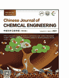
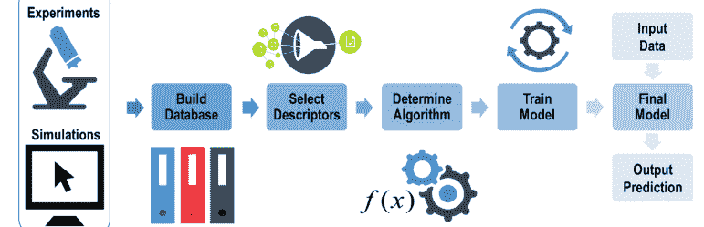
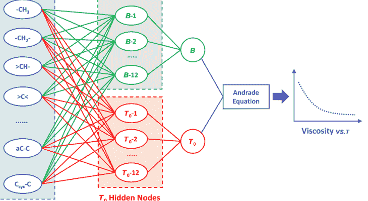
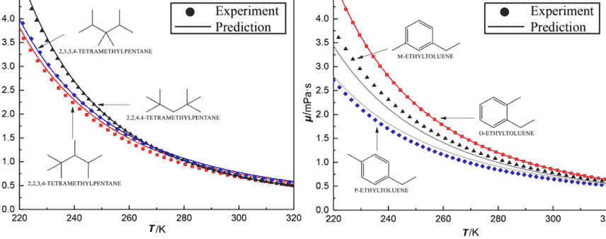
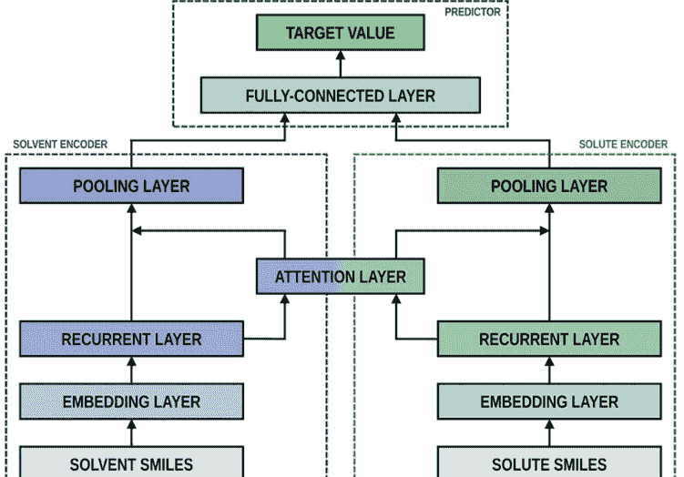
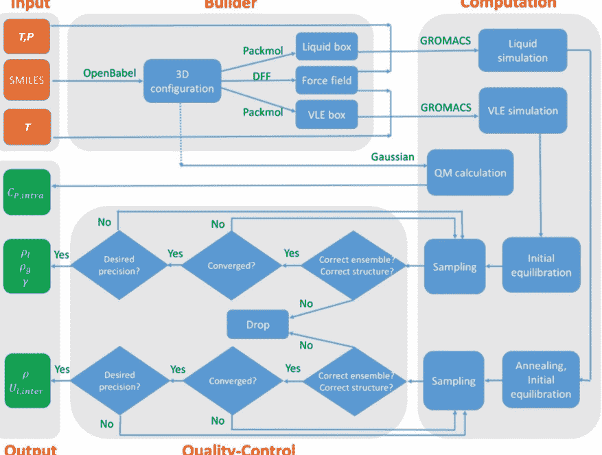

# 分子热力学机器学习



## 综述

## 用于分子热力学的机器学习

Jiaqi D¹, Nan Xu¹, Manh Hien Nguyen², Qi Qiao², Yao Shi¹,³, Yi He¹⁴*, Qing Shao²*

^¹浙江大学化学工程与生物工程学院，杭州 310027，中国

²肯塔基大学化学与材料工程系，列克辛星，KY 40506，美国

³教育部化学工程重点实验室，浙江大学，杭州 310027，中国

⁴华盛顿大学化学工程系，西雅图，WA 98195，美国


文章信息

摘要

文章历史

接收：2020年8月21日

修回：2020年10月2日

接纳：2020年10月28日

在线发表：2021年1月8日

关键词

热力学

分子工程

分子模拟

力场

复杂系统的热力学性质对推动化学工程研究起着至关的作用。预测广泛范围内复杂系统的热力学性质以及描述复杂系统中离子和分子的行为仍然是一项挑战。机器学习成为解决这一问题的有力工具；它能够描述超越传统数学函数能力的复杂性状。本综述将总结传统机器学习方法的发现，并结合几个示例探索机器学习的不同方面。第一个方面是应用机器学习基于已知数据预测各种体系的热力学性质。第二个方面是将机器学习与分子模拟相结合，以加速新材料的发现。第三个方面是开发能够同时处理谐和和全原子分子动力学模拟的机器学习模型。这三个方面的应用说明了机器学习在化学工程热力学中的潜力。我们还将讨论机器学习在化学工程中广泛应用的前景。

### 引言

机器学习已成为一种多功能工具，用于预测和研究复杂系统的热力学。分子热力学的一项任务是高精度地预测复杂系统的热力学性质。理论或半理论模型已用于各种系统的学习 [1–11]。然而，使用传统的数学框架开发出能够在分子水平上预测复杂系统热力学性质的稳健模型仍然是一项挑战。机器学习提供了可以从数据中学习的计算机算法 [12,13]。机器学习因其在自动驾驶车辆和人机游戏中的卓越性能而闻名 [14–16]。由于学习具有描述变量间复杂关系的能力，我们见证了模型在材料和化学工程领域的准确性不断提高，范围涵盖从探索 [17–22] 到分子热力学预测 [28–34]。

机器学习从三个方面帮助了分子动力学研究（图1）。首先，它可以帮助为复杂体系开发稳健的分子模型。获取体系准确的热力学性质对于开发工艺至关重要。尽管如此，已经开发了理论或经验模型来预测各种体系的热力学性质。这些模型虽然由假设驱动的数学函数以及源自理论或实验的参数组成，但这些方法的大多数局限性很大程度上依赖于“试错法”的直觉。深度机器学习方法为学习和预测复杂系统的热力学性质提供了新途径。许多学习方法（如神经网络和决策树）可以量化目标属性与选分子数据库之间的关系，为开发此类机器学习模型提供了机会 [39–42]。

*通讯作者：浙江大学化学工程与生物工程学院，杭州 310027，中国 (Y. He)。 电子邮箱：yhe@zju.edu.cn (Y. He), qhao@zju.edu.cn (Q. Shao)。

### 预测热力学性质

| 机器学习 | 材料设计 | 分子热力学 |
|---|---|---|
| | 开发多体力场 | |

**图 1.** 机器学习对分子热力学的三个贡献：(1) 基于分子描述符预测热力学性质；(2) 利用大规模分子模拟设计材料；以及(3) 开发能够模拟复杂系统的高体力场。

其次，机器学习可以通过与经典模块结合预测系统的复杂行为。分子模拟显示了它们在揭示控制热力学的机制方面的至关作用。它们提供了原子或粒子的坐标和速度，我们利用这些来分析它们的热力学和动力学性质 [43–45]。这种分析通常使用“假设驱动”策略。然而，机器学习运行的是“数据驱动”策略。高通量分子模拟通过提供大量数据为这种“数据驱动”策略做出了贡献 [13–46–50]。这些数据远超经典数据库的规模，从而增强了机器学习模型的性能。

第三，机器学习可以为分子模拟提供“多体”力场，实现对复杂相互作用的快速准确描述。经典的 MD 模拟 [55–59] 具有著名的力场，它们速度较快，但在成键和形成方面的势能重叠有限。相比之下，量子分子模拟可以描述复杂系统，但计算成本巨大。它们的独特特征源于机器学习模型描述复杂相互作用的能力。使用机器学习力场的体系可以达到量子计算的准确性，同时提高经典 MD 的效率。

这篇微综述（minreview）介绍了机器学习在上述三个方面应用中的几个示例。本综述的目标是激发机器学习在分子热力学中的应用，并介绍机器学习所需的知识。许多综合综述已经了机器学习在材料和工艺开发中的应用 [60–65]。第 2 节将介绍机器学习的基本概念。第 3 节将说明机器学习在基于实验的复杂关系问题中的应用。第 4 节将讨论基于高通量模拟的肽设计和热力学性质预测方法的应用。第 5 节将讨论复杂领域的机器学习，实现快速且准确的模拟。最后，我们将介绍热力学背景下机器学习的前景。

## 2. 数据、描述符和算法

如所述，机器学习是指根据一组数据库中的算法，基于选定的特征（描述符）来预测系统输出的方法。机器学习模型的开发包括四个关键步骤：(1) 数据收集，(2) 选择描述符和算法，(3) 基于数据集训练算法，以及(4) 使用训练好的模型预测测试集的输出。机器学习模型的开发过程取决于三个要素：数据集、描述符和算法 [66–68]。对这些要素的研究和许多综合综述已涵盖它们的相关知识 [62,66,67]。本节将仅介绍它们。

### 2.1. 数据库

数据库是指用于训练和验证机器学习模型的实验和计算结果的集合 [66]。目前发表的热力学数据库很少 [70]。事实上，这些数据库在开发化学性质机器学习模型方面发挥着重要作用。机器学习研究人员的发展需要针对特定目的开发自己的数据库。此类努力对于开发数据库至关重要：数据的质量和规模 (72)。高质量的数据决定了机器学习模型进行预测的能力 [71,72]。数据清洗还允许通过移除无关、重复或修改的重叠数据来准备高质量的数据集 [66,73]。范围



**图 2.** 开发机器学习模型的通用过程。

数据的多样性也决定了机器学习模型的性能 [17,72,74]，

## 3. 热力学性质预测中的学习

反应、分离和提纯等化学过程的发展依赖工业物质的热力学性质。然而，研究人员拥有许多数据库，这使得难以收集所有属性及其组合的数据。预测模型是至关重要的。

### 2.2. 描述符

描述符是指用于表征系统的特征 [67]。它们是数据的属性，也是机器学习模型的选定输入。分子描述符可以定性或定量地描述系统。例如，一个分子的描述符可以是其分子量。另一个描述符可以是其分子结构。另一种广泛使用的描述符是基团描述；然而，每个不同基团的频率 [75–78]。目前为止已开发了数千种描述符，但选择正确的符至关重要。通常，描述符应该与目标相关，并且不包含高度相关的项（例如，溶解度和水溶性）。已经开发了多种方法通过消除和保留最相关的特征来选择描述符 [81–85]。一些构建描述符的新颖方法灵感来自使用分子语言 [86–89] 并将结构视为“单词”（第 3.2 节）。这些方法从经典的分子表示（如简化输入线条目表示 SMILES 和分子图）中学习结构的特征 [90]。描述如晶体结构和原子属性的描述符与分子描述符非常不同。

传统的预测模型使用数学函数，例如数据驱动方法。机器学习为预测热力学性质提供了一种替代且高效的方法，绕过了状态方程的机制和先验知识。大量的数据库提供了热力学性质的基础，例如美国标准与技术研究院（NIST）化学手册 [71] 和设计与工程物理研究所（DEPI）数据库 [70]。机器学习与这些数据库的已已预测工业性质、相变焓和其他性质。

我们将阐明使用神经网络向量模型通过机器学习预测燃料化合物密度和粘度的能力。该示例预测了通用溶剂中有机溶剂自由能的预测值。

### 3.1. 液体密度和粘度

液体密度和粘度是石油、航空燃料等领域关键的热力学性质 [109,110]。Creton 组 [111] 开发了机器学习来预测化合物的密度（`ρ`）和粘度（`η`）。他们使用了来自 DEPI 数据库的实验数据，其中包含从不同来源的烃类和有机化合物。

他们比较了两组描述符，包括分子描述符和功能基团描述符（FCCD）。分子描述符包括几何、拓扑和电子性质。功能基团描述符根据大小、键、分支和极矩为每个分子计算。其中一些描述符与分子量和性质有关，其他特征可能决定分子的物理化学行为，例如烃类。

### 2.3. 算法

算法是指根据其他变量预测变量的数学模型 [99]。算法识别描述符并进行定性或定量预测。这种连接有助于系统预测新数据 [99]。选择合适的算法是构建成功的机器学习模型的另一个关键。算法可能是机器学习中最活跃的领域之一 [100–105]。这些算法分为两类：监督学习和无监督学习。

监督学习涉及带有标记数据（已知）的学习，其中模型预测感兴趣的值。在分子热力学应用中，这些输出值可以是未知化合物的类别（分类）或系统的变量（回归）。高斯回归 [103] 和支持向量机（SVM）。然而，无监督学习方法使用未标记数据来训练模型，对无标签的输入数据进行分类。这些方法用于聚类、层次聚类 [106] 和高斯混合模型 [107]。这两类的特征已在教科书和文献中广泛使用。

* 星号

是机器学习中的另一个重要模型。结合核方法 [115]，SVM 可以将高维空间中线性不可分的样本转换为线性可分的样本。

对于几组同类物的严重程度（此处此处似乎不完整），他们发现预测结果在较高温度的区域较低。为了验证异构体的区分性，他们使用训练好的模型预测了四氢呋和 itiso 异构体的 T(t)。如图 5 所示，带有修正参数的 Andrade 方程也可以预测异构体的 T(t)。

他们从描述符和算法的组合构建了机器学习模型。所有模型都产生了准确的预测，其决定系数（R²）高于 0.98。FVN 和 SVM 在 R² 和 p 方面表现更好。与其他方法相比，GCFD 模型具有较低的平均绝对误差（MAE）。然而，几个模型通过使用实验数据提供了更好的共识。然后，他们建立了一个预测模型的的共识模型。

这些机器学习可能应用于预测系统性质的不同步骤。研究人员可以使用机器学习来建立从特征到性质的映射关系，或使用它来估计经验方程中的参数。后者的优点是得到的参数较少，便于使用。

模型的性能以及所有预测结果与实验数据的对比图。结果显示，共识模型比单个模型更健壮。

### 3.2. 溶液自由

溶液影响许多过程，如相平衡。溶液自由是另一个重要的热力学性质，吸引了化学和生物工程领域研究者的关注 [118–120]。三种方法可以导出溶液自由：(a) 来自溶剂中空腔的形成，这在物理和化学上都是的；(b) 从本体中分离溶质颗粒，这在熵上是极不利的但在焓上有利；(c) 从熵和焓的角度考虑溶剂-溶质相互作用。许多方法已从热力学性质导出溶液自由或通过量子力学进行计算。

Cai 等人 [116] 的另一项研究关注烃类的粘度温度特性，使用机器学习来预测经验方程的参数。他们获得了包含 21 种纯烃的 NIST 数据库，并使用它们回归一个 Andrade 方程 [117]，通过两个参数 A 和 B 确定 T(η)。开发了一个神经网络来预测 B 和 Tp，使用了 35 种化学和分子描述符对烃类进行分类（烷烃、环烷烃和芳香烃），以及遗传算法。

B 和 T 的预测通过测试集测量。相关系数 R 和 p 分别为 0.987 和 0.994，相对误差分别为 4.08% 和 2.50%。预测值与实验数据良好一致；然而，对比信息来自如 ESOL（估计溶解度）[41]、FreeSol（自由溶解度数据库）[124] 和 MnSol（明尼苏达溶解度数据库）[125]。两者提供了溶解度和溶液自由


| | 训练集 | 验证集 | 测试集 | 总计 |
|---|---|---|---|---|
| R² | 0.997 | 0.996 | 0.997 | 0.997 | | R² | 0.997 | 0.994 | 0.989 | 0.996 |
| RMSE | 9.5 | 10.5 | 9.2 | 7.9 | RMSE | 0.136 | 0.186 | 0.220 | 0.157 |
| AAE | 5.0 | 5.5 | 5.4 | 5.1 | AAE | 0.071 | 0.095 | 0.012 | 0.001 |
| bias | 0.4 | 0.2 | -0.3 | 0.3 | bias | 0.000 | 0.011 | -0.012 | 0

图 3. 共识模型的统计性能以及所有预测结果与实验数据的对比图。经 [111] 许可复制（改编自）。(2020)美国化学学会。

# 生成的化学特征

### 隐藏节点



图 4. [116] 中使用的神经网络的示意结构。使用两个神经网络预测 B 和 Tp，并通过 Andre 方程计算 η(T)。经 [116] 许可重绘（改编自）；版权所有（2020）美国化学学会。



图 5. 使用神经网络和 Andre 方程对四甲基乙苯和乙基甲苯异构体进行实验值与预测值的比较。经 [116] 许可重绘；版权所有（2020）美国化学学会。

在溶剂中，Mol chemistry 包含了 3037 个溶化能（或转移自由能）的实验数据，涵盖了 790 种盐和 920 种溶剂。

Lim 等 Deep（有机化合物溶化自由能深度学习模型 [126]）基于 MNo，展示了一种从分子数据中提取主导特征的学习方法。在 Narii 中，包含 418 种盐和 901 种溶剂的 2495 对溶剂相互作用。之前案例中提到的分子描述符，结构信息也可以通过 SMILES 表示为字符序列，例如在该案例中使用了 Mo2Vec [90]。Mo2Vec 识别了自然语言处理（NLP）领域中 Word2Vec [127] 的属性。该方法通过 SMILES 和分子指纹 [95] 生成分子的高维嵌入。所得向量空间与其化学或物理性质有关。这种新方法已成功用于表达蛋白质序列，并启发了一些关于分子性质预测的研究 [87, 128]。

图 6 描述了 DeepSol 的主要架构。采用双向循环神经网络 (`BRNNs`) [28] 作为编码器，从溶剂和溶质中提取关键特征。受 NLP 启发，使用注意力层来识别 RNN 输出中的重要特征。注意力机制 [130] 是一种可以解释输入和输出之间对齐的方法。它已被用于提高序列识别和机器翻译中的 RNN 性能。这种方法激发了化学家的兴趣，使其能够从机器学习研究中产生可解释的结果 [131,132]。在本研究中，注意力机制主导了自由能预测。结果显示，分子结构的极性和疏水性在溶化过程中起着重要作用，表现出一致的化学直觉。通过 10 折交叉验证预测测试集中所有化合物的性质，RMSE 和 MAE 分别为 0.657 kcal mol⁻¹（1 cal=4.1868 J）和 0.330 kcal mol⁻¹，皮尔逊相关系数高达 0.96。



预测误差非常小，且与某些量子力学水合能计算 [133] 相当。通过 COSMO-RS [134]，一种 QM 方法为非水有机溶剂提供了类似的准确性，达到了 COSMO-RS 的 59%。同时，它需要通过完整的训练集提高跨簇合并性能。聚类算法将同一家族的子结构（或溶剂）分类到不同的簇。测试集中涉及的一些子结构在合并过程中可能没有经过训练；如果子结构仅存在于测试集中，预测偏差将剧增。

**图 6.** Delfensor 的基本架构。每个编码器网络有一个编码和一个循环层，而预测器具有一个全连接 MLP 层。两个编码器共享一个注意力层，该层对循环层的输出进行加权。黑色箭头表示输入数据的流。经 [126] 许可转印，由英国皇家学会出版。

（例如主动学习）嵌入到高通量流程中，源自分子模拟的数据集可以获得巨大的多样性。

我们将通过两个示例展示分子模拟和高通量方法如何生成数据集并结合它们。第一个例子是多肽设计，第二个例子将预测多肽的热力学性质。

### 4.1. 多肽设计

人们可能会从基于机器学习的热力学性质预测中获得见解：(1) 实验化学数据库在结合 (2) 详尽且测试集中尽可能多的子结构数据集时具有潜在收益 (3) 使用足够的数据拟合进行测试以完全取代内部机制的准确性；或许这有助于研究人员理解机制，同时提供更准确、更有针对性的数据。

多肽可以自组装成有序结构 [135,136]。它们的组装可以使用经验力构建。π 共轭多肽两侧含有芳香和对称聚物。芳香残基的序列顺序决定了芳香环之间的特定相互作用 [137–240]。DXX-DXX 是具有两个终端氨基酸（Asp）和 X 的肽，X 代表 20 种非极氨基酸。在这些多肽中，带电基团在低 pH 下质子化，抑制了相邻分子之间的静电排斥。

已进行分子动力学和 DFT 模拟，以讨论序列属性和 π 核心对自组装过程和相互作用的影响。在 Fergus 组 [141] 的框架下，利用分子模拟研究了 DAFAC 的自组装，其中 OPV 是聚苯乙烯；聚集体形成 β 折叠状结构，由芳香核心、疏水相互作用和氢键驱动。基于多肽的共轭肽受益于沿 π 核心的电子离域。

### 4. 基于高通量分子模拟的学习

分子模拟可以为机器学习提供海量数据。实验很难获得微特征。例如，由于实验困难和几乎无数的溶剂-溶剂组合，扩散性质的数据集很少。高通量框架使我们能够产生比预期大数量级的数据集。

另一项 DFT 研究 [142] 计算了类似的寡肽，表明光谱吸收来自于 C2p 轨道跃迁，多肽上的大残基导致

相邻 $\pi$ 系统之间产生巨大的扭转，这破坏了共轭。（注：OCR 文本此处截断，但根据上下文：“相邻 $\pi$ 之间巨大的扭转”）

π-核心堆积，特别是当残基位于核心附近时。高排位肽含有丰富的疏水性。通过不断理解，主动学习模型预测，在最靠近 π-核心的位置存在甲氨酸可能会自组装，而疏水基团似乎不利于疏水相互作用。


研究人员使用无监督聚类，探索了不同性质氨基酸和肽的平均组成。然后，使用层次聚类将初始标记的 188 条序列分为三类：良好、中等和差。随后，剩余的 1145 个肽被分配到这些类中。分析了总 1331 个肽在 VA 潜空间中位置的权重组成。在所有序列中均发现了大香族残基酪氨酸和苯氨酸。在良好簇中富集的较小残基甘氨酸、亮氨酸、谷氨酸和甲氨酸对性能没有明显影响。这些结果可以进一步解释为空间位阻效应对核心堆积的促进或阻碍，指导了下一步的研究工作。

关于新化合物，Sun 及其团队 [46] 开发了高通量力场模拟 `HT-FFS`。结合机器学习和神经网络，`HT-FS` 用于计算和预测烷烃的热力学性质。选定的 876 种烷烃和烯烃的性质通过与 `NIST` [71] 的实验数据对比对比通过了验证。描述符通过 `OpenBabel` [146] 计算。特征表示包括温度状态点，描述符列表包含 225 个描述符。然后，使用线性支持向量机的递归特征消除减少了描述符的数量。对预测性质进行了分析。在数值上，三级碳和四级碳是 `Cp` 最敏感的性质，对应于大侧基引起的色散能量的影响。连接在四级碳上的甲基是最难预测的因素。

## 4.2. 烷烃的热力学性质

烷烃是化学工程中最重要的石油材料之一。获取它们的热力学性质对于化学工程设计和发现是必要的。

Sun 组开发了一个 `FNN`（图 9）来预测热力学性质，包括密度（`ρ`）和热容（`Cp`）。模型的建立基于 `HT-FFS` 的结果。他们将结果分为三部分：训练集（70%）、验证集（20%）和测试集（10%）。

预测性能通过预测值和 `HT-FFS` 结果衡量。对于所有热力学性质，`ρ`、`Ei` 和 `Cp` 的 `FNN` 预测与模拟高度一致。测试集的 `RMSE` 分别为 `ρ` 3.1 × 10⁻³ g cm⁻³，`Ei` 为 0.30 J mol⁻¹ K⁻¹，`Cp` 为 2.8 J mol⁻¹ K⁻¹。



图 8. [46] 中使用的 `HT-FFS` 工作流。经 [46] 许可转载（改编），版权所有 (2020) 美国化学学会。

### 输出层

```
y = H(Wx_{n-1} + b_n)
```

### 隐藏层

```
x_2 = h(W_2x_0 + b_2)
```

### 输入层

```
x_1 = h(W_1x_0 + b_1)
```

`x_0`

图 9. 具有 N 个隐藏层的 `PNN` 示意图。经 [46] 许可选用（改编）。Chemistry (2020)

对于 `C_m0`，所有性质的最大绝对相对误差 `MARE` 均小于 0.75。由于高通量过程，可以使用比以前研究更多的数据来训练机器学习模型。由于数据规模影响模型的准确性，数据准备程序至关重要。这显示了基于大数据的机器学习在预测化合物性质方面的潜力，尽管 `PNN` 是一个相对较小的神经网络。然而，类似的框架可以用于其他系统和任务。

达到了量子化学计算，同时速度比量子力学 `MD` 模拟快 20 倍。

使用五种合金 `LiSi`、`LiSi₂`、`LiSi₃`、`LiSi₄` 和 `Li₂Si₄` 作为构建数据系统的起始结构。不同的 `Li-Si` 比例数据集允许机器学习模型全面描述 `Li-Si` 合金。使用熔融淬处理生成这些组分的非晶态样品，以便实现对晶态和非晶态相的描述。

描述符对称函数 `ACFS`[66,98] 被用作描述符提取每个原子的局部能量。每个原子 `i` 被传递到神经网络以解码其原子能量 `E`。系统的势能通过对每个原子取平均值获得。通过使用数据集中的势能进行监督回归来优化网络。图 10 显示了优化后的 `Li-Si` 合金的配置，并描绘了一个编码 `Li-Si` 合金局部环境的原子。

新的机器学习力场在几个方面为分子模拟带来了广阔前景。首先，为复杂化合物和材料开发高质量力场具有重要意义。其次，为在准确水平上研究长时间尺度过程提供了途径。然而，在开发机器学习力场过程中，仍有一些问题待解决。一个问题是如何处理具有真实数据分布的数据集，而 [155] 提供了解决该问题的几种方法。

### 5.2. 水分子的机器学习力场

机器学习力场能够准确描述能量变化。在 `MD` 模拟中，对于全原子力场，控制长时间尺度过程具有挑战性。如 [57,58] 所示，使用 `mW` 分子力场对水进行粗粒化模拟计算。在没有显式氢的情况下，`CG` 模型可以加速几个数量级的成核过程。`CG` 模型的局限性是相变。然而，全原子机器学习力场对能量的依赖产生了偏差影响。通过全原子机器学习力场，Zhang 等 [150] 提出了不受限制的水机器学习力场。

他们开发了用于水的粗粒化机器学习力场。每个水分子被处理为一个粒子，仅包含氧原子，因此粗粒化机器学习力场产生的氧相关函数与全原子机器学习力场计算的函数吻合良好。粗粒化模型可以准确描述水相，同时保留对结构特征的描述。

数据集使用由量子力学和全原子机器学习模型驱动的 `MD` 模拟构建。

## 5. 机器学习力

机器学习力场可以以量子计算的精度和量子计算的效率研究复杂系统的动力学。

### 5.1. 针对原子的机器学习

离子力比原子力快 7.5 倍。速度的巨大提高表明粗粒化机器学习场具有捕捉聚合物等大分子动力学的能力（图 11）。

机器学习模型。例如，深度神经网络中不同模型的权重难以与分子的描述符直接相关。计算机科学中新兴算法可以为化学工程提供参考。近年来，主动学习、神经网络和注意力机制已被化学领域所采用。这些先进方法为机器学习在热力学中的更广泛应用提供了新机会。

## 6. 展望

上述示例展示了机器学习在预测和建模化学材料性质方面的广阔前景。材料设计也受益于机器学习与高通量模拟的结合。机器学习力场可以加速复杂系统的热力学计算。然而，由于该领域专家数据集的匮乏，机器学习在化学工程中的应用仍处于初级阶段。某些方法可能非常昂贵，与 `NLP` 或计算机视觉不同，化学和材料科学中的预测模型通常很稀缺。挑战包括模型的不确定性。因此，建立具有高数据多样性和可靠性的数据库对于未来的机器学习应用具有重要意义。我们期待更多结合高通量模拟和机器学习的应用。另一个问题是量子力学和全原子分子动力学领域另一个重要应用的可解释性。目前的机器学习场面临一些挑战，例如元素类型的限制和对输入配置的敏感性。机器学习势已经开发并成功加速了模拟，正成为计算化学的强大工具。

## 利益冲突

作者声明他们没有可能影响本文工作的竞争利益或个人关系。

## 致谢

Jiaqi Jin、Nan Xu、Yao Shi 和 Yi 博士感谢国家自然科学基金的资助

## 参考文献

- [1] P. Possenacker, S. Jamshidi, 聚合物和石油液体物理性质的通用表征方法。Fluids Chem. 32 (2000) 199–204。
- [2] Z.A. Makrodimit, A. Heller, T. Mueller, M.K. Rausch, M.S.H. Fays, N.R. Bos, C.P. Guo, J. Muller, 基于分子动力学和经验相关的气体传输与扩散预测。Chem. Phys. Therm. 91 (2015) 101–107。
- [3] M. Müller, 使用 Sanchez-Laflamme 模型进行 PMMA 溶胀和多相性质分析。Int. Macromol Polym. 32 (2002) 49–55。
- [4] H.W. Wang, S. Li, 油油在超临界二氧化碳中溶解度的预测方法。Energy 85 (2014) 81–88。
- [5] K. Wang and Y. Li, 使用机器学习模型预测多组分混合物的热力学性质；Chem. Fluid Phase 421 (2019) 298–3006。
- [6] C. Chen, X. Wang, J. Wang, J. Wang and Y. Li, 机器学习在液体传输性质中的应用。Fluid Phase 35 (2018) 306–314。
- [7] D.A. Everington, E. Li, S.H. Heck, 水醇混合物的热力学性质预测。Acta Chem. 66 (1997) 3991–4000。
- [8] T.D. Iordown, C.K. Wang, 基于计算机模拟的水绝对热力学：一项第一原理分子动力学研究。J. Phys. Chem. B 104 (2000) 75–83。
- [9] E.W. Lewis, R.T. Jacobson, 热力学性质的敏感性分析：提高性质模型准确性的通用方法。
- [10] A. Serra, P. Galdi, R. Taglierni, 用于聚合物混合物热力学性质的机器学习。Sci. Rep. 10 (2020) 1511–12。
- [11] K.R. Vashisdev, K. Chauchary, H. Martinez, A. Risch, G. Guita, F. Tavazella, L. Vitka, M. Ziatdin, S. Vivanov, 深度学习、机器学习和强化学习及其在自动驾驶预测中的应用。
- [12] C. Wang, X. Xu, 用于自动驾驶汽车车道保持的端到端学习。Nature 549 (2017) 433–437。
- [13] D. Silver, A. Huang, C.J. Maddison, A. Geiger, S. Li, G. Van Denchelle, J. Schrivestier, I. Antonopoulos, V. Pasqueveral, M. Salcin, L. D.tran, G. Gromov, 用于分子动力学的深度学习。
- [14] T. Aspplund, D. Hernandez, J. Terras, G. Lee, L. A. Madhavan, M. Sharif, P. Stadter, 机器学习在药物发现中的应用。Science 363 (2019) 1034–1035。
- [15] N. Ou, V. Wang, A.P. Qvaer, 使用 ANN 和 SVM 分析预测药物毒性。Eur J. Med. Chem. 95 (2019) 4010–4018。
- [16] J. Yan, Y. Liang, H. Wang, J. Xu, 机器学习用于药物性质预测：大数据药物发现的人工智能框架。Era 9 (2021) 108–110。
- [17] J. Zhang, M. Tan, H. Wang, 机器学习用于药物性质预测：深度学习方法。Methods 222 (2021) 118005。
- [25] B. Sanchez-Lenganzel, A. Aspurzu-Guzik, 机器学习反向分子设计：材料科学的生成模型。Science 361 (2018) 895–900。
- [26] T. Tominaga, D. Tu, Y. Lin, A. Frenkel, 监督学习预测纳米材料的三维结构。Nature Materials 17 (2018) 995–1000。
- [27] A. Seth, T. Makikawa, K. Tsuda, 深度神经网络预测二元和复杂化合物的热力学性质。Phys. Chem. B 89 (2015) 055104。
- [28] L. Wang, J. Li, J. Huang, C. Zheng, N. Yang, 机器学习预测水混合物的热力学性质和传输。Chem. Fluid Phase 413 (2019) 115–120。
- [29] L. Walter, C. Antonelli, 原子计算与材料信息：综述。Adv. Mater. 3 (2021) 200154。
- [30] Y. Wei, J. Xu, K. Sun, J. Huang, J. Chen, 机器学习预测分子性质。Int. Macromol Polym. 138 (2018) 331–348。
- [31] S. Zhang, J. Lee, 使用临界流预测 CO2 的熵和溶解度。Sci. Rep. 8 (2018) 1–8。
- [32] J. Wang, Y. Li, 用于化学混合物临界性质的生成模型。Chem. Fluid Phase 377 (2019) 777–785。
- [33] Z. Zhang, J. Li, H. Zhang, J. Pan, X. Lu, 用于溶液热力学性质的机器学习框架。J. Col. 70 (2020) 105333。
- [34] L. Wang, Y. Zhang, Z. Zheng, X. Wang, J. Zhou, 使用机器学习预测化学混合物热力学性质的新方法。Comput. Mater. 138 (2018) 137–148。
- [35] W. Henderson, P. Nicola, C. Sanchez, 机器学习计算烃的吸附和热力学性质。J. Anal. Chem. 111 (1992) 41–47。
- [36] V.K. Kim, P.G. Gulshani, A. Aspurzu-Guzik, A. Artemenko, 基于随机森林的 SAR 模型。Methods 60 (2007) 53–60。
- [37] D.S. Palmer, N.M. O'Rourke, R.C. Jin, J.B. Mitchell, 用于有机分子的随机森林模型。Chem. Biol. 57 (2006) 1745–1750。
- [38] K. Ramakrishna, M. Tamitar, A. Petrovska, O. Van Frenkel, 化学中深度学习与机器学习的集成。J. Phys. Chem. B 120 (2016) 8545–8551。
- [39] Q. Cao, J. Li, Y. Liu, J. Wang, 直接从结构预测溶解度。Chem. Eng. Chem. 54 (2012) 2004–2005。
- [40] M. Chen, R. Bergentold, C. Wang, J. Haase, 聚合物混合物热力学性质的分子模拟。Chem. Fluid Phase 222 (2011) 2255–2260。
- [41] S. Cao, J. Li, J. Liu, G. Vatela, 分子模拟和离子液的热力学性质。J. Phys. Chem. B 115 (2011) 8838–8846。
- [42] Q. Wang, V. Wu, H. Sun, 机器学习预测离子液的热力学性质。Chem. Mater. 158 (2018) 2512–2520。
- [43] A. J. Elahi, T. Emtran, S. Thomas, L. Gard, 深度学习预测硫化物的机械性质。Chem. Mater. 28 (2016) 7726–7734。
- [44] S. Kirklin, R. Bergentold, C. Wang, 离子电池材料的高通量筛选。Adv. Mater. 31 (2019) 160634。
- [45] L. Zheng, Z. Cao, 离子电池活性的化学趋势。Adv. Mater. 32 (2020) 190611。
- [46] M.W. Ward, J. Thiele, 扩展 SNAP 原子势的准确性。J. Phys. Chem. 148 (2014) 2418–2421.
- [47] J. Wang, J. Liu, J. Zhang, 用于加速作用的机器学习。Phys. Mater. Cond. Matter 32 (2020) 015105。
- [48] H. Wang, J. Zhang, 用于分子动力学和能量最小化的深度学习框架。Comput. Phys. Chem. 228 (2018) 177–184。
- [55] A. Khorsidi, A.A. Pearson, 原子模拟中机器学习的模块化方法。Phys. Chem. Commun. (2016) 310–324。
- [56] V. Huang, J. Wang, J. Liu, 基于机器学习的 OPLS-AA 力场预测。J. Mol. Sci. 118 (2019) 1225–1236。
- [57] R. Wang, J. Wang, J. Liu, J. Zhang, J. Zhang, 基于深度学习的扭转电势预测。J. Chem. Theory. Mol. 16 (2020) 10989–10000。
- [58] R.B. Brooks, B.D. Olson, S. Dayton, M. Karpathy, CHARMM: 用于分子动力学和相互作用建模的机器学习框架。
- [59] I. Bai, W. Cordell, F. Parrillo, K. Cwell, 基于深度学习的有机分子预测。Phys. Rev. Lett. 118 (2017) 068001.
- [60] D. E. Tonkov, M.F. Puig, J. French, 用于分子设计的深度学习——综述。Mod. Sci. Tech. Eng. 4 (2020) 4.
- [61] K. Rampratz, C. Plana, A. Maniaraj-Khanakul, C. Kim, 用于分子发现和优化的机器学习。Nature 552 (2017) 1022–1028.
- [62] S. Wang, J. Wang, J. Zhou, J. Wang, 深度学习用于分子设计和材料科学。Nature 579 (2020) 575–578.
- [63] V. Dinger, M. Aoki, C. Gasy, 用于力场的机器学习原子间势能。J. Phys. Chem. Lett. 8 (2017) 10091.
- [64] A.P. Bartik, S. C. de Jong, P. Kerninan, J. Bertsch, G. Gyslein, C. Gasy, and M. Mensotti, 用神经网络学习原子间势能。Sci. Adv. 7 (2021) eaau4112.
- [65] M. C. Nunes, C. Morgan, and O. Rupprecht, 用于分子模拟的机器学习。Phys. Rev. Chem. 71 (2021) 360–369。
- [66] Y. Liu, T. Wang, S. Wu, and J. Shi, 用于药物发现和设计的机器学习。Nat Rev. Dis. 9 (2020) 528–535。


- [67] J. Schimdinger, M.R. Rogers, S. Wolcott, M. Baker, 用于药物发现的分子性质和亲和力预测。Nature 552 (2018) 1–9.
- [68] L. M. Linhburg, J. Vital, S. Svensson, C. Drock, and M. Schiefeler, 用于分子设计的深度学习。Journal of Chemical Physics, 144 (2016) 025105.
- [69] X. Cao, Y. Wang, J. Wang, Y. Sun, and Y. Qiu, 用于离子电池和储能的机器学习计算方法。Energy Storage Mater. 23 (2020) 10111.
- [70] ACID; 国家物理标准研究所, NIST 标准数据库 99, Chemistry.
- [71] P. Linston, NIST Webbook.
- [72] P. Linston, NIST Webbook.
- [73] S. Cao, J. Li, J. Liu, G. Vatela, 水的分子模拟和热力学性质。J. Phys. Chem. B 115 (2011) 8838–8846.
- [74] S. Kirklin, R. Bergentold, C. Wang, 离子电池材料的高通量筛选。Adv. Mater. 31 (2019) 160634.
- [75] L. Zheng, Z. Cao, 离子电池活性的化学趋势。Adv. Mater. 32 (2020) 190611.
- [76] M.W. Ward, J. Thiele, 扩展 SNAP 原子势的准确性。J. Phys. Chem. 148 (2014) 2418–2421.
- [77] D.S. Palmer, N.M. O'Rourke, R.C. Jin, J.B. Mitchell, 用于有机分子的随机森林模型。Chem. Biol. 57 (2006) 1745–1750.
- [78] K. Ramakrishna, M. Tamitar, A. Petrovska, O. Van Frenkel, 化学中深度学习与机器学习的集成。J. Phys. Chem. B 120 (2016) 8545–8551.
- [79] Q. Cao, J. Li, Y. Liu, J. Wang, 直接从结构预测溶解度。Chem. Eng. Chem. 54 (2012) 2004–2005.
- [80] M. Chen, R. Bergentold, C. Wang, J. Haase, 聚合物混合物热力学性质的分子模拟。Chem. Fluid Phase 222 (2011) 2255–2260.
- [81] L. Wang, J. Li, J. Huang, H. Wang, C. Zheng, N. Yang, 机器学习预测水混合物的的热力学性质和传输。Chem. Fluid Phase 413 (2019) 115–120.
- [82] L. Walter, C. Antonelli, 原子计算与材料信息：综述。Adv. Mater. 3 (2021) 200154.
- [83] Y. Wei, J. Xu, K. Sun, J. Huang, J. Chen, J. Wei, Y. Mei, 用于分子性质预测的机器学习。Int. Macromol Polym. 138 (2018) 331–348.
- [84] S. Zhang, J. J. Lee, 使用临界流预测 CO2 的熵和溶解度。Sci. Rep. 8 (2018) 1–8.
- [85] J. Wang, Y. Li, 用于化学混合物临界性质的生成模型。Chem. Fluid Phase 377 (2019) 777–785.
- [86] Z. Zhang, J. Li, H. Zhang, J. Pan, X. Lu, 用于溶液热力学性质的机器学习框架。J. Col. 70 (2020) 105333.
- [87] L. Wang, Y. Zhang, Z. Zheng, X. Wang, J. Zhou, 使用机器学习预测化学混合物热力学性质的新方法。Comput. Mater. 138 (2018) 137–148.
- [88] W. Henderson, P. Nicola, C. Sanchez, 机器学习计算烃的吸附和热力学性质。J. Anal. Chem. 111 (1992) 41–47.
- [89] V.K. Kim, P.G. Gulshani, A. Aspurzu-Guzik, A. Artemenko, 基于随机森林的 SAR 模型。Methods 60 (2007) 53–60.
- [90] D.S. Palmer, N.M. O'Rourke, R.C. Jin, J.B. Mitchell, 用于有机分子的随机森林模型。Chem. Biol. 57 (2006) 1745–1750.
- [91] K. Ramakrishna, M. Tamitar, A. Petrovska, O. Van Frenkel, 化学中深度学习与机器学习的集成。J. Phys. Chem. B 120 (2016) 8545–8551.
- [92] Q. Cao, J. Li, Y. Liu, J. Wang, 直接从结构预测溶解度。Chem. Eng. Chem. 54 (2012) 2004–2005.
- [93] M. Chen, R. Bergentold, C. Wang, J. Haase, 聚合物混合物热力学性质的分子模拟。Chem. Fluid Phase 222 (2011) 2255–2260.
- [94] S. Cao, J. Li, J. Liu, G. Vatela, 水的分子模拟和热力学性质。J. Phys. Chem. B 115 (2011) 8838–8846.
- [95] Q. Wang, V. Wu, H. Sun, 机器学习预测离子液的热力学性质。Chem. Mater. 158 (2018) 2512–2520.
- [96] A. J. Elahi, T. Emtran, S. Thomas, L. Gard, 深度学习预测硫化物的机械性质。Chem. Mater. 28 (2016) 7726–7734.
- [97] S. Kirklin, R. Bergentold, C. Wang, 离子电池材料的高通量筛选。Adv. Mater. 31 (2019) 160634.
- [98] L. Zheng, Z. Cao, 离子电池活性的化学趋势。Adv. Mater. 32 (2020) 190611.
- [99] M.W. Ward, J. Thiele, 扩展 SNAP 原子势的准确性。J. Phys. Chem. 148 (2014) 2418–2421.
- [100] J. Wang, J. Liu, J. Zhang, 用于加速作用的机器学习。Phys. Mater. Cond. Matter 32 (2020) 015105.
- [101] H. Wang, J. Zhang, 用于分子动力学和能量最小化的深度学习框架。Comput. Phys. Chem. 228 (2018) 177–184.
- [102] A. Khorsidi, A.A. Pearson, 原子模拟中机器学习的模块化方法。Phys. Chem. Commun. (2016) 310–324.
- [103] V. Huang, J. Wang, J. Liu, 基于机器学习的 OPLS-AA 力场预测。J. Mol. Sci. 118 (2019) 1225–1236.
- [104] R. Wang, J. Wang, J. Liu, J. Zhang, J. Zhang, 基于深度学习的扭转电势预测。J. Chem. Theory. Mol. 16 (2020) 10989–10000.
- [105] R.B. Brooks, B.D. Olson, S. Dayton, M. Karpathy, CHARMM: 用于分子动力学和相互作用建模的机器学习框架。
- [106] I. Bai, W. Cordell, F. Parrillo, K. Cwell, 基于深度学习的有机分子预测。Phys. Rev. Lett. 118 (2017) 068001.
- [107] D. E. Tonkov, M.F. Puig, J. French, 用于分子设计的深度学习——综述。Mod. Sci. Tech. Eng. 4 (2020) 4.
- [108] K. Rampratz, C. Plana, A. Maniaraj-Khanakul, C. Kim, 用于分子发现和优化的机器学习。Nature 552 (2017) 1022–1028.
- [109] S. Wang, J. Wang, J. Zhou, J. Wang, 深度学习用于分子设计和材料科学。Nature 579 (2020) 575–578.
- [110] V. Dinger, M. Aoki, C. Gasy, 用于力场的机器学习原子间势能。J. Phys. Chem. Lett. 8 (2017) 10091.
- [111] A.P. Bartik, S. C. de Jong, P. Kerninan, J. Bertsch, G. Gyslein, C. Gasy, and M. Mensotti, 用神经网络学习原子间势能。Sci. Adv. 7 (2021) eaau4112.
- [112] M. C. Nunes, C. Morgan, and O. Rupprecht, 用于分子模拟的机器学习。Phys. Rev. Chem. 71 (2021) 360–369.
- [113] Y. Liu, T. Wang, S. Wu, and J. Shi, 用于药物发现和设计的机器学习.Nat Rev. Dis. 9 (2020) 528–535.
- [114] J. Schimdinger, M.R. Rogers, S. Wolcott, M. Baker, 用于药物发现的分子性质和亲和力预测。Nature 552 (2018) 1–9.
- [115] L. M. Linhburg, J. Vital, S. Svensson, C. Drock, and M. Schiefeler, 用于分子设计的深度学习。Journal of Chemical Physics, 144 (2016) 025105.
- [116] X. Cao, Y. Wang, J. Wang, Y. Sun, and Y. Qiu, 用于离子电池和储能的机器学习计算方法。Energy Storage Mater. 23 (2020) 10111.
- [117] ACID; 国家物理标准研究所, NIST 标准数据库 99, Chemistry.
- [118] P. Linston, NIST Webbook.
- [119] P. Linston, NIST Webbook.
- [120] S. Cao, J. Li, J. Liu, G. Vatela, 水的分子模拟和热力学性质。J. Phys. Chem. B 115 (2011) 8838–8846.
- [121] S. Kirklin, R. Bergentold, C. Wang, 离子电池材料的高通量筛选。Adv. Mater. 31 (2019) 160634.
- [122] L. Zheng, Z. Cao, 离子电池活性的化学趋势。Adv. Mater. 32 (2020) 190611.
- [123] M.W. Ward, J. Thiele, 扩展 SNAP 原子势的准确性。J. Phys. Chem. 148 (2014) 2418–2421.
- [124] J. Wang, J. Liu, J. Zhang, 用于加速作用的机器学习。Phys. Mater. Cond. Matter 32 (2020) 015105.
- [125] H. Wang, J. Zhang, 用于分子动力学和能量最小化的深度学习框架。Comput. Phys. Chem. 228 (2018) 177–184.

## D. Jing 等人 / 化学化学报》 2021 (35) 221–229

[124] D.M. Lively, P. Guthrie, Freeol: 一个基于隐式溶剂的评估与计算水合自由能数据库, Comput. Aided Mol. 28 (7) (2007) 693–706
[125] A.M. Pernavec, K. Jelly, J. Thompson, D. Jordan, Harvey, C. Chambers, C.J. Dobson, E. Grieman, P. Genter, C. Craig, D. Truhlar, 分子数据库：力场参数的验证, J. Chem. Phys 131 (2009) 074101
[126] M. Wang 和 J. Wang, 用于有机溶剂溶剂自由能预测的深度学习模型, Chem. Sci. 10 (36) (2013) 8306–8315.
[127] T. Michino, K. Garrer, G. Jordan, 使用神经网络估计分子动力学模拟的高效率, Phys. Rev. Lett. 121 (2018) 158301.
[128] S. Kim, C.N. Bedbrook, F.H. Arnold, 用于机器学习预测蛋白质属性的蛋白质学习模型, Bioinformatics 34(15) (2018) 2642–2648.
[129] D. Bahmanour, K.H. Yu, 使用卷积神经网络识别蛋白质功能的神经机器翻译, Bioinformatics 35(15) (2019) 211–15. https://doi.org/10.1093/bioinformatics/btac449
[130] X. Dong, W. Wang, F. Zhang, X. Wan, L. Li, Z. Lu, X. Chen, H. Jiang, M. Zhang, 用于药物发现与开发的分子表示深度学习, J. Med. Chem 61 (2018) 8746–8758.
[131] A. Ramasudner, F. Eierlich, G. Gomez, E. Seis, A. Papp, K. Lewing, V. Pande, MolDock：分子机器对接的基准测试, Chem. Rev. 117 (2) (2017) 1138.
[132] A. Klamart, COSMO 和 COSMO-RS 溶化模型，用于再生医学的自组装蛋白质与肽, Chem. Rev. 113 (7) (2017) 4837–4861.
[133] J. Sun, 半导体肽纳米结构的组装, Nature 4 (2022) 604–6047
[134] D.B. Wall, A.E. Zacca, A.M. Sutton, W. Wilson, D. Jordan, 氨基酸序列决定的 $\pi$-共轭肽纳米结构间的相互作用, https://doi.org/10.1021/acs.jpcbb.7b030
[135] H.A.M. Ardoña, K. Besar, M. Topagni, H.E. Katz, J. Jordan, $\pi$-共轭肽凝胶剂的序列依赖性性质, J. Mater. Chem. C 25 (25) (2016) 6505–6514.
[136] X. Baumgartner, K. Müller, $\pi$-共轭聚合物水胶的结构与性质, J. Phys. Chem B 118 (32) (2014) 1832–1840.
[137] K. Besar, H.A.M. Ardoña, J. Jordan, H.E. Katz, 利用场效应传输架构在自组装 $\pi$-共轭肽纳米结构中展示空穴传输与发光特性, ACS Nano 9 (12) (2015) 12401–12409.
[141] R.A. Thornton, J. Jordan, T. Jordan, A. Ferguson, $\pi$-共轭寡聚核酸自步进组装的热力学、形貌与动力学, J. Mol. Chem. Soc. 45 (2021) 11993.
[142] B.A. Thornton, P. Shapera, J. Jordan, A. Schiele, L. Ferguson, 揭示自组装 $\pi$-共轭寡聚核酸的序列-结构属性, Nature Communications 12 (1) (2021) 5469–5471.
[143] C.W. VASP, Ab-Schrödinger：通过密度泛函理论计算分子性质的开放软件, J. Phys. Chem. B 107 (4) (2003) 1033–1040.
[144] K.S. Yamaguchi, M. Rashid, H. Odesley, Y. Sun, P. G, J. Jordan, 深度学习驱动的粗粒模拟, J. Phys. Chem B 128 (14) (2024) 81.
[145] C. Kim, A. Asadrakha, A. Raja, M. Ramprasad, 用于高电荷迁移率材料设计的设计的学习与机器学习, Science Mater. 7 (10) (2021) 310.
[146] K. Calandar, P. E. Setters, M. Ramprasad, 用于分子设计的高斯过程学习, Int. J. Neural Netw. IEEE, 338 (2020) 3549–3550.
[147] S. Müller, M. Ransford, J. Gomez, C. Hucklich, Open Babel：一个开放的化学工具集, J. Chem. Phys. 133 (10) 201010.


[148] R. Sankaramajan, M. Cherukha, A. Ramadayan, N. Toffler, C. B. Bremmer, S.G. Gray, 用于药物发现的机器学习粗粒化模型, Nat. Commun. 12 (2021) 10533.

[149] L. Zheng, J. Han, Wang, R. Car, W. Weinan, P.G. Lee, 通过深度神经网络构建粗粒化模型, J. Chem. Phys. 145 (3) (2017) 034102.

[150] J. Smith, I. Oyaev, A. Eitberg, N. Olaisev, A. Eitberg, Weiss is more：利用主动学习采样化学空间, Chem. Phys. 148 (24) (2017) 392.

[151] N. Wu, Y. Shi, H. Y. Q, J. Jordan, J. Behler, G. Cündy, A. Ferguson, 用于锂-硅合金结晶与无定化的深度学习势能, J. Phys. Chem C 124 (44) (2020) 16278–16288.

[152] M. Schöllmann, 碳和硅的机器学习势能, J. Phys. Chem B 113 (13) (2009) 4008–4016.

[153] E.B. Moore, V. Molinero, 过冷水中的结构转变与结晶速率, Nature 473 (2011) 7074–7077.
