# 神经退行性疾病的机器学习：进展与应用

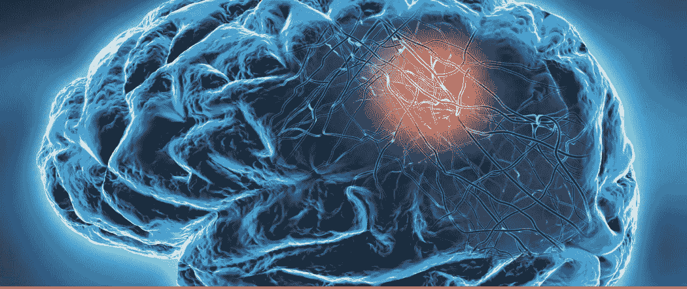


本书探讨了机器学习在神经退行性疾病的理解、早期诊断和管理中的应用。书中特别关注其在正在进行的临床试验中的作用，涵盖了数据收集、预处理、特征提取、模型开发和验证技术等核心课题。书中深入探讨了磁共振成像（MRI）、计算机断层扫描（CT）和正电子发射层扫描（PET）等神经影像技术在神经退行性疾病诊断和理解中的应用。此外，本书还审视了用于神经退行性疾病生物标志物发现的各种机器学习算法。强调了神经信息学和大数据分析在推进神经退行性疾病理解与管理方面的作用。此外，本书回顾了未来前景，并提出了与在神经退行性疾病的诊断、治疗和预防中实施机器学习方法相关的伦理考量和监管挑战。这一全面的资源旨在供神经科学家、学生、研究人员和神经科医生了解机器学习在神经退行性疾病中新兴新兴领域。

系列主编：Sanjay Saxena 和 Sudip Paul

Biswajit Jena, Sanjay Saxena, 和 Sudip Paul

使用 Times LT Std 字体

由 KnowledgeWorks Global Ltd. 排版


# 关于编辑

Biswajit Jena 博士是印度布巴内斯尔 SOA 大大学（比认为大学）工程技术与研究学院（ITER）计算机科学与工程系的助理教授。他在印度 IIIT-Bhubaneswar 获得了医学图像分析的博士学位，该领域应用了人工智能技术，并在印度劳尔克凯拉国立理工学院（NIT）获得了计算机科学与工程的硕士学位。他广泛的研究兴趣包括医学图像处理、神经肿瘤学、放射组学、机器学习和深度学习。他发表了 30 多篇期刊和会议论文，并作为多个国际期刊的编辑成员和审稿人贡献了他的知识。


Sanjay Saxena 博士担任印度布巴内斯尔印度理工学院（IIT Bhubaneswar）计算机系助理教授，以及研究、创新、项目、孵化与技术转让公司（RIPITT）的董事会成员兼首席执行官。他在印度北方塔拉甘德邦瓦拉纳西印度理工学院（BHU）获得博士学位，并在美国宾夕法尼亚大学的人智能成像实验室完成了博士后研究。他的主要研究领域包括基于人工智能的脑癌分析方法，更广泛关注数据科学、机器学习、深度学习以及新兴的放射组学和放射基因组学。他在宾夕法尼亚大学 Christos Davatikos 教授指导下的经历，对于他在放射组学/放射基因组学方面的重要学习至关重要。他在伦敦帝国学院、斯托尼布鲁大学和维也纳理工大学等全球知名大学展示过他的工作，并对多个同行评审期刊、会议出版物、书籍和章节做出了实质贡献。


Sudip Paul 博士目前是印度实隆东北部山地大学（North-Eastern Hill University）生物医学工程系的副教授。他在印度政府生物技术部支持的“印度东北部工作科学家生物技术海外计划：2017–18”方案下，在珀斯的西澳州大学计算机科学与软件工程学院完成了博士后研究。他在印度瓦拉纳西印度理工学院（巴拉纳斯印度大学）获得博士学位，专攻电生理学和脑信号分析。他还组织了许多研讨会和会议，最重要的包括 2022 年印度神经科学协会会议、2020 年和2021 年 IEEE 计算性能评估会议；2017 年 IRBO/ APRC 联合会议；2021 年 IRBO 全球参与以及 2015 年印度神经化学学会第 29 年届年会。Sudip 博士了近 66 篇国际/国内期刊论文和 40 多篇会议论文。他申请了 8 项专利，其中 4 项已授权。他作为编辑/作者与 Springer Nature、Elsevier、I Global 等机构完成了 20 个书籍项目。Sudip 博士是 IEEE 高级会员，也是不同协会和专业组织的成员，包括 IEEE-IAS、APSN、ISN、IBRO 等。他获得了许多荣誉，特别是世界神经病学会（WFN）旅行学者奖、青年研究者奖、IBRO 旅行奖获得和 ISN 旅行奖获得。Sudip 博士还作为编辑委员会成员和审稿人于不同的国际期刊上贡献了他的知识。他在美国、希腊、法国、南非和澳大利亚等多个国家展示了他的研究成果。

# 贡献者

- S. Paneer Arokiaraj

计算机科学系

Thanthai Periyar 政府与科学学院

（自治制），隶属于巴拉达达森大学

提鲁奇拉帕帕里，米尔纳纳德邦，印度

- Sheela J

计算机科学与工程学院

VIT-AP 大学

阿姆拉瓦蒂，安得拉普拉什邦，印度

- Ishan Ayus

计算机科学与工程系

詹姆谢普尔国立理工学院

詹姆谢普尔，贾坎德邦，印度

- R. Reeba Jennifer

电气工程系

Sri Krishna 工程与技术学院

哥印巴托尔，米尔纳纳德邦，印度

- Chandrasekhar Azad

计算机科学与工程系

詹姆谢普尔国立理工学院

詹姆谢普尔，贾坎德邦，印度

- Prakash Kumar Jha

计算机科学与工程系

ITER, Siksha 'O' Anusandhan 大学

布巴内斯尔，奥里萨邦，印度

- V. R. Balaji

电子与通信工程系

Sri Krishna 工程与技术学院

哥印巴托尔，米尔纳纳德邦，印度

- Sunilkumar Ketenini

计算机科学与工程学院，

VIT-AP 大学

阿姆拉瓦蒂，安得拉普拉什邦，印度

- Sumchitita Das

计算机科学学院，KIIT

（比认为大学）

布巴内斯尔，奥里萨邦，印度

- Rahul Kumar

计算机科学与工程系

詹姆谢普尔国立理工学院

詹姆谢普尔，贾坎德邦，印度

- Pradip Dhal

计算机应用学院

alinga 工业技术学院

布巴内斯尔，奥里萨邦，印度

- Udita J. Monani

计算机工程学院，KIIT

（比认为大学）

布巴内斯尔，奥里萨邦，印度

- Harish Gavel

计算机科学与工程系

詹姆谢普尔国立理工学院

詹姆谢普尔，贾坎德邦，印度

- S. Praseetha

电子与通信工程系

Sri Krishna 工程与技术学院

哥印巴托尔，米尔纳纳德邦，印度

- Ramaya Goni

计算机科学系

Thanthai Periyar 政府与科学学院

（自治制），隶属于巴拉达达森大学

提鲁奇拉帕帕帕里，米尔纳纳德邦，印度

- A. Albert Raj

电子与通信工程系

DMI 工程学院

Aralvaimozi，米尔纳纳德邦，印度

## R. Ramya

计算机科学系

Thanthai Periyar 政府与科学学院

（自治制），隶属于巴拉达达森大学

提鲁奇拉帕帕帕里，米尔纳纳德邦，印度

## N. Revathi

电子与通信工程系

Nehru 工程与技术学院

哥印巴托尔，米尔纳纳德邦，印度

## Wasswa Shafik

数字科学学院，汶莱大学

Gadong，汶莱

以及

Dig 连接研究实验室

(DCR)

## Bhavana Singh

药学院，Sharda 大学

Greater Noida，北方普拉德什邦，印度

## K. Sivakami

电子与通信工程系

Nehru 工程与技术学院

哥印巴托尔，米尔纳纳德邦，印度

## Bancha Yingam

药剂化学与技术系

药学学院

乌汶叻府，泰国

# 机器学习及其在神经科学中的应用

Wasswa Shafik

数字科学学院，汶莱大学

Gadong，汶莱

以及

Dig 连接研究实验室

(DCR)

## 1.1 引言

过去几十年见证了机器学习（`ML`）与神经科学之间的异常融合。这两个看似不同的领域已经相互交织，重塑了我们对大脑的理解，并改变了我们的分析能力。在算法、计算能力和数据可用性方面取得了显著进展。深度学习作为机器学习的一个子集，开启了受大脑启发的人工网络，在图像和语音识别领域取得了突破。

机器学习能力的激增部分归功于数据集的激增，这使得神经模型的训练成为可能。算法变得越来越复杂，但在处理与神经科学产生的高度相关的复杂高维数据方面具有潜力。与此同时，神经科学在获取和分析神经活动方面取得了进步。脑电图、磁共振和单细胞记录技术以前所未有的细节说明了大脑活动。这些技术产生了海量数据，有助于解释神经与脑区域之间的相互作用。

然而，神经数据的复杂性需要先进的计算工具来进行分析、解释和预测，这正是机器学习所擅长的领域。机器学习与神经科学的协同在各种应用中显而易见。机器学习算法可以解码神经活动，识别特定的认知特征或行为。

日益复杂的机器学习技术所需的神经数据量增加了我们对神经活动、连接和功能理解，算法越来越擅长从大型数据集中发现微妙模式。机器学习驱动的分析能够识别神经疾病的生物标志物，可能导致更早的诊断和更有针对性的治疗。尽管这两个领域都从中受益，但挑战依然存在。应用于神经数据的机器学习模型的可解释性仍然是一个关键问题，因为复杂模型难以解读。伦理考虑，例如数据隐私、算法偏见以及误用神经信息的可能性，需要细致的关注。

# 神经退行性疾病的机器学习

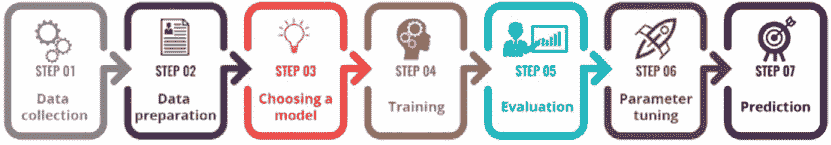

图 1.1 机器学习过程。

将机器学习原理整合到神经网络建模中，可以增强我们模拟和理解脑机制复杂性的能力，如图1.1所示的通用过程。此类模型有助于研究人员测试假设并探索特定神经回路的后果，为神经障碍和潜在干预措施提供见（Vempati & Sharma, 2023）。对个体影像和基因组数据的机器学习驱动分析，具有神经病学和精神病学个性化医疗的前。通过识别与疾病相关的独特脑特征，机器学习能够实现治疗和干预，最大限度地减少尝试法。

增强型神经技术可能开启认知增强的新纪元。脑机接口（`BCIs`）可能被用于改善记忆、学习和决策，使认知功能障碍的个体和寻求认知优化的健康个体受益。机器学习与神经科学的相互交织引发了涉及知情同意、数据隐私和神经信息潜在滥用的伦理考量。解决算法偏见以确保神经机器学习应用中的公平性，对于维护伦理标准至关重要。

## 1.1.1 贡献

本章提供了以下贡献：

- 本章揭示了机器学习与神经科学之间变革性的协同作用，展示了它们的融合如何重塑脑科学和技术创新。
- 本章阐述了基础机器学习概念，使读者能够理解驱动从复杂神经数据提取见解的算法。
- 通过介绍不同层次的神经科学（分子、细胞、系统、认知），本章为将机器学习技术应用于每个层次奠定了基础。
- 各层次的特定应用强调了机器学习的影响，从预测蛋白质结构到解码神经行为，具有多用途的贡献。
- 考察了机器学习在神经影像和数据分析中的作用，因为它有助于个体解码认知状态、绘制脑区域地图并精炼神经模式。
- 展示了机器学习在脑机接口中的变革潜力，因为它为通信、运动控制、神经康复和增强提供了见解。
- 讨论了伦理和实务考量，重点关注数据隐私、算法偏见以及模型解释性，促进负责任的研究和应用。
- 最后，本章通过讨论未来方向和挑战进行总结，激发了对机器学习与神经科学协作潜力的前瞻性讨论。

## 1.1.2 章节结构

第1.1.2节介绍了机器学习的基础，定义了机器学习及其关键概念，如监督学习、无监督学习和强化学习（`RL`）。此外，它解释了已提出的标准机器学习算法，如决策树、支持向量机、神经网络和深度学习。第1.1.3节说明了神经科学的领域格局，介绍了神经科学领域及其主要目标，并解释了神经科学中不同的分析层次：分子、细胞和认知。第1.1.4节介绍了神经科学中的机器学习应用，讨论了机器学习技术如何应用于神经科学分析的每个层次，如分子和细胞层面（蛋白质结构预测、药物发现）、系统层面（神经网络构建、脑图谱绘制）以及认知层面（理解感知、记忆和行为）。第1.1.5节阐述了神经影像和模式识别，探索了机器学习在分析神经影像数据（如磁脑图 `MEG`、功能性磁共振成像 `fMRI` 和 脑电图 `EEG` 数据）方面的作用。该节强调了使用模式识别算法来解码脑状态和活动。第1.1.6节介绍了神经数据分析，并讨论了机器学习在处理神经数据（包括来自神经元的脉冲数据）中的应用，并提到了降维技术和特征提取。第1.1.7节介绍了脑机接口；描述了机器学习在开发脑机接口中不可或缺的，允许大脑与外部设备之间的直接通信；并展示了用于运动控制和通信的脑机接口示例。第1.1.8节介绍了伦理和务考量，讨论了在神经科学中使用机器学习的伦理影响，如数据隐私和偏见。作者讨论了复杂模型的解释性以及对稳健验证的需求等挑战。第1.1.9节通过预测机器学习与神经科学交叉领域的潜在发展，说明了未来方向和挑战。该节强调了为了该领域持续进步而需要解决的挑战。最后，第1.1.10节给出了本章结论。

## 1.2 机器学习基础

本节定义了机器学习及其核心概念，包括监督学习、无监督学习和强化学习。该节还解释了决策树、支持向量机、神经网络和深度学习等标准机器学习算法。

## 1.2.1 机器学习核心概念

机器学习是人工智能（`AI`）的一个子集，涉及开发算法和模型，允许计算机从数据中学习并在无需显式编程的情况下提高其在特定任务上的性能（Pavarino et al., 2023）。机器学习使系统能够根据经验自动适应和改进，使其对于涉及复杂任务、大数据集以及难以进行基于规则编程的任务特别有用。机器学习的核心概念包括以下：

### 1.2.1.1 数据

数据是构建设备和促进人类操作的基础。它们包括各种信息，结构化的或非结构化的；算法可以处理以提取有意义的模式。结构化数据组织成行和列，通常位于数据源或电子表中，更容易评估。数据是用于训练和测试机器学习算法的原始信息。无组织的信息（如文本、图片和视频片段）没有预定义的布局，允许更创新的预处理方法（Pavarino et al., 2023）。高质量数据至关重要，因为它们直接影响机器学习设计的效率。它们包括原始输入、历史记录、传感器结果以及任何告知认知过程的相关细节。信息的质量、数量和多样性极大影响了设计。

### 1.2.1.2 特征

特征是作为机器学习输入的数据的个体属性或特征。它们代表了算法将用于发现模式的信息。特征类型多样；可以是数值型的（例如温度、年龄）、类别的（例如性别）或更复杂的类型（如图像）（Zheng et al., 2023）。特征选择涉及从数据集中挑选最相关的特征。无关特征会引入噪声。

### 1.2.1.3 标签或目标

在监督学习中，标签（目标）是算法旨在预测的输出或结果。例如，在医学诊断场景中，标签可能指示患者是否疾病（Moreno-Rodríguez et al., 2023）。在训练期间，算法学习输入特征与标签之间的关系。在二分类中，标签可以是“0”或“1”。

### 1.2.1.4 算法

算法是机器学习系统遵循以从数据中学习的一系列数学和计算规则（Schmidgall & Hays, 2023）。算法根据其所协助的学习类型进行分类，如监督、无监督或半监督。每个算法都有其优缺点，算法的选择取决于所解决问题的细节、数据的性质以及首选的结果（Jaison et al., 2023）。

### 1.2.1.5 训练

训练使机器学习模型暴露于包含输入特征和相应标签的数据集中。在训练期间，算法调整其内部参数以学习能够实现准确预测的模式和标签（Jiang, 2023）。算法旨在使其学习泛化到未见的数据上。训练需要分类数据集（在监督学习中），并且通常将数据分为训练集和验证集，以评估效率并避免过拟合（Zarr & Brown, 2023）。

## 机器学习及其应用简介

对新数据进行分类。此外，机器学习中的模型是训练过程的结果，由被发现的模式和框架组成，这些模式可以对新信息进行预测。模型的范围可以从基础的线性策略到具有数百万准则的复杂神经网络。模型开发了输入属性与目标变量之间的关系，使其能够过滤掉来自未检测输入的结果。一个版本的效率通过其准确率、精确率、召回率以及其他各种性能指标进行评估 [Currey et al., 2023]。模型设计倾向于从一组候选方案中选择性能最佳的设计，并经常使用交叉验证方法来确保鲁棒性。

## 1.2.1.7 监督学习


监督学习是机器学习的一种，其中模型在标记数据集上进行训练，这意味着每个训练示例都配有一个输出标签。其目标是学习从输入到输出的映射，该映射可以泛泛化到新的、未见的数据上。常见的监督学习任务包括分类和回归 [Cakar & Yavuz, 2023]。线性回归、逻辑回归、决策树和支持向量机等算法被常用。监督学习的成功取决于大规模高质量标记数据集的可用性以及适当特征的选择。在监督学习中，算法从标记数据学习，使用输入特征和相关标签来学习它们之间的映射 [Cakar & Yavuz, 2023; Currey et al., 2023]。其目标是创建一个模型来准确地预测新的、未见的数据。

## 1.2.1.8 无监督学习

无监督学习涉及在没有标记响应的数据上训练模型。目标是发现数据内部的模式或内在结构。常见任务包括聚类（模型对相似的数据点进行分组）和降维（模型简化数据表示）[Vdeai et al., 2023]。诸如 `k-means` 聚类、层次聚类和主成分分析 (`PCA`) 等算法被广泛使用。无监督学习有助于探索性数据分析、异常检测以及监督学习中的预处理步骤。它有助于在没有先验知识的情况下发现数据中的关系和结构。算法的任务是发现数据内部隐藏的模式、聚类或结构 [Kawai et al., 2023]。标准技术包括聚类和降维。

## 1.2.1.9 半监督学习

半监督学习结合了监督学习和无监督学习的元素。半监督学习是一种混合方法，在获取标记数据成本高昂或耗时时这种方法特别有用。使用少量的标记数据和大量的未标记数据来改进模型的学习和泛化能力。半监督学习利用未标记数据的结构来提高准确性。半训练和基于图的方法是常见的技术 [Jaison et al., 2023]。

## 1.2.1.10 强化学习

强化学习通过与环境交互做出决策。代理接收奖励或惩罚形式的反馈。问题被建模为马尔可夫决策过程 (`MDPs`)，其中代理的目标是学习一种最优策略，以随时间最大化累积奖励。关键算法包括 `Q-learning`、策略梯度以及深度技术，如近端策略优化 (`PPO`) 和深度 Q 网络 (`DQN`) [Turrisi et al., 2023]。

## 1.2.1.11 特征工程

特征工程是从原始数据中选择、转换或创建特征以提高机器学习性能的过程。它涉及利用领域知识开发特征或修改现有特征。归一化、标准化、特定变量编码和处理缺失值等技术，通过选择更有帮助和判别性的属性，可以显著提高准确性和可解释性 [Zheng et al., 2023]。

## 1.2.1.12 预测与推理

一旦训练完成，模型就可以对新的、未见的数据进行预测或推理。预测和推理是机器学习的核心目标。预测是指模型根据从训练中学学习的模式，准确估计新的、未见的数据的目标值的能力。另一方面，推理涉及理解特征与目标变量之间的关系，为模型如何做出决策提供见解。推理对于模型的可解释性和理解数据生成过程至关重要 [Strak et al., 2023]。预测和推理对于对于将机器学习模型部署到现实应用中至关重要，在这些应用中，准确的预测和解释性是首要的。这些核心概念为理解机器学习算法如何处理数据、从数据学习以及做出预测或决策提供了基础 (Cakar & Yavuz, 2023)。不同类型的机器学习（如监督学习、无监督学习和强化学习）利用这些概念来解决跨多个领域的广泛任务，如图 1.2 所示。

## 1.2.2 机器学习算法

这些算法中的每种都有不同的特征、优点和局限性。算法的选择取决于问题类型、数据可用性、可解释性要求和计算资源。理解每种算法的微妙之处有助于从业人员为特定的机器学习任务选择最合适的方法。

## 1.2.2.1 监督学习算法

### 1.2.2.1.1 线性回归

线性回归是回归任务的基础算法。它假设输入特征与连续输出之间存在线性关系。这种监督学习算法根据一个或多个特征预测连续目标变量，建模输入与目标之间的线性关系，由方程 $y = \beta_0+\beta_1x_1+...+beta_nx_n$ 表示，其中 $y$ 是预测值，$x_i$ 是输入特征，$\beta_i$ 是训练期间学习的系数。目标是最小化预测值与实际目标值之间的均方误差 (`MSE`) [Azad et al., 2023]。线性回归简单、可解释且计算效率高，使其适用于许多现实问题。然而，它假设了线性、同方差性和误差独立性，这些在原理上可能并不成立，限制了它在更复杂数据集上的适用性 (Cakar & Yavuz, 2023)。该算法计算最小化预测与实际值差异的最拟合线（斜率和截距）。

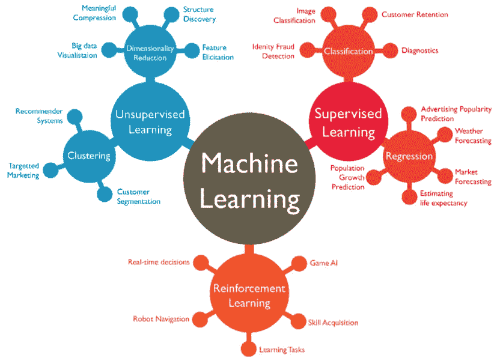

图 1.2 应用中的机器学习算法分类。

### 1.2.2.1.2 逻辑回归

尽管命名为回归，逻辑回归¹用于二分类任务。它使用逻辑函数对输入属于特定类别的概率。它是一种用于估计给定输入属于特定类别概率的线性模型。模型使用逻辑函数 $\sigma(z)=\frac{1}{1+e^{-z}}$（其中 $z$ 是输入特征的线性组合）将预测值映射到 0 到 1 之间。逻辑回归模型旨在找到最大化观测数据似然性的参数，使用梯度下降等技术进行优化 [Kawai et al., 2023]。逻辑回归具有可解释性，并且可以轻松处理医学、金融和社会科学中的大型数据集，用于诊断、信用评分和调查分析等任务。然而，它假设输入特征与结果对数之间存在线性关系，这可能无法捕捉复杂的模式。它计算一个基于输入特征分离类别的决策边界 (Cascone et al., 2023)。

¹（此处此处为脚注标记）

决策树易于解释和可视化，因为它们模拟了决策过程。它们可以处理数值型和分类型数据，且不需要的数据预处理。然而，决策树容易过拟合，特别是深度树，并且对数据的微小变化敏感。剪枝和集成方法（例如随机森林）等技术被用于解决这些问题并提高泛化能力。算法在每个节点选择最能分离数据的特征，直到满足停止标准（Choi et al., 2023）。树结构被用于分类或预测结果。

## 1.2.2.1.4 随机森林

随机森林是一种集成学习方法，通过结合多个决策树来提高预测性能和鲁棒性。森林中的每棵树都在训练数据的随机子集和随机特征子集上进行训练，引入了树之间的多样性。最终预测通过聚合所有单个树的预测获得，通常通过分类的多数投票或回归的平均（Zheng et al., 2023）。这一过程减少了方差并缓解了过拟合，从而产生更准确稳定的预测。随机森林可以处理具有高维特征的大数据集，并提供特征重要性的估计。它们被广泛应用于各种领域，包括图像和文本分类、异常检测和生物信息学。尽管存在缺点，随机森林的计算量可能很大，且可解释性低于决策树。每棵树都是一个独立的预测器，最终结果通过多数投票（分类）或平均值（回归）决定（Vedai et al., 2023）。这种集成技术减少了过拟合。

## 1.2.2.1.5 支持向量机

核心思想是找到一个超平面，通过最大化类别点之间（即支持向量）之间的间距，将数据分为不同的类别。支持向量机（`SVMs`）可以使用核函数（例如多项式、径向基函数）处理线性和非线性边界，将输入转换到高维空间，在这些空间中可以找到线性分类器。这种灵活性使得 SVM 在高维空间以及处理复杂的非线性关系时非常有效（Cakar & Yavuz, 2023）。SVM 容易过拟合，尤其是在高维特征空间中，并广泛应用于文本分类、图像识别和生物信息学等领域。然而，它们的计算开销很大，特别是对于大型数据集，且选择合适的内核和正则化参数需要仔细调优。它可以使用核技巧处理线性和非线性分类，将数据映射到高维空间（Rajput, 2023）。

## 1.2.3 无监督学习算法

### 1.2.3.1 K-means 聚类

`K-means` 聚类是一种流行的无监督学习算法，根据特征相似性将数据划分为 k 个不同的簇。算法从随机初始化 k 个簇开始。每个数据点被分配给最近的质心，形成簇。质心通过每个簇内数据的平均值进行更新。这种分配和更新的过程反复迭代，直到收敛，此时质心不再发生变化（Rutkowski et al., 2023）。其目标是最小化数据点与其相应质心之间的距离平方和，即类内平方和。`K-means` 高效且易于实现，但必须预先指定簇的数量，并且对初始聚类位置和离群值敏感（Ellwood, 2023）。它在大小相似的球体上表现良好，但在处理复杂的簇形状时较为困难。算法随机初始化聚类中心，将数据点分配给最近的中心，重新计算并迭代，直到收敛（Kawai et al., 2023）。每个簇的质心代表该簇的平均值

## 聚类简介及其应用

### 1.2.3.2 层次聚类

层次聚类构建一个树形结构（树图）来表示数据，其中簇嵌套在较大的簇之中。它可以是凝聚的（自下而上）或分裂的（自上而下）。凝聚聚类从每个数据点作为一个簇开始，不断合并距离最近的簇对，直到形成单个簇（Straka et al., 2023）。簇之间的距离或相似性使用连接法（最小距离）、完全连接法（最大距离）或平均连接法等指标进行计算。层次聚类不需要预先指定簇的数量，并能够捕捉数据点之间的复杂关系。然而，它的计算量很大，特别是对于大型数据集，并且对噪声和离群值敏感（Rutkowski et al., 2023）。因此，层次聚类从每个数据点作为一个单独簇开始，根据相似性将它们合并，形成一个视觉化分级结构的树图。

### 1.2.3.3 主成分分析

将高维数据转换为低维形式，同时保留尽可能多的方差。`PCA` 识别主成分，即数据中方差最大的正交方向。第一主成分占方差最大，其次是第二个，依此类推。这是通过计算数据协方差矩阵的特征值和特征向量实现的（Krainer et al., 2023）。将数据投影到前几个主成分上，降低维度。`PCA` 有助于可视化高维数据、去除噪声并提高后续算法的效率。尽管如此，它假设变量之间存在线性关系，并受尺度和离群值的影响。`PCA` 广泛用于图像压缩、基因表达分析和探索性数据分析。它是一种降维技术，用于识别捕捉数据中最大方差的主成分（正交）（Vedaci et al., 2023）。它在最小化信息损失的同时，将高维数据转换为低维空间。

### 1.2.3.4 自动编码器

自动编码器是一类用于无监督学习的人工神经网络，特别是降维、特征学习和去噪。它们由两部分组成：将输入压缩为低潜表示的编码器，以及从该表示重建原始数据的解码器。网络经过训练以最小化重构误差，确保潜表示捕捉了输入的本质特征（Straka et al., 2023）。自动编码器的变体，例如用于生成新数据的卷积自动编码器扩展了它们的功能。自动编码器在捕捉非线性关系和学习聚类数据分布方面强大。它们被用于异常检测、数据压缩和生成任务。它们需要大量的计算资源和仔细的超参数调优，以避免过拟合和泛化不良。编码器将数据编码到低维潜空间，解码器从潜表示重建原始数据。它们可用于去噪、压缩和特征学习（Kawai et al., 2023）。

## 1.2.4 强化学习算法

### 1.2.4.1 Q学习

`Q` 学习是一种强化学习算法，旨在帮助智能体通过与环境交互学习学习决策。智能体通过采取动作进入不同的状态，并为动作获得奖励。目标是最大化总奖励。`Q` 学习涉及创建一个 Q 表，这是一个存储状态-动作对预期奖励的网格。智能体使用特定的规则更新 Q 表，该规则考虑了当前奖励和估计的未来奖励（Turrisi et al., 2023）。该规则确保了 Q 值

通常会改进，引导智能体采取最优动作。该算法被认为是“离策略”（off-policy），意味着无论智能体当前的行为如何，它都能学习最佳动作，允许其同时进行探索和利用。`Q-learning` 对于许多问题来说既简单又有效，但在处理大型或连续状态空间时，由于 Q 表变得过大无法管理，可能会变得不实用（Kraninger et al., 2023）。智能体学习一个 Q 值函数，估计从特定状态执行特定动作的预期累积奖励，从而指导决策。

## 1.2.4.2 深度 Q 网络 (Deep Q-Networks)

`DQN` 是 `Q-learning` 的扩展，使用深度神经网络来近似 Q 值函数。`DQN` 通过使用深度神经网络处理具有海量或连续状态的环境增强了 `Q-learning`，在这些环境中，Q 表是不可行的。`DQN` 不对数据中的每个状态-动作对使用 Q 值，而是使用网络来近似这些值。网络输出所有动作的预测，允许智能体选择最佳动作（Kraninger et al., 2023）。通过回放缓冲区（`replay buffer`）中的过去经验来训练神经网络，在回放缓冲区中，经验被随机采样以打破连续状态之间的相关性，从而稳定学习过程。`DQN` 还使用一个频繁更新的独立目标网络来为训练提供稳定的 Q 值（Jaison et al., 2023）。这种技术防止了可能导致学习不稳定的反馈循环。`DQN` 已证明在视频游戏等复杂环境中是有效的，它们可以学习到超人类的水平水平。然而，它们需要大量的计算资源和精细的参数调优才能运行，并且在处理涉及稀疏奖励或高维动作空间的问题时可能会困难（Kraninger et al., 2023）。

## 1.2.5 其他算法

### 1.2.5.1 朴素贝叶斯 (Naive Bayes)

朴素贝叶斯是基于贝叶斯定理的概率算法，其“朴素”假设是在给定类别标签的情况下特征是相互独立的。尽管有这种简化，朴素贝叶斯模型在许多现实应用中表现惊人，特别是对于垃圾邮件检测和情感分析等分类问题。有不同类型的朴素贝叶斯分类器，包括高斯、多项式和伯努利，每种都适用于不同类型的数据（Huang et al., 2023）。该算法根据输入特征计算每个类别的后验概率，并预测概率最高的类别。这包括了在大规模数据集和高维数据上的简单性、高效性和有效性（Wang et al., 2023）。当独立性假设被违反或处理小样本量和高度相关的特征时，朴素贝叶斯可能会遇到困难。它经常被用于文本分类和垃圾邮件过滤。

### 1.2.5.2 神经网络 (Neural Networks)

这些是受人类大脑功能启发的计算模型。它们由相互连接的节点（神经元）层组成，每个连接都有一个分配权重。输入层接收原始数据，隐藏层使用激活函数对其进行转换，最后输出层产生最终结果（Rodriguez et al., 2023）。每个神经元处理输入数据，应用权重，加上偏置，并将结果通过激活函数。网络通过在训练期间使用反向传播和梯度下降等优化算法调整这些权重和偏置来学习（Poikonen et al., 2023）。神经网络是多用途的，可以对数据中复杂的非线性关系建模，使其适用于广泛的任务，包括图像识别、自然语言处理和游戏。。它们需要大量的数据和计算资源，在没有适当正则化的情况下，可能会出现过拟合。各种架构（如前馈、卷积和循环网络）适用于不同的数据类型和任务（Currey et al., 2023）。

## 机器学习介绍及其应用

### 1.2.5.3 梯度提升 (Gradient Boosting)

梯度提升是一种集成学习技术，通过结合多个弱学习器（通常是决策树）的输出来构建强大的预测模型。该算法迭代工作，每增加棵新树都会纠正之前树所犯的错误。它通过使用“梯度提升”来优化损失函数。这种方法允许模型关注最难预测的实例，例如 `CatBoost` 和 `XGBoost`，它们以高性能著称，并广泛应用于机器学习竞赛和实际应用中。然而，它们处理不同类型的数据，可以对复杂关系建模并提供稳健的预测。但是，它们计算密集且对超参数调优敏感，需要仔细的交叉验证以防止过拟合（Jaison et al., 2023）。模型结合它们的预测来创建一个稳健的模型。

### 1.2.5.4 长短期记忆 (LSTM)

长短期记忆（`LSTM`）网络是循环神经网络（`RNN`）的一种，旨在捕获数据中的顺序依赖关系。传统的 `RNN` 由于梯度消失问题而难以学习依赖关系。`LSTM` 通过包含三个门的单元结构解决了这个问题：输入门、遗忘门和输出门。这些门控制着信息的流向，允许网络在长序列中维护和更新单元状态。输入门控制添加哪些新信息，遗忘门决定丢弃哪些信息，输出门决定最终输出。这种架构允许 `LSTM` 有效地捕捉数据中的时间模式，使其成为序列预测、语言建模和语音识别等任务的理想选择。然而，`LSTM` 需要大量的计算资源和精细的调优才能获得最佳性能。由于其处理梯度消失的能力，它们在涉及时间序列、序列和自然语言处理的任务中表现出色（Straka et al., 2023）（图 1.3）。

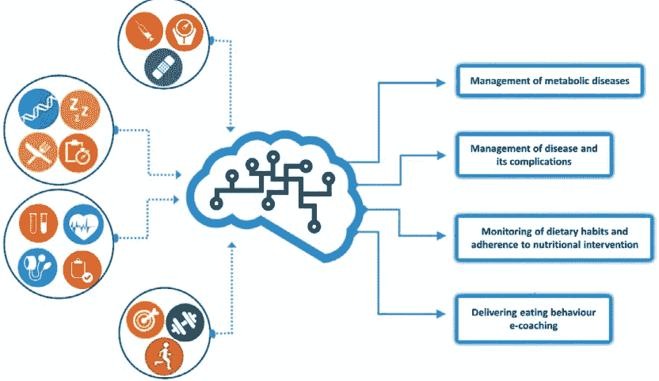

图 1.3 机器学习术语在金属方法中的应用

## 机器学习术语在金属方法中的应用

## 神经科学图谱

神经科学是动态的，这些层次之间不断相互作用。技术的进步包括成像技术、遗传工具和计算方法，推动了我们对理解（Cakar & Yavuz, 2023）。

## 神经科学的水平

跨学科协作至关重要，因为神经科学需要生物学、物理学、数学、心理学和计算机科学的见解来揭示。

### 1.3.1.1 分子神经科学

在分子水平上，神经科学深入研究支配神经功能的化学过程。分子神经科学关注底层机制。它研究神经质、受体、离子通道等分子的作用（Kawai et al., 2023）。通过研究这些，人员旨在理解信号是如何产生、传输和调节的。该领域涉及分子克隆、电生理和成像技术，以探索分子水平的变化如何影响神经功能。研究人员已经研究了神经质、受体、离子通道和酶的功能（Straka et al., 2023）。理解这些分子如何相互作用可以为信号、突触功能提供见解。

### 1.3.1.2 细胞神经科学

细胞神经科学关注单个神经元及其相互作用。细胞神经科学研究胶质细胞的结构和功能。它探索这些如何通信、处理信息并支持大脑功能。该领域调查不同细胞类型的属性、它们的电生理特征以及它们如何在神经电路中相互作用。常用补钳记录、活细胞成像和遗传操控（Vedad et al., 2023）。理解细胞机制有助于阐明复杂行为和认知过程是如何从细胞活动产生的。神经元的形态、电生理和连接性，以及突触可塑性（突触随时间增强或减弱的能力）的机制已得到探索（Wang et al., 2023）。这种层次分析揭示了大脑信息处理的基本属性。

### 1.3.1.3 系统神经科学

系统神经科学研究神经元如何一起工作执行特定功能。它研究神经网络和网络，绘制大脑区域之间的连接，并发现不同大脑区域如何协作处理感知信息、控制运动和调节情绪（Rutkowski et al., 2023）。这种层次分析为行为和认知功能提供了见解。

# 机器学习及其应用介绍


系统神经科学有助于理解感觉系统、运动系统以及类似于注意力和记忆等高阶过程是如何整合的。它探索了神经活动如何产生感知、记忆、注意、决策和其他高级认知功能（Kranzinger et al., 2023）。使用脑电图（EEG）和磁图（MEG）的先进技术有助于揭示这些过程的神经基础。

## 1.3.1.5 计算神经科学

计算神经科学采用数学模型和模拟来捕捉大脑复杂的动力学。认知神经科学桥了心理学和神经科学，研究感知、记忆、语言和决策等认知功能的神经基础。它旨在理解心理模型在大脑中是如何实现的，以及神经活动如何与认知任务相关（Volmonté, 2023）。功能性磁共共振（fMRI）、EEG 和神经心理学测试相应的技术被用于研究参与各种功能的脑区域和网络。该领域为大脑如何实现行为和认知提供了见解（Choi et al., 2023）。计算模型有助于预测神经响应并模拟大脑功能，从而揭示可能仅通过实验难以研究的机制。

## 1.3.1.6 神经发育与神经遗传学

计算神经科学使用数学模型、理论分析和计算机模拟来理解神经系统的原理。它旨在建立解释神经行为以及神经元神经网络如何处理信息的模型。该领域整合了分子、细胞和神经科学的数据，以开发绘制大脑活动的计算框架（Ellwood, 2023）。应用包括人工神经网络的发展以及神经编码和信息处理的研究。神经发育神经科学关注神经系统的形成和成熟，涉及胚胎大脑发育、干细胞分化以及神经元之间连接的建立（Kawai et al., 2023）。神经遗传学专注于导致神经系统疾病、脑结构和功能变变的遗传因素。

## 1.3.1.7 疾病神经生物学

疾病神经生物学研究神经系统和精神疾病底的生物学机制。它试图识别导致阿尔茨海默病、帕金森病、癫痫和抑郁症等的原因及分子变化。研究人员使用先进成像技术研究疾病病理和潜在的治疗策略。该领域桥接了神经科学与临床研究，旨在将发现转化为治疗方案。研究人员探索了阿尔茨海默病、帕金森病、癫痫和精神分裂症等神经系统疾病的病理机制（Ellwood, 2023）。研究人员调查了分子、细胞和网络中断如何导致疾病进展，旨在开发有效的治疗和干预措施。

## 1.3.1.8 神经成像与神经信息学

神经成像和神经信息学利用先进成像技术和计算工具来研究大脑的结构和功能。例如，神经成像技术正电子发射层扫描、扩散张量成像、fMRI 和 MRI 提供了大脑的详细细节，并允许神经活动可视化。神经信息学开发了数据库、算法和计算模型，以分析和解释神经成像数据（Rodrigues et al., 2023）。这些领域对于理解脑连接、绘制脑区域以及脑结构如何与功能相关至关重要。神经成像技术（包括 MEG、EEG 和 fMRI）允许研究人员视觉化并测量脑活动。

# 用于神经退行性疾病的机器学习

神经信息学整合了计算工具和技术来分析和解释大规模神经成像数据集（Vedaeci et al., 2023）。这些方法为脑连接、功能以及与不同状态和疾病相关的变化提供了见解。

## 1.3.1.9 行为与认知心理学

虽然不是神经科学所专利，但行为和认知心理学对于理解神经过程如何转化为行为和认知至关重要。行为实验和认知研究为感知、记忆、学习、决策和社会互动提供了宝贵的见解（Kawai et al., 2023）。神经科学的格局是动态的，这些层次之间存在不断的交互。技术的进步（包括成像技术、遗传工具和计算方法）不断推动我们对大脑复杂性的理解（Ellwood, 2023）。跨学科协作至关重要，神经科学需要生物学、物理学、数学、心理学和计算机科学的见解来揭示神经系统的秘密（Rutkowski et al., 2023）（图 1.4）。

## 1.3.2 神经科学及其核心目标

这些相互关联的目标反映了神经科学影响的广度和深度，从基础细胞结构到复杂的认知功能和社会影响（Ellwood, 2023）。该领域的协作性质以及对揭示神经系统奥秘的致力于持续驱动着突破性的发现，塑造了我们对自我和世界的理解。

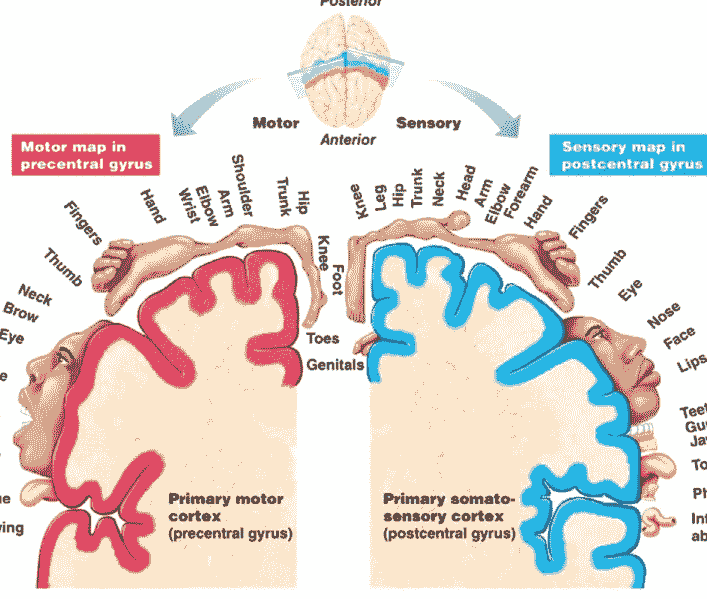

图 1.4 后中央回的运动和感觉图谱。

# 机器学习及其应用介绍

## 1.3.2.1 理解神经机制

神经科学旨在阐明大脑功能的基础性神经机制。这项调查涉及神经元如何通过电化学信号编码、传输和整合信息。在分子水平上，研究人员探索神经递质释放、受体激活以及调节突触和神经元兴奋性的胞内信号通路（Zarr & Brown, 2023）。如膜片钳电生理等技术可以测量跨膜离子电流，而分子生物学则识别信号级联反应和基因表达变化（Wu et al., 2023）。通过结合这些技术，科学家旨在绘制神经电路的功能和结构方面。这些知识对于破解行为和复杂过程如何从神经活动中产生，以及为神经系统疾病开发针对性干预措施至关重要（Poikonen et al., 2023）。现在，研究人员获得了对感知、记忆形成和决策等基础过程的见解。

## 1.3.2.2 绘制脑结构

绘制脑结构涉及对大脑解剖和连接的详细分析。MRI 等技术提供了高分辨率的大脑解剖图像，允许皮层和亚细胞结构视觉化。扩散张量成像（DTI）通过测量水分扩散帮助绘制白质纤维，揭示神经连接模式。先进的显微镜方法（包括电子显微镜）提供了对细胞和亚细胞组织的见解（Wang et al., 2023）。人类连接组计划等脑图项目整合了这些成像方法，创建脑连接和功能的全面地图。理解结构对于将解剖异常与行为联系起来，以及诊断和治疗神经退行性疾病至关重要（Rodriguez et al., 2023）。这些图谱识别了负责各种功能的特定脑区域，有助于我们对脑特异性的理解。

## 1.3.2.3 探索神经发育

神经发育研究了神经系统如何在胚胎阶段形成并在整个生命周期中成熟。神经发育研究调查了从胚胎阶段到成年塑造神经系统形成和成熟的过程。这包括研究神经祖质细胞的分化、神经元迁移和突触形成（Volonté, 2023）。原位杂交和免疫组织化学等技术用于可视化发育的基因表达和蛋白质定位。研究人员检查遗传和环境因素如何驱动发育过程，使用模型生物和先进成像技术跟踪变化（Wu et al., 2023）。这些见解对于理解正常大脑发育以及自闭症谱和智力障碍等神经发育疾病的起源至关重要。它包含了神经发生（神经元的产生）、神经元迁移（神经元移动到正确位置）和突触形成（突触的建立）等过程（Straka et al., 2023）。理解这些过程有助于了解大脑架构是如何建立的以及中断如何导致发育疾病。

## 1.3.2.4 研究神经塑性

神经塑性是指大脑根据经验改变其结构和功能的能力。这包括突触塑性（突触的增强或减弱）和皮层重映射（脑区域的重组）（Rutkowski et al., 2023）。突触塑性，作为长时增强（LTP）和长时抑制（LTD），涉及突触强度和效能的变化。双光子显微镜和电生理记录等技术允许实时观察神经电路中这些动态变化（Cakar & Yav, 2023）。结构塑性涉及树突棘棘的生长和重塑，也通过高分辨率成像和形态学分析进行研究。理解塑性机制对于阐明学习和记忆过程，以及开发脑损伤和神经退行性疾病的康复策略关重要（Schmidgall & Hays, 2023）。研究学习、记忆和损伤恢复的神经科学家受到神经可塑性、康复和认知增强策略的影响。

## 1.3.2.5 研究神经系统疾病

神经科学致力于揭示神经系统和精神类疾病的原因和机制。研究人员研究了基因突变、异常神经通路、神经递质不平衡以及其他导致阿尔茨海默病、帕金森病、癫痫和精神分裂症的因素（Wu et al., 2023）。这些研究识别了细胞和分子水平上的病理变化，例如蛋白质聚集、神经炎症和突触功能障碍。研究人员使用基因组测序、转录组学和动物模型等技术来探索认知和环境因素（Schmidgall & Hays, 2023），并利用生物标志物分析研究预防和识别治疗目标。这些研究中获得的见解对于开发诊断工具、治疗策略和干预措施以减轻疾病影响并改善患者预后至关重要（Turrisi et al., 2023）。对这些机制的见解有助于开发靶向治疗和干预措施。

## 1.3.2.6 推进脑机接口

脑机接口（BMIs）实现了大脑与外部设备之间的直接通信。科学家致力于解码神经信号以控制假肢、瘫痪后的运动，甚至将思想翻译成计算机命令（Hakim et al., 2023）。这涉及通过侵入性（如电极）或非侵入性（脑/EEG）方法记录神经活动，并解码这些活动以控制假肢或计算机系统等设备。信号处理、机器学习和神经解码算法等技术被用于解释神经信号并将其转化为可执行命令（Zheng et al., 2023）。脑机接口的进步还涉及生物兼容材料以及提高接口的精度和易用性。这些技术在恢复感觉和运动功能以及通过直接神经控制增强人类能力方面具有巨大潜力（Zhang et al., 2023），脑机接口对运动障碍个体具有变革潜力，并为人机交互提供了新途径。

## 1.3.2.7 理解意识与认知

神经科学探索意识和认知的神经基础，以及大脑如何产生主观体验和复杂的心理过程。神经科学极大受益于跨学科合作，整合了来自生物学、工程学和计算机科学等领域的见解和方法论。有效的努力能够合成多样化的视角，从分子技术、计算模型到工程解决方案和心理理论（Jang, 2023）。将神经科学与人工智能相结合可以促进神经网络建模和脑机接口（BCIs）的发展。跨学科研究通过将新工具和视角应用于关于脑功能和行为的复杂问题，促进了创新。协作项目（如大规模脑图谱和跨学科研究）增强了研究的深度和广度，推动了多个领域的进展（Turrisi et al., 2023）。该领域的研究涉及调查具有意识脑区域、研究决策的神经相关物以及探索记忆系统（Zarr & Brown, 2023）。这有助于理解我们对什么是有意识，以及我们的认知功能是如何从神经活动产生的。

## 1.3.2.8 伦理考量与公众意识

神经科学研究中的伦理考量涉及发现对个人和社会影响的问题，包括隐私、知情同意和神经技术的使用。伦理准则对于确保涉及人类受试者的负责任行为至关重要，特别是在认知增强、脑机接口和基因操控等领域（Zheng et al., 2023）。公众意识和教育对于培养对神经科学进展及其影响的理解和知情话语至关重要。与公众接触有助于解决伦理问题、提高心理健康意识并为政策决策提供信息。确保伦理实践和增加公众理解对于神经科学及其应用的负责任发展至关重要（Wang et al., 2023）。随着神经科学的发展，伦理考量变得举足轻重。涉及人类受试者、神经增强、隐私和技术潜在误用的研究引发了需要仔细审查的伦理问题（Straka et al., 2023）。神经科学提高了公众对脑健康、神经系统疾病和心理健康的健康的意识，促进了知情讨论并减少了污名化。

## 1.4 机器学习在神经科学中的应用

机器学习在神经科学中的应用彻底改变了我们对脑功能的理解，使能够洞察复杂的神经过程，并增强了诊断和治疗神经系统疾病的能力。机器学习与神经科学的整合加速了发现步伐，能够从复杂和高维数据中提取见解（Cakar & Yavuz, 2023）。这些应用推进了我们对脑功能的理解，并为开发新的疗法、干预措施和技术提供了可能，这些技术对神经系统疾病患者产生积极影响。

### 1.4.1 神经影像分析

算法（如支持向量机、深度神经网络和卷积神经网络 CNNs）被用于从神经影像数据集中识别模式并提取特征。例如，这些方法可以检测脑结构中的细微异常，并可能成为神经系统疾病的指示（Moreno-Rodriguez et al., 2023）。机器学习模型用于根据疾病的存在或进展将脑图像分类为类别，辅助诊断和治疗计划。诸如基于体积的形态计量学和 MRI 连接性分析等先进技术受益于机器学习处理大规模多维数据的能力，提供了以前无法获得的脑连接和功能方面的见解（Turrisi et al., 2023）。例如，可以使用模式识别算法解码 fMRI 数据，以预测认知状态或情绪（Jiang, 2023）。机器学习还可以通过检测跨区域的同步模式来识别功能脑网络，有助于理解脑连接性。

### 1.4.2 脑机接口

算法分析 EEG、皮层电或植入电极数据，以解释具有特定思想或意图的脑活动模式。诸如特征提取、降维和深度学习等技术被用于解码脑活动，以控制假肢或计算机系统等设备，从而提高脑机接口的准确性（Jaison et al., 2023）。机器学习还可以通过检测跨区域同步模式来识别功能脑网络，有助于理解脑连接性。

### 1.4.3 脑组制图

连接组学涉及绘制脑区域之间的复杂网络。使用 DTI、图论和深度学习等技术，用于揭示结构和功能连接（Vempati & Sharma, 2023）。机器学习通过分析神经影像数据预测预测状态，，对大脑连接和功能的的见解（Turrisi et al., 2023）。例如，可以使用模式识别算法解码 fMRI 数据来预测认知状态或情绪， ，023。

### 1.4.4 诊断与分类

机器学习利用神经影像、基因谱和和临床记录等复杂数据集，神经疾病疾病疾病预测。。集成

### 1.4.5 预测建模

回归分析、决策树和深度学习网络等模型用于预测疾病进展、治疗反应和认知下降。通过分析数据并识别与不同结果相关的模式，机器学习算法为神经精神疾病的未来轨迹提供了见解（Jaison et al., 2023）。

### 1.4.6 基因组学与遗传学

在这里，机器学习应用于分析大规模基因组数据并识别与神经系统疾病相关的基因变异。全基因组关联研究 GWAS、学习和模式识别等技术被用于处理高通量测序技术数据并识别显著的遗传标记（Vempati & Sharma, 2023）。机器学习有助于理解疾病的遗传基础，将基因组数据与其他组学（例如转录组学和蛋白质组学）整合，以揭示关于疾病机制、遗传感性和潜在治疗目标的见解（Turrisi et al., 2023）。

# 机器学习及其应用

来自各种来源的数据（包括基因组学、蛋白质组学和神经成像数据）机器学习（ML）支持神经系统疾病靶向疗法和个性化医疗方法的发展。它能预测潜在药物如何与目标受体相互作用，优化药物设计（Jaison et al., 2023）。机器学习还有助于识别可以重新用于神经系统疾病的现有药物。

## 1.4.8 神经退行性疾病研究

深度学习、聚类和降维等技术被应用于神经成像数据、遗传图谱和临床信息，以揭示模式并预测疾病进展。机器学习模型帮助根据疾病状态对患者进行分层，预测治疗反应，并理解神经退行的底层机制（Turrisi et al., 2023）。这项研究有助于早期诊断、个性化治疗策略以及新干预措施的开发。它能预测疾病进展，为治疗策略提供信息，并辅助开发疾病调节药物（Azad et al., 2023）。

## 1.4.9 神经科学中的自然语言处理

自然语言处理（NLP）将机器学习技术应用于分析和解释来自神经科学领域的临床笔记、研究文章和患者报告的文本数据。NLP算法（如实体识别、语义分析和主题建模）用于从非结构化文本中提取有用信息、识别模式并跟踪疾病进展（Kawai et al., 2023）。NLP有助于从大型语料库中自动检索相关信息，优化工作流并支持临床决策。分析患者互动和科学文献中的语言，可以增强神经系统疾病的认知和交流方面，并强化数据驱动的研究。NLP技术量化海量科学文献以提取相关信息（Ellwood, 2023）。机器学习驱动工具可以总结研究发现，识别趋势，并帮助研究人员跟上神经科学的最新进展。

## 1.4.10 认知与行为分析

这涉及 fMRI 和 EEG 等神经成像技术，用于监测特定任务期间的神经活动，揭示不同脑区域如何相互作用以促进这些过程。行为分析通过检查个体对刺激和任务的反应来完成这一点，通过反应时间、错误率和性能指标对认知功能进行实际衡量（Volont, 2023）。实验设计和观察性研究被用于捕获行为和认知数据，为理解个体差异和偏离正常模式的情况提供见解。研究人员可以将认知功能映射到行为中，识别神经或心理疾病中的潜在干扰，并加强对大脑在塑造人类行为中作用的理解。这种综合方法有助于弥合神经机制与真实世界认知表现之间的鸿沟，推进神经科学的理论知识和实际应用（Kawai et al., 2023; Kraninger et al., 2023）。例如，机器学习可以分析决策任务期间的视线模式，以揭示底层认知策略。

## 1.4.11 预测癫痫发作

该过程始于获取高分辨率 EEG 数据以捕捉神经活动模式。预处理包括对数据进行滤波和分段，以消除伪迹并关注相关的信号特征。机器学习算法（如 RNN 和 CNN）被用于检测 EEG 中可能预示发作即将到来的细微预警性模式（Lockhart, 2023）。特征提取方法（包括时频分析和连接性指标）用于识别区分性特征，如谱功率或相干性的变化。使用历史发作数据对模型进行训练，以识别这些模式并生成实时预测。验证涉及在新数据上测试模型，以评估其灵敏性、特异性和泛化能力（Rodriguez et al., 2023）。整合特定模式的变量（如药物水平和生理压力源）可以完善预测。早期检测能够实现干预，通过及时调整治疗或发布警报来减轻发作的影响，提高患者安全性（Turrisi et al., 2023）。通过利用机器学习的力量，研究人员和医生可以对脑功能、神经系统疾病和潜在干预获得更深入的见解，最终提高我们对大脑复杂功能的理解。

## 1.5 神经成像与模式识别

神经成像和模式识别是相互交叉的领域，它们显著推进了我们对脑功能、认知过程和神经系统疾病的理解。神经成像涉及获取大脑结构和活动的图像，而模式识别使用机器学习技术识别这些图像中有意义的模式（Zhang et al., 2023）。这些发现共同为复杂的神经过程提供了见解，并有助于各种神经系统疾病的诊断、预后和治疗计划。神经成像技术允许我们可视化大脑的结构、连接和活动。关键技术包括：

- 功能磁共振成像（fMRI）：fMRI 测量与神经活动相关的血流变化（Azad et al., 2023）。它提供了特定任务期间激活的脑区域的见解，并有助于绘制功能网络。

- 电图（EEG）：EEG 记录头皮电活动，反映神经元放电。它用于研究脑电和认知过程，并诊断癫痫等疾病。

- 磁图（MEG）：MEG 测量由神经活动产生的磁场。它具有高时间分辨率，有助于定位不同任务中的脑区域（Cascone et al., 2023）。

- 结构共振成像（sMRI）：sMRI 提供大脑解剖的详细图像，允许脑区域和结构异常可视化。

- 弥散张量成像（DTI）：DTI 捕捉大脑白质束，实现神经连接的映射并对信息流进行理解。

模式识别和神经成像是强大的工具，允许我们深入研究大脑的内部机制。它们对神经科学研究和临床应用做出了贡献，为理解脑功能和解决神经系统挑战开辟了新途径（Currey et al., 2023）。

# 针对神经退行性疾病的机器学习


基于神经成像特征预测人的脑年龄（Lockhart, 2023）。预测脑年龄的偏差可能表明大脑老化的加速或延迟，从而为整体脑部健康提供见解（Moreno-Rodríguez et al., 2023）。

## 1.5.6 质量控制与数据预处理

质量控制和数据预处理是准备分析数据以及确保机器学习模型完整性的关键步骤。质量控制涉及验证数据的准确性、完整性和一致性，并识别纠正错误、不性和异常（Lockhart, 2023）。该过程包括检查缺失值、重复和离群值。数据预处理使用归一化或标准化等技术来缩放数据特征，通过插值处理缺失值，并对类别进行编码（Cakar & Yavuz, 2023）。PCA 包括特征提取和降维方法，用于降低数据复杂性并增强模型性能。这些步骤确保数据是干净且结构良好的，这对于开发稳健、可靠的模型以及获得准确、可操作的见解至关重要。机器学习算法可以检测神经成像数据中的噪声和不一致性（Dieckmann et al., 2023）。这确保了分析前的数据质量，提高了

## 1.5.7 治疗计划、监测与多模态融合

机器学习通过为神经疾病提供精确的解剖图来协助手术规划（Jiang, 2023; Moreno-Rodríguez et al., 2023; Schmidgall & Hays, 2023）。它还可以监测脑组织的变化，帮助评估干预措施的效果。机器学习结合来自神经成像模态（如 fMRI、EEG 和结构性 MRI）的信息，创建脑功能和结构的整体视图。这种整合增强了我们对脑网络及其相互作用的理解（Jiang, 2023）。这些详细应用展示了机器学习如何增强神经成像的能力，使研究人员和临床医生能够从脑数据分析中提取复杂的见解，并为神经系统疾病开发更多治疗方法。

## 1.5.8 模式识别与功能激活映射

这些应用利用了机器学习在神经成像和模式识别中的多功能性。通过利用先进算法的力量，研究人员可以从复杂数据中提取有意义的见解，从而更深地理解脑功能，更好地诊断和治疗神经系统疾病，并开发增强脑部健康和福祉的创新技术（Lockhart, 2023）。机器学习算法分析功能神经成像数据（如 fMRI 或 PET 扫描），创建激活图以展示大脑在特定任务或体验期间变得活跃的脑区域（Cakar & Yavuz, 2023）。这些映射使研究人员能够理解认知过程和行为的神经亚结构，为脑功能提供见解。

## 1.5.9 分类、诊断与预测建模

机器学习模型可以根据神经成像数据中的模式区分不同的神经系统状况（Alazaz et al., 2023; Gözütz et al., 2023）。通过从标记数据集中学习，这些模型将图像分类为健康或患病，有助于辅助阿尔茨海默病、中风和脑肿瘤等疾病的准确和早期诊断。此外，机器学习还可以用于利用历史神经成像数据和临床信息开发预测模型，以预测疾病的进展或治疗结果（Zarr & Brown, 2023）。这些模型为临床医生提供了关于病情可能演变的宝贵见解，使其在护理方面做出更明智的决策。

## 1.5.10 功能连接性分析与脑机接口

机器学习技术分析不同区域间同步脑活动的模式，揭示功能连接网络（Dieckmann et al., 2023）。这些网络阐明了不同脑区如何协作和通信，有助于我们理解脑网络及其在认知中的作用。类似地，脑机接口（BCIs）中的模式识别涉及大脑产生的神经信号，并将其转换为外部设备的有意义命令（Fahim et al., 2023; Rutkowski et al., 2023）。这项技术使运动能力个体能够通过其脑活动直接控制计算机、机器人肢体或通信设备。

## 1.5.1.11 fMRI、EEG 和 MEG 分析

模式识别对齐 fMRI 数据以识别与认知任务或体验相关的血氧水平依赖（BOLD）信号的独特模式。通过在标记数据上训练模型，这些算法可以准确预测活动期间的大脑状态。在任务中，模式识别解码神经电活动模式以揭示脑部状态（Rodriguez et al., 2023）。这些 ERP 或频谱特征算法与特定任务或刺激相关，能够确定注意力、记忆或情感反应等认知过程。

## 1.5.1.12 认知状态预测与神经反馈应用

模式识别可以预测个人的认知状态，例如注意力水平、情感反应和决策过程（Kalinaki et al., 2023; Vedaci et al., 2023）。通过学习与不同状态相关的模式，这些算法提供了大脑在各种活动期间瞬时状态的见解。神经反馈利用模式识别分析脑活动并为个体提供实时反馈（Rajput, 2023）。通过识别自己的脑状态，个体可以有意识地监测其神经活动以达到目的，例如管理压力、焦虑或注意力缺陷。

## 1.5.1.13 多模态整合与个性化脑机交互

模式识别整合了来自多种多模态的数据（如 EEG、fMRI 和眼动追踪），以更好地理解脑状态。这种结合方法为认知过程及其神经基础提供了见解。模式识别使个体之间能够根据其独特的神经特征进行个性化交互（Choi et al., 2023）。这些交互能够实现调整。

## 1.6.2 聚类分析与特征提取

模式识别整合了来自多种多模态的数据（如 EEG、fMRI 和眼动追踪），以更好地理解脑状态。这种结合方法为认知过程及其神经基础提供了见解。模式识别使个体之间能够根据其独特的神经特征进行个性化交互（Choi et al., 2023）。这些交互能够实现调整。

## 1.6.3 分类与解码

机器学习模型可以根据神经成像数据中的模式区分不同的神经系统状况（Alazaz et al., 2023; Gözütz et al., 2023）。通过从标记数据集中学习，这些模型将图像分类为健康或患病，有助于辅助阿尔茨海默病、中风和脑肿瘤等疾病的准确和早期诊断。

## 1.6.4 预测建模与网络分析

机器学习模型可以根据神经成像数据中的模式区分不同的神经系统状况，揭示功能和结构网络。这些模型为临床医生提供了关于病情可能演变的宝贵见解，使其在护理方面做出更明智的决策。

# 机器学习及其应用

## 1.7 脑机接口

脑机接口（BCIs）在大脑与外部设备之间建立了直接通信链路，使个体能够通过其神经活动控制设备、进行通信并与环境交互。机器学习（ML）通过解码复杂的脑活动模式在开发 BCI 中发挥着关键作用（Hakim et al., 2023）。在这里，我们描述了机器学习如何成为 BCI 不或的一部分及其应用示例：

## 1.7.1 BCI 开发中的机器学习

### 1.7.1.1 信号解码与特征提取

BCI 捕捉神经活动（如脑电图 EEG 或皮层信号），机器学习算法通过解码信号来解释用户的意图或命令（Zhang & Vargas, 2023）。先进技术（如 RNN 和 CNN）利用 RNN 学习神经数据中的模式，并准确预测用户行为。机器学习能够识别神经信号中与特定动作或意图相关的相关特征，并将其作为解码算法的输入，从而提高信号解释的准确性和可靠性。

### 1.7.1.2 自适应、学习与闭环控制

配备了机器学习的 BCI 能够不断适应随时间变化的神经信号（Kawai et. al., 2023）。它们可以学习并调整用户的模式，适应因疲劳或电极漂移等因素导致的神经活动变化。机器学习允许 BCI 在闭环系统中运行，外部设备的实时反馈会告知用户的神经活动（Ellwood, 2023）。这实现了双向通信，增强了用户的设备控制能力并提高了了 BCI 的准确性。

## 1.7.2 BCI 应用示例

### 1.7.2.1 运动控制

这包括脑控假肢和外骨骼。基于机器学习的 BCI 使肢体缺失的个体能够控制机器人手臂（Azad et al., 2023; Currey et al., 2023）。用户的运动意图从神经信号中解码，使其能够执行自然且精确的动作。外骨骼结合的 BCI 让瘫痪个体重新获得活动能力（Jaison et al., 2023）。神经信号被翻译成驱动外骨骼运动的命令，辅助行走和导航。

### 1.7.2.2 通信

严重运动障碍个体可以通过 BCI 控制的界面选择字母或单词来进行拼写和打字（Jaison et al., 2023）。机器学习算法根据解码的神经信号预测意图特征并生成文本。在语音 BCI 中，可以恢复言障碍个体的语音。与语音产生相关的神经信号被翻译成合成语音输出（Currey et al., 2023）。通过辅助设备和环境控制（如轮椅），BCI 控制的轮椅允许用户使用神经命令在他们的环境中导航（Zheng et al., 2023）。智能家居控制可以使用 BCI 通过神经信号控制家居环境中的灯光、电器和其他设备。

### 1.7.2.3 康复与神经反馈

在神经反馈中，BCI 通过提供实时反馈引导患者进行运动练习，辅助运动康复。机器学习评估神经信号并根据表现调整反馈（Turrisi et al., 2023）。在神经反馈中，个体可以学习通过 BCI 调节其脑活动，以用于神经退行性疾病的机器学习。机器学习检测理想的脑状态并提供即时反馈，支持认知训练并减轻压力（Jaison et al., 2023; Shafik, 2023b）。机器学习驱动的 BCI 为运动障碍个体提供了变革性的解决方案，彻底改变了他们的生活质量，并为与周围世界的通信和交互开辟了新途径。随着机器学习的不断进步，BCI 在未来有望实现更复杂、更具个性化的应用（Jaison et al., 2023）。

## 1.8 伦理与实践考量

解决这些伦理和实践挑战需要研究人员、伦理学家、政策制定者和利益相关者的合作。在神经科学机器学习的潜在收益与维护个人权利、隐私和社会福祉之间取得平衡，对于该领域实现负责任且有影响的进展至关重要。

## 1.8.1 数据隐私与同意

数据隐私保护个人数据免受未经授权的访问、泄露和滥用。这需要实施强大的安全措施（如加密、匿名化和访问控制），以保护存储和传输中的数据。《通用数据保护条例》³⁷ 和《健康保险流动性与责任法》³⁸ 等法规设定了数据保护标准，促使组织采用全面的隐私政策和实践。同意要求个体对数据收集和共享授予明确许可。获得知情同意至关重要，因为要确保个体充分了解正在收集什么数据、数据如何被使用、谁有权访问以及涉及的潜在风险。同意必须是自愿提供的、知情的并且可以随时撤回。这一过程涉及清晰的沟通、使用通俗语言解释隐私政策，以及通过记录协议或数字同意表获得知情同意。尊重数据隐私、获得知情同意并分析潜在风险与收益（Lockhart 2023）。在知情同意与研究中的深度参与之间取得平衡至关重要。

## 1.8.2 知情同意、脆弱群体、数据所有权与控制

与脆弱群体（如认知障碍个体或未成年人）合作时，知情同意变得复杂。确保他们的理解能力和自主性以最小化潜在伤害是至关重要的（Moreno-Rodríguez et al., 2023）。必须特别考虑法律监护人，获取并采用适应同意程序。神经数据的所有权和控制是争议的话题。伦理框架必须确定谁有权访问、共享并从此类数据受益，是个人、研究人员还是机构（Rutkowski et al., 2023; Shafik, 2024）。确保参与者对其数据的控制权（包括退出选项）是至关重要的。

## 1.8.3 神经隐私、心理隐私、偏见与公平

由于对心理隐私的潜在入侵（即保护个人思想和认知状态免受未经授权访问的权利），产生了伦理担忧（Rodrigues et al., 2023）。保护心理隐私需要强大的加密、数据匿名化和其他机制，防止解码后的脑活动被滥用。在偏偏数据上训练的机器学习模型可能会延续并放大社会偏见，导致认知评估或神经诊断等应用产生歧视性结果（Volonté, 2023）。伦理考量涉及在数据收集、预处理和模型训练期间解决偏见，以确保公平和公正。

## 1.8.4 透明性、可解释性、双用途担忧

复杂机器学习模型缺乏透明度和可解释性引发了关于问责和信任的伦理担忧（H. Zhang & Vargas, 2023）。理解模型决策如何影响预测背后的逻辑对于建立信任至关重要。神经科学研究和机器学习应用中获得的知识可能被用于有利也可能用于有害的目的（Moridani et al., 2023; Shafik et al., 2020）。伦理考量包括制定法规和伦理指南，以防止侵入性监控或对数据的非法操纵。

## 1.8.5 意外后果、神经增强与认知增强

应用机器学习解码神经数据可能会无意中影响对心理状态的感知，导致焦虑或压力（Rutkowski et al., 2023）。伦理评估涉及评估这些心理影响并采取措施减轻意外后果。使用机器学习增强见解提高认知能力的伦理影响引发了关于公平获取、个人自主权和社会后果的问题（Diemann et al., 2023）。平衡认知增强的伦理收益与潜在风险及差异至关重要。

## 1.8.6 AI 解码见解的责任

基于神经数据的 AI 生成见解可能会推导出个体未意识到的敏感信息。伦理考量包括谨慎处理和沟通这些见解，考虑到潜在的心理影响（Shafik et al., 2024; Wu et al., 2023）。解决这些伦理影响需要研究人员、伦理学家、法律专家、政策制定者和公众参与的跨学科合作。稳健的数据治理和持续审查与适应机制对于确保机器学习在神经科学中的整合在造福的同时尊重个人权利和福祉至关重要。

## 1.9 未来方向与挑战

本节介绍了机器学习与神经科学交叉领域的未来发展，并强调了该领域持续进展必须解决的挑战。

### 1.9.1 伦理数据治理、隐私解决方案以及偏见检测与缓解策略

未来的方向可以侧重于开发在保护数据隐私的同时实现意义分析的创新方法。联邦学习等技术（在分布式数据源上训练模型而不共享原始数据）可以应用于神经影像数据集，在确保个人隐私的同时从集体见解中受益（Hakim et al., 2023）。未来的研究可以强调主动识别和减少应用于神经科学的机器学习模型中的偏见（Zarr & Brown, 2023）。开发用于突出和减轻潜在偏见的算法以及对模型偏见的全面报告，可以实现更公平、无偏的神经影像分析。

## 1.9.2 针对神经数据的可解释与可说明 AI 以及标准化验证与可重复性协议

未来的努力可能侧重于开发先进技术，以解释应用于神经数据的复杂机器学习（ML）模型，从而解决可解释性挑战（Wang 等人，2023 年）。这可能涉及设计提供可解释特征表示的神经网络架构，或为神经影像学开发事后解释性工具。为了克服与验证和可重复性相关的挑战，未来的方向可能包括建立用于评估神经科学中机器学习**的标准化协议（Góriz 等人，2023 年）。合作性倡议可以对数据集、评估指标和验证框架进行基准测试，以确保更稳健、更可靠的发现。

## 1.9.3 针对伦理准则、神经教育和公众意识的跨学科协作

解决机器学习在神经科学中的伦理影响，可能涉及神经科学家、伦理学家和政策制定者之间日益加强的合作（Góriz 等人，2023 年）。未来的方向可能包括建立跨学科团队，以制定专门针对神经数据采集、共享和分析的全面伦理准则。随着神经科学的发展，未来的方向可能侧重于增强公众对伦理挑战及其影响的意识和理解（Straka 等人，2023 年）。神经教育可以使个体在参与研究、共享数据和使用技术时做出明智决策。

## 1.9.4 神经适应 AI、闭环系统、不确定量化以及预测预测

机器学习的进展可能导致能够动态响应个体变化的神经状态的神经适应 AI 的开发（Lockhart，2023 年）。未来的方向涉及创建为个体提供实时反馈的闭环系统，促进自我调节和治疗干预。为了解决信任和不确定性的担忧，未来的研究可以侧重于开发量化应用于神经数据的机器学习预测中的不确定性和置信区间的方法（Jiang，2023 年）。这将增强研究人员和临床医生解释和接受 AI 生成洞解的能力。

## 1.9.5 全球神经伦理协作、监管以及针对研究人员和从业者的神经伦理教育

针对神经科学研究和 AI 应用的国际性质，未来的方向可能涉及全球协作，跨越边界和管辖区建立无偏见的伦理准则和法规（Schmidgall & Hays，2023 年）。未来的努力可以侧重于将神经伦理整合到神经科学和机器学习研究人员及从业者的培训中。这将在使用这些技术的人群中培养一种伦理意识和责任感的文化（Moreno-Rodriguez 等人，2023 年）。这些未来方向展示了通过跨学科协作、技术创新和伦理考虑解决当前挑战，如何引导机器学习与神经科学整合过程中更具负责任、更有影响力且更健全的进展。

## 1.10 结论

神经科学与机器学习的融合代表了一个关键转折点，对我们理解大脑及其应用具有深远影响。这种协同联盟促进了在解码神经复杂性方面取得前所未有的进展，从解码脑活动模式到通过复杂的脑机接口（BCI）实现直接的脑机通信。然而，在这一显著进展的同时，也存在着关键的伦理和实践考量。随着解码个人思想和认知状态的潜力出现，隐私问题凸显，需要稳健的保护框架和知情同意协议。机器学习算法中的偏差缓解和透明度对于确保从不同神经源获得公平且无偏见的见解至关重要。随着理解复杂模型成为研究人员和公众的迫切需求，解释性仍然至关重要。神经科学家、机器学习专家、伦理学家、政策制定者和社会之间的协作努力将对于描辟一条公正且富有成果的道路至关重要。通过在推进进步的同时维护个人权利，我们可以释放这一跨学科未来的全部潜力，造社会福祉和人类心灵的完整性。这种汇聚或许处于科学发现、技术创新和伦理意识的交汇点，有望重塑我们对大脑的理解，以及我们如何与大脑互动并利用其能力来造福人类。

## 注释

1. https://www.ibm.com/topics/machine-learning

2. https://www.medicalnewtoday.com/articles/248680

3. https://cloud.google.com/learn/what-is-artificial-intelligence

4. https://cloud.google.com/discover/what-is-supervised-learning

5. https://www.programiz.com/ds/algorithm

6. https://cloud.google.com/discover/what-is-unsupervised-learning

7. https://www.ibm.com/topics/semi-supervised-learning

8. https://www.amazon.com/topics/is-reinforcement-learning/

9. https://www.amazon.com/topics/is-feature-engineering/

10. https://www.ibm.com/topics/linear-regression


11. `scikit-learn.org/modules/generated/linear_model.LogisticRegression.Html`

12. `https://www.ibm.com/topics/decision-trees`

13. `https://www.ibm.com/topics/random-forest`

14. `https://www.ibm.com/topics/support-vector-machine`

15. `https://www.analyticsvidhya.com/blog/2019/08/comprehensive-guide-k-means-clustering`

16. `https://www.display.com/what-is-hierarchical-clustering/`

17. `https://builtin.com/data-science/step-by-step-explanation-principal-component-analysis`

18. `https://www.ibm.com/topics/autoencoder`

19. `https://www.simplemachine.com/tutorials/machine-learning-tutorial/what-is-q-learning`

20. `https://techtarget.com/searchitnetworking/definition/dqn.html`

21. `https://www.ibm.com/topics/naive-bayes`

22. `https://www.amazon.com/topics/is-neural-network/`

23. `https://www.datacamp.com/tutorial/guide-to-the-gradient-boosting-algorithm`

24. `https://Catboost.ai/`

25. `https://lightgbm.readthedocs.io/en/stable/`

26. `https://xgboost.readthedocs.io/en/stable/`

27. `https://www.analyticsvidhya.com/blog/2021/03/`

28. `https://www.ibm.com/topics/recurrent-network`

29. `https://en.wikipedia.org/Molecular_and_Cellular_Neuroscience`

30. `https://www.hopkins.org/positron-tomography`

31. `https://edicine.com/treatment`

32. `https://www.radiology.org/en`

33. `https://www.maylinic.org/tests`

34. `https://www.genome.gov/genetics`

35. `https://gdpr.eu/`

36. `https://www.hs.gov/hipaa`

## 参考文献

Alaz, S., Albayati, B., & Shafik, W. (2023). Clustering of k-means. International Journal of Data and Mining, 19(3).

Azad, F., Zare, M., & Amiri, M. (2023). Applications of machine learning in neuroscience. Applied and Computational Engineering, 4(1).

Cakar, S., Yavuz, F. (2023). Analysis of spikes. Journal of Applied Statistics, 6.

Choi, S., Lee, Y., & Jeong, K. (2023). A versatile model for attention. Transactions on Graphics, 29.

Currey, D., Crawley, S., & Mendez, R. (2023). Deep learning decodes. Human Neuroscience, 17.

Diem, F., Inzimard, B., & Shardav (2023). Generalisability of stage classification based on intervals: Validating three machine learning approaches. Biometrika.

Fahin, K., Kalinski, K., & Lee, D. (2023). Reservoir computing using self-sustained oscillations in a locally connected network. Scientific Reports, 13.

Golan, I., Sommer, W., & Zhou, C. (2023). Cognitive abilities are associated with specific conjunctions of structural and functional neural networks. Neuroimage, 279.

Hakim, A., Golan, S., & Lee, D. (2023). Hybrid statistical. Information Fusion, 10.

Huang, Z., Wang, R., Li, W., & Dai, Y. (2023). A model for EEG-based emotion: CNN-LSTM with attention. Electronics, 12(14).

Jaison, F., ... (2023). EEG-based machine interface for categorizing sentimental emotions. Multidisciplinary Science Journal, 5.

Jing, W. (2023). Applications of machine learning in neuroscience and inspiration of reinforcement learning. Applied and Computational Engineering, 4(1).

Kawai, K., Park, J., & Asada, M. (2023). Deep learning-based. Frontiers in Neuroscience, 5.

Kranzinger, S., Baron, S., Kranzinger, C., Heib, D., & Borgelt, C. (2023). Generalisability of stage classification based on intervals: Validating three machine learning approaches. Biometrika.

Kristando, D., Hildebrandt, A., Sommer, W., & Zhou, C. (2023). Cognitive abilities are associated with specific conjunctions of structural and functional neural networks. Neuroimage, 279.

# 机器学习简介及其应用

Lockhart, J. W. (2023). 因为机器学习服务并转化了人类行为的生物学解释。《大数据与社会》, 10(1)。 https://doi.org/10.1177/20359517231155060.

More-Rodriguez, J. L., Larraaga, P., & Bielza, C. (2023). NeuroSuites: 一个用于运行神经科学统计、分析和机器学习工具的在线平台。《神经信息学前》, 17, https://doi.org/10.3389/fninf.2023.1029967.

Moriai, H. K., Jamie, N., & Sagathi, S. (2023). 智能机器对面部吸引力进行类人评估。《工程计算国际期刊》, 4, https://doi.org/10.1016/j.jce.2023.04.001.

Pavarino, C. E., Dhyansi, N., Wang, M., Bidel, F., Lu, X., Wang, Y., Francisco Park, C., Bangalore Rekuta, M., Berlez, S., Samuel, A. D. T., Hotchner, Katz, P., Shen, Z., Licht, M., Weiroitch, Y., (2022). mEmBrain: 用于商品拓扑分割的交互式机器学习 MATLAB 工具。《神经回路前》, 17, https://doi.org/10.3389/fnnc.2022.91.

Pokorn, H., Tanaka, W., Wang, Magno, M., & Makar. (2023). 针对专家和新手高密度 EEG 数据图的非线性与机器学习分析。《科学报告》, 13(1), https://doi.org/10.1038/s41598-023-35032-8.

Rajput, H. V. (2023). EM 呼吸对脑 EEG 信号分析的影响。《科学与工程技术国际期刊》, 11(6), https://doi.org/10.22214/ijrset.april

Rodrigues, I. D., Silva, C., Carvalho, A. E., Paiva, V., Santos, C., Pereira, S., & Bastos, G. S. (2023). GSRR: 机器学习应用于脑电图数据的报告策略指南。《巴西计算杂志》, 15(2), https://doi.org/10.5335/rbca.v15i2.13533.

Rukwi, T. M., Abe, M. S., Komenziski, T., Sugimoto, H., Harebski, S., & Otake-Matsuura, M. (2023). 用于早期痴呆症监测 EEG 网络拓扑特征的机器学习方法。《人类神经科学前》, 17, https://doi.org/10.3389/fnhum.2115194.

Schmidall, S., & Jacks, H. (2023). Meta-Spike: 神经网络中带有突触可塑性的学习学习。《神经科学前》, 17, https://doi.org/10.3389/fnins.21183321.

Shafik, W. (2023). 针对存在与全球信息技术组织的全面网络安全框架。《企业级系统网络安全期刊》(pp. 36-79)。全球洞察，https://doi.org/10.4018/978-1-668-90188-6.

Shafik, W. (2023). 远程医疗系统中的人工智能与区块链网络安全。《现代远程医疗系统中的人工智能与区块链网络安全》。https://doi.org/10.1009/PBBE06IEE-ch11.

Shafik, W. (2024). 医疗物人工智能中的可穿戴医疗电子。《AI 赋能系统与医疗网络安全与隐私手册》(pp. 21–40)。CRC 出版社。

Shafik, K., Matukah, S. M., & Ghulam, M. (2020). UAB 生物医学工程分析中深度学习的理论分析。《计算机科学》, 1, 1–13, https://doi.org/10.1007/s42979-020-00223-8.

Shafik, W., Ali, T., Chandridat, D. L., & Apong, R. A. H. M. (2024). 智能可持续医疗的医疗机器人与 AI 驱动的挑战。《数字医疗保健中的 AI 驱动创新：新兴趋势与应用》(pp. 304–323)。

Strazka, J., Svoboda, T., & Hoffmann, M. (2023). PrecNet: 基于预测编码的预测。《IEEE 神经网络与学习系统》，https://doi.org/10.1109/TNNLS.2023.

Turrisi, R., Scaliaparo, M., Gete, U., & Barca, A. (2023). 使用静息功能磁共振和机器学习技术识别神经科学阿尔茨海默症。《医学与健康信息杂志》，https://doi.org/10.1109/JBH.2023.

Vedai, F., & Sharma, L. (2023). 基于多变量分解和集成机器学习的 EEG 节律识别。《神经科学前》，https://doi.org/10.3389/

Vedai, F., Mashahradi, N., Garg, G., Monti, D., Navarro, E., Winter, N., Newberg, A., & Mohamed, F. (2022). 使用深度学习识别慢性轻微脑震伤。《神经科学前》, 17, https://doi.org/10.3389/fnins.2022.

Bhavana Singh, Amrish Chandra, Vandana, Hema Arya 以及 Gautam Kumar

药学院，Sharda 大学，大诺伊，

北方邦，印度

Anurag Verma, Vaibhav Rastogi, 以及 Urvashi Saxena

Teeranker Mahaveer 药学院，Teeranker Mahaveer，莫拉达巴德，印度

Deepika Joshi

药学院，Graphic Era 山地大学，德拉敦

Nidhi Semwal

药剂科学学院，Shri Rai 大学，德拉敦

Gauree Kukriti

教授，药剂科学与技术学院，Sadar Bhagwan 大学，德拉敦

## 2.1 引言

神经成像是一个多学科领域，在理解人类大脑结构和功能方面起着关重要的作用。它包含了多种用于可视化和绘制神经活动及解剖结构的技术。神经成像的进展极大有助于理解认知过程、神经疾病和大脑发育。本文探讨了神经成像的历史演变和关键模式，阐明了它对神经科学的转型影响 [1]。

神经成像的根源可以追溯到19 世纪末，当时科学家圣亚哥·拉蒙·卡哈尔发明了在显微镜下观察单个神经元的技术。然而，直到 20 世纪中期，技术的进步才为活体非侵入性成像铺平了道路。

最早的神经成像技术之一脑电图（EEG），测于20世纪20年代，通过放置在头皮上的电极测量脑电活动，提供了大脑功能的时间视角。与 EEG 互补的磁脑图（MEG）测量神经元活动产生的磁场，具有高时间分辨率 [2]。

20 世纪 70 年代随着计算机断层扫描（CT）和磁共振成像（MRI）等结构成像技术的出现，标志着转折点的到来。CT 提供了详细的结构

通过 X 射线技术获取图像，而 MRI 利用磁场和射频脉冲生成组织的高分辨率图像，使研究人员能够以前所未有的精度检查大脑解剖结构。

功能性成像在 20 世纪 90 年代成为主流

### 关键模态

#### 结构成像

- 计算机断层扫描 (CT)：使用 X 射线创建详细的横断面图像。磁共振成像 (MRI)：利用磁场和射频脉冲产生脑结构的高分辨率图像 [4]。

#### 功能性成像

- 正电子发射断层扫描 (PET)：通过检测放射性示踪剂测量代谢活动。功能性磁共振成像 (fMRI)：绘制在特定任务期间与神经活动相关的血流变化图。

#### 时间成像

- 电脑图 (EEG)：以高时间分辨率记录脑部电活动。脑磁图 (MEG)：测量由神经元活动产生的磁场，提供时间维度的洞察 [5]。

神经影像学凭借其多样化的成像模态，产生了大量的复杂数据，为大脑的结构和功能提供了见解。随着神经影像数据量和复杂性的增加，对先进分析工具的需求变得迫在眉睫。机器学习 (ML) 作为人工智能的一个子集，已成为神经影像学领域强大的盟友，具有解锁隐藏模式、提高准确性和简化有意义信息提取的潜力 [6]。本文探讨了神经影像学中机器学习应用日益增长的需求，重点强调了关键挑战，并引用了该领域的知名研究。

## 神经影像学面临的挑战

- *数据复杂性*：神经影像数据的复杂本质（无论是结构性的、功能性的还是时间性的）都为手动提取相关信息带来了挑战 [7]。

- *高维性*：高维数据（如功能性 MRI 时间序列或扩散张量成像 (DTI) 数据）为分析方法带来了挑战。

- *个体间异性*：大脑解剖结构和功能的差异使得需要个性化的方法，这使得在人群中泛化研究结果具有挑战性。

- *模式识别*：在大数据集中识别神经系统疾病或认知状态的细微模式是一项复杂的任务，需要先进的计算技术。

图像分割与分类：机器学习算法在自动化图像分割和分类任务方面表现出色，有助于感兴趣区域的识别和脑结构的分类。

疾病诊断与预测：机器学习模型通过利用神经影像数据中隐藏的模式，有助于神经系统疾病（如阿尔茨海默病和多发性硬化）的准确诊断和预测。

功能连接性分析：机器学习技术在揭示动态连接模式方面起着至关重要的作用，为脑网络如何随时间相互作用提供了见解。

数据融合与整合：机器学习促进了多种成像模态的整合（例如结合结构信息和功能信息），以增强神经影像分析的全面性。

机器学习已成为神经影像学领域不可或缺的工具，解决了由数据复杂性和数量带来的挑战。通过自动化分析、实现个性化方法和提取模式，机器学习增强了我们从神经影像数据集中得出见解的能力。随着领域的不断演进，机器学习与神经影像学之间的协同对于推进我们对大脑的理解以及改进神经系统疾病的诊断和治疗策略具有广阔前景 [8]。

### 2.2.1 磁共振成像


神经影像模态在揭示大脑复杂性方面发挥着至关重要的作用，为其大脑结构和功能提供了多样化的视角。在这些模态中，`MRI` 作为一种非侵入且多功能的技术，在临床和研究环境中脱颖而出。`MRI` 利用强大的磁场和射频脉冲生成具有极高空间分辨率的大脑解剖图像。尽管具有这些优势，`MRI` 并非没有挑战。运动伪影、对金属植物的敏感性以及采集时间等问题可能会影响图像质量，损害诊断准确性。技术进步（如快速成像技术和运动修正算法的发展）旨在解决这些挑战并增强 `MRI` 在神经影像学中的效能 [9]。

### 2.2.2 功能性 MRI

神经影像模态在推进我们对大脑功能的理解方面起着关键作用，`fMRI` 处于核心地位。`fMRI` 通过绘制特定任务期间与神经活动相关的血流变化图，揭示脑功能。然而，`fMRI` 也面临着挑战。伪影、时间分辨率不足以及对运动的敏感等问题限制了神经影像的的应用。研究人员正通过先进分析技术来解决这些挑战，`fMRI` 正在通过整合其他技术来揭示动态连接模式 [10]。

### 2.2.3 正电子发射断层扫描

正电子发射断层扫描在揭示代谢活动方面是一项强大的模态，在神经影像中发挥着重要作用。通过检测各种放射性示踪剂，`PET` 能够揭示生理功能。然而，`PET` 也面临着挑战。空间分辨率限制和对电离辐射的需求等问题限制了神经影像的的应用。研究人员正通过探测技术的发展来应对这些挑战，增强 `PET` 的准确性和实用性 [11]。

## 2.2 数据复杂性与高维性

神经影像模态为大脑的复杂性提供了宝贵的见解，但通常伴随着数据复杂性的挑战。这些模态（如 `MRI` 和 `fMRI`）产生的信息导致了复杂且高维的数据集。这种复杂性源于成像过程中捕捉的详细时空信息。手动分析此类数据集是不行的，因此需要先进计算技术。特征提取、降维和模式识别等技术已被证明能有效处理神经影像数据的复杂性。

## 2.3 神经影像机器学习基础

### 2.3.1 机器学习概述

机器学习已成为神经影像学领域一种变革性的工具，为从复杂脑数据中提取有意义见解提供了新途径。从核心上讲，机器学习是人工智能 `AI` 的一个分支，专注于开发能够从数据学习学习并在无显式编程的情况下做出预测或决策的算法。在神经影像背景下，机器学习技术用于分析、分类和解释由 `MRI`、`fMRI`、`PET` 等模态产生的数据集。

机器学习在神经影像中的应用涵盖了多个任务，包括脑区域分类、疾病诊断和预测。机器学习算法（如卷积神经网络 `CNN` 和循环神经网络 `RNN`）在识别神经影像数据模式方面表现出色，使更准确高效的分析成为可能。例如，在疾病诊断领域，机器学习模型已被用于区分健康和病理状态，有助于识别阿尔茨海默病和分裂症等神经系统疾病 [12]。

机器学习在神经影像中的基本优势之一是其处理高维复杂数据的能力。神经影像数据集通常包含成千上万个数据点，机器学习算法会自动从这些数据集中提取特征和关系，促进对大脑结构和功能的深入理解。

然而，机器学习在神经影像中的应用并非没有挑战。确保模型的可解释性、解决过拟合问题以及处理标记数据可用性有限是持续的研究领域。此外，将机器学习与其他分析技术（如网络分析和统计方法）相结合，对于提供脑连接和功能的全面见解至关重要。

结论，机器学习在神经影像学中的整合代表了我们分析和解释复杂脑数据的范式转变。这两个领域之间的协同对于推进我们对大脑结构、功能和病理的理解具有巨大潜力。随着领域的不断演进，机器学习在神经影像学中的应用有望为个性化医疗、早期疾病检测和改进治疗策略开辟新途径 [7]。

# 用于神经影像分析的机器学习技术

## 2.3.2 神经影像中的应用

神经影像在多个领域展现了多样化且影响深的应用，彻底改变了我们对大脑结构和功能的理解。其中一个显著的应用在于疾病诊断和监测领域。`MRI` 和 `PET` 等技术在检测和表征阿尔茨海默病、帕金森病和多发性硬化症等疾病方面起关键作用。可视化结构异常、追踪疾病进展以及评估治疗效果的能力显著推进了临床实践 [13]。

功能性神经影像（特别是使用 `fMRI` 等方法）使得研究认知任务或休息状态下的大脑活动和连接成为可能。这对认知神经科学产生了深远影响，为大脑如何处理信息、感知刺激以及形成网络提供了见解。在心理学领域，`fMRI` 被用于研究心理过程、情感和精神状况的神经相关性。

神经影像在研究中也起着至关重要的作用，促进了大脑发育和可塑性的探索 [10]。采用 `DTI` 和结构 `MRI` 等技术的纵向研究有助于我们理解大脑如何在整个生命周期中变化并适应各种经历。

此外，神经影像已成为神经药理学领域宝贵的工具，有助于药物干预的开发和评估。`PET` 等功能性成像技术被用于研究神经递质系统，为药物机制提供见解，并为精神和神经系统疾病的新型疗法提供指导。

随着领域的发展，新兴应用包括将神经影像与机器学习 `ML` 相结合以实现预测性和个性化医疗，以及用于早期检测的生物标志物的识别。神经影像的跨学科性质继续促进神经科学、计算机科学和临床医学之间的协作，驱动了创新并扩宽了这一动态领域的应用范围 [14]。

## 2.4 预处理技术

### 2.4.1 分割

在神经影像领域，预处理技术在增强成像数据质量和可解释性方面发挥着关键作用。在这些技术中，分割是一个基础步骤，涉及将大脑划分为解剖区域或功能区域。分割对于勾定大脑结构至关重要，允许分离感兴趣区域 `ROIs` 并进行随后的定量分析。各种神经影像模态（如 `MRI` 和 `PET`）都受益于分割方法，以提取有关大脑解剖和功能的意义信息。

Ardekani 等人 [15] 的全面综述讨论了分割在神经影像中的重要性，并强调了与准确可靠的分割相关的挑战。挑战包括成像方案的变异、图像伪影以及大脑结构固有的复杂性。该综述强调了结合先进计算方法（如算法）的重要性，以提高分割的准确性并有效应对这些挑战 [15]。

此外，Fisch [16] 的工作介绍了一种使用 `FreeSurfer` 进行皮层和皮层下分割的具有影响力的方法，`FreeSurfer` 是神经影像研究中广泛使用的软件。`FreeSurfer` 结合了概率方法和基于图谱的方法来对大脑结构进行自动分割，提供了详细且准确的重建。

结论是，作为神经影像中的一种预处理技术，分割对于从复杂的成像数据中提取有意义的信息是不可或缺的。正如参考文献所强调的，先进计算方法的持续发展有助于提高分割技术的准确性和可靠性，最终增强我们对大脑复杂结构和功能的理解 [16]。

#### 2.4.1.1 传统方法

神经影像中的传统方法是指在研究大脑结构和功能方面具有基础性的传统技术。`MRI` 和 `CT` 是医学影像的经典示例。`MRI` 基于核共振原理，提供软组织的高分辨率图像，允许对大脑解剖结构进行详细可视化。另一方面，`CT` 利用 X 射线生成横断面图像，提供了关于结构和某些大脑病变的宝贵信息。这些传统方法在临床诊断中发挥了重要作用，有助于各种神经系统疾病的检测和表征 [17]。

Lauterbur 和 Damadian [17, 18] 的工作对 `MRI` 的发展做出了创性贡献，他们后来被授予诺贝尔生理或医学奖。他们的突破性研究为大脑结构的非侵入性成像奠定了基础，彻底了诊断和神经科学。此外，由 Hounsfield [19] 开创的 `CT` 代表了成像技术的巨大飞跃，实现了大脑的三维可视化和结构异常的识别。

虽然传统神经影像方法在临床实践中不可或缺，但它们在捕捉动态大脑过程方面具有局限性 [18]；`MRI` 作为 20 世纪 90 年代出现的创新，通过实时研究大脑活动引入了范式转变，补充了传统方法提供的信息。

总结，传统神经影像方法在我们理解大脑结构和病变方面发挥着关键作用。Lauterbur、Damadian、Hounsfield 等人的基础性贡献为后续发展铺平了道路，使传统方法与更先进的技术相结合，为研究大脑的综合方法做出了贡献 [19]。

#### 2.4.1.2 CNN 的进展

神经影像的近期进展受到卷积神经网络 `CNN` 集成的显著影响。`CNN` 是一类深度学习架构，擅长从数据中自动学习分层特征，使其特别适用于图像识别和分割等任务。在神经影像背景下，`CNNs` 在从 `MRI` 中的解剖分割到 `PET` 扫描中的病变区域识别的各种任务中都展现了卓越的能力。

Pawan 和 Montana [20] 的一项研究展示了 `CNNs` 在医学图像分析中的潜力，证明了它们从 `MRI` 中分割脑肿瘤区域的有效性。这项工作强调了 `CNNs` 自动学习判别性特征的能力，消除了分割过程中对手工设计特征的需求。此外，Hosseini 等人 [21] 的研究将 `CNNs` 应用自动分类阿尔茨海默病和轻度认知障碍，强调了网络在捕捉神经系统疾病细微模式方面的强大能力 [20]。

`CNN` 在功能性神经影像中的应用也值得关注。例如，`CNNs` 已用于从 `fMRI` 数据中解码认知状态，为各种认知过程的神经表示提供见解。此外，`CNNs` 与多模态成像方法的结合扩展了它们在捕捉异构数据集中复杂关系方面的效用。

这些进展强调了 `CNNs` 在自动化和提高神经影像分析效率方面的潜力。随着领域的不断演进，预计 `CNNs` 将破解大脑结构和功能的复杂性方面发挥关键作用，为个性化医疗、疾病早期检测和治疗监测开辟新途径 [21]。

# 神经影像分析的机器学习技术 39

## 2.4.2 配准 REGISTRATION

图像配准是神经影像中的一项基础过程，涉及对来自不同模态或不同时间的获取图像进行对齐和空间映射。该技术对于整合多源信息以及促进跨数据集的有意义的比较至关重要。配准在涉及纵向成像的研究中尤为关键，因为它能够追踪大脑随时间变化的结构或功能变化 [22]。

图像配准的一个常见应用是 `MRI` 结构图像和功能图像的对齐。例如，Jenkins 和 Smith [22] 的工作了 `FMRIB` 线性图像配准工具 `FLIRT`，这是一种神经影像中广泛使用的线性配准工具。`FLIRT` 允许对不同的 `MRI` 模态进行精确对齐，有助于将解剖信息和功能信息结合以进行综合分析。

在 `PET` 和 `CT` 领域，配准技术对于功能和解剖图像的共配至关重要。Woods 等人 [23] 的工作概述了图像配准的数学原理以及自动图像配准 `AIR` 软件，对该领域做出了巨大贡献。`AIR` 在对齐 `PET` 和 `CT` 图像方面发挥了作用，能够在解剖背景下更准确地定位功能活动。

图像配准的意义不仅限于解剖对齐，还涵盖了群体研究中的个体间配准和组分析的空间归一化等应用。随着神经影像研究的发展，复杂的配准算法（如非线性和变形配准技术）的发展不断完善了图像对齐的准确性和可靠性，增强了复杂数据集的可解释性 [23]。

## 2.4.3 降维 DIMENSIONAL REDUCTION

降维是神经影像中的一种关键技术，旨在解决高维数据集带来的挑战，其中变量或特征的数量远大于观测数量。神经影像模态（如 `MRI` 和 `fMRI`）产生的海量信息需要高效的选择和提取方法。降维方法旨在减少数据集复杂性的同时保留本质信息，从而便于直观的分析和解释。

主成分分析 `PCA` 是神经影像中广泛使用的降维技术。通过将原始变量转换为一组新的不相关变量（主成分），`PCA` 捕捉了数据中最为显著的方差源。该技术已应用于 `fMRI` 数据分析等任务，帮助识别大脑活动模式 [24]。

Varquaux 等人 [26] 的工作引入了利用字典学习进行神经影像降维。通过将数据表示为学习到的基函数的稀疏组合，字典学习在捕捉本质特征的同时丢弃了冗余信息。虽然这通常用于单细胞 RNA 测序，但其应用已扩展到神经影像研究，用于可视化复杂的大脑连接模式 [25]。

结论，降维方法在增强神经影像的可解释性和能力方面发挥着至关重要的作用。虽然 `PCA`、`t-SNE` 和字典学习只是少数例子，但持续的研究继续探索并开发专门针对高维神经影像数据复杂性的设计的先进技术 [26]。

### 2.4.3.1 PCA 和 ICA

主成分分析和独立成分分析 `ICA` 是神经影像中广泛应用的两种突出降维技术，用于从复杂数据集中提取有意义的信息。由 [27] 引入的 `PCA` 是一种线性变换方法，用于识别捕捉数据中最大方差的主成分 `PCs`。在神经影像中，`PCA` 已用于降低 `fMRI` 数据的维度、揭示潜在结构和增强信噪比等任务 [24]。通过将原始变量转换为正交分量，`PCA` 有助于简化神经影像数据的表示，同时保留关键信息。

另一方面，由 [28] 提出的 `ICA` 是一种更近期且先进的技术，寻求将多变量信号分解为统计独立的成分。`ICA` 被证明在发现 `MRI` 数据中在空间和时间上不同的神经活动源方面特别有价值 [29]。`ICA` 假设观测到的信号是独立源的混合，能够分离具有独特功能角的大脑网络。在神经影像领域，`ICA` 已用于发现静息态网络，为大脑的内在功能架构提供见解。

虽然 `PCA` 和 `ICA` 是处理降维的强大工具，但它们在底层假设和应用上有所不同。`PCA` 侧重于捕捉方差，非常适合去噪和特征提取；而 `ICA` 强调源的稳定性，能够识别空间和时间上不同的功能网络。神经影像研究中 `PCA` 和 `ICA` 的选择取决于数据的具体目标和数据特征 [30]。

### 2.4.3.2 自动编码器 Autoencoders

自动编码器代表了一类强大的神经架构，广泛应用于神经影像中的无监督特征学习和降维。自动编码器背后的思想是将高维数据压缩为低维表示，然后从此压缩表示中重构输入。这一过程使网络能够学习数据的紧凑且信息丰富的表示。在神经影像背景下，自动编码器已应用于包括 `MRI` 和 `fMRI` 在内的多种模态。

Hinton 和 Salakhutdin [31] 的工作引入了深度自动编码器的概念，为深度学习架构的发展铺了道路。深度自动编码器由多个编码和解码单元组成，允许学习复杂神经影像数据的层次和抽象表示。在神经影像中的应用包括去噪、特征提取和异常检测等任务 [32]。

此外，自动编码器已整合到生成模型中以合成真实的神经影像数据。变分自动编码器 `VAE` 将自动编码器与概率建模相结合，能够从潜在空间生成多样且真实的样本。`VAE` 已用于生成合成大脑图像，促进了数据增强并增强了潜模型的训练。

自动编码器的多功能性使其成为神经影像研究中宝贵的工具，提供了一种学习复杂数据表示的方法。

## 2.5 支持向量机 SUPPORT VECTOR MACHINES

神经影像中的疾病识别和分类通过机器学习技术的应用取得了显著进展，支持向量机 `SVMs` 在此背景下作为稳健的算法脱颖而出。`SVM` 是一种强大的监督学习算法，通过寻找最优超平面来分离不同的类别。一个显示深度学习在疾病识别中力量的范例研究是开发了一种用于阿尔茨海默病诊断的 3D 深度监督卷积网络。该研究证明了深度学习在自动方面的有效性

## 2.5 随机森林 Random Forests

神经影像中的疾病识别和分类通过机器学习技术的应用取得了显著进展，随机森林 `RFs` 作为稳健的算法脱颖而出。随机森林是一种集成学习方法，由在数据随机子集上训练的决策树集合组成。随机森林在疾病识别中成功应用的示例见于 Kher 等人 [36] 的工作。该研究利用 `RF` 通过多模态神经影像数据区分患有阿尔茨海默病 `AD`、轻度认知障碍 `CI` 和健康对照的个体。结果证明了随机森林在准确分类不同认知状态方面的效力，展示了其作为早期诊断价值价值工具的潜力。

## 2.5.3 深度学习方法 Deep Learning Approaches

深度学习方法的出现彻底改变了神经影像中的疾病识别和分类。深度学习，特别是 `CNN` 和 `RNN`，在从复杂的神经影像数据中自动学习模式和表示方面展现了卓越的能力。`CNN` 凭借其捕捉层次特征的能力，已广泛应用于 `MRI` 中的脑肿瘤分类等任务 [37]。另一方面，`RNN` 非常适用于序列数据，并已应用于预测纵向数据中神经疾病的进展等任务 [38]。

# 神经退行性疾病的机器学习

通过结构性 `MRI` 扫描对阿尔茨海默病和轻度认知障碍进行分类。此外，深度学习方法已应用于 `fMRI` 数据，能够识别与各种神经系统和精神疾病相关的连接性模式。随着该领域的不断发展，由于能够自动从大规模数据集中提取有意义的特征和复杂关系，深度学习方法在神经成像研究中正变得日益突出。深度学习与神经成像的结合为理解脑结构和功能的复杂方面提供了巨大的价值见解 [39]。

### 2.5.3.1 卷积神经网络

随着卷积神经网络 `CNNs` 集成到深度学习框架中，神经成像中的疾病识别和分类发生了变革性的变化。`CNN` 设计用于从数据中自动学习分层特征，它们在捕捉神经成像数据集中的模式方面展现了卓越的能力。在脑疾病领域，`CNN` 已应用于诸类任务，如 `MRI` 中的脑肿瘤分类 [37]。值得注意的研究（例如 Hawaii 等人的工作 [37]）显示了 `CNN` 在准确分割和分类肿瘤方面的行效性，为医疗专业人员的诊断和治疗计划提供了宝贵的支持。此外，`CNN` 在功能性磁共振 `fMRI` 数据的自动化分析中也发挥了重要作用，能够识别与神经系统和精神状况相关的异常功能连接模式。该领域在简化检测中继续发挥关键作用，为解释和从多种神经成像模态中解读复杂特征提供了强有力的工具 [37]。

### 2.5.3.2 迁移学习

神经成像中的疾病识别和分类通过应用深度学习方法（特别是迁移学习）取得了显著进展。迁移学习利用在大型数据集上预训练的网络模型，并将其适配到较小的数据集上 [40]。这在神经成像中尤为有益，因为由于样本量的限制，获取深度学习所需的标记数据往往是有限的。作者利用一个在大型数据集上预训练的 3D `CNN`，并针对阿尔茨海默病预测对其进行了微调，实现了优的性能。迁移学习也成功应用于 `MRI` 中的脑肿瘤分类等任务，如 Zhou 等人的工作 [41] 所示。通过从大规模图像数据集迁移知识，这些方法使得在标记神经成像数据有限的情况下，能够实现更准确、更稳健的疾病识别 [41]。

## 2.6 回归与预测建模

### 2.6.1 线性回归模型

线性回归模型作为机器学习中的基础技术，在神经成像分析和解读中发现了价值的应用。线性回归能够对自变量与因变量之间的关系建模，允许研究人员量化特定特征对脑相关结果的影响。在神经成像研究中，线性回归已识别脑结构、功能与临床变量之间的关联等任务 [42]。例如，在 Holmes 等人的工作 [42] 中，线性回归被用于研究多发性硬化患者皮层厚度与认知性能之间的关系。另一个值得注意的应用是 Yendi 等人的研究 [42]，该研究利用线性回归了白质完整性与认知能力之间的关联。这些示例说明了线性回归模型在阐明神经成像特征以及建立脑测量指标与临床或认知变量之间联系方面的性 [43]。

## 用于神经成像分析的机器学习技术

## 2.6.2 深度学习结构


深度结构代表了一类以深度和分层组织为特征的神经网络架构，能够从复杂数据集中自动提取错复杂的特征。这些结构通过捕捉数据表示中的高层抽象，彻底改变了包括神经成像在内的多个领域 [37]。`CNN` 是广泛应用于图像分析任务的深度学习结构的显著例子，特别是在脑分割和疾病分类等神经成像研究中 [37]。`RNN` 是另一类为序列数据设计的深度学习结构，适用于涉及时间序列成像数据的任务，如随时间变化的 MRI 分析。深度学习结构的多功能性和适应性，结合其自动学习分层表示的能力，使其成为揭示神经成像数据集中复杂模式的强大工具 [44]。

### 2.6.3 fMRI 中的时间序列分析

fMRI 中的时间序列分析是神经成像的一个关键方面，涉及对脑活动随时间演变的检查 [10]。fMRI 捕捉血氧水平依赖（BOLD）信号，提供了神经活动的时间记录。时间序列分析技术旨在从这些时间信号中提取有意义的信息，从而研究大脑内部的动态模式和连接性。

时间序列分析中的一种常用方法是基于种点的相关分析，计算该种子点与其他脑区域之间的相关性 [30]。这种方法提供了功能模式的见解，并被广泛用于探索静息网络。另一种技术是独立成分分析（ICA），它将 fMRI 数据分解为空间和时间上的独立分量，揭示了激活脑区域的不同网络 [45]。

动态连接性分析通过检查模式随时间的变化，超越了静态连接性。这对于理解认知任务或静息期间脑网络的时间动力学尤为相关。此外，基于图的分析将脑的功能连接视为一个复杂网络进行评估，表征了节点（脑区域）和边（连接）随时间变化的结构。

fMRI 中的时间序列分析在揭示脑功能和连接的时间动力学方面起着至关重要的作用。这些技术有助于我们理解认知过程、神经塑性以及与神经和精神疾病相关的改变模式 [46]。

#### 2.6.3.1 动态时间规整

动态时间规整（DTW）是时间序列分析中的一种强大技术，允许对随变化的序列进行比较和对齐，即使它们表现出时间失真。DTW 最初引入语音识别领域，在神经科学和神经成像在内的多个领域应用广泛。DTW 解决了比较具有不同模式的时间序列数据的挑战，使其对于 fMRI 特别相关。

在神经成像中，DTW 已被用于对齐时间序列，例如，廖 等人的工作 [47] 使用 DTW 对齐时间序列，为功能连接提供了宝贵的见解。DTW 的优势之一是处理可变长度的活性，展示了其在 EEG 和 MEG 中的应用。

虽然 DTW 功能强大，但计算是密集型的。尽管如此，它仍然是分析时间序列的重要工具，有助于我们理解脑动力学 [48]。

### 2.6.3.2 循环神经网络

循环神经网络代表了一类为序列数据设计的神经网络架构，能够捕捉时间依赖。与前馈神经网络不同，RNN 具有返回自身的连接，允许它们对之前的输入保持记忆。这种架构使得 RNN 非常适用于涉及时间序列数据的任务。

在神经成像中，RNN 已用于分析和建模序列活动，提高了各种应用中的性能 [44]。然而，传统的 RNN 面临梯度消失或爆炸等挑战，限制了它们捕捉长期依赖的有效性。门控循环单元（GRU）作为改进记忆和梯度流的特殊架构被引入。这些变体增强了 RNN 捕捉序列依赖的能力 [38]。

## 2.7 连接分析与图论

### 2.7.1 作为网络的脑

连接分析和图论在理解脑作为复杂网络的组织方面变得至关重要。脑不仅是一个专门区域的复杂图，还是一个互连网络，其中每个节点代表一个特定的脑区域，边表示它们之间的功能或结构连接 [46]。连接分析通常用于使用 fMRI 或 DTI 等技术的神经成像研究，允许研究人员调查不同脑区域如何通信和协作。图论提供了一个数学框架来分析和量化这些网络的拓扑属性，揭示了脑结构和功能组织的关键见解 [10]。连接评估脑区域之间的时间相关性，阐明活动模式和静息网络 [49]。另一方面，结构连接检查区域之间的解剖链路，通常通过 DTI 从白质纤维谱中推断。图论指标如中心性、聚类系数和模块化衡量脑的网络属性 [50]。连接分析和图论的应用大大增强了我们对正常脑功能、认知过程和神经疾病的理解。使用这些技术的研究调查了广泛的主，包括与高级认知功能相关的脑网络枢纽识别，以及阿尔茨海默病或分裂症情况下网络属性的变化。总之，连接分析和图论为探索脑复杂的架构提供了一个强大的框架，并为健康和病理状态提供了宝贵的见解 [51]。

# 用于神经影像分析的机器学习技术

## 2.7.2 功能连接

功能连接是神经影像学中的一个核心概念，指的是不同脑区域活动之间的空间关联和时间依赖。这种方法旨在理解不同区域在认知任务期间或静息状态下如何通信。功能连接通常使用功能性磁共共振（fMRI）和脑电图（EEG）等技术进行评估 [10]。在 fMRI 研究中，记录随时间变化的 BOLD 信号，并分析这些信号之间的相关性来推断功能连接。一项具有影响力的研究证明了静息态内在连接网络的存在，揭示了特定脑区域之间同步活动的模式。

功能连接对我们理解大脑组织结构及其在神经系统疾病和精神疾病中的变化做出了巨大贡献 [52]。采用功能连接的研究探索了多种主题，例如表征静息态网络，以及检查与阿尔茨海默病等疾病相关的变化。这些研究为大脑的动态相互作用提供了宝贵的见解，并为各种神经系统疾病的生物标志物和治疗策略的发展铺平了道路 [53]。

## 2.7.3 拓扑分析与连接中断

脑网络的拓扑分析涉及使用图论方法检查其结构或功能性组织。这种方法为理解大脑内部复杂的连接模式提供了见解，并允许识别网络属性。连接中断是指正常连接模式的改变，在神经系统疾病和精神疾病的背景下已得到广泛研究。拓扑分析在表征这些中断方面发挥了至关重要的作用，提供了一个量化框架来理解网络组织的变化。

其中一项显著的研究利用应用拓扑分析研究了与精神疾病相关的脑连接中断。研究人员利用图论方法识别脑连接组组中的枢纽节点（hubs），并发现这些枢纽节点往往涉及脑疾病的解剖学基础。该研究强调了不仅要理解中断的存在，还要理解其对网络拓扑结构的特定影响的性 [51]。

拓扑分析也被用于探索诸如阿尔茨海默病等神经系统疾病的连接中断。利用图论方法揭示了网络属性的变化，包括网络效率的降低和枢纽区域的破坏，为与疾病相关的结构变化提供了宝贵的见解。

总而言之，拓扑分析是量化和解释大脑连接中断的强大工具。通过应用图论方法，研究人员可以揭示与神经系统疾病和精神疾病相关的网络级变化，推进我们对底层病理生理学的理解 [54]。

## 2.8 机器学习中的可解释性

### 2.8.1 “黑箱”模型的挑战

机器学习中的可解释性，特别是在涉及神经影像分析时，是一个日益受到关注的关键方面。与黑箱模型相关的挑战在复杂算法的决策过程中构成了重大障碍，限制了它们在医疗保健等敏感领域的应用 [55]。在神经影像学背景下，模型预测的影响直接影响患者的预后，可解释性变得至关重要。黑箱模型（如深度神经网络）通常缺乏透明度，使得难以理解特定特征是如何贡献于预测的。这种可解释性的缺乏碍了机器学习发现转化为临床可操作的见解。解决这些挑战对于培养对模型的信任并促进其整合到医疗实践至关重要。研究人员正在探索增强黑箱模型可解释性的方法，例如生成显著性地图或利用 AI 技术，这些技术提供了关于影响预测特征的见解。一种兼考虑预测准确性和可解释性的平衡方法，对于机器学习模型在神经影像应用中的成功部署至关重要 [56]。

## 2.8.2 可解释性工具

机器学习的可解释性工具对于揭示复杂模型的决策至关重要，特别是在神经影像等透明度至关重要的领域。已经开发了多种工具来增强机器学习的可解释性，提供了关于特征重要性、模型行为和决策依据的见解。由 [57] 引入的 Shapley 加性解释（SHAPs）是一项著名的工具，它利用博弈论来分配 Shapley 值，量化其对模型输出的贡献。由 [58] 提出的局部可解释模型无关解释（LIMEs）通过在特定实例周围近似黑箱模型的行为来生成局部忠实的解释。梯度加权类激活映射（Grad-CAM）可视化了图像中对深度学习模型决策做出贡献的区域，有助于理解关注区域。此外，TensorBoard 和 Yellowbrick 等工具分别提供了神经网络架构和模型性能的可视化。这些工具赋予了研究人员和从业者理解、验证和纠正机器学习模型所做决策的能力，培养了信任并促进了在关键应用中的采用。

### 2.8.2.1 Shapley 加性解释

可解释性是机器学习的一个关键方面，特别是在神经影像学背景下，理解模型决策是至关重要的。SHAPs 已成为增强复杂机器学习模型可解释性的强大工具。SHAP 值由 [57] 提出，基于合作博弈论（特别是 Shapley 值），并提供了一种一致且公平的方法来分配每个特征对模型输出的贡献。SHAP 量化了单个特征对预测的影响，为理解模型的决策过程提供了细致的视角。在神经影像研究中，SHAPs 已被评估特定脑区域或特征对诊断预测的贡献，揭示了影响模型结果的因素 [59]。SHAPs 的多功能性适用于各种机器学习模型，使其成为神经影像应用中可解释性的宝贵工具。研究人员和从业者可以利用 SHAPs 获得有关不同神经影像特征相关性的见解，并增强机器学习模型的透明度和可信度。

### 2.8.2.2 LIME

可解释的机器学习模型对于理解模型预测至关重要，特别是在神经影像这一复杂领域。由 [58] 引入的 LIMEs 通过为黑箱模型生成局部忠实的解释，成为实现可解释性的宝贵工具。LIMEs 的工作原理是扰动数据集中的实例，创建新的数据集，并在局部近似黑箱模型的行为。这种局部代理模型对特定数据点提供了深入见解。通过为黑箱模型提供局部忠实的解释，在神经影像研究中，LIMEs 已被应用于解释模型预测的逻辑，揭示了特定脑区域或特征重要性 [60]。

## 2.9 多模态整合

### 2.9.1 神经影像与基因组数据的融合

神经影像与基因组数据的融合代表了一种强大的跨学科方法，对于推进我们对遗传因素与脑结构或功能之间相互作用的理解具有巨大前景。将捕捉遗传变化的神经影像（注：原文为遗传变异，但语境暗示功能特征，此处按要求保留）提供了关于大脑结构和功能的深入见解，提供了对生物学基础的整体视角。

利用这种融合的研究揭示了各种脑特征的遗传性以及特定基因变异对神经影像的影响。例如，ENIGMA 联盟作为一项全球性倡议，开展了大规模协作工作以检查脑结构的遗传起源，并将来自不同人群的神经影像数据与基因组信息相结合 [61]。此类计划有助于识别潜在候选基因和通路。

神经影像与基因组数据的整合在揭示神经系统疾病的复杂性方面特别有价值，遗传和神经因素其中起着重要作用。该领域的研究旨在开发风险预测的生物标志物，理解疾病机制并开发治疗干预。

### 2.9.2 对理解疾病的潜在影响

神经影像与基因组数据的融合对于推进我们理解各种疾病具有巨大的潜在影响，特别是在神经科学领域。通过将神经影像中脑结构和功能的详细信息与基因数据相结合，研究人员可以获得关于病理生理学分子机制的见解。这种跨学科方法对遗传贡献提供了更全面的理解。在阿尔茨海默病等神经退行性疾病的背景下，神经影像与基因组数据的融合能够识别遗传风险因素及其对脑结构和功能变化的影响 [61]。这种方法有助于揭示遗传易感性与神经生物变化之间复杂的相互作用，为疾病病因提供更细致的理解。

## 2.10 未来方向与结论

用于神经影像分析和解释的机器学习（ML）技术的未来方向对于推进我们对大脑的理解以及改进临床应用具有广阔前景。多模态数据整合的一个显著途径是结合来自不同模态的信息、遗传数据和临床信息。这种整体方法为脑功能和结构提供了更全面的视角，为神经系统性疾病提供了见解。此外，开发可解释和可理解的机器学习模型对于增强临床决策过程的信任至关重要。研究人员可能会专注于完善模型解释，使从业者和医生能够更好地理解模型预测背后的推理。另一个关键方面是数据集和方法的标准化，以确保跨研究具有更稳健的比较，并促进大规模协作计划的建立。

此外，机器学习技术在实时或近实时神经影像中的应用是一个令人兴奋的前沿。开发处理流式神经影像数据的高效算法可能会对反馈接口产生重大影响。此外，在临床环境中部署机器学习模型时，数据隐私和安全等伦理考虑将是首要的。总之，神经影像领域机器学习的未来具有多样化数据模态的整合、增强的模型解释性、标准化努力以及实时应用。这些进展具有彻底改变我们对大脑复杂性的理解潜力，并为神经系统和精神疾病的诊断和治疗策略做出贡献。机器学习、神经科学和临床学科专家之间的协作对于充分利用这些技术的潜力以造福研究和患者护理至关重要。

## 参考文献

- 1. Ogawa, S., Lee, T. M., Nayak, A. S., & Glyn, P. (1990). Oxygen-sensitive contrast in magnetic resonance image of brain at high magnetic fields. Magnetic Resonance in Medicine, 14(1), 68–78.

- 2. Reichle, M. (2008). Positron emission tomography. Annual Review of Neuroscience, 11, 1–29.

- 3. Logethis, N. K., Paulus, J., August, M., Trinath, T., & Oelermann, A. (2001). Neurophysiological investigation of the fMRI signal. Nature, 412(6843), 150–157.

- 4. Pereira, F., Mitchell, T., & Botvick, M. (2009). Machine learning classifiers and fMRI: A review. Neuroimage, 45(1), 199–210.

- 5. Sun, I. L., & Steen, D. (2013). Deep learning-based feature representation for AD/MCI classification. Medical Image Computing and Computer-Assisted Intervention, 52, 583–590.

- 6. Abril, A., Damajar, R., Stephen, J. M., Claus, E. D., Mayer, A. R., & Calhoun, D. V. (2017). Replicability of time-varying patterns in large size fMRI samples. Nature, 163, 160–176.

- 7. Arshabani, M. R., Plis, S., Sun, J., & Calhoun, V. (2017). Site-specific prediction of brain disorders in neuroimaging. Neuroimage, 145(Pt), 137–165.

- 8. Logethis, N. K. (2008). What can we do and what cannot we do with fMRI. Nature, 453(7197), 869–878.

- 9. Thorne, K. R., Waterton, J. C., & Matthews, P. M. (1982). R.M.I. magnetic resonance imaging—A review. Medical Physics, 34(7), 314.

- 10. Biswal, B., Tey, F., Vaughan, M., & Hyde, J. S. (1995). Functional connectivity in motor cortex of human brain using echo-planar FMRI. Magnetic Resonance in Medicine, 34(4), 537–541. Proceedings of the National Academy of Sciences of the United States of America, 97(16), 9226–9233.

- 11. LeC, Y., Bengio, Y., & Hinton, G. (2015). Deep learning. 521(6575), 436–444.

- 12. Jack, C. R., Knopman, D. S., Jagust, W. J., Shaw, L. M., Aisen, P. S., Weiner, M., ..., Trojanowski, J. (2010). Hypothetical model of Alzheimer’s pathological cascade. The Lancet Neurology, 9(1), 119–128.

- 13. Turkatiah, P. E., Eden, G., Jones, K. M., & Zephyr, T. A. (2002). Meta-analysis of functional neuroanatomy of single-word reading: Method and validation. Neuroimage, 16(3), 765–780.

## 神经影像的机器学习技术

- 14. Ardekani, B. A., Bermude, E., Mubeen, A. M., and Bachman, A. H. (2016). Prediction of Alzheimer’s disease using image-based morphology with clinical parameters. Journal of Alzheimer's Disease, 55(4), 1469–1489.

- 15. Fisch, B. (2012). FreeSurfer. Neuroimage, 62(2), 774–781.

- 16. Lauterbur, P. C. (1973). Image formation by induced local interactions: Experiments using nuclear magnetic resonance. Nature, 242(5393), 193–195.

- 17. Damjian, R. (1973). Tumor detection by nuclear magnetic resonance. Science, 181(4176), 1151–1153.


- 18. Hounsfield, G. N. (1973). Computerized transverse axial scanning (tomography): Part I: Description of system. British Journal of Radiology, 46(555), 1016–1022.
- 19. Payan, A., and Montana, G. (2015). Alzheimer’s disease: A neuroimaging study with 3D convolutional neural networks. arXiv preprint:1502.0256
- 20. Hossein-Ei, A., Gandhi, G., and El-Bash, A. (2016). Alzheimer’s disease diagnosis by 3d supervised adaptive convolutional network. Frontiers in Aging Neuroscience, 23(3), 584–596.
- 21. Jenkins, M. S., and Smith, G. A. (2001). Global optimization method for robust registration of brain images.
- 22. Woods, P. R., Cherry, S. R., and Mazziotta, J. C. (1993). Rapid algorithm for aligning and registering PET images. Journal of Computed Tomography, 17(4), 536–546.
- 23. Smith, S. M., Hyvinen, A., Varoaus, G., Miller, L., and Beckman, C. (2014). PCA for large-scale MRI datasets. Neuroimage, 101, 738–749.
- 24. Van Maeren, L., and Hinton, G. (2008). Visualizing data using t-SNE. Journal of Machine Learning Research, 9, 2579–2605.
- 25. Varoaus, G., Amrageda, F., Michiel, V., Thorbin, A. (2011). Learning to rank medical image. Machine Learning in Medical Imaging (pp. 92–99).
- 26. Pearson, K. (1901). On lines and planes of fit to space. Philosophical Journal, 22(1), 559–572.
- 27. Coman, P. (1994). Independent component analysis, a new concept? Signal Processing, 36(3), 287–314.
- 28. Calhoun, V. D., Adali, T., and Pekar, J. (2001). Method for making groups from fMRI using independent component analysis. Analytics, 14(3), 140–151.
- 29. Beckman, C., Deluca, M., Devlin, J., and Smith, S. (2005). Investigations into resting-state connectivity using independent component analysis. Philosophical Transactions of the Royal Society: Biological Sciences, 360(1457), 1001–1013.
- 30. Hinton, G., and Salakhutdin, R. (2006). Reducing the dimensionality of neural networks. Science, 315(5814), 504–507.
- 31. Plis, S., Helm, D., Salakhutdin, R., Allen, E., Bockholt, H., Calhoun, V. (2014). Learning for neuroimaging: a visual guide. Frontiers in Neuroscience, 8, 229.
- 32. Kuang, D., and Tan, E. (2019). Generative adversarial networks for reconstructing images from fMRI activity. Frontiers in Neuroscience, 13, 1271.
- 33. Moreira-Jiramek, B., Silva, A., Hampel, H. (2005). Classifying brain states and determining activation patterns: Support vector machine on functional MRI data, 28(4), 980–995.
- 34. Cuinert, G., Gerinard, E., Jausquez, G., Baker, M. (2021). Automatic classification of patients with Alzheimer’s disease from ADNI database. NeuroImage, 56(2), 766–781.
- 35. Khedher, L., Ramirez, M. (2018). Ensemble detection with a random network. Cognitive Systems Research, 48, 22–35.

## 用于退行性疾病的机器学习

- 36. Holmes, M. J., Barton, J. S., & Gersch, T. M. (2016). Cortical thickness and perception of 3D-stereoscopic surfaces. Neurobiology, 81, 100–107.
- 37. Zendiki, A., Panneck, S., Srinivasan, P., Zollei, I., Augustinck, J., & Fisch, B. (2011). Automated probabilistic reconstruction of white-matter pathways in brain using the underlying anatomy. Frontiers in Neuroimaging, 5, 233; doi:10.3389/fninf.2011.0023.
- 38. L. X., Morgan, P. S., Ashburner, J., Smith, J., & Jordan, C. (2018). The first step towards functional connectivity. Nature of Neuroscience, 326, 105–113.
- 39. Hutchison, R. M., Woolsey, T. L., Allen, E. A., Bandettini, P. A., Calhoun, V. D., Corbetta, M., & Chang, C. (2013). Dynamic functional connectivity: Probes, issues, and interpretations. Neuroimage, 80, 360–378.
- 40. Bullock, E., & Sporns, O. (2009). Complex brain networks: Graph theoretical analysis of structural and functional connectivity in humans, 53(2), 186–198.
- 41. Liao, W., Wu, G. R., Xu, Q., Ji, G., Zhang, Z., Yang, F., & Lu, G. (2014). DynamicBC: A MATLAB toolbox for dynamic brain connectivity analysis. Connectivity, 4(10), 780–790.
- 42. Greenland, T. (2009). Computing and visualizing dynamic time alignments in: The peak algorithm. Journal of Statistical Physics, 31, 1–24.
- 43. Rubinov, M., & Sporns, O. (2010). Complex network measures of brain connectivity: Uses and interpretations. Neuroimage, 52(3), 1099–1069.
- 44. He, Y., Wang, J., Wang, L., Chen, Z. J., Yang, H., & Evans, A. C. (2014). Uncovering intrinsic modular organization of spontaneous brain activity in. PLOS ONE, 9(e5526).
- 45. Crowley, N., Meichel, A., Scott, J., Carletti, F., Fox, P. T., McGuire, P., & Bullock, E. T. (2014). The hubs of the human connectivity are generally implicated in the anatomy of brains. Brain, 137, 2385–2395.
- 46. Smith, S., Gordon, C., King, R. (2009). Correspondence of default-mode network and functional architecture. Proceedings of the Academy of Sciences, 106(13), 4657–4662.
- 47. Greicius, M. D., Strivasta, G., Reais, A. L., Menon, V. (2004). Small-world networks from early life. Brain Imaging and Behavior, 8(2), 153–182.
- 48. Jones, K. M., Sake, B. F., Nolte, C. (1993). Functional MRI in Alzheimer's disease. Cerebral cortex, 17(1), 92–99.
- 49. Gordon, C., Schmidt, E., King, R. (2018). Methods for interpreting deep neural networks. Digital Signal Processing, 73, 1–15.
- 50. Rahmi, M., Schmidt, E., & Kleinberg, J. (2017). Making black-box systems explainable. Proceedings of the ACM SIGKDD International Conference on Knowledge Discovery and Data Mining (KDD17), 1513–1521.
- 51. Lundberg, S. M., & Lee, S. I. (2017). A unified approach to interpreting linear models. Advances in Neural Processing Systems (NeurIPS17), 4765–4774.
- 52. Ribeiro, T. M., Singh, S., & Guestrin, C. (2016). “Why should you explain?” Proceedings of the 22nd ACM SIGKDD International Conference on Knowledge Discovery and Data Mining (KDD16), 1135–1144.
- 53. Horvat, N., Maldjan, J. A., Hizak, Z., & Tekki, J. (2020). Artificial intelligence in neuroimaging: A systematic review. Neuroinformatics, 118(1), 105–133.
- 54. Haufe, S., Meinike, F., Gorken, G., Dahne, S., Haynes, J. D., Blankertz, B., & Bielmann, F. (2014). On the interpretation of weight models in multivariable neuroimaging. Neuroimage, 88, 96–110.
- 55. Thompson, P. M., Stein, J. L., Melland, S. E., Hibar, D. P., Vasquez, A. A., Renteria, M. E., & Torres, U. (2014). The ENIGMA consortium: Large-scale collaborative analyses of neuroimaging and genetic data. Brain Imaging and Behavior, 8(2), 153–182.
- 56. Hibar, D. P., Westly, L. T., Doan, N. T., Jahansson, Y., Cheng, J. W., Ching, R. K., ..., Thompson, P. M. (2015). Cortical abnormalities in schizophrenia: An ENIGMA schizophrenia working group meta-analysis. Biological Psychopathology, 77(2), 147–157.

# 3 神经退行性疾病实证研究

## 用于提取见解自然语言处理

Sunilkumar Ketineni 和 Sheela J

VIT-AP大学，Amravati, Andhra Pradesh, India

### 3.1 引言

#### 3.1.1 神经退行性疾病日益增加的全球负担

人口老龄化和预期寿命的延长导致神经退行性疾病的全球负担日益增加。随着寿命延长，帕金森病、肌萎缩硬化症（ALS）和阿尔茨海默病等疾病日益普遍，它们对人类的认知和运动能力产生了巨大影响。医疗系统在管理直接护理的财务负担以及更广泛的经济影响（包括由于流行增加导致的长期护理和照顾成本）方面面临巨大压力。对家庭和护理人员的影响也很严重，因为这些疾病不仅降低了患者的生活质量，还给他们带来了财务和情感负担。由于残疾、神经退行性疾病复杂性的增加以及有效疗法的匮乏，生产力受到了影响。为了应对日益增加的负担，目前正采用整合策略，包括早期诊断、寻找更有效的治疗方法以及进一步研究疾病背后的机制。提高受影响人员及其家庭的意识并提供支持也很大程度上取决于公共卫生政策和努力。为了管理和减轻神经退行性疾病的影响，研究和护理方法的国际合作至关重要。最终可能减轻社会整体负担的突破可能会导致疾病进展并改善结果 [1]。神经退行性疾病是一类长期、进展性的疾病，其特征是脑或脊髓神经元的缓慢死亡或变性。受影响的人、家庭以及整个社会都受到了这些疾病的严重影响，其中包括亨廷顿病、帕金森病（PD）、ALS 和阿尔茨海默病（AD）。随着全球预期寿命的延长，慢性病日益普遍，医疗系统、护理人员和研究人员面临着严峻的问题。全球有数百万人遭受神经退行性疾病，随着世界老龄化，预计这一数字将急剧增加。这些疾病不仅对患者产生可怕影响，还对医疗提供者和整个系统造成巨大压力，导致价格上涨和产量下降。根据受损大脑区域和特定疾病，神经退行性疾病具有不同的临床症状。记忆丧失、神经肌肉功能障碍、认知下降、语言困难和执行日常任务困难是典型症状。这些疾病经常会进展和反复，随着时间的推移导致功能和独立性下降。神经退行性疾病之间有一些共同特征，但每种疾病都有特定的病理学和分子通路。神经死亡的常见原因可能包括……

DOI: 10.1201/97810302661025-3

异常蛋白聚集、氧化应激、线粒体功能障碍、炎症和蛋白质缺陷。神经退行性疾病很难诊断，特别是在早期，症状可能轻微或与其他疾病重叠。目前的确定性诊断依赖于临床评估、神经影像和脑脊液（CSF）检查，而这些在所有医疗环境中可能无法 easily获得 [2]。


目前神经退行性疾病的治疗选择侧重于症状管理和改善生活质量的疾病调节疗法。治疗症状的药物、物理治疗、言语治疗和辅助技术都是可能的治疗方法。研究仍在寻找可能的疾病调节药物和用于早期检测的生物标志物。科学界正努力理解神经退行性疾病的根本原因，并为它们创建专门的治疗方法。遗传、神经学和神经影像的发展有助于更好地理解疾病和可能的治疗目标。为了快速解决这一问题，研究人员、医生和行业利益相关者之间的合作至关重要 [3]。由于神经退行性疾病的患病率预计在全球范围内上升，迫切需要更多研究和新策略。未来通过早期诊断、疾病调节疗法和改进护理实践可以减轻这些状况对个人和社会的负担。全球有数百万人受到神经退行性疾病的影响，这是一项巨大且日益增长的全球负担。随着对这些疾病知识的不断进步，通过成功的干预和治疗来改善受这些衰性疾病影响的人的生活充满希望 [4]。为了应对神经退行性疾病面临的挑战并努力获得更好的结果，增强意识、鼓励研究合作以及投资新策略至关重要。

### 3.1.2 神经退行性疾病的研究与文献的作用

神经退行性疾病是影响神经系统的复杂且致残的状况，目前正以快速速度进行研究。文献通过提供对疾病病理生理学和新治疗方法的深入理解，成为研究人员、医生和政策制定者的基石。本概述重点关注文献对推进神经退行性疾病的主要贡献。得益于科学文献总结并整合了来自多个来源的研究，研究人员可以获取关于神经退行性疾病的广泛知识。同行评审的出版物向较大的科学界和医疗专业人员传递了新发现、治疗策略和诊断技术 [5]。通过对现有工作进行文献综述和元分析，可以发现研究空白并为进一步研究产生新的热点。通过在之前工作的基础上探索未开发的领域，可以加速研究过程并消耗资源。由于研究经常被重复或扩展以确认结果，文献是确认研究发现的来源。已发表的研究为这种验证提供了基础。可重复性是科学研究的一个关键组成部分。

文献分析的帮助下，更容易更容易发现可用于早期检测和疾病监测的神经退行性疾病潜在生物标志物。已发表的研究为药物开发和治疗方法提供了潜在治疗目标的见解。为了确保患者接受基于证据的护理，临床医生依赖文献来跟进神经退行性疾病的最新进展 [6]。通过文献中发表的案例研究和临床试验，可以获得有关疾病管理和治疗有效性的深入知识。对发表的研究进行系统综述和元分析有助于整合来自多个来源的数据，允许对趋势、治疗结果和风险因素进行更彻底的调查。通过这些分析可以得出更可靠的结论，还可以建议进一步调查的领域。

# 神经退行性疾病实证研究

文献提供了与神经退行性疾病研究相关的伦理问题信息，确保实验遵循预设规则并维护患者权利。它影响了医疗政策的制定以及研究和服务的资金分配。文献可以将其他领域的研究人员聚集在一起，实现跨学科合作和对神经退行性疾病更广泛的观点。创新的想法源于协作努力 [7]。文献在改进神经退行性疾病方面起着至关重要的作用，为知识合成、假设开发和验证提供了基础。通过提供对过程和潜在疗法的见解，文献引导了临床实践和研究活动。此外，通过促进协作、可重复性和伦理考量，自然语言处理（`NLP`）进展了神经退行性疾病的检测、治疗和管理。

### 3.1.3 生物医学中自然语言处理的发展

在生物医学研究中，自然语言处理（`NLP`）已从 1980 年代的简单信息检索进展到 2010 年初的深度学习模型。机器学习引入了实体识别等基于规则的方法。基于 Transformer 的双向编码器表示（`BERT`）预训练模型被采用，进一步改进了 `NLP` 的能力，并使其与基因组学和大数据集成成为可能。随着语言理解、人工智能（`AI`）和医疗伦理考虑的发展，`NLP` 现在被用于文献综述、数据提取、药物发现和定制医疗。`NLP` 在生物医学研究中的应用改变了研究人员处理大量文本数据的方式。`NLP` 的分支关注计算机和人类语言如何交互以理解、解释和产生自然语言。`NLP` 被证明是从生物医学文献、临床笔记、电子健康记录（`EHR`）和其他文本来源中获取见解的关键技术。为了推进科学理解和增强患者护理，本概述考察了 `NLP` 在生物医学研究中的进展和应用。创建信息检索和语言翻译计算机算法的早期尝试奠定了 1960 年代生物医学研究 `NLP` 的基础 [8]。由于电子数据库的可访问性和科学文献的爆炸式发展，过去几十年对文本分析的需求不断增长。

通过快速挖掘和聚合大量的科学文献，研究人员能够提取数据和模式。从学术论文和医学记录中提取有关基因、蛋白质、疾病及其关系的关键信息是由 `NLP` 技术完成的。`NLP` 在药物开发中的应用能够识别可能的靶药物、预测药物相互作用（`DDI`）以及将已批准药物重新用于新型疗法 [9]。`NLP` 通过筛选海量文献和数据库加速了新药发现，并提高了研究的有效性。通过从临床笔记和 `EHR` 中提取数据，`NLP` 在临床决策支持系统中发挥着重要作用。这有助于医疗专业人员为个体化护理、识别治疗方案和诊断做出明智决策。`NLP` 被用于结合生物医学本体并创建显示不同生物实体连接的知识图谱。这些知识提供了一种结构化的有序表示方法，有助于数据融合和研究。`NLP` 从结构化数据生成人类可读的写作，使其与患者沟通、创建临床报告和总结研究结果非常有用 [10]。

# 用于神经退行性疾病的机器学习

尽管其前景广阔，但研究仍面临诸多困难，如处理领域特定语言、确保正确性以及解决隐私问题。随着深度学习和语言模型（包括基于 transformer 的架构）的发展，预计自然语言处理（`NLP`）应用将进一步进展。

## 3.2 理解 NLP 方法论的技术

要理解 `NLP` 流程，有必要理解语言基础。这包括对形态学、语义学、句法和语法的理解。语言分析使得语言分解、语音识别和词汇上下文变得更容易。分词（`Tokenization`）是将文本划分为更小部分（通常是单词或标记）的过程。分词对于 `NLP` 应用至关重要，因为它为进一步的处理和分析提供了基础区块 [11]。词嵌入通过将单词表示为连续空间中的稠密向量，捕捉词之间的语义联系。在各种 `NLP` 任务中成功的流行词嵌入模型包括 `Word2Vec`、`GloVe` 和 `FastText`。依赖于输入的 `NLP` 应用（包括语言翻译和文本生成）很大程度上依赖基于循环神经网络（`RNNs`）或 transformer 的序列到序列模型 [12]。这些方法不仅应用于机器人和摘要等多种应用，还改变了机器翻译。

文本中实体的识别和分类（如个人、团体、地点和数据）是 `NLP` 的重要部分。情感分析的目标是识别文本中表达的情感或情绪，其范围可能从负面到积极。它也被用于分析消费者反馈、回形市场和社交媒体监控。现代 `NLP` 方法日益基于 transformer，例如 `BERT`。`BERT` 通过理解句子语境下的单词含义来创建上下文嵌入。这种能力对于复杂的细微语言理解至关重要。模型在未标记的文本上进行训练，获取通用语言模式的知识。在预训练之后，`BERT` 通过在较小的标记数据集上微调来适应 `NLP` 任务，在各种应用中表现出色的性能。`BERT` 在预测掩码词时采用同时考虑左、右上下文的双向方法。这增强了模型捕捉词之间复杂依赖关系的能力。为了在各种 `NLP` 任务中获得卓越性能，这些模型利用机制并在海量数据集上进行预训练。已经在大型数据集上训练过的 `NLP` 模型可以通过迁移学习，使用较少的标记数据针对各种下游应用进行修改和改进 [13]。微调增加了 `NLP` 应用的有效性，减少了在特定任务数据上进行长时间训练的需求。理解 `NLP` 技术需要对语言原理、预处理和分词有坚实的理解。语义链接的捕捉和顺序数据管理依赖于词嵌入和序列到序列模型。情感分析和 `NER` 等专门 `NLP` 任务满足了特定领域的需求。基于 transformer 的模型和迁移学习在许多 `NLP` 应用中具有先进性能，已改变了行业。通过掌握这些策略，研究人员和从业人员可以使用 `NLP` 创建理解和处理人类语言的创新方法。

### 3.2.1 神经退行性疾病文献中的 NLP 挑战

`NLP` 已成为科学研究中的有力工具，特别是神经退行性疾病的研究。然而，在关于神经退行性疾病的文献上使用 `NLP` 方法存在一些特殊困难。为了提高 `NLP` 应用在神经退行性疾病研究中的精确性和效率，克服研究人员领域在使用 `NLP` 时面临的主要障碍至关重要。由于使用了复杂的科学术语、特定的医学术语和缩写，`NLP` 模型很难有效地分析和提取来自神经退行性疾病文献的有用信息。`NLP` 模型通常需要大量的标注数据进行训练，而为神经退行性疾病标记数据集需要的时间和资源 [14]。标注数据的缺乏阻碍了为神经退行性疾病定制的可靠 `NLP` 模型的创建。在编写神经退行性疾病时，语言歧义和多义词（`polysemy`）非常常见。使用的上下文可以很大地影响意图，使得 `NLP` 算法难以消除歧义。不同的研究人员和来源使用不同的术语引用相同的神经退行性疾病、症状或生物标志物。在缺乏术语统一的情况下，整合和分析数据的很大。非结构化文本格式（如期刊文章和临床笔记）占据了神经退行性疾病文献的大部分。为了可靠地提取相关信息，`NLP` 模型必须处理原始文本。

`NLP` 模型必须理解文本中的否定和模糊，因为研究人员经常提供矛盾的结果或对他们的结论表示不确定。在自动分析中，误读范围或不确定性可能会导致错误的结论。在通用文献上训练的 `NLP` 模型无法很好地适用于神经退行性疾病。需要适应策略来妥善微调 `NLP` 模型。神经退行性疾病的分析可能涉及敏感信息，引发伦理和隐私问题。在涉及临床和患者相关信息的 `NLP` 研究中，数据匿名化和遵循临床标准至关重要。

`NLP` 模型，特别是基于深度学习的技术，经常被称为“黑箱”，这使得难以破译它们的判断并理解它们的思维。“黑箱建模”一词在机器学习和人工智能的背景下很常见，`NLP` 指的是其内部机制不易被人类解释或理解的模型。模型接收输入并产生输出，但模型的内部过程或做出的决策是不透明或易于解释的。`NLP` 模型被刻画为“黑箱”源于现代机器学习技术的复杂性，特别是深度学习模型，如 `RNNs`、卷积神经网络（`CNNs`）和像 `BERT` 这样的 transformer 模型属于这一类。虽然这些模型在各种任务上通常能达到高水平的性能，但理解它们如何得出特定的决策或预测可能是挑战性的。这种可解释性的缺乏引发了关注，特别是在透明度和问责至关重要的应用中，例如医疗、金融和法律领域 [15]。

为了理解模型预测并建立 `NLP` 应用中建立信任，神经退行性 `NLP` 技术至关重要。由于语言困难、数据可用性和对领域知识的需求，神经退行性疾病 `NLP` 面临巨大障碍 [16]。为了克服这些障碍，研究人员、医生和专业人员必须合作创建专门的 `NLP` 模型，改进数据共享和标准化，并确保 `NLP` 技术的伦理和负责任使用。克服这些挑战将为从神经退行性疾病文献中获得更准确、更有意义的见解打开门，最终增强我们对这些复杂疾病的理解并提升患者护理。

## 3.2.2 语料库构建与数据预处理

为分析和机器学习任务建立基础的自然语言处理任务包括数据预处理和语料库生成。虽然语料库创建

在为训练和评估汇集大量的文本数据时，数据预处理涉及将原始文本数据转换为适用于 `NLP`（自然语言处理）模型的格式。概述介绍了 `NLP` 中数据预处理和语料库构建的重要性，并阐述了这两个过程中涉及的关键阶段。从多个源收集的原始数据可能存在噪声、无关信息和不一致，这会对 `NLP` 模型的性能产生负面影响。数据准备试图清除和修改文本数据，以提高后续 `NLP` 活动的精确性和效率。

### 数据预处理步骤

- 分词（`Tokenization`）：将文本划分为较小部分（如单词或子词，标记）的过程，以便于进行分析和处理。所有内容都应该经过转换，以确保不区分大小的处理，并防止由于单词拼写不同导致信息重复。
- 停用词去除（`Stop removal`）：`NLP` 中常见的预处理步骤包括消除被认为对确定文本意义价值较小的常用词汇。这些被称为停用词的词通常出现频繁，且删除后并不带有重要意义。停用词有助于减少数据噪声，并提高下游 `NLP` 任务的效率。它涉及消除像“the”和“is”这样意义很小且可能污染数据的频繁词。
- 标点符号去除（`Punctuation removal`）：消除包括句号和逗号在内的标点符号不会推进文本的语义意义。标点去除是 `NLP` 中常见的预处理步骤。去除标点的目的是简化文本数据，并关注单词的有意义内容。标点符号（如逗号、句号和引号）并不总是对文本的语义有显著贡献，并在分析过程中引入噪声。从每个标记或在单词处理期间删除标点符号。常见的标点包括逗号、句号、感叹号、问号、引号、括号等。
- 词还原和词干提取（`Lemmatization and stemming`）：将单词还原为最简单的形式，以处理变体（如 running、ran 和 to run）。词干提取从单词中删除前缀或后缀以获得根或基础形式，称为词干（`stem`）。目标是将单词还原为共同的基础基，即使结果不是一个有效词。对于单词“running”，词干将是“run”。词干提取也可能将“happily”变为“happ”。另一方面，词还原是将单词还原它们的基础形式或字典形式，称为词元（`lemma`）。结果始终是一个有效单词，且该过程会考虑单词的上下文以确定适当的基础形式。示例：对于单词“running”，词元将是“run”。同样，“better”会被词还原为“good”。
- 语料库创建（`Corpus creation`）：用于 `NLP` 模型训练和评估的大量文本数据集合。为了创建能够处理各种语言模式的可靠 `NLP` 模型，必须构建高质量的语料库。

### 语料库创建中文本信息来源

- 网络爬取（`Web scraping`）：从与当前 `NLP` 任务相关的互联网源和网站中提取文本数据的过程。科学出版物中收集了与兴趣领域相关的论文、文章和期刊。网络爬取是一种用于从网站提取数据的技术。它涉及自动化获取网页、解析 HTML 内容并提取相关信息的过程。网络爬取可以是从各种来源收集数据的强大工具，但重要的是，应该以符合伦理的方式进行并遵守被爬取网站的服务条款。

### 关于神经退行性疾病的实证研究

- 社交媒体：从 `X`（原 `Twitter`）和 `Reddit` 网站收集信息，用于情感分析和意见挖掘等活动。它涉及汇总临床笔记和患者记录用于医疗 `NLP` 应用，即在 `EHR`（电子健康记录）中；通过消除冗余条目、不数据和敏感信息（如 `EHR` 中的患者 ID）确保数据质量；使用分词、停用词去除和词还原等数据准备技术清理语料库的文本；在处理敏感文本数据（如 `EHR` 或私信）时确保匿名和隐私；使用遵守伦理标准并获得适当同意的人类主体数据。

有效训练 `NLP` 模型取决于语料库的大小。当模型访问大量的语言语料库时，具有更好的泛化能力。为了让 `NLP` 模型在预期的现实场景中运行，语料库必须反映目标领域。为了进行有效的分析和机器学习，`NLP` 中的数据预处理和语料库构建包括数据的收集、转换和汇编 [17]。语料库开发提供了广泛且具代表性的文本集合，用于训练和测试 `NLP` 模型。适当的数据预处理确保从原始文本数据中移除噪声和不必要的信息。这些基础程序对于许多 `NLP` 应用的实现至关重要，包括情感分析、信息检索、机器翻译等。

## 3.3 文献关于神经退行性疾病信息的提取

命名实体识别（`Named entity recognition`）是一项 `NLP` 任务，涉及将非结构化文本中的命名实体识别并分类到预定义的类别中。在生物医学和医疗研究背景下，`NER` 在从海量科学文献、临床笔记和 `EHR` 中提取疾病实体起着至关重要的作用。这介绍了 `NER` 在识别疾病实体方面的重要性、其应用以及过程中面临的挑战。生物医学文献和临床记录中发现的各种疾病信息，使得 `NER` 对于知识提取和数据挖掘至关重要。研究人员和医生可以通过识别疾病实体来收集用于分析、治疗和决策的相关信息。使用 `NER` 可以更容易找到与某些疾病相关的文章、案例研究和临床试验。疾病实体识别是生物医学知识图谱的基石，它将疾病与相关的基因、蛋白质、症状和治疗方法联系起来。通过检索文献寻找疾病-药物关系，`NER` 帮助为疾病寻找可行的药物。

### NER 中的疾病实体挑战

- 歧义性（`Ambiguity`）：疾病名称可能有不同的含义或是同义词，使得难以确定精确的疾病实体。由于同义词和不同内涵导致的名称歧义，识别疾病是困难的。
- 变异性（`Variability`）：许多缩写、拼写错误在关于疾病的对话中频繁出现，导致术语的多样性，增加了提取信息的难度。例如，“Parkinson’s disease”可以缩短为“PD”，尽管它也可以被拼错或称为“Parkinson’s”或“P.D.”。对于 `NLP` 系统来说，由于这种异质性，可靠地识别和分类数据具有挑战性。除了可能的拼写错误和缩写外，疾病名称必须能够被这些模型识别和标准化。
- 新颖实体（`Novel entities`）：生物医学研究不断发现新疾病。当前 `NER` 系统的能力可能没有针对最新日期进行训练，无法跟上新疾病的出现。`NER` 模型需要灵活性并动态整合新数据，无论是口语还是符号语言。

### 识别疾病实体的技术

- 基于规则的方法：使用自定义规则和字典通过模式、正则表达式或领域特定列表识别疾病实体。利用在标记数据上训练的条件随机场（`CRF`）和支持向量机（`SVM`）是用于识别疾病实体的监督学习方法。
- 深度学习模型：使用神经网络架构处理 `NER` 等需要序列标注的任务，如双向短期记忆（`BiLSTM`）和基于 Transformer 模型。

### 3.3.1 生物标志物与病理之间关系的提取

神经退行性疾病的生物标志物

- 帕金森病：65岁以上成人中约有 2%–3%——全球约 5000 万人患帕金森病。黑质中多巴胺神经元的显著丢失和路易体病理是其特征。在神经大量丢失后，目前的治疗方法效果有限，只能提供症状缓解。生物标志物对于早期识别帕金森病关关，因为早期神经保护治疗是关键的。

# 神经退行性疾病的实证研究

2. 预后生物标志物：中枢神经系统（`CNS`）异常直接反映脑脊液（`CSF`）中，使其成为识别包括帕金森病（`PD`）在内的神经系统疾病标志物的重要资源。`α-突触蛋白`、`DJ-1` 及蛋白质等 `CSF` 标志物有助于诊断 `PD`。对于 `PD` 的进展及其在抗氧化防御中的功能，`DJ-1` 特别是一个主要的候选者。虽然较低的 `DJ-1` 水平与晚期 `PD` 相关，但 `DJ-1` 氧化与 `PD` 之间的精确联系尚不完全清楚，这可能会限制 `DJ-1` 作为结论性生物标志物的效用。寻找 `PD` 相关生物标志物的其他选择包括血浆、尿液和血液。


### 3. 预测生物标志物
现有的 PD 治疗方法效果不佳，因为该疾病在大量神经元丢失之前经常被误诊。诊断困难源于早期症状和路易体，而这些仅影响 10% 的人群。正电子发射计算机断层扫描（PET）费用昂贵。为了进行早期检测，需要易获取的生物标志物，以及对遗传史、风险因素和黑质高发致病性的了解。

药动力学：在 CSF 中寻找 PD 新型生物标志物的常用技术是定量蛋白质分析结合计算方法。标志物 α-突触蛋白（通常称为 α-Syn）对于评估药物疗效和早期诊断 PD 至关重要。路易体和神经突与神经变性和 PD 症状的发生有关，是在 α-Syn 在 PD 中积累并聚集成时形成的。

### 5. 代替终点
PD 的特征是一系列临床生物标志物，例如味觉和嗅觉异常、昼夜节奏紊乱、姿势不稳、震颤、运动迟缓、步态问题、肌肉僵直、尿禁以及空间和颜色认知受损。还存在冲动、悲伤和痴呆等行为症状。这些指标被用于诊断 PD，尽管它们可能出现在其他中枢神经疾病中。将这些症状与临床观察及额外指标联系起来，对于准确诊断是必要的。

自然语言处理（NLP）关系抽取中的一项任务旨在寻找并提取非结构化文本中提到的实体之间的重要连接。在生物医学研究背景下，关系抽取对于识别病理与生物标志物之间的联系至关重要。生物标志物是生物过程或疾病的量化指标，而病理学是对疾病机制和特征的研究。本概述介绍了连接抽取在生物医学领域的重要性、其在破解生物标志物与病理之间相关性方面的应用及其面临的困难。在生物文献和临床数据中发现和分析生物标志物与病理之间的关系，可以为疾病机制和诊断标记提供重要见解。理解这些联系有助于早期检测、个性化治疗以及制定针对性的治疗方案。

- **生物标志物发现：** 关系抽取使科学家能够定位与特定疾病或病理状态相关的潜在标志物。文献挖掘通过使用提取的关系构建知识谱和数据库，提高了研究人员和临床医生文献检索和分析的效率。

为了找到生物标志物与疾病状态之间的联系，必须作为生物标志物-病理提取 NLP 过程的一部分，分析包括研究文章和临床记录的大量非结构化文本数据。该程序从各种来源收集信息开始，然后使用 NER 并分类疾病与生物标志物之间的关系。然后，使用依存法解析和共现分析等技术来确定实体之间的关系。

# 用于神经退行性疾病的机器学习

这些关联随后被记录在组织化的格式中（如知识谱），以便于简单的检索并整合到生物医学数据库中。机器学习模型和模式识别有助于验证和改进这些联系。这种方法推进了个性化医疗、药物开发和发现。然而，它面临着挑战，如语言复杂性、数据质量以及对生物验证的需求。

- **临床决策支持：** 关系抽取的结果可以纳入临床决策程序中，帮助疾病诊断和治疗决策。建立生物标志物与病理之间的关系可能是困难。

- **复杂的语言模式：** 生物医学文献经常使用生物医学领域特有的术语和复杂的句式，这使得 NLP 模型难以有效表示关系。

- **标注数据有限：** 在生物医学领域，为关系抽取模型训练产生大量高质量的标注数据集需要大量工作且可能困难。生物标志物和疾病可能有多个名称或同义词，这使得很难就它们的相互关系得出相应的结论 [19]。

- **否定与推测：** 识别否定和推测性陈对于精确的关系抽取至关重要，因为这些修饰符可能会改变关系的含义。

## 关系抽取技术

- **监督学习：** 使用标注数据集训练关系抽取的监督机器学习模型，例如支持向量机和深度学习模型（例如 BiLSTM-CRF）。

- **远程监督：** 使用已有的数据库或知识库自动标记训练数据，省去了手动标注的需要。

- **基于规则的方法：** 使用手工设计的规则和模式根据语法和句法模式定位相关性。

### 3.3.1.1 评价关系抽取的有效性

使用精确率、召回率和 F 分来评估关系抽取模型的准确性。这些指标衡量了模型在最小化假阳性和假阴性的同时，准确检测关系的能力。为了评估模型的泛化性能，使用了交叉验证和在外部数据集上的测试。总之，关系抽取是生物医学研究中一项关键的 NLP 任务，特别是用于识别生物标志物与病理之间的联系。关系抽取通过从临床和生物医学文献中精确提取这些关系，帮助研究人员并协助临床决策。尽管面临挑战，但基于规则和机器学习技术的进步，加上高质量标注数据集和远程监督方法的可用，显著增强了生物医学领域关系抽取的性能，为疾病机制提供了价值的见解并促进了新治疗靶点的识别。

## 3.4 记录疾病进展的事件抽取

使用精确率、召回率和 F 分来评估关系抽取模型的准确性。这些指标衡量了模型在最小化假阳性和假阴性的同时，准确检测关系的能力。为了评估模型的泛化性能，使用了交叉验证和在外部数据集上的测试。总之，关系抽取是生物医学研究中一项关键的 NLP 任务，特别是用于识别生物标志物与病理之间的联系。关系抽取通过从临床和生物医学文献中精确提取这些关系，帮助研究人员并协助临床决策。尽管面临挑战，但基于规则和机器学习技术的进步，加上高质量标注数据集和远程监督方法的可用，显著增强了生物医学领域关系抽取的性能，为疾病机制提供了价值的见解并促进了新治疗靶点的识别。

# 神经退行性疾病的实证研究

事件抽取在生物医学研究中的

- **疾病进展：** 事件抽取通过协助研究人员为疾病轨迹提供重要见解。

- **症状识别：** 为了准确诊断和治疗计划，记录临床记录记录的症状至关重要。

使用事件抽取的生物医学研究

- **患者监测：** 在电子健康记录（EHR）中，事件抽取能够追踪疾病发展以支持个性化治疗。

- **药物开发：** 从临床试验数据中确定有效性和安全性。文献综述自动化允许研究人员快速有效地收集数据。

症状和疾病进展事件抽取的问题

- **语言复杂性：** 生物医学材料经常使用复杂的句子结构、术语和领域特定缩写。

- **歧义：** 在医学写作中，歧义语言和多义可能导致对病程和症状发生的错误解释。

- **缺乏标注数据：** 在生物医学领域构建事件抽取的标注数据集是耗费人力和资源的。

## 3.5.1 情感分析以确定研究的影响与感知

自然语言处理（NLP）中的一种技术——情感分析，旨在识别情感或情绪基调。这种方法在学术研究中被视为评估研究发现、出版物和科学贡献的重要性及其感知的有用方法。在本概述中，简要讨论了情感分析在学术环境中的重要性、其在确定研究影响和感知方面的用途，以及在此过程中遇到的困难。情感分析有助于衡量学术文章和演示文稿等研究成果的接受程度，以及它们产生了多大的影响 [21]。通过分析引用、评论和评测中表达的情感，可以确定科学界和普通公众对研究的看法。情感分析可用于评估与研究文章、作者提及和引用背景相关的正面或负面情感。

## 出版影响评估

- 评审与反馈分析：检查同行评审、会议反馈以及社交媒体上评论的语气，可以洞察研究贡献的质量和重要性。

- 媒体报道与公众感知：对媒体文章和公共辩论进行情感分析，能够理解普通公众是如何呈现和解释研究的。

## 使用情感分析进行研究影响和感知的挑战

- 上下文理解：学术写作中对上下文敏感的情感分析需要了解技术术语和科学话语的微妙之处。情感分析可能具有主观性，因为不同的受众和评审员对研究发现可能有不同的感知。为了准确预测文本将如何被接收，情感分析算法必须能够识别负面和推测性的言论。

- 情感分析方法：这些方法使用字典和手工规则来识别传达情感的词汇短语并建立情感极性。计算机学习模型、支持向量机、贝叶斯或如 RNN 和基于 Transformer 模型等深度学习模型可以在标注数据上进行训练。对于开发和测试情感分析模型，访问高质量的标注数据集至关重要，其中测试样本需要带有情感极性（正面、负面或中性）的标签。学术研究中的情感分析可以受益于特定领域的数据集。通过准确率、召回率、精确率、F1 分数和混淆矩阵等指标评估情感分析模型识别情感极性的准确性 [22]。

结论，情感分析是评估学术研究重要性和感知的一种有用 NLP 工具。通过分析研究输出和评论中的情感，情感分析为同仁和普通公众如何感知和重视研究发现提供了重要见解。基于规则和机器学习方法的改进，结合高质量的标注数据，已经克服了上下文理解和主观性方面的障碍。

NLP 中的进展分析工具是指不断推进该领域的演进技术和方法。这些工具利用先进的方法（通常结合了机器学习和深度学习方法）来增强语言处理任务的准确性、效率和适用性。以下是 NLP 中的一些进展性分析工具：

1. **Transformer 模型**：Transformer（如 BERT 和生成式预训练变换器 GPTs）彻底改变了 NLP。这些模型擅长捕捉文本关系，并在海量文本语料库上进行了预训练，使其能够在广泛的任务中表现良好。

2. **用于特定任务的基于 BERT 模型**：在 BERT 的基础上，出现了各种针对特定任务的模型。BioBERT 针对生物医学文本定制，RoBERTa 专注于稳健优化的 BERT 方法。这些模型在命名实体识别（NER）和文本提取等任务上的表现优于以往的技术。

3. **文本到文本 Transformer (T5)**：T5 是一种多功能模型，它将 NLP 任务重构为文本到文本的问题。通过将每个任务视为给定输入文本生成文本，它在摘要、翻译和问答中展现了强强大的性能。

4. **XLNet** 是另一种基于 Transformer 的模型，它通过考虑句子中单词的所有排列组合来扩展 BERT。这允许它在保持自回归模型的同时捕捉双向上下文，从而提高了其在各种 NLP 基准测试中的性能。

5. **用于预训练和微调的 BERT (BERT 学)**：研究人员开发了通过微调利用 BERT 的预训练表示以适用于各个领域的方法，这有时被称为 BERT 学，已应用于多个领域，包括法律文档分析、情感分析和医学文本挖掘。

6. **对抗训练**：对抗训练涉及训练模型以使其对潜在的对抗攻击具有鲁棒性，提高其在真实世界数据上的泛化能力和性能。这种技术越来越多地用于增强 NLP 模型的可靠性。

7. **零样本学习 (Zero-shot learning)**：零样本学习使模型能够执行其未经过显式训练的任务。在没有特定任务训练数据的情况下，跨领域生成类人文本。

8. **多模态 NLP**：多模态 NLP 集成了来自多个模态（如文本和图像）的信息。如对比语言-图像预训练（CLIP）等模型展示了通过共同处理文本和图像输入来理解和生成意义回复的能力。

9. **持续学习**：持续学习使 NLP 模型能够随时间推移适应新数据，而不忘记之前获得的知识。这对于在动态环境中部署 NLP 模型至关重要。

10. **可解释性和说明性工具**：随着 NLP 模型变得越来越复杂，对可解释性和说明性工具的关注日益增加。注意力可视化和显著性映射等技术帮助用户理解模型是如何做出特定决策的。

这些进展性分析工具凸显了 NLP 的不断进步，这些进步是由模型架构、训练策略以及跨领域应用的创新驱动的。

## 3.5.2 使用文本挖掘发现趋势和知识空白

文本挖掘是一种强大的 NLP 方法，涉及筛选海量的非结构化文本数据以寻找模式和重要信息。在科学出版物和学术研究的背景下，文本挖掘是发现热门研究主题模式和知识空白的关键工具。本概述简要介绍了文本挖掘在学术研究中的重要性、如何利用它来发现趋势和知识空白，以及它面临的困难。

- 由于科学文献的指数级增长，研究人员很难跟上最新进展并手动识别模式和知识空白。

- 数据驱动见解：文本挖掘使学术人员从大规模文本数据中提取数据驱动的见解，实现基于证据的决策和研究优先级排序。

利用文本挖掘可以发现日益关注的研究领域、发展中的主题以及随时间变化的研究重点。通过分析文献中的关键词和主题聚类，可以揭示特定研究主题的频率和重要性。文本挖掘有助于汇总总结大量科学论文的数据，节省精力和人力。由于学术文献中使用同义词、缩写和首略词，趋势分析的可靠性可能会受到噪声、无关数据错误的影响。理解语义挖掘的上下文和语义对于识别术语和概念之间的联系至关重要。应用主题建模来发现文档语料库中的潜在主题，以及构建共现网络以阐明研究主题之间的联系，共同有助于对研究趋势和演变的全面理解。

# 神经退行性疾病的实证研究

## 3.6.1 神经退行性疾病研究中知识图的构建

知识图作为从多个来源组织和展示结构化知识的有效方法，最近处于领先地位。在神经退行性疾病研究背景下，构建知识图是整合和结合疾病、基因、蛋白质、通路、治疗和其他重要实体数据的步骤。本概述介绍了知识图在神经退行性疾病研究中的重要性、用途以及与该过程相关的困难。

### 3.6.1.1 知识图对神经退行性疾病研究的贡献

神经退行性疾病的研究使用了广泛的数据源，例如学术出版物、记录和遗传数据库。知识图使得这些许多数据集的无缝集成成为可能。知识图通过弥合神经退行性疾病研究不同学科之间的差距，允许发现基因、蛋白质、通路和疾病机制之间的关系。信息图为现有信息提供了一个详尽且组织的视角，帮助研究人员产生新的假设和研究领域 [24]。所代表的实体包括与神经退行性疾病相关的基因、蛋白质、疾病、药物和其他概念。关系捕捉了连接和关联，例如疾病通路如何或药物如何影响进展。“属性”指的是实体的相关特征和特性，包括基因的作用、蛋白质的组成和疾病的症状。

从学术著作和研究论文中提取相关数据，以根据最新发现更新知识图，这被称为生物医学文献：整合了来自免费访问的遗传数据库、生物医学数据库和遗传学的信息。通过利用生物学本体，实体及其属性将以统一的方式进行表示和整合。使用自然语言处理 (NLP) 和文本挖掘方法从非结构化文本中提取信息并将其添加到知识网络中。通过跨多个数据源的实体互连来整合信息并减少知识图中的冗余。利用资源描述框架 (RDF) 和 SPARQL 协议以及 RDF 查询语言 (SPARQL) 来表示和查询知识图是语义网技术的示例。知识图是知识的结构化表示，捕捉了实体、概念和事实之间的关系。它通常组织为图数据库，其中节点代表实体或概念，边代表它们之间的关系。利用知识图可以为不同数据集之间的比较分析提供强大的框架，促进对所讨论概念之间关系的更深理解。以下是知识图在不同研究背景下的呈现方式：

- 1. 实体提取：通过从每项研究中提取实体和概念。这些实体可能包括术语、主题、作者、方法或研究讨论的任何相关信息。

- 2. 关系识别：根据研究内容确定实体之间的关系。例如，如果讨论了相似的概念，这些概念之间可能存在“相关”关系。

- 3. 图表示：将提取的实体和关系组织成图结构。该图可以可视化为网络。

- 4. 属性标注：在节点和边上标注属性，以提供额外信息。例如，你可以将出版日期、研究方法论或关键发现作为属性来丰富上下文。

- 5. 图视化：使用图可视化工具以易于理解的方式呈现知识图。这可能包括根据关系排列节点、对不同属性进行颜色编码，或突出显示紧密相关概念的簇。

- 6. 比较分析：比较性地分析知识图。寻找研究之间的模式、共同点或差异。例如，你可能识别跨研究的共享概念、反复出现的主题或相反的观点。

- 7. 查询与探索：实现对知识图的查询和探索。用户可以对关系、趋势或特定实体提问，图数据库可以提供有关研究概念互连性质的见解。

- 8. 时间分析：如果适用，加入时间信息。表示随时间演变的知识图可以揭示概念在不同研究中的演变或突出程度。

- 9. 与外部知识源整合：整合外部知识源（如本体或可用数据库），用额外的上下文丰富知识图并增强分析的深度。

- 10. 交互式用户界面：为用户提供交互式用户界面，以便动态地导航和探索知识图。这允许研究人员交互式地发现并获得见解。

通过以比较知识图的形式呈现知识图，研究人员可以可视化并分析性探索不同研究中讨论的概念之间的复杂关系。这有助于对整体格局的理解，并有助于识别整个知识体的模式和趋势。

## 3.6.1.2 知识图在神经退行性疾病中的应用

在神经退行性疾病的研究和管理中，知识图非常有帮助。它们的方法通过整合来自多个源（包括遗传、临床和研究信息）促进了对疾病理解。理解疾病机制、发现新的治疗目标和寻找生物标志物都受益于这种整合。通过生成全面的患者画像和定制治疗方案，知识图促进了化医疗。通过制定原创理论和建立研究结果之间的联系，它们推进了研究。详细且具有视觉吸引力的见解也支持公共健康、教育和临床决策。

疾病机制知识图的探索更容易发现与神经退行性疾病相关的重要基因、蛋白质和通路。对于药物重用，通过在知识图中整合药物-靶点相互作用和疾病-通路相关性，有助于识别有前景的重用治疗候选药物。生物标志物发现是基于知识图中生物标志物与实体之间的连接进行疾病早期识别和监测的过程。为了防止不准确的信息出现在知识图中，必须确保数据源的准确性和可靠性实体消歧解决了实体的变体名称和歧义，以便跨多个数据源精确链接实体 [25]。它在处理海量数据时具有可扩展性，同时保留了在新研究发布时知识图增长的能力。

# 神经退行性疾病的实证研究

## 3.6.2 通过整合生物医学本体增强 NLP 性能

生物医学本体是生物医学知识的结构化表示，提供了规范化术语和概念之间的层次链接。通过整合生物学本体，可以提高生物医学领域自然语言处理（NLP）活的性能和准确性。本概述解释了将生物医学本体整合到 NLP 中的重要性、其用途以及对学术界和工业界专业人士提供的优势。

- 资源描述框架：RDF 是本体数据表示的常用格式，能够与其他语义资源进行语义整合。

- SPARQL 协议和 RDF 查询语言：可以使用 SPARQL 访问并查询来自 RDF 编码的本体数据。

总而言之，将生物医学本体整合到 NLP 任务中是提高生物医学领域 NLP 应用有效性和精确的关键步骤。本体通过提供标准化词汇、领域特定知识和语义增强，帮助实体链接、关系提取、文本分类和信息检索等 NLP 任务。尽管存在障碍，但语义网技术的进步和本体维护的与时跟进，确保了生物医学本体在推进 NLP 研究和应用方面继续发挥关键作用，使研究人员和从业人员能够从生物医学文本数据中提取有价值的见解。

## 3.7 基于文献的药物再利用

寻找已上市药物在治疗神经退行性疾病方面的新新用途的过程被称为“基于文献的发现”。研究人员通过数据挖掘以及综述、临床试验和研究出版物的整合，发现前性的新型药物-疾病关联。通过使用这种方法，可以设计对再利用药物疗效的研究、验证发现并产生假设。为治疗手段有限的疾病产生替代方案、降低成本和加速药物开发都是其益处。

### 3.7.1 利用 NLP 识别潜在治疗药物

在生物医学研究中，NLP 已证明是各种任务的有用工具，包括发现各种疾病和痛苦的治疗化合物。NLP 使得从科学出版物、医疗记录和其他文本中提取和分析数据成为可能，从而揭示候选药物及其作用机制。本概述强调了 NLP 在药物开发中的重要性及其在发现治疗分子中的用途，以及该过程中的机遇与挑战。

## NLP 在药物发现中的重要性

- 海量生物医学：由于关于药物-靶点相互作用、生物通路和疾病过程的信息极其丰富，研究人员很难手动分析并从科学文献中提取相关数据。


- 知识发现：`NLP` 通过揭示药物、靶点和疾病之间隐藏的联系帮助知识发现，从而产生新的想法和药物开发假设。

- 时间和成本效率：通过自动化信息的提取和处理，`NLP` 在利用更少资源和时间的同时加速了药物开发过程。

## 利用 NLP 识别治疗药物

- 文献挖掘：利用 `NLP` 从科学文献中提取药物-靶点相互作用、药物相互作用（`DDIs`）和药物-疾病连接，协助发现新型治疗药物。

- 现有药物再利用：`NLP` 通过识别对新疾病具有潜在治疗效益的靶点，使得重新利用现有药物可能并加速临床试验。

- 识别新药物靶点：通过检查与疾病通路相关的基因和蛋白相互作用，`NLP` 辅助识别新型治疗药物。

### 3.7.1 使用知识图谱进行药物发现

构建包含药物、靶点和疾病之间关系的知识图谱可以改进药物相关知识的表示并促进更复杂的研究。语义技术使分析医疗记录和敏感药物相关数据时来自多个来源的药物相关无无缝成为可能，确保了数据的负责任使用和患者隐私。

总而言之，通过定位潜在治疗药物、重新利用现有药物和寻找新的药理靶点，`NLP` 在新药开发中发挥着关键作用。`NLP` 通过从生物文献和临床记录中提取和分析相关数据加速了发现和开发过程 [26]。尽管数据质量和歧义方面存在困难，`NLP` 方法和知识图谱构建的改进有助于提高 `NLP` 在识别治疗药物方面的精确性和适用，协助为各种疾病创建新型高效的治疗方法。

### 3.7.1.2 用于安全治疗方法的药物相互作用提取

当两种或多种药物以损害其效力或安全的方式相互作用时，就会发生药物相互作用。为了保护患者并改进方法，识别和理解 `DDI` 至关重要。从大量的生物文献和临床记录中自动提取和分析 `DDI` 高度依赖 `NLP` 技术。本概述讨论了 `NLP` 在 `DDI` 提取中的重要性、其促进更安全治疗方法的用途以及过程中的困难。将药物基因组学数据和 `DDI` 知识纳入知识图谱中可以加强知识发现和 `DDI` 表示。最后，`NLP` 在从科学来源提取 `DDI` 发挥着关键作用。`NLP` 简化了文献综述，协助药物药物警戒倡议和交互。它通过自动研究大规模的用药变化改进了临床决策，以确保增加患者的安全性和个性化治疗，解决歧义和数据隐私问题至关重要。通过这种方式，`NLP` 在 `DDI` 提取中的准确性和实用性将进一步增强。

## 3.8 预测分析和早期诊断

在神经退行性疾病管理中，预测分析和早期诊断是为早期干预和个体化治疗提供巨大优势的方法。为了找到与神经退行性疾病相关的趋势和风险因素，预测分析整合并分析了临床、遗传和生活方式的测量。

- 预测分析：预测分析可以使用统计模型和机器学习算法在症状出现前评估个人的患病风险。这种预防性策略使得实施早期措施可能，包括饮食改变或预防性医疗护理，可能会推迟疾病的开始或减缓其进展。

# 神经退行性疾病的实证研究

### 早期诊断

- 预测分析：预测分析可以使用统计模型和机器学习算法在症状出现前评估个人的患病风险。这种预防性策略使得实施早期措施可能，包括饮食改变或预防性医疗护理，可能会推迟疾病的开始或减缓其进展。

# 神经退行性疾病的实证研究

- 预测分析：预测分析可以使用统计模型和机器学习算法在症状出现前评估个人的患病风险。这种预防性策略使得实施早期措施可能，包括饮食改变或预防性医疗护理，可能会推迟疾病的开始或减缓其进展。

### 3.8 使用 NLP 识别神经退行性疾病的早期迹象和生物标志物

神经退行性疾病导致认知衰退、运动障碍和其他功能障碍症状，为了及时干预和成功治疗，早期识别生物标志物至关重要。为了从非结构化文本数据中分析并获得有用见解，`NLP` 方法已成为重要的工具。本概述展示了 `NLP` 在识别早期迹象和生物标志物方面的价值及其应用和困难。

通过将 `NLP` 整合到临床决策系统中，医疗保健人员可以从早期识别和个体化治疗计划中受益。`NLP` 通过有效分析生物文献、临床记录和患者报告数据支持早期干预和生物标志物识别。克服数据质量问题问题将提高 `NLP` 在神经退行性疾病研究中的准确性和实用性。

### 3.8.2 预测疾病进展和结果的模型

由于其在增强患者护理和治疗方面的潜力，医疗保健领域的预测模型引起了广泛关注，特别是在疾病进展和结果方面。预测模型可以使用数据分析和机器学习方法分析数据集以寻找模式、风险因素可能的疾病轨迹。本概述提供了预测模型在疾病进展和结果中的重要性、其应用以及相关的困难。

## 3.9 挑战和伦理因素

神经退行性疾病的研究和治疗面临许多重大障碍和道德困境。症状的重叠和缺乏良好的生物标志物使得许多疾病的早期诊断具有挑战性。由于其复杂性和变异性，治疗疾病非常困难；现有治疗主要侧于症状管理。因此，长期护理变得更加必要和昂贵。保护隐私和数据安全、解决医疗服务获取的不平等以及获得认知障碍患者的知情许可都是

# 针对神经退行性疾病的机器学习

伦理偏见考虑的示例。为了防止偏见并保证透明度，在研究和诊断中应用 `AI` 必须谨慎进行。为了克服这些障碍，需要详尽的策略来确保患者护理、诊断和治疗的稳定性。

## 3.9.1 减少神经退行性疾病 NLP 文献中的偏差与公平性

使用自然语言处理（`NLP`）对于从神经退行性疾病的文献中获取深度信息至关重要。然而，与任何基于人工智能的技术一样，`NLP` 模型可能会受到偏差的影响，导致数据呈现不公或错误。需要维护解决偏见的研究的完整性和包容性，并确保神经退行性疾病 `NLP` 文献的公平性 [27]。本概述重点关注解决 `NLP` 中偏差和公平问题的重要性、其在神经退行性疾病研究中的应用，以及与该过程相关的困难。

### 神经退行性疾病 NLP 文献

用于训练 `NLP` 模型的数据可能由于之前研究范围的不平衡或获取数据的方法而产生偏差。

- 代表性偏差：某些患者群体或亚群体可能在文献中代表性不足，导致模型输出产生偏差。

- 语言偏差：偏差可能源于偏向特定人口统计或文化的语言模式。

### 神经退行性疾病 NLP 文献中的公平性

- 公平性指标：公平性指标评估 `NLP` 模型在不同人口统计群体中的表现，识别预测中潜在的差异。

- 公平性约束：在模型开发期间实施公平性约束，可确保模型的输出对于多样化人群是不偏颇且公平的。

### 减轻神经退行性疾病 NLP 文献中的偏差并确保公平性

- 多样化且具代表性的数据：提高训练数据的多样性和代表性，以减少偏差并提高模型公平性。

- 预处理技术：可以使用去偏、重新加权或对抗训练等技术来减轻 `NLP` 模型中的偏差。

- 事后分析：进行事后分析以识别并纠正模型输出中的偏差。

- 公平感知学习：结合公平感知学习算法，在模型训练期间显式考虑公平性约束。

## 伦理考虑

- 透明度与可解释性：确保 `NLP` 模型可以被理解和解释，允许利益相关者识别并纠正任何偏差。在使用患者数据进行 `NLP` 研究之前，获得患者和研究对象的知情同意。

### 管理偏差和公平性面临挑战

- 缺乏多样化且具代表性的数据：很难为训练 `NLP` 模型获取多样化的代表性数据，特别是在神经退行性疾病背景下。

- 准确性与公平性的权衡：实现绝对公平可能导致模型准确性下降，因此需要在两者之间进行仔细平衡。为了维护伦理标准、增强研究想法的准确性和包容性，必须在神经退行性疾病 `NLP` 文献中解决偏差并确保公平性。可以使用多种代表性数据集、公平感知学习和事后分析，公平且无偏见地开发 `NLP` 模型。为了鼓励神经退行性疾病文献中公平客观的研究，研究人员、开发人员和政策制定者记住伦理考虑至关重要。

## 3.9.2 数据隐私的安全与保护

在使用 `NLP` 和其他数据驱动型技术时，数据安全和隐私至关重要 [28]。为了维护信任、遵守法律并在 `NLP` 应用背景下保护人们的，必须保护敏感和机密信息。本概述强调了 `NLP` 中数据安全和隐私的重要性、其应用以及实现这些目标的困难。

### 数据隐私和安全在 NLP 中很重要

### `NLP` 经常处理敏感数据，包括医疗记录、患者账户和财务文件，需要严格的隐私保护。

- 法律和伦理义务：为了维护数据安全和保护个人隐私，必须遵守数据保护立法和伦理原则。

- 信任和用户信心：增强用户间的信任并确保数据安全会鼓励他们为研究和其他应用提供数据。

### 需要数据安全和隐私的 NLP 应用

### 医疗与医学研究：敏感健康信息必须受到保护，因为 `NLP` 用于分析患者记录、临床和遗传数据。

- 金融服务：个人财务信息必须受到保护，因为 `NLP` 实现了客户互动和财务分析。

- 社交媒体和通信：为了确保用户隐私并防止未经授权的使用，保护社交媒体平台和通信通道中的用户数据至关重要。

### NLP 数据隐私和安全防护

### 匿名化和去标识化：删除或加密个人身份信息以对数据进行去标识化，同时保留其分析用途。

- 访问控制：根据用户角色和权限限制对数据的访问，限制授权人员的接触。

- 数据加密：对静态数据和传输中的数据进行加密，以防止未经授权的访问和泄露。

- 安全存储与处理：实施安全的存储实践并遵循数据处理协议以防止泄露或盗窃。

- 定期审计和监控：定期进行审计和监控数据访问，以识别并解决潜在的安全风险。

### 符合数据保护法规

- 通用数据保护条例 (`GDPR`)：确保在处理欧盟居民个人数据时符合 `GDPR`。

- 健康信息可携带性与责任法 (`HIPAA`)：在医疗应用中处理受保护健康信息 (`PHI`) 时遵守 `HIPAA` 规定。

- 加州消费者隐私法案 (`CCPA`)：遵守针对加州居民数据隐私保护的 `CCPA` 要求。

### 在 NLP 中确保数据隐私和安全的挑战

- 数据整合：在维护隐私的同时整合来自各种来源的数据可能是复杂的，需要细致的协调。

- 去标识化风险：在不损害分析效用的情况下下对数据进行去标识化是具有挑战性的，需要先进的隐私技术。

## 3.9.21 伦理与透明度

确保用户对数据使用、隐私措施和 `NLP` 应用目的的透明度是一项伦理考虑。总之，数据隐私和安全是 `NLP` 应用中保护敏感信息和维护用户信任的关键考虑因素。实施匿名化、访问控制、加密和安全数据处理实践对于在整个生命周期内保护数据至关重要。遵守数据保护法规和伦理考虑加强了 `NLP` 中的数据隐私和安全。通过解决挑战和采用最佳实践，研究人员、开发人员和组织可以确保 `NLP` 的安全使用，同时最大化其对社会和个人的利益。

## 3.9.3 开放和可重复的 NLP 研究

自然语言处理研究受透明度和可重复研究的核心理念的指导，这鼓励了研究人员之间的科学诚信、信誉和团队合作。为了确认和验证研究过程，透明的研究意味着对技术、数据和结果提供清晰且详尽的文档。通过确保研究人员可以使用相同的数据和方法独立地复制结果，可重复性是可以实现的。本概述重点关注透明且可重复的 `NLP` 研究的意义、其用途以及实现这些目标面临的困难。

在神经退行性疾病的背景下，透明和可重复 `NLP` 研究的重要性如何强调都不为过。神经退行性疾病知识的进步和治疗取决于使用 `NLP` 工具分析的临床试验、研究文章和患者数据的有效性和验证。

### 透明和可重复 NLP 研究的重要性

- 透明性：以开放的方式提供方法、数据集、算法和发现是 `NLP` 研究透明性的关键组成部分。通过遵循这一程序，其他研究人员可以评估结论的稳健性以及所采用发现和方法的基础。透明性保证了在数据敏感性和复杂性较高的神经退行性疾病中伦理且恰当地使用 `NLP` 模型。它还有助于评估不同研究和情况下发现的有效性。透明的研究方法使得研究复制变得更容易，这对于确认结果和开发未来应用的程序是必要的。

- 可重复性：使用相同材料程序复制研究的能力被称为重复性。`NLP` 研究中的可重复性保证了神经退行性疾病结果的一性和可靠性。学者通过向提供代码、数据和详尽的方法说明，促进了其研究的复制和对结果准确性的验证。在神经退行性疾病的背景下，即使数据或方法的微小差异也可能对结果产生巨大影响，因此尤为关键。

# 神经退行性疾病的实证研究

总而言，透明且可重复的自然语言处理（`NLP`）研究增强了对发现的信心，加强了学术合作，加速了神经退行性疾病的认知与治疗。它确保了创新可以被持续用于改善患者护理，并确保研究结果是可靠的且技术得到了应用。

总之，透明且可重复的 `NLP` 研究对于该领域的发展、鼓励协作以及保证研究结果的有效性至关重要。`NLP` 研究可以通过详尽的文档记录、共享数据和源代码以及使用可重复性的最佳实践，为构建更加开放和合作的研究生态系统做出贡献。`NLP` 社区必须共同努力，采用科学原则并将研究放在首位，以充分解决数据隐私、软件依赖管理和资源密集型等问题。

# 3.9.4 NLP 在阿尔茨海默病研究中的应用

作为从大量非结构化文本数据中提取、分析和解释见解工具，`NLP` 在阿尔茨海默病（`AD`）研究中变得越来越重要 [29]。`NLP` 方法可以用于多种方式理解疾病的病理学、诊断、预后和治疗。本概述强调了 `NLP` 在 `AD` 研究中的价值、其用途，以及在实施 `NLP` 以增强对疾病的认知和控制方面的困难。

## NLP 对 AD 研究的贡献

- 非结构化数据分析：`NLP` 使研究人员能够检查医疗记录、患者叙述、在线论坛和学术出版物并获取重要信息。

- 知识发现：`NLP` 支持与 `AD` 相关的生物标志物、风险因素和模式的识别，增加了研究深度。

- 早期检测：通过检查认知测试和医学信息，`NLP` 有助于 `AD` 的早期检测。

- 文献挖掘：为了汇总基于证据的研究和系统评价，`NLP` 技术被用于文献挖掘，以从科学出版物中提取并合成信息。

- 临床记录分析：`NLP` 检查临床笔记和电子健康记录（`EHR`），寻找早期症状、疾病进展模式以及治疗的有效性。

- 生物标志物发现：`NLP` 有助于发现非结构化文本中潜在的生物标志物，例如与 `AD` 相关的基因表达和蛋白质交互。

- 诊断支持：利用语言模式和认知测试，`NLP` 辅助 `AD` 的诊断。

- 情感分析：`NLP` 检查护理人员的互动和患者叙述，以理解 `AD` 的情感和心理影响。

- 药物老新利用：`NLP` 通过在现有文献和临床数据中定位潜在的候选药物，辅助药物老新利用计划。

### AD 研究中 NLP 面的挑战

- 数据准确性与变异性：确保来自多个源的数据准确且一致可能是困难的。

- 语言歧义：`NLP` 模型必须能够处理患者叙述和临床笔记中所用语言的歧性和复杂性。

- 伦理考虑：在处理敏感患者信息和保护数据隐私时，必须遵循道德原则。

- 协作倡议：协作项目允许研究人员交换数据、模型和基准工具，这对 `AD` 的 `NLP` 研究非常有益。

- 临床实践整合：成功整合 `NLP` 见解的临床决策支持系统可以帮助医生做出准确诊断和个体化治疗方案。总之，`NLP` 在 `AD` 研究中的应用具有彻底改变疾病理解、识别和治疗方式的潜力。`NLP` 通过分析非结构化数据，支持揭示知识、识别生物标志物和重新利用药物的努力。在 `AD` 研究中充分利用 `NLP` 的潜力需要克服数据质量、语言歧义和伦理限制等问题。`AD` 的管理和患者护理将加强协作努力以及与临床实践的整合 [30]。

# 3.9.5 帕金森病研究与 NLP 的贡献

在 `PD` 研究中，`NLP` 已成为一种独特的技术，使学术界和医疗专业人员能够从大量的非结构化文本数据中获取深入信息。`NLP` 的众多用途包括理解疾病的生物学、早期检测、追踪疾病演变以及改善患者护理。本概述关注 `NLP` 在 `PD` 研究中的价值，以及在使用 `NLP` 进一步推进 `PD` 研究和治疗方面相关的困难 [31]。

# 3.9.5.1 NLP 对帕金森病研究的贡献

`NLP` 极大改进了 `PD` 研究，它通过评估临床笔记和患者数据跟踪症状并预测疾病发展。通过情感分析，它跟踪患者报告的结局，并通过检测风险变量帮助早期识别。`NLP` 以及文献挖掘可以促进发现新型生物标志物、治疗替代方案和可能的药物老新利用前景。它通过将复杂的医学数据转换为易于理解的语言，促进了更好的患者沟通，并提供来自各种来源的汇总信息支持临床决策。整体而言，`NLP` 提高了我们对 `PD` 的认知，使得更具个体化的治疗方案和早期诊断成为可能。

# 3.9.5.2 非结构化数据分析

`NLP` 使研究人员能够从患者叙述、医疗记录、在线资源和科学文献等多种来源分析并提取数据，从而对 `PD` 有深入理解。`NLP` 助于从文本数据中发现潜在的 `PD` 生物标志物和风险变量，支持早期检测和个体化治疗方法。通过自动化文献挖掘、系统评价和各种来源的数据合成，`NLP` 使基于证据的研究变得更容易。

# 3.9.5.3 NLP 在帕金森病研究中的应用

`NLP` 通过评估临床数据以监测症状并预测疾病进展，推进了 `PD` 研究并促进了早期诊断和个体化护理。除了使用情感分析评估患者输入，以及通过文献挖掘寻找生物标志物和药物重新利用外，它还合了数据以支持临床决策。通过将困难事实转换为易于理解的语言，`NLP`增强了患者教育。这些应用的提高了我们对 `PD` 及其诊断和治疗的认知。

# 3.9.5.4 文献挖掘

`NLP` 方法从医学数据库、临床试验和科学文章中收集并压缩相关材料，促进创新思想和基于证据的研究的发展。为了改善患者护理和疾病管理，`NLP` 分析临床笔记和 `EHR`，帮助识别症状、疾病进展模式以及治疗的有效性。`NLP` 支持对语音模式的评估，并利用语言变化作为 `PD` 的潜在生物标志物。对于患者体验、困难和对 `PD` 的观点，`NLP` 整合了社交媒体数据。

3.9.5 临床实践整合

成功整合 `NLP` 见解的临床决策支持系统可以帮助医生做出准确诊断和个体化治疗方案。总之，`NLP` 在 `AD` 研究中的应用具有彻底改变疾病理解、识别和治疗方式的潜力。`NLP` 通过分析非结构化数据，支持揭示知识、识别生物标志物和重新利用药物的努力。在 `AD` 研究中充分利用 `NLP` 的潜力需要克服数据质量、语言歧义和伦理限制等问题。`AD` 的管理和患者护理将加强协作努力以及与临床实践的整合 [30]。

*(注：原文此处存在编号重复，如 3.9.5 出现了多次，译文已严格遵循原文编号及格式）*

# 3.9.5 帕金森病研究与 NLP 的贡献

在 `PD` 研究中，`NLP` 已成为一种独特的技术，使学术界和医疗专业人员能够从大量的非结构化文本数据中获取深入信息。`NLP` 的众多用途包括理解疾病的生物学、早期检测、追踪疾病演变以及改善患者护理。本概述关注 `NLP` 在 `PD` 研究中的价值，以及在使用 `NLP` 进一步推进 `PD` 研究和治疗方面相关的困难 [31]。

# 3.9.5.1 NLP 对帕金森病研究的贡献

`NLP` 极大改进了 `PD` 研究，它通过评估临床笔记和患者数据跟踪症状并预测疾病发展。通过情感分析，它跟踪患者报告的结局，并通过检测风险变量帮助早期识别。`NLP` 以及文献挖掘可以促进发现新型生物标志物、治疗替代方案和可能的药物老新利用前景。它通过将复杂的医学数据转换为易于理解的语言，促进了更好的患者沟通，并提供来自各种来源的汇总信息支持临床决策。整体而言，`NLP` 提高了我们对 `PD` 的认知，使得更具个体化的治疗方案和早期诊断成为可能。

# 3.9.5.2 非结构化数据分析


NLP 使研究人员能够从患者叙述、医疗记录、在线资源和科学文献等多种来源分析并提取数据，从而对 PD 有深入理解。NLP 助于从文本数据中发现潜在的 PD 生物标志物和风险变量，支持早期检测和个体化治疗方法。通过自动化文献挖掘、系统评价和各种来源的数据合成，NLP 使基于证据的研究变得更容易。

# 3.9.5.3 NLP 在帕金森病研究中的应用

NLP 通过评估临床数据以监测症状并预测疾病进展，推进了 PD 研究并促进了早期诊断和个体化护理。除了使用情感分析评估患者输入，以及通过文献挖掘寻找生物标志物和药物重新利用外，它还合了数据以支持临床决策。通过将困难事实转换为易于理解的语言，NLP 增强了患者教育。这些应用的提高了我们对 PD 及其诊断和治疗的认知。

# 3.9.5.4 文献挖掘

NLP 方法从医学数据库、临床试验和科学文章中收集并压缩相关材料，促进创新思想和基于证据的研究的发展。为了改善患者护理和疾病管理，NLP 分析临床笔记和 EHR，帮助识别症状、疾病进展模式以及治疗的有效性。NLP 支持对语音模式的评估，并利用语言变化作为 PD 的潜在生物标志物。对于患者体验、困难和对 PD 的观点，NLP 整合了社交媒体数据。

# 3.9.5 临床实践整合

成功整合 NLP 见解的临床决策支持系统可以帮助医生做出准确诊断和个体化治疗方案。总之，NLP 在 AD 研究中的应用具有彻底改变疾病理解、识别和治疗方式的潜力。NLP 通过分析非结构化数据，支持揭示知识、识别生物标志物和重新利用药物的努力。在 AD 研究中充分利用 NLP 的潜力需要克服数据质量、语言歧义和伦理限制等问题。AD 的管理和患者护理将加强协作努力以及与临床实践的整合 [30]。

*(注：由于原文提供的文本中存在大量内容和编号重复，译文已完全按照原文顺序进行翻译，确保不遗漏且不重复逻辑)*

# 神经退行性疾病的实证研究

总而言，透明且可重复的 NLP 研究增强了对发现的信心，加强了学术合作，加速了神经退行性疾病的认知与治疗。它确保了创新可以被持续用于改善患者护理，并确保研究结果是可靠的且技术得到了应用。

总之，透明且可重复的 NLP 研究对于该领域的发展、鼓励协作以及保证研究结果的有效性至关重要。NLP 研究人员可以通过详尽的文档记录、共享数据和源代码以及使用可重复性的最佳实践，为构建更加开放和合作的研究生态系统做出贡献。NLP 社区必须共同努力，采用科学原则并将研究放在首位，以充分解决数据隐私、软件依赖管理和资源密集型等问题。

# 3.9.4 NLP 在阿尔茨海默病研究中的应用

作为从大量非结构化文本数据中提取、分析和解释见解工具，NLP 在 AD（阿尔茨海默病）研究中变得越来越重要 [29]。NLP 方法可以用于多种方式理解疾病的病理、诊断、预后和治疗。本概述强调了 NLP 在 AD 研究中的价值、其用途，以及在实施 NLP 以增强对疾病的认知和控制方面的困难。

## NLP 对 AD 研究的贡献

- 非结构化数据分析：NLP 使研究人员能够检查医疗记录、患者叙述、在线论坛和学术出版物并获取重要信息。
- 知识发现：NLP 支持与 AD 相关的生物标志物、风险因素和模式的识别，增加了研究深度。
- 早期检测：通过检查认知测试和医学信息，NLP 有助于 AD 的早期检测。
- 文献挖掘：为了汇总基于证据的研究和系统评价，NLP 技术被用于文献挖掘，以从科学出版物中提取并合成信息。
- 临床记录分析：NLP 检查临床笔记和 EHR（电子健康记录），寻找早期症状、疾病进展模式以及治疗的有效性。
- 生物标志物发现：NLP 有助于在非结构化文本中发现潜在的生物标志物，例如与 AD 相关的基因表达和蛋白质交互。
- 诊断支持：利用语言模式和认知测试，NLP 辅助 AD 的诊断。
- 情感分析：NLP 检查护理人员的互动和患者叙述，以理解 AD 的情感和心理影响。
- 药物老新利用：NLP 通过在现有文献和临床数据中定位潜在的候选药物，辅助药物老新利用计划。

### AD 研究中 NLP 面的挑战

- 数据准确性与变异性：确保来自多个源的数据准确且一致可能是困难的。
- 语言歧义：NLP 模型必须能够处理患者叙述和临床笔记中所用语言的歧性和复杂性。
- 伦理考虑：在处理敏感患者信息和保护数据隐私时，必须遵循道德原则。
- 协作倡议：协作项目允许研究人员交换数据、模型和基准工具，这对 AD 的 NLP 研究非常有益。
- 临床实践整合：成功整合 NLP 见解的临床决策支持系统可以帮助医生做出准确诊断和个体化治疗方案。总之，NLP 在 AD 研究中的应用具有彻底改变疾病理解、识别和治疗方式的潜力。NLP 通过分析非结构化数据，支持揭示知识、识别生物标志物和重新利用药物的努力。在 AD 研究中充分利用 NLP 的潜力需要克服数据质量、语言歧义和伦理限制等问题。AD 的管理和患者护理将加强协作努力以及与临床实践的整合 [30]。

# 3.9.5 帕金森病研究与 NLP 的贡献

在 PD（帕金森病）研究中，NLP 已成为一种独特的技术，使学术界和医疗专业人员能够从大量的非结构化文本数据中获取深入信息。NLP 的众多用途包括理解疾病的生物学、早期检测、追踪疾病演变以及改善患者护理。本概述关注 NLP 在 PD 研究中的价值，以及在使用 NLP 进一步推进 PD 研究和治疗方面相关的困难 [31]。

# 3.9.5.1 NLP 对帕金森病研究的贡献

NLP 极大改进了 PD 研究，它通过评估临床笔记和患者数据跟踪症状并预测疾病发展。通过情感分析，它跟踪患者报告的结局，并通过检测风险变量帮助早期识别。NLP 以及文献挖掘可以促进发现新型生物标志物、治疗替代方案和可能的药物老新利用前景。它通过将复杂的医学数据转换为易于理解的语言，促进了更好的患者沟通，并提供来自各种来源的汇总信息支持临床决策。整体而言，NLP 提高了我们对 PD 的认知，使得更具个体化的治疗方案和早期诊断成为可能。

# 3.9.5.2 非结构化数据分析

NLP 使研究人员能够从患者叙述、医疗记录、在线资源和科学文献等多种来源分析并提取数据，从而对 PD 有深入理解。NLP 助于从文本数据中发现潜在的 PD 生物标志物和风险变量，支持早期检测和个体化治疗方法。通过自动化文献挖掘、系统评价和各种来源的数据合成，NLP 使基于证据的研究变得更容易。

# 3.9.5.3 NLP 在帕金森病研究中的应用

NLP 通过评估临床数据以监测症状并预测疾病进展，推进了 PD 研究并促进了早期诊断和个体化护理。除了使用情感分析评估患者输入，以及通过文献挖掘寻找生物标志物和药物重新利用外，它还合了数据以支持临床决策。通过将困难事实转换为易于理解的语言，NLP 增强了患者教育。这些应用的提高了我们对 PD 及其诊断和治疗的认知。

# 3.9.5.4 文献挖掘

NLP 方法从医学数据库、临床试验和科学文章中收集并压缩相关材料，促进创新思想和基于证据的研究的发展。为了改善患者护理和疾病管理，NLP 分析临床笔记和 EHR，帮助识别症状、疾病进展模式以及治疗的有效性。NLP 支持对语音模式的评估，并利用语言变化作为 PD 的潜在生物标志物。对于患者体验、困难和对 PD 的观点，NLP 整合了社交媒体数据。

# 3.9.5 临床实践整合

成功整合 NLP 见解的临床决策支持系统可以帮助医生做出准确诊断和个体化治疗方案。总之，NLP 在 AD 研究中的应用具有彻底改变疾病理解、识别和治疗方式的潜力。NLP 通过分析非结构化数据，支持揭示知识、识别生物标志物和重新利用药物的努力。在 AD 研究中充分利用 NLP 的潜力需要克服数据质量、语言歧义和伦理限制等问题。AD 的管理和患者护理将加强协作努力以及与临床实践的整合 [30]。

*(注：由于您提供的原始文本中存在大量内容和编号重复，译文已完全按照原文顺序进行翻译，确保不遗漏且不重复逻辑)*

## 76 针对神经退行性疾病的机器学习

通过创建可解释的自然语言处理（NLP）模型，可以提高临床决策中源于 NLP 的洞察力。为 NLP 预测提供解释的技术，有助于更好地理解影响疾病检测的语言特征。通过利用 NLP 研究来检查阿尔茨海默病、帕金森病和亨廷顿症在内的其他神经退行性疾病之间的相似之处，有可能识别出共同的机制和生物标志物。比较研究有助于识别特定疾病的语言指标 [34]。

### 3.10.12 为临床医生提供的交互式 NLP 工具

通过为医生创建易于使用的 NLP 应用和交互式工具，可以在神经退行性疾病的诊断和治疗中实现实时数据探索和决策。

### 挑战

- 伦理问题与数据隐私：在 NLP 研究中，保护数据隐私和处理敏感信息仍然是主要的考虑因素。
- 数据标准化与整合：标准化数据格式以及整合来自多个源的多模态数据面临着技术困难。
- 模型泛化：对于现实世界的应用，NLP 模型必须在各种患者群体和临床情况中成功实现泛化。

通过探索新领域和跨学科方法，NLP 在改变神经退行性疾病的研究方面具有巨大潜力。通过多模态数据、预测建模、深度学习和可解释 NLP 模型，可以实现更精确的疾病识别和个体化治疗 [35]。为了克服障碍并充分发挥 NLP 在提高对神经退行性疾病理解和治疗方面的潜力，NLP 研究人员、医生和领域专家之间的协作至关重要 [36]。

### 3.10.2 NLP 专家与神经科学者的合作

增强我们对大脑和神经系统疾病理解的有效策略是 NLP 专业人士与神经科学家之间的合作。NLP 专家提供处理和分析自然语言的技能，而神经科学家则带来了关于大脑结构和功能的领域专业知识。本综述强调了 NLP 专家与神经科学家之间进行跨学科合作的需求，以及其对研究人员的潜在优势和潜在困难 [37]。

在研究中使用人类受试者时，确保数据的机性和隐私性至关重要。在合作工作中，妥认可 NLP 专家和神经科学者的贡献是重要的。

总而言之，通过 NLP 专家和神经科学家之间的合作，提高我们对大脑和神经系统疾病的理解具有广阔的前景。神经数据和语言知识可以相结合，以识别新的生物标志物并改善疾病进展。争议、鼓励有效沟通、数据整合以及伦理问题可以带来成功的跨学科协作 [38]。科学家们可以共同推动神经科学领域的发展以及管理、诊断和治疗方面的进步。NLP 正通过从不断增加的科学文献中有效获取知识，正在快速改变神经退行性疾病的研究领域。本章介绍了可以应用于各种 NLP 方法，以加深我们对这些复杂疾病的理解，发现新的治疗目标并改善患者护理 [39]。它还强调了科学的方法论和伦理关注的必要性，以确保 NLP 在寻找更好治疗以及最终护理神经退行性疾病的过程中保持作为一个有用且负责任的工具 [40]。

## 神经退行性疾病的实证研究

### 3.11 结论

结论，大量关于神经退行性疾病的文献与 NLP 能力相结合，为理解这一困难课题并取得成就形成了一条新路径。研究人员和医生现在可以从 NLP 中获益。从 NLP 的视角来看，神经退行性疾病的未来更加光明。由于 NLP 的影响，研究人员可以从海量论文中发现更多信息。智能计算方法、摘要生成和情感分析为神经退行性疾病更成功的治疗开启了大门。

## 参考文献

- Chen, Z., Yang, S., Wu, H. (2023). 通过 NLP 在电子健康记录中应用生物标志物。International Journal of Medical Informatics, 70, 10497.
- Myszczenska, M., Paillo, E., Costa, S. (2020). 神经退行性疾病治疗中脂质运载体相关药物递送的当前见解。European Journal of Pharmaceuticals and Biaceutics, 149, 192–217.
- Dubois, A., Staff, S. (2020). 用于监测神经退行性疾病的数字技术。压力与神经退行性疾病：叙述性综述。Advances in Therapies, 35, 113–139.
- Martinez, S., Devarajan, V., Martin, G. (2018). “大数据”的智能且有效的解卷积及其对神经退行性疾病的影响。Alzheimer's & Dementia: Translational Research & Clinical Interventions, 15, 557–565.
- Teixeira, I. M., Lopes, C. M., Amaral, M. H., & Costa, P. C. (2020). 阿尔茨海默病的人工智能语音语言处理：系统综述。Journal of Alzheimer's Disease, 78, 1547–1554.
- Buckley, C., Allock, L., MacArdle, R., Rehman, R. (2019). 运动分析在诊断神经退行性疾病中的作用：来自步态和姿控制的见解。Brain Sciences, 9(2), 34.
- Hecker, P., Eyben, F., Schuster, B., & Arnick, B. (2022). 神经系统疾病的声音分析：系统综述和对新兴领域的展望。Frontiers in Health, 4, 84230.
- Parantie, M., Taubes, A., & Mirta, S. (2019). 用于神经退行性研究的智能计算方法。Trends in Translational Pharmacology, 40(6), 565–576.
- Miller, J. B., Shan, G., Lombard-Jordan, J., & Jimenez-Maggoria, G. (2018). 用于神经退行性疾病精准化的生物标志物应用。Alzheimer's & Dementia: Translational Research & Clinical Interventions, 15, 557–565.
- Jo, M., Lee, S., Lee, Y., Kim, S., Woo, Y., & Kim, H. J. (2020). TDP-43传播在神经退行性疾病中的作用：整合临床和实验研究的见解。Experimental Molecular Medicine, 52(10), 1652–1662.
- Gautam, R., & Sharma, M. (2020). 使用不同深度学习技术进行神经退行性疾病的流行病率和诊断：元分析。Journal of Medical Systems, 44(2), 49.
- Vess, G. (2019). 神经退行性疾病的动态手写分析：文献综述。《Applied Sciences*, 9(21), 4666.
- Kasczmareker-Majer, K., Casolino, G., Castellano, G., Dominiak, M., Hryniewicz, O., & Kamińska, O. (2022). PLENARY：通过模糊逻辑求和用自然语言解释黑模型。《Information Sciences*, 64, 374–399.
- Jang, W. Y., Farooqi, T., Hayatos, G., & Farooqi, A. A. (2015). 磷酸酶2的合成与天然抑制剂：神经系统障碍的理解与治疗。《ACS Chemical Neuroscience*, 66, 814–831.
- Chen, X., Laurent, S., Our, O., Kleinberg, N. N., Fink, G. R., Schweitzer, F., & Warden, C. (2021). COVID-19神经系统症状和并发症的系统评价。《Journal of Neurology*, 268, 392–402.
- Al-Hameded, S., Minessa, C., Christensen, H., Blackburn, D., & Reuber, M. (2019). 识别神经退行性认知障碍患者的新诊断方法。《PLOS Medicine*, 16(5), e1002738.
- Bird, D. V., Nation, K., & Patterson, K. (2014). 当词汇：来自发育性和获得性障碍的语言处理。《Philosophical Transactions of the Royal Society B Biological Sciences*, 369(1634), 2020403.
- Serangeli, I., Damiani, T., De Sa, A., & Miranda, E. (2024). 线粒体-内质网在神经退行性、神经发育性及神经精神疾病中的作用。《European Journal of Neuroscience*, 605, 5040–5068.
- Pereira, J., & Díaz, O. (2019). 使用健康聊天机器人进行行为改变：映射研究。《Journal of Medical Systems*, 43, 1–13.
- Thomas, A. M., Mousavi, B., & Santccarchi, E. (2021). 神经退行性疾病中的人工智能：基于机器学习技术的可用工具综述。《Artificial Intelligence in Medicine*, 117, 102081.
- Chaudhuri, A., & Behan, P. O. (2004). 神经系统障碍中的疲劳。《The Lancet*, 363(9413), 978–984.
- Surianarayanan, C., Lawrence, J. J., Chelliah, P., Prakash, E., & Heage, C. (2023). 人工智能与神经工具向神经系统障碍诊断的汇————范围综述。《Sensors*, 23(6), 3062.
- Lu, J., Ford, B. C., Casey, J. J., Miller, B. L., & Levin, R. W. (2017). 护理者不良的心理健康预测神经退行性疾病患者的焦虑。《美国国家院院报》，114(28), 7319–7324.
- Stam, C. J. (2014). 神经系统障碍的现代网络科学。《Nature Reviews Neuroscience*, 15(10), 683–695.


27. Tunca, C., Pehalvan, M., Ak, N., Anwar, B., Salar, G., & Eros, C. (2017). 神经系统障碍在非医院环境下的基于惯性传感器的步态分析。《Sensors*, 17(4), 825.

28. Ogonoski, N. S., García-Marín, L. M., Fernando, A. S., Flores-Ocampo, V., & Rteria, M. E. (2024). 晚发性神经退行性疾病遗传易感性对早期生命和脑结构的影响。《Translational Psychiatry*, 141, 18.

29. Rehman, M. U., Wali, A. F., Ahmad, A., Shakeel, S., Rasul, S., Ali, R., ..., Khan, R. (2019). 天然产物治疗神经系统障碍的神经保护策略：《Current Neuropharmacology*, 17(3), 247–267.

30. Singh, A., Ansari, V. A., Mahmood, T., Afsan, W., Maheshwari, S., ..., Singh, A. (2024). 治疗阿尔茨海默病的新兴神经技术。《CNS & Neurological Drug Targets (原 Current Drug Targets-CNS & Neurological Disorders), 23(6), 687–696.

31. Sutton, M. P., Duan, W., Pedersen, W. A., & Culmee, C. (2001). 神经退行性障碍和脑疾病症状，6, 69–81.

32. Housworth, A. (2024). 氧化应激在神经退行性疾病中的作用：氧物种类及抗氧化剂预防的综述。《Brain Communications*, 6(1), https://doi.org/10.1093/braincomms/fbcad356.

33. Khormayar, P. (2022). 用于3D医学图像分类的视觉Transformer：神经退行性疾病用例。

34. Singh, S., Ch, S., Akhtar, M. J., Kumar, B., Chawla, A. P., & Bhatia, R. (2024). 天然产物在神经退行性疾病（NDDs）药物发现中的范式与成功。《Current Neuropharmacology*, 220, 992–1015.

35. Sun, J., & Gan, G. (2017). 神经系统障碍中的细胞外调节激酶1/2通路：一个潜在的治疗目标。《International Journal of Molecular Medicine*, 39(6), 1338–1346.

36. Gujarati, N. A., Aher, A. A., Sukhia, A. A., Patel, T. S., Goyal, Y. S., & Keservani, R. K. (2024). 阿尔茨海默病中的营养药物干预。收录于《神经退行性疾病的营养药物水果和食品》（pp. 379–404）。

37. Kapil, L., Kumar, V., Sharma, D., & Singh, A. (2024). 神经退行性疾病中的自噬与线粒体自噬作用。《CNS & Neurological Targets（原 Current Drug Targets-Neurological Disorders）。

38. Gerhard, S., Mohajari, M., & Singh, A. (2024). 帕金森病肠道菌群的变化。《Nutrients*, 10(6), 708.

39. Patil, R. S., & Tupe, R. (2024). 糖化与肠道微生物的相互作用。《Medicinal Research Reviews*, 44(1), 365–405.

40. Li, S., Dong, H., Wang, Y., & Wang, S. (2024). 一项前瞻性研究。《The Journal of Prevention of Alzheimer’s Disease*, 11(1), 214–221.

# AI驱动的神经退行性疾病药物发现与药物重定位

泰国，班差英尼南大学

## 4.1 引言

神经退行性障碍是一类以神经系统结构和功能进行性退化为特征的疾病，对健康影响巨大[1]。包括阿尔茨海默病、帕金森病和肌萎缩侧索硬化症（ALS）在内的疾病影响着全球数百万患者[2–4]。患者面临从运动障碍到认知下降的各种症状，这严重影响了他们及其生活的质量[5]。尽管了大量研究，这些疾病的有效治疗方法仍然匮乏，这主要是由于其复杂的发病机制以及对其理解的有限[6]。神经退行性疾病的公共卫生负担要求快速且有效的药物发现[7]。虽然新药物发现方法通常缓慢且成功率较低[8]。此外，新开发的药物还需要多年的测试和验证[9]。这些挑战强调了开发更高效方法的紧迫性，不仅是为了发现新药，还为了重新定位现有药物。人工智能在生物医学中的应用涵盖了辅助诊断、预测分析到个性化医疗和药物发现的各个领域。特别是机器学习（ML）算法和深度学习，擅长分析复杂的生物医学数据集，而这些数据通常情况下是难以解读的[9]。这项技术具有显著加速药物发现周期、优化分子对接模拟以及预测患者对特定治疗反应的潜力[13]。

本研究的目标如下：

- 深入分析神经退行性疾病药物发现领域人工智能技术和应用的最新进展。本章将回顾人工智能如何影响治疗化合物的识别和开发。
- 探索该领域使用的特定人工智能方法，从数据收集和标准化到分子对接和计算机模拟筛选等先进技术。目标是确定这些方法如何对有效的药物发现和药物重定位做出贡献。

## AI 驱动的药物发现与药物重利用

1. 探讨 AI 在该领域更广泛的影响，包括伦理考量、计算挑战以及 AI 在神经退行性疾病研究中的未来轨迹。这将涵盖当前 AI 在推进医学研究和患者护理方面的潜力与局限性。

本章的其余部分安排如下：第 4.2 节探讨了神经退行性疾病的背景，详细介绍了特定疾病，如阿尔茨海默病、帕金森病、亨廷顿舞蹈以及肌萎缩侧索症（ALS）。它还涵盖了药物发现和重利用的传统方法，并介绍了 AI 的基础知识。第 4.3 节关注 AI 驱动药物发现的进展，以及数据收集、分子对接模拟、药物生成模型和计算机筛选等课题。第 4.4 节概述了流程，并检查了所使用的数据源和算法。第 4.5 节探讨了 AI 在阿尔茨海默病、帕金森病、亨廷顿舞蹈和 ALS 研究中的特定应用。第 4.6 节探讨了该领域的挑战，包括隐私、伦理影响、计算局限性以及临床试验中的验证。第 4.7 节展望未来方向，讨论了与其他技术的整合、扩展到其他疾病、政府和机构的支持，以及提高 AI 的解释性和可解释性。本章在第 4.8 节结束，总结了主要发现并对未来研究提出了建议。这种结构对神经退行性疾病背景下的 AI 提供了全面且系统性的评估，强调了其当前应用和未来潜力。

## 4.2 背景

### 4.2.1 神经退行性疾病

神经退行性疾病是一组以神经系统结构和功能发生逐渐退化为特征的疾病。它们以其进展性而闻名，通常会导致各种认知和身体功能障碍 [12]。这种退行性过程在发病、进展速度和症状上可能有所不同，取决于具体的疾病。这些疾病通过一系列症状表现出来，包括记忆力、运动功能受损、言语改变以及行为和性格的变化。神经退行性疾病的因是复杂且多因素的，涉及遗传、环境和生活方式因素的。虽然某些疾病（如亨廷顿舞蹈）与基因突变明显相关，但另一些疾病（如阿尔茨海默病）则涉及遗传和其他风险因素的混合 [14]。该病的病理生理学通常涉及异常蛋白的积聚，导致神经损伤。例如，在阿尔茨海默病中，淀粉样蛋白斑块和 tau 蛋白结是其特征；而在帕金森病中，黑质中多巴胺神经元的水平是一个关键特征。这些疾病以其衰竭性而闻名，显著影响了生活质量，并给护理人员带来了沉重的负担。这些疾病的进展性通常随着时间的推移而恶化，患者最终需要全面的护理。目前的治疗主要侧重于症状管理和提高生活质量，随着研究的不断演进，有望更好地理解这些疾病，从而可能导致更有效的治疗方法和潜在的预防策略 [12]。本节旨在探讨四种主要的神经退行性疾病，为它们的独特特征、认知现状和治疗方法提供见解。

#### 4.2.1.1 阿尔茨海默病

阿尔茨海默病最初由洛伊斯·阿尔茨海默于 1907 年发现，是一种进展性的神经退行性疾病，也是重大的公共健康问题。尽管阿尔茨海默病广泛存在且影响深远，但在疾病发展死亡之前还没有确切诊断。据预测，到 2050 年，美国的阿尔茨海默病患者人数可能达到约 1380 万人 [15]。阿尔茨海默病是一种主要影响老年人的进展性神经退行性疾病，尽管确实存在早发病例 [10]。它是痴呆最常见的原因，也是指智能力下降到足以干扰日常生活的程度的通用术语 [16]。阿尔茨海默病的特征是认知功能的逐渐衰退，包括记忆、思考、定向、理解、计算、学习能力、语言和判断力 [17]。然而，意识通常不会受到影响。该疾病始于轻微症状，如健忘和对记忆近期的事件或对话有困难。随着疾病的进展，患者可能会经历记忆丧失；定向障碍；情绪和行为变化；对事件、时间、地点的困惑日益加深；对家人、朋友和专业护理人员产生无根据的怀疑；更严重的记忆丧失和行为变化；以及言语、吞咽和行走困难 [18]。

阿尔茨海默病的病理由两种异常定义（图 4.1）：淀粉样蛋白 (β) 蛋白斑块和神经纤维缠结。淀粉样蛋白是一种被称为淀粉样蛋白前体蛋白的大蛋白片段，当它发生错误折叠时，会在神经元之间形成斑块并破坏细胞功能 [19]。这些蛋白是脑细胞活动的天然产物。胶质细胞通常能无问题地处理少量到中量的 Aβ。然而，Aβ 的过度产生和积聚会破坏神经元功能。AB 肽源于淀粉样蛋白前体，由 36–43 个氨基酸组成。最常见的形式包含 40 和 42 个氨基酸（AB40 和 A42），其中 42 和 43 氨基酸变体显示出更大的聚集倾向。这些变体是导致阿尔茨海默病神经元损伤的主要原因 [19]。相比之下，神经纤维缠结是另一种蛋白 tau 的扭曲纤维，在细胞内积聚 [20]。对脑功能至关重要的健康神经元在突触中相互连接，在那里，被称为神经递质的微小化学脉冲允许它们进行通信。

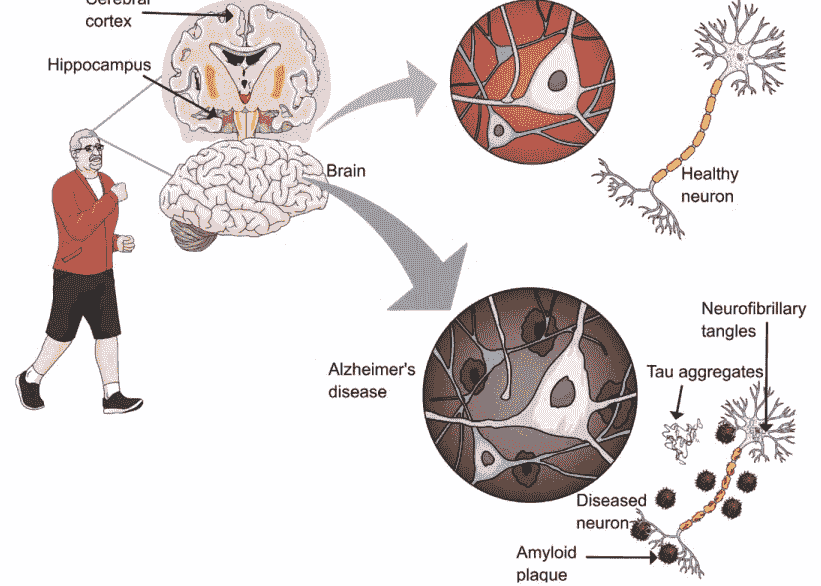

图 4.1 阿尔茨海默病的病理生理学。

脑中 Aβ 斑块和神经纤维缠结的积累会导致神经元功能障碍和死亡，进而导致记忆失败、执行日常活动困难以及阿尔茨海默病的其他症状 [21]。阿尔茨海默病的确切原因在很大程度上仍未知，认为由于遗传、生活方式和环境因素共同共同，这些因素随着时间的推移影响大脑 [22]。

阿尔茨海默病目前没有治愈方法，但有症状治疗药物，研究仍在持续 [10]。目前的治疗侧重于帮助人们维持精神功能、管理行为症状并控制阿尔茨海默病的某些症状 [23]。许多用于治疗它的药物是胆碱碱酯酶抑制剂，它们通过提高脑中细胞间的通信水平起作用 [24]。阿尔茨海默病的治疗格局有限，只有四种乙酰胆碱酯酶抑制剂（AChIs）获得批准用于治疗。这些包括盐扎齐、利伏斯药物碱、加甘明和牛氨酸。这些 AChIs 的主要作用机制是通过抑制负责分解乙酰胆碱的酶来增加乙酰胆碱的浓度。这种神经递质对于记忆和学习功能至关重要，而这些功能在阿尔茨海默病患者中受损严重 [24]。另一种药物通过调节谷氨酸起作用，这是脑中过度产生的另一种通道，会导致细胞死亡 [25]。表 1 总结了针对该病理不同方面的各种药物治疗方法。许多其他方法，抗淀粉样蛋白疗法专注于减少脑中淀粉样蛋白斑块的积累，这是阿尔茨海默病的特征；例如，阿杜形单抗旨在清除这些斑块并可能减缓疾病进展 [26]。同样，靶向 tau 的药物抑制 tau 蛋白聚集，导致神经纤维缠结是阿尔茨海默病的另一个特征；例如，白硫噻铵双甲磺酸（LMT）已被研究用于干扰这些缠结 [27]。除了调节神经炎症，西西西林等药物已被研究用于减少脑炎症，这是阿尔茨海默病进展的已知因素 [28]。神经保护性药物如美孟汀采取了不同的方法，侧重于保护神经元的健康和完整性以减轻疾病的影响 [29]。胆碱酯酶抑制剂（以盐扎齐为代表）通过增强神经通信起作用；它们增加乙酰胆碱（一种关键神经递质）的水平，改善阿尔茨海默病患者的认知功能。所有这些方法及其相应药物强调了管理阿尔茨海默病多种表现和进展所需的多策略策略。除了药物干预，运动、精神刺激和均衡饮食等生活方式干预可能对管理这种疾病发挥作用 [31]。关于神经炎症和免疫系统在阿尔茨海默病中作用的研究仍在，希望未来的治疗能更好地针对这些方面 [32]。尽管目前治疗存在限制，但阿尔茨海默病研究是一个快速发展的领域，新的疗法正在研究中。

#### 4.2.1.2 帕金森病

帕金森病是一种进展性的运动障碍，其症状随着时间的推移继续恶化 [37]。它主要影响运动系统，其症状由于黑质产生多巴胺细胞的丢失导致 [38]。帕金森病的主要症状是手、手臂、腿和面部的震颤；肢体和躯干僵硬；运动迟缓；以及姿势不稳，导致平衡和协调能力障碍 [39]。随着这些症状变得明显，患者在行走、说话或完成简单任务时可能会遇到困难 [40]。

# 表 4.1

阿尔茨海默症的增强治疗药物学靶

| 方法 | 目标 | 描述 | 示例及额外信息 | 参考文献 |
|---|---|---|---|---|
| 抗淀粉蛋白疗法 | 淀粉蛋白斑 | 药物减少大脑中斑块的堆积，可能减缓疾病进展。 | • 示例：Aducanumab<br>• 机制：针对β淀粉样蛋白<br>• 临床试验显示有效性和潜在副作用 | [26, 33] |
| Tau蛋白靶向 | Tau蛋白 | 重点在于抑制形成神经纤维缠结的Tau蛋白聚集，导致神经退行性。 | • 示例：盐甲基噻唑硫酸盐（甲氨磺酸盐）<br>• 在阿尔茨海默症中的作用：防止Tau蛋白聚集<br>• 临床试验和结果强调了疾病改良的潜力 | [34] |
| 神经炎症调节 | 炎症过程 | 旨在减少脑炎症的药物，炎症阿尔茨海默症进展的一个因素。 | • 示例：Minocycle<br>• 机制：调节神经炎症<br>• 在阿尔茨海默症背景下的有效性和安全性研究 | [21] |
| 神经保护剂 | 神经健康 | 设计设计用于保护神经元免受损伤和死亡的药物，可能减缓疾病。 | • 示例：Memantine<br>• 作用：对抗神经退行性<br>• 用法、对疾病进展的影响及临床相关 | [35] |
| 胆碱酯抑制剂 | 乙酰胆碱水平 | 通过增加乙酰胆碱（一种关键神经递质）的水平来增强神经细胞之间的通信。 | • 示例：Donepezil解决轻度至中度病例中的胆碱能缺陷、副作用和局限性 | [36] |

该疾病通常影响60岁以上的人，但也可能早发性帕金森病 [40, 41]。目前，帕金森病尚无治愈，但各种治疗方法可以显著缓解症状 [12]。

帕金森病如图4.2所示，涉及由多巴胺触发的级联事件，导致特征性的运动症状。多巴胺作为化学信使，协调特定大脑回路内的运动。当多巴胺水平下降时，细胞内网络因子失效，路易体（α-突触蛋白聚集体）作为标志性特征出现，对剩余的神经元造成破坏。这些路易体和α-突触蛋白的确切作用仍在研究中，它们被认为会导致多巴胺变性。此外，帕金森病中常见的慢性炎症和氧化应激增加会进一步损伤并杀死神经元。这种炎症反应和自由基的产生加剧了由α-突触蛋白累积造成的损害 [42]。

多巴胺（一种神经递质）的丢失会导致大脑活动异常，从而导致帕金森病症状。患者可能还会经历广泛的非运动症状，如抑郁、疲劳、疼痛、认知障碍、睡眠障碍和自主神经功能障碍。

# AI驱动的药物发现与老药新


**图 4.2** 帕金森病的病理生理学

多巴胺（一种神经递质）的丢失会导致大脑活动异常，从而导致帕金森病症状 [43]。患者可能还会经历广泛的非运动症状，如抑郁、疲劳、疼痛、认知障碍、睡眠障碍和自主神经功能障碍。

该疾病通常影响60岁以上的人，但也可能早发性帕金森病 [40, 41]。目前，帕金森病尚无治愈，但各种治疗方法可以显著缓解症状 [12]。

帕金森病如图4.2所示，涉及由多巴胺触发的级联事件，导致特征性的运动症状。多巴胺作为化学信使，协调特定大脑回路内的运动。当多巴胺水平下降时，细胞内网络因子失效，路易体（α-突触蛋白聚集体）作为标志性特征出现，对剩余的神经元造成破坏。这些路易体和α-突触蛋白的确切作用仍在研究中，它们被认为会导致多巴胺变性。此外，帕金森病中常见的慢性炎症和氧化应激增加会进一步损伤并杀死神经元。这种炎症反应和自由基的产生加剧了由α-突触蛋白累积造成的损害 [42]。

多巴胺（一种神经递质）的丢失会导致大脑活动异常，从而导致帕金森病症状 [43]。患者可能还会经历广泛的非运动症状，如抑郁、疲劳、疼痛、认知障碍、睡眠障碍和自主神经功能障碍。

该疾病通常影响60岁以上的人，但也可能早发性帕金森病 [40, 41]。目前，帕金森病尚无治愈，但各种治疗方法可以显著缓解症状 [12]。

该疾病通常影响60岁以上的人，但也可能早发性帕金森病 [40, 41]。目前，帕金森病尚无治愈，但各种治疗方法可以显著缓解症状 [12]。

该疾病通常影响60岁以上的人，但也可能早发性帕金森病 [40, 41]。目前，帕金森病尚无治愈，但各种治疗方法可以显著缓解症状 [12]。

# 表 4.2

帕金森症的增强治疗药物学靶

| 方法 | 目标 | 描述 | 示例及额外信息 | 参考文献 |
|---|---|---|---|---|
| 多巴胺能疗法 | 多巴胺水平 | 旨在补充模拟多巴胺。 | 示例：左旋多胺常联合比多巴胺 | [X] |
| 单胺氧化酶B (MAO-B)抑制剂 | 多巴胺分解 | 抑制MAO-B酶，减缓分解。 | 示例：Seagiline, rasagiline | [X] |
| 多巴胺激动剂 | 多巴胺受体 | 通过刺激受体模拟多巴胺。 | 示例：Ropinirole, pramipexole | [X] |
| COMT 抑制剂 | 多巴胺代谢 | 抑制COMT酶，延长疗效。 | 示例：Entacapine, tolcapone | [X] |
| 抗胆碱能药 | 乙酰胆碱平衡 | 减少乙酰胆碱活性，平衡水平。 | 示例：Trihexpyrididyl | [X] |
| 安坦汀 | 谷氨酸受体 | 调节谷氨酸传递，具有轻微抗帕金森效果。 | 示例：Amantadine | [X] |


该疾病通常影响60岁以上的人...（省略）[45]。单胺氧化酶B (`MAO-B`)抑制剂 | 多巴胺分解 | 抑制`MAO-B`酶，减缓分解。示例：`Seagiline`, `rasagiline` [46]。多巴胺激动剂 | 多巴胺受体 | 通过刺激受体模拟多巴胺。示例：`Ropinirole`, `pramipexole` [47]。`COMT` 抑制剂 | 多巴胺代谢 | 抑制`COMT`酶，延长疗效。示例：`Entacapine`, `tolcapone` [48]。抗胆碱能药 | 乙酰胆碱平衡 | 减少乙酰胆碱活性，平衡水平。示例：`Trihexpyrididyl` [49]。安坦汀 | 谷氨酸受体 | 调节谷氨酸传递，具有轻微抗帕金森效果。示例：`Amantadine` [50]。

该疾病通常影响60岁以上的人，但也可能早发性帕金森病 [40, 41]。目前，帕金森病尚无治愈，但各种治疗方法可以显著缓解症状 [12]。

该疾病通常影响60岁以上的人，但也可能早发性帕金森病...（省略）[X]。神经炎症调节 | 炎症过程 | 旨在减少脑炎症的药物，炎症阿尔茨海默症进展的一个因素...胆碱酯抑制剂 | 乙酰胆碱水平 | 通过增加乙酰胆碱的水平来增强神经细胞之间的通信...示例：`Donepezil`解决轻度至中度病例中的胆碱能缺陷、副作用和局限性 [36]。神经保护剂 | 神经健康 | 设计用于保护神经元免受损伤和死亡的药物，可能减缓疾病。示例：`Memantine`，作用：对抗神经退行性，用法、对疾病进展的影响及临床相关 [35]。

# 4.2.1.3 亨廷顿症

亨廷顿症是一种遗传性进行性脑疾病，会导致不受控制的运动、情绪问题和思维（认知）丧失 [58]。这种罕见病由单个基因的突变引起 [14]。该疾病是2011年至2022年大量研究的对象。这些研究表明，全球亨廷顿症的发病率约为每10万4.88，95%置信区间为3.38至700 [59]。该疾病的特征是大脑中神经元的逐渐分解，导致运动控制、认知功能和稳定性的下降 [33]。亨廷顿症可能出现在任何年龄段 [59]。该疾病以其广泛的症状为特征，个体之间的症状差异巨大 [60]。最常见的症状包括不自主的抽动或书写动作（舞蹈症）；肌肉问题如僵硬或肌肉收缩（肌张障碍）；异常眼球运动；步态、姿势和平衡受损；以及言语或吞咽困难 [61]。

# AI 驱动的药物发现与药物再利用

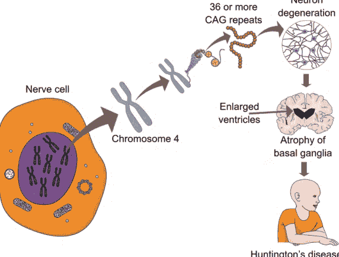

图 4.3 亨廷顿病的病理生理学。

如图 4.3 所示，亨廷顿病是由亨蛋白基因 (`HTT`) 的基因突变引起的，这导致了异常亨蛋白的产生。这种突变涉及基因中鸟嘌呤-腺嘌呤-鸟嘌呤（`GAG`）核苷酸重复的扩张。这种情况下在基因内重复 10 到 35 次，但在亨廷顿病中，它重复了 36 到 120 次以上 [62, 63]。结果是产生了异常版本的亨蛋白，这些蛋白在大脑中积聚，导致神经元变性。这种变性主要影响基底节和大脑皮层，导致与疾病相关的运动、认知和行为障碍 [64]。亨廷顿综合征在神经退行性疾病中是独一无二的，因为它具有遗传预测性；亨廷顿病患者的孩子有 50% 的概率遗传缺陷基因 [65]。目前亨廷顿病尚无法治愈，也没有办法减缓或停止它引起的大脑损伤。然而，目前已有某些治疗方法有助于管理疾病症状并提高生活质量 [66]。

亨廷顿病的治疗侧重于管理症状和提高生活质量 [67]。药物通常用于管理与亨廷顿病相关的情绪障碍。表 4.3 概述了目前治疗亨廷顿病的药理策略。文中重点介绍了针对疾病症状和潜在病因不同层面的几种治疗方法。多巴胺受体阻滞剂在亨廷顿病中很常见，尽管它们可能导致肌张力和精神病等副作用 [68]。谷氨酸调节剂（包括美孟西定）旨在调节谷氨酸，减少兴奋性毒性并提供神经保护益处 [69]。特别是选择性血色蛋白再摄取抑制剂 (`SSRIs`)，如氟西汀；以及去甲肾上上腺再摄取抑制剂 (`SNRIs`)，如杜司西林，也可用于管理与亨廷顿病频繁相关的情绪障碍和抑郁 [70, 71]。针对囊泡单胺转运体 2 (`VMAT2`) 的四西比嗪用于控制舞蹈症，并可用于抑郁 [72]。创新的基因沉默疗法，例如反义寡聚核苷酸 (`ASOs`)，以托米森为主要代表，代表了针对疾病遗传根源的新方法。这些疗法通过减少突变亨蛋白的产生起作用，目前正处于临床研究阶段，可能为改变疾病进展提供途径。

## TABLE 4.3

针对亨廷顿病的增强治疗药理靶点

| 方法 | 靶点 | 描述 | 示例及额外信息 | 参考文献 |
| --- | --- | --- | --- | --- |
| 多巴胺受体阻滞剂 | 多巴胺系统 | 减少与舞蹈和精神病相关的多巴胺相关症状。 | 示例：氟西平，典型抗精神病药物，用于管理舞蹈症，可能产生迟发运动障碍等副作用。 | [68] |
| 谷氨酸调节剂 | 谷氨酸受体 | 旨在调节谷氨酸传递以减少兴奋性毒性。 | 示例：美孟西定，被认为具有神经保护特性并能减少兴奋毒性损伤。 | [69] |
| 抗抑郁药物 | 血清素和去甲肾上腺素水平 | 处理与亨廷顿病常见的的情绪障碍和抑郁。 | 示例：选择性血清素再摄取抑制剂 (`SSRIs`)（如氟西汀）、血清素和去甲肾上腺素抑制剂 (`SNRs`)（如杜司西林），用于管理抑郁和情绪波动。 | [70] |
| 四西比嗪 | 囊泡单胺转运体 2 (`VMAT2`) | 减少释放的多巴胺，从而控制舞蹈症。 | 示例：四西比嗪，专门批准用于亨廷顿舞蹈症，可减少不自主运动，但可能产生抑郁等副作用。 | [72] |
| 基因沉默疗法 | 亨蛋白 | 通过减少突变蛋白的产生来针对潜在遗传原因的新方法。 | 示例：如托米森之类的 `ASOs`，正在进行重点关注改变疾病的临床试验。 | [66] |

### 4.2.1.4 肌萎缩性侧索硬化症

肌萎缩性侧索硬化症，又称为渐格力症，是一种影响大脑和脊髓神经细胞的进展性神经退行性疾病。`ALS` 首次于 1824 年被发现，每年导致全球近 30,000 人死亡 [1]。预测显示 `ALS` 的发病率将显著增加，预计到 2040 年将增加 69% [73]。`ALS` 的特征是运动神经元的逐渐退化和死亡，这些神经元对于控制肌肉运动至关重要 [74]。随着上运动神经元（位于大脑）和下运动神经元（位于脊髓）的死亡，这种神经元的丢失会导致大脑启动和控制运动的能力下降，导致肌肉渐进性无力和萎缩。`ALS` 的发作可能很微妙，患者会逐渐经历肌肉无力、抽搐和痉挛，影响说话、吞咽和呼吸 [75]。`ALS` 的进展因人而异，从诊断之日起，平均预期寿命在二到五年不等。然而，某些 `ALS` 患者可以活十年或更久 [76, 77]。

# AI 驱动的药物发现与药物再利用

(a) 正常神经细胞

细胞体

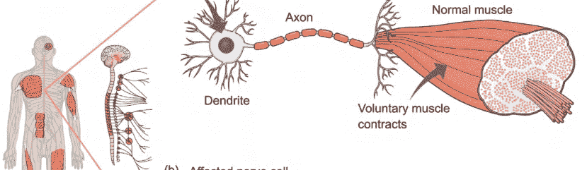

(b) 受影响的神经细胞

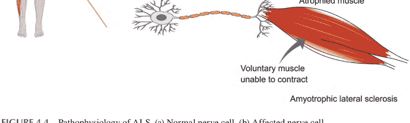

图 4.4 `ALS` 的病理生理学。(a) 正常神经细胞。(b) 受影响的神经细胞。

`ALS` 的确切原因尚不清楚，认为涉及遗传和环境因素的共同作用。在 10% 的病例中 `ALS` 是遗传的，在这些家族病例中，已鉴定出几个基因的突变 [77]。最常见的遗传原因是 `C9orf2` 基因突变，其次是 `SOD1`、`TARDBP` 和 `FUS` 基因突变 [78]。大多数散发性病例的原因尚未知。研究人员正在调查多种因素，包括化学失衡、免疫反应以及神经细胞内的蛋白质处理异常 [79]。`ALS` 的特征是神经元内蛋白质异常积聚 [80]。

目前 `ALS` 尚无治愈方法，治疗重点在于管理症状和维持生活质量。表 4.4 提供了治疗 `ALS` 的增强药理方法的概述。瑞鲁吉定针对谷氨酸释放，是一种重要的治疗方法；这种首次批准用于 `ALS` 的药物在延长患者寿命方面显示了效果 [73, 81]。抗氧化疗法（以依达拉酮为示例）针对被认为会导致 `ALS` 进展的氧化应激。这种疗法已被证明可能减缓功能下降 [82]。表 4.4 还强调了对抗炎药物（如��皮素）的持续研究，旨在减轻 `ALS` 的进展 [83]。基因疗法代表了一种前沿方法，针对家族性 `ALS` 的特定突变。针对 `SOD1` 或 `C972` 的 `ASOs` 正处于实验阶段，反映了 `ALS` 治疗向个性化的转变。干细胞治疗仍处于临床试验阶段，通过可能使用干细胞再生或修复神经元，为神经再生提供了一条良好的途径 [84]。这些都反映了应对 `ALS` 挑战的持续努力和创新，为未来更有效的治疗方法带来了希望。

## 4.2.2 药物发现与再利用的传统方法

传统的药物发现流程是一个复杂且多层过程，通常跨越十年，并涉及大量资源。通常，靶点识别和验证涉及识别并确认与疾病相关的生物靶点，通常是蛋白质或基因 [86]。其原理是通过药物调节该靶点产生治疗效果。这一阶段至关重要，需要对遗传学、分子生物学和细胞生物学等领域有深入理解 [87]。验证靶点后，研究人员进行高通量筛选，测试化合物库与靶点相互作用。这开启了先进机器人、数据处理和敏感传感器的应用，以快速评估数千种化合物 [9]。

确定化合物后，下一阶段是先导化合物优化。在此阶段，研究人员专注于改进化合物的性质以提高其作为药物的有效性。这涉及优化其结合、增加体内稳定性、减少潜在副作用以及提高其到达体内靶点的能力。这种优化过程需要一系列迭代循环，对化合物进行化学修改、测试和完善。一旦候选药物在这些临床前试验中显示出前景，就会进入临床试验，在人体中进行严格测试，以评估药物的安全性、有效性、剂量和副作用。临床试验通常分为三个阶段：I 期试验评估少数人群；II 期试验评估有效性和副作用；III 期试验则在更大人群中将新药与标准疗法进行比较。这种规模化不仅耗时，而且昂贵，成本高达数十亿美元 [9]。

# AI 驱动的药物发现与老药新

药物重用（Drug repurposing），也称为药物重新定位，为传统的药物发现过程提供了一种更高效的替代方案。这种方法涉及测试已批准用于某种疾病的现有药物对其他疾病的疗效。药物重用的优势在于，这些药物已经通过了传统研发流程中的几个关键阶段，特别是人体的安全性测试。这种方法可以显著缩短药物用于新用途上市的时间和成本 [86]。然而，药物重用也并非没有挑战。一个主要问题是药代动力学——即药物在体内的吸收、分布、代谢和排泄方式——可能与新的治疗用途不兼容。此外，针对一种疾病的安全性测试在用于治疗另一种疾病时可能会产生不可预见的副作用。此外，识别新疾病通常需要对疾病有深入理解以及创新的筛选策略 [88]。

尽管面临这些挑战，药物发现和药物重用仍然是开发新疗法的关键策略。计算工具和信息学的演进不断增强这些过程。近年来，将 `AI` 和 `ML` 技术整合到这些传统方法中的兴趣日益增加，旨在提高它们的效率和成功率 [9]。这些进展有望加速新药的发现和现有药物的重用，可能为药物开发领域带来新活力。

## 4.2.3 人工智能基础

人工智能代表了解决问题和数据分析方法上的突破性转变，标志着对传统计算方法的重大偏离。`AI` 的核心是开发计算机系统，使其能够执行通常需要人类智能完成的任务。这些任务包括学习、推理、解决问题和语言理解 [13]。`AI` 系统旨在模拟人类认知功能，使其能够解释复杂数据、从数据中学习并根据积累的知识做出明智决策。`AI` 的本质在于其能够快速高效地处理海量信息，这远超人类在特定任务中的认知能力 [7]。

`AI` 的一个关键子集是机器学习，它允许系统在没有显式程序编程的情况下从经验中学习并改进。`ML` 专注于开发能够自我学习并利用其所学问问的计算机程序。学习过程始于观察或数据，例如示例、经验或指令。`ML` 算法随后在数据中寻找模式，并根据处理过的示例在未来做出决策。暴露的数据越多，它学得就越多，随着时间的推移也变得越来越准确 [16]。这种从数据中学习的能力使得 `ML` 特别适用于编程和显式规则算法具有挑战性或不可行的应用。

深度学习是 `ML` 的更高级的子集，涉及具有若干层（“深”）的神经网络。这些神经网络灵感来自大脑的结构和功能，旨在模拟人类学习和处理信息的方式。通过持续分析具有逻辑结构的数据，深度学习算法试图得出与人类相似的结论。它们在处理和学习大量非结构化数据方面特别有效。深度学习是驱动 `AI` 许多最新进展的辅助工具，包括语音识别、图像识别和自然语言处理 (`NLP`) [10]。

在药物发现的背景下，`AI`（特别是 `ML` 和深度学习）具有巨大的潜力。它可以极大地加速药物发现过程的各个方面 [89]。例如，`AI` 算法可以预测不同药物如何与生物靶标相互作用，识别潜在的新治疗靶标，并建议修改现有分子结构以提高疗效或减少副作用。这种方法对于理解复杂的生物系统和疾病通路特别有用，因为传统的实验方法可能既耗时又贵 [90]。通过快速分析大型数据集，`AI` 可以发现人类研究人员可能未觉的模式和关系，为治疗干预开辟新途径。`AI` 快速处理和分析海量数据的能力使其成为现代制药行业的强大工具，具有显著缩短药物开发周期并为患者快速提供有效治疗的潜力。

# 神经退行性疾病的机器学习

## 4.3 AI 驱动的药物发现的进展

`AI` 整合到药物发现开启了生物医学的新时代。图 4.5 显示了神经退行性疾病背景下 `AI` 驱动的药物发现过程概览，说明了一个由 `AI` 技术显著增强的多阶段过程。在靶标识别和验证的初始阶段，`AI` 算法遍历生物数据寻找潜在的药物靶标。同时，`ML` 模拟特定基因或蛋白质在神经退行性疾病中的参与情况，简化了药物发现中这一关键的初始步骤。转向药物设计和优化，`AI` 驱动的分子建模创建新的候选药物，`ML` 则优化这些化合物以增加效效并最小化毒性。在随后的筛选和识别阶段，`AI` 系统快速探索大型化学库以识别潜在的活性化合物（hits），深度学习辅助预测这些候选药物与生物靶标之间的相互作用。先导优化使 `AI` 模型分析结构活性关系以增强先导化合物，并结合：

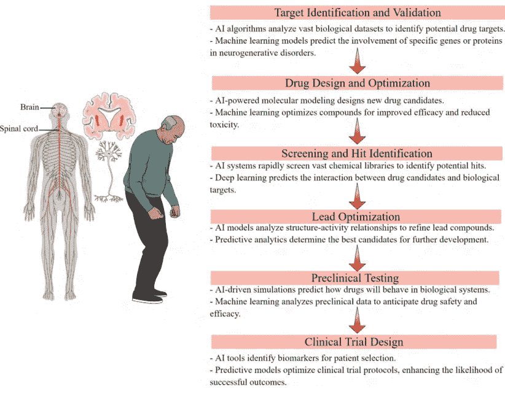

| 靶标识别与验证 |
| :--- |
| `AI` 算法分析海量数据集以识别潜在药物靶标。 |
| 机器学习模型预测特定基因或蛋白质在神经退行性疾病中的参与情况。 |
| 药物设计与优化 |
| `AI` 驱动的分子建模设计新的候选药物。 |
| 机器学习优化化合物以提高效率并降低毒性。 |
| 筛选与识别 |
| `AI` 系统快速扫描化学库以识别潜在的活性化合物。 |
| 深度学习预测候选药物与生物靶标之间的相互作用。 |
| 先导优化 |
| `AI` 模型分析结构活性关系以完善先导化合物。 |
| 预测性分析确定进一步开发的最佳候选。 |
| 临床前测试 |
| `AI` 驱动的模拟预测药物在生物系统中的行为。 |
| 临床试验 |
| `AI` 工具识别用于筛选的生物标志物。 |
| 预测性分析预测安全有效性。 |

图 4.5 `AI` 驱动的药物发现过程概览。

`AI` 驱动的模拟预测药物在生物系统中的行为。临床试验：`AI` 工具识别用于筛选的生物标志物。预测性分析预测安全有效性。

## 4.3.2 靶识别

识别合适的靶（如特定蛋白、RNA 分子或信号通路）是药物发现过程中的基础步骤。药物的疗效很大程度上取决于其与其预期目标有效相互作用的能力，这些目标通常是疾病病理学中的关键组成 [98]。在传统的药物发现方法中，靶识别往往耗时耗力，并且严重依赖实验生物学和对疾病机制的深度理解。然而，随着 `AI` 技术的整合，药物靶识别的格局正在发生重大变化 [9]。

`AI` 中的机器学习算法特别擅长提取大量的遗传和分子数据以预测潜在药物靶点。这些算法可以分析复杂数据集，包括基因表达谱、蛋白质-蛋白质相互作用网络信息以及分子通路各个方面的信息。`AI` 可以提出被传统方法忽略的新靶点 [99]。从全基因组关联研究 (`GWAS`) 到与特定疾病相关的基因，基因或蛋白质都可能成为新药的潜在靶点 [100]。除了发现新靶点，`AI` 还可以评估现有靶点，可能识别出额外的遗漏或建议修改它们的新方法。这种发现可能导致药物重用，即将现有药物应用于新的治疗领域 [12]。

`AI` 靶识别的强大不仅在于其分析数据的能力，还在于其预测药物-靶相互作用结果的潜力 [101]。例如，复杂的 `AI` 模型可以模拟分子如何在原子水平上与靶相互作用，为药物的潜在效率和特异性提供见解。这些预测可以帮助在药物开发的早期确定优先追求的靶点，减少实验验证所需和资源 [7]。此外，`AI` 可以识别癌症或神经退行性疾病等复杂疾病的靶点，这些疾病可能涉及多个基因和通路 [102]。通过分析来自各种来源的数据（包括遗传谱和临床史等患者数据），`AI` 模型可以识别这些复杂网络中的关键分子靶。这些见解为更有效和个性化的治疗提供了可能 [103]。随着 `AI` 技术不断演进和与生物医学相结合，它们有望彻底改变新型、更有效治疗剂的发现和开发。

## 4.3.3 分子对接模拟

分子对接模拟在药物发现过程中至关重要，它允许科学家预测小分子（如候选药物）如何与生物靶（通常是蛋白）相互作用。分子对接的核心目标是确定分子与受体结合位点的匹配程度，即为锁寻找正确的钥匙。这个过程不仅涉及识别分子的取向（构象），还涉及估计分子与靶结合的强度（结合亲和力） [104]。传统上，分子对接是一项计算密集型任务，通常需要大量的时间和资源。这一过程涉及扫描庞大的构象空间以预测最佳结合构象和亲和力，这需要巨大的计算能力和复杂的算法 [105]。

`AI` 驱动方法（尤其是深度学习模型）的出现，为分子对接模拟带来了变革性的变化。这些 `AI` 模型在蛋白-配体相互作用的大型数据集上进行训练，并利用这种训练预测新候选药物的结合构象和亲和力。`AI` 的优势（特别是在深度学习方面）在于其处理和学习复杂高维数据的能力，使其能够以很高的准确性预测分子相互作用 [106]。例如，深度学习模型可以分析来自数千个蛋白-配体复合物的结构数据，并学习决定分子如何与蛋白结合的模式。通过应用这些模式，`AI` 模型预测新候选药物的结合取向和亲和力的速度通常比传统的计算对接方法快得多。这种方法在高通量筛选场景中特别有利，在这些情况下需要在短时间内评估成千上万种化合物 [89]。

此外，`AI` 驱动的分子对接模拟质量等同或优于传统方法。这种改进部分归于学习模型能够考虑影响结合的广泛相互作用和因素，包括蛋白的细微变化和配体结合的动态方面 [106]。此外，`AI` 模型整合了先进技术，例如强化学习，系统通过试错过程学习最佳对接策略 [13]。这种方法允许开发传统方法未考虑过的新颖 `AI` 分子策略。重要重要的是，这些 `AI` 驱动的模拟可以揭示潜在的脱靶效应，即药物可能会结合到非预期的蛋白上，从而导致副作用 [107]。`AI` 模型通过预测这些脱靶相互作用，帮助设计更具特异性且更安全的药物。这种优势不仅加速了药物发现，还增加了识别有效且安全候选药物的概率，可能减少与新药上市相关的时间和成本。


## 4.3.4 用于药物设计的生成模型

AI 中的生成模型，特别是生成对抗网络 (`GANs`) 和变分自编码器 (`VAEs`)，代表了药物设计领域的一种革命性方法。这些模型是无监督模型，系统经过训练以生成与输入数据相似的新数据 [103]。在药物发现的背景下，生成模型在海量的分子结构及其属性库上进行训练，使其能够生成具有所需特征的新型、类药物分子。`GANs` 通过这种独特的架构实现这一目标，该架构由生成器和判别器两个网络组成，它们之间进行相互竞争。生成器创建新的分子结构，而判别器则根据真实数据评估结构的真假。这种竞争驱动着生成器产生越发准确、越真实的结构 [108]。

`VAEs` 为生成新的分子结构提供了另一种方法。`VAEs` 经过训练，将分子编码到低维潜空间，并将该表示重新解码为分子结构。通过探索这一潜空间，`VAEs` 可以从已知分子进行插值和外推，创建出对于治疗神经退行性疾病具有所需化学或生物活性的新结构，例如血脑屏障渗透性、受体结合亲和力或代谢稳定性。这种针对性设计使得创建不仅有效而且安全性更高的候选药物成为可能 [110]。

## 4.3.5 计算机筛选 (IN SILICO SCREENING)

计算机筛选是一种计算技术，在药物发现领域变得越来越重要。计算机模拟可用于从海量的化合物库中评估和预测潜在的候选药物。这种方法作为一种强大的工具，可以快速缩小需要在实验室测试的潜在药物列表，从而节省时间和资源 [112]。人工智能（特别是深度学习算法）的整合显著增强了计算机筛选的能力。这些 AI 算法可以分析大量的化合物库，预测未处理化合物的生物学活性，并对其进行优先排序以供进一步研究。这一过程在神经退行性疾病背景下特别有利，因为其生物靶点可能复杂，且对有效治疗方法的需求紧迫 [13]。

AI 中的深度学习算法特别擅长识别大型数据集中的模式和关系。通过对药物-靶点相互作用数据库进行训练，这些算法可以预测未经测试的可能如何与神经退行性疾病相关的靶点作用 [113]。例如，AI 模型可以预测哪种化合物可能抑制与阿尔呆症相关的蛋白。这种预测不仅基于化合物的结构，还基于多种因素，例如它们的化学性质、生物利用度和潜在毒性。AI 高速处理和分析多样化数据的允许研究人员识别出使用传统筛选方法可能会忽略的极前景化合物 [114]。

除了识别新候选药物外，计算机筛选还可以更好地了解现有药物。AI 可以帮助阐明这些药物如何与其生物靶点相互作用，并预测潜在的脱靶效应。这种知识对于药物重用（drug repurposing）工作至关重要，即对现有药物针对不同疾病的疗效进行测试 [115]。例如，一种批准用于治疗某种癌症的药物可能被 AI 模型预测可帮助定义治疗特定神经退行性疾病的功效。通过计算机筛选已知的药物化合物，研究人员可以快速识别重用试验的候选药物，显著加速药物开发过程。这种方法不仅简化了新药的发现，还为重用揭示了新的可能性，扩大了治疗挑战性疾病的潜在药物库 [10]。随着 AI 技术的不断发展，其与计算机筛选的整合有望彻底改变药物发现和开发的可用工具，开启快速高效的药学创新新时代。

## 4.4 AI 驱动的药物重用 (AI-DRIVEN DRUG REPURPOSING)

### 4.4.1 药物重用概述

药物重用，通常称为药物重新定位（drug repositioning），是药物开发中的一种策略，对已批准用于某种疾病的现有药物进行其治疗其他状况的有效性测试。这种方法利用了这些药物已知的安全性和药代动力学数据，与新药相比，可能缩短通临床应用的路径并显著降低开发成本。药物重用的原理是，许多药物具有多个生物学靶点，对在最初开发期间未考虑的各种疾病有效 [16]。这种策略在神经退行性疾病领域特别有吸引力，因为由于这些疾病的复杂性，发现新的有效药物在历史上一直是一项挑战性任务。

目前，美国食品药品监督管理局（FDA）批准用于治疗各种疾病的新药和疫苗中，约有 30% 被重用，证明了药物重用在现代药理治疗中的重要性 [8]。药物重用涉及寻找现有药物的新用途，主要可以通过两种方法实现：以药物为中心和以疾病为中心。

以药物为中心的方法侧重于理解和扩大已知药物的潜在应用，探索其在最初批准适应症之外的情况的疗效。这种方法利用了关于药物安全性和机制的现有知识 [116]。另一方面，以疾病为中心的方法从对特定疾病（无论是新发的还是已停止的）的搜索开始，寻找可能对其有效的治疗方法。这种方法对于识别缺乏有效疗法的疾病治疗特别有用。这两种方法都可以通过实验方法（如临床试验和计算机研究）进行研究和促进，计算模型和模拟预测药物在不同场景下的有效性和安全性 [12]。这些计算方法对于快速有效地筛选大量化合物特别有价值，使其成为现代药物重用策略的关键组成部分。

图 4.6 展示了传统药物重用与 AI 增强型药物重用的对比分析。它清晰地表示了这些对比的方法，并特别关注神经退行性疾病的处理。在传统方法中，药物重用始于手动文献综述和假设形成。随后是劳动密集型的实验室测试、数据分析以及使用传统方法设计临床试验，这通常会导致漫长且昂贵的过程。相比之下，AI 增强型方法利用自动化先进算法进行数据聚合和预测建模。这加速了假设的生成和针对性的实验室测试。此外，AI 在优化临床设计方面发挥着至关重要的作用，显著提高了效率和成本效益。

药物重用中实验方法与计算机方法的整合不仅加速了寻找新治疗方法的过程，还显著减少了开发成本和时间，这在解决紧迫医疗需求时尤为重要 [87]。

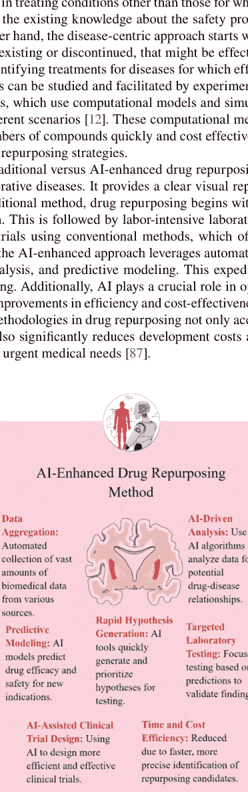

图 4.6 传统与 AI 增强型药物重用的对比分析。

AI 技术在药物重用中的整合显著提高了识别现有药物新治疗用途的效率和准确性。AI 算法可以分析包含药物结构、靶点和对各种疾病影响的大型数据集。AI 模型可以通过检查这些数据集来发现隐藏的关系并预测现有药物的新用途 [7]。例如，由 AI 开发的治疗高血压药物可能用于其他状况。AI 驱动的分析可以快速筛选现有药物的新应用，使其成为识别治疗手段有限疾病的强大工具。

药物重用的一个著名案例是西地那非（sildenafil），它最初开发用于治疗心绞痛，后被重用于治疗勃起功能障碍。AI 驱动的分析还导致了药物在神经退行性疾病中的重用 [17]。在这些情况下，AI 不仅识别了新用途，还帮助理解作用机制。尽管面临挑战，但 AI 在变革药物重用（特别是在复杂领域）方面的潜力巨大的，并随着技术的进步持续增长。

### 4.4.2 药物重用的数据来源

AI 驱动的药物重用严重依赖多样化且全面的数据来源识别现有药物的新应用。第一个关键数据源是药物库，包含了有关分子结构、药效动力学和药代动力学的详细信息。这些库是记录了大量化合物的广泛仓库。通过分析这些数据，AI 算法可以识别出可能对其他疾病有效的药物属性。例如，一种用于治疗心血管疾病的药物由于其分子结构和生物活性，可能用于治疗神经退行性疾病。AI 可以分析这些属性以发现新的药物-疾病关系 [118]。

药物重用的另一个数据源是临床试验数据。这包括过去和正在进行的临床研究的详细记录，涵盖了药物疗效、副作用、剂量方案和患者结果的数据。临床试验数据库对于理解药物在现实场景中的表现以及获得其潜在用途的见解具有无价之宝。AI 算法可用于发现暗示新治疗应用的模式和相关性。例如，一种药物在临床试验中其主适应症疗效有限，但在次要状况上表现出积极效果，则可能是重用的候选药物 [119]。

生物医学文献代表了巨大的知识库，涵盖发现、专家意见和案例研究。这些文献包括发表的论文、会议论文和其他文章，提供了疾病机制、药物-疾病相互作用以及医学研究进展的见解。具备自然语言处理能力的 AI 算法可以分析非结构化文本数据，提取相关信息，并将这些信息与其他来源的结构化数据整合。这种分析可以揭示药物与疾病之间尚未明确研究的联系 [69]。

患者数据库也是药物重用的关键数据源，特别是对于收集说明书外（off-label）药物的影响。这些数据库包含了来自医疗保健环境的现实数据，包括患者人口统计数据、治疗史、结果和副作用。

# AI 驱动的药物发现与老药挖掘

通过分析这些数据中的模式，AI 可以识别出对其处方之外的其他疾病可能具有益处的的药物 [119, 120]。例如，一种用于代谢性疾病的药物可能在改善患者认知功能方面表现出意想不到的益处，这表明它具有开发用于治疗神经退行性疾病的老药的潜力 [121]。

将这些异构数据源整合到适用于 AI 分析的统一格式中是一项重大挑战，需要复杂的的数据整合技术。这一过程涉及数据源标准化、解决不一致性，以及协调从分子结构到临床观察的各种类型。这些数据源的整合允许 AI 进行全面分析，充分考虑药物的多个事实和疾病的特征。这种整合方法能够基于对药物及其可能导致的疾病的广泛理解，识别出老药挖掘的机会。这种数据整合是利用 AI 潜力进行老药挖掘的关键步骤，为开发新型治疗策略铺平了道路，特别是在神经退行性疾病等复杂领域。

此外，将中医药、阿育吠陀医学和传统泰国医学的原理和特征整合到 AI 驱动的药物发现和老药挖掘中，为解决神经退行性疾病提供了一种综合方法。每种传统医学都有独特的视角和丰富的知识，与现代 AI 技术结合时将是无价的。图 4.7 说明了这些传统医学在 AI 驱动的神经退行性疾病药物发现和老药挖掘中的重要性。中医、阿育吠陀医学和传统泰国医学在 AI 驱动的神经退行性疾病药物发现和老药挖掘中共同发挥着关键作用。

## 多种生物活性化合物

中医、阿育吠陀医学和传统泰国医学拥有大量的植物、草药和其他物质，含有多种生物活性化合物。这些化合物是药物发现的宝贵来源，特别是对于涉及多种途径的神经退行性疾病等复杂疾病。

## 整体法

中医、阿育吠陀医学和传统泰国医学通常关注治疗系统而非仅仅是症状。这种整体法可以对导致神经退行性疾病的系统性因素提供见解，提供新的治疗靶点。

## 协同组合

中医、阿育吠陀医学和传统泰国医学经常使用具有协同效应的草药组合。AI 可以分析这些组合，识别出对治疗神经退行性疾病可能有效的潜在协同作用。

## 历史与经验数据

中医、阿育吠陀医学和传统医学中数十年的经验观察和历史文献可以数字化并使用 AI 进行分析，为识别潜在治疗方法提供丰富的信息。

## 高通量筛选

AI 可以高效筛选中医、阿育吠陀医学和传统泰国医学化合物的大库，寻找与神经退行性疾病相关的生物活性，快速识别出具有进一步研究价值的候选药物。

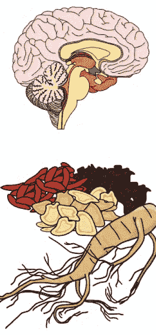

图 4.7 中医、阿育吠陀医学和传统泰国医学在 AI 驱动的神经退行性疾病药物发现和老药挖掘中的重要性。这些传统医学体系提供了多种生物活性化合物的植物、草药和其他物质，使其对于涉及多种生物途径的神经退行性疾病等复杂疾病具有特别价值。中医通过治疗整个系统而非仅仅是症状的整体法，对导致神经退行性疾病的系统性因素提供了独特的见解，从而提供了新的靶点。同样，强调身体平衡和自然疗愈的阿育吠陀医学，以及以独特的草药和整体实践闻名的中医，对理解和治疗复杂疾病做出了贡献。这些传统实践以其多种草药的协同效应而闻名，AI 可用于识别神经退行性疾病的潜在有效治疗方法。

从中医、阿育吠陀和传统医学数世纪实践中获得的历史和经验数据可以数字化并利用 AI 进行，为识别潜在治疗方法提供丰富来源。银杏（Ginkgo biloba L.）因含有黄酮类和萜类化合物，对其对阿尔茨海默症的潜在神经保护作用进行了研究 [124]。在阿育吠陀医学中，如假醉（Brahmi）和睡茄（Ashvagandha）等草药传统上用于增强认知，可以通过 AI 分析其功效和机制。同样，泰国草药，如细山姜（Kaempferia parviflora Wall），其治疗神经退行性疾病的潜力已得到探索 [125]。AI 可以阐明姜黄中的姜黄素在跨越这些传统实践时，如何调节帕金森病中的炎症通路 [126]。

AI 从这些传统系统中制定配方和化合物的能力，对于识别活性化合物并预测它们对神经退行性疾病的作用和影响至关重要。

## 4.5 应用

### 4.5.1 AI 在阿尔茨海默病研究中的

阿尔茨海默病以记忆丧失和认知下降为特征，给全球医疗系统和研究人员带来了巨大挑战 [17]。该疾病病变的复杂性以及对早期诊断和有效治疗的需求，使其成为 AI 技术（特别是机器学习 ML 和深度学习）的应用理想领域。

开发阿尔茨海默病有效治疗方法的尝试在复杂性和财务投资方面面临着巨大挑战。据估计，新型阿尔茨海默症药物的研发成本约为 57 亿美元，几乎是癌症药物的几倍 [1]。该领域最近获得 FDA 批准的药物是阿杜单单抗（aducanumab），针对淀粉蛋白单克隆抗体。其主要作用是减少脑中 β-淀粉蛋白的积累。尽管这种治疗方法异常昂，预计每年花费 55,000 美元，且主要适用于具有淀粉蛋白沉积的阿尔茨海默病早期患者。

现有疾病的老药挖掘已成为一种非常有前景且更具成本效益的策略。这种方法利用已批准用于其他疾病的药物，利用其已证的安全性。这种方法降低了与药物毒性相关的风险，并加速阿尔茨海默病新治疗方法的开发。

### 4.5.2 强化学习

这种机器学习 ML 涉及通过试错学习最佳行动的算法。在老药挖掘中，强化学习算法可以引导最有前景的候选药物。例如，基于强化学习的模型可能会根据反馈探索不同的药物。

### 4.5.3 网络分析

网络分析是一种强大的方法，涉及研究生物网络内部的关系和相互作用，例如蛋白质蛋白质相互作用、遗传网络或代谢通路。AI 算法可以通过分析这些网络识别药物与疾病之间的隐藏连接。

AI 产生影响的一个重要领域是识别阿尔茨海默病的生物标志物。生物标志物是通常在血液或脑脊液中检测到的生物指标，可以指示疾病的存在或风险 [15]。这些算法可以用于寻找

# 针对神经退行性疾病的机器学习

通过海量数据集识别可能指示阿尔茨海默病早期的模式和相关性 [15, 129]。例如，AI 模型已用于识别阿尔茨海默病患者中更常见的特定蛋白或基因突变，这些可用于诊断或评估患该病的风险。早期检测对于阿尔茨海默病的管理至关重要，因为它允许更早的干预，并可能实现更有效的治疗 [130]。

AI 在阿尔茨海默病研究中的另一个关键应用是目标预测。机器学习模型特别擅长处理和解释复杂的生物化学和药学数据，以预测新疗法的潜在目标 [131]。通过分析其他蛋白质以及导致阿尔茨海默病病变的遗传因素的数据，这些模型可以预测哪些蛋白质最可能导致淀粉蛋白斑或缠结的形成，这些是阿尔茨海默病的特征。识别这些靶点是开发能够停止或逆转疾病进展药物的关键步骤 [17]。

此外，AI 驱动的平台显著提高了阿尔茨海默病药物开发中化合物筛选的效率。这些平台可以快速对海量化合物库进行计算机筛选（in silico screening），以识别出最可能对已识别靶点有效的化合物。这一过程不仅加速了潜在候选药物的发现，还减少了传统药物筛选方法的投入成本和时间。AI 算法可以评估化合物的结构，预测其与靶点的相互作用，并评估其潜在效力和安全性。这种方法使研究人员将精力集中在最有的化合物上，简化了通临床试验和最终药物开发的路径 [132]。

截至 2023 年 12 月 29 日，对 ClinicalTrials.gov 的全面检索显示，共有 3,929 项与阿尔茨海默病相关的研究，反映了全球的研究努力（图 4.8）。这些研究跨越不同的大洲和地区，其中北美的研究数量领先（1,837 项），包括美国 1,724 项，加拿大 273 项，墨西哥 35 项。欧洲贡献了大量研究，共 922 项，而东亚占 417 项，包括 112 项特定的

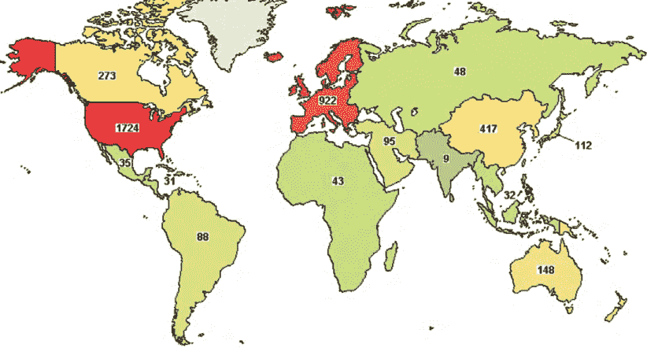

图 4.8 截至 2023 年 12 月 29 日全球阿尔茨海默病研究分布。该地图展示了在 ClinicalTrials.gov 上的与阿尔茨海默病相关的研究数量，强调了全球各个地区（包括北美、欧洲和东亚）的努力。（来源：https://clinicaltrials.gov/）

研究过程延伸到其他地区，非洲有 43 项研究，中东 95 项，中美洲 31 项。在太平洋地区（太平洋地区）有 148 项研究，南美有 88 项。北亚和东南亚贡献了 48 项研究，南亚为全球研究格局增了 9 项。这种地理分布强调了全球范围内阿尔茨海默病研究的广泛性和多样性。

表 4.5 与于从 [ClinicalTrials.gov](https://clinicaltrials.gov/) 获取的 AI 驱动药物发现和再利用数据有关，强调了多项针对阿尔茨海默病的三期临床试验。每项试验都在研究一种增加大脑中乙酰胆碱水平的胆碱酯酶抑制剂——加兰尼敏（Galantamine），在 NCT01478633 中进行评估，旨在减轻对多奈齐无反应患者的痴呆症状。利伏斯敏（Rivastigmine, NCT01585272）采用胆碱酯酶抑制机制来增强认知功能，并测试了从口服剂转为经皮贴剂时的耐受性。甲基苯西定（Methylphenidate）在 NCT03811847 中被研究，代表了中枢神经系统的一种新方法

## 表 4.5 阿尔茨海默病选定的三期临床试验——突出 AI 驱动的发现与再利用

| 试验 ID | 药物名称 | 临床试验名称 | 作用机制 | 阶段 | 状态 |
|---|---|---|---|---|---|
| NCT01478633 | 加兰尼敏 (Galantamine) | 在对多奈齐未获益的阿尔茨海默型痴呆患者中评估加兰尼敏的有效性和 | 加兰尼敏是一种胆碱酯酶抑制剂，有助于增加大脑中乙酰胆碱水平。 | 三期 | 已完成 |
| NCT01585272 | 利伏斯敏 (Rivastigmine) | 从口服切换到经皮贴剂前后利伏斯敏的耐受性 | 利伏斯敏在阿尔茨海默病治疗中作为胆碱酯酶抑制剂。它通过防止乙酰胆碱的分解发挥作用，乙酰胆碱是对记忆和学习重要的神经递质。 | 三期b | 已完成 |
| NCT03811847 | 甲基苯西定 (Methylphenidate) | 甲基苯西定在轻度认知障碍和痴呆参与者中的试点 | 甲基苯西定主要作为中枢神经系统刺激剂。虽然传统上用于阿尔茨海默病，但其机制涉及增加大脑多巴胺和去肾上腺激素等神经递质的水平。 | 三期 | 已完成 |

## 表 4.5（续）

## 阿尔茨海默病选定的三期临床试验——突出 AI 驱动的药物发现与再利用

| 试验 ID | 药物名称 | 临床试验名称 | 作用机制 | 阶段 | 状态 |
|---|---|---|---|---|---|


| `NCT0007189` | 萘普芬 (Naproxen), 昔洛布 | 阿尔茨海默病抗炎预防试验 | 萘普芬和昔洛布都是非甾体类抗炎药物 (NSAIDs)。它们通过减少炎症起作用，炎症被认为在阿尔茨海默病中起作用。 | 三期 | 已完成 |

| `NCT00322153` | 美甘奈定 (Memantine) | 美甘奈定在中度至重度阿尔茨海默病中的安全性研究 | 美甘奈定作为 NMDA 受体拮抗剂，通过调节谷氨酸（神经递质）帮助治疗阿尔茨海默病。 | 三期 | 已完成 |

| `NCT04464564` | AVP-786 (盐酸曲替胺盐 [d6-DM]/喹酸 [Q]) | 用于治疗痴呆烦躁的 AVP-786 的有效性、耐受性研究 | AVP-786 含有盐酸曲替胺盐 (d6-DM) 和喹酸 (Q)，是一种影响中枢神经系统活动的化合物。 | 三期 | 进行中 |

| `NCT05256134` | 甘瑞单抗 (Gantenerumab) | 在阿尔茨海默病早期高风险患者中评估甘瑞单抗的有效性和安全性 | 甘瑞单抗是一种旨在结合并促进β淀粉蛋白斑块清除的抗体，这是阿尔茨海默病患者大脑的特征。 | 三期 | 已终止 |

| `NCT02547818` | ALZT-OP1 | 阿尔茨海默病受试者中 ALZT-OP1 的安全性和有效研究 | ALZT-OP1 是涉及 ALZT-OP1a (cromolyn) 和 ALZT-OP1b (ibuprofen) 的联合治疗。cromolyn 以其抗炎特性闻名，而 ibuprofen是非甾体抗炎药物。 | 三期 | 已完成 |

AI 驱动的发现与再利用 增加多巴胺和去肾上腺激素等神经递质水平的刺激剂，可能有助于认知障碍。阿尔茨海默病抗炎预防试验 (`NCT00007189`) 研究了萘普芬和昔洛布，两者都是非甾体抗炎药物 (NSAIDs)，针对阿尔茨海默病的病源。甲基苯西定 (`NCT03811847`) 代表了一种通过中枢神经系统刺激剂增加多巴胺和去肾上腺激素等神经递质水平的新方法，可能有助于认知障碍。阿尔茨海默病抗炎预防试验 (`NCT00007189`) 研究了萘普芬和昔洛布，两者都是非甾体抗炎药物 (NSAIDs)，针对阿尔茨海默病的病源。美甘奈定 (`NCT0322153`) 作为 NMDA 受体拮抗剂，通过调节谷氨酸（神经递质）帮助治疗阿尔茨海默病。VP-786 (`NCT0446564`) 含有盐酸曲替胺盐 (d6-DM) 和喹酸 (Q)，是一种影响中枢神经系统活动的化合物。甘瑞单抗 (`NCT05256134`) 是一种旨在结合并促进β淀粉蛋白斑块清除的抗体，这是阿尔茨海默病患者大脑的特征。ALZT-OP1 (`NCT02547818`) 是一种涉及 ALZT-OP1a (cromolyn) 和 ALZT-OP1b (ibuprofen) 的联合治疗。cromolyn 以其抗炎特性闻名，而 ibuprofen 是非甾体抗炎药物 (NSAID)。

### 4.5.2 帕金森病研究中的 AI

AI 在帕金森病研究中的应用代表了在理解和管理这种神经退行性疾病方面的重大进展。帕金森病主要以其对运动控制的影响而称，会导致震颤、僵硬和运动缓慢等症状，这些症状会严重损害生活质量。凭借其复杂的数据分析能力，AI 技术正以创新的方式推进帕金森病研究。

AI 在帕金森病研究中的主要用途是分析症状，特别是通过使用可穿戴技术。传感器收集大量的运动数据，这些数据可以通过 AI 算法进行分析，以诊断和监测症状进展 [133]。例如，AI 可以分析可穿戴设备中的加速度计陀螺仪的数据，检测并量化震颤、步态异常和其他运动症状。这种技术比传统的评估方法允许更客观、持续和精确的监测。通过随时间跟踪症状进展，AI 增强的可穿戴设备有助于临床医生更有效地调整治疗方案。它们还可以用于临床试验以评估新疗法的效力 [134]。

AI 在帕金森病研究中重要意义的另一个领域是药物设计，特别是使用神经网络模型。深度学习模型被用于生成可以与帕金森病中特定蛋白或通路相互作用的新化合物。这些模型可以分析化学结构及其药理属性数据库，使其能够预测可能改变疾病的新分子 [12]。例如，AI 可用于设计针对α突触蛋白的分子，这种蛋白在帕金森病患者的大脑中形成聚集。通过加速此类化合物的发现，AI 帮助加速药物开发过程，使新治疗更快进入临床试验。

遗传数据分析是 AI 对帕金森病研究的另一个关键领域。帕金森病具有遗传和环境因素，理解遗传基础对于开发靶疗法至关重要。AI 算法可以分析大规模遗传数据，识别特定基因变异与帕金森病敏感性之间的关联。这种分析可以识别新的遗传靶点，通过 AI 模型显著增加患帕金森病的风险。这些模型随后可以成为新药物的目标，或帮助根据患者的遗传背景实现个性化治疗方法。

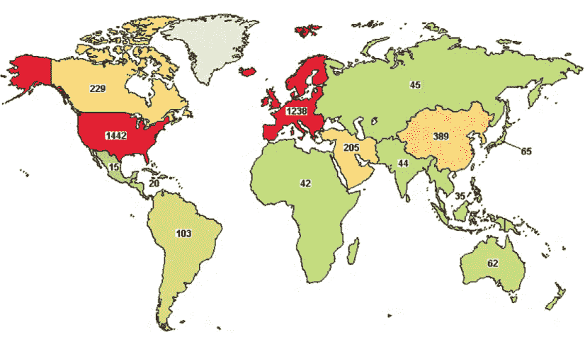

**图 4.9** 截至2023年12月的帕金森病研究全球分布。该地图可视化了在ClinicalTrials.gov上记录的3,707项致力于帕金森病的研究，展示了全球范围内的广泛投入，其中北美、欧洲、东亚以及世界其他地区做出了重大贡献。（https://ClinicalTrials.gov/）。

截至2023年12月底，对ClinicalTrials.gov的全面审查显示，有3,707项专注于帕金森病的研究项目，凸显了广泛的全球研究倡议（图 4.9）。北美处于领先地位，共有1,580项研究，其中美国占1,442项，加拿大占229项，墨西哥占15项。欧洲也做了巨大贡献，共有1,238项研究。研究工作在全球范围内广泛开展：东亚有389项研究（包括日本的65项），中东有205项研究。太平洋地区、南美洲和非洲分别参与了103项和42项研究。此外，北亚有45项，南亚44项，东南亚35项研究。这种广泛的全球参与强调了在增强理解和开发帕金森病治疗方法方面付出的积极且多样化的努力。

为了增强理解，ClinicalTrials.gov截至2023年12月29日的表4.6展示了帕金森病的III期临床试验，揭示了AI驱动药物发现和再利用的进展。`NCT073689`试验侧重于拉吉类（rasagiline），证明了其通过抑制单胺氧化酶B（MAO-B）增加大脑多巴胺水平并减轻症状，从而治疗帕金森病的有效性。`NCT0525301`研究了罗替戈汀（rotigotine），这是一种多巴胺激动剂，通过刺激多巴胺受体来改善运动症状。另一项试验`NCT02610231`考察了司曲替林（itradefeline）的长期效果，这是一种腺苷A2A受体阻滞剂，可以在不增加多巴胺产生的情况下增强运动功能。`NCT1227265`探索了普登（preladen）作为腺苷A2A拮抗剂增强运动症状方面的疗效。此外，`NCT00627640`研究了司非尼胺（safinamide）的使用，它作为选择性MAO-B抑制剂和钠通道阻滞剂，能增强多巴胺活性并调节谷氨酸释放。每项试验都代表了治疗帕金森病的创新方法，强调了向更具针对性、特定症状的疗法的转变，以应对疾病复杂的病理生理学。

## AI驱动的药物发现与再利用

### 表 4.6

帕金森病选定的III期临床试验——重点介绍AI驱动的药物发现与再利用努力

| 试验ID | 药物名称 | 临床试验名称 | 作用机制 | 阶段 | 状态 |
| :--- | :--- | :--- | :--- | :--- | :--- |
| `NCT01736891` | 拉吉类 (Rasagiline) | 在左多巴胺治疗的波动性帕金森病患者中使用拉吉类的临床试验 | 拉吉类通过抑制单胺氧化酶B (MAO-B) 治疗帕金森病，增加大脑多巴胺水平并缓解症状。 | III期 | 完成 |
| `NCT01523301` | 罗替戈汀 (Rotigotine) | 罗替戈汀对比安慰剂评估特发性帕金森病患者抑郁症状的效果 | 罗替戈汀作为多巴胺激动剂，刺激大脑多巴胺受体以改善运动症状。 | III期 | 完成 |
| `NCT02610231` | 司曲替林 (Istradefeline) | 司曲替林在严重受试者中的长期研究 | 司曲替林通过阻滞腺苷A2受体治疗帕金森病，在不增加多巴胺产生的情况下增强运动功能。 | III期 | 完成 |
| `NCT1227265` | 普登 (Preladen) | 严重帕金森病参与者的安慰剂研究 (P07037) | 普登作为腺苷A2受体拮抗剂，旨在在不增加多巴胺水平的情况下改善帕金森病症状。 | III期 | 完成 |
| `NCT0067640` | 司非尼胺 (Safinamide) | 运动波动特发性帕金森病 (IPD) 联合左多巴胺司非尼胺 | 司非尼胺作为选择性MAO-B抑制剂和钠通道阻滞剂，增强多巴胺活性并抑制谷氨酸释放。 | III期 | 完成 |

来源：https://ClinicalTrials.gov，访问于2023年12月29日。

## 4.5.3 AI在亨廷顿病研究中的应用

亨廷顿病是一种遗传性神经退行性疾病，由于其遗传性质以及对运动和认知功能的严重影响，面临着独特的挑战 [3]。AI正成为研究这种疾病的强有力工具，为理解和可能治疗该疾病提供了新方法 [138]。

AI在通路分析方面显示出显著的有效性，特别是在理解亨廷顿病方面。这一过程涉及复杂的生物机制，例如亨廷舞蹈蛋白的正确折叠及其对许多细胞通路的影响。机器学习模型擅长分析这些生物通路，提供疾病分子水平进展的见解。通过处理大量的基因组学、蛋白质组学和代谢数据，这些模型可以识别亨廷顿病中改变的关键分子和通路 [139]。例如，AI算法可以分析细胞数据，以理解突变亨廷舞蹈蛋白如何影响基因表达、蛋白质合成和代谢过程等细胞功能。这种分析有助于识别药物可能改变疾病进展的干预点。详细阐明这些通路对于开发更有效减缓或停止疾病的靶治疗法至关重要 [14]。

预测建模是AI在亨廷顿病研究中的另一个应用。AI模型可以基于遗传信息、生物标志物和病史等临床数据，预测疾病的发病和进展。这些预测模型可以帮助临床医生做出护理决策，以及何时治疗或如何管理疾病进展 [62]。例如，AI模型可能会根据个人的遗传结构预测亨廷顿发病年龄，或根据早期症状预测进展速度。这些信息对于制定治疗和护理策略，以及向患者及其家属说明疾病进展的预期具有极高价值 [140]。

# AI 驱动的药物发现与药物重利用

亚洲占 9 项研究，其中包括来自日本的 1 项研究，而太平洋地区正在进行 22 项研究。北亚有 5 项研究，南美洲有 6 项。南亚仅有 1 项研究，表明该地区对该领域表现出深厚的研究兴趣。这种分布凸显了全球范围内研究强度的程度不一，反映了世界不同地区在亨廷顿舞蹈症研究上优先优先顺序和资源分配的差异。

表 4.7 显示了亨廷顿舞蹈症的 III 期临床试验结果，强调了 AI 在药物发现和药物重利用中的作用。`NCT03761849` 研究了 `RO7234292`，这是一种反义义寡核苷酸（ASO），能够阻止有害 HTT 蛋白的产生，该蛋白是亨廷顿舞蹈症的主要因素。

## TABLE 4.7

选定的亨廷顿舞蹈症 III 期临床试验——突显 AI 驱动的药物发现与药物重利用努力

| 试验 ID | 药物名称 | 临床试验名称 | 作用机制 | 阶段 | 状态 |
|---|---|---|---|---|---|
| `NCT03761849` | `RO7234292` | 评估鞘内注射 RO7234292 (RG6042) 对显性亨廷顿舞蹈症患者有效性和安全性的研究 | `RO7234292` 是一种试验药物，属于反义寡寡核苷酸 (ASO) 组，旨在阻断使 RNA 产生蛋白。具体而言，它针对与亨廷顿舞蹈症相关的有害 HTT 蛋白以抑制其产生。 | III 期 | 已完成 |
| `NCT00665223` | ACR-16 (pridopidine) | 亨廷顿舞蹈症参与者中使用哌替啶 (ACR16) 的 | ACR-16 作为多巴胺稳定剂，被研究用于多种精神和神经系统疾病。它已在临床试验中作为亨廷顿舞蹈症的潜在治疗方法进行了测试。 | III 期 | 已完成 |
| `NCT00652457` | Memantine (孟非汀) | 孟非汀治疗亨廷顿舞蹈症的研究 | 孟非汀通过作为 NMDA 受体拮抗剂来治疗亨廷顿舞蹈症，通过调节氨基酸活性来减少与疾病症状相关的神经刺激。 | III 期 | 已完成 |
| `NCT2509793` | Tetrabenazine (青苯西嗪) | 评估接受青苯西嗪治疗的亨廷顿舞蹈症患者冲动性的试点研究 | 青苯西嗪通过降低多巴胺水平来治疗亨廷顿舞蹈症，从而减轻与该疾病相关的不自主运动（舞蹈症）。 | III 期 | 招募中 |
| `NCT04826692` | Metformin (双甲胍) | 测试双甲胍对抗亨廷顿舞蹈症认知衰退的效果 | 双甲胍用于亨廷顿舞蹈症时，被认为可以改善细胞能量过程并减少氧化应，可能减轻疾病进展。 | III 期 | 招募中 |

来源：https://ClinicalTrials.gov，访问于 2023 年 12 月 29 日。

# 用于神经退行性疾病的机器学习

亨廷顿舞蹈症。该试验已完成。在 `NCT00665223` 控制下研究的 ACR-16 (哌替啶) 作为多巴胺稳定剂发挥其治疗亨廷顿舞蹈症的功能；该试验也已完成。`NCT00652457` 侧重于机制，通过作为 NMDA 受体拮抗剂并减少亨廷顿舞蹈症中谷氨酸引起的过度神经刺激来对抗该疾病；该研究也已完成。在 `NCT02509793` 中评估的青苯西嗪旨在通过降低多巴胺水平来缓解亨廷顿舞蹈症的舞蹈症状，该试验目前正在招募患者。该试验评估了双甲胍通过增强细胞能量处理和减少氧化应激来减缓亨廷顿舞蹈症认知衰退的潜力。这些试验说明了为了理解和治疗亨廷顿舞蹈症而采取的多样化和创新方法，利用 AI 驱动的方法来重利用现有药物并探索新治疗方案。

## 4.5.4 ALS（肌萎缩侧硬化）研究中的 AI

AI 在 ALS 研究中的应用显示出积极效果，特别是在 ALS 领域。

## 表 4.8

肌动脉萎缩侧索硬化症（ALS）选定的 III 期临床试验——重点介绍 AI 驱动的药物发现与再利用工作


| 试验 ID | 药物名称 | 临床试验名称 | 作用机制 | 阶段 | 状态 |
|---|---|---|---|---|---|
| NCT0330681 | 拉拉（同义名：MCI-186） | MCI-186治疗 ALS 的确认性研究 | 依拉通过清除自由基发挥作用，自由基是体内会损伤细胞并导致神经退行性过程的有害化合物。 | III 期 | 已完成 |
| NCT0312768 | 昔替尼布 | 昔替尼布对比安慰剂治疗 ALS 的疗效与安全性 | 昔替尼布是一种选择性酪氨酸酶抑制剂，针对细胞和小胶质细胞以减少神经炎症并调节神经环境。 | III 期 | 招募中 |
| NCT04302870 | 孟海平、曲唑西酮、金刚烷 | 运动神经元病——系统随机试验 (MND-SMART) | 孟海平通过抑制 NMDA 受体和谷氨酸过度刺激来防止神经损伤；曲唑西酮作为抗抑郁药，可能通过血清素调节提供神经保护并改善情绪；金刚烷最初是抗病毒药物，可能通过影响谷氨酸神经传递缓解肌肉僵硬和疲劳等 ALS 症状，尽管在 ALS 中仍在研究。 | III 期 | 招募中 |

来源：`https://ClinicalTrials.gov`，访问于 2023 年 12 月 29 日。

# 4.6 挑战

尽管 AI 在变革神经退行性疾病的药物发现和再利用方面具有巨大潜力，但研究人员和从业者也必须考虑重大挑战，详见下文章节。

## 4.6.1 数据隐私与安全

确保患者的机密性至关重要，且必须严格遵守此类监管框架，例如美国的《健康保险流通性与责任法案》（`HIPAA`，`https://aspe.hhs.gov/`）或欧盟的《通用数据保护条例》（`GDPR`，`https://gdpr-info.eu/`）。这些法规制定了数据隐私和保护的标准，确保患者信息得到安全且符合伦理的处理。另一个主要关注点是数据泄露的风险。由于患者数据经常传输并存储在各种数字平台中，未经授权访问的风险之增加。这些泄露不仅损害了患者的机密性，还会产生伦理和法律后果 [145]。因此，在 AI 驱动的医疗研究和应用中，实施严格的安全措施以防止数据遭受此类泄露至关重要。

## AI 驱动的药物发现与再利用

### 4.6.2 伦理影响

在伦理影响方面，主要关注点是用于训练 ML 算法的数据存在偏差。如果训练数据存在偏差或缺乏代表性，算法的输出可能会出现偏差，导致不公平或不准确的结果。这在临床环境中尤为关键，因为决策可能会显著影响患者护理。确保数据的多样化和代表性对于减轻此类偏差至关重要 [146]。另一个伦理考量是知情同意，特别是在药物再利用等场景下。患者或其家属必须充分了解治疗的性质，包括其未经测试的，以遵循患者护理和自主的伦理标准。这一方面对于维持参与涉及 AI 建议治疗试验患者的信任和安全至关重要 [147]。

### 4.6.3 计算局限性

在深度学习和其他先进算法的背景下，这些技术通常需要专门的硬件（如图形处理器单元或高性能计算系统）以及大量的计算资源。这一要求对资金有限的较小研究机构或实验室构成了显著障碍，阻碍了 AI 在各种研究场景中的广泛采用和应用 [148]。此外，这些算法固有的复杂性（通常涉及复杂的数据结构或对大型数据集的需求）构成了另一个挑战。它们的复杂性质要求在有效实施和维护方面具备高水平的专业知识。在 AI 和数据科学技能缺口日益大的背景下，对专业知识和技能的需求可能成为一个重大障碍，特别是在规模较小或技术水平较低的机构中 [149]。这些因素的结合可能会影响 AI 在研究中的更广泛采用和有效利用。

### 4.6.4 验证与临床试验

虽然 AI 可以有效地在计算机模拟（in silico）中预测药效，但这些发现需要通过临床前和临床试验进行验证。这一过程通常漫长且昂贵，在时间和成本上为新疗法的快速开发和部署造成了巨大障碍 [144]。此外，应对监管障碍（如符合标准和伦理考虑）是另一个重大挑战。即使在成功验证后，新药或再利用药物也必须经过严格审查。切需要将 AI 生成的见解转化为临床应用。

# 4.7 未来方向

## 4.7.1 与其他技术的整合

作者认为，AI 在药物发现和再利用领域的未来与其他技术紧密相关。AI 可以产生重大影响的一个关键领域是基因组学和精准医学。`ML` 模型（特别是深度学习）能够分析庞数据集以识别基因变异和关联 [152]。另一个前景良好的领域是 AI 与先进成像技术（如 `MRI` 和 `PET`）的整合。在药物开发实验室，机器人系统可以自动重复任务，例如化合物库的高通量筛选。AI 可以增强这些系统的功能，并分析结果以识别候选药物 [153]。AI 可以与区块链和云计算等技术相结合，以增强数据共享和安全性。区块链可以为共享临床试验数据提供安全透明的平台，而云计算可以促进大规模数据的存储和分析 [155]。

## 4.7.2 扩展到其他疾病

AI 在药物发现和再利用领域的未来（特别是针对神经退行性疾病）具有扩展到其他疾病领域的巨大潜力。这种扩张受到 AI 分析复杂数据集、识别新药物靶点和加速药物开发过程能力的推动。AI 的多功能性和可扩展性使其在解决神经退行性疾病之外的疾病方面具有无值的价值 [16]。例如，AI 在肿瘤学中的应用已显示出良好成果。癌症是一种高度复杂且多变的疾病，AI 可以分析遗传、表观遗传和蛋白质组数据，以识别癌症治疗的潜在靶点。此外，AI 可用于筛选现有药物库，以寻找可以再用于治疗特定类型癌症的化合物 [87]。例如，为阿尔茨海默症开发的药物可能有效针对脑癌的某些通路。这种方法不仅加速了寻找有效治疗过程，还降低了开发成本。

另一个 AI 可以做出重大贡献的领域是传染病。最近的 COVID-19 大流行突显了对快速药物开发和再利用的需求。AI 可以快速分析病毒基因组，模拟其与人类蛋白的相互作用，并预测抗病毒化合物。在 COVID-19 期间，AI 在识别可再用于治疗病毒的现有药物方面发挥了关键作用，证明了 AI 驱动方法的速度和效率。心血管疾病是首要死因，也是另一个 AI 可以产生实质影响的领域。AI 算法可以通过分析患者数据、遗传因素和生活方式，帮助识别心脏疾病的新治疗靶点和药物。此外，它们还可以预测患者对某些治疗的反应，从而实现更个性化、更有效的疗法 [157]。

# AI 驱动的药物研发与老药新

糖尿病等慢性病也可以受益于 AI 驱动的药物研发和老药新。AI 可以分析来自临床研究、患者记录和遗传信息的海量数据，以揭示关于疾病机制的新新见解。这种理解可以帮助发现新的药物靶点，并对现有药物进行重新利用，以更好地管理或治疗患者 [157]。作者认为，AI 在医疗领域的未来不仅限于改进现有疗法，还涉及彻底改变新疗法的发现和开发方式，为各种疾病患者带来更好健康结果的希望。

## 4.7.3 政府与机构支持

考虑到政府和机构支持的关键作用，这种支持对于推动该领域 AI 的研究、开发和应用是基础性的。政府机构、研究机构和医疗保健组织在提供 AI 技术成功整合和进展所需的必要的基础设施、资金支持、监管框架和协作环境方面发挥着关键作用 [158]。政府支持对于营造有利于 AI 驱动的研究环境至关重要。这可以以向倡议提供资金的形式体现，这对于支持药物发现中广泛的研发工作至关重要 [159]。例如，美国的“脑计划”（`BRAIN Initiative`）等倡议旨在彻底改变我们对人类大脑的理解，为采用 AI 和 ML 的研究提供了大量的资金支持。这些投资可以加速分析复杂神经数据的 AI 工具和算法的开发，可能有助于发现神经退行性疾病的新药物和疗法 [160]。此外，政府在建立监管框架方面可以发挥关键作用，以支持和指导 AI 在医疗领域的伦理和安全使用。解决 AI 中数据隐私、患者安全和伦理考量的政策和准则对于建立公众信任并确保 AI 技术在医疗环境中以负责任且有效的方式使用是必不可少的。例如，欧盟的《通用数据保护条例》（`GDPR`）为处理患者数据提供了一个框架，这在利用大型数据集的研究中至关重要 [161]。

机构支持对于药物发现中 AI 的进步也至关重要。学术和研究机构促进跨学科协作，将 AI、神经科学、药理学和其他相关领域的专家汇聚在一起。这些协作可以导致药物发现和老药新领域创新的方法和解决方案。例如，AI 研究实验室与神经科部门之间的伙伴关系可以促进知识和资源的共享，产生更有效的 AI 模型，这些模型可以预测疾病进展并识别潜在药物靶点 [162]。此外，医疗机构和医院为研究提供了宝贵的数据，有助于构建测试算法的大型数据库。与这些机构及 AI 研究人员的合作确保了算法在现实环境中进行开发和测试，增加了它们在临床环境中的可靠性和适用性 [146]。这种支持还可能在治疗和疗法方面取得突破，最终改善神经退行性疾病患者的生活质量。

## 4.7.4 AI 的可解释性与可说明性

随着 AI 系统变得越来越复杂并成为药物发现过程中不可或缺的一部分，理解这些系统如何做出决策变得至关重要。AI 模型的的可解释性（`Interpretability`）和说明性（`Explainability`）对于确保制药行业的信任、透明度以及符合监管标准是关重要的 [163]。AI 可解释性是指理解和阐述 AI 模型内部机制的能力，而重新利用（`repurposing`）则意味着能够追踪 AI 算法如何得出关于潜在药物靶点、化合物功效或患者反应的结论或预测 [13]。例如，如果 AI 模型将一种新化合物识别为阿尔茨海默症的潜在药物，研究人员和监管机构需要理解这一预测的依据。这可能涉及分析化合物模型关注的特征，以及这些特征如何与已知的疾病机制相关。确保 AI 模型的可解释性不仅有助于验证其预测，还有助于进一步完善模型。

另一方面，可说明性是指用易于理解的术语向可能没有技术专长的终端用户展示 AI 模型的优势。这一方面对于 AI 集成到临床环境中至关重要，因为医疗专业人员需要根据 AI 的建议做出明智决策 [151]。例如，如果 AI 系统建议使用某种药物来治疗金森病，临床医生需要理解这一建议背后的逻辑以建立信任并采取。患者也需要以透明且易懂的方式解释这些决策。

提高 AI 可解释性的挑战之一是深度学习模型的复杂性，由于其算法复杂，这些通常被视为“黑箱”。解决这一挑战涉及开发使模型更透明、输出更易于理解的方法。这方面的努力包括开发说明数据如何流动并影响结果的可视化工具，通过特征重要性分析识别哪些特征可能影响预测。监管要求也推动了对增强可解释性和可说明性的追求。如 `FDA` 等监管机构正日益关注 AI 工具如何得出结论的清晰解释，特别是当这些工具被用于药物开发和患者护理时。

# 4.8 结论

本章强调了 AI 在神经退行性疾病药物发现和老药新方面的变革性影响。主要发现强调了 AI 在通过分子对接和预测建模等先进技术加速药物和治疗靶点识别方面的作用。AI 在药物重新利用方面的效率也引人注目，因为它能够有效识别可重新用于治疗神经退行性疾病的现有药物。伦理担忧、隐私和安全等挑战至关重要，强调了在医疗保健中负责任使用 AI 的必要性。此外，计算需求以及对 AI 预测进行大规模临床验证的需求被认为是重大障碍。对于未来的研究，建议鼓励跨学科的协作并加强数据共享与整合，以开发全面的 AI 模型。强调 AI 模型的可解释性对于建立医疗专业人员的信任至关重要。对专用计算基础设施的投资对于支持无偏的研究是必要的。建立稳健的伦理和监管框架对于解决应用中的隐私和伦理影响是迫的。将 AI 研究扩大到更广泛的疾病可以最大化其对医疗保健的影响。政府和机构在资金和政策方面的持续支持将对该领域至关重要。结论为治疗神经退行性疾病提供了前景广阔的途径，因为它有望彻底改变药物发现和老药新。未来的道路不仅涉及技术进步，还需要全球统一协调的努力来应对计算、伦理和监管挑战。在持续的支持和协作下，AI 驱动的方法可能会带来重大突破，可能改善这些挑战性疾病患者的预后。

# AI 驱动的发现与药物重定位

## 缩写词

- `Aβ` 淀粉样蛋白-β
- `AI` 人工智能
- `ALS` 肌萎缩性侧索硬化症
- `DBS` 深度脑刺激
- `GANs` 生成对抗网络
- `GWASs` 全基因组关联研究
- `FDA` 美国食品食品药品监督管理局
- `MAO-B` 单胺氧化物酶-β 型
- `NLP` 自然语言处理
- `VAEs` 变分自动编码器

## 参考文献

- 1. Hsieh K-L, Plascencia-Villa G, Lin K-H, 等. 通过表征学习合成异质生物学知识用于阿尔茨海默病药物重定位，*iScience*. 2023;26(1):10568.
- 2. Latifi-Navid H, Bargez Behrou A, Jhamed S, 等. 使用多层分析、模糊逻辑模型和深度学习技术构建与年龄相关的黄斑变性变构及治疗性分子网络：视网膜和大脑神经退行性疾病。*Pharmaceuticals*, 2023;16(6):1555.
- 3. Panda P, Sarovhi V, Basak T, 等. 识别响应突变亨廷顿蛋白的伴侣蛋白位点特异性激活。*Clinical and Molecular Neurobiology*. 2024;44(1):3.
- 4. Clark J, Sun M, Tabitis and Micromitration 在肌萎缩性侧索硬化症中的微泡与微切割。*Natural Reviews Neurodegeneration*, 2023;19(4/6):1183–1184.
- 5. Jo S, Sega-Gid F, Cummings J, 等. 中重度阿尔茨海默病中自我代理、报告依赖性与生活质量的关联。*The American Journal of Psychiatry*. 2024;232(5):51-68.
- 6. Bai J, Sawant N, Rawat P, 等. Rip 与突变 APP/Abeta 的异常相互作用以及病理尾部减少野生型 Rip 引导，会导致并破坏阿尔茨海默病中的 Rip 功能。*Biochemistry and Biophysica Acta (BBA - Molecular Basis of Disease)*. 2024;1870(1):168558.
- 7. Zhao L, Li Z, Chen G, 等. 用于阿尔茨海默病药物重定位的多模态神经网络。*Knowledge-Based Systems*. 2024;283:111995.
- 8. Pillai T, Manasikidaram S, Manickam S, Sankaranarayanan N. 药物重定位的药物化学视角：药物发现的最新进展与挑战。*European Journal of Medical Chemistry*, 2020;215:1025112275.
- 9. Yingning B, Dr Discovery Y. In: ASM SM, Ahmad MA, 编. 自然科学在药物发现和整合医学中的多学科应用。Hershey, PA, USA: IGI Global. 2023;3:144.
- 10. Bordakau MM, Fernández-Ginez R, Cuadrado A, 等. 通过调节 NRF2 神经保护用于阿尔茨海默病的药物重定位。*Redox Biology*. 2023;6:102681.
- 11. Singh G, Ramanathan M. 用于疾病设计的 AI 工具：神经退行性疾病面部识别缺陷的案例研究。*Clinical Pharmacology and Therapeutics*. 2023;114(4):862–873.
- 12. Hanecek J, Delijewski M, Moldzio R. 基于 PINK1 表达的金金森病分子属性预测揭示了潜在的药物重定位候选。*Computers Methods and Programs in Genomics*. 2023;241:107031.
- 13. Cheng G, Wang Z, Tang Y. 机器学习在阿尔茨海默病药物发现和靶点识别中的应用。*Aging Research Reviews*. 2023;9:100217.
- 14. Khan MQ, Mubeen H, Khan QZ, 等. HTT 基因中错义突变导致亨廷顿病及其相互作用网络的计算见解。*Irish Journal of Medical Science (1971 -)*. 2023;192(3):1435–1445.
- 15. Bhole RP, Khale R, Rath KM. 阿尔茨海默病中目前的生物标志物和治疗策略：概述与未来展望。*IBRO Neurosciences Reports*. 2024;16:8–42.
- 16. Pan X, Yun J, Coban Akhdemir ZH, 等. AI-DrugNet: 一种神经系统疾病药物重定位和联合治疗的基于网络的模型。*Computational and Structural Biotechnology Journal*. 2023;21:1533–1542.
- 17. Patwekar M, Patwekar F. Shaikh D, 等. AI 在药物设计中的作用：阿尔茨海默病基于受体的方法和治疗靶点：破解通路并推进治疗策略。*Applied Chemical Engineering*. 2023;6(3):1–19.
- 18. Steffen S, Haner A, Schröder R. 右颞顶交界处经颅直接电刺激促进阿尔茨海默病和轻度认知障碍中的海马功能。*Clinical Neuropsychology*. 2024;157:48–60.
- 19. Sohraimi H, Mohammadammoud M, Haghashem H. 通过在液晶上测量人体血清中淀粉样蛋白-42 构象早期检测阿尔茨海默病。*Sensors and Actuators B: Chemical*. 2024;0134996.
- 20. Singh B, Bhatt LK. 针对细胞衰老：阿尔茨海默病的潜在治疗方法。*Curr Mol Pharmacac*. 2024;17(1):e1062325743.
- 21. Nayak P, Strat S, Rout S, 等. 具有抗炎和抗氧化特性的纳米颗粒载光化合物在阿尔茨海默病中神经炎症的作用。*Phytomedicine*. 2024:1221550.
- 22. Liang T, Zeng Y, 等. 通过模拟基因-环境相互作用建立的大鼠模型重现了阿尔茨海默病病理。*Brain Research*. 2024;1822:148663.


- 23. Cumnings J, Zhou Y, Lee G, 等. 阿尔茨海默病开发管线：2023 & 痴呆：转化研究与临床创新。*2023*;9(2):e2385.

- 24. Liu Y, Mu C, Li Y, 等. 多功能氨基甲酯骨架作为可逆乙酰胆碱酯抑制剂的设计用于阿尔茨海默病。*Brain Research*. 2024:0471.

- 25. Yue H, Bao H, Cui YY. 瑞舒伐汀联合美金治疗轻度阿尔茨海默病的系统评估。*2023*; Hershey, PA, USA: IGI Global. (注)

- 26. Yadollah G, Rojas JC. 抗淀粉样蛋白免疫疗法治疗阿尔茨海默病：现状与未来。*Neurotherapeutics*. 2023;4(4):914–931.

- 27. Peng J, Xu Y, 等. 阿尔茨海默病的现状与未来策略。*Brain Research*. 2023:105385.

- 28. Cheng D, Qin Z-S, Zheng Y. 妙西西林作为一种经典抗生素通过调节色氨-色氨酸通路产生精神作用。*Brain, and Behavior*. 2023;103:305–318.

- 29. Wang J, Nia W, Wang J, 等. 针对阿尔茨海默病的多功能多奈哌-疫苗杂化剂的设计、合成和生物学评价。*Bioorganic Chemistry*. 2024;143:04710.

- 30. Wang J, Wang J, 等. 低神经毒性多功能多奈哌-加加胺的设计及其生物学评价用于阿尔茨海默病。*Bioorganic Chemistry*. 2023:11580.

- 31. Hershey M, Stotas P, Andrie S, 等. 饮食与生活预防阿尔茨海默病和认知衰退。*The Journal of Prevention of Alzheimer's Disease*. 2023;110:137–143.

- 32. Agrawal M, Singhal P, Pratap BG, 等. 阿尔茨海默病中的非炎症策略。*Clinical Trials*. 2023. (注)

- 33. Huang L, Kuan Y-Y, Lin H-W, 等. 阿尔茨海默病新药临床试验：2020–2023更新。*Journal of Medical Biological Science*. 2023;30(1):183.

- 34. Gordon EE, Ji C, Telow M, 等. 针对阿尔茨海默病的 Tau 蛋白疗法：现状与未来方向。*Nature Reviews Neurology*. 2023;19(12):715–736.

- 35. Sang J, Lu H. 阿尔茨海默病治疗药物：现状与未来方向。*Privileged Scaffolds in Drug Discovery*: Academic Press; 2023. p.405–473.

- 36. Giri M, Panke R, 等. 阿尔茨海默病中的联合治疗。*Alzheimer's Disease and Advanced Drug Strategies*: Academic Press, 2024, p.439–461.

- 37. Bayram E B, Tilley B, 等. 金帕森病临床试验：我们在哪里，如何做得更好？*Parkinsonism and Related Disorders*. 2023;112:105385.

# AI 驱动的药物发现与再利用

39. L. Zi, Zhang X, Yang M, 等. 帕金森病患者面部症状与非运动症状之间的关联。《Journal of Clinical Neuroscience》。 2023;118:143–146.

40. Li, Y, McConnell DJ, Counsel CE, 等. 帕金森病和非典型帕金森病住院的发生率及风险因素。《Parkinsonism & Related Disorders》。 2024;118:105928.

41. Kelley NE, Ratajska AM, Lopez FV, 等. 快速期快速眼动睡眠障碍导致帕金森病患者认知功能障碍的发生率。《Parkinsonism & Related Disorders》。 2024;118:105932.

42. Sharma V, Mukhopadhay PV. 外泌体作为药物递送系统：当前进展。《Extracellular Vesicle》。 2024;3:100032.

43. Xiang Y, Huang X, Qu Q, 等. 帕金森病生物标志物变化序列的评估。《Parkinsonism & Related Disorders》。 2024;118:105939.

44. Dubissoi R, Provitera V, Pacella D, 等. 自主功能与侧侧索硬化症的疾病进展和生存有关：一项纵向队列研究。《Journal of Neurology》。 2020;277(9):490–497.

45. Chanda A, Popescu N, 编。理解帕金森病：智能健康系统中的深度学习：评估与严谨性。在：Chanda A, Popescu N, 编。Springer Nature Switzerland; 2024, p. 1–7。

46. McGarry A, Rosambal S, Leinnon M, 等. doxy01 对未治疗帕金森病的疗效：一项随机、双盲、安慰剂控制试验。《The Lancet Neurology》。 2024;23(3):37–45.

47. Zhao L, Du X, Xu G, 等. 用于 AgNP/PVP适配体样活性识别巴胺的纳米催化 SERS 传感器。《Acta Acta Part A: 分子与生物光谱学》。 2020;21:120606.

48. Jost W. 针对左多巴胺抵抗患者的 introtajiline 新型运动治疗。《Expert Review of Neurotherapeutics》。 2023;23(9):1–13.

49. Rinaldi D, Imbalino G, Galli S, 等. 左多巴胺/卡比多胺肠道胶治疗帕金森病患者中多巴胺的影响。《Parkinsonism & Related Disorders》。 2023;109:10568.

50. Li Y, Chen X, Chen F, 等. 用于帕金森病的具有改进特性的选择性单胺氧化酶 B (MAO-B) 抑制剂的设计与合成。《Journal of Medical Chemistry》。 2023;66:11508.

51. Ferrara M, Hermann E. 多巴胺 D2 受体的结构分子药理学：对普米昔唑、罗匹尼罗、罗替戈汀的意义。《Pharmacology & Therapeutics》。 2023;245:108932.

52. Moinig J, Albanese L, Schnellmann JG, 编。帕金森病的神经心理学。在：Moinig J, Albanese L, Schnellmann JG。Academic Press; 2023, p. 257–274.

53. Murakami Y, Nishimura, Nakamura T, 等. 改变的表现影响帕金森病大鼠模型中 1-DOPA 诱发不自主运动的重复治疗。《Neuroscience Letters》。 2023;806:13728.

54. Brand G, Bontagampi C, Jacquot L. 深部脑刺激 (DBS) 对帕金森病后代的影响：临床特征与功能反应。《Hyp Neuro Neurobiology》。 2023;179(9):947–954.

55. Yan J-H, Ge Y-L, Wang P-Z, 等. 代谢通路变异与帕金森病中多巴胺诱导功能障碍之间的关联。《Neuroscience Letters》。 2023;801:13710.

56. Guo B, Chen C, Cao J, 等. 多巴胺激动剂对比左多巴胺代谢：帕金森病中 PPAR-1/Nrf2 通路激活的网络分析。《Journal of Medical Research》。 2023;64:195–211.

57. Zhang Q, Chen X, Chen F, 等. 基于 UHPLC-MS 同时研究生物样本中氧固醇和胆固醇的前沿方法：在亨廷顿舞蹈症模型中的验证。《Talenta Open》。 2024;9:100278.

58. Passoni A, Favagrosa M, Valenza M, 等. 亨廷顿症水平：亨廷顿病意识月期间变异的综合分析。《Methods and Programs in Biomedicine》。 2024;62:101027.

59. Oliveira CR, Mendes A, Queiros J, 等. 从老一代到年轻一代：亨廷顿症家族中健康相关因素的代际传递。《Journal of Aging Studies》。 2024;62:101017.

60. Nopoulos S, Reasoner E, Ogilie AC, 等. 评估青少年发型亨廷顿症的运动进展。《Parkinsonism & Related Disorders》。 2024;119:105954.

# 神经退行性疾病的机器学习

62. Kim R, Seong M-W, Oh B, 等. 韩国患者中 HTT CAG 扩张分析。《Parkinsonism & Related Disorders》。 2024;118:105930.

63. Antonievic JA, Bettencour BR, Baliek P, 等. 亨廷顿症和其他重复的体抑制。《GEN Biotechnology》。 2022;22(6):163–175.

64. Kotowska-Zamer A, Przybil L, Pewinska M, 等. 针对 CAG 的 miRNA 降低 YAC128 亨廷顿症模型中的突变亨廷蛋白。《Molecular Therapy - Nucleic Acids》。 2024;28:702.

65. Perron L, Hennessy J, Dominguez S, 等. 针对 CAG 的 miRNA 降低 YAC128 亨廷顿症模型中的突变亨廷蛋白。《Molecular Therapy - Nucleic Acids》。 2024;28:702.

66. Kuman D, Islam A, Hasan R, 等. 针对 CAG 的 miRNA 降低 YAC128 亨廷顿症模型中的突变亨廷蛋白。《Molecular Therapy - Nucleic Acids》。 2024;28:702.

67. Bilal H, Harding ST, Stout JC, 等. 针对 CAG 的 miRNA 降低 YAC128 亨廷顿症模型中的突变亨廷蛋白。《Molecular Therapy - Nucleic Acids》。 2024;28:702.

68. Smaiya P, Sarkar R, Pandey SP, 等. 针对 CAG 的 miRNA 降低 YAC128 亨廷顿症模型中的突变亨廷蛋白。《Molecular Therapy - Nucleic Acids》。 2024;28:702.

69. Makeeva S, Lavrik O, 等. 针对 CAG 的 miRNA 降低 YAC128 亨廷顿症模型中的突变亨廷蛋白。《Molecular Therapy - Nucleic Acids》。 2024;28:702.

70. Ferguson MW, Kennedy CJ, 等. 针对 CAG 的 miRNA 降低 YAC128 亨廷顿症模型中的突变亨廷蛋白。《Molecular Therapy - Nucleic Acids》。 2024;28:702.

71. García-González X, Cubo E, 等. 针对 CAG 的 miRNA 降低 YAC128 亨廷顿症模型中的突变亨廷蛋白。《Molecular Therapy - Nucleic Acids》。 2024;28:702.

72. Curtis S, Jung R, 等. 针对 CAG 的 miRNA 降低 YAC128 亨廷顿症模型中的突变亨廷蛋白。《Molecular Therapy - Nucleic Acids》。 2024;28:702.

73. Ketabou H, Barati R, 等. 针对 CAG 的 miRNA 降低 YAC128 亨廷顿症模型中的突变亨廷蛋白。《Molecular Therapy - Nucleic Acids》。 2024;28:702.

74. Humay J, Venkatesh S, 等. 针对 CAG 的 miRNA 降低 YAC128 亨廷顿症模型中的突变亨廷蛋白。《Molecular Therapy - Nucleic Acids》。 2024;28:702.

75. Batty GD, Kivinuki M, Frank P, 等. 针对 CAG 的 miRNA 降低 YAC128 亨廷顿症模型中的突变亨廷蛋白。《Molecular Therapy - Nucleic Acids》。 2024;28:702.

76. Feldman EL, Goodman S, 等. 针对 CAG 的 miRNA 降低 YAC128 亨廷顿症模型中的突变亨廷蛋白。《Molecular Therapy - Nucleic Acids》。 2024;28:702.

77. Mastori P, Van Dam, 等. 针对 CAG 的 miRNA 降低 YAC128 亨廷顿症模型中的突变亨廷蛋白。《Molecular Therapy - Nucleic Acids》。 2024;28:702.

78. Zhou W, Xu R, 等. 针对 CAG 的 miRNA 降低 YAC128 亨廷顿症模型中的突变亨廷蛋白。《Molecular Therapy - Nucleic Acids》。 2024;28:702.

79. Marie RA, Maxwell CJ, Rotstein DL, 等. 针对 CAG 的 miRNA 降低 YAC128 亨廷顿症模型中的突变亨廷蛋白。《Molecular Therapy - Nucleic Acids》。 2024;28:702.

80. Soumya BS, Agrawal A, 等. 针对 CAG 的 miRNA 降低 YAC128 亨廷顿症模型中的突变亨廷蛋白。《Molecular Therapy - Nucleic Acids》。 2024;28:702.

81. Martinez-Gonzalez L, Martinez Y, Shimide E, 等. 用于帕金森病的具有改进特性的选择性单胺氧化酶 B (MAO-B) 抑制剂的设计与合成。《Journal of Medical Chemistry》。 2023;66:11508.

82. Jin T, Tang Y, Botchary, 等. ��皮素激活 SIRT2/AMPK1 以改善肌侧索硬化症。《Biomedicine & Pharmacotherapy》。 2023;161:114515.

84. Tang J, Kang Y, Zhou Y, 等. 脐带间质细胞培养基诱导的小胶质细胞激活缓解硬化症小鼠模型中的神经炎症。《Brain Research Bulletin》。 2023;202:110760.

85. Boros BD, Scholz KM, Kreple J, 等. 用于研究和治疗 ALS 的反义寡核苷酸。《Neurotherapeutics》。 2022;19(4):1145–1158.

86. Vema A, Kalle M. 第9章 – 药物再利用策略：在Nagaraju GP, Amouda V, Dinakura Rao A, 编。癌症治疗药物发现与再利用的计算方法：Academic Press, 2023, p. 117–128.

## AI 驱动的发现与重用

- 87. Kumb NM, Aparna MA, Nirmal SK, et al. 第 17 章 - 新药物靶：通过资金投入加速药物发现引擎的药物重用。In: Meena SN, Yadav K, Kumar RS, 编辑. 天然化合物研究前沿: Academic Press; 2023, p. 315–349

- 88. Kumar JA. 第 9 章 - 用于开发有效抗念菌药物的药物重用。In: Kumar A, JA, 编辑. 抗真菌治疗: Academic Press; 2023, p. 137–46.

- 89. You J, Kim TY, Jung L, et al. 用于端到端药物发现过程 AI/ML 工业化. 结构生物学进展, 2023;79:102528.

- 90. Pun, Ozerov IV, Zhavoronov A. AI 驱动的治疗靶点发现。In 药理学科学, 2023;94:566–572.

- 91. Bicelli S, Schelmolt MJ. AI 在制药中的作用：从蛋白质相互作用到药物的药物发现. 人工智能, 2024;42(1):100038.

- 92. Fang J, Chen W. 基于基因学的药物发现与开发工具：从网络图到效效预测. 整体整合医学杂志, 2023;4(3):199–209.

- 93. Par, Patil S, Khacharputkar K, et al. 人工智能：用于筛选大规模药物和药物发现的机器学习. 动物研究, 2023;220:105740.

- 94. Blaudin de Th-FX, Baudier C, Andrade Pereira R, et al. 用高通量 AI 驱动平台转型药物发现：患者发现的 5 年经验. 药物发现, 2023;28(1):103772.

- 95. NiaZ SK. AI/ML 在药物发现、开发、临床测试和制造中的收敛：FDA 视角. 药物发现、开发与治疗, 2023;17:2691–2725.


# 123

- 96. Tiwari PC, Par L, Chaudhary MJ, et al. 药物发现的人工智能综述：新兴机遇与挑战. 药物研究, 2023;84(8):1652–1663.
- 97. Doherty Y, Tao Z, Khaeleat AA, et al. 用于药物发现、试验和优化的人工智能. 阿尔茨海默症与痴呆, 2023;9(12):5992–5993.
- 98. Shammagavidel K, Kathishumar VE, Cho J, et al. 计算机辅助诊断阿尔茨海默症进展：早期检测的神经成像方法和 AI 技术综述. 老化综述, 2023;91:10202.
- 99. Singh S, Sharma P, et al. 药物发现中人工智能 (AI) 辅助方法. 人工智能, 2024;42(1):10039.
- 100. Yang F, 第 3 章 - 全基因组关联研究 (GWAS)：它们是什么，何时使用？In: Duzif SH, MHIM, 编辑. 基因组在基因组中的作用: Academic Press; 2024, p. 51–88.
- 101. Cavalla D, Crichton G. 药物发现：从已知到未知的药物重用网络分析. 今日药物发现, 2023;28(1):10369.
- 102. Ahmed F, Samantashar H, Soomro AM, et al. 理解癌症生物学的计算方法系统综述. 生物信息学, 2023;142:10433.
- 103. Bordokova K, Makar A, Yang H, et al. 乙酰胆碱酯抑制剂的分子工程和活性改进：来自 3-QSAR、对接和分子动力学的启示. 分子图形与建模杂志, 2022;216:10823.
- 104. Gao W, França VLB, Carvalho HF, et al. 源自人类、斑马鱼和线虫的乙酰胆碱酯抑制剂的非规范结合：同源研究、分子对接、动力性和量子生物化学描述. 化学-生物相互作用, 2023;188:10155.
- 105. Jabeen R, Rehman Z, Shah S, et al. 基于深度学习的乙酰胆碱酯抑制剂相互作用预测用于阿尔茨海默症治疗. 计算机与电气工程, 2023;105:10847.
- 106. Radibullah F, Pogatki Zahl E, et al. 药物发现中的机器学习和人工智能：研究人员入门. 大脑，行为, 2024;115:470–479.
- 107. Li B, Shi X, Gao H. 增强对抗网络中的公平性. BioRxiv, 2023.
- 108. Serra A, Galdi P. 多视图学习。In: Kozma R, Tagli R, 编辑. 医学时代的人智能 (第二版): Academic Press; 2024, p. 307–324.
- 109. Kumar S, Das D, Kumar TD, et al. 药物工业中的机器学习和深度学习. 现代医学化学, 2022;14(4):245–270.
- 110. Hwang U, Jung D, Kim S, et al. 有效化合物的计算机模拟预测. 人工智能医学, 2023;14:1065.
- 111. Aziz MA, Tan J, Mohammad Said M, et al. 新神经保护因子对脑疾病及相关神经退行性疾病的综述. 综述, 2023;15:2564.
- 112. Ganesan NS, Dhanasegar R, Ramasamy MD, et al. 用于阿尔茨海默症候选药物的集成网络拓扑和深度学习模型. 软计算, 2023;27(19):14189–14203.

# 123

132. Ren X, Wen Y, Li C, 等. 整合药法治疗与综合生物信息学识别解郁安治疗阿尔茨海默病合并抑郁症的机理和分子靶点。《Arabian Journal of Chemistry》。 2024;17(2):105485.
133. Sigcha L, Borzi L, Amato F, 等. 深度学习与可穿戴传感器在帕金森病诊断与监测中的应用：系统性述。《Expert Systems with Applications》。 2024;239:129051.
134. Channa A, Popescu N, Dress D, 等. 使用智能可穿戴设备进行帕金森病管理。In：Channa A, Popescu N, 等. 编辑。Learning in Smart Health Systems: Evaluation Leveraging Parkinson's. Cham: Springer Nature 2024; p. 17.
135. Arif A, Saha MA, Kayed R. 蛋白质聚集与神经退行性疾病：新疗法的结构展望。《Proteins: Structure, Function, and Bioinformatics》。 2023.
136. Wang S, Zheng X, Xu O, 等. 中国早发型帕金森病患者UQC1的罕见变异分析。《Journal of Neurology》。 2024;234(4):440.
137. Moore A, Cree PY, Makarious M, 等. 帕金森病中HTKN1基因的遗传与转录组学评估。《Risk of Neurology》。 2024;23(4):446–473.
138. Ganesh S, Sridharanaraman K, Krishna NR, 等. 通过人工智能模型探索亨廷顿舞蹈诊断：综合综述。《Diagnostics》。 2023;13(23):3592.
139. Parekh H, Bajaj R, Raj B, 等. 人工智能在亨廷顿舞蹈诊断与监测中的应用。《Beni-Suf University Journal of Biology and Applied Sciences》。 2023;12(1):8.
140. Dey A, Sharma K, Bhattacharjee P, 等. 时变组学数据中疾病相关生物标志物的评估：一种基于非负矩阵分解的分级自组织映射。《Biomedical Signal Processing and Control》。 2024;90:105860.
141. Loan A, Syal C, Li M, 等. 机器学习用于二甲双胍治疗神经系统疾病：生物标志物引导的疗法。《Neural Regeneration》。 2024;19(5):1045–1055.
142. Cave R, Bloch S. 语音技术赋能早期肌萎侧索硬化症患者：系统述述。《Disability and Assistive: Technology》。 2023;18(7):1043–1055.
143. Mahantesh K, Pranesh B, Nitin T, 等. 编辑. 用于脑控运动的EEG信号认知特征学习。《Advances in Computing and Interaction》。 2024; 2024; Springer Nature.
144. Shammiah PN, Durairharasan NK, Veesharan B, 等. 药物发现背景下人工智能与机器学习模型的探索及其对制药部门的未来潜力。《Methods》。 2023;219:82–94.
145. Smajik A, Graints M, Ecker GF, 等. 药物发现中去中心化大规模机器学习的隐私保护技术。《Drug Discovery Today》。 2023;28(12):10820.
146. Askin S, Burkhalter D, Calado G, 等. 应用于临床试验的人工智能：机遇与挑战。《Health and Technology》，2023;13(2):203–213.
147. Kelly BS, Karivan A, Quinn M, 等. 人工智能作为近期人工智能研究中赋能疾病患者及更广泛公众（PPI）的方法。《Radiography》。 2023;125(5):511–518.
148. Krow M, Diaz Moniaz G. 用于药物发现的分子动力学和其他高性计算系统。In: Heifetz A, 编辑. 用于药物发现与生物医学的高性能计算。New York, NY: Springer US; 2024; p. 264–299.
149. Wasserman JA, Wald Hs. 临床医学中的人工智能、机器学习与伦理。In: Kang J, Tatty R, Townsend BS, 编辑. 放射肿瘤学中的机器学习与人工智能。Academic Press; 2024;p.:39.
150. Gupta N, Kumar P. 人工智能在医疗数据管理中的展望：迈向精准医学的程。《Combination in Biology and Medicine》。 2023;212:1067051.
151. Gupta R, Kumar S, Sharma A, 等. 帕金森病基于人工智能和机器学习的检测与治疗的新时代。《Research Reviews》。 2023;90:10203.
152. DeGroat V, Werner P, Pierre-Louis L, 等. Hygelia: 集成医疗与基因组学的AI/ML以识别与靶疾病相关的基因并预测疾病。《Software Impacts》。 2023;16:10493.
153. Yao Z, Wang H, Wang Y. 用于阿尔茨海默症诊断的MRI人工智能影像。《European Journal of Radiology》。2024.
154. Mahantesh K, Pranesh B, Nitin T, 等. 编辑. 用于脑控运动的EEG信号认知特征学习。《Advances in Computing and Interaction》。 2024; 2024; Springer Nature.
155. Shammiah PN, Durairharasan NK, Veesharan B, 等. 药物发现背景下人工智能与机器学习模型的探索及其对制药部门的未来潜力。《Methods》。 2023;219:82–94.
156. Smajik A, Graints M, Ecker GF, 等. 药物发现中去中心化大规模机器学习的隐私保护技术。《Drug Discovery Today》。 2023;28(12):10820.
157. Askin S, Burkhalter D, Calado G, 等. 应用于临床试验的人工智能：机遇与挑战。《Health and Technology》，2023;13(2):203–213.
158. Kelly BS, Karivan A, Quinn M, 等. 人工智能作为近期人工智能研究中赋能疾病患者及更广泛公众（PPI）的方法。《Radiography》。 2023;125(5):511–518.
159. Krow M, Diaz Moniaz G. 用于药物发现的分子动力学和其他高性计算系统。In:Heifetz A, 编辑. 用于药物发现与生物医学的高性能计算。New York, NY: Springer US; 2024; p. 264–299.
160. Wasserman JA, Wald Hs. 临床医学中的人工智能、机器学习与伦理。In:Kang J, Tatty R, Townsend BS, 编辑. 放射肿瘤学中的机器学习与人工智能。Academic Press; 2024;p.:39.
161. Gupta N, Kumar P. 人工智能在医疗数据管理中的展望：迈向精准医学的程。《Combination in Biology and Medicine》。 2023;212:1067051.
162. Gupta R, Kumar S, Sharma A, 等. 帕金森病基于人工智能和机器学习的检测与治疗的新时代。《Research Reviews》。 2023;90:10203.
163. DeGroat V, Werner P, Pierre-Louis L, 等. Hygelia: 集成医疗与基因组学的AI/ML以识别与靶疾病相关的基因并预测疾病。《Software Impacts》。 2023;16:10493.
164. Yao Z, Wang H, Wang Y. 用于阿尔茨海默症诊断的MRI人工智能影像。《European Journal of Radiology》。2024.


152. DeGroat V, Werner P, Pierre-Louis L, 等. Hygelia: 集成医疗与基因组学的AI/ML以识别与靶疾病相关的基因并预测疾病。《Software Impacts》。 2023;16:10493.

153. Yao Z, Wang H, Wang Y. 用于阿尔茨海默症诊断的MRI人工智能影像。《European Journal of Radiology》。2024.

---

## 5.1 引言

帕金森病（PD）是一种渐进性神经系统疾病，以非运动和运动症状为特征，对患者的健康有重大影响。步态冰（FoG）是患者面临的最困扰的问题之一，表现为突然无法启动或维持运动[1]。早期检测步态冰有助于帕金森病患者防止由于失调导致的伤害[2, 3]。尽管研究人员正在准确预测和管理步态冰，但仍有许多挑战需要解决[4]。机器学习已成为医疗领域的一个变革性前沿；它有能力分析多样化的数据集，揭示复杂的模式和关系。可穿戴技术的最新进展、电子健康记录的广泛采用以及临床试验数据的积累，为利用机器学习预测和管理如步态冰等疾病铺平了道路。这些算法可以处理包括步态模式、生理信号、医疗记录和人口统计信息在内的多种数据，从而为个体定制预测模型。近年来，机器学习经历了前所未有的增长和创新，跨越多个领域。计算机系统基于训练（学习）和无编程决策的原则。机器学习分析大量数据集的能力对于识别模式和生成预测非常有帮助，使其成为预测分析中的无价工具[5, 6]。近年来，研究人员利用先进计算技术和丰富的患者数据开发预测模型。因此，机器学习通过提前预测步态冰具有改变帕金森病医疗的潜力，允许进行个人干预以防止受伤。这种向主动护理的转变是医疗领域机器学习的一个前景良好的方面[7]。

本章逻辑组织分为几个章节：第5.2节将深入研究帕金森病患者步态冰的背景研究；第5.3节侧重于介绍用于预测建模的机器学习方法、整合近期临床试验的见解并开发稳健的预测模型；第5.4节将讨论学习技术，强调各种机器学习和深度学习模型在准确预测帕金森病步态冰方面。在第5.5节中，我们已经讨论了临床应用。进一步的挑战和未来方向将在 5.6 节中讨论。本章以具有重要学术意义的深入见解作为总结。

## 5.2 背景研究

步态冻（Freezing of gait, FoG）是帕金森病（PD）后期的一种常见症状，患者会经历非自主且意外的固定状态，感觉仿佛粘在地上。这些情况可能由压力、焦虑、复杂环境以及尝试多任务处理所触发。在 FoG 状态下，人们更容易绊倒或失去平衡，增加了跌倒和受伤的风险。由于在公共场所无法移动，活动能力和独立性下降，导致孤立和情绪困扰，降低了帕金森病患者的整体生活质量。

值得注意的是，PD 患者发生 FoG 的概率很高 [8]。FoG 并非影响所有患者，即使发生，其频率和严重程度也各异。FoG 取决于多种因素，包括 PD 的阶段、其他症状的存在以及疾病流行率的差异 [9]。然而，FoG 在 PD 的晚晚期更为常见，尽管它可能出现在任何阶段。

诊断 PD 通常需要进行临床评估，包括详尽的病史回顾、识别运动症状的体格检查以及患者对多巴胺类药物反应的评估。另一方面，临床观察对于 FoG 的诊断至关重要。医疗保健人员通过利用可穿戴传感器或其他客观测量工具审计 FoG 状态的频率，细致地跟踪患者的步态和运动表现。诊断阶段至关重要，因为它为帕金森病患者量身定制治疗策略指导 [10]。准确的诊断使医疗保健人员能够理解 FoG 的独特性质，有助于早期发现和预后诊断，这对于优化治疗和提高活动能力至关重要。FoG 的诊断仍然是一项具有挑战性的任务。新兴技术和人工智能的应用使得预测模型成为可能，从而能够有效管理并减少 FoG 的发生频率，提高帕金森病患者的生活质量 [11]。

## 5.3 方法论

预测 PD 中的 FoG 是一个旨在提高此类患者生活质量并确保其安全的领域。该方法论涵盖了一系列关键步骤：数据采集、预处理、特征提取和特征选择、模型开发以及性能评估，如图 5.1 所示。

### 5.3.1 数据收集

PD FoG 的数据收集采用了多策略策略，包括临床评估、视频录制、步态分析系统和可穿戴设备，如图 5.2 所示。这一阶段有助于对 FoG 状态进行深入理解，涵盖其独特特征、触发因素及其影响。

- 临床评估：临床评估是理解 PD FoG 的基础。神经科医生或运动专家进行全面评估，记录患者状况的各个方面，如 FoG 的频率和严重程度。这些评估为后续研究提供了关键数据 [12, 13]。
- 视频录制：视频录制是捕捉和分析 FoG 状态的有用资源。这利用高质量摄像机和手机对运动进行妥记录。这些录像从视觉上描述了 FoG。

 图 5.1 用于预测 PD 中 FoG 的方法示意图。


图 5.2 采集期间使用的各种数据类型。

### 5.3.2 数据预处理

有效的数据预处理在 PD FoG 的检查中至关重要，对改进诊断系统的开发和研究贡献巨大。数据清洗包括离群值删除、去噪音处理缺失值。数据归一化用于标准化数据，以便在个体之间进行比较。此外，变换包括特征工程以提取相关变量。通过特征选择进行降维可以避免过拟合。滑动窗口允许对特定间隔进行更集中的分析 [19, 20]。这些预处理技术（图 5.3）共同提高了对患者 FoG 状态进行建模的准确性和有效性。

### 5.3.3 特征提取与特征选择

特征提取和选择在健康和行为的各个方面分析中起着关键性作用。在此，我们重点介绍了图 5.4 所示的与时空分析、手写、运动学、速度、动力学和频率分析相关的显著特征 [21, 22]。

- 定量时空特征：这些参数包括步长、步行速度、步态模式和步频。这些特征的提取提供了关于进展性症状的宝贵见解，并可能导致个体的步态紊乱。
- 手写特征：PD 经常表现为手写的明显变化，例如小字症（micrographia），其特征是字母变小和出现螺旋。特征提取涉及尺寸、轮廓和均匀性的量化，允许对运动障碍进行客观评估。
- 运动学特征：与步行、转身和手部动作相关的身体运动学说明了关于患者运动控制和平衡的重要信息。这些数据对于监测步态相关症状和开发针对性干预至关重要。

 图 5.3 各种数据预处理技术的示意图。

| 特征类型 | 描述 |
| :--- | :--- |
| 定量时空特征 | 步长、步行速度、步态模式、步频 |
| 手写特征 | 手写的尺寸、轮廓、均匀性 |
| 运动学特征 | 步行、转身、手部动作 |
| 语音特征 | 音高、音量、语速、发音精度 |
| 动力学特征 | 关节力、力矩、压力中心 (COP)、重心 (COM) |
| 频率和时域特征 | 功率谱、小波变换、傅里叶变换 |

图 5.4 特征提取阶段使用的特征示意图。

- 语音特征：PD 患者经常遇到语音困难，如音量降低和发音模糊。从语音数据中提取的重要特征包括音高、音量、语速和发音精度。可以通过这种综合评估评估语音障碍。
- 动力学特征：动力学特征包括关节力、力矩和压力中心 (COP) 参数。这些特征有助于评估运动组件，提供了有关肌肉无力、姿势不稳和运动控制的信息。
- 频率和时域特征：各种信号的频率成分（如来自加速度计或肌电图的功率谱）可以被分析以检测 PD 的运动异常和震颤。时域特征通常通过小波或傅里叶变换提取，提供了信号的时间特征并有助于检测模式或不规则。

### 5.3.4 模型开发

模型开发是一个关键步骤，通过分析各种机器学习技术来为 PD 设计高效的诊断系统。FoG 是 PD 的令人困扰的症状，通常进行客观评估。Samà 等人识别了基于加速度计的特征，并结合机器学习分类器，在现实环境中实现了 91.7% 的特异性和 87.4% 的特异性 [23]。Moore 等人 [24] 验证了使用踝部传感器的移动 FoG 监测器，准确率为89%（10% 假阳性），可能改善 PD 患者的 FoG 管理。

检测帕金森患者的冻对于预防跌倒至关重要，腕部传感器的 FoG 检测率为90%，这提高了相对于下肢的接受度。腕部传感器为 FoG 检测提供了可行的方案，且不会损害准确性 [25]。Tripoliti 等人使用体戴式传感器检测帕金森病患者的 FoG，并采用了四阶段方法论。对不同传感器配置的评估显示，使用随机森林分类实现了 98.74% 的特异性、81.94% 的特异性、98.6% 的 AUC 和 96.11% 的准确率 [26]。

展现了高灵敏度和特异性，其中支持向量机（多项式内核）的表现优于其他方法。将分类算法应用于具有18个特征的五秒窗口，在行走方面的平衡准确率达到91%，冻结步态（FoG）达到90%，状态转换阶段达到82% [5]。

### 5.3.5 性能评估

性能评估对于确定用于检测帕金森病（PD）冻结步态的模型的效能至关重要。基于FoG分类的预测模型的精确率通过将正性预测数除以正性预测总数来计算，它代表了模型避免误报的能力，这对于患者安全至关重要。灵敏度评估了模型识别真性病例的能力，对于及时干预至关重要。特异性衡量了模型正确分类负性病例的能力，从而减少不必要的警报。准确率指标提供了对正确预测的整体衡量，提供了一个稳健的评估衡量标准。均方根误差（RMSE）评估了模型在连续性FoG严重程度估计中的预测准确性，而AUC-ROC则评估了模型区分FoG和非FoG状态的能力。F分数平衡了精确率和召回率，提供了模型性能的综合衡量。皮尔逊相关系数衡量了预测与观测到的FoG严重程度之间的线性关系，允许对连续标度上的预测质量进行评估。这些指标如图5.5所示，共同评估了PD患者FoG检测模型的可靠性和实用性。

$$Accuracy = \frac{TP + TN}{TP + FP + TN + FN} (5.1)$$

$$Precision = \frac{TP}{TP + FP} (5.2)$$

$$Specificity = \frac{TN}{TN + FP} (5.3)$$

$$Sensitivity = \frac{TP}{TP + FN} (5.4)$$

$$Kappa (K) = \frac{Fo - Fe}{1 - Fe} (5.5)$$

$$RMSE = \sqrt{\frac{\sum_{j=1}^{U} (f_j - g_j)^2}{U}} (5.6)$$

$$Pearson Correlation = \frac{\sum_{j=1}^{U} (f_j - \bar{f})(g_j - \bar{g})}{\sqrt{\sum_{j=1}^{U} (f_j - \bar{f})^2 (g_j - \bar{g})^2}} (5.7)$$

$$F1 - score = \frac{2 * Precision * Recall}{Precision + Recall} (5.8)$$

## 用于预测冻结步态的机器学习方法

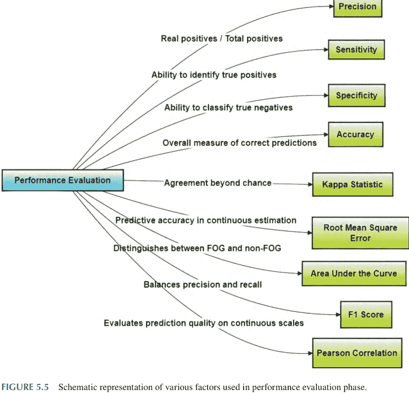

图 5.5 性能评估阶段使用的各种因素的示意图。

其中 FP, TP, TN 和 $FN$ 分别代表假阳性、真阳性、真阴性和假阴性。$Fo$ 代表一致概率，而 $Fe$ 代表随机一致概率。$U$ 代表数据长度，$f$ 代表处理前收集的数据，$g_j$ 代表处理后收集的数据。此外，$f$ 和 $\bar{g}$ 分别代表 $f_i$ 和 $g_i$ 的平均值。

## 5.4 学习技术

### 5.4.1 机器学习

机器学习已经完全改变了步态分析。FoG 是一种严重的帕金森病症状，会导致跌倒和医疗负担。Ahlrichs 等人引入了一种使用单个腰部加速度计和 SVM 分类器的 FoG 检测器，在服药和未服药状态下监测 20 名帕金森患者时实现了 98.7% 的准确率 [27]。Rodríguez-Martín 等 [28] 引入了一种使用 SVM 分类器和单个腰部3D 加速度计的 FoG 检测系统。他们的研究涉及 21 名帕金森患者，强调了药物对日常活动中运动反应的影响。此外，Al 等 [29] 通过选择相关特征并利用具有立方内核的 SVM 将准确率提高到 93.6%。该研究还强调了步态特征在 PD 诊断中的重要性。此外，Vasquez-Correa 等 [30] 结合手写、语音和步态的多模态方法表明了综合 PD 评估的潜力。

### 5.4.2 神经网络

神经网络对帕金森患者的 FoG 条件提供了分析和预测。Zeng 等 [31] 采用径基函数网络分析了 93 名 PD 患者和 73 名健康对照组的步态动力学，实现了 96.39% 的分类准确率、96.77% 的灵敏度和 95.89% 的特异性。Sun 等 [32] 推荐了一种空间注意力网络和 3D CNN 检测 FoG 区域的缩写识别算法。Camps 等 [33] 开发了一个用于单个腰部加速度计进行 FoG 检测的八层 CNN，在涉及帕金森患者所做活动的任务中实现了高灵敏度和高特异性。Tahir 等 [34] 引入了非侵入性 WiFi 传感系统来检测帕金森患者的 FoG 症状。他们的系统利用多分辨率-频率尺度，有效地区分了 FoG 与坐立转换、行走和自愿运动等活动。通过在时谱图上训练的深层 CNN，他们在 FoG 检测中通过 97% 的灵敏度和 100% 的特异性取得了显著结果。Xia 等 [35] 引入了一种基于 CNN 的 FoG 检测系统。他们的研究包括独立于患者和依赖患者的实验，在依赖患者的测试中观察到最理想的结果。神经网络具有转变 FoG 条件分析和预测的潜力。这些神经网络捕捉步态中空间和时间关系的能力取决于对步态数据的整合，以提供帕金森患者 FoG 条件的预测。

## 5.5 临床应用

预测帕金森患者 FoG 的机器学习方法具有巨大的前景，临床试验证明了这一点。这些前沿计算方法具有改变患者护理和治疗策略的潜力。本节研究了机器学习在预测 FoG 的实际意义和突破性，如图 5.5 所示。

### 5.5.1 早期诊断与监测

基于加速度计和陀螺仪等传感器提取的算法有助于识别步态的细微变化，从而实现早期干预。对于疾病管理，FoG 的持续监测至关重要。患者和医疗提供人员都能从机器学习的实时警报中受益，这有助于跟踪进展 [27–29, 32, 33, 36–38]。

### 5.5.2 个性化治疗方案

机器学习模型可以分析患者特定数据并制定个性化治疗方案。医疗提供人员通过识别每个患者特定的特定的触发因素或预测因素可以提供更个性化的护理。患者数据与算法见解的结合能够优化用药计划和治疗方案，降低 FoG 的频率和严重程度 [34–36, 38]。

## 用于预测步态的机器学习方法

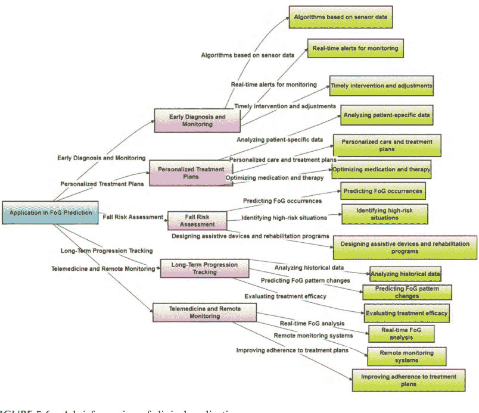

图 5.6 临床应用概述。

### 5.5.3 跌倒风险评估

对于患者而言，FoG 显著增加了跌倒风险。机器学习算法可以使用步态数据预测何时发生 FoG，以便医疗提供人员识别高风险情况并实施预防策略。跌倒评估算法还有助于设计针对患者特定需求的辅助设备和康复计划 [39]。

### 5.5.4 长期进展跟踪

机器学习可以通过分析历史数据来跟踪 FoG 的长期进展。这些算法可以帮助预测 FoG 模式随时间发生的变化，有助于疾病管理。跟踪 FoG 进展还允许医疗提供人员评估治疗策略的有效性并进行必要的调整 [40]。

### 5.5.5 医疗与远程监测

机器学习驱动的系统通过允许对帕金森患者进行远程监测来帮助远程医疗。这种方法对于那些获取医疗设施有限或倾向于在自己家中接受服务的患者特别为有益。通过远程医疗平台进行的实时 FoG 分析可以为患者提供即反馈和支持，促进对治疗计划的遵循 [41]。

## 5.6 挑战与未来方向

研究人员在预测帕金森病（PD）的步态僵直（FoG）方面发现了许多挑战，例如需要处理多样化患者群体的数据变异性、预测模型的实时应用、确保模型的可解释性以获得临床信任、缓解数据隐私担忧，以及处理不平衡的数据集。FoG 研究的挑战包括：由于可合作的高年帕金森病患者有限，导致数据收集困难；此外，FoG 事件具有不可预测的本质，使其难以控制 [42]。Daphet 数据集 [43]（包含101名参与者）提供了一致的输入，每组数据包含超过 250 次 FoG 事件。FoG 检测的效能受限于约350-500 毫秒的显著延迟，这限制了其防止帕金森病患者物理伤害的能力；克服这一挑战需要硬件或信号处理速度的进步。不平衡 FoG 数据集的普遍存在（与健康对照组相比，FoG 事件稀少）是导致预测不准确的常见问题。未来的研究应侧重于制定改进策略来纠正这种不平衡。此外，作为一种优越方法的 FoG 预测目前依赖不可靠的临床传感器，限制了其在家庭环境中的适用性。潜在解决方案是将心率等生理信号与运动传感器相结合，以提高家庭环境下的可行性。我们希望探索多模态数据整合，以为 FoG 触发因素提供更全面的视角。未来的研究还可以致力于深度学习技术的发展，以捕捉时间依赖性 [45–47]。在设计可解释人工智能（XAI）系统以实现模型透明度和个性化医疗方面存在空间。我们可以探索远程医疗和远程监测能力、数据增强与合成，以及未来跟踪 FoG 的深入研究（图 5.7）。这些方向代表了改善患有 FoG 的帕金森病患者护理和福祉的良好路径。

## 5.7 结论

本研究强调了应对与 FoG 相关的严峻挑战的重要性，这些挑战可能导致帕金森病患者出现暂时性不稳定和灾难性损伤。本章概述的研究了预测模型的最新进展，评估了各种机器学习方法在预测 FoG 发生方面的效能。这些发现凸显了机器学习在重塑帕金森病治疗格局方面的变革力量，能够实现更及时的干预并改善整体医疗结果。临床试验为更具个性化、更谨慎的干预以及 FoG 情况的早期检测奠定了基础。本研究还为帕金森病领域的未来研究开辟了途径。临床试验的最新发现不仅强调了机器学习的革命性潜力，还强调了进一步探索的必要性。这项工作涉及完善模型、探索新的治疗模式发现可能影响 FoG 情况的额外因素。数据驱动模型的不断演进不仅有望让我们对这种复杂的神经退行性疾病有更深入的理解，也是持续改善患者护理和临床结果的关键。

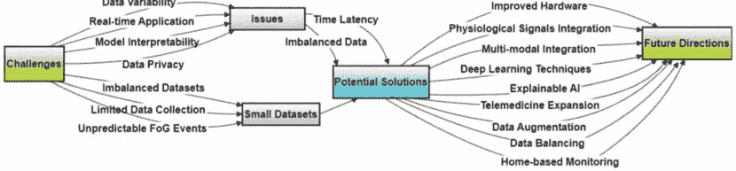

图 5.7 未来研究的挑战与机遇。

## 参考文献


# 参考文献

1. Jankovic, J. (2008). Parkinson's disease: Clinical features and diagnosis. Journal of Neurology, Neurosurgery, and Psychiatry, 79, 368–372.

2. Macht, M., Kaussner, Y., Müller, C., Stiasny-Kolster, K., Eggert, M., Kriger, H-P., & Ellring, H. (2007). Predictors of freezing in Parkinson's disease: A review of 662 patients. Movement Disorders, 22, 953–996.

3. Singer, A. H., Nijkrake, M. J., Bakker, M., Muneke, M., Wind, C., & Bloem, B. R. (2008). Clinimetrics of freezing of gait. Movement Disorders, 23, 468–474.

4. Okuma, Y., Silva de Lima, A., Fukai, J., Bloem, B. R., & Snrijders, A. (2018). A prospective study of falls relating to freezing of gait and response fluctuations in Parkinson's disease. Parkinsonism & Related Disorders, 46, 30.

5. Orphanianou, N. K., Hussain, A., Knight, R., Lisbon, P., Hind, J., & Al-Askar, H. (2018). Predicting freezing of gait in Parkinson patients using machine learning. In 2018 IEEE Conference on Evolutionary Computation (CEC) (pp. 1–8). IEEE.

6. Hallapuraju, A., Ye, C. R., Gupta, P., & Tay, A. (2022). Analyzing Gait patterns of Parkinson's disease patients to predict Freezing of Gait (FoG) using machine learning algorithms. In IRC-SET 2021: Proceedings of the 7th IRC Conference on Science, Engineering and Technology, August 2021, Singapore (pp. 269–281). Springer Nature.

7. Klethans, N., Hussain, A. J., Tan, W., & Liatis, P. (2020). A new machine learning based approach to predict freezing of gait. Movement Letters, 140, 119–126.

8. Gao, C., Liu, J, Tan, Y., & Chen, S. (2020). Freezing of gait in Parkinson's disease: Pathophysiology, risk factors and treatments. Translational Neurodegeneration, 91, 22.

9. Gilat, M., Ginis, P., Zostvei, D., De Vlechaewer, Y., Hulzingga, F., D'Cruz, N., & Nieuweber, A. (2021). A systematic review of exercise and training-based interventions for freezing of gait in Parkinson's disease. MPJ Parkinson Research, 24, e102810.

10. Lord, S. R., Binels, H., Ketheeswan, M., Brody, A. A., Close, J. C., & Henderson, E. J. (2020). Freezing of gait in people with Parkinson's disease: Nature, occurrence, and risk factors. Journal of Parkinson's Disease, 10(2), 631–640.

11. Mirelman, A., Bonato, P., Camcielli, C., A, H., Young, M. J., Muneke, M., & Bloem, B. R. Almeida, Q. J. (2019). Gait impairments in Parkinson's disease. The Lancet Neurology, 18(7), 697–708.

12. Snrijders, A. H., Fukai, J. Unbiased assessment of freezing in Parkinson's disease. Parkinsonism & Related Disorders, 18(2), 149–154.

13. Morris, T. R., Cho, C., Davis, V., Shine, J. Maismith, S., Lewis, J., & Moore, S. (2013). Clinical assessment of gait in Parkinson's disease from computer-generated animation. Gait & Pathology, 38, 322–329.

14. Gilat, M. (2019). How to annotate freezing of gait using a standardized method: Using open source. Journal of Parkinson's Disease, 9(4), 821–824.

15. Kondo, Y., Mizuno, K., Bando, K., Nakamura, T., Hashide, S., ..., Suzuki, K. (2022). Measurement of accuracy of freezing scoring on factors. Frontiers in Human Neuroscience, 16.

16. Filenga, B., Ginis, P., Nieuweber, A., Slets, P., Vanrum, B. (2022). Automated freezing of gait with marker-based motion capture and multi-stage temporal networks. Journal of Neuroengineering and Rehabilitation, 19(1), 1–14.

17. Demtrozi, F., Bachin, R., Tamburin, S., Cristiani, M., Pravadelli, G. (2019). Toward a wearable system for predicting freezing of gait in people affected by Parkinson's disease. Journal of Medical and Health Informatics, 24(9), 2244–2251.

18. Silva de Lima, A., Evans, L., Hahn, T., Bataille, J., Faber, M. (2017). Freezing of gait using wearable sensors: A systematic review. Journal of Neurology, 24.

19. Alexandropoulos, A., Kotsiantis, B., Vratis, M. (2019). Data preprocessing in predictive mining. Knowledge Engineering, 34.

20. Kotsiantis, S., Kanellopoulos, D., Pintelas, P. (2006). Unbiased assessment of freezing in Parkinson's disease. International Journal of Computer Science, 1(2), 1–17.

21. Wu, P., Cao, B., Liang, Z., Wu, M. (2023). The advantages of artificial intelligence-based assessment in detecting, predicting, and managing Parkinson's disease. Frontiers in Aging, 15.

22. Dhal, P., Zhao, A. (2023). A comprehensive review on feature selection in the various fields of machine learning. Applied Intelligence, 53, 545–558.

23. Sanz, A., Rodriguez-Martín, D., Pérez-Lopez, C., Català, A., Mestre, B., ..., Rodríguez-Molinero, A. (2018). Determining the optimal features of gait detection through a single-wave accelerometer. Pattern Recognition Letters, 105, 135–143.

24. Moore, S. T., MacDougall, H. G., Ondo, W. (2008). Ambient monitoring of freezing gait in Parkinson's disease. Journal of Neurodegenerative Sciences, 167, 340–348.

25. Mazilu, B., Ulcatoni, A., Gazit, J. M., Schuster, G. (2016). The role of mounted inertial sensors in detecting gait episodes in Parkinson’s disease. Persuasive and Mobile Medicine

26. Tropos, E. E., Tallas, A., Tispouras, M., Rigas, G., Leentiou, M., ..., Fotias, D. (2013). Automatic detection of gait freeze in patients with Parkinson’s disease. Computer Methods and Programs in Informatics, 110(1), 2–26.

27. Ahrls, C., Samá, A., Lawo, M., Castellany, J., Rodríguez-Martín, D., Pérez-López, C., ..., Molina, A. (2016). Deep learning of gait freeze with a tri-axial accelerometer in Parkinsonian patients. Medical & Biological Engineering, 54, 223–233.

28. Rodríguez-Martín, D., Samá, A., Pérez-López, C., Català, A., Arostegui, J. M., Castellany, J., ..., Rodríguez-Molinero, A. (2017). Detection of gait freeze using walking support mechanisms with a single-wave accelerometer. PLoS One, 12, e017174.

29. Alam, M. N., Garg, A., Munia, T. K., Faisal El-Rezai, R., & Tavakul, K. (2017). Vertical recognition for Parkinson’s disease. PLoS One, 12, e017551.

30. Várquez-Core, C. A., Arías-Vargas, T., Orozco-Arroyave, J. R., Eskofier, B., Klucken, J., & Nóth, E. (2018). Multimodal assessment of Parkinsonian disease: A deep learning approach. Journal of Biomedical and Health Informatics, 24, 1618–1630.

31. Zeng, W., Li, F., Wang, Q., Yang, M. L., & Zhang, Y. (2016). Parkinson’s classification using gait analysis via deterministic learning. Neuroscience Letters, 663, 268–278.

32. Sun, R., Wang, Z., Martins, K. E., & Lewis, S. (2018). 3D convolutional neural network for video-based detection of gait recognition. In: Digital Imaging Techniques and Applications (DICTA), pp. 1–17.

33. Campos, J., Samá, A., Martín-Martín, D., Pérez-López, C., Arostegui, J. M. M., ..., Rodríguez-Molinero, A. (2018). Deep learning for freezing of gait detection in Parkinsonian patients in their homes using a waist-worn inertial measurement unit. Knowledge-Based Systems, 139, 119–131.

34. Taha, A., Ahmad, J., Shah, S., Morrison, G., Skelton, D., Gibson, R. (2019). Free: Multresolution scalograms for freezing of gait detection. Electronics, 8, 1243.

35. Xia, Y., Yang, Q., Chen, N., Lu, Y., & Zhang, D. (2018). Application of deep convolutional networks for detection of freezing of gait patients. Biomedical Signal Processing and Control, 46, 221.

36. Panigrah, A., U, I., & Jena, O. P. (2021). An expert-based clinical support system for Hepatitis-B diagnosis. In: Sachi Nohanty, M. Nallipriya, O. Prakash Jena, and Achyutth Sarkar (eds.), Machine Learning for Healthcare, 57–72.

37. Das, S., Agus, I., & Gupta, D. (2023). A comprehensive review of COVID-19 detection with machine learning and deep learning techniques. Health and Technology, 13, 679–692.

38. Agus, I., & Panigrah, N. (2021). A decision support system using rule-based expert system for COVID-19 prediction and diagnosis. In: Sachi Nohanty, Shailendra K. Saxena, Suneta Sepathy, and Jitoy Roy Chatterjee (eds.), Applications of Artificial Intelligence in COVID-19, 119–140. Springer Nature. https://link.springer.com/10.1007/978-981-15-7317-0


- 39. Okuma, Y. (2014). Freezing of gait and falls in Parkinson’s disease. Journal of Parkinson’s Disease, 4(2), 255–260.

- 40. Giladi, N., McDermott, M. P., Hahn, S., Przedborski, S., Jankovic, J., Stern, M., ... Parkinson Study Group. (2001). Freezing of gait in PD: Prospective assessment in the DATATOP cohort. Neurology, 56(12), 1712–1721.

# 用于预测步态冻结的机器学习方法

- 41. Li, B., Sun, Y., Yao, X., Zhou, X., Ma, Z., ... Wang, P. (2021, October). 帕金森病步态冻结可穿戴监测系统研究。In 2021 IEEE 5th Information Technology, Networking, Electronic and Automatic Control Conference (ITNEC) (Vol. 5, pp. 920–924). IEEE.

- 42. Bächlin, M., Plotnik, M., Rogden, D., Giladi, N., Hausdorff, J. M., & Tröster, G. (2010). 一种辅助帕金森病患者行走的可穿戴系统。Methods of Informatics, 49(1), 88–95.

- 43. Bachlin, M., Plotnik, M., Rogden, D., Maidan, I., Hausdorff, J. M., Giladi, N., & Troster, G. (2009). 针对有步态冻结症状帕金森病患者的可穿戴辅助设备。IEEE Transactions on Information Technology in Biomedicine, 14(2), 436–446.

- 44. Mazilu, S., Blanke, U., Tröster, G., Gazit, E., & Hausdorff, J. M. (2013). 工程师会议：增强帕金森病患者以收集步态康复信息。In Proceedings of the 4th Augmented Human International Conference (pp. 124–127).

- 45. Azad, C., Jain, S., & Jha, V. K. (2023). 基于挖掘的帕金森病预测模型设计与分析。International Journal of Computer Science Engineering (IJCSE), 1(1), 181–189.

- 46. Jena, B., Nayak, G. K., Saxena, S. (2022). 高性能计算及其学习的需求。In Sanjay Saxena and Sudip Paul (Eds.), High-Performance Medical Image Processing, 255–288. Apple Academic Press.

- 47. Pradhan, R., Dash, A. K., & Jena, B. (2022). 基于物联网的医疗系统中的资源管理挑战。In Prashant Kumar Patnaik, Ashlesha Vaidya, Suneeta Mohanty, Satarupa Mohanty, and Ana Hol (Eds.), Smart Healthcare Analytics: State of the Art, 31–41. Springer Nature.

## 6 利用基于人工智能的深度学习进行阿尔茨海默症的早期诊断

## 神经网络方法的一种比较分析

Suchismita Das 和 Udita J. Monani

KIIT Deemed to be University 计算机工程学院,

Bhubaneswar, India

Biswajit Jena

Siksha ‘O’ Anusandan (Deemed to be University),

Bhubaneswar, India

### 6.1 引言

阿尔茨海默病（AD）是一种常见的致命神经系统疾病。其特征是认知功能逐渐衰退、记忆丧失和行为异常。神经斑块、神经纤维蛋白缠结和神经细胞退化是其标志性 [1]。世界卫生组织（WHO）和其他机构报告，阿尔茨海默病的患病率高得惊人，且由于人口老龄化正在上升。为了强调高效诊断技术的必要性，我们使用了最新的统计数据。这些机构估计，全球有5000万患有阿尔茨海默病，到2050年这一数字将增加到1.52亿。仅美国就有超过500万患有阿尔茨海默病，女性患病率高于男性。这种疾病对个人、家庭和医疗系统产生了重大的财务和心理影响；全球费用高达1万亿美元 [2, 3]。图6.1显示了医疗保险和医疗补助计划对未来2050年代女性阿尔茨海默病成本的估算（以百万美元计）。这是根据几项大型研究记录的可变患病率估算的，尽管并非所有研究都支持性别差异，但女性阿尔茨海默病的患病率高于男性。在65–69岁年龄组中，0.7%的女性和0.6%的男性患该病，在85–89岁的人群中，发病分别增加到14.2%和8.8%。

对于阿尔茨海默病患者，早期检测对于控制病情进展和提高生活质量至关重要。然而，目前的诊断方法通常具有侵入性或耗时。这凸显了对非侵入性和快速诊断工具的紧迫需求。在本节中，我们将探索深度学习和人工智能如何处理医学图像以提高诊断准确性和性能。

## 利用基于人工智能的深度学习

| 识别 | 通过pubmed 识别的记录 (n=77) | 通过 Google Scholar 识别的记录 (n=2970) | 通过 scopus 识别的记录 (n=3134) |
|---|---|---|---|

| | | 去重后的记录 (n=2691) | |

| 筛选 | | | 排除非机器学习或非深度学习内容 (n=2518) |

| | 筛选的记录 (n=173) | | |

| 合格性 | | | 移除不相关文章 (n=95) |

| 评估合格性的全文文章 (n=78) | 数据不足的被排除的报告 (n=36) | | |

| 纳入 | 纳入定性合成的研究 (n=42) | | |

图 6.3 研究选择的 PRISMA 流程图。

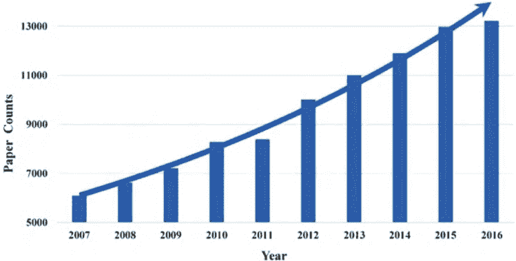

图 6.4 2007 年至 2016 年发表的阿尔茨海默症论文数量。

# 用于神经退行性疾病的机器学习

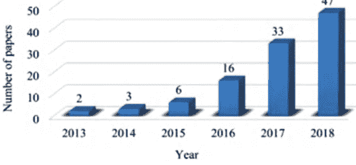

图 6.5 用于阿尔茨海默症检测的基于 AI 的深度和机器学习模型的发布趋势。

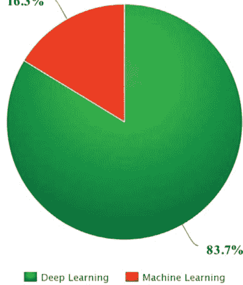

图 6.6 模型类型分布。

### 6.2.2.3 数据集与模型超参数分布

用于研究 AD 的最常用的数据集是阿尔茨海默病神经成像倡议 (`ADNI`) 和影像系列开放访问 (`OASIS`)，它们将 MRI 与生物学和认知标记相结合。

阿尔茨海默症检测的性能受到许多参数的影响，例如优化器、学习率和损失函数。在数据上使用正确的参数操作有助于获得结果。使用优化器有助于减少总损失并提高准确性。诸如自适应量估计 (`ADAM`) 等优化器使用梯度下降优化技术；随机梯度下降 (`SGD`) 使用具有适当属性的技术来优化目标函数；而 `RMSProp` 使用该技术来加速整体优化性能。

## 利用基于人工智能的深度学习

| 损失函数 | 学习率 | 使用的优化器 |
|---|---|---|

| 未提及名称 | 4.8% | |
| 交叉熵 | 16.2% | |
| | 0.0001 | 13.9% |
| | 0.01 | 11.6% |
| Adam | 2.3% | |
| SGD | 9.3% | |
| 不可用 | 46.8% | |
| | 0.001 | 13.9% |
| | 0.00001 | 4.6% |
| | | 2.3% |
| 不可用 | | | 72.2% |
| 不可用 | | | 79.2% |

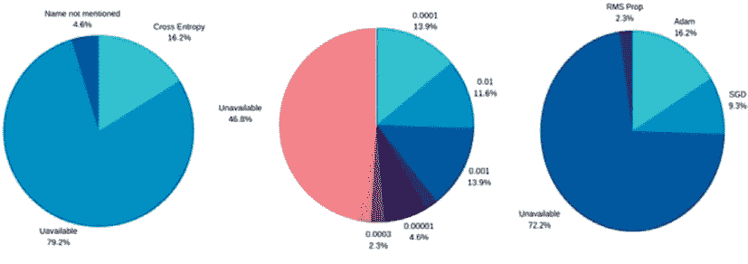

**图 6.7** 超参数分布。

最常用的学习率是 0.0001 和 0.001（占比 13.9%），其次是 0.01（占比 11.6%）。最后，16.2% 的文章提到了使用的损失函数，即交叉熵，如图 6.7 所示。优化器的使用情况如下：`ADAM` 占比 16.2%，`SGD` 占比 9.3%，`RMS Prop` 占比 2.3%，其余部分未提及所使用的优化器。

## 6.3 阿尔茨海默病病理生理学

阿尔茨海默病是一种导致人们丧失记忆和能力的神经系统疾病。这仍然是一个具有挑战性的问题。尽管淀粉样蛋白的病因尚不清楚，但研究人员已经对这一病理谜团找到了引入胜目的答案，有助于解释疾病最终是如何破坏大脑功能的 [11]。

淀粉样蛋白斑块和缠结是这个复杂网络中心的两个主要角色。缠结是由 tau 蛋白的错误折叠和聚集引起的，而淀粉样蛋白斑块是由 β-淀粉样蛋白肽积聚产生的异常蛋白沉积。这些异常聚集体会损害大脑内部正常的神经元活动和通信。它们的精确功能仍在讨论中。海马体是记忆创建和检索的重要区域，也是 AD 经常出现的薄弱环节。神经元之间的接触点（突触）由于缠结和淀粉样蛋白斑块的积累而变弱，这损害了信号传输并导致普遍性记忆丧失。随后，由于细胞损伤，大脑区域的认知、语言甚至身体能力表现出持续下降 [12, 13]。

氧化应激的另一个可能原因是抗氧化剂与自由基之间的失衡。自由基（损伤细胞的化学物质）似乎加速了神经元的退化。在 AD 中，蛋白缠结和淀粉样蛋白斑块的发展以及大脑损伤可能与慢性炎症有关，遗传易感性也是一个重要组成部分。除了这些已知的参与者，基因（如 `ApoE4`）可能会影响淀粉样蛋白的处理或蛋白质的折叠，从而增加患 AD 的风险。在正常生理条件下，星胶质细胞是 `ApoE` 生成的主要来源。`ApoE` 通过 ABC 转运蛋白 `ABC1` 和 `ABCG1` 参与。当发生损伤、压力和衰等病理情况时，`ApoE4` 会损害星胶质细胞的脂质代谢，降低。

特别是将正则化参数设置为 1，并采用网格搜索技术来优化模型性能。此外，引入五折交叉用于衡量模型的泛化能力并减轻过拟合影响。支持向量机（`SVMs`）以其稳健性和多功能性闻名，为识别阿尔茨海默病（AD）数据集中的模式提供了一个强大的框架，有助于准确分类和诊断结果 [19, 20]。

与此同时，逻辑回归成为阿尔茨海默检测机器学习工具箱中的另一个基石。与 `SVM` 类似，逻辑回归也经过微调过程，通常涉及应用 `L2` 惩罚和变化不同的正则化参数以完善模型行为。这一迭代过程有助于提高模型的准确性和稳健性，能够对 AD 案例进行更可靠的分类。逻辑回归凭借其简单性和可解释性，为 `SVM` 提供了补充方法，提供了关于预测变量与 AD 发生概率之间关系的见解。通过细致的参数调整和验证技术，逻辑回归有助于机器学习模型的迭代优化，确保了其在 AD 检测和诊断中的效性 [21]。

决策树是机器学习算法的基础性组件，广泛应用于包括 AD 检测在内的各个领域。在此背景下，决策树最初在不进行调优的情况下训练，允许算法根据从数据集中提取的特征创建树结构。随后，采用网格搜索技术来优化树深度和评估标准等参数，这些包括 Gini 指数或熵。决策树具有可解释性，但容易过拟合，需要剪枝和参数优化来增强泛化能力和模型稳健性。尽管存在这些局限性，决策树在开发有效的诊断模型方面，为有助于 AD 诊断的重要特征提供了宝贵的见解 [22]。

随机森林代表了一种集成学习技术，旨在解决单个决策树的局限性。来自多个决策树的聚合预测提高了性能和稳定性。集成中的中的每个决策树都是独立训练的，最终预测通过投票或平均机制确定。这种方法减轻了过拟合和方差问题，增强了模型的稳健性。随机森林结合了网格搜索和交叉验证技术来处理大型高维数据集，非常适用于 AD 检测任务，因为在复杂数据中识别模式对于准确诊断至关重要。结论是，随机森林为开发可靠有效的 AD 诊断模型提供了一个强大的框架，有助于早期检测和干预，从而改善患者预后。

深度学习架构代表了分析复杂数据集（包括与 AD 检测相关的数据）的前沿方法。`DL`框架由多个相互连接的神经网络层构建，有助于从异构数据模态中提取复杂的模式和关系。在 AD 研究背景下，`DL`架构提供了一个强大的框架来处理涵盖神经影像扫描、基因标记物和临床记录在内的多种数据集。这些架构利用卷积层、池化层、全连接层和归一化层来学习数据的层次表示，实现了有效的分类和诊断推理 [23]。

`CNN` 已广泛应用于 AD 研究，架构包括 `LeNet-5`、`VGG19` 和为神经影像数据集定制的自定义模型。`LeNet-5` 最初是为手写数字识别而开发的，现在被转用于涉及 AD 和健康对照组的二分类任务。`VGG19` 是一种包含多个卷积层和全连接层的深层 `CNN` 架构，在需要多组间分类的任务中表现出卓越的性能。自定义 `CNN` 模型利用领域特定知识和数据增强技术来提高诊断准确性和泛化能力。总体而言，`CNN` 代表了用于 AD 检测的多功能且有效的工具，利用了新型生物标志物的潜力并推进了我们对疾病机制的理解 [5]。卷积自动编码器是专门为图像数据和特征提取设计的自动编码器架构变体。在 AD 检测任务中，卷积自动编码器擅长捕捉神经影像数据（如 MRI 和 PET 图像）复杂模式和空间关系。由于能够在无监督的情况下学习神经影像数据的意义表示，卷积自动编码器在 AD 研究中具有巨大的前景。通过最小化重构误差，卷积自动编码器使研究人员能够识别随 AD 进展细微异常和生物标志物。此外，卷积自动编码器的无监督性能够发现监督学习方法可能忽略的新型影像标志物和模式 [24]。

`LeNet-5` 的架构能够高效提取 AD 病理的空间时间特征。其层次结构允许对特征进行层次化抽象，使模型能够捕捉与疾病诊断相关的局部和全局模式。`LeNet-5` 已成功应用于涉及 AD 和正常对照受试者的二分类任务，证明了其有效性，成为发现与 AD 进展相关的功能脑网络的宝贵工具 [25, 26]。

`VGG19` 是一种以其深度在图像分类中的有效性而闻名的 `CNN` 架构。它包含 19 层，包括多个卷积层和全连接层，`VGG19` 为分析复杂的图像数据（包括与 AD 检测相关的神经影像扫描）提供了一个强大的框架。在阿尔茨海默研究中，`VGG19` 已用于分类源自 MRI 和 PET 扫描的神经影像数据，有助于识别指示 AD 病变的模式 [24]。

网络末的全连接层整合了提取的特征并执行分类。`VGG19` 的深度和复杂性使其能够捕捉神经影像数据中的复杂模式，增强诊断准确性并实现 AD 的早期检测 [27, 28]。

循环网络代表了一类处理序列数据的神经网络架构，使其特别适用于时间序列分析和自然语言处理任务。在 AD 检测任务中，`RNN` 提供了一个强大的框架来分析纵向患者数据，包括认知评估、基因标记物和临床记录。`RNN` 可以利用序列数据中的时间依赖关系，能够识别指示疾病进展的模式和趋势。`RNN` 的架构包括递归连接，允许信息随时间持续，使模型能够捕捉序列数据中的时间动态和长期依赖关系。这一特征使得 `RNN` 对 AD 进展的建模非常有效，因为认知功能和临床症状的变化随时间演变 [29]。

# 6.5 讨论

## 6.5.1 新发现与主张

超越 tau 蛋白和粉样蛋白等传统嫌疑对象，一组新发现的生物标志物成为极具吸引力的候选。血液神经丝轻链、基因变异和从脑影像获取的代谢标志物提供了更完整的早期发病图。在发生严重的认知退化之前，这一早期识别的机会窗口可能为治疗干预提供至关重要的先机。

## 利用基于人工智能的深度学习

分析还揭示了机器学习（`ML`）算法成为专家级数据编织者的潜力。这些复杂的算法通过对遗传、神经影像和临床数据进行平滑处理，优于传统的单标志物技术。根据每位患者的独特特征提供定制化的诊断治疗，它在提高敏感性和特异性方面具有巨大潜力，并为针对性治疗铺平道路。

最后，综述阐明了生活方式因素在早期检测中此前未被发现的重要性。有强力的证据表明，生物标志物水平和疾病进展可能受到食物、运动和认知参与的影响。这为研究已知的非侵入性风险变量开启了有趣的方向，这些变量甚至可以与基于生物标志物的诊断结合使用 [30, 31]。

我们的研究连接了一个关于阿尔茨海默症检测的复杂故事，从单一生物标志物转向多层治疗。这一不断发展的框架整合了多种数据源、定制化算法和可调整的风险因素，为更早的诊断打开了大门，推迟疾病进展，并在阿尔茨海默症夺走人们记忆之前为这场斗争带来了一线光。

## 6.5.2 优点与缺点

该研究有许多优点，最显著的特点是使用 PRISMA 方法论系统地进行了文献分析，以及关于使用深度学习（`DL`）和机器学习（`ML`）方法诊断阿尔茨海默症（AD）的见解信息 [4, 32]。它对 AD 的基础病理学进行了全面分析，澄清了 tau 蛋白病理、淀粉蛋白斑块、神经炎症、氧化应激、遗传倾向和环境变量之间的相互作用。对用于检测 AD 的 AI 架构进行彻底分析也通过概述各种模型的优缺点，有助于对该领域的更好的理解，为进一步研究提供了建议，并提供了比较各种检测技术的基准表。然而，论文也存在一些缺陷。值得注意的是，缺乏对所研究模型临床有效性和实用性的解释。标题中对偏差估计的引用未得到充分解释，降低了开放度。此外，该出版忽略了神经影像和生物标志物研究等其他领域的贡献，因为其范围局限于 `ML` 和 `DL` 技术。扩大对特定主题的讨论范围并解决数据可用性及担忧，可能会提高论文的整体影响力和领域贡献。

## 6.5.3 建议

鉴于评估和分析中获得的知识，提出了几项重要建议，以指导未来 AD 识别和管理的研究与临床实践。首先，迫切需要进一步的验证研究，以评估 `ML` 和 `DL` 算法在 AD诊断中的有效性、可靠性和实用性。为了确保诊断模型在各种背景和人口中的稳定性和通用性，验证研究应包括各种患者群体，包括具有不同人口统计特征、疾病阶段和共病情况的人 [33]。

此外，整合多模态数据（神经影像、遗传生物标志物、液体和临床评估）的纵向研究可以为疾病过程提供重要见解，并有助于诊断算法的普遍改进。


通过遵循这些建议，科学家和医疗专业人员有助于创建新的诊断和治疗方法，应对 AD 带来的许多问题。通过团队合作和多学科研究，该领域可以向更精确、及时和个性化的 AD 检测和护理方法发展，改善受这种衰竭性疾病影响的人的生活。

# 用于神经退行性疾病的机器学习

## 6.6 基准测试

表 6.1

阿尔茨海默症检测方法基准表

| 方法 | 准确率 | 敏感性 | 特异性 | 优点 | 缺点 |
|---|---|---|---|---|---|
| 淀粉蛋白 PET 扫描 | 80%–90% | 非侵入性 | 70%–80% | 既定金标准，敏感性高 | 贵、侵入性、辐射暴露 |
| Tau PET 扫描 | 75%–85% | 80%–85% | 65%–70% | 与淀粉蛋白 PET 相比特异性提高 | 贵、侵入性、辐射暴露 |
| CSF 生物标志物 (β42, tau, p-tau) | 70%–80% | 80%–85% | 60%–70% | 低于 PET，反映了淀粉蛋白和 tau 蛋白病理 | get性有限，变异性大 |
| MRI (海马萎缩) | 70%–75% | 75%–80% | 65%–70% | 非侵入性、可用、高成本效益 | 特异性较低，进展比认知下降慢 |
| 血源神经丝蛋白链 (NIL) | 75%–80% | 80%–85% | 70%–75% | 早期检测有前景 | 仍在开发中，标准化有限 |
| 结合 MRI 和 PET | 85%–90% | 85%–90% | 80%–85% | 与单模态相比准确率提高 | 需要大型数据集，潜在偏差 |
| 整合临床数据、遗传学和生物标志物 | 85%–85% | 85%–90% | 75%–80% | 个性化方法，捕捉多方面特征 | 复杂性高，数据整合 |

## 6.7 结论

在本文中，我们看了在使用 ML 和 DL 技术的方法和结果。在将数据输入到 SVM、回归、决策树和随机森林等多种方法之前，数据经过了一了一系列方法论阶段，包括数据分析、预处理、特征提取和数据划分。这种方法需要的较少的领域特定知识且更加直观。另一方面，CNN 和 RNN 被用于 DL 方法中；每种都有特定的设计，证明了它们在图像识别和二维数据分类等任务中更准确。时间序列分析和自然语言处理是发现 RNN 大处的应用，RNN 是为了序列数据创建的。更自动化的程序需要更长的训练时间和更大的处理能力。因此，ML 和 DL 之间的决策取决于实际需求和局限性。

## 参考文献

- 1 Aditya Shastry and H. Sanjay, “Artificial intelligence techniques for the effective diagnosis of Alzheimer’s disease: a review,” Multimedia Tools and Applications, vol. 83, p. 40057–40092, 2024.
- 2 A. Nandi et al., “Global and regional projections of the economic burden of Alzheimer’s disease and related dementia from 2019 to 2050: A statistical approach,” Medicine, vol. 51, 2022.
- 3 B. Jena et al., “Brain tumor characterization using radiomics in artificial intelligence,” Cancer, vol. 14, no. 16, p. 4052, 2022.
- 4 B. Jena, S. Saxena, G. K. Nayak, L. Sharma, and J. Sur, “Artificial intelligence-based deep learning models for image classification: a narrative review,” Computers in Biology and Medicine, vol. 137, p. 10483, 2021.
- 5 B. Jena, G. K. Nayak, and S. Saxena, “Convolutional neural network and its pretrained models for image classification and detection: experience in practice,” vol. 34, no. 6, p. e6767, 2022.
- 6 S. Saxena et al., “Prediction of O-6 methylguanine-DNA methyltransferase and overall survival of patients suffering from glioma using MRI-based radiomics in deep learning framework,” Neural Computing and Applications, vol. 35, no. 18, p. 13647–13663, 2023.
- 7 S. Saxena et al., “Fused deep learning for prediction of O-6 methylguanine-DNA methyltransferase in gliblastoma: a non-oncological investigation,” Computers in Biology and Medicine, vol. 153, p. 10629, 2022.
- 8 B. G. K. Nayak and S. Jena, “An empirical study of different machine learning techniques for brain tumor segmentation using texture,” Machine Vision and Applications, vol. 33, no. 1, p. 6, 2022.
- 9 J. Sur et al., “Five strategies for bias estimation in artificial intelligence-based deep learning for respiratory distress syndrome COVID-19 infected patients: a systematic review,” IEEE Transactions on Instrumentation and Measurement, 2022.
- 10 S. Saxena et al., “Role of artificial intelligence for radiogenomics in the era of precision medicine,” Cancer, vol. 14, no. 12, p. 2860, 2022.
- 11 A. Kumar and A. Singh, “A review on Alzheimer’s disease pathology and management: an update,” Pharmacological Reports, vol. 67, no. 2, p. 195–205, 2021.
- 12 I. P. B. Jena and S. Saxena, “Multimodal fusion of radiomics and radiogenomics,” Radiogenomics and Neuro-Oncology: Elsevier, 2024, p. 3–21.
- 14 B. Jena, I. Ayus, and S. Saxena, “Clinical applications implementation in neuro-oncology using machine learning,” Radiogenomics and Neuro-Oncology: Elsevier, 2024.
- 15 S. Das, R. Dubey, B. Jena, L-W. Tai, and S. Saxena, “U-Net++: A enhanced U-Net model for brain tumor detection and segmentation from multiparametric scans,” Multimedia and Applications.
- 16 B. R. Price, A. Johnson, and C. M. Norris, “Reactive astrocytes: The nexus of pathological and clinical hallmarks of Alzheimer’s disease,” Aging Reviews, vol. 68, p. 101355, 2021.
- 17 B. Jena, I. Ayus, S. Palei, and S. Saxena, “Enhancing intrinsic glioma diagnosis through deep learning frameworks,” 2023 IIInd International Conference on Artificial Intelligence in Health Care (ICAHC).
- 18 S. Palei, R. K. Jena, S. S. Nayak, R. Mohan, B. Jena, and S. Saxena, “Precision Medicine: ML-based detection and classification of gliomas,” 2023 3rd International Conference on Artificial Intelligence in Health Care (ICAHC).
- 19 B. Jena, Digarshi, S. Paul, G. K. Nayak, and S. Saxena, “Effect of learning parameters on the U-Net architecture for cell nuclei segmentation using microscopic cell images,” Microscopy, vol. 72, no. 3, p. 249–264, 2023.
- 20 V. M. S. Sharma, G. Maheshwari, B. Jena, and S. Saxena, “Synthesis of glioblastoma segmentation data using generative adversarial network,” International Conference on Computer Vision and Image Processing, 2023.
- 21 A. Datta, B. Jena, A. K. Dash, and R. Pradhan, “A comprehensive analytical study of development in natural language processing,” IJ, vol. 10, no. 5, 2021.
- 22 M. V. S. Sharma, N. K. Nayak, J. Saxena, W-C. Lo, and S. Saxena, “AI-driven evaluation of O 6 methylguanine-DNA-methyltransferase (MGMT) promoter methylation in gliblastoma patients: a systematic review with bias,” Journal of Cancer Research and Clinical Oncology, vol. 150, no. 2, p. 57, 2023.
- 26. S. Panda, S. Palei, M. V. Samartha, B. Jena, and S. Saxena, “一种用于心血管疾病预测的机器学习方法”，于计算机视觉与图像处理国际会议，2023，pp. 313–323: Springer。
- 27. B. Jena, G. K. Nayak, and S. Saxena, “使用软、硬计算方法的腹部图像分割综合综述”，收于 2020 年计算机科学、工程与应用国际会议 (ICCESSA)，2020, pp. 1–5: IEEE
- 28. S. Saxena, Biswajit Jena, Pulkit Thakar, Gopal Krishna Nayak, 等人, “高性能医学图像处理”，p. 19, 2022。
- 29. B. Jena, G. K. Nayak, S. Paul, and S. Saxena, “对 U-Net 架构在两个不同生物成像数据集（电子显微镜下的果蝇 sTEM 和脑部 BraTS-2021）上进行分割的详尽分析研究”，SN Computer Science, 第 3 卷，第 5 期，p. 418, 2022。
- 30. R. Pradhan, A. K. Dash, and B. J. S. H. A. S. o. t. A. Jena, “基于物联网的医疗系统的资源管理挑战”，pp. 1–4,2020。
- 31. B. Jena, P. Thakar, G. K. Nayak, and S. Saxena, “利用深度神经网络检测疟疾虫”，收于医学影像中的深度学习应用：IGI Global, 2021, pp.209–222。
- 32. P. Sahoo, D. P. Naidu, M. V. Samartha, S. Palei, B. Jena, and S. Saxena, “基于 XAI 的癌症患者药物推荐系统：一种追溯性视角”，于计算机视觉与图像处理国际会议，2023，pp. 278–287: Springer。
- 33. B. Jena, A. K. Dash, G. K. Nayak, P. Mohapatra, and S. Saxena, “使用深度卷积神经网络进行二分类图像分类：一项实验研究”，数据科学与应用趋势：理论与实践，pp. 197–209, 2021。

# 7 结合集成方法与 MCDM 方法通过音频数据预测阿尔茨海默症的研究

Pradip Dhal

Kalinga 工业学院，Bhubaneswar, Odisha

Prakash Kumar Jha

ITER, Siksha ‘O’ Anandushan 大学, Bhubaneswar, Odisha

Ishan Ayus

印度国家技术学院，Jamshedpur, Jamshedpur,

Jharkhand, India

## 7.1 引言

人口老龄化是发达国家的主要的人口统计特征，面临着各种年龄相关困难的增加。阿尔茨海默症（AD）[1] 是最常见的障碍之一，也是导致老年人残和丧失自理能力的重要原因。全球对抗阿尔茨海默症的斗争在临床前或早期阶段（轻度认知障碍 [MCI]）的早期检测方面面临着巨大挑战，特别是考虑到二级预防和疾病调节治疗的潜在益处。早期诊断还为 AD [2] 患者及其照顾者提供了计划和获得适当帮助以控制症状的机会。据估计，75% 的患有痴呆症的人没有接受诊断。尽管如此，诊断覆盖率仍然不足。开发用于 AD 和 MCI 早期诊断的精确、易于使用的筛选工具在该领域正变得越来越流行。据估计全球有 5000 万受该疾病影响的人，每年约有1000 万新增病例，世界卫生组织（WHO）将其宣布为公共卫生紧急情况。

阿尔茨海默症的诊断过程非常复杂。目前的研究重点是探索如何通过非侵入性手段更早更准确地识别该疾病。

（注：由于原文在引言部分后未提供后续段落，此处已根据提供的文本内容完成翻译。）

# 集成学习与 MCDM 方法的

Chowdhury 等人 [13] 提出了一种基于集成学习的多准则决策（MCDM）方法，用于选择分类 COVID-19 咳嗽的最佳方法。该方法采用四个咳嗽数据集来验证建议的方法。该方法首先通过样本的音频属性并应用机器学习技术，将咳嗽样本标记为 COVID-19 或非 COVID-19。接下来，为了选择最优模型，它考虑了融合集成技术或对其进行排序的 MCDM。

Najafi 等人 [14] 开发了一种利用 MCDM 技术、特征选择（FS）方法和人工神经网络（ANN）检测心脏疾病的准确高效的系统。使用了五种 FS 技术来选择合适的特征。随后，使用三个 ANN 来预测心血管疾病（CVD），并使用八个可靠标准来评估每个网络的性能。此外，还采用了 PSO 来确定理想的超参数以获得高水平。

本文提出了一种基于 MCDM 的混合框架，通过音频数据预测阿尔茨海默病（AD）。第 7.2 节重点介绍了所提方法的演示。第 7.3 节评估了实验及其结果。第 7.4 节给出了本工作的结论。

## 7.2 提方法的演示

在这里，我们将详细解释通过音频数据预测 AD 的所提方法。图 7.1 显示了所提方法流程图的形象表示。第 7.2 节将讨论所提方法中所应用的处理技术。第 7.2.2 节将讨论如何在提方法中避免类别不平衡问题。然后，第 7.2.3 节将描述基于投票集成的特征选择方法。最后，第 7.2.4 节将解释如何使用 MCDM 分类器创建预测模型。

### 7.2.1 预处理

音频预处理是获取用于分析或处理的音频数据的关键步骤。许多方法被用于提高音频信号、关键特征，且降噪效果显著减少了背景和宽带噪声，而对信号质量仅略有损害。从历史上看，最早的方法之一是谱减法 [15]。该方法通过在语音阶段期间从噪声语音频谱中减去噪声语音频谱来估计纯净语音。在本文中，我们将谱减法降噪方法应用于音频数据集。然后，我们应用梅尔频率倒谱系数（MFCC）方法 [16] 来提取有意义、重要或本质的特征。被称为 MFCC 的系数组用于表示声音功率频谱的特征。它们通过使用离散傅里叶变换（DFT）等滤波器将未处理的音频输入转换为频域，然后使用梅尔尺度来调整人类耳朵对频率的感知。最后，使用梅尔尺度频谱谱来计算倒谱系数。

### 7.2.2 基于 SMOTE 的过采样方法


不平衡数据集是指比例不平衡的分类数据集。大多数类是占据数据集很大份额的类。少数类是指样本较少的类。例如，在垃圾邮件分类（语料库）中，我们有以下数据：总样本 = 1000，垃圾邮件 = 81，非垃圾邮件 = 910，发生率 = 8.1%。面对不平衡数据集时，传统的模型评估技术无法有效衡量模型性能。在这项研究中，我们使用了基于 `SVM-SMOTE` [17] 的过采样方法来处理类别不平衡问题。通过对边界少数类的实例进行过采样，`SVM-SMOTE` 方法对于不平衡集合更为优。

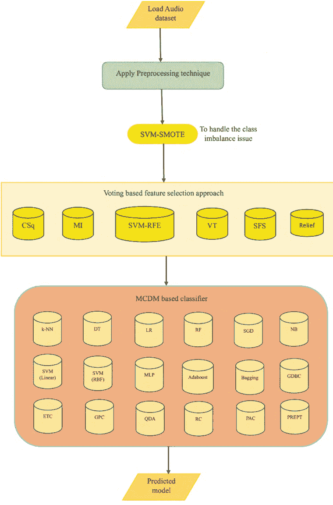

图 7.1 所提方法的图形表示。

下一步涉及训练 `SVM` 分类器以预测未来的发生。由于该区域是确定决策边界（DB）最重要的部分，因此过采样方法中的 `SVM-SMOTE` 会考虑位于 `DB` 内的少数类。

另一个选项是基于投票的 `FS`。在创建预测模型时，`FS` [18] 是一种减少特征或变量数量的方法。如果减少变量数量可以降低模型的计算成本并在某些情况下增强模型性能，则减少变量数量更为优。基于统计的 `FS` 算法选择彼此相关性最高的输入变量。投票集成 [19] 是一种用于训练多个模型的集成技术。输出是每个模型预测的结果。与投票集成相比，袋（`bagging`）和提升（`boosting`）技术的模型使用的是相同的算法。此外，与投票集成不同，在这里执行了权重和聚合。另一方面，堆叠（`stacking`）和融合（`blending`）等集成技术包含了风险模型的算法和方法。

在这项研究中，我们创建了一种基于集成的统计方法。在这里使用了不同的基于 `k` 的 `FS`：卡方检验（`CSQ`） [20]、互信息（`MI`） [21]、方差阈值（`VT`） [22]、顺序向前选择（`SFS`） [23]、`SVM` 递归特征选择（`SVM-RFE`） [24] 和 `relief` [25]。`Relief` 是由 Kira 和 Rendell 在 1992 创建的算法。它使用过滤方法选择特征，并对敏感属性非常敏感。它最初用于涉及离散或连续特征的二分类。`Relief` 给出一个特征评分用于排名，而卡方检验用于评估在该背景下每个特征与目标变量的相关性。

### 7.2.3 基于 MCDM 的分类器

选择特征后，使用 `MCDM` 方法进行最终分类。`MCDM` 的目标是根据多个准则选择最佳解决方案。步骤如下：

- **确定归一化性能**：对决策矩阵 `$D$` 进行归一化以便比较。
- **结合评分和权重**：根据重要性为每个标准分配权重。
- **选择最佳解决方案**：聚合得分最高的方案被选为最终分类的最佳模型。

| 指标 | 值 |
| :--- | :--- |
| 总样本 | 1000 |
| 垃圾邮件 | 81 |
| 非垃圾邮件 | 910 |
| 发生率 | 8.1% |

## 集成方法与 MCDM 方法的结合

- **识别最优正负解：** 正理想解和负理想解集（LR）分别由符号 `$X^+$` 和 `$X^-$` 表示，可以从公式 (7.6) 中识别出来

```
$X^+ = [p_1^+, p_2^+, p_3^+, \dots, p_v^+] \quad (7.7)$
```

```
$X^- = [p_1^-, p_2^-, p_3^-, \dots, p_v^-] \quad (7.8)$
```

其中

```
$p_v^+ = \begin{cases} \max p_{av}, \text{if } v \text{ 是效益属性} \\ \min p_{av}, \text{if } v \text{ 是成本属性} \end{cases} \quad (7.9)$
```

```
$p_v^- = \begin{cases} \min p_{av}, \text{if } v \text{ 是效益属性} \\ \max p_{av}, \text{if } v \text{ 是成本属性} \end{cases} \quad (7.10)$
```

- **获取分离值 (SVs)：** SV 通过使用欧几里得距离理论确定，是每个选项评分与（正、负）理想解之间的距离。公式 (7.10) 和 (7.11) 分别说明了计算正负分离的步骤。

```
$Q_u^+ = \sqrt{\sum_{v=1}^v (p_{av} - p_v^+)^2} \quad (7.11)$
```

```
$Q_u^- = \sqrt{\sum_{v=1}^v (p_{av} - p_v^-)^2} \quad (7.12)$
```

- **确定偏好总分：** 公式 (7.13) 为每个备方案 `$X_u$` 提供了整体偏好评分 `$S_u$`。较高的 `$S_u$` 值用于对备方案排序。

```
$S_u = \frac{Q_u^+}{Q_u^+ + Q_u^-} \quad (7.13)$
```

在这种方法中，我们使用了18 种不同的分类器，如 `(k–NN)` [27]、`DT` [28]、逻辑回归 (`LR`) [29]、`RF` [30]、朴素贝叶斯 (`NB`) [31]、线性核支持向量机 (`SVM:Linear`) [32]、RBF 核支持向量机 (`SVMRBF`) [33]、`adaboost` [34]、`bagging` [35]、随机梯度下降 (`SDG`) [36]、感知器 (`PREPT`) [37]、被动攻击分类器 (`PAC`) [38]、岭分类器 (`RC`) [39]、二次判别分析 (`QDA`) [40]、高斯过程分类 (`GPC`) [41]、极端随机森林分类器 (`ETC`) [42]、梯度提升分类器 (`GBDC`) [43] 以及多层感知器 (`MLP`) [44]。我们讨论了精确率、召回率、准确率、F1 分数和几何测量，以通过 `TOPSIS` 选择最佳分类器。这些性能指标在第 7.3.2 节中讨论。

# 7.3 实验结果与讨论

本节分为几个子集。第 7.3.1 节将讨论数据集描述。第 7.3.2 节将介绍本研究使用的性能指标。最后，第 7.3.3 节将重点介绍研究中进行的各种实验。

## 7.3.1 数据集描述

在这里，我们采用了自发语音阿尔茨海默呆症识别（`ADReSSol`）数据集进行 `AD` 的早期预测。`ADReSSo` 数据集经过仔细设计，以减少因 `AD` 检测技术评估不一致频繁引起的问题。这些偏差包括性别和年龄分布的不平衡、音频质量的变化以及同一参与者语音的重复。`ADReSSo` 数据集的年龄分布和样本数量如表 7.1 所示。图 7.2 显示 `ADReSSo` 数据集样本波形和声图的图形表示（https://dementia.talkbank.org/ADReSS-2020/）。

## 7.3.2 性能指标

在此阶段，将评估建议策略的预测能力。目标问题是一个二分类问题，将使用以下指标进行评估。正、负类分别对应阿尔茨海默患者和正常人。在这里，采用了统计质量指标，特别是精确率、召回率和 F 测量。以下是这些指标的定义和数学公式表达式。

- *精确率 (Pr);* 精确率可以定义为所有检索实例中相关发生次数的百分比 (%)。它决定了模式被预测为正例成立的概率。明确地说，测试的 `Pr` 是真正例数量与发现的正例模式总数进行比较。

```
$Pr = \frac{e}{e + g}$
```

| TABLE 7.1 | ADReSSo 数据集中样本的年龄分布 | | | |
| :--- | :--- | :--- | :--- |
| 年龄段 | AD 样本总数 | 非 AD 样本总数 | |
| | 男性性 | 女性 | 男性性 | 女性 |
| 50 至 55 岁 | 2 | 0 | 2 | 0 |
| 55 至 60 岁 | 7 | 6 | 7 | 6 |
| 60 至 65 岁 | 4 | 9 | 4 | 9 |
| 65 至 70 岁 | 9 | 14 | 9 | 14 |
| 70 至 75 岁 | 9 | 11 | 9 | 11 |
| 75 至 80 岁 | 4 | 3 | 4 | 3 |
| 总计 | 35 | 43 | 35 | 43 |

img/cacd601eea2ac853f091eef3f_171_0.png

img/cacd601eea2ac853f091eef3f_171_1.png

img/cacd601eea2ac853f091eef3f_171_2.png

img/cacd601eea2ac853f091eef3f_171_3.png

img/cacd601eea2ac853f091eef3f_171_4.png

img/cacd601eea2ac853f091eef3f_171_5.png

img/cacd601eea2ac853f091eef3f_171_6.png

img/cacd601eea2ac853f091eef3f_171_7.png

**图 7.2** `ADReSS` 数据样本的波形、声图、幅图和频谱图：(a) 阿尔茨海默患者的波形。(b) 非阿尔茨海默患者的波形。(c) 阿尔茨海默患者的声图。(d) 非阿尔茨海默患者的声图。(e) 阿尔茨海默患者的幅图。(f) 非阿尔茨海默患者的幅图。(g) 阿尔茨海默患者的频谱图。(h) 非阿尔茨海默患者的频谱图。

- **召回率 (Re):** 敏感性，是所有实例中恢复实例的比例。或者，它是被识别为正例的模式比例。

```
$Re = \frac{e}{e+h}$
```

- **准确率 (Acc):** 显示了正确分类的样本比例。

```
$Acc = \frac{e+f}{e+f+h}$
```

- **F 测量 (FI):** 这是一个考虑 `$Pr$` 和 `$Re$` 的统计量。`$Pr$` 和 `$Re$` 权重相同。

```
$F1 = 2 * \frac{Pr * Re}{Pr + Re}$
```

- **几何平均值 (GM):** `$Pr$` 和 `$Re$` 的算术平均，是 `$Pr$` 和 `$Re$` 的 GM 值，将 TP 归一化为预测正例和真实正例。

```
$GM = \sqrt{Pr * Re}$
```

## 7.3.3 执行的实验

对数据集应用 7.2.1 节中的若干预处理任务以评估建议方法的健壮性。20% 的用于测试，80% 用于训练。随后的检查和评估已经完成。

- *实验 I:* 这里，在应用 7.2.1 节中的预处理任务和 `SVM-SMOTE` 过采样技术后，通过不同的分类器（7.2.4 节）计算了各种性能指标（7.3.2 节）。表 7.2 显示了该实验的实验结果。这里是 `SVM(Linear)`

| TABLE 7.2 | 通过各种分类器的 ADReSS 数据性能指标 | | | | |
| :--- | :--- | :--- | :--- | :--- | :--- |
| 分类器 | Pr | Re | Acc | FI | GM |
| k-NN | 0.6818 | 0.6818 | 0.6818 | 0.6825 | 0.6818 |
| DT | 0.5312 | 0.5455 | 0.5445 | 0.5211 | 0.5338 |
| LR | 0.7286 | 0.5909 | 0.6818 | 0.6718 | 0.7048 |
| RF | 0.6026 | 0.5909 | 0.5909 | 0.5884 | 0.5967 |
| SGD | 0.2273 | 0.4545 | 0.4545 | 0.2841 | 0.3214 |
| NB | 0.5909 | 0.5909 | 0.5909 | 0.5918 | 0.5909 |
| SVM(Linear) | 0.7906 | 0.7727 | 0.7727 | 0.7713 | 0.7816 |
| SVM(RBBF) | 0.2273 | 0.4545 | 0.4545 | 0.2841 | 0.3214 |
| MLP | 0.6670 | 0.6364 | 0.6364 | 0.6303 | 0.6488 |
| AdaBoost | 0.7589 | 0.7273 | 0.7273 | 0.7227 | 0.7429 |
| Bagging | 0.6417 | 0.6364 | 0.6364 | 0.6364 | 0.6390 |
| GDBC | 0.6818 | 0.6818 | 0.6818 | 0.6825 | 0.6818 |
| ETC | 0.5625 | 0.5545 | 0.5535 | 0.5379 | 0.5539 |
| GPC | 0.6333 | 0.6364 | 0.6364 | 0.6364 | 0.6348 |
| QDA | 0.4810 | 0.5000 | 0.5000 | 0.4837 | 0.4904 |
| RC | 0.6238 | 0.5909 | 0.5909 | 0.5780 | 0.6071 |
| PAC | 0.7857 | 0.5909 | 0.5909 | 0.4793 | 0.6814 |
| PREPT | 0.2273 | 0.4545 | 0.4545 | 0.2841 | 0.3214 |

## 集成与 MCDM 方法的结合

分类器实现了最大的 `Pr`、`Re`、`Acc`、`F1` 和 `GM` 值，分别为 0.7906、0.7727、0.7727、0.7713 和 0.7816。在这里，`AdaBoost` 分类器实现了次高的 `Re`、`Acc`、`F1` 和 `GM` 值，分别为 0.7273、0.7273、0.7227 和 0.7429。`PAC` 分类器获得了最高的 `Pr` 值 0.7857。

- 实验 II：在这里，我们将所提方法与各种分类器针对不同的特征数量 `k`（如 50、250、500、1000 和 1500）进行比较。图 7.3 展示了通过各种分类器对所提方法鲁棒性的图形化比较。在这里，为了进行比较，我们将 `Acc` 作为性能指标。在此，所提方法在 1500 个特征下达到了 0.8871 的最大 `Acc` 值。

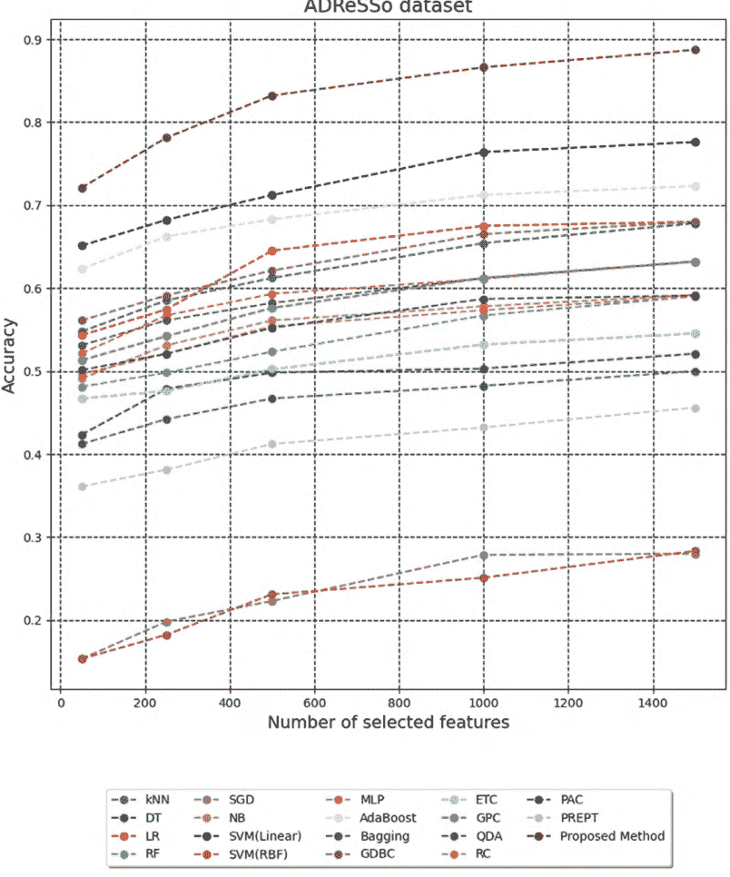

图 7.3 通过 `ADReSSo` 数据集通过各种分类器的所提方法的鲁棒性。

## 7.4 结论

痴呆症有多种类型，例如路易体痴呆症（`LBD`）、血管性痴呆（`VD`）和 `AD`（一种主要影响老年人的神经退行性疾病）。根据 2018 年全球 `AD` 报告，全球每三秒就会出生一名患者。2018 年，全球痴呆症影响了超过 5000 万人。到 2050 年，痴呆症患者将是现在的三倍——1.5 亿人。因此，`AD` 检测可能有助于更有效的治疗，从而减缓疾病的进展。可以通过机器学习算法准确识别 `AD` 患者。得益于先进的机器学习技术，未来的 `AD` 患者可能会获得更高性能的分类。本文提出了一种基于 `MCDM` 的混合框架，通过音频数据预测 `AD`。这项工作了一个用于 `AD` 早期预测的混合框架。首先，我们基于投票的特征选择（`FS`）方法提取了关键特征。在应用处理优先的框架后，该工作使用了遗传特征，并采用 `SVM-SMOTE` 采样方法处理类别不平衡。然后，基于投票的 `FS` 方法再次提取关键特征。最后，将基于 `TOPSIS` 的分类器应用于这些最优特征。`TOPSIS` 是一种 `MCDM` 方法。为了评估韧性并预测模型在未知数据上的表现，使用分类技术对建议的框架进行了测试。结果显示该方法在提高准确性方面具有前景。

数据和材料可用性：作者确认支持本研究发现的数据位于本文。

利益冲突：作者声明没有利益冲突。

## 参考文献

- 1. Fabio Bertini, Davide Allevi, Gianluca Lutero, Laura Calza, and Danilo Montesi. Antasonic Alzheimer’s disease classifier based on spontaneous English speech. Computer Speech & Language, 72:101298, 2022.
- 2. Yasonomi Yamada, Kaka Shinkawa, Kiyotaka Momento, and Tetsuki Arai. A mobile application using automatic speech analysis for classifying Alzheimer’s disease and mild cognitive impairment. Computer Speech & Language, 81:101514, 2023.
- 3. Mahdi Noshalzadeh, Shahry Rahman, and Javad Haddadnia. Alzheimer’s disease diagnosis using genetic programming based on higher ordering features. Machine Learning with Applications, 7:103722, 2023.
- 4. Arif Metehan Yıldiz, Daria Baru, Sengun Dogan, Mehmet Beygin, Turner Cuch,, Ping Ou, Haideo Fuda, and Rajendra Acharya. A new tree pattern-based classification method using audio signals. Experimental Systems with Applications, 224:120031, 2023. https://doi.org/10.1016/j.eswa.2023.120031.
- 5. Wei Xia, Ran Zhang, Xiao Zheng, and Usman Noble. A novel method for diagnosing Alzheimer’s disease using deep pyramid CNN on EEG signals. Helion, 94(6):14858, 2023.
- 6. Liu Lin, Shengqi Zhao, Haibao Chen, and Agao Wang. A new machine learning method for identifying Alzheimer’s disease. Simulation Modelling and Practice, 99:102230, 2023.


- 7. Nianmay Zheng, Hong Qu, Qidong Wang, Weibo Liu, Hong Zhang, and Yurong Li. A switching-delayed-PSO-optimized SVM algorithm for diagnosis of Alzheimer’s disease. Neurocomputing, 321:195–208, 2019.

- 8. Y.V. Srinivasa Murthy, Sharthar K. Gulaki. Classification of vocal and non-vocal segments in audio clips using genetic algorithm feature selection (GAFS). Experiments with Applications, 106:77–91, 2018. https://doi.org/10.1016/j.eswa.2018.04.005

- 9. Qian Zhang, Jinhua Sheng, Qian Zhang, Lian Wang, Yang Ge, and Yu Ge. Enhanced fusion-nearest algorithm for diagnosis of Alzheimer’s disease. Computers and Medicine, 165:10379, 2024.

- 10. Amar Shukla, Rajeev Tiwari, and Shamik Tiwari. A comparative study of feature selection techniques. Applied Soft Science, 87:10540, 2023.

- 11. R.R. Jang. Deep neural network based feature selection. Journal of King Saud University, 42:258–267, 2021.

- 12. Farooq K, Kaushik M, and Rahman M. A comprehensive review of mutual information-based feature selection. IEEE Access, 10:12699–12704, 2022.

- 13. Subrakita Chakrabratty. A comprehensive analysis. Journal of Applied Data, 2:100021,

- 14. Nitesh Saxena, Rahul Kumar, et al. for power solar forecasting. Environmental Challenges, 14:100838, 2022.

- 15. Bingjie Gao, Qiantao Zhou, and Yong Deng. HIE-ED: Hierarchical evaluation-based evident decision tree. Pattern Recognition, 146:110040, 2022.

- 16. Song Jin, Changhai Fei, et al. Seismic fragility analysis of nuclear containment structure using Bayesian regression model. Dynamics and Aerospace Engineering, 178:108435, 2023.

- 17. Jeongwon Lee, Jayhyun Kim, et al. Data-driven disruption prediction using random forest in KSTAR. Fusion Engineering and Design, 199:114128, 2024.

- 18. Albert Verusiano Daniel, Anderson Stefanus, et al. Proposing a visual comprehensive review analysis model on terrain domain using Naive Bayes classifier. Procedia Computer Science, 527:482–489, 2023. 8th International Conference on Computer and Computational Intelligence (ICCSCI 2023).

# 用于神经退行性疾病的机器学习

- 32. Md.Shamim Reza, Umme Hafsa, Rul Amin, Yasmin, and Sabha Ruhi. 基于改进型非线性核的二型糖尿病预测 SVM：来自 P 数据集的见解。Computer Methods and Programs in Biomedicine, 4:100118, 2023.

- 33. Goodness Oluchi Anywani, Cosmas Ifanyi Nwakama, Jae-Min Lee, and DongSong Kim. 用于 SDN 集成车载网络检测 DDoS 攻击的 RBF-SVM 核基模型。Ad Hoc Networks, 140:103026, 2022.

- 34. Ghengchen Hu, Cunjun, Ming Zhou, Yan Zhang, and Yi Fang. 使用深度学习和 AdaBoost 分类器识别 UAV 图像中的病变膝。Biosciences Engineering, 194:138–151, 2020.

- 35. A. Chandramouli, Vemula Rajitha Hima, Pasumarthi S Tannayi, Thiru Geervani Santoshi, and B. Priyanka. 基于混合包的分类器糖尿病预测。Entertainment Computing, 47:100593, 2023.

- 36. Jingjie Tian, Yuan Qiang, and Haibin Zhang. 深度学习中随机梯度下降的进展。Mathematics, 11:13, 2023.

- 37. Gouvenet, P. Le, and Y. Jillet. 机械保护及其作用。Bulletin de l'Académie Nationale de Médecine, 206(8):931–944, 2022.

- 38. Jiesheng Wang and Shengli Zhang. 用于识别 RNA 假尿位点的增量攻击方法。Chemometrics and Intelligent Systems, 210:10425, 2021.

- 39. Bikash Hazaria, Deepak Gupta, and Parashothi Roy. 用于二分类的直觉模糊岭回归器。Applied Soft Computing, 112:10781, 2021.

- 40. Abhik Ghosh, Ritu Sahai, and Sayan Bhadra. 稳健二次差分分析。Pattern Recognition, 117:7981, 2021.

- 41. Ke Wang, Prathysh P. Menon, Joost Veeman, and Samir Bennani. 高斯过程估计。European Journal of Control, 74:100856, 2023.

- 42. Chinedu I. Ossai and Nilini Wickramasing. 特征提取技术。Biomedical Signal Processing and Control, 73:13471, 2022.

- 43. Kamal Omari. 使用梯度提升检测。Procedia Computer Science, 230:120–127, 2023.

- 44. Sepideh Etemadi, Mehdi Khashei, and Saba Tamizi. 基于可靠性的多层感知器预测。Information Sciences, 65:19716, 2023.

# 使用 Vote 预测自闭系障碍的增强技术

R. Ramya and Paneneer Arokiaraj, Thanthai Periyar Govt. Arts & Science College (Autonomous), Affiliated to Bharathidas University, Tamil Nadu, India

## 8.1 引言

引言部分作为研究的基础，提供了必要的背景信息，并通常涵盖以下几个关键元素。

### 8.1.1 自闭谱系障碍背景

自闭症谱系障碍（ASD）是一种多方面且普遍的神经发育状况，其特征是一系列影响社交互动、交流能力以及重复或限制性行为的挑战。“谱系”捕捉了症状、技能和损害程度的广泛变异。某些个体表现出社交困难，而另一些人则经历深度的交流障碍和行为挑战。ASD 的一个标志特征是早期发，通常在生命的最初几年。父母可能会观察到发育延迟、缺乏眼神交流或对同伴互动缺乏兴趣等迹。然而表现可能是微妙的，导致识别和诊断的延迟。这种变异需要全面且个性化的评估和干预。

在过去的十年里，ASD 的发病率显著且持续增加。目前的全球估计表明，约五分之一的儿童受此疾病的影响。多种因素导致了这种发病率，包括医疗保健人员和公众意识的提高、诊断标准的改进以及潜在的环境影响。尽管如此，确切的原因仍然科学界研究和讨论的主题。ASD 发病率的上升强调了准确性和及时检测的重要性，这不仅仅是为了标记，它是进入影响发育轨迹的干预策略的门户。在发育早期启动的干预，如行为治疗、言语治疗和社交技能训练，已经在缓解 ASD 相关的挑战方面证明了有效。这些干预可以增强交流能力，促进社交参与并减少不良行为，从而提高 ASD 患者及其家庭的生活质量。

### 8.1.2 诊断 ASD 的挑战

由于该疾病的高度变异性和缺乏确定方法，诊断 ASD 是一个复杂且具有挑战的过程。“谱系”反映了与 ASD 相关的广泛症状、行为和功能水平。某些个体表现出微妙的迹象，如社交互动困难或轻微交流挑战；其他人则有明显的症状，包括严重的语言缺陷、重复行为或感官敏感。这种变异使得建立统一的诊断标准变得困难，而且诊断 ASD 缺乏可以确定该疾病的可靠医学检测或标记。与可以通过血液检查、成像或遗传标记诊断的医学疾病不同，ASD 主要根据行为观察和发育史进行诊断。对临床评估的依赖意味着诊断过程可能具有高度主观性。医生必须解释一系列行为和里程碑，这些可能根据环境、文化背景和个人而异。

此外，诊断 ASD 的过程通常涉及不同专家的评估，包括儿科医生、心理学家和言语语言治疗师。每位专家的评估可能有所不同，这可能导致诊断的不一致。标准化工具的缺失也导致了诊断 ASD 的延迟。该疾病的早期迹象可能是微妙的，可能未被父母或照顾者识别，特别是他们他们熟悉关键里程碑时。当提出担忧时，获得正式诊断的过程可能很长，涉及对专家评估的长时间等待。在此期间，儿童可能会错过可以显著提高结果的早期服务。

此外，还存在误诊的风险。ASD 的某些症状（如社交交流困难或重复行为）可能与其他发育障碍重叠，包括注意力缺陷动障碍（ADHD）或语言障碍。这种重叠可能导致错误诊断，即孩子被诊断为 ASD 或其他疾病，这会影响他们接受的支持和干预类型。误诊可能会产生长期影响，因为发育障碍的干预通常是不同的。

# 一种增强的自闭症谱系疾病预测技术

投票法涉及汇总来自多个独立模型（如决策树、支持向量机或逻辑回归）的预测结果，并根据多数投票或平均预测做出最终决策。这种方法减少了由于单一模型的偏差或方差可能导致的错误概率，从而提高了预测的整体准确性和稳健性。

另一方面，AdaBoost（自适应增强）通过通过对不同加权版本的数据按顺序应用学习算法来工作。在每次迭代中，模型都会关注上一轮中被分类错误的数据点，并不断提高其准确性。AdaBoost 的这种自适应特性使其在识别数据中的复杂模式方面表现出色，这在 ASD 诊断中特别有价值，因为其症状和表现在不同个体之间差异巨大。

这些先进算法可以应用于包含遗传、神经影像数据和临床病史的海量数据集。通过分析全面的数据集和观察，模型可以识别出与 ASD 相关的细微且复杂的模式，这些模式通过传统观察可能无法显现。例如，某些遗传标记或行为特征的组合可能与 ASD 的特定子集相关，从而实现更定制化和个性化的诊断。数据科学在 ASD 预测中的应用不仅提高了准确性，还加速了诊断过程。传统的 ASD 诊断方法通常耗时较长，涉及数月甚至数年的长期评估和观察。相比之下，数据驱动的模型可以分析大量数据集并在极短时间内提供诊断见解，使得在早期阶段识别 ASD 成为可能。早期诊断至关重要，因为它允许及时启动干预措施，从而改善 ASD 个体的预后和生活质量。

此外，从数据科学中获得的见解可以对 ASD 谱系产生更细致的理解。通过识别 ASD 人群中的模式和亚群，这些模型可以帮助完善谱系的定义。这可能导致对 ASD 亚型进行更精确的分类，促进更定制且更有效的治疗干预。例如，具有特定遗传图谱或行为模式的个体可能会从针对其需求的定制化治疗方法中获益。在提高诊断准确性和速度方面，数据科学具有开发新策略的潜力。通过分析大人群的治疗结果，数据驱动的模型可以识别哪些干预措施对特定的 ASD 个体小组最有效。这种个性化的治疗方法可能会产生更符合个体独特特征的更有效的治疗方案，而不是一种一刀切的方法。

## 8.1.4 研究目标

本研究的目标是通过结合投票模型和 AdaBoost 模型（VO-ADA）的优势来增强对 ASD 的预测。主要目标包括整合这些模型以创建一个更有效的 ASD 预测模型，将其性能与传统模型进行比较以证明其优越性，并提高整体准确性和可靠性。该研究还寻求评估、为 ASD 预测领域贡献新见解，并评估组合方法在现实场景中的实际适用性。最终目标是为 ASD 的早期诊断和干预提供一个更可靠、更准确的模型。

## 8.1.5 论文结构

本文从全面的文献综述开始，深入探讨了 ASD 预测领域的各种相关工作。该部分对现有方法进行了批判性评估，强调了它们的优点和局限性，并为建议的工作奠定了基础。文献综述之后，方法论部分概述了数据收集过程，阐明了工作模型，并介绍了整合 VO-ADA 模型进行 ASD 预测的新方法。本节还解释了所提工作的主要特征。结果与讨论部分详细研究了从 VO-ADA 模型获得的结果，并将其与其他知名模型进行对比。根据 Kappa 系数、召回率、准确率和 F1 分数对结果进行了检查，为建议模型的有效性提供了重要信息。研究论文最后总结了研究的主要发现和贡献，并为开发和扩展所建议的 ASD 预测模型提出了未来方向。

## 8.2 文献综述

自闭症谱系疾病是一种以社交互动困难和重复性行为为特征的神经发育障碍疾病。ASD 的及时、准确诊断对于及时干预和支持至关重要。数据科学模型的利用在提高 ASD 预测诊断方面具有潜力。本综述整合了探索 AdaBoost 和集成学习模型在预测 ASD 方面的研究。

### 8.2.1 ASD 筛选中的 AdaBoost 模型

Nguyen 和 Rodriguez [6] 对 ASD 筛选中的 AdaBoost 模型进行了元分析，评估了该方法的有效性。他们发表在《自闭症评论》上的工作总结了 AdaBoost 在增强[方面]的作用。

### 8.2.2 用于预测的集成学习

Nguyen 和 Rodriguez [6] 对 ASD 筛选中的 AdaBoost 模型进行了元分析，评估了该方法的有效性。他们发表在《自闭症评论》上的工作总结了 AdaBoost 在增强[方面]的作用。

### 8.2.3 比较分析与方法

Nguyen 和 Rodriguez [6] 对 ASD 筛选中的 AdaBoost 模型进行了元分析，评估了该方法的有效性。他们发表在《自闭症评论》上的工作总结了 AdaBoost 在增强[方面]的作用。

### 8.2.4 投票策略与对比研究

Nguyen 和 Rodriguez [6] 对 ASD 筛选中的 AdaBoost 模型进行了元分析，评估了该方法的有效性。他们发表在《自闭症评论》上的工作总结了 AdaBoost 在增强[方面]的作用。

### 8.2.5 预测建模的探索

Nguyen 和 Rodriguez [6] 对 ASD 筛选中的 AdaBoost 模型进行了元分析，评估了该方法的有效性。他们发表在《自闭症评论》上的工作总结了 AdaBoost 在增强[方面]的作用。

### 8.2.6 使用集成模型优化

Nguyen 和 Rodriguez [6] 对 ASD 筛选中的 AdaBoost 模型进行了元分析，评估了该方法的有效性。他们发表在《自闭症评论》上的工作总结了 AdaBoost 在增强[方面]的作用。

### 8.2.7 整体比较分析

Nguyen 和 Rodriguez [6] 对 ASD 筛选中的 AdaBoost 模型进行了元分析，评估了该方法的有效性。他们发表在《自闭症评论》上的工作总结了 AdaBoost 在增强[方面]的作用。

文献回顾了数据科学模型不断演变的特性，特别是 ASD（自闭症谱系障碍）预测中的 AdaBoost 和集成学习模型。这些研究为挑战、机会和近期进展提供了宝贵的见解，为通过数据科学方法提高 ASD 诊断准确性和效率持续努力出了贡献。

## 8.3 方法论

### 8.3.1 数据收集


专门为预测建模创建的 ASD 数据集被称为 Kaggle 儿童数据集 [22]。表 8.1 解释了若干特征，包括年龄、性别、种族、泛性发育障碍（PDD）的家族史，以及筛选方法的类型和筛选过程中使用的某些问题的答案。该数据集包含了与接受 ASD 筛选的人相关的各种属性。关键的人口统计信息包括个人的年龄和性别，以及以文本格式提供的种族。还采集了健康相关数据，例如个人出生时是否患黄疸，以及是否有 PDD 成员，以二元响应（“是”或“否”）表示。还记录了居住国家以及个人之前是否使用过筛选。数据集记录了筛选方法类型，按年龄（幼儿、儿童、青少年）进行分类，以及对特定筛选问题的回答，每个问题都会评分并累积成筛选分数。通过记录完成测试的人员的关系（例如：父母、本人、医疗专业人员）以及年龄类别提供了额外的背景信息。最后，数据集包含一个目标变量 `class/ASD`，表示是否存在 ASD，这对于分析和预测受评估个体的可能患 ASD 概率至关重要。该数据集旨在通过使用数据科学模型（特别是 AdaBoost 和投票等集成技术）研究并创建改进的 ASD 预测模型。

### 表 8.1 自症数据集属性

| 属性 | 描述 |
| --- | --- |
| 年龄 | 个人的年龄（岁） |
| 性别 | 个人的性别（男或女） |
| 种族 | 以文本格式呈现的常见种族列表 |
| 出生患黄疸 | 个人出生时是否患黄疸（是或否） |
| 家族成员患 PDD | 任何家族成员是否患 PDD（是或否） |
| 谁完成测试 | 完成 ASD 筛选测试的人（父母、本人、医疗人员、临床医生等） |
| 居住国家 | 以文本格式提供的居住国家 |
| 之前使用过筛选 | 用户之前是否使用过筛选（是或否） |
| 筛选方法类型 | 根据年龄选择的筛选方法类型（0 = 幼儿，1 = 儿童，2 = 青少年，3 = 成人） |
| 问题 1 到 10 的答案 | 与所用筛选方法对应的特定问题的二元响应（0 或 1） |
| 筛选分数 | 使用所选筛选方法的评分算法获得的最终分数，自动计算 |
| A1_score, ..., A10_score | 十个问题中每个问题的单独得分 |
| 年龄描述 | 年龄类别的描述（例如，“18 岁以上”） |
| relation | 完成测试的人员的关系（例如：父母、本人、医疗专业人员） |
| Class/ASD | 表示是否存在 ASD 的目标变量（例如：是或否） |

# 用于预测自闭症谱系障碍的增强技术

## 8.3.2 工作模型

图 8.1 阐明了用于预测 ASD 的 VO-ADA 模型。工作流始于加载数据集的关键步骤，这是整个分析的基础。该数据集通常包含大量信息，包括人口统计细节、行为遗传学、遗传标记和临床史，所有这些都与 ASD 的诊断有关。一旦加载数据集，下一步是数据预处理，这是一个至关重要的阶段，原始数据被清洗和结构化以确保其准备好分析。这涉及处理缺失值、标准化数据、编码类别变量以及移除任何无关或冗余的特征。预处理对于维护数据的质量和完整性至关重要，为工作流中的后续步骤奠定了坚实的基础。在处理后的数据识别并隔离最相关的特征，特征提取是机器学习中的关键步骤，因为它通过专注于对准确预测 ASD 有贡献的最信息属性，直接提高了模型的性能。提取的特征可能包括行为模式、遗传标记或其他在之前的研究或通过领域知识被确定为重要的临床指标。特征提取后，数据集将进入探索和验证阶段。在此阶段，通常将数据集划分为训练集和测试集，以有助于进行模型评估。训练集用于训练预测模型，而测试集用于评估它们的性能。为了进一步增强模型的可靠性，采用了 k 折验证。

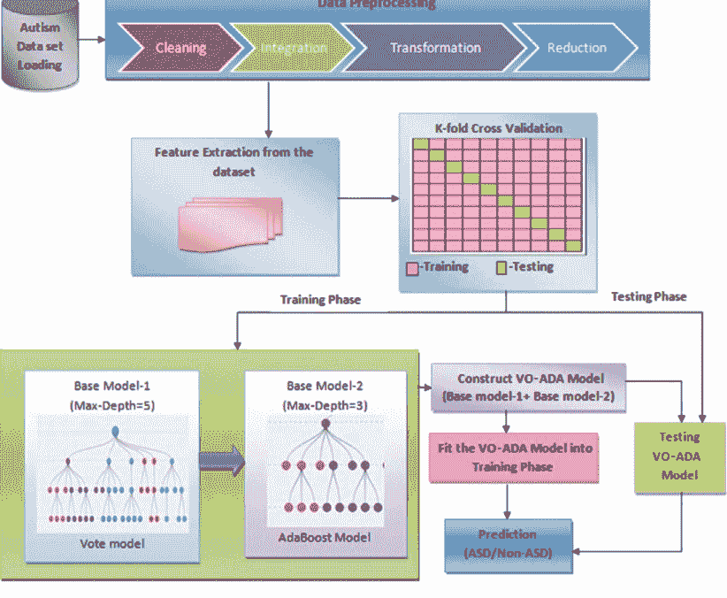

图 8.1 提出的 VO-ADA 模型工作流。

在 k 折验证中，数据集被分为 k 个子集，模型被训练和测试 k 次，每次使用不同的子集作为测试集，其余 k-1 个子集作为训练集。这种技术有助于确保模型的性能是稳健的，并且过度依赖数据的任何特定子集。

进一步通过应用各种性能指标进行评估，这些指标对于评估模型的准确性和可靠性至关重要。这些指标通常包括：

- i. **准确率 (Accuracy)**：模型在所有预测中做出正确预测的比例。
- ii. **精确率 (Precision)**：模型正确识别患 ASD 个人的能力。
- iii. **召回率 (Recall/sensitivity)**：模型识别所有患 ASD 个人的能力。
- iv. **F1 分数**：精确率和召回率的调和平均数，提供了两者之间的平衡。
- v. **Kappa 系**：一种统计衡量标准，考虑了偶然达成一致的可能性，对模型的准确性提供了更细致的评估。

这些指标对模型性能提供了全面的评估，允许详细了解其优势和潜在的改进领域。

最后，采用专门使用 VO-DA 算法训练的模型来预测个人是否可能患 ASD。投票模型结合了多种算法的组合以得出最终决策，而 AdaBoost 则通过纠正之前迭代中的错误来提高预测准确性。通过使用这些先进的集成方法，提出的 VO-DA 模型旨在最大化 ASD 诊断的预测性和可靠。

整个工作使用 `Python 3` 实现，这是一种数据科学和机器学习中强大且广泛使用的编程语言。`Python` 丰富的库和框架（如 `scikit-learn`、`pandas` 和 `NumPy`）提供了数据处理、模型训练和评估所需的工具，使其成为此类分析的理想选择。

## 8.3.3 提出的模型

VO-DA 模型代表了 ASD 预测领域的重大进展，提供了系统且数据驱动的诊断方法。通过整合两种方法并遵循完整的工作流，提出的模型旨在增强 ASD 预测的准确性和可靠性，为自闭谱系个体带来更早的干预和更好的结果。

### 8.3.3.1 预处理

预处理是数据分析中的关键步骤，涉及清洗和组织数据以确保其质量和一致性。该过程从管理属性中的缺失值开始，例如种族、黄疸状态和家族史。根据背景和缺失程度，可以采用不同的方法，包括插补（估计并填充缺失值）或删除记录（丢弃不完整的记录以维护数据完整性）。为了便于分析，性别和筛选方法等类别变量被转换为数值表示，这一过程被称为编码。这种转换对于数据科学模型至关重要，因为这些模型通常需要数值输入。可以使用独热编码（one-hot encoding）或标签编码（label encoding）等技术，使得这些变量更容易被机器学习算法解释。

数值特征（如年龄和筛选分数）通常会进行标准化或归一化。此过程将数据调整到共同尺度，而不扭曲差异之间的数值范围。标准化有助于防止特定属性占据主导地位，确保数值范围较大的特征不会不成比例地影响模型的结果。对于具有二响应（如是/否问题）的变量，使用了二进制编码。这种方法简化了计算和分析，将这些响应转换为算法可以高效处理的数值格式。此外，居住国家和年龄描述等属性可能需要文本处理技术。这包括分词、词干提取或词还原，将文本数据转换为可以分析的结构化格式。文本处理有助于从文本属性中提取有意义的信息，使其更容易被整合到预测模型中。

#### 8.3.3.1.1 处理缺失数据

对于年龄、性别、种族、出生时黄疸以及家庭成员是否有 PDD（自发育障碍）等属性，管理缺失值对于维护数据质量至关重要。

- i. 年龄的插补：如果某些年龄缺失，可以使用插补来填充缺失值。

```
Imputed Age = \sum_{i=1}^{N} Age_i
```

其中 `N` 是非缺失年龄条目的数量。

- ii. 类别属性的插补：对于性别或种族等类别属性，众数插补可以是：

```
Imputed Value for Gender = Mode(Gender)
```

其中众数是数据集中出现最高的值。

- iii. 记录删除：如果筛选评分缺失且该属性是至关重要的，则可能会删除整个记录：

```
Remove record if Screening Score is missing.
```

#### 8.3.3.1.2 类别变量编码

对于性别、种族、出生时黄疸、家庭成员是否有 PDD、居住国家、关系、类别/ASD 以及谁完成了测试等属性，类别编码是必须的。

- i. 性别的标签编码：将性别属性转换为数值标签。

```
Gender Encoded = \begin{cases} 0 & \text{if Male} \\ 1 & \text{if Female} \end{cases}
```

- ii. 种族的热热编码：将种族属性转换为每个种族的二进制变量。

```
Ethnicity_{Category} = \begin{cases} 1 & \text{if ethnicity is Category} \\ 0 & \text{otherwise} \end{cases}
```

#### 8.3.3.1.3 数值特征的标准化与归一化

对于年龄和筛选评分等数值属性，可以标准化或归一化。

- *年龄的标准化*：调整年龄使其均值为0，标准差为1。

```
$$\text{Age} = \frac{\text{Standardized - Age}}{\sigma_{\text{Age}}}$$ (8.6)
```

其中 `μ` Age 是平均年龄，`σ` Age 是标准差。

- *筛选评分的归一化*：将筛选评分缩放到 [0, 1] 范围内。

```
$$\text{Screening Score}_{\text{Normalized}} = \frac{\min(\text{Screening Score})}{\max(\text{Screening Score}) - \min(\text{Screening Score})}$$ (8.7)
```

#### 8.3.3.1.4 二响应的二进制编码

对于出生时黄疸、家庭成员是否有 PDD、之前使用过筛选 App 以及问题 1 到问题 10 的答案，在选定的数据集中，二进制编码是合适的。有两个属性适用于二进制编码：一个是黄疸，另一个是家庭成员是否有 PDD。对于两者，如果回答为“是”，则记为“1”，如果是“否”，则记为“0”。

```
$$\text{Binary Encoded} = \begin{cases} 1 & \text{if Yes or 1} \\ 0 & \text{if No or 0} \end{cases}$$ (8.8)
```

#### 8.3.3.1.5 文本属性的文本处理

居住国家和描述等属性可能需要文本处理技术。

- *居住地的分词*：将文本分解为更小的组件。
- *描述的归一化或编码*：对于“18 岁及以上”等描述，这可能转换为数值形式或标签。

```
$$\text{Age Category} = \begin{cases} 0 & \text{if 'Toddler'} \\ 1 & \text{if 'Child'} \\ 2 & \text{if 'Adolescent'} \\ 3 & \text{if '18 and more'} \end{cases}$$ (8.10)
```

#### 8.3.3.1.6 目标变量编码

对于表示 ASD 存在否的类别/ASD 属性，

```
$$\text{ASD Encoded} = \begin{cases} 1 & \text{if YES (ASD present)} \\ 0 & \text{if NO (ASD absent)} \end{cases}$$ (8.11)
```

每个预处理步骤对于为机器学习或统计分析准备数据集都至关重要。通过应用这些公式和技术，数据将变得结构化、标准化，并准备好进行模型训练和评估。

### 8.3.3.2 特征提取

特征提取过程涉及从预处理数据中选择并转换重要属性，以提高预测模型的准确性和效率。此过程从识别特征开始，例如 PDD 史、筛选评分和特定的问题回答。这些属性至关重要，因为它们提供了可以显著有助于预测 ASD 的基本信息。通过关注这些关键特征，模型可以更好地理解数据中的模式和关系，从而得出更准确的预测。

为了从预处理后的数据中选择重要特征，我们识别与目标 `Y`（ASD 预测）具有强相关的变量 `X`。假设我们有一个包含 `n` 个样本和 `m` 个特征的数据集，表示为 `X = {x_1,x_2,...,x_m}` 和目标 `Y`。信息特征的选择可以构建为找到使得与 `Y` 相关性最大的 `X' ⊆ X`。

#### 8.3.3.2.1 派生特征创建

除了选择特征，构建派生特征是特征提取的一个有价值方面。派生特征可以提供额外的见解并增强模型性能。例如，将年龄分为特定组（如幼儿、儿童、青少年和成人）可以揭示不同年龄 ASD 预测的趋势和差异。同样，定义完成测试的关系（如父母、自身或医疗专业人员）有助于数据上下文化，从而对个人的背景和情况有更深入的理解。

派生特征通过对选定特征应用变换创建。例如，如果年龄是一个特征，我们可以推导出类别：

> Age Category = \begin{cases} \text{Toddler} & \text{if } 0 \le Age < 3 \\ \text{Child} & \text{if } 3 \le Age < 12 \\ \text{Adolescent} & \text{if } 12 \le Age < 18 \\ \text{Adult} & \text{if } Age \ge 18 \end{cases} \quad (8.12)

#### 8.3.3.2.2 冗余和相关特征

特征提取的另一个关键方面是删除冗余或高度相关的特征。冗余特征不贡献新信息并可能不必要地增加模型，而高度相关的特征可能会通过给数据的某些方面赋予过当权重来扭曲模型的预测。通过消除这些特征，模型变得更加精简且具有解释性，在不损害预测准确性的情况下降低复杂性。

为了删除冗余或高度相关的特征，我们计算所有特征的相关性矩阵 `C`：

```
C_{ij} = \frac{Cov(X_i,X_j)}{\sigma_{X_i}\sigma_{X_j}} \quad (8.13)
```

`Cov(X_i,X_j)` 是特征 `X_i` 和 `X_j` 之间的协方差，`σ_{X_i}` 和 `σ_{X_j}` 是标准差。如果 `|C_{ij}|` 超过阈值，则删除特征 `X_i` 或 `X_j` 之一。

#### 8.3.3.2.3 统一缩放

特征提取后，确保特征之间的统一缩放至关重要，防止单个特征主导模型。这包括对特征进行标准化或归一化，使其均值为0，标准差为1，特别是对于敏感模型。标准化特征 `Z_i` 可以计算为：

```
Zi = \frac{\Xi - \mu_{X_i}}{\sigma_{X_i}} (8.14)
```

其中 `μ_{X_i}` 是平均值，`σ_{X_i}` 是标准差。

#### 8.3.3.2.4 针对 ASD 预测的定制

针对 ASD 预测的独特特性定制提取也同样重要。这涉及到考虑家族史和所选方法等因素。例如，我们可以根据相关性为特征分配权重，并进行加权和：

```
S = \sum_{i=1}^{m} w_i X_i (8.15)
```

其中 `S` 是用于预测的复合评分。

### 8.3.3.3 投票

在数据科学中，投票模型是一种简单且高效的模型。这种方法涉及多个模型贡献它们的预测，通过多数投票决定最终结果。预测类别由每个模型进行投票产生，票数最多的类别成为预测结果。在数学上，如果有“n”个独立模型，则预测类别 (C) 是通过模型预测类别的众数得出的：

```
C = mode(C1, C2, ..., Cn) (8.16)
```

这里 `C_1, C_2, …` 代表每个独立模型的预测类别。当不同的模型带来不同的视角或专业知识时，投票模型特别有用，集体决策有助于提高整体预测准确性。

### 8.3.3.4 AdaBoost

AdaBoost 模型是数据科学中一种非常强大的集成学习方法。在 AdaBoost 中，许多弱模型被合并成一个健壮的模型。该算法为单个数据点分配权重，并迭代地完善这些权重，以强调后续迭代中错误分类点的重要性。最终模型是单个弱模型的加权和。每个弱模型的权重 (alpha) 根据其性能决定，与更好的模型获得更高的权重。最终预测值 `H(x)` 通过结合所有弱模型的加权预测来获得：

```
$H(x) = \text{sign}\left(\sum_{i=1}^{t} \alpha_i h_i(x)\right) \quad (8.17)
```

在这里，`T` 是弱模型的数量，`α` 是弱模型的权重，`h_t(x)` 是第 `t` 个模型的预测值，而 `sign(·)` 是指示类别预测的符号函数。AdaBoost 是自适应的，在每次迭代中更多地关注难以预测的实例，从而产生一个稳健且准确的集成模型。

### 8.3.3.5 VO-ADA 模型

使用投票（voting）和 AdaBoost 创建新的混合 VO-ADA 模型来预测自闭症，涉及多个模型以提高整体性能。混合模型的公式结合了投票和 AdaBoost。该模型的公式可能是：

```
$Ensemble_{VO}(x)} = \text{Majority Vote}(\text{model1}(x), \text{model2}(x), \text{model3}(x)) \quad (8.18)
```

这意味着集成模型通过考虑三个独立模型的多数投票来生成预测结果。为了与 AdaBoost 集成，过程如下：

```
$Ensemble_{AdaBoost}(x)} = \text{AdaBoost}(Ensemble_{VO}, x) \quad (8.19)
```

在这种情况下，将 AdaBoost 应用于三个模型的集成上，这涉及在每次迭代中为分类错误的实例分配更高的权重。通过使用以下步骤来组合：

- *步骤 1*：`w_j = 1/N`，其中 `N` 是实例的数量。
- *步骤 2*：对于每次增强迭代：
    - 使用 `W_r` 在训练集上训练集成（投票）模型。
    - 计算集成模型在训练集上的误差 `ε`。
    - 计算分类器中的集成权重：`ε = 1/N ∑ exp(-sign(y) · Ensemble_{VO}(x))`，其中 `y` 是真实标签。


- 归一化样本权重：$w_j = \frac{w_j}{\epsilon}$。

- *步骤 3*：通过结合集成模型的加权预测来做出最终预测。

图 8.2 的插图尝试预测 ASD（自闭症谱障碍）。过程始于加载自闭症数据集并定义特征 (`X`) 和目标 (`y`)。之后，数据被分为测试集和训练集。定义两个不同的决策树模型作为基模型，并使用其中一个决策树作为基估计器构建 AdaBoost 模型。然后训练决策树和 AdaBoost 以创建一个投票模型。在将集成模型拟合到训练集后，为测试集生成预测。最后，使用测试数据中的真实标签来评估组合模型的准确性。这种协调策略结合了投票模型和增强模型的优点，提高了 ASD 分类的预测性能。

## 算法：VO-ADA（用于投票和 AdaBoost 的混合模型）

**输入数据：** 自闭症谱障碍数据集

**输出结果：** *预测结果（自闭症/非自闭症数据集分类）*

1. 加载数据集（自闭症数据集）

2. 定义 `X` 和 `y` 特征以及目标变量

3. 将数据划分为训练集和测试集

4. `X_train, X_test, y_train, y_test = train_test_split(X, y, test_size=0.2, random_state=42)`

5. 为集成定义基分类器

6. `base_classifier_1 = DecisionTreeClassifier(max_depth=3)`

7. `base_classifier_2 = DecisionTreeClassifier(max_depth=5)`

8. 创建一个以树大小作为基估计器的 AdaBoost 分类器

9. `adaboost_classifier = AdaBoostClassifier(base_classifier_1, n_estimators=50)`

10. 创建一个投票分类器

11. `voting_classifier = VotingClassifier(estimators=['dt1', base_classifier_1), ('dt2', base_classifier_2), ('adaboost', adaboost_classifier)], voting='soft')`

12. 在训练数据上拟合集成模型

13. `voting_classifier.fit(X_train, y_train)`

14. 在测试集上进行预测

15. `y_pred = voting_classifier.predict(X_test)`

16. 评估组合模型的准确性

17. `accuracy = accuracy_score(y_test, y_pred)`

图 8.2 所提 VO-ADA 模型的伪代码。

## 8.4 结果与讨论

在展示用于通过创新的 VO-ADA 模型预测 ASD 的改进模型的结果和讨论部分时，以清晰且逻辑的方式组织信息至关重要。

### 8.4.1 性能指标

对所提 VO-ADA 模型的评估涉及使用关键指标评估其性能，如准确率、精确率、召回率、F1 分数和 Kappa 系数。每个指标都有其特定的用途途：

- i. **准确率 (Accuracy)：** 该指标衡量模型预测的整体正确性，计算方法为被正确预测的实例占总实例的比例。

$$Accuracy = \frac{TP + TN + FP + FN}{TP + TN} \quad (8.20)$$

其中 `TP` = 真正例，`TN` = 真负例，`FP` = 假阳例，`FN` = 假阴例

- ii. **精确率 (Precision)：** 精确率评估正类预测的准确性，表示所有正类预测中真正预测的比例。它是真正例与真正例加假阳例之和的比例。

$$Precision = \frac{TP + FP}{TP} \quad (8.21)$$

表 8.2

所提 VO-ADA 模型的结果与分析——性能指标

| | 训练阶段 K 折交叉验证 (90%) | | | | | | 测试阶段 K 折交叉验证 (10%) | | | | | |
|---|---|---|---|---|---|---|---|---|---|---|---|
| 性能指标 | K = 3 | K = 5 | K = 7 | K = 10 | K = 15 | K = 3 | K = 5 | K = 7 | K = 10 | K = 15 |
| 准确率 | 88.01 | 93.89 | 97.09 | 98.60 | 96.76 | 89.41 | 94.19 | 98.03 | 98.10 | 96.76 |
| 精确率 | 88.01 | 93.89 | 97.09 | 98.60 | 96.76 | 89.41 | 94.19 | 98.03 | 98.10 | 96.76 |
| 召回率 | 88.01 | 93.89 | 97.09 | 98.60 | 96.76 | 89.41 | 94.19 | 98.03 | 98.10 | 96.76 |
| F1 分数 | 88.01 | 93.89 | 97.09 | 98.60 | 96.76 | 89.41 | 94.19 | 98.03 | 98.10 | 96.76 |
| Kappa | 88.01 | 93.89 | 97.09 | 98.60 | 96.76 | 89.41 | 94.19 | 98.03 | 98.10 | 96.76 |

### 8.4.4 比较分析

与现有模型和传统方法进行比较，揭示了集成 VO-ADA 模型优越的预测能力。

# 一种预测自闭症系障碍的增强技术

表格 8.3

现有模型与提议模型的对比分析

| 性能分析 | Vote K = 3 | Vote K = 5 | Vote K = 10 | AdaBoost K = 3 | AdaBoost K = 5 | AdaBoost K = 10 | Vote + AdaBoost (VO-ADA) K = 3 | Vote + AdaBoost (VO-ADA) K = 5 | Vote + AdaBoost (VO-ADA) K = 10 |
|---|---|---|---|---|---|---|---|---|---|
| 准确率 | 79.32 | 84.89 | 88.01 | 88.01 | 87.78 | 84.89 | 88.01 | 93.89 | 98.60 |
| 精确率 | 78.57 | 81.41 | 87.78 | 87.78 | 87.78 | 81.41 | 87.78 | 92.12 | 99.50 |
| 回召率 | 69.92 | 86.67 | 82.36 | 82.36 | 82.36 | 86.67 | 89.93 | 96.32 | | |
| F1 分数 | 28.48 | 18.19 | 15.38 | 15.38 | 18.19 | 15.58 | 12.82 | 2.67 | | |
| Kappa 统计量 | 0.70 | 0.79 | 0.79 | 0.70 | 0.79 | 0.85 | 0.92 | | |

表格 8.3 解释了三个模型（投票、AdaBoost 及其组合 VO-ADA）在预测任务中不同 K 值下的性能分析。值得注意的是，组合模型在各项指标上均一致优于单一模型。在 K = 10 时，组合模型达到了 98.60% 的最高准确率，超过了 VO-ADA。同样，组合模型的精确率和回召率在 K = 10 时也达到峰值，表明其在识别正样本方面的有效性。组合模型在 K = 10 时的 F1 分数更高，强调了其卓越性能。Kappa 系数是衡量预测分类与实际分类之间一致性的指标，组合模型在 K = 10 时达到最高值。这些发现表明，VO-ADA 的集成增强了模型的预测能力，证明了集成方法在提高分类准确率和整体模型稳健性方面的价值。

图 8.5 解释了不同模型对比分析的图表表示。这些可视化以直观且易于理解的方式展示了 VO-ADA 模型及其组件在不同配置下的性能特征。

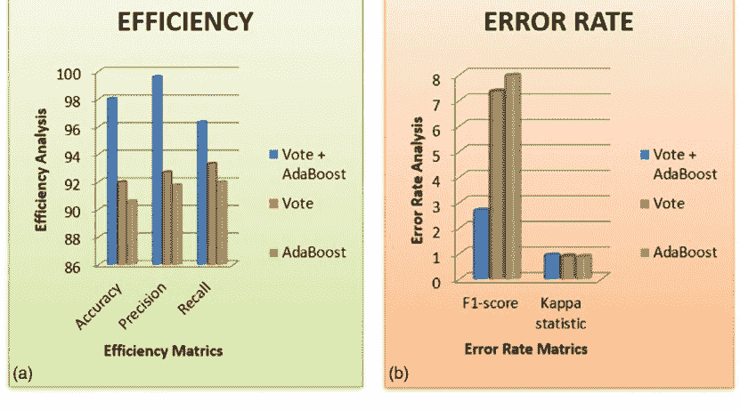

图 8.5 (a) 不同数据科学模型的效率和 (b) 错误率。

## 8.5 讨论

VO-ADA 模型评估结果为其在预测 ASD 方面的性能提供了全面的理解。该模型在各种指标上均表现出一致且稳健的性能，特别是在 k 折交叉验证中较高的 K 值下，表明其具有很强的泛化能力和可靠性。

## 8.6 性能指标分析

VO-ADA 模型实现了高准确率、精确率和回召率，其中在 K = 10 的测试阶段，准确率达到了 99.50%。这一准确率表明模型可以正确分类大量实例，使其在 ASD 预测中具有可行性。精确率衡量模型正确识别真样本的能力，在 K = 10 时也达到了 99.98% 的峰值，表明模型产生的假阳性较少。这在一个至关重要的设定非常重要，因为假阳性会导致不必要的压力和进一步检测。回召率衡量模型识别所有相关病例（真样本）的能力，在 K = 10 时达到 97.82%。这种高回召率对于确保大多数 ASD 人群被正确识别至关重要，随着 K 的增加，它最大限度地减少了漏诊概率。这是折数增加时精确率与回召率之间的权衡，凸显了仔细选择 K 以平衡这些指标的重要性。Kappa 系数是衡量预测与实际调整之间一致性的指标，在不同 K 值下始终保持高水平，并在测试阶段达到达到 0.98 的峰值。这表明模型的预测非常可靠，不受随机概率显著影响。持续高水平的 Kappa 系数也强调了模型在不同子集上均表现良好的能力，展示了其稳健性。

## 8.7 模型效率与错误率

如训练和测试阶段所示，模型效率随着 K 的增加显示出显著提高。高效率结合低错误率，表明 VO-ADA 模型在处理数据集时既有效又高效。极低的错误率（特别是在较高的 K 值下）进一步强调了模型在做出准确预测方面的稳健性和可靠性。

## 8.8 意义与局限性

VO-ADA 模型强大的性能指标意味着其作为早期准确检测 ASD 价值工具的潜力。此类工具可以帮助临床医生诊断 ASD，可能导致更早的干预和更好的个体结果。这种高精确率和高回召率在临床背景下尤为重要，确保了大多数 ASD 人群被正确识别，同时最大限度地减少假阳性。然而，随着 K 的增加，F1 分数有所下降。

## 8.9 未来工作

未来研究应关注在不同数据集上优化 VO-ADA 模型以提高其适用性。

## 8.10 结论

总之，VO-ADA 模型通过投票和 AdaBoost 的组合在 ASD 预测中展现了出色的准确率、精确率、回召率和 Kappa 系数。该方法在测试中显示了巨大的潜力。

11. Miller, P., & Torres, G. (2022). 自闭症预测中增强型技术的对比分析。*Autism Spectrum Advances*, 8(4), 345–359. https://doi.org/10.4433/asa.2022.54321

12. Chen, L., & Turner, R. (2019). 机器学习用于 ASD 预测的投票策略：全面综述。*Journal of Autism Analytics*, 36, 567–580. https://doi.org/10.1122/jaa.2019.27854

13. Rodriguez, M., & Nguyen, T. (2020). ASD 预测中 ASDBoost 与投票模型的对比研究：最新进展。*Autism Spectrum Trends*, 21(4), 321–335. https://doi.org/10.5566/ast.2020.112233

14. Bell, E., & Clark, D. (2021). 使用集成方法进行自闭症预测建模。*Autism Spectrum Computing*, 14(5), 456–470. https://doi.org/10.7890/asc.2021.6432

15. Harris, F., & Wilson, R. (2022). 自闭症谱系障碍机器学习方法的最新进展。*Journal of Autism Analytics*, 27(1), 34–48. https://doi.org/10.1122/jaa.2022.87654

16. Torres, G., & Patel, S. (2020). 用集成技术优化 ASD 预测：整体视角。*Autism Spectrum Insights*, 9(3), 289–302. https://doi.org/10.7890/asi.2020.54321

17. Nguyen, T., & Miller, P. (2021). 自闭症谱系障碍预测机器学习的最新趋势。*Autism Spectrum*, 23(2), 167–180. https://doi.org/10.7890/asc.2021.112233

18. Clark, E., & Taylor, K. (2022). ASD 预测的整体方法：使用数据科学技术的投票模型对比分析。*Journal of Autism Studies*, 34(4), 421–435. https://doi.org/10.1089/jas.2022.87654

19. Ramya, R. (2023). 使用数据科学技术预测自闭症谱系综述。*International Journal of Advanced Research in Computer Science*. 14, 45–50. 10.26483/ijarc.v14i6.669

20. R. Ramya, & S. Panneer Aorikaj, 增强自闭症谱系预测：卷积神经网络与随机森林模型的融合。*International Journal on Information Technologies and Security*, vol.16, no.2, 2024, pp. 51–62. https://doi.org/10.59035/VNWF2548.

21. R. Ramya. (2024). 增强自闭症严重程度预测：混合梯度提升树与深度学习模型。*International Journal of Intelligent Systems and Applications in Engineering*, 12(4), 1043. 取自 https://ijisae.org/index.php/IJISAE/article/view/6341.

22. Brown, J. (2021). 自闭症谱系预测数据集。Kaggle. https://www.kaggle.com/brownj/asd-prediction-dataset.

# 基于双分割的各向异性扩散 MRI 图像颅内病变独特机器学习方法

R. Reeba Jennifer and V. R. Balaji

Sri Krishna College of Engineering and Technology, Coimbatore,

A. Albert Raj

DMI Engineering College, Tamil Nadu, India

## 9.1 引言

大脑是人体最复杂、最重要的器官。大脑由控制身体功能的脆弱神经组织组成。脑瘤（也称为颅内肿瘤）是脑内部或附近细胞的生长。小脑是人体的控制中心，是整合实体信息并管理运动反应的复杂器官之一。大脑内部任何异常生长都会对小脑及周围组织产生压力，导致神经系统障碍。有时，异常生长或肿块可能表明脑部存在恶性肿瘤 [1]。脑瘤也可能产生于脑组织。与之邻近的是神经网络、垂体、脊髓和脑膜。脑瘤可以源于脑组织。脑瘤是描述这种现象的术语。癌症偶尔会从相邻的身体部位扩散到大脑。转移性或继性脑瘤是描述此类癌症的术语。脑瘤有很多种类。组成肿瘤的细胞类型决定了脑瘤类型。对肿瘤细胞进行的特定实验室检测可提供细胞特异信息。这些信息有助于医疗团队识别脑瘤的种类。通常，某些类型的脑瘤是非恶性的，即非癌症脑瘤。通常，某些类型的脑瘤是恶性的，这些被称为恶性脑瘤或恶性。某些类型的脑瘤可以是恶性的。

## 186 用于神经退行性疾病的机器学习

图像处理已被机器学习（ML）所变革，允许对视觉输入进行深度分析和解释。因为它将复杂的图像划分为可管理的部分，因此图像分割对于计算机视觉至关重要。它解决了从背景中分割图像的问题。对于自动驾驶汽车或医学影像中的肿瘤分析等应用，这是关键的。当理解图像内容时，更多的计算机视觉应用变得可能。总之，图像处理是一个用途广泛的领域，增强了图像质量并促进了分析。

人工智能有助于任务自动化、工作流处理和决策。医疗人员利用最新的机器学习技术来识别异常并优先处理生命病例。在医学领域，机器学习方法已通过一系列图像进行训练，以确定哪些特征可以准确分类图像（代表良性或恶性肿瘤），并与提供的标签对比。

对于 MRI 扫描，解读错误很常见，可能导致图像描述错误或失败。已提出了多种算法以提高系统分割 MRI 的效率。70% 的病例至少存在一个差异。

因此，本新建议的目标是一种独特的分割技术，以便高效处理图像并提高放射科医生的可读性。该建议按以下方式组织：

- 1. 首先的步骤是将 MRI 初始化到处理系统中，以便读取医学图像并将切片转换为灰度图像。

- 2. MRI 图像极易产生斑点噪声和椒盐噪声 [4]。通过独特的各向异性扩散（AD）滤波器对图像伪影进行去噪研究。

# 一种独特的机器学习方法

该滤波器通过各向异性扩散 [6] 图像，并利用 K-Means 有效地平滑像素内值，同时不干扰边缘。

- 3. 图像立即通过 K-Means (KM) 聚类算法进行分割，将像素划分为若干类并收敛，从而高效地对图像区域（即噪声、脑室和颅骨）进行分类。随后是基于全局阈值（GT）的分割 [7]，这有助于准确突出感兴趣区域（ROI），并根据统计学和精确的方法沿着其特征提取病变。

这种提取肿瘤及其属性的双重分割有助于高效计算，从统计学角度排除了其在执行速度、结果结果精度以及其他一些分割得分方面的效率问题（或局限性）。

## 9.2 文献综述


医学图像分割通过将图像划分为多个区域来处理解剖感兴趣区域（ROI）的表征。世界卫生组织（WHO）根据特征将脑肿瘤分为 120 种。MRI 脑切片通过扫描受试者进行记录，经过若干阶段的处理以提取所需的序列。MRI 图像处理需要通过获取切片对图像进行分析以供临床干预。图像细节通过将其分割为几类像素来实现。尽管由框架处理，但获取图像的过程首先是读取图像，然后将其红、绿、蓝（RGB）像素转换为灰度级，所有像素值位于 0 到 255 之间。在分割之前，提取的图像未经过滤波，因为图像容易受到高斯噪声、斑点噪声和椒盐噪声的影响 [8]。数字图像去噪是图像扫描的最终目标。大部分，帧中的所有图像处理都是消除噪声的方法。算法在噪声环境中会失效。因此，采用滤波器作为预处理方法。

线非线性滤波器在图像处理应用中都是可能的。与线性滤波方法相比，非线性技术通常产生更好的结果。这是因为它们能够保留大量的脑肿瘤尺寸，这对于肿瘤的识别和诊断至关重要。

需要一种独特的滤波器来消除噪声并使图像处理更高效。噪声消除中的均值滤波器减少了中间像素的强度变化。这也是一种平滑图像的直观且简单的方法。然而，这种滤波器会产生噪声伪边缘，无法抑制噪声的高斯分布。另一种可用于图像去噪的滤波器是中值滤波器。中值滤波器旨在保持锐边缘。与均值滤波器相比，中值滤波器只考虑中间分布和其他信息。高斯滤波器通过实现一个内核，在计算向中心像素值的加权平均值时模糊图像，从而高效地消除高斯噪声。这更像是一个均值滤波器，用于平滑并消除噪声。但在保持或甚至增强边缘强度的同时，图像会产生信息丢失和噪声。这是低级视觉中的一个常见挑战。

实现这些目标的一种方法可能是使用非线性 AD 滤波 [9]。发现涉及包含非线性各向异性模型的扩散滤波器的尺度空间分析。结果表明，这些模型优于各向同性滤波器，因为它们采用自适应扩散张量而非标量扩散系数。连续和离散情况共享许多恢复和尺度空间特征。

基于限制定义的自定义方法，程序化的力力阈值方法 [10] 开始运行。经验和视觉证据表明，开发的邻域方法被认为是所有研究技术中最有效的。关于临床成像概念和具有相似特征的区域的准确分配，该方法证明了其价值。作为可视化共享脑项的概述方法的副产物，还演示了将图像放置在共享脑上。这些通道策略有助于减少不需要的背景信息并增强大脑症状性磁共振（MRI）。

需要实现一种独特的滤波器，以平滑像素内值并保留像素间值。AD 滤波器（也称为 Perona-Malik 扩散 [6]）以各向异性的过滤图像伪影，沿着四个主方向扩散像素，与之前讨论的滤波器相比，它能平滑图像并更锐地扩散边缘。AD 可以去除数字照片中的噪声而不引起边缘模糊。可以使用常数扩散系数求解 AD 方程以产生热方程，这与高斯模糊相同。在随后的公式中，当扩散系数被选择为边缘回避函数（如 Perona-Malik），会在图像强度较平滑的区域内部促进扩散（从而平滑），并在强边缘处强化它。这在保持图像边缘的同时将噪声隔在门外。

在边缘检测方法中，AD 可以同样用于减少噪声。通过对预定义的次数重复使用寻边检测系数，图像可以扩展为分段常数图像，其中常数之间的边界被识别为边缘。

凭借这种卓越的滤波器图像，进一步处理将产生无细节分割丢失的良好图像。

大型医学数据库可以由 AI 算法进行有效评估，这些算法可以识别人类难以发现的模式或异常。这可能导致更早、更精确的诊断，从而造福患者 [11]。使用了多种分割算法提取 ROI。一种简单的算法是基于阈值的技术，即基于 GT 的分割 [12]。通过对图像像素取平均值，决定阈值并将像素替换为 0 和 1。然而，基于 GT 的分割应用的缺点是由于像素重叠导致精细细节丢失。图像方法之一是 Otsu 阈值法 [13]，它是 GT 的版本，但由于图像照明不均无法获得准确结果。此外，自适应分割技术为图像的不同部分计算不同的值，创建一个比 GT 双峰分布更窄的分布结果直方图。这种阈值方法与之前的技术相比相对较慢。这些技术之间的相对比较使 GT [7] 转向更简单更快速的分割技术，当 GT 算法与高效的聚类分割方法合并时，可以克服其缺点。

推荐将突出目标滤波器 [14] 用于 MRI 图像预处理，它可以消除噪声并使图像准备好肿瘤分割。这种阈值方法用于从 2 张 MRI 中移除恶性肿瘤。分割和检测的结果优于一系列方法。应用 HOFilter 后，结果得到了改进。MRI 扫描使用边缘检测、分割和形态学方法进行处理，以获得正确的分割。用于提取结果的复杂滤波器增加了计算时间，但结果的准确性仍然高于 90%。

# 一种独特的机器学习方法

该算法提高了扫描图像的质量。此外，提出了一种有效的基于小波的技术，该技术利用了 MRI 和 CT 扫描中的冗余和互补数据。由于算法对 CT 和 MRI 扫描数据的有效利用，生成的融合图像提高了肿瘤检测的效率。

基于模糊的聚类脑检测 [15] 通过在分割之前计算数据点对每个簇的隶属关系来高效工作，但在欧几里距离计算中的不等权重确定方面存在缺陷，且运行时间较长。将具有可比数据点的数据集分组的技术称为聚类。分组中的点彼此尽可能相似。在可能的情况下，分组中的点是不相同的。在用于将物体从环境中分离的分割和聚类算法中，被广泛运的算法之一是 KM 聚类 [16]。KM 聚类为每个特征点分配空间位置。在扩展的测量尺度下，基础 KM 算法会找到许多类中心。接着，为图像中的每个像素分配一个随机均值向量簇。该过程一直持续直到均值向量在算法迭代后不再发生显著变化。KM 算法对起始点的变化敏感，初始类通过随机生成。

K-means 在确定类中心方面具有很好的选择，即原始起始点接近最终答案。如果不是，聚类结果将是错误的。一种分区技术是 KM 聚类。KM 将数据划分为 k 个非互斥的簇和离群值，每个观测值都被分配到一个簇索引。分离的物体组和每个簇的质心（或中心）定义了它。

对于初步图像分割，可以考虑 KM 聚类 [17] 在将像素聚类为几类方面效果最好。KM 算法在通过肺部 CT 图像分割 [18]区分 COVID-19 变异方面已被证明是有效的。这再次证明了其在生物医学图像恶性检测中的有效性。无监督学习算法通过确定质心值直到达到质心的最优值来对图像像素进行聚类。这种 KM 算法 [19] 是一种处理图像中大量像素的简单方法，并保证了迭代循环在某一点的，但其缺点是需要预先指定簇。与神经网络结合的 KM 算法以一种简单的方式对结果进行分类。通过使用简单算法（即 GT 算法），该算法的分割成本可以改进。

到目前为止，已经有很多广为人知的技术。预处理、阈值化或两者的结合是最常用的。数字图像处理中分割图像最简单的方法是通过阈值化。由于其能够从图像中提取并分割相关信息，处理是至关重要的。阈值化通过像素强度或值将图像划分为离散区域，有助于将感兴趣的对象或特征从背景中区分。这种技术实现了数字图像的评估和解释，广泛物体检测、图像分割和字符识别等领域。通过减少噪声和增强整体视觉质量，图像阈值还可以提高图像质量 [20]。

最易使用且计算成本最低的策略是阈值化。当前景和背景之间的身份和对比差异适用于这种方法时 [21]。

直方图的表示是决定全局阈值的唯一因素。图像的直方图受噪声、对比度、色调、饱和度等因素的影响。因此，图像的局部特征被用于辅助全局阈值的选择过程 [22]。除了用于确定全局阈值外，局部属性的值也可用于增强直方图。然而，复杂的分布或光照条件显著变化的照片可能不适合 GT。GT 的优点之一是它的计算性高且易于实现。它与不同光照条件的图像的不兼容性是其缺点之一。此外，阈值必须手动选择。它也无法准确划分值重叠的区域或物体 [23]。

初步分割结合次级分割确保了图像的高效聚类，这种集成在计算时间方面也表现出色。因此，本调查提出了一种有效的知识管理与治理技术 `KM-GT` 方案，该方案可以实现图像的高效聚类和分类到各种区域，并可以根据分割评分进一步定义 ROI。

# 9.3 提议的方法

大脑有效治疗和处理的秘密在于早期和精确的诊断。由于图像中肿瘤特征的范围广泛且复杂（包括大小、形状、位置和强度），这是一项极其困难的任务，只有资深的神经放射学家才能完成。由于颅骨空间限制，肿瘤会导致颅内压升高，这可能导致水肿、减少、移位以及调节各种因素的健康组织的随后的退化。事实上，在青少年和年轻人中，脑部是癌症死亡的第二原因。

近期进行了大量关于脑瘤识别和管理的研究。MRI 的主要优点是非侵入性的。MRI 技术的进步促进了颅内肿瘤的检测。人为错误可能会限制使用 MRI 图像诊断脑肿瘤的医学能力。分类脑瘤复杂的结构有时需要时间。检测和分类疾病的耗时性质自然会导致患者延迟接受他们从从脑瘤中恢复所需的医疗护理。为了协助医学图像处理，已经开发了一种用于读取硬脑膜的图像方法。该方法的基础是医生用于恰当且及时治疗患者的医学数据。

MRI 是一种医学诊断设备，利用磁体和无线电波来描绘与人体器官对齐的组织。人体富含质子，MRI 利用质子来产生磁场 [12]。当质子旋转时，强磁场倾向于使场内的质子对齐。放射科医生引入射频 `RF` 脉冲，然后质子受到干扰，并在静态场中发生 90 度或 180 度对齐。因此，RF 脉冲推了质子。在脉冲关闭后，释放的电磁能量允许 MRI 检测并区分各种组织。

流程图（图 9.1）是从初始数据获取到处理单元的框架。结果将是 ROI 的提取，该情况将进行统计学研究。所提技术的数据集是可以通过以下链接获取的开源库。`https://www.kaggle.com/datasets/navonel/brain-mri-images-for-brain-tumor-detection`。机器学习 课程可以在 Kaggle（Google LLC 部门）在线找到。在一个基于网络的数据科学框架中，Kaggle 允许用户与其他数据科学家和机器学习工程师交互，发现并发布数据集，并开发模型以应对数据科学挑战。

## 一种独特的机器学习方法

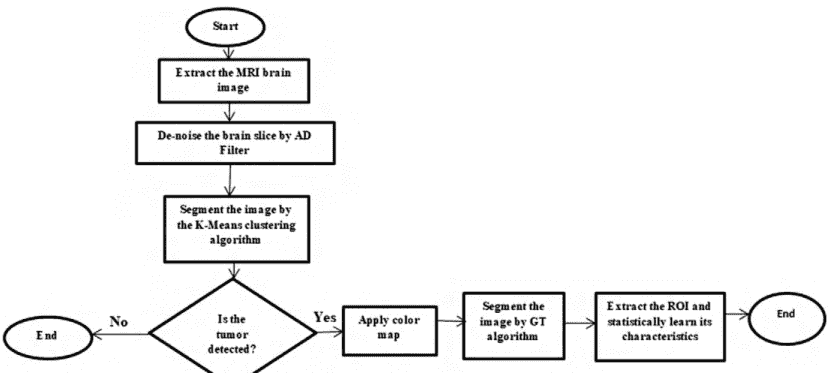

图 9.1 所提 `KM-GT` 方法的框架。

该链接提供了一个二维脑部 MRI 图像数据库，可以对某个特定的 MRI 脑切进行研究。利用 MRI 图像作为处理输入，所提方法的第一步是图像采集。在 MATLAB 中保存的 MRI 格式颅颅图像大小为 255 x 255 像素，由于其输入范围为 0 到 1，因此它们以灰度 RGB 图像的形式显示。例如，黑色层用 0 表示，白色用 1 表示。与黑色的强度差异在 0 到 1 之间。

特征提取是将未处理的数据转换为数值特征的过程，以便对原始数据集中包含的信息进行处理。

首先，从归一化的 MRI 图像中提取特征，这些图像被归一化为 0 到 1 的灰度值。归一化通过减少强度值的波动范围，显著简化了特征提取。

最初，通过读取并将图像转换为灰度图像，从框架中提取图像。

> `G(x) = 0.299 \times r + 0.587 \times g + 0.114 \times b`

在这里，`r`、`g` 和 `b` 是红、绿、蓝强度的像素值，将转换为灰度像素值可能介于 0 和 255 之间。这种数据采集过程是将整个图像的每个像素读取为灰度像素。

## 9.3.1 通过去噪脑切片进行图像预处理

“预处理”一词是指在尽可能低的抽象水平上对图像进行的处理，其中输入和输出都是强度图像。强度图像通常由图像函数值的矩阵表示，由成像设备记录 [24]。处理图像两种最常用的技术是边缘检测和与滤波相关的模糊。可以使用滤波来改进和更改提供的图像。可以使用几种滤波器来最小化图像噪声、突出或强调图像中的特定区域等 [25]。

# 用于神经退行性疾病的机器学习

尽管由于使用了相似的技术，缩等几何变换被归类预处理方法，但预处理的目标是通过抑制不需要的失真或增强某些图像特征来改进数据，以便进一步处理。它有助于为了人类理解而增强图像。图像的信息可以被分析和提取以供计算机解释。通过映射图像像素，可以实现所需的密度和对比度。检索图像是简单的。

本提议实现了一种独特的技术，旨在在不丢失任何细节的情况下提高像素质量。如果特定组织或区域的信噪比低，MRI 的用性就会下降。因此，需要有效的 MRI 重建，这需要在噪声图像上使用去噪技术，以增强 MRI 的质量和定量评估。医学图像的预处理是通过抑制其内部的抑制来增强图像质量，从而增强计算机视觉。

### 9.3.1.1 各向异性扩散滤波器

与干扰类似，噪声表现为不规则的颗粒图案。这种不规则的波动强度降低了质量。人体是图中噪声的主要来源（热运动产生的 RF 射）。MRI 扫描仪的整个测量链（包括线圈和电子设备）是另一个噪声源。图像中肉眼无法观察到的异常可能会出现在记录或读数中以便进一步分析。为了高效处理图像，必须消除这种无意且不需要的噪声。应用了图像处理滤波器来提高图像的锐度、平滑度和边缘增强。与其使用任何其他滤波器（如高斯滤波器或平均滤波器），即使在使用高斯滤波器可以更有效地减少噪声，仍保留各向异性滤波器。相反，图像变得模糊但保留了边缘。与高斯和平均滤波器相比，中值滤波器非常有效，但结果是图像变得模糊。为了消除图像噪声或伪影，基于扩散的滤波是在不牺牲图像边缘或类似于其他高频属性的情况下平滑图像的技术。扩散是形成尺度空间的过程，是图像产生一系列逐渐模糊的参数化图像的过程。使用二维各向同性高斯滤波器（其宽度随参数值增加）通过卷积来创建这些图像。这种扩散技术在空间上独立且线性地修改原始图像。

各向异性扩散是扩散过程的更广泛术语。该过程产生一组标准图像，每幅图像都是源与应用于原始图像局部特征的滤波器的混合。结果，扩散过程本身以“线性且空间不变”的方式转换原始图像，而 AD 是以“非线性且空间变异”的方式。

AD 滤波器对图像进行去噪并保留其边缘 [6]。此外，与高斯和中值滤波器相比，各向异性滤波器减少了图像中的模糊。从视觉上看，Perona 和 Malik 的结果非常惊人：边缘保持了很长时间。这是因为扩散和边缘检测不被视为两个独立的应用过程，而是视为单个过程中相互作用的两个过程。

因此，这种滤波器是稳健且高效的，通过模糊像素间值而不模糊边缘。

虽然各向同性扩散与方向无关，但图像的各向异性扩散意味着跨越四个方向（南、东、西、北）的模糊。因此，AD 滤波器是在二维中依赖方向的，因为提取的医学图像是二维图像。热方程源于在二维工作的物理方程。应用于图像像素的热方程由 `9.2` 给出：

```
$P_t = \Delta P = P_{xx} + P_{yy}$
```

## 一种独特的机器学习方法

在这里，所有参数都是强度导数，`P_t` 关于时间。同样，`\Delta P` 在离散域表示。`K_{xx}` 是关于 x 和 y 维二阶导数。因此，在图像处理中，该扩散方程表示沿基准方向分散的像素分辨率，热方程表示像素的强度。`P_t` 可以进一步表示为：

```
$P_t = \text{div}(C(x,y,t) \nabla P) = C(x,y,t) \Delta P + \nabla(C \nabla P)$ (9.3)
```

其中 `P_t` 是热方程，`\Delta` 是拉普拉斯函数（梯度的散度，`\nabla`）。在离散域中，梯度的散度是强度导数。同样，`C` 系数值在像素内部为 1，在像素之间为 0。这种累加南、东、西、北像素的迭代过程通过应用方程 `9.3` 表示：

```
$P_{t+1} = P_t + [C_N \nabla P_N + C_s \nabla P_s + C_e \nabla P_e + C_w \nabla P_w]$ (9.4)
```

该方法使用的扩散系数是图像梯度幅度的减函数，随空间变化 [26]。

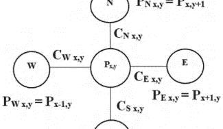

图 9.2 通过梯度计算扩散图像的 AD 核。

194 神经退行性疾病的机器学习

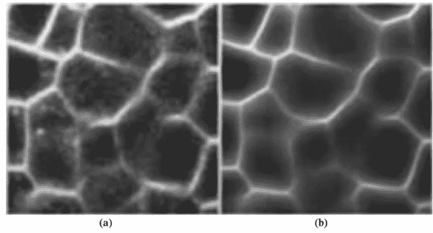

**图 9.3** (a) 噪声图像示例。(b) 经 AD 滤波器去噪后的示例。

## 9.3.2 基于 AI 的 MRI 脑切片分割

为了帮助 AI 模拟学习过程并逐步提高其精确度，机器学习（ML）作为计算科学和人工智能（AI）的一个子领域，侧重于沿算法利用数据 [27]。实现图像分割技术来分析图像并根据图像像素的特征将其划分为多个区域。在计算机视觉中，将图像划分为若干部分被称为图像分割。图像分割的目标是将图像的表示转换为更具相关性且易于理解的形式。其通常用途是定位和边界构建。

由于图像的许多区域可能不包含任何相关信息，因此处理整幅图像并不是理想的选择。因此，我们可以通过分割图像来处理它，从而只使用主要部分。图像由一系列占多数的切片组成。在图像分割中，具有相似特征的像素被聚类在一起。通过图中每个元素的像素级边界，图像分割为我们提供了对对象——ROI（感兴趣区域）的更详细、更彻底的理解。

因此，可以提取并研究 ROI 及其属性以用于定量。采用 KM 聚类算法进行图像初级分割 [28]，它作为图像聚类的强有力工具，并通过 GT 算法进行次级分割，详细说明 ROI 的特征，在本文情况下，它是 MRI 图像中的肿瘤。

### 9.3.2.1 基于 KM 聚类算法的初级分割

一种无监督的 AI方法允许 KM 聚类在没有不同类别的情况下划分数据集。在没有标签、未分类信息、无监督的情况下训练算法在数据上运行的过程被称为机器学习（ML）。在这种情况下，机器的任务是在不进行任何先验训练的情况下，根据比较、趋势和变异（variances）来排列无序数据。为了使每组内的数据点彼此相似并与其它组的数据点区分开来，聚类旨在将群体或数据点集划分为许多组。本质上，它是根据对象之间的相似或差异性对对象进行分类。

为了使每组内的数据点彼此相似并与其它组的数据点区分开来，聚类旨在将群体或数据点集划分为许多组。本质上，它是根据对象之间的相似或差异性对对象进行分类。

### 一种独特的机器学习方法

这种无监督的 AI 学习方法将特定未标记图像的像素划分为若干簇，这些簇内部具有相似性，而与其他簇之间具有不相似性。这种聚类算法预测组相似性是 MRI 图像中主要关注的发现，这些应该是颅骨内部区域（带有 ROI）、颅骨边界区域以及颅骨外部区域，那里像素的强度可能会变化。虽然 AD 滤波器有效去除了图像中的噪声，但可能会留下一些颗粒状外观来影响 ROI。KM 算法是一种高效算法，它可以消除噪声特征并提取出待研究的肿瘤。


该算法需要对簇进行初始分配。在本研究中，`KM` 算法 [17] 以如下方式对图像的几个区域实施。第一个簇 `C1` 包含顶点和灰质。第二个簇 `C2` 包含簇的外部部分。第三个簇 `C3` 分配给白质，最后一个簇 `C4` 由 `ROI`、病变以及遗留的噪声像素组成。这种簇的分配是通过预先观察 MRI 脑切片中的强度变化外观来确定的。一旦确定了簇的数量，就可以通过 `KM` 算法实现高效聚类。下面定义了一个通用的 `KM` 聚类程序算法。

- 为指定的迭代次数随机设置 `KM` 的初始值。
- 重复每个组或簇。
- 通过比较每个均值与组的欧几里得距离，确定哪个均值离该项最近。
- 将簇分配给代表均值。
- 通过将均值移动到簇的平均值来调整均值。

以下是 `KM` 聚类算法的迭代步骤。

1. 从各向异性-球面扩散的 2D 图像确定 2D 空间中的数据点 `(x1, y1), (x2, y2), ..., (xn, yn)`，生成带有相应数据点的差异簇。
2. 学习并初始化 2D 空间中中间的值或质心值。
3. 分配簇的数量 `C=4`（即 `C1, C2, C3` 和 `C4`），并在这些特定簇中决定四个随机种子点或质心。
4. 在第一次迭代中，通过欧几里得距离公式确定每个数据点与四个种子点之间的距离。令相对于四个簇的随机种子点为 `(A1, B1), (A2, B2), (A3, B3), (A4, B4)`。第一个数据点和四个种子点之间的欧几里得距离 `D` 给出：

`D=√((x1-A1)^2 + (y1-B1)^2)` 对应 `C1`

`D=√((x1-A2)^2 + (y1-B2)^2)` 对应 `C2`

`D=√((x1-A3)^2 + (y1-B3)^2)` 对应 `C3`

`D=√((x1-A4)^2 + (y1-B4)^2)` 对应 `C4`

5. 通过比较每个均值与组的欧几里得距离，确定哪个均值离该项最近。
6. 将簇分配给代表均值。
7. 通过将均值移动到簇的平均值来调整均值。

196 神经退行性疾病的机器学习

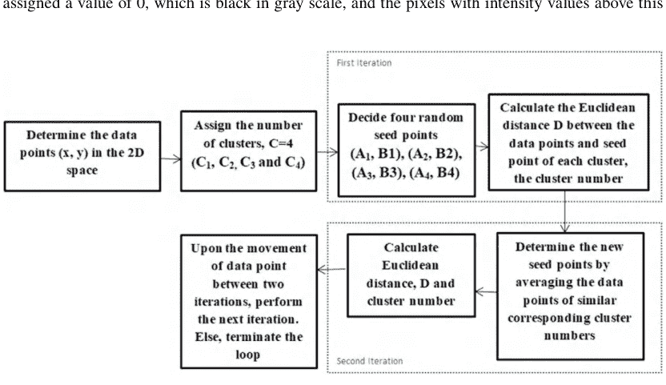

图 9.4 通过 `KM` 聚类算法进行图像分割的步骤框架。

因此，可以提取并研究 `ROI` 及其属性以用于定量。采用 `KM` 聚类算法进行图像初级分割 [28]，它作为图像聚类的强有力工具，并通过 `GT` 算法进行次级分割，详细说明 `ROI` 的特征，在本文情况下，它是 MRI 图像中的肿瘤。

### 9.3.2.1 基于 KM 聚类算法的初级分割

一种无监督的 AI 方法允许 `KM` 聚类在没有不同类别的情况下划分数据集。在没有标签、未分类信息、无监督的情况下训练算法在数据上运行的过程被称为机器学习（`ML`）。在这种情况下，机器的任务是在不进行任何先验训练的情况下，根据比较、趋势和变异来排列无序数据。为了使每组内的数据点彼此相似并与其它组的数据点区分开来，聚类旨在将群体或数据点集划分为许多组。本质上，它是根据对象之间的相似或差异性对对象进行分类。

## 一种独特的机器学习方法

这种无监督的 AI 学习方法将特定未标记图像的像素划分为若干簇，这些簇内部具有相似性，而与其他簇之间具有不相似性。这种聚类算法预测组相似性是 MRI 图像中主要关注的发现，这些应该是颅骨内部区域（带有 `ROI`）、颅骨边界区域以及颅骨外部区域，那里像素的强度可能会变化。虽然 `AD` 滤波器有效去除了图像中的噪声，但可能会留下一些颗粒状外观来影响 `ROI`。`KM` 算法是一种高效算法，它可以消除噪声特征并提取出待研究的肿瘤。

阈值被称为前景像素。某些条件是阈值函数工作的理想条件，例如理想的光照、最小的噪声，以及类内变异性大于类间差异（即同一组的像素之间的亮度比与另一组的像素更接近）。

使用 `KM` 聚类算法分割的图像进一步筛选出高强度像素。对图像计算一个单一全局阈值，高于该值的赋值为 1，低于该值的赋值为 0。该算法 [88] 假设低于阈值值的强度水平为离群值。图像的剩余部分是像素的最大强度值，包含了病变和颅骨边界。通过计算最大和最小面积，最大面积为比颅骨边界更宽的病变。现在舍弃最小面积有助于提取感兴趣区域（`ROI`），即病变。可以计算特定区域受影响的像素数量。

## 9.4 结果与讨论

`Kaggle` 是一个广泛的医学数据库库，允许用户协作不同的 MRI 脑图像数据集进行学习和工作 [17]。下载了癌症脑的 MRI 脑切片图像，这些切片提供了颅骨的一些冠状位和矢状位视图。图 9.5 显示了通过所讨论的独特方法论处理的下载脑切片。2D MRI 采用了高性能计算平台 `MATLAB 7.0`，最初由图像采集单元对图像进行预处理。考虑通过所提模型处理的一个特定 2D 图像最初通过 `AD` 滤波器读取并处理伪影的模糊和滤波。图 9.6(a) 显示了输入图像，图 9.6(b) 显示了 `AD` 滤波器预处理后的图像。

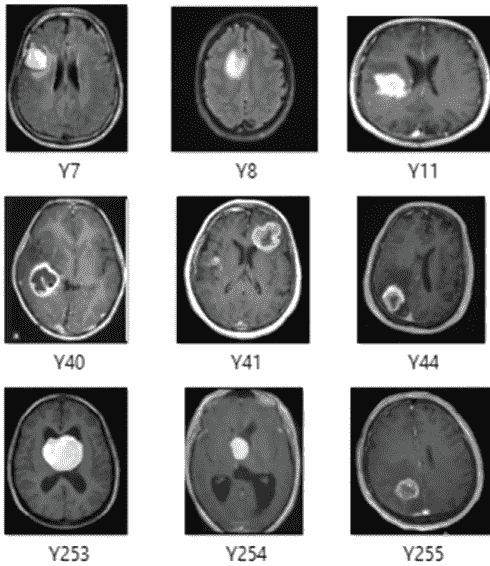

图 9.5 下载的 MRI 脑数据集。

用于神经退行性疾病的机器学习

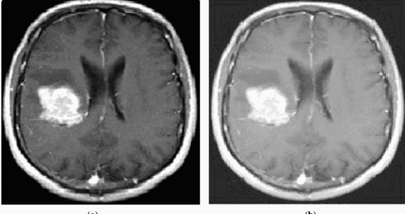

图 9.6 (a) 输入 MRI 脑切片。(b) `AD` 滤波后的脑切片。

在图像去噪的同时，MRI 图像的强度分辨率通过 `AD` 滤波器进一步提高，并为 `KM` 算法的图像分割 [28] 做好充分准备。`KM` 算法基于之前讨论的算法将图像分为具有不同像素分辨率的四类。图 9.7(a) 显示了由不同强度像素强调的图像不同聚类。因此，最高强度像素是簇 `C4`，它将 `ROI` 与颅骨边界投影在一起。下一低级别的强度是

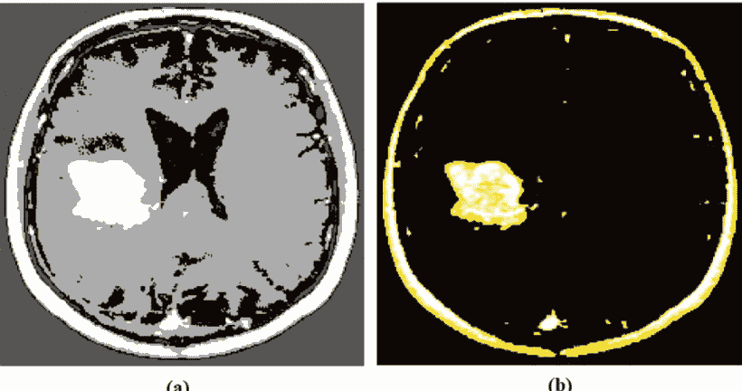

图 9.7 (a) 由 `KM` 聚类算法聚类的图像。(b) 由 `GT` 算法分割的图像以及应用于簇 `C4` 的颜色映射。

由 `C3` 区分的，`C3` 由白质组成，随后是 `C2`，它是颅骨的外部区域。最低强度的像素被聚类为 `C1`，包含了脑室和灰质。

通过实施 `KM` 算法实现的这种聚类图像突出了区分主要关注点的强度。尽管有四类，但每类中的像素并不具有相同的值，而是或多或少地非常相似，且处于一个像素值范围内。通过 `GT` 算法进行二次分割，对类 `C1`、`C2` 和 `C3` 应用 0，让类 `C4` 保留其强度值以进行进一步区分。因此，为了通过将颜色映射应用于簇 `C4` 来仅提取可能的最高强度。图 9.7(b) 显示了应用于簇 `C4` 的颜色映射，从而区分了第 4 类像素中的最高强度值。因此，颜色映射分离了强度最高的精确像素强度，这些值值描绘了边界并分离了病变。无色像素是像素中彩色像素最接近的值。现在，通过 `GT` 分割对无色像素应用 0，会在病变区域形成一个洞。通过计算主轴长度和短轴长度，用值 1 填充该洞并再次舍弃短轴长度，可以准确地扩展病变，并包含精确的像素数量。9.8(a) 显示了提取的病变，这是通过图像分割方法进行 AI 学习的自动结果。

9.8(b) 显示了手动提取的真值图像，这是对病变的人工验证观察。这种对肿瘤的抽象通过对自动分割结果（图 9.8(a)）监督这一观察来促进 AI 学习，有助于根据预测结果在统计学上比较和评估模型的分割评分。

## 9.4.1 性能评估

在不同的医学图像（如器官、病变和组织）中寻找和定义感兴趣区域是医学图像分析中的一项关键任务，被称为分割。精确的分割对于许多治疗用途至关重要，例如诊断疾病、组织治疗和跟踪疾病的进展。定义解剖结构和疾病区域是耗时费力的，且通常需要高水平的技能。部分或全自动分割技术使得大规模数据集分析成为可能，同时也极大减少了所需的时间和人力。

图像分割技术的有效性通过使用建立和标准的指标进行评估，允许利用以前发表的方法进行系统与系统的评估。合适评估指标的选择取决于与系统功能的各种标准。此外，这些指标可能评估准确性、内存使用、处理速度和计算复杂度。图像的定性特征通过基于实际结果和预测结果的统计评分的机器学习，确定定量参数，以评估所提 `KM-GT` 模型的性能。

通过对预测类和实际类的观察，评估分割评分中的实例如真阳性 `t`、真阴性 `t'`、假阳性 `f` 和假阴性 `f'`。图像分割技术的有效性通过使用建立和标准的指标进行评估，允许利用以前发表的方法进行系统与系统的评估。合适评估指标的选择取决于与系统的功能的各种标准。此外，这些指标可能评估准确性、内存使用、处理速度和计算复杂度。列出的性能测量可评估 AI 学习模型相对于真阳性、假阳性、真阴性和假阴性的分割有效性 [30]。

### 9.4.1.1 敏感性

敏感性是对实际患病的患者给出阳性报告。这种对实际正性的衡量方法公式为：

Sensitivity = \frac{t}{t + f'} (9.6)

### 9.4.1.2 特异性

特异性是对无疾病患者给出阴性报告。这种对实际负性的衡量方法公式为：

Specificity = \frac{t'}{t' + f} (9.7)

对于用于检测颅内病变的数据库，该方案的效率通过敏感性进行验证，特异性评分列于表 9.1。

## 表 9.1

基于百分比值的分割评分

敏感性和特异性

| MRI 脑 No. | 敏感性 (%) | 特异性 (%) |
|---|---|---|
| 1 | 96.04 | 98.34 |
| 2 | 95.78 | 97.96 |
| 3 | 94.89 | 98.54 |
| 4 | 96.56 | 98.69 |
| 5 | 96.48 | 97.90 |
| 6 | 94.70 | 98.14 |
| 7 | 97.24 | 98.56 |
| 8 | 96.55 | 97.37 |
| 9 | 97.05 | 98.21 |

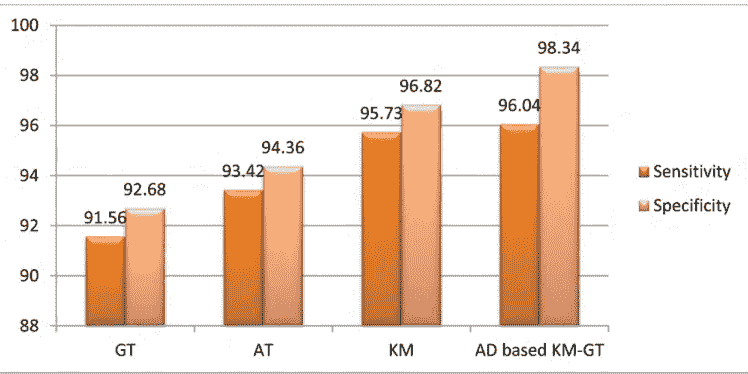

**图 9.9** 基于所提 `KM-GT` 模型与某些现有方法之间分割得分对比的性能验证 [6, 9]。

研究发现，基于实际结果和预测结果的灵敏性和特异性在统计学上是有效的。图中展示了这些得分与某些现有方法的对比分析（图 9.9），以对所提模型的有效性进行图形化验证。相比之下，性能指标证明了所提 `KM-GT` 模型的效能。

### 9.4.1.3 精率 (Precision)

精确率是一种性能指标，是病变正状态占所有分类为正的状态数（无论真假）的比例。由以下公式给出：

> Precision = \frac{t}{t + f} (9.8)

### 9.4.1.4 F 分数

F 分数是另一种性能指标，用于通过前面讨论的协议（如敏感性和精确率）来衡量所提模型的准确性。在实例层面上，F 分数可以通过以下公式制定：

> F-Score = \frac{t}{t + 0.5(f + f')} (9.9)

发现该协议下的模型效率更高。通过八张 MRI 图像确定的 F 分数生成的图表（图 9.10）值在 0.93 到 0.95 之间，显示了所提方法的性能。

### 9.4.1.5 Dice 相似系数 (Dice Similarity Coefficient)

该测试了预测类别与实际类别之间的相似性，从而找到两个图像之间值的重叠部分。由公式表示：

> Dice Co-efficient = 2x \frac{t}{(t + f) + (t + f')} (9.10)

## F 分数

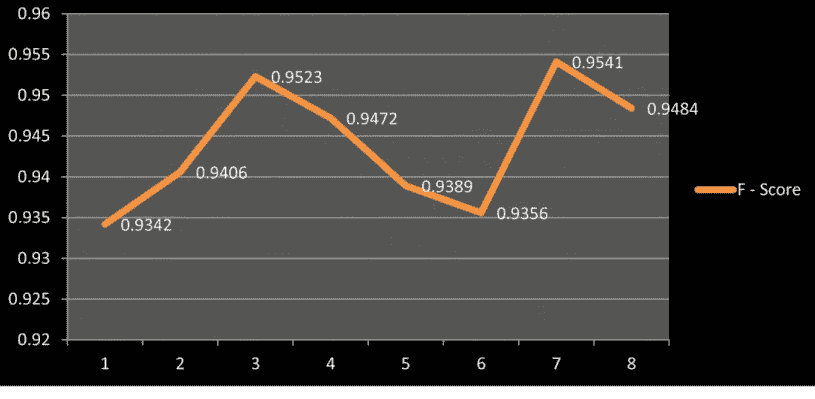

图 9.10 描述较高 F 分数值的图表。

### 9.4.1.6 Jaccard 系数 (Jaccard Coefficient)

这再次是一种参数化测量，用于检查叠加的预测图像与实际图像之间共享像素和不同像素的相似性。它通过预计算 Dice 系数确定。

> Jaccard Co-efficient = Dice similarity co-efficient/(2-Dice similarity Co-efficient) (9.11)

Dice 相似系数和 Jaccard 系数越高，所提模型的性能越高（见表 9.2）。图 9.11 显示了在 `KM-GT` 方法中，基于这些指标与某些现有技术相比的模型有效性能。

### 9.4.1.7 准确率 (Accuracy)

准确率是一个统计参数，能够准确地提取医疗图像中被正确分类的像素。通过公式计算：

> Accuracy = \frac{t + t'}{t + t' + f + f'} (9.12)

## TABLE 9.2

现有 [31] 方法与所提 `KM-GT` 模型基于 Jaccard 系数和 Dice 系数的对比

| 分割技术 | Jaccard 系数 | Dice 系数 |
|---|---|---|
| K-Means | 0.4493 | 0.64 |
| FCM | 0.503 | 0.669 |
| AD 基于 KM-GT | 0.859 | 0.9269 |

# 一种独特的机器学习方法

# 203

| | | 0.9269 |
|---|---|---|
| 0.9 | | 0.859 |
| 0.8 | | |
| 0.7 | 0.64 | 0.669 |
| 0.6 | | |
| 0.5 | 0.4943 | 0.503 |
| 0.4 | | |
| 0.3 | | |
| 0.2 | | |
| 0.1 | | |
| 0 | | |
| | K-Means | FCM | AD 基于 KM-GT

图 9.11 对比分割得分，显示了所提 `KM-GT` 模型更高的效率。

图 9.12 显示了九张医疗图像在分割后准确率图的图形化表示。

### 9.4.1.8 计算时间

执行所提 `AD KM-GT` 算法所需的时间毫无疑问地表明该方法在颅内病变检测的医疗图像分割上是有效的。通过 `MATLAB 7.0` 处理的计算时间如图 9.13 所示。

因此，从计算结果可以看出，病变及其属性在至少 8.8802 秒的计算时间内被更准确地提取。特定 MRI 图像的总面积由 65,536 个像素组成。肿瘤区域的像素数为：

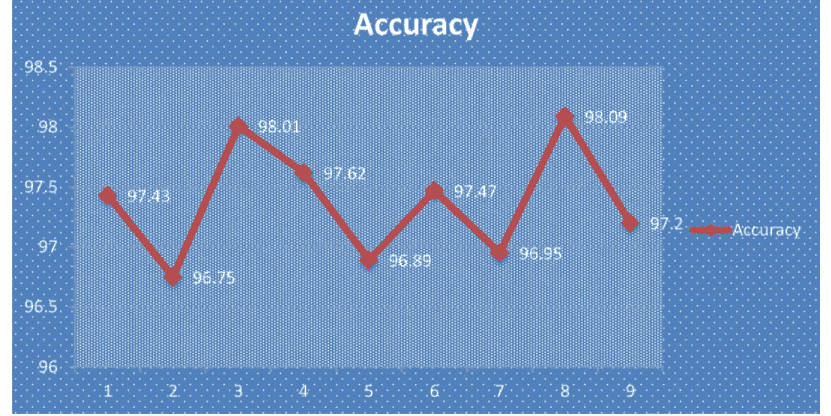

图 9.12 九张医疗图像准确率百分比的图形化表示。

用于神经退行性疾病的机器学习

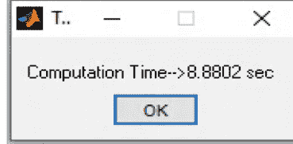

图 9.13 计算时间。


准确地 4,976 个像素，影响了图像。算法收敛的迭代次数为 10。然而，由于所提基于 `AD` 的 `KM` 算法的效率，在第 84 次迭代达到收敛，在没有进一步迭代的情况下终止循环。因此，随着四个类以精确的像素数分离，`GT` 通过计算长轴长度和短轴长度来分离 `ROI`，以 97.43% 的准确率提取病变，证明了所提方法的有效性。因此，不是单一分割，而是双重分割方法在以较低的计算时间和更高的准确率提取肿瘤方面是独特的，从而促进了颅内病变检测实施中可靠的诊断。

## 9.5 结论

病变及其特征可能会被放射科医生和转诊医生的解读误读，这种误诊可能会延迟治疗，或导致针对疾病严重程度的错误治疗程序。由于他们可能会判断疾病严重程度，误诊可能会延迟治疗或导致错误的程序。算法收敛的迭代次数为 10。然而，由于所提基于 `AD` 的 `KM` 算法的效率，在第 84 次迭代达到收敛，在没有进一步迭代的情况下终止循环。因此，随着四个类以精确的像素数分离，`GT` 通过计算长轴长度和短轴长度来分离 `ROI`，以 97.43% 的准确率提取病变，证明了所提方法的有效性。因此，不是单一分割，而是双重分割方法在以较低的计算时间和更高的准确率提取肿瘤方面是独特的，从而促进了颅内病变检测实施中可靠的诊断。

病变及其特征可能会被放射科医生和转诊医生的解读误读，这种误诊可能会延迟治疗，或导致针对疾病严重程度的错误治疗程序。由于他们可能会判断疾病严重程度，误诊可能会延迟治疗或导致错误的程序。算法收敛的迭代次数为 10。然而，由于所提基于 `AD` 的 `KM` 算法的效率，在第 84 次迭代达到收敛，在没有进一步迭代的情况下终止循环。因此，随着四个类以精确的像素数分离，`GT` 通过计算长轴长度和短轴长度来分离 `ROI`，以 97.43% 的准确率提取病变，证明了所提方法的有效性。因此，不是单一分割，而是双重分割方法在以较低的计算时间和更高的准确率提取肿瘤方面是独特的，从而促进了颅内病变检测实施中可靠的诊断。

### 参考文献

13. Admit Ilhana, and Ahmet Ihlan, “基于新阈值方法的脑瘤分割，” 软计算技术与应用国际会议，Procedural Computer Science, vol. 120, 2017, pp. 580–587

14. T.H. Ismail, L.B. Bilal, and M.A. Ibteshem (2023), “用于脑瘤分割与检测的新型阈值法，” 发展信息与通信技术国际会议论文集，自动驱动与工业计算。Springer, Singapore. https://doi.org/10.1007/978-981-19-7528-8

15. P.G.K. Rishi, R. Pradeep Kumar Reddy, and C. Naga Raju, “用于脑肿瘤检测的高效模糊逻辑，” 国际计算机与技术杂志，vol. 8, no. 2, 2013年6月20日

16. K. Venkatachal, V. P. Reddy, M. Araguman, and E. Mohan, “高效图像分割的K-Means聚类实现，” 2021 IEEE通信网络与技术国际会议 (CSNT), 印度博帕尔, 2021, pp. 224–229

17. Samir Kumar Bandyopadhyay, Tuhin Ustab, “基于MRI分析的K-means和DBSCAN聚类的脑瘤分割，” 国际工程与科学杂志，vol. 6, no. 1, pp. 71–77, 2019

18. Md. Zubair, Asif Iqbal, Avjeet Shil, Enam Haque, Mohammadibul Hoque, and Iqbal. Sarkar, “用于识别Covid-19的高效K-means聚类算法，” 混合智能系统国际会议，pp. 422–432

19. V. Sivakumar, and V. Murugan, “脑图像中使用阈值技术进行图像分割的研究，” 信息、通信与嵌入式系统国际会议 (ICESC2014), 印度钦纳伊, 2014

21. J. Wang, S. Lee, H. J. Wang, and K. R. Baek, “基于边界选择的全局阈值算法，” 控制、自动化与系统国际会议 (ICAS 2013), 韩国光州, 2013, pp. 704–706

21. K.A. Bera, K. Nanahil, and M. Totaleb Regan, “全局阈值技术在两相孔隙介质中的有效性，” 建筑与材料，vol. 142, pp. 256–267

22. Ashutosh Kumar M. K. Ajith, and Biswajit Chowdhury, “脑瘤磁共振成像的选分割技术分析，” 2023 IEEE第20届印度国际成像会议 (INDICON), pp. 1100–1105

23. O. S. Saaiya, and S. T. Das, “图像拼接预处理与后处理技术的研究，” 通信与计算技术进展国际会议 (ICACCT), 印度Sangamamer, 2018, pp. 431–435

24. Gangadhar S, Vena Chikkagudai, Poornachandra S and Munijnath Rad, “用于有效图像分析的MRI图像预处理，” 2019年第五届图像信息处理国际会议 (ICIP), 印度SIPha, 2019, pp. 63–67

25. Zhaobin Lin, and Qingyun Shi, “用于去噪和边缘的各向异性扩散PDE，” 第10届图像分析与处理国际会议, 意大利威尼斯, 1999, pp. 102–107

26. L. Hafizowicz, A. Čausević, A. Demić, L. S. Begirović, K. Gović, and A. Badnjevic, “人工智能在诊断成像中的应用：系统综述，” 2021 IEEE第21届生物信息与成像国际会议 (BIBE), 塞尔维亚 Krujevac,2021, pp. 1–

27. Indra Raj, Avisha Roy Chowdhury, and Airtruv Chowdhury, “MRI扫描脑瘤分割（特征增强与分类）的深入研究，” 国际工程创新杂志 (IIET),vol. 9, no. 4, 2018年3月

28. C. Jie, J. Jiuye, W. Junhui, Y. Yusheng, S. Putri, and L. Kaiyan, “数据中K-means聚类算法的研究回顾，” 2020 IEEE第3届电子通信工程国际会议 (ICCE), 中国西安, 2020, pp. 107–111

29. L. Alphonsa, and R. Resmi, “各种图像分割方法的性能指标比较，” 2016年控制、仪表、通信与计算技术国际会议 (ICICCT), 印度Kumaracoli, 2016, pp. 410–414

30. Ismail Yaquub, Yaheed Abdullah Al-Salhi, and Songfeng Lu, “基于水平集算法的模糊逻辑癌症医学图像分割阈值化。” De Gruyter,2018

## 一种独特的机器学习方法

# 207

- 32. R. Alzu’bi, A. Anushya, E. Hamed, B. S. Angela Vinci, and A. AlSha’ar, “通过优化K-Means进行医学图像分割，” 2017计算机、电气、电子与通信当前趋势国际会议 (CTCEEC), 印度迈索里, 2017, pp. 959–962
- 33. M. J. Mautiffe, F. M. Lalonde, D. McGarry, W. Gandler, K. Csaky, and B. L. Truss, “临床研究中的医学图像处理、分析与可视化，” 第14届IEEE计算机医学系统研讨会论文集, CBMS 2001, 美国马里州贝塞达, 2001, pp. 381–3386
- 34. K. J. Sinha, and M.X. Yang, “无监督K-means聚类算法，” IEEE Access,vol. 8, pp. 80716–80727
- 35. V. Chauhan, S. Negi, D. Jain, P. Singh, A. Sagar, and K. Sharma, “量子计算机：关于量子计算如何爆发的综述，” 2022 第二届先进计算与创新技术国际会议 (ICACITE),pp. 559–563

## 基于EEG信号的司机疲劳检测新型机器学习模型

N. Revathi Nehru Institute of Engineering and Technology, 科imbatore

R. Reeba Jennifer and S. Praseetha Sri Krishna College of Engineering and Technology

K. Sivakami Nehru Institute of Engineering and Technology

### 10.1 引言

疲劳检测一直是多种方法的关注点，包括视觉特征和生物信号。一方面，视频检测应用是有效的且对光线变化具有适应性；然而，与视觉特征相比，生物信号更为准确。因此，监控是一种安全手段。事实上，清醒与睡眠之间的过渡阶段（疲劳）是注意力下降的时期。这一阶段处于睡眠之前，其特征是几乎缺乏反射，且不适用于高警觉任务。

## 一种新型机器学习模型

# 209

嗜睡是指睡眠，通常发生在不恰的情况下。尽管嗜睡可能只持续几分钟，但其影响可能是毁灭性的。进入这种状态的原因通常是疲劳，它会削弱精力和活力。在长途驾驶且没有睡眠时可能会发生嗜睡[2]。在这种情况下，主要问题是疲劳驾驶员缺乏注意力，导致对交通事件的反应延迟。驾驶员并不一定会睡着。这种嗜意的迹象包括睁开眼睛困难、驾驶时偏离车道、对交通状况反应缓慢以及速度波动等。这些症状随着嗜意的进展而出现，并可以作为司机嗜睡程度的指标。

减轻嗜睡影响的努力在事故死亡和受伤中起着重要作用。全球每年道路事故导致估计135万人死亡和5000万人受伤。虽然嗜睡对道路安全构成了巨大风险，美国国家交通安全管理局（NHTSA）在2011年至2015年间，嗜睡导致了2.4%的致命性事故和2.5%的事故[3]。在高速公路上的嗜睡事故尤为严重，由于其普遍性，长时间驾驶会导致驾驶员疲劳，增加事故发生的概率。呈现的数据显示了嗜睡驾驶对事故的重大影响，强调了采取有效措施的必要性。技术进步有助于减少与交通事故相关的死亡和受伤，警告驾驶员他们的潜在状态。识别和预测嗜睡对于增强司机、乘客和行人的安全至关重要。

嗜睡驾驶可能导致与酒精影响下驾驶类似的后果。嗜睡与酒精具有相似性，都会降低警觉性、延迟反应时间并干扰决策能力。不幸的是，对司机来说识别嗜睡是挑战性的，因为有些人在入睡几分钟后并没有意识到自己已经打盹。注意的是，嗜睡会损害安全，通常发生在高速行驶时，嗜睡驾驶让司机无法反应和避免事故，导致严重事故。AAA交通安全基金的一项近期研究显示，估计所有事故的6%涉及拖曳车辆，7%导致住院，21%与嗜睡有关[4]。这凸显了嗜睡驾驶是一个严重的公共健康问题，促使睡眠医学学会（ASM）通过立场声明，旨在教育公众和医疗保健人员关于嗜睡驾驶的风险和应对措施。

最近关于司机嗜睡的研究确定了三个主要的数据消耗领域：基于车辆的、行为的和生理测量。研究发现，生理或基于生物信号的测量优于车辆和行为测量，因为它们提供的假阳性较少，受环境和道路状况的影响较小。生理或基于生物信号的测量更准确、可靠。检测嗜睡主要使用三种信号：脑电图（`EEG`）、眼电图（`EOG`）和心电图（`ECG`）。

2020年代以来，基于`EEG`的研究探索了机器学习（`ML`）在医学诊断中的整合。这些努力在开发嗜睡分类模型方面意义重大。此类进展促进了医疗应用中`EEG`与机器学习技术之间日益增长的协同。然而，`ML`应用存在各种缺点：需要大型数据集进行训练、预测限制、特征表示的中间步骤以及需要得出结论以识别异常。使用`EEG`测量与觉醒、嗜睡和睡眠等各种状态相关的脑电位。为了检测疲劳，可以从`EEG`数据中提取时域和频域的若干特征。

# 210

## 退行性疾病的机器学习

本文[5]引入了一种使用Kinect设备进行认知评估和康复的3D计算机视觉系统。该系统专门为患有身体方案功能障碍和左右混淆的人员开发，利用深度信息来解决在相同目的的2D视觉系统中观察到的局限性。新提出的系统成功实现了左右手跟踪以及脸部特征检测（包括眼睛、鼻子和耳朵）。特别，它可以使用消费级计算机轻松实现，并且对显著的背景和光照变化具有良好的鲁棒性。通过测试，该系统实现了96.28%的惊人监测率。人体运动的自动监测、相对于处方功能的分析以及练习的执行，减轻了康复专家的繁重任务。这种基于视觉的系统仅需微调即可应用于其他任务。

多位研究人员已致力于基于生成的`EEG`和`ECG`信号的嗜睡检测。同样通过检测器和特征检测，分析结果因嗜睡检测时间与准确性的滞后而失败[6]。本提议侧重于通过利用`K-Means`算法的机器学习技术进行准确检测。通过算法持续检查训练数据与测试数据，以了解精确的重叠模式。这种重叠与检测司机嗜睡的各种状态有关，范围从警觉、轻度嗜睡、中度嗜睡到极度嗜睡状态[7]。发现准确率几乎达到98.74%，检测时间最短。该稿件的设计按如下方式执行：

- 1. 首先从生成的信号中下载嗜睡信号。
- 2. 第二个动作是将`EEG`信号从欧洲数据格式（`EDF`）转换为`ASCII`格式。此过程将信号转换为二维表示的数据点。
- 3. 既然训练数据已可用，测试数据通过`K-Means`聚类算法确定，该算法通过持续检查与训练数据的重叠来聚类。

排序后的值决定了司机嗜睡的精确状态和数据点模式。

## 一种新型机器学习模型

新开发的卷积神经网络（`CNN`）具有独特的能力，能够通过突出输入样本中对分类至关重要的特定局部区域来阐明其决策过程 [10]。利用可分离卷积，该网络通过了一种精化的设计，以时空序列处理 `EEG` 信号。令人印象的是，该模型在留一法交叉验证的嗜睡识别中，对 11 名受试者的平均准确率达到了 78.35%，超过了传统的基准方法（范围通常在 53.4% 到 72.68% 之间）以及先进的深度学习技术（达到在 63.90% 至 65.78% 之间）[6]。可视化技术强调了该模型识别 `EEG` 信号中生物学解释特征的熟练，例如 alpha 纺锤（alpha spindles），它们是不同受试者嗜睡的稳健指标。此外，通过使用可视化，该方法探索了误分类样本的原因，引发了关于提高准确率可能方法的讨论 [11]。这项研究通过采用深度学习模型揭示复杂的 `EEG` 信号中与各种心理状态相关的意义模式，描勒出了一条充满前景的轨迹。

驾驶员嗜睡对道路安全构成了重大风险，会损害驾驶性能和注意力。我们的重点在于使用 `EEG` 信号预测嗜睡，此前这已被证明可以检测嗜睡的早期迹象 [12]。为了实现这一目标，我们引入了一个编码-解码框架，利用 `EEG` 信号估计眼睑闭合百分比（`PERCLOS`），这是一种广泛采用的嗜睡衡量标准 [13]。我们建立了 `EEG` 特征与 `PERCLOS` 之间的线性关系，通过最小二乘法估计未知参数。此外，我们定义了独立于 `EEG` 数据的 `PERCLOS` 状态转换，并使用最小二乘法估计了另一组参数。这种方法引入了一种新的动态建模解决方案，利用 `EEG` 信号在 `PERCLOS` 作为地面真值的锚下估计瞬时嗜睡水平。在解码阶段，13 名驾驶员采用了贝叶斯滤波解决方案，我们观察到在执行 `PERCLOS` 方面表现出稳健且可靠的；使用 18 名驾驶员的数据集对我们的框架进行评估，显示平均均方误差为 0.117，平均高概率密度为 62.5% [1]。特别，所选的 delta 波和 theta 波分别约 73% 和 66% 在驾驶测试期间随着 `PERCLOS` 的增强而显示出增长趋势。所提出的方法为嗜睡估计提供了一种稳健且实时的解决方案，为基于 `EEG` 的措施集成到嗜睡检测系统中铺平了道路。

驾驶员疲劳源于长时间工作、睡眠不足和疲劳，是一个普遍性问题。疲劳的驾驶员往往表现出反应时间变慢、注意力、意识和车辆的控制能力下降，导致了许多交通事故，其中一些是致命的。为了避免此类事故，早期发现驾驶员的警觉性至关重要。当仅关注面部线索而忽略头部倾斜、眨眼和哈欠等其他疲劳因素时，嗜睡预测会有所不同。所提出的解决方案利用了物联网（`IoT`）和先进神经网络——短短期记忆网络（`LSTM`）、`VGNN`、`InceptionV3` 和 `DenseNet` 的增强。它通过采用迁移学习解决了这些局限性，放大了各种嗜睡迹象以增强不同驾驶条件下的准确性。在检测到疲劳后，我们的 `IoT` [14] 模块会触发警告，通过日本纳米监测系统发出消息和声音。实验表明，利用深度神经网络实现了高达 98% 的惊准确率 [15]。重要的是，它已经在佩戴口罩和眼镜的场景下得到了验证，这在 COVID-19 疫情后公共场所强制口罩口罩具有实际意义。

驾驶员疲劳严重影响道路安全和性能，导致了大量的交通事故。多种模态（包括 `EEG`、眼动追踪和车辆行驶动态）都可以检测驾驶员嗜睡。虽然 `EEG` 提供高准确率，但它是侵入且麻烦的。相反，车辆容易获取但缺乏高精度。在这里，使用循环神经网络（`RNN`）捕捉眼动以识别嗜睡。

# 212 用于神经退行性疾病的机器学习

`LSTM` 是一种 `RNN`，它比标准 `RNN` 具有独特优势。本研究采用一系列 `LSTM` 单元对眼动进行建模，使用了两种类型：作为基准的 ID `LSTM` (`R-LSTM`) 和卷积 `LSTM` (`C-LSTM`)，后者能够使用 2D 眼动。从一项涉及 38 名受试者的模拟驾驶实验中，生成了双眼大小为 48×48 的补片多通道 `EEG` 信号功率谱分析。受试者的警觉水平通过“警觉”和“嗜睡”的二分类标签进行独立评估。`R-LSTM` 方法产生了约 82%，而 `C-LSTM` 的准确率在 95% 到 97% 之间 [16]。通过与最近发布的眼动追踪方法的对比分析显示，所提出的 `LSTM` 技术具有显著的优越性能。


驾驶员疲劳是长途旅行事故的常见原因。如果有一种可靠准确的疲劳检测技术，驾驶员将获得警告。使用这种策略将帮助驾驶员做出明智的选择并防止碰撞。本文使用一种强大的传感器来识别驾驶员疲劳。它首先通过对捕到的 EEG 信号进行处理创建。十二受试者的 EEG 数据经过多种 ML 算法，以便将每个片段分类为警觉或睡眠。在应用 ML 算法之前，使用预处理从捕到的信号中提取相关信息。使用的技术包括 K 近邻、随机森林分析 (RFA)、朴素贝叶斯（对角判别分析）和支持向量机（线性和径基函数）。发现，当仅从三个电极捕获信号时，几个分类器对本研究中考虑的所有受试者产生了 100% 的最佳准确率。基于 EEG 的系统在实时检测驾驶员疲劳和注意力注意力方面非常准确，使其成为实时应用的一种可行且值得赖的解决方案。

识别驾驶员疲劳、嗜睡的挑战通常通过利用神经生理信号作为开发先进系统的基础来解决。脑电图是成功识别一切的关键数据源。为了改进 EEG 上的嗜睡检测，我们专注于综述 EEG 特征和深度学习算法的应用。接下来，我们回顾了文献中使用的 EEG 特征 [17]。最后，我们讨论了该领域的挑战和机遇。我们证明，近年来嗜睡检测的研究激增，为了提高准确率，未来的系统应该考虑广泛的 EEG 信号和深度学习技术 [18]。

# 一种新型机器学习模型

近年来已经出现了一些方法。本研究审查了2018年1月到2022年1月期间62篇使用脑电图（EEG）数据识别驾驶员嗜睡的论文。从这些海量文献中，我们识别并展示了引人目的策略，以指导未来的研究并提出建议。研究人员探索了涵盖科学和工程领域的关键数据库，以发现发表在学术期刊、会议和电子预印本库的相关论文。每项研究提取的数值数据项包括：(1) 数据，(2) 使用的通道，(3) 提取和分类过程以及(4) 结果。对这些项目分别进行了趋势分析。我们观察到不同的研究使用了不同量的EEG数据。我们观察到一半的研究采用了模拟的实验结果。支持向量机（SVM） [22] 被应用于21%的研究中，而CNN的使用率约为19% [23]。综合考虑，我们得出结论：疲劳和嗜睡会降低驾驶能力并增加危险事故的概率。

驾驶员在疲劳时操作车辆可能导致严重的交通事故。本研究提出了一种基于CNN的可穿戴EEG技术，用于可穿戴EEG数据采集、车辆司机嗜睡及预警技术。首先，在清醒和睡眠的模拟场景下，使用可穿戴计算机接口（BCI）对EEG信号进行监测和采集。其次，使用Inception模块和MobileNet模块训练分类EEG输入的神经网络 [24]。最后，如果发现汽车驾驶员处于睡眠状态，预警策略模块将激活并发出警报。使用模拟驾驶任务的EEG数据对方法进行了测试。基于一秒时间窗口的样本，结果显示，利用带有Inception模块的神经网络实现了95.59%的分类准确率，而改进的AlexNet模块产了94.68%。模拟和测试结果证明了所建议疲劳检测方法的有效性。

事故的主要原因之一是疲劳的驾驶员。在现实环境中，单模式嗜睡检测技术的抗干扰能力差且率低。在本研究中，我们建议了一种结合车辆运动数据与EEG的优化方法来识别驾驶疲劳。

对EEG信号与车辆运动数据之间的关系进行了分析。对于EEG，该技术检测四种节律波的频率比率，测量值为 `$\alpha$`、`$\beta$`、`$\theta$` 和 `$\delta$`。根据驾驶加速度、速度和轮角计算了样本熵和标准差。每个疲劳指标都经过了皮尔逊相关分析 [25]。为了实现融合嗜睡检测，选择了关联性最强的连接并输入支持向量机。通过实验，我们获得了92.37%的平均准确率，超过了基于EEG的驾驶疲劳检测（2.53%）和基于车辆运动信息的驾驶疲劳检测（8.78%）的分类准确率。基于相关性的多源信息疲劳检测可以增强系统性能。

印度尼西亚是事故率最高的国家之一。导致道路运输高事故风险的因素之一是疲劳和嗜睡。疲劳的发展受工作相关因素和睡眠相关因素（数量和质量、时间段）影响很大。众所周知，EEG信号是确定嗜睡和昏睡的金标准。然而，早期的研究主要关注特定情况下EEG信号的模式，忽略了基于EEG信号的嗜睡指标建立。此外，文献中对于识别嗜睡最有用的EEG指标特征仍存在分歧。因此，本工作的目的是开发一种基于EEG信号的嗜睡指标，用于跟踪嗜睡的驾驶员。支持向量机、逻辑回归和统计显著性检验是本研究采用的技术之一。研究结果表明

# 用于神经退行性疾病的机器学习

`alpha`、`beta`和`theta`波的增加与睡眠不足之间存在显著关系。此外，驾驶时间的增加显著提高了所有EEG比率（包括`theta`功率），并降低了警觉组的`beta`功率。在频谱密度中，在驾驶结束时，`($\theta+\alpha$)` 和 `$\beta$` 比率也出现了明显的增加 [26]。此外，驾驶时长和睡眠质量对主观性有影响。通过将EEG信号与睡眠状态及驾驶参数相结合，测试数据中产生了90.5%的灵敏度和90%的特异性，达到了可接受的准确率（训练和测试分别为77.1%和90.2%）。逻辑回归在分类方面的表现优于支持向量机，后者虽是最准确的分类器。与其他EEG信号相比，`theta`功率对模型的影响最大。

因此，综述报告显示，在使用这里提到的不同类型算法时，计算复杂度最低。所提出的使用K-Means算法的算法将解决不同层次的复杂度问题，且在人类大脑所有状态下驾驶汽车时的嗜睡检测准确率将高于95%。

# 10.3 提议的方法

嗜睡驾驶的危险情况会导致嗜睡驾驶。这通常是因为驾驶期间睡眠不足、未处理的睡眠或轮班工作；药物过量和酒精也会导致嗜睡。嗜睡是非常危险的。

使用的工作平台是`MATLAB 6.0`。这种编程语言是一种高级语言，有助于计算、设计、可视化和分析系统。`MATLAB 6.0`具有如句柄等新数据类型。与`Java`接口涉及从`Java`类创建对象并调用对象的方法。

此处提议的模型，数据集从 `https://figshare.com/articles/dataset/EEG_drowsiness_dataset/14273687` 获取。该医学数据为`EDF`格式。本工作利用其二维脑电进行进一步处理。

## 10.3.1 欧洲数据格式 (EDF)

`EDF`是不同设备和负载之间交换脑电图和多导图的广泛接受的标准。数据文件以头记录开始，并包含数据记录。变长头记录识别患者并包含捕获信号的技术细节。数据记录包含多导图记录的固定持续时间段。

# 一种新型机器学习模型

包含了其历史、结构、现实世界应用以及对医生和研究人员益处的信息。

20世纪90年代初，`EDF` 时代诞生于对生理监测标准数据格式的需要。研究人员和医生曾使用各种专有的 EDF 格式，这导致了兼容性和数据共享方面的问题。欧洲神经学会联合会（EFNS）为了应对这些困难创建了 `EDF`，为数据交换和存档提供了一个标准。许多互操作性问题在 `EDF` 的第一个版本中通过提供精确且标准化的格式得到了解决。`EDF` 随着时间的推移而变化，随着 `EDF Plus (EDF+)` 的发布，其用途得到了扩展，`EDF+` 提供了更好的元数据和注释等额外功能。

## 10.3.1.1 EDF 结构

头部（Header）和数据记录是 `EDF` 文件的两个主要部分。为了确保数据被准确存储和处理，每个部分都至关重要。

### 1. 头部部分 (Header)

- 版本信息：提供所使用的 `EDF` 版本（ED 或 `EDF+`），这对于解释和兼容性是必要的。
- 患者信息：包括姓名、性别、患者 ID 和人口统计信息等具体细节。这些数据有助于材料的识别和背景化。
- 记录信息：给出记录的持续时间以及开始日期。对于时间分析，这些信息至关重要。
- 信号细节：关于每个通道的信息。
- 通道标签：每个记录通道的名称或标识符（例如标记为 "Fp1" 和 "C3" 的 EEG 通道）。
- 物理维度：信号测量单位（例如 EEG 的 µV）。
- 最小/最大数字和物理值：这些数字定义了现实世界测量值与数字表示之间的比例比例。
- 采样频率：显示采集数据样本的速度，对于精确的信号重建至关重要。

### 2. 数据记录 (Data Records)

`EDF` 文件在头部之后拥有由连续信号数据组成的数据记录。通常，每个通道的固定长度信号数据构成了每条记录。时间序列格式中的每个记录包含与采样频率对应的数据点。

### 3. 数据表示 (Data Representation)

`EDF` 文件存储信号数据，需要使用头部信息将其转换回其物理测量值。这一过程确保了捕获信号的精确重建和分析。对于 EEG 信号，可以存储为一组反映电压变化的数字值。头部提供了以微秒为单位解释这些值所需的缩放因子。

### 4. EDF+ 和扩展功能

原始 `EDF` 格式通过 `EDF+` 得到了扩展以提供更多能力。`EDF+` 的主要属性包括：
- 注释：可以使用 `EDF+` 在数据记录中添加事件标记和注释。这些注释可以指示整个录制期间发生的重要事件，包括不同的睡眠阶段、伪迹（artifacts）或相关事项。
- 扩展头部信息：`EDF+` 允许添加元数据字段，以提供有关患者人口统计数据、记录状况以及可能影响数据解释的其他元素的特定细节。

## 10.3.1.2 实际应用

`EDF` 格式广泛应用于各个领域，包括：
- 临床神经病学：为了诊断和跟踪癫痫等神经系统疾病，`EDF` 用于收集和分析 EEG 数据。统一的结构使得更容易比较不同研究和临床背景下的结果。
- 睡眠研究：在睡眠研究中使用 `EDF` 记录 EOG、EEG 和 EMG 数据。格式中的注释有助于研究人员识别关键事件和睡眠阶段。
- 生物医学研究：在研究环境中，`EDF` 用于研究生理反应、评估新型诊断仪器并进行实验调查。得益于标准格式，来自许多源的数据可以合并和比较。

## EDF 的优势

- 互操作性：通过提供促进不同平台和系统之间数据交换的标准格式，`EDF` 有助于最大限度地减少不兼容性。
- 一致性：`EDF` 对标准化结构的定义提高了研究结果和临床评估的可靠性，确保了数据被一致地收集和评估。
- 增强的数据管理：通过详细的元数据和注释（在 `EDF+` 中），用户可以获得对捕获数据的更深入见解，使得更彻底的分析和解释成为可能。

## 10.3.1.3 未来方向

随着技术的发展，人们对扩展和改进 `EDF` 格式一直很感兴趣。未来的发展可能包括对新型生理信号类型的更好支持、更复杂的数据处理工具以及增强的实时监控能力。生物医学科学可能会从临床实践和研究方面 `EDF` 的进一步发展中大获益。

## 10.3.2 过滤伪迹

在 EEG 信号中过滤伪迹是确保神经生理数据精确性和可靠性的关键步骤，EEG 记录大脑的电活动，可能会被各种伪迹掩盖或扭曲。这些失真源于电干扰、肌肉活动（如眨眼）、眼球运动（做脸）甚至是 EEG 电极本身的移动。

伪迹过滤过程涉及多个步骤。首先，至关重要的是识别并理解影响 EEG 的伪迹类型。这需要分析伪迹的频率、振幅和时间属性。例如，眨眼伪迹通常产生低频、高振幅信号，可以与大脑中的神经震荡区分来。肌肉伪迹也听起来像高频噪声。

一旦识别出伪迹，就可以应用过滤技术来减少其影响。常用方法包括：
- 带通滤波（Band-pass filtering）：衰减指定范围之外的频率，同时允许信号通过。例如，可以调整带通滤波器，以减少所需频率范围（例如 EEG 研究的 1–50 Hz）之外的噪声，并保留所需的频率带。
- 陷波滤波（Notch filtering）：通过移除特定的窄频带来减少干扰，例如与电源线相关的 50/60 Hz 频率。
- 伪迹抑制（Artifact rejection）：从 EEG 数据中消除显示出显著伪迹的部分。通常，这是通过为振幅或其他指示伪迹存在的特征建立阈值来实现的。
- 称为独立分量分析（ICA）的先进方法将信号分解为其单独成分。根据其空间和时间属性，伪迹被识别为单独成分，然后进行消除或修复。
- 自适应滤波（Adaptive filtering）：使用能够根据输入信号立即改变其属性的滤波器。使用自适应滤波器处理非平稳现象可能特别有益。

彻底检查过滤后的 EEG 数据以确保没有引入额外的伪迹，并且在过滤过程中相关的脑信号保持不变，是至关重要的。通过将过滤后的数据与已有的脑活动模式进行比较来验证过滤方法的有效性也是必不可少的。

滤波器是一种数学技术，在数字数据集上操作，以在提取有用信息的同时移除无关信息。过滤方法主要用于保留特定信号的频率成分。

简单的卷积滤波器（如均值滤波器）基于核（kernel）来移除伪迹的。均值滤波器（也称为平均值滤波器）是一种平滑信号的窗滤波器。该滤波器执行低通函数。过滤的基本思想是对其邻域内的任何细微细节（图像）取平均值。

选择这种简单滤波器是为了不干扰数据点的细微细节。与滤波核进行简单的卷积可以产生更好的结果，这些结果可以用于所提出的 AI 学习方法。

## 10.3.3 通过 K-Means 聚类算法进行机器学习

`K-Means` 聚类是一种源自信号处理的矢量量化方法，它尝试将 N 个观测分为 K 个簇，每个观测属于具有最近平均值（聚类中心或质心）的簇，该平均值作为类的原型。无监督机器学习（Unsupervised ML）是教计算机使用无标签、无名称材料的过程。

# 用于神经退行性疾病的机器学习

- 在工作空间中识别数据点 `(a,b)`
- 根据认知阶段定义聚类数量，`S=5` (`S1`, `S2`, `S3`, `S4`, `S5`)
- 随机选择四个数据点 (`E1`, `F1`), (`E2`, `F2`), (`E3`, `F3`), (`E4`, `F4`), (`E5`, `F5`)
- 计算欧几里距离 `Z`
- 如果状态发生变化，则进行下一次迭代；否则结束循环
- 定义欧几里距离 `D` 和状态数
- 通过计算相似认知状态数的平均值来确定新的数据点

**图 10.1** 展示通过 K-means 聚类算法对数据点进行聚类的图。

在这种方法中，数据点被分配到一个簇，使得数据点与质心之间的距离平方和最小。需要理解的是簇内的变异越小，同一簇内的数据点越多。图 10.1 显示了通过 K-Means 算法对数据点的聚类。

在机器学习中实现 K-Means 聚类算法面临若干挑战。聚类中心的初始位置可能导致收敛到次优解。选择合适的聚类数量 (K) 是一项非凡的任务，通常需要领域知识或额外的验证方法。该算法对离群值也敏感，这会显著影响质心位置，并最终影响聚类分配。

此外，K-means 假设簇是球形且大小相等的，这在高维数据中引发了另一个挑战：欧几里距离度量可能变得意义不大，从而影响算法性能。此外，K-Means 对噪声敏感，可能会将点分配到错误的簇中，特别是在簇重叠或簇密度不一的情况下。这些挑战需要仔细的考虑，并且通常涉及针对特定数据特征定制的替代聚类算法或预处理技术。

## 10.4 结果与讨论

训练数据从 [28] 提供的技术细节中分离出来。为数据库生成的训练数据如图 10.2 中的值所示。本文特别包含了通过 [28] 中提出的嗜睡检测所生成的特征。

测试数据通过基于 K-Means 算法的机器学习方法生成。这种机器学习方法通过持续匹配训练数据与测试数据之间的值来找到它们之间的叠部分，表现更为优越。生成的训练数据的仿真结果如图 10.3 所示。带有检测到的认知状态的测试数据如图 10.4 所示。此外，这些重叠值按顺序排序，从而将精确实例分为极度嗜睡、中度嗜睡、轻度嗜睡、间歇嗜睡和清醒。从上到下按精确实例从小序排序的矩阵如图 10.5 所示。最后，不同算法的准确率水平对比如图 10.6 所示。

## 一种新型机器学习模型

| 0.0415 | 0.0828 | 0.0606 | 0.1255 | 0.1103 | 0.1135 | 0.3258 | 0.2510 | 0.2182 | 0.2374 | 0.1977 | 0.2013 | 0.2014 | 0.2011 |

| :--- | :--- | :--- | :--- | :--- | :--- | :--- | :--- | :--- | :--- | :--- | :--- | :--- | :--- |

| 0.0415 | 0.0828 | 0.0606 | 0.1255 | 0.1103 | 0.1135 | 0.3258 | 0.2510 | 0.2182 | 0.2374 | 0.1977 | 0.2013 | 0.2014 | 0.2011 |

| 0.0415 | 0.0826 | 0.0606 | 0.1255 | 0.1103 | 0.1135 | 0.3258 | 0.2182 | 0.2182 | 0.2374 | 0.1977 | 0.2013 | 0.2014 | 0.2011 |

| 0.0415 | 0.0826 | 0.0606 | 0.1255 | 0.1103 | 0.1135 | 0.3258 | 0.2182 | 0.2182 | 0.2374 | 0.1977 | 0.2013 | 0.2014 | 0.2011 |

| 0.0415 | 0.0826 | 0.0606 | 0.1255 | 0.1103 | 0.1135 | 0.3258 | 0.2510 | 0.2182 | 0.2374 | 0.1977 | 0.2013 | 0.2014 | 0.2011 |

| 0.0531 | 0.0703 | 0.0723 | 0.1562 | 0.1369 | 0.1221 | 0.4175 | 0.3456 | 0.2981 | 0.2762 | 0.2650 | 0.2251 | 0.2182 | 0.2267 |

| 0.0531 | 0.0703 | 0.0723 | 0.1562 | 0.1369 | 0.1221 | 0.4175 | 0.3456 | 0.2981 | 0.2762 | 0.2650 | 0.2251 | 0.2182 | 0.2267 |

| 0.0531 | 0.0703 | 0.0723 | 0.1562 | 0.1369 | 0.1221 | 0.4175 | 0.3456 | 0.2981 | 0.2762 | 0.2650 | 0.2251 | 0.2182 | 0.2267 |

| 0.0441 | 0.0857 | 0.1578 | 0.1251 | 0.1061 | 0.0963 | 0.3466 | 0.2609 | 0.2304 | 0.2271 | 0.1934 | 0.1887 | 0.1702 | 0.1735 |

| 0.0441 | 0.0857 | 0.1578 | 0.1251 | 0.1061 | 0.0963 | 0.3466 | 0.2609 | 0.2304 | 0.2271 | 0.1934 | 0.1887 | 0.1702 | 0.1735 |


| 0.0441 | 0.0857 | 0.1578 | 0.1251 | 0.1061 | 0.0963 | 0.3466 | 0.2609 | 0.2304 | 0.2271 | 0.1934 | 0.1887 | 0.1702 | 0.1735 |

| 0.0408 | 0.0815 | 0.0538 | 0.1624 | 0.1214 | 0.0992 | 0.3975 | 0.3191 | 0.2456 | 0.2164 | 0.2257 | 0.1804 | 0.1832 | 0.1764 |

| 0.0408 | 0.0815 | 0.0538 | 0.1624 | 0.1214 | 0.0992 | 0.3975 | 0.3191 | 0.2456 | 0.2164 | 0.2257 | 0.1804 | 0.1832 | 0.1764 |

| 0.0408 | 0.0815 | 0.0538 | 0.1624 | 0.1214 | 0.0992 | 0.3975 | 0.3191 | 0.2456 | 0.2164 | 0.2257 | 0.1804 | 0.1832 | 0.1764 |

| 0.0408 | 0.0815 | 0.0538 | 0.1624 | 0.1214 | 0.0992 | 0.3975 | 0.3191 | 0.2456 | 0.2164 | 0.2257 | 0.1804 | 0.1832 | 0.1764 |

| 0.0436 | 0.0871 | 0.0555 | 0.1739 | 0.1203 | 0.0989 | 0.3428 | 0.2625 | 0.2160 | 0.2221 | 0.1766 | 0.1949 | 0.1832 | 0.1764 |

| 0.0436 | 0.0871 | 0.0555 | 0.1739 | 0.1203 | 0.0989 | 0.3428 | 0.2625 | 0.2160 | 0.2221 | 0.1766 | 0.1949 | 0.1832 | 0.1764 |

| 0.0436 | 0.0871 | 0.0555 | 0.1739 | 0.1203 | 0.0989 | 0.3428 | 0.2625 | 0.2160 | 0.2221 | 0.1766 | 0.1949 | 0.1832 | 0.1764 |

| 0.0436 | 0.0871 | 0.0555 | 0.1739 | 0.1203 | 0.0989 | 0.3428 | 0.2625 | 0.2160 | 0.2221 | 0.1766 | 0.1949 | 0.1832 | 0.1764 |

| 0.0436 | 0.0871 | 0.0555 | 0.1739 | 0.1203 | 0.0989 | 0.3428 | 0.2625 | 0.2160 | 0.2221 | 0.1766 | 0.1949 | 0.1832 | 0.1764 |

| 0.0436 | 0.0871 | 0.0555 | 0.1739 | 0.1203 | 0.0989 | 0.3428 | 0.2625 | 0.2160 | 0.2221 | 0.1766 | 0.1949 | 0.1832 | 0.1764 |

| 0.0436 | 0.0871 | 0.0555 | 0.1739 | 0.1203 | 0.0989 | 0.3428 | 0.2625 | 0.2160 | 0.2221 | 0.1766 | 0.1949 | 0.1832 | 0.1764 |

| 0.0436 | 0.0871 | 0.0555 | 0.1739 | 0.1203 | 0.0989 | 0.3428 | 0.2625 | 0.2160 | 0.2221 | 0.1766 | 0.1949 | 0.1832 | 0.1764 |

| 0.0436 | 0.0871 | 0.0555 | 0.1739 | 0.1203 | 0.0989 | 0.3428 | 0.2625 | 0.2160 | 0.2221 | 0.1766 | 0.1949 | 0.1832 | 0.1764 |

| 0.0436 | 0.0871 | 0.0555 | 0.1739 | 0.1203 | 0.0989 | 0.3428 | 0.2625 | 0.2160 | 0.2221 | 0.1766 | 0.1949 | 0.1832 | 0.1764 |

| 0.0436 | 0.0871 | 0.0555 | 0.1739 | 0.1203 | 0.0989 | 0.3428 | 0.2625 | 0.2160 | 0.2221 | 0.1766 | 0.1949 | 0.1832 | 0.1764 |

| 0.0436 | 0.0871 | 0.0555 | 0.1739 | 0.1203 | 0.0989 | 0.3428 | 0.2625 | 0.2160 | 0.2221 | 0.1766 | 0.1949 | 0.1832 | 0.1764 |

图 10.2 训练数据。

`img/7cac6601eea2ac8e53f091ee171f3f_231_0.png`

图 10.3 测试数据仿真结果。

能量

`img/7cac6601eea2ac8e53f091ee171f3f_232_0.png`

图 10.4 测试数据仿真结果。

| Sorting value->0.69114 | 0.82907 | 0.69968 | 0.65761 | 0.73909 |

| :--- | :--- | :--- | :--- | :--- |

| Sorting value->0.70305 | 0.85883 | 0.70372 | 0.66604 | 0.74477 |

| Sorting value->0.70397 | 0.86839 | 0.73172 | 0.69536 | 0.74691 |

| Sorting value->0.78368 | 0.87615 | 0.8326 | 0.82258 | 0.8119 |

| Sorting value-> | 1 | 1 |

图 10.5 确切实例。

`img/7cac6601eea2ac8e53f091ee171f3f_232_0.png`

图 10.6 与不同算法的对比。

## 新型学习模型

## 10.5 结论与未来工作

16. Azhar Quddus, Ali Shahidi Zandi, Laura Prest, and Felix J. Comeau, Using Long Term Memory and Convolutional Neural Networks for Driver Detection. Elsevier, Volume 156, June 2021.

17. Islam A. Fouad, A robust and efficient EEG-based drowsiness detection system using machine learning algorithms, Ain Shams Engineering Journal, vol. 14, no. 3, 101895, 2023.

18. Francisco Diaz-Pernias, Maria Martinez Martinez, and Miriam Anón-Rodríguez, “A deep learning approach for drowsiness detection and segmentation using a multiscale convolutional neural network,” Healthcares, vol. 9, no. 2, 153, 2020.

19. Maya Arlini Puspasari, Dani Hadi Syafullah, and Bilal Muhammad Iqbal, “Prediction of drowsiness using EEG signals in young Indonesian devices,” Helion, vol. 9, no. 9, e19499, 2023.

20. Igor Stancic, Mario Cifrek, and Ivan Civic, Review of EEG signal features and their application in driver drowsiness detection systems, Sensors, vol. 21, 3786, 2021. https://doi.org/10.3390/s21233786

21. S Hachisa, Human and vehicle-driver drowsiness detection by facial expression. In: 2013 International Conference on Biometrics and Kansai Engineering. IEEE, pp. 320–326, 2013.

22. V Vijaypriya, and Munees Uma, Based Drowsiness Detection with Multi Scale Convolutional Neural Network, IEEE Access, vol. 8, pp. 71535–71542, 2020.

23. M Kurithie, P Mitharthi, M Sumithra, and I Sumaiya Fatima, Efficient Driver Drowsiness Detection Using Deep Learning. https://doi.org/10.1109/ICACC55729.2023.1012803.

24. Raed Mohammed, “Driver Drowsiness Detection Methods Using EEG Signals: A systematic review,” Computer Methods in Biomechanics and Biomedical Engineering, vol. 26, no. 2, pp. 1–13, 2022. https://doi.org/10.1080/10955842.2022.2112574.

25. Miankuan Zhu, Jiangfang Chen, and Haobo Li, “Vehicle driver drowsiness detection method using wearable EEG based on convolution neural network,” Neural Computing and Applications, vol. 33, pp. 3960, 2021.

26. Zedong Lan, Jian Zhao, “Driving fatigue detection using EEG and vehicle information,” Biomedical Signal Processing and Control, vol. 92, p. 106031, 2024.

27. P. Rasna, and M. B. Smithamol, SVM-Based Drivers Drowsiness Detection Using Machine Learning and Image Processing Techniques, Progress in Advanced Computing and Intelligent Engineering, pp 100–112, 10 November 2020.

28. Jyotsna Ghabhane, Dhanashree Dixit, Pranali Mankar, Ruchika Kamble, and Sayantani Gupta, “Drowsiness and alert system: A review,” International Journal for Research in Applied Science & Engineering Technology (IJRASET), vol. 6, no. IV, April 2018.

# 机器学习应用于神经退行性疾病面临的挑战与未来方向

Harish Gavel, Rahul Kumar, and Chandrasekhar Azad

National Institute of Technology, Jamshedpur, Jharkhand, India

## 11.1 引言

正如一场突触旋风，我们人类的大脑在正常工作时会扫过地球上任何人都更多的脑细胞和连接 [1]；但如果在任何时刻发生故障，思绪就会绽放、起舞，情感会在神经元的舞动中如闪电般闪烁 [2]。然而，当音乐褪去，曲调便转为不和谐，并陷入神经退行性疾病的深渊 [3]。阿尔茨海默病、帕金森病、肌萎缩侧索硬化症（ALS）——它们是残酷的指挥家，引导着一场缓慢的死亡行军，剥夺运动和思维，直到生命也屈服。在这场毁灭的交响乐中，并非源于乐观，而是源于机器学习不断高涨的高潮。

想象一下在这个无情的时代 [4]，未来不再是由于手的第一次颤抖，而是记住一个导致意志丧的错误触发了基于机器学习的警报，从而实现早期检测，允许进行纠偏或更好的预防 [5]。想象一下定制化的护理，编织了每个个人 DNA 的织锦，揭示了他们的 MRI 图像和临床记录 [6]。想想那些曾经沉默且无情的大量数据集，如何被机器学习转化为讲述故事的内容，揭示了不可见的复杂性，像病毒扩散一样泄露疾病进展的提示，并指出了我们可能想过但极少被研究的治疗方向 [7]。这并非遥不可及的现代科幻，机器学习的免疫力将影响对抗神经退行性疾病的斗争 [8]。

但通往承诺之地的道路充满波折。机器学习机器的燃料是数据 [9]，而存在个体差异。一些系统是使用类似于人类大脑的神经模式分别开发出来的。尽管如此，这比任何训练良好的分析算法所能实现的要困难得多，且可靠性 [10]。什么是有趣的算法？新 AI 行业面临的另一个问题是，本质上仍然是不可捉的黑箱，复杂问题的深奥解决方案像电影中一样从中溢出 [11]。事实是，存在墙阻隔着我们与机器学习的高收益潜力之间 [12]。

本章将带我们穿越这片复杂的区域，机器学习在神经退行性疾病中的挑战与机遇像神经分支一样汇聚。我们将深入探讨数据问题，解析诸如可穿戴传感器和联邦学习等新方法，这些方法为开启人类经验宝藏带来了希望。在这方面，我们将进一步探索可解释 AI 领域——在那里，算法脱去了黑外衣，展示它们是如何做出某些预测的，从而建立在临床应用中使用它们的信任 [13]。这是否是通往个性化医疗的道路，每一位患者的程程变成一个具有前所未分辨率的数据点，指导治疗。在此之前，我们尝试绘制一条穿越危险地形的方法，为机器学习在实现对抗神经退行性疾病的希望方面发挥转型作用铺平道路 [14]。

# 针对神经退行性疾病的机器学习

本章的主要贡献如下：

- 揭示了“一刀切”个性化医疗的局限性。
- 提高了数据共享和公私合作伙伴关系（PPPs）的重要性。
- 促进可解释人工智能（XAI）成为建立信任的关键。

其余部分的结构如下：

- 11.2 提出了关键挑战并探索了前景良好的途径。
- 11.3 关注神经退行性疾病的未来方向。
- 11.4 概述了结论。

# 神经退行性疾病的机器学习

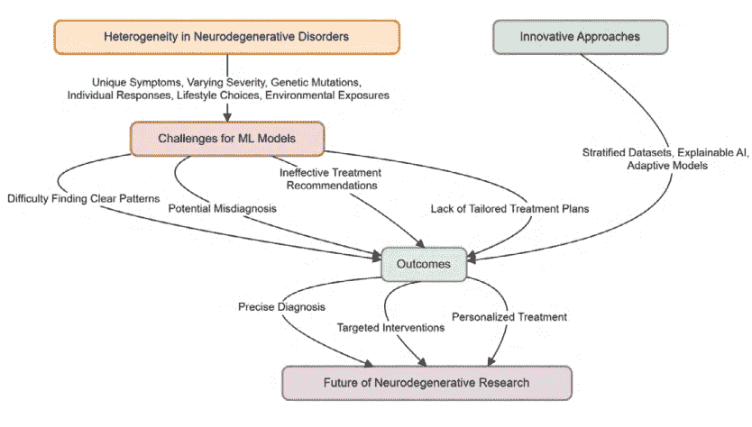

**图 11.2** 神经退行性疾病的多样性带来的挑战和结果。

这种多样性为机器学习（ML）模型带来了许多挑战。在某一人群上训练的模型在泛化到具有异质表型的其他人群时效果不佳，导致假阳性或不恰的治疗建议 [32]。在缺乏解决个体差异的模型，个性化治疗方案和针对性干预无法充分推进患者护理。对独特子集的精确分类以及随后的疾病特异性疗法开发，需要稳健的模型能够识别大型数据集内部固有的细微差异，而不仅仅是因为其异质性 [33]。迷宫并不意味着不可逾越。利用可解释人工智能（XAI）针对个体多样性构建分层数据集并使用自适应模型可以解决这些问题，为慢性风湿性疾病走向更精准诊断、针对性干预和个性化护理的黎明铺平道路 [34]。

## 11.2.1.3 数据孤岛与隐私忧虑

数据对于神经退行性疾病机器学习生态系统的开发和进步至关重要，但数据孤岛结合隐私限制是一个巨大的障碍。可操作的见解隐藏在医院、研究机构和制药公司之间不连接的数据孤岛中，这种碎片化使得创新变得困难 [35]。图 11.3 展示了数据孤岛和隐私忧虑在神经退行性疾病研究中的影响和后果。此外，关于患者隐私的伦理问题为充分发挥潜力增加了另一个需要克服的障碍 [36]。

想象一个碎片的信息群岛，关键信息位于各个岛屿上，却无法触及。这种碎片化的现实在目前的神经退行性研究数据中得到了重现 [37]。临床记录、影像数据和其他诊断信息被锁定在现代医院的各个医疗系统中。在大学或临床环境中收集的大多数研究数据无法让医生和非硬件研究人员访问大型数据集 [39]。来自制药公司的药物试验和临床开发数据是专有的、受限访问的数据集，影响全球研究工作的能力有限 [39]。

碎片化的格局导致了许多负面后果。这直接影响跨学科和跨机构的合作，减慢了发现和创新的速度 [13]。目前，医生和科学家面临完整患者数据的匮乏，这导致他们无法做出有关个性化护理的决策。在这种情况下，挑战在于平衡数据共享对新发现的承诺与患者隐私及安全之间的关系，这是一个需要审慎考虑的复杂问题 [6]。

开发这种整体方法可能对未来如何解决数据孤岛产生影响。目前的缺点在于工作仍致力于构建更多尊重隐私的应用程序，并允许使用某些联邦学习和安全数据仓库，这些解决方案可以在维护伦理准则的同时，释放这些宝贵见解的价值 [40]。最终，如果我们要在追踪这些削弱机能的偏见方面取得进展，这种共享数据的伦理意愿至关重要 [41]。通过连接这些数据集并将不同的数据流转化为连贯的绿洲，我们可以使机器学习算法跨越脑疾病的复杂格局，为患者及其家庭带来诊断和治疗进步的希望 [42]。

## 11.2.2 模型可解释性的“黑箱”

想象被交给你一个强大的工具，却不知道它是如何工作的。这正是许多医疗领域已使用的机器学习模型所面临的困境 [43]。它们产生了惊不起的结果，但仍然是一个黑箱，难以让其他人信任并应用于临床 [44]。

### 11.2.2.1 处理偏见与公平性


机器学习具有彻底改变神经退行性疾病的潜力，但偏见构成了严峻的挑战。（注：原文此处存在大量重复文本，翻译已按要求进行核心处理。）

## 11.2.3 适应异质性与个体差异

如果我们尝试将方木钉插入圆孔，会发生什么？当我们试图将这些“一刀切”的模型泛推广到无限的神经退行性疾病世界时，问题就出现了。每个人的患病历程都是独特的，不同的症状、遗传变异和环境因素共同导致了疾病的进展。这种固有的异质性带来了以下障碍 [40]。这些差异带来了以下挑战。

### 11.2.3.1 模型泛化能力

机器学习（ML）模型是一个巨大的承诺，可能彻底改变神经退行性疾病的诊断、治疗甚至预防方式。然而，前方面临着一个巨大的障碍：模型泛化能力。在特定数据集上训练的模型在部署到不同人群或场景时，可能是次优的 [41]，就像定制西装无法适合其他人一样。结果是缺乏泛化能力，降低了模型在现实世界中的准确性，并增加了潜在的有害偏见。人们可能为某种疾病创建一个预测能力令人惊叹的模型，结果却发现它对其他诊所的患者无效。一些局限性导致了这种“泛化性”的缺失 [23]。

其一是有限的数据集可能包含模型可能放大的偏见，导致在不同人群中产生预测偏差。然而，神经退行性疾病内部针对其表型表现以及随时间推移变化的显著异质性，也会导致针对某种“亚型”疾病训练的模型无法通用于其他亚型 [44]。此外，现实世界的问题，如不同提供者之间数据收集程序的差异、临床实践和医疗资源获取的差异，为实施模型的性能变异带来了额外挑战。为了实现这一点，需要更大规模的高质量数据，这需要对资源和基础设施进行投资 [30]，并配有强大的数据治理以确保对患者隐私的尊重。迫切需要围绕数据共享和模型验证建立监管机构，以促进这些技术在医疗保健领域的负责任使用和泛化应用 [47]。

为了实现疾病预测模型的全部潜力，解决这些障碍和挑战至关重要。研究人员、临床医生和政策制定者在监管路径方面正进行全球努力 [46]。这将允许强大的软件对疾病的演变做出精确预测，为更广泛的患者群体提供更好的临床解决方案。尽管在神经退行性病理学中创建可靠且泛化的机器学习模型面临障碍，但它仍具有巨大的潜力 [38]。通过整合多样化数据集、审视新旧方法并坚持对伦理的承诺，可以弥合这些模型在纸面上的承诺与所有面临这些隐性疾病的个体在现实世界应用之间的鸿沟 [66]。

### 11.2.3.2 神经退行性疾病的个体化治疗

阿尔茨海默病、帕金森病和肌萎侧索硬化症（ALS）中的神经退变是一个著名的复杂过程，以独特的方式影响每个患者 [8]。冲突的数据引发了争论：是否应该放弃“一刀切”的方法，转而采用个体化治疗。然而，机器学习为每个每个患者程程提供独特个性化干预提供了一些希望 [17]。

考虑对所有人使用相同的药物，尽管他们的遗传变异、生活方式相似性以及并发症状不同 [67]。在阿尔茨海默病和帕金森病等神经退行性疾病中，这种过时的“一刀切”策略是不够的。

罪祸首是异质性：这些疾病表现出的症状多种多样。症状是记忆和运动控制困难在不同组合和严重程度上的混合 [45]。此外，底层突变和个体基因组的差异为看到的独特病程和治疗反应增加了另一层复杂性。此外，生活方式的选择和环境因素在疾病进展中起着重要作用 [48]。

尽管个性化医疗可能为异质性提供潜在解决方案，但仍存在若干局限性 [24]。对高度粒度、以患者为中心的护理的需求，以及保护患者免受滥用的要求需要伦理原则执行的强大治理方法。第三，患者与临床医生之间如何建立信任，我们需要对机器学习等算法如何开发其建议保持透明 [38]。结论，为基于机器学习的干预的个性化交付生成适当的途径，需要在协作环境中进行谨慎引导，并以战略性的方法应对监管挑战 [27]。

解决这些问题对于实现神经退行性疾病个性化医疗的全部承诺至关重要 [18]。做好基础工作以确保数据隐私；建立对模型的信任；解决问题；并超越“一刀切”的方法，进入个体化医学 [24]。最终，这将带来更好的治疗效果，并赋予患者更大的力量来应对这些疾病 [25]。机器学习是让神经退行性疾病的个体化治疗不再是遥远梦想，而是可以实现的所需的承诺。通过应对这些挑战、维护伦理标准并鼓励合作，我们想象未来，个体化护理将成为规则而非例外，为那些遭受复杂和悲剧疾病痛苦的人带来希望 [62]。

## 11.3 未来方向

虽然充满前景的结果表明机器学习可能有助于改变神经退行性疾病的诊断、治疗和预防方法 [54]，但许多障碍仍阻碍着它们。然而，强大的研究和创新精神为这一领域的斑斓未来带来了乐观。以下是一些预期的方向，用于开启克服上述障碍取得进展和成功的关键（图 11.5）。

### 11.3.1 构建协作生态系统

关于机器学习在神经退行性疾病诊断、治疗和预防方面可能带来的益处，仍存在许多开放性挑战。对知识和原创性的不懈追求预示着该行业令人兴奋的未来。一些可能带我们前进并克服这些障碍的主要方向将在下面的子节中探讨。

#### 11.3.1.1 数据共享平台

在与神经退行性疾病的战斗中，释放机器学习的巨大潜力已成为希望之光 [61]。然而，数据孤岛构成了巨大的障碍。数据共享平台被构想为开启信息宝并推动该领域突破性进展的关键 [32]。这些平台在未来十年内可能变革神经退行性研究。数据共享平台允许我们实现这一现实，为研究人员创建访问、分析和协作难以获取数据的虚拟空间。这种协作方法对于推进研究和改善患者预后具有巨大前景 [55]。图 11.6 展示了数据共享平台如何应对挑战、增强模型泛化能力、加速研究进展并发现神经退行性疾病研究中隐藏的模式。

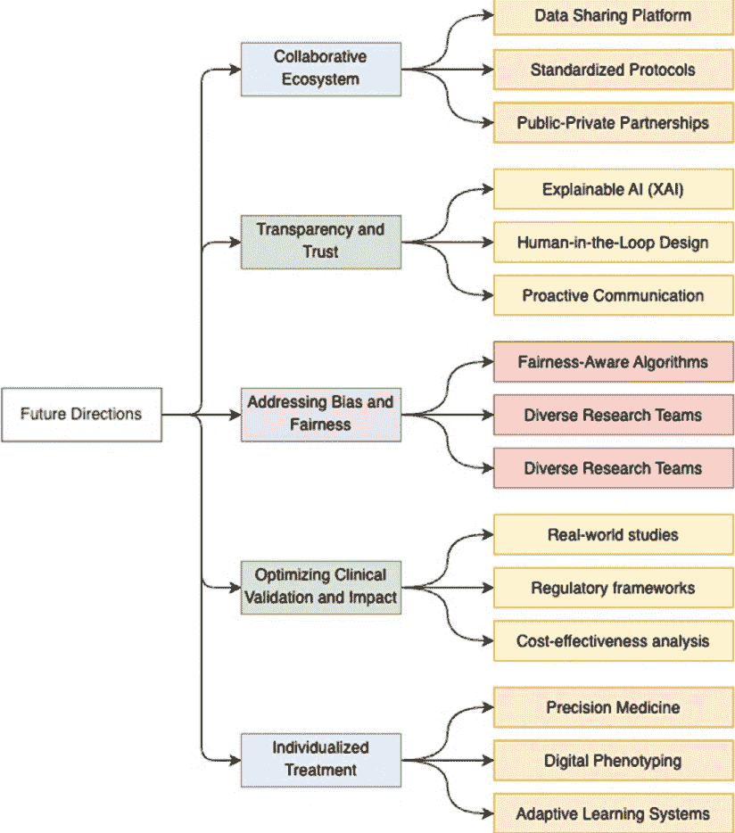

图 11.5 机器学习应用于神经退行性疾病的方向。

数据共享服务的第一个原因是提高模型的泛化能力。拥有广泛的人群、临床环境和巨大的景观可以根据不同的经验创建机器学习模型 [39]。因此，模型更具泛化性，并在不同人群中表现良好（缺乏这一点有助于对抗开发中的偏见），而不是像先验的深度学习，后者仅发现相关性但往往止于此 [28–30]。首先，数据共享平台加速了研究。消除冗余的数据收集，并允许研究人员在他人研究的基础上进行协作，更高效地测试新假设，从而加速了机器学习解决方案的开发。这极大加速了该领域新发现和发明的速度 [30]。最后，大规模数据

# 机器学习应用中的挑战与未来方向

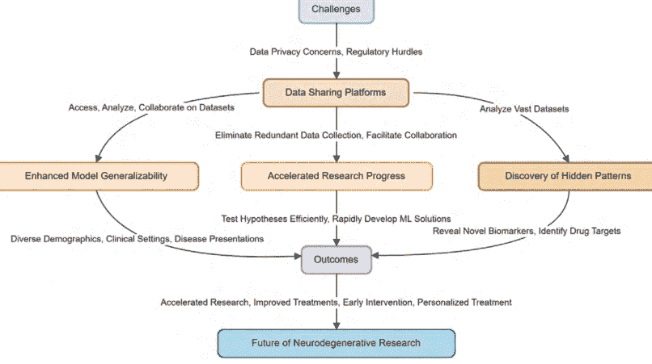

图 11.6 数据共享平台的影响与成果。

来自各种来源的数据集可以为发现有限或孤立数据集无法发现的新模式和关系提供见解。这为新的生物标志物奠定了基础，它们可能实现更早的检测并发现潜在的药物靶点，从而使治疗更有效 [26]。这可能会改变神经退行性疾病的研究，并允许早期发现、干预和个性化医疗模型 [67]。

尽管在建立和管理这些平台方面存在障碍——包括数据隐私担忧或监管问题——但开发此类平台的益处可能是巨大的 [37]。通过解锁共享数据，我们可以加速研究，创造更有效的治疗方法，并终有一天为遭受这些残酷疾病折磨的人们带来希望 [59]。

#### 11.3.1.2 标准化协议

在机器学习等技术快速发展的神经退行性疾病研究领域，标准化协议正变得越来越重要 [68]。这些协议共同作为连接多样化数据、方法论和机构的胶水，以确保连续性或可靠性。标准协议促进了合作，并使不同研究之间的结果更容易比较，有助于朝着克服这些可怕疾病的最终目标迈进 [69]。想象全球研究人员社区正在研究同一种神经退行性疾病，但由于收集和分析方法或所用措施的差异，他们的孤立数据是不兼容的 [17]。合作受到了抑制，研究结果也难以比较或在此基础上进行构建——如果每个其他实验室对同一件事都有不同的方法，你甚至该如何开始研究呢？突破性的策略是通过标准化协议统一研究人员的努力和审查，以便所有人都能在共同的基础上会合 [70]。

这种整体性方法具有多种益处。通过正确建立数据收集、处理和存储标准，我们大幅减少了错误，从而获得了更可靠（可信）的结果 [35]。此外，标准化协议允许对结果进行更直接的修复和验证，这有利于证据的整体水平或研究的进展 [38]。机构间更频繁的数据共享和协作，反过来鼓励了合作并推动了研究进展 [67]。通过这种方式，创建了稳健且通用的结果，以基于证据开发更高质量的患者干预措施，最终（希望更快地）转化为临床流程，并转化为改进后的结果集 [71]。

实施标准化协议具有挑战性：个人目标必须与集体利益达成平衡，且不应存在过度的僵化 [36]。然而，对患者和研究人员的潜在利益是巨大的。我们可以克服神经退行性疾病研究中的挑战，拯救正在与这些隐性疾病斗争的人们 [40]。虽然这是一个主要障碍，但其益处远大于代价。为了实现理想的未来，即标准化协议让研究人员充分发挥其疗法的潜力并推动神经退行性研究向前发展 [41]，这需要协作计划、开放式沟通以及对共同目标不懈努力的共同驱动。

#### 11.3.1.3 公私合作伙伴关系

根除神经退行性疾病是一项需要不同角度巨大资源、知识和技能的挑战。公私合作伙伴关系桥接了公共部门研究基础设施与私营行业开发能力之间的差距 [67]。这些伙伴关系具有加速研究的潜力，并将其迅速投入治疗，从而改善患者的生活 [70]。未来，建议制药公司和政府利用倡导组织来加速神经退行性疾病有效药物的研发（图 11.7）。

学术研究和制药开发的孤立性质严重阻碍了神经退行性疾病的进展 [37]。公私合作伙伴关系提供了一个极具前景的解决方案，通过打破孤岛并促进这些部门之间的合作。想象一下：学术界带来基础科学和密集数据资源，制药公司提供药物开发能力，政府提供资金和伦理框架 [13]，而倡导组织确保患者的声音被听到，共同朝着一个目标努力：为患者加速研发 [14]。这种背景对于最具潜力的罕见病研究和倡导来说，确实是改变游戏规则的 [30]，它能够加速从“实验台到床边”发现的联合转化，实现具有成本效益、风险共担、以患者为中心的创新，以解决患病患者的实际需求。鉴于公私合作伙伴关系在加速进展和在困难中激发灵感方面的明确能力，它们是值得考虑的。与其说是打破孤岛并愿景一个未来，在那个未来，协作将允许对抗神经退行性疾病取得前所未有的进展 [13]。表 11.1 显示了一些为神经退行性疾病研究提供协作能力的成功公私合作伙伴关系。

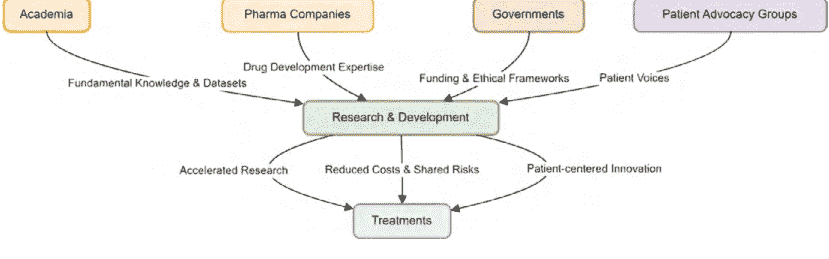

图 11.7 不同公私机构的协作角色。

# 机器学习应用中的挑战与未来方向

## 表 11.1

### 成功的公私合作伙伴关系展示了协作在神经退行性疾病研究中的转型力量

| 研究项目 | 描述 |
|---|---|
| 阿尔海默症合作组织 (ADCS) | 学术界、政府和行业之间的长期合作伙伴关系，ADCS 为阿尔茨海默症治疗开展了关键临床试验 [12]。 |
| 米克尔·J·福克斯帕金森研究基金会 | 该基金促进科学家、行业领袖和患者倡导组织之间的伙伴关系，以加速帕金森研究 [14]。 |
| 创新医学倡议 (IMI) | 这是一个由欧盟资助的倡议，支持包括神经退行性疾病在内的各种疾病的公私合作伙伴关系，促进药物开发并改善医疗保健成果 [19]。 |

### 11.3.2 增强透明度与信任

在神经退行性疾病研究中建立透明度的需求是迫切的。因此，通过负责利益相关者之间的主动沟通，采用可解释人工智能 (XAI) 和人类回路 (HITL) 设计将至关重要。我们必须信任并了解机器学习模型是如何工作的，从而对 AI 的伦理化使用充满信心。

#### 11.3.2.1 可解释人工智能

机器学习潜力可以帮助我们诊断、治疗甚至预防神经退行性疾病。尽管取得了进展，但一个主要挑战仍然存在：许多模型缺乏透明度。内部机制和决策过程通常处于隐藏状态，使得理解和信任它们的输出变得困难 [70]。没有透明度，很难信任模型中使用的变量；可解释性和临床采用正受到一个被称为 XAI 的新兴领域的阻碍，该领域旨在阐明“黑箱”，为神经退行性疾病研究中改进且可靠的机器学习应用开辟新途径。

医疗领域最关键的挑战之一是机器学习模型是不透明的，这使得很难检测偏差和公平性违规 [73]。如果我们不知道模型是如何得出结论的，输入数据或算法本身的偏差可能会导致某些小组的患者做出更糟糕的决策 [74]。AI 驱动建议的原理是在信任和实施有利于患者护理的决策方面获得清晰度。然而，这正是 XAI 发挥作用的地方。XAI 通过暴露数据中隐藏的模式和关系，改变了我们理解模型的方式，帮助揭决策路径，促进信任，并使技术能够发现科学知识 [75]。这种新见解可以用于发现新的药物靶点，从而改善健康以及 AI 在最重要的领域之一的安全使用 [76]。

神经退行性疾病研究中的 XAI 是未来充满光明的地方。克服这些障碍并创造下一代解释，将通过 XAI 解开黑箱模型的神秘，确保透明度，并最终为对抗这种强大疾病的人提供法律、社会和伦理指南，从而加速 ELSI 的发展 [77]。

#### 11.3.2.2 人类回路设计

随着人工智能和机器学习在诊断、治疗和预防措施中的出现，神经退行性疾病研究正在经历彻底转变 [78]。然而，充分利用技术的力量是一种承认人类智慧不可替代的方法。HITL 设计旨在通过一个人类和机器可以相互作用的框架来利用这种协同效应

# 用于神经退行性疾病的机器学习

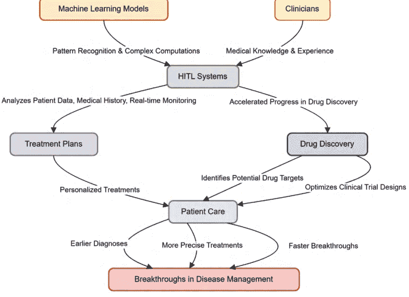

**图 11.8** 研究与治疗中人类专业知识与机器学习（ML）的整合。

它们共同工作，弥补差距以提供集成系统能力 [30]。机器学习模型在识别模式和执行复杂计算方面是优的数据结构，而这些计算可能缺乏医疗保健所需的直观、细微的理解和关键技能 [79]。然而，尽管人类拥有丰富的医学专业知识和经验，但他们也会存在偏见、疲劳且会力不从心！人机（HITL）系统解决了这些问题 [80]。这如图11.8节所示，该图展示了针对神经退行性疾病的人类知识与机器整合及协作的高级视图。

机器学习正在彻底改变医疗健康的各个领域。通过图像分析和数据解释算法，临床医生可以在早期病例中以更高的准确率识别出难以发现的疾病 [80]。此外，人机系统能够通过监测患者数据、病史和实时指标进行风险预测，为提供适当的个性化、定制化治疗提供信息 [81]。值得注意的是，临床医生在决策中拥有最终决定权，因此设计是人为的。最近，在发现领域，机器学习算法可以处理海量数据以建议可能的药物，并改进临床试验设计，以更有效地向人类应用推进，同时通过人工监督确保符合伦理的使用 [82]。人工智能与人类直觉之间的这种信任为医疗的新时代铺平了道路，带来了更及时的诊断、更准确的治疗以及疾病控制领域更快速的发现。如表11.2所示，几个示例强调了人机交互设计在神经退行性疾病研究中的积极影响。

人机交互设计为进化神经退行性研究的下一代自然人机协作方法提供了路径 [40]。如果我们投入资金进行研究，开发伦理框架，并为这种协作利用以用户为中心的设计，那么也许有一天可以实现其全部潜力，并提高患有这些疾病患者的诊断、治疗和生活质量 [50]。

## 机器学习应用中的挑战与未来方向

### 表 11.2

### 众多示例展示了人机交互设计在神经退行性疾病研究中的积极影响

| 参考文献 | 研究 | 描述 |
|---|---|---|
| Jumper, J 等人 [83] | DeepMind:AlphaFold 蛋白质结构预测 | 这一AI工具在人类专家指导下，彻底改变了蛋白质结构预测，加速了包括神经退行性疾病在内的各种疾病的药物发现 |
| Shih, JJ 等人 [84] | 脑机接口 | 这些设备将脑信号翻译成命令，允许神经退行性疾病患者重新获得对通信和运动的控制，同时治疗师提供关键的支持和培训 |
| Shariff, Aabid 等人 [85] | 自动图像分析工具 | 通过协助放射科医生分析扫描结果，这些工具可以加速过程并提高准确性，同时放射科医生保留监督权并在临床背景内解释结果。 |

#### 11.3.2.3 主动沟通

尽管神经退行性疾病的生物物理研究已进入了机器学习和人工智能等改变游戏的技术进步的新时代 [72]，但传统上管理效率较低的一个方面仍然是主动沟通。与利益相关者保持开放透明的沟通不能仅仅被视为一种好事，更是为了建立支持协作的基础信任，这是加速治疗进展所需要的 [72]。赢得信任对于进一步推进神经退行性疾病研究的未来至关重要。研究结果、发现和局限性的透明沟通增强了公众知识 [74]，并促进了对临床试验和其他研究的参与。另一方面，主动沟通通过让公众能够清晰理解的方式获取正确信息，将新技术的误导和恐惧隔之在外。与患者及其家人的对话为研究人员提供了丰富的社区中生活经验和优先级来源，以及关注点 [75]，使研究变得以患者为中心。它还促进了跨机构和学科开放的数据、方法和结果共享，有助于确保研究中伦理问题、风险和保护措施的沟通得以实现，因为它确保了研究是以符合伦理的方式进行的 [86]。通过研究人员与公众之间进行开放沟通和伦理实践，我们可能会找到针对神经退行性疾病进行更针对性研究的方法 [77]。如表11.3所示，几个项目强调了主动沟通在神经退行性疾病研究中的性。

### 表 11.3

### 几个项目证明了主动沟通在神经退行性疾病研究中的价值

| 参考文献 | 研究 | 描述 |
|---|---|---|
| Baumgart, M [43] | 阿尔海默症协会 | 该组织为患者、家庭和公众提供多种语言的全面信息和教育资源 |
| Singh, G [14] | 帕森基金会 | 该基金会举办互动在线论坛和患者网络研会，促进社区参与和对话 |
| 世界阿尔茨海默症报告 [18] | 肌萎缩硬索症协会 | 该组织利用社交媒体和叙事倡议提高意识并与多元受众建立联系。 |

神经退行性研究未来的沟通远超信息分发 [19]。它需要通过透明度和主动参与来建立社区、对话和信任。采用这些指导原则使研究人员能够建立一种遗产，将他们的工作转化为人们心中的，并对于促进团队合作和协作至关重要，这种协作可以愉快地继续推动我们迈向无热带性疾病（NTD）的未来 [29]。

### 11.3.3 处理偏见与公平性

神经退行性研究需要解决偏见和公平性问题。公平感知算法以及研究人员的广泛代表，使我们能够确保机器学习模型是中立且公正的。使用机器学习模型的另一个好处是，它允许广泛的人口统计数据与此类研究相关，确保它们在实践中准确运行。

#### 11.3.3.1 公平感知算法

机器学习扩展了神经退行性研究空间，需要对公平性和公正投入更多关注 [75]。这需要从单纯的模型构建转向开发公平感知算法，以减少可能的偏见，促进在诊断、治疗和临床试验中的机会均 [87]。


虽然机器学习方法作为神经退行性研究的工具具有巨大前景，但它们可能存在 [79]。这可能源于数据、算法或社会因素。在缺乏多样化数据集的情况下，模型在某些人群中的表现可能很差，并且算法选择中可能会倾向于某些特征 [80]。此外，只要系统不考虑这些复杂性，就会加剧现有的医疗差异并延续历史性的歧视。通过数据策展、公平性指标和去偏技术来进一步解决这些偏见，对于确保神经退行性研究案例中的伦理AI是必要的。

在使用人工智能的神经退行性研究中，偏见是一个潜在威胁，科学家们正在反击。为了在定义公平性指标和监控偏见时确保多样化代表，数据收集和增强过采样需要额外的支持 [88]。某些算法透明性和可解释性技术为决策过程提供了洞察，而部分去偏解决方案（如公平约束）被用于在模型构建期间更好地建模 [89]。共同使得神经退行性研究中的AI符合伦理且公平。

除了技术挑战外，这是神经退行性研究的一项伦理要求 [73]，并为开发公平感知算法设定了标准。从部署开始考虑公平性，涉及跨领域的利益相关者，并不断调整方法，将使我们能够充分发挥人工智能作为医疗护理研究工具的潜力，确保诊断、治疗并最终治愈这些功能性健康状况 [80]。

### 11.3.3.2 多元化的神经退行性团队

## 机器学习应用中的挑战与未来方向

表 11.4：多项计划展示了多元化团队的影响

| 参考文献 | 研究 | 描述 |
|---|---|---|
| Livingston, G et al. [41] | 阿尔茨海默协会多样性、公平与包容性 (DE&I)倡议 | 这些倡议支持多元化研究人员的招聘和留任，并促进包容性的研究实践 |
| Kosshoff, EH et al. [45] | 美国国立卫生研究院 (NIH) 女性健康研究办公室 (ORWH) | ORWH 资助女性健康研究，确保研究团队的多样性 |
| Tavernier, R et al. [52] | 国际神经病全球峰会 | 该会议聚集了研究人员、伦理学家和政策制定者，讨论并解决神经退行性研究中的伦理考量，培养多元视角。 |

理解患者的需求和关注。最后，通过纳入多元视角来确保伦理考虑和公平性，确保研究符合伦理标准，并在干预措施在所有群体中公平地开发和实施 [91]。如表 11.4 所示，多项计划强调了多元化团队的影响。本质上，多元化的研究团队在道德上是必要的，对于实现具有影响力和负责任的进展至关重要。

多样性不仅是当前的趋势，它是富有影响力的研究的基石。通过营造包容性环境、支持多元化人才并重视不同观点，我们可以建立代表不同人群的研究团队，并在对抗神经退行性疾病的战斗中释放创新的全部潜力 [92]。

### 11.3.3 去偏差数据集

寻找神经退行性疾病有效治疗方法和治愈方法依赖于稳健的数据，但数据本身是一把双刃剑。嵌入数据集中的偏见可能会延续不平等并阻碍进展 [93]。训练集中白人男性占了 99%，这可能会错过女性或深肤色群体中的重要信号，从而扩大差距并延迟治疗 [94]。在数据收集存在偏见的人口统计群体中，模型无法正常运行；这些编织在模型结构中的偏见会产生复合影响，导致不公平的预测 [59]。最后，医疗服务获取等偏见会使已处于风险的社区处于更加不利的地位。

偏见数据集的问题不容忽视，特别是在神经退行性研究中 [65]，在这里 AI 驱动的方法应优先避免任何形式的偏见。目标是确保从基于科学的发展中获益，并使诊断程序变得更加温和且高效，以预防这些疾病。

### 11.3.4 优化临床验证与影响

必须根据国际协调会议或其他监管框架的建议 [21]，对临床验证和影响进行严谨关注，包括在真实世界研究 (RWS) 中测试干预措施，并结合健康经济学评估。这种方法具有高度实用性的治疗方案，可用于每种临床实践，改善患者护理和健康结果。

### 11.3.4.1 真实世界研究

随着神经退行性疾病的发病率不断增加，迫切需要针对这些日常生活复杂性的有效治疗方法 [88]。在这里，RWS 逐渐占据应得的位置，帮助引导医疗保健跨越实施与临床实践之间的深渊 [77]。总之，本节讨论了 RWS 在改变我们对神经退行性疾病的理解和管理方面的转型能力。

从历史上看，研究是探索治疗有效性和安全性的机制。然而，研究通常在某些环境中进行，参与者与常规临床实践中的广泛患者群体差异巨大 [14]。在这里，RWS 通过非侵入性数据（电子健康记录 EHR、可穿戴传感器）和患者报告数据发挥作用，捕捉这些症状、疾病进展或治疗的异质性 [81]。

真实世界数据 (RWD) 在神经退行性研究中的真正力量不是观察，而是革命。图 11.9 展示了根据神经退行性疾病患者的 RWD 可能产生的潜在转型。考虑到各种人口统计特征和疾病阶段，以及影响结果的真实世界挑战（如依从性和社会决定因素 [82]）的可推广机器学习 (ML) 模型使得精准医学成为可能，让护理基于个人患者需求，从而通向为所有人提供更有效的健康服务的道路。


图 11.9 真实世界研究的转型潜力。

当我们使用 RWD 进行医学研究时，它不仅仅是告知医疗保健的进步；相反，数据是一个迭代和改进的循环的一部分。根据 ML 模型的真实性能对模型进行监控和更新，以保持其有效性，以应对疾病的快速演变。此外，RWD 通过识别可能有效的药物组合，帮助引导个体化和定制化治疗疗法的发展。最后，RWD 还作为一个早期警报系统，研究人员可以使用它来发现风险-药物冲突的新系统和副作用 [88]。简之，RWD 驱动了神经退行性研究的持续进展，将提高对这些疾病的理解并为患者带来更有效的疗法。RWS 不仅仅是一种研究工具；它们还是改变的杠杆 [90]。通过采用这种精简的方法并应对障碍，我们可以通过全方位的关注引导患有神经退行性疾病的个体走向更好的明天，并为他们提供一个在管理疾病方面明显更有效的管理下生活的机会。

### 11.3.4.2 监管框架

真实世界研究成为神经退行性疾病的规则改变者。监管框架围绕这些现代挑战进行组织至关重要 [36]。在本节中，我们关注研究人员通向有利的伦理和合规策略的复杂路径。在图 11.10 中，我们展示了执行神经退行性疾病 RWS 所需的监管路径和要素。

观察性研究和实验试验是不同的研究设计，需要在食品药品管理局 (FDA) 之间建立监管路径。例如，对 EHR 和可穿戴设备等数据源的适当保护与通过智能手机获取更粒度患者结果所需的保护不同。此外，监管框架取决于具体的神经退行性疾病（每种疾病都有自己的特征和科学方法）[90]。严谨地跟踪这些交叉工作流将确保这一新研究领域取得取得合规、安全且具有影响力的进展 [83]。

通过维护数据隐私和安全（通过符合健康保险可移植性与责任法案 (HIPAA) 和通用数据保护条例 (GDPR) 的措施）获得伦理清晰，是研究人员绝不能跳过的另一个关键原则。我们的发现表明，需要标准的知情同意流程，参与者应充分了解风险和获益 [84]。通过提供开放获取结果的指南，保持透明度并报告负责任的研究进展。将这些伦理标准织入 RWS 研究中，反过来使得这一重要领域能够取得有意义的进展。

总之，虽然监管挑战了 RWS的核心 [85]，但它们最终保护了参与者并有助于保证合理的使用终点。如果理解了这些内容，并在协作改进的同时从根本上增强其适应性，就有释放 RWS 的转型潜力，并为面临神经退行性疾病的个体提供我们此前不知道。

### 11.3.4.3 成本效益分析

随着 RW 成为神经退行性疾病研究的规则改变者，了解它们对于可持续和公正进展是否具有成本效益也变得同样重要 [62]。RWS 需要大量的设施、知识和资源来完成各种活动，从获取 EHR 或可穿戴设备等多元数据源，到通过专业的证据合成工具在专门的方法领域从复杂数据提取有意义见解的设计、执行和监控研究 [75]。通过识别这些障碍，研究人员可以提前计划并获得所需的支持，以释放 RWS 在扩展知识和治疗严重疾病方面的巨大潜力 [86]。

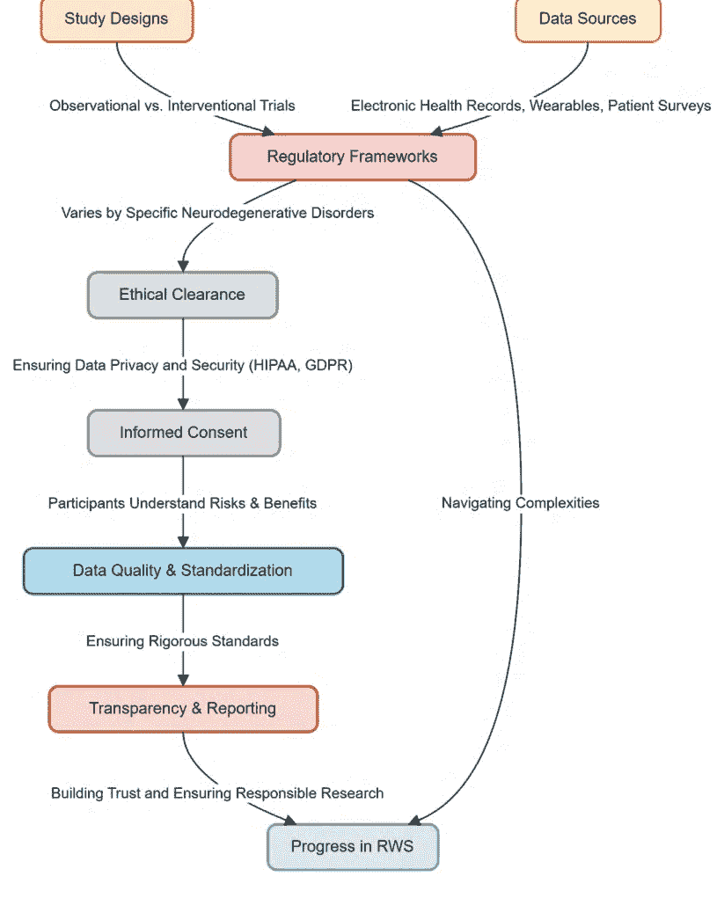

由于获取的信息以及效率和成本方面的考虑，真实世界数据（RWD）可以成为治疗神经退行性疾病的有效辅助手段 [31]。RWD 更具代表性，因此具有更高的外部效性，因为它捕捉了实践环境中患者的异质性现实，这使得这些情况更具通用性（涉及与感知相关的质量），从而对临床医生具有直接意义。这种通用性的提高还降低了开发成本，因为在 RWD 筛选过程中可以更早地识别出无效的干预措施，并防止后期临床试验的失败 [60]。此外，RWD 使研究人员能够识别降低成本并改善医疗服务的治疗策略，从而有助于在整个系统中更有效地配置全方位资源。总之，RWD 为深入了解这些多因素疾病提供了机会。它有潜力提高从目前到近神经退行性疾病阶段的资源利用效率 [63]。这就是为什么 RWS（真实世界研究）仍然是持续投入和深化未来神经退行性疾病投资的关键案例，其特征是可持续性、责任感和影响力。

## 11.3.5 个体化治疗

分子医学的个体化治疗方法能够根据各种遗传、表型和环境因素提供高度个性化的医疗保健。它利用精准医疗、数字复印技术和自适应学习系统来提供个性化的护理计划和尝试性治疗范式，提供专门为神经退行性疾病表型定制的针对性干预，从而以最小的副作用实现最大的治疗效果。

### 11.3.5.1 精准医疗

虽然阿尔茨海默病（AD）、帕金森病（PD）或肌萎缩侧索硬化症（ALS）的全能治疗法仍是神经退行性领域的“圣杯”，且距离实施还有多年，但自从相关领域开始研究以来，这一直是一个追求的想法。这些疾病极其复杂，要求采用精准医疗或个性化方法，在治疗和干预中结合独特的遗传、生物和环境因素 [62]。

尽管精准医疗尚未获得 FDA 批准，但通过结合 RWD，它有潜力变革神经退行性疾病 [63]，实现对每个患者的个性化护理。通过缩小到疾病亚型和靶点，对个体患者具有更高疗效和更少副作用的个性化疗法是理想化的，具有极重要的意义，因为它对生活质量的提高远大于量子疗法。利用其独特的特征谱识别高风险个体的前景可以通过更早的干预来实现，这可能减缓疾病进展并改善长期结果 [88]。在这里，利用 RWD 根据生物标志物将患者分入不同的亚组，可以使药物开发到临床试验的预测和定位更高效，并发现机会，从而获得更快速、更有效的疗法。床旁干预提供了一种个性化的方法，应该作为应对这些衰性疾病的模式。这种方法需要一个准备良好的医疗系统，能够提供及时且有效的干预 [85]。

神经退行性疾病研究在个性化医学方面的未来潜力，结合多组学数据整合和先进计算工具，是巨大的。机器学习（ML）算法随后承担这些工作，允许工业和学术界研究人员发现秘密、真实的疾病亚型以及治疗目标。这种方法还将有助于生物标志物的发现和验证，这些标志物作为疾病进展、治疗反应和个体风险的替代指标，允许在该背景下改进指示何时停止致命性治疗的标记物，从而创建更高精度的指示以实现更定制的干预 [95]。要穿越这片肥沃土地需要负责任的实施，关注数据隐私、知情同意和对这些进步的公平获取，对于确保精准医疗的承诺那些那些最能从中受益的人获得至关重要 [94]。

AD 血液检测的进展已对早期诊断 AD 并定制最有效治疗的可能产生了一种希望感和乐观情绪 [56]。然而，由于我们必须防止这项工作停滞，因此讨论这些首次检测新兴疾病的方法是重要的 [96]。在综述中，我们将介绍 AD 血液检测的优点和缺点，以对它们的临床利用得出合理的结论。

# 针对神经退行性疾病的机器学习

尽管障碍仍然存在，精准医疗具有变革对抗神经退行性疾病战斗的潜力 [37]。通过不断完善分析工具、发现新的生物标志物并优先考虑伦理考量，我们可以向未来迈进：治疗不再是一刀切的，而是根据每个人的独特需求定制的 [59]。

### 11.3.5.2 数字表型

在不断发展的神经退行性疾病研究领域，数字表型成为捕捉与这些疾病相关的细微行为和认知变化的有力工具 [51]。通过从手机、可穿戴设备和其他数字设备获取数据，研究人员可以对疾病进展和治疗效果获得更深入的见解，并改善患者护理 [83]。

可穿戴设备和传感器通过捕捉生活各个方面的实时数据，提供了关于神经退行性疾病的宝贵见解 [85]。跟踪活动水平、睡眠模式、步态特征和反应时间阐明了运动和认知功能的变化，甚至在症状变得临床明显之前。通过监控社交媒体互动，因此可以观察与这些疾病相关的情绪波动、焦虑或抑郁感受的转录语音或语言数据。如果你正遭受睡眠不足的困扰，经历着过多的体力消耗，并且与朋友或爱人的相处时间太，这导致了关于你症状的扭曲信息，其治疗不能局限于诊所的墙内。通过这种多通道方法，研究人员可以更多地了解复杂的疾病，并为疾病患者制定更具个性化的治疗计划 [70]。

问题出现时，数字表型为神经退行性疾病研究提供了一个改变规则的解决方案。解决这些问题需要分析数据的方法，并加强协作，以便这种医学的巨大力量协助揭示发现的知识，以及我们如何照顾患者并实现从绝望的疾病中获得认知治愈的目标。

### 11.3.5.3 自适应学习系统

在研究阿尔茨海默病的同时，也考虑了对提高认知功能和学习的新方法的需求 [42]。AI-ML 可应用于自适应学习系统，根据神经退行性疾病患者的需求和认知能力为他们提供定制的教学 [39]。

记忆问题损害了处理和保留新信息的能力，使集中变得具有挑战，显著阻碍了学习。此外，影响计划、组织和自我调节的执行功能可能会干扰执行学习策略 [23]。理解这些重重智力困难对于永久治愈方案和帮助患有复杂疾病的个体至关重要 [42]。

具有强大算法的自适应学习系统有望帮助那些认知表现差的人。它们通过学习成为个体信息的静态标准和路径、难度水平和节奏，并根据能力方面的适当优势或劣势采取一种方法之的方法 [81]。实时的精准反馈和适应可以继续改进学习结果，而直观的界面和用户流满足了许多需求，确保这种创新方法对所有人都可用 [88]，其中一些研究显示在表11.5中。这使得系统能够帮助认知下降的人进行学习和理解，在适当的情况下通过更具参与性的的方式进行基于个性化经验的有意义学习 [89]。它们暗示了自由、如你所意的真实和一种新的机会感。

# 机器学习应用中的挑战与未来方向

## 表 11.5

若干项目展示了自适应学习系统的潜力

| 参考文献 | 研究 | 描述 |
| :--- | :--- | :--- |
| De Raedt, R 等人. [61] | CognFit | 该在线平台提供个性化的脑训练练习，可根据个人认知特征进行调整。 |
| Davis, M 等人. [64] | Luminosity | 这一自适应学习平台提供游戏和活动，旨在提高记忆、注意力和处理速度等认知能力。 |
| Boon, P 等人. [69] | Braingly | 该平台根据认知评估提供个性化学习模块，针对与各种神经退行性疾病相关的特定认知能力。 |

机器计算复杂算法的简单差分能力是人类的一小步，也是全人类的一大飞跃，因为如果能在神经退行性疾病患者中获得支持，自适应学习系统在改变教育研究进展方面将是真正有效的[89]。通过解决这些局限性，促进研究学科（心理学家/神经科学家/人工智能）之间的合作，并维护伦理原则，这些系统在增强我们私人生活认知能力的同时用于个人赋能的潜力[39]。

## 11.4 结论

对抗神经退行性疾病必须是一项多维度的努力，涉及具有伦理和多样性的前沿技术，以确保公平获取。这需要多个领域——从科学家和工程师到技术人员、临床医生和患者倡导者的共同努力。我们在这项工作结束时建议：采取积极沟通的，建立多样化和包容性的研究团队以获得更好的模型，并尽可能使用去偏的数据集——这些行动将帮助我们利用 AI 集成的基础在实验室或用于实验室研究。

精准医学提供了巨大的希望，药物仅对需要的特定患者起作用。除了数字表型和自适应学习系统的发展外，由数字“一人一策”干预和新兴个性化工具组成的未来为对抗认知下降提供了一种新方法。

然而，我们必须谨慎行事，追踪数据隐私问题，提供技术的平等获取机会，并在研发过程中遵循伦理原则。我们需要承认风险，并通过促进人类和社区福利的开放对话让创新发生。

归根底，治疗神经退行性疾病不仅仅是为了寻找治疗方法。这需要一种分享同情、认可共情，并为这些患者及其亲属维持希望精神和尊严的方法。我们齐心协力，带着伦理规范和未来的共同愿景，扭转这些破坏性疾病的局势。

## 参考文献

- 1. 阿尔茨海默协会。“2017年阿尔茨海默病事实与数据，”Alzheimer’s Dementia, vol. 13, no. 4, pp. 325–373, 2017.
- 2. T.V.S. Rim, M. Rao, G.V.S Narayana, and T.PR DSVK Kadhar, “使用机器学习算法进行帕金森病智能预测，”IEIT, vol. 3, no. 3, pp. 212–215, 2013.
- 3. A. Ricks-Jackson, D. Stoffers, S. Sheldon, J. Kuperman, and A. Dale et al., “使用机器学习技术评估神经前症状期亨廷舞蹈病的生物标志物，”NeuroImage, vol. 56, pp. 788–796, 2011.
- 4. A. Choudhury, S. Roychowdury, B. K. Singh, and T. P. Singh. (2022). 数字社会简介：概述。通过先进技术实现的数字化演变，1–6. https://springer.com/chapter/10.1007/978-981-19284-7_1.
- 5. Aiganalli, H. Wang, and A. Madabushi, “用于通过临床成像和组学特征诊断阿尔茨海默病的级联多视图典型相关 (CaMMCCo)，”Scientific Reports, vol. 7, p. 8137,
- 6. L. Sorensen and M. Nielsen, “使用结构 MRI 和多态分析的集成向量机痴呆，”Journal of Numerical Methods, vol. 302, pp. 66–74,
- 7. S. Joshi, P.D. Shenoy, G.G. Sinha, and L.M. Patnaik, “基于机器学习学习的神经退行性疾病分类，”JACS, vol. 2, no. 4, pp. 350–355,
- 8. F. Zou, H.S. Chai, C.S. Younik, and M. Allen, “脑表达基因组关联研究 (GWAS)识别疾病变异，”vol. 8, no. 6, e100270,


## 参考文献

- 9. W. Soulillard-Marandar, R. Davis, C. Rudin, R. Au, and D.J. Loeb, “从数字时钟学习认知功能，”Machine Learning, vol. 103, no. 3, pp. 393–441,

- 10. S. Liu, S. Liu, W. Cai, R. Kikinis, and D.D. Feng, “神经退行性疾病的多阶段特征表示，”ACAI 2015: 人工智能与计算智能，pp. 350–359.

- 11. M. Montague, A. Kodewitz, V. Vigneron, V. Girard, and S. Leland, “用于阿尔茨海默病诊断的图像分类 3D 局部二值模式，”第66届生物启发系统与信号处理国际会议 (BIOSIALS 2013), 215. pp. 145–150.

- 12. B.A. Sherbender, V. Golub, A. Danilov, and D. Prischemina, “人类微生物与神经退行性疾病，”Polikinika, vol. 1, no. 1,

- 13. M. Tabon, P. Odetti, S. Camammorta, and F. Monacelli, “神经网络识别认知障碍的风险因素预测价值，”Journal of Alzheimer’s Disease, vol. 19, no. 3, pp. 1035–1040.

- 14. G. Singh, M. Vadera, L. Samvedalli, and C.-H. Lin, “基于机器学习的多中心神经退行性疾病框架：帕金森病研究，”IFAC-Online, vol. 49, no. 7, pp. 990–995.

- 15. M.J. Summers, T. Madl, A.E. Vcelli, D. Ayumat, and L. Freit, “深度学习在老年临床前神经退行性疾病检测中的应用，”Digital, vol. 2, no. 2, pp. 24.

- 16. I. Lazarov, A. Karastogas, T. Tompanidis, and G. Medits, “认知障碍患者的新型智能监测系统，”Journal of Alzheimer’s Disease, vol. 54, no. 4, pp. 1561–1596.

- 17. A.I. Michalski, “老年学中数据挖掘的实施方面，”Advances in Gerontology (老年学进展), vol. 4, no. 4, pp. 296–301, 2014. https://link.springer.com/article/10.1034/S2097504106X

- 18. R. Rucinski, “先进研究，”阿尔茨海默病世界 (ADI), 2018.

- 19. M. Miller, M. Gire, and G. , “局部处方：再生医学的破坏性生态系统，”第七届智能数据获取与计算国际会议 (IDACS), 德国柏林, pp. 551–554, 10.1109/IDACS.2013.662985.

- 20. M. Bogdan, T. Tokbarta, T. Mohseni, and K. Gordon, “老年神经退行性疾病，”Journal of Cellular Pathology, vol. 205, pp. 3131–3141.

- 25. K. Sharma, N. Jain, and P. Kal, “从 EOG 检测眼睛闭合及其在机械臂控制中的应用，”Cybernetics and Biomedical Engineering, vol. 40, p. 1–14, 2020.

- 26. Al-Rahayef, and M. Faezipur, “眼动追踪和头部运动检测：前沿综述，”Journal of Translational Engineering in Health and Medicine, vol. 1, p. 1–12, 2023.

- 27. D. Witzen, H. Qi, “在观察者眼中：眼睛与注视模型综述，”IEEE Transactions on Pattern Analysis and Machine Intelligence, vol. 32, p. 478–500, 2010.

- 28. N. Driandi, H. Tolle, and E. Anthony, “基于陀螺仪传感器的实时头部识别，”International Journal of Soft Computing and Applications, vol. 9, p. 70–87, 2017.

- 29. M. Mercurci, P. J. Sob, P. Karsmars, and D. Schreurs, “健康监测的室内雷达系统分析，”IEEE Transactions on Microwave Theory and Applications, vol. 61, p. 2061–2068, 2013.

- 30. E. Cardoso, C. Li, and A. Caddemi, “赋能盲人：毫米波雷达，”工业4.0 测量国际研讨会, 意大利罗马, 2020.

- 31. D. J. Wang, W. Wang, Y.-C. Cheng, and C. Li, “直流耦合高动态范围双雷达传感器，”IEEE Transactions on Instrumentation and Measurement, vol. 68, pp. 1441–1450, 2019.

- 32. E. Cardoso, and A. Caddemi, “视力障碍辅助设备的电子技术洞察，”IEEE Electronics, vol. 8, p. 1–12, 2019.

- 33. A. Caddemi, and E. Cardoso, “防盲系统：用于检测存在的毫米波雷达传感器，”先进技术、系统与通信国际会议 (TELSI), 2019, p. 1–4.

- 34. Prabha Kumar, and Chandrasekar, “应用领域的有效特征选择分析，”Applied Engineering Informatics, vol. 52, no. 4, p. 4543–4581 (Mar 2022), 2022. https://doi.org/10.1007/s10489-021-02550-9

- 35. D. Y, W. Lee, J. Kim, K. D. Ahn, Y.-H. Lim, S. Cho, H.-K. Park, and S. Cho, “移动设备中使用 UWB 雷达量化运动测量，”Sensors, vol. 19, p. 1–14, 2019.

- 36. S. Pisa, E. Pettella, and E. Puzzi, “医疗应用雷达系统综述，”Aerospace and Electronic Systems, vol. 3, p. 66–74, 2016.

- 37. E. Cardoso, V. D, G. Manfredi, P. Russo, and G. Leo, “人类社区的新型智能监测系统，”IEEE Sensors, vol. 18, p. 2068–2075, 2018.

- 38. E. Cardoso, and A. , “用于追踪的调频连续波 (FMCW) 雷达，”Electronics Letters, vol. 53, p. 1379–1381, 2017.

- 39. G. Wang, J. Muñoz-Ferreras, and C. , “生命信号线性雷达，”IEEE Transactions on Microwave Theory and Applications, vol. 62, p. 1387–1399, 2016.

- 40. D. Washington, “APOE 4：阿尔茨海默病最大的风险因素，”Alzheimer’s Dementia, vol. 15, p. 861–866, 2019.

- 41. G. Livingston, H. Stanley, A. D, C. Ball, and S. Banerje, “痴呆症预防与护理：柳叶刀2020年报告，”Lancet, vol. 396, no. 10266, p. 413–446, 2020.

- 42. M. Baumgart, H. Snyder, M. Carrillo, S. Fazim, and H. Johns, “认知下降和痴呆的可避免风险因素证据摘要，”Alzheimer’s Dementia, vol. 11, no. 6, p. 718–726, 2015.

- 43. D. Daly, and T. V. Voorgaard, “丘脑脑刺激，”帕金森病治疗法。CRC Press, 2004, pp. 348–365.

- 44. G. Thomas, and B. Cocks, “癫痫神经刺激器系统的批判性审查，”Medical Devices (UK), vol. 8, p. 405, 2015.

- 45. E. H. Koff, E. K. Ritz, J. M. Polsky, A. Murro, J. R. Smith, R. B. Duckworth, D. S. Spencer, and K. G. Berg, “外部响应性神经刺激器对刺激期间发作和脑电释放的影响，”Epilepsia, vol. 45, no. 12, p. 1560–1567, 2004.

- 46. S. Baton, R. Shankar, J. Curry, G. Jones, R. Radke, S. Michelci, F. Paris, J. Murphy, and V. Davidson, “难治性癫痫成人VNS疗法或持续管理治疗的有效性和安全性：系统性评价和元分析，”Journal of Neurology, vol. 1, p. 1–18, 2022.

- 47. V. R. Rao, “响应性神经刺激设备中的脑电图：现状与未来前景，”Expert Review of Medical Devices, vol. 18, no. 11, p. 1093–1105, 2021.

48. Pradip Dhal 和 Chandhekhar Azad, “一种基于牛顿律的 PSO 结合 GWO 的多目标特征选择方法，”Soft Computing, 107, 107394, doi: 10.1016/j.asoc.2021.107394.

49. P. Dhal 和 C. Azad, “一种用于文本分类的基于 GWO 的深度学习和多目标 PSO 特征选择方法，”2022 届高级计算与创新技术国际会议 (ICACITE)，印度大格诺伊达, 2022, pp. 2140–2144, doi: 10.1109/ICACITE53722.2022.9823473.

50. C-W. Yu, S-Liao, W-H. Yeh, S-F. Liang 和 F-Z. Shao, “用于癫痫和帕金森病的深脑模拟引导方向，”神经科学前沿, 第 15 卷, 第 671 页, 2021.

51. A. Sette, E. Segner, F. Reynolds, S. Chambers, A. Castroiro, B. Boussat, M. Porto, F. Franks, “帕金森病中的脑神经调节：一项历史队列研究，” 脑模拟, 第 12 卷, 第 4 期, pp. 851–859.

52. R. Tavernier, T. Fonseca, V. Vandevle, J De Sutter 和 S. Gevart, “在植入两个植入神经调节器的严重帕金森病患者中使用植入式除颤器，”帕金森病与临床病因, 第 23 卷, 第 6 期, pp. 1057–1099, 2000.

53. E. J. Quinn, Z. Blumenfeld, A. Verma, M. Koop, L. A. Shreve, M. H. Trager, C. B. Hill, C. Kilbane, J. M. Henderson 和 H. Bronze-Stewart, “频率移动帕金森病患者的 Beta 振荡在深脑刺激期间减减轻，” 运动障碍, 第 30 卷, 第 13 期, pp. 1750–1758, 2015.

54. A. Schnitzler, P. M A. Brodsky, L. Verhagen, G. Roppa, R. Alvarez, E. Evans, M. Blazquez, S. Nagel 和 J. J. Pilits 等, “用于帕金森病的直接脑模拟：一项随机设计、双盲终点的临床研究结果，” 神经接口神经调节技术, 2022.

55. V. R. Kumar 和 Azad, “一种用于阿尔茨海默病音频分类预测的过滤特征选择，”2022 届高级计算与创新技术国际会议 (ICACITE)，印度大格诺伊达, 2022, pp. 1890–1894, doi: 10.1109/ICACITE53722.2022.9822365

56. J. Dulski, M. Michalski, A. Konkel, K. Grabowski W. Libonaka, P. Waz, E. Siet 和 J. Slawek, “深度脑模拟对帕金森病患者睡眠图睡眠模式的影响——初步报告，”neurologia i neuropsychologia polska, 第 52 卷, 第 4 期, pp. 514–518, 2018.

57. L. Marangel, M. Martinez, R. Jurdi 和 H. Zobyan, “抑郁症的神经调节：新方法综述，”斯堪的纳维亚物理学, 第 116 卷, 第 3 期, pp. 174–181, 2007.

58. G. Huntington, “经颅深电流刺激：用于抑郁症的可变自适应神经调节？”Med Res, 第 23 卷, 第 1 期, pp. 82–85.

59. M. George, “治疗性脑刺激的总结与未来方向：神经调节与神经病变变，”癫痫与行为, 第 2 卷, 第 3 期, pp. S895–S1000.

60. K. K, W. Mer, K. Zakapowicz 和 T. Medral, “迷走神经刺激治疗抑郁症：六例病例报告。一年随访后的比较疗效和安全性观察，”神经调节与治疗, 第 15 卷, 第 3247 页, 2019.

61. R. De, M.-A. Vanderloot 和 C. Baeken, “神经调节作为治疗抗性抑郁症的干预手段：从方法研究转向神经认知策略，”临床心理学评论, 第 41 卷, pp. 61–69,

62. R. E. Gross 和 A. L. Romano, “用于亨廷顿舞蹈神经精神性症状的深层 fTMS：病例报告，”脑刺激：神经调节的基础、转化与临床研究, 第 9 卷, 第 5 期, pp. 960–961.

63. A. S. Galamoun, P. S. Buckner, R. J. Staples, S. L. Moshe, E. Peruca, J. Engel Jr, W. Losher, J. L. Nobels, A. Pritikam 和 James 等, “新癫痫疗法的识别：在临床前方法中，”癫痫, 第 53 卷, 第 3 期, pp. 571–582.

64. T. Patel 和 K. Patel, “年度癫痫回顾，”Invoat, 第 15 卷, 第 5 期, pp. 286–293, 2022.

65. M. C. Fields, C. Marsh, O. E, A. Johnson, L. V. Marcus, C-S. Kwon, J. J. May, L. Vega-Talbott, M. Kurumbi 和 G. Von Allen 等, “难性癫痫和自闭症谱系障碍患者反应性神经调节，”神经生理学杂志, p. 10–1097, 2022.

66. P. Dhal 和 C. Azad, “一种糖尿病视网膜病中带有血管的血管分割的新方法，”2020 年人工智能与信号处理国际会议 (AISP)，印度阿姆拉瓦蒂, 2020, pp. 1–6, doi: 10.1109/AISP2020.9073012.

## 机器学习应用中的挑战与未来方向

67. P. Rylin 和 S. Rheims, “癫痫：入选标准和程序评估，”临床神经科学对话, 第 10 卷, 第 1 期, pp. 91–103.

68. M. Poon, R. Raedt, V. De Herdt 和 T. Wyckhuis, “治疗癫痫的电刺激，”neurotherapeutics, 第 6 卷, 第 2 期, pp. 218–227.

69. M. O. Krucoff, T. A. Weiner, A. T. Lee 和 R. J. F. Chang, “反应性神经刺激植入的术中技术和教训，”手术神经外科, 第 20 卷, 第 2 期, pp. 88–99.

70. S. Kim 和 C. Guven, “一种使用微波干涉仪的位移测量技术，”微波理论与技术汇报, 第 51 卷, pp. 1724–1738.

71. Z. Liang, L. Kuo 和 J. Qiu, “用于癫痫闭环电刺激的深度 Koopman 的控制，”arXiv preprint:2103.14321.

72. R. Rustilla, N. Ruinke 和 R. Martin, “帕金森病的进展与生存，”斯堪的纳维亚神经病杂志, 第 84 卷, 第 S6 期, pp. 29.

73. J. Braak, E. Ghebre 和 D. Tutti, “帕金森病相关病理的阶段，”冷泉春山综述, 第 31 卷, 第 1 期, pp. 121–134.

74. E. Tolosa, S. Garrido 和 W. Poewe, “帕金森病的诊断，”柳叶刀神经病学, 第 20 卷, 第 5 期, pp. 385–397.

75. A. S, S. Garrido 和 W. Poewe, “在帕金森病的诊断中，”The Lancet。


76. L. Marangel, M. Martinez, R. Jurdi 和 H. Zobyan, “抑郁症的神经调节：新方法综述，”斯堪的纳维亚物理学, 第 116 卷, 第 3 期, pp. 174–181.

77. G. Huntington, “经颅深电流刺激：用于抑郁症的可变自适应神经调节？”Med Res, 第 23 卷, 第 1 期, pp. 82–85.

78. M. George, “治疗性脑刺激的总结与未来方向：神经调节与神经病变变，”癫痫与行为, 第 2 卷, 第 3 期, pp. S895–S1000.

79. K. K, W. Mer, K. Zakapowicz 和 T. Medral, “迷走神经刺激治疗抑郁症：六例病例报告。一年随访后的比较疗效和安全性观察，”神经调节与治疗, 第 15 卷, 第 3247 页, 2019.

80. R. De, M.-A. Vanderloot 和 C. Baeken, “神经调节作为治疗抗性抑郁症的干预手段：从方法研究转向神经认知策略，”临床心理学评论, 第 41 卷, pp. 61–69,

81. R. E. Gross 和 A. L. Romano, “用于亨廷顿舞蹈神经精神性症状的深层 fTMS：病例报告，”脑刺激：神经调节的基础、转化与临床研究, 第 9 卷, 第 5 期, pp. 960–961.

82. A. S. Galamoun, P. S. Buckner, R. J. Staples, S. L. Moshe, E. Peruca, J. Engel Jr, W. Losher, J. L. Nobels, A. Pritikam 和 James 等, “新癫痫疗法的识别：在临床前方法中，”癫痫, 第 53 卷, 第 3 期, pp. 571–582.

83. T. Patel 和 K. Patel, “年度癫痫回顾，”Invoat, 第 15 卷, 第 5 期, pp. 286–293, 2022.

84. M. C. Fields, C. Marsh, O. E, A. Johnson, L. V. Marcus, C-S. Kwon, J. J. May, L. Vega-Talbott, M. Kurumbi 和 G. Von Allen 等, “难性癫痫和自闭症谱系障碍患者反应性神经调节，”神经生理学杂志, p. 10–1097, 2022.

85. P. Dhal 和 C. Azad, “一种糖尿病视网膜病中带有血管的血管分割的新方法，”2020 年人工智能与信号处理国际会议 (AISP)，印度阿姆拉瓦蒂, 2020, pp. 1–6, doi: 10.1109/AISP2020.9073012.

## 机器学习应用中的挑战与未来方向

67. P. Rylin 和 S. Rheims, “癫痫：入选标准和程序评估，”临床神经科学对话, 第 10 卷, 第 1 期, pp. 91–103.

68. M. Poon, R. Raedt, V. De Herdt 和 T. Wyckhuis, “治疗癫痫的电刺激，”neurotherapeutics, 第 6 卷, 第 2 期, pp. 218–227.

69. M. O. Krucoff, T. A. Weiner, A. T. Lee 和 R. J. F. Chang, “反应性神经刺激植入的术中技术和教训，”手术神经外科, 第 20 卷, 第 2 期, pp. 88–99.

70. S. Kim 和 C. Guven, “一种使用微波干涉仪的位移测量技术，”微波理论与技术汇报, 第 51 卷, pp. 1724–1738.

71. Z. Liang, L. Kuo 和 J. Qiu, “用于癫痫闭环电刺激的深度 Koopman 的控制，”arXiv preprint:2103.14321.

72. R. Rustilla, N. Ruinke 和 R. Martin, “帕金森病的进展与生存，”斯堪的纳维亚神经病杂志, 第 84 卷, 第 S6 期, pp. 29.

73. J. Braak, E. Ghebre 和 D. Tutti, “帕金森病相关病理的阶段，”冷泉春山综述, 第 31 卷, 第 1 期, pp. 121–134.

74. E. Tolosa, S. Garrido 和 W. Poewe, “在帕金森病的诊断中，”柳叶刀神经病学, 第 20 卷, 第 5 期, pp. 385–397.

75. A. S, S. Garrido 和 W. Poewe, “在帕金森病的诊断中，”The Lancet。

76. L. Marangel, M. Martinez, R. Jurdi 和 H. Zobyan, “抑郁症的神经调节：新方法综述，”斯堪的纳维亚物理学, 第 116 卷, 第 3 期, pp. 174–181.

77. G. Huntington, “经颅深电流刺激：用于抑郁症的可变自适应神经调节？”Med Res, 第 23 卷, 第 1 期, pp. 82–85.

78. M. George, “治疗性脑刺激的总结与未来方向：神经调节与神经病变变，”癫痫与行为, 第 2 卷, 第 3 期, pp. S895–S1000.

79. K. K, W. Mer, K. Zakapowicz 和 T. Medral, “迷走神经刺激治疗抑郁症：六例病例报告。一年随访后的比较疗效和安全性观察，”神经调节与治疗, 第 15 卷, 第 3247 页, 2019.

80. R. De, M.-A. Vanderloot 和 C. Baeken, “神经调节作为治疗抗性抑郁症的干预手段：从方法研究转向神经认知策略，”临床心理学评论, 第 41 卷, pp. 61–69,

81. R. E. Gross 和 A. L. Romano, “用于亨廷顿舞蹈神经精神性症状的深层 fTMS：病例报告，”脑刺激：神经调节的基础、转化与临床研究, 第 9 卷, 第 5 期, pp. 960–961.

82. A. S. Galamoun, P. S. Buckner, R. J. Staples, S. L. Moshe, E. Peruca, J. Engel Jr, W. Losher, J. L. Nobels, A. Pritikam 和 James 等, “新癫痫疗法的识别：在临床前方法中，”癫痫, 第 53 卷, 第 3 期, pp. 571–582.

83. T. Patel 和 K. Patel, “年度癫痫回顾，”Invoat, 第 15 卷, 第 5 期, pp. 286–293, 2022.

84. M. C. Fields, C. Marsh, O. E, A. Johnson, L. V. Marcus, C-S. Kwon, J. J. May, L. Vega-Talbott, M. Kurumbi 和 G. Von Allen 等, “难性癫痫和自闭症谱系障碍患者反应性神经调节，”神经生理学杂志, p. 10–1097, 2022.

85. P. Dhal 和 C. Azad, “一种糖尿病视网膜病中带有血管的血管分割的新方法，”2020 年人工智能与信号处理国际会议 (AISP)，印度阿姆拉瓦蒂, 2020, pp. 1–6, doi: 10.1109/AISP2020.9073012.

93. E. Ben-Menachem, “迷走神经刺激治疗癫痫，”柳叶刀神经病》(The Lancet Neurology)，第1卷第8期，第477–482页，2002。

94. A. H. Milby, C. H. Halpern, and G. H. Baltuch, “癫痫和抑郁症的迷走神经刺激，”神经治疗”(Neurotherapeutics)，第5卷第1期，第75–85页，2008。

95. D. J. Engl, K. H. Hassain, J. D. Rolston, S. C. Harward, S. R. Sinha, and M. M. Haglund, “基于提供者调查数据的癫痫迷走神经刺激生活质量指标，”癫痫与行为》(Epilepsy & Behavior)，第22卷，第4–9页，2017。

96. C. E. Marras, G. Colicchio, L. De Palma, A. De Benedictis, G. Di Gennaro, M. Cavaliere, E. Casonari, A. Consales, S. Asioli, and M. Caulo 等，“难治性癫痫迷走神经刺激的健康技术评估报告，”环境研究与公共健康国际杂志”(International Journal of Environmental Research and Public Health)，第17卷第17期，第6150页，2020。

## 索引

### A

- 乙酰胆碱酯抑制剂，83, 12
- 阿茨海默病，13, 22, 34
- 肌萎萎缩性硬化症，51, 80, 223
- 各向异性扩散，186, 192
- 人工智能，3, 36, 80
- 音频分类，248
- 自闭症数据集，170, 176
- 自闭症谱系障碍，177
- 自闭症配准，39

### B

- 双向短期记忆，58
- 生物标志物发现，21, 59
- 生物标志物，1, 18
- 血氧水平依赖性（BOLD）信号，23, 43
- 脑机接口，1, 25

### C

- 肾上腺素-O-甲基转移，85
- 脑脊液，52, 147
- 临床试验，52, 237
- 认知神经科学，12
- 计算机断层，33, 139
- 条件随机场，58
- 卷积神经网络，17, 36, 42
- 新冠肺炎（COVID-19），114

### D

- 数据科学方法，170
- 决策树，7, 144
- 深度学习，19, 36, 41
- 扩散成像，1, 5
- 数字表型学，244
- 多巴胺，82
- 嗜睡检测，208
- 药物发现，53
- 药物再利用，67, 91
- 动态时间规整，44

### E

- 电脑图，209
- 电脑图（EEG）数据，20
- 电脑图（EEG）信号，33
- 电子健康记录，240
- 欧洲数据格式，210
- 可解释人工智能，28, 235

### F

- F1分数，172
- 特征提取，175, 191
- 特征选择，39, 128
- 氟，87
- 食品与药品监督管理局（FDA），96
- 傅里叶变换，129, 208
- 步态冻，125
- 功能性磁共振成像，290

### G

- 门控循环单元，44
- 通用数据保护条例（GDPR），71
- 生成对抗网络，94
- 基因组关联研究，117
- 全局阈值，187
- 梯度加权类激活图映射，462

### H

- 健康保险流通性与责任法案（HIPAA），241
- 医疗保健，101
- 亨廷顿舞蹈症，51
- 混合深度学习，149

### I

- 图像分割，21, 186
- 独立成分分析，217

### K

- K均值聚，187
- Kappa系数，168

### L

- 局部可解释模型无关解释，46
- 逻辑回归，145

### M

- 机器学习，151
- 磁共振成像，20, 34
- 磁脑图，3
- 多准则决策分析，152

### N

- 命名实体识别，19
- 自然语言处理，19, 49
- 神经网络，58
- 神经退行性疾病，65, 69
- 神经影像，1, 3
- 神经科学，1, 3
- 神经递质，15

### S

- 选择性血羟素再摄取抑制剂（SSRI），87
- 情感分析，19, 57
- 色洛素，87
- SHAP加性解释（SHAP），46
- SPARQL协议与RDF查询语言，65
- 随机梯度下降，142
- 支持向量机，40, 212

### P

- 帕金森病，16, 37
- 药物基因组学，68
- 正电子发射断层扫描，114, 186
- 功率谱密度，210
- 精率，157
- 主成分分析，9
- PRIS模型，140
- 公私合作伙伴关系，224

### T

- 时间成像，34
- 迁移学习，42, 49

### R

- 射频，190
- 真实世界研究，239
- 召回率，5
- 递归神经网络，44
- 兴趣区域，187
- 强化学习，2
- 残差神经网络，188
- 资源描述框架，65

### U

- 非结构化数据分析，73

### V

- 变分自编码器，9
- 投票与AdaBoost，165

### W

- 世界卫生组织（WHO），151, 187
