# 半导体材料的机器学习


**尼拉杰·古普塔**是阿米蒂大学哈里亚纳分校的副教授，拥有16年以上的教学经验。他的专长包括VLSI设计、低功耗和模拟设计、人工智能及嵌入式系统。他已发表40多篇论文、两个书章、一本书和12项专利，并获得了最佳研究员和最佳教师奖（2024）。

**拉什米·古普塔**是阿米蒂大学哈里亚纳分校的助理教授，拥有13年以上经验。她的研究兴趣包括人工智能、软件工程和物联网。她撰写了20多篇论文、两个书章、一本书和五项专利。

**雷卡·雅达夫**是默塔尔DCRUST的助理教授。她专攻半导体器件建模和VLSI设计，拥有15年经验、30多篇出版物和四个书章。

**桑迪普·达里瓦尔**是班加罗尔联盟大学的副教授。拥有14年以上经验，他专注于低功耗CMOS和半导体建模。他已发表40多篇文章、三本书，并持有三项专利。

**拉杰库马尔·萨尔马**是爱尔兰利默里克大学的博士后研究员。拥有11年以上经验，他的研究涵盖数字VLSI、FPGA原型设计和量子架构。他有25多篇出版物、15多项专利和两本书。

# 前言

半导体行业发展非常迅速。由大量晶体管组成的电子系统预计也将同样增长。不幸的是，晶体管受工艺变化影响，这也导致器件性能不一。低功耗和高速应用对小型器件提出了巨大要求。因此，金属氧化物半导体场效应晶体管（MOSFETs）已被缩小尺寸以满足市场未来的需求。与长沟道器件相比，缩小后的 MOSFET 更容易受工艺变化影响。这些缩小后的器件会遭受短沟道效应（SCEs）。为防止失效，必须在器件制造前预测其特性。目前，使用技术计算机辅助设计（TCAD）来研究带有参数变化的器件特性。但要获得良好的精度，需要较长的仿真时间。最近，各种机器学习算法和技术已应用于工程的各个领域。这种方法在时间和精度之间提供了更好的权衡，以满足市场需求。

在工程所有领域中，最紧迫的问题之一是对先进材料的需求。传统材料已接近其极限，无法用于未来应用。在各种工业应用中，新材料和先进材料可以发挥至关重要的作用。本书呈现了一段从当前到未来半导体材料的旅程。TCAD 用于器件仿真，但如今在 TCAD 上进行仿真成本高且耗时。由于 TCAD 在器件变化和精度方面的局限性，机器学习正在取代 TCAD。它提供了更好的精度，是材料研究中的一项强大技术。

本书《用于半导体材料的机器学习》研究了机器学习的最新技术和方法，以减少 TCAD 的使用，因为在半导体器件中使用 TCAD 工具非常繁琐。将机器学习算法应用于半导体器件可以提高器件和工艺精度，并有助于分析器件的工艺变化。本书介绍了各种机器学习算法，如回归、决策树、支持向量机和 K-均值聚类。它探讨了材料及其在科学、技术和日常生活各个领域的应用，以对此主题提供进一步的研究。它还重点介绍了半导体材料及其在多栅器件中的应用。本书适合物理学家、计算机专家、工程师、从业人员、研究人员、学者和学生，他们希望了解更多关于机器学习和半导体材料及其应用的内容。

# 编辑简介

## Neeraj Gupta
Neeraj Gupta 是哈里亚纳邦阿米蒂大学的副教授，专长于器件建模、VLSI 设计、低功耗设计、模拟设计、优化技术、人工智能和机器学习以及物联网和嵌入式系统。Gupta 博士于 2019 年在印度哈里亚纳邦阿米蒂大学获得博士学位。他在不同学科拥有超过 16 年的教学经验。凭借在学术和研究领域的丰富经验，Gupta 博士在 VLSI 电路和器件仿真领域做出了重大贡献。他的工作常常将前沿技术与实际应用相桥接，使他在推动半导体技术和人工智能驱动系统创新方面成为关键人物。他在不同的知名 SCI/SCOPUS 索引期刊上发表了 40 多篇国际文章，在会议上发表过演讲，撰写了两章图书章节，并出版了一本关于微处理器的书。他还拥有五项已授权专利。他还获得了 Wegrow Pvt. Ltd. 颁发的 2024 年最佳研究员和最佳教师奖。

## Rashmi Gupta
Rashmi Gupta 是印度古尔冈哈里亚纳邦阿米蒂大学的助理教授。Gupta 博士于 2020 年在印度哈里亚纳邦阿米蒂大学获得博士学位。她拥有超过 13 年的教学和研究经验。她目前的研究兴趣包括人工智能、机器学习、软件工程、软计算、物联网等。她在不同的知名 SCI/SCOPUS 期刊上发表了 20 多篇国际文章，两章图书章节和一本关于软件测试的书。她还拥有五项已授权专利。

## Rekha Yadav
Rekha Yadav 是印度默塔尔 DCR 科学技术大学的助理教授。她于 2018 年在印度哈里亚纳邦默塔尔 DCR 科学技术大学获得博士学位。她拥有 15 年的教学和研究经验。她目前的研究兴趣包括半导体器件建模、VLSI 设计等。她在不同的知名 SCI/SCOPUS 期刊上发表了 30 多篇国际文章和四章图书章节。

## Sandeep Dhariwal
Sandeep Dhariwal 是印度班加罗尔联盟大学的副教授。Dhariwal 博士于 2015 年在印度拉贾斯坦邦巴纳斯塔利大学获得博士学位。他在不同学科拥有超过 14 年的教学经验。他目前的研究兴趣包括半导体器件建模、低功耗 CMOS、VLSI 设计等。他在不同的知名 SCI/SCOPUS 索引期刊上发表了 40 多篇国际文章，在会议上发表过演讲，并撰写了三本书。他还在多学科研究领域拥有三项已授权专利。

## Rajkumar Sarma
Rajkumar Sarma 于 2008 年在印度塞勒姆维纳亚卡使命大学获得电子与通信工程学士学位。他分别于 2012 年和 2020 年在印度旁遮普邦法格瓦拉 Lovely Professional University 获得 MTech 和 PhD 学位。他拥有超过 11 年的教学和研究经验。自 2022 年 9 月以来，他一直在爱尔兰利默里克的利默里克大学，在自动数字电路设计（ADDC）项目下担任博士后研究员。他还在爱尔兰科学基金会（SFI）资助的一个项目中工作，该项目旨在为数字电路设计生成 VHDL/Verilog 代码，并将其应用于不同 IP 块（特别是 FIR 和 FFT 滤波器）的创建。他的研究兴趣包括（但不限于）模拟和数字 VLSI 设计、低功耗架构设计、量子细胞自动机、使用 FPGA 进行原型开发等。他在 SCI/Scopus 索引及其他知名期刊上发表了 25 多篇研究论文，并在全国和国际会议上发表过演讲。他出版了两本关于硬件描述语言和 FPGA 原型制作的书。他还在各个工程领域拥有超过 15 项已授权专利。

# 贡献者

## Manjulata Badi
电气电子工程系
联盟大学
印度班加罗尔

## Charu Jain
Xebia Academy Global
印度古尔冈

## Rajat Butola
并行与科学计算实验室
电气工程与计算机科学国际研究生课程
国立阳明交通大学
台湾新竹

## Vanshika Jain
计算机科学与工程系
阿米蒂工程技术学院
阿米蒂大学
印度哈里亚纳

## Amit Das
电子与通信工程系
GLA 大学
印度北方邦玛图拉

## Raygun Jose
Xebia Academy Global
印度古尔冈

## Deborah T. Joy
Xebia Academy Global，
印度古尔冈

## S. S. Deswal
电气电子工程系
马哈拉贾阿格尔森技术学院
印度新德里

## Divia T. Joy
计算机科学与工程系
阿米蒂工程技术学院
阿米蒂大学
印度哈里亚纳

## Nand Deva
电子与通信工程系，
德里技术大学
印度新德里

## Binod Kumar Kanaujia
电子与通信工程系
B.R. 阿姆贝德卡国家技术学院
印度贾兰达尔

## R. S. Gupta
电子与通信工程系
马哈拉贾阿格尔森技术学院
印度新德里

## Aapurva Kaul
电子与通信工程系，
德里技术大学
印度新德里


## Prashant Kumar
电子与通信工程系，
J. C. Bose University of Science and Technology
法里达巴德，印度

## Narwal Seema
电子与通信工程系
Dronacharya College of Engineering
古尔冈，印度

## Nivedita Manohar Mathkunti
电气与电子工程系，
Alliance University
班加罗尔，印度

## Karamjit Kaur Sekhon
电子与通信工程系
Amity School of Engineering and Technology
Amity University
哈里亚纳邦，印度

## Arpita Patnaik
计算机科学与工程系
Amity School of Engineering and Technology
Amity University
哈里亚纳邦，印度

## Neharika Sharma
电子与通信工程系
Amity School of Engineering and Technology
Amity University
哈里亚纳邦，印度

## Ila Rai
电气与电子工程系
Alliance University
班加罗尔，印度

## C. Shekhar
物理系
Amity School of Applied Sciences
Amity University
哈里亚纳邦，印度

## Sonam Rewari
电子与通信工程系
Delhi Technological University
新德里，印度

## Arun Kumar Singh
计算机科学与工程系
Amity School of Engineering and Technology
Amity University
哈里亚纳邦，印度

## Rajkumar Sarma
计算机科学与信息系统系
University of Limerick
爱尔兰

## Shivani Yadav
电子与通信工程系
KIET Group of Institutions
印度北方邦加济阿巴德

# 图表列表
# 1 半导体材料：先进半导体器件的当前应用与局限

C. Shekhar

## 1.1 简介

半导体材料在信息革命中发挥了重要作用。半导体材料的主要特征是其电阻率介于金属和绝缘体之间，并且可以通过不同的材料制备方法进行调节。这些材料可调的电阻率促进了大量电子器件的发展，这些器件从根本上改变了人类之间的互动方式，以及共享、存储和创建知识与数据的方式，也改变了世界。半导体材料的发展始于19世纪，当时Alessandro Volta发现了电导率。Alessandro Volta发明了伏打堆，即第一个电池，从而推动了对不同类型材料电性能的研究。此后，在1833年，Michael Faraday研究了溶液中通过的电量与溶液中化学变化量之间的关系，并提出了电解定律，从而确立了电子作为电溶液中电荷的载体。另一个显著发现是在1873年由Frederick Guthrie做出的，他发现了热离子发射现象，即热金属棒对轻质物体施加吸引力或排斥力。热离子发射后来成为真空管的基础，真空管用于调制信号以进行放大或整流。真空管的出现促进了电子器件和电子工业的发展。然而，由于真空管固有的缺点，如体积庞大、结构笨重和输出不可靠，对更高效、更紧凑电子器件的需求使得探索一直持续。

1904年，John Ambrose Fleming发明了二极管，这是一种双端电子器件，允许电流单向流动。该二极管由带有加热阴极和冷阳极的真空管制成。1906年，Lee De Forest发明了三极管，这是一种三端电子器件，可用于放大电信号。三极管由带有加热阴极、冷阳极和控制栅的真空管制成。真空管被用于各种应用，包括收音机、电视和雷达。然而，它们仍然体积庞大、笨重且不可靠。这促使人们寻找更高效、更紧凑的电子器件。⁶

为用更高效、更紧凑、更可靠的电子器件取代真空管而持续进行的努力和探索，促使J. Bardeen、W. Brattain和W. Shockley于1947年开发出了晶体管。晶体管是一种半导体器件，通过将外型半导体以PNP或NPN形式排列制成，能够放大和开关电信号。由于其改进的特性，晶体管在各种应用中取代了真空管，并推动了各种电子器件的普及。⁷,⁸ 这进一步促成了J. Kilby和R. Noyce于1950年发明集成电路（IC），这是一种集成了成千上万个晶体管和其他电子结构的紧凑型电子器件。⁹⁻¹¹ 随着IC的发展，得以降低成本设计和制造高度复杂的电子结构，从而开发出功耗更低、体积更紧凑且计算能力更强的电子器件，从而催生了现代电子革命。此类电子器件应用于从计算机到手表、导弹、飞机和智能手机的各个领域。

## 1.2 传统半导体

### 1.2.1 硅（Si）

硅（Si）是地壳中最丰富的材料之一，占地壳的近27%。此外，它具有有利的电子特性，可以通过不同的方法进行调节。其半导体特性对电子工业最为有用；因此，它被最广泛地用于电子工业电子元件的制造。硅的特性为其在众多应用中制造许多电子元件铺平了道路；因此，硅多年来一直主导着半导体行业。从硅中大规模制造的众多元件包括晶体管、二极管、IC、传感器和太阳能电池等。本节强调了硅作为半导体行业首选材料的重要性，以及其在先进应用中的一些显著局限性。12

在氧之后，硅是地球上最丰富的材料。它通常从二氧化硅沙中提取。其丰富性和可获得性使其成为大规模应用的合适候选材料。高质量的硅晶体是从二氧化硅溶液中生长出来的，该溶液是半导体行业制造工艺所需的。得益于1.12 eV的低带隙，硅可在室温下有效控制载流子，并且通过适当掺杂，可通过向Si晶格中添加异价阳离子来控制载流子浓度。这种有效控制载流子浓度（进而控制Si的导电率）的能力，使其成为晶体管、开关器件和放大器等应用的合适候选材料。当硅暴露于氧气中时，它会迅速形成一层SiO₂绝缘层，这对于制造金属氧化物半导体场效应晶体管（MOSFET）至关重要。MOSFET一直是数字和模拟电路中许多电子元件的核心。此外，硅暴露于氧气中形成的SiO₂在需要时可在不同元件之间提供急需的电气绝缘，从而增强电子元件长期使用的可靠性。13

自很久以前首次发展以来，基于Si的行业已建立了大规模合成和制造能力——特别是基于Si的集成电路和互补金属氧化物半导体技术，使得在单片芯片上创建数百万个晶体管用于高性能计算成为可能。成熟的基础设施能力、熟练的劳动力和成本考量，是Si多年来一直是半导体行业主导材料的一些原因。

### 1.2.2 硅在先进半导体器件中的局限性

虽然硅具有许多可敬的特性，但它存在显著的局限性，尤其是在高频、高速器件领域。让我们在此简要探讨一些局限性：(1) 与砷化镓（GaAs）相比，硅中载流子的迁移率较低。对于需要高频操作的应用，如射频（RF）和微波器件，具有高载流子迁移率的材料更高效。因此，对于低功耗下的高速运行，GaAs等材料比Si更受青睐。(2) 由于硅的热导率低于其他材料（如碳化硅（SiC）或金刚石），硅在功率电子领域不是首选材料。在高功率应用中，管理所产生热量的能力对于其高效散热至关重要。由于具有更好的热导率和更高的击穿电压，SiC和金刚石等材料是功率电子领域的首选材料之一。(3) 随着科学的进步，特别是在纳米技术领域，Si在纳米尺度上面临着与量子隧穿和短沟道效应相关的挑战。这些效应会导致超小型晶体管出现功率泄漏和性能下降。14 由于这些局限性，科学界正在寻找其他二维材料，如石墨烯、过渡金属双硫属化物和III-V族半导体化合物，用于下一代器件。

### 1.2.3 未来前景与替代方案

目前存在一类适合替代硅的不同半导体材料，例如SiC和氮化镓（GaN）。尽管Si在许多领域仍然是首选材料，但在高功率和高频应用等先进领域正逐渐发生转变。由于现有基础设施、其成本效益和广泛的适用性，Si仍然备受青睐。

## 1.3 传统半导体：锗（Ge）

另一种早期用于制造电子器件的材料是锗（Ge）。它最早在20世纪40年代和50年代初用于制备晶体管。由锗制成的晶体管在被硅取代之前曾被广泛使用。尽管锗在大多数领域已被硅取代，但它仍然是首选


由于其卓越的载流子迁移率和直接带隙，分别应用于高频和光电子应用中。

在带隙较低（0.66 eV）的情况下，锗（Ge）可在接近室温的温度下导电，而硅（Si）由于带隙较宽，只能在较高温度下导电。这使其成为许多电子器件（如二极管和晶体管）更合适的候选材料。与此同时，这也意味着由锗制成的电子器件对温度变化更敏感，与硅相比会产生更高的泄漏电流。¹³,¹⁵ 与硅相比，锗的载流子迁移率显著更高。锗和硅中的电子与空穴迁移率分别为 3,900 cm²/V·s 和 1,900 cm²/V·s 以及 ~1500 cm²/V·s 和 ~450 cm²/V·s。更高的载流子迁移率表明锗适用于高频应用，在这些应用中，快速开关和信号处理是关键要求。尽管锗的载流子迁移率显著更高（149 W/mK），但其导热率较低（60 W/mK）。因此，锗在功率电子和高温应用中面临散热管理问题。

在锗广泛应用之前，真空管被用于信号放大。锗的使用彻底改变了这一过程，并促成了20世纪40年代第一个双极结型晶体管的制造。这一发展使得紧凑且节能的放大器得以创建，取代了真空管。直到20世纪60年代，锗一直占据主导地位；它被用于制造从收音机到早期计算机的各种电子器件。但锗对高温的敏感性以及与硅相比相对较高的成本，最终导致硅取代了它。硅与氧形成SiO₂的能力促成了MOSFET的发展，这为现代电子工业奠定了基础。¹⁶

### 1.3.1 当前应用与局限性

虽然锗在许多应用中已被硅取代，但其在许多应用中的使用仍属主流，具体如下：

- **高速晶体管：** 锗的更高载流子迁移率使其适用于高频和高速晶体管，需考虑开关频率和功耗要求。
- **光电子学：** 锗的较低带隙适用于低能量辐射的检测和测量，例如红外（IR）和光纤通信系统。
- **太阳能电池：** 锗可以提升多结太阳能电池衬底的能量效率，并也具有空间应用。
- **合金与化合物：** 锗常与硅合金化；例如，SiGe合金用于射频和微波应用。

尽管存在这些优势，锗仍有局限性，例如加工成本高、导热率较低以及无法像SiO₂那样形成氧化层，所有这些都限制了其应用，并使其在MOSFET应用中不够多功能。

### 1.3.2 未来前景

随着对紧凑、更快、更节能器件需求的增长，人们重新关注基于锗的电子器件，以克服硅的尺寸缩放限制。此外，还有研究致力于探究锗在量子计算和光子器件中的应用，其独特的电学和光学特性可能带来额外优势。因此，锗在电子器件中存在以新型和专用方式应用的可能性。

## 1.4 砷化镓（GaAs）

GaAs是一种直接带隙的III-V半导体。它已被用于关键应用，如微波和毫米波器件、光伏电池以及发光二极管（LED）。作为长期以来电子工业中的关键材料和一种直接带隙半导体，它相对于传统材料（如Si）具有独特优势，特别是在高频、高速和光电子应用方面。

GaAs在室温下的带隙为1.42 eV，而Si是一种间接带隙材料。这使得GaAs在电子从导带到价带及反之的跃迁中更具能量效率，从而实现有效的光子发射。因此，GaAs广泛用于激光二极管和LED等光电子应用。

GaAs的载流子迁移率约为8,500 cm²/V·s，与Si（1,500 cm²/V·s）相比显著更高。更高的载流子迁移率意味着对施加外场的响应更快，使GaAs更适合高频、高速应用，如微波晶体管和场效应晶体管（FET）。基于GaAs的器件可以在GHz频段内有效使用，适合射频和微波通信系统。基于GaAs的器件对辐射损伤的更高稳定性也使这些器件在空间和卫星应用中优于基于Si的器件，后者的性能可能会显著下降。基于GaAs的器件在恶劣条件下能更长时间地保持更高的性能稳定性。

### 1.4.1 GaAs在半导体器件中的应用

由于具有较低的直接带隙、较高的载流子迁移率和较高的饱和速率，基于GaAs的器件已被广泛用于高频和光电子应用。基于GaAs的器件——例如异质结双极晶体管和高迁移率晶体管等微波及毫米波晶体管——已广泛应用于电信、雷达、无线通信系统、光电子学、太阳能电池、LED和激光二极管等多个领域。由于其高效率、耐久性以及在长时间极端辐射照射下的高性能，基于GaAs的光伏系统（如太阳能电池）已用于卫星和空间应用。此外，GaAs是制造单片微波集成电路（MMICs）的首选材料，MMICs对雷达、卫星和蜂窝通信系统至关重要。

此外，由于其直接带隙，GaAs非常适合高效LED和激光器件等光电子应用。

### 1.4.2 砷化镓的局限性

尽管GaAs具有许多优势，但其缺点限制了其在许多领域的应用。与Si相比，GaAs的合成成本高，主要是因为Ga稀缺。GaAs的晶圆制造工艺复杂，增加了总体成本，并将其应用限制在专用高性能领域。其机械脆性使其在制造过程中难以处理，因此难以扩大基于GaAs系统的产量。其较低的导热率限制了其在散热对器件性能至关重要的应用中的使用。由于这些问题，在许多应用中，SiC和GaN更受青睐。

### 1.4.3 未来前景

尽管GaAs对许多应用至关重要，但SiC和GaN等材料也用于功率电子和高性能晶体管。GaAs在高频和光电子应用中仍然至关重要，在这些应用中，高效光发射和抗太阳辐射稳定性是关键要求。

## 1.5 先进半导体材料

随着科学技术和电子器件（尤其是紧凑型、节能型器件）需求近年来的增长，传统半导体材料的特性限制了其在电力电子、电信和光电子等多个领域的应用。这些局限性推动了具有更优异物理和化学特性的新材料的研发，以用于此类应用。在其他材料中，碳化硅（SiC）、氮化镓（GaN）和磷化铟（InP）是工程和技术应用中有用且有前途的候选材料。

## 1.6 碳化硅（SiC）

### 1.6.1 特性与优势

碳化硅——一种带隙为3.26 eV、具有高击穿电压、高导热率、机械硬度以及高温高频下热和结构稳定性的宽带隙半导体——是功率电子领域中在高频高压下运行的器件的合适候选材料。其高导热率（~4.9 W/cm-K）确保了高温应用中的高效热管理，无需为器件提供详细的冷却支撑，使这些器件足够坚固，能够在恶劣条件下工作。由SiC制成的器件（如MOSFET和肖特基二极管）与传统半导体器件相比，具有显著更低的导通电阻和开关损耗，从而大幅提高效率。这些


特性对许多对能源敏感的应用至关重要，例如电动汽车（EVs）、可再生能源系统和工业电机驱动。¹⁹

### 1.6.2 挑战与当前发展

虽然 SiC 的特性在关键领域应用方面具有显著优势，但也存在局限性：(1) 基于 SiC 的器件的成本和复杂性远高于基于 Si 的器件。(2) SiC 是一种超硬且脆性的材料，在制造过程中需要特别小心地抛光和切割晶体为纤维。因此，晶圆制造是一个昂贵且复杂的过程。SiC 晶圆制造技术尚不如基于 Si 的器件成熟。

为应对这些挑战并利用 SiC 的独特特性，已持续努力开发规避其局限性的技术。部分工作集中在开发物理气相沉积（PVD）、化学气相沉积（CVD）和单晶生长工艺，以改善 SiC 晶体和晶圆的供应。这些改进已促使该材料在商业应用中的使用增强。此外，新型电子架构开发和制造工艺也受到关注。这已导致开发出沟槽 MOSFET 结构，旨在最小化导通状态电阻并提高基于 SiC 的器件性能。

### 1.6.3 应用

SiC 的主要应用在于电力电子领域，其中用于高压、高温和高效率器件。与基于硅的器件相比，SiC MOSFET 和肖特基二极管因其能够在更高开关频率和温度下运行，正越来越多地应用于电力变换器、逆变器和电机驱动。这使得更紧凑、高效和可靠的电力系统成为可能，尤其在电动汽车、工业设备和可再生能源装置中。

在汽车工业中，SiC 正被用于电动和混合动力汽车的动力总成，以提高效率并减小电力电子系统的体积和重量。SiC 的高热导率允许更有效的散热，减少对大型冷却系统的需求，并实现更紧凑的设计。

SiC 也正在航空航天和国防领域找到应用，其耐受极端温度和辐射的能力使其适合在恶劣环境中使用。SiC 器件还用于卫星通信系统、雷达和高温传感器。

## 1.7 氮化镓（GaN）

### 1.7.1 特性与优势

带隙为 3.4 eV，氮化镓是许多应用的首选材料。GaN 的带隙甚至大于 SiC；它具有高载流子迁移率和饱和速度，使其适用于高频应用，且基于 GaN 的器件工作速度远快于基于 Si 的器件。由于这些特性，GaN 可用于涉及高频和高功率的众多应用，例如射频、功率晶体管和高速通信系统。

氮化镓具有高击穿电压和热稳定性。它在高电压和高温下保持稳定。由于其高热导率，它可以在无需冷却系统的情况下高效地在高温下运行。此外，GaN 晶体具有高载流子迁移率。同时，由于晶格参数兼容，GaN 可以在硅上生长。因此，它可以利用硅现有的制造和加工技术，实现为 Si 定制的技术集成到 GaN 中。²⁰

### 1.7.2 挑战与当前发展

与 Si 相比，GaN 作为主流电子材料的发展面临诸多挑战，主要源于制造工艺的复杂性。制造工艺成本高于 Si，从而限制了 GaN 的适用性。高功率应用中存在可靠性问题，且基于 GaN 的器件在高应力条件下容易退化。

在基于 GaN 的应用当前发展中，它们在高开关速度、低损耗方面已显示出性能改进。重点在于开发采用更佳设计和封装技术且效率更高的紧凑型电子器件。近期发展专注于其在电动出行中的应用、提高充电站的电源效率以及增强电动汽车的续航里程。

### 1.7.3 应用

GaN 广泛用于高频和高功率应用，如射频放大器、功率晶体管和微波器件。其高电子迁移率和饱和速度使其非常适合用于高频通信系统，包括 5G 网络和卫星通信。²¹

在电力电子领域，GaN 器件正被用于电力变换器、逆变器和电机驱动，其中其高效率和快速开关速度带来显著节能。GaN 还用于数据中心和电信设备的电源，其中其处理高电压并在高频下运行的能力有助于降低功耗和发热。²² GaN 也在光电子领域找到应用，尤其是在 LED 和激光二极管中。基于 GaN 的 LED 因其高效率和高亮度，被广泛用于固态照明、显示技术和汽车照明。

## 1.8 先进半导体材料：二维材料——石墨烯和过渡金属二硫族化物

得益于更优产品的可用性，这些产品用于存储、传输和处理海量信息，信息技术取得了巨大进步。这主要归功于能够在如此规模下运行的半导体的可用性。当前的晶体管密度、能源效率、工作温度、热管理能力和运行频率均已达到以前无法想象的水平。由于对更优产品需求的不断增加，需要具有改进特性的材料来扩展当代电子设备的极限。在最近过去，二维材料（如石墨烯和过渡金属二硫族化物（TMDs））领域取得了显著发展，由于其卓越的物理和化学特性，这些材料可成为有前景的候选材料，而这些特性对其在电子器件中的应用至关重要。

广受赞誉的二维材料由原子构成的二维延伸层组成，厚度仅几个原子层。这导致该材料特性因二维材料中的量子限域效应而发生剧烈变化。在二维材料中，石墨烯是 2004 年报道的最重要材料，它是一层厚度的六方排列碳片。此外，过渡金属二硫族化物（如二硫化钼（MoS2）和二硫化钨（WS2））因其优异的半导体特性而受到广泛关注。

## 1.9 石墨烯：二维材料的先驱

### 1.9.1 发现与结构

石墨烯由 A. Geim 和 K. Novoselov 于 2004 年制备，他们因发现这种非凡材料而获得 2010 年诺贝尔物理学奖。它由单层中六方排列的碳原子组成，形成一种电子带结构，从而产生独特的物理和化学特性。石墨烯具有零带隙——即它是一种半金属。价带顶部和导带底部在狄拉克点相接触，产生无质量狄拉克铁子，从而赋予石墨烯优异的物理和化学特性。²³

### 1.9.2 特性

这种单层碳以六方图案排列，形成零带隙材料，具有极佳的物理特性，在电子器件应用中极其有用。在理想条件下，石墨烯表现出巨大的电子迁移率，为 2 × 10^5 cm²/V·s。²⁴ 与银和铜等传统导体相比，这种电子迁移率值显著较高。石墨烯极其坚固，拉伸强度为 130 GPa，几乎是钢材的 200 倍。²⁴ 其热导率约为 5,000 W/mK，使其成为电子器件热管理的理想候选材料。²⁵ 它只吸收入射电磁辐射中的一小部分。石墨烯是一种高度透明的材料，适用于光电子应用。²⁶ 尽管与钢材相比非常坚固，但石墨烯同时具有柔韧性，可伸展近 20%，使其成为柔性电子学的最佳候选材料。

### 1.9.3 应用

石墨烯的高迁移率使其成为替代传统电子材料制造 FET 的最合适候选材料，且由石墨烯制成的器件可在高信号频率下使用，从而实现速度大幅提升的器件。该


石墨烯的大比表面积和高电导率使其适用于高储能电池和超级电容器，显著提升了这些器件的能量密度。27 它也适用于表面敏感型应用，例如用于气体检测、化学品和其他分子的传感器。28 石墨烯的柔性特性使其成为柔性电子、可穿戴设备和可折叠显示器等应用的理想候选材料，仅举几例。29 除此之外，石墨烯的透明特性在光电器件中也有许多应用，例如 LED 透明电极和光电二极管。30

### 1.9.4 挑战与近期进展

尽管石墨烯在不同领域应用中具有优异的性能，但也存在固有的局限性。主要局限是缺乏带隙，这限制了其在电子器件中的适用性。科学界面临的挑战是寻找以可重复方式合成石墨烯的方法，并利用各种方法在石墨烯中创建带隙。此外，还有研究致力于将石墨烯与其他有前途的材料（如 TMDs）插层，以制备可解决某些紧迫问题并探索新型适用材料可能性的复合材料和异质结。31

## 1.10 过渡金属硫族化合物

### 1.10.1 结构与组成

二维 TMDs 的化学式为 MX2（M = Mo, W；X = S, Se, Te）。与石墨烯不同，TMDs 具有半导体特性，因此适用于电子应用。与其他材料不同，TMDs 可以轻松剥离为单层。其性能因材料而异；例如，MoS2 是一种低带隙（1.8 eV）材料，使其适用于晶体管和光电器件等不同应用。32

### 1.10.2 性能

二维 TMDs 在单层形式下是直接带隙半导体，而在块体形式下是间接带隙半导体。因此，它们是光电应用的绝佳候选材料。33–35 TMDs 的单层形式具有柔性，可用于柔性电子器件。TMDs 中载流子的电子迁移率较高，有利于其在薄膜晶体管中的应用。36

### 1.10.3 应用

TMDs 是低带隙材料，因此可以吸收低能量的电磁辐射。这使它们成为光致发光、光电二极管和其他光电应用的合适候选材料。35 过渡金属氧化物因其在电子领域的应用而备受关注，例如 FET、高开关器件和低功耗器件。37 此外，由于具有合适的电子特性，二维 TMDs 具有机械柔性，适用于可穿戴电子设备。37 TMDs 的厚度依赖性特性已被利用来设计非易失性存储器，以提高电子器件的性能。38 TMDs 还已在氢析出催化剂和可持续未来的储能解决方案等新兴领域找到应用。39

### 1.10.4 挑战与近期进展

TMDs 已证明自身是增强电子器件功能的有前途材料。但仍存在挑战，需要在取得更多进展后才能充分发挥这些有前途材料的全部潜力。主要限制因素是将实验室发现扩展到工业规模以提高基于 TMDs 的电子器件产量的挑战。这些材料在小型实验室环境下表现出优异特性，但在更大面积上，由于这些材料厚度的变化，已观察到由此产生的特性存在差异。另一个令人关注的领域是基于 TMDs 的器件中金属电极与 TMD 接口/接触电阻。接口处的电阻可能对电子器件的性能产生不利影响。已有研究致力于生长具有均匀特性的大面积 TMDs，并尽量减少 TMDs 与金属电极之间的接触电阻。另一种方法是开发与石墨烯和其他 TMDs 的异质结，以推进异质结在多功能器件中的应用。40

## 1.11 现代器件中传统材料的局限性：摩尔定律背景下的缩放挑战

20 世纪 60 年代，摩尔提出了一条经验定律，预测了电子行业的进步以及人类交互、知识和数据创建、处理及传输方式的革命。根据摩尔定律，芯片上的晶体管数量每两年翻一番。电子器件的不断发展在过去六十多年里一直与摩尔定律的预测同步。在芯片上集成大量电子元件的能力呈指数级增长，从而同时带来了计算能力更高、成本和能耗更低的电子器件。但随着我们接近使用传统半导体材料集成电子元件的极限，对更节省空间和能源的材料的需求日益增长。在下一节中，我们将深入探讨传统半导体材料相对于摩尔定律的局限性，并考察其对半导体技术的影响。

## 1.12 硅在现代器件中的局限性

### 1.12.1 硅的物理缩放极限

随着电子元件尺寸在电子器件中减小至亚 10 nm，量子力学效应在高度集成的 IC 中开始变得突出。当晶体管中的绝缘层厚度达到数十纳米量级时，量子隧穿效应更加明显。因此，对于 Si 晶圆，电子可能穿过绝缘的 SiO₂ 层，在晶体管中形成不确定的电子运动路径，导致漏电流增加。量子隧穿会损害晶体管的关断开关能力，从而增加功率需求并降低电子器件的效率。随着栅长厚度减小，电子利用栅电压从栅极流向漏极的能力下降，从而增加漏电并降低电子器件的性能。

### 1.12.2 功率密度与散热

随着芯片上元件密度的增加，功率密度也随之增加，导致热管理面临挑战。由于传统半导体的导热系数，器件运行过程中产生的热量管理存在问题。此外，导致载流子穿过绝缘屏障（尤其是高频操作下）的量子效应对热量产生有显著贡献。用于冷却电子器件的常见和传统方法存在局限性，可能导致器件热管理问题并引起性能不稳定。

### 1.12.3 电气性能与互连问题

随着元件尺寸的减小，连接不同晶体管的金属导线（即互连）的性能变得重要。随着互连厚度的减小，由铜或铝制成的互连电阻率增加，成为电荷传输的关键瓶颈。另外，随着互连密度的增加，紧密排列的互连之间的电容也会增加。电阻率和电容增加的共同效应会导致电路中的电阻-电容（RC）延迟，并且许多时候会抵消小型元件所实现的信号速度提升。

## 1.13 半导体技术的未来

半导体行业面临诸多挑战，需跟上摩尔定律所描绘的发展步伐。电子行业的未来面临着缩放挑战，但也有机会通过采用新材料、器件架构和制造技术等创新方法来应对这些挑战。新材料和新技术的使用将改变行业，并使这些材料能够应用于人工智能、量子计算和自主系统等领域。异质集成


将不同系统集成到同一芯片中将有助于克服缩放限制，并利用不同材料的特性来提高电子器件的性能。量子计算将为具有更强计算能力的先进技术应用开辟新途径，以在科学和技术前沿领域执行复杂的计算。

## 1.14 结论

半导体材料在现代技术的发展中发挥了至关重要的作用。它们使得能够创造出改变我们世界的器件，从计算机和智能手机到太阳能电池和LED。半导体材料的未来光明，新的和令人兴奋的应用不断被开发出来。

作为传统半导体材料，硅在电子工业中地位深厚。其有利特性，如易得性、适中带隙以及与MOSFET制造的兼容性，使其长期占据主导地位。然而，随着技术向更高性能应用发展，具有更佳电子和热性能的材料正在被探索用于专门用途。尽管如此，硅预计在未来多年仍将是半导体技术的基石，尤其是在通用计算和电子领域。

锗作为最早的半导体材料之一，在电子工业早期发展中发挥了关键作用。虽然硅后来在大多数应用中超越了锗，但锗优异的电子和空穴迁移率以及红外敏感性，确保其在高速、光电和专用应用中仍然相关。随着创新技术的涌现，锗继续是先进半导体器件的宝贵材料。

砷化镓是一种传统半导体材料，在各种先进电子和光电应用中证明了其不可估量的价值。其直接带隙、高电子迁移率和抗辐射性使其成为高频器件、MMIC和空间太阳能电池的首选材料。虽然在某些领域面临其他半导体材料的竞争，GaAs在半导体行业中仍占据重要地位，特别是在需要高性能和专用功能的领域。

碳化硅、氮化镓和磷化铟代表了下一代半导体材料，各自为高功率、高频和光电应用提供独特优势。SiC非常适合电力电子领域，其高效率和热稳定性使更紧凑、更可靠的器件成为可能。GaN在高频和高功率应用中表现出色，使其成为RF放大器、功率晶体管和通信系统的关键材料。InP是高速和光通信系统的首选材料，其高电子迁移率和直接带隙能够实现高效的数据传输。

尽管这些材料在成本和制造方面面临挑战，但持续的研究和开发正在推动其性能和可扩展性的提升。随着对更高效、更快速、更可靠半导体器件需求的持续增长，SiC、GaN和InP有望在塑造电子和通信技术的未来中发挥关键作用。

石墨烯和过渡金属二硫化物（TMDs）代表了先进半导体材料的前沿。石墨烯无与伦比的导电性、强度和柔韧性使其成为各种电子、光学和机械应用的有力候选材料。然而，其缺乏带隙限制了其在数字电子领域的应用。另一方面，TMDs提供了开关器件所需的半导体特性，同时具备柔韧性和强光致发光，使其成为下一代电子和光电器件的理想候选材料。

随着研究的继续，石墨烯、TMDs和其他2D材料在异质结中的组合可能会在器件性能和功能方面带来突破。尽管可扩展性和接触工程等挑战仍然存在，但这些材料在半导体行业的未来充满希望。

传统材料（尤其是硅）的局限性给半导体器件的持续缩放带来了重大挑战。随着晶体管尺寸接近原子尺度，量子力学效应、功率耗散和经济约束使得维持摩尔定律预测的步伐变得越来越困难。然而，对碳化硅、氮化镓和2D材料等替代材料的探索为这些挑战提供了有希望的解决方案。

在未来几十年里，半导体行业可能会过渡到后摩尔定律时代，材料、器件架构和量子计算方面的创新将推动技术进一步发展。尽管前路充满不确定性，但半导体技术突破的潜力依然巨大，确保下一代器件将继续不断拓展可能性的边界。

## 参考文献

- 1. Volta, A. (1800). “不同种类导电物质单纯接触所产生的电力。” *皇家学会学报（伦敦）*, 90, 403–431. https://doi.org/10.1098/rstl.1800.0018

- 2. Faraday, M. (1834). “电力实验研究。第七系列。” *皇家学会学报（伦敦）*, 124, 77–122. https://doi.org/10.1098/rstl.1834.0004

- 3. Guthrie, F. (1873). “热与静电之间的关系。” *哲学杂志*, 45(第4系列), 257–266.

- 4. Payen, F. (2001). “从性能和可靠性角度分析电子管的优势和局限性。” *电力与电子评论（REE）*, (4), 28–34.

- 5. Fleming, J. A. (1905). “利用真空阀将电振荡转换为连续电流。” *伦敦皇家学会学报·A系列，数学与物理特征论文集*, 74(505), 476–487.

- 6. De Forest, L. (1907). “用于放大微弱电流的器件。” 美国专利第US841387A号。申请日期：1906年10月25日。

- 7. Waldrop, M. M. (2016). “摩尔定律岌岌可危。” *自然*, 530(7589), 144–147.

- 8. Moore, G. E. (1965). “在集成电路上集成更多元件。” *电子学*, 38(8).

- 9. Iwai, H. (2009). “22nm及以后的路线图。” *微电子工程*, 86(7–9), 1520–1528.

- 10. Colinge, J.-P. (2007). *FinFET和其他多栅晶体管*. Springer Science & Business Media.

- 11. Gabor, N. M., Song, J. C., Ma, Q., Nair, N. L., Taychatanapat, T., Watanabe, K., Taniguchi, T., Levitov, L. S., & Jarillo-Herrero, P. (2011). “石墨烯中热载流子辅助的固有光响应。” *科学*, 334(6056), 648–652.

- 12. Streetman, B. G., & Banerjee, S. (2005). *固态电子器件*（第6版）. Pearson Prentice Hall.

- 13. Sze, S. M., & Ng, K. K. (2007). *半导体器件物理学*（第3版）. Wiley-Interscience.

- 14. Mönch, W. (2004). *半导体表面与界面*（第3版）. Springer.

- 15. Muller, R. S., & Kamins, T. I. (2003). *集成电路器件电子学*（第3版）. Wiley.

- 16. Hurl, R. (编). (1999). *晶体锗的性质*. INSPEC, Institution of Electrical Engineers.

- 17. Pal, A., & Basu, S. (2017). *砷化镓电子学*. Springer.

- 18. Pankove, J. I. (1971). *半导体中的光学过程*. Prentice-Hall.

- 19. Neudeck, P. G., Okojie, R. S., & Chen, L.-Y. (2002). “高温电子学——宽带隙半导体的作用？” *电气和电子工程师学会学报*, 90(6), 1065–1076.

- 20. Baliga, B. J. (2013). “用于电力电子应用的氮化镓（GaN）技术：现状与未来前景。” *电子材料学报*, 42(6), 896–903. https://doi.org/10.1007/s11664-012-2471-0

- 21. Mishra, U. K., Parikh, P., & Yi-Feng, W. (2002). “AlGaN/GaN HEMTs——器件工作原理及应用概述。” *电气和电子工程师学会学报*, 90(6), 1022–1031. https://doi.org/10.1109/JPROC.2002.1021567

- 22. Musumeci, S., & Barba, V. (2023). “电力电子应用中的氮化镓功率器件：现状与展望。” *能源*, 16(9), 3894.

- 23. Novoselov, K. S., Fal’ko, V. I., Colombo, L., Gellert, P. R., Schwab, M. G., & Kim, K. (2012). “石墨烯路线图。” *自然*, 490(7419), 192–200.

- 24. Lee, C., Wei, X., Kysar, J. W., & Hone, J. (2008). “单层石墨烯的弹性特性和内在强度测量。” *科学*, 321(5887), 385–388.

- 25. Balandin, A. A., Ghosh, S., Bao, W., Calizo, I., Teweldebrhan, D., Miao, F., Lau, C. N. (2008). “单层石墨烯卓越的热导率。” *纳米快报*, 8(3), 902–907.

- 26. Nair, R. R., Blake, P., Grigorenko, A. N., Novoselov, K. S., Booth, T. J., Stauber, T., Peres, N. M. R., & Geim, A. K. (2008). “精细结构常数决定石墨烯的可见光透明度。” *科学*, 320(5881), 1308.

- 27. Stoller, M. D., Park, S., Zhu, Y., An, J., & Ruoff, R. S. (2008). “基于石墨烯的超级电容器。” *纳米快报*, 8(10), 3498–3502.

- 28. Schedin, F., Geim, A. K., Morozov, S. V., Hill, E. W., Blake, P., Katsnelson, M. I., & Novoselov, K. S. (2007). “检测吸附在石墨烯上的单个气体分子。” *自然材料*, 6(9), 652–655.

- 29. Kim, K. S., Zhao, Y., Jang, H., Lee, S. Y., Kim, J. M., Kim, K. S., Ahn, J.-H., Kim, P., Choi, J-Y., & Hong, B. H. (2009). “用于可拉伸透明电极的石墨烯薄膜大规模图案生长。” *自然*, 457(7230), 706–710.

- 30. Bonaccorso, F., Sun, Z., Hasan, T., & Ferrari, A. C. (2010). “石墨烯光子学与光电子学。” *自然光子学*, 4(9), 611–622.

- 31. Geim, A. K., & Grigorieva, I. V. (2013). “范德华异质结。” *自然*, 499(7459), 419–425.

- 32. Splendiani, A., Sun, L., Zhang, Y., Li, T., Kim, J., Chim, C.-Y., Galli, G., & Wang, F. (2010). “单层MoS2中新兴的光致发光。” *纳米快报*, 10(4), 1271–1275.

- 33. Wang, Q. H., Kalantar-Zadeh, K., Kis, A., Coleman, J. N., & Strano, M. S. (2012). “二维过渡金属硫族化合物的电子学与光电子学。” *自然纳米技术*, 7(11), 699–712.


- 34. Mak, K. F., Lee, C., Hone, J., Shan, J., & Heinz, T. F. (2010). “原子级薄 MoS2：一种新的直接带隙半导体，” Physical Review Letters, 105(13), 136805.
- 35. Lopez-Sanchez, O., Lembke, D., Kayci, M., Radenovic, A., & Kis, A. (2013). “基于单层 MoS2 的超灵敏光电探测器。” Nature Nanotechnology, 8(7), 497–501.
- 36. Radisavljevic, B., Radenovic, A., Brivio, J., Giacometti, V., & Kis, A. (2011). “单层 MoS2 晶体管。” Nature Nanotechnology, 6(3), 147–150.
- 37. Pu, J., Yomogida, Y., Liu, K.-K., Li, L.-J., Iwasa, Y., & Takenobu, T. (2012). “带离子凝胶介电层的高柔性 MoS2 薄膜晶体管。” Nano Letters, 12(8), 4013–4017.
- 38. Yu, Z., Pan, Y., Shen, Y., Wang, Z., Ong, Z.-Y., Xu, T., Xin, R., Pan, L., Wang, B., Sun, L., Wang, J., Zhang, G., Zhang, Y. W., Shi, Y., & Wang, X. (2013). “通过缺陷和界面工程实现单层二硫化钼的本征电荷输运，” Nature Communications, 5, 5290.
- 39. Allain, A., Kang, J., Banerjee, K., & Kis, A. (2015). “二维半导体的电接触，” Nature Materials, 14(12), 1195–1205.
- 40. Novoselov, K. S., Mishchenko, A., Carvalho, A., & Castro Neto, A. H. (2016). “二维材料与范德华异质结。” Science, 353(6298), aac9439.

# 2 机器学习
简介与特性

Deborah T. Joy, Raygun Jose, Charu Jain, Divia T. Joy
和 Rashmi Gupta

## 2.1 简介

机器学习（ML），就介绍而言，是人工智能（AI）的一个子集——许多技术研究者所推崇的另一个时髦概念。作为 AI 的子集，ML 已经实现了 AI 实现方面的大部分内容。从 ML 研究者 Naqa 和 Murphy 的视角来看，一门名为“机器学习”的不断发展的计算算法子领域，旨在通过从周围环境中获取信息来模拟人类智能 [1]。既然我们对 ML 相对于 AI 有了相当的了解，让我们一窥 ML 还能提供什么。ML 涵盖了广泛的多学科方面，属于大量可能与计算机和技术科学交互也可能不交互的领域。

而且，随着 ML 在大多数科学学科（尤其是近年来）中根深蒂固，大量建模工具甚至用于广泛数据处理任务的算法如今都已成为 ML 过程的一部分 [2]。不仅是数据处理，生命科学甚至物理科学也利用 ML 来调节其理论并模拟特定学科的假设。此外，电子科学和数字科学在一个以 ML 主要为可与硬件集成的软件这一事实为前提的开发环境中，发现 ML 是不可或缺的。材料分类和属性定义是该领域中 ML 应用的更简单示例。在他们的研究中，Kudelina 和 Vaimann 最贴切地引用了电气科学中的 ML，即 AI 算法可以使用电气机器的数学模型进行训练。鉴于工业和实验室由于资源限制在收集大量数据方面存在困难 [3]，这是准确的。因此，展示了几种引人入胜的基于 AI 的诊断方法，重点介绍了它们的特性。

关于核心机器学习，我们将首先阐述其概念和已经让整个 AI 世界为之着迷的理论结构，在此之前，我们将独立于其应用和工作原理来定义它。一旦基础打好，本章将探讨高级 ML，牢记 ML 在其基本结构上本身就是高级的。最后，本章将以应用以及其在电气科学中的大量相关性作为结论，并说明将 ML 与半导体材料集成是一个令人眼前一亮的想法。那么，让我们直接深入探讨吧！

首先，让我们了解 AI 是关于赋予设备栩栩如生的现实感。值得注意的是，AI 全部关乎让机器模仿人类 [4]。这就是 ML 出现的地方。它是 AI 的一个分支，帮助机器在某些数据上进行自我训练，从中发现模式，以便修改其分析，并将其应用于未来的分析和预测。ML 的动机是解释数据并理解模式。人类查看数据，大脑会自行开始分析数据并做出解释和推断。例如，一个人类婴儿观察其周围环境，发现最重复的任务，存储该动作并开始将其用于未来情境：比如说，一个孩子要巧克力，并意识到如果被拒绝，他或她可以通过发脾气来得到它。机器所做的正是如此：它们找到数据并从中学习，然后基于未来的输入，依靠所学知识执行特定事件的行动以获得期望的结果。观看这项任务非常有趣！图 2.1 描绘了 AI 作为学习的超集。

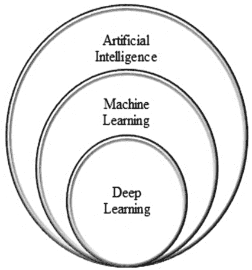

图 2.1 人工智能作为学习的超集。

现在我们来探讨下一个任务：ML 概念。首要涉及的是数据，数据可以是结构化、非结构化或半结构化的。基于数据，我们为机器设置“任务”以获取“经验”，然后衡量其“性能”。这导致了基于数据输入的 ML 分类，即监督学习、无监督学习、半监督学习和强化学习。所有四个子集都有自己定义其操作的一组算法。接下来，我们来看这些智能系统的应用。Xue 和 Zhu 牵头研究了受 ML 影响的领域，并得出结论：ML 是赋予计算机智能的基本技术。其应用以前主要依赖综合和归纳方法而非演绎方法，现已极大地扩展到 AI 的其他领域和所有已知科学 [5]。既然我们已打好基础，对 ML 有了基本了解，让我们走向更深入的内容。

## 2.2 起源

AI 虽然最初正式引入于 20 世纪 50 年代，但其基础是在更早之前建立的。从诗人理论到质疑该想法的研究论文，AI 在被正式命名之前就已经深深吸引了早期研究人员。ML 是实现利用 AI 相关技术目标的关键工具。由于其学习和决策能力，它有时会与 AI 混淆，但实际上它是一个子集。只有在 20 世纪 70 年代之后，它才分离出来独立发展。以下是对 ML 起源的简要讨论。

### 2.2.1 人工智能

从公元前到 21 世纪，ML 经历了多个阶段。“人工智能”一词讽刺地源自希腊语 automaton，意为“凭自身意愿行事”。automaton 的最早记录可追溯至公元前 400 年，这几乎不足为奇，因为过去的希腊学者以其超凡的思想和哲学而闻名。直到 20 世纪初，许多围绕人造人的想法才促使科学家质疑是否可能创造一个能够复制人类思维周期和行为模式的人造大脑。Walter Pitts 和 Warren McCulloch 于 1943 年发表的学术论文《神经活动中内在于理念的逻辑演算》包含了神经网络的第一个数学模型，因此开创了 ML 领域 [6]。

Donald Hebb 所著的《行为的组织》一书包含了关于大脑活动、神经网络和行为之间联系的理论。该书最初出版于 1949 年，成为 ML 历史上的奠基性著作之一。如前所述，AI 诞生于 20 世纪 50 年代。从 Alan Turing 具有开创性的研究论文《计算机器与智能》（开篇写道：“我提议考虑‘机器能思考吗？’这一问题” [7]，到 Arthur Samuel 在 1952 年开发出可应用于机器的初步学习过程，再到 John McCarthy 创造“人工智能”一词，世界一直在热议如何将只有人类大脑才能解释的信息赋予机器。图 2.2 展示了 AI 到 ML 转变的时间线。

### 2.2.2 神经网络

1957 年，Frank Rosenblatt 介绍了机器最早的神经网格——感知器；该系统实际上能够在思想处理方面复制智人大脑。20 世纪 70 年代，ML 加快了步伐，作为 AI 的一个子集分支出来，帮助机器进行模式分析和解释，以理解和解读数据。此外，在 20 世纪 90 年代，此前一直基于推导知识运行的 ML 开始采用数据驱动方法。


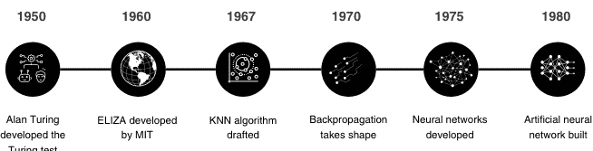

图 2.2 从 AI 到 ML 的时间线。

1997 年，IBM 的深蓝战胜了国际象棋世界冠军，进一步推动了 ML 发展为深度学习的理念，该术语由杰弗里·辛顿提出。此后，多家跨国公司开始利用这种知识工程，并将其部署到构建能够大规模模仿人类情感和智能的模型中。当今，ML 凭借多种 AI 创始人难以想象的用例和应用席卷全球。此外，大量研究表明，ML 仍有很长的路要走，并且将长期存在。

ML 为多个行业中的广泛工作提供动力，从寻找有利可图交易信号的金融专家到搜索病毒的数据安全组织。AI 算法旨在持续学习，模拟虚拟个人助理，这是它们擅长的功能。

### 2.2.3 构思机器学习

ML 的故事曾由 20 世纪 70 年代定义，并导致了其规范。在最初的 ML 研究之后，神经网络的概念登上舞台，这本质上是智能算法的原理。神经网络的构建旨在复制人脑。由于它是连接片段的网络，因此被称为神经网络。生物神经系统研究是这些组件的基础。换句话说，神经网络是一种尝试，旨在开发机器，通过使用表现得像生物神经元的组件，以类似于人脑的方式运行。神经网络的工作是获取输入模式并将其转换为输出模式。模式分类是神经网络可能被训练执行的任务之一，并且将被详细解释，因为这个概念有些抽象。将模式分类到组中的技术称为模式分类 [8]。神经网络的基本构建块类似于神经元。这些组件通过连接相互链接，连接强度可能根据算法或学习过程发生变化。为了评估其活动水平，这些单元中的每一个都独立（并行）地整合来自其突触的数据 [9]。神经网络导致了感知器的发展。感知器是 Hebb 和 Samuel 模型的组合结果，由康奈尔航空实验室（CAL）设计为一台机器，而非程序。随后安装了软件，催生了 Mark 1 感知器，而不是 IBM 704。因此，算法和软件是可移植且可在机器间迁移的。后来，随着最近邻算法、前馈和反向传播网络、提升算法等的发展，ML 子集的前景应运而生。出现的各种算法需要在 ML 下进行清晰的分类。

## 2.3 机器学习建模

在深入探讨 ML 的类型、其分类及其基础之前，我们将首先了解定义 ML 分组的参数，并为各种 ML 算法奠定基础。ML 的关键要素依赖于三个支柱，即：表示、评估和优化 [10]。第一个支柱涉及 ML 模型的外观是什么以及知识表示如何实现。第二个支柱围绕模型的好坏、其区别因素以及所涉及算法的评估基准展开。最后一个要素与寻找良好模型的过程相关，从而推进程序实际是如何生成的。

### 2.3.1 机器学习类型

基于上述 ML 组件声明，该概念本身可大致分为三种类型：监督学习、无监督学习和强化学习 [11]。同样需要说明的是，随着自动化思维技术的发展，ML 目录中引入了第四类：半监督学习 [12]。我们现在将尝试理解并区分这些类别。图 2.3 显示了不同的 ML 子类别。

#### 2.3.1.1 监督学习

正如其名称所示，这种学习模型有一个监督者，在技术术语中，我们称其为“标签”。给定带有标签的数据集，可以构建 ML 模型来对输出进行自训练，然后在给予新的、全新的数据时，期望能够检索正确的标签。一个神经网络的信息通过监督学习充当指令信号，以改变另一个网络中的连接模式。自 ML 诞生以来，监督学习在以下概念下发展：人类行为模式是在婴儿期基于数据形成的——例如，向一个孩子展示一棵树，并反复告诉他“这是一棵树”；然后也许向他展示一辆汽车，并反复告诉他“这是一辆汽车”；如此等等，任何数量的未知事物都会在脑海中归入一个子标题下。本质上，这就是监督学习；很久以后，如果向孩子展示一张同时包含树和汽车的图片，他或她将能够识别它们，不依赖于特征，而是依赖于分配给它们的标签。ML 模型的行为或多或少类似。图 2.4 说明了监督学习模型。

结果，经过训练的网络会掌握信息处理的新技能，使其能够完成指令信号所指定的具体目标或转变。通过这样做，监督学习有效且精确地创建不需要编码且通常也无法编码的连接模式。

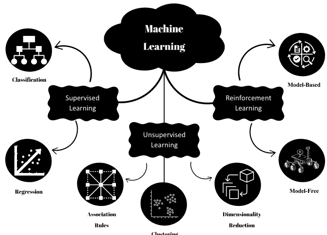

图 2.3 机器学习细分。

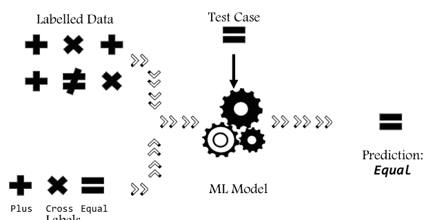

图 2.4 监督学习模型。

大量神经活动有助于监督学习的创建和维护 [13]。监督学习算法进一步分类为分类算法和回归算法。

#### 2.3.1.2 无监督学习

与监督学习恰恰相反，无监督学习源于以下理念：而不是正式提供标签，ML 模型必须学会识别和解释给定数据集中元素的相似特征，并根据这些相似性对其进行分组。提出的论点是，首先，融入地图或模型中的知识是由感官消息的重复提供的。然后，可以通过查看感官消息的均值、方差和协方差来发现这些信息的一部分。让我们用孩子的类比来理解这一点。给孩子五种数学图形的剪纸，每种两组。比如说两个正方形、两个圆形、两个三角形等等，然后要求将它们配对。孩子能够通过学习对象的结构和特征来做到这一点。比如说，后来剪出一个新的正方形碎片给孩子，他或她将能够将其与其他正方形放在一起。无监督学习的工作方式类似。算法可以理解特征和相似模式，因此它知道某物在何处，但不知道某物是什么。图 2.5 无监督学习逻辑模型。

此外，通过使用这些信息来构建“通常发生什么”的模型，传入的通信可以自动与之比较，从而能够立即发现意外的差异。最后，进入此类滤波器的知识是常规学习所需的先决条件，可以与组件的逻辑功能——而不仅仅是元素本身——建立关联，前提是具有独立组件的表示 [14]。无监督学习算法进一步分类为聚类、关联规则和降维算法。

#### 2.3.1.3 强化学习

这种学习方法与父母在指导和教导孩子时使用的技术最为密切相关。强化学习模仿试错法，成功带来奖励，失败导致惩罚。同样，让我们用孩子的类比来理解这一点。在理解了树、汽车和形状几天后，向孩子展示一棵树；为了论证，假设孩子喊道：“那是一辆汽车”；孩子的监护人要么斥责或投以不赞成的目光并纠正他或她。现在，如果孩子说：“那是一棵树”，他或她将会得到赞赏或一颗糖果。这几乎正是强化学习所做的。

为了应对强化学习挑战，可以采取两种主要方法。第一种是通过行为跨度进行调查，找出在给定环境下效果良好的事物。这正是遗传编程和算法采用的策略。第二种是计算


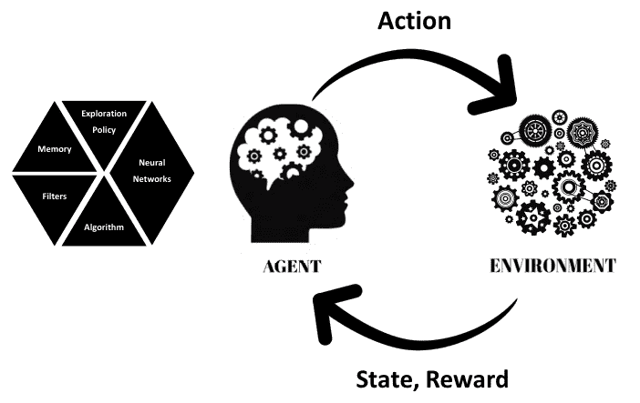

图 2.6 强化学习的表示。

使用统计和动态规划方法在世界各种条件下行动的效用 [15]。强化学习算法分为基于模型和无模型算法，也称为正向和负向技术。图 2.6 展示了强化学习。

#### 2.3.1.4 半监督学习

半监督（SS）学习拥有一个最小的标记数据集和一个同类的大量未标记数据集。当 ML 模型处理确定的数据组合，将标记数据的特征转移到未标记数据，然后预测新数据集的类别时，这便产生了半监督学习。这里是最后一个孩子类比：这个孩子现在变得更聪明了。只向他或她展示一两棵树，并告诉他，“这是一棵‘树’”。第二天，孩子被带去散步，所有底部棕色、顶部绿色的高耸结构，孩子现在能够停下来说，“树”。这就是半监督学习。图 2.7 展示了半监督学习的一个样本。

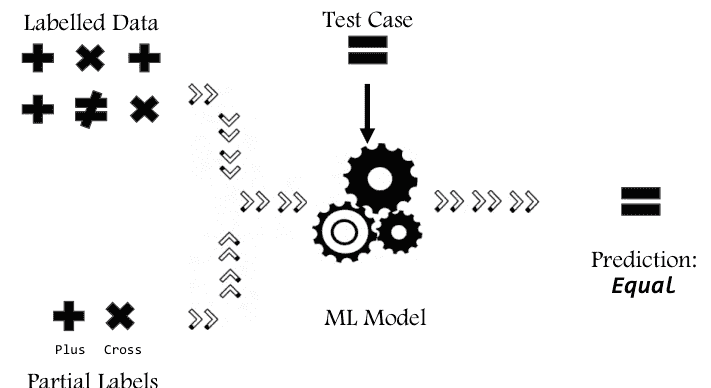

图 2.7 半监督学习样本。

## 2.4 ML 模型的实现

我们已经全面了解了 ML 模型的类型和参数。在模型的用例设计中有清晰的定义。本节尝试讨论在 UCI SECOM 数据集上监督和无监督算法的实现。根据 McCann 和 Johnston 的说法，先进的现代半导体制造过程通常通过信号跟踪或从传感器或过程测量点获得的变量进行持续观察 [17]。在他们的研究中，他们开发了一个包含 500 多种数据信号的数据集，有助于提取半导体开发的特性。特定的监测系统在技术上测量各种信号，最终导致在封装内在线测试中通过或失败。数据集的维度如表 2.1 所示。

数据集的预处理涉及更改表示，并根据数据可用性用均值/中位数替换 NaN 值。通过最初由 -1 表示，后来在数据清洗过程中转换为 1；同样，失败最初由 1 表示，后来替换为 0，以确保合适的分类激活函数的易用性。冗余列被删除，因为数据集已经过归一化，空值或 NaN 值被替换为各列的均值。缺失值超过可接受的三个标准差的列被删除。此外，具有单变量值的列也被删除。数据一旦划分为参数和目标，基本上被分成部分数据集，一个用于训练，另一个用于测试。然后使用 sklearn.preprocessing.MinMaxScaler 对训练参数进行缩放。一旦数据被拟合到缩放器中，最后一步

| 特征 | 测试用例 | 通过 | 失败 |
|---|---|---|---|
| 592 | 1,567 | 1,463 | 104 |

| 参数 | 目标 | 训练 | 测试 |
|---|---|---|---|
| 443 | 2 | 1,175 (75%) | 392 (25%) |

变换在数据需要通过各种模型之前执行。预处理后数据集的维度如表 2.2 所示。

处理后的数据集经历了六种主要的监督学习算法，即：线性回归、逻辑回归（LR）、决策树、随机森林、支持向量机和 K 近邻。随后去除了标签，并在三种主要的无监督算法下运行了数据集。每种算法都在实现中进行了解释和演示。

### 2.4.1 监督学习算法

如前一章所述，监督学习涉及数据标签的清晰度。在这里，我们进一步将监督学习细分为分类和回归。前者涉及寻找方法的算法，这些方法可以根据影响数据集的子集因素实际帮助对数据集进行分类。应用分类方法涉及根据计算机程序从反复运行训练数据集中获得的知识对数据进行分组。另一方面，回归承担寻找自变量和因变量之间相关性的任务。一些分类算法包括 k 近邻、朴素贝叶斯、随机森林、LR 等。一些回归算法包括决策树回归、主成分、支持向量回归、线性回归等等。在深入算法之前，让我们理解所有系统都将使用混淆矩阵作为分类模型准确性的最终决定因素。混淆矩阵由四部分组成，它们分别代表：真阳性，即实际为真被预测为真；假阴性，即实际为真被预测为假；真阴性，即实际为假也被预测为假；假阳性，即实际为假被预测为真。我们试图增加真阳性和真阴性的数量，以此来影响提高准确性 [18]。因此，准确度计算如下：

```
\frac{TP+TN}{TP+FP+FN+TN} (2.1)
```

此外，对于回归模型，我们将使用平均绝对误差（MAE）和平均平方误差（MSE）指标。这两个值计算如下：

```
MAE=\frac{1}{n}\sum_{i=1}^n|y_i-\hat{y}_i| (2.2)
```

```
MSE=\frac{1}{n}\sum_{i=1}^n(y_i-\hat{y}_i)^2 (2.3)
```

在公式 2.2 和 2.3 中，$n$ 是实例总数，$y_i$ 是实例 $i$ 的预测值，$\hat{y}_i$ 是 $i$ 的实际目标值。MAE 和 MSE 的值越低，模型越好 [19]。

在所有监督学习和无监督学习算法中，数据集在测试和训练上的变化、平衡比例以及缩放类型都会影响数据的准确性。例如，在分类 LR 中，StandardScaler 的准确度为 0.82，而 MinMaxScaler 将准确度提高到 0.93，考虑到使用了相同的算法，这算是相当大的准确度提升。

#### 2.4.1.1 线性回归

线性回归是用于找出两个连续变量之间关系的基本统计方法。它假设自变量和因变量之间存在一条直线。可以使用线性回归分析，基于一个类似的未知值来预测一个未知值 [20]。研究人员希望预测的变量称为因变量。用于预测另一个变量值的变量称为自变量。图 2.8 说明了线性回归的准确性。

在图 2.8 中，有两个术语有助于确定准确性；MAE 和 MSE 是回归模型的准确性计算器。这两个值越接近 0，模型越好。LR 的主要目标是找到以最佳方式拟合数据的直线，或者在有多个预测因子的情况下，涉及超平面的情况。为了实现这一点，观察值和预测值之间的平方残差（或误差）之和被最小化。

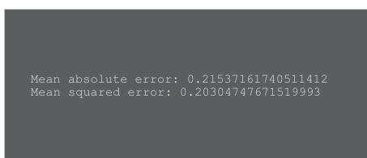

图 2.8 线性回归的准确性。

#### 2.4.1.2 逻辑回归

逻辑回归是一种统计模型，通过观察一个或多个自变量之间的相关性，允许将数据划分为离散组 [21]。预测建模（即模型确定一个事件落入特定类别的数学概率）经常使用它。逻辑回归应用于二分类任务，其中分类结果变量有两种可能的结果。它通过将数据拟合到逻辑曲线上来实现这一点，该曲线估计事件发生的可能性。LR 的基础是假设预测因子与结果变量的对数几率之间存在线性关系。图 2.9 解释了 LR 的混淆矩阵。


图 2.9 逻辑回归的混淆矩阵。


根据图 2.9 给出的混淆矩阵，365 个真阳性清晰地展示了模型预测的效率，实际上产生了 0.934 的准确率，此外，它假设每个观察都是独立的。

#### 2.4.1.3 决策树回归器

决策树回归器（DTR）本质上是一种非参数的监督学习技术，主要用于回归，但也支持分类。其目标是构建一个模型，通过利用从数据特征推导出的基本决策规则来预测目标变量的值 [22]。对破碎子集的持续近似可以被视为赋予树结构。现在，DTR 通过使用对象的属性来训练模型，相对于树结构，对未来数据做出相关预测。这种重复过程产生有意义的连续输出。连续输出表示非离散的结果或输出——即，不仅仅由已知的离散数字或值集合表示。图 2.10 描述了决策树分类器的准确率。

在图 2.10 中，MAE 和 MSE 有助于评估模型的准确率，由于其他模型参数调整，该准确率相对较好。微调模型本质上涉及更改给定参数的值，例如 random_state、test_size、criterion、max_depth 等。

#### 2.4.1.4 随机森林分类器

随机森林对于管理复杂且大规模的数据集、高维特征空间以及提供个别特征重要性的洞察非常有用。它可以减少过拟合并保持较高的预测准确率 [23]。图 2.11 解释了随机森林分类器的混淆矩阵。

在 513 个真阳性值的情况下，准确率上升至 0.934，相对高于之前的分类和回归算法模型。

#### 2.4.1.5 支持向量机

支持向量机（SVM）算法的主要目标是在除 N 维空间以外的空间中检测最佳超平面。此 n-D 空间随后可用于

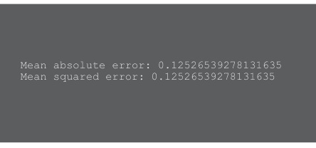

图 2.10 决策树分类器的准确率。

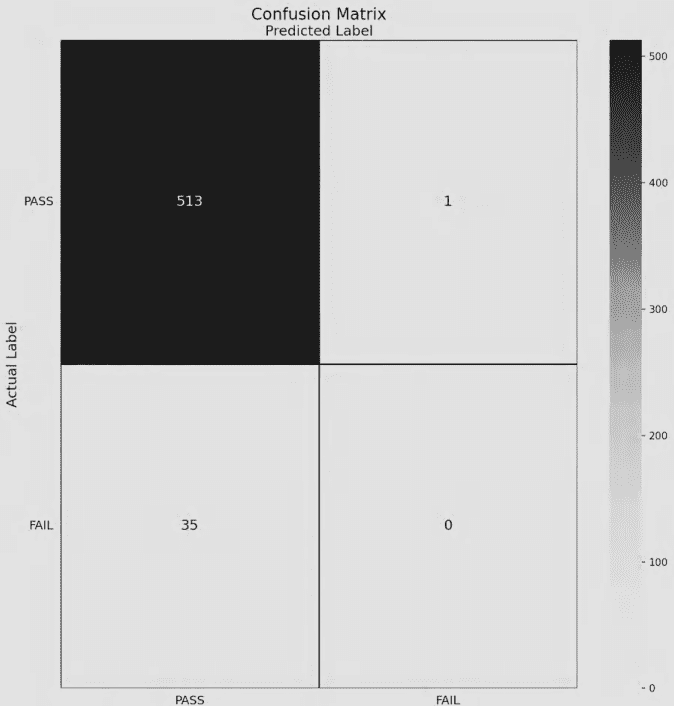

图 2.11 随机森林分类器的混淆矩阵。

将数据点划分为多面特征空间组的目的 [24]。超平面努力保留一个足够大的缓冲区，以容纳被分割类的各个子集中最近点之间的相反距离。图 2.12 描绘了 SVM 的混淆矩阵。在相似数据分布以及 SVM 模型调参的条件下，该分类器给出了峰值准确率 94.64%。

#### 2.4.1.6 K-最近邻

K-最近邻（KNN）算法的设计基于基本距离映射，以定位一定数量的最近邻居 K。使用任何预定义的距离度量（如欧氏距离甚至曼哈顿距离）是定义给定数据点邻域的常见方法。有益的

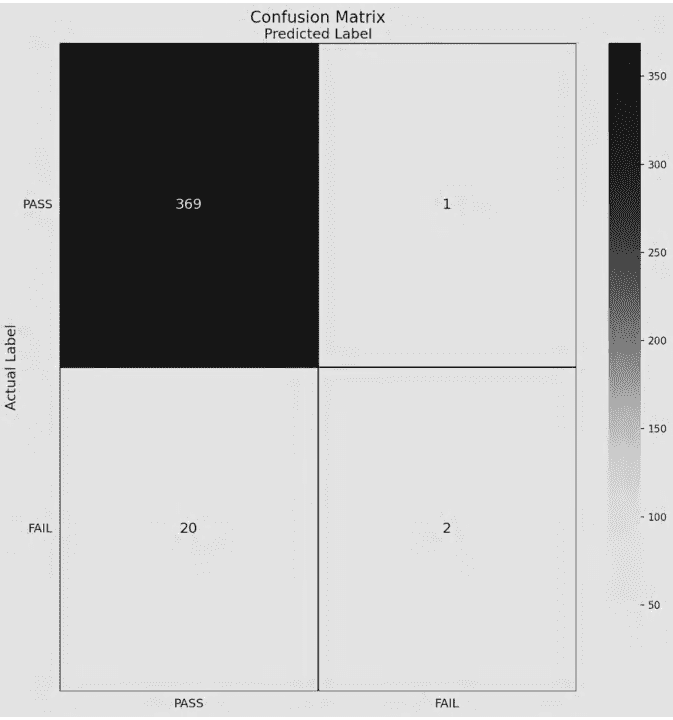

图 2.12 支持向量机的混淆矩阵。

选取或最常见的 K 个最近邻居随后被用来决定并分配类别，或在某些情况下甚至是数据元素的值 [25]。使用此方法使所遵循的一套规则能够根据数据的局部形成预测结果并适应各种先例。图 2.13 强调了 KNN 的混淆矩阵。

图 2.13 中的矩阵产生 0.938 的准确率，其中假阳性和真阴性的值为 NULL。接下来，我们来看看 K-近邻分类器中实际的数据分布。在图 2.14 中，数据点的距离映射使用欧氏距离映射完成。分数范围从 0 到 1，颜色强度表示模型对分配该分数的置信度。此外，形状表示数据集中的真实标签。图 2.14 显示了模型预测的 KNN 图。


图 2.13 K-最近邻的混淆矩阵。

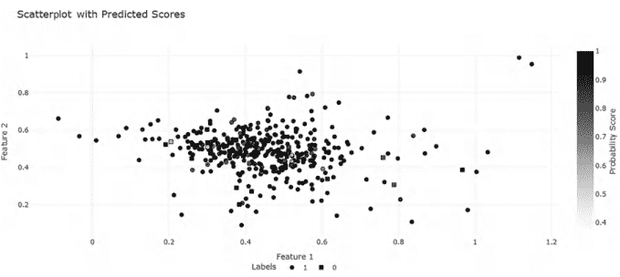

图 2.14 模型预测的 KNN 图。

## 2.4.2 无监督学习算法

如本章前文所述，无监督学习涉及数据集中观察值缺乏数据标签；其结果是常见子句分组。无监督学习也可以细分为三类：聚类、关联规则和降维。对于聚类，可以根据相似性或差异性对未标记数据进行检查并分组。未分类的数据通过识别重复模式或相似结构被划分为自然出现的组。其次，一种名为关联规则挖掘的基于规则的方法可用于在大型数据库中发现数据片段之间有趣的关联。在无监督学习算法中，数据内部的相关性和共现性以及数据对象之间的各种连接是通过搜索频繁的 if-then 关联（也称为规则）来发现的。最后，降维是一种无监督学习方法，可降低数据集的特征数量或维度。它通过提取关键特征来减少数据集中随机或不必要特征的数量。

### 2.4.2.1 K-Means 聚类

K-Means 聚类是一种无监督学习方法，其中未标记的数据被组合或隔离为多个聚类。K-Means 中的 K 用于指定过程中需要形成的预定义聚类数量。这仅意味着，如果 K = 2，将生成两个聚类；如果 K = 3，将生成三个聚类，依此类推。该算法允许我们将数据组织成不同的组，并具有从未标记数据集中自行发现组别类别的优势，几乎无需训练 [26]。根据质心理论，此技术中的每个聚类都附有一个质心，通常是数据点的平均值。将每个点与其各自聚类的距离相结合，执行该算法的基本目标。图 2.15 描绘了 K-Means 聚类。

不幸的是，使用无监督学习算法的准确率低至 44%。为了研究理想的聚类数量，一种非常常用的技术是手肘法。此过程中使用 WCSS 值。簇内平方和（WCSS）是描述簇内总变异的统计量。我们可以使用任何预计算的距离映射方法，如曼哈顿距离或欧氏距离，来测量数据点与任何对应质心之间的距离。

轮廓系数，也称为 K-Means 轮廓分数，衡量数据点在簇内的相似程度或与其他簇相比的紧密程度，称为分离度 [27]。与前者相比，轮廓提供了更高的精度。

### 2.4.2.2 层次聚类

在此算法中，我们首先将每个数据点视为独立的集群；然后将它们两两或三三组合，依此类推，最终形成一个单一的母集群。树状图是该算法中以树形结构发展聚类层次结构的结果。数据集使用自底向上的方法分组为聚类。这意味着

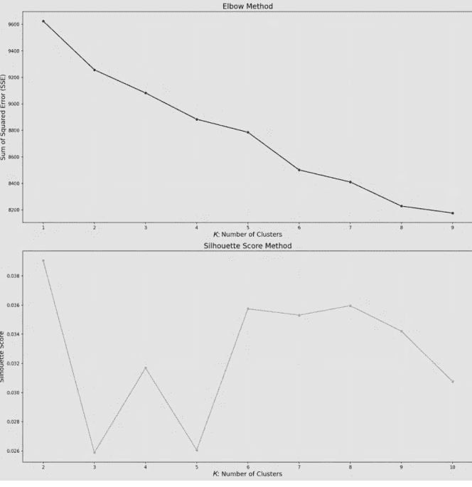

图 2.15 使用手肘法和轮廓分数法的 K-Means 聚类。

算法聚类最近的对象 [28]。扩展来说，此过程将继续，直到每个聚类都合并为包含所有数据集的单一聚类。与基于分区的聚类相反，凝聚聚类形成一棵来源合并树，其从最小节点（即包含数据片段的叶子节点）到根节点（本质上包含整个数据集）的过程中表现出二元特征。图 2.16 强调了层次聚类树状图，图 2.17 描绘了主成分分析。

### 2.4.2.3 主成分分析

在主成分分析（PCA）中，从技术上讲，目标是在创建一些称为主成分的新变量后进行降维；这些主成分通过以简单线性方式混合或合并可用的原始未知数而产生。本质上，绝对变量中包含的大部分事实作为事后组合的结果被压缩或扁平化到初始成分中，从而得到一些完全不相关的未知数，而这些


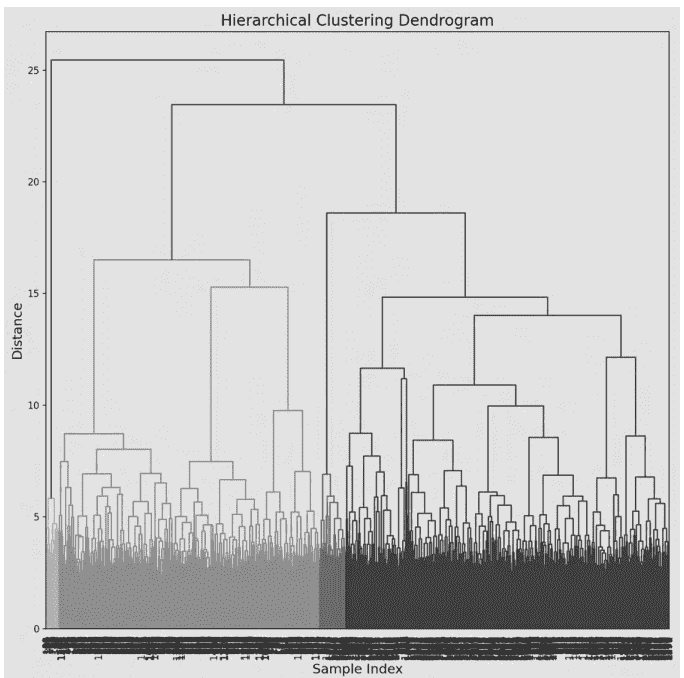

图 2.16 层次聚类树状图.

称为主成分。数据集中特征或维度的数量会指数级增加获得统计学上有意义结果所需的数据量。过拟合、计算延迟延长以及 ML 模型准确性下降都是这种情况[29]的可能结果。“维度灾难”指的是在处理高维数据时可能出现的问题。因此，PCA 是必要的。

## 2.5 算法分析

迄今为止的所有研究都揭示了电气科学领域中可能用例的大量信息，尤其是涉及半导体材料时。有监督学习方法和算法在最初有足够标记数据可用于模型训练的情况下，能产生更可靠的结果。与此相反，未标记的数据有助于利用无监督学习技术进行特征提取和分析。图 2.18 展示了数据范围的概览。

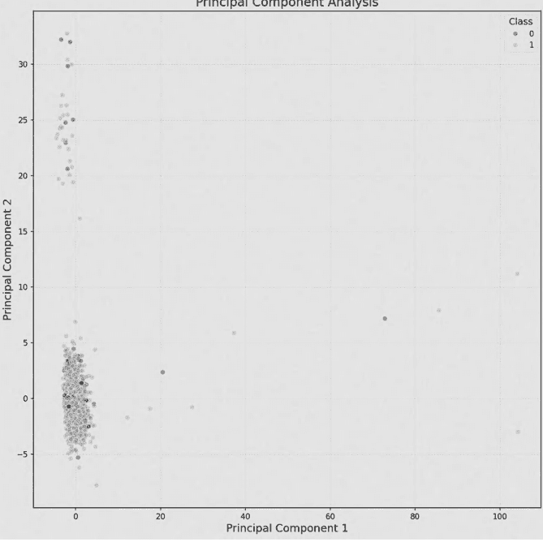

图 2.17 主成分分析。

在图 2.18 中，已定义每一层预处理后的数据固定点。参数受逐列应用的数据清洗过程约束，测试用例仅因数据拆分而改变，否则数据长度保持一致。这基本上意味着在信号集分析中没有数据丢失。变化是指基于逐层流对数据的改变；它描绘了数据相对于先前预处理的形式和分布差异。

有监督学习算法是一类 ML 技术，模型在标记数据上进行训练，意味着输入数据有对应的输出标签。我们已看到线性回归用于预测连续数值。逻辑回归预测二元结果的概率。决策树有助于根据从训练数据得出的一组 if-else 条件进行决策。随机森林是一种集成方法，结合多个决策树以提高预测准确性并减少过拟合。SVM 找到高维空间中分隔类别的最优超平面。KNN 根据新数据点的 K 个最近邻的多数类别来预测其值。然后还有

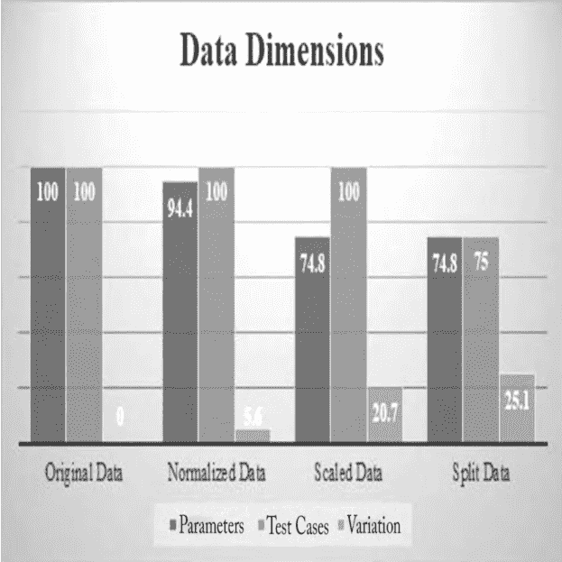

图 2.18 预处理过程中的数据维度。

naive bayes，它使用贝叶斯定理来预测给定输入特征时类别的概率。除此之外，梯度提升机按顺序组合弱学习者以提高预测性能。此外，神经网络通过互连节点（神经元）的层来学习数据中的复杂模式和关系。

无监督学习算法用于在未标记或未分类的数据中发现模式和结构。以下是一些常用无监督学习算法的摘要：K-means 基于相似性将数据划分为簇。层次聚类从每个点作为其自身簇开始，并根据距离递归合并簇，直到所有点都属于单个簇。PCA 在保持方差的同时降低数据的维度。我们还有 t 分布随机邻嵌入；基于密度的带噪声的空间应用聚类（DBSCAN）；以及关联规则学习算法，如先验算法，它识别事务数据中的频繁项集；还有异常检测算法和生成模型。

最后，正如我们所见，与无监督学习算法相比，有监督学习算法的准确度得分更高。

## 2.6 面向电气科学的 ML 建模

AI 已彻底改变电气科学中既定的方法，优化系统并推动创新。这代表着一种范式转变。受电气科学中 AI 驱动研究的支持，诸如用于状态监测的智能传感器、用于维护任务的自主机器人以及用于可再生能源预测的 ML 算法等创新应用成为可能。这些前沿用途不仅推动专业发展，还帮助解决社会问题并促进经济扩张。

虽然 ML 可以帮助人类在特定领域（包括决策和模式识别）变得更加智能，但其大幅提升人类整体智能的能力仍受固有认知差异和道德考量的限制。在电气科学方面，ML 模型在辅助开发高效对象和设备方面大有可为，这些设备能够开创一个更安全的未来，在其中资源浪费减少，同时再利用率和寿命得到提升。

选择平台可能很困难，因为错误的平台可能会增加开支或限制其他有用工具或技术的使用。在评估多个问题陈述以选择 ML 模型时，经常存在一种倾向，即认为功能更多的系统更优。也许如此，但首先研究人员应该考虑 ML 平台将如何处理他们的数据及其产生的输出。哪些功能对于实现必要的 ML 能力至关重要？整个系统的功能可能因缺少单一功能而岌岌可危。

## 2.7 伦理与社会影响

在核心 ML 算法设计的整个技术分析中，我们必须解决这一方面以帮助进一步研究。不言而喻，人类害怕无法控制的事物。在涉及自动化智能时，即使在电气科学领域，伦理考量与 ML 对社会的影响同样重要。让我们快速深入探讨伦理影响；首先，ML 模型的偏见和公平性是不稳定的，取决于其训练数据。其次是 ML 黑盒问题以及为证明任何算法合理性所需的问责制。转向本书核心领域，资源开采和可持续性是半导体材料 ML 成功的基础。最后，关于社会影响，在考虑经济因素时，必须确保该领域的研究或后续实验蓬勃发展，但不会从地缘政治、可负担性和监管框架方面阻碍增长。切勿忽视这样一个事实：ML 的动机是缩小数字鸿沟，而不是扩大它。

## 参考文献

- 1. El Naqa, I., Murphy, M.J. (2015). 什么是机器学习？收录于：El Naqa, I., Li, R., Murphy, M. (编), *放射肿瘤学中的机器学习*. Springer, Cham. https://doi.org/10.1007/978-3-319-18305-3_1.

- 2. Carleo, G., Cirac, I., Cranmer, K., Daudet, L., Schuld, M., Tishby, N., Vogt-Maranto, L., Zdeborová, L. (2019). 机器学习与物理科学。*现代物理评论*, 91(4). 美国物理学会. https://doi.org/10.1103/RevModPhys.91.045002.

- 3. Kudelina, K., Vaimann, T., Asad, B., Rassõlkin, A., Kallaste, A., Demidova, G. (2021). 基于机器学习的电气机器智能状态监测的趋势与挑战。应用科学, 11(6), 2761. https://doi.org/10.3390/app11062761.

- 4. Xu, Y., Liu, X., Cao, X., Huang, C., Liu, E., Qian, S., Liu, X., Wu, Y., Dong, F., Qiu, C.-W., Qiu, J., Hua, K., Su, W., Wu, J., Xu, H., Han, Yong F., Chenguang, Y., Zhigang, L., Miao, R., Ronald, D., Sabine, V., Marko, K., Fredrick, Z., Ze, Z., Lifu, Z., Taolan, D., Ji, Y., Jialiang, L., Liang, L., Ming, L., Zhaofeng, A., Tao, Z., Bin, H., Xiao, C., Shan, L., Xiaohong, Z., Wei, L., James P., Tiedje, James M., Wang, Q., An, Z., Wang, F., Zhang, L., Huang, T., Lu, C., Cai, Z., Wang, F., Zhang, J. (2021). 人工智能：科学研究的强大范式。《创新》, 2(4), 100179. ISSN 2666-6758, https://doi.org/10.1016/j.xinn.2021.100179.

- 5. Xue, M., Zhu, C. (2009). 人工智能机器学习的研究与应用。2009 年国际人工智能联合会议，海南，中国，第 272–274 页。https://doi.org/10.1109/ICAI.2009.55.

- 6. McCulloch, W.S., Pitts, W. (1943). 神经活动中内在观念的逻辑演算。数学生物物理学通报, 5, 115–133. https://doi.org/10.1007/BF02478259.

- 7. Turing, A.M. (2009). 计算机器与智能。收录于：Epstein, R., Roberts, G., Beber, G. (编), 图灵测试剖析. Springer, Dordrecht. https://doi.org/10.1007/978-1-4020-6710-5_3.

- 8. Pictor, P. (1994). 什么是神经网络？收录于：神经网络导论. Palgrave, London, 978-0-333-61832-5 978-1-349-13530-1, https://doi.org/10.1007/978-1-349-13530-1_1.

- 9. Abdi, H. (1994). 神经网络入门。生物系统杂志, 2. https://doi.org/10.1142/S0218339094000179.

- 10. Langley, P. (1996). 机器学习要素。Morgan Kaufmann.

- 11. Shanahan, J.G. (2000). 机器学习。收录于：面向知识发现的软计算。Springer 工程与计算机科学国际系列（第 570 卷）。Springer, Boston, MA. https://doi.org/10.1007/978-1-4615-4335-0_7.

- 12. Board, R., Pitt, L. (1989). 半监督学习。机器学习, 4, 41–65. https://doi.org/10.1007/BF00114803.

- 13. Knudsen, E.I. (1994). 大脑中的有监督学习。神经科学杂志, 14(7), 3985.

- 14. Barlow, H.B. (1989). 无监督学习。神经计算, 1(3), 295–311. https://doi.org/10.1162/neco.1989.1.3.295.

- 15. Kaelbling, L.P., Littman, M.L., Moore, A.W. (1996). 强化学习：综述。人工智能研究杂志, 4, 237–285. https://doi.org/10.1613/jair.301.

- 16. Board, R., Pitt, L. (1989). 半监督学习。机器学习, 4, 41–65. https://doi.org/10.1007/BF00114803.

- 17. McCann, M., Johnston, A. (2008). SECOM。UCI 机器学习库。https://doi.org/10.24432/C54305.

- 18. Ting, K.M. (2017). 混淆矩阵。收录于：Sammut, C., Webb, G.I. (编), 机器学习与数据挖掘百科全书. Springer, Boston, MA. https://doi.org/10.1007/978-1-4899-7687-1_50.

- 19. Pal, R. (2017). 第 4 章 – 验证方法论。收录于：Pal, Ranadip (编), 药物敏感性预测建模（第 83–107 页）。Academic Press. ISBN 9780128052747, https://doi.org/10.1016/B978-0-12-805274-7.00004-X.

- 20. Weisberg, S. (2005). 应用线性回归（第 528 卷）。John Wiley & Sons.

- 21. Schein, A.I., Ungar, L.H. (2007). 逻辑回归的主动学习：评估。机器学习, 68, 235–265. https://doi.org/10.1007/s10994-007-5019-5.


22. Kushwah, J. S., Kumar, A., Patel, S., Soni, R., Gawande, A., (2022). 使用现代工具的决策树回归器与分类器比较研究. Materials Today: Proceedings, 56(Part 6), 3571–3576. ISSN 2214-7853. https://doi.org/10.1016/j.matpr.2021.11.635.

23. Liu, Y., Wang, Y., Zhang, J. (2012). 新机器学习算法：随机森林. In: Liu, B., Ma, M., Chang J. (eds.), 信息计算与应用. ICICA 2012. 计算机科学讲义 (第7473卷). Springer, Berlin, Heidelberg. https://doi.org/10.1007/978-3-642-34062-8_32.

24. Hearst, M.A., Dumais, S.T., Osuna, E., Platt, J., Scholkopf, B. (1998, July–August). 支持向量机. IEEE 智能系统及其应用, 13(4), 18–28. https://doi.org/10.1109/5254.708428.

25. Guo, G., Wang, H., Bell, D., Bi, Y., Greer, K. (2003). 分类中的基于KNN模型的方法. In: Meersman, R., Tari, Z., Schmidt, D.C. (eds.), 迈向有意义的互联网系统2003：CoopIS、DOA和ODBASE. OTM 2003. 计算机科学讲义 (第2888卷). Springer, Berlin, Heidelberg. https://doi.org/10.1007/978-3-540-39964-3_62.

26. Na, S., Xumin, L., Yong, G. (2010). k-均值聚类算法研究：一种改进的k-均值聚类算法. 2010 第三届智能信息技术与安全信息学国际研讨会, 中国 Jian, 第63–67页. https://doi.org/10.1109/IITSI.2010.74.

27. Shahapure, K.R., Nicholas, C. (2020). 使用轮廓得分的集群质量分析. 2020 IEEE 第7届数据科学与高级分析国际会议 (DSAA), 悉尼, 新南威尔士, 澳大利亚, 第747–748页. https://doi.org/10.1109/DSAA49011.2020.00096.

28. Nielsen, F. (2016). 层次聚类. In: 面向数据科学的带MPI的高性能计算导论. 计算机科学本科主题. Springer, Cham. https://doi.org/10.1007/978-3-319-21903-5_8.

29. Abdi, H., Williams, L. J. (2010, July–August). 主成分分析. WIREs 计算统计, 2(4), 433–459. https://doi.org/10.1002/wics.101.

# 3 半导体制造中的故障检测
## SECOM数据集的分类分析

Vanshika Jain, Rashmi Gupta, Neeraj Gupta 和 Prashant Kumar

## 3.1 引言

在竞争激烈的半导体世界中，制造过程的效率和可靠性是关键因素。半导体生产涉及一系列复杂的工序，每个工序都有可能引入影响良率（即符合质量基准的产品百分比）的缺陷。优化良率至关重要，因为它直接影响半导体器件的成本、质量和整体盈利能力。在制造阶段检测并解决问题，有助于减少浪费、提高生产效率，并避免缺陷产品的释放。

SECOM数据集在故障识别和分类方面已被深入研究。它由生产过程中使用的传感器收集的数据组成。数据集中的每条记录都捕捉了不同时间点的不同传感器测量值，并附带一个标签，指示是否存在良率缺陷。该数据集包含超过1,500个实例和590多个属性，虽然具有挑战性，但对于开发和测试缺陷检测算法非常有益。研究该数据集可以深入了解良率问题的原因，并有助于构建早期发现故障的预测模型。

本节的重点是探索SECOM数据集，专门通过分类算法识别良率缺陷。主要目标包括检查和预处理SECOM数据集、进行彻底的探索性数据分析、评估并实现各种分类算法、评估其有效性以及分析结果。实现这些目标将突出表明，精密的数据分析和机器学习方法可以改善半导体制造过程中的缺陷检测，从而提高良率和运营效率。

## 3.2 良率优化的重要性

在半导体制造领域，良率优化在决定生产运营的整体生产力、盈利能力和成本效益方面发挥着至关重要的作用。以下是对其重要性的详细分析：

- a. **经济效益：** 良率直接影响生产费用。较高的良率可降低单位成本，因为更高比例的制造单元符合质量标准。反之，较低的良率会因浪费和返工而导致成本增加。通过优化良率，企业可以显著提高利润率并在市场上获得竞争优势。
- b. **资源效率：** 良率优化鼓励使用劳动力、材料和能源等资源。缺陷减少意味着材料浪费减少，返工减少意味着节约资源并最大限度地降低制造过程对环境的影响。
- c. **质量保障：** 良率优化确保更高比例的产品符合质量和可靠性标准。这在半导体行业尤其关键，因为产品故障会显著影响电子设备的性能和安全性。
- d. **客户满意度：** 更好的良率与更一致的高质量产品相关联，从而提高客户满意度。可靠的产品能促进长期联系并增加消费者信任，支持企业的持续成功。
- e. **竞争优势：** 在快速发展的半导体行业中，能够实现高良率的公司可以在不牺牲质量的前提下以有竞争力的价格提供产品。这种能力使企业能够夺取市场份额，为其提供显著的竞争优势。
- f. **研发与创新：** 良率优化使资源能够重新分配至研发（R&D）计划。通过最大限度地减少损失和低效，企业可以将更多资金投入到提升产品供应并巩固其竞争地位的技术和流程改进中。
- g. **风险控制：** 高良率降低了生产风险。当故障率较低时，可能代价高昂并损害公司声誉的召回和保修索赔频率较低。优化良率有助于构建更具韧性和一致性的生产过程。
- h. **供应链稳定性：** 提高良率可以增强供应链的可靠性。稳定的生产率可以确保更少的中断，从而更好地与供应商和客户进行安排和沟通。这种一致性对于维护供应商关系和满足交付时间表至关重要。
- i. **法规遵从：** 在半导体行业中，遵守法规至关重要。一致的质量对于满足监管要求并避免问题是必要的。良率优化在实现这一点方面发挥着重要作用。
- j. **技术进步：** 利用智能、机器学习和数据分析等技术通常对于优化良率至关重要。这些技术不仅能提高良率，还能推动公司整体技术进步，使其成为该领域的创新者。

总之，最大限度地提高半导体生产中的良率对于保持稳定的供应链、满足监管标准、促进创新、确保成本效益、节约资源、维护质量控制、提高客户满意度、获得竞争优势以及推动技术进步至关重要。通过将良率优化作为优先事项，企业可以显著提升其效率和市场地位。

## 3.3 影响良率的常见问题和故障

半导体制造中的良率可能会受到常见问题和错误的显著影响，导致生产成本增加和效率降低。一个关键挑战是硅片等材料中存在杂质或不规则性，这可能导致最终产品出现缺陷。例如，杂质会引起硬度变化，从而影响半导体器件的整体质量。另一个关键因素是制造过程的一致性。即使温度、压力或化学浓度出现轻微波动，也可能导致半导体器件出现不规则性和缺陷。这些变化可能在制造过程的各个阶段发生，例如晶圆生产、晶圆测试、组装或包装以及最终测试，每个阶段都有其自身的机遇和挑战 [1]。

当机械故障时，可能导致元件故障或无法维持高质量生产所需的精确条件，从而导致产量降低。先进光刻机等设备的复杂性和高昂成本会使情况更加恶化，使维护和更换变得困难。即使在洁净室环境中，微量的污染物或颗粒污染也会对半导体器件质量产生不利影响。这种污染可能发生在各种制造阶段，如掺杂、蚀刻和沉积，并且可能难以检测和消除。如果设计偏离性能标准，半导体电路或布局中的缺陷可能导致故障并影响生产力。这些问题可能难以识别和纠正，需要诊断方法。

生产过程中的缺陷可能是由设备设置或处理不当等错误引起的。为了最大限度地降低这种风险，可以对操作人员进行严格培训，并实施质量控制措施，以确保遵守标准和规程。此外，测试和检验程序不足可能会在早期阶段忽略产品中的缺陷，使其在生产线上进一步推进，从而降低总体产量。这强调了拥有强大的质量控制系统和先进诊断技术的重要性，以最大限度地减少错误并优化半导体制造良率。最后，随着生产设备的老化


并随着时间推移而磨损，其性能可能下降，影响产出质量和一致性。定期维护升级和设备更换可以解决此问题，确保机械继续按精确规格运行 [2]。

为应对半导体生产中的这些挑战，严格的质量控制协议、连续监控和先进的诊断技术至关重要。像 Brewer Science 这样的公司正在采用计量和指纹识别等方法，以减少材料缺陷和污染物，确保半导体器具备更高的良率、性能、一致性和可靠性。解决这些问题需要一项涵盖质量控制措施、对制造条件的定期监督、常规维护和全面测试程序的策略。此外，还可采用先进的诊断方法来识别和解决影响良率的问题，提升半导体制造过程的效率和可靠性。这些方法的显著示例包括监控系统和基于机器学习的故障检测。

## 3.4 SECOM 数据集的背景

一种常用于半导体制造研发中缺陷检测和分类的数据集是 SECOM 数据集。该数据集源自半导体制造过程，其中传感器收集与半导体器件生产相关的多种数据。SECOM 项目旨在提升半导体行业的知识并优化制造流程，以使该数据集可访问。

该数据集由生产过程不同阶段获得的读数组成。这些读数涵盖众多因素，如压力、温度、化学品浓度和其他变量。为了提供工业环境的概览，这些测量是在间隔点进行的。

在结构化数据中，每个条目对应半导体器件的一批或一次生产运行。该数据集包含每个条目的记录传感器读数，以及一个标签，指示该特定批次的产出中是否检测到缺陷。该标签对于训练分类模型至关重要，因为它提供了算法旨在预测的目标变量。为了便于分析，数据集通常分为训练和测试子集等段落。机器学习模型使用训练集开发和微调，并使用测试集在先前未见过的数据上评估其性能。这种划分使研究人员能够评估其模型在多大程度上能够推广到新的、未经测试的数据集。

SECOM 数据集提供了对制造过程的洞察，捕捉常规和挑战性场景。这使其对于开发和评估故障检测算法具有价值。通过利用此数据集，研究人员可以采用机器学习方法，如异常检测和分类，来发现与问题相关的模式并提高预测的精度。总体而言，SECOM 数据集是改进半导体制造领域缺陷检测方法的资源。其多样化的特征范围和实际相关性使其成为该领域内评估各种数据分析和机器学习技术的基准。

## 3.5 故障检测中的关键技术和算法

识别故障在半导体行业中保持高良率和确保产品质量方面发挥作用。不同的方法和算法被用于检测和纠正生产过程中的错误。以下是对故障检测中各种基本方法和广泛应用的算法的彻底探讨，以及对其有效性的分析：

### 3.5.1 统计过程控制

统计过程控制 (SPC) 是一种关键方法，用于利用方法来监督和调节制造过程。SPC 检查从过程中收集的数据，以识别可能指示潜在问题的变化和趋势。SPC 中常用的工具包括以下内容：

- **控制图：** 这些图表随时间跟踪过程的性能，并帮助识别任何与预期行为的偏差。它们有助于确定差异是由于暗示潜在问题的原因，还是过程固有的常见原因。
- **帕累托分析：** 基于帕累托原则（80/20 法则），该原则断言 80% 的问题通常由 20% 的组件引起，这种技术确定导致错误的最重要因素 [3]。

**有效性：** SPC 在监控过程和检测任何阶段的偏差方面很有效。然而，它在识别需要更高级分析方法的微妙或复杂故障时可能面临挑战。

## 3.6 机器学习算法

### 3.6.1 决策树

一种广受欢迎的用于模拟决策及其结果的分类算法是决策树。决策树在问题检测中是一种有用工具，因为它们可以根据各种特征对制造批次进行分类。

- **算法：** 决策树通过根据特征值将数据集分成较小的组来工作。此过程产生类似树的结构，代表不同的选择。
- **示例：** 使用过程参数和传感器读数，决策树可能会将批次识别为有缺陷或无缺陷。

**有效性：** 尽管决策树易于理解且直观，但如果不进行适当剪枝，它们可能会变得过于复杂并且容易过拟合 [4]。

### 3.6.2 随机森林

随机森林利用一种技术，通过合并多个决策树来提高分类的精度和鲁棒性。

- **算法：** 它使用特征的随机子集构建多个决策树，并结合它们的预测来做出最终决策。
- **示例：** 随机森林可以通过聚合各种决策树的预测来管理大型数据集并识别复杂模式。

**有效性：** 随机森林提供高准确性，并且与单个决策树相比不易过拟合。它们还能很好地处理缺失值和噪声数据。

### 3.6.3 支持向量机

支持向量机 (SVM) 是一种强大的分类技术，用于在特征空间中找到分离不同类别的最优边界。

- **算法：** SVM 构建一个超平面，以最大化不同类别之间的边距。
- **示例：** SVM 可用于基于传感器数据对批次进行分类，通过找到分隔有缺陷和无缺陷样本的最佳边界 [5]。

**有效性：** SVM 在高维空间和复杂数据集方面很有效。然而，它们可能计算量大，并且需要仔细调整参数。

### 3.6.4 神经网络

特别是深度学习模型，即神经网络，用于复杂的模式识别和故障检测任务。它们由多层网络节点（或神经元）组成，可以识别数据中的层次特征。

- **算法：** 它们通过反向传播调整权重来学习，以最小化预测标签和实际标签之间的误差。
- **示例：** 神经网络通过反向传播权重调整来学习，以最小化预期标签和实际标签之间的误差。

**有效性：** 在查找大数据集中复杂的模式和连接方面，神经网络表现出色。然而，它们需要大量的训练数据和可观的处理能力。

## 3.7 异常检测技术

### 3.7.1 主成分分析

主成分分析 (PCA) 是一种降维技术，也可以通过在主成分空间中识别异常值来用于异常检测。

- **算法：** PCA 将数据投影到低维空间（主成分），并根据数据在该降维空间中距离均值的距离来发现异常值。


- 示例：PCA 可以通过寻找代表正常工艺行为的主成分的偏差，来发现传感器数据中的异常。

**有效性：** PCA 对降低维度和在大型数据集中识别异常很有用。但是，它假设存在线性关系，可能无法捕捉复杂的异常 [6]。

### 3.7.2 孤立森林

一种称为孤立森林的异常检测技术通过随机划分数据并选择特征来分离异常。

- **算法：** 通过构建孤立树集合，该算法通过测量将异常与其余数据分离有多容易来确定异常。

- **示例：** 孤立森林可以通过识别那些与大多数正常数据很容易分离的实例来检测有缺陷的批次。

**有效性：** 使用孤立森林可以有效且高效地识别高维数据集中的异常。它在大型数据集上效果良好，并且不需要对数据分布做任何假设。

## 3.8 混合方法

混合方法汇集了不同的方法，以发挥其优势并克服其缺点。例如，将机器学习算法与统计技术相结合可以提高故障检测的有效性。

**有效性：** 通过结合多种技术，混合方法可以提供更可靠、更精确的缺陷检测；然而，它们可能需要更复杂的校准和实现。

总而言之，半导体生产中用于故障检测的方法和算法有多种，各有优劣。虽然机器学习算法能够实现更精巧的模式识别和分类，但像 SPC 这样的统计技术提供了基本的监控功能。异常检测技术有助于定位可能指向问题的异常模式。制造商可以通过结合这些技术来提高识别和修复缺陷的能力，从而改善产率和工艺效率。

## 3.9 数据理解与预处理

### 3.9.1 SECOM 数据集的详细分析

SECOM 数据集包含来自半导体制造过程的大量信息，以帮助优化产率和检测问题。它总共包含 1,567 个条目，每个条目代表一个唯一的生产批次或事件。这些样本由 591 个属性表征，涵盖变量、与制造过程相关的派生指标以及传感器读数。除了特定变量和计算指标外，特征还涵盖监测多种因素（如温度、压力和化学浓度）的传感器连续数据。该数据集的目标变量为二进制，-1 表示通过，1 表示失败，从而指示每个批次是否成功通过质量测试。

通过 SECOM 数据集中每个条目附带的揭示数据收集时间的时间戳，分析增加了额外的深度层。该时间戳对于跟踪事件和识别可能影响结果的趋势非常宝贵。在数据集中，初始观察通常呈现特征分布的混合，有些显示显著波动，而另一些则保持稳定。为了提高模型的准确性，识别和处理具有方差或显著噪声水平的组件至关重要。

此外，分析可以发现某些特征中的缺失值，需要小心处理以避免结果失真。此外，数据集可能表现出类别之间的不平衡，失败批次的数量相比成功批次显著较少。这种不平衡可能会阻碍算法性能，需要采用加权损失函数或重采样等技术来实现更精确的预测。

综上所述，SECOM 数据集为半导体制造过程及影响产率的因素提供了洞察和有价值的信息。通过利用这些数据并采用适当的特征选择和预处理技术，研究人员和工程师可以开发稳健的模型，以增强缺陷检测并优化制造过程。

### 3.9.2 数据预处理

在为半导体制造中的缺陷检测准备数据的领域，采用了几种关键方法来确保数据集已准备好进行分析。这些策略包括填充缺失值、删除不必要的特征，以及处理零值和 NaN（非数字）值。以下是这些预处理活动的详细说明：

- 处理零值和 NaN 值：数据集中的零值和 NaN 值可能表示信息不完整或不正确。鉴于它们对分析质量的潜在影响，评估其存在情况并妥善处理至关重要。为解决此问题，我们首先识别数据集每一列中零值和 NaN 值的出现情况。该过程涉及统计每个特征中这些值的数量，以确定是否有列包含不准确或缺失的数据。评估这些值的频率有助于为后续的数据清洗步骤提供依据。

- 删除常量列：数据集中的某些列在所有行中可能具有相同的值。由于缺乏多样性，这些列无法帮助区分不同的结果或类别，因此不适合分析。为了提高数据集的有效性，将条目相同的列移除。该过程涉及检查列中的所有值是否相同。如果某列符合此标准，则将其从数据集中排除。此步骤可以通过降低复杂性和消除无关信息来提高后续分析或机器学习模型的效率。

- **填充缺失值：** 数据集中的缺失值带来了需要解决的挑战，以便进行彻底分析。处理缺失值的第一步是识别缺失数据量显著的列。通常，缺失值百分比高于设定阈值的列会被丢弃，因为它们可能无法提供可靠的信息。

为解决数据集中的缺失值，对剩余列采用填充技术。一种常用的方法是利用列中现有值的均值或中位数来替换缺失的数字。均值提供一种趋势度量，而中位数则提供一种较少受异常值影响的指标。确保每个特征都有填充值有助于保持数据集的完整性。这些预处理方法在为分析准备数据方面起着关键作用。通过处理零值和 NaN、消除无信息特征以及填充缺失值，数据集得以优化，更有利于得出可靠的洞察和预测。

### 3.9.3 特征选择技术

特征选择是数据准备的关键组成部分，旨在找到最相关的特征以提高机器学习模型性能。使用的方法包括 PCA、基于方差的选择和基于模型的选择。以下是每种技术的详细说明：

- **基于方差的特征选择：** 采用 VarianceThreshold 技术来消除低方差特征。这些特征在不同样本中往往保持一致，因此对模型预测能力的影响微乎其微。通过设定阈值，该方法移除不符合方差标准的属性。目标是仅保留那些表现出足够变化且有价值的元素。例如，如果某个特征的方差低于指定阈值，则将其从数据集中移除。这种方法可以降低数据维度并消除不必要的噪声 [7]。

- **基于模型的特征选择：** 该方法利用机器学习模型的有效性来评估每个特征的重要性。为此目的使用了以下模型。

- **支持向量分类器（SVC）：** 该方法使用 L1 惩罚来帮助选出显著特征。它依赖支持向量来识别最相关的特征。特征的重要性通过模型的系数显示，具有非零系数的特征会被选中。

- **逻辑回归：** 该模型考察特征与目标变量之间的关系。具有系数的特征被视为更重要。


通过将 SelectFromModel 与逻辑回归相结合，它选择具有重要意义的特征。

- 决策树分类器：决策树根据特征划分数据的效果来评估特征的重要性。导致划分的特征被认为更为重要。ExtraTreesClassifier 是一种决策树，它结合多棵树的结果来确定特征选择。

- 主成分分析：PCA 是一种通过将数据转换到新坐标系来降低数据维度的技术。在此系统中，数据投影中的最大偏差与初始主成分对齐。PCA 通过在保留原始数据集大部分变异性的同时最小化特征来实现这一点。该过程涉及将数据投影到由原始特征的线性组合派生的成分上。结果是一组捕获大部分数据方差的成分或不相关特征。

总之，采用基于方差的选择、基于模型的选择和 PCA 等选择方法对于提升学习模型的有效性和效率至关重要。这些方法可以提升模型性能，突出关键方面，并简化数据复杂性 [8]。

### 3.9.4 不平衡数据集的过采样

在分类任务中，数据集常常存在类别不平衡问题，即一个类别显著多于另一个。这种差异可能导致模型偏向多数类，从而导致性能偏差，且对少数类的预测准确性较差。为解决此问题，会采用合成少数类过采样技术（SMOTE）等过采样技术来平衡类别分布。SMOTE 允许为数据集中代表性不足的类别专门生成样本。SMOTE 并非简单复制现有少数类实例，而是通过现有数据点之间的插值生成新的合成样本。该过程包括选择点，并沿连接这些点与其邻近实例的直线生成额外样本。通过这种方式，SMOTE 有效增强了少数类的表现，从而整体上形成更平衡的数据集。

为确定类别分布情况，该方法首先会检查初始数据集。在存在不平衡的情况下，少数类可能代表性不足，导致模型存在缺陷。随后，将 SMOTE 应用于数据集以生成更多少数类实例。这种调整有助于通过平衡各类别的样本数量为训练奠定基础。经过 SMOTE 处理后、每个类别样本数量相等的修正数据集将用于进一步分析或模型训练。这种平衡通过增强模型在所有类别上的泛化能力来提升其性能并降低偏差。在新生成的合成样本的支持下，模型能够深入了解少数类，从而提高预测准确性和整体鲁棒性。

SMOTE 是一种解决数据集中类别不平衡问题的方法。通过生成样本，它确保模型在数据集上进行训练，从而提升多数类和少数类的性能。这种技术对于开发无偏见且精确的模型至关重要，尤其是在结果可能受类别不平衡显著影响的场景中 [9]。

## 3.10 模型评估与可视化

### 3.10.1 训练与测试模型

模型评估过程始于在数据集上训练分类模型。在此示例中，我们使用随机森林分类器，它结合多棵决策树并合并其结果以提高准确性和可靠性。我们使用设定的测试集大小将数据集分为训练集和测试部分，确保可以在模型未见过的数据上对其进行评估。

训练完模型后，我们在测试集上进行预测。接着，我们使用准确率来衡量模型性能，准确率显示所有预测中正确预测的数量。分类器函数返回训练后的模型、预测结果、实际标签和准确率得分。

### 3.10.2 混淆矩阵计算

混淆矩阵帮助我们检查分类模型的效果如何。它详细分解模型的猜测，显示真阳性、真阴性、假阳性和假阴性。为得出这些数字，confusion_matrix 函数将模型预测的标签与实际标签进行比较。

混淆矩阵的设置方式如下：

- **真阳性（TP）：** 模型正确预测正类的实例。
- **真阴性（TN）：** 模型正确预测负类的实例。
- **假阳性（FP）：** 模型错误预测正类的实例。
- **假阴性（FN）：** 模型错误预测负类的实例。

这些值用于构建一个直观展示模型性能的矩阵。

### 3.10.3 混淆矩阵可视化

为更好地理解混淆矩阵，我们将其显示为热图。plot_confusion_matrix 函数创建此可视化。热图让我们清晰了解模型的效果。矩阵中的每个方框显示模型预测某个类别的次数与实际类别的对比。

我们可以带或不带归一化地显示矩阵。归一化将数值转换为百分比，这有助于比较不同的数据集或模型。该函数使用颜色使内容更清晰，并在每个方框中标注确切数字以提供更多细节。

总结来说，模型评估包括三个步骤：训练模型、获取其预测结果，以及使用混淆矩阵检查其效果。该矩阵揭示了模型做得好的地方和不足之处。直观地查看它能更容易地掌握结果。这种方法能让我们全面了解分类模型的优劣，并确保对分类模型性能进行全面评估。

### 3.10.4 特征选择与分类

该过程的第一步是准备数据集。这包括清理任何缺失数据。接下来，我们使用 SVC 来选择特征。它找出并保留用于分类的最重要特征。之后，我们使用 SMOTE 对所选特征进行平衡。这样做是为了修复数据集中的任何类别不平衡问题。这一步确保分类器拥有一个可用的平衡数据集。

在平衡数据上训练的随机森林分类器对样本进行分类。为评估模型性能，我们计算其准确率得分，并使用混淆矩阵分析数据。通过显示真阳性、真阴性、假阳性和假阴性，这个我们采用归一化进行可视化的矩阵，让我们了解模型的强项和弱点。这种彻底的评估有助于我们理解模型的效果，并找出可改进的领域。图 3.1 展示了 SVC 特征选择与随机森林分类的归一化混淆矩阵。

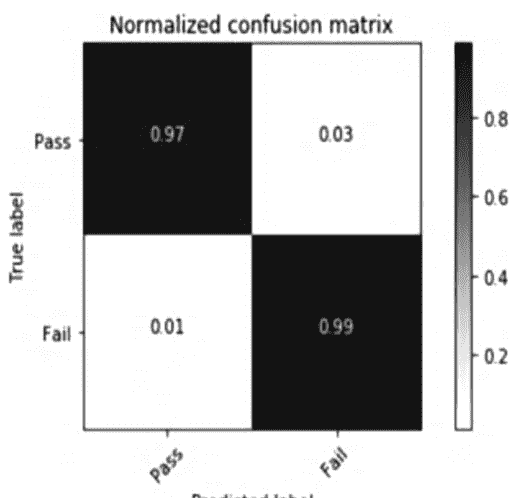

**图 3.1** SVC 特征选择与随机森林分类的归一化混淆矩阵。

同样地，在准备和清理数据集后，我们使用逻辑回归分类器来挑选最佳特征。该分类器检查哪些特征最有可能预测结果，从而帮助我们将数据集缩小到最有用的变量。之后，我们再次使用 SMOTE 平衡数据集。这确保分类器从均匀分布的类别中学习。

平衡数据集作为输入用于训练随机森林分类器。我们使用准确率来衡量分类器性能，并创建归一化混淆矩阵来评估模型的分类能力。通过显示真阳性、真阴性、假阳性和假阴性，这个我们采用归一化进行可视化的混淆矩阵展示了模型区分类别的效果。这种评估让我们清晰了解模型表现，并指出可以改进和优化的领域。逻辑回归特征选择与随机森林分类的归一化混淆矩阵如图 3.2 所示。

在数据集准备和清理之后，决策树模型有助于挑选关键特征。该方法检查不同特征的重要性，从而更容易找出对预测结果影响最大的特征。通过聚焦于最具影响力的因素，得益于所选特征，分类过程变得更加高效和有效。

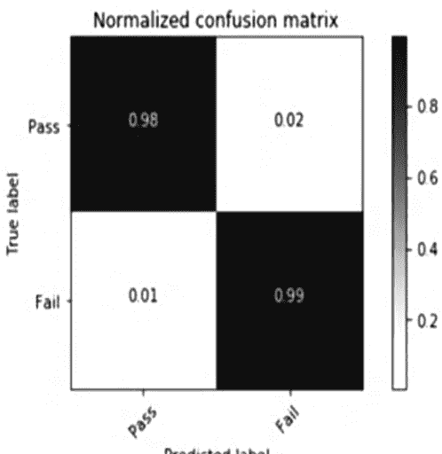

图 3.2 逻辑回归特征选择与随机森林分类的归一化混淆矩阵。


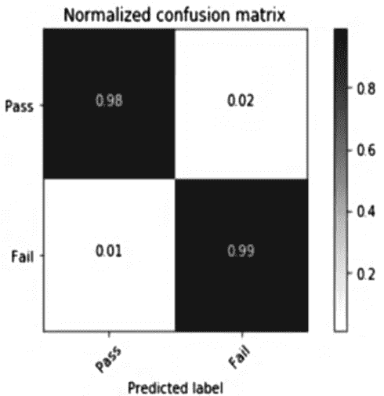

图 3.3 决策树特征选择结合随机森林分类的归一化混淆矩阵。

选定特征后，我们通过使用 SMOTE 对数据集进行均衡处理，解决类别分布不均的问题。这一平衡步骤确保随机森林分类器从每个类别中学习相同数量的样本，这对于构建可信赖且公平的模型至关重要。

随后，我们使用这个平衡后的数据集来训练随机森林分类器。我们使用归一化混淆矩阵来可视化模型的准确性，这有助于我们评估其性能。该矩阵对分类器的表现进行了全面分析，显示了假正例、假负例、真正例和真负例的数量。通过归一化混淆矩阵，我们可以更轻松地比较模型在不同类别上的性能，从而帮助我们识别模型的优势和不足之处。图 3.3 展示了决策树特征选择结合随机森林分类的归一化混淆矩阵。

## 3.11 结果与讨论

利用 SECOM 数据集考察不同的特征选择和分类方法，让我们对其在半导体制造缺陷检测中的有效性有了新的认识。我们应用了 SVC、逻辑回归和决策树来选择特征，然后使用随机森林模型对它们进行分类。这种方法帮助我们深入了解各种技术如何影响性能。

当我们将数据精简到仅包含关键信息，并使用 SVC 来挑选最重要的特征时，随机森林模型的分类能力得到了提升。以直观的方式查看结果表明，该模型擅长区分合格与不合格，这意味着 SVC 特征选择方法改善了模型的性能。通过识别最需要考虑的关键因素，这种方法产生了更可靠的预测。

同样，使用逻辑回归来选择特征也效果不错。在训练所选特征后，随机森林分类器表现出色。混淆矩阵显示了一些错误预测，包括假正例和假负例，但总体来说，分类相当准确。这告诉我们，虽然逻辑回归效果良好，但我们或许可以进一步改进它，以捕捉数据中更微妙的模式。

决策树特征选择方法为我们提供了另一个有益的视角。它根据特征的重要性对其进行排序，这有助于随机森林分类器取得良好效果。混淆矩阵显示，决策树在识别关键方面表现出色。它在正确的正类和负类分类之间取得了良好的平衡。

审视这些不同方法的结果，揭示了每种特征选择方法的优点。基于 SVC 的特征选择在精炼数据集方面做得非常出色，而决策树和逻辑回归则各自带来了各自的益处。每种技术都揭示了可以进行一些调整以提升性能的领域，但也展示了其在提高分类准确性方面的优势。未来，研究人员应专注于探索新的特征选择方法并微调算法，以实现更高的准确率。

## 3.12 结论

关于 SECOM 数据集的特征选择方法与随机森林分类相结合的研究显示，在缺陷检测方面取得了重大改进。SVC、逻辑回归和决策树各自在提升模型效能方面发挥了关键作用。SVC 提供了分类准确率高的精炼数据集，而逻辑回归和决策树也取得了令人满意的结果，各有其优缺点。简言之，该研究强调了选择合适的特征选择方法以获得最佳模型性能的重要性。比较不同方法能提供洞察，表明特征选择在改进故障检测系统方面效果如何。展望未来，未来工作应专注于改进现有方法并探索新方法，以在半导体制造中实现更高的准确性和可靠性。

## 参考文献

- 1. J. Shim, S. Cho, E. Kum, and S. Jeong, “半导体制造中工艺切换的自适应故障检测框架,” Computers & Industrial Engineering, vol. 161, 2021.
- 2. S. Mitra, and C. Koley, “基于散点图驱动混合 CNN-SVM 的实时强健轴承故障检测,” Electrical Engineering, pp. 1–11, 2023.
- 3. T. Schlosser, M. Friedrich, F. Beuth, and D. Kowerko, “使用深度神经网络的混合多阶段系统改进半导体制造中的自动化视觉故障检测,” Journal of Intelligent Manufacturing, vol. 33, no. 4, pp. 1099–1123, 2022.
- 4. M. Glüčina, N. Anđelić, I. Lorencin, and Z. Car, “使用 YOLO 算法检测和分类印刷电路板,” Electronics, vol. 12, no. 3, p. 667, 2023.
- 5. X. Yu, L. Han-Xiong, and H. Yang, “面向图像和标签不确定性的 PCB 缺陷检测协作学习分类模型,” IEEE Transactions on Instrumentation and Measurement, vol. 72, pp. 1–8, 2023.
- 6. T.J. Kutre, S.N. Patil, S. Kore, and V.M. Aparanji, “源自半闪存 ADC 的模数转换器先进架构,” in Distributed Computing and Optimization Techniques: Select Proceedings of ICDCOT 2021, pp. 141–151, 2022.
- 7. I.H. Ozcan, O.C. Devecioğlu, T. Ince, L. Eren, and M. Askar, “使用多通道多级 1D CNN 分类器增强轴承故障检测,” Electrical Engineering, vol. 104, no. 2, pp. 435–447, 2022.
- 8. M. Sen, and C. Gayatri, “FReNG: 使用正则化自然梯度下降的联邦优化,” in Accepted at International Conference on Machine Learning and Applications (ICMLA), December 15–17, 2023.
- 9. K. Xia, Z. Lv, K. Liu, Z. Lu, C. Zhou, H. Zhu, et al., “用于 PCB 表面缺陷检测的带 ConvMixer 预测头的全局上下文注意力增强 YOLO,” Scientific Reports, vol. 13, no. 1, p. 9805, 2023.

# 4 产率提升预测建模

Arpita Pattnaik, Neeraj Gupta, Rashmi Gupta, Arun Kumar Singh 和 Rajkumar Sarma

## 4.1 引言

生产出的无缺陷芯片的百分比称为产率，在繁忙的半导体制造世界中，产率被优化到最高程度。半导体行业不断致力于简化生产流程，以尽可能降低成本和上市时间，并满足对高品质芯片日益增长的需求。然而，实现理想产率是一项艰巨的任务，受到设备性能、材料特性和工艺变化等多种变量的影响。

历史上，统计过程控制 (SPC)、高级过程控制 (APC) 及其他统计技术一直被用于产率改进项目，以跟踪和调整工业流程。这些方法在定位和减少过程变异方面证明是有帮助的，但它们经常忽略了过程变量与产率结果之间存在的复杂关联。

深度学习——人工智能（AI）的一个子领域，汲取了人脑结构和运作的启发——近年来日益重要，并彻底改变了包括半导体生产在内的多个行业。深度学习模型为改善半导体生产中的产率预测提供了一条可能的途径，因为它们能够从海量数据中自动提取复杂关系和模式。随着训练和推理算法变得更加高效，深度学习正在各个学科中找到应用，包括微控制器和数据中心。生成模型和进化算法等深度学习方法正在被用于半导体制造中的许多流程，包括工艺优化、自动光学检测和光掩模制作。由于数据量巨大，详细计算所有工艺步骤的产率是一项极其复杂的任务，需要为蛮力研究投入任意数量的资源，或者采用有效的启发式方法。目前，可以使用历史数据来推断错误发生的频率以及错误之间的关联；不幸的是，并非所有错误、工艺配置和参数组合都有记录。因此，无法不留空白地识别错误 [1]。要在该领域实现 AI 半导体技术的全部潜力，需要克服诸如理解从训练到推理的转变以及优化计算等障碍。


本章探讨了利用深度学习在半导体生产中预测和最大化产量的方法。在一项研究中，主成分分析被用于通过关注非正态分布的测试参数来估算产量 [2]。我们探讨了该方法的基本要素，涵盖数据收集、预处理、模型构建、训练、实施及持续改进。半导体制造商可以通过利用深度学习，深入了解其制造工艺，识别影响产量的变量，并制定有针对性的策略以提高整体产量和生产力。

## 4.2 NEED OF DEEP LEARNING IN YIELD ENHANCEMENT

半导体生产中提高产量的常规方法经过多年建立，结合了工程原理、工艺控制策略和统计方法。这些方法对于保持工艺稳定性、提高整体产量和优化参数至关重要。然而，它们存在多种缺点和局限，可能降低其效果。

### 4.2.1 OVERVIEW OF STATISTICAL PROCESS CONTROL

- 统计过程控制是一种利用统计分析工艺数据来监控和控制制造过程的方法。SPC的一个缺点是，尽管它擅长识别过程中的波动并保持稳定性，但可能无法捕捉工艺参数与产量结果之间复杂的非线性相关性。
- 影响：这一限制可能使发现变量之间的微小依赖关系和交互作用变得更加困难，从而导致工艺优化和产量提升效果不佳。

### 4.2.2 THE DESIGN OF EXPERIMENTS

- 实验设计（DOE）是一种系统方法，旨在通过检查和改进工艺因素来提升产品质量和性能。尽管DOE对工艺优化有帮助，但其性质通常具有被动性，专注于在问题出现后寻找并修复问题。
- 影响：这种被动策略可能会限制主动减少产量损失的能力，从而导致停机时间、废品和返工增加。

### 4.2.3 ADVANCED PROCESS CONTROL

- 高级工艺控制的目标是通过整合传感器、控制算法和工艺模型来调整工艺参数，以维持所需性能。APC系统可能无法处理现代半导体制造技术产生的海量数据。
- 影响：这一限制可能使评估包含多种信息来源的复杂数据集变得更加困难，从而导致可能用于提高产量的重要信息丢失。

### 4.2.4 FAILURE ANALYSIS

- 故障分析，也称为根本原因分析，是对缺陷或故障进行的系统性检查，旨在找出根本原因并防止再次发生。其缺点在于，尽管故障分析对于理解缺陷至关重要，但通常是一个劳动密集且耗费资源的过程。
- 影响：手动分析可能会限制可扩展性和敏捷性，从而阻碍及时的故障预防并延长补救操作时间。

### 4.2.5 OVERVIEW OF PROCESS OPTIMIZATION AND CONTINUOUS IMPROVEMENT

- 为了提高性能和产量，制造工艺必须通过工艺优化持续改进。传统工艺优化方法的缺点在于，它们可能无法预测未来的产量趋势。
- 影响：如果没有预测能力，制造商可能很难实现生产目标并保持稳定的产量。

尽管常规方法在半导体制造行业中仍然是有用的工具，但通过使用机器学习和高级分析等尖端技术将它们结合起来，可以帮助我们绕过一些缺点，并为工艺和产量优化开辟新的可能性。

## 4.3 ADVANTAGES OF DEEP LEARNING FOR YIELD IMPROVEMENT

以下是将深度学习应用于半导体制造中产量提升和预测建模的一些好处。

### 4.3.1 ABILITY TO CAPTURE COMPLEX INTERACTIONS

- 深度学习模型的多层结构使其能够高效地描绘产量结果与工艺参数之间复杂的非线性关系。
- 它们可以发现常规统计技术难以识别的数据中复杂的关联和模式。

### 4.3.2 Feature Learning and Representation

- 不再需要手动特征工程，因为深度学习算法可以从原始数据中自动提取相关特征。
- 获取有意义的数据表示的能力可以带来更可靠、更准确的预测模型。

### 4.3.3 Managing Big Data

- 深度学习模型在处理和解释海量数据集方面表现出色，因此在应对半导体生产中存在的大数据难题方面非常有效。

### 4.3.4 Flexibility

- 深度学习框架为不同数据类型和问题领域提供了高度的灵活性和适应性。
- 由于能够支持大量数据源和格式，半导体制造商能够将来自多个来源的数据纳入其预测模型。

### 4.3.5 Increased Predictive Accuracy

- 在多种应用中，深度学习框架，尤其是其卷积神经网络（CNNs）和循环神经网络（RNNs）等复杂结构，已展现出优于传统统计模型的更高预测精度。
- 这种更高的精度可以带来更准确的产量预测，并在半导体制造行业中实现更好的决策。

### 4.3.6 Real-Time Prediction

- 通过持续分析制造过程中的传入数据，深度学习框架可以实时用于生成及时的产量-质量预测。
- 主动决策和及时干预使得优化工艺参数和避免产量损失成为可能。

### 4.3.7 Identification of Anomalies and Abnormalities

- 深度学习模型可以被训练以发现半导体制造过程中的过程偏差、材料缺陷和设备故障等异常和异常情况。
- 通过早期发现这些问题，可以最大限度地减少生产中断并避免产量损失。

### 4.3.8 EFFICIENCY AND SCALABILITY

- 深度学习模型在训练后具有可扩展性，可以在制造设施中大规模部署。
- 这使得许多生产线和地点能够进行可靠的产量预测。由于其可扩展性，半导体制造商可以利用预测建模在整个业务中提高产量。

半导体制造商可以通过利用深度学习，深入了解其制造工艺，识别影响产量的变量，并制定有针对性的策略以提高整体产量和生产力。使用计量数据对产量进行分类的现有方法强调应对类别不平衡和填补缺失数据 [3]。大多数现实问题都需要使用高级分析 [4]，以便开发深思熟虑且智能的解决方案来满足当前需求。因此，利用机器学习和深度学习方法的分析AI对于AI驱动的计算和系统的发展可能至关重要。

## 4.4 FUNDAMENTALS OF DEEP LEARNING

理解深度学习的基础对于充分发挥其在半导体生产中提高产量的潜力至关重要。让我们更详细地探讨每个主要概念。

### 4.4.1 NEURAL NETWORKS

- 神经网络的基本架构是按层排列的节点链接网络。输出层生成模型预测，隐藏层执行计算，输入层接收原始数据。激活函数为网络提供非线性，并使其能够模拟数据中的复杂相关性；非线性函数应用于每个神经元的输出。常见激活函数的示例包括Tanh、sigmoid和ReLU（整流线性单元）。在训练阶段，权重和偏置是与神经元之间连接相关的参数，会被调整以减少预期结果与观测结果之间的差异。
- 梯度提升机（GBMs）已成为半导体制造、工艺条件优化和材料选择中的强大工具。在概率估计、不确定性估计和预测性能方面，这些机器学习模型通常优于深度神经网络。GBMs尤其擅长诸如半导体制造不同阶段（如光刻、蚀刻和沉积）的工艺条件优化等任务。寻求提高产量和降低变异性的工艺工程师可以从其提供精确预测和可靠不确定性估计的能力中获益良多。


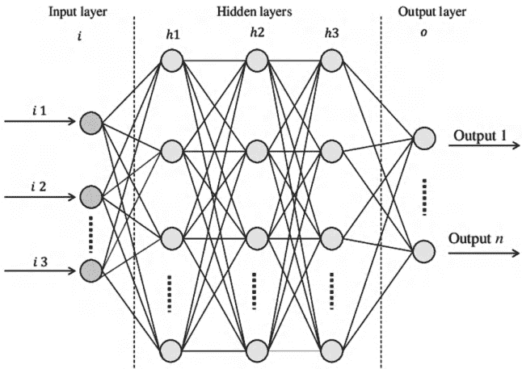

图 4.1 FNN 架构。
来源：版权所有 © www.researchgate.net.

### 4.4.2 深度学习架构

- **前馈神经网络：** 前馈神经网络（FNN）是最基本的神经网络类型，数据仅从输入单向流向输出，没有循环或环路。它们适用于分类和回归应用。图 4.1 显示了 FNN 架构。

- **卷积神经网络：** CNN 专门设计用于处理类似网格的信息，如照片。卷积层、池化层和全连接层构成其结构，使其能够记录空间中的模式和层次结构。图 4.2 描绘了 CNN 架构。

- **循环神经网络：** RNN 旨在处理具有时间依赖性的序列数据。由于具有反馈循环，可使信息随时间延续，因此适用于时间序列分析和自然语言处理预测等应用。图 4.3 显示了 RNN 架构。

- **长短期记忆（LSTM）网络：** LSTM 网络是一种使用记忆单元解决梯度消失问题的 RNN 设计。可通过 LSTM 学习长短期依赖关系，广泛用于序列任务。

- **Transformer 模型：** Transformer 模型是深度学习架构的新发展，主要应用于自然语言处理相关挑战。Transformer 利用自注意力机制，能高效捕获序列数据中的全局关系。

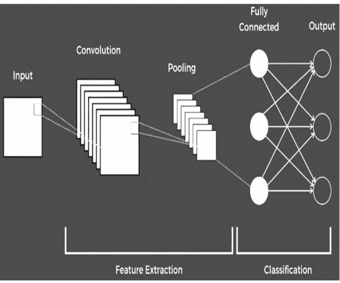

图 4.2 CNN 架构。
来源：版权所有 © medium.com.

### 4.4.3 深度学习的指令模型

- 将输入数据通过网络传输以计算预测的过程称为前向传播。每一层在使用自身权重和偏置进行计算后，将结果传递给后续层。

- 反向传播是一种根据预期结果与实际结果之间的差异来调整模型权重和偏置的方法。它涉及计算损失函数对每个参数的梯度，并使用 Adam 或随机梯度下降（SGD）等优化方法对其进行修改。

- 损失函数是客观函数，用于表达实际结果与预测结果之间的差异程度。交叉熵损失是分类应用中常用的损失函数，而均方误差（MSE）则用于回归任务。

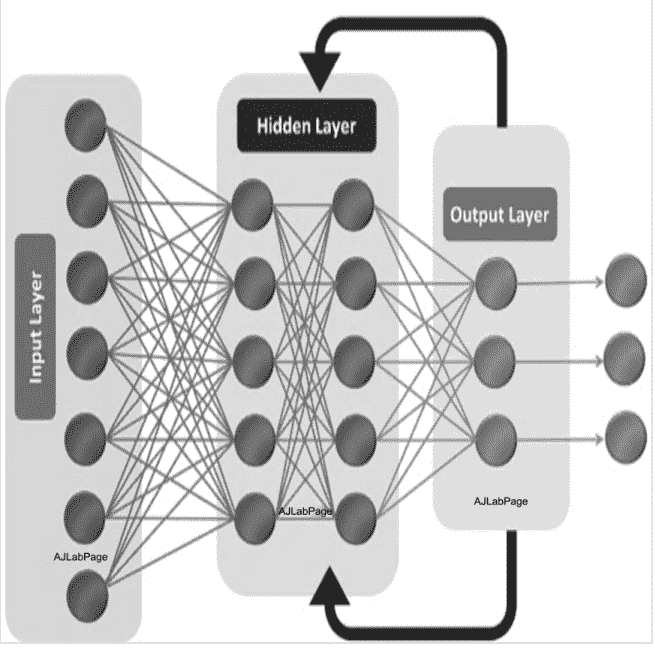

图 4.3 RNN 架构。
来源：版权所有 © www.researchgate.net.

#### 循环神经网络

### 4.4.4 调整超参数和模型

- 学习率：它管理更新参数时的步长。选择合适的学习率对有效训练和收敛至关重要。

- 批量大小：批量大小决定每次训练迭代中处理的样本数量。它既影响内存需求，也影响训练过程的稳定性。

- 神经元数量和层数：神经网络的架构（包括层数和每个神经元所在的层）会影响网络识别复杂关系和模式的能力。

- **正则化方法：** 批量归一化、丢弃法和 L1/L2 正则化等技术有助于防止过拟合并增强框架的泛化能力。

### 4.4.5 模型评估与验证

通常，数据被划分为多个子集用于测试、验证和训练。训练集用于训练模型，监控性能，调整验证集的超参数，并在测试集上评估最终模型的有效性。深度学习模型在分类和回归任务中的性能使用多种指标衡量，包括准确率、精确率、召回率、F1 分数和平均绝对误差（MAE）。广泛的知识类别（包括程序性知识、元知识、结构性知识、描述性知识和启发性知识）可应用于不同的应用领域 [5]。

### 4.4.6 模型利用与解释

深度学习模型可部署在多种平台上，例如嵌入式系统、边缘设备和基于云的服务。使用训练好的模型对新的、未见过的数据进行预测称为推理。这是使用训练好的模型处理输入数据并生成预测输出的过程。可使用多种知识表示技术（例如逻辑、语义、网络、帧和产生式规则）开发基于知识的概念模型 [6]。

## 4.5 数据收集与预处理

在探索面向基于深度学习的预测建模的半导体良率提升中的数据收集与预处理时，深入理解相关流程至关重要。以下是详细说明。

- **数据收集：** 在半导体制造过程中，各种传感器监测温度、压力、流量、化学品浓度及其他特性等传感器数据。传感器类型包括流量计、热电偶、压力传感器和光谱设备。

- **数据粒度：** 根据工艺不同，传感器数据通常以固定间隔收集，间隔可从毫秒到分钟不等。

- **数据来源：** 制造设备提供这些数据，随后将其收集并存储在数据库、历史存储库和数据仓库中。

- **设备日志：** 半导体制造中使用的机器生成的日志记录了有关性能、维护和运营的数据。日志类型包括事件、警报、配方和设备状态日志。

- **数据形式：** 日志可能以 XML、CSV 或特定于某些设备制造商的其他专有格式存储。

- **数据清洗：** 日志通常包含噪声和无关信息，需要进行预处理以从中提取相关特征。

- **检测和计量结果：** 使用计量仪器和检测系统评估半导体晶圆和芯片的质量和完整性。数据类型示例包括关键尺寸测量、缺陷计数、缺陷图和晶圆图。

- **数据集成：** 为进行全面分析，检测和计量数据必须与其他工艺数据结合。

- **对齐：** 为使晶圆图和缺陷图与工艺数据匹配，可能需要进行对齐和注册。

- **历史信息：** 可使用之前制造运行的历史数据有效训练预测模型。

- **数据质量：** 历史数据可能包含缺失值、不一致信息或过时信息，因此需要仔细预处理。

- **数据预处理：** 这包括清理数据和处理缺失值。根据缺失值的类型，使用插补、删除或插值等方法。

- **异常值移除和检测：** 此步骤涉及查找并消除可能扭曲分析或建模过程结果的异常值。

- **噪声降低：** 低通滤波器或移动平均等方法可从传感器数据中移除噪声。

- **缩放和归一化：** 为确保一致性并在模型训练期间提高收敛性，将数值特征缩放并归一化到标准范围（例如 [0, 1]）。

- **标准化：** 为考虑标度和方差的差异，将特征调整为标准差为 1 且均值为 0。

- **降维：** 在特征工程中，使用降维方法（如特征选择或主成分分析），通过减少数据集的维度来聚焦于最相关的特征。

- **时间序列特征：** 从时间序列数据中提取时间元素，包括移动平均值、滞后值和趋势标记。

- **特定领域特征：** 以半导体生产流程和领域知识为重点对特征进行工程设计。

- **数据集成：** 确保各种数据源（例如传感器数据、设备日志和计量结果）相互一致且对齐，以实现有洞察力的分析和准确建模，这一点至关重要。

- **连接和聚合：** 使用相关键或 ID 合并来自多个来源的数据，数据必须在所需的粒度（例如晶圆级、批次级）上进行组合。


- **数据分割：** 为了有效评估模型性能，数据集必须划分为用于测试、验证和训练的不同子集。
- **基于时间的分割：** 为了防止数据泄漏并评估模型泛化能力，必须考虑时间依赖性，将数据划分为按时间顺序排列的块。
- **数据增强：** 为了提高模型的鲁棒性和泛化能力，可以通过旋转、翻转或添加噪声来生成更多训练数据。

构建用于半导体生产良率提升的准确可信的预测模型需要有效的数据收集和预处理。从业人员可以通过仔细选择和准备数据，确保其模型在高质量数据上训练，并能够捕捉制造过程中的相关模式和相关性。

## 4.6 模型开发与训练

在半导体生产中使用深度学习进行预测建模需要深入理解模型构建和训练阶段。现在让我们更详细地了解这些过程。

- **模型开发：** 明确预测模型的目标以及问题陈述。在半导体制造中，良率提升可能涉及工艺异常检测、生产参数优化或缺陷发生预测。
- **数据准备：** 编译并准备训练模型所需的信息。这包括从各种来源收集信息（包括传感器、设备记录和检测结果），然后执行特征工程、数据标准化和数据清洗。
- **模型选择：** 根据数据类型和手头的问题，选择合适的深度学习架构。常见架构的示例包括 Transformer 框架、RNN、前馈神经网络和 CNN。
- **架构设计：** 描述神经网络的设计，考虑层数、层类型（如循环层和卷积层）以及每层使用的激活机制。
- **模型训练：** 将数据集划分为用于测试、验证和训练的不同部分。验证集用于跟踪性能和超参数调整，测试集用于评估最终框架的性能，训练集用于更新模型参数。
- **损失函数选择：** 根据预测模型任务的要求，选择合适的损失函数。MSE 和 MAE 是回归任务中常用的损失函数；交叉熵损失常用于分类问题。
- **超参数调整：** 为了最大化模型性能，调整超参数，包括学习率、批次大小、时代数和正则化参数。为确定理想的超参数集，采用自动化超参数优化方法、随机搜索或网格搜索等策略。
- **训练过程：** 使用前向传播计算训练集的预测。使用反向传播计算损失函数相对于模型参数的梯度。然后使用 Adam、RMSprop 或 SGD 等优化算法更新参数。可以使用训练损失和验证损失等指标来跟踪训练进度并识别过拟合或欠拟合的实例。
- **正则化：** 为了避免过拟合并增强框架的泛化能力，使用批量归一化、丢弃和 L1/L2 正则化等正则化策略。
- **早停：** 在模型在验证集上表现时，在训练过程中监控其过程，并在性能恶化（表明过拟合）时停止模型。为避免过拟合，保存对应于最低验证损失的模型参数。
- **模型评估：** 使用合适的评估指标（如准确率、精确率、召回率、F1 分数或 MAE）在测试集上评估最终训练的模型。通过将模型在训练集和验证集上的性能与测试集进行比较，评估其泛化能力。
- **迭代改进：** 根据模型评估的见解和领域专家的反馈，对模型构建和训练过程进行迭代。

为了提高模型的鲁棒性和性能，尝试各种预处理方法、超参数和架构。从业人员可以通过仔细遵循这些步骤来开发和训练能够准确捕捉半导体制造数据中复杂关系并预测良率结果的深度学习模型，从而显著提高生产效率和产品质量。

## 4.7 预测模型部署

要在半导体制造中使用预测模型，开发环境必须让位于生产环境，同时保持实时性能、可扩展性和可靠性。以下是部署程序的详细概述。

### 4.7.1 基础设施配置

- **硬件需求：** 确定支持模型部署所需的硬件，例如服务器、图形处理单元或用于深度学习推理的专用硬件加速器。
- **软件栈：** 安装所需的软件栈，应包括任何额外的监控和管理工具、数据预处理和模型服务库（如 TensorFlow Serving、TorchServe）以及深度学习框架（如 TensorFlow、PyTorch）。

### 4.7.2 模型打包

- **模型序列化：** 将训练好的深度学习框架序列化为可用于部署的格式，例如 TensorFlow 的 SavedModel 格式或 PyTorch 的 TorchScript 格式。
- **依赖项管理：** 确保模型部署时包含所有必要的依赖项，例如 Python 包、深度学习框架和自定义库。

### 4.7.3 模型部署

- 使用模型服务框架或平台，将序列化的模型部署到生产环境。这可能涉及将模型作为 Docker 容器、RESTful API 或云提供商推理服务投入使用。
- **可扩展性：** 确保部署基础设施具有足够的扩展能力，以满足不断变化的推理请求需求并处理各种工作负载。

### 4.7.4 生产系统集成

- 建立实时数据摄入系统，例如设备日志、传感器数据流和检测结果。在将数据提供给部署的模型之前进行预处理。
- **制造系统集成：** 为了促进顺畅的数据流和决策，将预测模型与当前的生产流程和系统集成，例如生产执行系统、过程控制系统和质量管理系统。

### 4.7.5 监控与记录保存

- **监控模型性能：** 使用监控工具实时监控部署模型的性能，跟踪错误率、延迟、吞吐量和资源使用率等变量。
- **日志记录与审计：** 为了帮助调试、审计和故障排除，记录推理请求和响应，以及时间戳、输入数据和模型预测等元数据。

### 4.7.6 安全与合规

- **数据安全：** 使用安全通信协议、访问控制和数据加密来保护发送到和来自部署模型的私人信息。
- **合规性：** 验证部署是否符合与数据安全、隐私和质量控制相关的法律要求以及行业标准，包括 ISO 27001、GDPR、HIPAA 和 SEMI 标准。

### 4.7.7 持续检查与维护

- **性能优化：** 为了随时间提高准确性和效率，监控部署框架的执行情况，调整超参数、更改模型架构，或使用新数据重新训练框架。
- **容错能力：** 使用冗余、故障转移和自动扩展等技术，以保持系统韧性并优雅地管理故障。
- **版本控制与回滚：** 跟踪已部署模型的版本，并建立方法以便在出现意外问题或性能下降时回滚到早期迭代。

### 4.7.8 用户培训与支持

- **用户培训：** 教导操作员、工程师和决策者等最终用户理解模型预测，将其纳入工作流程，并使用模型的洞察做出明智的决策。
- **记录保存：** 为了最大限度地提高已部署模型的实用性，创建涵盖使用说明、部署方法、故障排除步骤和最佳实践的详细文档和用户指南。

半导体制造商可以通过遵循特定指南和最佳实践，在生产环境中有效实施预测模型，从而促进数据驱动的决策，简化制造流程，并提高良率和产品质量。

## 4.8 评估指标与性能分析

性能分析和评估措施是评估半导体生产中预测模型的有效性和可靠性的重要组成部分。以下是对这些要素的全面审查。

### 4.8.1 分类指标

在半导体制造中，缺陷检测或质量控制等任务以及分类指标对于评估预测框架的有效性至关重要。模型的准确率（即恰当识别的事件比例）对模型性能进行了高级别总结。精确率衡量模型对假阳性的抵抗力，在误报代价高昂的情况下至关重要。召回率，也称为灵敏度，量化了模型的能力


检测每一个正例；这一点在降低假阴性至关重要时尤其重要。当精确率和召回率之间存在不平衡时，F1 分数（即二者的调和平均数）能够平衡两者，并非常有用。

### 4.8.2 回归指标

回归指标在半导体制造行业中非常有用，可用于工艺参数估算和良率预测等活动。MAE 衡量模型误差的平均大小，清晰地反映预测的准确性。MSE 对较大误差惩罚更严重，计算实际值与预测值之间平方差异的平均值。由于其表达单位与目标变量相同，源自 MSE 的均方根误差（RMSE）因其可解释性而被广泛采用。

### 4.8.3 额外指标

接收者操作特征（ROC）曲线和精确率-召回率曲线是超越典型指标、能够更深入洞察模型性能的两种额外工具，尤其适用于二分类任务。ROC 曲线下面积（即 AUC-ROC）将这种性能浓缩为一个标量数值，而 ROC 曲线则展示了真正率和假正率在不同决策阈值下的取舍。相比之下，精确率-召回率曲线提供了对精确率和召回率之间权衡的详细理解，在不平衡数据集中尤其有用。

### 4.8.4 性能分析

为评估模型的可靠性并找出亟待改进的领域，交叉验证、模型比较和误差分析等性能分析技术至关重要。交叉验证通过将数据集划分为不同子集用于训练和测试，提供关于稳定性和鲁棒性的见解，帮助估计框架的泛化能力。通过模型比较，从业者可以确定哪个模型在测试或验证数据上表现最佳。另一方面，误差分析探究模型犯错的种类和趋势，为后续的迭代和改进提供指导。

## 4.9 案例研究与应用

本节介绍了案例研究，以及如何利用预测建模提高半导体生产的良率。

### 4.9.1 缺陷识别与分类

在半导体制造过程中，预测建模方法被广泛用于缺陷识别和分类。

预测模型能够通过检查传感器数据、计量结果和检测图像，识别和分类半导体晶圆或芯片上的多种缺陷，例如颗粒物、划痕或异常图案。为了理解暗示缺陷的复杂模式和特征，这些模型采用了像 CNN 这样的深度学习架构。这使得主动质量管理成为可能，并最大限度地减少良率损失。

### 4.9.2 工艺控制与优化

预测建模对于调节关键参数、简化制造流程以提高半导体生产的良率至关重要。预测模型可以通过检查历史工艺数据和设备日志，确定最佳工艺条件、预测设备故障或维护需求，并提出改进建议以提高良率和生产率。这些模型使用强化学习和时间序列分析等方法，动态优化工艺参数并适应不断变化的生产环境。

### 4.9.3 预测性维护

这是半导体行业中预测建模的一个重要应用，旨在通过在设备故障发生前预见故障，最大限度地提高设备运行时间并最大限度地减少停机时间。预测模型可以通过评估传感器数据、设备日志和维护记录，预见设备故障、识别异常行为，并提前规划维护任务。通过使用 RNN 或支持向量机等机器学习方法来识别暗示设备故障或退化的趋势，这些模型实现了预测性维护流程，并最大限度地减少非计划停机时间。

### 4.9.4 良率预测与优化

良率预测与优化是半导体制造过程中的基本目标，因为即使良率的微小提升也能带来显著的经济效益。为估算良率并找出改进领域，预测模型会考察多种影响良率的因素，如材料特性、环境因素和工艺参数。为了估算良率依赖关系、优化工艺参数并减少变异性，这些模型采用统计方法、机器学习算法和优化方法。这最终提高了总良率和盈利能力。

### 4.9.5 故障检测与根本原因分析

预测建模在半导体制造的故障检测和根本原因分析过程中发挥关键作用，帮助识别和缓解影响良率和产品质量的问题。预测模型扫描传感器数据、设备日志和历史性能数据，以识别异常及其根本原因，并提出补救措施。这些模型利用专家系统、因果推断方法和异常检测算法来识别故障位置、理解其根本原因，并应用有针对性的修复措施，从而提高工艺良率和稳定性。

这些案例研究和应用表明，预测建模方法在提高良率、简化工作流程和保障产品质量方面具有多大的灵活性和实用性。芯片制造商可以通过利用高级分析、机器学习算法和领域专业知识，获得新的洞察，促进运营卓越，并在市场上保持竞争优势。

## 4.10 未来方向与新兴趋势

探讨半导体制造良率提升领域中预测建模的可能方向和趋势，能够为可能塑造行业的未来发展和进步提供有价值的信息。以下是详尽的概述。

### 4.10.1 先进深度学习架构

预计，深度学习架构的未来进步将彻底改变半导体制造中的预测建模。对胶囊网络、注意力机制和图神经网络等复杂结构的进一步研究，有望提高捕捉制造数据中复杂关系和依赖性的效率。这些设计可能实现更可靠、更准确的预测模型，特别是对于涉及高维和多样化数据源的任务。

### 4.10.2 可解释人工智能

为提高模型的可解释性和透明度，随着 AI 驱动的决策在半导体制造中越来越普遍，可解释人工智能（XAI）技术正变得越来越必要。未来的研究工作将集中于开发 XAI 技术，以帮助利益相关者理解、验证并信任预测模型的输出。注意力机制、特征重要性分析和与模型无关的解释技术是推动半导体制造中 XAI 发展的一些关键技术。

### 4.10.3 特定领域数据增强

一个关键的研究领域将是开发适合半导体制造行业的特定领域数据增强方法。这些方法旨在缓解数据稀缺问题、提高模型泛化能力，并生成模拟实际制造环境的合成数据。未来，通过利用特定领域增强技术、变分自编码器和生成对抗网络，有可能为训练预测模型生成具有代表性和多样性的数据集。

### 4.10.4 多模态数据融合

在半导体生产预测建模中，融合传感器、图像和文本记录等多模态数据源将变得更加普遍。后续研究将集中于制定多模态数据融合策略，以全面审视和模拟复杂的制造流程。迁移学习、融合架构和多任务学习等方法将更容易整合异构数据源，提升预测建模能力。

### 4.10.5 联邦学习与边缘计算

这两个概念将成为在半导体制造环境中实现预测模型的突破性工具。边缘计算通过在制造车间实现实时推断和决策，降低了延迟并提高了响应能力。联邦学习在不交换敏感数据的情况下，使跨分散边缘设备的协作模型训练成为可能，从而保持数据安全和隐私。未来，通信协议、联邦学习算法和边缘计算基础设施的发展，将使半导体生产中的去中心化预测建模成为可能。

### 4.10.6 数字孪生技术

在半导体生产中，数字孪生技术将是实现仿真驱动优化和预测建模的关键。数字孪生是实际制造过程的虚拟副本，为实时生产系统监控、分析和改进提供了一个平台。未来，预测模型将集成到数字孪生环境中，从而为良率提升、场景分析和预测性维护提供主动决策支持。

### 4.10.7 量子计算应用

半导体制造中的预测建模是一项计算需求极高的过程，量子计算有可能彻底改变这一过程。量子机器学习和量子优化中使用的量子算法等，提供了指数级更快计算的潜力，应能使模型训练、优化和推断更加高效。后续研究将探讨量子计算在半导体制造中的实施可行性，解决与硬件可扩展性、误差减少和算法开发相关的挑战。


### 4.10.8 伦理与监管考量

这些问题将随着预测建模在半导体生产行业的广泛应用而日益凸显。未来项目的主要目标将是建立数据治理、算法透明度以及半导体生产中负责任的人工智能部署的最佳实践、标准和指南。鼓励预测建模技术的正确使用并解决伦理问题，需要学术机构、监管机构和行业参与者的合作。

半导体制造商可以通过拥抱这些新方向和趋势，充分利用预测建模来提高良率、简化运营并推动行业创新。半导体制造的预测建模能力将因持续的研究、团队合作和技术突破而经历革命性变化。

## 4.11 结论

总体而言，良率提升预测正变得更加准确，预示着半导体生产的一场革命。得益于尖端技术、创新方法和领域专业知识的结合，预测建模已成为半导体生产设施中工艺优化、产品质量改进和运营效率的关键部分。

这项研究揭示了预测建模在半导体制造多个不同方面所起的关键作用。预测模型已证明其能够解读复杂模式、提取可操作的洞察，并为决策者提供驾驭当代半导体生产复杂性所需的远见。这些洞察已应用于缺陷检测与分类、工艺优化、预测性维护及良率预测等其他应用。此外，由于数据点数量较少，本工作未考察深度学习模型；尽管如此，它们必须纳入后续研究 [7]。展望未来，很明显预测模型在半导体制造中的发展轨迹将继续演变。将改变游戏规则并为创新与发现铺平道路的新兴趋势包括可解释人工智能（XAI）、边缘计算和领域特定的数据增强。

但在围绕技术进步的所有兴奋之中，强调伦理问题、法律合规和适当的人工智能部署至关重要。随着预测建模的普及，维护伦理规范、保护数据隐私和保证算法透明度对于建立合作、信任以及持久的创新与进步生态系统至关重要。

半导体制造中良率提升预测建模的历程，本质上是三个从未停止追求卓越之人的故事。预测建模宛如一座灯塔，指引我们穿越半导体行业的迷宫，指向一个未来：在那个未来中，质量、效率和精度将协同工作，不断突破可能的边界。

## 参考文献

1. Melhem, M.; Ananou, B.; Ouladsine, M.; Combal, M.; Pinaton, J. 基于告警数据的产品质量预测：应用于半导体制造过程。在 2017 年第 25 届地中海控制与自动化会议（MED）论文集中，2017 年，第 1332–1338 页。https://doi.org/10.1109/MED.2017.7984303.

2. Kovacs, I.; Topa, M.; Buzo, A.; Pelz, G. 半导体质量分析中多变量非正常数据的精确良率估计方法。在 2017 年第 14 届综合、建模、分析与仿真方法及其在电路设计中的应用国际会议（SMACD）论文集中，IEEE，意大利贾尔迪尼纳克索斯，2017 年 6 月 12 日，第 1–4 页。

3. Lee, D.-H.; Yang, J.-K.; Lee, C.-H.; Kim, K.-J. 考虑缺失与不平衡数据的半导体制造过程选择过程步骤的数据驱动方法。J. Manuf. Syst. 2019, 54, 146–156.

4. Sarker, Iqbal H. 数据科学与分析：从数据驱动的智能计算、决策和应用角度概述。SN Comput. Sci. 2021, 20, 21.

5. Sarker, I.H.; Hoque, M.M.; Uddin, M.K.; Alsanoosy, T. 移动数据科学与智能应用：概念、基于人工智能的建模及研究方向。Mob. Netw. Appl. 2020, 26, 285–303.

6. Stephan, G.; Pascal, H.; Andreas, A. 知识表示与本体论。Semant. Web Serv. Concepts Technol. Appl. 2007, 20, 51–105.

7. Dou, Z.; Sun, Y.; Zhang, Y.; Wang, T.; Wu, C.; Fan, S. 区域制造业需求预测：一种深度学习方法。Appl. Sci. 2021, 11, 6199.

# 5 半导体检测中图像分类的深度学习

Vanshika Jain, Rashmi Gupta, Neeraj Gupta, Prashant Kumar and Rajat Butola

## 5.1 引言

半导体代表了现代技术的支柱，是制造技术中的关键组件。因此确保其完美生产至关重要——尤其是在当前普遍存在的半导体短缺背景下。理想情况下，半导体晶圆的缺陷检测技术应将晶圆作为一个整体来考虑。当发现缺陷时，通常会将其记录在晶圆容器映射（wafer bin map）上，以发现存在多少相似缺陷以及它们是否集中在晶圆整个表面的某些区域。这种方法能有效识别系统性缺陷，并允许在制造过程中提前剔除不良产品。然而，它不足以提供区分多种缺陷类型所需的详细信息。

本章的主要目的是超越仅确定缺陷位置的任务，更多地关注根据缺陷类型对缺陷进行分类。这项工作至关重要，因为它有助于确定那些可能不会使产品完全报废的错误。由于缺陷可以分组，因此可以适当响应以回收仍可销售的优质芯片，从而充分利用资源并减少损失。为此，对半导体芯片图像进行了分析。这些图像来自晶圆上单个芯片的高分辨率照片，能提供半导体领域的显微视图，并了解缺陷的类型和程度。图 5.1 展示了半导体芯片图像中的缺陷分类。

半导体晶圆的制造是一个复杂而精细的过程，因为它由众多相互关联的阶段组成。从硅晶体的生长到晶体管结构的微制造，每一个工艺过程都需要纪律与控制以满足既定质量要求。此外，半导体制造过程本身就非常复杂，加上构成电子设备的部件至关重要，由此可见需要广泛的质量管理方法。

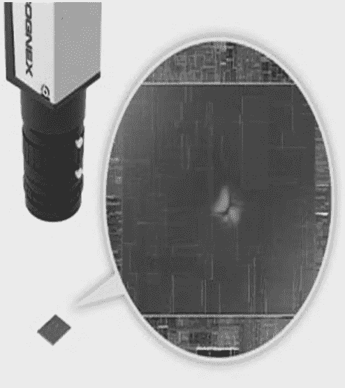

图 5.1 使用半导体芯片图像的缺陷分类。
来源：版权所有 © Cognex Corporation，“芯片表面检测。” Cognex。www.cognex.com/industries/electronics/semiconductors/die-surface-inspection.

由于半导体生产需求不一，各种检测方法在生产的所有阶段都被使用。这些技术可以分为涵盖对象宏观分析和微观分析的广泛策略。例如，电气测试和微波分析提供功能性能信息，而光学相机和扫描电子显微镜（SEMs）有助于分析纳米级特征。然而，由于这些技术各不相同，在缺陷识别和分类方面存在某些问题，因此需要一种统一的方法，既能发挥各技术的优势，又能避免其不足。借助数据分析和机器学习算法以及基于人工智能（AI）的方法，可以增强缺陷检测操作；这将有助于在整个半导体制造过程中保持高质量控制。图 5.2 展示了生产不同阶段的缺陷。

## 5.2 半导体制造和检测的演变

半导体制造和检测方法可以描述为随着新技术不断发展的渐进进步。这种


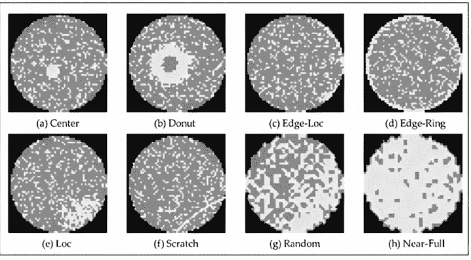

图 5.2 展示了生产过程中的半导体晶圆缺陷。

来源：版权所有 © M. Saqlain, Q. Abbas, 和 J. Lee，“基于不平衡数据集的半导体制造工艺中晶圆缺陷识别的深度卷积神经网络,” IEEE Trans. Semicond. Manuf., vol. 33, no. 3, pp. 436–444, 2020. https://doi.org/10.1109/TSM.2020.2994357.

这种进步通过为生产更复杂的芯片铺平道路，对半导体行业的发展起到了推动作用。以下是塑造当前行业状态的关键里程碑和进展的详细概述：

### 1. 早期半导体制造技术
- 当半导体制造还处于初级阶段时，它主要是一种手工且原始的工艺。晶体管和早期集成电路（IC）是使用光刻和化学蚀刻等技术制造的。
- 铜通常被用作半导体材料，但由于硅的丰富性和有利的半导体特性，硅更受青睐。

### 2. 洁净室环境的引入
- 洁净室技术在 20 世纪 60 年代正式化，尽管这是它首次被引入半导体生产的时期。洁净室是设计为空气中颗粒物水平较低的环境，因为这对于保护半导体材料非常重要。
- 洁净室分类仍然是动态的，因为过滤、通风和污染控制系统在不断改进。

### 3. 光刻技术的进步
- 光刻成为硅晶圆上半导体器件领域的关键技术工艺。在光刻初期，晶圆被涂上一种称为

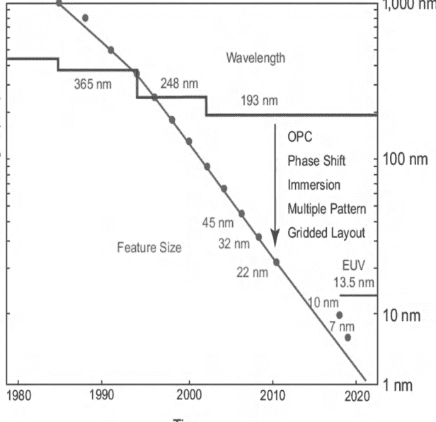

图 5.3 IC 特征尺寸和光刻技术的历史演进。

来源：版权所有 © Newport Corporation，“光刻概述。” Newport. https://www.newport.com/n/photolithography-overview.

光刻胶的感光材料，通过掩膜板曝光，然后进行化学蚀刻以复制图案。
- 后来，深紫外光刻和极紫外光刻等光刻工艺的改进使得制造精细特征和更多晶体管成为可能。图 5.3 描述了 IC 特征尺寸和光刻技术的历史演进。

### 4. 工艺集成的引入
- 在 20 世纪 70 年代，将不同制造步骤合并为一个流畅工艺的理念开始变得重要。这种方法通过将许多复杂部件组合在一起，有助于制造更先进的电子元件。
- 工艺集成包括将表面覆盖材料、切除部分和添加特定材料等步骤。这有助于在电子中使用的硅片上创建详细部件和连接。

### 5. 晶圆步进机和扫描仪的引入
- 晶圆步进机和扫描仪改变了半导体的制造方式，允许一次性曝光晶圆的整个表面，从而加快工艺速度并生产更多芯片。
- 步进机和扫描仪使用特殊透镜和精密系统，将电路设计准确且一致地放置在硅晶圆上。

### 6. 半导体计量和检测工具的出现
- 随着半导体器件中零部件尺寸的不断缩小，拥有精确的测量和检查工具变得非常重要。扫描电子显微镜（SEMs）、原子力显微镜（AFMs）和光学检测系统等工具现在对于观察半导体的微小部件并发现任何微小错误都是必不可少的。
- 这些工具帮助半导体制造公司检查其器件尺寸，发现任何错误，并确保整个生产过程中一切都正确制造。

### 7. 高级工艺控制系统的集成
- 高级工艺控制（APC）系统使用数据分析和机器学习算法，实时检查、分析和优化半导体制造工艺。APC 系统使半导体制造商能够实现一致的产品质量并最大化良率。
- APC 系统集成了传感器、执行器和反馈机制，以调整工艺参数并保持最佳性能。

### 8. 计算光刻的兴起
- 计算光刻已成为先进半导体图形化技术的关键推动者。通过利用计算模型和算法，半导体制造商可以模拟和优化复杂的光刻工艺，以实现更高的分辨率和图案保真度。
- 计算光刻对于设计和制造特征尺寸更小、晶体管密度更高的下一代半导体器件至关重要。

### 9. 缺陷审查和分类系统的引入
- 随着半导体器件变得更加复杂，对更好的缺陷审查和分类系统的需求日益增长。这些系统使用机器学习算法和图像分析技术，准确检测、分类和分析半导体晶圆上的故障。
- 缺陷审查和分类系统使半导体制造商能够快速诊断故障、优化工艺参数并提高产品质量。

### 10. 工业 4.0 技术的集成
- 工业 4.0 原则，如自动化流程、连接性和基于数据的决策，正在使半导体制造变得更加高效和灵活。先进的机器人技术、物联网设备和基于云的分析平台正在重新定义半导体制造设施的运作方式。
- 工业 4.0 技术使预测性维护、实时工艺优化和自适应制造策略成为可能，提高了半导体制造的生产率、灵活性和质量。

## 5.3 半导体检测面临的挑战

半导体检测面临多项挑战，这些挑战与企业的创新驱动及半导体尺寸不断缩小密切相关。首要挑战是半导体设计复杂性的提升。每一次半导体代际跃迁都会使 IC 转变为越来越复杂的结构，其特征是层数更多、特征尺寸更精细、公差更严格。因此，错综复杂的网络带来了限制，雄心勃勃的检测方案必须突破这些限制，以准确捕捉多层和交织部件中的任何故障或偏差 [1]。

此外，由于制造业对高产量的不懈需求，检测过程又增加了一层复杂性。半导体设施以惊人的速度运行，由对半导体的无限需求所驱动。因此，检测系统应能够轻松且准确地处理大量晶圆或芯片。在工业运行速度较慢时曾足够使用的经典检测技术，已无法跟上当今快节奏的生产线。因此，有必要开发自动化检测工具。

此外，对于半导体制造商来说，在保持高质量的同时实现更高的良率，将继续是制造出符合关键计算和通信应用所需性能和可靠性的产品方面最具挑战性的方面之一。改善良率的需求是保持半导体企业高度竞争力并在竞争激烈的市场中维持健康盈利能力的关键因素。随着半导体器件变得更加复杂，这一需求也变得更加具有挑战性。半导体检测通过缺陷识别和表征，作为良率提升的关键推动因素，这些缺陷可能影响产品性能和可靠性。在保持高质量的同时提高良率目标的需求，要求具备开发强大缺陷表征和分类方案的能力，这些方案受益于机器学习算法和 AI，能够以更高的精度检测缺陷，同时简化制造运营优化的过程。

另外，APC 系统使用先进技术来操纵系统，这为半导体检测增加了额外的复杂性。实时监控和控制领域的前沿 APC 设备需要与检测数据进行共生集成，以启动良率优化的修改。半导体检测设备与制造设备之间强大的数据和分析能力以及顺畅的互操作性对于实现这种共生集成至关重要，复杂的建模和预测分析策略对于在故障显现之前预测和防止潜在缺陷至关重要，同时半导体器件需要在普遍的技术变革中满足不断增长的市场需求 [2]。


## 5.4 基于CNN的深度学习模型文献综述

多种人工神经网络的研发和应用已在科研和生产领域广泛开展。然而，卷积神经网络（CNNs）因其在图像识别领域取得的显著成果而备受瞩目，尤其是在MNIST数据库、CIFAR-10和ImageNet等数据集上 [3]。CNNs能够建模图像的网格状特性，且相比传统神经网络具有更小的计算需求（得益于其空间组织的神经元和池化机制），这使得它们在这一应用中表现出色。此外，CNNs在识别大量类别之间的差异方面展现出卓越能力。事实上，CNNs代表了一种端到端学习方式，降低了对人工干预的需求。其设计将特征提取和分类过程融合在一起，因此非常适合高效的图像识别任务 [4]。CNNs包含四个主要层：卷积层、修正线性单元（ReLU）激活层、池化层和连接层。经过多轮卷积和池化后，CNNs使用连接层进行高层次推理，计算输入数据的类别得分。在多类情况下，它们使用SoftMax函数。该函数返回每个类别的概率，并确保所有概率之和为1。图5.4展示了CNN架构。

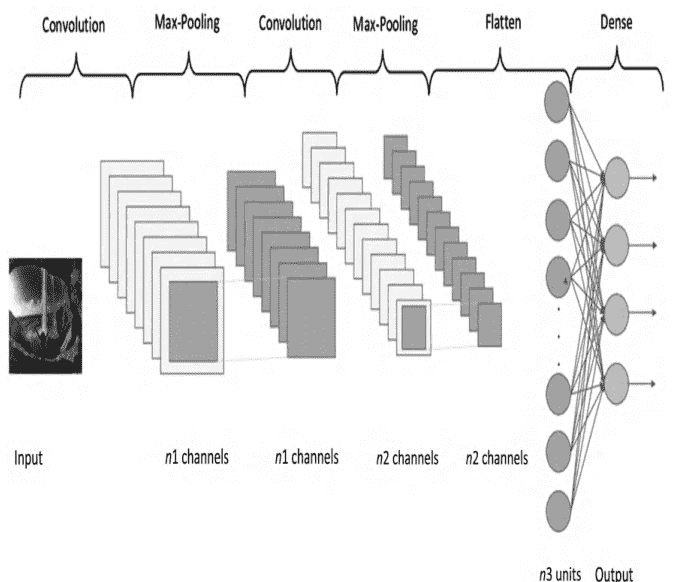

图5.4 卷积神经网络架构。

Source: Copyright © A. Harb, “面向初学者的卷积神经网络教程”，freeCodeCamp，2020年12月28日。https://www.freecodecamp.org/news/convolutional-neural-network-tutorial-for-beginners/.

## 5.5 基于CNN的分类架构

过去，CNNs面临巨大挑战，因为它们需要大量标注数据，导致处理成本高昂。当人们创建了像ImageNet、CIFAR-10、CIFAR-100和MNIST数据库这样的大型高质量标注数据集后，这一问题有所改善。此外，图形处理单元（GPU）并行计算和大型分布式集群的改进降低了计算限制，使得更好地处理这些大规模数据集成为可能。

ImageNet大规模视觉识别挑战（ILSVRC）对推动计算机视觉领域的深度神经网络发展产生了巨大影响。ILSVRC通过提供衡量不同图像分类系统的标准，简化了构建和评估更复杂神经网络结构的过程。

ImageNet挑战催生了两个关键图像分类系统：VGG网络（VGG-Net）和残差网络（ResNet）。Simonyan和Zisserman于2014年创建了VGG-Net，对探索更深层网络结构产生了重要影响。VGG-Net使用了微小的3 × 3卷积滤波器，这帮助网络在保持参数数量可控的同时识别图像中的小细节。该设计使网络扩展到16–19个权重层，在ILSVRC 2014上达到了7.3%的高准确率。网络深度的增加提高了分类性能，为CNN架构树立了全新的标准 [5]。

由微软研究院亚洲于2015年提出的ResNet，凭借其颠覆性的152层网络结构带来了重大变革。ResNet的主要突破是残差学习。这涉及相对于输入层学习残差函数，而不仅仅是学习预期的底层映射。这种方法通过解决退化问题，使得优化非常深层的网络变得更加容易。退化问题是指增加更多层会导致性能下降的现象。ResNet的设计充分利用了更大的深度，从而实现了更高的准确率，并以3.6%的低误差率赢得了ILSVRC 2015 [6]。

在开创性研究奠定的基础之上，我们的研究旨在使用迁移学习方法，并将这些表现最佳的网络设计调整为我们的异常检测与分类深度学习（DLADC）项目。通过发挥VGG-Net和ResNet的独特特性，我们希望拓展异常检测与分类的边界，提升在各种数据集中发现和分类异常的准确性和有效性。

## 5.6 CNN用于图像分类的适用性

关于使用CNN来检查和查找半导体缺陷的研究不断扩展。CNN相比常规机器学习方法具有优势。它们可以直接从半导体图像中学习复杂模式，无需人工干预或创建独特特征。这种能力在芯片和晶圆制造中非常有用。它使制造商能够发现缺陷，从而帮助他们保持产品的高质量和可靠性。

CNN在发现半导体图像中的复杂模式和结构方面很有诀窍。它们可以使用卷积层和池化层在不同详细程度上提取特征。得益于半导体图像的网格状结构，CNN可以发现微小缺陷，如颗粒、划痕或可能指示制造问题的模式变化。此外，CNN在缺陷检测任务中具有灵活性。它们可以适应由各种制造方法、材料和设备设置引起的半导体图像差异。

CNN适合半导体检查。它们可以处理大量视觉信息，并在新样本上工作良好。在各种缺陷上训练CNN有助于它们发现更多问题。存在针对半导体检查的标注数据集，例如SEMI（半导体设备与材料国际组织）的半导体制造缺陷标准与指南。此外，更好的硬件加速技术，如GPU和专用加速器，允许在芯片工厂中顺利集成基于CNN的检测系统。这种技术也能提升产出和可扩展性。

总而言之，CNN在检查半导体方面展现出巨大潜力。它们为半导体生产中的缺陷识别和质量控制提供了自动化、准确且可扩展的方式。随着该领域技术的不断进步，CNN将发挥关键作用，使半导体生产更加高效可靠。

## 5.7 检测数据收集

- 1. 晶圆图像
  - 制造环境：人们在半导体制造厂（晶圆厂）拍摄晶圆图像。这些地方有严格的控制，如洁净室，以保持低污染水平并确保数据质量。
  - 自动化成像系统：配备高分辨率摄像头的自动化成像系统拍摄晶圆图片。这些系统可以是半导体制造设备的一部分，也可以作为独立的检测站存在。
  - 顺序成像：摄像头在晶圆经过不同制造步骤（如沉积、光刻、蚀刻和退火）时一张接一张地拍摄晶圆图像。这种逐步成像有助于制造商监控晶圆表面的变化，并立即发现任何问题或缺陷。
  - 元数据标注：制造商在晶圆图像中添加诸如晶圆ID、批次号、制造步骤和时间戳等元数据。这使得晶圆的跟踪和追溯更加容易。

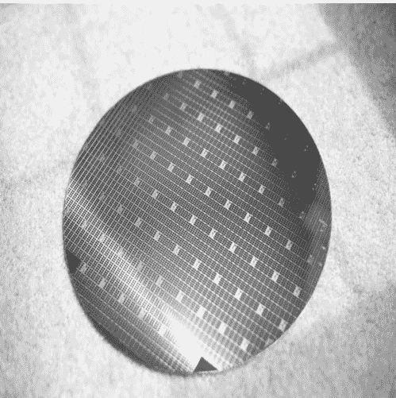

图5.5 示例硅晶圆。

Source: Copyright © “为什么硅晶圆看起来是彩虹色？”，Stack Exchange，2021年7月14日。https://electronics.stackexchange.com/questions/573975/why-do-silicon-wafers-look-rainbow-colored.

图5.5展示了一张示例硅晶圆的图像。

- 2. 晶粒图像
  - **晶粒提取：** 分割和裁剪等图像处理技术有助于从晶圆图像中提取晶粒图像。这些方法在晶圆上查找并隔离每个单独的芯片（晶粒），以生成用于检测的晶粒级图像。
  - **高分辨率成像：** 与晶圆图像一样，晶粒图像使用高分辨率摄像头拍摄。这确保了对每个芯片的详细观察。高分辨率图像有助于发现可能影响芯片性能的微小缺陷和异常特征。
  - **多视角：** 摄像头可能从不同角度（如从上方或倾斜角度）拍摄晶粒图像。这可以捕捉各种表面特征，并有助于分析缺陷。

- 3. 缺陷图像
  - **缺陷定位：** 自动化算法或人工操作员在晶圆或晶粒图像中查找缺陷。一旦发现这些缺陷，他们会标记缺陷区域以便稍后进行更仔细的检查。
  - **高倍率成像：** 缺陷图像以高倍率拍摄，以详细显示缺陷。这通常涉及使用特殊显微镜，如扫描电子显微镜（SEM）或原子力显微镜（AFM），来观察纳米级的物体。


- **缺陷分类：** 按类型、大小、形状和严重程度对缺陷图像进行分类。这有助于制造商关注最重要的缺陷修复方式，并改进流程以防止类似缺陷再次发生。

### 4. 元数据标注

- **语义标注：** 除了在图像上标记缺陷外，还会将缺陷类型、大小、位置和严重程度等额外信息添加到图像数据中。这在查看缺陷时提供更多背景信息。

- **数据库集成：** 已标注的缺陷图像和相关信息会输入到中央数据库或数据管理系统中。这有助于在芯片制造过程中查找、分析数据并做出决策。

## 5.8 数据预处理

为机器学习分析准备半导体图像至关重要。人们通常使用这些方法来使图像数据更准确、更有用：

- 1. **归一化：** 归一化将图像中每个像素的值转换为一个通用尺度，通常是 [0, 1] 或 [-1, 1]。它保持所有图像中像素强度一致，因此机器学习模型能在数据中发现更多模式和特征。

- 2. **增强：** 图像增强技术通过旋转、翻转、缩放或裁剪等修改，从源图像中创建更多训练样本。这一过程影响训练数据的范围和强度，降低过拟合风险，并提高模型的泛化能力。

- 3. **降噪：** 降噪方法清理或减少图像中的不需要的元素和失真，这些可能由传感器噪声、灰尘或图像压缩等引起。常见方法包括高斯模糊或中值滤波等平滑滤波器，它们在减少噪声的同时保留重要图像特征。

使用这些预处理方法会影响半导体图像用于机器学习模型分析的准备程度。这确保模型能够准确学习并从数据中提取有意义的模式和特征，从而构建更可靠、更高效的半导体检测系统。

## 5.9 模型架构

- 1. **LeNet：** Yann LeCun 及其团队在 20 世纪 90 年代提出了 LeNet。它是最早的 CNN 设计之一。LeNet 包含不同的层，如卷积层、最大池化层和全连接层。它不如新设计复杂，但 LeNet 在基本图像分类任务（如半导体检查）中仍然表现出色。其简单的布局为更先进的 CNN 打开了大门。这表明深度学习在图像处理方面有多么强大。

- 2. AlexNet：Alex Krizhevsky 及其团队于 2012 年提出的 AlexNet，标志着 CNN 设计的一大进步。该结构包含多个卷积层，紧随其后的是最大池化层，末端是连接层。当 AlexNet 获得 ILSVRC 冠军时，它展示了深度学习在图像分类方面的出色表现。该模型已被应用于许多领域，包括半导体检查，因为它能够处理复杂的图像数据并仍能进行分类。

- 3. VGG：Karen Simonyan 和 Andrew Zisserman 于 2014 年提出了 VGG 网络。该网络因其统一的结构而脱颖而出，该结构使用小（3 × 3）卷积滤波器和最大池化层 [7]。VGG 网络的统一设计使其简单但擅长图像分类。该架构采用直接的方法来加深网络（最多 19 层），同时控制计算需求。这在需要清晰和精确的半导体图像分类中被证明很有用。

- 4. ResNet：Kaiming 提出了 ResNet。2015 年，他和他的团队提出了一种称为残差学习的深度学习突破性方法。这涉及创建跳过一个或多个层的快捷（或跳跃）连接。这些连接允许训练非常深层的网络（通常有数百层），通过解决深层网络训练中常见的梯度消失问题。ResNet 在许多图像分类任务中达到了顶级性能，并因其强大和有效而受到赞誉。随着网络变深仍能保持良好性能的能力，使其成为半导体检测这一复杂任务的可行选择。

## 5.10 模型训练

- 1. 数据分割

  - 目的：数据分割在训练和验证 CNN 模型性能方面起着关键作用。它涉及将数据集分为三个不同的部分：训练集、验证集和测试集。
  - 训练集：训练集占数据集的大部分，用于训练 CNN 模型。在训练过程中，模型学习识别半导体图像及其标签中的模式和特征。
  - 验证集：该集合有助于调整设置并监控模型在训练期间的表现。通过定期检查模型在验证数据上的表现，我们可以做出调整，防止过拟合或欠拟合。
  - 测试集：测试集有助于检查训练好的模型表现如何。它对模型处理新数据的能力进行公平评估，确保其在实际案例中表现良好。

- 2. 超参数调优

  - 学习率：学习率决定训练期间更新参数时步长的大小。它是一个关键设置，对模型改进速度和整体性能有重大影响。我们可以使用学习率方法和自适应学习率方法（如 Adam）来在训练过程中更改学习率。

  - **批量大小：** 批量大小决定每个训练轮次中查看的样本数量。较大的批量有助于更快地达到目标，但需要更多内存和计算能力。批量归一化和梯度累积等方法可以在使用大批量时帮助保持训练稳定。

  - **正则化参数：** L1 和 L2 正则化或 Dropout 等正则化技巧可防止过拟合。它们通过限制参数值或在训练期间禁用单元来实现这一点。正则化强度取决于超参数。需要对这些参数进行调整，以使模型发挥最佳性能。

  - **超参数搜索：** 这涉及探索不同的超参数组合以使模型表现更好。您可以使用网格搜索、随机搜索和贝叶斯优化等方法来检查各种超参数选项并找到最佳选项。

### 3. 优化算法

- **随机梯度下降：** 随机梯度下降（SGD）是一种在深度神经网络中训练机器学习模型的方法。它与常规梯度下降方法不同。SGD 针对单个数据点或小批量数据调整模型设置，而不是一次性查看所有数据。这种方法加快了计算速度并帮助模型更快学习。SGD 在处理大型数据集时效果良好，因为不可能一次处理所有数据。

- **Adam：** Adam 是一种对输入开放的学习率优化算法。它使用动量和 RMSprop。它根据梯度的一阶和二阶矩来改变每个参数的训练速度。这导致更快的收敛和更好的标准化。

- **RMSprop：** RMSprop 是另一种自适应学习率的算法。它使用平方梯度的移动平均来计算算法中每个参数的训练速度。它通过基于最近的梯度历史实时更改学习率，解决了梯度消失或爆炸的问题。

- **损失函数：** 使用的损失函数取决于您在半导体检测中想要实现的目标。如果将项目分为多个组，多类交叉熵是常见选择。对于是或否的决策，二元交叉熵效果良好。当需要预测数值时，均方误差可以胜任。

通过研究如何分割数据、调整设置和选择合适的数学技巧，公司可以构建和改进适用于半导体检测的 CNN 模型。这有助于他们在制造这些微小电子元件时发现缺陷并保持高质量。

## 5.11 模型测试

- 1. **准确率：** 准确率是一项基本统计量，显示数据集中分类项目的百分比。它通过显示有多少预测与真实标签匹配，全面展示模型的正确性。对于半导体检测，准确率是模型发现缺陷或异常情况的关键指标，在


半导体图像。但单靠准确率可能无法完整反映数据不平衡的情况，其中一组远大于其他组。因此，虽然准确率能提供关于模型实用性的重要信息，但最好将其与其他指标结合使用，以便更全面地了解模型的工作效果。

- 2. **精确率：** 精确率通过计算真阳性预测与模型做出的所有阳性预测之比，衡量模型避免假阳性的效果。该指标在半导体检测中至关重要，因为它显示了模型识别真实缺陷而不将良品标记为不良品的能力。高精确率意味着模型产生的误报非常少，这对于减少因误报而引发的不必要操作或后续步骤至关重要。精确率是制造商用于评估半导体生产环境中缺陷检测系统可靠性和可信度的关键性能指标 [8]。

- 3. **召回率（灵敏度）：** 召回率（也称真阳性率）评估模型识别所有阳性病例的能力。它通过将真阳性预测的比例与数据集中所有实际阳性实例进行比较来实现这一点。在芯片测试中，召回率在确保彻底缺陷检测方面起着关键作用。它显示了模型识别所有有缺陷部件而不遗漏任何一项的能力。高召回率意味着模型识别了大多数阳性病例，从而降低了未被发现的缺陷通过检测的可能性。当遗漏缺陷可能产生深远后果时，制造商非常注重召回率。这凸显了在芯片生产线上进行严格缺陷检测的重要性。

- 4. **F1 分数：** F1 分数通过计算精确率和召回率的调和平均数，在两者之间取得平衡。它通过同时考虑假阳性和假阴性，对模型的表现进行全面评估。在半导体检测领域，F1 分数作为一个完整的评估指标，揭示了精确率和召回率之间的关系。高 F1 分数表明模型在精确率和召回率之间达到了最佳平衡，既减少了误报，又捕获了所有阳性实例。制造商使用 F1 分数来考察缺陷检测系统的整体效果和可靠性，确保在不同操作条件下评估其性能。

- 5. **ROC 曲线下面积：** 接收者操作特征（ROC）曲线下面积，或称 AUC-ROC，评估模型区分不同类别的能力。它通过在不同阈值水平下展示真阳性率与假阳性率的关系来实现这一点。较高的 AUC-ROC 分数意味着模型能更好地区分类别，在不同决策点上具有更高的真阳性率和更低的假阳性率。在半导体检测中，AUC-ROC 在衡量模型区分有缺陷部件和良部件的能力方面起着关键作用。制造商依赖 AUC-ROC 来检查模型的整体分类准确性，以及其在查看半导体图像时做出明智决策的能力。

- 6. **混淆矩阵：** 混淆矩阵展示了模型预测与实际标签的对比情况。它显示了真阳性、假阳性、真阴性和假阴性。这为我们提供了关于模型在不同类别下表现的关键洞察，让我们能够更仔细地审视其优势和不足之处。在半导体检测中，混淆矩阵有助于制造商定位模型表现出色或存在困难的特定领域。这使他们能够聚焦于改进方向。通过分析混淆矩阵，制造商可以更好地理解模型的预测方式，并做出更明智的决策，以提升其发现和分类缺陷的能力。

这些评估指标各自提供了关于深度学习模型在半导体检测中表现的不同洞察。这有助于制造商改进其缺陷检测系统，生产出一流的半导体器件。

## 5.12 结果与讨论

在本章中，我们深入探讨了 CNN 模型在评估半导体图像时的表现。我们进行了仔细测试，以评估不同的 CNN 设计，例如 AlexNet、VGG 和 ResNet，使用来自工厂的半导体图像数据集。我们选择这些数据集并对其进行了扩充，以确保其覆盖范围广泛且具有代表性。为了提高数据集的质量和多样性，我们采用了归一化和数据增强等方法。这使我们能够更好地训练和评估模型。

当我们深入研究实验结果时，发现了一些有趣的事情。CNN 模型在发现和分类半导体图像中的缺陷方面表现良好。无论使用哪个模型，准确率均超过 90%。这表明深度学习在半导体检测中效果出色。这些模型能够注意到半导体图像中的微小细节和模式。此外，我们发现 CNN 模型能够很好地适应不同的环境和照明条件，这在半导体工厂中非常重要。

尽管有这些优点，我们也遇到了一些局限性和改进领域。一个主要问题是，CNN 模型在使用小型或不平衡数据集进行训练时容易过拟合。此外，在大型半导体数据集上训练深度神经网络非常复杂。这带来了后勤挑战，促使我们思考如何合理利用资源并扩展工作。

与传统的半导体检测方法相比，CNN 模型显示出巨大的改进。它们优于常规的基于规则的系统或机器学习工具，证明了其更高的准确性、更快的速度以及更强的处理不同类型半导体图像的能力。通过从原始数据中自主学习，CNN 模型展示了其在发现微小缺陷和持续分类半导体部件方面的优势。

尽管如此，在现实世界工厂中部署 CNN 模型也面临其自身的问题。这些包括需要大量标注数据、强大的计算资源，以及理解模型预测的方法。尽管存在这些障碍，CNN 模型展现出的前景凸显了其在彻底改变半导体检测方式方面的潜力。这为更好的质量控制和缺陷减少方法打开了大门。

总而言之，我们的研究表明 CNN 模型对半导体检测有巨大的影响。通过利用深度学习方法的优点并解决我们发现的问题，制造商可以找到新的途径来改进半导体产品，使其更好、更可靠。未来，我们需要继续进行研发以克服当前问题，并使基于深度学习的模型在日常半导体检测中发挥更好的作用。

## 5.13 结论

总之，我们的研究深入探讨了深度学习 CNN 用于半导体检测的应用。我们通过仔细的测试和评审表明，CNN 模型在发现和分类半导体图像中的缺陷方面准确性高。我们的结果证明了 CNNs 的有效性，在不同设置和样本中准确率均超过 90%。这些发现表明，深度学习方法对半导体检测有巨大影响，为制造商提供了新的工具来控制质量和减少缺陷。我们再怎么强调深度学习在半导体测试中的价值都不为过。通过使用 CNN 模型，制造商可以改进缺陷发现方式，提升产品质量，并降低生产成本。采用深度学习方法标志着半导体质量控制方式的巨大变革，能够在大规模范围内实现自动化、高效且精确的缺陷识别。展望未来，后续研究应致力于改进 CNN 结构、优化训练方法，并探索在半导体制造中应用深度学习的新方式。此外，致力于创建标准数据集、测试框架以及理解过程的工具，将是帮助更多人在半导体质量控制中采用深度学习，并确保其融入行业惯例的关键。

## 参考文献

- 1. S. Zhou, Y. Chen, D. Zhang, J. Xie, 和 Y. Zhou, “使用卷积神经网络对钢板表面缺陷进行分类,” Mater. Technol., vol. 51, no. 1, pp. 123–131, 2017. https://doi.org/10.17222/mit.2015.335.
- 2. Y. LeCun, Y. Bengio, 和 G. Hinton, “深度学习,” Nature, vol. 521, no. 7553, pp. 436–444, 2015.
- 3. J. O’Leary, K. Sawlani, 和 A. Mesbah, “用于半导体晶圆上颗粒缺陷化学成分分类的深度学习,” IEEE Trans. Semicond. Manuf., vol. 33, no. 1, pp. 72–85, 2020. https://doi.org/10.1109/tsm.2019.2963656.
- 4. O. Russakovsky, J. Deng, H. Su, J. Krause, S. Satheesh, S. Ma, Z. Huang, A. Karpathy, A. Khosla, A. C. Berg, 和 L. Fei-Fei, “ImageNet 大规模视觉识别挑战,” CoRR, 2014. http://arxiv.org/abs/1409.0575.
- 5. T. Wiatowski, 和 H. Bolcskei, “用于特征提取的深度卷积神经网络数学理论,” IEEE Trans. Inf. Theory, vol. 64, pp. 1845–1866, 2018. https://doi.org/10.1109/TIT.2017.2785642.
- 6. S. Ren, K. He, R. Girshick, 和 J. Sun, “更快的 R-CNN：面向带区域建议网络的实时目标检测,” 在《神经信息处理系统论文集》中，蒙特利尔，魁北克，加拿大，2015 年 12 月 7–12 日.
- 7. V. Gyanendra, 和 D. Anamika, “使用更快 R-CNN 深度学习的手持枪支检测,” 在《第 7 届国际计算机与通信技术会议论文集》中，阿拉哈巴德，印度，第 84–88 页，2017 年 11 月 24–26 日.
- 8. K. Imoto, T. Nakai, T. Ike, K. Haruki, 和 Y. Sato, “用于半导体制造中缺陷分类的基于 CNN 的迁移学习方法,” IEEE Trans. Semicond. Manuf., vol. 32, no. 4, pp. 455–459, 2019 年 11 月.


# 6 半导体器件的机器学习

Nivedita Manohar Mathkunti and Manjulata Badi

## 6.1 引言

半导体新技术的扩展与广泛实施一直是21世纪计算机革命的主要推动力。此外，半导体制造现在已被公认为各国公共创新的主要焦点。例如，2023年通过的《欧洲芯片示范法案》(EU) 和2022年通过的《芯片与科学法案》(US) 都出台了重大补贴措施，以推动半导体芯片的生产、通信、参与和就业。由于像计算机辅助人工智能 (CAI) [1] 这样的新兴应用需要大量处理能力，高性能半导体变得越来越受欢迎。

因此，已经开发和提出了多种方法，包括3D封装、硅光子学和异质集成，这些被视为整体半导体的关键 [2]。所有方法的统一目标是以极其复杂的结构为代价，实现最小的线宽（间距）。这些发展使得芯片或芯片部分可以通过使用晶圆级和芯片级互连独立运行 [3]。与传统封装方案相比，它们可能创建一个非常复杂的框架。策略及其构建的复杂性提高了成功框架的产率。

为了收集数据并评估循环边界、器件有效性、层厚、排列位置、材料成分和电气特性，计量学采用各种估计方法，涉及不同的估计单位和设备 [4]。根据 Abd Al Rahman 和 Mousavi [5]，半导体检测和估计硬件市场包括多种设备，如覆层估计硬件、膜厚、叠加精度、三维形状、图案和非图案晶圆缺陷检查设备，以及掩模检查设备。工艺控制是计量学在半导体行业的首要职责，计量学对该行业的持续可行性至关重要。例如，3D NAND器件使用诸如厚硬覆层、极高载荷设计以及100多层堆叠等材料。高材料异质性、材料中的不确定性以及晶圆应力是增加准确估计难度的一些因素 [6]。此外，动态随机存取存储器 (DRAM) 的生产进一步使该过程复杂化。

然而，对具有更高功能的技术设备的需求将始终存在。未来的半导体技术，如先进封装，预计将更加密集，并需要更加精细的架构。随着器件在设计上变得更小且更具三维 (3D) 特性，计量学变得越来越必要。某些产品制造阶段中有一半以上涉及估计或描绘。半导体行业正朝着一个未来迈进，届时有望确定3D器件内每个颗粒的性质和状态。基础互连间距目前已达到亚微米级，在某些应用中，过去十年中半导体封装允许的层厚已扩大了100多倍。向扩展框架厚度发展的趋势预计将继续下去，在规划和实际处理方面都将带来巨大挑战。多项调查表明，分析即将到来的半导体工艺的可靠性是主要障碍 [7]。许多半导体器件具有多种功能各异的组件。因此，需要更多的研究和加强措施来支持当前的计量学进步 [8]。

在半导体制造操作中，要完成对部分生产产品进行彻底检查的目标，需要有限数量的计量设备和时间。公司目前为节省成本而进行随机检查和测试以进行质量控制，但这并不总能带来彻底的质量控制或保证卓越的结果。当前使用的计量程序在特定处理阶段进行检查，其估计在明确标识的计量站完成，从而导致无谓的处理时间。因此，虚拟计量 (VM) 可能解决先进半导体产品测试和审查的持续质量问题 [9]。为了评估所讨论晶圆厂交互的结果，VM使用循环因素、制造设备信息和已测试晶圆来获取真实计量信息。虽然并非所有产品都能接受实际计量，但VM可用于满足“全面”检查的需求。只要正确设置和测试虚拟机模型，这种方法就可以用离线评审取代在线连续监测 [10]。VM（也称为软传感）已在不同组装行业中找到有益的应用。虽然这些应用确实需要进一步研究，但它们已从半导体行业成功使用虚拟机中获益良多。例如，为了降低制造成本，工厂旨在降低采样率。智能采样决策 (ISD) 系统支持VM，但其设定的速率限制了适应性。本研究提出了一种自动采样决策 (ASD) 方法，根据VM的正确性动态实时调整采样率，以保证效率和长期性能。这种半导体工艺由 Cheng等人 [11] 开发，旨在实现汽车轮制造业完全机械化的目标。发明者演示了一个可行的三台机器布局：一台在线、一台钻床和一台额外的非连接计量站，它们协同工作以创建自动轮生产设施。Kim等人 [12] 研究了这种VM在铜覆层层压板 (CCL) 制造中的应用，CCL是各种设备中印刷电路板的基本组成部分。利用CCL制造商的验证数据，该过程中对三个质量参数进行了预期。碳纤维制造集成到VM框架中类似，制造商能够跟踪制造信息、启动制造信息追踪 (PDT)、将其链接到特定制造的工件，并完成碳纤维制造过程的彻底评估。Enrico等人 [13] 很好地展示了虚拟维护技术在航空商用电机中的应用，并且在航空商用电机和超精密器件生产中都发现了VM用于超精密器件生产和加工的适用性。因此，通过考察这些持续的组装模式，可以安全地得出结论：VM是超越传统计量目标预期的工业4.0关键机械进步。至关重要的是，企业必须明白，虚拟机基础现在包含了大量工业4.0逻辑，例如物联网 (IoT)、数字物理框架、大数据和零缺陷制造 [14]。

未来的半导体评估预计将大量依赖VM。随着封装复杂度增加、嵌入尺寸减小，先进的封装技术（如晶圆对晶圆和晶圆对芯片）正在动态取代常规循环，这需要更多的持续研究。此外，VM在前沿封装设计中可以发挥重要作用，几项评估将其视为构建厚度增加时的主要挑战。更快的人工智能的出现以及开源AI-ML（人工智能-机器学习）包的便利性，导致了半导体APC（先进工艺控制）猜想的近期繁荣，其中包括对开发封装有帮助的虚拟机 (VM)。为了克服复杂创新计算所带来的预测精度问题，需要对VM进行持续创新 [15]。

对本行业进行全面生产并探讨VM的潜在影响至关重要。出于这个原因，本章进行了此类开创性努力。与半导体制造相关的适当VM主题被汇编和分析，并且最佳可用研究在本章中进行了总结。本章以半导体制造过程层级为背景，审计和审查了每个循环组中采用的虚拟机策略。同样重要的是，进行了基础分析以调查半导体制造进一步实施中的持续挑战，以及对潜在未来的比较分析。

## 6.2 半导体器件的进步

在硬件领域，半导体器件的运行继续成为人类创造力和技术进步的展示。多年来，半导体器件在其发展方向上取得了显著进步和显著改进。这些器件最初是二极管和半导体，已发展成为现代发明的基石，并对我们今天所处的先进时代负有责任。本节首先从半导体器件的可验证轨迹开始考察，突出其显著成就以及塑造其进步的动态变化。通过这次历程，我们对逻辑的精心编织艺术有了更深入的理解


推动半导体器件达到当前关键状态的发现和设计成就。

### 6.2.1 定义：半导体器件

半导体器件是基于半导体独特电气特性的电子元件。这些物质在导电性方面介于导体和绝缘体领域之间。重要的半导体材料包括硅、锗和砷化镓等天然半导体。利用半导体卓越电气性能的这些电子元件，是许多创新应用的基础。

### 6.2.2 半导体器件演进的进步

本部分对半导体创新的演进提供了清晰简洁的概述。它涵盖了塑造该领域的关键时刻、进步和趋势，从早期半导体的发现到当今的集成电路。本部分提供了实证环境的基础理解，为理解半导体器件的现状及潜在未来方向铺平了道路。特别是，根据摩尔定律，互补金属氧化物半导体（CMOS）创新的持续缩放长期以来一直是半导体行业的主要驱动力。半导体和电路尺寸的不断减小，使计算能力得到显著提升，电子设备在各种应用中得到广泛普及。

#### 6.2.2.1 早期半导体

“早期半导体”一词指的是在20世纪40年代下半叶和50年代中期创建的半导体基本配置。我们在使用点接触整流器的最新调查中发现了另一种影响，现在称为半导体效应。这种效应依赖于使用少量半导体材料，而不是传统的使用大部分此类材料的方法。这些是许多实际应用中使用的主要固态元件，取代了电子管。与电子管相比，这些早期半导体更小、更可靠、耗电更低，这是硬件方面的重大进步。在此期间进行的调查和初步工作为现代半导体奠定了框架。

#### 6.2.2.2 集成电路

基尔比发明了集成电路，通过将多个元件集成在单个半导体衬底上，从根本上改变了硬件格局。基尔比在20世纪下半叶的开创性工作为高性能、小型化电子设备的先进时代奠定了基础。由电阻器、电容器、二极管和半导体组成的更小型电路版本称为集成电路（IC）。这些主要在硅（一种微小的半导体衬底）上制造。这些元件协同工作以完成特定任务，如信号处理、存储和信号改善。当许多元件集成到一个芯片上时，与使用分立电子电路相比，可以减小尺寸、提升性能并降低能耗。集成电路为多种现代设备提供动力至关重要。

## 6.3 当前创新模式

### 6.3.1 新兴进步

过去一个半世纪里，已取得多项尖端发展。创新的组装、信息和视频技术正在协同工作，以创造更高效的新进步。液体活检技术的发展解决了持续抗击疾病中的关键阶段。与传统组织活检相比，液体活检具有多项优势。在组织活检无意义的情况下，它们可立即作为良好的替代方案。此外，液体活检可提供患者整体健康状况的全面视图，而组织活检仅根据样本提供碎片化信息。事实上，循环生长DNA在液体活检中经常被检测到，因为它经常从癌组织迁移到血液中。随着卷积神经结构和深度学习的进步，机器视觉在图像识别方面已经开始超越人类能力。目前，机器视觉创新正在多个领域展示广泛的预期应用，包括自动驾驶、医疗诊断、保护担保评估、水位监测、园艺等。卷积神经网络（CNNs）可使用反向传播算法进行训练，在图像和语音识别等任务中始终优于其他深度学习结构。与其他前馈深度学习模型相比，它们还需要更少的边界评估，这使它们成为深度学习领域的一个有吸引力的选择。量子计算机的潜力是无限的，但其开发极其困难且昂贵。

小型量子计算机的处理能力尚未超过超级计算机，这很容易理解。然而，IBM在2016年成为首家向公众提供量子计算机云计算服务的公司，从而推动了量子计算的应用。得益于这一发明，如今有超过20篇待发表的科学论文拥有了一个探索性平台。目前，全球超过50个组织（包括大型计划和无数新企业）正在努力使量子计算机成为现实。人们认为，由于这些发展，量子时代已经到来。

### 6.3.2 新兴进步的优势

创新和科学在推动人类进步中发挥着关键作用。无论技术多么先进，都要记住，机器仍然是人类发明的产物，旨在由人类使用。从这些机械设备中受益的人不应压抑自己与生俱来的劳动欲望，因为过度依赖机器可能会导致社会不赞同。然而，这并不意味着新发展阻碍了人类进步。与日常生活的其他方面类似，创新是一把双刃剑。我们的选择决定了如何使用它。贬低研究和创新对人类进步可能做出的贡献是荒谬的，因为个人始终展现出其主导知识。

### 6.3.3 执行改进

智能芯片是5G和物联网所需的支撑性创新，将进一步推动这些技术，改善智能设备、智能家居及其他领域，同时提升信息普惠性和数字化水平。半导体行业将带来更多显著进步和有益机遇，芯片需求只会持续增长。人类日益增长的意识和深度学习意味着，半导体行业需要在能源效率和计算方面满足日益提高的性能要求。目前，半导体行业将在个人计算机工程创新和计算精简领域实现显著发展。与早期几代相比，现代电子产品更小、更通用，提供了更高的定制程度。为了满足客户的适度需求，半导体行业将在特定情况下主要支持新型射频器件和更小的芯片。

## 6.4 不同方法论下的AI/ML半导体

国际半导体设备与材料协会（SEMI）的设备通信标准/通用设备模型（SECS/GEM）协议，使得主机计算机与半导体设备在半导体制造领域之间的通信更加便捷。SEMI开发SECS/GEM的目标是通过标准化通信增强工厂自动化。在智能制造系统中，管理和收集设备数据的主机构成边缘层，而设备本身则包含在设备层中。然而，现有的SECS/GEM接口缺乏硬件层面的动态数据分析，这导致在将输入传输到边缘/云层进行分析时出现延迟问题。

为了解决这些延迟问题并实现设备层面的动态数据处理，研究工作[16]为SECS/GEM接口提出了一种新的通信协议。当前的SECS/GEM接口在将数据从设备发送到边缘/云层时会增加显著延迟，因为它不提供动态数据分析。

Nguyen [16]利用SECS/GEM消息进行实验，以量化从硬件到主机的数据变量传输滞后。数据揭示了一种可能影响生产力的显著滞后。为解决这一问题，他们提出了一种包含车载“数据分析引擎”模块的系统架构。该模块使设备能够执行主机指定的分析任务，从而消除了将数据传输到主机的必要性。


作者在 SECS/GEM 协议中加入了新的“Stream 22”，允许主机在设备上构建、链接和启动自定义及预定义的分析操作，并报告和识别结果。通过使主机能够动态地向设备分配数据分析任务并收集结果，该协议可以通过实现实时响应来减少网络带宽使用，并提高半导体智能制造效率 [16]。

缺陷检测模型基于参考模型使用 You Only Look Once 版本 2 (YOLOv2) 构建。YOLOv2 是一种知名的目标检测算法，通过回归执行检测，使用许多不同的池化层与卷积相结合，将输入图像转换为 3D 张量。YOLOv2 模型的输入图像尺寸为 448 × 448 像素，这提高了分辨率并微调分类器以获得更好的性能。为了通过其特征改善关键尺寸扫描电子显微镜 (CD-SEM) 的灰度图像，动态调整图像的对比度和亮度。这是使用图像线性混合技术实现的。原始图像 I₀ 和第二个透明通道图像 I₁ 这两张图像按权重进行线性融合。混合公式如下：

```
g(x) = λI₀(x) + (1 − λ)I₁(x) (6.1)
```

在混合图像 g 中，位置 x 处的结果像素值被考虑，其中 λ 是控制两张图像中对应位置像素值融合的权重 [17]。

系统通过从 CD-SEM 服务器数据库提取 CD-SEM 灰度图像、对其进行预处理，然后使用缺陷检测模型识别缺陷，从而自动处理 CD-SEM 灰度图像。如果检测到缺陷，系统将此有缺陷的输出保存为审查图像到 CD-SEM 数据中。它还会触发告警邮件以通知工程师。工程师可以通过自定义用户界面查看详细的 CD-SEM 数据和审查图像。系统支持 CD-SEM 图像的批量检测以提高效率。例如，它可以一次处理多达 188 张灰度图像，并使用边界框显示结果（红色表示缺陷，绿色表示无缺陷）。系统减少了工程师手动审查每张图像的需求，并增强了在线缺陷检测能力，从而提高了工厂的经济效益。通过实时通知有缺陷的晶圆并及时通知工程师，该系统有助于减少对产品的影响并提高良率 [18, 19]。

在本研究中，研究者 Nguyen, H. 开发了一种强大的监督深度学习训练方案，旨在以高精度准确分类和定位 SEM 图像中的各种缺陷类型。所提出的集成模型将 ResNet101、ResNet50 和 ResNet152 设计作为骨干网络，并利用基于偏好实验选择的模型进行策略性集成，以在结合模型预测结果后输出结果。这种方法提高了缺陷分类和检测的性能。

该模型能高效地对故障类别进行分类，如线坍塌、微桥和微间隙，并处理这些类别内像素级故障场景的不断变化的等级。此外，它通过提供由宽度、中心坐标、高度和检测置信度表示的边界框，精确回归故障区域。

为进一步优化故障检测，应用了非监督机器学习策略，在没有明确真值的情况下获取无噪声的 SEM 图像。该方法有助于移除误报故障，并最大限度地减少随机噪声对结构化像素的影响。功率谱密度分析表明，只有高频分量的噪声被放大，同时保留与器件特征稳固结构相关的低频分量。

此缺陷检测流程提高了缺陷检测的准确性。该过程不会改变激进间距中任何导线长度/导线间距 (L/S) 的尺寸。随着电路设计继续缩小以符合摩尔定律，这些传统的缺陷检测方法变得越来越不有效，常常导致误报缺陷和错误的计量。基于深度学习的模型解决了这些局限性，以更高的精度和准确性提高了各种缺陷类别的分类和检测定位能力 [20]。

随着半导体制造向 3 nm 工艺节点迈进，减少边缘放置误差 (EPE) 对于 IC 器件正常运行至关重要。EPE 通过整合叠层误差和关键尺寸 (CD) 缺陷，评估多图案化过程中生产图案的可靠性。最近的机器学习进步为改进 EPE 优化流程的性能和效率提供了新的机遇。

Kyon 等人 [21] 调查了最近应用机器学习/深度学习来增强虚拟叠层计量、减少叠层误差并改进用于 EPE 降低的掩模优化方法的研究。综述讨论了目标、数据集、输入特征、模型、关键发现和局限性。结果表明，机器学习在改善半导体制造中的 EPE 方面具有巨大的潜力。

三星于 2022 年开始了“初始”3 nm 生产，采用全环绕栅 (GAA) 架构，与未指明的“5 nm”工艺相比，提供了 16% 更高的晶体管密度、23% 更高的性能和 45% 更低的功耗。台积电 (TSMC) 于 2022 年 12 月宣布其“3 nm”N3 工艺量产，改进的 N3E 工艺将于 2023 年下半年开始。这是半导体制造工艺。在 2022 年国际电子器件会议 (IEDM) 上，台积电披露 N3 具有 45 nm 的接触栅间距，N3E 具有 23 nm 的最小金属间距，N3 的 SRAM 电池面积为 0.0199 µm²，N3E 为 0.021 µm²。随着节点缩小，填充需要更多的智能，因为它可能影响所有层填充的时序和信号完整性 [21]。

论文《Chiplet 异构集成 AI 处理器》讨论了一种名为 ABsX 的基于 chiplet 的 AI 处理器设计，该处理器将多个神经处理单元 (NPU) 和高带宽内存 (HBM3) chiplet 集成在多层重布线层 (RDL) 中介层上。关键设计方面包括高速数据通道，强调 NPU 与 HBM 之间高速数据通道的必要性，以促进并行处理和内存附近处理，这对 AI 任务至关重要。

- **中介层设计：** 考虑信号完整性、电源分配和高密度布线，以确保 chiplet 之间的有效通信和电源管理。
- **Chiplet 内 NPU 架构：** 设计 NPU 架构以持续向浮点单元供电数据，确保高效处理。
- **键合可靠性：** 解决由众多微凸块引起的静态和动态键合可靠性问题，这对于保持处理器的结构完整性至关重要。
- **热稳定性：** 通过分析热通量和相互热影响并实施有效的散热策略来确保热稳定性，以管理热负载。
- **Chiplet 间链路：** 强调 chiplet 间链路的重要性及其对处理器整体性能效率的影响。

设计标准侧重于优化性能效率、确保可靠的 chiplet 集成并保持热稳定性。chiplet 架构用于解决由于计算中的数据爆炸而产生的困难，这对于大规模 AI 模型是必需的。基于 AI 的 chiplet ABSx 是满足 AI 数据处理需求的合适解决方案，为在保持高性能可靠性的同时处理复杂工作负载提供了一条前进道路 [22]。

在 Yoo 等人 [23] 中，研究人员介绍了自然语言处理 (NLP) 技术的工作原理，用于评估半导体制造行业与设备维护和质量问题相关的文本数据。为了从这些非结构化数据中汇总有价值的信息，研究人员在开发内部 NLP 引擎的过程中采取了多个关键步骤。起初，研究人员按顺序对所有文本数据进行预处理，这些数据包含设备维护和质量问题的详细信息，以创建语料库。使用半导体词典对半导体质量问题进行分析。这些还使用词袋、N-gram 词袋技术以及术频-逆文档频率 (TF-IDF) 来量化文档并提取重要特征。分析了不同工厂中短语的可视化和关键短语的关联，并使用卡方检验发现不同设备类型之间存在显著差异。最后，突发分析识别了重要短语频率大幅增长的时间点。

研究结果表明，不同工厂和型号具有不同的质量问题趋势和设备维护特征。这提供了有价值的信息，可以帮助半导体制造商提高生产力和质量。

作者利用 NLP 技术分析非结构化文本数据，证明了这种方法从半导体运营中丰富的可用信息中提取有意义见解的潜力。通过揭示质量和维护问题中的模式和差异，NLP 分析可以帮助制造商优化其流程并提升整体性能。

Yoo 及其团队提出了一种综合方法，将技术计算机辅助设计 (TCAD) 模拟与先进的机器学习技术相结合，以实现 BCD (双极-CMOS-DMOS (双扩散金属氧化物半导体)) 工艺的多目标优化。该方法的关键方面是数据生成，它使用 150 个拉丁超立方体采样点来彻底


通过TCAD仿真覆盖参数空间并为模型训练生成关键数据。这些基础数据用于建立工艺变量与目标器件电气特性（ET-spec）之间的准确关系。下一步是回归建模，模型根据工艺参数来预测设备的ET-spec。因其高拟合度而选择自回归模型，允许使用代用模型替代直接的TCAD仿真，从而在迭代优化过程中显著降低计算成本。在优化过程中，采用遗传算法（GA）通过探索广阔的解空间来高效搜索全局最小值。优化过程采用适应度分数的加权和来处理问题的多目标特性，确保不同器件参数同时得到优化。

为考察帕累托前沿的不同部分，从不同的起点启动多个GA解。TCAD仿真用于验证阶段，以验证GA发现的优化工艺参数的有效性。这一阶段保证了建议的修正方案既在概念上站得住脚，又在实践中可行。

在对比与优势步骤中，将新方法与现有优化流程进行对比。现有优化流程按顺序针对器件，并需要多次迭代。相比之下，所提出的策略通过一次性优化所有器件的所有变量，实现了87%的定位率，并将周转时间从30天大幅缩短至仅三天。

该方法高效解决了BCD工艺开发中固有的困难与权衡问题，通过融合基于AI的回归模型与TCAD仿真，并采用遗传算法进行优化，为下一代半导体生产提供了一种可靠的解决方案 [24]。

通过对在SAKURA-G现场可编程逻辑门阵列（FPGA）评估板上实现的神经网络物理不可克隆函数（NN PUF）进行考察，本文对在SAKURA-G上实现的AI认证设备的性能评估涉及与AI相关的安全问题。NN PUF通过结合神经网络和物理不可克隆函数，利用大规模集成（LSI）生产中的差异性，为设备验证生成唯一标识（ID）。论文[25]基于扩散性、稳定性、随机性和唯一性评估了NN PUF的性能。该方法包括NN PUF实现、PUF电路和认证方法。

NN PUF使用查找表（LUT）网络框架集成多层神经网络。神经网络的输入层包含1,024个LUT。两个隐藏层分别使用360个和60个LUT。输出层包含十个LUT。NN旨在使用MNIST数据集识别手写数字，以784位输入作为PUF约束。

在物理不可克隆函数电路认证模式下，NN PUF使用挑战-响应对进行设备认证。神经网络的最终输出连接到一个电路——例如，D型触发器，它通过提取信号传播延迟的差异来生成PUF响应。由于LSI制造差异导致的这种延迟差异有助于生成唯一ID。

评估指标包括随机性、稳定性、扩散性和唯一性。随机性衡量生成的ID中0/1出现的均匀性，通过汉明重量进行评估，该重量对应于ID大小的一部分。稳定性评估相同输入挑战下ID的可重复性，使用相同挑战内部汉明距离（SC Intra-HD）进行估计。扩散性确定ID如何随不同输入挑战而变化，使用不同挑战内部汉明距离（DC Intra-HD）进行评估，而唯一性评估不同设备之间ID的差异，使用相同挑战间部汉明距离（SC Inter-HD）进行评估。

该方法为在高级FPGA板上评估NN PUF性能提供了全面的框架，强调了工艺变化对PUF性能的重要性 [25, 26]。

论文《半导体制造中使用深度学习进行晶圆缺陷图相似性搜索》提出了一种有效采用深度学习技术搜索晶圆缺陷图相似性的方法。该程序的第一步是将原始缺陷扫描图像转换为缺陷密度、降噪和缺陷分布的灰度表示。

对于特征提取，使用预训练的CNN，即ResNet。该网络在大型数据集上训练后，接收灰度图像并提取捕捉重要缺陷属性的高维特征向量。

利用生成向量的特征空间，开发了一个K近邻搜索模型。识别出与查询图像在特征向量方面相同的前n个图像，从而能够从更大的数据集中有效提取相似的缺陷图。

在远程接收搜索模型时，该解决方案使用gRPC框架简化客户端与服务器之间的通信，以便客户端可以本地进行查询。前三次搜索的准确率为100%，召回率为92%，证明了该系统具有卓越的准确率和召回率。搜索功能在不到四秒内找到前10,000张相似图片，证明了其速度很快。该方法显著提高了半导体生产中缺陷分析的准确性和效率 [27]。

论文[28]提出了一种新方法，用于在高产能半导体器件制造中完成数值工艺处理，具体侧重于化学气相沉积（CVD）工艺中薄膜厚度的检测和预测。

所提方法的关键方面包括虚拟计量（VM）实现，它利用生产参数实时预测测量值，减少物理采样的需求并压缩周期时间。通用非线性模型中大多数当前VM策略的局限性在于难以捕捉波动生产过程中的突发变化。此外，传统机器学习方法仅提供预测值而不评估结果的置信度，导致在处理高维数据和小样本量时准确率较低。套索-高斯过程回归（LGPR）是一种解决这些局限性的方法；LGPR模型基于即时学习框架。LGPR结合了套索回归用于特征选择以及高斯过程回归用于准确预测和不确定性量化的优势。实验结果表明，与传统方法相比，基于LGPR的VM系统更稳定、更准确，能够更好地实时预测CVD工艺中的薄膜厚度。这反过来支持了高产量半导体制造中的有效统计过程控制和异常状况的早期检测 [28–30]。

论文[29]侧重于半导体制造中的缺陷分析，清晰地组织为三个阶段：缺陷分类、缺陷趋势监控和详细分类。

使用基于CNN的迁移学习方法进行自动缺陷分类，以支持工程师的分析工作。该方法涉及使用深度学习技术协助工程师进行缺陷分析的第一和第三阶段，与人工检查工作相比将人工成本降低三分之一。引入迁移学习以减少分类所需的标记训练数据量，特别是在可靠标记数据有限的情况下，从而使用有限数量的可靠标记数据提高分类准确性。

论文[31]讨论了由于人工标记不一致而采用不准确监督的问题，以及利用迁移学习来减少对大量带基准真值标签的训练数据的需求 [31, 32]。

## 6.5 讨论

鉴于对集成电路半导体的全球需求，利用AI和ML技术推动IC制造势在必行。一份探索IC公司可用机会的德勤白皮书[31]表示，该

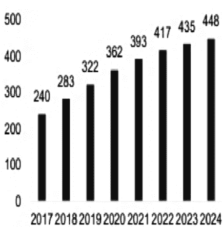

图6.1 电子消费品的全球收入。

来源：ESDM行业，KPMG印度。


行业经济此前已翻倍，现已增长至三倍。对 IC 的巨大需求触发了 AI 芯片开发；这涉及几乎所有 ML 算法和深度学习，而深度学习属于 AI 范畴。此时，应宣布印度半导体制造增长方案。电子行业的增长（半导体是其基础构建块）在 [34] 中有讨论。全球电子消费收入如图 6.1 所示。

由于 IC 制造的兴起，世界领先的经济体发生了剧烈变化。值得指出的是，不仅 AI 或半导体领域，两者都经历了 360 度的演变。

图 6.1 [34] 所示的消费电子产品全球收入让我们了解到电子产品需求的剧烈增长，而半导体是电子产品的基本构建块。IC 需求的逐步发展涉及许多技术，例如 IoT、AI/ML 和深度学习。2020 至 2030 年全球半导体需求如图 6.2 所示。

本章让我们了解到所有 ML 算法在半导体制造和缺陷检测中的应用。该研究涉及半导体机器学习。它揭示，借助深度学习算法，可以进行 SECS/GEM 故障检测。在基于 AI 的处理器设计中，也可以制造半导体。NLP 用于提取特征。半导体分类也可以通过机器学习算法完成。图 6.2 突出了半导体产量的剧烈增长，而半导体又用于生产二极管、晶体管、IC、电子管、显示器件和光电子器件等元件。这些元件最终应用于汽车、制造、航空航天与国防、医疗保健以及网络和电信等各个领域。半导体生产集中在少数几个地区，其中 54.5% 的收入份额位于欧洲、亚太地区和南非。Toshiba Corporation、Microchip Technology、NXP Semiconductors N.V.、Texas Instruments 和 Qualcomm 是推动这一增长的主要贡献者。

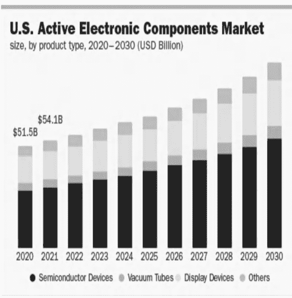

图 6.2 2020 至 2030 年美国半导体需求。

## 6.6 结论

在本研究中，许多不同的基于 AI 的算法被应用于增强半导体的生产和故障检测。从本研究以及对市场增长的观察来看，可以得出结论：基于半导体的 IC 设计和 IC 生产存在许多机会。为了满足这一需求，可以应用许多 ML 算法和深度学习算法来提高产量并减少缺陷，还需要更多研究来进一步数字化这个世界。

## 参考文献

- 1. Leng, S., R. S. Tan, K. T. C. Chai, C. Wang, D. Ghista, and L. Zhong. “电子听诊器。” Biomedical Engineering Online 14 (2015): 1–37.
- 2. Bogaerts, W., and A. Rahim. “可编程光子学：面向可访问大规模 PIC 生态系统的机会。” IEEE Journal of Selected Topics in Quantum Electronics 26, no. 5 (2020): 1–17.
- 3. Aubusson, Russel. “半导体存储器晶圆级集成。” 博士论文，Middlesex Polytechnic, 2011.
- 4. Lapkina, I., and M. Malaksiano. “在不稳定载荷条件下运行设备的性能指标波动估算。” 东欧-欧洲前沿技术期刊 1, no. 3 (2018): 22–29.
- 5. Abd Al Rahman, M., and A. Mousavi. “电子行业自动光学检测和质量监测方法的综述与分析。” IEEE Access 8 (2020): 183192–183271.
- 6. Capra, M., B. Bussolino, A. Marchisio, G. Masera, M. Martina, and M. Shafique. “加速深度神经网络的硬件与软件优化：当前趋势、挑战与未来之路综述。” IEEE Access 8 (2020): 225134–225180.
- 7. García de Arquer, F. P., D. V. Talapin, V. I. Klimov, Y. Arakawa, M. Bayer, and E. H. Sargent. “半导体量子点：技术进展与未来挑战。” Science 373, no. 6555 (2021): eaaz8541.
- 8. Guha, S., H.-S. P. Wong, J. A. C. Incorvia, and S. Chowdhury. 微电子未来方向研讨会：材料、工艺及研发挑战 (2022). https://doi.org/10.21236/ad1188476
- 9. Dreyfus, P–A., F. Psarommatis, G. May, and D. Kiritsis. “工业 4.0 中产品质量估算的虚拟计量方法：系统综述与集成概念框架。” International Journal of Production Research 60, no. 2 (2022): 742–765.
- 10. Grooters, T. “TKH 机场解决方案中系统测试周围自动化虚拟机生成及自动化分析。” 硕士论文，特温特大学，2023.
- 11. Cheng, F.-T., Y-S. Hsieh, C-F Chen, and J-R. Lyu. “AVM 系统的自动化抽样决策方案。” International Journal of Production Research 54, no. 21 (2016): 6351–6366.
- 12. Kim, M., S. Kang, J. Lee, H. Cho, S. Cho, and J. S. Park. “铜箔层压板制造的虚拟计量。” Computers & Industrial Engineering 109 (2017): 280–287.
- 13. Enrico, Z. I. O., F. A. N. Mengfei, Z. E. N. G. Zhiguo, and K. A. N. G. Rui. “民用航空中可靠性技术的应用：经验教训与展望。” 中国航空学报 32, no. 1 (2019): 143–158.
- 14. Umasankar, M., S. Padmavathy, and N. Prakash. “通过流程改进实现产品质量：通往零缺陷的途径。” International Journal of Recent Technology and Engineering 8, no. 4 (2019): 4286–4298.
- 15. Ruperao, P., P. Rangan, T. Shah, V. Thakur, S. Kalia, S. Mayes, and A. Rathore. “作物改良基因组资源开发进展。” Life 13, no. 8 (2023): 1668.
- 16. Nguyen, H. H. “基于深度学习的 CD-SEM 图像缺陷检测系统。” 在《面向半导体智能制造中带 SECS/GEM 的动态 AI 计算任务》中，2022 年半导体制造国际研讨会 (ISSM)，2022 年，第 1–4 页。https://doi.org/10.1109/cstic55103.2022.9856857.
- 17. https://www.cimetrix.com/blog/machine-learning-in-smart-manufacturing-technologies-you-should-be-tracking-now.
- 18. Kim, J., Y. Nam, M-C. Kang, K. Kim, J. Hong, and S. Lee. “半导体制造过程中的对抗性缺陷检测。” IEEE Transactions on Semiconductor Manufacturing, 34, no. 3 (2021): 365–371.
- 19. Bappaditya, D., D. Goswami, S. Halder, K. Khalil, P. Leray, and M. Bayoumi. “基于深度学习的 SEM 图像缺陷分类与检测。” (2022). https://doi.org/10.1117/12.2622550.
- 20. Ngo, A. T., B. Dey, S. Halder, S. De Gendt, and C. Wang. “基于机器学习的边缘放置误差分析与优化：系统综述。” IEEE Transactions on Semiconductor Manufacturing, 36, no. 1 (2023 年 2 月): 1–13. https://doi.org/10.1109/TSM.2022.3217326.
- 21. Kwon, Y., J. Han, Y. P. Cho, J. Kim, J. Chung, J. Choi, S. Park, I. Kim, H. Kwon, J. Kim, H. Kim, W. Jeon, Y. Jeon, M. Cho, and M. Choi. chiplet 异构集成 AI 处理器。“电子、信息与通信国际会议 (ICEIC)。” (2023). IEEE. https://doi.org/10.1109/ICEIC57457.2023.10049867.
- 22. Kobayashi, D., S. Ito, S. Yasuda, and T. Iuchi. “半导体制造中的自然语言处理应用。” 在 2022 年半导体制造国际研讨会 (ISSM) 中，第 1–3 页。https://doi.org/10.1109/ISSM55802.2022.10026893.
- 23. Yoo, J., Y. Jeon, D. Jung, J. Kim, J. Ryu, U. H. Kwon, and D. S. Kim. “面向下一代 BCD 工艺开发的基于机器学习的 TCAD 优化方法。” 在 2021 年第 33 届功率半导体器件与 IC 国际研讨会 (ISPSD) 中，2021 年，第 279–282 页。
- 24. Takemoto, S., K. Shibagaki, Y. Nozaki, and M. Yoshikawa. “面向小规模和低延迟的神经网络物理不可克隆函数及其评估。” IEEE Transactions on Electronics, Information and Systems, 140, no. 12 (2020 年 12 月): 1297–1306.
- 25. Nozaki, Y., and M. Yoshikawa. “在 SAKURA-G 上实现的 AI 认证设备性能评估。” (2023) 未发表.
- 26. Doe, J., and J. Smith. “半导体制造中基于深度学习的晶圆缺陷图相似性搜索。” 在《半导体制造国际会议 (ICSM) 论文集》中。旧金山，CA，2024 年，第 123–130 页。https://doi.org/10.1109/ICSM.2024.1234567.


- 27. Yan, S., C. Luo*, S. Wang, S. Ding, L. Li, J. Ai, Q. Sheng, Q. Xia, Z. Li, Q. Chen, S. Li, H. Dai, and Y. Zhong. “基于Lasso-高斯过程回归的CVD薄膜厚度虚拟计量建模。” 在 2023年中国半导体技术国际会议（CSTIC）中发表。 | 979-8-3503-1100-6/23/$31.00 ©2023 IEEE | https://doi.org/10.1109/CSTIC58779.2023.10219236.

- 28. Chen, Y. Z. “基于树集成模型组合的半导体PVD工艺虚拟计量。” ISA Transactions 103卷，第1期（2020年）.

- 29. Imoto, K., T. Naka, T. Ike, K. Haruki, and Y. Sato. “基于CNN的迁移学习方法用于半导体制造中缺陷分类。”（2018年）。https://doi.org/10.1109/TSM.2019.2941752.

- 30. Krizhevsky, A., I. Sutskever, and G. E. Hinton. “基于深度卷积神经网络的ImageNet分类。” 在《神经信息处理系统进展》论文集中，2012年，第1097–1105页。

- 31. https://www2.deloitte.com/content/dam/Deloitte/tw/Documents/technology-media-telecommunications/tw-semiconductor-report-EN.pdf.

- 32. Wang, J., Y. Ma, L. Zhang, R. X. Gao, and D. Wu. “智能制造的深度学习：方法与应用。”《制造系统杂志》，48卷（2018年7月）：第144–156页。

- 33. 印度国际经济关系研究委员会（ICRIER），2022年。《从全球化到本地化：大规模出口和深化生态系统对提升电子行业国内增值至关重要》。可在以下网址查阅 https://icrier.org/pdf/Globalise_to_Localise.pdf.

- 34. 白皮书：ESDM行业，印度德勤，2020年。

# 7 基于机器学习的圆柱形BioFET生物传感性能数值仿真探究

Amit Das, Sonam Rewari, Binod Kumar Kanaujia,
S. S. Deswal and R. S. Gupta

## 7.1 简介

场效应晶体管（FET）是电子领域的一项关键进步，拥有针对不同用途和应用的各种类型[1–5]。其适应性在生物医学领域尤其宝贵，可用于众多临床目的。基于FET的生物传感器被用于诊断和监测阿尔茨海默病[6]、癌症[7]、HIV以及心血管疾病（CVD）[8]。然而，选择性和非单一填充因子可能会在实时测量中引入轻微偏差。

随着科学技术的进步，FET已应用于关键医疗设备，如除颤器、药物输送系统、生物分子无标记检测、体内剂量测定、CVD监测、助听器及其他可植入设备。其中，基于FET的生物传感器（BioFET）因其作为常规临床传感器经济可靠的替代品的潜力而被广泛研究[9, 10]。它们以高精度和线性响应著称[11–13]，适用于放射治疗过程中的体内剂量测定[14, 15]。Grenier等人[16]强调了FET在细菌转化中的应用，这对于DNA融合和电穿孔等医疗程序具有重要意义。此外，Morf等人[17]描述了一种基于天线耦合MOSFET bolometer的THz传感器，可用于生物医学领域中的危险化学品远程检测和材料表征（无需使用电离辐射即可检测违禁品）[18, 19]。

生物传感器是一种专为快速识别生物分子而设计的工具。在生物电子学中，由于BioFET具有卓越的灵敏度和可扩展性[10]，其受欢迎程度日益提升。这些生物传感器通过利用生化物质的分子特性（如介电常数和电荷密度）来实现

- (1) 圆柱形FET（电子器件），当用于生物传感应用（生物分子检测）时，称为圆柱形BioFET。

- (2) 生物分子（具有独特的介电常数和电荷密度）被固定在BioFET栅氧层内部创建的空腔中。

- (3) 生物分子的这种固定改变了BioFET的电特性。

- (4) 这些电特性的变化可以转化为可测量的感知量（灵敏度），并可在外部显示。

图7.1 圆柱形BioFET的基本器件原理。

来源：[10]。

无标记检测，可在无需标记实体的情况下直接识别生物分子[10, 20]。BioFET中的主要检测机制围绕感知参数的介电调制展开[20, 21]。图7.1概述了BioFET的基本原理及基本检测机制。

阈值电压是BioFET中的主要感知参数，辅以次阈值斜率、关态电流、I_on/I_off比值和跨导等指标来评估灵敏度。在BioFET中，在栅氧层中设计了一个空腔以有效固定生物分子。这一结构特征在生物分子固定后改变了电势和场分布，从而诱导阈值电压的变化。这些变化反映了生物传感器对特定生物分子的灵敏度，通过介电特性的调制实现检测。高效的生物传感器表现出高灵敏度，表现为对生物分子存在的显著阈值电压漂移。文献中已报道和描述了多种BioFET变体[22–26]。Ahangani等人[27]和Li等人[28]通过阈值电压动态及其他参数变化探索了灵敏度。最近，Pratap等人[29]和Chakraborty等人[20]利用无结晶体管开创了一种新型圆柱形BioFET设计，采用多种感知指标进行生物分子检测。Gao等人[30]展示了用于蛋白质和pH感应应用的亚阈值范围纳米线FET。Gautam等人[5]和Pour等人[31]强调了用于气体感应应用的圆柱形FET。生化物种的尺寸范围从毫米到飞米[10, 29]。Dam等人[32]利用基于FET的葡萄糖生物传感器针对葡萄糖氧化酶检测实现了强健的灵敏度。最近，Koshti等人[12]引入了一种基于FET的生物传感器，用于检测COVID-19病毒。

在过去十年中，研究人员探索了不同作者提出的多种BioFET设计。这些生物传感器已结合不同的结构配置、氧化物材料和功函数进行了研究。然而，此前没有报道过通过掺杂优化来调制阈值电压以提高这些传感器灵敏度的研究。本章的主要重点是优化源区、漏区和沟道区的掺杂剖面，以显著提高BioFET的灵敏度。在实际应用中，通常预计BioFET内部的空腔会因不可避免的情况而保持部分充填。因此，有必要考察部分充填的空腔对生物传感器灵敏度的影响。填充因子——即生物分子占据的空腔体积比例——在此语境中起着关键作用[10]。尽管其很重要，但相关文献中关于填充因子对BioFET灵敏度影响的全面研究仍然缺乏[33]。因此，本章研究的第二个目标是全面探讨填充因子在生物传感应用中对阈值电压灵敏度的影响[33, 34]。

传统生物传感器在灵敏度、特异性和适应性方面常面临挑战。然而，机器学习（ML）算法可以有效解决这些问题，并显著提升生物传感器的性能。ML是人工智能（AI）的一个分支，使计算机能够从数据中学习并基于该信息做出预测或决策。在生物传感中，ML算法可以分析生物传感器生成的复杂数据，提高准确性，并自动化决策过程[35]。通过利用ML，生物传感器可以转化为用于检测和监测疾病、污染物及毒素的更强大工具[36]。本讨论简要围绕两个关键方面展开：利用机器学习进行数据分析以及在传感器设计中应用ML。最后，它简要阐述了推进基于ML的生物传感器的挑战与机遇。此外，ML使生物传感器能够适应变化的环境条件，并通过持续学习优化性能。这种能力对于现实应用至关重要，因为环境因素可能随时间波动。基于ML的生物传感器还有望与物联网（IoT）平台集成，以促进远程监控和实时数据传输，提升可用性和可访问性[35]。图7.2展示了ML与BioFET工程集成的基本原理。

此处选择圆柱形FET，是因为其环绕式栅极设计能够有效控制载流子流动并保持静电完整性。第一部分简要回顾了文献，识别了研究空白，并概述了本研究的范围。第二部分详细阐述了


**步骤 1：数据收集与预处理：** 从 BioFET 收集原始传感器数据，并对收集到的数据进行预处理。

**步骤 2：特征提取与数据划分：** 从收集的数据中提取相关特征，随后将数据集划分为训练集和测试集。

**步骤 3：模型选择、训练与评估：** 根据数据特性选择机器学习模型（例如，SVM、随机森林、神经网络）。使用训练数据集对其进行训练，并使用测试数据集评估性能（例如，准确率、灵敏度、特异度）。

**步骤 4：优化与部署：** 微调模型参数以提升性能（例如，网格搜索、交叉验证）。在 BioFET 中实现训练好的模型，用于实时或未来的预测。

**步骤 5：集成与解释：** 将机器学习模型集成到生物传感器系统中。解释模型预测和结果，以得出有意义的生物学见解。

图 7.2 解释在研究 BioFET 中实施机器学习的基本流程图。

本文介绍了 BioFET 校准、制造工艺、模拟器设置及所采用的方法。第三部分讨论了重要发现及相应图表，重点关注掺杂、温度变化和填充因子对阈值电压灵敏度的影响。最后，第四部分总结了关键发现，探讨了潜在应用，并强调了当前研究的创新之处。

## 7.2 器件与模拟器规格

### 7.2.1 BioFET 校准与特性

圆柱形 BioFET 采用标准值进行了校准，以优化灵敏度。与金属栅极相比，选用功函数为 4.96 eV 的多晶硅栅极，因其制造简单且工作温度范围宽。偏压供应限制为 1 V，这是纳米级 BioFET 的标准。电子亲和能设定为 4.17 eV。室温下校准得到的能带隙、价带有效态密度和导带有效态密度分别为 1.08 eV、1.04 × 10^19/cm^3 和 2.8 × 10^19/cm^3 [37, 38]。图 7.3a 和 7.3b 分别展示了所提出 BioFET 的 3D 视图和 2D 视图。与单侧配置相比，选择对称双侧腔体设计具有诸如提高填充概率、降低功耗和增强电流灵敏度等优势 [39, 40]。可将腔体嵌入 SiO2 栅氧化层中 [29]。BioFET 的详细制造步骤以流程图形式在图 7.3c 中展示 [28, 41–43]。

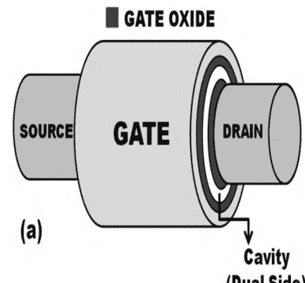

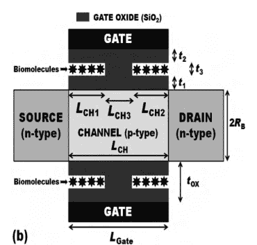

图 7.3 (a) 3D 视图、(b) 2D 视图和 (c) 制造流程图，说明圆柱形 BioFET 的基本制造步骤。

来源：[44]。

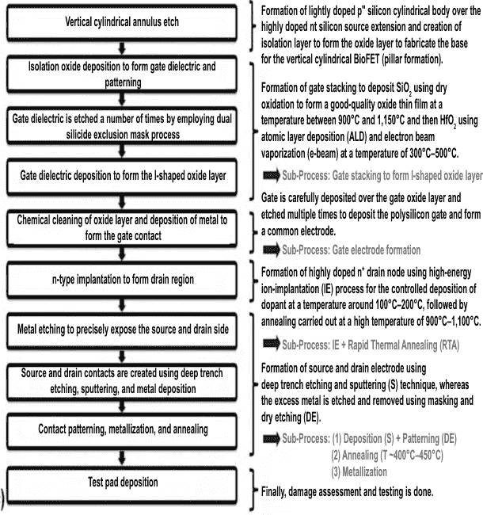

图 7.3（续）

### 7.2.2 TCAD 预设置规格

圆柱形 BioFET 的数值研究使用列于表 7.1 中的值，在 ATLAS TCAD 模拟器 [45] 上进行分析。为模拟实时条件，仿真过程中需纳入相关模型：Shockley-Read-Hall (SRH) 模型支持载流子产生与复合，浓度依赖迁移率 (CONMOB) 模型将杂质剖面与室温低场迁移率相关联，平行电场依赖迁移率 (FLDMOB) 模型考虑电场依赖迁移率 [46]。为求解非线性复杂微分方程，采用 Newton-Gummel 方法，该方法结了解耦迭代和耦合迭代 [46, 47]。

### 7.2.3 计算方法论

生物分子由其特定电荷密度 (ρ) 和介电常数 (K_bio) 定义 [20, 26, 47]。例如，未杂交的 DNA 带有负电荷

表 7.1 结构参数

| Parameters | Value |
|---|---|
| 沟道长度 ($L_{CH}$) | 30 nm |
| 源/沟道/漏半径 ($R_B$) | 10 nm |
| 源材料 | n型 |
| 沟道材料 | p型硅 (Si) |
| 漏材料 | n型 |
| 栅极功函数 [48, 49] | 4.96 eV |
| 沟道掺杂 ($N_C$) | $10^{10}/cm^3$ |
| 源掺杂 ($N_S$) | $1 \times 10^{13}$ to $5 \times 10^{20}/cm^3$ |
| 漏掺杂 ($N_D$) | $1 \times 10^{13}$ to $5 \times 10^{20}/cm^3$ |
| 源/漏长度 | 10 nm |
| 氧化层厚度 ($t_{ox}$) | 6 nm |
| 腔体厚度 | $t_1 = 1$ nm $t_2 = 4$ nm $t_3 = 1$ nm |
| 腔体长度 | $L_{CH1} = L_{CH2} = 14$ nm $L_{CH3} = 2$ nm |
| 栅氧化层 | 二氧化硅 ($SiO_2$) |
| 偏压 | $V_{DS} = (0-1)$ V $V_{GS} = (0-1)$ V |
| 氧化层长度 | 30 nm |

**生物分子**

中性生物分子

| | |
|---|---|
| 尿酸酶 ($K_{bio} = 1.54$) [29] | 链亲和素 ($K_{bio} = 2.1$) [50] |
| 蛋白质 ($K_{bio} = 2.5$) [29] | 生物素 ($K_{bio} = 2.63$) [51] |
| 胆固醇氧化酶 (ChOX) ($K_{bio} = 3.3$) [29] | 3-氨丙基三乙氧基硅烷 (APTES) ($K_{bio} = 3.57$) [50] |
| 羟基蛋白 ($K_{bio\_s} = 5$) [52] | 角蛋白 ($K_{bio} = 8$) [53] |

带电生物分子

| | |
|---|---|
| DNA [54] | 氨基酸 [55] |
| $K_{bio} = 5$; $\rho = -1 \times 10^{11}/cm^2$ | $K_{bio} = 5$; $\rho = +1 \times 10^{11}/cm^2$ |

_注:_ ChOX，胆固醇氧化酶；APTES，3-氨丙基三乙氧基硅烷。

并表现出可变电荷密度和介电常数 [54]。相比之下，尿酸酶、玉米蛋白和链亲和素等中性生物分子 [26] 仅具有介电常数。本研究所使用的各种测试生物分子列于表 7.1 中。本研究包含具有不同电荷密度的一系列生物分子，以考察灵敏度模式的变化。通过考虑带电和中性生物分子，该调查旨在提供对生物传感器灵敏度的全面且现实的分析。

当腔体为空时，其中包含介电常数为 $K_{air} = 1$ 的空气。将测试生物分子（$K_{bio} \neq 1$）引入腔体会导致阈值电压和其他器件特性发生变化。这种变化是因为生物分子改变了栅氧化层电容和横向电场，从而修改了沿沟道的电势分布 [10]。阈值电压的相对偏移

1. SILVACO ATLAS TCAD 模拟器中生物分子和空气的表征：
   - 每种生物分子的表征为 ($K_{bio}$-介电常数 & $\rho$-电荷密度)
     - 中性生物分子 ($K_{bio} \neq 1$ & $\rho = 0$)
     - 带电生物分子 ($K_{bio} \neq 1$ & $\rho \neq 0$)
   - 空气的介电常数被表征为单位 ($K_{air} = 1$)。
2. 不同条件下的传感指标 ($M$) 值，其中传感指标可以是任意项 ($M$: 阈值电压/亚阈值摆动/导态电流/关态电流/电流比)：
   - $M_{air}$：腔体充满空气（无生物分子）时的 $M$ 值
   - $M_{bio}$：腔体充满生物分子（存在生物分子）时的 $M$ 值
3. 灵敏度研究与计算：
   - 相对灵敏度 ($S_M$)
     $S_M = \left| M_{(bio)} - M_{(air)} \right|$
   - 百分比灵敏度 ($SP_M$)
     $SP_M = \left| \frac{M_{(bio)} - M_{(air)}}{M_{(air)}} \right| \times 100$
4. 灵敏度分析：传感指标值的更大变化表明灵敏度更高，这在生物传感器中是理想的。
   - 灵敏度可以以相对变化的形式计算，并可用作比较不同生物传感器的优劣指标。
   - 使用多个传感指标分析灵敏度可提高生物传感器的可靠性。

图 7.4 描述灵敏度分析所用方法论摘要的流程图。

阈值电压在 BioFET 生物传感研究中充当定性指标。需要注意的是，虽然生物分子影响氧化层电容并进而影响横向电场，但掺杂通过调节源-沟道和漏-沟道结处的电势垒来影响水平电场 [56, 57]。用于灵敏度分析的数值方法 [10, 20] 在图 7.4 所示流程图中简明表示。

## 7.3 结果与讨论

### 7.3.1 临床应用的生物分子检测

使用圆柱形 BioFET 可以有效实现多种慢性疾病的早期检测。这些疾病包括卵巢癌或乳腺癌、阿尔茨海默病和肝细胞癌 (HCC)，其中特定生物分子在疾病筛查中起关键作用。BioFET 可以检测尿酸酶 ($K_{bio} = 1.54$) [29],


### TABLE 7.2
### 不同生物分子的阈值电压偏移

| 生物分子 | 阈值电压偏移 (\(\Delta V_J\)) |
|:---|:---|
| 尿酸酶 | 39.0281 mV |
| 链霉亲和素 | 74.5910 mV |
| 胆固醇氧化酶 | 134.914 mV |
| 氨丙基三乙氧基硅烷 | 141.048 mV |
| \(N_S = N_D = 10^{19}/cm^3 \quad L_1 = L_2 = 14 \text{ nm}\) | \(N_C = 10^{10}/cm^3 \quad V_{DS} = 0.5 \text{ V}\) |

对于预防尿酸肾病至关重要，而链霉亲和素（\(K_{bio} = 2.1\)）[50]用于免疫分析和印迹法。其他可检测的生物分子包括胆固醇氧化酶（\(K_{bio} = 3.3\)）[29]，常用于生物催化，以及氨丙基三乙氧基硅烷（\(K_{bio} = 3.57\)）[50]，对硅烷化过程至关重要。表 7.2 详细说明了当这些生物分子定位于生物传感器（BioFET）的纳米间隙腔内时观察到的阈值电压偏移。

## 7.3.2 掺杂效应

以相同模式增加源极和漏极的掺杂会导致两种主要效应：效应 2 和效应 1。当源极和漏极的掺杂以相同速率从低值增加到高值时，耗尽区的主要部分会渗透到沟道内部 [37]，而非源极（源极-沟道结）或漏极（漏极-沟道结），这基本上就是效应 1。栅极耗尽层总宽度随着掺杂增加而不断减小 [58]，这基本上就是效应 2。因此，当源极和漏极的掺杂从低值增加到高值时，效应 1 和效应 2 都会存在。低掺杂时效应 2 更占主导地位，导致耗尽层宽度减小，从而增加有效沟道长度。高掺杂时效应 1 更占主导地位，导致耗尽层侧面渗透到沟道内部，从而减小有效沟道长度。这两种效应如图 7.5 的示意图流程图所示。掺杂记法 s_t_u 表示源极（\(1 \times 10^6/cm^3\)）、沟道（\(1 \times 10^6/cm^3\)）和漏极（\(1 \times 10^6/cm^3\)）的掺杂，顺序相同，S_C_D 记法分别表示 源极_沟道_漏极。掺杂值 \(D_A-D_H\) 在表 7.3 中指定。

图 7.6 描绘了不同生物分子的阈值电压灵敏度变化。最初，在较低掺杂水平下（效应 2），由于有效沟道长度更长，阈值电压增加，需要更高的栅极电压来激活 FET。栅极电压的增加导致阈值电压升高，从而在较低栅极电压下实现增强的灵敏度。相反，在较高掺杂水平下，有效沟道长度减小（效应 1），器件激活需要更低的栅极电压（阈值电压）。因此，随着掺杂水平的提高，灵敏度降低。阈值电压起初增加，随后

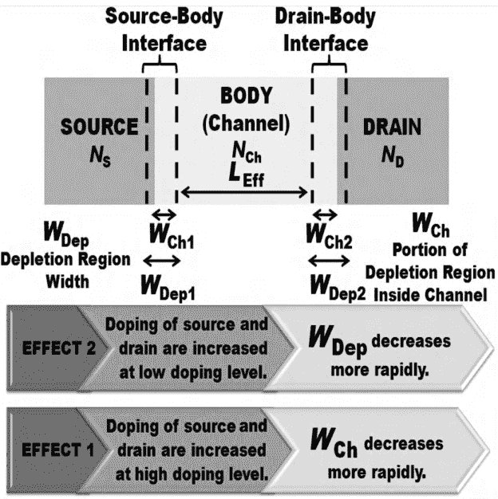

图 7.5 掺杂对有效沟道长度影响的可视化。

随着源极和漏极掺杂水平的均匀增加而减小，如图 7.6 的插图所示。值得注意的是，当低掺杂水平下腔内存在生物分子时，阈值电压变化超过 ~400%，表明具有显著灵敏度，这对生物传感应用至关重要。

在较低掺杂水平下实现高百分比灵敏度虽然有益，但在此类条件下器件的导电率会降低，限制了在 BioFET 中使用低掺杂。因此，必须通过优化掺杂水平在灵敏度和导电率之间取得平衡，以实现最佳性能。此外，带电生物分子的存在会影响阈值电压的值。带正电的生物分子会从衬底吸引电子，在较低栅极电压下形成沟道，与中性生物分子相比降低阈值电压。相反，带负电的生物分子会增加阈值电压。因此，阈值电压的灵敏度对带电生物分子表现出与中性生物分子观察到的相似趋势。理解这些动态对于根据特定生物分子相互作用定制 BioFET 设计，并在多样化的生物和环境应用中优化其性能至关重要。值得注意的是，在较高

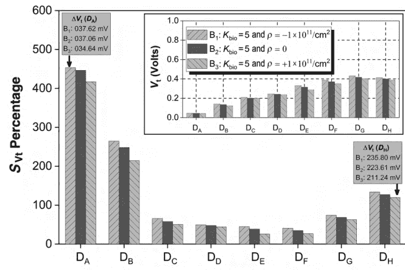

图 7.6 不同掺杂下不同测试生物分子的阈值电压灵敏度 ($S_{Vt}$)。([插图] 显示了不同掺杂下不同测试生物分子的阈值电压变化。)

掺杂水平下相对变化显著，而在较低掺杂水平下则最小，这与灵敏度百分比变化观察到的趋势相反。

表 7.3 提供了不同对称掺杂水平下亚阈值斜率 (SS) 和亚阈值斜率灵敏度（\(S_{ss}\)）的数据。亚阈值斜率源自 log（\(I_{Ds}\)-\(V_{GS}\) 曲线（传输特性），并与耗尽电容呈反比关系。在较低掺杂水平下（效应 2 占主导），随着掺杂增加，耗尽宽度减小，导致耗尽电容升高和亚阈值斜率降低（SS 与耗尽电容呈非线性反比关系）。相反，在由效应 1 主导的较高掺杂水平下，亚阈值斜率随掺杂增加而增大。较高的亚阈值斜率表明在相同栅极电压范围内漏极电流的变异性更显著，在较高掺杂水平下表现出更明显的变化。表 7.3 中亚阈值斜率模式的局部最小值很明显。与中性生物分子相比，带正电的生物分子会略微增加导通电流，而带负电的生物分子会略微降低导通电流。导通电流的增加增强了亚阈值特性，导致亚阈值斜率增加，尽管相对变化减小。重要的是，阈值电压表现出大于亚阈值斜率的相对变化，凸显了其作为分析生物传感器性能指标的卓越灵敏度。理解这些动态对于推动基于 FET 的生物传感器在复杂生物和环境背景下朝着增强灵敏度和可靠性发展至关重要。优化策略可以利用这些见解来改进传感器设计和性能。

### TABLE 7.3
### 不同对称掺杂下 SS 和 \( S_{SS} \) 的变化 (\(K_{bio} = 5\))

| 掺杂值 | 参数 | \(\rho = -1 \times 10^{11} cm^{-2}\) | \(\rho = 0\) | \(\rho = +1 \times 10^{11} cm^{-2}\) |
|:---|:---|:---:|:---:|:---:|
| \(D_A\): \(10^{13}-10^{10}-10^{13}\) | SS | 71.943 | 72.016 | 72.949 |
| | \(S_{SS}\) | 25.11756 | 25.0421 | 24.07005 |
| \(D_B\): \(10^{14}-10^{10}-10^{14}\) | SS | 71.933 | 71.957 | 71.999 |
| | \(S_{SS}\) | 24.08303 | 24.05791 | 24.0545 |
| \(D_C\): \(10^{15}-10^{10}-10^{15}\) | SS | 71.413 | 71.417 | 71.476 |
| | \(S_{SS}\) | 24.04949 | 24.04556 | 23.98249 |
| \(D_D\): \(10^{16}-10^{10}-10^{16}\) | SS | 71.2799 | 71.28 | 71.281 |
| | \(S_{SS}\) | 23.82677 | 23.82673 | 23.82566 |
| \(D_E\): \(10^{17}-10^{10}-10^{17}\) | SS | 71.206 | 71.209 | 71.212 |
| | \(S_{SS}\) | 23.67215 | 23.66915 | 23.66604 |
| \(D_F\): \(10^{18}-10^{10}-10^{18}\) | SS | 71.144 | 71.146 | 71.149 |
| | \(S_{SS}\) | 23.96603 | 23.964 | 23.96058 |
| \(D_G\): \(10^{19}-10^{10}-10^{19}\) | SS | 77.467 | 77.612 | 77.761 |
| | \(S_{SS}\) | 37.11498 | 36.99703 | 36.87624 |
| \(D_H\): \(10^{20}-10^{10}-10^{20}\) | SS | 93.946 | 94.072 | 94.226 |
| | \(S_{SS}\) | 44.17691 | 44.10204 | 44.01065 |

SS: (mV/decade)\(^{-1}\)  
\(S_{SS}\): (百分比)  

\(S_{SS} = \left| \frac{SS_{(air)} - SS_{(bio)}}{SS_{(air)}} \right| \times 100\)  
(7.1)

图 7.7 说明了阈值电压灵敏度的变化，并配有一个插图，显示亚阈值斜率灵敏度，当 (i) 漏极（源极和沟道掺杂恒定）和 (ii) 源极（漏极和沟道掺杂恒定）的掺杂水平从参考掺杂水平（\(D_{RD}\)：\(N_C = 10^{10}/\text{cm}^3\) 和 \(N_s = N_D = 10^{19}/\text{cm}^3\)）增加时。所选参考掺杂水平较高，因此进一步增加源极或漏极掺杂会因高掺杂时效应 2 占主导而增强阈值电压灵敏度和亚阈值斜率灵敏度。值得注意的是，当漏极掺杂超过源极掺杂时，灵敏度显著更高。详细掺杂水平（\(D_{D1} - D_{D3}\) 和 \(D_{S1} - D_{S3}\)）在表 7.4 中概述，该表还说明了不同非对称掺杂下观察到的亚阈值斜率和阈值电压模式，揭示了参考掺杂水平处的局部最小值。图 7.8 展示了不同中性生物分子观察到的灵敏度变化。生物化学物种介电常数的增加会导致腔内氧化物电容相应增加。这种增加的栅极氧化物电容增强了


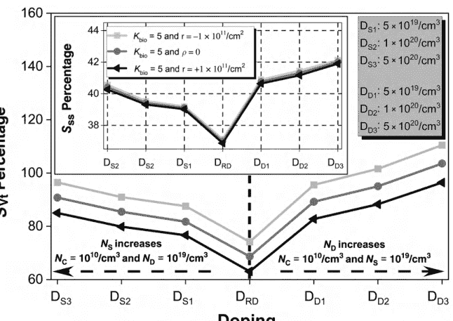

图 7.7 不同非对称掺杂下不同测试生物分子的阈值电压灵敏度（$S_{V_t}$）。（[插图] 显示了不同非对称掺杂下不同测试生物分子的亚阈值摆动灵敏度的变化。）

载流子与栅极之间的相互作用 [20]。因此，在 $K_{bio}$ 较高时，阈值电压和亚阈值摆动均表现出更明显的变化（相对于空腔场景），表明生物传感器对具有较高 $K_{bio}$ 的生物分子的灵敏度增加。图 7.8 中的插入表概述了各种带电生物分子的阈值电压灵敏度和亚阈值摆动灵敏度的变化，强调了由于增强的栅极至沟道耦合，对带负电生物分子具有更强的灵敏度。增加生物分子的介电常数可增强栅极氧化电容，加强载流子与栅极之间的相互作用。这放大了基于 FET 的生物传感器的灵敏度，特别是对具有较高介电常数的生物分子，从而增强了在各种生化环境中的检测能力。理解这些动态对于定制 BioFET 以有效检测具有不同电荷和介电特性的生物分子至关重要。

图 7.9 说明了不同掺杂水平下蛋白质的 $I_{ON}/I_{OFF}$ 比值的变化。插图提供了各种生物分子在低掺杂和高掺杂水平下的 $I_{ON}/I_{OFF}$ 比值的具体比较。增加源掺杂可同时提升开态电流（$I_{ON}$）和关态电流（$I_{OFF}$）[59]。$I_{ON}$ 的这种增加主要有助于提高总体 $I_{ON}/I_{OFF}$ 比值。然而，在较高掺杂水平下，由于电子迁移率显著下降，开态电流开始减少。

表 7.4
不同非对称掺杂下的 Vt 和 SS 变化

| 掺杂值 | 掺杂剖面 (Nc-Ns-Nd, cm⁻³) | 参数 | ρ = -1×10¹¹ cm⁻² | ρ = 0 | ρ = +1×10¹¹ cm⁻² |
|---|---|---|---|---|---|
| Ds₃ | 5×10²⁰_1×10¹⁰_1×10¹⁹ | SS | 84.7319 | 84.933 | 85.1551 |
| Ds₃ | | Vt | 424.49 | 412.21 | 399.754 |
| Ds₂ | 1×10²⁰_1×10¹⁰_1×10¹⁹ | SS | 83.8564 | 84.015 | 84.1602 |
| Ds₂ | | Vt | 427.493 | 415.15 | 402.624 |
| Ds₁ | 5×10¹⁹_1×10¹⁰_1×10¹⁹ | SS | 82.593 | 82.705 | 82.8195 |
| Ds₁ | | Vt | 429.305 | 416.51 | 402.73 |
| Dkd | 1×10¹⁹_1×10¹⁰_1×10¹⁹ | SS | 77.4668 | 77.612 | 77.7609 |
| Dkd | | Vt | 430.309 | 416.80 | 402.911 |
| Dd₁ | 1×10¹⁹_1×10¹⁰_5×10¹⁹ | SS | 83.1755 | 83.341 | 83.5154 |
| Dd₁ | | Vt | 419.28 | 405.74 | 391.808 |
| Dd₂ | 1×10¹⁹_1×10¹⁰_1×10²⁰ | SS | 84.9219 | 85.126 | 85.3389 |
| Dd₂ | | Vt | 416.489 | 402.94 | 388.99 |
| Dd₃ | 1×10¹⁹_1×10¹⁰_5×10²⁰ | SS | 86.6484 | 86.810 | 86.9765 |
| Dd₃ | | Vt | 412.482 | 399.28 | 385.3 |

（情况 i）ND 变化（Nc 和 Ns 保持不变）SS：（mV/数量级）⁻¹ （情况 ii）Ns 变化（Nc 和 Nd 保持不变）Vt：mV

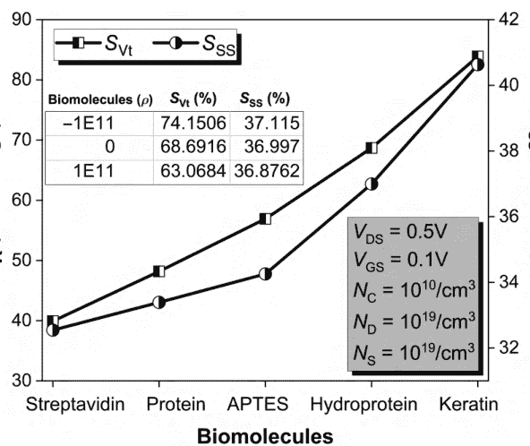

| 生物分子 (ρ) | Svt (%) | Sss (%) |
|---|---|---|
| -1×10¹¹ | 74.1506 | 37.115 |
| 0 | 68.6916 | 36.997 |
| 1×10¹¹ | 63.0684 | 36.8762 |

图 7.8 不同中性生物分子存在下的阈值电压灵敏度和亚阈值摆动灵敏度。

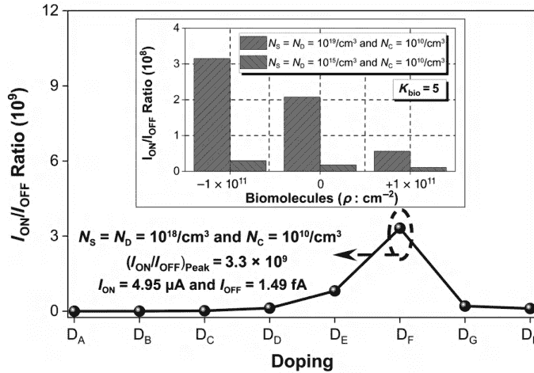

图 7.9 不同掺杂下蛋白质的 $I_{ON}/I_{OFF}$ 比值。（[插图] 显示了不同带电生物分子的 $I_{ON}/I_{OFF}$ 比值变化。）

图 7.10 描述了不同沟道掺杂水平下阈值电压和亚阈值摆动的灵敏度分析。增加沟道掺杂会导致阈值电压略微上升，因为需要更多的栅极电压才能完全耗尽沟道。这种掺杂增加会增加在施加电压下电子从源极流向漏极之前必须耗尽的空穴数量。然而，阈值电压的灵敏度（反映其相对变化）随 $N_C$ 增加而降低。同样，亚阈值摆动及其灵敏度也随沟道掺杂增加而下降。高 $N_C$ 水平会降低开态和关态电流，导致 $I_{DS}-V_{GS}$ 曲线在亚阈值区域内的斜率更平缓。因此，随着 $N_C$ 上升，亚阈值摆动及其灵敏度均降低。这些发现强调了沟道掺杂和介电特性在调节生物传感器性能中的关键作用。通过优化这些参数，基于 FET 的生物传感器可以实现卓越的检测能力，这对于各种生物医学和环境应用至关重要。

图 7.11 和 7.12 分别说明了在不同中性生物分子固定过程中，漏极电流随栅极电压和漏极电压的变化。这些图中的插图显示了各种带电生物分子的类似变化。与生物分子存在时相比（相对于空腔），漏极电流的相对差异随 $K_{bio}$ 上升而增加，这是由于沟道和栅极之间耦合增强所致。较高的 $K_{bio}$ 值会导致漏极电流更显著的降低，表明在较高介电常数下变化更显著 [20]。带负电的生物分子进一步增强这种耦合，相比于中性生物分子，结果是灵敏度增加。值得注意的是，在存在生物分子时，圆柱形 BioFET 对栅极电压的灵敏度高于对漏极电压的灵敏度。这一知识也为创建多功能 BioFET 平台铺平了道路，该平台能够可靠地检测和测量不同生物基质中的多种生物分子，最大化特定生物标志物检测的器件性能。

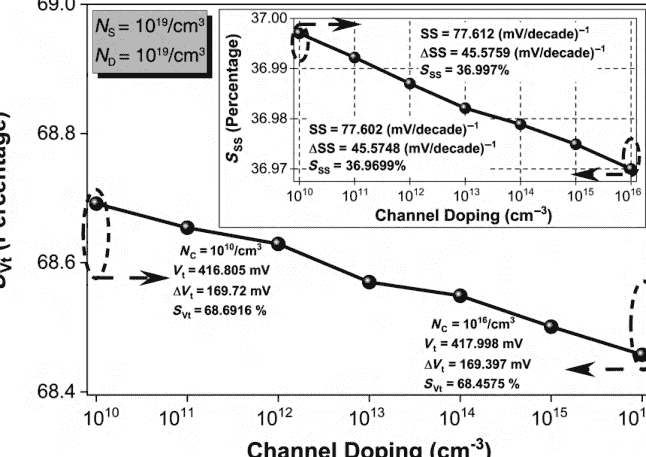

图 7.10 不同沟道掺杂下蛋白质的阈值电压灵敏度。（[插图] 显示了不同沟道掺杂下蛋白质的亚阈值摆动灵敏度。）

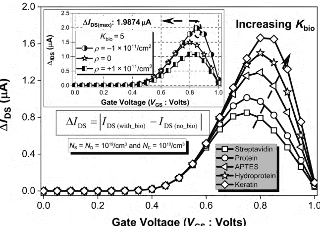

图 7.11 在 $V_{DS} = 0.5$ V 时，不同中性生物分子下漏极电流作为栅极电压的函数的变化。（[插图] 显示了在 $V_{DS} = 0.5$ V 时，不同带电生物分子下漏极电流作为栅极电压的函数的变化。）

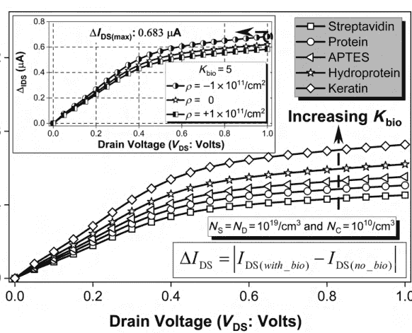

图 7.12 在 $V_{GS} = 0.5$ V 时，不同中性生物分子下漏极电流作为漏极电压的函数的变化。（[插图] 显示了在 $V_{GS} = 0.5$ V 时，不同带电生物分子下漏极电流作为漏极电压的函数的变化。）

图 7.13 描述了高掺杂水平下漏极偏压变化时阈值电压灵敏度和亚阈值摆动灵敏度的变化，而插图显示了低掺杂水平下的这些灵敏度。两种灵敏度均随高漏极电压产生更多数量的载流子而增加。载流子数量的这种增加会导致在存在生物分子时阈值电压和亚阈值摆动出现更显著的变化。因此，在较高漏极电压下，器件对生物分子的灵敏度较高，这是由于沟道上更强的电场所致。但是，需要注意的是，漏极电压不能无限增加，因为在短沟道器件中，过高的漏极电压可能导致永久性损坏。这一知识也为创建多功能 BioFET 平台铺平了道路，该平台能够可靠地测量不同生物基质中的多种生物分子，最大化特定生物标志物检测的器件性能。图 7.14 说明了不同中性生物分子下圆柱形 BioFET 沟道中的电势分布，而插图显示了不同对称掺杂水平下沟道中的最小电势。沟道电势曲率的增加

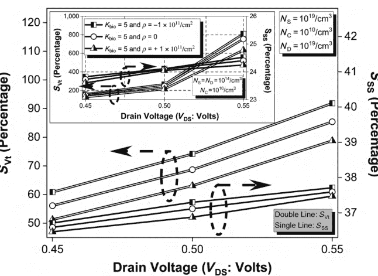

图 7.13 高掺杂下不同生物分子在各种漏极电压下的阈值电压灵敏度和亚阈值摆动灵敏度。（[插图] 显示了低掺杂下不同生物分子在各种漏极电压下的阈值电压灵敏度和亚阈值摆动灵敏度。）

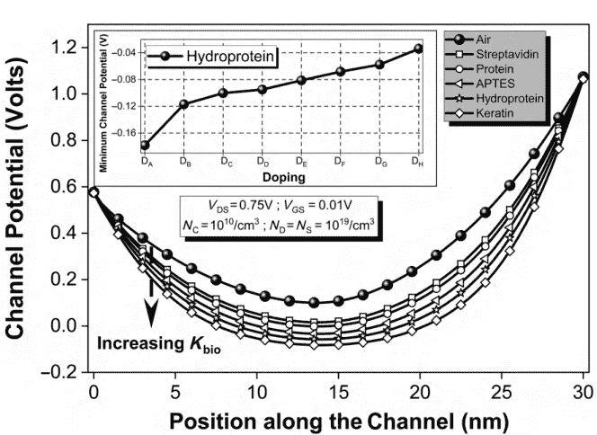

图 7.14 存在不同生物分子时的沟道电势。（[插图] 显示了蛋白质的最小沟道电势。）


较高的 \( K_{\text{bio}} \) 表明生物传感器对介电常数较高的生物分子更敏感，支持了本研究的结果。通道电势的相对变化越大，是评价圆柱形 BioFET 生物传感性能的关键参数。值得注意的是，增加栅电压会降低电势曲率，因此在 10 mV 的低栅电压下绘制通道电势，以强调生物分子对曲率的影响。这些结果凸显了仔细平衡漏极和栅电压以优化传感器性能并避免器件损坏的必要性。理解通道中电势分布的变化，进一步强调了介电特性在提升生物传感器灵敏度方面的重要性。此类见解对于设计针对特定生物医学和环境应用的强健且高度灵敏的 BioFET 至关重要。

图 7.15 展示了温度如何影响阈值电压灵敏度，内置图针对不同带电生物分子。温度升高会促进载流子生成 [60]，降低阈值电压并增加其相对变化，从而增强对生物分子的敏感性。对 FET 来说，选择合适的栅氧化层至关重要，例如因其稳定性和兼容性而选用 SiO\(_2\)。将高-K 介电与 SiO\(_2\) 集成可减少边缘场 [18]，但会牺牲灵敏度并增加复杂性。图 7.15 对比了带有和不带堆叠栅氧化层的圆柱形 BioFET 对各种生物分子的灵敏度，突显了灵敏度提升与制造复杂性之间的关系。

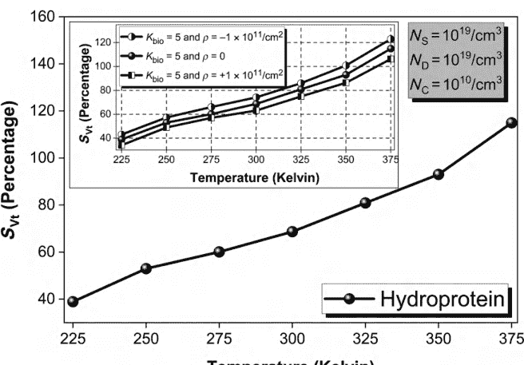

图 7.15 不同温度下疏水蛋白质的阈值电压灵敏度变化。（[内置图] 显示了不同温度下不同带电生物分子的阈值电压灵敏度变化。）

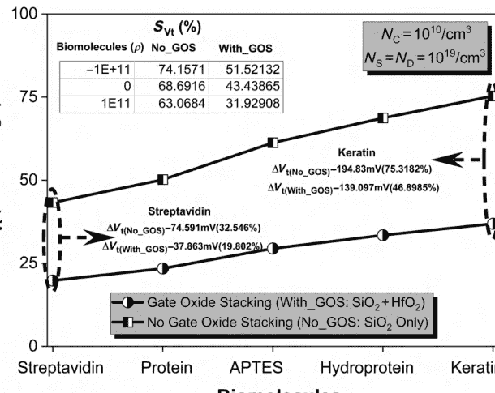

| 生物分子 (\(\rho\)) | 无_GOS | 有_GOS |
|---|---|---|
| -1E+11 | 74.1571 | 51.52132 |
| 0 | 68.6916 | 43.43865 |
| 1E+11 | 63.0684 | 31.92908 |

图 7.16 不同中性生物分子的带栅氧化层堆叠与不带栅氧化层堆叠的阈值电压灵敏度。

表 7.5 展示了不同填充因子下生物分子位置的影响。源极和漏极周围的腔体被分为四等分，以便在不同条件下检测不同的测试生物分子。病例 5 的填充因子大于病例 4，但病例 4 显示出更高的灵敏度。此趋势在病例 3 与病例 5 之间，以及病例 10 与病例 11 之间等也同样观察到。

通常，更高的填充因子通过在腔体内固定更多数量的生物分子来提高灵敏度 [10]。然而，部分填充腔体中生物分子的具体位置对灵敏度有显著影响。例如，病例 4 虽然与病例 1 具有相同的填充因子，但由于生物分子位置更靠近源极，因此表现出更高的灵敏度。这种靠近增强了生物分子对源极-通道结处势垒的影响，从而更显著地影响阈值电压。因此，当生物分子位置更靠近源极时，灵敏度最大化 [61]。在病例 5 与病例 10、病例 11 与病例 14 等比较中也观察到类似的灵敏度趋势。

图 7.17 和图 7.18 描绘了圆柱形 BioFET 生物传感器与各种现有生物传感器变体的比较分析。从图中可以看出，阈值电压偏移（灵敏度）随腔体宽度增加而成比例增加，从而可以在腔体内固定更多数量的生物分子。因此，随着腔体尺寸增大，生物传感器显示出更明显的阈值电压变化。图 7.18 具体对比了我们的

表 7.5 不同生物分子的填充因子和位置对 $S_{vt}$ 的影响

| | 源极端腔体 $L_{CH1}$ | 氧化层 $L_{CH3}$ | 漏极端腔体 $L_{CH2}$ | 填充因子 | A | B | C | D | E | F |
|---|---|---|---|---|---|---|---|---|---|---|
| 1. | | | | 0.25 | 0.006 | 0.095 | 0.597 | 1.409 | 1.74 | 2.027 |
| 2. | | | | 0.25 | 1.004 | 4.557 | 5.665 | 10.095 | 16.772 | 22.996 |
| 3. | | | | 0.25 | 17.834 | 43.669 | 51.006 | 86.091 | 113.111 | 120.049 |
| 4. | | | | 0.25 | 38.927 | 64.879 | 72.905 | 106.778 | 135.889 | 152.651 |
| 5. | | | | 0.50 | 3.929 | 6.842 | 7.556 | 12.298 | 19.115 | 27.983 |
| 6. | | | | 0.50 | 22.003 | 52.932 | 46.579 | 90.029 | 119.882 | 135.002 |
| 7. | | | | 0.50 | 25.991 | 55.014 | 49.082 | 93.332 | 122.229 | 138.909 |
| 8. | | | | 0.50 | 40.02 | 66.698 | 74.117 | 108.183 | 137.710 | 154.119 |
| 9. | | | | 0.50 | 44.384 | 70.192 | 78.251 | 112.672 | 141.008 | 158.725 |
| 10. | | | | 0.50 | 62.193 | 89.002 | 96.621 | 130.298 | 159.027 | 186.791 |
| 11. | | | | 0.75 | 37.971 | 61.995 | 71.003 | 105.391 | 134.441 | 160.219 |
| 12. | | | | 0.75 | 46.929 | 72.982 | 80.388 | 114.901 | 143.412 | 169.590 |
| 13. | | | | 0.75 | 65.129 | 91.109 | 99.041 | 133.923 | 162.721 | 189.993 |
| 14. | | | | 0.75 | 68.905 | 94.795 | 102.003 | 136.729 | 165.11 | 192.10 |

A-链霉亲和素 | B-蛋白质 | C-生物素 | D-APTES | E-疏水蛋白质 | F-角蛋白

生物传感器与一种突出的 BioFET 变体在不同生物分子上的对比 [22–26]。内置图直观展示了所提结构与其他四种变体之间的阈值电压灵敏度对比。此对比强调，与大多数现有替代方案相比，我们的生物传感器对生物分子具有更优的灵敏度。图 7.19 显示了在 $N_S = N_D = 10^{19}/cm^3$ 和 $N_C = 10^{10}/cm^3$ 时所提器件的增益跨导频率积（GTFP）图。

## 7.3.3 机器学习在提升 BioFET 性能中的应用

机器学习通过提高灵敏度和特异性，显著推进了 BioFET 的能力。BioFET 是一种复杂的生化传感器，其工作原理类似于场效应晶体管。这种集成将允许实时调查，有助于识别蛋白质、DNA 和病原体等生物分子。训练 ML

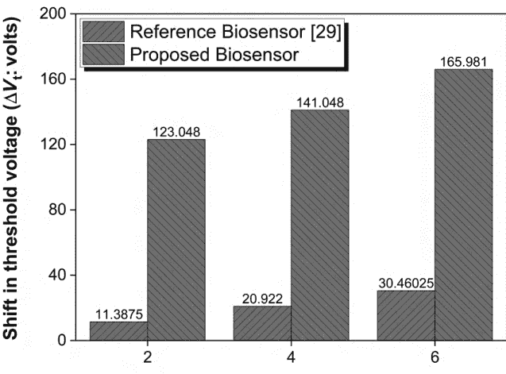

图 7.17 不同腔体厚度下 APTES 的阈值电压偏移对比图。

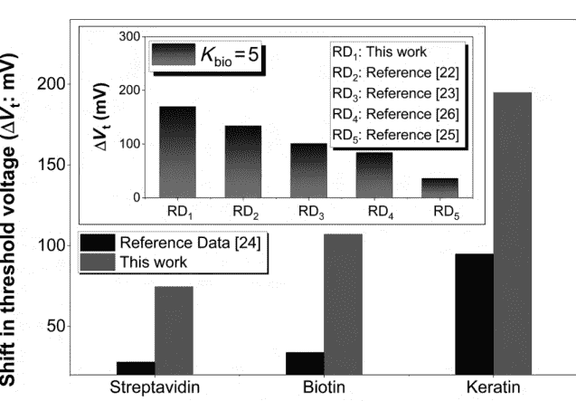

图 7.18 不同生物分子的阈值电压偏移对比图。（[内置图] 显示了 K_bio = 5 时不同生物传感器变体的阈值电压偏移。）

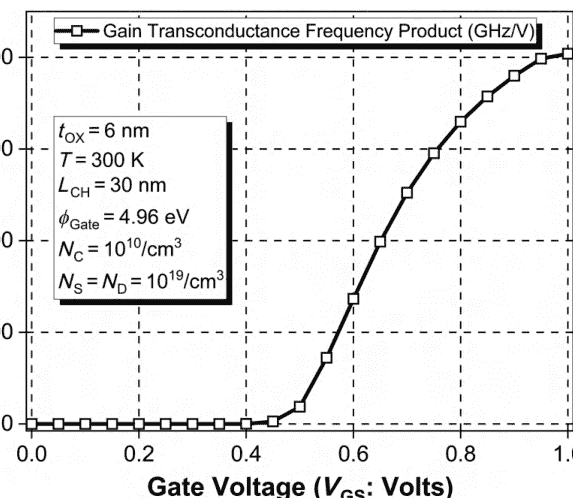

图 7.19 增益跨导频率积图。

在如此大型的数据集上训练的模型可以检测传感器响应中的细微变化，从而实现更有效的检测并降低误报（检测）率。因此，用于医学诊断、环境监测和生物技术的先进 ML 应用展示了一个增强的工具平台，能够实现大量生物分析物的快速和准确检测 [35]。

利用机器学习与 BioFET 相结合，能够针对特定应用修改和定制 BioFET，在生物传感器开发中提供显著的设计优势。研究人员可以使用复杂的算法建模各种条件和几何结构，以在制造前锁定最佳传感器设计。这加速了开发过程，同时降低了昂贵的试错方法。此外，利用历史数据，机器学习可以微调传感器参数，使其随时间推移变得更加精确，因此当新的生物靶标出现时，传感器能够随时代变化而调整。BioFETs 产生的数据通常具有多维性且较为复杂，这使得机器学习在解释此类数据方面必不可少。这些传感器产生的数据量巨大，使用传统数据分析方法处理可能颇有困难。另一方面，神经网络、支持向量机（SVMs）和决策树等 ML 模型非常适合在大数据集中识别这些相关性。这些方法揭示了传感器响应与传感器表面生物相互作用之间关系的更详细细节，用于


更准确且可重复的结果。医疗诊断中即可找到示例，其中集成机器学习的 BioFET 能够区分正常状态与疾病状态，从而识别疾病早期阶段并制定更个性化的治疗策略。

向静态分析延伸时，机器学习也催生了实时监测与反馈系统的构想。在体内医疗诊断或环境监测等特定动态环境中，这些条件可能会迅速变化。这些场景同样需要实时数据处理和快速响应。ML 模型会持续学习并适应新的数据流，非常适合快速分析和实时采取行动。BioFET 的实时特性确保了与真空台式仪器相当的准确性和可靠性，并在动态环境中表现可靠，这在临床和现场应用中应具有重要价值。小型且用户友好的诊断设备也随着机器学习与纳米技术的融合而不断发展。将高性能算法置于小型手持设备中，使我们能够在非传统实验室环境下进行分子生物传感。此类便携式 BioFET 在近患检测、远程健康监测和快速现场诊断方面具有宝贵的应用，将显著提升生物技术的普及性与便捷性。支撑这些设备的机器学习固有实践已实现随时随地获取实验室级结果，并可能提升具有革命性的核心能力，从而改变全球医疗实践。最后，机器学习在 BioFET 方面仍有大量可实施之处，以使其更具功能性、灵敏性和智能性。这种集成支持高级数据分析、预测建模、实时监测和便携式诊断工具的创建。随着新技术和研究的涌现，机器学习与 BioFET 之间的紧密融合将继续推动生物传感诊断领域算法的发展。

在开发 BioFET 的过程中引入机器学习，涉及应用若干重要考量和技术。这些技术涵盖关键方面：

- 1. **数据预处理：** 第一步是准备硬件传感器收集的原始数据以供分析。这包括数据清洗、标准化和提高数据准确性。异常值检测、噪声降低和归一化等方法可对数据进行处理。主成分分析（PCA）是一种降维技术，通常在保留关键信息的同时实现数据维度降低。

- 2. **特征提取：** 其职责是将未经处理的传感器数据转换为可用于输入 ML 模型的形式。例如，在 BioFET 应用中，特征可能是由生物相互作用引起的电流、电压或电阻变化。傅里叶变换和小波变换等信号处理方法可提取时域传感器信号的频域特征。卷积神经网络（CNNs）是自动提取复杂特征的高级方法示例，尤其适合辨别生物相互作用的复杂模式。

- 3. **选择合适的模型：** 准确的数据分析取决于所使用的 ML 技术。SVM、神经网络（包括 CNN 和深度神经网络或 DNN）、随机森林以及 $K$-最近邻（$KNN$）是根据数据性质和所需分析类型选择的一些模型。每种模型类型的特性使其在应对不同形式和复杂度的 BioFET 数据方面具有优势。

- 4. **实时自适应：** 通过实时自适应，当新数据可用时，模型可以定期更新，以便即使在环境变化的情况下也能保持模型的准确性。为此，会采用在线学习和强化学习等更高级方法。在在线学习中，当新数据到来时，学习算法会增加或减少模型参数。因此，这种学习类型非常适合需要高实时响应的应用。将 BioFET 与强化学习相结合，使 BioFET 能够根据实时反馈按需学习最佳响应，这对于任何设计用于在固有复杂的生物环境中运行，并能够与多种目标和条件交互的传感器来说都是必不可少的。

- 5. **集成方法：** 在集成学习中，不进行单一预测，而是多个模型同时工作，预期结果能提升整体性能和鲁棒性。另一类方法包括装袋（bagging）、提升（boosting）和堆叠（stacking），它们组合预测并减少 BioFET 实现过程中可能发生的过拟合影响。

- 6. **迁移学习：** 微调通过使用相关任务的预训练模型来增强 BioFET 模型创建过程，这有助于在数据集较小时提高预测优先级的准确性。可以看出，BioFET 不仅有助于推进基于功能的模型，还能在生物传感和诊断方面实现更快的部署。

- 7. **预测性维护与校准：** 收集的数据使得基于机器学习的其余数据分析能够对 BioFET 设备的最佳状态、校准和维护计划进行自动监测。通过开发分析模型来预测其他维护需求和校准频率，从而实现传感器的精确控制和终身性能。

ML 模型用于开发 BioFET，以提升传感器的灵敏度、特异性和灵活性。在将精确的实时自适应模型选择算法（结合高级特征提取、增强的预处理技术、集成方法和实际迁移学习）应用于 BioFET 传感器的生物传感与诊断之前，确定其作为医疗、环境和生物技术应用工具的可靠性至关重要。

### 基于 ML 的数据分析

基于 PCA 的分析、基于 SVM 的分析以及基于人工神经网络（ANN）的分析是三种不同的 ML 方法，广泛应用于包括 BioFET 传感器在内的各个领域。

- 1. 基于 PCA 的分析：PCA 是一种主要用于降维和特征提取的统计技术：
  - **目的：** PCA 识别复杂高维传感器数据中的基本模式或成分。
  - **过程：** 它将原始变量转换为一组较小的正交成分（主成分），以保留数据中存在的变异性。
  - **应用：** 在 BioFET 中，PCA 在保留生物相互作用关键信息的同时简化传感器响应。它有助于可视化数据模式并识别影响传感器输出的有影响力/重要变量。

- 2. 基于 SVM 的分析：SVM 是用于分类和回归的强健且有影响力的模型，属于监督学习模型类型：
  - **目的：** 研究结果表明，SVM 有助于从 BioFET 传感器数据集中分类生物靶标。
  - **过程：** 最大边界分类机通过构建最优超平面，在高维空间中划分不同类别。
  - **应用：** 在 BioFET 中，SVM 可以分类生物分子或疾病状态的传感器响应。在处理交互作用时使用基于多项式的方法的一个优势是，它们对过拟合不敏感，擅长处理非线性关系，且非常适合处理生物相互作用。

- 3. 基于 ANN 的分析：ANN（包括 DNN）是受生物神经网络启发的数学模型，擅长高效地从复杂模式中学习。
  - **目的：** ANN 可以识别大型数据集中的复杂模式。
  - **过程：** 它们由彼此连接的多层神经元组成，并推导数据的层级维度。
  - **应用：** BioFET 中的 ANN 处理传感器信息，以预测与生物系统的相互作用或识别复杂模式。ANN 中的 CNN 特别适合处理空间传感器输出，而循环神经网络（RNN）则擅长处理更顺序的数据，例如时间序列响应。这是一类需要大量计算能力但能为各种问题实现非常准确和适应性强的解决方案的模型。

PCA 是一种分析解决方案，专注于降维以及对当前数据集进行初步检查，而不一定使用训练数据或测试数据。CNN 和 RNN 是用于处理复杂模式的 ANN 类型，且计算密集。这些方法在用于分析 BioFET 数据时很有益，并且可以集成。PCA 在其实现中最好用于去噪并开发特征以供 SVM 或 ANN 使用。SVM 在对数据集进行分类方面往往效果更好，而 ANN 有助于微调或处理


复杂的数据关系。综上所述，PCA、SVM和ANN在BioFET阵列的数据分析中具有强大的作用，每种方法在降维、分类和模式分析方面都有其独特的优势。这些方法相辅相成，共同提高与生物医学和生物技术领域中BioFET应用相关的准确性、速度和分析能力。

### 基于ML的BioFET设计：

最近，传感器（特别是BioFET）的设计在过程中使用机器学习算法受益匪浅。这些应用通过提高运行效率、升级材料、缩短设计周期和选择合适的受体，彻底改变了传感器的开发。

- 1. **提升BioFET性能：** 机器学习在改善BioFET性能方面至关重要，原因如下：
  - **参数优化：** 机器学习对于通过优化各种参数以提高灵敏度、选择性和整体效率来增强BioFET性能至关重要 [62]。
  - **材料设计：** 机器学习算法的应用对于增强BioFET中所使用的二维材料特性至关重要，包括半导体过渡金属二硫族化物（TMDCs）。研究发现，机器学习通过预测带隙等参数并有助于优化缺陷结构，从而提升传感系统的可靠性和性能 [63]。

- 2. **加速设计流程：** 这得益于机器学习的关键特性——即通过增强BioFET快速原型制作和迭代设计的应用，支持生物电子学设计和开发的能力：
  - **异结构优化：** 有一些有用的方法，例如高斯过程回归和贝叶斯优化，可用于启动BioFET中复杂异结构的设计。这些技术可以预测电学和光学特性等方面，并帮助确定传感器材料的最佳配方，以提高传感器的功能性 [64]。
  - **有机FET增强：** 其他学习算法，如随机森林和梯度提升，显著改善了有机FET中的电子流动。机器学习模型将电子特性与传感器性能联系起来，从而提高了准确检测的机会甚至灵敏度水平 [65]。

- 3. **先进的受体选择：** 机器学习改变了受体（生物受体层）的挑选和调制方式，以增强BioFET传感的可能性。
  - **受体工程：** 基于数据模型的机器学习驱动方法可以预测和优化酶和适配体等受体。该方法通过识别具有高特异性的新型受体并有效检测目标分子，超越了传统方法 [66]。

- 4. **整合机器学习以推动BioFET进步：** 总体而言，将机器学习融入BioFET设计被视为一种革命性策略，它能够以高度准确和高效的方式制造传感器，其基本要素由生物相关和电子组件组成，在灵敏度、特异性和通用性方面表现出色。机器学习方法在优化参数、构建材料以及BioFET中微受体选择的快速原型制作方面的应用，使其在健康诊断、环境监测、污染追踪和疾病检测中处于战略核心地位。这些进步清楚地凸显了机器学习在传感器技术开发中的作用，以及利用其解决各个领域挑战性问题的能力。

## 7.3.4 讨论

掺杂显著影响BioFET的灵敏度，在阈值电压和亚阈值摆幅方面，较低掺杂水平下可观察到较高的百分比灵敏度。随着介电常数较高的生物分子，灵敏度进一步提高；带负电的生物分子因其特性（带负电行为）表现出增强的灵敏度。生物分子在部分填充空腔内的位置（尤其是靠近源极处）对阈值电压灵敏度有显著影响，掩盖了填充因子效应。灵敏度采用多种指标进行评估，包括阈值电压、亚阈值摆幅、ION/IOFF比和漏电流。本工作的创新点主要体现在两个方面：首先，通过优化掺杂和其他参数来提高灵敏度；其次，全面探索不同填充因子下的部分填充空腔。使用各种生物分子进一步验证了研究结果。

优化掺杂和偏置设置在BioFET的预制造阶段至关重要。这些发现凸显了该生物传感器在检测对多样化生物医学和临床应用至关重要的关键生物分子方面的有效性。此外，它还为快速检测各种其他医学上重要的生物分子提供了希望，从而有助于急性和慢性疾病的早期诊断。这项工作展示了BioFET作为坚固且灵敏传感器的潜力，强调了其在生物医学工业中的更广泛适用性，值得进一步探索。

所提议的BioFET还为远程检测危险化学品提供了一种经济高效且安全的替代方案，以应对潜在的健康风险。基于纳米尺寸BioFET的可穿戴设备在反应腔等环境中检测有害气体或辐射，以及监测患者或老年人个性化和常规体检中的健康状况方面，具有巨大潜力。此外，该研究深入探讨了将机器学习集成到BioFET设计过程中的关键作用和日益增长的必要性。本讨论强调了机器学习算法如何通过分析复杂的生化相互作用并优化传感器参数，来增强BioFET的灵敏度、准确性和整体性能。

## 7.4 结论

本章研究了圆柱形BioFET的灵敏度分析，主要关注掺杂水平的影响。通过探索一系列带电和中性生物分子，该研究提高了其结果的现实性和相关性。它强调，阈值电压灵敏度优于亚阈值摆幅灵敏度，前者的灵敏度超过400%，这可通过精细优化的掺杂水平实现，凸显了该器件在生物传感应用中的有效性。在源极和漏极对称掺杂的情况下，阈值电压和亚阈值摆幅的峰值分数灵敏度分别可达到4.53和0.44。研究发现，在低掺杂水平下可获得较高的百分比灵敏度，但与电导存在权衡。该研究还审查了填充因子的影响，揭示了生物分子靠近源极的精确位置对灵敏度的影响，比实际填充因子本身更为显著。将Vt作为传感指标，在低掺杂水平下可实现较高的百分比灵敏度，而在高掺杂水平下可实现较高的相对变化灵敏度。总体而言，本研究强调了掺杂水平、偏置条件和生物分子位置在确定圆柱形BioFET灵敏度方面的关键作用。该研究还通过概括性讨论，探讨了机器学习在改善BioFET性能和设计中的作用。

## 致谢

作者谨向德里马哈拉贾·阿格拉森理工学院院长提供开展这项研究工作的设施表示感谢。

## 参考文献

- 1. K. Upasana, R. Narang, M. Saxena, and M. Gupta, “门极材料和门极介质工程化TFET架构的建模与TCAD评估：面向数字应用的电路级研究，” IEEE Trans. Electron Devices, vol. 62, no. 10, pp. 3348–3356, 2015.
- 2. A. Sirohi, C. Sahu, and J. Singh, “用于超低功耗应用的掺杂无FET的模拟/RF性能研究，” IEEE Access, vol. 7, pp. 141810–141816, 2019.
- 3. J. Park, H. Hiep, A. Woubit, and M. Kim, “场效应晶体管（FET）型生物传感器的应用，” Appl. Sci. Converg. Technol., vol. 23, no. 2, pp. 61–71, 2014.
- 4. A. Das, B. K. Kanaujia, V. Nath, S. Rewari, and R. S. Gupta, “反向栅氧化物堆叠对全围栅隧道FET用于高频模拟和RF应用的影响，”收录于2020 IEEE第17次印度理事会国际会议，INDICON 2020，pp. 1–6，2020。
- 5. R. Gautam, M. Saxena, R. S. Gupta, and M. Gupta, “用于气体传感应用的带催化金属栅极的全围栅纳米线MOSFET，” IEEE Trans. Nanotechnol., vol. 12, no. 6, pp. 939–944, 2013.
- 6. T. Bungon 等人，“用于阿尔茨海默病蛋白生物标志物clusterin检测的石墨烯FET传感器，” Front. Mol. Biosci., vol. 60, no. 1, pp. 1–13, 2021。
- 7. S. Cheng, S. Hideshima, S. Kuroiwa, T. Nakanishi, and T. Osaka, “使用基于场效应晶体管（FET）的生物传感器进行无标记肿瘤标志物检测以用于肺癌诊断，” Sensors and Actuators, B: Chem., vol. 212, pp. 329–334, 2015, http://dx.doi.org/10.1016/j.snb.2015.02.038。
- 8. Y.-C. Syu, W.-E. Hsu, and C.-T. Lin, “综述——场效应晶体管生物传感：器件与临床应用，” ECS J. Solid State Sci. Technol., vol. 7, no. 7, pp. Q3196–Q3207, 2018.
- 9. M. Kaisti, “生物和化学FET传感器的检测原理，” Biosens. Bioelectron., vol. 98, pp. 437–448, 2017.


- 10. A. Das, S. Rewari, B. K. Kanaujia, 和 R. S. Gupta, “用于生物传感应用的周围栅极MOSFET最近技术进展——协同研究，” Silicon，vol. 14，no. 10，pp. 5133–5143，2022。

- 11. V. K. Tamboli 等人, “用于人血浆中前列腺特异性抗原检测的MOSFET器件上的杂交合成受体，” Anal. Chem.，vol. 88，no. 23，pp. 11486–11490，2016。

- 12. A. Das, A. Bhardwaj, K. Das, S. Yadav, A. Kaul, P. Goyal, S. Sharma, S. Rewari, B. K. Kanaujia, 和 R. S. Gupta, “生物医学应用中纳米线MOSFET检测器灵敏度调制的数值仿真，” Indian J. Pure Appl. Phys.，vol. 63，pp. 281–300，2025，https://doi.org/10.56042/ijpap.v63i4.14388。

- 13. K. Kaushik, 和 D. Rawtani, “基于传感器的COVID-19检测技术，” 在《环境中的COVID-19》中, Elsevier, pp. 95–114, 2022。

- 14. T. Cheung, P. K. N. Yu, 和 M. J. Butson, “高能放射治疗应用中基于MOSFET的低剂量测量，” Radiat. Meas.，vol. 39，no. 1，pp. 91–94，2005。

- 15. R. Consorti 等人, “基于MOSFET的体内剂量测量：剂量特征表征及术中放射治疗中的首次临床结果，” Int. J. Radiat. Oncol. Biol. Phys.，vol. 63，no. 3，pp. 952–960，2005。

- 16. J. R. Grenier, S. H. Jayaram, M. Kazerani, H. Wang, 和 M. W. Griffiths, “基于MOSFET的细菌转化脉冲电源，” IEEE Trans. Ind. Appl.，vol. 44，no. 1，pp. 25–31，2008。

- 17. T. Morf 等人, “基于天线耦合MOSFET玻尔米计的宽带室温THz成像阵列，” Sensors Actuators, A Phys.，vol. 215，no. 15，pp. 96–104，2014。

- 18. C. Jianrong, M. Yuqing, H. Nongyue, W. Xiaohua, 和 L. Sijiao, “纳米技术与生物传感器，” Biotechnol. Adv.，vol. 22，no. 7，pp. 505–518，2004。

- 19. A. Das, S. Rewari, B. K. Kanaujia, S. S. Deswal, 和 R. S. Gupta, “基于介质调制周围三栅极锗源MOSFET (DM-STGGS-MOSFET) 的生物传感器数值建模，” J. Comput. Electron.，vol. 22，no. 2，pp. 742–759，2023，https://doi.org/10.1007/s10825-023-02008-w。

- 20. A. Chakraborty, 和 A. Sarkar, “用作生物传感器的介质调制无结栅极堆栈周围栅极MOSFET (JLGSSRG) 的解析建模与灵敏度分析，” J. Comput. Electron.，vol. 16，no. 3，pp. 556–567，2017。

- 21. A. Das, S. Rewari, B. K. Kanaujia, S. S. Deswal, 和 R. S. Gupta, “用于生物分子检测的Ge/Si界面无标签纳米线BIOFET——解析分析，” Microelectronics J.，vol. 138，p. 105832，2023，https://doi.org/10.1016/j.mejo.2023.105832。

- 22. K. N. Singh, 和 P. K. Dutta, “基于高-k欠掩介质和电荷调制的硅上无源FET基础生物传感器解析建模，” J. Comput. Electron.，vol. 19，no. 3，pp. 1126–1135，2020。

- 23. S. Ajay, R. Narang, M. Gupta, 和 M. Saxena, “介质调制双栅极无结MOSFET用于生物分子检测的研究，” 在2013年年度IEEE印度会议 INDICON 2013 中, pp. 1–6, 2013。

- 24. A. Kumar, N. Gupta, M. M. Tripathi, 和 R. Chaujar, “用于生物传感应用的黑磷无结凹沟MOSFET灵敏度结构参数分析，” Microsyst. Technol.，vol. 26，no. 7，pp. 2227–2233，2020。

- 25. S. Ajay, R. Narang, M. Saxena, 和 M. Gupta, “介质调制 (DM) 双栅极 (DG) 无结MOSFET用作生物传感器的研究，” Superlattices Microstruct.，vol. 85，pp. 557–572，2015。

- 26. S. Sharma, V. Nath, S. S. Deswal, 和 R. S. Gupta, “基于氮化镓栅极材料和介质工程肖特基纳米线FET (GaN-GME-DE-SNW-FET) 的无标签生物传感器解析建模与灵敏度分析，” Microelectronics J.，vol. 129，p. 105599，2022，https://doi.org/10.1016/j.mejo.2022.105599。

- 27. Z. Ahangari, “用于生物分子超灵敏检测的双材料栅极介质调制纳米线无结MOSFET性能评估，” RSC Adv.，vol. 6，no. 92，pp. 89185–89191，2016。

- 28. C. Li, F. Liu, R. Han, 和 Y. Zhuang, “用于生物传感应用的垂直堆叠纳米片全栅极FET，” IEEE Access，vol. 9，pp. 63602–63610，2021。

- 29. Y. Pratap, M. Kumar, S. Kabra, S. Haldar, R. S. Gupta, 和 M. Gupta, “用于中性生物分子物种检测的基于全栅极无结晶体管生物传感器解析建模，” J. Comput. Electron.，vol. 17，no. 1，pp. 288–296，2018。

- 30. X. P. A. Gao, G. Zheng, 和 C. M. Lieber, “亚阈值区域具有纳米线FET生物传感器的最佳灵敏度，” Nano Lett.，vol. 10，no. 2，pp. 547–552，2010。

- 31. A. AssarehPour, 和 Farhad Shahhoseini, “基于硅纳米管MOSFET的气体传感器，” 在第5届纳米科学与纳米技术国际会议中, pp. 1–2, 2014。

- 32. T. V. A. Dam, D. Pijanowska, W. Olthuis, 和 P. Bergveld, “基于EMOFET测得的功函数变化的高灵敏度葡萄糖传感器，” Analyst，vol. 128，no. 8，pp. 1062–1066，2003。

- 33. A. Das, S. Rewari, B. K. Kanaujia, S. S. Deswal, 和 R. S. Gupta, “用于生物传感应用的带阶梯梯度沟道的三周围栅极锗源金属氧化物半导体场效应晶体管解析研究，” Int. J. Numer. Model. Electron. Networks, Devices Fields，vol. 36，no. 6，p. e3106，2023，https://doi.org/10.1002/jnm.3106。

- 34. S. S. Mohanty, S. Mishra, M. Mohapatra, 和 G. P. Mishra, “异质沟道双栅极MOSFET无标签生物传感器中生物靶标位置及其填充因子对灵敏度的影响，” Adv. Nat. Sci. Nanosci. Nanotechnol.，vol. 12，no. 2，p. 025012，2021，https://doi.org/10.1109/DevIC50843.2021.9455937。

- 35. X. Xhafa, A. L. I. D. O. Gu, 和 M. B. Yelten, “40 nm CMOS晶体管中热载流子注入的基于机器学习的建模，” J. Electron Devices Soc.，vol. 12，pp. 281–288，2024。

- 36. H. Amrouch, V. M. van Santen, J. Diaz-Fortuny, 和 F. Lemke, “机器学习释放老化和自加热效应：从晶体管到完整处理器，” 在2024年IEEE国际可靠性物理研讨会 (IRPS) 中, pp. 1–8, 2024，https://doi.org/10.1109/IRPS48228.2024.10529386。

- 37. S. S. Adel, 和 K. C. Smith, 《微电子电路》, 第8版. Oxford, 2020。

- 38. A. Das, S. Rewari, B. K. Kanaujia, S. S. Deswal, 和 R. S. Gupta, “纳米尺度介质调制阶梯梯度锗源生物管FET传感器的基于物理的数值模型：建模与仿真，” Phys. Scr.，vol. 98，no. 11，p. 1151013，2023，https://doi.org/10.1088/1402-4896/acfec9。

- 39. G. Jana, D. Sen, P. Debnath, 和 M. Chanda, “基于介质调制双腔无结双栅极场效应晶体管的无标签生物传感器功耗与延迟分析，” Comput. Electr. Eng.，vol. 99，p. 107828，2022年4月。

- 40. E. Rahman, A. Shadman, 和 Q. D. M. Khosru, “介质调制双栅极无结MOSFET生物传感器中生物分子位置及填充因子对灵敏度的影响，” Sens. Bio-Sensing Res.，vol. 13，pp. 49–54，2017。

- 41. Y. Zhang, K. Han, 和 J. Li, “具有绝缘核心的全栅极纳米线晶体管仿真研究，” Microelectronics，vol. 11，no. 2，pp. 1–12，2020。

- 42. A. Ganesh, K. Goel, J. S. Mayall, 和 S. Rewari, “用于改进模拟应用的非对称栅极堆栈三金属全栅极MOSFET (AGSTMGAAFET) 亚阈值解析模型，” Silicon，vol. 14，pp. 4063–4073，2021。

- 43. S. Ye, K. Yamabe, 和 T. Endoh, “终极垂直全栅极金属氧化物半导体场效应晶体管及其三维集成电路，” Mater. Sci. Semicond. Process.，vol. 134，p. 106046，2021。

- 44. S. M. Sze, 《VLSI技术》, 第2版. McGraw Hill Education, 2017。

- 45. A. Das, S. Rewari, B. K. Kanaujia, S. S. Deswal, 和 R. S. Gupta, “用于生物传感应用的无标签Si/InAs异质界面圆柱形BioFETD解析表征，” Micro Nanostruct.，vol. 204，p. 208152，2025，https://doi.org/10.1016/j.micrna.2025.208152。

- 46. S. Yadav, A. Das, 和 S. Rewari, “用于DNA和禽流感病毒无标签检测的介质调制GANFET生物传感器：提案与建模，” ECS J. Solid State Sci. Technol.，vol. 13，no. 4，p. 047001，2024，https://doi.org/10.1149/2162-8777/ad3364。

- 47. Y. Pratap, M. Kumar, S. Kabra, S. Haldar, R. S. Gupta, 和 M. Gupta, “用于中性生物分子物种检测的基于全栅极无结晶体管生物传感器解析建模，” J. Comput. Electron.，vol. 17，no. 1，pp. 288–296，2018。

- 48. R. G. Wilson, “多晶Nb、Mo、Ta、W、Re、Os和Ir的真空热离子功函数，” J. Appl. Phys.，vol. 37，no. 8，pp. 3170–3172，1966。

- 49. H. Kawano, T. Takahashi, Y. Tagashira, H. Mine, 和 M. Moriyama, “难熔金属的功函数及其对工作条件的依赖性，” Appl. Surf. Sci.，vol. 146，no. 1，pp. 105–108，1999。

- 50. A. Goel, S. Rewari, S. Verma, 和 R. S. Gupta, “用于DNA生物分子检测的介质调制三金属全栅极MOSFET (TMGAA)，” 在2018年IEEE电子设备加尔各答会议 (EDKCON 2018) 论文集中, pp. 337–340, 2018。

- 51. S. Busse, V. Scheumann, B. Menges, 和 S. Mittler, “利用贴近场光学方法基于生物素/链亲和素系统的特异性结合反应灵敏度研究，” Biosens. Bioelectron.，vol. 17，no. 8，pp. 704–710，2002。

- 52. A. Goel, S. Rewari, S. Verma, S. S. Deswal, 和 R. S. Gupta, “介质调制无结生物管FET (DM-JL-BT-FET) 生物传感器，” IEEE Sens. J.，vol. 21，no. 15，pp. 16731–16743，2021。

- 53. K. N. Singh, 和 P. K. Dutta, “用作无标签生物传感器的欠掩梯度沟道场效应晶体管解析建模，” Superlattices Microstruct.，vol. 155，p. 106897，2021年7月。

- 54. A. Lodhi, C. Rajan, A. Kumar, B. Dip, P. Samaijdar, 和 D. Soni, “基于Si/SiGe的TFET生物传感器中扩展纳米腔和源极上覆电极的灵敏度与感应速度分析，” Appl. Phys. A，vol. 126，no. 11，pp. 1–8，2020。

- 55. E. Rosini, P. D’Antona, 和 L. Colleggioni, “D-氨基酸生物传感器：检测方法与应用，” Int. J. Mol. Sci.，vol. 21，no. 13，p. 4574，2020。

- 56. A. Das, B. K. Kanaujia, S. S. Deswal, S. Rewari, 和 R. S. Gupta, “用于模拟应用的周围栅极MOSFET中掺杂诱导的阈值电压和ION/IOFF比调制，” 在2022年IEEE电子器件学会加尔各答分会会议 (EDKCON) 中, 印度加尔各答, pp. 1–6, 2022，https://doi.org/10.1109/EDKCON656221.2022.10032940。

- 57. A. Das, S. Rewari, B. K. Kanaujia, S. S. Deswal, 和 R. S. Gupta, “Ge/Si界面纳米线MOSFET中增强模拟性能的解析建模与掺杂优化，” Phys. Scr.，vol. 98，no. 7，p. 74005，2023，https://doi.org/10.1088/1402-4896/acde16。

- 58. S.-M. Kang, 和 L. Yusuf, 《CMOS数字集成电路》, 第3版. McGraw Hill, 2003。

- 59. D. M. Å, J. Song, 和 O. Kim, “由离散随机掺杂确定的双栅极鳍状场效应晶体管中源/漏掺杂梯度对阈值电压变化的影响，” Jpn. J. Appl. Phys.，vol. 104301，no. 49，p. 4，2010。

- 60. A. Bhardwaj, A. Das, U. Sharma, A. Gupta, 和 S. Roy, “高-k垂直纳米线隧道FET中温度诱导的模拟性能调制，” Semiconductors，vol. 59，no. 4，pp. 382–390，2025，https://doi.org/10.1134/S1063782625600020。

- 61. M. Kumari, N. K. Singh, M. Sahoo, 和 H. Rahaman, “双材料 (DM)、双栅极 (DG)、无结MOSFET基础生物传感器灵敏度增强的功函数优化，” Appl. Phys. A Mater. Sci. Process.，vol. 127，no. 2，pp. 1–8，2021。


- 62. B. Cao et al., “通过实验设计与机器学习优化材料和器件：有机光伏的演示，”ACS Nano，vol. 12，pp. 7434–7444，2018。
- 63. N. C. Frey, D. Akinwande, D. Jariwala, and V. B. Shenoy, “用于量子和神经形态信息处理的二维材料中点缺陷的机器学习赋能设计，”ACS Nano，vol. 14，no. 10，pp. 13406–13417，2020。
- 64. L. Bassman et al., “用于加速分层材料设计的主动学习，”npj Comput. Mater.，vol. 4，no. 1，p. 71，2018，http://dx.doi.org/10.1038/s41524-018-0129-0。
- 65. M. Lee, “机器学习用于理解 n 型有机场效应晶体管中电荷传输迁移率与电子能级之间的关系，”Adv. Electron. Mater.，vol. 5，no. 12，p. 1900573，2019。
- 66. J. Song et al., “基于结构分析和机器学习的适配体识别序列多维分析算法，”Anal. Chem.，vol. 92，pp. 3307–3314，2020。

# 8 电动汽车与可再生能源用半导体材料

Manjulata Badi 和 Illa Rai

## 8.1 引言

本章讨论了功率半导体代际发展及其在电动汽车和混合动力汽车（HEV/EV）中的应用。本文还综述了最新的汽车功率半导体器件，并分析了电动汽车和混合动力汽车所需功率硬件的理论及现状。基于 Si 的绝栅双极型晶体管（IGBT）、基于 SiC 的金属氧化物半导体场效应晶体管（MOSFET）、续流二极管（FRD）和肖特基势垒二极管是汽车半导体领域的最新创新之一。降低热阻设计、高密度封装以及高功率封装中的低电感，是定义汽车半导体封装技术进步的三大特征。

我们将探讨电动汽车和混合动力汽车的最新高功率半导体、其严苛的工作环境以及该领域的新进展。对于 Si 器件，主要挑战是强度、厚度、性能、稳定性和封装；对于 SiC 器件，主要挑战是低电感和高温。长期改进趋势从四个方面进行了分析：平面封装、新型封装创新与材料，以及 SiC MOSFET。翻转导通 IGBT、凹陷生产沟道和卓越 IGBT 等特性均属于下一代用于 HEV/EV 的基于 Si 的 IGBT。可持续增长需要开发价格合理、广泛可得且环保的可再生能源技术。（光）电化学能量转换与存储技术是一个关键要素。因此，要真正实现（光）电化学能源技术的实际应用，需要对纳米结构催化材料进行现实的设计、合成和改性。离子束技术是一种实用且多功能的物理改性方法。通过控制被植入离子的能量、种类和流量，可以改性各种催化材料类型的表面、界面和薄膜。离子束方法具有多项优势，包括元素掺杂的强制性以及出色的可控性、精度和可重复性 [1]。图 8.1 描绘了面向 HEV/EV 的功率半导体的最新进展和趋势。

图 8.1 显示了 HEV/EV 转换器的全球交易数据和市场规模。现代功率电子框架的四大改进

HEV/EV 功率器件市场（百万美元）

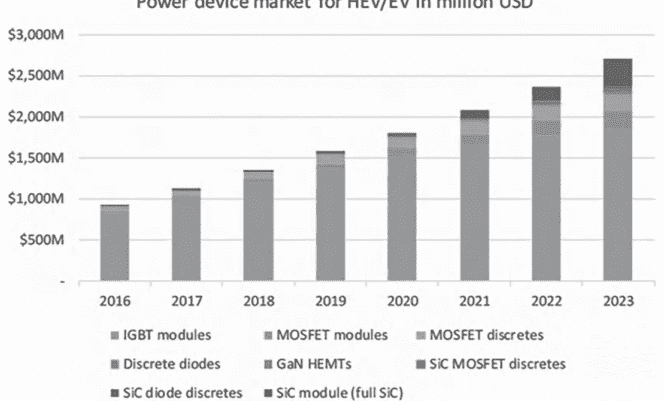

图 8.1 面向 HEV/EV 的功率半导体的最新进展和趋势：概览。

来源：Liu, G., Li, K., Wang, Y., Luo, H., & Luo, H. (2020). 面向 HEV/EV 的功率半导体的最新进展和趋势——概览。IET Power Electronics, 13(3), 394–404, https://doi.org/10.1049/iet-pel.2019.0401。

混合动力汽车和电动汽车中的四大改进包括车载充电器、用于辅助电源的 DC-DC 转换器、高压总线上的 DC-DC 转换器以及电机驱动逆变器组件。根据研究，未来五年该行业将增长并超过十亿美元，高功率 HEV/EV 转换器迄今已采用多种当代功率半导体类型制造，包括 IGBT、金属氧化物半导体场效应晶体管（MOSFET）以及宽带隙（WBG）器件，其中包括碳化硅（SiC）和氮化镓（GaN）器件。图 8.2 展示了 HEV/EV 的最新进展和趋势。

图 8.2 展示了 HEV/EV 的协议及预期功率器件市场情景。凭借当前 HEV/EV 电气模块市场超过 80% 的份额，已确定 IGBT 是行业中使用最广泛的模块。此外，在五年周期内，整体 SiC 模块预计仅以微弱劣势（约 13%）落败。在功率电子框架中，功率模块可能是最薄弱的环节。根据一项利用 80 多家机构数据的企业调查，温度元件激活目前占功率电子系统故障的 55%，其中功率模块故障约占其中的 42%。此外，温度每升高一度，结的故障率就会上升 10°C。关于 HEV/EV 框架中的功率半导体 [2]。由于天气和路况不可预测，当前时代不可预测的工作应力对电动汽车系统的功率电子模块提出了越来越严格的要求。目前，以 175°C 运行基于 Si 的 IGBT 和基于 SiC 的全 MOSFET 在经济上是可行的 [3]。SiC 器件实用应用的最高潜在温度为 500°C，远高于现代 Si 材料的最高温度。然而，SiC 电器件似乎更适用于需要高温可靠性和严苛气候条件的封装。得益于其高温（>500°C）、高电子速度（321 cm/s）和高击穿电场（2.2 × 106 V/cm）特性，基于 SiC 的器件是 HEV/EV 转换器项目的潜在候选方案。作为 WBG 器件的代表，基于 SiC 的 MOSFET 模块正逐渐改变涉及基于 Si 的 MOSFET 和 IGBT 的传统应用领域 [4]。然而，就材料价值和先进的处理能力而言，SiC 半导体无疑已落后于此类先进的基于 Si 的器件。然而，SiC 的最终衰落不能用老旧的键合线封装架构来很好地解释。基于这一理念，大量新兴技术应运而生，试图从现代前沿封装产品的角度解决这些难题。作为电力使用背后的引擎，具有能源半导体基础的混合动力电动汽车（HEV）正在不断变化，并处于其历史的转折点。最新功率模块的改变以供公众时尚展示，这是半导体和 DB 技术突破的结果。为了为未来的探索性研究和 HEV/EV 企业寻找新的发展机遇，本研究考察了新型汽车功率半导体的发展，以及在 HEV/EV 中开发更强健电子框架时所涉及的问题和方法。

每台转换器的 EV/HEV 转换器市场（百万美元）

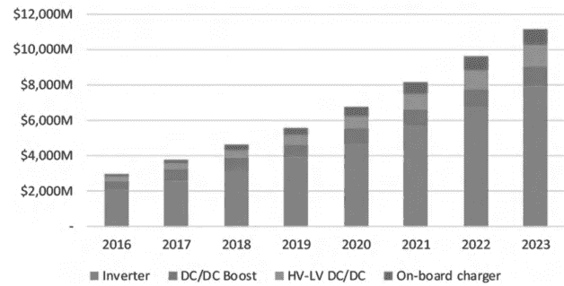

图 8.2 HEV/EV 转换器市场的最新进展和趋势：概览。

对最先进的太阳能意义的日益认识促进了当今太阳能采集领域研究的加强。与硅（Si）相比，电力器件正在成为电力硬件创新的重要组成部分。光伏（PV）逆变器的性能（作为太阳能转换系统的关键部分）取决于最先进的电力硬件的巧妙设计，如图 8.3 所示，其中包含用于 PV 逆变器的碳化硅衬底市场（以单位和美元计）。为了最大限度地提取来自基于日光的充电器的功率，应通过合理选择当代半导体器件来控制功率转换框架内部的功率损耗，从而限制功率电子元件的数量。降低开关整体质量和尺寸的需求促使了 Zeng 等人 [5] 中最新高功率器件的创建。图 8.3 总结了 SiC 衬底市场中的 PV 逆变器。

前述应用中尖端 SiC 功能体现了新型碳化硅半导体创新的相关性。当今创新的一些限制包括系统成本较高、对极端温度封装工艺的需求以及新发明。后续调查将集中于降低制造成本、解决封装问题以及克服障碍，以提升当代 SiC 器件的可靠性和视觉吸引力。本章的主要重点是在 PV 能源转换背景下，创建基于 SiC 半导体的强大器件的过程 [6]。此外，针对不同 PV 逆变器结构的实验表明，在 PV 电力系统中使用新型 SiC 能源半导体器件可能有助于消除当前可能对现代硅构成材料壁垒的一些问题。太阳能技术的未来发展使得生产更多可用电力成为可能。从太阳提取并转换为热能或电能的能量称为太阳能。这是一种在世界各地广泛可得的惊人资源。大规模应用的基于日光的能源工厂（产生大量新能量的工厂，这些

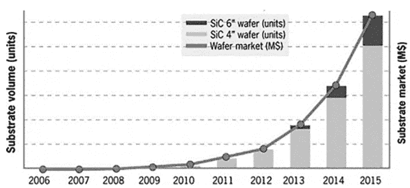

图 8.3 SiC 衬底市场中的光伏逆变器（按单位计）。


电力传输矩阵可立即使用）、焦点站发电厂（位于PV能源附近以受益于现代可持续能源的发电站）和输送网络发电厂是太阳能牧场可采用的不同构建方式之一。1,020 MW（1,020 MJ/s）的电力源自太阳，而173,106 kW，即1,360 W/m²的电力到达地球。出于现代原因，包括吸收、反射成像、环境、耗散等，太阳能无法对齐。图8.1描绘了美国单位表面产生的当代太阳能电量。鉴于不理想的结果（15%–17%），世界无法充分利用当今基于硅的完全商业化太阳能电池将太阳能转换为电能。如果基于硅的太阳能电池被集中光伏（CPV）或多交叉技术取代，购买朝向太阳的房地产的成本可能会上升。因此，该研究在使太阳能在财务上达到标准、寻找提高智能手机功能的方法以及降低超现代聚会费用方面是有效的。技术进步表明，太阳能电池效率未来可能会提高。该研究表明，考虑到现代硅的材料特性，基于硅的日光太阳能电池的理论最高效率不超过31%–40%。但只有大约15%–30%的新任董事会成员在其实际关联职责中达到了熟练程度的巅峰。牧场上的阳光为5,236块地面安装的加拿大太阳能CS6P-230P面板供电。可在Cary, North Carolina网站上的图8.2中看到1.2 MW限制的光伏日光电池组阵列演示。每块面板具有14.3%的模块效率，包含60块位于当代加利福尼亚州莫哈韦沙漠的多晶硅日光电池组电池；Ivanpah主要基于太阳的发电站是一座最大容量为377 MW的集中太阳能（CSP）设施。预计运营工厂的效率将达到28.72%。尽管美国有许多太阳能牧场，但只有大约30%真正运行[7]。图8.3（来源：EIA MER，2014年7月）展示了1984年至2013年间太阳能使用量的渐进式上升。正在支持强有力且富有创造力的建议，以尝试促进最新太阳能向电能的彻底转换。在太阳能时代，已经开发出许多系统，以精确捕捉太阳能提供的所有太阳能。以下是当今世界的一些示例：

- 一项利用最新铅和硒基纳米晶体的计划
- 降低制造费用
- 为了构建电池结构，利用名为纳米棒的微小腔室
- 混合超现代颜色的元素以捕捉阳光，并混合现代二氧化钛元素以降低电力成本

此外，为了在尖端太阳能逆变器的构建中实现高效率和可靠性，正在研究使用半导体材料。考虑到所有这些，行业领导者的新压力设备促成了半导体器件的出现。它们为我们提供了卓越的效率、完美的控制以及在异常项目之间传输能量的能力。尽管硅在力器件中的使用历史悠得多，但由于其当代且卓越的材料特性，碳化硅技术目前正在高强度封装中卷土重来。当今，碳化硅器件对于超现代太阳能转换器的开发至关重要。

PV能量转换框架主要考虑尖端逆变器的成本、设计和运行。为了满足特定要求，现代逆变器必须在高可靠性、高效率、改进的通信、更低成本和灵活性等领域中创建。对于住宅系统，光伏逆变器的功率范围通常为1–10 kW，而对于商业结构，通常在100至300 kW之间。当前应用框架的范围为10–500 kW；这将逐渐上升到2 MW，最终达到20 MW。为了降低最复杂的PV逆变器的成本，当前设计旨在同时提高比能量（W/kg）和功率密度（W/m³）[8]。

## 8.2 PV 框架财务问题

PV电厂的规模及其运输费用因市场阶段而异。商业屋顶、住宅屋顶和应用级地面安装PV系统（一个集中器和粘合集中器）构成了PV市场的三个主要部门。公用事业规模地面安装框架在长度、设置策略、营销渠道和成本结构方面不同于其他部门。PV发电价值、屋顶倾斜度、油漆成本、允许此外、调度成本、节省网络费用、行政费率、变电站和框架接入价格、允许和任命价值、制造社区费用，以及在PV建立秩序的货币分析中考虑的因素[9]。成本变量和成本降低选项在为美国公用事业规模、商业和私人光伏（PV）框架费用中展示。连续集中器、一个枢纽以及个人、商业和软件级框架的运输成本分别展示。根据价格拨款，逆变器价值因机构类型而异最少。因此，对逆变器安排的任何改进都将有助于降低某些机构的成本。对于太阳能逆变器，SiC器件拥有相当大的市场。自2006年以来，光伏逆变器的SiC衬底市场一直在快速增长。已经观察到，SiC在许多商业领域都有应用，包括运输、IT和电子、建筑、无限和格网[10]。

到2025年，预计常用于驱动发动机的电气设备总市场将增长至24亿美元。SiC器件已引起包括家庭、IT和小工具、通信与网络以及运输在内的广泛行业领域的关注。电视、平板电脑和手机占数字小工具消费者关注度的87%[11]。先前发现的市场领域呈现出一致的分布。

从生态角度来看，PV框架的生命周期评估（LCA）保证了先进的框架兴趣。通常，这是PV框架的功能和有用来源。除了范围描述之外，还会考虑一些影响清单分析、翻译、关注和评估的因素。LCA的量化效益能够对多种变化进行评估。PV框架的生命周期评估包括适当的生命周期阶段。在消除未加工成分中，工厂材料包括用于安装系统制造的铁和锌、用于连接的铜金属以及用于玻璃的二氧化硅[12]。

无知晶圆从2 mm厚晶圆中清零、电池（由掺杂剂传播形成的p-n交叉和由烧结金属化胶制成的电力供电电路）和模块（通过真正和电子方式相关并由玻璃和塑料典型化的电池）是生产PV设备所涉及的一些步骤，用于组装开发所需的设备。在改进和再创建方面，为维护设备，PV模块、连接和电力被同步，并安装支持系统。PV框架被移除、拆卸，然后使用适当的组件和材料重新组装。PV框架对象的生命周期评估是一项挑战性任务[12]。

然而，PV模块的未来有条件价格已使用生命周期清单预测：30年的优秀模块开发；逆变器对于小型花朵或私人PV系统具有15年的使用寿命，而对于大型工厂则具有30年的使用寿命，并伴有10%像钟表一样准时运行的更换周期。安装在屋顶或饰面上的设备的使用寿命在30至60年之间。评估生命周期时推荐的约束之一是功率。CO2排放率是评估光伏设备在异常气候变化情况下可行性的有用指标。因此，设备性能跟踪（EPT）评估的另一个因素是CO2偿还时间[13]。

## 8.3 PV电力变化框架序言

捕获能量并将其转换为不间断电源所需的电气和电子设备面临重大障碍，原因在于清洁能源（特别是太阳能和风能）的间歇性。当地气候和时间（两者均可准确预测）会影响可用太阳能的数量。然而，由于雾霾、灰尘或云层覆盖导致的太阳辐射变化会引起发电时代的不稳定性。光伏系统的构建必须能够适应太阳辐射的变化，同时仍能产生清洁、稳定的电力[14]。力硬件对于太阳能采集框架的正常运行是必要的。在住宅环境中，标准PV框架的价值可能高达5 kW，而在商业环境中，则高达兆瓦（MW）。[15]中展示了一种其块被重新配置的PV能量转移设计。DC转换器和DC-AC逆变器是太阳能系统的两个主要电力电子部件。DC转换器具有集成的最大功率点（MPPT）跟踪架构，旨在作为升压转换器（也称为移动前转换器）工作。使用全电气系统，MPPT修改太阳能充电器的工作点以提供最大功率。逆变器组件将瞬时电流（DC）电压转换为旋转电流（AC），然后可用于控制周围区域或送回电网。根据应用，


逆变器的输出对于私人电厂可能是单级，对于连接到电网的电厂可能是三级。光伏能源根据其控制电力的效果被分为几组。微型逆变器是一种独立逆变器，直接放置在阳光下并安装在单块面板上。它集成了MPPT框架。串式逆变器感测来自一系列连接的太阳能板的直流(DC)电压[16]。

串式逆变器的MPPT架构将一组连接的太阳能板视为单个太阳能板，而微型逆变器则专注于单个面板。简单来说，集中式逆变器是一种用于大规模商业应用的更长串式逆变器。该研究范围不允许全面检查每一种光伏逆变器型号。太阳能供能系统的展示方式取决于能量转换各阶段所需功率器件框架的架构。如[17]所述，为了让太阳能板在光伏逆变器中拥有高于其预期容量10%的优势以承受太阳辐照期，太阳能板的功率额定值必须由逆变器调节。

过度使用指定的功率电平可能会使设备过载并导致长期可靠性问题。为了优化太阳能板的功率输出，必须尽量减少能量转换框架内的功率损耗。这包括准确识别半导体并使用更少对功率敏感的电气元件。该地区接收的平均太阳辐照是决定太阳能采集财务可持续性的主要因素。面向太阳的电厂位置应为日照充足的地方。通过将逆变器框架靠近太阳能板放置，可以避免长距离连接并减少直流功率损耗[18]。然而，这以光伏逆变器框架的高环境工作温度为代价，这会降低性能并最终导致设备失效。

光伏逆变器在安全温度下运行需要一个庞大而复杂的冷却框架，这增加了框架的成本。如[19]所述，光伏逆变器应能够在极高温度（50°C或更高）下运行而不损失功率输出。控制室内相对湿度的另一个重要因素是功率硬件的工作温度。当设备与周围空气之间存在温差时，空气湿度是一个重要因素。最坏的情况是，为半导体供电的老化防潮元件可能会开始凝结水滴。为了减少空气湿度的影响并避免[20]中表达的由湿气引起的系统功能障碍，采用了以下策略：在内部加热中，通过冷却空气消耗管理来调节散热器的温度。在带有隔离内部空气循环的密封外壳中，功率元件通常由流体或外壳外的散热器冷却。

### 8.3.1 光伏能源框架的功率硬件

太阳能电池或面板的产出是限制太阳能供能系统总体效能的主要因素。然而，如果采用更先进的面向太阳的电池技术（例如多结太阳能电池），该概念的财务可行性将降低，这将花费大量资金。在这种情况下，为了实现最大效能，建议的做法是更新功率器件。PV能量转换设计的功率电子模块采用带有MPPT设计的PV能量转换器，用于从太阳能充电器中提取最大功率；这会导致不均匀的直流电压输出。如[21]所述，为了保持直流输出在适当范围内恒定，升压转换器调节电压。

辅助转换器的工作原理可以总结如下：当开关处于ON位置时，来自直流电源(Vin)的能量存储在电感器(L1)中。在开关关闭期间，单向二极管(D1)将电感器中存储的能量传递给负载和电容器(C1)。结果电压高于输入电压，这是因为当开关处于OFF状态时，直流电源电压与电感器两端电压之间的相互作用所致。直流到交流逆变器的工作原理可以通过观察功率半导体开关Q1到Q6来总结，这些开关被切换以产生校正后的正弦信号。确切的切换顺序将在本章中不予探讨。大多数PV框架都设计为在1,000 V的直流电压断点下运行以提高导通性，如[22]所述。不过，正在努力将阈值提高到1,500 V。但在更高的直流电压下，必须使用耐压电子器件来补偿不利因素并在高阻抗电压水平下保持降低的导通性。虽然基于硅的器件能够处理高压和大电流应用，但其局限性导致了对复杂热管理和电气系统的需求。

## 8.4 宽带隙碳化硅半导体创新概览

碳化硅（SiC）是硅和碳IV族元素的化合物。在半导体材料研究领域，SiC因其比硅具有更大的带隙而被广泛认可。碳化硅是与高温和高功率电子应用相关的半导体器件的首选材料，因为它比纯硅具有更多特性。分析发现，如[23]所述，SiC的导热率是硅的三倍，具有多个带隙和一系列基础电场强度。在带隙更大的材料中，电子通常需要超过2 eV的能量才能从价态带的最高点跃迁到导带。较低的本征载流子浓度会导致较高的击穿电压、高温工作能力和器件漏电流。宽带隙材料可以在辐射环境中工作，且器件封装不那么复杂，因为它们本身对高能粒子更具抵抗力。功率器件需要能够在保持低ON态阻抗的同时迅速阻断过电压。功率器件的阻断电压能力取决于半导体材料中的掺杂水平。特别是，对于金属氧化物半导体场效应半导体等单极器件，降低掺杂浓度会以ON态阻抗和相应的ON态电压降（MOSFET）为代价来提高击穿电压。硅单极功率器件受限的阻断电压是由ON态阻抗与截止电压之间的权衡造成的[24]。绝缘栅双极晶体管（IGBTs，即硅保护结双极晶体管）以其低ON态电阻和高阻抗电压为特征。然而，由于其双极特性，开关频率存在严格限制。基础电场（即雪崩击穿开始的地方）是一个关键考量因素。如[25]所述，SiC强大的基础电场可以使器件具备高阻断电压能力和低ON态电阻。为功率器件框架实现高功率密度正成为许多项目的重要规划需求。然而，这也伴随着代价：复杂的热管理系统导致单个模块更昂贵且更大。技术能否有效消除由内部功耗产生的热量决定了其运行的安全性。如果不这样做，热量可能会在器件内部积聚，降低其可靠性并最终导致用户不满。运行期间环境温度升高会加剧这一问题。材料导热能力的强弱以其导热系数来衡量。由于其强导热性，SiC是一种独特的半导体材料，能改善半导体结处的热量传导。影响器件电流和开关频率限制的一个重要因素是载流子饱和漂移速率。如[26]所示，SiC具有高电子饱和漂移速率，其速度是硅的两倍，因为其器件电流更高。与硅的0.7 V相比，碳化硅PN结的3 V固有电位是宽带隙半导体的主要缺点之一。需要对器件进行高级布局设计以缓解SiC功率器件的高固有电位。解释了与硅和氮化镓相关的SiC材料关键特性。尽管碳化硅具有主要优势，但SiC器件的广泛应用仍面临一些障碍。由于电压和电流额定值，SiC功率半导体器件目前尚未广泛用于商业应用。这些器件比其硅对应物更昂贵。SiC是一种耐热材料，但为了在典型的半导体温度下使用，必须使用高温器件进行适当封装。未来SiC器件研发的目标是创造商业可行的高压功率半导体。其中一项可能降低成本的因素是增加SiC晶圆制造。如[27]所述，具有高电压和电流额定值的器件可以降低安装成本，并为多兆瓦太阳能和风能系统提供财务可行的解决方案。

### 8.4.1 使用碳化硅的功率器件

#### 8.4.1.1 势垒肖特基（JBS）二极管

功率整流器用于广泛的应用，从简单的交流替换线电压调节到复杂的直流转换器和逆变器。在半导体材料和架构取得进步之前，功率电子应用由硅PIN二极管和肖特基二极管主导。就实际目的而言，它们仍然是首选器件。PIN二极管是一种双极元件，其特点是导通损耗低且阻断电压高，如[28]所述。导电性调节本质上对双极器件有利，因为它


减少高阻断电压器件在导通状态下常相关联的问题。然而，正向和反向恢复限制了高频开关活动，高开启电压（SiC器件约为3 V）加剧了导通损耗。由于肖特基二极管本质上是多数载流子器件，它们可以在高重复频率下以可忽略的损耗工作；然而，阻断电压能力与导通电压降之间的权衡限制了可生产的高压肖特基二极管的数量。此外，肖特基二极管泄漏电流随温度显著升高限制了高温工作。JBS二极管结合了PIN二极管的高阻断电压能力与肖特基二极管的低导通电压降和高频开关能力。JBS二极管的示意横截面架构基于PIN和肖特基二极管设计。

正向导通模式在很大程度上由金属-半导体肖特基势垒电平决定，表现为植入P位点之间通道上的单极电流流动。这一现象可由交错分布的肖特基区和P区的存在来解释。低导通损耗和高频开关源于注入少数载流子不足导致的导通电压降不足，这阻止了双极开通。在开关阻断期间，P-N结变为反向偏置，因为耗尽区扩展到P+手指上并屏蔽肖特基结免受强电场影响，从而减少泄漏电流，如[29]所述。商用SiC器件供应商包括英飞凌科技、意法半导体和ROHM半导体。CREE的产品具有任何商用SiC JBS二极管中最高的估计反向阻断电压（1,700 V）。具有共阴极架构的双二极管使得1,200 V二极管可以装于具有三个引线的TO-247–3封装中，即使1,700 V二极管仅作为单二极管在TO-247–2封装中提供。该二极管可从意法半导体获取，采用高压DPAK封装。

#### 8.4.1.2 金属-氧化物-半导体场效应晶体管（MOSFET）

金属-氧化物-半导体多数载流子晶体管，常被称为功率MOSFET，常适用于低压高功率电路。通过向其栅极端子施加适当偏置电压来激活MOSFET，栅极通过氧化层与半导体隔离。通过表面通道的电流由超薄反型层的阈值电压控制。由于其极高的输入阻抗和栅极输入端子的氧化界面，MOSFET非常适合用作高功率电路中的开关。对于高频开关模式应用，MOSFET是首选方案，因为其高频开关允许减小储能元件的尺寸，如[30]所述。

尽管具有先前所示的优势，硅功率MOSFET在阻断电压能力方面受到阻断电压与导通电阻（RDS(on)）之间权衡的限制。价格合理的硅MOSFET的击穿电压几乎等于1,000 V。尽管如此，更高的击穿电压存在几个主要缺点，包括非常高的导通电阻（限制通道电流）或高输入电容（增加开关损耗和栅极驱动要求）。碳化硅功率MOSFET结合了SiC材料的高阻断电压能力与MOSFET的标准优势。在目前由硅IGBT主导的高压应用中，SiC功率MOSFET因其在保持低导通电阻的同时阻断高电压的能力而脱颖而出。

商用级SiC功率MOSFET由意法半导体、ROHM半导体和CREE生产；商用功率MOSFET通常具有1,200 V的阻断电压额定值。在可上市的SiC功率MOSFET中，CREE生产的单个器件可承受的最高阻断电压约为1,700 V，如[31]所述。将共封装的反并联SiC肖特基势垒二极管（SBD）和ROHM MOSFET（SCH2080KE）连接，以防止反向导通期间的功率损耗。除了意法半导体器件（其保留在自有的HiP247TM封装中以最大限度发挥性能并符合行业标准）之外，其他器件均可在TO-247–3封装中获取。

#### 8.4.1.3 结型场效应晶体管（JFET）

如前所述，靠近氧化物-半导体接触处薄通道中流过的电流（如[32]所述）代表MOSFET的导电系统。这表明器件架构必须具有增强的氧化物-半导体界面。对于SiC，与碳相关的表面态导致通道表面电子迁移率受限，并在热生长氧化层中产生高密度的界面态。深入研究SiC JFET的主要原因是SiC MOSFET在氧化物-半导体界面上的性能和稳定性的可靠性。JFET是多数载流子器件，在开关和导电方面与功率MOSFET具有可比的特性。

连续导电路径和控制机制是MOSFET和JFET差异最大的地方。在MOSFET中，电流流动在器件表面受到控制，但在JFET中，它通过器件本体受到控制。在MOSFET中，在氧化界面施加偏置电压限制通道电流，而在JFET中，反向偏置P-N结限制通道电流。SiC JFET以其对温度变化和其他工作条件的抵抗力而闻名，因为它们不依赖氧化物-半导体界面。JFET器件在零栅极阈值电压下以常导模式工作，这是其主要缺点之一，意味着它们经常处于导通状态。功率结型场效应晶体管（JFET）结构的两种配置是垂直型（VJFET）和横向型（LJFET）。从通道到源的电流路径决定了两种系统之间的主要区别。JFET结构不是本工作详细分析的主题。英飞凌科技AG和美国碳化硅公司（USCi）制造商用级封装SiC功率JFET，额定击穿电压为1,200 V [33]。这些器件装在TO-247-3容器中，英飞凌1,200 V SiC JFET的最高工作温度为175°C，由碳化硅制成的功率单元组成。大规模太阳能采集系统所需的功率超过离散SiC功率器件所能提供的功率。功率模块在单个基板上堆叠多个功率半导体器件，提供物理限制、电气和热相互作用以及安全性。模块的组成部分可以以多种方式组装，从简单的高功率二极管模块到复杂的半桥和全桥MOSFET/IGBT模块。得益于功率模块的灵活性，它可以集成许多控制电路，包括温度感应和关闭、欠压保护、过流和栅极驱动器。这种器件的一个示例是智能功率模块（IPM）。商用SiC功率模块提供所有SiC模块和混合模块（硅和碳化硅器件的组合）。大型供应商提供部分商用SiC功率模块，如[34]所述。

## 8.5 结论

由于太阳能电池的生产率通常低于风能等其他环保电源，因此有效利用太阳能一直面临困难。考虑到这些因素，使用具有相对较好效率的CPV或多结太阳能电池的成本限制了选择。在最高效率运行时，光伏逆变器架构应能降低资本投资。与硅相比，SiC独特的材料特性使得MOSFET、JFET和二极管等器件的开发成为可能。展示、分析和比较基于SiC的光伏逆变器及其基于硅的对照器表明，前者效率更高，并增加了系统中由硅组成的百分比，从而降低了逆变器成本。在基于SiC的系统中，降低的材料成本（尤其是无源元件尺寸的显著减小）抵消了高昂的器件成本。同样，SiC功率器件的快速发展和商业化导致成本持续下降。尽管SiC仍是一种相对较新的技术，但大量测试数据证实了功率器件的稳定性。

## 参考文献

- 1. Rogers, S. A. (2014). 财年2013先进电力电子和电动机研发年度进展报告（编号DOE/EE-1040）。EERE出版物和产品图书馆，华盛顿特区（美国），https://doi.org/10.2172/1220540.
- 2. Mattallana, A., Ibarra, E., López, L., Andreu, J., Garate, J. I., Jordá, X., & Rebollo, J. (2019). HEV/EV应用中的功率模块电子：宽带隙半导体技术与设计方面的新趋势。可再生能源与可持续能源评论，113，109264，https://doi.org/10.1016/j.rser.2019.109264.
- 3. Hussain, H. A., Loncarski, J., Ristic, L. B., & Bellini, A. (2024). 基于部分规模转换器的双馈风力发电系统：基于SiC和IGBT的转换器方案的效率、成本与体积比较。IEEE Access，https://doi.org/10.1109/ACCESS.2024.3419810.
- 4. Cunningham, D. W., Carlson, E. P., Manser, J. S., & Kizilyalli, I. C. (2019). 宽带隙功率电子对光伏系统设计的影响。IEEE光伏期刊，10(1)，213–218，https://doi.org/10.1109/JPHOTOV.2019.2950592.
- 5. Zeng, Z., Shao, W., Chen, H., Hu, B., Chen, W., Li, H., & Ran, L. (2017). 基于碳化硅器件的光伏逆变器的变化与挑战。可再生能源与可持续能源评论，78，624–639，https://doi.org/10.1016/j.rser.2017.04.096.


- 6. Adappa, R., Surayanarayana, K., Hatwar, H. S., & Rao, M. R. (2019年7月). 基于SiC的功率半导体器件及其应用综述. 在2019年第2届智能计算、仪器与控制技术国际会议（ICICICT）（第1卷，第1197–1202页）中. IEEE, https://doi.org/10.1109/ICICICT46008.2019.8993255.

- 7. Gorjian, S., Ebadi, H., Tromsdorff, M., Sharon, H., Demant, M., & Schindele, S. (2021). 现代太阳能农业机械的兴起：可持续农场运营的解决方案. 《清洁生产》期刊, 292, 126030, https://doi.org/10.1016/j.jclepro.2021.126030.

- 8. Hassaine, L., Olias, E., Quintero, J., & Salas, V. (2014). 并网光伏系统的功率逆变器拓扑和控制结构概述. 可再生能源与可持续能源评论, 30, 796–807, https://doi.org/10.1016/j.rser.2013.11.005.

- 9. Alsadi, S., & Khatib, T. (2018). 光伏电力系统优化研究现状：标准、约束、模型、技术和软件工具的回顾. 应用科学, 8(10), 1761, https://doi.org/10.3390/app8101761.

- 10. Nas Esfahani, F., Darwish, A., & Williams, B. W. (2022). 用于并网太阳能光伏（PV）驱动电动汽车（EV）的功率变换器拓扑——全面综述. 能源, 15(13), 4648, https://doi.org/10.3390/en15134648.

- 11. Rafin, S. S. H., Ahmed, R., Haque, M. A., Hossain, M. K., Haque, M. A., & Mohammed, O. A. (2023). 功率电子革命：新兴宽带隙和超宽带隙器件的全面分析. 微机械, 14(11), 2045, https://doi.org/10.3390/mi14112045.

- 12. Mavromatidis, G., Orehounig, K., & Carmeliet, J. (2015). 村庄光伏集成潜力评估. 太阳能, 121, 152–168, https://doi.org/10.1016/j.solener.2015.03.044.

- 13. Giulio, M., Stella, E., Capri, E., Esnaola, A., López de Alda, M., Diaz-Cruz, S., Mandaric, L., Muñoz, I., & Bellin, A. (2019). 评估水文和化学应激因素对高山河流大型无脊椎动物群落的影响：以阿迪杰河为例. 河流研究与应用, 35(1), 78–87, https://doi.org/10.1002/rra.3367.

- 14. Hernández-Callejo, L., Gallardo-Saavedra, S., & Alonso-Gómez, V. (2019). 光伏系统综述：设计、运行与维护. 太阳能, 188, 426–440, https://doi.org/10.1016/j.solener.2019.06.017.

- 15. Venkatramanan, D., & John, V. (2019). 用于增强备用电源应用能源接入的可重构太阳能光伏并网逆变器架构. IEEE工业电子学汇刊, 67(12), 10531–10541, https://doi.org/10.1109/TIE.2019.2960742.

- 16. Osmani, K., Haddad, A., Lemennad, T., Castanier, B., & Ramadan, M. (2021). 关于光伏系统最大功率提取算法及其相应DC-DC变换器的研究. 能源, 224, 120092, https://doi.org/10.1016/j.energy.2021.120092.

- 17. Padmanathan, K., Govindarajan, Uma, Ramachandaramurthy, Vigna K., & Jeevarathinam, Baskaran. (2018). 将太阳能光伏能量转换系统集成到工业和商业电能利用中的调查——综述. 工业信息集成期刊, 10, 39–54, https://doi.org/10.1016/j.jii.2018.01.003.

- 18. Vishnumuram, P., Suresh, P., Vijayakumar, K., Bajaj, M., Khurshaid, T., Nauman, A., & Kamel, S. (2023). 电动汽车功率变换器拓扑、充电器类型、基础设施和通信技术的全面综述. 能源研究前沿, 11, 1103093, https://doi.org/10.3389/fenrg.2023.1103093.

- 19. Anurag, A., Yang, Y., & Blaabjerg, F. (2015). 带有馈电运行时段外无功功率注入的单相光伏逆变器的热性能和可靠性分析. IEEE新兴与精选电力电子主题期刊, 3(4), 870–880, https://doi.org/10.1109/JESTPE.2015.2428432.

- 20. Kumar, M., Rana, L., & Pattnaik, A. (2022). 高效太阳能电池的创新设计. 在《先进功能材料与器件：AFMD 2021精选论文集》（第271–281页）中. 新加坡: Springer, https://doi.org/10.1007/978-981-16-5971-3_30.

- 21. Shayeghi, H., Mohajery, R. E. Z. A., Hosseinpour, M., Sedaght, F., & Bizon, N. (2024). 基于Cuk变换器和电压提升技术的无变压器高电压增益DC-DC变换器. 能源管理与技术期刊, 8(1), 23–34, https://doi.org/10.22109/jemt.2023.416222.1470.

- 22. Yin, H., Zadshir, M., & Pao, F. (2021). 建筑一体化光伏热系统：基础、设计与应用. 学术出版社, https://doi.org/10.1016/C2019-0-02586-1.

- 23. Song, D., Cho, E. C., Conibeer, G., Flynn, C., Huang, Y., & Green, M. A. (2008). 嵌入SiC基体中的Si纳米晶体及Si纳米晶体/c-Si异质结器件的结构、电学和光伏表征. 太阳能材料与太阳能电池, 92(4), 474–481, https://doi.org/10.1016/j.solmat.2007.11.002.

- 24. Abood, I. A. (2015). 基于碳化硅的高电压高功率电子元件研究. У ньюжмэррп у Кеорпады, https://doi.org/10.2478/v10175-011-0068-0.

- 25. Kimoto, T. (2022). 用于提高能源效率的高压SiC功率器件. 日本学院院刊，B系列, 98(4), 161–189, https://doi.org/10.2183/pjab.98.011.

- 26. Islam, S. N. (2020). 4H-SiC垂直三栅极功率MOSFET技术发展（普渡大学博士论文）.

- 27. Friedrichs, P., & Rupp, R. (2005年9月). 碳化硅功率器件：当前发展与潜在应用. 在2005年欧洲功率电子与应用会议（第11页）中. IEEE, https://doi.org/10.1109/EPE.2005.219736.

- 28. Niwa, H. (2016). SiC中的击穿特性及面向超高压应用的PiN二极管改进, https://doi.org/10.1109/ISPSD.2012.6229101.

- 29. Urban, C. J. (2010). 带有掺杂剂分离的NiSi肖特基势垒MOSFET的直流和射频表征（第12卷）. 尤利希研究中心, http://hdl.handle.net/2128/3801.

- 30. Yuan, X., Laird, I., & Walder, S. (2020). 高速开关SiC功率器件和变换器应用中的机遇、挑战与潜在解决方案. IEEE电力电子汇刊, 36(4), 3925–3945, https://doi.org/10.1109/TPEL.2020.3024862.

- 31. Vasilevskiy, K., & Wright, N. G. (2020). 碳化硅发现的历史介绍：特性与技术. 《推进碳化硅电子技术II：碳化硅器件加工的核心技术》, 69(1), https://doi.org/10.21741/9781644900673.

- 32. Fortunato, E., Barquinha, P., & Martins, R. (2012). 氧化物半导体薄膜晶体管：最近进展综述. 《先进材料》, 24(22), 2945–2986, https://doi.org/10.1002/adma.201103228.

- 33. Ballard, T. B. (2020). 固态保护功率模块短路容量调查. 北卡罗来纳州立大学, https://doi.org/10.1109/APEC.2005.1453063.

- 34. Baliga, B. J. (2023). 碳化硅功率器件：进展与未来展望. IEEE新兴与精选电力电子主题期刊, 11(3), 2400–2411, https://doi.org/10.1109/JESTPE.2023.3258344.

# 9 采用三栅极金属结构的垂直TFET性能比较及机器学习方法洞察：一项综合研究

尼哈里卡·沙尔马, 尼拉杰·古普塔, 卡拉姆吉特·考尔·塞克洪 and 西玛·纳尔瓦尔

## 9.1 引言

如今，低功耗和极低漏电流是高效电子器件的基本要求 [1, 2]。为了满足该行业不断增长的需求，MOSFET的缩小已达到纳米级，这限制了其供电电压的进一步降低和快速开关，进而增强了短沟道效应。因此，探索能够克服MOSFET局限性的更好替代器件已成为必要。隧道场效应晶体管（TFET）的高效性、快速开关、硬件兼容性和减少的短沟道效应，使其成为MOSFET的优越替代方案。TFET基于带间隧穿（BTBT）现象而非热电子发射工作 [3–5]。然而，TFET有几个主要参数仍需要许多改进，例如IOFF、ION、更陡的亚阈值摆幅和Iamb [6]。为克服这些局限性，研究人员过去采用了各种技术，例如低带隙TFET器件；与硅-锗、锗以及其他属于III-V族的低带隙材料的新型材料工程 [7]；间隔口袋工程；栅极工程 [8]；以及功函数工程 [9–12]。为抑制TFET的两极性行为，推荐了不同类型的器件，如双栅异质介质埋氧化物器件 [13, 14]、双材料全包围栅（GAA）器件 [15]、三栅金属GAA结构器件 [16–26]、基于栅极漏极重叠的器件，


和重掺源口口袋型器件。本章详细回顾了各种三金属栅垂直TFET（TMG V-TFET），就其性能与金属栅长度和功函数变化的对比进行了详细分析。第9.2节讨论了TMG V-TFET的器件几何结构，第9.3节介绍了其性能的结果和讨论，第9.4节讨论了使用机器学习（ML）的TFET，第9.5节总结了本章。

## 9.2 三金属栅（TMG）V-TFET的器件几何结构

### 9.2.1 基于GAA的TMG V-TFET

在这个基于GAA的TMG V-TFET器件中，有三个金属栅层——MG1、MG2和MG3——其设计使得所有金属栅具有不同的功函数：分别为WF1、WF2和WF3。在这个器件中，源区和漏区分别为重掺Ge和Si，其性能特征通过基于技术计算机辅助设计（TCAD）的仿真以及各种模型进行研究。这个器件实际设计用于解决TFET在性能方面的局限性，以及现有TFET器件的双极性。基于GAA的TMG V-TFET器件在各种要求低功耗和可忽略泄漏电流的未来应用中非常有用[16–26]。

图9.1展示了具有三个金属栅层——MG1、MG2和MG3（具有不同的功函数，分别为WF1、WF2和WF3）的TMG V-TFET的各种视图。这个TMG V-TFET中考虑的重要设计规格包括金属栅层的长度（L1、L2和L3）、沟道长度（Lc）、沟道区域直径（Nc）、总纳米线直径（Dt）以及所有金属栅层的功函数（WF1、WF2和WF3）。在图9.1c中，给出了TMG V-TFET的能带图，相对于各自金属栅层定义的不同功函数。

表9.1列出了这个基于GAA的TMG V-TFET中考虑的所有重要设计规格[27]。

图9.2展示了TMG V-TFET的传输特性（$I_{DS}$–$V_{GS}$）曲线。仿真结果给出$I_{ON}$约等于10⁻⁵ μA/μm，亚阈值摆动（SS）值为8 mV/decade，平均亚阈值斜率约为43.5 mV/decade。TMG V-TFET的性能行为取决于沟道表面的载流子。因此，其周长（由2 × π × rchannel给出）可以轻松归一化$I_{DS}$值。所以，对TMG V-TFET上所有金属栅的功函数及其各自长度（L1、L2和L3）进行了分析。仿真结果表明，源区-沟道BTBT速率与金属栅1和金属栅2的参数相关联，而这些参数又影响器件性能。但是，其接口处的隧穿速率会影响双极性电流，也会影响金属栅3（MG3），MG3如同MG1/MG2参数一样也会影响双极性。

在图9.3a中，WF2和WF3的值保持在4.5 eV不变。随着WF1增加，隧穿概率降低，在$V_{DS} = V_{GS}$为0.5 V时，$I_{ON}$也显著降低，因为BTBT机制的电压增加[14]。在图9.3b中，WF1和WF3的值保持在4.2 eV不变。

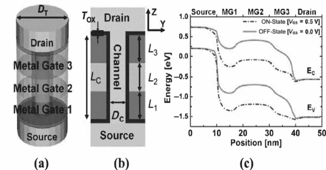

图9.1 （a）描绘了TMG V-TFET的3D器件结构，（b）2D视图，（c）显示能带图。

来源：[27]。

表9.1
基于GAA的TMG V-TFET的重要设计规格

| 设计参数 | 数值 |
|---|---|
| 漏区p型掺杂浓度 | 10^20 cm^-3 |
| 源区n型掺杂浓度 | 10^20 cm^-3 |
| 纳米线直径（Dt） | 14 nm |
| 沟道区域直径（Ns） | 7 nm |
| 氧化层当量厚度（Tox） | 0.6 nm |
| 金属栅1长度（L1） | 7 nm |
| 金属栅2长度（L2） | 14 nm |
| 金属栅3长度（L3） | 7 nm |
| 沟道长度（Lc） | 28 nm |
| 金属栅1功函数 | 4.2 eV |
| 金属栅2功函数 | 4.5 eV |
| 金属栅3功函数 | 4.2 eV |


图9.2 TMG V-TFET的传输特性（$I_{DS}$–$V_{GS}$）。

来源：[27]。

随着WF2增加，关态电流（$I_{OFF}$）因金属栅之间（MG1和MG2）的势垒而降低。在TMG V-TFET中，当WF2从4.1 eV升至4.5 eV时，开态电流（$I_{ON}$）保持不变。然而，在WF2为4.6 eV或更高时，它只允许沟道区域中高能隧穿电子通过BTBT机制流动。结论是，$I_{ON}$和SS都取决于源区和沟道区域的BTBT速率。在图9.3c中，当WF1为4.2 eV且WF3为4.5 eV时，可以清楚地看出WF3对性能的影响很小。从仿真结果观察，为了获得更高的BTBT速率和漏电流，WF1应小于4.2 eV；为了获得更低的关态电流，WF2应小于4.6 eV。

### 9.2.2 基于纳米线的TMG V-TFET

在这个基于纳米线（NW）的TMG V-TFET中，分析了各种直流参数的影响，例如改变不同金属栅功函数的值和改变金属栅长度，以使用仿真结果比较主要的传输特性和亚阈值摆动。该器件显示出$I_{ON}$的显著提升，同时$I_{OFF}$电流逐渐降低。即使在低阈值电压下，它也具有更好的亚阈值斜率。

图9.4展示了基于纳米线的TMG V-TFET的器件结构，提供了不同视图以便更好理解，其结构几乎与之前基于GAA的TFET结构相同，仅在设计参数上有一定差异。其设计所使用的参数和规格列于表9.2中[28]。


图9.3 不同WF1、WF2和WF3下TMG V-TFET的传输特性（$I_{DS}$–$V_{GS}$）。

来源：[27]。

源区长度被认为为10 nm，与漏区长度相同。氧化层为SiO2。纳米线半径为5 nm。使用Silvaco Atlas模拟器检查器件的特性。

图9.5展示了器件的能带图。从图9.5可以清楚地看出，金属长度变化在沟道两侧没有显示任何影响，但在其中间区域显示出影响。


图9.4 基于纳米线的TMG V-TFET器件结构：（a）3D器件结构和（b）2D器件结构。

来源：[28]。

| 设计参数 | 数值 |
| :--- | :--- |
| 沟道p型掺杂浓度 | 10¹⁵ cm⁻³ |
| 漏区n型掺杂浓度 | 5×10¹⁸ cm⁻³ |
| 源区p型掺杂浓度 | 10²⁰ cm⁻³ |
| 纳米线半径 | 5 nm |
| 沟道长度 | 20 nm |
| 金属栅1长度（L1） | 7 nm |
| 氧化层厚度 | 1.5 nm |
| 金属栅2长度（L2） | 6 nm |
| 金属栅3长度（L3） | 4 nm |
| 金属栅1功函数 | 4.1 eV |
| 金属栅2功函数 | 4.5 eV |
| 金属栅3功函数 | 4.4 eV |


图9.5 基于纳米线的TMG V-TFET能带图。

来源：[28]。

沟道中，但它在中间区域显示出影响。这个能带隙在第四种排列（8:4:8比率）时最小，在第一种排列（5:10:5比率）时最大，如图9.5所示。随着第二金属栅长度（L2）的减小，能带隙也逐渐降低，从而增加了结构中的隧穿。

图9.6展示了基于纳米线的TMG V-TFET的$I_D$-$V_{GS}$特性。我们观察到，其$I_{ON}$值为$2.8 \times 10^{-6}$ A/$\mu$m，$I_{OFF}$电流为$4.3 \times 10^{-20}$ A/$\mu$m，其$I_{ON}/I_{OFF}$值为$6.5 \times 10^{13}$，在$V_T$为0.172 V时，其SS值为6.59 mV/decade。

### 9.2.3 三金属栅堆叠V-TFET

在三金属栅堆叠III-V垂直TFET（TM-GS-V-TFET）中，有两种结构需要考察。一种是器件A，其中使用了源口袋。另一种是器件B，其中使用了一种新的源延伸方法。

源口袋型TFET因其较高的$I_{ON}$、较低的$I_{OFF}$和更陡峭的SS而被引入，与基本TFET结构相比有所改进。然而，与传统结构相比，其制造工艺相当复杂。源延伸型TFET改善了电场，从而降低了隧穿势垒


其源侧宽度，进而增强了隧穿率并提升了器件性能。在基于源的 TM-GS-V-TFET 中，源区附近有一个高掺杂的源口袋，它调制了隧道势垒 [29]。由于这种安排，隧穿概率增加，进而增强了其性能。在基于源延伸的 TFET 中，源区的延伸延伸到栅极边缘之外以改善其电场，从而减小了源区附近的隧道势垒宽度。由于这种安排，隧穿速度加快，器件性能得到改善 [30]。基于源延伸的 TFET 具有简单的制造工艺，并具有增加 I_ON 电流、降低 I_OFF 电流和更好的 SS 值的良好能力 [31]。

In Figure 9.7, a cross-sectional schematic of the TM-GS-V-TFET with a source pocket of GaSb (Device A) and the TM-GS-V-TFET with source extension (Device B) are shown. Thickness and length were selected as 65 and 30 nm, respectively.

图 9.7 展示了具有 GaSb 源口袋的 TM-GS-V-TFET（器件 A）和具有源延伸的 TM-GS-V-TFET（器件 B）的横截面示意图。厚度和长度分别选为 65 和 30 nm。

The various device specifications of the TM-GS-V-TFET are in Table 9.3 [32]。

TM-GS-V-TFET 的各种器件规格载于表 9.3 [32]。

The energy-band diagram (Figure 9.8) illustrates the interplay between the energy levels of both regions and the existence of an energy barrier within the channel [33]。In addition, this analysis can enhance subthreshold qualities [34]。Changing the material parameters and gate voltage allows the tunneling characteristics to be adjusted [35, 36]。

能带图（图 9.8）说明了两个区域能级之间的相互作用以及沟道中存在能垒 [33]。此外，该分析可以提升亚阈值特性 [34]。改变材料参数和栅极电压可以调节隧穿特性 [35, 36]。

As shown in Figure 9.8a, in Device A, the GaSb pocket introduced in its source region creates an extra energy barrier for electrons in the source and channel region junction and facilitates the movement of higher-energy electrons close to the uppermost region of the valence band. These energy levels make the electrons transition into the channel of the material InP’s conduction band with a more inclined bend. Hence, it enhances the efficiency of TM-GS-V-TFET。

如图 9.8a 所示，在器件 A 中，引入源区的 GaSb 口袋为源区和沟道区结处的电子创建了一个额外的能垒，并促进了价带顶部附近高能电子的移动。这些能级使电子以更倾斜的弯曲过渡到 InP 材料沟道的导带中。因此，它提高了 TM-GS-V-TFET 的效率。


FIGURE 9.7 Schematic of (a) device A-TM-GS-V-TFET with source pocket and (b) device B-TM-GS-V-TFET with source extension.
Source: [32]。

图 9.7 (a) 具有源口袋的器件 A-TM-GS-V-TFET 和 (b) 具有源延伸的器件 B-TM-GS-V-TFET 的示意图。
来源：[32]。

As shown in Figure 9.8b, Device B has the extension of the GaSb source, because of which an extra energy barrier is created for electrons between the source and channel region junction and this barrier. It causes the sorting of electrons per their energy levels, and electrons having a higher energy level, close to the top region of the valence band, has a greater possibility of crossing this barrier. Due to this phenomenon, the ON-state current of this TFET gets a boost. This also results in a lower I_OFF [37]。Its SS can potentially be much steeper by this extension of the GaSb source, which leads to reduced power consumption and enhanced efficiency along with a lower gate voltage。

如图 9.8b 所示，器件 B 具有 GaSb 源的延伸，因此在源区和沟道区结处的电子之间创建了一个额外的能垒，这个能垒。它导致根据电子能级对电子进行排序，能级较高、接近价带顶部区域的电子越过该能垒的可能性更大。由于这种现象，该 TFET 的开态电流得到提升。这也导致更低的 I_OFF [37]。通过这种 GaSb 源的延伸，其 SS 值可能会大幅下降，从而降低功耗、提高效率，并配合更低的栅极电压。

TABLE 9.3
Device Specifications of TM-GS-V-TFET

表 9.3
TM-GS-V-TFET 器件规格

| Design Parameters | Values |
|---|---|
| Doping concentration, channel (p-type) | $10^{16} \text{ cm}^{-3}$ |
| Doping concentration, drain (p-type) | $5 \times 10^{18} \text{ cm}^{-3}$ |
| Doping concentration, source (p-type) | $10^{20} \text{ cm}^{-3}$ |
| Channel region thickness | 10 nm |
| Dielectric thickness | 1 nm |
| Metal gate 1 length ($L1$) | 8 nm |
| Metal gate 2 length ($L2$) | 8 nm |
| Metal gate 3 length ($L3$) | 4 nm |
| Channel length ($L_c$) | 20 nm |
| Work function of metal gate 1 | 4.2 eV |
| Work function of metal gate 2 | 4.6 eV |
| Work function of metal gate 3 | 4.2 eV |

| 设计参数 | 数值 |
|---|---|
| 沟道掺杂浓度（p 型） | $10^{16} \text{ cm}^{-3}$ |
| 漏极掺杂浓度（p 型） | $5 \times 10^{18} \text{ cm}^{-3}$ |
| 源极掺杂浓度（p 型） | $10^{20} \text{ cm}^{-3}$ |
| 沟道区厚度 | 10 nm |
| 介电厚度 | 1 nm |
| 金属栅极 1 长度 ($L1$) | 8 nm |
| 金属栅极 2 长度 ($L2$) | 8 nm |
| 金属栅极 3 长度 ($L3$) | 4 nm |
| 沟道长度 ($L_c$) | 20 nm |
| 金属栅极 1 工函数 | 4.2 eV |
| 金属栅极 2 工函数 | 4.6 eV |
| 金属栅极 3 工函数 | 4.2 eV |


FIGURE 9.8 Energy-band diagram: (a) TM-GS-V-TFET with source pocket (Device A) and (b) TM-GS-V-TFET with source extension (Device B).
Source: [32]。

图 9.8 能带图：(a) 具有源口袋的 TM-GS-V-TFET（器件 A）和 (b) 具有源延伸的 TM-GS-V-TFET（器件 B）。
来源：[32]。


FIGURE 9.8 (Continued)

图 9.8（续）


FIGURE 9.9 Transfer characteristics of TM-GS-V-TFET with source pocket (Device A) and with source extension (Device B).
Source: [32]。

图 9.9 具有源口袋（器件 A）和具有源延伸（器件 B）的 TM-GS-V-TFET 的转移特性。
来源：[32]。

Figure 9.9 shows the transfer characteristics of both device structures. The ON-state current (I_ON) of TM-GS-V-TFET with source pocket (Device A) and with source extension (Device B) are 26.82 μA/μm and 234.03 μA/μm, respectively. Device B shows better performance as compared to Device A, as it makes use of the source extension technique, because of which the tunneling distance reduces, enhancing the velocity of the electrons. On applying a positive value of VGS, the Fermi level in the source region starts moving downward. Once the energy level of the GaSb source achieves a sufficient magnitude, the electrons enter the InP channel through quantum mechanical tunneling. This also results in limiting the SS value, which improves the I_ON value of Device B. The I_OFF value for Device A is 5.6×10^-17 A/μm and for Device B is 1.52×10^-14 A/μm. The source pocket in Device A helps in I_OFF reduction. The SS value for Device A is 24.56 mV/decade and for Device B is 28.58 mV/decade。

图 9.9 显示了两种器件结构的转移特性。具有源口袋的 TM-GS-V-TFET（器件 A）和具有源延伸的 TM-GS-V-TFET（器件 B）的开态电流（I_ON）分别为 26.82 μA/μm 和 234.03 μA/μm。器件 B 的性能优于器件 A，因为它采用了源延伸技术，从而减小了隧穿距离，提高了电子速度。施加正 VGS 值时，源区中的费米能级开始向下移动。一旦 GaSb 源的能级达到足够大小，电子就会通过量子力学隧穿进入 InP 沟道。这也导致 SS 值受到限制，从而提高了器件 B 的 I_ON 值。器件 A 的 I_OFF 值为 5.6×10^-17 A/μm，器件 B 为 1.52×10^-14 A/μm。器件 A 中的源口袋有助于降低 I_OFF。器件 A 的 SS 值为 24.56 mV/decade，器件 B 为 28.58 mV/decade。

## 9.3 RESULTS AND DISCUSSIONS

## 9.3 结果与讨论

In this chapter, different structures of triple metal gate vertical TFETs with various techniques like gate-all-around, nanowire, source pocket insertion, and source region extension are reviewed and compared in terms of their device structures; energy-band diagrams; functional performance of the DC parameters like I_ON, I_OFF, minimum SS, and power dissipation; and various device parameter variations like all the metal gate functions and all the metal gate lengths. A comparison of all the performance characteristics along with the considered design specifications of all the discussed TMG V-TFET models in this review are in Table 9.4。

本章回顾并比较了具有多种技术（如栅极包围、纳米线、源口袋插入和源区延伸）的三重金属栅极垂直 TFET 的不同结构，从器件结构、能带图、I_ON、I_OFF、最小 SS 和功耗等直流参数的功能性能，以及所有金属栅极工作函数和所有金属栅极长度等各种器件参数变化等方面进行了比较。本综述中所有讨论的 TMG V-TFET 模型的所有性能特征及所考虑的设计规格的对比列于表 9.4。

## 9.4 TFET USING MACHINE LEARNING

## 9.4 基于机器学习的 TFET

TFETs are being developed at a rapid pace using ML, mainly because it simplifies the design, modeling, and optimization procedures. ML helps handle the inherent difficulty in the design of TFETs, which are highly acclaimed for their energy-efficient functioning because of their sub-60 mV/decade subthreshold slope. The need for time-consuming, physics-based simulations is significantly decreased by using predictive models that accurately simulate TFET behavior, such as current-voltage characteristics and threshold voltage, thanks to techniques like artificial neural networks and sophisticated regression models. Additionally, optimization techniques like reinforcement learning and genetic algorithms are essential for optimizing TFET performance and increasing switching speed and power efficiency. Moreover, adaptive controls that improve manufacturing yield and device dependability are made possible by ML's assistance in anticipating fabrication flaws and process changes. Beyond modeling, ML processes massive datasets to find designs that push the limits of power efficiency, which expedites the discovery of novel materials and cutting-edge TFET structures. For the development of TFETs and their incorporation into next-generation, ultralow-power electronics, ML is essential, as it facilitates power optimization, fault detection, and system-level energy management at the circuit level。

TFET 正在利用 ML 以快速的速度发展，主要因为它简化了设计、建模和优化流程。ML 有助于处理 TFET 设计中固有的困难，TFET 因其亚 60 mV/decade 亚阈值摆而备受推崇，以其能源高效运行而闻名。通过使用人工神经网络和复杂回归模型等技术，能够准确模拟 TFET 行为（如电流-电压特性和阈值电压）的预测模型显著减少了对耗时的基于物理仿真的需求。此外，强化学习和遗传算法等优化技术对于优化 TFET 性能、提高开关速度和电源效率至关重要。此外，ML 通过帮助预测制造缺陷和工艺变化，使改善制造良率和器件可靠性的自适应控制成为可能。除了建模之外，ML 处理大量数据集以发现推动电源效率极限的设计，从而加速新材料和前沿 TFET 结构的发现。对于 TFET 的开发及其在下一代超低功耗电子中的集成，ML 是必不可少的，因为它便于电路级的电源优化、故障检测和系统级能源管理。

| Device | Ref. No. | Year | SS (mV/dec) | Ion (A/μm) | Ioff (A/μm) | Ion/Ioff |
|---|---|---|---|---|---|---|
| GAA-based TMG V-TFET | [26] | 2016 | 8 | 10^-5 | 10^-13 | 10^8 |
| NW-based TMG V-TFET | [27] | 2021 | 6.59 | 2.8×10^-6 | 0.4×10^-19 | 6.5×10^13 |
| Source pocket-based TMG V-TFET | [28] | 2024 | 24.56 | 2×10^-5 | 10^-16 | 2×10^11 |
| Source extension-based TMG V-TFET | [28] | 2024 | 28.58 | 2.3×10^-4 | 10^-14 | 2.3×10^10 |

| 器件 | 参考文献号 | 年份 | SS (mV/dec) | Ion (A/μm) | Ioff (A/μm) | Ion/Ioff |
|---|---|---|---|---|---|---|
| 基于 GAA 的 TMG V-TFET | [26] | 2016 | 8 | 10^-5 | 10^-13 | 10^8 |
| 基于 NW 的 TMG V-TFET | [27] | 2021 | 6.59 | 2.8×10^-6 | 0.4×10^-19 | 6.5×10^13 |
| 基于源口袋的 TMG V-TFET | [28] | 2024 | 24.56 | 2×10^-5 | 10^-16 | 2×10^11 |
| 基于源延伸的 TMG V-TFET | [28] | 2024 | 28.58 | 2.3×10^-4 | 10^-14 | 2.3×10^10 |

## 9.5 CONCLUSION

## 9.5 结论

In this chapter, various TMG V-TFETs with different arrangements in terms of their performance and current characteristics are reviewed per the results of their TCAD simulations using various techniques, including gate-all-around structure configuration, nanowire configuration, and insertion of source pocket and source extension configurations. In the GAA approach, the impact of modulating the various design parameters like length of channel, metal gate layers, and work functions of all the metal gate layers on the device performance are also studied. The design parameters of the TMG are I_ON up to 10^-5 A/µm, SS of around 8 mV/decade, steeper subthreshold slope value of approximately 43.5 mV/decade and I_ON/I_OFF ratio of approximately 10^8. In NW-based TMG V-TFET, by further reduction in channel length, there is a preferable boost in its I_ON, with a gradual decrease in I_OFF current. It also has a better subthreshold slope even at a low threshold voltage. The design parameters of the TMG are I_ON up to 2.8×10^-6 A/µm, SS of around 6.59 mV/decade, and I_ON/I_OFF ratio of approximately 6.5×10^13. In the TM-GS-V-TFET, there are two approaches. In the source pocket approach, tunneling probability can be increased up to a good extent along with other device performances like better I_ON of approximately 2×10^-5 A/µm, I_OFF of approximately 10^-16 A/µm, and SS of approximately 24.56 mV/decade. In the source extension approach, it alters the device’s electric field by reducing the source-side tunneling width, which improves the tunneling rate. Hence, it also enhances the I_ON and SS behavior. The TMG structure achieves I_ON of approximately 2.3×10^-4 A/µm, I_OFF of approximately 10^-14 A/µm, and SS of approximately 28.58 mV/decade. This structure also exhibits good electric field characteristics and is highly useful in emerging high-efficiency and low-power applications。

本章根据 TCAD 仿真结果，回顾了采用多种技术（包括栅极包围结构配置、纳米线配置以及源口袋和源延伸配置的插入）的各种 TMG V-TFET，就其性能和电流特性进行了比较。在 GAA 方法中，还研究了调制各种设计参数（如沟道长度、金属栅极层及所有金属栅极层的工作函数）对器件性能的影响。TMG 的设计参数为：I_ON 高达 10^-5 A/µm，SS 约为 8 mV/decade，更陡峭的亚阈值摆值约为 43.5 mV/decade，I_ON/I_OFF 比值约为 10^8。在基于 NW 的 TMG V-TFET 中，通过进一步减小沟道长度，其 I_ON 得到了明显提升，同时 I_OFF 电流逐渐降低。即使在低阈值电压下，它也具有更好的亚阈值摆。TMG 的设计参数为：I_ON 高达 2.8×10^-6 A/µm，SS 约为 6.59 mV/decade，I_ON/I_OFF 比值约为 6.5×10^13。在 TM-GS-V-TFET 中，有两种方法。在源口袋方法中，隧穿概率可以大幅提高，同时还具有更好的器件性能，例如 I_ON 约为 2×10^-5 A/µm，I_OFF 约为 10^-16 A/µm，SS 约为 24.56 mV/decade。在源延伸方法中，通过减小源侧隧穿宽度改变器件的电场，从而提高隧穿率。因此，它也增强了 I_ON 和 SS 行为。TMG 结构实现了约 2.3×10^-4 A/µm 的 I_ON，约 10^-14 A/µm 的 I_OFF，以及约 28.58 mV/decade 的 SS。该结构还表现出良好的电场特性，在新兴的高效率和低功耗应用中非常有用。

## REFERENCES

## 参考文献

- 1. E. Baravelli, E. Gnani, A. Gnudi, S. Reggiani, and G. Baccarani (2014) TFET inverters with n-p/devices on the same Technology Platform for low-voltage/low-power applications. IEEE Transactions on Electron Devices 61:473–478.
- 2. D. Cavalheiro, F. Moll, and S. Valtchev (2015) Perspectives of TFET devices in ultra-low power charge pumps for thermo-electric energy sources. IEEE International Symposium On Circuits and Systems 1082–1085.
- 3. S. Agarwal, G. Klimeck, and M. Luisier (2010) Leakage-reduction design concepts for low-power vertical tunneling field-effect transistors. IEEE Electron Device Letters 6: 621–623。

- 1. E. Baravelli, E. Gnani, A. Gnudi, S. Reggiani, 和 G. Baccarani (2014) 基于相同技术平台的低电压/低功耗应用 n-p/器件 TFET 反相器。IEEE 电子器件学报 61:473–478。
- 2. D. Cavalheiro, F. Moll, 和 S. Valtchev (2015) 用于热电能源的超低功率电荷泵中 TFET 器件的前景。IEEE 电路与系统国际研讨会 1082–1085。
- 3. S. Agarwal, G. Klimeck, 和 M. Luisier (2010) 低功耗垂直隧道场效应晶体管的漏电削减设计概念。IEEE 电子器件快报 6: 621–623。


- 4. W. Y. Choi, B.-G. Park, J. D. Lee, and T.-J. K. Liu (2007) 亚阈值摆动（SS）小于 60 mV/dec 的隧道场效应晶体管（TFET）. IEEE电子器件快报 28(8):743–745.
- 5. J.-S. Jang, and W.-Y. Choi (2011) 隧道场效应晶体管（TFET）的两极性系数. 半导体科学与科学期刊 11(4):272–277.
- 6. K.-H. Kao, A. S. Verhulst, W. G. Vandenberghe, B. Sorée, G. Groeseneken, and K. De Meyer (2012) 基于锗的TFET中直接和间接带间隧道. IEEE电子器件汇刊 59(2):292–301.
- 7. S. H. Kim, H. Kam, C. Hu, and T.-J. K. Liu (2009) 具有创纪录高 ION/IOFF 的锗源隧道场效应晶体管. VLSI技术摘要会议 178–179.
- 8. Hyun Woo Kim, and Daewoong Kwon (2021) 掺杂工程 L型隧道FET的陡峭开关特性. IEEE电子器件学会期刊 9:359–364.
- 9. Navjeet Bagga, and Sudeb Das Gupta (2017) 栅极全包三金属TFET的表面势和漏电流解析模型. IEEE电子器件汇刊 64(2):606–613.
- 10. Narwal Seema, and Sudakar Singh Chauhan (2018) 面向RFIC设计改进垂直TFET的DC、模拟/RF和线性度指标的新设计方法. 超晶格与微结构 122:286–295.
- 11. Narwal Seema, and Sudakar Singh Chauhan (2019) 电极功函数工程化 HDB垂直TFET的射频和线性度性能研究. 工程与技术学会 14:17–21.
- 12. Narwal Seema, and Sudakar Singh Chauhan (2019) 电极功函数工程化异种介质埋氧层垂直TFET的性能研究. IET电路、器件与系统 13(7):1027–1031.
- 13. Narwal Seema, and Sudakar Singh Chauhan (2018) 基于 HDB的双栅垂直隧道场效应晶体管设计及其性能估算. 超晶格与微结构 117:1–8.
- 14. Narwal Seema, and Sudakar Singh Chauhan (2020) 面向RF应用基于 HDB的双栅（DG）VTFET线性度性能分析. 硅 13(4):1121–1125.
- 15. D. Jackuline Moni, G. Anne Selva Naira, D. Gracia, and D. Nirmal (2017) 三金属栅垂直隧道FET性能分析. 纯与应用数学国际期刊 114(12):89–98.
- 16. Prashant Kumar, Munish Vashistha, Neeraj Gupta, and Rashmi Gupta (2022) 超低功耗应用高k介质双栅无结（DG-JL）MOSFET解析模型. 硅 14:7725–7734.
- 17. Neeraj Gupta, Rashmi Gupta, S. B. Gupta, Rekha Yadav, and Prashant Kumar (2023) 低功耗应用介质堆叠三材料圆柱栅极全包MOSFET（DSTMCGAA）性能研究. ECS固态科学与技术期刊 12(1).
- 18. Prashant Kumar, Munish Vashistha, Neeraj Gupta, and Rashmi Gupta (2022) 低功耗应用堆叠介质三材料圆柱栅极全包（SD-TM CGAA）无结MOSFET亚阈值电流建模. 硅 14:6261–6269.
- 19. Neeraj Gupta, and Prashant Kumar (2021) 微波频率应用双晕双介质三材料环绕栅（DH-DD-TM-SG）MOSFET散射参数提取. 电气与电子工程进展 19(1):66–73.
- 20. Neeraj Gupta, Prashant Kumar, Nitin Sachdeva, Tarun Sachdeva, and Munish Vashistha (2020) 低功耗应用高K介质双晕双介质三材料环绕栅MOSFET性能研究. 半导体技术与科学期刊 20(3):1–8.
- 21. Neeraj Gupta, A. K. Raghav, Rashmi Gupta, and Amit Sharma (2020) 改进漏电的双晕双介质三材料环绕栅（DH-DD-TM-SG）MOSFET. 工程研究期刊 8(2):178–190.
- 22. Neeraj Gupta, Janak B. Patel, and A. K. Raghav (2018) 双晕双介质三材料环绕栅极全包（DH-DD-TM-SGAA）MOSFET的性能与新型二维解析建模. 工程科学与技术期刊 13(11).
- 23. Neeraj Gupta, Rashmi Gupta, Prashant Kumar, and Amit Sharma (2019) RF应用双晕双介质三材料环绕栅MOSFET噪声性能分析. 纳米科学国际期刊 1(1):1–4.
- 24. L. R. Solay, Leo Raj, Pradeep Kumar, Intekhab Amin, and Sunny Anand (2021) 栅极工程化栅极全包（GAA）电荷等离子体纳米线场效应晶体管的设计与分析. 第六届技术融合国际会议（I2CT） 1–5.
- 25. U. Mushtaq, N. Kumar, S. Anand, and I. Amin (2020) 核壳式双金属-双栅圆柱GAA硅纳米管TFET的设计与性能分析. 硅 12(10):2355–2363.
- 26. C. Usha, and P. Vimala (2021) 三材料栅极全包异质结隧道场效应晶体管阈值电压建模的新解析方法. 印度物理学报 95(7):1365–1371.
- 27. Eunah Ko, Hyunjae Lee, Jung-Dong Park, and Changhwan Shin (2016) 垂直隧道FET：三金属栅层设计优化. IEEE电子器件汇刊 63(12).
- 28. Anjana Bhardwaj, Pradeep Kumar, Balwinder Raj, and Sunny Anand (2021) 采用三金属栅技术的垂直纳米线TFET设计与性能提升. 多学科研究与应用颠覆性技术国际会议（CENTCON）.
- 29. Y. Shao, M. Pala, D. Esseni, and J. A. del Alamo (2022) 直径小于10纳米的GaSb/InAs垂直纳米线Esaki二极管缩小. IEEE电子器件汇刊 69(4):2188–2195.
- 30. M. Karbalaei, D. Dideban, and H. Heidari (2020) 高k绝缘体和源极堆叠对双栅隧道FET性能影响的仿真研究. 计算电子学期刊 19(3):1077–1084.
- 31. W. Gonçalves Filho, E. Simoen, R. Rooyackers, C. Claeys, N. Collaert, J. A. Martino, and P. G. D. Agopian (2020) 基于线TFET器件实验数据的模拟设计：从器件到电路水平. 半导体科学与技术 35(5).
- 32. M. Saravanan, and Eswaran Parthasarathy (2024) III-V垂直隧道FET源极延伸方法性能研究. IEEE Access 12:56439–56447.
- 33. C. N. Macambira, P. G. D. Agopian, and J. A. Martino (2021) 介质调制和边缘场隧道场效应晶体管生物传感器件评估. ECS固态科学与技术期刊 10(7).
- 34. K. R. N. Karthik, and C. K. Pandey (2022) 具有改进DC和模拟/RF参数的新型栅极全包垂直隧道FET设计与研究. ECS固态科学与技术期刊 11(11).
- 35. J. L. Padilla, C. Medina-Bailón, C. Navarro, C. Alper, F. Gamiz, and A. M. Ionescu (2018) 部分掺杂沟道异栅电子–空穴双层隧道场效应晶体管分析：隧道距离调制和占用概率的影响. IEEE电子器件汇刊 65(1):339–346.
- 36. J. Wu, and Y. Taur (2016) 通过轻掺杂漏极降低TFET关态电流和亚阈值摆动. IEEE电子器件汇刊 63(8):3342–3345.
- 37. S. Hussain, N. Mustakim, and J. K. Saha (2021) 碳纳米管隧道FET线性度性能与失真分析. 电子材料期刊 50(3):1496–1505.

# 10 基于机器学习的Macaroni沟道Ge/Si界面纳米线FET用于模拟和高频应用的设计与性能探索

Aapurva Kaul, Amit Das, Shivani Yadav, Sonam Rewari and Deva Nand

## 10.1 引言

场效应晶体管（FET）代表了电子领域的一项重大进步，涵盖了针对多种应用量身定制的各种类型 [1–5]。持续探索促使研究人员开发出具有不同变体的众多结构。其中，金属氧化物半导体场效应晶体管（MOSFET）脱颖而出，而FET的圆柱架构因其众多优势而备受关注。

锗是第14族元素，被认为是硅最有前途的替代品之一 [6]。其窄带隙能量在电子器件中作为源材料使用时可提供多种优势 [7, 8]。例如，锗可以实现更高的载流子迁移率，这有利于更快速、更高效的晶体管。尽管多位研究人员已在FET结构中探索过锗的使用，但当前文献中对其潜力和局限性的深入全面调查仍然缺失。这一差距凸显了开展更详细研究的必要性，以充分了解并利用锗在半导体技术中的优势。这是该工作的主要创新点，其中已全面研究了锗作为源材料的使用。

氧化物材料的选择是FET设计中的另一项关键考量。虽然SiO₂是一种常规栅极氧化物材料，具有制造简单和更好的边缘场控制优势 [9–11]，另一方面，HfO₂则可提高击穿极限


栅极氧化层但存在边缘场问题 [4, 12]。因此，HfO2 已与 SiO2 水平堆叠使用，以克服各自的局限性，并充分利用各自的优势。通心粉通道结构的管状几何形状已成为模拟和生物传感应用中 FET 的有前途设计。在模拟电路中，环绕栅极配置对通道提供了优越的静电控制，改善了亚阈值摆幅并减少了短沟道效应。这导致了更好的线性度和更高的增益，使这些 FET 非常适合低功耗、高频应用。对于生物传感，中空圆柱设计提供了较大的表面积与体积比，增强了生物分子相互作用的敏感区域。结合功能化内外表面的能力，这使得生物标志物的高灵敏度和高选择性检测成为可能。此外，管状结构有助于分析物在通道中的流动，可能缩短响应时间并实现实时检测。

纳米线 FET 可用于多种模拟应用，包括无线应用、高功率和射频 (RF) 应用以及传感应用 [13]。因此，本章探讨了基于通心粉通道的 Ge/Si 界面纳米线 FET 在提高不同模拟应用晶体管性能方面的调制。不同作者报告了众多结构以及工程技术来提高 FET 的性能。此外，过去几十年来，不同作者已报道并演示了纳米线 FET 在生物医学应用中的利用。这些纳米线 FET 提供的主要优势之一是免标记检测，与灵敏度有所妥协的标记检测相比，它更经济且稳健。随着科学技术的进步，FET 已在关键医疗设备中找到应用，例如除颤器、药物输送系统、生物分子的免标记检测、体内剂量测定、心血管疾病监测、助听器和其他可植入设备。因此，本章的次要目标是展示所提器件在生物医学应用中的适用性。

Goel 等人 [14] 报告了一种用于低噪声应用的无结纳米管 FET。Goyal 等人 [15] 报告了一种基于等离子体的用于高频应用的 FET。同一 FET 还可以结构改造以用作生物传感器。生物传感器是为快速识别生物分子而设计的工具。在生物电子学中，基于 FET 的生物传感器因其卓越的灵敏度和可扩展性而日益流行 [16]。这些生物传感器通过利用生化物质的分子特性（如介电常数和电荷密度）来实现免标记检测，从而无需标记实体即可直接识别生物分子 [9, 16]。基于 FET 的生物传感器中的主要检测机制集中于感测参数的介电调制 [9, 11]。Sharma 等人 [17] 等作者报告了可用于生物传感应用的众多 FET 结构变体。因此，本工作中所提结构已在模拟和生物传感应用方面得到证明。

FET 是模拟电路中的基本组件，广泛用于放大器、振荡器和混合信号系统。传统的 MOSFET 性能优化方法依赖于经验调谐和迭代设计过程，这可能既耗时又次优。机器学习 (ML) 的最新进步为显著提高晶体管在模拟应用中的性能提供了有希望的机会。ML 已被证明是改善不同应用中晶体管性能的宝贵资产。在半导体器件优化领域，ML 算法可以预测和优化晶体管特征，最大限度地减少对大量且昂贵的实验调整的需求 [18]。在模拟和射频电路设计中，ML 方法有助于优化 FET 尺寸和偏置，以增强线性度、降低噪声并提高功率效率。对于数字应用，ML 用于微调晶体管参数，以减少逻辑电路中的功耗并提高开关速度。

在传感器和生物传感器领域，ML 算法显著增强了信号处理和模式识别，提高了基于 FET 的感测平台的灵敏度和选择性。传统的生物传感器常常在灵敏度、特异性和适应性方面面临挑战。ML 算法有效解决了这些挑战，从而显著提高了生物传感器性能 [19]。作为人工智能的一个分支，ML 使计算机能够从数据中学习并做出明智的预测或决策。在生物传感中，ML 算法处理来自生物传感器的复杂数据，提高准确性并自动化决策。通过利用 ML，生物传感器成为检测和监测疾病、污染物及毒素的更强大工具 [18]。ML 与 FET 技术的集成正在推进器件性能，为各种应用中的更高效、更强大的电子系统做出贡献。本工作探讨了 ML 在革新 FET 设计和优化方面的潜力。讨论围绕两个关键方面展开：利用 ML 进行数据分析以及在器件设计中应用 ML。最后，它简要阐述了推进基于 ML 的器件设计所面临的挑战和机遇。ML 使器件能够适应变化的环境条件，并通过持续学习优化性能，这对于现实应用至关重要，因为环境因素可能会随时间波动。基于 ML 的生物传感器也承诺与物联网平台集成，促进远程监测和实时数据传输，以提高可用性和可访问性。因此，本工作的次要目标是展示利用 ML 提升所提器件在各种模拟应用中性能的总体概述。

本研究选用了带双介电的 Ge/Si 界面纳米线 FET 通心粉通道 (MC-DD/Ge-Si-INW-FET)，因其环绕栅极设计能够有效控制载流子流动并保持静电完整性。第一部分简要回顾文献，确定研究缺口，并概述当前研究的范围。第二部分详细阐述器件结构特性、模拟器设置和所采用的方法。在第三部分中，讨论了重要发现及相应图表，重点关注对模拟性能的影响。最后，第四部分总结关键发现，讨论潜在应用，并强调当前研究的创新之处。

## 10.2 器件与模拟器规格

在本工作中，所提器件 MC-DD/Ge-Si-INW-FET 具有被称为通心粉通道的双介电基于 Ge/Si 界面纳米线 FET 的对称结构，其 3D 和 2D 表示如图 10.1 所示。它包括一个


图 10.1 (a) MC-DD-Ge/Si-INW-FET 的 3D 表示和 (b) MC-DD-Ge/Si-INW-FET 的 2D 表示。

双层介电配置，源极附近为 SiO$_2$，漏极附近为 HfO$_2$。DDM-GAA FET 的结构包括两种等长介电，$L_1 = L_2$ (15 nm)，厚度 $t_g$ (2 nm)。介电层厚度为 $t_{ox}$ (2 nm)。图 10.1a 和 10.1b 说明了 MC-DD-Ge/Si-INW-FET 的 3D 和 2D 示意图。该器件总半径 $R$ (15 nm)，源极使用锗 (Ge)，沟道和漏极使用硅 (Si)。这种 n 器件在源极和漏极边缘的 $N_D$ 掺杂浓度为 $10^{19}$/cm$^3$。钼 (Mo) 用作栅极材料，漏极的功函数可通过氮离子注入进行调节。

通心粉通道结构中心包含一个厚度 $t_f$ (5 nm) 的真空/空气填充物。为了减轻纳米线中的短沟道效应，可选方案包括降低栅极氧化层厚度，或通过减小外半径 ($r_2 = t_{ox}$) 或增大内半径 ($r_1 = t_f$) 来调整硅厚度。由于“通心粉结构”能够表现出“通心粉体效应”，从而减少阈值电压的波动，因此它变得流行。因此，建议


| 参数 | CGAA FET | MC-DD-Ge/Si-INW-FET |
|---|---|---|
| 沟道掺杂 | 1 × 10¹⁶/cm³ | 1 × 10¹⁶/cm³ |
| 硅厚度 (t_si) | 10 nm | 10 nm |
| 沟道长度 (L_ch) | 30 nm | 30 nm |
| 氧化层厚度 (t_ox) | 2 nm | 2 nm |
| 工作函数 (φ_m) | 4.88 eV | 4.6 eV |
| 栅极厚度 (t_g) | 2 nm | 2 nm |
| 填充层厚度 (t_f) | 5 nm | 5 nm |

为优先降低 r₂/r₁ 比率，同时确保 r₁ 和 r₂ 保持中等数值，以保证沟道中有足够数量的流动电荷。在所提出的通心面结构 (MC-DD-Ge/Si-INW-FET) 中，r₂/r₁ 比率设定为 5 nm，属于中等偏低，预计有助于最小化阈值电压的波动。表 10.1 提供了比较常规栅极环绕式场效应晶体管 (CGAA FET) 和 MC-DD-Ge/Si-INW-FET 参数的概要。该配置的缺点在于其昂贵且复杂的制造工艺。挑战包括实现和维持真空电介质的精确温度、难以实现准确的掺杂浓度，以及所需制造设备的高成本。

数值模拟采用 ATLAS 3D 器件模拟器 [20] 进行，包含多种模型，如 SRH、CONMOB、FLDMOB、热电子注入 (HEI)、Concannon 非局部栅极电流 (N. CONCAN)、带隙收窄 (BBT.STD) [21] 和漂移扩散模型。带间隧穿 (BTBT) BBT.STD 模型的语法专门用于准确分析和实现我们提出的 DDM-GAA FET 器件，重点关注与制造器件相似的栅极诱导漏电流 (GIDL) 特性 [22]。这些模型的详细描述可见表 10.2。载流子传输问题采用 Newton-Gummel 技术 [23] 数值求解。

## 10.3 结果与讨论

### 10.3.1 用于模拟应用的 MC-DD-Ge/Si-INW-FET

图 10.2 说明了在不同漏极电压（V_DS 分别为 0.0 V 和 1.0 V）下，MC-DD-Ge/Si-INW-FET 和 CGAA FET 沟道长度方向上带能的变化。在 MC-DD-Ge/Si-INW-FET 中，如图所示，向漏极端带能有显著降低。这种带能降低受两个因素影响：起介质作用的填充层以及位于漏极侧的高-k 介质，它们显著降低了从价带到导带的电子隧穿，从而将其最小化。在图 10.2b 中，由于源极侧存在作为源极的锗以及硅沟道和漏极，可以注意到源极侧带能出现陡峭变化。

表 10.2 仿真采用的模型

| 模型 | 详情 |
| :--- | :--- |
| BBT.STD | 用于评估载流子隧穿的影响 |
| FLDMOB | 用于解决饱和速度的影响 |
| CONMOB | 用于考虑 MOSFET 迁移率和浓度的影响 |
| HEI | 用于包含有助于栅极电流的隧穿载流子 |
| SRH | 用于整合载流子复合的影响 |
| 漂移扩散 | 包含玻尔兹曼统计 |
| N. CONCAN | 用于分析衬底电流 |

图 10.3 显示了多种器件中 GIDL 电流 (Ids) 随栅极电压的变化。GIDL 是一种由 BTBT 引起的亚阈值泄漏现象，当栅极电压 (Vgs) 降低且漏极呈更正偏置时发生。由于此现象发射的电子向漏极端移动，构成 GIDL 电流。图 10.3 明确显示，在 MC-DD-Ge/Si-INW-FET 器件中，Ids 从 10^-9A 降低到 10^-10A。OFF 态泄漏电流的这种减少主要归因于漏极侧填充层中存在热载流子以及位于该处的高-k 介质。

图 10.4 显示了不同器件在不同栅极电压 (Vgs) 下的漏极电流 (Ids) 特性。图示表明，在 Vgs = 1.0 V 时，与其他设计相比，MC-DD-Ge/Si-INW-FET 在开态下表现出更优的 Ids 特性。漏极电流的这种增强归功于 MC-DD-Ge/Si-INW-FET 器件中采用的双金属栅极和真空栅极介质。

图 10.5 说明了各种器件布局中的 Ion/Ioff 比率。Ion/Ioff 比率是一个关键性能指标，因为它决定了器件在数字应用中的效率。为实现最佳数字性能，开态电流与关态电流之比应最大化。从图 10.5 可以观察到，MC-DD-Ge/Si-INW-FET 的 Ion/Ioff 比率比 CGAA FET 高 28 倍。MC-DD-Ge/Si-INW-FET 中更高的比率归因于其更优的开态电流和更低的关态电流。因此，MC-DD-Ge/Si-INW-FET 非常适合数字应用。

图 10.6 展示了多种器件的亚阈值摆动 (SS)。亚阈值摆动表征了器件在 OFF 态和 ON 态之间转换的能力 [24]。理想情况下，为实现最佳性能，该摆动应为 60 mV/decade。根据图 10.6，CGAA FET 的亚阈值摆动为 77 mV/decade，超过了理想值。另一方面，MC-DD-Ge/Si-INW-FET 的亚阈值摆动为 65 mV/decade，略高于最佳值，但低于 CGAA FET。MC-DD-Ge/Si-INW-FET 中漏极端存在高-k 介质以及填充层，显著降低了冲击电离效应，从而改善了从 OFF 态到 ON 态的转变，进而降低了亚阈值摆动。


(a)


(b)

图 10.2 (a) CGAA FET 和 (b) MC-DD-Ge/Si-INW-FET 的能带图。

图 10.7 说明了随栅极电压变化的漏极电流，称为“跨导”。跨导的数学表达式由方程 10.1 定义。图 10.7 中比较了 CGAA FET 和 MC-DD-Ge/Si-INW-FET 的结果。跨导不仅对模拟/RF 应用至关重要，而且对于确定每个器件的截止频率最小化的最佳偏置点也至关重要。增强的电流传递能力和更高的漏极电流有助于 MC-DD-Ge/Si-INW-FET 中更高的跨导值。


图 10.3 各器件沿沟道的关态泄漏。


图 10.4 漏极电流随栅极电压的变化。


图 10.7 各器件中的跨导变化。

$$g_m = \frac{\partial I_{DS}}{\partial V_{GS}}|_{V_{DS}}$$ (10.1)

图 10.8 显示了在 $V_{GS}$ = 1.0 V 下对所有器件测得的 MC-DD-Ge/Si-INW-FET 输出特性 ($I_{DS}$ vs. $V_{DS}$)。在本研究中，与其他器件拓扑结构相比，MC-DD-Ge/Si-INW-FET 的输出特性更优。这种改进归功于器件中心存在高-$k$ 介质和真空填充层，从而减轻了热电子效应。图 10.9 说明了在 $V_{GS}$ = 1.0 V 时，CGAA FET 和 MC-DD-Ge/Si-INW-FET 的输出电导 ($g_d$) 随 $V_{DS}$ 的变化。输出电导 ($g_d$) 表示 $I_{DS}$ 随 $V_{DS}$ 变化的变化量。图示表明，MC-DD-Ge/Si-INW-FET 的特征曲线更贴近最佳特性。由于填充层和高-$k$ 介质，MC-DD-Ge/Si-INW-FET 具有更高的输出电导和漏极电流。这可以用方程 10.2 在数学上描述。

$$g_d = \frac{\partial I_{DS}}{\partial V_{DS}}|_{V_{GS}}$$ (10.2)


图 10.8 各种器件中亚阈值斜率的变化。


图 10.9 各种器件中输出电导的变化。

### 10.3.2 机器学习在提升模拟性能中的应用

场效应晶体管（FET）是模拟电路中的关键元件，在放大器和混合信号系统中发挥着重要作用。优化 FET 性能的常规方法通常依赖于经验调整和迭代设计方法，这既耗时又可能非最优。机器学习（ML）技术的引入为显著提升模拟应用中 FET 的性能和效率提供了有希望的机遇。本节探讨了 ML 如何通过推进器件建模、精确优化参数、有效检测故障和提高可靠性来增强 FET 性能。

#### 器件建模中的机器学习

ML 通过提供对 MOSFET 行为的精确预测，极大地改进了器件建模，这对于设计高性能模拟电路至关重要。与使用简化方程的传统模型（如 SPICE）不同，ML 利用大量数据集来捕捉各种条件下的详细器件行为。该过程从收集和预处理实验及仿真数据开始，包括阈值电压、跨导和漏电流等参数。根据数据的复杂性，选择监督学习算法，如支持向量机（SVM）、决策树和神经网络。这些模型使用交叉验证等技术进行训练和验证，以确保其在新数据上的有效性，性能使用均方误差（MSE）和 R 平方（R²）等指标进行评估。最终，基于 ML 的模型被集成到电子设计自动化（EDA）工具中，使工程师能够准确预测关键性能指标，并精确控制 MOSFET 特性。

#### 参数优化

通过参数优化在 MOSFET 设计中实现特定性能目标是一项重大挑战。常规方法通常依赖于大量仿真和启发式方法，这既低效又可能产生次优结果。ML 技术为更有效地探索参数空间提供了强大工具。该过程从设定目标和约束开始，如增益、带宽、噪声系数和功耗，同时还要考虑制造限制和器件可靠性。遗传算法（GA）、粒子群优化（PSO）和贝叶斯优化等优化算法会自主搜索设计参数（包括沟道长度、宽度、掺杂浓度和氧化层厚度）的最佳组合。这些算法根据指定的目标和约束迭代评估潜在解决方案，利用 ML 模型预测性能并减少对耗时仿真的依赖。实际应用（如设计低噪声放大器 LNA）表明，由 ML 驱动的优化可以实现性能提升，与传统方法相比，提供更好的噪声特性和线性度。

#### 故障检测与可靠性增强

可靠性是 MOSFET 性能的重要因素，特别是在模拟应用中，器件故障可能产生严重后果。ML 可以通过检测潜在故障和预测器件随时间的退化情况，显著提高 MOSFET 可靠性。异常检测方法（如自编码器和一类 SVM）在正常工作器件的数据上进行训练，以确定正常运行的构成要素，并识别可能预示即将发生故障的偏差。预测性维护模型利用循环神经网络（RNN）和长短期记忆（LSTM）网络等方法，根据过去的使用和应力条件估计 MOSFET 的剩余使用寿命（RUL）。这些 ML 模型集成到监控系统中，持续实时观察 MOSFET 性能。通过这些模型早期检测异常，能够实施主动维护，从而最大限度地降低严重故障的风险。包括功率放大器（PA）在内的案例研究表明，基于 ML 的故障检测能有效跟踪由热应力和老化引起的性能问题，从而实现及时维护并延长器件寿命。

#### 案例研究与实际实现

大量案例研究凸显了 ML 如何显著提升模拟应用中 MOSFET 的性能。例如，神经网络已被用于建模和优化 LNA，从而显著提高噪声性能和线性度。同样，由 ML 驱动的优化方法使得能够创建增益更高、功耗更低的高效率 PA。ML 还被应用于增强运算放大器，从而改善带宽、偏置电压和功率效率。在混合信号系统中，ML 技术已被用于有效管理模拟和数字性能指标之间的权衡，从而产生更高效、更可靠的系统。

ML 已显著推动模拟应用中 MOSFET 的优化和可靠性。与依赖大量仿真和启发式方法的传统方法不同，ML 使用大量数据集来构建高度准确且具有预测性的模型。

除了建模，ML 对优化器件参数和增强可靠性也至关重要。GA、PSO 和贝叶斯优化等优化算法能高效地探索参数空间，减少对耗时仿真的需求。ML 还通过自编码器和一类 SVM 等异常检测算法在可靠性增强中发挥关键作用，这些算法能识别正常运行条件的偏差。使用 RNN 和 LSTM 网络的预测性维护模型估计 MOSFET 的 RUL，从而实现及时维护并最大限度地降低故障风险。涉及 LNA 和 PA 的案例研究表明，由 ML 驱动的优化可以改善性能，提高噪声抑制、线性度、效率和整体器件寿命。同样，ML 算法已优化运算放大器（Op-Amp），以实现更好的带宽、偏置电压和功率效率。在混合信号系统中，ML 有助于平衡模拟和数字性能指标，从而产生更高效、更可靠的系统。这些例子展示了 ML 在 MOSFET 设计中的变革潜力，为复杂挑战提供了强健的解决方案，并推动模拟电路性能的进步。

随着该领域的发展，预计 ML 将更深入地集成到 MOSFET 设计流程中，从而带来模拟电子领域的进一步创新和改进。

### 10.3.3 用于生物传感应用的 MC-DD-Ge/Si-INW-FET

FET 是设计用于快速和高灵敏度生物传感应用的生物传感器的绝佳选择。MC-DD-Ge/Si-INW-FET 通过从源极和漏极一侧蚀刻介电层来实现为生物传感器。创建的双侧腔体用于生物分子固定。图 10.10 描绘了基于 MC-DD-Ge/Si-INW-FET 的生物传感器件结构的 2D 视图（显示腔体）。

双侧纳米腔通过蚀刻源极一侧的 SiO2 层和漏极一侧的 HfO2 介电层形成。纳米腔的厚度（tcavity）为 6 nm，每个纳米腔的长度（Lcavity）为 10 nm。

通过在纳米腔内固定各种生物分子，该生物传感器旨在表征其在生物传感环境中的行为。这些生物分子可以通过其介电常数值来识别：APTES（K = 3.57）[25]、蛋白水解物（hydroprotein，K = 5）[26]、角蛋白（keratin，K = 8）[27]、明胶（gelatin，K = 12）[28] 以及 DNA [10, 28]（通过其电荷密度值 Nf = -1 x 10^11/cm2、Nf = -5 x 10^11/cm2、Nf = -1 x 10^12/cm2 和介电常数值 K = 12 予以区分）。当不同的


图 10.10 用作生物传感器的 MC-DD-Ge/Si-INW-FET 的二维结构。


生物分子固定在基于FET的生物传感器中，器件的栅氧化层电容发生变化，从而影响电位剖面、电场分布以及作为 $V_{GS}$ 和 $V_{DS}$ 函数的 $I_D$。这些电气特性的变化常被用于识别特定生物分子。

图 10.11 说明了纳米腔内固定不同中性生物分子以及带有不同负电荷的DNA生物分子所引起的表面电位偏移。如图 10.11a 所示，表面电位从 APTES 降至明胶。源侧纳米腔下方沟道中的区域 1 相对于无任何生物分子的情况，表现出各种生物分子最大的表面电位变化。这是因为漏极电压在靠近源极时单调下降。在研究的生物分子中，表面电位最低的带电DNA生物分子的电荷密度为 $N_f = -1 \times$


**图 10.11** MC-DD/Ge/Si-INW-FET 生物传感器沿沟道的表面电位，针对 (a) 各种中性生物分子和 (b) 在 $K = 12$ 及不同电荷下的 DNA 生物分子。

$10^{12}/\text{cm}^2$，如图 10.11b 所示。对于 $N_f = -1 \times 10^{12}/\text{cm}^2$，我们由此获得所有被困在纳米腔区域的DNA生物分子中最大的表面电位变化，从而实现最大灵敏度。电位降低是由 $q N_f / C_{eff}$ 引起的平带电压上升所致。因此，这意味着沟道区域的耗竭更多 [26]。

MC-DD-Ge/Si-INW-FET 生物传感器对带电和中性生物分子的电场变化如图 10.12 所示。不同介电常数值（从 APTES 到明胶）的生物分子沿沟道长度的电场如图 10.12a 所示。显然，随着介电常数的增加，源侧的电场会上升 [21, 23, 29]。

介电常数 K = 12 时，带负电DNA生物分子与中性生物分子的电场图（以及无任何生物分子的情景）如图 10.12b 所示。该图明确表明，当存在DNA生物分子时，电场会发生明显变化。电场强度


**图 10.12** MC-DD-Ge/Si-INW-FET 生物传感器针对 (a) 各种中性生物分子和 (b) 在 K = 12 及不同电荷下的 DNA 生物分子的电场。

在源区附近随着DNA生物分子负电荷的增强而增加。然而，当靠近漏极时，沟道中的电场会逐渐减小。此外，当DNA的负电荷增加时，图 10.12b 显示电场在沟道-漏极连接处降至最低点。本质上，栅极电极特性的改变及其与DNA生物分子的相互作用导致了电场的这种偏移。

固定包括明胶、角蛋白、疏水蛋白和 APTES 在内的多种生物分子的漏极ON电流特性如图 10.13a 所示，而代表亚阈值电流 VGS = 0.0 V 的对数尺度漏电流如图 10.13b 所示。ON电流上升，亚阈值


**图 10.13** (a) 不同介电常数变化的不同生物分子的 Ids-VGS 特性，(b) 在 VGS = 0.0 V 下表示亚阈值电流的对数尺度漏电流，以及 (c) 不同生物分子的跨导。


**图 10.13**（续）

电流随着各种生物分子的 $K$ 值升高而下降。为了识别特定生物分子，电流的这种变化是一个关键的传感参数。

在将若干中性生物分子引入纳米腔区域时，所提器件的跨导 ($g_m$) 如图 10.13c 所示。跨导 ($g_m$) 是漏电流相对于栅极电压 ($V_{GS}$) 的一阶导数。图 10.13c 显示，当考虑从 APTES 到明胶的不同生物分子时，跨导 ($g_m$) 的变化逐渐增加。明胶生物分子具有最大的跨导 ($g_m$) 峰值，为 $1.67 \times 10^3$ $\mu$A/V。该结果强调，当生物分子的介电常数值增加时，器件将微小输入电压扰动转换为相应电流变化的能力达到最大。

带电DNA生物分子的漏电流特性如图 10.14 所示，其中图 10.14a 显示漏极ON电流，图 10.14b 显示对数尺度下的漏极OFF电流。当生物分子带负电时，漏极ON电流和OFF电流值均下降 [28]。在所提议的MC-DD-Ge/Si-INW-FET生物传感器中观察到漏电流的明显下降。随着引入更多带负电的蛋白质，栅极电压的影响增加，导致载流子耗竭程度更高，从而导致OFF电流减少。例如，在 $K = 12$ 和 $N_f = -1 \times 10^{12}/\text{cm}^2$ 的情况下，OFF电流为 $1.47 \times 10^{-14}$ A，而无生物分子的情况下，为 $3.99 \times 10^{-11}$ A。

图 10.15 显示漏电流与漏源电压 ($V_{DS}$) 的关系。改变生物分子介电常数的漏电流变化如图 10.15a 所示，改变DNA生物分子负电荷的漏极ON电流 $I_{DS(ON)}$ 的变化如图 10.15b 所示。当介电常数保持不变且DNA的负电荷增加时，漏极ON电流呈现下降趋势 [30–32]。漏电流的下降是由于固定带负电生物分子时表面电位向下移动所致 [26]。

传感器设计中最重要的组件是灵敏度。测试FET生物传感器灵敏度的常规策略是分析反映生物分子存在的可量化电气参数的比例变化


**图 10.14** (a) 带电DNA生物分子的 MC-DD-Ge/Si-INW-FET 生物传感器 \( I_D-V_{GS} \) 特性，以及 (b) 带电DNA生物分子的对数尺度漏电流。

a quantifiable electrical parameter that reflects the presence of biomolecules [10, 11, 33, 34]。该电气特性可以包括 \( I_{\text{ON}} \) 电流和 \( V_{th} \) 等参数。灵敏度 (\( S_{EP} \)) 在数学上的正式定义如下：

```
\( S_{EP}=|EP_{\text{No Biomolecule}}-EP_{\text{Biomolecules}}| \) (10.3)
```

暴露于生物分子之前的电气参数值表示为 \( EP_{\text{No Biomolecule}} \)，生物分子固定后生物传感器的电气参数值为 \( EP_{\text{Biomolecules}} \)。


**图 10.15** MC-DD-Ge/Si-INW-FET 生物传感器针对 (a) 中性生物分子和 (b) 带电DNA生物分子的 \( I_D-V_{DS} \) 特性。

中性生物分子的MC-DD-Ge/Si-INW-FET漏电流灵敏度如图 10.16a 所示。方程 10.3 产生了以下结果，如图 10.16a 所示：添加生物分子（从 APTES 到明胶）后，所有栅极电压值的漏电流灵敏度均系统性地增加。这种模式表明，介电常数较高的生物分子更灵敏。

对于电荷浓度变化的DNA生物分子，漏电流灵敏度如图 10.16b 所示。与中性生物分子相比，带负电生物分子具有更高的结合能力。因此，当存在带负电生物分子时，沟道中载流子的流动受到更严格的调节，从而提高了漏电流的灵敏度。


**FIGURE 10.16** (a) 不同生物分子和 (b) 带增加负电荷的 DNA 生物分子的漏电流灵敏度。

For $K = 12$ and charge concentration $N_f = -1 \times 10^{12}/\text{cm}^2$, the drain current sensitivity is 455 $\mu$A.

In FET-based biosensors, the variation in threshold voltage is crucial for assessing the device's sensitivity. When biomolecule permittivity increases, particularly in the presence of neutral and negatively charged DNA biomolecules at $K = 8$, the threshold voltage rises, as illustrated in Figure 10.17a and 10.17b. This occurs because a higher gate voltage is required to fully deplete the channel when the surface potential of the channel decreases from the absence of biomolecules to the presence of neutral and negatively charged DNA biomolecules. Consequently, this leads to an increase


FIGURE 10.17 Threshold voltage and threshold voltage sensitivity for various (a) neutral biomolecules and (b) charged DNA biomolecules.

in the threshold voltage. The need for a greater gate voltage to deplete the channel in the presence of biomolecules indicates that the channel's surface potential is significantly affected by the biomolecules' permittivity and charge.

The gate oxide capacitance rises with the increasing dielectric constant of biomolecules [9], which significantly contributes to the relative change in threshold voltage and thus the sensitivity. For APTES and keratin biomolecules, the $V_{th}$ sensitivity is 45.8 mV and 75.4 mV, respectively. In contrast, for DNA biomolecules with $N_f = -1 \times 10^{11}/\text{cm}^2$ and $N_f = -1 \times 10^{12}/\text{cm}^2$, the $V_{th}$ sensitivity are 107.14 mV and 249.50 mV,

respectively, as depicted in Figure 10.17b. The increase in threshold voltage sensitivity with higher $K$ and $N_t$ values demonstrates the enhanced response of the biosensor to variations in biomolecule properties, making it more effective in detecting different biomolecular interactions.

Figure 10.18 displays the $I_{ON}/I_{OFF}$ ratio sensitivity for different biomolecules. The ratio $I_{ON}/I_{OFF}$ for several biomolecules is shown in the inset of Figure 10.18. The gate oxide capacitance increases with the biomolecule's dielectric constant, providing the gate more control over charge carriers and raising the ON current. Subthreshold current is the term for the current that exists even before it reaches the threshold voltage ($V_{th}$) [35]. Reduced drain OFF current results from the channel being weakly inverted early by the higher oxide capacitance [33]. The dielectric constant $K$ of the biomolecules increases as a result, improving the $I_{ON}/I_{OFF}$ ratio. Because of its larger fluctuations in value for minute changes in the dielectric constant, it is worth mentioning that the $I_{ON}/I_{OFF}$ ratio can also be used as a metric to assess the sensitivity of the biosensor. Equation 10.4 was used to calculate the sensitivity of the $I_{ON}/I_{OFF}$ ratio [36]:

$$
\frac{I_{ON}}{I_{OFF}} \text{ Sensitivity : } S_{I_{ON}/I_{OFF}} = \frac{I_{ON}}{I_{OFF}} \Big|_{\text{With biomolecules}} \Big/ \frac{I_{ON}}{I_{OFF}} \Big|_{\text{No biomolecules}} \quad (10.4)
$$

A comprehensive sensitivity analysis was conducted to evaluate the performance of the DDM-GAA FET biosensor in comparison to other FET biosensors with similar structural characteristics. In Figure 10.19, it is evident that the proposed biosensor exhibits notably higher $S_{Vth}$ when compared to several recent biosensors, including the GaN-GME-DE-SNW-FET [17], GC-GAA-NWFET [37], DG-6H-SiC SB-FET [36], and DM DPDG-TFET [38], for $N_t = -1\text{E}12/\text{cm}^2$. The MC-DD-Ge/Si-INW-FET biosensor's great sensitivity highlights its potential for improved detection capabilities in biosensing applications, especially for DNA biomolecules. The advantages of the macaroni channel and dual dielectric structure place the MC-DD-Ge/Si-INW-FET biosensor in a competitive and useful position in the biosensing technology sector.

### 10.3.4 Machine Learning in Improving the Performance of Biosensor

ML has significantly enhanced FET-based biosensors by improving their sensitivity and specificity, making them more effective in medical diagnostics, environmental monitoring, and biotechnology. BioFETs, sophisticated biochemical sensors operating like FETs, now benefit from real-time detection of molecules like proteins, DNA, and pathogens [19]. Training ML models on large datasets allows for accurate detection with lower false positive rates. This integration enables researchers to model optimal sensor designs before fabrication, speeding up development and reducing costs. ML refines sensor parameters over time, adjusting to new biological targets and analyzing complex data with models such as neural networks. This results in more precise sensor responses, which are essential for early


FIGURE 10.18 $I_{ON}/I_{OFF}$ ratio and $I_{ON}/I_{OFF}$ sensitivity of DDM-GAA FET biosensor.

disease detection and personalized treatment. Additionally, ML enables real-time monitoring and feedback systems, crucial for dynamic environments like in vivo diagnostics and environmental monitoring. Portable BioFETs incorporating ML algorithms facilitate molecular biosensing outside conventional labs, enhancing point-of-care testing, remote health monitoring, and rapid field diagnostics. This innovation is set to transform health care by making BioFETs more functional, sensitive, and intelligent through advanced data analysis, predictive modeling, and real-time monitoring.

Integrating ML into BioFET development involves several key techniques and considerations. First, data preprocessing prepares raw sensor data for analysis by cleaning, standardizing, and improving accuracy through methods like outlier detection, noise reduction, and normalization. Dimensionality reduction techniques, such as principal component analysis (PCA) are also applied. Second, feature extraction transforms raw data into usable inputs for ML models, with features such as changes in current, voltage, or resistance due to biological interactions being extracted using signal processing methods like Fourier and wavelet transforms. Convolutional neural networks (CNNs) can automate the extraction of complex features, detecting intricate patterns in biological interactions. Third, choosing the appropriate ML model—such as SVMs, neural networks, random forests, or K-nearest neighbors—is crucial for accurate analysis, based on the data type and analysis requirements. Fourth, real-time adaptation involves regularly updating models with new data to maintain accuracy despite environmental changes, using techniques like online learning and reinforcement learning. Fifth, ensemble methods enhance performance and


FIGURE 10.19 $S_{Vth}$ comparison of MC-DD-Ge/Si-INW-FET biosensor with recently published FET biosensors.

robustness by combining predictions from multiple models through strategies such as bagging, boosting, and stacking. Sixth, transfer learning improves model accuracy and accelerates deployment by utilizing pretrained models from related tasks, which is particularly beneficial for small datasets. Finally, predictive maintenance and calibration use ML to automate monitoring, optimize conditions, and schedule service for BioFET devices, ensuring precise control and longevity. Overall, ML enhances the sensitivity, specificity, and versatility of BioFETs, making them valuable tools for medical, environmental, and biotechnological applications through advanced pre-processing, feature extraction, ensemble methods, transfer learning, and real-time adaptive model selection.

Data Analysis Based on ML: In data analysis, PCA, SVM, and artificial neural networks (ANNs) are three prominent ML methods applied to BioFET sensor data. PCA is a technique used for reducing dimensionality and extracting key features from complex, high-dimensional sensor data, converting it into principal components that capture the essential variability. This process simplifies the data while maintaining important details about biological interactions. SVM models are effective for both classification and regression tasks. They create optimal hyperplanes to classify biological targets in the sensor data and manage nonlinear relationships without overfitting. ANNs, including CNNs and RNNs, are proficient at identifying complex patterns within large datasets, analyzing sensor data to predict interactions and detect patterns in biological systems. These techniques work together, with PCA filtering out noise and creating features for SVM or ANN analysis, SVM classifying datasets, and ANNs refining intricate data relationships. Together, these methods improve the accuracy, speed, and depth of BioFET applications in the fields of biomedicine and biotechnology.


**基于 ML 的 BioFET 设计:** 最近，传感器（尤其是 BioFET）的设计已通过 ML 算法的应用得到大幅提升。这些进步通过提升运行效率、改进材料、缩短设计周期和改善受体选择，改变了传感器开发。ML 通过优化参数以实现更高的灵敏度、选择性和效率，以及优化诸如半导体过渡金属二硫族化合物（TMDC）等二维材料特性、预测带隙和优化缺陷结构，显著提升了 BioFET 性能 [39]。高斯过程回归和贝叶斯优化等技术加速了异质结的设计过程，而随机森林和梯度提升则增强了有机 FET 中的电子流动 [40]。此外，ML 通过预测和优化酶和适配体等受体，彻底改变了受体选择，从而发现了具有高特异性和检测效率的新型受体。将 ML 融入 BioFET 设计代表了一种开创性的方法，有助于精确高效地创建具有更高灵敏度、特异性和通用性的传感器 [41]。这使 ML 成为推进健康诊断、环境监测和疾病检测的关键要素，凸显了其在开发传感技术和解决各领域复杂挑战中的重要作用 [42, 43].

## 10.4 结论

本研究探讨了集成双电介质 Ge/Si 纳米线场效应晶体管的通心粉通道的灵敏度分析，评估其在各种模拟应用中的性能。进行了全面的仿真测试以评估器件的模拟性能，分析了一系列参数和特性。研究结果强调，由于通心粉通道、锗源和水平栅极堆叠，器件性能较传统模型有显著提升。I<sub>ON</sub>/I<sub>OFF</sub> 比值提高了约 28 倍，这对数字应用至关重要，而跨导提高了约 44 倍，有利于放大。此外，该器件已被用作生物传感器，对多种生物分子表现出高灵敏度。通过考察带电和中性生物分子，本研究提高了其结果的适用性和准确性。该生物传感器在 K<sub>bio</sub> = 8 时表现出约 75.4 mV 的电压灵敏度。此外，通过详细讨论探讨了机器学习在优化器件性能和设计中的作用。

## 参考文献

- 1. K. Upasana, R. Narang, M. Saxena, 和 M. Gupta, “面向数字应用的栅极材料和栅极介质工程化 TFET 架构的建模与 TCAD 评估：电路级调查,” IEEE Transactions on Electron Devices, vol. 62, no. 10, pp. 3348–3356, 2015.
- 2. A. Sirohi, C. Sahu, 和 J. Singh, “超低功耗应用中掺杂少 FET 的模拟/RF 性能调查,” IEEE Access, vol. 7, pp. 141810–141816, 2019.
- 3. J. Park, H. Hiep, A. Woubit, 和 M. Kim, “场效应晶体管（FET）型生物传感器的应用,” Applied Science and Convergence Technology, vol. 23, no. 2, pp. 61–71, 2014.
- 4. A. Das, B. K. Kanaujia, V. Nath, S. Rewari, 和 R. S. Gupta, “反向栅极氧化物堆叠对高频、模拟和 RF 应用中全栅绕道 FET 的影响,” 2020 年 IEEE 第 17 届印度理事会国际会议（INDICON 2020）, pp. 1–6, 2020.
- 5. R. Gautam, M. Saxena, R. S. Gupta, 和 M. Gupta, “用于气体传感应用的带催化金属栅极的全栅绕道纳米线 MOSFET,” IEEE Transactions on Nanotechnology, vol. 12, no. 6, pp. 939–944, 2013.
- 6. S. H. Kim, S. Agarwal, Z. A. Jacobson, P. Matheu, C. Hu, 和 T. J. K. Liu, “带升高锗源的隧道场效应晶体管,” IEEE Electron Device Letters, vol. 31, no. 10, pp. 1107–1109, 2010.
- 7. P. S. Goley, 和 M. K. Hudait, “基于锗的场效应晶体管：挑战与机遇,” Materials (Basel)., vol. 7, no. 3, pp. 2301–2339, 2014.
- 8. I. Chahardah Cherik, 和 S. Mohammadi, “用于开关和生物传感应用的带锗源和 T 型硅通道的垂直隧道场效应晶体管：一项仿真研究,” IEEE Transactions on Electron Devices, vol. 69, no. 9, pp. 5170–5176, 2022.
- 9. A. Chakraborty, 和 A. Sarkar, “用作生物传感器的介质调制无结栅极堆叠环绕栅 MOSFET（JLGSSRG）的分析建模与灵敏度分析,” Journal of Computational Electronics, vol. 16, no. 3, pp. 556–567, 2017.
- 10. A. Das, S. Rewari, B. K. Kanaujia, S. S. Deswal, 和 R. S. Gupta, “用于生物传感应用的带阶梯分级通道的三重环绕栅锗源金属-氧化物-半导体场效应晶体管的分析研究,” The International Journal of Numerical Modelling: Electronic Networks, Devices and Fields, vol. 36, no. 6, p. e3106, 2023, https://doi.org/10.1002/jnm.3106.
- 11. A. Das, S. Rewari, B. K. Kanaujia, S. S. Deswal, 和 R. S. Gupta, “用于生物分子检测的 Ge/Si 接口无标记纳米线 BIOFET——分析分析,” Microelectronics Journal, vol. 138, p. 105832, 2023, https://doi.org/10.1016/j.mejo.2023.105832.
- 12. S. I. Amin, 和 R. K. Sarin, “带高-k 间隔件的无结晶体管双材料栅极堆叠架构的增强模拟性能,” Applied Physics A - Applied Physics A: Materials Science, vol. 122, no. 4, p. 380, 2016.
- 13. A. Das, S. Rewari, B. K. Kanaujia, 和 R. S. Gupta, “用于生物传感应用的环绕栅 MOSFET 最近的技术进展——一项概述研究,” Silicon, vol. 14, p. 5133–5143, 2022.
- 14. A. Goel, S. Rewari, 和 S. Verma, “用于改进模拟和低噪声应用的新型双金属无结纳米管场效应晶体管,” Journal of Electronic Materials, vol. 50, no. 1, pp. 108–119, 2021, https://doi.org/10.1007/s11664-020-08541-9.
- 15. P. Goyal, G. Srivastava, J. Madan, R. Pandey, 和 R. S. Gupta, “面向 RFIC 应用的基于等离子体的 DG-TFET 源材料验证,” Semiconductor Science and Technology, vol. 37, no. 9, p. 095023, 2022.
- 16. A. Das, S. Rewari, B. K. Kanaujia, S. S. Deswal, 和 R. S. Gupta, “用于生物传感应用的环绕栅 MOSFET 最近的技术进展——一项概述研究,” Silicon, vol. 14, no. 10, pp. 5133–5143, 2022.
- 17. S. Sharma, V. Nath, S. S. Deswal, 和 R. S. Gupta, “基于氮化镓-栅极材料和介质工程化肖特基纳米线 FET（GaN-GME-DE-SNW-fet）的无标签生物传感器的分析建模与灵敏度分析,” Microelectronics Journal, vol. 129, p. 105599, 2022 年 6 月.
- 18. H. Amrouch, V. M. van Santen, J. Diaz-Fortuny, 和 F. Klemme, “机器学习释放老化和自加热效应：从晶体管到完整处理器,” 2024 年 IEEE 国际可靠性物理学研讨会（IRPS）, pp. 1–8, 2024, https://doi.org/10.1109/IRPS48228.2024.10529386.
- 19. X. Xhafa, A. L. I. D. O. Gu, 和 M. B. Yelten, “基于机器学习的 40 nm CMOS 晶体管热载流子注入建模,” IEEE Journal of the Electron Devices Society., vol. 12, pp. 281–288, 2024.
- 20. “ATLAS 用户手册。” 3-D 器件模拟器。SILVACO International, Version5.14.0.R, 2019.
- 21. A. Kaul, S. Rewari, 和 D. Nand, “用于栅极引起漏泄（GIDL）减小应用的通心粉通道-纳米线-场效应晶体管（MC-NW-FET）,” 2022 年 IEEE 电子器件学会加尔各答分会国际会议论文集（EDKCON 2022）, pp. 35–38, 2022, https://doi.org/10.1109/EDKCON56221.2022.10032964.
- 22. A. Kaul, S. Rewari, 和 D. Nand, “用于降低栅极泄漏模拟应用的异质介质通心粉通道圆柱全栅绕道场效应晶体管（HD-MC CGAA FET）,” Microsystem Technologies, 2023, https://doi.org/10.1007/s00542-023-05577-9.
- 23. A. Kaul, S. Yadav, S. Rewari, 和 D. Nand, “使用 Landau 方程进行圆柱铁电双金属纳米线场效应晶体管（C-FE-DM-NW FET）的计算建模以最小化栅极泄漏,” Micro Nanostructures, vol. 191, 2024, https://doi.org/10.1016/j.microrna.2024.207851.
- 24. A. Das, B. K. Kanaujia, S. S. Deswal, S. Rewari, 和 R. S. Gupta, “用于模拟应用的环绕栅 MOSFET 中掺杂诱导的阈值电压和 ION/IOFF 比值调制,” 2022 年 IEEE 电子器件学会加尔各答分会国际会议（EDKCON）, 印度加尔各答, pp. 1–6, 2022, https://doi.org/10.1109/EDKCON56221.2022.10032940.
- 25. A. Goel, S. Rewari, S. Verma, 和 R. S. Gupta, “用于 DNA 生物分子检测的介质调制三重金属全栅绕道 MOSFET（TMGAA）,” 2018 年 IEEE 电子器件加尔各答会议国际会议论文集（EDKCON 2018）, pp. 337–340, 2018.
- 26. A. Goel, S. Rewari, S. Verma, S. S. Deswal, 和 R. S. Gupta, “介质调制无结生物管场效应晶体管（DM-JL-BT-FET）生物传感器,” IEEE Sensors Journal, vol. 21, no. 15, pp. 16731–16743, 2021.
- 27. K. N. Singh, 和 P. K. Dutta, “作为无标记生物传感器的下穿分级通道场效应晶体管的分析建模,” Superlattices and Microstructures., vol. 155, 2021, https://doi.org/10.1016/j.spmi.2021.106897.
- 28. S. Kumar, B. Singh, 和 Y. Singh, “用于生物传感应用的介质调制沟槽双栅无结 FET 的分析模型,” IEEE Sensors Journal, vol. 21, no. 7, pp. 8896–8902, 2021, https://doi.org/10.1109/JSEN.2021.3056385.
- 29. A. Kaul, S. Rewari, 和 D. Nand, “用于降低栅极泄漏模拟应用的异质介质通心粉通道圆柱全栅绕道场效应晶体管（HD-MC CGAA FET）,” Microsystem Technologies., vol. 30, no. 5, pp. 599–611, 2024, https://doi.org/10.1007/s00542-023-05577-9.
- 30. S. Yadav, 和 S. Rewari, “用于无标记 SARS-CoV-2 检测的双金属双层全栅绕道纳米线 FET（DMDL–GAA–NW–FET）生物传感器,” Microsystem Technologies pp. 1–19, 2023, https://doi.org/10.1007/s00542-023-05560-4.
- 31. S. Yadav, 和 S. Rewari, “沟槽栅 JAI 介质调制纳米线 FET（TG-JAM-DM-NWFET）生物传感器,” 2022 年 IEEE 电子器件学会分会国际会议论文集（EDKCON 2022）, vol. 1, pp. 23–28, 2022.
- 32. S. Yadav, 和 S. Rewari, “用于无标记禽流感抗体和 DNA 检测的分级 JAM 分割全栅绕道（GJAM-SGAA）Bio-FET 的分析建模与数值仿真,” Microelectronics, vol. 142, p. 106011, 2023.
- 33. A. Das, S. Rewari, B. K. Kanaujia, S. S. Deswal, 和 R. S. Gupta, “基于介质调制环绕三重栅锗源 MOSFET（DM-ST-GGS-MOSFET）的生物传感器的数值建模,” Journal of Computational Electronics., vol. 22, no. 2, pp. 742–759, 2023, https://doi.org/10.1007/s10825-023-02008-w.
- 34. A. Das, S. Rewari, B. K. Kanaujia, S. S. Deswal, 和 R. S. Gupta, “基于物理学的纳米级介质调制阶梯分级锗源生物管 FET 传感器的数值模型：建模与仿真,” Physica Scripta, vol. 98, no. 11, p. 115013, 2023, https://doi.org/10.1088/1402-4896/acf4c9.


- 35. S. Yadav、A. Das、和 S. Rewari，“介电调控 GANFET 生物传感器：用于 DNA 和禽流感病毒标记自由检测的提案与建模，”ECS 固态科学与技术期刊 第 13 卷, 第 4 期, 第 047001 页, 2024, https://doi.org/10.1149/2162-8777/ad3364.

- 36. S. Rashid、F. Bashir、F. A. Khanday、和 M. R. Beigh，“作为介电调控标记自由生物传感器的双栅 6H-碳化硅肖特基垒 FET，”Silicon 第 15 卷, 第 3387–3398 页, 2023, https://doi.org/10.1007/s12633-022-02273-7.

- 37. Ashima、V. Dhandapani、和 B. Raj，“用于生物传感应用的梯度沟道栅极环绕硅纳米线 FET 的设计与性能评估，”Silicon 第 15 卷, 第 8 期, 第 3535–3542 页, 2023, https://doi.org/10.1007/s12633-022-02272-8.

- 38. N. Shaw、和 B. Mukhopadhyay，“分栅 T 形沟道 DM DPDG-TFET 标记自由生物传感器的建模与性能分析，”IEEE 传感器期刊 第 23 卷, 第 2 期, 第 1206–1213 页, 2023, https://doi.org/10.1109/JSEN.2022.3224036.

- 39. B. Cao 等人，“通过实验设计与机器学习优化材料和器件：利用有机光伏的演示，”ACS Nano 第 12 卷, 第 7434–7444 页, 2018.

- 40. N. C. Frey、D. Akinwande、D. Jariwala、和 V. B. Shenoy，“用于量子和神经形态信息处理的 2D 材料中点缺陷的机器学习赋能设计，”ACS Nano 第 14 卷, 第 10 期, 第 13406–13417 页, 2020.

- 41. L. Bassman 等人，“用于加速分层材料设计的主动学习，”npj 计算材料 第 4 卷, 第 1 期, 第 71 页, 2018, http://dx.doi.org/10.1038/s41524-018-0129-0.

- 42. M. Lee，“用于理解 n 型有机场效应晶体管中电荷输运迁移率与电子能级之间关系的机器学习，”先进电子材料 第 5 卷, 第 12 期, 第 1900573 页, 2019.

- 43. J. Song 等人，“基于结构分析与机器学习的适配体识别序列多维分析算法，”分析化学期刊 第 92 卷, 第 3307–3314 页, 2020.

# 索引

## 0-9

- 2D 材料
  - 应用, 9–10
  - 挑战, 10
  - 性质, 9
  - 结构, 9
- 3D 捆绑与先进封装
  - 复杂结构的挑战, 93–94
  - 概念与优势, 93

## A

- 高级分析
  - 良率预测中的应用, 67–74
  - 半导体工艺中的需求, 61
- 高级工艺控制 (APC)
  - 在在线计量与自动化中的作用, 95
  - 在虚拟计量系统中的应用, 94–95
- 先进半导体材料, 6–11
- 半导体制造中的 AI/ML
  - 基于芯粒的 AI 处理器 (ABSx), 100–101
  - 基于 YOLOv2 的缺陷检测, 99
  - 边缘置放误差 (EPE) 优化, 100
  - 图像融合与预处理, 99
  - 自然语言处理 (NLP) 在维护与质量中的应用, 101
  - 用于 AI 身份验证的 NN-PUF, 102–103
  - SECS/GEM 协议增强, 98–99
  - 用于 SEM 图像的监督和非监督 ML, 100
  - 用于 BCD 优化的 TCAD + ML, 101–102
- AlexNet
  - 架构与影响, 88
- 双极性电流抑制
  - 栅极重叠和源极口袋设计的影响, 157–158, 164–165
- 模拟应用, FET 用于, 172, 174, 176, 183
- 异常检测技术
  - 孤立森林, 47
  - 主成分分析 (PCA), 46–47
- 异常检测
  - 半导体良率工艺中的应用, 60, 72–73
  - 基于 CNN 模型, 84–85
- 应用
  - 疾病诊断 (阿尔茨海默病、癌症、HCC), 117
  - 环境监测, 危险气体检测, 137
  - 现场护理诊断, 132
  - 医疗保健可穿戴 BioFET, 137
- 架构 (深度学习)
  - 卷积神经网络 (CNN), 62
  - 前馈神经网络 (FNN), 61
  - LSTM 网络, 63
  - 循环神经网络 (RNN), 62–63
  - 变换器模型, 63
- 人工智能
  - 定义与背景, 17–18
  - 起源, 19–21
  - 通往 ML 的时间线, 21
  - 图灵测试与早期思想, 19
- ATLAS 3D 器件模拟器, 176
- 汽车功率半导体
  - HEV/EV 应用的进步, 142–144
  - 故障率和热问题, 143
  - IGBT、SiC、MOSFET、FRD、肖特基二极管的作用, 142–143
  - 封装和功率模块的趋势, 142–144

## B

- 带隙
  - GaAs, 5–6
  - Ge, 3–5
  - Graphene, 9–10
  - MoS2, 10
  - Si, 2–3
- 频带间隧穿 (BTBT), 173, 174
  - 对 ION 和 IOFF 的影响, 160–161, 165
  - TFET 中的机制, 157
- 电池电动汽车 (BEVs)
  - 转换器市场趋势, 143–144
  - 逆变器和充电器作用, 143
  - 功率模块故障统计, 143
- ML 中的偏差与伦理
  - 伦理考量, 38
  - 公平性与问责制, 38
  - 社会影响, 38
- BioFET 设计与结构
  - 圆柱形 BioFET 概述, 109–110
  - 器件校准与规格, 112–114
  - 制造步骤与图示, 112–113
  - 栅极氧化层和腔体结构, 110
  - 对称和非对称掺杂剖面, 116–122
- 使用机器学习的 BioFET 设计, 195, 196, 197
- 通过 ML 进行 BioFET 优化
  - 基于 ML 的 2D 材料设计, 135
  - 异质结和有机 FET 增强, 135
  - ML 驱动的传感器定制, 136
  - 参数优化, 135–136
  - 受体预测与工程, 136
- 生物分子检测, 基于 FET, 185–190
- 生物分子与灵敏度
  - 带电生物分子 (DNA, 氨基酸), 115, 118, 120–124
  - 介电常数 (Kbio) 的影响, 110, 121–123
  - 中性生物分子 (尿酸酶、链霉亲和素、生物素等), 115, 117
- 生物传感机制
  - 腔体填充因子和生物分子位置, 128–129
  - 介电调制, 110
  - 开关电流比 (ION/IOFF), 123
  - 欠阈值斜率及其灵敏度 (SS, SSS), 118–121
  - 阈值电压灵敏度 (SVt), 110–111, 117–126
- 生物传感器灵敏度分析, 191–194

## C

- 载流子迁移率, 锗, 172
- 案例研究与应用
  - 缺陷识别, 71–72
  - 故障检测与根本原因分析, 73
  - 预测性维护, 72–73
  - 工艺控制与优化, 72
  - 良率预测与优化, 73
- 功率电子中的挑战
  - 环境影响, 144
  - 高温和电感问题, 142–143
  - 恶劣条件下的可靠性, 143–144
- 半导体检测中的挑战
  - 高吞吐量需求, 82
  - 日益复杂, 82
  - 与 APC 系统集成, 83
  - 自动化工具需求, 82–83
- 载流子传输模型, 176
- DNA 生物分子电荷密度, 185–188
- 芯粒架构
  - 高速数据通道和热稳定性, 101
  - 集成与设计问题, 100–101
- 分类算法
  - 决策树, 45–46
  - 逻辑回归 (作为特征选择器), 53
  - 神经网络, 46
  - 随机森林, 45–46, 51–54
  - 支持向量机 (SVM), 46
- 聚类算法
  - 树状图, 34
  - 层次聚类, 33–34
  - k-means 聚类, 33
  - 轮廓系数和肘部法则, 33–34
- 基于 CNN 的模型
  - 缺陷检测的优势, 85–86
  - 基本结构, 84
  - 分类性能, 91–92
  - 流行架构: LeNet, AlexNet, VGG, ResNet, 88
  - 适用于图像分类, 85–86
- CNN 模型
  - 用于缺陷分类的迁移学习, 104
  - 用于晶圆缺陷检测, 98–100
- 比较分析
  - 与其他生物传感器架构的比较, 129
  - 阈值电压偏移与腔体厚度和生物分子类型的对比, 129
- 混淆矩阵
  - 基于决策树的结果, 54
  - 定义与计算, 27
  - 解释与指标, 51
  - 缺陷检测中的解释, 91
  - 基于逻辑回归的结果, 53
  - 基于 SVC 的结果, 52
  - 用于分类评估, 28–29
  - 热图可视化, 51–52
- 转换器和逆变器技术
  - DC-DC 和 DC-AC 转换, 148–150
  - 光伏逆变器效率, 145
- 卷积神经网络 (CNNs)
  - 架构与层, 84
  - 集成模型
    - 半导体数据集上的性能, 92
    - ResNet101, ResNet50, ResNet152, 99–100
    - 适用于 SEM 图像分析, 98
  - DLADC 项目中的迁移学习, 84–85

## D

- 数据增强
  - 定义与重要性, 87
- 数据收集与预处理
  - 清洗和处理缺失数据, 66
  - 设备日志和格式, 65
  - 特征工程, 降维, 66
  - 检测与计量集成, 65
  - 传感器数据和来源, 65–66
  - 基于时间的数据分割, 增强, 67
- 检测数据收集
  - 缺陷图像和元数据标注, 86–87
  - 晶圆和裸片图像, 86
- 数据预处理
  - 处理零值和 NaN 值, 48
  - 插补缺失值, 49
  - 删除常量列, 48–49


## D
- 数据预处理
  - 归一化, 噪声消除,
  - 增强, 87
- 数据集概览
  - 数据结构和标签, 44
  - SECOM数据集描述, 44–45
  - 时间戳和洞察, 48
- 决策树
  - 决策树回归器 (DTR), 29
  - 树结构和用法, 29
- 深度学习应用
  - 工艺参数预测 (CVD), 103–104
  - 晶圆缺陷相似性搜索, 103
- 检测中的深度学习
  - 相较于传统方法的优势, 77–78
  - 跨制造阶段的检测, 78
- 产量预测中的深度学习
  - 优势, 59–61
  - 异常识别, 60
  - 模型灵活性, 可扩展性, 60–61
  - 实时预测, 60
- 缺陷分类
  - 区分缺陷的重要性, 77–78
  - 缺陷类型, 77
- 缺陷检测和分类
  - 缺陷的边界框回归, 99
  - SEM/CD-SEM图像分析, 99–100
  - 使用迁移学习减少错误标记的数据
  - 需求, 104
- 预测模型部署
  - 基础设施搭建, 68–69
  - 与制造系统集成, 69
  - 模型序列化和打包, 69
  - 监控, 审计和合规, 69–70
  - 用户培训和文档, 70
- 实验设计 (DOE)
  - 传统DOE的局限性, 58–59
- 设计参数
  - 所有器件类型的对比表, 168
  - 基于GAA的TMG V-TFET, 158–160
  - 基于纳米线的TMG V-TFET, 161–162
  - 三栅极堆叠V-TFET, 163–166
- 器件结构
  - 基于GAA的三栅极金属门V-TFET, 158–160
  - 基于纳米线的TMG V-TFET, 161–162
  - 源口口袋与源口延伸基础的TFETs, 163–166
- 器件
  - 场效应晶体管 (FETs), 2, 5, 9
  - 高频, 3–6
  - MOSFETs, 2, 5
  - 功率电子, 4, 6–7
- 介电常数, 生物分子, 185, 186, 188
- FET生物传感器中的介电调制, 172, 185–190
- DNA生物分子检测, 185–194
- 漏极电流 (ION)
  - BTBT依赖性和栅极功函数效应, 160–161
  - 不同器件类型的变化, 160, 162, 165, 168
- 双介质FET结构, 173, 174

## E
- 边缘放置误差 (EPE)
  - 在IC可靠性中的重要性, 100
  - 基于ML的减小方法, 100
- 电气科学
  - 创新及其影响, 38
  - 与ML的集成, 37
  - 智能传感器, 38
- 能带图
  - 基于GAA, 160
  - 基于NW, 162–163
  - 堆叠TFET器件 (器件A & B), 164–165
- 能量转换与管理
  - 最大功率点跟踪 (MPPT), 149–150
  - PV电力变换设计, 149–150
- 环境因素
  - CO2排放率和EPT指标, 148
  - PV系统生命周期评估 (LCA), 147–148
- 评估指标
  - 准确率, MAE, MSE, 27
  - 准确率, 精确率, 召回率, F1分数, AUC-ROC, 90–91
  - 分类指标 (准确率, 精确率, 召回率, F1), 70–71
  - 混淆矩阵, 51–52
  - 混淆矩阵元素, 28
  - 模型准确率, 51
  - 性能分析, 交叉验证, 71
  - 回归指标 (MAE, MSE, RMSE), 71
  - ROC/AUC, 精确率-召回率曲线, 71
  - 轮廓系数, 33
  - 可视化技术, 52

## F
- 失效分析
  - 传统方法的局限性, 59
- 故障检测
  - 挑战与解决方案, 43–44
  - 混合方法, 48
  - 半导体制造中的应用, 41–42
- 特征工程
  - 缩放, 归一化, 标准化, 66
  - 时间序列和领域特定特征, 66
- 特征选择
  - 基于模型的方法
    - 决策树分类器, 50
    - 逻辑回归, 49–50
    - 支持向量分类器 (SVC), 49
    - 基于PCA的降维, 50
    - 基于方差的方法, 49
- 场效应晶体管 (FET), 螺旋管道, 172–174
- 填充材料, 真空/空气, 174, 176
- 未来趋势
  - 高级架构 (GNNs, 胶囊网络), 73
  - 数字孪生, 量子计算, 74
  - 伦理/监管问题, 75
  - 可解释人工智能 (XAI), 73
  - 联邦学习, 边缘计算, 74
  - 多模态数据融合, 74

## G
- GAA (Gate-All-Around) 结构
  - 与基于NW的结构对比, 161
  - 几何特性和优势, 158–159
- 砷化镓 (GaAs)
  - 优势, 6
  - 应用, 5–6
  - 局限性, 6
  - 特性, 5
- 氮化镓 (GaN)
  - 优势, 7–8
  - 应用, 8
  - 挑战, 8
- 栅氧层电容, 186, 193
- Ge/Si界面纳米线FET (INW-FET), 172–199
- 锗 (Ge)
  - 应用, 4
  - 历史, 3–4
  - 局限性, 4
  - 特性, 5
- FET中的锗源, 172, 174
- GIDL (栅极诱导漏电流), 174, 177
- 梯度增强机 (GBM)
  - 与神经网络的对比, 60
- 石墨烯
  - 应用, 9–10
  - 挑战, 10
  - 发现, 9
  - 特性, 9

## H
- HEV/EV半导体器件
  - SiC市场增长, 144–145
  - Si与SiC对比, 143–144, 147
  - SiC的热特性, 144
- High-k介电 (HfO2), 173, 174, 176
- ML历史里程碑
  - 深蓝 (IBM), 20
  - 神经网络, 19
  - 感知机, 20
- 混合方法
  - 统计与ML技术的结合, 48
- 超参数调优
  - 学习率, 批量大小, 退出率, 正则化, 64–65

## I
- 图像分类系统
  - 性能基准, 85
  - VGG-Net和ResNet, 85
- 图像数据集
  - ImageNet, MNIST, CIFAR, 84–85
- 工业4.0技术
  - 与VM, IoT, 网络物理系统的集成, 95
- 检测工具和技术
  - SEM, AFM, 光学系统, 80–81
- 集成电路
  - 从电子管的发展, 96–97
- ION/IOFF比率, 177, 179, 194

## J
- 结势垒肖特基 (IBS) 二极管
  - 相较于PIN和肖特基的优势, 151–152
  - 商业制造商和规格, 152
  - 结构和漏电流抑制, 152

## K
- K近邻 (KNN)
  - 准确率和预测图, 32
  - 算法概览, 31

## L
- 无标记生物传感, 173, 183, 185
- LeNet
  - 历史意义和结构, 88
- 局限性
  - GaAs, 6
  - Ge, 4
  - Si, 3, 12
- 线性回归
  - 解释与评估, 28
- 逻辑回归
  - 二元分类用途, 28
  - 混淆矩阵, 29
- 损失函数
  - 交叉熵, MSE, MAE, 64

## M
- 螺旋管道架构, 172–174, 185
- 机器学习 (ML)
  - 从数据学习的概念, 18
  - 定义和范围, 17–18
  - 要素 (表示, 评估, 优化), 21
  - FET优化, 174, 183–197
  - TFET中的机器学习应用
    - 用于建模, 制造和故障预测的ML, 169
    - 性能预测和优化, 168–169
    - 使用ANN, 回归模型和遗传算法, 169
  - 机器学习集成
    - 集成学习和迁移学习, 134
    - 特征提取和CNN使用, 133
    - ML-BioFET集成流程图, 111
    - 用于生物传感器性能改进的ML, 129–130
    - 模型选择 (SVM, ANN, KNN), 134
    - 预测性维护和校准, 134
    - 实时自适应, 在线学习, 强化学习, 134
    - 传感器数据预处理, 132–133
  - 机器学习技术
    - 在故障检测中的应用, 45–48
    - 算法比较, 55–56
  - 金属栅极功函数 (WF1, WF2, WF3)
    - 对BTBT速率和IOFF的影响, 160–161
    - 对ION/IOFF和SS的调谐效应, 160–161
  - 金属氧化物半导体场效应晶体管 (MOSFETs)
    - 性能和封装, 153
    - Si与SiC MOSFETs, 152–153
  - 半导体制造中的计量学
    - 3D NAND, DRAM和高密度器件, 94
    - 重要性和挑战, 93–94
    - 从物理计量到虚拟计量的转变, 94–95
  - ML应用
    - 在半导体和电气科学中, 37
    - UCI SECOM数据集用法, 25–27
  - ML模型
    - 分类和回归, 27
    - 强化学习, 23
    - 半监督学习, 24
    - 监督和非监督学习, 21–27
  - BioFET的ML技术
    - 基于ANN和CNN/RNN的建模, 135
    - 基于PCA的分析, 134–135
    - 基于SVM的分类, 134–135
  - 模型架构
    - LeNet, AlexNet, VGG, ResNet, 88
  - 模型构建与训练
    - 评估指标和迭代优化, 68
    - 损失函数和训练过程, 68
    - 模型选择, 架构设计, 67–68
    - 验证, 正则化, 早停, 68
  - 模型评估
    - 混淆矩阵可视化, 51–54
    - 测试指标和混淆矩阵, 90–91
    - 训练和测试工作流, 51
  - 模型训练
    - 数据划分, 超参数调优, 优化, 89
    - 损失函数和性能指标, 89–90
- 摩尔定律, 11
- 基于ML的MOSFET器件建模, 183–185

## N
- 生物传感器设计中的纳米腔, 185
- 纳米线FET, 模拟和生物传感, 173–185
- 纳米线TFET设计
  - 器件几何和转移特性, 161–162
  - 通过栅极长度变化进行能隙调制, 162–163
- 自然语言处理 (NLP)
  - 在维护数据分析中的应用, 101
  - 语义标记和模式提取, 101
- 神经网络
  - 与人脑的联系, 20
  - 结构和激活函数, 61
  - 结构和意义, 19–20
  - 训练过程 (前向/反向传播), 64

## O
- 开关电流比 (ION/IOFF)
  - TMG器件间的比较数据, 160, 162, 165, 168
  - 优化方法
    - LASSO高斯过程回归 (LGPR), 103
    - TCAD + 遗传算法 (GA), 101–102
  - 过采样技术
    - 处理不平衡数据集, 50
    - SMOTE, 50–51, 52–54

## P
- 参数效应
  - 沟道掺杂影响, 123–124
  - 掺杂对SVt和SSS的影响, 117–122
  - 漏极和栅极电压影响, 124–126
  - 温度变化影响, 127
- 基于ML的参数优化, 184
- 光刻
  - 在IC中的进步和重要性, 80–81


- 光伏 (PV) 系统
  - 由于太阳能间歇性带来的挑战，148
  - 住宅与商业用途的逆变器技术，149
  - 系统架构与能量产出，145–150
- 光伏能源经济学
  - PV 系统的成本结构，147–148
  - 模块效率与成本分析，146–147
- 光伏逆变器技术
  - 设计演进，146–147
  - PV 逆变器中 SiC 器件的应用，146–148
- 功率器件创新
  - SiC 在高温/高压下的优势，150–151
  - SiC 器件的商业应用，152–154
  - 宽禁带半导体，150–151
- 功率模块技术
  - 集成与模块化设计，154
  - 智能功率模块 (IPM)，154
  - Si 和 SiC 混合模块，154
- 预测建模
  - 概述与目标，57–58
  - 在过程控制、维护和故障检测中的作用，72–73
- 主成分分析 (PCA)
  - 维度灾难，35
  - 降维，34–35

## R

- 随机森林
  - 分类器准确率与矩阵，30
- 强化学习
  - 概念与机制，23–24
  - 奖励与惩罚，23
- 可再生能源技术
  - 聚光光伏 (CPVs)，146–147
  - 太阳能纳米结构材料，146
  - 太阳能集成趋势，145–146
- ResNet
  - 残差学习，跳跃连接，88
- 结果与讨论
  - CNN 性能比较，91–92
  - 实际部署挑战，92

## S

- 缩放挑战，12
- SECOM 数据集
  - 数据属性与标签，44–45
  - 详细结构，48
  - 用于分类和机器学习，44–45
- SECS/GEM 协议
  - 局限性与增强，98
  - 流 22 与板载数据分析，98–99
- 半导体缺陷
  - 分类与来源，77
  - 识别与分类的重要性，77–78
- 半导体器件
  - 历史发展，95–97
  - 在现代电子学中的作用，95–96
- 半导体材料
  - 先进，6, 8–9
  - 传统，2–5
- 半监督学习
  - 定义与类比，24
  - 部分标签与预测，24
- 短沟道效应缓解，174
- 信号处理与 SECOM 数据集
  - 数据分布，36
  - 数据集描述，25
  - 预处理步骤，25–26
- 硅 (Si)
  - 优势，2–3
  - 局限性，2–3, 12
- 碳化硅 (SiC)
  - 应用，7
  - 挑战，7
  - 特性，6–7
- 碳化硅 (SiC) 器件
  - 商业供应商 (CREE, ROHM)，152–154
  - STMicroelectronics, ROHM，144, 150
  - 与硅器件的比较，144, 150
  - MOSFETs, JFETs, JBS 二极管，151–154
  - 特性与热导率，150
  - 仿真模型 (例如 SRH, FLDMOB)，176
- 仿真工具与方法
  - Newton-Gummel 求解器，114
  - Shockley-Read-Hall, CONMOB, FLDMOB 模型，114
  - TCAD 预设规范，114
- 智能制造
  - 结合 ML 的数字化转型，95, 98
  - 内联缺陷检测自动化，99–100
- 源工程
  - 源延伸 (器件 B) 用于改善隧穿，164–166
  - 源口袋 (器件 A) 用于 IOFF 降低，163–165
- 统计过程控制 (SPC)
  - 控制图，45
  - 帕累托分析，45
  - 传统方法局限性，58
- 欠阈值斜率 (SS)，177, 178
  - 通过器件结构和材料变化优化，169
  - 不同器件类型的陡峭程度，160, 162, 165, 168
- CNN 的适用性
  - 缺陷检测中的灵活性与可扩展性，85–86
- 监督学习
  - 使用的算法，27–32
  - 概述与定义，21
  - 类型：分类和回归，27
- 支持向量机 (SVM)
  - 超平面与准确率，30
- 表面电位调制，185–188
- 系统可靠性与冷却
  - 逆变器散热缓解，149
  - 热管理策略，149

## T

- TFET 局限性与增强
  - 传统 MOSFET 挑战，157
  - 结构创新 (堆叠栅极，源延伸)，158–166
- TFET 作为低功耗替代方案，157–158
- 阈值电压 (Vth)，漂移与灵敏度，192–194
- TMG V-TFET 器件
  - 定义与演进，157–158
  - 设计比较，168
  - 通过 TCAD 工具仿真，158–160
- 传统良率提升方法
  - SPC, APC, DOE, 故障分析概述，58–59
- CNN 模型训练
  - 过拟合与训练挑战，92
  - SGD, Adam, RMSprop 优化器，89
- 跨导 (gm)，178, 179, 189
- 晶体管
  - 发展，1–2
  - FETs，2, 5, 9
  - 局限性，12
- 过渡金属二硫化物 (TMDs)
  - 应用，10–11
  - 挑战，11
  - 特性，10
  - 结构，10

## U

- 无监督学习
  - 聚类与关联规则，33
  - 降维，34–35

## V

- 真空介电，174, 176
- VGG 网络
  - 架构与性能，88
- 虚拟计量 (VM)
  - 概念及在晶圆厂运营中的应用，94–95
  - 动态采样与自动化，94–95
  - 实现示例 (CCL, 碳纤维, 航空航天)，95
  - 局限性与 AI 改进，94–95

## Y

- 良率优化
  - 经济与技术意义，42–43
  - 在半导体行业中的重要性，42–43

