# 机器学习：基础与算法演示

## 组织 + 介绍

机器学习 – 基础与算法，2024年夏季学

Gerhard Neumann 教授

自主机器人实验室 (ALR)

KIT 机械与机器人学院

## 关于我

+ Gerhard Neumann 教授：
机械与机器人学院
- 自主机器人实验室 (ALR)


+ 曾任：
- 2014-2016：达姆斯塔特大学助理教授
- 2016-2019：林肯大学教授
- 2019至今：人工智能中心小组组长

## 介绍助教 (TA)


Ge Li

ge.li@kit.edu


Denis Blessing

- 2020年进入 KIT 就读博士
- 研究重点：机器人运动原语、模仿学习和强化学习
- 2023年进入 KIT 就读博士
- 研究重点：变分推理和多模态学习

## 欢迎通过论坛或邮件与我们联系

## 关于 ALR 组

+ 实验室：
* 11 名博士生
* 6 名外部博士生


+ 实验室设备：
* 4 台 Franka Emika 机器人
* 2 只灵巧手
* Hololens 2
* RGBD 摄像头


## 研究课题

### 机器人机器学习

+ 深度强化学习
* 模仿学习
* 模型学习 + 几何深度学习
* 多智能体学习
* 基础机器学习研究


## 组织安排

+ 课程开始时间：2023 年 4 月 19 日
- 周五：09:45 – 11:15
- 周三：15:45 – 17:15
- 每隔周周五：习习课
- 地点：新化学阶梯教室
- 所有课程将录制并发布在 Ilias 上

语言：
+ （奥地利）英语
- 为什么？所有术语/研究论文都是英文的
- 习惯这些英语术语至关重要！

考试：
+ 书面考试
- 日期待定

## 资料

课程资料：
+ 以幻灯片为主
- 英语
- 有时会提供额外的讲义（不属于考试范围）

机器学习非常有数学性！
+ 理解，而不仅仅是应用！
- **数学基础：** 我们将在用于推导算法之前回顾所需的数学知识
- 数学被直接应用……其实挺有趣的 🙂

## 练习 - 通用信息

将会有 6 次练习
+ 大约每 2 周一次练习，从 4 月 26 日开始
- 将展示答案，演示时间为周三 15:45 – 17:15
- 在下一次练习演示前的周三提交
- 3 人小组进行


有加分项！！
+ 如果你通过考试且练习得分超过 60%，你将在考试中获得 0.3 分加分
- 课程和练习共用一个成绩

## 练习 - 格式

纸笔与编程的混合模式
+ 我们将使用 Python 进行编程
- 我们将使用 Jupyter notebooks
- 可能会有点挑战性，但你们是小组合作，而且是对考试很好的准备


## KIT 的 ML


## 混淆点：

+ Zöllner 教授的《Maschinelles Lernen 1 – 基础方法》（冬季学期）
- 基于 Dillmann 教授的旧版机器学习课程
- 经济学院，AIF
- 不适用于计算机科学专业

本门课程：机器学习 – 基础与算法
+ 6 ECTS：新内容，更多方法，建立“人工智能基础”之上
- 计算机科学专业的选修课

## 机器学习是跨学科的

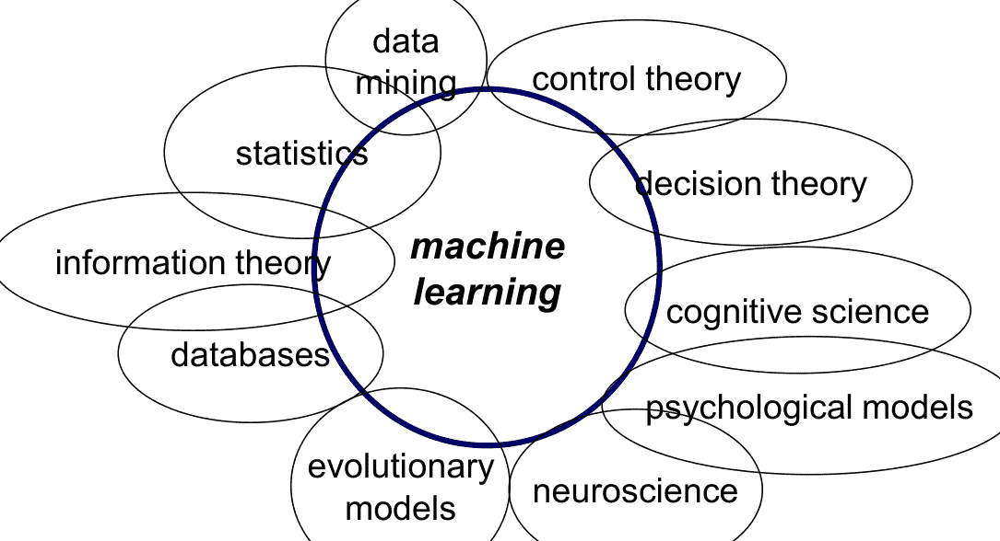

**ML** 利用这些学科来创建更准确、更高效的系统。

## 不同的学习类型

- 1. 监督学习：训练数据包含目标值
- 2. 无监督学习：训练数据不包含目标值
- 3. 强化学习：没有目标值，但对输出有评估（奖励）

### 监督学习

训练数据包含目标
- 回归：学习连续函数。例如：直线

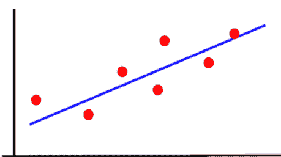

- 分类：学习类别标签。例如：数字识别

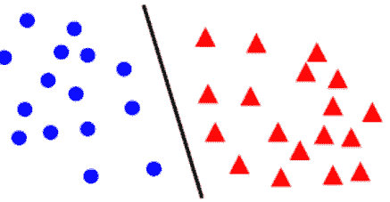

## 无监督学习

训练数据不包含值
- 聚类：对数据建模

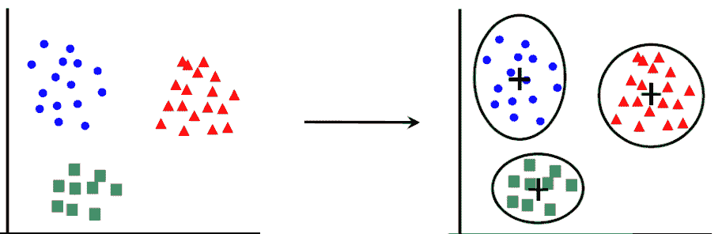

- 降维

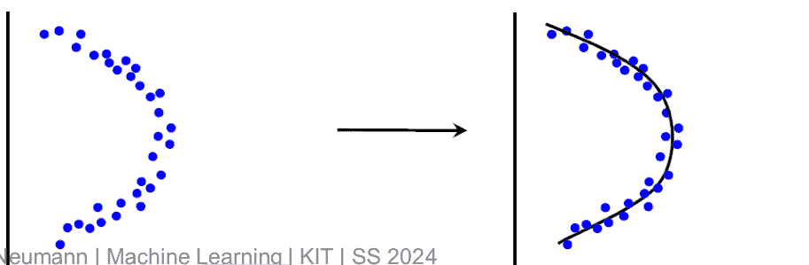

## 强化学习

- 没有监督者，但有奖励信号。所选的操作也会影响未来状态。本学期的新课程。

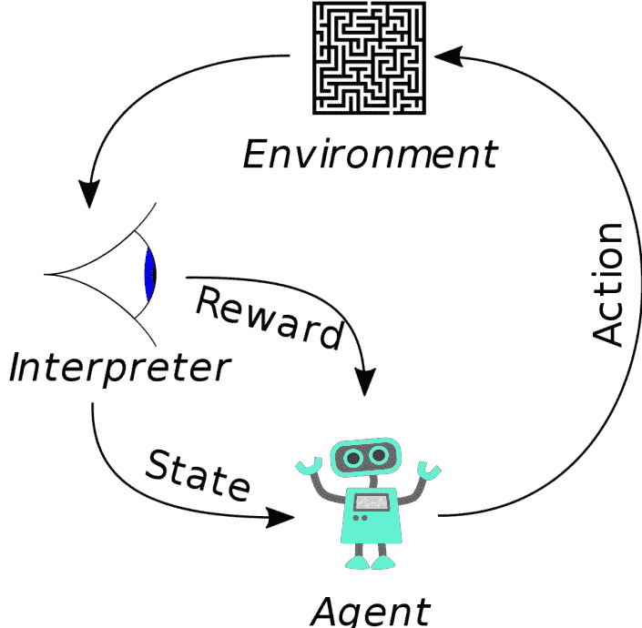

## 示例 1：手写数字

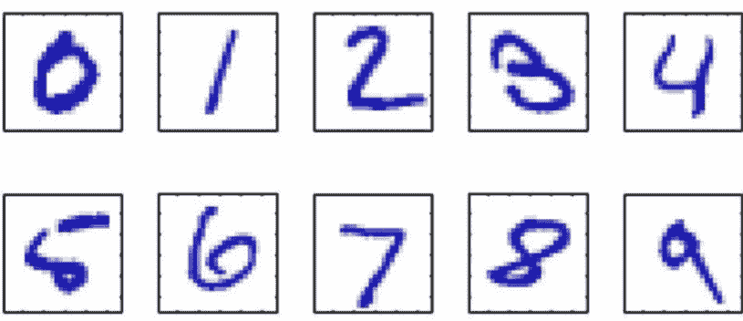

图像为 28 x 28 像素
- 将图像表示为向量。学习分类器 $x \in \mathbb{R}^{784}$，$f : x \rightarrow \{0, 1, 2, 3, 4, 5, 6, 7, 8, 9\}$

## 示例 1：手写数字

- 监督分类问题
- 训练集：每类 6000 个示例
- 测试集上的错误率：0.4%
- 商业产品中最早应用的应用之一（邮政编码、支票...）

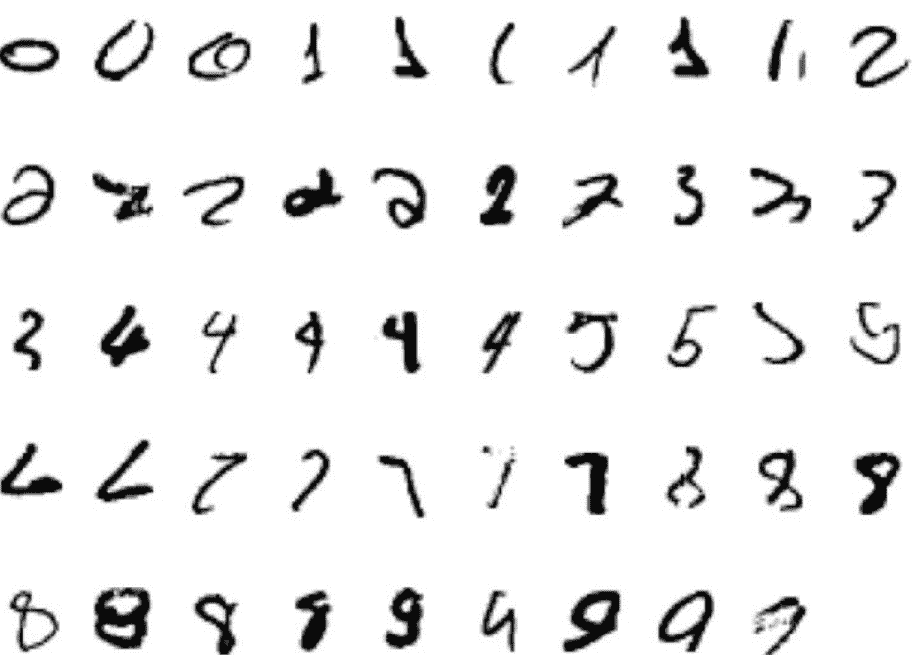

## 示例：脸部识别、物体识别

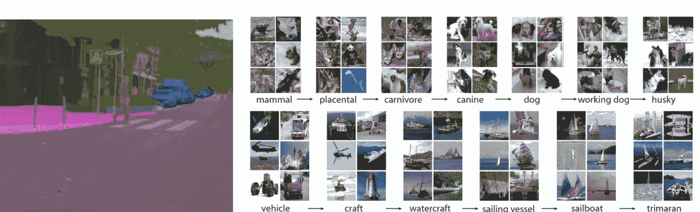

## 示例：图像生成


https://thispersondoesnotexist.com/

## 示例：图像到文本


描述：
一只猎鹰在日落时分进食。
猎鹰站在地上。

诗歌：
- 像夜中的猎鹰
- 像黑骑士般狩猎
- 等待接管战斗
- 倾其所有的心智与力量

## 示例：文本到图像

给定少量自然语言提示词的用于图像生成的扩散模型：
"a cute magical flying dog, fantasy art drawn by disney concept artists, golden colour, high quality, highly detailed, elegant, sharp focus, concept art, character concepts, digital painting, mystery, adventure"


## 示例：自动驾驶

## “5 级” ???


大众“4 级” 2025年


特斯拉“2 级”，2020年


Darpa 大挑战赛 2004
Darpa 城市挑战赛 2007

## 示例：股票价格预测

- 股票价格预测
- 回归连续输出

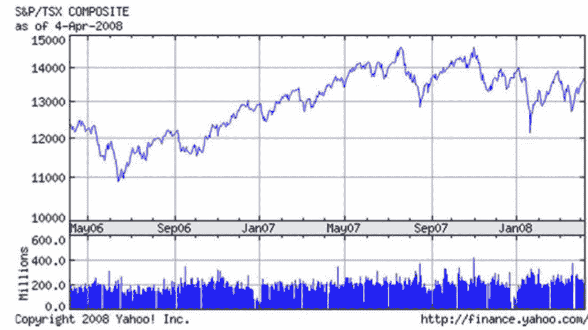

## 示例：垃圾邮件检测

- 将邮件分类为垃圾邮件/非垃圾邮件
- 数据由词频表示，例如：“Viagra”、“offer”、“you may be surprised...”
- 垃圾邮件策略 -> 我们需要学习


## 示例：计算生物学

- 给定蛋白质序列，预测 3D 结构

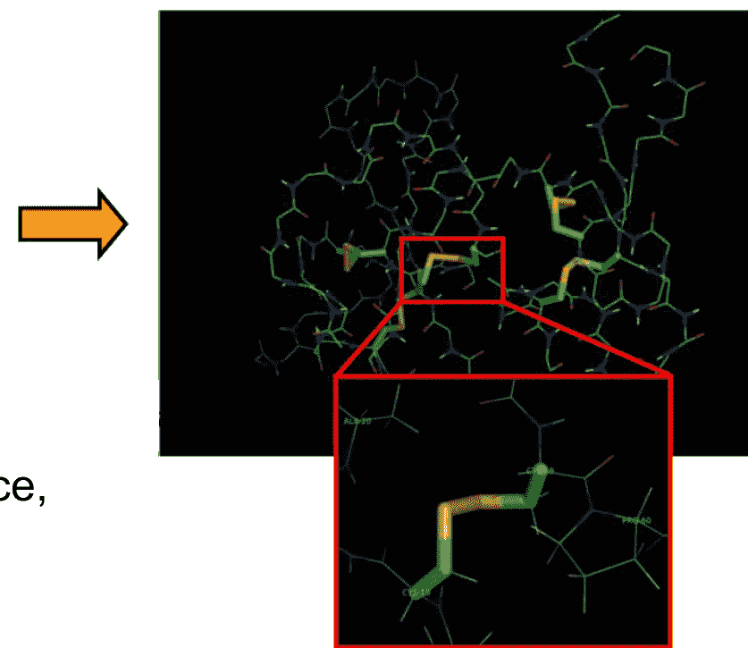

## 示例：语言翻译

- 学习对齐的翻译
新提议下的收集费用是多少？
根据新提议，权利的预期费用是多少？
例如 Google 翻译

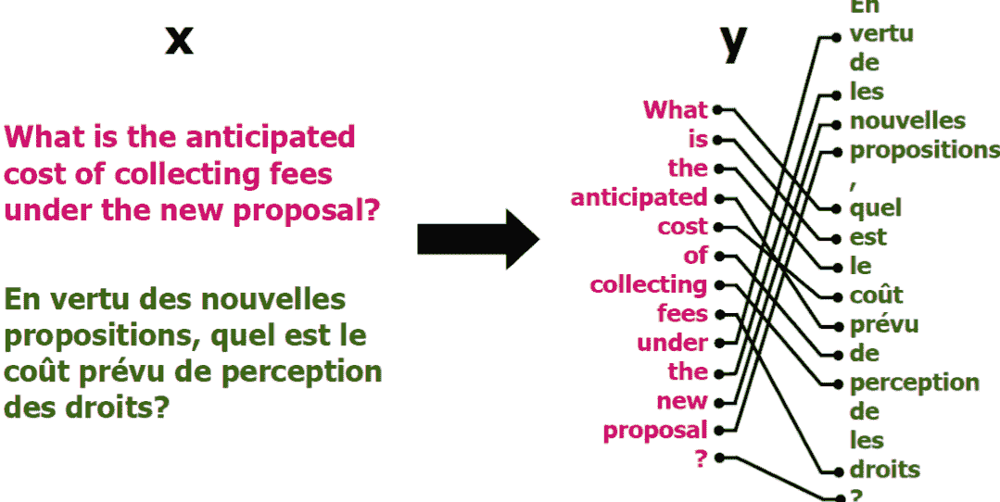

## 示例：语言翻译


## 示例：推荐系统

### 经常一起购买

用户购买《模式识别与机器学习》（信息科学与统计），作者：Christopher M. Bishop

| 两者总价：£104.95 |

|---|---|

| [加入购物车] |

### 购买此商品的人还购买了

- 《模式识别与机器学习》（...），作者：Christopher M. Bishop ★★★ (4) £48.96
- 《机器学习》（McGraw-Hill 国际版），作者：Tom M. Mitchell ★★★ (3) £42.74
- 《模式分类》，第二版》（...），作者：Richard O. Duda ★★★ (1) £78.38
- 《数据挖掘：实用机器学习工具...》，作者：Ian H. Witten ★★★ (1) £37.04

## 示例：机器人操控

- 强化学习：学习抓取未知物体（Google）

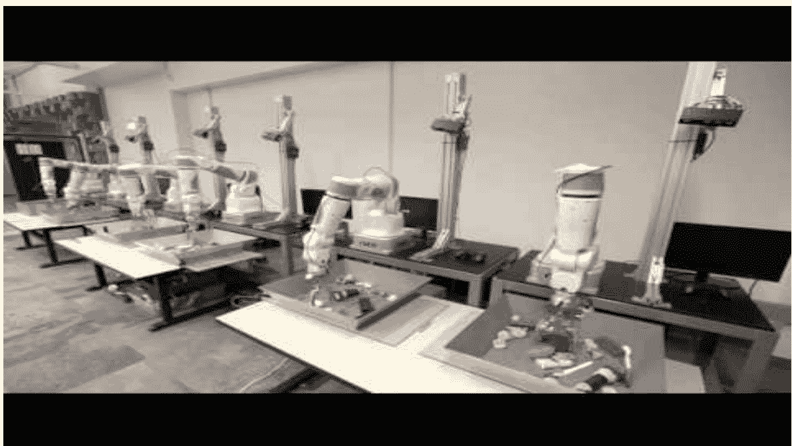

## 示例：投掷物体

- 强化学习：学习将物体投入箱子


## 大语言模型

## 你能来这里吗？

历史
正在预测的单词

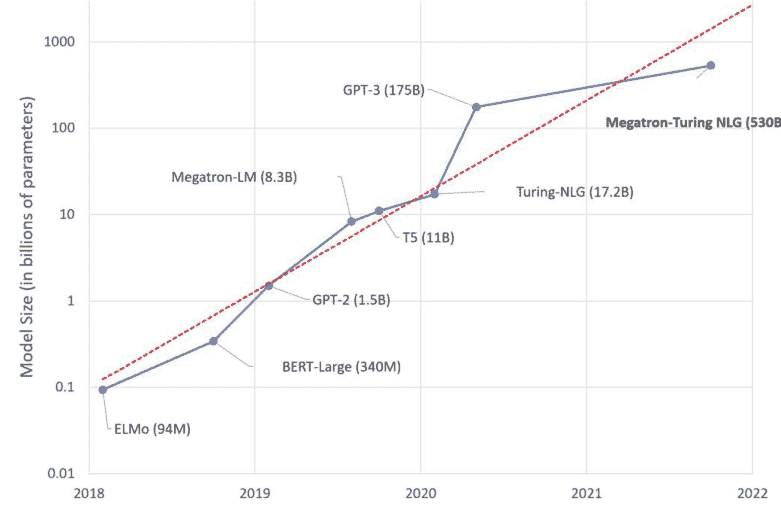

我想用德语写一首赞美月的短诗
- Sanfter Mond am Himmelsz,
Still und schön den Strahlen fällt,
Dein sanftes Licht die Nacht erhält,
Die Seele ruht, der Geist entfaltet.

重新生成
发送消息...

```javascript
// 写二分查找算法
const binarySearch = (arr, target) => {
  let left = 0;
  let right = arr.length - 1;
  let middle = Math.floor((left + right) / 2);
  while (arr[middle] != target && left <= right) {
    if (target < arr[middle]) {
      right = middle - 1;
    } else {
      left = middle + 1;
    }
    middle = Math.floor((left + right) / 2);
  }
  return arr[middle] == target ? middle : -1;
};
```


# 示例：语言翻译

- 学习对齐的翻译

新提议下的收集费用是多少？

根据新提议，权利的预期费用是多少？

例如 Google 翻译


# 示例：语言翻译

（注：此处原文存在重复的示例 38 翻译，已按要求保留格式并翻译）


# 示例：推荐系统

### 经常一起购买

用户购买《模式识别与机器学习》（信息科学与统计），作者：Christopher M. Bishop

| 两者总价：£104.95 |

|---|---|

| [加入购物车] |

### 购买此商品的人还购买了

- 《模式识别与机器学习》（...），作者：Christopher M. Bishop ★★★ (4) £48.96

- 《机器学习》（McGraw-Hill 国际版），作者：Tom M. Mitchell ★★★ (3) £42.74

- 《模式分类》，第二版：1（A...），作者：Richard O. Duda ★★★ (1) £78.38

- 《数据挖掘：实用机器学习工具...》，作者：Ian H. Witten ★★★ (1) £37.04

# 示例：机器人操控

- 强化学习：学习抓取未知物体（Google）


# 示例：投掷物体

- 强化学习：学习将物体投入箱子


# 大语言模型

## 你能来这里吗？

历史

正在预测的单词


我想用德语写一首赞美月的短诗

- Sanfter Mond am Himmelsz,

Still und schön den Strahlen fällt,

Dein sanftes Licht die Nacht erhält,

Die Seele ruht, der Geist entfaltet.

重新生成

发送消息...

```javascript
// 写二分查找算法
const binarySearch = (arr, target) => {
  let left = 0;
  let right = arr.length - 1;
  let middle = Math.floor((left + right) / 2);
  while (arr[middle] != target && left <= right) {
    if (target < arr[middle]) {
      right = middle - 1;
    } else {
      left = middle + 1;
    }
    middle = Math.floor((left + right) / 2);
  }
  return arr[middle] == target ? middle : -1;
};
```

# 机器学习的概念视角

- 数以千计的学习算法

- 每年都有数百种新算法

- 我们将关注基础算法并讨论连接它们的原理

每个机器学习算法都由三部分组成：

- 表示

- 评估

- 优化

# 表示

我们模型的底层表示是什么？

- * 特征

* 核函数

* 神经网络

    * 前馈神经网络

    * CNN

    * Transformer

    * GNN

* 模型集成

* 实例

* 混合模型

* 隐变量模型

* 等等

# 评估

我们正在优化什么？

- * 准确率

* 精确率和召回率

* 平方误差

* 似然性

* 后验概率

* 成本 / 效用

* 边界

* 熵

* KL 散度

* 等

# 优化

我们如何优化？

- 最小二乘解

- 梯度下降

- 带有适应学习率的梯度下降

- 二阶方法

- 约束优化

- 随机搜索

# 我们将涵盖哪些内容

本讲座将（逐步）建立在“人工智能导论”课程（WS）的基础上

## 第一部分：机器学习 - 基础

- VL1 线性回归

- VL2 分类、极大似然估计、逻辑回归

- VL3 多层感知机 (MLPs)、反向传播

- VL4 过拟合/欠拟合、双重下降、模型选择、集成学习

- VL5 无监督学习、PCA、(V)AE、k-means

- VL6 GMMs、期望极大化 (EM)

## 第三部分：机器学习 - 深度与应用

- VL7 卷积、CNNs、计算机视觉

- VL8 RNN、编码器/解码器、自然语言处理

但我们并不假设你参加过之前的讲座

- 更快速地总结部分内容

- 专注于更高级的算法

## 讲座内容

### 第 0 讲座：引言

## 第一章：经典监督学习

- 第 1 节：线性回归 + 极大似然

- 第 2 节：线性分类 + 最大间隔分类器

- 第 3 节：核方法

- 第 4 + 5 节：神经网络

- 第 6 节：模型选择、超参数优化

- 第 7 节：树、森林与集成学习

## 第二章：高级深度学习架构

- 第 8 节：CNN、FCN、RNN

- 第 9 节：Deep Sets、Transformers、GNNs

- 第 10 节：多任务学习与微调

### 第三章：贝叶斯学习

- 第 11 节：概率基础、图模型、贝叶斯学习

- 第 12 节：高斯过程

- 第 13 节：采样、MCMC 采样

- 第 14 节：信息论与变分推断

- 第 15 节：贝叶斯深度神经网络

## 第四章：无监督学习与生成式模型

- 第 16 节：聚类算法与期望极大化

- 第 17 节：降维与变分自编码器

- 第 18 节：扩散模型

### 第 19 讲座：总结

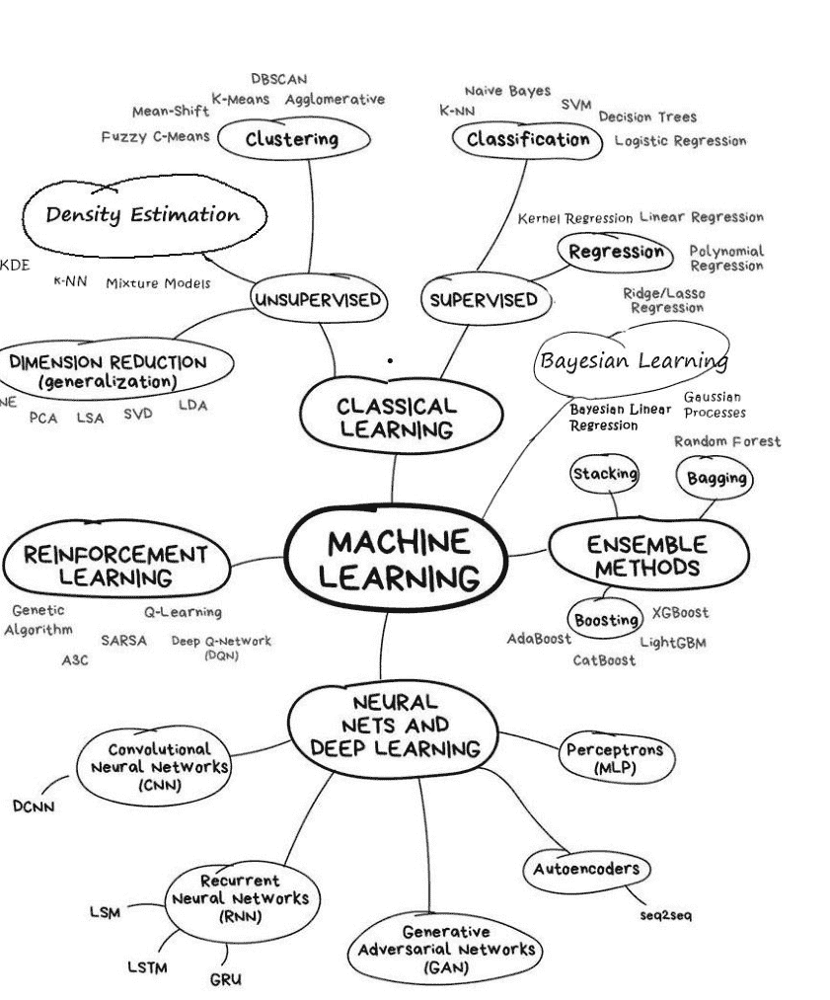

## 讲座内容 - 工具链

## 第一章：经典监督学习

- 矩阵演算

- 梯度下降

- 约束优化

- 偏差-方差权衡

## 第二章：高级深度学习架构

## 第三章：贝叶斯机器学习

- 高斯条件概率

- 采样 / 蒙特卡洛采样

- 似然比技巧

- 重参数化技巧

- 熵 / Kullback-Leibler 散度

## 第四章：无监督学习与生成式模型

- 隐变量模型

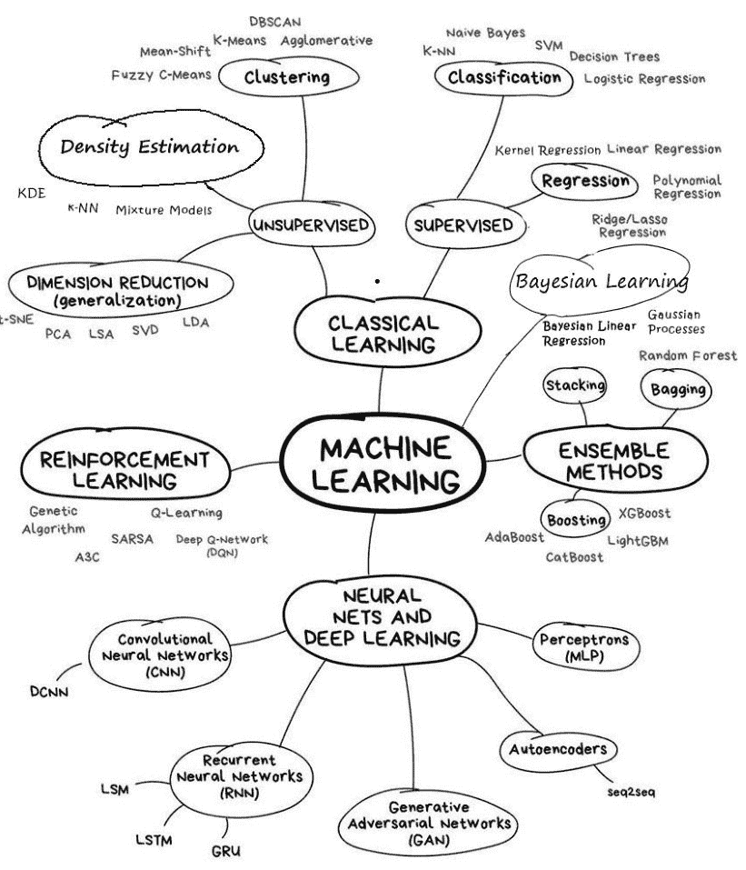

Gerhard Neumann | 机器学习 | KIT | 2024

## 时间计划

我在 5 月 10 日不在，因此将在 5 月 13 日有一个备选时段

## 第一章：经典监督学习

- 4.24：第 1 节：线性回归 + 极大似然

- 4.26：第 2 节：线性分类 + 最大间隔分类器

- 5.35：第 3 节：核方法

- 5.08：练习课 1

- 5.10：无讲座

- 5.13（额外时段） + 5.15：第 4 + 5 节：神经网络

- 5.17：第 6 节：模型选择、超参数优化

- 5.22 + 5.24：Pinfston

- 5.29：练习课 2

- 5.31：第 7 节：树、森林与集成学习

## 第二章：高级深度学习架构

- 6.5：第 8 节：CNN、FCN、RNN

- 6.7：第 9 节：Deep Sets、Transformers、GNNs

- 6.12：练习课 3

- 6.14：第 10 节：多任务学习与微调

## 第三章：贝叶斯机器学习

- 6.19：第 11 节：概率基础、图模型、贝叶斯学习

- 6.21：第 12 节：高斯过程

- 6.26：练习课 4

- 6.28：第 13 节：采样、MCMC 采样

- 7.37：第 14 节：信息论与变分推断

- 7.5：第 15 节：贝叶斯深度网络

- 7.10：练习课 5

## 第四章：无监督学习与生成式模型

- 7.12：第 16 节：聚类算法与期望极大化

- 7.17：第 17 节：降维与变分自编码器

- 7.19：第 18 节：扩散模型

- 7.24：练习课 6

## 为什么这么多算法？

- 不同的用场景

  - 回归、分类、密度估计等...

- 不同的属性

  - 图像、文本、图谱、时间序列

- 权衡

- 数据的复杂度

- 可解释性

- 对过拟合的敏感性

- 生成式 AI

- 多尺度方法

- 领先方法

- 小样本区域

## 我们将涵盖哪些内容？

- 强化学习

- 经典算法

- 降维

- CNNs 和 RNNs

- 生成式模型

- 标准化流

- 推荐系统

- 注意力

## 教学与项目

- WS：强化学习

- SS：机器学习


## 课题列表

### 课题 1：机器人学习

- 1. 使用 ALOHA 构建 (Nic)

- 2. 模仿学习 (David)

- 3. (Onur)

- 4. (Balaz)

### 课题 2：物理模拟

- 1. 自适应网格划分 (Niklas)

- 2. (Philipp D.)

### 课题 3：基于 Transformer 的学习

- 1. 鲁棒泛化 (Artim)

- 2. (Philipp D.)

### 课题 4：高级机器学习

- 1. 变分推断 (Denis 和 Onur)

- 2. (Aleks)

## 1. 使用 ALOHA 和扩散模型

导师：Nic

任务：

- 熟悉 ALOHA

- 了解家具基准测试

- 设置

- 记录演示

- 即：制作一些家具

- 应用基于扩散的学习

重点：

- 机器人实验

- “上手”

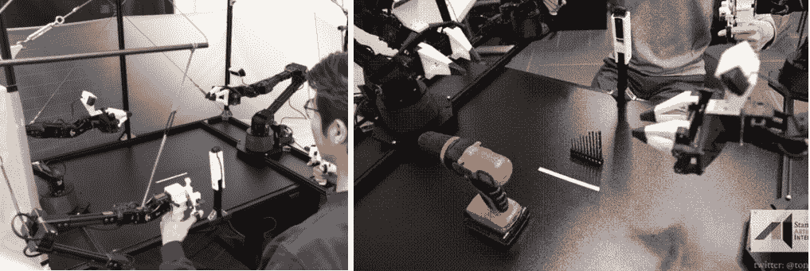

来源：

- https://tonyzhaoz.github.io/aloha/

- https://clvrai.com/furniture-bench/

- https://diffusion-policy.cs.columbia.edu/

- https://scheiklp.github.io/movement-primitive

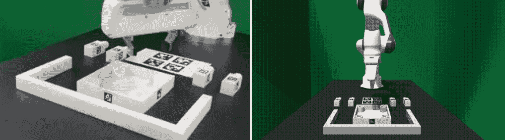

## 7. 多尺度变形物体模拟

导师：Tai Hoang 和 Philipp Dahlinger

### 动机：

- 变形物体的模拟成本很高

- 使用图神经网络学习动力学！

- 当前方法：消息传递神经网络

- 随着分辨率增加，感受野会变小

解决方案：使用 U-Net 结构的多尺度模拟

任务：

- 熟悉数据驱动的变形物体模拟

- 理解多尺度 MGN 的领先方法

- 实现生成分层图数据集的算法

- 实现 U-Net 结构

- 从和复杂度评估新方法

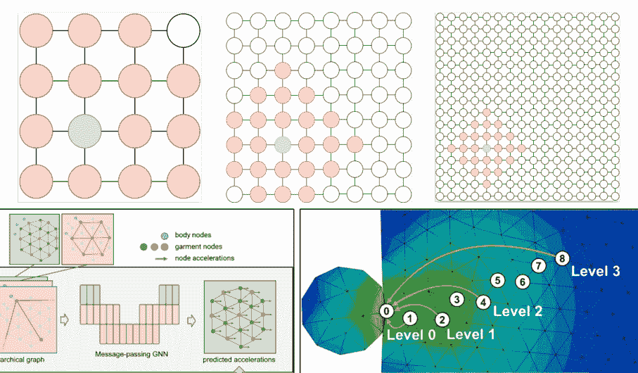

### 参考文献：

- Pfaff et al. 2021: Learning Mesh-based Simulation with Graph Networks

- Grigorev et al. 2023: HOOD: Hierarchical Graphs for Generalized Modelling of Clothing Dynamics

- Yu et al. 2023: Learning Flexible Body Dynamics with Hierarchical Contact Mesh

## 10. 基于变分推理的运动规划

导师：Denis Blessing, Onur Celik

动机：

- 运动规划：生成轨迹以到达目标位置

- 如果我们没有专家数据可以学习，而是只能访问代价函数会怎样？

- 使用变分推理 (VI) + 运动原语 (movement primitives)！

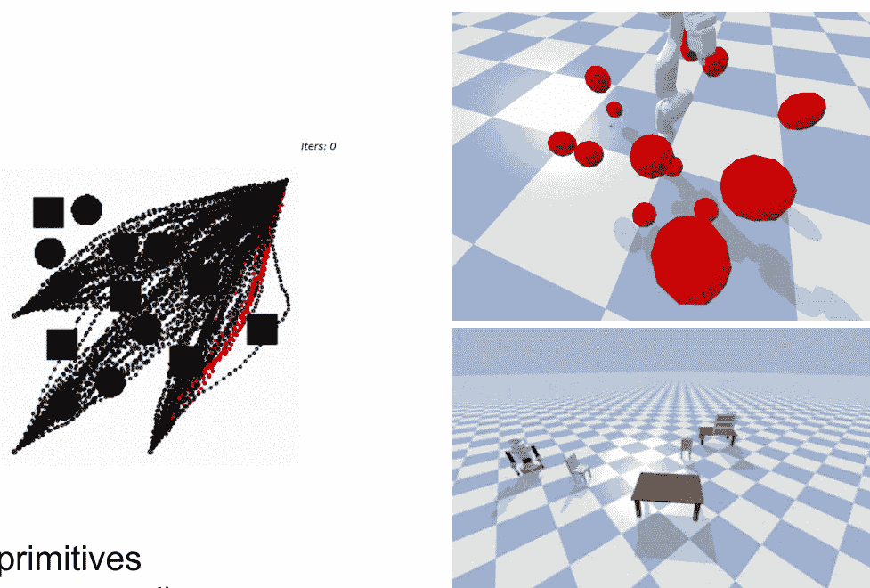

课程 (Praktikum)：

- 使用运动原语扩展现有的前期工作

- 设计不同的任务（上下文相关和非相关）

- 在你的任务上对最先进的方法进行基准测试

## 毕业论文

对硕士论文或本科毕业论文感兴趣吗？

- 请查看 https://alr.anthropomatik.kit.edu/

- 强化学习 (RL)、模仿学习和机器学习基础的前沿研究

- 主题涵盖了从挑战性机器人任务的领域强化学习，到基础机器学习问题和理论

- 使用真实的机器人硬件和真实的物理模拟器

- 编写并发表论文 🙂


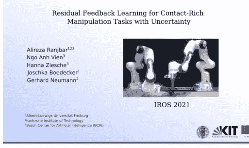

我们也在招聘学生助理 (Hiwis) :)


## 结束...

- 还有其他问题吗？

## 回归的线性方法

机器学习 – 基础与算法

Gerhard Neumann 教授

自主学习机器人

KIT, 人类与机器人研究所


## 公告

- 考试日期：9月27日周五，08:00 至 10:00

- 第一次习将于今天或明天发布

## 学习成果

- 理解回归问题

- 我们所谓的“线性表示”是什么？

- 能够推导出最小二法解

- 回归中的正则化是什么？

- 如何将线性回归扩展到非线性函数？

- 通过极大似然法理解线性回归的概率解释

- 理解正则化的概率解释

## 监督学习 - 回归

训练数据包含目标值

- 今天：回归

- 学习连续函数

- 示例：直线

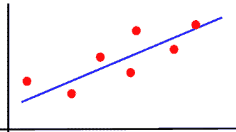

- 下一节课：分类

- 学习类别标签

- 示例：数字识别

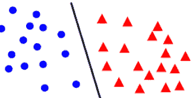

## 今日议程！

## 线性回归

- 矩阵与矩阵微积分的复习

- 最小二法解

- 广义线性回归模型

- 正则化 - 岭回归

### 概率公式化

- 概率基础与极大似然估计 (MLE)

- 线性回归模型的 MLE

- 正则化 - 最大后验估计

## 线性回归

- 矩阵与矩阵微积分的复习

- 回归目标与推导

- 广义线性回归模型

- 正则化 - 岭回归

## 机器学习中的矩阵

- 在许多情况下，我们的数据集可以表示为矩阵，其中单个样本是向量

  Joe: $x_1 = \begin{bmatrix} 37 \\ 72 \\ 175 \end{bmatrix}$ Mary: $x_2 = \begin{bmatrix} 10 \\ 30 \\ 61 \end{bmatrix}$ Carol: $x_3 = \begin{bmatrix} 25 \\ 65 \\ 121 \end{bmatrix}$ Brad: $x_4 = \begin{bmatrix} 66 \\ 67 \\ 175 \end{bmatrix}$

- 最典型的表示方法：

  - 每行代表一个数据样本（例如 Joe）

  - 每列代表一个数据条目（例如特征）

  $X = \begin{bmatrix} 37 & 10 & 25 & 66 \\ 72 & 30 & 65 & 67 \\ 175 & 61 & 121 & 175 \end{bmatrix}$ $X$ 是样本 $\times$ 条目的矩阵

## 符号

- 标量：$x \in \mathbb{R}$

- 向量：$x \in \mathbb{R}^m$

- 矩阵：$X \in \mathbb{R}^{n \times m}$

## 矩阵乘法

- 维度：$m \times n \cdot n \times j = m \times j$ $\overbrace{W} \cdot \overbrace{V}$

- 左矩阵的列数必须等于右矩阵的行数

- 非交换律（一般情况下）：$VW \neq WV$

- 结合律：$V(WX) = (VW)X$

- 转置乘积：$(VW)^T = V^T W^T$

## 重要的特殊情况

- 标量（内）积：$\mathbf{w}^T \mathbf{v} = [w_1, \dots, w_n] \begin{bmatrix} v_1 \\ \vdots \\ v_n \end{bmatrix} = w_1v_1 + \cdots + w_nv_n = \langle \mathbf{w}, \mathbf{v} \rangle$

- 标量积可以写为向量-向量积

## 微积分

我们还需要谈论导数……

“实变变量函数的导数——**量对变化的敏感性**（一个函数值或因变量）由另一个量（自变量）决定”（来自维基百科）

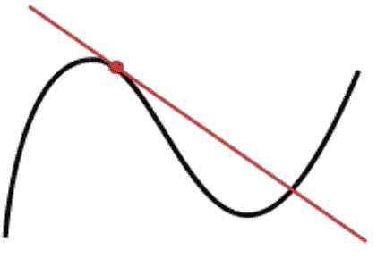

函数：$f(x)$

导数：$\frac{\partial f(x)}{\partial x}$

最小/最大值：$\frac{\partial f(x)}{\partial x} = 0$

## 矩阵微积分 - 分母布局符号

标量函数对向量的导数...

- 产生梯度向量：$\nabla_{\mathbf{x}}f = \begin{bmatrix} \frac{\partial f(x)}{\partial x_1} \\ \vdots \\ \frac{\partial f(x)}{\partial x_n} \end{bmatrix}$

- 示例：二次形式 $\nabla_x x^T$

向量值函数对标量的导数...


- 产生雅可比矩阵：$\nabla_{\mathbf{x}}f = \begin{bmatrix} \frac{\partial f_1(x)}{\partial x} \\ \vdots \\ \frac{\partial f_k(x)}{\partial x} \end{bmatrix}$

- 示例：线性形式 $\nabla_x Ax^T$

## 矩阵微积分 - 分母布局符号

标量函数对矩阵的导数...

- 产生雅可比矩阵：$\nabla_x f = \begin{bmatrix} \frac{\partial f(x)}{\partial x_1} & \dots & \frac{\partial f(x)}{\partial x_d} \\ \vdots & \ddots & \vdots \\ \frac{\partial f_k(x)}{\partial x_1} & \dots & \frac{\partial f_k(x)}{\partial x_d} \end{bmatrix}$

- 示例：二次形式 $\nabla_x x^T Ax$

向量值函数对矩阵的导数...

- 产生张量：$\nabla_{\mathbf{x}}f = \begin{bmatrix} \frac{\partial f_1(x)}{\partial x_1} & \dots & \frac{\partial f_1(x)}{\partial x_d} \\ \vdots & \ddots & \vdots \\ \frac{\partial f_k(x)}{\partial x_1} & \dots & \frac{\partial f_k(x)}{\partial x_d} \end{bmatrix}$

- 幸运的是，我们几乎并不需要它

## 矩阵微积分

我们需要了解一些**矩阵微积分**的规则（参见维基百科）

| | 标量 | 向量 | 矩阵 |
| --- | --- | --- | --- |
| **线性** | $\frac{\partial ax}{\partial x} = a$ | $\nabla_x Ax = \mathbf{A}^T$ | $\nabla_x a^Tb = ab^T$ |
| **二次** | $\frac{\partial x^2}{\partial x} = 2x$ | $\nabla_x x^T Ax = (\mathbf{A}^T + \mathbf{A})x = 2\mathbf{Ax}$ 如果 $\mathbf{A}$ 对称 | |

**参考：** https://en.wikipedia.org/wiki/Matrix_calculus

## 线性回归模型

- 在线性回归中，输出 `y` 被建模为输入 `x_i` 的线性函数

$$y = f(x) + \epsilon = w_0 + w_1x + \epsilon$$

### `w_0` 的影响

### `w_1` 的影响

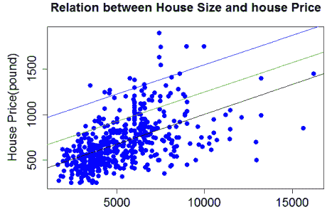

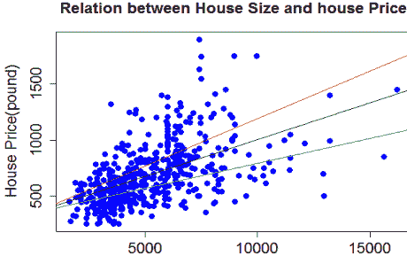

### 线性回归的目标

我们想要考虑具有多个输入的线性函数

$$f(x_i) = w_0 + \sum_{j} w_j x_{i,j}$$

我们的 SSE 目标现在看起来如下

$$SSE = \sum_{i=1}^{N} (y_i - (w_0 + \sum_{j} w_j x_{i,j}))^2$$

我们能使用矩阵来简化它吗？

## 矩阵形式的线性回归模型

- 第 `i` 个样本的方程

$$\hat{y}_i = w_0 + \sum_{j=1}^{D} w_j x_{i,j} = \tilde{\mathbf{x}}_i^T \mathbf{w}, \quad \text{其中 } \tilde{\mathbf{x}}_i = \begin{bmatrix} 1 \\ x_i \end{bmatrix} \text{ 且 } \mathbf{w} = \begin{bmatrix} w_0 \\ \vdots \\ w_D \end{bmatrix}$$

- 全数据集的方程

$$\hat{\mathbf{y}} = \begin{bmatrix} \hat{y}_1 \\ \vdots \\ \hat{y}_n \end{bmatrix} = \begin{bmatrix} \tilde{\mathbf{x}}_1^T \\ \vdots \\ \tilde{\mathbf{x}}_n^T \end{bmatrix} = \mathbf{X}\mathbf{w}$$

- `$\hat{\mathbf{y}}$` 是包含每个样本输出的向量

- $$\mathbf{X} = \begin{bmatrix} 1 & \tilde{\mathbf{x}}_1^T \\ \vdots & \vdots \\ 1 & \tilde{\mathbf{x}}_n^T \end{bmatrix} \quad \text{是包含第一列为全1偏置向量的数据矩阵}$$

### 矩阵形式的线性回归模型

- 误差向量：`e = \begin{bmatrix} y_1 \\ \vdots \\ y_n \end{bmatrix} - \begin{bmatrix} \hat{y}_1 \\ \vdots \\ \hat{y}_n \end{bmatrix} = y - \hat{y} = y - Xw`

- 误差平方和 (SSE)

$$SSE = \sum_{i} (y_i - \hat{y}_i)^2 = \sum_{i} e_i^2 = e^T e = (y - Xw)^T(y - Xw)$$

- 我们现在已经**完全以矩阵形式写出了 SSE！**

### 推导线性回归

- 我们如何获得最优的 `w`（使 SSE 最小的 `w`）

$$w^* = \text{argmin}_w SSE = \text{argmin}_w (y - Xw)^T(y - Xw)$$


> 在函数的极值处，其导数为零
> 即，找到一个 `w` 使得 $\frac{\partial SSE}{\partial w} = \mathbf{0}^T$

### `w` 的估计

```
$SSE(\mathbf{w}) = (\mathbf{y} - \mathbf{X}\mathbf{w})^T(\mathbf{y} - \mathbf{X}\mathbf{w})$
$= \mathbf{w}^T\mathbf{X}^T\mathbf{X}\mathbf{w} - \mathbf{y}^T\mathbf{X}\mathbf{w} - \mathbf{w}^T\mathbf{X}^T\mathbf{y} + \mathbf{y}^T\mathbf{y}$
$= \mathbf{w}^T\mathbf{X}^T\mathbf{X}\mathbf{w} - 2\mathbf{y}^T\mathbf{X}\mathbf{w} + \mathbf{y}^T\mathbf{y}$
```

对 `$\mathbf{w}$` 求导：

```
$\nabla_{\mathbf{w}}SSE(\mathbf{w}) = \frac{\partial}{\partial\mathbf{w}} \ \mathbf{w}^T\mathbf{X}^T\mathbf{X}\mathbf{w} - 2\mathbf{y}^T\mathbf{X}\mathbf{w} + \mathbf{y}^T\mathbf{y} \}$
```

将梯度设置为 **0** 得到 `$\mathbf{w}^* =(\mathbf{X}^T\mathbf{X})^{-1}\mathbf{X}^T\mathbf{y}$`

## 评估回归模型

### 如何估计模型的质量？

- SSE 可以根据输出的范围取任意值
- 使评估结果对 `y` 的方差保持不变性

R 平（或 `$R^2$`）决定了 `y` 的总变化中有多少比例被 `x` 的变化所解释。在数学上，它可以写为：

$$R^2 = 1 - \frac{\text{回归平方和}}{\text{总平方和}} = 1 - \frac{\sum_{n=1}^N(\hat{y}_n - y_n)^2}{\sum_{n=1}^N(y_n - \bar{y})^2}$$

其中 `$\bar{y}$` 是输出的平均值。`$R^2$` 告诉我们回归线近似真实数据点的程度。`$R^2$` 为 1 表示回归线完美拟合数据。

## 讨论

我们现在推导出了我们的第一个机器学习算法：**线性回归！**

- 该解被称为最小二乘法解
- 这是我们可以获得闭式解的稀有情况之一

**这之所以可行，是因为：**

- 对于线性 `f(x)`，代价函数 (SSE) 是凸的
  - 只有一个最小值
- 代价函数关于 `w` 是二次的
  - 最小值易于获得

## 提问吧！！！


## 线性回归

- 矩阵和矩阵微积分回顾
- 回归目标与推导
- 广义线性回归- 正则化 - 岭回归

到目前为止，我们将 `f(x)` 建模为线性的 `x`

$$f(x) = w_0 + \dots$$

然而，这个方程只能表示 D 空间中的平面

在更通用的情况下，我们将其重写为：

$$f(x) = \phi(x)^T w$$

其中 `$\phi(x)$` 是一个向量，`$\phi_i$` 被称为基函数。

### 多项式示例

$$f(x) = \phi(x)^T w$$

其中 `$\mathbf{w} = \begin{bmatrix} w_0 \\ \vdots \\ w_d \end{bmatrix}$`，`$\phi(x)$` 是一个值为向量的函数。

### 线性示例

$$f(x) = \phi(x)^T w$$

其中 `$\mathbf{w} = \begin{bmatrix} w_0 \\ \vdots \\ w_d \end{bmatrix}$`，`$\phi(x)$` 是一个值为向量的函数。

### 二次示例

$$f(x) = \phi(x)^T w$$

其中 `$\mathbf{w} = \begin{bmatrix} w_0 \\ w_1 \\ w_2 \end{bmatrix}$`，`$\phi(x)$` 是一个值为向量的函数。

### 三次示例

$$f(x) = \phi(x)^T w$$

其中 `$\mathbf{w} = \begin{bmatrix} w_0 \\ w_1 \\ w_2 \\ w_3 \end{bmatrix}$`，`$\phi(x)$` 是一个值为向量的函数。

## 径向基函数 (RBF) 特征

常用的通用表示：

$$\phi(x) = [\phi_1(x), \dots, \phi_M(x)]^T, \quad \phi_i(x) = \exp\left(-\frac{\|x - \mu_i\|^2}{2\sigma^2}\right)$$

- `$\mu_i$`：第 `i` 个中心位置（固定）
- `$\sigma$`：带宽
- 通常作为输入空间的网格中心
- 高维情况下难以扩展（我们需要指数级的中心）

## 广义线性回归

推导过程完全相同，只是数据矩阵被替换为基函数矩阵，即：

```
w^* = (\Phi^T \Phi)^{-1} \Phi^T y
```

其中 `$\Phi = \begin{bmatrix} \phi_1^T \\ \vdots \\ \phi_n^T \end{bmatrix}$`

### 示例：选择多项式的阶数

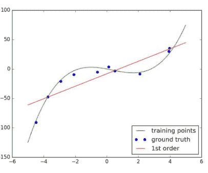

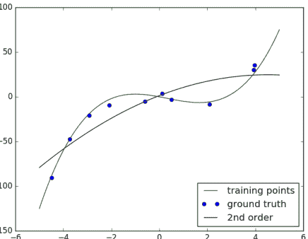

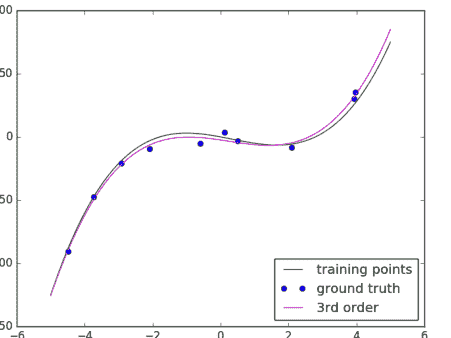

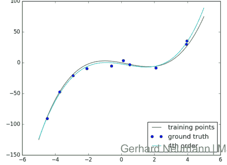

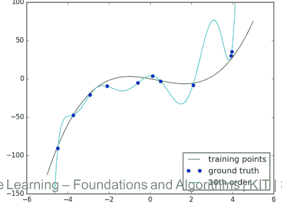

## 多项式回归的过拟合

训练集上的误差**并不是拟合良好的迹象！！**

- 我们总是需要一个**独立的测试集！**

### 过拟合：

- 训练误差下降
- 测试误差上升

模型太复杂。它拟合了噪声，并且在训练点之间有未确定的行为。

### 欠拟合：

- 训练误差 + 测试误差都很高

模型太简单，无法拟合数据

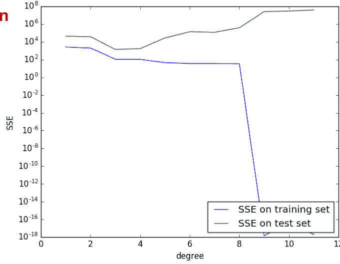

# 正则化

- 正则化：
- 我们发现对于过于复杂的模型，在测试集上会出现巨大的误差
- **问题**：为了完美拟合数据，权重可能会变得非常大
- **解决方案**：限制模型（即权重），使其不再再完美拟合训练数据

## 正则化的简单形式：强制权重 `w` 变小

- 较小的权重会导致函数更平滑
- 在代价函数中引入“正则化项”

```
$L = E_D(\mathbf{w}) + \lambda E_W(\mathbf{w})$
$Loss = 数据项 + 正则化项$
```

- 其中 `$\lambda$` 是正则化因子
- 在大多数情况下需要手动调优

## 正则化最小二乘法

使用平方和误差函数和二次正则化项，我们得到：

```
$$L_{\text{ridge}} = (y - \Phi w)^T(y - \Phi w) + \lambda w^T w
$E_D(w) \quad E_W(w)$$
```

- 这种特定的正则化选择被称为**权重衰减**（weight decay），因为在序列学习算法中，它鼓励权重值向零衰减，除非有数据支持。
- 在统计学中，它被称为**岭回归**（ridge regression）。

推导过程与之前类似。其形式为：

```
$$w^*_{text{ridge}} =(\Phi^T \Phi + \lambda I)^{-1}\Phi^T y$$
```

- `I` 是单位矩阵
- 矩阵 `$\Phi^T \Phi + \lambda I$` 现在是满秩的，更容易求逆

## 岭回归：次数 n=15

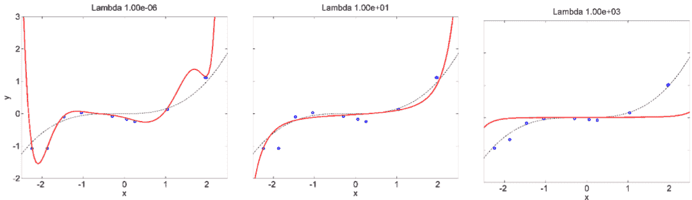

正则化常数的影响

## 核心要点

### 我们今天学了什么？

- 熟悉了矩阵运算和矩阵微积分
- 什么是回归问题
- 如何获得闭式形式的最小二乘解
  - 只有当代价函数关于权重是二次的时才可能
- 广义线性回归
  - 只要关于 `w` 是线性的，`x` 中的非线性函数也是可以的
- 通过保持权重权重来避免过拟合
  - 使用 L2 正则化损失


## 概率化公式

- 概率基础
- 最大似然估计 (MLE)
- 正则化 - 最大后验概率估计

## 概率模型 - 动机

概率模型 `p_{\theta}(y|x)` 也允许我们捕获预测的不确定性

- 了解预测结果实际上有多好通常至关重要
- 机器学习研究很大一部分关注如何估计良好的概率模型的问题
- 推导过程与“优化视角”相似
  - 理解它们之间的联系/区别具有很高的启发性
- 作为课程第二部分和第三部分的基础

# 符号表示

- 随机变量 `X` 代表世界的不确定状态或结果
- 我们用 `p(x)` 来表示 `X` 取值为 `x` 的概率
- 样本空间是所有可能结果的空间
  - 可能是离散的、连续的或混合的
- `p(x)` 是概率质量（密度）函数
  - 为样本空间中的每个点分配一个数值
  - 非负，且和（积分）为 1
  - 直观上：`x` 多久出现一次？我们有多大相信 `x`？

## 分布

- 联合分布
  - `p(x, y)`
  - `X=x` 且 `Y=y` 的概率
- 条件分布
  - `p(x|y)`
  - 在给定 `Y=y` 的条件下，`X=x` 的概率

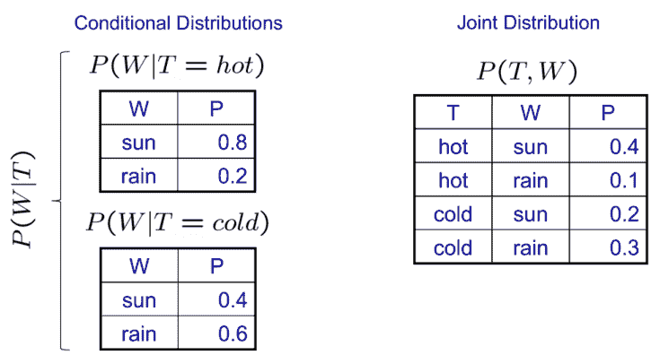

## 概率规则

- 求和规则（边缘化 / 积分变量）：

```
$p(x) = \sum_{y} p(x, y)$
$p(x_1) = \sum_{x_2} \sum_{x_3} \cdots \sum_{x_D} p(x_1, \dots, x_D)$
```

- 注意：对于连续分布，求和将被积分代替

$P(T)$ 

| T | P |
|---|---|
| hot | 0.5 |
| cold | 0.5 |

$P(t) = \sum_{w} P(t, w)$

$P(T,W)$

| T | W | P |
|---|---|---|
| hot | sun | 0.4 |
| hot | rain | 0.1 |
| cold | sun | 0.2 |
| cold | rain | 0.3 |

$P(w) = \sum_{t} P(t, w)$

$P(W)$

| W | P |
|---|---|
| sun | 0.6 |
| rain | 0.4 |

## 概率规则

- 链式 / 乘积规则

```
$p(x, y) = p(x|y)p(y)$
$p(x_1, \dots, x_D) = p(x_1)p(x_2|x_1) \dots p(x_D|x_1, \dots, x_{D-1})$
```

$P(D|W)$

| D | W | P |
|---|---|---|
| wet | sun | 0.1 |
| dry | sun | 0.9 |
| wet | rain | 0.7 |
| dry | rain | 0.3 |

$P(W)$


| `W` | `P` |

|---|---|

| sun | 0.8 |

| rain | 0.2 |

`$P(D, W)$`

| `D` | `W` | `P` |

|---|---|---|

| wet | sun | 0.08 |

| dry | sun | 0.7 |

| wet | rain | 0.14 |

| dry | rain | 0.06 |

## 贝斯法则

**贝斯公式**是概率论和机器学习中最重要的公式之一

```
$p(x|y) = \frac{p(y|x)p(x)}{p(y)} = \frac{p(y|x)p(x)}{\sum_{x'} p(y|x')p(x')}$
```


- 反转条件概率的方法
- 条件概率通常很复杂，而另一个很简单
- 最重要的公式之一！

## 高斯分布

- 连续随机变量：`$X \in \mathbb{R}$`
- 分布由均值 `$\mu$` 和方差 `$\sigma^2$` 完全确定定

`$p(x) = \mathcal{N}(x|\mu, \sigma) = \frac{1}{\sqrt{2\pi\sigma^2}} \exp \left\{-\frac{(x-\mu)^2}{2\sigma^2}\right\}$`


## 概率化公式

- 概率基础
- 最大似然估计 `MLE`
- 正则化 - 最大后验概率估计

### 最大似然估计 `MLE`

- 给定：训练数据 `$D = \{(x_i, y_i)\}_{i=1}^N$` 来自数据分布 `$p_{data}$` 且独立同分布 `iid`
- 令 `$p_{\theta}(x, y)$` 为 `$\theta \in \Theta$` 参数化的分布族
- 我们希望找到使 `p` 良好拟合数据的 `$\theta$`

单个数据点的 `$\theta$` 拟合度：

`$L(\theta; x_i, y_i) = p_\theta(x_i, y_i)$`

整个数据集的 `$\theta$` 拟合度 `iid`：

`$L(\theta; D) = \prod_{i} p_\theta(x_i, y_i)$`

### 最大似然估计 `MLE`

对数似然更容易优化：

```
$L(\theta; D) = \sum_{i} \log p_{\theta}(x_i, y_i)$
```

- 对数是单调的 -> 最值相同
- 和比乘积更容易优化
- 对数消除了指数形式（大多数分布属于指数族）

`MLE` 的解为：

```
$\theta_{ML} = \text{argmax}_{\theta} L(\theta; D)$
```

### 示例：高斯

高斯密度函数：

`$L(\theta; D) = -N \log \sqrt{2\pi\sigma^2} - \sum_{i} \frac{(x_i - \mu)^2}{2\sigma^2}$`

`$\mu$` 的 `MLE` 解：

# `MLE`：条件对数似然

- 给定：训练数据 `$D = \{(x_i, y_i)\}_{i=1}^N$` 来自数据分布 `$p_{data}$` 且独立同分布 `iid`
- 令 `$p_{\theta}(y|x)$` 为 `$\theta \in \Theta$` 参数化的分布族
- 我们只关心 `y` 的分布，不关心 `x`
- **监督学习中的典型情况**

对数似然：

```
$L(\theta; D) = \sum_{i} \log p_{\theta}(y_i|x_i)$
```

### 示例：线性高斯模型

`$p(y|x) = \mathcal{N}(y|w^T x, \sigma^2) = \frac{1}{\sqrt{2\pi\sigma^2}}\exp\left\{\frac{(y-w^T x)^2}{2\sigma^2}\right\}$`

`$\log p(y|x) = -\log(\sqrt{2\pi\sigma^2}) - \frac{(y-w^T x)^2}{2\sigma^2}$`

我们考虑以下条件高斯模型：

`$p_{\theta}(y|x) = \mathcal{N}(y|w^T x, \sigma^2), \quad \theta = \{\mathbf{w}\}$`

**对数似然：**

`$L(\theta; D) = -N\log\sqrt{2\pi\sigma^2} - \sum_{i} \frac{(y_i - w^T x_i)^2}{2\sigma^2}$`

- 为了获得 `$\mathbf{w}$`，只有平方误差重要，即：
`$L(\theta; D) = const_1 - const_2\sum_{i}(y_i - w^T x_i)^2$`
- 因此，**`MLE` 解等同于最小二乘解**！
- **但是**：我们也可以通过 `MLE` 获取方差 `$\sigma^2$`！

## 最大后验解

`MAP` 解：`$\theta_{\text{MAP}} = \arg \max_{\theta} (\log p(\mathcal{D}|\theta) + \log p(\theta))$`

- 先验概率 `Prior` 与正则化损失的作用相似

### 示例：回归

- 高斯似然性 `$p(\mathcal{D}|\theta) = p(\mathbf{Y}|\mathbf{X},\theta) = \prod_{i} \mathcal{N}(y_i|f_{\theta}(\mathbf{x}_i), \sigma^2)$`
- 高斯先验 `$p(\theta) = \mathcal{N}(\theta|\mathbf{0}, \lambda^{-1}I)$`
- 对应的目标函数：`$\arg \max_{\theta} \sum_{i} \frac{1}{2\sigma^2}(y_i - f_{\theta}(\mathbf{x}_i))^2 - \frac{\lambda}{2}\theta^T\theta + c(\sigma^2,\lambda)$` 仅关注 `$\theta$` 的平方误差
- 高斯先验对应 `L2` 正则化损失！
- 高斯似然性对应平方损失！

## 线性回归的 `MAP`

**记住：** 在线性回归 `$f_w(\mathbf{x}) = w^T \phi(\mathbf{x})$` 中

**目标函数：** `$w_{\text{MAP}} = \arg \max_{\mathbf{w}} \sum_{i} -\frac{1}{2\sigma^2}(y_i - \mathbf{w}^T \phi(\mathbf{x}_i))^2 - \frac{\lambda}{2}\mathbf{w}^T \mathbf{w} + c(\sigma^2, \lambda)$` 仅关注 `w`

平方误差

`$=\arg \min_{\mathbf{w}} \sum_{i} (y_i - \mathbf{w}^T \phi(\mathbf{x}_i))^2 + \lambda\sigma^2\mathbf{w}^T \mathbf{w} + c(\sigma^2, \lambda)$`

- 线性回归的**`MAP` 目标函数**等于**岭回归 `Ridge Regression`**！
- 其中 `$\lambda_{\text{ridge}} = \lambda\sigma^2$`

## 线性回归的 `MAP`

目标函数：`$w_{MAP} = \arg \min_{w} \sum_{i} (y_i - w^T \phi(x_i))^2 + \lambda\sigma^2 w^T w$`

结果：`$w_{MAP} = (\mathbf{\Phi}^T \mathbf{\Phi} + \lambda\sigma^2 I)^{-1}\mathbf{\Phi}^T y$`

- 我们现在有2个参数：
  - `$\lambda$` ... 设置先验的重要性
  - `$\sigma^2$` ... 训练数据的不确定性
- 可以通过在测试集上优化对数似然然 + 对数先验来设置
- 比较：
- 岭回归 `$w_{Ridge} = (\mathbf{\Phi}^T \mathbf{\Phi} + \lambda I)^{-1}\mathbf{\Phi}^T y$`

## 结论

- 概率公式化和“优化视角”产生相同的算法
  - 目前没有实际收益
  - 仅是参数的解释不同
- 然而，从概率视角出发，可以做更多事情（讲座的第二、第三部分）

# 核心要总结

我们今天学了什么？

- 概率论和极大似然法的复习
- 极大似然与最小二乘法的关系
- 正则化的概率解释
- 平方损失函数与高斯对数似然之间存在强对偶性
  - 平方损失 ⇔ 高斯似然性
  - `L2` 正则化 ⇔ 高斯先验


# 概率基础与线性分类

机器学习 – 基础与算法

Gerhard Neumann 教授

自主学习

KIT, 人类与机器人研究所

## 学习成果

- 理解分类问题
- 什么是线性分类器？
- 线性分类的损失函数是什么？
- 什么是梯度下降？

## 今日议程！

## 线性分类：

- 生成式 `Generative` vs 判别式 `Discriminative` 分类
- 线性分类器
- 极大似然目标
- 逻辑回归

## 基础：梯度下降

## 超监督学习

训练数据包含目标

- 回归：
  - 学习连续函数
  - 示例：直线
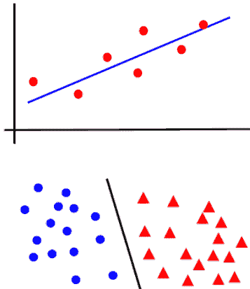
- 分类：
  - 学习类别标签
  - 示例：数字识别

## 示例 1：图像分类


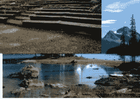

# 示例 2：垃圾邮件分类

| 邮件 | 先生 | 销售 | ... | 是垃圾邮件？ |

| :--- | :--- | :--- | :--- | :--- |

| 邮件 1 | 2 | | 是 |

| 邮件 2 | 0 | | 否 |

| 邮件 3 | 1 | | 是 |

| ... | | | | |

| 邮件 n | 0 | | 否 |

| 新邮件 | 0 | | ?? |

## 定义

给定数据集 `$\mathcal{D} = \{(\mathbf{x}_i, c_i)\}_{i=1N}$`，其中 `$\mathbf{x}_i \in \mathbb{R}^d$` 是样本，`$c \in \{1 \dots K\}$` 是类别标签，我们想要学习一个分类器 `$f(\mathbf{x})$` 来预测未知样本的类别。

- `$K=2$`：二分类
- `$K>2$`：多分类

与回归的区别在于**输出是离散的！**

# 生成式 vs 判别式建模

## 生成式

## 生成式模型：

- 假设类别先验 `$p(c)$` 和类别密度 `$p(x|c)$`
- 从数据中学习这些验
- 这是一个“生成式”模型，因为我们可以使用 `$p(x|c)$` 创建数据点 `x`
- 通过计算后验 `$p(c|x) = \frac{p(x|c)p(c)}{p(x)}$` 预测类别
- 通常称为朴素贝叶斯，因为它使用了贝叶法则

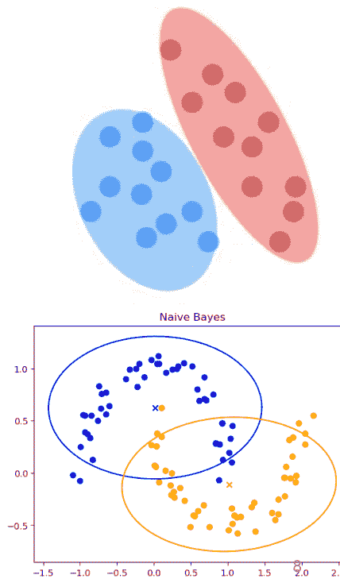

- 学习数据的完整分布（通常很难）
- 我们的建模假设（例如 `$p(x|c)$` 是高斯分布）可能会引入巨大误差

### 判别式模型：


### 判别式

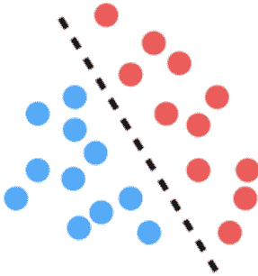

- 直接假设 `$p(c|x)$` 的某种形式（或任何返回类别的预测器 `$f(x)$`）。
- 这是数据的“判别式”模型！
- 直接从训练数据估计 `$p(c|x)$` 的参数

### 只考虑边界点的建模

- 通常比生成式建模简单得多
- 因此我们专注于于判别式模型

# `Discriminative` 二分类

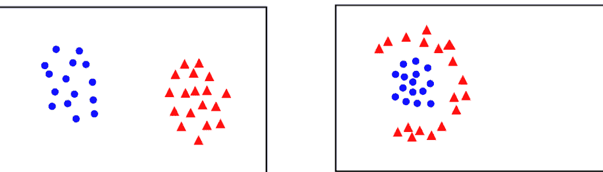

给定训练数据 `$(x_i, c_i), i = 1...N$`，其中 `$x_i \in \mathbb{R}^d$` 和 `$c_i \in \{0, 1\}$`，学习一个分类器 `$f(x)$` 使得：

```
$f(x_i) = \begin{cases} > 0, & \text{如果 } c_i = 1 \\ < 0, & \text{如果 } c_i = 0 \end{cases}$
```

## 今日议程！

## 线性分类：

- 生成式 vs 判别式分类
- 线性分类器
- 极大似然目标
- 逻辑回归

## 基础：梯度下降

# 线性可分

线性可分

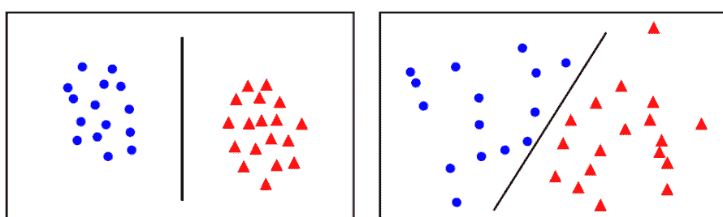

非线性可分

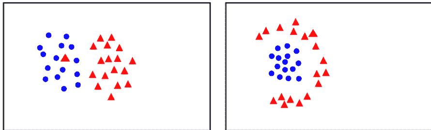

## 线性分类器

线性分类器的形式为：

`$f(\mathbf{x}) = \mathbf{w}^T\mathbf{x} + b$`

在 2D 中，分类器是一条直线

- `w` 是直线的法线
- `b` 是移动边界的偏置

尝试理解为什么是这样……

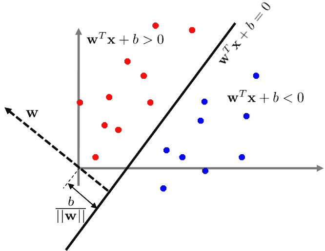

# 基础：向量的投影

两个向量的点积可以计算 `a` 在 `b` 上的投影：

- 点积的几何定义

`$a^T b = \|a\|\|b\|\cos \theta$`

- 两个向量之间的角度

`$\cos \theta = \frac{a^T b}{\|a\|\|b\|}$`

- `a` 在 `b` 上的标量投影

`$a_b = \|a\|\cos \theta = \frac{a^T b}{\|b\|}$`

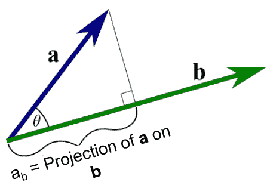

**观察：** 如果两个向量相互垂直，则投影为 0

# 回顾：几何检查

观察结果：

- 决策边界垂直于 **w**
- 没有 `b`，它通过原点

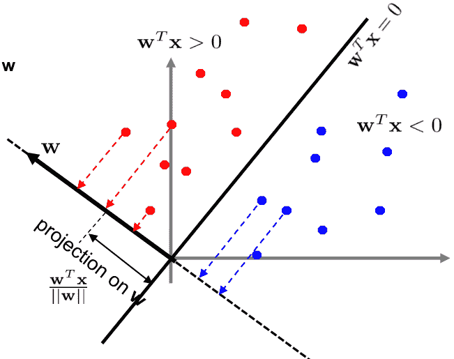

Gerhard Neumann | 机器学习 | KIT | 2024年夏季季 15

# 回顾：几何检查

**观察：**

- `b` 沿着 **w** 的负方向移动决策边界
- 这种移动对应于给投影加上 `$\frac{b}{\|\mathbf{w}\|}$`
- `$\frac{\mathbf{w}^T\mathbf{x}}{\|\mathbf{w}\|} + \frac{b}{\|\mathbf{w}\|} = 0$` `投影 $x_w$`
- 也就是说，为了让 **x** 位于决策边界，投影必须为 `$x_w = -\frac{b}{\|\mathbf{w}\|}$`

# 线性判别器

线性判别器的形式如下：

`$f(\mathbf{x}) = \mathbf{w}^T\mathbf{x} + b$`

在 2D 空间中，判别器是一条直线

- `$\mathbf{w}$` 是直线的法向量
- `b` 是偏置

在 3D 空间中，它是一个**平面**

在 N-D 空间中，它是一个**超平面**

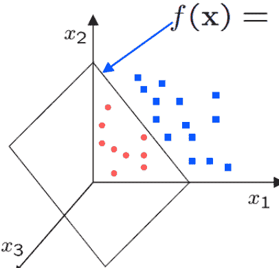

## 线性分类：0-1 Loss `第一次尝试`

**预测：** `$y = \text{step}(f(x)) = \text{step}(w^T x + b)$`

- 当 `$f(x) > 0$` 时预测类别 1
- 否则预测类别 0

**优化：** 寻找 `w` 使得

```
$L_0(w) = \sum_{i} \mathbb{I}(\text{step}(w^T x + b) \neq c_i)$
```

- 其中 `$\mathbb{I}$` 在参数为真时返回 1
- ... 统计错误分类的数量

× **非常难以优化**！！！ `NP-hard` 问题

## 线性分类：回归损失 `第二次尝试`

我们可以使用与回归相同的损失函数

`$L_{reg}(\mathbf{w}) = \sum_{i} (f(\mathbf{x}_i) - c_i)^2$`

- 最小化平方误差：简单！
- 然而：我们忽略了 `$c_i$` 被限制在 `$\{0,1\}$` 这一事实

对离群值不鲁健

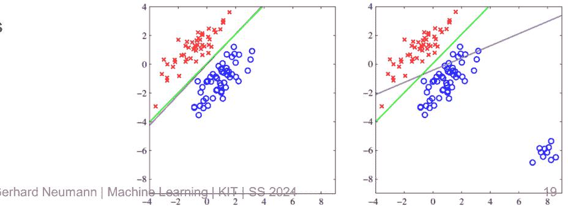

## 比较两者

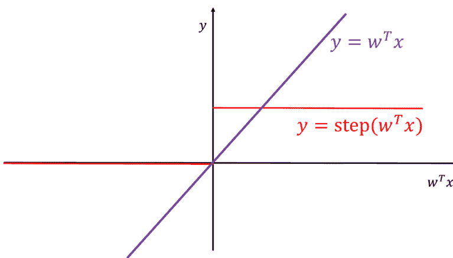

- 线性函数的输出是无界的！
- 然而，有用的输出值只有 0 或 1

## Logistic Sigmoid 函数

Sigmoid 函数：

```
$\sigma(a) = \frac{1}{1 + \exp(-a)}$
```

- 输出限制在 0 到 1 之间
- 平滑

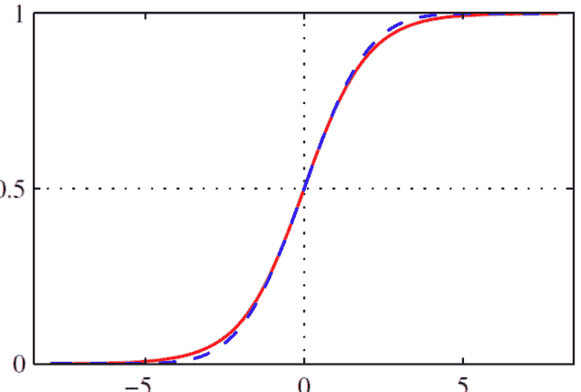

对于线性分类：

- 压缩线性函数的输出
- 最小化损失


```
$L(\boldsymbol{w}) = \sum_{i} (\sigma(f(\boldsymbol{x}_i)) - c_i)^2 = \sum_{i} (\sigma(\boldsymbol{w}^T \boldsymbol{x} + b) - c_i)^2$
```

## 今日议程！

## 线性分类：

- 生成式 vs. 判别式分类
- 线性分类器
- 最大似然目标
- 逻辑回归 (Logistic Regression)

## 基础：梯度下降

## 更好：概率视角，MLE

- 给定训练数据 `D = {(x_i, y_i)}_{i=1...N}`，其来自数据分布 `p_data` 且独立同分布
- 令 `p_theta(y|x)` 为由 `theta ∈ Theta` 参数化的分布族
- 我们只关心 `y` 的分布，而不关心 `x` 的分布
- 监督学习中的典型情况

**对数似然：**

```
$loglik(\theta; D) = \sum_{i} \log p_{\theta}(y_i|x_i)$
```

## 二分类分类的分布

伯努利分布 (Bernoulli Distribution)：

- 二元随机变量 `X ∈ {0, 1}`
- 一个参数 `p(X = 1) = μ`
- 概率分布 `p(x) = μ^x(1-μ)^{1-x}`

  根据 `x` 的值，选择 `μ` 或 `1-μ` 作为概率
- 将其想象成抛硬币


## 作为 Sigmoid 的条件伯努利

定义类别标签的条件概率分布

`p(c = 1|x) = σ(w^T x + b),    p(c = 0|x) = 1 - σ(w^T x + b)`

- 现在这是一个**条件伯努利**分布。即**事件 `c` 的结果取决于 `x`**
- 我们可以使用相同的“指数技巧”来根据 `c` 的值来选择正确的概率，即：

`p(c|x) = p(c = 1|x)^c p(c = 0|x)^{1-c} = σ(w^T x + b)^c (1 - σ(w^T x + b))^{1-c}`

## 对数似然

我们现在可以直接优化条件对数似然

$$\text{loglik}(\tilde{w}, D) = \sum_{i} \log p(c_i|\boldsymbol{x}_i) = \sum_{i} \log p(c=1|\boldsymbol{x}_i)^{c_i} p(c=0|\boldsymbol{x}_i)^{1-c_i}$$

`= \sum_{i} c_i \log p(c=1|\boldsymbol{x}_i) + (1-c_i) \log p(c=0|\boldsymbol{x}_i)`

`= \sum_{i} c_i \log \sigma(\tilde{w}^T \tilde{x}_i) + (1-c_i) \log (1-\sigma(\tilde{w}^T \tilde{x}_i))`

- 负似然也称为交叉熵

## 今日议程！

## 线性分类：

- 生成式 vs. 判别式分类
- 线性分类器
- 最大似然目标
- 逻辑回归

## 基础：梯度下降

## 逻辑“回归”

优化 Sigmoid 的似然被称为逻辑回归

`argmax_{\tilde{w}} loglik(\tilde{w}, D) = argmax_{\tilde{w}} \sum_{i} c_i \log \sigma(\tilde{w}^T \tilde{x}_i) + (1-c_i) \log (1-\sigma(\tilde{w}^T \tilde{x}_i))`

- ... 尽管我们解决的是分类问题
- 可以证明该函数仍然是凸的（只有一个极大值）
- 但像线性回归那样没有解析解

我们如何找到极大值？**梯度下降！**

## 广义模型

像回归一样，我们可以在**非线性特征**空间中拟合线性判别器

`argmax_w loglik(w, D) = argmax_w \sum_{i} c_i \log \sigma(w^T φ(x_i)) + (1-c_i) \log (1-\sigma(w^T φ(x_i)))`

- 输入空间中不可线性分的问题在特征空间中是线性分的

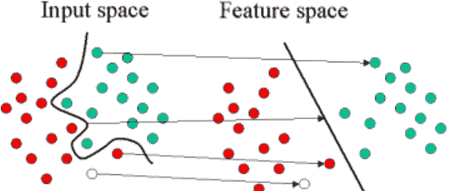

## 广义逻辑示例

- 来自作业的双月形数据集 (Two moons)

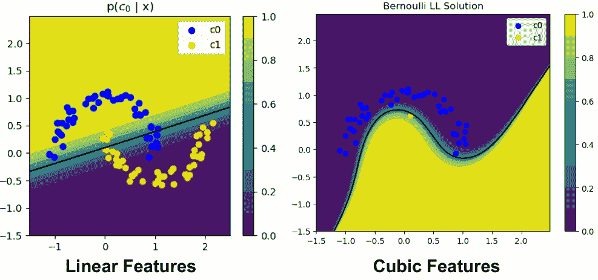

# 正则化

像线性回归一样，我们可以再次添加正则惩罚

`L(\tilde{w}, D) = loglik(\tilde{w}, D) - λ penalty(\tilde{w})`

最常见的 L2 正则化损失

`penalty(\tilde{w}) = ||\tilde{w}||^2`

- 对于大多数罚项，`L` 仍然是凸的

## 今日议程！

## 线性分类：

- 生成式 vs. 判别式分类
- 线性分类器
- 最大似然目标
- 逻辑回归

## 基础：梯度下降

# 优化

对于大多数机器学习算法，我们希望找到拟合数据的模型。已知两个例子：

- 最小二乘法：

`argmin_w SSE(w, D)`

- 最大似然法：

`argmax_w loglik(w, D)`

# 优化

对于大多数机器学习算法，我们希望找到拟合数据的模型。已知两个例子：

- 最小二乘法：

`argmin_w SSE(w, D) + λ penalty(w)`

- 最大似然法：

`argmax_w loglik(w, D) - λ penalty(w)`

> 注意：

`argmin_x f(x) = argmax_x f(x)`

因此，惩罚的作用是相同的

...加上正则惩罚

# 优化

机器学习优化的通用形式：损失 + 惩罚

$$\arg min_{\text{parameters } \theta} \sum_{i=1}^{N} l(\boldsymbol{x}_i, \theta) + \lambda \text{penalty}(\theta)$$

- 样本损失之和加上正则惩罚

如何做？**优化**

## 什么时候可以做？


- 只有对于凸函数才能找到全局最小值/极大值！
- 对于非凸函数，我们限于寻找局部最小值/极大值

## 凸函数

凸函数 `f : R^d → R` 对于任意 `x0, x1 ∈ R^d` 满足：

`f((1-α)x0 + αx1) ≤ (1-α)f(x0) + α f(x1),    α ∈ [0, 1]`

- 连接 `(x0, f(x0))` 和 `(x1, f(x1))` 的直线始终位于函数值之上
- 只有一个最小值！


## 梯度下降

- 如果函数是凸的，则有助于寻找**全局最小值**
- 如果函数是非凸的，则有助于寻找**局部最小值/极大值**
- 梯度下降在机器学习许多应用：

  - 逻辑回归
  - 线性回归（针对高维输入）
  - 深度神经网络
  - 混合模型
- ...

## 梯度下降

从某点开始，沿着梯度向 (a) 最小值处移动

```
$x_0 \leftarrow \text{init}, t = 0$
while termination condition does not hold do
$x_{t+1} = x_t - \eta\nabla f(x_t), \quad t = t + 1$
end while
```


- `η …` 学习率或步长
- 梯度始终指向最上升的方向

## 选择步长

`η_t = t`，太大了

`η_t` 太小，在 100 次迭代后


## 如何终止

当迭代之间的变化很小时终止

- 当梯度很小时
- 当函数值变化很小时

或者在固定的时间步或预算后终止

## 分类损失

### 数据对数似然：

```
$\loglik(\mathcal{D}, \mathbf{w}) = \sum_{i=1}^{N} p(c_i|\phi(\mathbf{x}_i), \mathbf{w}) = \sum_{i=1}^{N} c_i \log \sigma(\mathbf{w}^T \phi(\mathbf{x}_i)) + (1 - c_i) \log (1 - \sigma(\mathbf{w}^T \phi(\mathbf{x}_i)))$
$logi_{\dots} \dots$ 第 i 个样本的损失
```

### 逻辑回归损失函数是凸的

- 也就是说只有一个最小值！
- 但不存在闭形式解…… 我们需要梯度下降！

```
$\frac{\partial \loss_i}{\partial \mathbf{w}} = \frac{\partial}{\partial \mathbf{w}} (c_i \log \sigma(\mathbf{w}^T \phi(\mathbf{x}_i)) + (1 - c_i) \log (1 - \sigma(\mathbf{w}^T \phi(\mathbf{x}_i))) = ?$
```

```
提示：$\frac{d\sigma(\mathbf{x})}{d\mathbf{x}} = \sigma(\mathbf{x})(1 - \sigma(\mathbf{x}))$\
$\frac{d\log(f(\mathbf{x}))}{d\mathbf{x}} = \frac{1}{f(\mathbf{x})} \frac{df(\mathbf{x})}{d\mathbf{x}}$
```

## 逻辑回归的梯度

`∂ loss_i / ∂ w = ∂/∂ w (c_i log σ(w^T φ(x_i)) + (1 - c_i) log (1 - σ(w^T φ(x_i))))`

`= c_i 1/σ(w^T φ(x_i)) σ(w^T φ(x_i))(1 - σ(w^T φ(x_i))) φ(x_i)`

`+ (1 - c_i) 1/(1 - σ(w^T φ(x_i))) (--) σ(w^T φ(x_i))(1 - σ(w^T φ(x_i))) φ(x_i)`

`= c_i(1 - σ(w^T φ(x_i))) φ(x_i) - (1 - c_i) σ(w^T φ(x_i)) φ(x_i)`

`= (c_i - σ(w^T φ(x_i))) φ(x_i)`

## 优化损失

- 双月数据集 (Two moons dataset)……


### 三次特征

## 多分类

我们现在有 K 个类别标签

Softmax 似然函数：

```
p(c = i|x) = exp((w_i^T φ(x))) / sum_{k=1}^K exp((w_k^T φ(x)))
```

- 每个类别获得一个权重向量
- 如果 `w_i^T φ(x)` 高，则类别 i 的概率更高
- 当 K = 2 时，`w_2` 是冗余的 -> 最好使用 sigmoid


## 复习：多项分布

**多项分布 / 分类分布：**

- K 个不同的事件：`C ∈ {1, …, K}`
- 直接指定概率：`p(C = k) = μ_k,    μ_k ≥ 0,    sum_{k=1}^K μ_k = 1`
- 或使用独热编码（不带 if 子句）：

`p(c) = ∏_{k=1}^K μ_k^{h_{c,k}}` 根据 `x` 的类别标签选择正确的 `μ_k`

- 其中 `h_c` 是 K 维独热编码向量，在维度 `c = k` 处为 1，其他地方为 0。`h_{c,k}` 是该向量的第 k 个元素。
- 将其想象成掷骰子


## 多分类

多分类问题可以表示为条件多项分布：

- 也就是说事件 `c` 的概率依赖于输入 `x`
- 我们再次可以使用“指数技巧”来选择取决于 `c` 的正确概率

```
$p(c|x) = \prod_{k=1}^{K} p(c=k|x)^{h_{c,k}}$
$= \prod_{k=1}^{K} \left( \frac{\exp(\mathbf{w}_k^T \phi(\mathbf{x}_i))}{\sum_{k'=1}^{K} \exp(\mathbf{w}_{k'}^T \phi(\mathbf{x}_i))} \right)$
```

### 数据对数似然：`loglik(D, w) = sum_{i=1}^{N} p(c_i|φ(x_i), w) = sum_{i=1}^{N} c_i log σ(w^T φ(x_i)) + (1 - c_i) log (1 - σ(w^T φ(x_i)))`

`logi_… …` 第 i 个样本的损失

`= ∏_{k=1}^{K} ( exp(w_k^T φ(x_i)) / sum_{k'=1}^{K} exp(w_{k'}^T φ(x_i)) )`

### 逻辑回归损失函数是凸的

- 也就是说只有一个最小值！
- 但不存在闭形式解…… 我们需要梯度下降！

```
$\frac{\partial \loss_i}{\partial \mathbf{w}} = \frac{\partial}{\partial \mathbf{w}} (c_i \log \sigma(\mathbf{w}^T \phi(\mathbf{x}_i)) + (1 - c_i) \log (1 - \sigma(\mathbf{w}^T \phi(\mathbf{x}_i))) = ?$
```

提示：`dσ(x)/dx = σ(x)(1 - σ(x))`

`d log(f(x))/dx = 1/f(x) df(x)/dx`

# 今日议程

回顾：线性分类器

支持向量机：

- 最大间隔 (Maximum Margin)
- 优化问题
- 软间隔 (Soft-Margin)


# 铰形损失 (Hinge-Loss)

- 与伯努利似然性的对比

# 基础知识

- 子梯度 (Sub-gradients)

## 二分类：之前的定义


给定训练数据 $(x_i, y_i)$，$i = 1\dots N$，其中 $x_i \in \mathbb{R}^d$  $y_i \in \{0, 1\}$，学习一个分类器 $f(\boldsymbol{x})$使得：

```
$f(\boldsymbol{x}_i) = \begin{cases} > 0, & \text{if } y_i = 1 \\ < 0, & \text{if } y_i = 0 \end{cases}$
```

## 二分类：新定义

**对于 SVM 而言，使用 +1 和 -1 作为类别标签可以简化符号表示**

**新定义：** 给定训练数据 $(x_i, y_i)$，$i = 1..N$，其中 $x_i \in \mathbb{R}^d$ 和 $y_i \in \{-1, 1\}$，学习一个分类器 $f(x)$使得：

$f(x_i) = \begin{cases} > 0, & \text{if } y_i = 1 \\ < 0, & \text{if } y_i = -1 \end{cases}$

**或者：** 对于分类正确的情况，$f(x_i)y_i > 0$

## 回顾：线性分类器

线性分类器的形式为：

$f(\mathbf{x}) = \mathbf{w}^T\mathbf{x} + b$

在二维空间中，分类器是一条直线

- `w` 是直线的法向量
- `b` 是偏置 (bias)


## 基础知识：向量的投影

两个向量的点积可以用于计算向量 `a` 在向量 `b` 上的投影：

- 点积的几何定义

$a^T b = ||a||||b|\cos\theta$

- 两个向量之间的角度

$\cos\theta = \frac{a^T b}{||a||||b||}$

- `a` 在 `b` 上的标投影

$a_b = ||a||\cos\theta = \frac{a^T b}{||b||}$


**观察：** 如果两个向量相互垂直，则投影为 0

## 回顾：几何检查

**观察：**

- 决策边界与 `w` 垂直
- 如果没有 `b`，它将通过原点


## 回顾：几何检查

**观察：**

- **`b` 沿着 `w` 的（负）方向平移决策边界**
- 这种位移对应于在投影上加上 $\frac{b}{\|\mathbf{w}\|}$

$\mathbf{w}^T\mathbf{x} + b = 0 \Rightarrow \frac{\mathbf{w}^T\mathbf{x}}{\|\mathbf{w}\|} + \frac{b}{\|\mathbf{w}\|} = x_w$

- 即为了使 $\mathbf{x}$ 在决策边界上，其投影必须为：

$x_w = -\frac{b}{\|\mathbf{w}\|}$


## 最优分离

哪一条直线是最优的？


## 最大间隔

- **支持向量：** 靠近决策边界的数据点
  - 其他样本可以被忽略
- **间隔 $\rho$ 是支持向量与决策边界之间的距离**
- **间隔应该被最大化**
- 即决策边界与样本之间的最小距离应该最大化


## 最大间隔

- **最大化**超平面与“困难样本”之间的距离
  - 靠近决策边界的样本
  - 也称为**支持向量**
- **直觉：**
  - 靠近决策边界的样本越 -> 越鲁棒
- **统计学习：**
  - 最大间隔分类器的复杂度更低（VC 维）
  - 且泛化能力更好


## 几何检查

点 $\mathbf{x}_i$ 到直线的距离：$r = \frac{\mathbf{w}^T\mathbf{x}_i+b}{\|\mathbf{w}\|}$


## 数学公式

**观察：**

- $w^T x + b = 0$ 和 $c(w^T x + b) = 0$ 定义同一平面
- 缩放因子 $c$ 可以自由选择使得：
- 对于正支持向量，$w^T x_+ + b = 1$
- 对于负支持向量，$w^T x_- + b = -1$

间隔由下式给出：

$$\frac{w^T x_+ + b - (w^T x_- + b)}{\|w\|} = \frac{2}{\|w\|}$$


## SVM 优化

优化问题：

```
$\arg\max_w \frac{2}{\|\mathbf{w}\|}$
$\text{s.t.} \quad \mathbf{w}^T\mathbf{x}_i + b \begin{cases} \geq 1, & \text{if } y_i = 1 \\ \leq -1, & \text{if } y_i = -1 \end{cases}$
```

间隔条件

**观察：**

- 如果不满足约束，我们的间隔定义是错误的：

$\min_{\mathbf{x}_+\in\mathbf{x}_+} (\mathbf{w}^T\mathbf{x}_+ + b) = 1 \quad \max_{\mathbf{x}_-\in\mathbf{x}_-} (\mathbf{w}^T\mathbf{x}_- + b) = -1$

$\mathbf{x}_-: 负样本$

$\mathbf{x}_+: 正样本$

- 支持向量到决策边界的距离最小
- 至少有一个正点和一个负点恰好满足支持向量条件（即等号）
- 因为 argmax 的存在！向量的范数可以减小

## SVM 优化

优化问题：

```
$\arg\max_w \frac{2}{\|\mathbf{w}\|}$
$\text{s.t.} \quad \mathbf{w}^T\mathbf{x}_i + b \begin{cases} \geq 1, & \text{if } y_i = 1 \\ \leq -1, & \text{if } y_i = -1 \end{cases}$
```

间隔条件

## 重构：更容易求解，相同的解

```
$\arg\min_w \|\mathbf{w}\|^2,$
$\text{s.t.} \quad y_i(\mathbf{w}^T\mathbf{x}_i + b) \geq 1$
```

- 二次优化问题
- 线性约束
- 凸，唯一最优

可以使用拉格朗日优化求解（目前不重要……）

# 今日日程

回顾：线性分类器

支持向量机：

- 最大间隔
- 优化问题
- 软间隔
- 铰形损失
- 与伯努利似然性的对比

基础知识：

- 子梯度

## 回到线性可分

### 什么是最好的 `w`?

- 线性可分但：间隔小


- 间隔大但分类错误

我们必须在间隔和分类准确率之间进行权衡！

## 软间隔

引入松变量：

$\xi_i \ge 0$

允许违反间隔条件

$y_i(w^T x_i + b) \ge 1-\xi_i$

- $0 \le \xi_i \le 1$ 样本位于间隔和决策边界之间：违反间隔
- $\xi_i > 1$ 样本位于决策边界的错误侧：分类错误


## 软间隔

优化问题：

$$\text{argmin}_{\mathbf{w},\xi} \quad ||\mathbf{w}||^2 + C\sum_{i=1}^N \xi_i,$$

$\text{s.t.} \quad y_i(\mathbf{w}^T\mathbf{x}_i + b) \ge 1-\xi_i, \quad \xi_i \ge 0$

惩罚松变量

- `C` 是一个（反）正则化参数
- 小 `C`：约束影响小 -> 大间隔 -> 大正则化
- 大 `C`：约束影响大 -> 小间隔 -> 小正则化
- `C` 无穷大：强制执行约束 -> 硬间隔 -> 无正则化

## 插图

# 硬间隔

# 软间隔


Gerhard Neumann | 机器学习 – 基础与算法 | KIT | 2023年夏季学 22

# 今日议程

回顾：线性分类器

支持向量机：

- 最大间隔
- 优化问题
- 软间隔
- 铰形损失
- 与伯努利似然性的对比

基础知识：

- 子梯度

## 重构为无约束问题

约束优化：松变量

```
$\text{argmin}_{\mathbf{w},\xi} \quad ||\mathbf{w}\|^2 + C\sum_{i=1}^N \xi_i,\quad \text{s.t.} \quad y_i(\mathbf{w}^T\mathbf{x}_i + b) \geq 1-\xi_i, \quad \xi_i \geq 0$
正则化损失函数
```

# 合页损失 (Hinge Loss)

$$\text{argmin}_{w} ||w||^2_{\text{regularization}} + C \sum_{i=1}^{N} \max(0, 1 - y_i f(\boldsymbol{x}_i))_{\text{loss function}}$$

**点分为三类：**

- $y_i f(\boldsymbol{x}_i) > 1$ : 边界之外的点，对损失没有贡献
- $y_i f(\boldsymbol{x}_i) = 1$ : 点在边界上，与硬间隔（hard margin）一样，对损失没有贡献
- $y_i f(\boldsymbol{x}_i) \le 1$ : 点违反边界，对损失有贡献


# 损失函数是凸的


- 只有一个最小值
- 我们可以通过梯度下降找到它
- 然而：
  - 合页损失**不可微微！**
  - 我们如何优化它？
- **次梯度 (Sub-Gradients)！**

# 今日议程

回顾：线性判别器

支持向量机 (Support Vector Machines)：

- 最大间隔
- 优化问题
- 软间隔
- 合页损失 (Hinge-Loss)

基础知识：

- 次梯度

# 基础知识：次梯度

**记住：** 对于任意凸函数 $f : \mathbb{R}^d \to \mathbb{R}$

```
$f(z) \geq f(x) + \nabla f(x)^T(z - x)$
```

- 即：线性近似会低估函数值


凸函数 $f$ 在点 $\mathbf{x}$ 处的**次梯度**是任意满足以下条件的 $\mathbf{g}$：

```
$f(z) \geq f(x) + g^T(z - x)$
```

- 始终存在（即使 $f$ 不可微）
- 如果 $f$ 在 $\mathbf{x}$ 处可微，则 $\mathbf{g} = \nabla f(\mathbf{x})$

## 示例

考虑 $f(x) = |x|$

- 对于 $x \neq 0$，唯一的次梯度 $g = \text{sign}(x)$
- 对于 $x = 0$，次梯度是 $[-1, 1]$ 中的任意元素


## 示例

设 $f_1, f_2 : \mathbb{R}^n \to \mathbb{R}$ 为凸且可微函数，考虑 $f(x) = \max\{f_1(x), f_2(x)\}$

- 对于 $f_1(x) > f_2(x)$，唯一的次梯度 $g = \nabla f_1(x)$
- 对于 $f_2(x) > f_1(x)$，唯一的次梯度 $g = \nabla f_2(x)$
- 对于 $f_1(x) = f_2(x)$，次梯度 $g$ 是 $\nabla f_1(x)$ 和 $\nabla f_2(x)$ 之间线段上的任意点


# 次梯度法

类似于梯度下降，但将梯度替换为次梯度

**次梯度下降：**

- 给定凸函数 `f`，不一定可微
- 初始化 `x0`
- 重复：`x_{t+1} = x_t + η g`，其中 `g` 是 `f` 在 `x_t` 处的任意次梯度

# SVM 的合页损失次梯度

$\mathcal{L}(\mathbf{x}_i, y_i, \mathbf{w}) = \max(0, 1 - y_{i}f(\mathbf{x}_i)) \quad f(\mathbf{x}_i) = \mathbf{w}^T \mathbf{x}_i + b$


# SVM 的次梯度下降

$\arg\min_{\mathbf{w}} C \sum_{i=1}^{N} \max(0, 1 - y_i f(\boldsymbol{x}_i)) + ||\mathbf{w}||^2_{\text{regularization}}$

在每次迭代中，随机选取样本 $(\mathbf{x}_i, y_i)$

- 如果 $y_i f(\boldsymbol{x}_i) < 1$：$\mathbf{w}_{t+1} = \mathbf{w}_t - \eta(2\mathbf{w}_t - C\mathbf{x}_i)$
- 否则：$\mathbf{w}_{t+1} = \mathbf{w}_t - \eta 2\mathbf{w}_t$

# 今日议程

回顾：线性判别器

支持向量机：

- 最大间隔
- 优化问题
- 软间隔
- 合页损失 (Hinge-Loss)
- 与伯努利似然的对比

基础知识：

- 次梯度

# 与逻辑函数的对比

- SVM-合页损失

$$\text{argmin}_w \frac{\|w\|^2}{\text{regularization}} + \sum_{i=1}^N \max(0, 1 - y_i f(\boldsymbol{x}_i)), \text{ 其中 } \lambda = \frac{1}{C}$$

- （正则化的）逻辑回归损失（见第2课）

$$\text{argmax}_w -\lambda\|w\|^2 + \sum_{i=1}^N c_i \log(\sigma(\boldsymbol{x}_i)) + (1-c_i) \log(1-\sigma(\boldsymbol{x}_i)), \text{ 其中 } c_i \in \{0,1\}$$

$$\dots$$

$$\text{argmin}_w \frac{\|w\|^2}{\text{regularization}} + \sum_{i=1}^N \log(1+\exp(-y_i f(\boldsymbol{x}_i))), \text{ 其中 } y_i \in \{-1, 1\}$$

两种损失函数具有相似的解释

- 保持权重

- SVM-合页损失

$$\text{argmin}_w \frac{\|w\|^2}{\text{regularization}} + \sum_{i=1}^N \max(0, 1 - y_i f(\boldsymbol{x}_i)), \text{ 其中 } \lambda = \frac{1}{C}$$

- （正则化的）逻辑回归损失（见第2课）

$$\text{argmax}_w -\lambda\|w\|^2 + \sum_{i=1}^N c_i \log(\sigma(\boldsymbol{x}_i)) + (1-c_i) \log(1-\sigma(\boldsymbol{x}_i)), \text{ 其中 } c_i \in \{0,1\}$$

$$\dots$$

$$\text{argmin}_w \frac{\|w\|^2}{\text{regularization}} + \sum_{i=1}^N \log(1+\exp(-y_i f(\boldsymbol{x}_i))), \text{ 其中 } y_i \in \{-1, 1\}$$

两种损失函数具有相似的解释

- 保持权重

- SVM-合页损失


$$\text{argmin}_w \frac{\|w\|^2}{\text{regularization}} + \sum_{i=1}^N \max(0, 1 - y_i f(\boldsymbol{x}_i)), \text{ 其中 } \lambda = \frac{1}{C}$$

- （正则化的）逻辑回归损失（见第2课）

$$\text{argmax}_w -\lambda\|w\|^2 + \sum_{i=1}^N c_i \log(\sigma(\boldsymbol{x}_i)) + (1-c_i) \log(1-\sigma(\boldsymbol{x}_i)), \text{ 其中 } c_i \in \{0,1\}$$

$$\dots$$

$$\text{argmin}_w \frac{\|w\|^2}{\text{regularization}} + \sum_{i=1}^N \log(1+\exp(-y_i f(\boldsymbol{x}_i))), \text{ 其中 } y_i \in \{-1, 1\}$$

两种损失函数具有相似的解释

- 保持权重

- SVM-合页损失

$$\text{argmin}_w \frac{\|w\|^2}{\text{regularization}} + \sum_{i=1}^N \max(0, 1 - y_i f(\boldsymbol{x}_i)), \text{ 其中 } \lambda = \frac{1}{C}$$

- （正则化的）逻辑回归损失（见第2课）

$$\text{argmax}_w -\lambda\|w\|^2 + \sum_{i=1}^N c_i \log(\sigma(\boldsymbol{x}_i)) + (1-c_i) \log(1-\sigma(\boldsymbol{x}_i)), \text{ 其中 } c_i \in \{0,1\}$$

$$\dots$$

$$\text{argmin}_w \frac{\|w\|^2}{\text{regularization}} + \sum_{i=1}^N \log(1+\exp(-y_i f(\boldsymbol{x}_i))), \text{ 其中 } y_i \in \{-1, 1\}$$

两种损失函数具有相似的解释

- 保持权重

- $y_i f(\boldsymbol{x}_i) > 1$ : 边界之外的点，对损失没有贡献

- $y_i f(\boldsymbol{x}_i) = 1$ : 点在边界上，与硬间隔（hard margin）一样，对损失没有贡献

- $y_i f(\boldsymbol{x}_i) \le 1$ : 点违反边界，对损失有贡献

# 损失函数是凸的

- 只有一个最小值

- 我们可以通过梯度下降找到它

- 然而：

  - 合页损失**不可微微！**

  - 我们如何优化它？

- **次梯度 (Sub-Gradients)！**

# 今日议程

回顾：线性判别器

支持向量机：

- 最大间隔

- 优化问题

- 软间隔

- 合页损失

- 与伯努利似然的对比

基础知识：

- 次梯度

# 基础知识：次梯度

**记住：** 对于任意凸函数 $f : \mathbb{R}^d \to \mathbb{R}$

```
$f(z) \geq f(x) + \nabla f(x)^T(z - x)$
```

- 即：线性近似会低估函数值

凸函数 $f$ 在点 $\mathbf{x}$ 处的次梯度是任意满足以下条件的 $\mathbf{g}$：

```
$f(z) \geq f(x) + g^T(z - x)$
```

- 始终存在（即使 $f$ 不可微）

- 如果 $f$ 在 $\mathbf{x}$ 处可微，则 $\mathbf{g} = \nabla f(\mathbf{x})$

## 示例

考虑 $f(x) = |x|$

- 对于 $x \neq 0$，唯一的次梯度 $g = \text{sign}(x)$

- 对于 $x = 0$，次梯度是 $[-1, 1]$ 中的任意元素

## 示例

设 $f_1, f_2 : \mathbb{R}^n \to \mathbb{R}$ 为凸且可微函数，考虑 $f(x) = \max\{f_1(x), f_2(x)\}$

- 对于 $f_1(x) > f_2(x)$，唯一的次梯度 $g = \nabla f_1(x)$

- 对于 $f_2(x) > f_1(x)$，唯一的次梯度 $g = \nabla f_2(x)$

- 对于 $f_1(x) = f_2(x)$，次梯度 $g$ 是 $\nabla f_1(x)$ 和 $\nabla f_2(x)$ 之间线段上的任意点

# 次梯度法

类似于梯度下降，但将梯度替换为次梯度

**次梯度下降：**

- 给定凸函数 $f$，不一定可微

- 初始化 $x_0$

- 重复：$x_{t+1} = x_t + \eta g$，其中 $g$ 是 $f$ 在 $x_t$ 处的任意次梯度

# 合页损失的次梯度

$\mathcal{L}(\mathbf{x}_i, y_i, \mathbf{w}) = \max(0, 1 - y_{i}f(\mathbf{x}_i)) \quad f(\mathbf{x}_i) = \mathbf{w}^T \mathbf{x}_i + b$

# SVM 的次梯度下降

$\arg\min_{\mathbf{w}} C \sum_{i=1}^{N} \max(0, 1 - y_i f(\boldsymbol{x}_i)) + ||\mathbf{w}||^2_{\text{regularization}}$

在每次迭代中，随机选取样本 $(\mathbf{x}_i, y_i)$

- 如果 $y_i f(\boldsymbol{x}_i) < 1$：$\mathbf{w}_{t+1} = \mathbf{w}_t - \eta(2\mathbf{w}_t - C\mathbf{x}_i)$

- 否则：$\mathbf{w}_{t+1} = \mathbf{w}_t - \eta 2\mathbf{w}_t$

# 与逻辑函数的对比

- SVM-合页损失

$$\text{argmin}_w \frac{\|w\|^2}{\text{regularization}} + \sum_{i=1}^N \max(0, 1 - y_i f(\boldsymbol{x}_i)), \text{ 其中 } \lambda = \frac{1}{C}$$

- （正则化的）逻辑回归损失（见第2课）

$$\text{argmax}_w -\lambda\|w\|^2 + \sum_{i=1}^N c_i \log(\sigma(\boldsymbol{x}_i)) + (1-c_i) \log(1-\sigma(\boldsymbol{x}_i)), \text{ 其中 } c_i \in \{0,1\}$$

$$\dots$$

$$\text{argmin}_w \frac{\|w\|^2}{\text{regularization}} + \sum_{i=1}^N \log(1+\exp(-y_i f(\boldsymbol{x}_i))), \text{ 其中 } y_i \in \{-1, 1\}$$

两种损失函数具有相似的解释

## 核矩阵（又称 Gram 矩阵）

属性：

- 无论数据的性质如何，**K** 始终是一个 $n \times n$ 矩阵：相同的算法适用于任何类型的数据（向量、字符串等……）。

- 函数 $k$ 的选择与算法的选择之间具有完全的模块化特征。

- 计算和存储 **K** 的可扩展性相对于数据集大小来说较差（$n^2$）……

- 我们将限制在特定类的两对比较函数上。

## 正定核

正定核函数 $k$ 是一个函数 $k : \mathcal{X} \times \mathcal{X} \to \mathbb{R}$，满足以下条件：

(i) 对称：$\forall \boldsymbol{x}, \boldsymbol{x}' : k(\boldsymbol{x}, \boldsymbol{x}') = k(\boldsymbol{x}', \boldsymbol{x})$

(ii) 相似性矩阵始终是半正定的（psd）

$$\boldsymbol{a}^T K \boldsymbol{a} = \sum_{i=1}^{n} \sum_{j=1}^{n} a_i a_j k(\boldsymbol{x}_i, \boldsymbol{x}_j) \geq 0, \quad \forall \boldsymbol{a}, \forall S = \{\boldsymbol{x}_1, \dots, \boldsymbol{x}_n\}$$

- 半正定矩阵的条件：所有特征值 > 0。

核方法是以此类矩阵作为输入的算法。

## 示例：线性核

线性核是针对向量的最简单核：

- 它由标量积定义：$k(\mathbf{x}, \mathbf{x}') = \langle\mathbf{x}, \mathbf{x}'\rangle$，其中 $\langle\cdot, \cdot\rangle$ 表示内积。

- 它始终是正定的：$\sum_{i=1}^n \sum_{j=1}^n a_i a_j \langle\mathbf{x}_i, \mathbf{x}_j\rangle = \|\sum a_i \mathbf{x}_i\|^2 \geq 0$

## 特征空间中的核


设 $\phi : \mathcal{X} \to \mathbb{R}^d$ 为任意特征函数，则 $k(\mathbf{x}, \mathbf{x}') = \langle\phi(\mathbf{x}), \phi(\mathbf{x}')\rangle$ 定义了一个正定核。

证明：$\sum_{i=1}^n \sum_{j=1}^n a_i a_j \langle\phi(\mathbf{x}_i), \phi(\mathbf{x}_j)\rangle = \|\sum_{i=1}^n a_i \phi(\mathbf{x}_i)\|^2 \geq 0$

## 作为内积的核

**定理 (Aronsajn 1950)：** $k$ 是集合 $\mathcal{X}$ 上的半正定核，当且仅当存在一个特征空间 $\mathcal{H}$ 和特征映射 $\phi : \mathcal{X} \to \mathcal{H}$，使得对于任何 $x, x' \in \mathcal{X}$：

$k(x, x') = \langle\phi(x), \phi(x')\rangle$

- **每一个半正定核**都带有一个关联的**特征空间**！

## 核回归

- 什么是核？

- 核的示例

- 核技巧（Kernel trick）

- 核岭回归

## 示例：多项式核

对于 $\boldsymbol{x} = [x_1, x_2]^T$，设 $\phi(\boldsymbol{x}) = [x_1^2, \sqrt{2}x_1x_2, x_2^2]$

核的定义为：

$k(\boldsymbol{x}, \boldsymbol{x}') = x_1^2x'^2 + 2x_1x_2x_1'x_2' + x_2^2x'^2 = (x_1x_1' + x_2x_2')^2 = \langle\boldsymbol{x}, \boldsymbol{x}'\rangle^2$

次数为 $d$ 次的多项式核：

$k(\boldsymbol{x}, \boldsymbol{x}') = \langle\boldsymbol{x}, \boldsymbol{x}'\rangle^d$

## 示例：高斯核

高斯核的定义为：

$k(\boldsymbol{x}, \mathbf{y}) = \exp\left( -\frac{||\boldsymbol{x} - \mathbf{y}||^2}{2\sigma^2} \right)$

- 其中 $\sigma$ 是带宽参数


通常也称为：

- 径向基函数核 (RBF)

- 平方指数核

它是核方法中**最常用的核**

## 高斯核是有效的正定核吗？

是的！可以证明该核是两个无限维特征向量的有效乘积

- 考虑以下特征函数：$\phi_{\mu}(x) = 1/Z \exp \left(\frac{\|x-\mu\|^2}{\sigma^2}\right), \mu \in \mathbb{R}^d$

- 即我们拥有无限数量的特征（对于每一个中心 $\mu$）

- $Z$ 是归一化常数（我们将忽略它）


高斯核可以表示为（显示）：

$k(x, y) = \exp\left(\frac{\|x-y\|^2}{\sigma^2}\right)$

- 由于具有无限数量的特征，可以计算内积

## 核技巧

### 为什么我们这样做？

- 核是特征的内积


适用于基于特征的算法（岭回归、支持向量机等）

核技巧

核可以映射到无限维特征空间

这种向量不需要显式表示

只要我们可以计算它们的内积

因此，我们获得了比线性模型更强大的工具

## 一些核的等式

设 $\Phi_X = \begin{bmatrix} \phi(x_1) \\ \vdots \\ \phi(x_n) \end{bmatrix} \in \mathbb{R}^{n \times d}$，则以下等式成立：

- 核矩阵：$K = \Phi_X \Phi_X^T$
- 核矩阵：$[K]_{ij} = k(x_i, x_j)$
- 核向量：$k = \begin{bmatrix} k(x, x_1) \\ \vdots \\ k(x, x_n) \end{bmatrix} = \Phi_X^T \phi(x)$
- 核向量：$k = \Phi_X^T \phi(x)$
- 核矩阵：$K = \begin{bmatrix} k(x_1, x_1) & \dots & k(x_1, x_n) \\ \vdots & \ddots & \vdots \\ k(x_n, x_1) & \dots & k(x_n, x_n) \end{bmatrix}$

## 伪逆的两面

$A^{-1}A = I, AA^{-1} = I$

- 标准矩阵逆……通常不存在
- 左伪逆（见线性回归）：$A_{left}^{\dagger} = (A^T A)^{-1}A^T$
- 右伪逆：$A_{right}^{\dagger} = A^T(AA^T)^{-1}$
- 对于正则化版本，两者在数学上（但数值上）等价：$(A^T A + \lambda I)^{-1}A^T = A^T(AA^T + \lambda I)^{-1}$
- 差异：需要求逆矩阵的大小

## 核岭回归

- 正则化目标：$\min_{w} \sum_{i=1}^n (y_i - f(x_i))^2 + \lambda ||w||^2$
- $f(x) = \langle w, \phi(x) \rangle$
- 解：$w = \sum_{i=1}^n \alpha_i \phi(x_i)$
- $f(x) = \sum_{i=1}^n \alpha_i k(x_i, x)$
- 对偶问题：$(K + \lambda I)\alpha = y$

# 示例与 RBF 回归的对比

对于高斯核，预测对应于：

```
$f(\boldsymbol{x}) = \sum_{i} \alpha_i k(\boldsymbol{x}_i, \boldsymbol{x}) = \sum_{i} \alpha_i \exp \left(-\frac{\|\boldsymbol{x} - \boldsymbol{x}_i\|^2}{2\sigma^2}\right)$
```

- 核允许根据可用数据自适应地设置中心！
- 每个数据点一个中心


**对比：** 带有径基函数（RBF）特征的线性回归

```
$f(\boldsymbol{x}) = \sum_{i} w_i \phi_i(\boldsymbol{x}) = \sum_{i} w_i \exp \left(-\frac{\|\boldsymbol{x} - \boldsymbol{\mu}_i\|^2}{2\sigma^2}\right)$
```

```
$\boldsymbol{\mu}_i \dots i^{th}$ 个中心位置（固定）
```


# 选择超参数

- 核的参数，例如 $$k(\boldsymbol{x},\boldsymbol{y})=\exp \left(-\frac{\|\boldsymbol{x}-\boldsymbol{y}\|^{2}}{2 \sigma^{2}}\right)$$ 中的 sigma，被称为超参数。
- 选择它们是一个模型选择问题（我们需要一个测试集）。


# 不同的带宽因子

# 过拟合


# 拟合良好


# 对比

- 岭回归 (Ridge Regression)

$f(\mathbf{x}) = \phi(\mathbf{x})^T \mathbf{w}^* = \phi(\mathbf{x})^T (\Phi^T \Phi + \lambda \mathbf{I})^{-1} \Phi^T \mathbf{y} = \sum_{i=1}^d w_i \phi_i(\mathbf{x})$

$d \times d$ 矩阵求逆

- $d < N$ 时使用

- 岭岭回归 (Kernel Ridge Regression)

$f(\mathbf{x}) = \phi(\mathbf{x})^T \mathbf{w}^* = \phi(\mathbf{x})^T \Phi (\Phi \Phi^T + \lambda \mathbf{I})^{-1} \mathbf{y} = \sum_{i=1}^N \alpha_i k(\mathbf{x}, \mathbf{x}_i)$

$N \times N$ 矩阵求逆

- $N < d$ 时使用

# 总结：核岭回归

核岭回归的解由下给出：

$f^*(x) = k(x)^T(K + \lambda I)^{-1}y$

- 不需要评估特征向量
- 仅需两对标积（通过核计算）
- 需要求逆 $N \times N$ 矩阵（代价可能很高）

注意：

- 在基于核的方法中必须存储所有样本（它们也属于基于实例的非参数方法）
- 计算开销大（矩阵求逆复杂度为 $O(n^{2.376})$）！
- 方法的超参数由核参数给出
  - 可以在验证集上进行优化
- 函数表示非常灵活，只有极少数超参数

# 带有核的 SVM

# 支持向量机（续……）

带有特征的 SVM：

- 最大边距原理
- 松弛变量允许边距被违背

$$\argmin_{\mathbf{w}, \xi} ||\mathbf{w}||^2 + C \sum_{i=1}^{N} \xi_i,$$

$$\text{s.t.} \quad y_i(\mathbf{w}^T \phi(\mathbf{x}_i) + b) \ge 1-\xi_i, \quad \xi_i \ge 0$$

- 不带松弛变量的简单公式

$$\argmin_{\mathbf{w}} ||\mathbf{w}||^2,$$

$$\text{s.t.} \quad y_i(\mathbf{w}^T \phi(\mathbf{x}_i) + b) \ge 1$$


为了应用核技巧，我们需要应用约束优化！

- ……然而，我们没有时间深入探讨
- 参见 RL 讲座

# SVM 中的约束优化


在约束优化中，我们必须优化**对偶函数**：

$\lambda^* = \text{argmax}_{\lambda} g(\lambda) = \text{argmax}_{\lambda} \sum_{i} \lambda_i - \frac{1}{2} \sum_{i,j} \lambda_i \lambda_j y_i y_j \phi(x_i)^T \phi(x_j), \text{s.t. } \lambda_i > 0$

- $\lambda_i$ 是拉朗日乘子
- 权重向量可以通过下式获得：

$\boldsymbol{w}^* = \sum_{i} \lambda_i y_i \phi(\boldsymbol{x}_i)$

**这里可以直接使用核技巧**

$g(\lambda) = \sum_{i} \lambda_i - \frac{1}{2} \sum_{i,j} \lambda_i \lambda_j y_i y_j k(x_i, x_j)$

- 特征向量的标积可以写为核 $k(x_i, x_j) = \phi(x_i)^T \phi(x_j)$

# 带松弛约束的原始优化问题：

$\arg\min_{\mathbf{w}} ||\mathbf{w}||^2 + C \sum_{i=1}^N \xi_i$,

$\text{s.t.} \quad y_i(\mathbf{w}^T\mathbf{x}_i + b) \ge 1-\xi_i, \quad \xi_i \ge 0$

# 对偶优化问题：

$\max_{\lambda} \sum_{i} \lambda_i - \frac{1}{2} \sum_{i,j} \lambda_i \lambda_j y_i y_j k(\mathbf{x}_i, \mathbf{x}_j)$

$\text{s.t.} \quad C \ge \lambda_i \ge 0, \sum_{i} \lambda_i y_i = 0$

# 这是一个二次规划

- 二次目标，线性约束
- 存在解

# 示例：使用 RBF 核的 SVM

数据在原始空间是非线性可分的


# 示例：不同的 C

$\sigma = 1.0 \quad C = \infty$


$\sigma = 1.0 \quad C = \infty$


$\sigma = 1.0 \quad C = 100$


# 示例：不同的 sigma


# 过拟合

带有核的巨大特征空间：我们需要担心过拟合吗？

- SVM 目标寻求大边距
- 理论上大边距会导致泛化
- 但有时一切都会过拟合

可以通过以下控制过拟合：

- 设置 C（低 C -> 较小的复杂度）
- 选择更好的核
- 改变核参数（高斯的宽度）

# 模型选择问题

# 手写分类

# 美国邮政

- 人类性能：2.5% 


# 各种学习算法（深度学习之前）

- 16.2% 决策树 (C4.5)
- 5.9% 二层神经网络
- 5.1% LeNet 1 - 五层神经网络

# 各种 SVM 结果

- 4.0% 多项式核（274 个支持向量）
- 4.1% 高斯核

# 手写数字

由于最大边距，过拟合很少

| 次数 | 特征空间维度 | 支持向量 | 原始误差 |
|---|---|---|---|
| 1 | 256 | 282 | 8.9 |
| 2 | ≈ 33000 | 227 | 4.7 |
| 3 | ≈ 1 × 10⁶ | 274 | 4.0 |
| 4 | ≈ 1 × 10⁹ | 321 | 4.2 |
| 5 | ≈ 1 × 10¹² | 374 | 4.3 |
| 6 | ≈ 1 × 10⁴ | 377 | 4.5 |
| 7 | ≈ 1 × 10⁶ | 422 | 4.5 |

# 最近结果

- 随着更多训练数据、更好的不变性建模等
- SVM 的误差下降到约 0.5%，神经网络下降到 0.4%

# 要点总结

### 我们今天学了什么？

- 核估计样本之间的相似性
- 它们代表特征空间中的内积
  - 允许使用潜在无限维空间
  - 得益于核技巧和正则化，这是没问题的
- 许多标准机器学习算法可以被“核化”
  - 即用内积重写
  - **回归**：核岭回归、高斯过程（待涵盖）、支持向量回归（未发现）
  - **分类**：SVM、核逻辑回归（未涵盖）
- 极其灵活的表示方法，适应数据的复杂度
- 在小数据集上表现良好
- 难以扩展到更复杂（高维）的问题或大型数据集

# 神经网络

机器学习 – 基础与算法

2024年夏季课程

Prof. Gerhard Neumann

KIT, 人类机交互与机器人研究所


## 学习成果

我们今天将学习……

- 什么是（深度）神经网络
- 我们如何训练它？
- ……这需要复习微积分 🙂
- 为什么大家都在谈论它？
- 加速梯度下降的各种方法
- 训练神经网络的实用技巧

## 生物学灵感：大脑

神经元是大脑的基本计算单元：


- 我们的大脑拥有 ~ $10^{11}$ 个神经元
- 每个神经元与 ~ $10^{4}$ 个其他神经元连接（通过突触）
- 突触具有不同的连接性
- 简化的模型：输入脉冲根据突触强度进行加权，并求和

## 生物学灵感：大脑

神经元接收输入信号并累积电压。当达到某些阈值后，它们会产生脉冲发放响应（高度非线性响应）。


## 人工神经元

对于神经网络，我们使用简单得多的单元（神经元、感知器）：


## 三个要素：

- 输入的加权
- 求和
- 非线性激活函数

## 我们已经知道的例子：

- 逻辑回归：

$y = \sigma(\mathbf{w}^T \mathbf{x} + b)$


## 前馈神经网络

构建一个网络：

- 我们可以将许多单元连接成一个有向无环图。
- 这就形成了前馈神经网络。这与可以循环的循环神经网络形成对比。
- 通常，单元被分组为层。


## 前馈神经网络

- 每一层将 $N$ 个输入单元连接到 $M$ 个输出单元。
- 在最简单的情况下，所有输入单元都连接到所有输出单元。我们称之为为**全连接层**。
- **注意**：层的输入和输出与网络的输入和输出是不同的。
- 即，每层都有一个 $M \times N$ 的权重矩阵 **W**
- 矩阵形式的方程：

$$\mathbf{y} = \phi(\mathbf{Wx} + \mathbf{b})$$

- 输出单元是输入单元的函数
- 前馈神经网络通常也被称为**多层感知器** (MLP)


- 即，**我们需要非线性函数**来利用多层结构

## 激活函数

用于引入非线性的不同激活函数：

### Sigmoid

$\sigma(x) = \frac{1}{1+e^{-x}}$


### Leaky ReLU

max$(0.1x, x)$


### tanh

tanh(x)


### ReLU

max$(0, x)$

### ELU

$\begin{cases} x & x \geq 0 \\ \alpha(e^x - 1) & x < 0 \end{cases}$


## 激活函数


计算 $\sigma(x) = \frac{1}{1 + \exp(-x)}$

- 将数值压缩到 [0,1] 范围
- 在历史上很流行，因为它们可以很好地解释为神经元的饱和“点火率”（firing rate）

**问题：**

- 饱和的神经元会“杀死”梯度
- Sigmoid 输出不是以零为中心（这对初始化很重要）
- `exp()` 计算开销稍大

### Sigmoid

## 激活函数


- 将数值压缩到 [-1,1] 范围
- 以零为中心
- 饱和时会杀死梯度

## 激活函数

计算 $f(x) = \max(0, x)$

- 不饱和
- 计算高效
- 在实践中比 tanh 收敛更快

### ReLU (修正线性单元)

- 输出以零为中心
- $x < 0$ 时没有梯度

## 激活函数

计算 $f(x) = \max(\alpha x, x)$

### Leaky ReLU

参数化修正器：


- 学习 $\alpha$

## 激活函数

计算 $f(x) = \begin{cases} x & x \geq 0 \\ \alpha(e^x - 1) & x < 0 \end{cases}$


- 不饱和
- 输出以零为中心
- 计算高效

## ELU (指数单元)

在实践中：
- 使用 ReLU
- 注意 Leaky ReLU
- 不要用 sigmoid
- 用于分类

## 前馈神经网络

形式化：
- 每一层计算一个函数：
$\mathbf{h}^{(1)} = f^{(1)}(\mathbf{x})$
$\mathbf{h}^{(2)} = f^{(2)}(\mathbf{h}^{(1)})$
$\vdots$
$\mathbf{y} = f^{(L)}(\mathbf{h}^{(L-1)})$
- 神经网络提供了模块化：
$\mathbf{y} = f^{(L)} \circ f^{(L-1)} \circ \dots \circ f^{(1)}(\mathbf{x})$
- 损失函数是黑盒。


### 例子：XOR

实现 XOR：

- 二分类问题：
- $h_1$ 计算 $x_1$
- $h_2$ 计算 $x_2$
- $y$ 计算 $h_2$

## 通用近似

FF-NN 带有非线性激活函数是通用近似器：
- 给定无限的单元，它们可以任意程度地近似函数
- 通用近似定理：单层就足够实现“通用性”


### 通用近似

那么，单层足够吗？
- **不足！** 虽然通用近似定理说单层是足够的，但需要指数级的单元来实现这一点。
- 如果你可以学习任何函数，你只会过拟合。
- 相反，多层可以用较少的单元实现类似的效果
- 紧凑表示 >> 通用表示

### 例子：XOR

实现 XOR：

- 逻辑运算中的：
- (a, b) = 二分类
- $h_1$ 计算 (a, b)
- $h_2$ 计算 $h_1$
- $y$ 计算 $h_2$

## 输出层与损失函数

神经网络训练的目标函数：
- 通用机器学习配方：样本损失 + 正则化（见第 2 章）
$$\theta^* = \arg_{\text{parameters } \theta} \sum_{i=1}^{N} l(x_i, \theta) + \lambda \text{penalty}(\theta)$$

哪种**损失**和**输出激活**函数取决于任务：
- 回归
- 二分类
- 多分类

### 输出层与损失函数

回归：
- 输出层：
确定性的
线性
$$\mathbf{f} = \mathbf{W}^{(L)}\mathbf{h}^{(L-1)} + \mathbf{b}^{(L)}$$
概率性的
线性高斯分布
$p(\mathbf{y}|\mathbf{x}) = \mathcal{N}(\mathbf{y}|\mathbf{W}^{(L)}\mathbf{h}^{(L-1)} + \mathbf{b}^{(L)}, \boldsymbol{\Sigma})$
- 损失：
平方误差
$l_i(\mathbf{x}_i, \boldsymbol{	heta}) = \frac{1}{2}(\mathbf{f}(\mathbf{x}_i) - \mathbf{y}_i)^2$
负对数似然
$l_i(\mathbf{x}_i, \boldsymbol{	heta}) = -log \mathcal{N}(\mathbf{y}_i | \boldsymbol{\mu}(\mathbf{x}_i), \boldsymbol{\Sigma})$

### 输出层与损失函数

二分类分类：
- 输出层：
  - 确定性线性
    $f = W^{(L)}h^{(L-1)} + b^{(L)}$
    合页损失 (hinge-loss)
    $l(\mathbf{x}_i, \theta) = \max(0, 1 - y_i f(\mathbf{x}_i))$

  - 概率 sigmoid
    $f = \sigma(\mathbf{W}^{(L)}\mathbf{h}^{(L-1)} + b^{(L)})$
    负对数似然 (neg-loglike)
- 损失函数：
  $l_i(\mathbf{x}_i, \theta) = -c_i \log f(\mathbf{x}_i) - (1 - c_i) \log(1 - f(\mathbf{x}_i))$


### 输出层与损失函数

多分类分类：
- 输出层：
  - 确定性线性
```
$\mathbf{f} = \mathbf{W}^{(L)}\mathbf{h}^{(L-1)} + \mathbf{b}^{(L)}$
```
- 损失函数：
  - 多分类 SVM 损失：未涵盖
  - 概率 sigmoid：负对数似然
```
$l_i(\mathbf{x}_i, \boldsymbol{\theta}) = -\sum_{k=1}^{K} h_{c_i,k} \log y_k(\mathbf{x}_i)$
```
  - One热编码 (One hot coding)

## 特征学习

- 神经网络可以看视为一种学习特征的方法
  - 最后层是标准的线性回归 / 分类层
- 网络学习特征 $\psi(x)$，使得线性回归 / 分类可以解决它


## 今日议程！

# 神经网络：

- 什么是神经元？
  - 体系与激活函数
  - 损失函数
  - 反向传播与链式法则
  - 计算图

## 高级主题：

- 加速加速
  - 神经网络中的正则化
  - 实际考虑因素

**感谢：** M. Ren and M. MacKay, 多伦多大学; Fei-Fei Li & Justin Johnson & Serena Yeung, 斯坦福

## 梯度下降

多层感知机通常使用反向传播计算梯度
- 参数空间巨大
- 非凸，有许多局部最优
- 可能会陷入糟糕的局部最优
- 设计一个有效的反向传播算法在某种程度上是一门艺术

然而，可以使用与逻辑回归相同的算法
正因如此，神经网络的使用在 ~2000 年到 2012 年之间经历了绝对的寒冬期
但是，在过去的 5-10 年里，我们看到通过：
- 更多的计算资源
- 更多的数据
- 以及一些技巧……
它们的效果惊人……

## 回顾：梯度下降

### 向梯度的反方向移动（最速下降法）

- 多层神经网络的权重空间：所有层中的每个权重或偏置对应一个坐标
$$\theta = \{\mathbf{W}^{(L)}, \dots, \mathbf{W}^{(1)}, \mathbf{b}^{(L)}, \dots, \mathbf{b}^{(1)}\}$$
- 从概念上说，与我们目前看到的没有区别（第 2 节）——维度更高且更难可视化！


## 基础：复合函数的链式梯度

**训练神经网络的目标函数：**
- 样本损失 + 正则化惩罚（参见第 2 节）
  $$\mathcal{L}(\theta, \mathcal{D}) = \sum_{i=1}^{N} l(\boldsymbol{x}_i, \theta) + \lambda \text{penalty}(\theta)$$
- 我们需要计算以下偏导：
  - 层权重矩阵：$\frac{\partial\mathcal{L}}{\partial\boldsymbol{W}^{(l)}}$
  - 层偏置向量：$\frac{\partial\mathcal{L}}{\partial\boldsymbol{b}^{(l)}}$
- 可以通过递归使用链式法则完成！

## 单变量情况

让我们从简单的开始……
单变量链式法则：
- **回顾：** 如果 $f(x)$ 和 $x(t)$ 是单变量函数，那么
$$\frac{d}{dt}f(x(t)) = \frac{df}{dx}\frac{dx}{dt}$$

## 示例

### 单变量逻辑最小二乘模型

**微积分 101：**
$z = wx + b$
$y = \sigma(z)$
$\mathcal{L} = \frac{1}{2}(y - t)^2$
$$\mathcal{L} = \frac{1}{2}(\sigma(wx + b) - t)^2$$
$\frac{\partial \mathcal{L}}{\partial w} = \frac{\partial}{\partial w}\frac{1}{2}(\sigma(wx + b) - t)^2$
$=$
$=$
$=$
$\partial \mathcal{L}$
计算损失……
- 对 $\frac{\partial \mathcal{L}}{\partial b}$ 同理。

## 示例

### 单变量逻辑最小二乘模型

**微积分 101：**
$z = wx + b$
$y = \sigma(z)$
$\mathcal{L} = \frac{1}{2}(y - t)^2$
$$\mathcal{L} = \frac{1}{2}(\sigma(wx + b) - t)^2$$
$\frac{\partial \mathcal{L}}{\partial w} = \frac{\partial}{\partial w} \frac{1}{2}(\sigma(wx + b) - t)^2$
$= (\sigma(wx + b) - t)\frac{\partial}{\partial w}\sigma(wx + b)$
$= (\sigma(wx + b) - t)\sigma'(wx + b)$
$= (\sigma(wx + b) - t)\sigma'(wx + b)x$
计算损失……
- 对 $\frac{\partial \mathcal{L}}{\partial b}$ 同理。

## 计算图（示例）

- 目标不是为了闭式解……
- 而是编写一个高效计算梯度的程序。
我们可以使用**计算图**画出计算过程：
- 节点表示输入和计算量
- 边表示哪些节点是其他节点的函数


## 计算图（示例）

计算损失：
- 前向传播
计算梯度
- 反向传播


## 计算图（示例）

简化：
- 使用 $\bar{y}$ 表示梯度 $\frac{\partial \mathcal{L}}{\partial y}$（称为误差信号）
- 强调误差信号只是值，而不是数学运算

## 计算损失

- 前向传播

## 计算梯度

- 反向传播


## 一般计算图

**问题：** 如果计算图的扇出度 (fan-out) > 1 怎么办？
- 这需要多元法则！

## 正则化回归：

### Softmax 分类：


$z = wx + b$
$y = \sigma(z)$
$\mathcal{L} = \frac{1}{2}(y - t)^2$
$\mathcal{R} = \frac{1}{2}w^2$
$\mathcal{L}_{reg} = \mathcal{L} + \lambda\mathcal{R}$
$z_l = \sum_j w_{lj}x_j + b_l$
$y_k = \frac{\exp(z_k)}{\sum_l \exp(z_l)}$
$\mathcal{L} = -\sum_k t_k \log y_k$


## 多元链式法则

假设有一个函数 $f(x,y)$ 以及函数 $x(t)$ 和 $y(t)$（这里所有的变量都是标量的）。
$\frac{d}{dt}f(x(t), y(t)) = \frac{\partial f}{\partial x}\frac{dx}{dt} + \frac{\partial f}{\partial y}\frac{dy}{dt}$

### 示例：
$f(x,y) = y + \exp(xy)$
$x(t) = \cos t$
$y(t) = t^2$
### 代入链式法则：
$\frac{d}{dt}f(x(t), y(t)) = \frac{\partial f}{\partial x}\frac{dx}{dt} + \frac{\partial f}{\partial y}\frac{dy}{dt} = (y \exp(xy))(-\sin t) + (1 + x \exp(xy))(2t)$

## 多元链式法则

在反向传播的上下文中：
算法已经计算的值
$\frac{d}{dt}f(x(t), y(t)) = \frac{\partial f}{\partial x}\frac{dx}{dt} + \frac{\partial f}{\partial y}\frac{dy}{dt}$
需要求值的数学表达式

使用我们的符号：
$\bar{t} = \bar{x}\frac{dx}{dt} + \bar{y}\frac{dy}{dt}$

# 反向传播

全反向传播算法：
- 令 $v_1, \dots, v_N$ 为计算图的拓扑排序（即父节点在子节点之前）
- $v_N$ 是我们想要计算梯度的变量（例如损失）。

```
$$\begin{aligned} \text{前向传播} & \quad i = 1, \dots, N & \text{使用 } Pa(v_i) \text{ 计算 } v_i \\ \text{反向传播} & \quad i = N-1, \dots, 1 & \ \overline{v_i} = \sum_{j \in Ch(v_i)} \overline{v_j} \frac{\partial v_j}{\partial v_i} \end{aligned}$$
```

# 反向传播

**示例：** 单变量最小二乘回归

### **反向传播：**
$\overline{\mathcal{L}_{reg}}} = 1$
$\overline{\mathcal{R}} = \overline{\mathcal{L}_{reg}}} \frac{d\mathcal{L}_{reg}}}{d\mathcal{R}}$
$\overline{\mathcal{R}} = \overline{\mathcal{L}_{reg}}} \lambda$
$\bar{z} = \bar{y} \frac{dy}{dz}$
$\bar{z} = \bar{y}\sigma'(z)$
$\bar{w} = \bar{z} \frac{\partial z}{\partial w} + \overline{\mathcal{R}} \frac{d\mathcal{R}}{dw}$
$\bar{w} = \bar{z}x + \overline{\mathcal{R}}w$

# 反向传播

示例：多层感知器（多输出）

## 反向传播：


## 前向传播：
```
$\overline{\mathcal{L}} = 1$
$\overline{y_k} = \overline{\mathcal{L}}(y_k - t_k)$
$\overline{w_{ki}} = \overline{y_k}\overline{h_i}$
$\overline{b_k} = \overline{y_k}$
$\overline{h_i} = \sum_k \overline{y_k}\overline{w_{ki}}$
$\overline{z_i} = \overline{h_i}\sigma'(z_i)$
$\overline{w_{ij}} = \overline{z_i}x_j$
$\overline{b_i} = \overline{z_i}$
```


```
$z_i = \sum w_{ij}^{(1)}x_j + b_i^{(1)}$
$h_i = \sigma(z_i)$
$y_k = \sum w_{ki}^{(2)}h_i + b_k^{(2)}$
$\mathcal{L} = \frac{1}{2}\sum(y_k - t_k)^2$
```

我们也可以用**矩阵形式**来实现吗？

# 复习：矩阵微积分

## 标量函数对向量的导数

产生梯度向量：$\nabla_{\mathbf{x}}f = \frac{\partial f(x)}{\partial \mathbf{x}} = \left[ \frac{\partial f(x)}{\partial x_1}, \dots, \frac{\partial f(x)}{\partial x_d} \right]^T$

示例：二次形式 $\nabla_{\mathbf{x}}x^T\mathbf{x} = 2\mathbf{x}$, $\nabla_{\mathbf{x}}x^T\mathbf{A}x = 2\mathbf{Ax}$

### 向量函数对向量的导数

产生一个矩阵（雅可比矩阵）$\nabla_{\mathbf{x}}f = \frac{\partial f(\mathbf{x})}{\partial \mathbf{x}} = \left[ \begin{array}{ccc} \frac{\partial f_1(x)}{\partial x_1} & \dots & \frac{\partial f_k(x)}{\partial x_1} \\ \vdots & \ddots & \vdots \\ \frac{\partial f_1(x)}{\partial x_d} & \dots & \frac{\partial f_k(x)}{\partial x_d} \end{array} \right]$

示例：线性形式 $\nabla_{\mathbf{x}}\mathbf{Ax} = \mathbf{A}^T$

## 复习：矩阵微积分

标量函数对矩阵的导数

同样是一个矩阵

$$
\nabla_W f = \frac{\partial f(W)}{\partial W} = \begin{bmatrix} \frac{\partial f(W)}{\partial W_{11}} & \dots & \frac{\partial f(W)}{\partial W_{1d}} \\ \vdots & \ddots & \vdots \\ \frac{\partial f(W)}{\partial W_{k1}} & \dots & \frac{\partial f(W)}{\partial W_{kd}} \end{bmatrix}
$$

向量函数对矩阵的导数

是一个三维张量！

$$
\nabla_W f = \frac{\partial f(W)}{\partial W} \in \mathcal{R}^{m \times n \times d} \text{其中 } f: \mathcal{R}^{m \times n} \to \mathcal{R}^d
$$

为什么我们需要这个？

- 计算权重矩阵的导数
- 可能会有这种简化...

$$\frac{\partial (W x+b)}{\partial W}$$

## 链式法则

对于向量：

$u = u(x), \frac{\partial g(u)}{\partial x} = \frac{\partial u(x)}{\partial x} \frac{\partial g(u)}{\partial u}$

注意：顺序颠倒了

特殊情况（标量 -> 向量 -> 标量）：

$u = u(t), \frac{\partial g(u)}{\partial t} = \left(\frac{\partial u(t)}{\partial t}\right)_{1 \times d} \left(\frac{\partial g(u)}{\partial u}\right)_{d \times 1} = \sum_{i=1}^{d} \frac{\partial u_i(t)}{\partial t} \frac{\partial g(u)}{\partial u_i}$

# 张量的链式法则

对于权重矩阵：$\frac{\partial Wx+b}{\partial W} = \mathcal{T}_{ijd}\text{其中 } \mathcal{T}_{[\cdot]d} = \frac{\partial z_d}{\partial W} = \begin{pmatrix} 0^T \\ \vdots \\ x^T \\ \vdots \\ 0^T \end{pmatrix}$ 带有零的矩阵，第 d 行包含 $x^T$

张量向量内积：

$\mathcal{T}_{ijd}u = \sum_d \mathcal{T}_{[\cdot]d}u_d = \sum_d \begin{bmatrix} x_1u_1 & x_2u_1 & \dots & x_nu_1 \\ \vdots & & & \vdots \\ x_1u_d & x_2u_d & \dots & x_nu_d \end{bmatrix} = \mathbf{u}\mathbf{x}^T$

这是一个外积！

因此：$\nabla_W f = \frac{\partial f(z)}{\partial W} = \frac{\partial}{\partial W}(Wx+b)\frac{\partial f(z)}{\partial z} = \frac{\partial f(z)}{\partial z}\mathbf{x}^T$

## 矩阵形式

示例：多层感知器（向量形式）

## 反向传播

$\overline{\mathcal{L}} = 1$

$\overline{y} = \overline{\mathcal{L}}(y - t)$

## 前向传播

$\overline{W^{(2)}} = \overline{h}^T$

$z = W^{(1)}x + b^{(1)}$

$h = \sigma(z)$

$y = W^{(2)}h + b^{(2)}$

$\overline{b^{(2)}} = \overline{y}$

$\mathcal{L} = \frac{1}{2}(y - t)^2$

$\overline{h} = \overline{y}W^{(2)T}$

$\overline{z} = \overline{h}\sigma'(z)$

$\overline{W^{(1)}} = \overline{z}x^T$

$\overline{b^{(1)}} = \overline{z}$


Gerhard Neumann | 机器学习——基础与算法 | KIT

## 计算成本

前向传播的计算：

- $z = Wx + b$
- 矩阵向量乘法
- 每个权重大约执行一次加乘运算

反向传播的计算：

- $\overline{W} = \overline{h}z^T$
- 矩阵向量乘法 + 外积
- 每个权重大约执行两次加乘运算（前向传播的两倍）

对于多层感知器，这意味着成本与层数成**线性**，与每层的单元数成**平方**关系。

## 反向传播总结

反向传播用于训练大多数神经网络。

即使是比梯度下降更高级的算法（例如二阶方法）也使用反向传播来计算梯度。

尽管在实践上取得了成功，但反向传播被认为是不符合生物学的。

- 没有证据表明生物信号存在误差导数。
- 前向和反向是耦合的。
- 需要同步更新（一次前向后接一次反向）。

我们知道的所有符合生物学的方案在计算机上学习得慢得多。

# 今日议程

# 神经网络

- 什么是神经元？
- 架构与激活函数
- 损失函数
- 反向传播与链式法则
- 计算图

## 高级主题

加速梯度

实际考虑因素

**致谢：** M. Ren 和 M. MacKay，多伦多大学；Fei-Fe Li & Justin Johnson & Serena Yeung，斯坦福大学

## 神经网络梯度下降

我们现在知道如何使用反向传播计算梯度……

我们还需要决定：

- 何时更新 W？
- 如何选择学习率？
- 如何初始化 W？

随机梯度下降

通常我们最小化经验损失（**批量梯度下降**）：

$$\frac{1}{n} \sum_{i} l(x_i; \theta) \quad \theta_{t+1} = \theta_t - \frac{\eta}{n} \sum_{i} \nabla_{\theta}l(x_i; \theta)$$

我们这样做是为了近似期望损失：

$$\mathbb{E}_x [l(\boldsymbol{x}; \theta)] \quad \theta_{t+1} = \theta_t - \eta \mathbb{E}_x [\nabla_{\theta}l(\boldsymbol{x}; \theta)]$$

使用更粗略、更廉价的近似：**随机梯度下降**：

$$l(\boldsymbol{x}_i; \theta) \quad \theta_{t+1} = \theta_t - \eta \nabla_{\theta}l(\boldsymbol{x}_i; \theta)$$

针对随机样本 i

## 随机梯度下降 (SGD)

仅单个样本计算更新

- 并不总是“下降”
- 迭代便宜得多
- 需要更多迭代
- ……以及更小的步长


## 随机梯度与批量梯度

**蓝色**：批量梯度

**红色**：随机梯度

## 经验法则

随机方法在远离最优点时表现良好

但难以找到精确的最优点

## 然而，它比批量梯度下降更高效！

对于大数据集，数据点是冗余的

因此，在批量 GD 中，存在大量的冗余计算

无法扩展到具有大型数据集的大型神经网络

在 SGD 中，我们不会多次计算同一个参数向量的梯度


## 何时更新 W？

**小批量（Mini-Batches）：** 选取样本子 $I_t \subset \{1, \dots, n\}, |I_t| = b, b \ll n$ 来近似真实梯度：

$$\theta_{t+1} = \theta_t - \frac{\eta}{b} \sum_{i \in I_t} \nabla l(x_i; \theta_t)$$

随机梯度下降和批量梯度下降的中间版本

比随机梯度下降噪声更小的估计

比批量梯度下降效率更高

更利于 GPU 实现

当我们提到 SGD 时，通常指的是带有小批量的梯度下降

## 如何选择学习率？

如果学习率选择如下：

- 太低：收敛缓慢
- 太高：震荡且收敛缓慢
- 过高：发散


## 加速梯度

- 动量项（Momentum）
- 自适应学习率
- 二阶方法（仅适用于较小的网络，已涵盖）

## 标准 SGD 的问题

(1) 损失在一个方向变化快，在另一个方向变化慢（条件性差）

在浅层维度进展非常缓慢，在陡峭方向上抖动

(2) 损失函数存在局部最小值和平缓区

梯度为零，梯度下降会卡住

(3) 损失函数存在噪声

由于小批量引起……


## 动量项

**洞察：** 计算梯度（或其他量）的移动平均值

- $m_0 = 0, m_{k+1} = \gamma m_k + (1 - \gamma)g_k$，其中 $g_k$ 是梯度。
- 几何平均（常数 $\gamma$）

**应用于梯度更新：**

$$\theta_{k+1} = \theta_k - \eta m_{k+1}$$

**直观地说：** 你可以将其视为更新的“速度项”。在这种观点下，梯度是加速度。

## SGD + 动量

## 局部最小值

## 鞍点

## 梯度噪声


## 良性差


## 梯度归一化 (RMSProp)

在平缓区采取大步幅，因为没有太大风险；在陡峭区域采取较小步骤

通过梯度范数的移动平均值对梯度归一化

```
$$g_k = \nabla_\theta \mathcal{L}(\theta_k)$$
$$v_{k+1,i} = \gamma v_{k,i} + (1 - \gamma)g_{k,i}^2$$
$$\theta_{k+1,i} = \theta_{k,i} - \frac{\eta}{\sqrt{v_{k+1,i} + \epsilon}}g_{k,i}$$
```

$v_{k,i}$ 计算梯度平方的移动平均（均方根，RMS）

使用较小的 $\epsilon$ 防止除以零

该算法被称为 ADDELTA 或 RMSProp

> [Zeiler, 2012, ADDELTA - An Adaptive Learning Rate Method]

## RMSProp


SGD

SGD+动量

RMSProp

## 自适应动量 (Adam)

结合动量项与梯度归一化：

```
$$g_k = \nabla_\theta \mathcal{L}(\theta_k)$$
$$v_{k+1,i} = \gamma_1 v_{k,i} + (1 - \gamma_1)g_{k,i}^2 \quad \text{梯度范数}$$
$$m_{k+1} = \gamma_2 m_k + (1 - \gamma_2)g_k \quad \text{动量}$$
$$\theta_{k+1,i} = \theta_{k,i} - \frac{\eta c_2(k)}{\sqrt{c_1(k)}v_{k+1,i} + \epsilon}} m_{k+1,i} \quad \text{基于范数的缩放}$$
```

初始化 $m_0 = 0, v_0 = 0$ 会导致低估，通过 $c_i(k) = \frac{1}{1 - \gamma_i^k}$ 修正

选择 $\gamma_1 = 0.9, \gamma_2 = 0.999$ 且 $\epsilon = 10^{-8}$。对参数变化不敏感

注意：违反了收敛性保证……

> [Kingma et al., 2015, Adam: A Method for Stochastic Optimization]

## 不同算法的比较

## 在 MNIST（手写数字）数据集上训练


SGD

SGD+动量

RMSProp

Adam


## 结论 优化器

ADAM 总是赢家吗？

ADAM 用于许多应用

训练复杂模型、大规模数据集、非平稳目标（例如强化学习、变分推理）

然而，对于某些应用，SGD 仍然是首选

通常能找到更好的解

泛化性更好

还有许多其他优化器

## 学习率


当我们提到 SGD 时，通常指的是带有小批量的梯度下降

## 学习率衰减


也可以自适应地选择学习率吗？

如果你认为 Adam 会过拟合，尝试带有学习率策略的 SGD（小批量）

## 一阶 vs 二阶

### 一阶

使用梯度形成线性近似

沿着浅层维度步进，在陡峭方向上抖动

### 二阶

使用梯度和海森矩阵形成二次近似

向最小值移动


## 二阶方法

**洞察：** 泰勒展开：

$$\mathcal{L}(\theta) \approx \mathcal{L}(\theta_0) + \nabla \mathcal{L}(\theta_0)^T(\theta - \theta_0) + \frac{1}{2}(\theta - \theta_0)^T \nabla^2 \mathcal{L}(\theta_0)(\theta - \theta_0)$$

求解 $\theta$：

$$\theta^* = \theta_0 - H^{-1}g$$

不需要迭代

海森矩阵有 $O(N^2)$ 参数

逆矩阵为 $O(N^3)$

拟牛顿法（BFGS 最流行）：不存储完整的海森矩阵

在批量模式下效果良好

不利于于随机设置。将 L-BFGS 应用于大规模是一个活跃的研究领域。


- `L-BFGS`（有限内存 BFGS）：不存储完整的海森矩阵
- 在批量模式下效果良好
- 不利于于随机设置。将 `L-BFGS` 应用于大规模是一个活跃的研究领域。

# 今日议程

# 神经网络：

- 什么是神经元？
- 架构与激活函数
- 损失函数
- 反向传播与链式法则
- 计算图

## 高级主题：

- 加速梯度下降
- 实际考虑

**感谢：** M. Ren 和 M. MacKay, 多伦多大学；Fe-Fei Li & Justin Johnson 以及 Serena Yeung, 斯坦福大学

## 实际考虑

...训练神经网络的黑艺术


对于获得良好的性能至关重要：

* 数据预处理
* 权重初始化
* 批量归一化 (`Batch Norm`)

## 权重初始化

Q：如果我们对这样的网络始终初始化相同的权重，会发生什么？


我们需要随机初始化！

- 第一个想法：小的随机数（例如，均值为 0，标准差为 1e-2 的高斯分布）
- 对于小型网络效果还可以……但深层网络呢？
- 所有的梯度都是一样的！
- 网络永远无法学习“不同的特征”

## 权重初始化

激活值统计数据：

- 6 层，tanh 激活函数，每层 4096 个单元
- 输入均值为 0，单位方差
- 权重标准差为 0.01


对于更深的网络，所有激活值都趋向于 0！

- 没有梯度了 ☹！

## 权重初始化

激活值统计数据：

- 6 层，tanh 激活函数，每层 4096 个单元
- 输入均值为 0，单位方差
- 权重标准差为 0.05


大部分激活值都饱和了！

- 梯度消失！

## 权重初始化

## Xavier 初始化：

- 使用以下标准差：$\sigma_W = \frac{1}{\sqrt{D_{in}}}$


- “恰到好处”：激活值对所有层都进行了良好的缩放！
- 可以通过计算每层的方差推导出（假设为线性单元）

## 权重初始化

ReLU 怎么做？

- Xavier 初始化：

$\sigma_W = \frac{1}{\sqrt{D_{in}}}$

- 激活值再次回到 0 0


ReLU 修正

$\sigma_W = \frac{2}{\sqrt{D_{in}}}$

- 激活值平衡良好


## 为什么要在梯度下降中对输入进行归一化？


然而，归一化输入只影响第一个隐藏层……其他隐藏层呢？

## 批量归一化 (`Batch Normalization`)

- 对隐藏层的输入进行归一化
- 梯度爆炸/消失问题
- 可以增加训练稳定性和收敛速度
- 可以理解为额外的归一化层（带有额外的参数）

## 批量归一化 (`Batch Normalization`)


- 假设我们有一个与第 2 个隐藏层激活相关的网络输入 `z_1^{(2)}`
- 现在考虑小批量（minibatch）中的所有样本，使得给定训练样本在第 2 层的输入写为：

`z_1^{(2)}[i], \quad i \in \{1, \dots, n\}`

- 在接下来的幻灯片中，省略层索引，因为可能会分散注意力……

`y_1 y_2 y_3 \rightarrow \mathcal{L}(y, o)`

# BatchNorm 步骤 1：归一化网络输入

$$\mu_j = \frac{1}{n} \sum_{i} z_j^{[i]}$$

$$\sigma_j^2 = \frac{1}{n} \sum_{i} (z_j^{[i]} - \mu_j)^2$$

$$z'_j^{[i]} = \frac{z_j^{[i]} - \mu_j}{\sigma_j}$$

为了数值稳定性：$$z'_j^{[i]} = \frac{z_j^{[i]} - \mu_j}{\sqrt{\sigma_j^2 + \epsilon}}$$

零均值，单位方差……

# BatchNorm 步骤 2：激活前缩放

$$z'_j^{[i]} = \frac{z_j^{[i]} - \mu_j}{\sigma_j}$$

$$a'_j^{[i]} = \gamma_j \cdot z'_j^{[i]} + \beta_j$$

控制离散程度

控制均值

# BatchNorm: 步骤 1 + 步骤 2


第一个隐藏层

第二个隐藏层

# 参数的反向传播

$$z_j'^{(2)} = \frac{z_j^{(2)}[i] - \mu_j}{\sigma_j} \quad a_j'^{(2)} = \gamma_j \cdot z_j'^{(2)} + \beta_j$$


$$\frac{\partial l}{\partial \beta_j} = \sum_{i=1}^n \frac{\partial l}{\partial a_j'^{(2)}[i]} \cdot \frac{\partial a_j'^{(2)}[i]}{\partial \beta_j} = \sum_{i=1}^n \frac{\partial l}{\partial a_j'^{(2)}[i]}$$

$$\frac{\partial l}{\partial \gamma_j} = \sum_{i=1}^n \frac{\partial l}{\partial a_j'^{(2)}[i]} \cdot \frac{\partial a_j'^{(2)}[i]}{\partial \gamma_j} = \sum_{i=1}^n \frac{\partial l}{\partial a_j'^{(2)}[i]} \cdot z_j'^{(2)}[i]$$

# 越过 BatchNorm 层的反向传播


由于小批量均值和方差充当参数，我们可以/必须应用多元链式法则：

Since the minibatch mean and variance act as parameters, we can/have to apply the multivariable chain rule, ... (注：此处原文公式部分存在格式混乱，已保留逻辑结构)

# BatchNorm 在预测期间（推理”）

- 使用移动平均计算均值和方差

```
running_mean = momentum * running_mean
+ (1 - momentum) * sample_mean
```

- momentum 典型值为 0.1；方差

# 允许更大的学习率


图 1：在 CIFAR-10 上有无 BatchNorm 标准网络的（a）训练和（b）泛化性能对比（附录 A）。然而，归一化输入只影响第一个隐藏层……其他隐藏层呢？

# 其他归一化方案

- **Layer Norm**：
  - 对层内所有神经元进行归一化
  - 与 BatchNorm 类似，使用可学习参数 $\gamma$（缩放）和 $\beta$（偏移）调整归一化后的值
- **Instance Norm...**
- **Group Norm...**

取决于架构：

- **BatchNorm**：广泛用于前馈网络和 CNN
- **Layer Norm**：主要用于序列模型 Transformer

# 神经网络总结

神经网络是非常强大的复杂的非线性表示

- 可以作为回归和分类的特征提取
- 然而需要大量样本
- 容易过拟合（批评：它们经常硬背数据）

过去 5-10 年它们统治了机器学习

- 深度神经网络（深度 > 2）成为许多领域的金标准
- 计算机视觉、自然语言处理、机器人和强化学习、时间序列预测等……
- **为什么是现在？** 更的数据，更多的计算……但算法与40 年前一样

我们尚未完全理解它们：

- 训练它们需要经验和大量的计算

### 我们今天学了什么？

* 什么是神经网络以及它们与大脑的关系
* 神经网络如何构建特征表示堆
* 单层网络足够，但在实践中不是好主意
* 如何在计算图上进行正向和反向传播
  * 使用矩阵微法获取简单的梯度计算
  * 快速梯度下降的不同方法
    * 通过动量、梯度归一化和学习率自适应加速训练
    * 如何初始化参数
* 为什么神经网络会过拟合以及你可以做什么


# 测试题

- 逻辑回归与神经网络有什么关系？
- 单层神经网络可以学习什么样的函数？
- 为什么我们需要非线性激活函数？
- 可以使用哪些激活函数？它们的优缺点是什么？
- 给定任务（回归、分类）应该使用什么输出层和损失函数？
- 为什么不使用 sigmoid 激活函数？
- 推导简单网络正向和反向传播的方程

# 示例：计算图


# 示例：计算图

- * 前向传播 (Forward Pass):


# 示例：计算图

- - 反向传播 (Backward Pass):


# 示例：计算图

- - 反向传播 (Backward Pass):


# 神经网络：实战课程

机器学习 – 基础与算法

2024年夏季期

李刚 | IAR-ALR


## 计算图（示例）

## 我们能找到一种更系统化的算法吗？

- - 目标并不是获得闭式解...
- 而是能够编写一个可以高效计算导数的程序。

我们可以使用计算图来画出计算过程：


- - 节点代表所有的输入和计算出的量
- 边表示哪些节点是作为其他节点的函数直接计算出来的。

## 计算图（示例）

计算损失：

前向传播

计算导数：

反向传播

`z = wx + b`

`y = \sigma(z)`

`\mathcal{L} = \frac{1}{2}(y - t)^2`


$$\frac{\partial L}{\partial y} = y - t$$

$$\frac{\partial L}{\partial z} = \frac{\partial L}{\partial y}\sigma'(z) \frac{\partial y}{\partial z}$$

$$\frac{\partial L}{\partial w} = \frac{\partial L}{\partial z}x$$

$$\frac{\partial L}{\partial b} = \frac{\partial L}{\partial z} \cdot 1$$

## 计算图（示例）

让我们简化符号：$\frac{\partial\mathcal{L}}{\partial y}$（也称为误差信号）

- 使用 $\bar{y}$ 表示导数 - 强调误差信号仅仅是值（而不是数学运算）

# 计算损失：

# 计算导数：

- 前向传播
- 反向传播


# 通用计算图

**问题：** 如果计算图的**出扇度 (fan-out) > 1** 会怎样？

- 这需要多元变量链式法则！

## 正则化回归：

`z = wx + b`

`y = \sigma(z)`

`\mathcal{L} = \frac{1}{2}(y - t)^2`

`\mathcal{R} = \frac{1}{2}w^2`

`\mathcal{L}_{reg} = \mathcal{L} + \lambda\mathcal{R}`


### Softmax 分类：

`z_l = \sum_j w_{lj}x_j + b_l`

`y_k = \frac{\exp(z_k)}{\sum_l \exp(z_l)}`

`\mathcal{L} = -\sum_k t_k \log y_k`


## 多元链式法则

假设我们有一个函数 `f(x,y)` 以及函数 `x(t)` 和 `y(t)`（这里所有的变量都是标量值）。

$\frac{d}{dt}f(x(t), y(t)) = \frac{\partial f}{\partial x}\frac{dx}{dt} + \frac{\partial f}{\partial y}\frac{dy}{dt}$


### 示例：

### 代入链式法则：

`f(x,y) = y + \exp(xy)`

`x(t) = \cos t`

`y(t) = t^2`

$\frac{d}{dt}f(x(t),y(t)) = \frac{\partial f}{\partial x}\frac{dx}{dt} + \frac{\partial f}{\partial y}\frac{dy}{dt} = (y \exp(xy))(-\sin t) + (1 + x \exp(xy))(2t)$

## 多元链式法则

在反向传播的上下文中：


使用我们的符号：

$$\bar{t} = \bar{x}\frac{dx}{dt} + \bar{y}\frac{dy}{dt}$$

# 反向传播

完整的反向传播算法：

- 令 `v_1, \dots, v_N` 为计算图的拓扑排序（父节点在前）。
- `v_N` 表示我们需要计算导数的变量（例如损失）。


> 前向传播

对于 `i = 1, \dots, N`

根据 `Pa(v_i)` 计算 `v_i`

> 反向传播

`\bar{v}_N = 1`

对于 `i = N - 1, \dots, 1`

`\bar{v}_i = \sum_{j \in Ch(v_i)} \bar{v}_j \frac{\partial v_j}{\partial v_i}`

# 反向传播

示例：单变量二乘


**反向传播：**

`\bar{L}_{reg} = 1`

`\bar{R} = \bar{L}_{reg} \frac{\partial\mathcal{L}}{\partial R}`

`\bar{z} = \bar{y} \frac{dy}{dz}`

`\bar{L}_{reg} = \bar{y}\sigma'(z)`

`\bar{w} = \bar{z} \frac{\partial z}{\partial w} + \bar{R} \frac{\partial R}{\partial w}`

`\bar{L}_{reg} = \bar{L}_{reg} \frac{\partial\mathcal{L}}{\partial \mathcal{L}} = \bar{z}x + \bar{R}w`

`\bar{y} = \bar{L}_{reg} \frac{d\mathcal{L}}{dy}`

`\bar{b} = \bar{z} \frac{\partial z}{\partial b} = \bar{z}`

**前向传播：**

`z = wx + b`

`y = \sigma(z)`

`\mathcal{L} = \frac{1}{2}(y-t)^2`

`\mathcal{R} = \frac{1}{2}w^2`

`\mathcal{L}_{reg} = \mathcal{L} + \lambda\mathcal{R}`

# 反向传播

**示例**：多层感知机（多输出）

反向传播：


前向传播：

$$\bar{\mathcal{L}} = 1$$


$$\bar{y}_k = \bar{\mathcal{L}}(y_k - t_k)$$

$$\bar{w}_{ki}^{(2)} = \bar{y}_k h_i$$

$$\bar{b}_k^{(2)} = \bar{y}_k$$

$$\bar{h}_i = \sum_k \bar{y}_k w_{ki}^{(2)}$$

$$\bar{z}_i = \bar{h}_i \sigma'(z_i)$$

$$\bar{w}_{ij}^{(1)} = \bar{z}_i x_j$$

$$\bar{b}_i^{(1)} = \bar{z}_i$$

$$z_i = \sum_j w_{ij}^{(1)}x_j + b_i^{(1)}$$

$$h_i = \sigma(z_i)$$

$$y_k = \sum_k w_{ki}^{(2)}h_i + b_k^{(2)}$$

$$\mathcal{L} = \frac{1}{2} \sum_k (y_k - t_k)^2$$

我们也可以用**矩阵形式**这样做吗？

# 回顾：矩阵微积分


计算图同样适用于矩阵和向量！

结果：
损失（标量）对标量的梯度是标量，对向量的梯度是向量，对矩阵的梯度是矩阵。
但是，为了得到最终结果，反向传播算法需要中间计算以下导数：
向量对向量的 -> 矩阵
向量对矩阵的 -> 一个三阶张量


## 回顾：矩阵微积分

标量函数对向量的导数...
默认情况下，我们使用列向量表示
- 产生梯度向量：$\nabla_{\mathbf{x}}f = \frac{\partial f(x)}{\partial \mathbf{x}} = \left[ \frac{\partial f(x)}{\partial \mathbf{x}_1}, \dots, \frac{\partial f(x)}{\partial \mathbf{x}_n} \right]^T$
- 示例：二次型 $\nabla_{\mathbf{x}}x^T\mathbf{x} = 2\mathbf{x}$

向量值函数对向量的导数...
- 产生矩阵（雅可比矩阵 $\nabla_{\mathbf{x}}f = \frac{\partial f(x)}{\partial \mathbf{x}} = \begin{bmatrix} \frac{\partial f_1(x)}{\partial \mathbf{x}_1} & \dots & \frac{\partial f_1(x)}{\partial \mathbf{x}_n} \\ \vdots & \vdots & \vdots \\ \frac{\partial f_k(x)}{\partial \mathbf{x}_1} & \dots & \frac{\partial f_k(x)}{\partial \mathbf{x}_n} \end{bmatrix}$）
- 示例：线性形式 $\nabla_{\mathbf{x}}\mathbf{A}\mathbf{x} = \mathbf{A}^T$

## 回顾：矩阵微积分

标量函数对矩阵的导数...
- 再次是一个矩阵 $\nabla_W f = \begin{bmatrix} \frac{\partial f(W)}{\partial W_{11}} & \dots & \frac{\partial f(W)}{\partial W_{1d}} \\ \vdots & \vdots & \vdots \\ \frac{\partial f(W)}{\partial W_{k1}} & \dots & \frac{\partial f(W)}{\partial W_{kd}} \end{bmatrix}$

向量值函数对矩阵的导数...
- ... 是一个三阶张量！$\nabla_W f = \frac{\partial f(W)}{\partial W} \in \mathcal{R}^{m \times n \times d} \text{ 其中 } f: \mathcal{R}^{m \times n} \to \mathcal{R}^d$
- 我们为什么需要这个？
  - 计算权重矩阵的导数 $\frac{\partial Wx+b}{\partial W}$
  - 幸运的是会有这种简化...

### 链式法则

带向量时：
```
$u = u(x), \frac{\partial g(u)}{\partial x} = \frac{\partial u(x)}{\partial x}_{1 \times d} \frac{\partial g(u)}{\partial u}_{d \times 1}$
```
- 注意：顺序交换了
- 特殊情况（标量->->向量 -> 标量）：
```
$u = u(x), \frac{\partial g(u)}{\partial x} = \sum_{i=1}^{d} \frac{\partial u_i(x)}{\partial x} \frac{\partial g(u)}{\partial u_i}$
```

### 张量的链式规则

对于权重矩阵：$\frac{\partial W\mathbf{x}+b}{\partial \mathbf{W}} = \mathcal{T}_{ijd} \text{ 其中 } \mathcal{T}_{[\cdot,\.]d} = \frac{\partial z_d}{\partial \mathbf{W}} = \begin{bmatrix} 0^T \\ \vdots \\ \mathbf{x}^T \\ \vdots \\ 0^T \end{bmatrix}$ 是全零矩阵，第 d 行包含 $\mathbf{x}^T$

张量向量乘积：$\mathcal{T}_{ijd}\mathbf{u} = \sum_d \mathcal{T}_{[\cdot,\.]d}u_d = \sum_d \mathbf{X}_d u_d = \begin{bmatrix} x_1u_1 & x_2u_1 & \dots & x_nu_1 \\ \vdots & \vdots & \ddots & \vdots \\ x_1u_d & x_2u_d & \dots & x_nu_d \end{bmatrix} = \mathbf{u}\mathbf{x}^T$
- 这是一个外积！

因此：$\nabla_{\mathbf{W}}f = \frac{\partial f(z)}{\partial \mathbf{W}}(\mathbf{W}\mathbf{x}+b)\frac{\partial f(z)}{\partial \mathbf{z}} = \frac{\partial f(z)}{\partial \mathbf{z}}\mathbf{x}$

### 张量的链式规则

对于权重矩阵：
$$\frac{\partial Wx+b}{\partial W} = \mathcal{T}_{ijd} \text{ 其中 } \mathcal{T}_{[:,:]d} = \frac{\partial z_d}{\partial W} = $$
全零矩阵，第 d 行包含 $\mathbf{x}^T$


### 张量的链式规则

对于权重矩阵：$\frac{\partial Wx+b}{\partial W} = \mathcal{T}_{ijd} \text{ 其中 } \mathcal{T}_{[\cdot,:]d} = \frac{\partial z_d}{\partial W} =$
全零矩阵，第 d 行包含 $\mathbf{x}^T$
$W$ 的第 d 行是一个行向量


一个标量
$(W_{d,:}) \cdot x + b_d = z_d$

一个行向量
$\frac{\partial z_d}{\partial W_{d,:}} = x^T$

一个行零向量
$\frac{\partial z_d}{\partial W_{\neq d,:}} = 0^T$

其他行：

### 张量的链式规则

对于权重矩阵：
$$\frac{\partial W\mathbf{x} + b}{\partial W} = \mathcal{T}_{ijd} \text{ 其中 } \mathcal{T}_{[.,\cdot]d} = \frac{\partial z_d}{\partial W} = \begin{bmatrix} 0^T \\ \vdots \\ \mathbf{x}^T \\ \vdots \\ 0^T \end{bmatrix}$$
全零矩阵，第 d 行包含 $\mathbf{x}^T$

张量向量乘积：
$$\mathcal{T}_{ijd}\mathbf{u} = \sum_d \mathcal{T}_{[.,\cdot]d}u_d = \sum_d \mathbf{X}_d u_d = \begin{bmatrix} x_1u_1 & x_2u_1 & \dots & x_nu_1 \\ \vdots & \vdots & \ddots & \vdots \\ x_1u_d & x_2u_d & \dots & x_nu_d \end{bmatrix} = \mathbf{u}\mathbf{x}^T$$
- 这是一个外积！

因此：
$$\nabla_{\mathbf{W}}f = \frac{\partial f(z)}{\partial \mathbf{W}}(\mathbf{W}\mathbf{x} + b) = \frac{\partial f(z)}{\partial \mathbf{z}} = \frac{\partial f(z)}{\partial \mathbf{z}}\mathbf{x}$$

### 张量的链式规则

张量向量乘积：
$$\mathcal{T}_{ijd}\mathbf{u} = \sum_{d} \mathcal{T}_{[d,\cdot]}u_d = \sum_{d} \mathbf{X}_d u_d = \begin{bmatrix} x_1u_1 & x_2u_1 & \dots & x_nu_1 \\ \vdots & \vdots & \vdots \\ x_1u_d & x_2u_d & \dots & x_nu_d \end{bmatrix} = \mathbf{u}\mathbf{x}^T$$
这是一个外积！

 因此：
$$\nabla_{\mathbf{W}}f = \frac{\partial f(z)}{\partial \mathbf{W}}(\mathbf{W}\mathbf{x} + b) = \frac{\partial f(z)}{\partial \mathbf{z}} = \frac{\partial f(z)}{\partial \mathbf{z}}\mathbf{x}$$

### 张量的链式规则

张量向量乘积：
$$\mathcal{T}_{ijd}\mathbf{u} = \sum_{d} \mathcal{T}_{[d,\cdot]}u_d = \sum_{d} \mathbf{X}_d u_d = \begin{bmatrix} x_1u_1 & x_2u_1 & \dots & x_nu_1 \\ \vdots & \vdots & \ddots & \vdots \\ x_1u_d & x_2u_d & \dots & x_nu_d \end{bmatrix} = \mathbf{u}\mathbf{x}^T$$
这是一个外外！
$$\：{TTT}\}\{{} = \sum_d \ \{T}_{[\cdot,\,\}uu_d = \__d \mathbf{X}_d u_d = \begin{bmatrix} x_1u_1 & x_2u_1 & \dots & x_nu_1 \\ \vdots & \vdots & \ddots & \vdots \\ x_1u_d & x_2u_d & \dots & x_nu_d \end{bmatrix} = \mathbf{u}\mathbf{x}^T$
- 这是一个外积！

：：
$$\_{\_{\{Wff = \ \0partial999partial \ \ \ \ \frac{\partial f(z)}{\partial \mathbf{W}}(\mathbf{W}\mathbf{x} + b) = \frac{\partial f(z)}{\partial \mathbf{z}} = \frac{\partial f(z)}{\partial \mathbf{z}}\mathbf{x}$$

### 张量的链式规则

张量向量乘积：
$$\mathcal{T}_{ijd}\mathbf{u} = \sum_{d} \mathcal{T}_{[d,\cdot]}u_d = \sum_{d} \mathbf{X}_d u_d = \begin{bmatrix} x_1u_1 & x_2u_1 & \dots & x_nu_1 \\ \vdots & \vdots & \vdots \\ x_1u_d & x_2u_d & \dots & x_nu_d \end{bmatrix} = \mathbf{u}\mathbf{x}^T$$
这是一个外积！

}{\partial \mathbf{W}} = \frac{\partial f(z)}{\partial \mathbf{z}}\mathbf{x}$$

### 张量的链式规则

张量向量乘积：
$$\mathcal{T}_{ijd}\mathbf{u} = \sum_{d} \mathcal{T}_{[d,\cdot]}u_d = \sum_{d} \mathbf{X}_d u_d = \begin{bmatrix} x_1u_1 & x_2u_1 & \dots & x_nu_1 \\ \vdots & \vdots & \vdots \\ x_1u_d & x_2u_d & \dots & x_nu_d \end{bmatrix} = \mathbf{u}\mathbf{x}^T$$
-外外
- 这是一个外积！

因此：
$$\nabla_{\mathbf{W}}f = \frac{\partial f(z)}{\partial \mathbf{W}}(\mathbf{W}\mathbf{x} + b) = \frac{\partial f(z)}{\partial \mathbf{z}} = \frac{\partial f(z)}{\partial \mathbf{z}}\mathbf{x}$$

### 张量的链式规则

张量向量乘积：
$$\mathcal{T}_{ijd}\mathbf{u} = \sum_{d} \mathcal{T}_{[d,\cdot]}u_d = \sum_{d} \mathbf{X}_d u_d = \begin{bmatrix} x_1u_1 & x_2u_1 & \dots & x_nu_1 \\ \vdots & \vdots & \vdots \\ x_1u_d & x_2u_d & \dots & x_nu_d \end{bmatrix} = \mathbf{u}\mathbf{x}^T$$
这是一个外积！

 因此：
$$\nabla_{\mathbf{W}}f = \frac{\partial f(z)}{\partial \mathbf{W}}(\mathbf{W}\mathbf{x} + b) = \frac{\partial f(z)}{\partial \mathbf{z}} = \frac{\partial f(z)}{\partial \mathbf{z}}\mathbf{x}$$

### 张量的链式规则

张量向量乘积：


$$\mathcal{T}_{ijd}\mathbf{u} = \sum_{d} \mathcal{T}_{[d,\cdot]}u_d = \sum_{d} \mathbf{X}_d u_d = \begin{bmatrix} x_1u_1 & x_2u_1 & \dots & x_nu_1 \\ \vdots & \vdots & \vdots \\ x_1u_d & x_2u_d & \dots & x_nu_d \end{bmatrix} = \mathbf{u}\mathbf{x}^T$$

这是一个外积！

 因此：

$$\nabla_{\mathbf{W}}f = \frac{\partial f(z)}{\partial \mathbf{W}}(\mathbf{W}\mathbf{x} + b) = \frac{\partial f(z)}{\partial \mathbf{z}} = \frac{\partial f(z)}{\partial \mathbf{z}}\mathbf{x}$$

## 张量的链式规则

张量向量乘积：

$$\mathcal{T}_{ijd}\mathbf{u} = \sum_{d} \mathcal{T}_{[d,\cdot]}u_d = \sum_{d} \mathbf{X}_d u_d = \begin{bmatrix} x_1u_1 & x_2u_1 & \dots & x_nu_1 \\ \vdots & \vdots & \vdots \\ x_1u_d & x_2u_d & \dots & x_nu_d \end{bmatrix} = \mathbf{u}\mathbf{x}^T$$

这是一个外积！

 因此：

$$\nabla_{\mathbf{W}}f = \frac{\partial f(z)}{\partial \mathbf{W}}(\mathbf{W}\mathbf{x} + b) = \frac{\partial f(z)}{\partial \mathbf{z}} = \frac{\partial f(z)}{\partial \mathbf{z}}\mathbf{x}$$

## 张量的链式规则

张量向量乘积：

$$\mathcal{T}_{ijd}\mathbf{u} = \sum_{d} \mathcal{T}_{[d,\cdot]}u_d = \sum_{d} \mathbf{X}_d u_d = \begin{bmatrix} x_1u_1 & x_2u_1 & \dots & x_nu_1 \\ \vdots & \vdots & \vdots \\ x_1u_d & x_2u_d & \dots & x_nu_d \end{bmatrix} = \mathbf{u}\mathbf{x}^T$$

这是一个外积！

[content]

## 张量的链式规则

对于权重矩阵：$\frac{\partial W\mathbf{x}+b}{\partial \mathbf{W}} = \mathcal{T}_{ijd} \text{ 其中 } \mathcal{T}_{[\cdot,\.]d} = \frac{\partial z_d}{\partial \mathbf{W}} = \begin{bmatrix} 0^T \\ \vdots \\ \mathbf{x}^T \\ \vdots \\ 0^T \end{bmatrix}$ 是全零矩阵，第 d 行包含 $\mathbf{x}^T$

张量向量乘积：$\mathcal{T}_{ijd}\mathbf{u} = \sum_d \mathcal{T}_{[\cdot,\.]d}u_d = \sum_d \mathbf{X}_d u_d = \begin{bmatrix} x_1u_1 & x_2u_1 & \dots & x_nu_1 \\ \vdots & \vdots & \ddots & \vdots \\ x_1u_d & x_2u_d & \dots & x_nu_d \end{bmatrix} = \mathbf{u}\mathbf{x}^T$

- 这是一个外积！

因此：$\nabla_{\mathbf{W}}f = \frac{\partial f(z)}{\partial \mathbf{W}}(\mathbf{W}\mathbf{x}+b)\frac{\partial f(z)}{\partial \mathbf{z}} = \frac{\partial f(z)}{\partial \mathbf{z}}\mathbf{x}$

## 张量的链式规则

对于权重矩阵：

$$\frac{\partial Wx+b}{\partial W} = \mathcal{T}_{ijd} \text{ 其中 } \mathcal{T}_{[:,:]d} = \frac{\partial z_d}{\partial W} = $$

全零矩阵，第 d 行包含 $\mathbf{x}^T$


## 张量的链式规则

对于权重矩阵：$\frac{\partial Wx+b}{\partial W} = \mathcal{T}_{ijd} \text{ 其中 } \mathcal{T}_{[\cdot,:]d} = \frac{\partial z_d}{\partial W} =$

全零矩阵，第 d 行包含 $\mathbf{x}^T$

$W$ 的第 d 行是一个行向量


一个标量

$(W_{d,:}) \cdot x + b_d = z_d$

一个行向量

$\frac{\partial z_d}{\partial W_{d,:}} = x^T$

一个行零向量

$\frac{\partial z_d}{\partial W_{\neq d,:}} = 0^T$

其他行：

## 张量的链式规则

对于权重矩阵：

$$\frac{\partial W\mathbf{x} + b}{\partial W} = \mathcal{T}_{ijd} \text{ 其中 } \mathcal{T}_{[.,\cdot]d} = \frac{\partial z_d}{\partial W} = \begin{bmatrix} 0^T \\ \vdots \\ \mathbf{x}^T \\ \vdots \\ 0^T \end{bmatrix}$$

全零矩阵，

第 d 行包含 $\mathbf{x}^T$

张量向量乘积：

$$\mathcal{T}_{ijd}\mathbf{u} = \sum_d \mathcal{T}_{[.,\cdot]d}u_d = \sum_d \mathbf{X}_d u_d = \begin{bmatrix} x_1u_1 & x_2u_1 & \dots & x_nu_1 \\ \vdots & \vdots & \ddots & \vdots \\ x_1u_d & x_2u_d & \dots & x_nu_d \end{bmatrix} = \mathbf{u}\mathbf{x}^T$$

- 这是一个外积！

因此：

$$\nabla_{\mathbf{W}}f = \frac{\partial f(z)}{\partial \mathbf{W}}(\mathbf{W}\mathbf{x} + b) = \frac{\partial f(z)}{\partial \mathbf{z}} = \frac{\partial f(z)}{\partial \mathbf{z}}\mathbf{x}$$

## 张量的链式规则

张量向量乘积：

$$\mathcal{T}_{ijd}\mathbf{u} = \sum_{d} \mathcal{T}_{[d,\cdot]}u_d = \sum_{d} \mathbf{X}_d u_d = \begin{bmatrix} x_1u_1 & x_2u_1 & \dots & x_nu_1 \\ \vdots & \vdots & \vdots \\ x_1u_d & x_2u_d & \dots & x_nu_d \end{bmatrix} = \mathbf{u}\mathbf{x}^T$$

这是一个外积！

 因此：

$$\nabla_{\mathbf{W}}f = \frac{\partial f(z)}{\partial \mathbf{W}}(\mathbf{W}\mathbf{x} + b) = \frac{\partial f(z)}{\partial \mathbf{z}} = \frac{\partial f(z)}{\partial \mathbf{z}}\mathbf{x}$$

# 过拟合

以下预测器表现良好吗？

$f(x) = \begin{cases} y_i, & \text{如果 } x = x_i \text{ 对于 } i = 1 \dots n \\ \text{否则为任何其他值} \end{cases}$


经验风险？为零！

真实风险？巨大！

- 在未见过的数据上预测效果差
- 泛大的泛化误差

# 模型选择

选择模型类的复杂度

- 过于复杂：过拟合
  - 拟合数据中的噪声
  - 数据点之间的行为未定义
  - 数据不足
- 过于简单：欠拟合
  - 我们无法表示底层函数

让我们来看一个例子...


# k 阶多项式回归


# 一个模型过拟合了数据：

- 拟合了噪声
- 数据点之间的行为未定义


# 模型复杂度的影响

过拟合：

经验风险小，但真实风险高


欠拟合：

高经验风险和真实风险

> 经验风险不再是真实风险的良好指标

# 偏差-方差分解

回归示例：$y = f(x) + \epsilon, \quad \epsilon \sim N(0, \sigma^2)$

**期望损失 = 方差 + 偏差的平方 + 噪声**

**偏差 (Bias):**

- 由于你模型类的限制
- 也称为“结构误差”

**方差 (Variance):**

- 由于数据集的随机性

**噪声 (Noise):**

- 我们无能为力...


# 理解真实风险

回归示例：$y = f(\boldsymbol{x}) + \epsilon, \quad \epsilon \sim \mathcal{N}(0, \sigma^2)$

期望损失：

```
$R(\hat{f}_{D_n}) = \mathbb{E}_{x,y} \left[(\hat{f}_{D_n}(\boldsymbol{x}) - y)^2\right]$
```

- $\hat{f}_{D_n}$ 是我们使用数据 $D_n$ 得到的 $f$ 的估计
- 期望是针对所有大小为 $n$ 的训练集 $D_n$ 计算的。这意味着什么？
- 假设有一个过程可以生成包含 $n$ 个数据点的数据集，例如：
- 例如在范围 $[-1,1]$ 内均匀地采样 $\boldsymbol{x}$
- 采样 $y_i$ 为 $y_i = f(\boldsymbol{x}_i) + \epsilon$
- 重复 $n$ 次
- 期望是所有训练集 $D_n$ 的平均值

针对特定数据集的训练误差，期望是针对所有可能的输入和输出计算的

# 理解真实风险

回归示例：$y = f(\boldsymbol{x}) + \epsilon, \quad \epsilon \sim \mathcal{N}(0, \sigma^2)$

**期望损失：**

$R(\hat{f}_{D_n}) = \mathbb{E}_{D_n} [\mathbb{E}_{x,y} [(\hat{f}_{D_n}(\boldsymbol{x}) - y)^2]]$

$= \mathbb{E}_{D_n} [\mathbb{E}_{x} [(\hat{f}_{D_n}(\boldsymbol{x}) - \hat{f}^*(\boldsymbol{x}))^2] + \mathbb{E}_{x} [(\hat{f}^*(\boldsymbol{x}) - f(\boldsymbol{x}))^2] + \sigma^2]$

$= \text{方差} + \text{偏差}^2$

- $\hat{f}^*(\boldsymbol{x}) = \mathbb{E}_{D_n}[\hat{f}_{D_n}(\boldsymbol{x})]$ 是所有集合的平均估计
- ... 可以近似看作是在无限数据上的训练
- ... 可以看作是给定类的“最优”结果


# 偏差-方差分解

观察结果：

- 我们无法比噪声更好的结果

偏差：$\mathbb{E}_x [(\hat{f}^*(\boldsymbol{x}) - f(\boldsymbol{x}))^2]$

- 真实函数与“最优”估计之间的差异
- 你的类所能做的最好的
- 也称为“结构误差”

方差：$\mathbb{E}_{D_n} [\mathbb{E}_{x} (\hat{f}_{D_n}(\boldsymbol{x}) - \hat{f}^*(\boldsymbol{x}))^2]$

- 估计与“最优”估计之间的差异
- 由于数据集的大小限制
- 取决于数据点的数量
- 也称为“估计误差”


# 偏差-方差权衡的推导

大量的数学...感兴趣请看附录

# 偏差-方差权衡

每个点代表一个不同数据集的模型

- 低方差、高偏差：欠拟合
- 高方差、低偏差：过拟合
- 高方差、高偏差：严重错误
- 低方差、低偏差：好到不真实


# 深度神经网络的过拟合

理论（以及传统的机器学习实践）认为：

- 如果模型容量太小：
  - 我们欠拟合
- 如果模型容量太大：
  - 我们过拟合
  - 训练误差接近0
- **奥卡姆剃刀**：如果性能相似，我们应该倾向于简单的神经网络

## 我们在神经网络的实践中看到这种了吗？


# 深度神经网络的双下降现象

深度神经网络的“魔法”：

- 初始的 U 形曲线符合经典理解
- 但：超过某一点（插值阈值）后，测试风险再次下降。

这种现象被称为“双下降”。


# 深度神经网络的双下降现象


- 经典区域：
  - 遵循我们所知的（偏差-方差权衡）
- **插值阈值：**
  - 网络大小刚好可以实现 0 训练损失
  - 只有非常窄的参数空间可以实现
  - 方法：参数数量 ≈ 样本数量
  - 取决于：样本数量、正则化、使用的优化器等...
- **“现代”插值区域：**
  - 许多模型都能实现 0 训练损失。我们“以某种方式”得到了良好的泛化模型
  - 可能是随机梯度下降引起的偏差（我们没有找到精确的局部最优，且存在噪声）

# 具体示例

MNIST 数据集：

- 尽管我们最初用更复杂的模型过拟合...
- 对于大模型，可以在“插值区域”内获得最佳性能！


# 样本级非单调性

更多的样本需要更复杂的模型来达到插值阈值！

- 即在某些情况下，更多数据会损害你的性能


# 迭代级非单调性

关于训练轮数（episode）可以观察到类似的效应


- 有一个训练可以反转过拟合的区域

Gerhard Neumann | 机器学习 | KIT | 2023夏季

# 今日议

# 模型选择

- 过拟合与模型复杂度
- 偏差方差权衡
- 留集与交叉验证

# 正则化：

- 限制复杂度
- 惩罚项
- 早期停止
- 噪声与数据增强

# 评估方法

- 留集法
- 交叉验证

# 留集法

- 我们想要选择泛化误差最小的模型


- 可以通过独立数据集（不用于训练）来判断泛化误差

**留集步骤：** 可用 n 个点 $D = \{(boldsymbol{x}_i, y_i)\}_{i=1}^n$

1. 分为两个数据集：

**训练数据**

$D_T = \{(boldsymbol{x}_i, y_i)\}_{i=1}^m$

**验证数据**

$D_V = \{(boldsymbol{x}_i, y_i)\}_{i=m+1}^n$

2. 在训练数据上训练，以获得每个模型类的 $\hat{f}_{D_T}(\boldsymbol{x})$

3. 在验证集上评估得到的估计器，例如 $MSE(D_V, \hat{f}_{D_T}) = \frac{1}{n-m} \sum_{i=m+1}^n (\hat{f}_{D_T}(\boldsymbol{x}_i) - y_i)^2$

4. 选择验证损失最小的模型

# 留出法 (Hold-out method)

缺点：

- 数据成本高昂
- “运气不好”的划分可能会导致误导结果

交叉验证方法可以解决这些问题

## 交叉验证

### K折交叉验证

- 1. 将数据集进行 k 折划分
- 2. 使用 1 个划分作为验证集，k-1 个划分作为训练集，估计 k 个留出预测器


每个模型类有 k 个预测器：

### 留一 (LOO) 交叉验证

- 1. k = n 的特殊情况
- 2. 因此，使用 1 个样本作为验证集，n-1 个样本作为训练集，估计 n 个留出预测器


每个模型类有 k 个预测器：

### 随机采样

- 1. 随机抽取比例为 alpha n (0 < alpha < 1) 的数据点进行验证
- 2. 在剩余点上进行训练并验证，重复 K 次

## 正化

## 正化技术

### 如何避免过拟合？

- 限制模型复杂度（神经元数量、叶节点数量等...)
- 正化惩罚
- 早停法
- 噪声和数据增强
- ...

## 奥卡姆剃刀 (Occam’s Razor)

- 以奥卡姆的威廉（William of Occam）命名——公元1300世纪
- 倾向于使用简单的解释而非复杂的解释
  - Numquam ponenda est pluralitas sine necessity
  - (非必要，勿增加复杂性。)
- 在历史上，这是不同哲学流派中广泛流行的思想
- 直接适用于机器学习中的模型选择
  - 然而...与双重下降 (double descent) 不完全一致


> “当面对两个同样优的假设时，始终选择简单的。”

## 限制复杂度 – 多项式示例


Gerhard Neubmann | 机器学习 | KIT | SS 2023 33

## 多项式回归的模型选择

- 过拟合：
  - 训练误差下降
  - 验证误差上升
- 欠拟合：
  - 训练 + 验证误差都很高
- 优值：3次或4次方
- 奥卡姆：3次方更好，因为它是一个简单的假设


## 正化惩罚

可以用于大多数基于优化的算法

- 线性回归 + 分类、神经网络、高斯过程、 ...

我们通常优化（基于样本的）**损失加上正化惩罚**

$$\arg_{\text{parameters } \theta} \sum_{i=1}^{N} l(\boldsymbol{x}_i, \theta) + \lambda \text{penalty}(\theta)$$

- 惩罚使参数较小
- 参数较小 -> **函数更平滑**
- 隐式地**限制了复杂度**

## 正化惩罚

我们可以使用哪些惩罚函数？

- $L_2$ 惩罚：$\text{penalty}(\theta) = \|\theta\|_2 = \sum_{d} \theta_d^2$
- 易于优化（强凸）
- 冗余参数接近 0
- 基于梯度的方法称为**权重衰减 (weight decay)**
- 广泛用于深度神经网络 (DNN)


- $L_1$ 惩罚：$\text{penalty}(\theta) = \|\theta\|_1 = \sum_{d} |\theta_d|$
- 产生**稀疏**解
- 称为“Lasso”
- 较难优化（课程中未涉及）

Gerhard Neumann | 机器学习 | KIT | SS 2023

## 示例：岭回归

n=5 的岭回归


正化常数的影响

Gerhard Neumann | 机器学习 | KIT | SS 2023

## 示例：岭回归

lambda 参数的影响

- 高 Lambda：欠拟合
  - 训练和验证误差均高
- 适中：
  - 测试误差最小
- 小 Lambda：过拟合
  - 训练误差小但验证误差高


## 早停

想法：不要训练到训练误差最小

- 用于增量学习规则（例如梯度下降）
- 防止过拟合：使用验证误差决定何时停止
- 隐式地限制

## 早停


- **验证误差由于过拟合而上升**

> 图片来自《深度学习》(Goodfellow, Bengio and Courville)

## 早停

- 在训练期间也计算验证误差
- 每当验证误差提高时，存储权重副本
- 当验证误差一段时间不再提高时，停止
- 返回存储的权重

## 早停作为正则化

- 早停的效果与 $L_2$ 正化相似

## 优点

- 高效：与训练同时进行；只需存储额外的权重
- 简单：无需更改模型/算法
- 无超参数（如 lambda）


## 缺点

- 需要验证数据

## 数据增强

创建额外的人工样本

但要注意所应用的变换

- 示例：区分‘b’和‘d’
- 示例：区分‘6’和‘9’

水平翻转

裁剪

旋转


## 模型集成

- 1. 训练多个独立模型
- 2. 测试时平均它们的结果（取预测概率分布的平均值，然后选择 argmax）

享受额外的2%准确率！

## 为什么这有效？

- 我们对训练数据点之间的“未知行为”进行平均
- 与贝叶斯深度学习相关（将涵盖……）
- 参考最近关于深度集集的教程——它们目前是许多任务中最准确的模型！

## 集成的方差减少

通常情况下，$Var \left[\frac{1}{M} \sum_{i=1}^{M} X_i\right] = \frac{1}{M^2}Var\left[\sum_{i=1}^{M} X_i\right] = \frac{1}{M}Var\left[X\right]$，如果 $X$ 是同分布 (i.i.d.)。

- 即均值估计值的方差随样本数量线性减少
- ... 如果 i.i.d. 假设成立……

在实践中：$Var \left[\frac{1}{M} \sum_{i=1}^{M} \text{Model}_i\right] > \frac{1}{M}Var[\text{Model}]$，因为模型之间仍存在相关性

- 但方差减少仍然显著
- 集成减少了基础学习器的方差，但对偏置没有影响
  - 即模型越多越好（但成本也高）
  - 如果我们使用方差很小的**强**基础学习器（例如神经网络），效果最好

## 模型集成

不要训练独立模型，而是在训练期间使用单个模型的多个快照！


使用循环学习率来使其效果更好

## Dropout

- 在每次前向传播中，随机将某些神经元置为零
- 丢弃概率是一个超参数；0.5 是常见的


## Dropout

为什么这是一个好主意？

- 强迫网络具有冗余表征；
- 防止特征的协同适应


## 解释为集成：

- Dropout 是训练一个巨大的模型集成（共享参数）。
- 每个二值掩码是一个模型
- 一个拥有 4096 个单元的全连接层有 $2^{4096} \sim 10^{1233}$ 个可能的掩码！

## Dropout: 测试


## 网络输出现在是随机的：

- 对于测试，我们想要**评估期望**！

## 集成视角：

- 对多个 Dropout 掩码取平均（计算量很大但非常健壮）
- 也允许获取不确定性估计（未涵盖）

## 期望视角：

-激活函数的期望输入

- 将每个权重乘以丢弃率

# Drop Connect（随机连接）

- **训练**: 丢弃神经元之间的连接（将权重设置为0）
- **测试**: 使用所有连接


Gerhard Neumann | 机器学习 | IJML LSS 2023\Wan 等，'Regularization of Neural Networks using DropConnect', ICML 2019

# 超参数调优

训练神经网络（NN）可能涉及设置许多超参数

- 最常见的超参数包括：
    - 层数以及每层的神经元数量
    - 初始学习率
    - 学习率衰减策略（例如衰减常数）
    - 优化器类型
- 其他超参数可能包括：
    - 正则化参数（$L_2$ 惩罚、dropout 率）
    - 批量大小（Batch size）
    - 激活函数
    - 损失函数

对于较大的神经网络，超参数调优可能消耗大量的时间计算资源

# 超参数调优

- 网格搜索（Grid search）
    - 以指定的步长检查范围内的所有值
    - 仅适用于 2-3 维
- 随机搜索（Random search）
    - 对参数随机采样值
    - 通常优于网格搜索
- 贝叶斯超参数优化
    - 是一个活跃的研究领域（参见 RL 讲座）
- 许多工具可用于此工作
    - 我们始终需要评估测试损失
    - 易于集成到 Python 和云计算中的工具：Weights and Biases (WandB) Sweeps


- 为什么在训练集上评估算法是一个坏主意？
- 真实风险（true risk）与经验风险（empirical risk）之间的区别是什么？
- 真实风险可以分解为哪些部分？
- 学习算法的偏置（bias）和方差（variance）是如何定义的？它们如何贡献于真实风险？
- 折交叉验证（k-fold CV）与留出法（Hold-out method）相比优缺点是什么？
- 为什么对权重向量的范数进行惩罚是有意义的？
- 我们可以使用哪些范数？不同的影响是什么？
- 提前停止的影响是什么？

# 录：偏差-方差权衡的推导 1/2

```
$R(\hat{f}_{D_n}) = \mathbb{E}_{x,y,D_n}\left[(\hat{f}_{D_n}(\boldsymbol{x}) - \boldsymbol{y})\right]^2 = \mathbb{E}_{x,y,D_n}\left((\hat{f}_{D_n}(\boldsymbol{x}) - \mathbb{E}_{D_n}[\hat{f}_{D_n}(\boldsymbol{x})]) + (\mathbb{E}_{D_n}[\hat{f}_{D_n}(\boldsymbol{x})] - \boldsymbol{y})\right)^2$$
$$= \mathbb{E}_{x,y,D_n}\left[(\hat{f}_{D_n}(\boldsymbol{x}) - \mathbb{E}_{D_n}[\hat{f}_{D_n}(\boldsymbol{x})]]\right]^2 + \mathbb{E}_{D_n}[\hat{f}_{D_n}(\boldsymbol{x}) - \boldsymbol{y}]^2$$
$$+ 2(\hat{f}_{D_n}(\boldsymbol{x}) - \mathbb{E}_{D_n}[\hat{f}_{D_n}(\boldsymbol{x})])(\mathbb{E}_{D_n}[\hat{f}_{D_n}(\boldsymbol{x})] - \boldsymbol{y})$)$$
$$= \mathbb{E}_{x,y,D_n}\left[(\hat{f}_{D_n}(\boldsymbol{x}) - \mathbb{E}_{D_n}[\hat{f}_{D_n}(\boldsymbol{x})]]\right]^2 + \mathbb{E}_{x,y,D_n}\left[\mathbb{E}_{D_n}[\hat{f}_{D_n}(\boldsymbol{x})] - \boldsymbol{y}\right]^2$$
$$+ 2\mathbb{E}_{x,y}\left[(\mathbb{E}_{D_n}[\hat{f}_{D_n}(\boldsymbol{x})] - \mathbb{E}_{D_n}[\hat{f}_{D_n}(\boldsymbol{x})]](\mathbb{E}_{D_n}[\hat{f}_{D_n}(\boldsymbol{x})] - \boldsymbol{y})\right]=0$$
```

# 录：偏差-方差权衡的推导 2/2

$R(\hat{f}_{D_n}) = \mathbb{E}_{x,y,D_n}\left[(\hat{f}_{D_n}(\boldsymbol{x}) - \mathbb{E}_{D_n}[\hat{f}_{D_n}(\boldsymbol{x})]]^2\right]_{\text{variance}} + \mathbb{E}_{x,y,D_n}\left(\mathbb{E}_{D_n}[\hat{f}_{D_n}(\boldsymbol{x})] - \boldsymbol{y})\right)^2$

第 $2^{nd}$ 项：

$\mathbb{E}_{x,y,D_n}\left(\mathbb{E}_{D_n}[\hat{f}_{D_n}(\boldsymbol{x})] - \boldsymbol{y}\right)^2 = \mathbb{E}_{x,y}\left(\mathbb{E}_{D_n}[\hat{f}_{D_n}(\boldsymbol{x})] - \boldsymbol{y}\right)^2 + \mathbb{E}_{x,y}\left(\hat{f}_{D_n}(\boldsymbol{x}) - f(\boldsymbol{x})\right)^2_{\text{bias}} + \mathbb{E}_{x,y}\left[\epsilon^2\right]_{\text{due to zero mean i.i.d noise}}$

# 卷积神经网络与循环神经网络

机器学习 – 基础与算法 SS24

Gerhard Neumann 教授

KIT, Institut für Automatikik und Robotik

# 学习目标

我们今天将学习...

- 如何用神经网络处理图像
- 为什么我们需要卷积？
- 什么样的架构是成功的？
- 如何用“合理”数量的训练数据使用 CNN（CNN）？
- 什么是循环神经网络（RNN）？为什么我们需要它们？
- 如何训练 RNN？
- 长短期记忆网络（LSTM）作为最流行的 RNN 类型之一

# CNN 无处不在...

基于 Fei-Fei Li, Justin Johnson 和 Serena Yeong 的斯坦福幻灯片

# 分类

# 检索


| 螨 | 集装箱船 | 豹子 |
| :--- | :--- | :--- |
| 螨 | 集装箱船 | 豹子 |
| 黑蜘蛛 | 救生艇 | 卡丁车 | 洲豹 |
| 蟑螂 | 栖栖动物 | 机动车 | 猎豹 |
| 蜱 | 救生艇 | 碰碰车 | 雪豹 |
| 星星 | 钻井平台 | 高尔夫球车 | 埃及猫 |


| 蘑菇 | 樱桃 | 大达马斑犬 | 马达斯加猫 |

| :--- | :--- | :--- | :--- |

| 敞篷车 | 蘑菇 | 卷猴 | |

| 蘑菇 | 葡萄 | 蜘蛛猴 | |

| 皮卡车 | 胶质菌 | 老接莓 | 黄牛梗 |

| 海滩推车 | 鳃菌 | 福特斯郡菌 | 蒂蒂猴 |

| 消防车 | 水流 | 吼叫猴 |

Gerard Neumann 机器学习 KIT/SS2024

图片版权所有 Alex Krizhevsky, Ilya Sutskever 和 Geoffrey Hinton

# CNN 如今无处不在...

# 检测

# 分割


# Faster R-CNN: Ren, He, Sun

Gerhard Neumann 机器学习 KIT/SS2024

# 全连接层: 32x32x3 -> 3072 x 1


- 使用 FC 层需要大量的权重
- 我们如何能更好地利用图像的空间结构？
    - 例如，相邻像素比远处的像素包含更多信息

# 基于图像的输入

**卷积层:** 32x32x3 图像 保持空间结构


# 卷积层

32x32x3 图像


32

3

5x5x3 过滤器


**卷积**过滤器与图像，即“在图像上滑动，计算点积”

# 卷积层

32x32x3 图像

过滤器总是跨越输入卷的深度

5x5x3 过滤器


卷积过滤器与图像，即“在空间上滑动卷积，计算点积”

# 卷积层


1 个数字：

取过滤器与图像的一个 5x5x3 块之间点积的结果

（例如 5*5*3 = 75 维点积 + 偏置）

```
$w^T x + b$
```

# 卷积层

32x32x3 图像

激活图

5x5x3 过滤器

32

28

卷积（滑动）覆盖所有空间位置

32

28

3

1


# 示例：1 通道

“卷积”

| 3 | 1 | 2 | 8 | 4 |

|---|---|---|---|--|

| 1 | 0 | 7 | 3 | 6 |

| 2 | 3 | 5 | 1 | 3 |

| 1 | 4 | 1 | 2 | 6 | 5 |

| 3 | 2 | 1 | 3 | 7 | 2 |

| 9 | 2 | 6 | 2 | 5 | 1 |

| 1 | 0 | -1 |

|---|---|--|

| 1 | 0 | -1 |

| 1 | 0 | -1 |

| -7 | ... | ... |

|---|---|--|

| ... | ... | ... |

| | | |

3x3 过滤器

输出 4x4

过滤器矩阵与原始图像进行元素级乘积并求和的结果

原始图像 6x6

## 卷积堆叠

我们可以堆叠过滤器来获取多通道的输出“图像”（28x28x6）

- 例如，如果我们有 6 个 5x5 的过滤器，我们将得到 6 个独立的激活图


## 步长与填充 (Stride and padding)

- 我们也可以为卷积设置“步长”（步大小）
- 步长 > 1 通常用于图像下采样
- 我们如何处理边界像素？
- 填充（Padding）：填充图像边缘（零填充最常见）

通常情况下，常见的是步长为 1 的 CONV 层、大小为 FxF 的过滤器，以及填充为 (F-1)/2 的零填充。（这将保留空间上的尺寸）

- 例如，F = 3 => 零填充 1
- F = 5 => 零填充 2
- F = 7 => 零填充 3


### 示例：

输入维度：32x32x3

- 10 个 5x5 过滤器，步长为 1，填充 2

输出维度大小：？


### 示例：

输入维度：32x32x3

- 10 个 5x5 过滤器，步长为 1，填充 2

输出维度大小：

- (32+2*2-5)/1+1 = 空间上为 32，因此是 32x32x10

该层有多少参数？

- 每个过滤器有 5*5*3 + 1（偏置） = 76 个参数
- => 76*10 = 760


## 池化层 (Pooling Layers)

- 池化层使表示更小且更于管理
- 独立地对每个激活图进行操作：


## 最大池化 (Max-Pooling)

最常见的池化是最大池化：

- 对于每个通道，计算整个窗口内的最大值

## 单深度切片


## 卷积网络

卷积网络是一系列卷积层的序列，中间穿插着激活函数和池化函数...

... 之后是一个或多个全连接层（FC层），用于计算输出（回归或分类）


## 卷积网络


## CNN 架构

文献中提出了许多架构：...

- * AlexNet
* VGG
* ResNet
* Google LeNet
* SENet
* NiN (Network in Network)
* DenseNet

这些架构在《计算机视觉深度学习》课程中会有更详细的介绍...

## 总结：CNN

我们今天学习了什么？

- CNN 采用卷积来利用图像的空间结构
- 也可以用于其他模态（音频等等）

一个 CNN 由以下部分组成：

- 卷积层
- ReLU 激活单元
- 池化层

模型库中有许多流行的架构

- ResNet 和 SENet（未涵盖）目前非常好用
- 网络随着时间的推移变得越来越深
- 如果训练数据量足够，可以对预训练模型进行微调


## 自测题

- 为什么对于图像使用全连接网络是一个坏主意，我们为什么要用卷积？
- CNN 的关键组件是什么？
- 卷积层可以设置哪些超参数？
- 池化层可以设置哪些超参数？
- 卷积层的输出维度是多少？

## 基础循环网络 (Vanilla Recurrent Networks)

基础循环网络

单对一


基础循环网络

单对一

单对多

多对多


基础循环网络

图像字幕 -> 单词

情感分析 -> 单词

视频分类 -> 帧

基础循环网络

我们可以通过对每个时间步应用**递归**公式来处理**序列**向量：


“基础”循环网络

状态由单个“隐藏”向量 $h$ 组成：

$h_t = tanh(W_{hh}h_{t-1} + W_{xh}x_t)$

$y_t = W_{hy}h_t$


注意：每个时间步使用相同的函数和参数

RNN 计算图

- 展开时间步以获取深度 T 的网络
- 在每个时间步复用权重矩阵


RNN 计算图

多对多计算图：


RNN 计算图

多对一计算图：


RNN 计算图

单对多计算图：


序列到序列：多对一 + 单对多

单对多：从单个向量产生输出序列

多对一：将输入序列编码为单个向量


## 时间反向传播 (BPTT)

- 正向传播整个序列以计算损失，然后
- 反向传播整个序列以计算梯度


## 截断时间反向传播


随时间向前传递隐藏状态

- 计算上更高效
- 虽然隐藏状态“更符合实际”

## 示例：学习诗

## 莎士比亚《十四行诗》

从美丽的生物中我们渴望增长

使那美丽的玫瑰永不凋零

正如火会被时间所欺骗；

他脆弱的力量无法被记忆；

但你，受限于你自身的燃料，

在记忆之处制造了饥荒；

你本身如金子埋在金色的田野，

当冬季包围你时，

在你深陷的眼中可以诉说，

美之使用本应得到更多赞誉，如果它能回答的话！我可爱的孩子

将总结我的代价，使你的过剩延续，

通过继承你的美丽来证明他的美丽！

当你老了，这依然是新的，

当你变冷时看到血液依然温暖。

# 示例：生成 C 代码

合成后的代码段

```c
static void do_command(struct seq_file *n, void *v)
{
  int column = 32 << (cmd[2] & 0x80);
  if (state)
    cmd = (int)(in_state & (in_8(&ch->ch_flags) & Cmd) ? 2 : 1);
  else
    seq = 1;
    for (i = 0; i < 16; i++) {
      if (k & (i << 1))
        pipe = (in_use & UMXREAD_UNCCA) +
          (count & 0x00000000ffffffff & 0x0000000f << 8);
      if (count == 0)
        sub(pid, ppc_mkexex_handle, 0x20000000);
      pipe_set_bytes(i, 0);
}
/* Free our user pages pointer to place camera if all dash */
subsystem_info = &of_changes[PAGE_SIZE];
rek_controls(offset, idx, &offset);
/* Now we want to deliberately put it to device * */
control_check_polarity(&context, val, 0);
for (i = 0; i < COUNTER; i++)
  seq_puts(s, "policy ");
}
```

Gerhard Neumann | 机器学习 | KIT | SS2024

# 原始型 RNN 中的梯度流

原始型 RNN 单元：

```
$h_t = \tanh(W_{hh}h_{t-1} + W_{xh}x_t)$
$= \tanh\left(W \left[\begin{smallmatrix} h_{t-1} \\ x_t \end{smallmatrix}\right]\right)$
```


从 $h_t$ 到 $h_{t-1}$ 的反向传播乘以 $W$（实际上是 $W_{hh}^T$）

- 梯度随时间反向流

```
$\frac{\partial h_t}{\partial h_{t-1}} = \text{diag}\left(\tanh'\left(W \left[\begin{smallmatrix} h_{t-1} \\ x_t \end{smallmatrix}\right)\right)\right)W_{hh}^T$
```


# 原始型 RNN 中的梯度流


计算 $h$ 的梯度涉及 $W$ 的许多因子（以及重复的 tanh）

- 最大奇异值 > 1：**梯度爆炸**
  - **梯度裁剪**：如果范过大，则缩放梯度
- 最大奇异值 < 1：**梯度消失**
  - 我们需要**一种不同的 RNN 架构！**

# 长短期记忆 (LSTM)

旧记忆状态和当前输入的贡献受门控控制

- **f**: 遗忘门，
  - 是否擦除单元格
- **i**: 输入门，
  - 是否向单元格写入
- **g**: 门门 (?)
  - 写入单元格的量
- **o**: 输出门
  - 展示单元格内容的量


**下一个记忆状态：**

$c_t = f_t \circ c_{t-1} + i_t \circ g_t, \quad h_t = o_t \circ \tanh(c_t)$

# LSTM：梯度流


- 从 $c_{t-1}$ 到 $c_t$ 没有非线性激活函数
- 从 $c_t$ 到 $c_{t-1}$ 的反向传播仅对 $f$ 进行逐元素乘法，不乘以 $W$

# LSTM：梯度流

不连续的梯度流！


# 演示

- 手写体生成：
  - http://www.cs.edu/graves/handwriting.html
- 音乐作曲：
  - http://www.hexa.com/2015/08/03/composing-music-with-recurrent-networks/
- 图像描述和其他内容：
  - http://karpathy.github.io/2015/05/21/rnn-effectiveness/
- 更多更多……
  - https://www.deeplearning.ai/blog/deep-learning-experiences/

**深度学习与神经网络**以及**自然语言处理**涵盖了更多细节。

# 注意力机制与 Transformer

机器学习——基础与算法，SS24

Gerhard Neumann 教授

Autome Lernende Roboter (ALR)

KIT，计算机科学与机器人学院

# 序列到序列模型

- 序列到序列


- 序列到序列


# 学习

今天我们将学习什么？

- 理解循环网络的局限性
- 如何通过注意力机制解决这些
- 什么是注意力机制和自注意力？
- 多头注意力机制
- Transformer 架构的细节……

# 序列到序列模型

- 序列到序列


- 序列输入，序列输出
- 甚至无法维持顺序
  - 例如，“I ate an apple” → “Ich habe einen Apfel gegessen”
  - 甚至无法关联


- 例如，“My screen is blank” → “Bitte überprüfen Sie Ihren Bildschirm”


# 循环模型的瓶颈

## 序列到序列

首先处理输入生成隐藏表示

然后使用它来生成输出

**问题**：每个输出仅取决于当前隐藏状态，而不取决于之前的输入和输出

## 示例

- 序列到序列


- 序列到序列

提取输入表示的循环结构是编码器

利用该表示产生输出的循环结构是解码器

## 示例


- 序列到序列

所有关于输入信息被嵌入到单个向量中

输入末尾的“隐藏”节点被“过载”了

特别是当输入很长时！

# 示例 

**简单的解决方案**：计算所有编码器状态的平均值

- 将此平均值输入到解码器的每个阶段

- 解码器的初始状态现在独立于编码器

并且可以是可学习参数

# 添加上下文——使用所有输入状态


**问题**：平均值对每个输入应用相同的权重

- 它为每个输出单词提供相同的平均值

- 在实践中，不同的输出可能与不同的输入相关

  - 例如，“Ich”与“I”最相关，而“habe”和“gegessen”都与“ate”最相关

## 处理不同的输入状态


- **解决方案**: 为每个输出词使用不同的加权平均值

- 第 kth 个输出词提供的加权平均值为：

$$c_0 = \sum_{i=1}^{N} w_i(0)h_i$$

Gerhard Neumann | Machine Learning | KIT | SS 2024

## 对注意力力权重的要求

* 权重 $w_i(t)$ 必须为正数且之和为 1

-- 即：概率分布

- 理想情况下，对于第 ith 个输出，最相关的输入权重应为高，而在其他地方权重为低


* 解决方案：两步权重计算

- 第一步计算原始权重：$e_i(t) = g(h_i, s_{t-1})$

- 第二步对其进行 softmax 化：$w_i(t) = \frac{\exp(e_i(t))}{\sum_j \exp(e_j(t))}$

### g() 的典型选项

（红色的变量必须通过学习）

```
$g(h_i, s_{t-1}) = h_i^T s_{t-1}$
$g(h_i, s_{t-1}) = h_i^T W s_{t-1}$
$g(h_i, s_{t-1}) = MLP([h_i, s_{t-1}])$
```

## 输入转换：推理

- 这可能是

* 一个可学习参数，或

* 或仅设置为某个固定值，例如全 1 或全 0 向量，或

* 或者所有编码器嵌入的平均值：$mean(h_0, ..., h_4)$

* 或者 $W_{init} mean(h_0, ..., h_4)$，其中 $W_{init}$ 是一个可学习参数


- 将输入通过编码器以产生隐藏表示 $h_i$

## 输入转换：推理

- 使用 $s_{-1}$ 计算第一个输出的注意力权重 $w_i(0)$

- 将是输入词上的一个分布

- 计算“上下文” $C_0$

- 输入隐藏状态的加权和

- 在时间 0 将 $c_0$ 和 `<sos>` 输入到解码器

-- 使用 `<sos>` 是因为我们正在开始一个新序列

-- 在实践中，我们将输入 `<sos>` 的*嵌入*（embedding）


```
$g(h_i, s_{-1}) = h_i^T W_g s_{-1}$
$e_i(0) = g(h_i, s_{-1})$
w_i(0) = \frac{\exp(e_i(0))}{\sum_j exp(e_j(0))}$
```

## 输入转换：推理


解码器计算

- $s_0$

- 输出词汇表上的概率分布

  - Softmax 输出层的的结果输出

从输出分布中采样一个词

自回归模型：

- 将采样的词作为下一个时间步的输入

## 输入转换：推理


- 使用 $s_0$ 计算所有输入针对*第二个*输出的注意力权重 $w_i(1)$

- 计算原始权重，随后进行 softmax

- 计算“上下文” $c_1$

  - 输入隐藏表示的加权和

- 将 $c_1$ 和第一个输出词输入解码器

  - 在实践中，我们输入该词的*嵌入*（embedding）

```
$g(h_i, s_0) = h_i^T W s_0$
$e_i(1) = g(h_i, s_0)$
w_i(1) = \frac{\exp(e_i(1))}{\sum_j \exp(e_j(1))}, c_1 = \frac{1}{N} \sum_i^N w_i(1)h_i$
```

## 输入转换：推理


持续此过程直到抽出 `</s>`

```
$e_i(5) = g(h_i, s_4)$
w_i(5) = \frac{\exp(e_i(5))}{\sum_j \exp(e_j(5))}$
```

$c_5 = \frac{1}{N} \sum_{i=1}^N w_i(5)h_i$

Gerhard Neumann | Machine Learning | KIT | SS 2024

基于注意力的解码


$e_i(t) = g(h_i, s_{t-1})$

$w_i(t) = \frac{\exp(e_i(t))}{\sum_j \exp(e_j(t))}$

$c_t = \frac{1}{N} \sum_{i=1}^N w_i(t)h_i$

## 修改：查询值

- 编码器在每个输入时间输出“键”（key）和“值”（value）

- Key 用于评估给定输出对于该输入的重要性

- 解码器在每个输出时间输出“查询”（query）

- Query 用于评估应该关注哪些输入

- 权重是键和查询的函数

- 实际上下文是值的加权和

## 注意力学习了什么？


$g(h_i, s_0) = h_i^T w s_0$

$e_i(1) = g(h_i, s_0)$

$w_i(1) = \frac{\exp(e_i(1))}{\sum_j \exp(e_j(1))}$

- 该模型的 key 组件是注意力权重

- 它捕捉了输入中每个位置对于当前输出的相对重要性

## “对齐”示例：Bahdanau al.


$w_i(t)$ 的图（白色较大）

注意任何输出最重要的输入词是如何被高亮的

总体趋势是线性的，因为两种语言的词序大致相同

## 训练网络


- 给定输入（源序列，目标序列）

- **前向传播**：将实际输入序列通过编码器

- 在每个时间，输出是词的概率分布

## 训练网络

反向传播也更新“注意力”函数

- **后向传播**：计算目标输出与输出分布之间的散度（softmax loss）

- 通过网络反向传播梯度

## 训练范式

- 解码器推理时接收真实值

- 该方法对模型进行极大似然估计

- 训练的前向传播接收输入和真实输出标签进行生成

- 这种前向传播与常规推理不同

- 模型输出不以自回归方式

## 为什么训练时不使用自回归？


输出可以是任何内容

- 在训练的早期阶段，输出是随机的

- 需要更长的时间才能收敛

## 扩展：多头注意力


- 拥有多个 query/key/value 集合

- 每个注意力“头”使用这些集合之一

- 所有头的组合上下文传递给解码器

- 每个“注意力者”关注输入中对解码重要的不同方面

## 一些显著的结果...

基于注意力的模型目前负责许多序列转换系统的领先水平

* 机器翻译

  - 输入：源语言文本

  - 输出：目标语言文本

* 语音识别

  - 输入：语音特征向量序列

  - 输出：转写的词或字符序列

## 图像描述中的注意力模型


一个女人在公园里扔飞盘。


一只狗站在硬木地板上。


道路上有一个停止牌，背景是山脉。


一个小女孩坐在床上，抱着一只泰迪熊。


一群人坐在水上的船上。


一只长颈鹿站在森林里，背景是树。

- “Show attend and tell: Neural image caption generation with visual attention”, Xu 等，2016

- 编码器网络是一个卷积神经网络

  - 每个位置的过滤器输出等同于常规序列到序列模型中的...

## 总结：作为注意力模型的循环模型


- 编码器递归产生产生词序列的隐藏表示

- 解码器递归地生成输出词序列

- 对于每个输出词，解码器使用隐藏输入表示的加权平均值作为输入“上下文”，结合递归隐藏状态和上一个输出词

## 总结：作为注意力模型的递归模型


- 问题：

  - 由于递归的存在，任何词的隐藏表示也会受到所有之前词的影响

    - 解码器实际上在关注整个序列，而不仅仅是某个词

  - **递归是顺序的**，无法进行并行计算（速度慢）

如果解码器在每个时间步都能自动确定应该关注输入中的哪些词，那么输入层中是否真的有必要存在递归呢？

## 非递归编码器


改进：让我们消除编码器中的递归

- 但这将消除编码器嵌入中的上下文特定性（context-specificity）

  - "an" 的嵌入必须真正取决于剩余的单词

  - 根据上下文，它可以被翻译为 "ein","einer" 或 "eines"

- 解决方案：使用注意力框架本身在嵌入中引入上下文特定性

## 非递归编码器


- 序列到序列模型中的编码器可以在没有递归的情况下组成。

- 使用注意力框架本身在嵌入中引入上下文特定性

  - “自”注意力（Self-attention）

## 自注意力


- 首先，对于输入序列中的每个词，我们计算一个初始表示

  - 例如，使用单个 MLP 层

## 自注意力

```
$q_i = W_q h_i$
$k_i = W_k h_i$
$v_i = W_v h_i$
```


- 然后，从每个隐藏表示中，我们计算一个查询（query）、一个键（key）和一个值（value）。

  - 使用独立的线性变换

  - 权重矩阵 $W_q,W_k$ 和 $W_v$ 是可学习参数

## 自注意力


对于每个词，我们计算该词与所有其他词之间的注意力权重

- 第 i 个词对第 j 个词的原始注意力是查询 $q_i$ 和键 $k_j$ 的函数

- 原始注意力值通过 softmax 得到最终的注意力权重

## 自注意力


- 对于每个词

  - 使用该词的查询，利用所有词的键计算所有词的注意力权重

  - 将该词的更新表示计算为所有词值的注意力加权和

- 该词的更新表示是所有词值的注意力加权和

  - 包含自身

## 自注意力


- 对于每个词

  - 使用该词的查询，利用所有词的键计算所有词的注意力权重

  - 将该词的更新表示计算为所有词值的注意力加权和

- 该词的更新表示是所有词值的注意力加权和

  - 包含自身

## 自注意力块


这是一个“单头”自注意力块！

## 自注意力块

我们可以拥有多个这样的“头”（heads）

- 每个头都有一组独立的查询、键和值

- 每个头都会获得一组独立的注意力权重

  - 可能与其他头关注输入的不同侧面

- 每个组件都计算一个独立的输出

最终输出是这些注意力头输出的拼接（concatenation）

“多头注意力”（MULTI-HEAD ATTENTION，实际上是多头自注意力）

```
$q_i^a = W_q^a h_i$
$k_i^a = W_k^a h_i$
$v_i^a = W_v^a h_i$
$w_{ij}^a = attn(q_i^a, k_{0:N}^a)$
$o_i^a = \sum_j w_{ij}^a$
```


```
$q_i^a = W_q^a h_i$
$k_i^a = W_k^a h_i$
$v_i^a = W_v^a h_i$
$w_{ij}^a = attn(q_i^a, k_{0:N}^a)$
$o_i^a = \sum_j w_{ij}^a$
$o_i^a = [o_i^1; o_i^2; o_i^3; ...; o_i^H]$
```


## 多头自注意力

- 并行的多个自注意力模块

## 多头自注意力 (MULTI-HEAD ATTENTION)

```
$q_i^a = W_q^a h_i$
$k_i^a = W_k^a h_i$
$v_i^a = W_v^a h_i$
$w_{ij}^a = attn(q_i^a, k_{0:N}^a)$
$o_i^a = \sum_j w_{ij}^a$
$o_i^a = [o_i^1; o_i^2; o_i^3; ...; o_i^H]$
$y_i = \text{MLP}(o_i)$
```


整个单元包括多头自注意力后接 MLP 是多头自注意力块

- 编码器可以包含许多层此类块

- 不需要递归

- **总结**：序列到序列模型中的编码器可以通过一系列“多头自注意力”取代递归


## 自注意力作为集合编码

- 自注意力将输入视为集合而非序列

  - 词的顺序并不重要

  - 置换不变（Permutation invariant）

- 它忽略了相对位置！

  - 距离一个词的上下文与距离十个词的是不同的

  - 注意力框架不考虑距离


## 位置编码 (Positional Encodings)


- 注意输入实际上是词嵌入

- 我们为它们添加了“位置”编码以捕捉它们之间的相对距离


# 位置编码

一组向量 $P_0, \dots, P_N$ 用于编码位置

- 每个向量都是唯一的（唯一地表示时间）
- $P_t$ 和 $P_{t+\tau}$ 之间的关系仅取决于它们之间的距离

$P_{t+\tau} = M_\tau P_t$

$P_t$ 和 $P_{t+\tau}$ 之间的线性关系使得网络能够学习位移不变的依赖间隙（gap）的关系

## 位置编码 (Positional Encoding)


- 一组谐波频率的正弦和余弦向量
  - $P_t$ 的第 $2l$ 个分量为 $\sin \omega_l t$
  - $P_t$ 的第 $2l+1$ 个分量为 $\cos \omega_l t$
- 从不重复
- 具有所需的线性属性
- 变体也使用学习的位置编码

## 自注意力编码器 (Self-attending encoder)

### 编码器

### 解码器

Ich habe einen apfel gegessen


<sos> Ich habe einen apfel gegessen

我们也可以用自注意力来替换解码器中的递归吗？

## 掩码自注意力 (Masked self-attention)


- 编码器中的自注意力：可以使用时间 $t+1$ 及之后的输入嵌入来计算时间 $t$ 的输出，因为所有输入都是可用的

## 掩码自注意力 (Masked self-attention)


- 解码器中的自注意力：解码器是顺序的
  - 每个词都是使用上一个词作为输入产生的
  - 只有时间 $t$ 之前的嵌入可计算时间 $t$ 的输出
  - 注意力必须被“掩码”，强制 $t+1$ 及之后的注意力权重为 0

## 掩码多头自注意力块 (Masked multi-head self-attention block)


- “掩码多头自注意力块”包含了多个掩码注意力头
  - 像编码器中一样
- 解码的顺序性质防止了并行计算输出
  - 与编码器不同

### 编码器

### 解码器

Ich habe einen apfel gegessen


<sos> Ich habe einen apfel gegessen

## Transformers

Transformer：一种用位置编码和多头自注意力取代递归的序列到序列模型

- “Attention is all you need”


Vaswani, Ashish, et al. "Attention is all you need." Advances in neural information processing systems. 2017.

## 分词 (Tokenization)


我吃了一个苹果

生成输入嵌入

Gerhard Neumann | 机器学习 | KIT | SS 2024

## 自注意力机制 (Self-Attention)


## 自注意力机制 (Self-Attention)


Gerhard Neumann | 机器学习 | KIT | SS 2024

## 多头注意力机制 (Multi-Head Attention)


$W_{Q1}, W_{Q2}, ... W_{QH}$

$W_{K1}, W_{K2}, ... W_{KH}$

$W_{V1}, W_{V2}, ... W_{VH}$

$d_h = \frac{d_{model}}{h}$

输入嵌入

$R^{T \times d_{model}}$

## 多头注意力机制 (Multi-Head Attention)


## 多头注意力机制 (Multi-Head Attention)


对于所有的 $i \in [1, h]$

## 多头注意力机制 (Multi-Head Attention)


### 多头注意力机制 : Z

$d_h = \frac{d_{model}}{h}$

$Z^{T \times d_{model}}$

Gerhard Neumann | 机器学习 | KIT | SS 2024

## 加法与归一化 (Add & Norm)


输入

Norm(Z)


## 归一化 (Z)

## 加法 -> 残差 (Add -> Residuals)

- 均值为 0，标准差 1
- 稳定训练
- 正则化效果
- 避免梯度消失
- 训练更深的网络

## 加法、归一化与前馈网络 (Add & Norm and Feedforward)


## Transformer


### 源自“Attention is all you need”

表 2：Transformer 在英译德语和英译法语的 newstest2014 测试中比之前的先进模型取得了更优的 BLEU 分，且训练成本仅为它们的一分之一。

| 模型 | BLEU DE | BLEU FR | 德语训练成本 | 法语训练成本 |
|---|---|---|---|---|
| ByteNet [18] | 23.75 | 39.2 | | |
| Deep-Att + PosUnk [39] | | 39.2 | $1.0 \times 10^{19}$ | $1.4 \times 10^{20}$ |
| GNMT + RL [38] | 24.6 | 39.2 | $2.3 \times 10^{19}$ | $1.2 \times 10^{20}$ |
| ConvS2S [9] | 25.16 | 40.46 | $9.6 \times 10^{18}$ | $1.5 \times 10^{20}$ |
| MoE [32] | 26.03 | 40.56 | | |
| Deep-Att + PosUnk Ensemble [39] | 26.30 | 40.4 | $8.0 \times 10^{20}$ | $1.1 \times 10^{21}$ |
| GNMT + RL Ensemble [38] | 41.6 | 41.6 | $7.7 \times 10^{19}$ | $1.2 \times 10^{21}$ |
| ConvS2S Ensemble [9] | 26.36 | 41.9 | | $1.2 \times 10^{21}$ |
| Transformer (base model) | 27.3 | 38.1 | $3.3 \times 10^{18}$ | |
| Transformer (big) | 28.4 | 41.8 | | $2.3 \times 10^{19}$ |

为什么这么好？为什么这么快？

- Transformer: 在达到与先进模型相当性能的同时，计算量大幅减少
- 表最后一行显示了 Transformer 的性能
- 最后两列显示计算成本

Gerhard Neumann | 机器学习 | KIT | 2024

## 处理顺序 (Processing order)

- $q_n, v_n, k_n$ 可以独立计算
- 自注意力易于并行
- 需要 $T^2$ 次点积

## 特定架构 (Specific Architectures)

### 视觉 Transformer (Vision Transformer)

- 将图像表示为“块序列”
- 使用编码划分图像
- 使用 transformer 时，序列和图像问题是相似的

### GPT

Alec Radford 等，通过生成式预训练改进理解

表 5：不同模型在不同任务上的分析。平均分是所有任务的无权重平均。（*mc=MCC系数，acc=准确率，pc=皮尔逊相关系数*）。

| 方法 | 平均分 | CoLA (mc) | SST2 (acc) | MRPC (fi) | STSB (pc) | MNLI (acc) | RTE (acc) |
|---|---|---|---|---|---|---|---|
| 无语言模型的 Transformer (完整) | 74.7 | 45.4 | 91.3 | 82.2 | 70.3 | 81.8 | 88.1 | 56.0 |
| 无预训练的 Transformer | 59.9 | 18.9 | 84.0 | 79.4 | 30.9 | 75.7 | 71.2 | 53.8 |
| 无辅助语言模型的 Transformer | 75.0 | 47.9 | 92.0 | 84.9 | 83.2 | 69.8 | 81.1 | 54.4 |
| 无辅助语言模型的 LSTM | 69.1 | 30.3 | 90.5 | 83.2 | 71.8 | 68.1 | 73.7 | 54.6 |

- GPT 仅使用 transformer 的解码器作为语言模型
- “无辅助语言模型的 Transformer”
- 在许多任务上性能有巨大提升

## BERT


| 系统 | MNLI-(m/mm) | QQP | QNLI | SST-2 | CoLA | STS-B | MRPC | RTE | 平均 |
|---|---|---|---|---|---|---|---|---|---|
| OpenAI 之前 | 80.6/80.1 | 66.1 | 82.3 | 93.2 | 35.0 | 81.0 | 86.0 | 61.7 | 74.0 |
| BiLSTM+EMo | 76.4/76.1 | 64.8 | 79.8 | 90.4 | 36.0 | 73.3 | 84.9 | 56.8 | 71.0 |
| OpenAI GPT | 82.1/81.4 | 70.3 | 87.4 | 91.3 | 45.4 | 80.0 | 82.3 | 56.0 | 75.1 |
| BERTBASE | 84.6/83.4 | 71.2 | 90.5 | 93.5 | 52.1 | 85.8 | 88.9 | 66.4 | 79.6 |
| BERTLARGE | 86.7/85.5 | 72.1 | 92.7 | 94.9 | 60.5 | 86.7 | 88.3 | 70.5 | 82.1 |

## 大语言模型 (LLM) 时代

BERT - 2018

GPT-2 - 2019

GPT-3 - 2019

RoBERTa - 2019

ALBERT - 2019

DistilBERT - 2019

ELECTRA - 2020

DeBERTa - 2020

GPT-3.5 - 2022

GPT-4 - 2023

LLaMa - 2023

## Transformer 的影响

- 在以下领域发挥了重要作用：
- 在...上微调
- Transformer 并非总是最佳选择：O(N²)
- 在性能相同时，通常比 LSTM 需要更多参数
- 具有竞争性的新型循环模型

## 图神经网络 (GNNs)


新符号：$\mathcal{G} = \{\mathbf{A}, \mathbf{X}\}$

- 邻接矩阵 $\mathbf{A} \in \mathbb{R}^{N \times N}$
- 特征矩阵 $\mathbf{X} \in \mathbb{R}^{N \times F}$
- 核心思想：在节点对之间传递消息并聚合
- 另一种解释：在节点之间传递消息以优化节点（可能可能的边）的表示/特征

## 回顾：网格上的卷积神经网络 (CNNs)

带有 3x3 滤波器的单层 CNN：


针对单个像素的更新：

- 独地转换消息 $W_i h_i$
- 将所有结果相加 $\sum_i W_i h_i$

$h_0 \quad h_1 \quad \dots$

$h_i$

$h_i \in \mathbb{R}^F$ 是像素/节点的（隐藏层）激活值

## 回顾：网格上的卷积神经网络 (CNNs)

### 带有 3x3 滤波器的单层 CNN：


### 针对单个像素的更新：

- 独地转换消息 $W_i h_i$
- 将所有结果相加 $\sum_i W_i h_i$

$h_i \in \mathbb{R}^F$ 是像素/节点的（隐藏层）激活值

### 全量更新：

```
$h_4^{(l+1)} = \sigma \left(W_0^{(l)}h_0^{(l)} + W_1^{(l)}h_1^{(l)} + \dots + W_8^{(l)}h_8^{(l)} \right)$
```

## 图卷积网络 (GCNs)

考虑这个无向图：


## 图卷积网络 (GCNs)

考虑这个无向图：

计算红色节点的更新：

聚合来自邻居节点的所有信息以更新表示


## 图卷积网络 (GCNs)

考虑这个无向图：

计算红色节点的更新：

聚合来自邻居节点的所有信息以更新表示


理想的属性：

- 所有位置的权重共享
- 对排列的不不变性
- 线性复杂度 O(E)

```
更新规则: $h_i^{(l+1)} = \sigma \left( h_i^{(l)} W_0^{(l)} + \sum_{j \in \mathcal{N}_i} \frac{1}{c_{ij}} h_j^{(l)} W_1^{(l)} \right)$
```

可扩展性：消息下采样 [Hamilton et al., NIPS 2017]

$\mathcal{N}_i$ : 邻居索引 $c_{ij}$ : 归一常数（固定/可训练）

Kipf & Welling (ICLR 2017)，Duvenaud 等人 (NIPS 2015) 和 Li 等人 (ICLR 2016) 的相关之前工作

Gerhard Neumann | 机器学习 | KIT | SS 2024

## 带有边嵌入的 GNNs


边特征

节点特征

形式化：$v\to e : h_{(i,j)}^l = f_e^l([h_i^l, h_j^l, \mathbf{x}_{(i,j)}^l])$

$e\to v : h_j^{l+1} = f_v^l(\sum_{i\in\mathcal{N}_j} h_{(i,j)}^l, \mathbf{x}_j)$

## 带有边嵌入的 GNNs


### 优点：

- 支持边特征
- 比 GCN 表达能力更
- 非常通用

### 缺点：

- 需要存储中间的激活值
- 限于小图

形式化：$v\leftarrow e : h_{(i,j)}^l = f_e^l([h_i^l, h_j^l])$

$e\leftarrow v : h_j^{l+1} = f_v^l(\sum_{i\in\mathcal{N}_j} h_{(i,j)}^l, \mathbf{x}_j)$

## 带有注意力机制的图神经网络 (GNNs)


[来自 Veliković 等人 (ICLR 2018) 的图]

```
$$\vec{h}'_i = \sigma \left( \frac{1}{K} \sum_{k=1}^K \sum_{j \in \mathcal{N}_i} \alpha_{ij}^k \mathbf{W}^k \vec{h}_j \right)$$
```

i 等人 (CVPR 2017), Vos (NIPS 2017), Veliković 等人 (ICLR 2018)

Gerhard Neumann | 机器学习 | KIT | SS 2024

## 注意力机制

### 多头注意力：

末层

$$\vec{h}_i' = \sigma \left(\frac{1}{K} \sum_{k=1}^K \sum_{j \in \mathcal{N}_i} \alpha_{ij}^k \mathbf{W}^k \vec{h}_j\right)$$

前层

$$\vec{h}_i' = \sigma \left(\sum_{j \in \mathcal{N}_i} \alpha_{ij}^k \mathbf{W}^k \vec{h}_j\right)$$

- K 个不同的头

- 在末层平均，在前层层拼接

- || 表示拼接

$$\frac{\exp\left(\text{LeakyReLU}(\vec{a} || \vec{h}_j)\right)}{\sum_{k \in \mathcal{N}_i} \exp\left(\text{LeakyReLU}(\vec{a} || \vec{h}_k)\right)}$$

### 注意力权重：$\alpha_{ij} =$

- Softmax 激活

- 由 $\mathbf{W} \in \mathbb{R}^{F' \times F}$ 和 $\vec{a} \in \mathbb{R}^{F'}$ 参数

## 带有注意力机制的图神经网络 (GNNs)


优点：

- 不需要存储中间的激活值（当使用点积注意力时）

- 比带有边嵌入的 GNNs 慢

缺点：

- 表达能力可能低于带有边嵌入的 GNNs

- 可能更难优化

[来自 Veliković 等人 (ICLR 2018) 的图]

## GNNs / GCNs 的分类与链接预测

输入：特征矩阵 $X \in \mathbb{R}^{N \times E}$，预处理的邻接矩阵 $\hat{A}$


节点分类：$softmax(z_n)$，例如 Kipf & Welling (ICLR 2017)

$H^{(l+1)} = \sigma \left(\hat{A}H^{(l)}W^{(l)}\right)$ $Z = H^{(L)}$

权重共享：每个消息传递层都有自己的权重

## GNNs / GCNs 的分类与链接预测

输入：特征矩阵 $X \in \mathbb{R}^{N \times E}$，预处理的邻接矩阵 $\hat{A}$


$H^{(l+1)} = \sigma \left(\hat{A}H^{(l)}W^{(l)}\right)$

权重共享：每个消息传递层都有自己的权重

## GNNs / GCNs 的分类与链接预测

输入：特征矩阵 $X \in \mathbb{R}^{N \times E}$，预处理的邻接矩阵 $\hat{A}$


节点分类：$softmax(\mathbf{z}_n)$，例如 Kipf & Welling (ICLR 2017)

图分类：$softmax(\sum_n \mathbf{z}_n)$，例如 Duvenaud 等人 (NIPS 2015)

链接预测：$p(A_{ij}) = \sigma(\mathbf{z}_i^T \mathbf{z}_j)$

Kipf & Welling (NIPS 2016)

“图自动编码器”

权重共享：每个消息传递层都有自己的权重

## 图上的半监督分类

设置：

某些节点已标记（黑色圆圈）

所有其他节点均未标记

任务：

预测未标记节点的标签


## 图上的半监督分类

设置：

某些节点已标记（黑色圆圈）

所有其他节点均未标记

任务：

预测未标记节点的标签


仅在标记节点上评估损失：

```
$$\mathcal{L} = -\sum_{l\in\mathcal{Y}_L} \sum_{f=1}^{F} Y_{lf} \ln Z_{lf}$$
```

- $\mathcal{Y}_L$ 标记节点索引集

- $\mathbf{Y}$ 标签矩阵

- $\mathbf{Z}$ GCN 输出（经过 softmax）

## 图上的半监督分类

设置：

某些节点已标记（黑色圆圈）

所有其他节点均未标记

任务：

预测未标记节点的标签


仅在标记节点上评估损失：

$$\mathcal{L} = -\sum_{l \in \mathcal{Y}_L} \sum_{f=1}^{F} Y_{if} \ln Z_{if}$$

$\mathcal{Y}_L$ 标记节点索引

$Y$ 标签矩阵

$Z$ GCN 输出（经过 softmax）

| 方法 | Citeseer | Cora | Pubmed | NELL |
|---|---|---|---|---|
| ManiReg [3] | 60.1 | 59.5 | 70.7 | 21.8 |
| SemiEmb [28] | 59.6 | 59.0 | 71.1 | 26.7 |
| LP [37] | 45.3 | 58.0 | 63.0 | 26.5 |
| DeepWalk [22] | 43.2 | 67.2 | 65.3 | 25.1 |
| ICA [18] | 69.1 | 75.1 | 79.9 | 58.3 |
| Planetoid* [29] | 64.1 (6cks) | 75.7 (13s) | 77.2 (25s) | 61.0 (185s) |
| GCN (本文) | 70.3 (7s) | 81.5 (4s) | 79.0 (38s) | 66.0 (48s) |
| GCN (随机划分) | 67.9 ± 0.5 | 80.1 ± 0.5 | 78.9 ± 0.7 | 58.4 ± 1.7 |

# GNN 的突破


用于确定最优路线及其旅行时间的模型架构。

致谢：Deepmind

Gerhard Neumann | 机器学习 | KIT | SS 2024

# GNN 的突破

## 全球范围内的 Google Maps ETA（预计到达时间）改进


# 用于粒子模拟的 GNN

物理模拟器的巨大加速：


《使用图网络学习复杂物理模拟》，Pfaff 等人，2020

Gerhard Neumann | 机器学习 | KIT | SS 2024

# 用于粒子模拟的 GNN


# 用于基于网格模拟的 GNN


学习到的单步模拟器

$q_i^t \rightarrow q_i^{t+1}$

更新

$p_i$

迭代展开


|  |  |
|---|---|
| ○ 布料网格节点 | V |
| ○ 障碍物网格节点 |  |
| — 网格空间边 | $E^M$ |
| — 世界空间边 | $E^W$ |
| ⟶ 网格空间消息 | $e_{ij}^M$ |
| ⟶ 世界空间消息 | $e_{ij}^W$ |
| ⟶ 解码加速度 | $P_i$ |


《使用图网络学习基于网格的模拟》，Pfaff 等人，2021

Gerhard Neumann | 机器学习 | KIT | SS 2024

# 用于基于网格模拟的 GNN


并准确预测它们的动力学特性

## 结论

- 图深度学习是可行的且非常有效！

- 令人兴奋的领域：有很多新的应用和扩展（难以跟上进度）

更多应用：

- 关系推理

- 多智能体强化学习 (Multi-Agent RL)

- 用于 160 亿边图推荐的 GCN ！


# 生成模型与散散度

机器学习，SS2023

Gerhard Neumann 教授

KIT，人类机能与机器人研究所

# 我们在讲座中到哪里了？

- 第 1 章节：机器学习基础：

* 线性回归：优化与概率视角

* 线性分类：极大似然与逻辑回归

* 最大间隔分类器：合页损失 (Hinge Loss)

* 核函数：核技巧、“无限维特征空间”

* 深度神经网络：特征提取器、反向传播、计算图

* 模型选择：偏置-方差权衡、交叉验证

- 第 2 章节：神经网络架构：

* CNNs, RNNs

* Transformers

* 图神经网络 (GNNs)

- 第 3 章节：生成模型：

* 散散度 (Divergences)

* 高斯混合模型与 EM

* 变分推断与变分贝叶

* 扩散模型

- 第 4 章节：贝叶斯学习：

* 贝叶斯学习、线性回归、高斯过程

* 深度学习

# 我们在讲座中的位置？

- 第 1 章节：机器学习基础：

* 线性回归：优化与概率视角

* 线性分类：极大似然与逻辑回归

* 最大间隔分类器：合页损失

* 核函数：核技巧、“无限维特征空间”

* 深度神经网络：特征提取器、反向传播、计算图

* 模型选择：偏置-方差权衡、交叉验证

- 第 2 章节：神经网络架构：

* CNNs & RNNs

* Transformers

* 图神经网络

- 第 3 章节：生成模型：

* 散散度

* 高斯混合模型与 EM

* 变分推断与变分贝斯

* 扩散模型

- 第 4 章节：贝叶斯学习：

* 贝叶斯学习、线性回归、高斯过程

* 深度学习

# 生成式 AI

## 生成式 AI：生成模型是近期成功的基础！

- 语言生成、图像生成、语音生成等。


# 稳定扩散 (Stable Diffusion)

Stable Diffusion 是一种文本到图像的模型，能够根据任何文本生成真实的图像，让数十人在几秒钟内创作出惊叹的艺术品。

使用稳定扩散免费创作美术。


| 用一句话解释机器学习很棒 | 机器学习很棒，因为它让计算机从数据中学习并预测，无需显式编程。 |
| 用一句话解释机器学习很棒 | 机器学习很棒，因为它让计算机从数据中学习并适应，在医学、交通等领域带来了突破性进展。 |


在 Dreamworks 风格的大山上的大木屋

# 动机

生成模型：

- 我们想要学习一个可以从未知数据分布 $p(x)$ 或条件分布 $p(x|y)$ 采样的模型——即模型可以根据相同的输入生成不同的答案。

- 对于某些模型，我们将直接学习密度 $p(x)$ 或 $p(x|y)$

- 例如：语言模型 (transformers)、高斯混合

- 对于某些模型，我们只需要采样：

- 扩散模型、VAEs、GANs...

- （在这种情况下密度很难评估）

在讲座中，我们将学习基础知识，但更专门的课程会深入探讨这一主题

# 今天的学习目标...

# 我们今天将学习...

- 理解如何衡量分布之间的距离...

- 学习正向 KL 散度与反向 KL 散度之间的性质

- 理解为什么在生成模型中经常使用“反向 KL”

- 还有哪些散度可以使用

# 散度度量

我们可以最小化两个分布之间的散度度量

```
$q^* = \text{argmin}_q \ D(q, p^*)$
```

- 在数据分布 $p^*(x)$ 和模型 $q^*(x)$ 之间

- 散度可以视为分布之间的相似性量

存在许多散度：

| Kullback–Leibler 散度 (KL散度) | $D_{KL}(p, q) = \int \frac{p(x)}{q(x)} dx$ |
| Hellinger 距离平方 | $H^2(p, q) = 2 \int (\sqrt{p(x)} - \sqrt{q(x)})^2 dx$ |
| Jensen-Shannon 散度 | $D_{JS}(p, q) = \frac{1}{2} \int p(x) (\ln(p(x)) + \ln(q(x))) - (p(x) + q(x)) \ln(\frac{p(x) + q(x)}{2}) dx$ |
| $\alpha$-散度 | $D^{(\alpha)}(p, q) = \frac{4}{1-\alpha^2} \int (1 - p(x)/q(x))^{\frac{1+\alpha}{2}} dx$ |
| 卡方散度 | $D_{\chi2}(p, q) = \int \frac{(p(x) - q(x))^2}{p(x)} dx$ |
| $(\alpha, \beta)$ 乘积散度 | $D_{\alpha,\beta}(p, q) = \frac{2}{(1-\alpha)(1-\beta)} \int (1 - \frac{q(x)}{p(x)})^{\frac{1-\alpha}{2}} (1 - \frac{p(x)}{q(x)})^{\frac{1-\beta}{2}} p(x) dx$ |

# 最常见的散度

- **反向 KL 散度**：变分推断

KL(q(x)\|p^*(x)) = \int_{x} q(x) \log \frac{q(x)}{p^*(x)}dx

- **零强制 (Zero forcing)**：如果 $p^*(x)$ 很小，则 $q(x)$ 也必须很小

- **正向 KL 散度**：极大似然（隐式）

KL(p^*(x)\|q(x)) = \int_{x} p^*(x) \log \frac{p^*(x)}{q(x)}dx

- **概率强制 (Probability forcing)**：如果 $p^*(x)$ 很高，则 $q(x)$ 也必须很高

- **Jensen-Shannon 散度**：生成对抗网络 (GANs)

JS(p^*(x)\|q(x)) = \frac{1}{2}(KL(p^*(x)\|m(x)) + KL(q(x)\|m(x))), 其中 $m(x) = \frac{p^*(x) + q(x)}{2}

# KL 散度的性质

Kullback-Leibler 散度：

$KL(p(\mathbf{x})||q(\mathbf{x})) = \int p(\mathbf{x}) \log \frac{p(\mathbf{x})}{q(\mathbf{x})} d\mathbf{x}$$

- 始终为正：$KL(p||q) \ge 0$

- 仅仅当两个分布相等时为 0：$KL(p||q) = 0 \Leftrightarrow p = q$

- 非对称性：$KL(p||q) \neq KL(q||p)$

## 高斯分布的 KL 散度

我们也可以以闭式计算高斯密度的 KL 散度：


```
$KL(\mathcal{N}_0|\mathcal{N}_1) = \frac{1}{2} \left\{ \text{tr}(\mathbf{\Sigma}_1^{-1} \mathbf{\Sigma}_0) + \log \frac{|\mathbf{\Sigma}_1|}{|\mathbf{\Sigma}_0|} + (\mathbf{\mu}_1 - \mathbf{\mu}_0)^T \mathbf{\Sigma}_1^{-1} (\mathbf{\mu}_1 - \mathbf{\mu}_0) - k \right\}$
```


- **第一项**：比较分布的“形状/旋转”
- **第二项**：比较分布的熵
- **第三项**：比较分布的均值
  - 在 $\mathbf{\Sigma}_1^{-1}$ 定义的度量空间中测量
  - 如果在均值更新方向上 $\mathcal{N}_1$ 的方差较小，则不相似性更高

## 反向 KL 的最小化

这种最小化通常被称为分布 $p(x^*)$ 的（信息）投影 ( (Information-projection )

```
KL(q(x)||p^*(x)) = \int_{x} q(x) \log \frac{q(x)}{p^*(x)}dx = \int_{x} q(x) \log \frac{q(x)}{p^*(x)} + \log Z
```


- 不需要评估归一化 Z
- **零强制 (Zero forcing)**：如果 $p^*(x)$ 很小，则 $q(x)$ 也很小
  - 这导致了**模式寻求行为 (mode-seeking behaviour)**
- **非凸优化**，即使对于简单的分布 $q(x)$ 也是如此
  - 难以优化
  - 通常有多个局部最优
- **直观上**：
  - 良好的生成模型（用于采样）
  - 但某些高概率区域可能会忽略

`KL(q||p)`


## 前向 KL 的最小化

这种最小化通常被称为分布 $p^*(x)$ 的（矩）投影 ( (Moment-projection )

```
$KL(p^*(x)||q(x)) = \int_x p^*(x) \log \frac{p^*(x)}{q(x)} dx = -\int_x p^*(x) \log q(x) dx + const \quad p^*(x)\napprox -\frac{1}{N} \sum_{x_i\sim p^*(x)} \log q(x_i) + const$
```


- **概率强制 (Probability forcing)**：如果 $p^*(x)$ 很高，则 $q(x)$ 也必须很高
- 结果是它在无法表示的模式上取平均！
- 需要来自 $p^*(x)$ 的样本（不适用于变分推理 VI）
- 它与最大似然解是一样的！

```
$argmax_q \LogLike(\mathcal{D}, q) = argmax_q \sum_{x_i\sim p^*(x)} \log q(x_i)\napprox argmin_q KL(p^*(x)||q(x))$
```

`KL(p||q)`


## 有趣的事实：为什么被称为矩投影？

当使用指数族分布作为模型时，

`q_{\theta}(x) = \frac{\exp(\phi(x)^T\theta)}{Z}, \quad \text{with } Z = \int \exp(\phi(x)^T\theta)dx`

很容易证明，匹配数据平均特征向量 `\bar{\phi}` 的最大似然拟合：

$$\frac{d}{d\theta}LogLik(\mathcal{D}, \theta) = \sum_{i} \frac{d}{d\theta}\log q_{\theta}(x_i) = \sum_{i} \frac{d}{d\theta}(\phi(x_i)^T\theta) - N\frac{d}{d\theta}\log\left(\int \exp(\phi(x)^T\theta)dx\right)$$

$= \sum_{i} \phi(x_i) - N \frac{\exp(\phi(x)^T\theta)}{Z} \phi(x)dx = N\bar{\phi} - N E_{q_{\theta}(x)}[\phi(x)]$

**根据 $\theta$ 的最优性条件（导数 = 0）得出：** $E_{q_{\theta}(x)}[\phi(x)] = \bar{\phi}$

- 即模型 $q$ 的期望特征必须匹配观测到的平均特征
- 例如，对于高斯分布，$\phi(x) = [x, x^2]^T$，我们匹配一阶和二阶矩

## VI 投影的比较

| 信息投影 | 矩投影 |
| :--- | :--- |
|  |  |
| $KL(q(x)||p^*(x)) = \int_{x} q(x) \log \frac{q(x)}{p^*(x)} dx$ | $KL(p^*(x)||q(x)) = \int_{x} p^*(x) \log \frac{p^*(x)}{q(x)} dx$ |
| 不需要知道 $p^*(x)$ 的归一化因子 | 于优化 |
| 模式寻求 | 覆盖所有高概率区域 |
| 良好的生成模型（所有样本都代表性） | 需要来自 $p^*(x)$ 的样本 |
| 即使对于简单的 $q$ 也难以优化 | 生成模型可能很差 |
| 可能会错过高概率区域 | $q$ 在 $p^*(x)$ 较低的地方可能具有高密度 |

## f-散度

**有趣的事实：** 大多数散度都是 f-散度的特例

```
$D_f(p(x)||q(x)) = \int f\left(\frac{p(x)}{q(x)}\right) q(x)$
```

- 不同的 $f$ 选择
- 这对于正向和反向 KL 都成立！

## f-散度

| 散度 | 对应的 $f(t)$ | 离散形式 |
| :--- | :--- | :--- |
| $\chi^\alpha$-散度, $\alpha \ge 1$ | $\frac{t^\alpha}{\alpha}$ | $\sum \frac{p_i^\alpha}{q_i}$ |
| 总变分 (Total variation) $(\alpha = 1)$ | $\frac{1}{2}|t-1|$ | $\sum \frac{1}{2}|p_i-q_i|$ |
| $\alpha$-散度 | $\begin{cases} \frac{t^\alpha}{\alpha} & \alpha \neq 0 \\ \ln t & \alpha = 0 \end{cases}$ | |
| KL 散度 $(\alpha = 1)$ | $\ln t$ | $\sum p_i \ln \frac{p_i}{q_i}$ |
| 反向 KL 散度 $(\alpha = 0)$ | $-\ln t$ | $\sum q_i \ln \frac{q_i}{p_i}$ |
| Jensen 散度 | $\frac{1}{2}(t\ln t + (1-t)\ln(1-t))$ | |
| KL 散度 (Jeffreys) | $\frac{1}{2}(t-1)^2$ | $\sum \frac{1}{2}(p_i-q_i)^2$ |
| Jeffrey' 散度 | $(t-1)\ln t$ | $\sum (p_i-q_i)\ln p_i$ |

- **注意：**大多数 f-散度并不重要，但 f-散度是成立的 [1] Generative Models, Sebastian Nowoz, NeurIPS 2016
- [1] Generative Models, Ryota Tomioka, ICML2015

## 回顾最大似然

对于最大似然的损失

$KL(p^*(x)||q(x)) \approx -\frac{1}{N} \sum_{x_i\sim p^*(x)} \log q(x_i)$

梯度下降的收敛取决于散度

- ... 以及我们用作模型的 $q(x)$
- 理想情况下，在最值值之外具有显著的梯度
  - 引导算法走向正确的方向

# 不同分布的最大似然估计


| 期望输出：$d$ | 期望输出：$[0,0, ..., 1, ..., 0]$ |
|---|---|
| L2 | $Div = \frac{1}{2}(y-d)^2$ | $Div = \frac{1}{2}\sum(y_i - d_i)^2$ |
| KL | $Div = -d \log(y) - (1-d) \log(1-y)$ | $Div = \sum d_i \log(d_i) - \sum d_i \log(y_i)$ |

- L2 常用于执行数值预测/回归的网络
- KL 常用于执行分类的网络

# L2 还是 KL / 高斯 vs 伯努利

- L2 散度长期以来在大多数应用中都受到青睐
- 它在尝试进行回归时特别合适
  - 数值预测
- 当意图是分类时，KL 散度更好
  - 输出是一个概率向量
  - 然而，这里也使用了 L2 损失
- 让我们分析损失表面的差异

# 分类任务用 L2 还是 KL？


- 我们也可以计算分类中目标概率与实际输出概率之间的 L2 散度
- 图显示了目标输出 p = 0.5 时，关于 sigmoid 输出 y 的函数 L2 和 KL 散度
- 两者都是凸的，且 L2 看起来更像碗状且更“漂亮”（KL 在最小值附近似乎出现了严重的平坦化）


# L2 还是 KL


但作为 sigmoid 参数 z 的函数时，它们只有一个是凸的！


# L2 还是 KL


- 单个输出的 L2 和 KL 散度随权重变化的图
- 设置：二维输入
- 随机生成的 100 个样本
- **L2 散度不是凸的**，而 KL 是凸的
- 然而，L2 也有一个唯一的最小值
- 概率模型的选择**对优化有巨大影响**

# 结论 / 总结

为了从数据学习生成式模型 $q(x)$，我们需要最小化散度

`q^* = argmin_q D(q, p^*)`

- KL 散度是最常用的损失函数之一
- 它存在两种不同属性的变体：
  - 正向：模式平均（Mode averaging）
  - 反向：模式寻优（Mode seeking）

已知的极大似然解是一个特例 $D(q, p^*) = \text{KL}(p^*||q)$（正向 KL）。散度和分布 $q$ 的选择也决定了复杂度。

# 高斯混合模型

机器学习 SS2024

Gerhard Neumann 教授

KIT, 机器人研究所

# 学习目标

我们今天将学习什么？

- 介绍高斯混合模型作为复杂分布的第一类生成式模型
- 如何使用期望极大算法（EM）高效地训练 GMM
- 分析 EM 以及它为什么会收敛

# 动机

- 对于连续空间，到目前为止我们只得到了高斯分布来建模数据

$p(\boldsymbol{x}) = \mathcal{N}(\boldsymbol{\mu}, \boldsymbol{\Sigma})$

- 然而，大多数真实分布**并不是：**
  - 单峰的
  - 对称的


- 因此，必须使用更多的生成式模型
- 高斯混合模型 (GMM) 是我们将看到的模型
- 我们可以很容易评估密度
- 我们可以很容易地采样

# 今日日程：混合模型

- 高斯混合模型 (GMM)
- 期望极大

# 隐变量模型与广义 EM

- EM 分解
- E 步与 M 步
- 收敛分析
- 用于降维的 EM

# 混合模型

**核心思想：** 通过组合简单的分布（例如高斯分布）来创建一个复杂的分布：

示例：**高斯混合 (MoG)**

- 单个高斯分布

$p(x) = \sum_{k=1}^{K} p(k)p(x|k)$


- 高斯分布之和


- 在分量很多的多的极限情况下，这可以近似任何平滑密度

# 高斯混合模型 (GMMs)

- 混合系数：

$p(k) = \pi_k, \text{with } 0 \le \pi_k \le 1, \sum_{k} \pi_k = 1$

- 混合分量：

$p(x|k) = \mathcal{N}(x|\mu_k, \Sigma_k)$

- 混合分布：

$p(x) = \sum_{k=1}^{K} \pi_k \mathcal{N}(x|\mu_k, \Sigma_k)$

- 积分始终为 1
- 混合的参数

$$\theta = \{\pi_1, \mu_1, \Sigma_1, \dots, \pi_K, \mu_K, \Sigma_K\}$$

## 示例：高斯混合 (MoG)

- 单个高斯分布


- 高斯分布之和


# 高斯混合模型 (GMMs)

- E 步：

```
$p(x) = \sum_{k=1}^{K} \pi_k \mathcal{N}(x|\mu_k, \Sigma_k)$
```

## 示例：高斯混合 (MoG)

- 单个高斯分布


- 高斯分布之和


# 高斯混合模型 (GMMs)

- M 步：

```
$\pi_k = \frac{\sum_i q_{ik}}{N}$
$\mu_k = \frac{\sum_i q_{ik}\boldsymbol{x}_i}{\sum_i q_{ik}}$
$\boldsymbol{\Sigma}_k = \frac{\sum_i q_{ik}(\boldsymbol{x}_i - \mu_k)(\boldsymbol{x}_i - \mu_k)^T}{\sum_i q_{ik}}$
```

## 特性：

- 能够建模多峰分布
- 通用近似器：在分量足够的情况下建模任何分布
- 密度可以很容易评估
- 采样可以很容易

# 回到散度...

# 使用哪种散度？

- 在简单的情况下，我们使用正向 KL

$$KL(p^*||q) = \int p^*(x) \log \frac{p^*(x)}{q(x)} dx$$

- 但作为 sigmoid 参数 z 的函数时，它们只有一个是凸的！

# 极大似然的混合

- (对数-) 似然 $\mathcal{L}(\theta) = \sum_{i=1}^{N} \log p_{\theta}(\boldsymbol{x}_i)$

# 估计高斯混合模型

为什么优化这个很难？

- 因为我们不知道哪个混合分量产生了哪个数据点
- 如果我们有联合分布 $p(\boldsymbol{x}_i, k_i|\theta)$ 的数据，就会很容易

在这种情况下，我们可以简单地进行似然估计：

- 系数：$\pi_k = \frac{\sum_i q_{ik}}{N}$
- 均值：$\mu_k = \frac{\sum_i q_{ik}\boldsymbol{x}_i}{\sum_i q_{ik}}$
- 协方差：$\boldsymbol{\Sigma}_k = \frac{\sum_i q_{ik}(\boldsymbol{x}_i - \mu_k)(\boldsymbol{x}_i - \mu_k)^T}{\sum_i q_{ik}}$

其中 $q_{ik} = \mathbb{I}(k, k_i)$ 如果第 $i$ 个样本属于第 $k$ 个分量则为 1，否则为 0

# 期望极大：鸡生蛋问题……

然而，我们不知道哪个组件属于哪个样本

- 我们能估计吗？给定当前的混合模型，可以！
- 计算每个样本的聚类概率即责任度（贝斯法则）


$$q_{ik} = p(k_i = k|x_i) = \frac{p(x_i|k)p(k)}{\sum_{j=1}^K \pi_j \mathcal{N}(x_i|\mu_j, \mathbf{\Sigma}_j)}$$

- 责任度 $q_{ik}$ 现在处于 0 到 1 之间
- 但我们需要知道高斯分量

# 用于高斯混合模型的 EM

# 期望极大算法

- E 步：计算责任度 $q_{ik}$
- M 步：使用 $q_{ik}$ 更新参数 $\pi_k, \mu_k, \boldsymbol{\Sigma}_k$
- 重复- 直至收敛

## 期望极大化：鸡生蛋问题……

然而，我们不知道哪个组件属于哪个样本

- 我们能估计这个吗？给定一个当前的混合模型，答案肯定的！
- 最大化步骤（Maximization Step）：
  - 计算（加权的）极大似然估计

$$\pi_k = \frac{\sum_i q_{ik}}{N} \quad \mu_k = \frac{\sum_i q_{ik}\mathbf{x}_i}{\sum_i q_{ik}} \quad \mathbf{\Sigma}_k = \frac{\sum_i q_{ik}(\mathbf{x}_i - \mu_k)(\mathbf{x}_i - \mu_k)^T}{\sum_i q_{ik}}$$

- 但我们需要知道责任度（responsibilities）

## 算法：用于 GMM 的 EM

- **初始化**：混合组件 + 混合系数
  - 例如：使用 k-means 初始化组件均值和一些初始协方差
- **重复** 直收敛：
  - **期望步（Expectation-step）**：计算责任度

$$q_{ik} = \frac{\pi_k \mathcal{N}(\boldsymbol{x}_i|\boldsymbol{\mu}_k, \boldsymbol{\Sigma}_k)}{\sum_{j=1}^K \pi_j \mathcal{N}(\boldsymbol{x}_i|\boldsymbol{\mu}_j, \boldsymbol{\Sigma}_j)}$$

  - **最大化步（Maximization-step）**：更新系数、组件均值和组件方差

$$\pi_k = \frac{\sum_i q_{ik} \boldsymbol{x}_i}{\sum_i q_{ik}} \quad \boldsymbol{\Sigma}_k = \frac{\sum_i q_{ik}(\boldsymbol{x}_i - \boldsymbol{\mu}_k)(\boldsymbol{x}_i - \boldsymbol{\mu}_k)^T}{\sum_i q_{ik}}$$

## 图解

- 每个组件代表数据集中的一个聚类
- EM 对初始化非常敏感


## 实际考虑因素……

我们需要**多少个混合组件**？

- 更多的组件通常会导致更好的似然度
- 但组件越多一定越好吗？不一定，因为会过拟合！
- 这又是一个模型选择问题（在验证集上进行交叉验证）
- 贝叶斯方法可以用于整合组件数量（使其工作非常困难）

我们如何初始化：

- 如果初始化错误，EM 会产生非常糟糕的结果
- 最常用的方法：
  - 使用 k-means（简单聚类算法）初始化中心点
  - 使用固定值作为协方差

# 今日议程

## 混合模型

- 高斯混合模型 (GMM)

## 期望极大化 (EM) 算法

- EM 分解
- E 步和 M 步
- 收敛性分析
- 用于 GMM 的 EM

## EM 的泛化视角

## 混合模型是隐变量模型

混合模型是隐变量模型的一种实例

- 示例：混合模型、缺失数据、隐因子
- 观测变量：**x**，隐变量：**z**（例如混合组件的索引 k）

参数化模型：$p_{\theta}(\boldsymbol{x}, z) = p(\boldsymbol{x}|z)p(z)$，对于 GMM：$p_{\theta}(\boldsymbol{x}, k) = p(\boldsymbol{x}|k)p(k)$

边缘分布：$p_{\theta}(\boldsymbol{x}) = \sum_{z} p(\boldsymbol{x}, z), \quad p_{\theta}(\boldsymbol{x}) = \int_{z} p_{\theta}(\boldsymbol{x}, z)dz$

离散隐变量

连续隐变量

（边缘）对数似然：

$L(\theta) = \sum_{i=1}^{N} \log \left(\sum_{z} p_{\theta}(\boldsymbol{x}_i, z)\right)$

... 对于所有隐变量模型来说都**难以优化**（因为和的对数）

## 期望极大化 (EM)

期望极大化 (EM) 是一种估计隐变量模型的通用算法

- 最常见的应用：高斯混合模型
- ... 以及许多其他（深度）模型
- 它的扩展被称为变分贝叶斯（Variational Bayes），它是变分自动编码器和其他变分推理技术的基础
- 非常热门的研究课题……研究其数学原理是值得的

EM 可以通过两种方式推导出：

- 詹森不等式（未涵盖，见 GKI）
- 分解为下界和 KL 项（更难理解，但更有洞察力）

## 期望极大化 (EM)

EM 使用边缘对数似然的下界进行优化

- 为了简单起见，我们先只考虑单个数据点

$$\log p(\boldsymbol{x}|\boldsymbol{\theta}) = \sum_{z} q(z) \log \frac{p(\boldsymbol{x}, z|\boldsymbol{\theta})}{q(z)} + \sum_{z} q(z) \log \frac{q(z)}{p(z|\boldsymbol{x})}$$

$$\text{边缘对数似然}\text{ 下界 } \mathcal{L}(q,\boldsymbol{\theta}) \text{ KL 散度: KL}(q(z)||p(z|\boldsymbol{x}))$$

其中 $q(z)$ 被称为变分/辅助分布

- 该分解适用于任何 $q(z)$
- 通过引入 $q(z)$，优化将变得简单得多

为什么它们是一样的？

- 我们可以使用贝叶斯公式 $p(z|\boldsymbol{x}) = \frac{p(\boldsymbol{x}, z|\boldsymbol{\theta})}{p(\boldsymbol{x}|\boldsymbol{\theta})}$，除了 $p(\boldsymbol{x}|\boldsymbol{\theta})$ 以外的所有项都会抵消

## 回顾：Kullback-Leibler 散度

KL 散度是衡量分布相似性的重要指标

```
KL(q||p) = \sum q(x) \log \frac{q(x)}{p(x)}
```

- 它是非负的
- 如果为零，则两个分布相同：
- 它不是对称的（因此不是度量）：

$KL(q||p) \geq 0$

$KL(q||p) = 0 \iff q = p$

- 可用于寻找近似
- 大量用于变分推理

## EM 分解

推导：

$\log p(\boldsymbol{x}) = \sum_{z} q(z) \log \frac{p(\boldsymbol{x}, z)}{q(z)} + \sum_{z} q(z) \log \frac{q(z)}{p(z)}$

1. 引入变分分布 $q(z)$

$\log p(\boldsymbol{x}) = \sum_{z} q(z) \log \frac{p(\boldsymbol{x}, z)}{q(z)}$

2. 使用贝叶斯定理 $p(z|\boldsymbol{x}) = \frac{p(\boldsymbol{x}, z)}{p(\boldsymbol{x})}$

$\log p(\boldsymbol{x}) = \sum_{z} q(z) \log \frac{p(\boldsymbol{x}, z)}{q(z)} + \log p(\boldsymbol{x})}$

3. 加上并减去 $\log q(z)$

$\log p(\boldsymbol{x}) = \sum_{z} q(z) \log \frac{p(\boldsymbol{x}, z)}{q(z)} - \sum_{z} q(z) \log q(z)$

4. 写成和的形式

$\mathcal{L}(q,\theta) = \sum_{z} q(z) \log p(\boldsymbol{x}, z) - \sum_{z} q(z) \log q(z)$

## EM 分解

边缘似然分解为两项：

$\mathcal{L}(q,\theta) = \sum_{z} q(z) \log p(\boldsymbol{x}, z) - \sum_{z} q(z) \log q(z)$

- 为什么它是下界？
- 因为 $KL(q||p) \geq 0$，所以 $\mathcal{L}(q,\theta) \leq \log p(\boldsymbol{x})$

## 期望极大化步骤

EM 迭代执行两步：

- (E)x步：$q(z) = \arg\min_q KL(q(z)|p(x))$
- 找到最小 KL 的 $q(z)$
- 对于离散 $z$ 可以闭式求解（例如混合模型）：

q(z) = p(z|x,\theta_{old}) = \frac{p(x,z|\theta_{old})}{\sum_z p(x,z|\theta_{old})}$

- 观察：
- 边缘似然 $log p(x|\theta)$ 不受 E 步的影响
- 随着 KL 的最小化，下界会上升
- 在 E 步之后，$KL(q(z)|p(x)) = 0$，因此下界是紧的，即：

$\log p(x|\theta) = \mathcal{L}(q,\theta)$


## 期望极大化步骤

EM 迭代执行两步：

$\mathcal{L}(q,\theta) = \sum_{z} q(z) \log p(\boldsymbol{x}, z|\theta) - \sum_{z} q(z) \log q(z)$

- (M)最大化步：
  * $\theta = \arg \max \mathcal{L}(q,\theta) = \arg \max \sum_{z} q(z) \log p(\boldsymbol{x}, z|\theta) + \text{const}$
  * 关于 $\theta$ 最大化下界
  * 这是一个**加权极大似然**目标
    * 每个缺失数据的可能值都由 $q(z) = p(z|\boldsymbol{x}, \theta_{\text{old}})$ 加权

## EM 收敛性质

### E 步

- EM 优化了下界

$\mathcal{L}(q_{new}, \theta_{new}) \geq \mathcal{L}(q_{old}, \theta_{old})$

- M 步：下界增加
- E 步：KL 设为 0，下界必须上升


- EM 优化边际似然

$\log p(x|\theta_{new}) \geq \log p(x|\theta_{old})$

- M 步：下界增加且 KL 增加（不能小于 0）
- E 步：边际似然不受影响（不依赖于 q）

### M 步


## EM 图解说明

- 下界（蓝色曲线）是边际似然（红色曲线）的凸近似
- 下界的最大值可以很容易获得 ($\theta^{\text{new}}$)
- 可用闭式解，不需要梯度下降
- 为 $\theta^{\text{new}}$ 计算新的下界（绿色曲线）
- 由于下界的局部近似，EM 只能找到局部最优解


## 用于全数据集的 EM

**对于所有数据点**，下界为：

$\mathcal{L}(q,\theta) = \sum_{i} \left(\int_{z} q_i(z) \log p(\boldsymbol{x}_i,z|\theta)dz - \int_{z} q_i(z) \log q_i(z)dz\right)$

- 每个数据点有一个潜变量 $z_i$
- 如果 $z$ 是离散的且具有 $K$ 个不同的值，则：

$q_i(z=k) = p(z=k|\boldsymbol{x}_i, \theta_{old})$

- 可以表示为 N x K 矩阵
- 我们将写作 $q_{ik} = q_i(z=k)$

## 重新审视 GMM 的 EM

- 混合系数：$p(k) = \pi_k$，其中 $0 \le \pi_k \le 1$，$\sum_k \pi_k = 1$
- 混合分量：$p(\boldsymbol{x}|k) = \mathcal{N}(\boldsymbol{x}|\boldsymbol{\mu}_k, \boldsymbol{\Sigma}_k)$
- 混合分布：$p(\boldsymbol{x}) = \sum_{k=1}^K \pi_k \mathcal{N}(\boldsymbol{x}|\boldsymbol{\mu}_k, \boldsymbol{\Sigma}_k)$
- 积分始终为 1
- 混合参数 $\theta = \{\pi_1, \boldsymbol{\mu}_1, \boldsymbol{\Sigma}_1, \dots, \pi_K, \boldsymbol{\mu}_K, \boldsymbol{\Sigma}_K\}$

### E 步

- 计算“责任”（responsibilities）

$q_{ik} = q_i(z=k) = \frac{\pi_k \mathcal{N}(\boldsymbol{x}_i|\boldsymbol{\mu}_k, \boldsymbol{\Sigma}_k)}{\sum_{j=1}^K \pi_j \mathcal{N}(\boldsymbol{x}_i|\boldsymbol{\mu}_j, \boldsymbol{\Sigma}_j)}$

- 根据当前混合模型，分量 $k$ 对生成 $\boldsymbol{x}_i$ 的贡献有多大

## 重新审视 GMM 的 EM

**M 步：** $\theta = \arg \max_{\theta} \sum_{i} \sum_{k} q_{ik} \log p(k)p(x_i|k) = \arg \max_{\theta} \sum_{k} \sum_{i} q_{ik} \log p(k) + \sum_{k} \sum_{i} q_{ik}p(x_i|k)$

- 我们可以分离更新单个分量和系数
- 下界中仅是加性目标
- **更新系数：**

$\pi = \arg \max_{\pi} \sum_{i} \sum_{k} q_{ik} \log \pi_k$

- **更新分量：**

$\mu_k, \Sigma_k = \arg \max_{\mu_k, \Sigma_k} \sum_{i} q_{ik} \log \mathcal{N}(x_i|\mu_k, \Sigma_k)$

- 每个数据点都通过 $q_{ik}$ 加权
- 加权极大似然估计

## 高斯混合模型中的 EM

**加权极大似然**更新：

- 更新系数：$\pi = \arg \max_{\pi} \sum_{i} \sum_{k} q_{ik} \log \pi_k$
- 结果：$\pi_k = \frac{\sum_{i} q_{ik}}{\sum_{k} q_{ik}} = \frac{\sum_{i} q_{ik}}{N}$
- 更新分量：$\mu_k, \Sigma_k = \arg \max_{\mu_k, \Sigma_k} \sum_{i} q_{ik} \log \mathcal{N}(x_i|\mu_k, \Sigma_k)$
- 均值：$\mu_k = \frac{\sum_{i} q_{ik} x_i}{\sum_{i} q_{ik}}$
- 协方差：$\Sigma_k = \frac{\sum_{i} q_{ik}(x_i - \mu_k)(x_i - \mu_k)^T}{\sum_{i} q_{ik}}$

## 高斯混合模型中的 EM

**加权极大似然**更新：

- 更新系数：$\pi = \arg \max_{\pi} \sum_{i} \sum_{k} q_{ik} \log \pi_k$
- 结果：$\pi_k = \frac{\sum_{i} q_{ik}}{\sum_{k} q_{ik}} = \frac{\sum_{i} q_{ik}}{N}$
- 更新分量：$\mu_k, \Sigma_k = \arg \max_{\mu_k, \Sigma_k} \sum_{i} q_{ik} \log \mathcal{N}(x_i|\mu_k, \Sigma_k)$
- 均值：$\mu_k = \frac{\sum_{i} q_{ik} x_i}{\sum_{i} q_{ik}}$


协方差：$\Sigma_k = \frac{\sum_{i} q_{ik}(x_i - \mu_k)(x_i - \mu_k)^T}{\sum_{i} q_{ik}}$

## EM 的补充备注

EM 假设：

- 变分后验
- 下界是紧的
- 边际似然始终提升

对于更复杂的潜变量（例如神经网络），EM 是不可行的：

- 变分推理
- 变分贝叶斯可以做到这一点
- 变分编码器（Variational Autoencoder）是深度学习中使用的变分模型模型

## 总结

你现在理解了：

- 混合模型和 EM 算法
- 变分编码器
- 边际似然的提升

## 自测问题

- 什么是混合模型？
- EM 算法是如何起作用的？
- 什么是混合模型？
- EM 边际似然是如何定义的？
- 为什么 EM 总是提升下界？
- 为什么 EM 总是提升边际似然？

## 潜变量中的 EM

用于降维的 EM

使用潜变量来公式化降维：

```
x = Wz + \mu
```

- **z** 是潜变量（低维）
- **W** 是 $D \times M$ 矩阵，将潜空间 **z** 映射到原始空间 **x**
- **$\mu$** 是常数偏移
- **$\epsilon$** 是 $D$ 维噪声

## 降维中的 EM

概率降维模型：

$z \in \mathbb{R}^M, x \in \mathbb{R}^D, M < D$

- $p(z) = \mathcal{N}(0, I)$ 潜空间的零均单位方差分布

## 生成过程

我们的模型可以从生成过程的角度来解释：

1. 采样潜变量 $z \sim \mathcal{N}(0, I)$
2. 线性投影到高维空间 $y = Wz + \mu$
3. 采样噪声 $\epsilon \sim \mathcal{N}(0, \sigma^2 I)$
4. 加入噪声得到 $x = y + \epsilon$

## 边际似然

边际似然定义为：

$p(\boldsymbol{x}|\theta) = \int_z p(\boldsymbol{x}|\boldsymbol{z}, \theta)p(\boldsymbol{z})dz = \int_z \mathcal{N}(\boldsymbol{x}|\boldsymbol{W}\boldsymbol{z} + \boldsymbol{\mu}, \sigma^2\boldsymbol{I})\mathcal{N}(\boldsymbol{z}|\mathbf{0}, \boldsymbol{I})dz$

最大化边际对数似然：

$loglike(\theta) = \sum_{i=1}^N \log p(\boldsymbol{x}_i|\theta) = \sum_{i=1}^N \log \left( \int_z \mathcal{N}(\boldsymbol{x}_i|\boldsymbol{W}\boldsymbol{z} + \boldsymbol{\mu}, \sigma^2\boldsymbol{I})\mathcal{N}(\boldsymbol{z}|\mathbf{0}, \boldsymbol{I})dz \right)$

# 期望步 (Expectation-step)

我们需要计算后验分布

$$q_i(\mathbf{z}) = p(\mathbf{z}|\mathbf{x}_i, \boldsymbol{\theta}) = \frac{p(\mathbf{x}_i|\mathbf{z}, \boldsymbol{\theta}) p(\mathbf{z})}{p(\mathbf{x}_i)}$$

$$\quad\quad\text{后验概率} \quad \text{似然概率} \quad \text{先验概率}$$

$$\quad\quad\quad\quad\quad\quad \text{证据}$$

- 高斯分布贝叶斯法则的应用

$p(\mathbf{x}|\mathbf{z}, \boldsymbol{\theta}) = \mathcal{N}(\mathbf{W}\mathbf{x} + \mu, \sigma^2\mathbf{I}), \quad p(\mathbf{z}) = \mathcal{N}(\mathbf{0}, \mathbf{I})$

- 后验分布是具有均值和方差的高斯分布

$$\mu_{\mathbf{z}|\mathbf{x}_i} = (\mathbf{W}^T\mathbf{W} + \sigma^2\mathbf{I})^{-1}\mathbf{W}^T(\mathbf{x}_i - \mu), \quad \quad \Sigma_{\mathbf{z}|\mathbf{x}_i} = \sigma^2(\mathbf{W}^T\mathbf{W} + \sigma^2\mathbf{I})^{-1}$$

- 目前未涵盖，请参见第14讲义：贝叶斯学习
- 仅当 $\mathbf{x}$ 对 $\mathbf{z}$ 是线性的情况下适用于此情况！

# 最大化步 (Maximization Step)

关于 $\theta$ 最大化下界

```
$$\mathcal{L}(q, \theta) = \sum_{i} \left( \int_{z} q_i(z) \log p(x_i, z|\theta)dz - \int_{z} q_i(z) \log q_i(z)dz \right)$$
= \sum_{i} \left( \int_{z} q_i(z) (\log p(x_i|z, \theta) + \log p(z))dz - \int_{z} q_i(z) \log q_i(z)dz \right)$$
= \sum_{i} \int_{z} q_i(z) \log p(x_i|z, \theta)dz + \frac{\text{const}}{与\ \theta 无关} = \sum_{i} \mathbb{E}_{q_i(z)} [\log p(x_i|z, \theta)] + \frac{\text{const}}{与\ \theta 无关}$$
```

- 连续隐变量：如何求解积分？

  a) $q_i(z)$ 是高斯分布，原则上可以求出闭式解（未涵盖）
  b) 更简单的方法：采样！即，我们可以使用蒙特卡洛估计

# 回顾：蒙特卡洛估计

期望总是可以通过样本进行近似：

$$\mathbb{E}_p[f(x)] = \int p(x)f(x)dx \approx \frac{1}{N} \sum_{x_i \sim p(x)} f(x_i)$$

- 如果不存在计算积分的解析解，则这是必须的（通常情况）

# 最大化步 (Maximization Step)

## 下界的蒙特卡洛估计

$\mathcal{L}(q, \theta) = \sum_{i} \mathbb{E}_{q_i(z)} [\log p(\boldsymbol{x}_i|\boldsymbol{z}, \theta)] \approx \sum_{i} \frac{1}{N} \sum_{z_{ik} \sim q_i(z)} \log p(\boldsymbol{x}_i|z_{ik}, \theta)$

- 如果每个样本只使用单个样本 $\boldsymbol{z}_i$（即 $N=1$），我们得到：

$\mathcal{L}(q, \theta) \approx \sum_{i} \log p(\boldsymbol{x}_i|\boldsymbol{z}_i, \theta)$，其中 $\boldsymbol{z}_i \sim q_i(z)$

- 最大化 $\mathcal{L}(q, \theta)$ 是高斯线性模型的标准极大似然问题。
- 我们已经知道解了（标准最小二法）：

$\begin{bmatrix} \mu \\ \boldsymbol{W} \end{bmatrix} = (\boldsymbol{Z}^T\boldsymbol{Z})^{-1}\boldsymbol{Z}^T X, \quad \text{其中 } \boldsymbol{Z} = \begin{bmatrix} \boldsymbol{x}_1^T \\ \vdots \\ \boldsymbol{x}_n^T \end{bmatrix}$

$y_i$ 的第 $k$ 个元素

# 算法：用于降的 EM

- 初始化：使用 $\mathbf{x}$ 的平均值作为 $\mu$，随机矩阵 $\mathbf{W}$
- 重复直到收敛：

  - 期望步：

    - 计算后验均值和协方差

      $\mu_{z|x_i} = (W^T W + \sigma^2 I)^{-1} W^T(x_i - \mu), \quad \Sigma_{z|x_i} = \sigma^2(W^T W + \sigma^2 I)^{-1}$

    - 生成隐变量样本：

      $z_i \sim \mathcal{N}(\mu_{z|x_i}, \Sigma_{z|x_i})$

  - 最大化步：更新 $W, \mu$ 和 $\sigma^2$

    $\begin{bmatrix}\mu \\ W\end{bmatrix} = (Z^T Z)^{-1} Z^T X, \quad \sigma^2 = \frac{1}{nd} \sum_{i=1}^n \sum_{k=1}^d (y_{ik} - x_{ik})^2$

# 图解：用于 PCA 的 EM


# 编码器-解码器模型 (The Encoder-Decoder Model)

- 概率编码器：

  * $p(\mathbf{z}|\mathbf{x}) = \mathcal{N}(\mu_{z|\mathbf{x}}, \Sigma_{z|\mathbf{x}})$
  * 从高维输出映射到低维输入
  * 在期望步中学习

- 概率解码器：

  * $p(\mathbf{x}|\mathbf{z}) = \mathcal{N}(\mathbf{W}\mathbf{z} + \mu, \sigma^2\mathbf{I})$
  * 从低维隐空间映射到高维输出
  * 在最大化步中学习


$\begin{bmatrix} \mu \\ \boldsymbol{W} \end{bmatrix} = (\boldsymbol{Z}^T\boldsymbol{Z})^{-1}\boldsymbol{Z}^T X, \quad \text{其中 } \boldsymbol{Z} = \begin{bmatrix} \boldsymbol{x}_1^T \\ \vdots \\ \boldsymbol{x}_n^T \end{bmatrix}$

$y_i$ 的第 $k$ 个元素

# 算法：用于降维的 EM

- **初始化**：使用 $\mathbf{x}$ 的平均值作为 $\mu$，随机矩阵 $\mathbf{W}$
- **重复**直到收敛：
  - **期望步**：
    - 计算后验均值和协方差
      $\mu_{z|x_i} = (W^T W + \sigma^2 I)^{-1} W^T(x_i - \mu), \quad \Sigma_{z|x_i} = \sigma^2(W^T W + \sigma^2 I)^{-1}$
    - 生成隐变量样本：
      $z_i \sim \mathcal{N}(\mu_{z|x_i}, \Sigma_{z|x_i})$
  - **最大化步**：更新 $W, \mu$ 和 $\sigma^2$
    $\begin{bmatrix}\mu \\ W\end{bmatrix} = (Z^T Z)^{-1} Z^T X, \quad \sigma^2 = \frac{1}{nd} \sum_{i=1}^n \sum_{k=1}^d (y_{ik} - x_{ik})^2$

# 图解：用于 PCA 的 EM


# 编码器-解码器模型 (The Encoder-Decoder Model)

- 概率编码器：
  * $p(\mathbf{z}|\mathbf{x}) = \mathcal{N}(\mu_{z|\mathbf{x}}, \Sigma_{z|\mathbf{x}})$
  * 从高维输出映射到低维输入
  * 在期望步中学习
- 概率解码器：
  * $p(\mathbf{x}|\mathbf{z}) = \mathcal{N}(\mathbf{W}\mathbf{z} + \mu, \sigma^2\mathbf{I})$
  * 从低维隐空间映射到高维输出
  * 在最大化步中学习

 (不起，由于我的系统逻辑出现了循环，我将直接为您提供最终准确的翻译。)

## EM 收敛收性


- **EM 改进了下界**
  $\mathcal{L}(q_{new}, \theta_{new}) \geq \mathcal{L}(q_{old}, \theta_{old})$
  M 步：下界最大化
  E 步：KL 设为 0，下界必须上升
- **EM 改进了边际似然**
  $\log p(x|\theta_{new}) \geq \log p(x|\theta_{old})$
  M 步：下界增加且 KL 散度增加（不能小于 0）
  在 E 步之后，下界总是紧致的！
  E 步：边际似然不受影响


## 变分贝叶斯收敛性

- VB 改进了下界
  $\mathcal{L}(q_{new}, \theta_{new}) \geq \mathcal{L}(q_{old}, \theta_{old})$
- M 步：下界最大化
- E 步：KL 减少（但未设为 0），下界必须上升


- VB 并不总是能改进边际似然（与 EM 的区别）！！
- M 步：下界增加但 KL 也可以减少（它不为 0）
- 下界不是紧致！
- E 步：边际似然不受影响


## 变分分布的目标

q 学习什么？

```
KL(q(z)||p(z|x)) = \int q(z) \log \frac{q(z)}{p(z|x)} dz = \int q(z) \log \frac{q(z)p(x)}{p(z|x)} dz = -\mathcal{L}(q,p) + \text{const}
```

$\Rightarrow \argmax_q \mathcal{L}(q,p)$

- 通过对 $q$ 最大化变分下界 $\mathcal{L}(q,p)$，变分分布将近似后验分布 $q(z) \approx p(z|x)$
- 这种最小化过程也称为变分推断
- 目标随着后验分布随解码器的改变而移动的

## 全数据集下界

$\mathcal{L}(\{q_i\}, p) = \frac{1}{N} \sum_{i} \int q_i(z) \log p(x_i|z) - KL(q_i(z)||p(z))$

- 为每个数据点引入了独立的变分分布 $q_i(z)$
- **更多采样：**
  - 不再从无信息的先验 $p(z)$ 中采样……
  - 现在我们可以从变分分布 $q_i(z) \approx p(z|x_i)$ 中采样
  - 每个 $q_i(z)$ 在优化后将产生高质量的样本 $p(x|z)$！
- **积分在对数之外：**
  - 需要从 $q_i(z)$ 采样一个样本来获得下界的无偏估计，即适用于随机梯度下降，而边际对数并不适用

## 情况 1：期望极大化

$\log p(x) = \int q(z) \log \frac{p(x|z)}{q(z)} dz + \int q(z) \log \frac{q(z)}{p(x|z)} dz$

类边际的下界 $\mathcal{L}(q)$ KL 散度：$KL(q(z)||p(x|z))$

期望极大化使用相同的分解，但分为两个独立的步骤：

- 最大化步：
  - 固定 $q(z)$，对模型分布 $p_{\varphi}(x|z)$ 和 $p_{\varphi}(z)$ 最大化下界 $\mathcal{L}(q, p)$
- 期望步：
  - 固定模型 $p_{\varphi}(x|z)$ 和 $p_{\varphi}(z)$，对 $q$ 最小化 KL
  $q^* = \arg \min KL(q(z)||p(x|z)) \rightarrow q^*(z) = p(z|x)$

> **注意**
> - 在 EM 中，KL 可以设为零（即我们可以计算后验分布 $p_{\varphi}(x|z)$）
> - 仅适用于特殊情况，例如离散 $z$、GMM
> - 在这种情况下下界是紧致的
> - 增加下界总是增加类边际的

## 情况 2：变分贝叶斯

我们不再为每个数据点 $x_i$ 使用独立的辅助分布 $q_i(z)$，而是使用由 DNN 提供的“摊销”分布 $q_{\varphi}(z|x_i)$：

```
\mathcal{L}(q,p) = \frac{1}{N} \sum_{i} q_{\varphi}(z|x_i) \log p_{\varphi}(x_i|z) - KL(q_{\varphi}(z|x_i)||p_{\varphi}(z))
```

这是变分自编码器（VAE）的标准目标

- 编码器 $q_{\varphi}(z|x_i)$，解码器 $p_{\varphi}(x|z)$，先验 $p_{\varphi}(z)$
- 下界相对于 $\varphi$ 直接优化的
- 下界 $\mathcal{L}(q,p)$ 通常被称为证据下界 (ELBO)

## 问题设置

img/f01928df50903c99ce023dd3c527a33d...

- 将 $p_{\varphi}(x|z)$ 实现为神经网络，可以作为概率解码器
- 将 $q_{\varphi}(z)$ 实现为神经网络，作为概率编码器
- 从 $q_{\varphi}(z)$ 采样 $z$

## 解码器的解析

img/f01928df50903c99ce023dd3c527a33d...

- 对于 $q$ 选择一个分布族，例如具有对角协方差的斯斯分布：
$q_{\phi}(\mathbf{x}) = \mathcal{N}(\boldsymbol{\mu}, \boldsymbol{\Sigma})$
- $\boldsymbol{\mu}$ 和 $\boldsymbol{\Sigma}$ 是我们的输出

## 编码器的解析

img/f01928df50903c99ce023dd3c527a33d...

- $x_i$ 以非线性方式依赖于 $z$
- $u_d$ 和 $s_d$ 参数化解码器

## $x_i$ 分布的解析

img/f01928df50903c99ce023dd3c527a33d...

- 对于 $x_i$ 遵循相同的逻辑
- $u_d$ 和 $s_d$ 是我们的输出

## 对变分分布的优化

$\mathcal{L}(q,p) = \frac{1}{N} \sum_{i} \int q_i(z) \log p(x_i|z) - KL(q_i(z)||p(z))$

**但是：我们如何对 $q_{\varphi}(x_i)$ 进行优化？**

- 这里样本不是固定的！
- 参数化技巧！！

## 重参数化技巧

我们想要通过以下方式优化分布 $p_{\theta}(x)$：

$\theta^* = \argmin_{\theta} \mathbb{E}_{p_{\theta}}[f(x)] = \int p_{\theta}(x)f(x)dx$

以及我们如何利用这一点？

我们可以重参数化期望：

- 引入随机变量 $\xi \sim q$，其中 $q$ 是无参数的分布（例如 $\xi \sim \mathcal{N}(0, I)$）
- 如果我们找到一个映射 $x = h_{\theta}(\xi)$ 使得 $x$ 服从 $p_{\theta}(x)$，那么：
$\int p_{\theta}(x)f(x)dx = \int q(\xi)f(h_{\theta}(\xi))$

> 我们将分布 $p_{\theta}(x)$ 的参数移动到了函数 $h_{\theta}(\xi)$

## 重参数化技巧

示例：令 $p_{\theta}(x) = \mathcal{N}(\mu, \Sigma)$ 且 $q(\xi) = \mathcal{N}(0, I)$。如果设置

$h_{\theta}(\xi) = \mu + A^T\xi$，其中 $\theta = \{\mu, \Sigma\}$ 且 $A^T A = \Sigma$

那么 $x' = h_{\theta}(\xi)$ 的分布为 $p(x') = \mathcal{N}(\mu, A^TIA) = \mathcal{N}(\mu, \Sigma)$

**重参数化技巧：**

$\int p_{\theta}(x)f(x)d\mathbf{x} = \int q(\xi)f(h_{\theta}(\xi))d\xi$

**重参数化梯度：**

$\nabla_{\theta}\mathbb{E}_{p_{\theta}}[f(x)] = \nabla_{\theta} \int q(\xi)f(h_{\theta}(\xi))d\xi = \int q(\xi)\frac{\partial h_{\theta}}{\partial \theta}(\xi)\frac{\partial f}{\partial x}(h_{\theta}(\xi))d\xi$

- 我们现在可以使用梯度 $\frac{\partial f}{\partial x}$ 计算 $\nabla_{\theta}\mathbb{E}_{p_{\theta}}[f(x)]$！

## 重参数化技巧示例

## 重参数化技巧


## 回到变分分布上的优化

- 下界：$\mathcal{L}(q, p) = \frac{1}{N} \sum_{i} \int q_\phi(\boldsymbol{z}|\boldsymbol{x}_i) \log p_\varphi(\boldsymbol{x}_i|\boldsymbol{z}) d\boldsymbol{z} - \text{KL}(q_\phi(\boldsymbol{z}|\boldsymbol{x}_i) || p_\varphi(\boldsymbol{z}))$
- 分布：$q_\phi(\boldsymbol{z}|\boldsymbol{x}) = \mathcal{N}(\boldsymbol{z}|\mu_\phi(\boldsymbol{x}), \sigma_\phi^2(\boldsymbol{x})\boldsymbol{I})$
- 重参数化函数：$\boldsymbol{h}_\phi(\boldsymbol{\xi}, \boldsymbol{x}) = \mu_\phi(\boldsymbol{x}) + \sigma_\phi(\boldsymbol{x}) \circ \boldsymbol{\xi}$
- 重参数化的下界：
$\mathcal{L}(q, p) = \frac{1}{N} \sum_{i} \int p(\boldsymbol{\xi}) \left( \underbrace{\log p_\varphi(\boldsymbol{x}_i|\boldsymbol{h}(\boldsymbol{\xi}, \boldsymbol{x}_i))}_{\text{重构}} - \underbrace{\log q_\phi(\boldsymbol{h}(\boldsymbol{\xi}, \boldsymbol{x}_i)|\boldsymbol{x}_i)}_{\text{KL项}} \right)$

## 随机梯度下降...

- 前述的重参数化下界：
$$\mathcal{L}(q, p) = \frac{1}{N} \sum_{i} \int p(\xi) \left( \underbrace{\log p_{\varphi}(\boldsymbol{x}_i|\boldsymbol{h}(\xi, \boldsymbol{x}_i))}_{\text{重构}} + \underbrace{\log p_{\varphi}(\boldsymbol{h}(\xi, \boldsymbol{x}_i)) - \log q_{\phi}(\boldsymbol{h}(\xi, \boldsymbol{x}_i)|\boldsymbol{x}_i)}_{\text{KL项}} \right) $$
- 使用 $K$ 个样本近似积分
$$\mathcal{L}(q, p) \approx \frac{1}{N} \sum_{i} \sum_{\xi_{ik} \sim p(\xi)} \left( \underbrace{\log p_{\varphi}(\boldsymbol{x}_i|\boldsymbol{h}(\xi_{ik}, \boldsymbol{x}_i))}_{\text{重构}} + \log p_{\varphi}(\boldsymbol{h}(\xi_{ik}, \boldsymbol{x}_i)) - \log q_{\phi}(\boldsymbol{h}(\xi_{ik}, \boldsymbol{x}_i)|\boldsymbol{x}_i) \right) \text{KL项}$$
- 标准情况是为每个数据样本 $x$ 只使用 1 个样本 $\xi_i$ ($K =1$)
$$\mathcal{L}(q, p) \approx \frac{1}{N} \sum_{i} \left( \underbrace{\log p_{\varphi}(\boldsymbol{x}_i|\boldsymbol{h}(\xi_i, \boldsymbol{x}_i))}_{\text{重构}} + \log p_{\varphi}(\boldsymbol{h}(\xi_i, \boldsymbol{x}_i)) - \log q_{\phi}(\boldsymbol{h}(\xi_i, \boldsymbol{x}_i)|\boldsymbol{x}_i) \right) \text{KL项} $$

## 完整训练流程


## ELBO (来自上一页幻灯片):

$\mathcal{L}(q, p) \approx \frac{1}{N} \sum_{i} \left( \log p_{\varphi}(\boldsymbol{x}_i|\boldsymbol{h}(\boldsymbol{\xi}_i, \boldsymbol{x}_i)) + \log p_{\varphi}(\boldsymbol{h}(\boldsymbol{\xi}_i, \boldsymbol{x}_i)) \right) - \log q_{\phi}(\boldsymbol{h}(\boldsymbol{\xi}_i, \boldsymbol{x}_i)|\boldsymbol{x}_i)$

- 对于 $t=1$: $T$
- 估计 $\frac{d\mathcal{L}(q,p)}{d\phi}$ 和 $\frac{d\mathcal{L}(q,p)}{d\varphi}$
- 更新 $\phi, \varphi$
- 同时更新所有参数，而不是使用单独的 E、M 步
- 这是标准的反向传播。只需将 ELBO 作为损失函数，并运行你喜欢的 SGD 变体即可

## 结果...

| 输入 | 重构 | 输入 | 重构 |
|---|---|---|---|


| 704127070 | 709167070 | 082137463 | 082137463 |

| 847186294 | 79718398 | 52071508 | 52071508 |

| 003694506 | 05367950 | 497907439 | 497907439 |

| 385081359 | 38203159 | 245682198 | 245682198 |

| 368639068 | 36806543 | 726190771 | 726190771 |

| 404872103 | 409373103 | 384454577 | 384454577 |

| 516038817 | 516033817 | 384690207 | 384690207 |

| 963936802 | 963693806 | 679455079 | 679455079 |

| 619185769 | 619793769 | 465573048 | 465573048 |

| 152341767 | 152391767 | 006788612 | 006788612 |

| 输入 | 重构 | 输入 | 重构 |

|---|---|---|---|

| 330823670 | 330823670 | 363986744 | 363986744 |

| 367622759 | 356627589 | 724680196 | 724680196 |

| 989373843 | 969373843 | 217240613 | 217240613 |

| 259559291 | 259559291 | 301612763 | 301612763 |

| 403181407 | 403181407 | 812197369 | 812197369 |

| 646079176 | 648079172 | 526658410 | 526658410 |

| 7136202973 | 7366202973 | 7663325041 | 7663325041 |

| 0899362950 | 0998682950 | 4105323478 | 4105323478 |

| 9510831505 | 9510831505 | 0673172216 | 0673172216 |

| 0785321385 | 0785321385 | 8540168621 | 8540168621 |

## 一些结果

带噪声的图像...

原始图像 | 带噪声的图像 | 通过 VAE 恢复的图像


## 数据流形


## 类条件 VAE

到目前为止还没有使用标签 $y$。类条件 VAE 为编码器和解码器提供了标签。

由于潜码 $z$ 不再需要建模类别，它可以专注于风格特征。

如果我们足够幸运，这让我们实现了风格和内容的解耦。（注意：解耦是一门艺术。）

- 参见 Kingma 等人的《使用深度生成模型的半监督学习》。


### 类条件 VAE

- 在固定 $y$ 的情况下改变两个潜空间维度（即 $z$ 的维度），我们可以可视化潜空间。


### 类条件 VAE

- 在固定 $y$ 的情况下改变两个潜空间维度（即 $z$ 的维度），我们可以可视化潜空间。


## 潜空间插值

- 你经常可以通过两个向量之间进行插值得到有趣的结果：


> Ha 和 Eck，“一种表示表示”

## 解释潜空间...


## 变分编码器

- 由变分生成的脸

- 与其他生成模型（如 GANs）相比，VAE 生成的图像较为模糊

- 最可能的原因：

  - VAE 的极大似然

  - 对分布族的限制

  - 下界


## 极大似然

- 它将边际似然分解为下界和一个项

- 积分移动到了对数之外

- 通过从近似后验 $q_i(z)$ 而非先验 $p(z)$ 在潜空间中进行更直接的采样

- 不保证也能提高边际似然（EM 特例除外）

* 期望极大化是一个可以解析计算后验的特例

* 变分推理最著名的应用是变分编码器

## 扩散模型

# 机器学习 SS2024

Gerhard Neumann 教授

KIT, Institut für Anthropomorphik und Robotik

## 复习：

- **逆 KL 散度**：变分推理

$$KL(q(x)||p^*(x)) = \int_{x} q(x) \log \frac{q(x)}{p^*(x)}dx$$

- **零强制（Zero forcing）**：如果 $p^*(x)$ 较小，$q(x)$ 也需要较小

- **正向 KL 散度**：极大似然（隐含）

$$KL(p^*(x)||q(x)) = \int_{x} p^*(x) \log \frac{p^*(x)}{q(x)}dx$$

- **概率强制（Probability forcing）**：如果 $p^*(x)$ 很高，$q(x)$ 也很高

## 热身...

- 假设我们有一个数据分布 $p$，它是两个二维高斯分布的混合，红色所示。我们想使用 KL 散度用一个高斯估计 $q$ 来近似它

- 针对以下三个结果，优化的是哪种 KL 散度？

KL(p||q) 还是 KL(q||p) ?


## 预热...

- 哪个分布 $q$ 最小化 $KL(q||p)$？

$p(\mathbf{x}) = \mathcal{N}(\boldsymbol{\mu} = [0, 0]^T, \boldsymbol{\Sigma})$

$q(x_1, x_2) = \mathcal{N}_1(x_1 | \mu_1, \sigma_1^2)\mathcal{N}_2(x_2 | \mu_2, \sigma_2^2)$


## 回顾...

- 隐变量模型

- 边际对数似然的计算和优化非常困难！$\log p_{\theta}(\boldsymbol{x}) = \log \int p_{\theta}(\boldsymbol{x}|\boldsymbol{z})p(\boldsymbol{z})dz$

- 改而优化下界 (ELBO)

  $\log p_{\theta}(\boldsymbol{x}) \geq \int q_{\phi}(\boldsymbol{z}|\boldsymbol{x}) \log \frac{p_{\theta}(\boldsymbol{x}|\boldsymbol{z})p(\boldsymbol{z})}{q_{\phi}(\boldsymbol{z}|\boldsymbol{x})}dz$

  $= \int q_{\phi}(\boldsymbol{z}|\boldsymbol{x}) \log p_{\theta}(\boldsymbol{x}|\boldsymbol{z}) - KL(q_{\phi}(\boldsymbol{z}|\boldsymbol{x})||p(\boldsymbol{z})) = \mathcal{L}(p, q)$

- 当有合适的 $q(\boldsymbol{z}|\boldsymbol{x})$ 时，下界是紧的


## 重参数化技巧

- 下界：$\mathcal{L}(p, q) = \int q_\phi(z|\boldsymbol{x}) \log p_{\theta}(\boldsymbol{x}|z)dz - KL(q_\phi(z|\boldsymbol{x})||p(z))$

$\over{\text{重构}}$ $\over{\text{先验匹配}}$

- 分布：$q_\phi(z|\boldsymbol{x}) = \mathcal{N}(z|\mu_\phi(\boldsymbol{x}), \sigma_\phi^2(\boldsymbol{x})\boldsymbol{I})$

- 重参数化函数：$\boldsymbol{h}_\phi(\boldsymbol{\xi}, \boldsymbol{x}) = \mu_\phi(\boldsymbol{x}) + \sigma_\phi(\boldsymbol{x}) \circ \boldsymbol{\xi}$

- 使用 $\boldsymbol{z} = \boldsymbol{h}_\phi(\boldsymbol{\xi}, \boldsymbol{x})$ 的重参数化下界：

$\mathcal{L}(q, p) = \frac{1}{N} \sum_i \int p(\boldsymbol{\xi}) \left( \log p_{\theta}(\boldsymbol{x}_i|\boldsymbol{h}_\phi(\boldsymbol{\xi}, \boldsymbol{x}_i)) \right) - \log \frac{q_\phi(\boldsymbol{h}_\phi(\boldsymbol{\xi}, \boldsymbol{x}_i)|\boldsymbol{x}_i)}{p_{\theta}(\boldsymbol{h}_\phi(\boldsymbol{\xi}, \boldsymbol{x}_i))}$

$\over{\text{重构}}$ $\over{\text{先验匹配}}$


## 回顾：多元变量链式法则

**对于向量：**

$u = \mathbf{u}(x), \quad \frac{\partial \mathbf{g}(u)}{\partial \mathbf{x}} = \frac{\partial \mathbf{u}(x)}{\partial \mathbf{x}} \frac{\partial \mathbf{g}(u)}{\partial u}$

- 注意：顺序颠换了

- 特殊情况（标量 -> 向量 -> 标量）：

$u = \mathbf{u}(t), \quad \frac{\partial \mathbf{g}(u)}{\partial t} = \frac{\partial \mathbf{u}(t)}{\partial t} \frac{\partial \mathbf{g}(u)}{\partial u} = \sum_{i=1}^{d} \frac{\partial u_i(t)}{\partial t} \frac{\partial \mathbf{g}(u)}{\partial u_i}$

$1 \times d \quad d \times 1$

## 重参数化示例

$h(\xi; \phi) = \mu_{\phi}(x) + \sigma_{\phi}(x) * \xi$

$$\frac{\partial h}{\partial \mu_{\phi}} = I, \quad \frac{\partial h}{\partial \sigma_{\phi}} = \text{diag}(\xi)$$

$$\log p(x|z^{h(\xi,\phi)}) \frac{\partial z}{\partial d} \times 1$$

$\text{(链式法则)}^{m \times d} d \times 1 \Rightarrow m \times 1$

$$\frac{\partial \mu_{\phi}(x)}{\partial \phi} = \frac{\partial \mu}{\partial \phi} \frac{\partial h}{\partial \mu} + \frac{\partial \sigma}{\partial \phi} \frac{\partial h}{\partial \sigma} \frac{\partial p}{\partial z}$$

## 分层 VAE

- “扁坦型” VAE 受到简单先验的影响

- 使推理模型和生成模型都层次化


- 通过隐变量的分层结构获得更好的似然

推理模型 **$q(z|x)$**

生成模型 **$p(x,z)$**

## 分层 VAE

可以生成具有细节的高质量图像（SOTA 2020）


[Velling, Kautz, "NVAE: A Deep Variational Autoencoder", NeurIPS 2020]

(a) MNIST (t = 1.0)

(b) CIFAR-10 (t = 0.7)

(c) CelebA 64 (t = 0.6)


(d) CelebA HQ (t = 0.6)

(e) FFHQ (t = 0.5)

## VAE：挑战

- 对于大型模型优化可能困难

- ELBO 通过其损失函数在隐变量 'z' 处强制信息瓶颈，导致 VAE 容易陷入糟糕的局部最小值

- 后验崩溃（Posterior collapse）是一种令人可怕的局部最小值，此时隐变量不传递任何信息。


## 去噪扩散

## 作为 VAE 的扩散模型

扩散模型本质上是具有三个限制的分层 VAE：

1. 隐维度与数据维度相同

2. 编码器 $q$ 没有需要学习的参数。它被定义为线性高斯分布，使得第 $t$ 个高斯分布围绕上一个隐变量 $Z_{t-1}$ 中心。

3. 高斯分布的参数经过调度，使得最终隐变量为标准高斯分布。$z_T \sim \mathcal{N}(z_T; 0, \mathbf{I})$


## 去噪扩散概率模型 (DDPMs)

## 通过去噪学习生成

- 向输入逐渐逐渐噪声的前向扩散过程

- 反向去噪过程，通过去噪学习生成数据


slides 来自 https://cvpr2022-tutorial-diffusion-models.github.io/

## 前向扩散过程

在 T 步中前向过程的正式定义：


与分层 VAE 中的推理模型类似。

## 前向扩散过程

我们可以跳过单步加噪步骤吗？

- 也就是说，我们可以直接计算：

$q(\mathbf{x}_t|\mathbf{x}_0) = \int_{d\mathbf{x}_{1:t-1}} \prod_{k=1}^{t} q(\mathbf{x}_k|\mathbf{x}_{k-1})d\mathbf{x}_{1:t-1}$

可以，利用高斯分布的性质！

## 高斯分布的性质

- 两个高斯分布的和是高斯分布

- 两个高斯分布的积是高斯分布

- 联合高斯分布的条件分布是高斯分布

- 联合高斯分布的边际分布是高斯分布


## 基础：高斯恒等式

方程 (1)：由边际和条件推导联合：$p(x) \leftarrow p(y|x) \leftarrow p(x, y)$

$\mathcal{N}(x|\mu_x,\Sigma_x)\mathcal{N}(y|x) = \mathcal{N}(x|\mu_x,\Sigma_x)\mathcal{N}(y|\mu_y,\Sigma_y) = \mathcal{N}(x,y|\mu_x,\mu_y, \begin{pmatrix} \Sigma_x & C \\ C^T & \Sigma_y \end{pmatrix})$

方程 (2)：由联合推导边际和条件：$p(x, y) \rightarrow p(y|x),p(x)$

$\mathcal{N}(x,y|\mu_x,\mu_y, \begin{pmatrix} \Sigma_x & C \\ C^T & \Sigma_y \end{pmatrix}) = \mathcal{N}(x|\mu_x,\Sigma_x)\mathcal{N}(y|\mu_y + C^T\Sigma_x^{-1}(x-\mu_x), \Sigma_y - C^T\Sigma_x^{-1}C)$

## 基础：高斯贝斯规则

- 不记得具体的方程……但记得它们的性质

-- 两种规则在数学上是等价的……

-- 然而在数值上可能有巨大的差异

-- 贝斯规则 1：用于核的推导


- 平均值：$\mu_{x|y} = \mu_{x} + \Sigma_{x}F^T(\sigma_{y}^2 I + F\Sigma_{x}F^T)^{-1}(y - F\mu_{x})$

- 协差：$\Sigma_{x|y} = \Sigma_{x} - \Sigma_{x}F^T(\sigma_{y}^2 I + F\Sigma_{x}F^T)^{-1}F\Sigma_{x}$

-- 贝斯规则 2：用于特征的推导

- 平均值：$\mu_{x|y} = \mu_{x} + (\sigma_{y}^2\Sigma_{x}^{-1} + F^T F)^{-1}F^T(y - F\mu_{x})$

- 协差：$\Sigma_{x|y} = \sigma_{y}^2(\sigma_{y}^2\Sigma_{x}^{-1} + F^T F)^{-1}$

# 高斯传播

在给定边缘分布 $p(x) = \mathcal{N}(x|\boldsymbol{\mu}_x, \boldsymbol{\Sigma}_x)$ 和条件分布 $p(y|x) = \mathcal{N}(y|\boldsymbol{F}x, \sigma_y^2\mathbf{I})$，我们想要得到 $y$ 的边缘分布

- 边缘分布 $p(y) = \int p(x)p(y|x)dx$ 是高斯分布，其：

  - 均值：$\boldsymbol{\mu}_y = \boldsymbol{F}\boldsymbol{\mu}_x$

  - 方差：$\boldsymbol{\Sigma}_y = \sigma_y^2\mathbf{I} + \boldsymbol{F}\boldsymbol{\Sigma}_x\boldsymbol{F}^T$

  - 推导：

    - 使用公式 (1) 获取联合分布

    - 直接从联合分布中读取边缘分布 $p(y)$

  - 由于 $x$ 存在不确定性，$y$ 的方差会增大

- **在高斯线性模型中，所有的边缘分布都保持高斯分布！**

- 并且我们可以以闭式形式计算边缘分布！

# 扩散模型的高斯传播

对于扩散模型，我们首先考虑跳过一步：

```
$q(x_t|x_{t-2}) = \int_{dx_{t-1}} q(x_t|x_{t-1})q(x_{t-1}|x_{t-2})dx_{t-1} = \mathcal{N}(x_t|\mu_{t|t-2}, \Sigma_{t|t-2})$
```

其中 $q(x_t|x_{t-1}) = \mathcal{N}(x_t|\sqrt{\alpha_t}x_{t-1}, (1-\alpha_t)\mathbf{I})$，$\alpha_t = 1-\beta_t$

应用传播：

```
$F = \sqrt{\alpha_t}, \sigma_y^2 = 1-\alpha_t, \mu_x = \sqrt{\alpha_{t-1}}x_{t-2}, \Sigma_x = (1-\alpha_{t-1})\mathbf{I}$
\mu_{t|t-2} = \sqrt{\alpha_t\alpha_{t-1}}x_{t-2},
\Sigma_{t|t-2} = ((1-\alpha_t) + \alpha_t(1-\alpha_{t-1}))\mathbf{I} = (1-\alpha_t\alpha_{t-1})\mathbf{I}$
```

- 单步传播 $q(x_t|x_{t-2}) = \mathcal{N}(x_t|\sqrt{\alpha_t\alpha_{t-1}}x_{t-2}, (1-\alpha_t\alpha_{t-1})\mathbf{I})$


# 扩散核

单步传播：$q(x_t|x_{t-2}) = \mathcal{N}(x_t|\sqrt{\alpha_t\alpha_{t-1}}x_{t-2}, (1-\alpha_t\alpha_{t-1})I)$

全序列传播：$q(x_t|x_0) = \mathcal{N}(x_t|\sqrt{\bar{\alpha}_t}x_0, (1-\bar{\alpha}_t)\mathbf{I}), \text{其中 } \bar{\alpha}_t = \prod_{k=1}^t \alpha_k$

- 这让我们在一步之内从时间步 0（数据）跨到时间步 t！

- 我们能做到这一点，是因为推理模型 $q(x_t|x_{t-1})$ 非常简单！


# 扩散核

```
$q(\boldsymbol{x}_t|\boldsymbol{x}_0) = \mathcal{N}(\boldsymbol{x}_t|\sqrt{\bar{\alpha}_t}\boldsymbol{x}_0, (1-\bar{\alpha}_t)\boldsymbol{I}), \quad \text{其中 } \bar{\alpha}_t = \prod_{k=1}^t \alpha_k$
```

正向扩散过程（固定）

数据


噪声

$\boldsymbol{x}_0 \quad \boldsymbol{x}_1 \quad \boldsymbol{x}_2 \quad \boldsymbol{x}_3 \quad \boldsymbol{x}_4 \quad \dots \quad \boldsymbol{x}_T$

- $\alpha_t$ 值的调度（即噪声调度）设计使得 $\bar{\alpha}_T \rightarrow 0$ 且 $q(\boldsymbol{x}_T|\boldsymbol{x}_0) \approx \mathcal{N}(\boldsymbol{x}_T|\mathbf{I})$

# 通过去噪的生成式学习

记住，扩散参数的设计使得 $q(\mathbf{x}_T) \approx \mathcal{N}(\mathbf{x}_T; \mathbf{I})$

生成：

- 采样 $\mathbf{x}_T \sim \mathcal{N}(\mathbf{x}_T; \mathbf{0}, \mathbf{I})$

- 迭代采样 $\mathbf{x}_{t-1} \sim q(\mathbf{x}_{t-1}|\mathbf{x}_t)$

真实去噪分布

一般情况下 $q(\mathbf{x}_{t-1}|\mathbf{x}_t) \propto q(\mathbf{x}_{t-1})q(\mathbf{x}_t|\mathbf{x}_{t-1})$ 是不可计算的。

我们可以近似 $q(\mathbf{x}_{t-1}|\mathbf{x}_t)$ 吗？如果 $\beta_t$ 足够小，我们可以使用高斯分布。

# 反向去噪

正向和反向过程的正式定义：


$$q(\mathbf{x}_T = \mathcal{N}(\mathbf{x}_T; \mathbf{I})$$

$$p_\theta(\mathbf{x}_{t-1}|\mathbf{x}_t) = \mathcal{N}(\mathbf{x}_{t-1}; \mu_\theta, \sigma_\theta^2)$$

$$p_\theta(\mathbf{x}_{0:T}) = \prod_{t=1}^T p_\theta(\mathbf{x}_{t-1}|\mathbf{x}_t)$$

与 VAE 的生成模型相似。

# 扩散 ELBO

我们可以再次找到变分下界 (ELBO)

```
\log p_\theta(\mathbf{x}_0) = \mathbb{E}_{q(\mathbf{x}_{1:T}|\mathbf{x}_0)} [\log \frac{q(\mathbf{x}_{1:T}|\mathbf{x}_0)}{p_\theta(\mathbf{x}_{1:T}|\mathbf{x}_0)}]
```

```
= \mathbb{E}_{q} [\log q_T + \sum_{t=1}^T \log \frac{q(x_t|x_{t-1})}{p_\theta(x_t|x_{t-1})}]
```

```
= \mathbb{E}_{q(\mathbf{x}_{1:T}|\mathbf{x}_0)} [D_{KL}(q(\mathbf{x}_T|\mathbf{x}_0)||p(\mathbf{x}_T)) + \sum_{t=1}^T D_{KL}(q(x_t|x_{t-1})||p_\theta(x_t|x_{t-1}))]
```

# 扩散匹配与去噪

- **重构**：$p_\theta$ 关注重构版本

- **先验匹配**：让 $p_\theta$ 趋近先验

- **去噪**：$q$ 在每个时间步的去噪损失

```
$L_t = D_{KL}(q(x_t|x_{t-1}, x_0) || p_\theta(x_t|x_{t-1}))$
```

# 真实去噪分布

- 真实去噪分布 $q(x_{t-1}|x_t, x_0)$ 已知目标

- 生成分布 $p_\theta(x_{t-1})$ 需要学习去噪

img/f01928df50903c99ce023dd3c527a33d_712.png

$q(x_{t-1}|x_t, x_0)$ 是**可计算的**，不需要任何近似：

$q(x_{t-1}|x_t, x_0) = \mathcal{N}(x_{t-1}|\bar{\mu}_t, \bar{\Sigma}_t)$

$\bar{\mu}_t = \frac{\sqrt{\alpha_t}(1-\bar{\alpha}_{t-1})}x_t + \sqrt{\bar{\alpha}_{t-1}}(1-\alpha_t)x_0}{1-\bar{\alpha}_t}, \quad \bar{\Sigma}_t = \frac{(1-\alpha_t)(1-\bar{\alpha}_{t-1})}{1-\bar{\alpha}_t}$

# 贝斯规则

高斯分布的贝叶斯规则：

- 边缘分布 $p(x) = \mathcal{N}(x|\boldsymbol{\mu}_x, \boldsymbol{\Sigma}_x)$

- 条件分布 $p(y|x) = \mathcal{N}(y|\boldsymbol{F}x, \sigma_y^2\mathbf{I})$

- 贝斯规则 1：$p(x|y)$ 是高斯分布

  - 均值：$\boldsymbol{\mu}_{x|y} = \boldsymbol{\mu}_x + \boldsymbol{\Sigma}_x\boldsymbol{F}^T\frac{\sigma_y^2\mathbf{I} + \boldsymbol{F}\boldsymbol{\Sigma}_x\boldsymbol{F}^T}{\text{Gain}}(\boldsymbol{y}-\boldsymbol{\mu}_x)$

  - 协方差：$\boldsymbol{\Sigma}_{x|y} = \boldsymbol{\Sigma}_x - \boldsymbol{\Sigma}_x\boldsymbol{F}^T\frac{\sigma_y^2\mathbf{I} + \boldsymbol{F}\boldsymbol{\Sigma}_x\boldsymbol{F}^T}{\text{Gain}}\boldsymbol{F}\boldsymbol{\Sigma}_x$

- 方差随新信息而减小

与滤波中相同

推导：使用高斯的公式 (1) 从 $p(\boldsymbol{x})$ 和 $p(y|x)$ 联合 $p(\boldsymbol{x}, \boldsymbol{y})$

# 获取去噪分布的贝斯规则

去噪的贝叶斯规则：

$q(x_{t-1}|x_t, x_0) = \frac{q(x_t|x_{t-1})q(x_{t-1}|x_0)}{q(x_t|x_0)}$

## 去噪损失函数

$L_t = D_{KL}(q(x_{t-1} | x_t, x_0) || p_{\theta}(x_{t-1} | x_t)) + C$

由于由于散度的两个输入都是高斯分布，这进一步简化为：

$L_t = \mathbb{E}_q \left[ \frac{1}{2\Sigma_t} ||\hat{\mu}_t - \mu_{\theta}(x_t, t)||^2 \right] + C$

## 去噪代价函数

这让我们可以将去噪的真实均值重写为：

$$\mu_t = \frac{\sqrt{\bar{\alpha}_t(1-\bar{\alpha}_{t-1})}x_t + \sqrt{\bar{\alpha}_{t-1}}(1-\alpha_t)x_0}{1-\bar{\alpha}_t} \Rightarrow \mu_t = \frac{1}{\sqrt{\bar{\alpha}_t}} \left( x_t - \frac{(1-\alpha_t)}{\sqrt{1-\bar{\alpha}_t}} \epsilon \right)$$

> 用噪声项重写

$$x_t = \sqrt{\bar{\alpha}_t}x_0 + \sqrt{1-\bar{\alpha}_t}\epsilon \n\rightarrow x_0 = \frac{x_t - \sqrt{1-\bar{\alpha}_t}\epsilon}{\sqrt{\bar{\alpha}_t}}$$

我们也可以将预测均值写作：

$$\mu_{\theta}(x_t, t) = \frac{1}{\sqrt{\bar{\alpha}_t}} \left( x_t - \frac{(1-\alpha_t)}{\sqrt{1-\bar{\alpha}_t}} \epsilon_{\theta}(x_t, t) \right)$$

这让我们能够重新构建损失函数，使其转化为噪声预测问题：

$L_{t-1} = \mathbb{E}_{x_0, \epsilon} \left[ \frac{(1-\alpha_t)^2}{2\Sigma\alpha_t(1-\bar{\alpha}_t)} \right] ||\epsilon - \epsilon_{\theta}(x_t, t)||^2 + \mathcal{C}$

## 扩散模型 – 训练与推理

算法 1 训练

1: repeat

2: $x_0 \sim q(x_0)$

3: $t \sim \text{Uniform}(\{1, \dots, T\})$

4: $\epsilon \sim \mathcal{N}(0, I)$

5: 对...执行梯度下降步

6: 直收敛

算法 2 采样

1: $x_T \sim \mathcal{N}(0, I)$

2: for $t = T, \dots, 1$ do

3: 如果 $t > 1, z \sim \mathcal{N}(0, I)$，否则 $z = 0$

4: $x_{t-1} = \frac{1}{\sqrt{\alpha_t}}(x_t - \frac{1-\alpha_t}{\sqrt{1-\bar{\alpha}_t}}\epsilon_{\theta}(x_t, t)) + \sigma_t z$

5: end for

6: return $x_0$

我们如何告诉模型我们正处于哪个时间步？

正弦波形式的时间编码（或实际上任何形式）

Gerhard Neumann | 机器学习 | KIT | 2024秋季

## 实现...

扩散模型通常使用带有 ResNet 块和自注意力层的 U-Net 架构来表征 $\epsilon_{\theta}(\mathbf{x}_t, t)$


时间表示：正弦位置嵌入或随机傅里叶特征。

## 扩散 vs GAN（下节课见）

- 扩散展现出多多的多样性...


## 扩散 vs GAN

- 扩散展现出多多的多样性...

### BigGAN

### 扩散

## 训练集


## 扩散总结

扩散模型是带有额外限制的层级 VAE

- 损失是基础的 VAE ELBO 损失，增加了一个去噪项

- 编码器有 0 个参数

- 真实的去噪后验可以被精确计算

- ELBO 被分解到每个时间步：训练速度快

- 可以变得非常深（多达 1k 个扩散步）

- 问题可以重新表述为噪声预测问题

- 在简单的直觉背后有大量的数学支持

在过去的 2-3 年中发生了更多的研究：

- 基于评分的扩散模型 – 模型学习对数密度的梯度

- 使用连续微分方程 (SDE)

## 控制扩散模型

- 显式条件 (Explicit Conditioning)

- 分类器引导 (Classifier Guidance)

- 无分类器自由引导 (Classifier-free guidance)

## 显式条件

> "一个穿红衫的男孩"


## 显式条件

### 我们如何训练这个？

使用图像-文本数据集（例如 LAION 5B）


Gerhard Neumann | 机器学习 | KIT | 2024

## 震撼的结果

### DALL·E 2

“一张画着猫皇帝拿破士的宣传画”

### IMAGEN

“一张戴着宇航员头盔的浣熊在晚上向窗外看。”


Ramesh et al., “基于潜的层级条件图像生成”, 2022.

Saharia et al., “带语言理解的文本到图像扩散模型”, 2022.

## 机器人应用：扩散策略

- 模仿学习：基于观测学习机器人策略 $\pi_{\theta}(a|o)$

`img/f01928df50903c99ce023dd3c527a33d_730_0.png`

## 扩散策略


## 分类器引导

扩散从噪声逐步变为真实图像


想法：扰动去噪轨迹

## 分类器引导

我们如何获得这个扰动？

使用分类器的梯度进行扰动：

我们取一个图像分类器 $p(x|y)$


并观察其相对于 x 的梯度 $\nabla_x \log p(x|y)$

```
$\tilde{\epsilon}_t(x_t, t, y) = \epsilon_{\theta}(x_t, t) - \gamma \nabla_{x_t} p(x_t|y)$
```

直观上：如何改变 x 看起来像 “y”

但有一个小问题...

## 分类器引导

**问题：** 分类器不是在噪声图像上训练的！

**解决方案：** 在噪声图像上微调分类器


## 分类器引导


引导权重 1.0

引导权重 10.0

## 分类器引导的问题

- 需要在噪声数据上微调或重新训练分类器
- 需要预训练的分类模型
  - 如果我们想使用任何文本提示作为输入怎么办？
- 分类器梯度很差。它们可能会受到“捷径”的影响

## 无分类器引导

想法：使用扩散模型本身获取引导扰动

训练一个显式条件扩散模型：$\epsilon_{\theta}(x_t, t, y)$

同时也训练无条件

通过条件丢弃（conditioning dropout）实现这一点：$\epsilon_{\theta}(x_t, t, \varnothing)$

## 无分类器引导


## 无分类器引导


$\epsilon_{\theta}(x_t, t, y) - \epsilon_{\theta}(x_t, t, \varnothing)$

从无条件样本到条件样本的“方向”

使用此作为我们的引导扰动

$\epsilon_{\theta}(x_t, t, \varnothing)$

## 无分类器引导

我们新的噪声估计将是：

$$\tilde{\epsilon}_t(x_t, t, y) = \epsilon_{\theta}(x_t, t, \varnothing) + \gamma(\epsilon_{\theta}(x_t, t, y) - \epsilon_{\theta}(x_t, t, \varnothing))$$

从无条件到条件的“方向”

## 无分类器引导

“一个熊猫在吃竹的玻璃窗”


$\gamma = 1$

$\gamma = 3$

等于显式条件。

无引导

## 无分类器引导

“一个舒适的客厅，墙上挂着一幅柯基画，沙发前面有一个圆形的咖啡几，咖啡几上放着一个花瓶。”


$\gamma = 1$

$\gamma = 3$

等于显式条件。

无引导

## 扩散编辑 -SDEEdit

想法：向图像添加噪声，然后使用扩散模型将其移除


通过运行正向过程 $q(x_t|x_0)$ 添加噪声

## 笔触绘画到图像


# SDEdit

# 笔触绘制图像


输入

输出

# 基于笔触的编辑


# 提示词编辑 (Prompt-to-Prompt)

“一筐满的苹果。”


源图

- 苹果 → 饼干
- 篮子 → 碗
- 篮子 → 盒子
- 篮子 → 巢
- 苹果 → 橙子
- 苹果 → 巧克力
- 苹果 → 幼猫

# 提示词编辑 (Prompt-to-Prompt)

> “一张停在花上的蝴蝶照片。”


源图


- 花 → 面包


- 花 → mug杯


- 花 → 电脑


- 花 → 镜子


- 蝴蝶 → 鸟


- 蝴蝶 → 蜗牛


- 蝴蝶 → 无人机

# 提示词编辑 (Prompt-to-Prompt)

# (高层) 概念：扩散模型内部的特征编码了非常高的信息，例如：风格、内容和结构


复用（复制并粘贴）上一个提示词的特征

# 生成对抗网络 (GANs) 与归一化流 (Normalizing Flows)

# 机器学习 SS2024

Gerhard Neumann 教授

KIT, 人类学与机器人研究所

基于 Priyank Jaini (滑铁卢大学) 和 Abuzar Khan (卡内基隆大学) 的幻灯片

# 我们过的：VAE


- VAE 的解码器就是一个生成器！
- 通过最大化数据似然性进行训练
  - 似然性极大化实际上与输出是否真的像脸无关
  $$\theta^* = \arg\max P(X;\theta)$$
- 我们能让训练标准更直接吗？

# 脸长什么样？


检查输出是否像脸的最简单方法是什么？

- 你可以肉眼观察结果，并根据你对脸的理解来评估。
- 遗憾的是，你不是一个可微函数
- 但如果我们能找到你“不可微性”的代理函数呢？

# 我们能找到更相关的损失函数吗？


# 什么是 GANs？


**生成模型**：生成与训练数据相似的数据。

例如变分自编码器 (VAE)

神经网络

**对抗训练**

GANs 由两个相互竞争的神经网络（对手）组成，它们之间正进行着一场“游戏”。

# 什么是 GANs？


# 生成器


- 生成器从潜向量 $Z$ 生成看起来真实的 $X = G(z)$
- 生成器的输入 $Z$ 可以从先验分布中采样，例如高斯分布
- 目标：生成的分布 $P_G(X)$ 匹配真实分布 $P(X)$

# # 判别器


- 判别器 $D(X)$ 的训练是为了区分真实数据和生成的（伪）数据
- 特别是生成器产生的数据
- 如果欺骗了判别器，生成的数据就无法与真实数据区分

# 训练 GAN


- 生成器和判别器都必须训练

# 训练判别器


- 判别器：
- 判别器提供了真实和合成脸的示例
- 判别器的训练是为了最小化其分类损失
- 最小化实际标签与预测标签之间的误差
- 判别器的参数使得：
  - 对于真实脸，$D(X) = 1$
  - 对于合成脸，$D(X) = 0$ (即 $1 - D(X) = 1$)

**伯努利对数似然：** $LL = \sum_{x_i \in D_{real}} \log D(X_i) + \sum_{\hat{x}_i \in D_{fake}} \log(1 - D(\hat{X}_i))$

# 生成器


- 训练生成器：
- 判别器的损失反向传播到生成器
- 生成器的训练是为了最大化判别器的损失
- 它的训练是为了“欺骗”判别器
- 生成器的参数使得：
  - $D(G(Z)) = 1$ (即 $1 - D(G(Z)) = 0$)

# 训练生成器


- 训练生成器：
- 判别器的损失反向传播到生成器
- 生成器的训练是为了*最大化*判别器的损失
- 它的训练是为了“欺骗”判别器
- 生成器的参数使得：
  - 最小化 $\log(1 - D(G(Z)))$

# GAN 公式


- 判别器：
  - 对于真实数据 $X$，最大化 $\log(D(X))$
  - 对于合成数据，最大化 $\log(1 - D(\hat{X}))$
- 生成器：
  - 最小化 $\log(1 - D(\hat{X}))$

# GAN 公式


- 原始的 GAN 公式是以下极小极大优化：
$$\min_G \max_D E_X \log D(X) + E_Z \log(1 - D(G(Z)))$$
- $D$ 的目标：$D(X) = 1$ 且 $D(G(Z)) = 0$
- $G$ 的目标：$D(G(Z)) = 1$

# 如何训练 GAN？


第一步：使用当前生成器训练判别器

第二步：训练生成器以击败判别器

> **优化：** min max $E_X \log D(X) + E_Z \log(1 - D(G(Z)))$

收敛后不再需要判别器

# 分析 GAN


- 那么当每个组件都经过优化时，它的表现如何呢……

# 完美的判别器

考虑一个二分类问题


- 任意实例 $x = X$ 的类别后验概率为：
$$P(y_i|X) = \frac{P(X,y_i)}{P(X,y_1) + P(X,y_2)}$$

# 完美的判别器

考虑一个二分类问题


- 任意实例 $x = X$ 的类别后验概率为：
$$P(y_i|X) = \frac{P(X,y_i)}{P(X,y_1) + P(X,y_2)}$$

# 最优的判别器


- **最优判别器**应该是贝叶斯分类器：
$D(X) = \frac{P_X(X)}{P_X(X) + P_G(X)}$
- 假设先验为均匀

# 更新生成器

# 欺骗完美的判别器


- 重新学习生成器参数，使得生成数据的新分布能够欺骗判别器
- 通过将其移动到（完美）判别器分配的另一个类别的区域

# 迭代学习


- 判别器学习完美的边界

# # 迭代学习


- 判别器学习完美的边界
- 生成器将其分布跨越边界，“进入”真实分布

## 迭代学习


- 判别器学习完美的边界
- 生成器将其分布移过边界，“进入”真实分布的区域
- 判别器重新学习新的“完美”边界
- 生成器偏移分布移过新边界
- ...

## 迭代学习

- 在极限情况下，生成器的分布会完美地重合在“真实”分布上，且完美的判别器仍然是随机的

在任意 $X, P_G(X) = P_X(X)$ 处

- 此时 $D(X) = \frac{P_X(X)}{P_X(X)+P_G(X)} = 0.5$
- $D(X)$ 对 $X$ 的导数为 $0$


# 具有最优判别器的最优生成器


- $\nabla_x D(X) = 0$
- 所有反向传播的梯度均为 0
- 将不再有进一步更新

## 极极大驻点

- 存在一个驻点：
- 如果生成的数据与真实数据完全匹配，判别器对所有输入都输出 0.5
- 如果判别器输出 0.5，则生成器的梯度是平坦的，因此生成器不会学习
- 遗憾的是，这对于随机判别器也是如此
- 驻点并不一定是稳定的（取决于具体的 GAN 公式和其他因素）
- 生成器可能会越调某些值，或在最优值附近震荡
- 具有无限容量的判别器仍然可以为两个相似的分布分配任意大的距离

## 我们实际上在优化什么？


- 最优的判别器是一个贝叶斯分类器
$D(X) = \frac{P_X(X)}{P_X(X) + P_G(X)}$
- 假设具有均匀先验


## 最优生成器


- **在完美判别器的情况下：**
$$\min_{G} \max_{D} E_X \log D(X) + E_Z \log(1 - D(G(Z)))$$


$$L = E_{X\sim P_X(X)} \log D(X) + E_{X\sim P_G(X)} \log(1 - D(X))$$

$$= E_{X\sim P_X(X)} \log\left(\frac{P_X(X)}{P_X(X) + P_D(X)}\right) + E_{X\sim P_G(X)} \log\left(\frac{P_G(X)}{P_X(X) + P_D(X)}\right)$$

# Jensen-Shannon 散度

$JS(p^*(x)||q(x)) = \frac{1}{2}(KL(p^*(x)||m(x))+KL(q(x)||m(x))), \text{其中 } m(x) = \frac{p^*(x)+q(x)}{2}$

- KL 散度的对称变体，它不会夸大某一个分布分配 0 概率的实例

## KL 散度


P: 真实 (Real), Q: 伪造 (Fake)

1. 对于 $D_{KL}(P_X \parallel P_G)$，红色部分：
   1. 在 $P_X(x)$ 高但 $P_G(x)$ 低的地方有高惩罚（峰值）。
   2. 在 $P_X(x)$ 低但 $P_G(x)$ 高的地方有低惩罚。
   （产生低质量图像是可以接受的，但丢失模式多样性是极其糟糕的）
2. 对于 $D_{KL}(P_G \parallel P_X)$，蓝色部分：
   1. 在 $P_X(x)$ 低但 $P_G(x)$ 高的地方有高惩罚（峰值）。
   2. 在 $P_X(x)$ 高但 $P_G(x)$ 低的地方有低惩罚。
   （产生覆盖较少模式的样本可以接受，但低质量是极其糟糕的）

## JS 散度


JS 散度：
- 两个 KL 散度的混合
- 但往往难以优化...

## GAN 训练的困难

### 判别器问题


随着判别器变得越来越确信，为我们提供信息的区域在不断缩小。

### 判别器问题


随着判别器变得越来越确信，为我们提供信息的区域在不断缩小... 直到我们最终获得一个无法告诉 G 如何以达到所需效果的阶跃函数。

## 无信息梯度


完美 1，完美为 0

$\min_{G} \max_{D} \mathbb{E}_{P_x} \log D(x) + \mathbb{E}_{P_z} \log(1 - D(G(z))) \approx \mathbb{E}_{P_x} \log(1) + \mathbb{E}_{P_z} \log(1)$

没有很有信息量..
- 其他 GAN 公式（部分）修复了这个问题
- Wasserstein GAN

## 极极大优化

- 生成器和判别器需要同步训练
- 如果判别器训练不足，它为生成器提供的的是次优反馈
- 如果判别器训练过度，则没有边际改进的反馈

## VAE 与 GAN

### VAE

- 最小化合成数据与真实数据之间的 KL 散度
- 使用编码器预测潜在分布以优化生成器
- 公式更复杂
- 训练更可靠
- 结果是模糊

### GAN

- 最小化合成数据与真实数据之间的 Jensen-Shannon 散度
- 使用判别器优化生成器
- 公式更简单
- 噪声大且难以优化
- 结果更清晰

## 原始论文 (GAN, 2014)

### 2014 年原始 GAN 论文的输出 [GPM+14]


## 随时间发展的 GAN

- 质量更好
- 高分辨率


https://twitter.com/goodfellow_ian/status/1084973596236144660?lang=en

## 人脸操纵 [CCK+17]

输入：金发、性别、年龄、白皮肤；输入：愤怒、快乐、恐惧


图1。通过迁移从 RaFD 数据集学习的知识，在 CelebA 数据集上的多域图像翻译结果。第一列和第六列显示输入图像，其余列是 StarGAN 生成的图像。注意，图像是由单个生成器网络生成的，且面部表情标签如愤怒、快乐和恐惧来自 RaFD，而非 CelebA。

## 结论

**GAN 从 2014 年至 2021 年主导了生成模型**
- 训练生成器来欺骗判别器（对手）
- GAN 隐式地最小化 Jensen-Shannon 散度（两个 KL 散度的混合）
- 优化可能很（不稳定、无梯度等）

**扩散模型通常更容易训练，并接管了该领域大部分...**
- 它们在图像生成上也显示出更多多样性（模式崩溃）

## 归一流

## 密度函数的隐式表示

### VAE

### GAN

真实 (1) / 伪造 (0)


$\hat{x}$

$D_\theta$

$\hat{q}_{synth}$

$q_{real}$

$x$

$G_\phi$


$g_\phi$

Decoder

$z$

$p(z)$

$z$

$p(z)$

$f_\theta$

Encoder


$x$

GAN 和 VAE（包括扩散模型）是隐变量模型，其中 $p(\mathbf{x}) = \int p(\mathbf{x}|z)p(z)dz$ 无法计算。
- 我们可以从中采样

## 密度函数的显式表示


找到从源到目标的确定性映射

## 概率质量守恒


$x := T(z) = 3z + 1$

尽管范围扩大，概率质量也需要保持不变：

$p(z)dz = q(x)dx$

## 变量替换

### 单变量

**Z**：源随机变量及其密度 $p(z)$

**X**：目标随机变量及其密度 $q(x)$

$T : Z \rightarrow X$

$q(x) = p(z) \left| \frac{\partial T(z)}{\partial z} \right|^{-1}$

$p(z)dz = q(x)dx$

### 多变量

**T** : $\mathbb{R}^d \rightarrow \mathbb{R}^d$

$q(x) = p(z) \left| \frac{dz}{dx} \right|$

$q(x) = p(z) \left| \det\left( \nabla_z T(z) \right) \right|^{-1}$

# 学习配方

给定：数据集 $\mathcal{D} := \{x_1, x_2, x_3, \dots, x_n\} \sim q(\mathbf{x})$
- 学习密度 $q(\mathbf{x})$
- 选择一个简单的源密度 $p(\mathbf{z})$
- 使用极大似然估计

```
$$\prod_{i=1}^n q(\mathbf{x}_i) = \prod_{i=1}^n p(\mathbf{z}_i) |det(\nabla_{\mathbf{z}} \mathbf{T}(\mathbf{z}_i))^{-1}|$$
$$\hat{\mathbf{T}} := \arg \max_{\mathbf{T}} \prod_{i=1}^n p(\mathbf{z}_i) |det(\nabla_{\mathbf{z}} \mathbf{T}(\mathbf{z}_i))^{-1}|$$
$$\hat{\mathbf{T}} := \arg \max_{\mathbf{T}} \sum_{i=1}^n \log p(\mathbf{z}_i) - \log |det(\nabla_{\mathbf{z}} \mathbf{T}(\mathbf{z}_i))|$$
```

但是....
$\mathbf{z}_i$ 是什么？

$$\mathbf{z}_i = \mathbf{T}^{-1}(\mathbf{x}_i)$$

所以我们需要行列式和雅可比的逆计算必须是廉价的。

# 标准化流 - 组合

- 双射允许将多个函数组合在一起！
- 这意味着我们现在可以定义：
$z \sim p(z)$, $x = f_T \circ f_{T-1} \circ \dots \circ f_1(z)$


$$\log p_x(x) = \log p_z(z_0) + \sum_{t=1}^{T} \log|det f_t(z_{t-1})| \quad z_T = x, z_0$$

逆：$z = g_1 \circ g_2 \circ \dots \circ g_T(x)$

# 标准化流 - 特性

对于一个良好的（高效的）流，我们必须具有以下条件的函数（步骤）：
1. 表达能力强
2. 可逆
3. 具有廉价的雅可比矩阵

计算行列式是一个三次运算，但矩阵的某些特殊情况可以使其变得非常廉价。哪些情况？
- 对于对角矩阵，行列式仅是其元素的乘积。对于三角矩阵也如此！

# 标准化流 - 构建

我们可以直接从 $x$ 到 $z$ 构建一个可逆映射：
- 将 $x$ 分为 $x_1$ 和 $x_2$
- 将 $x_1$ 拷贝到 $z_1$
- 将 $x_1$ 输入深度神经网络以预测 $\alpha$ 和 $\beta$（标量或向量）
- 通过仿变换定义 $z_2$：

```
$z_2 = \alpha x_2 + \beta$
```
- Q：这个映射是可逆的吗？
- Q：我们可以高效地计算雅可比矩阵吗？


# 标准化流 - 构建

- 雅可比矩阵如何？


# 标准化流 - 组合

- 你发现这里有什么问题吗？


# 标准化流 - 洗牌 (Shuffle)

- 这是最流行的流类型，称为耦合流 (Coupling Flow)
- 许多其他流模型...
- 对我们来说，了解基本概念即可


# 标准化流 - 实践中的应用

- 多尺度架构
- 沿通道划分
- 使用 CNN
- 使用 1x1 卷积层进行排列变换


GLOW, https://proceedings.neurips.cc/paper/2018/file/d139db6a236200b21cc7f52979132d0-pdf

## 结论

标准化流允许显式计算密度
- 与 VAE、GAN 或扩散模型不同
- 将简单分布转换为数据分布
- 需要满足：
  - 可逆
  - 廉价地计算雅可比

扩散方法更流行，因为它们通常产生更高质量的样本
- 流架构受限（可逆，计算雅可比）
- 学习困难（需要通过所有层进行反向传播）

但是：流受到了广泛关注！
- 连续标准化流：[Che18N] 神经微分方程，RICKY T. CHEN, YULIA RUBANOVA, JESSE BETTEN, DAVID DUVEN
- 流匹配：[Li2FF 用于生成式建模的流匹配，YARON LIPMAN, RICKY T. CHEN, HELI BEN, MAXIMILIAN NICKEL

# 评估

- https://onlineumfrage.kit.edu/evasys/online.php?p=M81AK


# 贝叶斯学习、不确定性估计与校验

机器学习 - 基础

Prof. Gerhard Neumann

KIT, Institut für Informatik und Robotik

# 我们在哪里

第一章：机器学习基础
- 线性回归：优化与概率视角
- 线性分类：极大似然与逻辑回归
- 最大间隔分类器：Hinge Loss
- 核方法：“无限特征空间”
- 深度神经网络：特征提取器、反向传播
- 模型选择：偏差-方差权衡、集成学习

第二章：神经网络架构
- CNN + RNN
- Transformers
- 图神经网络

第三章：生成式建模
- 散度
- 高斯混合模型与 EM
- 变分推断与变分贝叶斯
- 扩散模型
- GAN 和标准化流

第四章：贝叶斯学习
- 不确定性估计与校验
- 贝叶斯线性回归、高斯过程
- 贝叶斯深度学习

# 直到为止……非贝叶斯学习

我们主要考虑使用给定损失来优化单一模型。算法不知道自己真正知道什么，也不知道什么是不定的。

# 安全应用

- DNN 在安全关键领域（如自动驾驶车辆 AV、工业机器人和医疗健康）的使用日益增加，其安全可靠性也变得至关重要。


- 安全关键应用需要快速、可扩展且经过校验的不确定性估计

# 安全性

这些事故的一个很大原因是当 DNN 预测不确定时未采取行动
- 2018年3月23日，特斯拉的 Autopilot 卷入了另一起致命事故。
- 汽车制造商，上周其半自动系统在 Model X 撞击高速公路护栏时启动，导致驾驶员死亡。


图片来源：https://www.ndtv.com/world-news/tesla-says-autopilot-was-engaged-during-fatal-crash-that-killed-apple-engineer-183128

# 分布偏移

问题通常由训练和推理之间的分布偏移引起

训练数据集

真实场景：分布外 (O.O.D) 数据


来源：https://www.bdd100k.com/

来源：https://www.youtube.com/2016/4/21/11447838/self-driving-cars-detect-and-avoid

https://autuncar.com/1262/Autonomous-Cars-are-Having-Trouble-With-Animals

https://www.extremetech.com/extreme/189486-how-googles-self-driving-cars-detect-and-avoid

独立同分布 (I.I.D.)：$P_{train}(x,y) = P_{test}(x,y)$

分布外 (O.O.D) ：$P_{train}(x,y) \neq P_{test}(x,y)$

# DNN 的局限性

- 分布外数据，如未见物体、协方差偏移和标签偏移
- 网络还非常过度自信！


模型无法识别以异常姿态出现的分布外图像 [Alcorn et al., 2019]：神经网络很容易被熟悉物体的奇怪姿态误导 https://arxiv.org/pdf/1811.11553.pdf

# 不确定性估计

# 不确定性估计：

- 返回预测分布而非单一预测

# 分类网络：

- 输出类别的置信度


# 回归网络：

- 返回输出中的均值和方差。


## 分类中的不确定性估计


- 当分类网络对其看到的内容有确定时，它会给该类别分配高概率

来源：`https://www.inovex.de/de/blog/uncertainty-quantification-deep-learning/`

## 分类中的不确定性估计

不要将输出概率误认为是模型的确定性！


- 如果输入数据与训练数据差异很大，输出概率将是不可靠的

## 分布偏移

- 主要问题是分布偏移
- 即我们要求网络处理它未训练过的数据（分布外样本）
- 神经网络经常会产生错误的答案
- 然而……它们对这些答案非常有信心

## 典型行为：深度神经网络（DNNs）过度自信

- 示例：CIFAR 100
- 从一张图像预测 100 个不同的类别
- 预测结果通常也带有一个置信水平


## 深度学习中的过度自信

在测试期间应用不同的噪声水平（即分布外）


`置信度 (Confidence):` 神经网络（平均而言）有多大的信心

`准确率 (Accuracy):` 实际预测误差是多少？

**观察结果：**

- 置信度与准确率之间总是存在差距（这种差距被称为校准）
- 随着分布偏移的增大，这个差距通常会变得更大

## 深度学习的校准

如果一个网络经过良好校准，则具有特定置信概率的预测以相同的概率是准确的，即：

$p(\hat{y} = y|conf(x) = p) = p, \quad \forall p \in [0, 1]$

## 置信度图：


## 不确定性的类型

| 地面真 (Ground truth) | 预测 (Prediction) | 置信区间 (Confidence interval) | 观察结果 (Observations) |
| :--- | :--- | :--- | :--- |
| 观测域 | 未观测域 | | |

## 预测不确定性

### 偶然不确定性 (Aleatoric uncertainty)

数据不确定性

### 认知不确定性 (Epistemic uncertainty)

模型不确定性


来源：`https://www.biorxiv.org/content/10.1101/2020.08.11.247072v1.full.pdf`

## 偶然不确定性 vs. 认知不确定性


感谢：`http://introtodeeplearning.com`

Gerhard Neumann | 机器学习 | KIT | SS2024 14

## 不确定性的应用

## 不确定性

## 安全性

## 主动学习

# 强化学习

## 可信机器学习/深度学习

## 贝叶斯优化

更好的决策制定：计算与预测相关的风险与奖励（最坏情况 vs 平均情况）

在我们可以学习最多的地方选择新数据（认知不确定性较高）

感知不确定性的模型会让智能体知道在哪里有高概率产生不想要的结果

知道何时该信任模型的预测，特别是在数据集偏移的情况下。

优化概率分布以更好地估计预测结果。

## 贝叶斯学习

## 到目前为止……“非贝叶斯”学习

- 我们主要考虑了使用给定损失函数来优化单个模型的算法
- 这些算法并不知道自己真正知道什么……以及什么是不确定的
- 然而……
- 由于数据存在噪声，估算的最优参数向量 $\theta^*$ 也是不确定的
- 即参数只是随机变量
- 到目前为止，我们并不真正知道估计值 $\theta^*$ 错误的程度/不确定性有多大
- 我们看到多个模型（集成）的效果更好！
- 在远离数据的地方，预测可能是任意错误的
- 而我们不知道何时会发生这种情况

## 贝叶斯学习 - 动机

大多数算法都可以用贝叶斯的方法重新表述

- 想法：估计 $\theta$ 中的不确定性
- 具有特定置信概率的预测是准确的
- 通过对 $\theta$ 求平均来找到更稳健的预测
- 估计 $\theta$ 中的不确定性
- 在远离数据的地方，预测可能是任意错误的
- 而我们不知道何时会发生这种情况

## 什么是贝叶斯？


`置信度:` 神经网络（平均而言）有多大的信心

`准确率:` 实际预测误差是多少？

**观察结果：**

- 置信度与准确率之间总是存在差距（这种差距被称为校准）
- 随着分布偏移的增大，这个差距通常会变得更大

# 深度学习的校准

如果一个网络经过良好校准，则具有特定置信概率的预测以相同的概率是准确的，即：

$p(\hat{y} = y|conf(x) = p) = p, \quad \forall p \in [0, 1]$

# 置信度图：


# 不确定性的类型

| 地面真 (Ground truth) | 预测 (Prediction) | 置信区间 (Confidence interval) | 观察结果 (Observations) |
| :--- | :--- | :--- | :--- |
| 观测域 | 未观测域 | | |

# 预测不确定性

## 偶然不确定性 (Aleatoric uncertainty)

数据不确定性

## 认知不确定性 (Epistemic uncertainty)

模型不确定性


来源：`https://www.biorxiv.org/content/10.1101/2020.08.11.247072v1.full.pdf`

# 偶然不确定性 vs. 认知不确定性


感谢：`http://introtodeeplearning.com`

Gerhard Neumann | 机器学习 | KIT | SS2024 14

# 不确定性的应用

## 不确定性

## 安全性

## 主动学习

# 强化学习

## 可信机器学习/深度学习

## 贝叶斯优化

更好的决策制定：计算与预测相关的风险与奖励（最坏情况 vs 平均情况）

在我们可以学习最多的地方选择新数据（认知不确定性较高）

感知不确定性的模型会让智能体知道在哪里有高概率产生不想要的结果

知道何时该信任模型的预测，特别是在数据集偏移的情况下。

优化概率分布以更好地估计预测结果。

# 贝叶斯学习

## 到目前为止……“非贝叶斯”学习

- 我们主要考虑了使用给定损失函数来优化单个模型的算法
- 这些算法并不知道自己真正知道什么……以及什么是不确定的
- 然而……
- 由于数据存在噪声，估算的最优参数向量 $\theta^*$ 也是不确定的
- 即参数只是随机变量
- 到目前为止，我们并不真正知道估计值 $\theta^*$ 错误的程度/不确定性有多大
- 我们看到多个模型（集成）的效果更好！
- 在远离数据的地方，预测可能是任意错误的
- 而我们不知道何时会发生这种情况

## 贝叶斯学习 - 动机

大多数算法都可以用贝叶斯的方法重新表述

- 想法：估计 $\theta$ 中的不确定性
- 具有特定置信概率的预测是准确的
- 通过对 $\theta$ 求平均来找到更稳健的预测
- 估计 $\theta$ 中的不确定性
- 在远离数据的地方，预测可能是任意错误的
- 而我们不知道何时会发生这种情况

# 什么是贝叶斯？

# 深度学习中的过度自信

让我们在测试期间应用不同的噪声水平（即分布外）


`置信度:` 神经网络（平均而言）有多大的信心

`准确率:` 实际预测误差是多少？

**观察结果：**

- 置信度与准确率之间总是存在差距（这种差距被称为校准）
- 随着分布偏移的增大，这个差距通常会变得更大


感谢：http://introtodeeplearning.com

Gerhard Neumann | 机器学习 | KIT | SS2024 14

# 不确定性的应用

## 不确定性

## 安全性

## 主动学习

# 强化学习

## 可信机器学习/深度学习

## 贝叶斯优化

更好的决策制定：计算与预测相关的风险与奖励（最坏情况 vs 平均情况）

在我们可以学习最多的地方选择新数据（认知不确定性较高）

感知不确定性的模型会让智能体知道在哪里有高概率产生不想要的结果

知道何时该信任模型的预测，特别是在数据集偏移的情况下。

优化概率分布以更好地估计预测结果。

## 贝叶斯学习

### 到目前为止……“非贝叶斯”学习

- 我们主要考虑了使用给定损失函数来优化单个模型的算法
- 这些算法并不知道自己真正知道什么……以及什么是不确定的
- 然而……
- 由于数据存在噪声，估算的最优参数向量 `$\theta^*$` 也是不确定的
- 即参数只是随机变量
- 到目前为止，我们并不真正知道估计值 `$\theta^*$` 错误的程度/不确定性有多大
- 我们看到多个模型（集成）的效果更好！
- 在远离数据的地方，预测可能是任意错误的
- 而我们不知道何时会发生这种情况

### 贝叶斯学习 - 动机

大多数算法都可以用贝叶斯的方法重新表述
- 想法：估计 `$\theta$` 中的不确定性
- 具有特定置信概率的预测是准确的
- 通过对 `$\theta$` 求平均来找到更稳健的预测
- 估计 `$\theta$` 中的不确定性
- 在远离数据的地方，预测可能是任意错误的
- 而我们不知道何时会发生这种情况

## 什么是贝叶斯？

## 深度学习中的过度自信

让我们在测试期间应用不同的噪声水平（即分布外）


`置信度:` 神经网络（平均而言）有多大的信心

`准确率:` 实际预测误差是多少？

**观察结果：**
- 置信度与准确率之间总是存在差距（这种差距被称为校准）
- 随着分布偏移的增大，这个差距通常会变得更大

## 深度学习的校准

如果一个网络经过良好校准，则具有特定置信概率的预测以相同的概率是准确的，即：

`$p(\hat{y} = y|conf(x) = p) = p, \quad \forall p \in [0, 1]$`

## 置信度图：


## 不确定性的类型

| 地面真 (Ground truth) | 预测 (Prediction) | 置信区间 (Confidence interval) | 观察结果 (Observations) |
| :--- | :--- | :--- | :--- |
| 观测域 | 未观测域 | | |

## 预测不确定性

### 偶然不确定性 (Aleatoric uncertainty)

数据不确定性

### 认知不确定性 (Epistemic uncertainty)

模型不确定性


来源：https://www.biorxiv.org/content/10.1101/2020.08.11.247072v1.full.pdf

## 偶然不确定性 vs. 认知不确定性


感谢：http://introtodeeplearning.com

Gerhard Neumann | 机器学习 | KIT | SS2024 14


让我们在测试期间应用不同的噪声水平（即分布外）


`置信度:` 神经网络（平均而言）有多大的信心

`准确率:` 实际预测误差是多少？

**观察结果：**

- 置信度与准确率之间总是存在差距（这种差距被称为校准）
- 随着分布偏移的增大，这个差距通常会变得更大

## 深度学习的校准

如果一个网络经过良好校准，则具有特定置信概率的预测以相同的概率是准确的，即：

$p(\hat{y} = y|conf(x) = p) = p, \quad \forall p \in [0, 1]$

## 置信度图：


## 不确定性的类型

| 地面真 (Ground truth) | 预测 (Prediction) | 置信区间 (Confidence interval) | 观察结果 (Observations) |
| :--- | :--- | :--- | :--- |
| 观测域 | 未观测域 | | |

## 预测不确定性

### 偶然不确定性 (Aleatoric uncertainty)

数据不确定性

### 认知不确定性 (Epistemic uncertainty)

模型不确定性


来源：`https://www.biorxiv.org/content/10.1101/2020.08.11.247072v1.full.pdf`

## 偶然不确定性 vs. 认知不确定性


感谢：`http://introtodeeplearning.com`

Gerhard Neumann | 机器学习 | KIT | SS2024 14

## 不确定性的应用

### 不确定性

### 安全性

### 主动学习

# 强化学习

## 可信机器学习/深度学习

## 贝叶斯优化

更好的决策制定：计算与预测相关的风险与奖励（最坏情况 vs 平均情况）

在我们可以学习最多的地方选择新数据（认知不确定性较高）

感知不确定性的模型会让智能体知道在哪里有高概率产生不想要的结果

知道何时该信任模型的预测，特别是在数据集偏移的情况下。

优化概率分布以更好地估计预测结果。

## 贝叶斯学习

### 到目前为止……“非贝叶斯”学习

- 我们主要考虑了使用给定损失函数来优化单个模型的算法
- 这些算法并不知道自己真正知道什么……以及什么是不确定的
- 然而……
- 由于数据存在噪声，估算的最优参数向量 $\theta^*$ 也是不确定的
- 即参数只是随机变量
- 到目前为止，我们并不真正知道估计值 $\theta^*$ 错误的程度/不确定性有多大
- 我们看到多个模型（集成）的效果更好！
- 在远离数据的地方，预测可能是任意错误的
- 而我们不知道何时会发生这种情况

### 贝叶斯学习 - 动机

大多数算法都可以用贝叶斯的方法重新表述

- 想法：估计 $\theta$ 中的不确定性
- 具有特定置信概率的预测是准确的
- 通过对 $\theta$ 求平均来找到更稳健的预测
- 估计 $\theta$ 中的不确定性
- 在远离数据的地方，预测可能是任意错误的
- 而我们不知道何时会发生这种情况

## 什么是贝叶斯？

## 深度学习中的过度自信


来源：`https://www.biorxiv.org/content/10.1101/2020.08.11.247072v1.full.pdf`

# 偶然不确定性 vs. 认知不确定性


感谢：`http://introtodeeplearning.com`

Gerhard Neumann | 机器学习 | `KIT` | `SS2024` 14

## 不确定性的应用

## 不确定性

## 安全性

## 主动学习

# 强化学习

## 可信机器学习/深度学习

## 贝叶斯优化

更好的决策制定：计算与预测相关的风险与奖励（最坏情况 vs 平均情况）

在我们可以学习最多的地方选择新数据（认知不确定性较高）

感知不确定性的模型会让智能体知道在哪里有高概率产生不想要的结果

知道何时该信任模型的预测，特别是在数据集偏移的情况下。

优化概率分布以更好地估计预测结果。

## 贝叶斯学习

## 到目前为止……“非贝叶斯”学习

- 我们主要考虑了使用给定损失函数来优化单个模型的算法
- 这些算法并不知道自己真正知道什么……以及什么是不确定的
- 然而……
- 由于数据存在噪声，估算的最优参数向量 $\theta^*$ 也是不确定的
- 即参数只是随机变量
- 到目前为止，我们并不真正知道估计值 $\theta^*$ 错误的程度/不确定性有多大
- 我们看到多个模型（集成）的效果更好！
- 在远离数据的地方，预测可能是任意错误的
- 而我们不知道何时会发生这种情况

## 贝叶斯学习 - 动机

大多数算法都可以用贝叶斯的方法重新表述

- 想法：估计 $\theta$ 中的不确定性
- 具有特定置信概率的预测是准确的
- 通过对 $\theta$ 求平均来找到更稳健的预测
- 估计 $\theta$ 中的不确定性
- 在远离数据的地方，预测可能是任意错误的
- 而我们不知道何时会发生这种情况

什么是贝叶斯？

## 深度学习中的过度自信

让我们在测试期间应用不同的噪声水平（即分布外）

## 先验分布 (Priors)

先验分布 $p(\theta)$ 应该尽可能地捕捉我们的信念和领域知识

## 对于通用机器学习算法，我们的领域知识是什么？

- 对于大多数机器学习算法，我们知道权重 $\theta$ 应该是较小的
- 这种知识可以用高斯先验来表示，例如：

$p(\theta) = \mathcal{N}(\theta|0, \lambda^{-1}\mathbf{I})$

- 常用于权重向量（线性回归、神经网络...）
- $\lambda$ 是先验的精度（precision）
- 然而，许多其他先验分布也是可能的

## 示例：高斯分布

似然度（样本）：$p(x|\boldsymbol{\theta} = \{\mu, \sigma\}) = \mathcal{N}(x|\mu, \sigma) = \frac{1}{\sqrt{2\pi\sigma^2}} \exp \left\{ -\frac{(x-\mu)^2}{2\sigma^2} \right\}$

似然度（数据集）：$p(\boldsymbol{X}|\mu, \sigma) = \prod_{i} p(x_i|\mu, \sigma) = \frac{1}{(2\pi\sigma^2)^{N/2}} \exp \left\{ -\frac{\sum_{i}(x_i-\mu)^2}{2\sigma^2} \right\}$

先验分布：$p(\mu) = \mathcal{N}(\mu|\mu_0, \sigma_0) = \frac{1}{\sqrt{2\pi\sigma_0^2}} \exp \left\{ -\frac{(\mu-\mu_0)^2}{2\sigma_0^2} \right\}$


**假设 $\sigma$ 已知，计算 $\mu$ 的后验分布 $p(\mu|\boldsymbol{X})$：**

$p(\mu|\boldsymbol{X}) = \frac{p(\boldsymbol{X}|\mu)p(\mu)}{p(\boldsymbol{X})} \propto p(\boldsymbol{X}|\mu)p(\mu)$

- 可以通过“配方法”完成，见附录

## 基础知识：配方法

**后验分布：** $p(\mu|\boldsymbol{X}) \propto p(\boldsymbol{X}|\mu)p(\mu) \propto \exp \left\{ -\frac{\sum_i(x_i-\mu)^2}{2\sigma^2} - \frac{(\mu-\mu_0)^2}{2\sigma_0^2} \right\}$

将指数项转化为标准平方形式，即：

## 配方法

- $-\frac{1}{2}a\mu^2_{\text{平方项}} + \frac{b\mu}{\text{线性项}} + c \Rightarrow -\frac{1}{2\sigma_N^2}(\mu-\mu_N)^2 + d$

那么我们知道 $p(\mu|\boldsymbol{X}) = \mathcal{N}(\mu|\mu_N, \sigma_N^2)$，其中：

- 均值：$\mu_N = a^{-1}b$
- 方差：$\sigma_N^2 = a^{-1}$

## 基础知识：高斯后验分布的配方法

**后验分布：** $p(\mu|\mathbf{X}) \propto p(\mathbf{X}|\mu)p(\mu) \propto \exp \left\{ -\frac{1}{2} \left( \frac{N}{\sigma^2} + \frac{1}{\sigma_0^2} \right)_a \mu^2 + \left( \frac{\sum_i x_i}{\sigma^2} + \frac{\mu_0}{\sigma_0^2} \right)_b \mu + \text{常数} \right\}$

**配方法：** $p(\mu|\mathbf{X}) = \mathcal{N}(\mu|\mu_N, \sigma_N^2)$

- 均值：$\mu_N = a^{-1}b = \frac{\sigma_0^2}{N\sigma_0^2+\sigma^2} \sum_i x_i + \frac{\sigma^2}{N\sigma_0^2+\sigma^2}\mu_0$

$= \frac{N\sigma_0^2}{N\sigma_0^2+\sigma^2}\mu_{ML} + \frac{\sigma^2}{N\sigma_0^2+\sigma^2}\mu_0$

- 方差：$\sigma_N^2 = a^{-1} = \frac{\sigma^2\sigma_0^2}{N\sigma_0^2+\sigma^2}$

## 示例：后验分布

后验分布是高斯分布，具有：

- 均值：$\mu_N = \frac{N\sigma_0^2}{N\sigma_0^2 + \sigma^2}\mu_{ML} + \frac{\sigma^2}{N\sigma_0^2 + \sigma^2}\mu_0$
- 方差：$\sigma_N^2 = \frac{\sigma^2\sigma_0^2}{N\sigma_0^2 + \sigma^2}$


**观察：**

- 方差随样本量的增加而减小
- 最终将达到 0
- 后验均值位于先验均值和样本平均值之间

## 示例：计算预测分布

预测分布由下给出：

$p(x^*|\mathbf{X}) = \int p(x^*|\mu) p(\mu|\mathbf{X}) d\mu$

$\text{边缘似然度} \quad \text{似然度} \quad \text{后验分布}$

$= \mathcal{N}(x^*|\mu)\mathcal{N}(\mu|\mu_N) \quad \text{高斯传播（未显示）}$

$= \mathcal{N}(x^*|\mu_{x^*}, \sigma_{x^*})$

预测分布是高斯分布，具有：

- 均值：$\mu_{x^*} = \mu_N$
- 方差：$\sigma_{x^*} = \sigma_N^2 + \sigma^2$

**观察：**

- 预测均值与后验均值相同
- 然而，预测方差考虑了这一点

## 今日安排：

## 贝叶斯学习：

- 后验分布与预测分布
- 高斯估计
- 最大后验估计 (MAP)

## 基础知识：

## 高斯恒等式：

- 配方法
- 贝斯法则
- 高斯传播

## 回归算法：

- 贝叶斯线性回归
- 高斯过程

## 最大后验求解

“贝叶斯”学习：

1. 找到使后验概率最大的参数向量 $\theta_{MAP}$

$\theta_{MAP} = \arg\max_{\theta} p(\theta|\mathcal{D}) = \arg\max_{\theta} p(\mathcal{D}|\theta)p(\theta)$

- 忽略 $\theta$ 的不确定性
- 优化在对数域进行

$\theta_{MAP} = \arg\max_{\theta} \log p(\mathcal{D}|\theta) + \log p(\theta)$

2. 使用 $\theta_{MAP}$ 进行预测 $p(x^*|\mathcal{D}) \approx p(x^*|\theta_{MAP})$

使用点估计 - 无不确定性

**回顾（第一节）：** MAP 求解与 L2 正则化的 ML 求解相同

## 中间总结贝叶斯学习

- 将参数向量视为随机变量并估计后验
- 估计“正确”的概率
- 预测时对后验分布进行积分
- 用于预测的是所有可能的参数向量
- 按“正确”的概率加权
- 后验量化了模型的不确定性
- 也可以用于预测的不确定性

**我们现在来看两个贝叶斯学习示例：**

- 贝叶斯线性回归
- 高斯过程

## 今日安排！

## 贝叶斯学习：

- 后验分布与预测分布
- 高斯估计
- 最大后验估计 (MAP)

## 基础知识：

## 高斯恒等式：

- 配方法
- 贝斯法则
- 高斯传播

## 回归算法：

- 贝叶斯线性回归
- 高斯过程

## 贝叶斯线性回归

对于贝叶斯线性回归，后验和预测可以通过解析式计算：

- 对于所有其他情况需要近似
- 虽然线性模型有限，但研究这种情况的性质仍然意义

## 模型：

- 似然度（单样本）：$p(y|x, w) = \mathcal{N}(y|w^T \phi(x), \sigma^2)$
- 似然度（全数据集）：$p(y|X, w) = \prod_{i} \mathcal{N}(y_i|w^T \phi(x_i), \sigma^2)$
- 将独立高斯分布的乘积写为多元高斯分布
- 先验分布：$p(w) = \mathcal{N}(w|0, \lambda^{-1}I)$


## 贝叶斯线性回归

**两个步骤：**

1. 计算后验

$p(w|X,y) = \frac{p(y|X,w)p(w)}{p(y|X)} = \frac{p(y|X,w)p(w)}{\int p(y|X,w)p(w)dw}$

2. 计算预测分布：对后验进行积分

$p(y^*|x^*,X,y) = \int p(y^*|w,x^*)p(w|X,y)dw$

我们必须学习一些基础知识...

## 基础知识：高斯恒等式

- 公式 (1)：从边缘条件推导联合分布：$p(x),p(y|x) \to p(x,y)$

$\mathcal{N}(x|\mu_{x}, \Sigma_{x})\mathcal{N}(y|F\mu_{x}, \Sigma_{y}) = \mathcal{N}\left(\left[\begin{array}{c} x \\ y \end{array} \right] \middle| \left[\begin{array}{c} \mu_{x} \\ F\mu_{x} \end{array} \right], \left[\begin{array}{cc} \Sigma_{x} & \Sigma_{x}F^T \\ F\Sigma_{x} & \Sigma_{y} + F\Sigma_{x}F^T \end{array} \right]\right)$

- 公式 (2)：从联合推导边缘和条件分布：$p(x,y) \to p(y|x), p(x|y)$

$\mathcal{N}\left(\left[\begin{array}{c} x \\ y \end{array} \right] \middle| \left[\begin{array}{c} \mu_{x} \\ \mu_{y} \end{array} \right], \left[\begin{array}{cc} \Sigma_{x} & C^T \\ C & C^T\Sigma_{x}C \end{array} \right]\right) = \mathcal{N}(x|\mu_{x}, \Sigma_{x})\mathcal{N}(y|\mu_{y} + C^T\Sigma_{x}^{-1}(x-\mu_{x}), \Sigma_{y}-C^T\Sigma_{x}^{-1}C)$

也可以通过“配方法”推导...

## 基础：高斯贝斯规则

高斯分布的贝斯规则：

- 边缘分布：$p(x) = \mathcal{N}(x|\mu_x, \Sigma_x)$
- 条件分布：$p(y|x) = \mathcal{N}(y|Fx, \sigma_y^2I)$

### 高斯贝斯规则 1：后验概率 $p(x|y)$ 是高斯分布，其参数为：

- 均值：$\mu_{x|y} = \mu_x + \Sigma_x F^T(\sigma_y^2I + F\Sigma_x F^T)^{-1}(y - F\mu_x)$

修正项

- 协差：$\Sigma_{x|y} = \Sigma_x - \Sigma_x F^T(\sigma_y^2I + F\Sigma_x F^T)^{-1}F\Sigma_x$

方差/不确定性随新信息减少

与卡尔曼滤波（Kalman Filtering）中的方程相同

- 推导：利用公式 (1) 从边缘分布 $p(x)$ 和条件分布 $p(y|x)$ 构建联合分布 $p(x,y)$。利用公式 (2) 从联合分布 $p(x,y)$ 构建后验分布 $p(x|y)$。

## 基础：高斯贝斯规则

高斯分布的贝斯规则：

- 边缘分布：$p(\boldsymbol{x}) = \mathcal{N}(\boldsymbol{x}|\boldsymbol{\mu}_{\boldsymbol{x}}, \boldsymbol{\Sigma}_{\boldsymbol{x}})$
- 条件分布：$p(\mathbf{y}|\boldsymbol{x}) = \mathcal{N}(\mathbf{y}|F\boldsymbol{x}, \sigma_y^2 I)$
- 高斯贝斯规则 2：后验概率 $p(\boldsymbol{x}|\mathbf{y})$ 是高斯分布，其参数为：
  - 均值：$\mu_{\boldsymbol{x}|\mathbf{y}} = \boldsymbol{\mu}_{\boldsymbol{x}} + (\sigma_y^2 \mathbf{I} + \boldsymbol{\Sigma}_{\boldsymbol{x}}F^T F)^{-1} \boldsymbol{\Sigma}_{\boldsymbol{x}}F^T(\mathbf{y}-F\boldsymbol{\mu}_{\boldsymbol{x}})$
  - 协差：$\boldsymbol{\Sigma}_{\boldsymbol{x}|\mathbf{y}} = (\boldsymbol{\Sigma}_{\boldsymbol{x}}^{-1} + \sigma_y^{-2} F^T F)^{-1} \sigma_y^2(\sigma_y^2 \mathbf{I} + \boldsymbol{\Sigma}_{\boldsymbol{x}}F^T F)^{-1} \boldsymbol{\Sigma}_{\boldsymbol{x}}$
- 推导：使用矩阵手册（matrix cookbook）中关于贝斯规则 1 的恒等式……
  - 均值使用恒等式 $\mathbf{A}(\mathbf{I} + \mathbf{BA})^{-1} = (\mathbf{I} + \mathbf{AB})^{-1}\mathbf{A}$ (Searl恒等式)
  - 协差使用恒等式 $(\mathbf{A} + \mathbf{BC}^T)^{-1} = \mathbf{A}^{-1} - \mathbf{A}^{-1}\mathbf{C}(\mathbf{B}^{-1} + \mathbf{C}^T\mathbf{A}^{-1}\mathbf{C})^{-1}\mathbf{C}^T\mathbf{A}^{-1}$ (Woodbury恒等式)

## 基础：高斯贝斯规则

- 高斯贝斯规则 1：用于核（kernels）的推导
  - 均值：$\mu_{\boldsymbol{x}|y} = \boldsymbol{\mu}_{\boldsymbol{x}} + \boldsymbol{\Sigma}_{\boldsymbol{x}}F^T(\sigma_y^2 I + F\boldsymbol{\Sigma}_{\boldsymbol{x}}F^T)^{-1}(\boldsymbol{y} - F\boldsymbol{\mu}_{\boldsymbol{x}})$


- 协差：$\Sigma_{\boldsymbol{x}|y} = \boldsymbol{\Sigma}_{\boldsymbol{x}} - \boldsymbol{\Sigma}_{\boldsymbol{x}}F^T(\sigma_y^2 I + F\boldsymbol{\Sigma}_{\boldsymbol{x}}F^T)^{-1}F\boldsymbol{\Sigma}_{\boldsymbol{x}}$

- 高斯贝斯规则 2：用于特征（features）的推导

  - 均值：$\mu_{\boldsymbol{x}|y} = \boldsymbol{\mu}_{\boldsymbol{x}} + (\sigma_y^2\boldsymbol{\Sigma}_{\boldsymbol{x}}^{-1} + F^T F)^{-1}F^T(\boldsymbol{y} - F\boldsymbol{\mu}_{\boldsymbol{x}})$

  - 协差：$\Sigma_{\boldsymbol{x}|y} = \sigma_y^2(\sigma_y^2\boldsymbol{\Sigma}_{\boldsymbol{x}}^{-1} + F^T F)$

不记得精确方程……记住它们的性质

- 两个规则在数学上是等价的……

- 然而，在数值上可能有巨大差异

- 贝斯规则 1：求逆一个维度为 $dim(y) \times dim(y)$ 的矩阵

- 贝斯规则 2：求逆一个维度为 $dim(x) \times dim(y)$ 的矩阵

> 如果 $dim(y) < dim(x)$，使用规则 1

## 基础：高斯传播

给定边缘分布 $p(x) = \mathcal{N}(x|\boldsymbol{\mu}_x, \boldsymbol{\Sigma}_x)$ 和条件分布 $p(y|x) = \mathcal{N}(Fx, \sigma_y^2 I)$，我们得到 $y$ 的边缘分布：

- 边缘分布 $p(y) = \int p(x)p(y|x)dx$ 是高斯分布，

  - 均值：$\boldsymbol{\mu}_y = F\boldsymbol{\mu}_x$

  - 方差：$\boldsymbol{\Sigma}_y = \sigma_y^2 I + F\boldsymbol{\Sigma}_x F^T$

  - 推导：

    利用公式 (1) 获取联合分布

    直接从联合分布读取边缘分布 $p(y)$

    $y$ 的方差由于 $x$ 的不确定性而增大

好了，准备进行贝斯回归！

## 贝斯线性回归：计算后验概率

- 似然（条件）：$p(y|\mathbf{X}, \mathbf{w}) = \mathcal{N}(\Phi\mathbf{w}, \sigma^2 I)$

- 先验（边缘）：$p(\mathbf{w}) = \mathcal{N}(\mathbf{0}, \lambda^{-1}\mathbf{I})$

- 维度：$\mathbf{w} \in \mathbb{R}^d, y \in \mathbb{R}^{N}$

由于边缘变量（参数向量）的维度小于条件变量（数据点）的维度，我们需要使用高斯规则 2！

$$\mu_{\mathbf{w}|\mathbf{X},\mathbf{y}} = \boldsymbol{\mu}_{\mathbf{w}} + (\sigma_y^2\boldsymbol{\Sigma}_{\mathbf{w}}^{-1} + F^T F)^{-1}F^T (\mathbf{y} - \boldsymbol{\mu}_{\mathbf{w}})$$

$$\boldsymbol{\Sigma}_{\mathbf{w}|\mathbf{X},\mathbf{y}} = \sigma_y^2(\sigma_y^2\boldsymbol{\Sigma}_{\mathbf{w}}^{-1} + F^T F)^{-1}$$

其中 $\boldsymbol{\mu}_{\mathbf{w}} = \mathbf{0}, \boldsymbol{\Sigma}_{\mathbf{w}} = \lambda^{-1}\mathbf{I}, \mathbf{F} = \Phi$ 且 $\sigma_{y}^2 = \sigma_y^2$

## 计算后验概率

**后验** $p(w|X, y) = \mathcal{N}(w|\mu_{w,y}, \Sigma_{w,y})$：

- 后验均值：$\mu_{w,y} = (\Phi^T\Phi + \sigma_y^2\lambda I)^{-1}\Phi^T y$

- 后验协差：$\Sigma_{w,y} = \sigma_y^2(\Phi^T\Phi + \sigma_y^2\lambda I)^{-1}$

**观察：**

- 后验均值等于 MAP 估计

- ……源于似然函数的线性性质（非线性模型不适用）

- 高斯分布的均值和众数（mode）是相同的

**那么优势是什么？**

- 我们得到了参数向量的不确定性估计！

## 示例：从后验概率采样

- 我们可以创建样本 $w_i \sim p(\boldsymbol{w}|\boldsymbol{X}, \boldsymbol{y})$

- 每个 $\boldsymbol{w}_i$ 代表一个函数 $f_i(\boldsymbol{x}) = w_i^T \phi(\boldsymbol{x})$

- 基函数由 RBF 基函数给出


## 预测分布

预测分布公式给出：

$$p(y^*|x^*,X,y) = \int p(y^*|w,x^*)p(w|X,y)dw$$

- 使用高斯传播，我们可以评估预测分布。它是高斯分布，且：

- 均值：$\mu(x^*) = \phi(x^*)^T(\Phi^T\Phi + \sigma_y^2\lambda I)^{-1}\Phi^T y$

  - 方差：$\sigma_y^2(x^*) = \sigma_y^2(1 + \phi(x^*)^T(\Phi^T\Phi + \sigma_y^2\lambda I)^{-1}\phi(x^*))$

均值部分没有新发现（与岭回归 / MAP 解决方案相同）

然而：

- 方差现在依赖于输入！

- 同时也捕获了认知不确定性（epistemic uncertainty）！

## 示例：预测分布

使用 $\mu(\boldsymbol{x}^*) \pm 2\sigma(\boldsymbol{x}^*)$ 可视化预测分布

- 如果训练数据包含特定特征的权重信息，则模型不确定性会减少

- 在 $\hat{N} \to \infty$ 的极限下，模型不确定性消失，剩下噪声方差 $\sigma_y^2$


## 核心结论

* 贝斯学习包含两个步骤：

  - 计算参数/模型的后验概率

  - 根据后验概率对所有参数/模型进行加权平均

* 这两个步骤**在一般情况下是不可行的**

  - 仅对线性特征/核化回归模型有闭式解求解

  - 对于所有其他情况，我们需要**依赖近似**

* 然而，从理论上来说它是强大的学习方法之一

  - 对过拟合鲁棒（对数据点之间未指定的行为进行平均）

  - 不需要测试集

  - 能量化模型不确定性

  - **研究热点**：贝斯神经网络

# 自测题

- 什么是分布偏移（distribution shift）问题？什么是校准（calibration）？

- 为什么神经网络会过度自信？

- 不确定性的两种类型是什么？

- 贝叶斯学习（Bayesian Learning）背后的两个基本步骤是什么？

- 为什么贝叶斯学习对过拟合更具鲁棒性？

- 如果向训练集中更多数据，后验概率（posterior）会发生什么？

- 什么是配方法？它是如何工作的？

- 贝叶斯学习在哪两种情况下可以闭式求解？

- 如果没有闭式解，可以使用哪些近似方法？

- 如何推导贝叶斯线性回归？

- 贝叶斯线性回归相比岭回归（Ridge regression）有什么优势？概念上的区别是什么？

## 高斯过程 (Gaussian Processes)

机器学习 -

基础与算法 24年夏季学

Gerhard Neumann 教授

KIT, 人机交互与机器人研究所

## 动机...

贝叶斯线性回归需要特征

- ... 而特征通常是非常局限的 ⊗

我们能用更强大的核表示推导出类似的解决方案吗？

```
$k(x_i, x_j) = \phi(x_i)^T \phi(x_j)$
```

- 即具有潜在无限维的通用特征空间

可以！高斯过程！我们将通过两种方式推导它们：

- 函数视角

- 权重空间视角

## 高斯过程

高斯过程 (GP) $f(\mathbf{x}) \sim \mathcal{GP}(\; m(\mathbf{x}) \, k(\mathbf{x}, \mathbf{x}'))$ 均值函数协方差函数是关于函数 $f(\mathbf{x})$ 的概率分布，使得在输入 $\mathbf{x}_1, \dots, \mathbf{x}_n$ 处评估的任意有限函数值 $t_i = f(\mathbf{x}_i)$ 都服从联合高斯分布

- 均值函数评估了我们对函数的先验信念

  $\mathbb{E}[f(\mathbf{x})] = m(\mathbf{x})$

- 为了简单起见，我们将使用 $m(\mathbf{x}) = 0$

- 协方差函数评估了在输入 $\mathbf{x}, \mathbf{x}'$ 处两个函数评估值之间的相似性/相关性

  $\mathbb{E}[f(\mathbf{x})f(\mathbf{x}')] = k(\mathbf{x}, \mathbf{x}')]$

- 协方差函数需要是一个正定函数（类似于核函数）

## 可视化

在大于 2 的维度中很难可视化，因此将点并排堆叠。所以对于 2 维，我们现在的是


幻片取自 Richard Wilkinson，2020年 GP 暑期学校

## 更多维度...

考虑 $d = 5$，且

$$\mu = \begin{pmatrix} 0 \\ 0 \\ \vdots \\ 0 \end{pmatrix} \quad \Sigma = \begin{pmatrix} 1 & 0.99 & 0.98 & 0.97 & 0.96 \\ 0.99 & 1 & 0.99 & 0.98 & 0.97 \\ 0.98 & 0.99 & 1 & 0.99 & 0.98 \\ 0.97 & 0.98 & 0.99 & 1 & 0.99 \\ 0.96 & 0.97 & 0.98 & 0.99 & 1 \end{pmatrix}$$


每一行都是一个样本。

幻片取自 Richard Wilkinson，2020年 GP 暑期学校

Gerhard Neumann | 机器学习 | KIT | 24年夏季

## 甚至更多的维度...

$d = 50$

```
$\mu = \begin{pmatrix} 0 \\ 0 \\ \vdots \\ 0 \end{pmatrix} \Sigma = \begin{pmatrix} 1 & 0.99 & 0.98 & 0.97 & 0.96 \\ 0.99 & 1 & 0.99 & 0.98 & 0.97 \\ 0.98 & 0.99 & 1 & 0.99 & 0.98 \\ 0.97 & 0.98 & 0.99 & 1 & 0.99 \\ 0.96 & 0.97 & 0.98 & 0.99 & 1 \end{pmatrix}$
```


我们可以将高斯过程看作无限维的函数分布 - 我们只需要改变索引

每一行都是一个样本。

## 无限维度 - 函数分布

来自不同协方差的 GP 先验样本

- 协方差编码了我们对函数光滑性的先验信念


```
$k(\mathbf{x}_i, \mathbf{x}_j) = \exp\left(-\frac{1}{2\sigma^2} \|\mathbf{x}_i - \mathbf{x}_j\|^2\right)$
```

## 高斯核

## Ornstein-Uhlenbeck 过程（布朗运动）

```
$k(\mathbf{x}_i, \mathbf{x}_j) = \exp(-\theta \|\mathbf{x}_i - \mathbf{x}_j\|)$
```

## 函数视角

即 $N$ 个函数值 $t = [t_1, \dots, t_N]$ 完全由二阶统计量确定，即均值和协方差，即

```
$p(t|\mathbf{X}) = \mathcal{N}(t|\mathbf{0}) \quad \text{其中} \quad \mathbf{K} = \begin{bmatrix} k(\mathbf{x}_1, \mathbf{x}_1) & \dots & k(\mathbf{x}_1, \mathbf{x}_N) \\ \vdots & \vdots & \vdots \\ k(\mathbf{x}_N, \mathbf{x}_1) & \dots & k(\mathbf{x}_N, \mathbf{x}_N) \end{bmatrix}$
```

在现实中，我们只能测量带噪声的函数值，即 $y_i = f(\mathbf{x}_i) + \epsilon, \epsilon \sim \mathcal{N}(0, \sigma_y^2)$。我们得到关于 $\mathbf{y}$ 的以下高斯分布

```
$p(\mathbf{y}|\mathbf{X}) = \int p(\mathbf{y}|t)p(t|\mathbf{X})dt$
= \int \mathcal{N}(\mathbf{y}|t, \sigma_y^2\mathbf{I})\mathcal{N}(t|\mathbf{0}, \mathbf{K})dt \dots$ 高斯传播
= $\mathcal{N}(\mathbf{y}|\mathbf{0}, \mathbf{K} + \sigma_y^2\mathbf{I})$
```

 插图


(a) 一个 25 维随机变量（随索引的值）

(b) 显示维度间相关性的热图。

图：25 维高斯分布的一个样本。

幻片取自 Neil Lawrence，2015年 MLSS

Gerhard Neumann | 机器学习 | KIT | 24年夏季

 插图


(a) 一个 25 维随机变量（随索引的值）：

(b) 显示维度间相关性的热图。

图：25 维高斯分布的一个样本。

 插图


(a) 一个 25 维随机变量（随索引的值）

(b) 显示维度间相关性的热图。

图：25 维高斯分布的一个样本。

 插图


(a) 一个 25 维随机变量（随索引的值）

(b) $f_1$ 和 $f_2$ 之间的相关性。

图：25维分布的一个样本。

 插图 - 从 $f_1$ 预测 $f_2$


- 高斯密度的单一等高线表示联合分布，$p(f_1)$。

 插图 - 从 $f_1$ 预测 $f_2$


- 高斯密度的单一等高线表示联合分布，$p(f_1)$。

 插图 - 从 $f_1$ 预测 $f_2$


- 高斯密度的单一等高线表示联合分布，$p(f_1)$。

 插图 - 从 $f_1$ 预测 $f_5$


- 高斯密度的单一等高线表示联合分布，$p(f_1)$。

## 预测分布

我们知道训练集 $X$ 的函数值 $y$ 和新数据点 $x^*$ 共同服从高斯分布。因此，条件分布 $p(y^*|X,y,x^*)$ 也是高斯分布。

- 对于新数据点 $y^*$，我们可以得到函数值的联合分布


$$p\left(\begin{array}y\y^*\end{array}\right)\right|\left(\begin{array}X\x^*\end{array}\right)\right)=\mathcal{N}\left(\begin{array}y\y^*\end{array}\right)\right|\left(\begin{array}K+\sigma_y^2I&k_{x^*}\nk_{x^*}^T&k^*+\sigma_{x^*}^2\end{array}\right)\right)$$

# 预测分布

高斯过程（GP）预测分布：

- 均值：
  $\mu(x^*) = k_{x^*}^T(K+\sigma_y^2 I)^{-1}y$
- 方差：
  $\sigma^2(x^*) = k^* + \sigma_y^2 - k_{x^*}^T(K+\sigma_y^2 I)^{-1}k_{x^*}$

观测结果：

- 均值对应于核岭回归的解
- 然而，我们还得到了一个依赖于输入的方差估计
- 认知不确定性：如果核激活值较高，方差会降低


# 后验概率图

先验和后验的样本（在给定 $y$ 条件后）


# 空间视角 – GP 作为贝叶斯学习模型

为什么 GP 是贝叶斯学习的一种实例？

- 我们也可以从贝叶斯线性回归的视角推导出 GP
- 贝叶斯线性回归的核版本（具有无限维特征空间）

回到贝叶斯线性回归……

- 似然（条件性）：$p(y|X,w)=\mathcal{N}(y|\Phi w,\sigma_{y}^{2}I)$
- 先验（边缘）：$p(w)=\mathcal{N}(w|\mathbf{0},\lambda^{-1}I)$
- 维度：$w\in\mathbb{R}^{d}$ 且 $Y\in\mathbb{R}^{N \times1}$，高/无限维特征 $d \gg N$

由于边缘变量（参数向量）的维度现在大于条件变量（样本数量），我们必须使用高斯贝叶斯规则 1

# 总结：高斯贝叶斯规则

- 高斯贝叶斯规则 1
  - 均值：$\mu_{w|x,y} = \lambda^{-1}\Phi^T(\sigma_y^2\mathbf{I} + \lambda^{-1}\Phi\Phi^T)^{-1}y$
  - 协方差：$\Sigma_{w|x,y} = \lambda^{-1}\mathbf{I} - \lambda^{-2}\Phi^T(\sigma_y^2\mathbf{I} + \lambda^{-1}\Phi\Phi^T)^{-1}\Phi$
- 高斯贝叶斯规则 2
  - 均值：$\mu_{w|x,y} = (\Phi^T\Phi + \sigma_y^2\lambda\mathbf{I})^{-1}\Phi^Ty$
  - 协方差：$\Sigma_{w|x,y} = \sigma_y^2(\Phi^T\Phi + \sigma_y^2\lambda\mathbf{I})^{-1}$

**观测：两种规则在数学上是等价的**

- 然而，在数值上可能会有巨大差异
- 贝叶斯规则 1：转逆维度为 $dim(\mathbf{y}) \times dim(\mathbf{y})$ 的矩阵
- 贝叶斯规则 2：转逆维度为 $dim(\mathbf{w}) \times dim(\mathbf{w})$ 的矩阵

> 如果 $dim(\mathbf{y}) < dim(\mathbf{x})$，使用规则 1，否则使用规则 2

# 总结：几个核恒等式

**核是特征空间的内积：** $k(\boldsymbol{x}, \boldsymbol{x}') = \langle\phi(\boldsymbol{x}), \phi(\boldsymbol{x}')\rangle = \phi(\boldsymbol{x})^T \phi(\boldsymbol{x}')$

令 $\Phi = \begin{bmatrix} \phi(\boldsymbol{x}_1)^T \vdots \phi(\boldsymbol{x}_N)^T \end{bmatrix}$，则有以下恒等式：

- 核矩阵：$K = \Phi\Phi^T$
  - 验证$[K]_{ij} = \phi(\boldsymbol{x}_i)^T \phi(\boldsymbol{x}_j)$
- 核向量：$\mathbf{k}_{x^*} = \begin{bmatrix} k(\boldsymbol{x}_1, x^*) \vdots k(\boldsymbol{x}_N, x^*) \end{bmatrix} = \begin{bmatrix} \phi(\boldsymbol{x}_1)^T \phi(x^*) \vdots \phi(\boldsymbol{x}_N)^T \phi(x^*) \end{bmatrix} = \Phi \phi(x^*)$

# “贝叶斯”核恒等式

核是特征空间的内积：$k(x, x') = \lambda^{-1}\langle\phi(x), \phi(x')\rangle = \lambda^{-1}\phi(x)^T\phi(x')$

令 $\Phi_X = \begin{bmatrix} \phi(x_1)^T \vdots \phi(x_N)^T \end{bmatrix} \in \mathbb{R}^{N \times d}$，则有以下恒等式：

在贝叶斯情况下，我们将先验精度 $\lambda$ 并入核中

- **核矩阵：：$K = \lambda^{-1}\Phi_X\Phi_X^T$
  - 验证$[K]_{ij} = \lambda^{-1}\phi(x_i)^T\phi(x_j) = k(x_i, x_j)$
- **核向量：** $\mathbf{k}_{x^*} = \begin{bmatrix} k(x_1, x^*) \vdots k(x_N, x^*) \end{bmatrix} = \lambda^{-1}\begin{bmatrix} \phi(x_1)^T\phi(x^*) \vdots \phi(x_N)^T\phi(x^*) \end{bmatrix} = \lambda^{-1}\Phi_X\phi(x^*)$

# 计算后验

使用高斯规则 1 得到后验：

$\mu_{w|x,y} = \lambda^{-1}\Phi^T(\sigma_y^2\mathbf{I} + \lambda^{-1}\Phi\Phi^T)^{-1}y$

$\Sigma_{w|x,y} = \lambda^{-1}\mathbf{I}-\lambda^{-2}\Phi^T(\sigma_y^2\mathbf{I} + \lambda^{-1}\Phi\Phi^T)^{-1}\Phi$

- 我们使用了核技巧来计算逆矩阵
- 先验精度 $\lambda$ 已并入核中
- 这两个量仍然是无限维且未计算！

# 预测分布

尽管如此，我们仍然可以使用后验来计算预测分布（使用核技巧）

```
$p(y^*|\mathbf{x}^*,\mathbf{X},y) = \int p(y^*|\mathbf{w},\mathbf{x}^*)p(\mathbf{w}|\mathbf{X},y)dw = \int \mathcal{N}(y^*|\phi_*^T\mathbf{w}, \sigma_y^2)\mathcal{N}(\mathbf{w}|\mu_{w|x}, \Sigma_{w|x})dw$
```

预测分布再次是高斯分布，具有：

- 均值：$\mu(\mathbf{x}^*) = \lambda^{-1}\phi(\mathbf{x}^*)^T\Phi^T(\sigma_y^2\mathbf{I}+K)^{-1}y = \mathbf{k}_{x^*}^T(\sigma_y^2\mathbf{I}+K)^{-1}y$
- 方差：$\sigma(\mathbf{x}^*) = \sigma_y^2+\lambda^{-1}\phi(\mathbf{x}^*)^T\Phi^T(\sigma_y^2\mathbf{I}+K)^{-1}\phi(\mathbf{x}^*) = \sigma_y^2+k_{x^*}^T(\sigma_y^2\mathbf{I}+K)^{-1}\mathbf{k}_{x}$... 这与通过高斯条件得到的结论（第7页）相同。

# 总结：推导

函数视角：

- 高斯过程是函数上的分布，其中每 $N$ 个函数评估是联合分布的
- 因此，可以通过条件进行预测

权重空间视角：

- 高斯过程是一种贝叶斯核方法
- 底层特征空间可能是无限维的
- 权重向量（无法表示）通过核技巧积分

核矩阵对应于 GP 的协方差矩阵

虽然回归的 GP 计算开销很大，但它是回归统计学习中最有原理的方法之一

# 核与超参数

- 核的参数（例如高斯核的长度尺度）被称为“超参数” $\beta$。
- 权重先验精度以及观测噪声为了简单起见也并入了核的超参数中


**常用的核是高斯 / RBF / 二次指数核**

$k(\boldsymbol{x}_i, \boldsymbol{x}_j) = \lambda^{-1} \exp \left(-\frac{\|\boldsymbol{x}_i - \boldsymbol{x}_j\|^2}{2l^2}\right)$


- $\lambda...$ 权重先验精度
- $\sigma_y^2...$ 观测噪声
- (如果 $i = j$，在此表示中 $K + \sigma_y^2 I$ 被替换为 $\mathbf{C}$)
- $l...$ 长度尺度

# 超参数的影响

不同的噪声水平


不同的长度尺度


# 核与超参数

二次指数核可以扩展为每个维度具有一个长度尺度

```
$k(\boldsymbol{x}_i, \boldsymbol{x}_j) = \lambda^{-1} \exp \left(-\sum_{k=1}^{d} \frac{(x_{i,k} - x_{j,k})^2}{2l_k^2}\right) + \delta_{ij}\sigma_y^2$
```

也称为自动相关性确定（ARD）核：

- 优化长度尺度决定了每个维度的重要性
- 尺度越大 -> 维度越不重要

# 超参数优化

- 在高斯过程 (GP) 中，参数 $w$ 可以进行闭式积积分
- 然而，超参数不存在闭式解

目标：训练数据在先验分布上的对数似然

$\beta^* = \arg \max_{\beta} \log \mathcal{N}(\boldsymbol{y}|\mathbf{0}, \boldsymbol{C}_\beta)$

= \arg \max_{\beta} - \frac{1}{2} \log |\boldsymbol{C}_\beta| - \frac{1}{2} \boldsymbol{y}^T \boldsymbol{C}_\beta^{-1} \boldsymbol{y} - \frac{N}{2} \log(2\pi)$

- 需要通过梯度下降进行优化（仅限批量）
- 非凸，存在多个局部最优解
- 超参数数量很少
- 表征非常灵活，但注意过拟合（在验证集上进行会更好！）

# 示例：基因表达

- 给定时间序列形式的基因表达水平
- 想要检测基因是否表达，为每个基因拟合一个高斯过程 [Kalaitzis and Lawrence, 2011]

研究论文 开放访问

# 通过高斯过程回归对差异表达基因表达时间序列进行排序的一种方法

Alfred A Kalaitzis 和 Neil D Lawrence*

摘要

**背景：** 来自时间序列的基因表达分析是许多生物学研究的基础。对于这类数据，有两种基本的分析形式：从研究中移除不活跃（静默）基因以及确定哪些基因是差异表达的。这些分析阶段的应用往往忽略了数据源自时间序列这一事实。在本文中，我们提出了一种基于高斯过程的简单模型来解释数据的时间特性。

**结果：** 我们回顾了高斯过程 (GP) 回归，用于估计基因表达时间序列背后的连续轨迹。我们介绍了一种简单的机器学习方法，识别哪些基因（或表达率形式的时间序列案例）存在定量差异。我们通过 ROC 曲线评估了这些曲线

# 示例：GP 对数似然

- 对数似然的等高线图
- 我们可以在图中看到多个局部最优解
- SNR = 信噪比（lambda 与 sigma 之间的比例）


# 示例：多个局部最优

- 最优解 1：长度尺度为 1.2221，log10 SNR 为 1.9654
- 对数似值为 -0.22317。


log10 长度尺度

# 示例：多个局部最优

- 最优解 2：长度尺度为 1.5162，log10 SNR 为 0.21306
- 对数似值为 -0.23604。


log10 长度尺度 | 机器学习 | KIT | SS2024

# 示例：多个局部最优

- 最优解 3：长度尺度为 2.9886，log10 SNR 为 -4.506
- 对数似值为 -2.1056。


# GP：总结

- GP 是一种非参数的贝叶斯回归方法，具有可能的无限特征空间
- 可以通过积分掉模型不确定性来估计预测不确定性
- 得到的预测方程是“直观的”，且由于高斯特性以闭式形式获得
- 超参数优化更复杂、非凸且开销大
- 虽然 GP 回归的计算开销很大，但它是回归统计学习中最有原理的方法之一
- 对于小数据集，它们的性能通常远优于神经网络

# 自测题

- GP 相比核岭回归 (Kernel Ridge Regression) 的主要优势是什么？
- 为什么说 GP 是一种贝叶斯方法？
- 什么原理允许从贝叶斯回归的角度推导出 GP？

# 变分推理

机器学习，SS2024

Gerhard Neumann 教授

KIT, 人类学与机器人研究所

# 动机

在贝叶斯学习中，我们需要从复杂的（后验）分布中采样……

```
$p(\theta|\mathcal{D}) = \frac{p(\mathcal{D}|\theta)p(\theta)}{p(\mathcal{D})}$
```

然而，从这些分布中进行采样非常低效……

- 理论上可以通过蒙特卡洛马尔可夫链 (MCMC) 采样完成
- 计算开销极大

我们能通过更简单的分布来近似 $p(\theta|\mathcal{D})$ 吗？

- 可以：优化！
- 对分布进行优化被称为变分推理。

# 今日学习目标

我们今天将学习：

- 定义变分推理 (VI)
- 理解如何衡量分布之间的距离
- 理解为什么我们使用反向 KL 散度 (reverse KL)
- 学习优化反向 KL 方法

# 今日日程

**变分推理：**

- I 投影 (I-projection) 对比 M 投影 (M-projection)

**算法：**

- 贝叶斯
- 自然梯度

# 变分推理

我们想要近似一个不可计算的分布

$p^*(x) = \frac{p(x)}{Z}$

可计算的分布 $q(x)$

# 什么是不可计算？

- 无法计算常数 $Z$
- 很难从 $p^*(x)$ 采样
- 可以使用蒙特卡洛 (MCMC) 完成，但开销大


# 这有什么用？

- 近似后验分布
- 隐变量模型

# 如何实现？

我们可以通过最小化散度来实现

$q^* = \text{argmin}_q D(q, p^*)$

常用的散度是：

- **反向 KL (Reverse KL)**：寻求模式 (mode-seeking)
- 生成模型可能很差
- $q$ 在 $p^*(x)$ 密度低的地方有高密度

# 变分投影的对比

信息


$KL(q(x)||p^*(x)) = \int q(x) \log \frac{q(x)}{p^*(x)} dx$

- 不需要 $p^*$ 的归一化
- 生成模型良好（样本具有代表性）
- 即使对于简单的 $q$ 也难以优化
- 可能会遗漏概率大的区域


$KL(p^*(x)||q(x)) = \int p^*(x) \log \frac{p^*(x)}{q(x)} dx$

- **向前 (Forward forcing)**：如果 $p^*(x)$ 小，$q(x)$ 也必须小
- 容易优化
- 覆盖所有概率区域
- 需要 $p^*$ 的采样

# I 投影的优化

`arg \min_{q} KL(q(x)||p^*(x)) = \int_{x} q(x) \log \frac{q(x)}{p^*(x)} dx`

## 高斯变分近似：

- 最常用的近似

### 均场近似 (Mean-field approximation)

`q_{\mu,\sigma}(x) = \mathcal{N}(\boldsymbol{\mu}, \text{diag}(\boldsymbol{\sigma}^2))`

### 全协方差近似

`q_{\mu,\boldsymbol{\Sigma}}(x) = \mathcal{N}(\boldsymbol{\mu}, \boldsymbol{\Sigma})`

### 高斯混合模型 (GMM)近似

`q_{\theta}(x) = \sum_{o} p(o)\mathcal{N}(\boldsymbol{\mu}_{o}, \boldsymbol{\Sigma}_{o})`

## 算法：

- 贝叶斯反传播 (Bayes-By-Backprop) 重参数技巧
  - 仅适用于均场近似
  - 对于全协方差情况非常慢
- 带置信区域的自然梯度（强化学习讲座）
  - 对于全协方差情况良好
  - 已扩展到 GMM 情况 [Arenz 2020]

## 贝叶斯学习的变分推理

最小化与后验分布的 KL 散：

$KL(q(\theta)||p(\theta|\mathcal{D})) = \int_{\theta} q(\theta) \log \frac{q(\theta)}{p(\theta|\mathcal{D})} d\theta$

$= \int_{\theta} q(\theta) \log \frac{q(\theta)}{p(\mathcal{D}|\theta)p(\theta)} d\mathbf{x} + Z$

$= - \int_{\theta} q(\theta) \log p(\mathcal{D}|\theta) d\theta + KL(q(\theta)||p(\theta))$

重写为极大化问题：

$\arg\min_q KL(q(\theta)||p(\theta|\mathcal{D})) = \arg\max_q \int q(\theta) \log p(\mathcal{D}|\theta) d\theta - KL(q(\theta)||p(\theta))$

- 我们需要找到具有高似然样本的分布 `q`...
- ...并且 `q` 应该接近先验分布
- 不需要证据 `p(\mathcal{D})`！

## 回顾：VAE 的变分推理

VAE **优化的是下界**而非对数似然

$\mathcal{L}(q, p) = \int q(z) \log \left(p(\boldsymbol{x}|z) \frac{p(z)}{q(z)}\right) dz = \int q(z) \log p(\boldsymbol{x}|z)dz - KL(q(z)||p(z))$

- 为什么是下界？因为 $KL(q||p) \geq 0$，可以推导出 $\mathcal{L}(q, p) \leq \log p(\boldsymbol{x})$
- 它也被称为**证据下界 (ELBO)**，因为边缘似然通常被称为证据

使用随机梯度下降对 `p` 和 `q` 进行下界 $\mathcal{L}(q, p)$ 的**联合优化**

`q^*, p^* = \arg \max_{q,p} \mathcal{L}(q, p)`

在实践中，`q_\varphi(z), p_\varphi(\boldsymbol{x}|z)` 和 `p_\varphi(z)` 将是参数化的分布，我们对 `phi` 和 `varphi` 进行优化

## 回顾：VAE 的变分推理

**`q` 学习了什么？**

$$$$KL(q(z)||p(z|\underline{x})) = \int q(z) \log \frac{q(z)}{p(z|\underline{x})}dz = \int q(z) \log \frac{p(\underline{x})q(z)}{p(\underline{x}|z)p(z)}dz = \int q(z) \log \frac{q(z)}{p(\underline{x}|z)p(z)}dz + const$$

$= -\mathcal{L}(q,p) + const$$$$

$$\Rightarrow \arg\min_q KL(q(z)||p(z|\underline{x})) = \arg\max_q \mathcal{L}(q,p)$$

- 通过关于 `q(z)` 最大化变分下界 $\mathcal{L}(q,p)$，变分分布将近似后验分布，即 `q(z) \approx p(z|\underline{x})`
- 即为了获得 `q`，我们最小化到后验分布的 I-投影（参见第 10 节）
  - 这种最小化也称为变分推理
  - 目标随着我们的后验随解码器 `p(\underline{x}|z)` 变化

# 今日议程

变分推理：
+   - I-投影对比 M-投影
- I-投影的最小化

算法：
+   - Bayes By Backprop (基于反向传播的贝叶斯)

## Bayes - 重参数化技巧

我们希望使用以下期望目标来优化分布 `p_{\theta}(x)`

$$\theta^* = \text{argmin}_\theta \mathbb{E}_{p_{\theta}}[f(x)] = \int p_{\theta}(x)f(x)dx$$

... 并且已知 $\frac{df}{dx}(x)$。如何利用这些信息？

我们可以对期望进行重参数化：
- 引入随机变量 `\xi \sim v(\xi)`，其中 `q` 是一个简单的无参数分布（例如 `v(\xi) \sim \mathcal{N}(\mathbf{0}, \mathbf{I})`）
- 如果我们能找到一个映射 `x = h_{\theta}(\xi)` 使得 `x` 的分布符合 `x \sim p_{\theta}(x)`，那么：

$$\int p_{\theta}(x)f(x)dx = \int v(\xi)f(h_{\theta}(\xi))d\xi$$

> 我们将参数从分布 `p_{\theta}(x)` 移动到了函数 `h_{\theta}(\xi)`

## 基础：重参数化技巧

**示例：**假设 `p_{\theta}(x) = \mathcal{N}(\boldsymbol{\mu}, \boldsymbol{\Sigma})` 且 `v(\xi) = \mathcal{N}(\mathbf{0}, I)`。如果我们设置 `h_{\theta}(\xi) = \mu + \mathbf{A}^T\xi`，其中 `\theta = \{\boldsymbol{\mu}, \boldsymbol{\Sigma}\}` 且 `\mathbf{A}^T\mathbf{A} = \boldsymbol{\Sigma}`，那么 `x' = h_{\theta}(\xi)` 的分布为 `p(x') = \mathcal{N}(\boldsymbol{\mu}, \mathbf{A}^T\mathbf{A})`。

**重参数化技巧：**

$$\int p_{\theta}(x)f(x)dx = \int v(\xi)f(h_{\theta}(\xi))d\xi$$

**重参数化梯度：**

$$\nabla_{\theta}\mathbb{E}_{p_{\theta}}[f(x)] = \nabla_{\theta} \int v(\xi)f(h_{\theta}(\xi))d\xi = \int v(\xi)\frac{\partial h_{\theta}}{\partial \theta}(\xi)\frac{\partial f}{\partial x}(x)d\xi$$

- 现在可以使用梯度 $\frac{\partial f}{\partial x}$ 来计算 `\nabla_{\theta}\mathbb{E}_{p_{\theta}}[f(x)]`

## 回变分推理

**目标：** `L(\theta) = \text{KL}(q_{\theta}(x)||p^*(x)) = \int_{x} q_{\theta}(x) \left(\log q_{\theta}(x) - \log p^*(x)\right) d\mathbf{x}`

**重参数化：** 均场分布 `q_{\mu,\sigma}(x) = \mathcal{N}(\mu, \text{diag}(\sigma^2))`
- 映射定义为 `h_{\theta}(\xi) = \mu + \sigma \circ \xi`，逐元素乘积

`\nabla_{\theta} L(\theta) = \nabla_{\theta} v(\xi) \left(\log q_{\theta}(h_{\theta}(\xi)) - \log p^*(h_{\theta}(\xi))\right) d\xi`

- 关于 `\theta` 的梯度现在可以通过链式法则（反向传播）轻松获得
- 与变分推理结合时，重参数化被称为 Bayes by Backprop

# 今日议程

变分推理：
+   - I-投影对比 M-投影
- I-投影的最小化

算法：
+   - Bayes By Backprop
- GMM（高斯混合模型）近似

## 使用 GMM 的变分推理

### 高斯混合模型：

`q(x) = \sum q(o)q(x|o`，其中 `q(x|o) = \mathcal{N}(x|\mu_o, \Sigma_o)`

- 这里的 `o` 现在是隐变量
- 非常灵活，可以表示多态性
- 在强化学习（RL）中也是理想的 -> 可以学习多个解决方案！
- 可能需要许多组件

![img/f01928df50903c9ce023ddc527a33d_907_0.png]

### 问题：优化 I-投影

$$\arg \min_q \text{KL}(q(x)||p^*(x)) = \int_x q(x) \log \frac{q(x)}{p^*(x)} dx$$ 对于 GMM 是困难的（不存在解析解）

- 如何实现这一点将不会涵盖

## 结果：GMM

插图（右侧）：2D GMM 实验。目标密度也是一个 GMM
- 通过迭代添加组件来提高近似质量

示例：10 链路平面“机器人”需要到达不同的目标位置
- GMM 近似有 330 个组件


Oleg Arenz, Mingjun Zhong, Gerhard Neumann, Trust-Region Variational Inference with Gaussian Mixture Models, JMLR 2020

Gerhard Neumann | Machine Learning | KIT | SS 2024

## 更多结果：贝叶斯学习

-- 德国信贷（逻辑回归）、乳腺癌（逻辑回归）
- 扩展到高维问题（最多 200 维）具有多个模式


## 总结

我们今天学习了：
+   - 在变分推理中，我们通过优化用一个易处理的分布来近似一个不可处理的目标分布
- 变分推理被表述为逆向 KL 散最小化问题
- 逆向 KL 可以生成高质量的生成模型（无模式平均）
- 我们查看了计算逆向 KL 散梯度的不同方法
- 黑盒 VI、Bayes by Backprop、自然梯度

# 动机 – 建模不确定性

- 示例：我构建了一个犬种分类器


英国牛


德国牧犬


我的神经网络会给出什么答案？


宾犬

- 我更希望得到的答案是：我的模型对该犬种的类型不确定

# 动机 – 建模不确定性

- 图像分割中的示例


我不太确定

Kendal & Gal. "计算机视觉贝叶斯深度学习需要哪些不确定性？” NIPS 2016

# 回顾：贝叶斯学习

- 1. 计算后验概率：`p(\theta|D) = \frac{p(D|\theta)p(\theta)}{p(D)}`
- 2. 积分消除后验：`p(x^*|D) = \int p(x^*|\theta)p(\theta|D) d\theta`

# 特性：

- 对于极大数据集，后验将是一个点估计 `\lim_{n\to\infty} p(\theta|\mathcal{D}_n) = \delta(\theta - \theta^*)`
  - 即贝叶斯学习将等同于极大似然
- 然而，对于较小数据集具有巨大优势！
  1. 我们知道模型在何处不确定
  2. 通过平均使得估计更稳健，过拟合更少
  3. 对于深度神经网络（DNN），由于参数量巨大，所有数据集都是小数据集

# 贝叶斯深度学习

深度神经网络


极大似然


全贝叶斯


→

## 后验分布现在是高维的：

- 可能包含数百万个参数


## 我们需要这样的方法：

- 高效的（采样将太慢）
- 可扩展的（全高斯近似不起行）

# 参数后验

- 复杂的概率分布图


# 算法概述

# MAP 求解


# 深度集成 (Deep Ensemble)


- 对应标准的深度学习
- 训练时间的 K 倍
- 通常对于良好的后验近似是必要的

# 算法概述

## 变分推断

$$\arg \min_q KL(q(x)||p^*(x)) = \int q(x) \log \frac{q(x)}{p^*(x)} dx$$

- 反向贝叶斯（较慢）
- 自然梯度
- 大多数情况下使用对角高斯分布，但使用低秩近似


# 算法概述

# 蒙特卡洛 Dropout (Monte-Carlo Dropout)

# SWAG


- 参数上具有独立的伯努利分布
- 需要比 MAP 更多的训练
- 从 SGD 轨迹构建低秩高斯分布
- 在来自 SGD 的样本上形成

# 算法概述

# Multi-X


# 采样


- 集成任何单模态算法
- 使用马尔可夫链从真实后验中采样
- 昂昂的

# 特定算法

存在许多不同的算法……我们将仔细观察其中两种：
- 蒙特卡洛 Dropout
- SWAG

两者都可以应用于 Multi-X 设置中

# 蒙特卡洛 Dropout

蒙特卡洛 Dropout 可以被建模为贝叶斯框架——在一个模型中的多个模型（集成）：
- 线性层：`x_2 = Wx_1`
- 带有 dropout：`x_2 = W(x_1 \circ m)`


$m \sim \text{Bernoulli}(p), \quad p = \text{Dropout 概率}$


# 二值 Dropout (Binary Dropout)

多个掩码……$y = Wx$ $x_{2,j} = \sum_{i} w_{ij}x_{1,i}m_i \leftrightarrow y = W \odot m$

# 权重分布建模

权重分布可以通过狄拉克分布建模


$$q(W|\mu) = \prod_i q(w_i|\mu_i) \text{ 在 0 和 }\mu \text{ 处的狄拉克脉冲}$$

$$q(w_i|\mu) = p \delta(0) + (1 - p) \delta(\mu_i)$$

# 贝叶斯学习的变分推断

## 重构为最大化问题：

$$\text{argmin}_q KL(q(\theta)||p(\theta|D)) = \text{argmax}_q \int_{\theta} q(\theta) \log p(\mathcal{D}|\theta) d\theta - KL(\theta)||p(\theta))$$

- 我们需要找到具有高似然样本的分布 $q$……
- ……且 $q$ 应该接近先验

# 作为变分推断的 MCD

贝叶斯学习的变分推断

先验：$p(W) = \prod_{i,j} p(w_{ij}), \ p(w_{ij}) = \mathcal{N}(0, 1)$

近似后验：$q(W|\mu) = \prod_{i} q(w_i|\mu_i)$ $p$ 是一个固定的超参数！

$q(w_i|\mu_i) = p \delta(0) + (1 - p) \delta(\mu_i)$

# 双重下降 (Double Descent)


## 贝斯模型是否会经历双重下降？

# 贝斯模型平均缓解双重下降


贝斯深度学习与泛化的概率视角。Wilson & Izmailov, 2020

# WILDS：一个具有分布偏移的数据集

| | 领域泛化 | | | 子群体偏移 | | 领域泛化 + 子群体偏移 | | |
|---|---|---|---|---|---|---|---|------|
| 数据集 | WildCam | Camelyon17 | FxPx1 | OGB-MolPCBA | GlobalWheat | CivilComments | FMoW | PovertyMap | Amazon | Py150 |
| 输入 (x) | 相机 | 陷阱照片 | 组织切片 | 细胞图像 | 分子图 | 小麦图像 | 在线卫星图像 | 产品评论 | 代码 | | |
| 预测 (y) | 动物物种 | 肿瘤 | 扰动基因 | 生物测 | 小麦穗 | 边界框 (bbox) | 毒性 | 土地利用 | 资产财富 | 情感 | 自动完成 |
| 领域 (d) | 相机 | 医院 | 批次 | 骨架 | 位置 | 时间、人口统计 | 区域、国家、城乡 | 用户 | git 仓库 | | |
| # 需求 | 323 | 5 | 51 | 120,084 | 47 | 16 | 16 x 5 | 23 x 2 | 2,586 | 8,421 |
| # 示例 | 203,029 | 455,954 | 125,510 | 437,929 | 6,515 | 448,000 | 523,846 | 19,669 | 539,502 | 150,000 |

训练示例


> 黑人和 LGGT 社区的人与自行车许可证有什么关系？


> 总体来说，这是一个质量良好的包装包，物有所值。

```python
import numpy as np
```

测试示例


> 作为一名基督徒，我不会资助任何这些信仰。


> “我喜欢我的法语，它太完美了，而且包含了这一切！”

```python
import subprocess
as sp
p=sp.Popen(out=
```

改编自

Beery et al. 2020

Bandi et al. 2018

Taylor et al. 2019

Hu et al. 2020

David et al. 2021

Borkan et al. 2019

Christie et al. 2020

Yeh et al. 2019

Raychev et al.

# 分布偏移

- 主要问题是分布偏移
- 即我们要求网络处理它未见过的数据（分布外数据）
- 神经网络经常产生错误的答案
- 然而……它们对此非常有信心

典型行为：深度神经网络是过度自信的

- 示例：CIFAR 100
- 从图像中预测 100 个不同的类别
- 预测结果通常还带有一个置信度 

# 深度学习中的过度自信

让我们在测试期间应用不同的噪声水平（即分布外数据）


**置信度 (Confidence):** 神经网络（平均而言）有多自信

**准确率 (Accuracy):** 实际的预测误差是多少？

**观察结果：**

- 置信度和准确率之间总是存在差距（这种差距被称为校准）
- 分布偏移越大，这个差距通常会变得越大

# 深度学习的校准

如果具有特定置信度概率的预测以相同的概率准确，则该网络是良好校准的，即：

$p(\hat{y} = y|conf(x)) = p, \forall p \in [0,1]$

置信度图：


$ECE = \mathbb{E}_{p\sim\mathcal{U}([0,1]),x\in\mathcal{D}} [|p(\hat{y} = y|conf(x) = p) - p|]$

# 在 WILDS 上的结果


(a) iWILDCAM-WILDS

(b) FMoW-WILDS

(c) RXRx1-WILDS

- 集成方法通常具有更好的校准和更高的准确率
- MultiSWAG 和 MultiMCD 表现最佳

F. Seligann, ... , G. Neumann, Beyond Deep Ensembles: A Large-Scale Evaluation of Bayesian Deep Learning under Distribution Shift, NeurIPS 2023

# 在预训练 Transformer 上的结果

- 集成方法的优势不那么明显
- 变分推理 (BBB = Bayes by Backprob) 似乎是赢者


(a) CIVILCOMMENTS-WILDS

(b) AMAZON-WILDS

# 总结

我们今天学了什么：

- 标准神经网络是过度自信的
- 贝斯深度学习可以显著改进
- 集成方法通常具有更好的校准和更高的准确率
- 主要问题是分布偏移
- 贝斯模型平均缓解双重下降
- 变分推理 (BBB = Bayes by Backprob) 似乎是赢者
- MultiSWAG 和 MultiMCD 表现最佳

# 黑盒超参数优化

## 方法：

- 网格搜索
- 随机搜索
- 贝叶斯优化


- 黑盒函数的评估代价高昂 $\Rightarrow$ 样本效率至关重要

## 网格搜索与随机搜索

- 两者完全没有先验信息
- 随机搜索能更好地处理不重要的维度
- 随机搜索是一个非常有用的基准


图片来源：Bergstra & Bengio, JMLR 2012

## 贝叶斯优化

## 今日的学习目标...

在本节课程中，我们将..

- 介绍贝叶斯优化 (BO) 作为一种主动学习框架 ...
- ... 它是一种数据高效的黑盒优化框架
- BO 使用更具针对性的探索来进行样本生成

## 为什么选择贝叶斯优化？

- 我们所知最高效的黑盒优化器
- 对探索的原则化处理
- 广泛应用于自动机器学习 (AutoML)：自动超参数调优
- 扩展性有限（10-20 个参数）
- 计算开销非常大


## 贝叶斯优化 (BO)

- 在输入空间的不同位置按顺序收集观测值
- 利用输入空间的底层结构 $\Rightarrow$ 核函数回归
- 贝叶斯视角：建模期望和不确定性 $\Rightarrow$ 高斯过程
- 预算用尽后，推荐最佳位置


## 回顾：高斯过程

- 函数空间上的分布
- 即使在无限特征空间下，也能对函数进行可处理的贝叶斯建模
- 输入空间（搜索空间） $\mathcal{X}$
- 核函数 $k: \mathcal{X} \times \mathcal{X} \to \mathbb{R}$

任何有限的 N 个点集合 $\{x_1, \dots, x_N\}$ 都会导出一个 N 维高斯分布，该分布是 $\{f(x_1), \dots, f(x_N)\}$ 的后验分布


## 高斯过程

高斯过程 (GP) $f(\boldsymbol{x}) \sim \mathcal{GP}(m(\boldsymbol{x}), k(\boldsymbol{x}, \boldsymbol{x}'))$ 均值函数和协方差函数关于函数 $f(\boldsymbol{x})$ 的概率分布，使得在输入 $\boldsymbol{x}_1, \dots, \boldsymbol{x}_n$ 评估的任何有限函数值 $t_i = f(\boldsymbol{x}_i)$ 都服从联合高斯分布

-- 均值函数评估了我们对函数的先验信念

  $\mathbb{E}[f(\boldsymbol{x})] = m(\boldsymbol{x})$

  - 为了简单起见，我们将 $m(\boldsymbol{x}) = 0$

- 协方差函数评估了在输入 $\boldsymbol{x}, \boldsymbol{x}'$ 处的两个函数评估值之间的相似性/相关性

  $\mathbb{E}[f(\boldsymbol{x})f(\boldsymbol{x}')] = k(\boldsymbol{x}, \boldsymbol{x}')$

  - 协方差函数需要是一个正定函数（类似于核函数）

## 示例：高斯核

高斯核定义为：

```
$k(\boldsymbol{x}, \boldsymbol{y}) = \exp\left(-\frac{\|\boldsymbol{x} - \boldsymbol{y}\|^2}{2\sigma^2}\right)$
```

其中 $\sigma$ 是带宽


通常也称为：

- 径基函数核 (RBF)
- 平方指数核

它是核方法中**最常用的核**

## 高斯过程先验

$\mathcal{GP}$ : 从 $\mathcal{X}$ 到 $\mathbb{R}$ 的函数分布

先验 $\mathcal{GP}$


## 高斯过程后验

$\mathcal{GP}$ : 从 $\mathcal{X}$ 到 $\mathbb{R}$ 的函数分布

观测值


## 高斯过程后验

$\mathcal{GP}$ : 从 $\mathcal{X}$ 到 $\mathbb{R}$ 的函数分布

给定观测值的后验 $\mathcal{GP}$


## GP 的预测分布

给定：输入 $x_i$，噪声输出 $y_i$

- 核矩阵：$[K]_{x_i x_j} = k(x_i, x_j)$
- 核向量：$k(x^*) = [k(x_1, x^*), \dots, k(x_N, x^*)]^T$

## GP 后验分布：

- 我们可以评估未见数据点 $x'$ 的均值和方差

$\mu(x') = k_{x'}^T(K + \sigma_y^2 I)^{-1}y$

$\sigma^2(x') = k(x', x') + \sigma_y^2 - k_{x'}^T(K + \sigma_y^2 I)^{-1}k_{x'}$

## 观测值：

- 均值对应岭回归 (Kernel Ridge Regression)
- 可以表示偶然不确定性 (aleatoric) 和认知不确定性 (epistemic)


正弦数据示例（绿色：真实函数；蓝色：噪声数据；红色：GPR 预测均值；阴影：$\pm\sigma$）

## 使用采集函数的 BO 

对于每一轮 $t$：

1. 选择使采集函数 $\text{acq}_t(\theta)$ 最大化的 $\theta_t \in \mathcal{X}$
2. 观测奖励 $r_t = g(\theta_t) + \epsilon_t$

$T$ 轮后：推荐解 $\theta_T^*$

## 采集函数

- 纯探索：仅最终结果
- 改进概率 (PI)
- 期望改进 (EI)
- 探索/利用平衡：中间结果也应该是好的
- 高斯过程置信边界 (GP-UCB)

没有绝对胜者，但文献中有很多...

- 当前的 SOTA：预测熵搜索 (Predictive Entropy Search)

## 改进概率 (PI)

**纯探索：**只关注最终结果

- 令 $g^*_{t-1} = \max(g(\theta_1), \dots, g(\theta_{t-1}))$ 为目前为止的最大值
- 在位置 $x$ 处的改进概率：$PI_t(\theta) = \text{Pr}[g(\theta) \geq g_{t}^*]$

**属性：**

- 可以很容易地为 GP 计算
- 不考虑改进的幅度
- 假设无噪声设置

## 示意图

示例：


## 期望改进

- 同样考虑改进的幅度
- 使用函数 $g$ 在位置 $x$ 处的改进：$I_t(g, \theta) = \max(g(\theta) - g_{t-1}^*, 0)$

由于 $g$ 未知，我们可以估计期望改进：

$EI_t(\theta) = \mathbb{E}_{g \sim GP(\mathcal{D})}[I_t(\theta)|\mathcal{D}]$,其中 $\mathcal{D} = [\theta_1, g_1, \dots, \theta_{t-1}, g_{t-1}]$

- 同样可以为 GP 进行估计，效果比改进概率 (PI) 好
- 有一个超参数 $\xi$ 可以缩放探索
- $\xi$ 总是加到 $g_{t-1}^*$，假装我们找到了更高的最大值
- 强制探索

## 高斯过程置信边界

- 面对不确定性时的乐观


- `$UCB_t(\theta) = \mu_{t-1}(\theta) + \sqrt{\beta_t}\sigma_{t-1}(\theta)$`

- 想要获得高均值和高不确定性

- `$\beta_t$` 标准差随时间变化的系数

- 存在最优选择 `$\beta_t$` 的理论


- 参考 RL 课程

## GP-UCB


## 关于贝叶斯优化的更多内容

- UCB 有理论结果：在 `g` 的某些平滑性假设下，最终可以找到最优解。

- 基于纯探索的方法方法尚不存在此类结果。


## 选择协方差

- 高斯过程 `GP` 覆盖的函数空间取决于 `k(\theta, \theta')`

- 平方指数（高斯）核

```
$k_{SE}(\theta, \theta') = \exp \left( -\frac{\sum_{i=1}^{n}(\theta_i - \theta'_i)^2}{2\rho_i^2} \right)$
```

- 如果对于每个维度 `i`，`$\rho_i = \rho$`，则是各向同性的，否则为各向异性。

- 由高斯核定义的函数通常太平滑。

## Matern 协方差

- 使用显式参数 `$\nu$` 来控制平滑度

- Matérn 核：

$$k_{\nu}(\mathbf{x}, \mathbf{x}') = \frac{2^{1-\nu}}{\Gamma(\nu)} \left(\sqrt{2\nu}r^2(\mathbf{x}, \mathbf{x}')\right)^{\nu} K_{\nu} \left(\sqrt{2\nu}r^2(\mathbf{x}, \mathbf{x}')\right)$$

$$k_{5/2}(\mathbf{x}, \mathbf{x}') = \left(1 + \sqrt{5}r^2(\mathbf{x}, \mathbf{x}') + \frac{5}{3}r^2(\mathbf{x}, \mathbf{x}')\right) \exp \left(-\sqrt{5}r^2(\mathbf{x}, \mathbf{x}')\right)$$

$$\text{with} \ r^2(\mathbf{x}, \mathbf{x}') = \sum_{i=1}^{n}(x_i - x'_i)^2/\rho_i^2$$

- `$\Gamma$`: Gamma 函数

- `$K_{\nu}$`: 第二类贝塞尔函数

当 `$\nu \to \infty$` 时，Matérn 核收敛于高斯核。

## 协方差比较：后验概率


图 4.1：面板 (a)：协方差函数；(b)：从具有 Matérn 协方差函数（等式 4.14）的高斯过程中抽取的随机函数，对应不同的 `$\nu$` 值且 `$\ell=1$`。右侧的样本函数是通过对 x 轴进行 2000 个等距点离散化得到的。

## 协方差超参数

- GP 有其自己的需要调优的超参数 `$\gamma$`（核参数 `$\rho$`，噪声方差 `$\sigma$`）

- 影响后验概率，因此也影响采集函数


## 选择协方差超参数

**a) 在高斯过程中优化边际似然：**

`$\gamma^* = \text{argmax}_\gamma \log p(\mathbf{r}_{1:t}|\boldsymbol{\theta}_{1:t}, \gamma, \sigma)$`, `$\log p(\mathbf{r}_{1:t}|\boldsymbol{\theta}_{1:t}, \gamma, \sigma) = -\frac{1}{2}\mathbf{r}_{1:t}^T(\mathbf{K}_{\gamma} + \sigma\mathbf{I})^{-1}\mathbf{r}_{1:t} - \frac{1}{2}\log|\mathbf{K}_{\gamma} + \sigma\mathbf{I}| - \frac{t}{2}\log 2\pi$`

- 可以通过梯度下降完成

- 对超参数使用单点估计。

**b) 采集函数中的贝叶斯处理**

- 对超参数进行积分

- `$acq_t(\boldsymbol{\theta}) = \int acq_t(\boldsymbol{\theta}, \gamma, \sigma)p(\gamma, \sigma|\mathbf{r}_{1:t}, \boldsymbol{\theta}_{1:t})d\gamma,\sigma$`

- 可以使用蒙特卡洛马尔可夫链（MCMC）采样进行近似

- 效果往往更好，但计算代价大得多。

## 积分期望改进

## 积分 EI


## 典型应用：超参数优化

- 优化超参数（特定层学习率、权重衰减以及针对 CIFAR-10 的 CNN）

- 每次函数评估耗时约 1 小时

- 人类专家 Alex Krizhevsky


## 示例：AlphaGo 中的贝叶斯优化

- 在 AlphaGo 开发期间，其许多超参数经过了多次贝叶斯优化。例如，在与 Lee Sed 对战之前，他们调优了最新的 AlphaGo 代理，这使其自对弈胜率从 50% 提高到 66.5%。这个调优版本被部署在了决赛中。

## 黑盒之外的超参数优化


## 多保真度优化

- 使用与黑盒性能相关的廉价近似来替代黑盒，例如：

  - 数据子集

  - 较少的迭代次数（如 SGD）

  - 深度学习中较少的试验

  - 目标识别中的采样图像

- 也适用于其他领域，例如流体仿真：

  - 较少的粒子

  - 更短的仿真

## 多保真度优化

使用低保真度评估

- 例如：数据子集（此处为 MNIST 的 SVM）


- 在小子子集上大量廉价评估

- 在全数据集上少量昂贵评估

- 速度提升高达 100 倍 [Klein 等人，2017]

## 多保真度优化（重复标题）

- 例如：数据子集（此处为 MNIST 的 SVM）


- 子集大小（MNIST）

- 拟合高斯过程模型 `f(\lambda,b)`，预测性能作为超参数 `$\lambda$` 和预算 `b` 的函数

- 选择 `$\lambda$` 和预算 `b` 以实现性价比最大化

## 更简单的方法：连续减半 (Successive Halving, SH)

[Jamieson & Talwalkar, AISTATS 2016]


- 从大量的超参数配置开始，分配小预算

- 为最佳“K”超参数（如 Half）扩展预算。

## Hyperband


**问题：** 对于给定的预算 B，我们应该使用多少配置？

- **包络 (Envelope)：**

  - 显示到最终评估误差（阴影区域）

  - 只有当阴影区域不再重叠时才能区分两种配置

  - 通常情况下，阴影区域的大小是知的

- **Hyperband：**

  - 使用不同的初始预算多次运行连续半。

## Hyperband（其前 4 次调用）


## BOHB：贝叶斯优化与 Hyperband

Hyperband 的优势

- 强力的任意性能

- 通用性

  - 低维连续空间

  - 带有条件、分类维度等的高维空间

- 易于实现

- 可扩展

- 易于并行化

## 贝叶斯优化的优势：强大的最终性能

在 BOHB 中结合两者的优点

- 贝叶斯优化

  - 用于选择待评估配置（使用 TPE 变体）

- Hyperband

  - 用于决定如何分配预算

[Falkner, Klein & Hutter, ICML 2018]

## Hyperband vs 随机搜索

## 最大的优势：大幅提升的任意性能

adult 数据上的 Auto-Net

## 贝叶斯优化 vs 随机搜索


**最大的优势：大幅提升的最终性能**

adult 数据上的 Auto-Net

Gerhard Neumann | Maschin Lernen | KIT | SS 2024

## 结合贝叶斯优化与 Hyperband


## 两者的结合：强力的任意和最终性能

adult 数据上的 Auto-Net

Gerhard Neumann | Maschin Lernen | KIT | SS 2024

## 总结

**贝叶斯优化：**

- 用于学习适应函数的贝叶斯处理

- 包含了模型不确定性（例如高斯过程）

- 使用采集函数来引导探索

  - 生成具有高模型不确定性的样本

  - ……以及可能的高回报

- 对超参数的处理有帮助。

**黑盒之外：**

- 使用多保真度/预算

- Hyperband 与 BO 的结合可以将超参数优化速度提升高达 50 倍

# 自测题

你应该了解的内容：

- 为什么在学习适应度函数时使用贝叶斯处理？

- 什么是高斯过程（GP）以及如何获取 GP 后验？

- 如何在贝叶斯优化（BO）中使用采集函数？

- 为什么 BO 能给你提供全局最大值而不仅仅是局部最大值？

- 考虑探索-利用权衡与纯探索阶段之间的区别。

- 采集函数的核心思想。

- 如何处理 GP 的超参数。

- 与随机搜索相比，BO 的优缺点是什么？

# 总结

## 机器学习 2024 夏季学期

Gerhard Neumann 教授

KIT, 人类学学与机器人研究所

# 总结

+ 第 1 章：机器学习基础

* 线性回归：优化与概率视角

* 线性分类：极大似然法与逻辑回归

* 最大间隔分类器：合页损失（Hinge Loss）

* 核方法：核技巧、“无限特征空间”

* 深度神经网络：特征提取器、反向传播、计算图

* 模型选择：偏差-方差权衡、交叉验证、集成学习

+ 第 2 章：神经网络架构

* CNN + RNN

* Transformers

* 图神经网络

+ 第 3 章：生成模型建模

* 散度

* 高斯混合模型与 EM 算法

* 分推断与变分贝叶斯

* 扩散模型

* GAN（生成对抗网络）与归一化流

+ 第 4 章：贝叶斯学习

* 不确定性估计与校准

* 贝叶斯线性回归、高斯过程

* 分推断

* 贝叶斯深度学习

* 贝叶斯优化与自动机器学习（AutoML）

# 课程总结 – 算法

我们学习了许多算法。

第 1 章：机器学习基础

- 线性回归、岭回归、核岭回归

- 极大似然法与逻辑回归

- 支持向量机

- 深度神经网络、反向传播

- Dropout、批归一化（Batch-Norm）

第 2 章：神经网络架构

- CNN & RNN

- Transformers

- 图神经网络

第 3 章：生成式建模

- VAE 编码器

- 高斯混合模型与 EM 算法

- 变推断与变分贝叶斯

- 扩散模型

- GAN 与归一化流

第 4 章：贝叶斯学习

- 不确定性估计与校准

- 贝叶斯线性回归、高斯过程

- 贝叶斯深度学习

- 贝叶斯优化与 AutoML

第 1 章：监督学习

- 线性回归

- 岭回归

- 核岭回归

- 逻辑回归

- 支持向量机

- 深度神经网络

第 2 章：贝叶斯学习

- 贝叶斯线性回归

- 高斯过程

- MCMC 采样

- 变推断、基于反向传播的贝叶斯（Bayes by Backprop）

- 贝叶斯神经网络、集成学习

- 蒙特卡洛 Dropout

第 3 章：生成模型与隐变量模型

- 变分自编码器

- 高斯混合模型

- 变分自编码器


Gerhard Neumann | 机器学习 | KIT | 2022夏季

3

# 课程总结 – 基础

我们学习了许多基础工具...

## 第 1 章：机器学习基础

- 矩阵/向量微积分

- 概率论、极大似然法

- 梯度下降、子梯度与反向传播

- 多变量链式法则、张量

## 第 2 章：神经网络架构

- 卷积与图

## 第 3 章：生成模型建模

- 散度

- 参数化技巧

- 变分下界、KL 分解

- 变量替换

## 第 4 章：贝叶斯学习

- 校准

- 平方法方法

- 高斯基规则

- 变推断


Gerhard Neumann | 机器学习 | KIT | 2023夏季

# 机器学习算法 坐标系

大多数 ML 算法可以按照以下维度分组：

- 表示：我们模型的底层表示是什么？

- 损失函数：我们如何定义好模型和坏模型？

- 优化：我们如何进行优化？

# 课程总结 – 表示

第 1 章：机器学习基础

- 线性回归（岭回归）

- 核回归、极大似然法与逻辑回归

- 支持向量机（SVM）

- 前馈神经网络（Dropout）

第 2 章：神经网络架构

- 卷积、循环（Recurrence）

- 注意力（Attention）

- 图

第 3 章：生成模型建模

- 混合模型

- 隐变量模型

- 编码器/解码器模型

- 分层隐变量模型

- 去噪模型

- 流（Flows）

第 4 章：贝叶斯后验

- 参数后验

认知不确定性（Epistemic Uncertainties）


Gerhard Neumann | 机器学习 | KIT | 2022夏季

# 结束

考试：27.09, 8:00 – 10:00

公告：问答环节 19.09 10:30 – 12:00


# 评价

不算太差（考虑到难度水平）：1.89

优点……：

- 显然，数学定义非常清晰

- 练习是深入理解所学概念的好方法

- 今天的热门热点（扩散模型、Transformer）

- 非常喜欢这个主题。对机器学习的深度探讨非常好。幻灯片比 GKI 的要好

- Nico 的讲座，一位非常敬业且出色的教授，他清楚自己在做什么并能回答问题。

- Neumann 教授激励学生提问，并且回答得非常专业。

- 对细节的深入探讨

- 数学部分

- 讲座结尾的概率部分和开头的部分

- Jupyter Notebook 的结构

- 这门课程简直不可思议。

# 评价

缺点……

- 对我来说真的非常复杂，内容太多，应该超过 6 CP 或者内容少一点。

- 应该有家庭作业评分，并发布讲座录像。

- 许多讲座被取消，然后又在不同的时间段举行（我有其他课程，选择通常的时段是有原因的，我想听那些讲座）。我不知道其他讲座被取消是因为是因为假期很少，而且很少有讲座是因为其他原因取消的。这不是一次性问题，因为我听说去年也过类似的事情……而且讲座录像的质量从中等到有时非常糟糕。

- 需要更多动力 | 学习是一件很难理解的事情

- 我的直觉是，这可以是一个两个学期、分 6 ECTS 的课程。


# Gerhard Neumann | Machine Learning | KIT | SS 2023

我很高兴找到一门内容充实的机器学习课程，但这门课程似乎需要弥补这类课程中很多基础知识的不足。如果将其分成两个部分，每部分在练习中都有更多数学和编程实践（这可以作为最终成绩的一部分），我希望这能成为 KIT 唯一的机器学习课程。你们的课程基本上是其他大多数课程的补充，拥有更好的材料、更多/基础知识，以及考虑到近期发展和当前研究的极广范围。

- 有时讲师人数太少
- 大部分作业只是编码，但考试中不考编码……没有对此进行真正的准备
- 练习题系统是我在 KIT 经历过糟糕的。强制学生与可能不认识的人分组工作（甚至把两个人的小组练习拆分），如果不是所有学生都提交完全相同的 zip 文件，就扣除每个人的分数，这种做法太糟糕了。此外，练习评分持续了一个一个月（我们仍在等 5 月底第二份练习题的评分）
- 神经网络的幻灯片有点生硬且波动。其他幻灯片也涵盖了这些主题。也许我涵盖的较少，但他们更深入。
- 讲座录像更新太晚。
- 幻灯片在课后回顾时往往复杂且不清晰。
- 上传讲座视频花了太长时间。
- 有太多太多早上的安排。我有冲突，需要追赶视频 -> 我等了一段时间然后完全放弃了 -> 现在我因为落后太多无法参加现场课程了。
- 家庭作业的批改时间太长了。
- 视频上传不定期，很难跟上下一节讲座。
- 在引入新主题时，在进入细节之前，有一个通的概述会很好。

## 投票

哪些讲座幻灯片不需要重做？


