# 智能应用的机器学习混合与优化


## 前言

近年来，机器学习方法与优化技术的融合显著推动了各个领域智能应用的发展。本书深入探讨了机器学习杂交与优化之间的共生关系，全面阐述了它们的整合，以赋能智能系统。机器学习与优化的融合彻底改变了我们解决问题的方式，使我们能够创建能够随时间适应、演变和提升性能的复杂应用。这种协同效应为从医疗保健和金融到制造业乃至更广泛的各个领域的创新铺平了道路。

在本书中，读者将踏上一段旅程，探索混合机器学习和优化技术的原理、方法论及实际实现。我们致力于使该领域的新手和专家都能深入理解这些方法论及其在构建能够学习、预测和优化结果的智能系统中的应用。

本书旨在为寻求深入理解机器学习与优化交叉领域的研究人员、从业者和学生提供指引。它通过混合方法论的复杂性、实际案例研究和新兴趋势提供了一条路线图，旨在激发创新，并推动在快速发展的技术格局中智能应用的发展。本书的目标是提供先进机器学习技术现代应用的详细洞察。描述了不同机器学习方法论和应用的理论和基于实验的实践评估。它涵盖了广泛的研究，并提供了与最先进方法之间的比较。我们希望本书能为机器学习领域的读者提供深入的洞察，使他们能够进一步探索机器学习相关前沿，并鼓励他们开发新型应用。

我们希望本卷中分享的见解能够成为探索、实验，并最终开发出将塑造未来的变革性智能应用的催化剂。欢迎来到面向智能应用的机器学习杂交与优化的精彩世界。

Dr. Tanvir H. Sardar
Dr. Bishwajeet Kumar Pandey

## 关于编辑


Tanvir Habib Sardar 是 GITAM 大学 Bengaluru 校区 CSE 系的助理教授。他在工业界和学术界拥有 15.5 多年的经验。他获得了印度卡纳塔克邦 Visvesvaraya 技术大学的博士学位，并在印度专利局为其博士工作申请了专利。他获得了印度加尔各答西孟加拉邦技术大学的计算机科学与工程 B.Tech. 学位，并获得了印度卡纳塔克邦 Visvesvaraya 技术大学的计算机科学与工程 M.Tech. 学位。他的研究领域包括大数据、机器学习、模糊逻辑以及使用 MapReduce 进行分布式计算。他发表了 35 多篇研究论文，并在 8 多场国际会议上发表过演讲。他一直是许多知名同行评议期刊的审稿人。他撰写了两本书并编辑了三本，并发表了十多项专利。


Bishwajeet Kumar Pandey 是哈萨克斯坦阿斯塔纳 IT 大学智能系统与网络安全系的教授。他也是哈萨克斯坦阿斯塔纳欧亚国立大学（QS 世界排名 355）和马来西亚吉隆坡 UCSI 大学（QS 世界排名 300）的客座教授。他曾担任印度班加罗尔贾因大学（NIRF 印度排名 68）计算机科学与工程学院的研究主任。他获得意大利 Gran Sasso 科学研究所的计算机科学与工程博士学位。他获得印度古瓦哈里印度信息技术学院（IIIT）的计算机科学与工程 M.Tech. 学位。拥有超过 15 年经验，他曾担任研究顾问和客座副教授。他还在多所大学担任过助理教授，包括印度昌迪加尔奇特卡拉大学（QS 世界排名 1200–1400）。他访问过 47 个国家，参加了 98 场会议，并在多个国家获得最佳论文奖。他撰写了 170 多篇论文并出版了 5 本书。他对绿色计算、高性能计算、网物理系统、机器学习和网络安全感兴趣，拥有多项印度专利，并担任学生创办的初创公司的董事会成员。他有 2800+ 次引用和 26 的 H 指数。自 2018 年以来，他在初创公司 Gyancity Research Consultancy Pvt Ltd 创造了 2 亿多卢比的收入。他是第七届工程与科学国际多主题会议（IMCES）的节目委员会主席，时间为 2024 年 4 月 25–26 日，地点是阿联酋拉斯海马 Bath Spa University UAE 学术中心，https://imces.tech/。他是第十届绿色计算与工程技术国际会议（ICCGET®）的主要组织者，时间为 2024 年 9 月 18–19 日，地点是桑给巴尔 Sea Cliff 度假村，https://iccgct.org/。

## 贡献者

- Philip Anand
    维洛尔技术学院计算机科学与工程学院
    印度泰米尔纳德邦金奈

- Sumit Anand
    维洛尔技术学院电子工程学院
    印度泰米尔纳德邦金奈

- G Anusooya
    维洛尔技术学院计算机科学与工程学院
    印度泰米尔纳德邦金奈

- Abhay Arora
    维洛尔技术学院计算机科学与工程学院
    印度泰米尔纳德邦金奈

- R V Aswiga
    维洛尔技术学院计算机科学与工程学院
    印度泰米尔纳德邦金奈

- **Prince Attri**
    维洛尔技术学院电子工程学院
    印度泰米尔纳德邦金奈

- **Vadivel Ayyasamy**
    GITAM 技术学院 CSE 系
    GITAM（被认可的）大学
    印度卡纳塔克邦班加罗尔

- **N M Basavaraju**
    JSS 技术教育学院电子与通信系
    印度卡纳塔克邦班加罗尔

- **Saumya Bhardwaj**
    维洛尔技术学院电子工程学院
    印度泰米尔纳德邦金奈

- **Vedant Bisen**
    维洛尔技术学院电子工程学院
    印度泰米尔纳德邦金奈

- **M Braveen**
    维洛尔技术学院计算机科学与工程学院


维洛尔理工学院
钦奈，泰米尔纳德邦，印度

- **希尔帕·查利查拉马拉**
  计算机科学与工程系
  SRM科学技术学院
  钦奈，泰米尔纳德邦，印度

- **S·查兰**
  电子工程学院
  维洛尔理工学院
  钦奈，泰米尔纳德邦，印度

- **萨提斯瓦里·达莫达兰**
  电子与通信工程系
  米纳克西工程学院
  钦奈，泰米尔纳德邦，印度

- **苏南达·达斯**
  技术学院
  耆那大学
  班加罗尔，卡纳塔克邦，印度

- **苏普里特·达斯**
  电子工程学院
  维洛尔理工学院
  钦奈，泰米尔纳德邦，印度

- **拉杰什·多里亚**
  信息技术系
  赖普尔国家技术学院
  恰蒂斯加尔邦，印度

- **苏瓦吉亚·甘古利**
  电子工程学院
  维洛尔理工学院
  钦奈，泰米尔纳德邦，印度

- **R·加亚特里**
  计算机科学与工程学院
  维洛尔理工学院
  钦奈，泰米尔纳德邦，印度

- **比什瓦扬·戈什**
  计算机工程学院
  KIIT（被认定为）大学
  布巴内斯瓦尔，奥里萨邦，印度

- **索希尼·戈什**
  计算机工程学院
  KIIT（被认定为）大学
  布巴内斯瓦尔，奥里萨邦，印度

- **赫里蒂克·戈埃尔**
  计算机科学与工程学院
  维洛尔理工学院
  钦奈，泰米尔纳德邦，印度

- **尼兰詹娜·戈文丹**
  计算技术系
  SRM科学技术学院
  钦奈，泰米尔纳德邦，印度

- **拉马尼·卡萨拉普**
  计算机科学与工程系（数据科学）
  计算机学院
  莫汉巴布大学（原斯里·维迪亚尼凯坦工程学院）
  提鲁帕蒂，安得拉邦，印度

- **V·基鲁蒂卡**
  电子工程学院
  维洛尔理工学院
  钦奈，泰米尔纳德邦，印度

- **阿尼凯特·库尔卡尼**
  计算机科学与工程学院
  维洛尔理工学院
  钦奈，泰米尔纳德邦，印度

- **D·洛希特·库马尔**
  计算机科学与工程系
  耆那（被认定为）大学
  班加罗尔，卡纳塔克邦，印度

- **H·N·马亨德拉**
  电子与通信系
  JSS 技术教育学院
  班加罗尔，卡纳塔克邦，印度

- **斯瓦米·S·马利卡里朱纳**
  电子与通信系
  JSS 技术教育学院
  班加罗尔，卡纳塔克邦，印度

- **哈什·马图尔**
  电子工程学院
  维洛尔理工学院
  钦奈，泰米尔纳德邦，印度

- **萨姆·梅图舍拉**
  电子工程学院
  维洛尔理工学院
  钦奈，泰米尔纳德邦，印度

- **苏尼塔·莫汉蒂**
  计算机工程学院
  KIIT（被认定为）大学
  布巴内斯瓦尔，奥里萨邦，印度

- **西西拉·蒙德里蒂**
  电子工程学院
  维洛尔理工学院
  钦奈，泰米尔纳德邦，印度

- **阿鲁纳瓦·穆克吉**
  电子工程学院
  维洛尔理工学院
  钦奈，泰米尔纳德邦，印度

- **桑迪亚·拉尼·纳洛拉**
  计算机科学与工程系
  GITAM 技术学院
  GITAM（被认定为）大学
  班加罗尔，卡纳塔克邦，印度

- **乔蒂·斯瓦鲁潘·内萨莫尼**
  电气与电子工程系
  RMK 工程学院
  加瓦拉佩泰，泰米尔纳德邦，印度

- **C·U·奥姆库马尔**
  计算机科学与工程学院
  维洛尔理工学院
  钦奈，泰米尔纳德邦，印度

- **K·帕尔卡维**
  计算机科学与工程学院
  VIT 理工大学
  钦奈，泰米尔纳德邦，印度

- **普兰桑特·库马尔·帕特奈克**
  计算机工程学院
  KIIT（被认定为）大学，布巴内斯瓦尔，奥里萨邦，印度

- **R·安南达·普拉巴**
  电子与通信系
  米纳克西工程学院
  钦奈，泰米尔纳德邦，印度

- **M·普雷马拉塔**
  计算机科学与工程学院
  维洛尔理工学院
  钦奈，泰米尔纳德邦，印度

- **E·S·塞尔瓦·普里亚**
  电子与通信系
  KCG 技术学院
  钦奈，泰米尔纳德邦，印度

- **罗汉·普尔凯特**
  电子工程学院
  维洛尔理工学院
  钦奈，泰米尔纳德邦，印度

- **V·普舒帕拉塔**
  人工智能与数据科学系
  全球技术学院
  班加罗尔，卡纳塔克邦，印度

- **贾维尔·辛格·拉托尔**
  电子工程学院
  维洛尔理工学院
  钦奈，泰米尔纳德邦，印度

- **吉嫩·拉托尔**
  计算机科学与工程学院
  维洛尔理工学院
  钦奈，泰米尔纳德邦，印度

- **尼尔·拉瓦尔**
  电子工程学院
  维洛尔理工学院
  钦奈，泰米尔纳德邦，印度

- **G·罗希特**
  电子工程学院
  维洛尔理工学院
  钦奈，泰米尔纳德邦，印度

- **D·S·萨哈娜**
  GITAM 技术学院
  GITAM 大学
  班加罗尔，卡纳塔克邦，印度

- **坦维尔·哈比布·萨尔达尔**
  GITAM 技术学院
  GITAM 大学
  班加罗尔，卡纳塔克邦，印度

- **亚什·塞斯**
  计算机科学与工程学院
  维洛尔理工学院
  钦奈，泰米尔纳德邦，印度

- **列尼尼沙·尚穆甘**
  计算机科学与工程学院
  VIT 理工大学
  钦奈，泰米尔纳德邦，印度

- **阿拉布亚·沙尔马**
  计算机科学与工程学院
  维洛尔理工学院
  钦奈，泰米尔纳德邦，印度

- **考什伦德拉·沙尔马**
  计算机科学与工程系
  印度信息技术学院
  那格浦尔，马哈拉施特拉邦，印度

- **索纳尔·沙尔马**
  计算机科学与工程系
  耆那（被认定为）大学
  班加罗尔，卡纳塔克邦，印度

- **N·沙米拉**
  电气与电子工程系
  JSS 科学与技术大学
  迈索尔，卡纳塔克邦，印度

- **普拉文·希娜·克里斯特贝尔**
  电子工程学院
  维洛尔理工学院
  钦奈，泰米尔纳德邦，印度

- **卡马尔·舒艾卜**
  人工智能与数据科学系
  全球技术学院
  班加罗尔，卡纳塔克邦，印度

- **维沙尔·辛格**
  电子工程学院
  维洛尔理工学院
  钦奈，泰米尔纳德邦，印度

- **迪帕克·K·辛哈**
  计算机科学工程学院
  耆那大学
  班加罗尔，卡纳塔克邦，印度

- **加里玛·辛哈**
  计算机科学工程学院
  耆那大学
  班加罗尔，卡纳塔克邦，印度

- **N·斯拉达**
  电子工程学院
  维洛尔理工学院
  钦奈，泰米尔纳德邦，印度

- **阿斯瓦蒂·斯里尼瓦桑**
  阿姆丽塔商学院
  阿姆丽塔毗诃罗大学
  科伊姆巴托尔，泰米尔纳德邦，印度

- **L·苏甘蒂**
  生物医学工程系
  斯里·西瓦苏布拉马尼亚·纳达尔工程学院
  钦奈，泰米尔纳德邦，印度

- **G·苏加尼亚**
  计算机科学与工程学院
  维洛尔理工学院
  钦奈，泰米尔纳德邦，印度

- **M·苏古纳**
  计算机科学与工程学院
  维洛尔理工学院
  钦奈，泰米尔纳德邦，印度

- **M·苏雷什**
  阿姆丽塔商学院
  阿姆丽塔毗诃罗大学
  科伊姆巴托尔，泰米尔纳德邦，印度

- **阿德里卡·塔穆利**
  电子工程学院
  维洛尔理工学院
  钦奈，泰米尔纳德邦，印度

- **帕拉波塔拉·塔杰斯维尼**
  信息技术系
  赖普尔国家技术学院
  恰蒂斯加尔邦，印度

- **肖拉·乌沙拉尼**
  计算机科学与工程学院
  维洛尔理工学院
  钦奈，泰米尔纳德邦，印度

- **尼尔玛拉·文卡塔查拉姆**
  人工智能与数据科学系
  伊斯瓦里工程学院
  钦奈，泰米尔纳德邦，印度

- **阿迪纳拉扬·文卡塔苏布拉马尼安**
  计算机科学与工程系
  GITAM 大学
  班加罗尔，卡纳塔克邦，印度

- **阿希什·维杰**
  艾伦职业学院
  科塔，拉贾斯坦邦，印度

- **T·亚斯万特**
  电子工程学院
  维洛尔理工学院
  钦奈，泰米尔纳德邦，印度

## 缩写

## 第 1 章

| 缩写 | 全称 |
| --- | --- |
| IoT | 物联网 |
| M2M | 机器对机器 |
| MI | 医学影像 |
| IT | 信息技术 |
| AI | 人工智能 |
| MAC | 介质访问控制 |
| BDA | 伯克利数据分析 |

## 第 2 章

| 缩写 | 全称 |
| --- | --- |
| HDFS | Hadoop 分布式文件系统 |
| KV pair | 键值对 |
| YARN | 另一种资源协调者 |

## 第 3 章

| 缩写 | 全称 |
| --- | --- |
| IR 4.0 | 第四次工业革命 |
| IoT | 物联网 |
| IIoT | 工业物联网 |
| AI | 人工智能 |
| AR | 增强现实 |
| VR | 虚拟现实 |
| MAAS | 即服务制造 |
| PC | 个人计算机 |
| E-Learning | 电子学习 |
| M-Learning | 移动学习 |
| LMS | 学习管理软件 |
| UNESCO | 联合国教育、科学及文化组织 |


## 第 5 章

- **AISI** 美国钢铁学会
- **ANN** 人工神经网络
- **AUC** 曲线下面积
- **CAD** 计算机辅助设计
- **CAM** 计算机辅助制造
- **CFS** 基于相关性的特征选择
- **DE** 差分进化
- **EDA** 探索性数据分析
- **EDM** 电火花加工
- **GA** 遗传算法
- **LDA** 线性判别分析
- **MAE** 平均绝对误差
- **MCDM** 多准则决策
- **MRR** 材料去除率
- **MSE** 平均平方误差
- **PCA** 主成分分析
- **PSO** 粒子群优化
- **RFE** 递归特征消除
- **RMSE** 均方根误差
- **ROC** 接收者操作特征
- **SD** 标准差

## 第 6 章

- **AI** 人工智能
- **ML** 机器学习
- **RS** 推荐系统
- **CF** 协同过滤
- **SIFT** 尺度不变特征变换

## 第 7 章

- **DL** 深度学习
- **ML** 机器学习
- **IoT** 物联网
- **BD** 大数据
- **BDA** 大数据分析
- **BI** 商业智能
- **NLP** 自然语言处理
- **ANN** 人工神经网络
- **DNN** 深度神经网络
- **GPU** 图形处理单元
- **KNN** k-近邻
- **SVM** 支持向量机
- **CNN** 卷积神经网络
- **PET** 正电子发射断层扫描
- **MRI** 磁共振成像
- **COVID-19** 2019 冠状病毒病
- **X-ray** X 射线摄影
- **RL** 强化学习
- **DBN** 深度置信网络
- **SVM** 支持向量机
- **LSTM** 长短期记忆网络
- **DMLP** 深度多层感知机
- **MOOC** 大规模开放在线课程
- **TCNN** 目标相关卷积神经网络
- **Sentic LSTM** 情感分析 LSTM
- **GPU** 图形处理单元

## 第 8 章

- HDFS Hadoop 分布式文件系统
- YARN 又一个资源协调者
- SQL 结构化查询语言
- CSV 逗号分隔值
- XML 可扩展标记语言
- RDD 弹性分布式数据集
- DDL 数据定义语言
- ICT 信息和通信技术
- PDA 个人数字助理
- IoV 车联网
- IoT 物联网
- OMSA 意见挖掘与情感分析
- JVM Java 虚拟机
- RDBMS 关系数据库管理系统
- CLI 命令行界面

## 第 9 章

- **BDA** 大数据分析
- **AI** 人工智能
- **NLP** 自然语言处理
- **KDD** 数据库知识发现
- **RDBMS** 关系数据库管理系统
- **HDFS** Hadoop 分布式文件系统
- **IVR** 交互式语音应答
- **RNN** 循环神经网络
- **CNN** 卷积神经网络
- **GAN** 生成对抗网络
- **IR** 信息检索
- **ML** 机器学习
- **CA** 会话代理
- **NLU** 自然语言理解
- **NER** 命名实体识别
- **IC** 意图分类
- **NLG** 自然语言生成
- **IoT** 物联网

## 第 10 章

- **AI** 人工智能
- **CNNs** 卷积神经网络
- **DP** 深度学习
- **RNNs** 循环神经网络
- **DBNs** 深度置信网络
- **RBMs** 受限玻尔兹曼机
- **ML** 机器学习
- **CSA** 云安全联盟
- **ES** 端点安全
- **PP** 处理性能
- **C-FLAT** 控制流证明
- **PII** 个人身份可识别信息
- **SHA** 安全哈希算法
- **AES** 高级加密标准
- **LDA** 线性判别分析
- **PCA** 主成分分析
- **LIME** 局部可解释模型-不可知解释
- **BDA** 大数据分析
- **VR** 虚拟现实
- **AR** 增强现实
- **VM** 虚拟机
- **RTDS** 实时数字仿真器
- **CDSS** 临床决策支持系统

## 第 12 章

- AI 人工智能
- BDA 大数据分析
- CE 客户体验
- CEM 客户体验管理
- IM 库存管理
- IOT 物联网
- KPI 关键绩效指标
- KPMG 毕马威
- PC 个人计算机
- RFID 射频识别
- SKU 库存单位
- USD 美元

## 第 14 章

| BC | 基准电路 |
|---|---|
| CNOT | 受控非门 |
| LNN | 线性最近邻 |
| MINLA | 最小线性（顺序）排列 |
| NN | 最近邻 |
| NCV | NCV 库 |
| NNC | 最近邻成本 |
| QC | 量子电路 |
| ACC | 准确率 |
| AV | 实际值 |
| BAG | 装袋分类器 |
| CA | 分类准确率 |
| CCF | 信用卡欺诈 |
| CM | 混淆矩阵 |
| DT | 决策树 |
| F1 | F1 分数 |
| FAL_Neg | 假阴性 |
| FAL_Pos | 假阳性 |
| Gauss | 高斯分类器 |
| KNN | K-最近邻 |
| LogReg | 逻辑回归 |
| ML | 机器学习 |
| PR | 精确率 |
| PV | 预测值 |
| RFC | 随机森林分类 |
| SGD | 随机梯度下降 |
| SVM | 支持向量机 |
| Test_Acc | 测试准确率 |

- **Train_ACC** 训练准确率
- **TR_Neg** 真阴性
- **TR_Pos** 真阳性
- **XGB** 极端梯度提升

## 第 16 章

- 装饰 装饰
- 3D 三维
- 3DMAX 三维最大
- TV 电视
- VR 虚拟现实

## 术语表

### A

AI 是计算机科学的一个分支，专注于创建能够处理数据并自行做出适当决策的智能机器。

ACC 是测量值与真实值之间的接近程度。

AV 是通过测量可用数据获得的值。

阿尔茨海默病 是一种进行性神经退行性疾病，影响记忆和认知功能，常发生在老年人中。

分析 – 从数据中发现洞察。

人工智能 – 开发能够感知环境、在需要时采取相应行动甚至从这些行动中学习的智能机器和软件。

### B

BAG 是一种集成估计器，在随机子集上拟合基础分类器并聚合预测以形成最终预测。

BCS 是一项多国网络防御演习。

BDA 检查海量数据集以获取洞察。

BC 量子基准电路文件集合。

商业智能（BI）：使用数据分析工具和技术获取洞察并在商业中做出数据驱动的决策。

大数据 – 大数据是一个涵盖性术语，指任何集合规模庞大或复杂到传统数据处理应用难以处理的数据集。

### C

CA 是正确预测数与输入样本总数的比率。

CCF 是一种盗窃形式，涉及未经授权访问他人信用卡信息，目的是向账户充值购买或从中取出资金。

CM 是机器学习分类问题的一种性能衡量指标，其中输出可以是两个或多个类别。

CNNs 是一种特殊的神经网络设计，擅长图像识别等任务。

CE 是客户互动形成的整体印象。

CEM 是提高客户满意度和忠诚度的策略。

CNOT 基本量子门。

传统软件工具：传统的软件工具和技术。

前沿技术：最新、最先进的技术。

计算复杂性：执行给定任务所需的计算资源。

COVID-19 2019 冠状病毒病，一种由 2019 年出现的 SARS-CoV-2 病毒引起的高度传染性呼吸道疾病，此后已成为全球大流行。

云计算 – 通过网络用于异地存储数据的分布式计算系统。

聚类分析 – 识别彼此相似的对象并将其聚类，以便了解数据中的差异和相似性的过程。

### D

DBNs 是一种特殊的神经网络设计，擅长特征提取和降维等无监督学习任务。

DL 是机器学习的一个子集，本质上是具有三层或更多层的神经网络。

DT 是一种非参数监督学习算法，用于分类和回归任务。

Décor 一种装饰风格或模式，如房间、建筑物等。

3D 指宽度、高度和深度三个空间维度。

3DMAX 用于创建 3D 模型、动画和数字图像的计算机图形程序。

数字数据：以数字形式存储的信息。


- 深度学习：专为大数据分析设计的机器学习子领域。

- 数据可视化：将数据以图形或图画形式表示，以帮助人们更有效地理解和分析数据。

- 数据分析师 – 分析、建模、清洗或处理数据的人员。

- 数据库 – 通过某种技术存储的数字数据集合。

- 数据库管理系统 – 收集、存储并提供数据访问的系统。

- 数据中心 – 存放用于存储数据的服务器的物理位置。

- 数据清洗 – 审查和修订数据以删除重复项、纠正错误并提供一致性的过程。

- 数据聚合工具 – 将众多来源的分散数据转换为单一新数据的过程。

- 数据挖掘 – 从数据集中查找特定模式或信息的过程。

- 数据建模 – 使用数据建模技术分析数据对象，从数据中创建洞察。

## E

- ES – 用于使用受信任证书、资源测试和移动设备管理将受信任设备连接到网络。

- ECDIS – 面向海军舰船和船舶的导航图表系统。

- 专家团队：多元化的专家团队。

- 电子病历 (EMRs)：患者病史的数字记录，包括诊断、治疗和检测结果。

## F

- F1 – 机器学习评估指标，用于衡量模型的准确性。

- FAL_Neg – 模型错误预测为负类的结果。

- FAL_Pos – 模型错误预测为正类的结果。

- FIFO – 队列中最旧条目先被处理的方法。

- 特征工程：从原始输入数据中创建特征并表示数据。

## G

- 高斯 – 用于分类和回归的机器学习算法。

- GSA – 负责开展情报活动以确保国家内部安全的政府组织。

## H

- HIL – 一种用于开发和测试复杂即时嵌入式系统的技术。

- Hadoop – 一种开源框架，旨在在分布式文件系统中实现大数据的处理和存储。

- HBase – 一种与 Hadoop 协同运行的开源非关系型分布式数据库。

- HDFS – Hadoop 分布式文件系统，一种设计用于在普通硬件上运行的分布式文件系统。

- 高性能计算 (HPC) – 使用超级计算机解决高度复杂和先进的计算问题。

## I

- IA – 管理数据风险以保护计算机系统和网络系统等信息系统。

- IM – 库存水平的跟踪、管理和优化。

- IoT – 互联设备实现信息交换和自动化。

- 物联网 (IoT) – 由具有传感器、软件和其他技术的物理对象或“事物”组成的网络，用于通过互联网连接并与其他系统和设备交换数据。

## K

- KVM – 适用于 Linux 的完整虚拟化模块。

- KPI – 用于评估成功的定量值。

- KPMG – 一个全球专业服务网络。它为企业提供审计、税务和咨询服务。

- KNN – 一种用于分类和回归的非参数监督学习方法。

## L

- LIME – 这些方法的一个实例（局部可解释模型-不可知解释）。

- LNN – 量子电路中量比特的线性最近邻排列。

- LogReg – 一种基于数据集先前观测来预测二元结果（如是或否）的方法。

- 日志文件 – 计算机在运行过程中自动创建的文件，用于记录发生的事件。

## M

- MAC – OSI 模型数据链路层的一个子层，负责数据传输。

- MINLA – 一种用于获得改进最近邻解的方法。

- ML – 一种人工智能 (AI) 类型，允许软件应用程序更准确地预测结果。

- MongoDB：一种使用面向文档数据模型的 NoSQL 数据库程序。

- 机器学习 – 人工智能 (AI) 和计算机科学的一个子领域，专注于使用数据和算法来模拟人类学习过程并逐步提高准确性。

- 机器数据 – 通过传感器或算法由机器生成的数据

- 元数据 – 关于数据的数据；提供数据内容的信息。

- 多维数据库 – 针对联机分析处理 (OLAP) 应用程序和数据仓库优化的数据库。

- 多值数据库 – 它们是一种 NoSQL 和多维数据库，能够直接理解三维数据。它们主要是巨型字符串，非常适合直接操作 HTML 和 XML 字符串。

## N

- NAT – 通过在跨流量路由设备传输时修改数据包 IP 头中的网络地址，将 IP 地址空间映射到其他地址空间的方法。

- NCV – 基础量子门库。

- NN – 表示量子电路的最近邻架构。

- NNC – 任意两个输入量子门之间控制与目标的交互距离。

- 自然语言处理 – 计算机科学领域，涉及计算机与人类语言之间的交互。

- 网络分析 – 从网络或图论角度查看节点之间的关系，即分析网络中节点之间的连接以及连接的强度。

## O

- 开源软件：任何人都可以自由使用、修改和共享的软件。

## P

- PaaS – 一种云计算范式，用于通过互联网向用户交付第三方软件和硬件工具。

- PR – 机器学习模型性能的一个指标，用于衡量模型做出的正预测的质量。

- PV – 这些是模拟的估计值。

- 预测潜力：对未来事件或结果进行预测的能力。

- 模式识别 – 通过算法识别数据中的模式，以预测来自同一来源的新数据。

- 拍字节 – 约为 1000 太字节或 100 万吉字节。CERN 大型强子对撞机每秒产生约 1 拍字节的数据。

- 预测分析 – 在大数据中进行分析，以帮助预测某人在（近期）未来的行为。它使用历史、事务或社交档案数据等各种不同的数据集来识别风险和机会。

- 隐私 – 隐藏被认为是个人的某些个人数据/信息。

## Q

- QoR – 云计算服务或计算机网络整体性能的衡量指标。

- QC – 对量比特执行的操作。

- QUBIT – 它是信息的基本单位。

- 查询 – 为了回答某个问题而请求信息。

## R

- RNNs – 一种特殊的神经网络架构，擅长处理序列输入，包括语音和文本。

- RBMs – 一种神经网络形式，能够以更有效的方式学习表示输入，并通过堆叠多层来创建深度信念网络 (DBNs)。推荐系统、异常检测和图像识别等多种应用都已使用了 DBNs。

- RFID – 用于追踪和识别物品的无线技术。

- RFC – 一种广泛用于分类和回归问题的监督机器学习算法。

- 实时数据 – 在毫秒级内创建、处理、存储、分析和可视化的数据。

## S

- Spark – 旨在实时处理数据，采用内存计算，其速度远快于 Hadoop 的基于磁盘的计算。

- SKU – 库存项目由唯一代码标识。

- SWAP – 一种用于交换量比特位置的量子门。

- SGD – 一种非常流行且常用的算法，应用于各种机器学习算法，最重要的是构成了神经网络的基础。

- SVM – 最流行的监督学习算法之一，用于分类和回归问题。

- 受监督微调：使用标记数据训练深度学习模型。

- 结构化数据集：以结构化格式组织的数据集。

- 半结构化数据集：部分以结构化格式组织的数据集。

- 统计分析：使用统计方法分析数据并得出结论。

- Sentic LSTM – Ma 等人为电子商务应用提出的一种 LSTM 扩展，通过独立的输出门融入词元级内存和概念级输入。


Sentiment analysis – 使用算法来了解人们对特定话题的感受。

SQL – 用于从关系数据库中检索数据的编程语言。

Structured data – 可识别的数据，因为它按行和列等结构组织。

## T

TCP/IP – 用于互联网及相关计算机网络的通信协议组。

Test_Acc – 这是一个评估指标，用于衡量模型基于测试数据所做出的正确预测的数量。

Train_ACC – 这是一个评估指标，用于衡量模型基于训练数据所做出的正确预测的数量。

TR_Neg – 这是一种结果，模型正确预测了负类。

TR_Pos – 这是一种结果，模型正确预测了正类。

TV – 一种将视觉图像（带声音）转换为电信号，通过无线电或其他方式传输，并在屏幕上以电子方式显示的系统。

Tableau – 一种商业数据可视化软件包，常用于数据科学项目。

Terabytes – 约 1000 千兆字节。

Time series analysis – 分析通过重复时间测量获得的定义明确的数据。数据必须定义明确，并在间隔相同的连续时间点上进行测量。

## U

UAS – 远程控制的飞机。

USD – 美国的官方货币是美元。

Unsupervised pre-training: 在无标记数据的情况下训练深度学习模型。

Unstructured dataset: 非结构化格式组织的数据集。

Unstructured data – 非结构化数据通常被认为是文本量大的数据，但也可能包含日期、数字和事实。

## V

VAPT – 网络漏洞测试工具。

VR – 一种利用姿态跟踪和 3D 近眼显示来使用户获得虚拟世界沉浸感的模拟体验。

Volume – 数据量，范围从兆字节到 brontobytes。

Visualization – 复杂的图表，可以包含许多数据变量，同时仍然易于理解和阅读。

Variability – 这意味着数据的含义可能会（快速）改变。例如，在（几乎）相同的推文中，一个词可能有完全不同的含义。

Variety – 当今的数据有多种不同的格式：结构化数据、半结构化数据、非结构化数据，甚至复杂的结构化数据。

Velocity – 数据被创建、存储、分析和可视化的速度。

Veracity – 确保数据正确，以及对数据进行的分析也是正确的。

## W

WADI – SWAT 测试平台的扩展，用于模拟化学注入和水泄漏等物理攻击的影响。

## X

XML – 定义了一组强调人类和机器可读性的代码。

XGB – 这是一种基于决策树的集成机器学习算法，使用梯度提升框架。

XML databases – XML 数据库允许以 XML 格式存储数据。存储在 XML 数据库中的数据可以被查询、导出，并序列化为所需的任何格式。

## Y

YARN – 代表其他资源协商者。

## 1 大数据计算

从云计算到边缘调度视角的综述

Sandhya Rani Nallola and Vadivel Ayysamy

DOI: 10.1201/9781003465775-1

### 1.1 简介

云中的大数据是数据密集型平台的新趋势，使得快速构建分析并将其分布到可扩展基础架构变得简单。基于向最终用户提供的服务，云中的大数据可分为以下四组：

- 1. 公共大数据云是大规模组织，在可弹性扩展的云架构上进行处理。
- 2. 按使用付费计算提供互联网资源。示例包括 Amazon 的基于云的大数据计算、Windows Azure HDInsight、Rackspace Cloudera Hadoop 和 Google 的平台。
- 3. 私有大数据云在虚拟化基础架构上在企业内部实施大数据平台，为单个组织提供更多控制权和隐私。
- 4. 混合大数据云是公共和私有大数据云的联合体，旨在实现可扩展性、灾难恢复和高可用性。

高需求的私有云可以迁移到为可扩展性、灾难恢复和高可用性而设计的公共和私有大数据云中。高需求的私有云可以迁移到公共基础架构。大数据访问网络和计算平台（如企业提供的平台）提供数据、计算和分析服务。云计算（CC）是集中部署计算和各种资源。这些资源是由于物联网（IoT）的出现，并且大量数据以显著速率生成。

需要足够的处理基础架构，以帮助用户基于预定义目标触发操作。随着物联网的实时应用和普及，数据传输和计算请求通过边缘计算实现。云为物联网运营商提供预打包服务，并作为部署物联网解决方案的集中平台占据重要地位。因此，云计算是传统数据中心的替代方案，有时也补充传统数据中心。存在将计算基础架构移至网络边缘的需求，该边缘理想地存储数据并执行计算 [1]。它已整合云和边缘计算，在虚拟机服务器节点之间提供垂直和水平卸载技术。然而，长延迟带来挑战，有必要分析边缘和云计算以减少该问题。如果大部分工作在云计算服务器上执行，考虑三层架构，作业在一定延迟后完成。因此，在边缘扩展计算可以卸载云中心的一些作业。根据 [2]，在移动-边缘-云计算模型中使用扩展短期内存算法可以减少任务延迟时间。从云到移动设备的卸载策略基于任务预测。作者声称，这种架构和算法有效地减少了由不断增长的任务和子任务数量引起的延迟。以下是学术界和工业界越来越多应用的云技术最新版本。

复杂性增长（CG）：云的增长和演进速度可能导致资源和专业知识不足。当今企业主要面临技术和管理复杂性。这种复杂性可以通过让人们学习云的新功能来消除。专用云：这是社区云的扩展。技术云将可供较少一群人用于执行特定任务，例如分析和营销。分布式技术：共享分布式技术将允许数据跨不同区域分布，这有助于减少检索相关数据的延迟。大数据是指数据集更大、更复杂，通常是因为它们来自未开发或先前未被发现的来源。这些数据集的规模超过了标准数据处理程序的能力。然而，这种数据的丰富性可以用于解决以前不可能解决的业务问题。该概念最早于 2008 年出现在 SCOPUS 数据库中，随后该概念的出版逐渐上升，直到 2024 年。[3] 也进行了类似研究。大数据计算的增长如图 1.1 所示。

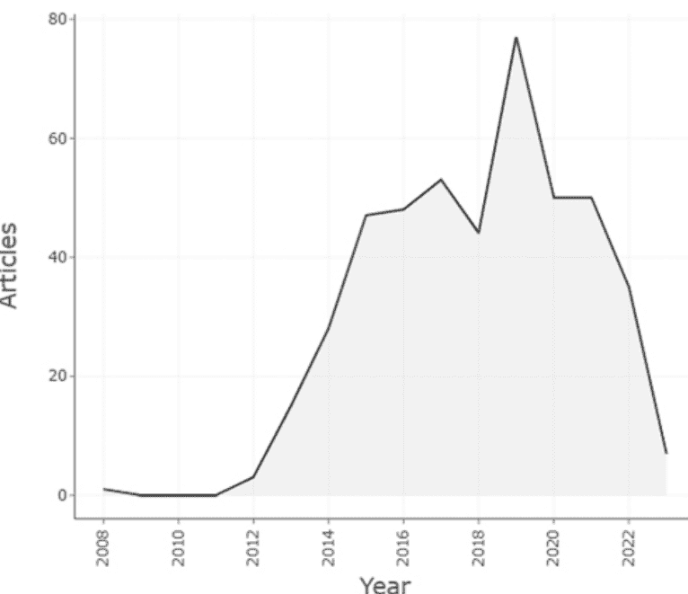

图 1.1 大数据计算的增长

大数据领域最相关的作者是 Bibri Se、Wang L、Wang Y、Li J 和 Liu Y。最不相关的作者是 Wang B、Wang Z、Wei J 和 Zhang C。大数据领域的著名作者列表如表 1.1 和图 1.2 所示。

表 1.1 大数据计算中最相关的作者

| 作者 | 文章数 | 文章分数化数 |
|---|---|---|
| BIBRI SE | 15 | 14 |
| WANG L | 15 | 3.06 |
| WANG Y | 14 | 3.61 |
| LI J | 10 | 2.65 |
| LIU Y | 9 | 2.97 |
| WANG X | 9 | 2.38 |
| ZHANG H | 8 | 1.63 |
| ZHANG J | 8 | 2.01 |
| BUYYA R | 7 | 1.8 |
| LI X | 7 | 1.54 |
| LU X | 7 | 1.98 |
| RANJAN R | 7 | 1.25 |
| SUN D | 7 | 2.4 |
| CHEN Y | 6 | 1.53 |
| MA Y | 6 | 1.34 |
| XU Z | 6 | 2.1 |
| FANG Z | 5 | 1.13 |
| GAO X | 5 | 1.5 |
| LI Z | 5 | 1.18 |
| LIANG F | 5 | 1.4 |
| TANG J | 5 | 0.98 |
| WANG B | 5 | 0.93 |
| WANG Z | 5 | 1.58 |
| WEI J | 5 | 1.15 |
| ZHANG C | 5 | 1.04 |

来源：自行构建


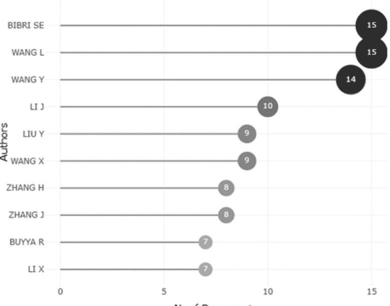

图 1.2 发布的文档数量（来源：自行构建）

目前最流行的大数据概念包括数据密集型计算、并行计算、MapReduce、流计算、云计算和 Hadoop。类似的研究也由 [3, 4] 进行。大数据中最流行的主题如表 1.2 和图 1.3 所示。

表 1.2 大数据中最流行的主题

| 概念 | F |
|---|---|
| 数据密集型计算 | 7 |
| 并行计算 | 7 |
| MapReduce | 29 |
| 流计算 | 5 |
| 云计算 | 43 |
| Hadoop | 21 |
| 大数据 | 123 |
| 大数据计算 | 64 |
| Spark | 26 |
| 机器学习 | 15 |
| 大数据分析 | 9 |
| 数据挖掘 | 9 |

来源：自行构建

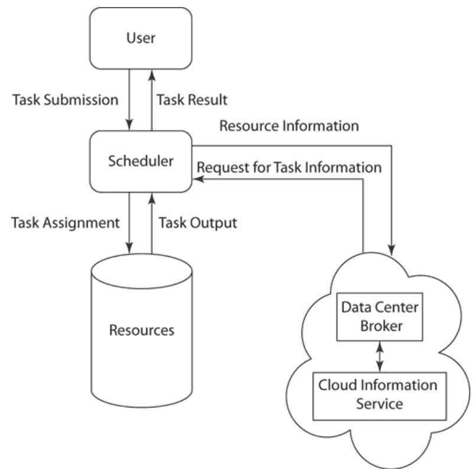

图 1.3 云计算领域的任务调度结构

如上文所述，云基础设施能够处理实时资源密集型应用程序非常重要。但是，某些应用程序只需要一部分资源，可以由低配置设备（例如云边缘的设备）处理。这是通过边缘计算技术在边缘层卸载任务来实现的。边缘计算最初是在 20 世纪 90 年代随着 Akamai 内容分发网络（CDN）的推出而引入的。CDN 向用户传递图像和视频。通常，靠近边缘设备的物联网设备需要中等计算资源。某些实时应用程序，例如云游戏、智能系列和增强现实，需要这种基础设施。边缘计算（EC）充当边缘设备（手机、智能电网、连接式家电）的网关，在边缘计算和存储数据源。它为网络拥塞、更高延迟和带宽限制等重大基础设施问题和挑战提供解决方案。EC 通过将云更贴近用户来有效处理这些问题。EC 使用户能够在边缘执行任务并尽快提供结果。因此，传输延迟和其他通信问题得到解决。EC 的好处是成本效益高的解决方案、更快的响应时间，以及在间歇性连接和安全合规方面与计算相结合的可靠操作。

在本章中，我们描述了边缘计算的典型结构视图。云中部署的高端服务直接与设备接口。机器在边缘学习任务，缩短时间。边缘-云计算为新的物联网设备提供低延迟远程云服务。这可以用于将计算处理服务从云卸载到边缘，以提高客户端的服务质量（QoS）和体验质量（QoE）。EC 模型并不总能取代 CC，因为它不像云那样拥有实质性的资源容量。因此，EC 和 CC 相互补充，相互强化。各研究人员广泛接受流行的三层模型。设备边界，也称为事物层或用户边界，由所有设备组成，例如手机、监控摄像头、物联网设备、智能设备、无人机和其他设备。某些设备的存储容量和处理能力有限。根据客户端的要求，这些数据可以在本地准备，或卸载到边缘和云。边缘边界是设备边界和云层之间的中间层。边缘边界是三层模型的中心核心层。这一层涉及大量网络设备，例如传感器、塔、网关、边缘控制器等。这一层使用无线连接，通过无线接入技术（RAT）、Wi-Fi、短距离通信和其他技术连接智能设备。在这一层中，数据从设备层接收、处理和转发。在云层中，所有与 CC 相关的基础设施，例如存储、数据中心等，通过中心网络连接到边缘层。在三层模型中，云层的关键角色包括计算密集型、存储中心、数据聚合和分析、备份和恢复、可扩展性和灵活性以及集中式管理。虽然边缘层和雾层专注于低延迟处理和即时数据处理，但云层是密集计算的动力中心，以其可扩展性和强大的功能支持整个基础设施的广泛存储。在某些情况下，可以利用边缘计算的优势，将计算服务从云卸载到边缘，以改善用户的 QoE。

本节描述了云计算与边缘计算的配置。人们注意到，边缘服务器放置在处理设备和云之间。因此，边缘计算配置的延迟较低。CC 是一种模型，用于按需及时访问共享基础设施，允许用户通过网络将资源作为服务进行访问，而不是采购和运营基础设施和软件。边缘计算是一种模型，其中网络和计算能力被带到更接近数据源的位置，例如连接到网络的计算机、智能设备、手机和路由器。CC 中的计算时间比 EC 长。在 EC 中，计算过程发生在客户端位置附近的智能设备（物联网）上。在 CC 中，计算过程发生在数据中心。EC 提供更短的计算时间并减少等待时间，从而确保用户的服务质量。图 1.3 解释了云计算、边缘-云和边缘计算功能之间的差异。CC 系统的资源是集中的，具有高处理和计算能力。处理基于人工智能力量，由于远程资源存在较高延迟问题。CC 具有最强大的存储容量，并且完全网络安全。

物联网边缘云汇集了最好的云计算和边缘计算系统。两者都在基于用例、数据分析和存储要求的物联网中具有独特优势。两种计算资源的结合为用户提供了更大的灵活性，减少了延迟时间，并保护了数据隐私标准。在 CC 模型中，任务的算法处理会增加延迟，以允许物联网设备应用程序完成其任务。

边缘计算在地理上分散了资源，物联网边缘云将云存储和计算更贴近边缘源，同时缩小规模。网络边缘的计算机及其所在位置的硬件和软件称为边缘。云计算是指工作在云中完成，而边缘计算是在接近云的设备上完成。边缘计算可以用于任何涉及将服务、数据和智能更贴近用户和设备的场景。随着边缘-云场景的增长，调度问题得到了更多关注。在下一节中，我们将探讨边缘云协同工作时的不同调度问题。

### 1.2 调度

调度对于在虚拟世界中分配任务至关重要，无论是在云计算、边缘计算、雾计算还是任何移动计算环境中。如果任务没有正确调度，虚拟机服务器的性能就会下降。根据 [3, 4]，调度器的主要目标是分配适当的方法来优化可用资源，以满足一个或多个目标。优秀的作业调度器应该能够在动态变化的环境和不同类型的任务中连接调度方法。在当前场景中，优化资源问题确实是一项具有挑战性的任务，其特征是非线性趋势以及动态、复杂的多目标。云计算有三个层：1) 面向最终用户的虚拟资源，2) 调度器为虚拟机分配物理资源，3) 物理资源维护。每个层的调度技术可能因计算复杂性的类型而异。因此，云环境中的调度始终被视为极其复杂，并被归类为非确定性多项式


time (NP) 问题。调度技术分为集中式和分布式方法。非分布式技术中的算法包括启发式算法、近似算法、机器学习和凸优化 [5]。

分布式调度技术采用少数几种算法，例如博弈论、联邦学习、匹配理论和区块链拍卖。根据 [6, 7]，批处理模式启发式算法（BMHA）、在线模式启发式算法（OMHA）和依赖模式启发式算法（DMHA）是云边缘调度算法。当任务出现在系统中时，BMHA 会创建一个队列并将其收集到一个集合中，程序会在经过一定时间后开始。一些示例包括先来先服务（FCFS）、轮转法（RR）、最短作业优先调度（SJF）、最小-最小（Min–Min）和最大-最小（Max–Min）。作业或资源在 OMHA 中在到达系统时进行处理。在线模式启发式算法在各种领域（从机器学习和路径查找到资源分配和库存管理）的动态和实时决策场景中发挥着关键作用。其中一些包括最合适任务调度、依赖模式启发式算法、遗传算法、多目标遗传算法（MOGA）以及在线路由和流量管理算法。

图 1.3 描绘了任务流调度架构。它展示了工作流或任务流是一组为实现用户请求所需结果而组织的任务集合。该图显示，用户首先向调度器发送请求以作为任务提交执行作业，然后调度器在云中搜索资源以执行所需任务。一旦作业被分配给虚拟机以计算结果且作业执行完成，计算节点将结果返回给调度服务器，任务输出被传送到云端。

### 1.3 文献综述

根据 [8]，移动和 IoT 设备可以在边缘服务器附近处理工作，并具有对云服务器的低延迟远程访问。作业调度是在智能设备调度中的一个重要问题，涉及在边缘计算（EC）环境中分配任务以优化总完成时间。高效算法用于在任务的统计信息上运行。总完成时间（TCT）是一种有价值的指标，用于各种调度和优化算法中，特别是用于降低延迟或响应时间。智能设备应用程序通过 Wi-Fi、Bluetooth 等传感器向边缘服务器发送作业，并制定了高效算法以减少延迟问题 [9]。TCT 在各个领域中作为评估调度、资源分配和优化算法性能的关键指标。通过最小化 TCT，算法旨在降低延迟、提高响应能力并增强整体系统性能，使其在动态和实时计算环境中必不可少。当竞争比不是离线算法最坏情况执行时间的两倍时，这些具有下界的离线和在线算法能够提供出色的执行时间。

根据作者 [10]，主要目标是通过分析二进制卸载、能耗、传输功率分配和中央处理器分配频率 [3, 10] 来降低成本并找到边缘计算系统的最佳解决方案。对于用户设备和众多资源有限的移动边缘计算服务器，采用了分散式计算卸载策略（DCOS）算法。[11] 用户根据其优先级进行聚类，最高优先级被分配给在边缘服务器上卸载计算任务。[12] ADMM（交替方向乘数法）是一种先进的优化技术，已成功应用于边缘和云计算中的各种问题，包括虚拟机的选择。这些模型旨在通过优化资源分配、提高效率和确保满足性能要求来降低与虚拟机选择相关的成本。根据先前的研究，客户端信息、边缘节点之间的通信信息以及边缘上的注册信息均真正可信且可自由获取。在实际情况下 [13]，高峰时间可能会极大地消耗边缘资源，导致作业失败。中间核心层位于设备边界和云层之间。该层包含各种网络设备，例如传感器、基站、网关、边缘控制器等等。该层使无线技术能够使用无线接入技术（RAT）、Wi-Fi、短程通信和其他技术访问智能设备。因为 EC 和 CC 互为补充且相互加强，某些服务可以卸载到边缘层以平衡负载并减少最终用户遇到的延迟问题，为他们提供卓越的质量体验。该层必须调度边缘资源以增加快速服务时间，从而减少中央网络传输容量、能耗以及 EC 和 CC 之间的通信网络开销。

在 [14] 中，虚拟机从云层租用计算资源以增加边缘边界的容量，降低边缘处的成本和处理开销、虚拟机按需成本以及与反向虚拟机相关的开销。用户、边缘和云参与三层设备–边缘–云协作模型。设备层（又称用户层）包含各种终端设备，例如无人驾驶飞行器（UAV，又称无人机）、移动设备、监控摄像头、IoT 设备、智能设备和其他设备。许多设备的存储和处理能力有限。这些设备生成和存储大量数据。根据客户端的需求，这些数据集可以在本地处理，也可以卸载到边缘和云端。

根据 [15]，客户端雇用了众多智能设备，作者调查了无人机中的计算卸载问题，并使用分布式智能算法（DIA）[16]求解了非凸优化问题。任务分派算法在分布式计算环境中至关重要，其中任务必须高效地分配给各种计算资源（服务器、处理器或虚拟机）。这些算法旨在平衡负载、优化资源利用率，并确保任务在所需时间内完成，且任务调度高效。在他们的实验中，在线学习分派算法在任务分派的效率和公平性方面显著降低了等待时间或平均任务响应时间。在现实世界中，未计划的卸载任务、不断变化的网络资源以及计算处理资源稀缺是边缘计算网络调度效率低下的主要原因。用户可能会因为从 CC 服务器卸载到 EC 服务器而获得比 CC 模式更高质量和体验的服务。随着边缘计算的出现，可以解决客户端设备与远程云服务器之间长距离造成的带宽拥塞问题。在 [15, 16] 中，在真实数据上进行了实验，以评估多种方法在多个任务、到达、边缘服务器和公平性方面的效率和合理性。结果表明，所提议的在线任务分派和公平调度方法可以通过持续学习经验优化调度。

根据 [7, 17]，云计算环境中调度算法的主要目标是在管理资源之间负载的同时优化资源利用率，以实现尽可能短的执行时间。调度算法分为两种类型：静态调度算法和动态调度算法。云计算环境中最关键的活动是调度。调度是实现云计算良好结果的重要组成部分。CC 环境中调度算法的主要目标是确保资源得到适当使用，并管理资源之间的负载，以实现最短的执行时间。使用多种进程来测试不同的调度算法。

用于公平资源分配的最受欢迎且可接受的分配机制策略是（加权）最小-最大公平性，它最大化用户在共享计算系统中获得的最小资源分配。在性能、可用性和可靠性等维度上，QoS 被定义为用户在共享计算系统中获得的最小资源分配。与计算机和计算日益增长的需求相比，资源是有限的，因此始终会存在对资源利用的需求。通过能源效率降低能耗会影响客户的资源使用成本，这些成本由资源提供商的总拥有成本（TCO）精确确定。任务调度用于通过在特定时间将特定任务分配给特定资源来更好地利用资源对任务进行调度。三层云结构中基于服务请求的调度计划是云服务调度，它在用户级和系统级使用。

用户级调度用于市场供需要求。静态调度和动态调度在此调度中用于


资源提供者、服务提供者、消费者及其他。启发式调度算法旨在通过使用启发式方法或经验法则，在复杂且动态的环境中做出高效的调度决策。它可以通过提高吞吐量、降低延迟和确保任务及时完成来显著提升系统性能。对其运行和有效性至关重要的两个关键函数是目标函数和选择函数。基于遗传的任务调度算法、初始种群、适应度函数、选择、变异和交叉是最新的云任务调度技术。用于多目标负载均衡的多目标粒子群优化算法是一种复杂的优化技术，旨在跨多个资源高效调度任务，同时在这些资源之间平衡负载。它结合了PSO、多目标优化和变异操作的优势，以解决分布式计算环境中任务调度和负载均衡的复杂挑战。通过同时优化多个冲突目标，该算法为实现高效分配和系统性能提供了一种有效的解决方案。

### 1.4 结论

随着物联网（IoT）的实时应用及其广泛使用，数据存储、传输和计算的需求需要海量存储，这可以通过利用大数据和边缘计算来实现。云计算为物联网运营商提供预打包服务，并在用于物联网部署的集中式平台中处于突出地位。本章的主要结论如下：

- 1. 大数据计算的概念出现于2008年，并在此后直到2024年显著增长。大数据计算的增长显而易见，随着所有领域技术的进步，实时物联网设备的应用也随时间增加。工业4.0、教育4.0、新兴智慧城市以及物联网设备使用量的增加导致该领域出现了巨大增长。自2008年以来，许多研究人员都为大数据领域做出了贡献。

- 2. 最流行的大数据概念包括数据密集型计算、并行计算、映射归约、流式计算、云计算和Hadoop。

- 3. 调度在虚拟世界中分配任务时至关重要。在云、边缘或雾计算或任何其他移动环境中处理大量数据时，如果任务未被正确调度，机器的性能将受到影响。

- 4. 云计算架构中的任务调度旨在实现用户请求的预期结果。

- 5. 相关研究表明，批处理模式启发式算法（BMHA）、在线模式启发式算法（OMHA）和依赖模式启发式算法（DMHA）被用于云和边缘计算，以解决虚拟机服务器的性能问题。

迄今为止的大多数研究只关注了两层云-边缘计算系统。调度是边缘-云协同工作效果的关键部分。在协作边缘-云场景中，组织任务被认为是最关键的问题之一。研究人员可以进一步研究大数据计算，这是计算平台的最新趋势，它针对海量的多维数据进行数据分析和决策。

## 参考文献

- 1. S. Tuli, S. Ilager, K. Ramamohanarao, and R. Buyya, “基于A3C学习和残余循环神经网络的随机边缘-云计算环境动态调度,” IEEE Trans. Mob. Comput., vol. 21, no. 3, pp. 940–954, 2022, doi: 10.1109/TMC.2020.3017079.

- 2. Y. Miao, G. Wu, M. Li, A. Ghoneim, M. Al-Rakhami, and M. S. Hossain, “基于移动边缘云计算的智能任务预测和卸载,” Futur. Gener. Comput. Syst., vol. 102, pp. 925–931, 2020, doi: 10.1016/j.future.2019.09.035.

- 3. S. R. Nallola 和 V. Ayyasamy，实时监控视频分析的二十五年：文献计量学综述，Multimed Tools Appl (2024)。https://doi.org/10.1007/s11042-024-18325-6.

- 4. T. H. Sardar, Z. Ansari, and A. Khatun, “使用并行K-means评估Hadoop集群在文档聚类中的效率,” IEEE Int. Conf. Circuits Syst. ICCS 2017, vol. 2018-January, no. Iccs, pp. 17–20, 2017, doi: 10.1109/ICCS1.2017.8325954.

- 5. T. H. Sardar and Z. Ansari, “使用并行K-means算法分析MapReduce在文档聚类中的效率,” Futur. Comput. Informatics J., vol. 3, no. 2, pp. 200–209, 2018, doi: 10.1016/j.fcij.2018.03.003.

- 6. M. Adhikari, T. Amgoth, and S. N. Srirama, “云中工作流调度策略综述,” Int. Conf. Netw. Inf. Syst. Comput., vol. 52, no. 4, pp. 1–36, 2019.

- 7. P. Sharma, S. Shilakari, U. Chourasia, P. Dixit, and A. Pandey, “云计算环境中各种任务调度算法综述,” Int. J. Sci. Technol. Res., vol. 9, no. 1, pp. 1513–1521, 2020.

- 8. X. Fang 等人， “多边缘服务器上作业调度以最小化总完成时间,” IEEE Trans. Netw. Sci. Eng., vol. 7, no. 4, pp. 2245–2255, 2020, doi: 10.1109/TNSE.2019.2958281.

- 9. M. Jia, J. Cao, and W. Liang, “无线城域网中云微数据中心最优布置和用户到云微数据中心分配,” IEEE Trans. Cloud Comput., vol. 5, no. 4, pp. 725–737, 2015, doi: 10.1109/tcc.2015.2449834.

- 10. Y. Ding, C. Liu, X. Zhou, Z. Liu, and Z. Tang, “面向多用户和多移动边缘计算服务器的面向代码分区计算卸载策略,” IEEE Trans. Ind. Informatics, vol. 16, no. 7, pp. 4800–4810, 2020, doi: 10.1109/TII.2019.2951206.

- 11. X. Liu, J. Yu, Z. Feng, and Y. Gao, “具备边缘计算的物联网网络中多智能体增强学习资源分配,” China Commun., vol. 17, no. 9, pp. 220–236, 2020, doi: 10.23919/JCC.2020.09.017.

- 12. M. G. R. Alam, M. S. Munir, M. Z. Uddin, M. S. Alam, T. N. Dang, and C. S. Hong, “面向医疗数据经济高效配置的物联网边缘计算框架,” J. Parallel Distrib. Comput., vol. 123, pp. 54–60, 2019, doi: 10.1016/j.jpdc.2018.08.011.

- 13. T. Le Duc, R. G. Leiva, P. Casari, and P. O. Östberg, “边缘-云计算中可靠资源配置的机器学习方法综述,” ACM Comput. Surv., vol. 52, no. 5, 2019, doi: 10.1145/3341145.

- 14. T. Q. Dinh, B. Liang, T. Q. S. Quek, and H. Shin, “混合边缘-云计算系统中的在线资源采购和分配,” IEEE Trans. Wirel. Commun., vol. 19, no. 3, pp. 2137–2149, 2020, doi: 10.1109/TWC.2019.2962795.

- 15. Y. Liu, K. Xiong, Q. Ni, P. Fan, and K. Ben Letaief, “无人机辅助无线供电协作移动边缘计算：联合卸载、CPU控制和轨迹优化,” IEEE Internet Things J., vol. 7, no. 4, pp. 2777–2790, 2020, doi: 10.1109/JIOT.2019.2958975.

- 16. H. Yuan, G. Tang, X. Li, D. Guo, L. Luo, and X. Luo, “边缘计算任务的在线调度和公平调度：一种基于学习的方法,” IEEE Internet Things J., vol. 8, no. 19, pp. 14985–14998, 2021, doi: 10.1109/JIOT.2021.3073034.

- 17. S. R. Nallola and V. Ayyasam, “具有预定义完成时间约束的基于全面学习粒子群优化（CLPSO）的混合云任务调度,” IEEE Int. Conf. Adv. Electron. Commun. Comput. Intell. Inf. Syst. ICAECIS 2023 - Proc., pp. 44–49, 2023, doi: 10.1109/ICAECIS58353.2023.10170534.

OceanofPDF.com

## 2 无人机领域的决策

### 现有技术状态

Sohini Ghosh, Bishwayan Ghosh, Suneeta Mohanty, and Prasant Kumar Pattnaik

DOI: 10.1201/9781003465775-2

### 2.1 引言

近年来，自主移动机器人获得了巨大的重要性和流行度。它们被用于各种任务，而这些任务否则可能会更加困难或昂贵才能完成。无人机（UAV）是能够在任何三维空间中移动的机器人。监控、入侵者检测、配送等任务都可以由无人机以微不足道的成本轻松执行。但是，无人机存在一些限制。任何无人机可用的电力都是有限的，并且需要以优化的方式使用[1]。但是，如果我们使用无人机网络而不是单个无人机，可以获得更好的结果[2]。无人机需要相互通信。通信意味着它们应该能够在彼此之间共享信息，这将帮助无人机网络更有效地覆盖更广阔的区域。与为同一任务实现单个强大机器人相比，多机器人系统的实现成本也更低。它还提供更好的容错性、强健的信息、增加的覆盖区域和更好的可靠性。

这些机器人共享的信息通常分为两种类型。首先，它是关于覆盖区域的信息，也称为


environment. 其次，它还会共享关于自身的信息，例如，电池可用性、给定时间点所覆盖的区域等等。

无人机网络中的联合决策能力使它们能够管理电池、处理能力等有限资源，并提高覆盖面积。它还能让用户同时控制多个机器人。联合决策保证每架无人机的行动对整个无人机网络都有用。任何不协调的行为都会导致资源浪费和环境的重复覆盖。

在协作式多无人机搜索中，无人机通常被协调以缩短对一个或多个固定点位置的搜索时间。相互交换区域图有助于机器人了解周围环境，并以更好、更有效的方式规划路线。数据以连续方式生成，需要大数据技术来处理产生的海量数据 [3]。

协作搜索由三个参数表示：(i) 每个机器人捕获环境并对图表进行更新，(ii) 关于区域数据的通信，(iii) 基于可用信息就搜索活动做出协作判断。因此，设计无人机网络的任务需要深入研究，仍然是一个开放的研究问题。

本章后续各节安排有条理。第 2.2 节介绍了不同类型决策的文献综述，强调与研究相关的相关出版物。第 2.2.1 节解释了用于创建模型的分布式决策概念。第 2.2.2 节接着解释了集中式信息融合和集中式决策 (CIMCD) 的概念，随后在第 2.2.3 节中，我们介绍了多无人机协作搜索中的 CIMDD。此外，在第 2.2.4 节中，我们全面分析了分布式信息融合和集中式决策 (DIMCD) 抽象及其在无人机上为机器人以良好分布的方式决定高效路径的性能。在第 2.2.5 节中，我们讨论了 DIMDD 以及无人机决策领域的贡献列表。最后，在第 2.3 节中，我们回顾研究发现，强调研究的重点和结果，并为未来研究提出路线图。

### 2.2 无人机决策文献综述

无人机决策有多种算法，有助于提高系统效率。在选择算法时，需要牢记环境和其他参数，因为不同算法在不同场景下的表现不同。

#### 2.2.1 集中式决策 (CD)

集中式决策方法使用各种方法来集中决定和规划无人机的路径。此处不使用与环境相关的信息。文献 [4] 的作者提出了一种 CD 方法，用于优化两个机器人搜索移动目标时的路径并描绘暴露情况。地形通过图的精简来建模，其中顶点象征无人机的航点，边表示航点之间的连接。使用滚动时域优化来决定路径，以减少搜索目标所需的时间。Daniel 等人在 [5] 中研究了多个机器人覆盖给定区域时的集中式移动算法。他们还避免了对类似区域的冗余覆盖。然而，他们的工作不讨论与信息收集相关的任务。相反，它专注于信道感知移动。

#### 2.2.2 分布式决策

分布式决策 (DD) 方法使用各种技术将决策过程分布式化，以规划无人机的路径。不使用与目标搜索区域相关的信息。在 [6, 7, 8] 中，作者提出了一些不需要搜索图表的无人机决策算法的分布式协作。作者针对搜索区域的时空信息取得了出色结果。在 [6, 8] 中，作者提出了几种由网络连接的无人机配置，以完全探索分配区域中此前未知的目标位置。他们的算法主要侧重于为探索区域增加或减少所需的机器人数量。然而，作者未专注于为参与搜索区域相关信息而建模探测器错误的过程。无人机诱导出一个力向量，进而帮助引导机器人沿合适路径行进。该算法还确保无人机之间不会相互碰撞，同时最大化地形区域以成功发现目标。然而，由于全球信息较少，他们的算法有时会遭受信息冗余。

#### 2.2.3 集中式信息融合和集中式决策 (CIMCD)

在 [9] 中，作者提出了一种算法，其中中央基站负责耦合数据并为一组同质无人机决定路径。在这种情况下，每架无人机在飞行期间收集一些信息。无人机在飞行期间不适合与其他无人机或地面站通信信息。机器人到达基站后，收集的数据与基站共享。机器人此时也从基站接收信息。因此，基站负责在综合搜索图表的帮助下合并来自各架无人机的部分和延迟数据。基站还负责根据 K-最短路径算法 [10] 分配新路径。除非待探索区域的查询降低到某个水平以下，否则此过程会重复多次。在 [11] 中，Lum 等人使用具有不同能力的各种机器人来探索特定地形并搜索各种固定目标的位置。假设无人机与地面站在飞行期间存在完美通信。因此，避免了信息滞后的复杂性。基站汇总所有无人机的信息并将其存储在基于驻留的搜索图表中。它为所有机器人生成即时路径，将它们限制在不同的 Voronoi 分区 [12] 中。系统保证对地形进行全面搜索。在 [12] 中，Mirzaei 等人提出了一种类似方法，讨论将各种无人机集中式分配到不同的 Voronoi 分区。该方法使用受限前瞻动态规划方法为机器人决定最佳路径，以最大化一组无人机收集的信息量。在此方法中，使用两种类型的无人机。第一种类型的无人机分布在地形上，以最佳方式覆盖地形。第二种类型的无人机迭代修改其配置。该过程改善了协作搜索的精细度。

#### 2.2.4 集中式信息融合和分布式决策 (CIMDD)

在多无人机协作搜索中，大多数研究依赖于综合搜索地图来整合数据以及用于机器人的分布式 DM [13, 14]。无人机可以拼凑集中存储的信息，其中包含与地形和其他无人机相关的数据。根据集中存储信息的可用性，无人机能够以分布式方式规划路径。该领域的算法将人工隐式场 [15]、机器学习 (ML) 算法 [16]、组群耗散模式 [15]、混合整数直接规划 [18] 和进化算法 [19] 作为协作程序，以尽量减少无人机路线中的隐式重叠。在这些方法中，得出结论：减少无人机路径中的重叠可以提高协作搜索的有效性。这些方法不需要复杂的信息。它们只需要一个系统，根据其探测器合规性和先前信息来更新集中存储的信息。他们的方法要么模拟一个没有任何发现错误 [17] 的完美探测器，要么模拟一个只有误发现的探测器。在这些方法中，假设基站与机器人之间的通信过程中没有噪声。

#### 2.2.5 分布式信息融合和集中式决策 (DIMCD)


在[20]中，Albaro 等人提出了一种集中式决策算法，用于协作狩猎，其中所有 UAV 都维护并合并与搜索区域相关的数据。机器人相互共享各自的探测器合规性。这些合规性有助于更新与该区域相关的局部可用图表。每个 UAV 收集的数据包括在地形各子区域中执行的合规性次数。机器人可以相互共享信息并共享地形数据。集中式基站将机器人分配到不同的区域，且不会出现任何发现犯罪 [17] 或仅有误发现的探测器 [16]。一些方法还关注限制，例如维度噪声 [22] 以及虚假警告和误发现的犯罪发现 [21]。在[21]中，作者使用理论探测器操作以分布式方式决定机器人的高效路径。探测器操作将机器人的路径重定向到这样一个位置：由于未来的探测器合规性，预期信息增益得到优化。虽然所述算法将与狩猎区域相关的查询最小化，但这些方法未考虑通信限制。

#### 2.2.6 分布式信息融合与分布式决策（DIMDD）

当 UAV 能够同时融合信息并自行做出决策时，它们可以变得大体独立。完全分布式多机器人协作狩猎方法 [23, 24, 25] 使 UAV 能够保留感知、通信、处理和内存能力 [26]。每个 UAV 都有能力感知地形、修改其狩猎图表、合并和交换信息，并根据要求更新其路径，以便有效搜索地形。在这些方法中，有些未考虑感知和通信限制 [23, 24, 25]。这一类方法的一个子集考虑了感知或通信限制等限制，但如果两种限制同时存在，这些方法就无法工作。在[27]中，作者提出了一种类似的方法，其中考虑了与通信范围相关的限制。该算法的一个独特之处在于，机器人可以决定使用集体决策方法。虽然系统假设存在通信限制，但它并未提出考虑感知限制的现实探测器模型。在[17]中，提出了一种完全分布式协作方法，其中 UAV 在参与双重探测器合规性方面相互匹配。在此，系统对两种类型的犯罪考虑了现实探测器模型；然而，未包括消息传递中的限制。

在[18]中，Hu 等人设计了一种同时使用通信和感知限制的多 UAV 协作方法。此方法还侧重于 UAV 之间的一致性，以便在有限合规性次数的情况下维护关于每个机器人的类似图表。

我们已讨论了表 2.1 中给出的某些决策算法，以及每种算法可能证明最佳的某些情况。

| 序号 | 出版年份 | 作者 | 探索实体 | 发现 |
| :--- | :--- | :--- | :--- | :--- |
| 1 | 2003 | Tamio Arai 等人 [28] | 协同进化 | 作者讨论了多机器人系统，其中目标使用多个机器人/UAV 进行监控。然而，开放问题包括轻松使人类控制多机器人团队。 |
| 2 | 2005 | M. Bernardine Dias 等人 [29] | 任务分配 | 它通过简要介绍基于市场的多机器人协调，满足了对相关文献调查的要求。本文未讨论各种挑战和方面。 |
| 3 | 2006 | Andreas Kolling 和 Carpin Stefano [30] | 使用多个 UAV 进行多目标狩猎 | 这里的目标是使用多个 UAV 观察各种移动目标。因此，工作量在不同 UAV 之间分配。 |
| 4 | 2008 | Eric W. Frew 和 Jack Elston [31] | 优化 | 它展示了区域搜索和目标跟踪的集成。仿真结果也验证了所讨论的方法。然而，整个流程的效率未在本文中详细讨论。 |
| 5 | 2008 | Eric W. Frew 和 Jack Elston [12] | 查找区域和搜索目标 | 它提出了一种集成区域搜索和目标跟踪的方法。使用跟踪度量来衡量每个机器人到达未见目标的能力。此外，所有机器人不定期更新覆盖地图。 |
| 6 | 2010 | Mark P. Kolba 等人 [33] | Voronoi 分区 | 侧重于传感器管理和静止目标检测。但它不讨论目标是动态或移动的场景。 |
| 7 | 2010 | Sonia Waharte 和 Niki Trigoni [32] | 贪婪展望规划 | 此处讨论了各种可能影响失踪受害者搜索时间的参数。然而，本文可以改进，以添加可能有助于更快搜索目标的新标准。 |
| 8 | 2010 | Silvia Ferrari 等人 [33] | 任务分配 | 它讨论了部署移动传感器网络以在平面中检测移动目标。在现实世界中，移动目标大多不在平面上，而是在 3D 环境中。这是本文的进一步范围之一。 |
| 9 | 2011 | H. Chung 和 Joel W. Burdick [21] | 基于代理的移动性 | 它为空间搜索问题提出了解决方案，其中移动代理在给定区域中搜索静止目标以声明目标是存在还是不存在。它不讨论目标不是静止的情况。 |
| 10 | 2013 | Natallia Katenka 等人 [34] | 传感器管理 | 作者描述了使用框架，通过无线传感器网络收集的二进制决策来跟踪多个目标。它不讨论目标是移动的情况。 |
| 11 | 2014 | Mohamed Elbanhawi 和 Milan Simic [35] | 动态规划 | 本文的动机是回顾运动规划的最新技术，测试和检查带有实现细节的规划器。它还阐明了与运动规划相关的挑战，并提出了一些可以帮助克服这些挑战的方法。 |
| 12 | 2015 | Jürgen Scherer 等人 [36] | 线队形 | 一组无人机借助分布式控制系统进行协调。该系统借助机器人操作系统 (ROS) 实现。它可以借助无线基础设施，将 UAV 的实时视频流提供给多个地面站。 |
| 13 | 2019 | Tanvir Habib Sardar, Ahmed Rimaz Faizabadi [37] | 并行计算 | 寻找并行化程序的最佳方法，尝试使用各种并行化策略对各种知名应用进行试验 |
| 14 | 2020 | Mustafa Hamurcu 和 Tamer Eren [38] | 国防多标准决策 (MCDM) | 讨论多标准决策 (MCDM) 以及选择 UAV 的其他高效方法。 |

### 2.3 结论与未来工作

本章讨论了各种类型的决策算法，例如集中式决策、分布式决策及其子类别。我们还发现，大数据处理技术在管理由 UAV 网络每时每刻生成的信息方面起着非常关键的作用。简单的集中式决策可用于两个 UAV 搜索移动目标。集中式决策的改进版本，如集中式信息融合和分布式信息融合，可用于解决更复杂的问题。在简单的分布式决策中，UAV 无法相互通信；因此存在数据冗余问题。这也会导致 UAV 路径重叠，从而降低系统效率。然而，在集中式决策和分布式决策中，此问题已得到解决，其中信息被集中存储，但 UAV 可以自由决定自己的路径。因此，总结来说，根据环境的复杂性，我们需要相应地选择合适的算法。

## 参考文献

- 1. Sardar, Tanvir Habib, Aishwarya Muttineni, 和 Ravi Ranjan。“客户体验和库存管理中大数据的未来。” 233–248。载于 Tanvir H Sardar 和 BK Pandey 著《大数据计算：技术、方法和应用的进展》。CRC Press, 2024.

- 2. Sardar, T. H., A. Khatun, S. Sengupta, Y. Alam, 和 T. Ara。“医疗保健领域和生物医学大数据中的机器学习：技术、应用和挑战。” 336–352。载于 Tanvir H Sardar 和 BK Pandey 著《大数据计算：技术、方法和应用的进展》。CRC Press, 2024.

- 3. Sardar, Tanvir Habib, Sunanda Das, 和 Bishwajeet Kumar Pandey。“可解释 AI (XAI)：概念和理论。” 医疗数据分析与可解释人工智能处理。1–18。载于 Tanvir H Sardar 和 BK Pandey 著《大数据计算：技术、方法和应用的进展》。CRC Press, 2024.

- 4. Riehl, James R., Gaemus E. Collins, 和 Joao P. Hespanha。“UAV 团队的协作搜索：一种基于动态图的模型预测方法。” IEEE 航空航天和电子系统交易 47.4 (2011): 2637–2656.

- 5. Daniel, Kai, 等人。“面向航空传感器网络的认知代理移动性。” IEEE 传感器期刊 11.11 (2011): 2671–2682.

- 6. Enns, Dale, Dan Bugajski, 和 Steve Pratt。“协作搜索的制导与控制。” 2002 年美国控制会议论文集 (IEEE Cat. No. CH37301)。第 3 卷。IEEE, 2002.

- 7. Vincent, Patrick, 和 Izhak Rubin。“使用 UAV 群进行协作搜索的框架与分析。” 2004 年 ACM 应用计算研讨会论文集。2004.

- 8. Yanmaz, Evsen, 和 Hasan Guclu。“使用移动无线传感器网络进行静止和移动目标检测。” 2010 INFOCOM IEEE 计算机通信研讨会。IEEE, 2010.


- 9. Sujit, P. B., 和 D. Ghouse. “多架无人机在飞行时间约束下的搜索.” IEEE Transactions on Aerospace and Electronic Systems 40.2 (2004): 491–509.

- 10. Jiménez, Víctor M., 和 Andrés Marzal. “计算 k 条最短路径：一种新算法及实验比较.” Algorithm Engineering: 第3届国际研讨会，WAE’99 伦敦，英国，1999年7月19–21日论文集 3. Springer, Berlin Heidelberg, 1999.

- 11. Lum, Christopher W., Juris Vagners, 和 Rolf T. Rysdyk. “异构代理团队的具有覆盖保证的搜索算法.” Journal of Aerospace Computing, Information, and Communication 7.1 (2010): 1–31.

- 12. Mirzaei, Mostafa, 等. “不确定环境下协作多车辆搜索与覆盖问题.” 2011年第50届IEEE决策与控制会议和欧洲控制会议. IEEE, 2011.

- 13. Passino, Kevin, 等. “自主空中载具的协作控制.” Cooperative Control and Optimization 66 (2002): 233–271.

- 14. Flint, Matthew, Marios Polycarpou, 和 Emmanuel Fernandez-Gaucherand. “多架自主无人机目标搜索的协作控制.” 第41届IEEE决策与控制会议论文集，2002. 第3卷. IEEE, 2002.

- 15. Yang, Yanli, Ali A. Minai, 和 Marios M. Polycarpou. “不确定环境下联网无人机的分布式协作搜索.” 2004年美国控制会议论文集. 第6卷. IEEE, 2004.

- 16. Yang, Yanli, Marios M. Polycarpou, 和 Ali A. Minai. “基于机会学习法的多架无人机协作搜索.” Journal of Dynamic Systems, Measurement, and Control 129.5 (2007): 716–728.

- 17. York, George, 和 Daniel J. Pack. “基于协作无人机系统的地面目标检测.” Journal of Intelligent & Robotic Systems 65 (2012): 473–478.

- 18. Forsmo, Erik J., 等. “利用混合整数线性规划的无人机最优搜索任务.” 2013年无人机系统国际会议（ICUAS）. IEEE, 2013.

- 19. Berger, Jean, 和 Jens Happe. “面向协作无人机团队在受限信息共享下的协同进化搜索路径规划.” IEEE进化计算大会. IEEE, 2010.

- 20. Gil, Alvaro E., Kevin M. Passino, 和 Jose B. Cruz Jr. “面向信息流约束的稳定协作监视.” IEEE Transactions on Control Systems Technology 16.5 (2008): 856–868.

- 21. Chung, Timothy H., 和 Joel W. Burdick. “基于概率搜索策略的搜索决策分析.” IEEE Transactions on Robotics 28.1 (2011): 132–144.

- 22. Hoffmann, Gabriel, Steven Waslander, 和 Claire Tomlin. “基于粒子滤波信息论成本的分布式协作搜索及四旋翼机应用.” AIAA制导、导航与控制大会及展览. 2006.

- 23. Bourgault, Frederic, Tomonari Furukawa, 和 Hugh F. Durrant-Whyte. “贝叶斯世界中丢失目标的协调分布式搜索.” 2003年IEEE/RSJ智能机器人与系统国际会议论文集（IROS 2003）（编号03CH37453）. 第1卷. IEEE, 2003.

- 24. Tisdale, John, ZuWhan Kim, 和 J. Karl Hedrick. “自主无人机路径规划与估计.” IEEE Robotics & Automation Magazine 16.2 (2009): 35–42.

- 25. Delle Fave, Francesco Maria, 等. “利用最大和算法的无人机目标搜索分布式协调.” (2010): 35–44.

- 26. Ghosh, Ramkrishna, Suneeta Mohanty, 和 Prasant Kumar Pattnaik. “无线传感器网络中无人机机队的α依赖演进移动模型.” International Journal of Communication Systems 34.14 (2021): e4926.

- 27. Sujit, P. B., 和 Debasish Ghose. “基于自评估的多代理协作搜索决策.” IEEE Transactions on Automation Science and Engineering 8.4 (2011): 705–719.

- 28. Arai, Tamio, Enrico Pagello, 和 Lynne E. Parker. “多机器人系统的进展.” IEEE Transactions on Robotics and Automation 18.5 (2002): 655–661.

- 29. Kalra, Nidhi, 等. “基于市场的多机器人协调：全面调查与分析.” 94 (2005): 1257–1270.

- 30. Kolling, Andreas, 和 Stefano Carpin. “多移动目标监视的多机器人协作：一种新的行为方法.” 2006年IEEE机器人与自动化国际会议论文集，2006. ICRA 2006. IEEE, 2006.

- 31. Frew, Eric W., 和 Jack Elston. “主动机器人网络集成搜索与跟踪的目标分配.” 2008年IEEE机器人与自动化国际会议. IEEE, 2008.

- 32. Waharte, Sonia, 和 Niki Trigoni. “利用无人机支持搜救行动.” 2010年新兴安全技术国际会议. IEEE, 2010.

- 33. Ferrari, Silvia, Rafael Fierro, 和 Domagoj Tolic. “利用异构移动传感器网络跟踪机动目标的几何优化方法.” 第48届IEEE决策与控制会议（CDC）论文集，该会议与2009年第28届中国控制会议联合举办. IEEE, 2009.

- 34. Katenka, Natallia, Elizaveta Levina, 和 George Michailidis. “利用无线传感器网络的二进制决策跟踪多个目标.” Journal of the American Statistical Association (2013): 398–410.

- 35. Elbanhawi, Mohamed, 和 Milan Simic. “基于采样的机器人运动规划：综述.” IEEE Access 2 (2014): 56–77.

- 36. Scherer, Jürgen, 等. “面向搜救的自主多无人机系统.” 民用微型航空器网络、系统和应用首届研讨会论文集. 2015.

- 37. Sardar, Tanvir Habib, 和 Ahmed Rimaaz Faizabadi. “利用OpenMP和Pluto在对称多处理机上对所选数值算法进行并行化与分析.” Data Technologies and Applications 53 (2019): 20–32.

- 38. Hamurcu, Mustafa, 和 Tamer Eren. “利用多准则决策方法的国防无人机选择.” Journal of Mathematics 2020 (2020): 1–11.

## 3 对COVID-19理解与处理的简要研究
用于深度学习和机器学习算法预测的测试平台

M. Premalatha, G. Anusooya, G. Suganya, M. Braveen, 和 Venkatasubramanian Adhinarayanan

DOI: 10.1201/9781003465775-3

### 3.1 引言

COVID-19大流行起源于中国武汉，首例病例登记于2019年12月底。这种最初被认为是普通流感的疾病，已成为一种遍布全球、在人类历史上从未见过的规模上造成经济崩溃的“人类杀戮机器”。世界卫生组织（WHO）将COVID-19也命名为SARS-COV-2，它是一种传染病，这意味着人们必须相互保持距离以阻止其传播。该疾病对人体有多种影响，最初表现为普通感冒和头痛等症状，进而发展为肺炎和急性呼吸道疾病等不良后果。一个主要问题是，可能存在无症状病例，这意味着一个人可能感染了COVID-19却不知道自己已被感染，这可能导致病毒在人群中传播得更快。由于病毒传播呈指数增长，各国领导人除了在特定地区实施封锁作为预防措施外，别无他法来阻止其传播。我们研究了各国有效利用封锁的方法以及它们如何控制疾病传播。在一些国家，封锁效果不甚理想，而另一些国家则成功扭转了病例曲线。确定哪些来自这些成功国家的策略可以应用于每日病例数较高的国家（如印度），这一点至关重要。

ML算法将被用于帮助更好地决策以应对这种大流行情况。本章尝试使用ML算法预测未来的COVID病例，这些算法已被用于股票价格预测、心血管疾病预测、乳腺癌预测等多种问题的预测。本章侧重于根据各算法在预测未来病例方面的性能和准确性进行比较。

本章的主要目标是预测未来病例，以便采取必要措施防止病毒进一步传播并采取必要的预防措施。在本章中，各种机器学习算法，如线性回归、拉索回归和支持向量机；以及各种类型的循环神经网络，如LSTM、双向LSTM和带有单变量及多变量形式的编码器-解码器LSTM，均已用于COVID-19分析。本节将比较上述模型获得的结果，以评估其性能和准确性。对各国如何专注于扭转病例曲线进行了案例研究，并考虑了可用于降低曲线的特征。

上述所有细节将在后续章节中详细阐述。首先，让我们探讨数据抽象，因为COVID-19问题是相对较新的，获取数据的渠道并不丰富；接着，我们将深入进行探索性数据分析，以找出表格中每个参数如何影响病例预测，并展示各种可视化；随后，我们将探讨每个模型的工作原理以及为何选择这些模型而非其他模型。最后，我们将考察使其他国家有可能在一年或更短时间内尽可能减少病例数量并解除封锁影响的特征。简而言之，我们比较了预测病例的算法，并确定了扭转曲线的特征。


#### 3.1.1 为什么在 COVID-19 中使用 ML/AI?

如果我们需要理解为什么 ML 算法正在用于 COVID-19，我们首先需要理解它们在帮助预测 COVID-19 的各种因素方面有多有用，以便如果这种大流行病再次发生，我们可以阻止另一次类似的大流行病。对于 COVID-19，涉及机器学习算法的一些方法包括

- i. 识别谁有高潜在感染风险；
- ii. 诊断受影响的患者；
- iii. 加速药物/药品研发；
- iv. 预测疾病在全球的传播；
- v. 理解病毒的复杂性；
- vi. 理解病毒起源及其映射；
- vii. 预测下一次大流行病（第二波/第三波）。

如您所见，我们列举了许多可能性，ML 算法可用于帮助识别病毒、预测大流行病、隔离以及根除病毒的方法，尽管对于像 COVID-19 这样的新问题，研究仍处于早期阶段，但引入 ML 及其子领域的概念可以大力推动研究，并有助于为这个新问题提供更快的解决方案。在上述提到的因素中，单个因素本身无法为研究提供太多帮助，但它们的组合有助于为新问题提供更快的解决方案。在接下来的章节中，本章将探讨一些已使用的 ML 算法如何帮助提供对 COVID-19 大流行病问题的见解，以及我们如何使用特征来采取预防措施。

#### 3.1.2 COVID-19 数据面临的挑战

关于像 COVID-19 这样的新问题，主要挑战如下。

数据可用性：用于训练各种模型的数据可用性非常有限，因为 COVID-19 数据公开仅有一年；数据量少使得模型难以进行训练。

#### 3.1.2.1 数据的可靠性

提供的数据不可靠，因为并非所有有症状的人都接受了检测，只有接受过检测的人才被计入，而那些实际上是 COVID-19 阳性但无法获得医疗保健的人因为未接受检测而被视为阴性。此外，由于缺乏可用的检测规模，部分数据来自社交媒体，而众所周知，依赖社交媒体数据并非最佳选择。

尽管存在上述问题，我们仍必须基于可用数据构建模型，并假设数据可靠，因为对于 COVID-19 没有替代的数据抽象选项。

### 3.2 背景与文献综述

#### 3.2.1 起源

众所周知，冠状病毒已经广泛传播，但在探讨其预测之前，让我们先谈谈这场大流行病是如何发生并改变每个人生活的。因此，在探讨其传播方式之前，让我们讨论一下 COVID-19 影响的各种因素、针对其采取的预防措施等等。我们需要更深入地了解病毒是如何起源的，以便更好地了解如何继续。当前的大流行病是由一种称为 SARS-COV-2 的冠状病毒引起的。冠状病毒是一大类病毒，引起各种呼吸道疾病，其中一些很严重，例如严重急性呼吸综合征（SARS）或中东呼吸综合征（MERS），这些疾病以高死亡率著称，分别发现于 2003 年和 2012 年。冠状病毒分为四种不同的病毒：α型、β型、γ型和δ型。已知会感染人类的冠状病毒属于 α型 和 β型 类别。冠状病毒也在动物之间传播，引起呼吸道疾病，但那些在动物和人类之间传播的被称为人畜共患病毒，该事件被称为溢出事件。

寻找病毒起源的原因在于，杀死病毒的最佳方法是将其隔离，它就会自行死亡；此外，我们可以了解其传播动态，以便公共卫生部门采取必要措施尽可能控制其传播。查明病毒起源的一种方法是查看其基因组成；这样做的原因是，如果存在基因组成相似的病毒，我们将能够限制该病毒的地理位置，从而控制其传播。SARS-COV-2 的基因组成与 SARS-COV 相似，SARS-COV 在蝙蝠种群中被分离出来，这就是为什么最初有人推测人畜共患事件可能从蝙蝠传播给人类。我们确实知道人畜共患事件发生了，但无法找出第一个通过此次溢出事件被感染的人；然而，第一例冠状病毒病例于 2019 年 12 月 19 日在中国武汉登记。

在第一例病例登记后，对基因组成进行了检查，如所述，它与最初在 2003 年发现并从蝙蝠中分离出的 SARS-COV 相似；然而，这种病毒仅在少数地方的蝙蝠中出现，如亚洲、非洲、中东和欧洲。SARS-COV-2 能够影响人类的原因是它能够轻松适应人类细胞受体并利用细胞。

一旦检测到第一例 COVID-19 病例，调查便开始寻找溢出事件发生的地点，以便只需实施最少的地理限制。由于第一例病例在中国武汉被发现，很快发现病毒的中心是当地海鲜市场——华南海鲜批发市场。市场内人员（包括供应商和普通消费者）的病例增加导致市场关闭；然而，为时已晚，因为此时 COVID-19 已经在中国各地开始传播。到目前为止的主要问题是，无人能找出谁是第一个被感染者以及溢出是如何发生的，尽管第一例病例大约在 2019 年 12 月登记。报告称，COVID-19 的第一例感染病例很可能出现在 2019 年 11 月左右，这就是为什么控制病毒变得非常困难。在确定这种病毒的源头之前，即使度过这场大流行病，病毒重新传入人类群体的风险依然存在。

尽管研究人员能够找出起源点并试图阻止其进一步传播（因为这是一种传染病），但它还是迅速在整个中国以及全球其他国家传播开来。

#### 3.2.2 传播

COVID-19 在全球传播的原因是，在病毒最初被发现的时候（大约是 12 月），全球各地有很多人来中国欢迎和庆祝新年，这就是为什么武汉成为该疾病的热点地区。疾病在人群中传播，当他们飞回家乡时，他们成为最初的一些病例，进而在那些国家创造了新的热点地区。

#### 3.2.2.1 中国

如前所述，新冠病毒的爆发于 2019 年 12 月 19 日在武汉一个海鲜市场报告，第一例死亡病例于 2020 年 1 月 11 日报告；到这个时候，中国各地正在报告病例，全球也有一两例病例。中国能够最快且最有效地控制病毒，得益于严格的封锁限制，而其他国家无法遵循这些限制。

#### 3.2.2.2 美国

美国第一例病例于 1 月 21 日登记，发现该患者曾前往中国；这导致 COVID-19 在全国范围内进一步传播，使美国的病例总数成为增长最快的之一并造成多人死亡。到 7 月底，美国确诊病例总数位居首位，大流行期间发生了各种抗议活动，导致病例数增加。

#### 3.2.2.3 印度及其他国家

本章将更多关注 COVID-19 在印度产生的影响，以及在该情况下，印度是每天提供全球最大数量阳性病例的领先国家。印度的第一例病例发生于 2020 年 1 月 27 日的喀拉拉邦。印度最初试图通过实施各种封锁来应对，但由于金融危机，该国不得不开始解封，这起初效果不错，但后来导致了第二波疫情。


新冠病毒也传播到了其他多个国家，对瑞典等国家产生了重大影响，瑞典更相信群体免疫；此外，巴西等一些国家并未将COVID-19视作严重问题，这导致该地区病例数增加。本章聚焦印度，并讨论其他受严重影响的国家如何找到方法来中和病毒，使每个人的生活恢复到COVID-19之前的状态。

使用机器学习预测模型的原因是，预测/回归模型在多种与COVID-19类似的情况下已被证明很有用[1, 2, 3, 4, 5]，例如股票价格预测、天气预测，以及最近的加密货币预测。因此，我们的目标是利用各种机器学习模型来预测COVID-19的未来病例，以便根据这些即将出现的预测，采取印度可以利用的必要措施，在大流行第二波之后抑制病例曲线。

#### 3.2.3 文献综述

本节介绍了关于COVID-19的各种文献的文献综述；其中大部分是新的，因为COVID-19问题本身就是新的，但文献中使用的想法或模型可能是那些经常被使用的。我们选取了这些章节中使用的一些模型，以探讨在印度预测COVID-19病例的可能性，并对已使用的模型进行详细比较。

Furquan等人[6]分析了如何使用各种机器学习模型来预测COVID-19可能导致的未来病例数量；特别是，他们使用了线性回归、最小绝对收缩和选择算子（LASSO）、支持向量机（SVM）和指数平滑等模型。结果是通过比较模型在预测未来10天感染病例、死亡人数和患者康复率方面的性能得出的。在所有模型中，指数平滑在预测中表现最好，其次是线性回归和LASSO回归，而SVM在所有场景中表现都很差。

Ayush等人[7]使用循环神经网络（RNN）来预测未来的病例，因为已开发出各种模型来预测未来病例。他们解释了数据可用性的局限性，并还从可靠性角度考虑了各种假设。他们展示了各种模型，如LSTM、双向LSTM和编码器-解码器LSTM，并对单变量和多变量数据进行了实验。他们使用这些模型来预测印度及该国其他几个COVID-19病例较多的州的未来病例。他们预测了未来两个月的病例，结果很有希望，因为模型获得的准确性无疑表明现有数据不足。

Saurav等人[8]的重点是通过封锁措施控制COVID-19在印度的传播，他们设计了一个模型，用于预测整个国家需要封锁的总天数，以使病毒得到隔离并清除最后一个可能由COVID-19导致的病例。该模型基于等差数列得出的公式，参数包括感染者总数、每个人传播病毒的速度以及感染者的康复率；然而，它没有考虑无症状病例，因此传播速度因子会偏离其真实值。结果讨论了对于不同传播速率，封锁需要建立多少天。

Petropoulos等人[9]建议了一种指数平滑技术，用于预测未来10天的COVID-19病例。该模型对不同的时间区间进行预测，因为预测值相对于实际数据存在不确定性。这是由于可用于COVID-19的数据量有限，以及在全球某些时间间隔内病例呈指数级增长所致，因为最初几个月COVID-19模型可用的数据仅基于从中国获得的数据进行训练，但当病例开始在其他国家出现时，不确定性就产生了；这导致了指数级增长，从而导致模型表现不佳，这就是为什么本章专注于预测30%区间、然后是50%和75%的病例，以提供更好的准确性。

Ian Cooper等人[10]使用SIR模型来查明全球COVID-19疾病的感染率。SIR模型是一种非常常见的模型，用于查明感染率并预测特定时期内将被感染的总人数。SIR代表易感、感染和移除。通常在这种模型中，易感者总数保持不变；最初，整个易感人群都有被感染的可能，而从该感染人群中，人们要么死亡要么康复，因此被移除。于是，易感者人数单调减少到零，感染者人数上升到峰值然后减少到零，最终这些人都被加入到康复人群中。

Apurbala等人[11]使用分段回归来预测即将到来的病例、死亡和康复情况。最初使用简单线性回归的方法提供了巨大的误差值，因为在印度的各个地区，病例数在某些节点呈指数级增长，因此，他们使用了倍增时间。倍增时间是指当前期间感染数翻倍所需的时间。倍增时间与感染增长率成反比，因为当倍增时间较大时，病例增加直到那个点一直是线性的，之后病例数翻倍。图中病例数增加到前值两倍的点被视为断点；借助断点，进行分段回归。本章基于当前点和前一点之间的差异来查找断点。最后，借助分段回归和线性回归，他们能够生成与真实数据相匹配的准确值。

Muhammad等人[12]使用各种监督式机器学习模型来预测各国的病例，并从中推荐了最佳模型。使用的模型包括决策树、支持向量机、朴素贝叶斯模型和逻辑回归。运行各种模型后，发现决策树模型提供了最佳准确性，SVM模型具有最高敏感度，而朴素贝叶斯提供了最高特异度。

Massonnaud等人[13]引入了一个用于预测未来病例的模型，即易感、暴露、感染、移除（SEIR）模型，其中感染传播率的变化范围从最佳情况（1.5）到最坏情况（3），基于此，他们计算可能很快发生的病例总数，并得出结论：各地区可用的病床是否足以收治可能因病毒而产生的患者。

Malavika等人[14]使用逻辑回归来预测短期间隔的病例，在每日病例数高的州训练模型后，获得了95%的准确率。SIR模型用于最坏情况场景下的病例预测，以便采取必要措施。

Anastassopoulou等人[15]使用SIRD模型（易感、感染、康复、死亡），并试图在两种不同场景下查明病毒的再生数。第一种场景基于提供的官方统计数据得到再生数，但由于无症状病例的可能性很高，该工作将感染者数量增加了20，康复者数量增加了40，并计算了病毒的再生数。两种场景下再生数的平均值被视为最终再生数，基于此，对未来30天内中国可能感染病例总数进行了预测。

AlJame等人[16]使用多种模型的组合，根据提供的血液检测预测一个人是否COVID-19阳性。本章提供的集成模型是ERLX，它包括逻辑回归、多种分类器和额外树，其输出由XGBoost分类器组合。预处理由KNNImputer与孤立森林用于模型中的异常值检测，并使用合成少数过采样技术（SMOTE）进行平衡数据分布。所提议的模型在准确性（99.8%）方面远优于各种最先进的模型；由于模型获得的高准确性，它被认为是基于血液样本进行COVID-19诊断的最强大、最可靠的模型之一。

Sarkar等人[17]使用了一种称为SARIIS（易感、无症状、康复、隔离感染、感染和隔离易感）的SIR模型变体。本章提出的结果表明，当感染者与未感染者之间的接触率降低时，再生数可以降低，这可以通过隔离易感者来实现；这证明了有效的封锁


在印度等州也将有所帮助，因为在发表时，未将疫苗接种因素考虑在内。

Lei Zhang 等人 [18] 使用 LSTM 模型对截至 2020 年 3 月的数据集中加拿大未来 COVID-19 病例进行了预测。他们预测了连续 2 天间隔的第 2、4、6、8、10、12 和 14 天的病例数，并预测病例下降将从 2020 年 6 月开始，同时将加拿大的传播率与意大利和美国的传播率进行了比较。

Katoch 等人 [19] 建议使用 ARIMA（自回归集成移动平均）和 SARIMA（季节性自回归集成移动平均）方法，这些方法基于约翰斯霍普金斯大学（JHU）的数据集，用于未来 COVID-19 病例的预测。他们应用差分和对数变换来去除数据中的季节性和趋势，因为数据未通过 Augmented-Dickey Fuller 检验。预测获得了 95% 置信区间，与现实世界数据具有高度一致性。

Ricardo 等人 [20] 使用降维高斯回归对 1 月至 4 月间 82 天的可用数据进行病例和死亡病例预测。他们发现，中国的病死率低于美国，并还估计死亡病例峰值将出现在 7 月，死亡病例总数为 132,800 例，确诊病例总数为 150 万例。他们得出结论，即使实施严格的封锁限制，美国的感染传播率也将在两个月内增加。

Mohsen 等人 [21] 开发了一个基于 1 月至 4 月数据的模型，用于预测即将到来的确诊和康复病例。他们使用基于双分段标准正态分布的自回归模型来预测病例和康复情况。由于处理的是时间序列数据，在拟合模型前必须使其平稳，该模型被称为 TP-SMN-AR（基于缩放混合正态分布的双分段分布）；这是一个涉及经典对称/非对称和轻/重尾自回归模型的灵活模型。

Charles 等人 [22] 开展了一项基于随机抽样的简单调查，以了解 COVID-19 对加纳学生的影响。大流行的影响推动学生转向在线教育；然而，根据调查，许多学生认为这效率低下，因为有些人缺乏相应技术，而另一些人则不知道如何使用这些技术。总体而言，加纳的在线学习确保每个学生都了解如何获取在线教育。

Matjaž 等人 [23] 基于各地区先前获得的死亡和康复病例，预测了各地区即将到来的每日 COVID-19 病例。他们开发了一个公式，基于该地区过去 m 天共 n 天内的增长率。他们提供了不同感染传播率下的病例增长结果，以考虑最佳和最坏情况，医疗当局可据此采取必要行动。

Kapoor 等人 [24] 使用图神经网络（GNN）进行病例预测，并将其与各种其他时间序列预测方法进行了比较。在 GNN 中，模型从单个时空图中学习，节点代表区域层面的人类流动，边代表基于区域的人类流动。该模型在美国 COVID-19 病例数据集上进行了训练。分析表明，该模型将均方根对数误差（RMSLE）降低了 6%，并将皮尔逊相关系数从 0.9978 提高到 0.998。本章得出结论，使用 GNN 对预测将有益，因为所得结果支持其观点。

中国一个团队 [25] 对病毒在内地初期获得的数据进行了总体探索性分析。本章探讨了年龄和性别、病死率和死亡率计算、病毒传播速度的地理时空数据、流行病学曲线构建以及亚组分析等因素。他们将上述因素获得的数据与感染总人数、易感人数和无症状感染人数进行了比较，并计算了武汉及中国其他各地的感染传播率。

我们审阅了涉及全球各地区 COVID-19 病例不同分析和预测的各种文献，每项研究都得出了不同的结论。大多数文献中主要的不满之一是数据短缺及其可靠性。然而，研究人员尽管存在这些不满，仍继续开展模型工作。除了类似研究外，少数研究还使用机器学习和人工智能技术研究了太阳能 [26]、文档聚类 [27]、数据处理 [28]、无线传感器网络中的树协议 [29]、库存管理 [30]、医疗保健 [31] 和医疗数据分析 [32, 33]。在即将到来的章节中，我们将探讨数据分析和模型训练，随后检查其他国家用于控制疫情曲线的可能特征。

### 3.3 实验设置

#### 3.3.1 数据集

在本节中，我们将使用各种数据集，因为每个数据集都有不同的用途；有些用于训练，有些用于探索性数据分析。提供总确诊病例、死亡病例和康复病例的数据集由 JHU 提供。上述各数据集都包含国家名称、州/省、纬度和经度坐标以及从 1 月 27 日开始的总病例数列，且该数据集每天更新。然而，在美国，康复病例在 12 月 12 日后被设为 0，因为大学获取数值的来源停止提供相同数据。

接下来使用的数据集是从众包应用程序编程接口（API）获得的，该接口提供印度各类别的数据。印度医学研究委员会（ICMR）从 1 月开始提供了全国整体的检测详情以及各州从 1 月开始的检测详情，同时还显示了各州进行的各种检测类型和各州疫苗接种详情。还有另一个数据集，包含各国再生数、疫苗接种率、ICU 患者人数等各种因素的详情，该数据集由名为 owid 的网站提供，可在 GitHub 上获得。虽然大部分数据来自可靠来源，但 COVID-19 数据总的来说不够可靠，因为无症状病例的可能性很高。

#### 3.3.2 训练超参数

超参数很重要，因为不同的模型使用这些超参数来进行预测。所提供的参数用于该特定模型的各种方程计算。在指定了适当参数后，模型使用参数并根据输入数据计算必要的输出。我们在 RNN 模型中使用的超参数如下。

批大小：这提供了特定数据集中需要在模型上训练的样本总数。可以说，用于训练模型进行预测的样本总数，然后与真实值进行比较，并根据所需更改更新参数。批有几种类型：批梯度下降，即将所有样本用作批大小；随机梯度下降，即批大小 = 1，也就是一次在模型上训练一个样本；以及小批，即考虑 n 个样本，其中 n 大于 1 且小于数据集大小。我们使用的类型是随机梯度下降，用于训练所使用的所有 LSTM 的模型。

时代：时代数决定了整个数据集能够多长时间修改我们数据集的参数。一个时代表示数据集中的每个样本已被使用一次来更新参数或用于训练模型。我们数据集中使用的时代数为 1,000，用于我们网络中所有三个 LSTM 的训练。

隐藏层和单元数量：我们的 LSTM 中隐藏单元数为 64 个单元，所有网络均使用了两个隐藏层。

每个时代的步骤数：每个时代使用六个步骤来预测 4 天，即输出层中的四个预测单元。

学习率：使用的优化器是 Adam 优化器，有效学习率为 0.001。

### 3.4 实现

#### 3.4.1 概述

在本节中，我们将讨论本章中用于未来病例预测的各种模型。我们将了解模型的功能及其提供的预测。在进入预测之前，我们将简要概述数据预处理和获取，随后将讨论数据缩放，因为它在预测以及最终模型中起着至关重要的作用。


图 3.1 中的图表是我们章节的系统架构。我们从公开可用的数据集中获取数据，本例中的数据集来自 JHU 的 GitHub 和众筹 API；这些数据经过预处理和缩放，进行训练-测试数据划分，然后进入模型，最后进行比较。

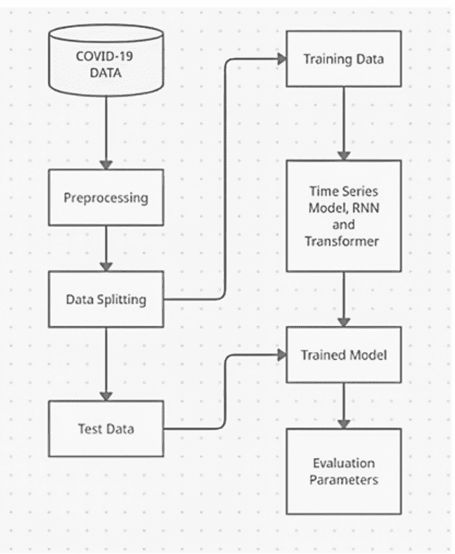

### 图 3.1 系统架构

### 3.4.2 数据获取

对于训练，任何持续维护、针对该问题保持最新且拥有大量数据的模型数据均可使用。由于 COVID-19 问题相对新，可用数据量较小，但数据正在从各种来源不断更新和维护。COVID-19 病例的全球数据主要来源由 JHU 维护，我们已从其 GitHub 获取该数据；另一所需数据集来自 COVID-19 India API（一个众筹 API），它提供了活跃病例、确诊病例和康复病例等详细信息，还提供已分发疫苗和已完成检测的数据，而我们将主要关注确诊病例、康复病例和活跃病例等参数。

### 3.4.3 测试与训练模型

在本小节中，我们将探讨本章中使用的各种模型。我们不会深入研究各种算法的定义，而是将重点放在模型中使用的参数上。

#### 3.4.3.1 回归模型

对于线性回归、Lasso 回归和 SVM 等基础模型，我们在缩放数据后不做任何调整即拟合模型，并获得了模型的预测结果。

对于随机森林、XGB 回归器和 LGBM 回归器等模型，我们将估计器数量设置为 1,300，并用于模型的预测。

#### 3.4.3.2 神经网络模型

对于神经网络，我们使用了 LSTM、双向 LSTM 和编码器-解码器 LSTM：

- i. 对于单变量模型，我们将特征数量设置为 1；对于多变量模型，我们将特征设置为 4，表示邻近四个州的数值。
- ii. 输入形状包括输入数据集的长度、所用时间（在我们的情况中为 6 天）以及特征数量。
- iii. 我们将单元总数设置为 65，并确定最终层具有 4 个单元，表示对未来输出的 4 天预测。该模型训练了 30 次，每次超过 1,000 个 epoch，实验中考虑了平均 MSE。

### 3.5 结果与讨论

#### 3.5.1 概述

在本模块中，我们将讨论先前提到的各种模型所获得的结果，并评估所产生的结果，以便了解哪个模型表现较好，并最终从所实现的预测中得出结论。我们将首先研究回归模型并提供模型间的比较，之后将探讨先前讨论过的各种案例中的 RNN。我们将重点关注来自确诊病例的输出，因为这是一个共同方面，也是模型比较中更有效的参数。

#### 3.5.2 回归模型

我们将研究线性回归、Lasso 回归、SVM 和指数平滑关于确诊病例所产生的输出，结果将在表 3.1 中显示。

### 表 3.1 各种基础模型比较

| 模型 | R² 分数 | 调整后 R² | MSE | MAE | RMSE |
|---|---|---|---|---|---|
| LR | 0.83 | 0.79 | 1472986504.96 | 30279.55 | 38390.51 |
| LASSO | 0.98 | 0.97 | 234489560.99 | 11693.97 | 15322.11 |
| SVM | 0.59 | 0.47 | 576089069.30 | 60177.90 | 75911.28 |
| ES | 0.98 | 0.97 | 283201302.2 | 8867.43 | 16828.58 |

在了解了回归中使用的各种基础模型或最常见模型之后，我们将查看 XGB 回归器、LGBM 回归器和随机森林所做出的预测。我们将提供这三个模型之间的比较，如图 3.2 所示，因为它们具有相同数量的树。

### 图 3.2 LGBM、XGboost 和随机森林的比较

| 模型 | 均方误差 | 均方根误差 | 平均绝对误差 | R 平方 |
| :--- | :--- | :--- | :--- | :--- |
| Prophet | 1.000000e-02 | 0.08 | 0.08 | 0.18 |
| LGBM | 8.430407e+11 | 918172.45 | 172266.14 | 0.42 |
| XGBoost | 8.028807e+11 | 896036.10 | 218105.17 | 0.24 |
| Random Forest | 8.158015e+11 | 903217.32 | 119906.89 | 0.40 |

到目前为止我们看到的所有模型中存在的一个主要问题是均方根误差较高；这是因为在训练模型时，模型使用缩放后的数据进行训练，而在比较时，我们将其转换回原始数据并计算最终误差。但是，我们讨论过的各种研究文章也得出了与我们类似的结果，并且随着 COVID 病例数呈指数增长，错误率增加也是可能的。

基于上述比较，我们可以得出结论：随机森林相对于其他模型表现最佳，因为该模型产生的均方误差在所有基础回归模型以及涉及树的模型中都是最小的。然而，我们将不得不将随机森林的误差值与循环神经网络（RNN）模型所获得的结果进行比较，这些结果将在接下来讨论的模型中进行考察。

### 3.5.3 循环神经网络模型

对于循环神经网络，我们使用了三种类型的模型：LSTM、Bi-LSTM 和编码器-解码器 LSTM，分别对应表 3.2 和表 3.3 中指定的单变量和多变量模型变体，并采用了静态分割和随机分割。

### 表 3.2 测试数据上的单变量模型结果

| 模型 | LSTM | MBD-LSTM | MED-LSTM |
|---|---|---|---|
| 印度 随机分割 RMSE | 22745 | 23610 | 7823 |
| 标准差 | 811 | 873 | 272 |
| 静态分割 RMSE | 10636 | 10665 | 12127 |
| 标准差 | 264 | 398 | 1662 |
| 德里 随机分割 RMSE | 1483 | 1455 | 1690 |
| 标准差 | 67 | 65 | 79 |
| 静态分割 RMSE | 3441 | 3516 | 2488 |
| 标准差 | 506 | 875 | 234 |
| 马哈拉施特拉 随机分割 RMSE | 5017 | 5205 | 5361 |
| 标准差 | 243 | 296 | 276 |
| 静态分割 RMSE | 2698 | 2845 | 2503 |
| 标准差 | 210 | 287 | 266 |

### 表 3.3 测试集上的多变量模型结果

| 模型 | LSTM | MBD-LSTM | MED-LSTM |
|---|---|---|---|
| 印度 随机分割 RMSE | 15144 | 16490 | 21918 |
| 标准差 | 1404 | 769 | 3233 |
| 静态分割 RMSE | 13102 | 24398 | 15245 |
| 标准差 | 2279 | 6172 | 4657 |
| 德里 随机分割 RMSE | 1322 | 1186 | 1406 |
| 标准差 | 28 | 36 | 225 |
| 静态分割 RMSE | 4395 | 5065 | 5238 |
| 标准差 | 292 | 236 | 530 |
| 马哈拉施特拉 随机分割 RMSE | 4572 | 4930 | 6456 |
| 标准差 | 274 | 260 | 529 |
| 静态分割 RMSE | 4954 | 4444 | 5731 |
| 标准差 | 516 | 786 | 583 |

根据获得的结果，我们可以得出结论：原生 LSTM 优于其余模型；这一结论是基于印度、德里和马哈拉施特拉测试用例所得所有 RMSE 的平均值得出的。

接下来，我们将研究多变量数据，其中对于每个州，输入将考虑邻近四个州过去 6 天的病例数。在所有 LSTM 模型中，我们都将特征数量设置为 4，以便模型考虑邻近州。

经过两轮比较后，我们得出结论：原生 LSTM 在随机分割数据集上表现更好；我们还发现马哈拉施特拉和印度呈现相似趋势；这可能是因为马哈拉施特拉单独产生了呈指数增长的高病例数，从而增加了总数，并因此在模型中对各种参数产生了更大的权重影响。

现在我们已经查看了图 3.3 和 3.4 中单变量静态分割和随机分割的所有结果，接下来将查看图 3.6 中关于多变量的类似图表，然后将查看预测，该预测在最坏情况和基准情况方面存在一些不确定性，即灰色阴影区域，灰色线表示平均值。

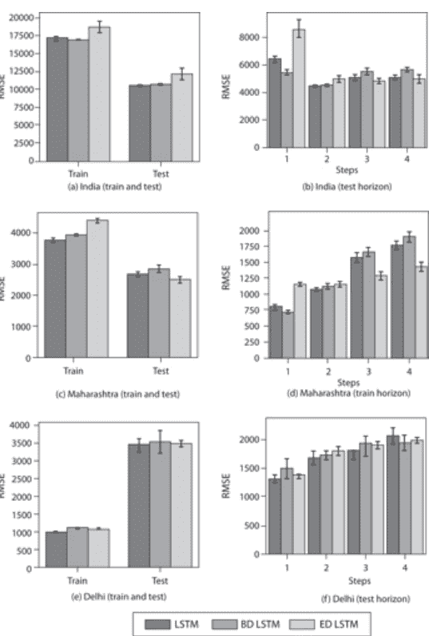

### 图 3.3 基于静态分割的单变量 LSTM、Bi-LSTM 和 ED-LSTM 以及训练和测试数据集


每个柱子均显示了在 1,000 个 epoch 上运行 30 次实验的 95% 置信区间下的准确率。

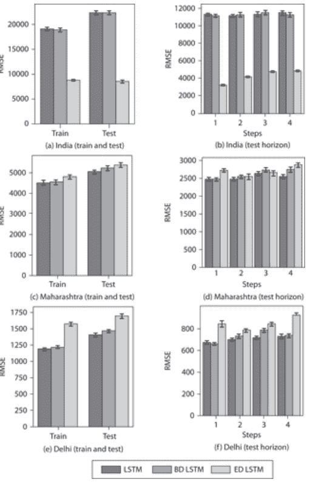

图 3.4 基于随机划分的单变量 LSTM、Bi-LSTM 和 ED-LSTM 以及训练和测试数据集，每个柱子均显示了在 1,000 个 epoch 上运行 30 次实验的 95% 置信区间下的准确率。

我们已经看到结果表明，与其他 LSTM 相比，原生 LSTM 表现更好，且在随机划分数据集上运行时准确率更好。

虽然无法对未来病例进行比较，但我们可以假设这些值接近准确，并且可能考虑到之前观察到的 MSE 值所带来的不确定性。近 12 个模型被纳入考虑以代表多变量模型，这些模型已在大多数研究中使用。我们可以假设 RNN 在预测 COVID-19 病例方面是有效的。由于 COVID-19 病例持续上升，没有模型可以被定为预测 COVID-19 的最佳模型，因为提供的数据并不完全可靠。因此，最好的方法是使用多个模型并取其平均值，将其与实际值进行比较，并根据要求不断演进模型。然而，在所有使用的模型中，我们可以得出结论：LSTM 是最有效的。

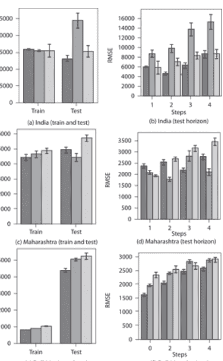

- LSTM
- Bi-LSTM
- ED-LSTM

图 3.5 基于静态划分的多变量 LSTM、Bi-LSTM 和 ED-LSTM 以及训练和测试数据集，每个柱子均显示了在 1,000 个 epoch 上运行 30 次实验的 95% 置信区间下的准确率。

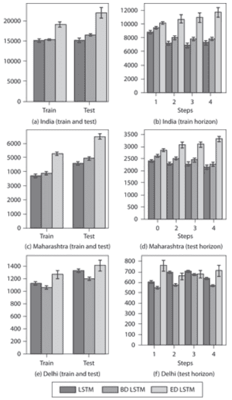

图 3.6 基于随机划分的多变量 LSTM、Bi-LSTM 和 ED-LSTM 以及训练和测试数据集，每个柱子均显示了在 1,000 个 epoch 上运行 30 次实验的 95% 置信区间下的准确率。

## 3.6 结论与未来工作

我们详细讨论了 COVID-19 如何影响全球，并着重分析了其对印度的影响。最初，我们研究了用于分析这一相对较新的 COVID-19 问题的各种研究算法，包括其起源以及它如何在全球传播并导致大流行。研究中的一个主要问题是数据短缺及其可靠性，这超出了我们的控制范围。然而，我们有幸拥有更多数据来用于各种模型。研究完成后，我们查看了数据的各种可视化，以便对整个世界以及随后的印度进行数据分析。分析完成后，我们研究了预处理和缩放，这导致使用了各种模型进行预测及其预测，随后我们在各种参数上比较了模型，得出结论，建议哪种模型足以针对当前阶段预测病例。

COVID-19 于 2019 年 11 月在中国武汉开始，至今仍是一个问题。世界也面临着新的问题；在可用解决方案有限的情况下，经济跌至前所未有的低点，失业在许多发达国家变得普遍，而在印度等发展中国家，COVID 由于平均经济水平低，还带来了饥饿的额外问题。人类与病毒之间的斗争仍在继续，虽然可以采取一些措施，例如各地区的卫生防疫和严格封锁，但疫苗的大规模分发是我们目前拥有的最佳解决方案。虽然供应尚未能满足需求，但我们正在慢慢接近这一目标，这很有帮助；然而，病毒的变异可能非常关键，因此人类需要采取一切手段，通过基本预防措施来终结病毒。在预测方面，使用各种模型并根据传播的增长或下降不断调整模型将是有效的。我们应用到提供的数据上的模型越新（例如 Transformer），效果就会越好，这将导致根据情况采取更好的预防措施，从而让我们在与病毒作斗争并根除它方面占据上风。

## 参考文献

- 1. Sardar, Tanvir Habib, and Ahmed Rimaz Faizabadi. “使用 OpenMP 和 Pluto 在对称多处理机上对所选数值算法进行并行化与分析.” Data Technologies and Applications 53.1 (2019): 20–32.
- 2. Sardar, Tanvir H., and Zahid Ansari. “使用基于 MapReduce 的模糊 C-中位数进行分布式大数据聚类.” Journal of the Institution of Engineers (India): Series B (2022): 1–10.
- 3. Manikiran, G., et al. “电子商务服装评论分析与模型构建.” 计算机工程与通信系统进步第二届国际会议论文集：ICACECS 2021. 新加坡：Springer Nature Singapore, 2022.
- 4. Sardar, Tanvir Habib, and Zahid Ansari. “使用基于 MapReduce 的 K-均值算法进行分布式文档聚类分析.” Journal of the Institution of Engineers (India): Series B 101.6 (2020): 641–650.
- 5. Ansari, Zahid, Asif Afzal, and Tanvir Habib Sardar. “使用基于 Hadoop MapReduce 的并行 K-均值聚类进行数据分类.” Journal of the Institution of Engineers (India): Series B 100.2 (2019): 95–103.
- 6. Rustam, Furqan, et al. “使用受监督机器学习模型进行 COVID-19 未来预测.” IEEE Access 8 (2020): 101489–101499.
- 7. Chandra, Rohitash, Ayush Jain, and Divyanshu Singh Chauhan. “通过 LSTM 模型进行深度学习以预测印度的 COVID-19 感染.” PloS One 17.1 (2022): e0262708.
- 8. Karmakar, Saurav, Dibyanshu Gautam, and Purnendu Karmakar. “印度 COVID-19 传播的建模与预测.” 机器视觉与增强智能——理论与应用：MAI 2021 精选论文集. Springer Singapore, 2021.
- 9. Petropoulos, Fotios, and Spyros Makridakis. “新型冠状病毒 COVID-19 预测.” PloS One 15.3 (2020): e0231236.
- 10. Cooper, Ian, Argha Mondal, and Chris G. Antonopoulos. “不同社区中 COVID-19 传播的 SIR 模型假设.” Chaos, Solitons & Fractals 139 (2020): 110057.
- 11. Senapati, Apurbalal, et al. “基于印度分段回归的 COVID-19 病例预测新框架.” International Journal of Information Technology 13.1 (2021): 41–48.
- 12. Muhammad, L. J., et al. “使用流行病学数据集预测 COVID-19 感染的受监督机器学习模型.” SN Computer Science 2 (2021): 1–13.
- 13. Massonnaud, Clément, Jonathan Roux, and Pascal Crépey. “COVID-19：预测法国短期医院需求.” medrxiv (2020): 2020–2003.
- 14. Malavika, B., et al. “使用 SIR 和逻辑增长模型预测印度及高发州的 COVID-19 流行.” Clinical Epidemiology and Global Health 9 (2021): 26–33.
- 15. Anastassopoulou, Cleo, et al. “COVID-19 爆发的基于数据的分析、建模与预测.” PloS One 15.3 (2020): e0230405.
- 16. AlJame, Maryam, et al. “基于常规血液检测诊断 COVID-19 的集成学习模型.” Informatics in Medicine Unlocked 21 (2020): 100449.
- 17. Sarkar, Kankan, Subhas Khajanchi, and Juan J. Nieto. “印度 COVID-19 大流行的建模与预测.” Chaos, Solitons & Fractals 139 (2020): 110049.
- 18. Chimmula, Vinay Kumar Reddy, and Lei Zhang. “使用 LSTM 网络对加拿大 COVID-19 传播进行时间序列预测.” Chaos, Solitons & Fractals 135 (2020): 109864.
- 19. Katoche, Rupinder, and Arpit Sidhu. “应用 ARIMA 模型预测印度 COVID-19 流行病动态.” Global Business Review (2021): 0972150920988653.
- 20. Velásquez, Ricardo Manuel Arias, and Jennifer Vanessa Mejia Lara. “使用降维高斯过程回归预测和评估美国 COVID-19 传播.” Chaos, Solitons & Fractals 136 (2020): 109924.
- 21. Maleki, Mohsen, et al. “时间序列建模以预测 COVID-19 确诊和康复病例.” Travel Medicine and Infectious Disease 37 (2020): 101742.
- 22. Owusu-Fordjour, Charles, Charles Kwesi Koomson, and David Hanson. “COVID-19 对学习的影响——加纳学生的视角.” European Journal of Education Studies 7.3 (2020): 88–101.
- 23. Perc, Matjaž, et al. “COVID-19 预测.” Frontiers in Physics 8 (2020): 127.
- 24. Kapoor, Amol, et al. “使用时空图神经网络检查 COVID-19 预测.” arXiv 预印本 arXiv:2007.03113 (2020).
- 25. Team, Epidemiology. “2019 年新型冠状病毒疾病（COVID-19）暴发的流行病学特征——中国，2020 年.” China CDC Weekly 2.8 (2020): 113.
- 26. Subbarao, E., P. Gite, A. Sharma, L. Vyakaranam, T. H. Sardar, S. N. Taqui, ... M. A. Kalam. “使用机器学习调查城市地区和都市社区的太阳能.” Electric Power Components and System. 最新文章 4 (2023): 1–11.
- 27. Sardar, T. H., Z. Ansari, and A. Khatun. “使用并行 K-均值评估文档聚类中 Hadoop 集群的效率.” 收录于 2017 年 IEEE 电路与系统国际会议 (ICCS) (第 17–20 页). IEEE, 2017 年 12 月.
- 28. Sardar, T. H., A. R. Faizabadi, and Z. Ansari. “基于 Hadoop 框架的 MapReduce 范式数据处理分析.” International Journal of Emerging Research in Management and Technology 6.5 (2017).
- 29. Sardar, T. H., A. Khatun, and S. Khan. “无线传感器网络中能量感知收集树协议的设计.” 收录于 2017 年 IEEE 电路与系统国际会议 (ICCS) (第 12–17 页). IEEE, 2017 年 12 月.
- 30. Sardar, T. H., A. Muttineni, and R. Ranjan. “客户体验和库存管理中大数据的未来.” 收录于《大数据计算》(第 233–248 页). CRC Press, 2024.
- 31. Sardar, T. H., A. Khatun, S. Sengupta, Y. Alam, and T. Ara. “医疗保健领域和生物医学大数据中的机器学习：技术、应用与挑战.” 收录于 Tanvir Habib Sardar 和 Bishwajeet Kumar Pandey (编),《大数据计算》. (2024): 336–352.
- 32. Sardar, T. H., S. Das, and B. K. Pandey. “可解释人工智能 (XAI)：概念与理论.” 收录于《使用可解释人工智能进行医学数据分析与处理》(第 1–18 页). CRC Press, 2023.
- 33. Guru, P. M., G. J. Praveen, R. Dodmane, T. H. Sardar, A. Ashwitha, and A. N. Yeole. “基于改进 Alexnet 架构的新型提取方法进行脑肿瘤识别与分类.” 收录于 2023 年第六届信息系统与计算机网络国际会议 (ISCON) (第 1–5 页). IEEE, 2023 年 3 月.


## 4 农业科技

### 利用传感器和机器学习革新农业实践（物联网）

Shola Usharani, Alabhya Sharma, Aniket Kulkarni, Abhay Arora, and Hritik Goel

DOI: 10.1201/9781003465775-4

### 4.1 简介

农业是一项至关重要的产业，为世界不断增长的人口提供食物。然而，传统农业实践面临诸如土壤侵蚀、气候变化和资源利用效率低下等障碍。这些缺陷导致了产量低、成本高和环境退化。为解决这些问题，现代农业必须立即采用数据驱动的策略，利用传感器、分析和机器学习。本章重点介绍这些技术在农业领域的应用，特别是物联网（IoT）如何革新农业实践。本章旨在介绍农业科技（AgTech），这是一种数据驱动的农业方法，利用传感器和机器学习来优化资源利用、提高产量并减少环境影响。通过监测植物健康、土壤质量和灌溉需求等关键参数，生产者可以做出明智的决策，从而实现更高效、更可持续的农业实践。本章还描述了农业科技的基本组件，例如 Raspberry Pi、Pi Camera v1.3、NoIR 摄像头、Arduino UNO、DHT 传感器、土壤 NPK 传感器和 NodeMCU。

利用这些技术，农业科技（AgTech）促进实时数据收集、分析和决策，有可能彻底改变农民对待农业的方式。通过自动化植物健康监测、土壤分析和灌溉排程，农业科技（AgTech）减少了对人工劳动的需求，并为生产者提供优化其运营所需的洞察。在机器学习算法的辅助下，农业科技（AgTech）可以预测最佳的种植、施肥和收获时间，从而提高效率和产量。本章探讨了农业科技（AgTech）革新农业实践并为农业创造更可持续未来的潜力。传感器、分析和机器学习的集成为生产者提供做出明智决策、优化资源利用、增加产量和减少环境影响所需的数据。通过采用这些技术，农业行业可以继续以更高效、更可持续、更有利可图的方式养活世界不断增长的人口。

### 表 4.1 模型："LeafDisease_MobileNet" 超参数

| 层 (类型) | 输出形状 | 参数数量 |
|---|---|---|
| input_16(InputLayer) | [(None, 224, 224, 3)] | 0 |
| mobilenet_1.00_224(Functional) | (None, 7, 7, 1024) | 3228864 |
| global_average_pooling2d_11 (GlobalAveragePooling2D) | (None, 1024) | 0 |
| dropout_23 (Dropout) | (None, 1024) | 0 |
| dense_32 (Dense) | (None, 38) | 38950 |

### 4.2 文献综述

[1] 的作者强调了使用接受与科技使用（UTAUT）框架为农民提供有用功能的智能手机应用程序的重要性。它包括政策制定者在数字化农业应用程序时应遵循的准则。[2] 的作者详细介绍了农业领域数据收集的比较研究，并评估了农业移动众感（Agriculture Mobile Crowd Sensing）在提供数据收集方案和农业数据重要洞察方面的潜力。[3, 4] 提出了一种基于纳米电子技术（如以 ZnIn2S4（ZIS）纳米片作为核心感应介质，使用基于 ZIS 的柔性传感器来监测湿度参数）的高植物生长产出率生态系统。[9] 使用近红外荧光 H2O2 纳米传感器监测植物健康。Nano Letters [5, 6] 详细介绍了各种机器学习模型以识别植物的研究。识别方法包括使用激光技术扫描叶片数字指纹，以及使用摄像头技术追踪植物轮廓。

[7, 13, 16] 的研究详细介绍了物联网（IoT）[35] 在农业领域的发展，并探讨了在农业中部署物联网所涉及的问题与挑战。为了更好地改进农业，还探讨了各种案例研究。[8, 12, 20] 的研究涉及使用深度学习方法的计算机视觉技术来识别作物疾病。深度卷积神经网络被用于训练包含患病和非患病作物物种的公共数据集。[10] 的研究详细介绍了用于辣椒生产的物联网技术，提出使用带有 Raspberry Pi 的无红外（NoIR）摄像头和全球定位系统（GPS）模块来分析黑胡椒植物的健康状况并追踪植物的坐标位置。NoIR 摄像头的镜头上装有一个滤光片，使其能够使用红外摄影并在低光（暮光）环境下拍照。物联网（IoT）的设计旨在通过网络传输数据，而无需人与人或人与计算机之间的交互。原型中采用了归一化差值植被指数（NDVI）来确定辣椒植物的健康状况。

[14, 15] 中提出了一种利用无线传感器网络采用精准农业的系统，该网络能够远程监测土壤肥力及其他参数，即土壤湿度、pH 值和温度。这些数据被传输到云端，相应数值在移动应用程序上显示。[11, 22] 中提出了一种基于 Raspberry Pi 的物联网（IoT）[34] 设备，用于发送植物图像以分类疾病，并实时将空气温度、湿度、土壤湿度和 pH 值等环境参数更新到 MySQL 数据库中。多类支持向量机（SVM）被用于利用与颜色、纹理和形状相关的 14 种特征来对疾病进行分类。这些特征基于灰级共生矩阵的实现得出，使系统能够有效地分类疾病。

[17, 18, 21, 24, 25] 中还讨论了植物可穿戴设备、无线传感器网络以及基于无人机（UAV）的技术等新兴技术在精准农业中的应用。[29] 的研究提出了 GeoSense 模型，这是一个面向印度精准农业的决策支持系统。同时也介绍了土壤传感器和智能农业的研究方向与挑战。[30, 31] 主张决策支持系统（DSS）可以改善农场管理决策，并提供提高生产率和限制环境退化的机会。提出了实用建议以鼓励更有效的以用户为中心的设计。归一化差值植被指数（NDVI）[19] 和归一化差值红边（NDRE）是从五个光谱波段图像（红、绿、蓝、红外（NIR）和红边（REDGE））中获得的，这些图像由软件处理成完整的图像图谱。所得的图像图谱可用于分析农田并识别植物绿度的变化。这些观察结果表明，使用 NDRE（一种监测植物叶绿素含量的敏感指数）非常重要。

[23] 的作者讨论了如何在降低运营成本和环境影响的同时改善产量和氮管理。本文讨论了过去 15 年内关于基于机器学习的技术的研究进展，用于精确作物产量预测和氮状态估计。该文得出结论，传感技术和 ML 技术的快速进步将为更好的作物和环境状态估计及决策制定提供具有成本效益且全面的解决方案。[26] 的作者回顾了农业不同领域中使用的现有传感器和数据分析技术。该文将农业分为五个类别，并回顾了每个领域中实践中的前沿技术和正在进行的研究。它还介绍了一个韩国案例研究，并与其他发达国家的项目进行了比较。在 [27] 中，设计了一种基于 LoRaWAN 协议的低功耗无线传感器网络，重点关注物联网（IoT）的低成本精准农业应用，例如温室感知与执行。实验输出被收集并存储在由云服务中运行的虚拟机管理的数据库中。收集的数据


用户可以通过图形界面实时可视化。研究 [28] 是关于信息和通信技术以及区块链技术在精准农业发展中的应用的系统性文献综述。

### 4.3 拟议的系统

AgTech 利用 IoT 革新农业实践 [33] 的目标是通过收集和 [32] 分析温度、湿度、土壤湿度和养分水平等关键参数的实时数据，来增强植物健康监测。它支持土壤监测和分析，包括 pH 值、养分水平及其他关键因素的测量。机器学习和预测分析用于支持种植、施肥和收获决策等农业活动。数据驱动的调度和管理用于根据土壤湿度和天气条件优化灌溉操作。它为农民创建了一个直观的界面，以便访问和参与智能农业 [36] 助手，包括数据输入、报告、警报和建议。它还与其他农业系统和技术 [37, 38, 39, 40, 41] 集成，例如天气预报、病虫害防治和灌溉。图 4.1 显示了 AgTech 系统所需的架构。该系统包含以下组件。

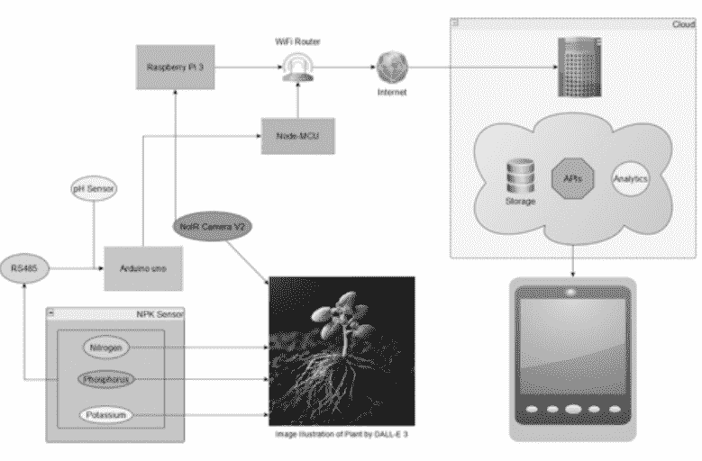

### 图 4.1 AgTech 架构图

- 硬件详情；
- 云集成；
- 数据库管理；
- 移动应用。

#### 4.3.1 硬件详情

- **树莓派 3：** 树莓派是一系列由英国树莓派基金会开发的低成本单板计算机，旨在促进学校和发展中国家基础计算机科学教学。我们将树莓派用作云与视觉传感器之间的接口。它充当中介，将感官数据转换为所需形式并传输到云存储。
- **Pi Camera rev 1.3：** 树莓派摄像头是树莓派的附加模块，允许用户拍摄高质量照片和视频。它会将这些照片发送到我们的树莓派，随后由树莓派通过云进行数据处理。
- **NoIR 摄像头：** 这款树莓派 [1] 摄像头专为与树莓派配合使用而设计。它是一款顶级摄像头模块，提供多种功能和特性，并能够在光线不佳的情况下拍摄高清照片和录制高清视频。该摄像头可获取红外反射率值，这有助于绘制 NDVI 指数图。这是我们用于拍照以监测植物健康状况并记录其日常生长的另一款摄像头模块。
- **Arduino IDE：** Arduino 是一个基于简单易用硬件和软件的开源电子平台。它旨在让人们更容易入门电子和编程。Arduino 平台由一系列微控制器板和软件开发环境组成，允许用户编写代码并上传到板卡。Arduino IDE 是一款用于编写程序并将其上传到带有 Arduino 微控制器的板卡的软件工具。凭借代码高亮、自动补全和调试工具等功能，它为创建、测试和分发代码提供了用户友好的界面。我们使用 Arduino 来连接与监测植物环境相关的传感器。
- **DHT 传感器：** DHT（数字湿度和温度）传感器是电子项目中常用的传感器，用于测量环境温度和湿度。它有不同类型，包括 DHT11、DHT22 和 AM2302，各自的精度和范围不同。我们在项目中使用 DHT 来捕捉测试区域周边环境的详细信息。我们使用 Arduino 将其与 NodeMCU 连接。
- **土壤 NPK 传感器：** 土壤 NPK 传感器用于测量土壤中的氮、磷、钾含量。该传感器与 Arduino 和 NodeMCU 微控制器板连接，可将数据无线传输到中央数据库。通过监测土壤中的 NPK 水平，农民和园艺师可以确定何时施肥、施肥多少以及使用哪种肥料，从而在优化植物生长和产量的同时最大限度地减少环境影响。
- **pH 传感器：** pH 传感器可以测量土壤的酸碱度，这是植物生长和健康的关键因素。通过将传感器与 Arduino 和 NodeMCU 集成，我们将数据发送到基于云的平台进行分析和可视化。这使农民或园艺师能够实时监测土壤 pH 值，并就土壤健康管理做出明智决策。
- **NodeMCU：** NodeMCU 是一款开源微控制器板（SoC）。它旨在让个人更轻松地开始使用联网设备和物联网。NodeMCU 提供的功能和特性包括 Wi-Fi 连接、微控制器功能，以及用于与传感器、执行器和其他设备交互的多种输入/输出（I/O）引脚。我们在项目中使用 NodeMCU 的目的是作为感官读数的传输介质，以及连接到我们 Google Cloud 数据库的网络通道，以执行所需的处理。
- **Google Cloud 数据库：** 对于我们的云存储，我们使用了 Google Cloud BigQuery，这是一款用于存储、分析和查询大型数据集的云原生数据仓库。它具有高度可扩展性，支持多种数据源和格式，并为高级分析工具提供内置支持。通过 BigQuery，我们正在将来自树莓派和 NodeMCU 的数据存储在不同的存储桶中，以便进行分析。

#### 4.3.2 云集成

在此组件中，传感器 [42, 43] 收集的数据被发送到云端进行存储和分析。云集成很重要，因为它可以实现可扩展性、灵活性和可访问性。通过云集成，数据可以从世界任何地方访问，并且系统可以根据不断变化的需求轻松扩展或缩减。此外，云集成还提供各种数据分析工具，例如机器学习算法，可帮助根据收集的数据识别模式并进行预测。来自硬件组件的数据收集和上传到云端的详细信息如图 4.2 所示。如图所示，NPK 和摄像头的传感器数据通过 NodeMCU 收集。使用 Wi-Fi 的 NodeMCU 将在处理和过滤 [44] 后将所需数据更新到 Google Firebase 云存储中。

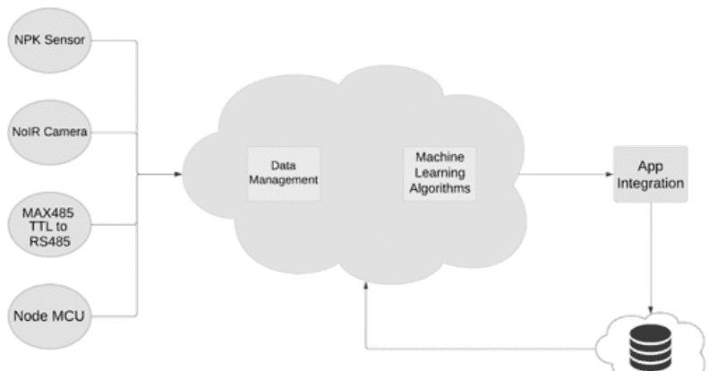

### 图 4.2 与云的感官数据流

#### 4.3.3 移动应用

移动应用模块负责 [1, 2] 为最终用户提供与系统交互的用户界面。它允许用户查看传感器收集的数据、设置警报和通知，并根据数据执行各种操作。移动应用还充当控制中心，用户可以根据传感器收集的数据远程控制各种设备。

图 4.3 所示的 UML 图说明了一个为满足用户对植物健康、天气预报和园艺建议的信息需求而创建的系统。主要模块包括登录菜单、匹配、用户名、密码、IP 地址和用户地图，该模块称为用户模块。为了简化用户交互，用户模块提供 getchoicesubject()、getchoicemenu()、setuserName() 和 getuserName() 等函数。用户可以通过 Sign-In/Sign-Out UI 模块输入其登录名和密码来登录或退出系统，该模块提供简单且用户友好的界面。该模块包含两个用于用户名和密码的文本框，以及两个登录和注销按钮。Sign-In/Sign-Out 模块的界面类似于 Login UI 模块，但提供了额外功能，例如能够以纯文本显示用户的姓名和密码。该模块提供两个用于用户名和密码的文本框，以及两个用于登录和注销的按钮。系统的多个功能（包括天气更新、植物健康、园艺建议和设置）均可通过 Weather/Plant Health/Tips/Settings 模块轻松访问。该模块有四个按钮，用户可以利用这些按钮在各种功能之间进行选择。基本设置和语言设置，以及使用摄氏度或华氏温度表的选择，均可通过设置部分访问。Weather 模块提供 fetchLocation()、fetchWeatherData() 和 recommendAction() 等函数，可用于检索天气数据并根据当前天气生成建议。为了让用户更好地了解其植物在当前和即将到来的天气条件下的健康状况，Plant Health 模块提供 setPlant()、currentWeather()、futureWeather() 和 getPlantHealth() 等方法。建议模块根据用户的植物类型，使用 getTips() 等方法推荐相关建议。


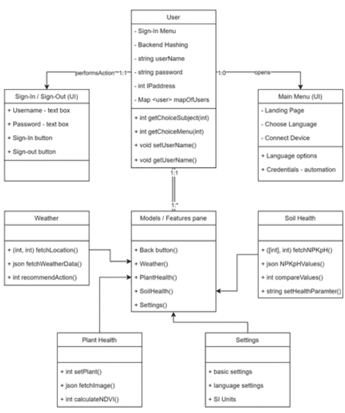

图 4.3 移动应用 UML 图

#### 4.3.4 数据管理

数据管理是一个至关重要的模块，负责收集数据的存储、组织和分析。传感器收集的数据通常是非结构化的，需要进行处理并转换为结构化格式，以便于分析。数据管理还涉及数据清洗、数据聚合、数据可视化和数据解释。收集的数据可用于多种用途，例如识别趋势、进行预测以及改进决策流程。

系统流程简单，如图 4.4 所示。输入来自多种传感器，包括 NOIR 相机、NPK 传感器和 NodeMCU。数据收集后，将其存储在云端。数据采用简单的数据清洗方法进行清洗。移除垃圾值和重复值。随后对数据进行分隔，以加快任务模拟速度。一旦根据各种必要的因变量对数据进行分隔，机器学习模型便直接从云端应用，并分析结果。由于云端与 app 集成，结果会在农民的手机应用上显示。

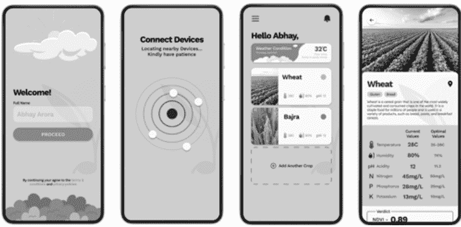

图 4.4 移动应用用户界面

### 4.4 实验设置

农业技术（AgTech）正在利用传感器和分析的力量，革新[45]全球范围内的农业实践。本节将讨论 AgTech 的实施细节及其如何被用于转变农业。实施 AgTech 的第一步是在农场安装传感器。这些传感器可以测量广泛的数据点，包括温度、湿度、土壤湿度和养分水平。AgTech 中常用的传感器类型包括：

- **土壤湿度传感器：** 这些传感器测量土壤中的水分含量，可帮助农民确定何时以及灌溉多少水。
- **气象传感器：** 这些传感器测量温度、湿度及其他可能影响作物生长的天气相关数据点。
- **土壤养分传感器：** 这些传感器通过检测土壤中的氮、磷、钾等大量元素及其 pH 值来测量土壤健康状况。
- **作物传感器：** 这些传感器测量作物的健康状况和生长情况，包括植物高度、叶面积和叶绿素含量。

传感器安装后，会使用高级分析技术对其收集的数据进行分析。这些数据可以帮助农民就作物管理做出更明智的决策，包括何时种植、何时灌溉和何时收获。通过分析历史数据，预测分析可以帮助农民预测作物产量并相应规划。机器学习算法可用于实时分析传感器数据，并向农民提供关于最佳种植、灌溉和收获时间表的建议。借助连接的传感器和分析技术，农民可以远程监控作物，并在出现任何问题（如土壤湿度低或虫害）时接收警报。Hughes 等人 [59] 的 PlantVillage 数据集包含约 87,000 张健康和不健康的叶片图像，按物种和疾病分为 38 个类别。在此，我们提供了使用该数据进行实验的一个子集。我们还最终使用了来自 MobileNet 的迁移学习以及在 ImageNet 上预训练的权重。

以下是图像增强方法：

- width_shift 和 height_shift 是范围（占总宽度或总高度的比例），用于随机垂直或水平平移图片。
- rescale 是在任何其他处理之前乘以数据的数值。我们的原始图像包含 0–255 范围内的 RGB 系数，但对于我们的模型来说（考虑到典型的学习率），这些值过高，因此我们通过 1/255 因子缩放，将目标值设定在 0 到 1 之间。
- shear_range 用于随机应用剪切变换。
- zoom_range 用于在图片内随机缩放。
- fill_mode 是用于填充新创建像素的策略，这些像素可能在旋转或宽度/高度平移后出现。

我们使用 flow_from_directory() 从各自文件夹中的图像直接生成图像数据批次（及其标签）。

我们还想知道哪个类别对应哪个物种和疾病，因此还创建了一个显示对应标签和类索引的 json 文件。

```
categories = list(train_data.class_indices.keys())
```

我们首先获取了不包含顶层的基础 MobileNet 模型，因为我们希望将其用于 38 个类别以及 ImageNet 的预训练权重。随后，我们使用函数式 API 在 MobileNet 之上构建了一个小型上游模型。在多次实验中，我们发现 Adam 优化器在训练期间使用其默认学习率、β1、β2 和 ε 值时效果良好。

IoT 是 AgTech 实施中的关键组件，允许传感器和其他设备相互通信，并与基于云的分析平台通信，如图 4.5 所示。通过利用 IoT 技术，农民可以实时收集和分析数据，从而就作物管理做出更明智的决策。鉴于 AgTech 系统产生的海量数据，有效的数据管理至关重要。这包括以安全且可扩展的方式存储、处理和分析数据。

从各种传感器获取输入
Noir 相机
NPK 传感器
MAX 485 TTL 转 RS485
Node MCU
收集数据并存储
清洗数据
根据不同用例对数据进行分隔
叶绿素含量
天气状况
土壤湿度
养分水平
应用 ML 模型
分析结果
结果集成
显示结果。存储数据

图 4.5 AgTech 数据流模型

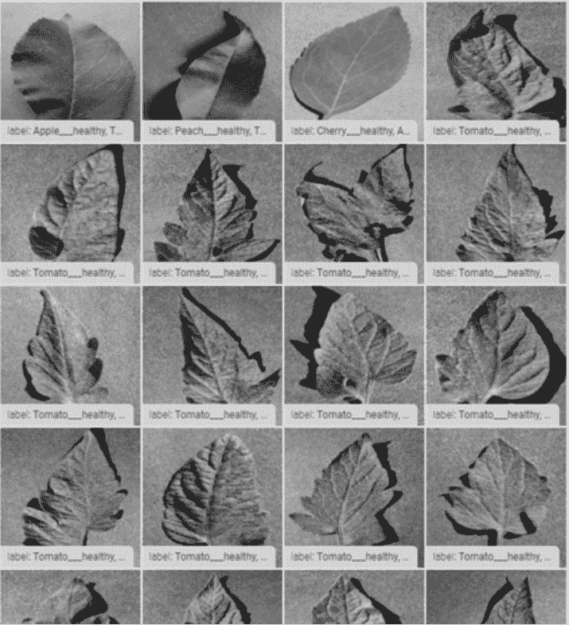

图 4.6 PlantVillage 数据集

实施 AgTech 面临的最大挑战之一是成本。安装传感器、分析软件和其他 IoT 设备可能费用高昂，且可能需要数年时间才能看到投资回报。然而，AgTech 的长期效益（例如提高作物产量和减少浪费）可以超过初始成本。

总之，AgTech 正在利用传感器和分析技术的力量来转变农业，帮助农民就作物管理做出更明智的决策。通过安装传感器、使用高级分析技术分析数据并利用 IoT 技术，农民可以优化作物产量、减少浪费并提高效率。基于以上内容，系统包含的模块如下。

用于从环境中感知和收集数据的物理硬件设备 [46, 47, 48, 49, 50, 51, 52] 连接到微控制器，如图 4.5 所示，微控制器处理数据并将其发送到云端或移动应用程序以进行进一步分析。所使用的传感器包括 NPK 传感器、pH 传感器、NoIR 相机等，这些内容已在前一节中讨论过。

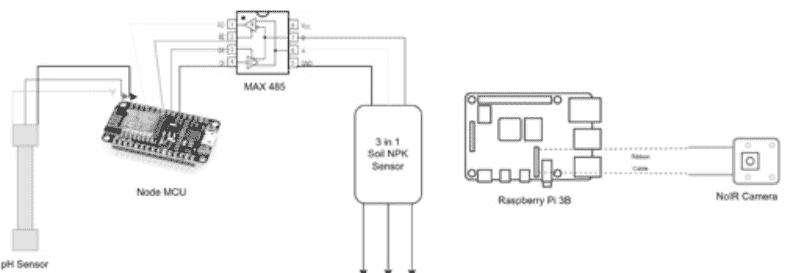

图 4.7 传感器与微控制器的接口

### 4.5 结果与讨论

近年来，IoT、传感器和机器学习帮助农业行业蓬勃发展。AgTech 采用数据驱动技术来革新农业。AgTech 可能通过利用传感器和机器学习来监测植物健康、土壤质量和灌溉需求，从而革新农业。这些技术使农民能够监测温度、湿度、土壤湿度和养分水平的实时变化。这些信息有助于决策、资源优化和环境保护。NDVI 指数、NPK 养分值和土壤 pH 值可以指示植物的健康状况。这种技术在最大限度地减少环境影响的同时，优化资源利用、决策和产量。

AgTech 减少了人力劳动，并为生产者提供优化运营所需的知识。AgTech 采用机器学习算法来自动化植物健康监测、土壤分析和灌溉调度，以预测最佳种植、施肥和收获时间，从而提高生产力。此外，预测分析还可以辅助


生产者在避免作物歉收和感染方面。在我们的实验中，训练期间准确率上限约为 99.4%，验证期间为 99.56%，同时将损失降至 0.2%。

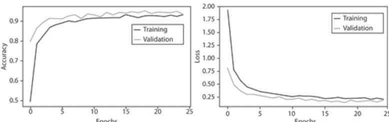

图 4.8 MobileNet 模型的准确率和损失

从 AgTech 的系统架构来看，树莓派分析由 NoIR 摄像头捕获的植物图像和视频。这些值被发送到云端以进行进一步的存储和处理。

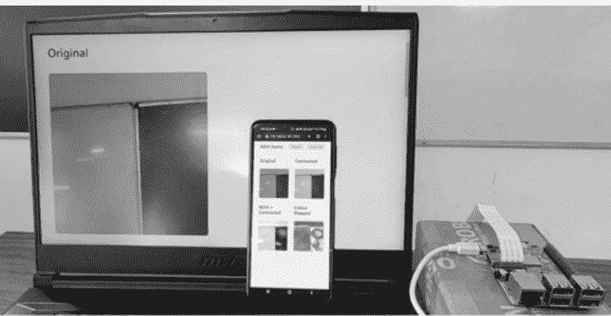

图 4.9 NDVI 摄像头演示设置

土壤 NPK 传感器测量土壤养分，而 pH 传感器测量灌溉水的 pH 值并将这些值发送到 Arduino，再发送到 NodeMCU。NodeMCU 最终将系统连接到云端，然后这些值通过易于使用的应用程序界面呈现给农民。

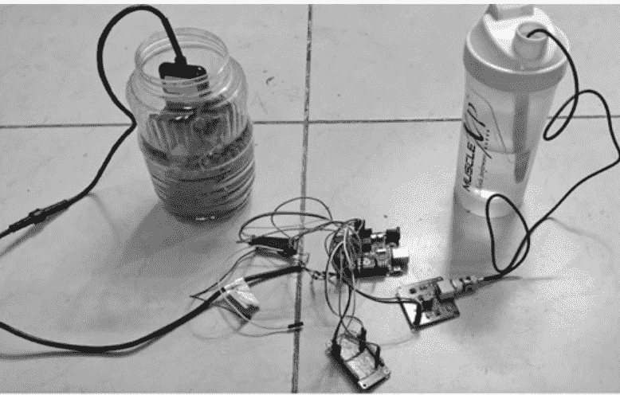

图 4.10 土壤健康监测系统

物联网、传感器和机器学习最终可能彻底改变农业。AgTech 为生产者提供关于植物健康、土壤质量和灌溉需求的实时信息，以优化资源利用并减少环境影响。因此，生产者可以提高产量、利润和可持续性。

### 4.6 结论

AgTech 利用传感器和分析彻底改变农业技术，有望转型传统农业。传统农业方法的低效率，如土壤侵蚀、气候变化和资源利用效率低下，导致产量低、成本高和环境退化。为提升农业实践和盈利能力，现代农业迫切需要采用数据分析和机器学习。我们的倡议展示了基于物联网的农业应用如何简化植物健康监测和灌溉等操作，使农民在节省时间和资源的同时，提高农业的整体效率和可持续性。通过利用温度、湿度、土壤湿度和养分水平等关键参数，结合机器学习和预测分析，我们可以最大限度地提高资源利用率，在对环境影响最小的情况下提高产量。我们希望我们的倡议能成为农业领域技术变革力量的示例，并为可持续养活世界不断增长的人口做出贡献。

### 4.7 未来工作

尽管 AgTech 解决方案显著改善了植物疾病诊断和土壤健康分析，但系统仍有改进和发展的空间。本项目创建的原型的可扩展性是一个需要进一步考虑的重要因素。

当前原型专为中小型农场设计，可能不适合大型农业运营。因此，未来的工作可以集中在扩展系统的可扩展性以满足大型农场的需求。这可能涉及开发更强健的硬件、改进软件算法以及优化用户界面以处理更大的数据集。

此外，探索机器学习和人工智能算法的应用以提高疾病检测的准确性，可能是未来研究的有希望方向。系统可以通过检查大量植物图片数据集来学习识别和诊断更多种类的植物疾病，从而提高农业产量并降低对农药的需求。

此外，与精准农业方法的更深层次集成将使农民能够优化其灌溉和土地利用策略，从而实现更高的生产力和可持续性。

## 参考文献

- 1. Michels, M., Bonke, V., & Musshoff, O. (2020). 了解作物保护中智能手机应用的采用. 精准农业, 21, 1209–1226.
- 2. Sun, Y., Ding, W., Shu, L., Li, K., Zhang, Y., Zhou, Z., & Han, G. (2021). 关于在智慧农业中实现移动众感知进行数据收集：一种愿景. IEEE 系统期刊, 16(1), 132–143.
- 3. Lu, Y., Xu, K., Zhang, L., Deguchi, M., Shishido, H., Arie, T., ... Takei, K. (2020). 多模式植物医疗柔性传感器系统. ACS Nano, 14(9), 10966–10975.
- 4. Guru, Prasad M. S., 等. 基于改进 Alexnet 架构的新型提取方法的脑肿瘤识别与分类. 2023 年第 6 届信息系统与计算机网络国际会议 (ISCON). IEEE, 2023.
- 5. Skanda, H. N., Smitha, S. K., Suvijith, S., & Swathi, K. S. (2019 年 3 月). 使用机器学习算法的植物识别方法. 工程研究与技术国际期刊 (IJERT), 8(pp.2400–24073).
- 6. Sinha, S. K., Kumar, S., Kumar, S., Katiyar, G., & Chandola, R. (2021). 使用机器学习进行植物识别. 2021 年亚洲技术创新会议 (ASIANCON), 印度浦那 (pp. 1–4). doi: 10.1109/ASIANCON51346.2021.9544670.
- 7. Ray, P. P. (2017). 智慧农业物联网：技术、实践与未来方向. 环境智能与智能环境期刊, 9(4), 395–420.
- 8. Pallagani, V., Khandelwal, V., Chandra, B., Udutalapally, V., Das, D., & Mohanty, S. P. (2019 年 12 月). DCrop：用于智慧农业中作物疾病准确预测的基于深度学习的框架. 在 2019 年 IEEE 智能电子系统国际研讨会 (iSES) (原 iNiS) (pp. 29–33). IEEE.
- 9. Wu, H., Nißler, R., Morris, V., Herrmann, N., Hu, P., Jeon, S. J., ... Giraldo, J. P. (2020). 使用近红外荧光 H2O2 纳米传感器监测植物健康. Nano Letters, 20(4), 2432–2442.
- 10. Fletcher, K., Anua, W. B., & Sani, R. B. (2021). 辣椒藤本植物 NDVI 植物健康监测设计. 社会科学与技术教育期刊 (JoSSTED), 2(1), 46–50.
- 11. Pavel, M. I., Kamruzzaman, S. M., Hasan, S. S., & Sabuj, S. R. (2019 年 2 月). 基于物联网的植物健康监测系统实现图像处理. 在 2019 年 IEEE 第 4 届计算机与通信系统国际会议 (ICCCS) (pp. 299–303). IEEE.
- 12. Jasim, M. A., & Al-Tuwaijari, J. M. (2020 年 4 月). 使用图像处理和深度学习技术的植物叶片疾病检测与分类. 在 2020 年计算机科学与软件工程国际会议 (CSASE) (pp. 259–265). IEEE.
- 13. Kim, W. S., Lee, W. S., & Kim, Y. J. (2020). 农业自动化物联网 (IoT) 应用综述. 生物系统工程期刊, 45, 385–400.
- 14. Madhumathi, R., Arumuganathan, T., & Shruthi, R. (2020 年 7 月). 使用无线传感器网络的土壤 NPK 和湿度分析. 在 2020 年第 11 届计算、通信与网络技术国际会议 (ICCCNT) (pp. 1–6). IEEE.
- 15. Kailasam, S., Achanta, S. D. M., Rama Koteswara Rao, P., Vatambeti, R., & Kayam, S. (2022). 基于物联网的农业维护，结合无处不在计算与机器学习技术. 智能计算与控制网络国际期刊, 15(2), 184–197.
- 16. Xu, J., Gu, B., & Tian, G. (2022). 农业物联网技术综述. 农业人工智能.
- 17. Yin, H., Cao, Y., Marelli, B., Zeng, X., Mason, A. J., & Cao, C. (2021). 智慧农业与精准农业的土壤传感器与植物可穿戴设备. Advanced Materials, 33(20), 2007764.
- 18. Kashyap, B., & Kumar, R. (2021). 农业土壤湿度和养分监测的传感方法. IEEE Access, 9, 14095–14121.
- 19. Boiarskii, B., & Hasegawa, H. (2019). NDVI 和 NDRE 指数的比较，以检测植被和叶绿素含量的差异. 连续介质与数学科学力学期刊, 4, 20–29.
- 20. Kaur, S., & Kaur, P. (2019). 基于计算机视觉和机器学习技术的植物叶片植物种鉴定. 多媒体信息系统期刊, 6(2), 49–60.
- 21. Bwambale, E., Abagale, F. K., & Anornu, G. K. (2022). 精准农业中提高水分利用效率的智能灌溉监测与控制策略：综述. 农业水管理, 260, 107324–107330.
- 22. Jagtap, O. J., Mathapati, R. R., Bhadule, A. S., Kangude, S. S., & Mule, S. (2022). 智能农业. 应用科学与工程技术研究国际期刊 (IJRASET), 10, VI 499–508.
- 23. Chlingaryan, A., Sukkarieh, S., & Whelan, B. (2018). 精准农业中作物产量预测和氮素状态估计的机器学习方法：综述. 农业计算机与电子学, 151, 61–69.
- 24. Thakur, D., Kumar, Y., Kumar, A., & Singh, P. K. (2019). 精准农业中无线传感器网络的适用性：综述. 无线个人通信, 107, 471–512.
- 25. Tsouros, D. C., Bibi, S., & Sarigiannidis, P. G. (2019). 基于无人机的精准农业应用综述. 物联网应用与工业 4.0, 10(11), 349.
- 26. Basnet, B., & Bang, J. (2018). 知识密集型农业的现状：应用传感系统和数据分析综述. 农业和食品分析传感器与嵌入式系统, 2018, 1–13.
- 27. Placidi, P., Morbidelli, R., Fortunati, D., Papini, N., Gobbi, F., & Scorzoni, A. (2021). 物联网精准农业场景中的土壤和环境参数监测：一种专用于低成本土壤含水量传感器的原创建模方法. 传感器, 21(15), 5110.
- 28. Liu, W., Shao, X.-F., Wu, C.-H., & Qiao, P. 精准农业发展中信息通信技术与区块链技术应用的系统文献综述, 1–22.
- 29. Jagarlapudi, A., Dhanachandran, S., Ninomiya, S., Hirafuji, M., & Kiura, T. (2015). GeoSense：印度精准农业决策支持系统. WULFENIA 期刊, 22, 22–47.
- 30. Rose, D., Parker, C., Park, C., Fodey, J., Sutherland, W., & Dicks, L. (2018). 农业决策支持系统中的利益相关者参与：改进以用户为中心的设计. 国际农业管理期刊, 6, 80–89. doi: 10.5836/ijam/2017-06-80.
- 31. Zeidler, C., Zabel, P., Vrakking, V., Dorn, M., Bamsey, M., Schubert, D., Ceriello, A., Fortezze, R., De Simone, D., Stanghellini, C., Kempkes, F., Meinen, E., Mencarelli, A., Swinkels, G.-J., Paul, A.-L., & Ferl, Robert J. (2019). 植物健康监测系统


南极 EDEN ISS 空间温室在 2018 年实验阶段的情况。Frontiers in Plant Science, 10, 1457。

- 32. Dey, S., Amin, E. M., & Karmakar, N. C. (2020). 基于纸张的无芯片 RFID 叶片湿度检测器，用于植物健康监测。IEEE Access, 8, 191986–191996。doi: 10.1109/ACCESS.2020.3033191。

- 33. Ayaz, M., Ammad-Uddin, M., Sharif, Z., Mansour, A., & Aggoune, E.-H. M. (2019). 基于物联网 (IoT) 的智慧农业：迈向让田野“说话”。IEEE Access, 7, 129551–129583。doi: 10.1109/ACCESS.2019.2932609。

- 34. Sinha, B. B., & Dhanalakshmi, R. (2022). 智慧农业中物联网的最新进展与挑战：一项综述。Future Generation Computer Systems, 126, 169–184。

- 35. Friha, O., Ferrag, M. A., Shu, L., Maglaras, L., & Wang, X. (April 2021). 面向智慧农业未来的物联网：新兴技术综合综述。IEEE/CAA Journal of Automatica Sinica, 8(4), 718–752。doi: 10.1109/JAS.2021.1003925。

- 36. Krishna, K. L., Silver, O., Malende, W. F., & Anuradha, K. (2017). 用于实施智慧农业系统的物联网应用。2017 年 I-SMAC（社会、移动、分析和云中的物联网）国际会议（I-SMAC），印度帕拉达姆（第 54–59 页）。doi: 10.1109/I-SMAC.2017.8058236。

- 37. Gupta, B., Madan, G., & Quadir Md, A. (2022). 基于智能克罗夫特算法的 IoT 植物腐烂检测智慧农业框架。Materials Today: Proceedings, 62, Part 7, 4758–4763。ISSN 2214-7853。doi: 10.1016/j.matpr.2022.03.314。

- 38. Sardar, T. H., & Ansari, Z. (2018). 使用并行 K-means 算法对文档聚类中 MapReduce 效率的分析。Future Computing and Informatics Journal, 3(2), 200–209。

- 39. Sardar, T. H., Das, S., & Kumar Pandey, B. 可解释人工智能 (XAI)：概念与理论。收录于 Om Prakash Jena、Mrutyunjaya Panda 和 Utku Kose (编), 《使用可解释人工智能进行医学数据分析与处理》。Taylor & Francis Group CRC Press，（第 1–18 页）。

- 40. Sardar, T. H., Khatun, A., Sengupta, S., Alam, Y., & Ara, T. 医疗保健领域和生物医学大数据中的机器学习：技术、应用与挑战。收录于 Tanvir Habib Sardar 和 Bishwajit Kumar Pandey (编), 《大数据计算》，（第 336–352 页）。

- 41. Sardar, T. H., Muttineni, A., & Ranjan, R. (2024). 客户体验和库存管理中大数据的未来。《大数据计算》（第 233–248 页）。CRC Press。

- 42. Arshad, J., Aziz, M., Al-Huqail, A. A., Husnain, M., Rehman, A. U., & Shafiq, M. (2022). 用于最佳作物产量的基于 LoRaWAN 的智慧农业决策支持系统的实施。Sustainability, 14(2), 827。

- 43. Elbasi, E., Mostafa, N., AlArnaout, Z., Zreikat, A. I., Cina, E., Varghese, G., Shdefat, A., Topcu, A. E., Abdelbaki, W., Mathew, S., & Zaki, C. (2023). 农业部门的人工智能技术：系统文献综述。IEEE Access, 11, 171–202。

- 44. Raviteja, K., & Supriya, M. (2020). 基于 IoT 的农业监测系统。收录于《数据工程与通信技术：第 3 届 ICDECT-2K19 论文集》（第 473–483 页）。Springer Singapore。

- 45. Siddiquee, K. N. E. A., Islam, M. S., Singh, N., Gunjan, V. K., Yong, W. H., Huda, M. N., & Naik, D. B. (2022). 基于 IoT 的智慧农业监测系统算法的开发。Wireless Communications and Mobile Computing, 2022, 1–16。

- 46. Alreshidi, E. (2019). 基于物联网 (IoT) 和人工智能 (AI) 的智慧可持续农业 (SSA) 解决方案。arXiv 预印本 arXiv:1906.03106。

- 47. Gaikwad, S. V., Vibhute, A. D., Kale, K. V., & Mehrotra, S. C. (2021). 一种用于精准农业的创新 IoT 系统。Computers and Electronics in Agriculture, 187, 106291。

- 48. Subbarao, E., et al. (2023). 使用机器学习调查城市地区和都市社区的太阳能。Electric Power Components and Systems, 1–11。

- 49. Sardar, T. H., & Rimaz Faizabadi, A. (2019). 在对称多处理器机器上使用 OpenMP 和 Pluto 对所选数值算法进行并行化和分析。Data Technologies and Applications, 53(1), 20–32。

- 50. Sardar, T. H., Ansari, Z., & Khatun, A. (2017). 使用并行 K-means 对文档聚类中 Hadoop 集群效率的评估。2017 年 IEEE 电路与系统国际会议 (ICCS)。IEEE。

- 51. Sardar, T. H., Rimaz Faizabadi, A., & Ansari, Z. (2017). 基于 Hadoop 框架的 MapReduce 范式数据处理分析。International Journal of Emerging Research in Management and Technology, 6(5), 43–54。

- 52. Sardar, T. H., Khatun, A., & Khan, A. (2017). 无线传感器网络中能量感知收集树协议的设计。2017 年 IEEE 电路与系统国际会议 (ICCS)。IEEE，第 1–14 页。

## 5 用于自动化司法合同的基于 AI 的多任务迁移学习框架

R V Aswiga

DOI: 10.1201/9781003465775-5

### 5.1 引言

印度法院的待决案件数量庞大，其中一些案件已悬而未决数十年之久。这些待决案件将影响法院的效率，并最终拖慢司法进程。国家司法数据网格（NJDG）的研究结果显示，仍有 3,89,41,148 个地区法院层面案件和 58,43,113 个塔卢克法院层面案件待决。这些待决案件降低了人民获得司法的机会，且处理不力。我们的司法交付系统中的延迟可能会给犯罪者足够的时间来抹杀所有证据，因为其分析案件的过程缓慢。

幸运的是，最高法院已开始使用电子立案，大多数法庭程序通过在线视频会议进行。人工智能（AI）和迁移学习等较新技术现在可以显著减少待决案件的数量。因此，提出任何针对法律流程数字化的创新方法都将有助于加快司法交付进程。因此，人们认识到，AI 将在未来两三十年内产生影响，并将影响印度司法系统，该系统拥有大部分非结构化数据集。此类技术在其实施的各个方面的应用将惠及印度司法系统。这一自动化流程将帮助高级官员仅专注于重要职责和及时交付司法。同样，法律研究的准确性也可以得到提升。在此基础上，案件审理、多项行政义务、官方通信、最高法院庭审组织以及规划等都可以借助通用人工智能（AGI）进行灵活管理并完全自动化。AGI、ML 和深度学习技术的首要目标是减轻律师和高等法院法官在文档记录、管理和研究案件方面的工作量。

此外，由于生成法律文档是一个耗时的过程，需要专家付出大量努力，因此 AGI 模型结合迁移学习正在被用于自动化文档生成和处理。在印度司法系统中利用此类技术将减少对人类的依赖，并将最大限度地减少输入错误信息。考虑到当前状况，印度司法系统无疑将从使用技术自动创建的智能合同中受益。这可以被视为一种独特的方式，以减轻法院的负担和行政工作量，并避免纠纷。

事实上，由于听证会冲突，印度经常出现长期休庭，这意味着律师因时间不足无法亲自出庭。因此，启用线上线下混合法庭可能是解决听证会冲突问题的方案。这将使司法得以前送，而不会因律师缺席而进一步延误。引用法律被认为对赢得案件至关重要。对于律师来说，赢得一个案件需要付出相当大的努力。通常，律师需要研究大量材料来讨论和辩论其案件。称职的案件处理最终将导致预算增加，即收入将受益，并伴随而来的是律师的声誉和知名度。因此，迫切需要采用 ML 和 AI 以及深度学习技术（如迁移学习），以提升印度司法交付的能力。

然而，目前网上没有以应用程序形式提供可用于控制或有效管理司法的明确指南或说明。通常，专业人士会参考另一国家的经验，对其进行分析，然后调整最佳实践以供


在适当情况下将其应用于我们的印度国家。要评估自动化所需的控制程度，审视此类技术对现实问题的影响似乎是必不可少的。分析 AI 在其他领域中的作用是不可或缺的，它或多或少在各个领域中均占据主导地位。例如，可以借鉴医疗保健领域的最佳实践来分析 AI 在医学领域的影响，因为准确性是 AI 在医疗保健领域旨在实现的一项不容妥协的目标；法律领域也是如此，尽管这两个领域的最终目标差异巨大。同样，在实施德国、英国或中国等其他国家的最佳实践时，在采纳实践之前可以进行可能的调整。在拟议的工作中，我们将看到这种通用人工智能如何帮助律师高效管理法庭案件。

因此，当前模型的主要目标是在 ICT（信息和通信技术）工具的帮助下，将印度法院系统转变为完全自动化系统。拟议的工作将对司法裁决、法律引用、合同翻译以及基于案件类别在法院中汇总案件总数非常有用。拟议模型的目标是设计和实施单一的迁移学习框架，该框架可高效重复用于各类时限性服务交付。该拟议框架作为一款一体化软件，可用于多种用途，包括司法文件翻译、合同管理、提供决策和预测协助，以及地区法院的流程自动化。为实现上述功能所进行的数据收集和数据集生成是一个更具挑战性且至关重要的问题。案件细节最初可以以扫描副本的形式获取。首先，应通过保留其原始含义来准备好数据集；然后在法律环境下为其做好使用准备则更具挑战性。

拟议的工作无疑充当了管理所有法律事务、合同和文件的单一解决方案，同时也旨在利用可针对许多不同领域进行微调和修改的基于 AI 的单一迁移学习技术，进行挖掘、跟踪、决策制定和翻译。因此，该框架在完全透明的前提下为所有利益相关者提供信息访问渠道，该渠道易于访问且成本非常低廉。拟议的基于 AI 的多任务迁移学习框架是一种非常简单且创新的法律实践和案件管理方法，可以随时随地访问。这是一项旨在提升司法裁决系统的尝试，使其变得非常可靠、负担得起且透明。这将帮助利益相关者通过计算机访问其请愿书和所需合同，而无需投入太多人力精力。本文其余部分的组织安排如下。第 5.2 节介绍文献综述及其详细信息。拟议方法的说明和实验结果分别在第 5.3 节和第 5.4 节中介绍。

### 5.2 相关工作

AI 已经在帮助法官安排保释和假释听证会方面取得了许多成功案例。几位研究人员提出了更复杂的架构，如 RNN [1, 2, 3, 4, 5, 6] 和 LSTM [7, 8, 9, 10, 11, 12]，用于处理单词和句子 [13, 14, 15, 16, 17, 18] 以及改进查询和文档表示 [19, 20, 21]。印度的大多数律师事务所正在利用深度学习技术的优势，使工作尽可能高效。在 Covid-19 大流行期间，电子文件和虚拟听证会的技术使用量剧增。但司法领域当前的进步并非仅仅是大流行的结果。印度法院数字化应用程序的进展始于 2007 年初。‘eCourt 项目’的宣布于 2007 年启动并实施。eCourt 项目是印度政府为制定全国电子政务计划所采取的举措。eCourt 项目正在分三个阶段开发。eCourt 项目的第一阶段主要侧重于数字化，即如何设置具有互联网连接的硬件等细节，以及涵盖如何数字化案件记录的细节；如何操作电子法院平台是该项目第一阶段的重点。eCourt 项目的第二阶段旨在通过开发国家司法数据网格（NJDG）平台和用于虚拟法院的 eCourt 服务应用程序等项目，为包括诉讼当事人和律师在内的所有相关利益相关者提供服务交付。该项目的第三阶段旨在简化法院程序，创建一个可让多个多样化系统相互通信的数字基础设施，而这种第三阶段方法建立了一个新的治理框架。

2019 年，印度最高法院成立了 AI 专家委员会，讨论并推出了其首个 AI 门户，名为‘SUPACE’。它利用强大的机器学习方法处理海量案件数据，提供协助，并有助于提高法院效率。同样，印度最高法院推出了基于 AI 的语言翻译软件‘SUVAS’，它帮助将原始司法文件从英语翻译成所有州语言。但不幸的是，这些软件程序各自仅服务于其特定用途，法律行业中没有一款通用软件。研究人员采取了多项举措 [26, 27, 28, 29, 30, 31] 来支持预测和决策，这将在此讨论。此外，如今，众多律师事务所正热切尝试新技术，以便快速引用涉及法律问题的类似案例。位于孟买的法律软件开发公司‘Riverus’正在开发一款基于 ML 的应用程序，该程序会仔细阅读大量案例以更好地理解它们，然后筛选出内容非常相似的案例。结果会在最短时间内非常快速地交付，其准确性可与人类专家所达到的水平相媲美。Dipankar 等人提出了一款类似的应用程序，基于一种服务于双重目的的 AI 概念。该应用程序的一部分用于税法，另一部分用于起草合同。该应用程序在大量历史先例上进行训练后，将在合同中突出显示相似的关键观点。

另一款名为‘Kira’的基于 AI 的智能软件程序可以同时处理多项任务。该应用程序在分析和识别关键法律文件方面节省了时间和精力，并从多个法律文件中提取条款。除此之外，另一款名为‘Mitra’的基于 AI 的拟议工作是一个纯粹用于研究目的的法律研究平台。

其他智能软件已被提出，用于预测最高法院审理案件的意识形态方向。但决定主要基于案件论点的事实。第三方利益相关者或对即将到来的案件非常感兴趣的人，显然可以使用此工具作为指南，通过查询与自己的案件非常相似的案例来评估其成功前景，并相应制定计划。在拟议的工作中，我们旨在查看正义特征的组合是否对处理某些税务和公民权利问题表现出强烈的偏好。主题建模概念在自动化最高法院决策方面发挥着重要作用。借助文本挖掘，法官意见软件将分析法官对特定问题的看法。基于 ML 的立法软件是另一项重要进展，它以任何文本作为输入，并返回最相似的国会法案。这是使用相似性模型和词嵌入模型实现的。使用 Bert 进行多标签分类被用作一种带有细粒度情感分析技术的在线预测工具。为了减少法院中发生的小案件事务，政府建议将在线争议解决（ODR）工具作为替代工具。这些系统将直接影响司法交付的效率。但是，此类系统没有得到妥善记录，也没有公开，因为这些系统由于保密原因被掩盖。因此，在当前，任何能够促进并在规则、内部政策、法规和功能方面带来透明度的框架都是非常必要的。

#### 5.2.1 外国国家采取的类似全球举措

技术进步和工具已经非常流行，成为司法交付系统不可或缺的一部分。英国、美国、加拿大、新加坡和中国等多个国家在数字化进程中采取了举措。例如，美国法院中的基于 AI 的‘安全评估’（PSA）工具帮助法官根据风险评分决定判决。此风险评分基于不同的预设参数计算得出。

SOS（系统的系统）工具旨在促进智慧法院；由先进的 ML 技术驱动，它正在中国的多个地点使用。该系统将充当一个集中式系统。它连接全国法院中所有系统的运行。它将自动扫描、筛选并推荐相关法律法规供参考。它可以智能起草法律文件，并可以监控和提醒人类


法院判决中的错误（如有）。各国使用的某些流行工具在表 5.1 中进行了汇总。

### 表 5.1 各国使用的其他一些流行工具

| Name of the Country | Name of the Tool Used | Purpose |
|---|---|---|
| United States | COMPAS – This is the Correctional Offender tool used for Profile management for Alternative Sanctions | This is used for the purpose of case management and decision support |
| United Kingdom | HART – Harm Assessment Risk Tool | This predicts whether an offender will commit any new offense in future like murder, serious violence, robbery, and other crimes |
| China | Law Tool Box, BQE Core Legal LawVuUsnote, Actionstep, Lex247 App4Legal | This is used for the purpose of giving legal advice, and also for approving pensions and for analyzing cases |
| Estonia | Robot judge | This is used for adjudicating real-world small claims in court |
| Austria | Evaluating judicial systems | This is used to manage documents |
| Argentina/Colombia | Prometea | This is used for the purpose of identifying very urgent cases within minutes |
| US | LexPredict– NLP software package | This is useful for contract analyses |

无疑，AI/ML 技术在帮助律师和法官做出创新决策方面发挥着重大作用。但是，在不久的将来，AI 技术的使用增加将为主动执业铺平道路。尽管传统算法已足以用于案件管理和尽职调查，但基于 AI 的智能工具（如 Kiara 和 Luminous）被认为要好得多。但这些基础工具本身需要数年时间才能成熟为可靠的运行技术。

尽管现有项目只是旨在提高法院系统透明度和问责制的一项举措，但无法保证这能代表解决司法系统案件积压问题的方案。这需要通过提供及时的判决预约并成功帮助法院建立 ICT 基础设施，来支持一套一致且坚实的方法。为印度司法系统开发创新数字基础设施是一项值得称赞的步骤，因为其在案件数字登记平台和法律文档存储库以及为司法目的创建判决模板方面发挥着关键作用，这最终将节省大量处理时间并促进快速交付。

然而，这些技术在现实世界中的实施并不保证不会出现挑战。在法院中实施一站式基础设施是一项艰巨的任务。原因在于人们对有前途的技术理解程度相对有限，而且在这些基层法院中显然缺乏相应的培训。在建立数字框架时可能出现的另一个关键问题是，印度没有健全的数据保护法律。这可能引发多种隐私问题，尤其是在收集和处理数据集时。但是，将 AI 融入印度司法系统需要一个涵盖法律、伦理和监管问题的广泛框架。因此，所提出的基于 AI 的一站式迁移学习框架有助于实现正义，避免多个案件中的决策出现偏见，翻译合同，并有效分析不同案件。

法律文档中常缺少特征和属性。这是因为处理数据集没有统一格式。由于数据不平衡问题以及法律使用频率低，使用传统机器学习算法预测此类法律通常被认为很棘手。迁移学习可用于数据稀缺和存在缺失值的情况。通过将从大量常见案例中学习到的知识迁移到罕见案例，所提工作无疑为法律顾问节省了大量时间，因为它自动提高了对他们很少处理的案件中法律条文的理解水平。所提工作预计将优于大多数现有的先进少样本预测技术。

在法律领域，最重要的任务是区分通用使用的词汇，并将这些词语出现与相同的实体关联起来。这种技术称为命名实体链接（NEL）。最初，所提模型可以在公开可用的数据集上进行训练。然而，主要重点在于将迁移学习技术应用于数据集不足的最终目标领域。该框架足以用于实现各种法律章节和案件。未来，将分析所提设计，以检验其在多处理器对称机器及其他大数据计算框架和架构（如参考文献 [35, 36, 37, 38, 39, 40, 41, 42, 43, 44, 45, 46, 47, 48, 49, 50, 51] 中所做的那样）中实现该框架的能力。

### 5.3 材料与方法

如前文所述，在所提工作中，分析 AI 在其他重要领域中的作用至关重要，因为它在各个领域中或多或少是统一的。例如，可以借鉴不同领域（如医疗保健）的最佳实践，因为准确性是通过 AI 在医疗保健中力求在高水平上实现的不妥协目标；同样的方法也可应用于法律领域。例如，在医疗领域所提工作 [22, 23, 24, 41] 中实现了迁移学习模型。在现有工作 [22, 23, 24, 41] 中，从丰富数据集中学习的训练源域知识最终被迁移到受限的目标领域任务。在现有工作中，引入了一种多级框架用于数字乳腺断层合成（DBT）数据集的分类。所提基本 MLTL 架构 [22, 23, 24, 41] 包含三个域。第一个源域在易于获取的数据集上进行训练。引入一个中间域来学习源域的泛化特征，然后中间域及其医学图像的内在特定特征被准确学习，并反过来传递到最后的目标域，以便在 DBT 数据集上给出突出的分类结果。数据集预处理采用自适应中值滤波技术，随后采用基于区域的分割方法。使用期望最大化技术来估计模型参数。

受现有工作 [22, 23, 24, 41] 的启发，对相同框架进行微调和修改，以使其适用于法律领域。所提工作框架如图 5.1 所示。首先，本工作引入了基础法律迁移学习（BLTL）框架。BLTL 的源模型用于从通用数据集中学习知识。BLTL 框架包含两个域，即目标域和源域。保存带有学习特征的源域模型。然后，从初始源模型设计最终目标模型，并相应进行微调。保存带有恢复权重的模型，然后再根据目标领域法律数据集进行微调。从初始源获得的知识反过来被迁移到目标，以学习法律数据集，这有助于准确分类多个法律文档。

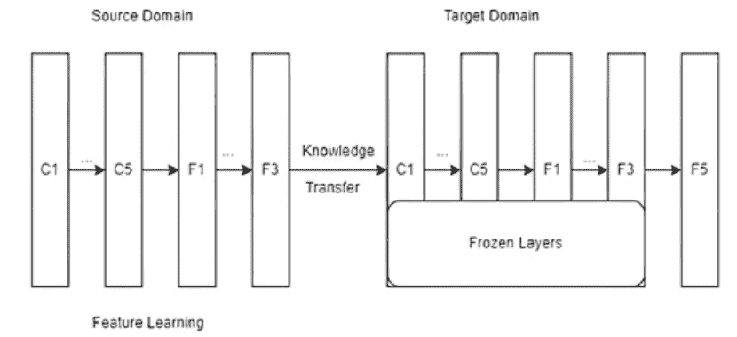

### 图 5.1 BLTL 框架

其次，提出了一种 LSTM 框架，如图 5.2 所示。所提 LSTM 网络倾向于处理单词和特征向量。嵌入层包含单词向量，特征向量作为 BLTL 框架的输出给出。因此，LSTM 模型及其层在单词和特征索引上进行训练。法律案件的句子不能直接用于训练，也不能直接输入到 LSTM 层中。因此，现在，法律文档的句子被转换为分词单词列表。在此之后，案件的所有独特单词都转换为唯一整数值。在 LSTM 模型中，嵌入层输入将是整数。单词索引的整数作为输入提供给嵌入层。该层输出与每个单词对应的向量数组。目前使用 Adam 优化器，它在文本分类中显示出相当好的性能改进。此 LSTM 模型在预测法律文档中下一个单词的结果方面起着重要作用，其中之前的


生成的字幕已存储。所提议的LSTM层使用标准损失函数。损失函数和优化器用于设计LSTM层，以平衡生成的法律报告。对于当前工作中的所提议模型，描述的长度和文档中的单词数量将作为结构化参数。因此，所提议的方法用于目标领域中的法律相关文本处理。

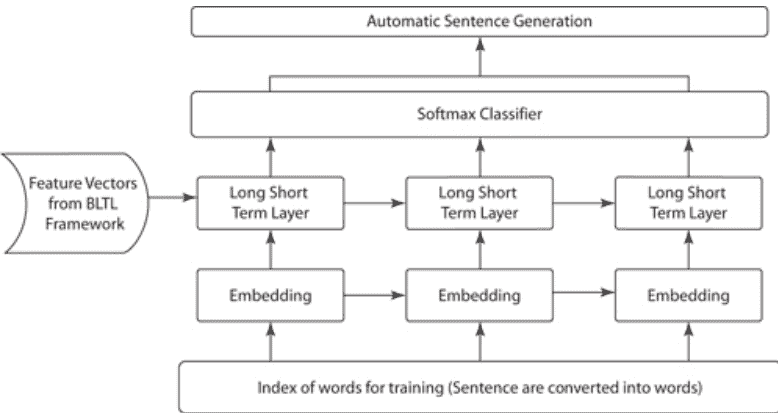

图 5.2 LSTM框架

### 5.4 实验

#### 5.4.1 数据集

在该框架中，初始源域模型基于25,000张ImageNet数据集图像进行验证[34]。所提议BLTL框架的第一个源域网络用于提取大量特征，并作为LSTM模型的关键输入之一。在本章中，仅报告源域详细信息，而在未来，将报告目标域以及LSTM模型数据集详细信息，因为司法和法律相关图像及文本数据集的实施工作正在进行中。

#### 5.4.2 评估指标

为评估所提议BLTL框架的源模型，所选定的指标是“准确率”。普遍认为，BLTL框架的准确率越高，模型在给出分类输出和字幕生成方面就越好。

#### 5.4.3 实验结果与讨论

#### 5.4.3.1 BLTL框架

25,000 ImageNet数据集用于源域的特征学习。BLTL框架的第一个源模型仅包含五个卷积层；随后使用最大池化层，其后接着三个全连接层。经过充分训练和验证，所提议的BLTL源CNN网络达到了0.90的显著准确率，如图5.3所示。

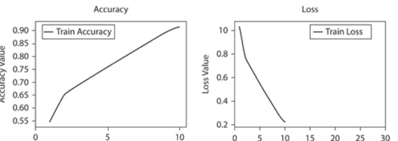

图 5.3 源域分类结果

在当前工作中，仅报告BLTL框架源模型的分类结果。然后，源域学习到的知识转移到BLTL框架的目标域，该目标域由司法法律相关数据集组成，因为这是目标域发展的基础。然后，BLTL框架目标域的结果特征将转移到LSTM模型，该模型对数据进行分类和翻译，并自动生成法律报告。目标域的结果和LSTM模型的结果将在未来报告，因为实施结果的实地真值验证正在进行中。

所提议的工作与几种在医疗领域表现良好的现有最新技术进行了评估。由于法律相关文件和判决也应经过极其谨慎的准确分类和预测，因此医疗领域使用的框架经过微调以用于司法目标域。但目前，仅将源域实现与先前的工作进行了比较。已确定，所提议BLTL框架源模型的性能准确率与现有架构相当。所提议的工作与其他最先进的方法进行了比较，如表5.2所示。

## 表 5.2 当前最先进方法比较

| 现有工作 | 文献中提出的工作源域 | 目标域 | 采用的方法 | ROC/ACC |
|---|---|---|---|---|
| [32] | ImageNet数据集 1400万张图像 | 超声分类 | 预训练VGG-16迁移学习 | 数据增强 90.6 ACC |
| [33] | 源域：完整ImageNet数据集 | 病变分类 | InceptionV3 InceptionResNet-V2迁移学习 | 数据增强 0.96 ACC 0.97 AUC |
| [25] | 源域：完整ImageNet数据集 | DBT分类 | 迁移学习 | 91 AUC |
| [22, 23, 24] | 源域：ImageNet | DBT、CT和罕见疾病分类及医疗报告生成 | MLTL和FETL框架 | 90 ACC 0.89 AUC 0.93和0.96 AUC 0.88 AUC |
| 所提议工作 | 所提议两级BLTL框架源域 ImageNet (25,000张图像) | 司法法律相关分类及合同报告生成 | 基于CNN的BLTL和LSTM框架 | 90 ACC |

### 5.5 结论

所提议的工作提出了一种创新方法，以有效设计两级BLTL和LSTM架构，用于司法文件生成、法律研究预测辅助等多种目的。本工作的一项创新贡献是使用智能迁移学习技术，这清楚地证实了该多用途模型可以在几个其他不同的数据稀缺领域中实施。因此，由于司法系统中的大部分信息是机密的，而且案件细节高度不平衡，所提议的两级多用途框架适用于受数据集稀缺问题影响的法律流程。未来工作主要集中在报告BLTL目标域和LSTM框架的结果，并进一步发现将此架构扩展到司法法院系统中数据不公开的其他领域并对其进行微调的可能性。毫无疑问，这种双重框架将提高司法交付系统的能力，并且对于多种目的都有用，例如决策预测、评估决策的风险和后果、解决纠纷、管理文件、文档翻译、法律研究辅助、自动化流程，以及最后识别不同语言。这将帮助法官和所有利益相关者进行法律研究，并从计算机辅助检测（CAD）系统中受益。

## 参考文献

- 1. Gao J., 等. ‘基于深度神经网络的有趣性建模’. 在：EMNLP, 2014.
- 2. Hu B, 等. ‘用于匹配自然语言句子的卷积神经网络架构’. 在：神经信息处理系统进展, 2014, pp 2042–2050.
- 3. Shen Y., 等. ‘用于信息检索的带卷积-池化结构的隐语义模型’. 在：第23届ACM国际信息与知识管理会议论文集 2014, pp 101–110.
- 4. Huang P.S., 等. ‘利用点击通过数据学习用于网络搜索的深度结构化语义模型’. 在：第22届ACM国际信息与知识管理会议论文集, 2013, pp 333–2338.
- 5. Palangi H., 等. ‘使用长短期记忆网络进行深度句子嵌入：分析及在信息检索中的应用’. IEEE/ACM音频、语音和语言处理汇刊, 2016, 24(4):694–707.
- 6. Tai K.S., 等. ‘来自树结构长短期记忆网络的改进语义表示’. 在：第53届计算语言学协会年会及第7届国际自然语言处理联合会议论文集（第1卷：长论文），计算语言学协会，中国北京，2015，pp 1556–1566.
- 7. Pang L., 等. ‘将文本匹配视为图像识别’. AAAI出版社，AAAI’16.
- 8. Wan S., 等. ‘用于带有多位置句子表示的语义匹配的深度架构’. 在：第三十届AAAI人工智能会议论文集。AAAI出版社，AAAI’16，pp 2835–2841.
- 9. Mitra B., 等. ‘使用文本的局部和分布式表示进行网络搜索匹配学习’. 在：第26届国际万维网会议论文集, 2017, pp 1291–1299.
- 10. Marchesin S., 等. ‘神经信息检索模型的焦点元素：通过可重复性研究的展望’. 信息处理与管理, 2020, 57(6):102109.
- 11. Guo J., 等. ‘深入探讨信息检索的神经排序模型’. 信息处理与管理, 2020, 57(6):102067.
- 12. Devlin J., 等. ‘Bert：用于语言理解的深度双向变换器预训练’. 在：NAACL-HLT, 2019.
- 13. Dai Z., 等. ‘使用上下文神经语言建模进行更深入的IR文本理解’. 在：第42届ACM SIGIR信息检索研究与开发会议论文集, 2019, pp 985–988.
- 14. Yilmaz ZA, 等. ‘用于文档检索的句子级证据跨域建模’. 在：2019年经验自然语言处理方法会议和第9届国际自然语言处理联合会议（EMNLP-IJCNLP）2019论文集, pp 3481–3487.
- 15. Bench-Capon T., 等. ‘《50篇论文中的AI与法律历史》：国际AI与法律会议25年’. 人工智能与法律, 2012, 20(3):215–319.
- 16. Zeng Y., 等. ‘智能法律案例检索的知识表示’. 在：基于知识和智能信息与工程系统国际会议。Springer, 2005, pp 339–345.
- 17. Saravanan M., 等. ‘使用本体框架改进法律信息检索’. 人工智能与法律, 2009, 17(2):101–124.
- 18. Tran V., 等. ‘编码摘要：将文档摘要为连续向量空间用于法律案例检索’. 人工智能与法律, 2020:1–27.
- 19. Mandal A., 等. ‘测量法律法庭案件文档之间的相似性’. 在：第10届年度ACM印度计算会议论文集, 2017, pp 1–9.
- 20. Shao Y., 等. ‘Bert-pli：用于法律案例检索的段落级交互建模’. 在：Bessiere C (ed) 第二十九届国际人工智能联合会议论文集，IJCAI-20，国际人工智能联合会议组织，2020，pp 3501–3507.
- 21. Rabelo J., 等. ‘结合相似性和变换器方法用于判例法蕴含’. 在：第十七届国际人工智能与法律会议论文集, 2019, pp 290–296.
- 22. Aswiga R.V., 等. ‘用于有限乳腺影像数据集的带特征提取技术的迁移学习增强’. 数字成像杂志, 2021, 34:618–629. https://doi.org/10.1007/s10278-021-00456-z.
- 23. Aswiga R.V., 等. ‘用于有限CT和DBT图像生成医学字幕的多级迁移学习技术和LSTM框架’. 数字成像杂志, 2022, 35:564–580. https://doi.org/10.1007/s10278-021-00567-7.


- 24. Aswiga R.V., 等. ‘用于分类罕见医学数据集的多阶段迁移学习技术’. Journal of Ambient Intelligent and Humanized Computing (2021). https://doi.org/10.1007/s12652-021-02989-1.

- 25. Ravi K., 等. ‘数字乳腺断层合成中乳腺癌诊断—训练样本量对基于深度神经网络的多阶段迁移学习的影响’. IEEE Transactions on Medical Imaging, 2019, 38(3):686–696.

- 26. 在线: https://github.com/davidmasse/US-supreme-court-prediction

- 27. 在线: https://github.com/AccelAI/AI-Law-Minicourse/tree/master/Supreme_Court_Topic_Modeling

- 28. 在线: https://github.com/GirrajMaheshwari/Legal-Analytics-project---Court-misclassification

- 29. 在线: https://github.com/whs2k/GPO-AI

- 30. 在线: https://github.com/brightmart/sentiment_analysis_fine_grain

- 31. 在线: https://github.com/LexPredict/lexpredict-contraxsuite

- 32. Santhosh R.D., 等. ‘基于深度学习的超声成像中脂肪肝疾病分类新型计算机辅助诊断框架’. 2018 IEEE第20届电子健康网络、应用与服务国际会议论文集（Healthcom）, 2018, pp 1–5.

- 33. Romero F.P., 等. ‘用于肝脏病变分类的端到端判别性深度网络’. 2019 IEEE第16届生物医学成像国际研讨会论文集（ISBI）, 2019, pp 802–805.

- 34. ImageNet在线数据集 http://www.image-net.org/

- 35. Sardar T.H., 等. ‘基于OpenMP和Pluto在对称多处理机上的选定数值算法并行化与分析’. Data Technologies and Applications, 2019, 53(3).

- 36. Sardar T.H., 等. ‘基于MapReduce的模糊C-Medoids分布式大数据聚类’. 印度工程师学会杂志：B系列, 2022, 103:73–82. https://doi.org/10.1007/s40031-021-00647-w.

- 37. Sardar T.H., 等. ‘基于MapReduce的模糊C-Means分布式文档聚类算法’. 印度工程师学会杂志：B系列, 2022, 103:131–142. https://doi.org/10.1007/s40031-021-00651-0.

- 38. Manikiran G., 等. ‘电子商务服装评论分析与模型构建’. 载于第二届计算机工程与通信系统国际会议论文集：ICAECECS 2021. 新加坡：Springer Nature Singapore, 2022.

- 39. Sardar T.H., 等. ‘基于MapReduce的K-Means算法分布式文档聚类分析’. 印度工程师学会杂志：B系列, 2020, 101:641–650. https://doi.org/10.1007/s40031-020-00485-2.

- 40. Ansari Z., 等. ‘基于Hadoop MapReduce的并行K-Means聚类数据分类’. 印度工程师学会杂志：B系列, 2019, 100:95–103. https://doi.org/10.1007/s40031-019-00388-x.

- 41. Aswiga R.V., Karpagam M., Chandralekha M., 等. 基于CNN的糖尿病自动检测与分类. Soft Computing, 2023, 27:6869–6875. https://doi.org/10.1007/s00500-023-08122-y.

- 42. Subbarao E., 等. ‘利用机器学习调查城市地区和大都会社区的太阳能’. Electric Power Components and Systems, 2023:1–11.

- 43. Sardar T.H., Faizabadi A.R. ‘基于OpenMP和Pluto在对称多处理机上的选定数值算法并行化与分析’. Data Technologies and Applications, 2019, 53(1):20–32.

- 44. Sardar T.H., Ansari Z., Khatun A. ‘基于并行K-Means的文档聚类中Hadoop集群效率评估’. 2017 IEEE电路与系统国际会议（ICCS）. IEEE, 2017.

- 45. Sardar T.H., Faizabadi R., Ansari Z. ‘基于Hadoop框架的MapReduce范式数据处理分析’. International Journal of Engineering Research and Management Technology, 2017, 6(5).

- 46. Sardar T.H., Khatun A., Khan S. ‘无线传感器网络中节能收集树协议设计’. 2017 IEEE电路与系统国际会议（ICCS）. IEEE, 2017.

- 47. Sardar T.H., Muttineni A., Ranjan R. ‘客户体验和库存管理中大数据的未来’. Big Data Computing. CRC Press, 2024, pp 233–248.

- 48. Sardar T.H., Khatun A., Sengupta S., Alam Y., Ara T. ‘医疗保健领域和生物医学大数据中的机器学习：技术、应用与挑战’. Big Data Computing, pp 336–352.

- 49. Sardar T.H., Das S., Kumar Pandey B. ‘可解释人工智能（XAI）：概念与理论’. 基于可解释人工智能的医疗数据分析与处理. CRC Press, pp 1–18.

- 50. Sardar T.H., Ansari Z. ‘基于并行K-Means算法的文档聚类中MapReduce效率分析’. Future Computing and Informatics Journal, 2018, 3(2):200–209.

- 51. Guru Prasad MS, 等. ‘基于改进AlexNet架构的新型提取方法的脑肿瘤识别与分类’. 2023年第六届信息系统与计算机网络国际会议（ISCON）. IEEE, 2023.

## 6 基于特征提取与标注技术处理非医疗大数据和极少医疗数据的深度学习方法论分析

R V Aswiga

DOI: 10.1201/9781003465775-6

### 6.1 简介

医学影像中普遍且主要的研究领域之一是利用计算机辅助检测（CAD）技术进行诊断。这些技术在诊断放射学方面也有多项突破性记录。这些技术需要大量大数据来构建可靠且准确的模型。然而，从最新成像设备中收集海量图像极为困难，因为这些图像并未向公众开放。尤其是在医学领域，收集大量数据颇具挑战。因此，最大限度地利用极为有限的医学图像以进行解读与分析，似乎是一个重要的研究方向。本工作致力于构建用于有限医学图像数据集分类与标注的框架。对于有限医学数据集的分类，拟议模型应首先在大量可用的非医学大数据集上进行训练。本工作的组织安排如下。第6.2节解释了CAD方法和先进机器学习技术的最新进展，这些技术在医学图像处理方面取得了突破。第6.3节对罕见及大量可用医学图像的掩膜、分割和分类进行了全面综述。第6.4节总结了迁移学习概念技术，用于解决医学领域分类以及训练数据不足的非医学数据集相关的问题。随着特征提取技术及其他多种先进图像处理技术的进步，非医学和医学图像的分类已得到探讨，并在第6.5节中讨论。第6.6节介绍了编码器-解码器模型为医学和非医学图像生成标题的重要性。最后，第6.7节基于文献调查总结了相关问题与挑战。

### 6.2 医学图像处理的CAD方法与机器学习技术

近年来，CADx和CADe技术的进步对医学影像做出了额外贡献。在最近几年，此类CAD系统中机器学习技术的应用不断增长。文献[103]中描述的工作为医学图像自动分析提供了一个有价值的平台。拟议框架有助于利用超声图像诊断颈动脉问题。诊断包括自动分割动脉壁、选择感兴趣区域（ROIs）斑块、估算和聚类纹理特征以及分析不同图像区域的组织。文献[89]引入了一种在统一框架中解决各种分割问题的形状分析策略，并已在许多临床肺部CT图像上进行了测试。

文献[106]介绍了使用CAD系统对3D图像中的病变进行分类。拟议工作利用螺旋扫描技术自动分割病变，为此部署了结合动态规划和螺旋扫描技术的种子点。在胸部X光片（CXRs）中自动检测结核病（TB）已


[52]中提出了一种用于检测纹理、形状和局灶性异常的方法。
开发了一套CAD系统，用于处理各种类型的异常，该系统利用监督分类器将多个检测到的异常子分数合并并归一化为单一的TB评分。
使用自动化CAD系统，计算出的最终总体TB评分可以适应不同的操作设置或不同的操作要求。

[47]中介绍了一种对CT扫描图像中异常区域进行标注的方法。所提方法是一种新颖的视角，包含肺部CT图像。异常区域被分为九组不同的肺部疾病，可应用于使用CAD进行诊断和研究，也将有助于医学教育。

基于纹理，[82]提出了一种创新方法，用于在全片图像（WSIs）中查找重要区域。通过对组织形成进行更精细的分析，以更高倍率选择区域，从而有效检测和诊断乳腺癌。训练了一种支持向量机（SVM）分类算法，用于识别和区分临床无关的斑块。[44]提出了一种新的自动方法，有助于从电子健康记录（EHRs）中识别心脏淀粉样变性等罕见疾病，该方法包含73个阳性病例和97个阴性病例，F1得分为0.98。

[74]报道的工作表明，进化计算方法（如预处理、特征提取、分割、分类、聚类和特征选择）以及降维技术在优化糖尿病视网膜病变（DR）疾病的CAD技术中发挥着至关重要的作用。已研究了蚁群和蜂群优化以及粒子群优化等多种算法。已展示了寻找最佳算法的效率比较。[5]中提出的工作是一类此类CAD方法，它将源域病变无缝插入最终目标图像。数据增强技术在CT和乳腺X线摄影数据集上进行了测试，有助于训练各种分类器。[38]提出的工作引入了一种CAD框架，用于识别皮肤镜图像中的形状和边界。该框架使用显著性优化算法有效地勾勒病变。

[100]引入了一种使用2D面部图像检测罕见疾病的创新方法。该模型在12个不同类别的1,772张面部图像上训练，结果优于几种其他最先进的方法。引入了一种自动检测方法[98]，用于识别视盘区域视网膜图像中的新生血管化综合征（NVD）。这种基于机器学习的方法涉及特征提取，并结合Gabor滤波和特征选择技术，对血管进行分割，并使用SVM分类器检测NVD。在424张视网膜图像中，42个特征从NVD图像中提取为关键特征，134个被分类为NVD，290个被分类为非NVD图像。

[122]开发了一种基于聚类的高效方法，用于利用3D低剂量CT图像重建图像。图像补丁从CT图像池中检索。所提CT重建步骤通过使用拉格朗日方法完成，该方法在图像中使用最少数量的前向和后向投影，并通过使用本质上非自适应的边缘保持正则化器，显著优化了重建CT图像的质量。

用于检测肺部病变的拟议机器学习技术[125]是一种利用低剂量PET图像的创新方法。图像质量迁移（IQT）技术将使用补丁回归方法增强信息含量或分辨率，该方法将映射参数从低质量图像转换为高质量图像。因此，IQT有助于提高图像质量，以便从低剂量图像中检测病变。引入了用于分类帕金森综合征的技术[111]。集成式机器学习算法、遗传算法和极端机器学习算法[79,87]等多种机器学习算法已被有效用于检测乳腺图像中的恶性肿瘤。

[41]的作者引入了一种新颖步态分类方法，特别是针对法布里病（FD）患者。所提方法使用多种回归模型对FD疾病进行分类，准确率为78.21%。（Sun et al. 2019）部署了四种高效技术来在人群中识别这种罕见疾病。该工作记录了误分类率汇总，因此在识别罕见疾病时，神经网络将识别最低错误率。

[72]中引入了一种用于分类罕见疾病的不完善知识图技术。所提分类算法将对文本数据集进行分类，从而带来性能提升。在两个不同数据集上评估时，该技术将总共10万条数据高效地分类为849种疾病。在某些样本标签困难的情况下，特别是在医疗领域等应用中，可以使用带有特征提取的数据增强来缓解数据集有限的问题。[93]的作者引入了一种高效自动CAD技术，用于基于II型模糊隶属函数的肺部分类，用于调整和学习高斯区间。

引入了一种创新CAD方法[49]，利用注意力机制通过病理学图像诊断子宫内膜癌（又称子宫癌）。这种致命疾病会严重影响女性生殖系统。所提方法帮助病理学家更好地解读和诊断疾病，为此，病理学相关性被用作低级像素图像的有效特征，这些图像包含具有形态学特征的子宫内膜组织。

[53]中提出了一种使用高效机器学习技术的乳腺癌异常检测系统。最初使用主成分分析（PCA）等降维技术将信息比例缩减到最低水平，然后使用多层感知机（MLP）方法提取关键数据特征，最后使用SVM分类器进行分类。[66]的作者提出了一种新颖的智能技术，用于分类乳腺微钙化（MCs），这类病灶难以检测，但早期诊断效率高。所提方法使用决策树集成（EDT）和SVM分类器，涉及特征提取技术，将结果从91.42%有效优化到99.55%。引入了强化学习技术[42]，用于CT扫描的实时3D标志物检测。训练了一个模型来区分空间中的体积对象和解剖对象。所提工作使用了1,487个体积的3DCT扫描进行测试，这是在532名患者中收集的总共500,000张图像切片。

引入了一种有效方法[4]，利用计算机断层扫描（CT）和X光图像，对COVID-19疾病暴露后患者的肺部状况进行初步诊断和筛查。支持向量分类（SVC）、集成学习、K近邻（KNN）和随机森林（RF）算法等高效机器学习方法已被用于有效分类COVID-19疾病。[128]中引入了一种利用对抗逆向映射技术探索任务依赖性的机器学习框架。该模型最初在2,900张MRI图像和2,360张CT心脏图像上训练，经过微调以映射心脏图像索引。

引入了一种创新方法[97]，利用模糊专家系统分析乳腺图像中的异常。所提工作使用极端学习机算法结合径向基函数方法，其结果比线性SVM模型更显著。引入了一种新颖应用[37]，利用色动瞳孔测量设备自动检测遗传疾病，特别是在儿科患者中。这将尤其支持遗传性视网膜疾病的诊断和早期检测，特别是在儿科受试者中。

正如文献所见，生物医学研究中数据处理的量在不断增加。然而，对几种罕见疾病而言，疾病成因及其实时数据等更多基本信息非常有限或无法获得。这种罕见疾病时间序列数据的缺乏对基于统计ML的方法构成了巨大挑战。

### 6.3 用于处理医学图像的先进深度学习

随着医学领域的若干进步，这些算法主要用于分类医学文本和图像。[2]的作者引入了一种自动肝脏分割和病变检测技术，从特定区域提取关键特征，以支持对乳腺良性和恶性病变的有效区分。已引入了三种后续学习方案[23]，包括随机森林和线性回归，其中异质特征被


以受控方式推导。所提出的高效工作在24,000个肺部计算机断层扫描结节上进行训练，并展示了出色的诊断以及决策支持效果。

[12]中提出的方法使用解耦技术进行病变分类。该技术将一幅图像的特定表示与另一幅图像的非特定表示相结合。这种组合产生了一个用于在不同特定类变体之间进行分类的新样本。

[26]的作者引入了两种基于先进深度CNN的网络来检测心血管疾病风险，该模型在冠状动脉钙化CT数据集上进行训练。

所提出的两种模型结合中值滤波技术自适应多任务CNN模型。这能高效地分类心外膜组织并分割胸部组织。

一种新型CNN模型[105]采用距离回归组合方法，并配合融合方案方法提出。该模型将从6,000个2D CT和MRI肾数据集中学习特定特征。

[73]的作者引入了一种高效多阶段CNN模型来分类腺癌样本。所提出的模型是一种多任务算法，并在MICCAI数据集上进行了验证。该项工作得到了更好的F1分数值，并采用Dice指数进行准确度量。

深度神经网络的有效性已在众多应用[13, 69, 131]中得到确立，这些应用涉及肺、肝、乳腺、肾脏等，例如分类肝癌、分割肝肿瘤等。

[40]的作者引入了一种新的数据增强方法，利用多帧技术在CT中重建肝肿瘤的超分辨率切片。

[18]中提出的方法采用受监督的模式分类技术对肝、乳腺和血液新生物进行分类，以基于机器学习方法诊断肿瘤。

近年来，由于其有效且准确的预测结果，图像分割方法在医学领域已得到广泛应用。但在医学领域存在几项挑战，放射学家很难在非常早期阶段检测和识别这些挑战。

例如，一个重要的挑战是准确的肿瘤分割，因为肿瘤的大小、形状和位置各不相同。

[86]的作者引入了一种图形控制生成模型。这种高效方法主要用于分割来自多模态MRI脑图像的肝肿瘤，使用基于知识的约束作为主要关键差异，并能高效工作。

[21]中采用了几种先进的深度网络，它们对于提取肝脏形状非常有用，然后基于带有结构保持和去噪技术的新数据集对模型进行微调和改进。

[28]的作者提出了一种基于融合方法的自动肝脏分割方法，将包括基于阈值的主动轮廓与概率密度在内的传统方法与神经网络相结合，并在异质CT数据上进行了测试。

所提工作[102]是一种改进方法，通过从三个视图（即矢状面、冠状面和横断面）提取的轮廓来分离肝脏。

[51]的作者提出的方法利用CNN从肝脏中提取特定ROI，并在计算机辅助干预（MICCAI）2007年大挑战数据集上进行了测试。

最近，出现了三种用于分割多类型CT腹部图像的深度模型。

这三种模型仅从高对比度CT图像中分割肝脏。

[21]中提出的方法借助残差网络提取肝脏，并进一步使用结构保持组件进行微调。

最近提出了一种基于高级集成的分类器[120]用于预后预测。基因表达中的不同特征已被成功分类，并使用自动编码器来评估乳腺病变的预后。

[61]的作者提出了一种基于先进深度学习的高效Adaboost算法（DLA-EABA），结合高效先进的数学计算技术，用于识别和分类乳腺恶性肿瘤。

除常规计算机视觉方法外，还设计了使用深度卷积网络的肿瘤分类方法。

[32]提出了一种使用机器学习方法的医疗物联网（IoHT）用于识别医学图像。

所提出的计算智能框架创建文件夹，并将所有识别的在线医学图像放置在云存储中。

所提方法在多个医学数据集上进行了测试，例如用于分类中风、分类恶性肿瘤和分类与皮肤相关的黑素细胞病变。

### 6.4 用于处理有限训练样本的迁移学习框架

近年来，许多学者一直致力于使用迁移学习来缓解数据集不足的问题。这是通过将知识从初始源转移到最终目标来实现的，而初始源模型是在大规模数据集上训练的。

如图6.1所示，迁移学习已在各个领域的分类任务中成功应用。

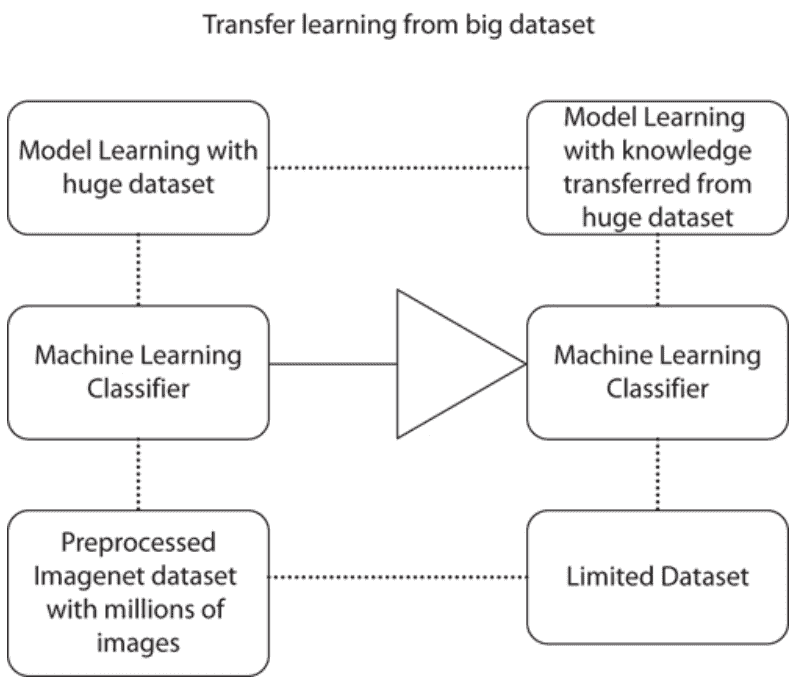

图6.1 从初始大数据域到有限数据域的迁移学习

#### 6.4.1 在医学影像中使用迁移学习的概念

在医学影像领域，迁移学习在检测乳腺病变方面似乎非常成功。除此之外，涉及肺、腹部、大脑、帕金森氏症以及脑电图（EEG）信号的几项其他分类任务也正在利用迁移学习。

基于实例的迁移学习技术在[109]中被提出用于分类慢性肺部疾病。他们使用胸部CT扫描图像识别了这种疾病。

所提出的方法可以使用不同的协议或扫描仪跨领域推广。

引入了另一种创新方法[83]来解决乳腺X线图像中肿块检测问题。上述问题的解决方案已通过基于CNN的迁移学习技术实现。

[80]的作者提出了乳腺癌分类方法，其中卷积神经网络在特征提取中起主要作用。

SVM和RBF分类器被调整用于核调制。这是因为算法具有灵活性，可以将数据集充分拟合到所需维度。

通过结合CNN和基于RBF的SVM，在混合化过程中，结果得到了显著提高。

在目标网络和源网络之间引入了一个中间域以降低领域差异。

[95]引入了多阶段学习，利用初始源网络的知识以及中间域中的乳腺X线图像来分类最后的目标DBT数据集。

[62]提出了使用病理图像（HI）检测乳腺癌。为了在一定程度上提高支持向量机（SVM）分类精度，在训练模型之前会从图像中移除不相关的补片。

[48]提出了多种模型用于分类组织学图像中的乳腺恶性肿瘤。这些图像具有多种细胞和核配置，并在AlexNet、ResNet和GoogleNet模型上进行训练。

[132]提出了基于域自适应的联合知识迁移学习方法，用于分类和识别脑电图信号，该模型除了在CHBMIT数据集上进行测试外，还在Bonn图像上进行测试以确定准确性。

所提工作通过迭代方法实现了更高的准确率。

引入了另一种新颖的正向方法[58]用于检测帕金森氏症，该方法包含领域特定数据而不是患者数据。

所提工作解决了负迁移问题，这是迁移学习中的一个重要问题，可避免性能下降问题。

该模型在不使用迁移学习技术的情况下优于其他技术。

[56]引入了一种新颖的无监督方法，基于在171幅MRI和1,018幅CT图像上训练的3D CNN模型来描述肿瘤。

GIST描述符已被纳入模型中以查找胰腺和肺囊肿之间的差异。

为了检测乳腺恶性肿瘤以及检测全尺寸图像中的肿瘤，提出了一种使用迁移学习模型[24]的高效自适应采样方法，该方法显著提高了分类精度。

引入了一种新的迁移学习技术[3]，采用一种新颖的图像加权方法来分割图像，从而在训练数据、测试数据和验证数据之间大幅减少最大均值差异（MMD）误差。

通过结合图像加权和核学习方法进一步优化了模型性能，并在异质数据上进行了训练。

提出了一种结合特征选择和归一化技术的迁移学习技术[94]，用于利用深度神经网络分类分子癌症。

所提方法使用稀疏自动编码器，并在基因表达数据上进行了测试。

这种无监督学习技术用于对不同类型的肿瘤做出准确决策，并发现对于诊断和治疗也非常有用。

[57]引入了一种先进的深度学习端到端框架，用于睡眠分期的准确和自动检测与分析。

推导了两种迁移学习模型来非常有效地解决两个问题：数据低效性和数据变异性。

所提出的两种基于迁移学习的睡眠分期网络分别在多个目标领域进行了测试，即Cassette数据库、Telemetry Expanded数据库和EEGrid数据库。

[90]引入了一种三向技术用于胃癌检测，其中所提出的模型对预测很有用


在三个目标领域病例中，如同一地区的胃部发病率、不同地区的胃部发病率以及不同地区的不同胃部疾病发病率。所提出的工作采用单变量回归、多元高斯分布和基于映射的深度迁移学习方法，将目标和源胃部发病率一起启动。当前模型进一步扩展以预测所有三个不同领域的胃部疾病发病率。引入了一种欧几里得空间技术 [50] 用于脑电图（EEG）数据对齐，以促进迁移学习在脑机接口（BCIs）中的应用。特征提取技术与机器学习算法一起应用，以实现更好的学习性能，即使在没有特定受试者数据的情况下。

分解、迁移和组合（DeTrac）方法 [11] 被引入，用于利用流行的迁移学习方法对医学图像进行分类。通过使用类分解方法，进一步提高了此类ImageNet预训练分类器的性能。当数据集分布中存在更多不规则性时，迁移学习模型难以提供强健的解决方案。因此，提出了一种采用类分解技术的新型创新CNN架构，使其更容易处理复杂的数据不规则性，该模型在不同数据集上进行了测试，如组织学图像数据集、胸部X光数据集和数字乳腺X线摄影。

已确定，使用数据增量技术可以显著提高乳腺恶性肿瘤的分类准确性，并且通过迁移学习技术引入了相同的方法 [81]。使用多种数据增量技术获得新的训练样本。对乳腺X光图像进行了缩放、旋转、翻转等多种操作。这克服了数据集不足的问题，从而提高了模型的准确性。引入了两个网络，即Inception V3和VGG19 [71]，它们在公共ImageNet图像数据集上预训练。分析了不同层次迁移学习的能力。引入了一种磁共振成像（MRI）动态增强对比方法（DCE），用于分类纤维腺瘤和导管浸润性癌，以检测乳腺肿瘤。

引入了一种高度自动化的模型 [54]，即在线迁移学习（OTL）网络，用于将甲状腺结节分类为良性或恶性，该模型使用超声（US）图像进行训练。所提出的工作采用结合在线学习的综合方法，并在两个多样化数据集上进行了测试，分别包含1,750和3,852个甲状腺结节，其中1,078和672个被分类为良性图像，其余标记为恶性图像；在第二个数据集中，3,213和639个被分类为良性图像，其余标记为恶性结节。

提出了一种高效的混合集成方法 [27]。当前工作处理漂移容忍问题，即使用迁移学习概念适应变化环境的需求，其主要挑战是使源模型和目标模型相互关联。非静态环境的数据在目标领域以流式方式生成。引入了针对每个分类器的领域权重集成方法，以合并和组合目标模型和源模型，该方法迭代最小化领域差异，并从初始源域转移有用知识，同时注意减少不相似源实例的影响。当前研究通过引入迁移学习概念中的漂移容忍来解决适应变化环境的需求。主要挑战是建立源模型和目标模型之间的关系。非静态环境的数据在目标领域内以流式方式持续生成。为解决此问题，提出了针对每个分类器的领域权重集成方法，以合并和组合目标模型和源模型。该方法迭代最小化领域差异，并从初始源域转移有价值的知识，同时专注于减少不相似源实例的影响。一些研究人员也在开发已在ImageNet数据上预训练的深度CNN模型，以使用平均振幅谱（MAS）图对脑电图表示中脑电活动的经典节律进行分类，该图自动提取和学习癫痫状态概率。

[99]中描述了一种关于迁移学习（TL）的最具代表性的新工作。这项最近的工作将迁移学习模型分为五种类型，即归纳模型、跨模态模型、负学习模型、转导学习模型和基于无监督学习的模型。每个领域分别根据学习实例、学习特征、学习参数和学习关系分为四种不同的学习类型之一。当前工作展示了迁移学习的演进及其在推荐系统、医疗系统、遥感、情感分析和信号处理等不同领域的重要性。

提出了一种用于处理医学图像的创新深度学习模型 [30]，该模型基于生成对抗网络，在医学图像的加密和解密方面非常成功。所提工作最初将医学领域对应的原始数据从源域转移到目标域的加密任务中。这有助于并指导模型学习并实现加密过程。处理后的医学图像的编码部分随后转换回其原始形式，有助于图像解密过程。使用ROI网络从加密的医学图像中检索出一个有趣的对象。该模型在胸部X光数据集上进行了评估。提出了一种抗负迁移机制 [126]，它使用模糊聚类模型（FCM）结合跨域潜在空间迁移学习技术来分割脑部CT图像。然而，当前基于聚类的迁移学习方法不能保证抵抗负迁移。

实现了一种新颖的通道融合（CF-Trans）技术 [22]，其中通过结合目标域和源域的数据流形，在中间设计了一个额外的域。最初，获取信息，然后在中间中间网络上进行训练，随后在目标域上进行训练。这一过程充当催化剂，促进正知识迁移。引入了一种新的框架 [1] 用于诊断COVID-19，其中四个流行的不确定性感知网络——DenseNet121、ResNet50、InceptionResNetV2和VGG16——已被用于从计算机断层扫描医学图像和胸部X光医学图像中提取基本特征。然后使用多种机器学习分类器算法以及其他统计技术对提取的特征进行训练，以准确检测和识别COVID-19病例。

提出了一种多源迁移学习技术 [55]，用于从B模式超声（BUS）图像中诊断和分类肝癌。所提工作使用多核（SVM+）算法，并将从增强对比超声（CEUS）图像中学习的知识转移到目标模型中，该模型在BUS图像上进行测试。这有助于在很大程度上提高性能，包括局部组织血管化过程，然后是灌注。为了促进或提高诊断准确性，当前框架进一步优化，以有效地从不同来源转移多个知识，并在多视角CEUS图像上进行训练。

#### 6.4.2 用于处理非医学数据集的迁移学习框架

在最近几年中，引入了几种用于分类目标模型的迁移学习概念，并已成功用于许多同时处理在线目标域和异构源域的应用中。提出了一种新颖的框架 [43]，其中包含自动编码器，使用多个源域进行学习，然后将知识转移到目标域。特征映射是从所有源域的原始实例创建到目标域的隐藏表示，随后在众所周知的现实世界文本和图像数据集上进行了测试。

设计并提出了两种新颖的在线迁移学习范式 [92]，一种用于一致且同质的迁移学习，另一种用于不同的异构学习，其中初始源模型的权重自动或动态调整。然后，使用多个源域增强目标模型的分类性能；最重要的是，这里接收在线目标数据。提出了一种基于在线异构迁移（OHT）学习的新颖创新技术 [129]，它利用不同域的在线知识和离线知识。构建了一个离线决策函数，并针对不同特征空间采用对冲权重策略。

受增强算法效率的启发，提出了一种强大的分类模型 [130]，其中多个分类器在源域上使用AdaBoost算法进行训练，并在20newsgroup数据集上进行测试。一种灵活的异构迁移距离度量


一种学习模型（HTDML）已被提出 [134]，其中利用线性和非线性算法来研究和理解源度量；现在，这个预先学习的源将有助于准确且轻松地学习目标度量。因此，目标模型的总体泛化误差显著降低。

针对机器中故障部件的分析，提出了一种两阶段学习网络模型 [123]，可应用于制造领域。本研究还旨在解决与训练数据集大小不足和数据分布变化相关的挑战。所提工作通过使用各种制造策略模拟数据来获得平衡数据集。生成的虚拟数据用于训练模型，以更好地诊断故障部件。对于汽车中故障部件的实时诊断，将预训练模型权重传输以协助生产端的物理空间。

但最近，基于知识迁移的技术已被广泛用于情感分析 [65] 和文本分类 [25]。在不平衡现实世界中文数据集 [116] 的分类中，采用了在平衡酒店评论数据集上训练的预训练网络。借助欠采样技术，模型权重被迁移，从而显著提高了目标模型对旅游数据集分类的性能。引入了一种智能多标签度量迁移学习（MLMTL）模型 [101]，用于通过调整多标签数据集的实例分布和标签分布来分类 bibtex、情感和场景。此处仅考虑距离度量，如 MMD，而其他算法将考虑实例级分布及其引用。

引入了一种两阶段分类方法 [19]，用于分类公开可用的美术画作。六种现有的标准 CNN，包括 VGG-16 和 Alexnet，在第一阶段分类器中与图像数据集的五个补丁一起使用。第一个模型产生的概率类向量将帮助在第二阶段做出最终预测或决策，这些预测更准确，从而显著提高性能。

提出了一种基于强化学习的StarCraft微管理课程迁移学习方法 [68]，旨在控制其中的多个单元。所提技术降低了由于大状态空间导致的游戏环境中的复杂性水平，并通过调整梯度下降Sarsa拟议算法来控制，用于训练模型。该课程模型的拟议框架用于扩展到更多额外的复杂场景。因此，这有助于加快训练过程，并进一步提高学习性能。

提出了一种高效且非常有效的手势分类和识别深度学习模型 [107]。这种手势识别通过基于大量肌电图数据仅学习必要的信息特征来增强，从而更大程度地减少记录负担。当模型分别在原始连续小波变换（CWT）、EMG 和频谱数据集上训练时，当前迁移学习技术会系统地显著提高性能。

引入了一种用于低秩跨域学习的高效深度学习编码方法 [133]。当前的低秩编码模型本质上是多层的，并部署在非常特定于任务的顶层，并共享一些通用特征以解决域不一致问题，从而使丰富的知识以逐层的方式在域间共享。所提框架保留了目标域和源域中熟悉的全局大规模结构，并在两个域中频繁出现的相似样本的相同结构被组合起来，以实现积极有效的知识迁移。除此之外，还结合并集成了多种域自适应技术，利用半监督学习方法有效优化编码。此外，缓解了所有域中的边际和条件差异问题。其他一些成功的工作 [76, 78, 104, 117, 和 135] 也可以应用于医学领域。

如 [114] 所述，通过利用部分迁移学习和特征提取方法，有效管理两个域的独特特征，其中源模型的只有一部分被用于目标模型。该模型采用多任务方法对网络进行微调，并最终在原位杂交（ISH）标记图像上进行了测试。

### 6.5 用于增强分类器性能的特征提取方法

近年来，许多研究学者一直专注于特征提取技术，以提升模型在图像数据集上的分类性能。主要地，特征提取技术在医学领域起着主导作用，在识别病变类型并对其进行非常准确的分类方面表现良好。已观察到，通过结合适当的数据融合技术与一些重要的特征提取方法，模型的分类器性能得到了改善。

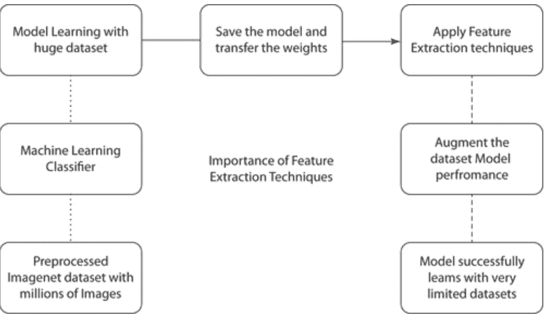

**FIGURE 6.2** 使用特征提取方法来增强分类器性能

#### 6.5.1 提取医学图像特征

引入了线性判别分析 [46]，结合特征选择和提取方法，用于准确分类脑部MRI数据集。提取了低级和高级特征；从脑部MRI中提取形状、强度和纹理特征以及基于CNN的高级图像特征，然后将数据集用传统的机器学习分类器进行训练。乳房和脑部图像都具有高度内在模式，可以使用嵌入CNN的现有GLCM算法和遗传算法轻松处理，这种方法被称为混合方法。

提出了三种基于相关性的特征选择和提取算法 [108]，用于找出最显著的基本特征子集。其效能和特征选择算法的有效性基于高度内在的脑部图像数据集进行评估。

提出了一种新型图像检索系统 [85]，其中使用三种不同的特征选择和提取算法从图像中提取基本纹理，并使用混合方法识别潜在特征向量，并在乳房图像数据集以及脑肿瘤和甲状腺图像上进行评估。

提出了一种基于特征丰富的CNN（FE-CNN） [91]，用于心电图（ECG）信号的心跳分类。ECG信号被转换为时频图像格式，并使用基于傅里叶变换算法的离散短时方法进行增强，然后将这些格式化图像输入到所提CNN模型中。另一种名为FE-CNN的流行模型在MIT-BIH心律失常数据库上训练，在不使用手工制作的特征提取算法的情况下，性能优于其他流行算法。如 [7] 所述，PFAF-Net是一个金字塔特征网络模型，融合了在多个尺度上合并高级和低级特征的基本概念。采用基于注意力的融合策略来有效融合全局和局部特征。解码器模型将重建提取的图像，然后将其与多模态数据集成，从而产生丰富的内容细节。该模型在四个基准数据集上进行了实验：医学、多曝光、多焦点和视觉-红外。还介绍了一些用于增强对称多处理机性能的选定数值算法 [96]。

#### 6.5.2 提取非医学图像特征

发明了一种新型特征学习框架 [70]，其中使用了光谱-空间技术等特征提取和特征选择算法来分类高光谱图像。该特征学习框架从低维潜在子空间中学习，


仅提取最主要、重要且独特的特征。一种基于聚类的半监督特征提取技术已用于雷达图像分类 [118]。通过实现高阶聚类张量保留图像的原始内在结构信息和非局部信息，并在由四幅真实SAR图像组成的模拟合成孔径雷达（SAR）数据集上进行了测试。

一种集成特征选择算法和一种创新技术已被提出 [112]，其中结合了希尔伯特–施密特独立性准则和核费舍尔技术的线性判别分析，以提取不相关、低维和低区分度的特征。提取的低维特征使用朴素贝叶斯分类器进行分类。所提出的方法在两个典型电路上进行了测试，并成功检测和分类了大多数模拟电路故障。

一种扩展框架 [17] 已被提出，用于基于张量嵌入方法挖掘有助于分类PolSAR土地数据集的内在特征。每个像素图像表示为一个内在特征，统计图像属性以矩阵形式表示。然后应用基于向量的算法以获取投影矩阵，当在覆盖旧金山、西安和弗勒沃兰地区的三个不同数据集上进行测试时，这些算法的有效性似乎非常出色。

已介绍了一种特征提取框架 [84]，该框架由使用特征中心技术从研究中提取独特信息组成。为了从文章中提取逻辑大纲，引入了一种名为 FLAG-PDFe 的四阶段新方法。所提模型建立在 SVCML 模型之上，并基于文本和几何特征信息进行训练，以提取文章中的独特章节，然后进行全面的通用特征评估。

一种判别相关特征融合分析已被提出 [119]，用于提取三种不相关匹配类型的特征并共同区分场景。一个或多个分类器模型的结果被合并，最后使用多数投票法确定最佳模型；这可以进一步改进，以实现遥感分类性能的显著提升。所提出的特征提取算法是一种异质方法，在三个著名数据集上进行了验证：WHU-RS、SIRI-WHU 和 Merced UC 土地利用数据集。此外，几位研究人员还致力于通过使用传统 PCA 方法融合全局和局部特征来解决数据集不足的问题。这些特征提取算法使用一种称为局部保持投影（LPP）的新性能指标进行评估。可训练非线性反应扩散（TNRD）模型是估计和去除由多光谱仪器（MSI）派生的浮游藻类指数（FAI）图像中噪声的最普遍方法。这种新方法自动从这些图像的空间模式中提取大西洋沙草特征，并在 Landsat-8 和 Sentinel-2 卫星数据集上测试时达到了 86% 的提取精度。已提出使用极端多核学习机（MK-ELM）[64] 来分类接收信号强度指示（RSSI）图像。一种基于 PCA 方法的两级特征提取技术用于准确测量 RSSI。

### 6.6 用于生成图像字幕的编码器和解码器框架

由于视觉理解技术取得了巨大进展，图像字幕生成过程在众多应用中发挥着至关重要的作用。图像字幕生成将自动为任何给定图像创建字幕，并弥合语言和视觉领域之间现有的巨大差距。这使得能够首先识别图像中的重要特征，然后将提取的纹理最终映射，为给定图像创建自动注释。可以使用自然语言处理模型轻松生成自动字幕，许多研究人员正在致力于此以优化模型性能。最近，先进的深度学习技术已被广泛用于机器翻译，结合自然语言处理算法和特征提取技术来生成语言。编码器和解码器模型在图像字幕生成领域非常成功。

#### 6.6.1 为非医学图像生成字幕

研究人员开发了多种对话识别全自动字幕系统，在医生的会谈语音通常包含大量不同即兴风格中不常用的医学术语的情况下，这些系统将作为一种解决方案。因此，一种新的带语言模型（LM）的贪婪算法与前向权重调整（FWA）技术一起使用，其中权重使用传统的期望-最大化算法自动估计，从而显著提高了字幕生成的准确性。近年来开发的大多数新技术过滤噪声检测并创建语法树以自动生成自然图像描述 [35]。

一种基于模板的描述生成模型已被提出 [33]。该模型目前基于视觉表示进行训练，并专注于建立图像中多个对象之间的连接。通过假设依赖关系表示，可以改进图像描述。如 [67] 中所提，计算机视觉算法主要用于识别和检测图像，其中借助识别算法确定最能描述图像的术语。生成的最终描述非常准确，并与图像内容一致。一种新的视觉依赖关系表示（VDR）模型已被提出 [34]，其中使用对象检测器识别不同对象，最后使用基于模板的描述生成模型利用检测结果（对象）为新的未见图像生成自动描述。

一种新的自动图像描述方法已被提出 [39]，其中包括使用多个学习实例来训练视觉检测器，该模型已使用超过 40 万个描述进行测试，以自动编码关于单词使用情况的信息。一种将巨大的高级概念整合到编码器-解码器模型中的新方法 [115] 已被提出，这在视觉问答和图像字幕系统两方面都实现了显著改进。

一种基于 GoogleNet 模型 [110] 的编码器网络已被开发，能够成功提取图像特征，这些提取的特征将作为第一个输入传递给语言模型（通常称为语言解码器模型 LSTMLM），以有效地自动为图像生成字幕。一种确定性前向注意力机制 [121] 已被引入，它专注于单个图像中的一小块区域，而不是将整个图像作为一个整体来关注，从而大幅提高了字幕系统的性能。作者在 [127] 中提出了一种基于混合概念（结合自顶向下和自底向上方法）的自然语言处理模型。一种语义注意力模型在两个公共基准数据集（Flickr30K 和 Microsoft COCO 数据集）上进行了验证和实验，该模型仅选择语义概念，并使用自顶向下和自底向上的计算方法将它们融合到隐藏状态中。

一种双深度循环 CNN 已被实现 [31]，它学习时间和空间的组合表示。所提出的现代模型属于 RNN 类别，非常引人入胜；各种长度的视频被映射为自然文本输出，并使用反向传播技术高效地建模时间动态。

一种新框架 [124] 已被引入，它将编码器 CNN 模型的属性同化到 LSTM 中，并帮助模型以端到端的方式进行训练。图像特征表示和单词属性以多种不同的方式作为输入馈送到 RNN 模型，以探索它们之间的模糊相关性，并在 COCO 图像字幕数据集上进行测试。一种新的视觉字幕模型已被提出 [15]，它可以基于语言知识选择视觉内容。视觉门控是一个关键控制单元，决定单词生成过程。语言生成器的所有先前输出都被馈送到潜在空间以推导句子结构，这些结构协助视觉门控选择适当的注意力时机。当前工作使用 MSCOCO 和 MSVD 基准数据集进行评估。

一种与 [115] 类似的创新方法已被提出，用于自动为糖尿病患者生成非常简单且真实的字幕陈述。当前工作基于一种生成模型，该模型同时使用 CNN 和 LSTM 网络来增强目标领域中字幕生成的可能性。[38] 对脑部图像进行了自动字幕生成，当前工作利用一个预训练模型来解码大脑的多种活动以生成有意义的字幕。A


regression model is implemented along with LSTM for learning the association between an image feature and the association of activity features of the brain.

Word2VisualVec [59] is an advanced neural network architecture for predicting features in the form of visual representation from the actual textual input. Instead of relying on a joint subspace for retrieving captions, the proposed model works on features of visual space, where the captions are encoded into the embedding layer using a multiscale vectorization technique. The model is further enhanced using an efficient and simple multilayer perceptron network. The Word2VisualVec framework is further made more comprehensive for retrieving captions from videos. The current work not only predicts captions from text but is also very effective in captioning the audio-visual representation. The model is validated on the Flickr8k, Microsoft Video Description, and Flickr30k datasets.

An adaptive CNN architecture has been proposed [6] for automatic annotation of articles with the help of both image and text data. Canonical correlation analysis is done and the great circle distance–based loss function is deployed in CNN and tested on 100,000 news article datasets that include heterogeneous data like captions, images, and texts. Faster R-CNN [36] is an attention technique based on the multilayer model which will extract image features effectively, and finally the extracted features are input to the faster recurrent convolutional neural network which will act as a decoder for decoding the samples effectively. Finally, the automatic descriptions are generated and the model’s performance is further augmented using the preeminent gradient optimization technique. The attention mechanisms that are employed in the network layers can in fact evade the hindrance of non-salient features and help to effectively carry out the decoding process to determine the corresponding description text accurately. The model is experimented on three datasets: the Microsoft COCO Caption Data Set, the Flickr dataset, and the AI challenge Chinese dataset.

Automatic image caption generation based on topic candidates has been introduced [88] using a cross-model embedding method. This method follows a hierarchy whereby the image as well as the text vectors act as inputs and the corresponding output will be automatically generated as a caption for that image. The model seems to be performing well as the output space matches with the image since the structure used here pushes and shrinks the captions jointly together in an embedding space. The current multilabel classifier model is tested on the Flickr 30K and MSCOCO datasets to select the topics accurately.

Innovative and novel caption generation methods [77] have been proposed which outperform other existing models and give comparably good results when tested on the publicly available MSCOCO dataset. This model uses two-level optimization methods for detecting the most important semantic features and finally a selection procedure is applied to automatically choose the most suitable concept. A novel report generation framework is proposed [20] using a soft attention mechanism into which a feature pooling method is also incorporated to detect and analyze abnormalities in an image, and it generates diverse captions routinely. In the current hierarchical recurrent network, a topic matching mechanism is additionally added and has been tested for efficiency on the CT lung dataset.

One other intelligent image captioning model has been introduced [63] based on a multimodal transformer (MT) network that will process the intra- and inter- interactions using a unified attention block. The proposed technique produces accurate captions using a complex multimodal reasoning technique. The MT model is further trained on visual features to move forward and improve the model’s captioning performance. Now the CNN model which is acting as an encoder will take out the visual features that are region-based in an image, whereas the decoder RNN will be primarily responsible for generating captions and the RNN automatically predicts the output descriptions that are completely based on just the given visual features. A novel and innovative topic RNN model was introduced [16] to generate sentences automatically. The memory network is incorporated with topic words to guide sentence generation successfully. The current model is validated and tested to generate automatic captions on the basis of remote sensing images (RSI); this work also captures the diverse portions of a single image for the purpose of accurate annotation.

A comprehensive and coherent caption for an image is generated by one famous model introduced [45] by fusing CNN with RNN. Along with this encoder and decoder model, the beam search technique is incorporated to automatically develop as many captions as possible for the final target image; then the best caption using the lexical similarity technique will be selected. A hierarchical dual encoding framework, DualVD, that consists of dual visual dialogue models to confine the appearance-level sequence in a picture representation is introduced [60]. The current work selects the most pertinent information automatically from both the visual and the semantic views. This covers a broad range of content in an image that could be correlated or linked to any top-level semantics or objects.

#### 6.6.2 GENERATING CAPTIONS FOR THE MEDICAL DOMAIN

Automatic caption generation using an enhanced deep learning approach is implemented [14]; the projected system helps to distinguish drug-related paraphernalia and generates automatic descriptions for the same images. The proposed model is tested on diverse categories of drug items that are approximately 20 in number, and the descriptions are automatically generated for all 20 categories without leaving out or missing most of the most important information. Describing the visual contents in the form of descriptions from a video has been addressed in [113]. The current model works on a reconstruction network (RecNet). Here, both the backward flows and the forward flows (sentence to video and vice versa) are incorporated for generating descriptions. Most importantly, the RecNet model utilizes the forward approach to make a model description using semantic encoded video features. The model is further frozen and fine-tuned by using a CIDEr optimization technique that substantially augments the captioning performance.

Also, recently only a few works [8, 9, 10, 136, 137, 138, 139, 140, 141, 142, 143, 144, 145, 146] have been reported to categorize rare syndrome diseases with very limited data and this has demonstrated that describing the limited dataset automatically is even more challenging. Thus, augmenting multilevel transfer learning frameworks for classifying diseases and generating medical captions for both medical and non-medical domains with limited datasets is challenging, and the results show significant improvement when compared with recent methods. For assisting deaf people, an automatic Vibrotactile captioning system was introduced [75] in which the model transmits the emotional information from a given visual soundtrack. This process had a huge impact on and was very successful for hearing-impaired people. The proposed model is validated on very few one-minute videos. The image sequences in a video have a larger sound effect and stimulus, but nowhere is this associated with any of the action. While observing the visual imagery, the brain activity of nine females with normal hearing was recorded, and the brain activity of seven females with hearing loss was also monitored using EEG. The final result demonstrates that similar brain areas were activated in both sets of females, the hearing patients and the hearing-impaired participants, who watched the soundtrack video. But the hearing-impaired participants observed the visual track using vibrotactile stimulation on the palm and fingertip.

A report-generation chest X-ray model has been implemented [29] using an adversarial reinforced network. Two high adversarial models that are generative in nature were built, the sole purpose being to produce a description with the key annotations in the report without any misleading mistakes in the statements. A reward is given in the form of a weighted score, and this is further optimized for better assessment ability and evaluated using a maximum-likelihood algorithm. The current model can be upgraded by concentrating on the feature extraction part. This is possible with the existing pre-trained CNN, but the LSTM decoder structure makes it more difficult or complex to expand or add additional inputs to the framework. Several feature extraction models in the image processing domain prove that the classifier’s performance is improved substantially when the former is used.

### 6.7 SUMMARY

The survey that has been carried out clearly shows that existing traditional ML techniques require huge training datasets for learning and the model’s performance is entirely dependent on the dimension of the dataset with equal quality. A few popular works have been highlighted domain-wise as shown in the tables 6.1 and 6.2.

## TABLE 6.1 Summary of Popular CAD Approaches for Handling Big Datasets with Their Advantages

| Technique | Task | Dataset | Advantages |
|---|---|---|---|
| CAD approach with attention mechanisms | Diagnosing endometrial cancer | Histopathological images | Better interpretability and diagnoses of diseases of female reproductive system |


| 技术 | 任务 | 数据集 | 优势 |
|---|---|---|---|
| 进化计算方法 | （也称为子宫癌）优化CAD技术 | 糖尿病视网膜病变（DR）疾病 | 遗传优化和粒子群优化技术以及蜂群和蚁群优化技术等被广泛用于有效分析。 |
| 基于数据增强的CA | 将源图像病灶插入目标图像 | CT和乳腺X线摄影数据集 | 减少有限数据集的局限性 |

然而，在当今繁忙的世界中，在现实中收集实时医疗数据集被认为是紧迫的，因为这是医学影像领域的主要障碍之一。另外，最近仅有少数作品[8, 9, 10]在分类和识别罕见疾病方面被报道，数据稀缺，表明自动注释这种非常低且非常有限的数据更具挑战性。因此，未来可以进一步探讨使用有限数据集增强多层次迁移学习框架以分类疾病和生成医学标题。这些框架的性能增强可以借助特征提取算法来实现。

## 表6.2 流行传统机器学习方法及其在处理大数据集中的优势总结

| 技术 | 任务 | 数据集 | 优势 |
|---|---|---|---|
| 多层感知机（MLP）技术和使用SVM分类器的主成分分析（PCA） | 乳腺癌分类 | 乳腺数据 | 减少数据并仅提取基本特征 |
| 基于纹理的方法和SVM分类器 | 在图像中查找重要区域 | 全切片图像（WSIs） | 已对组织结构进行了更精细的分析，以有效检测和诊断乳腺癌 |
| 决策树集成（EDT）和SVM分类器 | 乳腺微钙化（MCs）分类 | 乳腺数据 | 涉及使用特征提取技术来优化结果 |

## 表6.3 处理大数据集的最流行特征提取算法及其优势总结

| 技术 | 任务 | 数据集 | 优势 |
|---|---|---|---|
| 边缘检测 | 提取特征 | 医学图像 | 提取边缘特征以增强医学图像处理 |
| 卷积神经网络 | 提取特征和纹理 | 肿瘤数据集 | 提取特征以增强分类器性能 |
| 深度学习方法 | 特征选择和提取 | MRI脑部数据集 | 肿瘤分类 |

### 6.8 结论

本文全面调研了用于处理医学图像的CAD技术。简要描述了各种用于处理医学图像的传统和先进的机器学习技术。介绍了用于处理医学和非医学领域中有限训练样本的迁移学习框架。在不同领域中简要概述了编码器-解码器模型和特征提取技术。基于所做的文献调研，可以为非常有限的数据集设计更多用于医学图像分类和标注的多层次迁移学习框架。

## 参考文献

- 1. Shamsi, A., 等人. ‘面向COVID-19诊断的基于不确定性感知的迁移学习框架’, _IEEE神经网络与学习系统汇刊_, 2021, vol. 32, no. 4, pp. 1408–1417.
- 2. Alahmera, H., 等人. ‘基于多个ROI的CT图像中肝脏病变的计算机辅助分类', _计算机科学程序集_, vol. 90, pp. 80–86.
- 3. Annegreet, V.O., 等人. ‘结合图像加权和核学习的图像分割迁移学习', _IEEE医学影像汇刊_, vol. 38, no. 1, pp. 213–224.
- 4. Annisa 等人. ‘使用CT扫描和肺部X光图像数据集对COVID-19进行堆叠集成学习分类的实现', 第3届信息与通信技术国际会议论文集2020, pp. 148–152.
- 5. Aria, P., 等人. ‘CAD训练中无缝病灶插入以进行数据增强', _IEEE医学影像汇刊_, vol. 36, no. 4, pp. 1005–1015.
- 6. Arnau, R., 等人. ‘突发新闻：通过图像和文本处理进行文章标注', _IEEE模式分析与机器智能汇刊_, vol. 40, no. 5, pp. 1072–1085.
- 7. Raza, A., 等人. ‘PFAF-Net: 用于多模态融合的金字塔特征网络', _IEEE传感器期刊_, vol. 99, no. 12, pp. 1–1.
- 8. Aswiga, R.V., 等人. ‘用于有限乳腺成像数据集的特征提取技术增强迁移学习', _数字成像期刊 2021_, vol. 34, pp. 618–629. https://doi.org/10.1007/s10278-021-00456-z
- 9. Aswiga, R.V., 等人. ‘用于有限CT和DBT图像生成医学标题的多层次迁移学习技术和LSTM框架', 数字成像期刊, vol. 35, pp. 564–580. https://doi.org/10.1007/s10278-021-00567-7
- 10. Aswiga, R.V., 等人. ‘用于分类罕见医学数据集的多阶段迁移学习技术', 环境智能与人性化计算期刊 2021. https://doi.org/10.1007/s12652-021-02989-1
- 11. Asmaa, A., 等人. ‘DeTrac: 卷积神经网络中分类分解医学图像的迁移学习', IEEE Access, vol. 8, pp. 74901–74913.
- 12. Ben-Cohen, A., 等人. ‘使用解缠结改进CT中肝脏病变分类的CNN训练', 计算机视觉与模式识别2018, pp. 886–889. 1811.00501.
- 13. Bai, Z., 等人. ‘基于多尺度候选生成和分形残差网络的肝肿瘤分割', IEEE Access 2019, vol. 7, pp. 82122–82133.
- 14. Beigeng, Z., 等人. ‘DrunaliaCap: 基于深度学习的与药物相关物品的图像标题生成', IEEE Access 2020, vol. 8, pp. 161326–161336.
- 15. Bin, Y., 等人. ‘自适应关注用于标题生成的视觉属性和语言知识', ACM多媒体会议论文集, 2017, pp. 1345–1353.
- 16. Binqiang, W., 等人. ‘用于遥感图像标题生成的检索主题循环记忆网络', IEEE应用地球观测与遥感选定主题期刊, vol. 13, pp. 256–270.
- 17. Ren, B., 等人. ‘通过张量嵌入框架进行地表分类的PolSAR特征提取', IEEE地球科学与遥感汇刊, vol. 58, no. 4, pp. 2337–2351.
- 18. Brunetti, A., 等人. ‘基于神经网络的肝、乳腺和血液肿瘤分类计算机辅助框架：基于医学图像的调研', 神经计算, vol. 335, pp. 274–298.
- 19. Catherine, S., 等人. ‘美术画作分类的两阶段深度学习方法', IEEE Access 2019, vol. 7, pp. 41770–41781.
- 20. Changchang, Y., 等人. ‘基于分层循环神经网络的医学影像诊断报告自动生成', IEEE国际数据挖掘会议论文集2019, pp. 728–737.
- 21. Cheema, M.N., 等人. ‘使用剩余卷积神经网络从低剂量CT图像中提取肝脏', IEEE生物医学工程汇刊, vol. 66, no. 9, pp. 2641–2650.
- 22. Chen, J., 等人. ‘基于迁移学习的活检切片图像超分辨率显微镜：联合方法视角', IEEE/ACM计算生物学与生物信息学汇刊, vol. 18, no. 1, pp. 103–113.
- 23. Chen, S., 等人. ‘具有多任务特征利用的多语义属性自动评分：CT图像中肺结节的研究', IEEE医学影像汇刊, vol. 36, no. 3, pp. 802–814.
- 24. Chenchen, W., 等人. ‘使用迁移学习和自适应采样在乳腺癌全切片图像中识别肿瘤', 第11届先进计算智能国际会议(ICACI) 2019, pp. 7–9.


- 25. Chongyu, P., et al. ‘基于轻量词嵌入模型的文本分类少样本迁移学习', IEEE Access 2019, 卷 7, 页 53296–53304.

- 26. Commandeur, F., et al. ‘基于非增强CT的心外包脂肪组织和胸部脂肪组织定量的深度学习', 《IEEE医学影像汇刊》, 卷 37, 期 8, 页 1835–1846.

- 27. Cuie, Y., et al. ‘动态环境中容忍概念漂移的迁移学习', 《IEEE神经网络与学习系统汇刊》, 卷 33, 期 8, 页 3857–3871, 2022年8月. https://doi.org/10.1109/TNNLS.2021.3054665.

- 28. Czipczer, V., et al. ‘结合基于区域的技术和卷积特征的CT图像自动肝脏分割', 基于内容的多媒体索引国际会议(CBMI)论文集, IEEE, 新泽西州皮斯卡特韦 2019, 页 1–6.

- 29. Daibing, H., et al. ‘基于对抗强化学习的胸部X射线图像自动报告生成', IEEE Access 2021, 卷 9, 页 21236–21250.

- 30. Ding, Y., et al. ‘DeepEDN：面向医疗物联网的基于深度学习的图像加密与解密网络', 《IEEE物联网期刊》, 卷 8, 期 3, 页 1504–1518.

- 31. Donahue, J., et al. ‘用于视觉识别与描述的长期循环卷积网络', IEEE计算机视觉与模式识别会议论文集 2015, 页 2625–2634.

- 32. Dourado, C., et al. ‘用于头颅CT图像中中风在线检测的深度学习物联网系统', 《计算机网络》, 卷 152, 期 5, 页 25–39.

- 33. Elliott, D., et al. ‘使用推断的视觉依赖表示描述图像', 第53届计算语言学协会年会暨第7届国际自然语言处理联合会议论文集 2015, 页 42–52.

- 34. Elliott, D., et al. ‘使用视觉依赖表示进行图像描述', 2013年经验自然语言处理方法会议论文集 2013, 页 1292–1302.

- 35. Eri, M., et al. ‘描述由视觉刺激引发的大脑活动的语义表示', 2018年IEEE系统、人与控制论国际会议论文集 2018, 页 576–583.

- 36. Eric, K.W., et al. ‘用于图像标题的多层密集注意力模型', IEEE Access 2019, 卷 7, 页 66358–66368.

- 37. Ernesto, I., et al. ‘使用瞳孔测量法进行儿科年龄遗传病自动检测', IEEE Access 2020, 卷 8, 页 34949–34961.

- 38. Euijoon, A., et al. ‘基于皮肤镜图像背景检测的显著性病变分割', 《IEEE生物医学与健康信息学期刊》, 卷 21, 期 6, 页 1685–1693.

- 39. Fang, H., et al. ‘从图注到视觉概念再返回', IEEE计算机视觉与模式识别会议论文集 2015, 页 1473–1482.

- 40. Farhadi, M., et al. ‘基于多帧方法的肝肿瘤CT图像数据增强以重建超分辨率切片', 第27届伊朗电气工程会议论文集 2019, 页 1783–1786.

- 41. Fernandes, C., et al. ‘基于多元回归模型获得的归一化步态特征的Fabry病患者步态分类', IEEE生物信息学与生物医学国际会议论文集 2019, 页 2288–2295.

- 42. Florin-Cristian, G., et al. ‘用于CT扫描中实时3D标志物检测的多尺度深度强化学习', 《IEEE模式分析与机器智能汇刊》, 卷 41, 期 1, 页 176–189.

- 43. Fuzhen, Z., et al. ‘通过共识正则自编码器进行多源迁移学习', 机器学习与数据库知识发现国际会议, 卷 3, 页 417–431.

- 44. Garg, R., et al. ‘从电子健康记录中识别罕见病患者的引导机器学习方法', 2016, arXiv, 卷 1609.01586v1.2016.

- 45. Genc, H., et al. ‘用于遥感图像图注的新CNN-RNN框架', 地中海与中东地球科学与遥感研讨会论文集, 2020, 页 1–4.

- 46. Gladis, P.S., et al. ‘使用线性判别分析进行特征选择与提取的脑肿瘤MRI图像分类', 《通信与工程国际期刊》, 卷 5, 期 4, 页 130–134.

- 47. Guanghui, H., et al. ‘LISS——面向计算机辅助检测与诊断研究及医学教育的肺部疾病常见影像体征公共数据库', 《IEEE生物医学工程汇刊》, 卷 62, 期 2, 页 648–656.

- 48. Hafiz, M.A., et al. ‘使用迁移学习的乳腺癌组织学图像分类', 第16届应用科学与技术国际布尔班会议(IBCAST)论文集 2019, 页 328–332.

- 49. Hao, S., et al. ‘使用卷积神经网络和注意力机制的子宫内膜病理图像计算机辅助诊断', 《IEEE生物医学与健康信息学期刊》, 卷 24, 期 6, 页 1664–1676.

- 50. He, H., et al. ‘脑机接口迁移学习：一种欧几里得空间数据对齐方法', 《IEEE生物医学工程汇刊》, 卷 67, 期 2, 页 399–410.

- 51. Hiraman, A., et al. ‘使用3D CT扫描的肝脏分割高效感兴趣区域检测', 信息通信技术与社会会议(ICTAS)论文集, 2019.

- 52. Hogewog, L., et al. ‘使用纹理、局灶和形状异常分析组合的胸部放射结核病自动检测', 《IEEE医学影像汇刊》, 卷 34, 期 12, 页 2429–2442.

- 53. Huan, J.C., et al. ‘使用PCA、多层感知机、迁移学习和支持向量机的乳腺癌检测系统', IEEE Access, 卷 8, 页 204309–204324.

- 54. Hui, Z., et al. ‘用于甲状腺结节良恶性鉴别诊断的超声图像在线迁移学习', 《IEEE生物医学工程汇刊》, 卷 67, 期 10, 页 2773–2780.

- 55. Huili, Z., et al. ‘基于B模式超声计算机辅助肝癌诊断的多核支持向量机Plus多源迁移学习', 《IEEE生物医学与健康信息学期刊》, 卷 25, 期 10, 页 3874–3885.

- 56. Hussain, S., et al. ‘深度学习时代的肺癌和胰腺肿瘤表征：新型监督和非监督学习方法', 《IEEE医学影像汇刊》, 卷 38, 期 8, 页 1777–1787.

- 57. Huy, P., et al. ‘通过深度迁移学习迈向更准确的自动睡眠分期', 《IEEE生物医学工程汇刊》, 卷 68, 页 1–12.

- 58. Hyunsoo, Y., et al. ‘用于帕金森病远程监测的新型正迁移学习方法', 《IEEE自动化科学与工程汇刊》, 卷 16, 期 1, 页 180–191.

- 59. Jianfeng, D., et al. ‘从文本预测视觉特征用于图像和视频图检索', 《IEEE多媒体汇刊》, 卷 20, 期 12, 页 3377–3388.

- 60. Jing, Y., et al. ‘用于视觉对话自适应视觉理解的双编码模型学习', 《IEEE图像处理汇刊》, 卷 30, 页 220–233.

- 61. Jing, Z., et al. ‘用于乳腺癌检测和早期诊断的深度学习辅助高效Adaboost算法', IEEE Access（医疗物联网深度学习算法专题）, 2020.

- 62. Jonathan, D.M., et al. ‘用于乳腺癌病理图像分类的双重迁移学习', 国际神经网络联合会议论文集 2019, 页 1–8.

- 63. Jun, Y., et al. ‘用于图像标题的多视图视觉表示多模态变换器', 《IEEE视频技术电路与系统汇刊》, 卷 30, 期 12, 页 4467–4480.

- 64. Jun, Y., et al. ‘基于ELM的带聚类分析和特征提取的半监督室内定位技术', 《IEEE传感器期刊》2021, 卷 21, 期 3, 页 3635–3644.

- 65. Junhao, Z., et al. ‘基于堆叠双向LSTM的中文微博情感分析', IEEE Access, 卷 7, 页 38856–38866.

- 66. Kosmia, L., et al. ‘使用X线摄影时序相减的自动乳腺微钙化检测与分类技术', IEEE Access, 卷 8, 页 52785–52795.

- 67. Kulkarni, G., et al. ‘Babytalk：简单图像描述的理解与生成', 《IEEE模式分析与机器智能汇刊》2013, 卷 35, 期 12, 页 2891–2903.

- 68. Kun, S., et al. ‘基于强化学习和课程迁移学习的星际争霸微观管理', 《IEEE计算智能新兴主题汇刊》, 卷 3, 页 73–84.

- 69. Lakshmi, P.B., et al. ‘基于GoogLeNet的集成FCnetClassifer用于局灶性肝病变诊断', 《IEEE生物医学与健康信息学期刊》, 卷 24, 期 6, 页 1686–1694.

- 70. Lefei, Z., et al. ‘高光谱图像同时光谱-空间特征选择与提取', 《IEEE控制论汇刊》, 卷 48, 期 1, 页 16–28.

- 71. Leilei, Z., et al. ‘基于迁移学习的DCE-MRI用于鉴别乳腺良恶性肿瘤', IEEE Access 2020, 卷 8, 页 17527–17534.


- 72. Li, X., 等. ‘利用不完善知识图谱改进罕见病分类', BMC 医学信息学与决策, 卷 19-S, 期 5, 页 1–10.

- 73. Lukasz, T.B., 等. ‘关于医学图像分割多任务深度神经网络行为的洞察', IEEE 第29届机器学习与信号处理国际研讨会论文集 2019, 页 1–6.

- 74. Mansour, R.F., 等. ‘面向糖尿病视网膜病变的进化计算增强计算机辅助诊断系统：一项综述', IEEE 生物医学工程评论, 卷 10, 页 334–349.

- 75. María, J.L., 等. ‘面向聋人和听力障碍人士的音视频媒体中音乐效果振动触觉字幕：一项EEG研究', IEEE Access 2020, 卷 8, 页 190873–190881.

- 76. Manikiran, G., 等. ‘电子商务服装评论分析与模型构建', 第二届计算机工程与通信系统进步国际会议论文集：ICACECS 2021. 新加坡：Springer Nature, 新加坡, 2022.

- 77. Mingxing, Z., 等. ‘越多越好：基于在线正例召回和缺失概念挖掘的精确详细图像字幕', IEEE 图像处理学报, 卷 28, 期 1, 页 32–44.

- 78. Sardar, T.H. ‘基于Hadoop MapReduce的并行K-Means聚类数据分类', 印度工程师学会期刊：B系列, 卷 100, 页 95–103. https://doi.org/10.1007/s40031-019-00388-x

- 79. Mohamed, N., 等. ‘基于增强极端学习机神经网络的乳腺癌诊断', 信号、图像、视觉及其应用国际会议论文集（SIVA 2018）, 页 1–4.

- 80. Mohammad, A., 等. ‘面向乳腺X线摄影乳腺癌分类的混合CNN和RBF支持向量机方法', IEEE 系统、人与控制论国际会议论文集, 2018, 页 894–899.

- 81. Mohammad, A., 等. ‘基于迁移学习的图像增强对乳腺病变分类的影响', 人工智能与信号处理国际会议论文集（AISP）2020, 页 1–5.

- 82. Mohammad, P., 等. ‘来自乳腺癌病理全切片的诊断相关区域分诊：一种基于纹理的方法', IEEE 医学成像学报, 卷 35, 期 1, 页 307–315.

- 83. Mor, Y., 等. ‘利用卷积神经网络和迁移学习在乳腺X线摄影中检测肿块', ICSEE 电气工程科学国际会议论文集 2018, 页 1–4.

- 84. Muhammad, W.A., 等. ‘FLAG-PDFe：面向科学出版物的特征导向元数据提取框架', IEEE Access 2020, 卷 8, 页 99458–99469.

- 85. Nagarajan, G., 等. ‘面向医学图像特征提取与选择的混合遗传算法', 计算机科学前沿, Elsevier 2016, 卷 85, 页 455–462.

- 86. Nasiri, N., 等. ‘肝肿瘤分割的可控生成模型', 第27届伊朗电气工程会议论文集（ICEE）, 2019, 页 1742–1745.

- 87. Naveen 等. ‘基于集成机器学习模型的高效乳腺癌预测', 电子、信息、通信与技术最新趋势国际会议论文集 RTEICT, 2019, 页 100–104.

- 88. Niange, Y., 等. ‘基于顺序嵌入的面向主题的图像字幕', IEEE 图像处理学报, 卷 28, 期 6, 页 2743–2754.

- 89. Pu, J., 等. ‘形状“破坏-修复”策略及其在自动化医学图像分割中的应用', IEEE 可视化与计算机图形学报 2011, 卷 17, 期 1, 页 115–124.

- 90. Qin, S., 等. ‘面向胃癌发病率预测的三向迁移学习', IEEE 神经网络与学习系统学报, 卷 32, 期 2, 页 561–574.

- 91. Qingsong, X., 等. ‘基于特征增强的心电图心跳分类卷积神经网络', IEEE Access 2019, 卷 7, 页 153751–153760.

- 92. Qingyao, W., 等. ‘面向多个同源或异源源的在线迁移学习', IEEE 知识与数据工程学报, 卷 29, 期 7, 页 1494–1507.

- 93. Rahil, H., 等. ‘面向肺部计算机辅助检测分类系统的高斯间隔第2型模糊隶属函数自动学习与调整方法的更正', IEEE 模糊系统学报, 卷 27, 期 8, 页 1700–1700.

- 94. Rahul, K.S., 等. ‘基于深度神经网络的分子癌症分类迁移学习', IEEE/ACM 计算生物学与生物信息学学报, 卷 16, 期 6, 页 2089–2100.

- 95. Samala, R.K., 等. ‘数字乳腺断层合成中乳腺癌诊断：训练样本量对基于深度神经网络的多阶段迁移学习的影响', IEEE 医学成像学报, 卷 38, 期 3, 页 686–696.

- 96. Sardar, T.H., 等. ‘基于OpenMP和Pluto在对称多处理机上的选定数值算法并行化与分析', 数据技术与应用, 卷 5, 期 3.

- 97. Sanaz, M., 等. ‘用于乳腺癌检测与诊断的极端学习机径向基函数混合机器学习模型：一种多层模糊专家系统', 计算与通信技术国际会议（RIVF）, 2020.

- 98. Shuang, Y., 等. ‘基于机器学习的视盘区域自动血管新生检测', IEEE 生物医学与健康信息学期刊, 卷 22, 期 3, 页 886–894.

- 99. Shuteng, N., 等. ‘迁移学习十年综述 2010–2020', IEEE 人工智能学报, 卷 1, 期 2, 页 151–166.

- 100. Singh, A., 等. ‘基于迁移学习的面部2D图像罕见遗传病检测', 第8届嵌入式计算与系统设计国际研讨会论文集（ISED）2018, 页 26–30.

- 101. Siyu, J., 等. ‘联合考虑实例空间与标签空间分布差异的多标签度量迁移学习', IEEE Access 2019, 卷 7, 页 10362–10373.

- 102. Song, X., 等. ‘基于CT图像三视图的改进置信度连通肝脏分割方法', IEEE Access 2019, 卷 7, 页 58429–58434.

- 103. Stoitsis, J., 等. ‘基于医学图像处理与人工智能方法的计算机辅助诊断', 核仪器与物理研究方法A辑：加速器、谱仪、探测器及相关设备 2006, 卷 569, 期 2, 页 591–595.

- 104. Sardar, T.H., 等. ‘面向分布式文档聚类的MapReduce模糊C-means算法', 印度工程师学会期刊：B系列, 卷 103, 页 131–142. https://doi.org/10.1007/s40031-021-00651-0

- 105. Tan, C., 等. ‘面向鲁棒形状保留器官分割的深度多任务与任务特定特征学习网络', IEEE 第15届生物医学成像国际研讨会论文集（ISBI）2018, 页 1221–1224.

- 106. Tao, T., 等. ‘基于冠状毛刺的自动化3D乳腺超声计算机辅助病变诊断', IEEE 医学成像学报, 卷 31, 期 5, 页 1034–1042.

- 107. Ulysse, C.A., 等. ‘基于迁移学习的肌电图手势信号分类深度学习', IEEE 神经系统与康复工程学报, 卷 27, 期 4, 页 760–771.

- 108. Veeramuthu, A., 等. ‘面向药用脑图像数据分类的插件式特征提取与特征子集选择算法', 通信与信号处理国际会议论文集 2014, 页 1545–1551.

- 109. Veronika, C., 等. ‘慢性阻塞性肺疾病多中心分类迁移学习', IEEE 生物医学与健康信息学期刊, 卷 22, 期 5, 页 1486–1496.

- 110. Vinyals, O.A., 等. ‘展示与讲述：一种神经图像字幕生成器', IEEE 计算机视觉与模式识别会议论文集 CVPR 2015, 页 3156–3164.

- 111. Vlachostergiou, A., 等. ‘基于医学影像信息的帕金森病预测多任务学习', IEEE 图像处理国际会议论文集 ICIP 2018, 页 2052–2056.

- 112. Wei, H., 等. ‘基于图像导向特征提取与选择技术的类比电路朴素贝叶斯故障诊断方法', IEEE Access, 卷 8, 页 5065–5079.

- 113. Wei, Z., 等. ‘通过强化学习重建与表征视频内容以生成字幕', IEEE 模式分析与机器智能学报, 卷 42, 期 12, 页 3088–3101.

- 114. Wenlu, Z., 等. ‘面向生物图像分析的深度模型迁移与多任务学习', IEEE 大数据学报, 卷 6, 期 2, 页 322–333.

- 115. Wu, Q., 等. ‘显式高层概念在视觉到语言问题中的价值是什么？', IEEE 计算机视觉与模式识别会议论文集 2015, 页 203–212.

- 116. Xiao, W., 等. ‘基于迁移学习改进不平衡数据集上的情感分类性能', IEEE Access, 卷 7, 页 28281–28290.

- 117. Sardar, T.H., 等. ‘基于MapReduce模糊C-Medoids的分布式大数据聚类', 印度工程师学会期刊：B系列, 卷 103, 页 73–82. https://doi.org/10.1007/s40031-021-00647-w


- 118. Xiaoying, W., et al. ‘基于簇的张量半监督判别分析用于SAR图像特征提取’, IEEE Access, vol. 7, pp. 84318–84332.
- 119. Xin, W., et al. ‘基于异质特征提取和多级融合的遥感场景分类’, IEEE Access, vol. 8, pp. 217628–217641.
- 120. Xinfeng, Z., et al. ‘基于先进集成分类器和线性判别分析的乳腺癌深度学习分析’, 医疗物联网深度学习算法专辑, IEEE Access, 2020, vol. 8, pp. 120208–120217.
- 121. Xu, K., et al. ‘展示、关注和讲述：基于视觉注意力的神经图像字幕生成’, 第32届国际机器学习会议论文集, ICML, 2015.
- 122. Xuehang, Z., et al. ‘PWLS-ULTRA：一种用于低剂量3D CT图像重建的高效聚类与学习方法’, IEEE医学影像汇刊, vol. 37, no. 6, pp. 1498–1510.
- 123. Yan, X., et al. ‘基于深度迁移学习的数字孪生辅助故障诊断', 预测与系统健康管理进展, IEEE Access, 2019, vol. 7, pp. 19990–19999.
- 124. Yao, T., et al. ‘基于属性的图像字幕生成增强', IEEE国际计算机视觉会议论文集 (ICCV) 2017, pp. 4904–4912.
- 125. Yinghwey, N., et al. ‘使用机器学习改善低剂量正电子发射断层扫描图像中肺病变的检测', IEEE核科学研讨会及医学影像会议论文集 2018, pp. 1–3.
- 126. Yizhang, J., et al. ‘一种具有共享跨域迁移潜空间及其在脑CT图像分割中应用的新型抗负迁移模糊聚类模型', IEEE/ACM计算生物学与生物信息学汇刊, vol. 18, no. 1, pp. 40–52.
- 127. You, Q., et al. ‘基于语义注意力的图像字幕生成', IEEE计算机视觉与模式识别会议论文集 2016, pp. 4651–4659.
- 128. Yu, C., et al. ‘基于对抗逆映射的MRI和CT中多种心脏指数估计的多任务学习', IEEE神经网络与学习系统汇刊, vol. 32, pp. 493–506.
- 129. Yuguang, Y., et al. ‘基于离线与在线决策的Hedge集成的在线异质迁移', IEEE神经网络与学习系统汇刊, vol. 29, no. 7, pp. 3252–3263.
- 130. Yun-tao, D., et al. ‘基于Adaboost的在线单一同源迁移学习', IEEE第30届人工智能工具国际会议论文集 2018, pp. 344–349.
- 131. Zarif, A.S., et al. ‘使用HOG-SVM模型从CT图像中自动检测和分类肝癌', 第5届电气工程进展国际会议论文集 (ICAAE 2019), pp. 21–26.
- 132. Zahong, D., et al. ‘用于癫痫EEG信号识别的传导联合知识迁移TSK模糊系统', IEEE神经系统与康复工程汇刊, vol. 26, no. 8, pp. 1481–1494.
- 133. Zhengming, D., et al. ‘用于跨域学习的深度迁移低秩编码', IEEE神经网络与学习系统汇刊, vol. 30, no. 6, pp. 1768–
- 134. Luo, Y., et al. ‘从异质域迁移知识片段以学习距离度量', IEEE模式分析与机器智能汇刊, vol. 41, pp. 1013–1026. https://doi.org/10.1109/TPAMI.2018.2824309
- 135. Sardar, T.H., et al. ‘基于MapReduce K-Means算法的分布式文档聚类分析', 印度工程师学会杂志：B系列, vol. 101, pp. 641–650. https://doi.org/10.1007/s40031-020-00485-2
- 136. Aswiga, R.V., Karpagam, M., Chandralekha, M., et al. ‘使用CNN的糖尿病自动检测与分类', 软计算, vol. 27, pp. 6869–6875. https://doi.org/10.1007/s00500-023-08122-y
- 137. Subbarao, E., et al. ‘使用机器学习探究城镇和都市社区的太阳能', 电力元件与系统, pp. 1–11.
- 138. Sardar, T.H., and Rimaz Faizabadi, A. ‘在对称多处理机上使用OpenMP和Pluto对选定数值算法进行并行化与分析', 数据技术与应用, vol. 53, no. 1, pp. 20–32.
- 139. Sardar, T.H., Ansari, Z., and Khatun, A. ‘使用并行K-Means对文档聚类中Hadoop集群效率的评估', 2017 IEEE电路与系统国际会议 (ICCS). IEEE, 2017.
- 140. Sardar, T.H., Rimaz Faizabadi, A., and Ansari, Z. ‘MapReduce框架在聚类分析中的评估', 智能计算、仪器与控制技术国际会议 (ICICICT) 2017, vol. 6, no. 5, pp. 110–114. https://doi.org/10.1109/ICICICT1.2017.8342543.
- 141. Sardar, T.H., Khatun, A., and Khan, S. ‘无线传感器网络中能量感知收集树协议的设计', 2017 IEEE电路与系统国际会议 (ICCS). IEEE, 2017.
- 142. Sardar, T.H., Muttineni, A., and Ranjan, R. ‘客户体验与库存管理中大数据的未来', 大数据计算. CRC Press, 2024, pp. 233–248.
- 143. Sardar, T.H., Khatun, A., Sengupta, S., Alam, Y., and Ara, T. ‘医疗保健领域和生物医学大数据中的机器学习：技术、应用与挑战', 大数据计算, pp. 336–352.
- 144. Sardar, T.H., Das, S., and Kumar Pandey, B. ‘可解释人工智能 (XAI)：概念与理论', 使用可解释人工智能进行医疗数据分析与处理. CRC Press, pp. 1–18.
- 145. Sardar, T.H., and Ansari, Z. ‘使用并行K-means算法对文档聚类中MapReduce效率的分析', 未来计算与信息学杂志, vol. 3, no. 2, pp. 200–209.
- 146. Guru, P. MS, et al. ‘基于改进AlexNet架构的新颖提取方法的脑肿瘤识别与分类', 2023年第6届信息系统与计算机网络国际会议 (ISCON). IEEE, 2023.

## 7 虚拟化安全与云安全简介

Sonal Sharma, D. Lohith Kumar, 和 Er. Ashish Vijay

DOI: 10.1201/9781003465775-7

### 7.1 简介

虚拟化技术是云计算的关键要素，它使得在单台物理机上创建多个虚拟机（VM）成为可能。因此，云资源管理与利用更加灵活高效。但虚拟化也带来了安全漏洞，尤其是在涉及云计算时。这种危险之一是同一台物理计算机上的恶意VM可能会危及其他VM的安全。这被称为“虚拟机监控程序攻击”或“VM逃逸”，并可能对云数据的安全性和保密性构成重大风险。

虚拟化是一种通过逻辑环境超越硬件物理约束的技术。虚拟化是云计算范式的基础，具有封装和隔离特性。它可以被描述为一种具有众多元素和多种限制的精密技术，可用于保护虚拟资产及其宿主的数据机器。它既是机遇也是危险 [1]。数据安全是云计算安全的关键组成部分。必须牢记，加密在安全和隐私方面至关重要。为了更好的云安全，存在各种框架、规范和指南 [2, 3]。

云计算日益普及，其架构和概念也在不断完善 [4]。此外，越来越多的提供商意识到云计算在信息使用和处理方面的显著优势。它已作为一种新兴的商业服务概念获得认可，并迅速发展。尽管虚拟化技术是云计算的基本组成部分，但随着其广泛应用，安全问题也在逐渐浮现。得益于虚拟化技术，能够在单台物理计算机上创建多个虚拟机，这为云计算用户在管理和利用云资源时提供了更大的灵活性和效率。随着虚拟化技术的广泛应用，安全担忧也日益增加。虚拟机监控程序攻击的可能性——即恶意VM可能危及同一台物理计算机上其他VM的安全——是虚拟化的关键安全问题之一。

与云计算中虚拟化相关的其他安全威胁还包括对虚拟机（VM）的未授权访问、不安全的管理界面、使用过时或易受攻击的虚拟化软件，以及VM之间可能发生的数据泄露。其危害程度远大于传统独立环境，严重阻碍了云计算行业的发展 [5]。支持云计算安全可控演进的重要步骤是虚拟化安全缓解。虚拟化安全缓解是确保云计算安全可控发展的关键步骤。为了保障云数据的安全和隐私，随着虚拟化技术变得越来越普遍和复杂，必须处理相关的安全威胁。实施适当的安全措施以防范虚拟机监控程序攻击和其他安全风险，是虚拟化安全缓解的重要组成部分。这包括建立访问限制和身份验证程序、使用带有必要安全补丁的最新虚拟化软件，以及监控虚拟化系统中的任何异常或漏洞。

使用感知虚拟化的安全解决方案是虚拟化安全缓解的关键组成部分。确保云计算安全可控扩展的关键步骤是虚拟化安全缓解。组织可以通过采用必要的安全控制并利用感知虚拟化的安全解决方案，来降低与虚拟化相关的安全风险，并支持云计算技术的持续发展和应用。


### 7.2 云安全的根源

云安全与网络安全、数据库安全、Web安全等密切相关，有时也被称为云计算安全。IT 安全 [6, 7] 也与它关系较为密切。云安全在确保云环境中的信息和资料安全可靠方面具有重要意义。所有云计算平台和模式都需要安全。

云安全的起源在于共享责任概念，该概念是大多数云计算系统的基础。根据这种方法，云服务提供商负责数据中心、网络和存储的物理安全，以及底层云架构的安全。然而，云客户负责保护云中的数据和应用。由于这种共享责任模式，企业必须积极参与保护其基于云的数据和应用。这包括实施适当的访问控制和身份验证程序，利用强大的加密技术保护传输中和静态数据，并监控云计算平台中的任何异常或漏洞。

虚拟化 IT 基础设施（包括软件、硬件、网络、在线系统等）被称为云计算。可以使用以下模型来访问、设计和开发云计算。

**公有云计算：** 这涉及从远程位置实施适当技术，同时虚拟构建和维护 IT 系统。当第三方云服务提供商在线提供计算机资源和服务时，这称为公有云计算。在公有云环境中，多个客户或企业可以共享同一基础设施，该基础设施由云服务提供商拥有和控制。公有云计算通常提供多种服务，包括基础设施即服务（IaaS）、平台即服务（PaaS）和软件即服务（SaaS）。在 IaaS 中，客户负责管理和维护操作系统、中间件和应用程序，而云服务提供商提供支持基础设施，包括服务器、存储和网络。可扩展性和灵活性是公有云计算的两个主要优势，因为消费者可以根据需要快速轻松地添加额外资源以满足不断变化的需求。此外，公有云计算通常提供按使用付费定价，这可以降低成本并提高运营效率。

公有云计算也可能带来许多困难和风险，例如数据安全和隐私问题、供应商锁定以及服务中断或停机的可能性。采用合适的安全和风险管理方法对于克服这些障碍至关重要。这些策略应包括实施严格的访问控制、加密，以及对基于云的服务进行常规监控和评估。

**私有云计算：** 这涉及在本国境内规划和创建自己的基于云的基础设施。私有云环境是指仅由一家公司专用的环境，通常托管在本地或由另一家云服务提供商托管。与公有云计算相比，私有云计算提供了更多的控制和安全性，因为基础设施、应用程序和服务是专门为企业创建和管理的。在可扩展性、灵活性和成本效益方面，私有云计算与公有云计算具有许多相同的优势。然而，私有云计算还提供其他优势，包括改进的安全性以及对数据和应用程序的更多控制。在私有云环境中，公司对基础设施拥有完全控制权，并可以根据特定业务需求对其进行定制和增强。私有云计算可以通过多种方式实现，例如利用组织自身数据中心的专用基础设施，或聘请第三方云提供商来托管和运营该环境。在混合云场景中，私有云计算也可以与公有云服务一起使用，以在保持私有云隐私和控制的同时提高灵活性和可扩展性。构建和维护基础设施的成本，以及需要合格的 IT 专业人员来管理环境，是私有云计算的主要问题之一。

**混合云计算：** 这结合了两种类型的云计算，即公有云和私有云，并根据需要使用它们。混合云计算系统混合了公有云和私有云计算服务，使企业能够从两者中获益，同时最大限度地减少每种方式所涉及的一些风险和困难。当使用公有云服务处理不太敏感或不太重要的应用程序或工作负载时，企业通常会为敏感或关键的应用程序和数据维护私有云基础设施。通常，安全网络连接两个环境，使数据和应用程序能够在两个领域之间移动。灵活性和可扩展性是混合云计算的两个主要优势，使企业能够根据需要快速有效地添加额外资源以满足波动需求。混合云计算使企业能够选择使用公有云服务处理不太重要的工作负载或在需求高峰期使用，同时为重要应用程序和数据保持私有云服务的安全性和控制权。这使组织能够降低成本。混合云计算面临的困难包括需要管理和维护公有云和私有云环境，以及需要在两个环境之间提供安全连接等。企业必须应用强大的访问限制、加密，以及对公有云和私有云环境进行常规监控和评估等技术来解决这些困难。

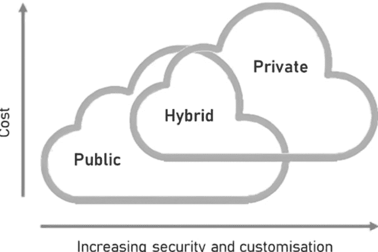

图 7.1 云计算部署模型 [9]

因此，安全概念应包含在这三种模型中，并且随着 IT 使用量的增加，这些模型正在日益普及。软件即服务、安全即服务、存储即服务、平台即服务和基础设施即服务都是可用的云计算服务形式。此外，消费者通过在线平台接收所有这些服务，因此正确的机制对于涉及安全的问题至关重要 [8]。

许多企业出于数据管理需求而求助于基于云的服务提供商，希望这些提供商能够采取必要的保护措施来安全可靠地保存其数据，防范安全威胁。然而，理解基于云的服务的安全性并非 100% 有保障，安全漏洞或数据泄露始终可能发生，这一点至关重要。此外，公司还需要了解与其本地服务器和 IT 基础设施相关的任何安全威胁，这些威胁可能遭受攻击。

### 7.3 用于虚拟化的技术

通过虚拟化 [10]，计算机被划分为几台逻辑计算机，每台都能运行独立的操作系统。此外，应用程序可以在隔离空间中相互独立运行，显著提升了计算机履行职责的潜力。虚拟机监控器（VMM）是一种运行在物理服务器和虚拟机之间的中间层软件，是虚拟化的关键实用工具。它可以访问服务器的完整物理硬件，例如处理器、内存、磁盘和网卡。除了协调对这些硬件资源的访问外，VMM 还为虚拟机提供保护 [11]。当服务器首次启动并执行 VMM 时，它会加载所有虚拟机客户端操作系统（OS），并分配足够的存储、CPU（中央处理器）。它为每个虚拟机运行操作系统和应用程序，不断接收来自用户或活动软件程序、网络和磁盘的输入。虚拟化模型如图 7.1 所示。


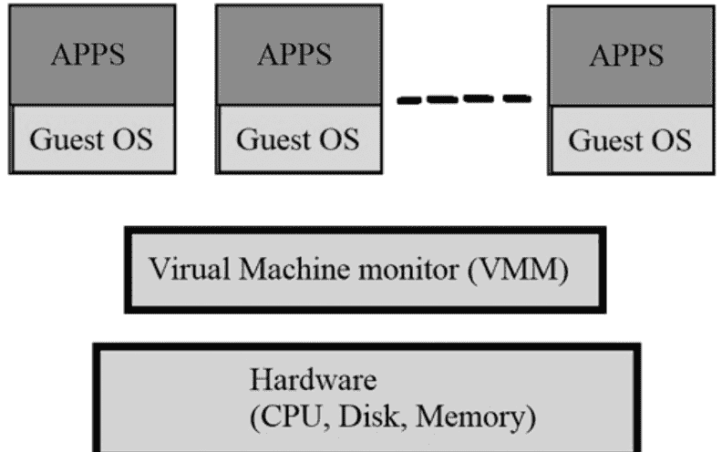

## 图 7.2 虚拟化技术

虚拟化有多种类型，包括完全虚拟化、半虚拟化以及软件和硬件虚拟化 [12]。虚拟化技术包括软件级虚拟化实现技术。总体上，它可以分为两类：开源和专有。Xen、KVM、VMware、Hyper-V 和 Docker 容器是典型的示例。

- Xen：基于 x86 架构，Xen 是增长最快、最稳定且资源消耗最少的开源虚拟化技术之一 [13]。基于 x86 架构，开源虚拟化技术 Xen 凭借其可靠性、速度和资源效率而闻名。Xen 是最初由剑桥大学创建、目前由 Linux Foundation 管理的开源项目。为虚拟化工作负载提供近乎原生性能的能力是 Xen 的核心优势之一，使其成为高性能计算和关键任务应用的热门选择。Xen 提供的额外高级安全措施包括对基于硬件的虚拟化扩展（如 Intel VT 和 AMD-V）的支持，以及将虚拟机彼此以及与底层主机系统隔离的能力。Xen 是一种成熟可靠的虚拟化技术，因其性能、安全性和资源效率而建立了声誉，是各种用例和行业的热门选择 [14]。

- **KVM：** 基于内核的虚拟机（KVM）是一种开源的完全虚拟化系统，属于 Hypervisor 范畴，支持多种硬件平台，并使用 QEMU（Quick Emulator）提供设备虚拟化。KVM（kernel-based virtual machine）是一种基于 Hypervisor 的开源完全虚拟化系统，适用于多种硬件平台。众多 Linux 发行版将 KVM 作为标准功能，从而能够在单个物理主机上运行多个虚拟计算机。使用 QEMU 提供设备虚拟化是 KVM 的核心功能之一。快速高效的模拟器 QEMU 可以模拟多种硬件设备，包括 CPU、网卡、存储设备和输入/输出设备。因此，KVM 能够为虚拟化工作负载提供近乎原生的性能，使其适用于工业环境。KVM 是一种强大且灵活的虚拟化解决方案，适用于各种用例和行业。由于其使用 QEMU 进行设备虚拟化并支持基于硬件的虚拟化扩展，它是寻求可靠且高效的虚拟化解决方案的企业的热门选择。

- **VMware：** 作为虚拟化基础设施和云计算领域的领导者，VMware 提供多种解决方案，帮助企业提高 IT 的生产力、适应性和速度。VMware 的解决方案旨在简化 IT 运营、提高管理效率，并更快速、更安全地提供服务。VMware 的旗舰产品之一是 vSphere 虚拟化平台，它提供可靠且安全的云计算基础，使企业能够在虚拟基础设施上运行工作负载和应用程序。vSphere 提供高可用性、数据安全性和自动化等功能，所有这些都有助于企业增强 IT 运营和敏捷性。除了 vSphere，VMware 还提供许多其他云计算服务，例如 VMware Cloud on AWS（使企业能够在 AWS 云上运行其 VMware 工作负载）和 vCloud Suite（提供全面的云基础设施平台）。总体而言，VMware 的解决方案旨在帮助各种规模和行业的企业简化其 IT 流程和基础设施，同时降低成本并提高敏捷性 [15]。

- **Hyper-V：** 微软开发了一种名为 Hyper-V 的 Hypervisor 虚拟化技术，用于实现桌面虚拟化。得益于微软基于 Hypervisor 的 Hyper-V 虚拟化技术，桌面虚拟化成为可能。微软 Windows Server 以及 Windows 10 的专业版和企业版均自带 Hyper-V，这是一种原生 Hypervisor。借助 Hyper-V，多个虚拟机可以在单个物理主机上运行，从而整合工作负载并最大限度提高服务器效率。其他功能包括对基于硬件的虚拟化扩展（如 Intel VT-x 和 AMD-V）的支持，以及实时迁移，该功能可实现虚拟机在物理主机之间快速切换。Hyper-V 还利用远程桌面服务（RDS）和虚拟桌面基础设施（VDI）提供桌面虚拟化，而不仅限于服务器虚拟化。VDI 提供了一种以集中且可扩展的方式构建和管理虚拟桌面的方法，而 RDS 使用户能够从任何位置访问虚拟化的桌面和应用程序。由于支持使用 RDS 和 VDI 进行桌面虚拟化，Hyper-V 是希望增强桌面管理并提高用户生产力的企业的热门选择。

- Docker 容器：Docker 容器在设计之初就考虑了轻量级和高度可移植性。由于每个容器都有自己的一组系统文件，这些文件与宿主机操作系统和其他容器共享，因此容器比虚拟机更小、更高效。此外，容器之间相互独立，容器内的进程可以通过容器编排工具进行区分和管理。Docker 容器还旨在与平台无关，这意味着它们可以在各种硬件平台和操作系统上运行。因此，在云计算系统和其他分布式计算环境等对可移植性和可扩展性至关重要的场景中，它们非常适合使用。与 Docker 容器相比，传统虚拟机的可移植性较低。每个容器都有自己的系统文件，容器之间的进程可以区分各种计算机资源并相互独立。

### 7.4 云计算：安全问题

#### 7.4.1 网络可用性

网络连接和带宽的重要性与云计算直接相关。由于云服务通常通过在线方式访问，可靠且快速的网络连接对于确保云应用程序和数据始终可访问至关重要。如果网络连接缓慢、不稳定或不可用，云服务可能会不可用或运行不佳，这可能对企业产生严重后果。例如，任何网络访问中断都可能导致依赖云端软件运行业务的公司失去生产力和收入。如果在需要信息时无法访问，可能会发生基于云的数据丢失或损坏，这对组织（尤其是受监管行业的组织）可能产生重大后果。在实施云计算服务之前，企业必须确认其网络连接和带宽满足最低要求。这可能需要部署冗余措施、升级网络基础设施，并确保服务等级协议（SLAs）中涵盖与云服务提供商的网络可用性和性能。

#### 7.4.2 灾难恢复与业务连续性

对于云服务的租户和消费者来说，确保其运营和服务在云服务提供商生产环境发生灾难或中断时仍能继续，这一点至关重要。在多租户云环境中，众多客户共享相同的物理基础设施和资源，这一点尤为关键。在此类环境中，单一灾难或中断可能影响众多客户，导致广泛的服务中断和数据丢失。为应对这一问题，云服务提供商通常已建立业务连续性和灾难恢复机制，以确保其服务在发生灾难时仍然可用且功能正常。这可能涉及数据备份和复制、故障转移到不同的数据中心或云区域，以及使用冗余网络连接和设备等技术。云服务提供商可能会提供服务等级协议（SLAs），以保证特定的运行时间和可用性水平，并在服务中断或宕机时提供补偿。确保在发生灾难时云服务的连续性和可用性是云计算的重要组成部分，云服务提供商有责任实施有效的灾难恢复和业务连续性措施，以保护客户的运营和服务。

#### 7.4.3 透明度

云用户和租户经常需要信任云服务提供商的安全保证，尤其是当这些公司对其内部政策或技术实施保留信息时。云服务提供商必须对其安全和隐私政策以及如何应对安全问题保持公开和诚实，以赢得并保持客户的信任。透明度可以有多种形式，例如向公众公开提供商的安全和隐私政策、做法和标准，以及有关其事件管理协议和方法的具体细节。租户和用户可能会发现这些信息有助于了解提供商如何保护其数据和应用程序，以及为防止、识别和处理安全事件所采取的措施。租户或用户必须相信云服务提供商的安全保证，当公司对其内部政策或技术


implementation are put into practice. Tenants and consumers still need some transparency from providers about incident management, cloud security, and privacy.

#### 7.4.4 法律和法规遵从

If the data you need to handle is constrained by laws or regulations, using public clouds could be challenging or unrealistic. While building and certifying clouds to meet the demands of regulated markets is something we should expect from providers, obtaining certifications may be difficult due to a number of non-technical variables, including the existing level of general cloud understanding. Organizations that need to process data subject to legal constraints or regulatory compliance may find that public cloud computing is not a practical solution. For instance, there are special data protection and privacy requirements that must be observed in sectors like healthcare, financial services, or government, such as HIPAA, PCI DSS, or GDPR. These requirements frequently demand that data be handled and stored in particular physical places or with particular security measures. Achieving certification can be difficult due to the complicated and constantly changing nature of regulatory compliance, even while cloud providers may offer solutions built to comply with these regulatory standards [16]. Technical controls may be necessary for compliance certification, but so may organizational, legal, and operational controls.

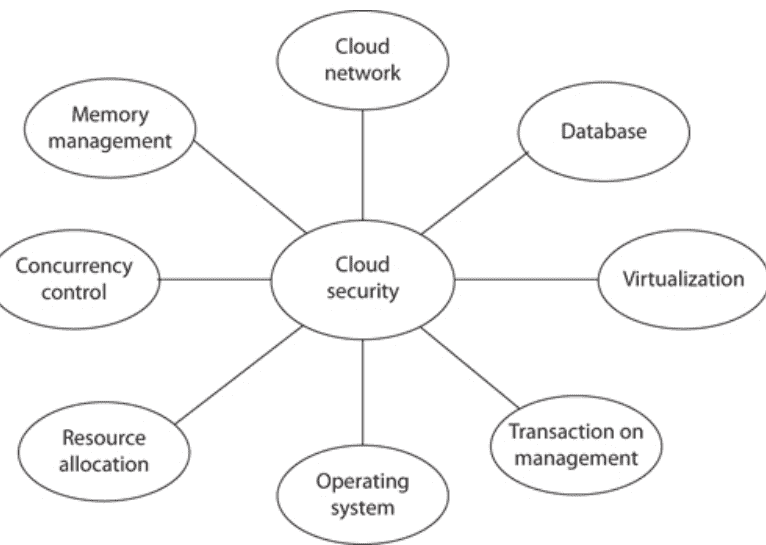

### FIGURE 7.3 Cloud computing security issues

### 7.5 云计算中的虚拟化问题

The interaction between the OS and hardware has changed as a result of virtualization. This in and of itself raises questions about conventional security viewpoints since it casts doubt on the security you may feel when installing an OS and an application on a server you can see. However, some of us already think that this level of comfort is inappropriate in the majority of circumstances. For the average user, it is quite difficult to realistically determine the actual security posture of even a PC with an Internet connection. Although virtualization makes things more difficult, it does not necessarily improve or worsen security. Although virtualization offers many advantages, using it in the context of cloud computing also raises particular security issues. Some of the main virtualization issues with cloud computing are as follows.

#### 7.5.1 虚拟化监控程序安全

The software layer that makes virtualization possible is the hypervisor. An attacker may be able to access every virtual machine running on that physical server if the hypervisor is hacked. In light of this, hypervisor security is essential for safeguarding virtual computers and the data they house. Cloud providers must put in place stringent security controls, such as frequent security patches, access controls, and intrusion detection systems, to reduce the risks associated with hypervisor security. They should also employ isolation and segmentation strategies to stop virtual machines from communicating with one another, as well as monitor hypervisor activity for any odd behavior. Additionally, to find and fix any vulnerabilities in the security of the hypervisor, cloud providers should do routine security audits. Additionally, they must stay informed of the most recent risks and weaknesses to the security of hypervisors and take the necessary steps to resolve them.

#### 7.5.2 共享基础设施漏洞

Security flaws that affect numerous people or systems that share the same underlying infrastructure or resources are referred to as *共享基础设施漏洞*. On shared infrastructure components like servers, databases, or network devices, these vulnerabilities may develop as a result of inadequate security controls, incorrect configuration, or out-of-date software [17]. A data breach brought on by an improperly configured cloud storage bucket is an illustration of a vulnerability in shared infrastructure. When several users store their data in the same bucket, there is a risk that a configuration error could make the bucket accessible to the public, making all the data visible to unwanted parties. Strong security measures should be put in place, and shared infrastructure components should be monitored and updated often in order to reduce vulnerabilities in shared infrastructure. To reduce the effect of any security events that do happen, they should also adhere to best practices for access control and privilege management.

#### 7.5.3 隔离不足

Despite the fact that virtual machines are normally kept apart from one another, there is still a chance that a compromised virtual machine could attack other virtual machines running on the same physical server. Furthermore, improperly segregated virtual computers may be able to access sensitive data from other virtual machines. Organizations should establish appropriate segmentation and isolation solutions to overcome inadequate separation in order to lessen the effect of any security incidents. This could involve logical separation utilizing access controls and role-based permissions, logical network segmentation using firewalls or virtual Local Area Networks (LANs), and physical isolation of important systems. Regular security audits and vulnerability assessments can also be used to find problem areas where isolation measures may be inadequate.

#### 7.5.4 VM 蔓延

Virtual machines (VMs) that are created and then left running, using resources even after they are no longer required, are referred to as VM sprawl [18]. This could result in a loss of resources, including CPU time, memory, storage space, and network bandwidth, which could affect how well other virtual machines perform when they share a host or infrastructure. As unused or forgotten VMs may not be adequately patched or secured, leaving them exposed to assaults, VM sprawl can potentially provide security problems. Additionally, abandoned VMs might hold private information that, if unattended, could be accessed or taken. Organizations should adopt VM management rules and procedures, such as tracking and monitoring VM consumption as well as routinely assessing and decommissioning unwanted VMs, to prevent VM sprawl. Automated tools and scripts can be employed to find and report on VMs that have been inactive or underutilized for a predetermined amount of time. Assigning ownership and duties to each VM as well as routinely evaluating and updating access control policies are further guidelines and best practices that businesses should create for VM deployment and usage.

#### 7.5.5 合规性问题

Concerns about compliance refer to the difficulties that organizations have in adhering to industry and regulatory standards for data protection and security. Industry- and region-specific compliance standards differ, but they frequently call for data privacy, access controls, audits and reporting, and incident response. The consequences of not adhering to regulations can be severe financial fines, legal responsibilities, and reputational harm to a firm. Additionally, compliance infractions may result in data breaches, which may result in the loss of confidential information and intellectual property as well as additional legal and reputational repercussions. Organizations should create and maintain a complete security program that includes guidelines for data protection, risk management, and incident response in order to solve compliance issues.

### 7.6 云计算虚拟化相关的安全风险

#### 7.6.1 虚拟机迁移

The process of attaching a virtual machine to another real machine without first shutting it down is known as *虚拟机热迁移*. There are several reasons to migrate virtual machines, including load balancing and maintaining fault tolerance [19]. Due to the transmission, which makes the contents of the virtual machine visible to the network, data privacy and integrity may be compromised. To guard against hacker interception, data exchanged during the migration process should be encrypted. During the migration process, access controls should be put in place to limit access to virtual machines. The migration procedure and the virtual machines should only be accessible by authorized individuals. To stop intruders from eavesdropping on communications or launching assaults during the migration process, the network should be secured. Firewalls, intrusion detection and prevention systems, and other security measures can be used to achieve this. Before and after the migration process, the virtual machine’s integrity should be checked to make sure it hasn’t been tampered with. To keep track of every activity made during the migration process, including who started the migration, when it happened, and what changes were made, audit logs should be created.

#### 7.6.2 虚拟机逃逸


在虚拟计算机上，用户可以实现相互隔离和资源共享。理论上，虚拟计算机中的软件不应影响其他虚拟计算机。虚拟机逃逸一词是指，在某些情况下，运行在虚拟机内部的应用程序能够克服隔离屏障并直接在主机上运行，这是因为虚拟化技术存在局限性和漏洞。如果虚拟机逃逸攻击成功，主机和虚拟机监控程序都将面临严重危险 [20]。因为它可能让攻击者访问私有信息或接管主机系统，VM 逃逸是一项严重的安全风险。在罕见情况下，VM 逃逸可被用作跳板，对其他联网系统发起进一步攻击。攻击者可能尝试多种方式利用 VM 逃逸漏洞，包括使用客机到主机的通信通道、利用虚拟化软件或硬件的缺陷，或利用客机操作系统中的错误。为防止 VM 逃逸，必须采取严格的安全措施，包括实施严格的访问控制和权限、限制客机到主机的通信通道，以及更新虚拟化软件和硬件。

#### 7.6.3 ROOTKIT 攻击

一种称为 rootkit 的特定恶意软件会隐藏在安装目标上，并针对特定文件、进程和网络链接 [21]。更典型的是，rootkit 经常与木马和后门等其他有害软件一起使用 [22]。rootkit 通过加载特殊驱动程序和修改操作系统内核来隐藏信息。请频繁更新和修补所有软件，包括虚拟化程序和虚拟机的操作系统。为确保只有批准的用户和进程才能访问虚拟环境，请使用严格的访问限制。安装入侵检测和防御系统，以监控虚拟环境中有害或未经授权行为的迹象。使用反恶意软件扫描虚拟机，以检查已知的 rootkit 签名和其他感染。仅在必要时使用特权帐户，并使用多因素身份验证和强密码来保护它们 [23]。为跟踪虚拟环境中的活动并发现潜在攻击的预警迹象，请实施日志记录和审计。请频繁进行渗透测试和漏洞分析，以查找并修复任何潜在安全缺陷。

#### 7.6.4 拒绝服务攻击

拒绝服务 (DoS) 攻击是一种网络攻击形式，试图通过向系统或网络发送大量流量或请求，使其无法正常运行。DoS 攻击利用 CPU、内存或带宽等资源，旨在阻止合法用户使用目标系统或网络。这些攻击试图用海量流量淹没目标系统，耗尽其全部带宽或资源。ICMP 洪水攻击、DNS 放大攻击和 UDP 洪水攻击是基于流量的攻击示例。这些攻击通过利用 TCP/IP 等网络协议中的缺陷来耗尽系统资源 [24]。SYN 洪水攻击、死亡之 Ping 攻击和 Smurf 攻击是基于协议的攻击示例。物理机和虚拟机共享资源 [24]。即使攻击者控制了一台虚拟机并能访问所有主机计算机资源，其他虚拟机的资产也会受到影响甚至崩溃，因为它们本身没有资产。这在虚拟环境中就是拒绝服务 [25]。

#### 7.6.5 虚拟机监控程序问题

虚拟化的关键组件是虚拟机监控程序 (VMM)，它生成或管理虚拟资源，还管理并隔离虚拟机。如果虚拟机监控程序被攻破，攻击者将能够访问虚拟机维护的虚拟机元数据，并控制其维护的所有虚拟机实例 [26]。攻击者可能利用 VMM 缺陷来攻破主机系统、访问其他虚拟机上的信息或资源，或接管虚拟环境。VMM 配置不当导致的安全缺陷可能包括向虚拟机提供未经授权的访问或泄露敏感信息。由于访问控制松散或无效，未经授权的用户可能能够访问或修改虚拟环境中的虚拟机或资源。如果没有有效监控，快速识别和处理安全事件可能会很困难。如果 VMM 没有与客机操作系统适当隔离，客机操作系统的运行可能会受到阻碍，或面临安全威胁。请频繁更新和修补 VMM 以修复任何漏洞。确保 VMM 配置正确。

#### 7.6.6 虚拟化平台上的解耦攻击

针对虚拟化平台的攻击，攻击目标是虚拟机监控程序（即管理和控制虚拟机的软件层），称为 _解耦攻击_。解耦攻击旨在破坏虚拟机之间的隔离，以便访问或控制使用同一虚拟机监控程序的其他虚拟机中的数据或资源。虚拟机监控程序逃逸攻击试图退出虚拟机并访问其背后的虚拟机监控程序，攻击者随后可能从中访问其他虚拟机或私有信息。这些攻击利用 VMM 中的缺陷，以便访问或控制运行在同一虚拟机监控程序上的其他虚拟机中的数据或资源。在典型工作环境中，只有带有系统漏洞的物理机容易受到攻击，攻击者的潜在目标受到严格限制。通过云计算虚拟化平台在整个系统中共享信息，多个租户可以使用单个虚拟机来利用当前的虚拟漏洞平台。

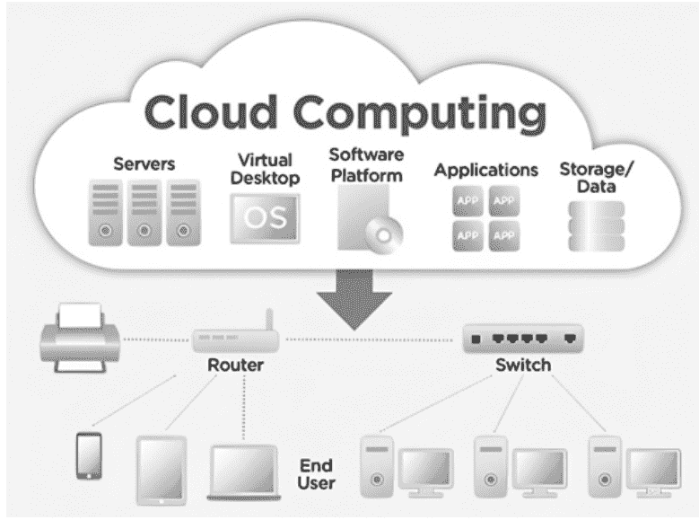

图 7.4 与云计算相关的风险

### 7.7 云计算中虚拟化安全问题的解决方案

#### 7.7.1 Hypervisor 安全策略

当前广泛使用的虚拟化技术（例如 Xen、VMware 和 KVM [18]）都包含可能危及虚拟机监控程序完整性和安全措施的安全弱点。必须保护虚拟化平台，而这种保护始于虚拟机监控程序。构建轻量级虚拟机监控程序、使用可信计算技术保持虚拟机监控程序的完整性、以及通过配置虚拟防火墙和谨慎分配主机资源来加强虚拟机监控程序的防御，目前是加固虚拟机监控程序安全性的三个主要步骤。请确保虚拟机监控程序配置安全，遵循最佳实践，包括关闭不必要的服务、安装安全更新和使用安全启动程序。为虚拟机监控程序和虚拟机创建访问策略 [27]。这些策略应包含身份验证和授权技术，包括用户帐户、角色和权限，以确保只有授权用户才能访问敏感资源。利用虚拟机隔离策略，通过防止未经授权的访问，并使用基于虚拟机监控程序的隔离、网络隔离、数据隔离和用户隔离，来维护虚拟机及其数据的完整性和机密性。请确保虚拟机配置安全，遵循最佳实践，包括关闭不必要的服务和协议、安装安全更新、使用强密码和加密数据。图 7.4 提供了与云计算相关的风险。

#### 7.7.2 虚拟机上的安全隔离

感兴趣用户的虚拟机得益于 VM 安全隔离机制，能够独立运行且互不干扰。这主要从两个方面实现：首先，使用 SMM 控制器加密内存；其次，使用 SIOM 安全 I/O 管理架构削弱 Xen 的 Dom0 [27]。对于 VM，隔离是一项关键安全策略，因为它有助于防止未经授权访问敏感信息或资源。使用虚拟机监控程序构建运行不同操作系统和应用程序的独立虚拟机，称为基于虚拟机监控程序的隔离。每个虚拟机彼此独立，拥有自己的网络接口和虚拟硬件。这为 VM 提供了高度隔离，并可以防范来自同一物理服务器的威胁。加密数据并将其存储在不同的虚拟磁盘或分区上，构成数据隔离。这有助于通过减少安全漏洞的潜在后果来防止未经授权访问敏感数据。

#### 7.7.3 虚拟机访问控制

利用 sHype、中文屏障和 BLP 等安全模型可以提高虚拟机系统的安全性，以减少与隐藏信息流相关的漏洞。这些模型可用于强制执行限制未经授权访问敏感


信息或资源，因为它们旨在控制虚拟机环境中的资源利用率和事件行为。名为 sHype 的安全模型增强了 SELinux 的类型强制执行（TE）机制，以提供更精确的访问限制。它还可用于实施强制访问控制（MAC），限制各种安全域之间的信息流，并构建基于资源访问上下文的访问策略 [28]。双因素身份验证（2FA）实施有助于防止对虚拟计算机的未经授权的访问。用户除了密码外，还必须提供第二种身份验证形式，例如安全令牌或生物识别信息。

#### 7.7.4 监控虚拟机安全性

为了确保每个虚拟机的高效运行，有必要对虚拟机安全进行监控 [21]。对虚拟机安全进行监控有两种广泛使用的设计。第一个是基于虚拟机自分析的监视和控制架构，它在虚拟机监视程序中嵌入监控模块，并使用虚拟机自省技术来识别其他虚拟机。另一个是基于虚拟化的保护持续监控架构，它试图将挂钩函数合并到被观察的 VM 中，以便在跳转到较长时间无 VM 之前检测系统状态的变化 [22]。为确保已知漏洞得到修补，虚拟机必须定期打补丁和更新。可以通过部署自动补丁管理系统来实现，在发布新安全补丁时更新虚拟机。定期虚拟机备份可以帮助确保在发生安全漏洞或数据丢失时数据得到保护。云备份服务和虚拟机备份解决方案均可用于执行备份。

#### 7.7.5 可信虚拟计算技术

通过可信计算提供的可信度量机制、可信存储和可信报告，清理了终端的计算环境，在终端之间建立了可信连接，并创建了真正的相互信任的虚拟空间。强大的度量引擎确保虚拟机的动态完整性，可靠的报告引擎实现不同虚拟环境之间的信任，云引擎提供存储管理和访问控制 [22]。为了提高云计算服务的安全性和可靠性，它从上述五个方面增强了云计算中强安全的虚拟化。图 7.5 显示了整个虚拟化安全保护模型。

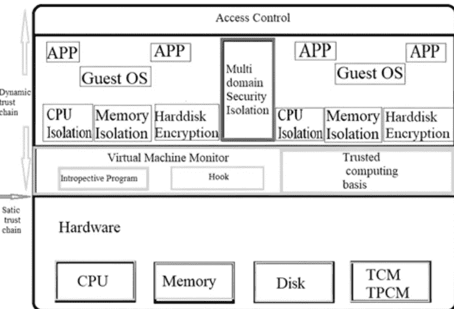

### 图 7.5 虚拟化安全保护模型

#### 7.7.6 物理资源超载

在虚拟化环境中，物理资源超载可能是一个主要问题，因为它可能导致虚拟节点故障或网络性能低于可接受水平。当虚拟机没有获得足够的物理资源（如 CPU、内存或存储）来满足其需求时，就会发生这种超载。经常检查物理服务器和虚拟机的资源利用率，以确保其被有效利用并发现任何潜在瓶颈 [28]。为虚拟机分配物理资源（如 CPU、内存和存储）时，应考虑其单独需求，并确保有足够的余量来管理峰值负载。利用资源池根据不断变化的工作负载需求动态管理和分配资源 [26]。

### 7.8 结论

归功于虚拟化，硬件资源的可用性和适应性都得到了提高，管理成本也大幅降低。虚拟化是云计算技术的基础。虚拟化技术的众多优势包括更好的硬件使用率和更低的管理费用，但它也带来了必须谨慎控制的新安全威胁，尤其是在云计算环境下。虚拟化相关的主要安全危险之一是 hypervisor 层级攻击的潜在可能，在此类攻击中，攻击者获得对 hypervisor 层的访问权限，并能够管理或修改在同一主机上运行的多个虚拟机。除了服务中断和停机的可能性外，这还可能导致对重要数据和系统的非法访问。云计算的快速和广泛应用受到安全问题的阻碍。分析虚拟化技术带来的关键安全问题对于增强虚拟化安全措施至关重要。

## 参考文献

- 1. M. Armbrust, A. Fox, R. Griffith, A.D. Joseph, 和 R. Katz, 《超越云端：云计算的伯克利视角》, UC Berkeley 可靠自适应分布式系统实验室白皮书, 2009.
- 2. P. Mell 和 T. Grance, 《云计算的 NIST 定义》, 美国国家标准与技术研究院, 信息技术实验室, 技术报告第 15 版, 2009.
- 3. B. Sotomayor, R.S. Montero, I.M. Llorente, 和 I. Foster, 《私有云和混合云中的虚拟基础设施管理》, IEEE Internet Computing, 13(5):14–22, 2009 年 9 月/10 月.
- 4. N. Carr, 《大转变：重塑世界，从爱迪生到谷歌》, W. W. Norton & Co., 纽约, 2008.
- 5. C.S. Yeo 等人, 《全球网格上的实用计算》, 第 143 章, Hossein Bidgoli (编), 《计算机网络手册》, John Wiley & Sons, 纽约, 2007, ISBN: 978-0-471-78461-6.
- 6. I. Foster 和 S. Tuecke, 《描述大象：IT 作为服务的不同面貌》, ACM Queue, 3(6):26–29, 2005.
- 7. M.P. Papazoglou 和 W.-J. van den Heuvel, 《面向服务的架构：方法、技术与研究问题》, VLDB 期刊, 16:389–415, 2007.
- 8. B. Blau, D. Neumann, C. Weihardt, 和 S. Lamparter, 《服务混搭的规划与定价》, 载于 2008 年第 10 届 IEEE 电子商务技术会议和第五届 IEEE 企业计算、电子商务和电子服务会议论文集, 水晶城, 华盛顿特区, 2008, 页码 19–26.
- 9. C. Catlett, 《TeraGrid 的哲学：构建开放、可扩展、分布式 TeraScale 设施》, 载于第 2 届 IEEE/ACM 集群计算和网格国际研讨会论文集, 柏林, 2002, 页码 8.
- 10. F. Gagliardi, B. Jones, F. Grey, M.E. Begin, 和 M. Heikkurinen, 《构建科学网格计算基础设施：EGEE 项目的现状与目标》, 皇家学会 A 类学报：数学、物理与工程科学, 363(1833):1729, 2005.
- 11. T.H. Sardar 和 Z. Ansari, 《用于清理海量 Web 日志数据的 Web 机器人请求检测与确认》, 2014 年电子技术对 US 的影响国际会议 (IMPETUS). IEEE, 2014.
- 12. Z. Ansari, A. Afzal, 和 T.H. Sardar, 《基于 Hadoop MapReduce 的并行 K-均值聚类的数据分类》, 印度工程师学会期刊：B 系列, 100(2):95–103, 2019.
- 13. T.H. Sardar 和 Z. Ansari, 《用于分布式文档聚类的基于 MapReduce 的模糊 C-均值算法》, 印度工程师学会期刊：B 系列, 4:1–12, 2022.
- 14. T.H. Sardar 和 Z. Ansari, 《基于 MapReduce 的 K-均值算法的分布式文档聚类分析》, 印度工程师学会期刊：B 系列, 101(6):641–650, 2020.
- 15. R.P. Goldberg, 《虚拟机研究综述》, IEEE Computer, 7(6):34–45, 1974.
- 16. T.H. Sardar 和 Z. Ansari, 《基于 MapReduce 的模糊 C-中心点的分布式大数据聚类》, 印度工程师学会期刊：B 系列, 6:1–10, 2022.
- 17. VMWare Inc., VMWare 虚拟设备市场, 设备, 22/4/2010.
- 18. T.H. Sardar 和 Z. Ansari, 《基于 MapReduce 框架的大型数据集分区聚类：近期主题与方向分析》, 未来计算与信息学期刊, 3(2):247–261, 2018.
- 19. M.Z. Bellary 等人, 《使用修改后的深度 CNN 进行膝骨关节炎医学图像分析》, 渔业科学调查期刊, 10(2S):133–144, 2023.
- 20. P. MS Guru 等人, 《基于改进 AlexNet 架构的新型提取方法的脑肿瘤识别与分类》, 2023 年第 6 届信息系统与计算机网络国际会议 (ISCON). IEEE, 2023.
- 21. T.H. Sardar 和 Z. Ansari, 《使用并行 K-均值算法的文档聚类中 MapReduce 效率分析》, 未来计算与信息学期刊, 3(2):200–209, 2018.
- 22. T.H. Sardar, S. Das, 和 B. Kumar Pandey, 《可解释人工智能 (XAI): 概念与理论》. 《使用可解释人工智能进行医学数据分析与处理》, Tanvir H. Sardar 和 B.K. Pandey (编), 《大数据计算：技术、方法与应用的进展》, CRC Press, 2024, 1–18.
- 23. T.H. Sardar, A. Khatun, S. Sengupta, Y. Alam, 和 T. Ara, 《医疗保健领域和生物医学大数据中的机器学习：技术、应用与挑战》, Tanvir H. Sardar 和 B.K. Pandey (编), 《大数据计算：技术、方法与应用的进展》, CRC Press, 2024, 336–352.
- 24. T.H. Sardar, A. Muttineni, 和 R. Ranjan, 《客户体验和库存管理中大数据的未来》, Tanvir H. Sardar 和 B.K. Pandey (编), 《大数据计算：技术、方法与应用的进展》, CRC Press, 2024, 233–248.
- 25. T.H. Sardar, A. Khatun, 和 S. Khan, 《无线传感器网络中能量感知收集树协议的设计》, 2017 年 IEEE 电路与系统国际会议 (ICCS). IEEE, 2017.
- 26. T.H. Sardar, A. Rimaz Faizabadi, 和 Z. Ansari, 《Hadoop 框架上 MapReduce 范式的数据处理分析》, 新兴管理研究国际期刊, 6(5):43–54, 2017.
- 27. T.H. Sardar, Z. Ansari, 和 Amina Khatun, 《使用并行 K-均值的文档聚类中 Hadoop 集群效率评估》, 2017 年 IEEE 电路与系统国际会议 (ICCS). IEEE, 2017.
- 28. T.H. Sardar 和 A. Rimaz Faizabadi, 《在对称多处理器机器上使用 OpenMP 和 Pluto 对选定数值算法进行并行化和分析》, 数据技术与应用, 53(1):20–32, 2019.


## 8 IoT 应用中的安全漏洞：一项广泛研究

C Silpa, Niranjana Govindan, and K Ramani

DOI: 10.1201/9781003465775-8

### 8.1 引言

物联网安全是应对联网设备数量增加的最佳防火墙之一。笔记本电脑等设备执行各种任务，例如向其他设备传输数据。物联网设备的目的是在共享信息时建立保护设备的协议。因此，物联网设备可以为这些设备的行为开发可识别且独特的模式。这些物联网设备利用人工智能和机器学习技术为这类设备创建独特且可识别的模式。一旦这些模式建立，物联网可以在设备和网络之间建立基线，并监控和检测针对设备的攻击。监控此类攻击后，设备可以通过 SMS 或设备通知等通信格式向管理员发送警报通知，这些步骤由系统自动化 [1]。收到系统的警报消息后，管理员还可以收到一系列步骤，以保护设备免受这些漏洞或攻击。在保护设备免受攻击后，可以使用可识别且独特的模式重新分配设备以恢复正常任务。这些模式在信息共享或发生攻击时，在设备之间建立防火墙方面也发挥着关键作用。

如今，大多数实时设备都使用基于物联网的设备，如图 8.1 所示，该图描绘了本章讨论的物联网应用。本章选取了一些应用来说明物联网安全及其在国防系统、金融领域、银行业和家庭网络中的应用方式。物联网安全已应用于无人机等国防系统及其他设备，以维护安全的数据共享。金融领域依赖物联网系统来防止网络攻击。在银行业，物联网系统用于保护账户之间的交易并保护账户信息。冰箱、闭路电视摄像机和电视等家用电器也可以从物联网系统中受益，以增强安全性。

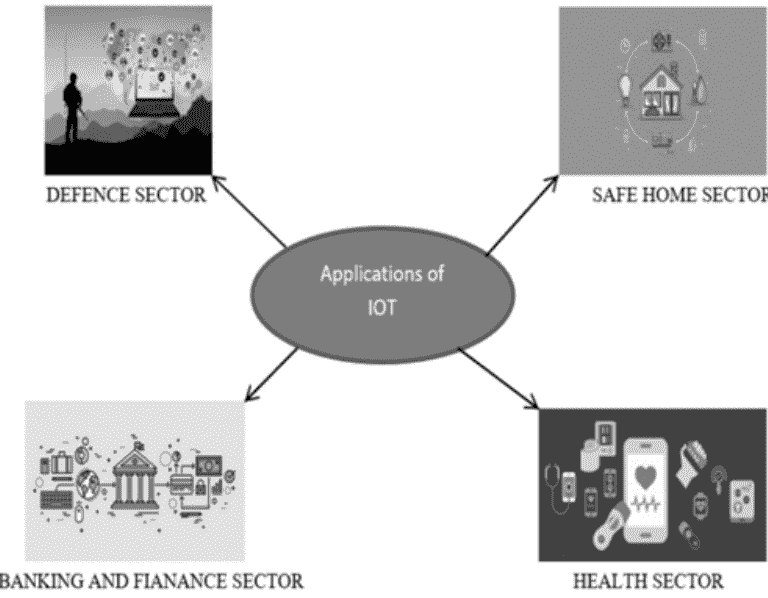

图 8.1 物联网应用

本章主要内容聚焦于各个领域用于设备自动化和安全目的的重要物联网应用。这些应用在第 8.1 节“引言”中进行了讨论。物联网的安全层在第 8.2 节中进行了探讨。物联网国防系统、物联网金融和银行业、家庭网络以及医疗保健领域的安全漏洞分别在第 8.3、8.5、8.7 和 8.9 节中讨论。由此可见，可以以不同方式为物联网系统实施安全措施。

### 8.2 物联网层与安全漏洞

物联网系统由三层组成，用于保护设备免受攻击：应用层、网络层和感知层。实施这些层的原因是系统中出现的挑战。这些层可以满足安全和隐私所需的物联网要求 [7]。图 8.2 说明了这一点。

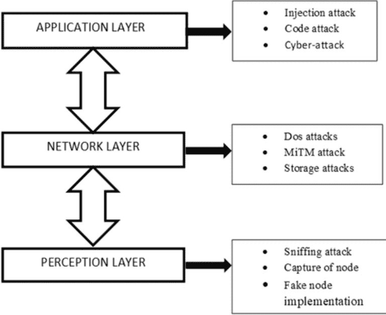

图 8.2 物联网各层受到的攻击

#### 8.2.1 应用层

应用层可以观察与物联网开发的应用程序连接的设备或系统。物联网应用包括家庭、医疗、国防和金融等领域，这些领域由物联网系统保护。这些层为应用程序提供服务，并在应用程序与设备之间构建安全防护防火墙。应用层提供的服务因应用而异，因为它基于传感器收集的数据提供服务。导致应用程序变化的一些问题如下：

- 注入攻击专注于网站的脚本；此攻击允许黑客插入客户端脚本，更改应用程序中的内容，第三方非法使用原始数据。
- 代码攻击可以应用于系统任何部分的软件，并通过入侵软件更改工作模型来对系统造成损害。
- 软件系统和互联设备的使用量增加以及设备之间的数据传输可能会导致网络中断，从而导致数据丢失并引发应用程序中的安全问题。最好为不同的应用程序使用不同的安全协议，这可能防止上述讨论的攻击，并且还应开发安全软件，以防网络攻击禁用存储数据的设备之间的连接。

#### 8.2.2 网络层

网络层充当应用层和感知层之间的接口，传输通过传感器从物理层收集的数据。该层完全负责将设备连接到网络。该层与高安全性问题相关，因为身份验证详细信息和数据可以通过该层传输。该区域发生的一些攻击如下：

- 拒绝服务（DoS）攻击阻止主用户使用网络资源和访问设备。这些攻击使访问应用程序或设备变得更加关键。
- 中间人（MiTM）攻击会中断从发送方到接收方传输的数据。它在传输数据的设备之间充当中间塔，并更改数据，实际数据已被攻击者中断。它会导致严重的在线安全问题，这些问题也会体现在应用层中。
- 存储攻击会中断主要存储在设备中的数据。此类攻击也称为云攻击。
- 非法攻击会控制硬件和软件，以从数据存储设备窃取信息并使应用程序无法使用。可以通过启用端到端加密来保护传输到其他设备的数据，并在锁等设备上实施密钥传感器来防止未经授权的访问，从而应对此类攻击 [13, 14]。加密在与其他设备共享数据时为不同用户提供不同的密钥。

#### 8.2.3 感知层

感知层（又称传感器层）在系统中充当感官，该层连接了不同类型的传感器，可感知或识别事物并从设备收集数据。根据应用要求选择传感器。传感器收集的信息（例如温度识别、人脸扫描和指纹扫描）通常用于设备中。与感知层相关的主要问题是黑客用自己的复制传感器替换原始传感器，从而入侵设备并从中收集数据 [11, 12]。因此，感知层的主要威胁是针对传感器，可能包括以下内容：

- 窃听攻击是一种实时攻击，主要针对个人通信，例如电话、短信和会议，这些通信会被攻击者入侵。攻击者可以在数据传输到网络时窃取数据。黑客可能会使用其自身访问权限向发送方和接收方提供确认 [16]。
- 节点捕获是感知层面临的更危险的攻击之一。攻击者可能以关键节点的形式创建网关，从而控制应用程序或设备。攻击者创建的关键节点可能会导致发送方和接收方之间的通信不安全。
- 在伪节点实现中，黑客在系统或设备中实现伪节点，这可能会阻止向接收方传输真实数据，并将其替换为自己的数据。

### 8.3 物联网国防系统中的安全漏洞

军事物联网（IoMT）和战场物联网（IoBT）是一组传感器、可穿戴设备和物联网小工具，它们利用云和边缘处理来增强军事能力和安全性 [18]。IoMT 和 IoBT 结合了强边缘架构，利用生物识别、环境传感器和其他连接设备快速传输数据，使军事人员能够在战斗区域更好地响应和执行任务。


战术区域中相互互连的元素或“事物”的组织，不断地与实际环境进行传递、协调、学习和协作，扩展知识并考虑更明智的方向。

国防领域的主要挑战是：借助无人机摄像头监测士兵在战场上的战场信息。在这种情况下，无人机可能会被黑客攻击或改变方向，这种攻击可能通过一些黑客技术实现 [2, 14]。因此，需要安全协议来维护无人机的安全，这些协议可能包括连接到无人机的远程设备。此外，国防领域的物联网安全中有许多应用，如图 8.3 所示。

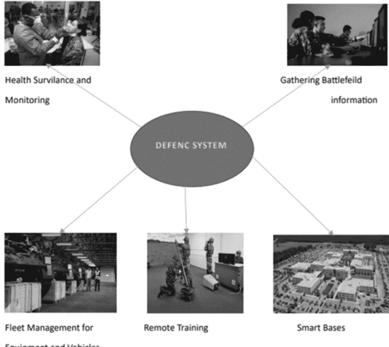

图 8.3 国防系统在物联网中的应用

### 8.4 物联网防御系统的安全挑战

#### 8.4.1 收集战场信息

收集到的信息通过指挥、控制、情报、监视和侦察系统进行处理，这些系统处理并分发最具战略性的信息，例如来袭威胁的位置 [20, 21]。这些信息可以协调和利用，创建共同作战图景，支持指挥官的决策，并改善作战区域内的协调与控制。物联网在收集、分析和交付实时融合数据以实现快速决策方面可以发挥至关重要的作用。这增强了情境意识，用于获取对手意图、能力和实际位置的数据 [3]。物联网可以从战区、连、排和乘组层面一直提升到单个军官层面的战场认知能力。

针对用于发起分布式拒绝服务（DDoS）攻击的物联网设备检测协调式风暴面临特定挑战，这些攻击难以识别，且在攻击实际开始前可能需要数周或数月才能建立。一种常用于实施 DDoS 攻击的软件应用程序称为“僵尸程序”（“bot”）。“bot”软件可以隐蔽地存在于任何易受攻击的 Web 结构中，并按序列激活。当多个被僵尸程序感染的结构被激活并协调针对物联网上的特定目标系统时，就会发生大量 DDoS 攻击。

#### 8.4.2 健康监测与监控

一种监测体温、血压、心率、胆固醇水平和血糖等指标的物联网传感器组合，将允许对士兵的健康状况进行实时检查。当士兵出现脱水、睡眠不足、脉搏升高或血糖低等异常状态时，可以发出警报，如果需要，基地医疗诊所的临床响应团队可以接到通知。士兵配备了带有集成控制传感器的头盔等特殊头部防护装备，以检测冲击力及其他创伤 [4]。小型智能健康监测和医疗服务设备在战场上越来越频繁地被使用，因此，可以在无需人员参与的情况下为士兵提供医疗援助/医疗护理。多年来，印度国防领域的发展速度一直较低，创新武器的研制仍然是一项挑战。这主要归因于国防预算下降、多年的投机与创新，以及政府不愿将国防合同授予印度私营部门。印度仍依赖进口产品来研制创新武器，从而阻碍了国内工业的发展 [24]。

#### 8.4.3 设备和车辆的车队管理

恶劣环境和频繁的部署会对设备造成损耗。物联网可以通过监控、优化和合理分配各种资源和流程（例如人力、物资、财务资源和维护人员）来实现设备维护和管理的改进。在建筑物、设施等中融合商业物联网技术的智能基地，确保基地以及海洋和滨海环境的安全、健康与人员监测，以及监控和准时制设备支持。

在地理环境方面，印度军队需要保持作战准备以应对威胁。因此，必须持续提升军队的作战能力，并升级武器和装备技术。为在本地解决这些问题，需要对军队的需求进行适当的评估和规划，并投入多年进行武器研发。

#### 8.4.4 智能基地

对手可能试图通过使用被盗身份证件或冒充普通平民来渗透军营。通过使用物联网指纹识别和其他生物特征数据，可以确定一个人的真实身份。其他物联网传感器可以集成到军营中，以提升安全军营内服务的性能、效率和便利性。资源的自动化筛选，加上水电的智能管理，都有助于改善运营。

#### 8.4.4.1 技术转移缺乏

所有进口的防护材料均不包含创新组件。这导致对进口商品的依赖，并阻碍国内制造业发展。

#### 8.4.4.2 质量不足

某些制造商提供的材料不符合国际质量标准，并且为了降低成本而妥协。这降低了其市场潜力，并危及印度产品在全球的声誉。

#### 8.4.5 远程训练

物联网可以协助军事人员为真实的战区战斗做准备。开发传感器、声学传感器等可以在待命或演练期间监控人员，并将信息和见解发送给培训他们的导师。远程控制武器站（RCWS）或远程武器站（RWS），也称为远程武器框架（RWF），是一种远程控制的坚固框架，通常配备用于轻型和中型武器的射击控制系统，可以安装在地面战斗车辆或海基和空基战斗平台上。此类设备用于现代军用车辆，因为它允许重武器专家留在车辆的整体安全范围内。

#### 8.4.5.1 预算问题

国防制造及研发方面缺乏资本支出一直是印度国防目标面临的重大挑战。尽管印度的国防预算从长期来看有所增加，但其中很大一部分用于人员成本（如薪金和养老金），从而减少了可用于国防生产的资金。此外，在 2020–2021 财年的总国防预算中，58.6% 分配给薪金、养老金和薪金，而只有 22.7% 分配给了资本支出。此外，印度在 2020–2021 财年用于研发的预算仅占整个国防预算的 4%。

### 8.5 物联网金融和银行业领域的安全漏洞

物联网有助于从多个来源收集数据，以协助改进导航。包括融资决策在内的许多商业决策都依赖于深入的数据分析、商业模式分析和市场调研。公司可以使用物联网设备收集和分析客户数据，从而深入了解客户的需求。

财务与会计（F&A）流程涉及多个部门的协作，以高效收集数据。公司无需手动协作，即可实现整个流程的自动化。如图 8.4 所示，可以使用物联网设备实时收集和更新数据 [5, 6]。物联网有助于实时跟踪员工和业务绩效。像可穿戴设备这样的物联网设备有助于跟踪高产工时，并在出现异常时发出警报。它还提供关于您的 ATM 和客户自助终端等设备是否高效运行的数据。

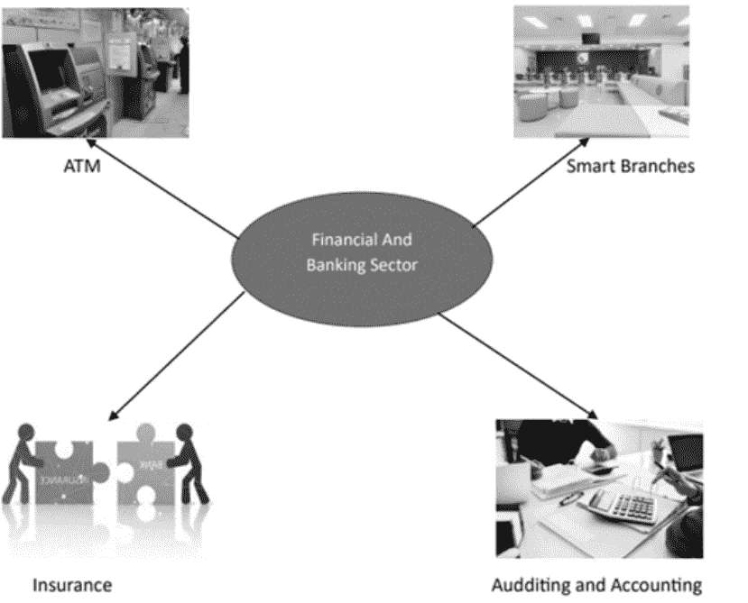


**图 8.4 物联网中的金融和银行应用**

### 8.6 使用物联网的银行和金融应用中的安全挑战

#### 8.6.1 ATM

物联网使 ATM 能够提供信息流，使银行能够监控用户操作、识别 ATM 使用模式，并根据需求选择新 ATM 的部署位置。转换到节省成本的运营阶段需要来自物联网传感器的 ATM 现场气候数据，例如室温、光线和运动。根据 ATM 现场活动调整空调和照明可实现更低的功耗。物联网解决方案通过确保对 ATM 操作和现金水平的持续监控，协助管理诸如盗刷设备使用、卡读取器问题和现金短缺等事件。

随着技术推动金融行业向前发展，出台了新法规，以确保创新不会以牺牲用户安全为代价。这些法规涵盖各种潜在问题，包括数据安全和用户隐私。随着这些法规变得越来越复杂和全面，银行必须增加合规支出，以确保能够跟上步伐。

#### 8.6.1.1 身份验证

诸如弱密码和使用不安全或非安全网络等问题会使个人面临在线黑客攻击或欺诈收费的风险，例如登录凭证被盗，可能导致未经授权的银行交易。

#### 8.6.1.2 端到端加密

如果第三方获得传输接收端的网络访问权限，提供端到端加密保护的安全性可能会受到破坏。他们不仅可以读取现有消息，还可以发送新消息。这就是为什么使用密码或生物识别技术来保护对设备的控制至关重要。

#### 8.6.2 智能网点

智能网点的物联网解决方案通过监控队列、向客户提供预计等待时间信息，或将他们引导至人较少、能够处理其交易的网点，从而改善客户体验，简化运营并减少工作人员数量。

#### 8.6.2.1 网络问题中缺乏标准

每当我们使用网络时，面临的风险是新技术和网络中断。如果互联网连接缓慢或完全中断，服务的安全性和效率可能会影响或危及您的账户。此外，无论技术多么先进，银行服务器仍然容易受到计划内和意外停机的影响。

#### 8.6.3 保险

物联网设备检测受保护物品的状态，并在出现任何变化时通知支持方，以便他们可以介入并采取适当措施以降低风险。保险公司还利用物联网生成的数据采取预防性方法并估算事件。例如，保险公司可以在任何损坏发生之前识别资产故障并向保单持有人发出警报。这种方法有助于减少保险索赔数量以及检测保险欺诈。

#### 8.6.3.1 易受攻击的应用

如果他们的移动银行应用没有定期维护和更新，黑客可能会访问并窃取用户的存款。或者，即使应用程序安全，用户的智能手机也可能不安全。这为窃贼窃取数据提供了一个入口。

#### 8.6.3.2 过时的移动体验

如今，每家银行或信用合作社都有自己的品牌移动应用程序。但是，并非所有这些应用程序都经过优化，以尽可能有效地使用。银行的移动体验应快速、易于使用、功能齐全、安全，并始终保持更新，以让客户满意。有些银行甚至开始通过引入移动支付功能来重新构想银行应用程序可能是什么样子，该功能允许用户将智能手机视为安全的数字钱包，并立即向朋友和家人转账。

#### 8.6.4 审计和会计

物联网能够实现客户支付系统的通信，并自动处理常见的会计任务，例如数据输入、对账和开票。物联网使会计师能够实时监控财务数据，并对业务运营获得准确的洞察，以改善他们的咨询角色。物联网还增强了审计中的透明度和自动化，使注册会计师能够即时监控交易和管理审计痕迹，以检测数据变化并防止欺诈。

#### 8.6.4.1 数据泄露

为了增强其物联网设备和环境，大多数银行已与主要科技公司建立合作伙伴关系。其中任何一家公司发生数据泄露都可能危及银行及其客户的数据隐私。

#### 8.6.4.2 基于风险的身份验证

基于风险的身份验证（RBA）是一种根据允许给定系统可能导致损害的可能性，对身份验证过程应用不同级别严格性的方法。随着风险级别的提高，身份验证措施会变得更加严格。

### 8.7 物联网家庭网络中的安全漏洞

在当今现代，我们使用互联网来满足家庭舒适性和我们在家中使用的电器。我们可以使用智能手机控制供暖系统或空调的温度，甚至在不在家的情况下开启或关闭家中使用的电器。从这些最新技术中，我们在家用电器中使用智能互联网技术 [23]。上面讨论的基于物联网的系统允许空调、冰箱和汽车等设备存储个人数据，也称为数据收集器 [25, 26]。因此，对于收集的数据，我们需要安全措施来帮助防止系统数据被未经授权的使用。图 8.5 显示了物联网在家庭领域的应用。

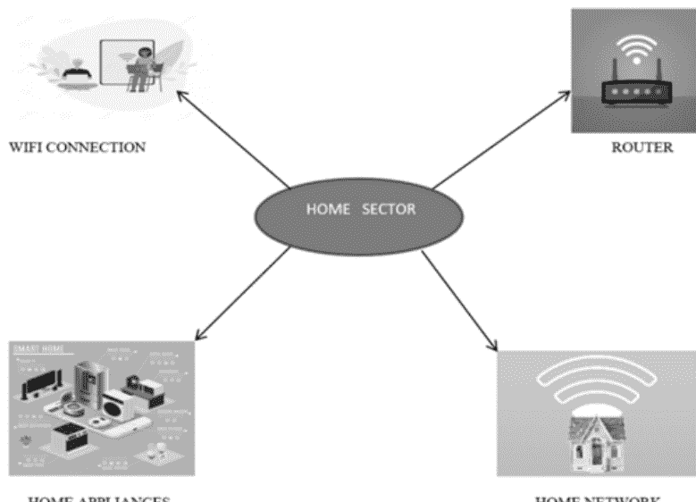

**图 8.5 物联网中的家庭领域应用**

如今，基于互联网的设备大多受到网络攻击的影响 [15]。家中的每个电器都连接到路由器，路由器是将设备连接到互联网的主要路径。图 8.4 中提到的设备，例如微波炉、闭路电视摄像头、冰箱和电视，仅通过路由器连接到网络 [27]。可以采取措施保护网络设备免受网络攻击。网络攻击是每个系统中常见的威胁。我们家中使用的设备也有可能受到这些攻击的影响 [19, 12]。主要原因是，由于它们使用公共网络，因此系统间共享的数据很容易被黑客攻击。此外，当家庭网络中的 Wi-Fi 或路由器被分配默认用户名时，可能会出现严重的网络攻击或未经授权访问的风险。

### 8.8 保护家庭设备的步骤

#### 8.8.1 路由器的设置

物联网的主要通道是 Wi-Fi 路由器，它将每个设备连接到互联网。因此，首先需要的是路由器安全。这些设备可能更容易被他人轻易黑客攻击。因此，家庭网络安全始于路由器安全。有三个主要级别可以保护这些路由器。

#### 8.8.1.1 更改路由器的默认名称

对于每个路由器，都会创建一个默认名称，该名称通常为该路由器所知，并且可能对所有网络用户可见。这个默认名称可能会带来高风险的未经授权访问，这意味着邻近设备也可能在未经许可的情况下连接到这些路由器。因此，通过更改默认名称，可能提供一种安全方式，因为它只会为主要用户所知，其他用户在连接到该设备时可能会感到困惑。

#### 8.8.1.2 路由器的唯一密码

如上所述，更改设备名称可能有助于保护设备，但其他用户仍然可能连接到它。出于这个原因，另一种技术是更改路由器的密码，这提供了完全的安全性。这意味着更改路由器的密码将不允许其他用户访问，除非知道密码。

#### 8.8.1.3 端到端加密

像唯一用户名和密码这样的功能可以用于保护系统，但仍有无法为系统提供完全安全的可能性 [8]。我们有更多的黑客技术来黑客每个设备的密码；在这种情况下，我们应该有更高级的安全


保障系统安全的技术。最高级别的加密是保障设备或系统安全的最佳方式；该技术为连接到网络的每个系统遵循唯一协议。通过遵循这些协议，只有路由器可以将每个设备连接到 Internet。

#### 8.8.2 高安全性密码

每个应用程序、设备和基于软件的事物都通过密码选项进行保护。即使我们家中使用的电器也可能有密码选项来保障设备安全。嵌入式系统由我们的智能手机控制，即使我们不在该位置。在这种情况下，如果系统没有密码，可能会面临高程度的网络攻击。因此，出于这些原因，有一种安全密码技术可以每次保障系统安全。通过设置密码，系统每次访问时可能会要求输入密码。并且每次，系统可能会检查密码是否有效或无效。只有当密码有效时，系统才会允许设备连接到网络；如果密码无效，系统可能会给用户提供三次重试权限以提供有效密码。如果重试权限用完，系统还可能阻止与该设备的连接。因此，这是一种有效保障设备安全的最高安全技术。

#### 8.8.3 设备的多个 Wi-Fi 网络

通常，由于费用较低，我们将单个 Wi-Fi 连接到家中大多数设备。但在这里，我们并未识别出其中一种最有效的方法。路由器的主要优势是创建访客网络，该网络有能力通过路由器创建更多网络。这是一个非常有用且快速访问的网络。访客网络的主要优势是分离连接设备的网络路径。在日常生活中，我们可能使用不同的网络连接连接到 Wi-Fi。例如，假设家中所有设备只连接到单个 Wi-Fi。现在假设我们的亲戚或朋友要求使用我们的 Wi-Fi 网络连接。在这种情况下，他们也可能连接到家中可用的那个单一网络，导致多个设备使用同一网络。在这种情况下，可能会出现网络断开或网络被滥用（例如黑客攻击）的可能，从而给网络和主要用户带来更多负担。由于这些缺点，我们应该转向支持多个 Wi-Fi 连接的访客网络系统。通过利用这些优势，我们可以轻松解决之前讨论的问题。例如，假设家中有两个网络，所有家用电器都使用其中一个网络，而其他访客用户连接到一个单独的网络。在这种情况下，没有机会黑客攻击我们的家用电器网络，因为用户连接的网络和设备连接的网络不同，这允许系统在连接到网络时使用其自身协议保护每个设备。

#### 8.8.4 更新设备

就像我们的智能手机一样，IoT 设备也可能有更新选项。在智能手机中，更新应用程序可能是自动或手动的，具体取决于型号。但是，对于路由器或网络连接器，更新这些设备会对主控制器可见。系统可能会为用户提供定期更新设备的选项。更新的主要原因是提高系统安全性，因为每次更新都包括安全升级。系统会自动更有效地执行安全工作。

#### 8.8.5 多级身份验证

正如我们在实时示例中观察到的，当连接手机到电视或将应用程序连接到其他设备时，系统或应用程序可能需要通过 OTP 或扫描仪进行验证。这是为了为应用程序或设备提供高安全性。同样，当链接家用电器设备或应用程序时，必须通过 OTP、发送代码或使用扫描仪等步骤获得验证。此验证系统决定对应用程序或设备的访问权限，只有通过此身份验证，设备才会被接受与其他网络链接。

### 8.9 IoT 医疗保健领域的安全漏洞

IoT 是参与每个领域（如农业、家庭网络、国防和医疗保健领域）的最佳网络之一。IoT 系统使医疗保健领域的工作更加轻松，因为医疗保健中使用的机器依赖于 Internet。例如，像数字体温计和剂量计这样的仪器使用 IoT 来测量患者状况并提供数字结果。但是，这些设备在共享其网络 [9, 10] 时可能会面临安全问题。医疗保健领域面临关键的安全挑战，包括系统隐私受到干扰、DDoS 攻击和未经授权的访问。医疗保健领域的 IoT 应用程序如图 8.6 所示。

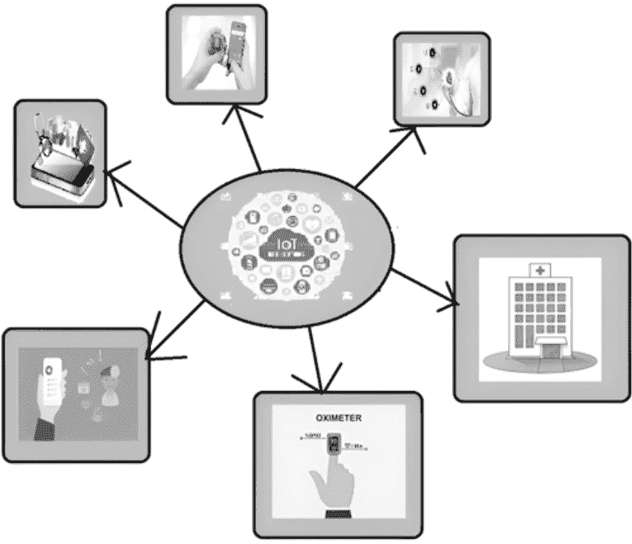

图 8.6 IoT 中的医疗保健领域应用

医疗保健领域处理大量数据，例如病史，但没有适当的数据隐私 [22]。设备收集并向其他系统传输大量信息，可能导致数据过载。这种过载会使医生难以阅读和做出治疗决策。

医疗保健中常见的 IoT 应用程序之一是自动患者监测远程系统。该系统有助于自动监测体温、血压和脉搏率。收集的信息会共享给医生和患者，并可以针对特定问题提供警报或建议 [17]。例如，如果患者血压较高，系统会自动显示相关措施并通知医疗步骤。

### 8.10 医疗保健领域所需的 IoT 安全

总体而言，医疗保健领域的 IoT 安全至关重要且必不可少 [8, 10]。如上所述，这些设备可能会自动收集健康测量信息，这些信息应安全地传输到相应的监视器。在这种情况下，安全性应在保护或保障需要传输的数据方面发挥重要作用。医疗保健系统中 IoT 设备的安全问题也有许多报告。为了解决这些问题，系统必须由防火墙保护，以防范网络攻击。这种安全性可以在设备的硬件和软件系统中得到维护，以保护数据。如果在有能力的人手中，IoT 系统可以在内部和外部共享信息时为设备应用程序提供必要的协议。这些 IoT 系统可以提供最佳且最有效的技术设备，有助于现代生活，并更好地了解患者及其疾病。设备在收集患者健康测量值后，也可能自动为患者提供医疗步骤。

### 8.11 结论

由于 IoT 设备在众多应用程序和个人生活中的使用不断增长，安全问题至关重要。由于各种 IoT 环境中的资源限制和组件异质性，存在许多风险，这些风险往往会导致系统故障。IoT 安全已得到广泛研究，本章讨论了 IoT 不同层的不同类型的攻击。它涵盖了 IoT 三个层的安全漏洞以及多个 IoT 应用程序。黑客攻击是国防领域严重的安全漏洞，账户被黑在金融和银行领域很常见，这些领域需要最高级别的保护。虽然每个人每天都能访问基本的链接家居产品，但未经授权的访问仍然是最大的安全漏洞。数据中断在医疗保健领域是一个严重问题。为了解决上述安全缺陷，目前正在进行多项关于 IoT 安全的研究，但必须加强这些研究，因为未来将有数百万个连接设备。

## 参考文献

- 1. Frank T. Johsen，“军事中的 IoT 应用”，于 5 月 18 日发表。https://resources.pcb.cadence.com/blog/2022-the-future-of-iot-military-applications
- 2. D. Hoke, D. Hendrix, N.V. Kiezel Kleine-Brogel，“国防中的 IoT”，由欧洲国防学院 Peer 比利时出版，2017 年。https://eda.europa.eu/docs/default-source/eda-magazine/edm11singlewebmedres
- 3. P. Pandey, 顾问，“银行业中什么是 IoT”，于 2023 年 1 月 24 日发表。https://sabpaisa.in/blog/IoT-in-banking/
- 4. B. Shiklo, 首席技术官，“用于智能银行和金融的 IoT”，于 2022 年 9 月 5 日发表。https://www.scnsoft.com/blog/IoT-in-banking-and-financial-services#:~:text=IoT%20offers%20a%20range%20of,offer%20a%20better%20customer%20experience
- 5. J. Matyunina, Mobindustry 内容撰稿人，“银行业和金融科技中的 IoT”，于 2022 年 6 月 9 日发表。https://www.mobindustry.net/blog/IoT-in-banking-and-fintech-benefits-examples-and-cases/
- 6. Z. Shouran, A. Ashari, T. Kuntoro Priyambodo，“智能家居中的 IoT”，于 2019 年 2 月发表。
- 7. C. Benedict, 斯里兰卡信息技术学院，“网络威胁：医疗保健领域的 IoT 安全”，于 2022 年 12 月发表。https://cyber-threats-IoT-security-in-the-healthcare-sector/
- 8. P. Kumar Shukla 等，“医疗保健系统中的 IoT-版权”，于 2023 年发表。https://www.routledge.com/IoT-in-Healthcare-Systems-Applications-Benefits-Challenges-and-Case/Shukla-Patel-Shukla-Parashar-Tiwari/p/book/9780367702144 - Google Search
- 9. D. Singh 等，“IoT 不同层的安全问题及其可能的缓解措施”，《科学与技术研究国际杂志》，2020 年 4 月。http://www.ijstr.org/final-print/apr2020/Security-Issues-In-Different-Layers-Of-Iot-And-Their-Possible-Mitigation.pdf
- 10. A. Mosteiro-Sanchez 等，“使用纵深防御保障 IIoT 安全”，《制造系统杂志》。
- 11. C. Silpa, G. Niranjana, K. Ramani，“保护 IoT 数据免受主动攻击：一项广泛研究”，载于：Manogaran, G., Shanthini, A., Vadiyu, G. (eds) 《深度学习、计算和智能国际会议论文集》。智能计算的进展


系统与计算，第1396卷。新加坡：Springer，2022年。https://doi.org/10.1007/978-981-16-5652-1_5

- 12. C. Silpa, I. Suneetha博士, G. Reddy Hemantha博士, Ram Prakash Reddy Arava, Y. Bhumika，“药物警报：一种面向老年人的IoT支持型高效药物警报，旨在改善其用药实践”，《药物负面结果期刊》，第13卷，第4期，第1041–1046页，2022年11月。https://doi.org/10.47750/pnr.2022.13.04.143

- 13. C. Prathima, N.B. Muppalaneni, K.G. Kharade，“云存储中IoT数据去重”，收录于：Satyanarayana, C., Gao, X.Z., Ting, C.Y., Muppalaneni, N.B. (编) 《面向社会问题的机器学习与物联网》。先进技术与社会变革。新加坡：Springer，2022年。https://doi.org/10.1007/978-981-16-5090-1_13

- 14. P. Bhasha, T. Pavan Kumar博士, K. Khaja Baseer博士, V. Jyothsna，“一种基于IoT的BLYNK服务器应用，用于婴儿监测警报系统以检测婴儿哭泣和湿度”，载于《智能与数据分析智慧计算国际会议》。智能系统与计算进展，第1312卷。新加坡：Springer，2021年3月13日。https://doi.org/10.1007/978-981-33-6176-8_7

- 15. V. Jyothsna, M. Prasad, G. GopiChand, D. D. Bhavani，“DLMHS：一种基于深度学习神经网络和元启发式的流量入侵检测系统”，《通信系统国际期刊》，第35卷，第10期，e5159，2022年7月10日。https://doi.org/10.1002/dac.5159

- 16. C. Silpa, S. Srinivasa Chakravarthi博士, J. Kumar G, K.K. Baseer博士, E. Sandhya，“一种使用IoT传感器的健康监测系统”，《代数统计期刊》，第13卷，第3期，第3051–3056页，2022年6月，ISSN：1309-3452。

- 17. M. Jahir Pasha博士, V. Sujatha, A. Hari Priya, K.K. Baseer博士，“一种基于IoT技术的多功能椅，用于控制家庭/办公室电器”，《代数统计期刊》，第13卷，第1期，第952–959页，2022年5月，ISSN：1309-3452。

- 18. T.H. Sardar, A. Rimaz Faizabadi，“在对称多处理器机器上使用OpenMP和Pluto对所选数值算法进行并行化与分析”，《数据技术与应用》，第53卷，第1期，第20–32页，2019年。

- 19. E. Subbarao 等，“利用机器学习调查城市地区和都市社区的太阳能”，《电力元件与系统》，第1–11页，2023年。

- 20. T.H. Sardar, Z. Ansari, A. Khatun，“基于并行K-means的文档聚类中Hadoop集群效率评估”，2017年IEEE电路与系统国际会议(ICCS)。IEEE，2017年。

- 21. T.H. Sardar, A. Rimaz Faizabadi, Z. Ansari，“基于Hadoop框架的Mapreduce范式数据处理分析”，《新兴管理与技术研究国际期刊》，第6卷，第5期，第17–20页，2017年。

- 22. T.H. Sardar, A. Khatun, S. Khan，“无线传感器网络中能量感知收集树协议的设计”，2017年IEEE电路与系统国际会议(ICCS)。IEEE，2017年。

- 23. T.H. Sardar, A. Muttineni, R. Ranjan，“大数据在客户体验与库存管理中的未来”，收录于《大数据计算》，T.H. Sardar, Bishwajeet Kumar Pandey 编。博卡拉顿：CRC Press，2024年，第233–248页。

- 24. T.H. Sardar, A. Khatun, S. Sengupta, Y. Alam, T. Ara，“医疗保健领域的机器学习与生物医学大数据：技术、应用与挑战”，收录于《大数据计算》，T.H. Sardar, Bishwajeet Kumar Pandey 编。博卡拉顿：CRC Press，第336–352页。

- 25. T.H. Sardar, S. Das, B. Kumar Pandey，“可解释人工智能(XAI)：概念与理论”，收录于《使用可解释人工智能进行医疗数据分析与处理》，Om Prakash Jena, Mrutyunjaya Panda, Utku Kose 编。博卡拉顿：CRC Press，第1–18页。

- 26. T.H. Sardar, T. Habib, Z. Ansari，“基于并行K-means算法的文档聚类中MapReduce效率分析”，《未来计算与信息学期刊》，第3卷，第2期，第200–209页，2018年。

- 27. P. MS Guru 等，“基于改进AlexNet架构的新型提取方法的脑肿瘤识别与分类”，2023年第六届信息系统与计算机网络国际会议(ISCON)。IEEE，2023年。

## 9 基于PNN和KNN的心电图信号高效准确分类算法

R. Anandha Praba, L. Suganthi, and E.S. Selva Priya

DOI: 10.1201/9781003465775-9

### 9.1 引言

心血管疾病是一大关注点，每年导致高死亡率。根据一项调查[1]，高血压、肥胖和糖尿病是充血性心力衰竭的主要原因，统计数据显示每年发生130万至460万例病例。自动心电图检测与分类已被广泛用于分析心脏疾病。心电图信号用于诊断各种心脏疾病，因此，收集和分析大量心电图数据对于识别心脏健康中的趋势和模式非常有价值。大数据是指使用传统数据处理技术无法处理的大型、复杂数据集。心电图数据的分析带来了重大的技术挑战，需要先进的计算工具和算法来进行处理和分析。收集心电图信号的大数据可以涉及使用可穿戴心电图设备或其他监测设备对大量患者进行持续监测。收集到的数据随后可存储在数据库中，并使用先进的机器学习和数据分析技术进行分析，以识别模式和趋势。大数据在心电图信号中的一个应用示例是分析心律失常患者的数据。通过比较许多心律失常患者的心电图信号，研究人员可以识别数据中的共同点，这有助于识别特定类型的心律失常或潜在风险因素。另一个示例是利用大数据来识别心脏事件（如心脏病发作或中风）的风险。通过分析有心脏事件病史患者的大量心电图数据，研究人员可以识别数据中可能预测未来事件的模式。总体而言，收集和分析心电图信号的大数据可以为心脏健康提供有价值的洞察，从而可能实现心脏疾病的早期检测和更好的治疗。

随着可穿戴心电图设备和其他监测设备的使用日益增加，对先进工具和技术来管理和分析这些海量数据的需求也在增长。通过利用机器学习、数据挖掘和预测分析等大数据技术，研究人员和医疗专业人员可以识别心电图数据中的模式和趋势，从而提供更准确的诊断和量身定制的治疗方案，并改善患者预后。

进行测试的一种方法是在个人的典型日常活动期间获取心血管活动的长期记录。个人长期记录的主要问题是，心电图信号可能会显著受到外部噪声的影响，从而可能导致数据分类错误。为了提高信号质量，必须通过应用信号处理滤波算法实现噪声消除。电网干扰（PLI）是影响获取信号质量的主要元凶，通常落在50–60 Hz范围内。除了PLI，信号还可能受到各种频率范围内高频和低频噪声的影响。如前所述，记录信号可能会受到PLI、肌肉震颤和电极运动引起的高频和低频噪声等的严重影响。

自适应滤波技术通过估计输入心电图信号中存在的噪声来工作。这是通过基于提供的输入进行滤波操作并估计输入中的噪声来实现的，输入包括信息源和噪声。因此，自适应滤波器产生的输出将不含噪声并保持数据的完整性。最广泛接受的自适应滤波技术是归一化最小均方（NLMS）滤波器，它是LMS算法的修改版本，克服了与LMS滤波器相关的不稳定性问题。这种稳定性是通过对输入功率应用归一化过程来实现的[2, 3, 4, 5]。


一旦信号在无噪声情况下预处理完毕，下一步就是从去噪数据中提取特征。文献中讨论了多种特征提取技术。输入ECG波形最突出的特征是峰峰间隔、峰值幅度和QRS波群。通过应用CWT和神经网络，研究[6]开发了一种在ECG信号中检测和分类QRS波群的新技术。该技术通过应用四个小波基函数，实现了各种形态下的QRS波群检测。信号去噪和特征提取也通过阈值法实现，在分类方面达到了97.2%的准确率。在[7]中，实现了针对事件向量的不同决策规则的复杂QRS识别。专家已证实小波变换方法可以准确提取这些特征。为了获取形态特征[8]，DWT被应用于每个心跳。RR间期数据被用作动态特征。独立成分分析被应用于降低DWT子带的维度，并选取12个系数作为形态特征。主成分分析（PCA）和动态时间整形（DTW）用于从P-QRS-T波中提取形态特征，并从输入ECG片段中获取ECG特征[9]；最后，对提取的特征使用支持向量机（SVM），并呈现自动诊断结果。在研究[10, 11]中，R峰通过多尺度方法结合自适应阈值进行检测。通过去除D1和D2详细系数进行去噪。此外，还可以实现实时心电图波峰检测[12]。为了提高当前分类算法的准确性，在多类分类条件下，通过融合特征对输入ECG进行分类。算法[13]中使用了多层CNN和RNN。关于提取QRS波群最传统和最简单的方法在[14]中讨论，作者描述了一种算法，通过使输入ECG信号经过一系列过程来观察QRS波群。首先，输入ECG信号通过低通和高通滤波器，这些滤波器设计了适当的截止频率以定位ECG的主要能量。滤波过程之后，执行信号的微分、平方和平均。为了完成平均过程，必须选择一个滑动窗口。

心律失常检测或分类的最后一步是选择最佳分类器。人工神经网络（ANN）是这样一种能够提供准确预测的分类器。文献[15, 16, 17]中讨论了不同类型的心律失常分类器。可以实现标准12导联心电图记录系统和基于ANN的分类技术，以识别出版物[18]中讨论的心脏心律失常疾病，并使用多层感知器（MLP）模型[19]进行多类分类预测。神经网络用于识别疾病[20]。利用Levenberg–Marquardt反向传播算法训练网络。所取得的结果比之前提出的方法更高效。该研究[21]调查了ECG信号的特征提取参数，如Poincaré图、Lyapunov指数和谱熵。该研究利用人工神经网络识别心脏疾病异常。通过采用小波包分解（WPD）实现了输入ECG信号分类和特征提取的新方法；性能评估参照GA-BPNN进行，并在出版物[22]中讨论。在期刊[23]中，使用自动化方法进行初始种子发现，并讨论了用于心脏疾病分类的基于回归学习的神经网络分类器（RLNNC）。为了在实例中显著提高患者输出，基于大量数据（特别是心房颤动、心肌梗死、心脏心律失常和电生理）的识别方法在[24, 25, 26, 27, 28]中使用机器学习算法进行了讨论。

本章的其余部分组织如下。第9.2节涵盖了本工作中所采用的数据集类型、拟议系统方法和特征提取的讨论。在第9.3节中，讨论了所使用的两种分类器，即KNN和PNN。第9.4节呈现了每种分类器的实验结果及性能指标。第9.5节提供了与其他最先进的文献在准确性方面的详细比较。最后，第9.6节总结了本文。

### 9.2 材料与方法

#### 9.2.1 ECG信号

ECG脉冲由心脏的电活动产生。当来自窦房结到浦肯耶纤维的电活动以协调方式维持时，心脏正常泵血并产生ECG波形。典型的ECG波形如图9.1所示，标注了ECG波的组成部分：1）P波，2）QRS波群，3）T波，和4）U波。ECG波的每个组成部分在时间上都有其自身特征，这些特征基于各种试验进行了记录。ECG波组成部分的正常特征（包括幅度和时间周期）列于表9.1中。


### 图9.1 ECG信号

### 表9.1 正常ECG波的特性

| 特性 | 时间周期 (ms) | 特性 | 振幅 (mV) |
|---|---|---|---|
| PR间期 | 120–200 | P波 | 0.25 |
| RR间期 | 600–1200 | Q波 | R波的25% |
| QRS波群 | 80–100 | R波 | 1.6 |
| ST段 | 80–120 | S波 | 1 |
| QT间期 | 420 | T波 | 0.1–0.5 |
| T波 | 160 | U波 | T波的1/3 |

当心脏的电活动因某些因素而受到干扰时，会导致波形特征改变的异常ECG波。心跳的一大主要异常是心律失常。人类的平均静息心率为每分钟60–100次（BPM）。心律失常是一种人类心跳过快或过慢、超过正常水平的状况；这些状况分别被分类为心动过速和心动过缓。

本研究中使用的MIT-BIH心律失常数据库从PhysioNet ATM下载。PhysioNet是一个开源网站，提供在不同条件下记录的一系列生物信号。可以在特定时间间隔下载信号，因为原始信号是在较长时间内记录的。使用PhysioNet ATM的优点包括其可用的大量信号、用户友好性以及信号格式的灵活性。下载的信号可以采用工作所需的格式，如Excel、CSV、MAT文件等。本研究中使用的数据可以在https://archive.physionet.org/cgi-bin/atm/ATM [38]访问。该数据集包括1975年至1979年间从47人处采集的48条双导联动态记录ECG信号，并已由BIH心律失常实验室检查。信号以360 Hz的采样频率记录，11位分辨率覆盖10毫伏的范围。

#### 9.2.2 拟议工作

整个工作过程中执行的完整工作流如图9.2所示。心律失常分类所涉及的过程包括：使用合适的算法进行噪声去除，从ECG波形（如QRS波群、R峰、P峰、RR间期、PR时段）中提取特征，以及评估直方图特征（如统计均值和标准差）。最后，所获得的特征使用PNN和KNN算法进行分类。

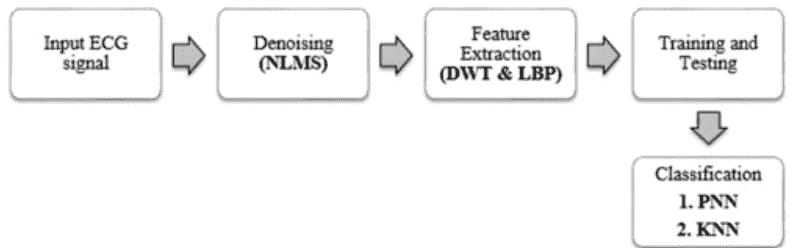

### 图9.2 整个工作的流程图

#### 9.2.3 去噪

从PhysioNet数据库下载的原始ECG信号中会含有噪声。信号预处理是去除原始信号中所存在伪迹的关键步骤。有关滤波ECG信号的文献有很多。滤波器必须在考虑特征提取所需频率成分的基础上设计[29]。受试者的振动和突然动作可能导致运动伪迹，从而引起峰值幅度和持续时间差异。这种在实时ECG信号记录过程中的运动会导致信号基线漂移。通过去噪输入ECG脉冲，ECG脉冲的质量已通过信噪比（SNR）等特定参数得到提升和量化。

对于噪声消除应用[30]，广泛采用自适应滤波器，这些滤波器通常使用有限冲激响应（FIR）滤波器设计。这些滤波器使用极小化准则来更新滤波器系数。因此，当前和先前输入样本的加权和将是滤波器的相应输出。NLMS自适应滤波技术旨在去除ECG数据中的伪迹。

#### 9.2.4 自适应滤波技术


ECG 信号具有确定的五种波形模式，其中 Q、R 和 S 波分量共同构成 QRS 复合波，如图所示。此外，ECG 波形具有如表 9.1 所示的特定特征。因此，ECG 信号是一种所有波形分量都具有重复模式但随时间变化的信号。连续随时间变化的信号必须设计一些特殊滤波器来处理这些变化。因此，选择自适应滤波器；滤波器参数根据信号变化而变化。这意味着滤波器会自适应地适应 ECG 信号中出现的变化。自适应算法通过自适应控制机制实现的权重调整来工作 [31]。使用自适应去噪技术的主要优点是可以实现高级别的噪声降低，而这通过直接滤波技术难以实现。另外，使用的误差信号应根据应用要求选择。

在此，基于[32]中讨论的LMS算法的局限性，选择了归一化最小均方自适应滤波。一种自适应滤波技术用于将自校正泄漏NLMS算法应用于ECG信号，以去除EMG伪迹。该自适应滤波器通过调整其步长和泄漏系数来工作。通过计算SNR来测试滤波器输出的效率，结果发现SNR在16.53至28.56 dB之间，且对于MIT-BIH数据库具有较低的均方误差。

此处使用NLMS自适应滤波器来消除ECG数据中存在的交流和直流噪声等伪迹。整体噪声消除如图9.3所示清楚。滤波器参数已调整以消除基线漂移、运动伪迹和电源线干扰。NLMS通过归一化输入功率来实现这一点。评估以x(n)作为输入信号进行，该信号由带有噪声信号n1(n)的s(n)组成。在此，d(n)表示所需的系统输出，y(n)表示自适应噪声消除输出 [33]，其中e(n)表示误差信号，w(n)表示权重向量。这些在方程(1)–(5)中给出：

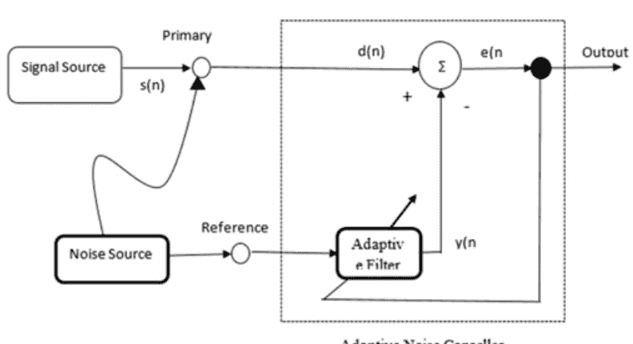

FIGURE 9.3 自适应噪声消除方法

x(n) = s(n) + n1(n) (1)
d(n) = x(n) (2)
y(n) = wT(n) x'(n) (3)
e(n) = d(n) – y(n) (4)
w(n + 1) = w(n) + 2μe(n)x'(n) (5)

#### 9.2.5 特征提取

NLMS滤波器的结果数据是包含所有所需信息的无噪ECG。始终推荐使用无噪ECG数据来提取特征，因为它在异常分类中起着主要作用。这是分类前最重要的阶段。应从去噪信号中正确提取特征，以获得更准确的分类结果。

一般来说，有各种用于从ECG信号进行特征提取的技术 [34, 35, 36, 37]，例如快速傅里叶变换（FFT）、自适应自回归（AAR）参数、多元AAR、双线性AAR、PCA、ICA、遗传算法（GA）、小波变换（WT）、CWT、DWT和WPD。所有这些方法在特征提取方面相对于信号特性都有其自身的重要性。其中，考虑到它们在生物信号特征提取中的优势，PCA、ICA、WT、AR、WPD和FFT被大多数使用。在所提出的工作中，DWT和LBP被用于从ECG信号中提取主导特性。

#### 9.2.6 DWT

在此方法中，通过应用LBP算法和DWT来提取去噪信号的特征。小波具有不同的缩放和平移特性，每个小波都有不同的大小和形状。小波的选择必须基于所使用的输入信号、计算复杂度、小波特性以及应用所需的输出。在各种小波家族中，最常用的小波是Haar、Daubechies、Symlet等。在对去噪信号应用离散小波变换时，选择Daubechies母小波。如图9.4所示，去噪信号被分为低频和高频分量。在每个分解层次中，数据按2下采样（↓2）。具体地，输入信号的显著特征被分解为近似系数和详细系数的DWT系数，其长度小于原始信号长度。

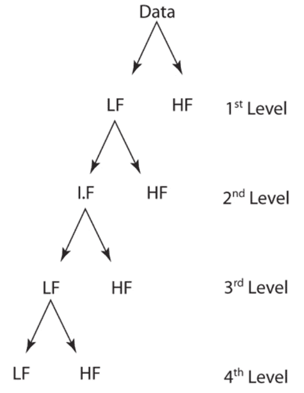

FIGURE 9.4 使用滤波器的DWT

在所提出的工作中，输入ECG信号通过DWT，并分解为八个层次的近似系数和详细系数。通过验证每个分解层次的频率，信号的db8子带反映了原始ECG信号。基于获得的详细和近似小波系数，提取ECG信号的P波和R波峰值以估计RR间期和PR间期。上述提取的特征进一步用于训练和测试数据集，用于分类目的。

#### 9.2.7 LBP 方法

在LBP中，提取直方图特征。最后，从LBP中提取均值和标准差统计特征。LBP方法的工作流程如图9.5所示。在分类前提取直方图特征的步骤如下：将窗口划分为单元。将单元中的每个像素与其八个邻域像素进行比较。按顺时针或逆时针方向围绕圆形跟踪像素。当邻域像素的值高于中心像素的值时，写入"1"。否则，在框中写入"0"。这给出一个八位二进制数。计算每个单元中每个"数字"出现频率的直方图。如有必要，归一化直方图。这给出了窗口的特征向量。

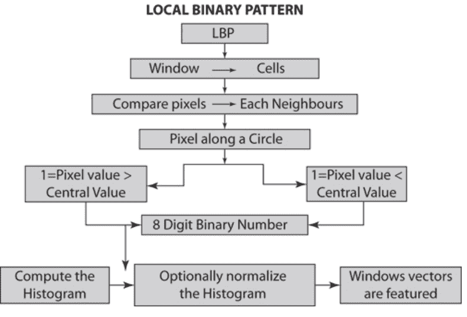

FIGURE 9.5 局部二进制模式流程图

### 9.3 分类

目前，有大量分类算法可用于根据可用特征对ECG信号进行分类。在我们的方法中，我们利用PNN和KNN根据训练成不同类型心律失常（如表9.2所示）的特征来对输入ECG信号进行分类。

| 心律失常类型 | 心率 |
|---|---|
| 正常窦性心律 | 60–100 次/分 |
| 窦性心动过缓 | <60 次/分 |
| 窦性心动过速 | >100 次/分 |
| 颤动 | 250–600 次/分 |
| 早搏 | 提前的心跳 |
| 室性心律失常 | 起源于下腔室 |
| 上室性心律失常 | 起源于上腔室 |

#### 9.3.1 PNN

PNN类型的神经网络主要用于分类和模式识别问题。PNN的架构有三层：输入层、隐藏层和输出层，如图9.6所示。PNN的第一层（即输入层）有N个节点，所有特征向量通过这些节点连接到隐藏层。该组中的每个隐藏节点属于类k，并对应于以其相关特征向量为中心的kth类中的高斯函数。在一个类组中，这个高斯函数为k个输出节点产生有效值。

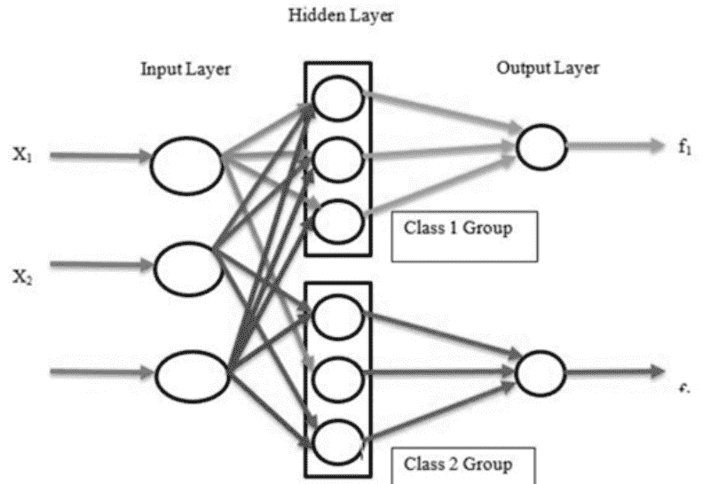

FIGURE 9.6 PNN架构

#### 9.3.2 KNN

接下来，我们使用KNN算法进行分类，这是一种用于解决回归和分类问题的简单、直接的算法。KNN算法通过分析查询与给定输入数据中所有模型之间的距离（D），选择与查询最近的K个模型，并选择持久标签或对已建立的标签求平均。图9.7描绘了一个清晰解释此过程的流程图。

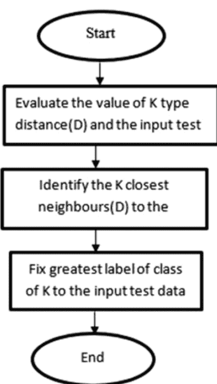

FIGURE 9.7 KNN流程图

### 9.4 实验结果

了解所设计系统的实现指标至关重要，这是使用从PhysioNet获取的输入ECG数据集来确定的。整个算法在MATLAB环境中编写和模拟。所使用的ECG数据及其他特征的详细信息在第9.2节中提供。

本工作选择的不同性能指标为准确率、灵敏度和特异度。PNN和KNN的性能指标结果与以往文献工作进行了比较。所提出的工作在心律失常类型中实现了更好的准确分类，使用


与其他工作相比，PNN 网络表现更优。本方法的性能指标值如表 9.3 所示。

表 9.3 PNN 和 KNN 的性能指标

| 序号 | 性能指标 | PNN | KNN |
|---|---|---|---|
| 1. | 准确率 | 98.4% | 96.67% |
| 2. | 灵敏度 | 95% | 93.75% |
| 3. | 特异度 | 90% | 89.5% |

从上述表述可以推断，我们提出的特征提取和分类方法分别利用了 DWT、LBP 和 PNN 执行。该方法更高效且更准确，PNN 的准确率为 98.4%，KNN 的准确率为 96.67%。

首先，在所提出的工作中，创建了一个图形用户界面（GUI），指示需要执行的所有所需处理。GUI 包含所有界面，用于加载信号、执行预处理、应用 DWT 提取特征、进行训练阶段、测试和分类心律失常类型，最后执行验证步骤。首先，将输入加载到程序中并完成预处理。图 9.8 显示输入的信号及其对应的滤波输出信号。滤波使用 NLMS 滤波器执行。此外，LBP 用于计算直方图特征，如均值和标准差。

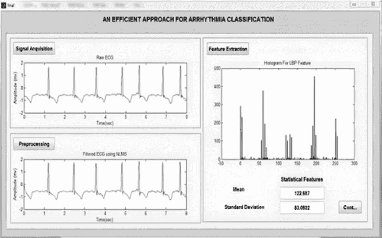

图 9.8 GUI – 输入的 ECG 信号、预处理后以及 LBP 特征的直方图

去噪后的 ECG 信号使用 DWT 进行分解，以提取 RR 间期和 PR 时段。特征提取的输出如图 9.9 所示。最后，将提取的特征输入 PNN 和 KNN 来分类正常和异常心跳。输出消息显示受试者是正常还是异常。如果是异常，则将如表 9.4 所示使用 KNN 显示心律失常类型。这里，预测类为室性逸搏。此外，KNN 算法的输出与随机森林实现的输出进行了比较，KNN 算法显著优于随机森林算法。同样，图 9.10 使用 PNN 显示正常和心动过缓的指示。

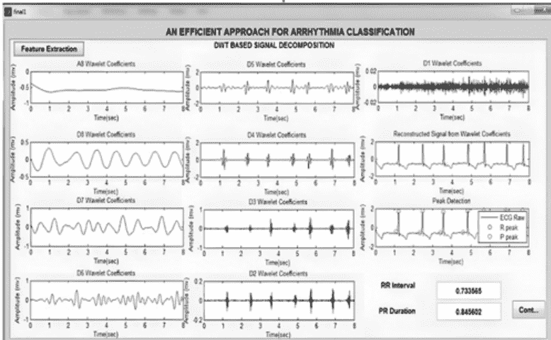

图 9.9 使用 DWT 进行特征提取

表 9.4 最终输出 – KNN 特征向量

| 特征 | 值 |
|---|---|
| 均值 | 122.687 |
| 标准差 | 83.08223 |
| RR 间期 | 0.733565 s |
| PR 时段 | 0.845602 s |
| 预测类 | 室性逸搏 |

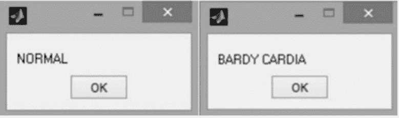

图 9.10 最终输出 – PNN

### 9.5 讨论

如前面在第 9.2.5 节中讨论的那样，各种算法用于从 ECG 信号中提取特征。表 9.5 列出了文献中使用的特征提取方法。基于此比较，可以根据数据集、网络架构、输入信号的性质等方便地选择最佳方法。

表 9.5 不同特征提取方法的比较

| 序号 | 特征提取方法 | 优点 | 缺点 |
|---|---|---|---|
| 1. | ICA [11, 39] | - 在海量数据中提供高性能<br>- 信号将分解为空间固定分量和时间独立分量 | - 不适用于未决情况<br>- 所需计算更多 |
| 2. | PCA [40] | - 降维的最佳方法<br>- 数据损失较低 | - PCA 对复杂流形失效<br>- 线性且连续的数据 |
| 3. | WT [41] | - 通过可变窗口大小分析具有不连续性的信号<br>- 时频域分析 | - 缺乏去除普遍噪声的方法<br>- 性能有限 |
| 4. | AR [42] | - 最适用于短时数据<br>- 更好的频率分辨率<br>- 减少谱损失 | - 不适用于非平稳信号（如 EEG） |
| 5. | WPD [43] | - 适用于非平稳信号 | - 计算时间高 |
| 6. | FFT [44] | - 频域分析 | - 仅适用于平稳信号<br>- 对噪声敏感度更高<br>- 时域定位差 |

特征提取完成后，最后一步是分类。表 9.6 将现有方法与本研究的准确率进行了比较。

2013 年，Rai 等人提出了使用 DWT 和各种 NN 分类器组合对 ECG 信号进行自动分类。采用了三种分类器——BPNN、FFNN 和多层感知机（MLP），分别达到 97.8%、97.8% 和 100% 的准确率 [15]。2016 年，Shadmand 等人建议了一种新的 ECG 分类算法，使用基于块的神经网络（BBNN）和 PSO 对五种心跳进行分类，准确率为 97% [16]。2017 年，Xiong 等人 [17] 开发了一种 16 层一维 CNN 来预测房颤，准确率为 90%。Gautam 等人 [21] 推荐使用小波分析进行特征提取，并使用 BPNN 作为分类器，准确率为 93.3%。Gutiérrez-Gneccchi 等人 [45] 引入了小波变换和 PNN 的组合，用于检测八种心跳类型的心律失常，准确率为 92.74%。2020 年，Yang 等人 [46] 使用 ECG 形态的参数特征和视觉模式特征的组合，利用三种分类器——NN、SVM 和 KNN——自动诊断心律失常，以检测 15 种心律失常。Venkatesan 等人 [47] 提出了使用 SVM 对心律失常心跳进行分类，以区分正常和异常受试者，准确率为 96%。与我们提出的工作相比，所获得的准确率明显高于 SVM 分类器。Marinho 等人 [48] 使用了一种新的心律失常分类方法，主要关注不同的特征提取方法和分类。HOS 和 SCM 是该工作中使用的技术之一，并使用贝叶斯分类器预测五种心律失常，分类准确率为 94.3%。此外，机器学习模型中的最新技术，如 K-means [49]、安全和隐私背景下的医疗保健 ML 技术 [50] 以及可解释 AI [51] 已得到发展。从实验结果可以看出，PNN 与文献中其他现有模型相比表现良好。

表 9.6 拟议工作与现有文献的准确率比较

| 作者 | 使用的分类器名称 | 类型 | 准确率 (%) |
|---|---|---|---|
| Rai 等人 [15] | 神经网络分类器 | 2 | BPNN – 97.8<br>FFNN – 97.8<br>MLP – 100 |
| Shadmand 等人 [16] | 基于块的 NN | 5 | 97 |
| Xiong 等人 [17] | CNN (16 层) | - | 90 |
| Gautam 等人 [21] | BPNN | - | 93.3 |
| Gutiérrez-Gneccchi 等人 [45] | PNN | 8 | 92.74 |
| Yang 等人 [46] | 神经网络分类器 | 15 | NN – 96.11 SVM – 94.23 KNN – 97.70 |
| Venkatesan 等人 [47] | SVM | 2 | 96 |
| Marinho 等人 [48] | 朴素贝叶斯 | 5 | 94.3 |
| **拟议工作** | **KNN 和 PNN** | 7 | **KNN – 98.4 PNN – 96.67** |

### 9.6 结论

在此工作中，通过使用 PNN 和 KNN 分类器获得了一种高效且准确的心律失常自动分类方法。详细讨论了预处理和特征提取等初始步骤。性能指标图证明了使用 PNN 分类的优势。通过获得更高的准确率、灵敏度和特异度值，PNN 分类方法是其他现有分类方法中的最佳方法。PNN 网络的计算能力和灵活性的组合效应在实现更好的分类性能中起着重要作用。通过增加分类器的组合，可以进一步提高 PNN 的心律失常预测准确率。

## 参考文献

- 1. Savarese, Gianluigi，和 Lars H. Lund。“心力衰竭的全球公共卫生负担。”心脏衰竭评论 3.1 (2017): 7。
- 2. Sardar, T. H.，和 Z. Ansari。“用于分布式文档聚类的基于 MapReduce 的模糊 C-Means 算法。”印度工程师学会杂志：B 系列 103 (2022): 131–142。https://doi.org/10.1007/s40031-021-00651-0。
- 3. Satheeskumaran, S.，和 M. Sabrigiriraj。“用于 ECG 信号噪声消除的新基于 LMS 的算法的 VLSI 实现。”电子国际期刊 103.6 (2016): 975–984。
- 4. Sharma, Lalita，和 Rajesh Mehra。“使用修改的归一化最小均方算法的自适应噪声消除。”工程趋势与技术国际期刊 34 (2016): 215–219。


- 5. Thakor, Nitish V., 与 Y.-S. Zhu. “自适应滤波在心电图分析中的应用：消噪和心律失常检测.” IEEE Transactions on Biomedical Engineering 38.8 (1991): 785–794.

- 6. Abibullaev, Berdakh, 与 Hee Don Seo. “一种基于小波和人工神经网络的新QRS检测方法.” Journal of Medical Systems 35 (2011): 683–691.

- 7. Hamilton, Patrick S., 与 Willis J. Tompkins. “基于MIT/BIH心律失常数据库的QRS检测规则定量研究.” IEEE Transactions on Biomedical Engineering 12 (1986): 1157–1165.

- 8. Anwar, Syed Muhammad, 等. “基于混合特征的心电图信号心律失常分类.” Computational and Mathematical Methods in Medicine 2018 (2018): 1380348.

- 9. Chen, Xiaohe, Yan Wang, 与 Lirong Wang. “基于心电图形态和片段特征分析的心律失常识别与分类.” IEEE/ACM Transactions on Computational Biology and Bioinformatics 16.1 (2018): 131–138.

- 10. Banerjee, S., R. Gupta, 与 M. Mitra. “基于多分辨率小波分析法的心电图特征提取.” Measurement 45.3 (2012): 474–487.

- 11. Ye, Can, Miguel Tavares Coimbra, 与 B. V. K. Vijaya Kumar. “基于心电图信号形态和动态特征的心律失常检测与分类.” 2010年IEEE工程医学与生物学年度国际会议. IEEE, 2010.

- 12. Chatterjee, H. K., R. Gupta, 与 M. Mitra. “实时心电图波峰检测算法及其在FPGA上的实现.” 2014年控制、仪器、能源与通信国际会议（CIEC）论文集. IEEE, 2014.

- 13. Guanglong, Ma, Wang Xiangqing, 与 Yu Junsheng. “基于融合特征的心电图信号分类算法.” 物理学杂志：会议系列 (2019). IOP Publishing.

- 14. D’Aloia, Matteo, Annalisa Longo, 与 Maria Rizzi. “用于自动峰值检测的带噪声心电图信号分析.” Information 10.2 (2019): 35.

- 15. Rai, Hari Mohan, Anurag Trivedi, 与 Shailja Shukla. “基于多分辨率小波变换和人工神经网络分类器的心电图信号异常检测处理.” Measurement 46.9 (2013): 3238–3246.

- 16. Shadmand, Shirin, 与 Behbood Mashoufi. “一种基于块神经网络和粒子群优化的个性化心电图信号分类新算法.” Biomedical Signal Processing and Control 25 (2016): 12–23.

- 17. Xiong, Zhaohan, Martin K. Stiles, 与 Jichao Zhao. “采用新型神经网络的心房颤动检测鲁棒心电图信号分类.” 2017年心脏病学计算会议. IEEE, 2017.

- 18. El-Khafif, Sahar H., 与 Mohamed A. El-Brawany. “基于人工神经网络的自动心电图信号分类器.” International Scholarly Research Notices 2013 (2013): 261917.

- 19. Jadhav, Shivajirao M., Sanjay L. Nalbalwar, 与 Ashok A. Ghatol. “基于人工神经网络模型的心律失常疾病分类.” 2010年IEEE计算智能与计算研究国际会议. IEEE, 2010.

- 20. Gothwal, Himanshu, Silky Kedawat, 与 Rajesh Kumar. “基于快速傅里叶变换和人工神经网络的心电图搏动信号心律失常检测.” Journal of Biomedical Science and Engineering 4.4 (2011): 289.

- 21. Gautam, Mayank Kumar, 与 Vinod Kumar Giri. “一种用于心电图分类的神经网络方法和小波分析.” 2016年IEEE工程与技术国际会议（ICETECH）. IEEE, 2016.

- 22. Li, Hongqiang, 等. “心电图信号分类中特征和神经网络优化的遗传算法.” Scientific Reports 7.1 (2017): 41011.

- 23. Oliver, A. Sheryl, 等. “基于回归学习神经网络分类器的生物系统心脏病精准预测.” Journal of Ambient Intelligence and Humanized Computing 63 (2021): 1–9.

- 24. Sahay, Shalini, 等. “基于机器学习的心电图信号检测与分类.” International Journal of Innovative Technology and Exploring Engineering 8.10 (2019): 3221–3227.

- 25. Lown, Mark, 等. “使用可穿戴技术的房颤机器学习检测.” PloS One 15.1 (2020): e0227401.

- 26. Mincholé, Ana, 等. “心电图中的机器学习.” Journal of Electrocardiology 57 (2019): S61–S64.

- 27. Sahoo, S., 等. “心电图信号中心脏心律失常的机器学习检测方法：一项综述.” Irbm 41.4 (2020): 185–194.

- 28. Feeny, Albert K., 等. “心律失常和心脏电生理中的人工智能与机器学习.” Circulation: Arrhythmia and Electrophysiology 13.8 (2020): e007952.

- 29. Sardar, T. H., 与 A. R. Faizabadi. “在对称多处理机上使用OpenMP和Pluto对选定数值算法进行并行化和分析.” Data Technologies and Applications 53.1 (2019): 20–32. https://doi.org/10.1108/DTA-05-2018-0040.

- 30. Lakshmikanth, S., K. R. Natraj, 与 K. R. Rekha. “基于自适应LMS和NLMS的PSO维纳滤波器工业噪声消除性能分析.” 2014年通信与信号处理国际会议. IEEE, 2014.

- 31. Lastre-Domínguez, Carlos, 等. “使用无偏FIR平滑进行心电图信号去噪和特征提取.” BioMed Research International 2019 (2019): 2608547.

- 32. Mohebbian, Mohammad Reza, 等. “一种基于优化盲自适应滤波和定点卷积核补偿的单通道高噪声水平心电图去卷积.” Biomedical Signal Processing and Control 57 (2020): 101673.

- 33. Desai, N., Utpal Pandya, 与 C. Desai. “使用LMS和NLMS算法的主动噪声控制.” Journal of Engineering & Technology (JET) 1.1–2 (2019): 1–8.

- 34. Karpagachelvi, S., Muthusamy Arthanari, 与 M. Sivakumar. “心电图特征提取技术——综述方法.” arXiv预印本 arXiv:1005.0957 (2010).

- 35. Khan, Tasnova Tanzil, 等. “时域心电图特征提取及各种心脏状况检测.” 2015年电气工程与信息通信技术国际会议（ICEEICT）. IEEE, 2015.

- 36. Mahmoodabadi, S. Z., Alireza Ahmadian, 与 M. D. Abolhasani. “使用Daubechies小波进行心电图特征提取.” 第五届IASTED可视化、成像和图像处理国际会议论文集. 2005.

- 37. Naaz, Afseen, 与 Mrs Shikha Singh. “用于心脏异常的心电图信号特征提取与分析——综述.” International Journal of Engineering Research &

## 10 大数据分析

## 使用机器学习技术的遥感图像分类

V Pushpalatha, H N Mahendra, Shoaib Kamal, 和 S Mallikarjunaswamy

DOI: 10.1201/9781003465775-10

### 10.1 引言

土地利用和土地覆盖（LULC）描述了地球表面存在的不同土地特征。土地利用是指土地为各种目的被利用的方式，例如农业区、工业区和居住区，而土地覆盖是指土地的实际形式，例如城镇和建成区、森林、水体和草地 [1]。在区域和全球层面了解LULC，有助于调查一系列影响地球的现象，包括退化、移民、气候变化和风暴。土地利用和覆盖是各种生态和社会现象中潜在模式的直接或间接指标 [2]。

LULC的证据对于理解从气候变化到政策规划等各种主题至关重要。虽然政府组织使用LULC来设计政策、补贴、城市规划和发展，但其他组织利用LULC用于各种目的，包括评估作物生产力和产量、在灾害管理下监测非法伐木和森林退化、保护重要野生动物栖息地、确定生态热点，以及恢复和康复


[3]. 理解LULC变化对于理解当前全球问题（包括降雨模式变化、极端温度、城市化、冲突和粮食安全）至关重要。还有其他一些研究领域，LULC数据至关重要，LULC数据提取长期以来一直是一个重要且活跃的研究领域。获取LULC数据最有效的方法是对传感器捕获的图像进行分类 [4]。图像分类过程涉及根据多种标准对像素进行分类，包括光谱签名、指数、上下文数据等 [18]。

由于计算机技术和遥感技术的最新进步，遥感（RS）数据正在以快速的速度扩展。像素通过LULC分类过程被分类并赋予地表覆盖分类，例如水体、城镇地区、林区、园艺、建筑物、林地、农业区、高地、山脉和草地 [22, 23]。图像分组的主要目标是将图像中所有像素逻辑上分类为与地表覆盖相关的组或主题。换句话说，根据其内在的异向反射率，各种组分类型呈现出不同的混合。在地方、区域和国家层面，LULC地图在方案的设计、管理和监测中至关重要。监测LULC模式随时间的变化至关重要。从地面、航空或空间设备获取、处理、解释并永久存储图像的行为被称为遥感，它可用于各种用途，包括识别土地的多种用途 [52]。图10.1显示了遥感过程。

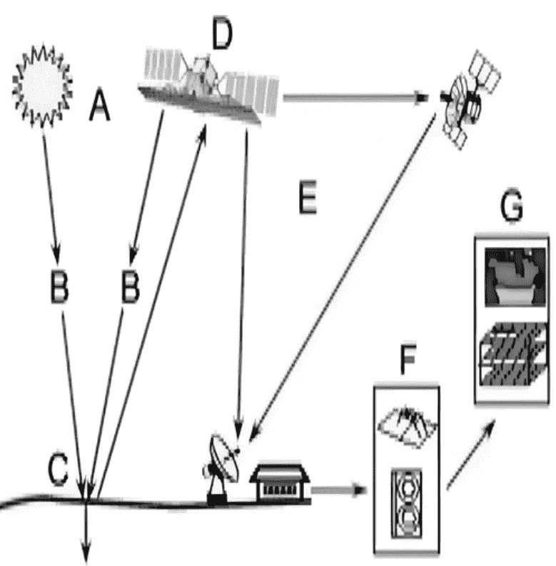

**图10.1 遥感过程**

Anderson提出了一种展示土地和地球资源利用情况的通用方法，附带颜色建议，并按照Anderson分类系统组织信息 [6]。用户可以使用遥感来捕捉、拍摄和分析地表上的物体和特征，遥感是研究获取某一区域物理特性的学科。每个人都知道，遥感可以在不直接接触目标的情况下收集关于特定地面物体的数据 [25, 26]。用于对土地利用进行分类，它需要应用遥感这一广泛的科学领域。

大数据和机器学习如今被誉为众多行业发展的推动力。这两种技术在数据科学家和其他专业人士中都日益受到欢迎。大数据是指巨大的、难以管理的结构化和非结构化数据量。另一方面，机器学习是人工智能的一个分支，它使计算机能够从过去的知识和数据中自主学习 [28, 29]。术语 _大数据_ 是指难以存储且典型数据库系统无法手动处理的海量或丰富数据 [7]。它由结构化数据和非结构化数据组成 [30]。通过使用统计数据，计算机得益于一种称为机器学习的新技术，可以自主学习。机器学习使用多种方法来构建数学模型，并根据先前获取的数据或信息预测结果。语音识别、推荐系统、电子邮件过滤、Facebook自动标记和图像识别只是其众多现代应用中的一些 [8]。

当时，NASA航天器正在执行该组织的持续项目，生成了约1.73 GB的观测数据。单个卫星数据中心每天正在收集许多TB的遥感数据，这是一个显著的增加。OGC统计数据表明，存储的观测数据总量可能会大于1EB。RS图像数据的高维度主要归因于高分辨率地球观测时间。遥感数据有时被称为大数据 [9]。与此同时，持续的全球地球观测所提供的精确和及时的数据正在改变人们对地球系统的理解。区域到全球尺度的多传感器、多时相遥感数据处理被用于大规模环境监测和研究。由于必须处理的遥感数据量巨大，大型遥感应用被公认为典型的数据密集型挑战 [10]。数据的大规模激增使得处理、分析和理解这些遥感大数据变得极其困难。高性能计算（HPC）范式已被大量整合到遥感应用中 [32, 33, 34, 35]。这些基于HPC的方法已成为处理海量遥感数据带来的巨大计算需求的最流行且有效的手段。与传统的计算密集型问题不同，可用的处理能力不再是限制因素 [36, 37, 38]。尽管拥有大量计算能力，但遥感应用中出现的数据密集型问题使得基于集群的HPC系统仍然很难使用 [11]。

遥感是一门利用技术从远处评估物体或表面特性的科学。遥感（RS）数据是来自空间和空中传感器以及围绕地球进行的某些额外数据采集测量的持续收集的数据 [39, 40, 41, 42]。数据量的指数级增长以及多样性和复杂性的不断提高，导致了遥感（RS）数据的“大数据”这一术语。最初的大部分努力集中在定义和讨论大数据领域，然而，由于它仍是一个相对较新的概念 [12]。大数据已彻底改变了问题的处理方式。它是一个庞大的数据集合，其中数据的量级和速率远超最先进的系统。在遥感和地球科学领域，也可以识别出RS大数据的真正含义。对于RS来说，大数据正如其名称所示，指的是数据的多样性和复杂性以及数据的数量和速度，这些超出了可存储和计算的范围 [13]。RS数据的巨大量级和速度、其多样性及复杂性（特别是日益增加的维度）是需要考察的RS大数据的一些特征和方面 [14]。

我们当前所处的当代时代是大数据时代。TB、PB甚至EB级别的地理数据已被收集或存储，包括遥感数据 [43, 44, 45]。美国国家海洋和大气管理局（NOAA）、美国地质调查局（USGS）、欧洲空间局（ESA）和美国国家航空航天局（NASA）提供了众多免费可访问的遥感数据集以及其他地理信息系统（GIS）数据，可用于LULC制图。目前，太空组织为LULC制图产生了大量地理位置信息。可以创建改进的LULC地图，以实现大数据时代在数据可用性和算法发展方面的进步。

### 10.2 相关工作

本节包括使用传统分类器和机器学习分类器对遥感图像进行分类的相关研究。

Parul Singh等人 [1] 提出了利用地理空间技术评估德里城市增长的方法。卫星数据已预处理，包括大气校正。为了生成广泛的城市地表覆盖类别，已使用最大似然分类器（MLC）和监督分类。根据2011年人口普查（印度人口普查，2011年），德里市人口约为1600万。截至2018年，居民人数预计接近2900万（世界城市发展前景，2018年）。该地区城市扩张的主要驱动因素之一是人口的增长。本研究使用了两组Landsat系列卫星影像来检测LULC变化。卫星影像从USGS网站（http://glovis.usgs.gov）下载用于时序分析（1992年、2019年）。主要步骤包括从USGS网站获取时序数据集（1992年和2019年）、图层叠加、研究区域提取以及大气校正，以提高影像分类精度。广泛的LULC类别已通过监督分类划定。利用280个交叉验证的随机点评估了两张分类影像的分类精度。对于1992年和2019年，分类精度分别为85%和88%。

Mahendra等作者 [2] 使用FPGA构建了一个支持向量机分类器，即Xilinx Vivado（2016）。使用Design Suite对Zynq-7 ZC702评估板进行评估。SVM HLS IP最初通过Vivado HLS工具生成，然后与Zynq SoC设计集成。在Xilinx SDK工具的综合、布局和布线操作之后，生成预期Zynq系统的比特流。该工具协助在Zynq的板载上运行应用程序以进行分类。测试使用了两个来自空机可见红外成像光谱仪（AVIRIS）的HSI数据集进行。利用Vivado HLS工具中可用的指令，对所提议的HLS IP设计进行优化。为了增强和优化综合结果，进行了多次采用不同优化指令的实验。该过程将有助于创建简单、低复杂度的硬件。AXI-Timer IP核用于加速在Zynq SoC的硬件实现的PL和PS上计划的SVM代码的处理时间。


parts. 硬件实现中PL和PS组件的处理时间在100 MHz工作频率下计算得出。软件实现的分类准确率为98.57%，而硬件实现的分类准确率为97.61%。

作者Mohamed [3]分析了使用Sentinel-2数据对北方地区LULC进行分类的机器学习方法的有效性。在景观尺度上发生的、直接影响生态系统过程的最显著的环境变化包括砍伐森林、农业产量增加和城市化。Sentinel-2多光谱仪（MSI）由两颗卫星组成，利用三种不同的空间分辨率来研究地球。与Xgboost、随机森林和深度学习相比，SVM产生的结果具有最高的总体准确率。SVM、Xgboost和RF在95%置信区间内的类别校正面积相当。与其他算法相比，深度学习高估了针叶林和开放土地，而低估了除水体外的所有其他类别。四种分析算法的总体准确率在0.733到0.758之间，相当。然而，McNemar检验表明，类别预测的准确率仅为62%。使用Z检验比较分类器准确率时，发现所提出的算法组合提供了更好的结果。

在研究[4]中，作者提出了一种方法，利用Google Earth Engine平台上的机器学习技术评估印度Rahuri流域LULC的变化。该研究的作者使用Landsat 5和Sentinel-2两颗卫星的影像，这些影像可用于观察地球表面特征。为识别LULC组分，使用卫星影像。该研究的作者开发了一种基于卫星数据的机器学习方法来理解LULC。作者使用随机森林模型制作了2010年、2015年和2020年的LULC图。总体而言，这三年的土地利用和土地覆盖结果高度准确，总体准确率为85.53%–94.34%。退化面积总体上从2015年的19.42%增加到2020年的26.79%。由于研究设施的建设，水体数量减少。在2010年、2015年和2020年，建设用地总面积分别扩大了34.96公顷、37.08公顷和42.58公顷。在2010年、2015年和2020年，观察到水体分别每年减少了0.96公顷和0.73公顷。

Ozlem Akar等人[5]提出了利用机载高光谱影像对LULC进行制图的机器学习算法研究。遥感最重要的应用之一是LULC制图。为了减少各种土地覆盖类型的光谱歧义，LULC制图需要光谱分辨率和空间分辨率。由于拥有大量光谱波段并能观察地面精细特征，机载高光谱影像是此类应用的最佳数据类型之一。研究了如何利用纹理信息，通过支持向量机（SVM）和随机森林（RF）等机器学习技术对高分辨率高光谱图像进行分类。RF分类方法用于对使用DWT方法降维的影像进行分类，从而产生土壤类的最高用户准确率92.86%，该方法还用于对使用因子法降维的影像进行分类，从而产生土壤类的最高生产者准确率93.75%。对于生成的植被类，用户准确率为86.13%，生产者准确率为92.19%。

研究[6]展示了一种新型学习技术，用于使卷积神经网络（CNN）能够识别LULC中的模式并提取特征以分解社会经济方面。作者开发了一个基础CNN模型来识别LULC，并提取描述人类行为范围的特征。输入特征框架总共包含99个通道，其中1个来自DNB/VIIRS，6个来自Landsat 8 OLI的波段2–7，1个来自DEM。作为训练标签，从GLC30中检索了中心像素的LULC类型。识别出的建设用地面积占总面积的20.78%，高于标注地图的13.63%，但与参考地图的20.85%相当。检测到的农业用地面积占整个区域的26.10%，低于标注地图的32.45%，但与参考地图的23.80%相同。

Vivekananda等人[7]采用了定量变化检测分析方法。使用变化检测方法时，每张卫星影像都被分配一个类别。获得的数据被分类为卫星信息和辅助信息。该数据用于创建研究区域LULC的特定主题地图并评估时间变化。结果评估和验证采用了辅助数据。使用Landsat 8 OLI-热红外传感器（TIRS）数据集、路径143和行51来生成2018年卫星影像。使用不同时期的Landsat影像对研究区域的土地覆盖分类进行了检查和识别。本研究采用了一种称为最大似然分类器（MLC）的监督分类方法。三个类别（水体、开发地形和森林）的用户准确率均大于80%。荒地和农业用地的用户准确率分别为68.25%和77.77%。

Andrea等人[8]使用简单非迭代聚类（SNIC）算法和灰度共生矩阵（GLCM）方法的组合，对面向对象分类进行了测试。随机森林（RF）和支持向量机（SVM）等机器学习技术被结合在一起。为执行面向对象分类、更改不同参数（例如选择输入波段和分类算法、测试各种分割规模）并将其与基于像素的方法进行比较，所提方法在用户友好的开源Google Earth Engine代码中实现。在意大利中部特拉西梅诺湖附近154 km²研究区域中，使用了Landsat 8数据来仔细评估所提方法。在研究区域的各种数据集上进行的各种实验产生了有趣的结果。

Jamali等人[9]开发了一种使用机器学习分类器来研究伊朗设拉子土地利用和土地覆盖制图的技术。需要注意的是，气候变化引发的最近干旱导致人们从农村地区向城市地区迁移。尽管如此，伊朗的人口增长导致城市化率上升。本研究使用了两种著名的机器学习模型，即复杂树（CTree）和支持向量机（SVM），来绘制土地覆盖图。建立了三个独立的场景，使用空间分辨率为30 m和15 m的Landsat 8影像，以研究数据预处理对最终预期LULC地图的影响。DNN分类器在使用15 m空间分辨率的Landsat 8时，优于其他监督面向对象分类器，卡帕指数和总体准确率分别为88.57%和91.28%。

为估算孟加拉国的LULC变化，Abdulla-al Kafy等人[10]开展了遥感方法研究。使用Landsat热带波段和SVM技术计算了1999年、2009年和2019年的LULC和LST变迁趋势。使用2019年模拟和估算的LULC和LST数据来评估人工神经网络（ANN）和元胞自动机（CA）模型。累计卡帕值0.82表明CA模型准确。ANN模型的验证使用相关系数（R）和均方误差值。就夏季和冬季而言，这些数值——分别为0.523和0.796，以及0.6023和0.831——提供了积极结果。

为绘制LULC类别图，Singh等人[11]提出了一项利用机器学习技术对Landsat影像进行分类的研究。为印度各邦制作了LULC地图，总面积为3,287,469 km²。该图涵盖整个印度国家，使用遥感数据制作，并采用机器学习方法处理2005年、2006年、2007年和2016年的Landsat影像。四年间的准确率在80%至86%之间，属于可接受的水平。获得了卡帕统计量，即K（帽），表明具有可接受的高精度。

Schulz等人[12]使用Sentinel-1和-2卫星数据，对尼日尔萨赫勒地区的土地利用制图进行了研究。一位作者将制作尼日尔首都尼亚美的精确高分辨率土地利用图。作者分析了三种著名土地利用分类器的有效性：支持向量机（SVM）、最大似然（ML）和随机森林（RF）。为充分利用每个分类器的优势，他们开发了一个分类器集成（CE）地图。与研究区域当前的全球地表覆盖产品相比，集成地图总体上被确定更为准确（72.9%），尤其是在人口稠密地区。

Zaabar [13]介绍了一项案例研究，利用基于对象的图像处理在阿尔及利亚阿因特穆什滕地区绘制LULC类别图。本研究使用了Sentinel-2和Pleiades影像，并应用了深度学习


模型被称为一种先进的卷积神经网络（CNN）。CNN架构参数被用于优化模型以进行进一步处理。随机森林和支持向量机也被评估为用于比较的机器学习方法。所提方法显著优于现有机器学习方法，使用Pleiades影像获得了高达93.5%的总体精度。

Mahendra 等人 [14] 开展了一项关于遥感应用中多个分类器性能分析的研究。由于地表的复杂性以及选择合适的分类技术，将遥感数据分类到特定地图上长期以来一直是一项具有挑战性的任务，但这也是当代遥感的目标之一。为了对印度卡纳塔克邦乌杜皮区的多光谱数据进行分类，本研究采用了多种分类器，包括SVM、MLC、马氏距离和最小距离分类器。从Landsat 3卫星获取了分辨率为3980 × 3201像素的数据。结果表明，与其他分类器相比，SVM可产生95.35%的精度和0.9408的kappa值，使其成为分类遥感数据的一个合适选择。

## TABLE 10.1 几种分类器的比较评估

| Dataset | Study area | Classification method | Results/accuracy |
|---|---|---|---|
| Landsat 系列, [1] | 印度德里 | 最大似然分类器 | 1992年和2019年分别为85%和89%。 |
| HSI [2] | 印度卡纳塔克邦迈索尔 | 支持向量机 | 硬件和软件实现分别为97.61%和98.57% |
| Sentinel-2 [3] | 北方森林 | SVM、RF、深度学习、Xgboost | 分别为75.8%、73.3%、73.9%和75.1% |
| Landsat-5, Sentinel-2 [4] | 印度拉胡里 | GEE算法 | 85.53–94.94% |
| Headwall Hyperspec VNIR [5] | 贝加马-伊兹米尔 | 随机森林 | 92.19% |
| Landsat 8, Sentinel-2, PlanetScope [8] | 意大利特拉西梅诺湖 | 随机森林, 支持向量机 | 91.09% 和 95.65% |
| Landsat 8 [9] | 伊朗设拉子市 | 支持向量机, 复杂树 (CTree) | Kappa指数值分别为91.28%和88.57%。 |
| Landsat [10] | 孟加拉国吉大港 | 支持向量机 | 83.1% |
| Sentinel-2 [13] | 阿尔及利亚阿恩特穆尚特 | 卷积神经网络 (CNN) | 93.5% |
| Landsat 3 [14] | 印度卡纳塔克邦乌杜皮 | 最大似然, 最小距离, 马氏距离, 支持向量机 | 与其他分类器相比, SVM的精度为95.35% |

Wu 等人 [15] 提交了一项关于使用深度学习和面向对象技术进行高分辨率制图的研究。LULC是地理学研究的重要领域。深度学习（DL）带来的LULC制图的主要问题如下：大历史数据（BHD）（如矢量数据）在DL中利用率不足，大规模遥感制图（LSRSM）研究不多，基于DL的遥感数据分类经常缺乏针对地面要素的充分几何限制。通常，使用室内视觉解译来为DL标注训练和测试样本，而不是实地调查。长江流域一个县的测试结果显示，总体精度为90.20%，而结构识别的精度为75.60%。

为了作物类型制图，Hutt 等人 [16] 提出了使用FOSS和开放数据，将Sentinel-1与允许的地形和地籍地理数据相结合。绘制更精确的作物类型图对于作为多种应用的输入数据至关重要。这将改善规划，并促进更可持续的资源利用。遥感是提供这些数据的最佳方式。使用了Sentinel-1卫星多时相微波遥感影像。高分辨率、高精度的数字高程模型（DEM）支持了预处理。在分类之前，它被用于划定农业区域边界，并创建包含每年变化但通常不出现在官方地理数据中的作物类型的LULC图。利用包含11个不同作物组的独立验证数据集进行验证，显示总体精度为96.7%。

Basheer 等人 [17] 提出了一项绘制LULC类别的研究。准确分类LULC对于可持续资源管理和理解气候变化如何改变景观至关重要。为了创建2017–2021年的LULC图，使用了带有支持向量机（SVM）、随机森林/随机树（RF/RT）和最大似然（ML）分类器的ArcGIS工具。ArcGIS Pro中的SVM分别显示Sentinel、Landsat和Planet的精度为89%、91%和94%。Google Earth Engine中的SVM显示类似结果，Landsat 8和Sentinel 2的精度分别为87%和92%。

Christos 等人 [19] 在对希腊克里特岛的研究中，调查了使用变化向量分析（CVA）检测LULC变化时多种光谱指数的影响。本研究的主要目标是评估多种光谱指数对CVA在过去二十年内识别克里特岛LULC变化能力的影响。利用1999年、2009年和2019年的Landsat卫星影像，对这些指数进行了评估。所得结果与通过对相应插图进行监督分类而生成的精确全面的土地覆盖可视化进行了对比。根据所考虑的两个时期的结果，五个指数组合在总体精度和kappa指数方面表现良好。

Kelsey 等人 [20] 在Google Earth Engine平台上，利用密集堆叠的Landsat影像，开发了一种识别下叶尼塞河LULC变化的方法。该研究使用了覆盖1985年至2017年32年期间的Landsat厚堆栈，引用了1,641幅影像来考察北极中西伯利亚下叶尼塞河流域的LULC变化。随机森林分类为下叶尼塞研究区提供了土地覆盖图，涵盖了1985年至2017年32年期间的11个不同的3年间隔。生成的11张分类图的精度评估产生的kappa计算值范围从90.83%到98.5%。

Stromann 等人 [21] 开发了一种使用Google Earth Engine进行Sentinel-1和Sentinel-2时间序列基于对象的土地覆盖分类技术。该项工作的作者利用了Google Earth Engine和Google Cloud Platform的处理能力来生成过量特征集。一旦确定了每个特征的重要性，就会考虑降维技术对支持向量机基于对象的土地覆盖分类的影响。研究结果表明，最突出的特征，特别是Sentinel-2 NDVI、NDWI和Sentinel-1 VV的时间均值，增强了区分多种城市土地覆盖和土地利用类型的能力。在斯德哥尔摩和北京，分类总体精度分别为94%和93%。

Mahendra 等人 [27] 建议使用深度卷积神经网络来评估2009年至2019年迈索尔市的植被覆盖。作者执行了LULC图像分类，以评估迈索尔市的LULC类别和植被覆盖。本作品中植被覆盖及其他LULC类别的评估结果将有助于开展城市内的建设活动。提出了一种基于卷积神经网络（CNN）的多轮训练（CNN-MTR）深度学习模型，用于对遥感采集的影像进行分类。对分类结果进行了检查，以确定城市植被覆盖在10年期间的变化情况。据估计，2019年迈索尔市公司覆盖的植被面积预计为39.09%，而2009年为43.32%。这些结果表明，迈索尔市的植被覆盖在过去10年中下降了3.43%。据估计，所提CNN-MTR模型的总体分类精度在2009年为95.20%，2019年为94.17%。

本工作中用于遥感图像分类的各种分类器的比较分析如表10.2所示。

## TABLE 10.2 图像分类技术

| Methods | Examples | Characteristics |
|---|---|---|
| 方法 | 示例 | 特征 |
| 监督 | 平行六面体分类、最小距离和最大似然 | 使用统计分析来分类每个像素，分析师选择训练站点以将其归类为类别 |
| 非监督 | K-means 和 ISODATA | 没有可用的事先背景知识。基于指定的统计标准，光谱相似的像素被分组在一起 |
| 参数 | 非监督分类和最大似然分类 | 假设：必须首先了解类密度的正态数据分布公式 |
| 非参数 | 神经网络、支持向量机、最近邻分类和模糊分类 | 未做任何假设 |
| 非度量 | 基于规则的决策树分类 | 可用于对具有实数值的数据以及具有名义量表的数据进行统计分析 |
| 硬（参数） | 非监督和监督分类 | 使用离散组进行分类 |
| 每像素 | | 图像逐像素分类 |
| 面向对象 | | 图像被转换为等边资源。每个对象和像素都进行了分类 |
| 混合方法 | | 包含专家系统和人工智能 |


### 10.3 遥感中的大数据

从远处发现物体或地表特征的方法称为遥感（RS）。RS数据是通过轨道上的传感器、空中的传感器以及各种其他数据收集方法持续收集的地球测量数据。大数据是数据集的庞大集合，其体量和速率已达到远超最强大技术突破的水平，改变了问题的解决方式。由于大数据可能重新定义什么是RS大数据，因此遥感和地球科学也受到影响。需要管理的RS大数据的一些属性和特征包括其巨大的体量和速率、多样性和复杂性，尤其是其不断增长的维度 [31]。

由于传感器和地球观测方法的最新发展，我们目前正处于高分辨率观测时期（EOS-4）的初期，如图10.2所示。目前，来自200多颗在轨卫星传感器的多个仪器正在收集多空间、多时相RS数据。这些持续的全球测量可以涵盖地球大气层、地表和海洋 [24]。

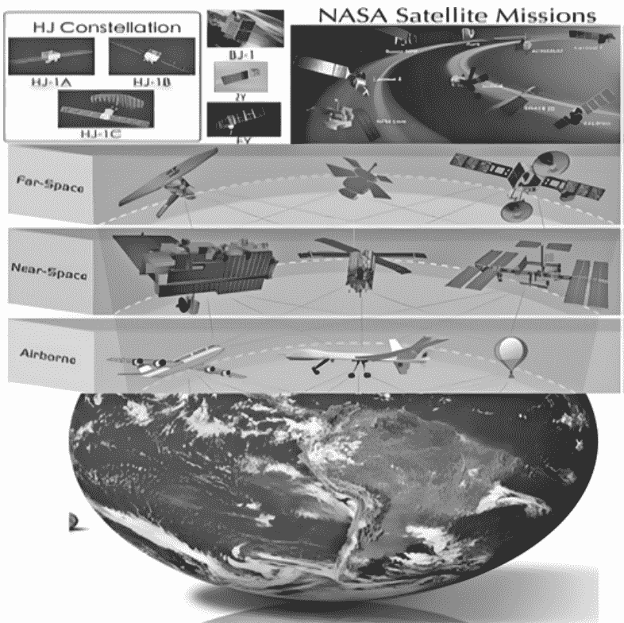

**图 10.2 地球观测航天器网络**

### 10.4 图像分类

分类过程用于识别地球表面的不同特征，因为它们各自具有不同的辐射特性和光谱反射率。图像中的每个像素或遥感卫星的原始数据都通过图像分类过程进行分类，并分配给LULC类别之一。图像分类程序包括以下内容：

- 1. 设计图像的分类程序：这些通常是城市、农业和森林区域等信息类别。这些类别通过实地调查收集研究区域的地面数据、辅助数据和其他信息。
- 2. 图像预处理包括图像增强、原始图像聚类以及辐射、大气、几何和地形调整。
- 3. 使用图像的代表性区域开发训练签名或分析初始聚类的结果。
- 4. 运行图像分类算法。
- 5. 后处理中完成几何校正、滤波和分类装饰。
- 6. 将分类结果与实地研究进行比较以进行精度评估。

### 10.5 图像分类技术

使用各种已建立的分类技术创建土地覆盖图是常见做法。硬分类和软（模糊）分类；逐像素、亚像素和前场学习；以及参数、非参数和非度量分类都是类别底层逻辑的一部分，如表10.2所示。

### 10.6 研究区域

本研究使用乌杜皮地区的多光谱遥感数据。点之间的空间是收集的信息。研究区域的纬度和经度为13° 96'N 74° 43'E/13° 97'N 75°21'E，如图10.3所示。获取数据的大小包括3980 × 3201像素的空间。研究区域结合了各种类别的多种土地覆盖类型。

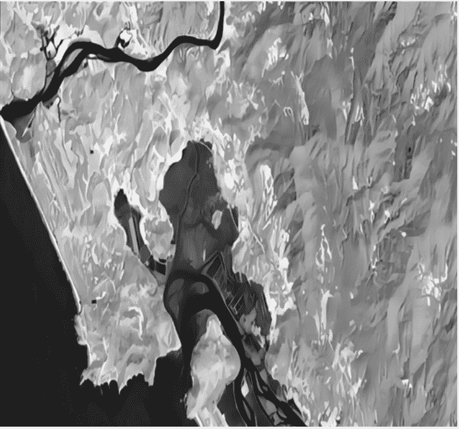

**图 10.3 研究区域**

### 10.7 结果

使用总体精度和Kappa值评估机器学习分类器在遥感图像分类中的性能。已考虑九个类别——山脉、荒地、浅海水、河水、植被、深海水、淹没土地、农田和盐水库——以衡量各种分类器的准确性。表10.3列出了每个类别被分配的颜色。

| 类别 | 分配颜色 |
|---|---|
| 深海水 | 蓝色 |
| 河水 | 黑色 |
| 山脉 | 绿色 |
| 浅海水 | 海蓝绿色 |
| 淹没土地 | 栗色 |
| 荒地 | 黄色 |
| 轻度植被 | 海洋绿色 |
| 盐水库 | 梅红色 |
| 农田 | 珊瑚色 |

为了确定结果，必须对任何分类过程的准确性进行定量评估。RS数据分析中的精度是指分类正确性的程度。分类中的误差是指注意到的主题地图中描绘的现实世界场景之间的差异。作为精度评估的一部分，将地图上的一个区域与同一区域的参考数据（实地真值）进行比较。假设参考统计数据是准确的。参考数据也称为测试数据和验证数据。如果不评估分类图像的准确性以确定算法的工作情况，则不能认为图像分类已完成。

总体分类精度（OCA）和从误差矩阵生成的Kappa统计量是两种最常用的传统精度指标。精度研究还考虑每个类别的正确性，即通过结合生产者精度和用户精度来确定。此外，还对类别和图层进行统计研究。统计研究会考虑均值和标准差。正在分类的信息来自乌杜皮地区周边的区域。分类后，会生成一个误差矩阵，提供有关分类结果的信息。

由于定性（视觉）分析无法确定具有最高分类精度的图像，因此必须进行精度评估。使用图像处理程序ERDAS IMAGINE v9.1 RS评估精度。分类精度评估使用分类数据图像上的若干点（验证点），为每组数据生成总体分类精度和Kappa统计量。当RS数据中用于精度评估的验证点数量发生变化时，总体分类精度和Kappa值都会发生变化。表10.4显示了各种分类算法的通常OCA和Kappa统计量值。

| 序号 | 分类器 | 总体精度（%） | Kappa值 |
|---|---|---|---|
| 1 | 支持向量机 | 95.35 | 0.9408 |
| 2 | 随机森林 | 93.53 | 0.9108 |
| 3 | 神经网络 | 92.45 | 0.9045 |
| 4 | 最大似然 | 91.78 | 0.8188 |
| 5 | 马哈拉诺比斯距离 | 87.19 | 0.8542 |
| 6 | 最小距离 | 88.43 | 0.7805 |

研究区域使用最大似然、马哈拉诺比斯距离、最小距离、神经网络、随机森林和支持向量机分类器的分类图像分别如图10.4、图10.5、图10.6、图10.7和图10.8所示。

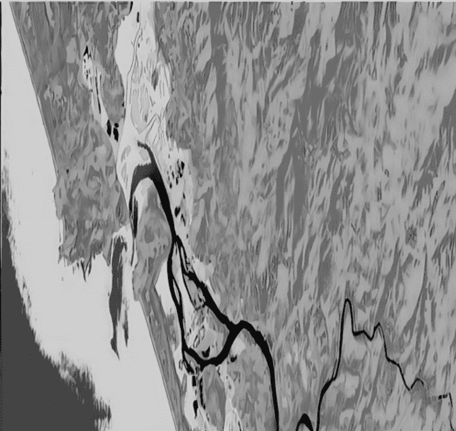

**图 10.4 马哈拉诺比斯距离分类器分类图像**

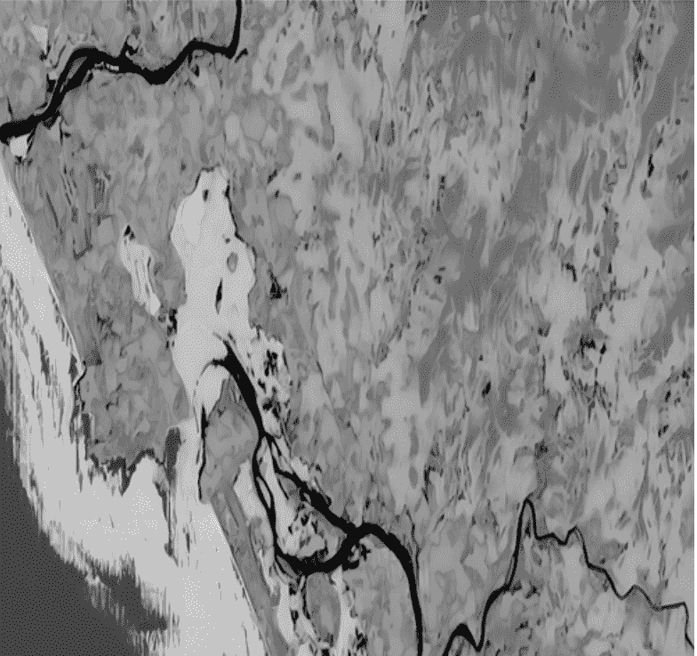

**图 10.5 最小距离分类器分类图像**

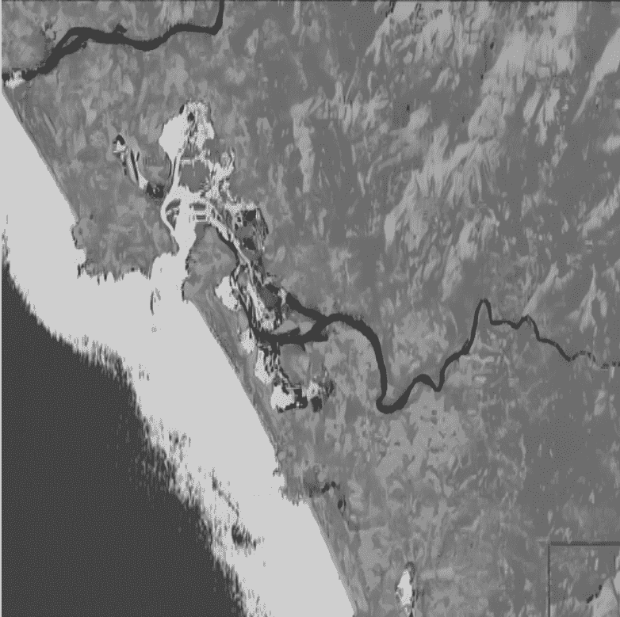

**图 10.6 神经网络分类器分类图像**


**图 10.7 随机森林分类器分类图像**


**图 10.8 支持向量机分类器分类图像**

### 10.8 结论

本文介绍了遥感图像分类中各种机器学习分类器的研究。研究的分类器包括最大似然、马哈拉诺比斯距离、最小距离、神经网络、随机森林和支持向量机分类器。分类器性能根据总体精度和Kappa值进行评估。文献中介绍了使用这些分类器进行遥感图像分类的各项工作。已确定研究区域，并使用研究区域的多光谱遥感数据进行分类。


使用每个分类器进行分类，并进行性能分析。分类器性能表明，支持向量机为研究区遥感图像提供了最高精度95.35%，而马氏距离提供了最低精度87.19%。这些结果有助于为未来任何研究区选择合适的分类器进行遥感图像分类，以在LULC类别方面获得更好的评估结果。

## 参考文献

- 1. Singh, Parul. “基于地空间技术的德里城市增长评估.” Journal of Geomatics 4(2020): 171–177.
- 2. Mahendra, H. N., and S. Malikarjunaswamy. “基于支持向量机的高光谱遥感数据高效分类.” INTL Journal of Electronics and Telecommunications 68.3 (2022): 609–617.
- 3. Mohamed Abdi, Abdulhakim. “基于Sentinel-2数据在北方景观中机器学习算法的土地利用/土地覆盖分类性能.” GIScience & Remote Sensing 57.1 (2019): 1–20.
- 4. Pande, Chaintanya B. “利用Google Earth Engine和机器学习方法在印度拉胡里流域（MS）进行土地利用/土地覆盖及变化检测制图.” Geocarto International 37.26 (2022): 13860–13880.
- 5. Akar, Ozlem, and Esra Tunc Gormus. “基于机器学习算法和上下文信息的机载高光谱图像土地利用/土地覆盖制图.” Geocarto International 37.14 (2022): 3963–3990.
- 6. Yao, Jingtao. “基于卷积神经网络的土地利用/土地覆盖识别及社会经济数据细分.” Geocarto International 35.10 (2020): 1109–1123.
- 7. Vivekananda, G. N. “用于LULC分类和变化检测的多时相影像分析.” European Journal of Remote Sensing 54.S2 (2021): 189–199.
- 8. Tassi, Andrea, and Macro Vizzari. “在Google Earth Engine中结合SNIC、GLCM和机器学习算法的面向对象LULC分类.” MDPI, 2020.
- 9. Jamali, Ali. “使用高级机器学习分类器进行土地利用土地覆盖制图：伊朗设拉子市案例研究.” Earth Science informatics 4(2020): 1015–1030.
- 10. Abdulal – Al-Kafy. “使用机器学习算法在孟加拉国快速增长的特大城市中模拟土地利用/土地覆盖及季节性地表温度变化的遥感方法.” Remote Sensing Applications: Society and Environment 21 (2021): 100463.
- 11. Singh, Ram Kumar. “基于机器学习的LANDSAT图像分类以绘制印度土地利用和土地覆盖图.” Remote Sensing Applications: Society and Environment (2021). https://doi.org/10.1016/j.rsase.2021.100624.
- 12. Schulz, Dario. “在尼日尔萨赫勒地区异质景观中使用Sentinel-1和Sentinel-2时间序列进行土地利用制图.” ISPRS Journal of Photogrammetry and Remote Sensing (2021). https://doi.org/10.1016/j.isprsjprs.2021.06.005.
- 13. Zaabar, Narimane. “基于对象图像分析的卷积神经网络在沿海地区土地覆盖和土地利用制图中的应用：阿尔及利亚艾因特穆尚特案例研究.” IEEE Journal of Selected Topics in Applied Earth Observations and Remote Sensing 15(2022): 5177–5189.
- 14. Mahendra, H. N., and S. Mallikarjunasamy. “遥感应用中不同分类器的性能分析.” International Journal of Engineering and Advanced Technology (IJEAT) Vol. 9, pp.2249-8958 (October, 2019).
- 15. Wu, Yijin. “基于面向对象和深度学习的大型遥感影像高分辨率制图.” Canadian Journal of Remote Sensing 47(3) (2021): 396–412.
- 16. Hutt, Christoph. “使用FOSS和开放数据，将Sentinel-1与官方地形和地籍地理数据融合，用于作物类型丰富的LULC制图.” International Journal of Geo-Information 9.2 (2020): 120.
- 17. Basheer, Sana, et al. “使用不同卫星影像和机器学习技术比较土地利用土地覆盖分类器.” MDPI, 2022. https://doi.org/10.3390/rs14194978.
- 18. Tassi, Andrea, and Macro Vizzari. “在Google Earth Engine中结合SNIC、GLCM和机器学习算法的面向对象LULC分类.” Remote Sensing, MDPI, 2020. http://dx.doi.org/10.3390/rs12223776.
- 19. Polykretis, Christos, et al. “探索基于变化向量分析的各种光谱指数对土地覆盖变化检测的影响：希腊克里特岛案例研究.” Remote Sensing, MDPI, 2020. http://dx.doi.org/10.3390/rs12020319.
- 20. Nyland, Kelsey E., et al. “在Google Earth Engine中使用密集堆叠的Landsat影像研究下叶尼塞河流域土地覆盖变化.” Remote Sensing, MDPI, 2018.
- 21. Stromann, Oliver, et al. “基于Google Earth Engine的Sentinel-1和Sentinel-2时间序列面向对象土地覆盖分类的降维与特征选择.” Remote Sensing, MDPI, 2019. http://dx.doi.org/10.3390/rs12010076.
- 22. Ghorbanian, Arsalan, et al. “使用Google Earth Engine中的Sentinel影像和基于迁移训练样本的新型自动工作流改进伊朗土地覆盖图.” International Society for Photogrammetry and Remote Sensing, Inc. (ISPRS). Published by Elsevier, 2020. https://doi.org/10.1016/j.isprsjprs.2020.07.013.
- 23. Alshari, Eman A., and Bharti W. Gawali. “使用遥感和GIS开发LULC分类系统.” Global Transition Proceedings, Elsevier, 2021. https://doi.org/10.1016/j.glgtp.2021.01.002.
- 24. Ma, Yan, et al. “遥感大数据计算：挑战与机遇.” Future Generation Computer Systems, Elsevier, 2014. http://dx.doi.org/10.1016/j.future.2014.10.029.
- 25. Yin, Jiadi, et al. “整合遥感和地空间大数据用于城市土地利用制图：一篇综述.” International Journal of Applied Earth Observations and Geoinformation. Elsevier, 2021. https://doi.org/10.1016/j.jag.2021.102514.
- 26. Pan, Bin, et al. “MugNet：使用有限样本的高光谱图像分类深度学习.” International Society for Photogrammetry and Remote Sensing, Inc. (ISPRS). Published by Elsevier, 2017.
- 27. Mahendra, H. N., S. Mallikarjunaswamy, and S. R. Subramoniam. “使用深度卷积网络评估印度卡纳塔克邦迈索尔市植被覆盖.” Environmental Monitoring and Assessment 195 (2023): 526. https://doi.org/10.1007/s10661-023-11140-w.
- 28. Sardar, T. H., and A. R. Faizabadi. “在对称多处理器上使用OpenMP和Pluto对选定数值算法进行并行化和分析.” Data Technologies and Applications 53.1 (2019): 202. https://doi.org/10.1108/DTA-05-2018-0040.
- 29. Mahendra, H. N., and S. Mallikarjunaswamy. “使用监督分类器对遥感数据土地利用土地覆盖区域变化检测的分析.” International Journal of Environmental Technology and Management 26, No. 6 (2023): 498–511.
- 30. Mahendra, H. N., S. Mallikarjunaswamy, and Sudalayandi Rama Subramoniam. “使用地空间技术评估建成区覆盖——印度卡纳塔克邦迈索尔地区案例研究.” International Journal of Environmental Technology and Management (2023). http://dx.doi.org/10.1504/IJETM.2022.10048734.
- 31. Sardar, T. H., and Z. Ansari. “使用基于MapReduce的模糊C-Medoids进行分布式大数据聚类.” Journal of The Institution of Engineers (India): Series B 103 (2022): 73–82. https://doi.org/10.1007/s40031-021-00647-w.
- 32. Sardar, T. H., and Z. Ansari. “用于分布式文档聚类的基于MapReduce的模糊C-Means算法.” Journal of The Institution of Engineers (India): Series B 103 (2022): 131–142. https://doi.org/10.1007/s40031-021-00651-0.
- 33. Manikiran, G., et al. “电子商务服装评论分析与模型构建.” Proceedings of Second International Conference on Advances in Computer Engineering and Communication Systems: ICAECS 2021. Singapore: Springer Nature Singapore, 2022.
- 34. Sardar, T. H., and Z. Ansari. “使用基于MapReduce的K-Means算法分析分布式文档聚类.” Journal of The Institution of Engineers (India): Series B 101 (2020): 641–650. https://doi.org/10.1007/s40031-020-00485-2.
- 35. Ansari, Z., A. Afzal, and T. H. Sardar. “使用基于Hadoop MapReduce的并行K-Means聚类进行数据分类.” Journal of The Institution of Engineers (India): Series B 100 (2019): 95–103. https://doi.org/10.1007/s40031-019-00388-x.
- 36. Mahendra, H. N., S. Mallikarjunaswamy, C. B. Nooli, M. Hrishikesh, N. Kruthik, and H. M. Vakkalanka. “基于云的集中式智能购物车和非接触式计费系统.” In 2022 7th International Conference on Communication and Electronics Systems (ICCES) (pp. 820–826), 2022, June.
- 37. Mahendra, H. N., S. Mallikarjunaswamy, N. M. Basavaraju, P. M. Poojary, P. S. Gowda, M. Mukunda, ... V. Pushpalatha. “使用卫星图像进行农作物清查和产量生产的深度学习模型.” In 2022 IEEE 2nd Mysore Sub Section International Conference (MysuruCon) (pp. 1–7), 2022, October.
- 38. Mahendra, H. N., S. Mallikarjunaswamy, D. M. Kumar, S. Kumari, S. Kashyap, S. Fulwani, and A. Chatterjee. “使用ARIMA模型评估和预测空气质量水平：印度古吉拉特邦苏拉特市案例研究.” Nature Environment & Pollution Technology 22.1 (2023): 199–210.
- 39. Mahendra, H. N., S. Mallikarjunaswamy, G. K. Siddesh, M. Komala, and N. Sharmila. “遥感数据实时载机处理与分类的发展.”


《印度科学与技术杂志》13.20 (2020): 2010–2020.

- **40.** Pushpalatha, V., K. B. Sudeepa, and H. N. Mahendra. “基于遗传算法应用的伪随机数生成。” 收录于人工智能与数据工程国际会议（第 793–808 页）。新加坡：Springer Nature Singapore，2019 年 5 月。

- **41.** Mallikarjunaswamy, S., N. Sharmila, D. Maheshkumar, M. Komala, and H. N. Mahendra. “岛式微型电网能源管理的有效混合模型实现。”《印度科学与技术杂志》13.27 (2020): 2733–2746.

- **42.** Subbarao, Ennamuri, et al. “利用机器学习调查城市地区和都市社区的太阳能。”《电力元件与系统》1.11 (2023): 1–11.

- **43.** Sardar, Tanvir Habib, and Ahmed Rimaz Faizabadi. “在对称多处理机上使用 OpenMP 和 Pluto 对所选数值算法进行并行化与分析。”《数据技术与应用》53.1 (2019): 20–32.

- **44.** Sardar, Tanvir Habib, Zahid Ansari, and Amina Khatun. “使用并行 K-means 评估文档聚类中 Hadoop 集群效率。” 2017 年 IEEE 电路与系统国际会议 (ICCS)。IEEE，2017 年。

- **45.** Sardar, Tanvir Habib, Ahmed Rimaz Faizabadi, and Zahid Ansari. “基于 Hadoop 框架的 MapReduce 范式数据处理分析。”《新兴管理与技术研究国际期刊》3.2 (2018): 200–209.

## 11 基于机器学习的输电塔组件分割

Satheeswari Damodaran, Leninisha Shanmugam, K. Parkavi, Nirmala Venkatachalam, and N.M. Jothi Swaroopan

DOI: 10.1201/9781003465775-11

### 11.1 引言

电力传输线路覆盖长距离，以向消费者输送电力负载。架空输电线路 (OPL) 常在全世界范围内分布。架空输电线路导体没有绝缘，必须由电杆或塔支撑，以防止电流流入大地（即，导体必须与支撑物充分绝缘）。绝缘子是一种非导电装置，用于支撑和保护电气导体，使其免受大地或其他导体的影响。UAV 拍摄的图像背景复杂，无论是机器人还是人工操作都难以完成，且这是一个关键且耗时的过程。像绝缘子这样带有噪声背景的 OPL 图像需要进行准确的识别和分割。OPL 组件受损可能导致环境灾难。因此，架空输电线路检查一直是若干科学研究的主题，包括直升机检查和爬行机器人检查，但除了专门处理航空检查的简要技术综述外，尚未发表涵盖所有可能方法的全面综述。关键性地评估解决方案并识别需要高效解决的问题是所执行的任务之一。在操作过程中，机器人使用安装在操纵器末端的视觉传感器来捕获架空输电线路的近距离图像。目前，无人机通过航空摄影用于检测架空输电线路。为了实现输电线路自动检查，本章开发了一种配备先进嵌入式处理器和双目视觉传感器的无人机。作为第一步，我们提出了一种端到端卷积神经网络 (CNN)，它从多级特征中提取互补信息，并检测具有不同像素宽度和方向的电力线，以实现电力线的自主 3D 感知 [1]。研究 [2] 描述了如何使用智能控制算法检测全局环境、识别局部障碍物，并实现电力线检查 (PLI) 机器人的自平衡。本章介绍了当前研究问题及未来发展方向的综述。在复杂环境中，检查期间的架空线路检测可能会很困难。

### 11.2 相关工作

根据作者 [3]，图像处理可用于在复杂气候条件下远程检查电气绝缘子表面。水、冰和雪覆盖了绝缘子，使得可以使用记录的图像进行实验。为了检测绝缘子图像上的雪、冰和水滴，应用了最小距离最近邻分类器。

研究 [4] 描述了如何使用 ED-Net 编码器-解码器架构分析航空图像，以智能且准确地识别绝缘子。在编码器路径中，提出了初始模块和 CA 瓶颈，用于从图像中提取特征并生成更精细的特征图。通过使用全局平均池化来保持最大感受野。为了对编码器路径生成的特征图进行边界优化，解码器路径包括边界优化模块和不对称卷积模块。该模块通过在解码器路径中结合高层特征和低层特征来弥合两者之间的差距，如本章所示。

研究 [5] 的目的是展示，由于小型绝缘子缺陷导致的图像特征较弱，传统手工制作的特征无法从航空图像中提取强大的图像特征。使用尖端的深度学习和迁移学习模型，提出了一种新算法，用于从航空图像中识别电力绝缘子的缺帽缺陷。结合空间金字塔池化 (SPP) 和 MobileNet 网络，提出了一种轻量深度卷积神经网络 (DCNN) 模型，以更快、更准确地定位绝缘子并消除复杂背景干扰。本章还讨论了各种分割技术及其在基于对象的图像分析 (OBIA) 中的适用性，并概述了当前的 OBIA 技术。讨论了这些技术的概念细节以及优缺点。此外，总结了可用于分割的软件包和工具。将通用图像对象匹配到有意义的地理对象是图像分割的主要挑战。多项最新研究表明，分割算法在精度、自动化和计算效率方面正在不断改进 [6]。

对这些检查图像进行分析，以提取这些绝缘子的特征区域，并根据其灰度和颜色特征生成候选框。为了定位和识别绝缘子，将图像输入支持向量机 (SVM) 分类器。平均而言，分类器的精度和召回率超过 90%。根据这项研究，可以利用绝缘子的形态来判断其帽是否缺失。该方法可以基于 UAV 图像数据实时准确地定位绝缘子 [7]。

[8] 中提出了一种方法，用于检测玻璃和瓷质绝缘子中缺失的绝缘子帽，因为缺失绝缘子帽的现象普遍存在。为了生成候选框，首先根据灰度和颜色特征从检查图像中提取相似的特征区域。为了识别和定位绝缘子，这些框捕获的图像被输入 SVM 分类器。在 [8] 中开发了一种精度、召回率和平均精度均大于 90% 的分类器。

[9] 提出了一种实时航空电力线检查系统，旨在检测和分析绝缘子、分路器、阻尼器配重和电力线中的潜在缺陷。一架遥控无人机捕获实时视频，并使用深度学习框架和 Jetson TX2 嵌入式平台实时检测和定位这些组件。本章介绍了用于分析已检测组件的新型缺陷检测算法。它随后证明，所提议的检测和定位系统在高杂乱环境中工作良好，并且所提议的缺陷分析器在精度和召回率方面优于类似研究中的其他模型。

使用所提议的系统，可以通过自动缺陷分析系统减少人工检查时间。基于这些参数，[10] 的作者建议小麦种子最好由模糊聚类随机森林 (FCRF) 模型进行分类。

此外，在种子分类和受损种子分离中，所开发的方法通过农业分级政策保持种子质量。DLXGB 被用于分类乳腺癌病理学图像，作为改善乳腺癌分类的一种手段 [11]。

在 [12] 中，Gabor 滤波器被证明是检测架空电缆暴露区域的合适方法。

随后提出了一种谱聚类方法，以基于子块与坐标之间的相关性来确定暴露区域的位置和纹理频率。使用边缘检测，可以精确提取纹理细节。暴露区域的提取和定位是通过形态滤波和外接矩形最小化来执行的。借助 Gabor 滤波器和形态操作，作者在 RGB 图像中隔离了输电网络导体 [13]。

为了确定 UAV 的位置，系统集成了输电线路建造参数和光学几何。有一种使用光斑在不同背景纹理的数字图像中检测电力线绝缘子的技术。为了识别绝缘子，在分析的图像上读取连续激光点之间的像素强度剖面。导入光斑图像，检测光斑，然后根据为每对光斑计算的图像剖面对模式进行分类 [14]。

根据所提议的算法 [15]，使用数字图像中的颜色强度剖面，所提议的方法基于颜色强度剖面对数字图像进行分类。随后使用连接各点的线条绘制颜色强度剖面。这些剖面在使用周期图或 Welch 方法进行变换后，将使用决策


树、随机森林或 XGBoost 算法。研究人员在研究中描述了计算实验、结果以及未来研究的潜在方向。根据 F1 分数（0.99），本章所示最佳情景下所提方案效率较高。

从复合绝缘子的红外图像中创建等大小的温度数据矩阵。此外，特征提取网络使用特征提取网络对红外图像和温度数据矩阵进行编码。在解码过程中融合特征提取网络的输出时，融合特征图通过上采样逐渐恢复到其原始输入大小。根据实验结果，所提模型的平均交并比为 74.09%，准确率为 84.33% [16]。

这促使开发出一种区分绝缘子正常状态和缺陷状态的 SVM 模型。采用 SVM 和粒子群优化，该方法最大程度实现结构最小化。我们使用基于双层级联形态改进的种子区域增长来分割空中绝缘子图像，然后提取 HOG 和 GLCM 特征作为样本。最后，我们开发了一种改进的 PSO-SVM 分类器来识别绝缘子状态。将各种算法（包括 SVM、随机森林和 CNN）与 PSO-SVM 进行了比较，同时还比较了一种优化算法——灰狼优化支持向量机。根据实验结果，该算法性能令人满意 [17]。

该研究还提出了一种高压输电线路自动鸟巢检测系统 [18]。

从包含相关数据的提取特征图生成单发多框检测器（SSD），在定位鸟巢方面显著提高了准确率、精确率、召回率和 F1 分数。本章提出了一种初步研究方法 [19]。

采用带实例分割卷积神经网络的无人机（UAV）能够利用基于模板匹配的新技术区分鸟巢和输电塔。提出了一种两阶段方法，用于改进 3D 地层钻性的空间建模。在第一阶段，基于地层特征使用模糊 c 均值聚类技术识别地层模式。在第二阶段，为每种地层模式分别创建随机森林模型。模型输入为地面坐标 X、Y 和深度坐标，模型输出为地层钻性。利用这三个空间 3D 地层模型，生成完整钻性字段的空间 3D 地层模型 [20, 21, 22]。

本研究提出了一种基于 K-means 聚类、Gabor 滤波器和移动网格的 2D 图像分割算法。网格在梯度较高的区域自适应集中，且位置特征用于聚类过程。图像特征值通过图像与 Gabor 滤波器之间的卷积运算获得。该方法的优势在于能够不断添加新特征（如位置、像素或 Gabor 滤波器）以改进分割结果。结果表明，这些算法可以快速分割和破解医学图像且不牺牲质量 [23, 24, 25]。

YOLO v7 模型已得到增强 [26, 27] 以改进检测结果。使用 K-means++ 对绝缘子数据集的目标框进行聚类，以便生成更合适的锚框来检测绝缘子缺陷。随后，将 HorBlock 和坐标注意力模块添加到网络中。通过削弱通道和空间域中的无效特征，网络可以增强特征提取过程中的有效特征。为了加速模型收敛并解决正负样本不平衡问题，使用了 SIoU 和 focal loss 损失函数。非最大抑制（NMS）方法也得到了改进，以减少缺陷目标的误删除和误检，从而提高模型的整体性能。基于这些实验，发现该模型比 faster R-CNN 模型精确率高 7.6%，比 YOLOv7 模型精确率高 3.7%，比 YOLOv5s 模型精确率高 4%。在复杂背景条件下，使用所提 YOLOv7 模型可以高精度地检测小目标。

本工作的主要目标是通过使用略作修改的基于区域的生长主动轮廓模型定量分析牙齿生长，以填补这一空白。该调查的数据来自涉及牙髓坏死的未成熟恒牙牙内再生的回顾性 X 光片。随后，通过连续应用图像增强技术（如数学形态学中的膨胀和腐蚀）来突出外部像素。最后，实验结果为多项标准（包括牙本质壁厚、根尖直径和根长）提供了校准值。测量和可视化样本结果证明了所提算法的有效性 [28, 29, 30]。

作者首先从 Canny 边缘检测开始，然后进展到用于形态重建的 Otsu 阈值处理，最后构建 RsurgeNet 模型。这种灵活的模型用于电力线识别的二分类和特征提取。Hough 变换用于从复杂背景中提取语义电力线 [31, 32, 33]。

我们的工作受多种因素影响，包括噪声、遮挡、光照条件变化和阴影。从复杂背景拍摄的图像中提取目标可能具有挑战性，尤其是在使用无人机（UAV）图像时。然而，有多种可用技术，总体方法如下：

- 最初对 UAV 图像进行预处理。
- 其次，将 Gabor 滤波器组应用于 UAV 图像，因为它们包含所需信息，其像素值可用于从图像中提取特征。
- 最后，采用 RF [10]、SVM [17] 和 XGBoost [11] 分类算法来计算准确率并预测图像中的分割类别。

本章剩余部分组织如下。第 11.3 节涵盖研究技术的所有方面，第 11.4 节讨论实验分析。最后，第 11.5 节讨论结论和未来研究。

### 11.3 研究方法

以下是总体流程。最初，对 UAV 图像进行预处理。然后，使用 Gabor 滤波器组从 UAV 图像中提取特征，因为它们包含所需信息和像素值。最后，使用 RF、SVM 和 XGBoost 分类算法来计算准确率并预测图像中的分割类别。图 11.1 说明了研究方法的结构。

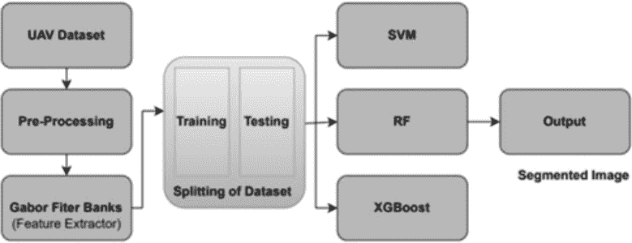

图 11.1 所提研究方法的示意图

#### 11.3.1 数据集编制

VOC 数据集中 OPL 无人机的图像已公开可用。UAV 图像的分辨率为 2144 × 1424。原始 OPL 图像已调整大小为 512 × 512，其中包含绝缘子。调整大小后的图像已针对一个类别（绝缘子）进行手动标注。图 11.2 显示原始图像。

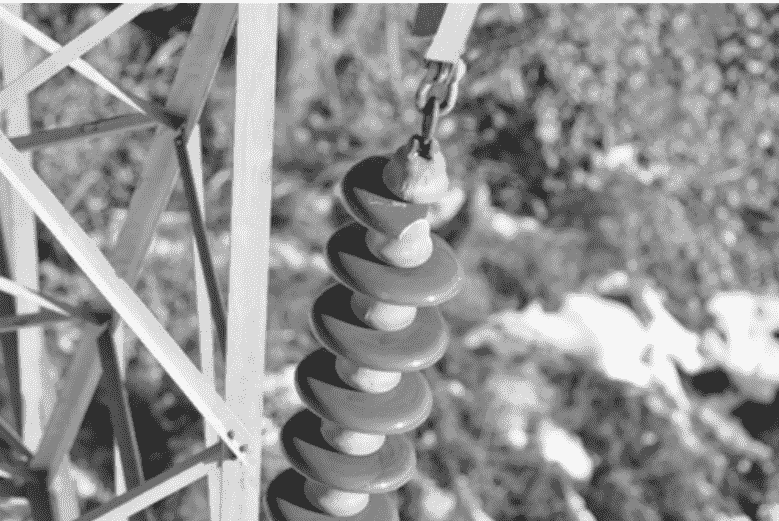

图 11.2 原始 UAV 图像

#### 11.3.2 预处理

图像预处理是在模型训练前对 UAV_OPL 图像进行格式化的过程。此过程包括颜色校正、调整大小和方向。图像预处理加快了模型训练和推理速度。由于输入图像尤其大，它会缩小图像并显著缩短模型训练时间，而不会影响模型性能，从而消除了原始图像中的错误。

#### 11.3.3 使用 Gabor 滤波器生成特征

使用 Gabor 滤波器提取特征有多种方法。Gabor 滤波器是一种图像处理滤波器，用于检测边缘、分类纹理、提取特征和估计视差。带通滤波器允许一个频带中的频率通过，同时衰减另一个频带中的频率。Gabor 滤波器是一种带平面波调制的高斯滤波器。Gabor 滤波器组用于特征分类。各种 Gabor 滤波器核的实部用于从 OPL 图像中滤波特征。然后基于滤波图像的均值和方差生成基于最小平方误差的分类。将多个参数不同的 Gabor 滤波器组合在一起，构成一个 Gabor 滤波器组。必须修改 lambda、theta、sigma、pi 和 gamma 参数来定义 Gabor 滤波器。当更改 Gabor 参数时，图像可用于提取各种低级特征。方程 (1) 和 (2) 如下描述卷积核：

```
G(x, y; \lambda, \theta, \Psi, \sigma, \gamma) = \exp \left( - \frac{x'^2 + \gamma^2 y'^2}{2\sigma^2} \right) \exp \left( i \left( 2\pi \frac{x'}{\lambda} + \psi \right) \right)
```

```
R(x, y; \lambda, \theta, \Psi, \sigma, \gamma) = \sum_{x'} \sum_{y'} I(x - x', y - y') g(x', y'; \lambda, \theta, \psi, \sigma)
```

其中
x' = xcos\Theta + ysin\Theta
Y' = -xsin\Theta + ycos\Theta
= 平面波的波长


θ = 过滤平行条纹方向
Σ = 高斯分量标准差
γ = 分量椭圆性纵横比
φ = 平面波的相位

Gabor 滤波器可以通过使用响应矩阵的实部或虚部作为特征向量来生成特征。由于它包含相关边缘，相位可被视为特征向量。此外，响应矩阵的幅度可与频谱一起作为特征向量使用。若相同方向的波长响应相加，则可计算出特征向量。它本质上代表一个方向上的局部能量。

#### 11.3.4 Canny 边缘检测

Canny 边缘检测器通常以灰度图像作为输入，并输出指示强度不连续处（边缘）位置的图像。通过使用高斯卷积，Canny 边缘检测器对输入图像进行平滑并去除噪声。为了突出高一阶空间导数的区域，对平滑后的图像应用一阶导数算子。通过计算梯度的 x 和 y 导数，算法可以确定梯度的方向和幅度。然后应用非极大值抑制，将不在脊顶上的像素设为零，若存在不在脊顶上的像素，则形成细线。接着检查正负梯度方向上的相邻点是否与前一步具有相同的梯度，以确保前一步计算出的梯度为最大值。若梯度最大，则视为边缘的一部分，反之亦然。上述跟踪过程由两个阈值 t1 和 t2 控制，且 t1 > t2，这种现象称为滞后阈值。跟踪从高于 t1 的脊顶点开始，并向两个方向进行，直到脊高小于 t2。因此，基本上需要选择所有大于上阈值 t1 的边缘点，然后搜索这些点的邻域，找出小于上阈值 t1 但大于下阈值 t2 的点。在这种情况下，这些邻域将构成边缘的一部分。因此，跟踪器的 t1（上阈值）和 t2（下阈值）相同，用于平滑输入图像的高斯核宽度也相同。未来，基于阈值的 Gabor 滤波器将从含有绝缘子的 UAV_OPL 图像中提取边缘。

#### 11.3.5 Roberts 边缘检测

使用该算子可以快速且轻松地测量图像上的二维空间梯度。因此，经常与边缘重合的空间梯度区域会以这种方式突出显示。算子通常使用灰度图像进行输入和输出数据。输出图像中每个位置的像素值表示输入图像中空间梯度的估计绝对幅度。

#### 11.3.6 Sobel 算子

Sobel 算子使用一种二维导数掩码来检测 UAV_OPL 图像的边缘。掩码的使用方式如下：垂直掩码将使用 numpy 数组创建。垂直掩码将用于创建水平掩码。然后将掩码作为参数传递给 Sobel 边缘检测函数，从而允许我们使用任何掩码。接着使用高斯模糊函数对数据进行平滑处理。最后，图像和垂直滤波器通过 Sobel 边缘检测函数。随后使用水平掩码应用卷积。只需沿水平轴翻转掩码即可转置掩码。稍后，垂直边缘和水平边缘将结合起来，从 UAV 图像的像素值中提取特征。

#### 11.3.7 Prewitt 算子

Prewitt 算子沿 x 轴和 y 轴水平和垂直检测 UAV_OPL 图像的边缘。当像素强度突然变化时，掩码检测边缘。边缘可基于微分来计算，因为它表示像素强度的变化。Prewitt 掩码是带有一阶导数的掩码。作为 Prewitt 结果的图形表示，边缘由局部极大值或极小值表示。一阶和二阶导数掩码具有以下三个特性：权重越高，边缘检测效果越好。对于掩码，使用反向符号（+ 和 -）。当掩码值相加时，必须得到正和。因此，Prewitt 算子提供两个掩码：一个用于水平检测边缘，另一个用于垂直检测边缘。

X 轴 Prewitt 算子: [-1 0 1; -1 0 1; -1 0 1]
Y 轴 Prewitt 算子: [-1 -1 -1; 0 0 0; 1 1 1]

#### 11.3.8 SCHARR 算子

SCHARR 算子也可用于查找 OPL 图像的水平和垂直二阶导数。该方法的语法如下：
Scharr (src, dst, ddepth, dx, dy) (source, destination, depth, x, y)

- 该方法接受以下参数：
- Src – 由 Mat 对象表示的源（输入）图像
- dst – 表示最终（输出）图像的 Mat 对象
- depth – 表示图像深度的整数变量（-1）
- dx – 表示 x 导数的整数变量（0 或 1）
- dy – 表示 y 导数的整数变量（0 或 1）

#### 11.3.9 机器学习算法 (MLAs)

机器学习是当前最令人兴奋的技术之一。它赋予计算机学习的能力，使其更具人性化。Gabor 滤波器通过使用响应矩阵的实部或虚部作为特征向量来生成特征。相位可被视为特征向量，因为它包含相关边缘。除频谱外，响应矩阵的幅度也可用作特征向量。通过添加相同方向的波长响应，可计算出特征向量。它本质上代表单向局部能量。这里，使用 SVM、RF 和 XGBoost 算法来分类和预测目标图像。

#### 11.3.9.1 随机森林分类器

与手动（基于专家）决策规则定义相反，随机森林 (RF) 使用自学习决策树。由于这种“自学习”过程，每个节点根据训练数据集的输入和标签设置自己的规则。基于一组输入特征和训练点，确定最优分割的一种方法是最小化两个子集之间的异质性（即混合程度）。基尼不纯度是决策树学习中异质性的一种度量，源自信息理论中的熵概念。然后对数据的每个潜在分割计算基尼不纯度索引，以确定每个节点的最佳分割，并选择异质性最小的分割。RF 中的“随机”一词指的是学习过程的两个主要随机层：首先，RF 使用原始训练数据集的自助样本（即有放回的随机样本）来生长每个单独的决策树。因此，树的训练集（在很大程度上）是不同的。这乍看可能奇怪，但它显著降低了树之间的相关性并大幅提高了预测泛化能力。第二个随机组件是在每个节点随机选择要考虑的特征（例如频带）。因此，确定了绝缘体各种特征的分割，使树的构建更容易。许多树可能对同一绝缘体数据点产生不同的类标签。RF 中的所有树都会投票，以确定每个 UAV 图像像素的最终类别分配。

#### 11.3.9.2 支持向量机

可以使用 SVM（监督学习算法）来对图像进行分类和预测。基本上，SVM 的设计目的是通过使用超平面在训练数据中尽可能分离类别。通过找到与最近类别数据点距离最大的超平面来确定最大边距。一旦确定了绝缘体特征的超平面，就可以根据新数据落在哪一侧对其进行分类。当数据包含大量特征或具有明显的分离边距时，使用 SVM 特别有益。SVM 分类器会自动分离绝缘体。可线性分离的数据与它们配合效果很好。可线性分离的数据集是指可以在图上绘制并基于直线进行分类的数据集。

#### 11.3.9.3 极梯度提升

XGBoost 将机器学习应用于结构化和表格数据，最近已成为 Kaggle 最主导的算法之一。使用 XGBoost，可以快速实现梯度增强决策树


，且高效。XGBoost依赖于梯度提升。分类、回归和聚类问题均可通过梯度提升来解决。当模型进行预测时，它会对其进行优化。这种技术的目的是将不同模型归类在一起以实现相同的目标。基础模型被称为弱学习器。使用此模型，他们假设弱学习器单独工作时会做出糟糕的预测，但当它们组合在一起时能产生最佳预测。XGBoost从弱学习器中开发出强学习器。在添加模型时遵循逻辑顺序。通过后续模型，弱模型的错误得到纠正，从而得到最优解。这里涉及的过程是集成。使用XGBoost执行程序速度更快。模型性能已得到改进。模型中的错误数量已减少。使用数据集中的可用数据，我们将训练并构建模型。为了预测目标类别，该方法使用梯度提升方法在UAV数据集上进行训练。

### 11.4 实验分析

如前所述，考虑了与绝缘体目标类别相对应的UAV图像。在本工作中，目标是预测目标类别。该工作使用Python和GPU进程实现。为此，UAV图像是公开可用的[26]。从RGB图像生成灰度图像。图像大小为2144 × 1424，并调整大小为512 × 512。创建一个数据帧，并将Gabor滤波器生成的像素值作为特征添加到此数据帧中。Gabor滤波器应用于预处理的数据集，并提取特征。标记的Gabor特征被训练到数据帧中。Gabor核是参数的函数，核大小为5，sigma为8，gamma为0.4，phi为0.1。计算得到的theta和lambda参数在方程(3)和(4)中给出。参数变化导致特征数量增加。表11.1提供了Gabor滤波器调谐参数的概述。目的是更改数值，从输入图像生成各种响应，并将它们添加到pandas数据帧中。图像中的像素值有助于识别图像中的各种区域。一旦核生成，它就应用于原始图像，然后我们得到滤波图像，并将其带有Gabor标签添加到数据帧中。初始列包含Gabor滤波特征，而其他列是通过结合Canny边缘检测器、Roberts、Sobel、Scharr和Prewitt方法的特征生成的；如表11.2所示。绝缘体类别是因变量，也称为标记图像，而自变量是训练图像。

### 表11.1 Gabor滤波器调谐参数

| Gabor | theta | sigma | lambda | gamma |
|---|---|---|---|---|
| Gabor 1 | theta = 0 | sigma = 1 | lambda = 0 | gamma = 0.05 |
| Gabor 2 | theta = 0 | sigma = 1 | lambda = 0 | gamma = 0.5 |
| Gabor 3 | theta = 0 | sigma = 1 | lambda = 0.7853981633974483 | gamma = 0.05 |
| Gabor 4 | theta = 0 | sigma = 1 | lambda = 0.7853981633974483 | gamma = 0.5 |
| Gabor 5 | theta = 0 | sigma = 1 | lambda = 0.7853981633974483 | gamma = 0.05 |
| Gabor 6 | theta = 0 | sigma = 1 | lambda = 0.7853981633974483 | gamma = 0.5 |
| Gabor 7 | theta = 0 | sigma = 1 | lambda = 0.7853981633974483 | gamma = 0.05 |
| Gabor 8 | theta = 0 | sigma = 1 | lambda = 0.7853981633974483 | gamma = 0.5 |
| Gabor 9 | theta = 0 | sigma = 3 | lambda = 0 | gamma = 0.05 |
| Gabor 10 | theta = 0 | sigma = 3 | lambda = 0 | gamma = 0.5 |
| Gabor 11 | theta = 0 | sigma = 3 | lambda = 0.7853981633974483 | gamma = 0.05 |
| Gabor 12 | theta = 0 | sigma = 3 | lambda = 0.7853981633974483 | gamma = 0.5 |
| Gabor 13 | theta = 0 | sigma = 3 | lambda = 0.7853981633974483 | gamma = 0.05 |
| Gabor 14 | theta = 0 | sigma = 3 | lambda = 0.7853981633974483 | gamma = 0.5 |
| Gabor 15 | theta = 0 | sigma = 3 | lambda = 0.7853981633974483 | gamma = 0.05 |
| Gabor 16 | theta = 0 | sigma = 3 | lambda = 0.7853981633974483 | gamma = 0.5 |
| Gabor 17 | theta = 0.7853981633974483 | sigma = 1 | lambda = 0 | gamma = 0.05 |
| Gabor 18 | theta = 0.7853981633974483 | sigma = 1 | lambda = 0 | gamma = 0.5 |
| Gabor 19 | theta = 0.7853981633974483 | sigma = 1 | lambda = 0.7853981633974483 | gamma = 0.05 |
| Gabor 20 | theta = 0.7853981633974483 | sigma = 1 | lambda = 0.7853981633974483 | gamma = 0.5 |
| Gabor 21 | theta = 0.7853981633974483 | sigma = 1 | lambda = 0.7853981633974483 | gamma = 0.05 |
| Gabor 22 | theta = 0.7853981633974483 | sigma = 1 | lambda = 0.7853981633974483 | gamma = 0.5 |
| Gabor 23 | theta = 0.7853981633974483 | sigma = 1 | lambda = 0.7853981633974483 | gamma = 0.05 |
| Gabor 24 | theta = 0.7853981633974483 | sigma = 1 | lambda = 0.7853981633974483 | gamma = 0.5 |
| Gabor 25 | theta = 0.7853981633974483 | sigma = 3 | lambda = 0 | gamma = 0.05 |
| Gabor 26 | theta = 0.7853981633974483 | sigma = 3 | lambda = 0 | gamma = 0.5 |
| Gabor 27 | theta = 0.7853981633974483 | sigma = 3 | lambda = 0.7853981633974483 | gamma = 0.05 |
| Gabor 28 | theta = 0.7853981633974483 | sigma = 3 | lambda = 0.7853981633974483 | gamma = 0.5 |
| Gabor 29 | theta = 0.7853981633974483 | sigma = 3 | lambda = 0.7853981633974483 | gamma = 0.05 |
| Gabor 30 | theta = 0.7853981633974483 | sigma = 3 | lambda = 0.7853981633974483 | gamma = 0.5 |

### 表11.2 按列列出的数据帧中Gabor及其他添加滤波器的像素值

| | 原始图像 | Gabor 1 | Gabor 2 | Gabor 3 | Gabor 4 | Gabor 5 | Gabor 6 | Gabor 7 |
| :--- | :--- | :--- | :--- | :--- | :--- | :--- | :--- | :--- |
| 0 | 62 | 0 | 0 | 255 | 205 | 137 | 66 | 56 |
| 1 | 60 | 0 | 0 | 255 | 210 | 131 | 68 | 53 |
| 2 | 90 | 0 | 0 | 255 | 255 | 138 | 73 | 56 |
| 3 | 76 | 0 | 0 | 255 | 242 | 137 | 78 | 56 |
| 4 | 116 | 0 | 0 | 255 | 255 | 144 | 83 | 58 |

| | Gabor 8 | Gabor 9 | Gabor 10-31 | Gabor 32 | Canny边缘 | Roberts | Sobel | Scharr |
| :--- | :--- | :--- | :--- | :--- | :--- | :--- | :--- | :--- |
| 0 | 27 | 0 | 0 | 43 | 0 | 0.031617 | 0.02369 | 0.2411 |
| 1 | 27 | 0 | 0 | 54 | 0 | 0.106172 | 0.71803 | 0.0736 |
| 2 | 30 | 0 | 0 | 47 | 0 | 0.066146 | 0.0368 | 0.0387 |
| 3 | 32 | 0 | 0 | 40 | 255 | 0.129975 | 0.05792 | 0.0596 |
| 4 | 34 | 0 | 0 | 33 | 0 | 0.061068 | 0.70765 | 0.0808 |

| | Prewitt | 高斯s3 | 高斯s7 | 中值s3 | 标签 | | | |
| :--- | :--- | :--- | :--- | :--- | :--- | :--- | :--- | :--- |
| 0 | 0.023182 | 71 | 68 | 62 | 29 | | | |
| 1 | 0.069447 | 72 | 68 | 65 | 29 | | | |
| 2 | 0.03425 | 73 | 68 | 76 | 29 | | | |
| 3 | 0.058722 | 75 | 69 | 89 | 29 | | | |
| 4 | 0.070739 | 77 | 69 | 84 | 29 | | | |

```
theta = 1*np.pi/4

lambda = 1*np.pi/4
```

现在数据帧除标记特征外丢弃一切。一旦从原始图像和提取的特征值创建了标记图像，它们就用于训练RF、SVM和XGBoost等分类算法。数据集按60:40分割以评估准确性并预测分割图像。现在这些模型成为训练好的模型，并使用测试数据集进行验证。图像使用Pickle保存，最后，图像作为输出进行分割。其他添加滤波器的数据帧中的像素值如表11.2所示。从数据帧获得的特征列表（按像素值降序排列）如表11.3所示，该表说明了所有Gabor滤波器从高特征值到低特征值的特征列表。表11.4显示了拟议方法在不同UAV图像角度下的成功率。对所有算法进行分析以评估拟议方法的性能，并对所有算法进行比较。

### 表11.3 数据帧及其他添加滤波器的特征列表

| 特征 | 数值 | 特征 | 数值 |
|---|---|---|---|
| 高斯s7 | 0.079555 | Gabor 29 | 0.042201 |
| Prewitt | 0.065709 | Gabor 6 | 0.040651 |
| Roberts | 0.065412 | Gabor 7 | 0.040185 |
| 高斯s3 | 0.061757 | Gabor 5 | 0.039644 |
| Sobel | 0.061236 | Gabor 30 | 0.039202 |
| 中值s3 | 0.060647 | Gabor 8 | 0.032883 |
| Scharr | 0.060214 | Gabor 23 | 0.031514 |
| 原始图像 | 0.059362 | Gabor 4 | 0.008368 |
| Gabor 24 | 0.049558 | Canny边缘 | 0.006927 |
| Gabor 31 | 0.048212 | Gabor 22 | 0.006296 |
| Gabor 32 | 0.045736 | Gabor 12 | 0.004556 |
| Gabor 21 | 0.045497 | | |

### 表11.4 现有方法与拟议方法的比较表

| 方法 | 算法 | 准确率 | 时间 |
|---|---|---|---|
| 检测（现有方法）[26] | 改进的Yolo v7 | 93.8 | 95秒 |
| 分割（拟议方法） | XGBoost | 95.12 | 2秒 |
| 分割（拟议方法） | RF | 83.77 | 5秒 |
| 分割（拟议方法） | SVM | 78.47 | 15秒 |

使用faster R-CNN的现有方法ROI的平均准确率为82.15%。采用多种算法的拟议方法，SVM的准确率为78.47%，RF的准确率为83.77%，XGBoost的准确率为95.12%。在比较检测速度时，SVM比XGBoost多花13秒来分割图像，RF比XGBoost多花10秒。随后，比较了三种机器学习算法，即RF、SVM和XGBoost。发现的结果如图11.3所示。图11.3a描绘了SVM的分割输出，图11.3b显示了SVM的分割输出，图11.3c显示了XGBoost的分割输出。当


对比各种算法，XGBoost 对分段类别的预测准确率更高。另外，在使用真值图像进行评估时，XGBoost 算法表现良好。机器学习算法的对比图如图 11.4 所示。


**图 11.3** (a) SVM、(b) RF 和 (c) XGBoost 的分段输出

| 机器学习算法 | 准确率 |
|---|---|
| SVM | 78.47 |
| RF | 83.77 |
| XGBoost | 95.12 |
| 现有模型 | 93.8 |

**图 11.4** 机器学习算法对比图

### 11.5 结论

本文提出了一种利用 Gabor 滤波器组和 MLA 分割 OPL 组件的方法。本章旨在通过 Gabor 滤波器组提取特征。该方法适用于光照角度不同的模糊无人机图像。Gabor 滤波器与 SVM、RF 和 XGBoost 联合使用。根据表格结果，XGBoost 在图像预测中达到 95.12% 的高准确率，处理时间为 2 秒。未来，将使用 3D 或视频监控图像，结合实例分割技术进行图像分割。

## 参考文献

- 1. Xu, C., Li, Q., et al. “基于电力线引导的自动输电线路巡检系统”, IEEE Transactions on Instrumentation and Measurement (2022), 71, 1–18, 3512118. https://doi.org/10.1109/TIM.2022.3169555.
- 2. Chen, B., Feng, Y., et al. “应用于电力线巡检机器人的智能控制算法研究综述”, IEEE 第 11 届数据驱动控制与学习系统会议 (DDCLS), 成都, 中国 (2022), 917–922. https://doi.org/10.1109/DDCLS55054.2022.9858524.
- 3. Pernbayeva, D., James, A., et al. “使用 Gabor 图像特征检测瓷绝缘子上的活线积雪和冰覆盖”, IET 国际输配电网络韧性会议, 伯明翰 (2017), 1–3. https://doi.org/10.1049/cp.2017.0340.
- 4. Cui, Z., Yang, C., et al. “基于多尺度特征融合复杂度的航空图像绝缘子语义分割” (2022), 1. https://doi.org/10.1155/2022/2468431.
- 5. Yang, L., Fan, J., et al. “用于电力巡检的航空图像电力绝缘体光缺陷检测算法”, Neural Computing & Application (2022), 34, 17951–17961. https://doi.org/10.1007/s00521-022-07437-5.
- 6. Hossain, M. D., and Chen, D. “基于遥感视角的对象基础图像分析 (OBIA) 分割：算法与挑战综述”, ISPRS Journal of Photogrammetry and Remote Sensing (2019), 150, 115–134. https://doi.org/10.1016/j.isprsjprs.2019.02.009.
- 7. Sadykova, D., Pernbayeva, D., et al. “IN-YOLO：使用无人机成像实时检测户外高压绝缘子”, IEEE Transactions on Power Delivery (2020), 35(3), 1599–1601. https://doi.org/10.1109/TPWRD.2019.2944741.
- 8. Zhang, Z., Chen, H., et al. “基于机器学习和形态学检测的缺失绝缘子盖检测”, Sensors (2023), 23, 1557. https://doi.org/10.3390/s23031557.
- 9. Siddiqui, Z. A., and Park, U. “基于深度学习技术的无人机输电线路组件检测系统”, *Energies* (2020), 13, 3348. https://doi.org/10.3390/en13133348.
- 10. Kang, B., and Nguyen, T. Q. “用于语义分割的带有学习表示的随机森林”, *IEEE Transactions on Image Processing* (2019), 28(7), 3542–3555. https://doi.org/10.1109/TIP.2019.2905081.
- 11. Liew, X. Y., Hameed, N., et al. “基于 XgBoost 的乳腺癌分类算法调查”, *Machine Learning with Applications* (2021), 6, 100154. https://doi.org/10.1016/j.mlwa.2021.100154.
- 12. Xin, S., Wenchang, L., et al. “基于 Gabor 滤波器的架空电缆暴露区域图像检测方法”, 第 14 届 IEEE 电子测量与仪器国际会议 (ICEMI) (2019), 425–433. https://doi.org/10.1109/ICEMI46757.2019.9101513.
- 13. Menéndez, O., Pérez, M., et al. “架空输电线路上航空维护平台的视觉定位”, *Applied Sciences* (2019), 9(1), 165. https://doi.org/10.3390/app9010165.
- 14. Tomaszewski, M., Michalski, P., et al. “使用激光斑点在数字图像中检测电力线绝缘子”, *IET Image Processing* (2019), 13(12), 2358–2366. https://doi.org/10.1049/iet-ipr.2018.6284.
- 15. Tomaszewski, M., Gasz, R., et al. “基于变换颜色强度剖面的数字图像中电力线绝缘子检测”, *Sensors* (2023), 23, 3343. https://doi.org/10.3390/s23063343.
- 16. Wang, R., Wang, X., et al. “基于特征融合的复合绝缘子红外图像分割研究”, IEEE 第 10 届联合国际信息技术与人工智能会议 (ITAIC), 重庆, 中国 (2022), 745–749. https://doi.org/10.1109/ITAIC54216.2022.9836952.
- 17. Song, L., Liang, Q., et al. “基于改进粒子群算法优化 SVM 以进行绝缘子状态识别的新方法”, *Sensors* (2023), 23, 272. https://doi.org/10.3390/s23010272.
- 18. Satheeswari, D., Shanmugam, L., et al. “使用 SSD 在高压输电线路中识别鸟巢”, 2022 第一届国际电气、电子、信息和通信技术会议, IEEE, 2022, 01–07. https://doi.org/10.1109/ICEeICT53079.2022.9768651.
- 19. Satheeswari, D., Shanmugam, L., et al. “基于 Mask R-CNN 的无人机图像架空输电线路目标检测”, 图像处理与胶囊网络国际会议. ICIPN 2022. 网络与系统讲义, Springer (2022), 514. https://doi.org/10.1007/978-3-031-12413-6_50.
- 20. Gan, C., Cao, W.-H., et al. “使用模糊 C-均值聚类和随机森林的 3D 钻孔可钻性场新空间建模方法”, *Journal of Petroleum Science and Engineering* (2021), 200, 108371. https://doi.org/10.1016/j.petrol.2021.108371.
- 21. Sardar, T. H., and Ansari, Z. “使用基于 MapReduce 的模糊 C- medoids 进行分布式大数据聚类”, *Journal of The Institution of Engineers (India): Series B* (2022), 103, 73–82. https://doi.org/10.1007/s40031-021-00647-W.
- 22. Sardar, T. H., and Ansari, Z. “用于分布式文档聚类的基于 MapReduce 的模糊 C-均值算法”, Journal of The Institution of Engineers (India): Series B (2022), 103, 131–142. https://doi.org/10.1007/s40031-021-00651-0.
- 23. Shi, H., and Lee, W.-L. “使用 K-均值聚类、Gabor 滤波器和移动网格方法进行图像分割”, The Imaging Science Journal (2021), 69(5–8), 407–416. https://doi.org/10.1080/13682199.2022.2161159.
- 24. Sardar, T. H., and Ansari, Z. “使用基于 MapReduce 的 K-均值算法分布式文档聚类分析”, Journal of The Institution of Engineers (India): Series B (2020), 101, 641–650. https://doi.org/10.1007/s40031-020-00485-2.
- 25. Ansari, Z., Afzal, A., et al. “使用 Hadoop MapReduce 基于并行 K-均值聚类的数据分类”, Journal of The Institution of Engineers (India): Series B (2019), 100, 95–103. https://doi.org/10.1007/s40031-019-00388-x.
- 26. Zheng, Jianfeng, et al. “基于改进 YOLOv7 的绝缘体缺陷检测算法”, Sensors (2022), 22(22), 8801. https://doi.org/10.3390/s22228801.
- 27. Subbarao, Ennamuri, et al. “使用机器学习调查城市地区和都市社区的太阳能”, Electric Power Components and Systems (2023), 1–11.
- 28. Shanmugam, L., Gunasekaran, K., Natarajan, A., and Kaliaperumal, V. “使用修改的区域生长主动轮廓模型对牙髓坏死牙 (术后) 进行定量生长分析”, IET Image Processing (2017), 11(11), 1015–1019. https://doi.org/10.1049/iet-ipr.2017.0332.
- 29. Sardar, T. H., Ansari, Z., and Khatun, A. “使用并行 K-均值对文档聚类中 Hadoop 集群效率的评估”, IEEE 国际电路与系统会议 (ICCS). IEEE (2017).
- 30. Damodaran, S., Shanmugam, L., and Swaroopan, N. M. “基于 K-均值和 SVM 的绝缘体分类”, AIP Conference Proceedings (2023), Vol. 2917, No. 1, AIP Publishing. https://doi.org/10.1063/5.0175695.
- 31. Guru, Prasad MS, et al. “基于改进 Alexnet 架构的新型提取方法的脑肿瘤识别与分类”, 第 6 届信息系统与计算机网络国际会议 (ISCON). IEEE (2023).
- 32. Damodaran, S., Shanmugam, L., and Swaroopan, N. J. “使用分割方法从航空图像中检测架空电力线”, Automatica (2024), 65(1), 261–288. https://doi.org/10.1080/00051144.2023.2296798.
- 33. Sardar, T. H., Das, S., and Kumar Pandey, B. “可解释 AI (XAI): 概念与理论”, 使用可解释人工智能进行医疗数据分析与处理. CRC Press, 1–18.


## 12 机器人路径规划与优化技术的系统分析

Pallapothala Tejaswini, Kaushlendra Sharma, 和 Rajesh Doriya

DOI: 10.1201/9781003465775-12

### 12.1 引言

机器人技术常被描述为一种惯性导航系统，由一组协同工作以完成任务的计算机设备组成。起初，机器人技术仅限于少数工程和重工业应用。最终，当机器人技术在各种行业中获得广泛接受时，众多机器人形式被用于完成不同的任务 [1]，这增加了对路径规划程序的需求。在搜索空间中检测从特定位置到另一位置的最佳路径的过程称为路径规划。路径规划通过找出连接发送端点和目标端点的最便捷路线来改进路径。路径规划的另一种定义包括将重大路径转换分解为一系列重复步骤的技术，以产生精确的移动并优化特定对象。那些本质上独立并采用 [2] 路径查找算法来在空间中建立通道端点的机器人可被视为对象。移动机器人是符合此描述并可用于解决该领域困难的机器人。路径规划问题在很大程度上受环境条件 [3] 的影响。根据周围环境的描述，路径规划可分为动态和静态两类。在第一种情况下，提供了具有已知几何静止障碍物的搜索空间信息，然后采用一种方法来寻找路径。随后，机器人使用传感设备或合法数据和收集工具 [4] 来定位整个工作场所中不断移动的障碍物。用于路径规划的策略有着悠久的历史。从启发式方法解决路径规划挑战开始，再发展到自适应和复合技术以从单元 A 到单元 B 找到最佳路线，机器人通常会在解空间中移动。

大多数可以简单完成的任务都可以由一台机器人处理。当必须同时实现众多目标时，需要采用多机器人方法，这使得情况变得复杂。过去，众多机器人已被用于灵活路径规划、协作式构建、多任务分配、环境变量映射以及许多其他应用 [5]。多机器人技术用于解决挑战性任务。要开展这项工作，您需要一种完全不同的架构。每台机器人都被分配一个特定的目标，并且每台机器人必须尽可能采用最佳路线，从当前位置到达需要去的位置。当在共享工作空间中同时管理众多计算机时，情况会变得更加动态和复杂——这里的动态是指，除了工作空间中当前存在的静态障碍物外，每台机器人对其他每台机器人都充当障碍物。由于环境始终在变化，任何标准路径规划技术都应以不同方式运作，以计算每台单独机器人的最佳路线。将协调机制纳入工作设计以控制在该工作空间中运行的所有机器人的要求，又增加了一层复杂性 [6]。因此，在解决多机器人系统问题时，有必要同时解决两个问题。第一个问题是路径规划算法，它旨在确定单个机器人的最佳路线，以及占据同一工作空间的所有机器人的最佳优化路径。接下来需要解决的问题是如何有效地协调机器人移动，使它们都遵循理想路径且不发生碰撞 [7]。

尽管有许多综述以各种方式涉及移动机器人中的路径规划，但目前还没有一篇系统性地融入路径规划的大型综述。本章余部分组织如下：在第 12.2 节中，我们将回顾与该领域相关的先前研究工作。第 12.3 节探讨了路径规划方法随时间的发展，而第 12.4 节深入分析了这些算法，并进一步涉及环境检查。最后，第 12.5 节总结并讨论了与该工作相关的未来研究。

### 12.2 相关工作分析

Al-Jarrah 等人 [8] 利用概率神经模糊网络提出了多机器人及无碰撞协调的路径规划。该工作采用归纳聚类并结合最小二乘计算，有助于创建模糊规则以理解输入与输出数据之间的相关性。作者融合了领导者-追随者方法。实现了一个神经网络来训练隶属函数属性，并使用 ANFIS 来调整模糊规则。Mathew 等人 [9] 采用了旅行售货员问题方法，包括在多个静态仓库中的枚举和缩减两种变体。本研究的目标是克服异构配送问题的局限性，并将其制定为最优路径规划问题。使用此方法，可以观察到卡车行驶距离和燃料消耗减少了 50%。在他们的研究中，Yang 等人利用蚁群优化（ACO）解决了协作路径规划 [10] 问题。他们为仿真目的考虑了未知环境中的静态障碍物。为了提高所提方法的收敛速度和初始路径的平滑度，他们纳入了多因素启发式函数。Nasrollahy 等人解决了动态环境中可变障碍物的路径规划问题。该策略在动态和静态情境下都简单有效，并降低了总成本 [11]。该方法可用于克服任何类型的障碍物，无论其大小和形状如何，即使在本研究中，我们将障碍物视为圆形。在 Yu 等人 [12] 的研究中，一种名为"split and group"的多项式时间算法被用于良好连接环境中多机器人的路径规划。这种方法解决基于网格的挑战，并始终为问题的所有实例生成全局最优调度。换句话说，SaG 以亚线性计算时间逼近结果，是 O(1)-近似过程的理想案例。Kala 等人建议采用协同进化遗传编程方法进行路径规划。通过结合集中式和分布式规划 [13]，该模型应用协作进步的概念来生成在时序方面最优的路径，并且他们还概述了与众多机器人多速度、基于地图的路径规划相关的范式和问题。这涉及应用进化方法的等待机器人功能。

Duchoň 等人 [14] 在网格地图中使用了移动机器人。此方法的必要前提是具备 SLAM 和功能性反应式移动。对 A* 技术进行了改进，并引入了众多调整（Basic Theta*、Phi*）。这些变更特别关注计算效率和路径最大化。Sharma 等人 [15] 解决了仓库环境中多机器人协作路径规划问题。然而，在这样的多机器人环境中，这两个问题相互关联，必须同时解决才能成功执行任何操作。在优化其他参数的同时，仔细管理每个参数至关重要。Gurji 等人 [16] 比较了各种路径查找技术，并提出了时间高效的 A* 算法。对于这两种算法（A* 和修正的 A*），检测并测量了路径距离的百分比增加和计算量的百分比降低。在本研究中，发现更新后的 A* 方法至少将处理时间减少了 65%，且路径长度最大增加 3.4%。Arora 等人 [17] 采用遗传算法进行最优路径规划。初始种群由 20 个随机点组成。其中，位于任何障碍物内的点被识别出来。这些点被分配一个非常高的目标长度，使其不适合被选择。最终选择基于存储值最低的解决方案。Chen 等人 [18] 讨论了多机器人路径规划问题，概述了智能仓库的基本组件，并提供了整个系统的图形表示。真实的仓库场景涉及机器人持续驾驶，因此建议调整 WHCA* 方法中分配列的架构。每个位置的持续时间被保留，并且该信息用作存储。

在 Čáp 等人 [19] 的研究中，优先级规划被应用于多机器人轨迹规划。第一个贡献是修订版的


prioritized planning (RPP) 以及对该算法的结构化演示，证明该算法能保证产生解决方案，前提是每个机器人都有能到达其目的地的路径，避开低优先级机器人的起始位置，并设法避开高优先级机器人的目标位置。第二个含义是传统优先级官方计划的异步分散式实现，以及对算法终止保证的正式演示。Cardarelli 等人 [20] 开发了一种云自动化系统，用于从许多感官源收集数据。随后，该系统被用于提高 AGV 的局部感应能力，增强 AGV 运动协调的有效性和适应性。使用全局实时视图使 AGV 能够安全运行。一种避障方法，此思想可应用于更通用的智能制造应用。Rahman 等人 [21] 提出了一种多层任务卸载决策技术，同时考虑以下四个因素：（i）选择要卸载的任务，（ii）选择执行卸载工作的机器人，（iii）选择卸载/执行任务的地点，以及（iv）选择任务卸载的接入点。为互联网连接的多机器人网络提供了一种范式，其中领头机器人可以获得附近其他机器人的帮助来改进卸载过程。开发了一种多层进化算法方法，以处理每个任务的卸载决策，作为联合优化问题的一个组成部分，该问题考虑机器人运动、网络访问和本地协作。

在 Cai 等人和 Sariff 等人最近的调查中，作者回顾了若干关于移动机器人路径规划算法的研究工作。在研究 [22, 23] 中，详细讨论了路径规划算法的分类。作者在各个部分中解释了每种算法，讨论了每种方法的优缺点以及它们在过去实验中应用的工作空间。首先，他们介绍了局部路径规划算法，然后是全局路径规划算法。他们概述了所有算法及其可应用的工作空间，并比较了不同环境下的各种参数。Li 等人描述了移动机器人路径规划领域的生物启发算法，例如粒子群优化、遗传算法、差分进化、生物启发神经网络和蚁群优化。多种生物启发技术具有许多优点和缺点 [24, 25]。生物启发方法的一个缺点是，大多数已提出的方法无法为实际路径规划挑战提供出色的解决方案。由于 BINN 模型缺乏学习过程，它无法从性能改进中获益。Dewangan 等人提及了优先级路径规划问题中包含的所有挑战，并就该领域相关文章进行了综述 [26, 27]。他们讨论了一些关于多机器人优先级路径规划的研究文章。主要目标是创建一种多机器人优先级路径规划技术，以提高团队的生产力。Kyprianou 等人对单机器人路径规划问题进行了全面综述，并讨论了多机器人系统中存在的最具挑战性的问题 [28, 29]。与多机器人相关的重大开放问题已与解决方案一起提出。

### 12.3 路径规划问题的演变

对人类而言，从一个位置移动到下一个位置是一项简单的任务。人会决定如何前进。这种简单直接的操作对机器人来说却是一项重大挑战。路径规划是机器人应用中的一个关键挑战 [30]。为机器人寻找从起始位置到目标位置的合理路线，无论是清洁机器人、机械臂还是神秘的无人机，确实是一个标准挑战。确定从初始位置到所需位置的方式是问题所在，需要考虑建模框架、机器人类型、目的等因素。本研究以多种方式处理了该问题。一种高效的路径优化方法对于安全可靠的移动机器人导航是必要的，因为成功方法的完整性 [31] 对工业应用有重大影响。由于减少行进距离会影响计算时间和资源使用等其他参数，因此减少行进距离通常是映射过程的主要目标。在这项综述中，我们研究了过去四十年的研究文章，以阐释路径规划算法的演变。最初，研究人员开始使用经典方法和混合方法。路径规划问题经常采用常规类别的方法来解决，包括单元分解（CD）、势场（PF）、路线图和子目标网络。这些技术被认为计算成本高昂，并且在其基本表述中，对处理不熟悉、不完全已知或动态环境的效果较差 [32]。关于在源位置和目标位置之间构建可行路线，它们也经常被发现依赖于对环境的详细先前信息。这些问题可以通过元启发式方法解决，因为这些方法擅长处理不可知或不完全已知的环境。这些程序的每次重复都会生成一系列临时路径，使其在算法步骤上更接近最终位置。与基于先前数据创建最优路径并实施的传统方法相反，元启发式技术在每个循环中生成一组潜在移动的子群体。随后，根据适应度选择并执行最优路径。一些研究人员将基于元启发式的路径规划技术视为基于遗传算法（GA）、神经网络（NN）、粒子群优化（PSO）和蚁群优化（ACO）等技术 [33]。为了提高移动机器人处理静态和移动障碍物的能力，几位专家结合了神经网络模型和强化学习。这些问题可以通过元启发式方法解决，仅仅是因为它们擅长处理不可知或不完全已知的环境。这些程序的每次重复都会生成一系列暂定路径，使其在算法步骤上更接近最终位置。

势场（PF）、Dijkstra 算法（DA）、快速探索随机树（RRT）和概率路线图（PRM）是在研究中考虑的路径规划传统技术。选择这四种策略是因为它们在该领域有坚实的记录，并被频繁且高效地用于解决路径规划问题。这些方法在全局路径规划问题中的总体性能被认为平平。PF、RRT 和 PRM 也用于局部路径规划解决方案 [34]。

### 12.4 路径规划问题的算法分析

研究了多种算法，并理解它们如何应用于路径规划问题，但本节仅详细解释了其中一些算法，因为这些方法在大多数研究中都被采用。除了这些算法，许多其他解决路径规划问题的方法，包括蜂群、萤火虫、细菌觅食、杜鹃搜索、BAT、灰狼、PRM、D*、Dijkstra 等 [35]，也已在研究中应用。在本节中，我们主要关注该路径规划领域中大多数作者的显著贡献。我们为每种算法提供了伪代码、流程图和流程说明，以便让每种方法易于理解。

#### 12.4.1 粒子群优化

粒子群优化（PSO）是寻找给定问题最优解的一种直接方法。与其他优化策略不同，PSO 只需要适应度值，不依赖于目标的方向或任何导数。问题或函数的解空间被大量称为粒子的小型简单实体填充，每个粒子在其当前位置评估适应度函数 [36]。随后，每个粒子通过结合其当前和最佳匹配坐标的历史分量以及群体中一个或多个成员的坐标，再加上一些随机扰动来确定其在解空间中的移动。更新每个粒子后，过程进入下一次迭代。最终，群体在适应度函数的最大值附近收敛，就像一群鸟一起觅食一样。

```
Algorithm 1: Robot path planning using particle swarm optimization
Input: P = List of points L: (L1, L2, ..., Ln)
Output: d = Shortest path(Ln - Ln-1)
Procedure minPath:
for L = 1 to Population do
if L != any obstacles or danger zone then
```


```
X = collision_free_path.add(p)
end if
end for
for L = 1 to X do
    Calculate distance between two points D_t (L_n, L_{n-1})
    if D_t < min(d) then
        min(d) <- D_t
        d = L
    end if
end for
return d
end procedure
```

#### 12.4.2 蚁群优化

蚁群优化（ACO）是一种基于种群的元启发式方法，可以用来粗略求解具有挑战性的目标函数。在 ACO 中，一组计算机生物体，即人工蚂蚁，搜索优化问题的适当解。要应用 ACO，优化方法被转换为在对称图上寻找最优路径的任务。人工蚂蚁（也称为蚂蚁）探索网络以逐步构建解 [37]。信息素范式是一组与网络元素（无论是顶点还是连接）相关的参数，并由蚂蚁在运行期间修改，它影响生成多样解的过程。在 20 世纪 90 年代，Marco Dorigo 引入了 ACO 方法，其灵感完全来源于蚁群和鸟类的行为。蚂蚁是高度社会性的生物，它们优先考虑集体生存而非个体物种生存 [38]。它们使用信息素、触觉和声音相互交流。信息素是由蚂蚁产生的生物无机物质，可诱导同种其他个体表现出社会性行为。这些物质可以通过模仿释放到分泌个体体内的信息素来影响其他个体的行为。由于大多数蚂蚁是陆生的，它们利用土地表面沉积其他蚂蚁可以跟随（嗅觉）的信息素路径。

```
Algorithm 2: Robot path planning using ant colony optimization
Input:
Output:
Procedure ACO:
    Constructing workspace for robots
    Initialize the population of ants n, the max limit of iterations Imax,
    the weights, the initial X, and the target Y
    for i = 1 to Imax do
        Place each ant in X
        while ant p is not in Y do
            d <- list of reachable paths
        end while
        if every ant has reached Y then
            Xp <- global index of ant p’s route
            Xbest, e <- best route of all ants
            Xworst, t <- worst route of all ants
        end if
        Choose leader among all the ants
        Using formation control strategy follower ants tracking the route of leader ant
        Fp <- global index of follower ant’s path
    end for
    Output the best path
end procedure
```

#### 12.4.3 萤火虫群优化

萤虫群优化（GSO）技术是一种推测性形态算法，通过复制萤虫的光行为有效捕获最大异质函数 [39]。然而，在寻找全局最优解方面存在一些缺点，例如计算精度低、仅满足于局部最优解、成功率收敛以及收敛速度慢。此外，GSO 算法已应用于几个当前的工业领域，包括科学、技术、网络和机器人技术，以立即找到多功能服务最优控制问题的答案。图 12.1 显示了萤虫群优化的流程。


图 12.1 萤虫群优化的流程

```
Algorithm 3: Robot path planning using glowworm swarm optimization
Input:
Output:
Procedure GSO:
    Initializing Glowworm Population size P
    Define Objective function(x) and Luciferin Quantity(l)
    for i = 1 to P do
        L_i (m+1) = (1-p) L_i (t) + Y Fitness(x_i (m+1))
        for j = 1 to i do
            Calculate Glowworm movement phase
            Nj = {j: dij (m) < rdi (m); Lj (m) < Li (m)}
            Once glow worms are identified, move glow worms with higher lucifer value
            Pij (m) = Lj (m) - Li (m) KN(t) j Lj (m) - Li (m)
            update glowworm position
            Xi (m+1) = Xi (m) + S(Xj (m) - Xi (m) || Xj (m) - Xi (m)||)
            # Update Neighborhood Range
            rdi(m+1) = min{rs, max(0, rdi(m) + βnm - |Ni (m)|)}
        end for
    end for
end procedure
```

#### 12.4.4 遗传算法

遗传算法（GA）是一种元启发式搜索技术，其运作方式可与自然选择相媲美。它属于用于解决优化问题的更广泛的进化算法类别。当前实现的性能（不依赖于之前或原始解）完全决定了遗传算法的最终解。同样，移动机器人根据环境反应选择其路径，同时避开障碍物并避免碰撞以完成任务。进化算法避免了高计算挑战和局部最小值问题 [40]。

进化方法也用于解决在粒子不受任何力作用时发生的移动性和逆运动学问题。首先考虑从源到目的地的遗传算法方法 [41]；当机器人遇到障碍物时，它从当前位置移动三步，并朝着目标方向前进。机器人位置根据障碍物的适应度函数而改变 [42]。使用一组人工神经网络解来确定变量。客观答案是从当前障碍物位置到所期望结果的路线。如果移动机器人从不遇到任何障碍物并成功完成任务，则将其视为候选解。如果目标解优于候选解，那么对于移动机器人来说，前往该解并非最佳选择 [43]。

#### 12.4.5 模糊逻辑

移动机器人通常通过模糊逻辑（FL）进行控制。当无法预见完美解决方案时，模糊逻辑提供了一种潜在解决方案，并用于解决模式匹配问题。模糊逻辑既不处理完全正确也不处理完全错误的陈述，并且适用于更持久的机器人任务 [44]。固有的人类语言由模糊逻辑翻译为对控制原理的机器理解。在这里，展示了移动机器人的控制功能，并且可以根据规则执行，无论是从一个地方到另一个地方，还是当环境中的专家丢失信息时下降。模糊逻辑在移动机器人中的应用是通过传感器在特定位置显示一种颜色来跟踪视觉项目 [45]。

表 12.1 路径规划领域已研究工作的快速摘要

| Reference | No. of robots | Technique used | Type of environment | Pros | Cons |
|---|---|---|---|---|---|
| Rami Al-Jarrah et al. | Multi-robot | Probabilistic neuro fuzzy | Unknown and dynamic | Simulation results are very effective | Will not generate environmental maps |
| Neil Mathew et al. | Multi-robot | Traveling salesman problem approach | Unknown and static | 50% reduction in distance covered and fuel consumption | Infeasible for a large warehouse |
| Liwei Yang et al. | Multi-robot | Ant colony optimization | Unknown and static | High convergence speed and improved path quality | No intelligent planning |
| Amin Zargar Nasrollahy et al. | Multi-robot | Particle swarm optimization with penalty function | Known and dynamic | Minimum path planning time | Centered around constraint objective function |
| Jingjin Yu et al. | Multi-robot | Split and group algorithm | Unknown and dynamic | Optimal distance and design | Poor performance with lower density of robots |
| Rahul Kala et al. | Multi-robot | Coevolutionary genetic approach | Known and dynamic | Completely collision free and optimal path planning | Complexity increases significantly due to the storage and |
| František Duchoň et al. | Single robot | Modified A* algorithm | Known and static | Simple and relatively fast and can be modifiable easily | updating of path information Only applicable to quick path finding scenarios |
| Kaushlendra Sharma et al. | Multi-robot | GA and ILP | Unknown and static | Improved performance, average path length, and elapsed time | Cannot work well with large warehouses |
| Akshay Kumar Guriji et al. | Single-robot | Time-efficient A* algorithm | Known and static | Reduction in execution time and improvement in path length | Only applicable to applications where little cost of path length is present |
| Toolika Arora et al. | Single robot | Genetic algorithm | Unknown and dynamic | Achieved good execution time and path length | Genetic algorithm is not applied on the complete space |
| Xin Chen et al. | Multi-robot | Windowed hierarchical cooperative A* approach | Unknown and dynamic | Only fewer turns are needed and reduced travel time of robot | Low efficiency |
| Michal Čáp et al. | Multi-robot | Revised version of prioritized planning and ORCA | Known and dynamic | Message exchange between robots is reliable and instant | Low success rate when high number of robots are used |
| Cardarelli et al. | Multi-robot | Geometric and decision data fusion | Known and dynamic | High flexibility and efficiency | Only applicable to more intelligent manufacturing applications |
| Akhlaqu Rahman et al. | Multi-robot | Multilayer decision algorithm | Known and dynamic | High performance and utilization of resources | Will not work well with complicated applications |

使用模糊逻辑，机器可以在与人类相同的时间内解决任何问题。用户必须创建基于知识的逻辑，并为操作移动机器人提供一组规范，然后移动机器人必须提供一种依赖于该信息及其转向能力的方法 [46]。与使用相同内存量的标准方法相比，移动机器人使用模糊指令可以管理更多控制设备。通过感知输入，这种模糊逻辑使能


机器人可根据一组指令向前、向后、向右和向左移动 [47]。由于记忆模糊，初始构建模糊逻辑算法极具挑战性，但利用大量规则扩展工作以供进一步改进却很简单。硬件和软件并行用于实现这些规则 [48]。模糊控制器确实是自主机器人的明确调节器；它指导机器人沿路径前往目标，同时允许其在偏离路径时选择替代路线以避免碰撞。模糊逻辑的优势在于能在短时间内产生比人类更好的结果。

移动机器人的左右车轮角速度采用模糊逻辑系统进行控制，以在未勘测地形中规划路径。变量用于评估输入和输出变量。除了障碍物到传感器的输入外，还测量机器人与目标之间的夹角 [49]。结果使用代表左右车轮速度的变量来计算。此处包含八个用于识别障碍的标准，并使用模糊控制规则来驱动左右车轮。与使用49条控制规则实现目标的当前标准模糊逻辑相比，使用24条控制规则的模糊系统效能更优 [50]。使用模糊逻辑系统，计算移动机器人的线速度和旋转速度。使用模糊逻辑控制器的第一个任务是选择输入。第二个目的是计算机器人与障碍物之间的距离。第三个任务是整合前两个动作。此过程持续进行，直至实现目标状态。运动学公式用于确定移动机器人车轮的运动，该机器人旨在快速移动到某个位置。

#### 12.4.6 A* 算法

最受欢迎的路径规划算法之一是 A* 方法，可应用于度量或地形配置空间。该算法除了最短路径查找外，还采用启发式搜索策略。由于解空间中的每个单元均使用下文提及的值进行评估，A* 方法也被称为最佳优先算法 [51]：

x(v) = y(v) + z(v) (1)

其中，y(v) 是从原始状态到目标状态所选单元序列路径的长度，z(v) 是单元到目标点的启发式距离。自然地，此模式在实际评估的单元处终止。值 x 应用于实际访问单元 (v) 的每个相邻单元。序列中的下一个单元根据哪个单元具有最小的 x(v) 值来选择。该算法的优势在于，用作参数的长度可以更改、添加或替换。这为这一基本理念提供了大量变体 [52]。不幸的是，这些结果并不完全积极和理想。计算长度相当大。对于包含 60,000 个单元的地图，平均计算机模拟需超过一小时才能完成。在使用该算法时，这对机器人来说确实令人失望。因此，对 A* 算法的定制选项进行了进一步研究。

#### 12.4.7 快速扩展随机树

在快速扩展随机树 (RRT) 算法中，点被随机生成并连接到最近的可用节点。经过多次迭代后，可能的路径看起来像树枝。在路径规划领域，这是一种广泛使用的方法。RRT 技术要在工作空间中找到路径，应指定一个起始点和一个目标点。系统接收起始点作为输入，然后构建树，直到到达最后一个节点或目标节点。该方法因其构建路径查找树而闻名。它首先根据初始节点之后节点之间的距离，在工作空间中创建一个随机组件。它选择树中最接近此随机节点的节点 [53]。图 12.2 显示了 RRT 算法的流程图。


#### 图 12.2 RRT 算法流程图

步长是一个用于描述节点之间预设间距的术语。这些节点逐个附加到树上，并重复该过程，直到达到避开每个障碍物的目标 [54]。整个过程形成类似树的配置，因此该算法得名。在提供的工作空间中，机器人可以沿从起点到目标点的清晰路径进行遍历。对于各种应用，RRT 还可使用多种进一步增强的变体。

表 12.2 说明了机器人路径规划中使用的多种启发式和元启发式方法的优缺点，而表 12.3 表示了相同方法中静态和动态约束的存在情况。

#### 表 12.2 所有路径规划算法的优缺点

| 序号 | 算法 | 优点 | 缺点 |
|---|---|---|---|
| 1 | 粒子群优化 | 无需高计算量和穷举搜索 | 不适用于动态和凹陷障碍物 |
| 2 | 蚁群优化 | 能在简单和复杂环境中找到最优路径 | 结果不够有效 |
| 3 | 萤虫群优化 | 成本结果更好 | 需要增强多机器人之间的协调 |
| 4 | 人工蜂群优化 | 快速收敛，兼具开发与勘探 | 搜索空间受初始解限制 |
| 5 | 萤火虫优化 | 收敛率高，用较少数量即可找到良好最优解 | 计算复杂度高，收敛速度慢 |
| 6 | 布谷鸟搜索 | 旨在加速收敛，处理多目标优化问题 | 搜索速度慢，收敛精度低 |
| 7 | 灰狼优化 | 易于实现，存储需求少且收敛快 | 易陷入局部最优，收敛速度非常慢 |
| 8 | 蝙蝠算法 | 准确高效，用于工程设计和分类 | 易陷入局部极值 |
| 9 | A* | 能以最小碰撞概率识别目标，且易于理解 | 分支因子必须有限，且每个动作必须有固定成本 |
| 10 | RRT | 内存高效，易于理解和实现 | 解可能不是最优的 |
| 11 | PRM | 高效且有效，若生成的图足够密，将得到平滑路径 | 需要生成足够数量的点，因为减小点之间的间距会导致迭代次数增加 |
| 12 | D* | 若先前计算的路径遇到障碍物，则有能力重新规划路径 | 在测试生成过程中任意选择立方体和单一覆盖物 |

#### 表 12.3 流行路径规划算法的约束情况

| 算法 | 静态约束 | 动态约束 |
|---|---|---|
| A* | | X |
| RRT | X | |
| Dijkstra | | X |
| D* | X | |
| PRM | | X |
| ACO | X | |
| Firefly | | X |
| PSO | | X |
| GSO | | X |

#### 12.4.8 非结构化、有噪声和大型地图数据中的路径规划

非结构化、有噪声和大型数据中的路径规划是指实时仓库数据，由于该数据未按特定样式或结构组织，因此可能不一致、不准确或包含无关信息。在机器人路径规划的背景下，非结构化数据可能包括来自摄像头或激光雷达等传感器的数据，这些传感器以连续且非结构化的方式记录机器人周围的环境，从而也会产生错误和不准确 [55]。例如，传感器测量会受周围照明的影响。处理此类数据时，机器人路径规划可能会很困难，因为这可能导致做出糟糕或低效的选择。

大型数据在机器人路线规划的背景下，可指必须实时处理的大量传感器数据，以便机器人做出决策并在周围环境中导航。仓库数据根据所收集的数据类型和采用的收集技术，可以是结构化的，也可以是非结构化的 [56]。

可使用数据库或电子表格快速组织库存数据，例如库存物品的数量、位置及其在仓库内的移动。然而，由于摄像头、条形码和 RFID 标签等传感器会持续且杂乱地收集数据，且经常出现读数缺失或错误，因此它们可能产生非结构化和有噪声的数据。此数据可以包括仓库内物品的位置和移动，以及温度、湿度和照明条件等环境变量的信息。在用于仓库机器人路线规划时，数据可以是结构化的，也可以是非结构化的。

结构化数据可以包含仓库布局、物体和障碍物位置、机器人当前位置及其预定目的地的详细信息。机器人的路线可以基于从这些结构化数据创建的数据库或地图进行规划。

然而，非结构化数据对于组织仓库中的机器人路径也可能至关重要。例如，来自摄像头、激光雷达和


超声波可以显示仓库中物品的位置及其移动情况，以及照明和环境。这些数据通常是非结构化的，这意味着它没有按照特定的样式或结构组织，可能包含错误、不一致或无关信息。使用非结构化、噪声大且数据量大的数据进行机器人路径规划是一项挑战性问题。为了解决这个问题，可以采用多种方法。使用神经网络、决策树或支持向量机等机器学习方法是一种策略。这些算法可以基于之前机器人运动的数据集进行训练，以识别趋势并预测未来的移动 [57]。使用卡尔曼滤波或粒子滤波等概率技术是另一种策略。利用这些技术，可以从噪声传感器数据中估计机器人的位置和方向，并相应地规划路径。使用概率与机器学习技术相结合是第三种策略。当数据高度非结构化且噪声大，且使用常规技术难以建模底层模式时，这种方法可能很有用 [58]。除了这些方法之外，还可以采用多种策略来降低问题的复杂性。例如，分层路径规划策略可以帮助将问题分解为更易管理的较小子问题。总体而言，机器学习、概率方法和彻底的问题分解对于非结构化、噪声大且数据量大的数据下的机器人路径规划是必需的。通过适当的方法，可以创建能够以高精度和高效率在复杂环境中导航的机器人。因此，机器人可能能够安全有效地穿越仓库环境，并基于手头的信息做出更准确、更高效的决策。

#### 12.4.9 路径规划问题的环境分析

机器人路径规划问题的环境主要根据地理条件分为两类，即静态和动态。静止环境和移动环境都可以用于解决路径规划问题。在静止环境中，障碍物不会随时间移动，初始位置和目标位置保持不变，环境保持不变 [59]。但在动态环境中，目标和障碍物的位置可能会在运行过程中发生变化。动态环境下的路径规划通常是由于环境的不可预测性，因此比静态环境更具挑战性。因此，方法必须能够适应任何前所未有的事件，例如目标持续移动或在预定路径上出现额外移动障碍物。对于动态挑战，静态情况下使用的路径规划技术不再适用 [60]。机器人环境中障碍物的形状是一个定义特征。环境主要分为两类。结构化环境是指障碍物位置整齐且具有结构化形状的地图。在这种情况下，机器人绕过障碍物的移动路径可以由机器人地图轻松指定 [61]。例如，障碍物显示为点（仅用于位置）或圆形，而不是障碍物的实际形状。仅包含矩形障碍物的环境已有多项额外研究。在某些方法中，机器人环境使用网格和四叉树进行离散化，并通过调整块来大致指示障碍物。真实的机器人环境通常是半结构化或非结构化的，障碍物可以以一定角度放置，并有各种形状和尺寸。因此，在这种情况下，这种路径规划问题非常具有挑战性 [62]。算法必须确定一条可行且理想的路径。对于非组织化的道路运输，已经提出了机器人车辆的实时路径规划。

### 12.5 结论

本研究专注于深入探讨机器人路径规划中采用的方法。路径规划存在许多困难和限制，目前正是这项全面审查的主题。在本研究中，我们尽可能涵盖了许多知名的路径规划算法。为了将路径规划问题及其范围置于适当的背景中，研究集中于路径规划技术的发展，并指出了其对许多其他领域的影响。此外，还提供了各种工作场景的分类。工业和生产型行业最初采用了机器人路径规划的概念，随后众多其他商业领域也跟进。从进化角度来看，机器人路径规划问题在全球工业时代出现了激增。随后，它进入了一段相对沉寂的时期，直到随后几年中自然启发技术的研究再次兴起。在很短的时间内，它获得了广泛接受，并被用于解决优化问题。它通过协助改进处理相关领域问题所涉及的艰苦工作，鼓励了其实施和使用。由于各位学者使用源自自然的算法，已进行了众多改进和修改。

首先，本章尝试概述路径规划方法的发展。随后，它集中讨论了可能在未来几年影响机器人路径规划的算法。在阐述了一些著名的贡献及其算法后，尝试仅根据环境和相关问题领域对数据进行分组。这项研究试图预见未来，并假设这一时期将是云的时代，使用云计算系统将为机器人路径优化问题提供人工推动力。多机器人系统可以通过云计算系统轻松管理和协调。此外，它将简化机器人计算，因为云服务提供商将非常高效且能够处理大量工作。由于云计算平台与路径规划技术的集成，机器人很快将在各种新的应用领域获得广泛接受。

## 参考文献

- 1. Patle, B. K., Anish Pandey, D. R. K. Parhi, and A. J. D. T. Jagadeesh. “综述：移动机器人导航的路径规划策略。” Defence Technology 15.4 (2019): 582–606. https://doi.org/10.1016/j.dt.2019.04.011
- 2. Ab Wahab, Mohd Nadhir, Samia Nefti-Meziani, and Adham Atyabi. “移动机器人路径规划的比较综述：经典方法还是元启发式方法？” Annual Reviews in Control 50 (2020): 233–252. https://doi.org/10.1016/j.arcontrol.2020.10.001
- 3. Otte, Michael W. “机器人路径规划的机器学习方法综述。” University of Colorado at Boulder, Boulder (2015).
- 4. Galceran, Enric, and Marc Carreras. “机器人覆盖路径规划综述。” Robotics and Autonomous Systems 61.12 (2013): 1258–1276. https://doi.org/10.1016/j.robot.2013.09.004
- 5. Mac, Thi Thoa, Cosmin Copot, Duc Trung Tran, and Robin De Keyser. “机器人路径规划中的启发式方法：一项综述。” Robotics and Autonomous Systems 86 (2016): 13–28. https://doi.org/10.1016/j.robot.2016.08.001
- 6. Sardar, Tanvir H., and Zahid Ansari. “基于 MapReduce 的模糊 C-中位数分布式大数据聚类。” Journal of The Institution of Engineers (India): Series B (2022): 1–10. https://doi.org/10.1007/s40031-021-0647-w
- 7. Yang, Liang, Juntong Qi, Dalei Song, Jizhong Xiao, Jianda Han, and Yong Xia. “机器人 3D 路径规划算法综述。” Journal of Control Science and Engineering 2016 (2016). https://doi.org/10.1155/2016/7426913
- 8. Al-Jarrah, Rami, Aamir Shahzad, and Hubert Roth. “基于概率神经模糊的多机器人系统路径规划与运动协调。” IFAC-PapersOnLine 48.10 (2015): 46–51. https://doi.org/10.1016/j.ifacol.2015.08.106
- 9. Mathew, Neil, Stephen L. Smith, and Steven L. Waslander. “异构多机器人团队包裹配送路径规划。” IEEE Transactions on Automation Science and Engineering 12.4 (2015): 1298–1308. https://doi.org/10.1109/TASE.2015.2461213
- 10. Yang, Liwei, Lixia Fu, Ping Li, Jianlin Mao, Ning Guo, and Linghao Du. “LF-ACO：一种面向多移动机器人的有效编队路径规划。” Mathematical Biosciences and Engineering 19.1 (2022): 225–252. https://doi.org/10.3934/mbe.2022012
- 11. Pinkam, Nantawat, François Bonnet, and Nak Young Chong. “仓库中的机器人协作。” 2016 16th International Conference on Control, Automation and Systems (ICCAS). IEEE, 2016. https://doi.org/10.1109/ICCAS.2016.7832331
- 12. Yu, Jingjin. “良好连接环境中多机器人路径规划的平均情况常数因子时间与距离最优。” Autonomous Robots 44.3–4 (2020): 469–483. https://doi.org/10.1007/s10514-019-09858-z
- 13. Mineo, C., S. G. Pierce, P. I. Nicholson, and I. Cooper. “无损检测的机器人路径规划——基于自定义 MATLAB 工具箱的方法。” Robotics and Computer-Integrated Manufacturing 37 (2016): 1–12. https://doi.org/10.1016/j.rcim.2015.05.003
- 14. Duchoň, František, Andrej Babinec, Martin Kajan, Peter Beňo, Martin Florek, Tomáš Fico, and Ladislav Juríšca. “面向移动机器人的改进 A* 算法路径规划。” Procedia Engineering 96 (2014): 59–69. https://doi.org/10.1016/j.proeng.2014.12.098
- 15. Sharma, Kaushlendra, and Rajesh Doriya. “仓库应用中基于智能目标识别方法的多机器人路径规划协调。” Intelligent Service Robotics 14 (2021): 313–325. https://doi.org/10.1007/s11370-021-00363-w
- 16. Guruji, Akshay Kumar, Himansh Agarwal, and D. K. Parsediya. “面向机器人路径规划的时间高效 A* 算法。” Procedia Technology 23 (2016): 144–149. https://doi.org/10.1016/j.protcy.2016.03.010
- 17. Arora, Toolika, Yogita Gigras, and Vijay Arora. “动态环境中基于遗传算法的机器人路径规划。” International Journal of Computer Applications 89.11 (2014): 8–12.
- 18. Chen, Xin, Yanjie Li, and Lintao Liu. “面向智能仓库多机器人的协同路径规划算法。” 2019 IEEE International Conference on Robotics and Biomimetics (ROBIO). IEEE, 2019. https://doi.org/10.1109/ROBIO49542.2019.8961586
- 19. Čáp, Michal, Peter Novák, Alexander Kleiner, and Martin Selecký. “多移动机器人轨迹协调的优先级规划算法。” IEEE Transactions on

Automation Science and Engineering 12.3 (2015): 835–849. https://doi.org/10.1109/TASE.2015.2445780

- 20. Cardarelli, Elena, Valerio Digani, Lorenzo Sabattini, Cristian Secchi, and Cesare Fantuzzi. "面向工业仓库中多AGV系统协调的协作云机器人架构." Mechatronics 45 (2017): 1–13. https://doi.org/10.1016/j.mechatronics.2017.04.005

- 21. Rahman, Akhlaqur, Jiong Jin, Ashfaqur Rahman, Antonio Cricenti, Mahbuba Afrin, and Yu-ning Dong. "面向云网络多机器人系统的节能最优任务卸载." Computer Networks 160 (2019): 11–32. https://doi.org/10.1016/j.comnet.2019.05.016

- 22. Sardar, Tanvir Habib, and Ahmed Rimaaz Faizabadi. "在对称多处理机上使用OpenMP和Pluto对选定数值算法的并行化与分析." Data Technologies and Applications (2019). https://doi.org/10.1108/DTA-05-2018-0040

- 23. Sharma, Kaushlendra, and Rajesh Doriya. "机器人路径规划：一份阐释性草稿." International Journal of Intelligent Robotics and Applications 4 (2020): 294–307. https://doi.org/10.1007/s41315-020-00129-0

- 24. Victorpaul, P., D. Saravanan, S. Janakiraman, and J. Pradeep. "自主移动机器人路径规划：调查与比较." Journal of Advanced Research in Dynamical and Control Systems (2017): 1535–1565.

- 25. Chen, Xiong, Yingying Kong, Xiang Fang, and Qidi Wu. "用于机器人路径规划的快速两阶段蚁群算法." Neural Computing and Applications 22 (2013): 313–319. https://doi.org/10.1007/s00521-011-0682-7

- 26. Sardar, Tanvir H., and Zahid Ansari. "面向分布式文档聚类的基于MapReduce的模糊C-Means算法." Journal of The Institution of Engineers (India): Series B (2022): 1–12. https://doi.org/10.1007/s40031-021-00651-0

- 27. Hernandez, Emili, Marc Carreras, and Pere Ridao. "机器人应用中同伦路径规划算法的比较." Robotics and Autonomous Systems 64 (2015): 44–58. https://doi.org/10.1016/j.robot.2014.10.021

- 28. Liu, Yanbin, and Yuanyuan Jiang. "基于三角网格地图的机器人路径规划." International Journal of Control, Automation and Systems 18(10) (2020): 2658–2666. https://doi.org/10.1007/s12555-019-0396-z

- 29. Zhang, Han-ye, Wei-ming Lin, and Ai-xia Chen. "移动机器人路径规划：综述." Symmetry 10(10) (2018): 450. https://doi.org/10.3390/sym10100450

- 30. Teleweck, P. E., and B. Chandrasekaran. "路径规划算法及其在机器人导航系统中的应用." Journal of Physics: Conference Series. Vol. 1207. No. 1. IOP Publishing, 2019. https://doi.org/10.1088/1742-6596/1207/1/012018

- 31. Manikiran, G., S. Greeshma, P. Vishnu Teja, Y. Sreehari Rao, Tanvir H. Sardar, and Moksud Alam Mallik. "电子商务服装评论分析与模型构建." 第二届计算机工程与通信系统国际会议论文集：ICACECS 2021. Singapore: Springer Nature Singapore, 2022. https://doi.org/10.1007/978-981-16-73894_48

- 32. Koubaa, A., H. Bennaceur, I. Chaari, S. Trigui, A. Ammar, M. F. Sriti, M. Alajlan, O. Cheikhrouhou, Y. Javed, A. Koubaa, and H. Bennaceur. "移动机器人路径规划简介." Robot Path Planning and Cooperation: Foundations, Algorithms and Experimentations (2018): 3–12. https://doi.org/10.1007/978-3-319-77042-0_1

- 33. Bae, Hyansu, Gidong Kim, Jonguk Kim, Dianwei Qian, and Sukgyu Lee. "使用强化学习的多机器人路径规划方法." Applied Sciences (2019): 3057. https://doi.org/10.3390/app9153057

- 34. Miao, Hui, and Yu-Chu Tian. "使用增强模拟退火方法的动态机器人路径规划." Applied Mathematics and Computation 222 (2013): 420–437. https://doi.org/10.1016/j.amc.2013.07.022

- 35. Fu, Bing, Lin Chen, Yuntao Zhou, Dong Zheng, Zhiqi Wei, Jun Dai, and Haihong Pan. "一种具有高成功率和短长度的工业机器人路径规划改进A*算法." Robotics and Autonomous Systems 106 (2018): 26–37. https://doi.org/10.1016/j.robot.2018.04.007

- 36. Nazarahari, Milad, Esmaeel Khanmirza, and Samira Doostie. "连续环境中使用增强遗传算法的多目标多机器人路径规划." Expert Systems with Applications 115 (2019): 106–120. https://doi.org/10.1016/j.eswa.2018.08.008

- 37. Zhang, Yong, Dun-wei Gong, and Jian-hua Zhang. "使用多目标粒子群优化的不确定环境中的机器人路径规划." Neurocomputing 103 (2013): 172–185. https://doi.org/10.1016/j.neucom.2012.09.019

- 38. Sardar, Tanvir Habib, and Zahid Ansari. "使用基于MapReduce的K-Means算法的分布式文档聚类分析." Journal of The Institution of Engineers (India): Series B 101(6) (2020): 641–650. https://doi.org/10.1007/s40031-020-004852

- 39. Contreras-Cruz, Marco A., Victor Ayala-Ramirez, and Uriel H. Hernandez-Belmonte. "使用人工蜂群和进化编程的移动机器人路径规划." Applied Soft Computing 30 (2015): 319–328. https://doi.org/10.1016/j.asoc.2015.01.067

- 40. Akka, Khaled, and Farid Khaber. "使用改进蚁群优化的移动机器人路径规划." International Journal of Advanced Robotic Systems 15(3) (2018): 1729881418774673. https://doi.org/10.1177/1729881418774673

- 41. Gao, Junli, Weijie Ye, Jing Guo, and Zhongjuan Li. "室内移动机器人路径规划的深度强化学习." Sensors 20(19) (2020): 5493. https://doi.org/10.3390/s20195493

- 42. Das, P. K., and Prabir Kumar Jena. "通过新颖进化算子的改进粒子群优化算法进行多机器人路径规划." Applied Soft Computing 92 (2020): 106312. https://doi.org/10.1016/j.asoc.2020.106312

- 43. Thabit, Sahib, and Ali Mohades. "基于多目标粒子群优化的多机器人路径规划." IEEE Access 7 (2018): 2138–2147. https://doi.org/10.1109/ACCESS.2018.2886245

- 44. Mohanty, Prases K., and Dayal R. Parhi. "使用布谷鸟搜索算法的移动机器人最优路径规划." Journal of Experimental & Theoretical Artificial Intelligence 28(1–2) (2016): 35–52. https://doi.org/10.1080/0952813X.2014.971442

- 45. Ansari, Zahid, Asif Afzal, and Tanvir Habib Sardar. "使用基于Hadoop MapReduce的并行K-Means聚类的数据分类." Journal of The Institution of Engineers (India): Series B 100(2) (2019): 95–103. https://doi.org/10.1007/s40031-019-00388-x

- 46. Sánchez-Ibáñez, José Ricardo, Carlos J. Pérez-del-Pulgar, and Alfonso García-Cerezo. "自主移动机器人路径规划：综述." Sensors 21(23) (2021): 7898. https://doi.org/10.3390/s21237898

- 47. Li Qingbiao, Fernando Gama, Alejandro Ribeiro, and Amanda Prorok. "用于分散式多机器人路径规划的图神经网络." 2020 IEEE/RSJ智能机器人与系统国际会议(IROS). IEEE, 2020. https://doi.org/10.1109/IROS45743.2020.9341668

- 48. Qi, Jie, Hui Yang, and Haixin Sun. "MOD-RRT*：一种用于动态环境中机器人路径规划的基于采样的算法." IEEE Transactions on Industrial Electronics 68(8) (2020): 7244–7251. https://doi.org/10.1109/TIE.2020.2998740

- 49. Lamini, Chaymaa, Said Benhlima, and Ali Elbekri. "基于遗传算法的自主移动机器人路径规划方法." Procedia Computer Science 127 (2018): 180–189. https://doi.org/10.1016/j.procs.2018.01.113

- 50. Yu, Jingjin, and Steven LaValle. "图上最优多机器人路径规划的结构与不可处理性." 人工智能AAAI会议论文集 27.1 (2013). https://doi.org/10.1609/aaai.v27i1.8541

- 51. Han, Jihee, and Yoonho Seo. "带有周围点集和路径改进的移动机器人路径规划." Applied Soft Computing 57 (2017): 35–47. https://doi.org/10.1016/j.asoc.2017.03.035

- 52. Xin, Jing, Huan Zhao, Ding Liu, and Minqi Li. "深度强化学习在移动机器人路径规划中的应用." 2017中国自动化大会(CAC). IEEE, 2017. https://doi.org/10.1109/CAC.2017.8244061

- 53. Mo, Hongwei, and Lifang Xu. "面向机器人路径规划的生物地理学粒子群优化研究." Neurocomputing 148 (2015): 91–99. https://doi.org/10.1016/j.neucom.2012.07.060

- 54. Delmerico, Jeffrey, Elias Mueggler, Julia Nitsch, and Davide Scaramuzza. "用于地面机器人路径规划的主动自主航空探索." IEEE Robotics and Automation Letters 2(2) (2017): 664–671. https://doi.org/10.1109/LRA.2017.2651163

- 55. Gasparetto, Alessandro, Paolo Boscariol, Albano Lanzutti, and Renato Vidoni. "路径规划和轨迹规划算法：一般概述." Motion and Operation Planning of Robotic Systems: Background and Practical Approaches (2015): 3–27. https://doi.org/10.1007/978-3-319-14705-5_1

- 56. Zafar, Mohd Nayab, and J. C. Mohanta. "移动机器人路径规划与优化方法论：综述." Procedia Computer Science 133 (2018): 141–152. https://doi.org/10.1016/j.procs.2018.07.018

- 57. Wang, Binyu, Zhe Liu, Qingbiao Li, and Amanda Prorok. "通过全局引导强化学习在动态环境中进行移动机器人路径规划." IEEE Robotics and Automation Letters 5(4) (2020): 6932–6939. https://doi.org/10.1109/LRA.2020.3026638

- 58. Duan, Haibin, and Peixin Qiao. "鸽子启发优化：一种用于空中机器人路径规划的新型群体智能优化器." International Journal of Intelligent Computing and Cybernetics 7(1) (2014): 24–37. https://doi.org/10.1108/IJICC-02-2014-0005

- 59. Ulusoys, Alphan, Stephen L. Smith, Xu Chu Ding, Calin Belta, and Daniela Rus. "具有时序逻辑约束的多机器人路径规划中的最优性与鲁棒性."


- 《国际机器人研究杂志》32.8 (2013): 889–911. https://doi.org/10.1177/0278364913487931

- 60. Persson, Sven Mikael, and Inna Sharf. “基于采样的机器人路径规划A*算法.” 《国际机器人研究杂志》33.13 (2014): 1683–1708. https://doi.org/10.1177/0278364914547786

- 61. Wang, Xuewu, Yingpan Shi, Dongyan Ding, and Xingsheng Gu. “基于双全局最优遗传算法-粒子群优化的焊接机器人路径规划.” 《工程优化》48.2 (2016): 299–316. https://doi.org/10.1080/0305215X.2015.1005084

- 62. Dai, Xiaolin, Shuai Long, Zhiwen Zhang, and Dawei Gong. “基于带A*启发式方法的蚁群算法的移动机器人路径规划.” 《神经机器人学前沿》13 (2019): 15. https://doi.org/10.3389/fnbot.2019.00015

## 13 基于Docker的深度学习肺炎预测模型

Yash Seth, Philip Anand, Jinen Rathore, R Gayathri, and Shola Usharani

DOI: 10.1201/9781003465775-13

### 13.1 引言

关于深度学习模型，我们应用了VGG16模型。VGG16是一个深度为16层的CNN（卷积神经网络）。虽然这16层是预定义的，但我们可以移除某些层并添加自己的层，以改变数据输入模型以及在各层之间传递的方式。在创建模型时，我们移除了原始的第16层，并添加了自己的层，以将输出分为两个类别：正常和肺炎。我们还通过旋转、缩放和将图像转换为黑白来对图像进行预处理，然后将其输入模型进行训练。这是一种基于试错的方法，旨在最大化模型的准确性。为了分发模型并使其对需要的人高度可用，我们的模型可通过Docker访问。Docker是一个常用于创建、打包和交付在云端运行的应用程序的平台。它加速并简化了创建可复现和可共享系统的过程。它提供了一种系统，以与管理应用程序和产品相同的方式来管理您的基础架构。

我们创建了一个包含模型文件和UI的Docker镜像，以便轻松访问模型。在将Docker镜像发布到网上后，任何希望使用该模型的人都可以拉取Docker镜像、创建容器，并据此用于他们的需求。我们还在FastAPI服务器上创建了一个易于使用的UI网站，允许用户从其系统文件系统中选择一张图像，然后将该图像输入模型，输出将在同一UI网站上显示。

因此，所提系统的完整流程如下。用户首先需要获取想要检查是正常还是患有肺炎的肺部图像。接下来，他们需要从Docker仓库拉取我们系统的镜像，并在Docker容器中运行它。Docker容器将在独立环境中本地安装我们系统的所有要求，然后启动UI，该UI与后端的模型相连。UI提示用户上传肺部图像，随后该图像将被输入后端，模型在其中接收输入并将其分类为正常或肺炎。该输出将传递到前端并显示给用户，用户可以将调查结果传递到需要的任何地方。

因此，通过整合所有模块，我们开发出了一种用于肺炎检测的易于使用且可靠的解决方案。所提模型具有高可用性、可复现性，并且相当轻量。我们对该系统的愿景是，此类流程可以实施在常规健康检查中，以实现肺炎的早期检测。

### 13.2 文献综述

本节简要总结了近期文献中的各项重要贡献，以便将研究结果应用于我们的问题陈述。为了诊断肺炎，Rajpurkar et al. [1] 提出了一种基于梯度的可视化方法。他们利用121个紧密连接的层来计算疾病风险。Ge et al. [2] 将多层感知机和循环神经网络技术与传统机器学习算法等更常规的方法相结合。Sirazitdinov et al. [3] 提出了一种基于区域的CNN模型，用于分割和增强肺图像以进行肺炎诊断。Bhandary et al. [4] 提出了一种深度学习模型，用于分析肺炎和肺癌，应用AlexNet预训练模型对X光图像进行识别，并分类为健康和不健康（肺炎）类别。Chouhan et al. [5] 在深度学习背景下应用了迁移学习概念，我们认为该概念可以扩展到我们的项目。他们使用ImageNet构建了模型。

Jaiswal et al. [6] 开发了一种应用基于区域的CNN或Mask R-CNN的系统。在其拟议系统中，应用了图像增强，该技术结合属性以在胸部X光片中定位肺炎。Guan et al. [7] 提出了一种注意引导的掩码估计算法，其中X光扫描表示指示肺炎的区域。其建立的框架中融合了网络分支的局部和全局特征。为了预测肺炎，为了确定需要分析的图像部分，使用了热力图。Xu et al. [8] 提出了一种应用层次化CNN的解决方案。他们应用的损失函数是正弦损失，取得了良好效果。结果表明，基于深度学习的模型优于多种传统机器学习技术 [9, 10]。

Xiao et al. [11] 提出了一种新方法，应用了多尺度和异构技术。该技术应用于三维卷积神经网络。这是关于胸部X光片的研究，研究结果为研究人员深入探索实验方法敞开了大门。Labhane et al. [12] 使用基于VGGNet的CNN模型和InceptionV3进行了比较研究，所有模型的准确率均超过97%。Srivastav et al. [13] 提出了一种模型，以VGG16作为基础模型，随后应用迁移学习技术，该模型在测试中达到94.5%的准确率，与朴素模型相比显著提高。Hashmi et al. [14] 提出了一种应用集成学习方法的模型。他们设计了一个应用多种深度学习模型的分类器，并根据对各模型赋予的权重来确定输出。他们应用的模型包括Resnet18、InceptionV3、Xception、DenseNet121和MobileNetV3。该方法在验证数据上分别达到了98.4%的准确率和99.76%的AUC分数。Rahman et al. [15] 使用四种不同的预训练模型，将迁移学习框架训练为三种方案，涵盖了正常、细菌性和病毒性肺炎组合的所有可能性，该模型对相应方案的准确率分别为98%、95%和93.3%。

Cha et al. [16] 提出了一种基于注意力的迁移学习框架，使用了优化后的Resnet 152、Densenet121和Resnet18特征，该模型分别达到96.96%和96.03%的准确率和AUC分数。Salehi et al. [17] 使用了一种基于自动化卷积神经网络（CNN）的迁移学习方法，包含VGG19、DenseNet121、Xception和Resnet50等预构建模型，其中DenseNet121模型达到86.8%的准确率。Liang et al. [18] 开发了一种结合残差思想的模型。这是为了应对过拟合和退化等问题而采取的措施。该方法提供了96.7%的准确率和92.7%的F1分数。Luján-García et al. [19] 提出了一种通过使用预训练模型的权重来应用迁移学习的模型。为此，他们使用了Xception网络权重，从而获得了84%的准确率和91%的F1精确率。Manickam et al. [20] 提出了一种基于深度学习的解决方案，采用U-Net架构进行分割分类，分类使用了ResNet50、InceptionV3和InceptionResNetV2等预训练模型，其中ResNet50模型在其他模型中达到最高的93.06%准确率。

在咨询具有共同特征的近期文献作品时，Showkat et al. [21] 设计了一项双重研究，评估了ResNet模型的性能。这些模型应用于需要分类的胸部X光图像。他们还构建了一个自定义ResNet模型来比较其性能，后一种模型能够达到一定的准确率。他们使用的指标是特异性和灵敏度。相应的结果分别为95.65%、92.74%和92.95%。Alharbi et al. [22] 使用融合模型方法，将图像分割和机器学习模型相结合，以实现改进版本的模型。他们通过整合ImageNet和SqueezeNet的迁移学习方法，提出了一种改进的BoxENet模型。所提BoxENet模型在与执行时间、二分类和多分类模型相比时，表现优于其他模型。Avola et al. [23] 通过迁移学习范式探索了已建立神经网络模型的有效性，针对6,330张图像的分类任务，探索了12个已知的预训练ImageNet模型。大多数模型达到了平均84.46%的F1分数。Sardar et al. [24] 设计了一种新型基于MapReduce的模糊C-Medoids聚类算法。这在高效的数据预处理和特征选择中证明极其重要。Jayakanthan et al. [25] 提出了一种新型架构，借助可分离卷积、残差连接和残差注意力学习。


该模型分别达到了 95.83% 的验证准确率、96.68% 的 F1 分数和 95.38% 的 AUC 分数。

对机器学习在各个领域的应用进行了一般性研究。Subbarao 等人 [26] 探讨了机器学习技术在提升城市环境中太阳能采用率和效率方面的应用。Sardar 等人 [27] 对利用生物医学大数据推动医疗保健变革中机器学习的作用进行了深入分析，既涉及巨大的潜力，也涉及需要克服的挑战。Sardar 等人 [28] 对可解释人工智能背后的概念和理论进行了全面概述，强调了其重要性，尤其是在医疗数据分析方面。本文讨论了实现可解释性的各种方法、医疗保健中的应用，以及该领域研究中的挑战和未来方向。Guru 等人 [29] 提出了一种使用改进的 AlexNet 架构进行脑肿瘤识别和分类的新方法，展示了准确率和效率的显著提升。所提出的方法在增强医学影像诊断流程方面具有巨大潜力。

在回顾调查的各项发现后，我们了解了各种方法的不足，并了解了未来的可能性范围。我们得出结论，通过应用不同的深度学习方法和模型，并围绕其构建系统使其成为一个完整的产品，仍有改进和提升的空间。

### 13.3 拟议架构

为实现上述肺炎检测模型，我们遵循了本节中概述的架构。

我们选择了一个胸部 X 射线图像数据集，该数据集可从在线 Kaggle 数据存储库中获取。胸部 X 射线图像（包括前位和后位）选自“广州市妇女儿童医学中心，广州”。X 射线图像此前已作为其常规检查和研究的一部分通过各种体检和研究收集。

我们决定为 UI 使用一个简单的 HTML 网站。该网站提供从主机系统文件目录中选择图像的功能。然后，它将图像输入模型，并将模型结果显示在网站上。它使用 FastAPI 实现，FastAPI 提供了用于传输图像和数据的 API。

使用 Docker 来为任何希望将其用于肺炎检测的人提供模型访问权限。创建了一个 Docker 镜像，这将允许医疗专业人员拉取并创建 Docker 容器，从而在他们的工作流程中实施肺炎检测模型。

在图 13.1 中，我们展示了架构图，其中可以观察到基于卷积神经网络（CNN）的深度学习模型的各层。VGG16 架构的预期输入尺寸为 224 × 224 × 3 维的图像。然后，它在卷积层中应用 3 × 3 过滤器进行特征提取，这些特征在池化层中组合起来创建更大的特征集。激活函数使用 ReLU 或整流线性单元。


图 13.1 VGG16 架构及其层概览

### 13.4 模块

为我们的系统采用模块化方法，允许根据新需求进行实验和适应性调整来替换模块。例如，如果我们希望切换深度学习模型，可以简单地替换模型而无需更改其他模块。以下是拟议系统的模块：

#### 13.4.1 收集胸部 X 射线图像以训练和测试模型

该模块涉及来自不同患者的胸部 X 射线图像的汇总。此阶段既需要肺炎胸部 X 射线图像，也需要正常胸部 X 射线图像。这些图像来自“广州市妇女儿童医学中心，广州”的胸部 X 射线图像集合，该集合可在 Kaggle 上用于研究和实验。

#### 13.4.2 图像预处理

图像预处理是每项基于图像工作的重要阶段。它涵盖从图像缩放到更改颜色维度再到水平和垂直翻转的各种过程。这些过程旨在使图像更符合模型在预期尺寸和特征提取过程方面的要求。在我们的工作中，图像根据试错法进行旋转、色彩平衡、缩放、移动和裁剪，直到找到针对图像上执行的预处理操作集获得最佳结果。

#### 13.4.3 VGG16 深度学习模型的训练

在分类问题中训练模型的过程是将标签已知的输入作为输入提供给模型，以便其学习特征并相应地训练其权重。这样做将使其能够对我们试图获取标签的输入图像进行分类。在此模块中，预处理后的胸部 X 射线训练图像被输入到 VGG16 模型，并在此模块中执行训练过程。获得训练后的模型后，我们测试模型并获取其准确率。

#### 13.4.4 为模型准备用户界面

实现用户界面（UI）是为了抽象系统的功能，以便于访问和易用性。对于我们的系统，UI 使用 HTML 构建，并设置了 FastAPI 服务器以允许前端 UI 与模型通信。UI 将允许轻松选择图像并清晰地表示模型的输出。

#### 13.4.5 在 Docker 上部署

Docker 是一个基于云的平台，独立系统可以上传到该平台，以便在任何地方和任何系统上共享和复制。它允许任何已设置 Docker 系统的用户拉取镜像并在容器中运行所需数量的这些独立系统。这些容器相互独立，不需要单独安装依赖项，因为它们作为镜像中的指令的一部分包含在内。因此，在模型和 UI 准备好后，文件将被容器化并准备 Docker 镜像，以便任何希望使用它的人都可以分发模型。

### 13.5 算法

在本节中，我们将回顾算法，该算法概述了我们的工作。


图 13.2 拟议工作的算法流程图

**仓库链接：** https://github.com/yash-seth/Pneumonia-Prediction-DL

### 13.6 实现

在本节中，我们将详细介绍拟议系统中各模块的实现细节。我们将介绍实现每个模块所涉及的逐步过程。

#### 13.6.1 导入必要的库

- 步骤 1：从 keras.layers 库导入模块 – Input、Lambda、Dense、Flatten 和 Global AveragePooling1D。
- 步骤 2：从 keras.models 导入 model 模块。
- 步骤 3：从 keras.applications.vgg16 库导入 VGG16 和 preprocess_input。
- 步骤 4：从 keras.preprocessing 库导入 image 模块。
- 步骤 5：从 keras.preprocessing.image 库导入 ImageDataGenerator。
- 步骤 6：从 keras.models 导入 sequential 模块。
- 步骤 7：导入 numpy。
- 步骤 8：从 glob 导入 glob。
- 步骤 9：导入 matplotlib.pyplot。
- 步骤 10：导入 tensorflow。

#### 13.6.2 输入原始图像的预处理

- 步骤 1：从 keras.preprocessing.image 库导入 ImageDataGenerator。
- 步骤 2：传递以下参数以创建用于训练数据集预处理的 ImageDataGenerator 类对象：rescale = 1/255, width_shift_range = 0.1, height_shift_range = 0.1, shear_range = 0.2, zoom_range = 0.2, horizontal_flip = True, rotation_range = 20
- 步骤 3：传递以下参数以创建用于测试数据集预处理的 ImageDataGenerator 类对象：rescale = 1/255
- 步骤 4：将训练图像传递给 train_datagen.flow_from_directory 以对其进行归一化。传递以下参数：path, target_size = (224, 224), batch_size = 32, class_mode = "categorical"


- 步骤 5: 将测试图像传递给 test_datagen.flow_from_directory 以对其进行归一化。传递以下参数:
Path,
target_size = (224, 224),
batch_size = 32,
class_mode = "categorical"

#### 13.6.3 VGG16 模型

- 步骤 1: 导入 VGG16 库。
- 步骤 2: 向要使用的 VGG16 模型前面添加一个预处理层，并且不训练模型中预存在的权重。使用以下参数实例化 VGG16 类对象:
input_shape=IMAGE_SIZE + [3],
weights="imagenet",
include_top=False
- 步骤 3: 使用 glob() 确定输出类的数量。
- 步骤 4: 将 GlobalAveragePooling2D() 获得的输出展平。
- 步骤 5: 使用 dense 函数并利用 softmax 激活函数预测结果。
- 步骤 6: 使用 model() 创建模型对象。
- 步骤 7: 使用 summary() 查看模型结构。

#### 13.6.4 API 代码

- 步骤 1: 创建 FastAPI 实例以访问 Fast API。
- 步骤 2: 为 Jinja2Templates 设置模板目录。
- 步骤 3: 从目录加载模型。
- 步骤 4: 创建一个名为 model_predict 的函数，它接受图像路径和模型以生成预测。
- 步骤 5: 创建一个名为 save_upload_file_temp 的函数，将上传的图像临时存储在目录中。
- 步骤 6: 创建一个基础根路径以渲染前端。
- 步骤 7: 创建 /predict 路由用于图像预测。
- 步骤 8: /predict 路由获取文件并运行 model_predict 函数，返回预测结果及其置信度。

#### 13.6.5 Docker 代码

- 步骤 1: 设置工作目录。
- 步骤 2: 复制 requirements.txt 文件。
- 步骤 3: 在主机上运行 requirements.txt 文件。
- 步骤 4: 将模型和 API 代码复制到主机环境中。

### 13.7 结果

在本节中，我们将概述拟议解决方案的模型和 Docker 实现的发现。评估所使用的机器学习模型的性能很重要，因为性能决定了人工智能系统在现实场景中的可行性。我们还报告了 Docker 模块的发现，因为它有助于系统在现实场景中的应用可行性。

#### 13.7.1 指标

在本小节中，我们介绍为评估模型性能而计算的评价指标。


图 13.3 拟议模型的混淆矩阵

我们为模型生成混淆矩阵。混淆矩阵用于了解模型的性能。它们告诉我们模型在类别/标签层面的表现好坏。它们还告诉我们数据中被正确/错误标记为正确/错误标签的记录数量。在图 13.3 中，我们观察到，我们的模型在正确标记大部分数据（主对角线）方面表现良好。该模型将 147 条记录正确分类为“肺炎”，将 382 条记录正确分类为“正常”。该模型将 87 条记录错误标记为“肺炎”，将 8 条记录错误标记为“正常”。利用混淆矩阵表示，我们通过生成精确率、召回率、F1 分数和支持度等指标来进一步分析模型。这可以从分类报告的输出中观察到，如图 13.4 所示。

| | 精确率 | 召回率 | F1 分数 | 支持度 |
|---|---|---|---|---|
| 肺炎 (类别 0) | 0.95 | 0.63 | 0.76 | 234 |
| 正常 (类别 1) | 0.81 | 0.98 | 0.89 | 390 |
| 准确率 | | | 0.85 | 624 |
| 宏观平均 | 0.88 | 0.80 | 0.82 | 624 |
| 加权平均 | 0.86 | 0.85 | 0.84 | 624 |

图 13.4 拟议模型的分类报告

生成模型的分类报告后，我们获得了精确率、召回率、F1 分数和支持度指标。精确率告诉我们“标记为当前类的记录中，实际属于当前类的有多少”，而召回率告诉我们“当前类的记录中，从属于当前类的所有记录总数中检索到的有多少”。对于我们的模型，肺炎类（类别 0）的精确率得分为 0.95，正常类（类别 1）的精确率得分为 0.81。这告诉我们，如果模型将肺部图像分类为肺炎，那么它很可能是正确的；对于正常病例，则是平均性能。对于召回率得分，肺炎的得分为 0.63，正常病例的得分为 0.98。这意味着模型能够很好地正确分类大部分存在的正常病例。

可以将这两个指标组合起来得到一个称为 F1 分数的综合得分。这是模型的一个单一得分，它结合了精确率和召回率，是模型按类别性能的体现。对于肺炎类，我们得到的 F1 分数为 0.76，而对于正常类，我们得到的 F1 分数为 0.89。

支持度是每个类别中记录出现次数的值。它简单地告诉我们 y_true 中有多少条记录。对于肺炎病例，支持度值为 234；对于正常病例，支持度值为 390。


图 13.5 损失曲线图

然后，我们绘制模型随 epoch 变化的损失。对于基于 CNN 的模型，我们必须检查损失值，以了解模型是否在改进，并了解防止过拟合的理想 epoch 数量。我们绘制了随 epoch 变化的训练损失和验证损失。研究结果显示在表 13.1 中。

表 13.1 损失值

| 训练损失 | 验证损失 |
|---|---|
| 0.1 | 0.25 |

我们实现了 0.1 的训练损失和 0.25 的验证损失。这些值表明模型能够相当好地学习数据的权重，并且该模型可以应用。


图 13.6 准确率曲线图

然后，我们绘制模型随 epoch 变化的准确率。对于基于 CNN 的模型，我们必须检查分类准确率值，以了解模型是否能够正确分类输入。这有助于我们了解模型是否正确学习，权重是否以理想方式更新。我们绘制了随 epoch 变化的训练准确率和验证准确率。研究结果可见于表 13.2。

表 13.2 准确率值

| 训练准确率 | 验证准确率 |
| --- | --- |
| 97% | 92% |

我们获得了 97% 的训练准确率和 92% 的验证准确率。这些指标表明模型能够相当好地分类图像，并可以应用于现实场景。

#### 13.7.2 Docker

在本小节中，我们介绍 Docker 在拟议系统中的应用研究结果。


图 13.7 模型的 Docker 镜像

在图 13.7 中，我们观察到模型镜像已成功创建。Docker 镜像是定义如何创建 Docker 容器的模板。它们是代码可重现性的基本组件。它们定义了容器需要如何初始化以及环境需要如何设置。为了在 Docker 环境中创建可重用的实体，我们首先需要为我们的工作创建一个 Docker 镜像。然后可以共享该镜像，并用于创建任意数量的 Docker 容器，这些容器是镜像在独立环境中运行的实例，其所有依赖项均可在隔离环境中使用。

就我们的工作而言，我们创建了一个 Docker 镜像，该镜像在容器化时会运行我们的模型。这创建了我们工作的一个可重现版本，可以在医学领域任何需要的地方使用，以创建模型的一个可工作版本，除了 Docker 可运行的环境外，无需任何其他要求。


图 13.8 运行模型代码的 Docker 容器

在图 13.8 中，我们看到一个容器正在运行创建的模型镜像。它运行前端和模型的打包代码。这总结了我们工作的结果。

### 13.8 结论

通过我们的工作，我们能够开发一种肺炎早期检测解决方案。我们能够使用迁移学习开发一种深度学习模型，该模型能够使用胸部 X 射线图像预测患者是否患有肺炎。该解决方案使用 Docker 易于分发，并在开发的 FastAPI 服务器和 UI 的帮助下易于使用，以补充模型。这样的解决方案具有非常重要的意义。如果不发现肺炎，可能会导致个人永久性损伤，甚至可能致命。通过创建一种高准确率的易于分发的肺炎检测解决方案，我们拥有一个解决方案，如果部署到常规健康检查中


processes, will lead to an increase in the detection of pneumonia cases, which can then be treated early, thereby preventing any permanent damage to the individual and loss of life.

Our findings were that for the task of classification of images into normal or pneumonia, a CNN-based deep learning model is ideal. This concept can be extended to other use cases in the healthcare industry such as for cataract detection in eye disorders. We found out that applying the following preprocessing techniques yielded good results: rescaling, width shift, height shift, shearing, zooming, horizontal flipping, and rotation.

Future work includes experimenting with other deep learning models such as VGG19, ResNet50, and InceptionV3 and checking if they provide better performance for the task at hand. A continuous learning approach can be applied to constantly improve the model with every input. This will help increase the accuracy of the model over time and help correct wrongly learned features using reinforcement learning. An approach of ensemble learning can also be applied where multiple models are applied to the image, and the results are combined using an aggregation method, such as majority voting, to finally classify the image. This can help counter overfitting and missing corner cases but is a computationally expensive approach.

### 13.9 免责声明

The work done as part of the chapter is for research purposes and has not been used in practice in the medical field. While the results obtained are feasible, care shall be taken and results shall be verified with medical professionals before putting the proposed solution into practice.

## 参考文献

- 1. Rajpurkar, Pranav, et al. “Chexnet: 基于深度学习的胸部 X 射线放射学家水平肺炎检测,” arXiv 预印本 arXiv:1711.05225 (2017).
- 2. Ge, Yanqiu, et al. “利用深度神经网络方法预测卒中后肺炎,” International Journal of Medical Informatics 132 (2019): 103986.
- 3. Sirazitdinov, Ilyas, et al. “基于大规模胸部 X 射线数据库的肺炎定位深度神经网络集成,” Computers & Electrical Engineering 78 (2019): 388–399.
- 4. Bhandary, Abhir, et al. “用于检测肺部异常的深度学习框架——一项基于胸部 X 射线和肺部 CT 扫描图像的研究.” Pattern Recognition Letters 129 (2020): 271–278.
- 5. Chouhan, Vikash, et al. “基于迁移学习的胸部 X 射线图像肺炎检测新方法.” Applied Sciences 10.2 (2020): 559.
- 6. Jaiswal, Amit Kumar, et al. “胸部 X 射线中肺炎识别：一种深度学习方法.” Measurement 145 (2019): 511–518.
- 7. Guan, Qingji, et al. “像放射科医生一样诊断：用于胸部疾病分类的注意引导卷积神经网络.” arXiv 预印本 arXiv:1801.09927 (2018).
- 8. Xu, Shuaijing, Hao Wu, and Rongfang Bie. “CXNet-m1: 基于图像的深度学习胸部 X 射线异常检测.” IEEE Access 7 (2018): 4466–4477.
- 9. Gupta, Rohit Kumar, et al. “基于深度学习的 5G 网络切片资源利用移动流量预测.” Internet of Things and Connected Technologies: Conference Proceedings on 5th International Conference on Internet of Things and Connected Technologies (ICIoTCT), 2020. Cham: Springer International Publishing, 2021.
- 10. Gupta, Rohit Kumar, and Rajiv Misra. “5G 网络中基于机器学习的切片分配算法.” 2019 International Conference on Advances in Computing, Communication and Control (ICAC3). IEEE, 2019.
- 11. Xiao, Zhitao, et al. “基于胸部 CT 图像的肺结节检测中误阳性减少的多尺度异构 3D CNN.” Applied Sciences (2019): 3261.
- 12. Labhane, Gaurav, et al. “使用 CNN 和迁移学习从胸部 X 射线图像中检测儿童肺炎.” 2020 3rd International Conference on Emerging Technologies in Computer Engineering: Machine Learning and Internet of Things (ICETCE). IEEE, 2020.
- 13. Srivastav, Devansh, Akansha Bajpai, and Prakash Srivastava. “使用基于 GAN 的合成图像增强和迁移学习进行肺炎检测的改进分类.” 2021 11th International Conference on Cloud Computing, Data Science & Engineering (Confluence). IEEE, 2021.
- 14. Hashmi, Mohammad Farukh, et al. “使用深度迁移学习高效检测胸部 X 射线图像中的肺炎.” Diagnostics 10.6 (2020): 417.
- 15. Rahman, Tawsifur, et al. “使用胸部 X 射线进行基于深度卷积神经网络（CNN）的迁移学习肺炎检测.” Applied Sciences 10.9 (2020): 3233.
- 16. Cha, So-Mi, Seung-Seok Lee, and Bonggyun Ko. “用于胸部 X 射线图像中高效肺炎检测的注意力迁移学习.” Applied Sciences 11.3 (2021): 1242.
- 17. Salehi, Mohammad, et al. “使用带有儿科胸部 X 射线图像的深度迁移学习自动检测肺炎病例.” The British Journal of Radiology 94.1121 (2021): 20201263.
- 18. Liang, Gaobo, and Lixin Zheng. “用于儿童肺炎诊断的带有深度残差网络的迁移学习方法.” Computer Methods and Programs in Biomedicine 187 (2020): 104964.
- 19. Luján-García, Juan Eduardo, et al. “用于肺炎分类和可视化的迁移学习方法.” Applied Sciences 10.8 (2020): 2908.
- 20. Manickam, Adhiyaman, et al. “胸部 X 射线图像上的自动肺炎检测：一种带有不同优化器和迁移学习架构的深度学习方法.” Measurement 184 (2021): 109953.
- 21. Showkat, Sadia, and Shaima Qureshi. “用于检测 COVID-19 肺炎的胸部 X 射线图像分类中基于迁移学习的 ResNet 模型效能.” Chemometrics and Intelligent Laboratory Systems 224 (2022): 104534.
- 22. Alharbi, Amal H., and Hanan A. Hosni Mahmoud. “来自分段 X 射线的肺炎迁移学习深度学习模型.” Healthcare 10.6. MDPI, 2022.
- 23. Avola, Danilo, et al. “胸部 X 射线图像中肺炎分类的迁移学习能力研究.” Computer Methods and Programs in Biomedicine 221 (2022): 106833.
- 24. Sardar, Tanvir H., and Zahid Ansari. “基于 MapReduce 的分布式文档聚类模糊 C-Means 算法.” Journal of The Institution of Engineers (India): Series B (2022): 1–12.
- 25. Jayakanthan, Arun Prakash, et al. “基于残差注意力学习的迁移学习儿童肺炎诊断.” International Conference on Innovations in Bio-Inspired Computing and Applications. Cham: Springer Nature Switzerland, 2022.
- 26. Subbarao, Ennamuri, et al. “使用机器学习调查城市地区和都市社区的太阳能.” Electric Power Components and Systems (2023): 1–11.
- 27. Sardar, Tanvir Habib, et al. “医疗保健领域和生物医学大数据中的机器学习：技术、应用与挑战.” Big Data Computing, 2024, 336–352.
- 28. Sardar, Tanvir Habib, Sunanda Das, and Bishwajeet Kumar Pandey. “可解释人工智能（XAI）：概念与理论.” Medical Data Analysis and Processing using Explainable Artificial Intelligence. CRC Press, 1–18.
- 29. Guru, Prasad MS, et al. “基于改进 AlexNet 架构的新型提取方法的脑肿瘤识别与分类.” 2023 6th International Conference on Information Systems and Computer Networks (ISCON). IEEE, 2023.

## 14 面向身体残障人士的基于 OCR 的手写数字识别序列深度学习模型方法

S Charan, Sheena Christabel Pravin, G Rohith, V Kiruthika, and T Yaswant

DOI: 10.1201/9781003465775-14

### 14.1 引言

Precision in medical diagnostics and technology has evolved into the norm rather than the exception. Handwritten digit recognition, which is the ability of a machine to discern human handwritten digits with superlative precision and classify them into 10 digits, viz. 0–9, may be brought in on this statement [1]. Because it has the potential to affect and reduce the amount of time spent on mathematical computations in financial institutions and other private businesses, this problem is a significant field of research in deep learning (DL) and computer vision [2]. Additionally, it finds widespread use in the fields of historical document preservation and library automation of archival materials. As numerical computations comprise the backbone of practically every practical application, the advantages grow even larger. As the incorporation of voice commands simplifies the study of mathematical applications in online classrooms, this benefit is extended to the deaf-mute. Optical character recognition (OCR) is the state-of-the-art method for deciphering printed or handwritten text from digital photographs of actual documents [3]. The optical character recognition (OCR) system is a combination of computer hardware and software that takes a document and converts it into text that a computer can understand. Advanced


处理通常由软件执行，而硬件用于制作文本副本以及使用光学扫描仪或专用电路板读取文本等任务。人工智能（AI）可以编程到软件中，以改进智能字符识别（ICR）方法[4]，如语言或手写识别。通过将此功能与实时识别相结合，既可以消除文书工作，也可以使用数字技术来授权和处理事务。

#### 14.1.1 相关工作

为开发手写数字识别系统，使用了深度学习网络。[5]详细讨论了CNN分类器相对于神经网络的优越性。该过程在MNIST数据集（包含超过70,000个手写图像示例）上训练，实现了计算效率大幅提高和持续执行。此外，还有NumPy、Pandas、TensorFlow和Keras等库。预处理阶段包括导入照片、调整其大小和颜色、创建数据的可视化表示，然后将类别转换为数字。为了获得图像的输入特征，在卷积层中使用了简单的激活函数。最后，由CNN模型查看和预测手写数字。

[6]展示了用于识别手写数字的机器学习。决定采用六步流程，第一步是图像捕获。在此例中，图像是使用包含文档扫描件的训练数据集生成的。在第二阶段，预处理技术居于核心地位；我们主要专注于降噪，并还执行了倾斜校正、归一化和二值化。下一阶段是分割，涉及将实体分解为更小、更易管理的片段。分割所需工作通过垂直和水平的投影方法解决。然后，使用支持向量机（SVM）技术对数据进行分类，并使用凸包方法提取特征。最后，当通过使用各种方法实现更高准确性时，后处理开始发挥作用。

文献[7]讨论并比较了迄今为止手写字符识别的不同方法，从优点、缺点和性能方面进行对比。[8]提出了三层ANN网络，其中输入样本和特征向量均表示为位图，并引入了反向传播、训练、测试和缩放共轭梯度，使未见测试图像的回传准确率提高到95%以上。此外，文献[9]提出了创建一个使用字符识别来解读图片中嵌入书面材料的智能手机应用。它使用手机摄像头拍摄文档照片，然后由OCR处理。输入到系统的数据决定最终产品。首先，拍摄照片并上传到自定义Android应用。OCR引擎进行进一步处理。为方便起见，屏幕上的文本转换会自动记录为可修改和重复使用的文本。该方法预计可提供90%的准确率，且发现印刷文本的准确率高于手写文本。

#### 14.1.2 本研究的重要贡献

在本章中，开发了卷积神经网络（CNN）来处理像素数据。该CNN在人工神经网络中的主要功能是检测图像并对其进行处理[10]。CNN中使用了三个主要层，包括卷积层、池化层和全连接层。CNN用于输入的模式检测，例如线条、面部和梯度[11]。由于其质量和易于访问，这些神经网络对计算机视觉非常有效。通过使用CNN架构，数字识别的准确率达到80%[12]，并且在文献[13]中，损失减小到约0.02%。此外，在MNIST数据库上使用Adam优化器获得了更好的分类识别准确率[14]。进一步证明，对超参数进行微小的微调对于提高CNN架构的性能至关重要。一种混合深度学习模型，即CNN-SVM模型[15]，可以通过自动特征生成以更高的准确率识别手写数字。CNN用作生成模型，而SVM用作分类器。结合CNN和SVM分类器的优势，手写数字识别得以很好地实现。除此之外，基于实例的学习[16]基于k近邻（k-NN）模型和随机森林（RF）模型的特性，实现了更高的准确率。已证明，混合深度学习CNN-ELM-DL4J模型[17]在识别准确率和计算时间方面优于传统CNN模型。结论是，添加更多隐藏层会导致网络复杂性和计算时间增加。还观察到，RTL编码可以加速FPGA平台上的CNN[18]。

开展了研究以开发手写字符识别的成功方法。因此，这个深度学习模型接受或输出序列数据，例如音频和视频片段、文本流以及时间序列数据。在神经网络中，特别是CNN和多层感知机，除了模型之外，激活函数在决定和实现输出方面起着重要作用。SoftMax函数是应用机器学习方法的神经网络模型中最常用的激活函数之一。通过该函数，一组数字被转换为一组概率，其中每个值的概率与矢量中每个比率的比较规模成反比[19]。这种方法的另一个观察是，最终值相加时总是等于1。ReLU是深度学习模型中接下来最流行的激活函数。这是一个非线性或分段线性函数，如果输入为正，则输出直接为输入；如果输入为负，则给出零函数。Python中的Pygame库用于创建一个新窗口，该窗口充当虚拟白板，供用户书写数字。每当书写一个数字时，会捕获鼠标运动，并在书写的数字上高亮显示一个矩形框。这捕获了书写的数字，并将其发送到为数字预测开发的模型中。

本节的其余部分组织如下：第14.2节专注于所提方法。第14.3节提供结果和讨论。第14.4节和第14.5节分别提供结论和未来展望。

### 14.2 所提方法

所提设计的一个部分描述模型生成，而另一个部分专注于用户界面窗口的创建。

模型创建涉及使用MNIST数据库中的数据按顺序构建和训练模型。为进一步调查任何差异，我们还检查了80:20的数据划分。GUI窗口开发的重点是使用Python的Pygame模块设计应用程序的用户界面。图14.1展示了集成的GUI窗口和模型，以及相关的系统流程。用户通过在数字白板上书写数字来输入数字，然后对其进行处理。在预处理阶段，图像被清理和改进，以便模型能够更容易地识别它。在特征提取块中，灰度图像被归一化并转换为像素值，然后作为输入提供给神经网络模型。模型通过评估归一化像素值矩阵来获取最高值的输出神经元，从而分类和识别书写的数字。手写数字的文本在特征提取阶段创建的矩形块上方的输出块中显示，使识别变得简单。


### 图14.1 所提手写识别系统的流程图

图14.2展示了所提系统的神经网络模型架构，涉及的步骤列如下：


图 14.2 提议的手写识别系统的神经网络架构

- 图像最初转换为灰度级。
- 矩阵随后转换为 [1, n] 格式的一维数组，以便进行归一化处理。
- 随后将该一维数组通过将条目除以 255 进行归一化，以将其转换为二进制格式，然后对图像进行预处理。
- 神经网络以此预处理后的数组作为输入，在通过带有 ReLU 激活函数的隐藏层后，在输出端为每个神经元获得 0 到 1 之间的值。
- 使用 argmax 函数找出输出神经元中的最大值，从而识别数字。

#### 14.2.1 数据采集与预处理阶段

Keras 库中的 MNIST 数据集包含约 60,000 张手写数字图像，分为 10 个数字类别。数据最初从数据库导入并进行预处理。在预处理阶段，移除了具有恒定强度值的像素，即始终为白色的像素和始终为黑色的像素。此外，图像被重新缩放并展平，以使模型以更高的学习率更快地处理信息。随后构建了一个具有一个隐藏层的序贯模型。使用 TensorFlow 平台构建此模型，由于 MNIST 数据集用于训练模型，图像尺寸中心设置为 28×28 像素。随后将训练数据与测试数据的比例设置为 80:20。数据的维度为 (60000, 28, 28)，由于模型需要 3D 分类，我们将矩阵重塑以适应数据维度 (60000, 28, 28, 1)。训练和测试数据值归一化到 [0, 1] 范围，并作为输入传递给模型。

### 14.3 结果与讨论

构建了一个具有三层的序贯 CNN 模型，如图 14.3 所示。第一层是 2D 卷积层，充当输入层。使用具有 3 × 3 核大小的 32 个单元，输入形状为 (28, 28, 1)，并在输入端使用 ReLU 函数作为激活函数，将所有负像素值替换为零。

313/313 [==============================] - 2s 6ms/step - loss: 0.0295 - accuracy: 0.9907
The Accuracy of the Model is :: 0.9907000064849854
Model: "sequential"

| 层 (类型) | 输出形状 | 参数数量 |
|---|---|---|
| conv2d (Conv2D) | (None, 26, 26, 32) | 320 |
| max_pooling2d (MaxPooling2D) | (None, 13, 13, 32) | 0 |
| conv2d_1 (Conv2D) | (None, 11, 11, 64) | 18496 |
| max_pooling2d_1 (MaxPooling2D) | (None, 5, 5, 64) | 0 |
| flatten (Flatten) | (None, 1600) | 0 |
| dropout (Dropout) | (None, 1600) | 0 |
| dense (Dense) | (None, 10) | 16010 |

总参数: 34,826  
可训练参数: 34,826  
不可训练参数: 0

图 14.3 获得训练详情和准确性的结果快照

该层从输入图像中读取一个特征，随后过滤出不同的特征并生成特征图。通过在整个图像上移动滤波器，扣除具有等效值的像素。下一层是最大池化层，它缩小图像尺寸以减少计算时间。第二组卷积层和最大池化层（即隐藏层）包含 64 个单元，具有相同的核大小和相同的激活函数，用于替换负像素值。随后，模型层被展平，并给予 25% 的丢弃率以防止过拟合。

为开发数字白板，第一步是导入 Pygame 及其所有依赖项。在自定义窗口尺寸、字体和标题后，下一个操作由鼠标单击触发。当鼠标以圆周运动移动时，光标会跟随运动路径。此过程重复进行，直到鼠标运动不再有效。一旦输入数字，其周围可能会显示一个矩形。屏幕被校准以记录数字，并保存 X 和 Y 坐标。随后调整图像的大小和形状，以便模型使用，然后将其提供给模型并存储以供预测。随后在矩形上添加数字文本叠加，以解读放置的数字。要关闭窗口并擦除白板，需按下键。“N”键清除白板，而“Q”键关闭程序。最终输出神经元是具有 10 个神经元的密集层，用于容纳 0–9 的数字，其激活函数为 SoftMax 函数。从输出神经元中选择最大值并用于数字预测。模型训练在 10 个 epoch 上进行以获得最大准确率，且模型也被保存以供包内进一步使用。模型训练分析在图 14.4 中描绘，该图显示了一个图表，将每个 epoch 训练的系统准确率与 epoch 数量进行分类。从图 14.4 可以看出，在对数据进行 10 个 epoch 的训练后，模型能够以 99% 的准确率识别来自 20% 测试数据的手写数字。图 14.4 突出了模型中的层轮廓（在模型创建部分中描述），并且模型在预测 MNIST 数据集中 20% 数据样本方面的准确率被观察到为 99.07%。图 14.5 显示了模型输出，用于从 GUI 窗口确定手写数字，识别准确率发现为 95%。


图 14.4 分类准确率（与 epoch 对比）


图 14.5 输出快照

### 14.4 结论

技术创新及其发展速度从未停止让人惊叹。其中一项发展是机器能够读取照片、文档等上手写数字的能力。该过程称为 _手写数字识别_。光学字符识别是识别扫描文档上文本的金标准，通过读取打印或手写文本。在本研究中，使用神经网络模型识别在数字白板上手写的数字。同样可以通过可听输出实现，以造福聋人、听力障碍者和身体残障人士。我们首先使用 MNIST 数据库的数据集创建一个序贯模型用于训练和测试，然后再转到 TensorFlow 平台。使用 Python 编程语言的 Pygame 框架创建了数字黑板的数字检测系统。测试结果表明，在分类手写数字时可以达到 99% 的准确率。

### 14.5 未来展望

当在白板上绘制数字时，模型能够识别它，结果被叠加在手写字符之上。集成能够大声读出检测到的数字的语音反馈，以使聋人和言语障碍人士能够理解数字，这是潜在的未来努力和范围。在这里，可以使用 Python 的文本转语音 (TTS) 命令来让文本用英语大声读出。最终，如果有大量大型数据集可用，这可以融入区块链。在未来，所提模型可以扩展用于方法 [20, 21, 22, 23, 24] 以实现基于 OCR 的有效手写数字识别。

## 参考文献

1. Elizabeth Rani, G., Sakthimohan, M., Abhigna Reddy, G., Selvalakshmi, D., Thomalika, K., & Raja Sekar. R. “基于机器学习的 MNIST 手写数字识别,” (2022) 第 2 届工程先进计算与创新技术国际会议 (ICACITE)，印度大诺伊达，第 768–772 页，doi: 10.1109/ICACITE53722.2022.9823806.
2. Pallavi, M. O., Sneha, N., Meenakshi, S., & Preetham, N. “使用卷积神经网络识别手写文档原创性的深度学习应用,” (2022) 2022 年连接系统与智能国际会议 (CSI)，印度特里凡得琅，第 1–8 页，doi: 10.1109/CSI54720.2022.9924050.
3. Mantri, R., Meshram, D., Kawale, A., & Jadhav, D. “使用 CNN 和图像处理进行两位数手写数字识别,” (2022) 2022 年 IEEE 第 3 届技术发展全球会议 (GCAT)，印度班加罗尔，第 1–6 页，doi: 10.1109/GCAT55367.2022.9971988.
4. Samprithi, S. P., & Niranjana Krupa, B. “使用 CNN 进行几何图形空中书写识别,” (2022) 2022 年 IEEE 第 19 届印度理事会国际会议 (INDICON)，第 1–4 页，doi: 10.1109/INDICON56171.2022.10039851.
5. Jain, M., Kaur, G., Quamar, M. P., & Gupta, H. “使用 CNN 进行手写数字识别,” (2021) 技术与管理创新实践国际会议 (ICIPTM)，第 211–215 页.


- 6. Sethi, R., & Kaushik, I. “基于机器学习的手写数字识别，” (2020) 2020 IEEE 第 9 届通信系统与网络技术国际会议（CSNT），第 49–54 页.

- 7. Vinjit, B. M., Bhojak, M. K., Kumar, S., & Chalak, G. “手写字符识别方法与技术综述，” (2020) 2020 通信与信号处理国际会议（ICCSP），第 1224–1228 页.

- 8. Obaid, A. M., El Bakry, H. M., Eldosuky, M. A., & Shehab, A. “基于神经网络的手写文本识别系统，” (2016) 计算机科学与技术先进研究国际期刊，第 4 卷，第 1 期（2016 年 1 月–3 月）ISSN: 2347-8446（在线）ISSN: 2347-9817（印刷版）.

- 9. Mainkar, V. V., Katkar, J. A., Upade, A. B., & Pednekar, P. R. “获取可编辑文本的手写字符识别，” (2020) 2020 电子与可持续通信系统国际会议（ICESC），第 599–602 页.

- 10. Valenzuela, S. E., Calabrese, J. B., Ortiz-Medina, J., & Sánchez, C. N. “用于手绘图像检测的卷积神经网络，” (2020) 2020 IEEE ANDESCON，厄瓜多尔基多，第 1–5 页，doi: 10.1109/ANDESCON50619.2020.9272066.

- 11. Challa, N. P., Ranjana, R., Chakravarthi, S. S., & Rao, N. K. “使用深度卷积神经网络的虚拟字母识别，” (2022) 2022 第 4 届计算应用创新研究国际会议（ICIRCA），印度科英巴托，第 1235–1238 页，doi: 10.1109/ICIRCA54612.2022.9985554.

- 12. Can, S. Y., & Erdem Kabadayi, M. “在奥斯曼人口登记册中使用深度迁移学习进行基于 CNN 的自动阿拉伯数字定位和手写数字识别，” (2020) 应用科学，10.16，5430.

- 13. Jain, M., Kaur, G., Quamar, M. P., & Gupta, H. “使用 CNN 的手写数字识别，” (2021) 2021 技术与管理创新实践国际会议（ICIPTM），印度诺伊达，第 211–215 页，doi: 10.1109/ICIPTM52218.2021.9388351.

- 14. Ahlawat, S., Choudhary, A., Nayyar, A., Singh, S., & Yoon, B. “使用卷积神经网络（CNN）的改进手写数字识别，” (2020) 传感器，20，3344.

- 15. Ahlawat, S., & Choudhary, A. “用于手写数字识别的混合 CNN-SVM 分类器，” (2020) 计算机科学程序，167，2554–2560.

- 16. Zhao, H., & Liu, H. “手写数字识别的多分类器融合与 CNN 特征提取，” (2020) 粒计算，5，411–418.

- 17. Ali, S., Li, J., Pei, Y., Aslam, M. S., Shaukat, Z., & Azeem, M. “用于手写数字识别和分类的高效改进型 CNN-ELM 分类器，” (2020) 对称性，12，1742.

- 18. Xiao, R., Shi, J., & Zhang, C. “手写数字识别的 CNN FPGA 实现，” (2020) 2020 IEEE 第 4 届信息技术、网络、电子与自动化控制会议（ITNEC），第 1128–1133 页.

- 19. Zahra, S. B., Moaen, S., Munir, S., Hassan, A., Nadeem, A., & Farooq, M. S. “光学手写字符识别，” (2021) 2021 创新计算国际会议（ICIC），巴基斯坦拉合尔，第 1–8 页，doi: 10.1109/ICIC53490.2021.9692927.

- 20. Wang, D., Lihong, H., & Longkun, T. “具有多变量不连续激活的广义 BAM 神经网络的耗散性与同步，” (2017) IEEE 神经网络与学习系统期刊，29，3815–3827.

- 21. Sardar, T. H., & Faizabadi, A. R. “在对称多处理器上使用 OpenMP 和 Pluto 进行选定数值算法的并行化与分析，” (2019) 数据技术与应用，53.1，20–32，doi: 10.1108/DTA-05-2018-0040.

- 22. Sardar, T. H., & Ansari, Z. “使用基于 MapReduce 的模糊 C-遮蔽子进行分布式大数据聚类，” (2022) 印度工程师学会期刊：B 系列，103，73–82. https://doi.org/10.1007/s40031-021-00647-w.

- 23. Ansari, Z., Afzal, A., & Sardar, T. H. “使用基于 Hadoop MapReduce 的并行 K-均值聚类进行数据分类，” (2019) 印度工程师学会期刊：B 系列，100，95–103，doi: 10.1007/s40031-019-00388-x.

- 24. Manikiran, G., Greeshma, S., Vishnu Teja, P., Sreehari Rao, Y., Sardar, T.H., Mallik, M.A. (2022). “电子商务服装评论分析与模型构建”。载于：Reddy, A.B., Kiranmayee, B., Mukkamala, R.R., Srujan Raju, K. (编) 第二届计算机工程与通信系统进展国际会议论文集。面向智能系统的算法。Springer，新加坡。https://doi.org/10.1007/978-981-16-7389-4_48.

## 15 面向听力障碍人士的手语分类与识别深度学习策略

Souvagya Ganguli, Sumit Anand, Supri ti Das, and G Rohith

DOI: 10.1201/9781003465775-15

### 15.1 引言

手语是一种通过手势或视觉线索传达意义的交流形式。手语（通常称为 SL）是聋人或听力障碍人士在日常生活中尝试向听力人士传达其思想或情感时所使用的主要交流方式 [1]。在 SL 中，可以使用一系列手势、手部动作、面部表情或头部运动来表示字母或符号，字母表中的每个字母都有对应的手势。目前全世界使用的手语形式有 138 到 300 种不同的形式，这是因为世界各地正在使用更多种类的手语，并且这些变体正在因不同人群之间的相互联系而得到改进 [2]。手语社区和普通人用来传达意义的视觉交流方式包括手势、信号、身体动作、面部表情和唇部动作；我们将这种语言称为手语。手语识别（SLR）过程既困难又复杂，而人工智能的当前最新状态使得广泛的研究前景成为可能。根据世界卫生组织汇编的数据，全球约 5% 的人口受到听力损失的影响。联合国预测，到 2050 年，全球将有 9 亿听力障碍人士 [3]。因此，SLR 目前正受到大量关注。SLR 有可能消除手语社区（聋哑人）内部存在的语言障碍。

以下是 SLR 对改善通信所作出的更多贡献：

- 它减轻了手语社区成员的挫败感。
- 消除由 SLR 引起的沟通障碍将改善沟通。


图 15.1 常用手语的快照 [4]

SLR 的两种模式如下：

- 基于传感器：放置在手语者附近的传感器可以记录手语者的头部和手指动作以及其整体运动。配备传感器的手套可以跟踪手语者的动作并解释他们想表达的内容。与基于视觉的 SLR 相比，基于传感器的 SLR 能够取得有效结果。
- 基于视觉：基于视觉或图像的方法用于识别多台摄像头（或网络摄像头）捕捉的手势。它分析图像或视频，提取与手掌、手指和运动相关的元素。利用这些提取的属性进行分类。由于光线不足、背景干扰或图像模糊，可能会发生误分类。尽管基于视觉的 SLR 可以实时工作，但对预处理、特征提取和分类必须给予特别关注。

为构建高性能 SLR 开展了大量研究 [5, 6, 7, 8, 9, 10, 11]。尽管如此，这仍然是一项难题，并且是研究范围庞大的相对较新的研究学科之一。多种手部动作和面部表情增加了 SLR 的复杂性和难度。许多手势看起来姿势相同，但嘴唇形状和眉毛位置有助于区分它们。无论如何，这些都可以通过面部表情和唇部动作来加以区分。手势、手掌位置、手指动作、面部表情和肢体语言都是手语的基本组成部分。SLR 的效率深受这些因素的影响。尽管所提模型的总体趋势显示手语识别准确性有显著提高，但仍有若干问题需要解决。除了分析该领域的应用、数据集、混合模型、复杂性和未来研究方向外，该研究还提出了一种分类法，用于对孤立和连续手语识别的所提模型进行分类 [12]。在过去几十年中，各种科学研究和技术进步极大地造福了语言和听力障碍人士。用于帮助这一事业的两种最常用方法是深度学习和计算机视觉。循环神经网络（RNN）是用于自然语言处理（NLP）任务（如语言翻译、问答功能、图像字幕和视频字幕）的高效架构。尽管简单或“香草”RNN 可以采用所需的任意多个时间步，但为了在更长的时间段内记住依赖关系——例如几十个甚至几百个时间步——可以使用一种称为长短期记忆网络（LSTM）的特殊 RNN。门控循环单元（GRU）是 LSTM 的一种温和变体，具有较少的门和没有内存单元。LSTM 和 GRU RNN 方法已广泛应用于图像字幕、视频字幕、语音识别和语言翻译等深度学习应用中。一个基础的


基于序列到序列映射的视频转文本手语转换范式，涉及对手语到文本问题的建模，需要考察多个不同的因素，包括OpenPose、深度神经网络生成的特征以及基于k-means质心的特征。帧帧相继，编码器被输入这些细节[13]。编码器的隐藏状态包含具有高度语义含义的复杂视觉手语特征。解码器利用这些特征生成单个单词，并与隐藏状态一起分布。Transformer模型在解决语言翻译问题方面的近期表现令人印象深刻。这一理念被应用于视频内容的闭路字幕[14]。使用Connectionist Temporal Classification（CTC）损失对Transformer进行了修改，以促进手语解释。该模型的特征是使用卷积神经网络-长短期记忆-隐马尔可夫模型（CNN-LSTM-HMM）架构创建的，这包括首先以非监督方式建立术语标签，然后使用与这些标签对齐的HMM模型。已经证明，虽然LSTM在输出标记长度大于100时表现良好，但Transformer在标记长度大于1,000时也能很好地工作。与传统RNN逐个处理每个输入不同，Transformer一次性处理所有输入。包括分类、句子相似度、问答、下一词预测和摘要在内的文本任务，都专为生成式预训练（GPT）模型量身定制。在用大量未标记数据对Transformer模型进行初始训练后，这些GPT模型采用监督学习来完成任务。卷积神经网络（CNN）用于自动化基于Microsoft Kinect并使用图形处理单元（GPU）加速的手语识别系统的特征开发过程。在该系统中，使用CNN训练模型以识别实时视频流中的手语，图像经过多个处理步骤（如灰度转换、膨胀和掩模）之后。使用Microsoft Kinect传感器识别手语并实时解释手语的CNN方法使用基于传感手套、深度学习构建模块和虚拟现实用户界面的人工智能解决方案。

所提工作的重要贡献包括

- 使用前沿深度学习方法，为经济实惠的手语识别做好准备
- 在我们的数据集上训练CNN模型，以尽可能高的准确性预测1到10的数字，希望这项工作未来可以推广到其他形式的手势识别

本章其余部分的组织安排如下：第15.2节重点介绍所提工作。结果和讨论在第15.3节中介绍。结论和未来展望分别在第15.4节和第15.5节中介绍。

### 15.2 所提工作

问题陈述：先前的研究[15, 16, 17, 18]表明，除其他方面外，依赖用户行为来保证准确性的方法在识别非英语语言的手语时效果较差。这是因为所需硬件安装的成本高昂且复杂[15]。因此，大多数研究都专注于基于视觉的模型。尽管该领域已进行了许多研究，但创建手语识别模型显然仍然是一个具有挑战性的研究课题。

为了解决与手语使用者无关的连续手语问题，必须开发一个合适的模型[16]。由于每个手语使用者的持续时间、节奏和上下文都是独一无二的，因此要创建一个既高度准确又在所有模型中保持一致的模型很困难[17]。几位学者对CNN相关模型研究的下一步方向提出了建议。模型关于调参优化的依赖，为选择和改进最合适的模型增加了另一层难度[18]。先前的文献分析表明，大多数现有的CNN模型都是为各种手语（包括印度、中东和中国使用的手语）创建的。然而，使用CNN和LSTM模型进行英国手语检测的进步关注甚少。还没有研究比较过LSTM和CNN模型在识别英国手语时的准确性。因此，迫切需要通过调节相关参数并建立选择最佳模型的可信赖评估技术，来研究如何提高未来模型的准确性。因此，本研究的目标是创建一个使用CNN和LSTM识别英国手语的系统，同时通过微调相关参数来最大化准确性。然而，当使用LSTM时，如果两个讲不同语言的人无法在没有翻译员实际协助的情况下相互交流，就会出现问题，而安排翻译员可能并不总是方便。当普通人和聋哑或言语障碍人士相互交流时，也会出现类似问题。所提模型利用深度学习创建一个低成本的手语识别系统。该系统使用Python和OpenCV及Keras库实现。该项目经历了三个不同的阶段，具体如下。

#### 15.2.1 使用现有先进数据准备数据集

数据集使用视频摄像头的实时输入生成。在定义的感兴趣区域（ROI）中识别到手的每一帧都将保存在名为“gesture directory”的目录中，该目录包含名为“train”和“test”的两个文件夹，每个文件夹都有针对数字1–10的10个子文件夹，包含使用`create_gesture_data.py`拍摄的图片。实时摄像头输入使用OpenCV获取，并创建一个ROI。

区分背景和前景（ROI）。对每一帧计算阈值，并确定轮廓（用于将获得的图像转换为黑白，使背景为黑色、ROI中检测到的对象为白色），通过这些轮廓可以知道ROI中是否检测到任何前景对象（即手）。

受[21]和[22]启发，他们提出了新颖的直方图均衡化技术，我们采用自适应直方图均衡化，试图预测实际的bin范围，并充分利用0到255之间的范围。直方图均衡化通过将图像转换为HSV颜色空间来执行，算法应用于亮度，而不改变图像的色调和饱和度值。新的强度值试图扩展区域数量和动态范围，这有助于更清晰地突出手语，并且看起来像边缘检测图像，如图15.2（a–d）所示。图15.2（a–d）显示了在色调和饱和度级别应用直方图后用于训练的样本。从图15.2（a–d）可以看出，在拉伸直方图时，手语数字变得更加清晰可见，并表现为黑色背景上的白色图案。之前创建的模型已加载，并设置了一些必要的变量，例如背景变量和ROI的尺寸。与预处理数据集类似，先定义一个边界框，然后计算累积平均值以识别ROI中的对象。由于每当检测到手时都可能获得轮廓，因此在尝试找到最大轮廓时，可以使用ROI阈值作为测试图像。


### 图15.2 直方图均衡化的预处理图像


### 图15.3 所提模型的框图

实时摄像头输入使用OpenCV获取，并创建一个ROI。区分背景和前景（ROI）。这是通过计算背景的累加加权平均值，然后从包含背景前方对象（可能被识别为前景）的帧中减去它来完成的。对每一帧计算阈值，并确定轮廓（用于将获得的图像转换为黑白，使背景为黑色、ROI中检测到的对象为白色），通过这些轮廓可以知道ROI中是否检测到任何前景对象（即手）。当识别到轮廓（或ROI中存在手）时，ROI的图像将保存在相关字母或数字被检测到的训练集和测试集中。

#### 15.2.2 在创建的数据集上训练CNN模型

选择并构建了一个序列CNN模型，如图15.4所示，总共包含13层：3个卷积层、3个最大池化层、1个展平层、4个全连接层和2个脱落层。在第一层、第三层和第五层中，ReLU被用作卷积层的激活函数。


分别包含 32、64 和 128 个滤波器，随后是一个最大池化层。第七层是一个展平层，后跟两个分别包含 64 和 128 个神经元的全连接层，并使用 ReLU 激活函数。在以下层（即第 10 层）的神经元中，有 20% 的神经元对下一层的贡献被丢弃层取消。在第 11 层中，128 个神经元使用 ReLU 激活函数激活，然后在丢弃层中移除了剩余神经元的 30%。此外，第 13 层也非常密集，包含 10 个神经元和一个 softmax 激活函数。

| 层 (类型) | 输出形状 | 参数数量 |
| :--- | :--- | :--- |
| conv2d_27 (Conv2D) | (None, 62, 62, 32) | 896 |
| max_pooling2d_27 (MaxPooling2D) | (None, 31, 31, 32) | 0 |
| conv2d_28 (Conv2D) | (None, 31, 31, 64) | 18496 |
| max_pooling2d_28 (MaxPooling2D) | (None, 15, 15, 64) | 0 |
| conv2d_29 (Conv2D) | (None, 13, 13, 128) | 73856 |
| max_pooling2d_29 (MaxPooling2D) | (None, 6, 6, 128) | 0 |
| flatten_9 (Flatten) | (None, 4608) | 0 |
| dense_36 (Dense) | (None, 64) | 294976 |
| dense_37 (Dense) | (None, 128) | 8320 |
| dropout_18 (Dropout) | (None, 128) | 0 |
| dense_38 (Dense) | (None, 128) | 16512 |
| dropout_19 (Dropout) | (None, 128) | 0 |
| dense_39 (Dense) | (None, 10) | 1290 |
| 总参数: 414,346 | | |
| 可训练参数: 414,346 | | |
| 不可训练参数: 0 | | |

### 图 15.4 提议的 CNN 架构模型

对于此数据集，该模型效果最好。每个时代的精度和损失通过将用于验证的数据集与用于训练的实际数据集进行比较来确定。如果验证损失没有下降，则使用降低的学习率（LR）来防止模型错过损失最小值。除此之外，如果在训练过程中验证准确率持续下降一段时间，我们将停止使用该算法继续运行。此特定的 CNN 模型采用 SGD 优化算法。模型编译后，在训练批次上拟合了 20 个时代。

### 15.3 结果与讨论

利用 ASL 字母表数据集的概念，我们生成了一个范围从 1 到 10 的数字数据集。在定义的 ROI 中识别到手的每一帧都将保存到名为“手势目录”的目录中，该目录包含名为“训练”和“测试”的两个文件夹，每个文件夹都有 10 个用于数字 1–10 的子文件夹，其中包含使用 create_gesture_data.py 拍摄的图片。

我们为每个整数（假设为 1）在相应的目录中记录并存储了 602 张训练数据集图像和 40 张测试数据集图像。测试和训练数据集的样本如图 15.5 所示。接下来，我们使用随机梯度下降优化方法对这些训练批次进行 20 个时代的模型组装和拟合。随后，在测试数据集中检查下一批测试图像，并获得准确率和损失得分。每当摄像头实时画面中显示手语时，系统会将其分类为 1 到 10 的不同数字，并生成如图 15.6 所示的输出。


### 图 15.5 添加新处理的手势图像来修改最先进数据集的快照


### 图 15.6 手语（数字 5）预测的快照

表 15.1 显示了所提模型效果的验证统计数据。引用 Gangrade 中描述的方法，使用深度图像计算了 [19] 中发现的 ISL 数字，导致手势显示为被深色背景包围的白色区域。这减少了可用于 ORB 收集的特定手势手部特征的信息量。该算法用于识别关键数据点。另一方面，所提方法舍弃深度图像而采用手部坐标，后者能更精确地定位手部区域，并提供原始图像及边缘图像上的卷积特征，从而使集成分类器和混合人工神经网络都能学习手部轮廓。这些多样化的特征有助于更清晰地区分每个数字。鉴于 NUS I 数据集中各类别之间的分离度较低，而 NUS II 数据集具有极其复杂的背景，可以清楚地看出 NUS II 数据集属于复杂类型。手部坐标是对其中图像进行分类最有效的特征，因为它们代表了 3D 空间中手部区域的位置。此外，正如 J. Gangrade [19] 所述，在此场景中，应用 CNN 优于 ORB，因为借助卷积滤波器，CNN 可以识别区分此类复杂数据集标签所需的低级和高级特征，而同一特征的代表性 ORB 关键点在多个类别中可能相同。它还指出，在 ASL 手指拼写数据集的背景下，手部坐标能够超越 W. Aly 等人 [20] 所指定的 PCANet 模型的卷积特征，以便在不精确的情况下进行留一法测试。这是因为，尽管每个用户都是独特的，但手部坐标（即特定手势下手部关节之间的相对距离）在所有用户中并不恒定。与 W. Aly 等人 [20] 的情况相反，由于 PCANet 模型内部使用 PCA 来选择合适的卷积滤波器，因此缺少部分信息。此外，根据 W. Aly 等人 [20]，PCANet 似乎生成的特征多于数据集中的实例总数。因此，SVM 无法继续，因为它会陷入特定的超平面，而该超平面本可以提供更准确的图像类别分离。集成分类器和 ANN 不受此问题的任何影响。应用卷积相关特征使 [21] 中的手势背景完全透明。与 K.M. Sagayam 描述的带有 softmax 分类的 CNN 相比，手部边缘的 CNN 特征与 XGBoost 等集成分类器相结合的精度更高。这是因为，集成方法通过定义，利用多个分类器（每个分类器都引入偏差）来减少预测过程中的方差，从而增强预测性能。相比之下，单个 CNN 的功能受其架构限制，只能使用时代获得有限程度的精度。其次，使用手部坐标有助于精确定位手势感兴趣区域的准确位置，从而实现增强的映射。可以通过调整超参数来获得完全相同的特性。此外，很明显，混合 ANN 的性能显著优于 CNN，因为它在对手势图像进行分类时同时考虑了实际图像信息和手势边缘的信息。从表 1 可以明显看出，每个数据集本质上都是不同的，且所有结果都遵循精度向 100 提高的相似趋势。对于修改后的数据集，所提工作相比原始数据集降低了 35.47%，即可获得可接受的准确率。这是因为引入了带有直方图均衡化特征的新特征，需要更多类似的训练样本。结合超参数调优的更全面的训练增强了所提模型的性能。

### 表 15.1 各种模型的性能比较

| 论文 | 数据集 | 测试大小 | 技术效果 |
| :--- | :--- | :--- | :--- |
| Gangrade, J. [19] | 自生成 ISL 数字 | 250 | • 100.000% (手部坐标 + 随机森林)<br>• 98.800% (手部边缘 CNN 特征 + PCA + 随机森林)<br>• 98.800% (手部边缘 CNN 特征 + PCA + XGBoost)<br>• 100.000% (混合 ANN) |
| | NUS I 数据集 | 25 | • 80.000% (手部坐标 + 随机森林)<br>• 80.000% (手部坐标 + XGBoost)<br>• 80.000% (CNN) |
| | NUS II 数据集 | 250 | • 97.200% (手部坐标 + 随机森林)<br>• 97.200% (手部坐标 + XGBoost)<br>• 90.800% (CNN) |


| 论文 | 数据集 | 测试规模 | 技术效果 |
|---|---|---|---|
| Aly W. et al. [20] | ASL 手指拼写数据集 | 留一法准确率 | - 90.230% (手部坐标 + XGBoost)<br>- 92.538% (手部坐标 + ANN) |
| Sagayam, K.M. et al. [21] | 剑桥手势数据集 | 20% | - 98.789% (手部坐标 + XGBoost)<br>- 99.565% (手部边缘 CNN 特征 + PCA + 随机森林)<br>- 99.533% (混合 ANN) |
| 本章 | ASL 数据集 | | 98% (直方图均衡化 CNN 特征 + 深度 CNN 模型) |
| | 修改版 ASL 数据集 | | 63% (直方图均衡化 CNN 特征 + 深度 CNN 模型) |


## 图 15.7 训练、测试和验证准确率的快照


## 图 15.8 训练和验证 – 准确率 vs. 损失

### 15.4 结论

人类交流与互动的基本特征体现在人类语言中。许多人因听力损失而难以进行口头交流；在这些情况下，会使用手语。该领域的一个研究方向是手语翻译。自动手语识别研究旨在解决这一问题。在本章中，我们使用 Python 的 OpenCV 和 Keras 模块构建了一个手势检测器，用于识别 1 到 10 之间的数字，并有潜力在未来扩展以识别更广泛的手势和手部动作（如字母表）。该项目的开发周期包括三个阶段：(1) 数据创建、(2) 数据收集和 (3) 数据驱动的 CNN 模型训练。测试期间，该模型达到了 89.99% 的成功率，训练期间达到了 95.98%，验证期间达到了 63%。如果所提模型用于开发识别手势作为输入的自动编辑器，聋人和言语障碍人士可能会受益。

### 15.5 未来展望

本项目针对手语识别（SLR）系统的目标是通过创建自己的数据集来识别 0–9 数字的方法，尽管也可以从互联网获取数据集，例如 MNIST 数据集或 ASL 数据集。手势识别证明其价值的一种方式是，为听力或言语有障碍的人们促进有效的人机和人际交互。未来，该工作可以扩展到包括字母表和其他手部动作的识别。具体来说，系统的图像处理部分需要改进，以便能够将口语转换为手语，反之亦然，从而实现双向交互。类似的思想可以使用聚类 [22, 23] 来实现和扩展。即将开展的工作范围也提供了几个提高精度的机会。未来，如果有足够数量的大型数据集可用，这可以融入区块链。

## 参考文献

- 1. Latif G 等人. “ARASL：阿拉伯字母手语数据集”, Data in Brief. Elsevier (2019). 可用于: https://www.sciencedirect.com/science/article/pii/S2352340919301283 (访问时间: 2023年4月20日).
- 2. M. 中心 (2020) 聋症和听力损失, 技术报告, 445 世界卫生组织.
- 3. 世卫组织 (2018) 聋症和听力损失. [在线]. 可用于: https://www.who.int/news-room/fact-sheets/detail/deafness-and-hearing-loss.
- 4. Kumar N. “基于手部符号分类的听力障碍人士手语识别”, (2017) 2017 年计算、通信与自动化国际会议 (ICCCA), 印度大诺伊达, 第 244–249 页. https://doi.org/10.1109/CCAA.2017.8229808.
- 5. Albanie S., Varol G., Momeni L., Afouras T., Chung J.S., Fox N., & Zisserman A. “Bsl-1k：利用口型提示扩展共发手语识别”, (2020), 欧洲计算机视觉会议. Springer, 第 35–53 页.
- 6. Botros F.S., Phinyomark A., & Scheme E.J. “基于肌电的手势识别：是时候将关注点从前臂转移到手腕了吗?”, Environments (2020), vol. 14, p. 15.
- 7. Cheok M.J., Omar Z., & Jaward M.H. “手势和手语识别技术综述”, 机器学习与控制国际期刊 (2019), vol. 10, no. 1, pp. 131–153.
- 8. K. Amrutha 和 P. Prabu, "基于 ML 的手语识别系统," 2021 年信息技术创新趋势国际会议 (ICITIIT), 印度科塔亚姆, 2021, 第 1–6 页, doi: 10.1109/ICITIIT51526.2021.9399594.
- 9. Cheok M.J., Omar Z., & Jaward M.H. “手势和手语识别技术综述”, 机器学习与控制国际期刊 (2019), vol. 10, no. 1, pp. 131–153.
- 10. Kudrinko K., Flavin E., Zhu X., & Li Q. “基于可穿戴传感器的手语识别：全面综述”, IEEE 生物医学工程评论 (2020), vol. 14, pp. 82–97.
- 11. Madhiarsan M., & Roy P.P. “手语识别全面综述：不同类型、模态和数据集”. (2022), ArXiv, abs/2204.03328.
- 12. Rastgoo R., Kiani K., & Escalera S. “手语识别：深度综述”, 专家系统与应用 (2021), vol. 164, p. 113794.
- 13. Trigueiros P., Ribeiro F., & Reis L.P. “基于视觉的葡萄牙手语识别系统”, In: Rocha, Á., Correia, A., Tan, F., Stroetmann, K. (eds) 信息系统与技术新视角, 第 1 卷. 智能系统与计算进展, vol 275. (2014) Springer, Cham. https://doi.org/10.1007/978-3-319-05951-8_57.
- 14. Papastratis I., Chatzikonstantinou C., Konstantinidis D., Dimitropoulos K., & Daras P. “手语的人工智能技术”, 传感器 (2021), vol. 21, no. 17, p. 5843. https://doi.org/10.3390/s21175843.
- 15. Narayan S., & Sajjan V.S. “使用深度学习的手语识别”, 在 2021 年智能技术国际会议 (CONIT) 论文集中, (2021), 第 1–5 页.
- 16. Kamal S.M., Chen Y., Li S., Shi X., & Zheng J. “中文手语处理的技术方法：综述”, IEEE Access (2019), vol. 7, pp. 96926–96935.
- 17. Abdul W., Alsulaiman, M., Amin, S.U., Faisa M., Muhammad G., Alobgamy F.R., & Ghaleb, H. “基于注意力 Inception 和 BiLSTM 的阿拉伯手语智能实时分类”, 计算机与电气工程 (2021), vol. 95, p. 107395.
- 18. Sharma P., & Anand R.S. “印度手语识别图中深度模型和优化器的全面评估”, 可视化计算机 (2021), vol. 5, p. 200032.
- 19. Gangrade J., Bharti J., & Mulye A. “使用 Kinect 传感器通过 ORB 和视觉词袋识别印度手语”, IETE 研究杂志 (2020), 68(4), 2953–2967.
- 20. Aly W., Aly S., & Almotairi S. “基于深度图像和 PCANet 特征的用户独立美国手语字母识别”, IEEE Access (2019), vol. 7, pp. 123138–123150.
- 21. Sagayam K.M., Andrushia A.D., Ghosh A., & Deperlioglu O. “使用深度卷积神经网络识别手势图像”, 图像与图形国际期刊 (2021), vol. 21, pp. 2140008–2140022.
- 22. Sardar T.H., & Ansari Z. “用于分布式文档聚类的基于 MapReduce 的模糊 C-Means 算法”, 印度工程师学会杂志：B 系列 (2022), vol. 103, pp. 131–142. https://doi.org/10.1007/s40031-021-00651-0.
- 23. Sardar T.H., & Ansari Z. “使用基于 MapReduce 的 K-Means 算法进行分布式文档聚类分析”, 印度工程师学会杂志：B 系列 (2020), vol. 101, pp. 641–650. https://doi.org/10.1007/s40031-020-00485-2.

## 16 非同质化代币 (NFTs)

## “障碍突袭”游戏和“海龟侧步”游戏的设计与开发

Sam Methuselah, Vishal Singh, Neel Raval, Vedant Bisen, Adrika Tamuly, Sisira Mondreti, Prince Attri, and G Rohith

DOI: 10.1201/9781003465775-16

### 16.1 引言

NFTs，即“非同质化代币”的缩写，是代表其他形式知识产权或创意作品（如歌曲、绘画、游戏、GIF 和视频）的数字资产。每个 NFT 代币都是一个独一无二的实体，代表单一事物，因此称为“非同质化”。代币不能相互交换。这些代币是数字信息片段——音乐、视频或图像——其价值可用加密货币衡量。尽管 NFT 和以太坊币在技术上都属于以太坊区块链的一部分，但前者是同质化的，意味着它们可以与具有相同特性的其他加密货币交换。基本上，NFT 游戏与其他任何视频游戏相同。通常，在旧版视频游戏中，获取新关卡或赢得战斗是获得新物品或金钱的唯一方式 [1]。然而，这些奖励仍然留在游戏中，用户永远不会被踢出。文献 [1] 中报告的 NFT 游戏与常规不同，因为玩家可以将资金从一个游戏转移到另一个游戏，甚至可以使用加密货币与其他玩家交易。目前，对谁可以使用什么游戏内产品和物品没有限制。某些游戏内物品曾被付费墙或更高级别的

游戏熟练度。虽然同一时间只有一个人能持有NFT，但他或她可以有许多玩家使用它。区块链技术是创建NFT的基础，NFT是一种追踪物品独特性的视频游戏[2]。事实上，这就是非同质化游戏的基本理念。你可以通过在游戏市场出售稀有物品来获利。金融激励已取代单纯的竞争性激励[3]。举例来说，假设你的目标是为你喜爱的角色装备护甲。这是一种仅在特殊活动期间可购买的游戏专属护甲。当然，你也可以购买复制品；不过，其价值不会与原件相同。人们通常愿意为之付费，这一假设赋予了NFT物品其价值。由于区块链和加密货币领域正在迅速扩张，这些全球经济领域赚钱的潜力巨大[4]。NFT游戏是一种前沿的商业广告方法，能够同时吸引更多玩家并带来更多收入。衡量游戏价值的一个指标是定期游玩的人数。因此，NFT选项通过提供更具吸引力的选择来吸引更多参与者，从而提升游戏的整体质量[5]。基于以太坊的游戏《CryptoKitties》最初在2017年底将NFT商品推向大众[6]，但此后市场的爆炸式增长广泛归功于COVID-19的出现。在世界卫生组织宣布全球大流行之后，现有研究表明比特币市场流动性急剧上升[7]。随着全球利率大幅下降，投资者蜂拥至加密货币市场，尤其是NFT[8, 9]。疫情期间采用的封锁措施显著增加了数字参与度，并进一步推动了NFT的扩张。投资者和业余爱好者都已经关注到NFT，现在学者们也开始产生兴趣。尽管关于比特币和其他加密货币的文献众多，但关于NFT的研究却远远不够[10]。NFT仍处于萌芽阶段，这意味着既有巨大潜力，也存在模糊性，缺乏足够的研究材料或数据来进行大量调查。另一个原因是，NFT本质上是跨学科的。该领域的研究要求学者拥有跨多个领域的广泛知识和专业知识。同样，就像加密货币有三个主要研究领域一样，NFT也有三个关键研究领域：计算机科学、经济学与金融学，以及法律和其他领域[11]。

根据文献[8, 9, 10, 11]，可以看出大多数NFT被用于经济分析，而很少用于提升游戏潜力。这是因为以下原因：

- 游戏社区和开发者对NFT表现出浓厚兴趣。许多游戏使用这些系统来跟踪谁拥有什么、驱动经济，并为玩家提供其他益处[12]。
- 在许多普通游戏中，你可以囤积各种武器、护甲和其他配件。另一方面，如果该物品是NFT，当不再需要时，玩家可以通过出售它来收回资金。如果物品的价值随时间上升，玩家甚至可能获利[13]。这种技术不仅有助于玩家，还从多种方式帮助开发者。
- NFT开发者也能从该NFT的每一次销售中获得版税。因此，玩家和开发者都可能从不断增长的中间NFT市场中获益[14]。这创造了一种更具互利性的经济结构。这也意味着，即使游戏制作商停止提供更新和支持，玩家仍保留其游戏内财产的所有权。
- 虽然NFT有许多潜在应用，但隐私和安全问题是最紧迫的威胁之一。开展业务时，你应假设任何与交易相关的所有信息在通过互联网传输时都可能被截获[15]。
- NFT不仅适用于数字资产；它们也可用于真实艺术品，从而促进与数字资产相同类型的资产交换。NFT可以是多种不同的媒体类型，可以在各种市场上购买和出售。

此外，NFT已在许多其他领域找到应用，例如教育领域（用于许可和认证）；时尚行业（用于区分物品）；以及体育行业（通过篮球卡NFT创造了新的收入来源）。NFT的广泛采用带来了一些问题，例如缺乏行业范围的智能合约安全标准、知识产权模糊、通过艺术家冒充带来的欺诈风险、违反用户安全和隐私的透明度，以及由于NFT高能耗而导致的严重负面环境影响。

这促使我们设计了两款基于NFT的游戏。所提工作的重要贡献如下：

(i) 障碍突击游戏的设计：这是一款玩家需要躲避障碍物的游戏。为了在游戏中取得成功，玩家必须克服所有位于他们与目标之间的挑战。获胜者将获得NFT和其他奖品。我们的游戏将使用Solidity编程语言进行NFT铸造。我们希望在游戏中兼顾形式与功能。如果你获胜，可以选择出售你的NFT奖品。减少游戏中某事发生与你对其做出反应之间的时间，是优化GPU的一种方法。因此，我们采用了Unreal Engine 5，它被广泛认为是目前最优秀的游戏制作引擎之一。使用手柄玩游戏可能对你的手有好处。一项对外科医生的研究发现，玩电子游戏的人在执行复杂手术时的准确性和速度高出37%。曾有中风患者通过玩专门设计的电子游戏进行物理治疗，从而恢复手部和手腕的活动能力。电子游戏的智力挑战是一种在玩得开心的同时保持大脑健康的好方法。经常玩游戏与大脑灰质增加和神经连接改善有关。（灰质与操作肌肉、回忆信息、形成感知以及找到方向的能力相关。）

本工作的重要贡献在于：
- 将游戏与NFT集成
- 启用多人游戏
- 为游戏添加更多关卡以增加复杂性
- 添加基于积分的NFT奖励

(ii) 海龟侧移游戏的设计：使用以太坊区块链和Chainlink提供的去中心化预言机，这款基于NFT的游戏可以在Polygon网络上进行游戏。海龟可以使用方向键左右移动，从而躲避障碍物。每个海龟NFT都有一个独特的速率，决定海龟左右移动的速度。平台移动越快，游戏就越刺激，但也可能变成严重的挑战。在每个新的得分阈值处，玩家将获得一个随机海龟NFT作为奖品。要符合检查点得分资格，之前最高分必须至少增加110分。

本章其余部分组织如下：第16.2节专注于障碍突击游戏的设计。海龟侧移游戏的设计在第16.3节中介绍。游戏开发的讨论在第16.4节中介绍。结论和未来展望分别在第16.5节和第16.6节中介绍。

### 16.2 障碍突击游戏的设计

障碍游戏在各种平台上广受欢迎。作为2011年早期发行的产品，《Temple Run》是障碍游戏中的先驱。它在用户群中迅速获得声誉并吸引了大量上瘾者。自2012年发行以来，热门智能手机游戏《Subway Surfers》取得了巨大成功。《Fall Guys》于2020年发布时，因其困难的关卡设计引起轰动。这些游戏的一大缺点是，它们需要许多廉价设备无法提供的一定技术支持。糟糕的优化是这些游戏的常见问题。自《CryptoKitties》热潮出现以来，NFT游戏不断发展，并加入了“玩赚”模式。所谓Game-Fi，将金融与游戏行业结合，为用户提供在虚拟环境中赚取真实世界收益的潜力。花费数千美元去赢得、寻找或繁殖稀有收藏品的时代已经过去。除了收集动物，玩家还可以尝试各种基于其他广泛主题的游戏。

#### 16.2.1 障碍突击游戏的设计与开发

我们的工作试图解决此前类似项目存在的问题。Unreal Engine 5充当了这个基于C++的项目的骨干。为了实现最终目标，玩家需要逃脱几个


贯穿整个游戏的危险陷阱。在一系列地图中，竞争者实时相互竞争后，决出一名胜利者。玩家将获得 NFT 作为报酬。这些 NFT 将存入获胜玩家的加密货币钱包中，并且对每个玩家都是完全独一无二的。虚幻引擎通过为高端和低端设备优化系统，使我们的项目对所有人都可访问。

## 算法

- 1. 开始
- 2. 使用 MetaMask 登录：
  - MetaMask – 加密货币钱包。
  - 支持 Ethereum、Bitcoin、Solana 等。
  - NFT 将存储在此处并带有唯一哈希。

- 3. 玩游戏：
  - Obstacle Assault 是一款包含 4 个关卡的障碍赛跑游戏。

- 4. 到达最终目的地：
  - 第三关是最终目的地。
  - 要获胜，必须完成第三关并获得得分。
  - 得分越高，获得的独一无二的 NFT 越多。

- 5. 赢取 NFT：
  - NFT 可以出售给 OpenSea 等 NFT 市场。

结束

我们的工作需要调查虚幻引擎 5，这是我们之前从未使用过的平台，在开发这款游戏之前，我们进行了广泛的研究。在编码环境方面，我们分别依赖 Visual Studio Code 和 Remix IDE 来执行上述算法。

#### 16.2.2 结果与讨论

该项目的初始目标是制作一款基于 NFT 的障碍赛跑游戏。为此，我们需要探索虚幻引擎 5。我们对这个平台完全陌生，并进行了所有必要的研究来构建这款游戏。我们使用 VS Code 编写代码，使用 Remix IDE 处理 NFT。项目结束时，我们成功分别创建了障碍赛跑游戏和 NFT。

设计中观察到的一些缺点如下：

- 提供实时渲染是游戏性能的一个主要瓶颈。性能无法超过生成一帧所需时间的最大限制。最佳帧率因玩家的 PC 配置而异。

- 某些游戏外设需要特定的帧率才能正常工作。例如，由于人类大脑的生理特性，虚拟现实头显要求每秒 60 帧或更多帧（FPS），否则玩家可能会感到头晕和恶心。

### 16.3 海龟侧步游戏设计

我们提出一款名为 Turtle Sidestep 的游戏。这是一款基于 NFT 的游戏，运行在以太坊区块链的 Polygon 网络上，由 Chainlink 的去中心化预言机提供支持。为了躲避方块，海龟可以使用方向键向左或向右移动。海龟向左和向右移动的速度因每个海龟 NFT 而异。这款游戏非常好玩，并且随着平台速度随时间增加，游戏会变得非常具有挑战性。每当玩家达到新的检查点得分时，就会获得一个新的随机海龟 NFT 作为奖励。检查点得分至少比玩家之前的最高分高 110 分。为新检查点获得的得分越高，用户作为奖励接收到的 NFT 角色速度就越快。速度更高允许玩家更快地穿过平台并轻松获得高分。用户会希望拥有速度更高的 NFT，因此这成为一个卖点。NFT 是动态的。每个新的海龟 NFT 都有一个唯一的名称、一个随机生成的图像，以及一个根据用户获得的得分而变化的随机速度。我们打算随机生成海龟的方式是使用自定义 API。API 将包含四个组件：头部、海龟壳、腿和尾巴。每次从合约调用随机海龟，使用合约中的 chain link 时，API 将随机化这些组件的组合并生成一张新图像，并立即将该图像放入 NFT dot storage（该存储将文件存储在 Filecoin 和 InterPlanetary File System（IPFS）上）。它还将 IPFS 哈希返回给合约。在合约中，每当 chain link 请求被完成时，它将设置代币。

#### 16.3.1 海龟侧步游戏设计与开发

NFT 市场正在不断增长。游戏开发者正在为在线视频游戏创建 NFT，艺术家们正在使用 NFT 对数字艺术品进行代币化。NFT 有更多用途，这就是为什么它们越来越受欢迎，并登上耸人听闻的新闻头条。

**算法：** 设计涉及的步骤如下：

- 开发一个环境。
- 定义海龟移动的边界。
- 创建对象/障碍物，例如木头或岩石。
- 在场景中随机化它们的生成。
- 定义对象的特征，即规则，规定当海龟触摸/与对象碰撞时，它会失去一条生命。
- 创建带有四个不同组件的海龟——头部、腿、壳和尾巴。我们这样做是为了在未来，API 可以使用此来生成随机海龟设计。
- 定义海龟的特征。给它三条生命，即它可以与物体碰撞三次。计时器显示海龟在没有食物的情况下可以生存多久。
- 创建星星（鱼）作为海龟的食物，并使其在海龟可以到达且不会碰撞的地方生成。
- 定义海龟的速度，即场景在屏幕上向下滚动的速度。
- 定义一条规则，随时间增加海龟的速度，以及一条生成更多对象的规则。
- 接下来，创建一个分数生成器，用于显示玩家的得分。
- 最后，为海龟添加一些强力道具，使游戏更具吸引力。
- 为对象添加一些阴影。
- 在海龟背面添加游泳涟漪效果。
- 当海龟触碰到星星时，添加进食动画效果。
- 添加死亡效果、复活效果和强力道具。
- 编码完成后，安装 NPM 和 Yarn 软件包以及 Truffle。
- 在浏览器中安装 MetaMask 扩展程序。
- 将钱包连接到 MATIC Mumbai 测试网，并拥有一些 MATIC 代币。
- 从 Alchemy 和 Polygon 获取 API 密钥。
- 设置 .env 文件，并将我们的 API 密钥放置在其中。

#### 16.3.2 海龟侧步游戏开发的结果与讨论

这是一款由 Chainlink 去中心化预言机提供支持、在以太坊区块链的 Polygon 网络上运行的 NFT 游戏。Visual Studio Code 和配备 MetaMask 钱包的 Web 浏览器是必要的软件。检查点处的当前得分至少比玩家之前的最佳得分高出 110 分。为新检查点获得的得分越好，玩家获得的奖励 NFT 角色速度就越快。随着速度提高，玩家能够更快速地浏览各种平台，并轻松获得更高的分数。因为用户希望购买速度更好的 NFT，因此该特性成为产品的一个卖点。每当玩家达到新的检查点得分时，就会获得一个新的随机海龟 NFT 作为奖品。创建的每个新海龟 NFT 都有自己的独特名称、随机生成的图片，以及根据玩家获得的得分调整的可变速度。玩这个游戏非常有趣，并且随着平台速度的增加，游戏在进行过程中有可能变得相当困难。

### 16.4 游戏开发讨论

当前游戏的图形质量框架较低。它们需要高性能处理器，并且是在许多复杂的软件程序上创建的，还需要巨大的内存和高端 CPU，但我们的游戏不需要所有这些，因为它们基于 Unity3D，该引擎更加灵敏且易于使用。作者将定性的、基于视觉感知的分析与现有游戏设计进行了对比，因为没有定量矩阵来评估游戏设计的成功。似乎使用对象构建角色并在连续帧之间遍历是困难的任务，因为这些游戏需要复杂的硬件和更高级别的代码才能运行。

设计这些游戏的好处如下：


- 为筹集风险资本：作为商业企业家，您希望尽可能多地赚取利润。借助NFT游戏设计，这成为可能。如果您向玩家收取进入游戏的费用，您可以销售更多这种独一无二的NFT。

- 由于NFT游戏市场尚不发达，您不必面对任何激烈的竞争。成为顶级NFT游戏开发者所需的时间并不长。

- NFT游戏的可扩展性高于传统视频游戏。开发者可以通过为NFT玩家提供新颖、引人入胜的游戏，使其能够赚取和投资比特币，从而在行业中巩固自身地位。

- 与过去的游戏业务不同，当今可信且经验丰富的NFT游戏公司坚持采用社区优先策略。该游戏旨在允许用户邀请现实中的朋友、与其他玩家互动并建立关系。

- 互操作性——NFT游戏提供资产流动性。这意味着利用元宇宙的互操作性功能，武器和头像可以跨游戏转移而不会丢失所有权信息。

- 绝大多数知名且已建立的基于比特币的游戏和活动（现已达数百种）非常透明。这降低了玩家和开发者作弊的可能性。

- 游戏中获得的NFT可在游戏内和NFT交易平台上交易。例如，第一人称射击游戏中的稀有武器、足球游戏中的玩家卡牌以及RPG装备，在其被使用的游戏之外也具有价值。开发者会获得功能性反馈。鉴于NFT游戏的内部经济直接依赖于用户活动，此类项目的设计者密切关注用户需求，并尽可能快速地修改智能合约协议。

- 某些加密货币游戏提供去中心化治理框架，NFT持有者可以在其中对提议的修改进行投票。营销数小时是最明显的好处。NFT游戏中几乎每项活动都会获得货币奖励，这正是它们如此吸引人的原因。

提议的游戏设计存在一些不足之处，这些不足被留作未来研究人员的研究空白：

- 设计通常由一般NFT爱好者而非知名游戏设计师制作。大多数都类似于上十年的网页游戏。因此，不应期望此类项目提供故事情节或玩法创新，尽管这一问题正在逐步得到解决，更多严肃的公司正专注于游戏开发。

- 当前大多数NFT游戏使用以太坊区块链，以其交易缓慢且昂贵而闻名。这不仅对游戏内操作，还对游戏外独特物品的购买和销售产生重大影响。存在替代方案，但目前相对较少。

- 大量以数十万至数百万美元售出的NFT数字艺术品实例证明了投资这些数字资产的盈利能力。专家们猜测，这一现象最终会爆发，类似于1990年代末期的互联网泡沫等事件。某些NFT已经展示了其价值和增长潜力。尽管如此，必须认识到，并非所有数字资产都有价值。NFT投资仍然易受过度投机和众筹的影响。

- 区块链技术存在相关的环境问题。生成NFT的底层区块链技术对环境有重大影响，这是NFT的一个主要缺点。与加密货币的缺点类似，对数字数据进行代币化需要大量处理资源。挖掘比特币和为系统供电所需的计算机、服务器和冷却系统的能耗，相当于一百万次横跨大西洋的行程。更一般地说，扩大NFT的使用将增加区块链技术的能源需求。请记住，全球范围内仍在使用化石燃料来生产电力。燃烧化石燃料排放的温室气体是当前气候危机的关键因素。此外，可再生能源技术也有环境成本。NFT本质上继承了区块链技术的缺陷。

### 16.5 结论

NFT游戏从多个方面挑战着现状，涉及我们对游戏的认知以及游戏仅仅是“休闲活动”这一观念。NFT使数百万人，尤其是在发展中国家（少量资金可产生巨大作用），能够将游戏融入日常生活。在典型的中心化游戏模式中，用户必须为游戏付费，经常支付订阅费以继续游戏或保持在线，以及购买武器捆绑包、皮肤等以增强游戏体验。对于长期玩家而言，在游戏内资产上花费更多金钱可能累积到数百甚至数千美元。如果玩家退出，就无法收回投资；资金将直接进入股东口袋。NFT游戏的拟议设计，如同其他所有区块链技术对其他行业所做的那样，对游戏行业同样充满希望。它们通过向系统参与者而非中央权威提供更大控制权和激励，颠覆了传统方法。您可以预期离开时带走的钱比带来的更多。

### 16.6 未来展望

NFT通过在游戏中对所有玩家创建和玩家购买的内容拥有无可争议的所有权，建立了一个繁荣的生态系统。因此，最终玩家可以使用安全的市场（皮肤、建筑、地块、武器等）交易或出售他们的NFT。这表明他们将收回在游戏中的初始投资。NFT为游戏行业带来了与加密货币引入金融领域相同的去中心化、透明且高度盈利的模式。一旦NFT游戏与《堡垒之夜》、《魔兽世界》和《侠盗猎车手》等大规模流行的多人在线角色扮演游戏的用户体验和游戏性相媲美，消费者未来将更倾向于为游戏付费，而非享受免费游戏。从未有人构想过这个想法。在NFT游戏中，会创建微型经济体系，使参与者在从事其偏好的活动的同时赚取金钱。这是每个赌徒的梦想，且取决于生活成本，这可能代表全职工作、兼职工作或中彩票。未来，将探索[16, 17, 18, 19, 20]中的技术，以融入有效游戏技术的意识形态。

## 参考文献

- 1. Mani A., “NFTs综合研究”, 应用科学与工程技术研究国际期刊, (2021), vol. 9, no. 4, pp. 1656–1660. Available: 10.22214/ijraset.2021.34017.
- 2. Yaga D., Mell P., Roby N., and Scarfone K., “区块链技术概述”, arXiv: 密码学与安全, (2018). Available: 10.6028/nist.ir.8202.
- 3. Wang H., Zheng Z., Xie S., Dai H., and Chen X., “区块链挑战与机遇：一项综述”, 网格服务国际期刊, (2018), vol. 14, no. 4, p. 352. Available: 10.1504/ijwgs.2018.10016848.
- 4. Kugler L., “非同质化代币与艺术的未来”, ACM通讯, (2021), vol. 64, no. 9, pp. 19–20. Available: 10.1145/3474355.
- 5. Fai A., “智能收藏品：释放非同质化代币(NFT)的价值”, (2021). Available: 10.36227/techrxiv.14762769.v1.
- 6. Wang Q., Li R., Wang Q., and Chen S., “非同质化代币(NFT)：概述、评估、机遇与挑战” (2021) arXiv arXiv:2105.07447.
- 7. Corbet S., Hou G., Hu Y., Larkin C., Lucey B., and Oxley, L., “COVID-19大流行期间加密货币流动性与波动性的相互关系”, 金融研究快报, (2022), vol. 45, p. 102137.
- 8. Aharon D. Y., and Demir E., “NFT与资产类别溢出效应：COVID-19大流行期间的经验”, 金融研究快报, (2022), vol. 47, Part A, 2022年6月, 102515.
- 9. Sarkodie S. A., Yakubu Ahmed M., and Asantewaa Owusu P., “COVID-19大流行改善加密货币市场信号——来自比特币、比特币现金、以太坊和莱特币的证据”, 金融研究快报, (2022), vol. 44, p. 102049.


- 10. Borri N., Liu Y., 和 Tsyvinski A., “非同质化代币的经济学”, (2022). 可在线查阅: http://dx.doi.org/10.2139/ssrn.4052045.

- 11. Yue Y., Li X., Zhang D., 和 Wang, S., “加密货币如何影响经济？基于计量学方法的网络分析”, International Review of Financial Analysis Ranking, (2021), vol. 77, p. 101869.

- 12. Popescu A., “非同质化代币（NFT）——超越热潮的创新”, 第五届商业、经济与营销研究国际会议 (2021).

- 13. Goldberg M., Kugler P., 和 Schär F., “基于区块链的虚拟世界经济学：虚拟地产的享乐回归模型”, SSRN 电子期刊, (2021). 可用: 10.2139/ssrn.3932189.

- 14. Bamakan S., Nezhadsistani N., Bodaghi O., 和 Qu Q., “区块链网络中作为 NFT 的专利和知识产权去中心化框架”, (2021). 可用: 10.21203/rs.3.rs-951089/v1.

- 15. Ansari Z., Afzal A., 和 Sardar T.H., “使用基于 Hadoop MapReduce 的并行 K-Means 聚类进行数据分类”, 《印度工程师学会杂志：B 系列》, (2019), vol. 100, pp. 95–103. https://doi.org/10.1007/s40031-019-00388-x.

- 16. Sardar T.H., 和 Faizabadi A.R., “在对称多处理机上使用 OpenMP 和 Pluto 对选定数值算法进行并行化和分析”, 《数据技术与应用》, (2019), vol. 53, no. 1, pp. 20–32. https://doi.org/10.1108/DTA-05-2018-0040.

- 17. Sardar T.H., 和 Ansari Z., “使用基于 MapReduce 的模糊 C-中位数进行分布式大数据聚类”, 《印度工程师学会杂志：B 系列》, (2022), vol. 103, pp. 73–82. https://doi.org/10.1007/s40031-021-00647-w.

- 18. Manikiran G., 等, “电子商务服装评论分析与模型构建”, 《第二届计算机工程与通信系统先锋国际会议论文集：ICACECS 2021。新加坡：Springer Nature Singapore, 2022.

- 19. Ansari Z., Afzal A., 和 Sardar T.H., “使用基于 Hadoop MapReduce 的并行 K-Means 聚类进行数据分类”, 《印度工程师学会杂志：B 系列》, (2019), vol. 100, pp. 95–103. https://doi.org/10.1007/s40031-019-00388-x.

- 20. Sardar T.H., 和 Ansari Z., “使用基于 MapReduce 的 K-Means 算法进行分布式文档聚类分析”, 《印度工程师学会杂志：B 系列》, (2020), vol. 101, pp. 641–650. https://doi.org/10.1007/s40031-020-00485-2.

## 17 使用 Unity 开发 2D 太空射击游戏和街机游戏

Jaiveer Singh Rathore, Arunava Mukherjee, N Sradha, Saumya Bhardwaj, Rohan Purkait, Harsh Mathur, 和 G Rohith

DOI: 10.1201/9781003465775-17

### 17.1 简介

当今最流行的 2D 游戏大多要么具有密集的视觉效果，要么需要大量存储空间和内存才能运行。游戏文件体积更小意味着视觉效果和游戏性更低。然而，高分辨率精灵的游戏会导致过度的 RAM 占用和电脑过热。显然，要么 CPU 性能，要么游戏质量已大幅下降。另一方面，高质量视觉效果的游戏无法在内存较小的电脑上运行。如果您的电脑内存不足，游戏将运行不佳，伴随频繁的暂停和帧率下降。如果内存非常低，游戏甚至可能无法加载。在讨论构建可信虚拟环境最重要的元素时，开发者、设计师和评论家几乎一致认为，视觉效果和动画名列前茅 [1]。人们对现实中不那么戏剧化的部分，例如光影效果，也更加关注。游戏行业尚未实现其难以捉摸却获利丰厚的目标，即让玩家沉浸在具有自有物理规律和环境的可信且身临其境的逻辑虚拟世界中。由于游戏行业和公众对电影式和空间现实主义的执着，我们可以创建自己的实现，模仿电影的电影行为，同时保持其情节。关于什么是适当的方法和研究问题，一直存在一些争议，但研究表明，近年来对学习游戏设计的兴趣大幅增加，这或许是计算机游戏在文化和财务上取得成功的结果 [2]。通过学习使用直接应用于行业并提供构建游戏所需大部分服务的 Unity，他们将更好地为未来的游戏创作做好准备。这也可能激励人们改进当前的游戏引擎软件（如 Unity3D 或 Unreal Engine）或从头开始创建自己的引擎。这些程序的文档非常详尽，即使是完全的新手也能快速学会如何使用其众多有用的功能和特性 [3, 4]。

使用 C/C++ 中的 OpenGL 和 Python 中的 Pygame 等行业标准库进行计算机图形渲染既耗时又很少有回报。这是因为创建游戏和渲染纹理及图形所需的库和包相当过时，最初是为在计算机设备上创建小型 2D 游戏而开发的。因此，使用此类引擎开发交互式游戏具有挑战性 [5]。使用这些引擎开发游戏的时间更长，游戏本身通常在低端电脑上运行不佳。使用这些程序创建交互式游戏时，缺乏对跨平台开发的支持是另一个问题；这意味着它们只能在一小部分操作系统上制作和运行，更不用说移动设备了。由于纹理渲染和角色移动等简单任务需要手动编写大量代码，这种方法不再被认为适合现代游戏开发。OpenGL 等技术缺乏足够的文档，使得该领域的新手难以掌握和应用甚至最基本的功能。缺乏可用材料（例如照片、物品或角色的纹理以及模型）的问题也是游戏开发社区关注的问题 [6]。他们不得不花费大量时间自行创建或聘请专业平面设计师来完成简单的设计，因为这些材料难以找到，也没有一个集中的地方让他们聚集在一起。我们利用 Unity3D 解决了高端渲染问题并改进了视觉效果。该程序有助于优化视频游戏并加快组件渲染速度。可以通过编写代码、创建对象、获取资产等方式自定义播放器。它可以在任何环境中以最小的努力实现。我们自己的动画短片也在我们的能力范围内。它使用 C# 这种流行的编程语言。游戏引擎 Unity3D 拥有各种组件，包括光照、粒子效果等。它是一个受欢迎的程序，因为操作简单。我们的计划是将其作为平台来开发一款益智游戏。当今许多年轻人花费空闲时间尝试解开各种神秘而刺激的电子游戏。他们玩这些游戏所培养的认知技能是无价的。此外，Unity3D 具有跨平台开发、部署和性能测试的能力，这是一个主要的卖点。我们解决上述问题所需的大部分工具已经是 Unity 的一部分 [6, 7, 8]。虽然 Unity 拥有丰富的从零开始制作游戏的文档，但它还拥有课程和教程，帮助初学者开始游戏开发或开启游戏开发职业生涯 [8, 9, 10, 11, 12, 13, 14]。

为解决这一问题，我们展示了解决方案，同时对 Unity 的能力进行了更全面的评估。本文的重要贡献如下：

- (i) 2D 太空射击游戏的设计，将涉及
  - 检测碰撞并创建参与者移动
  - 创建三重射击、激光束、速度增强和护盾等增益道具
  - 实现音效、背景音乐和粒子效果
  - 应用重塑我们游戏背景的着色器
  - 创建具有基本 AI 行为的敌人
  - 收集和销毁游戏对象

- (ii) 街机游戏的设计，将包含以下内容：
  - 一款基于“密室逃脱”的益智游戏，配备可用于解决现实世界对应问题的模拟谜题、道具和线索。我们还将描述并详细说明 Unity3D 的具体功能，这些功能使我们与其他建模和模拟程序有所不同，以及我们如何使用它们来创建我们的游戏。虽然这类游戏在移动游戏行业尚未烂大街，但我们将谨慎使用 Unity 最突出的功能，例如用于模拟物体运动的粒子系统和用于模拟黑暗效果的照明系统。考察玩家如何解读和与游戏世界及物品互动以推进游戏的众多阶段将非常有趣，因为其中一些任务需要使用触摸、滑动或键盘来识别隐藏的提示。
  - 由于游戏中的这一元素或子类型有些被低估，我们已努力进行描绘，利用从 Unity 官方文档和与我们相似的论文中汲取的各种参考资料。连同 Unity 的其他工具


目前提供了，这在为我们的逃生房间主题游戏创建令人信服的模拟方面提供了巨大帮助。对于未来的游戏开发工作，我们希望这项工作能为他人提供启发和指导。

#### 17.1.1 Unity3D

Unity3D 是一种用于创建 3D、2D、虚拟现实和增强现实游戏及体验的游戏引擎和游戏开发套件。它可免费使用，可在 macOS、Windows、Linux 和移动平台上使用。它易于上手，学习起来非常简单，并提供了大量工具来帮助开发者创建惊艳的视觉效果和身临其境的体验。Unity3D 为游戏开发者提供了一整套全面的功能，使他们能够从简单的 2D 游戏创建到复杂的 3D 世界。它拥有大量功能，包括拖放界面、物理引擎、动画系统、集成脚本语言等众多功能。由于包含强大的脚本语言，它允许开发者根据项目特定需求定制引擎。借助引擎内置的物理引擎，开发者可以创建具有惊艳视觉效果、身临其境体验的现实游戏世界，以及可在几乎任何设备上运行的引人入胜的游戏。得益于 Unity3D 的图形用户界面 (GUI)，新开发者可以快速处理、编写脚本并编程游戏对象的转换。除了 3ds Max、Maya、Softimage、Blender、Modo、ZBrush、Cinema 4D、Cheetah3D、Adobe Photoshop、Adobe Fireworks 和 Algorithmic Substance 之外，Unity 还支持它们的艺术资产和文件格式。Unity 的 GUI 可用于管理这些资产并将它们添加到游戏项目中。

Mono 是 .NET Framework 的开源版本，是 Unity 脚本的基础。面向 Linux、macOS 和 Windows 的开源 IDE 称为 Mono-Develop。支持 Boo、C、C++、C#、CIL、D、F#、Java、Oxygene、Python、Vala 和 VB.NET。使用脚本可以让游戏响应用户输入，并规划游戏事件在适当的时间发生。脚本还可用于设计图形效果、管理事物的物理行为，甚至为游戏角色构建独特的 AI 系统。Unity 可部署的平台包括 Windows、Mac、Linux/Steam OS、Unity Web Player、Android、iOS、Blackberry 10、Windows Phone 8、Tizen、Windows Store 应用、WebGL、PlayStation 3、PlayStation 4、PlayStation Vita、Wii U、Xbox One、Xbox 360、Android TV、Samsung Smart TV、Oculus Rift 和 Gear VR 等。开发者可以控制项目如何交付给游戏机、桌面电脑、移动设备和 Web 浏览器。对于游戏兼容的每个平台，Unity 还允许指定纹理压缩和分辨率参数。

#### 17.1.2 OpenGL、DirectX 和 Unity3D 的比较

- (1) OpenGL: OpenGL 是一种用于渲染 2D 和 3D 矢量图形的开源跨平台应用程序编程接口 (API)。它旨在实现硬件无关和平台不可知，为广泛的硬件提供对图形操作的高级访问。OpenGL 提供了一系列强大的功能，例如高质量抗锯齿和高性能顶点及片元着色器。

    分辨率：OpenGL 能够渲染具有广泛色深的高分辨率图像。

    硬件利用率：OpenGL 高度优化，可利用现代图形处理单元 (GPU) 硬件，从而实现更平滑、更快速的图形渲染。

    CPU 性能：OpenGL 不需要专用图形处理器，因此非常适合 CPU 算力较低的低端系统。

- (2) DirectX 和 Unity3D: DirectX 和 Unity3D 都是基于 Windows 的专有图形 API。DirectX 是一组用于渲染 2D 和 3D 图形的低级 API，而 Unity3D 是一种用于创建 3D 应用程序的游戏引擎。

    分辨率：DirectX 和 Unity3D 能够渲染具有广泛色深的高分辨率图形。

    硬件利用率：DirectX 和 Unity3D 可实现更平滑、更快速的图形渲染。

    CPU 性能：DirectX 对 CPU 没有任何固有的性能影响，因为它是一组 API，开发者使用这些 API 创建可以访问计算机 GPU 功能的应用程序。因此，配备 DirectX 的系统的性能将取决于 GPU 的性能和特定应用程序。

    Unity3D 针对多核 CPU 进行了优化，最多可利用 8 个核心以提升性能。Unity3D 还针对多线程操作进行了优化，最多可利用 8 个线程以获得更好的性能。

本章余部分组织如下：第 17.2 节侧重于 2D 太空射击游戏的设计。街机游戏的设计在第 17.3 节中介绍。结论和未来展望分别在第 17.4 节和第 17.5 节中介绍。

### 17.2 2D 太空射击游戏设计

当今大多数最流行的 2D 游戏要么具有极高的图形要求，要么具有较大的文件大小和 RAM 需求。微型游戏的文件大小较小，因此其视觉效果和游戏性较差。但是，具有高质量精灵的游戏需要大量 RAM，这可能导致计算机过热。其中一项必须严重下降，要么是 CPU 的速度，要么是游戏的整体质量。此外，RAM 不足的系统在运行具有高质量视觉效果的游戏时会遇到困难。如果您的机器内存不足，游戏将运行不良，出现卡顿帧和其他性能问题。如果您内存不足，游戏可能根本无法启动。

#### 17.2.1 2D 太空射击游戏的设计与开发

为此将使用 Unity，一个流行的游戏开发平台。Unity 有助于加快游戏开发速度并降低学习曲线。它也更适合跨平台游戏。将使用 C#，一种编程语言。当与 Unity 等其他技术（用于游戏创建）配对时，C 的通用、高级、适应性强且易于学习的特性产生了强大的开发和执行环境。RAM 使用量将减少，文件大小将变小，视觉质量将得到提高。

拟议的设计包括我们正在制作的太空射击游戏中的音效、音乐和粒子效果。在这些游戏中，玩家通常扮演英雄或化身的角色。每个玩家必须在闯关过程中射击对方飞船、躲避来袭火力、收集强力道具，并使用特殊能力对抗敌人。


### 图 17.1 2D 太空射击游戏设计

图 17.2 展示了游戏中一系列事件的快照。图 17.2 (a) 显示了游戏的主菜单，允许用户开始新游戏或退出。图 17.2 (b) 显示了玩家在游戏开始时的状态。图 17.2 (c) 显示了玩家在失去三条生命中一条时的状态。当玩家失去所有三条生命时，游戏结束。图 17.2 (d) 显示了玩家失去两条生命且只剩下一条生命时的状态。图 17.2 (e) 显示了敌人对玩家的攻击（射击）。图 17.2 (f) 显示了玩家击落敌人时发生的爆炸的静态画面。图 17.2 (g) 显示了玩家获得三重射击强力道具时的状态。图 17.2 (h) 显示了玩家激活三重射击强力道具时的状态。采用了多种技术来最大化游戏性能。对 C# 代码进行了彻底检查并排除了不必要的组件。使用 Unity Profiler 来评估游戏性能，同时对代码进行必要更改。Unity Profiler 是 Unity 中的内置工具，可让开发者从 CPU 使用率、GPU 使用率、渲染、音频等方面了解游戏概况。已启用动态批处理以减少 GPU 渲染开销。


## 图 17.2 游戏中事件序列的快照

设计完成后，他们开发了一款既美观又好玩的2D太空射击游戏。此外，由于运行该游戏所需的内存极少，因此不会给用户的设备带来过大负担。这项工作还为学习甚至最简单的设计实现中所采用的底层算法和视觉风格提供了跳板。

### 17.3 街机游戏设计

我们选择使用Unity3D程序，以便改进视觉效果并解决高端渲染问题。这款软件能够实现游戏对象的更快渲染，同时优化玩家体验。我们编写代码、创建对象、获取资源并构建自己的玩家。它可以简单地集成到任何现有平台中。我们还能够设计自己的动画。它兼容C#语言。这将成为我们程序的基础，该程序将是一款启发智慧的悬疑游戏。如今，大量青少年有挑战自己完成各种奇特刺激游戏的习惯。他们能够提高大脑对玩家输入的处理能力，这些输入可以来自键盘、鼠标或触摸屏。我们的游戏对象可以变换、旋转，并以一定的速度和速率移动，并具有其他类似能力，这使它们能够在游戏环境中移动。此外，我们有能力对游戏对象应用方法，以便实时更新它们在x-y平面上的位置以及速度。

- (ii) 资源和纹理：创建游戏不仅需要编写代码和构建游戏逻辑，还需要创建游戏物品和角色。我们可以使用资源来设计游戏关卡并为其构建场景。纹理可以是静态照片或视频文件，用于覆盖在游戏对象上方或环绕游戏对象，以赋予其视觉效果。通过使用Unity，我们还能获得额外的好处，即可以访问一个资源商店，该商店备有各种资源和纹理包。这些资源可以轻松导入程序，无需任何额外步骤。

- (iii) 特效和照明：现在，为了进一步增强游戏的整体美观度，我们可以利用照明。有多种类型的光源，每种都为游戏体验增添独特元素。此外，某些动作（例如破坏物体、射击子弹或引发爆炸）还需要音频和额外图形等特效。利用Unity提供的粒子系统，可以轻松满足这些需求，该系统允许通过碰撞和爆炸创建粒子效果。

#### 17.3.1 街机游戏的设计与开发

在场景视图中，我们构建了游戏、场景或3D项目的关卡。

图17.3展示了每个游戏对象的放置和操作，这些操作将在此处进行。在场景视图中移动和操作对象的能力是Unity中最重要的功能之一，软件已为最常用的操作提供了快捷键。您可以使用工具栏中的变换工具来平移、旋转和缩放单个游戏对象。如下图所示，每个都有一个对应的gizmo，当在场景视图中查看选定的游戏对象时，该gizmo会出现在对象周围。


### 图 17.3 设计的场景视图快照

游戏视图：这是我们分析结果的地方，包括关卡或场景的呈现方式。要准确了解情况，必须放置一个摄像机。这也被称为摄像机视图。图17.4显示，游戏的摄像机用于生成所谓的游戏视图。它是已发布最终产品的准确表现。用户可以使用工具栏中的按钮控制编辑器播放模式，并观察其已发布游戏的运行情况。


### 图 17.4 设计的游戏视图快照

层级：该窗口（称为层级窗口）将显示直接放置在场景中的所有游戏对象。本质上，游戏视图中可见的所有内容都必须在此窗口中列出。这将包含游戏的可视和非可视组件。其中一些是资源文件（如3D模型）的直接实例，而另一些是预制体的实例，预制体是构成游戏大部分的自定义对象。资源文件和预制体都位于游戏的根目录中。

当新项目放置在场景中或从场景中移除时，这些对象将同时在层级中出现和消失。

**项目：** 简而言之，这将显示驱动器中资源文件夹的内容。该窗口可提供对一切内容的访问，包括游戏对象、脚本、纹理、文件夹、模型、音频、视频等等。窗口菜单为用户提供将项目视图转换为单列版本的选项，该版本显示层级结构列表但隐藏图标视图。这种视图适合希望获得更紧凑布局的用户。此外，浏览器具有强大的搜索功能，对于识别庞大或不熟悉项目中的资源非常有帮助。

**面板：** 该面板（称为检查器）将显示所选任何游戏对象的各种属性和特性。选择作出后，将显示与选择相关的属性和组件。当您在层级或场景视图中选择一个游戏对象时，检查器将显示该对象上所有组件和材质的属性，并允许您编辑它们。您也可以直接在场景视图中选择游戏对象以查看这些属性。摄像机的位置、旋转和缩放值均可编辑，对象的位置、旋转和缩放值亦然。

#### 17.3.2 结果与讨论

它们需要高性能处理器，并且构建在许多复杂的软件程序之上，还需要大容量内存和高端处理器，但我们的游戏不需要所有这些，因为我们的游戏基于Unity3D，该引擎响应更快、更易于使用。由于没有定量矩阵来验证游戏设计的有效性，作者将基于定性视觉感知的分析与现有游戏设计进行了对比。看起来，使用对象创建角色并与连续帧进行遍历是一个难题，因为执行游戏需要复杂的硬件和高端编码。

由于所提街机游戏基于“逃脱房间”的概念，游戏目标是让玩家解开谜团并找到环境中隐藏的线索。由于环境完全动态，玩家可以移动周围物体的位置并修改其朝向。由于这是一款移动游戏，玩家可以在屏幕上触摸并滑动手指以更改摄像机角度，从而环顾四周并调查关卡的不同区域。在游戏第一关（发生在办公楼洗手间）中，玩家的目标是找到大楼钥匙以进入洗手间。图17.5 (a)显示了玩家可以通过触摸或点击物体来与其交互的区域，以便移动或旋转物体，从而窥视其内部或背面。一旦他或她找到钥匙，下一步是找到可以插入钥匙的适当钥匙孔。一旦玩家找到办公室钥匙，他或她可以通过点击办公室的门进入大楼。图17.5 (b)显示了此时玩家在设有许多工作站和电脑的工作场所布局中的观察画面。玩家现在必须找到合适的电脑以检索必要代码，从而进入下一关（将在神秘房间中进行）。获取代码后，玩家将进入钥匙屋（第2关）。图17.5 (c)显示了玩家在后续关卡中可用线索较少的位置，这使得他们完成游戏更具挑战性。


## 图 17.5 设计游戏视图的快照

用户在研究游戏场景时可以清晰地注意到点光源的使用。这些点光源已通过 Unity 的烘焙灯光技术进行了优化。灯光并非唯一与玩家交互的事物，因为某些提示仅在特定光照条件下才能找到。用户在找到所有房间的所有钥匙后将到达游戏的结论。图 17.5 (d) 显示了屏幕上将出现一条消息的时间点，表明玩家已完成游戏并找到所有线索。从图 17.6 可以看出，可用游戏提供出色的分辨率且 RAM 占用率非常低，2D 空间射击游戏平均为 21%，街机游戏平均为 23%，并且它们不占用大量存储空间。每秒帧数 (FPS) 也很好，这使得游戏运行流畅，没有延迟或崩溃。

| | 分辨率 | RAM 占用率 | 存储 | FPS |
|---|---|---|---|---|
| 2D 空间射击游戏 | 1920 x 1080 | 21% 平均 | 56.39MB | 60 |
| 街机游戏 | 2400 x 1080 | 23% 平均 | 52.73MB | 60 |

## 图 17.6 游戏设计规格快照

### 17.4 结论

本章旨在构建一个运行相对流畅且画面比使用 OpenGL 和 DirectX 等旧引擎和库开发的游戏更漂亮的交互式游戏。由于这些游戏与任何其他操作系统都不兼容，我们还致力于使其跨平台。采用 Unity3D，因为它内置了这些功能，并可在任何平台上产生高质量的视觉效果。我们的实现，连同参考文章，证明了创建和发布基于 Unity 的 3D 交互式游戏是多么简单。不过，在运行最前沿、图形要求极高的 3D 视频游戏方面，移动设备无法与专用游戏主机或个人电脑的性能相媲美。我们的测试表明，我们的游戏在桌面和移动平台上均运行良好，证明了其真正的跨平台特性。游戏质量非常高，仅占用少量 RAM（2D 空间射击游戏平均为 21%，街机游戏为 23%）且几乎不占用存储空间。得益于强劲的 FPS，游戏可以流畅运行，不会出现延迟或崩溃。

### 17.5 未来展望

我们使用了 Unity 的独特功能，例如粒子系统和 Inspector 窗口，以改进我们的工作。我们还介绍了 Unity3D 的内置工具（用于生成视觉效果、对象移动、加载资源和纹理等）对初级游戏开发者非常有帮助。由于我们能够在 Unity 商店中找到专业级素材，使用 Unity 本身简化了开发。鉴于 Unity 的诸多优势已得到充分证明，转换到不同游戏引擎的理由已不成立。我们可以进行进一步尝试，以提升性能并加入更多功能。游戏还可通过采用三维图形和更先进的技术进行游戏开发来改进。它有潜力发展成多人游戏。增强现实（AR）游戏是一个正在发展的领域，具有应用此技术的潜力。可以使用 [14, 15, 16, 17] 中的技术扩展基于 Unity 的游戏，以提供更好的游戏体验。

## 参考文献

- 1. M. Borg, V. Garousi, A. Mahmoud, T. Olsson 和 O. Stålberg，“赶时间开发视频游戏：全球游戏开发马拉松参与者调查”，载于 IEEE Transactions on Games，第 12 卷，第 3 期，第 246-259 页，2020 年 9 月，doi: 10.1109/TG.2019.2910248.
- 2. Malete, Thabo N., Kabo Moruti, Tsaone Swaabow Thapelo 和 Jamisola Rodrigo S. “基于 EEG 的 3D 游戏控制：使用 14 通道 Emotiv Epoc+”，2019 年 IEEE 控制论与智能系统国际会议（CIS）和 IEEE 机器人、自动化与机电一体化会议（RAM），（2019），第 463–468 页。
- 3. Kraus, Sascha, Matthias Breier 和 Sonia Dasí-Rodríguez。“创业研究中系统文献综述的撰写艺术”，国际创业与管理期刊 16，（2020）：1023–1042。
- 4. Wenar, Leif。“Unity 的发展”，人类发展与能力期刊 21，第 3 期（2020）：211–222。
- 5. Nurym, Nurduaulet, Raushan Sambetova, Muhit Azybaev 和 Nurassyl Kerimbayev。“虚拟现实及使用 Unity 3D 平台开发 Android 游戏”，载于 2020 年 IEEE 第 10 届智能系统国际会议（IS）（2020），第 539–544 页。
- 6. Schwartz, Eli, Giryes Raja 和 Alex M. Bronstein。“DeepISP：迈向端到端图像处理流水线的学习”，IEEE 图像处理汇刊 28，第 2 期（2019）：912–923。
- 7. Cowan, B., 和 B. Kapralos。“面向严肃游戏开发的框架与游戏引擎综述”，IEEE 先进学习技术国际会议（ICALT），2014。
- 8. Oak, Ji Won, 和 Jae Hwan Bae。“使用 UNITY3D 引擎开发用于 CPR 教育的智能多平台游戏应用”，国际多媒体与普遍工程期刊 9，第 7 期（2014）：263–268。
- 9. Buyuksalih, Ismail, Serdar Bayburt, Gurcan Buyuksalih, A. P. Baskaraca, Hairi Karim 和 Alas Abdul Rahman。“基于 Unity 游戏引擎的 3D 建模与可视化——优势与挑战”，ISPRS Annals of the Photogrammetry, Remote Sensing and Spatial Information Sciences 4（2017）：161。
- 10. Becker-Asano, Christian, Felix Ruzzoli, Christoph Hölscher 和 Bernhard Nebel。“基于 Unity 4 的虚拟感知与路径寻找多代理系统”，交通研究程序集 2（2014）：452–455。
- 11. Kim, Sung Lee, Hae Jung Suk, Jeong Hwa Kang, Jun Mo Jung, Teemu H. Laine 和 Joonas Westlin。“使用 Unity 3D 促进移动增强现实游戏开发”，载于 2014 年 IEEE 物联网世界论坛（WF-IoT）（2014），第 21–26 页。
- 12. Buyuksalih, Ismail, Serdar Bayburt, Gurcan Buyuksalih, A. P. Baskaraca, Hairi Karim 和 Alas Abdul Rahman。“基于 Unity 游戏引擎的 3D 建模与可视化——优势与挑战”，ISPRS Annals of the Photogrammetry, Remote Sensing and Spatial Information Sciences 4（2017）：161。
- 13. Raffaillac, Thibault, 和 Stéphane Huot。“复调：基于实体-组件-系统模型的编程接口与交互”，ACM 人机交互会议录 3，EICS 期（2019）：1–22。
- 14. Manikiran, G., 等。“电子商务服装评论分析与模型构建”，第二届计算机工程与通信系统先进国际会议论文集：ICAECECS 2021。新加坡：Springer Nature Singapore，2022。
- 15. Sardar, T. H., 和 A. R. Faizabadi。“使用 OpenMP 和 Pluto 在对称多处理机上对选定数值算法进行并行化与分析”，数据技术与应用 53，第 1 期（2019）：20–32。https://doi.org/10.1108/DTA-05-2018-0040。
- 16. Sardar, T. H., 和 Z. Ansari。“使用基于 MapReduce 的模糊 C-中介进行大数据分布式聚类”，印度工程师学会期刊：B 系列 103（2022）：73–82。https://doi.org/10.1007/s40031-021-00647-w。
- 17. Ansari, Z., A. Afzal 和 T. H. Sardar。“使用基于 Hadoop MapReduce 的并行 K-Means 聚类进行数据分类”，印度工程师学会期刊：B 系列 100（2019）：95–103。https://doi.org/10.1007/s40031-019-00388-x。

## 18 使用遗传算法和深度学习进行水稻病害预测的集成技术

Sunanda Das, Tanvir H. Sardar 和 DS Sahana

DOI: 10.1201/9781003465775-18

### 18.1 引言

农业是印度的支柱产业，是为了维持和增强个人生活而开发食品、生物燃料、药用植物及其他产品的过程 [1]。农业历史悠久，其发展受多种大气环境、文化和技术的驱动和定义。以大规模单一种植为基础的工业农业已成为主导的农业方法。在过去的一个世纪里，农业以提高生产力、使用合成肥料和农药（导致水污染）以及农业补贴为特征。近年来，传统农业的外部环境影响已被消除，催生了有机农业和可持续农业运动。如今，植物病害和土地退化是农业中最关键的问题 [2]。因此，农业改进通过改进的信息和通信流程实现的数据挖掘技术进行监测 [3]。

植物病害是导致作物质量和产量下降的原因之一 [4]。近年来，植物中各种疾病的传播有所增加。存在多种植物病原体，例如病毒性、细菌性和真菌性病原体，它们会损伤植物的地上部分及


地下。识别正确的疾病症状并了解何时控制这些疾病是困难的。主要问题是缺乏对植物的连续监测。有时，新手农民不了解疾病及其发生期。一般来说，疾病可能在任何植物上、任何时候发生 [5]。然而，连续监测可能预防疾病感染。植物病害检测是农业领域的重要研究课题之一。从图像中检测各种疾病是农业领域令人兴奋的研究方向。因此，如今，在不同植物部位检测疾病对我们的社会具有重要意义和相关性。图像处理和机器学习为分析图像的工作流程序列中的大多数步骤提供了多种技术，这些技术可以有效地用于植物疾病检测 [6]。

《梨俱吠陀》颂歌在某些文本版本的 8.83、8.70、8.77 和 1.61 等颂歌中提到了大米和粥 [7]。《摩诃婆罗多》提到一粒大米满足了 Durvasa Muni 及其数千名弟子的饥饿 [8]。大米是印度的主要主食。近年来，印度因影响稻田的疾病而面临巨大损失，导致每年耕作效果不佳。存在各种水稻疾病，但这里仅讨论三种疾病，即细菌性条斑病、褐斑病和叶黑穗病。这三类疾病共有 1900 张图像。农业信息中高度期望对水稻疾病进行自动识别和诊断 [9]。

大米是世界近一半人口的主要食物，几乎在全世界都有种植，尤其是亚洲国家 [10]。在食物匮乏的地区，增加粮食产量至关重要。及时控制作物疾病和病虫害以增加粮食产量应是有效的 [11]。保持水稻产量的质量和数量取决于及时、精确地识别水稻植物疾病。图 18.1 所示的程序用于病害图像，以创建疾病预测模型。


### 图 18.1 疾病预测的一般模型

首先，这些图像被视为预处理对象，然后从数据集中提取特征。在图像预处理中，采用了图像背景移除、噪声移除、图像缩放和图像分割等多种方法。特征提取和特征选择等预处理活动是水稻植物疾病数据分析中的关键步骤。使用多种特征提取方法从数据集中生成显著特征 [12]。大特征与图像数据相关联。因此，还需要选择特征 [13] 以生成有效的预测模型。特征选择程序在处理分类问题之前选择关键特征，以减少模型的空间和时间复杂度。最终，整个系统经历了混淆矩阵、精确率、召回率和准确率等一些机器学习评估指标。

目标是提出一种系统，帮助缩小农民与研究人员之间的差距，以促进农业领域的发展。这里，提出了一种遵循图像处理和模式识别算法的系统，以正确识别水稻疾病，帮助农民。为拟议系统的分析目的，考虑了水稻植物疾病的图像数据集，这些数据集在 [14] 中公开可用。最后，为了提高水稻疾病分析结果的准确性，提出了一种基于遗传算法（GA）的优化集成架构。在联合应用 InceptionV3 和 ResNet152V2 模型后，应用了使用所有 GA 组件的 GA。观察发现，优化结果在水稻疾病数据预测中显示出更准确的结果。

本章余下内容以水稻植物疾病介绍开篇，并在第 18.1 节中讨论了拟议方法的概述。第 18.2 节介绍了文献综述。第 18.3 节详细解释了拟议方法的逐步过程。拟议系统首先分别使用 InceptionV3 和 ResNet152V2 方法来分析分类结果。然后，对应用了这两种方法的数据集进行了比较研究，并得出了观察结果。最后，第 18.4 节对该工作得出了一般结论。

### 18.2 文献综述

作者尝试使用带有不同内核（如线性、多项式和径向基函数）的支持向量回归（SVR）模型来预测水稻产量，将印度整体以及产水稻量前五的州作为考虑对象，并考虑耕作面积和产量等影响因素。通过各种参数的交叉验证和超参数优化，选出了最佳拟合模型 [15]。

[16] 的作者建议采用增强版的极端学习机来预测作物产量。作者使用卡尔曼滤波算法进行数据预处理，使用线性判别分析提取一些特征，并使用修改后的极端学习机预测作物产量。水稻作物产量已根据地理、季节和耕作面积进行预测。

本研究 [17] 的主要目标是使用多种机器学习方法来预测农业产量。在所采用的分类器模型中，随机森林达到了最高的准确率，其次是逻辑回归和朴素贝叶斯。通过考虑温度、降雨量、面积和其他特征等变量，机器学习算法提供的预测将帮助农民选择种植哪种作物以获得最大产量。

[18] 的作者建议采用基于质心的 K-Means 聚类来从叶片图像中分割病害区域，以实现可靠的特征提取。通过去除病害部分的绿色像素，他们改进了 K-Means 聚类的输出。提取了三类特征——颜色、形状和纹理。对于多类分类，他们使用了支持向量机（SVM）。

Sharma 等人采用卷积神经网络（CNN）来表征水稻作物生产中的疾病预测。患病植物或作物极其有害，如果不及时治疗，会对产量造成重大损害。利用 CNN 进行早期疾病预测，拟议模型将改善关于水稻作物各种疾病的决策，最大限度地减少产量损失 [19]。

Bashir 等人使用基于 SVM 的方法对三种水稻作物疾病进行了分类和评估。该程序包含两个步骤：训练和疾病预测。该技术使用训练好的分类器识别叶片上的疾病。所提议的研究最大限度地发挥了 SVM 参数的有效性 [20]。

Sabitha 等人开发了模糊判断算法，利用阈值分割检索到的患病叶片部分的信息，来识别图像中不同等级的锈病严重程度。这些试验的结果是使用六种不同的颜色和纹理特征决定的。模糊算法用于聚类植物疾病，该研究的结果优于更传统的方法。这使其成为最佳特征提取策略，随后可用于从叶片照片中诊断植物疾病。可以建立更多疾病类别或作物/疾病分类来描述这些功能 [21]。

此外，还使用了图像处理和机器学习技术来检测和分类水稻植物疾病。SVM 用于分类，K-Means 聚类用于分割水稻叶片的受损区域 [22]。

Kussul 等人 [23] 发表了最早的一项关于使用 CNN 分类器对多源、多时相卫星图像进行作物分类的研究。该研究使用了两个 CNN——一个用于学习空间特征的 2D CNN 和一个用于学习光谱特征的 1D CNN——来对作物进行分类，其总体分类准确率为 94.6%，优于多层感知机（MLP）和随机森林（RF）分类器。

Zhang 等人 [24] 使用基于补丁的深度学习 CNN 算法，结合多时相类似 Landsat 的数据集、物候数据和地表温度来提取水稻作物。2D CNN 的总体分类准确率为 91.23%，优于支持向量机和随机森林等经典机器学习分类器，输入为多时相光谱波段。

### 18.3 拟议方法论

#### 18.3.1 基本方法

基于图像的植物疾病检测基本方法如图 18.2 所示。获取受感染叶片图像的过程称为 *图像获取*。机器学习模型作为预处理步骤，用于根据输入图像的属性表征疾病。图像处理的多个过程包括图像背景移除、噪声移除、图像缩放、图像分割和图像特征提取。某些图像数据库包含低分辨率图像，因此图像缩放并不总是必要。使用包括准确率、精确率、召回率和混淆矩阵在内的机器学习评估标准来评估系统。


图 18.2 疾病预测的通用模型

#### 18.3.2 拟议模型

通过将提取的特征表示为GA染色体，将进化技术和降维技术结合在基于GA的分类器中。特征集是预处理的一部分。必须考虑遗传算法可使用的合适表示。染色体定义用于GA考虑中的可接受表示。在训练阶段，将适当的权重应用于属性，以区分各种水稻植物疾病。这些权重在验证阶段使用，然后使用最佳染色体的权重来评估基于GA的分类器的有效性。拟议模型如图18.3所示。


图 18.3 拟议的新型集成模型

#### 18.3.2.1 图像采集及数据库存储

使用数码相机或类似设备拍摄各种叶片的图像，然后使用这些图像来定位叶片上的受损区域。使用数码相机拍摄图像的第一阶段称为图像采集。水稻植物疾病数据被收集并存储在数据库中。在图18.4中，使用了数据集的可视化。在第一行中，所有图像都来自我们的训练目录图像文件夹，下一行来自我们图像文件夹的测试目录。


图 18.4 所用数据集的可视化

#### 18.3.2.2 预处理与直方图理解

在开始处理图像之前，需要对图像进行清理和调整大小以供进一步编辑。高斯噪声、散粒噪声、椒盐噪声、量化噪声（均匀噪声）、胶片噪声及其他类型的噪声也存在于图像中。归一化过程中也会执行像素强度值范围的更改。它还用于基于输入图像的属性来表征疾病。图像处理的几个过程包括图像背景移除、噪声移除、图像缩放、图像分割和图像特征提取。某些图像数据库包含低分辨率图像，因此图像缩放并不总是必要。光照的存在是数据集的一个重要方面。在预处理过程中，我们希望使模型具有鲁棒性，因此我们提出了一个直方图均衡化曲线，从中可以解释分布并使用直方图均衡化以获得更好的分类器性能。图18.5和图18.6分别显示了直方图图和CDF图。在下一节中，我们使用了图像预处理技术来提高拟议模型的鲁棒性。


图 18.5 直方图和CDF图


图 18.6 直方图均衡化的效果

#### 18.3.3 特征选择

为了为模型构建选择特征子集，使用了特征选择。模型可以简化，训练时间减少，避免维度灾难，并且过拟合降低。这些是应进行特征选择的主要原因。特征选择的基本前提是，特征集可能包含重复和不必要的特征。冗余和无关是两个不同的概念，因为如果存在另一个相关特征，一个有用的特征可能变得冗余。

#### 18.3.3.1 疾病类分类

先进算法用于测试数据集中疾病类别的初始分类。表18.1显示了两种尖端模型（InceptionV3和ResNet152V2）汇编的结果，相应的图18.7显示了其准确率的变化。分类器模型的主要问题之一是类别不平衡的存在。我们的模型不存在任何类别不平衡问题。鉴于两种模型均未产生令人满意的结果，因此提出了一种新的基于集成的学习方法作为拟议模型，并结合使用遗传算法和深度学习来优化各层。

表 18.1 两种最先进的模型架构的测试准确率和F1得分

| 模型架构 | 测试准确率（在我们的数据集上） | F1得分（在我们的数据集上） | 参数数量 |
|---|---|---|---|
| InceptionV3 | 33.54% | 0.0931 | 138,357,544 |
| ResNet152V2 | 21.36% | 0.0875 | 143,667,240 |


图 18.7 InceptionV3和ResNet152V2的图表

#### 18.3.3.2 基于遗传算法和深度学习算法的新型集成学习

通过混合各种模型的预测，集成学习是一种通用的机器学习元方法，旨在提高预测性能。

#### 18.3.3.2.1 颜色和纹理特征提取

提取了五种纹理特征，即能量（ENG）、熵（ETR）、对比度（CNT）、一致性（HOG）和相关性（CRR），而颜色特征在三个平面中提取，即红色（R）、绿色（G）和蓝色（B）。在图18.8中，我们分析了上述特征之间的相关性。这些特征从CNN的提取层中提取。


图 18.8 图像增强

#### 18.3.3.2.2 图像增强

为了增强区分度，区分度操作会不断改变图像中的值范围。获取灰度图像中包含的信息对于图像处理过程至关重要。为了提高图像质量，必须执行各种过程。

#### 18.3.3.2.3 Canny边缘（用于阴影移除）

查找受感染照片中物体的边界需要使用一种称为边缘检测的重要技术。Canny边缘检测技术用于定位波浪状、平滑或锯齿状的边界。此外，它还识别受感染图像的中肋排列和脉络图案，如图18.9所示。


图 18.9 Canny边缘

#### 18.3.4 水稻植物疾病预测

使用健康和受损作物叶片的数据集来训练深度学习方法。通过根据缺陷模式将叶片照片分类为患病或健康类别，实现其目标。叶片的纹理和视觉相似性使其成为分类不同疾病类型的特征。深度学习与遗传算法相结合为该问题提供了有效的解决方案。

### 18.4 比较分析

在本研究中，我们比较了用于迁移学习的网络集成研究以及基于遗传算法的层优化。在第一个网络场景中，集成在准确率与迭代曲线以及损失与迭代曲线上显示出相当大的波动，尽管与先前模型相比，准确率和F1得分都大幅增加，如图18.10所示。由于模型具有高准确率和严重波动，我们使用遗传算法继续进行网络优化，以减少波动并维持或提高模型准确率。表18.2显示了应用遗传算法之前模型的验证准确率。


图 18.10 应用遗传算法之前InceptionV3和ResNet152V2的图表

表 18.2 应用遗传算法之前模型的验证准确率

| 模型 | 验证准确率 | F1得分 |
|---|---|---|
| InceptionV3和ResNet152V2模型 | 73.67% | 0.6524 |
| ResNet50和InceptionV3模型 | 71.54% | 0.6394 |

从曲线和结果来看，我们可以说模型未得到适当优化；因此，我们转向遗传算法优化的集成结构。让我们假设 \( C = \{c_1, c_2, \dots c_n\} \) 是具有独立配置且基准模型范围从B0到B7的不同模型。同样，我们为 \( c_i \) 模型获得输出 \( \hat{y} \)。然后，我们使用广泛搜索模型的试错法来找到最佳集成集，同时牢记权衡方程。最优模型是网络最深且参数值最少的模型。

最优集合：

```
\( C^* \subseteq C, where(Accuracy) \)
```


## 参考文献

- 1. Jarial, Sapna. “印度农业物联网应用、挑战及其对推广咨询服务的影响——综述。” *农业商业与新兴经济体期刊* 13, no. 4 (2022): 505–519.

- 2. Prajapati, H. B., J. P. Shah, and V. K. Dabhi. “水稻植株病害的检测与分类。” *智能决策技术* 11, no. 3 (2017): 357–373.

- 3. Wadhawan, R., M. Garg, and A. K. Sahani. “水稻植株叶片病害检测与严重程度估计。” 2020 IEEE 第15届工业与信息系统国际会议（ICIIS），2020，455–459页。https://doi.org/10.1109/ICIIS51140.2020.9342653.

- 4. Gayathri Devi, T., et al. “基于 K-means 分割的植物叶片病害检测。” *国际纯粹与应用数学杂志* 119, no. 15 (2018): 3477–3483.

- 5. Sreedevi, S., and Thaseen Bhasith. “基于图像处理的植物叶片病害检测与分类。” (2019).

- 6. Devi, T. G., P. Neelamegam, and A. Srinivasan. “基于 K-means 分割的植物叶片病害检测。” (2018).

- 7. Jamison, Stephanie W. (译), and Joel P. Brereton (译). *梨俱吠陀：印度最早的宗教诗歌*. 3卷本. 牛津大学出版社, 2014. ISBN 978-0-19-937018-4.

- 8. Narayan, R. K. (2016). *摩诃婆罗多：印度史诗的缩写现代散文版本*. 芝加哥大学出版社, 美国.

- 9. Lu, Y., S. Yi, N. Zeng, Y. Liu, and Y. Zhang. “基于深度卷积神经网络的水稻病害识别。” *神经计算* 267 (2017): 378–384.

- 10. Chen, J., D. Zhang, Y. A. Nanehkaran, and D. Li. “基于深度迁移学习的水稻植株病害检测。” *食品与农业科学杂志* 100, no. 7 (2020): 3246–3256.

- 11. Li, D., R. Wang, C. Xie, L. Liu, J. Zhang, R. Li, ... W. Liu. “基于深度卷积神经网络的水稻植株病害和害虫视频检测识别方法。” *传感器* 20, no. 3 (2020): 578.

- 12. Sengupta, Shampa, Abhijit Dutta, Shaimaa Abdelmohsen, Haifa Alyousef, and Mohammad Rahimi-Gorji. “大数据环境下水稻植株病害分类模型的开发。” *生物工程* 9 (2022): 758. https://doi.org/10.3390/bioengineering9120758.

- 13. Patel, Bharati, and Aakanksha Sharaff. “基于农业形态特征语义分割的水稻品种分类与产量预测。” *多媒体工具与应用* (2023): 1–18. https://doi.org/10.1007/s11042-023-15549-w.

- 14. Guru, Prasad MS, et al. “基于改进 AlexNet 架构的新型提取方法的脑肿瘤识别与分类。” 2023年第六届信息系统与计算机网络国际会议（ISCON）. IEEE, 2023.

- 15. Paidipati, K. K., C. Chesneau, B. M. Nayana, K. R. Kumar, K. Polisetty, and C. Kurangi. “印度水稻种植预测——用于非线性模式的带各种内核的支持向量回归方法。” *农业工程* 3, no. (2021): 182–198. https://doi.org/10.3390/agriengineering3020012.

- 16. Sardar, Tanvir Habib, and Zahid Ansari. “基于并行 K-means 算法的文档聚类中 MapReduce 效率分析。” Future Computing and Informatics Journal 3, no. 2 (2018): 200–209.

- 17. Sardar, Tanvir Habib, Sunanda Das, and Bishwajeet Kumar Pandey. “可解释人工智能（XAI）：概念与理论。” 医疗数据分析与可解释人工智能处理. Om Prakash Jena, Mrutyunjaya Panda, Utku Kose 编, CRC Press, 1–18.

- 18. Sardar, T. H., A. Khatun, S. Sengupta, Y. Alam, and T. Ara. “医疗保健领域和生物医学大数据中的机器学习：技术、应用与挑战。” 大数据计算. Tanvir Habib Sardar 和 Bishwajeet Kumar Pandey 编, Taylor and Francis 出版社, 336–352.

- 19. Sardar, T. H., Aishwarya Muttineni, and Ravi Ranjan. “客户体验和库存管理中大数据的未来。” 大数据计算. CRC Press, 2024, 233–248.

- 20. Sardar, T. H., Amina Khatun, and Sahonowaj Khan. “无线传感器网络中节能聚集树协议的设计。” 2017 IEEE 电路与系统国际会议（ICCS）. IEEE, 2017.

- 21. Sardar, Tanvir Habib, Ahmed Rimaz Faizabadi, and Zahid Ansari. “基于 Hadoop 框架的 MapReduce 范式下的数据处理分析。” 新兴管理与技术研究国际期刊 6, no. 5 (2017): 32–45.

- 22. Sardar, Tanvir Habib, Zahid Ansari, and Amina Khatun. “基于并行 K-means 的文档聚类中 Hadoop 集群效率评价。” 2017 IEEE 电路与系统国际会议（ICCS）. IEEE, 2017.

- 23. Sardar, Tanvir Habib, and Ahmed Rimaz Faizabadi. “使用 OpenMP 和 Pluto 在对称多处理器机上对所选数值算法的并行化与分析。” 数据技术与应用 53, no. 1 (2019): 20–32.

- 24. Subbarao, Ennamuri, et al. “使用机器学习调查城市地区和大都市社区的太阳能。” 电力元件与系统 (2023): 1–11.

## 19 机器学习的历史

Deepak K. Sinha 和 Garima Sinha

DOI: 10.1201/9781003465775-19

### 19.1 引言

人工智能和机器学习是这个时代的需求，它们几乎没有留下未被触及的应用；否则，大多数领域都在应用 ML 来非常精确和准确地预测结果，而无需人类技能、经验甚至干预 [1, 2, 3, 4]。

尽管当今对 ML 的需求巨大，但该领域自 20 世纪 50 早期以来逐渐成熟，当时 Alan Turing 在 20 世纪 50 年代某个时间点开发了图灵测试。ML 被认为是计算机科学的一部分，但如果我们查看其发展历史，可能会发现证据表明，在其早期，数学家和学习算法开发者为其当前阶段做出了重大贡献 [5, 6, 7, 8, 9]。

### 19.2 早期的机器学习

我们可以在 20 世纪 50 早期找到 ML 发展的历史证据，即 Alan Turing 的图灵测试和图灵机。图灵机的第一个目标是开发一个能够计算人类能够计算的任何东西的模型。在电子计算机发明之前，“计算机”这一术语实际上是指从事计算数值工作的人！图灵机的第二个目标是开发一个足够简单、能够证明有趣的认识论结果的模型，最终于 1950 年发展成为图灵机。这可以被视为 ML 模型发展的第一步 [10, 11, 12, 13, 14]。

对 ML 的第二个重要贡献来自 Arthur Samuel，他开发了第一个跳棋游戏，并在开发跳棋的过程中首次实现了机器学习 [15, 16]。跳棋游戏的学习算法用于找出导致获胜策略的走法，随后，计算机通过确定这些策略并将其融入游戏来改进游戏，该游戏开发于 1952 年 [17, 18]。

后来，Frank Rosenblatt 致力于模拟人脑思维过程的人类神经元，并于 1957 年首次设计了神经网络。这是 ML 领域的一项突破，使许多事情变得更容易和可能，特别是在深度学习、图像处理、NLP、序列学习和其他应用中。

1974年，反向传播被引入以帮助神经网络学习识别模式。它还被广泛应用于各种机器学习应用中，例如性能优化以及从数据集推广到新实例。反向传播旨在通过调整模型的权重来更准确地预测未来输出，从而提高模型的准确性。最近邻算法编写于 1967 年，最初用于识别相似模式，后来用于寻找旅行推销员问题的路径。如今，它被广泛用于使用 KNN 的分类问题。


## 机器学习的历史

- **1950**: 艾伦·图灵创建了“图灵测试”
- **1952**: 阿瑟·塞缪尔编写了第一个计算机学习程序
- **1957**: 弗兰克·罗森布拉特为计算机设计了第一个神经网络
- **1967**: “最近邻”算法被编写
- **1981**: 杰拉尔德·德容引入了基于解释的学习（Explanation Based Learning，EBL）概念

图 19.1 时间线信息图 – 1

### 19.3 近年的机器学习

1985 年，杰拉尔德·德容引入了基于解释的学习，这使得历史训练数据被应用于机器学习。这些数据用于基于训练数据创建规则并移除无关数据。这也是探索性数据分析（EDA）诞生的时期，基于解释的学习成为机器学习不可或缺的一部分。

机器学习研究小组（MLRG）由 AT&T 于 1985 年创建，作为机器学习的研究小组，最终演变为 NIPS，一个领先的机器学习会议。该小组致力于解决现实世界的问题，并旨在用机器取代人类在识别数字、邮政编码和检查金额等任务中的工作。

1992 年，杰·威尔彭和 AT&T 的一个研究团队设计并开发了使用隐马尔可夫模型（HMM）的自动语音识别（ASR）。这是一项重要的发展，因为它节省了大量的时间和金钱。

同年，AT&T 的研究人员还使用支持向量机（SVM）解决了大规模分类问题。1996 年，AT&T 的研究人员帕特里克·哈夫纳开发了用于大规模应用识别的卷积神经网络（CNNs）。

1997 年，另一组 AT&T 研究人员开发了 AdaBoost 算法，该算法利用决策树和非结构化数据进行决策分类。同年，加里·卡斯帕罗夫在一场国际象棋比赛中输给了 IBM 的超级计算机 Deep Blue。这标志着计算机首次击败了一名熟练的国际象棋选手，在国际象棋界引起了巨大震动。这是一个历史性事件，展示了 AI 系统在挑战性任务中的卓越性能。世界现在明白，人类已经开发出了自己的对手——一种能够自主学习和进化的人工智能。这标志着机器学习的一个奇迹般的转折点。

自然语言理解是通过结合 SVM、HMM 和 AdaBoost 等学习技术开发的，从而创建了第一个交互式语音应答（IVR）系统，时间是 2001 年。

## 机器学习的历史

- **1985**: AT&T 创建了第一个专门致力于机器学习的研究小组
- **1992**: 杰·威尔彭和 AT&T 团队部署了第一个全国自动语音识别系统
- **1996**: 帕特里克·哈夫纳和 AT&T 团队提出了第一个卷积神经网络
- **1997**: 另一组 AT&T 研究人员发明了 AdaBoost 算法
- **2001**: AT&T 在 IVR 系统中部署了自然语言理解

图 19.2 时间线信息图 – 2

### 19.4 深度学习及以后

2006 年，深度学习被引入以使用神经网络实现更准确的结果。杰弗里·辛顿发表了《深度信念网络的快速学习算法》（"A Fast Learning Algorithm for Deep Belief Nets"），这是第一篇关于深度学习的论文。在这篇论文中，他展示了如何使用深度信念网络训练计算机识别照片中的模式。

深度神经网络（DNN）的概念于 2011 年由一群受到辛顿工作启发的研究人员提出。DNN 可以在数百万个示例上进行训练，并为图像处理、语音识别和计算机视觉带来了重大进展。2011 年，由 Google 成立的专注于 AI 和机器学习的研究团队 Google Brain 成立。该团队与其他 Google AI 研究团队合作，包括 DeepMind 团队（AlphaGo 背后的团队，该 AI 击败了围棋世界冠军）。他们的目标是创造能够理性思考、解释语言、从事实中学习并用自然语言响应查询的机器人。

截至 2021 年，该团队由杰弗里·辛顿、杰夫·迪恩和祖宾·加扎拉马尼领导，专注于深度学习——一种能够在没有显式编程的情况下自动从数据中理解复杂模式的人工神经网络模型。Deep Fake 是由 "Meta" 公司于 2014 年开发的一种深度学习算法，它是构建在深度神经网络之上的框架。它由连接每一层的合成神经元和权重层组成。该算法在标注了每个参与者年龄的图像数据集上进行训练。该团队根据其多年的研究成果发表了大量文章。他们还训练了在机器学习和模式识别方面表现出色的深度神经网络。

## 机器学习的历史

- **2011**: 大量研究人员开始致力于深度神经网络
- **2014**: Google 和 Facebook 将机器学习，尤其是深度学习，作为其关键技术
- **2015**: Interactions 收购了 AT&T 的 Watson
- **2017**: Interactions 收购了 Digital Roots
- **2021**: AI 神经网络模型可以在没有编程的情况下自动理解复杂模式。

图 19.3 时间线信息图 – 3

### 19.5 机器学习的应用领域

2014 年，前 AT&T 研究人员将机器学习作为一种商业模式引入 Google 和 Facebook。它最初于 2015 年用于客户服务。基于 AI 的社交媒体于 2017 年出现并变得非常流行。它使品牌能够在社交媒体平台上过滤、回复和与粉丝互动。如今，机器学习广泛应用于机器人技术、教育、医疗保健以及几乎所有可以应用的领域。

### 19.6 结论

人工智能（特别是机器学习）的发展和应用彻底改变了各个行业，并继续塑造未来。自 20 世纪 50 年代初诞生以来，机器学习发展迅速，并仍然是最引人入胜的研究领域之一。尽管最新的进展令人鼓舞，但它们仅仅是即将完成的工作的开端。十年后，我们可以预见机器学习应用程序的自动化。自 20 世纪 50 年代初诞生以来，机器学习在历史上已经走得很远。今天，它可以用于从自动驾驶到人脸识别等多种不同的用途。只要有合适的数据集，机器学习几乎可以完成任何事情。在未来，随着该学科的发展，我们可以预期会看到更多令人难以置信的机器学习用途。

## 参考文献

1. Sardar, Tanvir Habib, and Zahid Ansari. “用于清理海量 Web 日志数据的 Web 机器人请求的检测与确认。” 2014 年国际电子技术对美国影响会议（IMPETUS）。IEEE, 2014.

2. Ansari, Zahid, Asif Afzal, and Tanvir Habib Sardar. “基于 Hadoop MapReduce 并行 K-均值聚类的数据分类。” 《印度工程师学会期刊》：B 系列 100.2 (2019): 95–103.

3. Sardar, Tanvir H., and Zahid Ansari. “用于分布式文档聚类的基于 MapReduce 的模糊 C-均值算法。” 《印度工程师学会期刊》：B 系列 103.1 (2022): 1–12.

4. Sardar, Tanvir Habib, and Zahid Ansari. “使用基于 MapReduce 的 K-均值算法的分布式文档聚类分析。” 《印度工程师学会期刊》：B 系列 101.6 (2020): 641–650.

5. Goldberg, R. P. “虚拟机研究调查。” IEEE 计算机 7.6 (1974): 34–45.

6. Sardar, Tanvir H., and Zahid Ansari. “使用基于 MapReduce 的模糊 C-梅多伊德进行分布式大数据聚类。” 《印度工程师学会期刊》：B 系列 103.1 (2022): 1–10.

7. VMware Inc. VMware 虚拟设备市场，虚拟设备，2010 年 4 月 22 日.

8. Sardar, Tanvir Habib, and Zahid Ansari. “使用 MapReduce 框架的大型数据集分区聚类：近期主题和方向分析。” 《未来计算与信息学杂志》3.2 (2018): 247–261.

9. Bellary, Mohammed Zakir, et al. “使用修改后的深度卷积神经网络进行膝骨关节炎医学图像分析。” 《渔业科学调查杂志》10.2S (2023): 133–144.

10. Guru, Prasad MS, et al. “基于改进的 Alexnet 架构的新颖提取方法的脑肿瘤识别与分类。” 2023 年第 6 届信息系统与计算机网络国际会议（ISCON）。IEEE, 2023.

11. Sardar, Tanvir Habib, and Zahid Ansari. “使用并行 K-均值算法的文档聚类中 MapReduce 效率分析。” 《未来计算与信息学杂志》3.2 (2018): 200–209.

12. Sardar, Tanvir Habib, Sunanda Das, and Bishwajeet Kumar Pandey. “可解释人工智能（XAI）：概念与理论。” 《使用可解释人工智能的医学数据分析与处理》。载于《大数据计算：技术、方法论和应用的进展》，Tanvir H. Sardar, B. K. Pandey 著。CRC Press, 2024, 1–18.

13. Sardar, T. H., A. Khatun, S. Sengupta, Y. Alam, and T. Ara. “医疗保健领域和生物医学大数据中的机器学习：技术、应用与挑战。” 载于《大数据计算：技术、方法论和应用的进展》，Tanvir H. Sardar, B. K. Pandey 著。CRC Press, 2024, 336–352.

14. Sardar, Tanvir Habib, Aishwarya Muttineni, and Ravi Ranjan. “客户体验和库存管理中大数据的未来。” 载于《大数据计算：技术、方法论和应用的进展》，Tanvir H. Sardar, B. K. Pandey 著。CRC Press, 2024, 233–248.

15. Sardar, Tanvir Habib, Amina Khatun, and Sahonowaj Khan. “无线传感器网络中能量感知收集树协议的设计。” 2017 年 IEEE 国际电路与系统会议（ICCS）。IEEE, 2017.

16. Sardar, Tanvir Habib, Ahmed Rimaz Faizabadi, and Zahid Ansari. “Hadoop 框架上基于 MapReduce 范式的数据处理分析。” 《新兴管理与技术研究国际杂志》6.5 (2017): 132–143.

17. Sardar, Tanvir Habib, Zahid Ansari, and Amina Khatun. “使用并行 K-均值进行文档聚类中 Hadoop 集群效率评估。” 2017 年 IEEE 国际电路与系统会议（ICCS）。IEEE, 2017.

18. Sardar, Tanvir Habib, and Ahmed Rimaz Faizabadi. “在对称多处理机上使用 OpenMP 和 Pluto 进行选定数值算法的并行化与分析。” 《数据技术与应用》53.1 (2019): 20–32.


## 20 物联网初创公司

### 初创公司中物联网隐私与安全概述

M Suguna, Aswathy Sreenivasan, M Suresh, and C U Om Kumar

DOI: 10.1201/9781003465775-20

### 20.1 介绍

初创公司环境的信息处理范式和数字数据存储的演变推动了最新技术的发展。在现代科学与技术的帮助下，最需要重组的关键领域是初创公司。这将缓解人口扩张带来的压力，并有助于提供高质量的产品和服务。20世纪90年代为回应这些需求而发展的信息和通信技术，提高了初创公司的准入水平、几乎每个流程的标准以及有效性[1]。由于技术的日益增长，术语的表征和描述正在发生变化。工业4.0是当前版本。尽管如此，政府仍致力于推进技术文化并实施支持性立法[2]。因此，尽管企业管理、法律框架和培训都包含在发展战略中，但技术也与之相关。从技术角度来看，这有时被称为以工业4.0为中心的物理-网络系统，它依赖于多种技术。其中一项技术是物联网（IoT）[3]。快速技术进步与全球政府冲突的证据表明，工业4.0对初创公司领域产生了重大影响。

物联网对初创公司、其管理及未来增长至关重要[4]。物联网指的是互联网上的无线或有线设备及事物。凯文·阿什顿（Kevin Ashton）于1999年首次使用该术语来倡导“射频识别（RFID）”概念，其中包括嵌入式“执行器和传感器”。物联网概念最初被引入以增强供应链运营。然而，物联网的许多特性促使其在2010年迅速受到重视。随着“可穿戴技术”、“智能电表”和“互联住宅”的出现，大规模繁荣始于2011年[5]。物联网的爆炸式增长为初创公司带来了各种好处。同样，基于物联网的自动化服务改善了人们的生活质量。不幸的是，这种无节制的增长增加了隐私和安全方面的挑战[6]。松懈的安全措施会增加数据泄露和其他风险。大多数安全专家认为，由于安全规则和法规松懈，物联网是网络攻击的风险来源[7]。

物联网设备已被应用于初创公司。得益于这些设备，这些企业可以在竞争对手中获得竞争优势。由于大量使用交换和整合信息的智能设备，这些设备会打断工作流程、日常活动和通信网络，因此大多数企业现在对隐私和数据泄露感到极为焦虑。为了应对这些威胁挑战，制定详细的安全规则和法规以保护公司资产并确保其服务的连续性和可靠性，需要专业人员[8]。新技术每天都在开发，旧技术也在不断变化。以5G网络的最新发展为例。预计物联网系统和应用将高度依赖5G。由于其高频和大带宽，研究人员对潜在的安全和隐私问题越来越感兴趣。

因此，我们希望对初创公司中物联网应用的安全与隐私进行总体概述。通过这一行动，监管机构将被指示继续实施法律，并教育最终用户、企业和物联网利益相关者开发和执行更好的隐私与安全防护措施。现有研究已经广泛讨论了物联网应用、隐私和安全，以及供应链、医疗保健等领域[3]。针对物联网初创公司的隐私与安全，开展的研究并不多。本研究的独特之处在于其提供的深入且系统的文献综述，该综述从隐私和安全角度阐述了初创公司中物联网应用的现状。

本章包含五个部分。第20.1节阐述了本研究的目标。在第20.2节中，讨论了先前文献的综述。第20.3节讨论了所采用的方法。第20.4节和第20.5节讨论了对研究文献的分析、其局限性以及需要进一步调查的领域。调查的最后一部分得出结论。

### 20.2 文献综述

#### 20.2.1 物联网（IoT）

“物联网”一词最初由凯文·阿什顿定义为“通过RFID设备识别的独特且可操作的互联事物/对象，帮助企业管理供应链难题”。尽管如此，不同的研究团队对物联网有不同的定义[9, 10]。借助物联网，任何人、任何地方、任何时间、任何事物都可以连接到任何项目或事物。研究人员随后得出三个主要结论来解释物联网，以解决这些差异。这三个主要结论是：全球互联设备、互联通信系统以及包含物理属性的全球集成网络拓扑[11]。互联网迅速成为有记录以来比任何其他技术都更普遍的技术[7]。

其网络支持物联网。它以类似于互联网的方式讨论独特且可数字识别的事物。网络技术的状态正在向独立的、上下文感知的网络发展[12]。物联网组件包括技术、社会和社会经济因素[4]。物联网的出现对包括企业在内的多个行业产生了重大影响。特别是，它在工业和中小企业规模上改变了商业模式[13]。

为了扩大市场并帮助企业更快地实施和改进物联网技术，大多数技术公司提供物联网解决方案。对于那些没有从不同物联网行业雇佣工程师的组织来说，这些平台成为重要资源[14]。为了全面理解复杂且系统的商业模式创新，仍需要在创新商业环境中进一步研究物联网[15]。

物联网将各种设备连接到互联网并产生海量数据，正在快速发展。随着物联网的出现，大数据管理、存储以及分析这些设备产生的数据已成为企业面临的重大挑战。物联网设备具有实时数据、高容量和多样性等独特特性，使得数据的管理和分析变得困难。近年来，物联网大数据出现了许多新进展，它们正在改变数据的采集、存储、处理和评估方式。

#### 20.2.2 初创公司

一些初创公司发展极其迅速，而另一些则正处于起步阶段。为了应对新企业和初创公司的涌入，全世界已经建立了更多的硅谷[16]。初创公司通常被视为由创意年轻人在后院创立、开发低成本便携设备和高科技小工具的新成立企业。有许多定义可以用来描述初创公司[17, 18]。初创公司始终在寻找确定的理念，并以搜索模式运作，从无中创造有，这与在已知市场中运营、旨在最大化有效和最佳执行的成熟公司相反[19]。由于初创公司利用新技术开发创新产品和服务并转变商业模式，它们也是创新的源泉。采用开放式创新流程的公司更将初创公司视为外部创新的源泉。因此，初创公司及其创造性方法和成果密不可分[18]。

#### 20.2.3 物联网常见挑战

物联网生态系统中最大的待解决或待处理的问题是隐私、透明度、安全性等问题。挑战通常在研究进行过程中或尚需解答的问题时出现。研究人员必须专注于这些问题和挑战，以克服它们，从而使用户对设备有信心，并使物联网设备得到更快速的发展。该


以下列表中列出的重大障碍，可从多个物联网应用及生态系统领域中得出。

- 基础设施：当今的智能基础设施（包括“更智慧的城市”、“智能电网”、“智能建筑”、“智能家居”、“智能交通系统 (ITS)”和“无处不在的医疗保健”等）要求安全作为其基础设施中的关键要素。安全必须可靠、可移植、分散式、有益，并且是这些实施的强有力推动者。

- 计算机攻击：在物联网环境中，这些攻击是最常见的危险。恶意软件可以通过攻击（例如“拒绝服务 (DoS)”攻击）经由物联网设备传播。此类威胁可能涉及黑客漏洞、隐私保护入侵，甚至操纵设备的电子元件。

- 数据信息：物联网生态系统中服务提供商面临的最大障碍是处理海量数据。大数据对企业极为重要且有益。为此，我们必须克服诸如安全存储数据，并通过支持物联网服务提供商分析这些数据并识别相关趋势和模式的方法等障碍。

- 数据拦截：如今，网络安全可用于防止通信拦截。实施传统安全程序以防范（部分）危险（如会话劫持、通信协议和网络数据窃听）至关重要。

- 数据隐私：物联网正在扩大数据收集、处理和评估程序的范围。连接、应用程序、系统和设备是使用联网设备时需要保护的各个组件。

- 软件漏洞：与物联网应用程序相关的安全风险以及软件缺陷同样显著。为了避免安全问题，这些程序必须得到妥善检查、验证和升级（定期）（即，在平台和后端中）。

- 技术漏洞：物联网与（各种类型的）联网设备协同工作，并使用其工具收集用户数据并将其存储在云端。在此，我们必须仔细处理身份验证流程，以保障用户隐私并保护用户数据免受威胁。

- 复杂系统：当设备、用户、连接和平台更多时，数据安全的危险会增加。

- 缺乏通用标准：物联网设备有众多协议，但没有一个特定的规范可用。

#### 20.2.4 文献计量学

Pritchard [20] 创建了文献计量分析，该分析已成为一种广受欢迎的工具，用于随时间彻底考察研究主题的科学发展 [21]。文献计量学是一种定量分析技术，利用数学和统计方法测量特定研究领域内出版物之间的交互和影响 [22]。该策略通过提供大量学术文献的宏观图景，有效地识别不同时间跨度的有影响力的研究、作者、期刊、组织和国家 [23]。文献计量学是大数据处理的强大工具，常被用于定性评估学科发展的状况及其对学术界的影响 [24]。因此，我们研究的重点是理解初创企业中物联网应用程序的整体隐私与安全。

### 20.3 方法论

#### 20.3.1 研究设计

开展了一项文献计量分析，以初步了解初创企业中物联网应用程序的隐私与安全情况。

#### 20.3.2 研究选择与提取

Scopus 是首选的搜索引擎，因为它是研究学术作品最广泛使用的数据库。本研究的数据是从 Scopus 中检索出来的，以进行全面分析。搜索词包括 TITLE-ABS-KEY（“隐私和安全”）（7,458 篇文档）；TITLE-ABS-KEY（“隐私和安全” AND “物联网”）（975 篇文档）；TITLE-ABS-KEY（“隐私和安全” AND “初创企业”）（6 篇文档）；以及 TITLE-ABS-KEY（“隐私和安全” AND “物联网” AND “初创企业”）（0 篇文档）。搜索词包括引号。对于文献计量分析，我们使用搜索词 TITLE-ABS-KEY（“隐私和安全” AND “物联网” OR “初创企业”）检索了 981 篇文档。日期范围确定为 2003 年至 2022 年。纳入要求如下：(i) 标题、关键词或摘要中包含“隐私和安全” AND “物联网” OR “初创企业”的研究；以及 (ii) 英语文献。完成此步骤后，研究人员审阅了研究摘要，剔除了重复文章和无关文章，共有 970 篇出版物被纳入本研究。Scopus 数据库的“以其他文件格式保存”选项提供了构建文献计量图谱所用的所有书目数据。数据的主要信息如表 20.1 所示。

TABLE 20.1
数据的主要信息

| 描述 | 结果 |
|---|---|
| **主要信息** | |
| 时间跨度 | 2003:2022 |
| 来源 | 550 |
| 文档数 | 981 |
| **文档类型** | |
| 文章 | 359 |
| 图书 | 9 |
| 图书章节 | 86 |
| 会议论文 | 433 |
| 会议综述 | 26 |
| 数据论文 | 1 |
| 社论 | 7 |
| 综述 | 59 |
| 简报 | 1 |

### 20.4 结果

#### 20.4.1 按年份、学科领域和国家/地区划分的文档

在最初两个十年（从 2003 年到 2022 年）中，隐私与安全文献逐渐增长，并在 2015 年至 2022 年间获得更高的关注度。2022 年，隐私与安全类别中拥有 216 篇文档，成为出版物数量最多的一年（图 20.1）。根据出版物数量，印度共有 281 篇论文，位居第一，美国紧随其后，共有 152 篇文档。韩国和加拿大分别有 25 篇和 34 篇文章，提交数量最少（图 20.2）。在学科领域方面，“计算机科学”和“工程学”拥有最多的文档，分别为 829 篇和 442 篇文章。图 20.3 提供了按国家或地区划分的文档数据。


FIGURE 20.1 按年份划分的文档

按学科领域划分的文档


**FIGURE 20.2 按学科领域划分的文档**

按国家或地区划分的文档

比较最多 15 个国家/地区的文档数量。


**FIGURE 20.3 按国家或地区划分的文档**

#### 20.4.2 关键词

图 20.4 的词云展示了隐私与安全类文章中最常用的术语。“物联网”、“隐私和安全”以及“数据隐私”使用频率最高，其次是“网络安全”、“隐私设计”和“自动化”。出现频率最高的词汇是“物联网”（682 次），其次是“隐私和安全”（458 次）、“数据隐私”（216 次）和“网络安全”（195 次）。


**FIGURE 20.4 词云**

#### 20.4.3 概念结构

在本研究中，主题地图被评估并根据“中心性和密度”划分为四个主题象限，如图 20.5 所示。采用半自动过程生成此结果，该过程查看了研究项目所有引用的标题，并除作者关键词外添加了相关术语，以考虑更细微的差异。由于这是一个在右上象限中具有“高中心性和密度”的驱动主题，因此需要进一步阐述，并且开展额外研究至关重要。左上象限具有独特且明显的主题，同时也表现出显著增长。左下象限的元素具有悠久且丰富的使用历史，但呈明显的下降趋势且中心性较低，而右下象限包含中心性高但密度低的核心主题。这些问题应在研究中得到探讨，因为它们是常见的广泛话题。通过空间映射术语之间的关系，制作了一张概念结构图（图 20.6），展示了初创企业研究出版物中常见术语的结构。


## 图 20.5 主题图


## 图 20.6 概念结构图

#### 20.4.4 社会结构

全球合作伙伴关系如图 20.7 所示。地图的灰色色调代表国际研究合作。划分各国的灰色线指示作者的参与程度。尽管“中国”、“印度”和“美国”已与地理位置偶尔相距甚远的国家建立了最广泛的合作伙伴关系，但观察这些联盟如何在拥有最多初创阶段文章的国家中增长，颇为有趣。


## 图 20.7 协作图

### 20.5 讨论

上述分析显示了隐私和安全在物联网应用中的重要性。本节讨论了初创企业物联网应用中隐私和安全的挑战及一些最近进展。

#### 20.5.1 初创企业中的物联网隐私和安全需求

个人的隐私权是指其决定与他人共享多少信息的能力 [25]。物联网在基础层面的有效实施取决于几个重要问题。安全解决方案必须具有可移植性，即能够在低成本、低内存和低处理能力的设备和对象上运行。尽管如此，针对受限对象有各种安全选项，但这些选项仅被视为独立的受限设备，而非用于整合到物联网中 [25]。隐私和安全要求包括以下几项：

- (a) 用户隐私：数据控制者必须遵循一些程序，以避免监控用户对检索系统的使用。现在，改善每个层面的用户安全和隐私是当务之急。

- (b) 访问控制：信息服务提供商应采用任何可访问性管理技术，以保护数据免受未经授权的访问和对用户私人通信的损害。数据只应可供其所属人员访问。

- (c) 身份管理：这是一个广泛的管理主题，涉及利用多种方式进行系统范围的项目识别，并通过将用户权利和限制与识别的身份相耦合来实施访问控制。

- (d) 安全数据通信：保护数据传输是物联网安全的重要组成部分。这包括保持通信对象的身份、确保发送数据的完整性和机密性，以及验证通信项目。

- (e) 抗攻击性：在开放且互联的物联网环境中，攻击者可以迅速识别并利用任何漏洞。系统的任何防御机制都必须防止此类攻击。在发生节点故障的情况下，必须能够调整并防范单点故障。它应能抵御各种攻击。

- (f) 信任：由于信任在很大程度上取决于数据质量，这也是物联网的基本要求之一。设备信任、机构信任和数据信任是信任的三个组成部分。

#### 20.5.2 初创企业物联网隐私和安全的最新进展

如果物联网改变了我们的生活和工作方式，那将取决于我们如何处理其安全性。安全问题困扰着传统互联网，但物联网环境创造了新的安全问题。解决这些问题并保障物联网产品和服务的安全性应是首要目标。

将安全措施与消费者批准相结合是初创企业行业的最大挑战。用户不应感觉系统在控制他们，而应相信他们掌控着任何与其相关的信息。据我们所知，这种整合创造了前所未有的新需求。物联网安全是指对网络和互联设备的保护。物联网安全防范“恶意攻击”、“非法访问服务”、“数据窃取或篡改”、“拒绝服务攻击”、“互联网风险”和“网络安全”。但物联网连接众多网络自主设备的能力及其对远程通信和管理的支持，使得恶意攻击更有可能扩散 [26]。物联网设备在网络上收集、处理和发送私人信息。用户必须知道正在处理哪些私人信息，同时这些数据需要很好地防止攻击者。新的物联网大数据趋势正在重塑数据的收集、处理、存储和评估方式。影响物联网大数据格局的一些关键主题包括“边缘计算”、“区块链”、“5G 网络”和“云计算”。企业可以通过明智地利用这些趋势，在物联网市场中获得竞争优势，并推动创新和增长。

#### 20.5.3 减轻初创企业物联网漏洞的对策

设计人员和开发人员必须认识到，用户可能了解系统的组件，以便将其纳入设计过程。我们审查了在网络攻击发生前很久就可以采取的预防措施以及可以采取的措施。相比之下，黑客攻击尝试强调了用户在保护其隐私和降低风险方面可以发挥的作用。在使用物联网设备之前，应考虑个人的特征以保护其隐私和安全。设计人员和开发人员应考虑用户对其安全性的看法、他们采取主动措施保护数据的意愿，以及他们对智能设备的信任程度，因为这些方面将影响用户如何与其设备交互。

物联网技术的部署取决于访问和许可方法。因此，在创建物联网系统时，必须考虑系统对允许请求的访问。授权程序的有效性取决于验证通信中涉及的两个对象。[26] 提出了“SMARTIE”，这是一个用于智慧城市中高效且安全分发物联网数据的集成客户端平台。作者讨论了实施“IoT-ARM”以创建该系统。该平台的主要目标是赋予消费者控制其访问和隐私选择的权力，以管理设备。基于“IoT-ARM”安全和扩展原则的“SMARTIE”，提供了架构构件，使执行用户访问控制法规变得简单而有效 [27] 提出了安全程序，以促进对象之间的数据共享，并将其与安全架构相集成，以提高集成计算机的安全性、可信度和匿名性。物联网设备应能够使用入侵检测软件和其他功能来威慑攻击者。任何异常事件或情况最终都应导致服务质量下降和缓慢终止。但是，向用户通报重要进展很重要。“单点登录（SSO）技术”要求用户仅识别一次即可与多个设备交互，在某些物联网场景中可能有所帮助。用户不再需要输入多个密码来访问所有资源，即可获得适当的访问权限。物联网实施需要信任。它包括人们体验物联网交互的方式。无助感和受未知外部控制的感觉可能会严重阻碍基于物联网的产品和服务的实施。

作者在 [28] 中使用真实数据描述了未能保障物联网安全的影响。他们使用出厂默认密码或无密码来访问向公众开放的物联网设备。根据文档化数据，其中许多设备确实可访问。如果人们继续采用松散的安全措施，例如随附物品的默认密码，可能会弊大于利。如果网络中的某个设备存在漏洞，黑客可以攻击整个网络。隐私设计，即赋予人们控制其数据的手段，是一个可行的替代方案。当前现实与答案并不遥远。用户目前可以在创建数据片段时使用动态同意机制，允许特定服务获取请求的尽可能少或尽可能多的数据。

此外，物联网行业的初创企业面临重大的隐私和安全问题，尤其是在使用大量数据时。物联网初创企业必须


在其设计和开发过程中优先考虑隐私和安全问题，以赢得消费者和利益相关方的信任。这包括实施加密方法、访问控制、数据治理指南、隐私设计原则和安全监控程序 [29]。物联网初创企业可以通过采取整体隐私和安全方法来降低大数据风险。他们还可以为公司在物联网市场上的扩张和创新奠定坚实基础。随着物联网产生海量数据，隐私问题变得越来越重要。由于物联网设备和传感器的使用日益扩大，海量数据正在被收集、存储和分析 [30]。物联网企业及其他利益相关方必须在其大数据计划中优先考虑隐私保障，落实强大的数据加密和访问控制，并确保遵守隐私法律。这样做，他们可以赢得客户和其他利益相关方的信任，同时确保物联网领域大数据的优势得以实现，且不会危及个人隐私 [31, 32]。

### 20.6 结论

本研究旨在概述物联网的最重要要素，重点介绍初创企业中物联网应用的隐私与安全。我们从先前关于隐私和安全要求及应对措施的文献中，识别出了缓解物联网漏洞及最近进展的相关内容。本研究采用文献计量分析，评估 2003 年至 2022 年的隐私和安全文献。以往研究仅普遍考察了物联网中的特定隐私和安全问题。这是首次尝试使用文献计量分析对初创企业进行研究。

由于黑客发现并利用物联网安全漏洞，物联网设备被黑客攻击的案例已屡见不鲜 [33, 34, 35, 36, 37, 38, 39, 40, 41, 42]。即使某些组织中连接到机器人的设备也已被攻破。原因在于，黑客可以访问生产逻辑、控制回路参数、机器人状态以及许多其他内容。研究人员决定演示被黑客攻击的机器人实际上能造成多大危害。在发现其系统漏洞后，他们可以编程让机械臂破坏其正在生产的价值数百万美元的商品。一些物联网安全最佳实践包括更改默认密码、确保软件受到保护、防御物联网身份伪造、使用加密协议等。

在物联网中，实施遵循数据最小化原则并将数据控制置于数据收集之上的具有安全性和保密性功能的应用至关重要。因此，制定符合更高安全性和隐私标准的物联网标准有着充分的理由。最后但同样重要的是，必须开发安全机制，使用户能够保护自己的私人信息，而非依赖物联网框架中已完全实现的组件来尊重其隐私。

## 参考文献

- 1. Qayyum, Faiza, 等人. “面向材料分析与发现的基于 AI 的数据集、预处理、建模机制和仿真工具调查.” *材料* 15.4 (2022): 1428. https://doi.org/10.3390/ma15041428.
- 2. Iqbal, Naeem, 和 Do Huyen Kim. “基于预测优化的智能住宅建筑高效能耗物联网任务管理机制.” *能源与建筑* 257 (2022): 111762. https://doi.org/10.1016/j.enbuild.2021.111762.
- 3. Zaman, Umar, 等人. “迈向安全智能的医疗物联网：赋能技术与应用综述.” *电子学* 11.12 (2022): 1893. https://doi.org/10.3390/electronics11121893.
- 4. Fauzan, Tribowo Rachmat, 和 Wawan Dhewanto. “通过工业4.0技术在新兴市场中促进创新：印度尼西亚基于物联网（IoT）初创企业的探索性多案例研究.” *新兴市场研究杂志* 3.2 (2021): 71–85. https://doi.org/10.30585/jrems.v3i2.628.
- 5. Tawalbeh, Lo’ai, 等人. “物联网隐私与安全：挑战与解决方案.” *应用科学* 10.12 (2020): 4102. https://doi.org/10.3390/app10124102.
- 6. Conti, Mauro, 等人. “物联网安全与取证：挑战与机遇.” *未来一代计算机系统* 78 (2018): 544–546. https://doi.org/10.1016/j.future.2017.07.060.
- 7. Chanal, Poornima M., 和 Mahabaleshwar S. Kakkasageri. “物联网安全与隐私：一项综述.” *无线个人通信* 115 (2020): 1667–1693. https://doi.org/10.1007/s11277-020-07649-9.
- 8. Makhdoom, Imran, 等人. “物联网威胁剖析.” *IEEE 通信调查与教程* 21.2 (2018): 1636–1675. https://doi.org/10.1109/COMST.2018.2874978.
- 9. Ashton, Kevin. “那个‘物联网’东西.” *RFID 杂志* 22.7 (2009): 97–114. https://doi.org/10.1145/2967977.
- 10. Shin, Dong-Il. “韩国物联网中小企业创新策略探索性研究.” 亚太创新与创业杂志 11.2 (2017): 171–189. https://doi.org/10.1108/apjie-08-2017-025.
- 11. Lu, Yang, Savvas Papagiannidis, 和 Eleftherios Alamanos. “物联网：从用户和组织视角对商业文献的系统综述.” 技术预测与社会变革 136 (2018): 285–297. https://doi.org/10.1016/j.techfore.2018.01.022.
- 12. Lee, In. “面向企业的物联网：生态系统、架构和物联网服务商业模式.” 物联网 7 (2019): 100078. https://doi.org/10.1016/j.iot.2019.100078.
- 13. Kiel, Daniel, Christian Arnold, 和 Kai-Ingo Voigt. “工业物联网对已有制造企业商业模式的影响——商业层面视角.” 技术创新 68 (2017): 4–19. https://doi.org/10.1016/j.technovation.2017.09.003.
- 14. Dijkman, Remco M., 等人. “物联网商业模式.” 国际信息管理杂志 35.6 (2015): 672–678. https://doi.org/10.1016/j.ijinfomgt.2015.07.008.
- 15. Leminen, Seppo, 等人. “机器对机器环境下的工业物联网商业模式.” 工业市场管理 84 (2020): 298–311. https://doi.org/10.1016/j.indmarman.2019.08.008.
- 16. Nirwan, Michael Dwianto, 和 Wawan Dhewanto. “在印度尼西亚实施精益创业方法的障碍——B2B初创企业案例研究.” 程序—社会与行为科学 169 (2015): 23–30. https://doi.org/10.1016/j.sbspro.2015.01.282.
- 17. Melegati, Jorge, 和 Alfredo Goldman. “软件初创企业的需求工程：一种扎根理论方法.” 2016年工程、技术与创新国际会议/ICE/IEEE 国际技术管理会议 (ICE/ITMC). IEEE, 2016. https://doi.org/10.1109/ICE/ITMC39735.2016.9026036.
- 18. Mercandetti, Fabio, 等人. “瑞士初创企业与中小企业协作创新.” 技术创新管理评论 7.12 (2017). https://doi.org/10.22215/timreview/1125.
- 19. Edith Burke, Maria, Simone O’Callaghan, 和 Michael Quigley. “数字化叙事的业务：利用 QR 码增强信息系统.” 系统与信息技术杂志 15.4 (2013): 347–367. https://doi.org/10.1108/JSIT-04-2013-0009.
- 20. Pritchard, A. “统计书目学或文献计量学.” 文献学杂志 25.4 (2013): 348–349.
- 21. Tandon, Anushree, 等人. “管理中的区块链应用：文献计量分析与文献综述.” 技术预测与社会变革 166 (2021): 120649. https://doi.org/10.1016/j.techfore.2021.120649.
- 22. Unal, Aysun, 和 Gamze Teskereci. “1995年至2021年护理循证实践研究领域的图谱：一项文献计量分析.” 国际护理知识杂志 33.3 (2022): 196–206. https://doi.org/10.1111/2047-3095.12347.
- 23. Khanra, Sayantan, Amandeep Dhir, 和 Matti Mäntymäki. “大数据分析与企业：文献的文献计量综合.” 企业信息系统 14.6 (2020): 737–768. https://doi.org/10.1080/17517575.2020.1734241.


- 24. Ferreira, Fernando AF. “基于艺术的管理领域测绘：书目耦合与共引分析。” 商业研究杂志 85 (2018): 348–357. https://doi.org/10.1016/j.jbusres.2017.03.026.

- 25. Kumar, J. Sathish, and Dhir and R. Patel. “物联网调查：安全与隐私问题。” 计算机应用国际期刊 90.11 (2014): 20–26.

- 26. Martínez, Juan A., et al. “面向用户的物联网平台，赋能用户管理能源互联网中的安全与隐私问题。” 分布式传感器网络国际期刊 13.8 (2017): 1550147717727974. https://doi.org/10.1177/1550147717727974.

- 27. Isa Mohd Anuar Mat, et al. “面向智能环境的轻量级安全TFTP协议。” 2012年计算机应用与工业电子国际研讨会 (ISCAIE). IEEE, 2012. https://doi.org/10.1109/ISCAIE.2012.6482117.

- 28. Patton, Mark, et al. “未受邀请的连接：物联网(IoT)中易受攻击设备的研究。” 2014年IEEE联合情报与安全信息学会议. IEEE, 2014.

- 29. Suguna, M., et al. “基于IoT的智能购物袋。” 智能计算技术与应用：第四届智能计算与信息学国际会议论文集，第1卷. Springer Singapore, 2021.

- 30. Suguna, M. “基于模糊逻辑控制器的物联网智能灌溉系统。” 2021年电气、电子、通信、计算与自动化进展国际会议 (ICAECA). IEEE, 2021.

- 31. Suciu, George, et al. “大数据、物联网与云融合——面向安全电子健康应用的架构。” 医学系统杂志 39 (2015): 1–8. https://doi.org/10.1007/s10916-015-0327-y.

- 32. Cai, Hongming, et al. “云计算中的基于物联网的大数据存储系统：前景与挑战。” IEEE物联网杂志 4.1 (2016): 75–87. https://doi.org/10.1109/JIOT.2016.2619369.

- 33. Subbarao, Ennamuri, et al. “利用机器学习调查城市地区和都市社区的太阳能。” 电力元件与系统 (2023): 1–11.

- 34. Sardar, Tanvir Habib, and Ahmed Rimaiz Faizabadi. “在对称多处理机上使用OpenMP和Pluto对选定数值算法进行并行化与分析。” 数据技术与应用 53.1 (2019): 20–32.

- 35. Sardar, Tanvir Habib, Zahid Ansari, and Amina Khatun. “使用并行K-means进行文档聚类中Hadoop集群效率的评估。” 2017年IEEE电路与系统国际会议 (ICCS). IEEE, 2017.

- 36. Sardar, Tanvir Habib, Ahmed Rimaiz Faizabadi, and Zahid Ansari. “基于Hadoop框架的MapReduce范式数据处理分析。” 管理与技术新兴研究国际期刊 6.5 (2017): 47–58.

- 37. Sardar, Tanvir Habib, Amina Khatun, and Sahonowaj Khan. “无线传感器网络中感知能量的收集树协议设计。” 2017年IEEE电路与系统国际会议 (ICCS). IEEE, 2017.

- 38. Sardar, Tanvir Habib, Aishwarya Muttineni, and Ravi Ranjan. “客户体验与库存管理中大数据的未来。” 大数据计算. CRC Press, 2024.

- 39. Sardar, T. H., A. Khatun, S. Sengupta, Y. Alam, and T. Ara. “医疗保健领域和生物医学大数据中的机器学习：技术、应用与挑战。” 大数据计算，CRC Press, 2024. 396. https://doi.org/10.1201/9781032634050.

- 40. Sardar, Tanvir Habib, Sunanda Das, and Bishwajeet Kumar Pandey. “可解释AI（XAI）：概念与理论。” 使用可解释人工智能进行医疗数据分析与处理。Om Prakash Jena、Mrutyunjaya Panda和Utku Kose编. CRC Press, 2023. 268. https://doi.org/10.1201/9781003257721

- 41. Sardar, Tanvir Habib, and Zahid Ansari. “使用并行K-means算法进行文档聚类中MapReduce效率的分析。” 未来计算与信息学期刊 3.2 (2018): 200–209.

- 42. Guru, Prasad MS, et al. “基于改进AlexNet架构的新型提取方法进行脑肿瘤识别与分类。” 2023年第六届信息系统与计算机网络国际会议 (ISCON). IEEE, 2023.

## Index

### A
- A* 算法/最佳优先算法，201, 210–211
- 访问控制，117–119, 320
- ACO，参见 蚁群优化
- 自适应自回归 (AAR)，150
- 高级集成分类器，83
- 航空影像，183
- AGI，参见 通用人工智能
- 农业，45, 289
- AgTech
  - 移动网模型的准确率与损失，58
  - 架构图，48
  - 数据流模型，55
  - 实验设置，53–55
  - 未来工作，59–60
  - 文献综述，46–48
  - 移动应用界面，53
  - 概述，45–46
  - 植物村数据集，56
  - 拟议系统，48
    - 云集成，50
    - 数据管理，51–54
    - 硬件详情，49–50
    - 移动应用，50–51
  - 结果与讨论，55–58
  - 与微控制器的传感器接口，57
  - 与云的感官数据流，51
  - NDVI相机演示设置，58
  - 摘要，58–59
  - 移动应用UML图，52
- 基于AI的多任务迁移学习框架，司法合同自动化
  - 当前最先进的方法，73
  - 实验
    - 数据集，71–72
    - 评估指标，72
    - 实验结果与讨论，72–73
    - 材料与方法，70–71
    - 概述，64–66
    - 相关工作，66–67
      - 外国国家的全球倡议，68–69
      - 源域分类结果，72
    - 摘要，73–74
    - 各国使用的工具，68
- 基于AI的‘Safety Assessment’ (PSA)工具，68
- 基于AI的单迁移学习技术，65–66
- 基于AI的社交媒体，307
- AI/ML技术，68–69, 304
- COVID-19，24–25
- 空中高光谱影像，166
- ANN，参见 人工神经网络
- 蚁群优化 (ACO)，200, 202, 205–206
- 应用层，128–129
- 应用程序编程接口 (API) 代码，229–230
- 街机游戏设计，278, 281
  - 资源与纹理，283
  - 辩论，285–286
  - 与开发，283–284
    - 游戏视图/相机视图，284, 286
    - 层级，284
    - 面板，284–285
    - 项目，284
  - 效果与光照，283
  - Unity功能评估，278
  - 对象移动，282–283
  - 结果，285–286
  - 设计的场景视图，283
- Arduino IDE，49
- 心律失常，144, 146, 153
- 通用人工智能 (AGI)，64
- 人工智能 (AI)，64, 306–307
- 人工神经网络 (ANN)，146, 168, 260
- ATM，135；另见 IoT安全应用
  - 身份验证，135
  - 端到端加密，135
- AT&T研究人员，306–307
- 增强现实 (AR) 游戏，287
- 身份验证，135
- ECG自动检测与分类
  - 方法论准确性比较，157, 158
  - 算法分类，152–154
    - KNN，153–154
    - PNN，152–153
  - 心律失常类型，152, 153
  - 提取方法比较，157
  - 讨论，157–158
  - 实验结果，154–156
  - LBP特征直方图，155
  - 性能指标值，154, 155
  - 材料与方法，147–152
    - 自适应滤波技术，149–150
    - 去噪，149
    - DWT，151
    - ECG脉冲 (参见 ECG信号)
    - 特征提取，150–151
    - LBP方法，152
    - 拟议工作，148–149
  - 概述，144–147
  - 摘要，158–159
- 自动语音识别 (ASR)，306
- 自动鸟巢检测系统，185
- 自动图像标题生成，95–96
- 自动图像描述，93, 95
- 自主移动机器人，13

### B
- 反向传播，305
- 银行和金融领域的物联网，134–135
  - 挑战
    - ATM，135
    - 审计与会计，136–137
    - 保险，136
    - 智能分行，135–136
- 条形码，212
- 基础法律迁移学习 (BLTL)，70–73
- 批次模式启发式算法 (BMHA)，7, 11
- 每分钟心跳 (BPM)，参见 ECG信号
- 书目计量学，313–314, 322


- 双向 LSTM, 24, 28, 34

#### 大数据分析

- 分类器性能分析, 175
- 几个分类器的评估, 169
- 分类器比较评估, 174, 175
- 地球观测航天器网络, 171, 173
- 图像分类, 172–173
- 技术, 172, 173
- 马氏距离分类器分类图像, 176
- 最小距离分类器分类图像, 176
- 神经网络分类器分类图像, 177
- 概述, 162–165
- 遥感过程, 163
- 随机森林分类器分类图像, 177
- 相关工作, 165–171
- 在遥感中, 171
- 结果, 174–175
- 研究区域, 173–174
- 支持向量机分类器分类图像, 178
- 摘要, 178

#### 大数据计算, 4

- 充足的处理基础设施, 1–2
- 云计算 (CC), 1–2
- 云组, 1
- 云基础设施, 2–3
- 复杂性增长 (CG), 2
- 概念, 2
- 分布式技术, 2
- 边缘计算, 2–7
- 高需求私有云, 1
- 物联网 (IoT), 1–2
- 文献综述, 8–10
- 调度, 7–8
- 专用云, 2
- 摘要, 10–11

- 大数据概念, 2, 5

- 生物启发方法, 202

- 比特币, 266

- 基于块的神经网络 (BBNN), 157

- 区块链, 265, 266

- BLTL, 见 基本法迁移学习

- BMHA, 见 批处理启发式算法

- “bot” 软件, 见 分布式拒绝服务 (DDoS)
- BoxENet 模型, 223
- 乳腺癌, 81, 84-86, 184
- 英国手语检测, 252-253
- 预算问题, 133-134

#### C

- CA, 见 元胞自动机
- CAD, 见 计算机辅助检测
- 摄像头, 212
- Canny 边缘检测器, 189, 299
- 节点捕获, 130
- 心血管疾病, 144
- CDF 图, 294, 297
- CDN, 见 内容分发网络
- 元胞自动机 (CA), 168
- 集中式决策 (CD), 14-15
- 集中式信息融合与集中式决策 (CI MCD), 15-16
- 集中式信息融合与分布式决策 (CI MDD), 16
- 基于质心喂养的 K-means 聚类, 292
- 变化向量分析 (CVA), 170
- 通道融合 (CF-Trans) 技术, 87
- 胸部 X 光片 (CXRs), 79
- 胸部 X 线, 222, 226
- 中国, 27
- CI MCD, 见 集中式信息融合与集中式决策
- CI MDD, 见 集中式信息融合与分布式决策
- 水稻植物病害分类, 295-297
- 分类器集成 (CE), 168
- 云攻击/存储攻击, 130
- 云计算, 108
  - 部署模型, 111
  - 环境, 9
  - 风险, 122
  - 安全问题
    - 灾难恢复与业务连续性, 115
    - 法律和法规合规性, 116
    - 网络可用性, 114-115
    - 透明性, 115-116
    - 安全问题, 116
  - 虚拟化问题, 117
  - 合规性问题, 118
- 管理程序安全, 117
- 隔离不足, 118
- 共享基础设施漏洞, 117
- 虚拟机蔓延, 118
- 云计算虚拟化
  - 安全风险
    - 平台解耦攻击, 121
    - 拒绝服务 (DoS) 攻击, 120
    - 虚拟机监控程序问题, 120–121
    - 虚拟机迁移, 119
    - rootkit 攻击, 119–120
    - 虚拟机逃逸, 119
  - 安全问题的解决方案
    - 虚拟机访问控制, 122–123
    - 管理程序安全策略, 121–122
    - 虚拟机安全隔离, 122
    - 虚拟机安全监控, 123
    - 物理资源过载, 123–124
    - 可信虚拟计算技术, 123
- 云集成, 50
- 云服务调度, 10
- 基于聚类的方法, 80
- CNNs, 见 卷积神经网络
- 代码攻击, 129
- 颜色和纹理特征提取, 299
- 颜色强度剖面, 184
- 水稻病害预测比较分析, 301
- InceptionV3 和 ResNet152V2 的图, 300
- 模型验证准确率, 301
- 复杂系统, 313
- 合规性问题, 118
- 计算机辅助检测 (CAD), 78
- 计算机攻击, 313
- 计算机图形渲染, 277
- 内容分发网络 (CDN), 3
- 卷积神经网络 (CNNs), 95, 167, 168, 171, 182, 183, 185, 241, 252, 255–256, 260, 292
  - 分类器, 292–293
- 协同多无人机搜索, 14
- 协同搜索, 14
- 提取图像特征的相关矩阵, 299
- COVID-19, 81, 87, 266

- 作物传感器, 53
- 加密货币, 265–266, 272–273
- CT 图像, 79–80
- CVA, 见 变化向量分析
- CXRs, 见 胸部 X 光片
- 网络攻击, 127, 129, 137

#### D

- 数据增强技术, 86
- 数据泄露, 136
- 数据信息, 313
- 数据拦截, 313
- 数据管理, 51–54, 111
- 数据隐私, 118–119, 313, 315
- DBT 数据集, 见 数字乳腺断层合成数据集
- DD, 见 分布式决策
- 分解、迁移与组合 (DeTrac), 86
- 解耦攻击, 121
- 深度卷积神经网络, 171
- 深度学习 (DL), 64–65, 169
  - 深度伪造, 307
  - 端到端框架, 85
  - 模型, 89, 222–223, 236
- 面向非医疗大数据和有限医疗数据的深度学习方法及其提取与标注技术
  - 用于处理医学图像的高级深度学习, 82–83
  - 用于处理医学图像的 CAD 方法和机器学习技术, 79–82
  - 编码器和解码器框架, 92
    - 为医学领域生成标题, 96–97
    - 为非医疗图像生成标题, 93–96
  - 增强分类器性能的特征提取方法, 90
    - 医学图像特征, 90–91
    - 非医疗图像, 91–92
  - 概述, 78–79
  - 总结, 97
  - 摘要, 98
  - 用于训练样本的迁移学习框架, 83
    - 医学成像, 84–88
    - 非医疗数据集, 88–90
- 深度神经网络 (DNN), 82, 307
- 国防领域, 131
- 物联网防御系统, 130–131
  - 挑战
  - 设备和车辆的车队管理, 132–133
  - 战场信息收集, 132
  - 健康监测与监控, 132
  - 远程培训, 133–134
  - 智能基地, 133
- DEM, 见 数字高程模型
- 拒绝服务 (DoS), 129
  - 攻击, 120
- DenseNet121 模型, 223
- 依赖模式启发式算法 (DMHA), 7, 11
- DeTrac, 见 分解、迁移与组合
- 数字乳腺断层合成 (DBT) 数据集, 70
- 数字高程模型 (DEM), 170
- 数字温湿度 (DHT) 传感器, 49
- 数字白板, 244, 245
- 数字识别准确率, 241
- Dijkstra 算法 (DA), 203
- DIMCD, 见 分布式信息融合与集中式决策
- DIMDD, 见 分布式信息融合与分布式决策
- DirectX, 279–280
- 疾病预测模型, 290, 291, 293
- 分布式决策 (DD), 15, 17
- 分布式拒绝服务 (DDoS), 132
- 分布式信息融合与集中式决策 (DIMCD), 16–17
- 分布式信息融合与分布式决策 (DIMDD), 17
- 分布式调度技术, 7
- DL, 见 深度学习
- DMHA, 见 依赖模式启发式算法
- DNN, 见 深度神经网络
- Docker, 221, 227, 233
  - 代码, 230
  - 容器, 114, 221, 223, 235
  - 镜像, 221, 224, 233, 234
- 域自适应, 85
- 域加权集成, 86–87
- DoS 攻击, 见 拒绝服务攻击
- 漂移容忍, 86
- 无人机摄像头, 131
- 动态时间整形 (DTW), 146, 156

- 地球观测航天器网络, 173
- EC, 见 边缘计算
- eCourt 项目, 66
- 边缘计算 (EC), 2–7
- 边缘检测技术, 299; 另见 Canny 边缘
- ED-Net 编码器-解码器架构, 183
- 心电图 (ECG) 信号, 147–148
  - 心律失常, 147
  - 每分钟心跳次数 (BPM), 147
  - 波形组成, 147
  - 正常特征, 147, 148
  - PhysioNet, 148
- 新兴技术, 47
- 编码器和解码器框架, 92
  - 为非医疗图像生成标题, 93–96
  - 为医学领域生成标题, 96–97
- 编码器-解码器 LSTM, 24, 28, 34
- 端到端加密, 135
- 巨大的/丰富的, 163
- 等大小温度数据矩阵, 185
- ESA, 见 欧洲空间局
- 逃生房间, 285
- 以太坊区块链, 265, 272
- 欧洲空间局 (ESA), 165
- 肺炎预测模型评估指标
  - 准确率值, 231–233
  - 拟议模型的分类报告, 230, 231
  - 拟议模型的混淆矩阵, 230, 231
  - 损失值, 231–232
  - 准确率和损失图, 232
  - 训练和验证准确率, 233
  - 训练和验证损失, 231, 232
- 基于解释的学习, 305

#### F

- 法布里氏病 (FD), 80
- 虚假节点实现, 130
- Faster R-CNN, 94
- 快速傅里叶变换, 150
- FD, 见 法布里氏病
- 基于特征增强的 CNN (FE-CNN), 91
- 增强分类器性能的特征提取方法, 90


- 医学图像特征，90–91
- 非医学图像，91–92
- 水稻病害预测的特征选择，294–295
- 疾病类别的分类，295–297
- 新型基于集成的学习、遗传和深度学习算法
- Canny 边缘，299
- 颜色和纹理特征提取，299
- 图像增强，299
- FE-CNN，参见基于特征增强的 CNN
- 财务与会计 (F&A)，134
- 有限冲激响应 (FIR)，149
- FL，参见模糊逻辑
- 模糊聚类随机森林 (FCRF)，184
- 模糊判断算法，292
- 模糊逻辑 (FL)，207–210
- 模糊规则，200

#### G

- GA，参见遗传算法
- Gabor 滤波器，184, 188, 189
- 跳棋游戏，304
- 游戏行业，276
- 生成式预训练 (GPT)，252
- 遗传算法 (GA)，150, 207
  - 基于的分类器，294
  - 基于的层优化，301
  - 基于的优化架构，209
  - 染色体，294
  - 优化的集成结构，301
- 地理信息系统 (GIS)，165
- 地理空间技术，165
- 手势目录，253, 256
- GIS，参见地理信息系统
- GLCM，参见灰度共生矩阵
- 萤火虫群优化 (GSO)，206–207
- GNNs，参见图神经网络
- Google AI，307
- Google Cloud 数据库，50
- Google Earth Engine 平台，166, 170–171
- GoogleNet 模型，93
- 基于梯度的可视化方法，222
- 图形用户界面 (GUI)，154, 155

#### H

- 手部坐标，259–260
- 手写数字识别系统，面向身体残障人士，239, 245；另请参阅 光学字符识别 (OCR)
  - 分类准确率与迭代次数，245
  - 数据采集，243
  - 神经网络模型架构，242, 243
  - 预处理阶段，243
  - 结果快照，244
- 硬件详情，49–50
- 医疗领域数据，140–141
- 健康监测与监控，132
- 启发式调度算法，10
- HI，参见病理图像
- 高需求私有云，1
- 高性能计算 (HPC)，164
- 高分辨率土地利用图，168–169
- 直方图均衡化技术，253, 254, 294, 297
- 直方图，294, 297
- 病理图像 (HI)，84–85
- HPC，参见高性能计算
- 混合大数据云，1
- 混合云计算，110–112
- 超参数，32
  - 批量大小，32
  - 迭代次数，32
  - 学习率，32
- Hyper-V，114
- Hypervisor，121–122
- 基于 Hypervisor 的隔离，122
- Hypervisor 安全，117
  - 策略，121–122

#### I

- IBM 超级计算机 Deep Blue，306
- 身份管理，320
- 非法攻击，130
- 图像采集，293, 294
- 图像字幕生成，92
- 图像增强，299
- ImageNet，54
- 图像预处理，290, 294
- 图像处理，183, 188
- 图像质量迁移 (IQT)，80
- 模块实现，肺炎预测
  - API 代码，229–230
  - Docker 代码，230
  - 导入库，227
  - 对输入原始图像进行预处理，227–229
  - VGG16 模型，229
- 隔离不足，118
- InceptionV3，222–223, 291
- 印度，27
- 印度司法系统，64–65
- 印度最高法院，66–67
- 工业农业，289
- 工业 4.0，310
- 基础设施，313
- 注入攻击，129
- 创新型 CAD 方法，80–81
- 创新型深度学习模型，87
- 质量不足，133
- 保险，136
- 集成 GUI 窗口模型，242
- 智能软件程序，67
- 基于互联网的设备，137
- 战场物联网 (IoBT)，130
- 军事物联网 (IoMT)，130
- 物联网 (IoT)，46–47, 311–312
  - 物联网的发展，46
  - 应用，安全漏洞，128
  - 家庭网络，137–138
  - 基于的设备，127–128
  - 挑战，312–313
  - 安全，127
  - 传感器监测，132
- IoBT，参见战场物联网
- IoHT，参见面向健康的物联网
- IoMT，参见军事物联网
- IoT，参见物联网
- IoT-ARM，321
- 面向健康的物联网 (IoHT)，83
- IoT 安全应用
  - 防御系统，130–131
  - 挑战，132–134
- 金融和银行业，134–135
  - 应用，134
  - 挑战，135–137
- 医疗保健领域，140–141
  - 安全优势，141
- 层漏洞，128–130
  - 应用，128–129
  - 攻击，128, 129
  - 网络，129–130
  - 感知，130
- 概述，127–128
- 家用设备保护步骤，138–140
  - 高安全密码，138–139
  - 多级身份验证，140
  - 多个 Wi-Fi 网络，139
  - 路由器设置，138
  - 设备更新，139
- 概要，141
- IoT 初创公司，隐私与安全
  - 协作图，319
  - 概念结构图，318
  - 数据信息，313
  - 讨论，318
  - 缓解 IoT 漏洞的对策，321–322
  - 隐私与安全，318–320
- 按分类的文档
  - 按国家或地区，316
  - 按学科领域，316
  - 按年份，315
- 文献综述
  - 文献计量学，313–314
  - 物联网的挑战，312–313
  - 物联网定义，311–312
  - 初创公司，312
  - 概述，310–311
- 结果
- 概念结构，316–318
- 按年份、学科领域、国家划分的文档，314–315
- 社会结构，318
- 词汇，315–316
- 研究设计、选择和提取方法学，314
- 概要，322
- 主题地图，317
- 词云，317
- IQT，参见图像质量迁移
- 虚拟机监控程序的问题，120–121

#### J

- Jetson TX2 嵌入式，184
- 作业调度，8
- 联合决策能力，13

#### K

- 卡尔曼滤波算法，292
- Kira，67
- K 近邻 (KNN)
  - 用于分类的算法，154
  - 最终输出，156
  - 流程图，154
  - 性能指标，155
- KVM，113

#### L

- 缺乏通用标准，313
- 缺乏标准网络，135–136
- 缺乏技术转移，133
- Landsat 8 OLI-热红外传感器 (TIRS)，167
- 土地利用与土地覆盖 (LULC)，165–171
  - Anderson 分类系统，163
  - 大数据与机器学习，163–164
  - 像素分类，162–163
  - 高性能计算 (HPC)，164
  - 制图，165
  - 政策规划，162
  - 遥感 (RS) 数据，163–164
  - 实用目的，162
- LASSO，参见最小绝对收缩和选择算子
- 安全松懈，311
- 最小绝对收缩和选择算子 (LASSO)，28
- 局部二值模式，152
- 逻辑回归，29–30
- 长短期记忆网络 (LSTM)，28, 32, 71, 251, 252
- 下叶尼塞河，170
- LSTM，参见长短期记忆网络
- LULC，参见土地利用与土地覆盖

#### M

- 机器学习 (ML)；另请参阅各单独条目
  - 分类器，166–167
  - 深度学习，307
  - 早期，304–305
  - 领域，307
  - 后期，305–306
  - 概述，304
  - 概要，307–308
  - 技术，214
  - 时间线图 (1950-1981)，305
  - 时间线图 (1985-2001)，306
  - 时间线图 (2011-2021)，305
- 机器学习算法 (MLAs)，190–192
  - 对比图，196
  - 极端梯度提升，191–192
  - 随机森林分类器，190–191
  - 支持向量机 (SVMs)，191
- 机器学习研究组 (MLRG)，305
- 马哈拉诺比斯距离，178
- 中间人攻击 (MiTM)，130
- 作物类型制图，170
- 最大似然分类器 (MLC)，165, 167
- 医学影像，78
- MERS，参见中东呼吸综合征
- Meta 公司，307
- 基于元启发式的技术，203
- 中东呼吸综合征 (MERS)，25
- MIT-BIH 心律失常数据库，148
- Mitra，67
- MLC，参见最大似然分类器
- MNIST 数据集，240, 241, 243
- 移动应用，50–51
- 移动体验，136
- MobileNet 模型，54
- 移动机器人，201–202, 207, 210
- 模块，肺炎预测，226
  - 胸部 X 光片，训练和测试模型，226
  - Docker 部署，226–227
  - 图像预处理，226
  - VGG16 深度学习模型训练，226
- 用户界面 (UIs)，226
- MSI，参见多光谱仪
- MT，参见多模态变换器
- 多层感知机 (MLP)，146, 157
- 多层任务卸载决策技术，202
- 多级身份验证，140
- 多模态变换器 (MT)，95
- 多目标粒子群优化算法，10
- 多个 Wi-Fi 网络，139
- 多机器人技术，200–202
- 多源迁移学习技术，87–88
- 多光谱仪 (MSI)，166
- 多无人机协作方法，14, 16, 17

#### N

- 命名实体链接 (NEL)，69
- NASA，参见美国国家航空航天局
- 美国国家航空航天局 (NASA)，165
- 国家司法数据网 (NJDG)，64
- 美国国家海洋和大气管理局 (NOAA)，165
- NDRE，参见归一化差值红边
- NDVI，参见归一化植被指数
- 最近邻算法，305
- NEL，参见命名实体链接
- 新生血管化综合征 (NVD)，80
- 迁移学习的网络集成，301
- 网络层，128–130
- 神经网络模型架构，242–243
- 神经网络模型，34, 305
- NFT 游戏，265, 266
- NFTs，参见非同质化代币
- NJDG，参见国家司法数据网
- NOAA，参见美国国家海洋和大气管理局
- NodeMCU，50


#### O

- OBIA, 参见 基于对象的图像分析
- 基于对象的图像分析 (OBIA), 183
- 基于对象的图像处理, 168
- 面向对象分类, 167
- 障碍突击游戏, 267
  - 设计与开发, 268–269
  - 结果, 269
- ODR 工具, 参见 在线争议解决工具
- OMHA, 参见 在线模式启发式算法
- 在线争议解决 (ODR) 工具, 67
- 在线模式启发式算法 (OMHA), 7, 11
- 在线迁移学习 (OTL), 86
- 在线迁移学习范式, 88
- OpenGL, 279
- OPL, 参见 架空输电线路
- 光学字符识别 (OCR), 239, 245
  - 对研究的贡献, 241–242
  - 流程图, 242
  - 未来展望, 246
  - 方法论, 242–243
  - 神经网络架构, 243
  - 概述, 239–240
  - 结果, 243–245
  - 摘要, 245–246
- OTL, 参见 在线迁移学习
- 总体分类精度 (OCA), 174–175
- 架空输电线路 (OPLs), 182, 187

#### P

- 粒子群优化 (PSO), 204
- 路径规划, 199
  - 算法, 202
- 按使用付费计算, 1
- PCANet 模型, 260
- 感知层, 130
  - 传感器, 130
- 信息素范式, 205
- pH 传感器, 49–50
- 物理硬件设备, 55
- 物理资源过载, 123–124
- Pi Camera rev 1.3, 49
- 分段回归, 29
- 植物疾病, 289
- PLI, 参见 电力线巡检
- 基于 Docker 的深度学习肺炎预测模型
  - 算法, 227
  - 算法流程图, 228
  - 模块实现, 227–230
  - 模块, 226–227
  - 架构概览, 224–225
  - 概述, 221–222
  - 模块结果与评估, 230–233
  - 重要贡献, 222–224
  - 摘要, 233–236
- PNN
  - 架构, 152–153
  - 最终输出, 156
  - 输入/隐藏/输出层, 152
  - 性能指标, 155
- 势场 (PF), 203
- 电力线干扰 (PLI), 145, 182
- 精确率, 239
- 水稻疾病预测
  - 比较分析, 301
  - 文献综述, 291–293
  - 概述, 289–291
  - 拟议方法论, 291
  - 方法, 293
  - 特征选择, 294–301
  - 预测, 301
  - 拟议模型, 294
- 预处理技术, 240
- 预训练模型, 88–89
- Prewitt 算子, 190
- 主成分分析 (PCA), 146
- 私有大数据云, 1
- 私有云计算, 110
- 概率路线图 (PRM), 203
- 概率技术, 214
- 医学图像处理
  - 用于先进深度学习, 82–83
  - CAD 方法和机器学习技术, 79–82
- 拟议模型, 65–66
- 水稻疾病预测, 294
- 优缺点, 211, 213
- PSO, 参见 粒子群优化
- PSO-SVM, 185
- 公有大数据云, 1
- 公有云计算, 110
- Python 的文本转语音 (TTS), 246

#### Q

- QRS 群, 145–146
- 定量方法, 167

#### R

- 射频识别 (RFID), 212, 310
- RAM, 276
- 随机森林, 292
- 随机森林分类方法, 167
- 随机森林/随机树 (RF/RT), 167, 170
- 快速扩展随机树 (RRT), 203, 211
- Raspberry Pi 3, 49
- RDS, 参见 远程桌面服务
- 手写数字识别, 240
- 循环神经网络 (RNNs), 93–94, 251
- 基于区域的 CNN 模型, 222
- 感兴趣区域 (ROI), 253, 255
- 回归模型, 34
- 基于回归学习的神经网络分类器 (RLNNC), 146
- ReLU, 241, 255
- Remix IDE, 269
- 远程控制武器站 (RCWS), 133
- 远程桌面服务 (RDS), 114
- 遥感 (RS), 163–164
  - 图像分类, 机器学习技术 (参见 大数据分析)
- 远程培训, 133–134
- 远程武器框架 (RWF), 133
- 远程武器站 (RWS), 133
- 胸部 X 光报告生成模型, 96
- 攻击复原力, 320
- ResNet152V2, 291
- ResNet 模型, 223
- RF, 参见 随机森林
- RFID, 参见 射频识别
- 水稻, 290
- 水稻作物疾病, 292
- 水稻植物疾病, 290
- 基于风险的身份验证 (RBA), 136–137
- Riverus, 67
- RNNs, 参见 循环神经网络
- Roberts 边缘检测器, 189
- 机器人技术, 199
- 机器人路径规划, 优化技术
  - 优缺点, 213
  - 算法分析, 204–215
    - A* 算法, 210–211
    - 环境问题, 214–215
    - 模糊逻辑 (FL), 207, 210
    - 遗传算法 (GA), 207
    - 萤虫群优化 (GSO), 206–207
    - 粒子群优化 (PSO), 204
    - 快速扩展随机树 (RRT), 211
    - 非结构化、有噪声和大规模数据, 211–214
  - 演化, 202–203
  - RRT 算法流程图, 211, 212
  - 概述, 199–200
  - 研究, 206–208
  - 摘要, 215–216
  - 工作分析, 200–202
- ROI, 参见 感兴趣区域
- Rootkit 攻击, 119–120
- 云安全基础, 109–110
  - 混合云计算, 110–112
  - 私有云计算, 110
  - 公有云计算, 110
- 路径查找算法, 199
- 路线规划程序, 199
- RRT, 参见 快速扩展随机树
- RT, 参见 随机树

#### S

- SARS, 参见 严重急性呼吸综合征
- SARS-COV-2, 25–26
- Scharr 算子, 190
- 调度, 9–10
- 安全数据通信, 320
- 虚拟化与云安全
  - 云计算
    - 灾难恢复与业务连续性, 115
    - 法律与法规合规, 116
    - 网络可用性, 114–115
    - 透明性, 115–116
  - 虚拟化安全与保护模型, 124
  - 概述, 108–109
  - 云安全基础, 109–112
    - 混合云计算, 110–112
    - 私有云计算, 110
    - 公有云计算, 110
    - 虚拟化中使用的技术, 112–114
  - 云计算虚拟化安全风险
    - 虚拟化平台解耦攻击, 121
    - 拒绝服务 (DoS) 攻击, 120
    - VM 监视器问题, 120–121
    - VM 迁移, 119
    - Rootkit 攻击, 119–120
    - 虚拟机逃逸, 119
  - 云计算虚拟化问题的解决方案
    - VM 访问控制, 122–123
    - Hypervisor 安全策略, 121–122
    - VM 安全隔离, 122
    - VM 安全监控, 123
    - 物理资源过载, 123–124
    - 可信虚拟计算技术, 123
  - 摘要, 124–125
  - 云计算虚拟化问题, 117
    - 合规问题, 118
    - Hypervisor 安全, 117
    - 隔离不足, 118
    - 共享基础设施漏洞, 117
    - VM 失控扩散, 118
- 安全密码, 138–139
- 分割, 240
- 输电塔分割
  - 实验分析, 192–196
  - 获得的特征列表, 192, 195
  - 概述, 182–183
  - 数据帧中的像素值, 192, 194
  - 研究方法, 186–187
    - 2D 空间梯度, 189
    - Canny 边缘检测器, 189
    - 数据集编制, 187
    - 使用 Gabor 滤波器的特征, 188
    - 说明, 187
    - 机器学习算法 (MLAs), 190–192
    - 预处理, 188
    - Prewitt 算子, 190
    - Roberts 边缘检测器, 189
    - Scharr 算子, 190
    - Sobel 算子, 189
  - XGBoost 分割输出, 193, 195
  - 摘要, 196
  - 参数调优, 192–193
  - 相关工作, 183–186
- 肝脏肿瘤分割, 82–83
- 基于传感器的 SLR, 250
- Sentinel-2, 166
- 服务级别协议 (SLAs), 115
- 路由器设置, 138
- 严重急性呼吸综合征 (SARS), 25
- 共享基础设施漏洞, 117
- 共担责任概念, 109
- 手语 (SL), 249
- 手语识别 (SLR), 听力障碍人士, 249
  - 模型框图, 254


- CNN架构模型, 255
- 贡献, 252
- 卷积神经网络 (CNNs), 252
- 未来展望, 262
- 生成式预训练 (GPT), 252
- 直方图均衡化预处理图像, 254
- 通信改进, 250
- 模态
  - 基于传感器的, 250
  - 基于视觉/图像的, 250
- 模型性能对比, 259
- 循环神经网络 (RNNs), 251
- 构建高性能的研究, 251
- 结果, 256-260

- SL快照, 250
- 预测, 258
- 最先进的数据集, 新增处理后的手势图像, 257
- 训练、测试和验证准确率, 261
- 训练和验证，准确率 vs. 损失, 262

- 摘要, 260-262
- 工作, 252-253
- 数据集准备, 最先进的数据, 253-255
- 训练CNN模型, 数据集已创建, 255-256

- 单发多框检测器 (SSDs), 185
- 单点登录 (SSO) 技术, 321
- SIR模型, 28-30
- SLAs，参见服务级别协议
- SLR，参见手语识别
- 智能基座, 133
- 智能分支, 135-136
- SMARTIE, 321
- 智能手机应用, 46
- 嗅探攻击, 130
- Sobel算子, 189
- SoftMax函数, 241, 244
- 软件漏洞, 313
- 土壤湿度传感器, 53
- 土壤NPK传感器, 49
- 土壤营养传感器, 53
- SOS工具，参见系统的系统工具
- 源域, 70-73
- 分割与分组（多项式时间算法）, 201

- SSO技术，*参见* 单点登录技术
- 初创企业, 312
  - 缓解IoT漏洞的对策, 321–322
  - IoT隐私与安全
    - 进展, 320
    - 要求, 318–320
- 最先进的数据集, 257
- 最先进的方法, 72–73
- 静态和动态约束, 211
- 静态和动态环境, 214
- 步长, 211
- 存储攻击/云攻击, 130
- 数据库存储, 294
- 结构化数据, 212–213
- SUPACE, 66–67
- 支持向量机 (SVM), 28, 79, 165–167, 170, 183, 184, 240, 292
- 支持向量回归 (SVR), 291–292
- SUVAS软件, 67
- SVM，*参见* 支持向量机
- 系统架构, 33
- 系统的系统 (SOS) 工具, 68

#### T

- 目标域, 70–74
- 任务分发算法, 9
- 任务调度, 10
  - 结构, 6
- TB，*参见* 结核病
- TCT，*参见* 总完成时间
- 技术漏洞, 313
- 技术, 108
  - 可信虚拟计算, 123
  - 虚拟化, 112–113
- 基于模板的描述生成模型, 93
- TensorFlow平台, 243, 246
- 3D编队模型, 185
- 三层模型, 4
- TL，*参见* 迁移学习
- 总完成时间 (TCT), 8
- 传统机器学习算法, 222
- 迁移学习 (TL), 86–88
  - 处理有限训练样本, 83
  - 医学影像框架, 84–88
  - 非医学数据集框架, 88–90
  - 技术, 222–223
- Transformer模型, 251, 252
- 基于试错的方法, 221
- 三向技术, 85–86
- 信任, 320
- 可信虚拟计算技术, 123
- 结核病 (TB), 79
- 图灵机, 304
- 海龟侧步游戏, 269–271
  - 与开发, 270–271
  - 结果与辩论, 271
- 2D空间射击游戏, 280–281
  - 与开发, 280–281
- 对Unity能力的评估, 277–278
- 事件序列, 280, 282
- 2D空间梯度, 189
- 两阶段学习网络模型, 88–89
- 两种最先进的模型架构, 297

#### U

- UAVs，参见无人驾驶航空器
- UI网站, 221
- 理解与应对COVID-19
  - 背景与文献综述
    - 文献综述, 27–31
    - 起源, 25–26
    - 传播, 26–27
    - 数据挑战, 25
    - 数据可靠性, 25
    - LGBM、XGBoost和随机森林的比较, 35
    - 各种基模型的比较, 35
  - 实验设置
    - 数据集, 31–32
    - 训练超参数, 32
  - 实现
    - 数据采集, 33–34
    - 概述, 33
    - 测试和训练模型, 34
  - ML/AI, 24–25
  - 多变量LSTM、Bi-LSTM和ED-LSTM及训练和测试数据集, 40–41
  - 测试集上的多变量模型结果, 36
  - 概述, 23–24
  - 结果与讨论
    - 概述, 34–35
    - 循环神经网络模型, 36–37
    - 回归模型, 35–36
    - 摘要, 37–42
  - 单变量LSTM、Bi-LSTM和ED-LSTM及训练和测试数据集, 38–39
  - 测试数据上的单变量模型结果, 36
- 美国地质调查局 (USGS), 165
- Unity3D, 277–281
- Unity Profiler, 281
- Unity的烘焙灯光技术, 285
- 无人驾驶航空器 (UAVs)
  - 结论与未来工作, 17, 20
  - 图像, 182, 184–187
  - 贡献列表, 18–19
  - 文献综述, 14
  - 集中决策 (CD), 14–15
  - 集中信息融合与集中决策 (CI MCD), 15–16
  - 集中信息融合与分布式决策 (CI MDD), 16
  - 分布式决策 (DD), 15
  - 分布式信息融合与集中决策 (DIMCD), 16–17
  - 分布式信息融合与分布式决策 (DIMDD), 17
  - 概述, 13–14
- Unreal Engine 5, 267, 268
- 非结构化、嘈杂且大尺寸的数据, 211–214
- 无监督学习技术, 85
- 美国, 27
- 用户界面 (UIs), 226, 242
- 用户级调度, 10
- 用户隐私, 320
- USGS，参见美国地质调查局

#### V

- VDI，参见虚拟桌面基础设施
- VGG16模型, 221, 229
  - 架构与层, 224, 225
- 虚拟桌面基础设施 (VDI), 114
- 感知虚拟化的安全解决方案, 109
- 虚拟化安全缓解, 109
- 虚拟机逃逸, 119
- 虚拟机监控器 (VMM), 112
  - Docker容器, 114
  - Hyper-V, 114
  - 问题, 120–121
  - KVM, 113
  - VMware, 113–114
  - Xen, 112–113
- 虚拟机 (VMs), 8–9
  - 访问控制, 122–123
  - 安全隔离, 122
  - 迁移, 119
  - 监控...的安全性, 123
- 基于视觉的SLR, 250
- 数据集可视化, 296
- Visual Studio Code, 269
- VMM，参见虚拟机监控器
- VMS，参见虚拟机
- VM蔓延, 118
- VMware, 113–114
- 漏洞应用, 136

#### W

- 小波包分解 (WPD), 146
- 小波变换 (WT), 150
- 可穿戴设备与无线传感器网络, 47
- 天气传感器, 53
- WHCA*方法, 201
- Word2VisualVec框架, 94

#### X

- Xception网络, 223
- Xen, 112–113
- XGBoost, 187, 192, 193, 196

#### Y

- YOLOv7模型, 185–186
