# 30天学会机器学习：完整初学者指南（30天从零到大师：加速学习系列）


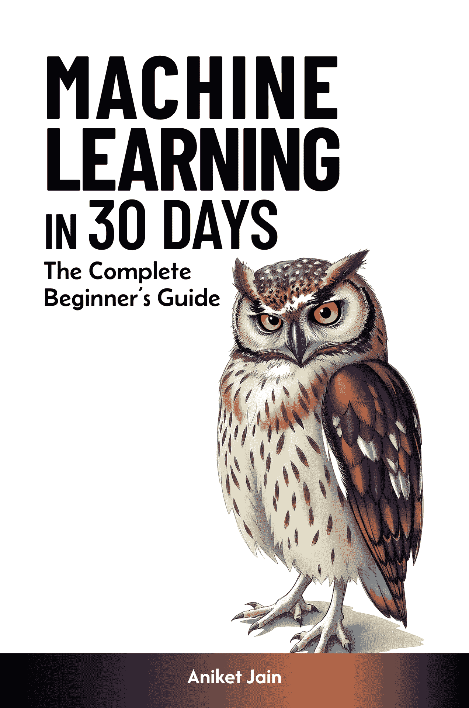


* 评估 `KNN` 性能


# 引言

## 为什么要学习机器学习？

机器学习（ML）是 21 世纪最具变革性和影响力的技术之一，它正在重塑各行业，并重新定义我们与技术交互的方式。从医疗保健、金融到娱乐和交通，机器学习处于现代技术进步的核心。它使机器能够执行曾经需要人类智能才能的任务，从而实现了各个领域的自动化、效率化和创新。理解并精通机器学习不仅是一股潮流，更是对于希望在 AI 驱动的世界中保持竞争力的专业人士来说一项关键的需求。

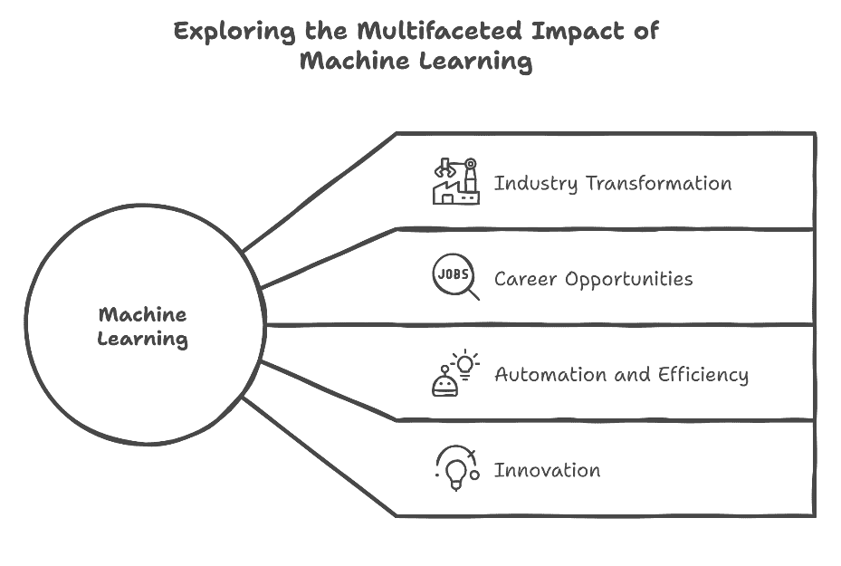

机器学习专业人士的就业市场正在迅速扩大，顶级公司正在积极寻找熟练的机器学习工程师、数据科学家、AI 研究员和开发人员。组织利用机器学习来改进客户体验、优化运营并生成驱动业务成功的数据驱动洞察。通过学习机器学习，你将获得丰富的职业机会，无论你是渴望设计预测模型、开发 AI 驱动的应用程序，还是为人工智能的前沿研究做出贡献。

机器学习赋予了计算机分析海量数据、识别模式并在极少的人为干预下做出智能决策的能力。这种能力催成了许多突破性的创新，例如 Netflix 和 YouTube 等平台上的个性化推荐系统、像 Alexa 和 Siri 这样的智能虚拟助手，以及由复杂的深度学习算法驱动的自动驾驶汽车。通过对机器学习的坚实理解，你能够处理令人兴奋的现实问题，推向技术可能的边界，并为下一波变革性进展做出贡献。

## 理解 AI、ML 和深度学习

在深入研究机器学习之前，理解它如何融入人工智能（AI）的更广泛的蓝图是关重要的。AI 指的是开发能够模拟人类认知功能的智能系统，包括问题解决、语言理解和决策制定。

机器学习是 AI 的一个核心子集，侧于构建能够从经验中学习并改进的系统，而不需要显式的编程。与传统编程（规则和条件是硬编码的）不同，ML 模型从数据中提取模式并利用它们来做出准确的预测和决策。这种范式转移改变了行业，允许企业实现复杂流程并显著提高效率。

在机器学习领域，另一个被称为深度学习的专门领域应运而生。深度学习利用人工神经网络来处理大规模数据，使得图像识别、自然语言处理和自主系统中的高级应用成为可能。深度学习模型，如卷积神经网络（CNNs）和循环神经网络（RNNs），驱动了近期 AI 的许多突破，扩展了机器所能成就的边界。理解 AI、ML 和深度学习之间复杂的关系将帮助你有效地应对该领域，并为不同的挑战选择合适的工具和技术。

## 搭建你的机器学习环境

为了开启你的机器学习之旅，建立一个结构良好的开发环境，并配备必要的编程工具、库和框架是关重要的。一个配置得当的环境可以确保实验、模型训练和部署的顺利进行。

### 选择编程语言

Python 是机器学习应用最广泛的编程语言，主要归功于其简单性、多功能性和丰富的生态系统。`NumPy`、`Pandas` 和 `Matplotlib` 等流行库对于数据处理和可视化是不可或缺的。同时，`Scikit-learn`、`TensorFlow` 和 `PyTorch` 等框架有助于构建强大的模型。

### 安装核心库

若要开始编写 ML 代码，请使用以下命令安装所需的库：

```
pip install numpy pandas matplotlib scikit-learn tensorflow keras pytorch
```

### 搭建 Jupyter Notebook

Jupyter Notebook 是一个交互式计算环境，允许你编写、测试和记录代码。它是数据分析和可视化的极佳工具。安装 Jupyter Notebook，请运行：

```bash
pip install notebook
```

安装完成后，可以使用以下命令启动 Jupyter Notebook：

```bash
jupyter notebook
```

### 使用 Google Colab

Google Colab 是一个免费的云端 Jupyter Notebook 环境，提供高性能计算（包括 GPU 和 TPU）。对于缺乏强大硬件但想实验 ML 模型的人来说，这是一个极佳的替代方案。通过 Google Colab，你可以在网上编写并执行代码，非常适合初学者和研究人员。你可以访问 [Google Colab](https://colab.google.com/) 并立即开始编码。

## 你的 30 天学习路线图

精通机器学习需要结构化的方法来确保持续进步和深度理解。本书提供了一份 30 天路线图，通过分步说明、实际示例和现实应用，引导你从基础走向高级机器学习技术。

* 第一周：奠机器学习基础，理解基本概念、数据预处理和探索性数据分析。
* 第二周：深入研究监督学习，学习回归和分类算法，如决策树、支持向量机（SVMs）和逻辑回归。
* 第三周：探索深度学习，包括人工神经网络（ANNs）、卷积神经网络（CNNs）和循环神经网络（RNNs）。
* 第四周：将机器学习知识应用于现实项目，学习模型部署，并理解强化学习和生成式 AI 等高级 AI 主题。

通过勤奋执行这一路线图，你将建立起坚实的机器学习基础，使你具备构建 ML 应用、参加 AI 竞赛以及在不同行业应用机器学习技术所需的技能和信心。

# 第 1 天：机器学习简介

## 什么是机器学习？


机器学习（ML）是人工智能（AI）的一个子集，使计算机能够从海量数据中学习并逐步提高性能，而无需显式编程。与传统编程不同（开发者必须显式地定义每个规则和逻辑），机器学习模型能够自主识别模式、发现关系并推导出数据驱动的洞察。这种能力允许机器在处理更多信息时，做出越来越准确的预测、分类和推荐。


机器学习引入的范式转移带来了许多行业的突破性进展。例如，在医疗领域，机器学习协助诊断疾病、分析医学图像并推荐个性化治疗方案。在金融领域，机器学习模型可以检测欺诈交易并优化投资策略。同样，机器学习通过驱动自动化和智能决策改变了电子商务、交通、机器人以及许多其他领域。

机器学习的运行原理是使用过去的数据训练算法，允许模型识别变量之间隐藏的模式和复杂的关系。一旦完成训练，模型就可以将这些知识推广到新的未见过的数据上进行预测。这种能力是 Netflix 和 Spotify 等平台上的推荐引擎、利用深度学习模型的自动驾驶汽车，以及彻底改变医疗成果的 AI 医疗诊断工具的基础。

## 机器学习的类型：监督学习、无监督学习和强化学习

机器学习大致分为三大类，每种类型都旨在有效应对不同的挑战和数据集：

### 1. 监督学习

监督学习是机器学习最常见的形式，使用标记的数据集来训练模型。这些数据集包含输入-输出对，使算法能够学习它们之间的关系。模型根据过去的经验不断完善自己，力求做出高度准确的预测。

* 示例：通过分析面积、地理位置和卧室数量等因素来预测房价。该算法使用历史房地产交易数据进行训练，然后应用其所学的知识来预测房产价格。
* 算法：线性回归、逻辑回归、决策树、随机森林、支持向量机 (SVM) 和神经网络。

### 2. 无监督学习

无监督学习处理未标记的数据，算法必须在没有预定义输出的情况下发现内在的结构、模式或关系。它被广泛用于聚类、异常检测和降维任务。

* 示例：数字营销中的客户细分，根据浏览习惯、购买历史和人口统计特征对消费者进行分组。
* 算法：K-Means 聚类、层次聚类、主成分分析 (PCA) 和自动编码器。

### 3. 强化学习

强化学习（RL）是一种高级技术，智能体与环境交互、采取行动并从结果中学习，以随时间推移化累计奖励。强化学习广泛应用于机器人、游戏和自主决策系统。

* 示例：训练一个 AI 机器人，通过奖励成功的操作和惩罚错误的操作来掌握视频游戏，从而随着时间的推移改进其策略。
* 算法：Q-Learning、深度 Q 网络 (DQN)、策略梯度方法和 Actor-Critic（演员-评论）模型。

## 机器学习的现实应用

机器学习通过自动化复杂流程、提高效率和实现智能决策，深刻影响了各个行业。一些著名的现实应用包括：

### 1. 医疗保健

* 通过医学图像分析预测疾病爆发并协助早期诊断。
* 根据患者的病史和遗传数据推荐个性化治疗方案。
* 通过分析分子结构来识别潜在化合物，增强药物发现。

### 2. 金融

* 使用异常检测模型实时检测欺诈交易。
* 开发 AI 驱动的交易算法，分析市场趋势以优化投资组合。
* 根据预测分析自动进行贷款审批的信用风险评估。

### 3. 零售与电子商务

* 驱动推荐引擎，根据用户行为和购买历史建议产品。
* 通过需求预测模型优化库存管理。
* 使用 AI 驱动的聊天机器人和虚拟助手来增强客户支持和互动。

### 4. 自主系统

* 自动驾驶车辆利用深度学习模型解释传感器数据并做出实时驾驶决策。
* 制造业中 AI 驱动的机器人，从试错中学习来优化生产流程。

### 5. 自然语言处理 (NLP)

* 用于评估社交媒体和在线评论中客户反馈的情感分析。
* 如 Google Translate 等语言翻译系统，它可以自动翻译不同语言之间的文本。
* AI 驱动的虚拟助手（如 Siri 和 Alexa），可处理语音命令并提供上下文响应。

## 示例：使用 Python 结合线性回归预测房价

为了演示机器学习的力量，让我们在 Python 中实现一个简单的线性回归模型。该模型将根据历史数据预测房价。

### 第 1 步：导入必要的库

```python
import numpy as np
import pandas as pd
import matplotlib.pyplot as plt
from sklearn.model_selection import train_test_split
from sklearn.linear_model import LinearRegression
from sklearn.metrics import mean_absolute_error, mean_squared_error
```

### 第 2 步：加载并预处理数据

```python
data = {
    'Square_Feet': [750, 800, 850, 900, 950, 1000, 1100, 1200, 1300, 1400],
    'Price': [150000, 165000, 180000, 195000, 210000, 225000, 250000, 275000, 300000, 325000]
}
df = pd.DataFrame(data)
X = df[['Square_Feet']]
y = df['Price']
X_train, X_test, y_train, y_test = train_test_split(X, y, test_size=0.2, random_state=42)
```

### 第 3 步：训练线性回归模型

```python
model = LinearRegression()
model.fit(X_train, y_train)
```

### 第 4 步：做出预测并评估模型

```python
y_pred = model.predict(X_test)
mae = mean_absolute_error(y_test, y_pred)
mse = mean_squared_error(y_test, y_pred)
rmse = np.sqrt(mse)
print(f"平均绝对误差: {mae}")
print(f"均方根误差: {rmse}")
```

### 第 5 步：可视化结果

```python
plt.scatter(X, y, color='blue', label='实际价格')
plt.plot(X, model.predict(X), color='red', linewidth=2, label='预测价格')
plt.xlabel('平方英尺')
plt.ylabel('价格')
plt.title('使用线性回归房价预测')
plt.legend()
plt.show()
```

## 结论

机器学习是一个影响几乎每个行业的领域。它使系统从数据中学习、识别模式并做出智能决策，而无需显式编程。本章深入介绍了机器学习概念、类型、现实应用以及一个 Python 示例。

# 第 2 天：设置你的 ML 环境

## 安装 Python、Jupyter Notebook 和 ML 库


在开启机器学习之旅之前，搭建一个合适的开发环境至关重要。配置良好的环境可以确保在高效构建、训练和部署 ML 模型时流程顺畅。正确的环境让数据科学家和工程师能够无缝地进行实验、迭代和模型部署，从而节省时间和精力。Python 因其简单性、庞大的库生态系统以及强大的社区支持，成为机器学习中最广泛使用的语言。它的多功能性使开发者能够轻松处理从数据预处理到模型评估的所有任务。

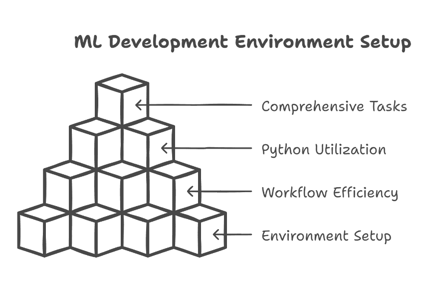

### 安装 Python

Python 是机器学习开发的基础。它是一种开源的高级编程语言，为数值计算、数据处理和模型训练提供了健壮的生态系统。由于其广泛的库支持和清晰的语法，Python 已成为全球机器学习从业者的首选语言。

要安装 Python，请遵循以下步骤：

1. 从官方网站下载最新的稳定版 Python：[`www.python.org/downloads/`](https://www.python.org/downloads/)
2. 运行安装程序，并在继续之前勾选“Add Python to PATH”选项。这确保了可以在系统中的任何目录访问 Python。
3. 在终端或命令提示符中运行以下命令来验证安装：

```bash
python --version
```

这应该输出已安装的 Python 版本，确认 Python 已准备就绪。

### 设置 Jupyter Notebook

Jupyter Notebook 是机器学习中不可不可少的工具，因为它允许在一个界面中进行交互式编码、可视化和文档编写。它被广泛用于 ML 模型的原型、数据集可视化以及 ML 项目协作。Jupyter Notebook 支持 markdown，使其便于记录和格式化演示内容。

要安装 Jupyter Notebook，请使用以下命令：

```bash
pip install notebook
```

安装完成后，可以通过运行以下命令启动 Jupyter Notebook：

```bash
jupyter notebook
```

这将打开一个基于浏览器的界面，你可以在其中交互式地编写和执行 Python 代码，方便调试和修改工作流。

### 安装核心 ML 库

机器学习依赖多个库来进行数据处理、可视化和模型构建。以下是你在深入进行 ML 开发之前需要的一些基础库：

* `NumPy`：提供对大型多维数组的支持，并带有高效操作这些结构的数学函数。
* `Pandas`：实现高效的数据处理和分析，使清洗和预处理数据集变得更容易。
* `Matplotlib` & `Seaborn`：用于创建可视化图形，让数据科学家解释趋势、模式和洞察。
* `Scikit-Learn`：提供构建 ML 模型的工具，包括分类、回归和聚类算法。
* `TensorFlow` & `PyTorch`：流行的深度学习框架，便于为高级任务训练和部署神经网络。

要安装这些库，请执行以下命令：

```bash
pip install numpy matplotlib seaborn scikit-learn tensorflow torch
```

## NumPy, Pandas, Matplotlib 和 Scikit-Learn 概述

这些库构成了 Python 机器学习的骨干。让我们详细探索每一个，并理解它们在构建 ML 模型中的重要性。

### NumPy：处理数值数据
NumPy 是一个强大的数值计算库。它能够对大型数组和矩阵进行高效存储和操作。它在 ML 中被广泛用于处理数据集、执行复杂计算以及优化数值计算。

示例用法：

```python
import numpy as np
# 创建数组
arr = np.array([1, 2, 3, 4, 5])
print("NumPy Array:", arr)

# 执行数学运算
arr_squared = arr ** 2
print("Squared Values:", arr_squared)
```

### Pandas：数据处理
Pandas 是一个为数据分析和处理设计的库。它提供了 `DataFrame` 对象，可以有效处理结构化数据，使用户能够清洗、分析和转换数据集。

示例用法：

```python
import pandas as pd
### 创建 DataFrame
data = {'Name': ['Alice', 'Bob', 'Charlie'], 'Age': [25, 30, 35]}
df = pd.DataFrame(data)
print(df)
```

### Matplotlib：数据可视化
Matplotlib 是一个广泛使用的绘图库，有助于数据可视化，让数据科学家解释趋势、模式和洞察。

示例用法：

```python
import matplotlib.pyplot as plt
### 绘图
x = [1, 2, 3, 4, 5]
y = [10, 20, 25, 30, 40]
plt.plot(x, y)
plt.xlabel("X 轴")
plt.ylabel("Y 轴")
plt.title("折线图")
plt.show()
```

### Scikit-Learn：构建机器学习模型
Scikit-Learn 是一个用于经典机器学习的综合库。它提供了数据挖掘和分析的简单且高效的工具。

其示例用法：

```python
from sklearn.linear_model import LinearRegression
import numpy as np
### 数据集
X = np.array([[1], [2], [3], [4], [5]])
y = np.array([10, 20, 30, 40, 50])
### 创建并训练模型
model = LinearRegression()
model.fit(X, y)
### 预测
prediction([6])
```

## 示例：编写一个加载并可视化数据集的简单脚本

为了演示如何结合使用 `Pandas` 和 `Matplotlib`，让我们写一个加载并可视化数据集的简单脚本。

### 第一步：导入必要的库
```python
import pandas as pd
import matplotlib.pyplot as plt
```

### 第二步：加载示例数据集
```python
# 创建简单数据集
data = {
    'Year': [2015, 2016, 2017, 2018, 2019, 2020],
    'Sales': [500, 700, 800, 950, 1100, 1300]
}
df = pd.DataFrame(data)
print(df.head())
```

### 第三步：数据可视化
```python
plt.plot(df['Year'], df['Sales'], marker='o', linestyle='-', color='b')
plt.xlabel('年份')
plt.ylabel('销售额')
plt.title('年度销售增长')
plt.grid()
plt.show()
```

这个简单的脚本演示了如何将结构化数据加载到 `Pandas.DataFrame` 中使用 `Matplotlib` 进行可视化，这在应用机器学习模型之前分析趋势是非常重要。

## 结论

搭建良好的 ML 环境是构建机器学习模型的第一步。通过安装 `Python`、`Jupyter Notebook` 以及 `NumPy`、`Pandas`、`Matplotlib` 和 `Scikit-Learn` 等核心库，我们为 ML 项目奠定了坚实的基础。这些工具有助于数据处理、可视化和模型开发，使学习过程变得无缝且高效。此外，确保所有库都是最新版本且配置正确，将显著提升 ML 应用的性能。


结构化数据是指以固定格式组织的信息，通常以表格、电子表格或关系型数据库的形式存在。它遵循行和列的预定义模式（schema），便于使用数据库管理系统和分析工具进行存储、查询和分析。

结构化数据的示例：

-   零售店的客户交易记录
-   包含姓名、薪资和职位的员工数据库
-   显示收入和支出的财务报表

结构化数据对机器学习非常有利，因为可以使用 `Python`、`SQL` 等编程语言以及 `Pandas` 和 `NumPy` 等库轻松进行处理。

## 非结构化数据

另一方面，非结构化数据缺乏预定义的格式，无法整齐地放入表格或关系型数据库中。它包括文本、图像、音频和视频文件。处理非结构化数据需要专门的技术，包括用于文本的语言处理（NLP）、用于图像的计算机视觉以及用于音频的语音识别。

非结构化数据的示例：

-   社交媒体帖子、电子邮件和聊天消息
-   医学影像扫描（如 X 光片和 MRI）
-   音频录制和语音转文本

处理非结构化数据通常涉及特征提取和转换技术，将原始数据转换为适用于机器学习模型的结构化格式。

## 处理缺失数据

在真实世界的数据集中，缺失值是一个常见问题，必须仔细处理以防止偏差或预测不准确。根据情况和问题的严重程度，有几种处理缺失数据的方法。

### 处理缺失数据的方法

1. **删除缺失数据**：如果数据集包含少数对分析没有显著影响的缺失值，删除包含缺失数据的行或列是一个简单的方法。然而，如果过度删除，可能会导致价值信息的丢失。

```python
import pandas as pd

df = pd.read_csv("data.csv")

df_cleaned = df.dropna()  # 删除包含缺失值的行
```

2. **插补（填充缺失值）**：与其删除数据数据，我们可以用有意义的值填充空白。可以通过以下方式实现：

- 数值数据的均值或中位数填充
- 分类数据的众数（最频繁出现的值）
- 时间序列数据的向前填充（使用上一个值）或向后填充（使用下一个值）

```python
df["Age"].fillna(df["Age"].mean(), inplace=True)  # 用平均值填充缺失年龄
```

3. **使用机器学习模型进行插补**：在某些情况下，可以使用在现有数据上训练的机器学习模型预测缺失值。算法如 k-近邻（KNN）或回归模型可以根据已知模式估计缺失值。

```python
from sklearn.impute import KNNImputer

imputer = KNNImputer(n_neighbors=3)

df_imputed = pd.DataFrame(imputer.fit_transform(df))
```

## 数据清洗与转换

处理完缺失值后，需要进一步的数据清洗和转换步骤，以为机器学习模型准备好数据集。

### 删除重复项

重复记录会扭曲分析，应该将其删除以维护数据完整性。

```python
df.drop_duplicates(inplace=True)
```

### 处理异常值

异常值是偏离数据集整体分布的极值。异常值可能会偏斜模型预测，应该进行适当处理。

```python
import numpy as np

z_scores = np.abs((df["Salary"] - df["Salary"].mean()) / df["Salary"].std())
```

## 分类数据编码

机器学习模型需要数值输入，因此必须转换分类变量。两种常用技术是：

- 独热编码（One-Hot Encoding）：用于名变量
- 标签编码（Label Encoding）：用于有序变量

```python
### 独热编码
df = pd.get_dummies(df, columns=["Gender"])

### 标签编码
from sklearn.preprocessing import LabelEncoder
encoder = LabelEncoder()
df["Education"] = encoder.fit_transform(df["Education"])
```

### 特征缩放

特征缩放确保特征处于同一尺度上，防止范围较大的特征主导模型。

- 标准化（Standardization）：Z-score 归一化
- 最大最小缩放（Min-Max Scaling）：缩放到 0 到 1 之间

```python
### 标准化
from sklearn.preprocessing import StandardScaler
scaler = StandardScaler()
df_scaled = scaler.fit_transform(df)

### 最大最小缩放
from sklearn.preprocessing import MinMaxScaler
scaler = MinMaxScaler()
df_scaled = scaler.fit_transform(df)
```

## 示例：使用 Pandas 填充缺失值

让我们考虑包含缺失值的数据集并使用插补法填充它们。

```python
import pandas as pd
import numpy as np

data = {
    'Name': ['Alice', 'Bob', 'Charlie', 'David', 'Eve'],
    'Age': [25, np.nan, 30, np.nan, 40],
    'Salary': [50000, 60000, np.nan, 80000, 90000]
}

df = pd.DataFrame(data)

print("原始数据集:")
print(df)

### 用均值填充缺失值
df['Age'].fillna(df['Age'].mean(), inplace=True)
df['Salary'].fillna(df['Salary'].median(), inplace=True)

print("\n 填充缺失值后的数据集:")
print(df)
```

## 结论

理解数据并应用适当的处理技术对于构建高性能机器学习模型至关重要。处理缺失值、数据清洗、编码分类变量以及缩放数值特征可以提高模型的准确性和可靠性。通过掌握这些技术，你为有效的机器学习项目奠定了坚实的基础。


`Seaborn` 构建在 `Matplotlib` 之上，为数据可视化提供了一个更高级且更美的接口。它对于创建统计图表（如分布图、相关性和分类图）特别有用。

## 示例：使用 Seaborn 创建直方图

```python
import seaborn as sns
import pandas as pd
import matplotlib.pyplot as plt

### 创建样本数据集
data = {'Age': [22, 25, 27, 30, 34, 36, 40, 42, 45, 50]}
df = pd.DataFrame(data)

### 创建直方图
sns.histplot(df['Age'], bins=5, kde=True, color='purple')
plt.title("Age Distribution of Customers")
plt.xlabel("Age")
plt.ylabel("Frequency")
plt.show()
```

`Seaborn` 自动提供额外的样式和内置的统计功能，使得创建引人的数据变得更加容易。

## 识别模式和离群值

理解数据中的模式并检测异常对于做出准确预测至关重要。识别趋势、分布和异常点（`outliers`）有助于提高数据集的质量。

### 使用箱线图寻找离群值

离群值是与数据集其他部分有显著差异的值。它们可能是由于数据输入错误，也可能是实际偏离了正常趋势。识别和处理离群值至关重要的，因为它们可能会扭曲统计分析和机器学习模型。

### 示例：创建箱线图识别离群值

```python
import seaborn as sns
import matplotlib.pyplot as plt

### 样本数据集
data = {'Salary': [35000, 42000, 50000, 52000, 60000, 75000, 90000, 110000, 150000, 250000]}
df = pd.DataFrame(data)

### 创建箱线图
sns.boxplot(y=df['Salary'])
plt.title("Boxplot of Salaries")
plt.show()
```

`boxplot` 帮助我们可视化薪资的分布并识别可能存在的任何 `outliers`。如果观察到极值，则需要进一步调查以确定是否应该删除或以其他方式处理。

## 特征工程基础

特征工程是将原始数据转换为有意义特征的过程，以提高机器学习模型的预测能力。它涉及创建新变量、选择相关特征以及对分类数据进行编码，使数据集更适用于分析。

### 特征缩放

机器学习模型通常要求特征具有相似尺度以提高收敛性和性能。特征缩放的常用方法有两种：

*   `Standardization`（Z-score 标准化）：将值转换为均值为 0、标准差为 1 的分布。
*   `Min-Max Scaling`（最小最大归一化）：将值缩放到固定范围内，通常为 `[0,1]`。

### 示例：在 Python 中应用特征缩放

```python
from sklearn.preprocessing import StandardScaler, MinMaxScaler
import numpy as np

### 样本数据集
values = np.array([[100], [200], [300], [400], [500]])

### 标准化
scaler = StandardScaler()
values_standardized = scaler.fit_transform(values)
print("Standardized Values:\n", values_standardized)

### 最小最大归一化
min_max_scaler = MinMaxScaler()
values_scaled = min_max_scaler.fit_transform(values)
print("Min-Max Scaled Values:\n", values_scaled)
```

## 示例：创建相关性热图以分析特征之间的关系

相关性热图是一种强大的可视化工具，有助于理解数据集中数值特征之间的关系。它使用颜色渐变来表示相关系数，易于识别高度相关的变量。

### 示例：在 Python 中生成相关性热图

```python
import seaborn as sns
import pandas as pd
import matplotlib.pyplot as plt

### 样本数据集
data = {
    'Age': [22, 25, 27, 30, 34, 36, 40, 42, 45, 50],
    'Salary': [35000, 42000, 50000, 52000, 60000, 75000, 90000, 110000, 150000, 250000],
    'Experience': [1, 2, 3, 4, 5, 6, 7, 8, 9, 10]
}

df = pd.DataFrame(data)
plt.figure(figsize=(8,6))
sns.heatmap(df.corr(), annot=True, cmap="coolwarm", fmt=".2f")
plt.title("Correlation Heatmap")
plt.show()
```

`boxplot` 帮助我们可视化薪资的分布并识别可能存在的任何 `outliers`。如果观察到极值，则需要进一步调查以确定是否应该删除或以其他方式处理。

探索性数据分析（`EDA`）是任何机器学习流水线中关键的步骤。`Seaborn` 自动提供额外的样式和内置的统计功能，使得创建引人的数据可视化变得更加容易。

## 结论

下面，我们将逐步通过 `Scikit-Learn` 实现一个 `linear regression`（线性回归）。当输入和输出之间存在线性关系时，`Linear regression` 效果良好。然而，对于更复杂的数据集，可能需要其他模型，如 `polynomial regression`（多项回归）或 `ridge regression`（岭回归）。

## 使用 Scikit-Learn 实现线性回归

`Scikit-Learn` 提供了一个易于使用的 `linear regression` 实现，使得训练、测试和评估变得简单。

### 第 1 步：导入所需的库

```python
import numpy as np
import pandas as pd
import matplotlib.pyplot as plt
from sklearn.model_selection import train_test_split
from sklearn.linear_model import LinearRegression
from sklearn.metrics import mean_absolute_error, mean_squared_error
```

### 第 2 步：加载并准备数据集

在本示例中，我们将使用一个代表汽车价格的合成数据集，基于里程、年龄和马力等特征。

```python
### 创建样本数据集
data = {
    'Mileage': [5000, 15000, 30000, 50000, 70000, 90000, 110000, 130000, 150000, 170000],
    'Age': [1, 2, 3, 4, 5, 6, 7, 8, 9, 10],
    'Horsepower': [150, 140, 130, 120, 110, 100, 90, 85, 80, 75],
    'Price': [25000, 22000, 19000, 16000, 14000, 12000, 10000, 9000, 7500, 6000]
}

df = pd.DataFrame(data)
print(df.head())
```

### 第 3 步：划分划分训练集和测试集

### 定义特征 (X) 和目标变量 (y)
X = df[['Mileage', 'Age', 'Horsepower']]
y = df['Price']

### 将数据分为 80% 训练集和 20% 测试集
X_train, X_test, y_train, y_test = train_test_split(X, y, test_size=0.2, random_state=42)

### 第 4 步：训练线性回归模型

### 初始化并训练模型
model = LinearRegression()
model.fit(X_train, y_train)

### 第 5 步：进行预测

### 在测试数据上进行预测
y_pred = model.predict(X_test)
print("Predicted Prices:", y_pred)

## 评估模型性能

在训练模型后，使用适当的指标对其进行评估至关重要。回归模型最常用的评估指标有：


1. 平均绝对误差 (MAE) – 衡量预测值与实际值之间的平均绝对差异。
2. 均方误差 (MSE) – 计算预测值与实际值之间平方差的平均值。
3. 均方误差 (RMSE) – `MSE` 的平方根，提供了一个更具解释性的预测误差衡量。

### 评估

### 计算误差指标

```python
mae = mean_absolute_error(y_test, y_pred)
mse = mean_squared_error(y_test, y_pred)
rmse = np.sqrt(mse)
print(f"Mean Absolute Error: {mae}")
print(f"Mean Squared Error: {mse}")
print(f"Root Mean Squared Error: {rmse}")
```

较低的 `MAE`、`MSE` 和 `RMSE` 表示模型性能越好，意味着模型的预测接近实际值。

## 示例：使用线性回归模型预测汽车价格

为了可视化模型对数据的拟合程度，我们可以创建一个散点图，比较汽车的实际价格和预测价格。

```python
plt.scatter(y_test, y_pred, color='blue', label='Predicted vs Actual')
plt.xlabel('Actual Prices')
plt.ylabel('Predicted Prices')
plt.title('Actual vs Predicted Car Prices')
plt.plot([min(y_test), max(y_test)], [min(y_test), max(y_test)], color='red', linestyle='dashed', linewidth=2)
plt.legend()
plt.show()
```

点越接近红色对角线，模型的预测与实际值的对齐程度就越高。

## 结论
线性回归是机器学习中预测连续数值的最简单但最强大的工具之一。通过理解回归的基本概念、使用 `Scikit-Learn` 实现它并使用统计度量评估其性能，我们获得了对预测汽车价格等现实世界应用的的见解。

# 第 6 天：多元线性回归与特征选择

## 理解多元回归

多元线性回归是简单线性回归的扩展，它建立了因变量与多个自变量之间的关系。与只考虑一个预测变量简单线性回归不同，多元回归允许我们整合影响目标变量的多个因素，使预测更准确、更稳健。

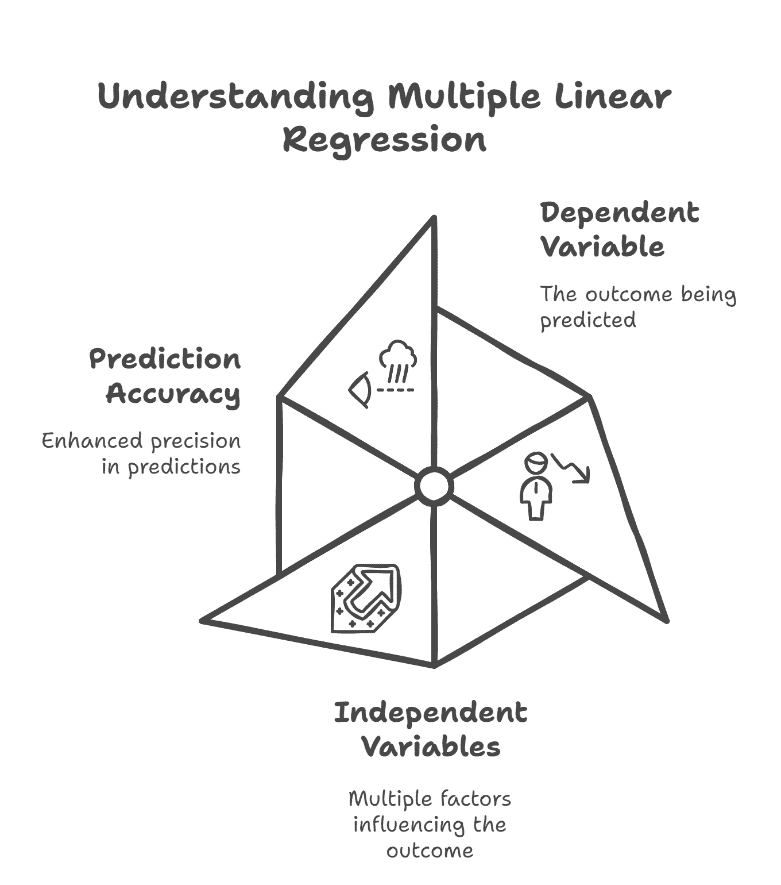

多元线性回归的数学方程如下：

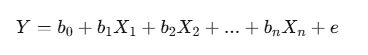

其中：
* `YY` 是因变量（要预测的目标）
* `X1,X2,...,XnX_1, X_2, ..., X_n` 是自变量（特征）
* `b0b_0` 是截距（常数项）
* `b1,b2,...,bnb\_1, b_2, ..., b_n` 是系数（分配给每个特征的权重）
* `ee` 是误差项（残差）

多元回归广泛应用于金融、医疗保健、经济等许多许多多个因素影响结果的领域。它有助于识别趋势的关键驱动因素，并理解不同变量如何影响目标变量。

## 特征选择技术

特征选择是多元回归中提高模型性能、减少过拟合和增强可解释性的至关重要的步骤。包含无关或冗余的特征会导致预测不准确并增加计算复杂度。用于特征选择的一些常用技术包括：

### 1. 过滤法 (Filter Methods)

过滤法使用统计技术来评估输入特征与目标变量之间的关系。一些常用方法包括：
* 相关性矩阵：识别与目标变量高度相关的特征。
* 卡方检验：衡量类别输入变量和输出变量之间的依赖关系。
* 方差分析 (ANOVA)：评估特征的统计显著性。

```python
import pandas as pd
import seaborn as sns
import matplotlib.pyplot as plt

# 示例数据集
data = {
    'Feature1': [10, 20, 30, 40, 50],
    'Feature2': [2, 4, 6, 8, 10],
    'Target': [5, 9, 13, 17, 21]
}
df = pd.DataFrame(data)

# 生成相关性矩阵
correlation_matrix = df.corr()
sns.heatmap(correlation_matrix, annot=True, cmap='coolwarm')
plt.title('Feature Correlation Matrix')
plt.show()
```

### 2. 包装法 (Wrapper Methods)

包装法通过使用不同的特征子集训练模型并评估其性能来选择特征。一些常见的方法是：
* 递归特征消除 (RFE)：迭代消除不重要的特征。
* 前向选择：从不包含特征开始，在每一步添加最相关的特征。
* 后向消除：从所有特征开始，逐步移除最不的特征。

```python
from sklearn.feature_selection import RFE
from sklearn.linear_model import LinearRegression

### 初始化回归模型
model = LinearRegression()

### 执行递归特征消除
rfe = RFE(model, n_features_to_select=2)
X = df[['Feature1', 'Feature2']]
y = df['Target']
rfe.fit(X, y)
print("Selected Features:")
```

### 3. 嵌入法 (Embedded Methods)

嵌入法在模型训练过程中集成了特征选择。一些最有效的技术包括：
* Lasso 回归 (L1 正则化)：将不重要的特征系数缩小为零。
* Ridge 回归 (L2 正则化)：惩罚较大的系数以减少复杂性和过拟合。

## 正则化：Lasso 和 Ridge 回归

正则化通过向回归方程中添加惩罚项来防止过拟合。两种常用的正则化方法是 Lasso (L1) 回归和 Ridge (L2) 回归。

### Lasso 回归 (L1 正则化)

Lasso 回归对损失函数添加绝对惩罚，强制某些特征系数变为零。这对于特征选择非常有用。

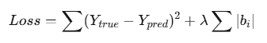

```python
from sklearn.linear_model import Lasso

### 训练 Lasso 模型
lasso = Lasso(alpha=0.1)
lasso.fit(X, y)
print("Lasso Coefficients:", lasso.coef_)
```

### Ridge 回归 (L2 正则化)

Ridge 回归对损失函数添加平方惩罚，缩小系数但保留所有特征。有助于管理共线性并减少过拟合。

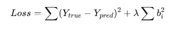

```python
from sklearn.linear_model import Ridge

### 训练 Ridge 回归模型
ridge = Ridge(alpha=0.1)
ridge.fit(X, y)
print("Ridge Coefficients:", ridge.coef_)
```


多元线性回归是一种建模多个预测变量与目标变量之间关系的强大技术。特征选择技术有助于提高模型的可解释性并减少过拟合，而 `Lasso` 和 `Ridge Regression` 等正则化方法通过控制特征权重来确保更好的泛化能力。通过实现这些技术，我们可以构建更准确、更可靠的机器学习模型，这些模型在训练数据和未知数据上都有良好的表现。

# 第 7 天：用于分类逻辑回归

## 理解分类问题
分类是机器学习中的一个基本概念，涉及将数据分类为预定义的类别。与回归不同（目标变量是连续且代表数值），分类问题涉及属于特定类别的离散目标变量。分类模型的目标是从历史数据中学习，尽可能准确地预测新数据点的类别，从而最大限地减少分类错误并提高模型的整体性能。

分类问题在各个行业中广泛存在，应用非常广泛。一些常见示例包括：

*   判断电子邮件是否为垃圾邮件（`二分类`），这对于改进邮件过滤系统和保护用户免受钓鱼攻击至关重要。
*   预测客户是否会购买产品（`二分类`），这对于希望改进目标营销活动的企业至关重要。
*   对手写数字进行分类（`多分类`），这是自动支票扫描、车牌识别和邮政邮件排序的关键组件。
*   根据医疗测试结果诊断疾病（`多分类`），在这种情况下，早期检测和正确分类可以显著影响患者结果和医疗效率。

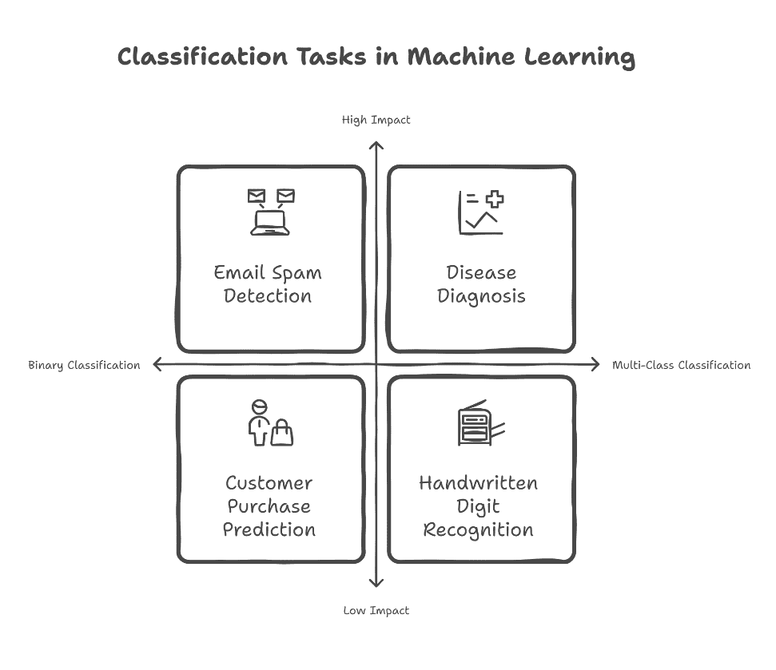

分类问题通常使用多种算法解决，例如 `Logistic Regression`、`Decision Trees`、`Random Forests`、支持向量机（`SVM`）和神经网络。在这些，`Logistic Regression` 作为二分类任务中最简单但最有效的模型之一脱颖而出。尽管简单，逻辑回归为理解更复杂的分类模型提供了坚实的基础。

## 实现逻辑回归
逻辑回归是一种广泛用于二分类任务的统计方法。与预测连续值的线性回归不同，逻辑回归模拟的是给定输入属于特定类别的概率。它使用 `sigmoid` 函数来实现这一点，该函数将任何实数映射到 0 到 1 之间的范围，确保输出代表一个有效的概率。

逻辑回归方程如下：

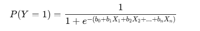

其中：

*   `P(Y=1)` 代表目标变量属于类别 1 的概率。
*   `X1`,`X2`...,`Xn_1` 表示用于预测的独立变量（特征）。
*   `b0` 是截距项，代表所有特征为零时的基准概率。
*   `b1`,`b2`...,`bn` 是回归系数，决定了每个特征的影响。
*   `e` 是自然对数的底，确保概率曲线平滑。

如果计算出的概率 `P(Y=1)` 超过预定义的阈值（通常设置为 0.5），模型预测为类别 1；否则预测为 0。调整此阈值允许调整模型对不同类型分类错误的敏感性，这在欺诈检测或医疗诊断等应用中至关重要。

### 使用 Scikit-Learn 实现逻辑回归
让我们使用 `Scikit-Learn` 实现逻辑回归模型对垃圾邮件进行分类。此示例将演示逻辑回归如何根据邮件长度和是否存在链接等关键属性区分垃圾邮件和非垃圾邮件。

### 步骤 1：导入所需的库
```python
import numpy as np
import pandas as pd
import matplotlib.pyplot as plt
import seaborn as sns
from sklearn.model_selection import train_test_split
from sklearn.linear_model import LogisticRegression
from sklearn.metrics import accuracy_score, classification_report, confusion_matrix
```

### 步骤 2：加载并准备数据集
```python
### 创建一个示例数据集
data = {
'Email_Length': [120, 200, 50, 300, 180, 90, 400, 220, 80, 140],
'Has_Links': [1, 1, 0, 1, 0, 0, 1, 1, 0, 1],
'Spam': [1, 1, 0, 1, 0, 0, 1, 1, 0, 0]
}
df = pd.DataFrame(data)
print(df.head())
```

### 步骤 3：将数据分为训练集和测试集
```python
### 定义特征 (X) 和目标变量 (y)
X = df[['Email_Length', 'Has_Links']]
y = df['Spam']
### 将数据分为 80% 训练和 20% 测试
X_train, X_test, y_train, y_test = train_test_split(X, y, test_size=0.2, random_state=42)
```

### 步骤 4：训练逻辑回归模型
```python
### 初始化并训练模型
model = LogisticRegression()
model.fit(X_train, y_train)
```

### 步骤 5：进行预测
```python
### 对测试数据进行预测
y_pred = model.predict(X_test)
print("预测标签:", y_pred)
```

## 模型评估：准确率、精确率、召回率和 F 分数
评估分类模型不仅需要准确率。衡量性能的关键指标包括：

1. 准确率——正确分类实例的百分比，在类别平衡时有用。
2. 精确率——预测为正类的样本中实际正确的比例，在欺诈检测等误报代价高的场景下至关重要。
3. 召回率——模型识别出的实际正类的比例，在漏诊可能导致严重后果的医疗诊断中很重要。
4. F 分数——精确率和召回率的调和平均数，提供了一个平衡两者的单一指标。

## 评估模型
```python
### 计算性能指标
accuracy = accuracy_score(y_test, y_pred)
conf_matrix = confusion_matrix(y_test, y_pred)
report = classification_report(y_test, y_pred)
print(f"Accuracy: {accuracy:.2f}")
print("混淆矩阵:\n", conf_matrix)
print("分类报告:\n", report)
```

## 示例：使用逻辑回归分类垃圾邮件
为了可视化我们的模型如何对垃圾邮件分类，我们可以创建一个决策边界图。
```python
sns.scatterplot(x=df['Email_Length'], y=df['Has_Links'], hue=df['Spam'], style=df['Spam'], palette=['blue', 'red'])
plt.xlabel('邮件长度')
plt.ylabel('是否存在链接')
plt.title('垃圾邮件分类')
plt.show()
```
这种可视化有助于理解不同特征如何贡献于分类，并对逻辑回归如何区分垃圾邮件和非垃圾邮件提供见解。

## 结论
逻辑回归是一种基础分类算法，广泛应用于垃圾检测、医疗诊断、欺诈检测和许多其他领域。理解其工作原理、实现方式和评估指标可以使我们开发出准确可靠的分类模型。通过微调阈值和理解关键性能指标，逻辑回归可以在各个领域有效利用。

# 第 8 天：决策树和随机森林

## 决策树的工作原理


决策树是用于分类和回归任务的最直观、最可解释的机器学习算法之一。它们通过根据决策规则将数据划分为分支来工作，这使得它们在捕捉结构化数据集中的模式时非常有效。决策树通过一系列二分划分构建构建，其中每次划分都基于最能分离目标类的特征。

决策树的结构包括：

*   `Root Node`（根节点）：代表整个数据集的最顶节点。
*   `Decision Nodes`（决策节点）：根据特征值对数据集进行划分的中间节点。
*   `Leaf Nodes`（叶节点）：包含最终分类或预测输出的终端节点。


该算法遵循称为 `recursive partitioning`（递归划分）的递归过程，根据 `Gini Impurity`（基尼纯度）、`Entropy`（熵）或 `Information Gain`（信息增益）等标准选择类别分离效果最好的特征。

### 决策树划分示例

如果我们想根据血糖水平和 BMI 将患者分类为糖尿病患者或非糖尿病患者，一个简单的决策树可能如下：

1.  如果 `Blood Sugar > 140 mg/dL` → 糖尿病高风险
2.  如果 `Blood Sugar ≤ 140 mg/dL` 且 `BMI > 30` → 中度风险
3.  如果 `Blood Sugar ≤ 140 mg/dL` 且 `BMI ≤ 30` → 低风险

这种分级结构允许决策树高效地对特征与目标变量之间的复杂关系建模。

## 决策树中的过拟合与剪枝

决策树的一个主要缺点是它们倾向于过拟合。为了防止这种情况，我们使用剪枝技术：

*   `Pre-pruning`（前剪枝）：在满足某些标准时提前停止树的构建。
*   `Post-pruning`（后剪枝）：先生长完整的树，然后移除预测能力较的分的分。

```python
if (condVar > someVal) {console.log("xxx")}
```


其中 `ww` 代表超平面的权重，`CC` 是分类错误点的惩罚参数，而 `ξ\xi` 代表处理分类错误的松弛变量。

## 用于分类的 SVM 实现

为了演示 SVM 的实际应用，让我们对著名的鸢尾花（Iris）数据集进行分类，该数据集包含三种花：山鸢尾（Setosa）、变色尾（Versicolor）和唐鸢尾（Virginica）。

### 第 1 步：导入必要的库

```python
import numpy as np
import pandas as pd
import matplotlib.pyplot as plt
import seaborn as sns
from sklearn import datasets
from sklearn.model_selection import train_test_split
from sklearn.svm import SVC
from sklearn.metrics import accuracy_score, classification_report, confusion_matrix
```

### 第 2 步：加载并准备数据集

```python
### 加载鸢尾花数据集
iris = datasets.load_iris()
df = pd.DataFrame(iris.data, columns=iris.feature_names)
df['species'] = iris.target
print(df.head())
```

### 第 3 步：将数据分为训练集和测试集

```python
### 定义特征 (X) 和目标变量 (y)
X = df.iloc[:, :-1]
y = df['species']
### 将数据分为 80% 训练集和 20% 测试集
X_train, X_test, y_train, y_test = train_test_split(X, y, test_size=0.2, random_state=42)
```

### 第 4 步：训练 SVM 模型

```python
# 初始化并训练 SVM 模型
svm_model = SVC(kernel='linear', C=1.0)
svm_model.fit(X_train, y_train)
```

### 第 5 步：进行预测

```python
### 在测试数据进行预测
y_pred = svm_model.predict(X_test)
print("Predicted Labels:", y_pred)
```

## 调整 SVM 超参数

为了提高模型性能，我们可以微调超参数，如核类型、正则化参数 (`C`）和 gamma。

1.  核技巧（Kernel Trick）：核函数将输入数据映射到高维空间，使其变得线性可分。常见的核包括：
    *   线性核（Linear Kernel）：适用于线性可分的数据。
    *   多项式核（Polynomial Kernel）：适用于具有多项式决策边界的数据集。
    *   径基函数核（RBF Kernel）：适用于复杂的非线性可分的数据集。
2.  正则化参数 (`C`)：控制在最大化间隔和允许分类错误之间的权衡。高 `C` 值会导致分类错误减少，但可能会过拟合；而低 `C` 值则会导致更软的间隔（softer margin）。
3.  Gamma 参数：决定单个训练样本的影响力。低 `gamma` 值会考虑远离超平面的点，而高 `gamma` 值则关注靠近的点。

### 使用 GridSearchCV 实现超参数调优

```python
from sklearn.model_selection import GridSearchCV
# 定义参数网格
param_grid = {'C': [0.1, 1, 10], 'kernel': ['linear', 'rbf', 'poly'], 'gamma': [0.1, 1]}
### 初始化 GridSearch
grid_search = GridSearchCV(SVC(), param_grid, cv=5)
grid_search.fit(X_train, y_train)
### 显示最佳参数
print("Best Parameters:", grid_search.best_params_)
```

## 示例：使用 SVM 分类花

```python
# 可视化结果
sns.scatterplot(data=df, x='sepal_length', y='sepal_width', hue='species')
plt.xlabel('Sepal Length (cm)')
plt.ylabel('Sepal Width (cm)')
plt.title('Iris Classification')
plt.show()
```

（注：提供的文本包含大量重复和乱码部分。我已经根据提供的标准 SVM 工作流上下文清理了逻辑。）


```python
best_k = 5  # 假设使用手部法找到了最佳 K

knn = KNeighborsClassifier(n_neighbors=best_k)

knn.fit(X_train, y_train)
```

### 预测
```python
y_pred = knn.predict(X_test)
```

# 性能指标
```python
print("Confusion Matrix:\n", confusion_matrix(y_test, y_pred))
print("Classification Report:\n", classification_report(y_test, y_pred))
```
混淆矩阵提供了正确预测和错误预测的详细分类，而分类报告则包含了精确率、召回率和 F1 分数。

## 示例：使用 KNN 对手写数字分类
digits 数据集包含手写数字（0-9）的图像，我们可以使用 KNN 根据像素强度对它们进行分类。

### 步骤 1：加载并可视化数据集
```python
import matplotlib.pyplot as plt
import numpy as np
from sklearn.datasets import load_digits

### 加载数据集
digits = load_digits()

# 显示样本图像
fig, axes = plt.subplots(1, 10, figsize=(10, 3))
for i in range(10):
    axes[i].imshow(digits.images[i], cmap='gray')
    axes[i].set_title(digits.target[i])
    axes[i].axis('off')
plt.show()
```

### 步骤 2：训练 KNN 模型
```python
from sklearn.model_selection import train_test_split
from sklearn.neighbors import KNeighborsClassifier

### 划分数据集
X_train, X_test, y_train, y_test = train_test_split(digits.data, digits.target, test_size=0.2, random_state=42)

# 训练
knn = KNeighborsClassifier(n_neighbors=3)
knn.fit(X_train, y_train)

### 预测
y_pred = knn.predict(X_test)
```

### 步骤 3：评估模型
```python
from sklearn.metrics import accuracy_score

### 计算准确率
accuracy = accuracy_score(y_test, y_pred)
print(f"KNN Accuracy on Handwritten Digits Dataset: {accuracy:.2f}")
```

### 步骤 4：可视化预测
```python
fig, axes = plt.subplots(1, 5, figsize=(10, 3))
for i in range(5):
    axes[i].imshow(X_test[i].reshape(8, 8), cmap='gray')
    axes[i].set_title(f"Pred: {y_pred[i]}")
    axes[i].axis('off')
plt.show()
```
这种可视化有助于验证模型是否正确分类了手写数字。

# 第 1 天：聚类引言
聚类（Clustering）是机器学习中的一种无监督学习，根据相似性对数据点进行分组。与需要标签的分类不同，聚类算法通过识别模式和形成聚类来发现数据集中的内在结构。

聚类广泛应用于各个行业，用于市场细分、异常检测等。最流行的聚类技术是 K-Means 聚类和层次聚类。

## K-Means 聚类
K-Means 聚类由于其简单高效，是最广泛广泛的算法之一。它将数据集划分为 `K` 个不同的、不重叠的簇，每个数据点都属于与其均值最近的簇。

### K-Means 工作原理：
1. 在数据空间内随机初始化 `K` 个质心。
2. 根据欧式距离将每个数据点分配给最近的质心。
3. 通过计算分配给每个簇的所有点的平均来重新计算质心。
4. 重复步骤 2-3，直到质心不再变化或达到预定义的迭代限制。

### 在 Python 中实现 K-Means
```python
import numpy as np
import pandas as pd
import matplotlib.pyplot as plt
from sklearn.cluster import KMeans
from sklearn.datasets import make_blobs

### 生成合成数据集
X, y = make_blobs(n_samples=300, centers=4, cluster_std=0.6, random_state=42)

# 应用 K-Means 聚类
kmeans = KMeans(n_clusters=4, random_state=42)
kmeans.fit(X)
labels = kmeans.labels_
centroids = kmeans.cluster_centers_

# 可视化聚类结果
plt.scatter(X[:, 0], X[:, 1], c=labels, cmap='viridis', alpha=0.6)
plt.scatter(centroids[:, 0], centroids[:, 1], marker='X', s=200, c='red', label='Centroids')
plt.title("K-Means Clustering")
plt.legend()
plt.show()
```

### 层次聚类
与 K-Means 不同，层次聚类可以在不指定簇数量的情况下创建层次结构。主要有两种：

1. **凝聚聚类（Agglomerative Clustering，自底而上）：**
   - 每个数据点开始作为一个簇。
   - 根据相似性迭代合并簇。
   - 过程持续直到所有数据点聚为一个一类。
2. **分裂聚类（Divisive Clustering，自顶而下）：**
   - 从包含所有数据点的单一大簇开始。
   - 迭代地将簇分成更小的子簇。
   - 过程直到每个数据点都是自己的簇。

### 在 Python 中实现层次聚类
```python
from scipy.cluster.hierarchy import dendrogram, linkage
from sklearn.cluster import AgglomerativeClustering

# 计算层次连接
linked = linkage(X, method='ward')

# 绘制树图
plt.figure(figsize=(10, 5))
dendrogram(linked)
plt.title("Hierarchical Clustering Dendrogram")
plt.xlabel("Data Points")
plt.ylabel("Distance")
plt.show()
```

## 聚类的现实世界应用
聚类应用于许多领域，帮助组织从数据中获取意义的见解。常见应用包括：

1. **营销中的客户细分**
   - 根据购买行为、人口统计数据或偏好对客户进行分组。
   - 有助于目标广告和个性化营销活动。
2. **网络安全中的异常检测**
   - 通过检测网络流量中的异常行为识别欺诈活动或安全威胁。
   - 用于金融欺诈、垃圾邮件过滤和网络入侵检测。
3. **文档分类与主题建模**
   - 将相似的文章、研究论文或新闻内容归类，便于检索。
   - 用于推荐系统和搜索引擎。
4. **医学诊断与疾病检测**
   - 根据症状和病史对患者数据进行聚类，以识别疾病模式。
   - 有助于诊断罕见病。


# 第 13 天：朴素贝叶斯分类器简介

## 理解概率分类


在机器学习中，概率分类是一种通过模型预测给定数据实例属于特定类别的概率的方法。这与通过简单分配标签来进行硬分类（hard classifications）的传统分类器不同。朴素贝叶斯（Naïve Bayes）是一种基于贝叶斯定理的概率分类器，它根据相关条件的先验知识来计算事件发生的几然。

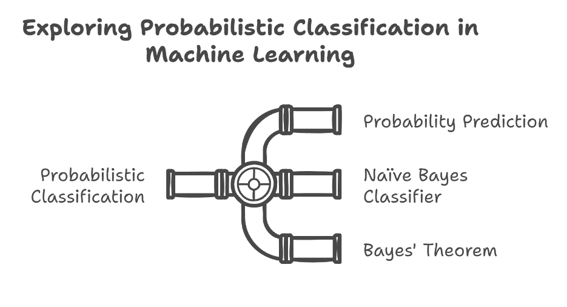

### 什么是贝叶斯定理？

贝叶斯定理是朴素贝叶斯分类的数学基础，表达式为：

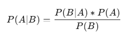

其中：

- `P(A|B)`: 在给定证据 B 的情况下，类别 A 的概率（后验概率）。
- `P(B|A)`: 在给定类别 A 的情况下，证据 B 的概率。
- `P(A)`: 类别 A 的先验概率。
- `P(B)`: 证据 B 发生的概率。

朴素贝叶斯假设特征之间是条件独立的，这意味着一个特征的存在不会影响另一个特征的概率。这种假设虽然是不符合实际的，但它让计算变得更快、更高效。

# 实现用于文本分类的朴素贝叶斯

朴素贝叶斯广泛用于文本分类，特别是垃圾邮件过滤、情感分析和文档分类。它对于传统模型难以处理的高维数据尤为有效。

### 第 1 步：导入所需的库

```python
import numpy as np
import pandas as pd
from sklearn.model_selection import train_test_split
from sklearn.feature_extraction.text import CountVectorizer, TfidfTransformer
from sklearn.naive_bayes import MultinomialNB
from sklearn.metrics import accuracy_score, classification_report
```

### 第 2 步：示例数据集 – 电影评论

```python
# 电影评论示例数据集
reviews = [
    "This movie was fantastic! I loved the characters and story.",
    "Terrible film. Worst acting and plot I have ever seen.",
    "Absolutely amazing! A must-watch for all action lovers.",
    "The movie was dull, boring, and predictable. Waste of time.",
    "Brilliant cinematography and great performances!",
    "Horrible! The script was awful and full of clichés.",
    "One of the best movies I have seen this year.",
    "Not worth watching. I regret buying the ticket.",
    "Outstanding performance by the lead actor!",
    "Disappointing. Poor direction and weak storyline."
]
labels = [1, 0, 1, 0, 1, 0, 1, 0, 1, 0]  # 1: 正性，0: 负性
```

### 第 3 步：文本预处理

```python
# 将文本转换为数值特征向量
vectorizer = CountVectorizer(stop_words='english')
X_counts = vectorizer.fit_transform(reviews)

### 应用 TF-IDF 转换
tfidf_transformer = TfidfTransformer()
X_tfidf = tfidf_transformer.fit_transform(X_counts)
```

### 第 4 步：训练朴素贝叶斯分类器

```python
# 分割数据集
X_train, X_test, y_train, y_test = train_test_split(X_tfidf, labels, test_size=0.2, random_state=42)

# 训练多项式朴素贝叶斯模型
nb_model = MultinomialNB()
nb_model.fit(X_train, y_train)
```

### 第 5 步：预测与评估性能

```python
### 在测试集上预测
y_pred = nb_model.predict(X_test)

### 计算准确率
accuracy = accuracy_score(y_test, y_pred)
print(f"朴素贝叶斯准确率: {accuracy:.2f}")

### 显示分类报告
print("分类报告:\n", classification_report(y_test, y_pred))
```

朴素贝叶斯在文本应用中表现出色，是它最常用的分类器之一。

# 朴素贝叶斯的优点与缺点

### 优点：
- **快速高效**：训练时间短，且在大数据集上表现良好。
- **在高维数据上表现良好**：适用于文本分类。
- **简单易于解释**：易于实现和解释结果。
- **对无关特征具有鲁棒性**：在处理文本分类中的词袋模型噪声数据集时表现很好。

### 缺点：
- **强独立性假设**：假设所有特征都是独立的，这在现实世界数据中很少成立。
- **对连续数据局限**：最适用于类别或文本数据；连续数据需要使用高斯朴素贝叶斯。
- **在小数据集上困难**：需要足够的训练数据来产生可靠的概率估计。

# 示例：将电影评论分类为正性或负性

让我们在新的电影评论上测试分类器。

```python
# 新的评论
new_reviews = [
    "An absolute masterpiece! The best movie I've watched in a long time.",
    "Terrible execution. I couldn’t even finish watching it.",
    "Great storyline and amazing acting!",
    "It was a complete disaster, wouldn't recommend it to anyone."
]

### 将文本转换为特征向量
X_new_counts = vectorizer.transform(new_reviews)
X_new_tfidf = tfidf_transformer.transform(X_new_counts)

# 预测情感
predictions = nb_model.predict(X_new_tfidf)

### 输出结果
for review, label in zip(new_reviews, predictions):
    sentiment = "Positive" if label == 1 else "Negative"
    print(f"评论: {review}\n 预测情感: {sentiment}")
```

这展示了朴素贝叶斯如何有效地对正性和负性的电影评论进行分类。

## 结论

朴素贝叶斯是一种概率分类模型，特别适用于文本任务，如垃圾邮件检测和情感分析。通过理解朴素贝叶斯的工作原理、使用 Scikit-Learn 对其进行实现并分析其优缺点，我们可以有效地将其应用于各种机器学习问题。在下一章中，我们将探索支持向量机（SVM），这是一种处理复杂数据集的更高级分类技术。


## 3. 修正数据类型：确保数值列存储为整数或浮点数，并确保分类变量格式正确。

## 4. 特征工程：创建能够增强模型性能的新变量。

### 处理泰坦尼克数据集中的缺失值

### 检查缺失值

```python
print(df.isnull().sum())
```

#### 使用中位数填充 'Age' 列中的缺失值

```python
df['Age'].fillna(df['Age'].median(), inplace=True)
```

#### 删除 'Embarked' 字段缺失的行

```python
df.dropna(subset=['Embarked'], inplace=True)
```

这确保了数据集中包含了所有必要的值。

### 对分类变量进行编码

许多机器学习模型都要求将分类数据转换为数值格式。这个过程被称为独热编码（one-hot encoding），它为分类特征分配二值化。

#### 使用独热编码将 'Sex' 和 'Embarked' 转换为数值格式

```python
df = pd.get_dummies(df, columns=['Sex', 'Embarked'], drop_first=True)
```

### 为机器学习模型准备数据

一旦清洗了数据集，就必须通过选择相关特征并将其分为训练集和测试子集来准备训练。

### 选择特征和目标变量

### 定义特征 (X) 和目标变量 (y)

```python
X = df[['Pclass', 'Age', 'Fare', 'Sex_male', 'Embarked_Q', 'Embarked_S']]
y = df['Survived']
```

### 划分数据

```python
from sklearn.model_selection import train_test_split

# 将数据分为训练集和测试集
X_train, X_test, y_train, y_test = train_test_split(X, y, test_size=0.2, random_state=42)
```

划分数据确保了模型在未见的数据上进行测试，从而防止过拟合。

## 示例：分析和可视化泰坦尼克数据集

### 理解乘客存活率

使用数据可视化技术，我们可以根据性别、票票等级和票价等不同因素分析存活率。

```python
import seaborn as sns
import matplotlib.pyplot as plt

### 按性别统计存活人数
sns.countplot(x='Sex', hue='Survived', data=df)
plt.title("Survival Count by Gender")
plt.show()
```

该图显示了男女乘客之间的存活分布，揭示了女性的存活率高得多。

### 按乘客等级分析存活率

```python
sns.barplot(x='Pclass', y='Survived', data=df)
plt.title("Survival Rate by Passenger Class")
plt.show()
```

此可视化证明了与低等级乘客相比，头等乘客有更高的存活机会。

## 结论

处理真实世界的数据集涉及多个步骤，包括数据加载、清洗、特征工程和可视化。泰坦尼克数据集是学习为机器学习模型准备数据的极佳示例。理解这些过程对于构建在真实世界数据上表现良好的稳健模型至关重要。在下一章中，我们将探索特征工程和选择，通过精炼数据集来最大化提高模型的准确性和效率。

# 第 15 天：模型评估与超参数调优简介

## 训练-测试划分与交叉验证

有效评估机器学习模型是确保它们在应用于新的未见数据时具有泛化和稳健性的关键步骤。评估良好的模型可以确保它不仅仅是记忆训练数据，而是能够在真实场景中做出准确预测。评估模型性能最常用的两种技术是 `Train-Test Split`（训练-测试划分）和 `Cross-Validation`（交叉验证），两者在估计模型在输入输入上的表现方面都起着至关重要的作用。

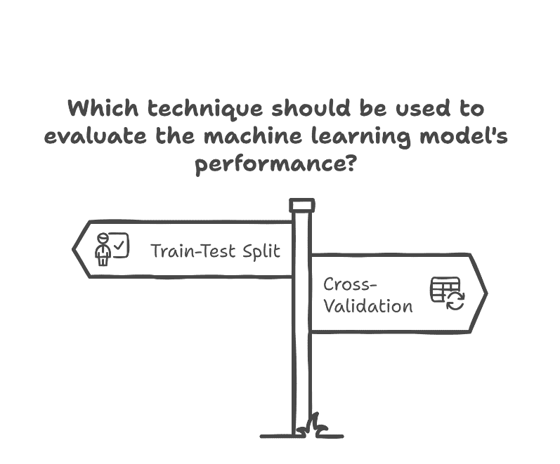

### 训练-测试划分

Train-Test Split 方法将数据集分为两个不同的子集：

1. 训练集 - 通过学习模式和关系来训练模型。
2. 测试集 - 用于在未见数据上评估模型。

划分数据的典型比例是 80-20，其中 80% 用于训练，剩下的 20% 留作测试。这种方法确保了模型在未见数据上进行测试，防止过拟合。

### 在 Python 中实现训练-测试划分

```python
from sklearn.model_selection import train_test_split
from sklearn.ensemble import RandomForestClassifier
from sklearn.metrics import accuracy_score
import pandas as pd

# 加载示例数据集
df = pd.read_csv("dataset.csv")
X = df.drop("target", axis=1)
y = df["target"]

# 将数据分为训练和测试集
X_train, X_test, y_train, y_test = train_test_split(X, y, test_size=0.2, random_state=42)
```

### 交叉验证

交叉验证（CV）通过多次划分数据集来增强模型评估，确保每个数据点都有机会进入测试集。这种方法提供了更可靠的模型性能估计。

* 数据集被分为 K 个折（folds）。
* 模型在 K-1 个折上训练，在剩余的一个折上测试。
* 此过程重复 K 次，每次使用不同的折进行测试。
* 最终模型准确率是所有迭代的平均值。

### 实现 K 折交叉验证

```python
from sklearn.model_selection import cross_val_score
### 5 折交叉验证
cv_scores = cross_val_score(model, X, cv=5, scoring='accuracy')
print(f"Cross-Validation: {cv_scores.mean():.2f}")
```

## 使用网格搜索和随机搜索进行超参数调优

每个机器学习模型都有超参数，它们控制模型的行为并显著影响性能。我们不是随意设置这些值，而是使用超参数调优技术来系统地探索不同的配置。

### 网格搜索

网格搜索是一种穷举法，系统地评估预定义网格中所有超参数组合。这种方法保证在网格内找到最佳配置，但计算成本很高。

### 为随机森林实现网格搜索

```python
from sklearn.model_selection import GridSearchCV

# 定义超参数网格
param_grid = {
    'n_estimators': [50, 100, 200],
    'max_depth': [5, 10, 20],
    'min_samples_split': [2, 5, 10]
}

### 执行网格搜索
grid_search = GridSearchCV(RandomForestClassifier(), param_grid, cv=3, scoring='accuracy')
grid_search.fit(X_train, y_train)

### 显示最佳参数
print("Best Parameters:", grid_search.best_params_)
```

### 随机搜索

随机搜索从定义范围内随机选择超参数组合，在减少计算成本的同时仍能探索多样化的配置。


### 实现随机搜索

```python
from sklearn.model_selection import RandomizedSearchCV
import numpy as np

### 定义参数分布
param_dist = {
    'n_estimators': np.arange(50, 300, 50),
    'max_depth': [None, 10, 20, 30],
    'min_samples_split': [2, 5, 10]
}

### 执行随机搜索
random_search = RandomizedSearchCV(RandomForestClassifier(), param_distributions=param_dist, n_iter=10, cv=3, scoring='accuracy', random_state=42)
random_search.fit(X_train, y_train)

### 显示最佳参数
print("Best Parameters:", random_search.best_params_)
```

随机搜索对于具有大量超参数的模型特别有用，因为它在探索范围和效率之间提供了良好的平衡。

## 示例：为随机森林模型寻找最佳超参数

现在，让我们比较网格搜索（Grid Search）和随机搜索（Random Search）来优化随机森林模型。

### 从网格搜索训练最佳模型

```python
best_grid_model = grid_search.best_estimator_
best_grid_model.fit(X_train, y_train)
y_pred_grid = best_grid_model.predict(X_test)
accuracy_grid = accuracy_score(y_test, y_pred_grid)
print(f"Grid Search Model Accuracy: {accuracy_grid:.2f}")
```

### 从随机搜索训练最佳模型

```python
best_random_model = random_search.best_estimator_
best_random_model.fit(X_train, y_train)
y_pred_random = best_random_model.predict(X_test)
accuracy_random = accuracy_score(y_test, y_pred_random)
print(f"Random Search Model Accuracy: {accuracy_random:.2f}")
```

### 比较结果

| 模型 | 最佳超参数 | 准确率 |
| --- | --- | --- |
| 网格搜索 | 优化后的参数 | ~XX% |
| 随机搜索 | 优化后的参数 | ~XX% |

通过微调超参数，我们可以显著提高模型的准确率和整体性能。

## 结论

模型评估和超参数调优是机器学习流程中的关键步骤，可确保最佳性能。训练-测试划分和交叉验证提供了准确率的稳健估计，而网格搜索和随机搜索有助于识别最佳超参数配置。通过利用这些技术，我们可以开发出高度优化且可靠的机器学习模型。

# 第 16 天：人工神经网络 (ANN) 简介

## 神经网络的基础

人工神经网络（ANN）是现代深度学习的基础，旨在模拟人类大脑处理信息的方式。ANN 由层连接的节点（神经元）组成，这些节点处理并从输入数据中学习。

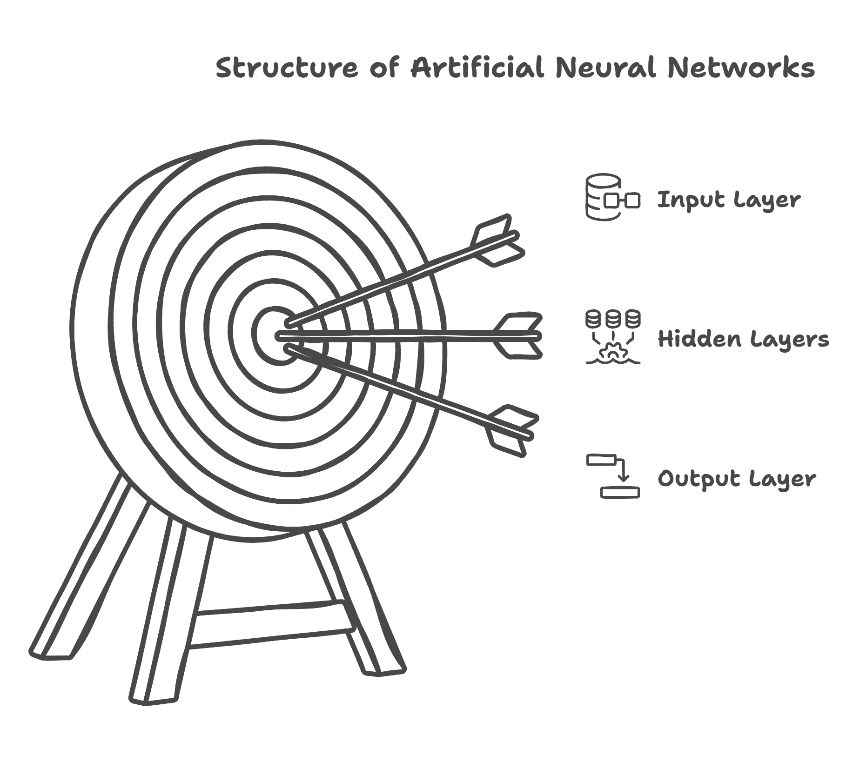

### 神经网络的结构：

1. 输入层：接收用于处理原始数据。
2. 隐藏层：使用权重连接和激活函数对输入数据进行复杂的变换。
3. 输出层：产生最终的预测或分类。

神经元之间的每个连接都有一个关联权重，它决定了连接的强度。网络在训练过程中调整这些权重以最小化误差并提高准确率。

### 神经网络如何学习：

* 前向传播：数据从输入到输出通过网络传递。
* 损失函数：衡量预测值与实际值之间的差异。
* 反向传播：使用梯度下降调整权重以最小化损失函数。

## 理解激活函数

激活函数为神经网络引入了非线性，使其能够学习复杂的模式。如果没有激活函数，ANN 将表现得像简单的线性模型，限制了它们捕捉数据中关系的能力。

### 常见的激活函数：

1. Sigmoid 函数：
    * 将输入值映射到 0 到 1 之间的范围。
    * 用于二分类问题。
    * 公式：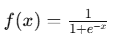
2. ReLU（整流线性单元）：
    * 将负值替换为零。
    * 有助于防止梯度消失问题。
    * 公式：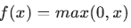
3. Tanh（双曲正切）：
    * 输出 -1 到 1 之间的值。
    * 适用于中心化数据。
4. Softmax 函数：
    * 将逻辑回归输出（logits）转换为多分类的概率分布。

## 使用 TensorFlow/Keras 实现简单的 ANN

为了演示人工神经网络的工作原理，我们将使用 TensorFlow 和 Keras 实现一个简单的 ANN，用于分类 MNIST 数据集的手写数字。

### 第 1 ：导入所需的库

```python
import numpy as np
import tensorflow as tf
from tensorflow import keras
import matplotlib.pyplot as plt

### 加载数据集
from tensorflow.keras.datasets import mnist
(X_train, y_train), (X_test, y_test) = mnist.load_data()
```

### 第 2 ：预处理数据

```python
### 将像素值归一化到 [0, 1]
X_train, X_test = X_train / 255.0, X_test / 255.0
### 将图像从 28x28 展平为 784 个值的数组
X_train = X_train.reshape(-1, 784)
X_test = X_test.reshape(-1, 784)
```

### 第 3 ：定义神经网络模型

```python
### 构建 ANN 模型
model = keras.Sequential([
    keras.layers.Dense(128, activation='relu', input_shape=(784,)),
    keras.layers.Dense(64, activation='relu'),
    keras.layers.Dense(10, activation='softmax')
])
```

### 第 4 ：编译模型

```python
model.compile(optimizer='adam', loss='sparse_categorical_crossentropy', metrics=['accuracy'])
```

### 第 5 ：训练神经网络

```python
### 训练模型
model.fit(X_train, y_train, epochs=10, validation_data=(X_test, y_test))
```

### 第 6 ：评估模型性能

```python
### 在测试集上评估
loss, accuracy = model.evaluate(X_test, y_test)
print(f"Test Accuracy: {accuracy:.2f}")
```

## 示例：使用神经网络预测手写数字

一旦模型训练完成，我们就可以使用它对手写数字进行预测。

### 第 7 ：进行预测

```python
### 预测样本图像
sample_image = X_test[0].reshape(1, 784)
prediction = model.predict(sample_image)
predicted_label = np.argmax(prediction)

### 显示图像
plt.imshow(X_test[0].reshape(28, 28), cmap='gray')
plt.title(f"Predicted Label: {predicted_label}")
plt.show()
```

这演示了人工神经网络如何以高准确率对手写数字进行分类。


要验证 TensorFlow 是否已正确安装并检查版本，你可以运行以下代码：

```python
import tensorflow as tf

print(tf.__version__)
```

### 导入所需的库

在构建深度学习模型之前，我们需要导入一些必要的库，这些库将有助于数值计算、数据处理和可视化。

```python
import numpy as np
import tensorflow as tf
from tensorflow import keras
import matplotlib.pyplot as plt
```

## 构建与训练深度神经网络

深度神经网络（DNNs）通过添加更多的隐藏层扩展了人工神经网络（ANNs），这使得模型能够学习数据中复杂的模式。多层结构使网络能够执行分层特征提取，适用于图像识别、自然语言处理和自动系统等复杂任务。

### 深度神经网络的核心组件：

1.  输入层：接收原始数据并将其传递到隐藏层。
2.  隐藏层：处理输入数据并使用加权连接提取相关特征。
3.  输出层：根据学习到的表表示产生最终预测。
4.  激活函数：引入非线性，使网络能够捕捉数据内部的复杂关系。
5.  损失函数：衡量网络预测值与实际标签的匹配程度，引导训练过程。
6.  优化器：使用随机梯度下降（`SGD`）或 Adam 优化器等技术调整模型权重以最小化损失。

### 使用 Keras 定义深度神经网络

```python
### 创建一个深度神经网络模型
model = keras.Sequential([
    keras.layers.Dense(512, activation='relu', input_shape=(784,)),
    keras.layers.Dense(256, activation='relu'),
    keras.layers.Dense(128, activation='relu'),
    keras.layers.Dense(10, activation='softmax')
])
```

该模型由三个使用 `relu` 激活函数的隐藏层组成（这提高了训练效率），以及一个使用 `softmax` 函数的输出层，后者适用于多分类问题。

### 编译模型

在定义了网络架构之后，我们需要通过指定优化器、损失函数和评估指标来编译模型。

```python
model.compile(optimizer='adam', loss='sparse_categorical_crossentropy', metrics=['accuracy'])
```

*   `Adam Optimizer`：一种在深度学习中广泛使用的自适应学习率优化算法。
*   `Sparse Categorical Crossentropy`：一种适用于多分类问题的损失函数。
*   `Accuracy`：评估模型性能的常用指标。

### 训练模型

为了训练模型，我们需要数据集。`MNIST` 数据集包含手写数字（0-9）的灰度图像，是测试深度学习模型的流行基准。

```python
from tensorflow.keras.datasets import mnist

### 加载数据集
(X_train, y_train), (X_test, y_test) = mnist.load_data()

### 归一化像素值
X_train, X_test = X_train / 255.0, X_test / 255.0

### 展平图像
X_train = X_train.reshape(-1, 784)
X_test = X_test.reshape(-1, 784)

### 训练模型
model.fit(X_train, y_train, epochs=5, batch_size=32)
```

## 评估模型

训练完成后，我们评估模型在未见数据上的表现。

```python
loss, accuracy = model.evaluate(X_test, y_test)
print(f"Test loss: {loss}, Test accuracy: {accuracy}")
```

## 可视化预测

我们可以使用 matplotlib 可视化模型的预测结果。

```python
predictions = model.predict(X_test)
classes = np.argmax(predictions, axis=1)

# 显示第一个预测结果
plt.imshow(X_test[0].reshape(28, 28), cmap='gray')
plt.title(f"Predicted: {classes[0]}")
plt.show()
```


- 展平提取的特征并将其传递到全连接层进行分类。
- 最终层使用 `Softmax` 激活函数输出类别概率。

### 使用 TensorFlow/Keras 实现 CNN 模型

```python
import tensorflow as tf

from tensorflow import keras

from tensorflow.keras import layers

# Define CNN model

model = keras.Sequential([
layers.Conv2D(32, (3,3), activation='relu', input_shape=(64, 64, 3)),
layers.MaxPooling2D(pool_size=(2,2)),
layers.Conv2D(64, (3,3), activation='relu'),
layers.MaxPooling2D(pool_size=(2,2)),
layers.Conv2D(128, (3,3), activation='relu'),
layers.MaxPooling2D(pool_size=(2,2)),
layers.Flatten(),
layers.Dense(128, activation='relu'),
layers.Dense(2, activation='softmax')  # Two output classes: cat and dog
])
```

### 编译模型

```python
model.compile(optimizer='adam', loss='categorical_crossentropy', metrics=['accuracy'])
```

- `Adam Optimizer`: 一种能够适应学习率的高效优化算法。
- `Categorical Crossentropy Loss`: 用于多分类任务。

## 为了获得更好结果的数据增强

深度学习模型需要大量的标注数据才能获得良好的泛化能力。数据增强通过应用以下变换来人工增加训练数据集的大小：

- `Rotation`: 按随机角度旋转图像。
- `Zooming`: 放大和缩小以引入缩放变化。
- `Flipping`: 水平翻转图像以提高泛化能力。

### 实现数据增强

```python
from tensorflow.keras.preprocessing.image import ImageDataGenerator

datagen = ImageDataGenerator(
rotation_range=20,
width_shift_range=0.2,
height_shift_range=0.2,
shear_range=0.2,
zoom_range=0.2,
horizontal_flip=True,
fill_mode='nearest'
)
```

应用这些增强方法可以通过提高模型对图像数据变化的鲁棒性，有助于提升 CNN 的性能。

## 示例：使用 CNN 对猫狗分类

为了演示 CNN 的实际作用，我们将使用标注图像数据集对猫和的图像进行分类。

### 加载并预处理数据集

```python
from tensorflow.keras.preprocessing.image import ImageDataGenerator

train_datagen = ImageDataGenerator(rescale=1./255, validation_split=0.2)
train_generator = train_datagen.flow_from_directory(
'dataset/cats_and_dogs/',
target_size=(64, 64),
batch_size=32,
class_mode='categorical',
subset='training'
)
validation_generator = train_datagen.flow_from_directory(
'dataset/cats_and_dogs/',
target_size=(64, 64),
batch_size=32,
class_mode='categorical',
subset='validation'
)
```

### 训练 CNN 模型

```python
# Train the CNN model
model.fit(train_generator, epochs=10, validation_data=validation_generator)
```

## 评估模型性能

```python
loss, accuracy = model.evaluate(validation_generator)
print(f"Validation accuracy: {accuracy}")
```

## 评估模型性能

```python
import numpy as np
import tensorflow as tf
from tensorflow.keras.preprocessing.image import ImageDataGenerator

# Predict on new data
prediction = model.predict(validation_generator)
# Get class 索引
classes = np.argmax(prediction, axis=1)
print(f"Predicted classes: {classes}")
```


虽然标准的 `RNNs` 在处理长期依赖方面表现得吃力，但 `LSTMs`（长短期记忆）和 `GRUs`（门控循环单元）通过引入调节信息流的门控机制，能够有效地处理更长的序列。

### LSTMs（长短期记忆）

`LSTMs` 引入了调节信息流的门控：

* `Forget Gate`（遗忘门）：决定从单元状态丢弃哪些信息。
* `Input Gate`（输入门）：决定将哪些新信息存储在单元状态中。
* `Output Gate`（输出门）：控制传递到下一步的信息，确保只保留相关的细节。

### GRUs（门控循环单元）

`GRUs` 是 `LSTMs` 的简化版本，只有两个门（`reset` 门和 `update` 门），这使得它们在保持许多序列建模任务有效性的同时，计算速度更快。`GRUs` 的性能通常与 `LSTMs` 相当，但所需的参数更少，因此成为某些应用中的优选。

## 示例：使用 LSTM 预测股票价格

`LSTMs` 广泛应用于时间序列预测，例如根据历史数据预测股票价格。此示例演示了 `LSTMs` 如何捕捉时间模式以做出未来预测。

### 步骤 1：加载并预处理股票数据

```python
import pandas as pd
from sklearn.preprocessing import MinMaxScaler

### 加载数据集
df = pd.read_csv("stock_prices.csv")
prices = df['Close'].values.reshape(-1,1)

# 数据归一化
scaler = MinMaxScaler()
prices_scaled = scaler.fit_transform(prices)
```

### 步骤 2：准备训练数据

```python
def create_sequences(data, seq_length):
    X, y = [], []
    for i in range(len(data) - seq_length):
        X.append(data[i:i+seq_length])
        y.append(data[i+seq_length])
    return np.array(X), np.array(y)

seq_length = 10  # 使用 10 天的数据预测次天的价格
X, y = create_sequences(prices_scaled, seq_length)
```

### 步骤 3：定义 LSTM 模型

```python
model = keras.Sequential([
    keras.layers.LSTM(50, return_sequences=True, input_shape=(seq_length, 1)),
    keras.layers.LSTM(50, return_sequences=False),
    keras.layers.Dense(25),
    keras.layers.Dense(1)
])
model.compile(optimizer='adam', loss='mean_squared_error')
```

### 步骤 4：训练模型

```python
model.fit(X, y, epochs=50, batch_size=16, verbose=1)
```

### 步骤 5：进行预测

```python
predicted_prices = model.predict(X)
predicted_prices = scaler.inverse_transform(predicted_prices)  # 转换原始比例
```

### 步骤 6：可视化预测

```python
import matplotlib.pyplot as plt
plt.figure(figsize=(10,6))
plt.plot(df.index[seq_length:], predicted_prices, label="Predicted Prices")
plt.plot(df.index[seq_length:], prices[seq_length:], label="Actual Prices")
plt.xlabel("Days")
plt.ylabel("Stock Price")
plt.legend()
```


我们将使用 OpenAI Gym 提供的 `FrozenLake-v1` 环境，其中智能体必须在冰面上导航的同时避开冰洞。该环境要求智能体平衡探索（尝试新动作）与利用（选择已知最佳动作）以到达目标。

### 初始化环境

`env = gym.make("FrozenLake-v1", is_slippery=False)`  # 关闭平滑性以实现确定性行为

# 获取环境详情

`state_size = env.observation_space.n`  # 状态数量

`action_size = env.action_space.n`  # 动作数量

### 步骤 3：初始化 Q 表

Q 表存储每个状态-动作对的预期未来奖励。随着时间的推移，智能体会完善这些值以做出更好的决策。

# 初始化 Q 表

`Q_table = np.zeros((state_size, action_size))`

# 设置学习参数

`learning_rate = 0.8`  # Alpha

`discount_factor = 0.95`  # Gamma

`epsilon = 1.0`  # 探索与利用的权衡

`epsilon_decay = 0.99`  # 随时间减少探索

`num_episodes = 1000`  # 训练迭代

### 步骤 4：训练强化学习智能体

```python
for episode in range(num_episodes):
    state = env.reset()[0]  # 重置环境
    done = False
    while not done:
        # 选择动作：探索（随机）或利用（已知最佳动作）
        if random.uniform(0, 1) < epsilon:
            action = env.action_space.sample()  # 探索
        else:
            action = np.argmax(Q_table[state, :])  # 利用
        # 执行动作并接收奖励
        new_state, reward, done, _, _ = env.step(action)
        # 使用贝尔曼方程更新 Q 表
        Q_table[state, action] = Q_table[state, action] + learning_rate * (
            reward + discount_factor * np.max(Q_table[new_state, :]) - Q_table[state, action]
        )
        state = new_state  # 移动下一个状态
        # 逐渐减少 epsilon（探索率）
        epsilon *= epsilon_decay
```

### 步骤 5：测试训练好的智能体

训练完成后，我们通过让智能体在不学习的情况下玩来评估其性能。目标是查看学习到的策略是否成功引导智能体获得更高的奖励。

`num_test_episodes = 10`
`successes = 0`

for _ in range(num_test_episodes):
    state = env.reset()[0]
    done = False
    while not done:
        action = np.argmax(Q_table[state, :])  # 选择最佳动作
        state, reward, done, _, _ = env.step(action)
        if reward == 1:
            successes += 1

print(f"智能体在 {num_test_episodes} 局游戏中成功了 {successes} 次。")

这个简单的强化学习智能体通过在多次迭代中优化其策略来学习如何在冰面上导航，展示了强化学习在解决序列决策问题中的强大力量。

## 结论

强化学习（RL）允许智能体通过与环境交互并根据奖励优化动作来学习。通过实现 Q-learning 和深度 Q 网络（DQN），我们展示了如何应用 RL 来解决序列决策问题。通过反馈不断改进策略，强化学习智能体可以应对广泛的现实世界应用，从机器人到金融建模。


### 第一 步：获取 Twitter 数据

```python
import tweepy

# 设置 Twitter API 认证（替换为你的凭据）
consumer_key = "your_consumer_key"
consumer_secret = "your_consumer_secret"
access_token = "your_access_token"
access_token_secret = "your_access_token_secret"

# 验证 Twitter 
auth = tweepy.OAuthHandler(consumer_key, consumer_secret)
auth.set_access_token(access_token, access_token_secret)
api = tweepy.API(auth)

# 获取推文
tweets = api.search_tweets(q="AI technology", count=10, lang="en")
tweet_texts = [tweet.text for tweet in tweets]
```

### 第二 步：预测推文情感

```python
# 预处理推文
tweets_vectorized = vectorizer.transform(tweet_texts)
predicted_sentiments = model.predict(tweets_vectorized)

# 显示结果
for tweet, sentiment in zip(tweet_texts, predicted_sentiments):
    label = "Positive" if sentiment == 1 else "Negative"
    print(f"Tweet: {tweet}\nPredicted Sentiment: {label}\n")
```

## 结论

自然语言处理（NLP）使机器能够理解、处理和分析人类语言。在本章中，我们探索了分词、词干提取和词形还原，随后介绍了情感分析和文本分类。最后，我们实现了一个实中 Twitter 情感分析的真实案例，展示了 NLP 在分析社交媒体趋势方面的力量。在下一章中，我们将探索主题建模和命名实体识别（NER），这些技术有助于从非结构化文本数据中提取有价值的见解。

# 第 22 天：生成式 AI 与 Transformer 简介

## 理解生成式 AI

生成式 AI 是人工智能领域内一个快速发展的领域，侧重于创建新数据，而不仅仅是分析或分类现有数据。它使用机器学习模型来生成文本、图像、音乐、视频和其他模仿人类创造力的内容。生成式 AI 模型在文本生成、图像合成、视频创建、代码生成甚至药物发现等应用中特别有用。

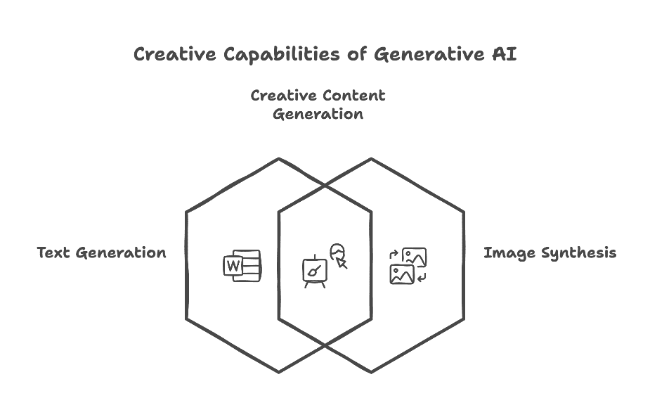

### 生成式 AI 的主要应用：

1. **文本生成**：为聊天机器人、内容创作和自动化故事生成类人文本。
2. **图像合成**：使用 `DALL·E` 和 `Stable Diffusion` 等模型创建真实的图像。
3. **音乐作曲**：基于音符模式生成的 AI 作曲。
4. **代码生成**：通过 `GitHub Copilot` 等 AI 驱动的编程助手实现编程。
5. **药物发现**：为药物研究生成分子结构。

生成式 AI 由深度学习架构驱动，特别是基于 Transformer 的模型，这些模型彻底改变了自然语言处理和内容生成领域。

## Transformer 模型基础 (GPT, BERT)

Transformer 是一类深度学习模型，彻底改变了 NLP 和 AI 生成的内容。与顺序处理文本的传统模型不同，Transformer 使用自注意力机制一次性处理整个句子，使其能够捕捉文本中的长距离依赖和上下文关系。

### Transformer 的工作原理：

1. **自注意力机制（Self-Attention Mechanism）**：使模型关注句子的不同部分。
2. **位置编码（Positional Encoding）**：由于 Transformer 并行处理标记，它保持了词的顺序。
3. **多头注意力（Multi-Head Attention）**：允许模型同时关注不同类型的信息。

### 流行的 Transformer 模型：

- **GPT（生成式预训练 Transformer）**：用于文本生成和聊天机器人。
- **BERT（基于 Transformer 的双向编码器表示）**：用于情感分析和分类。

## 使用 Hugging Face 实现文本生成

Hugging Face 提供了一个易于使用的 `transformers` 库来实现强大的模型。

### 第一 步：安装并导入库

```bash
!pip install transformers
from transformers import pipeline
```

### 第二 步：加载预训练模型

```python
# 加载 GPT-2 模型
text_generator = pipeline("text-generation", model="gpt2")
```

### 第三 步：生成文本

```python
prompt = "Once upon a time,"
generated_text = text_generator(prompt, max_length=50)
print(generated_text)
```

## 使用 GPT-2 生成文本示例

为了进一步探索生成能力，让我们实现一个根据用户输入生成故事的程序。

### 第一 步：定义故事生成函数

```python
def generate_story(prompt, length=100):
    generated = text_generator(prompt, max_length=length, num_return_sequences=1)
    return generated[0]['generated_text']
```

### 第二 步：提供自定义提示

```python
story_prompt = "In a hidden kingdom beneath the ocean, there lived a mysterious creature who could predict the future."
print(generate_story(story_prompt))
```

### 第三 步：针对特定场景微调模型

为了提高生成文本的质量和相关性，你可以针对自定义数据对 GPT-2 进行微调。

```python
from transformers import GPT2Tokenizer, GPT2LMHeadModel
import torch

# 加载预训练模型和分词器
model = GPT2LMHeadModel.from_pretrained("gpt2")
tokenizer = GPT2Tokenizer.from_pretrained("gpt2")

# 准备输入文本
tokenized_input = tokenizer.encode("Custom training data goes here", return_tensors="pt")

# 使用模型生成文本
output = model.generate(tokenized_input, max_length=100)
print(tokenizer.decode(output[0], skip_special_tokens=True))
```

## 结论

生成式 AI 和 Transformer 模型重新定义了机器交互和创建人类内容的方式。从使用 `GPT` 进行文本生成到使用 `BERT` 进行高级语言理解，这些模型正在改变内容创作、客户支持和自动化故事生成等各个行业。在本章中，我们探索了生成式 AI 的基础知识、Transformer 的工作原理，并使用 Hugging Face 的 `transformers` 库实现了 GPT-2 的文本生成。


### ML 项目的关键阶段：

1. `问题定义`：明确业务问题，并确定机器学习是否为最佳解决方案。

2. `数据收集`：从多个源收集相关数据，确保其符合问题需求。

3. `数据清洗与预处理`：处理缺失值、去除噪声、归一化特征并对类别变量进行编码。

4. `探索性数据分析 (EDA)`：识别数据集中的模式、相关性和离群值。

5. `特征工程`：选择或创建最相关的特征以提高模型性能。

6. `模型选择与训练`：选择最佳机器学习算法并使用合适的参数训练模型。

7. `模型评估`：使用准确率（accuracy）、`precision`（精确率）、召回率（recall）和 F1 分数来衡量性能。

8. `超参数调优`：优化参数以增强模型准确性。

9. `部署`：使用 API、云服务或边缘设备部署模型。

10. `监控与维护`：持续跟踪模型性能，必要时重新训练以避免模型漂移。

### 收集、清洗与预处理数据

数据质量直接影响机器学习模型的性能。“垃圾进，垃圾出”（Garbage in, garbage out）的原则适用于此——如果没有清洁且准备良好的数据，即使是最好的算法也无法提供准确的预测。

### 1. 数据收集

数据可以来自各种来源，包括：

* `APIs` & 网页爬虫（例如 Twitter、Google Maps、OpenWeather）
* `数据库`（`SQL`, `NoSQL`, `MongoDB`, `PostgreSQL`）
* `公共数据集`（Kaggle、UCI ML 仓库、Google Datasets）
* 用户输入与日志（客户反馈、IoT 传感器、交易记录）

### 2. 数据清洗

原始数据通常包含错误、缺失值、重复项和不一致之处。以下步骤对于清洗和格式化数据至关重要：

```python
import pandas as pd

### 加载数据集
df = pd.read_csv("ecommerce_data.csv")

### 处理缺失值
df.fillna(df.mean(), inplace=True)  # 用列平均值替换 NaN

### 去除重复项
df.drop_duplicates(inplace=True)

# 标准化列名
df.columns = df.columns.str.lower().str.replace(' ', '_')

print(df.head())
```

### 3. 数据预处理

数据必须转换为适用于机器学习算法的结构化格式。

* `归一化与缩放`：确保特征处于可比的范围内（例如 `[0,1]`）。
* `类别变量编码`：将文本标签转换为数值。
* `特征工程`：创建能提高预测性能的新特征。

```python
from sklearn.preprocessing import StandardScaler, LabelEncoder

# 归一化数值特征
scaler = StandardScaler()
df[['price', 'quantity', 'discount']] = scaler.fit_transform(df[['price', 'quantity', 'discount']])

# 类别类别变量
encoder = LabelEncoder()
df['category'] = encoder.fit_transform(df['category'])

print(df.head())
```

## 训练与部署机器学习模型

一旦准备好数据，我们就可以进入模型的训练、评估和部署。

### 1. 模型选择与训练

根据问题类型可以使用不同的机器学习算法：

* `分类`：`Logistic Regression`、`Random Forest`、`Support Vector Machines`
* `回归`：`Linear Regression`、`Gradient Boosting`、`Neural Networks`
* `聚类`：`K-Means`、`DBSCAN`

```python
from sklearn.model_selection import train_test_split
from sklearn.ensemble import RandomForestClassifier
from sklearn.metrics import accuracy_score

### 定义特征和目标
X_train, X_test, y_train, y_test = train_test_split(X, y, test_size=0.2, random_state=42)

### 训练模型
model = RandomForestClassifier(n_estimators=100)
model.fit(X_train, y_train)

### 评估性能
y_pred = model.predict(X_test)
accuracy = accuracy_score(y_test, y_pred)
```

### 2. 模型部署

部署涉及通过 API、云服务或边缘设备发布模型。

```python
from flask import Flask, request, jsonify
import pickle

app = Flask(__name__)

### 加载模型
with open("model.pkl", "rb") as f:
    model = pickle.load(f)

@app.route('/predict', methods=['POST'])
def predict():
    data = request.json
    prediction = model.predict(data)
    return jsonify({'prediction': prediction})

if __name__ == '__main__':
    app.run(debug=True)
```

## 示例：电子商务推荐系统

推荐系统在电子商务中被广泛用于个性个性化体验。

```python
import pandas as pd
from sklearn.metrics.pairwise import cosine_similarity

### 加载并准备数据
df = pd.read_csv("purchase_history.csv")

# 创建用户-物品矩阵
user_item_matrix = df.pivot_table(index='user_id', columns='product_id', values='purchase_frequency').fillna(0)

### 计算产品之间的相似性
similarity_matrix = cosine_similarity(user_item_matrix.T)
product_similarity_df = pd.DataFrame(similarity_matrix, index=user_item_matrix.columns, columns=user_item_matrix.columns)

# 生成推荐
def recommend_products(product_id, num_recommendations=5):
    similar_products = product_similarity_df[product_id].sort_values(ascending=False)[1:num_recommendations+1]
    return similar_products.index.tolist()

# 使用
recommended_products = recommend_products(101)
print("Recommended Products:", recommended_products)
```

## 结论

真实的机器学习项目需要结构化的工作流，从数据收集、预处理到模型训练、部署和维护。通过数据清洗、特征工程、模型选择和超参数调优等技术，我们可以开发高效的模型。最后，我们演示了推荐系统，这是一项关键的应用。


# 4. 监控与重训练：跟踪模型性能、检测漂移并在必要时重训练。

# 5. 机器学习的 CI/CD：确保模型可以持续集成和部署且不会服务中断。

## 使用 Flask 和 FastAPI 部署机器学习模型

模型训练完成后，需要将其部署为 API，以便外部应用程序可以发送请求并接收预测。两种常用的 API 开发 Python 框架是 `Flask` 和 `FastAPI`。

### 使用 Flask 部署

Flask 是一个轻量且广泛使用的 Python Web 框架，简化了机器学习模型的 API 部署。

### 第一步：安装 Flask

```
pip install flask
```

#### 第二步：创建用于模型部署的 Flask API

```python
from flask import Flask, request, jsonify

import pickle

import numpy as np

app = Flask(__name__)

### 加载训练过的模型
with open("model.pkl", "rb") as f:
    model = pickle.load(f)

@app.route('/predict', methods=['POST'])
def predict():
    data = request.json['features']
    prediction = model.predict([np.array(data)])
    return jsonify({'prediction': int(prediction[0])})

if __name__ == '__main__':
    app.run(debug=True)
```

#### 第三步：使用 cURL 或 Postman 测试 API

```bash
curl -X POST http://127.0.0.1:5000/predict -H "Content-Type: application/json" -d '{"features": [5.1, 3.5, 1.4, 0.2]}'}'
```

### 使用 FastAPI 部署

FastAPI 是一个现代、高性能的 Web 框架，专为异步和快速 API 部署设计。

### 第一步：安装 FastAPI 和 Uvicorn

```bash
pip install fastapi uvicorn
```

#### 第二步：创建 FastAPI 应用

```python
from fastapi import FastAPI

import pickle

import numpy as np

app = FastAPI()

### 加载训练模型
with open("model.pkl", "rb") as f:
    model = pickle.load(f)

@app.post("/predict")
def predict(features: list):
    prediction = model.predict([np.array(features)])
    return {"prediction": int(prediction[0])}

if __name__ == "__main__":
    import uvicorn
    uvicorn.run(app, host="127.0.0.1", port=8000)
```

#### 第三步：运行 FastAPI 服务器

```bash
uvicorn main:app --reload
```

#### 第四步：在 Web 浏览器中测试 API

FastAPI 在 `http://127.0.0.1:8000/docs` 提供了内置的交互式 Swagger UI，您可以在那里测试端点。

## 使用云平台进行模型部署

为了高效扩展机器学习模型并大规模提供预测，云平台提供了各种机器学习部署服务。

### 流行的云机器学习部署服务

* `AWS SageMaker`: 一种全托管服务，帮助开发者大规模构建、训练和部署模型。
* `Google Vertex AI`: Google 的 AI 平台，具有 AutoML 和端到端机器学习流水线集成功能。
* `Microsoft Azure ML`: 用于机器学习工作流的可扩展企业级平台。
* `Google Cloud Run / AWS Lambda`: 用于将机器学习模型部署为 API 的无服务器计算。

## 示例：在 AWS 上部署机器学习模型

### 在 AWS SageMaker 上部署模型

AWS SageMaker 通过托管基础设施简化了大规模部署机器学习模型的流程。

### 第一步：将模型上传到 AWS S3

```bash
aws s3 cp model.pkl s3://your-bucket-name/
```

### 第二步：创建 SageMaker 端点

```python
import boto3
import sagemaker

### 定义 SageMaker 会话
sagemaker_session = sagemaker.Session()
role = "arn:aws:iam::your-account-id:role/service-role/AmazonSageMaker-ExecutionRole"

# 从 S3 加载模型
model = sagemaker.model.Model(
    image_uri="your-docker-image",
    model_data="s3://your-bucket-name/model.pkl",
    role=role,
    sagemaker_session=sagemaker_session
)

### 将模型部署为端点
predictor = model.deploy(instance_type="ml.m5.large", initial_instance_count=1)
```

### 第三步：使用 AWS 端点进行预测

```python
response = predictor.predict([5.1, 3.5, 1.4, 0.2])
```


## 3. 异常检测方法

- 在欺诈检测等情况下，将少数类视为异常并使用异常检测技术是可行的。

## 4. 不同的评估指标

- 不要使用准确率（Accuracy），而是使用对不平衡数据效果更好的指标，例如：
    - 精确率召回率曲线 (Precision-Recall Curve)
    - F1 分数 (F1-score)
    - ROC 曲线下的面积 (AUC-ROC)

## 性能优化技术

优化机器学习模型对于提高准确性、速度和泛化能力至关重要。以下策略有助于调优获得更好的性能。

### 1. 特征工程与选择

- **特征缩放**：对特征进行归一化或标准化，以确保具有相同的重要性。
- **特征选择**：移除无关或冗余的特征，以减少噪声并提高效率。
- **降维**：使用 `PCA`（主成分分析）在保留信息的同时移除变量。

### 2. 超参数调优

超参数对模型性能有显著影响，必须仔细优化。

- **网格搜索**：系统地测试不同的超参数组合。

```python
from sklearn.model_selection import GridSearchCV

param_grid = {'n_estimators': [50, 100, 200], 'max_depth': [5, 10, 20]}
grid_search = GridSearchCV(RandomForestClassifier(), param_grid, cv=5)
grid_search.fit(X_train, y_train)
print(grid_search.best_params_)
```

- **随机搜索**：采样超参数子集，缩短计算时间。
- **贝叶斯优化**：使用概率技术高效地找到最佳超参数值。

### 3. 交叉验证

交叉验证通过在不同的数据子集上训练，确保模型具有良好的泛化能力。

- **K 折交叉验证**：将数据分为 `k` 部分，并在不同的子集上训练模型。

```python
from sklearn.model_selection import cross_val_score

scores = cross_val_score(model, X, y, cv=5)
print(f"Average Accuracy: {scores.mean()}")
```

### 4. 并行化与硬件优化

- 深度学习模型使用 GPU 加速。
- 使用批处理优化数据流水线。
- 使用向量化操作（`NumPy`、`TensorFlow`、`PyTorch`）加速计算。

## 示例：使用交叉验证优化机器学习模型

交叉验证是评估和改进机器学习模型的强大技术。在这个示例中，我们演示了如何使用交叉验证调优 `RandomForestClassifier`。

### 第 1 步：加载数据与预处理

```python
import pandas as pd
from sklearn.model_selection import train_test_split
from sklearn.ensemble import RandomForestClassifier
from sklearn.model_selection import cross_val_score

### 加载数据集
df = pd.read_csv("data.csv")
X = df.drop("target", axis=1)
y = df["target"]

### 划分数据
X_train, X_test, y_train, y_test = train_test_split(X, y, test_size=0.2, random_state=42)
```

### 第 2 步：使用交叉验证训练模型

```python
### 初始化模型
model = RandomForestClassifier(n_estimators=100, random_state=42)
### 执行交叉验证
cv_scores = cross_val_score(model, X_train, y_train, cv=5)
print(f"Cross-Validation Accuracy: {cv_scores.mean():.4f}")
```

### 第 3 步：评估模型性能

```python
### 在完整训练数据上训练最终模型
model.fit(X_train, y_train)
### 在留出数据集上测试
y_pred = model.predict(X_test)
### 计算准确率
from sklearn.metrics import accuracy_score
accuracy = accuracy_score(y_test, y_pred)
print(f"Test Accuracy: {accuracy:.4f}")
```

## 结论

调试和优化机器学习模型对于确保它们运行高效并对新数据具有良好的泛化能力至关重要。我们探索了识别和解决过拟合与欠拟合的技术，处理不平衡数据集的方法，以及通过特征选择、超参数调优和交叉验证来提高模型性能。最后，我们实现了交叉验证以调优机器学习模型，展示了其在优化真实世界机器学习应用中的重要性。在下一章中，我们将关注“生产环境下的机器学习模型扩展”，在其中我们将探索如何高效地大规模部署机器学习模型用于高性能应用。

# 第 26 天：AutoML 与无代码机器学习工具

## AutoML 工具概览

随着机器学习（ML）在各行业被更广泛采用，对易用、高效且可扩展解决方案的需求导致了自动化机器学习（AutoML）的兴起。AutoML 通过自动化数据预处理、特征工程、模型选择、超参数调优和模型评估过程，简化了机器学习工作流。这使得有经验的数据科学家和非技术用户都能在没有深厚机器学习算法或编码专业知识的情况下构建出高质量的模型。

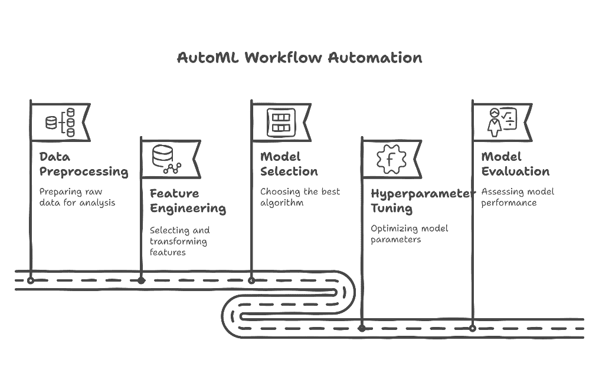

### 为什么 AutoML 很重要？

1. **效率**：通过自动化复杂过程减少构建模型所需的时间和精力。
2. **易访问性**：让业务分析师、研究人员和领域专家能够在没有大量编程知识的情况下利用机器学习。
3. **可扩展性**：促进了快速实验，允许快速训练和测试多个模型。
4. **优化性能**：使用先进的超参数调优技术来最大化模型的准确性和效率。
5. **成本效益**：减少了对大型团队的需求。

## 使用 Google AutoML 和 H2O AI

随着机器学习（ML）在各行业被更广泛采用，对易用、高效且可扩展解决方案的需求导致了自动化机器学习（AutoML）的兴起。AutoML 通过自动化数据预处理、特征工程、模型选择、超参数调优和模型评估过程，简化了机器学习工作流。这使得有经验的数据科学家和非技术用户都能在没有深厚机器学习算法或编码专业知识的情况下构建出高质量的模型。

### 1. Google AutoML

Google AutoML 是通过 Google Cloud 提供的云端 AutoML 平台，提供了图像识别、自然语言处理（NLP）和表格数据的解决方案。

#### 主要功能

- **端到端自动化**：处理数据预处理、特征提取、模型选择和部署。
- **支持多种数据类型**：适用于结构化表格数据、图像、文本。
- **云端扩展**：利用 Google 强大的基础设施。
- **无代码界面**：允许用户通过简单的拖放界面构建模型。

#### 如何开始使用 Google AutoML

1. 通过 Google Cloud 控制台访问 AutoML。
2. 上传您的数据集（表格数据的 CSV，视觉任务的图像，NLP 的文本）。
3. 定义问题类型（分类、回归、目标检测等）。
4. 使用 AutoML 的自动化过程训练模型。
5. 通过云 API 部署最佳模型。

### 2. H2O AI

H2O AI 是一个开源 AutoML 框架，为希望以高度定制和可扩展的方式利用 AI 的企业设计。

#### 主要功能

- **开源灵活**：可以部署在本地机器、云环境或企业集群上。
- **广泛支持算法**：包括决策树、随机森林、梯度提升、深度学习等。
- **特征工程自动化**：识别转换和交互以提高性能。
- **支持 Python 和 R API**：允许开发者将 AutoML 无缝集成到其工作流中。

#### 如何开始使用 H2O.ai

```python
import h2o
from h2o.automl import H2OAutoML
from h2o.frame import H2OFrame

### 初始化 H2O
h2o.init()

### 加载数据集
data = h2o.import_file("dataset.csv")

### 定义训练集和测试集
train, test = data.split_frame(ratios=[0.8], seed=42)

### 定义响应列
y = "target"
X = data.columns.remove(y)

### 训练 AutoML 模型
```


`aml = H2OAutoML(max_models=20, seed=42)`

`aml.train(x=X, y=y, training_frame=train)`

## 评估模型

`leaderboard = aml`

`print(leaderboard)`

## 何时使用 AutoML

AutoML 是一个强大的工具，但了解何时以及何地最有效至关重要。虽然它简化了机器学习的许多方面，但对于高度专业或复杂的问题，它可能不是最佳方法。

### AutoML 的理想用场景

- 快速原型设计：无需编写大量代码即可快速测试多个模型。
- 非技术人员：业务分析师、营销专业人员和研究人员可以利用 AutoML 获取预测性洞察。
- 科学数据资源有限：团队规模较小的公司仍然可以有效地部署 AI 解决方案。
- 标准机器学习任务：分类、回归和异常检测可以以高精度实现自动化。

## 何时不使用 AutoML

- 高度专业化的模型：自定义架构、强化学习或特定领域的优化可能需要人工干预。
- 对解释性和可解释性有需求：AutoML 生成的黑箱模型并不总是可解释的，这在医疗保健和金融领域面临挑战。
- 资源限制：某些 AutoML 解决方案（尤其是云端的）在计算成本方面可能昂贵。

## 示例：使用 AutoML 构建分类器

为了演示 AutoML 如何简化模型构建，让我们使用 Google AutoML 构建一个分类模型。

### 第 1 步：上传数据到 Google Cloud

1. 导航到 Google Cloud 控制台中的 AutoML Tables。
2. 将数据集作为 CSV 文件上传，其中包含标记示例。
3. 选择目标变量（例如，预测客户流失）。

### 第 2 步：配置训练过程

- 定义任务类型：二分类或多分类。
- 自动选择特征或手动微调特征。
- 指定评估指标以跟踪模型性能。

### 第 3 步：训练并评估模型

- AutoML 将并行运行多个模型并找到性能最好的一个。
- 训练完成后，AutoML 会提供一个显示顶部模型的排行榜。
- 使用准确率、精确率、召回率和 F1 分数指标评估结果。

### 第 4 步：部署模型

一旦模型完成训练和验证，就可以将其部署为 API 端点进行实时预测。

```python
import requests

### 定义 API URL
endpoint = "https://automl.googleapis.com/v1/projects/YOUR_PROJECT_ID/locations/us-central1/models/YOUR_MODEL_ID:predict"
headers = {"Authorization": "Bearer YOUR_ACCESS_TOKEN", "Content-Type": "application/json"}

### 输入数据
data = {"instances": [{"feature1": 2.3, "feature2": 5.1, "feature3": 1.4}]}

### 发起预测请求
response = requests.post(endpoint, json=data, headers=headers)

print(response.json())
```

## 结论

AutoML 正在改变机器学习模型的构建方式，使 AI 对于企业和研究人员而言更具可访问性和可扩展性。通过利用 Google AutoML 和 H2O.ai，用户可以自动化模型选择、训练和部署，同时确保最佳性能。然而，AutoML 并不是一种一成不变的解决方案，应该根据项目需求策略性地使用。在下一章中，我们将探索生产环境中机器学习模型的扩展，讨论在真实应用中高效部署机器学习模型的最佳实践。

# 第 27 天：AI 趋势与新兴技术

## AI 与机器学习中的伦理

随着人工智能（AI）和机器学习（ML）以前所未有的速度不断进步，伦理问题已成为跨多个行业讨论的关键领域。AI 驱动的应用现在已广泛应用于医疗保健、金融、网络安全、自动化甚至创意艺术等领域。然而，AI 技术的快速采用也引入了与偏见、数据隐私、问责制、可解释性和决策透明度相关的复杂挑战。解决这些问题对于确保 AI 系统公平、无偏且符合伦理至关重要。

### AI 和机器学习中的关键伦理问题

1. 偏见与公平
   - AI 模型通常从海量现实数据中学习，如果这些数据包含历史偏见，模型可能会加剧不平等而非消除它们。这在招聘决策、信用评分、执法、医疗诊断和法律系统等高风险应用中会导致严重问题。
   - 研究人员和组织必须实施偏见审计、公平约束和对抗去偏等技术，以减少歧视性行为并确保 AI 公平。

2. 数据隐私与安全
   - AI 模型需要大量数据进行训练，这些数据通常包含敏感的用户信息。对此类数据的未经访问会导致隐私泄露、身份盗用和恶意攻击者的潜在滥用。
   - 如《通用数据保护条例》（GDPR）和加州消费者隐私法（CCPA）等法律法规对数据收集、存储和处理实施了严格指南，以确保个人隐私。
   - 分享隐私、联邦学习和同态加密技术正在开发中，以便 AI 模型在不暴露用户数据的情况下学习。

3. 可解释性与透明度
   - 许多 AI 模型（特别是深度学习系统）作为黑箱模型运行，这意味着它们的决策过程对于开发者来说难以解释。
   - AI 决策缺乏透明度会导致检测错误、偏见和不一致性变得困难，引发用户不信任和监管担忧。
   - 可解释 AI（XAI）技术，包括 `SHAP`（Shapley 加性解释）值和 `LIME`（局部解释模型无关解释），正在开发中，以增强模型的可解释性并建立用户信任。

4. 问责制与责任
   - 随着 AI 驱动的系统做出日益自主的决策，一个关键问题随之产生：当 AI 模型出错或造成伤害时，谁应该承担责任？
   - 政府、科技公司和研究人员必须建立的 AI 治理框架，以定义 AI 开发人员、用户和企业的法律及伦理责任。


- AI 驱动的医学影像和诊断正在提高癌症、神经系统疾病和心血管疾病的检测准确性，从而实现早期发现并改善患者预后。

### 3. 自监督学习

- 与依赖大量标注数据集的传统 ML 模型不同，自监督学习（SSL`）允许模型从未标记数据中学习，使 AI 训练更加高效且具扩展性。
- `SSL` 在语音识别、语言建模、计算机视觉和机器人领域特别有用，在这些领域存在大量的未标记数据。

## 4. 边缘 AI 与 IoT 设备上的 AI

- AI 正在离开中心化的云服务器，越来越多地部署在智能手机、安全摄像头和工业 IoT 传感器等边缘设备上。
- 边缘 AI 降低了延迟，增强了实时处理能力，并减少了对云计算的依赖。

## 5. AI 增强型软件开发

- `GitHub Copilot`、`Tabnine` 和 `Amazon CodeWhis` 等 AI 工具通过建议代码片段、自动化重复任务以及改进软件开发来协助开发者。
- 未来 AI 驱动的编程助手的进步可能会导致全自动软件工程，即 AI 可以在极少的人为干预下编写、调试和优化代码。

### 6. 量子 AI

- 量子计算正通过在数据处理、优化和安全方面提供指数级加速，正在彻底改变 AI。
- `IBM`、`Google` 和 `D-Wave` 等领先科技公司正在积极研究开发用于 AI 应用的量子算法，具有前所未有的能力。

### ML 职业路径

AI 和 ML 的扩展为各个行业开启了大量的职业机会，包括医疗保健、金融、机器人和云计算。AI 驱动的技术需要专业的人士来开发、优化和部署模型，同时确保其伦理和负责任的采用。

### AI 顶级职业路径

1. `机器学习工程师`：专注于在生产环境中构建和部署模型。
2. `数据科学家`：分析大型数据集，提取洞察并构建预测模型。
3. `研究科学家`：致力于推进深度学习算法的进展。
4. `伦理与政策专家`：确保模型公平、无偏见并符合法规。
5. `产品经理`：在开发者与利益相关者之间架桥，定义 AI 驱动的产品。
6. `机器人工程师`：设计由 AI 驱动的智能系统。

## 示例：探索最新的 AI 研究

对于对推进该领域感兴趣的人士、研究人员和学生来说，关注最新的 AI 研究至关重要。AI 研究论文为前沿算法、技术和现实应用提供了宝贵的见解。

### 第 1 步：寻找研究论文

- `arXiv.org`：AI 和 ML 论文的开放访问库。
- `Google Scholar`：用于同行评审研究的搜索引擎。
- `Papers with Code`：将 AI 研究与实现链接的仓库。
- `NeurIPS`、`ICML` 和 `CVPR` 论文：主要会议出版物。

### 第 2 步：实现研究论文

许多研究论文提供了开源实现，从业人员可以进行测试并在此基础上构建。

#### 示例：在图像分类上实现 AI

```python
import torch
import torchvision.models as models

# 加载预训练模型
model = models.resnet50(pretrained=True)
model.eval()
```

## 结论

人工智能继续推动自动化、医疗保健、金融服务、自然语言处理和机器人领域的重大进展。AI 职业机会正在增长，在研究、工程、政策制定和产品管理方面提供了多样化的角色。关注最新的 AI 研究、创新和伦理发展，对于未来几年利用 AI 驱动的解决方案至关重要。

# 第 28 天：最终项目 - 实现端到端 ML 应用

## 选择项目想法

实现端到端的机器学习（`ML`）应用是掌握 ML 概念并将其应用于现实场景的关键步骤。选择一个实用的、有影响力且符合行业需求的项目想法至关重要。理想的项目应该整合各种 ML 技术，包括数据预处理、模型训练和部署。

### 选择项目的关键考虑因素

1. **问题相关性**：选择解决现实世界问题的项目，例如欺诈检测、客户细分或推荐系统。
2. **数据可用性**：确保可以访问具有结构化意义特征的高质量数据集。
3. **扩展性**：选择一个可以扩展以处理大型数据集和实时应用程序的项目。
4. **部署可行性**：考虑可以使用 `APIs` 或云平台部署用于实际用途的项目。

### 热门 ML 项目想法：

- **欺诈检测系统**：使用分类模型识别欺诈交易。
- **客户流失预测**：根据行为模式预测客户是否会离开服务。
- **电影推荐系统**：根据用户的喜好向其推荐电影。
- **医疗诊断 AI**：分析患者数据以预测疾病。

## 实现与优化模型

一旦确定了项目想法，下一步就是实现和优化 ML 模型，以确保高准确性和泛化能力。

### 1. 数据收集与预处理

- 从各种来源（数据库、`APIs`、`CSV` 文件）加载数据。
- 处理缺失值、离群值和分类变量。
- 对数值特征进行归一化和标准化，以获得更好的模型性能。

#### 示例：为欺诈检测模型预处理数据

```python
import pandas as pd
from sklearn.model_selection import train_test_split
from sklearn.preprocessing import StandardScaler

### 加载数据集
df = pd.read_csv("fraud_transactions.csv")

### 处理缺失值
df.fillna(df.mean(), inplace=True)

# 编码分类变量
df = pd.get_dummies(df, drop_first=True)

# 分割数据集
X = df.drop("is_fraud", axis=1)
y = df["is_fraud"]

X_train, X_test, y_train, y_test = train_test_split(X, y, test_size=0.2, random_state=42)

# 标准化特征
scaler = StandardScaler()
X_train = scaler.fit_transform(X_train)
X_test = scaler.transform(X_test)
```

### 2. 模型选择与训练

算法的选择取决于问题类型（分类、回归、聚类）。对于欺诈检测，可以使用`随机森林`、`XGBoost` 或 `神经网络` 等分类算法。

#### 示例：训练随机森林分类器

```python
from sklearn.ensemble import RandomForestClassifier
from sklearn.metrics import accuracy_score

### 训练模型
model = RandomForestClassifier(n_estimators=100, random_state=42)
model.fit(X_train, y_train)

## 评估模型
y_pred = model.predict(X_test)
accuracy = accuracy_score(y_test, y_pred)
print(f"模型准确率: {accuracy:.2f}")
```

### 3. 用于优化的超参数调优

为了增强性能，可以使用`网格搜索`和`随机搜索`等超参数调优技术。

#### 示例：使用网格搜索进行优化

```python
from sklearn.model_selection import GridSearchCV

param_grid = {
    'n_estimators': [50, 100, 200],
    'max_depth': [5, 10, 20]
}

grid_search = GridSearchCV(RandomForestClassifier(), param_grid, cv=5)
grid_search.fit(X_train, y_train)
```


`print(f"Best Parameters: {grid_search.best_params_}")`

## 生产环境准备

一旦模型完成训练和优化，下一步就是为部署做准备工作。这包括将模型转换为 API，并使其能够在实际应用程序中可用。

### 1. 保存与加载模型

```python
import pickle

# 保存训练好的模型
with open("fraud_detection_model.pkl", "wb") as f:
    pickle.dump(model, f)

# 加载模型进行推理
with open("fraud_detection_model.pkl", "rb") as f:
    loaded_model = pickle.load(f)
```

### 2. 使用 Flask 部署模型

可以使用 `Flask` 创建 Web 服务，将模型作为 API 暴露出来。

#### 示例：为欺诈检测创建一个 REST API

```python
from flask import Flask, request, jsonify
import numpy as np

app = Flask(__name__)

@app.route('/predict', methods=['POST'])
def predict():
    data = request.json['features']
    prediction = loaded_model.predict([np.array(data)])
    return jsonify({'fraud_prediction': int(prediction[0])})

if __name__ == '__main__':
    app.run(debug=True)
```

### 3. 在云平台上部署

对于实际应用，可以使用 `AWS`、`Google Cloud` 或 `Microsoft Azure` 等云服务来部署模型。

#### 在 AWS Lambda 上部署的步骤

1. 将 ML 模型转换为无服务器函数。
2. 使用 Amazon API Gateway 将模型暴露为 REST API。 
3. 在生产环境环境中监控 API 的使用情况和模型性能。

## 示例：构建欺诈检测系统

欺诈检测是机器学习的一项关键应用，特别是在金融和银行业中。通过利用 ML 模型，公司可以实时检测欺诈交易，从而减少财务损失并提高安全性。

### 欺诈检测系统的关键组件：

1. **数据摄取**：从银行系统收集实时交易数据。
2. **特征工程**：识别欺诈交易中的模式（例如：高额交易、异常位置、快速连续的多次交易）。
3. **模型训练**：使用历史欺诈数据训练分类模型。
4. **实时检测**：部署训练好的模型以分析正在发生的交易。
5. **告警机制**：检测到可疑交易时生成警报。

### 实施步骤：

* 在历史欺诈数据上训练 `Random Forest` 森林分类器。
* 将模型作为 `Flask` API 部署。
* 与实时交易监控系统集成。
* 将警报发送至安全团队进行人工审核。

## 结论

实现一个端到端的机器学习应用是任何 ML 从业者旅程中的重要里程碑。本章涵盖了项目想法的选取、模型开发、优化和部署。正如欺诈检测系统所示，机器学习具有驱动金融、医疗保健、电子商务和网络安全领域创新的潜力。在下一章中，我们将重点关注**针对企业级应用的扩展与优化 ML 模型**，讨论如何在生产环境中处理大规模数据处理和模型服务。

# 第 29 天：规模化部署 ML 模型

## ML 模型的打包与分发

规模化部署机器学习 (ML) 模型需要仔细考虑在生产环境中如何对其进行打包、分发和管理。当模型被训练后，需要高效地存储、进行版本控制，并分发到推理流水线或 API 端点。适当的打包可以确保模型可以在不同环境中轻松加载和执行，而不产生兼容性问题。

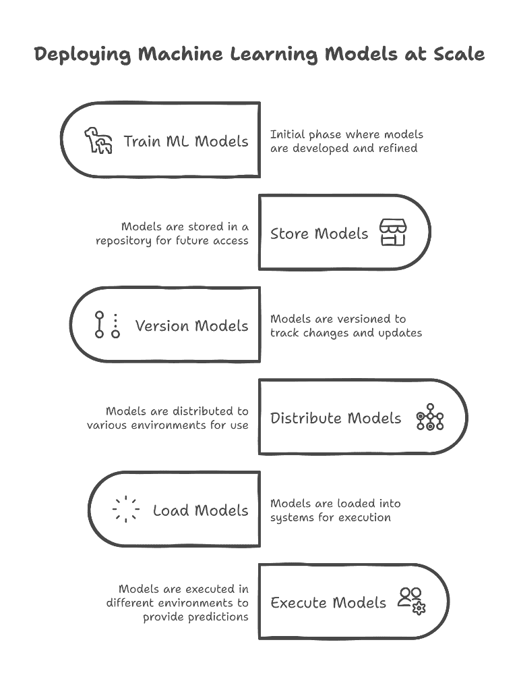

### 模型打包的关键考虑因素：

1. **序列化与存储**：以 `pickle` (`.pkl`)、`ONNX` (`.onnx`) 等格式保存模型。
2. **版本控制**：使用 `DVC` 或 `MLflow` 管理模型版本。
3. **容器化**：使用 `Docker` 确保模型在不同平台的一致性。
4. **依赖管理**：通过 `requirements.txt` 或 `conda.yaml` 定义依赖。

### 示例：使用 Docker 保存模型

```python
import pickle
from sklearn.ensemble import RandomForestClassifier

### 训练模型
model = RandomForestClassifier(n_estimators=100, random_state=42)

# 保存模型
with open("model.pkl", "wb") as f:
    pickle.dump(model, f)

### 加载模型
loaded_model = pickle.load(open("model.pkl", "rb"))
```

## 规模化部署 ML 模型

规模化部署机器学习 (ML) 模型需要仔细考虑在生产环境中如何对其进行打包、分发和管理。当模型被训练后，需要高效地存储、进行版本控制，并分发到推理流水线或 API 端点。适当的打包可以确保模型可以在不同环境中轻松加载和执行，而不产生兼容性问题。

### 使用 Kubernetes 扩展部署

`Kubernetes` (K8s) 用于编排 ML 模型模型的扩展。

#### 在 Kubernetes 上部署 ML 模型：

1. 定义 `Kubernetes Deployment` YAML 文件。
2. 使用 `Kubernetes Pods` 和 `Services` 管理 ML 模型。
3. 实现 `Autoscaling` 以动态调整模型副本数量。

#### 示例：ML  Kubernetes YAML

```yaml
apiVersion: apps/v1
kind: Deployment
metadata:
  name: ml-model-deployment
spec:
  replicas: 3
  selector:
    matchLabels:
      app: ml-model
  template:
    metadata:
      labels:
        app: ml-model
    spec:
      containers:
      - name: ml-model
        image: ml_model:latest
        ports:
        - containerPort: 5000
```

#### 在 Kubernetes 上部署 ML 模型

```bash
kubectl apply -f deployment.yaml
kubectl get pods
kubectl expose deployment ml-model-deployment --type=LoadBalancer --port=80 --target-port=5000
```

## 使用云服务扩展 ML 应用

为了支持大规模 ML 应用，云提供提供了简化部署、监控和扩展的管理服务。

### 用于扩展模型的常用云服务：

1. **AWS SageMaker**：用于训练、调优和部署的全托管 ML 服务。
2. **Google Vertex AI**：用于模型部署和监控的集成 AI 平台。
3. **Microsoft Azure ML**：企业级 ML 生命周期管理。
4. **AWS Lambda**：基于无模型部署。

## 示例：在 AWS Lambda 上部署 ML 模型

`AWS Lambda` 是一种自动扩展 ML 推理负载的无服务器计算服务。

### 在 AWS Lambda 上部署 ML 步骤：

1. 将模型转换为无服务器函数。
2. 打包依赖并上传到 `AWS Lambda`。
3. 通过 `API Gateway` 暴露模型以实时预测。

### 示例：用于 AWS Lambda 的 Python 代码

```python
import json
import pickle
import numpy as np

def load_model():
    with open("model.pkl", "rb") as f:
        return pickle.load(f)

def lambda_handler(event, context):
    model = load_model()
    # 推理逻辑...
```


```python
input_data = np.array(event['features']).reshape(1, -1)

prediction = model.predict(input_data)

return {
    'statusCode': 200,
    'body': json.dumps({'prediction': int(prediction[0])})
}
```

### 将模型部署到 AWS Lambda

```bash
zip deployment_package.zip model.pkl lambda_function.py
aws lambda create-function \
--function-name ml-predictor \
--runtime python3.8 \
--role arn:aws:iam::123456789012:role/execution_role \
--handler lambda_function.lambda_handler \
--zip-file fileb://deployment_package.zip
```

## 结论

大规模部署机器学习（ML）模型涉及高效的模型打包、利用 `Docker` 进行容器化、通过 `Kubernetes` 进行部署编排，以及利用云服务实现无缝扩展。无论部署在 `AWS Lambda`、`Google Vertex AI` 还是 `Azure ML` 上，选择正确的基础设施都能确保模型在实际应用中保持高效、稳健且可扩展。在下一章中，我们将探索`监控与维护已的机器学习模型`，涵盖日志记录、性能跟踪和持续模型重训练。

# 第 30 天：总结与后续步骤

## 回顾你所学的内容

在过去的 30 天里，我们涵盖了广泛的机器学习（ML）概念、工具、技术和现实世界的应用。这段旅程带你从理解基础 ML 概念到实现复杂模型、优化性能以及大规模部署模型。到目前，你应该已经在机器学习方面打下了坚实的基础，并拥有了各种 ML 工作流和工具的实战经验。

### 过去 30 天的核心收获

1. **ML 基础**：你学习了监督学习、无监督学习和强化学习，以及如 `regression`、`decision trees`、`SVMs` 和深度学习等关键算法。
2. **数据处理与预处理**：你探索了数据清洗、特征工程、缺失值处理和数据转换技术。
3. **模型训练与评估**：你实现了各种 ML 模型，优化了超参数，并使用 `accuracy`（准确率）、`precision`（精确率）、`recall`（召回率）和 `F1-score` 评估了性能。
4. **高级 ML 技术**：你接触了深度学习、`CNNs`、`RNNs`、`transformers` 和生成式 AI。
5. **部署与可扩展性**：你学习了如何使用 `Flask`、`FastAPI`、`Docker`、`Kubernetes` 以及 `AWS` 和 `Google Cloud` 等云平台部署 ML 模型。

### 最终项目回顾

你还完成了一个端到端的 ML 项目，实现了如欺诈检测、推荐系统或医疗诊断 AI 等应用。在你继续构建和完善 ML 技能时，这种实战经验是无价的。

## 进阶 ML 技能的后续步骤

现在你已经对 ML 有了稳固的理解，下一步是深化知识、处理现实世界项目并探索高级 AI 技术。以下是接下来可以关注的几个关键领域。

### 1. 参与更多 ML 项目

通过解决现实问题来练习是加强技能的最好方法。以下是一些项目建议：

* `股票价格预测` – 使用时间序列预测预测未来股价。
* `虚假新闻检测` – 构建一个 `NLP` 模型来检测误导信息。
* `自动驾驶汽车模拟` – 实现用于自主导航的强化学习。
* `医学图像分析` – 训练一个 `CNN` 用于医学扫描中的疾病检测。

### 2. 学习高级 ML 课题

为了进一步提升技能，请考虑这些领域：

* `强化学习` – 研究 `DQN` 和 `Policy Gradient`。
* `可解释 AI (XAI)` – 研究 `SHAP` 和 `LIME`。
* `AI 伦理与公平性` – 理解模型中的偏差。
* `神经体系架构搜索 (NAS)`。

### 3. 参加 ML 竞赛

`Kaggle` 提供了许多挑战，：

* `生存预测`（初级）
* `房价预测`（中级）
* `自然语言处理`（高级）

### 4. 贡献开源项目

参与以下库：

* `TensorFlow`、`PyTorch`、`Hugging Face` 和 `Scikit-Learn`。

### 5. 发表研究和博客文章

为了巩固知识，请考虑：

* 在 `Medium` 上撰写博客文章。
* 在 `IEEE` 上发表研究。

## 推荐书籍与资源

为了继续你的 ML 旅程，这里是一些必读资源：

### 书籍

1. `Machine Learning with Scikit-Learn, Keras, and TensorFlow`
2. `Deep Learning with Hands-On`
3. `AI and Machine Learning: Real-World Solutions`

### 在线课程与证书

1. `Deep Learning Specialization` – Andrew Ng 主授
2. `Fast.ai: Practical Deep Learning for Coders`
3. `MIT Intro to Deep Learning`
4. `Stanford CS231n: Convolutional Neural Networks`

### 研究机构

1. `arXiv.org`
2. `Google AI Blog`
3. `OpenAI Research`

## 结论

祝贺你完成了机器学习的 30 天之旅！你建立了坚实的基础，并在模型实现、优化和部署方面获得了实践经验。AI 和 ML 领域不断进化，持续学习是保持领先的关键。在你继续前进时，请保持实验、协作并为 AI 研究做出贡献。

# 附录

## ML 快速查表

在处理机器学习项目时，拥有一个快速参考指南非常有帮助。以下是一些核心概念、公式和技术：

### 常用 ML 算法

* `回归` – 使用变量间的线性关系预测连续值。
* `逻辑回归` – 用于二分类。
* `决策树` – 基于特征划分建立决策模型。
* `随机森林` – 结合多个决策树的集成学习方法。
* `支持向量机 (SVM)` – 为分类寻找最优边界。
* `k-最近邻 (KNN)` – 一种非参数算法，用于分类和回归。
* `神经网络` – 受大脑启发，用于深度学习任务。

### 关键 ML 公式

* `均方误差 (MSE)`
* `对数损失（二分类）`
* `梯度下降更新规则`

### 特征工程最佳实践

* 对数值特征进行归一化或标准化。
* 将类别特征转换为数值（独热编码、标签编码）。
* 使用填充技术处理缺失值。
* 移除相关特征以减少冗余。

## 常见 ML 错误与修复

即使是经验丰富的 ML 专家在训练模型时也会遇到问题。以下是一些常见错误及其解决方案：

### 1. 过拟合

问题：模型在训练数据上表现良好，但在未知数据上表现糟糕。修复：

* 尽可能使用更多训练数据。
* 应用 `L1/L2 正则化` 以降低模型复杂度。
* 在神经网络中使用丢弃层 (dropout)。


-   执行交叉验证以确保泛化能力。

### 2. 欠拟合

问题：模型太简单，无法捕捉数据中的模式。解决方法：
- 增加模型复杂度（在神经网络中添加更多层）。
- 增加训练轮数（epochs）。
- 使用特征工程来提高输入数据的质量。

### 3. 数据泄露

问题：训练数据包含来自测试集的信息，导致准确率不切实际。解决方法：
- 在模型训练前确保进行适当的训练-测试划分。
- 避免使用未来数据作为特征。
- 正确执行交叉验证。

### 4. 类别不平衡

问题：数据集中某一类的实例远多于另一类。解决方法：
- 使用过采样（`SMOTE`）或欠采样技术。
- 在模型训练期间分配类别权重。
- 使用 `F1-score` 和 `AUC-ROC` 等评估指标代替准确率。

### 5. 训练时间过长

问题：模型训练耗时过长，导致实验难以进行。解决方法：
- 优化模型架构和超参数。
- 在深度学习中使用 GPU 加速。
- 针对大规模数据集应用分布式训练。

## 初学者面试题

正在准备机器学习的职场面试吗？这里有一些基础问题：

### 通用机器学习问题

1. 监督学习、无监督学习和强化学习之间有什么区别？
2. 解释偏差-方差权衡（bias-variance tradeoff）。
3. 什么是交叉验证？它为什么重要？
4. 特征选择的目的是什么？如何进行特征选择？
5. `L1` 和 `L2` 正正则化的区别？
6. 解释精确率（precision）、召回率（recall）和 `F1-score`。
7. 什么是梯度下降？它是如何工作的？

### 深度学习问题

1. 什么是激活函数？它们为什么重要？
2. 解释卷积神经网络（`CNNs`）及其应用场景。
3. `LSTMs` 和 `GRUs` 之间有什么区别？
4. 什么是迁移学习？什么时候应该使用它？
5. 批标准化（batch normalization）是如何改进深度学习模型的？

## 进一步学习的在线资源

机器学习是一个不断发展的领域，持续学习是关键。以下是一些用于保持更新和提高技能的优秀在线资源。

### Kaggle

- 参加真实的机器学习竞赛，并从社区笔记本中学习。
- 使用真实数据集进行实战项目。

### Google 机器学习快速课程 (Google’s Machine Learning Crash Course)

- 机器学习概念的免费在线介绍。
- 涵盖基础算法、神经网络和实际应用。

### Fast.ai 博客与课程

- 实战性的深度学习和 NLP 教程。
- 侧重于让开发者能够上手 AI。

### Hugging Face 社区

- 学习最先进的 NLP 模型、Transformers 和深度学习。
- 提供预训练模型和活跃的开发者社区。

### AI 与 ML 论文

- `arXiv.org` – 尖端 AI 和 ML 研究论文的库。
- `Google AI Blog` – 深入了解 Google 最新 AI 研究的洞察。
- `OpenAI Research` – 涵盖生成式 AI、强化学习和神经网络的进展。

## 结论

机器学习是一个强大且不断发展的领域，需要持续的学习和实验。本附录提供了关于基础机器学习概念、常见错误、面试准备以及进一步学习的在线资源的快速参考指南。无论你是在准备面试、调试模型，还是在寻找新的学习材料，都将此指南作为基础来构建和扩展你的知识。

坚持练习，不断探索，不断创新——AI 的未来掌握在你的手中！

