# 机器学习精要指南


## 前言

书中的每一章都是独立的。主题选择具有很大的灵活性。这本书包含了关于机器学习简要应用方面的内容，这对于解决实时问题非常有用。书中介绍的算法描述详尽，使学生能够在他们的程序中使用。这本书易于阅读，并填补了其他书籍未涵盖的空白，它包含了算法、代码、其数学解释以及视觉化表示。这本书适合自学，并且各种技术领域的学生都能轻松上手。 - Jandhyala Narayana Murthy 博士，GRIET 主院长 《简说机器学习》是一本包含了所有基础模型现实应用的书籍。它还包含了关于机器学习、人工神经网络、卷积神经网络的独特且独特的章节。它还整合了文档良好的 `python` 代码及其解释，这些成为初学者的宝库。这本书让人们洞察机器学习涉及的内容，以及它如何影响你将数据武器化以获得惊人结果的方式。 - J.Praveen 博士，GRIET 校长

## 序序

机器学习正广泛渗透到几乎领域。当我们购物、搜索、工作和旅行时，我们的决策和选择会被机器学习，从而为我们提供更佳的体验。《简说机器学习》为读者提供了将机器学习应用于现实复杂问题所需的全部先决条件。机器学习对行业、职业和劳动力的影响被认为是奇迹性的。这本书包含了对核心算法的清晰解释、各自的 `python` 代码和代码解释，并配有视觉示例，使初学者跟起来既方便又吸引人。从数据在机器学习中的重要性开始，这本书提供了算法的所有细微细节、其相应的代码和数学知识。书中包含了一些简单但具有潜力的想法，将抓住读者的注意力并让他们沉浸其中。书中包含了基础框图和图表，有助于轻松理解。整本书都是为了读者的最大利益编写的。它帮助人们简单且完全地理解机器学习算法，并帮助人们解决挑战性问题以过上生活。

## 关于作者

我是 K.Harshini，Gokaraju 工程学院的一名学生。我是通信工程专业三年级的学生。这本书包含了对核心算法的清晰解释、各自的 `python` 代码和代码解释，并配有视觉示例，使初学者跟起来既方便又吸引人。从数据在机器学习中的重要性开始，这本书提供了算法的所有细微细节、其相应的代码和数学知识。书中包含了一些简单但具有潜力的想法，将抓住读者的注意力并让他们沉浸其中我是 P.Reethika Rao，Gokaraju 工程学院的一名学生。我是电子与电气工程专业三年级的学生。这本书包含了对核心算法的清晰解释、各自的 `python` 代码和代码解释，并配有视觉示例，使初学者跟起来既方便又吸引人。从数据在机器学习中的重要性开始，这本书提供了算法的所有细微细节、其相应的代码和数学知识。书中包含了一些简单但具有潜力的想法，将抓住读者的注意力并让他们沉浸其中。

## 指南

这本书包含了对核心算法的清晰解释、各自的 `python` 代码和代码解释，并配有视觉示例，使初学者跟起来既方便又吸引人。从数据在机器学习中的重要性开始，这本书提供了算法的所有细微细节、其相应的代码和数学知识。书中包含了一些简单但具有潜力的想法，将抓住读者的注意力并让他们沉浸其中。

## 人工智能

人工智能（AI）是指机器在被编程思考和执行时表现的人类智能。人工智能使得机器能够从经验中学习、适应新输入并执行人类任务。该术语还包括机器执行的与人类思维相关的特征，如学习、解决问题和决策。当人们提到人工智能术语时，他们通常指的是机器人，这是因为大预算电影构建的虚构故事。事实是，人工智能不仅限于机器人，在许多领域都有其应用。随着技术的进步，以前定义人工智能的标准已经过时。例如，执行基础功能和任务的机器不再被认为是人工智能。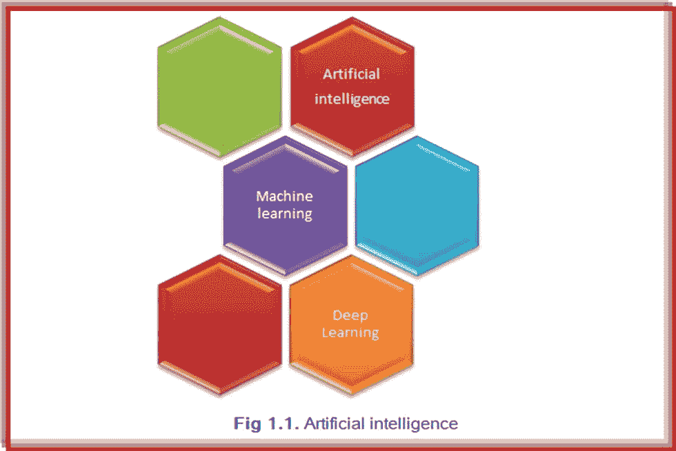人工智能的进一步应用可能包括下国际象棋的计算机和自动驾驶汽车。由于体现人工智能的机器每个动作都会影响结果，这些机器必须权衡它们所采取任何行动的后果。例如，考虑自动驾驶汽车。在自动驾驶汽车中，系统必须考虑到所有的外部后果，并计算出防止事故的行为。

## 数据


在当今世界，一切都是自动化的。所有人类活动正在被机器取代。机器学习在自动化过程中起着重要作用。例如，考虑 Facebook 根据用户偏好推荐朋友以及 YouTube 推荐视频，这些场景都是通过机器学习完成的。这一场景背后的过程是 Facebook 或 YouTube 收集过去的数据并将其输入机器中，机器将整合这些数据以推荐未来的偏好。

机器学习完全依赖于数据。没有数据，就不可能训练机器学习模型。数据是机器学习最核心的方面，因为它使机器能够学会学习并正常工作。许多机器学习项目尽管拥有最好的算法，但由于缺乏良好的数据集而失败。数据是为分析而收集并以特殊方式格式的事实和数字的集合。数据是任何组织可以拥的最强大、最有价值的工具。数据是原始的、未组织的数字，需要经过处理。经过处理和组织的数据被用于分析任何实时情况。组织整个数据会创建一个数据集，进一步用于分析。当数据被利用到最大潜力时，将对组织的长期成功产生巨大影响。

机器学习有助于分析和处理数据，并对我们的未来提供预测。机器学习（ML）侧重于分析和解释数据中的模式和结构，以便在没有人类交互的情况下实现学习、推理和决策。机器学习由多个算法组成。通过使用这些算法分析数据，可以使用输入数据生成数据驱动的输出和建议。算法具有进行某些纠正并整合这些信息以改进其进一步决策的能力。机器学习有许多使其变得易于访问的因素，其中之一就是数据处理。机器学习可以是多维的。在机器学习中，工作不断在数据上进行。海量数据被用于训练和测试。这种数据处理和组织使机器学习成为自动化的重要关键。

## 数据预处理

将机器学习算法应用于数据集并不能获得最佳结果。在对数据应用任何机器学习算法之前对其进行处理是最重要的方面。机器学习模型的输出取决于数据处理的良劣程度。数据处理有几个步骤，下将在下方进行详细解释。

在机器学习处理数据的第一步中，创建数据集起着重要作用。数据集是结构化的数据集合。在收集和组织数据后，必须将数据排列成数据集，以便创建机器学习模型。数据集可能包含按行和列排列的任意数字和字符。在创建最好的机器学习模型时，仅仅收集数据是不够的，数据的分类和标记起着主要作用。这使得数据集足够准确，能够提供真实的愿景。一个数据集由几个变量组成；将机器学习算法应用于数据集，通过影响它的因素来预测变量的值。被预测的值称为因变量，它所依赖的因素称为自变量。

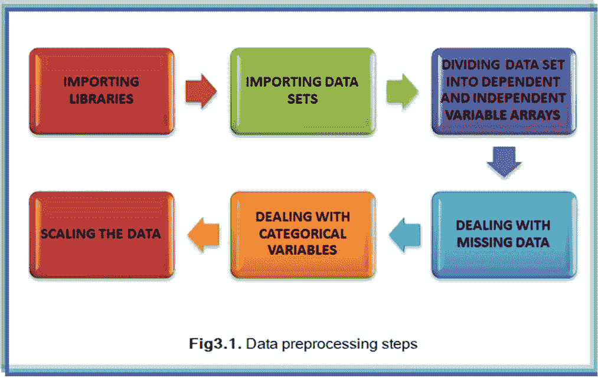

大多数机器学习算法拥有两种先进行、学习和预测的方法。因此，数据集分为：

### 1. 训练数据集
**训练数据集**：需要通过喂数据来训练机器学习算法。训练数据将帮助算法或机器将数据中的模式连接起来，以给出最佳输出。这些训练数据占据了数据集的大部分。

### 2. 测试数据集
**测试数据集**：测试数据集用于评估已训练的机器学习模型的性能。在训练数据集上检查模型的可靠性。测试数据集基本上用于衡量模型表现的好坏。这里必须注意的最重要点是，绝不能在测试集上进行训练。测试数据集独立于训练数据集，但它与训练具有相同的概率分布。如果使用训练集训练机器学习模型并使用同一集合进行测试，将获得最好的结果，但不是准确的结果。因此，使用测试集对机器进行测试是非常重要的。

### 3.1. 库

在机器学习模型中使用数据集工作时，算法可以在 `Python` 或 `R` 中执行。Python 用于将机器学习算法应用于数据。Python 提供了简洁且易读的代码，使得机器学习中复杂的算法易于访问。Python 是一致语法、更短开发时间以及灵活性的结合；这使其非常适合任何类型的复杂机器学习模型。它是一个全面的库集，是 `python` 最大的资产。库是一组结构良好且经过充分测试的函数，用于实现最佳性能。

最重要的库有：

- `NumPy`：一个非常流行的库，用于基础计算。它被广泛应用于线性代数、傅里叶变换和随机数生成能力。
- `Pandas`：用于数据分析的最流行的库。它有许多内置函数，如分组、过滤和合并数据。
- `Matplotlib`：用于创建 2D 图表和图形的 2D 绘图库。
- `Scikit-Learn`：机器学习库之一，用于监督和无监督学习算法以及数据挖掘。

### 3.2. 导入数据集

在 `python` 中编程时，设置工作目录以确保代码执行非常重要。要设置工作目录，首先选择数据集所在的文件夹，并将 `python` 文件保存在同一个文件夹中。设置工作目录后，导入要应用机器学习算法的数据集。

### 3.3. 将数据集划分为独立变量因变量数组

导入数据集后，将数据集划分为训练集和测试集是重要的。

Python 中的数据预处理：表 3.1

| 酒店 | 评分 | 2 个人一天的费用 |
| :--- | :--- | :--- |
| Trident | | |
| ITC Kakatiya | | 15530 |
| Taj Falaknuma | | 14340 |
| Red Fox Hotel | | 30000 |
| Hotel sahara star | | 3389 |
| The Leela ambience | | 26890 |
| Itc Grand Chola | | 8567 |
| Novotel | | 11678 |
| ITC Maratha | | 10457 |
| The LaliT Ashok | | 8987 |
| Sheraton | | 9876 |


| Taj Krishna | 6,587 |

### 4.2
| Gopuram hotel | 13,678 |

### 3.1
| Sadguru hotel | 4,098 |

### 3.2
| Amish Hotel | 6,567 |

### 2.8
| Gyana hotel | 3,456 |

### 3.7
| Blisshotel | 6,657 |

### 4.7
| Shasam hotel | 30,456 |

### 2.5
| Dyana hotel | 4,543 |

### 3.5
表 3.1 提供了关于旅舍评分和两人成本的信息。要在此数据集上应用任何机器学习算法，我们应该首先对其进行预处理。用于数据预处理的 Python 代码如下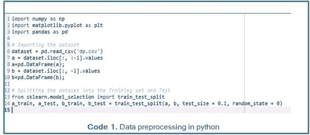 

前三行代码导入了 `NumPy`、`matplotlib` 和 `pandas` 库。第六行导入了所需的数据集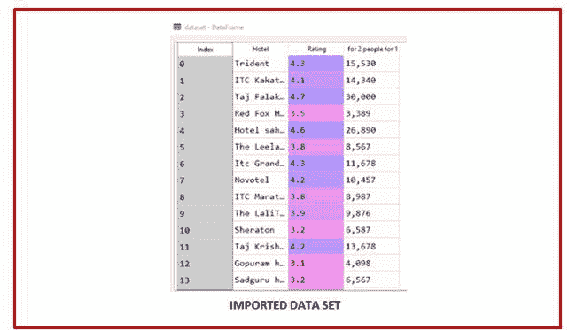 

第七行到第十行的代码将导入的数据集分为自变量数组和因变量数组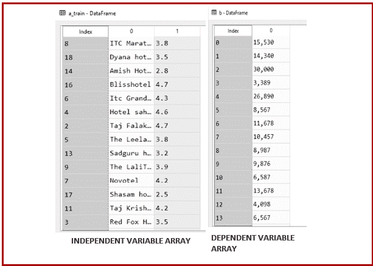 

第十三和十四行将自变量和因变量数组分为测试集和训练集。

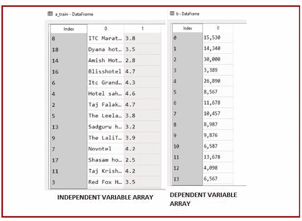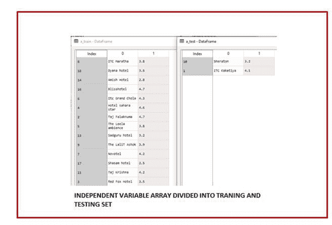[点击获取数据集和数据预处理的 Python 代码](https://drive.google.com/drive/folders/1Rq2LQODCs2o19E5EcdH3cjPOysvawj8g?usp=sharing)

### 3.4. 缺失数据
缺失数据可能是代码中最严重的错误来源，也是大多数异常处理的原因。尝试从数据集中删除缺失数据并不是明智的选择，因为这些数据可能会为机器学习模型增加价值。这些数据数据点可能包含某些隐藏模式，为模型提供额外的洞察。处理缺失数据：在机器学习模型的数据集中处理缺失数据有多种方法。处理缺失数据的常用策略有：
1. 平均值
2. 中位数

### 3. 众数
将缺失数据值替换为平均值、中位数或众数是在不完全删除数据的情况下平衡数据损失的最佳方法。这种用平均值、中位数或众数替换缺失数据值的策略可以在数值数据上执行，但不能用于分类数据。

在 Python 中处理缺失数据：表 3.2

| 公司 | 年龄 | 薪水 | 购买 |
| --- | --- | --- | --- |
| Benz | 44 | 72000 | 否 |
| Jaguar | 27 | 48000 | 是 |
| Ford | 30 | 54000 | 否 |
| Jaguar | 38 | 61000 | 否 |
| Benz | 40 | | 是 |
| Ford | 35 | 58000 | 是 |
| Jaguar | | 52000 | 否 |
| Benz | 48 | 79000 | 是 |
| Ford | 50 | 83000 | 否 |
| Jaguar | 37 | 67000 | 是 |

表 3.2 提供了不同汽车公司的销售信息。数据集在年龄和薪水部分存在缺失数据。填充数据中的这些空隙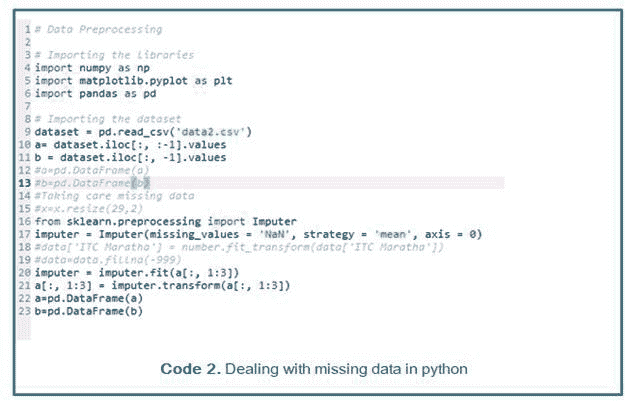 

前十一行代码导入了必要的库，且数据集是非常重要的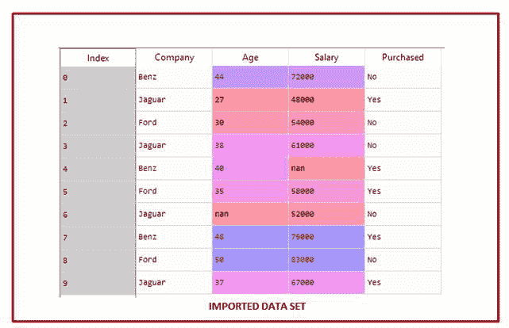 

接后的代码将数据集分为自变量和因变量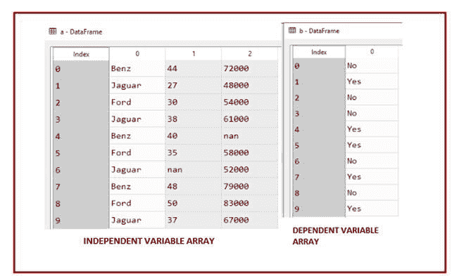 

缺失数据由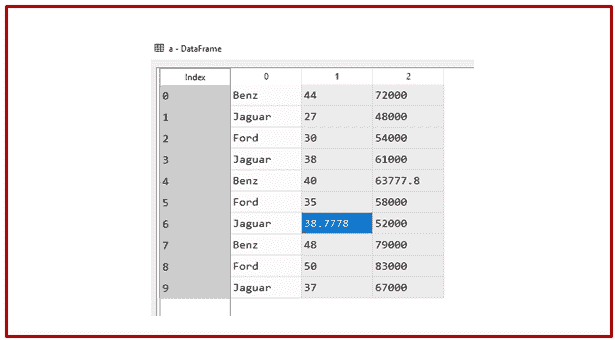表示[点击获取上述数据集和 Python 代码](https://drive.google.com/drive/folders/1MDgS8aPmY_qXjuWCDkDx1QF5wtfoKoj)

### 3.5. 分类数据
包含类别的变量被称为分类变量。机器学习模型基于这些变量，因此应该对它们进行编码以便机器能够工作。以下代码将数据集分为自变量和因变量。

给定的数据包含分类变量。使用 Python 应该将分类变量转换为虚拟变量。将给定数据的分类变量转换为虚拟变量的 Python 代码如下：

| 公司 | 年龄 | 薪水 | 购买 |
| --- | --- | --- | --- |
| Benz | 44 | 72000 | 否 |
| Jaguar | 27 | 48000 | 是 |
| Ford | 30 | 54000 | 否 |
| Jaguar | 38 | 61000 | 否 |
| Benz | 40 | | 是 |
| Ford | 35 | 58000 | 是 |
| Jaguar | | 52000 | 否 |
| Benz | 48 | 79000 | 是 |
| Ford | 50 | 83000 | 否 |
| Jaguar | 37 | 67000 | 是 |

表 3.3 提供了不同汽车公司的销售信息。数据集在年龄和薪水部分存在缺失数据。填充数据中的这些空隙

因变量数组对于分类变量只有两种不同的输入，仅用标签编码器就足够将我们的分类变量转换为虚拟变量。因变量的虚拟变量数组为：

| 公司 | 年龄 | 薪水 | 购买 |
| --- | --- | --- | --- |
| Benz | 44 | 72000 | 否 |
| Jaguar | 27 | 48000 | 是 |
| Ford | 30 | 54000 | 否 |
| Jaguar | 38 | 61000 | 否 |
| Benz | 40 | | 是 |
| Ford | 35 | 58000 | 是 |
| Jaguar | | 52000 | 否 |
| Benz | 48 | 79000 | 是 |
| Ford | 50 | 83000 | 否 |
| Jaguar | 37 | 67000 | 是 |

每一列对应于特征的一个可能值。此函数的输入应该是整数矩阵。输出将是一个稀疏矩阵，其中每一列对应于特征的一个可能值。

自变量数组随后拟合到 `labelencoder.fit_transform` 函数。独热编码（Onehotencoder）有助于将标签编码器给出的值转换为虚拟变量。


数据集中两个变量具有相同的尺度可能会对模型的运行产生一些问题。这是因为大多数机器学习模型都是基于名为 `euclidian distance`（欧几里得距离）的概念工作的。特征缩放是在数据预处理期间进行的。特征缩放是将数据集中独立变量标准化到固定范围内的技术。由于变量之间是相互独立的，因此在预测给定数据点的类别时，某个变量类别类可能会主导其他类别。Python 中的特征缩放：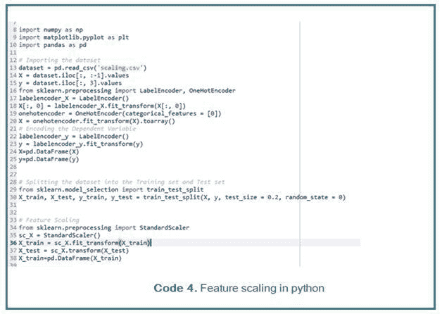

前九行代码导入了基础库和数据集。导入的数据集是：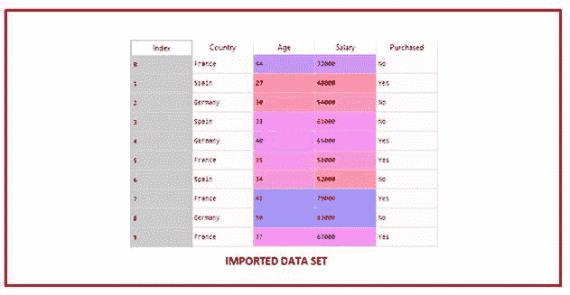接下来的三行代码将数据集分为独立变量数组和因变量数组。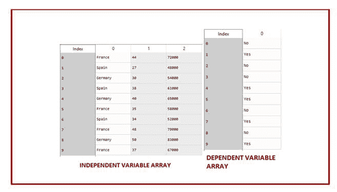第 16 到 25 行代码将分类变量转换为虚拟变量：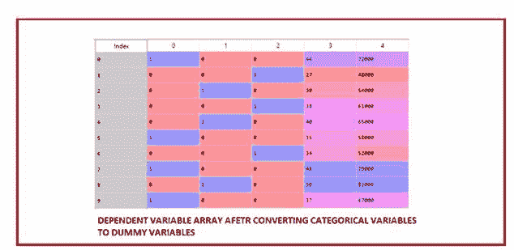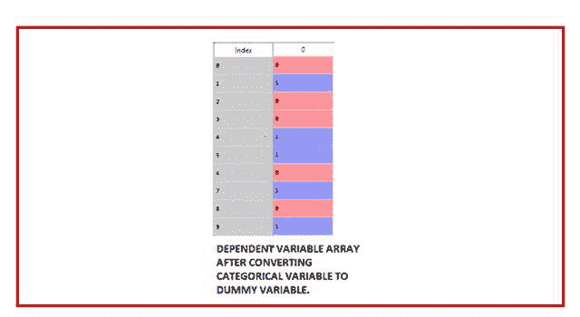第 29 到 30 行代码将独立变量和因变量数组分为测试集和训练集：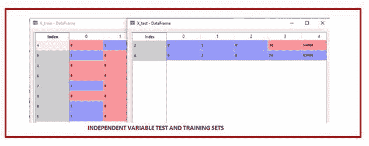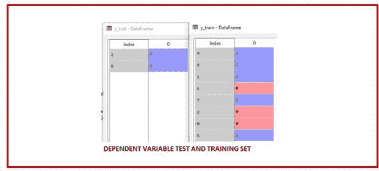第 34 到 38 行代码有助于缩放数据。从 `sklearn` 库中导入了 `Standardscaler` 函数。定义了一个名为 `sc_x` 的新变量，通过它调用 `standardscaler` 函数。现在将独立变量测试集和训练集拟合到 `standardscaler` 函数。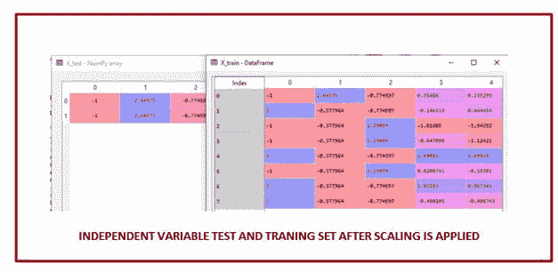[点击此处获取上述数据集和 Python 代码。](https://drive.google.com/drive/folders/1BPgKbrxomaeJI0nN8JptMpCeN60J4vzv?usp=sharing)

### 3.7. 距离的类型

机器学习应用于聚类、分类、图像识别和信息检索过程中。选择良好的距离度量起着至关重要的作用。几乎所有的机器学习算法都使用距离度量来评估输入数据模式以预测任何基于数据的决策。有很多不同的距离，下面讨论了其中的三种。

### 明可夫斯距离 (Minkowski Distance)
明可夫斯距离是范向量空间中的一种度量。范向量空间是指了范数的向量空间。假设 `X` 是向量空间，那么 `X` 上的范数是一个实值函数 `||x ||`，它满足以下条件：

1. **零向量** - 零向量的长度为零。
2. **标量因子** - 当你将向量乘以一个正数时，向量的方向不会改变，但它的长度会改变。
3. **三角形不等式** - 如果距离是一个范数，那么两点之间的计算距离将始终是直线。

使用公式计算距离：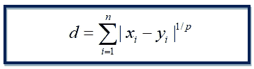明可夫斯距离是一种广距离，通过改变 `p` 的值可以找到两点之间不同的距离。

### 曼哈顿距离 (Manhattan Distance)
当要在网格路径中计算两点之间的距离时，曼哈顿距离派上用场。在曼哈顿距离的情况下，`p` 的值为 1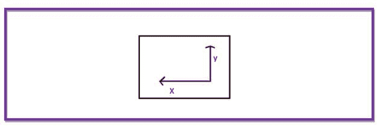`x` 和 `y` 之间的距离由其笛卡尔坐标差的绝对和给出。其中 `n`=变量个数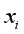且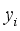分别是 `x` 和 `y` 的变量。

### 欧几里得距离 (Euclidean Distance)
这是最常用的距离度量。在欧几里得距离的情况下，`p` 的值为 2。欧几里得距离是任意两点之间简单的直线距离。公式如下：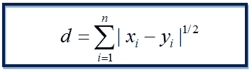

### 3.8. 机器学习中的学习类型

机器被称为从输入给它的以执行某类任务的数据中学习。机器学习分为三类：
1. 监督学习
2. 无监督学习
3. 强化学习

### 监督学习
通过数据集引导或训练模型的学习过程。当数据经过训练时，它开始预测结果。监督机器学习模型处理带标签的数据。

### 无监督学习
在无监督学习中，机器学习模型处理未标记的数据，并通过观察和评估数据中的模式进行学习。它通过创建聚类来自动发现数据中的结构和关系。

### 强化学习
数据集与环境交互并找到最佳结果的能力。它允许数据集通过对自身经验和行动的反馈进行试错，并在交互式环境中进行学习。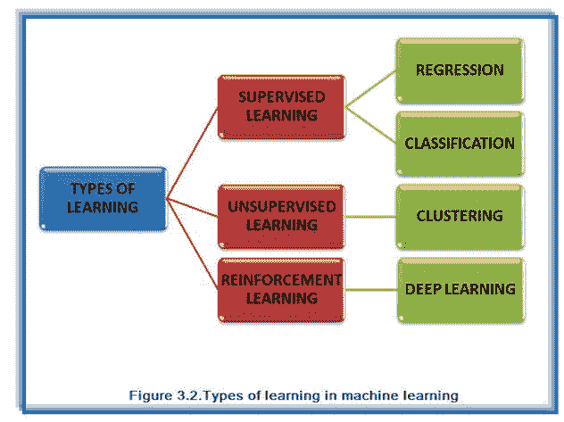

回归基于从数据集中独立变量和因变量之间的关系预测事件结果的统计方法。回归是一种监督学习方法。它是预测建模技术。回归技术广泛应用于金融和投资领域用于未来预测。最近，回归被应用于业务领域。例如，考虑一家服装公司。它必须生产新货。回归获取之前的销售信息，并帮助公司确定应该生产哪种衣服以获得最大利润。因此，回归有助于以最好的方式为企业融资。回归是一种基于假设的算法，假设可以是线性的是非线性的。假设是基于输入中某些隐藏参数和模式的函数。回归模型用于预测真实连续的值。

回归类型：
1. 简单线性回归
2. 多元线性回归
3. 多项式回归
4. 支持向量回归
5. 决策树回归


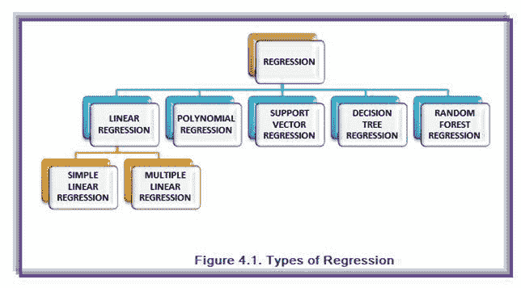


## 4.1. 线性回归

线性回归是一种执行回归任务的监督学习机器学习算法。回归模型被广泛用于预测变量与输出之间的关系。线性回归通过根据给定的自变量来预测因变量的值。回归识别了自变量与因变量之间的关系。


在上述方程中，`Y` 是因变量，``、``、`…..` 是自变量。为了根据给定数据获得上述直线，需要绘制自变量与因变量之间的图。线性回归算法通过这些数据点画出几条线，这些线的形式为上述的方程。然后它从中选择一条。

回归器会计算它所考虑的每条线中，实际值与直线预测值之间差的平方和。然后，回归器将选择平方和最小的那条线。这条线被称为最佳拟合线。

### 线性回归背后的数学原理

考虑一个具有 `n` 个自变量和一个因变量的数据集。给定的数据集如下：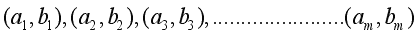

其中，`b` 代表因变量。`n` 个自变量的符号为：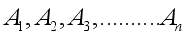 我们数据中的每个 `` 都可以被解释为一个测量向量：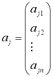

其中 `` 是第一个自变量 `` 的值，`` 是第二个自变量 `` 的值，依此类推。自变量 `()` 用于预测我们的输出 `b`。因此，自变量也称为预测变量或特征。输出 `b` 称为响应。

线性回归给出了预测变量与响应之间的线性关系。这种关系可以用数学表示为：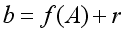

其中，`r` 被称为误差项 `` `` 是参数 `` 是常量，可以通过给定数据的帮助计算出来。我们的数据上画了许多线，然后计算每条线的残差平方和。残差平方和的计算是通过累加每个数据点的因变量 `i` 的实际值（即 ``）与预测值（即 ``）之间差的平方得到的。

残差平方和可以用数学表示为：

在计算这些值后，会对所有值进行检查，并选择残差平方和最小的直线，因为误差越小越好。残差平方和用 `` 表示。当残差平方和最小时，```` 值将最适合我们的数据。因此，通过最小化 ``，我们可以找到 `` 的值。

考虑，``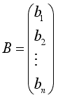`` 给出：`= \= \=`……(1) 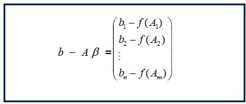 因此 `` 考虑到 `` 的偏导数，对于 `` ``，`` `` 求 ``，`` `` 求 ``，`` 可写为 `` ``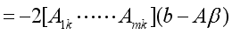 `` `` `` `` `` `` `` `` `` `` `` `` `` `` `` 是正定的，那么 `` 将具有局部最小值。为了最小化我们的残差平方和 `` 必须等于 0 `` `` `` ``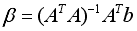

线性回归分为两种：(a) 简单回归 (b) 多元回归

#### 4.1.1. 简单线性回归

简单回归只有一个自变量。因此其数学方程为：

`a` 是自变量，`b` 是因变量。解：自变量矩阵：`` 因变量矩阵：`` 我们知道 ``，`` 是 `a=5` 的最佳拟合线。``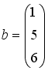` 是 `a=5` 的最佳拟合线。

问题：对于给定数据点，使用最小二乘法找到最佳拟合线，并预测 `a=5` 的值。``线性回归对于输入 5 的预测值为 9。

Python 中的简单线性回归：考虑以下数据：表 4.1

| 广告投入金额 | 销售额 |
| --- | --- |
| 300000 | 1000000 |
| 400000 | 1100000 |
| 350000 | 1050000 |
| 345000 | 1045000 |
| 450500 | 1150000 |
| 275000 | 935000 |
| 375000 | 1055000 |
| 345000 | 1040000 |
| 280000 | 1035000 |
| 456000 | 1156000 |
| 345677 | 1045600 |


表 4.1 提供了关于公司在广告上的支出及其销售额回报的信息。请你自己想象为公司聘佣的程序员，为他们提供广告支出与销售额之间的关系，以便他们能够投入适当的广告费用以获得最大的销售额。现在使用线性回归来寻找广告支出与公司收入之间的关系，因为只有一个独立变量：广告支出。简单线性回归算法的 Python 代码如下：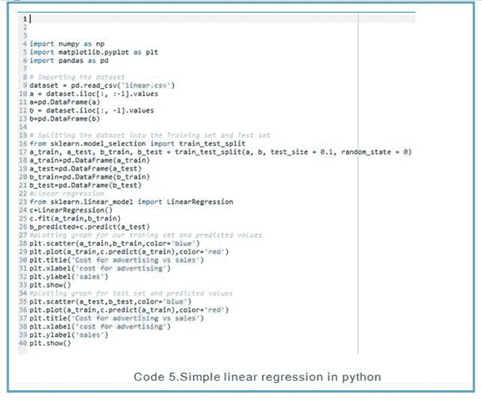

代码解释：
代码的前三行导入了重要的库。接下来的五行导入了将应用简单线性回归的数据集，并将其分为独立变量和因变量。导入的数据集是：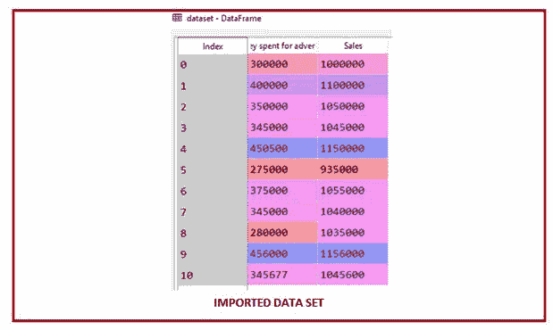 分为独立变量和因变量的数据集：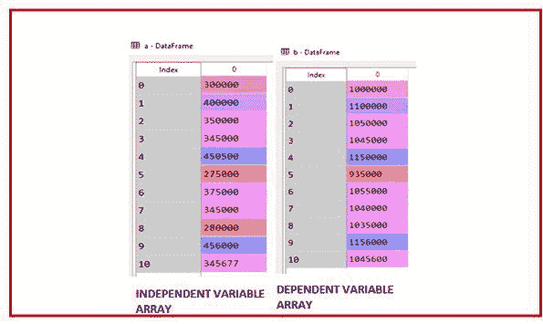 第 16 行到第 21 行的代码将数据分为训练集和测试集：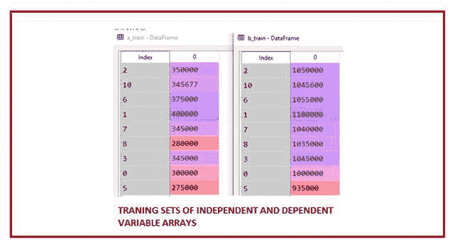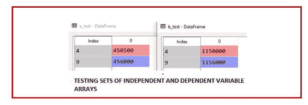

第 23 行到第 26 行将数据集拟合到线性回归函数，并预测测试集的值。第 23 行从 `sklearn` 库导入了线性回归函数。现在通过声明变量 `c` 来调用线性回归函数。数据被拟合到该变量中。第 26 行预测测试集的值。使用线性回归函数预测的测试集预测值为：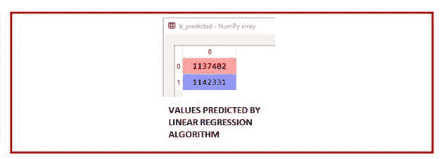

实际值为 11,50,000，预测值为 1,137,402。预测值接近实际值。另一个实际值是 1,156,000，其预测值为 1,142,331，这里的预测值也接近实际值。因此，这意味着机器在预测值方面表现得相当不错。

第 18 行到第 23 行绘制了因变量和独立变量之间的图表。第 18 行给出代表训练集数据点的点；这些由蓝点表示。第 19 行绘制了机器根据给定数据预测的最优拟合线。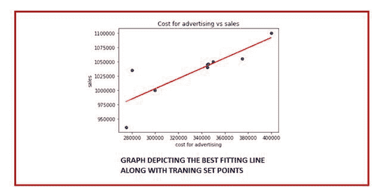 第 35 行到第 40 行在测试集上绘制了独立变量和因变量之间的图表以及最优拟合线。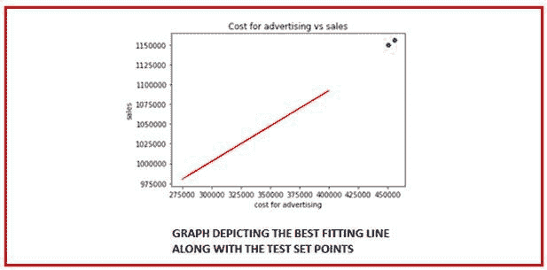 [点击此处获取上述数据集和 Python 代码](https://drive.google.com/drive/folders/1c7B4Djl-hz8AXY3NN7HfJ-uae4BSZoin?usp=sharing)

#### 4.1.2. 多元线性回归

在多元线性回归中，输出取决于多个一个因素，即有多个独立变量。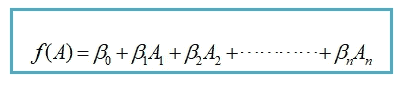 参数矩阵为：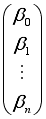

问题：假设因变量 `b` 取决于两个单独变量 `X` 和 `Y`。给我们的数据如下：

| X  || Y  || b  |
| --- | --- | --- |
| 2  || 3  || 7  |
| 4  || 6  || 10  |
| 7  || 9  || 18  |

使用最小二乘法为此数据寻找最优拟合线，并预测当 `X=9` 且 `Y=13` 时 `b` 的值。解：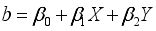!!(images/00140.jpeg)!!(images/00141.jpeg)!!(images/00142.jpeg)!!(images/00143.jpeg)!!(images/00144.jpeg)!!(images/00145.jpeg)!!(images/00146.jpeg)!!(images/00147.jpeg)!!(images/00148.jpeg) 线性回归线对 `X=9` 和 `Y=13` 的预测值为：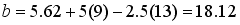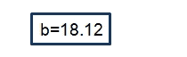

### Python 中的多元线性回归：

多元线性回归是简单线性回归的扩展，涉及涉及多个特征或变量来预测输出。执行多元线性回归的步骤与简单线性回归几乎相似。仅理解多元线性回归背后的数学并不会产生最好的结果。对给数据集具备先验知识是非常重要的，而且注意虚拟变量陷阱（dummy variable trap）也是重要的。

#### 虚拟变量陷阱：

如果模型包含分类数据，它们会被解码为虚拟变量。因此，考虑到分类变量列中有‘n’个不同的名称，一个独立变量列被划分为‘n’列。如果我们将所有这些‘n’列作为输入到我们的模型中，它将无法区分某一列与其他列之间的影响。例如，假设我们有一个输入 India 和 Australia 的分类变量列。考虑下列：

| State  |
| --- |
| India  |
| Australia  |
| India  |
| India  |
| Australia  |
| India  |
| Australia  |
| Australia  |

解码变量后，得到下表：

| India  || Australia  |
| --- | --- |
| 1  || 0  |
| 0  || 1  |
| 1  || 0  |
| 1  || 0  |
| 0  || 1  |
| 1  || 0  |
| 0  || 1  |
| 0  || 1  |

*(注：此处根据逻辑补全了表格对应部分)*


得分比较的步骤如下：
- **STEP-1**：选择拟合优度标准。
- **STEP-2**：构建所有可能的回归模型（共 $2^{n-1}$ 种组合）。
- **STEP-3**：选择标准最优的一个。
- **STEP-4**：模型准备就绪。

表 4.1.2 提供了考虑运动时间、睡眠小时数、饮水量和性别等不同参数的个人健身水平信息。

#### 表 4.1.2

| 运动时间 | 睡眠小时 | 水摄入量 | 性别 | 健身水平 |
| :--- | :--- | :--- | :--- | :--- |
| 4 | 8 | 2 | 男性 | 94 |
| 5 | 6 | 2 | 女性 | 96 |
| 3 | 5 | 1 | 男性 | 85 |
| 2 | 4 | 2 | 女性 | 83 |
| 4 | 6 | 3 | 女性 | 95 |
| 0 | 5 | | | |
| 2.5 | | 男性 | 67 | |
| 1 | 6 | | | |
| 1.5 | | 女性 | 83 | |
| 2 | 4 | | | |
| 0.5 | | 男性 | 86 | | |
| 3 | 4 | 2 | 男性 | 90 |
| 5 | 7 | | | |
| 2.5 | | 男性 | 97 | | |
| 7 | 8 | 3 | 女性 | 98 |
| 6 | 6 | | | |
| 3.5 | | 男性 | 98 | | |
| 5 | 5 | | | |
| 2.5 | | 女性 | 92 | | |
| 2 | 4 | 2 | 男性 | 87 |
| 1 | 4 | | | |
| 1.5 | | 男性 | 84 | | |
| 0 | 6 | 2 | 女性 | 64 |
| 4 | 5 | | | |
| 3.5 | | 男性 | 94 | | |
| 0 | 6 | | | |
| 2.5 | | 男性 | 76 | | |
| 2 | 4 | 2 | 女性 | 74 |
| 1 | 4 | | | |
| 1.5 | | 女性 | 76 | | |
| 0 | 5 | 2 | 男性 | 73 |
| 1 | 6 | | | |
| 1.5 | | 女性 | 78 | | |
| 2 | 7 | 2 | 男性 | 92 |
| 0 | 7 | | | |
| 2.5 | | 女性 | 78 | | |
| 1 | 2 | 3 | 男性 | 69 |
| 3 | 3 | | | |
| 3.5 | | 男性 | 79 | | |
| 2 | 4 | | | |
| 2.5 | | 女性 | 84 | | |
| 1 | 5 | | | |
| 2.7 | | 男性 | 87 | | |
| 0 | 3 | | | |
| 3.5 | | 女性 | 65 | | |
| 2 | 2 | 2 | 男性 | 83 |
| 1 | 4 | | | |
| 2.6 | | 女性 | 79 | | |
| 1 | 5 | | | |
| 1.8 | | 男性 | 74 | |

前三行代码导入了执行所需的所需的库。第 `5th` 到 `7th` 行导入了数据集。导入的数据集分为自变量和因变量。第 `9th` 到 `13th` 行将分类变量转换为虚拟变量。第 `15th` 行代码避免了虚拟变量陷阱。第 `17th` 到 `18th` 行将数据分为训练集和测试集。第 `20th` 到 `22nd` 行将数据集拟合到线性回归函数并预测测试集的值。第 `20th` 行代码从 `sklearn` 导入了线性回归函数。现在声明了一个变量 `c`，通过它调用线性回归函数。数据被拟合到该变量。第 `25th` 行预测测试集的值。使用线性回归预测的测试集值为：

如前所述，构建模型非常重要。可以使用五种方法中的任意一种。代码中使用后向淘汰法（backward elimination）来构建模型。导入了 `statsmodel` 库，该库包含了后向淘汰算法。`statsmodel` 库考虑了多元线性回归中的常数存在，因此应向独立数组添加一列 1。这是通过第 `27th` 行代码实现的。首先要创建一个新的特征矩阵，这将是我们最优特征矩阵。在第 `30th` 行代码中定义了一个新变量 `a_opt`。`a_opt` 最初包含所有自变量。将逐个对自变量应用后向淘汰法，移除不重要的自变量。指定了所有列的索引，因为之后每个列都将被删除。在第 `31st` 行代码中，创建了一个新的回归器，它是 `OLS`（普通最小二乘法）类的对象。第一个参数是 `endog`，输入是因变量数组。第二个参数是 `exog`，输入是已定义的 `a_opt`。使用 `fit` 函数将 `OLS` 函数拟合到数据上。`summary` 函数将返回一个包含构建模型时所有重要统计指标的表格。第 `32nd` 行将给出 `p` 的值。在研究每一步的 `p` 值后，决定移除某个自变量。

观察摘要表可以发现，变量 `x4` 的 `p` 值高于 `0.05`（这是被认为的最优值），因此应该将其移除。在第 `33rd` 行代码考虑 `a_opt` 数组时，自变量 `x4` 将不再被考虑。再次使用相同的步骤寻找新的 `p` 值。变量 `x1` 的 `p` 值高于 `0.05`。移除该变量并找到新的 `p` 值。当移除自变量后找到新的 `p` 值时，其他自变量将按时间顺序重新命名。变量 `x2` 也被移除。剩下 `X1` 和常数。它们的 `p` 值为 `0`，这意味着它们具有高度显著性。

[点击此处获取上述数据集和多元回归的 Python 代码。](https://drive.google.com/drive/folders/1qyP-o2fZ3PDsuOjwnB_pVyFBSQGO1ZiD?usp=sharing)

### 4.2 多项式回归

在简单线性回归中，预测与输出之间存在线性关系。考虑给定数据集的散点图。如果将简单线性回归应用于这些数据点，输出将是一条直线，被称为最佳拟合线。最佳拟合线仅适用于线性数据，即可以拟合到直线上的点。对于给定的散点图，曲线可以完美拟合所有点。这里多项式回归发挥了作用。获得的大部分数据是非线性的。因此多项式回归比线性回归给出更接近、更好的结果。多项式线性回归是一种回归算法，它将因变量与自变量之间的关系建模为 n 阶多项式。其中，`b` 是因变量，`a` 是自变量常数。随着多项式次数的增加，可以获得更好的结果。


## 多项回归的数学原理

多项回归函数的方程：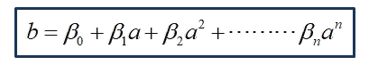

假设给定 `m` 个数据点：现在考虑这 `m` 个点的残差平方和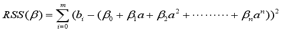\=该应该为最小：\=0, \=0, \=0 上述方程可以用矩阵形式表示为：

如果认为多项式的阶数为 2，则上述方程为：

## Python 中的多项式回归


代码解释：前三行代码导入了执行代码所需的库。第 5 到 7 行导入了应用多项式回归算法的数据集。导入的数据集分为自变量和因变量。

在代码第 9 到 11 行，对数据应用线性回归，以便将线性回归结果与多项式回归结果进行比较。第 9 行导入了线性回归所需的库。现在调用一个新变量 `lin_reg` 并线性回归函数赋值给它。下一行代码有助于将训练集拟合到线性回归函数。第 13 到 18 行对数据应用多项式回归算法。第 13 行导入了多项式回归所需的库。现在调用一个变量 `poly_reg`，并将“polynomial features”函数赋值给它，阶数为 4。可以选取任何阶数，随着阶数的增加，效率也会随之提高。函数 `poly_reg.fit_transform` 用于向自变量数据集添加一列 1。转换后的矩阵被赋予 `a_poly`。在第 16 行，将 `a_poly` 和 `b`（因变量数据框）拟合到多项式回归函数。第 20 到 25 行用于绘制学习时间与获得分数之间的图，以可视化我们的线性回归线。输入数据点用红色表示，最佳拟合线用蓝色表示。第 27 到 32 行的代码绘制了图以可视化多项式回归曲线。红点表示输入的数据，蓝曲线表示多项式回归曲线。接下来的第 34 到 41 行代码使多项式回归曲线更加平滑且分辨率更高在第 43 行代码中，预测了学生使用线性回归学习 9 小时后获得的分数在第 45 行代码中，预测了学生使用多项式回归学习 9 小时后获得的分数

## 4.3. 支持向量回归 (SUPPORT VECTOR REGRESSION)

支持向量机是一种用于回归和分类的机器学习算法。SVM 选择一个超平面来帮助定义连续值从上图所示，超平面被边界线包围。这些线被称为边界。边界定义为超平面与最近点的垂直距离。为了拟合所有数据点，SVR 算法最大化该边界。距离超平面的点被称为支持向量。因此，一个完美划分数据的超平面可能无法找到，有时为了最大化边界，某些违反边界的点会被排除。SVR 算法的目标是在阈值范围内保留尽可能多的支持向量。这些线就是边界线。SVR 与线性回归的区别在于，线性回归旨在最小化误差，而 SVR 试图将其保持在阈值内。

### 支持向量回归的数学原理

SVR 的基本思想是最小化误差并最大化边界。超平面的方程给出：约束：线性 SVR：

### Python 中的支持向量回归

表 4.3 提供了大学工作人员的职位及其薪资信息。需要建立一个根据职级预测员工薪资的机器学习模型。表 4.3

| 职位 | 等级 | 薪资 |
| --- | --- | --- |
| 活动策划 | 1 | 45000 |
| 导游 | 2 | 50000 |
| 行政助理 | 3 | 60000 |
| 助教 | 4 | 80000 |
| 教授 | 5 | 110000 |
| 系主任 (HOD) | 6 | 150000 |
| 副校长 | 7 | 200000 |
| 院长 | 8 | 300000 |
| 校长 | 9 | 500000 |
| 监事 | 10 | 1000000 |

使用 Python 对数据拟合支持回归函数。代码如下：代码解释：前三行代码导入了执行代码所需的库。第 7 到 10 行导入了应用支持回归算法的数据集，然后数据集分为自变量和因变量第 23 到 24 行代码对数据应用支持向量。第 23 行导入了 SVR 所需的库。现在调用一个变量 `regressor` 并将其赋值为带有`kernel=rbf`的 SVR 函数。该函数被拟合到 `regressor`。第 27 行预测了职位 6.5 的数值第 31 到 36 行的代码有助于绘制图，以可视化支持向量回归的结果及其与数据的拟合程度。红点表示输入的数据，蓝线表示超平面。


## 4.4. 决策树回归

决策树算法是机器学习中最流行且应用最广泛的算法之一。决策树算法既可以用于回归也可以用于分类。该算法被描述为一棵树，其中节点是输入或自变量，分支是机器的决策，而叶节点则被视为输出或因变量值。在回归案例中，`DTA` 使用最小二法距离来选择特征。给定的数据被划分。这种划分被称为叶节点。创建的划分增加了关于分面同一侧点的信息。如果数据中的某些特定点具有相似性，则对数据进行划分。在划分数据时，点被进行分组，因此 `DTA` 为数据点增加了值。当需要添加的信息非常非常少时，算法会停止划分过程。与其他回归技术相比，决策树回归易于理解。

### 将决策树回归应用于数据集

考虑任意两个自变量 `X1` 和 `X2` 之间的散点图： 上述散点图的决策树所示： 每次划分的因变量值是通过取该特定划分或叶节点中所有因变量值的平均值得到的。当给一个新的输入来预测输出时，会检查该点所属的划分。然后将叶节点中的因变量值赋值给输入。

### Python 中的决策树回归


表 4.4 提供了关于不同洗发水评分及其 700ml 成本的信息。现在使用决策树回归来预测评分为 3.8 的洗发水的成本。

#### 表 4.4

| 公司 | 评分 | 700ml 成本 |
| --- | --- | --- |
| Sunsilk | 4 | 350 |
| Meera | | |
| ## 3.6 | | 200 |
| --- | --- | --- |
| Head and shoulders | 3 | 189 |
| Dove | | |
| ## 4.1 | | 370 |
| --- | --- | --- |
| Himalaya | | |
| ## 4.3 | | 360 |
| --- | --- | --- |
| Tresemme | | |
| ## 4.8 | | 400 |
| --- | --- | --- |
| Loreal | | |
| ## 4.2 | | 380 |
| --- | --- | --- |
| Clinic plus | | |
| ## 2.8 | | 169 |
| --- | --- | --- |
| Panteen | | |
| ## 3.1 | | 199 |
| --- | --- | --- |
| Clean and clear | | |
| ## 2.5 | | 149 |
| --- | --- | ---

现在使用 Python 将决策树回归应用于给定数据。

### 代码解释

前 10 行代码导入了所需的库。第 7 到 9 行将数据分为自变量和因变量： 第 24 到 26 行将数据拟合到决策树回归。第 24 行导入了 `sklearn` 库。现在调用了一个变量 `regressor`，并将决策树回归分配给它。在第 30 行预测了评分为 3.8 的 700ml 成本。

## 随机森林回归

随机森林是决策树的扩展。随机森林回归使用许多树，而决策树回归只考虑一棵树。 使用 Python 将随机森林回归应用于给定数据。

### 随机森林回归的步骤

1. 从数据集中随机点。
2. 构建包含许多树的随机森林。
3. 使用随机森林回归可视化结果。
4. 当给一个新的输入时，随机森林将取所有树的平均值来预测输出。

#### 表 4.5

| 公司 | 评分 | 700ml 成本 |
| --- | --- | --- |
| Sunsilk | 4 | 350 |
| Meera | | |
| ## 3.6 | | 200 |
| --- | --- | --- |
| Head and shoulders | 3 | 189 |
| Dove | | |
| ## 4.1 | | 370 |
| --- | --- | --- |
| Himalaya | | |
| ## 4.3 | | 360 |
| --- | --- | --- |
| Tresemme | | |
| ## 4.8 | | 400 |
| --- | --- | --- |
| Loreal | | |
| ## 4.2 | | 380 |
| --- | --- | --- |
| Clinic plus | | |
| ## 2.8 | | 169 |
| --- | --- | --- |
| Panteen | | |
| ## 3.1 | | 199 |
| --- | --- | --- |
| Clean and clear | | |
| ## 2.5 | | 149 |
| --- | --- | --- |


分类是一种监督学习过程。回归算法用于预测连续值，但如果输出不是连续值怎么办？例如，因变量的输出仅为“是”或“否”。这就是分类大显身手的地方。与回归不同，分类用于预测类别。分类的作用是预测新的观测值属于哪一类别。考虑一个汽车公司创建的数据集，其中输入是人的年龄、薪水性别，输出是该人是否购买了汽车。公司希望提高销售额，因此决定针对肯定会购买其产品的正确人群群体。对于上述问题，数据应该被分为两类，即“买了车的人”和“没买车的人”，这样公司可以重点关注买车的人群类别。有很多分类算法，这些用于在我们的数据上实现分类技术的算法被称为分类器。

### 分类技术的类型：
1. 逻辑回归
2. K 近邻算法
3. 支持向量机
4. 核 SVM
5. 朴素贝叶斯
6. 决策树分类
7. 随机森林分类


### 5.1. 逻辑回归
逻辑回归是一种执行分类过程的监督机器学习算法。尽管我们已经有了线性回归来完成这项工作，但仍然逻辑回归。表 5.1 是一个由汽车公司收集的数据集，它提供了关于人们年薪（单位：万）以及他们是否购买了特定车辆的信息。表 5.1

| 薪水 | 购买 |
| :--- | :--- |
| 24 | 是 |
| 12 | 否 |
| 30 | 是 |
| 40 | 否 |
| 35 | 是 |
| 20 | 是 |
| 26 | 否 |
| 31 | 是 |
| 32 | 是 |
| 19 | 否 |
| 16 | 否 |
| 14 | 否 |
| 50 | 是 |

上述数据的散点图如下： 如果对上述散点图应用线性回归，输出如下： 蓝线代表线性回归的最拟合线。线性回归告诉我们薪水在 20 万到 35 万之间的人可能购买该产品。这是一个很好的预测，但仔细观察图表，可以观察到橙色和绿色圈出的线条两个部分。线条的绿色部分表示薪水在 20 万以下的人完全不会购买产品，而橙色部分表示薪水在 35 万以上的人一定会购买产品。这不是一个准确的预测。如果输出以概率的形式给出将更合理，例如：“对于 30 万的薪水，该人购买产品的概率为 80%。”逻辑回归有助于获得这种输出。上述获得的最拟合线的形式为：`images/0027.jpeg` 现在考虑变量 `p:images/0028.jpeg` 将 `y` 替换为 `p` 如下：`images/0029.jpeg` 任何薪水的图表都会给我们购买的概率。但我们想要的输出是“是”或“否”，因此我们选择了一条 50%线，所有概率在 50%及以上的点都将被视为“是”，其他的被视为“否”。`images/0031.jpeg` 黄线代表 50%概率线。逻辑回归用于医学和社会科学领域。它被用于评估疾病的严重程度。根据人的年龄、性别和其他健康状况来评估病情。逻辑回归通过此数据预测一个人是否通过考试。逻辑回归提供了关于学生是否通过的信息。表 5.1

| 用户 ID | 性别 | 年龄 | 学习时长 |
| :--- | :--- | :--- | :--- |
| 24 | 男 | 24 | 是 |
| 12 | 女 | 12 | 否 |
| 30 | 男 | 30 | 是 |
| 40 | 女 | 40 | 否 |
| 35 | 男 | 35 | 是 |
| 20 | 男 | 20 | 是 |
| 26 | 男 | 26 | 否 |
| 31 | 男 | 31 | 是 |
| 32 | 男 | 32 | 是 |
| 19 | 女 | 19 | 否 |
| 16 | 女 | 16 | 否 |
| 14 | 女 | 14 | 否 |
| 50 | 男 | 50 | 是 |

将逻辑回归应用于数据的 Python 代码给出：

代码解释：


`code11` 的前九行导入了库和数据集。导入的数据集被分为自变量数组和因变量数组。导入的数据集如下：

自变量数组和因变量数组： 第 12 和 13 行代码将自变量数组和因变量数组划分为测试集和训练集

第 16 到第 19 行代码对自变量数组进行缩放。

第 22 到 24 行代码对数据集应用逻辑回归。在第 22 行导入了包含逻辑回归的库。现在在下一行代码中定义了一个变量 `classifier`，并通过它调用了逻辑回归函数。将训练集拟合到 `classifier` 变量中。第 27 行使用 `predict` 函数预测测试集的结果。

观察预测值并与真实值进行比较。`classifier` 预测了两个正确值和两个错误值。第 30 和 31 行给出了混淆矩阵，它提供了正确和错误预测的数量，有助于理解 `classifier` 的准确性。

从混淆矩阵可以推导出 `classifier` 预测了两个正确预测和两个错误预测。第 33 到 49 行代码生成了逻辑回归在训练集上的图形化表示。蓝色点代表未通过考试的人，橙色点代表通过考试的人。逻辑回归创建的蓝色区域代表未通过考试的人，橙色区域代表通过的人。第 57 到 69 行代码提供了逻辑回归在测试集上的图形可视化：从图中可以推断出我们的 `classifier` 在错误区域内分类了两个点。

[点击此处获取上述数据集和逻辑回归的 Python 代码。](https://drive.google.com/drive/folders/1Sz6ieihXCB9N7QD4X_u39ATqibi7044L?usp=sharing)

### 5.2. 最近邻分类 (KNN)

这是一种分类技术，它有助于通过考虑最近的训练集点将新点归类为一类。考虑一些随机数据的散点图：

散点图中存在两个不同的类别，一个由蓝色表示，另一个由红色表示。我们得到了一个新点，以预测它属于哪个类别。新数据点用黑色表示。现在应用 `knearest` 算法对数据进行分类。

### 最近邻算法需要遵循的步骤：
- **步骤-1**：选择邻居数量 `k`
- **步骤-2**：根据`euclidean distance`（欧距离）选取新数据点的 `k` 个最近邻居。
- **步骤-3**：在这些 `k` 个邻居中，统计每个类别中数据点的数量。
- **步骤-4**：将新数据点分配到邻居数量最多的类别。

对于上述散点图，考虑 `k=3`，应从数据集中选取距离新点最近的三个点。三个最近的点中有两个红色和一个蓝色，因此根据 `knearest` 算法，新数据属于红色类别。

`knearest` 算法在 Python 中：

表 5.2 提供了年龄、性别、学习时长以及学生是否通过考试的信息。

| 用户 ID | 性别 | 学习时长 | 通过 |
| :--- | :--- | :--- | :--- |
| 18241 | Male | 24 | 1 |
| 18242 | Male | 25 | 1 |
| 18243 | Female | 31 | 1 |
| 18244 | Female | 35 | 0 |
| 18245 | Male | 25 | 0 |
| 18246 | Male | 26 | 0 |
| 18247 | Female | 28 | 0 |
| 18248 | Female | 29 | 1 |
| 18249 | Male | 30 | 1 |
| 182410 | Female | 32 | 1 |
| 182411 | Female | 34 | 0 |
| 182412 | Female | 29 | 0 |
| 182412 | Male | 30 | 1 |
| 182413 | Male | 31 | 0 |
| 182414 | Male | 35 | 1 |
| 182415 | Male | 28 | 1 |
| 182416 | Male | 29 | 0 |
| 182417 | Male | 27 | 0 |
| 182418 | Male | 30 | 1 |
| 182419 | Female | 34 | 1 |
| 182420 | Female | 32 | 1 |
| 182421 | Female | 34 | 0 |
| 182422 | Male | 35 | 0 |
| 182423 | Male | 25 | 0 |
| 182424 | Male | 26 | 0 |
| 182425 | Female | 28 | 0 |
| 182426 | Female | 29 | 1 |
| 182427 | Male | 30 | 1 |
| 182428 | Female | 32 | 1 |
| 182429 | Male | 34 | 1 |
| 182430 | Male | 29 | 0 |


## 5.3 支持向量机

支持向量机（SVM）是一种用于数据分类的监督学习机器学习算法。SVM 背后的数学原理在回归分析中已经见过了了。SVM 仅对线性数据有效，即可以用直线或平面分离的数据。

支持向量机最近没有被广泛使用。随着模型变得越来越复杂和先进，它的用处有所下降。SVM 对于中等规模的数据非常有用。它们在文本分类中也非常好用。

### Python 中的支持向量机

表 5.3 提供了关于学生年龄、性别、学习时长以及该学生是否通过考试的信息。使用支持向量机算法对这些数据进行分类。表 5.3

| 用户 ID | 性别 | 年龄 | 学习时长 | 是否通过 |
| --- | --- | --- | --- | --- |
| 18241 | 男 | 24 | 10 | 1 |
| 18242 | 男 | 25 | 11 | 1 |
| 18243 | 女 | 31 | 6 | 1 |
| 18244 | 女 | 35 | 4 | 0 |
| 18245 | 男 | 25 | 6 | 0 |
| 18246 | 男 | 26 | 9 | 0 |
| 18247 | 女 | 28 | 5 | 0 |
| 18248 | 女 | 29 | 11 | 1 |
| 18249 | 男 | 30 | 10 | 1 |
| 182410 | 女 | 32 | 12 | 1 |
| 182411 | 女 | 34 | 10 | 0 |
| 182412 | 女 | 29 | 6 | 0 |
| 182412 | 男 | 30 | 9 | 1 |
| 182413 | 男 | 31 | 4 | 0 |
| 182414 | 男 | 35 | 5 | 1 |
| 182415 | 男 | 28 | 12 | 1 |
| 182416 | 男 | 29 | 6 | 0 |
| 182417 | 男 | 27 | 8 | 0 |
| 182418 | 男 | 30 | 9 | 1 |
| 182419 | 女 | 34 | 10 | 1 |
| 182420 | 男 | 33 | 4 | 1 |
| 182421 | 女 | 36 | 3 | 0 |
| 182422 | 男 | 35 | 5 | 0 |
| 182423 | 女 | 28 | 8 | 0 |
| 182424 | 男 | 29 | 9 | 1 |
| 182425 | 男 | 30 | 10 | 1 |
| 182426 | 男 | 32 | 6 | 1 |
| 182427 | 女 | 34 | 9 | 1 |
| 182428 | 男 | 29 | 8 | 0 |
| 182429 | 男 | 23 | 12 | 1 |
| 182430 | 女 | 27 | 10 | 1 |

使用 Python 将支持向量机应用于数据。将 SVM 应用于数据的 Python 代码如下：

### 代码解释

前六行代码导入了所需的库和数据集。数据集被分为自变量数组和因变量数组。导入的数据集是： 自变量数组和因变量数组：

第 7 行和第 8 行代码将自变量数组和因变量数组分为测试集和训练集。

第 9 行到第 12 行代码对自变量测试集和训练集进行标准化。

第 13 行到第 15 行将逻辑回归应用于数据集。第 25 行导入了包含 K 近邻算法的库。在下一行代码中定义了一个变量 `classifier`，并通过它调用 `Kneighbours` 函数。训练集被拟合到 `classifier` 变量。第 16 行使用 `predict` 函数预测测试集的结果。

观察预测值并与真实值进行比较。分类器预测了两个正确值和两个错误值。第 17 行和第 18 行用于获取混淆矩阵，该矩阵将给出正确和错误预测的数量，并有助于理解分类器的准确性。

从混淆矩阵可以推断出分类器给两个正确预测和两个错误预测。第 19 行到第 34 行代码给出了 SVM 的图形化表示。


## 核 SVM 算法

将核 SVM 算法应用于数据的的 Python 代码如下：


### 代码解释
前 11 行代码导入了所需的库和数据集。数据集被分为自变量数组和因变量数组。导入的数据集为：


自变量数组和因变量数组：


第 14 和 15 行代码将自变量数组和因变量数组分为测试集和训练集。


第 18 到 21 行代码对自变量测试集和训练集进行缩放。


第 24 到 26 行代码有助于将核 SVM 算法应用于数据集。第 24 行导入了包含核 SVM 算法的库。在下一行代码中，定义了一个变量 `classifier`，并通过它调用了核 SVM 函数。将训练集拟合到 `classifier` 变量。第 29 行使用 `predict` 函数预测测试集的结果。


观察预测值并将其与真实值进行比较。分类器预测了两个正确值两个错误值。第 32 和 33 行代码给出了混淆矩阵，它将给出正确和错误预测的数量，并有助于理解分类器的准确性。


从混淆矩阵可以推断出，分类器给出了两个正确预测和两个错误预测。第 36 到 51 行代码提供了核 SVM 在训练集上的图形化表示。


蓝色点代表未通过考试的人，橙色点代表通过考试的人。由核 SVM 算法创建的蓝色区域代表未通过考试的人，橙色区域代表通过考试的人。第 54 到 69 行代码提供了核 SVM 在测试集上的图形化可视化：


从图中观察到，我们的分类器在错误区域分类了两个点。

[点击链接获取核 SVM 的数据集和 Python 代码。](https://drive.google.com/drive/folders/1_FNJhjmx2gqY3w4HNCNbiY9UpAxpGb7X?usp=sharing)

## 5.5. 朴贝叶斯 (NAÏVE BAYES)

这是一种用于分类的监督学习算法。该算法之所以得名，是因为即使变量之间并不独立，算法中仍然使用了贝叶斯定理。

### 贝叶斯定理
是在 `B` 已经发生的情况下 `A` 发生的概率。![images/00282.jpeg)是在 `A` 已经发生的情况下 `B` 发生的概率。![images/00283.jpeg)是 `B` 和 `A` 发生的概率，其中 `A` 和 `B` 是独立事件。考虑薪水与年龄的散点图。蓝色点代表拥有两轮车的人，红色点代表拥有汽车的人。给出一个新点以将其归类为两组之一。现在将与新点相似的点分在一起，这种分组是根据欧几里距离完成的。新点被视为 `x`。点的总数为 `n`。拥有汽车的人总数为 `b`。拥有两轮车的人总数为 `a`。点的数量为 `c`。使用两轮车且出现在圆圈内的人数为 `e`。使用汽车并符合圆圈的人数为 `n=37`、`b=19`、`a=18`、`e=1`、`f=1`。使用贝叶斯定理：![images/00288.jpeg)![images/00289.jpeg)![images/00290.jpeg)

第 15 行到第 18 行代码对自变量测试集和训练集进行缩放。

第 21 行到第 23 行对数据集应用朴素贝叶斯分类。在第 21 行导入了包含朴素贝叶斯算法的库。在下一行代码中定义了一个变量 `classifier`，并通过它调用了 `gaussianNB` 函数。我们的训练集被拟合到 `classifier` 变量。第 26 行使用 `predict` 函数来预测测试集的结果。

观察预测值并与真实值进行比较。分类器预测了两个正确值和两个错误值。第 29 和第 30 行提供了混淆矩阵，它将提供正确和错误预测的数量，有助于理解分类器的准确性。

从混淆矩阵可以推断出分类器给出了两个正确预测和两个错误预测。代码第 37 到 52 行给出了训练集上逻辑回归的图形化表示。

蓝点代表未通过考试的人，橙色点代表通过考试的人。由朴素贝叶斯分类技术创建的蓝色区域代表未通过考试的人，橙色区域代表通过考试的人。第 57 行到 69 行给出了测试集上逻辑回归的图形化可视化：从图中可以推断出我们的分类器在错误区域分类了两个点。

[点击链接获取上述朴素贝叶斯数据集和 Python 代码。](https://drive.google.com/drive/folders/1f2KasK-tmwj_JfpcJfnzb-2B1se6TeNu?usp=sharing)

## 5.6 决策树分类
决策树分类是一种监督学习机器学习算法。在回归单元中已经学习了决策树算法，该算法对于回归和分类是相同的，区别在于回归的输出是数值，而在分类中输出是一个类别，且在分类中我们使用基尼指数（Gini index）。基尼指数是数据集中不平等性的衡量。它的值处于 0 到 1 之间。考虑一些随机数据的散点图：

现在通过创建划分将数据划分为不同的部分：

散点图中创建的划分对应的决策树为：

当给一个新的输入来预测输出时，观察该划分。然后该类别被分配给该划分。决策树分类提供了关于年龄、性别、学习时长以及该人是否通过考试的信息。决策树分类应用于下方数据。

### 表 5.6

| User ID | Gender | hours of study | Passed |
| --- | --- | --- | --- |
| 18241 | Male | 24 | 1 |
| 18242 | Male | 25 | 1 |
| 18243 | Female | 31 | 1 |
| 18244 | Female | 34 | 0 |
| 18245 | Male | 25 | 6 |
| 18246 | Male | 26 | 9 |
| 18247 | Female | 28 | 5 |
| 18248 | Female | 29 | 11 |
| 18249 | Male | 30 | 10 |
| 182410 | Female | 32 | 12 |
| 182411 | Female | 34 | 10 |
| 182412 | Female | 29 | 6 |
| 182413 | Male | 30 | 11 |
| 182414 | Female | 35 | 4 |
| 182415 | Male | 25 | 5 |
| 182416 | Male | 28 | 12 |
| 182417 | Female | 29 | 5 |
| 182418 | Female | 27 | 8 |
| 182419 | Male | 30 | 9 |
| 182420 | Male | 34 | 10 |
| 182421 | Female | 33 | 4 |
| 182422 | Female | 36 | 3 |
| 182423 | Female | 21 | 5 |
| 182424 | Male | 26 | 6 |
| 182425 | Male | 23 | 10 |
| 182426 | Male | 22 | 7 |
| 182427 | Female | 28 | 5 |
| 182428 | Male | 26 | 8 |
| 182429 | Male | 30 | 9 |
| 182430 | Female | 32 | 10 |


## 5.7. 随机森林分类

随机森林分类是决策树分类的扩展。决策树分类只考虑单棵树的决策，而随机森林考虑的是整个树森林的决策。将随机森林回归应用于我们的数据的遵循步骤如下：

- **步骤-1**：从训练集中随机选取 `k` 个随机点。
- **步骤-2**：现在为这 `k` 个随机点构建一棵决策树。
- **步骤-3**：选择你想要构建的数量，并重复步骤 1 和步骤 2。
- **步骤-4**：当给出一个新点进行预测时，让所有树预测输出的类别，然后将该点分配给大多数树所预测的类别。

Python 中的随机森林分类：表 5.7 提供了年龄、性别、学习时长以及该人员是否通过考试的信息。随机森林分类应用到以下数据。表 5.7

| 用户 ID | 性别 | 年龄 | 学习小时数 | 通过 |
| :--- | :--- | :--- | :--- | :--- |
| 18241 | 男性 | 24 | 10 | 1 |
| 18242 | 男性 | 25 | 11 | 1 |
| 18243 | 女性 | 31 | 6 | 1 |
| 18244 | 女性 | 35 | 4 | 0 |
| 18245 | 男性 | 25 | 6 | 0 |
| 18246 | 男性 | 26 | 9 | 0 |
| 18247 | 女性 | 28 | 5 | 0 |
| 18248 | 女性 | 29 | 11 | 1 |
| 18249 | 男性 | 30 | 10 | 1 |
| 182410 | 女性 | 32 | 12 | 1 |
| 182411 | 女性 | 34 | 10 | 0 |
| 182412 | 女性 | 29 | 6 | 0 |
| 182412 | 男性 | 30 | 9 | 1 |
| 182413 | 男性 | 31 | 4 | 0 |
| 182414 | 男性 | 35 | 5 | 1 |
| 182415 | 男性 | 28 | 12 | 1 |
| 182416 | 男性 | 29 | 6 | 0 |
| 182417 | 男性 | 27 | 8 | 0 |
| 182418 | 男性 | 30 | 9 | 1 |
| 182419 | 女性 | 34 | 10 | 1 |
| 182420 | 男性 | 33 | 4 | 1 |
| 182421 | 女性 | 36 | 3 | 0 |
| 182422 | 男性 | 35 | 5 | 0 |
| 182423 | 女性 | 28 | 8 | 0 |
| 182424 | 男性 | 29 | 9 | 1 |
| 182425 | 男性 | 30 | 10 | 1 |
| 182426 | 男性 | 32 | 6 | 1 |
| 182427 | 女性 | 34 | 9 | 1 |
| 182428 | 男性 | 29 | 8 | 0 |
| 182429 | 男性 | 23 | 12 | 1 |
| 182430 | 女性 | 27 | 10 | 1 |

使用 Python 将随机森林分类应用于数据。将随机森林分类应用于数据的数据 Python 代码所示：

代码解释：代码的前九行代码导入了库和数据集。数据集被分为自变量数组和因变量数组。导入的数据集是：自变量数组和因变量数组：第 12 和第 13 行代码将自变量数组和因变量数组分为测试集和训练集。(images/00331.jpeg)第 16 到 19 行代码缩放自变量测试集和训练集。第 22 到 24 行代码对数据集应用逻辑回归。在第 22 行导入了包含随机森林算法的库。在下一行代码中定义了一个变量 `classifier`，并通过它调用了随机森林分类器函数。将训练集传递给 `classifier` 变量。第 27 行使用 `predict` 函数预测测试集。

观察预测值并与真实值进行比较。分类器预测了两个正确值和两个错误值。第 30 和第 31 行给混淆矩阵，它将给出正确和错误预测的数量，并有助于理解分类器的准确性。从混淆矩阵可以推断出分类器提供了两个正确预测和两个错误预测。第 37 到 52 行代码给出了训练集上逻辑回归的图形表示。

蓝色点代表未通过考试的人，橙色点代表通过考试的人。随机森林技术创建的蓝色区域代表未通过考试的人，橙色区域代表通过考试的人。从第 57 到 69 行代码给出了测试集上逻辑回归的图形化可视化：

从图中观察到，我们的分类器分类了两个点。[点击链接获取数据集和随机森林 Python 代码](https://drive.google.com/folders/1O-ursBvlRaziKh3G?usp=sharing)

## 5.8. 混淆矩阵

混淆矩阵被称为误差矩阵。它有助于评估机器学习算法的性能。(images/00337.jpeg)

## 聚类

聚类是一种无监督机器学习算法。它类似于分类，但在聚类中没有人知道在什么。聚类是为了识别不同的簇。每个簇中的数据点具有共同特征。聚类有助于发现研究数据时可能遗漏的观测值，这些观测值非常有信息。常用的聚类方法有：

1. `K 均值聚类`
2. `层次聚类`


### 6.1. K-MEANS 聚类

Kmeans 是一种用于聚类的无监督机器学习算法。考虑以下数据的散点图：应用 kmeans 后上述数据的散点图：应用算法后数据被聚类成了三类。

kmeans 聚类的步骤：

- **步骤-1**：选择要划分数据的簇数量 `k`。
- **步骤-2**：随机选择 `k` 个点作为质心。
- **步骤-3**：将每个数据点分配给最近的质心。
- **步骤-4**：为每个簇计算并放置新的质心。
- **步骤-5**：重新分配每个数据点到新的最近的质心。如果发生了重新分配，回到步骤 4，否则停止过程。

kmeans 中的随机初始化陷阱：考虑以下散点图：如果在初始步骤选择了三个质心，输出将是：但如果只选择了一个质心，输出将是：在上述聚类中，我们只得到了一个簇，这种类型的聚类给出了糟糕的输出。如果选择了两个质心：聚类效果良好，但如果有三个质心我们将得到更好的结果。如果选择了四个质心：数据被划分成了比所需数量更多的簇。因此，选择初始簇的数量是一个关键步骤。错误的选择会影响我们的聚类。为了解决这个问题，我们使用 `Kmeans++`。


### 选择聚的数量

计算一个名为 `WCSS` 的新标量。

聚的数量可以等于数据点的数量。在这种情况下，`WCSS=0`。`WCSS` 值越小，算法对数据的拟合效果越越好，但聚的数量不宜太少，需要一个最优值。该值通过 `WCSS` 值与聚的数量之间的图表获得。

在“肘部”（elbow）处获得的值是聚的数量的最优值。

### Python 中的 K-means 聚类

表 6.1 提供了关于国家、性别、年龄以及它们的蛋白质摄入量的信息。

表 6.1

| count | country | Gender | Age | protein intake(g) |
| --- | --- | --- | --- | --- |
| 1 | NewYork | Male | 19 | 50 |
| 2 | India | Male | 21 | 54 |
| 3 | Belgium | Female | 20 | 43 |
| 4 | Canada | Female | 23 | 46 |
| 5 | France | Female | 31 | 34 |
| 6 | Spain | Female | 22 | 54 |
| 7 | Germany | Female | 35 | 32 |
| 8 | Paris | Female | 23 | 29 |
| 9 | Denmark | Male | 64 | 45 |
| 10 | Bulgaria | Female | 30 | 53 |
| 11 | Austria | Male | 67 | 57 |
| 12 | Albania | Female | 35 | 41 |
| 13 | Belgium | Female | 58 | 20 |
| 14 | India | Female | 24 | 34 |
| 15 | Austria | Male | 37 | 22 |
| 16 | Albania | Male | 22 | 43 |
| 17 | Bulgaria | Female | 35 | 56 |
| 18 | Denmark | Male | 20 | 51 |
| 19 | Paris | Male | 52 | 49 |
| 20 | Spain | Female | 35 | 47 |
| 21 | Germany | Male | 35 | 36 |
| 22 | France | Male | 25 | 39 |
| 23 | Canada | Female | 46 | 57 |
| 24 | Belgium | Male | 31 | 29 |
| 25 | Newyork | Female | 54 | 28 |
| 26 | India | Male | 29 | 34 |
| 27 | Canada | Female | 45 | 26 |
| 28 | France | Male | 35 | 59 |
| 29 | Spain | Female | 40 | 48 |
| 30 | Austria | Female | 23 | 42 |
| 31 | Belgium | Male | 60 | 32 |

使用 Python 对数据应用 K-means 聚类。将 k-means 聚类应用于数据的 Python 代码如下：

### 代码说明

前七行代码导入了所需的库和数据集。获取需要应用聚类的变量数组。导入的数据集是：

应用聚类算法的数组是：

第 14 行代码导入包含 K-means 算法的库。在下一行代码中定义了变量 `WCSS`。第 26 行和第 27 行绘制了聚的数量与 `WCSS` 的图。使用肘部法来寻找数据应该划分的最优聚数。

第 26 行和第 27 行代码对数据集应用 K-means 聚类算法。在第 26 行定义了一个变量 `kmeans`，通过它调用 k-means 聚类函数并将数据集拟合到 `kmeans` 变量。k-means 函数的输入是从肘部法得到的聚的数量。第 30 行到第 40 行给出了数据划分的聚图。

第一个聚由年龄在 20 到 25 岁且蛋白质摄入量的人组成。第二个聚由年龄在 20 到 38 岁且蛋白质摄入量中等的人组成。第三个聚由年龄在 50 到 60 岁且蛋白质摄入量高的人。第四个聚由年龄 45 到 60 岁且蛋白质摄入量低的人组成。第五个聚由年龄在 30 到 50 岁且摄入量的人组成。[点击链接获取上述数据集和 `kmeans` 的 Python 代码](https://drive.google.com/...)

### 层次聚类（Hierarchical）

层次聚类是一种无监督学习算法。

聚合聚类（Agglomerative）

聚合聚类是从每个数据点开始，然后不断将最近的两个聚合并，直到所有的点都形成一个聚。

- `步骤 1`：每个点都是一个初始聚。
- `步骤 2`：计算所有点对之间的距离。
- `步骤 3`：将距离最近的两个聚合并。
- `步骤 4`：重复上述步骤，直到只有一个聚。

树图（dendogram）被绘制出来以寻找聚的最优数量。

应用第一步后的输出是：

合并最近的聚：

合并最近的聚：

合并最近的聚：

合并最近的聚：


### 代码解释

`code19` 的前七行导入了所需的库和数据集。导入的数据集是 。

应当应用聚类算法的变量 `array` 是：。

第 20 行代码导入了绘制聚类图所需的库。现在定义了一个变量 `dendrogram`，通过该变量调用 `scipy.cluster.hierarchy` 库中的 `dendrogram` 函数来为数据绘制聚类图。。

第 27 到 29 行代码将数据拟合到凝聚聚类技术，这是层次聚类的一种类型。在第 27 行中，导入了包含凝聚聚类函数的库。现在通过调用凝聚聚类函数定义了一个变量 `hc`。给此函数的输入是聚类数量，该数量是从聚类图中得到的。之后，数据被拟合到变量 `hc` 中。第 31 到 40 行代码给出了通过凝聚聚类技术在数据集中形成的聚类的图形化表示。图如下：


[点击链接获取上述数据集和用于层次聚类的 Python 代码。](https://drive.google.com/drive/folders/1VjydawyxuaPKeEMuSWOsnXbxHZ3L21lk?usp=sharing)

## 深度学习

深度学习是机器学习的一部分，它模仿人类大脑来执行机器学习的工作。世界增长越来越快，随着人口增加，数据量也不断增加。除非知道数据不重要，否则数据的任何部分都不能忽略。审视大量数据并对其进行组织在人类看来是不可能的，即使这样做，也会消耗大量时间，而且输出并非最优。深度学习有助于理解大型无序数据。起初深度学习并不流行，这是因为当时的可用数据不足且处理速度非常慢。在现代，深度学习正在成为处处的一部分。深度学习基于人工神经网络工作。它利用多层从无组织的数据中提取高层特征。在每一个连续的层中，它都学习改进。它使数据变得更有组织且抽象。这有助于从大量无组织的数据集中获得最佳输出。数据学习用于自动语音识别、图像识别、视觉艺术处理、自然语言识别、药物毒性检测、客户关系管理、军事等。

### 7.1. 人工神经网络

神经网络或连接主义系统是模仿人类大脑的计算系统。神经网络从输入中学习，而不是获取先验指令。例如：在图像识别中，如果给神经网络几张狗的照片，它就会从图像中学习具有耳朵形状、鼻子形状、身体形状、毛等特定特征的动物是狗。`ANN` 并不知道狗，但它从图像中学习。

### 神经元

深度学习的整个目的是模仿人类大脑。 `X1`、`X2` 和 `X3` 代表输入。这些应该被标准化。`W1`、`W2` 和 `W3` 是权重。这些是重要的部分。神经元获取加权和。

### 阈值函数

获取加权和后，应用激活函数。 以下函数如下：

 尽管它有折点，但它很好。

 这条曲线没有折点，它是平滑的。

 这些是神经网络常用的函数。

 在隐藏层应用阈值函数。

 在输出层应用 sigmoid 函数。

### ANN 如何学习？

1. `ANN` 学习的一种方式是通过编码。在编码中，神经网络被所有的信息。因此，神经网络不需要做太多工作，因为它已经被提供了自变量。
2. 将输入连同预期结果给出神经网络，允许其自主学习。神经网络遵循以下步骤进行学习并输出： `Y` 是真实输出。`Y*` 是网络预测的输出。

### 交叉验证

绘制真实输出值和网络预测值的图。 现在计算损失函数。

 `C` 代表神经网络选择的权重的损失函数。

 为所有输入的不同权重计算此损失函数。

### 梯度下降

神经网络总是尝试减少损失函数。在这种方法中，考虑不同的权重并计算损失函数。在计算损失函数后，在损失函数和权重之间绘制一张图。 随着权重的增加，我们陷入了维度灾难。


## 随机梯度下降

在之前的 `gradient descent`（梯度下降）方法中曲线应该是凸的，但成本曲线并不总是凸的。如果对此类函数使用 `gradient descent` 方法，将只会找到局部最小值。

在批量梯度下降中，会运行所有行然后检查成本函数；但在随机梯度下降中，会检查每一行的成本函数，然后将该成本函数作为输入到神经网络中。随机梯度下降有助于以更快速度找到全局最小值。

## Python 中的人工神经网络


### 代码解释

前 9 行代码导入了重要的库和数据集。数据集被划分为自变量和因变量。

第 13 行到第 20 行代码将分类变量解码为哑变量。

第 23 行和第 24 行将数据分为测试集和训练集。使用第 27 行到第 30 行代码对自变量的训练集和测试集进行扩展。

在第 35 行导入了 `keras` 库。从 `kiras` 库导入了 `sequential` 包。该包有助于将我们的神经网络初始化为序列或图。随后导入了 `dense` 包，该包用于创建人工神经网络中的层。

在第 40 行通过一个名为 `classifier` 的对象初始化人工神经网络。创建了一个 `sequential` 类的对象。在第 40 行，使用 `add` 方法向神经网络添加第一个隐藏层。

传递给 `dense` 函数的第一个参数是 `output_dim`，该参数指定了第一个隐藏层中应该存在的节点数量。使用特定数量的节点并没有固定规则。最佳节点数通常通过实验找到。为了获得最佳值，可以取输出和输入节点数量的平均值，或者使用名为参数调优的技术来寻找最佳节点数。它使用了诸如 K4 交叉验证等技术。它包括创建一个于训练集和测试集之外的集合，称为验证集。基本上在该集合上对模型的不同参数进行实验。因此，通常使用不同的参数测试不同模型的性能。

`dense` 函数的下一个输入参数是 `init`。这是随机梯度下降的第一步。权重被随机初始化为接近零的小数字。它使用均匀函数进行初始化。下一个输入参数是 `activation`。在隐藏层中使用的激活函数是整流函数，称为 `relu`。最后一个参数是 `input_dim`，它给出了输入层的节点数。

在第 46 行代码中向神经网络添加了第二个隐藏层。它与之前的代码行具有相同的参数，但删除了最后一个参数 `input_dim`。第二个隐藏层不需要指定输入层的节点数。

在第 52 行代码中向网络添加了输出层。输入参数与之前的代码行相同。由于这是输出层，激活函数将是 sigmoid 函数。`input_dim` 的输入将为 1，因为我们只有一个类别。如果因变量有两个或多个类别，则选择 `softmax` 函数而不是 `sigmoid`。

下一行代码将输出层添加到人工神经网络中。这行代码完成了网络的构建。编译包括将随机梯度下降应用于神经网络。因此，我们使用 `compile` 方法。第一个输入参数是 `optimizer`，它是一种用于寻找神经网络中最佳权重集的算法。有许多类型的随机梯度下降过程可以使用，其中 `adam` 是最高效的。第二个参数 `loss`，所使用的损失函数将是对数类的。如果因变量是二分类结果，则损失函数是 `binary_logarithmic`，否则是 `categorical_cross entropy`。最后一个参数是 `metric`，它是我们选择的评估模型的标准。我们使用准确率（accuracy）标准。它用于提高模型性能。

在第 55 行将数据集拟合到神经网络。因此，前两个参数是 `x_train` 和 `y_train`。下一个参数是 `batch_size`，它是更新权重之前的观测值数量。最后一个参数是 `epoch`。Epoch 基本上是指整个训练集通过 ANN 的次数，实际上，训练 ANN 包含通过多个 epoch 执行所有步骤。epoch 和 batch size 的输入没有固定规则。

第 60 行和第 61 行用于预测测试集的输入。第 65 行提供了混淆矩阵。

[点击此处获取上述的人工神经网络数据集和 Python 代码](https://drive.google.com/drive/folders/1s25-vyj2iL3HGVItUvLhDpM1XilLHR6s?usp=sharing)


## 8.2. 卷积神经网络

与人类大脑在看到图片时识别物体的方式类似，卷积神经网络的目标是训练计算机算法，以相同的方式识别物体。然而，人脑的分析过程与计算机之间存在巨大差异。对于计算机来说，图像只是另一个数字数组，但对人脑来说并非如此。每个物体都有自己的模式，而计算机正是利用这些模式来识别图像中的物体。

用简单的话来解释卷积神经网络，就像孩子们接受训练以通过展示图像来区分人和物体一样，计算机也通过展示数百万张同一物体的图像来接受训练，使其识别该物体的能力随着样本的增加而提高。卷积神经网络是深度神经网络的一类，最常应用于视觉成像和图像分类。它在图像视频识别、推荐系统和自然语言处理中有广泛的应用。

CNN 神经网络一样由具有可学习权重的神经元组成。每个神经元接收多个输入，并根据激活函数进行处理，最后输出结果。但与输入为向量的神经网络不同，这里的输入是多通道的图像。


神经网络在特定的分类图像或分类过的图像上进行训练。


计算机将任何输入视为数字数组。考虑一张具有 `2*2` 像素的黑白图像，计算机将此图像读取为 `2d array`，其中每个像素的值介于 0 到 255 之间。

 0 代表白色，255 代表黑色。

 计算机将彩色图像读取为 `3D-array`。每个像素被分配三个值，分别代表红、绿、蓝。

### 卷积神经网络涉及的步骤：


### 卷积
卷积是两个函数的组合积分。它展示了一个函数如何修改另一个过程。

 考虑一个输入图像的示例，它被计算机解码为数组。图像与另一个名为 `feature detector`（特征检测器）的数组进行卷积，以使图像变小从而提高处理速度。

 从图 8.2.2 可以看出，输入图像与特征检测器卷积时会丢失一些特征。特征图帮助我们消除不需要的特征，这有助于去除多余的数据。会创建多个特征图，通过选择不同的过滤器获得不同的特征图。机器在训练后决定哪些特征是重要的。


### ReLU 层
特征检测器在应用到输入图像时可能会产生线性，因此使用修正线性整流器（rectifiers）来消除这种线性。


### 池化
机器根据特征来识别图像。同一物体的所有图像并不是完全相同的。例如，考虑从不同角度、不同焦距拍摄的狗的不同图像*等*。所有这些图像都描绘了同一个物体。机器通过识别耳朵、鼻子、嘴巴*等*等重要特征来识别图像。但这些特征并不总是位于图像的相同部分，因此；机器不应该在乎特征是否倾斜、纹理是否不同、距离近一点或远一点。即使我们的特征有点扭曲，机器也应该足够灵活以检测它们。池化有助于实现这一点。


可以考虑最大池化或平均池化。池化后的特征图输出被称为池化后的特征图。在这个过程中，任何重要的特征都不会丢失，因为我们考虑的是最大像素。图像尺寸缩小了 75%，并且减少了参数数量。池化将帮助模型避免对不信息产生过拟合。

### 扁平化
池化后的下一步是扁平化。在这一步中，特征图将被展平为一列。数字按行提取并合并成一列。执行扁平化是为了以便该层可以作为人工神经网络的输入。


### 全连接

在这一步中，`ANN`（人工神经网络）被添加到卷积神经网络中。展平层（flattened layer）作为输入给人工神经网络，随后对信息进行优化，机器开始学习每个输入对象的特征。在 `ANN` 中不使用全连接隐藏层（hidden layers），但对于卷积神经网络来说，使用全连接隐藏层是必须的。


预测由人工神经网络完成，并返回误差。在研究误差后，权重会发生变化，有时特征检测器也会被改变。机器开始从隐藏层中理解狗或猫的重要特征。如果给我们的输入是一只狗，那么某些重要特征会被激活，机器会根据高亮的特征对输入是狗还是猫进行分类。

### Python 中的卷积神经网络


从 `keras` 库中导入了 `sequential` 包。该包有助于初始化我们的神经网络，初始化有两种方式：要么作为层的序列，要么作为图。由于 `CNN` 是层的序列，因此使用 `sequential package` 来初始化我们的神经网络。`conventional 2D` 包被用于构建 `CNN` 的第一步，即卷积步骤，在其中添加了卷积层。图像是 2D 的，不像 3D 的视频，因此使用了 `convolution 2D` 包。`max pooling 2D` 包有助于进行池化步骤，在这些步骤中创建池化层。`flatten` 包有助于将通过卷积和最大池化创建的所有池化特征图转换为大的特征向量，这些向量将成为全连接层的输入。`Dense` 包用于添加全连接层并构建一个经典的人工神经网络。

在代码的第 29 行，将初始化卷积神经网络。创建了 `sequential` 类的一个新对象，该对象 `classifier` 将对图像进行分类，以告诉我们它是“狗”还是“牛”。第 32 行代码有助于添加卷积神经网络的第一层，即 `convolution`。考虑了使用许多特征检测器与输入图像进行卷积。卷积后获得一个特征图。为对象 `classifier` 添加了 `convolution2D` 函数。`convolution2D` 的输入是过滤器的数量、特征检测器的行数、特征检测器的列数以及图像的格式。最初考虑 32 个过滤器，之后为了更高的准确性，可以考虑 64 个过滤器。并不是所有图像的大小都相同，因此通过卷积中的 `lat` 参数，所有图像都被转换为单一格式，从而具有 1 个固定尺寸。


应该移除特征图中的负值，为了这一点，我们使用了激活函数。它有助于保持模型的非线性。卷积之后的步骤是池化。第 35 行代码有助于池化过程。使用 `add` 方法将 `classifier` 对象拟合到 `MaxPooling` 函数。


现在我们必须对池化后的特征图进行展平。第 42 行代码展平了池化后的特征图。使用 `add` 方法将我们的 `classifier` 对象拟合到 `flatten` 函数。在展平过程之后，输出被作为人工神经网络的输入。因此，在代码第 45 行和第 46 行使用 `dense` 函数来初始化人工神经网络。在第 49 行代码中编译了神经网络。

构建卷积神经网络已经完成。


## 9.2. 特征提取

特征提取对给定的输入数据进行处理，并从数据构建出自己的值。这些值包含丰富的信息，并帮助我们预测更好的结果。应用于我们数据的特征提取的技术有：1. `PCA` 2. `LDA` 3. `Kernel PCA` 4. `QDA` 等。我们已经在回归主题中讨论过后向剔除、正向选择和双向消除。在本单元中，我们将重点关注 `PCA` 和 `LDA`。

### 9.2.1. 主成分分析

`PCA` 的主要目的是识别和学习变量。它检查所有变量，如果发现它们之间存在很强的相关性，就会降低维度。与我们目前学习的尝试预测输出值的算法不同，`PCA` 试图理解自变量和因变量之间的关系。在 `PCA` 中，我们首先在高维数据找到方差最大的方向，然后将其投影到低维子空间中。在整个过程中，它保留了所有数据。因此，简单来说 `PCA` 可以定义为将 `k` 维数据集的维度降低到 `n` 维，其中 `k` 大于 `n`。

`PCA` 算法遵循的步骤：
1. 第一步是对给提供的数据集进行标准化。
2. 从相关矩阵或协方差矩阵获取特征向量或特征值。
3. 将特征值按降序排列，并选择对应于最大值的 `n` 个特征向量。因此，我们数据的新维度为 `n`。
4. 从选出的 `n` 个向量构建投影矩阵 `Z`。
5. 通过 `Z` 原始数据集以获得 `n` 维特征子空间 `y`。

`PCA` 广泛用于噪声过滤、可视化、特征提取、股票预测、基因分析等。Python 中的 `PCA`：表 9.1

| 酒精 | 苹果酸 | 灰分 | 灰碱度 | 镁 | 总酚 | 黄酮类化合物 | 非黄酮类酚类 | 花青素 | 颜色强度 | 色调 | OD280 | 脯氨酸 | 客户细分 |
| :--- | :--- | :--- | :--- | :--- | :--- | :--- | :--- | :--- | :--- | :--- | :--- | :--- | :--- |
| 14.23 | 1.71 | 2.43 | 15.6 | 127 | 2.8 | 3.06 | 0.28 | 2.29 | 5.64 | 1.04 | 3.92 | 1065 | 1 |
| 13.2 | 1.78 | 2.14 | 11.2 | 100 | 2.65 | 2.76 | 0.26 | 1.28 | 4.38 | 1.05 | 3.4 | 1050 | 1 |
| 13.16 | 2.36 | 2.67 | 18.6 | 101 | 2.8 | 3.24 | 0.3 | 2.81 | 5.68 | 1.03 | 3.17 | 1185 | 1 |
| 14.37 | 1.95 | 2.5 | 16.8 | 113 | 3.85 | 3.49 | 0.24 | 2.18 | 7.8 | 0.86 | 3.45 | 1480 | 1 |
| 13.24 | 2.59 | 2.87 | 21 | 118 | 2.8 | 2.69 | 0.39 | 1.82 | 4.32 | 1.04 | 2.93 | 735 | 1 |
| 14.2 | 1.76 | 2.45 | 15.2 | 112 | 3.27 | 3.39 | 0.34 | 1.97 | 6.75 | 1.05 | 2.85 | 1450 | 1 |
| 14.39 | 1.87 | 2.45 | 14.6 | 96 | 2.5 | 2.52 | 0.3 | 1.98 | 5.25 | 1.02 | 3.58 | 1290 | 1 |
| 14.06 | 2.15 | 2.61 | 17.6 | 121 | 2.6 | 2.51 | 0.31 | 1.25 | 5.05 | 1.06 | 3.58 | 1295 | 1 |
| 14.83 | 1.64 | 2.17 | 14 | 97 | 2.8 | 2.98 | 0.29 | 1.98 | 5.2 | 1.08 | 2.85 | 1045 | 1 |
| 13.86 | 1.35 | 2.27 | 16 | 98 | 2.98 | 3.15 | 0.22 | 1.85 | 7.22 | 1.01 | 3.55 | 1045 | 1 |
| 12.37 | 0.94 | 1.36 | 10.6 | 88 | 1.98 | 0.57 | 0.28 | 0.42 | 1.95 | 1.05 | 1.82 | 520 | 2 |
| 12.33 | 1.1 | 2.28 | 16 | 101 | 2.05 | 1.09 | 0.63 | 0.41 | 3.27 | 1.25 | 1.67 | 680 | 2 |
| 12.64 | 1.36 | 2.02 | 16.8 | 100 | 2.02 | 1.41 | 0.53 | 0.62 | 5.75 | 0.98 | 1.59 | 450 | 2 |
| 13.67 | 1.25 | 1.92 | 18 | 94 | 2.1 | 1.79 | 0.32 | 0.73 | 3.8 | 1.23 | 2.46 | 630 | 2 |
| 12.37 | 1.13 | 2.16 | 19 | 87 | 3.5 | 3.1 | 0.19 | 1.87 | 4.45 | 1.22 | 2.87 | 420 | 2 |
| 12.17 | 1.45 | 2.53 | 19 | 104 | 1.89 | 1.75 | 0.45 | 1.03 | 2.95 | 1.23 | 3.5 | 2 |
| 12.37 | 1.21 | 2.56 | 18.1 | 98 | 2.42 | 2.65 | 0.37 | 2.08 | 4.6 | 1.19 | 2.3 | 678 | 2 |
| 13.11 | 1.01 | 1.7 | 15 | 78 | 2.98 | 3.18 | 0.26 | 2.28 | 5.3 | 1.12 | 3.18 | 502 | 2 |
| 12.37 | 1.17 | 1.92 | 19.6 | 78 | 2.11 | 0.27 | 1.04 | 1.68 | 4.6 | 1.12 | 3.48 | 510 | 2 |
| 13.34 | 0.94 | 2.36 | 17 | 110 | 2.53 | 1.3 | 0.55 | 0.42 | 3.17 | 1.02 | 1.93 | 750 | 2 |
| 13.69 | 3.26 | 2.54 | 20 | 107 | 1.83 | 0.56 | 0.5 | 0.8 | 5.88 | 0.96 | 1.82 | 680 | 3 |
| 12.85 | 3.27 | 2.58 | 22 | 106 | 1.65 | 0.6 | 0.6 | 0.96 | 5.58 | 0.87 | 2.11 | 570 | 3 |
| 12.96 | 3.45 | 2.35 | 18.5 | 106 | 1.39 | 0.7 | 0.4 | 0.94 | 5.28 | 0.68 | 1.75 | 675 | 3 |
| 13.78 | 2.76 | 2.3 | 22 | 90 | 1.35 | 0.68 | 0.41 | 1.03 | 9.58 | 0.7 | 1.68 | 615 | 3 |
| 13.73 | 4.36 | 2.26 | 22.5 | 88 | 1.28 | 0.47 | 0.52 | 1.15 | 6.62 | 0.78 | 1.75 | 520 | 3 |
| 13.45 | 3.7 | 2.6 | 23 | 111 | 1.7 | 0.92 | 0.43 | 1.46 | 10.68 | 0.85 | 1.56 | 695 | 3 |
| 12.82 | 3.37 | 2.3 | 19.5 | 88 | 1.48 | 0.66 | 0.4 | 0.97 | 10.26 | 0.72 | 1.75 | 685 | 3 |
| 13.58 | 2.58 | 2.69 | 24.5 | 105 | 1.55 | 0.84 | 0.39 | 1.54 | 8.66 | 0.74 | 1.8 | 750 | 3 |
| 13.4 | 4.6 | 2.86 | 25 | 112 | 1.98 | 0.96 | 0.27 | 1.11 | 8.5 | 0.67 | 1.92 | 630 | 3 |
| 12.2 | 3.03 | 2.32 | 19 | 96 | 1.25 | 0.49 | 0.4 | 0.73 | 5.5 | 0.66 | 1.83 | 510 | 3 |
| 12.77 | 2.39 | 2.28 | 19.5 | 86 | 1.39 | 0.51 | 0.48 | 0.64 | 9.89999 | 0.57 | 1.63 | 470 | 3 |


第 13 到 20 行代码将数据集分为训练集和测试集，然后对数据进行缩放

第 23 到 27 行代码对数据应用 PCA 降维技术。`PCA` 从 `sklearn.decomposition` 库导入。`PCA` 需要一个输入来指定最终数据中独立变量的数量。训练集被拟合到 `PCA` 函数中

在对数据集应用 PCA 后，它被降维为一个二维数组。第 30 到 32 行代码在应用 PCA 之后（即在独立变量数量减少到两个之后）对训练集应用逻辑回归。第 35 行使用 `logistic regression` 函数预测测试集的因变量值

第 38 和 39 行代码给出混淆矩阵

第 42 到 57 行代码绘制了训练集上逻辑回归结果图表

第 59 到 74 行代码绘制了测试集上逻辑回归的结果

[点击此处获取上述数据集和用于 PCA 的 Python 代码。](https://drive.google.com/drive/folders/1PQr4bXUqcZBHMNabeTc5NFq6tMNIzGrd?usp=sharing)

### 9.2.2. 线性判别分析 (LINEAR DISCRIMINANT ANALYSIS)

`LDA` 是一种降维技术，其目标是将数据集投影到低维空间。`LDA` 和 `PCA` 均旨在减少数据集的维度，但 `PCA` 是无监督学习，而 `LDA` 是有监督学习。也就是说，`PCA` 在降维时不检查独立变量之间的关系，但 `LDA` 理解这种关系，并将特征空间投影到一个较小的子空间，同时保持类别判别信息。

考虑数据集的散点图 数据是二维的，我们现在将所有点投影到 `x1` 并使其变为一维

单维压缩后的数据集但在这种方法中我们丢失了信息，因此 `LDA` 的做法是创建一条保留变量间关系的直线。它还最小化了方差并在数据内部创建类别分离![images/00424.jpeg) `LDA` 创建的新维度如下：

#### Python 中的线性判别分析：

表 9.2.2

| 酒精 | 苹果酸 | 灰分 | 镁 | 总酚 | 黄酮类 | 非九烷类酚 | 花青素 | 颜色强度 | OD280 | 脯氨酸 | 分段 |
| :--- | :--- | :--- | :--- | :--- | :--- | :--- | :--- | :--- | :--- | :--- | :--- |
| 14.23 | 1.71 | 2.43 | 127 | 2.8 | 3.06 | 0.28 | 2.29 | 5.64 | 1.04 | 1065 | 1 |
| 13.2 | 1.78 | 2.14 | 100 | 2.65 | 2.76 | 0.26 | 1.28 | 4.38 | 1.05 | 1050 | 1 |
| 13.16 | 2.36 | 2.67 | 101 | 2.8 | 3.24 | 0.3 | 2.81 | 5.68 | 1.03 | 1185 | 1 |
| 14.37 | 1.95 | 2.5 | 113 | 3.85 | 3.49 | 0.24 | 2.18 | 7.8 | 0.86 | 1480 | 1 |
| 13.24 | 2.59 | 2.87 | 118 | 2.8 | 2.69 | 0.39 | 1.82 | 4.32 | 1.04 | 735 | 1 |
| 14.2 | 1.76 | 2.45 | 112 | 3.27 | 3.39 | 0.34 | 1.97 | 6.75 | 1.05 | 1450 | 1 |
| 14.39 | 1.87 | 2.45 | 96 | 2.5 | 2.52 | 0.3 | 1.98 | 5.25 | 1.02 | 1290 | 1 |
| 14.06 | 2.15 | 2.61 | 121 | 2.6 | 2.51 | 0.31 | 1.25 | 5.05 | 1.06 | 1295 | 1 |
| 14.83 | 1.64 | 2.17 | 97 | 2.8 | 2.98 | 0.29 | 1.99 | 5.2 | 1.08 | 1445 | 1 |
| 13.86 | 1.35 | 2.27 | 98 | 2.98 | 3.15 | 0.22 | 1.85 | 7.2 | 1.01 | 1045 | 1 |
| 13.37 | 0.94 | 1.36 | 88 | 2.9 | 0.57 | 0.28 | 1.42 | 1.95 | 1.05 | 520 | 1 |
| 12.33 | 1.1 | 2.28 | 101 | 2.05 | 1.09 | 0.63 | 1.67 | 3.2 | 1.27 | 680 | 2 |
| 12.64 | 1.36 | 2.02 | 100 | 1.8 | 1.41 | 0.53 | 1.72 | 1.72 | 1.75 | 450 | 2 |
| 13.67 | 1.25 | 1.92 | 94 | 2.1 | 1.79 | 0.32 | 0.73 | 3.8 | 1.23 | 630 | 2 |
| 12.37 | 1.13 | 2.16 | 87 | 2.5 | 2.1 | 0.19 | 0.87 | 4.4 | 1.22 | 420 | 2 |
| 12.17 | 1.45 | 2.53 | 104 | 1.75 | 1.95 | 0.45 | 1.03 | 2.95 | 2.23 | 355 | 2 |
| 12.37 | 1.21 | 2.56 | 98 | 2.4 | 2.65 | 0.37 | 2.08 | 4.6 | 1.19 | 678 | 2 |
| 13.11 | 1.01 | 1.7 | 78 | 2.98 | 3.16 | 0.26 | 2.28 | 5.3 | 1.18 | 502 | 2 |
| 12.37 | 1.17 | 1.92 | 78 | 2.11 | 2.2 | 0.27 | 1.04 | 4.68 | 1.12 | 510 | 2 |
| 13.34 | 0.94 | 2.36 | 110 | 2.53 | 1.3 | 0.55 | 0.42 | 3.17 | 1.02 | 750 | 2 |
| 13.69 | 3.26 | 2.54 | 107 | 1.83 | 0.56 | 0.5 | 0.8 | 5.88 | 0.96 | 680 | 3 |
| 12.85 | 3.27 | 2.58 | 106 | 1.65 | 0.6 | 0.6 | 0.96 | 5.58 | 0.87 | 570 | 3 |
| 12.96 | 3.45 | 2.35 | 106 | 1.39 | 0.7 | 0.4 | 0.94 | 5.28 | 0.68 | 675 | 3 |
| 13.78 | 2.76 | 2.3 | 90 | 1.35 | 0.68 | 0.41 | 1.03 | 9.58 | 0.7 | 615 | 3 |
| 13.73 | 4.36 | 2.26 | 22.5 | 88 | 1.28 | 0.47 | 0.52 | 1.15 | 6.62 | 0.78 | 520 | 3 |
| 13.45 | 3.7 | 2.6 | 23 | 111 | 1.7 | 0.92 | 0.43 | 1.46 | 10.68 | 0.85 | 695 | 3 |
| 12.82 | 3.37 | 2.27 | 97 | 1.28 | 0.98 | 0.66 | 0.42 | 3.17 | 1.02 | 1.93 | 750 | 2 |


### 代码解释

代码 `code23` 的前七行导入了库和数据集，并将数据集划分为自变量和因变量。

第 9 到 15 行代码将数据划分为训练集和测试集，并对数据进行了缩放。

第 17 到 20 行代码对数据应用了 LDA 还原技术。从 `sklearn.discriminant.analysis` 库导入了线性判别分析算法。`LDA` 需要一个输入来指定我们最终数据中需要的自变量数量。`LDA` 函数在训练集上进行 `fit` 操作。

在 LDA 应用于数据集后，其维度被降低。在第 22 到 24 行代码中，在 LDA 应用之后对训练集应用了逻辑回归，即在自变量数量减少到两个之后。在第 26 行，使用逻辑回归函数预测测试集的因变量值。

获得了 100% 的准确预测，这意味着机器运行得非常好。第 28 和第 29 行代码给出了混淆矩阵

第 31 到 46 行代码绘制了图表，显示了应用于训练集的逻辑回归的结果。

第 50 到 64 行代码绘制了图表，显示了应用于测试集的逻辑回归的结果。

[点击此处获取上述的数据数据集和用于 LDA 的 Python 代码。](https://drive.google.com/drive/folders/19EQibAf3sIyPu_r22nBTzvCane-Kj3D1?usp=sharing)

## 附录


## 致谢

对我们来说，编写这本书是一次奇妙的经历。我们借此感谢所有与本书直接或间接相关的人。首先，我们对我们的研究导师、AAC 学术院长 `Dr.Rama Murthi Suri` 博士表示深切而诚挚的谢意，他鼓励我们写这本书，并在算法数学方面为我们提供了帮助。感谢在整本书编写过程中 `Y.Chethan Reddy` 提供的宝贵协助和指导。感谢 `B.Charith Chandra Sai` 对本书做出的卓越贡献。我们受益于 `Kirill Eremenko` 教授授的机器学习短期课程。我们感谢审稿人员在脚本开发期间进行的评审以及提供的富有见地的建议。我们感谢父母和家人在整个过程中对我们的信任与支持。

