# 资产定价中的机器学习（普林斯顿金融讲座第8册）

# 前言

本书是我2019年5月在普林斯顿大学所做的*普林斯顿金融学讲座*的扩展版本。我非常感谢马库斯·布伦纳迈尔和普林斯顿大学本德海姆金融中心的热情款待。我也感谢普林斯顿大学出版社及其经济学编辑乔·杰克逊对本书项目的支持。这给了我一个绝佳的机会，去反思机器学习在资产定价领域的最新进展，以及未来研究可以解决的开放性问题。

我对机器学习在资产定价中应用的兴趣，源于我与合著者谢尔盖·科扎克（Serhiy Kozak）和斯里哈里·桑托什（Shrihari Santosh）的合作项目；这些项目始于我和谢尔盖在密歇根大学共事期间。在审视我们感兴趣的领域之一——股票收益的学术文献时，我们看到一个需要新方法的挑战。当时，关于股票收益决定因素的研究难以理解一个事实：大量不同的公司特征似乎在预测股票未来收益差异方面都发挥了作用。然而，已发表的提出新预测因子的研究，仅将其预测性能与少数已知预测因子的稀疏选择进行比较。这引出一个问题：如果进行联合评估，文献中记载的许多预测因子是否实际上都是多余的。它还留下了另一个悬而未决的问题：这些预测因子之间是否可能存在重要的交互效应。要恰当刻画股票市场的投资机会，就必须联合考虑大量预测因子。机器学习方法对我们很有吸引力，是应对这些挑战的自然解决方案。这次合作产生的论文之一（Kozak、Nagel和Santosh，2020）构成了第4章的核心。

最近，伊恩·马丁（Ian Martin）和我开始思考将机器学习方法作为老练经济主体信念形成的模型。例如，对投资者而言，预测是关键的决策输入。与将机器学习技术应用于大数据集的数据科学家一样，投资者也面临着数量极其庞大的潜在相关预测变量。因此，要解释资产价格的特征，理论模型似乎必须考虑投资者学习问题的高维性质。将经济主体建模为机器学习者，赋予他们应对这一问题的复杂工具，在

# 资产定价中的机器学习

## 引言

预测问题是资产定价的核心。要为股票定价，投资者必须预测企业未来的现金流。寻求表现优异交易策略的投资者，会寻找能够预测资产收益的信号。检验资产定价模型的研究者，会寻找能够预测资产间收益差异或捕捉收益随时间可预测变化的预测变量。信用风险模型需要违约预测因子。对冲和风险管理模型需要资产收益联动性的预测。

在这些应用中可能相关的预测变量数量极其庞大。技术进步带来了投资者和分析师可获取信息量的爆炸式增长。即使只看从公司财务报告中提取的一小部分数据，数据可获得性的增长也令人震惊。图1.1提供了一些粗略估计。一百年前，像穆迪手册那样汇总公司财务报告的年度印刷卷，几乎就是公众能够轻易获得的全部信息。随着电子计算的出现，COMPUSTAT等数据库将覆盖范围扩大到每家公司可能数百或数千个变量。如今，人们可以从公开信息中构建的变量数量几乎不可计数。美国证券交易委员会的Edgar数据库包含数量级为太字节的财务报告数据。通过文本分析，人们或许可以从这些文件中为每家公司构建一百万个变量。

公司财务报告只是投资者潜在可用信息中的一小部分。记录市场价格和交易历史的数据量巨大；可以从社交媒体中提取情绪指标；客户和员工的在线评论可能包含有价值的信息；许多其他数据源也可能相关。

这种大量潜在预测因子的丰富性引发了一个统计问题。以横截面股票收益预测为例。假设有 $N = 5000$ 只股票，我们可以观察到它们的收益。我们可能考虑的用于预测股票间收益差异的预测因子数量 $J$，很容易超过股票数量。是否有可能估计如此之多之间的关系

### 表1.1
机器学习与统计学中的术语

| 机器学习 | 统计学 |
|---|---|
| 训练、学习 | 估计 |
| 学习器、算法 | 模型、估计量 |
| 特征 | 协变量、解释变量、自变量、预测变量 |
| 目标、标签、输出 | 因变量 |
| 示例、实例 | 数据点、观测值 |

本书中，投资者可以在现实的高维环境中被建模为机器学习者。

贯穿本书的一个反复出现的主题是：尽管机器学习方法在各种各样的应用中都取得了令人瞩目的成功，但在资产定价中直接使用这些工具并不一定会奏效。资产定价应用中的数据特征往往与科技、医学及其他科学领域的数据特征有显著不同。因此，要在资产定价中成功应用机器学习方法，往往需要做一些调整。要做出适当的调整，我们需要引入一些关于数据生成环境的先验经济知识。那种有时与机器学习联系在一起的观点——认为可以用完全数据驱动的自动化方式进行预测——好得令人难以置信。本书的大部分内容都在探讨一个问题：我们如何运用经济推理，使机器学习工具在资产定价中发挥有效作用。

贝叶斯统计为将先验知识纳入统计估计提供了一个框架。因此，贝叶斯框架使我们能够在资产定价的经济理论与机器学习之间架起一座桥梁。在本书的多个地方，我借助贝叶斯统计来解读机器学习方法，并提出由经济动机驱动的调整方法。

## 1.4 术语

机器学习文献源自计算机科学，因此发展出了自己的术语体系。其中的概念和方法常常与统计学文献中的类似概念和方法重叠，但名称不同。这可能会造成混淆。表1.1列出了一些将出现的常见术语


贯穿本书的各个部分。我会交替使用机器学习和统计学术语。

## 1.5 监督学习与无监督学习

机器学习方法大致可分为两类。*监督*学习基本上是指回归方法。用于训练算法的训练数据带有特征 $x_i$ 和标签 $y_i$。目标是找到一个函数 $y_i = f(x_i)$，将特征映射到标签。这些方法被称为监督学习，因为可以将算法训练视为一个由“老师”监督的学习过程。学习者根据训练数据中的 $x_i$ 做出预测。老师通过揭示正确的标签 $y_i$，告知学习者预测是否正确。学习者利用这些关于预测正确与否的信息来调整对函数的估计。一旦训练完成，学习到的函数便可用于在只有特征而没有标签的数据集中进行样本外标签预测。我们之前讨论的图像分类示例属于监督学习这一类别，但还有大量其他方法也属于这一类别。第2章将回顾其中一些最重要的方法。

在*无监督*学习中，用于训练算法的数据只有特征，没有标签。无监督学习的目标是找到数据的一种压缩性总结，以捕获其基本属性。此类方法中一个简单的例子是主成分分析（PCA）。在PCA中，用较少数量的潜在因子来近似一组变量，这些因子捕获了变量间大量的共同变化。

这两类方法在资产定价中都有有用的应用。在本书中，我主要关注监督学习。资产定价中的一个基本问题——无论对研究资产价格的金融经济学家还是对投资从业者而言——是在一组预测变量条件下估计预期资产收益率。这实际上是一个监督学习问题。类似地，资产估值中现金流预测模型的估计也是一个监督学习问题。无监督学习方法在资产定价应用中通常起次要作用，例如在将数据输入监督学习算法之前，先进行一个初步的降维步骤来汇总数据。不过，在资产定价应用中，监督学习和无监督学习之间的区别并不像看起来那么明显。我们将会看到，一些监督学习方法实际上内置了与无监督学习方法相似的降维元素。

在资产定价中应用机器学习技术的菜谱式方法。相反，通过指出一些有趣但悬而未决的问题，我希望为应对这些问题的未来研究提供一些启发。本着这种精神，最后一章总结了一些开放研究问题，它们对资产定价这一领域的进一步进展尤为重要。

## 1.7 本书的组织结构

本书其余部分组织如下。第2章简要概述若干基本的监督学习方法。该章首先回顾旨在预测连续变量的回归方法，包括岭回归、套索（lasso）、树与随机森林以及神经网络。这些学习算法中有几种涉及超参数，这些超参数需要在实际估计之前预先设定。第2章讨论以数据驱动方式调整这些超参数，以优化学习算法的预测性能。超参数通常控制估计中所施加的正则化程度。第2章结尾简要说明了正则化的贝叶斯解释。在这种解释中，正则化相当于对模型参数施加某些先验分布。在后续章节中，我们利用这一贝叶斯解释，将经济推理和先验知识注入资产定价中机器学习方法的设计。

第3章探讨在资产定价中应用机器学习方法时出现的挑战。该章首先概述大多数机器学习算法所针对的数据属性与资产定价中典型数据属性之间的一些关键差异。在本章中，我用一个具体的实证例子来说明其中一些问题，该例子使用每只股票自身的价格历史作为预测信息源，进行横截面股票收益预测。该章强调，尽管机器学习方法非常适合资产定价中出现的预测问题，但要充分发挥其潜力，这些技术需要进行重大调整。在典型机器学习应用中行之有效的方法——例如在技术领域或生物统计中——在资产定价中未必同样有效。其中，资产定价应用中的低信噪比意味着，试图在极其灵活的框架内简单让数据说话，不太可能产生好的结果。我们必须对学习算法施加某种结构。为此，我们需要将机器学习方法与资产定价和投资组合选择的基本经济框架联系起来。贝叶斯统计学中的一些原理有助于建立这种联系。

第4章描述了一种在该方向上取得进展的方法。它从基本的均值-方差投资组合选择问题出发——或者等价地，从寻找一个表示为资产收益线性组合的随机贴现因子的问题出发——并基于股市中不太可能存在近似套利机会这一观念。通过对市场中的风险-收益机会形成贝叶斯先验信念，该框架使我们能够在收益预测问题上施加具有经济动机的约束。这种方法产生的估计量与许多机器学习应用中常见的弹性网（elastic net）估计量相似，但存在一些重要差异，这些差异源于考虑了如下事实：预测误差协方差是投资组合风险-收益状况的重要决定因素。该估计量的实证应用使用广泛的公司特征作为收益预测因子，以及这些特征的非线性变换，包括特征之间的两两交互。实证结果表明，施加具有经济动机的先验信念对于获得良好的样本外预测性能非常重要。

第5章采取理论视角。前几章表明，金融市场数据的统计分析必须面对环境是高维的这一事实，而机器学习方法为此提供了良好的工具箱。但那些投资决策决定了这些统计分析所用资产价格的投资者呢？如果金融市场的信息环境使得预测问题是高维的，那么金融市场理论模型中的投资者大概也应该面对这种高维性。因此，机器学习方法为在理论模型中对投资者信念形成进行建模提供了一个有吸引力的蓝图。第5章即采用这种方法。为了聚焦基本问题，我们考虑一个简单的环境：投资者必须从历史数据中学习股票现金流与大量作为预测变量的公司特征之间的关系。投资者是贝叶斯式的，并会将其预测模型估计向客观正确的先验信念收缩。在均衡状态下，股票定价使得收益在样本外不可预测。然而，在事后的收益统计分析中，收益在样本内具有很强的可预测性。这是因为，使用样本内分析对数据进行事后分析的经济计量学家拥有投资者实时所不具备的事后知识优势。在低维环境中，经济计量学家的这种隐含优势可能很小，但在高维环境中则很大。因此，样本内回归不适用于从资产价格数据推断风险溢价或投资者行为偏差的影响。

第6章总结全书，勾勒了未来资产定价中机器学习研究的研究议程。


# 监督学习

在本章中，我简要概述监督学习方法。关于这一主题的文献浩如烟海且发展迅速。本章的概述绝不是一份完整的综述。我无意详细描述该领域的所有方法，而是将讨论重点放在那些对资产定价特别有用的技术基本要素上。后续章节将结合资产定价应用，更详细地展开其中一些方法的内容。

## 2.1 监督学习作为函数逼近

在监督学习中，目标是根据一些已观测到的预测变量（即特征）来预测结果 y（例如股票价格），这些预测变量收集在 K × 1 向量 x 中（例如一组公司特征）。我们可以将这一问题描述为：利用训练数据 {y_i, x_i}_1^N 来寻找未知函数 f ∈ F，使得

y_i = f(x_i) + ε_i    (2.1)

其中 f 将预测变量映射为结果，ε 表示均值零且无法被 x 预测的噪声。我们希望训练数据集之外出现的结果将由与训练数据相同的统计模型 (2.1) 生成，从而使得从训练数据中获得的函数估计 f̂(x_i) 能成为一个良好的样本外预测器。

监督学习方法可分为两类。分类方法用于因变量 y 是类别型的情形。回归方法处理连续型因变量。在资产定价应用中，回归问题更为常见，尽管分类方法也可能有用，例如用于预测公司违约等二元事件。本书聚焦于回归方法。

监督学习方法在它们考虑的函数类 F 上也存在差异。有些方法使用线性函数。这类方法中的变体是计量经济学中无处不在的线性回归方法的变体。其他方法允许高度非线性函数。这些方法与计量经济学中的非参数方法（如核回归方法）有相似之处。所有这些监督学习方法的一个共同点是，它们都设计用于在高维设置下良好运行，其中 x 包含非常多的特征，可能多于训练数据中的观测数。

机器学习研究人员通常尽量避免对 f 做出强假设，例如假设 f 是线性的且 x 是低维的，仅从更大的一组潜在预测变量中事先选出少数几个变量。相反，目标是在对 f 和相关预测变量集合仅作弱假设的情况下，让数据自己“说话”以揭示 f(x_i)。这一想法能推到多远？是否有可能开发出一种完全自动化的通用机器学习方法，在任何任意设置（例如，无论预测问题是图像识别、生物医学应用还是资产定价）下都能完全从数据中发现 f，然后提供能够从训练数据泛化到学习算法未曾见过的测试数据集的预测？

Wolpert (1996) 表明，这种通用学习算法并不存在。这一结果被称为机器学习中的*没有免费午餐*定理。这意味着，除非我们对预测问题有一些先验知识，否则我们没有理由仅基于第一性原理偏好某一种学习算法而非另一种。此外，如果我们有多个算法在训练数据上拟合得同样好，那么在没有先验知识的情况下，我们无法确定其中哪一个可能在尚未见过的测试数据集上产生更好的预测。因此，要在测试数据上产生良好预测的算法，必然要求我们对试图解决的预测问题拥有一些特定领域的先验知识。在我们这里的监督学习框架中，这些知识可以是关于 f 所属的函数类的知识，是当我们从训练数据集转移到我们想要进行预测的测试数据时该函数的稳定性，还是 ε 和 x 的统计分布。成功的预测要求我们在选择学习算法（包括其实现细节）时，偏向于适合我们所面临的预测问题性质的算法（Wilson and Martinez 1997）。

这联系到本书的一个潜在主题。要在资产定价中成功应用机器学习，我们需要在许多可用的学习算法及其各种规格中进行选择时，寻找引入资产价格数据性质知识的方法。我们可以从货架上取下来用于某个预测问题的学习算法和规格选择数量庞大。但并非所有这些都同样适合资产定价中的预测问题。

我们现在简要回顾几种监督学习方法。然后，在本章末尾以及下一章中，我们将回到如何将先验知识施加于学习算法这一问题上来。

在高维设置中，当 K 相对于 N 而言不小，甚至可能大于 N 时，基于OLS估计的预测往往不可靠。虽然此时样本内 R² 可能非常高，但样本外预测的 R² 可能非常低甚至为负。原因是，相对于观测数量，协变量如此之多，OLS 通过调整 ĝ 以适应噪声而非真实信号，从而严重过度拟合数据。这些样本内看似可预测的模式随后不会在样本外数据集中重复，预测表现也很差。在极端情况下，当 K > N 时，OLS 估计不是唯一的。存在无穷多个 ĝ 的解，它们都能完美拟合训练数据。但这种完美拟合中很大一部分可能是虚假地拟合了 y_i = f(x_i) + ε_i 中的 ε_i，而不是捕捉 f(x_i)。

**岭回归**。当 K 较大时，对估计量惩罚其选择较大的 ĝ 元素幅度，有助于提高预测性能。岭回归就是这种方法的一个例子。在岭回归中（Hoerl and Kennard 1970），目标是最小化与OLS相同的平方误差损失函数，但加上一个 L²-范数惩罚项 g′g，

min_g [ 1/N (y - Xg)′ (y - Xg) + γ g′g ] . (2.6)

因此，目标函数由两部分组成。第一项表示损失。OLS回归只会最小化这一部分。第二项表示惩罚，其中超参数 γ 控制惩罚的强度。解为

ĝ = (X′X + γ I_K)⁻¹ X′y, (2.7)

其中 I_K 是 K × K 的单位矩阵。通过在 X′X 上加一个对角矩阵（“岭”），逆矩阵中 γ I_K 的存在诱导回归系数向零收缩。直观地说，(2.6) 中包含 g′g 的惩罚项会惩罚那些 ĝ 元素幅度较大的估计。因此，岭回归最终得到的回归系数估计比OLS估计更接近零（OLS是γ = 0的特例）。岭回归中的 L² 收缩是防止过拟合的正则化（regularization）的一个例子。

在 X 具有标准正交列的特例中，即 X′X = I_K，从 (2.7) 可以看出，岭回归将OLS估计量 ĝ_{j,OLS} 的每个元素以相同的因子向零收缩：ĝ_j = ĝ_{j,OLS}/(1 + γ)。

**套索（Lasso）**。另一种流行的方法是用 L¹-范数惩罚 ‖g‖₁ = Σ_{j=1}^K |g_j| 来代替。这就是套索方法（Tibshirani 1996）。套索的目标函数为

$$\min_{g}\left[\frac{1}{N}(y-Xg)'(y-Xg)+\gamma\sum_{j=1}^{K}|g_j|\right]. \tag{2.8}$$

与岭回归不同，其解不是 y 的线性函数，也没有闭式解，但有几种程序可以数值求解套索解，包括最小角回归（LARS）算法（Hastie, Tibshirani, and Friedman 2009）。

与岭回归情形类似，这种惩罚设定也会使系数向零收缩。但这里的收缩性质不同。与岭回归不同，套索可以产生*稀疏系数*估计，即 $\hat{g}$ 中只有少数元素非零。

在 $X$ 具有标准正交列的特例中，套索将OLS估计以固定量 $\gamma$ 向零移动，但若这样会导致 $\hat{g}$ 的某个元素符号翻转，则该元素被设为零（Hastie, Tibshirani, and Friedman 2009）。这意味着我们有 $\hat{g}_j=\operatorname{sgn}(\hat{g}_{j,OLS})(|\hat{g}_{j,OLS}|-\gamma)_+$。

*弹性网（Elastic net）*。套索在处理相关变量时会遇到问题。例如，假设我们有两个强正相关的协变量，它们分别与 $g$ 中取值恰好相同的对应元素相关联。我们是将其中一个协变量作为非零系数（系数估计相对于真实系数加倍），还是两者都包括（两个系数估计近似等于真实系数），这几乎不影响 (2.8) 中套索目标的损失部分和惩罚部分。因此，套索对将其中一个、另一个还是两者都纳入非零系数几乎无差别。套索会选择这些选项中的哪一个，可能取决于数据中某些无关的噪声属性。对数据的轻微调整可能导致套索从选择一个变量改为另一个变量。然而，为了最大化预测性能，最好在模型中包含两个协变量的平均值，这样我们可以将两个协变量的噪声平均掉。这正是岭回归会做的事情。

因此，弹性网（Zou and Hastie 2005）结合了岭回归和套索的惩罚

$$\min_{g}\left[\frac{1}{N}(y-Xg)'(y-Xg)+\gamma_1\sum_{j=1}^{K}|g_j|+\gamma_2g'g\right]. \tag{2.9}$$

与套索类似，弹性网会将一些系数精确设为零，但它对变量选择的依赖程度低于套索，而是额外施加了一些类似岭回归的收缩。

一个重要的问题（我们将在接下来的章节中再次讨论）是，岭回归、套索和弹性网的解不具有不变性，即


协变量的缩放。例如，在岭回归情形下，假设 X 满足 X′X 是对角矩阵。当我们向 X′X 添加岭项 γI_K 时，估计值被收缩到零的程度取决于 X′X 对角元素的大小。对于方差较小、因而 X′X 中对角元素较小的协变量，向对角元素添加 γ 的影响远大于方差较大的协变量。因此，在计算岭估计之前，通常将输入标准化为单位标准差。但这并不总是正确的方法。有时，关于学习问题的先验知识可以告诉我们，实际上应该将某些协变量的系数比其他协变量收缩得更多。

### 2.2.2 树与随机森林

回归树用多维阶梯函数来逼近非线性函数 f(x_i)（Breiman, Friedman, Olshen, and Stone 1984）。特征空间被划分为若干区域（即叶节点），每个区域包含我们想要逼近 f 的每个点 x_i 周围的邻域。在每个叶节点 h = 1, ..., H 中，函数 f(x_i) 被近似为该叶节点内观测值 y_i 的等权平均值 \bar{y}_h。

找到特征空间的一个合适的总体划分可能是困难的。因此，基于树的算法通常使用递归二叉划分。然后可以将特征划分表示为决策树；该方法因此得名。图2.1中的(a)展示了一个例子。

我们如何找到能很好地逼近 f 的划分呢？找到使残差平方和最小的全局最优划分可能在计算上是不可行的。即使我们局限于递归二叉划分，可能仍然有数量庞大的树需要我们逐一评估以确定全局最优性。基于树的方法的成功在很大程度上来自于算法的发展，这些算法能够在应用中找到表现良好的划分，尽管它们通常找不到全局最优划分。

一种常见的方法是贪心算法（例如，参见 Hastie, Tibshirani, and Friedman 2009）。该算法不评估全局最优性，而是遍历树，在每一步基于局部拟合评估来确定最佳划分。更准确地说，我们从所有数据开始，对于每个特征，检查如果我们仅基于该特征并选择一个使拟合最大化的阈值将样本划分为两个区域，残差平方和会是多少。然后我们选择在拟合效果最好的特征上进行划分。在由此产生的两个区域中的每一个中，我们重复这一过程。我们一直这样做

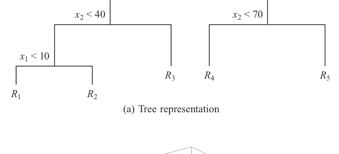

(a) 树的表示

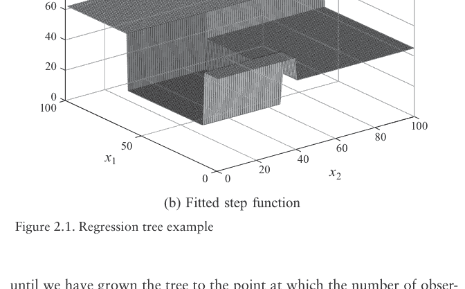

(b) 拟合的阶梯函数

图2.1. 回归树示例

直到我们将树生长到每个区域内的观测数量达到我们在过程开始时设定的终止准则所要求的最小数量为止。

具体来说，对于图2.1中的示例树，假设第一步中基于x1的划分与其他特征的单一划分相比提供了最大的解释力。因此我们分成两棵
树，然后从原始数据中抽取另一个自助样本以重复该过程。在点 x_i 处的拟合值是我们在每棵单独的树中得到的 x_i 处拟合值的平均值。常数 m 是一个调节参数。为它选取一个值类似于在惩罚方法中选取一个惩罚参数。

### 2.2.3 神经网络

神经网络本质上是估计高度非线性回归函数的方法。例如，假设我们有 J 个协变量 x_i，它们作为网络的输入，以及一个因变量 y_i，作为输出。输入和输出通过一个包含 H 个节点的隐藏层连接，我们可以将这些节点视为潜在的潜变量。若 y_i = f(x_i) + ε_i，则网络可以表示为

f(x_i) = a_2 + w_2' g(a_1 + W_1 x_i), (2.11)

其中 a_1 + W_1 x_i 表示潜变量向量。激活函数 g 是非线性的，并逐元素作用于每个潜变量。例如，一个流行的选择是整流线性单元（ReLU），其中 g(z) = max(0, z)，它是一个分段线性函数，如果 z 的元素为正，则直接输出该元素，否则输出零。激活函数的输出随后由 w_2 加权，并由 a_2 平移，以在输出层产生最终输出 f(x_i)。

g 的非线性对网络逼近非线性函数至关重要。如果 g 是线性的，例如 g(z) = A z（其中 A 为某个矩阵），网络将退化为线性回归模型 y_i = a + g' x_i + ε_i，其中 g' = w_2' A W_1，a = a_2 + w_2' A a_1。

隐藏节点的数量控制着函数逼近的灵活性。当隐藏节点数量很多时，可以以任意精度逼近高度非线性函数（Cybenko 1989; Hornik, Stinchcombe, and White 1989）。用于图像识别或自然语言处理的网络包含数万或数十万个节点（LeCun, Bengio, and Hinton 2015）。

可以添加额外的层。例如，使用两个隐藏层时，我们有

$f(\mathbf{x}_i)=a_3+\mathbf{w}_3 g\big(a_2+\mathbf{W}_2 g(a_1+\mathbf{W}_1\mathbf{x}_i)\big).$ (2.12)

深度神经网络增加了多个这样的层，通常是10到20层。结果是网络具有一系列线性映射与交织的非线性变换。参数的数量可能非常庞大。例如，对于具有 $H$ 个节点的单个隐藏层、一个输出和 $J$ 个输入的网络，$\mathbf{W}_1$、$a_1$ 和 $a_2$ 中的参数总数为 $H \times J + H + 1$。当 $J=1000$ 个输入和 $H=10000$ 个隐藏节点时，这相当于超过一千万个参数。对于全连接网络，每增加一个具有相同数量隐藏节点的层，就会增加 $H \times H + H$ 个参数。

原则上，具有单个隐藏层的网络可以逼近任何非线性函数。然而在实践中，对于典型数据集，增加网络层数往往似乎会带来更好的性能。深层网络是否通常更好仍是一个悬而未决的问题（例如，参见 Ba 和 Caruana (2013)）。Lin、Tegmark 和 Rolnick (2017) 认为，数据和被逼近函数的某些特性很重要。例如，深度网络非常适合逼近具有层次结构的函数。

交互效应——即多个输入对输出的联合效应不具有可加性的情况——是一种非线性形式，可能与我们将在下一章开始讨论的资产定价应用特别相关。因此，仔细研究神经网络如何捕捉这种交互效应是很有用的。

考虑一个如(2.11)所示的具有两个节点的单隐藏层网络。进一步假设 $a_2=0$，$\mathbf{w}_2=(1,1)'$，$\mathbf{a}_1=(-3/2,-3/2)'$，$\mathbf{W}_1$ 的第一行为 $(1,1)$，第二行为 $(-1,-1)$，且 $g(z)=\max(0,z)$，即

$f(\mathbf{x}_i)=\max(0,-3/2+x_{i1}+x_{i2})+\max(0,-3/2-x_{i1}-x_{i2}).$ (2.13)

在这种情况下，第一项仅在两个特征 $x_{i,1}$ 和 $x_{i,2}$ 之和足够大时“激活”；否则为零。第二项仅在两个特征 $x_{i,1}$ 和 $x_{i,2}$ 之和足够小时“激活”。结果是图2.2所示的函数。

通过添加额外的隐藏节点，我们可以为该函数添加额外的分段线性部分，例如针对 $x_{i,1}+x_{i,2}$ 更大的值和 $-x_{i,1}-x_{i,2}$ 更负的值。通过这种方式，神经

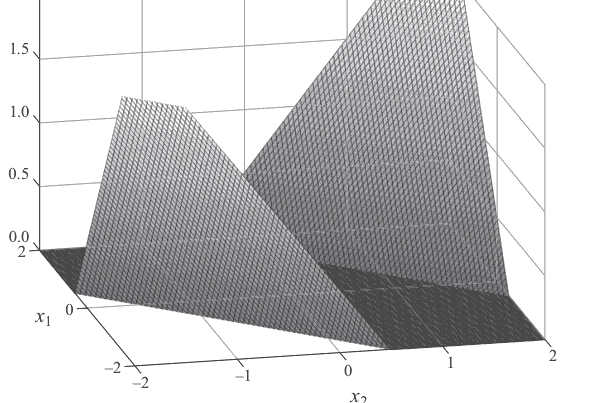

图2.2. 神经网络示例：交互效应

网络可以逼近，例如，形如 $(x_{i,1}+x_{i,2})^2 = x_{i,1}^2 + 2x_{i,1}x_{i,2}+ x_{i,2}^2$ 的函数，该函数涉及跨特征交互 $x_{i,1}x_{i,2}$。

为了使用训练数据拟合神经网络，可以采用与之前讨论线性回归方法时类似的误差平方和目标函数。将所有网络参数收集到向量 $\theta$ 中，目标函数为

$\displaystyle \min_{\theta} \sum_{i=1}^{N} [y_i - f(x_i, \theta)]^2. \qquad (2.14)$

该目标函数的最小化可通过数值方法实现，例如随机梯度下降或拟牛顿方法（参见 Hastie, Tibshirani, and Friedman 2009）。为了最小化的目的，使用平滑激活函数（如 sigmoid 函数）而非不可微函数（如 ReLU）也是有利的。¹

对于神经网络，我们也需要担心过拟合训练数据。具有许多节点和层的网络可能极其准确地逼近训练数据，但在样本外预测中表现不佳。正则化可以防止这种过拟合。类似于在岭回归目标函数 (2.6) 中添加惩罚项，我们可以

¹Sigmoid 函数 $g(z_i)=[1+\exp(-z_i)]^{-1}$ 的取值在 $(0,1)$ 区间内，当 $z_i \to -\infty$ 和 $z_i \to +\infty$ 时分别趋近于渐近线 0 和 1。

在此目标函数中添加一个平方 L² 范数惩罚项：

min_{θ} Σ_{i=1}^{N} [y_i - f(x_i, θ)]² + γ θ' θ. (2.15)

这会使得神经网络权重向零收缩。对于 sigmoid 激活函数，非常小的权重意味着激活函数处于近似线性的区域。因此，不仅输出被收缩向零，神经网络也被收缩向线性回归模型。

与我们之前讨论的线性回归方法类似，输入的缩放在此处对正则化的效果也很重要。某个输入的绝对幅度越大，意味着与该输入在网络中传播路径上相关的权重的幅度越小，因而这些权重在惩罚项 γ θ' θ 中的作用越小，从而对它们施加的收缩也越少。通常会将输入缩放为零均值和单位标准差，但这不一定是最佳方法。基于对预测问题和数据特性的先验考虑，也许更可取的做法是将不同输入缩放至不同幅度，以增加对 θ 中某些元素的收缩程度，并减少对其他元素的收缩。

## 2.3 超参数调优

到目前为止我们讨论的学习算法都涉及需要在训练前预设的超参数。例如，岭回归目标函数 (2.6) 依赖于超参数 γ，它决定了目标函数中惩罚项的权重，进而决定了惩罚所导致的收缩程度。为了从训练数据中估计回归系数 β，我们需要事先确定 γ 的值。类似地，lasso 需要一个预设的惩罚参数，而弹性网估计器则需要两个。正如我们在上一节刚刚讨论的，神经网络目标函数也可以有惩罚参数。例如，对于随机森林，用于节点分裂的随机抽取候选特征集的大小以及树的最大深度都是超参数。

最终，我们希望训练后的模型在预测任务中表现良好。因此，我们寻找能够最小化预测误差的超参数值。为了最小化预测误差，我们需要能够针对给定的超参数值估计预测误差。这并不是一件完全直接的事情。我们不能简单地使用训练数据集中的样本内误差，因为它是我们在一个新数据集中获得的预测误差的向下偏误估计，而这个新数据集

未用于训练模型。在岭回归情形下，例如，对于岭回归估计 $\hat{g}(\gamma)$ 和平方误差损失，样本内误差为

$$mse(\gamma)=\frac{1}{N}[y-X\hat{g}(\gamma)]'[y-X\hat{g}(\gamma)].\tag{2.16}$$

在训练数据中，岭回归估计 $\hat{g}$ 不仅拟合了 $y$ 中与 $X$ 真正相关的变动，而且在某种程度上也拟合了残差 $\epsilon$ 中的噪声。一个估计模型能在多大程度上（过度）拟合训练数据中的噪声，取决于模型的复杂度。因此，一种估计期望样本外预测误差的方法试图对样本内误差进行修正，以消除模型复杂度带来的偏差。在 OLS 回归中，复杂度就是估计的参数数量，而参数数量又等于协变量的数量。在岭回归情形下，情况稍微复杂一些，因为收缩限制了估计值，从而降低了模型复杂度。当我们寻找最优的岭回归惩罚时，我们不是简单地选择 $\gamma$ 来最小化 $mse(\gamma)$，还要考虑随着 $\gamma$ 增大、模型复杂度降低所带来的样本外预测收益。

对于拟合值可以表示为 $\hat{y}=Hy$ 的线性模型，可以用参数的有效数量来刻画模型复杂度，该数量等于“帽子”矩阵 $H$ 的迹（Hastie, Tibshirani, and Friedman 2009）。在岭回归情形下，这一有效参数数量为

$$d(\gamma)=\mathrm{tr}\left[X(X'X+\gamma I_K)^{-1}X'\right]\tag{2.17}$$

其中 $\mathrm{tr}[.]$ 表示迹运算符。在 OLS 情形下，$\gamma=0$ 时，$d$ 就等于回归中包括的协变量数量，即 $d=K.$² 当 $\gamma>0$ 时，$d<K$。收缩减少了有效参数的数量。例如，在 $X$ 的各列正交的特殊情况下，我们有 $d=K/(1+\gamma)$。

有了有效参数数量，我们就可以计算拟合优度指标，这些指标对样本内误差的乐观偏差进行调整，并考虑更高惩罚带来的降低复杂度的好处。经过调整的指标应该比样本内误差更好地估计期望预测误差。其中一种指标是赤池信息准则（AIC）。在岭回归情形下，并假设 $\epsilon$ 表示不相关的高斯噪声，AIC 为

$$AIC(\gamma)=N\log mse(\gamma)+2d(\gamma).\tag{2.18}$$

² 要理解这一点，可以利用迹的循环性质，即 $\mathrm{tr}[X(X'X)^{-1}X']=\mathrm{tr}[X'X(X'X)^{-1}]=\mathrm{tr}(I_K)=K$。

第一项随着 γ 的增大而增大，而第二项则减小。我们可以使两项之和最小的 γ 作为超参数估计值 γ̂。

尽管 AIC 有时有助于大致了解期望预测误差以及使其最小化的超参数值，但它也有其缺点。对于非线性模型，获得模型复杂度或有效参数数量的度量比线性模型更加困难。即使对于线性模型，AIC 也依赖于很强的假设。(2.18) 中 AIC 的表达式要求 ε 的元素独立同正态分布。如果偏离这一假设，我们需要指定似然函数的确切形式才能实现 AIC。

出于这些原因，机器学习从业者通常更喜欢在基本假设方面要求较低的预测误差估计和超参数调优的替代方法。一种流行的纯数据驱动方法是交叉验证（CV）。在 CV 中，从训练数据中获得的模型估计被用于在单独、独立的验证数据集上进行预测。模型在该验证数据集上的误差随后提供了预测误差的一个估计。CV 似乎是一种评估预测性能的自然方法：我们只需在一个未用于训练模型的数据集上检查实际的预测性能。此外，Stone（1977）表明，基于 CV 或 AIC 的模型比较是渐近等价的。在这个意义上，我们可以将 CV 视为对 AIC 的经验近似。

使用 CV 方法时，我们可以将验证数据中的预测误差作为调优超参数时要最小化的目标。例如，在岭回归情形下，我们使用针对给定 γ 值从训练数据中获得的估计 ĝ(γ)，在独立于训练数据集的验证数据集 (X_v, y_v) 上构造拟合值和预测误差，即我们计算 y_v − X_v ĝ(γ)。然后我们寻找使验证数据中预测误差平方和最小的 γ 值，即

γ̂ = arg_γ min [y_v − X_v ĝ(γ)]′ [y_v − X_v ĝ(γ)]. (2.19)

在许多情况下，简单地将可用数据分为一个训练样本和一个验证样本并不是对数据的高效利用。k 折 CV 方法试图通过使用整个数据集进行训练和验证来提高预测误差估计的效率。该方法将数据集分割成 k 个部分，即“折”，这些部分通常大小相等。然后我们使用 k 折中的一折进行模型验证，其余 k − 1 折用于模型估计。然后我们从 k 折中选择另一折用于验证，其余各折


为估计等，直到我们已将所有 *k* 个折叠恰好使用一次进行验证。我们使用来自 *k* 个验证折叠的预测误差的平均值作为预期预测误差的估计。然后我们寻找使该估计的预期预测误差最小化的超参数值。在岭回归的例子中，我们会寻找 γ 的值使得

$$\hat{\gamma}=\arg\min_{\gamma}\frac{1}{k}\sum_{j=1}^{k}\left[y_{\nu(j)}-X_{\nu(j)}\hat{g}_{-\nu(j)}(\gamma)\right]'\left[y_{\nu(j)}-X_{\nu(j)}\hat{g}_{-\nu(j)}(\gamma)\right]. \tag{2.20}$$

这里 ν(j) = 1, 2, ..., *k* 表示数据集被划分为的 *k* 个折叠的索引，而 −ν(j) 指的是不在第 *j* 个折叠中的数据集的剩余部分。

我们应该使用多少个折叠？在机器学习文献中对此问题没有明确的指导。总体而言，存在权衡。保持 *k* 非常小意味着我们使用较小的训练数据集来估计模型。这会削弱模型，因为用于估计其参数的数据量减少了。其后果是对预测误差的悲观有偏评估。另一方面，*k* 较大意味着在 *k* 次估计运行中每次使用的训练数据集高度重叠。在这种情况下，人们担心用于估计和验证折叠的完整数据集在性质上有些特殊，因此我们从大 *k*-CV 中估计的预测误差也是特殊的。如果我们查看一个新数据集的独立抽样，并用它来训练模型，那么在原始数据集上，我们通常可能会得到更高或更低的预测误差。使用较小的 *k* 的交叉验证在一定程度上可以保护我们免受这种可能性，因为它实际上使用了相当不同的、重叠程度不高的训练数据集抽样。从这个意义上说，存在偏差-方差权衡（Hastie, Tibshirani, and Friedman 2009）：*k* 较大意味着我们得到接近无偏的预测误差估计，但方差很高——在这里意味着对在新抽取的用于训练的数据集上预测误差表现的不确定性程度很高。

虽然这种权衡在概念上很明确，但在特定应用中最佳点在哪里并没有明确的指导。它可能取决于数据的性质和正在训练的算法。此外，*k* 较大的交叉验证计算量很大。它需要 *k* 次模型训练和验证的重复，这在大数据集上可能是不可行的。因此在实践中，通常选择远小于观测数量的 *k* 值。

在解释我们在 *k* 个验证折叠中得到的预测误差时，我们需要记住我们使用了这些折叠来估计 γ。由于我们选择 $\hat{\gamma}$ 来最小化验证折叠中的预测误差，因此对于该 γ 估计值，来自验证折叠的平均预测误差应是对预期预测误差的乐观有偏估计。因此，我们可能希望保留数据的一部分作为测试数据集，该数据集既未用于模型训练，也未用于超参数调优，并在该测试数据集上评估预测误差。

## 2.4 贝叶斯解释

应用机器学习方法需要做出许多选择。即使我们固定想要训练的模型——例如线性回归或神经网络——我们仍面临关于如何正则化估计的多种可能性。例如，在惩罚回归中，惩罚函数的选择将决定估计的模型是否可能具有稀疏性（如果使用 L¹-范数惩罚）或不具有（如果使用平方 L²-范数惩罚）。哪一个最好？做出这一选择后，我们还需要调整惩罚超参数，正如我们在上一节中刚讨论的那样。关于变量缩放的选择也很重要。在本章中，我们已经遇到过惩罚对参数估计的影响对输入变量的缩放很敏感的问题。我们是否应该将所有输入标准化为具有相同的标准差，还是其他类型的缩放会更好？答案并不明显。

我们可以尝试简单地让数据对这些问题作出回答。正如我们可以用交叉验证来优化超参数一样，我们也可以尝试使用交叉验证来找出哪种选择在验证数据集上产生更低的预测误差方面效果最好。不过最终，我们会遇到本章开头强调的没有免费午餐问题（Wolpert 1996）：我们无法期望识别出一种在所有可能的数据生成分布上普遍优于任何其他算法的机器学习算法。我们必须对数据的性质做出一些先验假设。纯粹基于数据驱动的机器学习方法是不可能的。我们需要引入一些关于我们使用机器学习方法所追求的目标以及算法将面对的数据类型的先验知识。

参数估计和正则化的贝叶斯解释对此可能有所帮助。贝叶斯统计允许我们以概率形式表达先验知识，即以先验分布的形式。考虑线性回归框架 y = Xg + ε 并假设 ε ~ N(0, Σ)，其中我们知道协方差矩阵 Σ 中元素的取值，但不知道系数向量 g 的取值。先验知识以 g 的先验分布的形式出现。在某些假设下，我们可以将贝叶斯估计映射到本章前面讨论的岭回归和套索回归。正如我们现在所示，先验分布的设定会影响施加在目标函数上的惩罚类型。

假设我们认为 $\mathbf{g}$ 的元素是从多元正态分布中抽取的，$\mathbf{g} \sim \mathcal{N}(0, \Sigma_g)$。给定该先验分布，$p(\mathbf{g})$，以及由回归残差 $\boldsymbol{\varepsilon}$ 的正态分布所暗示的似然，$p(\mathbf{y}|\mathbf{g})$，贝叶斯法则告诉我们，给定观测数据 $\mathbf{y}$ 时 $\mathbf{g}$ 的后验分布遵循

$$p(\mathbf{g}|\mathbf{y}) \propto p(\mathbf{y}|\mathbf{g})p(\mathbf{g}). \tag{2.21}$$

在正态先验和似然的情况下，后验分布也是正态的。该后验分布的均值具有类似于广义最小二乘（GLS）回归的形式，但在逆矩阵中多了一个项（Lindley and Smith 1972）：

$$\hat{\mathbf{g}} = \left(\mathbf{X}^{\prime}\Sigma^{-1}\mathbf{X}+\Sigma_g^{-1}\right)^{-1}\mathbf{X}^{\prime}\Sigma^{-1}\mathbf{y}. \tag{2.22}$$

逆矩阵中的额外项 $\Sigma_g^{-1}$ 诱导了收缩，使估计值偏离 GLS 估计值，朝向先验分布的均值（我们在这里假设为零向量）。如果我们专门考虑不相关且同方差的回归残差，$\Sigma=I_N\sigma^2$，以及先验分布下不相关且同方差的 $\mathbf{g}$ 元素，$\Sigma_g=I_K\sigma_g^2$，我们得到

$$\hat{\mathbf{g}} = \left(\mathbf{X}^{\prime}\mathbf{X}+\frac{\sigma^2}{\sigma_g^2}I_K\right)^{-1}\mathbf{X}^{\prime}\mathbf{y}. \tag{2.23}$$

该表达式与 (2.7) 中的岭回归估计量相同，其中 $\gamma=\sigma^2/\sigma_g^2$。这意味着岭回归惩罚具有贝叶斯解释，将 $\gamma$ 与先验分布中的离散程度联系起来。如果 $\sigma_g^2$ 很大，这意味着我们对 $\mathbf{g}$ 元素的可能大小没有精确的先验看法，$\gamma$ 很小，且朝向先验均值的收缩很少。相反，如果先验分布紧密集中在先验均值周围，$\sigma_g^2$ 很小，则收缩很强。

贝叶斯框架允许我们对之前用来激励正则化和收缩的关于“overfitting”的担忧给出更精确的解释。过拟合意味着在估计模型时没有给予我们对参数所拥有的先验信息适当的权重。如果我们的先验是弥散的，$\sigma_g^2 \rightarrow \infty$，那么实际上没有收缩的动机。在这种情况下，不带收缩地拟合回归

并不是对训练数据的过拟合。只有在有理由认为——也许基于经济合理性的考虑——回归系数的幅度不太可能极大时，谈论过拟合才有意义。那么，忽略这些信息并在不进行收缩的情况下估计回归，就意味着我们没有赋予这些先验信息任何权重，从而对训练数据过拟合。

在本书的许多章节中，我们将反复回到正则化的这种贝叶斯解释。在机器学习文献中，更常见的是从*偏差-方差权衡*的角度来讨论正则化的效果。在这种视角下，在没有太多正则化的情况下将估计器拟合到训练数据，会产生低偏差但高估计误差，即高方差。正则化可以降低方差，但代价是使估计器产生偏差。然而，从贝叶斯的角度来看，作为这些权衡计算参照点的频率学派无偏估计概念并不具有特别的意义。给定先验信念，后验以及后验所隐含的正则化，代表了将这些先验信念与经验数据信息相结合的最优方式。为了寻找正则化与经济约束之间的联系——这是本书的一个核心主题——讨论先验信息如何塑造正则化，比用偏差-方差权衡来表述更有用。

正则化的贝叶斯解释也阐明了我们应该如何思考岭回归中协变量的缩放。如果想使用岭回归，变量的缩放方式应使赋予 **g** 每个元素相等方差的先验是合理的。相反，如果我们认为某些系数的幅度可能比其他系数小，那么岭回归不会产生适当的收缩程度。相对于那些可能更接近零的系数，它对那些可能远离零的协变量系数收缩得过多。然后我们应该重新缩放协变量，使 **g** 各元素的等方差变得合理。这正是我们需要引入关于预测任务和数据生成分布的领域特定先验知识来指导估计器的地方。

在贝叶斯框架中，我们对 **g** 分布的先验看法也决定了我们最终使用岭回归还是其他类型的收缩。如果先验分布是拉普拉斯分布而不是正态分布，我们就会得到接近套索（lasso）的结果。图2.3提供了一个比较正态分布（虚线）和拉普拉斯分布（实线）的示例。与正态分布相比，拉普拉斯分布在零附近集中了更多的质量，并且尾部更厚。因此，与岭回归相比，采用拉普拉斯先验的贝叶斯回归对大系数的收缩较少，对小系数的收缩较多，这与套索（lasso）的做法类似。

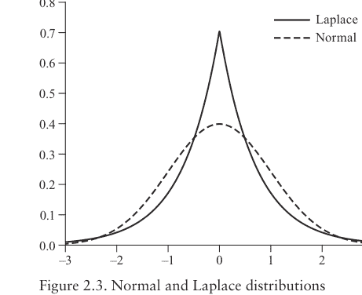

图2.3. 正态分布与拉普拉斯分布

然而，带有拉普拉斯先验的贝叶斯回归中的后验均值并不表现出稀疏性。套索估计量——产生稀疏估计——不等于后验均值，而是后验众数。这意味着可以将套索视为 g 的最大后验（MAP）估计量（Tibshirani 1996）。套索惩罚参数有效地控制先验分布的离散程度。

从贝叶斯规则可以看出，MAP估计量与最大似然估计密切相关。MAP估计器寻找在给定观测数据和先验信念下最可能的 g 值，即最大化后验概率的值

$$\hat{g} = \arg\max_{g} p(g|y),$$ (2.24)

根据贝叶斯规则，这等价于最大化 p(y|g)p(g)，即似然与先验的乘积。相比之下，最大似然估计器只会最大化 p(y|g)，而不受先验分布的加权。在无信息先验（平坦先验）的情况下，MAP估计量与最大似然估计量是一致的。

虽然基于MAP估计的预测并不是一种完整的贝叶斯分析——完全贝叶斯方法会使用后验分布来构建预测分布，而不是将点估计插入模型，并且会纳入关于σ²的先验不确定性——但MAP估计框架允许我们以简单的方式纳入先验信念。这反过来又使我们能够看到套索如何隐含地纳入关于 g 的先验信念。

我们讨论的关于岭回归协变量缩放的同样问题也适用于套索。当我们应用套索时，我们隐含地表达了这样的观点：对于 g 的每个元素，具有相等离散程度的拉普拉斯分布是合适的先验分布。如果我们认为这不是一个合理的假设，就需要相应地重新缩放协变量。在套索估计之前标准化协变量的现成方法不一定是对的。

最后，我们也可以给交叉验证一个启发式的贝叶斯解释。CV本质上是一种从数据中估计先验离散程度σ_g^2的方法。正如我们前面已经讨论过的，AIC施加的复杂性惩罚与基于CV的惩罚选择之间存在联系。George和Foster（2000）表明，优化AIC（或施加复杂性惩罚的相关拟合度量）的估计与经验贝叶斯估计之间又存在密切关系。在经验贝叶斯方法中，先验参数通过在先验参数上放置无信息超先验，然后寻找使后验概率最大化的先验参数值来经验性地估计。因此，我们可以将CV视为对经验贝叶斯方法的近似，在数据中估计先验分布的参数。

总之，正则化具有贝叶斯解释，即对模型参数先验知识的表达。即使我们没有正式采用完整的贝叶斯方法，我们也可以利用贝叶斯解释将领域特定知识应用于学习问题。数据的预处理（例如缩放）或惩罚的设定（例如惩罚参数向量的哪种范数）隐含地表达了先验观点。贝叶斯解释可以帮助我们以适合我们打算解决的具体机器学习问题的方式做出这些选择。在下一章中，我们研究资产定价中典型预测问题的性质，以及这些性质通过贝叶斯的视角告诉我们应该如何选择适当的预处理和规范设定。

# 资产定价中的监督学习

我们在第2章中回顾的监督式机器学习方法是资产定价工具箱中潜在有价值的补充。资产定价中的许多预测问题具有高维性质，因为大量可观测变量可能包含有用的预测信息。例如，在股票收益预测中，大量变量可能作为预测因子相关。来自会计数据的公司特征、从公司披露的文本信息中提取的信号、总结价格和交易量历史的变量、媒体报道中的信息以及许多其他变量都可能包含预测信息。

直到最近，资产定价中的许多现有文献都通过施加特设稀疏性来处理这种高维问题。研究人员通常不是同时考虑大量预测因子，而是单独考虑小规模预测因子集。例如，当研究人员研究一个新的预测变量时，学术文献中的常见做法是评估该变量相对于一个小型“标准”公司特征集是否具有边际预测信息，例如Hou、Xue和Zhang（2015）以及Fama和French（2015）因子模型中使用的特征（规模、账面市值比、投资、盈利能力）。这种单独考虑小规模预测因子集的问题在于，文献中已发现的预测因子之间可能存在大量冗余。

这种传统方法所施加的特设稀疏性并没有令人信服的经济动机。因此，需要能够在不需要施加特设稀疏性的情况下处理预测问题高维性的方法。机器学习方法非常适合这项任务，但直接现成应用这些方法不太可能充分发挥其潜力。资产定价应用在重要方面不同于机器学习方法最初开发时所针对的应用（通常是技术领域的应用）。表3.1列出了其中一些差异。当然，这些区别并不总是如此明确，但在许多情况下，它们会在一定程度上具有相关性。


功率，通过提高测量频率。这与 Merton（1980）中的观察相关，即提高测量频率并不会带来对预期收益更精确的估计。因此，无论如何，我们都必须接受收益数据可得性有限的现实。

在资产定价中，与许多典型的机器学习应用不同，我们并不一定对获得单个结果的准确预测感兴趣。例如，在股票收益预测中，我们并不一定对预测单个股票的收益感兴趣，而更关注构建具有良好风险收益特征的投资组合。将单个股票层面最准确的收益预测方法聚合到股票组合后是否能自动获得表现最佳的投资组合，这是一个开放性问题，没有明显的答案，正如本章后面将看到的那样。

正因为许多资产定价应用都具有这种投资组合视角，我们对预测误差的协方差特性也比从事典型机器学习问题的研究人员更感兴趣。毕竟，在多资产环境下，收益预测误差的协方差决定了投资组合波动率的大部分。而这种投资组合波动率在决定投资组合的风险收益特征方面发挥着重要作用。误差协方差的特性可能在资产定价中机器学习应用的各个阶段都至关重要，从最优机器学习算法是什么、如何正则化它、如何评估预测性能，以及如何将其输出用于投资组合构建等问题的开始。

正如我们在上一章讨论的那样，要使机器学习算法发挥良好作用，引入关于预测问题本质和数据属性的先验知识很重要。对于回归问题，其中一个属性就是模型的稀疏程度。正如 Hastie、Tibshirani 和 Wainwright（2015）所强调的，稀疏模型在许多应用中似乎表现良好，包括基因组学、图像分类、文本分析等。在这些应用的许多情况下，事先就有理由预期稀疏性。例如，在图像分类中，图像的某些区域可能对分类任务完全无关。同样，在分析预测疾病的遗传因素时，大量候选基因可能与该疾病毫无关系。然而，在资产定价中，事先并不清楚稀疏模型能否很好地描述数据的生成方式。例如，在使用会计变量进行收益预测时，我们在查看数据之前假设相当数量的资产负债表变量可能与收益预测完全无关，有什么理由呢？难道不是更合理地认为有些更相关、有些较少相关——也许因为它们都是对某些潜在不可观察因素的不同噪声信号——但事先几乎没有变量的相关性恰好为零？

在本章中，我们研究一个仅使用过去收益作为预测因子的简单股票收益预测模型。具有如此有限输入集的模型并不旨在代表在当今市场中构建表现良好的投资策略所需估计的模型类型。基于如此易得输入的表现良好的策略将是唾手可得的果实——但这种果实很可能早已被摘取。对于我们的目的而言，利用历史数据探索一个简单的基于收益的预测模型有助于说明如果我们想在资产定价中采用机器学习技术，需要解决的一些问题。

在一般层面上，收益预测回归的目标是近似条件预期收益，这意味着我们试图找到函数 $f(.)$ $$ \mathbb{E}[r_{i,t+1} | x_{i,t}] = f(x_{i,t}) \tag{3.1} $$ 将可观察的资产层面特征 $x_{i,t}$ 映射为在特征条件下的收益预期。我们在这里纯粹关注预测 *cross-sectional* 差异在收益中，因此我们可以将单个股票的收益 $r_i$ 视为相对于市场指数收益的表达。在下一章中，我们将研究更广泛的预测变量集合，但在本文中我们从仅由股票 $i$ 的过去已实现收益的函数组成的预测变量集合开始。即使在这一受限的预测变量集合内，如果不想对模型施加特设的稀疏限制，也很容易产生大量预测变量，从而形成一个相当高维的预测问题。

具体而言，我们分析的模型中 $r_{i,t+1}$ 为月度股票收益，而 $f(x_{i,t})$ 是股票自身过去月度收益的 120 个滞后项、过去收益平方以及过去收益三次方的线性函数。二次项和三次项允许过去收益与未来收益之间关系存在可能的非线性。为了避免微观结构引起的偏差和非常短的期限污染，我们跳过第一个滞后。因此，我们有回归 $$ r_{i,t+1} = \sum_{k=1}^{119} b_k r_{i,t-k} + \sum_{k=1}^{119} c_k r_{i,t-k}^2 + \sum_{k=1}^{119} d_k r_{i,t-k}^3 + e_{i,t+1}, \tag{3.2} $$

总共有 $3 \times 119 = 357$ 个预测变量。

每月 $t$，我们使用证券价格研究中心（CRSP）数据库中的所有股票，除了在月末 $t-1$ 时市值低于纽约证券交易所第 20 百分位且价格低于一美元的小盘股。我们排除低于此阈值的股票，以确保结果不会由极小且流动性差的股票驱动。对于因变量 $r_{i,t+1}$，我们使用 1970 年 1 月至 2019 年 6 月的收益。我们逐月对因变量和所有解释变量进行去均值处理，以纯粹关注横截面变化（这就是回归式（3.2）不包含截距项的原因）。此外，我们逐月对所有预测变量进行横截面标准化，使其单位标准差。我们对每个月的观测值进行加权，使得回归在样本中对每个月给予相同的权重。在具有非平衡股票收益面板的资产定价应用中，这是一种自然的加权方案，因为投资组合策略的平均收益（每月可能包含不同数量的股票）也会对每个时期给予相同的权重。

我们使用上一章讨论过的岭回归估计量（2.7）。惩罚超参数使用留一年的交叉验证进行估计。也就是说，交叉验证的折为构成一个日历年的连续月度横截面块。这意味着我们使用样本中除一年外的所有年份作为训练折来计算估计值，在被留出的验证年份中计算预测收益，并记录由此产生的 R²。然后我们用不同的留出年份重复，并再次记录 R²。我们重复直到样本中的每个年份都被留出一次。最后，我们对所有留出年份的 R² 取平均，并搜索使该交叉验证 R² 最大化的惩罚值。这种构建折的留一年法与我们在估计中对每个日历时期给予相同权重的加权方案一致。

为了证明岭回归估计能够恢复有用信息，我们首先检查估计的回归系数。岭回归自动检测到现有文献中已记录的许多显著的可预测性模式，大致涵盖此样本期或其部分。图 3.1 的面板（a）显示了式（3.2）中 b_k 系数的估计值，即滞后收益的一阶项系数。乍一看可能不明显，但仔细观察可以发现，在一次估计中，岭回归就恢复了与过去收益相关的几个主要异常现象：最高达 12 个月滞后的正系数捕捉到 Jegadeesh 和 Titman（1993）中的动量效应；该图还显示近期收益的延续集中在 6 至 12 个滞后，如 Novy-Marx（2012）所指出的那样；12 个月以后滞后项大多为负的系数反映了 DeBondt 和 Thaler（1985）中的长期反转。引人注目的是，在等于 12 的倍数的滞后处也存在较大的正系数。这种模式是 Heston 和 Sadka（2008）报道的动量季节性。该效应一直追溯到滞后 120。虽然这些效应在不同研究中是分别记录的，但在这里可以用一次回归一次性捕捉所有这些效应。


## 表3.2 使用滞后收益多项式进行收益预测

| 方法 | 缩放 | 交叉验证准则 | γ (i) | 样本内 R² (ii) | 交叉验证 R² (iii) | 均值 (iv) | 标准差 (v) | 夏普比率 (vi) |
|---|---|---|---|---|---|---|---|---|
| OLS | 等权 | n/a | 0 | 5.22 | −1.18 | 4.12 | 11.60 | 0.35 |
| Ridge | 等权 | R² | 2.25 | 2.63 | 0.84 | 4.20 | 13.85 | 0.30 |
| Ridge | 非等权 | R² | 1.40 | 2.69 | 1.18 | 4.55 | 12.47 | 0.37 |
| Ridge | 非等权 | E[r_p] | 3.11 | 1.75 | 0.89 | 4.58 | 12.94 | 0.35 |
| Lasso | 非等权 | R² | 0.00028 | 3.55 | 0.84 | 4.25 | 11.79 | 0.36 |

滞后12个月收益的变动相对于市场调整后个股典型年化标准差（大约40%或更高）而言很小。其次，非线性效应是微妙的。虽然包含过去收益的二三次幂是处理非线性的粗略方法，而且还有许多其他类型的潜在相关非线性，例如协变量之间的交互作用，我们尚未在此探讨，但强烈非线性效应并未以明显方式从数据中显现出来。如果它们存在，必须用更复杂的工具去寻找才能发现。

表3.2展示了该模型预测性能的信息。所有数字均已年化。¹ 第二行展示了岭回归的估计结果。为便于比较，第一行显示了OLS回归的相同统计量。目前，我们关注第(ii)和第(iii)列中的R²度量。我们将在本章后面讨论其他列。第(ii)列显示了训练数据中的样本内（IS）R²。岭回归的样本内R²仅为OLS样本内R²的一半左右。然而，第(iii)列中来自逐年留出交叉验证（CV）的交叉验证R²表明，OLS回归看似良好的样本内拟合实际上很大程度来自过拟合噪声：OLS的CV R²为负值−1.18%。相比之下，岭回归产生了正的CV R²，为0.84%。这说明正则化对于获得良好预测性能很重要。

¹ R²数值通过将月度数值乘以12进行年化，只要可预测成分占总收益方差的比重较小，这就是一个良好的近似。

这些R²数值再次凸显了股票收益预测应用中较低的信噪比。尽管约1%的CV R²在经济上具有实质性意义——年度收益可预测成分的隐含标准差约为4%——但可预测成分仅占总收益方差的一小部分。

由于我们通过在验证折上最大化CV R²来估计超参数γ，表3.2中报告的CV R²并非完全样本外。在既不用于模型训练也不用于超参数估计的测试数据集上的样本外R²可能会稍低一些。在本章后面，我们将考察这样的样本外R²。但即使暂时不考虑这个问题，在资产定价应用中，R²度量作为预测性能评估指标和超参数优化目标是否合适也存在疑问。我们首先研究这些问题。

## 3.2 预测性能评估

机器学习应用通常关注预测误差平方和的最小化。相应地，预测误差平方和或其函数（如R²）常被用作预测性能度量。在股票收益预测应用中，最小化个股收益预测误差似乎也是一个自然且合适的目标。

然而，在资产定价环境中，这是否是正确的方法并不明显。例如，在投资组合管理应用中，最终目标通常不是预测单个资产的收益，而是构建一个在样本外相对其风险获得高收益的投资组合。类似地，当研究人员研究风险溢价或市场效率时，他们可能更关注聚合了多组证券收益的投资组合的风险-收益特征，而非单个证券的收益。在预测个股收益方面表现更好的方法（即具有更高的预测R²）并不一定能在标准指标（如投资组合的夏普比率）下产生更好的投资组合。因此，表3.2第二行中岭回归比OLS回归产生更高的CV R²这一事实，并不一定意味着基于岭回归估计值构造的用于利用股票间预测收益差异的投资组合，在交叉验证折上会比基于OLS估计值的投资组合表现更好。

表3.2中的第(iv)列说明了这一点。该列显示了按估计回归的预测收益对个股加权的投资组合的年化交叉验证平均收益。在验证折中的每个月$t$，我们使用权重向量对所有股票进行加权

$$\hat{\omega}_{t-1}= \frac{1}{\sum_{i=1}^{N} |\hat{\mu}_{i,t-1}|} \hat{\mu}_{t-1}, \tag{3.3}$$

该权重向量与我们从训练折上估计的模型构建的预测收益向量$\hat{\mu}_{t-1}$成正比。$\hat{\mu}_{t-1}$的某些元素为正——多头头寸，某些为负——空头头寸，它们之和为零。通过分母中的求和项进行缩放，可将投资组合的规模固定为多空各半。正如我们之前对CV $R^2$所做的那样，我们使用逐年留出CV，但这次是针对投资组合收益$r_{p,t}=\hat{\omega}_{t-1}' r_t$而不是$R^2$。对时间取平均，我们得到交叉验证的平均投资组合收益（对于惩罚参数调整，我们目前仍坚持最大化CV $R^2$）。

如第(iv)列所示，基于第二行岭回归估计形成的投资组合获得的CV平均收益（4.20%）略高于基于第一行OLS回归估计形成的投资组合（4.12%）。但考虑到这些方法的CV $R^2$差异如此之大，这一差异小得惊人。换句话说，即使OLS在交叉验证折上产生负的预测$R^2$，基于OLS回归预测形成的投资组合在交叉验证折上仍产生了高得出奇的平均收益。此外，如第(v)列所示，基于OLS估计的投资组合的收益标准差实际上低于由第二行岭回归估计构建的投资组合。因此，OLS投资组合比基于岭回归估计的投资组合获得了更高的CV夏普比率（平均收益与标准差之比）。

为了理解预测性能的$R^2$度量与投资组合绩效指标之间的这种差异，我们现在在OLS回归框架中研究这些度量的决定因素。在下一节中，我们将考察正则化对这些指标的影响，并询问这一分析是否会改变我们关于应如何执行超参数调整的结论。

考虑每期按如下方式生成的$N$只股票的收益：

$$r_t = \mu + \varepsilon_t,$$
$$\mu = X g. \tag{3.4}$$

这里，$r_t$是第$t$期的$N \times 1$收益向量，$X$是$N \times K$的预测变量矩阵，$\varepsilon_t$是协方差矩阵为$\Sigma = I_N \sigma^2$的对角矩阵的IID冲击向量。由于我们将关注股票间的横截面差异，我们假设$r_t$中的收益是市场调整后的，

这利用了预期收益的横截面差异。我们考虑一个权重如(3.3)所示的投资组合，但采用不同的缩放因子：

```
\hat{\omega} = \frac{1}{\sqrt{\hat{\mu}' \hat{\mu}}} \hat{\mu}. \tag{3.8}
```

将估计的预期收益乘以比值$1/\sqrt{\hat{\mu}' \hat{\mu}}$，通过将权重平方和固定为1，确保权重具有可解释的尺度。对于我们在这里所做的计算，这比按投资组合权重绝对值之和进行缩放更方便，尽管此时投资组合不再具有“恰好一半多头一半空头”的解释。

鉴于我们这里假设收益在横截面上不相关，均值-方差有效投资组合——即最大化平均收益与收益标准差之比的夏普比率的投资组合——的权重与预期收益向量成正比。³ 因此，在这种特殊情况下，权重$\hat{\omega}$也代表均值-方差有效投资组合的（估计）权重。

权重为$\hat{\omega}$的投资组合在样本外（即对于$t > \tau$期间）每期获得收益，其期望值和方差为

```
\mathbb{E}[\hat{\omega}' \hat{r}_v | \hat{\omega}] \approx \frac{\mu' \mu}{\sqrt{\mu' \mu + \frac{N}{\tau}\sigma^2}}, \quad \text{var}(\hat{\omega}' \hat{r}_v | \hat{\omega}) = \frac{1}{T - \tau} \sigma^2. \tag{3.9}
```

因此，验证期内的平方夏普比率为

```
\frac{(\mathbb{E}[\hat{\omega}' \hat{r}_v | \hat{\omega}])^2}{\text{var}(\hat{\omega}' \hat{r}_v | \hat{\omega})} \approx \left(\frac{T - \tau}{\sigma^2}\right) \frac{(\mu' \mu)^2}{\mu' \mu + \frac{N}{\tau}\sigma^2}. \tag{3.10}
```

在这种情况下，对于对角协方差矩阵，平方夏普比率近似正比于(3.9)中投资组合的平方预期收益。因此，我们现在可以只关注(3.9)中的预期收益。

比较(3.9)和(3.7)，我们看到，就像OOS R²一样，预期投资组合收益受到更高估计误差的负面影响：预期收益随训练数据集大小τ的增大而增加。其原因是，当训练数据集较小，因此估计误差

³ 均值-方差有效投资组合的权重与Σ⁻¹ μ成正比。如果将权重重新缩放使其平方和为1，则权重为\frac{1}{\sqrt{\mu' Σ⁻² μ}} Σ⁻¹ μ。该投资组合实现了最大夏普比率，即预期组合超额收益与组合收益标准差之比的最大值。我们将在本书中反复回到这个特殊的投资组合。


更大，则 $\hat{\mu}$，它用于根据 (3.8) 构建投资组合权重，相对于信号 $\mu$ 具有更大的噪声。这导致 $\hat{\mu}$ 元素的绝对幅度更大。因此，投资组合权重分母 $1/\sqrt{\hat{\mu}'\hat{\mu}}$ 更大，从而降低了投资组合的预期收益。其直觉是，对于基本上固定了多头和空头头寸总敞口的投资组合，投资组合权重中的噪声越多，就意味着我们将部分投资能力用于交易噪声而非信号。$^4$

基于迄今为止的分析，人们可能会得出结论，由于 $R^2$ 和投资组合平均收益都受到估计误差的负面影响，因此 $R^2$ 是投资组合表现的良好指标。不幸的是，一旦我们脱离简单的 $\Sigma = I_N\sigma^2$ 情况，这可能不再成立。在这种情况下，投资组合夏普比率取决于 $\Sigma$ 的性质，而 $R^2$ 指标对这些性质保持沉默。

但即使我们把协方差矩阵的问题放在一边，$R^2$ 与投资组合绩效指标给出冲突信息的原因还有其他。正如我们在 (3.2) 中看到的，从未正则化的 OLS 移动到正则化的岭回归对 CV $R^2$ 产生了很大影响，但仅导致投资组合平均收益的轻微改善。这提出了两个问题。首先，正则化如何影响这些预测绩效指标？其次，在资产定价应用中，使用现成的机器学习正则化方法是否合适？在惩罚超参数调优中，目标通常是最大化交叉验证 $R^2$。但提高 $R^2$ 显然不一定等同于提高投资组合绩效。因此，我们在研究非对角收益协方差矩阵的后果之前，先更仔细地研究正则化对投资组合绩效的影响。

## 3.3 正则化与投资绩效

在本节中，我们研究正则化对验证数据集中 OOS $R^2$ 和投资组合绩效的影响。如前所述，我们以岭回归为例，但从本分析中得出的经验更广泛地适用于套索等其他形式的惩罚回归。

假设我们用岭回归估计 (3.4) 中的参数向量 $g$

$\hat{g} = (X'X + \gamma I_K)^{-1} X'\bar{r}. \quad (3.11)$

$^4$如果相反让权重不缩放且仅等于 $\hat{\mu}_i$，则预期收益将基本不受估计误差的影响，但方差会更高，导致平方夏普比率产生同样的不利影响。

在这种情况下，正则化采取收缩的形式，并且当 $\gamma > 0$ 时生效。进一步假设 $X'X = I_K$，例如因为我们在运行回归之前对协变量进行了正交化。那么 (3.11) 简化为

$$\hat{g} = \frac{1}{1+\gamma} X' \tilde{r}\tag{3.12}$$

并且

$$\hat{\mu} = X \hat{g} = \frac{1}{1+\gamma} X X' \tilde{r} = \frac{1}{1+\gamma} \mu + \frac{1}{1+\gamma} u,\tag{3.13}$$

其中

$$u = X X' \bar{\varepsilon}.\tag{3.14}$$

由于收缩效应，验证数据中的 $R^2$ 现在是 (3.7) 的修改版本。我们得到

$$R_{OOS}^2 \approx 1 - \frac{\frac{1}{T-\tau}\sigma^2}{\frac{1}{N}\mu'\mu + \frac{1}{T-\tau}\sigma^2} - \left(\frac{\gamma^2}{(1+\gamma)^2}\right)\frac{\frac{1}{N}\mu'\mu}{\frac{1}{N}\mu'\mu + \frac{1}{T-\tau}\sigma^2}

- \left(\frac{1}{(1+\gamma)^2}\right)\frac{\frac{1}{\tau}\sigma^2}{\frac{1}{N}\mu'\mu + \frac{1}{T-\tau}\sigma^2}.\tag{3.15}$$

我们可以用此表达式评估收缩对 OOS $R^2$ 的影响。最后一项是由于估计误差而从 $R^2$ 中减去。$\gamma > 0$ 引起的收缩降低了该项的幅度。这提高了 OOS $R^2$。但收缩也引入了第二项，因为它使 $\hat{\mu}$ 远离 $\mu$ 产生偏差。更大的收缩会增加该项的幅度，进而降低 OOS $R^2$。收缩的综合效应是提高还是降低 $R_{OOS}^2$ 取决于 $\gamma$、$\frac{1}{N}\mu'\mu$ 和 $\frac{1}{\tau}\sigma^2$ 的大小。噪声方差 $\frac{1}{\tau}\sigma^2$ 相对于信号方差 $\frac{1}{N}\mu'\mu$ 越大，$R_{OOS}^2$ 最大化的 $\gamma$ 越大。

但投资者不一定直接关心 OOS $R^2$。这种缩放如何影响基于 (3.8) 中的估计 $\hat{\mu}$ 形成的投资组合策略的样本外表现？事实证明，在 (3.13) 中以常数因子 $\frac{1}{1+\gamma}$ 收缩估计值会使权重 $\hat{\omega} = \frac{1}{\sqrt{\hat{\mu}'\hat{\mu}}}\hat{\mu}$ 保持不变！因此，预期收益、方差和平方夏普比率也将保持不变。$^5$ 这是一个重要的经验：OOS $R^2$ 的改善并不是 OOS 投资组合绩效指标也会改善的保证。

$^5$如果使用未缩放的权重代替，$\hat{\omega} = \hat{\mu}$，则预期收益会下降，且投资组合收益标准差会以相同的因子下降，使平方夏普比率保持不变。

即使在回归残差不相关的这种简化设定下，OOS $R^2$ 的改善也不一定转化为投资组合绩效的改善。因此，OOS $R^2$ 与投资组合绩效之间的脱节不仅仅是由于 OOS $R^2$ 在总结预测绩效时忽略了预测误差协方差的后果。事实上，使用一般的协方差矩阵 $\Sigma$ 也会得到相同的结果。在这种情况下，均值-方差有效投资组合权重的插值估计为 $\hat{\omega} = \frac{1}{\sqrt{\hat{\mu}' \Sigma^{-1} \hat{\mu}}} \Sigma^{-1} \hat{\mu}$。很容易看出，以标量因子收缩 $\hat{\mu}$ 的效应会在这些权重中相互抵消，对投资组合绩效指标没有影响。

这有助于我们理解为什么在表 3.2 中从 OLS 移动到岭回归对 CV $R^2$ 产生了很大影响，但对投资组合绩效指标没有影响。我们在这些回归中使用了标准化协变量，这意味着协变量在横截面离散度上没有任何异质性。并且协变量彼此之间也没有高度相关。这意味着表 3.2 中的经验设定是 $X'X$ 接近于单位矩阵的比例——就像我们在本节迄今为止的分析一样。在这种情况下，岭回归大致同等地收缩所有系数。这有助于 $R^2$，但不帮助投资组合平均收益和夏普比率。为了使收缩对投资组合绩效指标产生影响，收缩必须以比仅以常数因子收缩估计预期收益向量的所有元素更微妙的方式运作。在我们迄今为止考虑的 $X'X = I_K$ 情况下，收缩不仅按相同程度降低权重中的估计误差，也降低预期收益信号成分。

要使收缩有可能改善投资组合绩效，必须是 $X'X$ 不是单位矩阵的比例。考虑例如

$$X = Q_K \Lambda_K^{\frac{1}{2}} \tag{3.16}$$

的情况，其中 $Q_K$ 是某个 $N \times K$ 矩阵，$\Lambda_K$ 是对角矩阵，其对角元素为 $\lambda_j$。为了保持记号简单，我们仍然假设预测因子已被正交化，但没有按横截面方差相等进行缩放。这意味着这里 $Q_K$ 的列是正交归一的，即 $Q'_K Q_K = I_K$，但 $X'X = \Lambda_K$，因此 $\Lambda_K$ 的对角元素决定了协变量的横截面离散度。与 $X'X = I_K$ 情况不同，我们现在可以拥有横截面离散度不同的协变量。

在这种情况下，OLS 将产生估计 $\hat{g}_{OLS} = \Lambda_K^{-\frac{1}{2}} Q'_K \tilde{r}$ 和预测收益 $\hat{\mu}_{OLS} = X \hat{g}_{OLS}$。岭回归的预测收益为

收缩这些成分最多，从而降低估计误差。这种增加的收缩带来的成本是损失的回报预测能力，正如分子所捕捉的那样。但如果 \(g_j^2 \lambda_j\)，即该协变量相关的可预测回报变异，并不高，则该成本很小。在这种情况下，放弃预测能力的相对较小成本，相对于降低估计误差带来的收益而言是值得支付的。

由于组合回报的方差不受收缩影响，预期回报的任何改善也会转化为夏普比率的改善。因此，要使收缩相对于未正则化的 OLS 回归改善组合表现，在横截面同方差且不相关回报以及正交化协变量的设定下，协变量必须在横截面离散程度上存在差异。只有在这种情况下，岭回归才会以不同程度收缩不同协变量的系数，而这正是收缩对组合绩效指标产生影响所必需的。

更一般地，如果协变量对预期回报和估计误差的相对贡献存在异质性，则收缩可以改善组合表现。对风险的贡献的异质性是另一个我们尚未考虑的相关维度。收缩必须对不 desirable 的贡献（估计误差、风险）的影响大于 desirable 的贡献（预期回报）。

对于套索，类似的结论也适用。但在套索情况下，真实 \(g_j\) 系数大小的异质性可能是正则化能够影响组合表现的额外原因。即使协变量的横截面离散度没有差异，套索也会将 OLS 估计接近零的系数设为零（回顾我们在第 2.2.1 节中关于套索收缩的讨论）。因此，\(g_j\) 的异质性也可能诱导出改善组合表现的异质收缩效应。

回到岭回归的情况，我们迄今为止的分析结果仍然没有提供太多指导。某些协变量的横截面离散度低于其他协变量到底意味着什么？在典型的资产定价应用中，我们可以以任意方式重新缩放预测因子。例如，预测因子通常表示为组合排名，或横截面标准化为单位标准差。这正是我们在表 3.2 的回报预测回归中所做的。采用这种标准化，每个预测因子的横截面离散度是相同的。如果预测因子在横截面上也不相关，岭回归会同等收缩所有系数，对组合夏普比率没有影响。但为什么选择这种缩放而不是其他缩放？

标准岭回归和套索统计软件包在估计前通常默认标准化变量。我们在此的讨论清楚地表明，这并不是一个无害的数据预处理步骤，因为它会影响被收缩的内容！如果协变量二阶矩矩阵是对角的，标准化协变量保证了与 OLS 相比，组合绩效指标不会受到影响！因此，标准化对估计结果具有实质性影响。

更一般地，岭回归预测和组合构建练习的结果对协变量的重新缩放不是不变的：我们可以在不改变资产预期回报的情况下，以改变岭回归结果的方式重新定义 (3.16) 中的协变量和系数。例如，继续以上述例子，如果我们将回归系数重新定义为 \(\Lambda_K^{1/2} g\)，协变量重新定义为 \(X\Lambda_K^{-1/2} = Q_K\)，岭回归得到

\[
\hat{\mu} = Q_K (I_K + \gamma I_K)^{-1} Q_K' \tilde{r}
= \frac{1}{1+\gamma}X\hat{g}_{\mathrm{OLS}},
\tag{3.20}
\]

其中 \(\hat{g}_{\mathrm{OLS}} = \Lambda_K^{-1/2} Q_K' \tilde{r}\) 是 \(\tilde{r}\) 对原始协变量 \(X\) 回归的 OLS 估计量。于是我们又回到了一个恒定的收缩因子，它同等地影响 \(\hat{\mu}\) 的所有元素！在这种情况下，改变 \(\gamma\) 对基于 \(\hat{\mu}\) 构建的组合的平均回报和夏普比率没有影响。

那么如果协变量的任意重新缩放会影响岭回归收缩的性质，我们应该如何重新缩放协变量？这是我们需要引入关于训练模型所用数据的属性的先验知识的地方之一。如果我们有先验理由认为某些协变量可能比其他协变量更不重要，并且可能更多地贡献估计误差而不是回报预测信号，那么我们可以进行重新缩放，使得这些可能不那么重要的协变量具有更低的横截面离散度。

为此，有用的是回顾第 2.4 节中将岭回归解释为具有回归系数正态先验的贝叶斯回归。如果先验协方差矩阵和残差协方差矩阵与单位矩阵成比例，则岭回归作为贝叶斯回归的特例出现。换句话说，如果我们应用标准岭回归，我们隐含地表达了先验信念，即自然从同一分布中抽取 \(g\) 的每个元素。因此，在岭回归中，我们应该以使这种隐含假设合理的方式重新缩放协变量。换句话说，基于我们对预测问题和数据的了解，每个协变量都可能获得大致相同大小的系数应该是合理的。如果根据我们的先验信念，某些协变量在对可预测回报的贡献方面不太重要，那么它们应该被缩放为具有更低的横截面离散度，以便它们仍然可能获得与其它更重要的协变量大致相似的回归系数大小。

例如，在我们的回报预测示例中，我们可能对过去股票回报与未来股票回报之间关系中存在非线性持怀疑态度。这将导致我们将 (3.2) 中的二阶和三阶项重新缩放，使其横截面标准差低于一阶项。为了说明这种重新缩放的效果，我们在实证示例中增加另一个重新缩放步骤：在标准化协变量之后，我们将平方回报协变量除以 2，并将三阶协变量除以 4。这些缩放因子的选择当然存在一定的任意性，但这里的目的仅仅是为了说明这种重新缩放可以影响预测性能。

表 3.2 的第三行——标记为“unequal”以突出协变量的不同类型缩放——呈现了结果。与表中第二行相比的一个变化是估计惩罚参数 \(\gamma\) 的值显著更低。一旦协变量被重新缩放为具有不相等的横截面标准差，我们需要更少的收缩来最大化 CV \(R^2\)。因此，即使样本内 \(R^2\) 也从第二行的 2.63% 略微上升到第三行的 2.69%。更重要的是，CV \(R^2\) 从 0.84% 上升到 1.18%，提升超过三分之一，且组合绩效指标改善：平均回报从 4.20% 上升到 4.55%，夏普比率从 0.30 上升到 0.37。显然，先验信念认为二阶和三阶项对回报预测的重要性较低，在数据中似乎具有一定的合理性。

最后，既然我们现在理解在验证期内，预测性能的 \(R^2\) 指标与组合性能之间存在明显差异，自然会问为什么我们甚至使用 \(R^2\) 作为超参数调优的目标。如果我们想要最大化组合绩效指标，为什么不在超参数调优中直接以它们为目标？表 3.2 中的第四行展示了在我们的回报预测示例中这样做时会发生什么，保持对二阶和三阶项进行降尺度的不等缩放。在这个版本的岭回归中，我们调优惩罚参数以最大化验证折中组合的平均回报，而不是 \(R^2\)。其后果很有趣。估计的 \(\gamma\) 为 3.11，远高于第三行中我们选择 \(\gamma\) 以最大化 CV \(R^2\) 的情况。因此，IS 和 CV \(R^2\) 都明显低于第三行。尽管如此，组合平均回报（4.58% vs. 4.55%）略高。不过夏普比率（0.35 vs. 0.37）略低。但如果某人想要最大化夏普比率，可以在超参数调优中直接以夏普比率为目标，而不是平均回报。总体而言，这些结果表明，通过直接以

portfolio performance instead of \(R^2\) are quite limited, at least in this specific setting. But they also illustrate once more that \(R^2\) measures can be quite misleading as indicators of portfolio performance.

本节的最终结论是，正则化对验证数据中 \(R^2\) 和投资组合表现的影响对协变量的缩放很敏感。要使正则化有效，我们需要在预测任务中引入关于不同协变量可能相对重要性的一些先验知识。这就提出了如何提出先验信念以帮助我们适当缩放协变量从而使正则化有效的问题。正如下一节所示，金融经济学表明协方差与预期收益之间存在联系，这些联系可以帮助我们确定应如何正则化。

## 3.4 预期收益与协方差之间的联系

我们在第 2.4 节中讨论的贝叶斯回归框架允许我们通过展示预期收益与协方差之间的经济联系如何与正则化相关，来处理协变量缩放的问题。回想一下，对于截面回归模型 \(\bar{r}=Xg+\bar{e}\)，其先验为 \(g \sim N(0, \Sigma_g)\)，其中 \(\bar{r}\) 和 \(\bar{e}\) 分别是来自样本量为 \(\tau\) 的 \(r_t\) 和 \(e_t\) 的平均值，且 \(\Sigma = \operatorname{var}(e_t)\)，我们得到后验均值

\[
\hat{g}=\left( X'\Sigma^{-1}X + \frac{1}{\tau}\Sigma_g^{-1} \right)^{-1} X'\Sigma^{-1}\bar{r}. \tag{3.21}
\]

在此框架内，我们现在寻找在经济上合理的 \(X\) 的设定和关于 \(g\) 的先验信念。为此，我们还需要对协方差矩阵进行更现实的设定。我们上面使用的假设 \(\Sigma = I_N \sigma^2\) 有时对说明问题有用，但不是资产收益的现实属性。这里我们让 \(\Sigma\) 具有一般形式。如前所述，我们仍然假设 \(\Sigma\) 已知且无需估计。

经济推理表明，用于预测收益的协变量应与股票收益协方差相关。具体而言，与协方差矩阵的联系应是：如果基于协变量值形成的做多做空投资组合产生可观的平均收益，它也应具有可观的收益波动。例如，如果小公司规模预测高收益，那么做多小盘股、做空大盘股的投资组合应具有可观的波动。这需要协方差风险暴露，即小盘股之间比与大盘股之间的共动性更强，大盘股之间比与小盘股之间的共动性更强。这种组内共动性阻止了风险的分散，从而导致做多做空投资组合的收益方差相对较高。正如 Kozak, Nagel, and Santosh (2018) 所讨论的，这种均值收益与协方差之间的联系被广泛的资产定价模型所预测，包括具有理性投资者的模型和资产需求由情绪或行为偏差驱动的投资者模型。如果预期收益与协方差之间不存在此类联系，则会存在在经济上不可信的近似套利机会。

为了得到一个特别透明的结果，我们通过一个相当强硬的假设来设定收益预测协变量与协方差之间的这种联系，即用于预测收益的 \(K\) 个协变量向量等于 \(\Sigma\) 的 \(K\) 个特征向量。令 \(\Sigma = Q\Lambda Q'\) 为 \(\Sigma\) 的特征分解，并令 \(Q_K\) 为正交矩阵 \(Q\) 的 \(K\) 个列的选取。我们随后假设 \(X = Q_K\)，这意味着 \(X'X = I_K\)。协变量恰好等于特征向量的假设当然是一个强假设，但它会给我们一个特别清晰的结果。

由于投资组合权重基于收益协方差矩阵的特征向量或主成分，我们将它们标记为主成分 PC 投资组合。PC 投资组合的预期收益和方差为

\[
\mathbb{E}[Q_K'r_t] = g, \qquad \operatorname{var}(Q_K'r_t) = \Lambda_K, \tag{3.22}
\]

其中 \(\Lambda_K\) 是一个对角矩阵，其对角线上为 \(Q_K\) 中 \(K\) 个特征向量对应的 \(K\) 个特征值。

我们现在可以指定关于 \(g\) 的经济动机先验信念。为此，有用的是注意到与这 \(K\) 个 PC 投资组合收益 \(r_p = Q_K'r_t\) 相关的夏普比率为 \(\Lambda_K^{-1/2}g\)。关于这些夏普比率的一个具有一定经济合理性的假设——下一章将对此作更多说明——是高夏普比率集中在具有相对高方差的 PC 投资组合中。在这里，这意味着夏普比率向量 \(\Lambda_K^{-1/2}g\) 很可能对与高 \(\lambda_j\) 相关联的那些元素 \(j\) 取得更大的幅度。先验信念

\[
g \sim N(0, \gamma^{-1}\Lambda_K^2), \qquad 0 < \gamma < 1, \tag{3.23}
\]

与这种推理一致，因为它们意味着关于夏普比率向量 \(\Lambda_K^{-1/2}g \sim N(0, \gamma^{-1}\Lambda_K)\) 的先验信念。该夏普比率向量的先验分布允许对基于 \(Q_K\) 的列 或 \(X\) 与高 \(\lambda_j\) 相关联的 \(r_p = Q_K'r_t\) 中的那些投资组合收益的夏普比率具有更大的幅度 正负。

在这一假设下，超参数 \(\gamma\) 现在具有经济解释，即控制先验信念下的预期平方夏普比率。为了说明这一点，注意最大平方夏普

have to change the prior about \(g\) accordingly. For example, if we divide covariate \(j\) by a constant \(c\), we have to multiply the corresponding coefficient \(g_j\) in our prior by \(c\), which means multiplying its variance in the prior distribution by \(c^2\). As a consequence, the posterior mean of \(\mu\) would remain invariant to such rescaling. We revisit these questions again in the next chapter within a more general framework. This framework will allow us to specify prior beliefs in an empirically plausible way.

## 3.5 收益协方差与投资组合聚合

预测误差的协方差在资产定价中比在典型的 ML 应用中发挥更大的作用。如果我们的目标是使用收益预测模型形成相对于风险水平具有高收益的投资组合，则不可预测收益成分的协方差矩阵发挥重要作用。

虽然我们迄今假设协方差矩阵已知，但在实践中必须对其进行估计。这引入了额外的估计误差层，可能导致投资组合构建出现重大问题。在极端情况下，如果有人想处理数千只个股，找到这些股票的均值-方差有效组合就需要估计一个包含数百万个元素的巨大协方差矩阵。在不对其函数形式施加实质性约束或对协方差矩阵应用某种形式的收缩估计的情况下，估计该协方差矩阵是困难的。此外，典型的个股收益数据集是不平衡面板，可能难以用于协方差矩阵估计。最后，在跨越多年或数十年的数据集中，个股的协方差特性可能随着公司特征的变化而随时间变化。

因此，先根据收益预测模型的协变量将股票聚合为投资组合是有意义的。如果我们用来形成投资组合的特征与股票的协方差暴露相关，则投资组合的协方差可能比个股的协方差稳定得多。而且，只要协变量数量小于资产数量，即 \(K < N\)，投资组合聚合应有助于协方差矩阵估计。

在不负面影响以最大平方夏普比率衡量的投资机会的情况下，我们可以在何种理想条件下聚合到这些投资组合中，从而获得这些好处？为了使问题更具体，假设再次如 (3.4) 早期所述，收益生成为 \(r = Xg + \varepsilon\)，其可预测成分 \(\mu = Xg\)。考虑协变量加权投资组合，其实现收益为 \(r_p = X' r\)，


预期收益率 μ_p = X′ μ = X′ X g，且收益率协方差矩阵 Σ_p = X′ Σ X。协变量 X 与资产收益率协方差之间的关系需要满足什么条件，才能使来自单个资产的最大平方夏普比率等于来自聚合投资组合的最大平方夏普比率？

因此，我们正在寻找满足 μ′ Σ^{-1} μ = μ′_p Σ_p^{-1} μ_p 的条件，即

g′ X′ Σ^{-1} X g = g′ X′ X (X′ Σ X)^{-1} X′ X g. (3.26)

该等式成立的充要条件（Amemiya (1985)，定理 6.1.1）是协方差矩阵具有如下形式

Σ = X Ψ X′ + U Φ U′ + σ^2 I_N, (3.27)

其中 Ψ、Φ 为某些相容矩阵，U 为满足 U′ X = 0 的矩阵。当且仅当协方差矩阵具有此形式时，按 X 进行聚合不会导致均值-方差投资者在投资机会上的任何损失。直观上，协方差矩阵取此形式要求 X 中的协变量不仅捕捉预期收益率的横截面变化，还捕捉资产对产生收益率系统性时间序列变化的因子所加载的因子暴露（由 (3.27) 中的第一项捕捉），使得资产对任何剩余系统性因子（由 (3.27) 中的第二项捕捉）的载荷 U 与 X 正交。未被这两种系统性因子所解释的任何剩余风险必须是纯粹的特质性风险（(3.27) 中的第三项）。

在 X 中协变量数量较大的应用中，条件 (3.27) 近似成立是合理的。例如，假设 Σ 具有 L 因子结构 Σ = G Ω G′ + σ^2 I_N，其中 G 是 N × L 因子载荷矩阵，Ω 是非奇异的。对于典型的股票收益率数据集，股票收益率协方差的大部分可归因于少数几个因子，例如 L ≤ 20。如果 X 矩阵包含许多关于股票因子载荷具有信息性的特征，则可能出现 G 近似被 X 张成的情况，即 G ≈ X B，其中 B 为某个矩阵。在这种情况下，Σ ≈ X B Ω B′ X′ + σ^2 I_N，即我们近似得到 (3.27) 的一个特例。换句话说，如果单个资产收益率的协方差存在有限数量的主要来源，并且我们使用相对大量的特征，这些特征往往与资产对主要协方差来源的载荷相关，则由于投资组合聚合而导致的投资机会恶化可能很小。

此外，以上结果以总体矩的形式陈述。它们假定投资者完全知道资产收益率的预期收益率和协方差。如果我们现在也

Pelger, and Zhu (2019) 研究了基于树的投资组合，其中股票宇宙按公司特征在若干步骤中依次分割。这种方法允许特征之间存在高阶交互效应，并且他们表明这些交互效应对于捕捉股票之间风险和收益的差异很重要。Moritz 和 Zimmermann (2016) 发现，即使预测变量集被限制为，如本章前面的实证示例中那样，仅为股票自身过去收益率的函数，交互效应仍然会出现。他们提供了证据表明，过去收益率不同滞后项之间的交互作用增加了收益预测中的预测能力。鉴于这些论文强调交互作用作用的证据，下章中呈现的实证分析将允许公司特征之间存在交互作用。

## 3.7 稀疏性

在许多 ML 应用中，诱导稀疏性的方法取得了成功。在这些应用中，选择少量协变量通常足以获得良好且稳健的预测性能。资产定价研究人员自然会效仿这一思路。许多将 ML 方法引入资产定价的努力都集中在允许稀疏性的 lasso 型方法上，包括 Chinco、Clark-Joseph 和 Ye (2019)、DeMiguel、Martin-Utrera、Nogales 和 Uppal (2019)、Feng、Giglio 和 Xiu (2020)，以及 Freyberger、Neuhierl 和 Weber (2020)。但正如我们在本章开头已经讨论的那样，在资产定价应用中，稀疏性诱导先验似乎并没有太多合理性。

表 3.2 的最后一行显示了我们将 lasso 回归，如 (2.8) 中那样，应用于我们基于过去收益率的预测示例时得到的结果。具体而言，我们将其应用于缩放版本，其中在标准化后，第二阶和第三阶协变量的幅度分别按因子 2 和 4 缩小。这与本表第五行和第四行中岭回归所使用的缩放相同。lasso 的最优惩罚值远低于岭回归，因为回归系数估计的绝对值都远小于 1，因此 lasso 惩罚中的绝对系数之和远大于岭惩罚中的平方系数之和。粗略地说，同样的正则化程度可以用更低的惩罚超参数值实现。就拟合而言，IS R² 为 3.55%，高于第三行中的岭回归。在根据 CV R² 的预测性能方面，lasso 明显更差（0.84% vs. 1.18%）。因此，就该程序所最大化的预测性能标准而言，lasso 的表现不如岭回归。

查看表 3.2 中的投资组合绩效指标，lasso 在平均收益率方面略逊于岭回归，但投资组合收益率的标准差也更低，因此夏普比率最终略高。这再次说明基于 R² 和投资组合绩效指标得出的结论可能存在很大差异。虽然 lasso 在夏普比率方面至少与岭回归相当，但 lasso 诱导的稀疏性并未带来绩效优势。总体而言，这些结果提供了少量证据，表明稀疏性对于资产定价中的预测性能帮助不大，而在许多其他 ML 应用中则可能有所帮助。

图 3.2 比较了 lasso 估计的单个回归系数（用点标记）与表 3.2 第三行中具有相似缩放协变量的岭回归（用叉标记）估计的系数。总体而言，估计值揭示了 lasso 的一般倾向，即除非系数被完全收缩为零，否则其收缩程度小于岭回归。对于图 (a) 中的一阶项，只有很少的项被设为零。这再次与我们的讨论相吻合，即在这种类型的收益预测练习中，我们没有强有力的先验理由预期稀疏性。

相比之下，从图 (b) 和 (c) 所示的估计值可以看出，被设为零的大多数系数都是第二阶和第三阶项的系数。岭回归对这些系数的估计接近于零，但 lasso 将其中许多设为恰好为零。因此，lasso 几乎完全从模型中剔除了非线性项。这再次说明了在这种低信噪比且几乎没有先验理由预期特定类型的可加非线性性的设定中，数据并不会强烈要求允许单个协变量以非线性方式进入的规范。然而，就预测性能而言，将第二阶和第三阶项的系数设为恰好为零与将其保留在接近零的幅度之间并没有多大区别。

这一分析的初步结论是，不应理所当然地认为稀疏性对资产定价中的预测性能有帮助。我们将在下一章再次讨论稀疏性问题。

## 3.8 结构变化

资产定价与许多常见的 ML 应用之间的一个也许最大的差异在于，金融市场的数据生成过程可能正在经历持续的结构变化。这些变化有多种原因。首先，整体经济正在


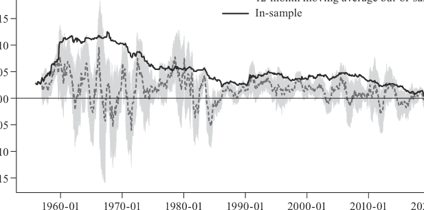

图 3.3. 滚动前向样本外预测 R²

经历结构变化。鉴于技术、监管和制度环境在过去几十年中发生了很大变化，如果公司特征与未来股票回报之间的关系保持不变就令人惊讶。第二，正如我们在本章开头已经讨论的那样，投资者会从数据中学习。回报可预测性的过去证据可能促使他们改变交易策略，从而破坏了回报可预测性的早期模式。因此，在历史数据中出现的可预测性可能不会以相同的方式在未来数据中重复出现。

在机器学习文献中，结构变化问题被称为概念漂移。为了解决这个问题，已经开发出各种方法来使参数能够随着数据结构变化而随时间适应。例如，这可以通过一种加权方案来实现，该方案在算法训练中给予近期数据更大的权重。一个特别简单的例子是滚动窗口方法，其中在特定时间点之前的数据被完全丢弃。对过去数据的指数加权是一种替代方法，它会逐渐降低旧数据的权重。虽然存在此类方法，但迄今为止，很少有工作将此类方法引入机器学习在资产定价中的应用，并弄清楚哪些方法效果最好。

图 3.3 将简单的滚动窗口方法应用于图 3.1 中的基于过去回报的预测示例。这里，包含预测变量的一阶、二阶和三阶项的岭回归在 20 年滚动窗口内估计。惩罚超参数使用窗口内留一年的交叉验证进行调优。对于本次练习，我们使用指数加权是因为我们可以将 $\hat{g}_t$ 表示为递归更新的估计量：

$$\hat{g}_t = (1-\phi)\hat{g}_{t-1} + \phi (X'X + \gamma I_K)^{-1}X'r_t. \tag{3.29}$$

这意味着要计算新时期的估计，我们不需要对整个样本重新估计。相反，我们只需使用最近时期回报数据来计算 (3.29) 中的第二项，并用它来更新上一时期的估计。

滚动窗口和指数加权以及相关技术对资产定价来说并不新鲜。但在需要正则化的高维数据集上使用机器学习技术时，还存在额外的复杂性。在岭回归和套索等正则化方法中，问题不仅是如何跟踪预测模型参数的结构变化，还包括是否以及如何随着时间调整惩罚超参数的值。在 (3.29) 中的岭回归示例中，我们将惩罚参数 $\gamma$ 保持固定，但没有必然的理由使其随时间保持固定。如果它可以随时间变化，我们需要一种数据驱动的方法来估计其随时间的变化。然而，在重叠的滚动或扩展窗口中每期重新估计惩罚超参数可能在计算上过于昂贵。对于大数据集，计算负担可能相当大。为了规避这一计算负担，Monti, Anagnostopoulos, and Montana (2018) 提出了一种惩罚超参数的递归更新方案。这对于资产定价应用也可能是一个有前景的方向。

结构变化的考虑也引发了关于交叉验证方法在模型验证和超参数调优方面的适用性的疑问。典型实现的 $k$-fold CV 假定验证折相对于训练折的时间位置无关紧要。验证折可以从比某些训练数据更旧的数据中抽取。在平稳设定下，这没问题。但当存在结构变化时，很明显从先于全部或部分训练数据的时期抽取验证数据是否合适并不清楚。时间方向可能很重要。模型在向后验证折中预测数据表现良好，并不一定意味着它在向前预测中表现良好。这对于机器学习在资产定价中的应用是一个重要问题，目前很少有研究解决它。在第 5 章我们将回到这个问题。

## 3.9 结论性说明

在本章中，我们探讨了在资产定价中应用监督机器学习技术时出现的基本问题。在许多方面，机器学习方法非常适合资产定价学术研究和量化投资管理中的预测问题。我将讨论重点放在横截面资产回报预测问题上，但资产定价中还有其他类型的监督机器学习技术可能有用的问题。这包括，例如，涉及资产现金流而非回报的预测、信用风险预测，以及寻找近似对冲策略的应用。

本章的讨论强调，虽然机器学习技术可能有用，但如果不仔细适应资产定价应用的特定条件而直接使用现成机器学习方法，很可能无法产生良好的结果。资产定价中的预测问题在许多方面与大多数机器学习方法开发的大多数预测问题截然不同。看似平凡的问题，例如如何在数据预处理中缩放预测变量，实际上对监督学习算法的性能可能非常重要。不同机器学习方法之间的选择隐含地确定了估计可以检测到的数据模式——例如稀疏性或非线性的程度和类型。鉴于典型资产定价环境中低的信噪比，认为可以简单地让数据说话并以完全自动和数据驱动的方式在不对问题施加实质性结构的情况下解决这些问题，似乎是遥不可及的。

因此，结论是我们需要一个分析框架，允许我们在设置机器学习工具来解决资产定价问题时注入有限的经济推理。下一章提出了一种在这一方向上取得进展的方法。超越本章中我们检查的仅以过去回报作为预测变量的简单示例，我们将研究一个使用更广泛的公司特征作为候选预测变量的应用。按照本章讨论的要点，该方法将考虑到协方差矩阵在投资组合绩效中的重要作用，并将允许以公司特征之间的交互形式存在的非线性。最重要的是，该方法建立在贝叶斯基础之上，为我们在设置估计和正则化方法时注入经济推理提供了渠道。

# 横截面资产定价中的机器学习

在上一章中，我们概述了在回报预测和最优投资组合构建中应用监督学习技术时出现的主要问题。我们现在来看一种方法，它解决了其中许多问题，尽管不是全部。如同上一章一样，底层分析框架基于贝叶斯回归。

首先，我们来看一个更广泛的协变量集合。在上一章中，回报预测变量的集合仅限于股票自身过去回报的函数。在本章中，我们研究一个应用，该应用使用在实证资产定价研究中作为回报预测变量出现的股票特征的大集合。股票回报预测分析在这种早期的机器学习前文献中单独查看这些股票特征中的每一个，或一次只查看这些特征的小子集。在这里，我们使用监督学习方法将它们联合起来查看。

其次，基于第 3.5 节的动机，我们将股票回报按这些（秩转换和标准化）股票特征加权聚合为投资组合。这些特征投资组合构成了我们分析中跨越可投资宇宙的基础资产。

第三，得益于这种投资组合聚合，我们将这些特征投资组合回报的协方差矩阵纳入先验信念和估计方法。我们不对协方差矩阵施加任何特殊结构，保持其不受限制。然而，我们确实对协方差与预期回报之间的关系施加结构。

第四，为了对协方差与预期回报之间的关系施加经济限制，本章的方法以随机贴现因子（SDF）模型为框架。这些特征投资组合中的每一个都是该 SDF 中的候选风险因子。需要估计的参数是对应于这些候选因子的风险价格系数。这些 SDF 权重等价于均值-方差有效投资组合中的投资组合权重。一种传统方法将使用平均回报对回报与候选因子协方差的横截面回归来估计 SDF 系数。由于候选因子数量众多，这种传统方法将

导致虚假的过拟合。在我们的贝叶斯设定中，信息性先验信念可以防止这种过拟合，从而有助于确保良好的样本外（OOS）预测性能。

第五，先验信念源于基础资产定价理论。各种资产定价模型通常意味着，SDF的大部分方差应归因于候选因子收益的高特征值（即高方差）主成分（PC）。因此，如果一个因子获得了较高的预期收益，那么它也应当具有较高的方差。正如Kozak、Nagel和Santosh（2018）所说，这不仅在定价系统性宏观经济风险的理性预期模型中是成立的，而且在合理的限制下，在预期收益的横截面变化源于投资者信念偏差的模型中也是成立的。我们方法中的先验分布反映了这些经济考量。与朴素的普通最小二乘法（OLS）估计量相比，贝叶斯后验将SDF系数向零收缩，但在我们的情形下，收缩程度并非对所有资产都相同。相反，后验对与低特征值主成分相关的SDF系数施加了显著更大的收缩。

第六，我们还研究了SDF的稀疏表示是否足以在经验上捕捉投资机会集，其中只有少数基于特征的因子进入SDF。这种特征稀疏的SDF在实证资产定价文献中很流行（例如，参见Fama和French（1993）的三因子模型；Hou、Xue和Zhang（2015）使用四个因子，Fama和French（2015）使用五个因子，Barillas和Shanken（2018）提出了一个六因子模型）。我们的基准贝叶斯方法意味着使用平方L²范数惩罚进行正则化，该惩罚将许多SDF系数收缩到接近于零但不完全为零的程度。为了允许稀疏性，我们在估计准则中增加了L¹范数惩罚，类似于弹性网络。

最后，我们使用一种简单的方法来允许特征具有非线性效应。为此，我们在股票特征集中加入特征的二次和三次方以及特征的线性一阶交互项。一阶交互项使我们能够捕捉到那些聚焦于小规模特征集的实证资产定价研究通常通过双重排序投资组合所允许的非线性关系。例如，通过将股票按两个维度独立排序构建投资组合——比如公司规模和过去一年的收益率（动量）——就可以允许这些特征与预期收益和协方差之间的关系是非线性的。成对的一阶交互项以类似的方式起作用，但我们对大量特征构建它们。总体而言，在特征集中加入这些非线性变换后，特征总数达到数千个。

本章内容是Kozak、Nagel和Santosh（2020）的缩略和改编版本。

## 4.1 基于特征因子的资产定价

我们首先阐述基于特征因子模型背后的基本资产定价框架。我们首先从总体矩的角度描述这一框架，暂时不考虑估计问题。在此基础上，我们可以继续描述估计问题以及一种用于处理该问题高维性的监督学习方法。

对于任意时点$t$，令$r_t$表示$N$只股票的$N \times 1$超额收益向量。每只股票有$K$个特征，我们将它们收集在$N \times K$矩阵$X_t$中。与上一章概述的投资组合聚合方法一致，我们使用$K$个因子投资组合，这些组合通过以特征加权股票收益形成。因子收益为$f_t = X_{t-1}'r_t$。那么，我们总能找到一个风险价格向量$b$，使得SDF

$$M_t = 1 - b'(f_t - \mathbb{E}[f_t]) \tag{4.1}$$

满足无条件定价方程

$$\mathbb{E}[M_t f_t] = 0, \tag{4.2}$$

其中，因子$f_t$同时充当我们试图解释其收益的资产，以及可能作为定价因子进入SDF的候选因子。SDF中的风险价格向量$b$同时也是均值-方差有效（MVE）投资组合中的权重向量。

在我们的实证工作中，我们对$X_{t-1}$的每一列进行横截面去均值处理，使得$f_t$中的因子是零投资多空组合的收益。文献中典型的基于特征因子模型会加入一个市场因子来捕捉股权风险溢价的水平，而多空特征因子则解释横截面变化。在我们的设定中，我们关注这些横截面差异。我们没有明确包括市场因子，但我们将基于特征的因子相对于市场因子进行了正交化。就对定价误差的影响而言，这等价于在SDF中纳入市场因子。因此，这里可以将$f$的元素视为已经正交化的因子。在我们的实证分析中，我们也使用相对于市场收益正交化的因子。

如果我们知道总体矩，现在就可以求解(4.1)和(4.2)得到SDF系数

$$b = \Sigma^{-1}\mathbb{E}(f_t), \tag{4.3}$$

其中$\Sigma \equiv \mathbb{E}\left[(f_t-\mathbb{E}f_t)(f_t-\mathbb{E}f_t)'\right]$。将上述表达式改写为

$$b = (\Sigma'\Sigma)^{-1}\Sigma\mathbb{E}(f_t) \tag{4.4}$$

这表明，SDF系数可以解释为横截面回归中的系数，其中被解释变量是SDF所要解释的预期资产收益——在此情形下即$\mathbb{E}[f_t]$的$K$个元素——解释变量是每个因子与其他因子及自身的协方差构成的$K$列。

在实践中，如果不知道总体矩，在样本内通过运行这种横截面回归来估计SDF系数会导致对噪声的过拟合，从而造成较差的样本外表现，除非$K$很小。由于SDF系数也是MVE投资组合的权重，当$K$很大时估计SDF系数的困难，与资产数量很大时估计MVE投资组合权重这一著名问题密切相关。我们使用的监督学习方法正是为了解决这一问题。

现有的大部分基于特征因子模型文献都回避了这一高维问题，转而关注只包含少数因子的模型。我们将此类模型称为特征稀疏模型。这种特征稀疏模型是否能在包含大量股票特征的横截面上充分描述SDF，是一个关键的实证问题，本章报告的实证结果将对此加以揭示。

Kozak、Nagel和Santosh（2020）指出，没有强有力的经济理由预期SDF具有特征稀疏性。然而，人们也许能够找到特征因子数据的旋转，使得SDF至少能够近似地具有稀疏表示。Kozak、Nagel和Santosh（2018）认为，不存在近似套利（极高的夏普比率）意味着获得可观风险溢价的因子必定是共同变动的主要来源。这一结论在非常弱的假设下成立，并且同样适用于“理性”和“行为”模型。此外，对于典型的测试资产集，收益具有一种强因子结构，该结构由少数方差最高的主成分（PC）主导。在这两个条件下，以少数高方差主成分作为因子的SDF应当能够解释预期收益中的大部分横截面变化。受这一理论结果的启发，我们从实证上探讨一个在PC上稀疏的SDF是否足以

描述预期收益的横截面，并在定价表现方面将其与在特征上稀疏的SDF进行比较。

为了构造PC因子，我们使用因子协方差矩阵的特征分解，

$$\mathbf{\Sigma}=\mathbf{Q}\mathbf{\Lambda}\mathbf{Q}'\quad\text{with}\quad\mathbf{\Lambda}=\operatorname{diag}(\lambda_1,\lambda_2,\dots,\lambda_H),\qquad(4.5)$$

其中$\mathbf{Q}$是$\mathbf{\Sigma}$的特征向量矩阵，$\mathbf{\Lambda}$是按降序排列的特征值对角矩阵。以特征向量作为投资组合权重，我们得到PC因子

$$p_t=\mathbf{Q}'f_t.\qquad(4.6)$$

使用所有PC，并在已知总体矩的情况下，我们可以将SDF表示为

$$M_t=1-b_p'(p_t-\mathbb{E}[p_t]),\qquad\text{with}\quad b_p=\mathbf{\Lambda}^{-1}\mathbb{E}[p_t].\qquad(4.7)$$

## 4.2 监督学习方法

我们现在描述用于估计SDF参数向量$\boldsymbol{b}$（或在使用PC因子时的$b_P$）的监督学习方法。该方法是我们在第2章和第3章中讨论过的贝叶斯回归的一种变体。

考虑一个大小为$T$的样本。我们记

$$\bar{\boldsymbol{\mu}}=\frac{1}{T}\sum_{t=1}^{T}f_t,\qquad(4.8)$$

$$\bar{\mathbf{\Sigma}}=\frac{1}{T}\sum_{t=1}^{T}(f_t-\bar{\boldsymbol{\mu}})(f_t-\bar{\boldsymbol{\mu}})',\qquad(4.9)$$

基于样本矩条件，可以构造(4.1)中SDF系数$\boldsymbol{b}$的一个自然但朴素的估计量

$$\bar{\boldsymbol{\mu}}-\frac{1}{T}\sum_{t=1}^{T}f_t=0,\qquad(4.10)$$

$$\frac{1}{T}\sum_{t=1}^{T}M_t(\hat{\boldsymbol{b}},\bar{\boldsymbol{\mu}})f_t=0.\qquad(4.11)$$

求解$\hat{\boldsymbol{b}}$，得到的估计量是(4.3)的样本版本：

$$\hat{\boldsymbol{b}}=\bar{\mathbf{\Sigma}}^{-1}\bar{\boldsymbol{\mu}}.\qquad(4.12)$$

然而，除非K相对于T非常小，否则这个朴素估计量会产生非常不精确的b估计。不精确的主要来源是μ的不确定性。注意，我们可以将朴素估计量改写为OLS回归估计量 $\hat{b} = (\bar{\Sigma} \Sigma^{-1} \bar{\Sigma})^{-1} \bar{\Sigma} \Sigma^{-1} \bar{\mu}$，即因子均值对这些因子彼此之间协方差的横截面回归。与预期收益估计中的通常情况一样，即使收益样本相当长，因子均值估计也不精确。在K很大的高维设定下，横截面回归实际上有大量解释变量。因此，回归最终会虚假地过拟合因子均值中的巨大噪声成分，导致$\hat{b}$估计非常不精确，样本外表现也很差。协方差矩阵中的估计不确定性会进一步加剧这一问题，但正如Kozak、Nagel和Santosh (2020)更详细讨论的那样，该设定中脆弱性的主要来源是因子均值，而非协方差。

为了避免虚假过拟合，我们引入关于因子预期收益的具有经济动机的先验信念。如果先验信念动机良好且确实具有信息量，这将有助于减少SDF系数的（后验）不确定性。换言之，引入先验信息足以对估计问题进行正则化，从而产生在样本外预测中表现良好的稳健估计。我们首先从那些使SDF系数相对(4.12)中朴素估计量发生收缩、但不施加稀疏性的先验信念开始。然后我们扩展该框架，使其也允许一定程度的稀疏性。

### 4.2.1 收缩估计量

为了聚焦于因子均值的不确定性（估计中最主要的脆弱性来源），我们在假定Σ已知的情况下继续。我们对K个因子投资组合的预期收益施加如下先验信念：

$$\boldsymbol{\mu} \sim \mathcal{N}\left(0, \frac{\kappa^2}{\tau} \boldsymbol{\Sigma}^2\right), \tag{4.13}$$

其中τ = tr[Σ]，κ是控制μ“尺度”的常数，可能依赖于τ和K。

为了理解这些先验信念的经济含义，考虑我们在第4.1节中引入的PC投资组合 p_t = Q' f_t，其中Σ = Q Λ Q'，是很有用的。将先验(4.13)用PC投资组合表示，我们得到的值不会极高。要使这一点成立，一个最低要求是𝔼[*b*′*b*]保持有界（在给定*K*下）。在先验(4.13)下，我们有

$$\mathbb{E}[b'b] = \frac{\kappa^2}{\tau}K, \tag{4.16}$$

它不依赖于Λ，并且可以通过适当选择κ保持在中等水平。正如Kozak、Nagel和Santosh (2020)所讨论的，如果(4.13)中Σ的指数是某个η < 2而不是η = 2，那么与某些低特征值PC相关的SDF系数可能会取极高值，导致𝔼[*b*′*b*]非常高，并意味着理性投资者的最优投资组合会在最低特征值PC上押下重注——这似乎不太合理。

基于假设(4.13)，我们得到SDF系数上的独立同分布（i.i.d.）先验，*b* ∼ 𝒩(0, κ²/τ *I*ₖ)。将这些先验信念与来自大小为*T*样本的样本均值*μ̄*的信息相结合，并假设多元正态似然，我们得到*b*的后验均值

$$\hat{b} = (\Sigma + \gamma I_K)^{-1} \bar{\mu}, \tag{4.17}$$

其中γ = τ/(κ² T)。为了将该估计量映射回我们在第2.4节中讨论的贝叶斯回归(2.22)，注意可以将(4.12)中的朴素估计量（现在Σ已知）改写为GLS回归估计量：(Σ Σ⁻¹ Σ)⁻¹ Σ Σ⁻¹ *μ̄*。施加一个协方差矩阵为Σ_g = κ²/τ *I*ₖ的信息性先验后，该估计量正好映射到(2.22)和(4.17)中的贝叶斯回归后验均值。

将这一问题设定为贝叶斯估计问题，避免了我们在前一章讨论的重新缩放问题。例如，如果我们用非奇异矩阵*H*变换因子*f*ₜ（即*H f*ₜ），可以证明对于这些变换后的因子，其SDF系数对应于(4.17)的后验均值为*b̂*ₕ = (*H*′)⁻¹ *b̂*。因此，由此估计得到的SDF *M*ₜ = 1 − *b̂*′ *H*⁻¹ (*H f*ₜ − 𝔼 *H f*ₜ) = 1 − *b̂*′ (*f*ₜ − 𝔼 *f*ₜ) 对因子的这种变换保持不变。

## 经济解释

为了对该估计量的行为给出经济解释，考虑将原始收益空间旋转到主成分空间是方便的。基于估计量(4.17)的SDF用PC投资组合收益*p*ₜ = *Q*′ *f*ₜ表示，系数为$\hat{b}_p = Q' \hat{b}$，我们得到风险价格向量，其元素为

$$\hat{b}_{P,j}=\left(\frac{\lambda_j}{\lambda_j+\gamma}\right)\frac{\bar{\mu}_{P,j}}{\lambda_j}.\tag{4.18}$$

与(4.12)中朴素的恰好识别GMM估计量相比，后者会给出PC的SDF系数为

$$\hat{b}_{P,j}^{\text{ols}}=\frac{\bar{\mu}_{P,j}}{\lambda_j},\tag{4.19}$$

我们的贝叶斯估计量（$\gamma>0$）以收缩因子$\lambda_j/(\lambda_j+\gamma)<1$将SDF系数向零收缩。最重要的是，与PC相关的特征值$\lambda_j$越小，收缩越强。其经济解释是，在我们指定的先验信念下，我们认为低特征值PC不可能对SDF的波动率以及因此对整体最大平方夏普比率做出实质性贡献。因此，该估计量对这些低特征值PC的SDF系数收缩得特别强。

## 作为惩罚估计量的表示

正如我们在第2.4节中所讨论的，贝叶斯估计量映射为惩罚回归估计量。如果我们在对模型隐含的最大平方夏普比率$\gamma b'\Sigma b$施加惩罚的条件下，最大化用于解释均值收益的模型横截面$R^2$，

$$\hat{b}=\arg\min_{b}\{\left(\bar{\mu}-\Sigma b\right)'\left(\bar{\mu}-\Sigma b\right)+\gamma b'\Sigma b\},\tag{4.20}$$

该问题得到的解与(4.17)完全相同。(4.20)中的目标函数类似于岭回归目标函数，但有一些重要差异。标准岭回归目标函数会对系数的$L^2$范数平方$b'b$施加惩罚，而(4.20)中的目标函数惩罚的是$\gamma b'\Sigma b$。

我们还可以将(4.20)中的准则等价地改写为

$$\hat{b}=\arg\min_{b}\{\left(\bar{\mu}-\Sigma b\right)'\Sigma^{-1}\left(\bar{\mu}-\Sigma b\right)+\gamma b'b\}.\tag{4.21}$$

在这种形式下，估计量像标准岭回归一样惩罚$b'b$，但损失函数不同，因为误差由$\Sigma^{-1}$加权，类似于GLS回归。这种写出估计准则的方式对于引入稀疏性诱导惩罚很有用。


### 4.2.2 *稀疏性*

我们迄今为止提出的方法通过将 SDF 系数收缩向零来处理高维挑战，但没有任何系数被设为恰好为零。换句话说，我们得到的结果并不是稀疏的。正如我们在第 4.1 节中所论证的，以特征为基础的因子极端稀疏性的经济依据很弱。然而，允许某些因子在对 SDF 的贡献方面真正是冗余的可能性可能是有用的。此外，正如我们所讨论的，出于经济原因，有理由期望 SDF 在 PC 方面的稀疏表示能够提供良好的近似。因此，当我们将 PC 视为因子时，稀疏性可能是有用的。

出于这些原因，我们现在在由 (4.21) 给出的惩罚回归问题中引入额外的 $L^1$ 惩罚 $\gamma_1\sum_{j=1}^{H}|b_j|$。该方法由 lasso 回归和弹性网络动机而来，并且会导致 $\hat{b}$ 的某些元素被设为零。结合 $L^1$ 和 $L^2$ 惩罚，我们的估计量求解问题。$^{1}$

$$\hat{b}=\arg\min_b\; (\bar{\mu}-\Sigma b)'\Sigma^{-1}(\bar{\mu}-\Sigma b)+\gamma_2 b'b+\gamma_1\sum_{j=1}^{H}|b_j|. \qquad (4.22)$$

这种双惩罚方法在很大程度上具有 $L^2$ 仅惩罚方法的经济动机，同时增加了可能提供稀疏 SDF 表示的额外好处。我们可以通过改变 $L^1$ 惩罚的强度来控制稀疏程度，并通过改变 $L^2$ 惩罚来控制经济收缩程度。

虽然我们最终会让数据决定惩罚 $\gamma_1$ 和 $\gamma_2$ 的最优值，但有理由相信完全关闭 $L^2$ 惩罚并专注于纯 lasso 风格估计在这种资产定价环境中效果不佳。众所周知，当回归量相关时，lasso 相比 ridge 和弹性网络的表现相对较差（Tibshirani 1996, Zou and Hastie 2005）。正如我们在第 2.2.1 节中所讨论的，$L^1$ 惩罚估计倾向于选择两个相关变量中的一个而不是对它们进行平均，如果相关协变量各自包含共同信号和不相关的噪声，则会损害预测性能。例如，与仅选择账面市值比作为 SDF 中代表价值效应的唯一特征相比，考虑多种价值度量的加权平均可能是有利的，例如账面市值比、市价股息比和现金流价格比。这种推理也表明，$L^1$ 仅惩罚在我们先将特征为基础的因子转换到其 PC 再进行估计时可能效果更好。我们在下面的实证工作中检验这个问题。

¹为求解 (4.22) 中的优化问题，我们使用 Zou 和 Hastie (2005) 中的 LARS-EN 算法。

### 4.2.3 数据驱动的惩罚选择

为了实现估计量 (4.17) 和 (4.22)，我们需要设定惩罚参数 γ、γ1 和 γ2 的值。在 $L^2$ 仅惩罚设定中，惩罚参数 γ = τ/(κ^2 T) 遵循先验 (4.13) 具有经济解释。在先验下的根期望最大平方夏普比率为

𝔼[μ′ Σ^{-1} μ]^{1/2} = κ. (4.23)

这意味着 γ = τ/(κ^2 T) 隐式地代表了关于最大平方夏普比率的观点。例如，对最大夏普比率不能很高、即 κ 很低的预期将意味着 γ 很高，从而在估计中施加高度的收缩。一些研究人员基于关于最大平方夏普比率与市场指数历史平方夏普比率之间可能关系的直观推理来选择先验信念。² 然而，这些都是直观猜测。更进一步地，将 κ 的信念建立在关于风险厌恶程度、套利者风险承担能力和误定价程度的更深层次经济分析上将是困难的。出于这个原因，我们更倾向于数据驱动的方法。但我们将利用 (4.23) 来用经济可解释的根期望最大平方夏普比率来表达我们在估计中应用的 $L^2$ 惩罚的大小。

我们使用一种数据驱动的方法，该方法涉及通过 k 折交叉验证 (CV) 估计 γ。我们将历史数据划分为 k 个相等子样本。然后，对于每个可能的 γ（或双惩罚设定中每对可能的 γ1、γ2），我们通过将 (4.17) 应用于其中 k − 1 个子样本来计算 \hat{b}。我们在单个保留子样本上评估 resulting 模型的 OOS 拟合。与惩罚目标 (4.20) 一致，我们计算 OOS R 平方为

R^2_{OOS} = 1 - \frac{(\bar{μ}_2 - \bar{Σ}_2 \hat{b})' (\bar{μ}_2 - \bar{Σ}_2 \hat{b})}{\bar{μ}_2' \bar{μ}_2}, (4.24)

其中下标 2 表示来自保留样本的 OOS 样本矩。我们重复此过程 \(k\) 次，每次将不同的子样本视为 OOS 数据。然后我们对这 \(k\) 个估计的 \(R^2\) 进行平均，得到交叉验证的 \(R^2_{\mathrm{oos}}\)。最后，我们选择产生最高 \(R^2_{\mathrm{oos}}\) 的 \(\gamma\)（或 \(\gamma_1, \gamma_2\)）。

²Barillas 和 Shanken (2018) 是最近的一个例子。另见 MacKinlay (1995) 和 Ross (1976) 的类似论点。

我们选择 \(k = 3\) 作为 \(\hat{b}\) 的估计不确定性和 OOS 协方差矩阵 \(\hat{\Sigma}_2\) 的估计不确定性之间的折中。后一种不确定性随 \(k\) 增加。随着 \(k\) 升高，保留样本变得太短而无法使 \(\hat{\Sigma}_2\) 良好表现，这会扭曲拟合的因子平均收益 \(\hat{\Sigma}_2\hat{b}\)。然而，我们的结果对使用适度更高的 \(k\) 具有稳健性。

该惩罚选择程序使用整个样本的信息来找到使基于公式 (30) 的 \(R^2\) 最小化的惩罚参数。在惩罚参数的最优值处的交叉验证 OOS \(R^2\) 因此通常是对在未用于惩罚参数估计的新数据集中会获得的真实 OOS \(R^2\) 的向上有偏估计（Varma 和 Simon (2006)，Tibshirani 和 Tibshirani (2009)）。我们的兴趣集中在正则化的最优强度上，因此我们只关心在不同正则化程度下模型的相对表现，而不关心 OOS \(R^2\) 的水平。在随后的步骤中，在第 4.4 节中，我们还通过将估计的 SDF 应用于未用于估计惩罚参数的样本部分来对 OOS 惩罚参数选择进行评估。

## 4.3 实证分析

我们从 CRSP 数据库中的美国公司宇宙开始。我们构建了两组独立的特征。第一组依赖于文献中常见的“异常”所依据的特征。我们遵循 Novy-Marx 和 Velikov (2016)、McLean 和 Pontiff (2016)、Kogan 和 Tian (2015) 以及 Hou、Xue 和 Zhang (2015) 中的标准异常定义，并汇编了我们自己的 50 个此类特征。第二组特征基于 Wharton 研究数据服务 (WRDS) 定义的 70 个财务比率：WRDS 行业财务比率 (WFR)，这是一组超过 70 个财务比率的集合，按以下七个类别分组：资本化、效率、财务稳健性/偿付能力、流动性、盈利能力、估值和其他。我们用过去 \(t - 1\) 至 \(t - 12\) 月份的月度回报排序的 12 个投资组合补充这一数据集。合并的数据集包含 80 个管理投资组合（我们由于其时间序列较短而删除了两个变量，最终数据集中剩下 68 个 WRDS 比率）。Kozak 的互联网附录

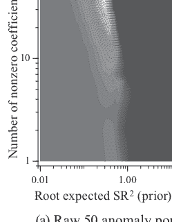

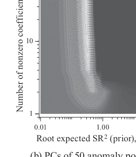

(a) 原始的 50 个异常投资组合

(b) 50 个异常投资组合的 PC

图 4.1. 双惩罚设定下的 OOS R^2（50 个异常投资组合）。
使用 50 个异常投资组合（Panel a）和基于异常投资组合的 50 个 PC（Panel b）的同时采用 $L^1$ 和 $L^2$ 惩罚的模型族的 OOS 横截面 R^2。我们用 x 轴上的先验根期望平方夏普比率来量化 $L^2$ 惩罚的强度。我们在 y 轴上显示 SDF 中保留变量的数量，该数量量化了 $L^1$ 惩罚的强度。两个轴均以对数刻度绘制。

使用日数据使我们能够比使用月数据更精确地估计二阶矩，并专注于均值的<|message|> 不确定性，同时在很大程度上忽略协方差估计的不确定性（以下注明例外）。我们调整每个月内各个股票的日投资组合权重，以对应于该月期间的月度再平衡买入持有策略。最后，我们使用全样本估计的市场因子载荷将所有投资组合回报相对于 CRSP 价值加权指数回报进行正交化。

### 4.3.1 五十个异常特征

我们从基于异常特征的 50 个投资组合的数据集开始。样本为 1973 年 11 月至 2017 年 12 月的日数据。图 4.1 展示了我们双惩罚设定下的 OOS R^2 随 κ（x 轴）和非零 SDF 系数数量（y 轴）的变化。关注基于 50 个异常投资组合原始回报的图 4.1 左半部分，未正则化模型（右上角）表现出极差的表现，OOS R^2 远低于零。因此，需要大量的正则化才能获得良好的 OOS 表现。此外，并没有多少可替代性

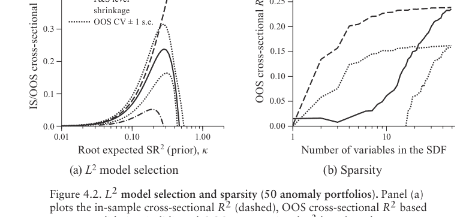

(a) L² 模型选择

(b) 稀疏性

Figure 4.2. L² 模型选择与稀疏性（50 个异常组合）。Panel (a) 绘制了样本内截面 R²（虚线）、基于交叉验证的 OOS 截面 R²（实线）以及来自 Pástor and Stambaugh（2000）的基于比例收缩的 OOS 截面 R²（点划线）。在 Panel (b) 中，我们展示了具有 n 个因子（x 轴）的模型在所有可能的 L² 收缩值下所能达到的最大 OOS 截面 R²，分别针对基于原始特征组合的模型（实线）和 PCs（虚线）。Panel (b) 中的点线描绘了 CV 估计量的 −1 s.e. 界限。

L¹- 和 L²-正则化。要达到最大 OOS R²，数据要求实质性的 L² 收缩但几乎没有稀疏性。施加稀疏性（即在图中向下移动）会导致 OOS R² 大幅恶化。这表明 50 个异常之间几乎没有冗余。为了充分捕捉 50 个异常中的定价信息，需要在 SDF 中包含基本上全部这 50 个因子。对其 SDF 系数进行收缩对于获得良好表现很重要，但为了得到稀疏解而将其中任何一个强制设为零会损害 OOS R²。换句话说，不存在具有良好定价表现的特征稀疏 SDF。因此，许多异常组合因子对 SDF 的 OOS 解释力做出了实质性的边际贡献。

如果我们将异常组合收益的 PCs 作为基础资产，如图 4.1 右半部分所示，情况则大不相同。例如，仅含四个 PCs 的相对稀疏的 SDF 在 OOS R² 方面表现相当不错，而使用十个 PCs 时我们接近最大 OOS R²。因此，PC 稀疏 SDF 能很好地定价异常组合。

Figure 4.2 通过对等高线图进行切片提供了 OOS R² 关键属性的更精确图景。左侧图的实线代表沿图 4.1 顶部边缘的切片，具有不同程度的 $L^2$-收缩但无稀疏性。如图所示，OOS $R^2$ 在 $\kappa \approx 0.30$ 时达到最大。标准误差界限表明，在该 $\kappa$ 值附近的 OOS $R^2$ 不仅在经济上而且在统计上都远高于零。

在第 4.2.1 节中，我们从经济角度论证了我们先验 (4.13) 的方差与 $\Sigma^2$ 成比例是合理的。然而，有必要检查这种经济动机是否也伴随着数据中的更好表现。为此，左侧图中的点划线绘制了使用 Pástor and Stambaugh（2000）更常用的先验时得到的 OOS $R^2$，其中先验方差与 $\Sigma$ 成比例而非 $\Sigma^2$。请回忆，我们的方法同时执行所有系数的水平收缩，以及相对收缩（扭转），后者会降低低特征值 PCs 的影响。Pástor and Stambaugh（2000）的方法仅采用水平收缩。我们可以看到，仅使用最优选择的水平收缩可实现低于 5% 的 OOS $R^2$（相对于 OLS 解有所改善），但远不及我们方法提供的 30% $R^2$ 交付的水平。$^7$ 相对收缩是我们方法的关键要素，因此贡献了总样本外表现的很大一部分。

Figure 4.2 右侧图在等高线图上沿最大 OOS $R^2$ 的脊线从底部到顶部进行切片，其中我们改变稀疏性并为每个稀疏水平选择最优的 $L^2$-收缩。实线非常清楚地显示了特征空间 SDF 的表现不佳。OOS $R^2$ 仅在图最右侧的最低稀疏水平处才开始实质性上升。在 PC 空间中，情况恰恰相反，非常稀疏的模型表现极佳：仅含两个基于 PC 的因子的模型就捕捉了大约三分之二的总 OOS 截面 $R^2$。含十个 PC 因子的模型实现了接近最大 $R^2$，而在特征因子空间中含十个因子的模型实现的 $R^2$ 不到最大值的三分之一。

总之，50 个异常之间几乎没有冗余。因此，不可能找到仅用少数几个基于特征的因子就能提供良好 OOS 表现的稀疏 SDF。出于这个原因，通过 $L^2$-收缩而非仅 $L^1$-惩罚和稀疏性来处理估计问题的高维特性也很重要。$L^2$-收缩比纯 $L^1$-惩罚 lasso 式方法提供了更高的 OOS $R^2$，并且具有数据驱动惩罚选择的双惩罚方法对这组组合基本关闭了 $L^1$ 惩罚。

$^7$ 对于 Pástor and Stambaugh（2000）的水平收缩估计量，我们在 x 轴上显示先验下的预期最大平方夏普比率，但它在这种情况下不再与 $\kappa$ 参数一致。

然而，如果将这些组合收益转换为其 PCs，则 SDF 的稀疏表示就会出现。这些发现与我们在第 4.1 节中提出的观点一致，即特征稀疏 SDF 的经济论据相当薄弱，而在 PCs 方面存在近似稀疏性的理由很好。

### 4.3.2 WRDS 财务比率（WFR）

50 个异常的数据集是特殊的，因为根据过去文献，所有这些特征都已知与平均收益相关。我们的方法可用于检查这些异常之间的冗余，但这组资产收益并未使该方法面临从高维数据集中识别全新定价因子的挑战。出于这个原因，我们现在研究基于 WFR 数据集形成的 80 个因子。样本为 1964 年 9 月至 2017 年 12 月的日度数据。WFR 数据集中的一些特征已知与预期收益相关（例如，几种版本的 P/E 比率），但许多特征并非如此。因此，这 80 个因子中可能有相当一部分与定价无关。有趣的是，我们的方法能否正确地降低这些与定价无关因子的权重并避免过度拟合它们。

图 4.3 中 OOS R² 的等高线图看起来与图 4.1 中 50 个异常组合的早期图非常相似。未正则化的模型（右上角）再次表现极差，OOS R² 显著低于零。仅基于 L² 惩罚的模型（图的顶部边缘）对原始组合收益和 PCs 都表现良好。仅基于 L¹ 惩罚的“lasso”模型（图的右侧边缘）在左侧图对原始组合收益表现不佳。

然而也有一些差异。如右侧图的右侧边缘所示，PC 稀疏 SDF 不仅在 OOS R² 方面表现相当不错，而且即使在没有太多 L² 收缩的情况下也能如此。这一发现的一个潜在解释是，数据挖掘和对样本内显著因子的发表偏倚在基于已发表异常的异常数据集中可能比在 WFR 数据集中发挥更大的作用。因此，可能需要在异常数据集中对 SDF 系数向零施加更强的收缩，以防止这些偏倚损害 OOS 表现，而在 WFR 数据集中收缩的需求较少，因为样本内和样本外收益差异不大。

这一解释与 OOS R² 最大化的 κ ≈ 1 这一事实进一步一致，这比异常数据集中高得多。图 4.4 左侧图通过沿图 4.3 左侧等高线图的顶部边缘进行切片更透明地说明了这一点

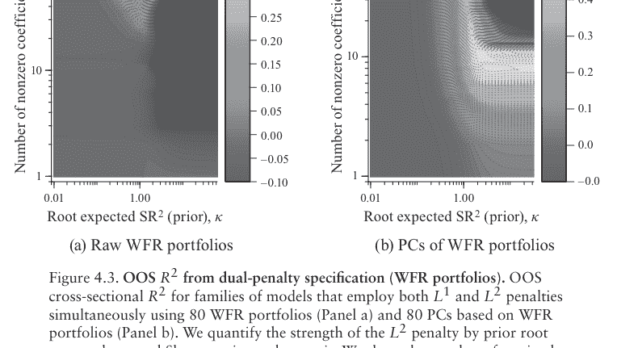

(a) 原始 WFR 组合

(b) WFR 组合的 PCs

Figure 4.3. OOS R² 来自双惩罚设定（WFR 组合）。使用 80 个 WFR 组合（Panel a）和基于 WFR 组合的 80 个 PCs（Panel b）的同时采用 L¹ 和 L² 惩罚的模型族的 OOS 截面 R²。我们通过 x 轴上的先验根期望平方夏普比率来量化 L² 惩罚的强度。我们在 y 轴上显示 SDF 中保留变量的数量，该数量量化了 L¹ 惩罚的强度。两个轴均以对数刻度绘制。

透明地说明了这一点。通过沿图 4.3 左侧等高线图的顶部边缘进行切片更透明地说明了这一点。实线显示 OOS R²。其峰值比异常数据集的类似图（图 4.2）更靠右，这与我们的直觉一致，即与已发表的异常相比，WFR 在样本早期不太可能被数据挖掘，因此不需要那么多收缩。标准误差也更小，这是由于 WFR 组合在不同时期表现更稳定，而异常在最新（未被数据挖掘）部分样本中经历了显著恶化（McLean and Pontiff 2016）。

图 4.4 右侧图在等高线图上沿最大 OOS R² 的脊线从底部到顶部进行切片，其中我们改变稀疏性并为每个稀疏水平选择最优收缩。该图说明了与 50 个异常的情况一样，特征空间中稀疏性很小。即使如此，PC 空间的稀疏性再次更强。含六个因子的模型提供了接近最大 OOS R² 的表现。

总之，WFR 数据集的分析表明，我们的方法可以很好地处理混合了与定价相关的因子和其他不相关因子的数据集。如果需要稀疏性，适度的水平


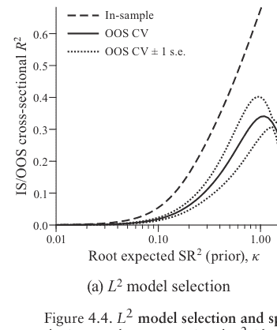

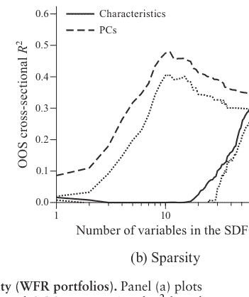

#### (a) $L^2$ 模型选择

#### (b) 稀疏性

图 4.4. $L^2$ 模型选择与稀疏性（WFR 投资组合）。Panel (a) 绘制了样本内横截面 $R^2$（虚线）和基于交叉验证的样本外横截面 $R^2$（实线）。在 Panel (b) 中，我们展示了基于原始特征投资组合（实线）和 PCs（虚线）的模型在所有可能的 $L^2$ 收缩值下，具有 $n$ 个因子（x 轴）的模型所达到的最大样本外横截面 $R^2$。Panel (b) 中的点线描绘了 CV 估计量的 $-1$ s.e. 界限。

$L^1$-penalty 可用于省略定价无关的因子，但仅使用 $L^2$-penalty 的方法在 OOS $R^2$ 方面同样有效。

### 4.3.3 交互作用

为了提高统计挑战性，我们现在考虑极高维的数据集。我们用额外构造的特征补充 50 个异常和 80 个 WFR 原始特征的集合，这些额外特征由原始特征的二阶和三阶幂以及线性一阶交互作用构成。这项练习不仅在统计挑战性方面很有趣，而且还允许我们放宽这样一个相当任意的假设，即基于特征的因子投资组合权重在（排序并标准化）特征上是线性的。

事实上，对于某些异常，例如特质波动率异常，已知预期收益效应集中在特征值极端的股票上。Fama 和 French（2008）以及 Freyberger、Neuhierl 和 Weber（2020）提供了其他异常非线性效应的证据，但这些证据是关于投资组合排序和横截面收益预测，而不是 SDF 估计。此外，虽然对于少数异常存在交互效应的证据（Asness、Moskowitz 和 Pedersen 2013，Fama 和 French 2008），但在机器学习之前的实证资产定价文献中，交互作用尚未对这些少数情况以外的情况进行探索——这可能是由于问题的极端高维性所致。交互作用使可能预测因子的集合呈指数级扩展。例如，仅使用 50 个原始特征及其幂的一阶交互作用，我们就获得了 ½ n(n + 1) + 2n = 1,375 个候选因子和检验资产收益。对于 80 个 WFR 特征，我们获得了一组 3,400 个投资组合。

我们按如下方式构建非线性权重和交互作用。对于股票 s 在时间 t 的任意两个给定秩变换特征 x_{s,t}^i 和 x_{s,t}^j，我们将一阶交互特征 x_{s,t}^{ij} 定义为两个原始特征的乘积，并进一步使用 (4.26) 重新标准化如下：

$$x_{s,t}^{ij} = \frac{\left(x_{s,t}^i x_{s,t}^j - \frac{1}{n_t}\sum_{s=1}^{n_t} x_{s,t}^i x_{s,t}^j\right)}{\sum_{s=1}^{n_t} \left| x_{s,t}^i x_{s,t}^j - \frac{1}{n_t}\sum_{s=1}^{n_t} x_{s,t}^i x_{s,t}^j \right|}.\tag{4.27}$$

我们在实证检验中包含了所有一阶交互作用。除了交互作用之外，我们还包含了每个特征的二阶和三阶幂，这些幂是基于特征与其自身的交互作用按类似方式定义的。注意，虽然我们在交互或升幂后对所有特征进行重新标准化，但我们并不重新排序它们。例如，任何给定特征的立方体然后是一个新的不同特征，它对原始特征的极端实现股票具有更强的暴露，但具有相同的总暴露（杠杆）。Kozak、Nagel 和 Santosh（2020）的互联网附录说明了这种方法如何映射到更传统的双向投资组合排序。

由于在这种情况下基于特征的因子数量极其庞大，我们的三重交叉验证方法在协方差矩阵求逆时会出现数值不稳定问题，即使使用日度数据也是如此。因此，我们改用两重交叉验证。这为我们提供了估计协方差矩阵的稍长样本，而这种样本扩展足以获得稳定的行为。

图 4.5 显示了样本外横截面 R^2 作为 κ（x 轴）和非零 SDF 系数数量（y 轴）的函数的等高线图。原始投资组合收益的图显示在顶部行，PCs 的图显示在底部行。首先关注原始投资组合收益的结果，很明显，对于异常和 WFR 投资组合而言，在不降低 OOS R² 的情况下，现在可以实现相当大的稀疏程度。将 L¹ 罚项加强到仅约 100 个特征及其幂和交互作用保留在 SDF 中（分别在 1,375 和 3,400 个中）的程度，只要为该稀疏水平选择最优的 L² 罚项，就不会降低 OOS R²。如前所述，仅使用 L¹ 罚项的方法会导致较差的 OOS 表现。

8 由于样本早期部分缺少一些交互作用，我们的样本期缩短为异常特征的 1974 年 2 月–2017 年 12 月和 WFR 特征的 1968 年 9 月–2017 年 12 月。

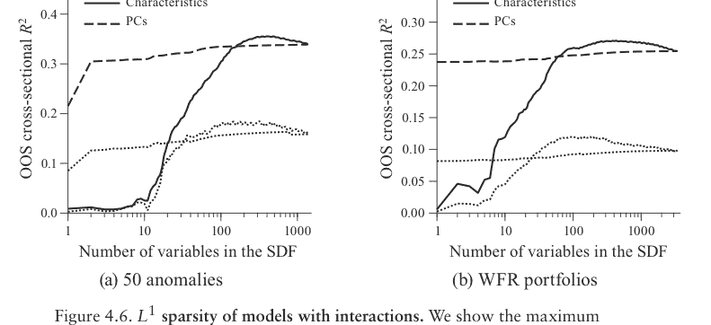

(a) 50 个异常

(b) WFR 投资组合

图 4.6. 具有交互作用的模型的 L¹ 稀疏性。我们展示了基于原始特征投资组合交互作用（实线）和 PCs（虚线）的模型在所有可能的 L² 收缩值下，具有 n 个因子（x 轴）的模型所达到的最大样本外横截面 R²。Panel (a) 关注由 50 个异常投资组合交互作用的 PCs 构建的 SDF。Panel (b) 显示了基于 WFR 投资组合交互作用的 PCs 的系数估计。点线描绘了 CV 估计量的 −1 s.e. 界限。

底部行的图显示了 PCs 的等高线图。这些结果在不损害 OOS 表现的情况下可以施加多少稀疏性方面，与顶部行的结果截然不同。很少的 PCs——甚至只有一个——就足以获得实质性的 OOS 解释力。但在这里，稀疏性与最优选择的 L² 罚项的结合也很重要。只要施加实质性的 L² 收缩，增加更多的 PCs 不会造成伤害，但也不会显著改善 OOS 表现。

图 4.6 中的两个图沿着最大 OOS R² 的脊线从下到上对等高线图进行切片，其中我们改变稀疏性并为每个稀疏水平选择 L² 最优收缩。这些图

具有相同的特征。我们框架所不允许的是 X 中特征的横截面矩随时间的变化。具有随机变化的 X，例如，可能会发生在一时期高度相关的两个特征在未来时期不再高度相关。这会使投资者的学习和预测问题变得更困难。

第三，虽然我们考虑了一个相当高维的环境，其中 J 可以接近 N，但我们假设 J < N。现实世界投资者可用的特征集合可能非常庞大，因此 J ≥ N 可能是合理的。允许 J ≥ N 的扩展是相对直接的，但代价是符号复杂性大大增加。学习对资产价格属性的影响可以在更简单的 J < N 设定中更清晰地看到。

总体而言，我们的模型因此可能低估了实际投资者在其投资决策过程中面临的学习问题的难度。即便如此，正如本章的分析将表明的那样，资产价格的性质受学习影响很大。将模型扩展以考虑学习问题中的现实额外复杂性将进一步增强这些效应。

参数向量 g 的性质以及投资者对这些参数值的信念在我们的分析中起着重要作用。具体而言，g 元素的大小决定了可以用 X 预测的现金流增长变化的比例。因此，当投资者根据 Δy 的历史观测值学习 g 时，g 元素的大小决定了 Δy 中信号（Xg 的方差）与噪声（e 的方差）的比率。

我们假设向量 g 服从多元正态分布，

g ∼ N(0, θ/J I_J), (5.2)

其中 θ 是一个常数。我们认为 g 是由自然在经济的非常开始时抽取的，在任何股息实现和任何资产定价之前。它然后在整个时间中保持不变。(5.2) 中方差和协方差与 1/J 成比例的设定确保了信号与噪声比不随 J 而变化。为了说明这一点，注意，如果投资者对参数向量 g 有完美的知识，投资者将能够完全预测 (5.1) 中 Δy_t 的 Xg 分量。可以证明，这个可预测分量具有横截面方差 1/N 𝔼[g'X'Xg] = θ。¹

¹ 应用迹算子，使用其循环性质，并使用上文的 tr(X'X)=N J 归一化。


### 5.1.1 投资者

投资者是同质的且风险中性。我们进一步假设利率为零。这意味着收益可预测性不能是风险溢价或时变利率的结果。通过抽象掉风险溢价，我们有意使计量经济学家在我们的设定中更容易检验市场效率。由于不存在风险溢价，因此不存在因未知风险定价模型而产生的联合假设问题。然而，正如我们将要展示的那样，投资者学习问题的存在仍然使得标准市场效率检验的解释变得棘手。

投资者的同质性是一个简化假设。作为对该问题的初步处理，我们希望尽可能保持分析的透明性。但这并不意味着异质性不重要。将设定扩展以允许异质性会很有趣也更符合现实，例如投资者在数据分析方法或所观察的数据上存在差异。异质性还会引入投资者需要学习其他投资者模型和信念的可能性。对内生对象的这种学习可能带来额外的有趣资产价格动态。然而，在此分析中，我们首先想看看在同质投资者设定下引入学习和高维性时，资产价格特性在多大程度上会发生变化。

### 5.1.2 定价

为保持资产估值简单，我们关注一期股息 strip 的定价，即对一期后单个股息的要求权。向量 $p_t$ 表示在时间 $t$ 时，对将在时间 $t + 1$ 支付的股息的要求权的價格。这种对股息 strip 的关注看似限制性并不强。可以把模型中的一期看作一个较长的时间跨度，例如十年，而股息 strip 的收益则可视为长期股票的现金流压缩成在股票典型存续期发生的单一现金流。

在风险中性和零利率的条件下，$p_t$ 然后等于投资者对下一期股息的预期，

$$
p_t = \tilde{\mathbb{E}}_t y_{t+1} = y_t + \tilde{\mathbb{E}}_t \Delta y_{t+1} = y_t + \tilde{\mathbb{E}}_t (X g + e_{t+1}).
$$

本章核心关注的问题是投资者如何形成这些预期 $\tilde{\mathbb{E}}_t [\cdot]$。

作为基准，考虑理性预期情形，其中假设投资者已知 $g$。在这种情况下，不存在学习问题。股息预期恒定为 $\tilde{\mathbb{E}}_t (X g + e_{t+1}) = X g$。因此理性预期下的价格为

$$
p_t = y_t + Xg, \tag{5.3}
$$

以及已实现的價格变动，我们从现在起称之为“收益”，为

$$
r_{t+1} = y_{t+1} - p_t = \Delta y_{t+1} - Xg = e_{t+1}. \tag{5.4}
$$

我们分析的最终目标是理解投资者的信念形成如何影响资产价格的特性。特别是，我们有兴趣弄清基于学习的信念形成是否会诱发收益可预测性。在现有的资产定价文献中，股票收益横截面的收益可预测性通常归因于风险溢价的存在或投资者的行为偏差。但在这里我们想看看高维环境下的学习是否可能是收益可预测性的另一种来源。

### 5.1.3 计量经济学家观察者

为此，我们考虑一位观察该经济体中资产已实现收益的计量经济学家。计量经济学家利用这些收益进行标准的基于回归的收益可预测性检验。更具体地说，计量经济学家询问公司特征 $X$ 是否可用于预测横截面上的收益。将已实现收益对特征进行回归，计量经济学家得到系数向量：

$$
h_{t+1} = (X'X)^{-1} X' r_{t+1}. \tag{5.5}
$$

在 (5.4) 中具有理性预期的投资者情形下，其中 $r_{t+1} = e_{t+1}$，收益是不可预测的，且

$$
h_{t+1} = (X'X)^{-1} X' e_{t+1}. \tag{5.6}
$$

$h_{t+1}$ 元素的任何偏离零的情况纯粹是由于估计误差引起，该误差由噪声 $e_{t+1}$ 偶然与 $X$ 的列产生相关性所致。这是支撑大量关于市场效率检验和横截面股票收益异常文献的原假设。鉴于 $e_{t+1}$ 的元素服从 $N(0, 1)$ 分布，在该原假设下，使用通常的 OLS 方差公式（残差方差已知），可得

$$
\sqrt{N} h_{t+1} \sim N(0, N(X'X)^{-1}), \tag{5.7}
$$

这为收益可预测性回归中的标准显著性检验提供了基础。

为

$$
\mathbb{E}\,r_{IS,t+1} = \frac{1}{N}\,\mathbb{E}\left[\bar{e}_t'X\,(X'X)^{-1}X'\bar{e}_t\right] + \frac{1}{N}\,\mathbb{E}\left[e_{t+1}'X\,(X'X)^{-1}X'e_{t+1}\right] = \frac{J}{tN}+\frac{J}{N}. \tag{5.19}
$$

如果计量经济学家通过减去 $J/N$ 来对 $\mathbb{E}\,r_{IS,t+1}$ 进行调整，以使其相对于理性预期原假设 (5.11) 下的预期收益，仍会剩下项 $\frac{J}{tN}$。如果 $J$ 相对于 $N$ 很小，则该项可能可以忽略不计。然而，在高维情形下，当 $J$ 与 $N$ 的量级相当时，计量经济学家会发现这种样本内交易策略相对于理性预期基准具有实质性的正预期收益。因此，如果计量经济学家将 $r_{IS,t+1}$ 的实际值与在理性预期原假设下投资组合收益应有的 (5.8) 中的 $\chi^2$ 分布进行比较，她很可能会发现 $r_{IS,t+1}$ 位于该分布的远尾部。

在此模型中，与理性预期设定不同，得出 $\mathbb{E}\,r_{IS,t+1}>J/N$ 的发现表明存在风险溢价或投资者必须具有行为偏差的结论是不正确的。在此模型中，投资者是风险中性的，因此风险溢价为零。投资者也没有行为偏差（需要说明的是，我们仍需评估 OLS 学习在此是否是最佳学习方法）。经济解释是不同的：产生相对于理性预期基准的高预期收益的 (5.19) 中的第一项是投资者学习 $\mathbf{g}$ 的结果。

例如，当某个公司特征（$\mathbf{X}$ 的一列）在投资者截至时间 $t$ 观察到的样本中恰好与 $\bar{e}_t$ 正相关时，投资者相对于理性预期基准而言，对具有该特征正值的股票会过于乐观。因此，其价格过高，未来收益较低。对于该特征值较低的股票则相反。拥有 $t+1$ 收益数据的计量经济学家随后可以通过将 $r_{t+1}$ 对该特征进行回归来捕捉这种样本内收益可预测性。

虽然由于 OLS 回归在应用统计和预测中的广泛使用，OLS 学习具有直观吸引力，但它是一种特设方法。尚不清楚这是否是该设定下投资者的最优学习方法。而如果这不是最优方法，那么 OLS 学习产生的样本内收益可预测性是否只是投资者使用次优方法的后果呢？

收缩是 $g$ 的信息先验的结果。为了明确收缩程度取决于什么，注意 $(I_J + \frac{J}{N\theta t}\mathbf{\Lambda}^{-1})^{-1}$ 是对角矩阵，其元素为

$$
\frac{\lambda_j}{\lambda_j + \frac{J}{N\theta t}}
$$

沿其对角线。因此，如果 $t$ 或 $\theta$ 很小，或 $J/N$ 很大，或沿特征值较小的主成分，则收缩较强。在这些情况下，先验对后验的影响很强，因为相对于先验而言，观测数据并不十分信息丰富。

上述推导概述了贝叶斯更新的机制。但其背后有一个重要的经济解释。经济合理性要求一个信息先验，其中先验协方差参数 $\theta$ 不极大，以使 $g$ 的元素不能任意大。极大的 $g$ 将意味着现金流增长可预测成分 $Xg$ 的横截面方差相对于不可预测噪声 $e$ 的方差而言巨大。这意味着大部分现金流增长的变化可基于公司特征预测——这并不是经济现实的合理表述。因此，从经济角度看，投资者先验地认为 $g$ 的极大数值不太可能是有意义的。

这也清楚地说明了为什么在该设定下 OLS 学习缺乏经济合理性。OLS 学习出现在先验为弥散的特殊情形，即 $\theta \to \infty$。在这种情况下，$\Gamma_t$ 收敛到单位矩阵，$\tilde{g}_t$ 收敛到 OLS 估计量。因此让投资者使用 OLS 学习实际上假设投资者忽略了可预测现金流增长成分的极大数值在经济上是不合理的这一事实。

在 $J/N$ 很小的低维设定中，这影响不大。正如 (5.24) 中的表达式所示，如果 $J/N \to 0$，则 $\Gamma_t$ 收敛到单位矩阵，从而后验均值收敛到 OLS 估计量。因此，OLS 学习作为低维设定下投资者信念更新的模型可能是可以接受的。

但如果 $J$ 与 $N$ 的量级接近，情况就大不相同。在这种情况下，(5.23) 中的 OLS 估计量与后验均值之间存在很大差距。OLS 学习不仅在经济上不合理，而且还会导致预测性能较差。图 5.1 说明了这一点。它显示了当投资者已观察并从一期现金流实现值 $\Delta y_{t-1}$ 中学习时，投资者对 $\Delta y_t$ 预测的均方误差。对于此示例，我们设 $J = 900$，$N = 1000$，$X$ 的元素独立地从标准正态分布抽取，且向量 $g$ 从具有 $\theta = 0.5$ 的先验分布 (5.21) 中抽取。实线显示均方误差

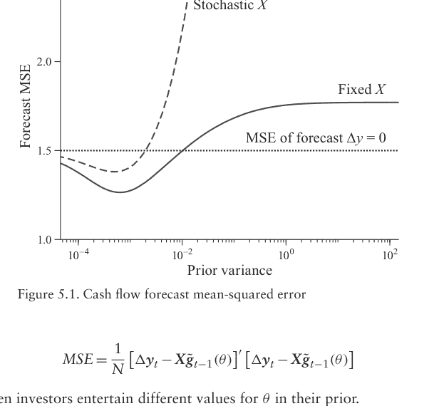

图5.1. 当投资者在先验中采用不同的$\theta$值时的现金流预测均方误差

$$MSE = \frac{1}{N} [\Delta y_t - X \tilde{g}_{t-1}(\theta)]' [\Delta y_t - X \tilde{g}_{t-1}(\theta)]$$

当投资者在先验中采用不同的$\theta$值时。

当投资者基于$\theta = 0.5$形成先验信念时，他们拥有一个客观正确的先验。在这种情况下，先验方差$\theta/J$约为$5.6 \times 10^{-4}$。这正是图5.1中预测MSE达到最小值的位置。OLS学习将是$\theta \to \infty$的极限，因此先验方差趋向无穷大。如图所示，走向这个方向会恶化预测表现。事实上，当投资者的先验方差显著高于客观正确先验的方差时，存在一个点，使得预测MSE高于随机游走预测的MSE——后者简单地将估计的$g$设为零并预测$\Delta y_t = 0$。该随机游走预测的MSE以虚线显示。这说明了当$J$很大时，基于扩散先验的预测表现有多差。

图5.1展示了另一个有趣的变动：我们让$X$矩阵随机化。我们每期重新抽取$X$的元素。现金流然后生成为$\Delta y_t = X_{t-1} g + e_t$。投资者将$\Delta y_{t-1}$对$X_{t-2}$回归来了解$g$。为了预测$\Delta y_t$，他们将这些估计应用于$X_{t-1}$。图5.1中的虚线显示了由此产生的预测MSE。最小值仍然与固定$X$情形相同：客观正确的先验使预测MSE最小化。然而，在先验过于分散的情况下，预测表现的恶化在这一情形中要严重得多。OLS预测会产生极其不准确的预测。

直观地说，原因在于当协变量的数量$J$与观测值数量$N$在量级上相近时，$X$的许多列会偶然地出现高度正相关或负相关，尽管它们的元素是独立同分布的。[^2] OLS倾向于为这些高度相关的协变量对分配非常大的系数幅度，而它们在OLS拟合值中很大程度上相互抵消。OLS目标函数关于这些系数几乎是平坦的。小的系数幅度或使得协变量在OLS拟合值中大部分相互抵消的大系数，会产生几乎相同的拟合。如果协变量矩阵$X$保持不变，它们在基于OLS估计的预测中也会大体上相互抵消。因此，OLS难以确定这些系数的幅度并不会造成太大危害。然而，如果协变量矩阵随机变化，那么一对在$X_{t-2}$中恰好高度相关的协变量，很可能在$X_{t-1}$中不再高度相关。结果是，从对$X_{t-2}$回归得到的大幅OLS系数估计，在将这些估计应用于$X_{t-1}$的预测中不再具有抵消效应。这会使预测受到巨大估计误差的污染，导致糟糕的预测表现。

当信息性先验接近客观正确的先验时，这一问题会得到缓解，因为正如我们上面提到的，在$1/N X'X$的具有小特征值的主成分方向上，收缩效应尤为强烈。如果某些特征近似由其他特征张成，就会出现小特征值。此时，后验均值会强烈降低来自那些在OLS估计中具有接近抵消效应的协变量对预测的贡献。

$X$每期独立抽取，作为企业特征随机变化的一种表示，可能过于极端，但具有一定持续性的自回归过程或许是现实的。在本章其余部分，我们坚持固定$X$的情形。但有必要记住，随机$X$会使投资者的预测问题更加困难，并进一步增强信息性先验信念的重要性。

## 5.3 收益可预测性

现在，我们考察当投资者基于由客观正确、信息性先验信念所得到的后验（5.23）对资产定价时收益的性质。与OLS学习情形下（5.15）的收益相比，收益表达式中现在多了一项：

$$r_{t+1}=X(I_J - \Gamma_t)g - X\Gamma_t(X'X)^{-1}X'\bar{e}_t + e_{t+1}. \tag{5.25}$$

（5.25）右侧第一项的出现是由于信息性先验所诱导的收缩。在扩散先验（即OLS学习）下，我们有$\Gamma_t = I_J$，该项将消失。但在信息性先验下，它非零。我们可以将这一项解释为由于收缩而对$X$中基本信息“反应不足”的效应。

与OLS学习情形一样，第二项代表噪声对投资者后验均值的影响。信息性先验所诱导的收缩旨在抑制这种噪声诱导的估计误差的影响。通过$\Gamma_t$进行的收缩抑制了这一分量，但代价是产生了第一项。在贝叶斯学习下，$\Gamma_t$最优地权衡了由这两个分量产生的定价误差。

### 5.3.1 样本内收益可预测性

当计量经济学家从该经济体中抽取收益，并将（5.25）中的收益对$X$进行回归时，与OLS学习情形相比，回归系数的表达式（如（5.25）中收益的表达式一样）现在多了一项：[^3]

$$b_{t+1}=(X'X)^{-1}X'r_{t+1}
=(I_J - \Gamma_t)g - \Gamma_t(X'X)^{-1}X'\bar{e}_t + (X'X)^{-1}X'e_{t+1}. \tag{5.26}$$

右侧第一项是收益表达式（5.25）中第一项的结果。信息性先验所诱导的收缩在收益中保留了这一与$X$的列相关的分量。因此，在收益对$X$的回归中，它会被捕获。

现在让我们重新审视权重为$w_t = \frac{1}{N} X b_{t+1}$的样本内投资组合策略，其中$b_{t+1}$来自（5.26）。在这种情况下，Martin和Nagel (2019)的结果表明，投资组合收益$r_{IS,t+1} = w'_t r_{t+1} = b'_{t+1} (X'X) b_{t+1}$的期望值为

$$\mathbb{E} r_{IS,t+1} = \frac{1}{N} \mathbb{E}\big[\mathbf{g}' (I_J - \Gamma_t)' X'X (I_J - \Gamma_t) \mathbf{g}\big] + \frac{1}{N} \mathbb{E}\big[\tilde{e}'_t X (X'X)^{-1} \Gamma_t X'X \Gamma_t X' \tilde{e}_t \big] + \frac{1}{N} \big[ e'_{t+1} X (X'X)^{-1} X' e_{t+1} \big] = \frac{1}{N} \sum_{j=1}^{J} \left( \frac{\lambda_j}{t\lambda_j + \frac{1}{\theta}} + 1 \right). \tag{5.27}$$

当$\theta \to \infty$时，该表达式收敛到我们在OLS学习情形（5.19）中获得的期望收益。

为了解释这些数值的量级，注意到由于$r_{IS,t+1} = \frac{1}{N} b'_{t+1} X'X b_{t+1}$，期望收益$\mathbb{E} r_{IS,t+1}$也代表了样本内预测回归中期望的总已解释收益方差，而$1 - J/N$是残差的方差。因此，我们可以从收益预测回归构建一个调整后的$R^2$度量：

$$R^2_{adj.} = 1 - \left(1 - \frac{\mathbb{E} r_{IS,t+1}}{1 - J/N + \mathbb{E} r_{IS,t+1}} \right) \frac{N}{N - J}. \tag{5.28}$$

在理性预期情形下，$\mathbb{E} r_{IS,t+1} = J/N$，如我们在（5.11）中所示，因此这个调整后的$R^2$恰好为零。然而，在学习情形下，收益中存在样本内可预测成分，使得$R^2_{adj.}$高于零。

图5.2用一个数值例子说明了这一点。和之前一样，$N = 1000$，我们从标准正态分布中抽取$\mathbf{X}$的独立同分布元素。向量$\mathbf{g}$从$\theta = 1$的先验分布（5.21）中抽取。正如Martin和Nagel (2019)所讨论的，当$\theta = 1$时，现金流增长中可预测变化的比例，与Chan、Karceski和Lakonishok (2003)的证据中分析师预测能够预测的10年期内长期盈利增长率中可预测部分的比例大致相当。如果我们将模型中的一期解释为一个10年的时间窗口，我们就能得到一个经验上符合实际的现金流增长率横截面。我们设定$t = 1$，这意味着投资者已经从一期的现金流增长观测中进行了学习。

图5.2中的实线显示了不同$J$值下的调整$R^2$。当$J$相对于$N$不小的时候，调整$R^2$显著高于零。例如，当$J = 900$时，调整$R^2$超过25%。换句话说，一个运行该回归的计量经济学家会发现显著的样本内收益可预测性，尽管该经济体中的投资者不要求任何风险溢价，并且他们在信念形成中不存在行为偏差。

[^2]: 换言之，$1/N X'X$将拥有大量小特征值。渐近地，如果$N \to \infty$且$J/N$收敛到一个固定常数，则$1/N X'X$的特征值分布遵循Marchenko-Pastur分布。

[^3]: 也可以让计量经济学家使用岭回归等收缩方法，实际上施加了一个先验，即收益可预测性回归中的系数不能太大。如果计量经济学家的系数先验分布与系数的真实分布大致一致，使用这些方法会增强样本内收益可预测性，但不会在性质上改变结果。


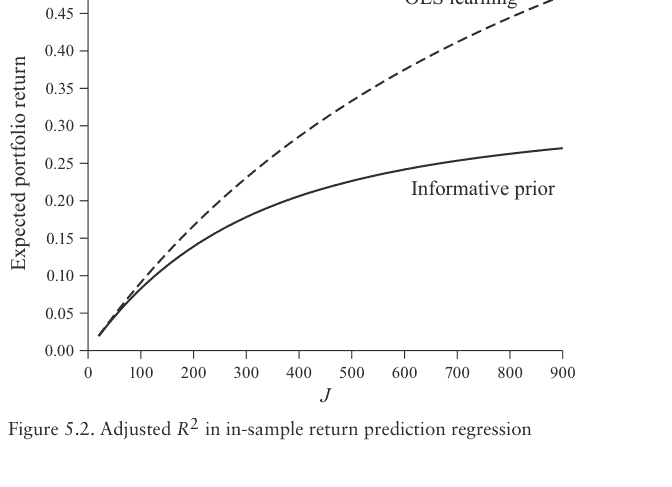

图5.2 样本内收益预测回归中的调整后R²

虚线表明，在OLS学习下，样本内收益可预测性会更强。通过施加基于客观正确先验的收缩，投资者可以避免其关于g的学习中的估计误差过度污染资产价格和收益。这样做将样本内收益可预测性的程度降至最低，但无法完全消除它。

Martin和Nagel（2019）进一步研究了收益可预测性形式化统计检验的性质。在理性预期假设下——大量股票收益横截面实证研究中的零假设——收益为r_{t+1}=e_{t+1}，因此不可预测。这进而意味着（5.26）中回归系数b_{t+1}的真实值为零的零假设。为了分析该零假设检验的性质，Martin和Nagel应用了高维渐近理论，其中N → ∞和J → ∞同时发生，且J/N收敛到一个固定常数。这类渐近分析给出了检验统计量渐近分布的闭式解，但与传统的固定J、大N渐近不同，它确保J相对于N不会在量级上消失，从而使投资者的学习问题仍然相关。这一点很重要，因为渐近结果旨在逼近有限样本情况下统计检验的性质，在有限样本中，协变量的数量相对于N并不小，因此投资者对参数向量g仍存在不确定性。Martin和Nagel证明，在渐近极限下，对理性预期零假设的检验以概率1拒绝。此外，这一结果对任意固定的t都成立，即即使投资者已经从跨越多个时期的数据中学习了g。

总体而言，研究大J/N经济体收益的计量经济学家很可能得出结论：收益可由X中的公司特征预测。在样本内检验中，经验上拒绝“不可预测”零假设的典型结论是，需要风险溢价模型或由不完全理性投资者导致的错误定价模型来解释这一证据。但此处的分析表明，当J相对于N并不小时，样本内可预测性检验失去了其通常的经济含义，因为存在第三种可能性：样本内收益可预测性之所以出现，是因为投资者的预测问题具有高维性。投资者的估计误差污染了收益，使得收益事后看起来是可预测的。

### 5.3.2 （不存在）样本外收益可预测性

本章的分析迄今为止集中于样本内可预测性检验。在这些检验中，收益预测回归的拟合度是在用于估计该回归系数的同一收益样本上评估的。投资者实时做出决策，没有后见之明，因此无法利用这些回归所捕捉到的可预测性。因此，计量经济学家审视事后估计的样本内回归时，使用了投资者在为资产定价时并不拥有的信息。

为了使计量经济学家与投资者处于同等地位，我们现在考察样本外（OOS）可预测性。我们考虑投资组合的收益r_OOS,t+1 = w'_OOS,t r_{t+1}，其中应用于t+1期收益的权重基于从t期收益估计出的回归系数：

w_OOS,t = 1/N X b_t.   (5.29)

这是一种可以实时实施的投资组合策略。

Martin和Nagel（2019）表明E r_OOS,t+1 = 0。因此，即使在投资者必须学习大量公司特征的预测作用的高维情形下，也不存在OOS收益可预测性。这是一个直观的结果。由于投资者是贝叶斯式的，他们会最优地利用可用信息。此外，我们赋予了他们一个客观正确的先验。一旦我们通过阻止使用投资者所没有的前瞻性信息，使计量经济学家与投资者处于同等地位，那么学习必然不会引入后向的样本外收益可预测性。

不过，Martin和Nagel（2019）也提出了一个告诫。不存在前向样本外收益可预测性是贝叶斯学习（具有客观正确先验）的一个自然属性，并且可能是一个普遍属性，但后向结果可能在一定程度上是该模型环境的特例。后向样本外可预测性缺失的结果在多大程度上具有普遍性，仍然是一个悬而未决的问题。

## 5.4 扩展

基本建模框架可以在多个有趣的方向上扩展，从而为模型带来更强的现实性。本节简要回顾其中两个方向：投资者现金流预测中的稀疏性，以及额外的收缩或稀疏性。这两者都可以理解为投资者在学习问题中所采用先验信念的修改。

### 5.4.1 稀疏性

到目前为止，我们假设的随机环境使投资者在其现金流预测回归中应用收缩，但他们并不施加稀疏性。但在高维环境中，投资者也有可能使用稀疏性来约束其预测模型。通过改变分布假设，我们可以在投资者的学习问题中获得一个稀疏解，该解仍然接近（但不完全等于）贝叶斯后验均值。我们需要：（i）投资者的先验是，$g$的元素$g_j$来自拉普拉斯分布，$$f(g_j)=\frac{1}{2b}\exp\left(-\frac{|g_j|}{b}\right),$$ 其中$2b^2 = \frac{\theta}{\gamma}$是方差；（ii）投资者根据后验分布的众数而非均值来为资产定价（即基于MAP估计量）。在这种情况下，投资者的预测可以表示为Lasso回归（Tibshirani 1996）的拟合值。

投资者在定价中使用后验众数，这是对完全贝叶斯框架的偏离。因此，（5.29）中期望OOS组合收益为零的结果不再精确成立。在模拟中，Martin和Nagel（2019）表明偏差很小，总体而言，收益可预测性与无稀疏性的收缩情形非常相似。

通过使用贝叶斯回归收缩（而非例如简单的OLS回归），他们最小化了这种收益可预测性，但无法完全消除它。

这些结果对横截面资产定价实证研究的解释提出了质疑。该领域的一些实证研究对资产定价模型进行计量经济学检验，另一些则寻找新的因子或收益预测变量。绝大多数这类实证工作都隐含或明确地通过理性预期模型的视角来审视数据，在理性预期模型中，投资者被假定知道产生资产基本面的相关参数。在这个零假设下，基于历史数据事后进行的样本内回归所估计出的收益可预测性，与投资者事前所看到的收益可预测性一致。因此，结论便是：这种样本内收益可预测性必定反映了风险溢价或投资者在资产定价时犯下的系统性错误。本章所回顾的结果对这一解释提出了质疑。当投资者面临高维环境时，样本内收益可预测性证据便失去了其在理性预期环境中具有的经济含义。虽然当投资者所处的环境是低维的，因而学习对资产价格的影响很小时，理性预期模型可能是一个很好的近似，但在高维情形下它不再是一个好的近似。样本内可预测性可能是投资者对数据生成过程参数缺乏精确了解的结果，而该过程涉及大量潜在相关的预测变量。

换言之，（半强式）市场有效性的经济含义——价格“充分反映”所有公开信息（Fama 1970）——在高维环境中并不清晰。研究者通常强调“联合假设问题”是解释市场有效性检验的主要困难：计量经济学家研究资产价格时，并不知道决定风险厌恶投资者所需风险溢价的模型。但即使撇开这个问题，市场有效性概念的解释仍然不清晰。“充分反映”是指投资者知道现金流预测模型的参数，还是指投资者在学习这些参数时采用贝叶斯更新？本章的分析表明，这两种解释之间存在巨大鸿沟。前者被大量实证文献采用，可以通过样本内收益可预测性回归进行检验。在投资者面临高维环境的情况下，这似乎并不是一个具有经济意义的假设。拒绝该假设并不足以得出以下结论：必须存在风险溢价，或者投资者必然受到导致错误定价的行为偏差的影响。

这为股票收益横截面中的“因子动物园”（Cochrane 2011; Harvey, Liu, and Zhu

## 阿里巴巴集团公布三月季度及2024财年业绩

杭州，中国，2024年5月14日 — 阿里巴巴集团控股有限公司（纽交所：BABA / 港交所：9988）公布截至2024年3月31日的季度及财年财务业绩。

-   收入为人民币221,874百万元，同比增长7%。
-   营业收入为人民币14,809百万元，同比下降3%。
-   净利润为人民币971百万元，同比下降96%。
-   调整后净利润为人民币24,418百万元，同比下降11%。

“我们的业绩证明了我们的战略重点正在创造价值。我们对各业务板块的进展感到满意。”

| 指标 | 2024财年第四季度 | 2023财年第四季度 | 同比 % |
|---|---|---|---|
| 收入 | 221,874 | 208,138 | 7% |
| 营业收入 | 14,809 | 15,279 | (3)% |
| 净利润 | 971 | 23,502 | (96)% |
| 调整后净利润 | 24,418 | 27,111 | (11)% |

从学习模型的视角来看，情况有所不同。如果投资者面临高维学习问题，则样本内和样本外检验考察的是根本不同的假设。学习可以产生样本内可预测性，但不能产生样本外（OOS）可预测性。因此，样本外检验具有明确的经济动机。

最后，本章的结果还提供了关于数据构建和数据分析方面的技术进步如何影响实证研究中观察到的收益可预测性的视角。许多横截面股票收益研究使用的是历史数据，而在这些时期，投资者可即时获取的数据远少于今天的研究人员，且数据处理能力受到很大限制。研究人员今天可以轻松构建变量（例如，通过对公司 filings 进行自动文本分析），这些变量在几十年前对投资者来说基本无法获取，尽管数据原则上可能存在（例如以纸质年报的形式）。通过本章模型的视角，我们可以将这种数据获取的缺乏解释为迫使投资者在为资产定价时采用过度稀疏的估值模型。遵循第5.4.2节分析的逻辑，因此很可能当研究人员使用当前的方法和技术在更早的历史时期构建预测变量时，这些变量不仅在样本内，而且在伪样本外检验中也能预测收益。对于在投资者定价资产时可能不可用的变量，研究人员在将收益可预测性归因于风险溢价或投资者的行为偏差时应持谨慎态度。

## 5.6 结论性说明

本章展示了投资者现金流预测中存在高维学习问题如何对资产价格的统计特性产生重要影响。随着对投资者现金流预测可能相关的可用数据不断增加，这些由学习引起的定价效应很可能变得越来越重要。

我们在横截面资产定价框架内发展了这些思想，但它们很可能具有更广泛的相关性。在任何经济主体学习进行预测并面临大量相关预测因子的环境中都会出现类似问题。预测误差的统计特性将对投资者学习问题的维度敏感。相对于理性预期基准而言似乎异常的预测误差可预测性可能是高维环境中学习的后果。

下一章概述了关于复杂环境中投资者学习的研究未来可能采取的方向。讨论包括一些关于如何将本章思想应用于其他经济环境中的思考。下一章还提供了将学习效应分析扩展到简单的线性贝叶斯回归框架之外的建议，朝着一个经济主体在预测和决策中处理更具挑战性的机器学习问题的模型发展。

# 研究议程

资产定价中机器学习（ML）应用的数量正在迅速增长。这与经济学许多其他领域中类似的增长相平行，在这些领域中，机器学习方法正迅速成为标准工具包的一部分，例如因果推断（Athey and Imbens 2019）和文本分析（Gentzkow, Kelly, and Taddy 2019）。机器学习方法有望推进我们对资产价格的理解。经验上，它们允许在不给经验模型强加人为的特设稀疏性的情况下研究资产价格与丰富信息集之间的关系。在理论研究中，机器学习工具可以为在具有复杂不确定性来源的环境中建模经济决策提供灵感，而无需对环境施加不切实际的简化。

第4章和第5章提供了机器学习方法的经验和理论应用的两个例子。这些分析以及其他相关的最新研究产生了关于资产价格属性的一些新颖见解。接受投资者所面临的预测环境的高维性导致了对投资机会集更丰富的经验描述。它在理论上也有助于更好地理解金融市场中资产是如何定价的。

但仍有许多问题未得到解答。在很大程度上，该领域的文献仍处于早期探索阶段。不同的论文对类似问题采用不同的方法，但对于资产定价中特定问题集最合适的机器学习方法尚未达成共识。本书的一个核心主题是，如果不注入一定程度的经济推理，机器学习工具的现成应用不太可能有效。资产价格数据具有特定属性，需要一种针对这些条件量身定制的机器学习方法。仍有很多工作需要做，以更牢固地将机器学习方法与资产定价理论和现有经验方法相结合。

在本章中，我讨论了一些这些研究机会。这个研究议程的概述绝不是该领域开放问题的完整调查，但我希望它能为未来的研究提供有用的灵感。如本书的许多部分一样，我在讨论这些研究机会时主要关注股票收益的横截面，但当然在资产定价的其他领域也存在相关的潜在应用。

我首先从机器学习工具的经验应用开始。经验工作中挑战的一部分是如何选择和调整机器学习方法，使其在资产定价应用中最有用。已经取得了一些进展，但关于经济上适当的正则化方法、非线性的作用以及如何处理基础数据生成过程中的结构变化仍存在许多问题。

虽然最近资产定价中的大多数机器学习应用都集中在收益预测或密切相关的任务上，机器学习方法也可以用于其他目的。我讨论了两个机器学习方法应用似乎很有前景的领域。两者都大致属于资产需求分析领域。一个是从详细的投资者投资组合持仓数据中对资产需求系统的经验估计；另一个是对投资者预期数据的分析。

最后，我提供了一些关于资产定价理论如何通过采用机器学习作为高维环境中投资者信念形成的模型而取得进展的建议。讨论建立在第5章的分析之上，第5章提出了关于如何开展和解释收益可预测性经验工作的疑问。但研究人员迄今获得的见解可能只是冰山一角。这种方法可以进一步发展的方向有很多。从在理论模型中让投资者暴露于现实复杂、高维且学习困难的环境中，还可以发现更多关于资产定价的知识。

## 6.1 刻画投资机会

收益可预测性分析、因子模型估计以及经验SDF的构建都有助于描述金融市场中可用的投资机会。鉴于研究人员用于构建收益和风险预测因子的信息丰富性，这是一个自然的机器学习方法应用领域。该领域早期的研究通常从机器学习文献的其他地方直接采用工具。仍有很多工作需要做，以使机器学习工具适应资产定价中的特定条件。

### 6.1.1 机器学习的经济限制

鉴于资产价格数据中信噪比较低，研究人员的先验知识在其他机器学习应用中发挥的作用更大。极其灵活的、纯粹数据驱动的方法不太可能有效。因此，将机器学习方法与

提供某种先验结构以指导机器学习算法选择、正则化方法以及方法其他方面的经济约束。

第4章说明了如何在贝叶斯回归设定中实现这一点。贝叶斯设定使得将估计方法与经济约束联系起来相对直接。在这种情况下，像不存在近似套利机会以及因子风险溢价集中于回报协方差的主要来源这样的经济动机约束，可以通过对 SDF 参数的先验信念来施加。

然而，这一方法完全抽象掉了摩擦。这可能会忽略关于最有可能表现出较大预期超额收益和夏普比率的资产和投资组合的有用先验信息。卖空限制和其他对“套利”的限制可能导致此类溢价集中于摩擦特别强的资产中。因此，将先验信念设定扩展以允许预期收益中由摩擦引起的模式，可能进一步提高样本外预测能力。为此，需要将预期资产收益的先验方差与预测摩擦存在的资产特征联系起来。这将减少对可能受摩擦影响的资产的预期收益估计所应用的收缩程度。

建立结构性资产定价经济模型（即对投资者信念和偏好做出明确假设的资产定价模型）与机器学习方法之间更紧密的联系也将很有趣。在贝叶斯回归框架下，这再次不应过于复杂。可以将关于预期收益或 SDF 参数的先验信念向结构性资产定价模型所暗示的预测倾斜。这在精神上与 Pástor 和 Stambaugh（2000）的方法 somewhat 相似，但在高维设定下，并且使用结构性而非简化形式的资产定价模型。沿着这一思路的分析将使研究人员能够调查不完美、部分设定错误的模型是否仍能在描述投资机会集方面具有一定的价值。

贝叶斯回归方法使得通过先验信念注入经济约束相对容易。但还有许多其他有趣的机器学习方法并不适合贝叶斯回归框架。未来的一个重要研究任务是调查是否也可以将经济推理与其他机器学习方法相结合。Bryzgalova、Pelger 和 Zhu（2019）为基于树的方法朝着这一目标迈出了一些步伐。他们基于惩罚均值-方差优化问题对树进行修剪和收缩，该问题与我们在第4章贝叶斯回归方法中讨论的标准密切相关。

能否在神经网络方法中找到与经济优化标准类似的联系？是否可能对诸如 bagging 和 boosting 之类的集成方法给出经济解释？对这些问题的回答将是使机器学习方法紧密整合到实证资产定价工具箱中的一大步。

### 6.1.2 非线性

在本书的多个地方，我推测非线性在资产定价应用中的作用可能不如金融领域以外许多典型的机器学习应用那样突出。然而，这并不意味着非线性可以被忽略。首先，本书的重点是股票市场以及涉及股票收益一阶矩的预测问题。非线性在资产定价的其他领域可能发挥更大的作用。例如，在违约风险建模中，非线性比股票收益中更突出。这可能使特别适合容纳这些非线性的机器学习方法更具优势。其次，即使在股票市场研究中，某些类型的非线性似乎也很相关。根据机器学习文献在股票横截面收益方面迄今积累的证据，企业特征之间的一阶交互似乎是数量上最重要的非线性类型。

在这方面仍需回答的一个有趣问题是，像神经网络和基于树的方法这样的非线性方法是否实际上比包含协变量交互的线性惩罚回归模型（例如弹性网络）具有明显的优势。例如，Gu、Kelly 和 Xiu（2020a）与神经网络比较的弹性网络不包含协变量交互。很明显，非线性方法优于没有交互的线性方法，但弹性网络方法包含协变量交互是否能在资产定价应用中与神经网络或基于树的方法一样表现良好，仍然是一个开放性问题。厘清这个问题将有助于更好地理解众多可用的机器学习方法中哪些最适合资产定价应用。

可解释性是非线性模型的关注点。为了对模型的预测成功给出经济解释，我们需要能够评估不同协变量如何对模型的预测做出贡献。可以查看梯度，但这仅提供了协变量向量特定值附近协变量影响的局部评估。近期研究在开发变量全局影响的汇总度量方面取得了一些进展。例如，Horel 和 Gieseke（2019）提出了一种统计量，它是神经网络估计量的平方偏导数的加权平均值，并且允许进行统计显著性检验。这些问题对于非线性模型在资产定价中的应用也很相关。按照我们在第3.2节的讨论，为了经济解释，特别有用的是开发指标，揭示协变量如何对基于估计网络预测构建的投资组合的平方夏普比率或 SDF 的方差做出贡献。

### 6.1.3 结构变化

也许最重要的实证挑战是使机器学习方法适应资产市场的结构变化。随着经济结构的变化、投资者从经验历史中学习、市场参与者构成的变化以及技术进步，资产收益矩随时间变化。大多数机器学习方法并非为经历此类持续结构变化的设定而设计。因此，横截面资产定价中现有的机器学习论文迄今采取的方法大多忽略了这种结构变化。正如标准理性预期计量经济学一样，它们在隐含假设下进行，即存在一个底层稳定的运动规律生成收益，计量经济学家可以通过在相对较长时期内抽样资产收益数据来恢复该规律。

正如第5章所明确指出的，这在高维环境中是一个特别难以接受的假设。如果计量经济学家有大量协变量作为潜在收益预测因子，这也意味着投资者必须消化来自大量协变量的预测信息。从观测数据中学习这些预测关系会受到参数不确定性的影响。因此，实际资产收益可能受到实质性估计误差的污染，这些误差对投资者而言在实时中不可预测，但在样本内回归中可能看起来对计量经济学家而言事后可预测。此外，在某些变量真正以样本外意义预测收益的程度上——也许是因为学习比第5章无摩擦贝叶斯模型中更慢且更不完美——这种预测关系很可能随时间变化。可能存在套利者发现和消除异常的动态过程。

从这个意义上说，受机器学习启发的资产定价方法的发展使一个需要解决的紧张关系浮出水面。一方面，实证资产定价研究通过考虑大量预测因子而不对预测模型施加特设稀疏性，推动方法更具现实性。另一方面，一旦我们认识到投资者环境的高度维度

在其运行环境中，认为这些预测变量对资产回报的预测作用在数十年间保持稳定的隐含假设看起来是站不住脚的。最近许多论文已经以初步方式在一定程度上触及了这一点。使用留出样本进行伪样本外（pseudo-OOS）检验，以及在某些情况下采用滚动估计方法，基本上就是承认预测关系可能随时间不稳定。然而，迄今为止，资产定价机器学习研究中对结构性变化问题还没有系统性的处理。

结构性变化在多个方面使机器学习方法的应用变得复杂。在第3.8节中，我们简要讨论了其中两个问题。一是结构性变化意味着不仅预测模型的参数可能随时间变化，超参数——例如岭回归或lasso中的惩罚参数——也可能变化。另一个是，用于模型验证和超参数估计的标准交叉验证方法不关心观测值的时间顺序；在存在结构性变化时，这些方法缺乏合理性。在平稳环境下，从全部或部分训练数据之前的时期抽取验证数据没有问题，但当预测关系存在结构性变化时，这种做法可能并不合适。

关于这个问题，未来研究可以在几个方向上推进。首先，计算方面的考量非常重要。在高度重叠的滚动数据集上反复重新训练计算成本高昂的学习器效率低下，而且对某些机器学习方法来说可能代价过高。找到计算高效的更新方案可能有助于克服这一障碍。在第3.8节中，我们讨论过这对于岭回归是直接可行的，因为其估计量可以用递归更新的形式表示。对其他方法而言，这并不那么简单，但文献也提供了一些建议。例如，Angelosante和Giannakis（2009）以及Monti、Anagnostopoulos和Montana（2018）提出了lasso的递归方法。Martínez-Rego、Pérez-Sánchez、Fontenla-Romero和Alonso-Betanzos（2011）提出了一种神经网络更新方案，允许逐步遗忘较早的数据。这些方法中的任何一种（或许经过一些修改）能否在资产定价应用中表现良好，目前尚不清楚，但这似乎是一个值得探索的有趣方向。

其次，正如我们在第4章中对平稳环境所做的讨论，建立一个框架，将处理结构性变化的统计方法与经济原则联系起来，似乎也很重要。虽然计算效率方面的考虑可能在某些应用中决定更新方案的选择，但了解更新方案理想情况下应该是什么样子仍然是有用的——给定对资产价格基础经济模型的一些先验信念及其原因。

### 6.2.1 需求系统估计

Koijen和Yogo（2019）将资产需求系统估计方法引入资产定价领域。与产业组织研究中的产品需求估计类似，该框架中的资产需求由两个部分组成。一部分是观测资产特征（如市值、账面权益、盈利能力，以及实证资产定价中常用的许多其他特征）的函数。其余部分是潜在需求，它源于计量经济学家无法观测的资产特征。该需求系统可以根据市场中不同类型投资者的投资组合持有数据进行估计。估计出的系统提供了资产需求的价格弹性，然后可以结合市场出清条件进行反事实实验，例如评估资产供给冲击对资产价格的影响。

这种资产定价方法带来了几个实证挑战，而机器学习方法可以帮助应对这些挑战。首先，与资产需求潜在相关的特征集合可能极其庞大。Koijen和Yogo（2019）使用了少量特征，这使得资产需求中很大一部分被归因于潜在需求。如果我们使用适合高维估计问题的方法来考虑更大的特征集，这一结果是否会改变，将是一个值得研究的问题。正如我们在第4章中讨论的，大量特征与预测股票收益的横截面差异相关。在资产需求系统模型中，能够解释均衡预期收益变化的特征，必然是那些决定投资者对资产偿付预期或风险认知、从而决定其资产需求的特征。

其次，不同投资者相关的特征存在很大程度的异质性。对一组投资者重要的特征子集可能被其他组投资者忽略。换句话说，投资者层面的资产需求函数可能存在显著的稀疏性。因此，机器学习方法可能有助于允许这种稀疏性，并以计算高效的方式处理它。

第三，与资产收益预测一样，结构性变化可能也很重要。认为投资者的资产需求函数能在很长时期内保持稳定似乎并不现实。因此，调整机器学习方法以处理结构性变化，很可能对资产需求系统估计同样有用。

类似类型的挑战也出现在消费品需求系统估计中。因此，该领域的文献已经开始采用机器学习工具来应对这些挑战。Athey和Imbens（2019）以及Gillen、Montero、Moon和Shum（2019）讨论了能够处理这些情景中高维性和稀疏性的方法。这些方法也可能适用于资产需求估计。

### 6.2.2 预期形成

对资产回报的信念是资产需求以及最终均衡资产价格的一个潜在重要决定因素。研究市场参与者对资产回报——或对盈利、GDP增长和通胀等与资产回报预期相关的变量——的预测性质，有助于阐明信念形成过程。对于许多类投资者，无法获得直接的预期数据。因此，实证研究将专业预测者或股票分析师的预期作为不可观测的投资者预期的代理。

关于这类预测的性质已有大量文献。然而，该文献中的典型基准是理性预期模型，在该模型中，预测者知道生成其所预测变量的基础模型的参数。已有研究使用样本内预测误差可预测性回归来记录偏离这一基准的各种实证现象，包括对意外信息的过度反应或反应不足。

然而，样本内预测误差可预测性检验也面临我们在第5章讨论高维设定下样本内收益可预测性检验时所遇到的同样问题。回想一下，第5章模型中的已实现收益不过是投资者对未来资产偿付预测的误差。该模型中出现的样本内收益可预测性，实际上是贝叶斯学习下更一般的样本内预测误差可预测性的一种表现。预测者对数据生成过程的学习使预测误差包含了一些在样本内可预测的误差成分，尽管这些成分在样本外是不可预测的。

因此，有机会用一种不同的方法重新审视投资者、分析师和宏观经济预测者预期的性质。这种方法应考虑到预测者环境的高维性，并应基于样本外基准来评估预测；这些基准不会像样本内检验那样给予计量经济学家前视优势。将学习引致的估计误差与有限理性和行为偏差导致的信念扭曲区分开来，是更好地理解金融市场和宏观经济中预期形成过程的重要一步。

本书所评述的机器学习方法提供了实现这一目标的工具。它们使研究者能够构建预测基准，这些基准


考虑预报者可观察到的大量潜在相关协变量中的预测信息。将这些大量预测信息结合到正则化且可能稀疏和非线性的模型中，研究人员可以构建一个基准，该基准代表高度复杂的预报者如何形成预期。

正如在资产回报预测中一样，结构变化也是预测基准构建中的一个重要问题。可观察协变量与待预测变量之间的关系在长期内不太可能保持稳定。为了很好地代表熟练预报者如何构建预测模型，基于机器学习的预测基准应考虑此类结构变化。滚动窗口估计是一种简单的方法，但正如本章前面所讨论的，可能存在更好的方法。

Bianchi、Ludvigson 和 Ma（2020）是遵循这一路径的最新研究示例之一。他们研究了宏观经济变量的专业预测。他们的预测基准通过动态因子模型和正则化来容纳高维性。该基准的预测仅基于预报者实时可获得的信息，且模型训练和验证采用滚动窗口方法进行。

## 6.3 机器学习的理论应用

资产定价的实证工作开始接受预测问题是高维的这一观点，并且实证方法应能够处理这种高维性。在金融市场的理论建模中也存在许多有前景的机会可以做同样的事情。第5章表明，当投资者的高维学习问题不被假设掉时，资产价格的理论蕴含特性非常不同，并且在某些方面更接近经验现实。仍有大量研究有待进行——在资产定价中，以及更广泛的经济学中——关于经济主体以统计学家的工具面对复杂现实的模型，并且像现实世界的统计学家一样，他们对支配世界的运动规律存在相当大的不确定性。

第5章的分析是有意地保持在贝叶斯无摩擦框架内，因此与资产定价中现有的学习模型非常接近。我们希望在投资者的学习中引入高维性，同时不引入任何其他成本、约束和不完美。但这并不意味着这些复杂性不相关。无摩擦的贝叶斯设定是一个有用的起点，但它在许多方面仍然使投资者的学习问题过于简单。在本节中，我讨论了一些关于如何丰富此类模型的想法，以便更好地代表投资者在现实世界中面临的复杂性以及他们如何应对。

### 6.3.1 有界理性

一旦我们承认投资者在必须跟踪大量预测变量的复杂环境中运作，认为理性没有界限的假设就变得难以为继。收集大量数据可能需要耗费成本的搜索、获取和处理。计算能力可能有限。此外，决策者可能更偏好可处理、简单和透明的模型。

在第5章中，当我们探讨投资者预测模型中过度收缩或稀疏性的后果时，我们在这方面迈出了一小步。这可以大致看作是模型复杂性成本或对更简单模型偏好的结果。然而，我们并未对这种偏离无摩擦贝叶斯模型的偏差进行微观基础说明。一个相关的例子是 Molavi、Tahbaz-Salehi 和 Vedolin（2020）中的模型。他们的模型是一个时间序列设定，其中投资者使用过度稀疏的因子模型来进行预测和资产定价。

仍有大量工作需要做，以更好地理解摩擦如何塑造投资者所使用的数据集和模型。一些可能有用的想法已存在于近期研究中。例如，Dugast 和 Foucault（2020）提出了一个模型，其中投资者进行耗费成本且随机的预测变量搜索。Gabaix（2014）在一个关注许多变量具有成本的模型中重新审视了消费者理论和竞争均衡理论。Routledge（2019）研究了一个资产配置问题，其中投资者在用于指导其资产配置决策的统计模型中偏好简洁性。

将此类摩擦纳入资产定价框架中以分析回报可预测性问题将是有趣的。哪些类型的数据更可能被纳入价格中；哪些类型的数据因摩擦而被忽略，然后以回报中的可预测成分的形式出现？是否存在校准这些摩擦以获得资产定价后果的定量预测的方法？

在对过度稀疏或收缩建立微观基础后，还可以考察这些摩擦如何随时间变化以及这对资产价格有何影响。几十年前，投资者 presumably 发现寻找、处理和分析数据要昂贵得多。

因此他们很可能错过了现金流生成过程的哪些特征？这如何影响当前计量经济学家——配备当前数据集和计算能力——在这些早期时期的历史数据中可能发现的回报可预测性？

### 6.3.2 异质性

第5章中概述的模型中的另一个明显简化是投资者的同质性。所有投资者都相同且这是共同知识。作为必然结果，投资者的学习问题仅限于学习外生基本面。投资者从外生现金流的实现中学习现金流过程的特性，但在该模型中没有从内生变量学习以及学习其他市场参与者的空间。

因此仍有许多有趣的问题未得到解答。其中一个与精明程度的异质性有关。一些市场参与者拥有极强的数据收集和分析能力，这有助于他们在高维环境中找到有利可图的投资策略。其他市场参与者可能不够精明，他们的一些投资决策可能基于噪声而非信号。此类噪声交易者在市场上的交易可能为精明投资者创造可利用的有利可图的机会。但为此，精明投资者可能需要从过去的价格数据中学习不太精明代理人的行为。因此，引入精明程度的异质性也为从内生价格历史中学习提供了空间。而且在大量公司特征与预测资产基本面相关的高维环境中，其中大量公司特征也可能与从过去价格数据中分离出由噪声交易者需求引起的错误定价相关。因此，将精明投资者建模为其学习过程中机器学习工具的使用者是自然的。

直观上，许多研究人员可能会同意金融市场中存在持续的错误定价发现和消除过程，但对此过程的正式模型非常少。此外，为了使关于错误定价的学习在难度上具有现实性，这一问题应在高维设定中进行研究。

Davis（2020）的一篇近期论文在这方面迈出了一些步伐。在他的模型中，机器学习投资者使用历史价格数据来学习由噪声交易者资产需求引起的错误定价。在早期阶段，只有噪声交易者存在。通过模拟，他考察了当机器学习投资者在未来时期进入市场时，错误定价在均衡中在多大程度上被消除。对这一主题的许多有趣变体仍有待

已探讨。例如，在这样的环境中，对成熟投资者而言，最优的机器学习方法是什么？如果他们是贝叶斯主义者，又会怎么做？在这种背景下，哪些先验信念是客观上正确的？如果机器学习投资者在多个时期中存在，并在每个时期持续学习，那么过去价格数据不仅反映噪声交易者的活动，也反映机器学习投资者自身交易的价格影响，这一事实是否会让他们的学习问题变得复杂？当机器学习投资者可获得的资本取决于其过往表现时，又会发生什么？

鉴于金融市场中的投资者存在大量专业化分工，考察成熟投资者之间的异质性将很有意义。现实中，专业投资者显式或隐式使用的模型似乎具有很大的稀疏性。例如，有些人专注于少数公司的详细基本面分析，有些人在广泛的资产横截面上进行全面的统计分析，还有人关注资产价格历史中蕴含的信号。这些专家中的每一位都会在自己的模型中遗漏大量具有潜在预测力的变量。

为了在理论模型中实现这种专业化和稀疏性，必须为全面而复杂的模型设定相应成本。此外，投资者必须通过某种方式加以区分。例如，成本函数的异质性可能就是这种区分的来源之一。同样有趣的是，在高维环境中，投资者接触数据之前的初始条件——比如他们的先验信念、手上的数据样本或分析方法——的微小随机差异，是否会带来预测模型的显著差异。

这种专业化是否对均衡结果重要，仍是一个未解问题。人们能否至少近似地用稀疏模型来表示此类投资者的资产需求，即采用一个从公开数据中学习的代表性投资者，也许带有收缩（shrinkage），但不把稀疏性强加于预测模型？还是说，这种近似会丢失某些重要的东西？

Balasubramanian 和 Yang (2020) 是最近在高维环境中构建投资者学习模型的一个例子，其中异质性对均衡结果很重要。在他们模型中，投资者使用公开观测到的协变量，以类似于第5章模型的方式，通过贝叶斯回归来预测基本面。为了形成后验信念，投资者将历史数据与他们对基本面决定模型的先验信念结合起来。虽然大家都看到相同的公开数据，但投资者之所以异质，是因为他们还会收到关于基本价值的私人信号。从某种意义上说，投资者的模型极其稀疏，因为他们只观察到自己的私人信号，而观察不到他人的私人信号。该模型的关键假设是，投资者对其他投资者的先验信念不确定。如果环境维度足够高，那么由于对其他投资者先验的不确定性，在均衡中，投资者不把资产需求建立在价格条件之上，而是依据自己的统计预测来行动，可能是接近最优的。结果是，与投资者能够无摩擦共享所有信息的情形相比，均衡价格包含了更多噪声。

这一模型有一些吸引人的特点，推动投资者学习建模走向更现实的方向：投资者处理高维信息、专注于不同信息来源、能老练地学习资产基本面，而且对他人接触数据时所持的先验并不确定。这类异质性模型对样本内和样本外收益可预测性及其随时间演变意味着什么，仍然是一个未解问题。

在多期环境中，更有意思的或许是让一些投资者专注于资产基本面的非价格预测因子，而另一些投资者关注价格历史中的信息。这样的理论会与 Hong 和 Stein (1999) 有相似之处——该模型产生了可预测的收益反应不足与过度反应模式。在他们的模型中，基本面信息逐步扩散，观察到这些信号的投资者不会以价格为条件来形成资产需求。基于价格历史进行预测的投资者只能利用价格历史的稀疏表示。在该模型中，这些假设是临时设定的，但值得考察的是，高维环境与其他投资者先验不确定性相结合，能否解释投资者对价格条件的忽视以及投资者模型的稀疏性。

### 6.4 结语

金融市场是参与者从极其丰富的数据源中获取信息并加以处理的场所。机器学习方法使研究者能够将这种丰富性带入资产价格的经验研究和理论研究。正如本书前几章所展示的，拥抱这种丰富性会带来对资产价格的全新视角。风险与收益的经验估计看起来不同于人为施加稀疏性的模型所提示的结果。从风险溢价、投资者偏差导致的错误定价或学习引致的收益可预测性等方面对这些估计所做的经济学解释，也同样有所不同。

在这一前沿领域，存在令人振奋的研究机会。采用机器学习方法的经验研究中会涌现一些新的谜题；另一些谜题则可能通过考虑高维环境中投资者学习问题难度的理论模型得到解决。总体而言，这应当有助于更好地理解复杂信息被提炼到市场价格中的动态过程。

# 参考文献

- Amemiya, Takeshi，1985年。《高级计量经济学》（哈佛大学出版社，剑桥，马萨诸塞州）。
- Angelosante, Daniele，和 Georgios B. Giannakis，2009年，用于稀疏信号自适应估计的RLS加权lasso。载于2009年IEEE声学、语音与信号处理国际会议，第3245–3248页。IEEE。
- Asness, Clifford S.，Tobias J. Moskowitz，和 Lasse H. Pedersen，2013年，价值与动量无处不在，《金融杂志》，第929–985页。
- Athey, Susan，和 Guido W. Imbens，2019年，经济学家应该了解的机器学习方法，《经济学年度评论》第11卷。
- Athey, Susan，Julie Tibshirani，和 Stefan Wager，2019年，广义随机森林，《统计年鉴》第47卷，第1148–1178页。
- Avramov, Doron，Si Cheng，和 Lior Metzker，2019年，机器学习与经济约束：来自股票收益可预测性的证据，工作论文，IDC Herzliya。
- Ba, Lei Jimmy，和 Rich Caruana，2013年，深度网络真的需要深吗？，工作论文，arXiv预印本arXiv:1312.6184。
- Balasubramanian, Anirudha，和 Yilin Yang，2020年，统计学家的均衡：利用高维数据交易，工作论文，斯坦福大学。
- Barillas, Francisco，和 Jay Shanken，2018年，比较资产定价模型，《金融杂志》第73卷，第715–754页。
- Bianchi, Francesco，Sydney C. Ludvigson，和 Sai Ma，2020年，信念扭曲与宏观经济波动，工作论文，国家经济研究局。
- Breiman, Leo，2001年，随机森林，《机器学习》第45卷，第5–32页。
- Breiman, L.，J. H. Friedman，R. A. Olshen，和 C. J. Stone，1984年。《分类与回归树》（Wadsworth，贝尔蒙特，加利福尼亚州）。
- Bryzgalova, Svetlana，Markus Pelger，和 Jason Zhu，2019年，透过树木见森林：构建股票收益的横截面，工作论文，斯坦福大学。
- Campbell, John Y.，和 Samuel B. Thompson，2008年，样本外预测超额股票收益：有什么能打败历史平均值吗？，《金融研究评论》第21卷，第1509–1531页。
- Chan, Louis K. C.，Jason Karceski，和 Josef Lakonishok，2003年，增长率的水平与持续性，《金融杂志》第58卷，第643–684页。
- Chen, Luyang，Markus Pelger，和 Jason Zhu，2019年，资产定价中的深度学习，工作论文，斯坦福大学。
- Chinco, Alex，Adam D. Clark-Joseph，和 Mao Ye，2019年，收益横截面中的稀疏信号，《金融杂志》第74卷，第449–492页。
- Chordia, Tarun，Amit Goyal，和 Alessio Saretto，2019年，异常与错误拒绝，《金融研究评论》第33卷，第2134–2179页。


# 参考文献

- Cochrane, John H., 2008, 不会叫的狗：为收益可预测性辩护, *金融研究评论* 21, 1533–1575.
- Cochrane, John H., 2011, 主席演讲：贴现率, *金融杂志* 66, 1047–1108.
- Collin-Dufresne, Pierre, Michael Johannes, 和 Lars A. Lochstoer, 2017, 当“这次不同”时的资产定价, *金融研究评论* 30, 505–535.
- Cybenko, George, 1989, 通过S型函数叠加进行逼近, *控制、信号与系统数学* 2, 303–314.
- Davis, Carter, 2020, 机器学习、量化投资组合选择与错误定价, 工作论文, 芝加哥大学。
- DeBondt, Werner F. M., 和 Richard Thaler, 1985, 股市是否反应过度？, *金融杂志* 40, 793–805.
- DeMiguel, Victor, Alberto Martin-Utrera, Francisco J. Nogales, 和 Raman Uppal, 2019, 从交易成本角度看企业特征的多样性, *金融研究评论* 33, 2180–2222.
- Dugast, Jérôme, 和 Thierry Foucault, 2020, 均衡数据挖掘与数据丰富性, 工作论文, 巴黎高等商学院。
- Fama, Eugene F., 1970, 有效资本市场：理论与实证研究述评, *金融杂志* 25, 383–417.
- Fama, Eugene F., 和 Kenneth R. French, 1993, 股票和债券收益中的共同风险因素, *金融经济学杂志* 33, 23–49.
- Fama, Eugene F., 和 Kenneth R. French, 2008, 解析异象, *金融杂志* 63, 1653–1678.
- Fama, Eugene F., 和 Kenneth R. French, 2015, 五因子资产定价模型, *金融经济学杂志* 116, 1–22.
- Fama, Eugene F., 和 Kenneth R. French, 2016, 用五因子模型解析异象, *金融研究评论* 29, 69–103.
- Fan, Jianqing, Yuan Liao, 和 Weichen Wang, 2016, 因子模型中的投影主成分分析, *统计学年鉴* 44, 219.
- Feng, Guanhao, Stefano Giglio, 和 Dacheng Xiu, 2020, 驯服因子动物园：对新因子的检验, *金融杂志* 75, 1327–1370.
- Feng, Guanhao, Nicholas G. Polson, 和 Jianeng Xu, 2018, 特征排序因子模型中的深度学习, arXiv预印本 arXiv:1805.01104.
- Freyberger, Joachim, Andreas Neuhierl, 和 Michael Weber, 2020, 非参数化解析特征, *金融研究评论* 33, 2326–2377.
- Gabaix, Xavier, 2014, 基于稀疏性的有限理性模型, *经济学季刊* 129, 1661–1710.
- Gentzkow, Matthew, Bryan Kelly, 和 Matt Taddy, 2019, 文本作为数据, *经济文献杂志* 57, 535–574.
- George, Edward I., 和 Dean P. Foster, 2000, 校准与经验贝叶斯变量选择, *生物计量学* 87, 731–747.
- Gillen, Benjamin J., Sergio Montero, Hyungsik Roger Moon, 和 Matthew Shum, 2019, 面向丰富协变量的总量离散选择模型的BLP-2LASSO方法, *计量经济学杂志* 22, 262–281.
- Gu, Shihao, Bryan Kelly, 和 Dacheng Xiu, 2020a, 基于机器学习的实证资产定价, *金融研究评论* 33, 2223–2273.
- Gu, Shihao, Bryan T. Kelly, 和 Dacheng Xiu, 2020b, 自编码器资产定价模型, *计量经济学杂志*, 即将发表。
- Hamilton, James D., 1994. *时间序列分析*（普林斯顿大学出版社，普林斯顿，新泽西州）。
- Han, Yufeng, Ai He, David Rapach, 和 Guofu Zhou, 2019, 企业特征与预期股票收益, 工作论文, 华盛顿大学。
- Hansen, Peter Reinhard, 和 Allan Timmermann, 2015, 样本外预测比较与Wald统计量之间的等价性, *计量经济学* 83, 2485–2505.
- Harvey, Campbell R., Yan Liu, 和 Heqing Zhu, 2016, ……与预期收益的截面, *金融研究评论* 29, 5–68.
- Hastie, Trevor, Robert Tibshirani, 和 Jerome Friedman, 2009. *统计学习基础*（第2版）（Springer，纽约州纽约市）。
- Hastie, Trevor, Robert Tibshirani, 和 Martin Wainwright, 2015. *稀疏统计学习：Lasso方法及其推广*（CRC出版社，佛罗里达州博卡拉顿）。
- Heston, Steven L., 和 Ronnie Sadka, 2008, 股票收益截面中的季节性, *金融经济学杂志* 87, 418–445.
- Hoerl, Arthur E., 和 Robert W. Kennard, 1970, 岭回归：非正交问题的有偏估计, *技术计量学* 12, 55–67.
- Hong, Harrison, 和 Jeremy C. Stein, 1999, 资产市场中反应不足、动量交易与反应过度的统一理论, *金融杂志* 54, 2143–2184.
- Horel, Enguerrand, 和 Kay Giesecke, 2019, 迈向可解释的人工智能：神经网络的显著性检验, *arXiv预印本 arXiv:1902.06021*.
- Hornik, Kurt, Maxwell Stinchcombe, 和 Halbert White, 1989, 多层前馈网络是通用逼近器, *神经网络* 2, 359–366.
- Hou, Kewei, Chen Xue, 和 Lu Zhang, 2015, 消化异象：一种投资方法, *金融研究评论* 28, 650–705.
- Inoue, Atsushi, 和 Lutz Kilian, 2005, 可预测性的样本内还是样本外检验：我们应该用哪种？, *计量经济学评论* 23, 371–402.
- Jegadeesh, Narasimhan, 和 Sheridan Titman, 1993, 买入赢家卖出输家的收益：对市场有效性的启示, *金融杂志* 48, 65–91.
- Kelly, Bryan, Seth Pruitt, 和 Yinan Su, 2019, 特征即协方差：风险与收益的统一模型, *金融经济学杂志* 134, 501–524.
- Kogan, Leonid, 和 Mary Tian, 2015, 企业特征与实证因子模型：一个模型挖掘实验, 工作论文, 麻省理工学院。
- Koijen, Ralph S. J., 和 Motohiro Yogo, 2019, 资产定价的需求系统方法, *政治经济学杂志* 127, 1475–1515.
- Kozak, Serhiy, 2019, 截面分析的核技巧, 工作论文, 马里兰大学。
- Kozak, Serhiy, Stefan Nagel, 和 Shrihari Santosh, 2018, 解读因子模型, *金融杂志* 73, 1183–1223.
- Kozak, Serhiy, Stefan Nagel, 和 Shrihari Santosh, 2020, 收缩截面, *金融经济学杂志* 135, 271–292.
- LeCun, Yann, Yoshua Bengio, 和 Geoffrey Hinton, 2015, 深度学习, *自然* 521, 436.
- Lettau, Martin, 和 Markus Pelger, 2018, 拟合股票收益时间序列与截面的因子, 工作论文, 国家经济研究局。
- Lewellen, Jonathan, 和 Jay Shanken, 2002, 学习、资产定价检验与市场有效性, *金融杂志* 57, 1113–1145.
- Lin, Henry W., Max Tegmark, 和 David Rolnick, 2017, 为什么深度且廉价的学习效果如此之好？, *统计物理学杂志* 168, 1223–1247.
- Lindley, Dennis V., 和 Adrian F. M. Smith, 1972, 线性模型的贝叶斯估计, *皇家统计学会杂志：B辑（方法学）* 34, 1–18.
- Linnainmaa, Juhani T., 和 Michael R. Roberts, 2018, 股票收益截面的历史, *金融研究评论* 31, 2606–2649.
- Lo, Andrew W., 和 A. Craig MacKinlay, 1990, 金融资产定价模型检验中的数据窥探偏差, *金融研究评论* 3, 431–467.
- MacKinlay, A. Craig, 1995, 多因子模型不能解释对CAPM的偏离, *金融经济学杂志* 38, 3–28.
- Martin, Ian, 和 Stefan Nagel, 2019, 大数据时代的市场有效性, 工作论文, 芝加哥大学。
- Martínez-Rego, David, Beatriz Pérez-Sánchez, Oscar Fontenla-Romero, 和 Amparo Alonso-Betanzos, 2011, 面向非平稳环境的鲁棒增量学习方法, *神经计算* 74, 1800–1808.
- McLean, David R., 和 Jeffrey Pontiff, 2016, 学术研究是否破坏了股票收益的可预测性？, *金融杂志* 71, 5–32.
- Merton, R., 1980, 关于估计市场预期收益率, *金融经济学杂志* 8, 323–361.
- Molavi, Pooya, Alireza Tahbaz-Salehi, 和 Andrea Vedolin, 2020, 基于错误设定模型的资产定价, 工作论文, 波士顿大学。
- Monti, Ricardo P., Christophoros Anagnostopoulos, 和 Giovanni Montana, 2018, 非平稳数据流背景下Lasso模型的自适应正则化, *统计分析与数据挖掘：ASA数据科学杂志* 11, 237–247.
- Moritz, Benjamin, 和 Tom Zimmermann, 2016, 基于树的条件投资组合排序：过去与未来股票收益的关系, 工作论文, 慕尼黑大学。
- Nagel, Stefan, 和 Zhengyang Xu, 2019, 具有衰退记忆的资产定价, 工作论文, 芝加哥大学。
- Novy-Marx, Robert, 2012, 动量真的是动量吗？, *金融经济学杂志* 103, 429–453.
- Novy-Marx, Robert, 和 Mihail Velikov, 2016, 异象分类及其交易成本, *金融研究评论* 29, 104–147.
- Pástor, Ľuboš, 和 Robert F. Stambaugh, 2000, 比较资产定价模型：一个投资视角, *金融经济学杂志* 56, 335–381.
- Ross, S. A., 1976, 资本资产定价的套利理论, *经济理论杂志* 13, 341–360.


Routledge, Bryan R., 2019, 机器学习与资产配置, *财务管理* 48, 1069–1094.

Sims, Christopher A., 2003, 理性疏忽的含义, *货币经济学杂志* 50, 665 – 690.

Stone, Mervyn, 1977, 通过交叉验证与赤池准则选择模型的渐近等价性, *皇家统计学会杂志：B辑（方法论）* 39, 44–47.

Tibshirani, Robert, 1996, 通过lasso进行回归收缩与变量选择, *皇家统计学会杂志：B辑（方法论）* 58, 267–288.

Tibshirani, Ryan J., 和 Robert Tibshirani, 2009, 交叉验证中最小错误率的偏差校正, *应用统计年鉴*, 822–829.

Timmermann, Allan G., 1993, 金融市场中的学习如何产生股票价格的过度波动与可预测性, *经济学季刊*, 1135–1145.

Varma, Sudhir, 和 Richard Simon, 2006, 使用交叉验证进行模型选择时误差估计中的偏差, *BMC生物信息学* 7, 91.

Wilson, D. Randall, 和 Tony R. Martinez, 1997, 泛化中的偏差与概率. 载于 *智能信息系统会议录. IIS'97*, 第108–114页.

Wolpert, David H., 1996, 学习算法之间缺乏先验区别, *神经计算* 8, 1341–1390.

Zou, Hui, 和 Trevor Hastie, 2005, 通过弹性网络进行正则化与变量选择, *皇家统计学会杂志：B辑（统计方法论）* 67, 301–320.

# 索引
- 赤池信息准则（AIC），23；与交叉验证对比，24；其经验贝叶斯解释，30
- Alonso-Benmos, Amparo, 124
- Amemiya, Takeshi, 55
- Angnostopoulos, Christoforos, 62, 124
- Angelosante, Daniele, 124
- Assness, Clifford S., 83
- 资产需求系统，125–128
- Athey, Susan, 19, 119, 126
- Avramov, Doron, 91
- Ba, Lei Jimmy, 20
- bagging, 18
- Balasubramanian, Anirudha, 131
- Barillas, Francisco, 3, 65, 74, 87
- 贝叶斯回归，27–30，51，103；岭回归与贝叶斯回归，27–30，49，103；正则化与贝叶斯回归，26–30，49–54，65，121–122
- Bengio, Yoshua, 20
- Bianchi, Francesco, 128
- 偏差-方差权衡
  贝叶斯解释，28
  在交叉验证中，25
- 自助聚合。参见bagging
- Breiman, Leo, 16, 18
- Bryzgalova, Svetlana, 56, 90, 121
- Campbell, John, 116
- 资本资产定价模型（CAPM），87
- Caruana, Rich, 20
- Chan, Louis KC, 108
- Chen, Luyang, 56, 90
- Cheng, Si, 91
- Chinco, Alex, 57
- Chordia, Tarun, 116
- Clark-Joseph, Adam, 57
- Cochrane, John, 115, 116
- Collin-Dufresne, Pierre, 4
- 概念漂移。参见结构性变化
- 协变量缩放，76；正则化与协变量缩放，16，22，28，30，48–51，53
- 交叉验证，24–26，37，60，62，74，87，111；以R²准则进行，37，39–41，44，46，50–51，57，61；与赤池信息准则（AIC）相比，24；贝叶斯解释，30；当投资组合收益作为准则时，40–41，50
- Cybenko, George, 20
- Davis, Carter, 130
- DeBondt, Werner, 37
- DeMiguel, Victor, 57, 91
- Dugast, Jérôme, 129
- 弹性网络，15，73，90，122
- Fama, Eugene, 3, 31, 65, 82, 87, 115
- Fama-French六因子模型，87
- Fan, Jianqing, 89
- 特征，4，6，7，11；交互作用13。另见非线性；缩放。参见协变量缩放
- Feng, Guanhao, 57, 89, 90
- Fontena-Romero, Oscar, 124
- Foucault, Thierry, 129
- French, Kenneth, 3, 31, 65, 82, 87
- Freyberger, Joachim, 57, 82, 89
- Friedman, Jerome, 15, 16, 21, 23, 25
- Gabaix, Xavier, 113, 129
- 广义最小二乘法（GLS），27，71，72
- Gentzkow, Matthew, 119
- George, Edward I., 30
- Giannakis, Georgios, 124
- Giescke, Kay, 122
- Giglio, Stefano, 57, 89
- Gillen, Benjamin, 126
- Goyal, Amit, 116
- 贪心算法，16
- Gu, Shihao, 56, 90, 122
- Hamilton, James, 61
- Han, Yufeng, 89
- Hansen, Peter Reinhard, 116
- Harvey, Campbell, 94, 115, 116
- Hastie, Trevor, 15, 16, 21, 23, 25, 33, 73, 90
- He, Ai, 89
- Heston, Steven, 37
- 高维渐近分析，109
- Hinton, Geoffrey, 20
- Hoerl, Arthur, 14
- Hong, Harrison, 132
- Horel, Enguerrand, 122
- Hornik, Kurt, 20
- Hou, Kewei, 3, 31, 65, 75
- 超参数，14，40，52，62，124；调参，22–26，37，41，44，50。另见交叉验证
- Imbens, Guido, 119, 126
- Inoue, Atsushi, 116
- Jegadeesh, Narasimhan, 37
- Johannes, Michael, 4
- 联合假设问题，97，115
- Karceski, Jason, 108
- Kelly, Bryan, 56, 89, 90, 119, 122
- Kennard, Robert, 14
- 核回归，18，19
- 核技巧方法，90
- Kilian, Lutz, 116
- Kogan, Leonid, 75
- Koijen, Ralph, 126
- Kozak, Serhiy, 52, 65, 66, 67, 69, 70, 71, 75, 83, 90, 92
- 标签，4，6
- Lakonishok, Josef, 108
- lasso，14–15，22，28–30，48，79，80，89–90，91，112，124；贝叶斯解释，29；最小角回归（LARS）算法，15；与岭回归对比，57–59，73
- LeCun, Yann, 20
- Lettau, Martin, 89
- Lewellen, Jonathan, 4, 100
- Liao, Yuan, 89
- Lin, Henry, 20
- Lindley, Dennis, 27
- Linnainmaa, Juhani, 111
- Liu, Yan, 94, 115, 116
- Lo, Andrew, 116
- Lochstoer, Lars, 4
- Ludvigson, Sydney, 128
- Ma, Sai, 128
- 机器学习，4–6；在资产需求系统估计中的应用，126–127；在资产定价理论中的应用，94，128–132；作为预测评估的基准，127–128；分类与回归，11；在经济学约束下，69–72，90，120–122；无免费午餐定理，12，26；监督与无监督，7；术语，6
- MacKinlay, Craig, 74, 116
- 市场有效性，34，40，97，98，115
- Martin, Ian, 94, 107, 108, 109, 110, 111, 112, 113
- Martin-Utrera, Alberto, 57, 91
- Martinez, Tony, 12
- Martínez-Rego, David, 124
- 最大后验（MAP）估计量，29，112
- McLean, David, 75, 81, 111, 125
- 均值-方差有效投资组合，43，46，66，67，70，87–89；样本外，87
- Merton, Robert, 33
- Metzker, Lior, 91
- Molavi, Pooya, 113, 129
- Montana, Giovanni, 62, 124
- Montero, Sergio, 126
- Monti, Ricardo, 62, 124
- Moon, Hyungsik Roger, 126
- Moritz, Benjamin, 57, 90
- Moskovitz, Tobias, 83
- Nagel, Stefan, 4, 52, 65, 66, 67, 69, 70, 71, 76, 83, 92, 94, 107, 108, 109, 110, 111, 112, 113
- 近似套利的缺失，52，67，70，92，121
- Neuhierl, Andreas, 57, 82, 89
- 神经网络，19–22，56–57，90，122；深度网络，20；其中的交互效应，20–21，56；修正线性单元激活函数，19
- Nogales, Francisco, 57, 91
- 非线性，50，56–57
- 交互效应 13，20–21，56–57，82–86，90，122
- Novy-Marx, Robert, 37, 75
- OLS。参见普通最小二乘回归
- Olshen, Richard, 16
- 普通最小二乘回归，2，12，23，39–42，46–49，53，69，100
- 样本外评估；R²，42，45，61；R²与投资组合表现，46；投资组合收益，43，46，86–89；夏普比率，43，86–89
- 过拟合，14，18，21，28，39，61，65，67，69，99
- 资产定价理论中的参数学习，4，100–106；贝叶斯学习，103–106，115，127；数据可用性约束，117；高维环境下的参数学习，93–118；投资者异质性与参数学习，130–132；最小二乘学习，100–102，104–106；作为样本外检验的动机，116–117；客观正确的先验信念与参数学习，105；学习引起的收益可预测性，106–117；随机协变量与参数学习，105
- Pedersen, Lasse, 83
- Pelger, Markus, 56, 57, 89, 90, 121
- Polson, Nicholas, 90
- Pontiff, Jeffrey, 75, 81, 111, 125
- 投资组合聚合，54–56，64；对最大夏普比率的影响，54–55
- 投资组合收益；交叉验证的，40–41，50；均值-方差有效性，43，46，66，67，70，87–89；样本外评估，43，46，86–89；正则化与投资组合收益，44–49
- 预测性能；协变量缩放与预测性能，49；高维环境与预测性能，104–105；样本外R²与投资组合表现，40–44；正则化与预测性能，44–51
- 主成分分析（PCA），7，65，68，89
- 主成分投资组合，52–53，68，69，71，78，88
- 先验信念；资产定价理论中的先验信念，103–106；正则化与先验信念，26–30，49–54，65，121–122；岭回归与先验信念，27–30，49；夏普比率与先验信念，52–53，70，74；随机贴现因子与先验信念，69
- Pruitt, Seth, 89, 90
- 伪样本外检验，111–112，116，124；向后式的，111–112；统计功效，116–117
- Pastor, Luboš, 78, 79, 121
- Pérez-Sánchez, Beatriz, 124
- 随机森林，18，22。另见回归树
- Rapach, David, 89
- 理性预期，4，65，70，93，97–100，109–110，115，123，127
- 回归。参见贝叶斯回归；弹性网络；lasso；普通最小二乘回归；回归树；岭回归
- 回归树，16–19，56–57，90，121，122；剪枝，18；随机森林，18；树规模惩罚，18
- 正则化，39，62，75，77–78，90，92；L¹惩罚，14，73；L²惩罚，14，22，72；赤池信息准则（AIC），23；贝叶斯解释，26–30，49–54，65，121–122；对投资组合收益的影响，44–49；隐含的最大夏普比率，52–53；与协变量缩放的关系，16，22，28，30，48–51，53
- 岭回归，14，15，21，22，37，40–41，44–51，60–62，72；贝叶斯解释，27–30，49；有效参数数，23；与lasso对比，57–59，73；预测误差，23–25
- Roberts, Michael, 111
- 滚动窗口估计，60，61–62，124
- Rolnick, David, 20
- Ross, Stephen, 74
- Routledge, Bryan, 129
- Sadka, Ronnie, 37
- Santosh, Shrihari, 52, 65, 66, 67, 69, 70, 71, 76, 83, 92
- Saretto, Alessio, 116
- SDF。参见随机贴现因子
- Shanken, Jay, 3, 4, 65, 74, 87, 100
- 夏普比率，40–41，43，47，50，59，72，74，87，89，121，123；正则化隐含的最大夏普比率，52–53；投资组合聚合与夏普比率，54–55；关于夏普比率的先验信念，52–53，70，74
- 收缩。参见正则化
- Shum, Matthew, 126


<!-- 无内容 -->
