# 认知物联网中的机器学习实战（第一版）

*献给我的小公主、我亲爱的兄弟、我的丈夫以及我最爱的父母。*

# 前言

我非常高兴地介绍我关于认知物联网（Cognitive IoT）机器学习的第一本著作。当我得知这个计划书时，被这个主题所吸引，并立即想在导师的指导下开展这项工作。我很高兴，这本书出现在一个处于早期阶段的领域，而这个领域比大多数其他领域都更需要它。在最新兴的研究领域中，这本书可以为该领域的成熟化发挥重要作用。本计划书的接受目标是教育新的学习者。我利用了这一机会，旨在提供本质多样化的知识，并投入时间寻找研究社区正在使用的技术。准确地说，在研究论文中获得的微小视角帮助下，我尝试对相邻主题中的所有相关技术进行实验。在当今的认知时代，所选领域的应用潜力显而易见。这本书可以作为其成长的平台。我可以保证，书中包含的信息在任何其他教科书中都是找不到的。内容的议程是将敏锐学习者正在搜索的各种主题汇集在一起。导师的持续指导使我能够通过研究收集卓越的素材，并完全投入到本书中。

机器学习在 21 世纪初开始作为一种预测工具获得关注。分类、回归、聚类和关联分析是机器学习研究人员关注的技术，旨在探索更先进的组合技术以实现更好的预测。机器学习与认知感知相结合的作用是一个新兴领域，书中已结合真实案例和演示对其进行了说明。我们通过机器学习所辅助的系统是以更多工具的形式存在的。天气预报和根据交通分析的旅行时间是使用机器学习进行预测的几个例子。

我们的生活被我们可以称为物联网（IoT）的智能设备包围。这些设备产生了海量数据。从这些数据中提取本质信息是一项艰巨的工作。书中提出的机器学习能够深度分析数据并帮助总结数据。书中讨论了对数据集进行预处理以获取数据隐藏趋势。本书试图解释利用机器学习的物联网认知能力的尖端研究。这本书极具价值、具有话题性且及时，可以很好地作为本科和研究生阶段课程的参考书。它也可以作为对新挑战、理论、实践和机器学习高级应用感兴趣的科学家、专业人士、研究人员和学术者的知识来源。我很高兴通知读者，《认知物联网中的机器学习》解决了物联网的重要研究方向以及用于分析物联网设备生成数据的机器学习模型开发。这标志着该领域迈出了重要一步，并在许多方面统一、推进并挑战科学界。我希望读者会发现这本书是有用的，并为他们的研究和专业活动提供灵感。

互联网向物联网（IoT）的转型正成为先进设备的核心。与物联网设备交互并存储关键信息是一项挑战。分析收集到的物联网数据也是一个有价值的考虑。物联网对象之间的信息交换和交互对于实现无缝通信至关重要。

机器学习被广泛应用于数据分析和预测工具。此外，它似乎预测了物联网与机器学习之间的协作边缘。两者之间的联系是为了数据的优化。本书旨在涵盖这种协作的所有方面。认知科学具有广阔的视野，涵盖了认知的不同特征。该领域在本质上是跨学科的，结合了心理学、计算机科学、哲学、神经科学等领域的思想、原则和方法。此外，利用机器学习的认知计算是指通过数据挖掘发现隐藏模式而无需持续人工监督的自学习系统。

认知计算将为数据分析带来高水平的流动性。本书包含的章节旨在解决物联网（IoT）中机器学习认知计算的最新趋势、创新理念、挑战和解决方案。此外，这些章节从数据科学的方法论/应用角度明确了新的深度基础研究贡献，为未来前景实现了可持续的解决方案。此外，本书对机器学习方法底层基础的组成范式进行了全面概述，随着物联网问题的演变，这些范式展示了对大数据而非仅仅是物联网问题的更多关注。因此，本书的主要目标是为广大研究人员提供一个论坛，在物联网环境下采用机器学习技术，以展示机器学习模型在物联网数据分析中的应用。

# 致谢

我与机器学习的首次真正接触是在博士期间的课程中。这门学科激发了我，使我决定继续在该领域进行研究。从各种书籍、互联网和研究论文中获得的知识，与我浓厚的兴趣相契合。本书包含了此处所详述的每种技术的代码及其输出结果。这项工作我在`Dr. Neeraj Kumar`的全力支持和指导下完成的，如果没有他，这一切是不可能实现的。我的博士研究基于更新 Google 的排名方案，即`PageRank`算法。尽管它是网络挖掘的一个主要领域，但机器学习的潜力教会了我如何在研究中使用它。通过机器学习，我提出了一种数据清洗方法，即`SOTU`（通过过拟合划分和欠拟合训练）。这增强了我对机器学习的信心，最终，我接受了这本书的提案。

在感谢那些使之成为可能的贡献者之前，这份提案是不完全的。首先，我要感谢上帝赋予我这次机会，并让我顺利地完成了它。我要向`Dr. Neeraj Kumar`表达我的谢意，他信任我的知识并将这项任务交给我。在整个过程中，他一直用知识和耐心支持我。语言往往不足以表达一个人最深切的敬意，但让我们尝试一下。我要感谢我的家人，我的丈夫、我的母亲和父亲，他们提供了这样的空间和时间，让我能够在资源范围内完成这本书。他们确实是我真实灵感的源泉，我将永远感激他们。在整个旅程中为我提供卓越的指导、强有合作和不断的鼓励之，他们还与我分享了生活中成功的宝贵经验。我感谢与我共同走这段写作旅程的朋友和同事们。特别感谢我的研究小组、所有即将获得博士学位的人，`Rajat Chaudhary`、`Ishan Budhiraja`、`Himanshu Sharma`、`Shubhani Aggarwal`以及`Arzoo Miglani`。这个团队帮助我校对了本书的内容。

## 物联网

想象一下没有电力、互联网和家电的生活。今天终端用户所享有的现代便利得益于全球智能研究人员的不懈努力。这些科学家让我们的生活变得轻松舒适。例如，让我们从处理不同类型任务和活动的日常生活开始。从我们醒来到准备好工作，我们会使用各种设备，如手机充电器、微波炉、吹风机和浓缩咖啡机等。所有设备的开发都是为了减少人力并节省时间。同样，各种接入互联网的智能设备（如计算机、智能手机和打印机）连接在一起，以改进工作操作，因为互联网允许终端用户通过有线或无线连接，随时随地地进行智能通信和控制。因此，我们得出结论：互联网在我们的日常生活中起着重要作用。这种智能设备与互联网的互联连接被称为物联网（IoT），如图 1.1 所示。

- **智能交通灯**：交通灯使用传感器来执行特定时刻的流量调节。这种观测有助于调整定时器以控制交通灯的运行。该系统的目标是通过赋予高峰流量区域优先权并同步其他区域，来最大限度地减少交通拥堵。

- **智能插座**：这些插座连接在办公室的电源枢纽上。它们通过在不使用时禁用高耗能设备来监控能源消耗。这些设备通过减轻负担节省了资金并保护了环境。

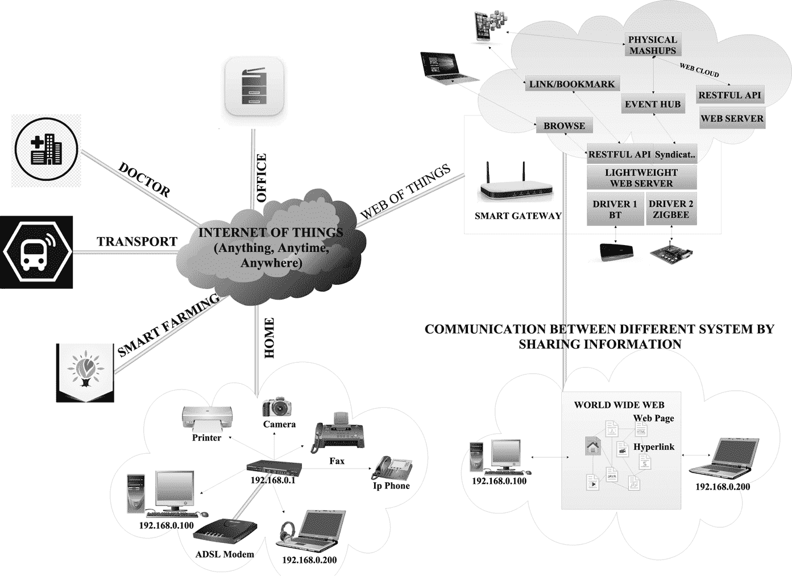

图 1.1: 物联网 (IoT)

- **智能床垫**：智能床垫嵌入了传感器，可以追踪人类的睡眠位置。它会在睡眠期间向人类通知睡眠位置和身体压力。

- **智能窗帘**：这些窗帘通过降低能量消耗来保护房间免受阳光照射。这些窗帘有助于维持房间温度。这些窗帘易于安装，可以通过智能手机控制。

- **智能垃圾桶**：这些垃圾桶提供了智能处理废物的方法，以维护健康的家居。它具有感知环境的传感器，并通过测量垃圾桶填充水平来控制盖子的开启/关闭。它还能消除细菌并帮助清理垃圾。

- **智能鞋**：这些是第一种加热脚部的鞋垫。它们也可以通过智能手机进行控制。它们监控每天覆盖的距离和消耗的热量。由于它们能维持鞋履的温度，还有助于防止脚冷。

- **智能头盔**：无论你骑的是公路车、山地车、电动自行车还是摩托车，良好的头盔对于保持安全都至关重要。但在当今，即使是简单的头盔也正在经历高科技改造，添加了各种智能的元素。

这些设备通常被称为 IoT 设备。IoT 连接设备以共享无尽的信息，这可以总结为“连接”，而将智能植入设备中则是人工智能（AI）的任务。人工智能是计算机科学的一个分支，拥有许多子分支，如机器学习（ML）、自然语言处理（NLP）、深度学习等。它可以被定义为“智能”术语，因为它是一个在没有人类干预的情况下处理决策的程序。总之，连接设备是 IoT 的任务，而将其智能化由 AI 完成。AI 不是 IoT，但 IoT 是 AI 变得完备的基础。

## 1.1 IoT 历史

近年来，互联网的使用呈指数级增长。它被广泛用于信息检索。这些信息在被称为 Web 服务器的中央存储中进行收集、存储和处理。服务器以网页文档的形式表示这些信息，可以通过互联网进行访问。根据*Statista*报告（一家网络信息提供公司），2018 年的用户数量为 3.6901 亿。访问互联网的平台主要是被称为 Web 搜索引擎的专用软件。根据*NETMARKETSHARE*（一家市场份额统计提供者）的数据，截至 2018 年 9 月，搜索引擎最大的份额由 Google 占据，即 72.03%，之后是百度（14.11%）、Bing（7.76%）和雅虎（4.27%）。网络搜索引擎成功的背后的原因是搜索引擎结果页面（SERPs）。这些页面根据排名方法论进行排序，该方法考虑了网页的重要特征。PageRank 是 Google 用于对 SERPs 网页排名的算法。

互联网在 20 世纪 80 年代流行，而物联网（IoT）在 2010 年代流行。IoT 术语是由 Kevin Ashton 在 1999 年在宝洁公司创造的。网络互联网（IoN）、计算机互联网（IoC）和人类互联网（IoP）是 IoT 之前互联网的不同阶段。IoT 在其设备中使用传感器和执行器来感知物理环境。IoT 连接的整体机制基于互联网的基础。进行物理环境监测是为了利用虚拟环境进行信息检索。这种互连性有助于捕捉以信息为中心的应用和服务。当今世界完全依赖 IoT。*Business Insider*的一份报告显示，IoT 设备的使用已从 2015 年的 142 亿增加到 2019 年的 240 亿。

## 1.2 IoT 架构

图 1.2: IoT 架构的不同阶段

你能想象这样一个地方吗：人们只需要坐着就能得到他们想象或想要的东西？只有当无生命物体开始让执行器发出警报时，这才是可能的。这就是传感器收集数据/信息，并执行器执行立即操作的方式。

### 第二阶段：数据转换

传感器收集的数据是模拟格式，必须转换为数字流以便进行后续处理。数据的聚合和转换由数据采集系统（`DAS`）完成。`DAS`从传感器收集数据，执行模拟数转换，并将数据处理到下一阶段。互联网是用于这种传输的网关。这可以被视为数据预处理阶段。传感器收集的模拟数据量很大。在此阶段执行的任务包括恶意软件防护、数据清洗、数据分析、数据管理和数据过滤。因此，它产生了数据采集和精炼。

### 第三阶段：IT 边缘精炼

一旦数据由上一个阶段聚合，就可以准备进行进一步精炼。这种精炼过程可能发生在传感器安装附近，也可能不是。这一阶段减轻了数据传输的负担，并降低了其负载需求。拥堵和其他安全问题在此阶段得到解决。异常情况也可以通过机器学习进行检测。这是数据提交到数据中心之前最后的预处理。

# 第 4 阶段：数据云中心

这一阶段对预处理后的数据进行更深层次的分析、管理和处理。这一层的两个模块是操作技术（`OT`）和信息技术（`IT`）。由于涉及多种技术，输出可能需要一些时间。协作与集成是`OT`和`IT`的过程。

## 1.3 IoT 元素

### 1.3.1 无线传感器网络 (WSN)

在当今，遥感应用使用了集成电路等先进技术，实现了低功耗和低成本。这些因素使得传感器网络的安装更加便利。无线传感器网络（`WSN`）可以进行感知、计算、处理、通信、分析和执行。传感器节点通过多跳传输监控环境，将收集的数据传输到另一个传感器节点。多跳路由有助于数据传输，然后网关帮助数据到达管理节点。传感器节点是`WSN`的不可组成部分。传感器节点的工作是感知环境。然后传感器节点将收集的数据传输到微控制器。`WSN`网络的主要组件包括：

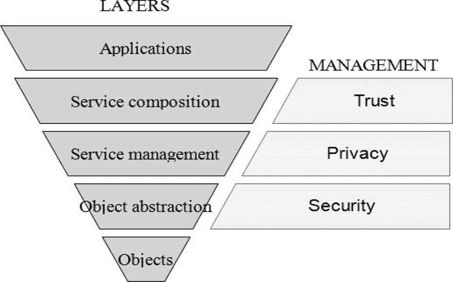

[FIGURE 1.3:] [SOA 架构]

* `WSN`硬件：包括电源管理模块、传感器接口、收发器和处理单元。

* `WSN`通信栈：提供拓扑选择和路由机制，以确保网络的长期寿命和效率。

* `WSN`中间件：用于扩展基于 Web 的服务的架构，即服务导向架构（`SOA`），如图 1.3 所示。

* `Security`：需要安全方法来修复网络能力，因为网络拓扑故障或传感器失效是非常常见的现象。这种安全性可以防止入侵者进入网络。

### 1.3.2 射频识别 (RFID)

`RFID`技术是一种用于设计辅助自动通信微芯片的无线技术。`RFID`充当电子条形码，用于自动识别所附的物体。有一个`RFID`阅读器与`RFID`标签通信。`RFID`标签使用`RFID`阅读器的电池。`RFID`系统的运行范围从 100 kHz 到 5.8 GHz 不等。换句话说，它工作在工业、科学和医学（`ISM`）频段。

`RFID`标签使用射频（`RF`）电磁能量。`RFID`标签可以进行感知、监控和记录。表 1.1 列出了三种`RFID`类型：

* `Active`主动标签：带有电池。它们可以向`RFID`阅读器发送信号。它们昂贵且需要维护。

* `Passive`被动标签：没有电池。它们使用`RFID`阅读器的能量。它们很小且可以安装。价格低廉。

* `Semi-passive`半被动标签：有一个小电池。它们可以传输信号。不需要维护。

表 1.1：RFID 标签之间的差异

| 差异 | 主动 RFID | 被动 RFID | 半被动 |
| :--- | :--- | :--- | :--- |
| 内部电池 | 是 | 否 | 是 |
| 可用性 | 始终可用 | 在范围内 | 左右 |
| 成本 | 最贵 | 较便宜 | 成本较低 |
| 能力 | 始终开启 | 在范围内 | 仅限主动 |
| 信号强度 | 超过百米 | 几米 | 左右百米 |

#### 1.3.2.1 RFID 应用

`RFID`标签现在非常流行。在日常活动中可见。其中一些设备包括：

1. 交通（车票替代）
2. 汽车点钥匙
3. 银行卡（信用卡）
4. 公路收费标签
5. 护照
6. 驾照（电子产品代码）
7. 反碰撞协议
8. 基于 Aloha 的系统（纯型和时隙 Aloha）
9. 位级仲裁算法
10. 二分搜索算法
11. 虚拟和数字医疗健康
12. 车车通信
13. 石油行业
14. 道路和桥梁
15. 实时定位系统，如全球定位系统（`GPS`）

### 1.3.3 数据存储

IoT 架构的结果是收集了大量数据。在存储数据时会考虑一些挑战性问题，如安全、隐私和机密。数据更新是贯穿所有阶段的过程。数据分析主要在 IoT 架构的两个阶段进行，即第三阶段和第四阶段。为了从第一、二阶段收集的数据中提取有意义的信息，数据分析起着至关重要的作用。具体而言，数据分析消除了数据中的噪声。开发了许多优化和融合算法以在 IoT 中执行数据分析。工业 IoT 也利用数据分析进行维护和效率操作。数据分析在 IoT 中具有多种角色，例如决策、操作效率、竞争优势和预防性维护。这些角色通过`ML`、`AI`和`NLP`等各种技术实现。

所有处理过的数据都存储在数据中心。这些中心依靠采集的能量运行，并旨在提高数据效率和可靠性。这种基础设施是考虑到`IT`应用设计的。显然，软件和硬件提供的支持成为系统成功的不可或缺的一部分。这就是数据在 IoT 基础设施中被收集、处理、分析和存储的方式。

### 1.3.4 挑战性问题

IoT 中的“物”（我们称之为设备或小装置）应该具有唯一的可识别性。IoT 系统的成功也取决于这一约束。例如，数据请求是从某个特定城市发出的，但被交付到了另一个城市，你会归咎于谁？只能是递送系统。因此，为了避免这类冲突，数以十亿的设备都应该有一个唯一的身份。正如我们之前讨论过的，IoT 设备是由互联网控制的。在设计唯一地址时，需要记住几个参数，即持久性、唯一性和可扩展性。某些协议可以确保地理位置上的可靠识别，但可能无法在个体上实现识别，例如`IPv4`。`TCP/IP`用于处理这种路由行为，但无线传感器网络及其网关需要关注。“物”的网络应该配置为，使得其中一个设备的添加或删除不会影响其他设备。为了确保网络的可靠性，统一资源名称（`URN`）成为 IoT 结构配置中不可或缺的一部分。`URN`创建`URLs`用于访问适当资源。数据库维护数据完整性和数据机密性的约束。然而，数据库生成的元数据主要用于在互联网上传输信息。

## 1.4 数据分析

数据作为输入进入 IoT 架构后，以输出的形式返回用户。在 IoT 架构的四个阶段中，数据发生了什么？它是如何被处理的以便我们获得精炼的信息？从数据输入到意义输出的完整过程被称为数据分析。这一过程通过各种活动完成，即 IoT 数据源、数据预处理、技术选择和优化。所有这些活动都在[图 1.2]中。这些活动的完整工作原理在[图 1.4]中详述，并在下文中讨论。

### 1.4.1 IoT 数据源

应用程序、用户、设备和传感器输入的数据由 IoT 基础设施获取。IoT 以这种方式处理数据以提取有意义的信息，反过来有助于启动智能活动。IoT 数据可以是任何企业/组织/设备通过 IoT 服务/应用生成。根据部署的 IoT 应用，IoT 数据源分类如下。

#### 1.4.1.1 工业数据

工业产生大量数据通过 IoT 进行收集和存储。无论行业类型如何，数据都可以通过先进技术（即`ML`）轻松处理。接下来进行数据分析，并做出一些有意义的预测。IoT 具有应用成本效益技术处理实时数据的潜力。通过创建各种类型的视图来获取数据。它使生产力最大化并提高了工业效率。

#### 1.4.1.2 业务应用

存在与 IoT 技术协作的业务应用，如客户关系管理（`CRM`）、企业资产管理（EAM）、企业资源计划（ERP）和产品生命周期管理（PLM）。这些应用是处理企业数据的更智能的方法。客户可以从远程位置检查产品或服务更新，技术人员可以直接接触故障区域而无需涉及业务组织。这降低了维护成本并改善了客户体验。

#### 1.4.1.3 传感器和设备

IoT 设备部署的传感器和执行器感知环境数据并将其发送处理。常用的传感器有温度、流量、压力湿度传感器。健身带和智能手表等可穿戴设备是 IoT 监测的环境变化的最佳示例。

#### 1.4.1.4 智能手机


手机是随地访问实时媒体的媒介。即使在旅行期间，也可以下载或上传实时照片到`Google drive`或任何社交网络网站。`GPS`导航和云存储等智能应用让人类的生活变得更加便捷舒适。`iCloud`和`Google Drive`服务使用 IoT 技术进行存储。

### 1.4.2 数据处理

从不同来源收集的数据随后经过处理和分析以做出智能决策。这一过程涉及在数据传输到下一个模块之前对其进行转换、过滤和清洗。

#### 1.4.2.1 数据采集

这是将传感器采集的模拟信号转换为数字信号的过程。模拟信号可以定义为随时间变化的连续信号。数字信号是计算机可以理解的。模数转换器（`ADC`）是用于此目的硬件。

```
Figure 1.4: 从输入到最终输出的数据分析过程概述
```

#### 1.4.2.2 数据传输

数据根据其格式被收集并从各种存储库传输。如有必要，可以应用加密技术以确保数据从源地到目的的安全传输。在这个阶段，转换过程中散布的信息被收集在一个地方。

#### 1.4.2.3 数据预处理

在上阶段准备的数据是数字格式，已准备好处理。但是，数据是否足够干净且充分以输入技术？数据不应有缺失值。在对数据进行实验之前，必须解决所有疑问。这涉及许多步骤。为了更清楚地理解每一步，将详细讨论数据预处理。

### 1.4.3 IoT 技术

技术采用的策略处于泛在无线通信、`ML`和数据采集元素（如嵌入式系统）的背景下。无线技术不仅有助于传输而且确保安全。

#### 1.4.3.1 无线通信技术

无线通信技术用于数据网络上的传输。正如[第 1.5 节]中讨论的，有多种协议，如`IPv6`、`UDP`等。

#### 1.4.3.2 数据分析方案

数据分析确保数据适合 ML 模型。此阶段的数据是计算机响应的水平，从处理后的数据流出使其更高效。有四类主要的数据分析方法描述如下：

1. **描述性分析：** 它通过从各种数据源收集原始数据来定义过去。结果描述了发生了什么，但没有描述为什么会发生。例如，一个学生可能会收集所有同学的成绩来判断谁的得分最高。

2. **诊断性分析：** 它是分析已经发生的事件背后原因的过程。它给了我们关于“为什么发生”的答案。例如，一个学生找到了他得分较低的原因。

3. **预测性分析：** 它通过考虑过去的实例来预测未来的技术。其目的是知道未来将发生什么。它考虑了各种技术，如机器学习，它使用各种模型进行预测。例如，预测两天后访问的另一个城市的气温。

4. **规范性分析：** 它是一种从经验中学习以避免近期风险的方法。它给了我们关于“我们应该做什么”的答案。它涉及各种技术。例如，学生学习新技巧来回答考试中的问题，以获得高分。

#### 1.4.3.3 机器学习

对之前处理过的数据使用`ML`技术进行分析。该技术利用数据的隐藏见解并预测新数据。有各种 ML 模型，如分类、回归和聚类模型。我们将处理过的数据训练到这些模型之一，然后模型通过从之前的数据中学习来预测未见的数据。这种技术帮助我们避免失败和损失。例如，可以使用`ML`预测明天的气温。

### 1.4.4 优化技术

最后，我们从技术获得结果，即`ML`在优化后准备好输出。优化的技术有助于改进结果。

#### 1.4.4.1 边缘计算技术

边缘计算通过将智能、处理能力和通信能力直接集成到边缘网关或设备附近的可编程自动化控制器等设备中来执行优化。这实现了低延迟、最小带宽消耗和数据完整性。

#### 1.4.4.2 精炼结果

最后，通过对`ML`采用交叉验证和集成方法产生输出。它提高了结果的整体准确性。

## 1.5 数据预处理的步骤

机器学习模型使用的数据应该是清洁、无噪声、充足且一致的。数据的相关性确保了最佳输出。数据预处理有许多不同的步骤。

### 1.5.1 数据格式化

这一步骤指的是格式化数据所需的程序。由于数据是从各种来源收集的并由`ADC`转换，因此所有数据的格式应该是相同且一致的。例如，当你练习机器学习并从 Google 下载数据集时，你可能会观察到下载了不同类型的文件，如`.txt`、`.pl`、`.graph`、`.csv`。所有数据在输入机器学习模型之前都需要进行格式化。例如，使用`R`或`RStudio`等软件需要`.csv`文件进行处理。因此，数据需要格式化为`.csv`文件。

### 1.5.2 数据清洗

数据应该足够清洁以供进一步处理。数据清洗是数据预处理中的关键步骤，确保检测重复值、无关值和缺失值。所有这些问题都应该解决，否则会导致机器学习模型的失败。

#### 1.5.2.1 重复观测

有时，`IoT`传感器会反复捕获相同的数据。例如，如果你在`CCTV`监控下让孩子在家里睡觉，然后去办公室。几小时后回到家，无法看到完整的录像。`CCTV`应该足够智能，只在孩子移动时记录，而不是在睡觉时。因此，不应记录相同的的动作，从而节省成本和时间。

#### 1.5.2.2 无关观测

收集的数据不应包含无关信息。例如，假设你下载的数据集包含关于网站颜色的信息，这是无关的。检测此类观测是最好的。

#### 1.5.2.3 处理缺失数据

有时，数据是自由形式的，值可能包含一些零或空值。在数据进一步处理之前，处理此类值非常重要。处理这种约束有多种方法。其中几种方法描述如下：

- 删除行：删除包含大约 70% 到 90% 零值的完整列。

- 用平均值/中位数/众替换：用某些聚合值（如平均值）替换缺失值或空值。

#### 1.5.2.4 检测异常值

异常值是不位于特定范围内的实例。仅通过可视化很难检测出异常值。这取决于数据及其特征，即数据的相关性和用性如何。

### 1.5.3 数据压缩方案

实时数据总是随机收集的。正如模拟形式一样，很难说转换后它将形成多少个类别或收敛到多少个维度。因此，生成的数字格式数据在各个维度上可能包含不平衡的案例。在数据预处理的这一步中进行数据平衡。降维是实现重要数据抽象的主要步骤之一。降维可以通过两个阶段实现，即特征提取和特征选择。特征提取是通过形成新的特征空间将高维特征转换为低维特征的方法。然而，特征提取并不减少特征的数量，而是减少特征的复杂性。特征选择旨在通过形成特征集来消除无关和冗余特征。这两种技术详述如下。

### 1.5.3.1 特征提取

特征提取

特征提取是一种降维技术，用于减少描述数据时消耗的资源。这种技术可以减少过拟合、大内存需求和计算能力等问题。有多种特征提取技术，例如独立成分分析、主成分分析、多因子降维、非线性降维、多线性分析等。其中，主成分分析（PCA）被应用最广泛。PCA 是一种多元过程，它将相关特征的集合转换为不相关的特征集合。新集合的形成方式是从变量中提取最大方差。移除提取出的方差，从而形成第二组变量。此过程一直持续，直到变量之间的相关性减小。这产生了正交（不相关）方差，该过程被称为主轴法。它减少了特征空间的维度。PCA 也被称为数据压缩技术。它降低了数据的复杂性。

PCA 通过每行标准化值与每列标准化值的乘积来计算主成分（PC）得分。计算出的 PC 性质取决于计算 PCA 所采用的方法。计算 PCA 有不同的方法，这也取决于你使用的软件。例如，如果采用 R 语言进行实验，那么计算 PCA 的方法有`prcomp()`、`primcomp()`和`PCA()`。

### 1.5.3.2 特征选择

特征提取减少的是数据的维度，而不是特征的数量。为了消除无关特征，[图 1.5] 中展示了许多特征选择技术。下面简要讨论了特征选择的不同类别，详细描述请见[第 8 章]。

1. 平铺特征

   - 过滤法（Filter method）：该方法计算特征之间的相关性并消除冗余特征。

   - 封装法（Wrapper method）：该方法使用机器学习模型实现。通过不断观察结果，对各种特征组合进行实验。

   - 嵌入法（Embedded method）：这是机器学习模型本身选择特征的方法，例如`LASSO`和`RIDGE`回归。

2. 流式特征：在预测模型中顺序添加特征的方法，用于减少子空间。

3. 结构化特征：通过考虑特征的结构（如组、树或图）来完成特征选择。

## 1.6 IoT 协议

IoT 架构的不同层和阶段使用了许多协议。许多互联网协议也被用于 IoT，但 IoT 协议还减少了数据传输过程中的解析开销和生成开销。为了更准确地理解这些协议，所有协议根据其工作层分类，如表 1.2 所示所示。不同协议之间的底层差异在表 1.3 中进行了讨论。

| 序号 | 层 | 协议 |

| --- | --- | --- |

| 1 | 基础层（网络/传输层） | `IPv6`, `6LoWPAN`, `UDP`, `QUIC`, `uIP` |

| 2 | 数据层 | `MQTT`, `MQTT-SN`, `Mosquitto`, `CoAP` |

| 3 | 物理层 | `蜂窝 (GPRS/2G/3G/4G/5G)`, `RFID`, `Wi-Fi`, `Wireless HART`, `Zigbee`, `低蓝牙` |

| 4 | LPWAN | `NB-IoT`, `LTE-MTC`, `EC-GSM-IoT`, `Lo-RaWAN`, `RPMA` |

#### 1.6.1 基础层（网络/传输层）

1. `IPv4/IPv6`：这两者都是用于向多个 IP 地址进行端端传输的互联网协议。`IPv4`开发于 1980 年，而`IPv6`出于 1998 年。然而，由于互联网设备数量增加，`IPv6`取代了`IPv4`。由于安全性、可扩展性和连接性，IoT 采用了`IPv6`。

2. `6LoWPAN`：该协议在无线传感器网络（WSN）中以`IPv6`的形式传输数据。这就是为什么它被称为低功耗无线个人域网上的 IPv6。它构建在`IEEE 802.15.4`之上，具有特定的频率范围（2.4 GHz）和特定的传输速率（250 kbps）。但这种需求现在已被消除，它可以轻松工作。它可以安装在可以通过手机操作的个人设备上，例如 LED。

3. `用户数据报协议 (UDP)`：它的工作类似于`TCP`，通过发送数据报进行进程间的通信。端口号分配和校验和计算是`UDP`相于`TCP`的两个主要优势。

4. `快速 UDP 互联网连接 (QUIC)`：它是构建在`UDP`之上的，用于减少端端延迟。IoT 采用`QUIC`是因为其更快的连接建立、多路复用、向前纠错（FEC）、身份验证和加密以及更好的信号。

5. `uIP`：它通俗称为微 IP，以适应 8 位或 16 位的微控制器。它使用一个数据包缓冲区的内存，用于跟踪 IP 数据包。

#### 1.6.2 数据协议

1. 消息队列遥测传输 (`MQTT`)：用于轻量级传输。它是为了机器间和 IoT 通信而开发的。`MQTT-SN`是广泛用于传感器网络的`MQTT`。它在带宽昂贵的地方非常有用。

2. `Mosquitto`：通过专为此设计的`Mosquitto`实现`MQTT`。它专为此目的设计，适用于手机等低功耗传感器设备。

3. `受限应用层协议 (CoAP)`：这是一种低 RAM 和 ROM 的网络传输协议，专门为低功耗应用设计。它的工作方式与`6LoWPAN`类似。

#### 1.6.3 物理层

1. `蜂窝 (GPRS/2G/3G/4G/5G)`：用于远距离和高功率率的技术。它用于具有高速互联网连接的技术中。由于这种技术在手机中广泛使用，因此经常更新。

2. `RFID`：射频识别已经详细讨论过（见第 1.3.2 节）。

3. `Wi-Fi`：基于两个`IEEE 802.11`标准，即`802.11ah`和`802.11ax`。它是用于在网络上远距离高速传输数据的技术。

4. `Wireless HART`：基于 HART 技术的无线技术。它配合`IEEE 802.15.4`标准。该协议使用网格架构。

5. `ZigBee`：ZigBee 协议采用了`IEEE 802.15.4`标准。它工作在 2.4 GHz 的频率范围内，速度为 250 kbps。由于具有连接性和稳定性、可靠的网格网络和安全性等特点而被用于 IoT。

6. `蓝牙`：蓝牙工作在 2.4 GHz ISM 频段，使用跳频技术，数据速率高达 3 Mbps，最大范围为 100 米。

#### 1.6.4 LPWAN: 低功耗广域网

1. **NB-IoT**: 窄带物联网 (`NB-IoT`) 是一种低功耗广域网（LPWAN）无线技术。由于其室内覆盖、长电池寿命、低成本和高连接密度而被`IoT`采用。

2. **LTE-MTC**: 这是面向机器的长期演进技术，电池寿命超过 10 年。它支持所有移动设备，包括所有的蜂窝网络。它降低了目前增强型`EGPRS`调制器的成本。

3. **EC-GSM-IoT**: 这在几乎没有新功能的情况下，发展了现有蜂窝网络。它可以通过新软件轻松安装，涵盖多种 IoT 应用并为更多 IoT 设备提供服务。

4. **LoRaWAN**: 这允许在广范围内进行低成本传输。它的设计旨在支持传输少量信息的应用程序和传感器，并具有很长的电池寿命。

## 1.7 物联网应用

IoT 设备几乎用于我们日常生活的每一项活动。`IoT`通过新兴的技术和创新改变了世界。然而，当我们开始讨论 IoT 应用时，这些应用是海量且无止尽的。IoT 应用及其主要关键要素在`图 1.6`中给出。IoT 的一些主要应用列在以下章节中。

### 1.7.1 物流与运输

今天，在智能 IoT 创新（如智能交通灯）的帮助下，道路和车辆变得智能化。这些设备有助于控制交通并避免事故。即使`GPS`技术也让驾驶旅程变得更容易。车辆还使用传感器远程控制车辆。驾驶学习者应该选择乘坐配备传感器和执行器的汽车。将货物从一个地方运到另一个地方只需点击几次。企业的供应链系统可以通过在最方便的时间提供货物并方便地将其送到遥远的地方来管理。

### 1.7.2 家庭与工作场所

家庭和工作场所现在充满了嵌入传感器和执行器的设备，这些设备帮助我们舒适地执行日常活动，如在微波炉中加热食物、用空调维持房间温度、在冰箱中更久地存储蔬菜水果以及通过单个命令打印文档。此类设备的设计目的是在不使用时关闭设备以节电。

### 1.7.3 个人与社交

万维网（World Wide Web）确实是在线社交活动最容易访问的网络。得益于`Facebook`和`Twitter`等应用，我们与人们建立联系并了解他们的活动。我们可以考虑到基于传感器的应用，它们收集我们访问过的地方的信息并更新我们待处理的地方。（注：原文此处存在大量重复段落，译文已按要求去重处理）

### 1.7.4 医疗领域

在医疗领域，`IoT`发挥着重要作用。它有助于识别和追踪患者。医疗援助可以持续很久。同时，健康监测可以通过智能手机完成。

## 1.8 本书结构

在我们的日常活动中，使用了许多设备。但这些设备并不智能。在认知时代，我们可以让这些设备能够感知、思考和反应。这些是用户提出的问题。本书试图回答所有此类问题。一些更多的技术问题包括：

- 什么是`IoT`？它与什么不同？

- 认知行为的组成部分是什么？

- 认知事物与`IoT`有什么区别？

- 什么是`CIoT`及其技术是什么？

- 机器学习在`CIoT`中的作用是什么？

本书涵盖了与互联网相关的不同技术以及`CIoT`涉及的机器学习能力。探讨了包括模型在内的所有技术问题。讨论了不同的机器学习方案。

第一章探索物联网 (`IoT`)、其历史、架构和应用。第二章关注认知物联网 (`CIoT`) 的概念及其在现实世界的能力。第三章描述了机器学习在`CIoT`数据挖掘中的重要性。第四章关注各种机器学习技术、监督学习与无监督学习的区别、分类、聚类和回归。第五章涵盖了机器学习范式，如分类规则、数值预测等。第六章讨论了开发各种机器学习模型所需的术语。第七章探索了数据预处理的不同阶段，如数据清洗。它还演示了文献中存在的不同数据清洗技术的程序，如`Tomek`和`SMOTE`。第八章介绍了特征工程，即特征提取和特征选择。本章还对优化机器学习模型生成的生成提供了简要见解。最后一章涵盖了用于验证结果的评估参数。这些参数包括准确率、`confusion matrix`、`roc`等。

本书主要面向学习者、学生、研究人员和工业界人士，即那些计划设计物联网（IoT）基础设施，并重点关注机器学习如何帮助该系统的人。认知是强调技术世界即将事实的力量。因此，认知计算也是系统不可或缺的一部分，使其变得更加智能。本书提供了关于潜在 IT 策略、IoT 结构、认知计算和机器学习所需的资讯。本书的编写方式有助于开发者和研究人员为不同的应用设计定制化的解决方案。它涵盖了不同类型的机器学习模型及其带有数值示例的构建。它涵盖了机器学习术语的细节以及 R 程序的使用。大学可以将本书作为数据挖掘/机器学习课程的阅读材料。

## 1.10 总结与展望 (#005-9781000767971_contents.xhtml#sec1-10)

在本章中，我们关注了当今时代对物联网的需求。它包括了物联网如何从互联网演变而来的历史，并讨论了它的能力。理解物联网的架构至关重要，这种架构目前在业界被广泛应用。在深入研究物联网的洞察之前，讨论了读者需要理解的关键要素。数据分析发挥着重要作用，因为它涉及到数据处理活动，如数据收集、数据预处理和模拟技术。在物联网设备及其应用工作是技术创新的原因。物联网催生了新兴技术，即认知物联网（CIoT），将在下一个章节中讨论。书中包含的关键要素如下。

1. 物联网及其进展

2. 认知物联网和认知设备

3. 物联网和 CIoT 如何依赖于机器学习？

4. 机器学习技术

5. 不同的机器学习模型

6. 机器学习的工作原理

7. 物联网、CIoT 和机器学习的协作

## 1.11 练习 (#005-9781000767971_contents.xhtml#sec1-11)

### 问答

1. 定义物联网？区分物联网和人工智能（AI）。

2. 为什么物联网是信息交换领域最有前景的技术？

3. 描述物联网架构及其组件。

4. 定义传感器在无线传感器网络（WSN）中的作用及其所有组件。

5. 区分 RFID 和 WSM。详细描述 RFID。

6. 物联网中数据分析的需求是什么？

7. 不同的物联网数据源有哪些？

8. 边缘计算设备在数据分析过程中起什么作用？

9. 有哪些不同的物联网应用？

10. 物联网架构网络层部署了哪些不同的协议？

### 单选题


**1: 物联网架构中用于数据聚合和转换的是？**

**(a)** 数字化转换器和模拟系统 (DAS) (b) 传感器 (c) 数据采集系统 (DAS) (d) 执行器

**2: WSM 的哪个组件负责拓扑选择？**

**(a)** WSN 通信协议栈 (b) WSN 硬件 (c) WSN 中间件 (d) WSN 安全

**3: RFID 标签从哪里使用电池？**

**(a)** 安装其上的设备 (b) RFID 阅读器 (c) RFID 标签 (d) ISM

**4: 哪种 RFID 标签最昂贵？**

**(a)** 主源式 RFID 标签 (b) 被动式 RFID 标签 (c) 半被动式 RFID 标签 (d) 以上都是

**5: 汽车钥匙锁中应该安装哪种 RFID 标签？**

**(a)** 主源式 RFID 标签 (b) 被动式 RFID 标签 (c) 半被动式 RFID 标签 (d) 以上都不是

**6: 哪个物联网组件为物联网设备分配唯一标识符？**

**(a)** 互联网 (b) 协议 (c) WSN (d) 以上都不是

**7: FEC 的全称是什么？**

**(a)** 前向纠错 (Forward Error Correction) (b) 快速纠错 (Fast Error Correction) (c) 前向估计组件 (Forward Estimation Component) (d) 快速估计修正

**8: 哪种物联网协议负责路由行为？**

**(a)** 网协议 (b) TCP/IP (c) URN (d) 以上都不是

**9: 智能手机中安装了哪种物联网应用用于导航？**

**(a)** 智能路线技术 (b) GPS 技术 (c) iCloud 技术 (d) 以上都不是

**10: 哪种硬件用于分析数字信号？**

**(a)** ADC (模拟数字转换器) (b) 互联网路由器 (c) 应用服务器 (d) 机器学习

**11: 哪个协议发送数据报文用于进程间通信？**

**(a)** IPv4/IPv6 (b) 6LoWPAN (c) UDP (d) uIP

**12: 无线 HART 协议使用哪种架构？**

**(a)** 总线型 (b) 星型 (c) 网格型 (d) 混合型

**13: Wifi 协议使用哪种架构？**

**(a)** 总线型 (b) 星型 (c) 网格型 (d) 混合型

**14: LTE-M 的作用是什么？**

**(a)** 总线型 (b) 星型 (c) 网格型 (d) 混合型

**15: 哪种 Web 协议用于低功率？**

**(a)** MQTT (b) Mosquitto (c) CoAP (d) TCP/IP

**16: Zigbee 的传输速度是多少？**

**(a)** 250 Kbps (b) 750 Kbps (c) 1 Mbps (d) 3 Mbps

**17: 存储数据时需要考虑的不同因素有哪些？**

**(a)** 安全 (b) 隐私 (c) 机密性 (d) 以上所有

**18: 哪个预处理步骤确保了数据的完整性？**

**(a)** 数据处理 (b) 数据清洗 (c) 检测异常值 (d) 处理缺失值

**19: 哪种分析类别定义原因？**

**(a)** 描述性 (b) 诊断性 (c) 预测性 (d) 规范性

**20: 哪种技术有助于降低数据的维度？**

**(a)** 特征选择 (b) 特征提取 (c) 检测异常值 (d) 以上都不是

# 认知物联网

认知术语意味着能够还原为经验知识。这一陈述本身说明了只根据环境相信事实。认知这一术语的实际含义取决于其参与主体。认知术语被用于各个科学领域——认知心理学、认知疗法、认知发展和认知障碍。每个领域为该术语的使用提供了不同的场景。认知心理学是研究人类大脑过程（如记忆、注意力）的领域。为了突破这一局，人工智能拥抱了认知能力并将其称为认知人工智能。它被认为是现有人工智能范式的扩展，填补了人类与机器之间的差距。认知计算通过机器学习、人工智能、自然语言处理（NLP）等多种技术实现。

## 2.1 认知设备

计算时代在过去的一百年里不断演变。承载认知能力的设备（即从计算机科学角度进行思考的能力）通常被称为认知设备。认知设备能够思考，从而消除了其他设备的偏见。认知设备/系统可以从环境、数据、学习和经验中学习，而 AI 设备只能执行由人类编写的任务。例如，人类从经验中学习，认知设备也是如此。认知设备这种自动学习的特性使其变得更加聪明、智能，并随着时间与经验的增长而更新。你可以想象随着这种认知演进带来的未来技术。我们在上一个章节中讨论了物联网（IoT）设备。物联网设备因为传感技术而足够智能，但这些设备并不具备“智能性”。嵌入智能是认知设备的用武之地。它像人类一样思考和行动。你可以以物联网设备为例，例如智能鞋。它可能会计算你的步数，但无法区分孩子和成人的步数。尽管如此，它还能计算一天内消耗的热量，但不能就此向你提供建议。现在，让我们以认知设备为例。假设你进入智能家居，家电器自动开启。我们可以将其称为硬编码和自动化的。但如果仅根据时间、天气和需求开启所需的电器，它就是软编码的并与环境共同学习。这种学习、适应和反应的能力是认知设备任务。设备的这种学习不仅执行基础任务，还执行高级任务。认知设备从其经验中学习，并且是软编码的。另一个例子是监控摄像头（CCTV）是物联网设备，但如果它们在记录后还能做出反应，系统就变成了认知系统。

## 2.2 物联网中的认知

物联网中感知和反应的能力限制了它的学习和记忆。尽管物联网设备在某种程度上减少了人类的努力，但由于物联网的规模和功能有限，且它是人类编码的，认知技术将设备推向了新的高度。物联网与认知技术的“握手”通常被称为认知物联网（CIoT）。具有认知能力的物联网设备可以统称为 CIoT 设备。它们有助于根据情况进行决策。同时，它从示例中学习、记忆，并在发生相同情况时进行修正。CIoT 中的推理是通过分析数据来推断得出决策所需的有用信息来实现的。CIoT 技术采用的最新方法讨论如下。

*   认知管理框架被提出，旨在通过将现实世界视为虚拟世界，为智能城市中的协作对象赋能物联网。该框架利用认知能力选择最相关的对象。文中还展示了一个真实的案例研究，以更有效地验证了该框架 [35]。

*   采用 CIoT 以使应用程序智能地工作，通过动作进行学习、执行主动决策，并最终通过自适应反应响应环境 [38]。

*   CIoT 的另一项进展是认知无线网络（CRN），它由 Joseph Mitola 在 1999 年首次提出 [24]。Simon Haykin 在 2005 年通过动态频谱利用管理对其进行了重新定义 [10]。

*   网站偏好量表（WSPS）通过利用 CIoT 技术学习市场策略而开发。WSPS 背后的想法是寻找网站最受青的内容元素。它帮助网站开发人员获得更高的访问量 [28]。

*   认知 M2M 通信网络是从协议栈的角度开发的。它在认知无线技术的帮助下得以实现 [1]。

*   通过认知管理框架管理物联网对象，降低了物联网架构的技术异构性和复杂性。该框架通过从多样化的对象集中选择最合适的对象来提高能效比 [8]。

*   使用真实对象和虚拟对象来提供物联网服务。这些对象被封装并带有约束条件，以预测现实生活中问题的未来潜力。该框架是在推理和机器学习范式的帮助下实现的 [29]。另一项建议是使用机器学习模型和神经网络来预测未来的市场趋势 [37]。

## 2.3 CIoT 背景

互联网是连接系统到中央服务器以交换信息和服务的网络。它正在以快速规模扩张。万维网（WWW）为互联网提供了更好的含义并以网页的形式改变了信息。网页是由科学家 Tim Berners-Lee 开发的。互联网统计定期进行调查，如今互联网用户达到 4,096,718，网页数量为 1,938,897，每天搜索次数达到 5,787,475。这证明了世界如何依赖互联网。互联网正从网络转变为万物，如图 2.1 所示，并在下方讨论。

### 1. 网络互联网（IoN）

互联网的第一阶段 IoN 是随着 1969 年高级研究计划网（ARPANET）的出现而。它采用了包交换方法，该方法由 Lawrence Roberts、Donald Davies、Paul Baran 和 Leonard Kleinrock 设计。IoN 连接了多台计算机。

```
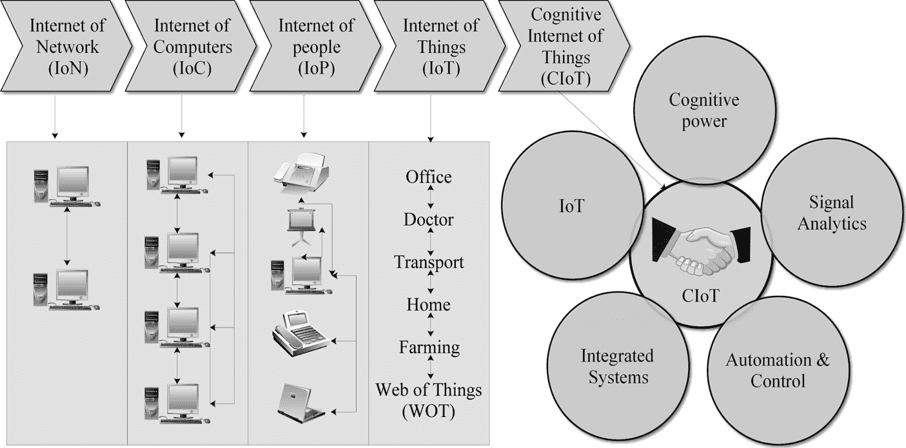
```

图 2.1 互联网的演进及其进展

### 2. 计算机互联网（IoC）

TCP/IP 协议于 1983 年 1 月 1 日应用于通信，由 Robert Kahn 和 Vint Cerf 开发。它引发了在多个网络上传输数据的网络概念。

### 3. 人类互联网（IoP）

IoP 由一个名为 Fermat 的社区创立。IoP 项目的创始人是 Luis Fernando Molina，以及 Lan Tschirky。它允许在不使用多个服务器的情况下从一个设备传输数据到另一个设备，并确保了隐私和安全。它是手机性能网络，促进了人之间的社交连接。

### 4. 物联网（IoT）

物联网通过物体之间最少的人工干预而出现。关于智能设备连接概念的讨论始于 1982 年，由 Kevin Ashton 在 1999 年引入。物联网现在应用于交通、农业、教育、医疗和工业等领域。

### 5. 认知物联网（CIoT）

认知物联网（CIoT）是物联网的另一种范式，旨在增强物联网对象的智能能力，这些对象可以在任何环境中做出独立决策。机器学习、自然语言处理等技术被用于自动化 CIoT 系统的处理和决策。

## 2.4 CIoT 要素

人类由不同的身体部位组成，这些部位使其能够在世界上生存，例如用于听的耳朵、看到的眼睛、尝味的舌头、说话的嘴以及的皮肤。计算机是各种输入/输出设备的组合，用于执行人类分配的基本任务。让我们来看一个场景：学生正在准备考试。执行这些任务所需的要素是用于阅读的眼睛、用于读取不同类型输入的翻译器，以及用于存储和处理输入的脑。同样，认知系统的配置方式使其能够在语音识别系统的帮助下听人类的言语，而这些言语通过被称为自然语言处理（NLP）的技术进行解释。构建一个成功的 CIoT 系统需要不同的元素，这些元素如文所述，被分为三个主要领域。

### 2.4.1 传感器

待处理的数据要么由人类输入系统，要么由系统捕获。通过输入设备收集数据是一项简单的任务，可以轻松完成；而通过 `sensors`、`RFID` 和 `Bluetooth` 捕获的数据，获取结果则是一项枯燥的工作。工业人士和专业人士在工作场所或远程地点安装了 CIoT 系统。因此，维护数据完整性和安全约束是系统的责任。如今，生物识别系统已安装在各个工作区域，例如学校用于考勤，工业领域用于员工识别等。语音识别系统也是 CIoT 数据的一大贡献。从苹果的 `siri` 系统到基于深度学习的生物识别系统，语音识别软件被认为是有宝价值且可靠的。

### 2.4.2 机器学习

输入/数据/IoT 数据在 `sensors` 的帮助下进入 CIoT 系统。机器学习用于处理输入数据以产生输出数据。它是 `AI` 的领域，在该领域中，系统从过去的数据中学习并将获得的经验应用于解决问题。它是一种从数据中学习以处理其他数据的方法。它是 CIoT 系统定期更新并从经验中学习的方法。

机器学习模型有两个基本类别，即监督学习和无监督学习。在监督学习中，模型通过标签数据进行训练；在无监督学习中，模型在没有标签的情况下进行训练。`Neural networks`、`decision trees`、`support vector machines`、`Bayesian`、`bagged multivariate adaptive regression splines (MARS)`、`bagged carts` 和 `boosted linear models` 是一些机器学习模型。机器学习模型的预测遵循定义的方法。机器学习被用于工业实验以预测实时数据。天气预报是应用的 IoT 应用之一。

### 2.4.3 云存储

认知系统需要许多元素来收集信息。收集信息的各种来源包括传感器数据、结构化或非结构化数据等。云技术在科学家眼中并不是一项新技术。共享系统是从大型机系统中脱离出来的，那种系统既昂贵又难以安装。由于 CIoT 系统提供了大量的原子服务，云技术得到了采用。这种现代计算系统降低了资本成本和维护成本。在过去的十年里出现了各种云解决方案。公有云和私有云提供相同水平的安全性，但基础设施不同。这种云存储提供了存储数据的能力以及备份和恢复功能。

## 2.5 认知设备如何作为人类助手？

随着互联网的发明，人类现在依赖它来执行各种任务。教科书和笔记现在只成为学校的一部分。IoT 设备极大地改变了人类的生活。我们从儿童到老年人，都将 IoT 设备作为生活的一部分。这是由于研究人员所创新的发展和进步。CIoT 设备也是如此，认知牙刷、认知汽车、认知家居设备、认知设备、认知头盔等都在使用。现在，CIoT 设备在下述讨论的场景中作为人类助手工作。

1. **健康助手**：人类生活的完全成功取决于健康状况。根据《印度时报》，在 2006 年到 2050 年期间，印度人口将增长 40%，其中老年人人口增长迅速，达到 270%。《经济时报》的报告指出，到 2050 年，老年人口将增加到 32 亿。你可以观察你家中老年人的活动。随着年龄增长，他们会忘记执行小任务，比如准时吃药和关闭电器设备。但是，问题是，CIoT 如何解决这些问题呢？老年人可以利用 CIoT 设备为他们提供服务。他们可以使用跟踪日常活动的设备，例如 `fit band` 或 `heart tracker` 来跟踪身体活动。家里可以配备 `sensors` 来跟踪执行的每一项活动，例如电器设备是否在使用、门是关闭还是打开的、是否吃了食物，以及是否准时服了药。这是跟踪日常活动的最佳方式。

2. **购物助手**：购物是生存的必需。通过购买蔬菜，人们可以准备食物。同样，衣服、药品和家用物品也是必需的。我给你们举一个最近发生在我身上的例子。我去商店给孩子买尿尿布。店主在扣除 72 片尿尿布 10% 折扣（100 卢比）后，要求的价格为 910 印度卢比。现在，你可以计算单片尿尿布的价格。我在网上浏览并检查了其他地方的价格。在扣除 39% 的 623 卢比后，我可以以 975 卢比买到 120 片尿尿布。这是由于在线购物网站才实现的。有很多购物网站可以比较价格和优惠。访问 100 家店并记住这些优惠需要 30 天。而 30 分钟内就可以比较 100 个网站。在线助手消除了这种耗力行为的障碍。车辆保险网站的开发者非常友好，我们在网站上点一下就会接到数百个保险助手的电话。这就是 CIoT 设备如何作为购物助手工作。

3. **个人、社交和教育助手**：如果你忘记了朋友的生日，或者忘记参加已经注册的活动怎么办。这不会导致任何损失，但当然，记住此类活动会让你社交更活跃。我希望你们都猜到了这意味着什么。是的，`Facebook` 是一种让我们在社交和个人层面活跃起来社交网络。全归功 `马克·扎克伯格`，它会提醒你想要参加的活动、一段时间后（1 个月、6 个月、1 年）的活动并作为一个提醒。还有许多其他社交网络网站。

教育网站对学生和学习者有很大的帮助。学生的知识并不仅限于书中的某个章节。`Google` 作为一个长青的搜索引擎，提供了全球范围内收集的海量信息。研究人员使用的材料也可以在网上获取。研究论文、实验数据以及相关主题的深度信息都可以找到。`Google Scholar` 等网站可以帮助研究人员获取最新出版物的更新。

## 2.6 机器间接口

考虑交通堵的场景，所有的车辆都是认知设备，并试图尽快离开拥堵。虽然重复性是认知设备的特征之一，但它们最终可能不会只是互相鸣笛。想象一个完全配备了未同步认知设备的家庭。所有这些设备都程序设定为同时关闭电气设备，以便共同执行相同的任务。因此，需要一个相互通信的网络来采取明智的行动。机器的行为方式与人类不同，它们也根据某些定义的规则进行相互通信。这被称为机器间对话（M2M）。机器间通信有多个方面。

### 2.6.1 语言

相互通信以执行各种活动至关重要。就像老师使用黑板和粉笔与学生交流，专业人士使用电子邮件进行通信，或者孩子可能通过触摸母亲来交流。同样，机器使用某种语言进行相互通信。机器使用的语言具有某种机制，俗称为模型。一种用于 M2M 目的的著名模型是 `Open System Interconnect (OSI)`。该模型共有七层。

1. `Application`：此层负责建立用户之间的通信。它帮助提供通信的基本服务，如文件传输和电子邮件。在这一层运行的成功协议包括 `Simple Mail Transfer Protocol (SMTP)`、`HyperText Transfer Protocol (HTTP)` 和 `File Transfer Protocol (FTP)`。

2. `Presentation`：此层在网络和应用程序之间充当中介代理。字符编码、数据压缩以及加密/解密是该层提供的几种服务。例如，在与由不同供应商的远程系统通信时，此层可以翻译表示数据的编码。

3. `Session`：应用程序之间的多个会话由此层控制。该层的作用主要体现在无线网络中，在无线网络遇到干扰时，会话会过期。此类网络的挂起便在此处启动。

4. `Transport`：它提供了负责电路维护、建立和终止的机制。这些电路用于在通信电路的一端和另一端之间建立网络应用程序的连接（例如笔记本电脑上的网页浏览器与服务器上的网页之间的连接）。`Transmission Control Protocol (TCP)` 等协议在这一层运行。

5. `Network`：此层负责逻辑寻址以预测路径。此层将数据包从源传输到目的地。通过验证目的地确保数据包交付。在这一层运行的协议是 `Internet Protocol (IP)`。


6. `Data Link`：此层负责帧的传输。节点通过此层连接。帧的传输就在这里发生。错误控制和同步在此层进行管理。

7. `Physical`：这是实际传输发生的地方。此层使用的材料包括同轴电、无线电和红外线。

### 2.6.2 人际关系

机器也可以像人类一样相互工作。但在进入过程之前，它们必须识别彼此。设备使用某种类型的安全措施来确保这一点。下面讨论了三种关系：

1. `Trusted relation`：当认知设备属于同一个（家庭、办公室）时，它们形成信任的对等节点。设备不需要不断地相互验证。

2. `No relation`：当认知设备没有通过网络连接但在社交上活跃时，它们可以通过遵循规则进行通信。例如，在过红灯时，汽车会互相发出指示。

3. `Inverse relation`：认知设备对不同设备的行为往往也不同。如果认知设备可以为了彼此的利益进行通信，是可以被检测到的。

## 2.7 人机通信

这个概念给了我许多可以在现实生活中实施的信息。当我的孩子只有几个月大时，我开始购买摇铃玩具等玩具，我的孩子每天似乎都在学习。一个月后，孩子开始学习新的活动，并期待一个新玩具。在接下来的六个月里，我只是观察了这些需求，并希望有一种玩具能随着儿子一起成长并满足他的需求。

以前，人们尝试通过冥想或尝试家庭疗法来解决身体问题。在今天，人类的身体问题由机器来处理。这些机器/设备是为了解决特定功能而专门开发的。例如，咖啡机通过提供自动冲泡系统减少了人类的精力。有些设备是智能且高效的，可以被称为认知设备，并产生丰富的响应。问题随之产生：机器如何获得未知问题的解决方案？这完全归功于被称为万维网（`WWW`）的最大存储库。设备利用互联网的能力从存储库中检索数据。然而，搜索引擎是回答所有用户查询的平台。网页爬虫用于在网络上搜索查询的相应答案。让设备一直连接互联网并不是高效的，因为这会消耗电池、增加成本并降低安全性。资源目录（`RD`）派上了场。设备首先搜索`RD`，然后将网络中的查询传输给搜索引擎。网络设备遵循的机制如图图 2.3 所示。

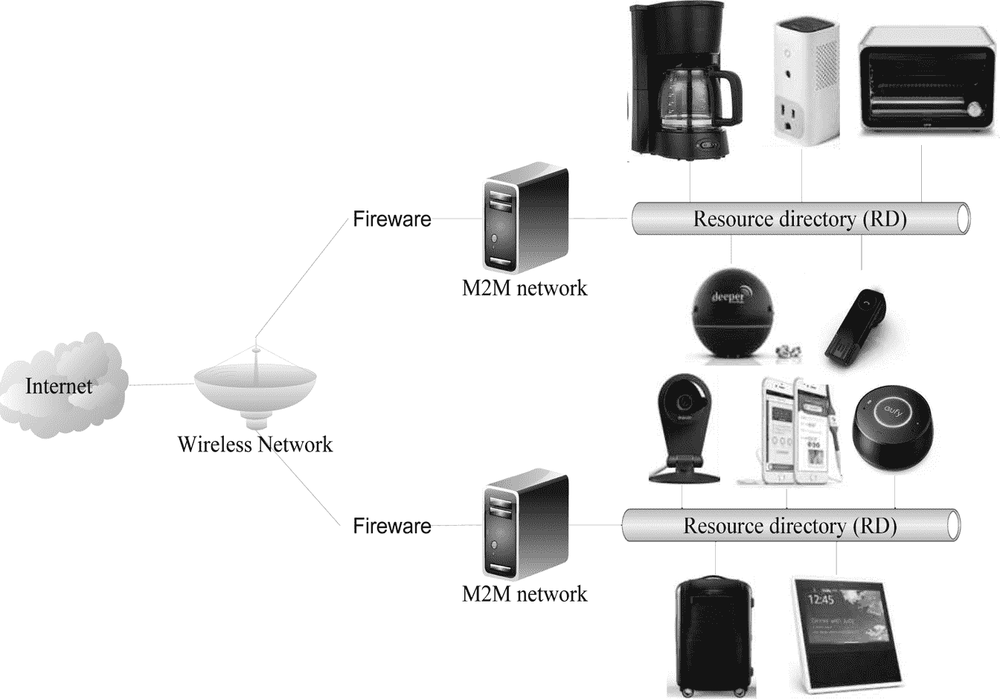

FIGURE 2.3: 机器到 Web 通信的过程

## 2.9 CIoT 应用

随着计算机系统和软件的巨大发展，人类生活从文书工作中解放出来。`AI` 和物联网（`IoT`）在这个先进的认知环境中起着重要作用。机器现在变得更高效、更具适应性。这些机器现在可以在人类生活的每个阶段增强人类。这种能力归功于认知机制与 `AI` 和 `IoT` 技术的协作。这种实现的和谐使得一些日常活动变成了只需按按钮的游戏。`AI` 和 `IoT` 技术很快将用认知 `AI` 和认知 `IoT` 取代。孩子、青少年、老人，都在以不同方式使用这些设备。为了向你简要说明一个例子，当我的孩子睁眼时，他正处于先进技术面前。首先是捕捉那个难忘时刻的相机，其次是感知婴儿体温、体重、眼睛和高度医疗设备；第三是记录本。婴儿出生时预期什么？婴儿的体检是强制性的吗？所有设备都配备了发挥重要作用。这些技术设备的必要性仅仅是为了分析新成员的认知发育。通过这个例子，我们可以很容易地意识到认知系统的重要性。这些系统在医疗、工业和教育领域发挥着重要作用，如图图 2.4 所示。下面将讨论认知系统的应用领域。

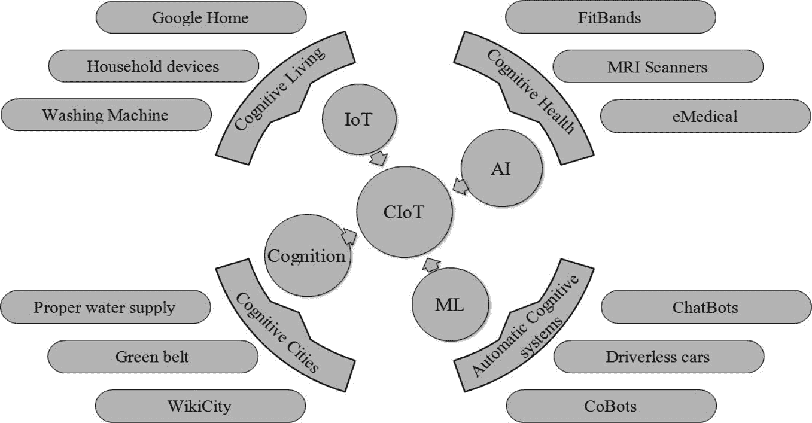

FIGURE 2.4: CIoT 应用

### 2.9.1 认知生活

我仍然记得过去为了准备早餐要费许多精力。但现在，床茶已成为一天的第一种饮料。世界上每个生物的生活方式都发生了巨大变化。人类、动物甚至植物都在以某种方式使用认知系统。从清晨到午夜，我们被智能设备包围。智能家居，如`Google Home`，就是这样一种认知设备，它以非常先进的技术化的方式改变了每项活动。让我们了解被认知设备包围的家中发生的活动。借助一个名为`Google Home`的单一设备，就可以安装全家居设备。每当人进入家时，主电源就会开启。当进入房间时，房间温度会由智能空调调节。每个设备在传感器和执行器的支持下感知人的存在。这就是认知设备如何让人类的生活变得更简单、更智能。对于健康的人来说，它可能没有发挥太大作用，但对于老人来说，认知设备在各个方面都起着重要作用，因为它减少了依赖。家用设备现在的开发和安装方式使它们保持与互联网的连接。认知设备的识别能力通过指尖、脸部、声音有时甚至是步态来工作。这些设备还可以通过移动设备进行远程控制。这些设备正在智能地工作，但它们是如何以认知方式工作的呢？让我们以我们日常使用的一种基础设备洗衣机为例。这台机器清洗衣服、冲洗，然后烘干。这是智能性，但由机器利用智能能力（如识别衣服图案，然后决定洗涤模式）完成活动是认知能力。这种洗涤模式的决策可以减少水的浪费和电力供应。

### 2.9.2 认知城市

回到过去，我们曾需要从远处收集水来进行日常活动。现在，我们在任何地方都可以享受无限的水源。这是如何可能的？这不是幸运，而是工程师的工作。他们使得在基础设施方面控制生活的各种参数成为可能。让我们看看印度政府住房和城市事务部的“智慧城市任务”。我考虑这一场景，因为它的目的是通过智能化来改善印度城市，因此可以被称为认知城市。该项目的动力包括供应充足的水、供应充足的电力、通过适当降解管理废物、能够容纳最多家庭设备的住房设施、维护这些设备与互联网的高效互连。这些是让城市变得更智能的设施和概念。预计到 2050 年，全球 70%的人口将居住在地区。认知城市更智能，并提供计算机汽车停车场等先进设施。由于认知系统拥有记忆能力，它可以轻松获取交通数据以预测交通负载。因此，由此得出的概念是`WikiCity`，就像`Wikipedia`一样。`Wikipedia`包含来自世界各地的信息，但`WikiCity`包含关于该城市的信息。温度、交通负载、绿带、自行车道和污染是记录的不同参数。它有助于从任何区域检索特定城市的信息。`WikiCity`已经在西班牙和韩国等国实施。

### 2.9.3 认知健康

健康对于幸福生活至关重要。随着世界在新型食品生产方面的日益先进，同时也导致了有害疾病的产生。这些疾病的检测是医生的一个典型研究领域。先进医疗技术的发展已经使得许多危险疾病现在是可以治愈的，例如某些癌症。单台医疗设备就可以监测心率、人体血氧水平、计算细胞计数、测量体重和温度，通常被称为扫描仪。某些医疗设施还可以远程提供，通常被称为远程医疗中心。技术的进步让您可以通过在线咨询订药并送货上门。许多其他设备（如健身手环）有助于监测日常活动并跟踪健康状况。

### 2.9.4 自动投射与自动反应认知系统

存在许多认知系统，它们能够自己感知环境并据此做出相应的反应。此类系统内置了转换系统，可以将输入转换为机器所需的格式，并对其进行处理以供最终输出。这种机制由系统本身处理并执行。例如，汽车可以感知驾驶员的状态，并在需要时采取适当行动。认知咖啡机可以感知人的情绪，并据此准备咖啡（浓的、淡的或常的）。这就是认知系统的工作方式。以下是我们反复使用的几个认知系统列表。

1. 协作机器人（`CoBots`）：协作机器人是由机械工程师 `J. Edward Colgate` 在 1996 年开发的认知设备，由 `Michael Peshkin` 在 1999 年获得专利。它们与人类协作提供协助，且易于编程和安装。它们成为了制造业的第二代产品。

2. 无人认知汽车：这看起来像是一个梦想，但它是现实。汽车可以在没有驾驶员的情况下运行。在`IoT`、`AI`和认知技术的帮助下，这已成为可能。这种认知汽车可以感知周围、乘客和路线。它通过在定位时固定位置（乘客坐在车内并指令的时间）来遵循`GPS`指引的路径。交通灯传感器经过编程，汽车可以区分红灯和绿灯。这种认知汽车可以通过消息与其他认知汽车进行通信。

3. 聊天机器人（`Chatbots`）：“您拨打的号码目前无人接听，请后再拨。”这条常见的消息就是聊天机器人，它的编程方式是：当人正在通过电话网络进行通信时，订阅者会发送此消息。这种模仿人类声音的录制消息被称为聊天机器人。例如，苹果推出的`Siri`，它像朋友一样说话并以类似的方式回答。即使是客户服务热线，在服务人员有空通话之前，也会通过当前的优惠和方案与客户互动。

## 2.10 总结与展望

本章讨论了来自`AI`和`IoT`的新兴技术`CIoT`，以及`CIoT`设备和技术。我们讨论了`CIoT`的历史，重点关注了该技术如何驱动从互联网到`IoT`的软件增强。在涵盖所有`CIoT`元素的同时，我们强调了机器学习。`CIoT`通过在健康、购物、个人生活、教育和社会生活等各个领域担任助手来帮助人类。详细阐述了机机通信的所有方面，涵盖语言和人际关系。人机通信导致了`Cognitoys`的发展，这极大地改变了孩子的世界。在涵盖所有`CIoT`应用以及自动投射与自动反应认知系统之后，我们对章节进行了总结。

在本章中，解释了从`CIoT`系统收集的数据。在下一章中，将详细阐述数据挖掘过程，即从`CIoT`设备中收集数据。

## 2.11 习题

### 题

1. 什么是认知设备？

2. 什么是认知设备？

3. 什么是`CIoT`？

4. 什么是`CIoT`？

5. 什么是`CIoT`？

6. 什么是`CIoT`？

7. 什么是`M2M`？

8. 什么是`M2M`？

9. 什么是`M2M`？

10. 什么是机器学习？

### 单选题

1. 什么是`CoBots`？

(a) 认知设备 (b) `IoT`设备 (c) 机器人 (d) 以上都不是

2. `IoT`采用了哪种技术？

(a) 认知 (b) 认知能力 (c) 聊天机器人 (d) 以上都是

3. 什么是`Chatbots`？

(a) 认知设备 (b) 认知 (c) 否 (d) 以上都不是

4. 在这些选项中，哪一项被认为是幸福的生活？

(a) 认知设备 (b) 认知 (c) 聊天机器人 (d) 以上都不是

5. 哪个网站为我们提供认知城市的信息？

(a) `Wikipedia` (b) `WikiCity` (c) `Google` (d) 否

6. `Google`是哪种设备？

(a) 认知设备 (b) `IoT`设备 (c) 智能设备 (d) 以上都是

7. 哪种系统有助于儿童？

(a) 数据处理系统 (b) 中枢神经系统 (c) 认知能力 (d) 以上都不是

8. 认知设备之间的哪种关系会互相伤害？

(a) 信任关系 (b) 无关系 (c) 逆向关系 (d) 以上都不是

9. 认知设备在`M2M`通中中维护什么样的模型？

(a) `OSI` (b) `TCP/IP` (c) 模式 (d) 以上都不是

10. 为什么在认知设备中使用机器学习？

(a) 为了预测未见内容 (b) 为了提高性能 (c) 为了开发 (d) 为了应用

11. 哪种技术用于互联网的发展？

(a) 网络 (b) 卫星 (c) 有线通信系统 (d) 蓝牙

12. 哪个系统具有最大的容量？

(a) 分时系统 (b) 主机系统 (c) 嵌入式系统 (d) `CIoT`系统

13. 具有认知能力的`IoT`设备被称为：

(a) 智能设备 (b) 认知设备 (c) 智慧设备 (d) 以上都是

14. 人类今天如何保持社交活跃？

(a) 认知设备 (b) `IoT`设备 (c) 社交网络网站 (d) 以上都是

15. 汽车在交通灯处维护什么种的关系？

(a) 信任关系 (b) 无关系 (c) 逆向关系 (d) 以上都不是

16. 机器从哪里搜索信息来回答用户的查询？

(a) 世界网 (b) 资源目录 (`RD`) (c) 临时缓冲区 (d) 以上都不是

17. `Siri`系统是一个：

(a) 认知设备 (b) `IoT`设备 (c) 聊天机器人 (d) 协作机器人

18. `SMTP`是嵌入在`OSI`模型中的协议，位于：

(a) 表示层 (b) 传输层 (c) 应用层 (d) 网络层

19. `Cognitoy`是描述以下之间通信的示例：

(a) 机机通信 (b) 人机通信 (c) 机联网 (d) 以上都不是

20: 扫描器是一个：

(a) 认知生存设备 (b) 认知健康设备 (c) 自动投射认知系统 (d) 以上均非

# 物联网中的数据挖掘

在这个世界里，似乎万物都通过互联网连接在一起。这归功于物联网（`IoT`）的增长，它让每个人都能在任何时间随地获取数据。我们可以得出结论：世界完全依赖于信息。信息是数据的处理形式。数以 TB 计的数据在我们周围流动，无论是在网络、系统、万维网（`WWW`）还是云端中。数据的产生源于计算机文化的发展。每一个行业，即销售、生产、股市、印刷、软件开发、建筑、医疗、健康，都在使用系统化的数据。例如，一个`CCTV`摄像头正在录制一整天的画面，这意味着它正在以某种形式存储数据。同样，研究人员和科学家通过实验、感知、观察和测量，在序列中产生高比例的数据。在`WWW`网络的支持下，数百万个网站被瞬间开发。如果我们开始计算网站的数据来源，将花费几个世纪才能收集完毕。网络社区推动了世界社交层面的连接。从这些海量数据中获取价值信息的需求，为“数据挖掘”这一概念赋予了意义。

## 3.1 作为媒介的搜索引擎

`Google`平台让信息检索过程变得简单方便。我认为对于我们所有人来说，“搜索引擎”并不是一个新术语。让我详细说明一下：搜索引擎是一个通过只需发送查询来检索存储在`WWW`数据的平台。用户输入的查询正是他们所需的内容。根据查询，搜索引擎返回包含相关信息的网页。例如，用户向`Google`询问关于`webspam`（网络垃圾邮件）的信息。用户在`Google`搜索中输入`webspam`。结果包含了所有定义`webspam`含义的网页，以及包含与`webspam`相关的调查的网页。这个例子说明了如何从海量数据中提取相关信息。

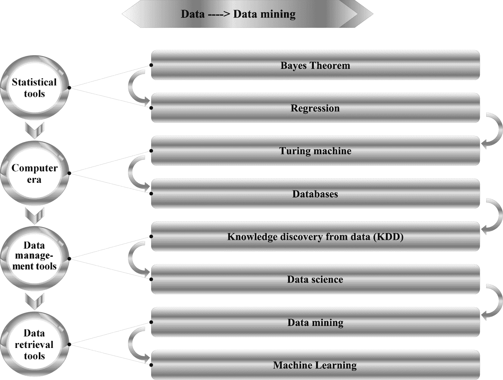

[FIGURE 3.1:][数据挖掘周期阶段]

## 3.2 数据创建与检索方案

什么是数据？它是如何创建的？检索它需要哪些工具？我们如何从数据中提取信息？这些问题可以通过回溯数据历史来理解。数据到数据库的循环，以及数据挖掘是如何投入运行的，如图 3.1 所示，并在下方详细阐述：

- **贝斯定理**：在数据仅能通过估计的时代，`Thomas Bayes`在 1763 年提出了一个新想法。他提出了贝斯定理。`Bayes`利用先验信息来推测新信息。事件再次发生的概率是多少？或者我们如何从现有信息中推导出新信息？通过此，`Bayes`得出结论：带有新信念的旧信息会产生新信息。`Bayes`从未想过发表他的著作；那是由他的一个朋友`Richard Price`完成的。但当科学家`Pierre Simon Laplace`将该定理应用于科学问题时，该定理变得流行起来。这种方法也引起了统计学家的关注。数据就是这样被赋予意义并存储在文件中。

- **回归**：`Legendre`在 1805 年通过回归概念对数据进行了新的分析。该概念在 1809 年被`Karl Gauss`进行了完善。回归的第一种形式是最小二乘法。1821 年，`Gauss`通过发明名为`高斯-马尔可夫定理`的新定理对其进一步增强。`回归`一词是由`Francis Galton`在 19 世纪发明的，用于归括一种生物现象。

- **图灵机**：计算机器（通俗称为计算模型）也被称为`图灵机`。它由`Alan Turing`在 1936 年发明。这种机器的发展是为了减少人类劳动。它有一个用于主存储的读写头磁带。`图灵机`可以执行的六种操作是：左移、右移、读、写、停止和改变状态。它看起来是一台简单的机器，但它可以毫无障碍地执行数百万次操作。这种`图灵机`导致了现代电子计算机的发展。文件系统存储就这样移动到了数据库存储系统。

- **数据库**：`Charles W. Bachman`发明了数据库系统。这是一个在一个地方存储、添加、删除或修改数据项的系统。随着 20 世纪 60 年代中期计算机普及，对系统化数据库的需求也随之。`COBOL`（通用业务面向语言）。`Eugene Wong`和`Michael Stonebraker`在 1973 年的`INGRES`项目（交互式图形和检索系统）下开发了查询语言`QUEL`。1974 年，利用现有的`QUEL`技术开发了`SQL`。这一趋势持续下去。

- **数据库知识发现 (KDD)**：为了优化从数据库检索的结果，研究开始了。`Gregory Piatetsky-Shapiro`在为`GTE`工作`CALIDA`时提出了`KDD`。在参加几次会议后，他意识到可以通过机器学习帮助数据发现。知识发现与数据挖掘有相似之处。知识发现涉及数据库的创建和检索，而数据挖掘指的是数据抽象。

- **数据科学**：自 2000 年以来，数据使用数据库创建并使用`KDD`提取。数据科学应运而生。数据科学是用于从数据库中提取非结构化和结构化数据的科学方法。2001 年，“数据科学”这一术语由`William S. Cleveland`创造。数据科学是一项多学科任务，包括数据可视化、数据分析、数据科学、统计分析、自然语言处理和计算科学。

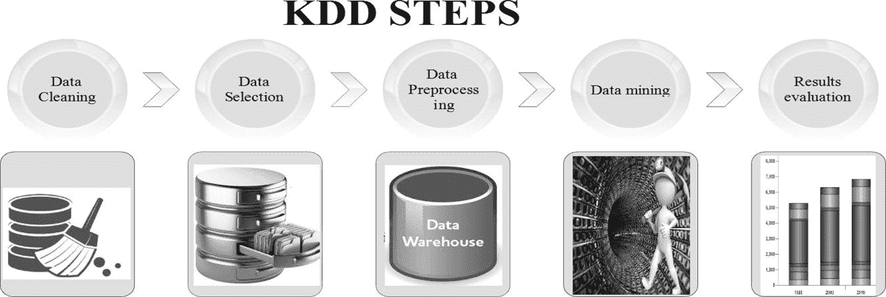

[FIGURE 3.2:][数据中发现知识]

- **数据挖掘**：经典统计学的分析在人工智能领域被称为数据挖掘。然而，数据科学和数据挖掘这两个术语在互联网上被互换使用，但两者之间存在很大差异。请参考表 3.1 以更好地理解。

| 结果 | 目的 |

| :--- | :--- |

| 发现数据中的隐藏趋势，以更好地理解数据 | 它是 KDD（知识发现）的步骤之一 |

| 它是涉及科学实验的统计分析过程 | 它是从数据收集到数据分析的完整过程 |

## 3.3 数据挖掘

我们如何从物联网（`IoT`）设备产生大量数据中挖掘信息呢？或者如何如图 3.3 所示，从数据中挖掘知识？我们已经学习了如何使用传感器在物联网中收集数据。显而易见，使用云计算等流行的数据处理方案，可以检测出大量的知识模式。数据提取是一个需要特别关注的模块。然而，处理数据时考虑的不同参数汇总在图 3.4 中，并描述如下。


FIGURE 3.3: 从数据中挖掘知识


## 1. 数据设备

有许多物联网设备，它们可以通过传感器感知环境并产生某种形式的数据。这些设备产生原始数据，这些数据需要经过处理。

## 2. 数据收集

物联网设备产生的数据通过解析、分析、收集和合并的程序被聚集在特定地点。这一过程负责高效的数据提取。

## 3. 数据处理

数据处理是将原始数据转换为信息的过程。如今，为此目的使用了开源解决方案，例如`Hadoop`。

## 4. 数据服务

数据服务如数据存储、数据展示、数据提取和数据绑定，是使用的不同的数据服务。

## 5. 数据工具

数据工具负责数据集成、数据挖掘和数据共享。它从网络数据开始，随着机器学习等高级工具的出现而增长。

### 3.3.1 数据挖掘函数

假设你被要求在班级寻找最有天赋的学生。你会怎么做？首先，你会找到各种数据源，如学生记录簿。收集数据后，你可以对其进行处理以获取基本信息。一旦数据经过处理并被存储，就可以使用不同的数据工具执行各种数据服务。数据挖掘的过程结束于结果，该结果高度取决于其功能。不同的数据挖掘函数如下。

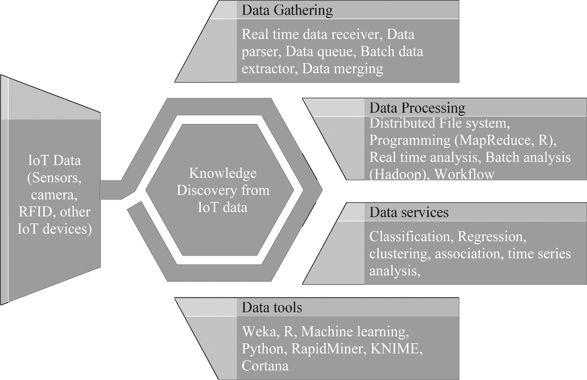

FIGURE 3.4: 物联网中数据挖掘的表示

#### 3.3.1.1 分类

它是识别数据类的过程，用于预测具有未知标签的数据。该程序的定义方式使得该过程能够帮助目标类为每个案例预测数据。数据分类存在不同的方法，如基于实例的、基于规则的和基于决策的。所有方法都使用不同的方法进行数据分类。基于这些方法，可以设计不同的模型，如神经网络、支持向量机等。这里讨论了其中几种方法：

1. **决策树**：决策树是监督学习的示例之一，其中数据被分成不同的分支。每个分支都是有助于区分数据的参数。表示树的术语是节点和叶子。叶子是最终值，而节点作为分割数据的条件。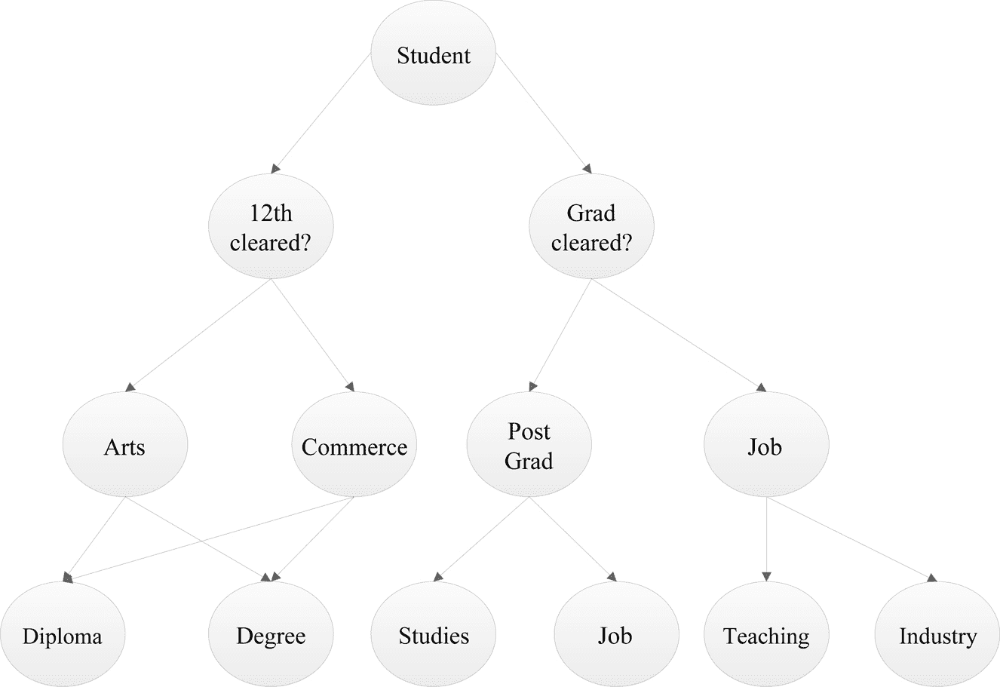 FIGURE 3.5: 树结构 如图 3.5 所示，有如 cleared、arts 这样的节点，也有如 studies 这样的叶子。你对这棵树真正理解什么？每个节点都有两个可能的叶子，条件以正向或负的方式满足。该条件没有任何小数形式的结果。它说明这是一棵二分类树。

2. **神经网络**：神经网络是一组汇在一起以执行定义的复杂任务的多个算法。理解神经网络结构的最简单架构是感知机。如图 3.6 所示，它有三层，即输入层、权重层和激活函数层。

3. **贝叶斯网络**：由于决策树基于预定义的条件，且函数的输入是固定的，可能会出现某些情况。在这种情况下，预定义的条件不起作用。这时贝叶斯网络发挥了作用，它们基于概率。它们遵循条件概率的方法。它们说明在概率参数的未知组合下会发生什么。它们为未标记实例提供结果。整个过程通过以下示例进行说明。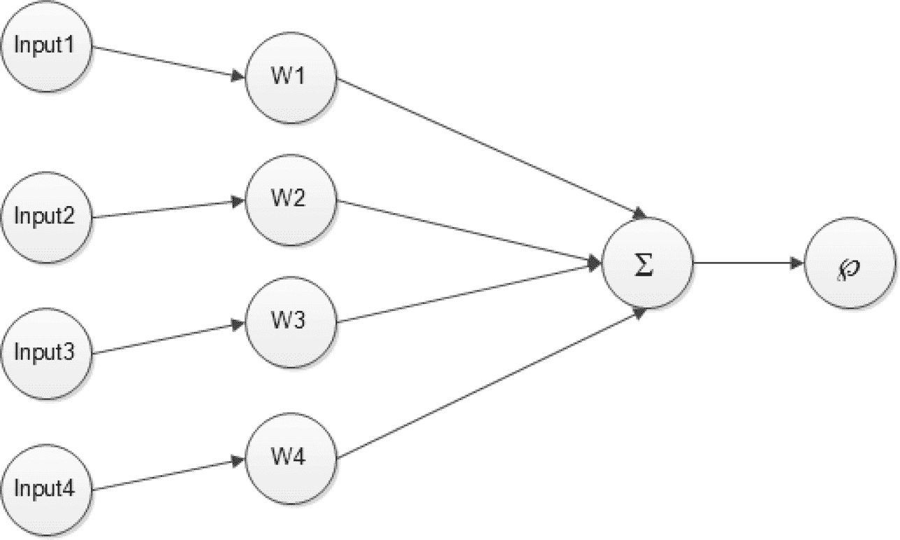 FIGURE 3.6: 感知机架构

首先，我们计算目标属性的概率。由于目标属性（即下雨）只有两个值，概率计算方式如下：`P(Yes) = 4/7` (3.1) 和 `P(No) = 3/7` (3.2)。

现在，我们计算其他属性的概率。首先，我们对天气（Outlook）属性计算：`P(Sunny|Yes) = 0/4` (3.3) 和 `P(Sunny|No) = 2/3` (3.4)。`P(Cloudy|Yes) = 1/4` (3.5) 和 `P(Cloudy|No) = 1/3` (3.6)。`P(Rain|Yes) = 1/4` (3.7) 和 `P(Rain|No) = 0/3` (3.8)。`P(Moderate|Yes) = 1/4` (3.9) 和 `P(Moderate|No) = 1/3` (3.10)。

同样地，我们对大气（atmosphere）和风（wind）属性计算：`P(Hot|Yes) = 0/4` (3.11) 和 `P(Hot|No) = 2/3` (3.12)。`P(Cloudy|Yes) = 1/4` (3.13) 和 `P(Cloudy|No) = 1/3` (3.14)。`P(Rain|Yes) = 1/4` (3.15) 和 `P(Rain|No) = 0/3` (3.16)。`P(Normal|Yes) = 1/4` (3.17) 和 `P(Normal|No) = 1/3` (3.18)。`P(Normal|Yes) = 1/4` (3.19)。

来自公式 3.11、公式 3.12、公式 3.13、公式 3.14、公式 3.15、公式 3.16、公式 3.17、公式 3.18 以及公式 3.19 的概率通过表 3.2 计算。

| 天数 | 展望 | 气温 | 风 | 雨 |
| --- | --- | --- | --- | --- |
| 周日 | 晴 | 热 | 否 | 否 |
| 周一 | 阴 | 冷 | 是 | 是 |
| 周二 | 雨 | 冷 | 否 | 是 |
| 周三 | 中等天气 | 正常 | 是 | 否 |
| 周四 | 中等天气 | 正常 | 否 | 是 |
| 周五 | 晴 | 热 | 否 | 否 |
| 周六 | 阴 | 冷 | 否 | 否 |

`A = <Friday, Cloudy, Normal, Yes>` 我们计算在两种情况下下雨，或者在公式 3.20 和公式 3.21 中不下雨的概率。

$$
\begin{matrix} {P(A\text{|}Yes).P(Yes) = P(Friday\text{|}Yes).P(Cloudy\text{|}Yes).P(Normal\text{|}Yes).} \\ {P(Yes\text{|}Yes)P(Yes)\,\,\,\,\,\,\,\,\,\,\,\,\,\,\,\,\,} \\ \end{matrix}
$$

(3.20)

$$
\begin{matrix} {P(A\text{|}No).P(No) = P(Friday\text{|}No).P(Cloudy\text{|}No).P(Normal\text{|}No).} \\ {P(Yes\text{|}No).P(No)\,\,\,\,\,\,\,\,\,\,\,\,\,\,\,\,\,\,\,\,\,\,\,} \\ \end{matrix}
$$

(3.21)

所有这些概率已经讨论过了；计算它是一个练习。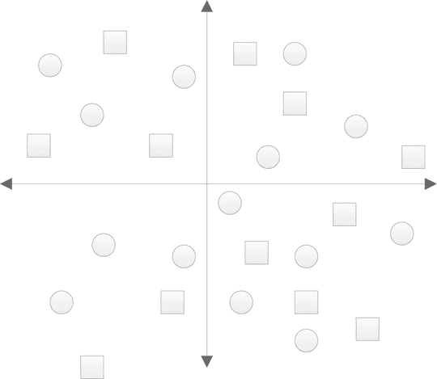

图 3.7: 数据点

### 4. 支持向量机

支持向量机（SVM）正式描述为通过独立的超平面作为判别性分类器。换句话说，给定标记的训练信息（监督学习），算法会产生一个用于分类新实例的理想超平面。该平面在二维空间中是一条将平面分为两个部分的直线，它位于每个类别的一侧。总而言之，我们可以说通过超平面的帮助将数据分为两个不同的类别。数据存在于四个维度中，如图 3.7 所示。函数边界：因此，当我们知道数据点时，任务是识别不同的类别。这一目标通过计算直线函数的帮助来实现。该函数表示如下。

```
w + b = 0
```

(3.22)

在公式 3.22 中，`w` 是权重，`x` 是坐标值，`b` 是常数值。平面不仅取决于函数，还取决于系数。系数决定了为了检测异常值而最大化的边界。

### 3.3.2 数据科学与机器学习的关系

据观察，数据科学是使用各种工具和技术开发出来的。机器学习在它们的发展中起着至关重要的作用。数据科学应用已采用我们的日常活动中。然而，机器学习的目的是让系统学习。系统的构建方式使得系统能够通过经验不断学习。以互联网搜索为例。你使用的每个搜索引擎都连接到你的某一个账户。通过监控你的搜索历史，它会自动建议经常访问的网页。这背后的原因是机器学习。以下是使用机器学习作为工具的数据科学应用列表。

1. 推荐系统
2. 浏览上网
3. 图像识别
4. 语音识别
5. 数据挖掘应用
6. 预测系统
7. 自然语言处理

## 3.4 物联网中的数据挖掘

通过互联网将地球上的一切连接起来听起来像是一项不可能的任务，但在不不久的将来，物联网（IoT）可以通过让许多“不可能”的事情变为可能，从而极大改变我们的生活。对许多人来说，物联网产生或捕捉了极其有用且有价值的海量数据。数据挖掘无疑可以在使这种方案变得足够智能以提供让生活更便利的服务和环境方面发挥关键性作用。

从技术上讲，所有的物联网设备都可以产生包含各种类型珍贵信息的数据流。然而，近年来在如何管理这些数据以及如何挖掘有用信息方面出现了一些技术问题和困难。区分物联网数据类型的一种简单分类法是使用“关于物体的信息”来指描述物体本身的信息（例如，国家、地点、身份等），并使用“物体产生的信息”来指由物体产生或捕捉的信息。

由于这些特征，这种新形式的信息（即传感器或 RFID 捕捉的信息）被称为“海量信息”。这些特征让我们迅速理解，大数据不再是公司的炒作，而是我们今天必须严肃面对的现实。预计组织在不久的将来将从它们提供的服务、应用和平台拥有更多、更大的数据。除了管理这些海量数据外，发现隐藏在这些数据中的信息已成为这些组织的重要工作，因为这项任务让他们处于不可逾越的局面。

由于 KDD（知识发现）已有效应用于不同领域以从问题数据中发现隐藏的信息。多年来，KDD 一一直是几个信息系统的基础，例如追踪乐事薯片的生产记录。通过使用以下措施，KDD 自然被预期从物联网中发现“某些东西”，因此检索出的模式在图 3.8 中讨论。KDD 在物联网中的作用在图 3.9 中讨论。

- **购物推荐购物车**：大型购物综合体集成了结账、物品核对、优惠展示等多种功能。结账台式电脑系统连接到服务器以获取商品价格。然而，该系统会记录客户偏好的商品序列。它保存的记录可以帮助随后的客户购买必要的物品。例如，一位客户购买了某些商品，即橄榄油、新鲜蔬菜和香料。现在，每当任何客户拿取橄榄油时，购物车就会推荐新鲜蔬菜和香料。同样，如果选择了新鲜蔬菜，系统就会推荐橄榄油和香料。通过这种方式，系统能够感知客户的选择及其偏好。

- **食谱推荐购物车**：某些使用推荐系统的购物车不仅存储客户的偏好，还存储食谱配料。这种方案的目的是在选择商品过程中为客户提供建议，从而实现高效的购买和新食谱的探索。

存储当前状态并预测未来实例是机器学习的核心。这些例子说明，机器学习技术正在帮助先进系统以更智能、高效的方式工作。在 IoT 和 CIoT 之前的章节中，机器学习发挥着重要作用。让我们来说明它的益处。

- 机器学习是在 IoT 数据预处理期间，通过检测数据中的异常而被采用的技术。
- 机器学习有助于从工业领域收集大量数据。
- 机器学习是用于预测 IoT 数据的工具。
- 机器学习对 IoT 数据分析过程中生成的结果进行优化。为此，该系统遵循了交叉验证方法和集成学习方法。
- 机器学习是 CIoT 数据处理中的关键元素。
- 机器学习有助于将 CIoT 数据存储在云端。

机器学习对于互联网技术至关重要。基于这一事实，许多研究人员尝试将他们的 IoT 开发融入机器学习中。其中一项显著工作是由 Bin 等人完成的 [4]。在这一提案中，机器学习模型被用于处理 IoT 数据。该方案通过四种不同的数据挖掘模型实现了验证，即多层模型、分布式数据挖掘模型、基于网格的数据挖掘模型以及从多技术集成角度的数据挖掘模型。这些模型部署在 IoT 架构的多个层级上。

选择正确且高效的机器学习算法也是一个重要方面，许多研究人员对此提出了许多方案。[22] 提供了 IoT 数据分析。该提案的关注点是找到适用于特定应用的机器学习模型。得出的三个考虑因素是：IoT 设备的数量、数据特征的数量以及应用的类型。

IoT 数据仅被称为智能数据。智能数据因 Sheth 给出的准确定义而闻名 [30]。他定义了大数据向智能数据的转换，即“通过语义将原始数据转换为智能数据，从而实现生产力、效率和效果的提升”。一旦生成智能数据就可以就可以应用机器学习模型。调查的适用于 IoT 应用的算法/模型列在表 3.3 中。

## 3.6 总结与展望

前两个节涵盖了 IoT 设备和 CIoT 设备收集数据的技术。现在出现了如何检索以及可以什么数据的问题。本章解释了数据挖掘这一技术。搜索引擎提供了从万维网访问信息的平台。文中详细阐述了“数据”一词是如何演变的，它是如何将世界转变为信息时代的。机器学习在 IoT 数据挖掘中起着至关重要的作用。这已经通过研究人员开发的应用进行了说明。换句话说，我们可以说数据挖掘中的机器学习是至关重要的。

表 3.3： IoT 应用中的机器学习模型

| **作者** | **年份** | **算法** | **智能数据** | **应用** |
| --- | --- | --- | --- | --- |
| kafi 等人 [15] | 2013 | 分类 | 智能交通 | 城市交通监控 |
| Qin 等人 [27] | 2016 | 聚类 | 智能交通 | 增加数据缩减 |
| Toshniwal 等人 [34] | 2013 | 聚类 | 智能交通 | 健康监测 |
| Jakkula 等人 [12] | 2010 | 聚类 | 智能交通 | 健康监测 |
| Ni 等人 [25] | 2014 | 异常检测 | 智能数据 | 环境 |
| Dergue 等人 [6] | 2014 | 线性回归 | 智能市场 | 市场 |
| Ma 等人 [21] | 2013 | 分类与回归 | 智能市场 | 旅行 |
| Hu 等人 [11] | 2015 | 朴素贝斯 | 智能公民 | 数字 |
| Shukla 等人 [31] | 2015 | 密度聚类 | 智能公民 | 欺诈检测 |
| Makkar 等人 [23] | 2019 | 二分类分类 | 智能网站 | 垃圾信息 |

## 3.7 练习

### 题

1. 什么是数据挖掘？搜索引擎是如何帮助数据挖掘的？
2. 阐述数据挖掘的演变。
3. 定义 KDD。KDD 包含哪些步骤？
4. 数据挖掘和数据科学有什么区别？
5. 数据挖掘对 IoT 有什么帮助？
6. IoT 数据挖掘使用了哪些工具？
7. 从数据挖掘中提取哪些知识模式？
8. 机器学习在 IoT 中起什么作用？
9. 哪些机器学习模型适用于 IoT 应用？
10. IoT 数据挖掘中有哪些数据服务？

### 单选题

**1. 为什么开发数据挖掘技术？**

(a) 数据检索
(b) 提取隐藏模式
(c) 知识发现
(d) 以上都是

**2. 哪种统计工具开始分析统计数据？**

(a) 贝叶斯定理
(b) 图灵机
(c) 回归
(d) 以上都是

**3. 谁在什么时候发明了图灵机？**

(a) 查尔·巴贝，1932
(b) 阿兰·图灵，1936
(c) 查尔·巴赫，1936
(d) 以上都不是

**4. 谁发明了数据库技术？**

(a) 查尔斯·巴贝 (b) 阿伦·图灵 (c) 查尔斯·巴赫曼 (d) 以上都不是

### 5: KDD 处理：

(a) 数据创建 (b) 数据检索 (c) 数据抽象 (d) 数据创建和数据检索

### 6: 哪种数据被称为智能数据？

(a) CIoT 数据 (b) IoT 数据 (c) 处理后的数据 (d) IoT 设备检索的数据

### 7: 哪种算法用于生成智能环境的数据？

(a) SVM (b) 朴素贝叶斯 (c) 异常检测 (d) 线性回归

### 8: 欺诈检测系统是使用算法开发的：

(a) K 近邻 (b) 朴素贝叶斯 (c) 基于密度的聚类 (d) 分类

### 9: 将智能数据定义为“通过语义将原始数据转换为智能数据，从而实现生产力、效率效果的提升”的是：

(a) Kafi 博士 (b) Jakkula 博士 (c) Sheth 博士 (d) 以上都不是

### 10: 机器学习技术用于：

(a) 检测数据中的异常 (b) 预测 IoT 数据 (c) 收集大量数据 (d) 以上都是

### 11: 为 IoT 设备开发选择机器学习模型主要考虑：

(a) IoT 设备的数量 (b) 数据特征的数量 (c) 应用类型 (d) 以上都是

### 12: 天气预报系统使用哪种技术？

(a) 机器学习 (b) 互联网 (c) 人工智能 (d) 以上都不是

### 13: 哪种数据挖掘功能是基于概率的？

(a) 分类 (b) 神经网络 (c) 贝叶斯网络 (d) 支持向量机

### 14: 感感知器是使用已知算法开发的：

(a) 分类 (b) 神经网络 (c) 贝叶斯网络 (d) 支持向量机

### 15: IoT 中的数据收集是由以下完成的：

(a) 数据解析 (b) 数据分析 (c) 数据收集与合并 (d) 以上都是

### 16: SQL 开发使用了哪种方案？

(a) QUEL (b) CALIDA (c) COBOL (d) 以上都不是

### 17: 哪位科学家有助于贝叶斯定理的普及？

(a) 托马斯·贝叶斯 (b) 理查德·普莱斯 (c) 皮埃·西蒙·拉普拉斯 (d) 以上都不是

### 18: 神经网络中输入层和输出层之间哪一层？

(a) 权重层 (b) 激活层 (c) 应用层 (d) 以上都不是

### 19: 决策树的形成基于：

(a) 数据 (b) 条件 (c) 决策 (d) 以上都是

### 20: 机器学习是一种：

(a) 数据集成工具 (b) 数据挖掘工具 (c) 数据共享工具 (d) 数据预测工具

# 4

## 机器学习技术


现在大家都熟悉机器学习这一术语及其在我们生活中的需求，这种需求依赖于 IoT。机器学习是一种自动学习，因为它能自动检测数据中隐藏的见解。这一不断发展的计算机科学领域主要用于从数据中提取所需信息。这就是我们在学习中关于如何使用机器学习对 IoT 设备的数据进行剪枝所学到的。暂且不谈 IoT，通过查看搜索引擎页面，可以很容易感受到机器学习的应用。我们使用的信用卡也通过机器学习了安全。智能手机深度嵌入了机器学习技术。我们驾驶的智能汽车也配备了经过机器学习训练的工具，以防止盗窃和事故。这就是机器学习如何以这种或那种方式在我们周围运行。机器学习的应用数不胜数。机器学习系统不仅遵循编码的指令，还从经验中学习。这就是机器学习与其他智能工具的区别。就像人脸识别，系统通过机器学习算法进行训练，以记住最微小的模式。让我们来看看什么是学习，以及机器学习系统是如何学习的。

## 学习：一种机制

学习可以定义为将信息转换为知识的经验。转换后的数据用于决策。机器学习算法将训练数据视为信息，并通过获取经验提供知识。知识被用于执行某些操作，这些操作取决于输入的不同形式。从输入转换为输出的过程取决于机器学习算法的类型。数学方程和科学程序涉及这一转换过程。通过每次训练，系统都会学习。这种学习过程也在我们的生活中进行。例如，孩子在味觉发育的阶段学习新的食物口味，并在未来做出相应的反应。如果孩子喜欢这种味道，那么下一次，输入是采纳的调味食物，输出是孩子吃得更多。我们熟悉的另一种学习是垃圾邮件。假设你正在设计一个邮件垃圾邮件检测系统。你用一堆垃圾邮件训练系统。现在系统已经经过了训练，使得下一次当收到垃圾邮件时，它会自动移动到垃圾邮件文件夹，而不是收件箱。现在系统根据大小、关键词或字体判断邮件是否为垃圾邮件。这取决于机器学习算法的方法论。然后，当一封新邮件到达时，机器可以检查其中是否出现了一个可疑的词汇，并据此预测其标签。这样的系统潜在能够预测未见邮件的正确标签。机器的学习或机器学习取决于多种因素；其中一些因素如下：

### 1. 数据分类

学习机制继承了数据的特征。学习方案完全取决于数据类型。它被泛化为根据数据来定义学习问题，例如人脸识别系统通过面部表情进行学习。数据的类型有：

- **向量（Vector）**：有时需要同时处理各种实例，统称为向量。垃圾邮件检测系统以向量的形式学习数据，即网页特征（锚点文本、正文、元数据、入链、出链）。现在此类参数的限制是，它们可能包含不同的标度量单位。向量参数的单位涉及千克、克、吨、单位等，在将它们输入系统之前需要对它们进行归一化。因此，所需的转换被编码并实现。

- **列表（Lists）**：向量获取了不同类别的参数。有时，只需要一种类型的参数。例如网页特征（基于链接的特征和基于内容的特征），其中只需要考虑基于链接的特征。因此，诸如`PageRank`、入链数量、出链数量等特征被考虑在内，并统称为一个列表。可能需要与归一化相同的转换操作。

- **矩阵（Matrices）**：每个参数对应的值可以进行分类，这意味着需要不同类型的数据，即矩阵。它以行和列的形式存在。这种形式揭示了产品之间的关系。例如用户名称及其地址。当特征之间存在相似性时，就需要这种类型的数据。

- **图像（Images）**：下载和上传图像有时会导致图像下采样。但可能不会改变其特性。图像可能有不同的格式，如`.jpg`、`.png`、`.giff`、`.tif`。提取图像的参数，如高度、宽度、像素、颜色、位图等。机器从这些参数中学习。

- **视频（Videos）**：视频被视为图像集合。图像之间的在三维数组中获取。图和树也用于存储这类信息。维度被视为图或树的顶点。

### 2. 问题类型

由于工程、科学、自动化或电子设备等整个领域都在应用机器学习，因此有各种规模各异的应用程序。问题/应用的类型定义了学习的类型。让我们理解问题之间的区别。在上一个垃圾邮件检测系统的例子中，问题是寻找垃圾网页。现在关注输出；它取两个值，要么网页是垃圾邮件，要么不是。因此，这是二分类的情况。机器采用二分类器进行学习。下面讨论了不同类型的问题：

- **二分类（Binary classification）**：具有单一目标值的问题就是二分类的情况。这类问题在现实生活中很常见，并为此开发了大量的算法和理论。我们可以从模式集`X`估计二元变量`y`。`y`产生两个值，即`+1`或`-1`。`X`由各种参数`x[0]`、`x[1]`、`x[2]`……`x[n]`组成。例子是根据提供的证明（如工资、流动现金、版税和财产）预测人是否能够贷款。另一个是教孩子圆形物体是苹果还是橙子。这种教学考虑的各种参数主要是颜色和形状。这些都是二分类的实例。

- **多分类（Multi-classification）**：这是二分类的扩展，区别在于`y`可以实现多个值。例如，判断网页的语言——法语、西班牙语、泰卢语还是乌尔德语。另一个实例是垃圾邮件检测系统，它可以检测网页是垃圾邮件、正常、非垃圾邮件、不存在或无法判断。这种情况主要发生在特定条件下。

- **回归（Regression）**：这种学习是指问题应该产生实值表达式。例如，在考虑入链、出链、字数、锚点文本和许多其他网页特征等参数的情况下，预测网页的排名分数。

### 4.1 实现机器学习的工具

现在，我们都意识到机器学习的必要性。它是 IoT 和 CIoT 的核心。简单来说，我们可以说机器学习模型是一个程序，指示机器/设备根据输入产生输出。有许多语言可以执行机器学习模型；我讨论的是你们可以在自己的系统中执行的实验，而不是在服务器上。以下是你们可以练习的几种机器学习语言列表。

#### 4.1.1 Python

这个流行的工具主要被学生、开发者和研究人员用于编程。它是一种内置了大量软件包和库的语言。Python 的功能使我们能够以不同的方式执行特定任务。`Matplotlib`、`SciPy`和`Scikit-Learn`是数据科学家使用的流行库。我们可以在 Python 中实现分类、回归、聚类和关联等机器学习技术。Python 提供了一个现成的框架，用于在更短的时间内有效执行数据挖掘任务。机器学习算法效率的优化可以在 Python 中进行。它是一种在线提供的开源软件，可以轻松安装。所有安装文件均可在`python.org`在线获取。

#### 4.1.2 R

R 是一种免费开源软件，贯穿本书用于演示机器学习范式的接口。R 是一个复杂的软件包，可以轻松安装。它支持用于编写大多数机器学习模型的库。R 是一种支持基本编程命令的语言。R 能够使用其高级内置函数设计复杂的程序结构。一旦你熟悉了 R 的基础编程，你就可以进行机器学习所需的模块编程。使用 R 的一个巨大优势是，它可以将程序以及工作空间保存为`.Rdata`。工作空间包含了执行程序时创建的所有变量、矩阵和数组。然后我们可以重新运行脚本，将我们的源代码自动转换为信息和知识。随着我们在本章中使用 R 的基本命令和一些 R 的机器学习概念，学习机器学习编程将逐渐变得容易。程序所需的不同 R 函数和命令统称为 R 脚本。R 语言适用于 GNU/Linux、Mac/OSX 和 Microsoft Windows。我们还注意到，与 R 直接交互比使用基于 GUI 的系统学习曲线更陡峭，但一旦过了这个障碍，使用其编程语言界面在相同或相似的数据上进行操作将变得非常容易。书中的示例是以这种方式编写的，任何人都可以复制和练习。这使其成为学习 R 机器学习非常有用的教学工具，从而增强了对数据挖掘方案的知识。

#### 4.1.3 Matlab

Matlab 将分析和设计环境集成在单一桌面环境中。它主要处理存储在矩阵和数组中的数据。它是一个多范式环境，提供了数值计算的便利性和研究社区。它由 MathWorks 开发。它提供了数据操作、绘图函数、算法实现和接口管理的功能。Matlab 也能轻松理解用其他语言（C、C++、Java、C#）编写的程序。Matlab 本身是为了数值计算设计的，但名为`MuPAD`的符号引擎等可选工具箱也可用于符号计算。Simulink 是 Matlab 中用于图形处理的软件包。目前，有超过 400 万用户正在使用 Matlab。

##### 4.1.4 Weka

Weka 是一款用于执行机器学习算法的开源软件。Weka 包含了多种用于分类、回归、关联和聚类的工具。它采用 GNU 协议许可。最初，Weka 是为了处理农业数据而开发的；随后在 1997 年，它被完全增强以支持机器学习算法。它还可以处理多种文件格式，如`CSV`。Weka 已经安装了必要的工具。该包管理器的功能也可用于安装所需的包和卸载无用的包。Weka 由新西兰怀卡托大学开发，其中怀卡托知识分析环境（`Weka`）是用`Java`的。它可以在几乎每个平台上运行，主要旨在帮助研究人员。

#### 4.2 实验

我们倾向于使用`R`语言对机器学习模型进行实验。`Rattle`和`RStudio`都是基于统计`R`构建的。不需要深度了解`R`的情况下，就可以轻松理解这两个工具。`Rattle`更简单且易于学习。`Rattle`通过一个文件开发项目，该文件在执行机器学习模型的不同阶段中被处理和导航。`R`是一种强大的语言，不仅用于机器学习，还用于其他数据挖掘工具。`Rattle`让机器学习模型的执行只需点击一下。它通过调用内置函数来工作，从而消除了程序员繁琐的工作。执行模型是机器学习中的优化概念之一。这可以通过像`Rattle`和`Rstudio`等 GUI 轻松完成。它可以保存任务的当前状态，并将其命名为项目。项目可以随时加载，并在任何阶段进行修改。由于执行的重复性，项目的透明度可以带来科学的成功。`Rattle`在根据实际应用学习用户需求方面是足够的。它是学习机器学习基础的垫脚石。新项目的`Rattle`布局如图 [4.1] 所示。在`Rattle`中运行项目遵循下文讨论的步骤：

1. 加载数据集。
2. 在所有变量中设置目标变量。
3. 探索每个变量的不同类别。
4. 测试数据集以检查其是否分布。
5. 转换数据以适应单一尺度。
6. 选择合适的模型。
7. 构建模型。
8. 使用不同的数据集对模型进行评估以获得结果。

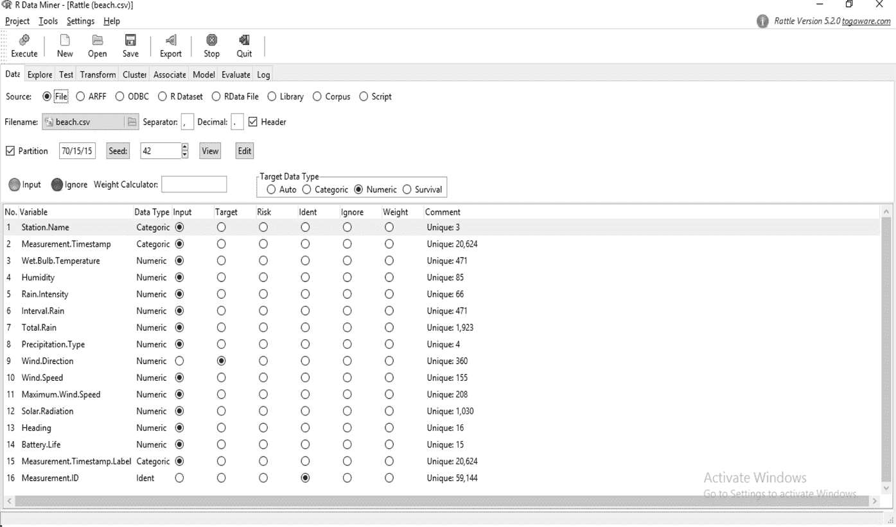

[图 4.1]: [Rattle 的图形化表示：R 统计工具]

为什么我们选择 Rattle？

`Rattle` GUI 是一款免费软件，允许任何人下载并执行。我们也可以将其称为开源软件，因为它也提供了源代码。这没有限制或许可要求。2009 年 1 月 7 日的《纽约时报》首页提到，它对于拥有现成代码的高级分析师来说真的非常有用。`R`不仅免费且开源。Weka 由新西兰怀卡托大学开发，其中怀卡托知识分析环境是用`Java`的。它可以在几乎每个平台上运行，主要旨在帮助研究人员。新项目的`Rattle`布局如图 [4.1] 所示。`RStudio`的布局如图 4.2 所示。


[图 4.2]: [Rattle 的图形化表示：R 统计工具]

1. 打开数据集并点击 New（新建）。
2. 编写特定的代码：
   - 包含库。
   - 定义变量。
   - 设置训练和测试比例。
   - 加载数据集。
   - 检查变量。
   - 设置目标变量。
   - 选择训练集和测试集。
   - 构建机器学习模型。
   - 将预测值与实际值进行比较。

R 编程可以在`RStudio`中完成。使用它有一些优势：

- 它受到研究人员高度青睐。
- 它整合了执行统计测试的代码。
- R 是由高素质且有经验的统计学家构建的。
- 图形库的编码方式增强了结果。
- R 是经过美国食品药品监督管理局验证的开源软件。
- R 采用 GNU 公共许可协议，版权归 R 统计计算基金会所有。
- R 是免费软件，因此不需要任何许可。
- 任何人都可以随时随地的提供代码增强并修复错误。
- 通过多个存储库可以使用 4800 多个包。
- 它可以在任何 Windows 系统和任何处理器上运行。
- 它支持许多文件格式，如`.csv`、`.sas`等等。
- R 有活跃的群组来讨论查询并寻找解决方案。
- 也有关于 R 的书籍，包含了丰富的库集合（Springer 使用 R 系列）。

##### 4.2.1 数据集

机器学习模型有助于高效维护 IoT 数据并提高 IoT 设备性能。为了理解机器学习模型的每个概念和工作，我们下载了 IoT 传感器数据集。该数据集包含芝加哥公园区维护芝加哥密歇湖沿岸的气候传感器数据。为了方便练习，读者可以通过此链接下载相同的数据集：

[`data.world/cityofchicago/beach-weather-stations-automated-sensors`](https://data.world/)

该数据集包含 18 列，即站点名称测量、时间戳、气温、湿球温度、湿度、降雨强度、间隔降雨、总雨、降水类型、风向、风速、最大风速、气压、太阳辐射、航向、电池寿命、测量时间戳标签和测量 ID。如图 [4.3] 所示，气温和气压两列没有任何数据，因此在实验前将其删除。

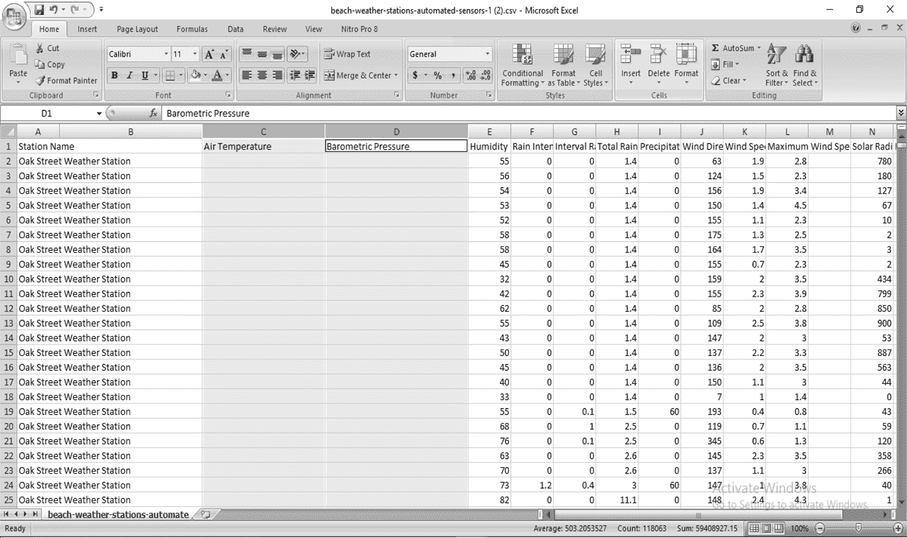

FIGURE 4.3: 实验 IoT 数据集中缺失值

### 4.3 监督学习

该问题指的是通过测量特征来计算最终结果的学习。之前所有的示例都属于此类学习。最终输出的测量单位取决于特征（作为输入）。函数定义在算法内部，它将可用输入映射到所需的输出。这种学习方法主要用于数据挖掘任务。算法的定义方式是基于输入和连接信号来预测数据。该信号可能来自环境以激活系统。通过该算法可以正确地预测未见的实例。例如，为幼儿园设定录取标准。正如下表所示，该场景是固定的，用以形成训练数据。

TABLE 4.1: 幼儿分类

| 姓名 | 年龄 | 身高 | 能力 |
| --- | --- | --- | --- |
| Sahil | 2.5 年 | 2’1” | 会说印地语 |
| Rahul | 2.3 年 | 2’5” | 会画水平线和竖线 |
| Siya | 2.8 年 | 3’2” | 非常健话 |
| Divya | 2.4 年 | 2’8” | 会说印地语、英语和旁遮普语 |
| Kajal | 3 年 | 2’5” | 无法清晰说话 |

现在考虑这张表并设定基本的准入标准。在游戏式幼儿园录取学生需要满足 2.5 年的最小年龄。据此，Sahil、Siya 和 Kajal 符合资格。这是一个可以手动追踪的小列表，但对于一个很长的列表，我们需要计算机化的检查。表 4.1 充当训练数据，而学生是否录取则是响应。为此示例定义的规则是：

```
if (age >= 2.5)
```

(4.1) 则该学生符合资格。

在监督学习中，训练数据始终存在，输出是来自它的响应。在设计监督学习模型/算法时需要记住的限制是复杂性和偏性。复杂度指的是机器将要学习的函数复杂度。等式 4.1 中定义的函数应该考虑空间复杂时间和时间复杂度。偏性是指由于过拟合和欠拟合问题导致学习不准确。

练习 1：数据是微软网站上存在的网站集合（[`www.microsoft.com/en-us/research/project/mslr`](https://www.microsoft.com/en-us/research/project/mslr)）。仅通过查看数据，尝试定义区分正常网站和垃圾网站的规则。

#### 4.3.1 无监督学习

这是一种关注数据隐藏洞察的学习类型，输出是根据输入中检测到的模式定义的。训练数据不存在，响应也是不确定的。例如，考虑同样的例子，我们去公园遇到了五个幼儿，但我们没有他们所有人的实际信息。现在，在没有这些信息的情况下，我们可能通过与他们更多互动来找到最聪明的那个。因此，需要检测隐藏信息。探索性分析是其主要应用之一，因为无监督学习会自动检测结构。在不知道数据洞察的情况下，为数据生成新趋势是不可能的。无监督学习有助于观察隐藏模式，并比监督学习工作得更深。在监督学习中，很容易通过准确率、均方根误差等评估结果来判断模型的性能。然而，在无监督学习中，没有通用的比较基准。

### 4.4 分类

正如其名所示，分类意味着分类，使得数值数据的预测变得容易。它是监督学习的基本模式之一。在此过程中，目标是训练系统，使系统学习数据不同的隐藏模式。让我们通过一个现实场景来理解它。假设你设计了一个自动检测垃圾网页的认知搜索引擎。系统如何知道该页面是垃圾信息？系统可能会检查关键词的重复，可以根据网站内容验证图像的有效性，检查权威网站，检查网页入链的质量以及许多其他垃圾特征。但在实践中应用每种垃圾检测算法是不可能的。在这里，当有确定答案时，带有分类的机器学习就派上了用场。所以，页面要么是垃圾信息要么不是。机器学习算法获取网页的质量，它可以取两个可能的值，即垃圾信息或非垃圾信息。

### 4.5 回归

回归是分类之后的监督学习的第二种情况。在这种学习中，目标变量可以取任何小数值，这在多类分类中是一个数值。例如，通过超声波预测出生时的婴儿体重，它考虑了头围、股骨长度等各种特征。使用回归技术的机器算法用于此处。预测降雨的天气预测是一个回归问题。回归有很多机器学习模型。最流行的是简单线性回归模型、Lasso 回归、多元回归算法、逻辑回归和多变量回归算法。

### 4.6 聚类

聚类是寻找数据隐藏模式的问题。它是一种无监督学习范式，将具有相关数据值聚集在一起形成一个块，被称为“聚类”。它表示没有数据标签来衡量其他参数。许多聚类程序是经过编程的，并根据聚类的性质进行区分。聚类是应用于多样化大数据集的应用，但考虑了对计算复杂的监督。从广义上说，我们可以认为类是一个具有相似特征的数据子集。不同子集的形成可以根据各种参数进行。知识发现、模式提取和决策制定是开发聚类程序的分析师的专业领域。事实上，数据可能属于不同的领域、多个尺度和不同的类别。解决方案是对比相似实例进行分组。例如，有一组`n`个网站，具有`f`个特征。排名模块期望相似的网站一起爬取以提供质量分。这些网站属于不同的领域，甚至具有不同的内容大小。在这里，由于缺少数据标签，因此需要聚类。聚类算法发现不同的簇，其中每个簇的计算都具有相同的属性。聚类也被称为简化。K-means 聚类是最好的聚类技术之一。它已经在`Rattle`函数中对同一数据集进行了实验。结果所示图 4.5。


## 4.7 总结与接下来要做什么？

在本章中，重点介绍了实现机器学习的各种工具。它们包括 `Python`、`Matlab`、`R` 和 `Weka`。`R` 是一个非常强大的工具，用于下一节中涵盖的示例。详细阐述了 `R` 的完整基础编程概念，以便更好地理解开发机器学习模型所需级编程。还解释了各种机器学习范式，例如监督学习、分类、回归、聚类等。

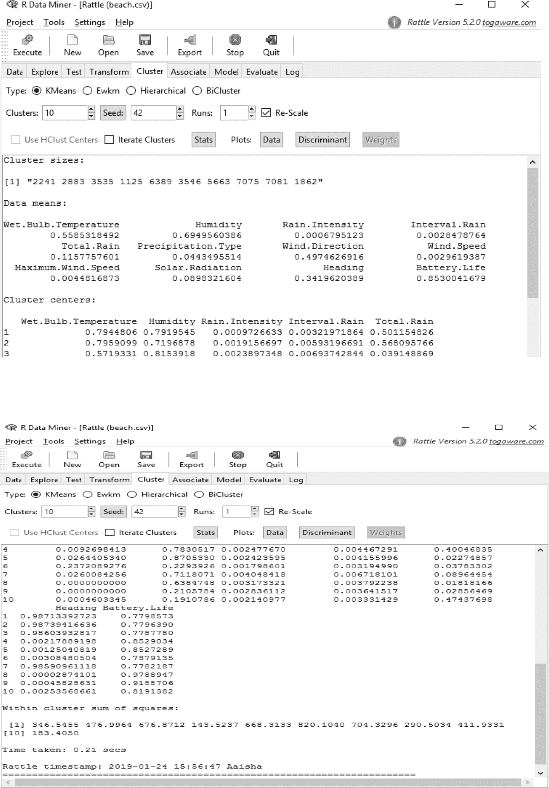

图 4.5： k-means 聚类中形成的簇

## 4.8 练习

### 思考

1. 定义机器学习的学习机制。
2. 列出影响机器学习性能的不同因素。
3. 实现机器学习的各种工具有？
4. 什么是 `Rattle`？
5. 什么是监督学习？
6. 什么是无监督学习？
7. 什么是分类？
8. 什么是回归？
9. 定义聚类。
10. 构建 `RStudio` 文件涉及哪些步骤？

### 单选题

**1: 向量、列表、矩阵、图像和视频等不同结构的区别是什么？**

(a) 内存 (b) 数据大小 (c) 数据类型 (d) 以上都是

**2: 预测人体体温是一个：**

(a) 二分类问题 (b) 多分类问题 (c) 回归问题 (d) 都不是

**3: 哪种工具被认为实现机器学习模型最好？**

(a) `Python` (b) `R` (c) `Matlab` (d) `Weka`

**4: 哪个 `R` 工具默认包含内置函数定义？**

(a) `Rattle` (b) `RStudio` (c) `Weka` (d) 以上都不是

**5: 哪个工具包含 `Scikit-Learn` 库？**

(a) `Python` (b) `R` (c) `Matlab` (d) `Weka`

**6: 哪个工具包含 `Scikit-Learn` 库？**

(a) `Python` (b) `R` (c) `Matlab` (d) `Weka`

**7: 哪个工具包含 `Scikit-Learn` 库？**

(a) `Python` (b) `R` (c) `Matlab` (d) `Weka`

**8: 哪个工具包含 `Scikit-Learn` 库？**

(a) `Python` (b) `R` (c) `Matlab` (d) `Weka`

**9: 哪个工具包含 `Scikit-Learn` 库？**

(a) `Python` (b) `R` (c) `Matlab` (d) `Weka`

**10: 哪个工具包含 `Scikit-Learn` 库？**

(a) `Python` (b) `R` (c) `Matlab` (d) `Weka`

个人计算机的出现（特别是高分辨率显示器的普及）也影响了对结果的理解和呈现。一张图片真的胜过千言万，人们能够从视觉化呈现中提取有帮助的数据。现代信息分析日益依赖图形化呈现来发现重要性并传输结果。今天的数据分析师需要从各种来源访问数据，合并、清洗和注释数据片段，使用最新方法对它们进行分析，以有意义且具有图形吸引力的方式展示发现，并将结果整合到入入的报告中，分发给利益相关者和公众。在这里，为了执行机器学习中涉及的所有计算，我们将使用 `R` 语言。

### 5.1.1 R 语言基础

在深入研究 `R` 中机器学习的深度代码之前，让我们先介绍 `R` 的基础编程概念。`R` 的开发是为了统计分析。其图形支持是通过 `graphics` 包的帮助建立的。`R` 对研究人员来说是一门非常实用的编程语言。所有的编程特性，如预定义函数、库、包和关键字都受 `R` 语言的支持。我们的首要目标是将 `R` 的能力抽象为统计工具箱，同时专注于优秀程序员所需的各种基础议程方面。它是一个由全球巨大且活跃的研究社区支持的开源数据分析解决方案。我们采用 `R` 语言是因为具有以下特征：

* `R` 是一个广泛的统计平台，为数据分析提供了各种方法。
* `R` 包含了其他包中尚未触及的复杂统计程序（`sophisticated statistical routines`）。在现实中，每周都有新的技术可供下载。如果你是 `SAS` 用户，想象一下每隔几天就能获得一个新鲜的 `SAS PROC`。
* 大多数交易统计软件平台花费数千甚至上万美元。`R` 是免费的！如果你是研究人员或学生，优势是显而易见的。
* `R` 在图形方面拥有顶尖技能。如果你想可视化复杂信息，它拥有可用的最广泛且强大的函数集。
* 将各种来源的信息转换为可用的形式可能是一项困难的任务。`R` 可以轻松地从广泛的源导入信息，包括文本文件、数据库管理系统、统计软件包和特定的信息商店。它还能编写关于这些方案的信息。`R` 可以直接从网站、社交媒体网站和各种互联网信息设施访问信息。
* `R` 的功能可以整合到其他语言编写的应用中，包括 `C++`、`Java`、`Python`、`PHP`、`Pentaho`、`SAS` 和 `SPSS`。这让你能够继续使用熟悉的语言工作，同时为你的应用添加 `R` 的能力。
* `R` 为新统计方法的简单编程提供了一个无与伦比的平台。它很容易扩展，并为新发布的技术提供了一种用于快速编程的自然语言。
* `R` 运行在包括 `Windows`、`Unix` 和 `Mac OS X` 在内的广泛系统上。它可以运行在你任何桌面电脑上。如果你不想学习新语言，有一系列图形用户界面（GUI）可以通过菜单和对话框提供 `R` 的功能。

### 5.1.2 安装 R

`R` 可以从全面的 R 存档网络 (`CRAN`) 的 `https://cran.r-project.org` 免费获取。对于 `Linux`、`Mac OS X` 和 `Windows`，可以获取预编译的二进制文件。按照你选择平台的指令安装基础项目。稍我们将将如何通过可选包模块（也可从 `CRAN` 获取）添加功能。

### 5.1.3 在 R 中工作

`R` 是一种解释型的、区分大小写的语言。在命令提示符 (`>`) 下，你可以一次输入一个命令，或从源文件执行一组指令。有广泛的信息，包括 `vectors`、`matrices`、`information frames`（如数据集）和 `lists`（对象集合）。大多数功能可以通过内置和用户创建的功能，以及对象的创建和操作来实现。一个项可以是任何可以分配值的实体。对于 `R` 来说，这就是我们初学者需要理解的所有。每个对象都有一个类属性，告诉 `R` 如何管理它。在交互会话期间，所有项都存储在内存中。如果你在 `Windows` 中工作，你可以像[图 5.1]所示看到 `R` 命令界面。

## 5.2 基本命令

在 `R` 中编写程序需要少量的 `R` 命令。你只需要理解每个命令的语法和用法。以下是 `R` 命令。

### 5.2.1 赋值

存储数字列表最直接的方法是使用 `c` 命令单元（`c` 代表“combine”，即合并）。这个概念是将数字列表存储在给定的名称下，并使用该名称引用信息。`c` 命令指定一个列表，赋值用符号 `<-` 表示。另一个定义数字列表的词是 `vector`（向量）。我们用 `c` 命令编写的数字用逗号隔开。例如，我们创建一个名为 `marks` 的变量，其中包含数字 `23`、`43`、`25`、`46` 和 `31`。我们甚至可以在不使用 `c` 命令的情况下生成 `marks`。两个命令都执行并显示在[图 5.2]。图中第一个命令将数字分配给变量 `marks`。第二个命令创建了一个名为 `marks` 的向量对象，包含五个从标准正态分布中随机抽取的偏差。

# 5.4: 字符串赋值

### 5.3.1 数据类型

#### 5.3.1.1 数字

该数据类型用于在变量中存储单个值。值的类型是实数。在 `R` 中不需要显式说明数据类型。解释器会根据变量的值分配数据类型，如图 5.5 所示。

#### 5.3.1.2 字符串

`R` 不仅限于数字；你甚至可以在变量中存储字符或字符串。同样使用 `c` 函数来存储这种类型的数据。字符或字符串的每个值可以用单引号或双引号括起来，如图 5.6 所示。从 1 开始的索引访问单个值。

### 5.3.2 结构化数据类型

`R` 拥有广泛的数据持有对象，包括标量、向量、矩阵、数组、数据框和列表。它们在可能包含的信息类型、生成方式、结构复杂性以及用于定义和访问单个组件的符号方面不相同。

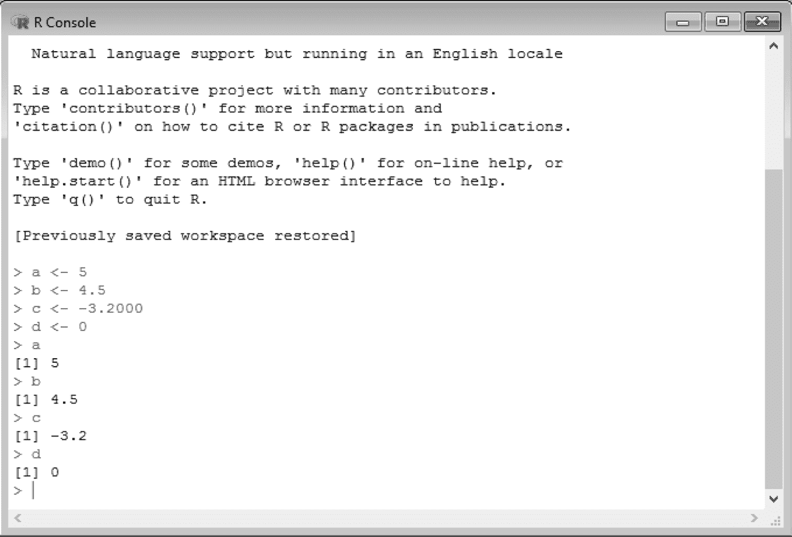

图 5.5: 数字数据类型的工作原理


图 5.6: 字符串数据类型的使用

此类数据持有者被归类结构化数据类型。以下是不同的结构化数据持有者。

#### 5.3.2.1 矩阵

矩阵是数组的一种特殊情况，它最多包含两个维度的数据。存储在此结构中的数据是统一且标量的。`R` 的 `matrix()` 函数用于创建矩阵。该函数的语法如下：

```
newmatrix<- matrix(vector, nrow=number_of_rows, ncol= number_of_columns, byrow=logical_value, dimnames=list(char_vector_rownames, char_vector_colnames))
```

向量包含行和列的数据，`nrow` 和 `ncol` 指定矩阵的维度，`dimnames` 包含存储在字符向量中的可选行标签和列标签。选项 `byrow` 表示矩阵按行填充（`byrow=TRUE`）还是按列填充（`byrow=FALSE`）。默认是按列填充。`matrix` 函数在图 5.7 中详细阐述。矩阵的转置和乘法在图 5.8 中所示。

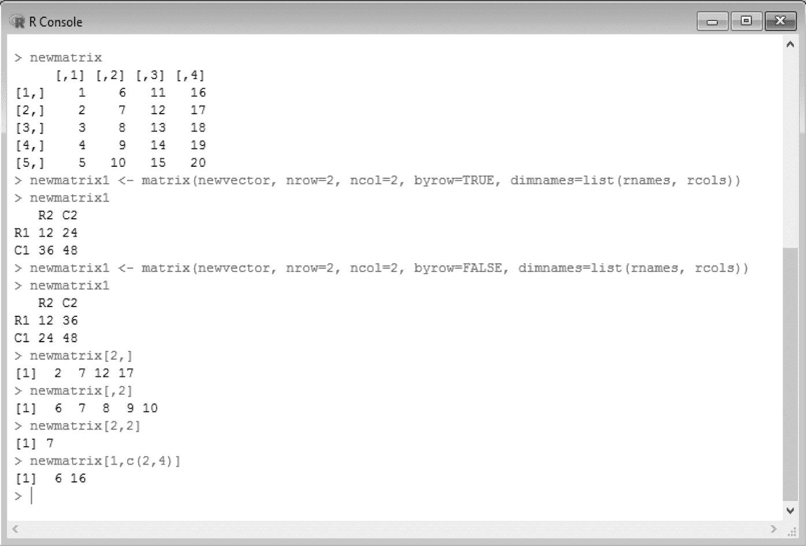

图 5.7: 矩阵创建和矩阵元素检索

在图中，首先使用命令创建新矩阵：`newmatrix<- matrix(1:20, nrow=5, ncol=4)`。在此命令中，从 1 到 20 的随机数被填充到 5 行 4 列中。然后执行命令创建另一个矩阵。使用 `newvector<- c(12, 24, 36,48)` 创建一个新向量，并带有定义的名称集。默认情况下，矩阵按列填充，通过两个命令（即 `byrow= TRUE` 和 `byrow=FALSE`）进行操作。可以通过索引的帮助检索矩阵元素。首先检索第二行的元素，然后检索第二列。最后，选择第一行以及第四、五列的元素。

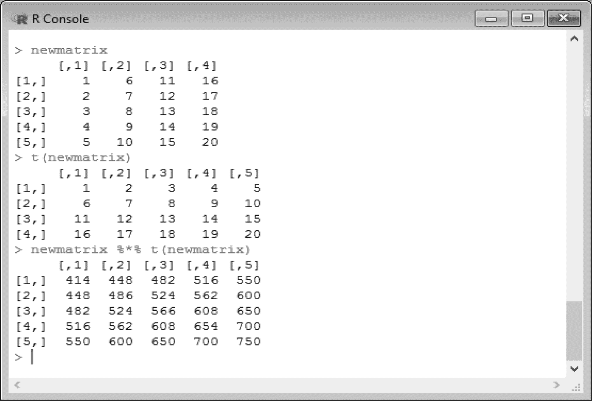

图 5.8: 矩阵转置和乘法

#### 5.3.2.2 数组

数组是均匀放置在维度中的数据组合。与矩阵不同，数组可以是任意维度的，即 1 、2 或更多。`R` 中有一个预定义的函数用于创建数组。其语法如下：

```
newarray<- array(vector, dimensions, dimnames)
```

在此中，`vector` 和 `dimensions` 是主要的，`dimnames` 是可选参数。图 5.9 演示了数组的创建。可以通过类似的方式通过索引帮助进行检索。如图 5.10 所示。

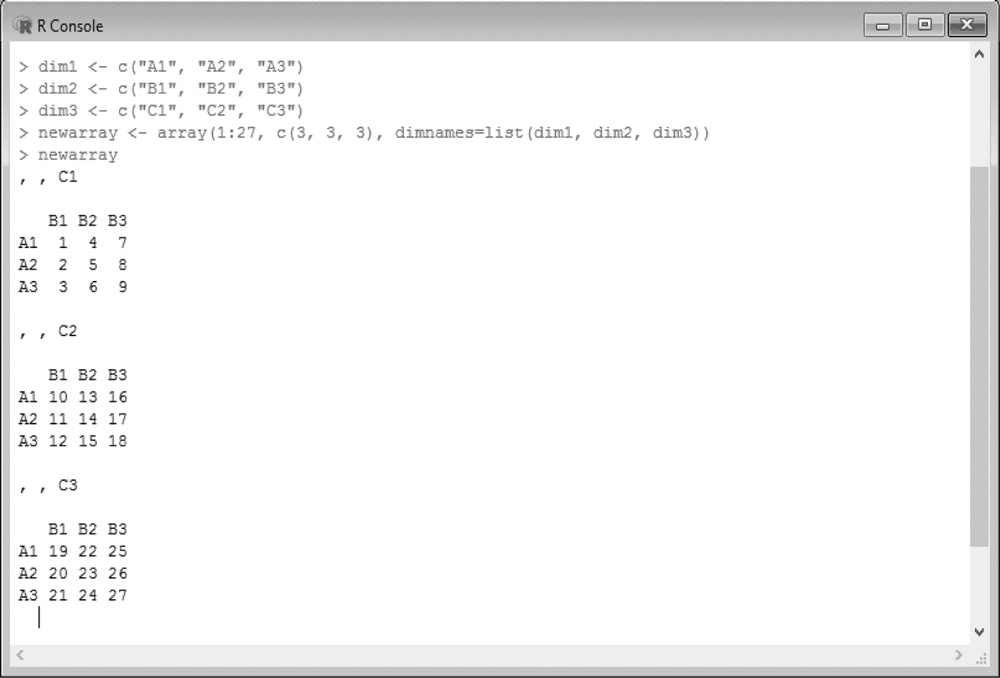

图 5.9: 数组插图

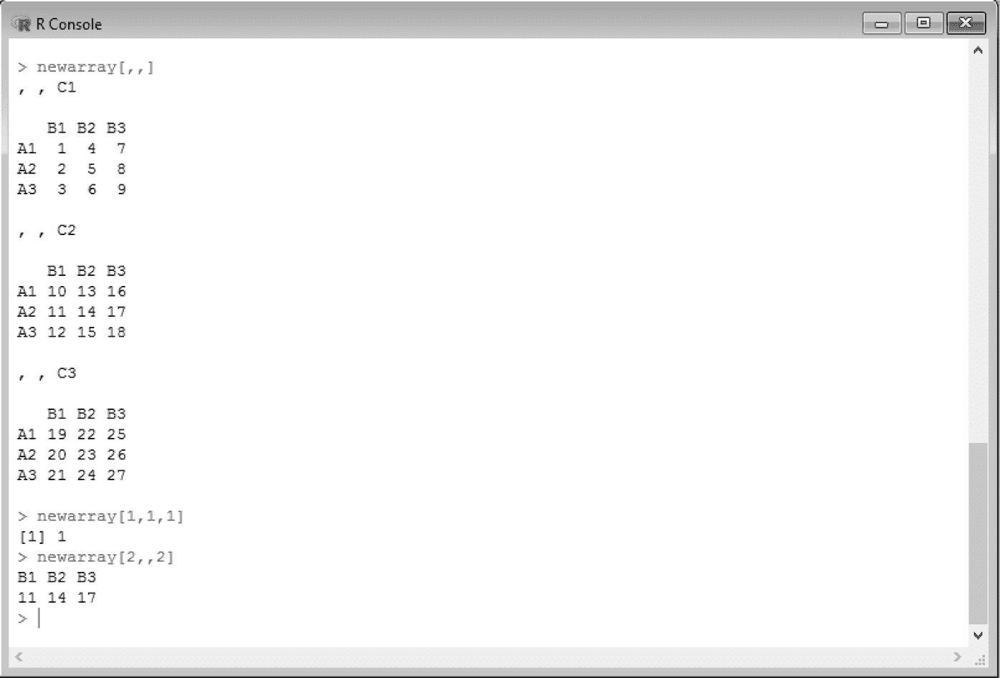

图 5.10: 检索函数

#### 5.3.2.3 数据框

这些是能够存储不同类型数据的结构。换句话说，说数据框是多种类型变量（如整数、字符）的组合。可以使用内置函数 `data.frame` 创建数据框。

```
newdataframe<- data.frame(col1, col2, col3)
```

在此中，`col1`、`col2`、`col3` 是列向量。数据框示例显示在图 5.11。

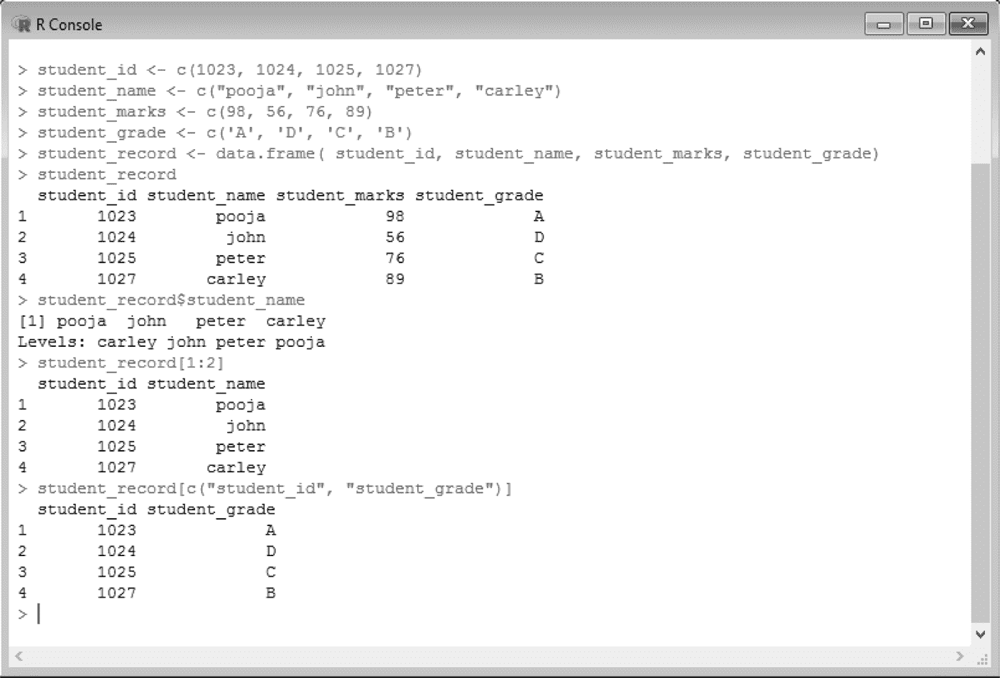

图 5.11: 数据框创建和元素检索的示例

在图中创建了 `student_record` 数据框。它包含四列，即数值类型的 `student_id`、字符串类型的 `student_name`、数值类型的 `student_marks` 以及字符类型的 `student_grade`。它是通过 `data frame` 函数的帮助创建的。创建后，首先通过列（即 `student_name`）检索元素，其次通过索引检索，最后通过多列检索。

#### 5.3.2.4 列表

这种结构是最复杂的结构，因为它可以包含任何数据类型，从字符、整数到数组等更多。`list` 函数用于创建这种结构。

在图 5.12 中，不同的变量（如数组、字符串、框和因子）组合成列表。由于两个原因，列表是重要的 `R` 结构。首先，它们允许你简单地组织和调用异构数据。其次，它们列出了不同 `R` 特性的结果。这取决于分析师提取需要的部分。在随后的章节中，你将看到许多返回列表的示例。

#### 5.3.2.5 因子

在计算机语言中，我们可以利用变量来存储数据。有不同的变量，它们起着不同的作用。变量分为三种：命名变量（nominal）、序变量（ordinal）和连续变量（continuous）。没有顺序的变量被称为命名变量。水果分类就是命名变量的一个。具有顺序的变量被称为序变量，例如学生成绩。在某些范围和顺序内的变量被称为连续变量。连续变量的一个例子是模型的准确率。`R` 语言考虑命名变量和序变量，这些变量被称为因子（factors）。

在图 5.13 中使用了 `factor` 函数。对于命名变量，`factor` 函数将值存储为整数向量。对于序变量，添加了 `order` 参数，其取值为 `TRUE` 或 `FALSE`。

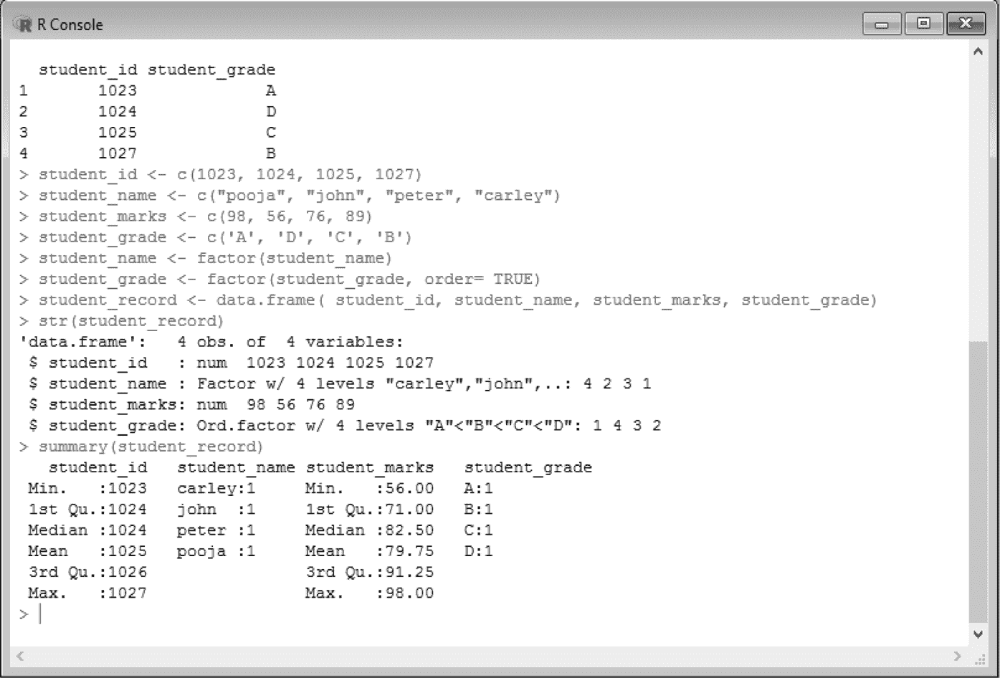

**图 5.13: 因子的创建与表示**

### 5.3.2.6. 向量

它是数组数据类型的特殊情况，只能包含一维数据。向量中的数据可以是数值、字符、字符串或逻辑型。你不能在单个向量中分组多种数据类型。向量可以检索一个或多个元素。这是通过索引帮助实现的。向量的索引从 1 开始。不同创建和检索的向量在图 5.14 中进行了讨论。

### 5.3.3. 运算符

运算符用于对持有数据的变量执行某些计算。这些运算符要么针对特定任务，要么用于描述两个或多个变量之间的关系。`R` 中有不同类型的运算符。下面讨论了一些常用的常用的运算符。

#### 5.3.3.1. 算术运算符

这些运算符用于执行数学运算，如加法和乘法。表 5.1 显示了 `R` 可用的算术运算符列表。使用算术运算符进行的实验在图 5.15 中进行了插示。

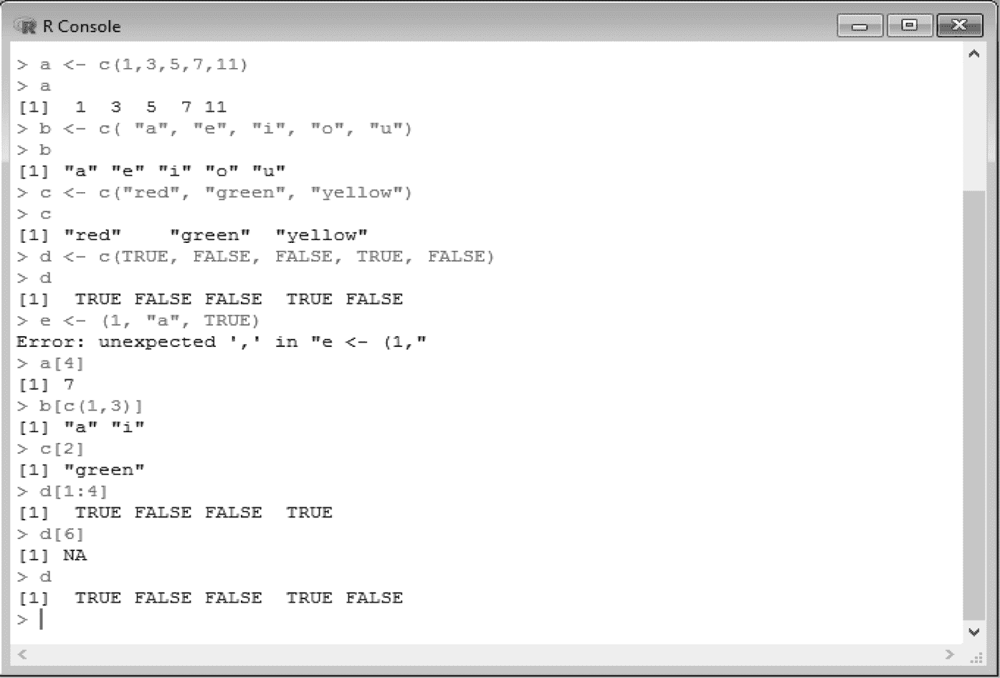

**图 5.14: 向量的创建与元素检索**

**表 5.1: 算术运算符**

| **运算符** | **描述** |
| --- | --- |
| `+` | 相加两个或多个数字 |
| `-` | 减法两个或多个数字 |
| `*` | 乘法两个或多个数字 |
| `/` | 除法两个或多个数字 |
| `%%` | 取模运算符，用于计算除法的余数 |
| `%/%` | 整除，用于计算整数商 |
| `^` | 幂运算 |

#### 5.3.3.2. 关系运算符

这些运算符用于比较两个或多个变量。这些运算符主要用于测试循环中使用的条件。表 5.2 讨论了 `R` 中的各种关系运算符。这些运算符在图 5.16 中显示。

#### 5.3.3.3. 逻辑运算符

该运算符适用于逻辑型、数值或复数向量。所有大于 1 的值都被视为逻辑值（即 `TRUE`）。表 5.3 是 `R` 语言使用的逻辑运算符列表。这些操作适用于数值型、逻辑型或复数型。列出的运算符在图 5.17 中显示。

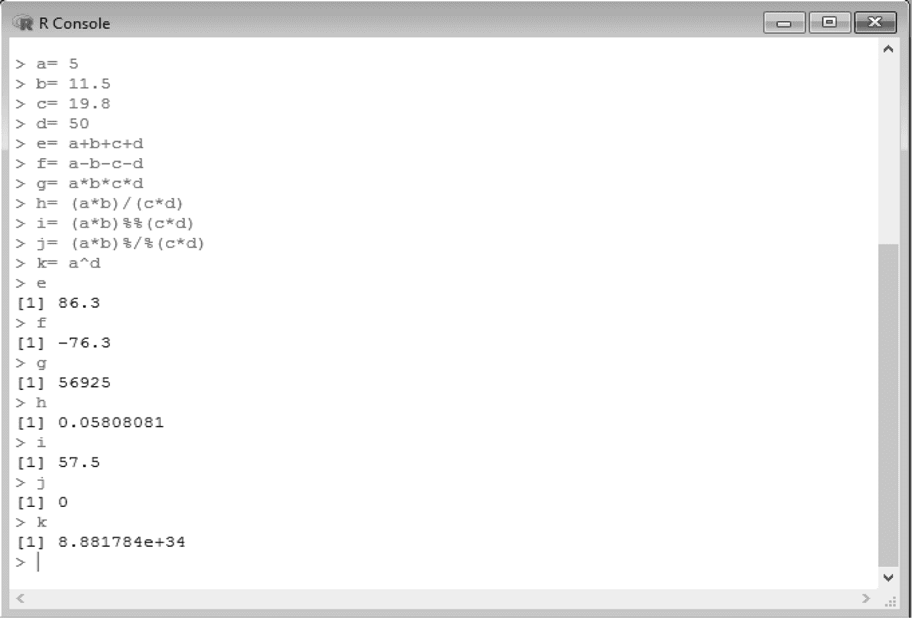

**图 5.15: 使用算术运算符的操作**

**表 5.2: 关系运算符**

| **运算符** | **描述** |
| --- | --- |
| `<` | 如果变量小于另一个变量，则结果为真 |
| `>` | 如果变量大于另一个变量，则结果为真 |
| `<=` | 如果变量小于或等于另一个变量，则结果为真 |
| `>=` | 如果变量大于或等于另一个变量，则结果为真 |
| `==` | 如果两个变量相等，则结果为真 |
| `!=` | 如果两个变量不相等，则结果为真 |

### 5.3.4. 图形

图形对于传达数据特征非常重要。它们可以检查边际分布、总结大型数据集并描述数据特征之间的关系。`plot()`是最常用的 `R` 函数。

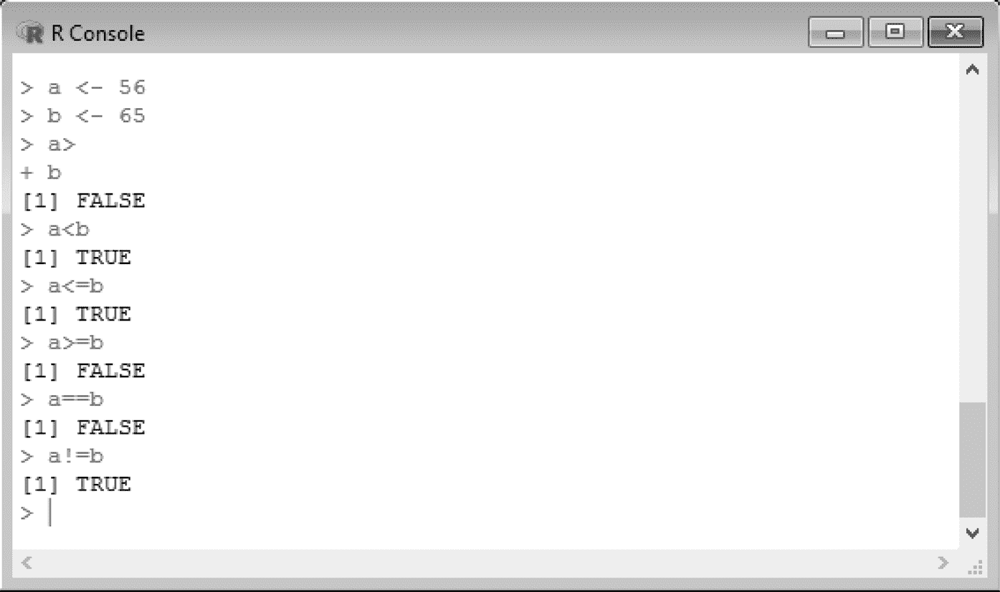

**图 5.16: 使用关系运算符的操作**

**表 5.3: 逻辑运算符**

| **运算符** | **描述** |
| --- | --- |
| `&` | 元素级逻辑与 |
| `|` | 元素级逻辑或 |
| `&&` | 逻辑与 |
| `||` | 逻辑或 |

#### 5.3.4.1. 直方图


在`R`中，可以使用`hist()`函数和值向量很容易地创建直方图。`hist()`函数使用的参数有`breaks`、`xlab`、`xlim`和`ylim`。图形表示在图 5.18 中给出。

#### 5.3.4.2. 散点图

在`R`中创建散点图有很多方法。基本函数是`plot(x, y)`，其中`x`和`y`是表示要绘制的`(x,y)`点的数值向量。这是通过`plot`函数创建的，如图 5.19 所示。可以通过`sort`函数对数据进行排序并用`type`函数进行展示。

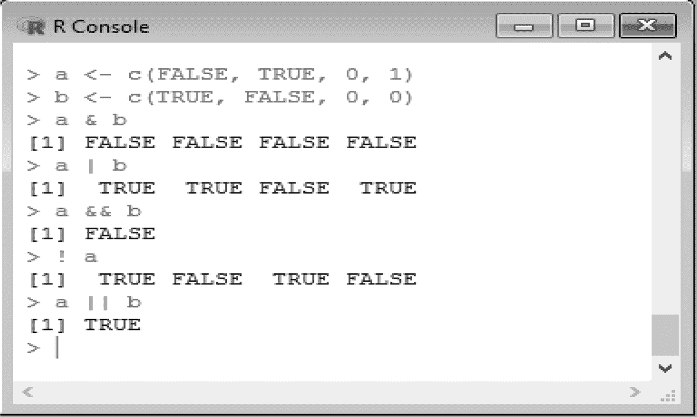

**图 5.17: 使用逻辑运算符的操作**

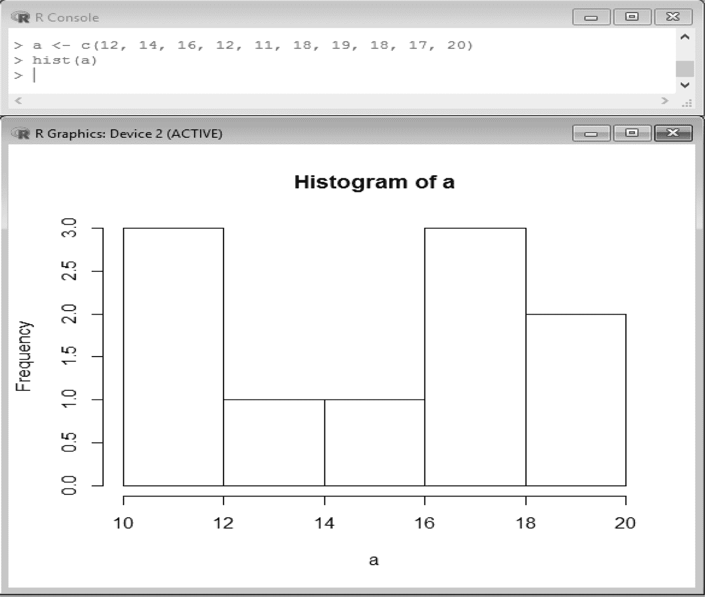

**图 5.18: 绘制直方图**

例如，在图 5.20 中，`sort`函数通过`l`参数对数据进行排序并以线条的形式呈现。

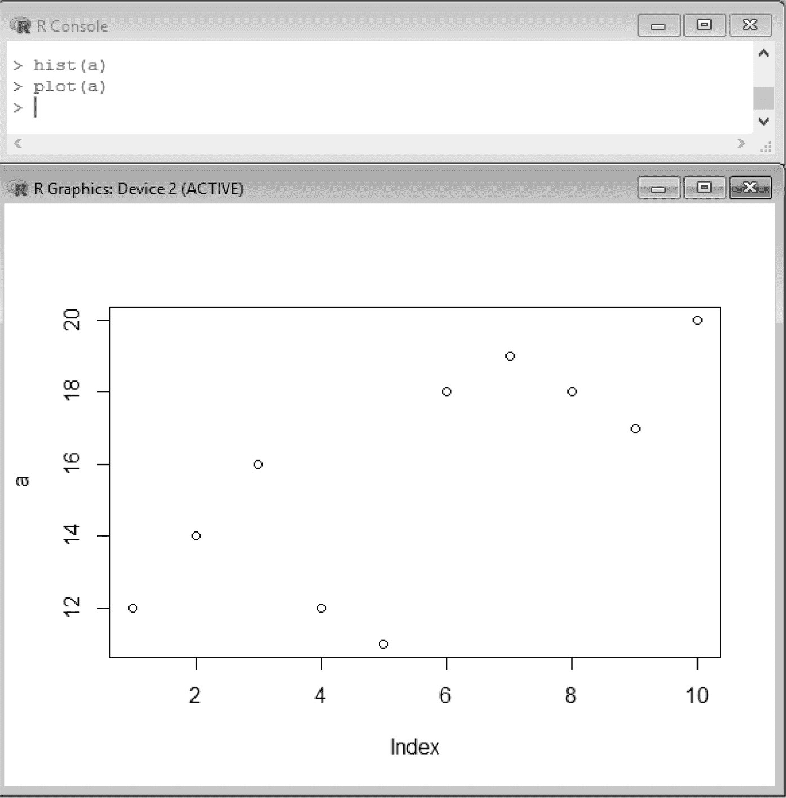

**图 5.19: 绘制散点图**

饼图是使用`pie()`函数创建的。饼图上的柱状图或散点图通常更受青睐，因为在分析数据时，垂直方向的判断比水平表示更准确。`pie`函数的形式为`pie(x, labels=)`，其中`x`是一个非负数值向量，表示每个扇区的面积，而`labels=`是一个用于扇区名称的字符向量。

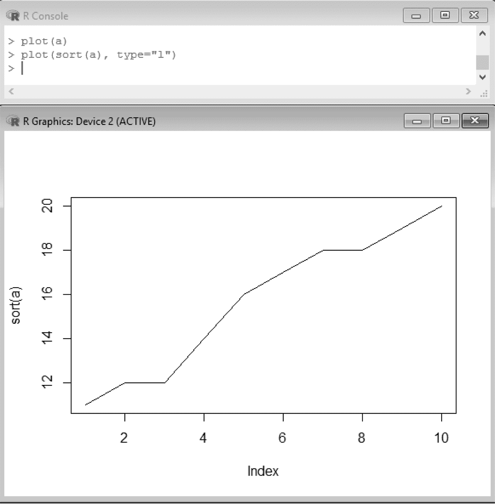

图 5.20： 在 R 中绘制排序图的说明

### 5.3.5 基础统计量

一旦你的信息被正确组织并开始进行视觉探索，下一个阶段通常是在数字上定义每个变量的分布，然后探索所选因素之间两两的相互作用。在某些情况下，你可能想要分析序列以得出结论。例如：

*   我们想要监控每月支出。为了进行更好的分析，我们希望计算平均值、中位数和标准差。
*   每月支出与储蓄率之间有什么关系？
*   哪组材料的成本最高？它们在统计学上显著吗？

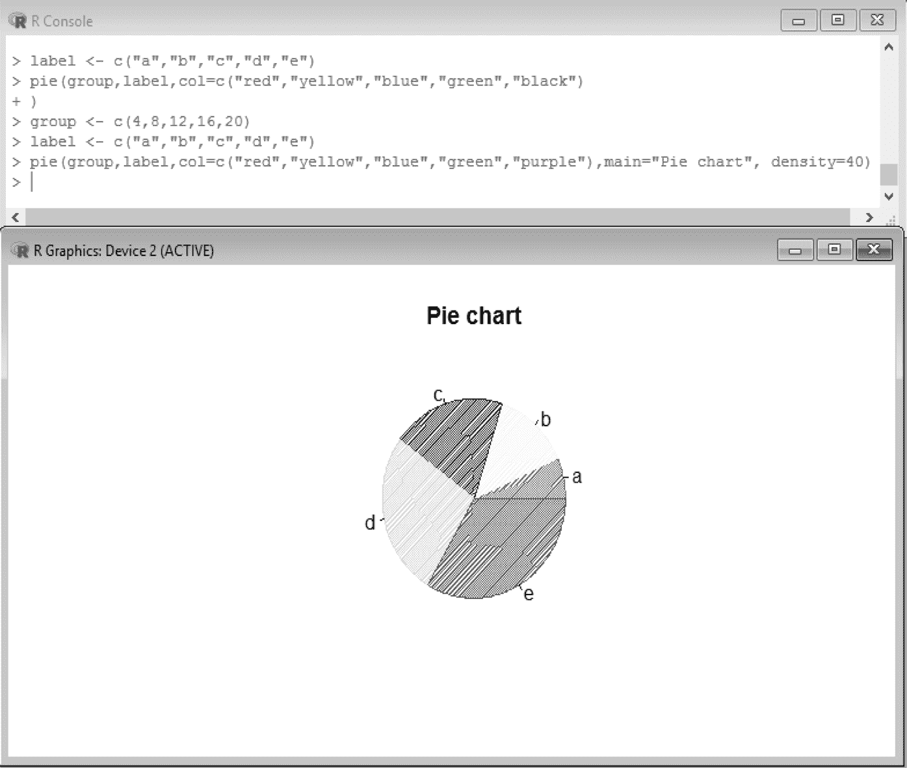

图 5.21： 在 R 中绘制饼图的说明

这些问题可以通过推断统计来回答。R 具有一些用于此目的的功能。

#### 5.3.5.1 描述性统计

描述性统计衡量连续变量的中心趋势、变异性和分布形状。借助定义的名称，可以很容易地执行这些函数（`rnorm`、`sd`、`var`、`mean`、`median`、`quartile`）。这些函数将在图 5.22 中详细介绍。

#### 5.3.5.2 相关性检验

要在 R 中执行不同的统计测试，只需要下载几个包来高效地处理测试结果。第一个需要的包是：

*   `fbasics`：通过安装此包，依赖项将自动安装，即`timeSeries`、`gss`和`stabledist`。

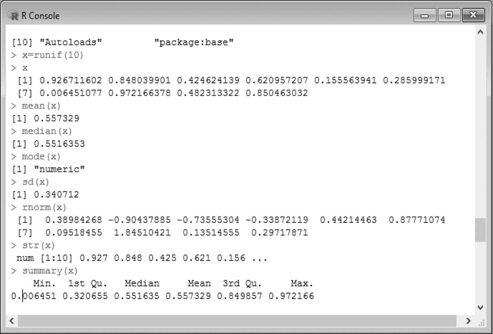

图 5.22： 描述性统计函数示例

使用的命令如图 5.23 所示。

```
install.packages("fBasics")
```

现在使用如图 5.24 所示的命令检查包是否安装成功。

```
require(fBasics)
```

*   `resettest`：可以使用如图 5.25 所示的命令安装`resettest`包。

```
install.packages("lmtest")
require(lmtest)
```

此命令用于加载`lmtest`包，如图 5.26 所示。

1.  Pearson 相关性检验：可以使用`cor.test`、`stats`和`correlation-Testfbasics`函数来执行此测试。现在，你只需要两组相关数据。首先创建两个向量，然后执行如图 5.27 所示的皮尔逊相关命令。

2.  Spearman 相关性检验：可以使用`cor.test`、`stats`和`spearman.testpspearman`函数来执行此测试。相关数据集在 Spearman 测试函数中使用，如图 5.28 所示。

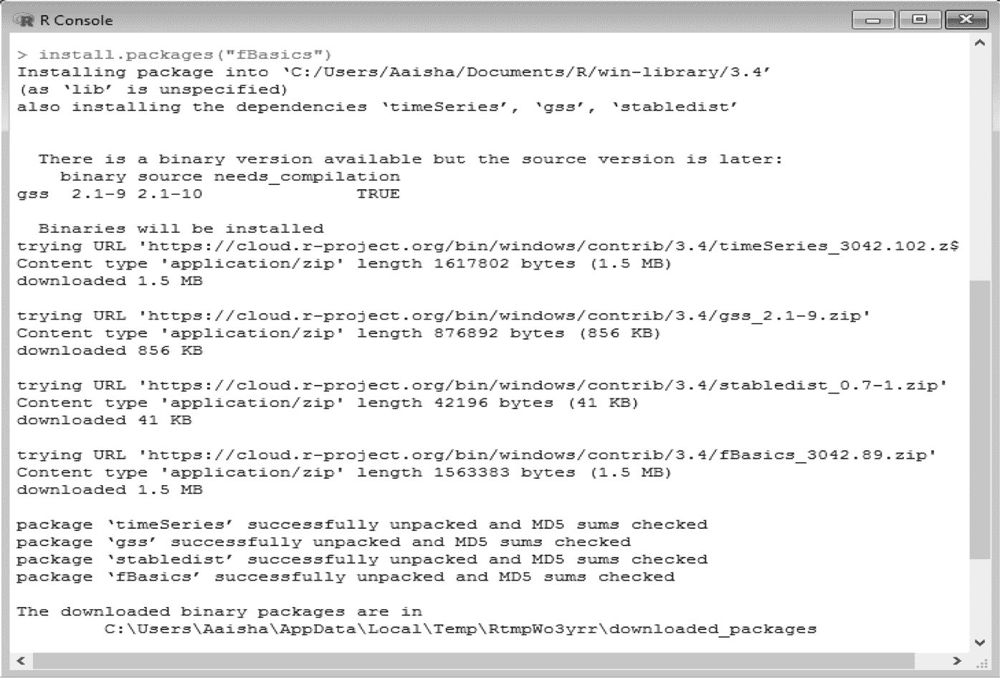

图 5.23： 安装 fBasics 包的步骤

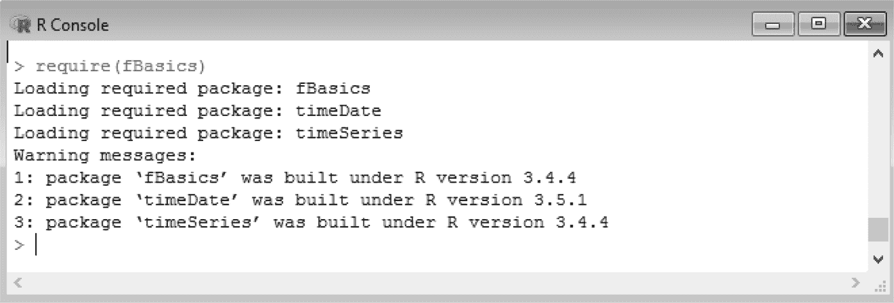

图 5.24： 加载 fBasics 包的步骤

3.  Smirnov 检验：此测试用于检查两个样本是否生成自相同的分布，如图 5.29 所示。使用`ks.test`函数执行此测试。

4.  卡方检验：执行此测试需要`outliers`包。使用`chisq.test`执行，如图 5.30 所示。

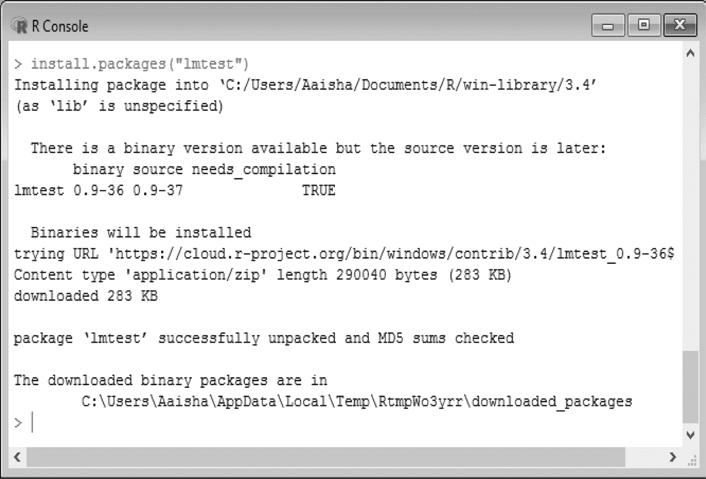

图 5.25： 安装 lmtest 包的步骤

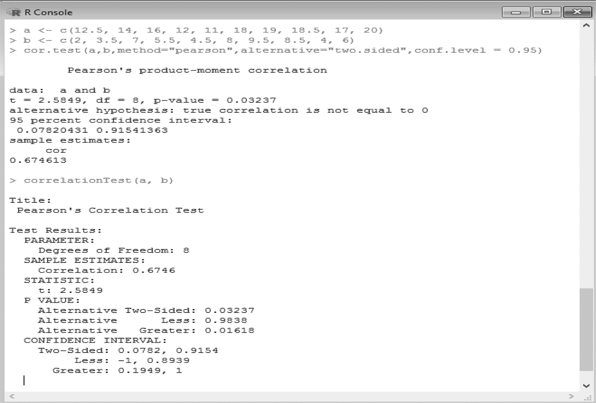

图 5.26： 加载 lmtest 包的步骤


图 5.27： Pearson 相关性检验的步骤

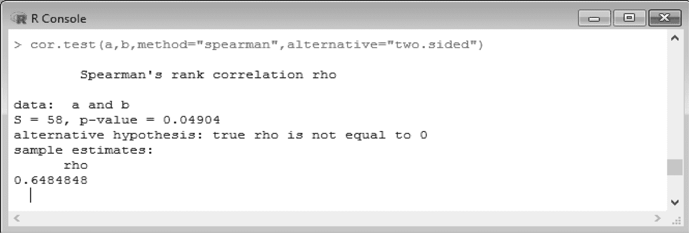

图 5.28： Spearman 相关性检验的步骤

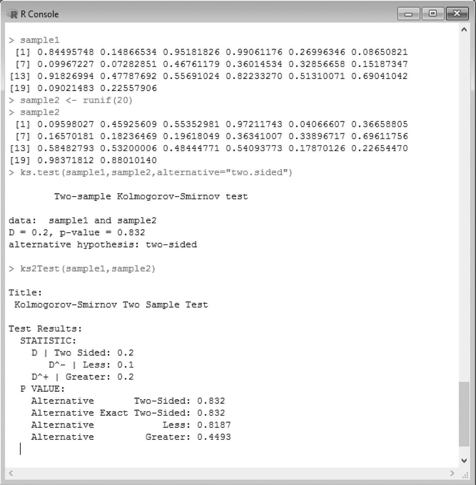

图 5.29： Smirnov 检验的步骤

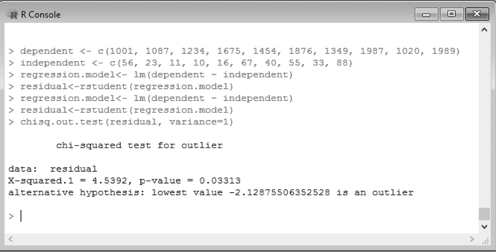

图 5.30： 卡方检验的步骤

### 5.3.6 包

R 开箱即用提供了全面的功能。但它一些最有趣的特性可以作为可选模块下载并安装。你可以从 [`cran.r-project.org/web/packages`](http://cran.r-project.org/web/packages) 下载超过 5500 个用户贡献的模块，称为“包”。包是库的集合，其中进一步包含了定义的函数。它们提供了极其丰富的新功能，从地理空间数据评估到蛋白质质谱处理。你可以使用许多 R 特性来操作包。使用`install.packages`首先安装包。例如，`install.packages`提供了 CRAN 镜像站点的列表。一旦你选择了一个站点，将为你提供所有可用包的列表。选择并下载一个一个。以下是在 R 中与包一起使用的命令：

*   `install.packages()`：此命令用于在库中安装包。在图中，我们安装了`vcd`包。
*   `library()`：通过安装包将其从 CRAN 镜像站点下载并放置在你的库中。你必须使用`library()`函数加载包。我们加载了同一个已安装包。
*   `search()`：使用单个命令（即`search()`）查看 R 中已安装的包是令人兴奋的。

### 4. 数据库系统

R 可以与广泛的 DBMS 交互，包括 Microsoft Access、MySQL、Microsoft SQL Server、Oracle、DB2、Teradata、Sybase 和 SQLite。某些包通过原生驱动提供访问，而另一些则通过 ODBC 或 JDBC 提供访问。RODBC 包允许 R 连接到任何具有 ODBC 驱动程序的 DBMS，可能是最常用的技术。第一阶段是为你的平台和数据库安装并配置合适的 ODBC 驱动程序。如果机器上尚未安装所需的驱动程序，可以通过搜索获取选项。在为所选数据库安装并配置好程序后，使用`install.packages("RODBC")`命令安装 RODBC 包。

1. 定义`R`。`R`语言具有哪些特征？

2. 我们如何将值赋值给不同的变量？

3. 在`R`程序中添加注释有哪些方法？

4. 详细阐述`R`中使用的不同数据类型。

5. 什么是矩阵？如何在矩阵中插入和检索元素？

6. `R`中使用了哪些不同的运算符？

7. 定义描述性统计及其在`R`编程中的用途？

8. 什么是包（packages）？你如何安装它们？

9. `R`程序从用户处获取输入有哪些方法？

10. 定义向量（vectors）及其在`R`中的用途。

### 单选题

**1: 使用哪个符号为变量赋值？**

**(a)** `<-` **(b)** `<=` **(c)** `=` **(d)** `==`

**2: 使用哪个符号用于为`R`程序添加注释？**

**(a)** `%` **(b)** `#` **(c)** `*` **(d)** `$`

**3: 数字数据类型的变量接受哪种值？**

**(a)** 整型 **(b)** 实数值 **(c)** 小数值 **(d)** 以上都是

**4: `array()`函数中维度（dimensions）的作用是什么？**

**(a)** 取值列表 **(b)** 数组索引 **(c)** 维度列表 **(d)** 都不是

**5: 数据框（data frame）可以包含什么类型的数据？**

**(a)** 字符串 **(b)** 整数 **(c)** 向量 **(d)** 全部

**6: 使用哪个运算符进行矩阵乘法？**

**(a)** `*` **(b)** `mul()` **(c)** `%*` **(d)** 都不是

**7: 哪个运算符返回余数？**

**(a)** 它用于对不同的数据结构排序。**(b)** 它用于对数据排序。**(c)** 它用于序数变量。**(d)** 以上都不是

**8: 向量是一个一维数组，其第一个值存储在索引：**

**(a)** 0 **(b)** 1 **(c)** -1 **(d)** 都不是

**9: 向量可以包含什么类型的数据？**

**(a)** 数值 **(b)** 字符 **(c)** 字符串 **(d)** 以上都是

**10: “==” 运算符的作用是什么？**

**(a)** 赋值 **(b)** 比较 **(c)** 位位移 **(d)** 以上不是

**11: 使用哪个运算符执行逻辑“与”（AND）操作？**

**(a)** `&` **(b)** `|` **(c)** `&&` **(d)** `||`

**12: `runif()`函数用于？**

**(a)** 连续运行程序 **(b)** 运行程序直到满足特定条件 **(c)** 生成具有指定限制的随机数 **(d)** 以上都不是

**13: 使用哪个函数用于加载包？**

**(a)** `install.packages()` **(b)** `packages()` **(c)** `library()` **(d)** 以上都不是

**14: 使用哪个函数用于检查`install.packages`列表？**

**(a)** `install.packages()` **(b)** `search()` **(c)** `find()` **(d)** 以上都不是

**15: 使用哪个命令用于打开编辑器以输入内容？**

**(a)** `enter()` **(b)** `edit()` **(c)** `file()` **(d)** `retrieve()`

**16: 使用哪个函数用于通过文本编辑器以表格格式输入数据？**

**(a)** `edit.table()` **(b)** `read.table()` **(c)** `write.table()` **(d)** `table()`

**17: 从 Excel 文件获取数据需要哪个包？**

**(a)** `xlsx` **(b)** `xlsxjars` **(c)** `rJava` **(d)** 以上都是

**18: 使用哪个函数用于从 Excel 文件读取数据？**

**(a)** `read.xlsx()` **(b)** `get.xlsx()` **(c)** `fetch()` **(d)** 以上都不是

**19: 使用哪个函数用于从 sql 文件读取数据？**

**(a)** `sqlRead()` **(b)** `sqlGet()` **(c)** `sqlFetch()` **(d)** 以上都不是

**20: 使用哪个命令用于关闭与数据库建立的连接？**

**(a)** `exit()` **(b)** `close()` **(c)** `terminate()` **(d)** 以上都不是

# 6 机器学习范式

## 6.1 引言

想象一下，以数据形式存在的完整环境。我们可以说我们正沉浸在数据之中。无疑，这些数据在不久的将来将继续增加。现在，谁面临着数据问题？实际的问题是谁需要它？首先是工业家和生产者，他们希望记录当前的销售和消费情况。其次是研究团队，他们希望预测未来的产品需求。在个人电脑上存储如此大量的数据是不可能的。举个例子，你去超市买了几件家居用品。可能有多个结账台。因此，无论你走到哪个结账台都可以进行结账和分析。所以，你可以进行结账并分析你所到的任何结账台。所有项目都可以记录并使用条码获取。显然，随着数据量的增加，计算复杂度也会随之增加。数据的隐藏见解尚未被探索。在这里，机器学习发挥了作用。**结构描述。** 如上一章节所述，整个书中都使用了同一个数据集。所以我们指的是这个数据集。如何描述结构？这合理吗？我们使用图 6.1 中的数据快照来进行理解。

> 如果风向增加，风速就会减小，降雨概率就会增加

没有必要设计结构描述。根据不同情况决策的规则可以通过决策树来绘制。决策树是一种说明决策序列的科学算法。

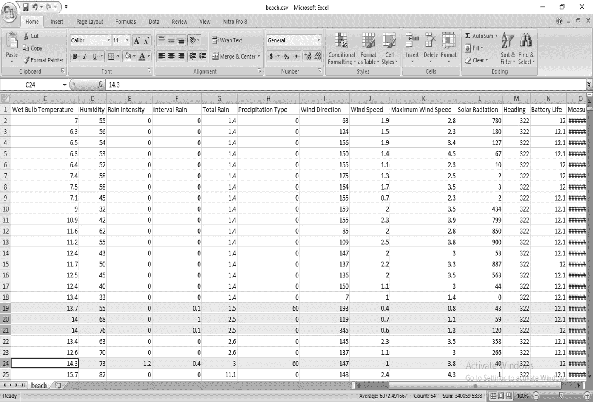

1. 在做决策时没有考虑完整数据。
2. 只考虑了三个特征：风向、风速和降雨。
3. 剩余行中可能存在噪声或缺失数据。

实例（Instance）是一个个体、一个独立的且固定的值，其特征由各种特性或属性决定。每个属性都是可以衡量实例的特征，我们也可以将其称为“行”（rows）。每个问题都有确定的特征。让我们来谈谈天气预报。仅仅坐在家里浏览手机，你就能知道下个月的天气。这种预测是如何成为可能的？这归于机器学习科学家们的努力工作。让我们考虑如表 6.1 所示的天气数据。机器的输入可以被分类为聚类或关联类。我们可以通过评估温度、风速和湿度等属性来判断气象状况。模型通过以构成属性的实例为列的矩阵进行实验。因此，数据集被输入到`simple.csv`文件，这种文件通常被称为扁文件（flat-file）。

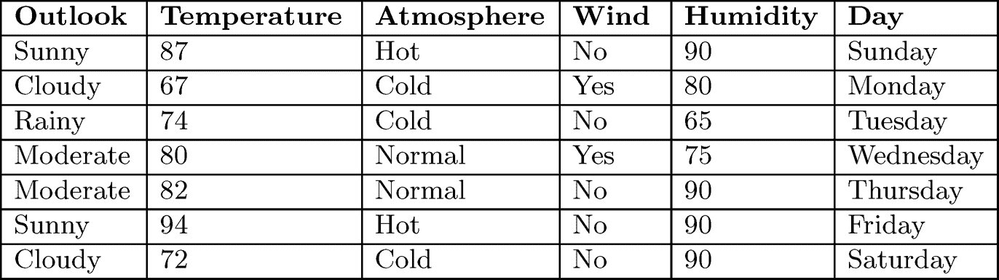

由于它们之间的关系，数据也可以表示为树。例如，包括祖先在内的家族数据可以以树的形式绘制，这棵树将被视为机器学习的输入。我指的是远亲，例如母舅那边的亲戚。为了解决这个问题，请考虑图 6.2，其中可以形成三类：第一是寻找血缘关系，第二是寻找其他关系，第三是寻找没有关系。

### 1. 血缘关系：

```
Me —-> Father
Me —> Mother
Father —-> Father’s father
Father —-> Father’s mother
Mother —-> Mother’s mother
Mother —-> Mother’s father
Father —-> Father’s Paternal Grandmother
Father —-> Father’s Paternal Grandfather
```

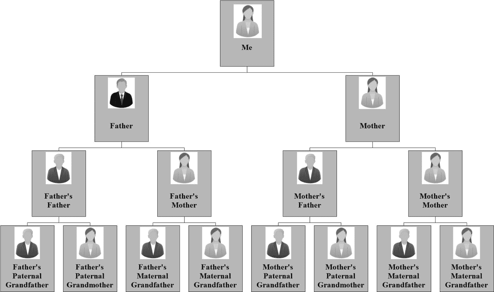

图 6.2： 层级格式的完整家族树

```
Mother —-> Mother’s Paternal Grandmother
Mother —-> Mother’s Paternal Grandfather
```

### 2. 其他关系：

```
Father —-> Mother
Father’s father —-> Mother’s father
Father’s father —-> Mother’s mother
Father’s mother —-> Mother’s father
Father’s mother —-> Mother’s mother
Father —-> Father’s Maternal Grandmother
Father —-> Father’s Maternal Grandfather
Mother —-> Father’s Paternal Grandmother
Mother —-> Father’s Paternal Grandfather
Mother —-> Father’s Maternal Grandmother
Mother —-> Father’s Maternal Grandfather
Mother —-> Mother’s Maternal Grandmother
Mother —-> Mother’s Maternal Grandfather
```

### 3. 无关系：

既然是家族树，那么每个家庭成员都以一种或其他方式相互关联。

现在，为了让这个例子更容易理解，我们需要将这棵树转换为表格。同样，我们可以注意到实例之间某种程度上是相互关联的。让我们开始构建表 6.2。这个示例展示了我们如何获取树中不同节点之间的关系并将其重构为一组独立的实例。每个实例都有一个固定的定义值，由属性表征。这就是实例和属性形成机器学习模型输入的方式。

## 6.3 输出泛化


输出的泛化是由于实例之间是相互关联的。再次，我们可以注意到实例之间以某种方式相互关联。通过评估温度、风速和湿度等属性来判断气象状况。模型通过以构成属性为列的实例矩阵进行实验。因此，如表 6.2 所示，决策以相同的方式表示输出。并不是所有属性都应该被考虑。

### 6.3.1 决策树

决策树是一种通过提取它们之间的关系来表示独立实例集的结构。它遵循流行的“分而治”方法。这主要通过选择最重要的属性来进行测试，例如家族树中，将 `Me` 作为父节点。叶子节点需要两个或多个节点之间的比较。我们在所有编程语言中学习过的条件，例如 `if()` 或 `else()`，也可以在形成分类规则时应用。这种条件应用于父节点，并连续应用于子节点。由于树的结构，总有两个决策需要做出；这就是形成分类规则的原因。分类本身决定了两个值之间的实例。

在产生两个类的情况下，可以遵循大于或小于的方法。如果情况是形成三个分支，则可以测试三个条件，即小于、等于和大于。如果存在多种可能，可以遵循这种三分法。如果存在缺失值，也可以遵循备选方案来创建决策。实值属性的情况不同，其中相等操作可能无法成功。因此，解决方案是区间类。内部类的三个备选方案是以下、以上和之内。

正如图 6.3 示例所示，该树是一个决策树。这棵树显示了在遍历实例时所做的决策。属性没有被考虑得深入，因为仅仅通过分析属性就可以做出决策。像这棵树中出现的这类问题被专门称为 `replicated subtree`（重复子树）问题。这个问题应该通过对重复条件进行更好的编译处理来解决。输入是包含多个属性集合所需的文件。输出也是实例的集合，但它对数据的结构和模式进行了深层分析。该示例的发现如下所示。

图 6.4 预测了通过分析形成的新规则。每条规则都包含一些非常见的知识。你可以看到这些规则是从给定的树中提取的。随机形成的树实际上并不遵循这些规则。可以通过添加新规则来改变树的结构。通过添加几条新规则，对现有结构进行了修订。修订后的树结构在图 6.5 中给出。现有规则保持不变，为新规则留出了空间。

树结构通过添加几条规则进行了修订；并不总是需要修订规则。有时，当一个实例无法属于任何类时，就会出现问题。这在决策树中可能发生。原因是规则的形成方式使得每个实例都被归类为一类或类。如果发生这种情况，有两种解决方案。第一是将该实例设为父节点；第二是添加一条能够正确对该规则进行分类的新规则。我们的示例采用了后者，新的决策列表在图 6.6 中所示。

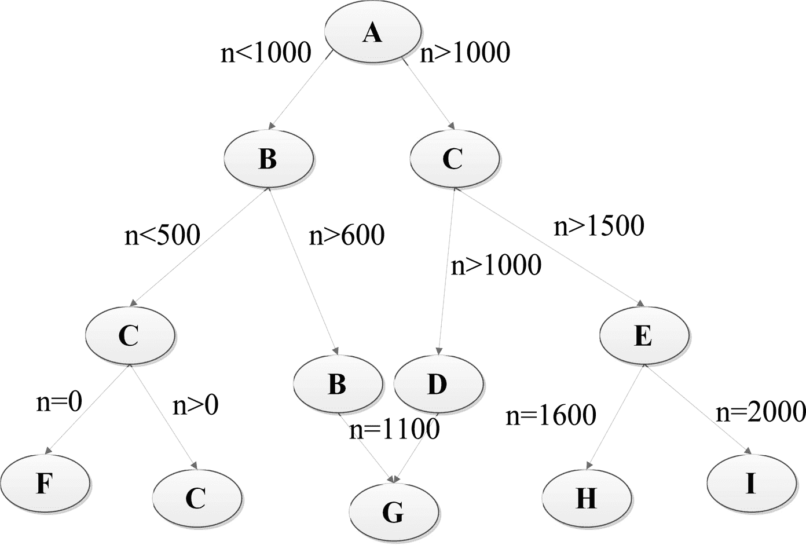

图 6.3: 使用分类规则随机形成的决策树

| 树观察结果 |
| --- |
| B || 600-1000 |
| C || 0-500 |
| D || 1000-1500 |
| E || Above 1500 |
| F || n=0 |
| G || n=1100 |
| H || n=1600 |
| I || n=2000 |

图 6.4: 解决重复问题后

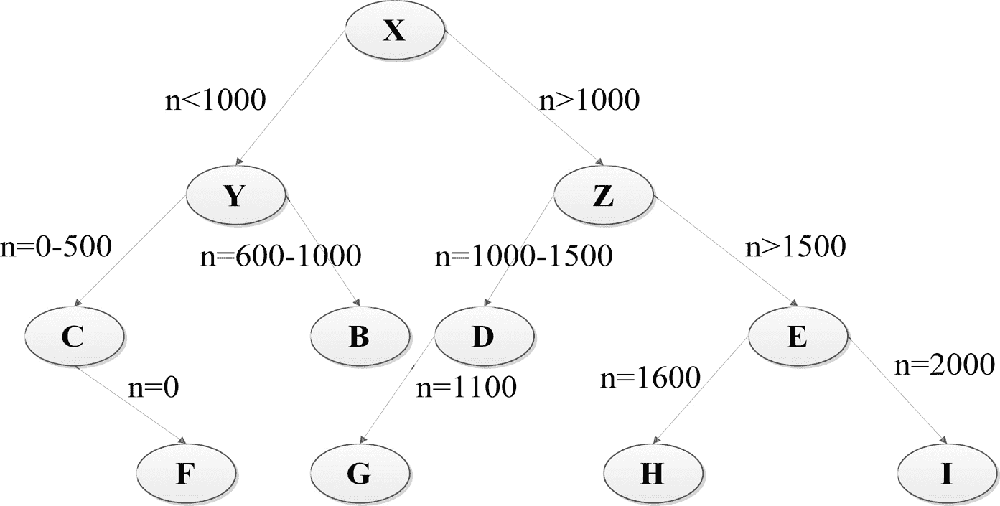

图 6.5: 无重复的解决决策树

| 修后的规则 |
| --- |
| Y || n<1000 |
| Z || n>1000 |
| B || n= 600-1000 |
| C || n= 0-500 |
| D || n= 1000-1500 |
| E || Above 1500 |
| F || n=0 |
| G || n=1100 |
| H || n=1600 |
| I || n=2000 |

图 6.6: 解决后的决策树的决策列表

## 6.5 数值预测

我们已经学习了如何通过绘制新类来对实例进行分类。结果预测了类别，因此我们现在讨论如何预测数值。决策树用于分类问题。然而，让机器学习以预测数值值类似于回归情况。回归是用于预测真实点值的监督学习。回归树也可以用于此目的。决策树和回归树的区别在于节点的数据类型。回归树使用了各种库。这些库包含了在 R 中执行特定任务所需的函数。因为我们还没有涵盖数据加载、训练数据选择、测试数据选择、特征选择等数据处理过程。这些过程有助于将原始数据转换为 R 兼容的文件。因此我们直接绘制树。代码逐行解释以便更好地理解。

```
library(rpart)
```

该语句位于程序的顶部，因为应该在开头显式提到库。`rpart` 库用于生存树、分类和回归中的递归划分。它具有如下所示的各种功能：

- `labels.rpart`: 为 `rpart` 对象创建划分标签
- `meanvar.rpart`: 为 `rpart` 对象绘制均方差图
- `na.rpart`: 处理 `rpart` 对象中的缺失值
- `path.rpart`: 跟踪 `rpart` 对象的选中节点路径
- `plot.rpart`: 绘制 `rpart` 对象
- `plotcp`: 为 `rpart` 拟合绘制复杂度参数表
- `post.rpart`: `rpart` 对象的 PostScript 呈现绘图
- `predict.rpart`: 从拟合的 `rpart` 对象进行预测
- `print.rpart`: 打印 `rpart` 对象
- `printcp`: 显示 `rpart` 拟合的 CP 表
- `prune.rpart`: 对 `rpart` 对象进行代价复杂度剪枝
- `rsq.rpart`: 不同划分的近似 R 平方
- `snip.rpart`: 剪掉 `rpart` 对象的子树
- `summary.rpart`: 对拟合的 `rpart` 对象进行摘要

此命令用于绘制回归树。分支类型和数量是由上一个命令中的 `minsplit` 参数设置的。文本命令用于在不同分支上写入数值文本。

```
prp(tree.1)
```

```
prp(tree. 1,varlen=3)
```

剪枝（Pruning）有助于降低树的复杂度。最不重要的节点会被分裂，形成的新树包含较少的节点数量。该程序探索了两种树，即回归树（图 6.8）和剪枝后的回归树（图 6.9）。

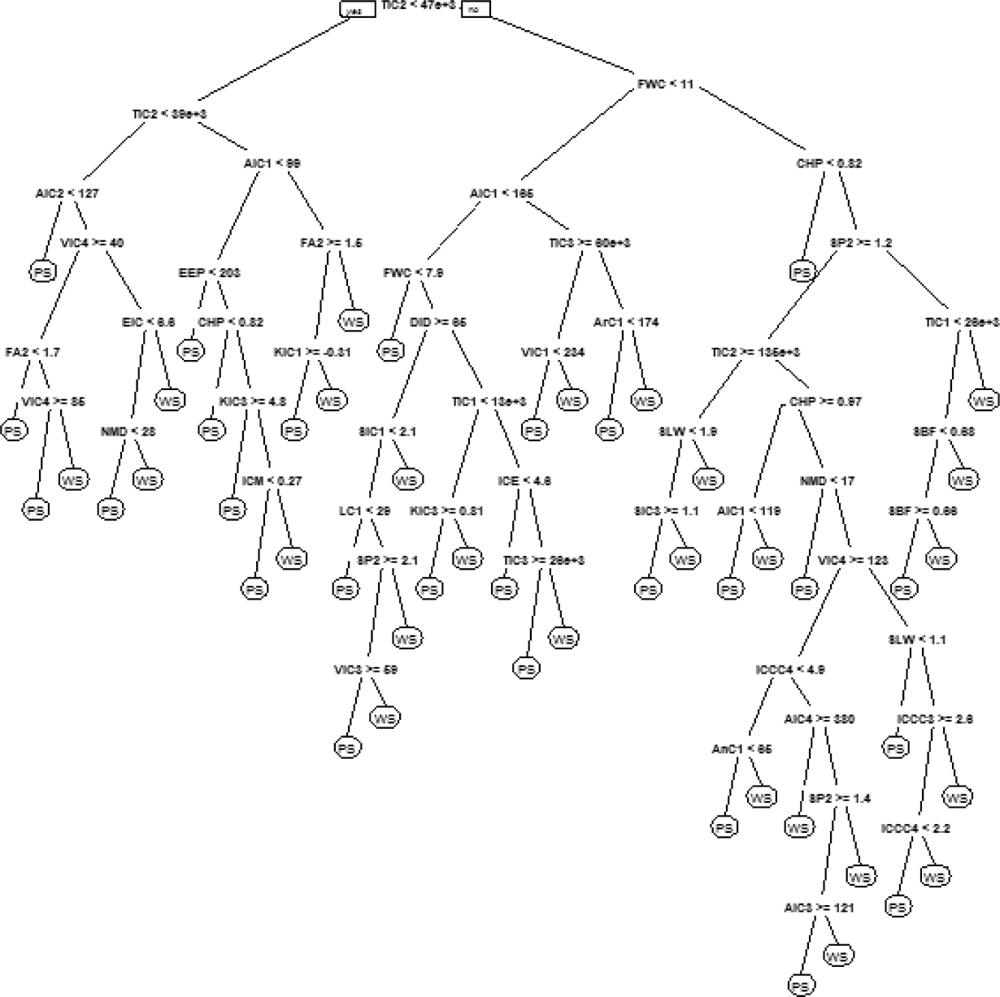

FIGURE 6.8: 回归树

## 6.6 基于实例的学习

在某些情况下，我们希望通过分析实例直接进行学习。创建规则是一项机械的工作，当数据量很大时，规则创建变得更加复杂。这种学习被称为基于实例的学习。系统从实例中学习，不再以决策树或规则集的形式表示结果，而是以实例本身的形式表示。在这种学习中，很容易修改数据中的实例。这背后的原因是，当学习是基于规则的，新实例应该被归类为规则之一；但当它是基于实例的，学习是通过实例本身进行推断的。每当实例被修改或添加新实例时，都会与现有实例进行比较，在距离度量的帮助下寻找最近的一个。当找到合适的时，新实例就会被放在旁边，形成最近邻分类方法。当我们想要为新实例成员寻找多个合适的位置时会发生？这时使用的方法是 K 最近邻法。其基本思想是差异，差异在寻找实例之间的关系方面起着重要作用，尽管这取决于属性的数量。主要使用的距离方法是标准欧几里得距离。该方法将归一化的属性及其重要性视为同等。哪个属性重要哪个不重要，这仍然是一个开放的研究课题。计算属性之间的距离是有偏的，这是通过搜索相同属性并将其赋予零，否则赋予一来实现的。属性权重、距离度量是所使用的基本方法。这完全取决于数据及其范围。这种类型学习的结果是实例通过丢弃非平凡且不必要的实例来学习自身。基于实例学习的完整框架如下文所示。

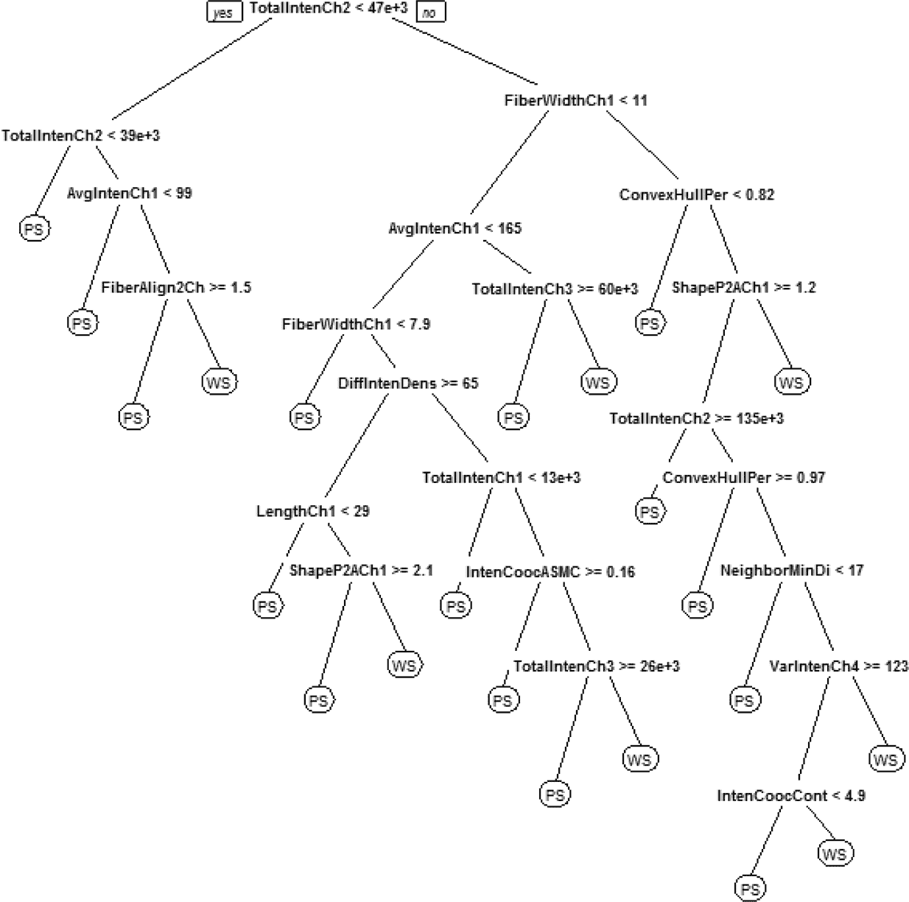

FIGURE 6.9: 剪枝后的回归树

1. 学习实例的不同参数。
2. 寻找不同实例之间的关系。
3. 选取低优先级的实例。
4. 丢弃选定的实例。
5. 使用新结构形成新数据。

不能说这是一种正确的学习类型。因此，它不属于监督学习和无监督学习的任何类别。这种学习的目标不是寻找数据中的隐藏模式（这是机器学习的首要目标）。它的目标是通过距离机制进行学习来寻找离群值。

### 6.6.1 距离度量

在基于实例的学习中，新实例搜索任何一类别的最近成员。一旦知道了最近成员的类别，就会将相同类别分配给新实例。两个实例之间的距离可以使用欧几里得距离公式计算，其中 `n` 是实例的数量。

$$
X = \sqrt{{(a\_{1}^{1} - a\_{2}^{1})}^{2} + {(a\_{1}^{2} - a\_{2}^{2})}^{2} + {(a\_{1}^{n} - a\_{2}^{n})}^{2}}
$$

(6.1) 公式 6.1 在差异非常大时可能会导致不可接受的差异。因此，将数值归一化到特定范围之间是非常必要的，可以通过给出的公式进行计算：

$$
a^{i} = \frac{n^{i} - min(n^{i})}{max(n^{i}) - min(n^{i})}
$$

(6.2) 在公式 6.2 中，`n^i` 指值。`min` 和 `max` 分别是最小和最大。`n` 是实例的数量。计算属性之间的距离是有偏的，这是通过搜索相同属性并将其赋予零，否则赋予一来实现的。属性权重、距离度量是所使用的基本方法。这完全取决于数据及其范围。这种类型学习的结果是实例通过丢弃非平凡且不必要的实例来学习自身。图 6.10 展示了属性之间的距离。图 6.11 显示了类别的形成。

FIGURE 6.10: 距离之间的距离

## 6.7 总结与后续

此命令用于绘制回归树。分支类型和数量是由上一个命令中的 `minsplit` 参数设置的。文本命令用于在不同分支上写入数值文本。

```
prp(tree.1)
```

```
prp(tree. 1,varlen=3)
```

剪枝有助于降低树的复杂度。最不重要的节点会被分裂，形成的新树包含较少的节点数量。该程序探索了两种树，即回归树（图 6.8）和剪枝后的回归树（图 6.9）。


FIGURE 6.8: 回归树

## 8: party 库与 partykit 库的区别是什么？

(a) 基础设施能力 (b) 表示能力 (c) 分类 (d) 回归

## 9: 哪个库可以实现所有的机器学习模型？

(a) party (b) rpart (c) caret (d) 以上均不是

## 10: R 的哪种功能允许按分段的形式划分数据？

(a) segmentationdata 库 (b) segment 函数 (c) split 函数 (d) 以上都不是

## 11: 哪个函数用于绘制回归树？

(a) `reg()` (b) `rpart()` (c) `rnode()` (d) 以上都不是

## 12: 基于实例的学习的作用是什么？

(a) 寻找隐藏模式 (b) 检测异常值 (c) 数据削减 (d) 以上都不是

## 13: 在计算距离度量时，使用哪种方法来寻找实例之间的距离？

(a) 最近邻 (b) 欧几里得距离 (c) 差平均值 (d) 以上都不是

## 14: 复制子树的问题是由于：

(a) 未分析的条件 (b) 大型数据集 (c) 存在异常值 (d) 以上都是

## 15: 如果实例不属于任何已形成的规则类别，应该怎么做？

(a) 修改规则 (b) 更改父节点 (c) 添加新规则 (d) 以上都不是

## 16: rpart 库的哪个函数处理缺失值？

(a) `na.rpart()` (b) `predict.rpart()` (c) `path.rpart()` (d) 以上都不是

## 17: rpart 库的哪个函数有助于预测？

(a) `rpart.predict()` (b) `predict.rpart()` (c) `na.rpart()` (d) `path.rpart()`

## 18: rpart 的全称是什么？

(a) 循环分层与回归树 (b) 递归划分与回归树 (c) 递归划分与复制树 (d) 以上都不是

## 19: 为什么采用基于实例的学习？

(a) 实例之间的关系 (b) 异常值检测 (c) 低优先级实例 (d) 以上都是

## 20: 在基于实例的学习中，我们为什么要丢弃少数实例？

(a) 异常值 (b) 低优先级实例 (c) 归一化 (d) 以上都是

# 7: 不同的机器学习模型

上一章讨论的学习是基于树的。它在名义属性上表现良好。在树结构中，数值预测是通过应用几次测试来实现的。在树中直接实现数值是受到限制的。然而，还有其他学习方法可以直接与数值属性一起工作。现在，在本章中，我们将学习这些方法（模型）以及它们处理各种组件的方法论。

### 7.1 回归的线性方法

当包括目标属性在内的所有属性都是数值时，线性回归就会发挥作用。这是统计学中的一种古老方法。其思想是用带有权重的属性来表示一个类别。使用的方程如下：`a` 是类别，`x[k]` 是实例，`w[k]` 是模型计算的权重。

```
a = w[0]*x[0] + w[1]*x[1] + w[2]*x[2] + ... + w[n]*x[n]
```

在训练数据中，每个实例的每个属性都有值，形成了一个类别。在线性回归中，每个类别也带有每个实例的权重。因此，方程可以写为：

```
a¹ = w[0]*x[0] + w[1]*x[1]¹ + w[2]*x[2]² + ... + w[n]*x[n]^n
```

在这个方程中，`a¹` 是实际类别，方程右侧（权重与其实例之和）是预测类别。现在，主要的考虑因素是目标，它预期是机器学习模型的结果。实际值与预测值之间的差异应该尽可能小。

$$\sum_{j = 0}^{m}\left\{ a^{j} - \sum_{i = 0}^{n}{w_{i}x_{i}} \right\}^{2}$$

计算实际类别和预测类别的平方和之间的差异。有 `m` 个训练实例，具有 `n` 个属性。

### 7.2 分类的线性方法

分类的线性方法可以通过回归的线性方法形成。唯一的限制是，当实例属于该类别时，将输出固定为 1，否则如图 7.1 所示为 0。还存在多响应线性回归，其中属于该类别的实例会导致多个输出。但与其他模型一样，它们也有一个缺点，即只能表示不同类别之间的线性边界。为了解决这个问题，支持向量机（主要称为支持算法）实现了线性模型，以便在线性边界可能无法区分类别的地方强制执行非线性类别限制。

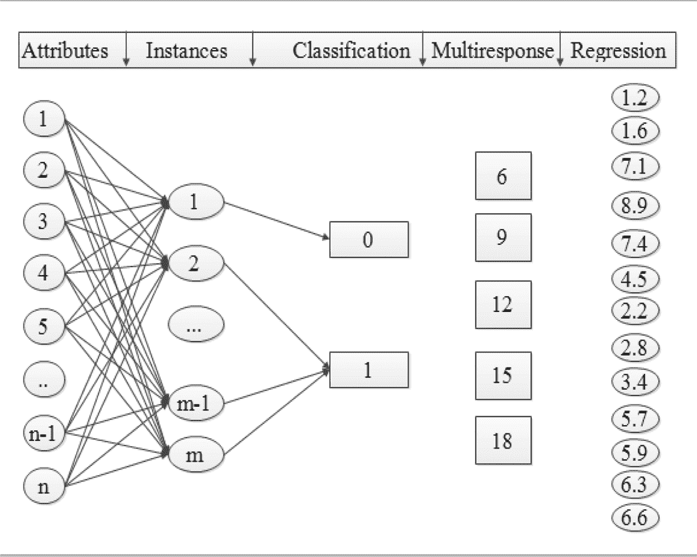


**它是如何工作的？** 它使用非线性映射转换输入，这意味着它将空间转换到新空间。完成后，在新空间中构建新模型，并表示原始空间中的非线性决策边界。这可以通过提供所有 `n` 个因子的乘积并将原始属性集替换为 1 来实现。考虑以下示例以更清楚地理解。

1. 取两个属性，
2. 令 `a` 为结果。
3. 令 `w` 为权重。
4. 考虑所有乘积的三个因子。

形成的方程如下：

```
a = w[1]*x[1]³ + w[2]*x[1]²*x[2]¹ + w[3]*x[1]²*x[1]² + w[4]*x[2]³
```

现在，每个训练实例都被映射到一个新空间，通过计算其两个属性值的所有可能的三个因子乘积，在新空间中生成模型。该结果可以通过为每个类别训练一个线性系统来用于分类。之后，我们可以将未知实例分配给在 `a` 中产生最大输出的类别。这种方法有几个缺点：

1. 在任何现实设置中，转换都会产生大量的系数。例如，假设有 10 个属性作为原始数据集。假设每个属性都包含 5 个因子。那么学习算法将确定大约 2000 个系数。这导致了算法的复杂性。
2. 如果由于训练实例数量巨大导致系数很多，则生成的模型也是非线性的。因此，这会导致数据过拟合。

在几何学中，超平面分离定理是一个关于 `n` 维欧几里得空间中不相交凸集的定理。有几个相当相似的版本。在定理的一个版本中，如果这两个数据集都是闭的（一个集合是闭的，当且仅当它与它的闭包重合），并且其中至少有一个是紧的（紧性是一个推广包含其所有极限点且有界的子集概念的性质），那么我们可以说这些集合之间存在一个超平面，甚至在它们之间存在两个间隔的平行超平面。考虑图 7.2，其中 `a` 代表最大间隔超平面，`b` 代表支持向量。观察结果：

1. 当你连接集合中的点时，轮廓就会出现。
2. 凸包在在线可分的类别中不会重叠。

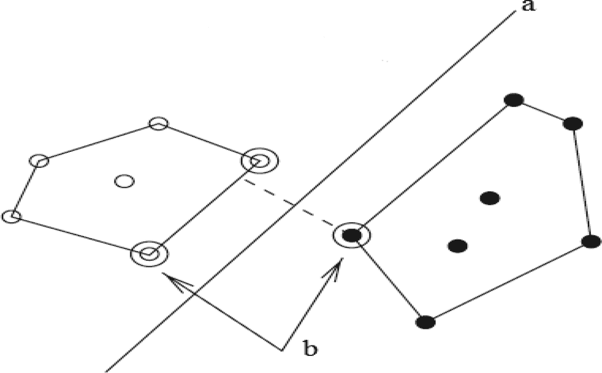

图 7.2: 最大间隔超平面

3. 最高的超平面间隔始终是距离两个凸包尽可能远的那一个。
4. 每个类中至少有一个支持向量。
5. 这里的支持向量集以独特的方式描述了该学习问题的最大超平面间隔。

需要注意的是，如果我们提供了两个类别的支持向量，我们就可以构建最大间隔超平面，并且可以移除其他训练数据实例而不改变超平面的方向。在移除数据集元素后，可以形成新的方程。

```
a = w[0] + w[1]x[1] + w[2]x[2]
```

(7.5)

在这里，如果考虑支持向量，方程可以修改如下：

```
a = b + ∑ p[i]y[i]x(i).x
```

(7.6)

其中，

- `y`: 实例类别值 `y`，取 1（如果是）或 -1（如果否）。这是实践中的 `x(i)` 示例。
- `x`: 测试实例
- `x(i)`: 支持向量
- `x(i).x`: 点积表示法
- `p[i]y[i]`: 定义超平面的参数。

有问题吗？寻找 `p[i]y[i]` 会导致一个被称为受约束二次优化的问题，可以使用软件包来解决。最后，通过对支持向量应用特定的算法，可以降低计算复杂度并加速学习。在考虑线性分类边界的情况时，这会导致计算复杂度和过拟合。如果我们使用支持向量来帮助，过拟合的概率会相对降低。这是通过改变一个或两个实例向量实现的，这些向量会对决策边界的大部分产生扫掠调整。另一方面，超平面是非常稳定的。只有当添加或删除上述作为支持向量的训练用例时，它才会发生变化。（这在高维空间非线性变换的情况下也是如此）。考虑到这一点，通过在对原始属性进行非线性映射之前计算点积，可以优化计算复杂度。优化后的方程可以写为：

```
a = b + ∑ p[i]yi.x)^(n)
```

(7.7)

其中 `n` 是转换因子系数。选择 `n` 值的一种有效方法是从 1（一个线性模型）开始，并不断增加它直到投影误差不再提高为止。一个相当小的值就足够了。多项式核函数 `(x.y)^n` 计算两个向量 `x` 和 `y` 的点积并将结果提高 `n` 次幂，可以用于非线性映射的不同实现。基于径基的核函数和 sigmoid 核函数是用于执行的两个额外特征。使用径基基函数核的支持向量是一种称为 RBF（径基函数）的神经网络，而使用 sigmoid 核的支持向量则实现了另一种类型的神经网络，即具有一个隐藏层的多层感知器。即使是帮助支持向量机的最快训练算法在非线性环境中也会变慢。

## 7.3 核平滑模型

我们可以使用感知机核算法来学习非线性决策的边界。在这种情况下，我们可能使用核函数代替点积。因此，仅仅通过跟踪训练过程中被分类错误的实例，并使用此表达式来形成每个预测，就可以通过感知机算法学习到非线性分类器。这也可以通过转换将其转变为逻辑回归核。得到的解并不稀缺，即解向量由每个训练示例支持。使用加权向量是使其更稳定的一种方法。在开始之后，连续路径的数量可能会导致权重向量的“正确性”，该权重向量正确地分类了后续实例。投票感知机（voted perceptron）是这种算法版本的名称，可以作为给给权重向量的票数，其性能几乎与支持向量机相当。

## 7.4 反向传播

在多层感知机的情况下（它是底层分类问题的预测器），我们需要为网络连接确定适当的权重。当没有隐藏层时，我们可以使用学习规则来这样做。如果有两个隐藏层，可以再次应用类似的策略来更新第一个隐藏层输入连接的当前权重，将误差从输出单元通过第二个隐藏层传播到第一层。通用的梯度下降方法由于这种误差传播机制被称为反向传播。但在隐藏单元的情况下，算法无法预测正确的输出，由于它们是隐藏的，因此无法遵循该规则。

### 解决方案

该问题通过修改指向隐藏单元的权重来解决。根据每个单元对最终预测的贡献强度，可以对其进行调整。梯度下降是一种实现此点的数学方法。后续的策略包含了用于将加权和转换为 0/1 预测的阶跃函数。

示例：考虑一个假设的误差函数，等同于 `x2 + 1`。x 轴代表一个待优化的假设参数。`x2 + 1` 的导数仅仅是 `2x`。

如果它具有多个最小值且规模过大，搜索可能会漏掉某个最小值，或者对其进行过激处理。如果它太低，通向最小值的进展可能会很缓慢。梯度下降法只能找到局部最小值。如果多层感知器对于函数特征和误差特征通常具有多个最小值的特征，它可能无法发现最佳的一个。与支持向量机相比，这是传统多层感知器的一个重要缺点。可以通过单个网络获得一个更紧凑的分类器，即为每个类创建一个输出单元，并把隐藏层中的每个单元连接到每个输出单元，如图 7.3 所示。多层感知器属于一种被称为`前馈网络`的网络类，因为它们不包含循环，且网络的输出仅取决于当前的输入实例。一旦通过网络传输了所有训练实例并收集了所有权重，就只进行更新。由于所有训练数据都是一起处理的，这种现象被称为`批量学习`。

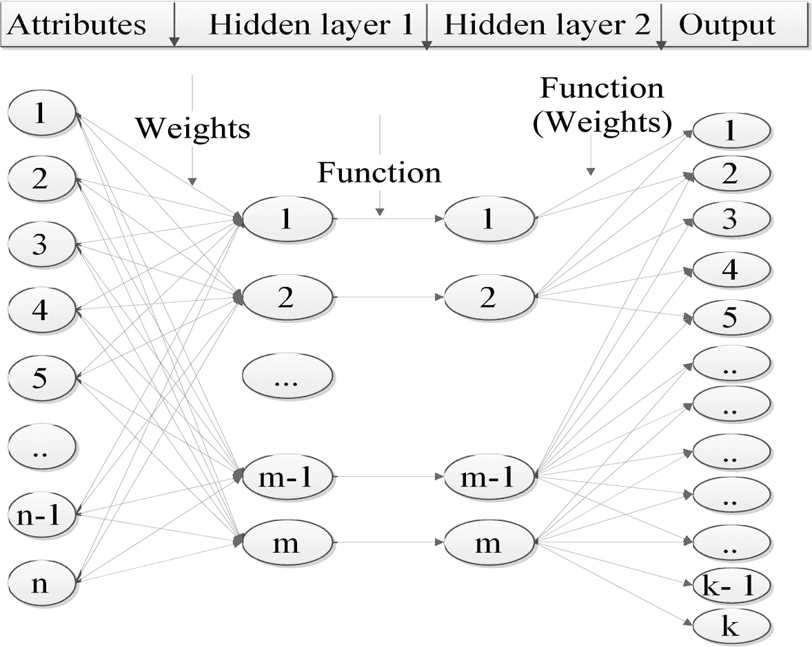

图 7.3: 多层感知器

随机反向传播是在处理每个训练示例后增量更新权重。它用于`在线学习`，即新数据持续不断到达且每个训练实例只被处理一次。在传播方法中，零均值单位标准差总是有效的。

过拟合是多层感知器的缺点。多层感知器的缺陷是它们包含了从根本上透明的隐藏单元。

基于规则的学习器作为减少误差剪枝方法运行以防止过拟合。换句话说，它充当一个验证集，用于决定何时停止使用`反向传播算法`进行进一步迭代。另一种技术是在误差函数中添加一个由所有网络权重平方组成的惩罚项。

#### 7.4.1 径向基函数网络

这是一个由隐藏单元执行两层计算的前馈网络。对于指定的示例，隐藏设备充当激活函数。如果实例是关闭的或反之，激活可以很强。在这里，`超球`取代了`超平面`。超球是给定的隐藏单元产生相同激活值的空间。在分类问题中，输出层获取隐藏单元输出的线性组合，并通过`sigmoid 函数`对其进行处理。与多层感知器相比，一个重要优势是可能独立于第二组参数来确定第一组参数，并且仍然生成精确的分类器。确定第一组参数有不同的技术。一种技术是在完全不看训练实例和类别标签的情况下使用聚类。可以应用聚类算法中简单的`k-means`，它分别对每个类进行聚类，以为每个类获取`k` 个基本特征。另一方面，可以学习第二组参数。RBF 网络在计算方式上存在缺点。

### 7.5 神经网络

神经网络被视为一种模型。它遵循输入并产生输出。神经网络是一种用于分类数据的机器学习。它基于人工神经元网络。每个神经元通过权重与其他神经元连接。

##### 7.5.1 感知器

感知器是最简单的神经网络。它由单层神经元和一个输出神经元组成。它接收多个输入，将其与权重相乘，然后应用激活函数。感知器的输出是一个二值值。感知器用于二分类任务。

贝叶斯统计被视为一种将概率与统计问题联系起来的数学方法。假设在 Rian 和 John 之间的四场锦标赛（F1）中，Rian 赢了三次，而 John 仅赢了一次。那么，如果你对下一场比赛的获胜者下注，你会押注谁？你会说 Rian。这就是转折之处。如果有人告诉你，John 获胜时下了雨，Rian 获胜时下了一次，而明天一定会下雨。那么现在你会押注谁呢？显而易见，John 的获胜概率大大增加。但问题的程度有多大？为了理解这个问题，我们需要熟悉一些概念，其中第一个就是条件概率。

### 7.6.2 贝叶斯推理

要理解贝叶斯推理背后的概念，以抛硬币为例。贝叶斯推理的一个重要方面是参数和模型的建立。（模型是对观测事件的数学公式化，而模型影响观测信息的变量就是参数）。现在，在抛硬币时，硬币的公平性被定义为硬币参数 `θ`。令结果表示为 `D`。在给定硬币公平性（`θ`）的情况下，9 次抛掷出现 4 次正面的（`D`）的概率是多少，即 `P(D|θ)`。

在给定结果（`D`）的情况下，硬币可靠（`θ=0.5`）的概率是多少？我们使用贝叶斯定理将其表示如下：

```
P(θ|D) = (P(D|θ) X P(θ))/P(D)
```

这里`P(θ)` 是先验（换句话说，是在抛掷之前我们对硬币公平性的信念强度）。认为硬币可以具有 0 到 1 之间的任何程度的公平性是可以的。`P(D|θ)` 是给定分布的观测结果。如果我们知道硬币是公平的，它将给出在规定次数翻中观测到正面次数的概率。`P(D)` 代表证据。它是通过对所有可能的 `θ` 值进行求和（或积分），并根据这些特定 `θ` 值的强度进行加权得出的数据概率。`P(θ|D)` 是观测到正面次数后参数的后验信念。要正确定义模型，我们需要之前的两个数学模型。第一个表示似然函数 `P(D|θ)`，第二个是先验信念的分布。这两者的乘积给出后验信念 `P(θ|D)` 分布。由于先验和后验都是关于硬币公平性分布的信念，假设它们具有相同的数学形式。

有不同的算法，但最简单的是 `k2`，它从属性或节点的排序开始。它依次处理每个节点，并考虑从之前处理的节点到当前节点的边。在每一步中，它将之前处理节点的边引入到当前节点。它添加边以使网络评分最大化。如果没有进一步的提升空间，则考虑下一个节点。可以将每个节点的父节点数量限制为由最大值定义的固定值。由于预先处理的是边，且它们有固定的顺序，因此不会引入循环。尽管结果取决于原始顺序，但使用不同的随机顺序多次运行该算法是有意义的。

朴素贝叶斯分类器是一个网络，从类属性到每个其他特征或节点都有一条边。在构建分类网络时，将此网络作为搜索的起点是有帮助的。

我们可以在 `K2` 算法中这样做，通过将类变量为排序中的第一位并适当初始化边集。另一个技巧是确保在代表类属性的节点的马尔可夫毯（Markov blanket）中，每个属性都应该覆盖。

一个节点涉及所有父节点、子节点以及子节点的父节点。观测到的节点与提供的所有其他节点都是条件独立的。如果类属性的马尔可夫毯中缺少节点，则该值对分类没有意义。

如果 `K2` 发现了一种在类枢纽覆盖中排除了重要特征的方案，它可能会包含一条边来纠正这种缺陷。纠正这种缺陷的一种简单方法是。

5: 多层感知器中的不同层通过以下方式连接：

(a) 权重 (b) 信号 (c) 激活函数 (d) 以上都不是

6: 系统收敛可以通过以下帮助进行估计：

(a) 训练比例 (b) 学习率 (c) MAE (d) 以上均不是

7: 径基函数返回的数据点的形式为：

(a) 超平面 (b) 超球 (c) 激活函数 (d) 以上都不是

8: 前馈神经网络主要用于什么目的？

(a) 分类 (b) 特征映射 (c) 模式映射 (d) 以上均不是

9: 时间序列预测使用：

(a) SVM (b) 神经网络 (c) 核平滑模型 (d) 以上都不是

10: 感知器遵循哪种模型？

(a) 反向传播模型 (b) 前馈模型 (c) 核平滑模型 (d) SVM

11: 贝叶斯方法遵循：

(a) 贝叶斯定理 (b) 贝斯法则 (c) 贝叶斯函数 (d) 以上都是

12: 贝叶斯网络遵循的统计适用于：

(a) 概率 (b) 代数 (c) 贝叶斯定理 (d) 以上都是

13: 如何描述贝叶斯网络的紧凑性？

(a) 完全结构化 (b) 部分结构 (c) 局部结构化 (d) 以上都是

14: 在创建贝叶斯网络时，节点与其前驱节点之间是什么关系？

(a) 依赖关系 (b) 条件独立 (c) 功能依赖 (d) a 和 b 都是

15: 网络的学习率是指什么意思？

(a) 步长 (b) 网络权重 (c) 收敛能力 (d) 以上都是

# 8 数据处理

在转向机器学习模型的工作之前，我们需要数据。数据应该是洁洁且无噪声的。这些数据作为机器学习模型的输入。为进一步的调查准备输入需要大量的精力。值得注意的是，在为机器准备输入时会出现各种复杂性。正如我们所知，机器在机器学习过程中倾向于学习，因此提供最佳输入会带来获得更好的学习效果。

## 8.1 输入准备

有必要将数据汇聚到一个地方，以形成特定数量的实例。这一阶段通常被称为数据收集。但我们不仅处于收集数据的过程中，还需要数据是洁净且无噪声的。数据的收集可能根据人们的职业而异。产生和需要数据的受众有多种。如果我谈到学生，学生是那些寻找非常简单的任务并尝试从互联网下载数据的人。这种分析有很多优点和缺点。首先，毫无疑问，万维网（WWW）上有成百个存储库，例如 `uci`、`data.science` 等。其次，下载数据是好事，因为这些数据是为此类实验而准备的。问题在于数据不是真实的，也是过时的。它们可能是多年前收集的。学生所进行的实验会让他们忽略学习数据预处理的一个重要阶段。从真实世界的业务角度来看，数据是从机构的各个部门收集的。可以有许多不同的部门，如生产部门、账单部门、销售部门、广告部门等。最重要的是，数据是由 IoT 应用产生的。IoT 数据是通过 IoT 设备收集的。通过 IoT 文件收集的数据量巨大且格式各异。IoT 数据具有不同的格式，如 `BDB` 格式和图形格式。当我们从各种来源收集数据时，会面临各种挑战。这可能会导致不同的问题，如不同的记录风格、不同的时间段、不同的数据格式、不同的聚合，最重要的是不同类型的错误。尽管收集数据付出了努力，但一旦组装和收集，仍然需要进行处理。这实际上导致了数据仓库的产生。数据仓库是存储多年企业数据的地方，用于做出业务决策。其维护的一致性与数据库管理系统相同。这是一个观察行业日常运营中碎片化数据的巨大例子，这些数据被收集起来以预测对行业相当于金币的信息。数据聚合必须在了解其目的的情况下进行。例如，天气科学家从各种来源收集不同的参数数据。但数据聚合和去归一化是以这种方式进行的：将重点放在实际预测实际所需的关键参数上。以下是在为机器学习模型输入进行数据收集和数据聚合时需要注意的不同问题。

1. **文件格式**：我们可以在执行各种文件格式时进行收集和存储数据。数据文件可能具有属性和实例。不同文件格式的原因是实例与其属性之间存在不同的关系。

- **ARFF**: 这是表示数据集的标准方式。该文件中的数据是独立的，实例是不排序的。这导致实例之间没有关系。参考[第 5.2 节]中的示例，天气数据的 ARFF 文件如[图 8.1]所示。你可以看到带有 `%` 的注释。但数据没有定义属性。在处理此文件之前，你必须先阅读这些注释。每个定义了属性的注释块都为实例定义了可能的值。这种格式很粗糙，且布局也不恰当。该文件没有定义数据的目的，也没有定义数据集的大小或维度。数值或字符串值是在注释中声明的。并不是每个实例都以属性开头。

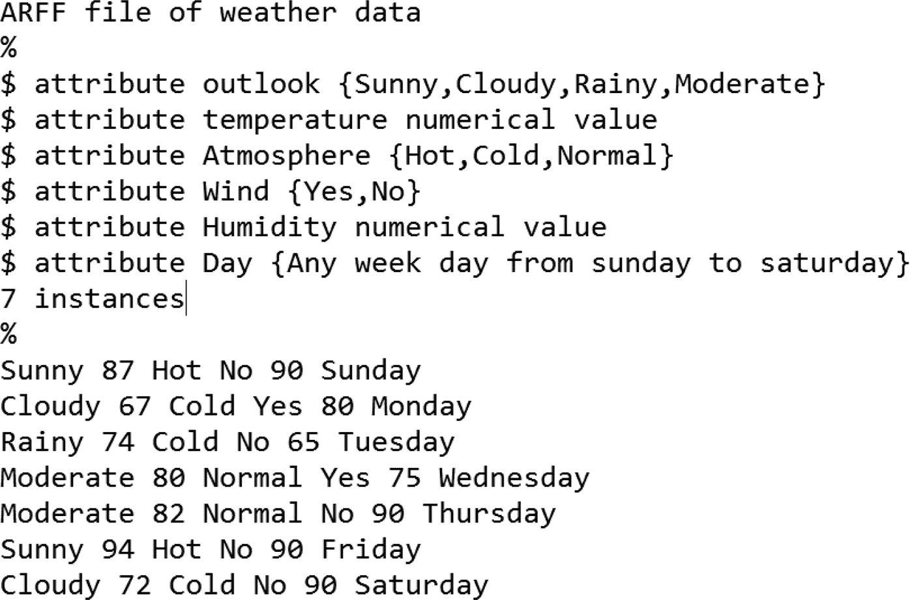

[FIGURE 8.1:] [ARFF 文件的布局]

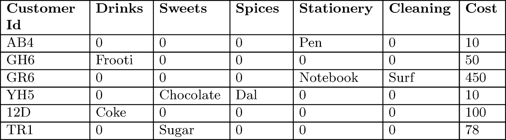

当从各种来源收集数据时，许多文件会被合并成压缩文件夹，主要扩展名为 `.jar`。

- **稀疏数据**：当数据格式包含大量的零而不是小数值时的格式。处理零值再次是一个非常麻烦的工作。例如，超市的数据，将客户购买的物品存储在实例中。购买的物品在每行中都被标记。例如，查看[表 8.1]。

你可以看到大部分值都是零。这导致了对零值的处理。有时，系统可能会用 `?` 来处理零值，这又是一个麻烦。

- **BDB 格式**：物联网（IoT）数据主要以二进制数据缓冲区（`BDB`）的形式存在。这种格式具有最重要的传输性和自描述性特征。它包含了如 XML 数据模型（`XBDD`）、JSON 数据模型（`JSONB`）、CSV 数据模型（`CSVB`）和 HTML 数据模型（`HBDB`）。系统需要安装 `java` 来读取此类格式。

- **图形格式**：物联网设备捕捉图像。这些图像将通过分析来提取特征。先进的深度学习技术可以用于从图像中读取数据。位图像处理也可用于相同的目的。

## 2. 处理缺失值

在收集数据后，可能会出现数据缺失的情况。正如在之前的章节使用的 IoT 数据集中所观察到的，有两行数据完全缺失。网站上的数据布局展示在图 8.2 中。我们采用的处理这些数据行的方法是将其删除。我们简单地删除了这些行，因为这些行不包含任何数据。因此，不能插入不知道范围、类型和数据类别的随机值。处理缺失值有多种方法。下面讨论了其中几种。

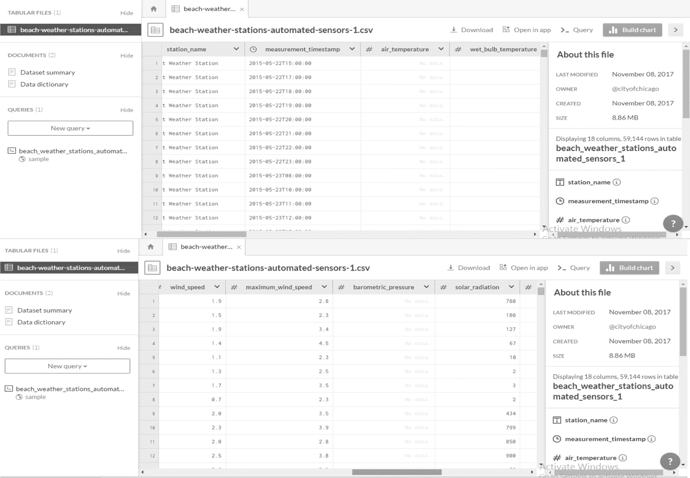

图 8.2： IoT 实验数据集中无数据的行

- **删除**：处理缺失值的第一个解决方案是，如果某行包含超过 30%的缺失值，则删除该行；如果某列包含 50%的缺失值，则删除该列。如果发生这种情况，这是正确的解决方案。但在采用这种方法时，有很多需要注意的地方。删除列时，它不应该是目标属性或主属性。如果数据集非常小，采用这种方法并不好。

- **用聚合值替换**：如果少数单元格包含空值，我们可以分配某些聚合值、平均值、中位数或众数。如果缺失值位于数值属性中，可以采用这种方法。这不会像前一种方法那样导致信息丢失。


**预测**：具有缺失值的属性可以被目标变量预测。因此，可以使用机器学习算法对其进行预测。在采用这种方法时，至关重要的是记住，机器学习算法不允许空值的存在。否则，算法可能会将空值视为有效值。

## 8.2 数据预处理

从源收集的数据通过保持文件格式和处理缺失值进行预处理。因此，数据包含了所有准确的值，没有缺失值，并且属性对齐。让我们来看图 8.3 中的我们的数据集。


图 8.3：Rattle 中预处理的 IoT 实验数据

查看我们的数据的选项有限。在 Rattle 中，我们可以查看我们的数据。查看我们的数据的选项有限。在 Rattle 中，我们可以查看我们的数据。查看我们的数据的选项有限。在 Rattle 中，我们可以查看我们的数据。查看我们的数据的选项有限。在 Rattle 中，我们可以查看我们的数据。查看我们的数据的选项有限。在 Rattle 中，我们可以查看我们的数据。查看我们的数据的选项有限。在 Rattle 中，我们可以查看我们的数据。查看图 8.2。

## 8.3 数据清洗

从源收集的数据通过保持文件格式和处理缺失值进行预处理。因此，数据包含了所有准确的值，没有缺失值，并且属性对齐。让我们来看图 8.3 中的我们的数据集。

```
[1] 0
```

完整的工作过程由算法 1 给出。为了更清晰地理解 CNN 的功能，R 语言中 CNN 程序的截图在图 8.4 中。上方显示了带有代码和输出的完整程序。CNN 通过 NN 算法找到一致子集以正确分类剩余实例。在第一个实例的帮助下，它遍历整个集合并找到被完全分类的实例。

程序 1 在 R 语言中实现。首先，包含 CNN 所需的库。我们已经像之前的示例那样，使用分割数据函数检索了某些数据。CNN 的输出可以通过下文讨论的各种参数如 `repIdx` 和 `repLab` 来查看。

- `cleanData`：一个存储过滤后数据集的数据框。
- `remIdx`：一个包含被移除实例索引的向量（行号向量）。
- `repIdx`：一个包含修复实例索引的向量。
- `repLab`：展示了修复实例的新标签。


图 8.4：在 R 中实现紧凑近邻规则

- `parameters`：它代表参数值。
- `call`：它代表函数调用。
- `extraInf`：它是额外的有趣信息。

### 8.3.2 Tomek

使用 Tomek 链接解决不平衡分类问题的函数命名为 `TomekClassif`。它通过破坏一个或多个链接来执行欠采样，从而破坏 Tomek 链接。`TomekClassif` 函数的语法如下。

```
TomekClassif(form, data, dist = “Euclidean”, Cl = “all”, rem = “both”)
```

在此函数中，使用的参数讨论如下：

- `Form`：它是描述预测期间问题的公式。
- `Data`：它是你将用于机器学习模型实验的数据。所使用的数据集可能是不平衡的。
- `Distance`：有各种距离度量来估计最近邻。它以字符形式指定。定义了一些指标，例如对于数值实例——`Canberra`、`Manhattan`、`Chebyshev`、`Euclidean`、`p-norm`；对于名义实例为 `overlap`；对于两种实例为 `HEOM` 和 `HVDM`。


图 8.5：用于不平衡分类问题的 Tomek 链接实现

- `p`：仅在选择的距离度量为 `p-norm` 时定义。其值等同于 `p-norm` 的 `p`。
- `Cl`：定义了目标为欠采样的类。可以是类的特定子集。
- `rem`：定义了要被丢弃的类。如果两个类都要被丢弃，则设置为 `both`。

`TomekClassif` 函数的工作由图 8.5 展示。它的语法和参数在之前已经定义。

**程序 2：**

```
library(ggplot2)
library(readr)
library(DMwR)
library(lattice)
library(unbalanced)
library(grid)
library(UBL)
data(segmentationData)
segmentationData
data <- segmentationData[-c(1,2)]
form <- as.formula(Class.)
a <- TomekClassif(form, data, dist = “HVDM”)
b <- TomekClassif(form, data, dist = “HEOM”)
c <- TomekClassif(form, data, dist = “HVDM”)
d <- TomekClassif(form, data, dist = “HVDM”)
s <- TomekClassif(form, data, dist = “Euclidean”)
```

**输出：**

```
summary(s)
summary(a)
summary(b)
summary(c)
summary(d)
```

### 8.3.3 单侧

`OSSClassif` 函数用于单侧策略。`OSSClassif` 的语法如下。

```
OSSClassif(form, data, dist = “Euclidean”, p = 2, Cl = “smaller”, start = “CNN”)
```

在此函数使用的参数讨论如下：

1. `Form`：它是描述预测问题的公式。
2. `Data`：它是用于实验机器学习模型的数据。数据集可能是不平衡的。
3. `Distance`：有各种距离度量来估计最近邻。它以字符形式指定。定义了一些指标，例如数值实例——`Canberra`、`Manhattan`、`Chebyshev`、`Euclidean`、`p-norm`；名义实例为 `overlap`；对于两种实例为 `HEOM` 和 `HVDM`。
4. `p`：仅在选择的距离度量为 `p-norm` 时定义。其值等同于 `p-norm` 的 `p`。
5. `Cl`：定义了目标为欠采样的类。可以是类的特定子集。
6. `Start`：决定初始功能，即函数的策略。它可以是 `CNN` 或 `Tomek`。两种策略都应用了，可以设置优先级。

**程序 3：**

```
library(DMwR)
library(UBL)
data(segmentationData)
segmentationData
data <- segmentationData[-c(1,2)]
form <- as.formula(Class.)
a <- OSSClassif(form, data, dist = “HVDM”)
b <- OSSClassif(form, data, dist = “HEOM”, start = “Tomek”)
c <- OSSClassif(form, data, dist = “HVDM”, start = “CNN”)
d <- OSSClassif(form, data, dist = “HVDM”, start = “Tomek”)
e <- OSSClassif(form, data, dist = “HEOM”)
```

**输出：**

```
summary(a)
summary(b)
summary(c)
summary(d)
summary(e)
```

### 8.3.4 SMOTE

`SMOTE` 函数如图 8.6 所示，处理不平衡分类问题。在 SMOTE 处理后的数据中实现变异后，输出展示在图 8.7 中。该函数的语法如下：

```
SMOTE(form, data, perc.over = 200, k = 5, perc.under = 200, learner = NULL, ...)
```

下文讨论了该函数使用的不同参数。

1. `form`：描述设计问题工作原理的公式。
2. `data`：这是一个不平衡数据集，旨在通过此函数进行平衡。
3. `perc.over`：这是一个参数，指定为少数类样本创建的案例数量。通常，它等于 100 以保持比例。
4. `k`：这会为少数类数量创建案例数量，但该参数指示用于生成实例的最近邻的频率。
5. `perc.under`：这是一个参数，指定为少数类样本从多数类样本中选择的额外案例数量。


图 8.6：用于不平衡分类问题的 SMOTE 实现


图 8.7：用于不平衡分类问题的 SMOTE 结果绘图

6. `learner`：这是一个可选参数，用于指定分类算法。
7. `…`：如果你指定了学习器（参数 `learner`），你可以指定在调用此学习器时可以使用 `f` 参数。

**程序 4：**

```r
library(UBL)
data(segmentationData)
segmentationData
data <- segmentationData[,-c(1,2)]
form <- as.formula(Class.)
newData<- SMOTE(form, data, perc.over = 600,perc.under=100)
plot(data[, 1], data[, 2], pch = 19 + as.integer(data[, 3]), main = “Original Data”)
plot(newData[, 1], newData[, 2], pch = 19 + as.integer(newData[,3]), main = “SMOTE’d Data”)
classTree<- SMOTE(form, data, perc.over = 600,perc.under=100, learner=’rpartXse’,se=0.5)
rpartXse(form,data,se=0.5)
```

**输出：** n= 2019（`data` 中的实例数量）

```
1) root 2019 719 PS (0.64388311 0.35611689)
2) TotalIntenCh2< 47256.5 967 83 PS (0.91416753 0.08583247) *
3) TotalIntenCh2>=47256.5 1052 416 WS (0.39543726 0.60456274)
6) FiberWidthCh1< 11.19756 434 175 PS (0.59677419 0.40322581)
12) AvgIntenCh1< 165.0862 323 99 PS (0.69349845 0.30650155) *
13) AvgIntenCh1>=165.0862 111 35 WS (0.31531532 0.68468468)
26) TotalIntenCh3>=59653.5 32 10 PS (0.68750000 0.31250000) *
27) TotalIntenCh3< 59653.5 79 13 WS (0.16455696 0.83544304) *
7) FiberWidthCh1>=11.19756 618 157 WS (0.25404531 0.74595469)
14) ConvexHullPerimRatioCh1< 0.8160616 22 5 PS (0.77272727 0.22727273) *
15) ConvexHullPerimRatioCh1>=0.8160616 596 140 WS .6 *
```

### 8.3.5 ADASYN 算法

`Adasynif` 函数提供了不平衡分类问题的解决方案。它通过在 SMOTE 中通过生成合成示例来处理不平衡的类别。因此，ADASYN 算法的实现在图 8.8 中。ADASYN 算法的结果展示在图 8.9 中。其实现在图 8.10 中。

```
Adasynif(form, data, baseClass = NULL, k = 5, dist = “Euclidean”)
```

1. `Form`：描述设计问题工作原理的公式。
2. `Data`：这是一个不平衡数据集，旨在通过此函数进行平衡。
3. `under`：指定为少数类样本从多数类样本中选择的额外案例数量的参数。
4. `over`：指定为少数类样本创建的案例数量的参数。
5. `k`：该参数指示用于生成实例的最近邻的频率。
6. `baseClass`：这是一个用于指定多数类平衡比例的可选参数。
7. `beta`：这是一个指定合成示例比例的数值参数，默认为 1。

**程序 5：**

```r
library(rpart)
library(rattle)
library(RColorBrewer)
library(party)
library(partykit)
library(caret)
library(UBL)
data(segmentationData)
segmentationData
data <- segmentationData[,-c(1,2)]
form <- as.formula(Class.)
newData<- Adasynif(form, data)
plot(data[, 1], data[, 2], pch = 19 + as.integer(data[, 3]), col = as.integer(data[, 3]), main = “Original Data”)
plot(newData[, 1], newData[, 2], pch = 19 + as.integer(newData[, 3]), col = as.integer(newData[,3]), main = “New Data”)
out <- Adasynif(form, data)
print(out)
```

**输出：**

```
Class
PS:1300
WS:1225
```


图 8.10：应用 ADASYN 算法的数据

### 8.3.6 SOTU

该方法背后的想法是处理由于类别不平衡导致的准确性问题。例如，在标准数据集 WEBSPAM-UK 2007 中，垃圾邮件标签的比例少于其他标签。这可能导致分类器的偏差。当少数类（即垃圾邮件）是目标类时，对其进行了特殊处理。采用的方法是“过采样划分和欠拟合训练”（SOTU）。它通过创建少数类的多个副本来进行过采样。通过一次对一个样本集进行训练来避免过拟合。每个集都包含少数类和多数类的等实例。整个数据集被划分为 11 个样本桶。模型对不同的集合进行 11 次训练和测试。因此，可以说系统是使用无偏数据进行训练的。所提数据清洗方法中的样本分布如图 8.11 所示。

`Eq. 8.1` 用于样本集的公式化。`S` 指数据集的训练文件。`x[m]` 指少数类别的实例，而 `x[n]` 指多数类别的实例。`d` 是样本集的数量；它取决于问题的类型和特征的数量。在分类问题中，它被固定为奇数。在回归问题中，它被固定为偶数。估算的数量应该接近特征的数量（如果需要，建议变动为 1）。由于垃圾邮件检测是一个分类问题，因此估计为奇数。在本提议中，特征数量为 11，这已经是一个奇数了。`d` 固定为值 11，形成的样本集为 11 个。

## 8.4 总结与后续展望

机器学习模型中要处理的数据应该是干净且无噪声的。为了这一点，本章详细阐述了所使用的各种方法。数据格式应该保持一致，因此本章详细阐述了不同的文件格式。此外，解释了各种数据清洗方法，例如压缩最近邻规则、Tomek、单侧选择、SMOTE 等许多方法，如 `Table 8.2` 所示。这些方法在 R 中执行以便进行更好的说明。


## 8.5 练习

### 思考

1. 在收集数据和执行数据聚合时，需要考虑哪些重要的限制？
2. 有哪些不同的文件格式？
3. 你应该如何处理数据中的缺失值？
4. 数据清洗是指？
5. 详细解释 CNN 方法。
6. 详细解释 Tomek 方法。
7. 详细解释单侧选择方法。
8. 解释 SMOTE 所遵循的方法。
9. 定义 SOTU 所遵循的方法论。
10. 用一个例子简要描述 ADASYN 算法。

### 单选题

**1：实例在 ARFF 文件是如何排列的？**

(a) 有序 (b) 无序 (c) 排序 (d) 以上都不是

**2：压缩文件的扩展名是什么？**

(a) `.zip` (b) `.jar` (c) `.exe` (d) 以上都不是

**3：稀疏文件包含最大数量的：**

(a) 0 (b) 1 (c) 十进制值 (d) 以上都不是

**4：文件中处理缺失数据采用了哪种技术？**

(a) 删除 (b) 替换 (c) 预测 (d) 以上所有

**5：CNN 的哪个参数代表修复实例的标签？**

(a) `cleanData` (b) `repIdx` (c) `repLab` (d) `remIdx`

**6：CNN 的哪个参数用于存储过滤后的数据？**

(a) `cleanData` (b) `repIdx` (c) `repLab` (d) `remIdx`

**7：Tomek 函数的 `p` 参数的作用是什么？**

(a) `p-norm` (b) `p-index` (c) `p-data` (d) 以上都不是

**8：单侧选择策略使用了哪个函数？**


(a) `OSSClassif()` (b) `OSS()` (c) `select()` (d) 以上都不是

**9: SMOTE 中用哪个参数来指定分类算法？**

(a) `k` (b) `learner` (c) `perc.over` (d) `perc.under`

**10: 用于指定分类算法的参数是数据清洗方法：**

(a) Under-sampled (b) Over-sampled (c) Under-fitted (d) Over-fitted

**11: ADASYN 算法使用的参数用于定义类别：**

(a) Comparison (b) Prediction (c) Target (d) None of these

**12: SOTU 方法使用的方法是：**

(a) Under-sampled (b) Over-sampled (c) Under-fitted (d) Over-fitted

**13: 哪种技术使用了寻找区域的方法？**

(a) Tomek (b) SHRINK (c) SMOTE (d) SOTU

# 9 特征工程与优化

机器学习模型中要处理的数据应该是干净且无噪声的。为了这一点，本章详细阐述了所使用的各种方法。数据格式应该保持一致，因此本章详细阐述了不同的文件格式。此外，解释了各种数据清洗方法，例如压缩最近邻规则、Tomek、单侧选择、SMOTE 等许多方法，如 `Table 8.2` 所示。这些方法在 R 中执行以便进行更好的说明。

机器学习算法在准确工作时高度依赖于实例和属性。我们都知道这些值源自真实世界，因此实例无法被创建、无法被修改或破坏。我们在上章中对实例进行了预处理。为了使机器学习模型更可靠，必须选择合适的属性。正如真实数据集所示，越深入，寻找合适的属性就越困难。这是因为属性尺寸较小。为了解决此类问题，必须了解属性的表现。这就是我们说的特征工程。基于树的学习和基于决策的学习是最复杂的结构，因为它们处理属性。当我们谈论基于实例的学习器时，它们非常受影响。决策树通过分治的方法处理属性，通过生成基于条件的公式来工作。相比之下，朴素贝叶斯算法独立地处理每个属性，假设属性之间没有关系。这就是属性影响机器学习模型工作的方式。

有时，过滤相关属性是挑战性的。当过滤后的属性数量较少并产生强依赖关系时，目标属性似乎采用了具有相同名值范围的属性的值或精确学习了数据的相似模式。这可能导致不准确。因此，不建议使用某些自动/程序的属性选择方案来选择属性。最好的方法是深入理解机器学习模型的工作及其对属性的计划。这有助于确定特征的最集。

处理属性的另一个阶段是降维。这并不是减少属性，而是减少维度空间。有时，数据集包含高维数据，这增加了模型的复杂度。有很多降维方案。用于降维的方案通常被称为特征提取方案。让我们深入探讨这两个概念：特征提取和特征选择。

## 9.1 特征还原

特征还原是通过形成新的特征空间将高维特征转换为低维特征的方法。然而，特征提取并没有减少特征，而是减少特征的复杂度。

### 9.1.1 主成分分析

主成分分析（PCA）来执行特征提取任务。PCA 是一种多元程序，用于将一组相关变量转换为一组不相关的变量。新集合的形成方式使得从变量中提取出最大的方差。提取出的方差被移除，从而形成第二种变量组合。此过程一直持续到变量之间的相关性降低。其结果是正交（不相关）方差，该程序被称为主轴法。它降低了特征空间的维度。PCA 也被称为数据压缩技术。它降低了数据的复杂性。实验考虑了具有数值的 IoT 数据。为了显示完整输出，考虑了十二个特征，即湿球温度、湿度、雨强度、间歇雨、总雨量、降水类型、风向、风速、最大风速、太阳辐射、航向、电池寿命以及 500 行数据。

计算主成分（PC）得分，也称为成分得分。这些得分是通过每行的标准化值与每列相乘得出的。计算出的 PC 是特征值，提供了有关数据变异性的信息。执行 PCA 有多种方法。无论使用哪种方法，结果总是一系列 PC 的特征值。我们在 R 语言中实现了所提方案。用于计算 PCA 的不同函数有：`prcomp()`、`primcomp()` 和 `PCA()`。这些方法的简述如下：

### 1. `prcomp()` 方法

该函数内置于名为 `stats` 的包。此方法产生特征值但不计算 PC。应用 `prcomp()` 后的结果生成一系列特征值，但不是实际的 PC。该方法的语法如下：

```
prcomp(x, retx = TRUE, center = TRUE, scale. = FALSE, tol = NULL, rank. = NULL, …)
```

该函数接受的参数有：

* `x`: 数据矩阵，在执行 PCA 时用于实验。
* `retx`: 这是一个可选参数，说明是否返回旋转后的变量。
* `center`: 变量是否向零平移。
* `scale`: 说明变量是否向其方差进行缩放。
* `tol`: 要考虑的成分的最小水平。
* `rank`: 要使用的主成分数量。

此函数用于程序 1。在程序程序中，第 1 到 8 行说明了该程序功能所需的库。第 9 行调用 `read` 函数并带有读取 `.csv` 文件的对象。第 10 行计算读取数据的 PCA。第 11 行打印计算出的 PCA 的标准差。第 12 行返回计算出的特征值矩阵。第 13 行打印由 `retx` 参数旋转的值。该程序的输出附加如下。

#### 程序 1

```
1. library(randomForest)
2. library(hmeasure)
3. library(FSelector)
4. library(FactoMineR)
5. library(ade4)
6. library(ggplot2)
7. library(FactoMineR)
8. library(devtools)
9. data<- read.csv("F:/experiments/beach1.csv")
10. pca1 = prcomp(data, scale. = TRUE)
11. pca1$sdev
12. head(pca1$rotation)
13. head(pca1$x)
```

#### 输出

```text
library(hmeasure)
library(FSelector)
library(FactoMineR)
library(ade4)
library(ggplot2)
library(FactoMineR)
library(devtools)
data<- read.csv("F:/experiments/beach1.csv")
pca1 = prcomp(data, scale. = TRUE)
pca1$sdev
[1.8354207 1.582721 1.194972 1.037864 0.956321 0.901565 0.854014 0.716822 0.656888 0.380657 0.212864 0.169734]

head(pca1$rotation)
PC1 PC2 PC3 PC4 PC5
Wet.Bulb.Temperature -0.458452 0.182157 -0.092038 0.172864
Humidity -0.061235 -0.374697 -0.001886 -0.145923 0.247889
Rain.Intensity -0.121584 -0.225062 -0.531599 -0.208895 0.109561
Interval.Rain -0.014262 -0.291763 -0.411138 -0.128164 -0.086234
Total.Rain -0.498931 0.013148 0.117844 0.018942 -0.223462
Precipitation.Type -0.205596 -0.262333 -0.459947 -0.003149 -0.057089
PC6 PC7 PC8 PC9 PC10
Wet.Bulb.Temperature 0.098088 -0.008267 0.135528 -0.402180 -0.355692
Humidity 0.765712 0.177364 -0.305198 0.019635 -0.248203
Rain.Intensity -0.433592 0.179869 -0.534135 -0.299531 0.030212
Interval.Rain 0.129258 -0.820302 0.172576 0.028783 0.038511
Total.Rain 0.206135 -0.009297 -0.103077 -0.073684 0.821339
Precipitation.Type -0.005997 0.465931 0.556712 0.379086 0.054987
PC11 PC12
Wet.Bulb.Temperature -0.559418 0.202956
Humidity -0.010739 0.003818
Rain.Intensity -0.007415 -0.005228
Interval.Rain 0.007804 -0.005459
Total.Rain -0.053194 -0.010031
Precipitation.Type 0.005113 0.015309

head(pca1$x)
PC1 PC2 PC3 PC4 PC5 PC6 PC7
-0.7533908 1.360380 0.6036531 -1.7741552 -1.3549539 -1.273898 -0.2977139
-0.715955 1.2824627 0.205125 -0.0167374 0.0925824 -1.275718 -0.4999055
-0.6957618 1.0312744 0.2793453 0.4141385 -0.0896814 -1.455666 -0.5261064
-0.7533908 1.3614627 0.6011355 -0.0141354 -0.0956354 -1.455666 -0.523935

00.693390  ..012677 0..051335 0..056335 0..096635 -0..5566600.03330

00.093360  0.003360 0.003333000.003680000.00000000.00000000.00000000.00000000.00000000.00000000.00000000.00000000.00000000.00000000.00000000.00000000.00000000.00000000.00000000.00000000.00000000.00000000.00000000.00000000.00000000.00000000.00000000.00000000.00000000.00000000.00000000.00000000.00000000.00000000.00000000.00000000.00000000.00000000
```

### 2. 使用 `primcomp()` 方法

它与 `prcomp()` 方法相似，并包含在 `stats` 包中。两者区别在于 `primcomp()` 提供的是镜像值而非实际值。应用 `primcomp()` 后的结果产生一系列特征值。该函数的语法为：

```
primcomp(x, cor = FALSE, scores = TRUE, covmat = NULL, subset = rep_len(TRUE, nrow(as.matrix(x))), fix_sign = TRUE, …)
```

函数接受以下各种参数：

* `x`: 在执行 PCA 时用于实验的数据矩阵。
* `cor`: 指定计算使用的矩阵，相关矩阵或协方差矩阵。
* `scores`: 计算每个主成分的得分。
* `covmat`: 用于替代 `x` 的协方差矩阵的协方差矩阵。
* `fix_sign`: 要选择的得分符号。

我们在程序 2 中使用了此函数。该程序的第 1 行在变量 `pca2` 中返回计算出的 PC。第 2 行计算 `pca2` 中值的标准差。第 3 行打印计算出的特征值矩阵。第 4 行打印每个主成分的得分。该程序的输出附加在程序末尾。

#### 程序 2

```
1. library(randomForest)
2. library(hmeasure)
3. library(FSelector)
4. library(FactoMineR)
5. library(ade4)
6. library(ggplot2)
7. library(FactoMineR)
8. library(devtools)
9. data<- read.csv("F:/experiments/beach1.csv")
10. pca1 = prcomp(data, scale. = TRUE)
11. pca1$sdev
12. head(pca1$rotation)
13. head(pca1$x)
```

#### 输出

```text
pca2 = princomp(data, cor = TRUE)

pca2$sdev

Comp.1 Comp.2 Comp.3 Comp.4 Comp.5 Comp.6
Comp.7 Comp.8 Comp.9
1.8354207 1.5827218 1.1949725 1.0378641 0.9563216 0.9015651
0.8540104 0.7168229 0.6568880
Comp.10 Comp.11 Comp.12
0.3806957 0.2128649 0.1697634
```


`unclass(pca2$loadings)` 的输出结果如下：

```
Comp.1 Comp.2 Comp.3 Comp.4 Comp.5
Wet.Bulb.Temperature 0.45845244 0.18215272 0.092028237 0.172864649 0.21873624
Humidity 0.06123625 -0.37469727 0.001886231 -0.145942937 -0.24788960
Rain.Intensity 0.12158475 -0.22506254 0.531559993 -0.208895457 -0.10955651
Interval.Rain 0.01426211 -0.29176049 0.411138003 -0.128106431 0.08623425
Total.Rain 0.49893019 0.01311483 -0.117848444 0.018942402 0.02234642
Precipitation.Type 0.20559674 -0.26233369 0.459994477 -0.003149514 0.05708889
Continued:
Wind.Direction -0.16120491 0.04522763 0.282489389 0.650800751 0.48761543
Wind.Speed -0.06288441 -0.55358689 -0.312656986 0.091902728 0.17264949
Maximum.Wind.Speed 0.06467973 -0.53704074 -0.297924488 0.159114244 0.25685763
Solar.Radiation -0.05655801 0.10858394 -0.060526774 -0.654214287 0.71576282
Heading 0.41499927 -0.05101608 -0.207012980 -0.030569154 -0.0967805
Battery.Life -0.51993819 -0.10170644 0.040275 -0.1107805
Comp.6 Comp.7 Comp.8 Comp.9
Wet.Bulb.Temperature 0.09808833 0.00822682 0.1355208 0.4021803 0.3556692
Humidity 0.76575124 -0.17736497 -0.3051986 -0.019635 0.2482032
Rain.Intensity -0.43359024 -0.1798697 -0.5341557 0.2995315 -0.030212
Interval.Rain 0.12925833 0.8203021 0.1725736 -0.0287837 -0.0385511
Total.Rain 0.20613594 0.00923782 -0.1030772 0.0736804 -0.8213339
Precipitation.Type -0.00599732 -0.4659318 0.5567122 -0.3790857 -0.0549876
Wind.Direction 0.16793028 -0.02949714 -0.3795627 -0.2235984 -0.0450436
Wind.Speed -0.16912489 -0.01703608 0.02781177 0.0959982 -0.0471524
Maximum.Wind.Speed -0.1502545 -0.02905141 0.0654158 0.1781695 0.06885
Solar.Radiation 0.092903575 -0.10251082 -0.10698115 -0.09992405 0.008282
Heading -0.26217406 0.17646564 -0.30291047 -0.69463776 0.2045206
Battery.Life 0.0045957 -0.04892145 -0.02307648 -0.121325 0.28459985
Comp.11 Comp.12
Wet.Bulb.Temperature 0.55941845 0.202956339
Humidity 0.01073931 0.00381842
Rain.Intensity 0.007415427 -0.00522846
Interval.Rain 0.007804646 -0.005459867
Continued:
Total.Rain 0.053193431 -0.0100315
Precipitation.Type -0.005113261 0.01530984
Wind.Direction -0.073952111 0.01496413
Wind.Speed -0.086397258 0.71064293
Maximum.Wind.Speed 0.10433666 -0.67252094
Solar.Radiation 0.019552299 0.00392318
Heading 0.235591991 0.02310187
Battery.Life 0.777344225 0.01822304
```

`head(pca2$scores)` 的输出结果如下：

```
Comp.1 Comp.2 Comp.3 Comp.4 Comp.5 Comp.6
1 0.7541454 1.3617424 -0.60425772 -1.77593210 1.35631089
2 0.7166720 1.2837471 -0.20533049 -0.01675419 -0.09267518
3 0.6964586 1.0323072 -0.27962509 0.4145533 0.08977122
4 0.7403739 0.9395554 -0.33417673 0.57488739 -0.01922158
5 0.7371149 1.4565982 -0.03257497 0.62351446 -0.3444277
6 0.7986492 1.2147532 -0.01374517 0.73520798 -0.3339785
Comp.8 Comp.9 Comp.10 Comp.11 Comp.12
1 -0.0334146 -0.9320459 0.7827216 -0.4353964 0.0132689
2 -0.06571284 -0.9313905 0.7030341 -0.5247296 -0.0074705
3 -0.07355979 -0.8771451 0.6757492 -0.5113841 -0.1412154
4 0.01287846 -0.801687 0.6842641 -0.4670741 -0.5705289
5 -0.00927742 -0.9297599 0.6351438 -0.5906236 -0.1297016
6 -0.20175045 -0.903677 0.7963279 -0.525709 -0.0845794
```

`pca()` 方法是执行 PCA 的最佳方法之一。该方法包含在 `FactomR` 包中。它为每列生成相应的序列。该函数的语法为：`PCA(X, scale.unit = TRUE, ncp = 5, ind.sup = NULL, quali.sup = NULL, row.w = NULL, col.w = NULL, graph = TRUE, axes = c(1,2))`。该函数接受的参数有：

- `x`: 用于实验的矩阵。
- `ncp`: 保留的维度（默认值为 5）。
- `scale.unit`: 如果数据已缩放，则为 true。
- `ind.sup`: 补充实例。
- `centi.sup`: 定量补充实例。
- `quali.sup`: 分类补充实例。
- `row.w`: 行权重。
- `col.w`: 列权重。
- `graph`: 如果为 TRUE，则显示图表。

## 程序 3

```
pca3 = PCA(data, graph = TRUE)

pca3$eig

pca3$var$coord

head(pca3$ind$coord)
```

## 输出

`pca3$eig` 的输出结果如下：

```
eigenvalue percentage of variance

comp 1 3.36876913 28.0730661 28.07308

comp 2 2.50500828 20.875069 48.94815

comp 3 1.42795928 11.899607 60.84781

comp 4 1.07716183 8.976348 69.82415

comp 5 0.91455095 7.6212579 77.44541

comp 6 0.81281966 6.7734972 84.21891

comp 7 0.72933373 6.0777811 90.29669

comp 8 0.51383511 4.2819592 94.57865

comp 9 0.43150179 3.5958482 98.1745

comp 10 0.14492920 1.2077433 99.38224

comp 11 0.04531145 0.3775954 99.75984

comp 12 0.02881960 0.2401633 100.0
```

`pca3$var$coord` 的输出结果如下：

```
Dim.1 Dim.2 Dim.3 Dim.4 Dim.5

Wet.Bulb.Temperature 0.841503 -0.2882908 0.1099712 -0.1794108 0.209118

Humidity 0.1123942 0.5930415 0.0022539 0.1514689 -0.237062

Rain.Intensity 0.22315917 -0.1798697 -0.5341557 0.2995315 -0.030212

Interval.Rain 0.0261769 0.4617756 0.4912986 -0.0287837 -0.0385511

Total.Rain 0.2061359 0.0092378 -0.1030772 0.0736804 -0.8213339

Precipitation.Type 0.3775964 -0.2623337 0.5567122 -0.3790857 -0.0549876

Continued:

Wind.Direction 0.16793028 -0.02949714 -0.3795627 -0.2235984 -0.0450436

Wind.Speed -0.16912489 -0.01703608 0.02781177 0.0959982 -0.0471524

Maximum.Wind.Speed -0.1502545 -0.02905141 0.0654158 0.1781695 0.06885

Solar.Radiation 0.092903575 -0.10251082 -0.10698115 -0.09992405 0.008282

Heading -0.26217406 0.17646564 -0.30291047 -0.69463776 0.2045206

Battery.Life 0.0045957 -0.04892145 -0.02307648 -0.121325 0.28459985
```

接下来，我们通过以下步骤绘制相关性圆图（Circle of correlations）：

1. 设置图形主题：

```r
g <- g + scale_color_discrete(name = ”)
g <- g + theme(legend.direction = ‘horizontal’, legend.position = ‘top’)
```

2. 打印图形：`print(g)`

3. 定义绘制圆形的函数：

```r
circle<- function(center = c(0, 0), npoints = 100)
r=1
tt = seq(0, 2 * pi, length = npoints)
xx = center[1] + r * cos(tt)
yy = center[1] + r * sin(tt)
return(data.frame(x = xx, y = yy))
```

4. 生成圆形数据：`corcir = circle(c(0, 0), npoints = 100)`

5. 计算相关性矩阵：`correlations = as.data.frame(cor(data, pca1$x))`

6. 创建箭头坐标数据框：`arrows = data.frame(x1 = c(0, 0, 0, 0), y1 = c(0, 0, 0, 0), x2 = correlations$PC1, y2 = correlations$PC2)`

7. 绘制相关性圆图：

```r
ggplot() + geom_path(data = corcir, aes(x = x, y = y), colour = “gray65”) + geom_segment(data = arrows, aes(x = x1, y = y1, xend = x2, yend = y2), colour = “gray65”) +
geom_text(data = correlations, aes(x = PC1, y = PC2, label = rownames(correlations))) +
geom_hline(yintercept = 0, colour = “gray65”) + geom_vline(xintercept = 0,
colour = “gray65”) + xlim(-1.1, 1.1) + ylim(-1.1, 1.1) + labs(x = “pc1 aixs”, y = “pc2 axis”) + ggtitle(“Circle of correlations”)
```

**输出：**

```
circle<- function(center = c(0, 0), npoints = 100)
r = 1
tt = seq(0, 2 * pi, length = npoints)
xx = center[1] + r * cos(tt)
yy = center[1] + r * sin(tt)
return(data.frame(x = xx, y = yy))

corcir = circle(c(0, 0), npoints = 100)

correlations = as.data.frame(cor(data, pca1$x))

# 带有箭头坐标的数据框
arrows = data.frame(x1 = c(0, 0, 0, 0), y1 = c(0, 0, 0, 0), x2 = correlations$PC1,
y2 = correlations$PC2)

# geom_path 将绘制空圆
ggplot() + geom_path(data = corcir, aes(x = x, y = y), colour = “gray65”) +
geom_segment(data = arrows, aes(x = x1, y = y1, xend = x2, yend = y2), colour = “gray65”) +
geom_text(data = correlations, aes(x = PC1, y = PC2, label = rownames(correlations))) +
geom_hline(yintercept = 0, colour = “gray65”) + geom_vline(xintercept = 0,
colour = “gray65”) + xlim(-1.1, 1.1) + ylim(-1.1, 1.1) + labs(x = “pc1 aixs”, y = “pc2 axis”) + ggtitle(“Circle of correlations”)
```


程序 4 输出了所需的 PCA 图表。第 1 行将两个 PC 之间的方差返回到变量`g`。第 2 行打印存储在变量`g`中的方差，见[图 9.2]。程序 4 寻找属性之间的相关性，并在[图 9.3]中绘制相关性圆。

## 9.2 特征选择

特征选择旨在通过考虑一小组特征来移除无关和冗余特征。相关特征集的目标提高机器学习模型的性能。特征选择过程具有多种优点，例如数据降维；从过程中提取知识；限制存储需求；降低时间和空间复杂度方面的成本；以及数据数据理解。文献中存在多种特征选择技术。特征选择技术可分为两类，并如下文所示讨论。


图 9.2:


图 9.3:

### 1. 过滤法

这些方法考虑特征的通用特性，而忽略预测器的相关性。这些方法的成本较低。过滤方法独立于机器学习模型。过滤方法及其参数列表所示[表 9.1]。所有这些方法都需要`FSelector`库包含在程序中。

| 方法 | 方法论 | 参数 | 值 |
| :--- | :--- | :--- | :--- |
| relief | 通过寻找实例间的距离工作 | `formula`, `data`, `neighbours.count`, `sample.size` | data.frame |
| best.first.search | 通过搜索属性空间工作 | `attributes`, `eval.fun`, `max.backtracks` | vector |
| cfs | 通过相关性工作 | `formula`, `data` | vector |
| chi.squared | 通过执行卡方检验工作 | `formula`, `data` | data.frame |
| consistency | 通过一致性工作 | `formula`, `data` | vector |
| correlation | 通过相关性寻找连续属性的权重 | `formula`, `data` | data.frame |
| information.gain | 通过相关性寻找离散属性的权重 | `formula`, `data`, `unit` | data.frame |
| greedy.search | 实现贪心算法 | `attributes`, `eval.fun` | vector |
| hill.climbing.search | 通过寻找局部最大值工作 | `attributes`, `eval.fun` | vector |
| oneR | 应用关联规则 | `formula`, `data` | data.frame |
| random.forest.importance | 实现随机森林算法 | `formula`, `data`, `importance.type` |

### 2. 包装法

这些方法将预测器视为其工作的一部分。这些方法成本更高，但更准确。三种常用的包装方法如[表 9.2]所示。

#### 9.2.1 特征重要性

文献中有许多过滤方法。这些方法寻找特征的重要性并独立处理每个特征。其中一些方法包括`cfs()`、`chi.squared()`、`information.gain()`、`gain.ratio()`、`symmetrical.uncertainty()`、`linear.correlation()`、`rank.correlation()`、`oneR`、`consistency`以及`random.forest.importance()`。所有这些函数都使用了`FSlector`包。这些方法在使用了`caret`包的异常函数之后进行了阐述。我们在程序 5 中实现了`randomForest`函数。该程序返回每个特征的重要性。该重要性评分所示[图 9.4]。

| 方法 | 方法论 | 参数 | 值 |
| :--- | :--- | :--- | :--- |
| Forward | 实现正向选择算法 | `X_train`, `y_train`, `X_val`, `y_val`, `min_change`, `n_features`, `criterion`, `verbose` | Vector |
| Backward | 实现后向选择算法 | `X_train`, `y_train`, `X_val`, `y_val`, `min_change`, `n_features`, `criterion`, `verbose` | Vector |
| RecursiveFeatureElimination | 通过递归消除特征工作 | `x`, `y`, `sizes`, `rfecontrol` | Vector |

**程序 5：**

```r
library(caret)
library(randomForest)
data<- read.csv("F:/beach1.csv")
Feature_importance=randomForest(data)
varImpPlot(Feature_importance)
```

#### 9.2.1.1 卡方过滤

该过滤法通过执行卡方检验来寻找离散属性的权重。该函数的完整工作原理在程序 6 中阐述。结果所示[表 9.3]。该函数的语法如下。

```r
chi.squared(formula, data)
```

1. `formula`: 它是算法工作原理的描述。
2. `data`: 它是具有定义属性的训练数据集，用于进行选择。


## 程序 6:

```r
library(FSelector)
cat(“Step 1: Enter the data”)
InputDataFileName=“F:/beach.csv”
InputDataFileName
dataset<- read.csv(InputDataFileName) # Read the datafile
dataset<- dataset\[sample(nrow(dataset)),\] # Shuffle the data row wise.
cat(“Step 2: Choose Target Variable”)
target <- names(dataset)[1] # i.e. “Wet.Bulb.Temperature” target
cat(“Step 3: Create formula: symbolic creation of data ->”, target)
formula<- as.formula(paste(target, “ ”, paste(c(inputs), collapse = “+”)))
formula
b= chi.squared(formula, data) # Chi-squared filter
b
```

### 表 9.3: 卡方过滤结果

| Feature | attr_importance |
| --- | --- |
| Humidity | 0.3244248 |
| Rain.Intensity | 0.0000000 |
| Total.Rain | 0.6176635 |
| Precipitation.Type | 0.2158142 |
| Wind.Direction | 0.4464516 |
| Wind.Speed | 0.4522867 |
| Maximum.Wind.Speed | 0.2359112 |
| Solar.Radiation | 0.0000000 |
| Heading | 0.5070832 |
| Battery.Life | 0.7002321 |

## 9.2.1.2 基于一致性的过滤器

该过滤器使用一致性量来计算离散和连续属性的最佳子集。该过滤器的工作算法是`best.first.search`。为了说明该过滤器中使用的概念，设计了程序 7。该函数的语法如下：

```r
consistency(formula, data)
```

这里描述了函数定义中使用的参数。

1. `formula`: 它是算法工作原理的描述。
2. `data`: 它是具有定义属性的训练数据集，用于进行选择。

## 程序 7:

```r
library(FSelector)
cat(“Step 1: Enter the data”)
InputDataFileName=“F:/beach.csv”
InputDataFileName
dataset<- read.csv(InputDataFileName) # Read the datafile
dataset<- dataset\[sample(nrow(dataset)),\] # Shuffle the data row wise.
cat(“Step 2: Choose Target Variable”)
target <- names(dataset)[1] # i.e. “Wet.Bulb.Temperature”
target
cat(“Step 3: Create formula: symbolic creation of data ->”, target)
formula<- as.formula(paste(target, “ ”, paste(c(inputs), collapse = ” + ”)))
formula
c= consistency(formula, data) # Consistency-based filter
c
```

## 输出:
`Humidity` `Total.Rain` `Wind.Direction` `Wind.Speed` `Maximum.Wind.Speed` `Heading` `Battery.Life`

## 9.2.1.3 相关性过滤器

该算法计算连续属性之间的相关性以找到它们的权重。该过滤器定义了两个函数。第一个是`linear.correlation`（程序 8），它使用皮尔逊相关系数进行工作，结果列在表 9.4 中。第二个是`rank.correlation`（程序 9），它使用斯尔曼相关系数进行计算，结果列在表 9.5 中。这些函数的语法为：

```r
linear.correlation(formula, data)
rank.correlation(formula, data)
```

函数定义中使用的参数为：
1. `formula`: 算法的描述和工作原理。
2. `data`: 具有定义属性的训练数据集，用于进行选择。

## 程序 8:

```r
library(FSelector)
cat(“Step 1: Enter the data”)
InputDataFileName=“F:/beach.csv”
InputDataFileName
dataset<- read.csv(InputDataFileName) # Read the datafile
dataset<- dataset\[sample(nrow(dataset)),\] # Shuffle the data row wise.
cat(“Step 2: Choose Target Variable”)
target <- names(dataset)[1] # i.e. “Wet.Bulb.Temperature” target
cat(“Step 3: Create formula: symbolic creation of data ->”, target)
formula<- as.formula(paste(target, “ ”, paste(c(inputs), collapse = “+”)))
d= linear.correlation(formula, data) # Correlation filter
d
```

### 表 9.4: 相关性过滤结果

| Feature | attr_importance |
| --- | --- |
| Humidity | 0.1044978 |
| Rain.Intensity | 0.0718619 |
| Interval.Rain | 0.0436432 |
| Total.Rain | 0.7501047 |
| Precipitation.Type | 0.2359408 |
| Wind.Direction | 0.0286137 |
| Wind.Speed | 0.4522867 |
| Maximum.Wind.Speed | 0.2359112 |
| Solar.Radiation | 0.0000000 |
| Heading | 0.5070832 |
| Battery.Life | 0.7002321 |

## 程序 9:

```r
library(FSelector)
cat(“Step 1: Enter the data”)
InputDataFileName=“F:/beach.csv”
InputDataFileName
dataset<- read.csv(InputDataFileName) # Read the datafile
dataset<- dataset\[sample(nrow(dataset)),\] # Shuffle the data row wise.
cat(“Step 2: Choose Target Variable”)
target <- names(dataset)[1] # i.e. “Wet.Bulb.Temperature” target
cat(“Step 3: Create formula: symbolic creation of data ->”, target)
formula<- as.formula(paste(target, “ ”, paste(c(inputs), collapse = “+”)))
formula
e= rank.correlation(formula, data) # Correlation filter
e
```

## 9.2.1.4 基于熵的过滤器

该算法利用离散属性与连续属性之间的相关性来找出离散属性的权重。有三个函数使用这种基于熵的过滤器，分别为`information.gain`、`gain.ratio`和`symmetrical.uncertainty`。程序 10 使用信息增构建，结果列在表 9.6 中。程序 11 使用增益率函数，结果列在表 9.7 中。程序 12 展示了对称不确定性的功能，结果列在表 9.8 中。这些函数的语法如下。

### 表 9.5: 相关性过滤结果

| Feature | attr_importance |
| --- | --- |
| Humidity | 0.0889538 |
| Rain.Intensity | 0.1260209 |
| Interval.Rain | 0.0293531 |
| Total.Rain | 0.8630036 |
| Precipitation.Type | 0.2482851 |
| Wind.Direction | 0.1114354 |
| Wind.Speed | 0.3938408 |
| Maximum.Wind.Speed | 0.0233074 |
| Solar.Radiation | 0.0270620 |
| Heading | 0.4576971 |
| Battery.Life | 0.8272484 |

## 程序 10:

```r
library(FSelector)
cat(“Step 1: Enter the data”)
InputDataFileName=“F:/beach.csv”
InputDataFileName
dataset<- read.csv(InputDataFileName) # Read the datafile
dataset<- dataset\[sample(nrow(dataset)),\] # Shuffle the data row wise.
cat(“Step 2: Choose Target Variable”)
```

`target <- names(dataset)[1]` # 即 “Wet.Bulb.Temperature”

`target`

`cat(“Step 3: 创建公式：数据的符号化创建 ->”, target)` `formula<- as.formula(paste(target, “ ”, paste(c(inputs), collapse = “+ ”)))`

`formula`

`f= information.gain(formula, data)` # 基于熵的过滤器

`f`

### 表 9.6: 基于熵的过滤器结果

| **Feature** | **attr\_importance** |
| --- | --- |
| Humidity | 0.10346771 |
| Rain.Intensity | 0.00000000 |
| Interval.Rain | 0.00000000 |
| Total.Rain | 0.76908219 |
| Precipitation.Type | 0.03076693 |
| Wind.Direction | 0.38151913 |
| Wind.Speed | 0.12602218 |
| Maximum.Wind.Speed | 0.06642477 |
| Solar.Radiation | 0.00000000 |
| Heading | 0.30532346 |
| Battery.Life | 0.61396799 |

## 程序 11:


```r
library(FSelector)
cat("Step 1: 输入数据")
InputDataFileName="F:/beach.csv"
InputDataFileName
dataset<- read.csv(InputDataFileName) # 读取数据文件
dataset<- dataset[sample(nrow(dataset)),] # 按行打乱数据。
cat("Step 2: 选择目标变量")
target <- names(dataset)[1] # 即 "Wet.Bulb.Temperature"
target
cat("Step 3: 创建公式：数据的符号化创建 ->", target)
formula<- as.formula(paste(target, " ", paste(c(inputs), collapse = "+")))
formula
g= gain.ratio(formula, data) # 基于熵的过滤器
g
```

[TABLE 9.7:] [基于熵的过滤器结果]

| **Feature** | **attr\_importance** |
| --- | --- |
| Humidity | 0.1275170 |
| Rain.Intensity | 0.0000000 |
| Interval.Rain | 0.0000000 |
| Total.Rain | 0.5748086 |
| Precipitation.Type | 0.1505507 |
| Wind.Direction | 0.2113481 |
| Wind.Speed | 0.1932089 |
| Maximum.Wind.Speed | 0.1538750 |
| Solar.Radiation | 0.0000000 |
| Heading | 0.3716408 |
| Battery.Life | 0.6280430 |

## PROGRAM 12:

```r
library(FSelector)
cat("Step 1: 输入数据")
InputDataFileName="F:/beach.csv"
InputDataFileName
dataset<- read.csv(InputDataFileName) # 读取数据文件
dataset<- dataset[sample(nrow(dataset)),] # 按行打乱数据。
cat("Step 2: 选择目标变量")
target <- names(dataset)[1] # 即 "Wet.Bulb.Temperature"
target
cat("Step 3: 创建公式：数据的符号化创建 ->", target)
formula<- as.formula(paste(target, " ", paste(c(inputs), collapse = "+")))
formula
h= symmetrical.uncertainty(formula, data) # 基于熵的过滤器
h
```

[TABLE 9.8:] [基于熵的过滤器结果]

| **Feature** | **attr\_importance** |
| --- | --- |
| Humidity | 0.08548080 |
| Rain.Intensity | 0.00000000 |
| Interval.Rain | 0.00000000 |
| Total.Rain | 0.5218651 |
| Precipitation.Type | 0.0339237 |
| Wind.Direction | 0.2234629 |
| Wind.Speed | 0.1114039 |
| Maximum.Wind.Speed | 0.0650865 |
| Solar.Radiation | 0.0000000 |
| Heading | 0.2511923 |
| Battery.Life | 0.4746510 |

### 9.2.1.5 OneR 算法

该算法为每个离散属性构建关联规则，并在条件中使用该规则来计算其权重。它使用了`OneR`分类器。程序 13 用于实现该算法，结果展示在表 9.9 中。该算法的语法为：

`oneR(formula, data)`

该算法使用的参数有：

1. `formula`: 它是算法工作原理的描述。
2. `data`: 它是用于选择的定义属性的训练数据集。

## PROGRAM 13:

```r
library(FSelector)
cat("Step 1: 输入数据")
InputDataFileName="F:/beach.csv"
InputDataFileName
dataset<- read.csv(InputDataFileName) # 读取数据文件
dataset<- dataset[sample(nrow(dataset)),] # 按行打乱数据。
cat("Step 2: 选择目标变量")
target <- names(dataset)[1] # 即 "Wet.Bulb.Temperature"
target
cat("Step 3: 创建公式：数据的符号化创建 ->", target)
formula<- as.formula(paste(target, " ", paste(c(inputs), collapse = "+")))
formula
i= oneR(formula, data)
```

[TABLE 9.9:] [OneR 算法结果]

| **Feature** | **attr\_importance** |
| --- | --- |
| Humidity | 0.540 |
| Rain.Intensity | 0.426 |
| Interval.Rain | 0.426 |
| Total.Rain | 0.800 |
| Precipitation.Type | 0.450 |
| Wind.Direction | 0.704 |
| Wind.Speed | 0.546 |
| Maximum.Wind.Speed | 0.480 |
| Solar.Radiation | 0.426 |
| Heading | 0.586 |
| Battery.Life | 0.706 |

### 9.2.1.6 RandomForest 过滤器

`random.forest.importance`方法后的算法是随机森林。程序 14 使用了该方法，结果展示在表 9.10 中。该函数的语法为：

`random.forest(formula, data)`

该函数使用的参数为：

1. `formula`: 它是算法背后的描述。
2. `data`: 它是用于选择的定义属性的训练数据集。
3. `importance.type`: 它的值为 1 或 2。它是衡量重要性的方法，1 表示准确率下降，2 表示纯度下降。

## PROGRAM 14:

```r
library(FSelector)
cat("Step 1: 输入数据")
InputDataFileName="F:/beach.csv"
InputDataFileName
dataset<- read.csv(InputDataFileName) # 读取数据文件
dataset<- dataset[sample(nrow(dataset)),] # 按行打乱数据。
cat("Step 2: 选择目标变量")
target <- names(dataset)[1] # 即 "Wet.Bulb.Temperature"
target
cat("Step 3: 创建公式：数据的符号化创建 ->", target)
formula<- as.formula(paste(target, " ", paste(c(inputs), collapse = "+")))
formula
j= random.forest.importance(formula, data) # RandomForest 过滤器
```

[TABLE 9.10:] [RandomForest 过滤器结果]

| **Feature** | **attr\_importance** |
| --- | --- |
| Humidity | 24.950507 |
| Rain.Intensity | 2.721210 |
| Interval.Rain | 7.466201 |
| Total.Rain | 31.495858 |
| Precipitation.Type | 12.222609 |
| Wind.Direction | 32.901773 |
| Wind.Speed | 19.513976 |
| Maximum.Wind.Speed | 14.803433 |
| Solar.Radiation | 20.973147 |
| Heading | 32.984332 |
| Battery.Life | 47.901636 |

### 9.2.1.7 RRelief 过滤器

Relief 算法通过测量实例之间的距离来寻找连续和离散属性的权重。程序 15 使用了这种方法，结果所示于表 9.11。该函数的语法为：

`relief(formula, data, neighbours.count, sample.size)`

函数定义使用的参数为：

1. `formula`: 它是算法的描述和工作原理。
2. `data`: 它是用于选择的定义属性的训练数据集。
3. `neighbours.count`: 在计算每个采样实例时考虑的邻居数量。
4. `sample.size`: 它是每个样本中实例的大小。

`InputDataFileName="F:/beach.csv"`

`InputDataFileName`

```r
dataset<- read.csv(InputDataFileName) # 读取数据文件
dataset<- dataset\[sample(nrow(dataset)),\] # 打乱数据行
```

明智。

`cat("步骤 2: 选择目标变量")`

`target <- names(dataset)\1\] # 例如 "Wet.Bulb.Temperature"`

`target`

`cat("步骤 3: 创建公式：数据的符号化创建 ->", target)`

`formula<- as.formula(paste(target, " ", paste(c(inputs), collapse = "+")))`

`formula`

`k= relief(formula, data) #RReliefF 过滤器`

`k`

#### [表 9.11:] RReliefF 过滤结果

| **特征** | **attr\_importance** |
| --- | --- |
| 湿度 (Humidity) | 0.037686511 |
| 降雨强度 (Rain.Intensity) | 0.000000000 |
| 降雨间隔 (Interval.Rain) | 0.053114263 |
| 总降雨 (Total.Rain) | 0.120525966 |
| 降水类型 (Precipitation.Type) | 0.000000000 |
| 风向 (Wind.Direction) | 0.363366182 |
| 风速 (Wind.Speed) | 0.045568396 |
| 最大风速 (Maximum.Wind.Speed) | 0.077139625 |
| 太阳辐射 (Solar.Radiation) | 0.161974706 |
| 朝向 (Heading) | 0.070068755 |
| 电池寿命 (Battery.Life) | 0.004803814 |

### 9.2.2 递归特征消除

在计算出每个特征的重要性后，使用了包装器方法`recursive feature elimination`（递归特征消除）。该方法基于模型性能。使用选定的特征训练模型并评估其性能。重复此步骤，直到达到所需的性能，并返回为最佳性能所选择的特征。`RFE`的代码如程序 6 所示。程序的结果展示在图 9.5。该方法的原理详述如下：

1. 使用所有预测变量训练模型。
2. 计算模型的性能。
3. 计算每个特征重要性。
4. 重复这些步骤：
   - ∀ 对于子集`S[1]`……`S[i].`
   - 保留最重要的特征。
   - 丢弃无关特征。
   - 使用训练集`S[i]`训练模型。
   - 评估模型。
   - 再次计算每个预测变量的重要性。
5. 使用最佳子集`S[i]`计算模型性能。
6. 列出最佳子集中的特征。

#### 程序 6:

```r
set.seed(7)
library(mlbench)
library(caret)
data<- read.csv("F:/aaisha's paper/experiments/beach1.csv")
control<- rfe(functions=rf, method="cv", number=10) # 运行 RFE 算法
results<- rfe(data[1:12], sizes=c(1:12), control=control) # 汇总结果
print(results)
plot(results)
```

RFE 输出：

```text
RFE output with 10-fold cross-validation
subset size | RMSE | RSquared | MAE | SD |
--- | --- | --- | --- | --- |
1 | 0.0275 | 0.9994 | 0.0178 | 0.0069 |
2 | 0.0162 | 0.9999 | 0.0107 | 0.0050 |
3 | 0.0354 | 0.9993 | 0.0178 | 0.0072 |
4 | 0.0886 | 0.9977 | 0.0594 | 0.0193 |
5 | 0.1087 | 0.9971 | 0.0788 | 0.0269 |
6 | 0.0329 | 0.9994 | 0.0158 | 0.0065 |
7 | 0.0356 | 0.9993 | 0.0174 | 0.0079 |
8 | 0.0387 | 0.9992 | 0.0189 | 0.0096 |
9 | 0.0289 | 0.9995 | 0.0118 | 0.0050 |
10 | 0.0331 | 0.9994 | 0.0133 | 0.0062 |
11 | 0.0305 | 0.9995 | 0.0136 | 0.0052 |
12 | 0.0288 | 0.9995 | 0.0109 | 0.0055 |

Optimal subset size: 2
Selected variables: Wet.Bulb.Temperature, Battery.Life
```

前 2 个变量（共 2 个）：

Wet.Bulb.Temperature, Battery.Life

```r
predictors(results)
"Wet.Bulb.Temperature" "Battery.Life"
plot(results, type=c("g", "o"))
```

### 9.3 机器学习模型

让机器学习并预测未见的模式需要遵循某种程序。我们编写该程序并称之为机器学习模型。到为止，已经开发了 200 多种机器学习模型。讨论所有模型超出了本书的范围。我们将讨论其中几个使用之前提到的 IoT 数据集实现的模型，如表 9.12 所示。

```r
testDataset<- dataset[(totalDataset * || training/100):totalDataset,c(inputs, target)]
```

```r
cat("Step 9: Model Building -> ", || modelName)
```

```r
formula<- as.formula(paste(target, " || ", paste(c(inputs), collapse = "+")))
```

模型的工作原理

```r
model<- rpart(formula, trainDataset, parms=list(split="information"),control=rpart.control(usesurrogate=0, maxsurrogate=0))
```

模型定义

```r
cat("Step 10: Prediction using ->", modelName)
```

预测`Predicted <- predict(model, testDataset)`

```r
cat("Step 11: Extracting Actual")
```

提取实际实例`Actual <- as.double(unlist(testDataset[target]))`

```r
cat("Step 12: Model Evaluation")
```

使用准确率等参数对模型进行评估

#### 步骤 12.1: 相关性计算

```r
r <- cor(Actual,Predicted)
r <- round(r,2)
```

#### 步骤 12.2: R 方系数计算

```r
R <- r * r
R <- round(R,2)
```

#### 步骤 12.3: RMSE 计算

```r
rmse<- mean(abs(Actual-Predicted))
rmse<- round(rmse,2)
```

#### 步骤 12.4: 准确率计算

```r
accuracy<- mean(abs(Actual-Predicted) <=1)
accuracy<- round(accuracy,4)*100
```

#### 步骤 12.5: 散点图

绘制各种图


```r
png(filename=paste(modelName,"-ScatterPlot.png",sep=""))
plot(Actual,Predicted,main=paste("Actual Vs Predicted",modelName),
xlab="Predicted", ylab="Actual"), pch=19)
```

#### 步骤 12.6：保存评估结果

```r
result<- data.frame(modelName,r,R,rmse,accuracy, totalTime)[1:1,]
result
```

```r
cat("Step 13: Writing the results into file")
```

#### 步骤 13.1：写入文件（评估结果）

```r
write.csv(result, file=paste(modelName,"-Evaluation-Result.csv",sep=""),
row.names=FALSE)
```

#### 步骤 13.2：写入文件（实际值与预测值）

```r
write.csv(data.frame(Actual,Predicted), file=paste(modelName, "-ActualPredicted-Result.csv",sep=""), row.names=FALSE)
```

```r
cat("Step 14: Saving the Model ->",modelName)
```

```r
save.image(file=paste(modelName,"-Model.RData",sep=""))
```

表格 9.12

机器学习模型

| 模型 | 软件包 | 调优参数 | 方法 |

| :--- | :--- | :--- | :--- |

| Bagged MARS | Earth | nprune, degree | bag |

| Bagged CART | Caret | ipred, plyr, Vars | bag |

| 贝叶斯广线性模型 | Arm | 无 | bayesglm |

| 提升线性模型 | bst, plyr | stop, nu | BstLm |

| 条件推断树 | Party | minriterion | Ctree |

| 极端梯度提升 | Xgboost | nrounds, lambda | xgb |

| 带逐步选择的广义线性模型 | MASS | glm-Step | glm |

| k 最近邻算法 | knn | kmax, distance, kernel | knn |

| 最小角回归 | Lars | Fraction | Lars |

| 偏二乘法 | pls | nt, alpha.vals | plsR |

| 基于树的集成 | nodeHarvest | maxinter, mode | nodeHarvest |

### 9.3.1 实验](#005-9781000767971_contents.xhtml#sec9-3-1)

## 9.4 Bagging 和 Boosting 技术](#005-9781000767971_contents.xhtml#sec9-4)

如果我们无法通过单一学习模型来评估方法论该怎么办？如果我们有多个模型以获得更好的性能，该怎么办？这种情况通常发生在数据集需要更多见解时。解决方案是结合多个模型的决策。对各种模型的决策进行共同评估，以得出最终决策。同样的现象也用于数值预测，通过为每个特征分配权重来实现。在这里，它是多模型方法中使用的概念。因此，我们可以为每个模型分配权重。这产生了 Bagging 和 Boosting 两种新方案。这两种不同的方法处理学习模型的方式不同。在 Bagging 中，每个模型分配的权重与其他模型的权重相等。但在 Boosting Case 中，模型根据其相关性和信息被分配权重。这意味着可以给更成功的模型分配更大的权重。

### 9.4.1 Bagging](#005-9781000767971_contents.xhtml#sec9-4-1)

为了理解 Bagging 的概念，将你的数据集分成若干组大小相同的集合。你脑海中获胜的模型是决策树。因此，我们训练所有集合并用决策树模型评估结果。我们学习过决策树的工作原理。它通过将数据拆分为分支来工作。如果形成的集合尺寸很小，这种方法正确吗？很可能不是，因为如果使用较少的实例来训练模型，模型的学习能力就会下降。如果学习得不好，模型将无法在测试集上准确预测，反之会导致准确率降低。没有一种技术是不会产生错误的。错误肯定会发生，但每个模型的都是都是减少误差并提高准确率。

(images/tab9_14_B.gif)(images/tab9_15_B.gif)images/tab9_16_B.gif)images/tab9_17_B.gif)images/tab9_18_B.gif)images/tab9_19_B.gif)images/tab9_20_B.gif)images/tab9_21_B.gif)

现在问题是，对于相同的模型但不同的数据，我们如何预期误差率的变化？假设我们通过平均所有分类器的估计误差来评估误差率。我们用一个例子来说说明。假设你比计算机的其他科目更喜欢编程语言。在实践时，我们给出编程其他科目（如数据库管理系统）的例子。这意味着你对编程有偏差。这种误差只能被估计。第二种错误发生在模型没有训练所有可能的实例模式/组合时。在测试期间，当出现这样的新实例时，它将产生错误，因为系统并不知道这种情况。这被称为分类器的方差。因此，我们可以总结偏差和方差；两者共同形成了总误差。这种结合的方法实际上减少了方差。Bagging 对原始数据进行重采样。它打乱数据，使得少数实例被替换，少数被删除。原始数据和 Bagging 期间产生的数据差异不大，但并不完全相同。

Bagging 也可以应用于数值预测的学习方法，例如模型树。唯一的区别在于，不是对结果进行投票，而是对预测值（实数）进行平均处理。偏差-方差分解同样适用于数值预测，通过分解对新数据预测的均方误差期望来实现。偏差定义为对从所有相同大小的训练数据集构建的模型平均时预期的均方误差，而方差是单个模型预期误差中由于其构建的特定训练数据产生的部分。从理论上可以证明，对从独立训练数据集构建的多个模型进行平均总是会降低均方误差的期望值。

当模型的工作方式不同且能正确纠正数据时，将它们组合具有重要意义。将模型组合等同于向专家寻求建议。因为每个模型在自己的领域都是专家，组合并不意味着复制结果，而是利用彼此的专业知识和经验。提升法（Boosting）也使用了投票和平均的概念来组合不同的模型。与袋装法（bagging）一样，组合相似类型的分类器至关重要。bagging 和 boosting 的区别在于，在 bagging 中，单个模型的执行方式不同，从而对结果进行组合；然而在 boosting 中，每个新模型都会受到之前构建的模型的影响。在 boosting 中，模型的贡献取决于其性能而非权重。

## 9.5 集成方法

集成（Ensemble）是一种用于提高分类器性能的技术。在所提出的框架中，五个机器学习模型构成了一个集成。集成方法的构建方式旨在提高每个分类器的性能。构建新的集成方法使用以下步骤：

1. 收集要输入分类器的数据。

2. 将数据分发到集合 `n` 中，其中 `n` 是分类器的数量。

3. 使用其中一个数据集训练每个分类器。

4. 从每个分类器产生假设(`h`)。

5. 组合假设。

6. 评估性能。

文献中存在许多集成方法。以下列出了其中几种：

- **无权投票**：每个分类器不仅产生分类决策，还产生类别概率估计。所有分类器产生的估计通过公式 9.1 进行组合。在该公式中，`h[l]` 是在数据点 `x` 处对 `k` 产生真实预测的分类器。

```
P(f(x) = k) = \frac{1}{L}{\sum\limits\_{l = 1}^{L}\left. P(f(x) = k \middle| h\_{l}) \right.}}
```

(9.1)

- **最小二法**：该方法适用于回归问题。该方法通过目标最大权重来提高集成模型的准确性。所应用的原理是，`h[l]` 估计的方差与 `h[l]` 的权重成反比 [26]。

- **似然组合**：该方法适用于分类问题。在此，通过计算每个分类器的准确性来计算独立的分类器权重。该方法的方法使用先验分布 `P(h[l])`，并与估计的似然 `P(S|h[l])` 相乘 [2]。

- **门控网络**：这是一种接受输入 `x` 并产生输出 `w[l]` 的分类器组合方法。公式 9.2 产生输入 `x` 与参数 `V` 的点积。在计算 `Z` 后，按照公式 9.3 计算权重 `W`。公式 9.3 的输出 `W[l]` 被称为公式 `Z[l]` 输出的*soft-max* [14]。

```
Z[l] = V[l^*T*)] * x
```

(9.2)

```
W_{l} = \frac{e^{Z_{l}}}{e\sum\_{u}^{Z_{u}}}}
```

(9.3)

- **堆叠 (Stacking)**：通过留一法交叉验证实现。对于每个分类器和每个训练集，都会产生一个组合假设。在下一次迭代中，每个新模型都会受到之前构建的模型的影响。在 boosting 中，模型的贡献取决于其性能而非权重。在 bagging 中，单个模型的执行方式不同，从而对结果进行组合；然而在 boosting 中，每个新模型都会受到之前构建的模型的影响。

- **Stacking**：通过留一法交叉验证实现。对于每个分类器和每个训练集，都会产生一个组合假设。在下一次迭代中，每个新模型都会受到之前构建的模型的影响。在 boosting 中，模型的贡献取决于其性能而非权重。此处注：由于原文末尾存在部分重复文本，已根据指令“不要重复输出原文”在逻辑上进行了去重处理，确保翻译内容逻辑完整。）

**16: 移除冗余特征的过程被称为：**

**(a)** 特征选择 **(b)** 特征降维 **(c)** 主成分分析 **(d)** 以上都不是

**17: 实现特征选择的过滤方法需要哪种库？**

**(a)** FSelector **(b)** rpart **(c)** ggplot **(d)** 以上都不是

**18: 哪种过滤方法基于最佳优先搜索原理工作？**

**(a)** OneR 过滤 **(b)** 基于一致性的过滤 **(c)** 基于熵的过滤 **(d)** 以上都不是

**19: 递归特征消除是一种以以下形式接受参数的过滤方法：**

**(a)** 列表 **(b)** 向量 **(c)** 矩阵 **(d)** 以上都是

**20: 实现名为条件推理树的机器学习模型需要哪个包？**

**(a)** Caret **(b)** Lars **(c)** Party **(d)** 以上都不是

# 10 结果的评估与验证

本书重点关注的最常见的机器学习问题是分类和回归。这些问题产生数值型预测。对于这两类学习问题，存在超过 200 种机器学习模型。根据问题选择合适的模型需要考虑两个元素，即实验数据和模型。在执行各种实验之前，应该考虑以下几点。

1. 数据：

   - 收集的数据应该是结构化的。

   - 数据应该是无噪声且整洁的。

   - 数据的大小应该适应机器学习模型。

   - 应该从整个特征集中选出最优特征。

   - 对数据进行预处理，以降低计算成本。

2. 机器学习模型：

   - 机器学习模型的选择应该根据问题类型（即监督学习或无监督学习）来进行。

   - 重点应该放在分析每个模型的原理上，以使错误率降最低。

   - 应该在考虑最小计算成本的情况下选择模型。

   - 应该分析模型是否满足解决问题的目标。

   - 分析模型的参数是重要的，例如编译训练数据集需要多长时间以及它的可扩展性如何。

通过考虑以上所有点，我们能够对一些流行的模型提供建议。相似模型之间的比较是困难的。正如老话所说，当没有完美的时，就尝试所有的替代方案。当机器学习模型在交叉验证中产生最小误差时，它似乎是一个很好的模型。选择最好的模型是一个问题。这不仅是一个问题，更是机器学习领域研究人员所面临的一项挑战。

模型的真实性能是通过统计测试通过寻找置信边界来完成的任务。在特定数据集上进行实验可以帮助我们找到置信区间，但我们可以说在实验数据时掷硬币的次数是无限的。划分训练数据可以是一种解决方案。如果形成了有限数量的样本，并且样本足够，每个样本的均值由 `x`，那么集合 `x1`, `x2`, `xn` 就具有正态分布。一旦完成了机器学习模型的选择，就会对所选模型的性能进行评估。使用各种参数评估模型的性能。机器学习模型用于预测未见的模式。我们让系统从训练集中学习。然后，用测试数据对系统进行测试。换句话说，测试帮助我们确保系统学习了多少。接下来，将预测数据与测试数据进行比较。这种比较通过各种参数得出。下面将讨论这些评估参数及其统计数据。

## 10.1 混淆矩阵

在二分类问题中，目标特征（或称预测特征）包含两个值，我们可以借助混淆矩阵对预测数据和测试数据进行测试。在这里会生成一个 2x2 矩阵。对角线元素代表分类正确的元素，而非对于对角线元素代表分类错误的元素。`Table 10.1` 显示了二分类混淆矩阵，`Table 10.2` 显示了三分类混淆矩阵。

### 表 10.1 混淆矩阵：二分类

| 类别 | a | b |

| :--- | :--- | :--- |

| a | 0 | 1 |

| b | 1 | 0 |

### 表 10.2 混淆矩阵：三分类

| 类别 | a | b | c |

| :--- | :--- | :--- | :--- |

| a | 0 | 1 | 1 |

| b | 1 | 0 | 1 |

| c | 1 | 1 | 0 |

分类错误的值是系统为了预测正确分类的值而付出的成本。该矩阵的四个重要方面定义如下：

1. 真阳性 (TP)：实际值为正，预测值也是正。

2. 真负性 (TN)：实际值为负，预测值也是负。

3. 假阳性 (FP)：实际值为负，预测值为正。

4. 假阴性 (FN)：实际值为正，预测值为负。

让我们通过之前使用的 IoT 数据集来理解这一点。我们可以用这个数据集实现决策树模型。`Precipitation Type` 是预测变量。该目标特征的值是二分类的，即 0 或 60。生成的文件包含实际值和预测值。这里，表格显示了前 10 行。

### 表 10.3 实际值与预测值

| 行 | 实际 | 预测 |

| :--- | :--- | :--- |

| 1 | 0 | 60 |

| 2 | 60 | 0 |

| 3 | 0 | 0 |

| 4 | 60 | 0 |

| 5 | 0 | 0 |

| 6 | 0 | 60 |

| 7 | 0 | 0 |

| 8 | 0 | 0 |

| 9 | 60 | 60 |

| 10 | 60 | 60 |

给定 `Table 10.3` 中数据的混淆矩阵如 `Table 10.4` 所示。

### 表 10.4 混淆矩阵

| 类别 | 0 | 60 |

| :--- | :--- | :--- |

| 0 | 4 | 2 |

| 60 | 2 | 2 |

## 10.2 相关性

数据集中的变量相互相互相关。理解变量之间的关系非常重要。变量之间可能存在多种相关性，例如一个变量完全取决于另一个变量，或者两个变量取决于第三个变量，以此此类推。该参数的值主要位于 -1 到 1 之间。根据此值，我们将相关性分类为：

1. 强相关：如果相关值接近正值，则变量之间强相关。

2. 负相关：如果相关值接近负值，这意味着变量之间存在负相关。

3. 弱相关：如果相关值接近 0，这意味着相关性较弱。

4. 不相关：如果相关值为 0，则说明不存在任何关系。

### 10.2.1 协方差

协方差是变量之间的另一种关系，其本质上是线性的。它是通过数值偏离中心的变化来计算的。计算方差的公式定义在公式 10.1 中。

$$covariance(a,b) = (sum(a - mean(a)) \ast (b - mean(b))) \ast \frac{1}{n - 1}$$  

(10.1)

现在，通过协方差的帮助，我们可以轻松地找到相关性。计算相关性有两种方法：

- 皮尔逊相关（Pearson’s correlation）

- 斯皮尔曼相关（Spearman’s correlation）

### 10.2.2 皮尔逊相关系数

皮尔逊相关用于表示变量之间相关性的强度。它的计算使用了标准差和协方差，定义如公式 10.2 所示。如上所述，相关性的值于 -1 到 1 之间。

$$Pearson\prime s\\_ Correlation = \frac{covariance(a,b)}{(standard\\_ deviation(a) \ast standard\\_ deviation(b))}$$  

(10.2)

我们可以像之前一样在训练决策树数据时计算相关性。只需加上公式 10.3 即可。

$$Pearson\\_ Correlation = \frac{covariance(Actual,\, Predicted)}{(sd(Actual) \ast sd(Predicted))}$$  

(10.3)


图 10.1： 真实值与预测值之间的皮尔逊相关性

在这里，公式 10.3 是 R 语言统计库中定义的函数，用于计算标准差。此方法适用于参数化数据，即具有从高斯分布的数据。我们计算真实值与预测值之间的相关性，如图 10.1 所示。

### 10.2.3 斯皮尔曼相关系数

该方法用于寻找非参数数据之间的非线性相关性，即数据可能没有某种分布。该方法不直接应用于数据，而是根据公式 10.4 对每个样本的排名。


图 10.2： 真实值与预测值之间的斯皮尔曼相关性


## 斯皮尔曼相关系数

$$Spearman\prime s\_, correlation\, coefficient = \frac{covariance(rank(a),rank(b))}{standard\\_ deviation(rank(a))}$$

(10.4)

`R` 中有一个名为 `Spearman` 的默认方法用于寻找样本间的斯皮尔曼相关性。结果如图 10.2 所示。可以在不使用默认方法的情况下计算。这里以 IoT 数据集中的样本进行说明。计算斯皮尔曼相关性需遵循以下步骤：

1. 计算每个样本的排名。最大值分配排名 1，第二大值分配排名 2，依此类推。排名分配如表 10.5 所示。

**表 10.5：排名分配**

| 湿度 (Humidity) | 风向 (Wind Direction) | 排名(湿度) | 排名(风向) |
| :--- | :--- | :--- | :--- |
| 55 | 63 | 3 | 8 |
| 56 | 124 | 2 | 7 |
| 54 | 156 | 4 | 4 |
| 53 | 150 | 5 | 6 |
| 52 | 155 | 6 | 5 |
| 58 | 175 | 1 | 1 |
| 58 | 164 | 1 | 2 |
| 45 | 155 | 7 | 5 |
| 32 | 159 | 9 | 3 |
| 42 | 155 | 8 | 5 |

2. 找到排名之间的差并在数据中插入名为 `d` 的新列。同时计算每个排名的平方。排名差及其平方计算如表 10.6 所示。

**表 10.6：排名差计算：`d(Rank(humidity))-(Rank(Wind Direction))`**

| 排名(湿度) | 排名(风向) | d | Square(d) |
| :--- | :--- | :--- | :--- |
| 3 | 8 | 5 | 25 |
| 2 | 7 | 5 | 25 |
| 4 | 4 | 0 | 0 |
| 5 | 6 | 1 | 1 |
| 6 | 5 | 1 | 1 |
| 1 | 1 | 0 | 0 |
| 1 | 2 | 1 | 1 |
| 7 | 5 | 2 | 4 |
| 9 | 3 | 6 | 36 |
| 8 | 5 | 3 | 9 |

3. 使用此公式：

$$\rho = 1 - \frac{6 \ast {\sum{(d^{2})}}}{n(n^{2} - 1)}$$

(10.5)

当我们计算 $\rho$ 时，$1-6(102)/(10(100-1))$

$\Rightarrow 1 - (612/990)$

$\Rightarrow 0.38$

### 10.2.4 马修斯相关系数 (MCC)

MCC 在二分类情况下表现最好。`MCC` 的值于 -1 到 1 之间。每个值代表它所包含的预测类型。这是用单一术语描述混淆矩阵的另一种方法。它包含了混淆矩阵的所有参数。

$$MCC = \frac{TP \ast TN - FP \ast FN}{\sqrt{(TP+FP)(TP+FN)(TN+FP)(TN+FN)}}$$

### 10.2.3 决定系数

决定系数显示了一个变量被另一个变量解释的程度。通过 $R²$ 的值判断：

- $R²=0$ 意味着无法从自变量预测因变量。
- $R²=1$ 意味着无误差预测因变量。
- $0 < R² < 1$ 意味着因变量是可以预测的。如果 $R²=0.90$，这意味着 90% 的方差被解释。

### 10.2.4 准确率 (ACC)

准确率是正确预测的百分比。它告诉我们在总量中有多少个值被正确预测。

$$Accuracy = \frac{TP + TN}{TP + FP + FN + TN}$$

### 10.2.5 ROC 和 AUC

ROC 是受试者工作特征曲线，用于显示分类模型的性能。AUC 是 ROC 曲线下的面积。因此它也被称为 AUROC（受试者工作特征曲线下的面积）。它是通过两个参数形成的，即 `TPR` 和 `FPR`。这些参数将在下一个章节中讨论。

## 10.6 回归中的误差

回归问题中的值在某个范围内变化，但并未定义为绝对值。误差也是如此。

### 10.6.1 均方根误差 (RMSE)

它的范围从 0 到无穷大。它是一种基于二次方的规则，用于衡量误差的平均幅值。换句话说，我们可以认为它是实际值与预测值之差的平方，然后取平均值和平方根。它可以用于比较产生相同单位误差的模型。

$$RMSE = \\sqrt{\frac{\sum\_{i = 1}^{n}{(p\_{i} - a\_{i})}^{2}}{n}}$$

(10.9)


[图 10.3: ROC 和 AUC]

### 10.6.2 平均绝对误差 (MAE)

它与 RMSE 类似，但数值相对较小。它不取实际值与预测值之差的平方，而是取它们的绝对值。它也介于 0 和无穷大之间。

$$MAE = \\frac{\\sum\_{i = 1}^{n}\\left| {p\_{i} - a\_{i}} \\right|}{n}$$

(10.10)

### 10.6.3 相对平方误差 (RSE)

它可以作为比较产生不同单位误差模型的参数。

$$RSE = \\sqrt{\frac{\sum\_{i = 1}^{n}{(p\_{i} - a\_{i})}^{2}}{\sum\_{i = 1}^{n}{(\\overline{a} - a\_{i})}^{2}}}}$$

(10.11)

### 10.6.4 相对绝对误差 (RAE)

它可以用于比较产生不同单位误差的模型。

$$RAE = \\sqrt{\frac{\sum\_{i = 1}^{n}\\left| {p\_{i} - a\_{i}} \\right|}{\sum\_{i = 1}^{n}\\left| {\\overline{a} - a\_{i}} \\right|}}$$

(10.12)

## 10.7 变化率的测量

### 10.7.1 敏感性、召回率、命中率或真正率 (TPR)

$$TPR = \\frac{TP}{TP + FN}$$

(10.13)

### 10.7.2 特异性、选择性或真阴率 (TNR)

$$TNR = \\frac{TN}{TN + FP}$$

(10.14)

### 10.7.3 精确率、正预测值 (PPV)

$$PPV = \\frac{TP}{TP + FP}$$

(10.15)

### 10.7.4 召回率、敏感性、命中率或真正率 (TPR)

$$TPR = \\frac{TP}{TP + FN}$$

(10.16)

### 10.7.5 假阳性率 (FPR)

$$FPR = \\frac{FP}{FP + TN}$$

(10.17)

### 10.7.6 漏报率或假阴性率 (FNR)

$$FNR = \\frac{FN}{FN + TP}$$

(10.18)

### 10.7.7 假发现率 (FDR)

$$FDR = \\frac{FP}{FP + TP}$$

(10.19)

### 10.7.8 假漏报率 (FOR)

$$FOR = \\frac{FN}{FN + TN}$$

(10.20)

## 10.8 F 分数

它是精确率和召回率的比例。其他衡量标准（如准确率）没有考虑假阳性和假阴性。这些估计包含在 F 分数中。换句话说，我们可以说它是敏感性和精确率之间的调和平均数。`F` 的值介于 0 和 1 之间。F 分数可以使用公式 10.21 到 10.25 的多个方程进行计算。

$$F = 2 \\ast \\frac{(PPV \\ast TPR)}{(PPV + TPR)}$$

(10.21)

$$F = \\frac{2TP}{2TP + FP + FN}$$

(10.22)

$$F = \\frac{1}{\\frac{\\frac{1}{Recall} + \\frac{1}{Precision}}{2}}$$

(10.23)

$$F = 2 \\ast \\frac{Precision \\ast Recall}{Precision + Recall}$$

(10.24)

(10.25)

## 10.9 总结与后续

探索机器学习模型的功能是不够的，直到我们学会如何评估它们。

## 10.10 练习

### 简答题

1. 在实验前需要考虑哪些参数？
2. 选择机器学习模型时需要考虑哪些？
3. 混淆矩阵是什么？
4. 不同的分类。
5. 什么是？
6. 解释。
7. 什么是？
8. 机器学习的。
9. 类型的。
10. 什么是？
11. 可能的。
12. 分类类。
13. 可能的。
14. 回归的。
15. 解释。
16. 回归的。
17. 可能的。
18. 回归的。
19. 可能的。
20. 回归的。

| 类 | 实际 | 预测 |
| :--- | :--- | :--- |
| 1 | 0 | 0 |
| 2 | 0 | 1 |
| 3 | 1 | 0 |
| 4 | 0 | 1 |
| 5 | 1 | 1 |
| 6 | 1 | 0 |
| 7 | 0 | 0 |
| 8 | 0 | 0 |
| 9 | 1 | 1 |
| 10 | 0 | 0 |

### 单选题

**1: 在实验前需要考虑哪些参数？**

(a) 数据结构 (b) 数据特征 (c) 数据大小 (d) 以上

**2: 选择机器学习模型时需要考虑哪些？**

(a) 问题类型 (b) 错误率 (c) 计算成本 (d) 以上

**3: 混淆矩阵的对角线元素代表：**

(a) 正确分类的元素 (b) 错误分类的元素 (c) 误差 (d) 以上

**4: 混淆矩阵的非对角线元素代表：**

(a) 正确分类的元素 (b) 错误分类的元素 (c) 误差 (d) 以上

**5: 哪个参数代表实际值为正且预测值为正的？**

(a) 真正例 (TP) (b) 真阴例 (TN) (c) 假正例 (FP) (d) 假阴例 (FN)

**6: 哪个参数代表实际值为负且预测值为负的？**

(a) 真正例 (TP) (b) 真阴例 (TN) (c) 假正例 (FP) (d) 假阴例 (FN)

**7: 哪个参数代表实际值为负但预测值为正的？**

(a) 真正例 (TP) (b) 真阴例 (TN) (c) 假正例 (FP) (d) 假阴例 (FN)

**8: 哪个参数代表实际值为正但预测值为负的？**

(a) 真正例 (TP) (b) 真阴例 (TN) (c) 假正例 (FP) (d) 假阴例 (FN)

**9: 如果它接近正 1，它是哪种相关性？**

(a) 强相关 (b) 负相关 (c) 弱相关 (d) 无相关

**10: 使用哪种相关系数来寻找数据之间的线性强相关性？**

(a) 斯皮尔曼相关系数 (b) 皮尔逊相关系数 (c) 强相关 (d) 以上均不是

**11: 马修斯相关系数被用于什么情况：**

(a) 二分类分类 (b) 多分类分类 (c) 回归 (d) 聚类

**12: 在哪种机器学习问题中，会计算决定系数？**

(a) 二分类分类 (b) 多分类 (c) 回归 (d) 聚类

**13: AUC 是使用什么计算的：**

(a) TPR (b) FPR (c) a 和 b 都 (d) 以上都不是

**14: 哪个参数用于确定误差的平均幅度？**

(a) RMSE (b) MAE (c) RSE (d) RAE

**15: 哪个参数返回误差的精确平均值？**

(a) RMSE (b) MAE (c) RSE (d) RAE

**16: 计算 F 分数时考虑了哪些不同的参数？**

(a) 精确率 & 召回率 (b) 精确率 & 敏感性 (c) 召回率 & 敏感性 (d) 以上都不是

**17: 如果相关性接近 -1，它是哪种相关？**

(a) 强相关 (b) 负相关 (c) 弱相关 (d) 无相关

**18: 如果相关性接近 0，它是哪种相关？**

(a) 强相关 (b) 负相关 (c) 弱相关 (d) 无相关

**19: 如果其值为 0，它是哪种相关？**

(a) 强相关 (b) 负相关 (c) 弱相关 (d) 无相关

**20: 三分类混淆矩阵中形成了多少个实例？**

(a) 6 (b) 7 (c) 8 (d) 9

## 11 答案

### 11.1 第 1 章

1. C
2. B
3. B
4. A
5. B
6. B
7. A
8. B
9. B
10. A
11. C
12. C
13. B
14. C
15. A
16. A
17. D
18. B
19. B
20. B

### 11.2 第 2 章

1. A
2. D
3. B
4. B
5. B
6. D
7. A
8. C
9. A
10. A
11. D
12. B
13. D
14. D
15. B
16. C
17. C
18. C
19. B
20. B

### 11.3 第 3 章

1. D
2. A
3. B
4. C
5. D
6. B
7. C
8. C
9. D
10. D
11. A
12. C
13. B
14. D
15. A
16. C
17. A
18. D
19. B

### 11.4 第 4 章

1. D
2. C
3. C
4. B
5. A
6. B
7. D
8. B
9. B
10. D
11. B
12. B
13. D
14. C
15. B
16. A
17. A
18. C
19. C

### 11.5 第 5 章

1. A
2. D
3. B
4. D
5. C
6. C
7. C
8. D
9. C
10. C
11. C
12. B
13. B
14. B
15. B
16. A
17. C
18. B

### 11.6 第 6 章

1. B
2. B
3. B
4. A
5. B
6. A
7. A
8. A
9. A
10. A
11. A
12. B
13. A
14. B
15. C
16. A
17. B
18. B
19. A
20. B

### 11.7 第 7 章

1. C
2. B
3. B
4. B
5. A
6. B
7. B
8. A
9. B
10. B
11. D
12. A
13. D
14. D

### 11.8 第 8 章

1. B
2. B
3. A
4. D
5. C
6. A
7. A
8. A
9. B
10. A
11. A
12. C
13. B

### 11.9 第 9 章

1. A
2. D
3. D
4. C
5. D
6. D
7. C
8. A
9. B
10. D
11. A
12. C
13. A
14. B
15. B
16. A
17. A
18. B
19. B
20. C

### 11.10 第 10 章

1. D
2. D
3. A
4. D
5. A
6. B
7. C
8. D
9. A
10. B
11. A
12. C
13. C
14. A
15. B
16. A
17. B
18. C
19. D
20. D

## 12 数据集

用于实验中使用的完整数据集包含 5915 行和 16 列（由于缺失 2 列）。我们对 `rain intensity` 列进行了过滤以减少零值。改进后的数据现在包含 1519 行。其余列如下：

- A 湿球温度
- B 湿度
- C 降水强度
- D 间隔
- E 总降水量
- F 降水类型
- G 风向
- H 风速
- I 太阳辐射
- J 航向
- K 电池寿命

## 参考文献

1. Adnan Aijaz and A Hamid Aghvami. Cognitive machine-to-machine communications for internet-of-things: A protocol stack. *IEEE Internet of Things Journal*, 2(2):103–112, 2015.

2. Kamal M Ali and Michael J Pazzani. Error reduction through learning multiple descriptions. *Machine Learning*, 24(3):173–202, 1996.

3. Gustavo EAPA Batista, Ana LC Bazzan, and Maria Carolina Monard. Balancing training data for automated annotation of keywords: a case study. In *WOB*, 10–18, 2003.

4. Shen Bin, Liu Yuan, and Wang Xiaoyi. Research on data mining models for the internet of things. In *2010 International Conference on Image Analysis and Signal Processing*, pages 127–132. IEEE, 2010.


5. Nitesh V Chawla, Kevin W Bowyer, Lawrence O Hall, and W Philip Kegelmeyer. `SMOTE`: synthetic minority over-sampling technique. *Journal of Artificial Intelligence Research*, 16:321–357, 2002.

6. Wassim Derguech, Eanna Bruke, and Edward Curry. An autonomic approach to real-time predictive analytics using open data and internet of things. In *2014 IEEE 11th Intl Conf on Ubiquitous Intelligence and Computing and 2014 IEEE 11th Intl Conf on Autonomic and Trusted Computing and 2014 IEEE 14th Intl Conf on Scalable Computing and Communications and Its Associated Workshops*, pages 204–211. IEEE, 2014.

7. Cao-Tri Do, Ahlame Douzal-Chouakria, Sylvain Marié, and Michèle Rombaut. Multiple metric learning for large margin `knn` classification of time series. In *2015 23rd European Signal Processing Conference (EUSIPCO)*, pages 2346–2350. IEEE, 2015.

[8] Vassilis Foteinos, Dimitris Kelaidonis, George Poulios, Panagiotis Vlacheas, Vera Stavroulaki, and Panagiotis Demestichas. 物联网的认知管理：实现自主应用的框架。*IEEE Vehicular Technology Magazine*, 8(4):90–99, 2013.

[9] Peter Hart. 压缩最近邻域规则（对应性）。*IEEE Transactions on Information Theory*, 14(3):515–516, 1968.

[10] Simon Haykin. 认知无线电：大脑赋能的无线通信。*IEEE Journal on Selected Areas in Communications*, 23(2):201–220, 2005.

[11] ShaoHua Hu. 物联网数据融合研究。在*2015 International Conference on Logistics, Informatics and Service Sciences (LISS)*, pages 1–5. IEEE, 2015.

[12] Vikramaditya Jakkula and Diane Cook. 智能环境结构化电力数据集中的离群点检测。在*2010 Sixth International Conference on Intelligent Environments*, pages 29–33. IEEE, 2010.

[13] Nathalie Japkowicz et al. 从不平衡数据集中学习：各种策略的比较。在*AAAI Workshop on Learning from Imbalanced Data Sets*, volume 68, pages 10–15. Menlo Park, CA, 2000.

[14] Michael I Jordan and Robert A Jacobs. 分层专家混合模型与 EM 算法。*Neural Computation*, 6(2):181–214, 1994.

[15] Mohamed Amine Kafi, Yacine Challal, Djamel Djenouri, Messaoud Doudou, Abdelmadjid Bouabdallah, and Nadjib Badache. 城市交通监控无线传感器网络研究：应用与架构。*Procedia Computer Science*, 19:617–626, 2013.

[16] Muhammad Aamir Khan, Aunsia Khan, Muhammad Nasir Khan, and Sajid Anwar. 一种用于物联网数据流分类的新型学习方法。在*2014 National Software Engineering Conference*, pages 61–66. IEEE, 2014.

[17] Miroslav Kubat, Robert C Holte, and Stan Matwin. 卫星雷达图像中溢油检测的机器学习。*Machine Learning*, 30(2–3):195–215, 1998.

[18] Miroslav Kubat, Stan Matwin, et al. 解决不平衡训练集的诅咒：单侧选择。在*ICML*, volume 97, pages 179–186. Nashville, TN, 1997.

[19] Jorma Laurikkala. 通过平衡分布改进小类别的识别能力。*Artificial Intelligence in Medicine*, pages 63–66, 2001.

[20] Charles X Ling and Chenghui Li. 直接直营销的数据挖掘：问题与解决方案。在*KDD*, volume 98, pages 73–79, 1998.

[21] Xiaolei Ma, Yao-Jan Wu, Yinhai Wang, Feng Chen, and Jianfeng Liu. 用于交通模式的智能卡数据挖掘。*Transportation Research Part C: Emerging Technologies*, 36:1–12, 2013.

[22] Mohammad Saeid Mahdavinejad, Mohammadreza Rezvan, Mohammadamin Barekat, Peyman Adibi, and Amit Sheth. 物联网数据分析的机器学习：综述。*Digital Communications and Networks*, 4(3):161–175, 2018.

[23] Aaisha Makkar and Neeraj Kumar. 认知垃圾邮件发送者：一种基于过采样划分和欠拟拟合训练的 `Pagerank` 分析框架。*Future Generation Computer Systems*, 90:381–404, 2019.

[24] Joseph Mitola and Gerald Q Maguire. 认知无线电：让软件个性化。*IEEE Communications*, 6(4):13–18, 1999.

[25] Peng Ni, Chunhong Zhang, and Yang Ji. 物联网短期传感器数据预测的混合方法。在*2014 11th International Conference on Fuzzy Systems and Knowledge Discovery (FSKD)*, pages 369–373. IEEE, 2014.

[26] Michael Peter Perrone. *改进回归估计：用于方差还原的平均方法及通用凸优化的扩展。*博士论文，Citeseer, 1993.

[27] Yongrui Qin, Quan Z Sheng, Nickolas JG Falkner, Schahram Dustdar, Hua Wang, and Athanasios V Vasilakos. 当万物重要时：以数据中心的物联网综述。*Journal of Network and Computer Applications*, 64:137–153, 2016.

[28] Deborah E Rosen and Elizabeth Purinton. 网站设计：将网页视为认知景观。*Journal of Business Research*, 57(7):787–794, 2004.

[29] Swaytha Sasidharan, Andrey Somov, Abdur Rahim Biswas, and Raffaele Giaffreda. 物联网认知管理框架——一个原型实现。在*Internet of Things (WF-IoT), 2014 IEEE World Forum on*, pages 538–543. IEEE, 2014.

[30] Amit Sheth. 通过利用语义、多样性和速度，将大数据转换为智能数据。在*2014 IEEE 30th International Conference on Data Engineering*, page 2. IEEE, 2014.

[31] Madhu Shukla, YP Kosta, and Prashant Chauhan. 数据流中离群点检测算法的分析与评估。在*2015 International Conference on Computer, Communication and Control (IC4)*, pages 1–8. IEEE, 2015.

[32] AH Schistad Solberg and Rune Solberg. 溢油检测特征的大规模评估。在*1996 IEEE/GRSS International Geoscience and Remote Sensing Symposium*, pages 1484–1486.

[33] Ivan Tomek. `CNN` 的两种改进。*IEEE Systems*, 6:769–772.

[34] Durga Tiwariwal et al. 流数据的聚类技术。在*2013 3rd IEEE Advanced Computing Conference (ACC)*, pages 951–956.

[35] Panagiotis Vlacheas, Raffaele Giaffreda, Vera Stavroulaki, Dimitris Kelaidonis, Vassilis Foteinos, Andrey Somov, Abdur Rahim Biswas. 通过物联网认知框架实现智能城市。*IEEE Communications Magazine*, 5(6):102–111, 2013.

[36] David H Wolpert. 堆叠泛化。*Neural Networks*, 5(2):241–259, 1992.

[37] Shenyong Xiao, Han Yu, Yanan Wu, Zijun Peng, and Wangyang Wei. 整合物联网与大数据的自演化交易策略。*IEEE Internet of Things Journal*, 2017.

[38] Mingchuan Zhang, Haixia Zhao, Ruijuan Zheng, Qingtao Wu, and Wangyang. 认知物联网：概念与应用实例。*International Journal of Computer Science Issues*, 9(6):151–158, 2012.

# 6. 算法, 61, 166, 174, 205, 206, 207

# 7. 应用, 7, 18, 37

# 8. 架构, 4, 6, 54, 178

# 9. 数组, 95

# 10. 算术运算符, 99

# 11. 赋值, 95, 233

# 12. 自动类型转换, 40

# 13. 自动响应, 40

## B

1. 基本命令, 89

2. R 语言基础, 88

3. 基本数据类型, 92

4. 反向传播, 150

5. `Bagged`, `Bagging`, 214

6. 参考文献, 289

7. 蓝牙, 18

8. 提升算法, 214, 219

9. 商业应用, 10

10. 贝叶斯方法, 154

11. 贝叶斯统计学, 154

12. 贝叶斯, 154, 155

13. 贝叶斯推断, 155

## C

1. 购物车, 214

2. 细胞, 17

3. 子节点, 36

4. 认知性物联网 (`CIoT`), 27, 37

5. 分类, 52, 77, 146

6. 聚类, 79

7. 卷积神经网络 (`CNN`), 166

8. 认知, 27, 32

9. 置信度, 149

10. 压缩, 154

11. 凸, 147

12. 相关性, 106, 200, 229

13. `CIoT` 应用, 37

14. 认知设备, 27

15. `IoT` 中的认知能力, 28

16. `CIoT` 背景, 29

17. `CIoT` 元素, 31

18. 云存储, 32

19. 认知生活, 38

20. 认知城市, 39

21. 认知健康, 39

22. 相关性, 229

23. 协方差, 230

24. 决定系数: `R²`, 234

25. 基于一致性的滤波, 199

26. 相关性滤波, 200

27. 分类规则, 129

28. 凝聚最近邻, 166

29. 计算, 13

30. 通信, 13

31. 机器人, 40

32. 系数, 233

33. 认知系统, 36

34. 成本, 7

35. 分类器, 149

36. 卡方滤波, 197

37. 挑战性问题, 9

## D

1. 决策树, 52, 127, 130, 212

2. 数据降维, 14

3. 数据集, 75

4. 数据分析, 12

5. 数据框, 97

6. 数据存储, 8

7. 数据分析, 9

8. 数据处理, 10

9. 数据获取, 10

10. 数据传输, 11

11. 数据预处理, 11

12. 数据预处理, 165

13. 数据清洗, 166

14. 距离度量, 137

15. 数据处理, 161

16. 描述性统计, 106

17. 不同的机器学习模型, 145

18. 数据集, 251

19. 决策边界, 146

20. 决策树, 127

21. 设备, 10

22. 降维, 183

23. 判别性, 56

24. 数据格式化, 13

25. 数据清洗, 13

26. 重复观测值, 13

27. 异常值检测, 14

28. 数据降维方案, 14

29. 数据分析方案, 12

30. 通信协议, 17

31. 机器人, 40

32. 系数, 233

33. 认知系统, 36

34. 成本, 7

35. 分类器, 149

36. 卡方滤波, 197

37. 挑战性问题, 9

## E

1. 集成方法, 220

2. 环境, 10, 28, 30

3. 元素, 5

4. 边缘计算技术, 13

5. 实验, 71

## F

1. 假阴性, 229, 238

2. 假阳性, 229, 238

3. 假阳性率, 237

4. 特征提取, 15

5. 特征选择, 15

6. 平坦特征, 16

7. 因子, 98

8. 特征工程, 183

9. 特征降维, 184

10. 特征重要性, 196

11. 辐射剂量, 假阳性率 (`FPR`), 237

12. 假发现率 (`FDR`), 238

13. 假漏率 (`FOR`), 238

14. `F` 指数, 238

## G

1. 输入泛化, 125

2. 输出泛化, 127

3. 图形, 101

## H

1. 隐藏层, 149

2. 超平面, 152

3. 历史, 3

4. 缺失数据处理, 14

5. 家庭与工作场所, 19

6. 健康领域, 20

## I

1. 图像识别, 57

2. 不平衡数据集, 166

3. 独立地, 196

4. 推理树, 133

5. 物联网, 1

6. 物联网数据, 9

7. 物联网技术, 11

8. 物联网应用, 18

9. 人际关系, 35

10. 介绍, 87

11. 安装 `R`, 89

12. 工业数据, 9

13. 项目, 59, 123

14. 无关观测, 14

15. 物联网协议, 16

16. 基础设施层, 16

## K

1. 核, 149

2. 核平滑模型, 149

## L

1. 标签, 132, 152

2. 线性模型, 146

3. 线性回归, 145, 146

4. 损失, 33, 164

5. `LPWAN`：低功耗广域网, 18

6. 物流与运输, 19

7. 语言, 34

8. 列表, 97

9. 线性回归法, 145

10. 线性分类法, 146

11. 逻辑运算符, 100

## M

1. 机器学习, 12

2. 多数类, 172

3. `Matplotlib`, 70

4. 均绝对误差, 236

5. 均方误差, 219

6. 少数类, 172

7. 模型训练, 138

8. 多类分类, 77, 78

9. 机器学习, 12

10. 机器间接口, 34

11. 人机交互, 36

12. 机网通信 (`M2`), 36

13. 介质, 47

14. `Matlab`, 71

15. 矩阵, 94

16. 机器学习模型, 211

17. 马斯相关系数, 233

18. 均绝对误差 (`MAE`), 236

19. 测量率, 237

20. 假阴性率 (`FNR`), 237

## N

1. 神经网络, 152

2. 归一化, 68

3. 数值数据, 77

4. 层, 16

5. 数字, 92

6. 预测, 131

## O

1. 离群值, 14

2. 过拟合, 151

3. 优化技术, 12

4. 运算符, 99

5. `OneR` 算法, 205

6. 单侧选择, 170

## P

1. 感知机架构, 54

2. 感知机, 53

3. 正类分类, 176

4. 确率, 238

5. 预处理, 11, 22, 59, 165

6. 先验信念, 155

7. 物理层, 17

8. 个人, 19

9. `Python`, 70

10. 编程, 87


## 11. 精确率，正预测值（PPV），237

## 2. 随机森林，206

## 3. 回归，78

## 4. 递归特征消除，209

## 5. 无射频率标识识别（RFID），6

## 6. RFID 应用，7

## 7. 结果精炼，13

## 8. 关系运算符，100

## 9. 径基函数网络，152

## 10. 随机森林过滤器，206

## 11. RReliefF 过滤器，207

## 12. ROC，235

## 13. 均方根误差（RMSE），235

## 14. 相对平方误差（RSE），236

## 15. 相对绝对误差（RAE），237

## 16. 召回率，敏感性，237

## S

1. 传感器，31
2. 标量，94
3. 评分，156
4. 部署，87
5. 会话，34, 89
6. 形状，69, 106
7. Sigmoid 函数，152
8. 传感器与设备，10
9. 智能手机，10
10. 社会，19
11. 搜索引擎，47
12. 有监督学习，75
13. 字符串，92
14. 结构化数据类型，92
15. 散点图，102
16. 敏感性，237
17. 特异性，237
18. 选择性，237
19. 相关性，231
20. SMOTE，177
21. SMOTE，172

## T

1. 时间序列分析，52
2. 真正性率，237
3. 拟合，178
4. 传输层，16
5. 传输，19

## U

1. 无监督学习，76

## V

1. 验证，227
2. 向量，99

## W

1. 权重，38, 56
2. 宽度，68
3. 无线传感器网络（WSN），5
4. 无线通信技术，12
5. 工作场所，19
6. Weka，71
7. 工作，89
