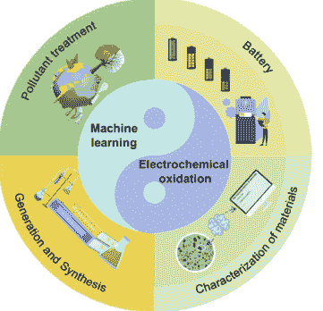
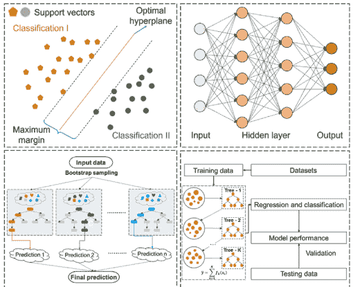
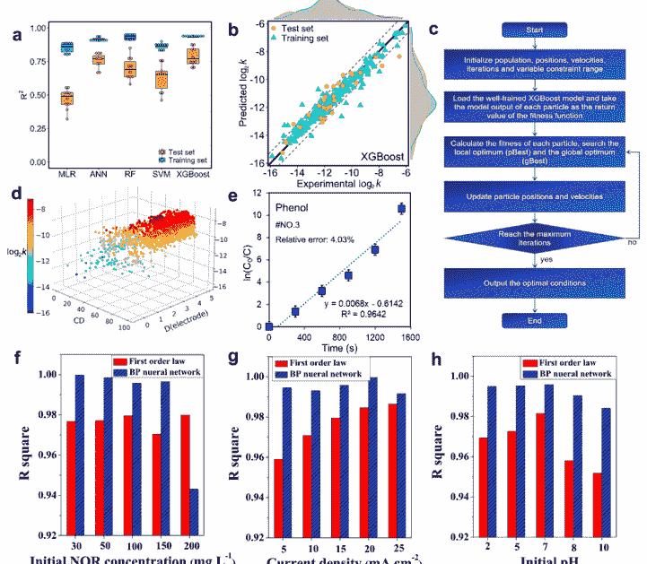
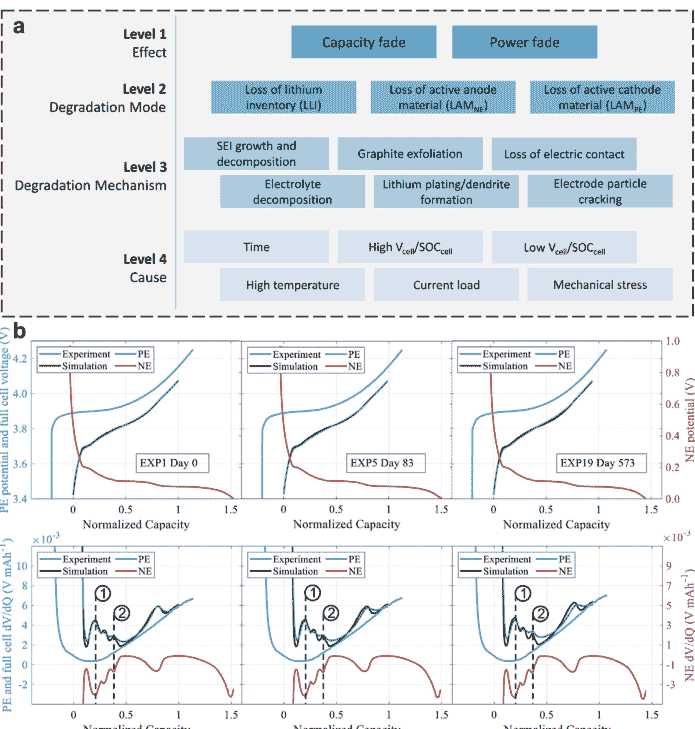
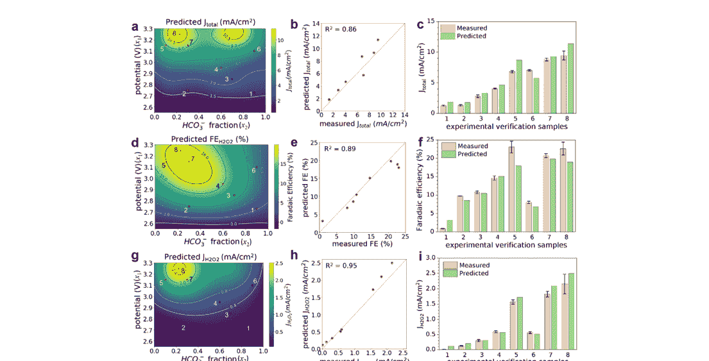
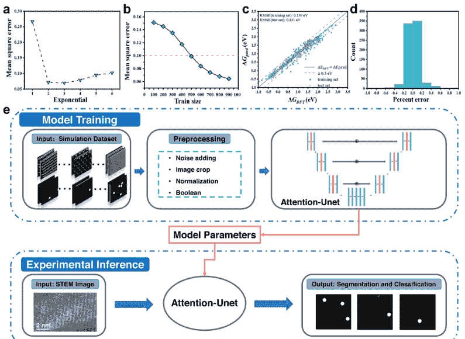

# 电化学氧化过程中的机器学习：小型综述


## 摘要

近年来，机器学习（ML）技术通过分析大型数据集并学习其内在模式和关系，展现出解决高度复杂和非线性问题的强大能力。特别是在化学工程和材料科学领域，ML可用于发现微观结构组成、优化化学过程并创造新的合成路径。电化学过程具有过程控制精确、环境友好、能量转换效率高和成本低等优势。本综述文章首次对电化学氧化应用中的机器学习进行了系统总结，包括污染物去除、电池修复、物质合成和材料表征预测。通过文献计量学分析了机器学习与电化学氧化交叉领域的热门趋势。概述了常见的机器学习模型。强调了机器学习在提高去除效率、优化实验条件、辅助电池诊断与预测性维护以及揭示材料表征方面的作用。此外，还就应用于电化学氧化的机器学习算法的优缺点，提出了当前问题和未来展望。为了进一步支持电化学从基础研究到实用应用的可持续增长，本综述试图使机器学习更容易融入电化学氧化。


## 1. 引言

机器学习（ML）领域正在迅速发展，得益于计算能力的提升、算法复杂度的增加以及数据可用性的指数级增长[1]。ML的这一演变使其成为科学探索和技术创新的有益手段之一。机器学习作为人工智能的一个重要分支，涵盖了多种能够从数据中学习并进行预测或决策的算法[2]。其中，线性回归、支持向量机（SVM）、随机森林（RF）、人工神经网络（ANN）和极端梯度提升树（XGBoost）因其适应性和鲁棒性而脱颖而出[3-6]。每种方法都有其独特优势，从线性回归的可解释性到深度神经网络的预测能力。机器学习在解读复杂模式、提高预测准确性以及推动不同科学领域创新方面展现出了非凡的能力[7]。

随着对环境污染物处理、能量存储系统优化以及材料科学发展的需求日益增长，电化学氧化过程显得尤为重要[8,9]。电化学氧化过程通过去除污染物、延长电池寿命和效率以及合成具有定制特性的新材料，在解决可持续性问题方面起着关键作用[10,11]。然而，电化学反应错综复杂的动力学受电极材料、电解质组成和操作条件等众多变量影响，在分析和优化方面面临重大挑战[12-14]。传统实验方法虽然宝贵，但往往耗时较长，且可能无法涵盖所有可能的反应路径和结果。

机器学习作为建模复杂非线性关系的强大工具，在图像识别、自然语言处理和预测建模方面取得了无与伦比的成功，展示了其揭示电化学系统复杂性的潜力[15,16]。Zhang等人通过将电化学阻抗谱与高斯过程回归（GPR）算法相结合，开发了一种准确的电池预测系统。将整个光谱作为输入来训练GPR模型，该模型自动确定预测退化的光谱特征，并在无需了解电池过去运行条件的完整信息的情况下，准确预测了电池剩余寿命[16]。将机器学习应用于电化学氧化及相关领域的优势多种多样。机器学习算法分析大型数据集，以识别研究人员不易立即察觉的模式和关系，从而优化反应条件并减少复杂实验的需求[17]。Sun等人开发了五种机器学习模型，利用多种电化学反应条件和目标污染物的量子参数作为输入值，预测反应速率的最大值。随后，利用粒子群优化（PSO）算法反向预测最佳反应条件，并通过多次实验验证预测的相对标准偏差小于5%[18]。这种预测能力在电化学应用新材料的设计、开发和优化方面尤其有利[19]。此外，机器学习在处理不同类型数据方面的灵活性，使其成为整合来自各种来源（例如实验数据、理论模型和计算模拟）信息的理想工具。这种方法可以更全面地理解电化学过程，从电化学氧化的宏观行为到电极-电解质界面的微观机制[20,21]。

综上所述，机器学习与电化学氧化的融合预计将在环境管理、能量存储和材料科学领域开辟新的前沿。在本工作中，我们首先通过文献计量学分析了机器学习与电化学氧化交叉领域的热点，重点阐述了机器学习在电化学氧化领域四个维度（污染物去除、电池修复、物质合成和材料表征预测）中的重要性和研究趋势。然后，我们概述了包括多元线性回归（MLR）、SVM、XGBoost、ANN和RF在内的常见机器学习算法的数学原理和概念。随后，讨论了机器学习模型在上述四个领域中的数据分析预测能力应用，包括预测建模、过程控制和材料表面反应机制预测。这凸显了机器学习在这些关键领域的广阔前景。最后，基于综述结果，我们就数据监测、模型改进和自主检测提出了未来展望，特别关注不同机器学习方法应用于电化学氧化不同领域的优缺点。因此，本综述旨在为环境管理、能源创新和可持续发展提供新路径。

## 2. 文献计量分析

虽然机器学习与电化学氧化结合受到了广泛关注，但尚无研究系统总结机器学习在电化学氧化中的机制和应用。此外，以往的综述均未采用科技计量方法来绘制该领域已发表论文之间的关联或关系。为了弥补现有文献中的这些空白，挖掘电化学氧化机器学习领域的高频研究热点，并探索该领域的可能机制和应用，本研究使用CiteSpace软件进行了可视化文献计量分析。可以通过CiteSpace识别机器学习应用于电化学氧化的研究趋势和新兴热点。通过分析引文和关键词的共现，揭示了该领域的主要研究主题及其随时间的演变[22-24]。这不仅有助于更深入地理解机器学习在电化学氧化中的应用动态，还能有效指导未来研究方向，提升研究的系统性和前瞻性。

基于CiteSpace软件平台，采用了文献计量、数据统计分析、关键词共现可视化、聚类和引文爆发检测等方法。本研究中使用的CiteSpace版本为CiteSpace 6.1.R6。具体操作设置如下：关键词被设置为节点，分别用于关键词共现和共引网络映射。每个时间片中的修正g-index被用作选择标准。聚类模式由对数似然比（LLR）算法实现。此外，使用了Web of Science平台的引文报告功能来获取每年发表的论文数量。文献检索策略在支持信息的文本S1中描述。使用CiteSpace进行文献计量分析的流程图如支持信息中的图S1所示。

在Web of Science核心合集数据库中，2013年至2022年间检索到302篇文献。如图S1所示，该研究领域发表的文献数量增长缓慢，2019年之前每年发表的文章数量未超过10篇（2018年为7篇）。从2019年到2021年，每年发表的论文数量增加了20多篇。该领域研究最显著的放大出现在2021年至2022年。从2019年到2022年，发表了276项研究，占过去10年中所有纳入研究的91%。总体而言，自2013年以来，机器学习应用于电化学氧化领域的出版物数量呈现出增长趋势。可以看出，该领域已成为一个热门研究领域并受到广泛关注。

关键词是对文章的精确概括。网络（支持信息中的图S2）由节点和链接组成。节点的大小反映了包含标记关键词的文献数量，即出现频率[25,26]。支持信息中的表S1汇总了该领域前20个高频关键词，其中最常用的是ML，被提及多达113次。其次是降解、模型、性能、氧化、锂离子电池等，这些词自2014年以来在文献中被使用了20多次。这些词宏观地反映了通过机器学习进行电化学氧化相关应用的研究框架。还可以看到，电催化剂、电极、氧还原、机制、预后等关键词（表S1），反映了该领域电极材料和表面反应机制的研究近年来已成为研究热点。

具有相同研究内容和相同引文的文章被聚类。共引文章数量越多，文档之间的相关性越大，聚类到同一类别的概率越高。支持信息中的图S3和表S2显示，聚类结果包括锂离子电池、CO2还原、ML、预测等。最大的簇（#0）包含68个关键词，S值为0.636，标记为锂离子电池，其中包括降解（2014）、预测（2015）、诊断（2018）、健康估计（2021）等关键词（支持信息中的图S4）。可以看出，结果中的CO2还原被聚类为一个单独的组，并作为第二大类别。此外，作为两个独立的簇，ANN和预测包含萃取去除方法、阴极材料、石墨阳极等关键词，这些关键词与电化学机制和机器学习算法高度相关。

支持信息中的图S5展示了引文爆发最强的前25个关键词。其中，最强爆发的第一个关键词是碳，起始年份为2019，这反映了大多数研究集中在与碳相关的机器学习上。更重要的是，几个关键词，例如离子电池、电还原、电氧化、CO2还原、水氧化等与电化学氧化相关的关键词，自...以来一直表现出相对较强的爆发。




图1. 电化学氧化中机器学习应用概览。

2021年。并且这些关键词直至2023年仍是研究热点。因此，预测与电化学氧化相关应用的机器学习研究可能成为未来研究的重点。

一般而言，电化学与机器学习交叉领域的学科间研究呈现出显著的增长趋势，表明该领域备受广泛关注。降解、模型、性能、氧化、锂离子电池和CO2还原等关键词揭示了电化学与机器学习交叉探索的主题框架。因此，机器学习已被证明是应用于电化学的有效技术。如图1所示，基于文献计量分析的结果，本综述文章对机器学习在电化学污染物处理、电池修复与降解、电化学生成与合成以及材料表面机制分析等环境应用方面的最新进展进行了系统概述。

## 3. 电化学氧化中主要的机器学习算法

本节分析并总结了常见机器学习算法的基本理论，包括多元线性回归（MLR）以及典型的非线性回归（NR）算法，如SVM、XGBoost、ANN和RF。

MLR模型通过最小化实际观测值与模型预测值之间的差异（通常为平方差之和）来确定最优参数估计。该模型能够评估和解释每个自变量相对于因变量的权重[27]。在电化学氧化的背景下，MLR可用于理解电流密度、pH值、电极材料和处理时间等各种工艺参数如何影响电化学氧化效率。通过分析实验过程中收集的数据，MLR有助于在不同条件下预测电化学处理的结果，并优化工艺参数以实现最大效率[28]。多元线性回归方程是一种用于描述因变量（Y）与多个自变量（X1, X2, ..., Xn）之间线性关系的数学模型。该方程通常表示如下（公式1）：

```
Y = \beta_1 X_1 + \beta_2 X_2 + \beta_3 X_3 + \cdots + \beta_n X_n + \varepsilon
```

其中，\beta_j（j = 1, 2, 3, ..., k）表示回归系数，而\varepsilon表示误差项。

非线性回归是一种回归分析形式，其中观测数据由模型参数的非线性组合并依赖于一个或多个自变量的函数进行建模。NR在环境应用中特别有用，因为变量之间的关系通常不是线性的。这种回归类型允许对复杂过程进行更准确的建模和预测[29]。非线性模型通常可以表示为以下形式（公式2）：

```
Y = f(x, \theta) + \varepsilon
```

其中，Y表示响应变量，f表示所采用的函数。x表示输入，\theta象征需要估计的参数，\varepsilon指误差项。如果函数对任何参数的二阶导数非零，则该参数被归类为非线性参数[30]。基于该原理，已开发出众多用于解决非线性问题的性能优越的模型，如SVM、ANN、RF和XGBoost，如图2所示。



图2. SVM、ANN、RF和XGBoost算法的示意图。

作为一种通用的机器学习算法，SVM的构想最初由Vapnik和Chervonenkis于1963年提出[31]。经过不断改进，SVM已成为机器学习、模式识别和数据拟合的标准算法，并现在应用于广泛的实际问题。SVM基于在训练集基础上在样本空间中寻找分离超平面，从而区分不同样本。样本空间中的超平面及任意点到超平面的距离分别用公式3和4表示[4]：

```
\omega^T x + b = 0
```

```
r = \frac{|\omega^T x + b|}{\|\omega\|}
```

其中，\omega是法向量，决定超平面的方向，b是位移项，决定超平面与原点之间的距离。如果一个超平面能够正确分类训练集，则支持向量的间隔可用公式5表示。为了找到最大间隔的超平面，有必要最大化公式5。因此，这构成了SVM的基本表达式，如公式6所示，即最小化1/\gamma。在实际场景中，原始数据集不一定总是线性的。因此，当原始空间中没有能够正确分类数据集的超平面时，会使用核函数将样本从原始空间映射到更高维的特征空间。因此，该方程进一步推导为公式7[4]。

```
Y = \frac{1}{\|\omega\|} \tag{5}
```

```
\min_{w,b} \frac{1}{2} \|\omega\|^2 \tag{6}
```

```
\min_{w,b} \frac{1}{2} \|\omega\|^2 + C \sum_{i=1}^m l_e(f(x_i) - y_i) \tag{7}
```

其中，\(\omega\)表示正则化函数，\(l_e\)是ε不敏感损失函数。

总之，SVM模型采用基于最大化间隔的学习策略，将原始样本映射到更高维空间，从而找到最优超平面以解决非线性科学问题。

XGBoost是梯度提升算法的一种先进实现，因其在各种预测建模任务中的出色性能而广受欢迎[32,33]。XGBoost旨在提高效率、灵活性和可移植性，通过依次构建一系列决策树运行，每棵树纠正前一棵树的错误，从而提高模型的预测准确性。该算法包括正则化参数，有助于防止过拟合并使其对数据中的噪声具有鲁棒性[34]。XGBoost模型由一个正则化学习目标定义，该目标将损失函数与惩罚复杂度的项相结合，如下所示（公式8）：

```
Z(x_t) = \sum_{i=1}^n l(y_i, \hat{y}_i^{t-1} + f_t(x_i)) + \Omega(f_t) \tag{8}
```

其中，\(\hat{y}_i\)是第i个实例的预测值，\(y_i\)是相应的目标值，l表示可微分的凸损失函数，用于衡量预测值\(\hat{y}_i\)与目标值\(y_i\)之间的差异，\(\hat{y}_i^{t-1}\)是t-1棵树的预测值，\(\Omega\)表示用于模型正则化的回归树函数。加入额外的正则化项有助于平滑学习到的权重，从而避免过拟合。正则化项\(\Omega(f_t)\)定义如下（公式9）：

```
\Omega(f_t) = \gamma T + \frac{1}{2} \lambda \|\omega\|^2 \tag{9}
```

其中，\(\gamma\)是控制树复杂度的参数，T是树中的叶子数量，\(\lambda\)是叶子权重的正则化参数，\(\omega\)是叶子权重。

在XGBoost中，模型是加法训练的，每棵树\(f_t\)被加入以最小化损失函数l(t)。该过程涉及在损失函数上使用一阶和二阶梯度统计量，以在每次迭代中找到最佳树结构。目标函数的优化使用二阶近似进行，这允许快速有效的优化。当实例缺少XGBoost中分割所需的特征时，模型会将其分类到默认方向，该方向在学习过程中确定。这种方法使模型能够有效处理缺失值并增强其鲁棒性。

ANN已成为电化学氧化领域的一种强大工具。其学习复杂模式和预测结果的能力使其成为优化和理解各种电化学过程的理想选择。ANN是受人脑启发的计算模型，由处理信息的互连节点或神经元组成[35,36]。ANN通常由输入层、一个或多个隐藏层和输出层组成。每层包含若干神经元，神经元之间通过在训练阶段调整的权重相互连接。神经元输出的基本公式由（公式10）给出：

```
y = f(\sum (w_i \cdot x_i) + b) \tag{10}
```

其中，\(x_i\)和\(y\)分别是输入和输出，\(w_i\)是权重，b是偏置项，f是激活函数。ANN使用包含输入-输出对的数据集进行训练。在训练期间，网络调整其权重和偏置以最小化预测输出与实际输出之间的误差。反向传播算法常用于训练，该算法涉及将误差通过网络向后传播以更新权重[37]。

RF是一种从决策树算法发展而来的袋装集成学习方法。在这项技术中，森林中的每棵树都在随机数据子集上训练并进行替换，增加了树之间的多样性并提高了模型的准确性和鲁棒性。这种集成学习方法通过在训练期间构建多个决策树运行，并输出单个树的类别众数（用于分类）或平均预测（用于回归）。RF表现出收敛特性以实现较低的泛化误差，如公式11-13所示[38]。

```
mg = (X, Y) = \alpha v_k l(h_k(X) = Y) - \max_{j \neq Y} \alpha v_k (h_k(X) = j) \tag{11}
```

```
PE^* = P_{X,Y} (mg(X, Y) < 0) \tag{12}
```

```
P_{X,Y} \left( P_\Theta(h(X, \Theta) = Y) - \max_{j \neq Y} h(X, \Theta) = j \right) < 0 \tag{13}
```

公式11定义了RF的间隔函数。它考虑了一组分类器\(h_1(x), h_2(x), ..., h_k(x)\)，这些分类器在从随机向量X和Y的分布中随机抽取的数据集上训练。\(l(\cdot)\)表示指示函数。间隔“mg”衡量X、Y中正确类别的平均投票超过任何其他类别的平均投票的程度。较大的间隔表明分类置信度更高。泛化误差由公式12给出，表示随机输入X在RF中被误分类的概率（\(PE^* < 0\)）。理想情况下，此概率应尽可能低。在RF中，\(h_k(X) = h(X, \Theta_k)\)，对于大量树木，随着树木数量的增加，几乎所有序列\(\Theta_1, ..., PE^*\)都收敛到公式13。这意味着随着树木数量的增加，RF的泛化误差率\(PE^*\)将收敛到一个固定值，从而导致更准确的模型预测。这五种常见机器学习算法的应用流程图如图S6所示（支持信息）。

## 4. 机器学习与电化学氧化的结合应用

机器学习算法在电化学氧化领域的集成正日益受到关注。与前述文献计量分析一致，已对污染物处理、电池修复、电化学合成和材料表征分析等领域中常见机器学习算法的应用机制进行了全面回顾。这些算法在增强对电化学过程的理解以及提高电化学应用的整体效率和效果方面发挥着关键作用。

### 4.1. 污染物的电化学处理

机器学习在电化学污染物处理领域已被广泛应用。这些算法在各种应用中显示出有希望的结果，包括预测污染物浓度、优化处理过程以及分析电化学系统中各种因素之间的复杂相互作用[18]。

Sun等人评估了以污染物特性和反应条件作为输入特征训练的模型的性能，




图 3. (a) 基于五种不同算法（10 折交叉验证）以污染物特性和反应条件作为输入特征训练的模型性能（$R^2$）。(b) 以污染物特性和反应条件作为输入特征训练的 XGBoost 模型。(c) 基于 PSO 算法的逆设计示意流程图。(d) 基于逆设计 ML 框架得出的优化条件下，苯电化学氧化的实验验证（动力学图）。(e) 苯电化学氧化中 $k$ 的最大化。(a-e) 经许可转载自 [18]。版权 2023，美国化学学会。(f) 初始诺氟沙星（NOR）浓度、(g) 电流密度和 (h) 初始 pH 的反向传播神经网络物理建模过程（BP-ANN-P）与一级动力学定律模拟的 $R^2$。(f-h) 经许可转载自 [39]。版权 2020，Elsevier。

采用五种常用 ML 算法和 10 折交叉验证 [18]。结果表明，XGBoost 算法提供了最佳拟合，其优越的 $R^2$ 值为此提供了证据，而 ANN 模型表现出过拟合，如图 3a 所示。四种模型预测性能的比较分析进一步证实了 XGBoost 的优越性（图 3b）。随后，采用 PSO 算法迭代调整离子的位置和速度，以寻找最佳反应条件，将其表示为一群粒子，每个粒子表示一组反应条件组合，初始位置和速度分别表示反应条件的值及其在搜索空间中的移动速度（图 3c 和 3d）[18]。训练好的 XGBoost 模型用于预测每个粒子的反应速率，这些预测作为适应度函数的返回值。计算每个粒子的适应度，记录每个粒子找到的最佳位置（pBest）和所有粒子中的全局最佳位置（gBest）。基于 pBest 和 gBest 调整速度和位置以寻找最优解，该过程持续进行直到达到最大迭代次数或确定最佳条件，从而提高识别反应条件的效率和准确性。如图 3e 所示，模拟值与实验值之间的相对误差为 4.03%，模型拟合性能良好 [18]。

Yu 等人使用了 BP-ANN-P，以四个输入（初始 NOR 浓度、初始 pH 值、电流密度和实验时间）和总有机碳去除率作为唯一输出，以证明模型的整体预测准确性。与常规模型的一级动力学拟合结果相比，BP-ANN-P 在大多数情况下实现了更高的 $R^2$ 值，使拟合精度提高了 1.619 到 127.137 倍，如图 3f-h 所示。尽管在初始 NOR 浓度为 200 mg/L 时 ANN 模型的 $R^2$ 下降（图 3f），表明有效样本量（86 个样本）影响模型准确性，但通过其他五个随机日期的模拟，BP-ANN-P（0.969）的 $R^2$ 值仍高于一级动力学（0.922）。同时，在电流密度和初始 pH 因子的比较结果中分别得出了相同的结论（BP-ANN-P 具有更高的 $R^2$ 值）（图 3g 和 3h）[39]。这表明 BP-ANN-P 在建模降解性能方面具有优越性。

同样，Rumky 等人评估了不同阳极特性（如阳极材料和表面积）与各种废水处理厂中化学需氧量（COD）、溶解性有机碳（DOC）和色度去除之间的关系。基于所考虑的一系列工艺特性，包括电极间距、系统 pH、反应器体积、电流密度和电压，并结合 MLR 建模，确定在电氧化中，COD 和色度的去除取决于系统的反应时间，而 DOC 的去除与反应器体积密切相关。该 MLR 算法有助于识别最重要的因素并优化处理过程以提高性能 [40]。

Foroughi 等人使用三维电化学系统处理含四环素废水。最小平方 SVM 模型预测，在最佳条件下（四环素浓度 84 mg/L，pH 4.8，电流密度 15.72 mA/cm$^2$），约 90.42% $\pm$ 2.3% 的四环素被去除，这与预测值接近 [41]。这意味着许多 ML 算法已在环境保护领域得到充分应用，尤其是在电化学污染物处理方面。

将 ML 集成到电化学过程中，为水处理技术中的污染物检测、去除优化和预测性能引入了创新解决方案。通过应用 ML 算法，研究人员能够更好地预测电化学氧化中污染物的去除速率，从而促进用于污染物检测和去除的高效电极的开发。

### 4.2. 锂离子电池的修复

锂离子电池已成为笔记本电脑和智能手机中不可或缺的组成部分，在稳定由太阳能和风能等可再生能源供电的电网方面发挥着关键作用 [42]。随着市场需求激增，对锂离子电池的要求也随之提高。然而，阻碍电池技术快速发展的一项挑战是电池健康状态测试和监测的耗时过程，这影响了电池寿命 [43]。因此，迫切需要制定改进的电池寿命预测方法。ML 在预测锂离子电池寿命方面的应用已逐渐进入研究人员的视野，包括健康状态预测、荷电状态（SOC）估计和热生成率（HGR）预测。这些算法为优化其使用、延长其寿命以及为更可持续的能源未来做出贡献提供了途径。

Thelen 及其同事通过使用循环测试获得的有限早期寿命实验数据和半电池模型的模拟数据训练 ML 模型，准确估计了锂离子电池容量及三种主要降解模式的可能性 [20]。如图 4a 所示，电池降解的分层预测允许评估容量和功率衰减（Level 1）以及由各种不利化学和物理过程（Level 3）引起的三种降解模式（Level 2）的预测，例如石墨剥离、电解质分解、电极颗粒开裂，以及加速降解模式的应力因素，如运行时间、温度、电流负载、机械应力（Level 4）。具体来说，锂库存损失（LLI）降解模式导致电池容量衰减，包括锂镀层和固体电解质界面（SEI）生长消耗锂离子，减少可用于电荷转移的颗粒数量。正极活性材料损失（LAMPE），例如石墨剥离，导致锂离子嵌入活性位点的丧失，从而降低电池容量。负极活性材料损失（LAMNE），例如电极颗粒开裂和电接触丢失，在电极上形成小块失活材料区域，这些区域不再可用于锂离子嵌入。正负极上活性材料的损失导致电池容量和功率衰减 [20]。

ML 模型还能够识别 VQ 和 dV/dQ 曲线中的细微变化，并将其与特定的降解



图 4. (a) 电池老化影响（Level 1）、降解模式（Level 2）、降解机制（Level 3）和电池使用/环境（Level 4）之间的关系。(b) G1 组电池 C1（C/24，37 °C）在 EXP1 第 0 天、EXP5 第 83 天和 EXP19 第 573 天的 V/Q 和 dV/dQ 实验及拟合曲线（在图例中显示为模拟）。虚线表示用于拟合 dV/dQ 曲线的两个峰。(a, b) 经许可转载自 [20]。版权 2022，Elsevier。


行为，通过将模拟实验数据拟合到机器学习模型中来进一步增强，以更好地理解降解机制。如图 4b 和图 S7（支持信息）所示，电池组 G1、G2、G3 和 G4 在 C1（C/24，3/7°C）下的 V/Q 和 dV/dQ 的实验曲线和模拟曲线随时间演变。G1 组电池的实验结果和模拟结果非常相似，表明降解极小，且与半电池模型拟合良好，该模型主要受 LLI 影响。相比之下，G2 组电池在较高降解水平时出现偏差，可能是由于活性材料损失（LAM），尤其是来自阴极。对于 G3 和 G4 组，dV/dQ 曲线与模拟之间存在显著差异，表明 LLI 和 LAM 导致更快的降解，且在较高放电率（C/3）下活性材料损失更为明显，表明机械应力和更高的操作负载加剧了材料损失。

同样，电池 HGR 的预测在电池寿命和降解率中起着至关重要的作用。高效的热管理可以通过减轻不利的热影响并减缓降解过程来延长电池寿命。Cao 等人利用三种算法（ANN、SVM 和 GPR）来预测 HGR，结果表明 ANN 在预测 HGR 方面表现最佳，R² 值范围为 0.89 至 1.00。这突显了其在捕捉电池 HGR 数据中复杂非线性关系方面的有效性 [44]。此外，Jafari 等人利用电压、电流和 SOC 之间的非线性关系，采用一种不需要初始 SOC 信息的数据驱动方法，使用 XGBoost 算法准确且实时地预测锂离子电池的 SOC。该模型预测的均方根误差（RMSE）为 2.56，表明 XGBoost 算法是估算电池 SOC 的一种强大且有效的工具，在预测精度、操作效率和应用通用性方面具有显著优势 [45]。

总之，当前研究强调了机器学习在通过预测性维护增强电池诊断、延长服务寿命和优化性能方面的有效性。通过利用机器学习的预测能力，有可能突破电池技术的边界，开发出更耐用、高效和可持续的能量存储解决方案。

### 4.3. 物质的生成与合成

在材料科学这一新兴领域，尤其是在材料合成中，经验合成优化过程是一项艰巨的任务，人工智能的融合是不可避免的趋势。机器学习算法在预测和优化各种材料的合成过程方面提供了前所未有的能力，从而促进了具有增强性能和功能的新材料的开发。例如，机器学习算法的融合有助于优化 H2O2 和 α-酮亚胺膦酸酯的合成，使得能够合成具有以前无法实现的性能和最低数据要求的物质。这标志着该领域向数据驱动发现的关键转变 [46,47]。

Leem 等人采用 SVM 算法对实验数据进行训练，包括法拉第效率和 H2O2 生产的电流密度，并考虑施加电位和电解液成分等变量。通过涉及 5 折交叉验证和严格模型评估指标的系统方法，确定在 3.25V vs. RHE 的施加电位下，优化的重碳酸氢盐离子摩尔分数为 0.225，可实现最大 H2O2 电流密度为 2.16mA/cm²。具体来说，如图 5a、d 和 g 所示，该模型预测了不同施加电位和 HCO3- 摩尔分数下的总电流密度（Jtotal）、法拉第效率（FEH2O2）和指向 H2O2 的电流密度（JH2O2）。为了验证模型的准确性，策略性地选择了八个额外的实验条件（标记为红点并标记为 1 到 8）来验证模型，包括特征空间中分散的未测试条件（点 #1-6）、预测可产生最高 FEH2O2 的条件（点 #7）以及最高 J_H2O2 的条件（点 #8）。



图 5. 训练 SVM 模型的实验验证。选择了另外八个实验条件来验证 Jtotal（a–c）、FEH2O2（d–f）和 JH2O2（g–i）的预测值。训练好的模型成功预测了实验验证数据点，Jtotal 的 R² 得分为 0.86，FEH2O2 为 0.89，JH2O2 预测为 0.95。在面板 c、f 和 i 中，误差栏表示三次测量的平均值的 1 个标准差。（a–i）经许可复制 [46]。版权 2023，美国化学会。

SVM 预测模型的性能使用不同预测参数的 R^2 值进行了评估，如图 5b、e 和 h 所示，比较了 J_total、FE_H2O2 和 J_H2O2 的测量值与预测值。模型的预测 R^2 得分较高，J_total、FE_H2O2 和 J_H2O2 的 R^2 值分别为 0.86、0.89 和 0.95，表明 SVM 模型的预测与实验结果高度一致，强调了模型的准确性。结合图 5c、f 和 i，对未测试条件以及预测 FE_H2O2 和 J_H2O2 最高的条件进行成功预测，证明了该模型有效探索和优化 H2O2 生产参数空间的能力 [46]。这表明 SVM 模型在电化学逆向工程任务中的有效应用，SVM 能够利用离散实验数据构建各种条件下电化学 H2O2 生产的连续图像，并可视化电解液成分对两电子水氧化反应的影响，从而提高 H2O2 产量。

此外，Kondo 等人利用机器学习辅助的多参数筛选，有效预测了 α-氨基膦酸酯的最佳电化学氧化条件，建立了一种合成 α-酮亚胺膦酸酯的高效方法。这种机器学习辅助方法采用 GPR 在多参数空间（包括电流、反应物浓度、温度和反应时间）中进行预测。贝叶斯优化的连续迭代提高了预测的准确性，最终建立了一套合成所需化合物的高效条件。模型预测与实验结果的一致性证明了其鲁棒性，实现了高产率和高电流效率。该过程在反应优化中节省了能源、时间和人力，扩大了底物范围，并生产出了多种高产率和高电流效率的 α-酮亚胺膦酸酯 [47]。

将机器学习算法与实验数据相结合以提供快速高效的参数筛选，凸显了在电化学氧化合成领域应用机器学习的优势。这些方法已被证明能够通过准确预测最佳条件来节省能源、时间和资源，从而最大限度地减少实验试验。它们具有可扩展和多样的能力，能够提高产率和对反应路径的理解，从而在环境友好的条件下实现电化学氧化合成。

### 4.4. 材料表征预测

常见的机器学习算法包括决策树、神经网络、GPR 等。这些算法有助于基于已知材料的数据集预测催化活性 [48]。机器学习算法可以通过从现有 DFT 数据集中学习，显著降低与密度泛函理论（DFT）计算相关的计算成本和时间。Zhang 等人利用机器学习加速了铂改性非晶合金表面催化剂催化性能的 DFT 研究。该研究通过构建距离贡献描述符（DCD）来构建机器学习势能，并使用机器学习加速的 DFT 计算来确定 Pt@PdNiCuP 表面 46,000 个 *H 吸附位点的吉布斯自由能。在该研究中，DCD 的最佳效能通过 SVM 学习评估确定，如图 6a 所示，m = 3 将均方误差最小化为 0.0695。SVM 模型的学习曲线（图 6b）表明，增加样本量可以提高模型的准确性，使用约 500 个样本即可实现显著精度。对模型的进一步优化涉及通过网格搜索对 800 个样本集进行超参数调整，使训练集的 RMSE 为 0.130 eV，测试集的 RMSE 为 0.131 eV（图 6c）。此外，相对误差分布证实了模型的准确性。



图 6. （a）不同特征的均方误差。（b）均方误差随训练集大小的变化。（c）SVM 模型在 800 个样本的训练集上训练并在 100 个样本的测试集上测试。实线是 DFT 能量与预测能量 1:1 的理想比例。（d）800 个样本上的相对误差百分比分布。（a–d）经许可复制 [49]。版权 2023，Elsevier。（e）模型训练和 STEM 图像推理的整体框架。（e）经许可复制 [50]。版权 2022，Sha 等人。


准确性，大多数预测误差在±20%以内，展示了模型的可靠性（图6d）[49]。这种方法通过有效识别最佳描述符，将DFT计算资源集中在最有前景的候选材料上。最终，通过缩小搜索空间并识别控制催化活性的关键材料描述符。SVM在提高DFT计算效率方面表现出显著优势，特别是在加速材料表面吸附位点吉布斯自由能的计算方面。通过显著降低计算成本和时间，SVM不仅能准确预测材料性能，还能促进新材料发现和性能优化的加速。这一进展凸显了SVM在预测材料科学中的关键性能及其相关反应机制方面的卓越能力。

同样，Sha等人采用神经网络算法来解析LiNi0.5Co0.2Mn0.3O2单晶阴极材料的表征。这需要构建一种特殊的卷积神经网络模型，能够处理扫描透射电子显微镜（STEM）图像，识别主要晶体结构，定位缺陷并对其进行分类。基于神经网络模型的图像分析整个过程如图6e所示。具体来说，网络的输入是各种原子模型的模拟STEM图像，网络的输出是原子簇中点缺陷的位置。不同的晶体结构被随机混合以形成有效的数据集，然后经过预处理步骤，例如图像像素值的归一化和标签转换为布尔值。随后，使用随机梯度下降算法迭代调整网络参数。最后，训练结束时保留的模型参数用于真实STEM图像中的缺陷检测。在ML算法的支持下，LiNi0.5Co0.2Mn0.3O2单晶阴极材料的分析涵盖了缺陷的类型、数量和分布及其与电化学性能的相关性，从而为材料的降解过程提供了深刻的见解[50]。

总体而言，将ML纳入电化学氧化过程带来了许多好处，特别是预测电化学氧化性能、改进过程集成和促进实时监测。尽管如此，这种整合面临诸多挑战。其中关键挑战包括各种计算需求、复杂的参数调优、数据集不足以及模型可解释性。为了充分发挥ML在该领域的能力，需要充分考虑并解决这些挑战。未来的研究可能集中在通过算法调整、数据分布和结构优化以及开发新的归因分析方法论来提高ML模型的预测准确性、泛化能力和可解释性。预计这些改进后的ML模型将能够分析电化学氧化过程中发现的复杂相互关系。

## 5. 当前挑战与前景

总体而言，ML方法已被应用于电化学氧化的各个领域，根据支持信息中表S3总结的不同ML算法的优缺点，可以发现不同的电化学氧化领域有不同的适用算法。

对于电化学污染物处理，RF、SVM和ANN等算法特别适用。RF具有低过拟合风险、对异常值鲁棒且准确率高的特点，使其能够捕捉复杂的数据模式，同时抵抗数据中杂质（如噪声和异常值）的影响，这非常适合处理污染物处理过程中常遇到的多变且不可预测的数据。SVM擅长处理高维数据，并具有出色的泛化能力，能够有效管理电化学污染物处理中高维空间内存在的非线性关系。通过寻求最大化决策边界，SVM有助于准确分类未知污染物数据。ANN具有高度的灵活性和强大的学习能力，能够擅长捕捉和学习大型数据集中的复杂模式，适合建模电化学污染物处理中涉及的复杂化学过程。鉴于电化学污染物处理领域可能产生大量实验数据，ANN在处理大规模数据集方面的熟练程度对于理解污染物降解的动态过程证明是非常宝贵的。

ANN的高度灵活性允许调整网络架构以适应不同复杂程度的问题。在电池性能预测中，这种灵活性使ANN能够捕捉电池放电和充电过程中出现的复杂非线性模式。此外，鉴于电池测试产生了大量数据，ANN凭借其强大的适应性和学习能力，可以自我调整以学习大型数据集中的微妙模式和长期依赖关系，这对于在变化的运行条件下预测电池寿命至关重要。XGBoost高效且灵活，在处理缺失数据方面表现出显著优势。在电池修复的背景下，它可以快速分析和建模大量历史数据，自动从大型数据集中因各种原因出现的缺失值中学习，以高效预测未来的电池性能。此外，XGBoost的高准确性使得有效实施以提高预测精度，从而促进及时的维修和维护决策。此外，这两种算法都能够处理大型数据集，这在电池测试和监测中很重要。

SVM和ANN等算法的精度和预测能力对于物质的生成和合成大有裨益。预测物质的各种化学、物理和结构性质需要处理高维数据。SVM非常适合此类高维空间，其高准确性和良好的泛化能力有助于准确预测未知化合物的性能[51,52]。ANN的灵活性和强适应性使其能够处理各种类型和大小的数据，这在具有复杂性质的合成科学领域尤其适用。此外，具有强大学习能力的ANN可以从大量数据中学习，例如合成过程中所需的众多变量，并识别交互模式，从而帮助理解和预测新物质的合成和性能。

材料表征的预测通常涉及从高维数据中提取关于分子结构的信息。SVM在处理多重影响和潜在相互作用方面显示出其独特优势，这主要归功于其在高维空间中的有效性和出色的分类能力。SVM的核心技巧使研究人员能够找到最优边界，这对于揭示材料的深层化学行为至关重要。此外，SVM的高准确性和出色的泛化能力使其在需要高精度的材料性质预测中表现出色。ANN凭借其高度灵活的网络结构和出色的学习能力，模拟和学习复杂反应的非线性关系，并适应可变的数据模式，这对于理解和预测材料在不同条件下的反应非常有用。同时，ANN能够处理图像，识别和分类材料的内部结构，并模拟电化学参数与表面反应之间的关系。RF不仅在数据存在噪声的情况下保持鲁棒性，而且还能减少


通过整合学习方法来降低过拟合风险，从而提升模型在新数据上的预测准确性。这些特性使得RF成为预测复杂化学反应的可靠选择。RF能够提供准确预测同时对数据中的随机变异保持鲁棒性的能力，对于研究氧化反应过程的不确定性和动力学至关重要。

请注意，特定ML算法的适用性可能因数据集的具体特征和手头问题而异。所提供的见解基于算法的一般能力及其在相关领域的常见应用。此外，在指定领域实际实施这些算法需要领域特定的知识和数据，以有效地训练和验证模型。总之，ML算法需要仔细适应电化学氧化领域的具体要求和复杂性。为了在电化学氧化的所有领域有效部署ML算法，可以采用彻底的数据评估、仔细的算法调优、严格的验证和持续学习系统。首先，评估数据的性质、数量和质量至关重要，因为在大型数据集上表现良好的算法（如ANN和XGBoost），而低维数据则更适合SVM。其次，有必要微调每个算法的参数以匹配每个领域的具体数据特征，例如针对污染物处理中的非线性数据调整SVM的内核，或通过修改ANN的网络层进行电池性能研究。第三，使用交叉验证技术验证模型，以确保其能够准确预测未知数据，从而验证其泛化能力。最后，建立持续学习机制使模型能够在遇到新数据时进行调整和改进，这在动态电化学过程领域尤为重要。

## 6. 结论与展望

选择适合目标领域特定要求和复杂性的适当ML算法至关重要。这些算法在各自应用中的有效性预计将在理解和优化这些领域内的工艺方面取得重大进展。对ANN、NR、SVM、XGBoost和RF等ML算法的回顾分析突出了其独特优势及其在多个领域（包括电化学污染物处理、电池修复与预测以及材料合成和表面机制预测）的广泛应用前景。在电化学污染物处理领域，RF、SVM和ANN分别因其对噪声的鲁棒性、高维数据处理能力和非线性关系建模而脱颖而出。这些特性对于处理污染物降解过程中通常复杂的数据和不可预测的动力学至关重要。同样，对于电池寿命预测和降解率预测，ANN和XGBoost算法因其在建模复杂电池行为方面的适应性以及处理缺失数据的效率而被优先选用，这对于及时的维修和维护决策至关重要。物质合成受益于SVM和ANN算法的精度，以及其模式识别能力和学习复杂合成路径的灵活性。SVM、ANN和RF对材料表征具有更好的拟合效果。这些算法能够识别和分类材料的内部结构，学习复杂的数据模式，并更准确地预测未知数据。这有助于正确理解复杂的响应机制。最近的高质量研究还表明，这些算法的集成（尤其是RF-XGBoost-ANN组合）可以提供更优的预测精度和最小误差，展示了广泛应用的潜力[53]。

ML在电化学氧化领域的未来取决于开发兼顾计算效率与高可解释性的更专业算法。结合不同算法优势的混合模型以及深度学习的进步（特别是在增强可解释性和降低训练要求方面）可能以以下方式主导未来研究：

- 模型可解释性：开发新的工具和方法，使复杂模型的决策过程更加透明且易于理解。开发和推广可解释性的标准和评估指标，帮助研究人员更好地评估模型的透明度，以解决“黑箱”问题。
- 自主实时数据处理与反馈：需要开发能够自主接收和处理实时实验数据并将此信息反馈给模型进行调整的ML框架。该模型与实验反馈的紧密集成使系统能够根据实验结果实时调整和改进预测，提高电化学氧化过程的适应性和响应速度。
- 数据标准化与模型集成：优化数据收集并开发新的数据预处理方法。预测并记录预期的数据分布，以预测数据中的潜在偏差。进行数据源多样化和质量检查，以确保数据的完整性。实施严格的数据预处理方法以消除偏差，从而提高模型的有效性。最后，在全面理解数据集并探索模型适用性的基础上，开发更强大的AutoML框架以自动化模型选择和超参数优化，这将有效地为给定需求确定最佳ML模型。
- 能源高效学习模型：开发无样本学习和迁移学习算法，以降低模型对大规模数据的依赖。同时开发节能算法和硬件，以加快模型训练和推理并降低能耗。

## 利益冲突声明

作者声明不存在可能影响本文所报告工作的竞争性财务利益。

## CRediT作者贡献声明

Zonglin Li：写作 – 审阅与编辑，写作 – 原始草稿，资源，方法论，调查，概念化。Shihua Zou：可视化，软件，正式分析。Zining Wang：方法论，调查。Georgeta Postole：验证，监督。Liang Hu：验证，监督。Hongying Zhao：项目管理，资金获取，概念化。

## 致谢

作者承认获得以下资助：中国国家自然科学基金（编号：22122606、22076142、62276190），中国国家重点基础研究计划（编号：2017YFA0403402），中国国家自然科学基金（编号：U1932119），上海市科学技术委员会（编号：14DZ2261100），中央高校基本科研业务费。

## 补充材料

本文相关补充材料可在在线版本中找到，DOI：10.1016/j.cclet.2024.110526。

## 参考文献

- [1] M.I. Jordan, T.M. Mitchell, Science 349 (2015) 255–260.
- [2] M.L. Littman, Nature 521 (2015) 445–451.
- [3] N. Goudarzi, M. Goudarzi, M.A. Chamjangali, M.H. Fatemi, Chin. Chem. Lett. 24 (2013) 904–908.
- [4] T.Y. Zhu, Y. Zhang, C.C. Tao, et al., Sci. Total Environ. 857 (2023) 159348.
- [5] T. Zeng, Y.S. Liang, Q.Y. Dai, et al., Chin. Chem. Lett. 33 (2022) 5184–5188.
- [6] C. Wang, L. Kong, Y. Wang, et al., Chin. Chem. Lett. 34 (2023) 108159.
- [7] I. Rahwan, M. Cebrian, N. Obradovich, et al., Nature 568 (2019) 477–486.
- [8] L. Chen, L.L. Wei, Y.F. Ru, et al., Chin. Chem. Lett. 34 (2023) 108162.
- [9] Z. You, W. Hua, N. Li, et al., Chin. Chem. Lett. 34 (2023) 107525.
- [10] Z. Zhang, Y. Li, L. Dong, et al., Chem. Lett. 34 (2023) 107404.
- [11] Q. Wang, Q. Xue, T. Chen, et al., Chin. Chem. Lett. 32 (2021) 609–619.
- [12] W. Yao, A.Q. Hu, J.T. Ding, et al., Adv. Mater. 35 (2023) 2301894.
- [13] J. Jiang, K.L. Wang, X. Li, et al., Chin. Chem. Lett. 34 (2023) 108699.
- [14] S. Mahmood, H.Y. Wang, F. Chen, et al., Chin. Chem. Lett. 35 (2024) 108550.
- [15] K.T. Schmitt, M. Gastgeber, A. Tkatchenko, et al., Nat. Commun. 10 (2019) 5024.
- [16] Y.W. Zhang, Q.C. Tang, Y. Zhang, et al., Nat. Commun. 11 (2020) 1706.
- [17] Y. Zhu, B. Lian, Y. Wang, et al., Water Res. 227 (2022) 119349.
- [18] Y. Sun, Z. Zhao, H. Tong, et al., Environ. Sci. Technol. 57 (2023) 17990–18000.
- [19] V.G. Sharma, V.K. Tyagi, S. Varjani, et al., Bioresour. Technol. 387 (2023) 129587.
- [20] A. Thelen, Y.H. Lui, S. Shen, et al., Energy Storage Mater. 50 (2022) 668–695.
- [21] W. Wu, C.J. Wang, W.J. Bian, et al., Adv. Sci. 10 (2023) 2304074.
- [22] W. Ouyang, Y.D. Wang, C.Y. Lin, et al., Sci. Total Environ. 637 (2018) 208–220.
- [23] L.M. Yao, L. Hui, Z. Yang, et al., Chemosphere 245 (2020) 125627.
- [24] Y. Gao, L. Ge, S.Z. Shi, et al., Environ. Sci. Pollut. Res. 26 (2019) 17809–17820.
- [25] C.C. Liang, A.J. Luo, Z.Q. Zhong, et al., Sage Open Med. 6 (2018) 2050312118800199.
- [26] J.P. Xie, Scientometrics 105 (2015) 611–622.
- [27] N.R. Draper, H. Smith, Fitting a straight line by least squares, Applied Regression Analysis, John Wiley & Sons, Inc., New York, 1998, pp. 15–46.
- [28] P.B. Ober, J. Appl. Stat. 40 (2013) 2775–2776.
- [29] W.A.H. Altowayti, A.A. Salem, A.M. Al-Fakih, et al., Metals 12 (2022) 1664.
- [30] S.V. Archontoulis, F.E. Miguez, Agron. J. 107 (2015) 786–798.
- [31] V.N. Vapnik, A. Lerner, Autom. Remote Control 24 (1963) 774–780.
- [32] D.Z. Yang, L. Wang, P.H. Yuan, et al., Chin. Chem. Lett. 34 (2023) 107964.
- [33] R. Ding, R. Wang, Y.Q. Ding, et al., Angew. Chem. Int. Ed. 59 (2020) 19175–19183.
- [34] T.Q. Chen, C. Guestrin, in: Proceedings of the 22nd ACM Sigkdd International Conference on Knowledge Discovery and Data Mining, San Francisco, 2016, pp. 785–794.
- [35] L. Li, S.M. Rong, R. Wang, et al., Chem. Eng. J. 405 (2021) 126673.
- [36] E. Masson, Y.J. Wang, Eur. J. Oper. Res. 47 (1990) 1–28.
- [37] Y. Mei, J.Q. Yang, Y. Liu, et al., Int. J. Environ. Res. Public Health 16 (2019) 2454.
- [38] L. Breiman, Mach. Learn. 45 (2001) 5–32.
- [39] H. Yu, Z. Zhang, L. Zhang, J. Clean. Prod. 280 (2021) 124412.
- [40] J. Rumky, W.Z. Tang, M. Sillanpää, et al., Environ. Process. 7 (2020) 1041–1064.
- [41] M. Foroughi, A.R. Rahmani, G. Asgari, et al., Environ. Model. Assess. 25 (2020) 327–341.
- [42] X.F. Fu, D. Shen, Y.Z. Ji, et al., J. Energy Storage 82 (2024) 110557.
- [43] M. Berecibar, Nature 595 (2021) 7.
- [44] R. Cao, X. Zhang, H. Yang, Batteries 9 (2023) 165.
- [45] S. Jafari, Z. Shahbazi, Y.-C. Byun, et al., Mathematics 10 (2022) 888.
- [46] J. Leem, L. Vallez, T.M. Gill, et al., ACS Appl. Energy Mater. 6 (2023) 3953–3959.
- [47] M. Kondo, A. Sugizaki, M.I. Khalid, et al., Green Chem. 25 (2020) 327–341.
- [48] F. Formalik, K. Shi, F. Joodaki, et al., Adv. Funct. Mater. 34 (2023) 2308130.
- [49] X. Zhang, K. Li, B. Wen, et al., Chin. Chem. Lett. 34 (2023) 107833.
- [50] W. Sha, Y. Guo, D. Cheng, et al., NPJ Comput. Mater. 8 (2022) 223.
- [51] Z. Wan, Q. Wang, D. Liu, et al., Org. Biomol. Chem. 19 (2021) 6267.
- [52] F. Mu, C. Unkefer, P. Unkefer, et al., Bioinformatics 27 (2011) 1537–1545.
- [53] C. Ji, 2023 IEEE International Conference on Control, Electronics and Computer Technology (ICCECT), Jilin, 2023, pp. 545–549.

