# Nx 和 Axon 实践指南：机器学习入门

### by Sean Moriarity

## About the Pragmatic Bookshelf

The Pragmatic Bookshelf 是一家敏捷出版公司。我们存在是因为我们希望改善开发者的生活。我们通过创作及时、实用的书籍来实现这一点，这些书籍由程序员为程序员编写。

我们的 Pragmatic 课程、工作坊和其他产品可以帮助你和你的团队创建更好的软件，并玩得更开心。想了解更多信息以及最新的 Pragmatic 书籍，请访问 [`pragprog.com`](http://pragprog.com)。

我们的电子书不包含任何数字版权管理（DRM），一直以来都是 DRM‑free 的。我们率先推出了“beta 书”概念，即你可以在书籍编写期间购买并阅读，并向作者提供反馈，以帮助改进最终版本。所有购买者的免费资源包括源码下载（如适用）、误差列表和讨论论坛，均可在书籍的主页 pragprog.com 上获取。我们致力于简化你的生活。

谢谢你的持续支持，

这本书的制作团队包括：Dave Thomas（出版商）Janet Furlow（首席运营官）Susannah Davidson（首席编辑）Tammy Coron（开发编辑）Corina Lebegioara（校对编辑）Potomac Indexing, LLC（索引）Gilson Graphics（排版）

如需客户支持，请联系 `support@pragprog.com`。

如需国际版权，请联系 `rights@pragprog.com`。

献给 Riley、Weston 和 Indy。

---

Copyright © 2024, The Pragmatic Bookshelf.

---

机器学习，特别是深度学习，不断推动我们曾认为不可能的事物的边界——并且在每个行业中不断实现。

看似每天都有公司或研究小组发布新模型，进一步推动技术的前沿。近年来，ChatGPT、Stable Diffusion 等模型屡屡登上新闻版面，将人工智能推向前台，并重新定义可能的应用类型。

在其大部分历史时期，Elixir 及 BEAM 并不是机器学习工具的可行选择。但 Nx 生态系统改变了这一局面。在该生态系统中，你可以直接用 Elixir 编写机器学习和数值计算代码，并实现与 Python 或 Julia 等同等或更优的性能。Nx 为 Elixir 开发者提供了新的能力，同时也为希望探索其他生态系统、构建无 Python 依赖的应用的机器学习工程师和研究人员提供了离开 Python 的捷径。

本书的目标是成为 Elixir 程序员探索机器学习的权威资源。虽然大量机器学习知识可在网络上获取，但没有一份现有资源是专门为 Elixir 编写的。本书旨在以功能化、务实且富有乐趣的 Elixir 方式教你机器学习。

你将从机器学习和 Nx 的基础知识开始，逐步掌握部署经过预训练模型的强大功能到 Phoenix 应用的能力。本书贯穿使用 Livebook——Elixir 的交互式代码笔记本——进行数据处理和模型训练的实践。到书末，你将掌握 Nx、Axon、Scholar、Bumblebee、Explorer、VegaLite 等众多 Elixir 机器学习生态系统库的使用经验。

我们终于达到了那备受期待却长期未实现的“人工智能驱动产品黄金时代”。因此，如果你想构建强大、智能、结合机器学习模型的应用，Elixir 是实现这一目标的最佳语言之一。

## 为什么选择 Elixir 进行机器学习？

Elixir 是一种动态、功能化、通用的编程语言，针对 BEAM 虚拟机进行优化。它已被证明是构建和维护可扩展应用的有力语言。但 Elixir 并非为机器学习而设计。在 Nx^([\[1\]](#f_0011.xhtml#FOOTNOTE-1)) 项目出现之前，Elixir 中的机器学习工作，至少可以说是不被建议的。BEAM 虚拟机并未针对机器学习所需的大量计算任务进行优化。然而，Nx 及其周边生态系统正是为了让 Elixir 程序员能够胜任机器学习应用所需的计算密集型工作而构建的。

Elixir 和 Nx 是机器学习领域的新秀。尽管 Nx 生态系统并不旨在取代成熟的 Python 机器学习生态系统，但理解在 Elixir 中进行机器学习的优势显而易见。

- Elixir 是一种函数式编程语言。虽然这可能看起来是机器学习工作负载所需的大量计算的缺点，但它实际上是一个优势。在函数式世界中，一切都是不可变的。这意味着在处理大量数据时，你需要在每个单独操作后返回数据的新副本。幸运的是，由于深度学习的兴起，计算会在实际执行任何操作之前先在硬件加速器（如 GPU）上进行排队处理。这些计算使用即时编译（JIT）编译器进行，通常实现一个用于构建计算图的函数式接口。如你在后续章节中将看到，你可以使用 Elixir 的函数式风格进行编写，而无需担心大量的中间副本。

- 第二，Elixir 是为并发设计的。当训练机器学习算法时，性能瓶颈通常在于为硬件加速器上的训练步骤加载和准备数据。这种并发数据处理在 Elixir 中是自然的，因为 Elixir 是专门为并发设计的。你只需阅读 `*Concurrent Data Processing in Elixir* [Gos21]` 即可看到 Elixir 非常适合这类应用。

- 第三，Elixir 及其 Web 框架 Phoenix 在构建和扩展实时、容错的应用方面表现出色。越来越多的机器学习系统被部署在对延迟和可用性至关重要的场景中。例如，信用卡欺诈检测系统理想情况下应实时工作，立即在欺诈交易发生时向客户端发出警报。此外，由于每天发生大量欺诈交易，这些系统不能宕机。Elixir 和 Phoenix 已被证明能够构建低延迟且容错的系统。但直到现在，将机器学习集成到 Elixir 应用中仍需要将安全性从 BEAM 移至外部服务。

- 最后，Elixir 非常有趣，使用起来是一种绝对的享受。正如你在本书中将看到的，大多数机器学习算法都自然地以函数式构造来表达，这与 Elixir 编程语言的优雅和周到相得益彰。

## Who This Book Is For

本书面向希望在 Elixir 中学习机器学习的程序员，以及具有 Elixir 或机器学习经验的程序员。

Elixir 程序员可以在没有机器学习、数学或数值计算先验知识的情况下阅读本书，因为本书将从基础开始教你所需的全部知识。

具有机器学习经验但没有 Elixir 经验的程序员也能跟上本书的步伐，但某些语法细节和函数式概念可能会显得 unfamiliar。如果你属于这一类，建议随手查阅 Elixir 文档，参考本书未涵盖的语言细节。

如果你既没有机器学习也没有 Elixir 经验，那么同时学习两者会是一项困难的任务。因此，我建议你先熟悉 Elixir，然后再回到本书学习 Elixir 中的机器学习。

```elixir
Nx.bitcast(a, {:f, 64})
```

运行后结果如下：

```elixir
#Nx.Tensor<
f64[3]
[5.0e-324, 1.0e-323, 1.5e-323]
>
```

这说明将 64 位整数字节解释为 64 位浮点字节会导致数值发生巨大变化。

### 元素级单元操作

元素级单元操作类似于在列表上调用 `Enum.map/2` 并对每个元素应用数学操作。例如，计算列表中每个元素的绝对值：

```elixir
a = [-1, -2, -3, 0, 1, 2, 3]
Enum.map(a, &abs/1)
```

这将返回：

```elixir
[1, 2, 3, 0, 1, 2, 3]
```

## 代表世界的表示

代码对列表中每个元素应用 `&abs/1`。现在，假设你被给予了一个嵌套列表的列表。计算列表中每个值的绝对值需要嵌套使用 `Enum.map/2`。随着嵌套程度的增加，问题的难度也随之提升。

如果你被要求用与 `Enum.map/2` 类似的方式处理张量（tensor），可能会倾向于使用类似的解决方案。但 `Nx` 实现了一系列元素级操作，这些操作可以在不考虑嵌套程度的情况下，对张量数据进行逐元素处理。这些操作作用于张量数据的展开表示，同时保持张量的形状。下面通过示例说明这一点：

```elixir
a = Nx.tensor([[[-1, -2, -3], [-4, -5, -6]], [[1, 2, 3], [4, 5, 6]]])
```

计算该张量中每个值的绝对值：

```elixir
Nx.abs(a)
```

输出结果如下：

```elixir
#Nx.Tensor<
s64[2][2][3]
[1, 2, 3]
[4, 5, 6]
>
```

你不需要嵌套的 `map`、循环或递归。只需一个 `Nx` 库函数调用即可。`Nx` 拥有多种函数，它们的工作方式相同，用于计算元素级的平方根、指数、对数等。如果需要对张量中每个元素应用函数，应当使用已有的单元操作进行组合，而不是手动遍历每个值。因为 `Nx` 的后端和编译器很可能已经实现了针对 `Nx` 操作的高效例程，这些例程的效率显著优于手写的循环或 `map`。

### 元素级二元操作

你最终会想对数据进行加、减、乘、除等二元运算。在 Elixir 中，你可能会尝试使用 `Enum.zip_with/3` 来实现。例如，若要计算两个列表中对应元素的和，你可能会这样做：

```elixir
a = [1, 2, 3]
b = [4, 5, 6]
Enum.zip_with(a, b, fn x, y -> x + y end)
```

这将返回：

```elixir
[5, 7, 9]
```

随着嵌套层级的增多，问题的复杂度也随之上升。幸运的是，`Nx` 提供了处理此类 zip-map 操作的库函数。首先，创建以下两个张量：

```elixir
a = Nx.tensor([[1, 2, 3], [4, 5, 6]])
b = Nx.tensor([[6, 7, 8], [9, 10, 11]])
```

将它们相加：

```elixir
Nx.add(a, b)
```

返回结果如下：

```elixir
#Nx.Tensor<
s64[2][3]
[7, 9, 11]
[13, 15, 17]
>
```

你还可以尝试其他二元操作，例如乘法：

```elixir
Nx.multiply(a, b)
```

输出为：

```elixir
#Nx.Tensor<
s64[2][3]
[6, 14, 24]
[36, 50, 66]
>
```

二元操作作用于两个张量中对应的元素。但如果张量形状不一致呢？当尝试对形状不同的张量执行二元操作时，`Nx` 会尝试对它们进行广播（broadcast）。广播是指为了使两个张量的形状兼容，对较小的张量的维度进行重复，从而执行元素级运算。例如，若要将标量张量与形状为 `{3}` 的张量相加，标量会被广播到形状为 `{3}` 的张量的每个元素上。两个形状可以广播的条件满足以下任一：

1. 其中一个形状是标量。

2. 对应维度的大小相同，或其中一个维度的大小为 1。

例如，形状为 `{1, 3, 3, 2}` 与 `{4, 1, 3, 2}` 可以广播，因为每个维度要么相同，要么非相同的维度大小为 1。而形状为 `{1, 3, 3, 2}` 与 `{4, 2, 3, 2}` 不能广播，因为第二维度大小不匹配（3 无法广播到 2）。

如果形状的阶数（rank）不一致，`Nx` 会在较低阶形状的前面预置大小为 1 的维度，以便进行广播。例如，若尝试广播形状 `{3}` 与 `{2, 3}`，`Nx` 会在 `{3}` 前预置一个大小为 1 的维度，得到 `{1, 3}`，此时 `{1, 3}` 与 `{2, 3}` 可根据广播规则进行广播。

运行以下代码，感受广播的效果：

```elixir
Nx.add(5, Nx.tensor([1, 2, 3]))
```

输出如下：

```elixir
#Nx.Tensor<
s64[3]
[6, 7, 8]
>
```

可以看到，5 被添加到张量的每个元素。通过以下示例进一步观察广播的影响：

```elixir
Nx.add(Nx.tensor([1, 2, 3]), Nx.tensor([[4, 5, 6], [7, 8, 9]]))
```

输出为：

```elixir
#Nx.Tensor<
s64[2][3]
[5, 7, 9]
[8, 10, 12]
>
```

可以看出，第一个张量的值被应用到第二个张量的每一行。

### 减值操作

最后，你应熟悉 `Nx` 中的减值（reduction）操作。想象一张张量表示过去 12 个月的收入：

```elixir
revs = Nx.tensor([85, 76, 42, 34, 46, 23, 52, 99, 22, 32, 85, 51])
```

若数据在列表中，你可能会使用 `Enum.reduce/3` 计算总收入。`Nx` 提供了多种现成的减值操作，可在整个张量或特定轴上计算聚合。计算总收入：

```elixir
Nx.sum(revs)
```

返回：

```elixir
#Nx.Tensor<
s64
647
>
```

减值操作也可针对单个轴进行。例如，若有四年的收入数据：

```elixir
revs = Nx.tensor(
  [
    [21, 64, 86, 26, 74, 81, 38, 79, 70, 48, 85, 33],
    [64, 82, 48, 39, 70, 71, 81, 53, 50, 67, 36, 50],
    [68, 74, 39, 78, 95, 62, 53, 21, 43, 59, 51, 88],
    [47, 74, 97, 51, 98, 47, 61, 36, 83, 55, 74, 43]
  ],
  names: [:year, :month]
)
```

若想计算每个月的总收入，可对 `:year` 维度求和：

```elixir
Nx.sum(revs, axes: [:year])
```

返回：

```elixir
#Nx.Tensor<
s64[month: 12]
[200, 294, 270, 194, 337, 261, 233, 189, 246, 229, 246, 214]
>
```

若想计算每年的总收入，可对 `:month` 维度求和：

```elixir
Nx.sum(revs, axes: [:month])
```

返回：

```elixir
#Nx.Tensor<
s64[year: 4]
[705, 711, 731, 766]
>
```

`Nx` 库提供了多种减值函数，可用于计算平均值、总和、最小值、最大值等。

The purpose of the Nx tensor abstraction is to give you a flexible data structure for representing the real world. Machine learning is applicable to nearly every field. To use machine learning for your applications, you need to choose an appropriate numerical representation for your data. Depending on the type of data you have, there’s likely already a common or natural way to represent the data as a tensor.

## Tabular Data

Tabular data or structured data is data with a structure similar to what you would find in a relational database or CSV file. Each column represents a feature of the data, such as petal length in the iris example from Chapter 1, *Make Machines That Learn*. You’ll often see tabular data represented in a two-dimensional tensor with the shape `{num_examples, num_features}`.

`num_examples` corresponds to the total number of examples in your dataset. `num_features` corresponds to the total number of features in the tabular data. Encoding information in this way loses some semantic information about what the values in the tensor represent, which needs to be considered when using structured data in a machine learning algorithm. For example, if you have a field that represents home price and another field that represents interest rate, you’d end up with a tensor that contains values with drastically different orders of magnitudes.

## Images


# 图像

如果将图像视为像素的集合，它自然映射到张量。实际上，图像表示为形状为 `{num_examples, height, width, channels}` 的四维张量，其中：

- `num_examples` 是数据集中的样本数量
- `height` 是图像的像素高度
- `width` 是图像的像素宽度
- `channels` 是图像中的颜色通道数

对于 RGB 图像，`channels` 等于 3，因为每个像素有三个颜色值：红、绿、蓝。

你可能也会看到形状为 `{num_examples, channels, height, width}` 的图像。这是**通道优先**表示，而 `{num_examples, height, width, channels}` 是**通道最后**表示。通道维度的位置因框架而异。历史上，Python 机器学习框架 `PyTorch` 对图像使用通道优先配置，而 `TensorFlow` 使用通道最后。从性能角度看，使用通道最后格式表示图像在执行卷积等操作时稍快。你将在第 7 章 `Learn to See` 中了解更多关于处理图像的内容。

# 视频

如果将视频视为图像的集合，则可以轻松扩展图像表示来表示视频。视频只是图像序列，其中视频的每一帧都是图像的张量表示。

通常用形状为 `{num_examples, frames, height, width, channels}` 的张量表示视频，其中：

- `num_examples` 是数据集中的样本数量
- `frames` 是每个视频样本的帧数
- `height` 是每帧的像素高度
- `width` 是每帧的像素宽度
- `channels` 是视频中的颜色通道数

例如，一个以 15 帧/秒拍摄、时长 4 秒、分辨率为 224x224、具有三个颜色通道的视频，其形状为 `{1, 60, 224, 224, 3}`。

# 音频

音频表示为样本序列，每个样本代表特定时间点音频信号的振幅或强度。样本数量取决于音频采样率和录音总长度。也可以有多个音频通道。例如，立体声音频文件有左、右扬声器的样本。音频可用形状为 `{num_examples, samples, channels}` 的张量表示，其中：

- `num_examples` 是数据集中的样本数量
- `samples` 是每个样本中的音频采样点数
- `channels` 是每个样本中的音频通道数

# 文本

提取文本数值表示的方法有很多。你将在本书中使用几种常见方法来建模文本。在使用深度学习的模型中，文本通常以某种方式进行分词。

**分词**是将文本拆分为较小表示单元的过程。例如，可以在字符级别对文本分词，然后为每个字符分配数值。可以用独热编码或数值表示每个 token。回顾 `Preparing Data for Training`，独热编码本质上是一种二进制表示，每个索引代表一个值的存在。如果一个有三个可能值的变量，其值为 0 的独热编码表示如下：

```
#Nx.Tensor<
  u8[3]
  [1, 0, 0]
>
```

分词后，得到一系列数值，因此文本数值表示的形状为 `{num_examples, sequence_length, token_features}`，其中：

- `num_examples` 是数据集中的样本数量
- `sequence_length` 是每个文本序列的长度
- `token_features` 是每个 token 的特征空间大小

例如，假设有 32 个文本样本，每个长 255 字符，在字符级别分词，并用 100 个可能字符进行独热编码。数据集的形状为 `{32, 255, 100}`。

也可以将文本分词为整数序列，形状变为 `{num_examples, sequence_length}`。例如，假设有句子：`["My name is Sean", "I love Elixir"]`。假设每个句子中的每个词代表一个唯一 token，张量可能如下所示：

```
#Nx.Tensor<
  s64[2][4]
  [
    [32, 49, 27, 5],
    [68, 34, 55, 0]
  ]
>
```

注意序列 `"I love Elixir"` 末尾有一个额外的 **填充 token**，使其序列长度与数据集中所有序列长度匹配。你将在第 9 章 `Understand Text` 中了解更多关于填充的内容。

# 从 `def` 到 `defn`

到目前为止，你已了解什么是张量，如何在 Nx 中创建和操作张量，以及如何用张量建模现实世界。这很棒，但你还没学会如何释放 Nx 的真正威力。

如果你用 Elixir 一段时间了，可能听过这样的论点：Elixir 和 Erlang 虚拟机并非为机器学习和科学计算所需的计算类型而设计。本章所有示例都在纯 Elixir 中运行，无任何加速。缺乏加速对本章示例尚可接受，但机器学习所需的计算需要加速。`defn` 的魔力登场了。

Elixir 中典型的函数定义如下：

```elixir
defmodule MyModule do
  def adds_one(x) do
    Nx.add(x, 1)
  end
end
```

这段代码创建了一个名为 `MyModule` 的模块，包含函数 `adds_one`，它使用 `Nx.add/2` 给参数 `x` 加 1。执行 `MyModule.adds_one/1` 时，代码将在纯 Elixir 中运行，无任何加速。现在，将模块调整如下：

```elixir
defmodule MyModule do
  import Nx.Defn

  defn adds_one(x) do
    Nx.add(x, 1)
  end
end
```

你做了两个虽小但重要的更改。首先，添加了 `import Nx.Defn`，这会导入 Nx 数值定义。数值定义是一个 Elixir 函数，它会使用有效的 Nx 编译器进行即时 (JIT) 编译。即时编译意味着在函数调用时编译函数的特殊版本。编译出的函数取决于函数的输入类型和形状。其次，你注意到从 `def` 变为 `defn adds_one`。此更改实际上创建了一个可 JIT 编译到 CPU 或 GPU 的数值定义。

数值定义使用多阶段编程模型。函数调用时，Nx 不直接执行函数，而是计算程序的表达式表示，然后将其交给 Nx 编译器（如 `EXLA`）。`EXLA` 会遍历该表达式，并从给定表达式生成可在 CPU 或 GPU 上执行的优化程序。要看到这一点，请修改 `adds_one/1` 函数：

```elixir
defn adds_one(x) do
  Nx.add(x, 1) |> print_expr()
end
```

额外的 `print_expr/1` 会输出函数的 Nx 表达式表示。现在，运行函数：

```elixir
MyModule.adds_one(Nx.tensor([1, 2, 3]))
```

输出：

```
#Nx.Tensor<
  s64[3]
  
  Nx.Defn.Expr
  parameter a:0 s64[3]
  b = add 1, a s64[3]
>
```

你可以把 Nx 表达式看作 Nx 函数的数值汇编。像 `EXLA` 这样的编译器知道如何解释和处理这种汇编，以创建优化的数值程序。

Nx 编译器和数值定义是 Nx 绕过不可变性限制的方法。Nx 不急切地执行包含大量中间数据复制的程序，而是将计算调度给外部编译器（如 `EXLA`），该编译器生成看起来像单个函数调用的优化程序。要亲自看到 Nx 编译器带来的性能提升，请创建以下模块：

```elixir
defmodule Softmax do
  import Nx.Defn

  defn softmax(n), do: Nx.exp(n) / Nx.sum(Nx.exp(n))
end
```

这段代码创建了一个包含单个数值定义 `softmax` 函数的模块。`softmax` 函数在机器学习算法中很常见，你会在本书中看到它。

`Softmax` 根据输入权重计算归一化概率分布。也就是说，它为每个输入权重分配一个 0 到 1 之间的概率，且所有权重的总和为 1。需注意的一点是，这个实现是不稳定的——对于大的 `n` 值会发生溢出。为简化，你现在不必担心这个问题。接下来，执行以下代码：

```elixir
key = Nx.Random.key(42)
{tensor, _key} = Nx.Random.uniform(key, shape: {1_000_000})

Benchee.run(
  %{
    "JIT with EXLA" => fn ->
      apply(EXLA.jit(&Softmax.softmax/1), [tensor])
    end,
  }
)
```


```
fn ->
  Softmax.softmax(tensor)
end
}, 
time: 10
)
```

这段代码创建了一个包含一百万个元素的随机张量，然后运行两个基准测试。第一个基准使用 JIT 编译执行 softmax 函数。第二个基准使用

```elixir
config :nx, :default_options, [compiler: EXLA]
```

```elixir
Mix.install([
  {:nx, "~> 0.5"},
  {:exla, "~> 0.5"},
  {:kino, "~> 0.8"},
  {:stb_image, "~> 0.6"},
  {:vega_lite, "~> 0.1"},
  {:kino_vega_lite, "~> 0.1"}
])

Nx.default_backend(EXLA.Backend)
```

## Linear Algebra Routines


Libraries that implement linear algebra routines and manipulations are the foundations of numerical computing. Growing access to computing resources in the early 1970s and the development of standardized implementations of high-level programming languages like ALGOL and FORTRAN made it possible to implement standardized routines for numerical analysis. *Handbook for Automatic Computation* [WR74] by Wilkinson and Reinsch was a first attempt at implementing common numerical procedures. Published in 1971, it outlines algorithms for solving matrix linear equation and eigenvalue problems in ALGOL60 and served as inspiration for the development of EISPACK and LINPACK—two early attempts at creating and disseminating high-quality mathematical software. EISPACK and LINPACK inspired the development of MATLAB and were later combined into a single package, LAPACK, which is still maintained and in use today.

## The Building Blocks of Linear Algebra

The fundamental object in linear algebra is the vector. You can think of a vector as a collection of numbers that map to some real-world properties. There are different, but somewhat complementary meanings for vectors in computer science, physics, and math. Nx doesn’t explicitly differentiate between scalars, vectors, and matrices. Everything in Nx is a tensor. Vectors are represented as Nx tensors with a rank of 1, or a single-dimensional tensor. In this book, when something is referred to as a vector, it means it’s a rank-1 tensor. To help visualize this concept, run the following cell to create a vector with Nx:

```elixir
a = Nx.tensor([1, 2, 3])
b = Nx.tensor([4.0, 5.0, 6.0])
c = Nx.tensor([1, 0, 1], type: {:u, 8})

IO.inspect a, label: :a
IO.inspect b, label: :b
IO.inspect c, label: :c
```

This returns the following tensors:

```
a: #Nx.Tensor<
  s64[3]
  [1, 2, 3]
>
b: #Nx.Tensor<
  f32[3]
  [4.0, 5.0, 6.0]
>
c: #Nx.Tensor<
  u8[3]
  [1, 0, 1]
>
```

Notice how each tensor has a single dimension with a size of 3 and is represented as a list of values. Often in machine learning, these values map to real-world properties. For example, if you were trying to predict whether a stock will move up or down, you might choose to represent stocks as a vector of stock properties such as current price, price-to-earnings, market cap, and so on. You could then represent individual stocks as vectors:

```elixir
goog_current_price = 2677.32
goog_pe = 23.86
goog_mkt_cap = 1760
goog = Nx.tensor([goog_current_price, goog_pe, goog_mkt_cap])
```

Another object in linear algebra is the scalar. Scalars are just numbers.

In the previous chapter, you learned that scalars are represented as zero-dimensional tensors, for example, tensors with no shape. Most of the time in machine learning and linear algebra, you’re concerned with a collection of numbers, rather than individual numbers. But understanding scalars and how to create them is important.

With Nx, you can either represent scalars as tensors or leave them as regular numbers:

```elixir
i_am_a_scalar = Nx.tensor(5)
i_am_also_a_scalar = 5
```

`Nx` will interpret both variables as scalars when performing operations. For readability, it’s typically best not to wrap scalars in the tensor constructor. Scalars are useful for encoding things such as discount rates or factors.

When modeling multiple real-world objects as vectors, you’ll probably find a need to represent the objects as a collection in two dimensions. A two-dimensional array of numbers, or a package of vectors, is known as a matrix. For example, if you have information regarding multiple stocks, you can encode the entire collection of data as a matrix. In Nx, you can think of a matrix as a tensor with rank-2, for example, a tensor with two dimensions. Run the following code to see what a matrix looks like in Nx:

```elixir
goog_current_price = 2677.32
goog_pe = 23.86
goog_mkt_cap = 1760

meta_current_price = 133.93
meta_pe = 11.10
meta_mkt_cap = 360

stocks_matrix = Nx.tensor([
  [goog_current_price, goog_pe, goog_mkt_cap],
  [meta_current_price, meta_pe, meta_mkt_cap]
])

IO.inspect stocks_matrix
```

The snippet returns the following output:

```
#Nx.Tensor<
  f32[2][3]
  [
    [2677.320068359375, 23.860000610351562, 1760.0],
    [133.92999267578125, 11.100000381469727, 360.0]
  ]
>
```

Notice that a matrix is represented as a two-dimensional grid of numbers. The concept of matrices arises often in linear algebra as they can be conveniently used to represent linear transformations. You’ll learn more about linear transformations in *Linear Transformations*.

# Important Operations in Linear Algebra

Now that you understand the basic building blocks of linear algebra and how they map to Nx data structures, your next task is to learn about some of the most common operations in linear algebra and how they map to Nx. This discussion isn’t meant to be a comprehensive introduction to linear algebra and the mechanics of linear algebra operations, but it’ll get you started. If you want to know more, read *The Matrix Cookbook* [PP08].

## Vector Addition

Maintaining the property of vector addition is a fundamental characteristic of a vector. For `Nx` vectors, vector addition computes an element-wise sum that adds individual components of vectors to obtain a new vector. An element-wise sum adds individual elements along a tensor. Vector addition is an element-wise sum of rank-1 tensors. For example, imagine you have two vectors encoded as `Nx` tensors which represent sales of multiple different products in a catalog across two different days:

```elixir
sales_day_1 = Nx.tensor([32, 10, 14])
sales_day_2 = Nx.tensor([10, 24, 21])
```

If you wanted to draw conclusions about sales in the aggregate, you could simply sum the two vectors together using vector addition:

```elixir
total_sales = Nx.add(sales_day_1, sales_day_2)
```

This returns the following:

```
#Nx.Tensor<
  s64[3]
  [42, 34, 35]
>
```

Vector addition adds the individual components of a vector to obtain a new vector. Intuitively, total sales represent the sales per-product across both days. This definition of addition also extends to matrices and other higher-dimensional tensors in `Nx`. Recall from the previous chapter that `Nx` tensors also obey specific broadcasting rules. With broadcasting, you can conveniently add vectors to scalars, vectors to matrices, scalars to matrices, and so on.

## Scalar Multiplication


向量的另一个基本属性是标量乘法。在 Nx 中，标量乘法是标量与向量的广播乘法。想象一下，你正试图从《向量加法》中讨论的销售数据中得出更多结论。例如，你想确定给定的销量将如何转化为收入。你假设约 10% 的销售会导致商品退货，这意味着只有约 90% 的每种产品销量会计入收入。你可以用标量乘法来表示这种折扣：

```
sales_day_1 = Nx.tensor([32, 10, 14])
sales_day_2 = Nx.tensor([10, 24, 21])
total_sales = Nx.add(sales_day_1, sales_day_2)

keep_rate = 0.9
unreturned_sales = Nx.multiply(keep_rate, total_sales)
```

这将返回以下结果：

```
#Nx.Tensor<
f32[3]
[37.79999923706055, 30.599998474121094, 31.5]
>
```

当然，你不能卖出一个商品的百分比。但标量乘法对于预测未来仍然很有用。逐元素乘法在 Nx 中也推广到了高维张量。但将两个 N 维张量的逐元素乘法称为标量乘法是不正确的。相反，你通常会看到逐元素乘法被称为**哈达玛积**——一种按元素相乘相同大小矩阵的二元运算。

> **哈达玛积**
>
> 哈达玛积以数学家雅克·哈达玛命名，他是最早描述该运算性质的数学家之一。

你可以使用逐元素乘法将销售总额转换为收入。假设你有另一个向量表示每种产品的价格。你可以将价格乘以未退货销量以获得每种产品的收入：

```
price_per_product = Nx.tensor([9.95, 10.95, 5.99])
revenue_per_product = Nx.multiply(unreturned_sales, price_per_product)
```

这将返回以下结果：

```
#Nx.Tensor<
f32[3]
[376.1099853515625, 335.0699768066406, 188.68499755859375]
>
```

### 转置

矩阵的转置是通过沿其对角线翻转来完成的，即交换矩阵的行和列。在 Nx 中，你可以使用 `Nx.transpose/2` 来获取矩阵的转置。

想象一下，你决定将销售数据编码为一个矩阵。矩阵的每一行代表一天的销售，而每一列代表给定产品的销售数据。你可能想要翻转这种关系，使得每一列代表一天的销售，每一行代表一个产品：

```
sales_matrix = Nx.tensor([
  [32, 10, 14],
  [10, 24, 21]
])
Nx.transpose(sales_matrix)
```

这将返回以下结果：

```
#Nx.Tensor<
s64[3][2]
[
  [32, 10],
  [10, 24],
  [14, 21]
]
>
```

注意行和列互换了位置。转置操作也推广到了高维。与其简单地固定行和列，不如说你可以排列张量的维度。对于 Nx 中的向量或一维张量，转置操作是恒等操作，返回与输入张量相同的张量，因为 Nx 不区分行向量和列向量。你可以通过运行以下代码看到区别：

```
vector = Nx.tensor([1, 2, 3])
Nx.transpose(vector)
```

这段代码返回以下输出：

```
#Nx.Tensor<
s64[3]
[1, 2, 3]
>
```

> **行向量和列向量**
>
> 在线性代数中，通常将向量表示为标量条目的一列。你可以通过分别称它们为行向量和列向量来区分只有一列的向量和只有一行的向量。Nx 并不真正区分行向量和列向量。然而，像 MatLab 这样的语言会区分。如果这种区分在你的计算中很重要，你可以创建一个秩为 2 的张量，其中一个维度为 1。

### 线性变换

在机器学习中，你经常会看到关于**线性变换**的提及。线性变换也称为线性映射，是一种将输入映射到输出的函数。线性变换之所以特殊，是因为它们保持线性。这意味着它们产生输入的不同表示，同时仍保留其基本属性。当你需要获得输入的不同或更方便的表示时，这种类型的函数很有用。

想象一下，你有下面这张猫的图片，并且想要反转颜色。


你可以使用线性变换来完成此任务：

```
invert_color_channels = Nx.tensor([
  [-1, 0, 0],
  [0, -1, 0],
  [0, 0, -1]
])

"Cat.jpg"
|> StbImage.read_file!()
|> StbImage.resize(256, 256)
|> StbImage.to_nx()
|> Nx.dot(invert_color_channels)
|> Nx.as_type({:u, 8})
|> Kino.Image.new()
```

这样做之后，你将得到一张新的颜色反转图像：


大多数视觉变换直接映射到线性变换。你可以使用线性变换来翻转图像、旋转图像、剪切图像等。每个线性变换都与一个矩阵相关联，可以认为是在输入矩阵和变换矩阵之间应用矩阵乘法。

在 Nx 中，矩阵乘法通过 `Nx.dot/2` 运算符完成。向量之间的点积被视为正常的点积——取每个向量之间的逐元素乘积，然后计算总和。向量-矩阵和矩阵-矩阵点积根据矩阵乘法规则计算，这意味着操作左侧的最后一个维度沿着右侧的第一个维度收缩。你可以在以下代码片段中看到 `Nx.dot` 的语义：

```
vector = Nx.dot(Nx.tensor([1, 2, 3]), Nx.tensor([1, 2, 3]))
vector_matrix = Nx.dot(Nx.tensor([1, 2]), Nx.tensor([[1], [2]]))
matrix_matrix = Nx.dot(Nx.tensor([[1, 2]]), Nx.tensor([[3], [4]]))

vector |> IO.inspect(label: :vector)
vector_matrix |> IO.inspect(label: :vector_matrix)
matrix_matrix |> IO.inspect(label: :matrix_matrix)
```

这段代码返回以下输出：

```
vector: #Nx.Tensor<
s64
14
>
vector_matrix: #Nx.Tensor<
s64[1]
[5]
>
matrix_matrix: #Nx.Tensor<
s64[1][1]
[
  [11]
]
>
```

如果点积的语义不太讲得通，也不必太担心。你将在本书中有大量的练习机会。

## 从概率角度思考

现在你已经了解线性代数如何帮助你建模数据，你已准备好学习概率如何帮助你思考数据并从中进行预测。


现代人工智能方法的一个关键方面是接受概率方法，而非基于逻辑的方法。早期的研究人员认为，创造人工智能的秘诀在于找到足够多的优秀形式化规则，以捕捉语言、语音和其他领域的模式。不幸的是，基于逻辑的系统会随着问题难度的增加而呈指数级增长，且难以适应混沌系统。现代方法之所以成功，是因为它们将不确定性视为一种规则。

机器学习中用于推理数据和进行预测的三大核心工具是：概率论、决策论和信息论。在本节中，你将了解这三者，以及它们如何为现代机器学习算法奠定基础。同样，这并非全面的讨论。若想深入了解该主题，请阅读《Pattern Recognition and Machine Learning》[Bis06] 或《Probabilistic Machine Learning》[Mur22]。

## 推理不确定性

概率论是理解不确定性的框架。回顾一下，早期的人工智能方法依赖于枚举基于形式逻辑的规则，以得出关于数据的结论。在拥有完美信息和无限计算能力的情况下，基于逻辑的方法将产生完美的结果。在此语境下，“完美信息”意味着你可以访问算法在实践中将遇到的每一种场景。

想象你被要求设计一台对硬币进行分类的机器。你确信该机器只会接收到美国面额的硬币——具体为 25 美分、10 美分、5 美分和 1 美分。你拥有“完美信息”，因此可以设计一个能正确处理这四种情况的系统。例如，因为你预先知道每种情况的规格，你可以设计一台基于尺寸对硬币进行分类的机器。不幸的是，这种“完美信息”场景需要强假设，这些假设在现实世界中会失效：

1.  你假设机器只会遇到这四种美国面额的硬币。如果有人意外给机器一个半美元或一美元金币会怎样？如果有人给机器一个非美国硬币会怎样？
2.  你假设机器接收到的所有硬币都完美符合你预期的四种场景中的一种规格。如果有些硬币损坏了呢？如果有些硬币粘在一起了呢？如果美国铸币厂错误地铸造了一个比一角币还小的四分之一美元硬币呢？
3.  以大小排序是否是一个完美的方法？有没有可能你机器组装得不完美，偶尔一个一角币会混在便士里面？

你会发现不确定性是生活的常态，而在某些应用中，忽略不确定性是合理的，而在其他应用中，则最好完全接受它。例如，如果你想设计一个能够检测图像中是否包含鸟类的算法，你不可能枚举所有鸟类物种、它们在图像中的可能姿态、拍摄环境等等。机器学习在充满不确定性的情境中表现出色，因为不确定性是内建的假设。

绝大多数应用都是绝对不确定的。在《Deep Learning Book》[GBC16]一书中，作者指出了将在每个问题中出现的三种不确定性来源：

1.  **固有随机性**。某些问题本质上是随机的，这意味着不确定性或随机性是内建的。无论如何，结果都不是确定性的。
2.  **信息不完整**。如果你不知道决定系统行为的所有变量，系统总会带有一定的不确定性。在机器学习中，你永远无法获得决定结果的所有变量。
3.  **模型不完整**。一些模型有意地丢弃信息。例如，为了加快处理速度，通常会对图像进行下采样。下采样有意丢弃了一部分信息，因此你无法完整地建模问题。

鉴于你在创建模型时必然会遇到不确定性的来源，你需要理解如何量化不确定性、如何解读不确定的数值，以及如何利用不确定性来为自己服务。

在数学和机器学习中，概率是对不确定性的度量或量化。你可能已经熟悉概率的传统意义。毫无疑问，你在学习时被介绍过概率，即事件在长期中出现的可能性。你对概率的理解使你能够回答诸如：如果你有一顶帽子里有两个红球和三个蓝球，你抽到红球的概率是多少？这与前文所呈现的频率主义概率观相符，即事件的长期频率。频率主义的概率解释强调重复试验。例如，在 Livebook 单元中，运行以下代码：

```
simulation = fn key ->
  {value, key} = Nx.Random.uniform(key)
  if Nx.to_number(value) < 0.5, do: {0, key}, else: {1, key}
end
```

这段函数使用 `Nx.Random` 模块创建一个标量随机变量，并将其转换为普通 Elixir 数字。请注意，`Nx` 使用状态无关的伪随机数生成器（PRNG），这意味着每次你想要一个随机数，都需要显式传递一个 `key`。`Nx.Random.uniform/1` 和类似函数会返回一个更新后的 `key`，你可以将其传递给后续的随机函数以获得不同的结果。将相同的 `key` 传递给 `Nx` 的随机函数且参数相同，会产生可重复的行为。

在创建随机数后，模拟检查该变量。如果变量小于 `0.5`，则返回 `0`；如果变量大于或等于 `0.5`，则返回 `1`。模拟还会返回更新后的 `key`，以便在后续的模拟运行中使用。

假设随机数生成器是完美的随机，那么如果你运行该函数 10 次，`1` 出现的次数大约是多少？100 次？1,000 次？10,000 次？运行以下代码查看结果：

```
key = Nx.Random.key(42)

for n <- [10, 100, 1000, 10000] do
  Enum.map_reduce(1..n, key, fn _, key -> simulation.(key) end)
  |> elem(0)
  |> Enum.sum()
  |> IO.inspect()
end
```

大约两分钟后，你会看到以下结果：

```
6
49
501
5025
```

注意到，随着试验次数的增加，出现 `1` 的频率开始趋近于大约一半的时间。这意味着如果你运行这个模拟无限次，一半的时间里，事件会是 `1`。

在这个例子中，你可以说模拟返回 `1` 的概率是 `0.5`。从频率主义的角度看，`0.5` 的概率意味着在无限多次试验中，该事件恰好每两次试验中有一次会发生。概率在无限时间框架下帮助你讨论单次模拟的预期结果。单次模拟的结果本身带有内建的不确定性。你无法用基于逻辑的规则来评估单次运行的结果。相反，你可以用概率来量化单次模拟的结果，从而表达事件的不确定性。

> **Not So Random**
>
> 事实上，计算机上的随机数生成器并不产生真正的随机数，因此抽到 `1` 的真实概率可能会略微偏向一侧——尽管这通常在很小的精度范围内。计算机上的随机数生成器通常是伪随机数生成器，具有非常大的周期。这意味着在有限的抽样次数后，它们会重复相同的序列。在无限尺度上，伪随机数生成器（PRNG）抽到 `1` 的概率等于它在一个完整周期内观察到的抽到 `1` 的频率。

### 贝叶斯全解

频率主义的概率解释在易于重复的场景中有用且易于理解，但有些应用并不关注可重复的试验。例如，如果医生说病人患某病的概率是 60%，他们到底是什么意思？医生并不是在谈论病人在无限多个试验（或无限多个宇宙）中患病的概率。相反，医生是在基于他们手头的信息，量化病人患病的不确定性。贝叶斯视角根本上与可用信息有关，随着更多信息的出现，概率会被更新。

一个著名的贝叶斯解释在实践中的例子是“蒙提·霍尔问题”（Monty Hall problem）。这个问题取名自“让我们谈谈交易”（Let’s Make a Deal）的主持人蒙提·霍尔。在节目中，参赛者被给予在三扇门中选择一个的机会。其中一扇门后有一个奖品，比如一辆运动汽车，而另外两扇门则有“Zonks”，即不想要的奖品。参赛者选定一扇门后，主持人蒙提·霍尔会打开一扇未选中的、包含“Zonk”的门。随后，蒙提给参赛者一个机会，让他们在原始门和剩余未打开的那扇门之间进行选择。

问题是关于在被告知其中一扇门后，是选择换门还是保持原门的最优策略。数学上，你应该始终选择换门，因为未打开的那扇门中奖品的概率是 `2/3`，远高于你最初选择的那扇门的概率。起初这可能看起来不太合理。每扇门中奖品的初始概率都是 `1/3`。但请记住，你需要根据可用的信息更新你的评估。你选择的那扇门中奖品的概率是 `1/3`，而你选择的那扇门不含奖品的概率是 `2/3`。当蒙提·霍尔（Monty Hall）打开其中一扇门并揭示一辆“佐恩车”（Zonk）后，奖品不在你门中这一概率就“集中”在剩余的未选门上。

蒙提·霍尔问题（Monty Hall problem）是贝叶斯定理（Bayes’ Theorem）的经典体现。贝叶斯定理描述了基于现有信息或另一事件发生而对事件的条件概率。贝叶斯定理是描述在新证据出现时，如何更新概率的规则。

你可以在以下链接中看到该结果的可视化：table。

| Door with car | I chose | If stay | If switch |
| :--- | :--- | :--- | :--- |
| A | A | Win car | Win goat |
| A | B | Win goat | Win car |
| A | C | Win goat | Win car |
| B | A | Win goat | Win car |
| B | B | Win car | Win goat |
| B | C | Win goat | Win car |
| C | A | Win goat | Win car |
| C | B | Win goat | Win car |
| C | C | Win car | Win goat |

请注意，在六种你选择换门的情形中，你赢得了汽车。

当你阅读这本书时，你会更深刻地感受到概率操作的机制。此外，你会看到贝叶斯概率视角与机器学习非常契合。人类天生就是贝叶斯概率的实践者。随着你在生活中获得新信息，你会更新你的估计。你在对周围环境进行推断或预测。机器学习模型也做同样的事。但预测之后你会做什么？你会做出决策。

## 做决策

想象你被告知你最喜欢的运动队在下一场比赛中有 `60%` 的获胜概率。随后你被要求在这场比赛上下注。你该如何决定？你会运用决策理论。决策理论提供了在不确定性存在时最优行动的框架。

在不确定性下做决策时，你首先需要考虑你的目标。在下注的例子中，你的目标是赚钱，所以可能不太合理去下注获胜概率为 `60%` 的队伍，因为潜在回报可能太低。这种逻辑同样适用于机器学习模型。你需要考虑模型的目标，以便在推断后做出决策。

通常，推断后的决策更为容易。例如，如果你有一个模型预测图像是苹果还是橙子的概率，而你的目标是最大化准确率，那么当你认为它是苹果的概率大于 `0.5` 时，你会将图像分类为苹果；否则分类为橙子。基于推断概率的这一规则构成了决策边界。想象一条空间中的线：如果你的预测落在一边，你采取一种行动；如果落在另一边，则采取另一种行动。

当然，机器学习中也存在更复杂的决策场景。例如，你不只是最大化准确率，还可能希望最大化回报或最小化成本。再回到下注例子，即使你对某支队伍获胜的可能性大于失利的可能性，选择下注该队伍可能仍不是最佳选择，因为该行动伴随相应的成本或风险。

最后一种需要考虑的决策场景是完全不做决策。根据具体应用，根据给定的概率采取不作为可能是合理的。例如，假设你的苹果和橘子分类器收到一张香蕉的图片，并且它输出的概率让你觉得模型对图片所属类别不确定。在这种情况下，正确的做法是不将图片分类为苹果或橘子。

## 从观察中学习

概率机器学习的最后一个工具是信息论。信息论提供了关于系统中信息进行推理的框架。信息论由数学家克劳德·香农在其《Mathematical Theory of Communication》[Sha48] 中开创。

信息论是研究如何在序列和符号中编码信息，以及研究这些 medium 中可以存储和传输多少信息的数学学科。通常，信息论被认为是在通信和信号处理的背景下，但信息论为机器学习算法的发展提供了强大的基础。

为了理解信息论的作用，让我们考虑一个例子。假设你总是看到邻居在同一时间每天经过你家。日复一日，邻居总是以相同的时间经过。从看到邻居每天经过这一事实，你能获得什么新信息？除了你立即观察到的，你很难获取其他信息。邻居的走动是一种必然。但如果有一天你看不到邻居经过，你会学到什么？发生了什么事？你有多惊讶？在信息论中，我们关注的是特定观察的惊讶程度。看到邻居每天经过并不惊讶。不看到邻居经过则是惊讶的。

## 追踪变化

如果你在机器学习领域稍有涉猎，你大概率已经听说过导数、梯度和自动微分等术语。这些术语都源于向量微积分。

向量微积分关注的是对向量场或函数进行微分和积分。如果你不是数学方面的人，这些概念可能听起来有些令人望而却步。幸运的是，你不需要深入理解这些概念；你只需要熟悉它们。如果你对“可微函数”这一说法不感到困惑，你大概率已经具备机器学习所需的微积分知识。在这一节中，你将了解一些术语，并看到向量微积分与机器学习的关系。然后你会看到 `Nx` 是如何为你承担大部分繁重工作的。

### 理解微分

在机器学习（以及即使在微积分本身）中最重要的概念是导数。导数是函数在某一点的瞬时变化率的度量。经典的导数例子是位置和速度。假设你有一个函数，用来绘制你在固定轴上的位置随时间变化的情况。位置函数的导数给出了你的速度，即你的位置在给定时间点上变化的快慢。例如，如果你在绘制火箭的高度随时间变化的情况，它的位置对应高度，而速度对应火箭的移动速度（即位置随时间的变化速率）。

你可以将函数在给定点的导数可视化为经过该点的切线，或者仅仅是与该点相切的直线：

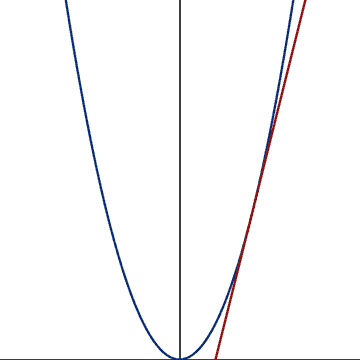

*   为什么你要在意导数这么多？如果你上过微积分课，可能记得用导数手动求函数的局部（以及全局）最大值和最小值。直观上，你可以看到下面所示区间中该函数的最大值和最小值处的导数为 `0`：

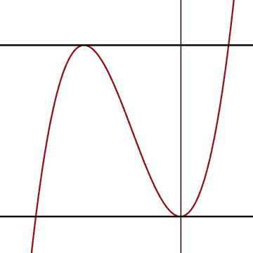

给定一个函数，你可以手动计算其导数来确定哪个输入会使函数最大或最小。例如，假设你经营了一家莓果农场，并且拥有一个分析工具，它可以根据一年中种植的莓果树数量来预测利润。为了在该年最大化利润，你可以计算利润函数的导数，从而确定能够最大化利润的莓果树数量。`Nx` 使求导过程变得简单。例如，考虑以下模型利润的函数，输入变量 `x` 表示一年内种植的莓果树数量：


### BerryFarm 模块定义

```elixir
defmodule BerryFarm do
  import Nx.Defn

  defn profits(trees) do
    trees
    |> Nx.subtract(1)
    |> Nx.pow(4)
    |> Nx.negate()
    |> Nx.add(Nx.pow(trees, 3))
    |> Nx.add(Nx.pow(trees, 2))
  end
end
```

你可以使用 VegaLite（Elixir 对 Vega 绘图库的绑定）通过以下代码来可视化该函数：

```elixir
trees = Nx.linspace(0, 4, n: 100)
profits = BerryFarm.profits(trees)

alias VegaLite, as: Vl

Vl.new(title: "Berry Profits", width: 1440, height: 1080)
|> Vl.data_from_values(%{
  trees: Nx.to_flat_list(trees),
  profits: Nx.to_flat_list(profits)
})
|> Vl.mark(:line, interpolate: :basis)
|> Vl.encode_field(:x, "trees", type: :quantitative)
|> Vl.encode_field(:y, "profits", type: :quantitative)
```

运行后，你会看到以下图表：

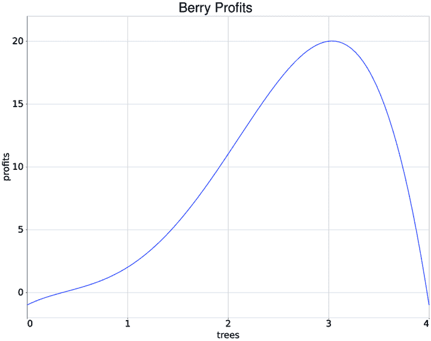

使用 Nx，你可以计算并可视化利润函数的导数，或者通过以下函数在 BerryFarm 模块中添加来观察利润随树木数量的变化：

```elixir
defmodule BerryFarm do
  import Nx.Defn

  defn profits(trees) do
    -((trees - 1) ** 4) + (trees ** 3) + trees ** 2
  end

  defn profits_derivative(trees) do
    grad(trees, &profits/1)
  end
end
```

现在，运行以下代码即可在同一张图中绘制利润函数及其导数：

```elixir
trees = Nx.linspace(0, 3, n: 100)
profits = BerryFarm.profits(trees)
profits_derivative = BerryFarm.profits_derivative(trees)

alias VegaLite, as: Vl

title = "Berry Profits and Profits Rate of Change"
Vl.new(title: title, width: 1440, height: 1080)
|> Vl.data_from_values(%{
  trees: Nx.to_flat_list(trees),
  profits: Nx.to_flat_list(profits),
  profits_derivative: Nx.to_flat_list(profits_derivative)
})
|> Vl.layers([
  Vl.new()
  |> Vl.mark(:line, interpolate: :basis)
  |> Vl.encode_field(:x, "trees", type: :quantitative)
  |> Vl.encode_field(:y, "profits", type: :quantitative),

  Vl.new()
  |> Vl.mark(:line, interpolate: :basis)
  |> Vl.encode_field(:x, "trees", type: :quantitative)
  |> Vl.encode_field(:y, "profits_derivative", type: :quantitative)
  |> Vl.encode(:color, value: "#ff0000")
])
```

随后，你会看到以下图表：

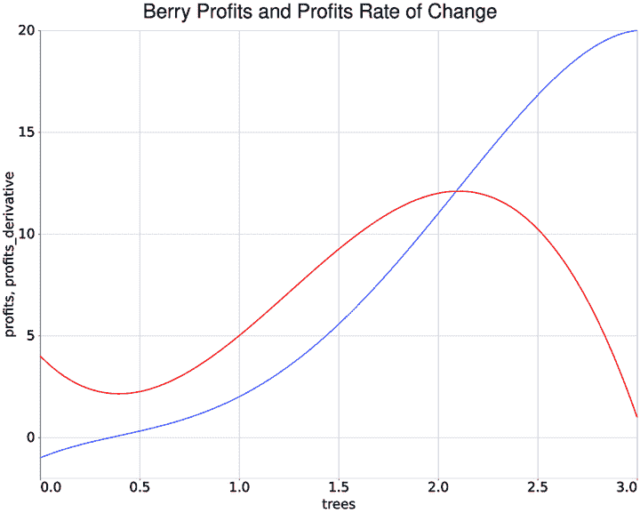

需要注意的是，利润函数的导数恰好在函数达到最大值的同时为 0。通过追踪导数直到它为 0，你可以找到原函数的极值点。

在本例中，你使用了 `grad/2` 函数来计算导数。但 `grad/2` 为什么叫 `grad/2` 而不是 `derivative` 呢？`grad/2` 是 Nx 提供的一个函数，用于计算标量函数的梯度。

梯度是标量函数变化最快的方向。你可以把标量函数看作是一个接受 rank‑N 张量作为输入并返回标量张量作为输出的 Nx 函数。梯度就像一枚热追导弹，会自动指向变化的方向。对于高维输入，计算梯度可以帮助你找到极值点。考虑下面的例子：假设你在一艘船上漂浮在湖中，需要尽快找到湖中最深的位置，只能使用深度测量仪。你被扔在湖的中间，没有时间逐点测量深度。你可以计算每个方向的深度变化，并始终沿着变化最剧烈的方向前进，这样就能保证快速到达更深的点。如果湖底像山谷一样，你就能沿着最陡峭的路径找到最深处。

使用最陡降方向寻找湖中最深点的过程与在机器学习中使用梯度下降来优化目标函数的过程相同。梯度下降之所以有用，是因为你通常无法获得目标函数的完整梯度——就像在湖中无法直接得到每个点的深度变化。相反，你只能观察少量样本并据此调整方向。

在这本书的整个过程中，你会使用梯度来优化模型参数，以在各类机器学习任务中提升性能。许多本书中的示例会抽象化 `grad/2` 的使用，但仍会在几处显式展开。那么，`grad/2` 是什么，它是如何工作的？

### 自动微分与 `defn`

Nx 的一个关键特性是能够进行自动微分。自动微分是从程序中计算导数的过程，它比数值逼近梯度更精确，也比符号微分更高效。自动微分是一个研究丰富的领域。

在本节中，你将看到如何使用 Nx 计算一个简单函数的梯度，为后续使用 Nx 优化更复杂模型奠定基础。更深入的自动微分处理请参阅 [*Evaluating Derivatives* [GW08]](#f_0098.xhtml#d1806e759)。

Nx 的 `defn` 允许你通过 `grad` 函数计算标量函数的导数。首先，在新模块中创建以下标量函数：

```elixir
defmodule GradFun do
  import Nx.Defn

  defn my_function(x) do
    x
    |> Nx.cos()
    |> Nx.exp()
    |> Nx.sum()
    |> print_expr()
  end
end
```

This function takes the element-wise cosine, followed by the element-wise exponential of an input tensor, before taking the sum of the entire tensor. Both the element-wise cosine and element-wise exponential apply mathematical functions to each element in the input. The element-wise cosine applies the cosine function, while the element-wise exponential applies the exponential function. Remember, gradients are the direction of steepest change for scalar functions, so your function must return a scalar tensor. Additionally, gradients are only valid for continuous value functions, so your function must return a floating-point type.

Next, add the following function to your module:

```elixir
defn grad_my_function(x) do
  grad(x, &my_function/1) |> print_expr()
end
```

Here, you take the gradient of `my_function` and return its value. You also inspect the gradient expression for `my_function`. The complete module looks like this:

```elixir
defmodule GradFun do
  import Nx.Defn

  defn my_function(x) do
    x
    |> Nx.cos()
    |> Nx.exp()
    |> Nx.sum()
    |> print_expr()
  end

  defn grad_my_function(x) do
    grad(x, &my_function/1) |> print_expr()
  end
end
```

Now, run the following cell to obtain the gradient of a given input tensor:

```elixir
GradFun.grad_my_function(Nx.tensor([1.0, 2.0, 3.0]))
```

You’ll see these outputs:

```
#Nx.Tensor<
  f32

  Nx.Defn.Expr
  parameter a:0 f32[3]
  b = cos a f32[3]
  c = exp b f32[3]
  d = sum c, axes: nil, keep_axes: false f32
>
#Nx.Tensor<
  f32[3]

  Nx.Defn.Expr
  parameter a:0 f32[3]
  b = cos a f32[3]
  c = exp b f32[3]
  d = sin a f32[3]
  e = negate d f32[3]
  f = multiply c, e f32[3]
>
#Nx.Tensor<
  f32[3]
  [-1.444406509399414, -0.5997574925422668, -0.05243729427456856]
>
```

First, take note of the two expression outputs. The first expression is the original function, but you never invoked the original function. So how is this possible? Under the hood, Nx is actually executing a forward pass or evaluation trace of the original function given your inputs. Nx computes the forward expression, and then recursively applies the chain-rule backwards through the forward trace to obtain the gradient of the original function. This backwards evaluation of the chain-rule is called backpropagation or reverse-mode automatic differentiation. If you’re familiar with the differentiation rules for the functions used in `my_function/1`, the connection between the first and second expressions should be obvious. The derivative of `cos(x)` is `negate(sin(x))`, and the derivative of `exp(x)` is `exp(x)`. You can see Nx computed both of those derivatives for you, and correctly applied the chain-rule by composing the derivatives of the decomposed function. You can more easily visualize it here, where `d` indicates the derivative of an expression:

```
parameter a:0 -> da = a
b = cos a -> db = negate(sin(a))
c = exp b -> dc = multiply(exp(b), db)
```


Notice that computing the derivative of the original function is essentially as easy as recursively computing derivatives of intermediate functions. You transform your original function into a new one by transforming the intermediate expressions with established gradient rules. If you’re interested in a deeper dive, the `Nx` source code is a great place to look and understand what’s going on under the hood.

## Wrapping Up

In this chapter, you learned about the high-level mathematical concepts used in machine learning algorithms. You now have a better understanding of the foundations your future models will build on and the resources and tools you’ll need to study the math further. In the next chapter, you’ll see some of this math tie together, and you’ll see how to frame machine learning problems as optimization problems.

#### Footnotes

[\[6\]](#f_0025.xhtml#FNPTR-6)

: 

[`hexdocs.pm/vega_lite/VegaLite.html`](https://hexdocs.pm/vega_lite/VegaLite.html)

Copyright © 2024, The Pragmatic Bookshelf.

在这张散点图中，请注意输入 `X` 和输出 `Y` 之间的关系。你会如何画一条直线，以最小化该散点图中每个示例与直线之间的总距离？然后，利用你刚刚画出的直线，如何对新的 `X` 输入预测 `Y` 的值？后退一步，你会发现你画的这条直线是 `do_something` 函数在 `predict` 中的可视化表示。

当给出一个未见的输入 `X` 时，你可以通过沿着这条直线预测其预期输出 `Y`。如果你能回想起小学数学课，你会记得直线不过是两个参数的可视化：`m`，即直线的斜率，以及 `b`，即直线的截距。当你把你画的这条直线视为 `predict` 函数中正在进行的转换的可视化表示时，你会发现该函数更像这样：

```
def predict(input, m, b) do
  label = m * input + b
  label
end
```

在这里，`input` 等同于 `X`；`label` 等同于 `Y`；而 `m` 和 `b` 是你画的直线的参数。

所有这些说明机器学习在实践中主要关注寻找最佳参数，以将输入转换为标签。但这些参数的形式不一定像 `m` 和 `b` 那样简单。这个演示是二维线性回归的简化例子——更多关于线性回归的内容见第 5 章 *Traditional Machine Learning*。

在实践中，机器学习算法的转换形式和参数会因问题而异，并且通常维度要高得多。因此，与其固定在 `m` 和 `b` 上，不如更实际、更通用地说 `predict` 看起来更像这样：

```
def predict(input) do
  label = f(input, params)
  label
end
```

这里，`f` 表示你所选择的机器学习算法执行的转换，`params` 表示该算法学习到的参数。目标是找到能够最好地映射输入到标签的参数。理想情况下，你希望找到 `params` 使得 `f` 在任务上表现最佳。你希望优化 `params` 以在你的任务上实现最佳性能。

### 最小化风险以最大化性能

机器学习的核心是寻找模型的最佳参数。请回顾第 1 章 *Make Machines That Learn*，机器学习系统的性能是通过不可见的测试集来衡量的。你在第 1 节中也看到了这一点。

如果目标是得到一个 `predict` 函数，其参数经过优化，能够正确为未见输入分配标签，你可能会想：如何优化一个你无法直接观察的东西？

与其直接为不可见的测试集优化性能，你实际上是为可用的训练集优化性能。通过这样做，你希望训练集能够捕捉到不可见测试集的足够特征，使得模型的参数能够最佳地为未见输入分配标签。

在训练过程中，你定义一个损失函数（loss function）或成本函数，然后尝试根据模型的参数对其进行优化。参数化的损失函数是你的整体目标函数。机器学习问题中模型、参数、损失函数和目标函数之间的关系如下 Elixir 代码所示：

```
def model(params, inputs) do
  labels = f(params, inputs)
  labels
end

def loss(actual_labels, predicted_labels) do
  loss_value = measure_difference(actual_labels, predicted_labels)
  loss_value
end

def objective(params, actual_inputs, actual_labels) do
  predicted_labels = model(params, actual_inputs)
  loss(actual_labels, predicted_labels)
end
```

`model` 是一个函数，它使用 `params` 将 `inputs` 转换为 `labels`。`loss` 是一个函数，用于衡量实际标签与预测标签之间的差异。损失函数应提供某种正确性的指示或度量。

假设你想训练一个模型来预测 NBA 比赛中两支球队的总得分。你可以将损失定义为实际得分与模型预测得分之间的平方差（即平方误差）。如果模型预测总得分为 242，实际总得分为 245，则该比赛的损失为 9。你将在第 *Defining Objectives* 章节中看到许多不同类型的损失函数。

请注意，目标函数是基于损失函数、模型和参数的参数化函数。目标函数衡量模型在真实训练示例上的损失。机器学习中的学习过程本质上是对目标函数进行优化。

你可以使用已知的各种优化技术或求解器来优化目标函数。有些目标函数可以 analytically（解析地）求解，而其他则需要数值优化来找到近似解。

正如你所知道的，机器学习在很大程度上依赖于优化——这可能让人难以看出机器学习与纯粹优化或曲线拟合的区别。考虑这一点：机器学习关注未见输入的性能。更具体地说，它关注降低未见输入上的泛化误差。

在统计学习理论中，泛化误差也称为风险，你的目标是最小化风险。然而，当你无法获得整个可能输入分布时，无法直接对风险进行优化。因此，你会优化经验风险，即模型在经验分布（即训练集）上的表现。

理论上，经验分布与真实输入分布在某些意义上是等价的，因此最小化经验风险等价于最小化真实风险。但在实践中，由于数据有限以及计算能力有限，总存在捕捉无限分布的错误。

最小化经验风险的过程称为经验风险最小化（ERM），是纯粹优化与机器学习的关键区别。当你拥有整个分布时，你可以直接用优化来最小化风险。当你没有整个分布时，你可以通过最小化经验风险间接地最小化风险。前者是一个优化问题；后者是一个机器学习问题。

### 定义目标

模型最佳参数的定义受你在定义机器学习任务时所设定的约束和目标的制约。请回顾第 1 章 *Make Machines That Learn*，在设计机器学习系统时，你需要定义 SMART 任务。这一需求在机器学习的训练过程中的重要性显而易见。

此外，机器学习算法几乎从不直接优化你真正关心的性能指标。例如，你不会在机器学习算法中直接优化模型的准确率或分类错误。相反，机器学习算法使用替代损失函数。

-   [替代损失函数](https://example.org) 作为真实目标的代理。这些损失函数通常更容易优化，优化它们也间接优化了你关心的性能目标。例如，使用平方误差作为绝对误差的替代更为常见，因为平方误差函数具有使优化更容易的性质。替代损失函数的选择通常取决于机器学习任务和模型类型。

*   研究机器学习中使用的两种最常见的损失函数。

*   了解它们的使用原因和适用时机。

*   了解它们与上一章节所学习的概率课程之间的关系。

#### 可能性估计

此时，你可能在想损失函数实际上测量的是什么。为了回答这个问题，你首先需要理解可能性。

在统计学中，可能性函数（或简称“可能性”）描述了观测数据作为其参数的概率函数。可以将可能性视为一种“真相仪”。统计学学习理论假设存在某个真实函数生成数据，可能是这样的：

```
def datagen(true_params) do
  true_f(true_params)
end
```

在这个例子中，`datagen` 是一个带有真模型 `true_f` 和真参数 `true_params` 的数据生成函数。`datagen/1` 函数可以表示任何数据分布。

假设 `datagen/1` 是生成一系列彩票中奖号码的数据生成函数。你有一系列彩票号码，想知道它们是中奖号码的可能性。如果你可以获取 `true_params` 和 `true_f`，你可以通过测量你的彩票号码与 `datagen/1` 生成的多个中奖号码样本之间的差异来测量可能性。

这个场景有点不现实，因为你很少能获得关于数据生成函数和参数的完美信息。更可能的情形是，你拥有若干中奖彩票，想要恢复生成中奖彩票的真实函数。你首先创建对原始 `true_f` 和 `true_params` 的估计：

```
def estimate_datagen(estimate_params) do
  estimate_f(estimate_params)
end
```

现在，你可以测量 `estimate_params` 生成你的中奖彩票的可能性，这本质上是测量你估计的数据生成函数与真实数据生成函数之间的相似性或距离。

在测量出估计数据生成器与真实数据生成器之间的相似性后，你会使用某种优化算法更新 `estimate_params`，然后再次测量。你通过优化 `estimate_params` 来最大化其能够生成中奖彩票的可能性，即最大化 `estimate_params` 是生成中奖彩票的真实参数。在统计学学习理论中，这个优化过程称为最大似然估计（MLE）。使用最大似然估计器时，你的损失函数是函数之间的相似度度量。

#### 跨熵

在机器学习中，你经常会在分类任务的上下文中看到“跨熵”一词。下面给出的函数定义了二分类任务中跨熵的含义：

```
defn binary_cross_entropy(y_true, y_pred) do
  y_true * Nx.log(y_pred) - (1 - y_true) * Nx.log(1 - y_pred)
end
```

该函数假设 `y_true` 是 0 或 1 的标签，表示二分类；`y_pred` 是介于 0 与 1 之间的概率，用于预测真实标签 `y_true`。

跨熵也可以作为分类任务的损失函数，其中可能的类别数量可以无限大。虽然其在学术意义上不一定适用于所有分类任务，但在机器学习框架的分类问题中，跨熵的使用是惯例。

| **数值稳定性** |
| --- |
|  给出的二分类交叉熵实现在某些情况下可能不具备数值稳定性。你应该使用 Nx 生态系统中的 Axon 和 Scholar 实现。 |

#### 均方误差

均方误差（Mean Squared Error, MSE）衡量每个示例的损失为真实标签与预测标签之间的平均平方差。你可以在 Nx 中使用以下代码实现均方误差：

```
defn mean_squared_error(y_true, y_pred) do
  y_true
  |> Nx.subtract(y_pred)
  |> Nx.pow(2)
  |> Nx.mean(axes: [-1])
end
```

均方误差常用于回归任务的优化目标，以取代绝对误差。绝对误差是真实标签与预测标签之间的绝对差值，计算方式为 `Nx.abs(Nx.subtract(y_true, y_pred))`。均方误差总是非负的（假设只处理实数），因为差值被平方后消除了负号。

### 收敛到解

随着你继续深造机器学习，需要留意的概念之一是优化与机器学习中“收敛”的概念。大多数机器学习中使用的优化算法并不保证能找到最优解。这意味着它们不保证能够找到最佳的模型参数集合。

最佳的模型参数集合是整个参数空间的全局最优。在参数空间无限且函数无法解析优化的情况下，找到全局最优是不可能的。相反，优化算法是机械性的，设计为循环直到达到某个期望的性能阈值。

虽然在高参数空间中几乎不可能找到全局最优，但模型可以在局部最优上收敛。局部最优是参数空间中局部的、比邻近点更好的区域。

把你的模型参数空间想象成大海：全局最优是马里亚纳海沟，而局部最优则是海中的小海沟和山谷。好在你不必担心模型无法收敛到全局最优。记住，训练机器学习系统的目标是实现真实任务的性能。即使不收敛到全局最优，甚至不收敛到任何最优，你的模型在任务上仍能表现良好。

#### 正则化以泛化

正如你在上一节中学到的，机器学习与优化的区别在于机器学习关注未见数据的表现。在第 1 章 *Make Machines That Learn*，你学习到这一概念称为泛化。你的目标是训练能够泛化的模型——训练数据的表现不一定重要。

想象你有两个模型。模型 A 在训练集上表现明显差，而模型 B 在训练集上表现更好。然而，模型 B 在测试集上表现明显优于模型 A。在这种情况下，你会倾向于选择哪个模型？

基于你的主要目标是未见数据（例如测试集）的表现，你很可能会倾向于选择模型 B。但如何才能拥有一个在训练集上表现明显更差、在测试集上表现明显更好 的模型？

答案是正则化。在深入正则化之前，需要了解模型容量以及过拟合和欠拟合的概念。

##### 过拟合、欠拟合与容量

在本章中，你发现了两种用于解决学习问题的优化问题的学习框架：经验风险最小化（ERM）和最大似然估计（MLE）。ERM 和 MLE 都会在训练集上的错误上优化模型参数，这意味着它们明确地拟合函数以匹配训练数据。这两种技术都容易出现过拟合。

过拟合是指训练得到的模型在训练数据上错误很低，但在泛化到新数据时错误很高的情况。如果你用图形方式表示过拟合，它会看起来像下面的图：

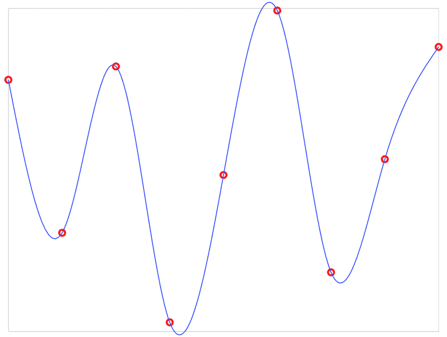

注意观察，这条线完美地穿过了原始数据的每一个点。拟合函数完美匹配当前数据，但很可能对新数据泛化得不好。

模型也可能倾向于欠拟合。欠拟合是指模型在训练数据上错误本身就很高的情况。下面的图展示了过拟合和欠拟合的对比：

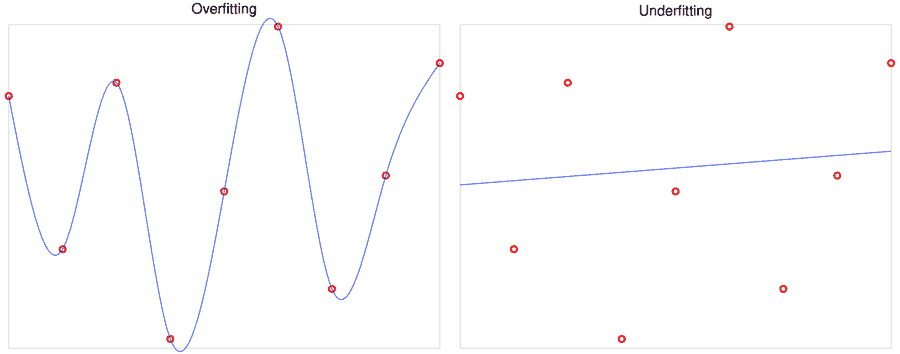

过拟合和欠拟合通常取决于模型的容量。模型的容量是指它拟合多种不同函数的能力。在设计机器学习模型时，你需要选择一个函数的假设空间。例如，线性回归假设你想拟合的真实模型是关于观测数据的线性模型。这意味着线性回归的假设空间仅限于线性函数。假设你使用一个形式为直线方程的模型：

```
def model(x, params) do
  {m, b} = params
  m * x + b
end
```

这个模型只有足够的容量来拟合直线。你可以通过添加另一项来增加其容量，从而包含二次函数：

```
def model(x, params) do
  {w0, w1, w2} = params
  w0 + w1 * x + w2 * x ** 2
end
```

注意，这个过程可以一直进行下去——你可以不断添加多项式项和参数，以增加模型拟合 n 级多项式的能力。

容量更高的模型比容量更低的模型更容易出现过拟合，因为高容量模型能拟合更广泛的复杂函数。例如，你可以用立方函数拟合所有二次函数，但不能用二次函数拟合所有立方函数。设计良好的模型意味着在过拟合和欠拟合之间找到平衡。


### 定义正则化

在机器学习中，正则化是任何用于对抗过拟合，或者更广泛地说，用于降低泛化错误的技术，例如，在不一定降低训练错误的情况下，降低测试集上的错误。

ERM 和 MLE 都容易出现过拟合。因此，正则化是许多机器学习算法的必要步骤。你在本书中会使用许多种类的正则化。本节将介绍两种对几乎所有机器学习算法都通用的正则化方法。

#### 复杂度惩罚

复杂度惩罚是训练能够很好泛化的机器学习模型时常用的正则化器。复杂度惩罚在模型评估时通过添加一个带有惩罚系数的惩罚项来施加成本。惩罚项通常是模型参数的函数。例如，重量衰减是一种常见的正则化惩罚，它引入一个等于模型参数的 L2-范数的惩罚项。

L2-范数是一个你可以理解为“距离原点的距离”的概念。例如，在二维空间中，点 {3, 4} 的 L2-范数是 5，由距离公式给出：

```
defn distance(x, y) do
  x
  |> Nx.pow(2)
  |> Nx.add(Nx.pow(y, 2))
  |> Nx.sqrt()
end
```

假设你使用均方误差损失和重量衰减，你的完整目标函数可能如下：

```
def objective(params, actual_inputs, actual_labels) do
  lambda = 0.5
  predicted_labels = model(params, actual_inputs)
  loss = mean_squared_error(actual_labels, actual_inputs)
  penalty = l2_norm(params)

  loss + lambda * penalty
end
```

`lambda` 控制重量衰减惩罚的强度，`lambda` 越大，对模型训练的影响越大。重量衰减表达了倾向于更小模型权重的偏好。数学上，它将模型的可行参数空间约束到更靠近原点的那些。直观上，你可以把重量衰减看作是惩罚模型对特定权重过于自信。

#### 早停

早停是另一种常用的机器学习模型训练正则化器，它在检测到过拟合时停止训练过程。由于无法完全检测到过拟合，通常的做法是使用验证集来监控过拟合。

验证集或保留集是原始训练数据中不用于训练而用于定期监控模型性能的部分数据。通常，如果训练错误继续下降而验证错误开始上升，说明模型正在开始过拟合。早停在模型有机会过拟合训练集之前就停止训练过程。你在本书的深度学习部分会看到早停的多个实际例子。

## 下降梯度

现在你已经了解了一些关于优化以及它在机器学习中的应用，是时候看看如何在真实问题的背景下实现机器学习的优化。在这一节中，你将实现随机梯度下降来估计真正的参数，这些参数用于生成一些训练数据。

梯度下降是一种用于

```
{train_x, new_key} = Nx.Random.uniform(new_key, shape: {10000, 32})
train_y = true_function.(true_params, train_x)
train_data = Enum.zip(Nx.to_batched(train_x, 1), Nx.to_batched(train_y, 1))

{test_x, _new_key} = Nx.Random.uniform(new_key, shape: {10000, 32})
test_y = true_function.(true_params, test_x)
test_data = Enum.zip(Nx.to_batched(test_x, 1), Nx.to_batched(test_y, 1))
```

[content]

每个示例都是一个元组 `{input, label}`，其中 `input` 是均匀随机向量，`label` 则是通过评估 `true_function`（真实数据生成函数）获得的。

接下来，在新建的单元格中创建一个名为 `SGD` 的模块。正如上一章节所示，你需要使用 `defn` 来获取 `Nx` 自动微分的能力，因此需要导入 `Nx.Defn`：

```
defmodule SGD do
  import Nx.Defn
end
```

### 获取良好的初始化

随机梯度下降通常从随机参数集开始。请记住，机器学习中的优化目标是为特定函数找到最佳的参数化。

不幸的是，当你不知道最佳参数应该是什么时，就无法明智地选择起始点。对于某些学习算法（例如深度学习），有研究表明不同的初始化方式可以更好地收敛。但目前，你可以用随机均匀向量初始化参数，该向量的大小为 32。为此，在 `SGD` 模块中添加以下函数：

```
defn init_random_params(key) do
  Nx.Random.uniform(key, shape: {32, 1})
end
```

### 实现模型

接下来，你需要实现模型，它用于模拟 `true_function`。将以下函数添加到 `SGD` 模块，表示你的模型：

```
defn model(params, inputs) do
  labels = Nx.dot(inputs, params)
  labels
end
```

在这个例子中，你已经知道 `true_function` 的原始形式，因此可以使用相同的形式来实现 `model`。在真实的机器学习问题中，你并没有直接获得相同的信息，所以 `model` 的形式会依赖于你对数据的直觉。这里，你知道原始函数通过输入与真实参数之间的点积来转换输入——你只需要找出真实参数是什么。

### 定义目标函数

现在，你需要实现损失函数。请记住，目标是最小化评估集上的均方误差，因此可以直接使用均方误差作为损失函数。你在本章节前面已经看到如何实现均方误差，因此可以在此复用：

```
defn mean_squared_error(y_true, y_pred) do
  y_true
  |> Nx.subtract(y_pred)
  |> Nx.pow(2)
  |> Nx.mean(axes: [-1])
end

defn loss(actual_label, predicted_label) do
  loss_value = mean_squared_error(actual_label, predicted_label)
  loss_value
end
```

你的损失函数提供了预测分布与实际分布之间的距离度量。直观地，你可以把梯度下降看作是在水体中寻找最深点的任务。

随机初始化 `init_random_params` 将你抛入水体中的随机位置。你测量深度（即 `loss`）在当前参数化下的值，并计算深度在所有方向的变化率。然后，你沿着梯度最陡的下降方向更新位置。要计算当前参数化下的 `loss`，需要定义目标函数。为此，在 `SGD` 模块中添加以下代码：

```
defn objective(params, actual_inputs, actual_labels) do
  predicted_labels = model(params, actual_inputs)
  loss(actual_labels, predicted_labels)
end
```

`objective/3` 在 `actual_inputs` 上进行预测，并返回 `loss/2`，即预测标签与实际标签之间的差值。它反映了你在前面描述的“船只”例子中，当前位置相对于深度的变化。

### 向正确方向迈进

实现随机梯度下降算法的最后一步是步函数，它会将参数朝正确的方向移动——即找到梯度最陡下降的方向。

回顾第 3 章 *Harness the Power of Math*，你可以通过计算函数相对于参数的梯度来找到函数的最陡下降方向。使用 `Nx` 的自动微分能力可以轻松实现这一点。在 `SGD` 模块中添加以下代码，实现步函数：

```
defn step(params, actual_inputs, actual_labels) do
  {loss, params_grad} = value_and_grad(params, fn params -> objective(params, actual_inputs, actual_labels) end)
  new_params = params - 1.0e-2 * params_grad
  {loss, new_params}
end
```

该函数利用 `Nx` 的特殊 kernel 函数 `value_and_grad`，它同时返回函数的值和相对于参数的梯度。与单独使用 `grad` 相比，`value_and_grad` 更适合在需要同时获取函数值和梯度时使用。它会对 `objective/3` 关于 `params` 的梯度进行计算，这衡量了 `loss` 函数相对于模型参数的变化率。随后，`new_params` 被设置为 `params` 减去 scaled version of `params_grad`（即学习率 `1.0e-2`）。

在机器学习语境中，这个缩放因子 `1.0e-2` 被称为学习率。它控制了每个示例之间参数变化的步幅大小。学习率通常是一个小于 1 的值，因为你只对一小部分点的 `loss` 函数梯度进行测量。对小样本的梯度不能过度自信。正是因为只使用数据集的子样本，随机梯度下降才真正具有“随机性”。如果你能获得“真实梯度”（即整个数据集的梯度），则可能不需要缩放 `params_grad`；但计算真实梯度往往不可行。

### 整合所有组件

最后，你需要一个能够把 `SGD` 实现的各个部分组合在一起的功能，同时还需要一个用于评估优化过程最终性能的评估函数。在模块中添加以下代码，实现 `train` 和 `evaluate`：


```elixir
def evaluate(trained_params, test_data) do
  test_data
  |> Enum.map(fn {x, y} ->
    prediction = model(trained_params, x)
    loss(y, prediction)
  end)
  |> Enum.reduce(0, &Nx.add/2)
end

def train(data, iterations, key) do
  {params, _key} = init_random_params(key)
  loss = Nx.tensor(0.0)
  # 训练循环在此处实现
end
```

| | `trained_params = Nx.init_random(key, shape)` |
| --- | --- |
| | `for i <- 1..1000, reduce: {loss, params} do` |
| | `  {loss, params} = step(params, batch)` |
| | `  IO.puts("Epoch #{i}: loss = #{loss}")` |
| | `end` |
| | `trained_params` |

**Evolutionary algorithms** 是一类基于人工选择原理的优化算法。在进化算法中，你会生成一个问题的解决方案群体（例如，一组超参数），对群体中的每个解决方案进行评估，然后结合最佳的解决方案来构建更好的解决方案。进化算法甚至可以与神经网络结合使用，这种方式称为**神经演化（neuroevolution）**，即通过多个世代演化神经网络的参数和结构，以获得更好的网络。进化算法在机器学习之外也很流行，已被用于无线天线的智能设计^([\[7\]](#f_0034.xhtml#FOOTNOTE-7)) 和 [*scenario generation for game design* [SFF19]](#f_0098.xhtml#d1806e1480)。

进化算法很容易并行化，并能从 `Nx` 通过 JIT 编译加速到 CPU/GPU 的并行化和加速的优势中受益。遗憾的是，本文的范围不包括对遗传算法的详细描述。如果你想进一步了解，可以参考 [*Genetic Algorithms in Elixir* [Mor21]](#f_0098.xhtml#d1806e1231)，以及 `MEOW` 库。^([\[8\]](#f_0034.xhtml#FOOTNOTE-8))

### Grid Search

**Grid search** 与黑盒优化的不同之处在于，它实际上是对参数的离散网格进行的 **exhaustive search**。Grid search 是机器学习中最常用的超参数优化方法。在 grid search 中，你需要定义想要优化的参数以及每个参数的测试值。例如，你可能会指定 `1.0e-4`、`1.0e-3` 和 `1.0e-2` 作为学习率的取值。Grid search 会尝试所有超参数的组合，并返回表现最好的那一个组合。

## Wrapping Up

在这一章中，你将机器学习框架化为优化问题，以了解机器学习与优化之间的关系。同时，你还学习了正则化，并了解到优化与机器学习的关键区别在于机器学习更强调泛化。你通过实现自己的**随机梯度下降（stochastic gradient descent）**来应用优化到机器学习问题上。最后，你还了解了一些关于黑盒优化和超参数优化在机器学习背景下的知识。

在掌握机器学习的基础和 `Nx` 之后，你已经准备好使用 Elixir 和 `Nx` 生态开始解决现实世界的机器学习问题。下一章，你将直接进入传统的机器学习算法，如线性回归、逻辑回归、最近邻学习和决策树。

#### Footnotes

[\[7\]](#f_0033.xhtml#FNPTR-7)

: [`www.jpl.nasa.gov/nmp/st5/TECHNOLOGY/antenna.html`](https://www.jpl.nasa.gov/nmp/st5/TECHNOLOGY/antenna.html)

[\[8\]](#f_0033.xhtml#FNPTR-8)

: [`github.com/jonathanklosko/meow`](https://github.com/jonathanklosko/meow)

Copyright © 2024, The Pragmatic Bookshelf.

# Chapter 5

Traditional Machine Learning

In the previous chapters, you've become more grounded in the foundations of machine learning. At this point, you should feel more comfortable working with `Nx`, and it's okay if you don't grasp everything. Part of the beauty of the tooling in the `Nx` ecosystem is that it greatly reduces the complexity of common machine learning tasks. You don't need to be a math expert to train a machine learning model in Elixir. You need only to understand a bit of Elixir, and a bit of `Nx`.

In Chapter 4, *Optimize Everything*, you wrote a linear regression model from scratch using `Nx`. While following along, you might have noticed the task was a bit verbose to write from scratch. `Nx` offers a lot of flexibility, but you don't want to have to write every algorithm from scratch. Thankfully, Elixir has a library for performing common machine learning tasks in a few lines of code. **Scholar**^([\[9\]](#f_0040.xhtml#FOOTNOTE-9)) is a set of machine learning tools built on top of Elixir and `Nx`. In this chapter, you'll implement some traditional machine learning algorithms using `Scholar`, and you'll start to unlock the potential of the Elixir `Nx` ecosystem.

## Learning Linearly

Recent advances in machine learning have largely been attributed to deep learning. The popularity of deep learning—thanks to impressive feats in natural language processing, computer vision, and generative modeling—has made it almost synonymous with machine learning. However, the field of machine learning is vast. Deep learning refers to a subset of machine learning that uses neural networks. You'll learn more about deep learning in Chapter 6, *Go Deep with Axon*. But first, you'll focus on shallow machine learning algorithms.

Shallow machine learning refers to non-deep-learning-based algorithms. But the term is a bit of a misnomer. In a deep-learning-centric world, it's easy to classify algorithms into one of two classes: deep learning and everything else. In reality, the "everything else" covers a vast amount of algorithms. Many of these algorithms find significant use in the real world today.

When tackling a problem using machine learning, it's easy to immediately reach for a complex solution such as deep learning. However, many times you can do just as well with a much simpler and more interpretable machine learning algorithm. You can get a lot of value out of a simple linear regression model.

Perhaps the simplest class of traditional machine learning algorithms is linear models. They assume linearity in the underlying relationship between inputs and outputs. To think about it simply, linear models assume that input data can be modeled with a line. While this might seem like an overly simplistic assumption, it turns out that you can create pretty accurate models in this way. Remember, there's no such thing as a perfect model. A lot of times all we care about is having a model that's good enough for the task at hand. Reality is almost never linear, but linear models are still powerful at modeling the real world.

### Linear Regression with Scholar

You're already familiar with one type of linear model—linear regression—from *Descending Gradients*. Linear regression is an approach for modeling the relationship between some scalar target variable and one or more input variables. If you dust off your primary school mathematics lessons, you might remember the infamous equation for a line:

| | `y = mx + b` |
| --- | --- |

This equation represents a linear relationship between the target variable `y` and the input variable `x`. `m` and `b` represent the slope and intercept of the line, respectively. Given an `m` and a `b`, you can predict any `y` from any `x`. For example, if you know `m` is `3.0` and `b` is `2.0`, you can create a function such as the following:

```elixir
def model(x) do
  3.0 * x + 2.0
end
```

You can then use your model to get the correct value of `y` at different values of `x`:

```elixir
IO.inspect model(2) # prints 8
IO.inspect model(3) # prints 11
IO.inspect model(4) # prints 14
```

In the real world, you often don't have access to the parameters `m` and `b`, which drive the relationship between your target and input variables. Instead, you need to infer or learn these parameters using machine learning. For example, consider this scatterplot from *Learning with Optimization*:

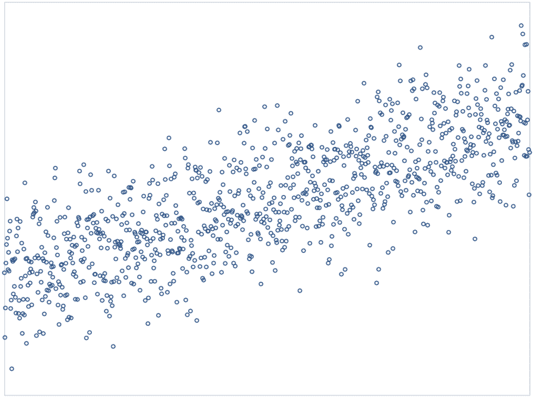

你会注意到图中的点大致沿一条直线分布。使用线性回归的目标是绘制一条直线，使得该直线与数据集中每个点之间的总距离最小。最终得到的直线通常被称为最佳拟合线，可用于预测输入与输出之间的关系。在 *Descending Gradients* 中，你通过手动实现随机梯度下降来寻找最佳拟合线，走了一条曲折的路。现在，你将使用 `Scholar` 完成同样的任务。

首先，在新建的 `Livebook` 中安装以下依赖：

```elixir
Mix.install([
  {:scholar, "~> 0.2"},
  {:nx, "~> 0.5"},
  {:exla, "~> 0.5"},
  {:vega_lite, "~> 0.1.6"},
  {:kino_vega_lite, "~> 0.1.6"},
  {:scidata, "~> 0.1"}
])
```

你将使用 `Scholar` 访问一系列传统机器学习算法和工具：`Nx` 用于操作张量，`EXLA` 用于 JIT 编译和加速，`VegaLite`/`KinoVegaLite` 用于创建数据可视化。后续还需要 `SciData` 来下载数据集。

接下来，将默认后端设置为 `EXLA`，默认 `defn` 编译器设置为 `EXLA`，运行以下代码：

```elixir
Nx.default_backend(EXLA.Backend)
Nx.Defn.default_options(compiler: EXLA)
```

然后，生成训练数据：

```elixir
m = :rand.uniform() * 10
b = :random.uniform() * 10

key = Nx.Random.key(42)
size = 100
{x, new_key} = Nx.Random.normal(key, 0.0, 1.0, shape: {size, 1})
{noise_x, new_key} = Nx.Random.normal(new_key, 0.0, 1.0, shape: {size, 1})

y =
  m
  |> Nx.multiply(Nx.add(x, noise_x))
  |> Nx.add(b)
```

在这段代码中，你首先声明目标参数 `m` 和 `b` 为随机标量。然后使用 `Nx` 的随机模块创建一个新的随机种子键。请注意，`Nx` 的随机数生成模块是无状态的，因此每次生成随机数时都需要传入 `key`。接着，你创建两个高斯分布的张量：`x` 和 `noise_x`。`x` 是输入变量的随机分布，`noise_x` 是高斯噪声，用于模拟真实世界数据的不完美性。

接下来，运行以下代码生成散点图：

```elixir
alias VegaLite, as: Vl
```


## 散点图绘制与线性回归拟合

```elixir
Vl.new(title: "Scatterplot", width: 720, height: 480)
|> Vl.data_from_values(%{
  x: Nx.to_flat_list(x),
  y: Nx.to_flat_list(y)
})
|> Vl.mark(:point)
|> Vl.encode_field(:x, "x", type: :quantitative)
|> Vl.encode_field(:y, "y", type: :quantitative)
```

你将在这里看到图表。

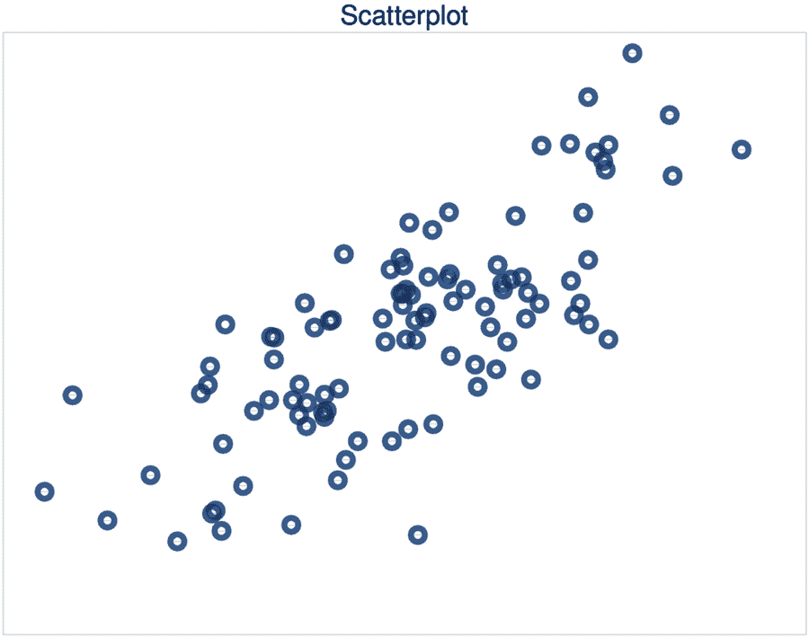

观察到数据大致沿一条直线分布，但由于高斯噪声，这条直线并不完美。

接下来，你将在输入变量 `x` 和输出变量 `y` 上拟合线性回归模型。使用 Scholar，只需一行代码：

```elixir
model = Scholar.Linear.LinearRegression.fit(x, y)
```

运行此代码后，你会看到以下输出：

```text
%Scholar.Linear.LinearRegression{
  coefficients: #Nx.Tensor<
    f32[1][1]
    [
      [3.4556338787078857]
    ]
  >,
  intercept: #Nx.Tensor<
    f32[1]
    [9.695785522460938]
  >
}
```

`Scholar.Linear.LinearRegression.fit/3` 返回一个 `%LinearRegression{}` 结构体，包含 `coefficients` 和 `intercept` 两个属性，它们分别代表 `m` 和 `b`。

如果你检查 `m` 和 `b`，会发现它们与预测的系数和截距非常接近。由于随机化，你的 `m` 和 `b` 会与示例值不同。

在内部，Scholar 的 `Scholar.Linear.LinearRegression.fit/3` 使用普通最小二乘法（ordinary least-squares regression）求解最佳拟合线。不过，你无需理解其原理，因为 Scholar 将复杂性封装到简洁易用的 API 中。你现在可以使用返回的模型对新数据进行预测。例如：

```elixir
Scholar.Linear.LinearRegression.predict(model, Nx.iota({3, 1}))
```

输出为：

```text
#Nx.Tensor<
  f32[3][1]
  [
    [9.695785522460938],
    [13.151419639587402],
    [16.607053756713867]
  ]
>
```

为了验证模型，你可以将预测的直线叠加到原始散点图上。为此，先运行以下代码生成与训练数据相同区间的预测值：

```elixir
pred_xs = Nx.linspace(-3.0, 3.0, n: 100) |> Nx.new_axis(-1)
pred_ys = Scholar.Linear.LinearRegression.predict(model, pred_xs)
```

第一行代码创建一个包含 100 个元素的向量，值从 -3.0 线性增加到 3.0。第二行代码在整个区间上使用 `Scholar.Linear.LinearRegression.predict/2` 进行预测。

然后，使用以下代码绘制预测直线并叠加到原始散点图上：

```elixir
title = "Scatterplot Distribution and Fit Curve"

Vl.new(title: title, width: 720, height: 480)
|> Vl.data_from_values(%{
  x: Nx.to_flat_list(x),
  y: Nx.to_flat_list(y),
  pred_x: Nx.to_flat_list(pred_xs),
  pred_y: Nx.to_flat_list(pred_ys)
})
|> Vl.layers([
  Vl.new()
  |> Vl.mark(:point)
  |> Vl.encode_field(:x, "x", type: :quantitative)
  |> Vl.encode_field(:y, "y", type: :quantitative),
  Vl.new()
  |> Vl.mark(:line)
  |> Vl.encode_field(:x, "pred_x", type: :quantitative)
  |> Vl.encode_field(:y, "pred_y", type: :quantitative)
])
```

运行后，你会看到这张图。

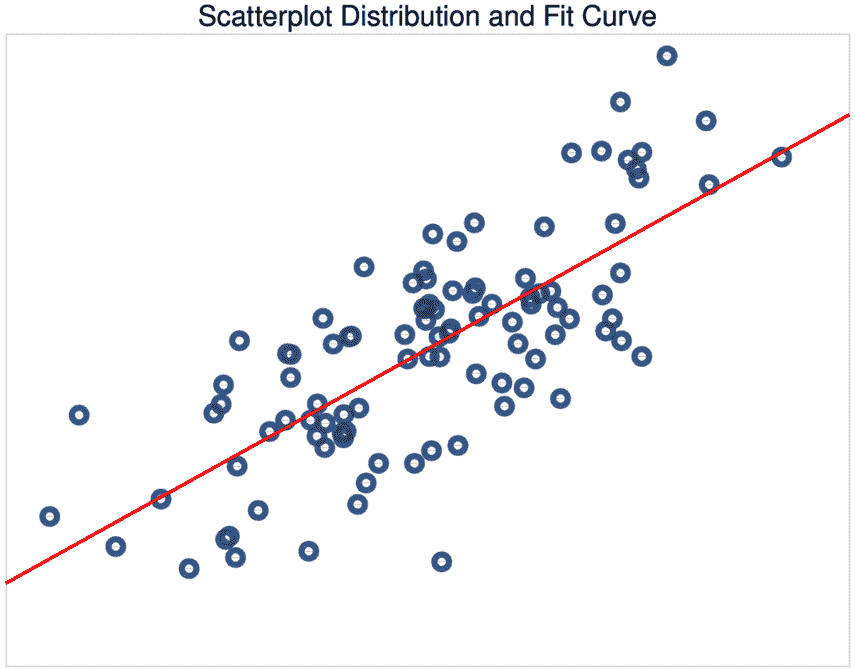

你可能会注意到，这条直线甚至不与训练数据中的任何点相交。记住，这条直线是最佳拟合线，旨在代表训练数据中观察到的模式的一般化趋势。它不过是训练数据中模式的平均值。

在这个例子中，你对单变量进行了线性回归。但你可以将线性回归扩展到任意数量的特征。例如，如果你想预测一场 NBA 比赛中某支球队的得分，可以使用多个特征：每场比赛平均三分球命中数、每场比赛平均得分、裁判是否为 Tim Donaghy 等。只要输入变量与目标变量之间的关系可以合理地用直线表示，你就可以使用线性回归来解决该问题。

## 使用 Scholar 的 Logistic Regression

一种常用于分类问题的线性回归的变体是逻辑回归。逻辑回归几乎与线性回归完全相同。但是，在对输入变量进行线性变换后，你还需要应用一个逻辑函数，该函数将输出压缩在 0 到 1 之间。通常，输出表示二分类问题的概率。但它也可以扩展用于处理多类分类问题。例如，假设你是一名侍酒师，正在开发一个模型，根据每瓶葡萄酒的化学分析来预测其类型。你有一个包含测量值的数据集，以及一个标签，表示三种葡萄酒中的一种。这是应用逻辑回归的完美场景。

首先，使用 SciData 下载葡萄酒数据集：

```elixir
{inputs, targets} = Scidata.Wine.download()
```

接下来，将数据集划分为训练集和测试集，以便验证模型的性能：

```elixir
{train, test} =
  inputs
  |> Enum.zip(targets)
  |> Enum.shuffle()
  |> Enum.split(floor(length(inputs) * 0.8))

{train_inputs, train_targets} = Enum.unzip(train)
train_inputs = Nx.tensor(train_inputs)
train_targets = Nx.tensor(train_targets)

{test_inputs, test_targets} = Enum.unzip(test)
test_inputs = Nx.tensor(test_inputs)
test_targets = Nx.tensor(test_targets)
```

第一部分代码会对原始输入数据集进行打乱，使得类别在训练集和测试集之间均匀分布。然后，它将数据集划分为 80/20 的训练集和测试集。最后，它将训练集和测试集转换为张量。

现在，你可以在继续之前对数据进行一些预处理。大多数时候，你希望将输入特征缩放到某个尺度上。这通常使得模型更容易从输入数据中学习模式。例如，通常将输入特征压缩在 0 到 1 之间。你可以使用 Scholar 的预处理方法来完成此操作：

```elixir
train_inputs = Scholar.Preprocessing.min_max_scale(train_inputs)
test_inputs = Scholar.Preprocessing.min_max_scale(test_inputs)
```

这段代码通过根据输入数据的最小值和最大值对 train 和 test 输入进行缩放，将它们都缩放到 0 到 1 之间。

接下来，你可以使用 `Scholar.Linear.LogisticRegression.fit/3` 训练一个逻辑回归模型：

```elixir
model = Scholar.Linear.LogisticRegression.fit(
  train_inputs,
  train_targets,
  num_classes: 3
)
```

请注意，必须指定 `num_classes: 3`，因为原始数据集包含三个类别。这段代码会将原始问题视为多类分类问题。运行一段时间后，你会看到以下输出：

```text
%Scholar.Linear.LogisticRegression{
  coefficients: #Nx.Tensor<
    f32[13][3]
    [
      [57.30550765991211, 40.04463577270508, 21.67230796813965],
      [9.130376815795898, 6.3609209060668945, 5.055447101593018],
      [9.905561447143555, 7.361076831817627, 3.8778562545776367],
      [70.83293914794922, 67.13773345947266, 35.777008056640625],
      [457.4987487792969, 298.3395080566406, 170.00132751464844],
      [11.34200668334961, 6.753108978271484, 2.0085954666137695],
      [11.833603858947754, 6.091976165771484, 0.4948000907897949],
      [1.158339500427246, 1.3611177206039429, 0.7777756452560425],
      [7.858388900756836, 4.755614280700684, 1.6751126050949097],
      [21.37252426147461, 9.511534690856934, 12.442154884338379],
      [4.333345890045166, 3.347238063812256, 1.008358359336853],
      [13.530704498291016, 8.850102424621582, 2.6361520290374756],
      [4223.81689453125, 1395.7369384765625, 934.896240234375]
    ]
  >,
  bias: #Nx.Tensor<
    f32
    0.0
  >,
  mode: :multinomial
}
```

与线性回归模型类似，Scholar 生成一个特定于逻辑回归的结构体，可以用于后续预测。你会注意到系数张量的形状是 `{13, 3}`，这表示每个类别有 13 个特征。在多类逻辑回归模型中，你实际上是在训练多个二分类概率预测模型。对于每个类别，你预测该输入是否属于该类别的概率（在 0 到 1 之间），然后对所有类别进行归一化。

你现在可以使用该模型在测试集上进行预测：

```elixir
test_preds = Scholar.Linear.LogisticRegression.predict(model, test_inputs)
```

除了实现多种机器学习算法外，Scholar 还提供了用于评估模型的例程。例如，你可以计算模型的准确率：

```elixir
Scholar.Metrics.Classification.accuracy(test_targets, test_preds)
```

运行该单元后，你会看到以下输出：

```text
#Nx.Tensor<
  f32
  0.75
>
```

另一个分类问题的常用指标是混淆矩阵。混淆矩阵是一个表格，展示了模型在分类问题中对每个类别的表现。表格是二维的，列代表预测类别，行代表实际类别。你可以把表格中的每个单元格看作一个元组，例如 `{0, 0}`、`{0, 1}` 等。`{0, 0}` 单元格的值表示模型正确预测输入属于类别 0 时，实际属于类别 0 的次数。`{0, 1}` 单元格的值表示模型预测输入属于类别 0 时，实际属于类别 1 的次数。这种模式会在数据集的每个类别中重复出现。你可以使用以下代码计算混淆矩阵：

```elixir
Scholar.Metrics.Classification.confusion_matrix(
  test_targets,
  test_preds,
  num_classes: 3
)
```

运行此代码后，你会看到以下输出：

```text
#Nx.Tensor<
  s64[3][3]
  [
    [9, 0, 0],
    [19, 0, 0],
    [8, 0, 0]
  ]
>
```

你也可以通过运行以下代码将混淆矩阵转换为图表：

```elixir
Vl.new(title: "Confusion Matrix", width: 1440, height: 1080)
|> Vl.data_from_values(%{
  predicted: Nx.to_flat_list(test_preds),
  actual: Nx.to_flat_list(test_targets)
})
|> Vl.mark(:rect)
|> Vl.encode_field(:x, "predicted")
|> Vl.encode_field(:y, "actual")
|> Vl.encode(:color, aggregate: :count)
```


运行此代码后，你会看到以下图片：

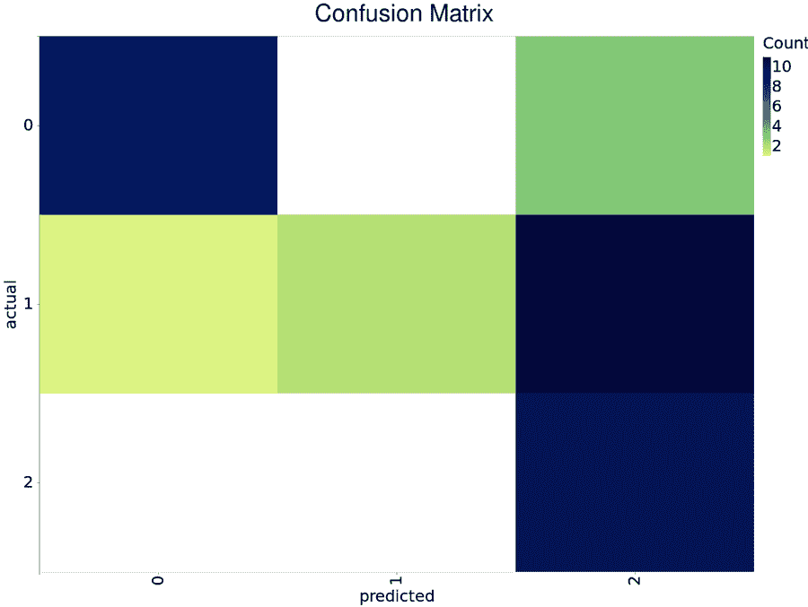

混淆矩阵是可视化模型分类性能的良好方式。

### 处理非线性数据

很多真实世界数据是非线性的。这意味着线性模型往往没有足够的容量或建模能力来表示真实世界的关系。有几种方法可以解决这个问题。

- 简单处理即可。事实上，没有任何模型是完美的。如果你有一个线性模型，例如线性回归模型，能够很好地预测数据中的数值，那么没有理由对其进行修改。正如人们所说，“如果它没坏，就不要修理它”。线性模型简单、快速且可解释，使其成为商业应用的极佳候选。很多时候，你可以部署一个比替代模型更简单、更快速的线性回归模型，并获得使用更昂贵或复杂模型的 90% 的价值。

- 另一种处理非线性数据的方法是对数据进行变换，直到出现线性关系。这在某种意义上是特征工程。

- 特征工程是手动操作特征以提供给模型更好信息的过程。如果你是体育爱好者，可能熟悉高级统计分析。例如，在篮球中，常用球员的真实投篮百分比来替代其投篮百分比，以判断其投射价值。随着时间推移，球队发现高级统计数据 —— 这些数据通常结合了多个表层指标 —— 比表层指标本身更能反映球员的表现。高级统计数据是基于对篮球运动的专业知识而工程化的特征。

- 对于线性模型，如线性回归和逻辑回归模型，如果你知道输入数据更适合功率模型或对数模型的表示，则可以将输入进行相应的变换。请查看以下图表：

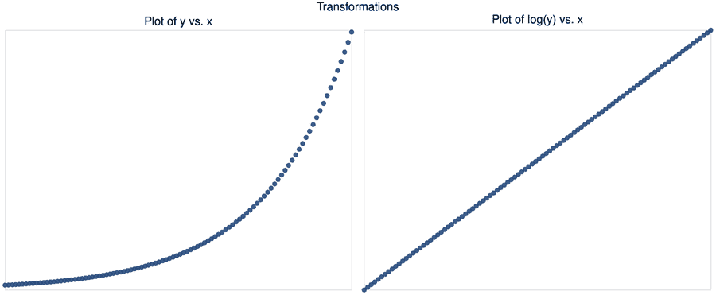

- 注意到，之前无法以线性方式表示的数据，现在通过简单的变换就可以实现线性表示。例如，与其观察第一张图中的 `y vs. x`，你可以观察 `log(y) vs. x`。这种变换是机器学习中著名的“核技巧”（kernel trick）的一种简化版。

- 核技巧通常与支持向量机（`SVM`）相提及，而 `SVM` 是一种线性模型，超出本书范围。通过核技巧，你会对原始数据应用高维变换，使其在特征空间中线性可分。核技巧使得能够使用线性模型来建模非线性数据成为可能。

- 事实证明，并非所有数据都能通过这种方式实现线性可分。线性可分的字面意思是数据可以通过一条直线将其分割。在某些情况下，线性模型根本不够，需要寻找其他解决方案。在本章的其余部分，你将简要了解几种此类方法，然后转向深度学习，离开传统机器学习方法。

## 从周围环境中学习

线性模型是 `Scholar` 中许多传统机器学习模型之一。你在野外还会遇到的另一种常见模型是 `K-Nearest Neighbors`（`KNN`）模型。`KNN` 模型的核心思想很简单：你很可能与最近的事物相似。直观上这很合理。比如，如果你随机从费城街头挑起一个人并询问其最喜欢的足球队，他们大概率会说费城老鹰队。这是因为老鹰队是当地球队，且离费城球场很近。随着你远离费城，不同 `NFL` 球队的喜好分布会发生变化。

`KNN` 通过将新点归类为其 `K` 个最近邻中最常见的类别来工作。它可以用于回归和分类两种任务。无论哪种情况，`K` 个最近邻都决定新数据点的类别或最终值。`KNN` 简单而强大。你可以在 `Scholar` 中快速训练和评估 `KNN` 模型，并与酒厂数据集中的 `Logistic Regression` 模型进行比较。

运行以下代码以拟合一个新的 `KNN` 分类器：

```
model = Scholar.Neighbors.KNearestNeighbors.fit(
  train_inputs, train_targets, num_classes: 3
)
```

运行代码后，你会看到以下输出：

```
%Scholar.Neighbors.KNearestNeighbors{
  data: #Nx.Tensor<
    f32[142][13]
    [
      [0.00769107136875391, 9.762659901753068e-4, ...],
      [0.00769107136875391, 9.762659901753068e-4, ...]
    ]
  >,
  labels: #Nx.Tensor<
    s64[142]
    [0, 0, 2, 2, 2, 2, 1, ...]
  >,
  default_num_neighbors: 5,
  weights: :uniform,
  num_classes: 3,
  p: nil,
  task: :classification,
  metric: {:minkowski, 2}
}
```

请注意，运行 `KNN` 的 `fit` 方法实际上并不会进行训练。`KNN` 不需要训练，因为它在推断时仅从现有数据中采样。模型仅保留训练集中的点，用于在测试集上进行预测。

现在开始对测试数据进行预测并评估模型。首先预测测试输入的类别：

```
test_preds = Scholar.Neighbors.KNearestNeighbors.predict(model, test_inputs)
```

随后可以计算模型的准确率：

```
Scholar.Metrics.accuracy(test_targets, test_preds)
```

运行代码后，你会看到以下输出：

```
#Nx.Tensor<
  f32
  0.75
>
```

你还可以计算混淆矩阵，方式如下：

```
Scholar.Metrics.confusion_matrix(test_targets, test_preds, num_classes: 3)
```

运行代码后，你会看到以下输出：

```
#Nx.Tensor<
  s64[3][3]
  [
    [9, 0, 0],
    [2, 11, 6],
    [0, 1, 7]
  ]
>
```

请注意，你的最近邻模型的表现基本上与逻辑回归模型完全相同。你可以继续调试超参数，或选择部署其中一个模型。你会发现 `Scholar` 让你轻松原型化多种分类器，然后评估每个模型以确定哪个最适合生产部署。

你可以看到，`Scholar` 是创建监督学习方法的极佳工具，但它并不局限于此。`Scholar` 还提供了许多用于无监督学习和数据分析的工具。

## 使用聚类

除了监督方法，`Scholar` 还提供了用于无监督学习和分析的多种工具。回顾第 1 章 *Making Machines That Learn*，无监督学习是一种只有从输入中学习、没有目标信息的机器学习类型。也许最常见的无监督学习方式是聚类。聚类是识别数据集中相似数据点群组的过程。聚类有许多方法，如 `K-Means` 聚类、层次聚类、光谱聚类等。

在实际中，你最常见的聚类方式是 `K-Means` 聚类，它会随机为 `K` 个质心点指定在数据集中的随机点，并迭代更新每个质心，直到达到最优配置。

聚类可以帮助你从数据组内部识别普遍模式。例如，如果你拥有一个来自在线商店购物者行为的数据集，你可以对购物者行为进行聚类，从而了解访问你店铺的一般类型的购物者。一个聚类可能代表重度消费者，另一个则代表不确定的浏览者。

### 一个集群的核心挑战是确定合适的簇数量

通常，你需要可视化你的数据集并进行某种高层次的分析，以确定合适的簇数量。真实数据不总是能很好地聚类。真实数据总是很混乱。

你也可以使用 `K-Means` 作为无监督分类方法。例如，你可以通过运行以下代码，将 `K-Means` 聚类应用于你的酒类问题：

```
model = Scholar.Cluster.KMeans.fit(train_inputs, num_clusters: 3)
```

注意，这里你只需要传入训练输入，因为 `K-Means` 是无监督方法。它仅依赖输入数据，而不访问目标。运行代码后，你会看到类似以下输出：

```
%Scholar.Cluster.KMeans{
  num_iterations: #Nx.Tensor<
    s64
    4
  >,
  clusters: #Nx.Tensor<
    f32[3][13]
    [
      [0.008120134472846985, 0.001020378083921969, ...]
    ]
    ...
  >
}
```

这个结构包含算法的元数据，以及训练数据集中每个成员的聚类中心和聚类标签。`K-Means` 为每个聚类找到中心，并将数据点分配到最近的中心。你可以将中心与数据集的特征进行可视化。酒类数据集有十三个维度，因此我们需要将其降维到两个或三个维度以便可视化。你可以运行以下代码生成中心相对于每个点的可视化：

```
wine_features = %{
  "feature_1" => train_inputs[[.., 1]] |> Nx.to_flat_list(),
  "feature_2" => train_inputs[[.., 2]] |> Nx.to_flat_list(),
  "class" => train_targets |> Nx.to_flat_list()
}

coords = [
  cluster_feature_1: model.clusters[[.., 1]] |> Nx.to_flat_list(),
  cluster_feature_2: model.clusters[[.., 2]] |> Nx.to_flat_list()
]

title =
  "Scatterplot of data samples pojected on plane wine"
  <> " feature 1 x wine feature 2"

Vl.new(
  width: 1440,
  height: 1080,
  title: [
    text: title,
    offset: 25
  ]
)
|> Vl.layers([
  Vl.new()
  |> Vl.data_from_values(wine_features)
  |> Vl.mark(:circle)
  |> Vl.encode_field(:x, "feature_1", type: :quantitative)
  |> Vl.encode_field(:y, "feature_2", type: :quantitative)
  |> Vl.encode_field(:color, "class", type: :categorical)
  Vl.new()
  |> Vl.data_from_values(coords)
  |> Vl.mark(:circle, color: :green, size: 100)
  |> Vl.encode_field(:x, "cluster_feature_1", type: :quantitative)
  |> Vl.encode_field(:y, "cluster_feature_2", type: :quantitative)
])
```

这将生成一个散点图，显示酒类特征 1 和 2，绿色圆点表示中心在两个特征上的位置。运行代码后，你会看到以下图：

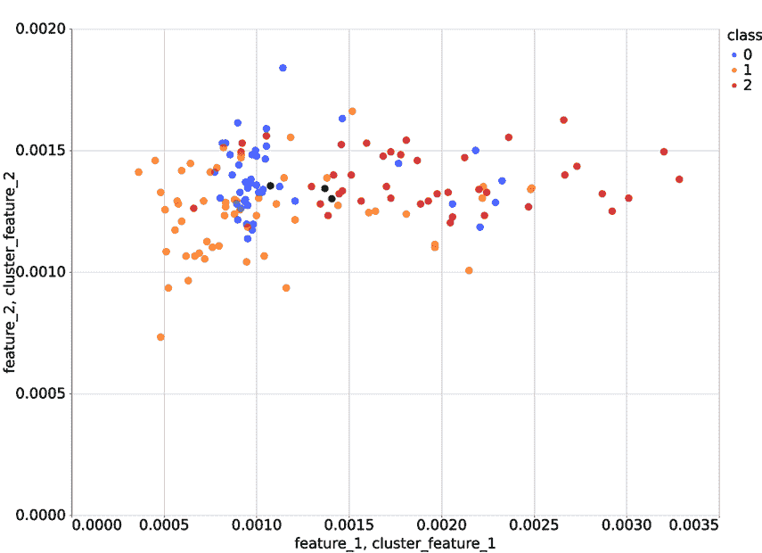

注意，这张图并不美观，且簇不易辨认。这是因为你的簇是基于十三个特征创建的——虽然这两个特征本身的数据不易区分，但使用全部十三个特征时数据可能更易分离。

现在，你可以通过以下代码将测试输入分配到前一步创建的簇中：

```
test_preds = Scholar.Cluster.KMeans.predict(model, test_inputs)
```

这段代码将测试输入分配到前一步创建的簇之一。运行代码后，你可以使用以下代码评估簇的准确性：

```
Scholar.Metrics.accuracy(test_targets, test_preds)
```

运行代码后，你会看到以下输出：

```
#Nx.Tensor<
  f32
  0.8333333134651184
>
```


令人惊讶的是，你的无监督方法的表现优于监督方法。

## 决策

也许目前最流行的非深度学习算法是决策树及其集合变体，如梯度提升。

决策树的行为正如其名称所暗示：它们基于输入特征构建嵌套树。决策树构建一个层次化的决策流，将输入特征分区为一个或多个类别。例如，假设你想创建一个模型来预测患者是否有心脏病风险。决策树会构建一个树，通过分析数据以可解释的方式进行判断：患者是否吸烟？患者是否有高血压？患者是否身体活跃？

决策树之所以非常流行，是因为它们可解释，并且在特定类别的数据上表现非常好。决策树是少数几类能够在表格数据和时间序列数据上超越深度学习模型的算法类别。表格数据包含了大多数业务智能数据，因此决策树在商业应用中被广泛使用。

梯度提升是一种集合方法，它通过迭代构建许多弱分类器来覆盖前一个分类器的弱点。集合方法是一类机器学习方法，它们构建一个模型，该模型是许多模型的聚合。你可以以多种方式构建集合。你可以把集合看作是对同一主题获得多个不同观点。每个模型带来自己的优势和劣势，因此最终决策通常更可靠。梯度提升是一种集合技术，常用决策树作为基础分类器。

Elixir 有一个新的决策树库 `EXGBoost`。^[\[10\]](#f_0040.xhtml#FOOTNOTE-10) `EXGBoost` 直接集成到 `Nx` 张量中，使用相对简单。决策树超出了本书的范围，但作为一名正在成长的机器学习工程师，你需要了解并探索它们。

### 总结

在这一章中，你实现了一些传统的机器学习算法——监督和非监督——使用 `Scholar`。你用线性回归对线性数据进行建模。你通过逻辑回归、`KNN` 和 `K-Means` 三种方式预测酒类。

你还了解了一些关于决策树和提升的知识。这一章是对 `Scholar` 功能以及传统机器学习算法力量的简短介绍。随着你继续你的机器学习之旅，尝试 `Scholar` 中提供的其他算法，并将它们与本书后续章节中创建的模型进行比较。

此时，你已经完成了机器学习基础的入门，现在可以更深入地探索 `Axon`。在下一章，你将开始揭开像 `ChatGPT`、`DALL-E 2` 和 `Stable Diffusion` 这样的技术背后的奥秘：深度学习。

#### Footnotes

\[9\]: [`github.com/elixir-nx/scholar`](https://github.com/elixir-nx/scholar)

\[10\]: [`hex.pm/packages/exgboost`](https://hex.pm/packages/exgboost)

Copyright © 2024，The Pragmatic Bookshelf。

# Part 2

Deep Learning

# Chapter 6

Go Deep with Axon

在上一章节，你的重点主要是理解“传统”或“浅层”机器学习方法。你使用的方法，如线性回归、逻辑回归、集成方法和决策树，能够很好地为你在生产中遇到的许多机器学习问题创建有价值且表现良好的解决方案。然而，过去十年来深度学习的兴起推动了人工智能和机器学习领域取得了重大进展。

如今，深度学习模型的变体在计算机视觉、自然语言处理、增强学习等无数任务上展现出最先进的结果。深度学习的快速采用以及它为机器学习带来的进展意味着，掌握如何创建、训练和部署神经网络已成为任何有志成为机器学习实践者的必备技能。本章，你将深入 Elixir 中的深度学习，为即将到来的章节做铺垫，在那里你将学习如何将深度学习应用于不同的数据模态。你将先从在 `Nx` 中拆解神经网络，然后转向 `Axon`，进一步了解 `Axon` 以及它提供的便利。

## 理解深度学习的必要性

想象你被要求创建一个算法，能够自动从纸质表单的手写电话号码字段中抓取。你的团队已经将表单中提取的单个数字自动转换为 28x28 灰度图像。你将如何使用本书前几章的方法来解决这个问题？

你的初步想法可能是，只需把这个问题交给逻辑回归模型或决策树即可。但你的模型的特征空间会是什么？是否要把每个单独的像素值都视为特征？

你可以把图像划分为网格（如下图所示）。

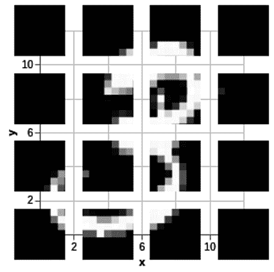

从而，你可以把每个格子压缩为标量指标，并将这些标量指标的向量作为特征空间。然而，这种方法可能会丢失图像中关键信息。

你在上一章节使用的算法需要程序员进行深入的特征工程。传统机器学习算法需要在学习过程之前，投入大量精力发现能够充分代表数据的丰富特征——手动发现这些特征可能很困难。

信息丰富且包含看似复杂、非结构化关系的领域，往往是最具挑战性的。对于图像、文本和音频等数据类型，手动提取特征很难。虽然你可以花数小时编写代码来提取图像信息（如角点和轮廓），但过程仍不完美，易受分布变化影响，并且本质上是有损的。

更好的做法是将提取有意义表示的任务交给机器学习算法。通过这种方式，你的算法不仅能根据特征进行预测，还能从高维输入中学习如何提取特征。从高维输入中提取表示并据此进行预测的能力，正是深度学习的吸引力所在。

| Deep Learning's Kodak Moment |
| --- |
|  | 深度学习历来存在，但在过去十年之前，它在机器学习社区中只是一个后起之秀。深度学习研究者和实践者只占机器学习社区的极小一部分。整个机器学习社区曾认为深度学习是个荒唐的想法，不可能解决任何有价值的问题。这一切在 2012 年发生了改变，当研究生 `Alex Krizhevsky` 和 `Ilya Sutskever`，以及他们的导师 `Geoffrey E. Hinton` 赢得了“ImageNet”竞赛，他们的模型被命名为 `AlexNet` [KSH12]，并且在竞赛中以巨大优势击败了竞争对手。此后，业界和学术界开始关注到深度学习的强大潜力。 |

### 维度诅咒

像图像、音频和文本等复杂输入通常以高维空间表示。回顾第 2 章 *Get Comfortable with Nx*，这些输入常被编码为张量。例如，图像通常是形状为 `{height, width, channels}` 的三阶张量。将图像展平为向量后，输入维度为 `height * width * channels`。以 28x28 灰度图像为例，单张图像有 784 个像素，即 784 个特征（28 \* 28 \* 1）。

输入维度的增加会显著提升机器学习问题的复杂度。对于只有一个特征的输入，模型只需捕捉该特征变化如何映射到输出变化即可。随着特征数量的增多，模型必须捕捉多个特征（它们可能相关也可能不相关）如何映射到输出变化。

在机器学习中，输入空间维度越高，模型的质量通常也越好。但到了一定程度，维度过高会导致模型质量下降，这正是所谓的“维度诅咒”。

为了更好地理解这一概念，把你的模型想象成一个乐队指挥。当乐队只有一种乐器时，指挥的工作相对简单。加入更多乐器可能提升音乐质量，但指挥的工作也会随之变得更复杂。当乐器数量达到一定程度，收益递减——指挥的任务变得过于艰巨，整体音质下降。这与机器学习中的维度诅咒相类比。

深度学习与你在前几章学习的算法的区别在于，深度学习能够克服维度诅咒。但它是如何做到的？

### 层级表示

理解深度学习为何如此有效仍是活跃的研究课题。一个理论认为，深度学习能够克服维度诅咒的原因在于神经网络通过组合线性和非线性变换，将输入数据转换为层级表示。神经网络由一系列层组成，每层以前一层的表示为输入并将其转换为自己的表示，最终输出预测。你将在 *Breaking Down a Neural Network* 中拆解层的结构。为此，你只需了解层本质上是一个函数即可。

回到指挥/乐队的类比，深度学习通过增加额外的指挥来解决“乐器太多”的问题。一个指挥负责小提琴，另一个负责号角，还有一个负责长笛。每位指挥只需关注自己的乐段，整体音效比由单一指挥负责全部乐手的情况要好得多。

更具体地说，深度学习之所以运行得如此出色，是因为深度模型能够学习输入数据的逐层、层级表示。例如，如果你训练一个模型来识别猫的图像，第一层可能学会提取颜色，第二层可能学会提取角和边缘，以此类推。前几层从输入数据中提取简单的关系，而后期层则从这些简单的关系中提取更复杂的关系。后期层可能学会识别耳朵或爪子。通过组合简单的表示，神经网络能够学习更复杂的表示，从而对复杂输入进行预测。

从某种意义上说，神经网络通过将特征提取作为学习过程的一部分，消除了对系统性特征工程的需求。但这并不意味着训练神经网络不需要高质量的数据，也不是说发现新特征是训练更好神经网络所必需的。它只是说明，神经网络在处理复杂、高维的输入时表现出色，并且消除了对这些输入进行复杂的维度缩减或特征提取的需要。

### 表示任意函数

理论上，神经网络被认为是通用函数逼近器。通用逼近器是指在给定正确参数的情况下，能够逼近任何复杂函数的模型。起初，这个想法似乎有点荒谬。你并不关心逼近函数；你关心的是构建能够进行预测的模型。但如果你考虑到你想要进行预测的数据来自某个黑盒函数，那么通用逼近就显得更具吸引力。理论上，当神经网络拥有正确的配置时，它可以逼近你想要学习的任何函数。

实际上，是否通用逼近真的有用，仍需讨论。深度学习的理论仍远落后于该领域的经验结果，因此理论主张缺乏足够的数学严谨性。

另一种思考方式是将神经网络视为“学习的计算机程序”。想象神经网络的每一层就像是一个指令，而输入到每一层的数据则是该指令执行时的程序状态。你可能熟悉这样一种讽刺性的话：人工智能在生产环境中不过是一堆 if-else 语句的集合。把神经网络看作学习的程序，可能支持这一观点——神经网络可能只是学到了合适的 if-else 配置，从而成为有效的模型。

### 分解神经网络

在了解了神经网络为何必要且强大之后，现在是深入探讨“什么是神经网络”的时机。在这一节中，你将拆解深度学习相关的术语、神经网络的解剖结构，以及神经网络在 Elixir 中的具体样子。理解神经网络的基础构件将帮助你在开始使用 `Axon` 时建立直觉。

#### 正确掌握术语

深度模型、神经网络、人工神经网络（`ANNs`）、多层感知器（`MLPs`）——如果你在深度学习领域花过一些时间，你大概率已经看到过这些术语几乎被交替使用。深度学习的术语可能比实现模型本身更让人望而却步。

深度学习是机器学习的一个子集，它使用深度模型，即人工神经网络。这些模型之所以被称为“深”，是相对于其他层数较少的模型而言，它们的计算图（即一系列连续的运算）更为深入（例如，包含大量运算步骤）。你也可以从层数的角度来考虑深度：每一层递进都会增加模型的深度。

人工神经网络（`ANNs`）是深度模型的另一种称呼。该术语可能让人联想到类似下面的图像：

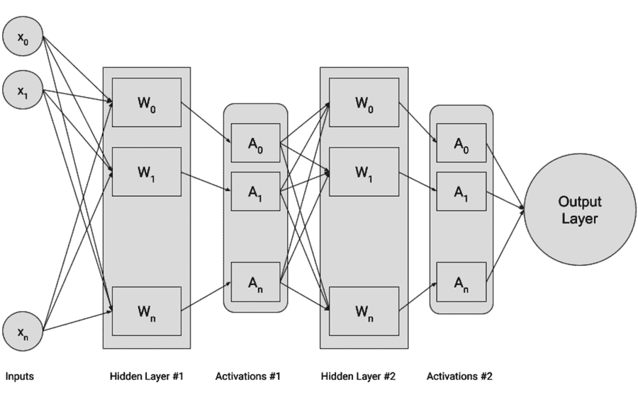

`ANN` 的命名源自其与大脑的启发式设计。`ANN` 中输入的转换旨在模拟神经元在大脑中传递信息时的放电过程。使用 `ANN` 这个术语可能是一种误导，因为缺乏证据表明大脑的运作方式与神经网络完全相同。

多层感知器（`MLPs`）是一种利用全连接层（或密集连接层）的深度学习模型类别。你将在 *The Anatomy of a Neural Network* 中看到具体含义。只需知道 `MLPs` 是神经网络的一个特定架构类别即可。它们也常被称为前向网络，因为信息从前向后、从前层流向输出层。你将在本书中实现多种其他架构，包括第 7 章的卷积神经网络（`CNN`），*Learn to See*；第 9 章的循环神经网络（`RNN`），*Understand Text*；第 12 章的生成对抗网络（`GANs`），*Learn Without Supervision*。

| The Rebranding |
| --- |
|  | 在深度学习迎来 2012 年爆发式增长之前，该领域由少数研究者主导。大多数顶级机器学习会议每年只接受一两篇深度学习论文——如果有的话。当时，从层与层之间的连接可以直观看到深度模型，研究深度学习的学者被称为“连接主义者”。深度学习是连接主义者为克服当时对神经网络的偏见而进行的战略性重新品牌。 |

### 神经网络的解剖结构

大多数神经网络可以简化为几个关键组件。计算或工作单元的最常用抽象是“层”。通常，层表示对输入进行的转换，并将其转发给下一层。模型的层数通常被称为“深度”。一般来说，层数越多，模型的容量也越大；但过深的模型也可能阻碍学习过程。

本书后续章节将使用多种类型的层。在神经网络中，通常有三类层：输入层、隐藏层和输出层。

#### 输入层

输入层充当模型输入的占位符。某些神经网络操作需要明确的输入形状。你可以回到第 2 章，*Get Comfortable with Nx*，更好地理解现实数据如何映射到张量输入。

#### 隐藏层

隐藏层是神经网络中“魔法”发生的地方。它们是中间的计算层，负责将输入转换为输出层可用的有用表示。它们就像交响乐团中的额外指挥，使高维输入能够被输出层所管理。

最常见的隐藏层是密集连接层、全连接层，或简称为 `dense` 层。`dense` 层因其在两层之间创建的密集连接而得名——换句话说，`dense` 层的每个输入都映射到 `dense` 层的一个输出。`dense` 层有一定数量的输出单元，代表 `dense` 层的维度。如果你喜欢将神经网络类比为大脑，你可以把单个单元看作一个神经元。具有 128 个单元的 `dense` 层有 128 个神经元。

`dense` 层的单元数量称为层的宽度。更宽的 `dense` 层具有更强的表征能力。然而，也存在收益递减点。通常使用 2 的倍数作为隐藏层宽度。这是因为现代加速器上内存布局的工作方式。

数学上，`dense` 层是矩阵乘法或线性变换。`dense` 层学习以一种提取对后续层有用的表示的方式投影输入。

#### 激活函数

隐藏层通常有一个激活函数，它对输出应用非线性函数。将非线性引入神经网络正是使其成为通用逼近器的原因。通常使用将输入缩放或压缩到某个有用输出范围的激活函数。例如，`sigmoid` 函数常用作激活函数，因为它将输出压缩在 0 和 1 之间。因为神经网络是用梯度下降训练的，所以激活函数可微分很重要。

你可以把激活函数看作是标记某些输入特征的一种手段。例如，你的神经网络可能学会只让某些神经元对特定输入特征激活。神经元的激活可以解释为其对最终输出的重要性。一些不重要的神经元将完全“关闭”。

你可以在神经网络中使用多种激活函数。寻找更好的激活函数是一个热门研究领域。你应该熟悉的激活函数有 `ReLU`、`sigmoid` 和 `softmax`。

**ReLU**

修正线性单元（`ReLU`）激活函数是一种流行的中间激活函数，计算函数：

```
defn relu(x) do
  Nx.max(0, x)
end
```

`ReLU` 将所有负输入映射为 0，将正输入映射为相同值。

**Sigmoid**

`sigmoid` 激活函数是一种流行的输出激活函数，因为它将输出压缩到 0-1 范围。它计算逻辑 `sigmoid` 函数：

```
defn sigmoid(x) do
  1 / (1 + Nx.exp(-x))
end
```

当你试图计算 0 和 1 之间的输出概率时，`sigmoid` 函数特别有用。

**Softmax**

`softmax` 函数是多类分类问题常用的输出激活函数。它输出一个类别概率分布。

#### 输出层

从实现角度来看，输出层与输入层没有区别。输出层是神经网络的最终结果。在用隐藏层将输入转换为有用表示后，输出层将这些表示转换为你可以有意义地使用或解释的东西，例如概率。

对于分类问题，通常使用带有 `sigmoid` 或 `softmax` 激活的 `dense` 层作为最终输出层。对于二分类问题，最后一层通常是一个具有一个输出单元和 `sigmoid` 激活的 `dense` 层。对于多类分类问题，最后一层通常是一个具有 N 个输出单元和 `softmax` 激活的 `dense` 层，其中 N 是可能的类别数量。

对于标量回归问题，通常使用一个具有一个输出单元且无激活函数的 `dense` 层——因此输出神经元直接映射到一个标量。

输出层的形式取决于具体问题。你将在本书的其余部分看到许多不同的输出层。

## 使用 Nx 创建简单神经网络

虽然神经网络在概念上似乎难以理解，但它们实际上很容易实现。为了说明这一点，你将使用 `Nx` 实现一个简单的神经网络。打开一个 Livebook 并添加以下依赖：

```
Mix.install([
  {:nx, "~> 0.5"}
])
```

回顾上一节，神经网络仅由输入、隐藏层、中间激活函数和输出层组成。首先创建一个名为 `NeuralNetwork` 的新模块：

```
defmodule NeuralNetwork do
  import Nx.Defn
end
```

接下来，你需要实现一个隐藏层。你的隐藏层将是一个密集连接层或 `dense` 层，它执行两个密集矩阵的矩阵乘法，随后进行偏置加法。偏置加法只是原始输入的位移。`dense` 层接受两个参数——`weight` 和 `bias`——并使用 `weight` 和 `bias` 转换输入。像这样实现 `dense` 层：

```
defn dense(input, weight, bias) do
  input
  |> Nx.dot(weight)
  |> Nx.add(bias)
end
```

隐藏层后面跟着中间激活函数。为简单起见，你将仅使用 `Nx` 实现 `sigmoid` 激活函数。像这样实现你的激活函数：

```
defn activation(input) do
  Nx.sigmoid(input)
end
```

你可以将 `dense` 和 `activation` 组合成一个单一的隐藏层，如下所示：

```
defn hidden(input, weight, bias) do
  input
  |> dense(weight, bias)
  |> activation()
end
```

最后，你需要一个输出层。你的输出层将只是另一个 `dense` 层，后面跟着你的激活函数。实现与 `hidden` 相同，但你应该在这里显式写出以了解发生了什么：

```
defn output(input, weight, bias) do
  input
  |> dense(weight, bias)
  |> activation()
end
```

现在，向你的 `NeuralNetwork` 模块添加一个 `predict` 函数：

```
defn predict(input, w1, b1, w2, b2) do
  input
  |> hidden(w1, b1)
  |> output(w2, b2)
end
```

这里展示的 `predict` 函数实际上实现了一个简单的神经网络。它接受一个输入和一些可训练参数并产生一个转换后的输出。注意神经网络只是函数的组合。你可以通过添加一些额外的参数和额外的 `hidden` 函数调用来增加额外的隐藏层。

你最终的 `NeuralNetwork` 模块将如下所示：

```
defmodule NeuralNetwork do
  import Nx.Defn

  defn dense(input, weight, bias) do
    input
    |> Nx.dot(weight)
    |> Nx.add(bias)
  end

  defn activation(input) do
    Nx.sigmoid(input)
  end

  defn hidden(input, weight, bias) do
    input
    |> dense(weight, bias)
    |> activation()
  end

  defn output(input, weight, bias) do
    input
    |> dense(weight, bias)
    |> activation()
  end
end
```

下一步是为你的隐藏层和输出层生成中间参数 `w1`、`b1`、`w2` 和 `b2`。为简单起见，你将只向神经网络输入标量形状，所以你的参数也可以都是标量：

# 生成模型

`Axon` 是一个用于在 Elixir 中创建和训练神经网络的库，是 Elixir 生态系统中深度学习的主要工具。在本书的其余部分，你将深入研究 `Axon` API，并使用 `Axon` 在复杂问题上创建和训练神经网络。正如上一节所示，在 `Nx` 中创建神经网络通常涉及大量样板代码。`Axon` 抽象了所有样板代码，并提供了简化的 API 来构建和训练神经网络。

作为 Elixir 中深度学习的入门，你将训练一个算法来解决手写数字分类问题，如在 *Understanding the Need for Deep Learning* 中描述。跟随的最佳方式是启动另一个 Livebook 并安装以下依赖：

```
Mix.install([
  {:axon, "~> 0.5"},
  {:nx, "~> 0.5"},
  {:exla, "~> 0.5"}
])
```


## 依赖安装

```elixir
Mix.install([
  {:axon, "~> 0.5"},
  {:nx, "~> 0.5"},
  {:exla, "~> 0.5"},
  {:scidata, "~> 0.1"},
  {:kino, "~> 0.8"},
  {:table_rex, "~> 3.1.1"}
])
```

大多数这些依赖你已经在本书中熟悉，因为你已经大量使用了 `Nx`、`EXLA` 和 `Scidata`。`Nx` 作为数值数据的核心库，`EXLA` 用于加速你的代码。`Scidata` 包含用于训练的数据集，而 `Axon` 是你用来创建和训练模型的工具。`Kino` 和 `TableRex` 都可用于在 Livebooks 和控制台中直接可视化 `Axon` 模型。

在继续之前，你需要设置笔记本选项：

```elixir
Nx.default_backend(EXLA.Backend)
```

这确保所有通过 `defn` 编译的代码都使用 `EXLA` 后端。虽然普通 CPU 足以完成此问题，但 GPU 加速永远不会有害。

## 使用数据

完成所有行政工作后，是时候为训练准备数据了。本节使用的数据集是 MNIST，包含 60,000 张 28x28 灰度手写数字图像（0 到 9）。MNIST 是机器学习领域中极其流行的数据集，常被视为深度学习的“Hello world”示例。

`Scidata` 提供内置功能下载 MNIST。你可以像下面这样获取 MNIST 图像和标签：

```elixir
{images, labels} = Scidata.MNIST.download()
```

请记住，`Scidata` 并不是 `Nx-aware` 的。图像和标签均以 `{data, type, shape}` 形式呈现，可以与 `Nx` 函数一起使用以将原始数据转换为 `Nx` 张量。若检查 `image_type`，你会发现它是 `{:u, 8}`，即无符号 8 位整数。MNIST 图像为灰度，每个像素值在 0 到 255 之间。你在本书中学到，在将数据传递给模型前必须对其进行归一化。同样的概念适用于深度学习，因此你需要将像素值缩放到 0 到 1 之间。可以通过将整个图像张量除以 255 实现这一点。

此外，`image_shape` 是一个元组 `{60000, 1, 28, 28}`。你可以设计神经网络处理这种图像表示，但在此示例中，你将把每张图像展平为向量。

最后，你可能会发现标签是 60,000 个从 0 到 9 的标签。这本身并不算坏，但在 `Axon` 中使用一热编码标签更方便，因此你需要将它们转换为一热标签。

在拥有预处理后的数据后，你需要将数据划分为训练集和测试集。具体做法是取数据集的前 50,000 张图像作为训练集，取最后 10,000 张作为测试集。你可以使用 `Nx` 的切片语法实现此划分：

```elixir
train_range = 0..49_999//1
test_range = 50_000..-1//1

train_images = images[train_range]
train_labels = labels[train_range]
test_images = images[test_range]
test_labels = labels[test_range]
```

如前所述，`Axon` 提供了一个训练 API，执行小批量随机梯度下降。正如第 4 章 *Optimize Everything* 中所解释，机器学习算法通常通过在训练集上迭代更新模型来使用优化技术（如梯度下降）。要在小批量上执行梯度下降，你还需要将数据转换为小批量：

```elixir
batch_size = 64
train_data = train_images |> Nx.to_batched(batch_size) |> Stream.zip(Nx.to_batched(train_labels, batch_size))
test_data = test_images |> Nx.to_batched(batch_size) |> Stream.zip(Nx.to_batched(test_labels, batch_size))
```

这段代码创建了 `train` 和 `test` 数据集，它们由 `{input, target}` 小批量元组组成，符合 `Axon` 的期望格式。

现在，你已经完成了数据预处理，接下来是创建模型的时机。

## 创建模型

`Axon` 的核心功能是其模型创建 API。该 API 允许您通过组合 `Axon` 层来构建复杂模型。所有模型都以输入层开始，输入层指定 `Axon` 应期望输入的形状。随后，您将输入层依次传递通过变换层，直到获得所需的输出。先实现一个基本的 `Axon` 模型，如下：

```elixir
model =
  Axon.input("images", shape: {nil, 784})
  |> Axon.dense(128, activation: :relu)
  |> Axon.dense(10, activation: :softmax)
```

执行该单元后，您会看到模型的摘要信息：

```
#Axon<
  inputs: %{"images" => {nil, 784}}
  outputs: "softmax_0"
  nodes: 5
>
```

### 设计模型

您需要指定一个模型，输入形状为 `{nil, 784}`。`Axon` 允许您使用 `nil` 作为占位符，以便在推理时填充实际值。输入层会先经过一个包含 128 个单元且使用 `:relu` 激活的隐藏全连接层，再经过另一个包含 10 个单元且使用 `:softmax` 激活的全连接层。

使用 `Axon` 创建模型相对简单——难点在于理解如何组合层以构建最佳模型。

为此示例，输入层形状 `{nil, 784}` 直接对应批量图像，每个图像为 784 维的向量。`Axon` 需要在推理前知道输入形状，因为这会影响后续层的构建方式。若传入的形状不符合预期，`Axon` 会报错。

包含 128 个单元且使用 `:relu` 激活的中间全连接层是一种随意选择。您可以随意更改输入单元数、激活函数，甚至添加额外的隐藏层。理论上，更多的隐藏单元和层会提升模型的表达能力，但也会导致模型过宽或过深，难以学习。通常需要尝试多种配置，找到在数据上表现最佳的模型。

输出层包含 10 个单元且使用 `:softmax` 激活。目标是将输入图像映射到 0 到 9 之间的标签。该层会在每个索引处输出概率，表示输入是该数字的概率。例如，索引 0 处的概率表示输入是数字 0 的概率，索引 1 处的概率表示输入是数字 1 的概率，以此类推。

设计神经网络往往更多是艺术而非科学。您需要记住适用于特定问题类型的若干原则和架构。但构建有效模型往往只需直觉和实验。本书余下部分将教您在不同情境下适合使用的模型类型，但不会提供针对特定问题的“魔法”配方。

### 模型表示内部

假设您在 Livebook 中运行了上述代码，可以使用 `Kino` 与 `Axon` 的 `Axon.Display` 模块可视化 `Axon` 模型：

```elixir
template = Nx.template({1, 784}, :f32)
Axon.Display.as_graph(model, template)
```

`Axon.Display.as_graph/2` 会追踪模型的执行路径，并输出 Mermaid 图，便于直观查看执行流程。您将看到如下输出：

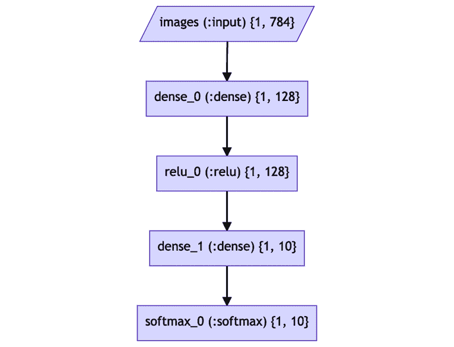

您也可以使用 `Axon.Display.as_table/2` 以表格形式展示模型：

```elixir
Axon.Display.as_table(model, template)
|> IO.puts()
```

运行代码后，会看到：

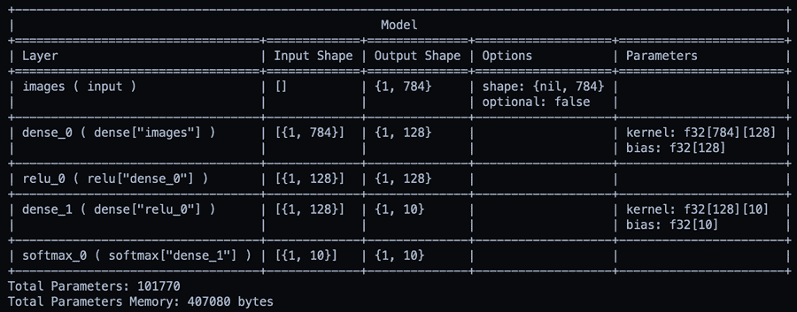

该表格描述了层名称和输入、层形状、可训练参数以及每层的选项。若想了解模型对象的具体内容，可再次检查并传入 `structs: false`：

```elixir
IO.inspect(model, structs: false)
```

您将看到更详细的结构：

```elixir
%{
  __struct__: Axon,
  nodes: %{
    12 => %{
      __struct__: Axon.Node,
      args: [],
      hooks: [],
      id: 12,
      name: #Function<90.106397181/2 in Axon.unique_identifiers/2>,
      op: :input,
      op_name: :input,
      opts: [shape: {nil, 784}, optional: false],
      parameters: [],
      parent: [],
      policy: %{
        __struct__: Axon.MixedPrecision.Policy,
        compute: {:f, 32},
        output: {:f, 32},
        params: {:f, 32}
      },
      stacktrace: ...
    }
  },
  output: 20
}
```

模型实际上是普通的 Elixir struct。`Axon` 模型仅是计算图的抽象表示，您可以在调用实际执行和训练 API 前对其进行操作和组合。您在构建图时是懒惰的，真正需要时才会执行。

这种中间表示的有用之处在于，它使 `Axon` 能够实现各种看似“魔法”的功能。本书后续章节将进一步揭示这些魔法。它还允许 `Axon` 将模型转换为其他神经网络表示，如 ONNX。^([\[13\]](#f_0047.xhtml#FOOTNOTE-13)) 这对于部署模型以及利用 Python 生态中的模型非常便利，您将在第 8 章 *Stop Reinventing the Wheel* 中看到。

## 训练模型

现在您已拥有数据和模型。接下来的步骤是使用训练数据对模型进行训练。虽然可以从零编写梯度下降实现，但这既繁琐又易出错。好在 `Axon` 提供了训练神经网络的便捷功能。

`Axon` 的训练抽象位于 `Axon.Loop` 模块。`Axon.Loop` 包含构建 `%Axon.Loop{}` 数据结构的函数，您可以通过 `Axon.Loop.run/3` 将其用于输入数据。`Axon.Loop` 的 API 功能丰富，但大多数情况下只需实现一个简单的监督训练循环：

```elixir
trained_model_state =
  model
  |> Axon.Loop.trainer(:categorical_cross_entropy, :sgd)
  |> Axon.Loop.metric(:accuracy)
  |> Axon.Loop.run(train_data, %{}, epochs: 10, compiler: EXLA)
```

`Axon.Loop.trainer/3` 是一个工厂函数，用于创建监督训练循环，接受模型、损失函数和优化器作为输入。这里的“监督”指的是机器学习意义上的监督，而非 OTP 语境。该训练器会通过优化器最小化损失，例如传入的 `:categorical_cross_entropy` 损失函数用于多类分类问题，`:sgd` 优化器则使用随机梯度下降。

`Axon.Loop.metric/2` 用于在监督训练循环中附加监控指标。该函数告诉 `Axon` 在训练过程中监测并计算特定指标。对于分类问题，您主要关注预测的准确性。

最后，`Axon.Loop.run/3` 告诉 `Axon` 在给定数据和给定选项下执行指定的训练循环。`Axon` 会遍历 `train_data` 十个时代，最后输出一个训练好的模型状态。传递 `compiler: EXLA` 确保 `Axon` 会使用 `EXLA` 对中间训练步骤进行 JIT 编译。这将显著加速训练。当你执行该单元时，你会看到以下模型：

```
Epoch: 0, Batch: 750, accuracy: 0.9439270 loss: 0.9746160
Epoch: 1, Batch: 750, accuracy: 0.9759654 loss: 0.7108651
Epoch: 2, Batch: 750, accuracy: 0.9799850 loss: 0.5978507
Epoch: 3, Batch: 750, accuracy: 0.9817263 loss: 0.5321623
Epoch: 4, Batch: 750, accuracy: 0.9830977 loss: 0.4878981
Epoch: 5, Batch: 750, accuracy: 0.9840345 loss: 0.4553202
Epoch: 6, Batch: 750, accuracy: 0.9849032 loss: 0.4299005
Epoch: 7, Batch: 750, accuracy: 0.9856064 loss: 0.4092346
Epoch: 8, Batch: 750, accuracy: 0.9862743 loss: 0.3919075
Epoch: 9, Batch: 750, accuracy: 0.9868216 loss: 0.3770282
```

注意到模型遍历了你的数据集十次，每次迭代都导致更高的准确率和更低的损失。你可能还注意到训练循环返回的内容类似于：

```elixir
%{
  "dense_0" => %{
    "bias" => #Nx.Tensor<
      f32[128]
      EXLA.Backend<host:0, 0.2489291390.1016463368.89685>
      [...]
    >,
    "kernel" => #Nx.Tensor<
      f32[784][128]
      EXLA.Backend<host:0, 0.2489291390.1016463368.89686>
      [
        [...],
        ...
      ]
    >
  },
  "dense_1" => %{...}
}
```

这就是 `trained_model_state`。`Axon` 结构体是神经网络的无状态表示，它不内部保存任何模型参数或状态。这意味着在进行推理和评估时，你始终需要同时获得模型和与给定模型兼容的模型状态。`Axon` 的监督训练循环始终会输出一个与正在训练的模型兼容的模型状态。

模型状态是嵌套的命名空间和参数映射。每个顶层映射键代表一个 `Axon` 命名空间。大多数模型通过层来命名空间。在这个示例中，你会看到每个层 `dense_0` 和 `dense_1` 都有一个键，而在每个命名空间内，每个层参数 `kernel` 和 `bias` 也有一个键。

## 模型评估

记住，在机器学习中，你只关心模型在未见测试集上的表现。训练集上 98% 的准确率并不代表模型的真实性能。幸运的是，`Axon` 还提供了便利的功能来对测试数据进行模型评估。要评估你的模型，实施以下受监督的评估循环：

```elixir
model
|> Axon.Loop.evaluator()
|> Axon.Loop.metric(:accuracy)
|> Axon.Loop.run(test_data, trained_model_state, compiler: EXLA)
```

`Axon.Loop.evaluator/2` 是一个工厂函数，它使用 `Axon` 模型和模型状态创建受监督的评估循环。评估器告诉 `Axon` 在状态 `trained_model_state` 处对模型进行评估。你还需要告诉 `Axon` 想要使用哪些指标来评估模型。在此例中，你附加了 `accuracy`，所以 `Axon` 知道在循环中跟踪 `accuracy`。最后，你需要告诉 `Axon` 在 `test_data` 上执行循环。

运行代码后，你会看到：

```
Batch: 156, accuracy: 0.9881768
```


这表明你的模型在测试数据中正确预测了约 99% 的数字。这已经很不错了。当然，模型的目的是在新数据上进行预测，那么如何使用 `Axon` 来实现呢？

## 使用 `Axon` 执行模型

`Axon` 提供了编译和运行 `Axon` 模型的执行 API。首先，从 `test_data` 中获取一个单独的图像批次：

```elixir
{test_batch, _} = Enum.at(test_data, 0)
```

为了简化，取出单张图像：

```elixir
test_image = test_batch[0]
```

你可以使用 `Nx.to_heatmap` 来可视化图像：

```elixir
test_image
|> Nx.reshape({28, 28})
|> Nx.to_heatmap()
```

你会看到类似于 图像 的内容。

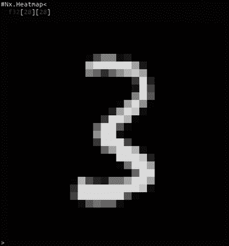

在这个示例中，测试图像是 3，模型应该将 3 作为最可能的标签预测。

现在，你拥有所有需要的东西来对模型进行预测：一个模型、一个与模型兼容的模型状态以及一个输入。最简单的查询方式是先使用 `Axon.build/2` 构建模型，然后调用返回的 `predict_fn`。`Axon.build/2` 将模型转换为一个包含 `{init_fn, predict_fn}` 的元组。`init_fn` 是一个二元函数，用于初始化模型的参数。`predict_fn` 是一个二元函数，接受模型参数和输入张量或张量集合，并返回运行完整模型的结果。

运行以下代码尝试查询模型的预测：

```elixir
{_, predict_fn} = Axon.build(model, compiler: EXLA)
predict_fn.(trained_model_state, test_image)
```

你会看到以下错误信息：

```text
** (Axon.CompileError) exception found when compiling layer
Axon.Layers.dense/4 named dense_0:

** (ArgumentError) Axon.Layers.dense: expected input shape to have at
least rank 2, got rank 1
(axon 0.5.1) lib/axon/shared.ex:92: Axon.Shared.assert_min_rank!/4
(nx 0.5.1) lib/nx/defn/compiler.ex:203: Nx.Defn.Compiler.__remote__/4
(axon 0.5.1) lib/axon/layers.ex:125: Axon.Layers."__defn:dense_impl__"/4
```

发生了什么？请记住 `Axon` 要求输入形状相对静态并符合模型创建时指定的形式。在此例中，你的 `test_image` 缺少一个额外的维度，可以使用 `Nx.new_axis` 在维度 0 上添加一个维度：

```elixir
probabilities =
  test_image
  |> Nx.new_axis(0)
  |> then(&predict_fn.(trained_model_state, &1))
```

你会看到类似的输出：

```text
#Nx.Tensor<
  f32[1][10]
  EXLA.Backend<host:0, 0.4078460682.4224843782.56655>
  [
    [6.16645411355421e-5, 0.011110336519777775, 0.07432620227336884, ...]
  ]
>
```

请记住，你的模型会输出十个与标签 0 到 9 对应的概率。你可以通过计算 `Nx.argmax` 来获取离散标签：

```elixir
probabilities |> Nx.argmax()
```

这将给出以下输出：

```text
#Nx.Tensor<
  s64
  EXLA.Backend<host:0, 0.4078460682.4224843782.56658>
  3
>
```


你看到的正是你所期待的结果。恭喜，你现在拥有一个模型、一个训练好的模型状态以及使用任何输入查询训练模型的能力。

## 总结

在这一章中，你被介绍了深度学习以及为什么它对于某些类别的问题比其他方法更有效。你拆解了神经网络的结构，并实现了一种最常见的神经网络类型：基本的前馈或密集网络。你使用 `Axon` 创建、训练和评估神经网络。

虽然 feed-forward 网络可以用于解决一系列复杂问题，但在某些类别的问题中，feed-forward 网络是不够的。在接下来的章节中，你将在不同领域解决 feed-forward 网络不足的问题，并实现不同类型的神经网络，以克服基础 feed-forward 网络在特定输入类别上的局限性。

#### Footnotes

[\[11\]](#f_0045.xhtml#FNPTR-11): [`github.com/elixir-nx/axon`](https://github.com/elixir-nx/axon)

[\[12\]](#f_0046.xhtml#FNPTR-12): [`yann.lecun.com/exdb/mnist/`](http://yann.lecun.com/exdb/mnist/)

[\[13\]](#f_0046.xhtml#FNPTR-13): [`github.com/onnx/onnx`](https://github.com/onnx/onnx)

Copyright © 2024, The Pragmatic Bookshelf.

# Chapter 7: Learn to See

在上一章中，你使用 `Axon` 在 Elixir 中创建并训练神经网络，包括一个能够识别手写数字的网络。你还学习了神经网络擅长处理的问题类型，以及它们在许多方面上为何优于浅层机器学习方法。更具体地说，你实现了一种称为多层感知器（MLP）或深度前馈网络的神经网络架构。

虽然 MLPs 能够学习和建模任何种类的数据，但其他深度学习架构在特定问题类型上更为强大。本章中，你将实现一种面向特定领域的卷积神经网络（CNN），并了解它在计算机视觉方面优于传统 MLPs。

## Identifying Cats and Dogs

想象你运营一个社交媒体网站，用户可以发布和查看动物图片。为了尽可能简化站点，你不希望用户在图片时附加额外信息，例如图片是否为狗或猫。但你希望用户能够根据这些标准过滤自己的信息流。因此，你如何在不要求用户为图片标记特定类别的情况下实现这一点呢？答案是：机器学习。

在本例中，你将训练一个模型对图片进行分类，分为两类：猫或狗。虽然你可以轻松将模型扩展以区分任何种类的动物，但将类别数减少到两个可以降低训练所需的数据量，从而缩短训练时间。

在深入之前，前往 Kaggle^([\[14\]](#f_0053.xhtml#FOOTNOTE-14)) 并下载 Cats vs. Dogs 训练数据集。该数据集包含 25,000 张图片——12,500 张猫和 12,500 张狗——打包在一个压缩文件中。下载后，将其解压到你选择的工作目录下的 `train` 目录中。

数据集下载并解压后，你即可启动 Livebook 并开始训练模型。

### Installing Dependencies

首先，你需要在笔记本环境中安装创建图像分类模型所需的依赖。运行以下代码来安装依赖：

```elixir
Mix.install([
  {:axon, "~> 0.5"},
  {:nx, "~> 0.5"},
  {:exla, "~> 0.5"},
  {:stb_image, "~> 0.6"},
  {:kino, "~> 0.8"}
])
```

到此为止，你应该已经熟悉列表中的所有依赖。

依赖安装完成后，需要为 Nx 设置默认后端为 EXLA。运行以下代码配置 EXLA 为默认 Nx 后端：

```elixir
Nx.global_default_backend(EXLA.Backend)
```

完成配置后，你只需创建一个加载目录中图片的输入流水线即可。

### Building an Input Pipeline

如前面在 *Training the Model* 中所见，要训练 `Axon` 模型，你需要为 `Axon` 创建输入数据流。虽然 `Axon` 可以遍历任何可枚举结构（如列表），但使用懒数据结构（如流）通常具有显著优势。流是懒惰的可枚举结构，按需生成元素。与 eagerly 的数据结构（例如列表）相比，流在训练输入管道中更具性能优势，尤其是在使用加速器（如 GPU）时。流相较于列表在训练管道中的优势包括：内存效率和并发执行。

#### Memory Efficiency

神经网络极度依赖数据。实际数据集往往过大，无法全部装入内存。例如，流行的 ImageNet^([\[15\]](#f_0053.xhtml#FOOTNOTE-15)) 数据集超过 150GB。如果使用列表作为训练管道，你需要一次性将 150GB 的数据加载到内存中，这既不实际也不高效。流只在请求时生成结果，因此你可以按批次逐一消费图片，避免一次性加载整个数据集。

#### Overlapping Execution

在使用外部加速器（如 GPU）进行训练时，CPU 常常会因为只负责向 GPU 供给数据而闲置较长时间。此外，GPU 运行极快，数据传输往往是最昂贵的操作。因此，建议让训练和数据加载并发，以避免 GPU 等待数据（即输入 pipeline 成为 IO 瓶颈而非计算瓶颈）。GPU 等待数据是主要瓶颈，而非实际训练计算。

幸运的是，你可以结合 Elixir 的并发原语与流来创建能够最大化 CPU 与 GPU 利用率的管道。例如，使用 Elixir 的 `Task.async_stream/3` 创建一个并行处理输入的流。当执行文件 IO 等操作时，这种并发尤为有用。你可以通过流操作构建预处理管道，`Axon` 会在批次准备好时消费流，实现输入 IO、预处理与计算的重叠，从而最大化可用计算能力。

在本例中，你将创建一个懒加载、并行的输入流。首先，在 `CatsAndDogs` 模块中定义一个名为 `pipeline/1` 的函数：

```elixir
defmodule CatsAndDogs do
  def parse_image(path) do
    case StbImage.read_file(path) do
      {:ok, img} ->
        label = if String.contains?(path, "cat"), do: 0, else: 1
        {:ok, {img, label}}
      {:error, _} -> {:error, :invalid_image}
    end
  end

  def to_tensors({:ok, {img, label}}, target_height, target_width) do
    img_tensor =
      img
      |> StbImage.resize(target_height, target_width)
      |> StbImage.to_nx()
      |> Nx.divide(255)

    label_tensor = Nx.tensor([label])

    {img_tensor, label_tensor}
  end

  def pipeline(paths, batch_size, target_height, target_width) do
    paths
    |> Enum.shuffle()
    |> Task.async_stream(&parse_image/1)
    |> Stream.filter(fn
      {:ok, {%StbImage{}, _}} -> true
      _ -> false
    end)
    |> Stream.map(&to_tensors(&1, target_height, target_width))
    |> Stream.chunk_every(batch_size, batch_size, :discard)
    |> Stream.map(fn chunks ->
      {img_chunk, label_chunk} = Enum.unzip(chunks)
      {Nx.stack(img_chunk), Nx.stack(label_chunk)}
    end)
  end
end
```

```elixir
train_path = Path.wildcard("train/*.jpg")
|> Enum.shuffle()

train_pipeline = CatsAndDogs.pipeline(train_path, 5, 96, 96)

Enum.take(train_pipeline, 5)
```

```elixir
batch_size = 128
target_height = 96
target_width = 96

train_pipeline = CatsAndDogs.pipeline(train_path, batch_size, target_height, target_width)

Enum.take(train_pipeline, 1)
```

And you’ll see this:

```text
[
  {#Nx.Tensor<
    f32[128][channels: 3][height: 96][width: 96]
    EXLA.Backend<cuda:0, 0.3445614888.3462266912.105686>
    [
      [
        [
          [0.9999999403953552, 0.9999999403953552, ...],
          ...
        ],
        ...
      ],
      ...
    ]
  >},
  #Nx.Tensor<
    s64[128][1]
    EXLA.Backend<cuda:0, 0.3445614888.3462266912.105719>
    [
      [1],
      [0],
      [0],
      [1],
      [0],
      [0],
      ...
    ]
  >
]
```

Finally, you’ll need to create a test set to test your results on. You can do this by shuffling the input paths and then splitting the train set:

```elixir
{test_paths, train_paths} =
  Path.wildcard("train/*.jpg")
  |> Enum.shuffle()
  |> Enum.split(1000)

batch_size = 128
target_height = 96
target_width = 96

train_pipeline = CatsAndDogs.pipeline(train_paths, batch_size, target_height, target_width)
test_pipeline = CatsAndDogs.pipeline(test_paths, batch_size, target_height, target_width)

Enum.take(train_pipeline, 1)
```

Congratulations, the hardest part is over! You’ve successfully created an image input pipeline, and you’re ready to start training a neural network.

### Trying to See with MLPs

In *Building the Model*, you created the simplest kind of neural network to recognize handwritten digits—a multi-layer perceptron (MLP) or dense feed-forward network. Your first instinct might be to try to apply an MLP to this problem—after all, it’s just another image classification task, right?

As you’ll see in this chapter, MLPs are not always the best choice for dealing with image data—but you’ll still train one anyway so that you can establish a baseline level of performance.

Start by running the following code to create a new MLP model:

```elixir
mlp_model =
  Axon.input("images", shape: {nil, target_height, target_width, 3})
  |> Axon.flatten()
  |> Axon.dense(256, activation: :relu)
  |> Axon.dense(128, activation: :relu)
  |> Axon.dense(1, activation: :sigmoid)
```

> **Forking Cells**
> The models you’ll create and train in the next few sections are independent. To avoid adding an unnecessary dependency between individual training runs, you can tell Livebook that these sections only depend on the data section you defined previously. To do so, simply create a new Livebook section, and then specify that the section is forked from the section that contains your training pipeline.

You’re welcome to add more hidden layers, adjust the hyperparameters of the hidden layers, and change the hidden activation. However, don’t change the input or output layers.

Notice the input shape in this case is a tensor of `{nil, target_height, target_width, 3}`, where `nil` is the batch size and `3` is the number of color channels. The output layer is a dense layer with one unit and a `:sigmoid` activation function. Determining whether an image is a cat or a dog is a binary classification problem, which means you’re trying to map inputs to one of two classes. Your output layer will return a single probability between 0 and 1, where probabilities closer to 0 map to the label cat and probabilities closer to 1 map to the label dog.

You should also notice the new layer `Axon.flatten`, which takes a two- or more-dimensional input and flattens the trailing dimensions into a single dimension. In this case, you want to pass a two-dimensional tensor to a dense layer so the flatten layer combines the channel, height, and width dimensions into a single dimension.

Now that you have data and a model, you need to implement the loop. The training loop for this problem should look similar to the one from Chapter 6, *Go Deep with Axon*. Copy the following code to create and run a training loop for your MLP model:

```elixir
mlp_trained_model_state =
  mlp_model
  |> Axon.Loop.trainer(:binary_cross_entropy, :adam)
  |> Axon.Loop.metric(:accuracy)
  |> Axon.Loop.run(train_pipeline, %{}, epochs: 5, compiler: EXLA)
```

If you compare this training loop to the one from Chapter 6, *Go Deep with Axon*, you’ll notice two slight differences:

*   This training loop uses `:binary_cross_entropy` rather than `:categorical_cross_entropy`. Because this is a binary classification problem, `:binary_cross_entropy` is the appropriate loss function to use here.
*   This training loop uses `:adam` as an optimizer rather than `:sgd`. `:adam` is a shortcut to tell `Axon` to use the Adam optimizer. Adam is a gradient-descent-based algorithm that makes slight adaptations to traditional gradient descent to improve convergence. Adam is an algorithm that may improve the training time of your neural network when compared to other optimizers.

The rest of this loop is identical to the one from Chapter 6, *Go Deep with Axon*. You track `:accuracy` during training, pass your pipeline as input data, and train for five epochs—JIT-compiling train steps with the EXLA compiler.

After some time, you’ll see this:

```text
Epoch: 0, Batch: 150, accuracy: 0.5474960 loss: 1.0835106
Epoch: 1, Batch: 150, accuracy: 0.5723824 loss: 0.8659902
Epoch: 2, Batch: 150, accuracy: 0.6005284 loss: 0.7973230
Epoch: 3, Batch: 150, accuracy: 0.6123245 loss: 0.7604570
Epoch: 4, Batch: 150, accuracy: 0.6156876 loss: 0.7374102
```

Although your model improved after every epoch, it quickly plateaued at around 60% training accuracy. You may not care about training accuracy, but the inability of a model to perform well on training data is a tell-tale sign of underfitting, as you learned in *Overfitting, Underfitting, and Capacity*. To see how well (or poorly), your model did, run the following code:

```elixir
mlp_model
|> Axon.Loop.evaluator()
|> Axon.Loop.metric(:accuracy)
|> Axon.Loop.run(test_pipeline, mlp_trained_model_state, compiler: EXLA)
```

Eventually, you’ll see this:

```text
Batch: 0, accuracy: 0.5333334
```

What’s going on here? Your model is barely doing better than random guessing. You might be tempted to go back and increase the capacity of your model by adding more layers or increasing the size of the existing hidden layers. You could spend hours on hyperparameter tuning, adding more layers and increasing the capacity of your model. While that might improve performance, increasing the size of the model isn’t always the answer. Sometimes you need to change your approach or (in this case) change your model.

> **Scaling Laws**
> 最近的深度学习进展表明，向模型添加更多容量可能与模型性能有直接的正相关关系。谷歌、OpenAI 和 Facebook 推出的部分大型语言模型拥有数千亿个参数。这是否意味着对任何旧模型进行缩放都会带来更好的性能？不，这意味着对正确的模型进行缩放会带来更好的性能。

## 介绍卷积神经网络

MLP 能够在许多不同的问题上表现出色，但不总是最佳选择。在前一节中，你了解到基本的 MLP 在识别猫和狗图像时难以战胜随机猜测。在这一节中，你将看到如何通过引入一种新的神经网络类型——卷积神经网络（CNN）来显著超越 MLP 的表现。

卷积神经网络是将卷积操作替代密集层中的传统矩阵乘法的神经网络。如果你有工程背景，你很可能熟悉卷积操作。虽然神经网络中使用的卷积操作与纯数学家或信号工程师定义的卷积相似，但它在某些方面略有不同。

想象你有一个二维输入，例如一张没有颜色深度的图像。你可以将这张图像表示为一个网格，其中每个网格方格是一个像素：


现在，假设你还有一个二维核（更小的网格）：


你可以将这个核在输入网格的每个有效窗口上滑动，并使用相对简单的加权求和操作将输入映射到特征图。特征图中的一个网格方格等于输入网格和核网格之间重叠部分的加权求和：

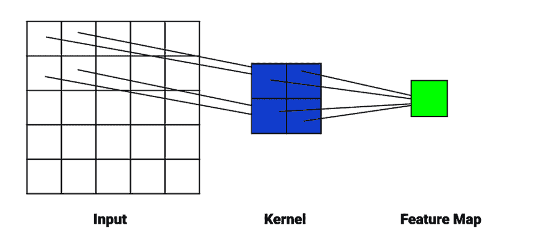

你可以对输入网格的每个有效（完整）窗口重复此过程。为了遍历网格，你会在 X 方向移动一个网格方格直到到达末端，然后在 Y 方向移动一个网格方格，重复此过程直到遍历完整个图像。你每次移动的步长通常被称为卷积的步幅（stride）。最终，你会得到一个完全转换的特征图。

那么，这么做的意义是什么呢？如果本书的任何内容值得记住，那就是几个看似简单的矩阵操作可以产生神奇的结果。你可以把核看作是一个滤波器。通过一些巧妙的数学，你可以手动设计出能够从输入图像中提取有用表示的滤波器。例如，尝试运行以下代码：

```elixir
path = "train/dog.5.jpg"

img =
  path
  |> StbImage.read_file!()
  |> StbImage.to_nx()
  |> Nx.transpose(axes: [:channels, :height, :width])
  |> Nx.new_axis(0)

kernel = Nx.tensor([
  [-1, 0, 1],
  [-1, 0, 1],
  [-1, 0, 1]
])
kernel = kernel |> Nx.reshape({1, 1, 3, 3}) |> Nx.broadcast({3, 3, 3, 3})

img
|> Nx.conv(kernel)
|> Nx.as_type({:u, 8})
|> Nx.squeeze(axes: [0])
|> Nx.transpose(axes: [:height, :width, :channels])
|> Kino.Image.new()
```

你会看到以下输出：


这段代码使用 `Nx.conv` 实现了一个基本的边缘检测器。在这里，你可以看到边缘可能是模型需要了解的有用特征集合。你可能会花时间手动设计多种特征检测器，但这将违背机器学习过程的初衷。

记住，深度学习的力量在于它能够自动学习有用的表示。在卷积层中，你首先使用随机初始化的核，训练过程中核会逐渐收敛到能够从输入中提取有用特征的参数化。关键的洞察是，你可以学习滤波器，而不是手动工程它们。

用于图像数据的真实卷积核会有四个维度。它包含两个空间维度，直接对应输入图像的 X 和 Y 坐标。它还包含一个深度或输入通道维度，对应输入图像的色深度。此外，它还包含输出滤波器的数量。与学习每个核仅对应一个滤波器不同，学习多个滤波器或多种输入图像的变换更为有用。一个滤波器可以学习提取边缘，另一个可以学习提取角点，以此类推。通常，输出深度被视为卷积层的维度。

卷积层是强大的特征提取器，尤其在具有自然网格结构的数据（如图像）上。卷积层是 CNN 的基础计算单元，但还有其他几个关键组件能够提升 CNN 的表达能力。

### CNN 的解剖结构

从技术上说，卷积神经网络是任何包含一个或多个卷积层的神经网络。然而，大多数 CNN 都有相似的结构。它们由一个或多个包含卷积层、激活函数和池化操作的块或阶段组成。这些块构成了卷积基（convolutional base）。卷积基通常随后是一个全连接网络，它接收卷积基中学到的特征并将其映射到输出标签。让我们更仔细地看这三个部分及其作用。

#### 卷积层

你已经了解了卷积操作及其在神经网络中的扩展。一个卷积基中的典型块从卷积层开始，该层执行线性操作并将激活传递给非线性激活函数。

#### 激活函数

与前馈网络一样，在卷积层之后需要应用非线性函数，以释放深度学习的真正潜力。在 CNN 的语境中，激活函数可以被视为 *detectors* [GBC16]——它们在特定特征上“发火”。例如，一个 CNN 层的激活可能在图像中检测到边缘的存在时显著激活，而另一层的激活可能在特定颜色的存在时激活。

#### 池化层

池化层使用某种聚合操作在空间窗口中聚合输入张量的信息。类似于卷积，池化层会在输入张量上滑动网格，并为每个有效的空间窗口计算输出张量的结果。池化层的超参数与卷积核的大小和遍历方式相同，包括核大小、填充和步幅。不同之处在于，池化层不包含可学习的核。池化层的意图是降低输入张量的维度，同时保留一些有用的信息，供后续层使用。

最大池化（max pooling）和平均池化（average pooling）是 CNN 中最常用的两种池化操作。最大池化将输入张量映射到输出张量，通过在每个空间窗口中计算最大值。平均池化则通过在每个空间窗口中计算平均值来实现映射。

#### 全连接头（Fully-Connected Head）

CNNs 常用作特征提取器。请记住，深度学习的强项在于其学习输入的有用表示的能力。卷积基础在从某些类型的数据（如图像）中提取特征方面表现出色。然而，要利用这些特征解决实际问题，通常需要某种全连接的头部来将特征映射到标签。模型的头部仅是模型的最后一层。大多数 CNN 包含一个 flatten 或全局池化层，用于将已学习的卷积特征聚合为适合密集网络的形式。如您将在第 8 章中看到，*Stop Reinventing the Wheel*，特征提取器与全连接分类器之间的区别使您能够工程化神经网络，从而充分利用更强大模型的知识。

### 使用 Axon 实现 CNNs

此时，您可能对卷积、填充和池化等概念感到有些不知所措。如果您尚未完全理解这些概念，这没关系——您不需要深入理解它们才能在 `Axon` 中使用它们。

`Axon` 中卷积概念的映射对应相对简单的 API。要了解不同 CNN 操作如何与输入交互，请先声明一个变量 `cnn_model`，其包含单个 `Axon` 输入层：

```elixir
cnn_model = Axon.input("images", shape: {nil, target_height, target_width, 3})
```


## 构建 CNN 模型

### 初始化输入层

```elixir
cnn_model = Axon.input("images", shape: {nil, 96, 96, 3})
```

运行代码后，您将看到：

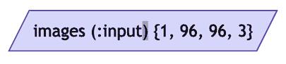

### 添加卷积层

`Axon.conv/3` 是 Axon 用于向神经网络添加卷积层的 API。该 API 接收输入 Axon 图、输出通道数以及一个选项列表来控制卷积。要观察其运行情况，请重新绑定变量 `cnn_model` 为以下内容：

```elixir
cnn_model =
  cnn_model
  |> Axon.conv(32,
    kernel_size: {3, 3},
    padding: :same,
    activation: :relu
  )
```

`Axon.conv/3` 的参数直接对应卷积操作如何转换输入张量。第一个参数（在输入图之后）表示该层应学习的输出通道数，这里是 32。`:kernel_size` 选项控制核的空间大小。如果您将输入的空间维度视为矩阵，输入张量是 96x96 的矩阵，而核是 3x3 的矩阵。

填充控制在卷积前如何修改输入。在有效或完全卷积中，输出特征图仅在输入张量中有效窗口上产生输出。输出特征图的空间尺寸小于输入。使用 `:same` 填充可确保卷积的输出尺寸与输入相同。

Same 填充指示卷积在输入张量的空间维度上进行填充，使得空间尺寸保持不变。填充在输入网格周围添加新的网格区域，使输出尺寸与原始输入相同。

现在，显示新模型：

```elixir
Axon.Display.as_graph(cnn_model, template)
```

运行后，您将看到：

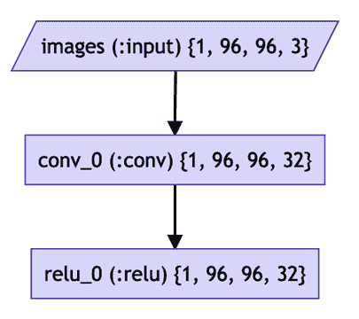

您是否注意到模型发生了变化？图现在包含输入、卷积层和激活函数。尺寸如何？请注意，输入张量的通道数（即深度）从 3 变为 32。同时，空间尺寸保持不变。

### 添加池化层

接下来，重新绑定变量 `cnn_model` 为以下内容：

```elixir
cnn_model =
  cnn_model
  |> Axon.max_pool(kernel_size: {2, 2}, strides: [2, 2])
```

```elixir
Axon.Display.as_graph(cnn_model, template)
```

运行后，您将看到：

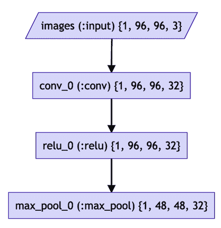

再次观察模型的变化。图中增加了一个最大池化层，输出的高度和宽度均减半。您可以重复此过程，添加更多卷积阶段，并观察模型的变化：

```elixir
cnn_model =
  cnn_model
  |> Axon.conv(64, kernel_size: {3, 3}, activation: :relu, padding: :same)
  |> Axon.max_pool(kernel_size: {2, 2}, strides: [2, 2])
  |> Axon.conv(128, kernel_size: {3, 3}, activation: :relu, padding: :same)
  |> Axon.max_pool(kernel_size: {2, 2}, strides: [2, 2])
```

### 添加全连接层

使用 `Axon.flatten/1` 对特征进行展平，并实现全连接头部：

```elixir
cnn_model =
  cnn_model
  |> Axon.flatten()
  |> Axon.dense(128, activation: :relu)
  |> Axon.dense(1, activation: :sigmoid)
```

### 完整模型架构

整个模型架构的代码如下：

```elixir
cnn_model =
  Axon.input("images", shape: {nil, 96, 96, 3})
  |> Axon.conv(32, kernel_size: {3, 3}, activation: :relu, padding: :same)
  |> Axon.max_pool(kernel_size: {2, 2}, strides: [2, 2])
  |> Axon.conv(64, kernel_size: {3, 3}, activation: :relu, padding: :same)
  |> Axon.max_pool(kernel_size: {2, 2}, strides: [2, 2])
  |> Axon.conv(128, kernel_size: {3, 3}, activation: :relu, padding: :same)
  |> Axon.max_pool(kernel_size: {2, 2}, strides: [2, 2])
  |> Axon.flatten()
  |> Axon.dense(128, activation: :relu)
  |> Axon.dense(1, activation: :sigmoid)
```

如果您将此模型以表格形式显示，会发现一些差异。

与您的 MLP 模型相比，这个模型在参数数量和参数大小上显著更小，尽管层数增加了。CNN 利用稀疏性这一现象（您将在 *Why CNNs Work* 中了解更多）。您可能会担心参数减少会导致性能下降。但重要的是，更大并不总是更好，只要您选择了正确的工具。锤子无法比凿子更好地拧螺丝。

## 训练模型

完成使用 Axon 构建 CNN 后，您需要训练它。您可能会想到，架构的改变是否需要改变训练循环。在某些情况下，模型改变确实需要修改训练循环。但在此案例中，您可以复用之前在 *Trying to See with MLPs* 中使用的相同训练循环，只需将 `mlp_model` 替换为 `cnn_model`：

```elixir
cnn_trained_model_state =
  cnn_model
  |> Axon.Loop.trainer(:binary_cross_entropy, :adam)
  |> Axon.Loop.metric(:accuracy)
  |> Axon.Loop.run(train_pipeline, %{}, epochs: 5, compiler: EXLA)
```

运行一段时间后，您将看到：

```text
Epoch: 0, Batch: 150, accuracy: 0.6360207 loss: 0.6347136
```


| Epoch | Batch | Accuracy | Loss |
| --- | --- | --- | --- |
| 1 | 150 | 0.7611755 | 0.5627094 |
| 2 | 150 | 0.8005486 | 0.5184103 |
| 3 | 150 | 0.8290567 | 0.4833005 |
| 4 | 150 | 0.8488207 | 0.4532791 |

- 训练损失和训练准确率都显著优于你的 MLP 模型——and 看起来你的模型甚至还没有趋于平稳。当然，如果没有使用验证集，很难判断你的模型是否已经开始过拟合。本章后面，你将使用 Axon 提供的即插即用训练工具来防止过拟合。目前，请确认你训练好的 CNN 在测试集上优于你的 MLP 模型：

| | cnn_model |
| --- | --- |
| | |> `Axon.Loop.evaluator()` |
| | |> `Axon.Loop.metric(:accuracy)` |
| | |> `Axon.Loop.run(test_pipeline, cnn_trained_model_state, compiler: EXLA)` |

- 最终，你会看到：

| | Batch: 6, accuracy: 0.8303571 |
| --- | --- |

- 你的测试准确率显著优于你的 MLP 模型。那么这里发生了什么？你已经知道卷积是什么，了解典型的 CNN 结构，并且知道如何在 Axon 中实现 CNN，但你不知道为什么你的 CNN 能够比普通的 MLP 更好地解决这个图像分类问题。

### 为什么 CNNs 有效

CNNs 在处理特定类别的输入数据（如图像）时，能够提升传统 MLP 的性能，因为它们利用了对输入数据结构的先验知识。

回顾第 1 章，*Make Machines That Learn*，所有模型都带有假设。CNNs 对输入数据的结构以及数据中存在的关系做出特定假设。数学上，CNNs 使用稀疏交互、参数共享和等变表示。卷积层中学习的核的空间尺寸通常远小于整张输入图像。核的大小强制执行一种局部性约束——卷积层只能在局部尺度上学习特征。此外，相同的核在输入数据的每个合法区域都被应用。对每个合法区域应用相同的核假设了局部表示在全局范围内是一致的。例如，图像中边缘的结构在左上角或右下角基本保持不变。卷积层利用这一事实，并在输入的不同空间区域复用相同的权重。

池化层进一步提升 CNN 在特定输入数据类别上的性能，使其具有平移不变性。平移不变性意味着，带有池化的 CNN 不会受到输入的小幅平移影响，这在很多情况下很有用——你只关心特征是否存在，而不在乎它的具体位置。例如，如果你有一个 CNN 用来检测狗的图像，狗在输入中的位置并不重要，重要的是狗是否出现。

CNN 还似乎利用了输入数据的层级表示概念。如果你检查早期卷积层识别的特征，你会发现它们激活于输入中的基础特征，如边缘和颜色。你越往网络深处走，提取的特征层级就越高。例如，后期的卷积层可能形成对狗或猫的高层次视觉表示。通过组合更多基础特征表示，CNN 能够捕捉图像中复杂的空间关系。

直观上，这种学习过程让你联想到可以利用通用 CNN 处理所有图像识别任务。毕竟，大多数图像共享许多相同的基础输入特征。事实上，你可以在其他模型中使用预训练模型的特征检测器。你将在第 8 章，*Stop Reinventing the Wheel* 中使用预训练模型。

### 改进训练过程

虽然能够以约 80% 的准确率预测猫和狗的模型已经相当不错，但仍有大量改进空间。该数据集的获胜模型在 2013 年达到了 98% 的准确率。此后，计算机视觉领域取得了巨大进展，而你仍未用尽所有训练技巧。在本节中，你将对模型和训练过程进行几项小幅度调整，并观察这些改动如何帮助你将准确率推向 90%。

#### 数据增强

当前你的训练集只有约 25,000 张图片。对于典型的深度学习问题来说，这不算多。你可以去收集更多猫和狗的标记图像，但这会很繁琐且费时。如果能在不收集更多图像的前提下人工增大数据集的规模，会是多么好！这正是数据增强的作用。

数据增强是通过对输入数据进行轻微修改，人工扩大数据集规模的过程。虽然数据增强可以用于各种数据类型，但它最常用于图像，因为图像大多是平移不变的——一张狗的照片无论是倒置还是正立，仍然是一张狗的照片。

对于图像，你可以进行若干随机平移，从而得到几乎无限多种不同的图像变体。例如，如果你以一定概率随机将输入图像上下翻转，你就人工使数据集规模翻倍。再加入另一个随机左右翻转的增强，数据集规模再翻倍。每增加一个增强，输入数据的变体数量就会呈指数增长。

除了人工扩大数据规模，数据增强还能让模型更具备对各种变换的鲁棒性。也就是说，你人为地挑战模型，让它学习捕捉狗或猫的本质，而不是对特定的变换敏感。

数据增强的实现非常简单：在数据加载 pipeline 中对每个输入图像应用随机变换。为此示例，你将添加随机上下翻转和左右翻转的变换。你可以随意添加更多增强，例如随机调整图像的色相、对比度或亮度——但请记住，每个增强都会带来预处理成本。

首先，修改 `CatsAndDogs` 模块，加入以下增强方法：

```elixir
defp random_flip({image, label}, axis) do
  if :rand.uniform() < 0.5 do
    {Nx.reverse(image, axes: [axis]), label}
  else
    {image, label}
  end
end
```

该方法以 0.5 的概率在给定轴上随机翻转给定的图像。即对每张图像抛硬币，决定是否翻转。接下来，调整 pipeline 以包含增强：

```elixir
def pipeline_with_augmentations(
  paths,
  batch_size,
  target_height,
  target_width
) do
  paths
  |> Enum.shuffle()
  |> Task.async_stream(&parse_image/1)
  |> Stream.filter(fn
    {:ok, {%StbImage{}, _}} -> true
    _ -> false
  end)
  |> Stream.map(&to_tensors(&1, target_height, target_width))
  |> Stream.map(&random_flip(&1, :height))
  |> Stream.map(&random_flip(&1, :width))
  |> Stream.chunk_every(batch_size, batch_size, :discard)
  |> Stream.map(fn chunks ->
    {img_chunk, label_chunk} = Enum.unzip(chunks)
    {Nx.stack(img_chunk), Nx.stack(label_chunk)}
  end)
end
```

现在你可以重新创建 pipeline：

```elixir
{test_paths, train_paths} =
  Path.wildcard("train/*.jpg")
  |> Enum.shuffle()

Enum.split(1000)

batch_size = 128
target_height = 96
target_width = 96

train_pipeline = CatsAndDogs.pipeline_with_augmentations(
  train_paths,
  batch_size,
  target_height,
  target_width
)

test_pipeline = CatsAndDogs.pipeline(
  test_paths,
  batch_size,
  target_height,
  target_width
)

Enum.take(train_pipeline, 1)
```

注意，你不想在测试 pipeline 中应用增强操作。你不想在测试时让模型的分类变得更困难。现在，训练集的每张图片都会在训练 pipeline 中随机水平和垂直翻转。

### 调整模型

除了更新训练 pipeline 外，你还可以在不改变整体结构的前提下对模型进行一些调整，以提高整体性能。在第 4 章 *Optimize Everything* 中，你学习了正则化的概念。记住，正则化是任何在训练过程中应用的策略，旨在提高模型的泛化能力。Dropout 是一种正则化方法，它通过在训练过程中随机屏蔽部分激活来防止模型过拟合。例如，假设你有一个全连接层，它输出以下张量：

```
#Nx.Tensor<
  f32[10]
  EXLA.Backend<cuda:0, 0.2231265192.3744595996.119072>
  [0.0, 1.0, 2.0, 3.0, 4.0, 5.0, 6.0, 7.0, 8.0, 9.0]
>
```

应用 dropout，概率为 0.5，会将激活中大约一半的元素置 0。结果可能是：

```
#Nx.Tensor<
  f32[10]
  EXLA.Backend<cuda:0, 0.2231265192.3744595996.119072>
  [0.0, 1.0, 2.0, 0.0, 0.0, 5.0, 6.0, 0.0, 8.0, 0.0]
>
```

通过屏蔽中间激活，模型在后续层中无法再将这些激活作为特征使用，从而迫使模型学习更具鲁棒性的表示。数学上，dropout 可以看作是迫使模型学习一个无限的子模型集合——每次训练步骤的 mask 都会变化，因此每一步都在训练一个本质上不同的模型。

Geoffrey Hinton，*Dropout paper* [SHKS14] 的原作者之一，表示该想法来源于银行的安全协议。根据 Hinton，银行会定期调换出纳员的班次，以防止出纳员群体勾结进行欺诈。Dropout 会在每次训练时随机切换哪些激活被屏蔽，从而防止激活群体针对训练数据中的某些特征进行过拟合。

需要注意的是，dropout 仅在训练阶段使用。推理和评估时，dropout 层会被完全移除，模型可以使用其全部容量。使用 Axon 添加 dropout 层也很简单，只需使用 `Axon.dropout/2`：

```elixir
cnn_model =
  Axon.input(:images, shape: {nil, 96, 96, 3})
  |> Axon.conv(32, kernel_size: {3, 3}, activation: :relu, padding: :same)
  |> Axon.batch_norm()
  |> Axon.max_pool(kernel_size: {2, 2}, strides: [2, 2])
  |> Axon.conv(64, kernel_size: {3, 3}, activation: :relu, padding: :same)
  |> Axon.batch_norm()
  |> Axon.max_pool(kernel_size: {2, 2}, strides: [2, 2])
  |> Axon.conv(128, kernel_size: {3, 3}, activation: :relu, padding: :same)
  |> Axon.max_pool(kernel_size: {2, 2}, strides: [2, 2])
  |> Axon.flatten()
  |> Axon.dense(128, activation: :relu)
  |> Axon.dropout(rate: 0.5)
  |> Axon.dense(1, activation: :sigmoid)
```

这段代码通过在单个隐藏全连接层和输出层之间添加 dropout 层来调整原始 `cnn_model`。`:rate` 选项控制 dropout 层的掩码概率。比率越高，模型学习的难度就越大。同时，注意只能在隐藏层的中间激活之后添加 dropout，不能在输出层使用。

### 早停和验证

当你第一次训练 CNN 时，只让它训练五个 epoch。你可能注意到模型的训练准确率每个 epoch 都在提升，说明模型在五个训练 epoch 后仍有大量提升空间。

假设你把 epoch 数增加到像 100 这样大的数值，让模型一直运行。问题是，模型最终会过拟合训练数据，可能表现得比未过拟合的 MLP 模型还差。

幸运的是，你可以通过两个调整来让训练循环在训练无限期的同时自动在模型开始过拟合时停止：早停和验证。

正如你在之前的章节中记得的，早停是一种正则化技术，用于在模型开始过拟合时停止训练。判断模型是否开始过拟合，通常会在一个保留集（holdout set）上评估模型性能。保留集是一小部分不在训练过程中展示给模型的数据。如果模型在验证数据上的表现开始下降，说明模型可能正在过拟合，此时可以停止训练。

Axon 提供 loop 事件处理器，能够自动处理早停和验证。在 Axon 循环中，特定事件会在定期间隔后触发。例如，每个 epoch 结束时，`:epoch_completed` 事件会触发，所有注册到该事件的处理器都会执行。虽然可以自定义事件处理器，但通常只需要使用 Axon 提供的几个默认事件即可。

要在训练循环中加入早停和验证，只需对原始训练代码进行以下几步调整：

```elixir
cnn_trained_model_state =
  cnn_model
  |> Axon.Loop.trainer(:binary_cross_entropy, Axon.Optimizers.adam(1.0e-3))
  |> Axon.Loop.metric(:accuracy)
  |> Axon.Loop.validate(cnn_model, val_pipeline)
  |> Axon.Loop.early_stop("validation_loss", mode: :min)
  |> Axon.Loop.run(train_pipeline, %{}, epochs: 100, compiler: EXLA)
```

你应该注意到，与你原来的训练循环相比，这里有两行额外的内容。`Axon.Loop.validate/3` 实现了一个受监督的验证循环，它会在每个 epoch 结束后运行，使用提供的验证数据对当前模型进行测试。验证循环会立即调用 `Axon.Loop.early_stop/3`，该处理器负责实现早停。它监控 `"validation_loss"` 指标，如果该指标没有改进则停止训练。`:mode` 参数指示哪种方向表示改进，`:min` 表示你在最小化损失。请注意，这些处理器的顺序很重要。`Axon.Loop.validate/3` 在运行后才会将验证指标注册到训练状态中，因此如果你在 early stopping 之后才添加验证，early stopping 将没有任何可监控的指标。

你还应该注意到，与只运行五个 epoch 相比，你可以安全地将 `:epochs` 设置为 100，而无需担心模型过拟合。早停处理器会在出现过拟合的第一个迹象时触发警报，并停止训练循环。你可以安全地离开电脑，让模型运行所需的时间。最终，你会看到类似下面的输出：

| | ... |
| --- | --- |
| | Batch: 5, accuracy: 0.8711411 loss: 0.6648788 |
| | Epoch: 52, Batch: 150, accuracy: 0.9880484 loss: 0.1459639 |
| | Batch: 5, accuracy: 0.8589962 loss: 0.7372965 |
| | Epoch: 53, Batch: 150, accuracy: 0.9914632 loss: 0.1436956 |
| | Batch: 5, accuracy: 0.8685369 loss: 0.7409852 |
| | Epoch: 54, Batch: 150, accuracy: 0.9899628 loss: 0.1416151 |
| | Batch: 5, accuracy: 0.8726563 loss: 0.7095366 |
| | Epoch: 55, Batch: 150, accuracy: 0.9917219 loss: 0.1394880 |
| | Batch: 5, accuracy: 0.8626894 loss: 0.7270263 |
| | Epoch: 56, Batch: 150, accuracy: 0.9913080 loss: 0.1374808 |
| | Batch: 5, accuracy: 0.8605114 loss: 0.7936438 |
| | Epoch: 57, Batch: 150, accuracy: 0.9918253 loss: 0.1356151 |
| | Batch: 5, accuracy: 0.8683239 loss: 0.6846517 |
| | Epoch: 58, Batch: 150, accuracy: 0.9918253 loss: 0.1337494 |

请注意，在出现过拟合的第一个迹象时，你的训练循环就停止了。现在，运行以下代码来验证你所做的修改是否真的提升了模型的性能：

```elixir
cnn_model
|> Axon.Loop.evaluator()
|> Axon.Loop.metric(:accuracy)
|> Axon.Loop.run(test_pipeline, cnn_trained_model_state, compiler: EXLA)
```

你会看到类似下面的输出：

| | Batch: 5, accuracy: 0.8735322 |
| --- | --- |

因此，你所做的几个小改动显著提升了模型的性能。这个最终模型远优于你最初使用的 MLP 模型。值得提取的一条经验是：训练神经网络是一个不断的试错过程。在实际场景中，尤其是数据量巨大时，你希望在全量训练前先测试和原型化改动。理想情况下，你会逐一添加特性，并且只保留那些在与之前模型相比时显示出明显改进的特性。随着你训练越来越多的模型，你会开始对在特定情境下需要哪些调整产生直觉。你也会形成一种原型和训练模型的标准流程。

## Going Beyond Image Classification

正如本章所示，CNN 在学习图像分类问题方面表现出色。总体而言，CNN 架构的变体是任何计算机视觉任务的首选。但除此之外，你在实际工作中还会遇到哪些计算机视觉任务？

### Object Detection（目标检测）

目标检测是一个计算机视觉问题，其目标是识别图像中包含的所有物体并定位它们。目标检测可以被视为图像分类任务的扩展。例如，你可能在 cats vs. dogs 数据集的训练图像中看到一些图像同时包含人和其他物体以及狗。与其仅将图像分类为猫或狗，你可以为图像添加多个标签，如 "human" 和 "dog" 或 "dog" 和 "toy"。目标检测进一步将这一任务推向极致，为图像中的每个物体分配一个边界框：

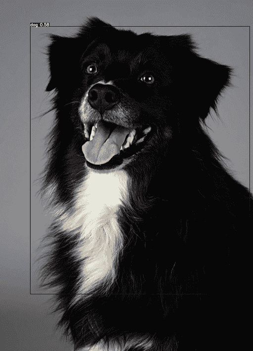

当前最常用的目标检测模型是 *YOLO* RDGF16。YOLO（You Only Look Once）的几乎所有变体都使用 CNN 进行特征提取，并结合若干额外策略以实现最先进的性能。一些新变体则使用视觉变换器（vision transformers）进行特征提取。你将在第十一章 *Model Everything with Transformers* 中了解变换器的强大之处。

### Image Segmentation（图像分割）

图像分割（语义分割）是一个计算机视觉任务，目标是为图像的每个像素分配一个类别。它将目标检测任务提升到极致：而不是为每个物体绘制精确的边界框，而是为每个物体生成精确的像素掩码。

最著名的图像分割架构是 *U-Net* RFB15，它使用 CNN 进行生物医学图像的语义分割。与目标检测一样，现代分割架构也会使用视觉变换器来实现最先进的性能。

### Beyond Computer Vision（超越计算机视觉）

CNN 不仅适用于图像数据，还可以有效应用于任何具有网格状拓扑结构的数据，包括音频、视频以及文本的某些表示。直观地讲，只要模型捕获局部关系，CNN 就能发挥作用。

## Wrapping Up（章节结束）

在本章中，你实现了一个卷积神经网络（CNN）并将其性能与传统的 MLP 进行了对比。你拆解了卷积运算、卷积层和最大池化层的工作原理，并了解到卷积层之所以能够如此好地表示图像。最后，你使用了一些在 Axon 中的训练技巧来提升模型的表现。

在这一章的过程中，你可能注意到训练神经网络有时会很繁琐且耗时。将模型的性能推向 state of the art 并不容易。wouldn't it be nice if you could save some training time and make use of someone else’s hard work? Fortunately, you can. 在下一章中，你将看到如何站在巨人的肩膀上（或直接使用巨型模型）来实现任何任务的惊人性能。

#### Footnotes

[\[14\]](#f_0049.xhtml#FNPTR-14)

: [`www.kaggle.com/c/dogs-vs-cats`](https://www.kaggle.com/c/dogs-vs-cats)

[\[15\]](#f_0049.xhtml#FNPTR-15)

: [`www.image-net.org/`](https://www.image-net.org/)

Copyright © 2024, The Pragmatic Bookshelf.

---

在上一章节中，你实现了一个新的神经网络类型：卷积神经网络（Convolutional Neural Network）。你构建并训练了一个卷积神经网络，用于准确分类猫和狗的图片。在应用了几个额外的模型训练技巧，如数据增强（data augmentation）和丢弃层（dropout），你能够训练一个模型，将图片分类为猫或狗，准确率达到 87%。虽然 87% 的准确率已经很棒，但你仍然可以通过利用预训练模型和迁移学习（transfer learning）的力量，在对训练流程进行极小的修改的情况下，进一步提升模型性能。本章节将向你介绍迁移学习是什么、何时需要它，以及如何使用 Axon 进行迁移学习。

## 再次识别猫和狗

为了理解迁移学习的能力，你需要对上一章节中使用的模型训练代码进行一些调整，并比较新训练模型与之前训练的模型的性能。为此，启动一个 Livebook 并安装以下依赖：

```elixir
Mix.install([
  {:axon_onnx, "~> 0.4"},
  {:axon, "~> 0.5"},
  {:nx, "~> 0.5"},
  {:exla, "~> 0.5"},
  {:stb_image, "~> 0.6"},
  {:kino, "~> 0.8"}
])
```

你应该能够识别出这些依赖，除了 `:axon_onnx` 之外，它是一个用于导入和导出 Open Neural Network Exchange（ONNX）模型的库。ONNX 是一个语言无关的模型序列化协议，非常适合将 Python 生态系统中的预训练模型带入 Elixir 世界。ONNX 由大多数主要的深度学习框架支持，并且拥有针对边缘、移动和服务器部署的多个运行时实现。在第 13 章 *Put Machine Learning into Practice* 中，你将了解到 ONNX 格式的其他用途。本章节中，你将使用 ONNX 作为 Python 和 Elixir 机器学习生态系统之间的中介。

| ONNX |
| --- |
|  ONNX 是微软和 Meta 之间的合作项目，提供一个通用的模型序列化格式。ONNX 协议^([\[16\]](#f_0059.xhtml#FOOTNOTE-16)) 描述了一个类似图形的数据结构，以及定义节点参数、行为和返回类型的运算符规范。虽然 PyTorch 和 TensorFlow 这两个最大的深度学习框架有各自的专用序列化协议，但它们都支持导出到 ONNX。 |

你还需要将 EXLA 设置为默认后端：

```elixir
Nx.global_default_backend(EXLA.Backend)
```

在安装必要的依赖后，你可以继续实现与上一章节相同的输入管道。你不需要修改之前实现的管道，只需添加以下模块到你的 Livebook 中：

```elixir
defmodule CatsAndDogs do
  def pipeline(paths, batch_size, target_height, target_width) do
    paths
    |> Enum.shuffle()
    |> Task.async_stream(&parse_image/1)
    |> Stream.filter(fn
      {:ok, {%StbImage{}, _}} -> true
      _ -> false
    end)
    |> Stream.map(&to_tensors(&1, target_height, target_width))
    |> Stream.chunk_every(batch_size, :discard)
    |> Stream.map(fn chunks ->
      {img_chunk, label_chunk} = Enum.unzip(chunks)
      {Nx.stack(img_chunk), Nx.stack(label_chunk)}
    end)
  end

  def pipeline_with_augmentations(
    paths,
    batch_size,
    target_height,
    target_width
  ) do
    paths
    |> Enum.shuffle()
    |> Task.async_stream(&parse_image/1)
    |> Stream.filter(fn
      {:ok, {%StbImage{}, _}} -> true
      _ -> false
    end)
    |> Stream.map(&to_tensors(&1, target_height, target_width))
    |> Stream.map(&random_flip(&1, :height))
    |> Stream.map(&random_flip(&1, :width))
    |> Stream.chunk_every(batch_size, :discard)
    |> Stream.map(fn chunks ->
      {img_chunk, label_chunk} = Enum.unzip(chunks)
      {Nx.stack(img_chunk), Nx.stack(label_chunk)}
    end)
  end

  defp random_flip({image, label}, axis) do
    if :rand.uniform() < 0.5 do
      {Nx.reverse(image, axes: [axis]), label}
    else
      {image, label}
    end
  end

  defp parse_image(path) do
    label = if String.contains?(path, "cat"), do: 0, else: 1

    case StbImage.read_file(path) do
      {:ok, img} -> {img, label}
      _error -> :error
    end
  end

  defp to_tensors({:ok, {img, label}}, target_height, target_width) do
    img_tensor =
      img
      |> StbImage.resize(target_height, target_width)
      |> StbImage.to_nx()
      |> Nx.divide(255)
      |> Nx.transpose(axes: [:channels, :height, :width])

    label_tensor = Nx.tensor([label])

    {img_tensor, label_tensor}
  end
end
```

请回顾 *Building an Input Pipeline*，该管道返回一个流（Stream）的元组：`{input, target}`，其中 `input` 是图片批次的张量表示，`target` 是标签批次的张量表示。你也应该注意到，这个管道会通过随机水平和垂直翻转来增强输入图片。

与你在 here 实现的管道有一个小区别：你将使用一个使用通道优先（channels first）图像表示的模型，而 `StbImage` 返回的是通道优先（channels last）的表示。因此，你需要转置图片以将其转换为通道优先表示。

现在，为了确认你已正确复制所有内容，运行以下代码：

```elixir
{test_paths, train_paths} =
  Path.wildcard("train/*.jpg")
  |> Enum.shuffle()

{test_paths, val_paths} = test_paths |> Enum.split(750)

batch_size = 32
target_height = 160
target_width = 160

train_pipeline = CatsAndDogs.pipeline_with_augmentations(
  train_paths,
  batch_size,
  target_height,
  target_width
)

val_pipeline = CatsAndDogs.pipeline(
  val_paths,
  batch_size,
  target_height,
  target_width
)

test_pipeline = CatsAndDogs.pipeline(
  test_paths,
  batch_size,
  target_height,
  target_width
)

Enum.take(train_pipeline, 1)
```

```
#Nx.Tensor<
  f32[32][channels: 3][height: 160][width: 160]
  EXLA.Backend<cuda:0, 0.2937518557.1715339297.110861>
  [
    [
      [0.7450979948043823, 0.7372548580169678, 0.8078430891036987, ...]
      ...
    ]
    ...
  ]
>,
#Nx.Tensor<
  s64[32][1]
  EXLA.Backend<cuda:0, 0.2937518557.1715339297.110894>
  [
    [0],
    [0],
    [0],
    [0],
    [0],
    [1],
    ...
  ]
>
```

在添加卷积基的命名空间的同时，你还需要冻结卷积基。使用预训练模型时，通常会冻结或停止训练模型的预训练部分，以避免在训练早期出现灾难性遗忘。换句话说，预训练模型在训练初期保持完全静态，因此不会丢失其已习得的知识。训练初期通常是最不稳定的阶段，这意味着你的预训练模型面临丢失部分价值的风险。

冻结层会让 Axon 为层的参数包裹 `stop_grad`。这意味着在梯度下降更新模型时，冻结参数的梯度为 0，因此不会被更新。在 Axon 中，冻结是相对于模型而非训练循环或参数进行的。你可以使用 `Axon.freeze/2` 函数标记某些层为冻结。默认情况下，`Axon.freeze/2` 会冻结所有后续层，但它提供了更细粒度冻结的 API。对于本例，你可以这样冻结卷积基：


现在，你拥有了一个带有可识别命名空间的冻结、预训练的卷积基。此时模型的输出形状为 `{batch_size, 1280, 1, 1}`，因此在传递到分类头之前需要将特征展平。你可以使用 `Axon.flatten/2` 来展平特征，或者使用全局池化层。由于该模型的输出特征数量相对较大，全局池化层更合适，因为它能减少传递给分类头的输入特征数量。此外，在全局平均池化层和分类头之间添加一个脱落层（dropout layer）以增加正则化。对于二分类问题，你的分类头需要一个单位：

```elixir
model =
  cnn_base
  |> Axon.global_avg_pool(channels: :first)
  |> Axon.dropout(rate: 0.2)
  |> Axon.dense(1)
```

注意，你需要为本例指定 `channels: :first`，因为所使用的模型默认采用通道优先（channels first）的表示方式。将这些步骤组合在一起，模型构建代码应如下所示：

```elixir
{cnn_base, cnn_base_params} = AxonOnnx.import("mobilenetv2-7.onnx")

{_popped, cnn_base} = Axon.pop_node(cnn_base)

{_popped, cnn_base} = Axon.pop_node(cnn_base)

model =
  cnn_base
  |> Axon.namespace("feature_extractor")
  |> Axon.freeze()
  |> Axon.global_avg_pool(channels: :first)
  |> Axon.dropout(rate: 0.2)
  |> Axon.dense(1)
```

在输入管道和模型就位后，你可以开始构建训练循环。到此为止，你应该已经对如何创建和操作 Axon 训练循环有了相当好的理解。对于本例，请按照之前在 Early Stopping and Validation 中实现的训练循环进行，并做一些小调整：

```elixir
loss = &Axon.Losses.binary_cross_entropy(&1, &2,
  reduction: :mean,
  from_logits: true
)

optimizer = Axon.Optimizers.adam(1.0e-4)

trained_model_state =
  model
  |> Axon.Loop.trainer(loss, optimizer)
  |> Axon.Loop.metric(:accuracy)
  |> Axon.Loop.validate(model, val_pipeline)
  |> Axon.Loop.early_stop("validation_loss", mode: :min, patience: 5)
  |> Axon.Loop.run(
    train_pipeline,
    %{"feature_extractor" => cnn_base_params},
    epochs: 100,
    compiler: EXLA
  )
```

与之前的训练循环相比，这段代码有几个差异。

首先，你使用了 `Axon.Losses.binary_cross_entropy/3` 的参数化版本作为损失函数。你可能注意到，输出的全连接层没有使用 sigmoid 激活函数——它不将输出压缩到 0 到 1 之间的概率范围。该全连接层的输出被称为 logits（对数几率）或 log-probabilities。当你不指定最终的 sigmoid 激活函数（多类分类问题中使用 softmax）时，需要向损失函数传递 `from_logits: true` 以表明你传入的是 logits 而非概率。使用 logits 形式和概率形式没有本质区别，除了可以省去额外的 sigmoid 激活。Axon 内部实际上总是使用 logits 来计算交叉熵损失。当你使用 logits 时，需要记得在计算概率时对预测值应用 sigmoid 或 softmax。

另一个差异是使用 `Axon.Optimizers` 的函数式声明来定义优化器。这仅是为了使用不同于 Adam 优化器默认的学习率。

最后的差异是，在 `train_pipeline` 后面的空 map 被一个包含特征提取器参数的 map 替换。这个 map 表示训练循环的初始状态。

在之前的所有章节中，你都是从零训练模型，因此不需要初始状态。现在你想利用预训练模型，需要告诉 Axon 使用哪些预训练参数。Axon 会在训练循环内部使用这些初始状态参数来初始化模型，固定特征提取器的参数。虽然你也可以手动提供所有模型的初始参数，但从根本上讲，Axon 会自动为未在初始状态中提供的参数进行初始化。初始状态参数相当于 Axon 训练循环的累加器。显式初始化模型参数和将参数提供给训练循环让 Axon 初始化之间没有本质区别，后者只能节省少量样板代码。

理解这一点很重要：在预训练模型之上构建模型并不一定需要大幅改变训练流程。除了模型构建过程中的几个小调整、在训练循环中加入初始状态，以及对损失函数和优化器的微调外，其核心流程与从零训练的章节几乎相同。许多在训练从零时适用的原则和策略同样适用于在预训练模型上进行训练。你可以在不做大改动的情况下，利用他人的经验成果。

与任何机器学习算法一样，你需要考虑一些限制和注意事项，这些将在 Knowing When to Use Transfer Learning 中进一步了解。不过，迁移学习是一个极其强大的工具。在许多情况下，直接使用预训练模型比从零训练更合理。

经过一段时间运行训练循环后，你会看到以下输出：

```
...
Batch: 23, accuracy: 0.9348959 loss: 0.1361023
Epoch: 15, Batch: 700, accuracy: 0.9220337 loss: 0.2185298
Batch: 23, accuracy: 0.9414064 loss: 0.1326849
Epoch: 16, Batch: 700, accuracy: 0.9208744 loss: 0.2164259
Batch: 23, accuracy: 0.9361981 loss: 0.1386008
Epoch: 17, Batch: 700, accuracy: 0.9210071 loss: 0.2145825
Batch: 23, accuracy: 0.9375002 loss: 0.1397082
Epoch: 18, Batch: 700, accuracy: 0.9189568 loss: 0.2129661
Batch: 23, accuracy: 0.9388022 loss: 0.1403071
```

你的模型在训练和验证集上达到了 93-94% 的准确率，但它在测试集上表现如何呢？运行以下评估循环来查看：

```elixir
eval_model = model |> Axon.sigmoid()

eval_model
|> Axon.Loop.evaluator()
|> Axon.Loop.metric(:accuracy)
|> Axon.Loop.run(test_pipeline, trained_model_state, compiler: EXLA)
```

在本例中，你通过在原始模型上应用 sigmoid 函数来调整模型，以输出概率而非 logits。

运行代码后，你会看到以下结果：

```
Batch: 23, accuracy: 0.9449407
Batch: 23, accuracy: 0.9739585 loss: 0.0710718
Epoch: 5, Batch: 700, accuracy: 0.9660777 loss: 0.1285189
Batch: 23, accuracy: 0.9739584 loss: 0.0710575
Epoch: 6, Batch: 700, accuracy: 0.9713383 loss: 0.1209094
Batch: 23, accuracy: 0.9765627 loss: 0.0717105
Epoch: 7, Batch: 700, accuracy: 0.9726299 loss: 0.1142527
Batch: 23, accuracy: 0.9778647 loss: 0.0800760
Epoch: 8, Batch: 700, accuracy: 0.9770432 loss: 0.1082386
Batch: 23, accuracy: 0.9752605 loss: 0.0922253
Epoch: 9, Batch: 700, accuracy: 0.9777576 loss: 0.1030978
Batch: 23, accuracy: 0.9709822 loss: 0.1120541
```

你的模型在上一次训练迭代后已经取得了令人印象深刻的表现，这在训练日志中已经显而易见。模型在训练和验证数据上略有提升，但你需要确认微调是否提升了其在测试集上的性能：

```elixir
eval_model = model |> Axon.sigmoid()

eval_model
|> Axon.Loop.evaluator()
|> Axon.Loop.metric(:accuracy)
|> Axon.Loop.run(test_pipeline, trained_model_state, compiler: EXLA)
```

运行该单元后，你会看到以下结果：

```
Batch: 23, accuracy: 0.9709823
```

就在你开始怀疑自己在这一问题上无法再有所提升时，你能够从模型中进一步挤压出性能。通过微调预训练模型的顶层，你能够使模型的性能提升了几个百分点。

现在你已经看到了传递学习和微调的强大效果，可能会好奇它们为何如此有效，以及是否应在每种情境下使用它们。在下一节中，你将更深入地理解传递学习的直觉，并进一步了解何时应使用它。

## 理解传递学习

传递学习是一种将预训练模型重新用于相关任务的技术。你在上一节中已经在深度学习问题——具体来说是计算机视觉问题——的语境下看到过传递学习。虽然可以将传递学习应用于其他机器学习技术和其他领域，但它在计算机视觉问题中尤为常见。

传递学习的强大之处应当能够让人产生直观的理解。与其为每个问题从零开始训练，你通过注入一些过去对问题的了解，可以加速训练过程。在第 6 章 *Go Deep with Axon* 中，你了解到深度学习的核心在于学习数据的有用表示。如果你拥有一个已经学习到与你的数据相似输入数据的有用表示的预训练模型，那么让它帮助你更快、取得更好最终性能是合理的。

在这一节中，你将更深入地探讨传递学习的原因，以及何时使用它。

### 为何传递学习有效

回顾第 7 章 *Learn to See*，卷积神经网络的早期层往往学习通用特征，例如图像中的边缘。这些通用特征适用于任何图像识别任务。边缘特征无论模型的目标是识别猫和狗，还是检测街头标志上的字母，其本质保持不变。这意味着你可以将预训练模型的部分作为通用特征探测器，并将其应用于特定任务。

预训练模型通常是在像 ImageNet 这样的大型数据集上训练的，这意味着它们会接触到广泛的输入数据。换句话说，它们能够将知识推广到许多不同的使用场景，因为它们在大量、多样的数据上进行了训练。从某种意义上说，你可以认为这些模型学到的表示是视觉数据的通用表示。但说这些模型能够适用于所有类别的视觉数据可能有点牵强。使用已经具备一些有用视觉数据表示的模型的意义在于，你的模型不必花费时间去学习自己的表示，而是可以直接利用这些表示来进行预测。

考虑你在上一章节中从零开始训练的模型。它在大约 25,000 张猫和狗的图片上进行了训练。如果你将你在上一章节中训练的模型的特征与 MobileNet 学到的特征进行比较——MobileNet 在 1400 万张来自 1,000 个不同图像类别的图片上进行了训练——你觉得哪个模型学到了视觉数据最强健、最通用的特征？你从零开始训练的模型不仅要从少量输入数据中学习视觉数据的表示，还要利用这些表示来进行预测。而你在本章节中训练的模型任务更为简单——仅需基于强健的表示进行预测。你可以把它看作是给你的模型在竞赛中提供了显著的先手优势。

理解为什么迁移学习效果如此显著，可能会让你想知道是否应该在你遇到的每一个问题中都使用预训练模型。在下一节中，你将进一步了解何时使用迁移学习是合理的，何时则不应使用。

### 了解何时使用迁移学习

像机器学习中的大多数问题一样，关于何时使用迁移学习没有 definitive（决定性的）答案，答案是 “it depends”（这取决于）。它取决于许多因素，例如你拥有的数据类型、数据量、可用资源以及你的目标。

在计算机视觉和自然语言处理等领域，迁移学习是训练新模型用于专门应用的标准做法。这主要是因为通用模型的丰富以及它们在各种问题上带来的显著性能提升——即使数据量不多。

总体而言，如果你数据量不足，你很可能会从使用预训练模型中受益。即使你拥有大量数据，仍可能从中受益。但某些领域需要全新的方法。有些领域根本没有可用的预训练模型。

还需要注意，你不能随意选择任何预训练模型并期望它能在你的输入数据上工作。例如，在 ImageNet 上训练的 MobileNet 作为生物医学图像模型的卷积基础是一个糟糕的选择。ImageNet 中没有生物医学图像，生物医学图像与其他类型图像的相似性也不高。要让迁移学习成功，你需要确保选择的模型在与你的使用场景足够相似的数据上被训练——你不会指望一个在葡萄牙语上训练的模型对英文语言有有用的表示。

在选择预训练模型时，你需要考虑你所面对的问题以及成功的标准。虽然你可以选择在某些通用机器学习基准上指标最好的模型，但这不一定是最佳选择。例如，如果你计划在移动设备或边缘设备上部署模型，通常最好的模型也会更大、计算更密集，导致运行变慢。你需要在选择预训练模型时综合考虑所有性能目标。

好在预训练模型在机器学习生态系统中非常丰富。但你可能会疑惑，在如此新颖的 Elixir 机器学习生态系统中，如何使用这些模型？大多数预训练模型都是使用 Python 特定的机器学习框架构建的。如何在你的项目中利用这些模型？在下一节中，你将使用 Python 生态系统中可用的工具和仓库，将模型导入到你的 Elixir 项目中。

### 利用机器学习生态系统

你可能注意到，本章的标题在《Machine Learning in Elixir》这本书中显得有点讽刺。毕竟，Nx 生态系统是否不是 Python 机器学习生态系统的 Elixir 版本？在很多方面，像 Axon 这样的 Elixir Nx 项目本身就模仿了 Python 生态中的对应项目——在设计上有合理的偏差，并在必要时做出完全不同的选择。这些与 Python 的偏离是有意为之的，但这并不意味着 Elixir Nx 完全回避 Python 环境。从一开始，Nx 就被设计为灵活。它并不完全依赖于像 TensorFlow 或 PyTorch 这样流行的 Python 前端项目，而是采用模块化的方式，能够利用任何张量操作库。

这种灵活性的哲学也延伸到 Axon 等库。Axon 的核心特性是 Axon 数据结构，它以类似图的结构表示神经网络。你可以直接在 Elixir 中操作和构建这个数据结构。其魅力在于，如果你知道如何遍历 Axon 图，就知道如何将其转换为外部格式。同样，如果你拥有来自外部框架（如 ONNX 或 TensorFlow）的序列化格式，也可以轻松将其转换为 Axon 图以在 Elixir 中直接使用。Axon 不绑定到任何特定的运行时，因此你无需担心被特定的模型格式所束缚。

Python 环境庞大，就像在语言间选择大量的 Web 框架和栈一样，在 Python 机器学习领域也有大量的框架和栈可供选择。Axon 及其相关项目的明确目标是：无需实现 Port 或绑定到特定运行时，即可无缝导入 Python 生态中的任何模型并用于 Elixir。

你可能在想如何在自己的项目中使用已有的模型。在本节的其余部分，你将把从流行框架导出的模型转换为 ONNX 格式，以便在 Elixir 中使用。

### 导出 TensorFlow 模型

TensorFlow 的主要序列化模型格式是 Saved Model，^([\[19\]](#f_0059.xhtml#FOOTNOTE-19)) 虽然较早的 TensorFlow Keras 版本也支持多种模型和权重的序列化格式。本节专门讨论 Saved Model 格式。

#### 使用 tf2onnx


# tf2onnx：将 TensorFlow 模型转换为 ONNX 格式

tf2onnx^([\[20\]](#f_0059.xhtml#FOOTNOTE-20)) 是一个用于将 TensorFlow 模型转换为 ONNX 格式的 Python 库。tf2onnx 支持 TensorFlow Saved Model、TensorFlow.js 模型以及 TensorFlow Lite 模型。使用 tf2onnx 最简便的方式是通过命令行工具。例如，如果你有一个保存在目录中的 TensorFlow Saved Model，可以运行以下命令进行转换：

```bash
$ python3 -m tf2onnx.convert \
  --saved-model path-to-model \
  --output model.onnx
```

为了看到 tf2onnx 的实际效果，请新建一个名为 `save_tensorflow_model.py` 的 Python 文件，并将以下代码复制进去：

```python
import tensorflow as tf

model = tf.keras.applications.ResNet50(weights="imagenet")

model.save("resnet")
```

将复制的代码保存为 `save_tensorflow_model.py` 文件后，运行以下命令：

```bash
$ python3 save_tensorflow_model.py
```

- 脚本导入预训练的 ResNet50 模型，使用 `tf.keras.applications` 子模块。你可以在 Keras Applications^([\[21\]](#f_0059.xhtml#FOOTNOTE-21)) 模块下找到其他多种预训练模型。导入 ResNet50 后，脚本会使用保存模型格式将模型保存到 `resnet` 目录。运行脚本后，你会在工作目录中看到 `resnet` 目录。

1. 运行以下命令将模型转换为 ONNX：

```bash
$ python3 -m tf2onnx.convert \
  --saved-model resnet/ \
  --output resnet_tensorflow.onnx
```

2. 运行脚本后，你会在当前工作目录中看到 `resnet_tensorflow.onnx` 文件出现。

3. 创建一个名为 `resnet.exs` 的新 Elixir 脚本，并将以下代码复制进去：

```elixir
Mix.install([
  {:axon_onx, "~> 0.4"},
  {:axon, "~> 0.5"}
])

{model, params} = AxonOnnx.import("resnet_tensorflow.onnx")

IO.inspect model
```

4. 在终端运行：

```bash
$ elixir resnet.exs
```

运行后，你会看到类似以下输出：

```
09:36:43.537 [warning] unk__613 has no specified dimension, assuming nil

#Axon<
  inputs: ["input_1"]
>
```

5. 该输出表明模型已准备好在 Elixir 中使用。warning 表示有一个未指定尺寸的维度，Axon 将其设为 `nil`。这里的 `unk__613` 是模型的 batch 维度。如果出现此类 warning 并出现导入错误，通常可以通过在导入时提供显式尺寸来消除：

```elixir
{model, params} = AxonOnnx.import("resnet_tensorflow.onnx", unk__613: 32)
```

6. 一旦为维度提供显式值，就必须始终使用相同数值的尺寸。

## 查找预训练的 TensorFlow 模型

虽然本例使用了 `tf.keras.applications`，但你也可以在其他位置找到 TensorFlow 保存的模型。TensorFlow Hub^([\[22\]](#f_0059.xhtml#FOOTNOTE-22)) 是专门用于保存预训练模型的 TensorFlow 仓库，支持多种任务和多种格式。大多数模型均可由 tf2onnx 支持，但若要确保从 TensorFlow Hub 的各种格式中正确导出，可能需要查阅 tf2onnx 文档。

如在 *Exporting Models from HuggingFace* 中所述，你也可以从高层应用库（如 HuggingFace transformers）自行导出模型。

# 从 PyTorch 导出模型

ONNX 是微软与 Meta 合作的开放项目，而 PyTorch 是 Meta AI 实验室的产品，PyTorch 拥有首屈一指的 ONNX 导出支持。`torch.onnx`^([\[23\]](#f_0059.xhtml#FOOTNOTE-23)) 模块提供导出函数。文档详细说明导出过程以及常见的陷阱。给定一个预训练的 PyTorch 模块，通常可以直接使用 `torch.onnx.export` 完成导出：

```python
import torch

dummy_input = torch.randn(10, 3, 224, 224)

torch.onnx.export(model, dummy_input, "model.onnx")
```

只需提供一个明确的输入张量供 PyTorch 用于构建 ONNX 图。

## 示例：保存 PyTorch ResNet 模型

1. 创建名为 `save_pytorch_model.py` 的新 Python 脚本，粘贴以下代码：

```python
import torch
import torchvision

dummy_input = torch.randn(10, 3, 224, 224)

model = torchvision.models.resnet50(pretrained=True)

torch.onnx.export(model, dummy_input, "resnet_pytorch.onnx")
```

2. 运行脚本：

```bash
$ python3 save_pytorch_model.py
```

运行后，你会在当前工作目录看到 `resnet_pytorch.onnx` 文件。

3. 修改 `resnet.exs`，改为导入 PyTorch 版本的 ResNet ONNX 模型：

```elixir
Mix.install([
  {:axon_onx, "~> 0.4"},
  {:axon, "~> 0.5"}
])

{model, params} = AxonOnnx.import("resnet_pytorch.onnx")

IO.inspect model
```

4. 再次运行：

```bash
$ elixir resnet.exs
```

输出示例：

```
#Axon<
  inputs: ["input.1"]
>
```

这表明已成功从 PyTorch 导入并使用预训练模型在 Elixir 中。

## 查找预训练的 PyTorch 模型

与 TensorFlow 类似，PyTorch 也有多个渠道提供预训练模型。如 TorchVision^([\[25\]](#f_0059.xhtml#FOOTNOTE-25))、TorchText^([\[26\]](#f_0059.xhtml#FOOTNOTE-26))、TorchAudio^([\[27\]](#f_0059.xhtml#FOOTNOTE-27)) 等库中包含可导出的模型。

如果在 GitHub 上找到 PyTorch 实现的预训练模型，通常可以将其导出为 ONNX 格式。正如文档所述，导出时需要注意一些细节，并可能需要对模型进行小幅修改，但 ONNX 覆盖了大多数感兴趣的模型。

# 从 HuggingFace 导出模型

目前最流行的机器学习库是 HuggingFace Transformers^([\[28\]](#f_0059.xhtml#FOOTNOTE-28))，它提供 transformer 模型的便利和预训练实现。你将在第 11 章 *Model Everything with Transformers* 中使用这些模型。HuggingFace 也提供一个模型中心，汇集了众多组织和个人的模型。Elixir 有专门的库 Bumblebee^([\[29\]](#f_0059.xhtml#FOOTNOTE-29)) 直接与 HuggingFace Hub 交互，提供原生 Elixir 实现，比通过 ONNX 自动导入的版本更简洁、更健壮。如果想使用 Bumblebee 中没有的模型，可以通过 `transformers.onnx` Python 模块导出部分 transformer 模型。

假设已安装 transformers 库，只需在终端执行类似命令即可导出 HuggingFace 模型的 ONNX 版本：

```bash
$ python3 -m transformers.onnx --model=org/model path
```

`org/model` 指向目标模型。并非所有模型都官方支持。^([\[30\]](#f_0059.xhtml#FOOTNOTE-30)) 为了直观了解导出过程，可运行以下命令导出微软的预训练 ResNet：

```bash
$ python3 -m transformers.onnx --model=microsoft/resnet-50 resnet/
```

# 第 9 章 理解文本

在过去的几章节，你解决的神经网络问题仅限于图像数据。虽然深度学习对计算机视觉产生了显著影响，但它同样适用于多种其他领域。作为一名有志成为机器学习工程师的人，理解如何在不同领域使用深度学习来解决不同问题至关重要。

自然语言处理（NLP）是受益于深度学习兴起的重要领域之一。作为人工智能和计算机科学的分支，NLP 处理人类语言。如果你的问题是关于文本的，你大概率需要进行自然语言处理。

神经网络在每个语言理解任务中都取得了重大突破，从文本分类到问答系统到机器翻译。虽然大多数突破都源于规模更大的 Transformer 模型，但理解一些序列处理的基础方法——即循环神经网络（RNN）——仍然很重要。RNN 是专门用于处理序列的深度学习模型类别。本章你将了解 RNN 是什么，为什么它优于传统的前馈网络来处理序列，以及导致 Transformer 兴起的常见陷阱。

## 电影评论分类

想象你在一家电影院工作，任务是根据专家对电影的评论决定放映哪些电影。虽然你可以花时间浏览所有评论，但这既耗时又乏味。相反，你决定创建一个算法来分类电影评论为正面或负面，然后只放映评分最高的正面电影。这正是情感分析的经典应用场景。

情感分析的目标是从自然语言中提取情感。情感是文本所表达的态度。换句话说，情感分析关注从给定文本中提取整体态度或观点。通常，情感分析处理离散标签，如正面、负面或中性，以及文本的整体情感，而不是针对特定主题的情感。更高级的情感分析任务可能关注文本的积极或消极程度，以及情感的对象。

对于本例，你关注的是给定评论对某部电影的情感。这是理想的情感分析问题——情感对象明确，评论明确旨在传达对主题的观点。训练模型时，你将使用 IMDB Movie Reviews 数据集。^([\[31\]](#f_0064.xhtml#FOOTNOTE-31)) IMDB Movie Reviews 数据集包含 25,000 条训练评论和 25,000 条测试评论。每条记录包含一段英文评论和一个情感标签，例如：

```text
review = "The Departed is Martin Scorsese's best work, and anybody
who disagrees is wrong. This movie is amazing."

sentiment = 1
```

要开始，请在 Livebook 中添加以下依赖：

```elixir
Mix.install([
  {:scidata, "~> 0.1"},
  {:axon, "~> 0.5"},
  {:exla, "~> 0.6"},
  {:nx, "~> 0.6"},
  {:table_rex, "~> 3.1.1"},
  {:kino, "~> 0.7}
])
```

Nothing unexpected here. You’re using SciData to download the IMDB dataset, Axon to create and train your neural network, EXLA to accelerate your computations, and Nx for some basic numerical computation and preprocessing. As a final bit of set up, run the following code to set EXLA as your default Nx backend:

```elixir
Nx.default_backend(EXLA.Backend)
```

You know the drill. With your setup complete, it’s time to move on to the data.

## 获取数据

The IMDB Review Dataset is available as a module in SciData. Download the data by running the following code:

```elixir
data = Scidata.IMDBReviews.download()
```

After running that code, you’ll see the following output:

```text
%{
  review: [
    "The story centers around Barry McKenzie who must go to England...,
    "'The Adventures Of Barry McKenzie' started life as a satirical...,
    ...
  ],
  sentiment: [1, 1, 1, 1, 1, 1, 1, 1, 1, ...]
}
```

Before continuing, you’ll want to split the dataset into a training and test set:

```elixir
{train_data, test_data} =
  data.review
  |> Enum.zip(data.sentiment)
  |> Enum.shuffle()
  |> Enum.split(23_000)
```

The dataset is a map of reviews and sentiment, with corresponding entries mapping to the same review. At this point, it might be unclear how you can map this raw text to numeric data. Extracting an informative numerical representation of text is a key challenge in natural language processing. There are many approaches. Perhaps the most common approach in deep learning is to tokenize and then vectorize the text.


# Tokenization

Tokenization is the process of splitting text into discrete units known as tokens. You might be familiar with tokenization in the context of programming languages. Compilers generally tokenize a program into a sequence of tokens. The tokenization process is generally much easier because the rules of a programming language are well-defined. On the other hand, natural language is unstructured and differs in significant ways between languages. This implies that there are no universally superior tokenization strategies, but there are a few common ones.

## Tokenizing on Whitespace

One of the most common tokenization strategies is to split text at each whitespace character. This is especially common in languages like English where whitespace is a semantically meaningful separator. This natural separation makes it easy to identify distinct tokens. Tokenizing on whitespace is not necessarily a good option for all types of text though. For example, Chinese doesn’t give any significance to whitespace characters, so tokenizing on whitespace doesn’t make any sense. An additional drawback is that whitespace tokenization leads to a large vocabulary of tokens. Depending on the corpus, the potential vocabulary size is unbounded.

## Tokenizing on Characters

Another common strategy is to tokenize at the character level. In other words, each character, including whitespace, represents a distinct token. This is useful in a multilingual context, as you are able to capture distinct tokens across languages. Tokenizing at the character level also limits the size of your vocabulary, though tokens from character-based languages will end up representing a significant portion of your final vocabulary. One drawback of tokenizing at the character level, especially for languages like English, is that the length of your sequence increases significantly, which has significant disadvantages during training and inference. You’ll learn more about these disadvantages later in *Understanding Recurrent Neural Networks*.

## Tokenizing on Bytes

Perhaps the simplest tokenization strategy is to treat each byte in a text sequence as an individual token. Similar to character-level tokenization strategies, this strategy is great for multilingual contexts. Additionally, the size of your vocabulary is fixed to 255. A lot of modern natural language algorithms tokenize at the byte level. Another advantage is that tokenization is simple—you only need to treat the raw text as a byte-string. Of course, this approach has the same shortcomings as tokenizing at the character level. The sequence length balloons and presents problems during training and inference.

## Tokenizing on Pieces

Modern tokenization algorithms take a probabilistic approach and tokenize on pieces of sentences and words. Most modern algorithms employ a strategy based on byte-pair encoding (BPE). They typically employ a pretokenization strategy, which may utilize one of the naive approaches presented in this chapter, to build a frequency map of words or tokens. Then, the algorithm splits each word in the frequency map into pieces and extracts the most likely pieces or chunks from the frequency maps. You’ll see these more advanced tokenizers in action in Chapter 11, *Model Everything with Transformers*.

## Tokenizing and Vectorizing in Elixir

Given that all of your reviews are in English, it makes sense to tokenize on whitespace. If you’re familiar with Elixir’s `String` module, you know this can be accomplished with a simple `String.split/2`. Before you can go about splitting strings, you need to do some text normalization. If you were to split the text as is, you would end up with tokens that treat punctuation and casing as significant. In some problems, this makes sense. But in this problem, it doesn’t. Notice that the following sentences have the same sentiment, regardless of punctuation and casing:

```
| i didnt like this movie it was so bad nobody should ever watch it |
| I didn't like this movie. It was so bad; nobody should ever watch it. |
```

In terms of sentiment, these sentences have identical meanings, and you want your model to understand that. If you went about splitting this sentence on whitespace, you’d end up with the following tokens:

```
| ["i", "didnt", "like", "this", "movie", "it", "was", "so", "bad", |
| "nobody", "should", "ever", "watch", "it"] |
```

```
| ["I", "didn't", "like", "this", "movie.", "It", "was", "so", "bad;", |
| "nobody", "should", "ever", "watch", "it."] |
```

Notice how many of the tokens in your sentence, which you know have the same meaning, end up getting treated differently by your model. Also, words with different casing get treated as different words. To fix these problems, you need to convert every character in the sentence to lowercase and remove the punctuation from each review. Fortunately, you can do this using `String.downcase/1` and `String.replace/3`:

```
review = "I didn't like this movie."
It was so bad; nobody should ever watch it."
review |> String.downcase() |> String.replace(~r/[\\p{P}\\p{S}]/, "")
```

Running this code will first downcase all of the characters in the given binary and then replace all of the punctuation in the string with an empty string, effectively removing it from the sequence. If you inspect the output now, you’ll see the following:

```
i didnt like this movie it was so bad nobody should ever watch it
```


# Punctuation Matters

![images/aside-icons/warning.png] English teachers are probably cringing at the assertion that punctuation means nothing to a machine learning engineer. You also can probably come up with any number of counterexamples where punctuation is significant to the sentiment of a piece of text. But in most cases it won’t make a difference. You’re not trying to design a model to catch every edge case here; you want something that handles only the common case.

## Tokenization Strategy

根据你所学的内容，你可以实现一种类似下面的 tokenization 策略：

```
review
|> String.downcase()
|> String.replace(~r/[\p{P}\p{S}]/,"")
|> String.split()
```

But, if you run this code, you will end up with only a list of tokens—the individual tokens don’t map naturally to entries in a tensor. Instead, you need to apply a vectorization strategy. In this context, vectorization is any technique that converts the tokens you have into a vector. For example, you can replace each token with a vector from a pre-trained word embedding. Word embeddings map tokens to dense vector representations and give mathematical meaning to natural language. The quintessential example of mathematical relationships in word embeddings is that if you were to add the vector representations of the tokens “king” and “girl,” the resulting vector would be very close to the vector for the word “queen.”

Another approach is to convert each token to a sparse representation using one-hot encoding or as a simple index in a lookup table. The advantage of this approach over a pre-trained embedding is that you’re able to learn a smaller specialized vocabulary and embedding.

So how can you turn your tokens into a sparse representation? All you need to do is map each unique token in your input to a unique integer index. But remember that one of the drawbacks of your tokenization strategy is that the vocabulary can grow incredibly large, so you’ll want to limit the vocabulary to a certain size. You can do this by keeping the most frequent tokens in the corpus and discarding the rest. You can use the following code to get the frequencies of each token in the corpus:

```
frequencies =
  Enum.reduce(train_data, %{}, fn review, _ ->
    review
    |> String.downcase()
    |> String.replace(~r/[\p{P}\p{S}]/,"")
    |> String.split()
    |> Enum.reduce(tokens, &Map.update(&2, &1, 1, fn x -> x + 1 end))
  end)
```

Notice that you tokenize each document and then accumulate token counts in a frequency map. If you run this code, you’ll see something like this:

```
%{
  "diplomaswho" => 1,
  "egyptologists" => 1,
  "characther" => 1,
  "nearlyempty" => 1,
  "blobs" => 4,
  "doubletwist" => 1,
  "thingshe" => 1,
  "loleralacartelort7890" => 1,
  "placebo" => 1,
  "betterif" => 1,
  "smarttalk" => 1,
  "sorcererin" => 1,
  "celies" => 6,
  "tenancier" => 1,
  "ladies" => 284,
  ...
}
```

You can now create a vocabulary that only keeps the top tokens in your frequency map by sorting the inputs and keeping the top N most frequent tokens:

```
num_tokens = 1024

tokens = frequencies
|> Enum.sort_by(&elem(&1, 1), :desc)
|> Enum.take(num_tokens)
```

The number of tokens in your vocabulary is arbitrary. This example uses 1024 to limit the size of the final model. You still need to map each of the tokens in your vocabulary to a unique integer. The value of a single token represents a categorical variable without any significance in order or magnitude. In other words, you can assign any token to any integer as long as each unique token gets a unique integer. The easiest way to do this is to assign the index of each token in the vocabulary as its value:

```
tokens = frequencies
|> Enum.sort_by(&elem(&1, 1), :desc)
|> Enum.take(num_tokens)
|> Enum.with_index(fn {token, _}, i -> {token, i} end)
|> Map.new()
```

You can combine this vocabulary with your tokenization strategy to map each review to a list of integers:

```
review = "The Departed is Martin Scorsese's best work, and anybody who disagrees is wrong. This movie is amazing."

tokenize = fn review ->
  review
  |> String.downcase()
  |> String.replace(~r/[\p{P}\p{S}]/,"")
  |> String.split()
  |> Enum.map(&Map.get(tokens, &1))
end

tokenize.(review)
```

This code tokenizes the inputs and then looks up each token in the token map you’ve prebuilt. If you run this code, you’ll see the following output:

```
[1, nil, 6, nil, nil, 111, 159, 2, nil, 36, nil, 6, 361, 10, 18, 6, 465]
```

But wait, there are a bunch of `nil` values. You can’t turn this into a tensor.

The issue, here, is by limiting the size of your vocabulary, you’ve created the possibility of encountering out-of-vocab (OOV) tokens. This is a common outcome when dealing with text and is easily solved by introducing a special value to represent OOV tokens. It’s common for these special tokens to occupy the beginning of your vocabulary, so you need to slightly adjust your tokens and vectorization strategy:

```
review = "The Departed is Martin Scorsese's best work, and anybody who disagrees is wrong. This movie is amazing."

unknown_token = 0

tokens = frequencies
|> Enum.sort_by(&elem(&1, 1), :desc)
|> Enum.take(num_tokens)
|> Enum.with_index(fn {token, _}, i -> {token, i + 1} end)
|> Map.new()

tokenize = fn review ->
  review
  |> String.downcase()
  |> String.replace(~r/[\p{P}\p{S}]/,"")
  |> String.split()
  |> Enum.map(&Map.get(tokens, &1, unknown_token))
  |> Nx.tensor()
end

tokenize.(review)
```

Here, you shift your vocabulary values to the right by one and provide a default value to `Map.get/3`. You also wrap the final tokenized list into an `Nx` tensor. After running this code, you’ll see this:

```
#Nx.Tensor<
  s64[17]
  EXLA.Backend<host:0, 0.2532065982.2520645648.98884>
  [1, 0, 6, 0, 0, 114, 160, 2, 0, 36, 0, 6, 358, 10, 17, 6, 472]
>
```

Perfect! Now you can create an input pipeline that you can pass to Axon for training a model. To implement your input pipeline, copy the following code:

```
batch_size = 64

train_pipeline =
  train_data
  |> Stream.map(fn {review, label} ->
    {tokenize.(review), Nx.tensor(label)}
  end)
  |> Stream.chunk_every(batch_size, batch_size, :discard)
  |> Stream.map(fn reviews_and_labels ->
    {review, label} = Enum.unzip(reviews_and_labels)
    {Nx.stack(review), Nx.stack(label) |> Nx.new_axis(-1)}
  end)

test_pipeline =
  test_data
  |> Stream.map(fn {review, label} ->
    {tokenize.(review), Nx.tensor(label)}
  end)
  |> Stream.chunk_every(batch_size, batch_size, :discard)
  |> Stream.map(fn reviews_and_labels ->
    {review, label} = Enum.unzip(reviews_and_labels)
    {Nx.stack(review), Nx.stack(label) |> Nx.new_axis(-1)}
  end)
```

This code should feel similar to your input pipeline from the past few chapters. First, you zip reviews and sentiments, and then you do some preprocessing to convert reviews and sentiments to tensors. Next, you chunk adjacent entries in the Stream and stack them together to create batches of sequence and sentiment pairs. Now, you can run the following code to grab one batch from your input stream:

### 取出训练管道中的第一个元素

```
Enum.take(train_pipeline, 1)
```

**错误信息：**

```
(ArgumentError) 在连接轴 0 时，维度不匹配，得到 127 和 304
正在在轴 0 上连接
```

**发生了什么？**

如果你在处理不同的评论时进行实验，你可能注意到每条评论的输入长度各不相同。调用 `Nx.stack/1` 会导致所谓的 ragged tensor（一个在给定维度中，不同条目具有非统一大小的张量）。这个问题在处理序列时经常出现，因为序列通常具有可变的输入长度。

你在处理图像时遇到过类似的问题，这很容易通过将图像调整到统一形状来解决。在图像的上下文中，调整形状稍微自然一些，因为你可以下采样、上采样、裁剪或填充输入图像，而这不会显著改变原始图像的内容。序列则更难处理，因为截断序列可能会丢失大量原始序列的意义，所以需要谨慎选择合适的序列长度。

有些框架支持处理 ragged tensors，但 `Nx` 要求静态形状，不支持 ragged tensors，因此你需要一个策略来将所有输入评论转换为统一形状。将所有输入评论转换为统一形状的最常用方法是填充或截断每个序列到固定长度。填充通常通过引入填充 token（另一个词汇表中的特殊 token）来实现，并在每个序列后面添加所需的填充 token 数量，以达到期望的序列长度。

## 填充输入序列

要引入填充，你需要修改原始的 tokenization 代码：

```
pad_token = 0
unknown_token = 1

max_seq_len = 64

tokens =
  frequencies
  |> Enum.sort_by(&elem(&1, 1), :desc)
  |> Enum.take(num_tokens)
  |> Enum.with_index(fn {token, _}, i -> {token, i + 2} end)
  |> Map.new()

tokenize = fn review ->
  review
  |> String.downcase()
  |> String.replace(~r/[\p{P}\p{S}]/,"")
  |> String.split()
  |> Enum.map(&Map.get(tokens, &1, unknown_token))
  |> Nx.tensor()
  |> then(&Nx.pad(&1, pad_token, [{0, max_seq_len - Nx.size(&1), 0}]))
end
```

在这段代码中，请注意添加填充 token 以及如何将每个 token 索引向右移动一位。但真正的魔法发生在这行代码中：

```
|> then(&Nx.pad(&1, pad_token, [{0, max_seq_len - Nx.size(&1), 0}]))
```

这行代码在序列末尾使用 `pad_token` 对序列进行填充。填充的数量由 `max_seq_len - Nx.size(sequence)` 决定，这意味着它会在原始输入序列长度不足 `max_seq_len` 时添加足够的填充，使序列长度达到 `max_seq_len`。你可能会想知道，如果原始输入序列的长度大于 `max_seq_len`，会发生什么情况。在这种情况下，序列末尾的填充会是负数，`Nx.pad/3` 的语义规定，输入张量会被负填充的数量裁剪（即截断）。这一行代码的作用是无论输入大小如何，都能将序列填充或截断到固定长度。

通过引入填充，你可以重新实现并运行你的训练管道：

```
batch_size = 64

train_pipeline =
  train_data
  |> Stream.map(fn {review, label} ->
    {tokenize.(review), Nx.tensor(label)}
  end)
  |> Stream.chunk_every(batch_size, batch_size, :discard)
  |> Stream.map(fn reviews_and_labels ->
    {review, label} = Enum.unzip(reviews_and_labels)
    {Nx.stack(review), Nx.stack(label) |> Nx.new_axis(-1)}
  end)

test_pipeline =
  test_data
  |> Stream.map(fn {review, label} ->
    {tokenize.(review), Nx.tensor(label)}
  end)
  |> Stream.chunk_every(batch_size, batch_size, :discard)
  |> Stream.map(fn reviews_and_labels ->
    {review, label} = Enum.unzip(reviews_and_labels)
    {Nx.stack(review), Nx.stack(label) |> Nx.new_axis(-1)}
  end)

Enum.take(train_pipeline, 1)
```

你可以看到，你已经成功构建了一个用简单的 tokenization 和 vectorization 策略处理变长序列的输入管道。现在，你只需要一个模型来进行训练。

## 尝试使用 MLP 进行阅读

在深入研究循环神经网络等复杂的序列处理领域之前，你应该先从简单的前馈神经网络开始：

```
model =
  Axon.input("review")
  |> Axon.embedding(num_tokens + 2, 64)
  |> Axon.flatten()
  |> Axon.dense(64, activation: :relu)
  |> Axon.dense(1)
```

这里唯一不熟悉的层是 `Axon.embedding/3`。该层接收像你每个序列中拥有的那样的稀疏 token 集合，并将它们映射到稠密向量表示。嵌入操作是一个相对简单的查找，如下图所示：

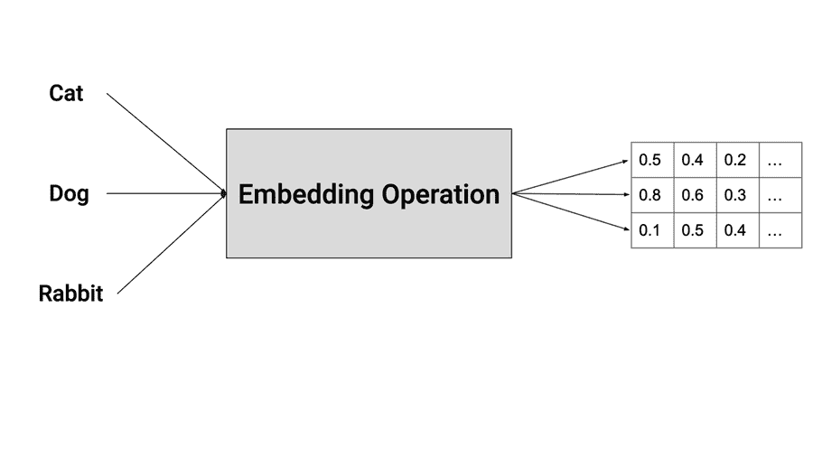

嵌入会学习文本在你的数据集中的稠密向量表示。嵌入之后，你会得到一个序列的向量或三维输入，因此需要在将嵌入矩阵传递给下一个全连接层之前先将其展平。由于你的目标是预测二元标签，输出层是一个包含一个输出单元的全连接层。

你可以通过以下代码将模型视为表格来进行检查：

```
input_template = Nx.template({64, 64}, :s64)
Axon.Display.as_graph(model, input_template)
```

如果你运行上述代码，你将看到：

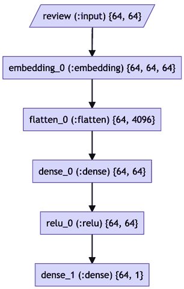

现在，你可以使用 `Axon.Loop` API 来训练你的模型。复制并运行以下代码，实现使用你的模型和输入管道的受监督训练循环：

```
loss = &Axon.Losses.binary_cross_entropy(&1, &2,
  from_logits: true,
  reduction: :mean
)
optimizer = Axon.Optimizers.adam(1.0e-4)

trained_model_state =
  model
  |> Axon.Loop.trainer(loss, optimizer)
  |> Axon.Loop.metric(:accuracy)
  |> Axon.Loop.run(train_pipeline, %{}, epochs: 10, compiler: EXLA)
```

在这段示例中，你传入的是 `Axon.Losses.binary_cross_entropy/3` 的参数化形式。你之前使用过二元交叉熵，因此需要指定 `from_logits: true`。你可能已经注意到，你的输出 dense 层没有激活函数。以前，在二元分类问题中，你使用了 sigmoid 激活函数，以确保层输出的概率在 0 到 1 之间。在此实例中，你的输出层将学习输出 logits 或 log‑probabilities。这一措施本质上仅表示 `log(p)`，其中 `p` 为输出概率。

在训练时，是否使用 logits 通常没有差别。某些 loss 实现使用输出 logits 会比使用概率更稳定，但 Axon 的实现采用一种优化方式，始终利用稳定路径，因此是否使用 logits 更多是个人偏好。

训练完成后，你将看到以下输出：

```
Epoch: 0, Batch: 350, accuracy: 0.5002229 loss: 0.6860522
Epoch: 1, Batch: 350, accuracy: 0.6894144 loss: 0.6168785
Epoch: 2, Batch: 350, accuracy: 0.7786677 loss: 0.5573396
Epoch: 3, Batch: 350, accuracy: 0.8037750 loss: 0.5174768
Epoch: 4, Batch: 350, accuracy: 0.8238515 loss: 0.4877387
Epoch: 5, Batch: 350, accuracy: 0.8453078 loss: 0.4631703
Epoch: 6, Batch: 350, accuracy: 0.8648504 loss: 0.4411991
Epoch: 7, Batch: 350, accuracy: 0.8850605 loss: 0.4204423
Epoch: 8, Batch: 350, accuracy: 0.9082086 loss: 0.4002065
Epoch: 9, Batch: 350, accuracy: 0.9299769 loss: 0.3802384
```

总体而言，你的模型表现尚可，但在实现超过 90% 的训练准确率方面仍有不足。你可以通过运行以下代码查看该结果在测试集上的表现：

```
model
|> Axon.Loop.evaluator()
|> Axon.Loop.metric(:accuracy)
|> Axon.Loop.run(test_pipeline, trained_model_state, compiler: EXLA)
```

运行代码后，你将看到：

```
Batch: 30, accuracy: 0.7676411
```

总体而言，你的模型在测试集上实现了 76% 的准确率。这不算差，但如果使用专门用于处理序列的模型，你可以进一步提升。进入循环神经网络（RNN）。

# 介绍循环神经网络

你可能会好奇，为什么单独的前馈网络并不适合处理序列数据。原因在于前馈网络没有任何方式来考虑时间依赖性。

时间依赖性即对时间维度的依赖。在处理序列时，常把序列中的每个元素称为一个时间步，哪怕它并不真正对应时间。时间依赖意味着未来的事件依赖于过去或当前的事件。以自然语言为例，这很容易理解。

在自然语言的单词序列中，顺序至关重要。句子中词语的顺序会极大改变句子的含义。前馈网络无法捕捉这一点——它只能根据某些关键词的出现来判断情感，而不考虑这些词在句子中的位置。虽然这种策略并非完全无效，但它无法捕捉句子中词语之间的复杂顺序关系。例如，考虑下面这段评论：

```
This movie was awfully good. I hated everything about it (not).
```

这段评论利用了英语中的一些语言技巧，普通母语者能轻松理解，但可能会误导那些缺乏 temporal 关系建模的天真情感分析模型。首先，“awfully good”是一个矛盾修辞。此外，第二句使用了讽刺式的 “not” 笑话。人类能明白这是一条正面的评论，但一个不考虑序列中词语位置的模型会难以正确分类这一序列。你的模型需要理解修饰词的意义，而如果不考虑它们的位置，就会难以正确分类此例。

正是在这里，循环神经网络发挥作用。循环神经网络是能够对序列数据进行变换的神经网络，它们维护一个内部状态或记忆体，根据前序输入修改输出。循环一词来源于 RNN 实现的递归关系——在时间步 t，RNN 的输出取决于序列中所有在 t 之前的输入。

RNN 是专门为序列设计的。正如第 3 章 *Harness the Power of Math* 所述，某些模型之所以强大，往往是因为它们对输入结构的假设。正如卷积神经网络适合网格状输入结构，RNN 适合序列结构。输入结构的假设使得 CNN 与 RNN 在特定类别的输入上表现显著更好。相反，前馈网络更像万能刀具——它是通用的函数逼近器，但对输入结构没有显著假设，可能在某些数据上学习困难。

学术界有许多种类的 RNN，但本书主要介绍两种最常见的：长短期记忆和门控循环单元。这两者都是 RNN 的变体，能够克服基础或简易 RNN 的局限性。Axon 提供即插即用的 LSTM 与 GRU 实现，你可以轻松将它们集成到自己的神经网络中。

为了观察 Axon 的 RNN 实现，你将从零开始构建一个模型并了解每个输出的含义。首先，创建一个表示电影评论输入序列的 Axon 输入：

```
sequence = Axon.input("review")
```

每个输入序列的形状为 `{batch_size, sequence_length}`，序列中的每个元素是从词表中抽取的整数 token。在前馈网络中，你将这些稀疏表示转换为稠密向量，使用嵌入层。Axon 的 RNN 实现同样需要嵌入输入，但不需要将其展平，因为 RNN 设计用于处理整个序列。因此，你需要添加一个嵌入层：

```
embedded = sequence |> Axon.embedding(num_tokens + 2, 64)
```

此时，你的网络形状为 `{batch_size, sequence_length, 64}`，即每个 token 对应一个长度为 64 的向量表示。接下来，你需要使用 `Axon.mask/2` 创建一个掩码张量：

```
mask = Axon.mask(sequence, 0)
```

`Axon.mask/2` 用于让模型忽略特定的 token，常用于忽略填充 token，防止它们对模型输出产生影响。由于在输入管道中需要对序列进行填充以保持相同长度，前馈网络会受到这些 padding token 的干扰。通过 `Axon.mask/2` 完全忽略这些 token，可以帮助网络更稳健。

现在，有了嵌入序列和掩码，你可以使用 `Axon.lstm/3` 添加一个 LSTM 层：

```
{rnn_sequence, _state} = Axon.lstm(embedded, 64, mask: mask, unroll: :static)
```

RNN 的输出形式与您之前遇到的任何层都不同。这是因为 RNN 与您之前看到的其他层不同。RNN 会维护来自序列中之前条目（历史）的状态，这会影响未来的输出。RNN 执行的操作在功能编程中有时被称为“扫描”。该操作类似于 Elixir 的 `Enum.map_reduce` 操作。`Enum.map_reduce` 执行一个 map 操作，它会转换 Enumerable 中的值，同时累积并最终返回最终状态。

前一个元组中的状态输出代表 LSTM 的最终“记忆”。`rnn_sequence` 变量是通过在整个输入序列上使用累积状态对循环操作进行映射后得到的转换序列。此时，`rnn_sequence` 的形状为 `{batch_size, sequence_length, 64}`。也就是说，`rnn_sequence` 将您的嵌入式 token 序列转换为另一个嵌入式 token 序列。那么，这有什么大不了的？

考虑一下：您的嵌入层仅查找与每个单独 token 关联的向量。它不考虑相邻的 token。但您的循环神经网络维护一个内部状态，这意味着它可以考虑输入中之前的 token。到达序列的最后一个 token 时，您的 RNN 可以将其转换，从而编码整个输入序列的信息。为了更好地理解这一点，可以考虑一个更简单的问题。您有一个字符串列表，想要修改该列表，使得列表中的每个条目对应于在列表中到该点为止该特定字符串出现的次数。例如，以下神奇词和输入列表：

```
magic_word = "sixers"
input = ["rockets", "mavericks", "sixers", "sixers", "magic", "nets", "sixers"]
```

输出应该是：

```
[0, 0, 1, 2, 2, 2, 3]
```

那么，如何在 Elixir 中解决这个问题？最简单的方法是使用 `Enum.map_reduce`：

```
{output, _} = Enum.map_reduce(input, 0, fn entry, count ->
  if entry == magic_word do
    {count + 1, count + 1}
  else
    {count, count}
  end
end)
```

在某种程度上，这正是您的 RNN 所做的事。输出序列的最后一个 token 编码了前面所有 token 的信息。但与计数特定 token 的出现次数不同，您的 RNN 学习输出一个对后续层有用的有意义的表示。

这意味着要使用 `rnn_sequence`，您需要从转换后的序列中提取最后一个 token。可以使用 `Axon.nx/3` 实现：

```
final_token = Axon.nx(rnn_sequence, fn seq ->
  Nx.squeeze(seq[[-1//1, -1, 0//1]])
end)
```

`Axon.nx/3` 允许您利用 `Nx` 的通用函数作为 `Axon` 层。在此代码中，您使用 `Nx.slice_along_axis/4` 从时间轴（axis 1）的索引 `max_seq_len - 1` 处获取最后一个 token。此时，您应该拥有对输入序列的良好表示。与卷积神经网络一样，循环神经网络通常会随后跟一个专门用于解决您所面对的任务的全连接头。换句话说，您使用循环神经网络来提取特征，而全连接部分用于基于这些特征进行推理：

```
model =
  final_token
  |> Axon.dense(64, activation: :relu)
  |> Axon.dense(1)
```

请记住，最终 token 包含整个序列的提取表示，因此它在下游任务（如分类）中理论上是有用的。

整体而言，您的最终模型如下：

```
input_template = Nx.template({64, 64}, :s64)
Axon.Display.as_graph(model, input_template)
```

您会在 这里 看到模型：

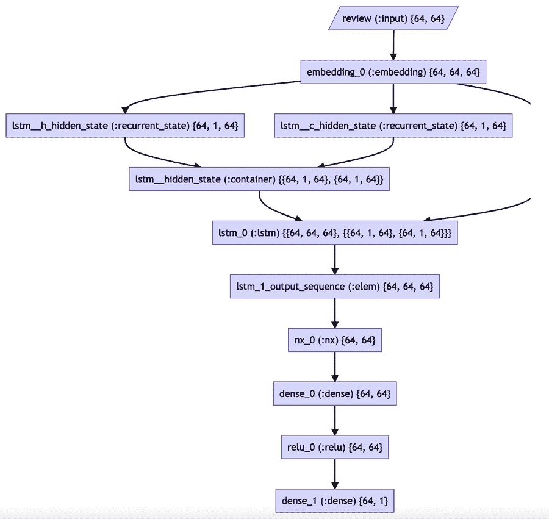

此时，您已拥有模型和输入管道，可以开始实现训练循环。即使您使用的是新架构，也不必担心调整训练循环。事实上，您可以直接复制 MLP 情感分析模型的训练循环：

```
loss = &Axon.Losses.binary_cross_entropy(&1, &2,
  from_logits: true,
  reduction: :mean
)
optimizer = Axon.Optimizers.adam(1.0e-4)

trained_model_state =
  model
  |> Axon.Loop.trainer(loss, optimizer)
  |> Axon.Loop.metric(:accuracy)
  |> Axon.Loop.run(train_pipeline, %{}, epochs: 10, compiler: EXLA)
```

运行代码后，您将看到以下输出：

```
Epoch: 0, Batch: 358, accuracy: 0.5121433 loss: 0.6840463
Epoch: 1, Batch: 358, accuracy: 0.7060410 loss: 0.6094189
Epoch: 2, Batch: 358, accuracy: 0.7469098 loss: 0.5683411
Epoch: 3, Batch: 358, accuracy: 0.7578339 loss: 0.5442138
Epoch: 4, Batch: 358, accuracy: 0.7610549 loss: 0.5284106
Epoch: 5, Batch: 358, accuracy: 0.7636232 loss: 0.5172608
Epoch: 6, Batch: 358, accuracy: 0.7654946 loss: 0.5089468
Epoch: 7, Batch: 358, accuracy: 0.7667568 loss: 0.5024669
Epoch: 8, Batch: 358, accuracy: 0.7686281 loss: 0.4972335
Epoch: 9, Batch: 358, accuracy: 0.7695855 loss: 0.4928872
```

这比简单的前馈模型有了明显的改进。现在，只需复制并运行 MLP 模型中的评估代码：

```
model
|> Axon.Loop.evaluator()
|> Axon.Loop.metric(:accuracy)
|> Axon.Loop.run(test_pipeline, trained_model_state, compiler: EXLA)
```

运行后，您将看到：

```
Batch: 30, accuracy: 0.7510081
```

总体而言，您成功使用循环神经网络改进了情感分析模型。您的最终模型性能良好，但正如您所知，总是可以做得更好。

## 双向发展

当前实现使用的是简单的 LSTM。正如您所知，LSTM 通过在时间轴上向前传播（积累历史）来提取输入序列的表示。直观地，这很合理。人类通常是从前向后理解序列的，因此自然会在神经网络中强制这种约束。但神经网络不是人类，可以从那些看似不自然的修改中显著受益。一个例子是双向循环神经网络。

双向 RNN 使用与传统 RNN 相同的技术，但方向相反。您的前一个神经网络仅在时间轴上单向（向前）展开。双向 RNN 则在时间轴上双向展开（向前和向后）。这可能看起来不太合理。毕竟，逆转一条影评并不会增加您的理解。它如何能帮助神经网络？

### 双向 RNN 的优势

双向转换为那些没有明确因果关系的序列提供了循环神经网络的额外上下文信息。它们在正向和逆向两个方向学习序列关系，因此在本质上更具鲁棒性。需要注意的是，双向 RNN 并不对所有序列数据都有效。例如，你不应该在模型中使用双向 RNN 处理时间序列数据，因为你正在尝试建模一种明确的因果关系。对于文本，双向处理可以帮助提升模型的泛化能力。

双向 RNN 从零开始实现非常直接，使用 Axon API 即可实现。下面是一个从零开始实现的双向 LSTM：

```


## 双向 LSTM 实现

```elixir
backward_sequence = Axon.nx(forward_sequence, &Nx.reverse(&1, *axes:*) [1])

{forward_state, forward_out} = Axon.lstm(forward_sequence, 64)
{backward_state, backward_out} = Axon.lstm(backward_sequence, 64)

out_state = Axon.concatenate(
  forward_state,
  Axon.nx(backward_state, &Nx.reverse(&1, *axes:*) [1])
)

out_sequence = Axon.concatenate(
  forward_out,
  Axon.nx(backward_out, &Nx.reverse(&1, *axes:*) [1])
)
```

请注意，你只需要反转输入序列并分别在两个方向上应用 LSTM 转换。然后，你将得到的状态和序列合并，以获得最终的输出状态和序列。你也可以选择其他操作，例如 `Axon.add/2` 来合并前向和逆向的输出，但连接（concatenation）是最常用的。这里的含义是，如果你想要一个包含 64 个单元的双向 LSTM，那么由于连接，你的输出序列将会有 128 个单元。

Axon API 提供了 `Axon.bidirectional/3` 的便利功能，用于处理双向 RNN。使用它，你可以重新实现前面章节中的 RNN：

```elixir
sequence = Axon.input("*review*")
mask = Axon.mask(sequence, 0)
embedded = Axon.embedding(sequence, num_tokens + 2, 64)

{rnn_sequence, _state} =
  Axon.bidirectional(
    embedded,
    &Axon.lstm(&1, 64, *mask:* mask, *unroll:* :static),
    &Axon.concatenate/2
  )

final_token = Axon.nx(rnn_sequence, fn seq ->
  Nx.squeeze(seq[[0..-1//1, -1, 0..-1//1]])
end)

model =
  final_token
  |> Axon.dense(64, *activation:* :relu)
  |> Axon.dense(1)
```

现在，你可以使用以下代码运行原始训练循环，使用这个新模型：

```elixir
loss = &Axon.Losses.binary_cross_entropy(&1, &2,
  *from_logits:* true,
  *reduction:* :mean
)
optimizer = Axon.Optimizers.adam(1.0e-4)
trained_model_state =
  model
  |> Axon.Loop.trainer(loss, optimizer)
  |> Axon.Loop.metric(:accuracy)
  |> Axon.Loop.run(train_pipeline, %{}, *epochs:* 10, *compiler:* EXLA)
```

运行代码后，你会看到：

```text
Epoch: 0, Batch: 350, accuracy: 0.5190082 loss: 0.6815987
Epoch: 1, Batch: 341, accuracy: 0.7035355 loss: 0.6067376
Epoch: 2, Batch: 332, accuracy: 0.7509853 loss: 0.5645106
Epoch: 3, Batch: 323, accuracy: 0.7610434 loss: 0.5400541
Epoch: 4, Batch: 314, accuracy: 0.7647320 loss: 0.5240928
Epoch: 5, Batch: 355, accuracy: 0.7672051 loss: 0.5114447
Epoch: 6, Batch: 346, accuracy: 0.7690023 loss: 0.5031880
Epoch: 7, Batch: 337, accuracy: 0.7696466 loss: 0.4966677
Epoch: 8, Batch: 328, accuracy: 0.7717992 loss: 0.4912724
Epoch: 9, Batch: 319, accuracy: 0.7726074 loss: 0.4866871
```

你会注意到模型的表现略有提升，但训练时间稍长，这很合理，因为你在网络中添加了一个双向 LSTM 层。现在，你可以使用以下代码测试你的模型：

```elixir
model
|> Axon.Loop.evaluator()
|> Axon.Loop.metric(:accuracy)
|> Axon.Loop.run(test_pipeline, trained_model_state, *compiler:* EXLA)
```

你会看到：

```text
Batch: 30, accuracy: 0.7641129
```


通过简单的双向转换，你从模型中获得了一些额外的准确率提升。此时，你已经对如何在 Axon 中实现循环神经网络有了相当扎实的理解，接下来需要了解循环神经网络内部是如何工作的。在下一节中，你将深入探讨循环神经网络的实际运作机制，并讨论它们的优势和劣势。

The scalability issues and computational complexity of recurrent neural networks are part of the reason they've fallen out of favor in recent years. RNNs operate in an inherently sequential manner—this is part of what makes them so powerful. But it also makes them inefficient. You can only vectorize/parallelize RNNs along the batch dimension.

## Wrapping Up

In this chapter, you were introduced to natural language processing with recurrent neural networks. You learned how to implement some basic text featurization and preprocessing with Elixir and how to implement and train recurrent neural networks in Axon. You also learned about some of the intuition behind recurrent neural networks and some of the fundamental shortcomings of recurrent neural networks, which have allowed them to be usurped by transformer models.

If you're familiar with the current state of natural language processing, you might have questioned the need to cover recurrent neural networks at all. However, to better understand the current state of the art, it's important to understand the previous state of the art—and why it ended up failing. While recurrent neural networks are no longer common in natural language processing, they still have some practical use in certain domains. Additionally, understanding how RNNs work and where they fail is important to better understand the rise of transformers.

Before completely closing the door on RNNs in favor of transformers, you'll explore one additional application of RNNs known as time-series data. In the next chapter, you'll dive deep into time-series analysis with neural networks.

#### Footnotes

[\[31\]](#f_0061.xhtml#FNPTR-31)

: 

[`www.kaggle.com/datasets/lakshmi25npathi/imdb-dataset-of-50k-movie-reviews`](https://www.kaggle.com/datasets/lakshmi25npathi/imdb-dataset-of-50k-movie-reviews)

Copyright © 2024, The Pragmatic Bookshelf.

# Chapter 10  

Forecast the Future

In the previous chapter, you were introduced to the concept of recurrent neural networks for learning on sequential data. Specifically, you created and trained recurrent neural networks on text data using Elixir and Axon. You saw how recurrent neural networks are capable of learning relationships in natural language far easier than traditional feed-forward networks due to their built-in memory and inherent sequential operation.

Recurrent neural networks are well-suited for processing text. However, that's not the only thing they're good for. Anything with a temporal nature presents challenges for traditional feed-forward networks and is better suited for recurrent neural networks. One example of such data is time-series data. Time-series data is any collection of data indexed in time order. At each timestep, there are one or many observations. You can see how time-series data lends itself naturally to working with recurrent neural networks.

In this chapter, you'll work with time-series data in Elixir, Nx, and Axon. You'll learn about some of the challenges of working with time-series data and a bit about why neural networks struggle so much with this data compared to other approaches. You'll also train both a convolutional and recurrent neural network on a time-series analysis problem, comparing the results and learning the benefits and drawbacks of each strategy.

## Predicting Stock Prices

Perhaps one of the most obvious applications of time-series analysis is forecasting the direction of markets. Given enough historical data, you should be able to predict the future performance of a given equity or market, right? As you'll find out later in this chapter, the problem of forecasting markets is exceptionally difficult. If it were as easy as throwing a neural network at the problem, everybody would be doing it. Despite the challenges, attempting to forecast stock prices is a good exercise in time-series analysis and a good demonstration of the pitfalls of putting too much faith in a model.

In this example, you'll be working with the historical stock data for 30 companies in the Dow Jones Industrial Average between 2006 and 2018. The data is available for download on Kaggle.^([\[32\]](#f_0070.xhtml#FOOTNOTE-32)) After you download the data, you'll see a collection of CSVs that contain information for the prices of individual stocks and for all of the stocks. To simplify the problem, you'll create a model that predicts the future stock prices for a single stock, in this case, AAPL.

Start by firing up a new Livebook and adding the following dependencies:

```
Mix.install([
  {:explorer, "~> 0.5.0"},
  {:nx, "~> 0.6"},
  {:exla, "~> 0.6"},
  {:axon, "~> 0.5"},
  {:vega_lite, "~> 0.1.6"},
  {:kino, "~> 0.8.0"},
  {:kino_vega_lite, "~> 0.1.7}
])
```

It's common to alias the VegaLite module to Vl, so run the following code in a new cell:

```
alias VegaLite, as: Vl
```

To simplify the process of working with the structured CSV data, you'll use Explorer, Elixir's DataFrame library. You'll use Nx and EXLA for numerical computing and acceleration, respectively, and you'll need Axon for the deep learning implementation. You'll also use VegaLite, Kino, and Kino.VegaLite for providing some functionality to visualize and summarize your dataset.

Before diving in, take some time to get familiar with the data. Start by loading it into a DataFrame using Explorer, like so:

```
csv_file = "all_stock_2006-01-01_to_2018-01-01.csv"
df = Explorer.DataFrame.from_csv!(csv_file, parse_dates: true)
```

After running the code, you'll see the following output:

```
#Explorer.DataFrame<
  Polars[93612 x 7]
  Date string ["2006-01-03", "2006-01-04", "2006-01-05", ...]
  Open float [77.76, 79.49, 78.41, 78.64, 78.5, ...]
  High float [79.35, 79.49, 78.65, 78.9, 79.83, ...]
  Low float [77.24, 78.25, 77.56, 77.64, 78.46, ...]
  Close float [79.11, 78.71, 77.99, 78.63, 79.02, ...]
  Volume integer [3117200, 2558000, 2529500, ...]
  Name string ["MMM", "MMM", "MMM", "MMM", "MMM", ...]
>
```

The dataset consists of opening, low, high, and closing prices on each trading day for a handful of stock tickers. You'll notice there's no intraday data and no auxiliary information aside from trading volume. Auxiliary information, or side information, is information you have access to outside of the target you're trying to predict. Rather than use side information, you're forced to make use only of past timesteps to predict future timesteps in an autoregressive manner. Autoregression means you're going to predict future values from existing values.

For this problem, you'll pay attention to only a ticker's closing prices, so you can filter out the other irrelevant information:

```
df = Explorer.DataFrame.select(df, ["Date", "Close", "Name"])
```

After doing so, you'll see the following output:

```
#Explorer.DataFrame<
  Polars[93612 x 3]
  Date string ["2006-01-03", "2006-01-04", "2006-01-05", ...]
  Close float [79.11, 78.71, 77.99, 78.63, 79.02, ...]
  Name string ["MMM", "MMM", "MMM", "MMM", "MMM", ...]
>
```

Next, run the following code to get a visualization of the various stock tickers using VegaLite:

```
Vl.new(title: "DJIA Stock Prices", width: 640, height: 480)
|> Vl.data_from_values(Explorer.DataFrame.to_columns(df))
|> Vl.mark(:line)
|> Vl.encode_field(:x, "Date", type: :temporal)
|> Vl.encode_field(:y, "Close", type: :quantitative)
|> Vl.encode_field(:color, "Name", type: :nominal)
|> Kino.VegaLite.new()
```

Now, filter the data for AAPL specifically:

```
aapl_df = Explorer.DataFrame.filter(df, Name == "AAPL")
```

After filtering, you'll see:

```
#Explorer.DataFrame<
  Polars[503 x 3]
  Date date [2016-01-04, 2016-01-05, 2016-01-06, 2016-01-07, ...]
  Close float [105.35, 102.71, 100.7, 96.45, 96.96, ...]
  Name string ["AAPL", "AAPL", "AAPL", "AAPL", "AAPL", ...]
>
```

Next, prepare the data for training. You'll normalize the closing prices and create sliding windows:

```
prices = Explorer.Series.to_list(aapl_df["Close"])
mean = Explorer.Series.mean(aapl_df["Close"])
std = :math.sqrt(Explorer.Series.variance(aapl_df["Close"]))
normalized_prices = Enum.map(prices, fn price -> (price - mean) / std end)

window_size = 5
batch_size = 32

train_size = round(length(normalized_prices) * 0.8)
train_prices = Enum.slice(normalized_prices, 0, train_size)
test_prices = Enum.slice(normalized_prices, train_size..-1)

single_step_train_data = 
  train_prices
  |> Nx.tensor()
  |> Nx.to_batched(batch_size)
  |> Stream.map(fn batch ->
    {batch, batch}
  end)

single_step_test_data = 
  test_prices
  |> Nx.tensor()
  |> Nx.to_batched(batch_size)
  |> Stream.map(fn batch ->
    {batch, batch}
  end)
```

Now, define a simple CNN model for single-step prediction:

```
cnn_model = 
  Axon.input("stock_prices", shape: {nil, window_size, 1})
  |> Axon.conv(32, kernel_size: 3, activation: :relu, padding: :same)
  |> Axon.conv(1, kernel_size: 3, activation: :relu, padding: :same)
  |> Axon.nx(fn x -> x[.., -1, ..] end)
  |> Axon.dense(1)

template = Nx.template({batch_size, window_size, 1}, :f32)
Axon.Display.as_graph(cnn_model, template)
```

Train the CNN model:

```
cnn_trained_model_state = 
  cnn_model
  |> Axon.Loop.trainer(:mean_squared_error, :adam)
  |> Axon.Loop.metric(:mean_absolute_error)
  |> Axon.Loop.run(single_step_train_data, %{}, epochs: 50, compiler: EXLA)
```

Evaluate the CNN model:

```
cnn_model
|> Axon.Loop.evaluator()
|> Axon.Loop.metric(:mean_absolute_error)
|> Axon.Loop.run(single_step_test_data, cnn_trained_model_state, compiler: EXLA)
```

Convert the normalized error back to actual price scale:

```
mae = 0.0032470
actual_mae = mae * :math.sqrt(Explorer.Series.variance(aapl_df["Close"])) + Explorer.Series.mean(aapl_df["Close"])
```

Now, define an RNN model for comparison:

```
rnn_model = 
  Axon.input("stock_prices", shape: {nil, window_size, 1})
  |> Axon.lstm(32)
  |> elem(0)
  |> Axon.nx(fn x -> x[.., -1, ..] end)
  |> Axon.dense(1)

template = Nx.template({batch_size, window_size, 1}, :f32)
Axon.Display.as_graph(rnn_model, template)
```

Train the RNN model:

```
rnn_trained_model_state = 
  rnn_model
  |> Axon.Loop.trainer(:mean_squared_error, :adam)
  |> Axon.Loop.metric(:mean_absolute_error)
  |> Axon.Loop.run(single_step_train_data, %{}, epochs: 50, compiler: EXLA)
```

Evaluate the RNN model:

```
rnn_model
|> Axon.Loop.evaluator()
|> Axon.Loop.metric(:mean_absolute_error)
|> Axon.Loop.run(
  single_step_test_data,
  rnn_trained_model_state,
  compiler: EXLA
)
```

So your single-shot RNN performed slightly better than the CNN. But the difference between model errors is near negligible, so it's difficult to say which of these models between the CNN and RNN is better. If you were making a decision between deploying the RNN or CNN, you would likely need to do more tests or use other criteria such as storage and compute cost of each model, to determine which to use.

You can repeat the analysis run in `Using CNNs for Single-Step Prediction` to get a better visualization of how well the model fits the data overall:

```
Analysis.visualize_predictions(
  rnn_model,
  rnn_trained_model_state,
  Explorer.Series.to_list(aapl_df["Close"]),
  window_size,
  1,
  batch_size
)
```

After running the code, you'll see the image as shown.

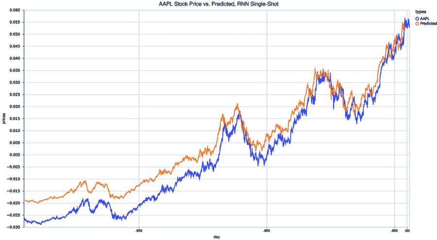

And you'll once again notice that the difference in how well your RNN and CNN fit the data is negligible. For single-step inference on this particular dataset, both RNNs and CNNs are likely suitable time-series analysis tools.

## Adjusting Expectations

After the small-scale experiment with stock prices, you might feel that using neural networks to predict the future is promising. After all, both neural networks you trained followed the trend line of AAPL stock prices over a decade quite well. But in reality, predicting the future is exceptionally challenging.

Neural networks are powerful interpolators. Interpolation is the process of filling in unknown data points within a fixed domain. Interpolation is explicitly different from extrapolation, which is the attempt to fill in unknown data points outside of a fixed domain. What does this have to do with time-series analysis?

Well, you may have noticed that your neural networks predicted AAPL stock prices reasonably well within the time period you had data for. You had two reasonably good models that represented the past well, but they had no information about the future. You can try to extrapolate future information from past patterns, but patterns can change dramatically.

When performing time-series analysis, you always face the risk of drawing incorrect conclusions from incomplete information about the past. This doesn't mean you can't leverage certain patterns from the past for the future, but you should always be aware that over-reliance on old patterns can lead to catastrophic failure.

## Wrapping Up

In this chapter, you implemented two types of neural networks to predict future prices of AAPL stock. You created and trained a convolutional neural network and a recurrent neural network for single-step time-series prediction on AAPL stock prices. You learned about the challenges of modeling time-series data. You used Explorer to normalize input data and VegaLite to visualize input data.

In the previous two chapters, you spent a significant amount of time working with recurrent neural networks. RNNs are powerful, but in the past five years, they have been completely superseded by a more powerful type of model.

In the next chapter, you'll encounter transformers—an architecture that powers the most powerful models today, including ChatGPT^([\[33\]](#f_0070.xhtml#FOOTNOTE-33)) and Whisper.^([\[34\]](#f_0070.xhtml#FOOTNOTE-34))

#### Footnotes

[\[32\]](#f_0066.xhtml#FNPTR-32)

: 

[https://www.kaggle.com/datasets/szrlee/stock-time-series-20050101](https://www.kaggle.com/datasets/szrlee/stock-time-series-20050101)

# Chapter 11  

Model Everything with Transformers

First, suppose you're trying to train a model to translate text between English and German. You have a large corpus of text pairs containing an English sentence and its corresponding German translation. This is the classic example of machine translation, and in the context of deep learning, it's known as neural machine translation.

In neural machine translation, the goal is to map a source sequence to a target sequence. As you've learned, this looks like the perfect application for a recurrent neural network (RNN). Remember, RNNs are capable of taking a source sequence and transforming it into some output sequence. Intuitively, it makes sense to use one or more LSTM or GRU blocks to transform the input sequence. After all, they're specifically designed to process sequences and map them to convenient sequence representations.

However, this problem isn't easy. Source and target sequences aren't necessarily the same length. Additionally, grammatical differences between languages are massive—you can't simply map source tokens to translated tokens and expect the translation to be correct. In fact, a single RNN struggles to accomplish this task. To solve this problem, researchers introduced sequence-to-sequence (seq2seq) models.

Sequence-to-sequence models are specifically designed for the task of mapping a source sequence to a target sequence. The model consists of an encoder and a decoder. The encoder is responsible for summarizing the information in the source sequence, producing a context vector. The decoder takes this context vector as its initial state and generates the target sequence. The context vector is a convenient representation of the input sequence. If you think about it in the context of machine translation, you can think of it as the meaning of the source sentence. The goal of translation is to express the meaning of the source sentence in the target language.

Sequence-to-sequence models break the process of mapping source to target sequences into two steps. First, the encoder extracts meaning from the source sequence; then, the decoder uses this meaning to generate the target sequence. In Axon, a sequence-to-sequence model implementation looks like this:

```
source = Axon.input("source")
cur_target = Axon.input("target")

{_, context_vector} = Axon.lstm(source, 64)
{out_target, _} = Axon.lstm(cur_target, context_vector, 64)

Axon.dense(out_target, vocab_size)
```

Note that the context vector is the final hidden state produced by the LSTM layer. You pass this context vector as the initial hidden state of the decoder to generate a transformed representation of the sequence. Note that you're not transforming source directly, but rather cur_target, the current target sequence. In sequence-to-sequence models, you typically don't output the entire sequence at once, but rather predict tokens one at a time. You can almost think of it like a fill-in-the-blank game. You get a source sentence, for example:

```
I love cats
```

The source comes with a partial sequence, like this:

```
Ich liebe
```

The goal is to predict the next token, yielding the next translation, here `Katzen`.

Sequence-to-sequence models work well and can theoretically learn to map any sequence to any other sequence. But in practice, they have some limitations. Most notably, sequence-to-sequence models struggle to remember information in long sequences. Remember, the RNN's state accumulates from the beginning of the sequence to the end. For long sequences, the later parts of the sequence tend to be over-represented in the final state, while the earlier parts are forgotten.

To overcome the forgetting problem, you can introduce a shortcut that computes the alignment between the source and target sentences. This is the attention mechanism. Attention was originally designed as a shortcut between the context vector and the source inputs—it provides a mapping indicating how much each hidden state should be weighted toward each output token. You may see it referred to as alignment scores, attention matrices, or attention weights. The attention matrix essentially tells you how important each word in the source sequence is to the target sequence. For translation tasks, you can think of it as mapping which words in the source sequence are most relevant to words in the target sequence. For example, "cats" has a relatively low alignment score with "Ich", while "cats" has a relatively high alignment score with "Katzen".

Similar to how you can visualize intermediate activations in convolutional neural networks, you can also visualize attention weights to understand the relationships the model is learning. For example, you can look at a visualization of the attention matrix for English to French translation.

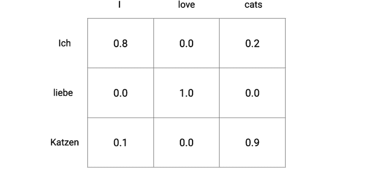

You can see that words with closer semantic alignment are more active in the attention map. Attention allows the model to learn to selectively attend to specific tokens in the input. This small step on top of recurrent models was found to be extremely powerful. But it still relied on recurrent neural networks. So how do you go from an attention model that relies on RNNs to a pure attention Transformer?

## From RNNs to Transformers

Attention provided a shortcut between source and target sequences, which helped recurrent models learn longer sequences by highlighting which context vectors corresponded to which target tokens. The learned attention matrix encoded information about the relationships between source tokens and target tokens. But you still relied on a recurrent network to extract context from the source sequence.

Recall Chapter 9, *Understand Text*, where the common practice was to take the last token from a sequence processed by an RNN like an LSTM, because that token contained a representation of the entire sequence, encoding all the sequence's information. The sequential nature of RNNs limited their ability to capture relationships between non-adjacent tokens, because the forward or backward recurrence process only operates on a single timestep. Fortunately, you already know how to use attention to solve this problem.

Instead of weighting relationships between source and target sequences, you can use attention to weight relationships within the source sequence itself. Using the same process as the original attention mechanism, you can initialize and learn an attention matrix that highlights relationships between words within a single sentence. This is called self-attention, and it highlights relationships between words in a sequence. This allows you to learn which words relate to each other, and which words provide the most context for the input sequence. At this point, you might ask yourself: "Isn't this what recurrent neural networks are supposed to do? The whole point of RNNs is to extract temporal relationships between tokens in a sequence." Yes. But in this case, you've been able to model these relationships without the prerequisite of a recurrent neural network. In fact, *Attention is All You Need* [VSPU17] showed that attention alone is sufficient.

A typical transformer architecture uses an encoder-decoder structure on a masked language modeling task. Masked language modeling tasks are best described as elementary vocabulary exercises. In other words, transformers learn to model language by predicting the most likely next word in a sequence.

The encoder in a transformer typically consists of a series of multiple encoder layers that process the source sequence representation. Each encoder layer is identical and contains some form of self-attention followed by a series of output projections. The specific self-attention variant used is typically multi-head self-attention, which is the same as self-attention except...

In single-head self-attention, the model computes one attention matrix, meaning it learns to weight relationships between tokens in one way. In multi-head self-attention, the model computes multiple (typically 12) different attention matrices (heads), meaning the model learns an ensemble of relationships between tokens in the input. The encoder then passes the encoded representation to subsequent encoder layers.

The decoder in a transformer model typically consists of a series of multiple decoder layers that operate on the target sequence representation—usually the source sequence shifted right by one token—and the source sequence information provided by the encoder. Each decoder layer also contains some form of self-attention, but the decoder also uses cross-attention. Decoder layers compute multi-head self-attention on the target sequence, while simultaneously computing multi-head cross-attention on the encoder-provided information and the target sequence. This is similar to the traditional attention you learned earlier; cross-attention provides a shortcut for context between the encoder and decoder. You can see a high-level visual overview of cross-attention in the diagram.

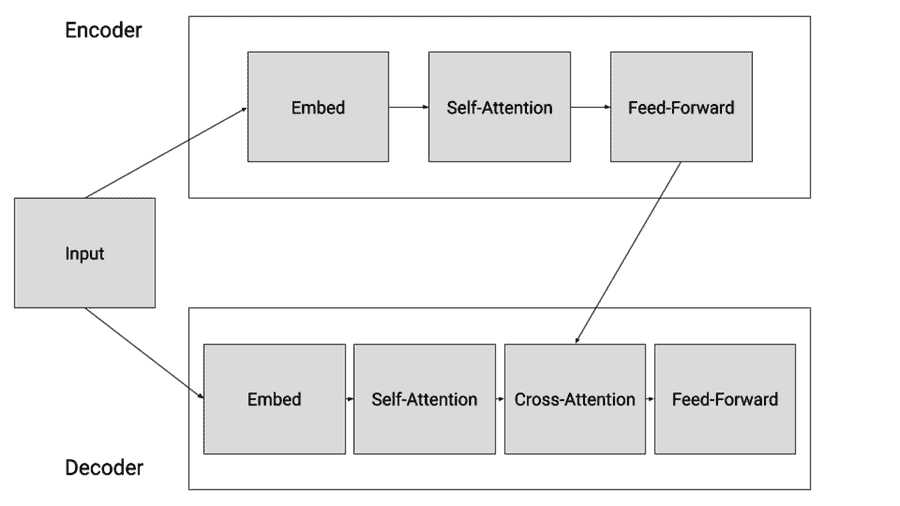

One issue with using attention to model time-series is that transformers cannot represent temporal dependencies. To overcome this limitation, most transformers introduce positional embeddings or positional encodings to inject positional relationship information into the model.

Most transformers are composed of hierarchically stacked encoder and decoder layers. While there are many variants of transformers, they essentially all follow the same pattern. If you look at the transformer implementations in Bumblebee, you'll find many implementations are nearly identical. Most models only differentiate themselves by slight tweaks in specific parts, such as the attention implementation, the positional encoding used, or the training process.

Typical transformer architectures produce high-dimensional sequence representations that are useful for downstream tasks. Transformers have essentially eliminated the need for recurrent neural networks in natural language processing. In fact, in almost all cases, transformers are more powerful than their recurrent counterparts. Additionally, transformers are easy to parallelize and more scalable than equivalent recurrent neural networks. Combined with massive amounts of data, transformers have become one of the most important innovations in deep learning.

## Using Transformers with Bumblebee

To truly appreciate the power of transformers, you can get hands-on with the Bumblebee library. Bumblebee is a library containing implementations of popular deep learning architectures in Axon; it interfaces directly with the HuggingFace Hub and can even load parameters directly from pre-trained PyTorch checkpoints. With a few lines of Elixir code, Bumblebee lets you quickly use the most powerful open-source models in existence. To demonstrate the power of transformers and the simplicity of Bumblebee, you'll use Bumblebee to solve three different types of problems.

### Installing Dependencies

To start, fire up a Livebook and add the following dependencies:

```
Mix.install([
  {:bumblebee, "~> 0.5"},
  {:axon, "~> 0.6"},
  {:nx, "~> 0.7"},
  {:kino, "~> 0.8"},
  {:kino_bumblebee, ">= 0.0.0"},
  {:exla, ">= 0.0.0}
])
```

The only new dependencies here are Bumblebee and KinoBumblebee. KinoBumblebee provides some conveniences for using Bumblebee in Livebook. You can even use the smart cells provided by KinoBumblebee to implement several of the tasks demonstrated in this chapter directly, without writing any code.

You'll also need Axon for inference and fine-tuning of pre-trained models, Nx for basic tensor operations, and EXLA for hardware acceleration. Before proceeding, set the default backend to EXLA to ensure all computations are accelerated:

```
Nx.global_default_backend(EXLA.Backend)
```

### Zero-Shot Classification with BART

To give you a feel for Bumblebee, you'll use Bumblebee and Axon to implement some basic zero-shot classification tasks. Zero-shot classification is a method of classifying text by associating it with labels without needing to specifically train a model on your input domain. Certain models have been pre-trained on a broad enough corpus of data that they can directly map natural language labels to text snippets without any additional training data.

As a practical example, suppose your task is to automate the filing of airline customer service tickets. Users input their queries in natural language, and your model needs to categorize the request into one of the following labels: "New Booking", "Update Booking", "Cancel Booking", or "Refund". Previously, you didn't have enough training data to solve this problem. Fortunately, zero-shot classification doesn't necessarily require training data.

First, copy and run the following code to import a pre-trained model and tokenizer using Bumblebee:

```
{:ok, model} = Bumblebee.load_model(
  {:hf, "facebook/bart-large-mnli"}
)
{:ok, tokenizer} = Bumblebee.load_tokenizer(
  {:hf, "facebook/bart-large-mnli"}
)
```

This code uses the Bumblebee module to load the pre-trained BART-large-mnli model and tokenizer directly from the HuggingFace Hub. Bumblebee supports multiple model hubs, so you need to specify the `{:hf, path}` tuple in `load_model/1` and `load_tokenizer/1`. `load_model/1` returns the pre-trained model, parameters, and model configuration info; the configuration tells you the specific model architecture loaded. The `bart-large-mnli` here is a large language model based on the Facebook BART architecture; the MNLI variant was pre-trained on natural language inference tasks to predict the probability of a given hypothesis being true relative to the input text.

`load_tokenizer/1` serves the same purpose as `load_model/1` but for tokenizers. Bumblebee relies on a low-level tokenizers library that binds to HuggingFace's Rust tokenizer implementation. Recall Chapter 9, *Understand Text*, where some advanced tokenization strategies rely on probabilistic methods to learn a fixed-size vocabulary. Most transformer models in Bumblebee employ this tokenization strategy and come with pre-trained tokenizers. It's important to use the pre-trained tokenizer corresponding to the model because it will encode text in the same way the model was exposed to during training.

`model` is actually a map containing `:model`, `:spec`, and `:params` fields. You can inspect each field in the map to understand its meaning, but for now, let's inspect the `:model` field in `model`:

```
IO.inspect model.model
#Axon<
  inputs: %{
    "attention_head_mask" => {12, 16},
    "attention_mask" => {nil, nil},
    "cache" => nil,
    "cross_attention_head_mask" => {12, 16},
    "decoder_attention_head_mask" => {12, 16},
    "decoder_attention_mask" => {nil, nil},
    "decoder_input_embeddings" => {nil, nil, 1024},
    "decoder_input_ids" => {nil, nil},
    "decoder_position_ids" => {nil, nil},
    "encoder_hidden_state" => {nil, nil, 1024},
    "input_embeddings" => {nil, nil, 1024},
    "input_ids" => {nil, nil},
    "position_ids" => {nil, nil}
  }
  outputs: "container_64"
  nodes: 1956
>
```

Notice how `model` is a regular `Axon` model. Under the hood, `Axon` pulls the specified model's configuration from the HuggingFace hub and delegates to a module that builds the `Axon` implementation with the given configuration. This means you can use `model` like you would any other `Axon` model. `Bumblebee` provides conveniences; it doesn't change how you interact with `Axon` models.

Next, run the following Livebook cell:

```
labels = ["New booking", "Update booking", "Cancel booking", "Refund"]

zero_shot_serving = 
  Bumblebee.Text.zero_shot_classification(
    model,
    tokenizer,
    labels
  )
```

Running this cell creates an `%Nx.Serving{}` struct which runs a zero-shot classification task end-to-end. `Nx.Serving` is a high-level serving API that encapsulates preprocessing, inference, and postprocessing. `Bumblebee` works directly with the serving API, offering serving factories that return end-to-end pipelines for tasks such as image and text classification.

This code makes use of a natural language inferencing (NLI) model for zero-shot classification. NLI models are commonly used for understanding whether two sentences are entailments, contradictions, or neutral. In other words, you can propose a premise and a hypothesis, and the model will tell you if the hypothesis contradicts or goes along with the premise. With these kinds of models, you can build the hypothesis in such a way that it's useful for zero-shot classification. In this case, you always build your hypothesis as `This example is #{label}`, which fills in the hypothesis with the given label. The model spits out a probability for each label that the premise (input sequence) goes along with the hypothesis. At the end, you have a list of labels and their corresponding probabilities, which you can extract the maximum value from.

In addition to a model and tokenizer, `Bumblebee`'s zero-shot classification function accepts `labels` to assign to zero-shot queries. That's all you need to start making zero-shot classifications. To try out your zero-shot classification pipeline, you can use `Nx.Serving.run/2`. Try running the following code in a new cell and observe the output:

```
input = "I need to book a new flight"

Nx.Serving.run(zero_shot_serving, input)
```

Your model will output the following:

```
%{
  predictions: [
    %{label: "New booking", score: 0.5991652011871338},
    %{label: "Update booking", score: 0.3455488979816437},
    %{label: "Refund", score: 0.028283976018428802},
    %{label: "Cancel booking", score: 0.027001921087503433}
  ]
}
```

You can try a few more examples to get a feel for how powerful this zero-shot classification task is:

```
inputs = [
  "I want to change my existing flight",
  "I want to cancel my current flight",
  "I demand my money back"
]

Nx.Serving.run(zero_shot_serving, inputs)
```

Your model will output the following:

```
[
  %{
    predictions: [
      %{label: "New booking", score: 0.43927058577537537},
      %{label: "Update booking", score: 0.4268641471862793},
      %{label: "Cancel booking", score: 0.10792690515518188},
      %{label: "Refund", score: 0.02593844011425972}
    ]
  },
  %{
    predictions: [
      %{label: "Cancel booking", score: 0.5605528950691223},
      %{label: "Refund", score: 0.3020733594894409},
      %{label: "Update booking", score: 0.09756755083799362},
      %{label: "New booking", score: 0.03980622440576553}
    ]
  },
  %{
    predictions: [
      %{label: "Refund", score: 0.5605528950691223},
      %{label: "Cancel booking", score: 0.3020733594894409},
      %{label: "Update booking", score: 0.09756755083799362},
      %{label: "New booking", score: 0.03980622440576553}
    ]
  }
]
```

Notice you can pass batches of inputs to the `Nx.Serving` API, which means you can easily batch-process inputs.

Without any training data, and in under five lines of Elixir, you have a model that's capable of filing customer service requests with appropriate tags. You can also augment or extend this pipeline to allow for multiple labels for each input. For example, you might add tags related to the urgency of the request. Thanks to the power of transformers, you're limited mostly by your imagination and needs.

### Making Conversation

More than likely, you have been exposed to the incredible coherence of AI-generated text. Models such as GPT-3, OPT-3, and BLOOM are capable of incredible feats. These large language models are adept at sentence completion tasks. You feed a large language model a prompt, and it completes the prompt with what it thinks is the most reasonable sequence. If you engineer the prompt in a clever way, you can get some pretty impressive behavior. One application of a completion or generation task such as this one is a chat bot. With some prompt engineering, you can have a transformer model that maintains coherent conversations in a few lines of code.

To start, you'll need to import a new model and tokenizer:

```
repo = {:hf, "google/gemma-2b-it"}
{:ok, model} = Bumblebee.load_model(repo)
{:ok, tokenizer} = Bumblebee.load_tokenizer(repo)
{:ok, generation_config} = Bumblebee.load_generation_config(repo)

generation_config = 
  Bumblebee.configure(generation_config,
    max_new_tokens: 256,
    strategy: %{type: "multinomial_sampling", top_p: 0.6}
  )
```

Next, create a new generation serving using `Bumblebee.Text.generation/4`:

```
serving = 
  Bumblebee.Text.generation(
    model,
    tokenizer,
    generation_config,
    compile: [batch_size: 1, sequence_length: 1028],
    stream: true,
    defn_options: [compiler: EXLA]
  )

Kino.start_child({Nx.Serving, name: Gemma, serving: serving})
```

This serving encapsulates all of the logic necessary for using large-language models to generate text. Next, you'll want to implement an interface for querying the large language model.

Add the following code to a new Livebook cell:

```
user_input = Kino.Input.textarea("User prompt", default: "Who are you?")

user = Kino.Input.read(user_input)

prompt = """
<start_of_turn>user
#{user}
<start_of_turn>model
"""

Nx.Serving.batched_run(Gemma, prompt)
|> Enum.each(&IO.write/1)
```

This code renders an input, which prompts the user to initiate the conversation. It then formats a prompt in the particular style required by the Gemma LLM. Then, it uses `Nx.Serving.batched_run/2` to generate text, and it streams the generated text out using `IO.write/1`.

Certain models, such as the Gemma model used here, support generation out of the box in Bumblebee by implementing a generation behavior. By default, Bumblebee uses a greedy text generation strategy to generate tokens from a sequence. The greedy strategy generates one token of the sequence at a time by predicting the most probable next token. Bumblebee also supports more complex generation strategies out of the box, but they're often more compute-intensive. You'll find when working with large language models that generation strategies and hyperparameters often have a significant impact on the quality of generations.

After generating the bot's response given the chat history, the chat bot outputs the text to the screen using Kino and waits for the next input.

After running this cell, you'll see a Kino input form with a large submit button. You can type in any text you want to converse with the large language model. With only a few lines of Elixir code, you're able to interact with some extremely powerful language models.

### Classifying Images

As the title of this chapter implies, transformers are also not just limited to text data. You can also apply them effectively to the visual domain. To demonstrate the seemingly universal dominance of transformers, you'll implement a simple image classifier using a pre-trained transformer.

Start by creating a new cell and running the following code:

```
{:ok, model_info} = 
  Bumblebee.load_model({:hf, "google/vit-base-patch16-224"})

{:ok, featurizer} = Bumblebee.load_featurizer(
  {:hf, "google/vit-base-patch16-224"}
)

serving = 
  Bumblebee.Vision.image_classification(model_info, featurizer,
    top_k: 1,
    compile: [batch_size: 1],
    defn_options: [compiler: EXLA]
  )
```

You should be pretty familiar with this workflow by now. The only difference in this example is that you've changed `load_tokenizer` to `load_featurizer`. Much like tokenizers are used to extract features from text, featurizers are used to extract features from images. In this example, you're using the Vision Transformer (ViT). The ViT is a pre-trained transformer architecture that achieves state-of-the-art performance on ImageNet.

With your model loaded, you can load an image file, such as this one:


You'll use the following code:

```
image_input = Kino.Input.image("Image", size: {224, 224})
form = Kino.Control.form([image: image_input], submit: "Run")
frame = Kino.Frame.new()

form
|> Kino.Control.stream()
|> Stream.filter(& &1.data.image)
|> Kino.listen(fn %{data: %{image: image}} ->
  Kino.Frame.render(frame, Kino.Markdown.new("Running..."))
  image = 
    image.file_ref
    |> Kino.Input.file_path()
    |> File.read!()
    |> Nx.from_binary(:u8)
    |> Nx.reshape({image.height, image.width, 3})
  output = Nx.Serving.run(serving, image)
  
  output.predictions
  |> Enum.map(&{&1.label, &1.score})
  |> Kino.Bumblebee.ScoredList.new()
  |> then(&Kino.Frame.render(frame, &1))
end)

Kino.Layout.grid([form, frame], boxed: true, gap: 16)
```

This cell will make use of Kino form controls again. The code creates an image upload component and listens for input. Once you upload an image, the code parses the image data into an Nx tensor and passes it through the serving you declared in the previous cell. The serving returns scores for the top k labels. You then use Kino to render these scores and labels into a scorecard. After the cell runs, you'll see this:

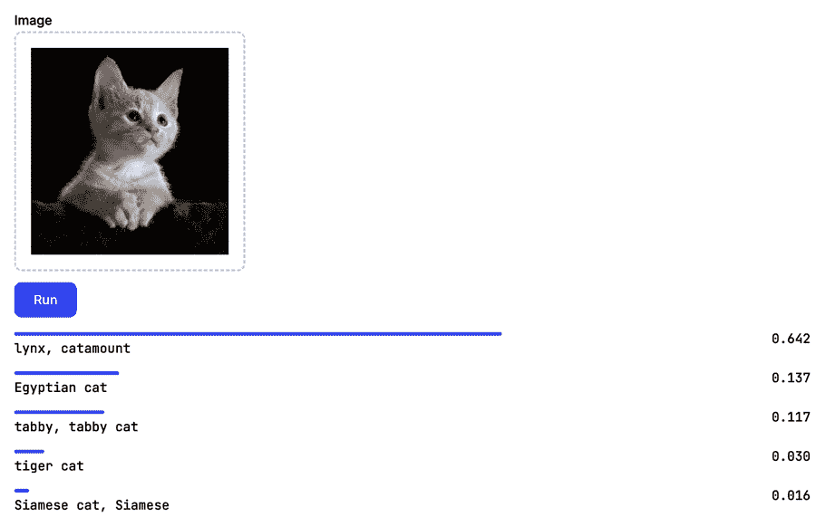

Again, with only a few lines of code you're able to make use of a powerful image classification model.

### Fine-Tuning Pre-trained Models

All of these examples demonstrate the practicality of Bumblebee for inference tasks, which are well-suited to using pre-trained models without any need for additional training. But what happens if you have a use case which requires additional training? Fortunately, as you learned in Chapter 8, *Stop Reinventing the Wheel*, it's possible to fine-tune pre-trained models in Axon to your specific use case. Models imported from Bumblebee are no exception.

As with pre-trained image models, it's common to make use of pre-trained language models as a base representation for more specific language tasks. In this example, you'll fine-tune a pre-trained Transformer to categorize Yelp Reviews.^([\[36\]](#f_0075.xhtml#FOOTNOTE-36)) Each review consists of the actual review text and the rating associated with the review. This should feel similar to the problem you solved in Chapter 9, *Understand Text*—classifying movie reviews. In this case, however, each rating belongs to one of five possible categories. Start by downloading the dataset from here.^([\[37\]](#f_0075.xhtml#FOOTNOTE-37))

Next, import a pre-trained transformer with the following code:

```
{:ok, spec} = Bumblebee.load_spec({:hf, "distilbert-base-cased"},
  module: Bumblebee.Text.Distilbert,
  architecture: :for_sequence_classification
)
spec = Bumblebee.configure(spec, num_labels: 5)

{:ok, %{model: model, params: params}} = Bumblebee.load_model(
  {:hf, "distilbert-base-cased"},
  spec: spec
)

{:ok, tokenizer} = Bumblebee.load_tokenizer({:hf, "distilbert-base-cased"})
```

In this example, you're using the DistilBERT^([\[38\]](#f_0075.xhtml#FOOTNOTE-38)) model. DistilBERT is a smaller, faster version of BERT that trades some accuracy for compute and storage efficiency. Bidirectional Encoder Representations from Transformers (BERT) is one of the most famous transformer implementations originally developed by Google. Its initial integration in 2017 proved its practical prowess, leading to one of the most significant changes to the Google search algorithm in years. While you could adapt this example to use a more powerful model like BERT, you need to be aware that larger models are more expensive and slower to train.

Before actually loading the model, you use `load_spec/2` to load the model configuration before loading the actual model. You can then edit the configuration using `Bumblebee.configure/2`. In this example, you set the configuration to accept `num_labels: 5` and specify the architecture as `:for_sequence_classification` in `load_model/2`. At the same time, you pass the reconfigured spec via the `:spec` option, telling Bumblebee to create a sequence classification model with five output categories.

Next, you need to create an input pipeline. If you extract the dataset to a local directory, you'll find it contains CSV files for the training and test sets. You can stream the CSV line by line and parse the ratings and reviews into tensor batches with the following code:

```
batch_size = 32
max_length = 128

train_data = 
  File.stream!("train.csv")
  |> Stream.chunk_every(batch_size)
  |> Stream.map(fn inputs ->
    {labels, reviews} = 
      inputs
      |> Enum.map(fn line ->
        [label, review] = String.split(line, ",")
        {String.trim(label, ","), String.trim(review, ",")}
      end)
      |> Enum.unzip()
    
    labels = 
      labels
      |> Enum.map(&String.to_integer/1)
      |> Nx.tensor()
    
    tokens = Bumblebee.apply_tokenizer(tokenizer, reviews, length: max_length)
    
    {tokens, labels}
  end)
```

This code reads the file line by line, chunking by 32 records. Each chunk is split into labels and reviews. Each label is parsed as an integer, and each review is tokenized using Bumblebee. Reviews are padded or truncated to a maximum sequence length of 128 characters. You can inspect the first record of the training data like so:

```
train_data = Enum.take(train_data, 1)
[
  {
    #Nx.Tensor<
      s64[32]
      [5, 2, 4, 4, 1, 5, 5, 1, 2, 3, 1, 1, 4, 2, ...]
    >,
    "attention_mask" => #Nx.Tensor<
      s64[32][128]
      [1, 1, 1, 1, 1, 1, 1, 1, 1, 1, 1, 1, 1, 1, 1, ...]
    >,
    "input_ids" => #Nx.Tensor<
      s64[32][128]
      [101, 173, 1197, 119, 2284, 2953, 3272, 1917, ...]
    >,
    "token_type_ids" => #Nx.Tensor<
      s64[32][128]
      [0, 0, 0, 0, 0, 0, 0, 0, 0, 0, 0, 0, 0, 0, 0, ...]
    >
  }
]
```

Now, you need to slightly adjust the model. The model returned by Bumblebee returns more than just the output you care about. In this example, the model output is a map containing `:attentions`, `:hidden_states`, and `:logits`. You can verify this by running the following code:

```
Axon.get_output_shape(model, %{"input_ids" => Nx.template({32, 128}, :s64)})
%{
  attentions: #Axon.None<...>,
  hidden_states: #Axon.None<...>,
  logits: {32, 5}
}
```

In this case, you only care about `:logits`. Before using the model in a training loop, you need to specifically extract `:logits`. You can achieve this by adding the following layer:

```
model = Axon.nx(model, fn %{"logits" => logits} -> logits end)
```

This creates a new model that only returns `:logits`.

Now, just create a training loop. This is a multi-class classification problem, and you should be very familiar with how to solve it. You can implement the training loop with the following code:

```
optimizer = Axon.Optimizers.adamw(5.0e-5)
loss = &Axon.Losses.categorical_cross_entropy(&1, &2, from_logits: true, sparse: true, reduction: :mean)

trained_model_state = 
  model
  |> Axon.Loop.trainer(loss, optimizer, log: 1)
  |> Axon.Loop.metric(:accuracy)
  |> Axon.Loop.run(train_data, params, epochs: 3, compiler: EXLA)
```

After completing these steps, you're done with all necessary operations. Note that transformers are typically much larger and more expensive to run than other types of models, so you may need to wait a while for results. You can verify the training process by training only on a small subset of the original dataset. After running this code, you'll see:

```
Epoch: 0, Batch: 249, accuracy: 0.3605000 loss: 1.1831361
Epoch: 1, Batch: 249, accuracy: 0.5363751 loss: 1.0118284
Epoch: 2, Batch: 249, accuracy: 0.6470000 loss: 0.8826395
```

After the model finishes training, you can create a test pipeline using the following code and evaluate the trained model using the given test data:

```
model
|> Axon.Loop.evaluator()
|> Axon.Loop.metric(:accuracy)
|> Axon.Loop.run(test_data, params, compiler: EXLA)
```

You'll see:

```
Batch: 49, accuracy: 0.3675000
```

Note that the 36% accuracy shown here is the model's performance after training on only a small subset of the original data. If you want a more powerful classifier, you can continue training for longer. With just a few lines of code, you've fine-tuned a powerful pre-trained model into a powerful classifier capable of categorizing Yelp reviews.

### That's Just the Beginning

While this section specifically demonstrated four different use cases for Bumblebee, the actual practical scenarios far exceed these. As you continue your machine learning journey, you'll see transformers applied in search applications, image generation, document classification, text summarization, machine translation, and countless other scenarios. You'll likely find that simply importing someone else's pre-trained model allows you to use Bumblebee to directly leverage these models.

## Wrapping Up

In this chapter, you mastered the powerful capabilities of transformers across a variety of machine learning tasks. You learned the essence of transformers and the intuition behind them, as well as the attention mechanism and how subtle modifications to the original attention mechanism gave transformers their powerful capabilities. You used Bumblebee to leverage powerful pre-trained transformers to solve multiple different tasks. You used Bumblebee for inference tasks and fine-tuned pre-trained models in Axon.

At this point, you've implemented most of the important deep learning model types covered in this book. You've mastered using Axon to solve problems on almost any type of data. Of course, almost all the problems you've solved assume access to large amounts of labeled data. But what if you don't have any labeled data at all?

In the next chapter, you'll explore using `Axon` for deep unsupervised learning and generative models. This will conclude your deep learning journey with `Axon`, and you'll be ready to put machine learning into practice with `Nx`, `Axon`, and `Elixir`.

#### Footnotes

[\[35\]](#f_0071.xhtml#FNPTR-35)

: 

[`github.com/elixir-nx/bumblebee`](https://github.com/elixir-nx/bumblebee)

[\[36\]](#f_0074.xhtml#FNPTR-36)

: 

[`huggingface.co/datasets/yelp_review_full/tree/main`](https://huggingface.co/datasets/yelp_review_full/tree/main)

[\[37\]](#f_0074.xhtml#FNPTR-37)

: 

[`s3.amazonaws.com/fast-ai-nlp/yelp_review_full_csv.tgz`](https://s3.amazonaws.com/fast-ai-nlp/yelp_review_full_csv.tgz)

[\[38\]](#f_0074.xhtml#FNPTR-38)

: 

[`huggingface.co/docs/transformers/model_doc/distilbert`](https://huggingface.co/docs/transformers/model_doc/distilbert)

Copyright © 2024, The Pragmatic Bookshelf.

# Chapter 12  

Learning Without Supervision

In this book, you've primarily focused on problems in the domain of supervised learning. Remember, supervised learning problems are those where you have access to labeled data at training time. Supervised learning algorithms are theoretically usually good because they typically have mature solutions and are easier to interpret and understand.

Unfortunately, the reality is that most data you encounter is unlabeled. Processing labeled data is also an expensive, tedious, and time-consuming task. While most machine learning solutions benefit from some degree of supervision, it's not feasible in all cases. In these cases, you need to leverage unsupervised learning.

Recall Chapter 1, *Make Machines That Learn*, where unsupervised learning is learning to capture relationships in data without a supervisory signal. Essentially, you learn from data without labels. In this chapter, you'll apply deep unsupervised learning, a subset of unsupervised learning that relies on the power of neural networks, to solve compression and generative modeling problems. Specifically, you'll implement three types of unsupervised neural networks: autoencoders, variational autoencoders, and generative adversarial networks. You'll use these networks to generate images of handwritten digits.

## Compressing Data with Autoencoders

If you're familiar with compression, you already have some intuition for unsupervised learning. There's a relationship between the goals of compression algorithms and the goals of unsupervised learning. In compression algorithms, your goal is to reduce the size of the original data—usually by leveraging patterns and structure in the input data. In unsupervised learning problems, your goal is to capture or model the patterns and structure in the input data.

If you think of a compression algorithm as an Elixir behaviour, its contract roughly looks like this:

```
@callback compress(data) :: compressed_data

@callback decompress(compressed_data) :: data
```

Recall Chapter 6, *Go Deep with Axon*, where neural networks are function approximators. Because neural networks only approximate functions, you can use them to approximate the functions used for compression and decompression. Your neural network learns to compress data, and then you can train an additional neural network to decompress the compressed form. This type of neural network is called an autoencoder.

An autoencoder is a neural network composed of an encoder and a decoder. The encoder learns a latent representation of the input data. A latent representation is a compressed representation of the input data where similar items are closer in space. For example, if you have a latent representation of animals, the latent representations of cats and tigers would be more similar than those of dogs and humans. The decoder learns to reconstruct the input data from the latent representation. The goal of an autoencoder is to map the input to a latent representation and back again while minimizing information loss. The decoder's output should be as close to the input as possible.

To see an autoencoder in action, fire up a Livebook and install the following dependencies:

```
Mix.install([
  {:scidata, "~> 0.1"},
  {:axon, "~> 0.5"},
  {:exla, "~> 0.5"},
  {:nx, "~> 0.5"},
  {:kino, "~> 0.8}
])
```

There's nothing new here. With dependencies installed, you can start building the input pipeline. To simplify this example, you'll use the MNIST dataset. You've used MNIST several times in this book and should be very familiar with it by now. MNIST requires minimal preprocessing. You just need to convert the raw binary data into a stream consumable by the training loop:

```
batch_size = 64

{{data, type, shape}, _} = Scidata.MNIST.download()

train_data = 
  data
  |> Nx.from_binary(type)
  |> Nx.reshape({:auto, 28, 28, 1})
  |> Nx.divide(255)
  |> Nx.to_batched(batch_size)
```

This code downloads the MNIST data and converts it into image batches with a batch size of 64. MNIST images are 28x28 grayscale images, meaning each input has only one color channel, with height and width both 28 pixels.

Now, you can start implementing the model. First, run the following code:

```
defmodule Autoencoder do
  def encoder(input) do
    input
    |> Axon.flatten()
    |> Axon.dense(256, activation: :relu, name: "encoder_dense_0")
    |> Axon.dense(128, activation: :relu, name: "encoder_dense_1")
  end

  def decoder(input) do
    input
    |> Axon.dense(256, activation: :relu, name: "decoder_dense_0")
    |> Axon.dense(784, activation: :sigmoid, name: "decoder_dense_1")
    |> Axon.reshape({:batch, 28, 28, 1})
  end
end
```

This code implements an autoencoder module with two functions: `encoder/1` and `decoder/1`. The `encoder` flattens the input, then passes it through two dense layers, each followed by a ReLU activation. Note that the encoder's final shape is `{batch_size, 128}`. You should notice that a 128-length vector is smaller than the original input dimension. Remember, the goal is to compress the input. The encoder's output is the latent representation of the input, also known as the latent space. You might find that experimenting with different latent configurations affects the overall model.

The `decoder` takes the input, passes it through two dense layers, and finally uses a reshape layer to match the input's original shape. The final dense layer uses a sigmoid activation. The final activation is important because your input pipeline scales input pixels between 0 and 1, so your output also needs to scale pixel values between 0 and 1. Note that the output dimension matches the input dimension.

Now, you can use a helper function to declare your joint autoencoder model:

```
model = 
  Axon.input("image")
  |> Autoencoder.encoder()
  |> Autoencoder.decoder()

model
```

The model will look like this:

```
#Axon<
  inputs: %{"image" => nil}
  outputs: "reshape_0"
  nodes: 11
>
```

Your model implementation is relatively small, but this is your first time using modules and helper functions to implement a model. While in some cases it makes sense to declare a model as a series of Axon function calls, in other cases it makes sense to extract reusable blocks into helper functions. In this instance, your model has two clear sub-architectures that might be used independently, so it's best to declare them separately for later reuse. It's important to understand that Axon is still just a regular Elixir library. When using Axon, you should embrace Elixir patterns.

Now you can focus on implementing the training loop. Your autoencoder's goal is to generate a network that encodes the original input into a low-dimensional representation and decodes that representation to produce the same output as the input. Following this logic, you can frame this problem as a supervised learning problem by using the original input as both the input data and the output labels. You have enough experience to implement a supervised training loop. But what should your loss function be?

You want a loss function that, when minimized, minimizes the distance between the input and the autoencoder's output. If you view the distance between input and output as the per-pixel distance, then you should use `:mean_squared_error`:

The training loop structure is similar to many training loops you've implemented in this book. By using the input as both input and labels, you've turned this unsupervised learning problem into a supervised learning problem. Now you can run this loop and watch the loss decrease, but it's hard to understand how this loss corresponds to how well your model reconstructs the compressed input. A more interpretable progress indicator is to periodically visualize the model's output on some example data. You can achieve this using Axon event handlers.

`Axon.Loop` reduction triggers deterministic events at different points in the loop. For example, the start and end of each epoch trigger `:epoch_started` and `:epoch_completed` events. You can register handlers on these events to run custom functions within the loop. This gives you finer-grained control over what happens during the loop.

A handler is a unary function that receives the loop state and returns a control-flow/state tuple: `{:continue | :halt_epoch | :halt_loop, state}`. Internally, `Axon.Loop` aggregates a struct called `Axon.Loop.State` containing loop metadata, metrics, and step state. When an event triggers, the handler receives the current `Axon.Loop.State` struct. The handler can use this state to perform side effects, such as saving the loop or model checkpoints, checking model metrics, or in this case, visualizing the model's predictions. Handlers can also terminate the loop by returning the control flow item `:halt` based on certain criteria.

You're already familiar with some of the default event handlers Axon provides, including checkpointing and early stopping. These handlers are implemented on top of the more generic and customizable event handler API. Your custom event handler needs to visualize the model's predictions—you can use Kino's built-in image and rendering capabilities to achieve this. Copy the following code to implement a custom event handler:

```
test_batch = Enum.at(train_data, 0)
test_image = test_batch[0] |> Nx.new_axis(0)

visualize_test_image = fn
  %Axon.Loop.State{step_state: step_state} = state ->
    out_image = Axon.predict(
      model,
      step_state[:model_state],
      test_image,
      compiler: EXLA
    )
    out_image = 
      out_image
      |> Nx.multiply(255)
      |> Nx.as_type(:u8)
      |> Nx.reshape({28, 28, 1})
    
    Kino.Image.new(out_image) |> Kino.render()
    {:continue, state}
end
```

Your visualization handler needs to predict on a test image, then convert the float results to an unsigned 8-bit integer tensor. This is because `Kino.Image` requires creating an image tensor from a u8 tensor. Converting floats to u8 can be done by multiplying by 255 and using `Nx.as_type/2`. Note that this approach is lossy because you're converting from 32-bit to 8-bit tensors; but in this example, it doesn't matter much.

To get a prediction from the model, you need the model, its parameters, and the input. To get the latest model parameters, you need to access `:model_state` through the loop state's step state. This sounds a bit complex, but it's easy to understand once you know how the `Axon.Loop` API works.

The `Axon.Loop` API is an abstraction for building reduction operations common in machine learning applications. These reductions iterate over a dataset and aggregate state—whether metrics or actual model state. At its core, this loop looks like this:

```
def run(data) do
  state = init_state()
  
  Enum.reduce(data, state, fn batch, state ->
    step(batch, state)
  end)
end
```

You care about the final state value at the end of this loop. For supervised training loops, this state contains the model state, along with some additional metadata like optimizer state, aggregated loss, etc. The `Axon.Loop` API aggregates these states for you. But to better generalize to other types of loops, it needs to track some additional metadata. This metadata is contained in the `Axon.Loop.State` struct. The core of this struct is `step_state`, which directly corresponds to the `state` in the previous `run/1` implementation. In most custom handlers, you'll only care about the `step_state` portion. But other metadata is there if you need it.

By implementing your handler, you need to make some small adjustments to your training loop to register your event handler:

```
trained_model_state = 
  model
  |> Axon.Loop.trainer(:mean_squared_error, Axon.Optimizers.adam(1.0e-3))
  |> Axon.Loop.handle_event(:epoch_completed, visualize_test_image)
  |> Axon.Loop.run(
    Stream.zip(train_data, train_data),
    %{},
    epochs: 5,
    compiler: EXLA
  )
```

`Axon.Loop.handle/3` is used to register a handler that runs on a given event. In this example, you register `visualize_test_image` to run on every `:epoch_completed` event. This means after every epoch, you'll get a visualization of an example model output, which gives you a good sense of how well the model is decomposing and reconstructing input examples.

After running this code, you'll see the following output:

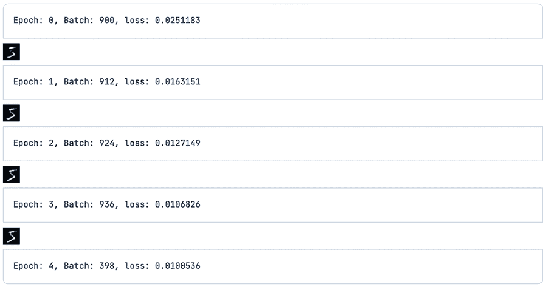

If you think about it carefully, you've inadvertently trained a deep generative model. A deep generative model is a deep learning model designed to generate data from some distribution. In this example, your decoder is actually a generative model—it takes a latent space representation and generates an output. Theoretically, you could skip the encoder entirely and just give the decoder some random latent space representations, and it should output something that looks like handwritten digits:

```
decoder_only = 
  Axon.input("noise")
  |> Autoencoder.decoder()

key = Nx.Random.key(42)
{noise, key} = Nx.Random.normal(key, shape: {1, 128})

out_image = Axon.predict(decoder_only, trained_model_state, noise)
upsampled = Axon.Layers.resize(out_image, size: {512, 512})
out_image = upsampled
  |> Nx.reshape({512, 512, 1})
  |> Nx.multiply(255)
  |> Nx.as_type(:u8)

Kino.Image.new(out_image)
```

This code is almost identical to your visualization handler; however, you added a function to upsample the input using Axon's resize layer. This scales the input image to a size much larger than the original 28x28. After running this code, you'll see the following output:

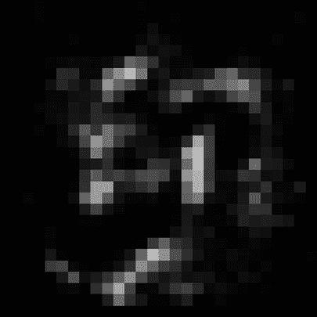

This definitely doesn't look like a handwritten digit. So what happened here?

Essentially, your decoder would be an excellent generative model if it had the correct latent space representation. Unfortunately, you didn't force the model to learn a structured latent space. Your encoder produces representations whose structure depends on the neural network and gradient descent. You can't pass random uniform or normal noise to the decoder and expect coherent output, because your decoder only knows how to handle latent space representations produced by the encoder. But what if there was a way to force the model to learn a structured latent space? Fortunately, there is. Enter the variational autoencoder (VAE).

## Learning Structured Latent Spaces

In attempting to implement a basic compression algorithm, you stumbled upon a strategy for generating arbitrary input data. But to make it work, you need to tame the latent space. Remember, the latent space is a representation of data where similar inputs are close in space. For example, the word embeddings and sentence embeddings mentioned in Chapter 9, *Understand Text*, and Chapter 11, *Model Everything with Transformers*, are examples of learned latent spaces for text.

Unfortunately, the key here is that your latent space is learned. That is, without the encoder's information, it's difficult to directly query the latent space. To generate images, you need access to the target image—this defeats the purpose of a generative model. You need a way to force the model to learn a structured latent space. This means you need the model to adhere to some input distribution, like a normal distribution. Variational autoencoders are designed exactly for this.

Variational autoencoders are the same as regular autoencoders, but with one small change. A regular autoencoder compresses the input into some low-dimensional vector representation; a variational autoencoder learns to compress the input into the parameters of a distribution. You can easily sample from this distribution and use those samples to generate examples. With some small modifications, you can turn a basic autoencoder into a generative model.

In a new cell, create a new module called VAE:

```
defmodule VAE do
  import Nx.Defn
end
```

Next, add the following function to implement the encoder:

```
def encoder(input) do
  encoded = 
    input
    |> Axon.conv(32, kernel_size: 3, activation: :relu, strides: 2, padding: :same)
    |> Axon.conv(32, kernel_size: 3, activation: :relu, strides: 2, padding: :same)
    |> Axon.flatten()
    |> Axon.dense(16, activation: :relu)
  
  z_mean = Axon.dense(encoded, 2)
  z_log_var = Axon.dense(encoded, 2)
  z = Axon.layer(&sample/3, [z_mean, z_log_var], op_name: :sample)
  
  Axon.container({z_mean, z_log_var, z})
end
```

This encoder implementation differs from your first encoder implementation. Instead of using dense layers for feature extraction, this implementation uses convolutional layers. Remember, the encoder's goal is to extract useful representations from the input so the decoder can use them to reconstruct the output. As you learned in Chapter 7, *Learn to See*, convolutional layers are powerful feature extractors for images. Therefore, incorporating convolutional layers in the encoder will likely produce more useful latent space representations.

In addition to the slight architectural modification, you also slightly modified the encoder's output. `Axon.container/1` is an Axon construct that allows you to wrap layers into Elixir collections like tuples, maps, and structs. Containers are typically used as output layers, as shown here. Your encoder outputs a tuple containing three variables: `z_mean`, `z_log_var`, and `z`. Instead of compressing the input into a single dense vector like the previous encoder, it returns the parameters of a distribution. These parameters are the result of learned transformations of the input. From the parameters `z_mean` and `z_log_var`, your model generates the latent space `z` via a custom Axon layer.

Custom layers in Axon are defined via `Axon.layer/3`. You can remember the form of `Axon.layer/3` by remembering it's the same as Elixir's `apply` form: it accepts a function (typically defined with `defn`) and a list of inputs. `Axon.layer/3` also accepts some additional metadata options to define the layer's name and the operation performed. You might wonder why `sample/3` is a three-arity function but you only gave it two inputs. Every Axon layer accepts an additional `opts` parameter. Every layer must accept at least the `:mode` option, which changes the layer's behavior during training and inference.

Now, add the following `sample/3` implementation to your module:

```
defnp sample(z_mean, z_log_var, _opts \\ []) do
  noise_shape = Nx.shape(z_mean)
  epsilon = Nx.random_normal(noise_shape)
  z_mean + Nx.exp(0.5 * z_log_var) * epsilon
end
```

This implements the so-called reparameterization trick. Remember, your goal is to learn a structured latent space. Here, you estimate two parameters of a normal distribution latent space: the mean and the log variance. Ideally, you could just use these parameters to sample directly from `Nx.random_normal/3`. But you can't differentiate through a random node. If you sampled directly from `Nx.random_normal/3` and tried to train the model with gradient descent, `z_mean` and `z_log_var` would receive no training signal. The reparameterization trick makes sampling a function of `z_mean` and `z_log_var`, so the model still produces a normally distributed latent space, but `z_mean` and `z_log_var` can learn during gradient descent.

Note that combining custom layers with `defn` implementations is the best way to add custom functionality to models. In fact, Axon does this internally. Every Axon layer has a backend implementation in the `Axon.Layers` module, while the frontend interface is in the `Axon` module.

Next, add the following function to your module to implement the decoder:

```
def decoder(input) do
  input
  |> Axon.dense(16, activation: :relu)
  |> Axon.dense(7 * 7 * 32, activation: :relu)
  |> Axon.reshape({:batch, 7, 7, 32})
  |> Axon.conv_transpose(32, kernel_size: 3, strides: 2, padding: :same, activation: :relu)
  |> Axon.conv_transpose(1, kernel_size: 3, strides: 2, padding: :same, activation: :sigmoid)
end
```

This decoder mirrors the encoder architecture. It takes the latent representation, passes it through dense layers, reshapes it, and then uses transpose convolutions to upsample back to the original image dimensions. The final layer uses a sigmoid activation to output pixel values between 0 and 1.

Now, define the full VAE model:

```
model = 
  Axon.input("image")
  |> VAE.encoder()
  |> VAE.decoder()

model
```

The VAE loss function combines reconstruction loss and KL divergence:

```
defp vae_loss(%{z_mean: z_mean, z_log_var: z_log_var}, reconstruction, input) do
  reconstruction_loss = Axon.Losses.mean_squared_error(reconstruction, input)
  
  kl_loss = -0.5 * Nx.sum(1 + z_log_var - Nx.square(z_mean) - Nx.exp(z_log_var))
  kl_loss = Nx.mean(kl_loss)
  
  reconstruction_loss + kl_loss
end
```

Train the VAE:

```
trained_model_state = 
  model
  |> Axon.Loop.trainer(fn state, input ->
    {reconstruction, latent} = Axon.predict(model, state, input, compiler: EXLA)
    loss = vae_loss(latent, reconstruction, input)
    {loss, state}
  end, Axon.Optimizers.adam(1.0e-3))
  |> Axon.Loop.handle_event(:epoch_completed, visualize_test_image)
  |> Axon.Loop.run(
    Stream.zip(train_data, train_data),
    %{},
    epochs: 10,
    compiler: EXLA
  )
```

After training, you can generate new digits by sampling from the latent space:

```
decoder_only = 
  Axon.input("z")
  |> VAE.decoder()

key = Nx.Random.key(42)
{z, key} = Nx.Random.normal(key, shape: {10, 2})

out_images = Axon.predict(decoder_only, trained_model_state, z)
out_images = 
  out_images
  |> Nx.multiply(255)
  |> Nx.as_type(:u8)
  |> Nx.reshape({10, 28, 28, 1})

Kino.Image.new(out_images)
```

This will generate a grid of handwritten digits sampled from the learned latent space.

## Generative Adversarial Networks

The third type of unsupervised network you'll implement is a generative adversarial network (GAN). GANs consist of two networks: a generator and a discriminator. The generator tries to create realistic data, while the discriminator tries to distinguish real data from generated data. They're trained adversarially—the generator tries to fool the discriminator, and the discriminator tries to not be fooled.

Implement the generator:

```
defmodule GAN do
  def generator(input) do
    input
    |> Axon.dense(7 * 7 * 128, activation: :relu)
    |> Axon.reshape({:batch, 7, 7, 128})
    |> Axon.conv_transpose(64, kernel_size: 5, strides: 2, padding: :same, activation: :relu)
    |> Axon.conv_transpose(1, kernel_size: 5, strides: 2, padding: :same, activation: :tanh)
  end

  def discriminator(input) do
    input
    |> Axon.conv(64, kernel_size: 5, strides: 2, padding: :same, activation: :leaky_relu)
    |> Axon.conv(128, kernel_size: 5, strides: 2, padding: :same, activation: :leaky_relu)
    |> Axon.flatten()
    |> Axon.dense(1, activation: :sigmoid)
  end
end
```

Create the models:

```
generator = Axon.input("noise") |> GAN.generator()
discriminator = Axon.input("image") |> GAN.discriminator()
```

Define the adversarial training loop:

```
generator_optimizer = Axon.Optimizers.adam(2.0e-4)
discriminator_optimizer = Axon.Optimizers.adam(2.0e-4)

train_step = fn
  {real_images, _}, {gen_state, disc_state} ->
    # Train discriminator
    key = Nx.Random.key(:os.system_time(:nanosecond))
    {noise, key} = Nx.Random.normal(key, shape: {batch_size, 100})
    fake_images = Axon.predict(generator, gen_state, noise, compiler: EXLA)
    
    real_labels = Nx.ones({batch_size, 1})
    fake_labels = Nx.zeros({batch_size, 1})
    
    disc_loss_real = Axon.Losses.binary_cross_entropy(
      Axon.predict(discriminator, disc_state, real_images, compiler: EXLA),
      real_labels
    )
    disc_loss_fake = Axon.Losses.binary_cross_entropy(
      Axon.predict(discriminator, disc_state, fake_images, compiler: EXLA),
      fake_labels
    )
    disc_loss = (disc_loss_real + disc_loss_fake) / 2
    
    # Train generator
    {noise, key} = Nx.Random.normal(key, shape: {batch_size, 100})
    gen_loss = Axon.Losses.binary_cross_entropy(
      Axon.predict(discriminator, disc_state, Axon.predict(generator, gen_state, noise, compiler: EXLA), compiler: EXLA),
      real_labels
    )
    
    {gen_loss, disc_loss}
end
```

This completes the implementation of three unsupervised learning approaches: autoencoders for compression, variational autoencoders for structured latent spaces, and generative adversarial networks for adversarial generation.

## Wrapping Up

In this chapter, you applied deep unsupervised learning to solve compression and generative modeling problems. You implemented three types of unsupervised neural networks: autoencoders, variational autoencoders, and generative adversarial networks. You used these networks to generate images of handwritten digits.

You learned that autoencoders can compress data into latent representations, but their latent spaces lack structure for generation. Variational autoencoders solve this by learning structured latent spaces that follow a known distribution, enabling generation through sampling. Generative adversarial networks take a different approach, using adversarial training to produce sharp, realistic samples.

This concludes your deep learning journey with Axon. You're now ready to put machine learning into practice with Nx, Axon, and Elixir.


## 解码器实现

```elixir
def decoder(input) do
  input
  |> Axon.dense(7 * 7 * 64, activation: :relu)
  |> Axon.reshape({:batch, 7, 7, 64})
  |> Axon.conv_transpose(64,
    kernel_size: {3, 3},
    activation: :relu,
    strides: [2, 2],
    padding: :same
  )
  |> Axon.conv_transpose(32,
    kernel_size: {3, 3},
    activation: :relu,
    strides: [2, 2],
    padding: :same
  )
  |> Axon.conv_transpose(1,
    kernel_size: {3, 3},
    activation: :sigmoid,
    padding: :same
  )
end
```

这个解码器实现与你之前的实现略有不同。两个解码器实现都使用卷积层而不是全连接层。区别在于，这个实现使用转置卷积而不是普通卷积。转置卷积在某些方面类似于传统卷积，但它们可以作为上采样的策略，而不是下采样。

如果你想查看解码器的逐层形状，你可以使用以下代码：

```elixir
template = Nx.template({1, 128}, :f32)
Axon.Display.as_graph(VAE.decoder(Axon.input("latent")), template)
```

你会看到如下输出（图片链接）：image。

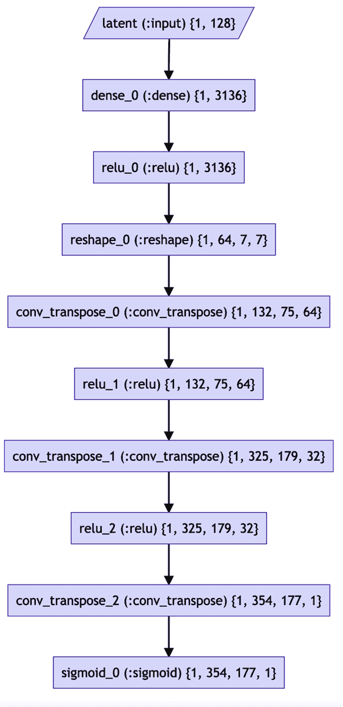

每次调用 `Axon.conv_transpose/3` 后，每个空间维度的大小会增加 2 倍。你经常会在生成式架构中看到 `Axon.conv_transpose/3` 的使用。

此时，你已经成功实现了变分自动编码器（VAE）。现在，你需要训练它。

在前一节中，你能够通过将输入作为标签，将无监督学习问题转化为监督学习问题。这使你能够利用 Axon 内置的监督训练循环 API。不幸的是，这对于训练你的变分自动编码器并不可行。变分自动编码器在训练过程中需要进行特定的调整。你需要编写第一个自定义训练循环。

在 Axon 中编写自定义训练循环比你想象的要容易，这也是一个了解 Axon 内部工作原理的好练习。首先，尝试在虚假模型上调用 `Axon.Loop.trainer/3`，看看它返回的内容：

```elixir
model = Axon.input("foo")

loop = Axon.Loop.trainer(model, :binary_cross_entropy, :sgd)
IO.inspect loop, structs: false
```

你会看到以下输出：

```elixir
%{
  __struct__: Axon.Loop,
  attached_state: nil,
  handlers: %{
    completed: [],
    epoch_completed: [
      {#Function<24.105974664/1 in Axon.Loop.log/5>,
       #Function<5.105974664/1 in Axon.Loop.build_filter_fn/1>}
    ],
    epoch_halted: [],
    epoch_started: [],
    halted: [],
    iteration_completed: [
      {#Function<24.105974664/1 in Axon.Loop.log/5>,
       #Function<3.105974664/1 in Axon.Loop.build_filter_fn/1>}
    ],
    iteration_started: [],
    started: []
  },
  init: #Function<136.105575625/2 in Nx.Defn.wrap_arity/2>,
  metrics: %{
    "loss" => {#Function<12.116147200/3 in Axon.Metrics.running_average/1>,
               #Function<6.105974664/2 in Axon.Loop.build_loss_fn/1>}
  },
  output_transform: #Function<37.105974664/1 in Axon.Loop.trainer/4>,
  step: #Function<136.105575625/2 in Nx.Defn.wrap_arity/2>
}
```

这部分是 Axon 用于控制循环执行的内部信息。最重要的字段是 `:init` 和 `:step`。每个 Axon 循环都需要一个初始化函数来初始化步状态，以及一个步函数来根据当前输入和当前步状态更新步状态。`Axon.Loop.trainer` 是一个工厂，它会为你生成这些函数。实际上，`Axon.Loop.trainer` 使用 `Axon.Loop.train_step` 来实现监督训练循环的初始化和步函数。关键点在于，要实现自定义训练循环，你只需要实现初始化函数和步函数。

最容易开始的方法是实现一个单独的 `train_step` 函数。该函数接收当前批次和当前步状态，并返回更新后的步状态。你可以将其视为 `Enum.reduce/3` 中的内部函数。你的 `train_step` 必须完成以下操作：

1. 计算模型相对于某个目标函数的梯度
2. 使用优化器和当前状态对梯度进行缩放
3. 应用缩放后的梯度，获得新的模型状态
4. 返回更新后的状态

为了跟踪目的，你还需要维护一个损失的运行平均值。基于以上所有信息，你可以在 VAE 模块中尝试实现你的自定义 `train_step`：

```elixir
defn train_step(encoder_fn, decoder_fn, optimizer_fn, batch, state) do
  {batch_loss, joint_param_grads} = value_and_grad(
    state[:model_state],
    &joint_objective(encoder_fn, decoder_fn, batch, &1)
  )

  {scaled_updates, new_optimizer_state} = optimizer_fn.(
    joint_param_grads,
    state[:optimizer_state],
    state[:model_state]
  )

  new_model_state = Axon.Updates.apply_updates(
    state[:model_state], scaled_updates
  )

  new_loss =
    state[:loss]
    |> Nx.multiply(state[:i])
    |> Nx.add(batch_loss)
    |> Nx.divide(Nx.add(state[:i], 1))

  %{
    state
    | i: Nx.add(state[:i], 1),
      loss: new_loss,
      model_state: new_model_state,
      optimizer_state: new_optimizer_state
  }
end
```


注意 `train_step/5` 是一个 `defn`。你希望在训练过程中尽可能多地将循环初始化和步函数实现为 `defn`，以便利用硬件加速和 JIT 编译。

现在，你需要在 `train_step/5` 中实现 `joint_objective/4`。向你的 VAE 模块添加以下函数：

```elixir
defnp joint_objective(encoder_fn, decoder_fn, batch, joint_params) do
  %{prediction: preds} = encoder_fn.(joint_params["encoder"], batch)
  {z_mean, z_log_var, z} = preds
  %{prediction: reconstruction} = decoder_fn.(joint_params["decoder"], z)

  recon_loss = Axon.Losses.binary_cross_entropy(
    batch, reconstruction, reduction: :mean
  )
  kl_loss = -0.5 * (1 + z_log_var - Nx.power(z_mean, 2) - Nx.exp(z_log_var))
  kl_loss = Nx.mean(Nx.sum(kl_loss, axes: [1]))

  recon_loss + kl_loss
end
```

这段代码实现了联合目标函数，使用编码器和解码器。首先，你通过在 `joint_params` 中的 "encoder" 参数和当前 batch 调用 `encoder_fn/2` 获取编码表示。这返回了元组 `{z_mean, z_log_var, z}`。接下来，你通过调用 `decoder_fn` 使用编码的潜在输出 `z` 重构输入。`encoder_fn` 和 `decoder_fn` 都返回一个 map，这是所有 Axon 模型在训练模式下的情况。训练模式的输出是一个包含键 `:prediction`（表示输出）和键 `:state`（用于状态层如 `Axon.batch_norm/3` 的内部层状态）的 map。你的模型没有状态层，因此可以安全忽略层状态。

联合目标函数使用模型的所有输出来构建联合损失。损失的第一部分是重构损失，用于衡量解码器如何从编码表示重建原始图像批量。损失的第二部分是正则化项，惩罚模型偏离正态分布太远。它基本上测量给定参数 `z_mean` 和 `z_log_var` 定义的分布与均值为 1 方差为 0 的正态分布之间的差异。这一项帮助迫使你的编码器学会将数据编码为正态分布。

现在，你已经实现了训练步骤，可以实现初始化函数。根据训练步骤，你需要跟踪当前迭代 `i`、当前损失 `:loss`、当前模型状态 `:model_state` 和当前优化器状态 `:optimizer_state`：

```elixir
defn init_step(
  encoder_init_fn,
  decoder_init_fn,
  optimizer_init_fn,
  batch,
  init_state
) do
  encoder_params = encoder_init_fn.(batch, init_state)
  decoder_params = decoder_init_fn.(Nx.random_uniform({64, 2}), init_state)
  joint_params = %{
    "encoder" => encoder_params,
    "decoder" => decoder_params
  }
  optimizer_state = optimizer_init_fn.(joint_params)

  %{
    i: Nx.tensor(0),
    loss: Nx.tensor(0.0),
    model_state: joint_params,
    optimizer_state: optimizer_state
  }
end
```

此函数使用编码器和解码器的初始化函数。函数在 `joint_params` 中分别初始化编码器和解码器参数。然后，将编码器和解码器参数组合到一个单一的 map `joint_params` 中。由于你希望使用单个优化器来更新两个模型，因此必须将两组参数放在同一结构中。随后，你对 `joint_params` 调用 `optimizer_init_fn` 以初始化优化器状态，最后返回初始状态。

现在，你拥有所有需要来定义 VAE 的训练循环。为了展示这一切的结合，先定义你的编码器和解码器：

```elixir
encoder = Axon.input("image") |> VAE.encoder()
decoder = Axon.input("latent") |> VAE.decoder()
```

当前，你的编码器和解码器都是 Axon 结构体。为了在 `defn` 中使用它们，你需要使用 `Axon.build/2` 将它们构建为 `{init_fn, predict_fn}` 元组：

```elixir
{encoder_init_fn, encoder_fn} = Axon.build(encoder, mode: :train)
{decoder_init_fn, decoder_fn} = Axon.build(decoder, mode: :train)
```

接下来，你可以定义你的优化器：

```elixir
{optimizer_init_fn, optimizer_fn} = Axon.Optimizers.adam(1.0e-3)
```

你之前已经构建过优化器，但从未将它们分解为独立部分。每个优化器都是 `{init_fn, update_fn}` 的元组。有了所有组件，你可以构建参数化的初始化和训练步骤：

```elixir
init_fn = &VAE.init_step(
  encoder_init_fn,
  decoder_init_fn,
  optimizer_init_fn,
  &1,
  &2
)

step_fn = &VAE.train_step(
  encoder_fn,
  decoder_fn,
  optimizer_fn,
  &1,
  &2
)
```

有了初始化和步函数，你可以使用 `Axon.Loop.loop/2` 工厂创建循环，然后以你已经熟悉的方式工作和执行该循环。对于这个示例，你还需要添加在每个时代后显示生成样本的功能。你已经知道如何使用事件处理器实现这一点。此外，你还需要添加一些基本的日志记录。可以通过 `Axon.Loop.log/4` 来完成：

```elixir
step_fn
|> Axon.Loop.loop(init_fn)
|> Axon.Loop.handle(:epoch_completed, &VAE.display_sample(&1, decoder_fn))
|> Axon.Loop.log(:iteration_completed, fn
  %Axon.Loop.State{epoch: epoch, iteration: iter, step_state: state} ->
    "\rEpoch: #{epoch}, batch: #{iter}, loss: #{Nx.to_number(state[:loss])}"
end, :stdio)
|> Axon.Loop.run(train_data, %{}, compiler: EXLA, epochs: 10)
```

注意，你需要实现事件处理器 `display_sample/2`。此外，你使用 `Axon.Loop.log/4` 附加一个日志事件到循环。这会在指定设备上记录给定函数返回的字符串到指定事件。在此实例中，你仅记录循环元数据，如当前 epoch、迭代和损失。在执行循环之前，添加以下代码到你的 VAE 模块：

```elixir
def display_sample(
  %Axon.Loop.State{step_state: state} = out_state,
  decoder_fn
) do
  latent = Nx.tensor([[0.0, 0.0], [0.5, 0.5], [1.0, 1.0]])
  %{prediction: out} = decoder_fn.(state[:model_state]["decoder"], latent)
  out_image = Nx.multiply(out, 255) |> Nx.as_type(:u8)
  upsample = Axon.Layers.resize(
    out_image,
    size: {512, 512}
  )
end
```

Epoch: 9, batch: 937, loss: 0.5638180375099182


Whoa. Those actually look like handwritten digits. The quality isn’t great, but it’s apparent the generated output is similar to what your inputs look like. Now the question is, can you do better? Of course, you can.

Your VAE, while impressive, is nowhere near the quality of modern generative models. You need only look at DALL-E 2 to understand that deep generative models are capable of amazing things.^([39](#f_0081.xhtml#FOOTNOTE-39)) DALL-E 2 is an example of a diffusion model that internally makes use of a VAE and a few other models to generate incredibly realistic images. Before DALL-E and diffusion models, VAEs were mostly an afterthought. Up until recently, a different kind of model ruled the generative AI game.

## Generating with GANs

Variational autoencoders are somewhat impressive generative models for how easy they are to train; but up until recently, they weren’t seen as all that useful for generative AI. Before diffusion models, the most popular and most powerful generative models were variants of generative adversarial networks or GANs.

### Diffusion Models


Recent developments in generative modeling using diffusion have lead to incredible breakthroughs. Stable Diffusion, a specific type of diffusion model, has quickly become one of the most popular deep learning models on the internet. For many image generation tasks, you’ll find a pre-trained diffusion model like stable diffusion is much more powerful than a pre-trained GAN.

Generative adversarial networks are deep generative models that make use of a dueling network architecture with a generator and discriminator. The generator is responsible for transforming a latent representation into something that resembles inputs from the training data. The discriminator attempts to differentiate real inputs from generated inputs, and in turn, it provides feedback to the generator to improve its generations.

The classic analogy for the relationship between a generator and a discriminator in a generative adversarial network is the relationship between an art counterfeiter and a critic. The generator is akin to an art counterfeiter who attempts to create forgeries of famous paintings. The discriminator is the critic who attempts to determine if a painting is counterfeit. The critic provides feedback signals to the counterfeiter which improve the counterfeiter’s next work until the counterfeiter generates art that the critic cannot differentiate from the real thing.

Generative adversarial networks have some interesting theoretical guarantees, and in practice, they’ve proven capable of generating incredible images. But they can be difficult to train when compared to VAEs. More recent evolutions of generative adversarial networks attempt to alleviate some of these training difficulties. But the reality is that training a generative adversarial network successfully can involve more art than science. Even so, with enough data and the right training recipe, GAN outputs can be truly incredible.

To get a better sense of how GANs work in practice, you’ll implement a GAN that generates handwritten digits—just like your VAE.

You should already have a Livebook open with all of the dependencies you need. Start by defining a new module in a new cell:

```elixir
defmodule GAN do
  import Nx.Defn
end
```

Next, copy the following code into the module to implement your discriminator:

```elixir
def discriminator(input) do
  input
  |> Axon.conv(32,
    activation: :mish,
    kernel_size: 3,
    strides: 2,
    padding: :same
  )
  |> Axon.layer_norm()
  |> Axon.conv(64,
    activation: :mish,
    kernel_size: 3,
    strides: 2,
    padding: :same
  )
  |> Axon.layer_norm()
  |> Axon.flatten()
  |> Axon.dropout(rate: 0.5)
  |> Axon.dense(1, activation: :sigmoid)
end
```

Remember the goal of your discriminator is to determine if an input image is from the real training data or the generator. This should sound a lot like a straightforward image classification task—so your discriminator only needs to be a powerful enough image classification model. This example makes use of some convolutional layers followed by layer normalization layers to extract features from the input image before passing them to a dense classifier.

Now you need to implement your generator. You already have some experience implementing a model that generates image outputs from a latent representation from the last example. The principles for creating a generator for a GAN aren’t that different from creating a decoder for a VAE. You can copy the following code into your GAN module to implement the GAN generator:

```elixir
def generator(input) do
  input
  |> Axon.dense(128 * 7 * 7, activation: :mish)
  |> Axon.reshape({:batch, 7, 7, 128})
  |> Axon.resize({14, 14})
  |> Axon.conv(128, kernel_size: 3, padding: :same)
  |> Axon.layer_norm()
  |> Axon.relu()
  |> Axon.resize({28, 28})
  |> Axon.conv(64, kernel_size: 3, padding: :same)
  |> Axon.layer_norm()
  |> Axon.relu()
  |> Axon.conv(1, activation: :tanh, kernel_size: 3, padding: :same)
end
```

This implementation is slightly different from your decoder implementation in the VAE example. Your generator makes use of a single dense layer to transform the input latent representation into a representation that matches the size of your input image. The generator then uses strided convolutional blocks to downsample the input representation, and it upsamples the representation using a combination of convolutional layers and resize layers. Resize layers in Axon do exactly what they say they do—resize inputs. Specifically, Axon’s resize layers are for upsampling or downsampling the spatial dimensions of image data. In this instance, you use them to resize the downsampled spatial dimensions to the correct output size.

Now, run the following to create two new models with your functions:

```elixir
discriminator = GAN.discriminator(Axon.input("image"))
generator = GAN.generator(Axon.input("latent"))
```

With your models implemented, you need to write the training loop. You’ll need to implement a custom training loop—just as in the VAE example. Fortunately, most of the same concepts you learned while writing your VAE training loop also apply here. You need to make them work with the GAN training framework. Remember, for a custom training loop you need to implement an initialization function and a step function. It’s easiest to start with the step function. When training a GAN, the basic workflow is:

1. Compute the gradient of the discriminator on its objective
2. Scale the gradients by the discriminator’s optimizer
3. Update the discriminator
4. Compute the gradient of the generator on its objective
5. Scale the gradients by the generator’s optimizer
6. Update the generator

Again, you’ll also want some basic loss monitoring so you can keep track of training progress. You can implement your train step inside the GAN module like this:

```elixir
defn train_step(
  discriminator_fn,
  generator_fn,
  discriminator_optimizer,
  generator_optimizer,
  batch,
  state
) do
  d_params = state[:model_state]["discriminator"]["discriminator"]
  g_params = state[:model_state]["generator"]["generator"]
  d_optimizer_state = state[:optimizer_state]["discriminator"]["discriminator"]
  g_optimizer_state = state[:optimizer_state]["generator"]["generator"]

  # 更新判别器
  {d_loss, d_grads} = value_and_grad(d_params, fn d_params ->
    d_objective(
      d_params, g_params, discriminator_fn, generator_fn, batch
    )
  end)

  {d_updates, new_d_optimizer_state} = discriminator_optimizer.(
    d_grads, d_optimizer_state, d_params
  )
  new_d_params = Axon.Updates.apply_updates(d_params, d_updates)

  # 更新生成器
  {g_loss, g_grads} = value_and_grad(g_params, fn g_params ->
    g_objective(
      d_params, g_params, discriminator_fn, generator_fn, batch
    )
  end)

  {g_updates, new_g_optimizer_state} = generator_optimizer.(
    g_grads, g_optimizer_state, g_params
  )
  new_g_params = Axon.Updates.apply_updates(g_params, g_updates)

  # 更新损失
  new_d_loss =
    state["loss"]["discriminator"]
    |> Nx.multiply(state["i"])
    |> Nx.add(d_loss)
    |> Nx.divide(Nx.add(state["i"], 1))

  new_g_loss =
    state["loss"]["generator"]
    |> Nx.multiply(state["i"])
    |> Nx.add(g_loss)
    |> Nx.divide(Nx.add(state["i"], 1))

  new_loss = %{
    "discriminator" => new_d_loss,
    "generator" => new_g_loss
  }
  new_model_state = %{
    "discriminator" => new_d_params,
    "generator" => new_g_params
  }
  new_optimizer_state = %{
    "discriminator" => new_d_optimizer_state,
    "generator" => new_g_optimizer_state
  }

  %{
    model_state: new_model_state,
    optimizer_state: new_optimizer_state,
    loss: new_loss,
    i: Nx.add(state["i"], 1)
  }
end
```

这段实现看起来很多，但实际上一旦你分解开来就相对简单。首先，为了方便，你可以通过以下代码获取判别器和生成器的单独模型和优化器状态：

```elixir
d_params = state["model_state"]["discriminator"]
g_params = state["model_state"]["generator"]
d_optimizer_state = state["optimizer_state"]["discriminator"]
g_optimizer_state = state["optimizer_state"]["generator"]
```

接下来，你通过计算判别器目标函数对其参数的梯度，然后将梯度与其优化器缩放，最后使用以下代码更新参数以获得新参数：

```elixir
{d_loss, d_grads} = value_and_grad(d_params, fn d_params ->
  d_objective(
    d_params, g_params, discriminator_fn, generator_fn, batch
  )
end)

{d_updates, new_d_optimizer_state} = discriminator_optimizer.(
  d_grads, d_optimizer_state, d_params
)
new_d_params = Axon.Updates.apply_updates(d_params, d_updates)
```

你对生成器的更新过程与判别器相同，使用其自身的目标函数和优化器：

```elixir
{g_loss, g_grads} = value_and_grad(g_params, fn g_params ->
  g_objective(
    d_params, g_params, discriminator_fn, generator_fn, batch
  )
end)

{g_updates, new_g_optimizer_state} = generator_optimizer.(
  g_grads, g_optimizer_state, g_params
)
new_g_params = Axon.Updates.apply_updates(g_params, g_updates)
```

接下来，你更新生成器和判别器的运行平均损失：

```elixir
new_d_loss =
  state["loss"]["discriminator"]
  |> Nx.multiply(state["i"])
  |> Nx.add(d_loss)
  |> Nx.divide(Nx.add(state["i"], 1))

new_g_loss =
  state["loss"]["generator"]
  |> Nx.multiply(state["i"])
  |> Nx.add(g_loss)
  |> Nx.divide(Nx.add(state["i"], 1))
```

最后，你构建一个更新后的返回状态：

```elixir
new_loss = %{
  "discriminator" => new_d_loss,
  "generator" => new_g_loss
}
new_model_state = %{
  "discriminator" => new_d_params,
  "generator" => new_g_params
}
new_optimizer_state = %{
  "discriminator" => new_d_optimizer_state,
  "generator" => new_g_optimizer_state
}

%{
  model_state: new_model_state,
  optimizer_state: new_optimizer_state,
  loss: new_loss,
  i: Nx.add(state["i"], 1)
}
end
```

如果你将这个训练步骤与 VAE 训练步骤进行比较，你会发现它们具有共同的结构。事实上，如果你经常编写自定义训练步骤，你会发现它们都有相似的结构和实现，只是有些小调整。总体而言，编写自定义训练循环的难度与编写自定义目标函数的难度相当。目标函数是训练过程的核心，因为它们隐式地控制模型的性能。

尽管如此，你仍然需要为判别器和生成器实现各自的目标函数。你可以从以下代码开始实现判别器的目标函数：

```elixir
defn d_objective(
  d_params,
  g_params,
  discriminator_fn,
  generator_fn,
  real_batch
) do
  batch_size = Nx.axis_size(real_batch, 0)
  real_targets = Nx.broadcast(1, {batch_size, 1})
  fake_targets = Nx.broadcast(0, {batch_size, 1})
  latent = Nx.random_normal({batch_size, 128})
  %{prediction: fake_batch} = generator_fn.(g_params, latent)

  %{prediction: real_labels} = discriminator_fn.(d_params, real_batch)
  %{prediction: fake_labels} = discriminator_fn.(d_params, fake_batch)

  real_loss = Axon.Losses.binary_cross_entropy(
    real_targets, real_labels, reduction: :mean
  )
  fake_loss = Axon.Losses.binary_cross_entropy(
    fake_targets, fake_labels, reduction: :mean
  )

  0.5 * real_loss + 0.5 * fake_loss
end
```

这里没有任何魔法。你通过从生成器获取随机潜在表示来生成假图像。然后你使用判别器为真实训练图像和假图像生成标签。接着，你计算判别器在真实和假目标上的损失。由于这是二分类问题，你使用二进制交叉熵损失函数。此外，你对真实和假图像的判别器损失进行平均。

The most important takeaway here is that the discriminator’s objective is to classify real images as real (positive labels) and fake images as fake (negative labels).

Now, you can implement your generator’s objective function by adding the following code to your module:


## GAN 目标函数

```elixir
defn g_objective(
  d_params,
  g_params,
  discriminator_fn,
  generator_fn,
  real_batch
) do
  batch_size = Nx.axis_size(real_batch, 0)
  real_targets = Nx.broadcast(1, {batch_size, 1})
  latent = Nx.random_normal({batch_size, 128})

  %{prediction: fake_batch} = generator_fn.(g_params, latent)
  %{prediction: fake_labels} = discriminator_fn.(d_params, fake_batch)

  Axon.Losses.binary_cross_entropy(
    real_targets,
    fake_labels,
    reduction: :mean
  )
end
```

此实现类似于判别器的目标函数。你使用生成器生成一个假批次，然后使用判别器为该批次生成一组标签。但你应该注意损失计算中的细微差别。目标不是尝试给假图像分配假标签，而是欺骗判别器给假图像分配真标签。生成器通过学习欺骗判别器，隐式地学会生成与训练数据相似的数据。

## 初始化状态

现在你需要为训练循环实现一个初始化函数。根据你的训练步骤，状态需要包含 `:model_state`、`:optimizer_state` 和 `:loss`，分别用于 `"generator"` 和 `"discriminator"`，以及一个用于跟踪当前迭代的计数器：

```elixir
defn init_state(
  discriminator_init_fn,
  generator_init_fn,
  discriminator_optimizer_init,
  generator_optimizer_init,
  batch,
  init_state
) do
  d_params = discriminator_init_fn.(batch, init_state)
  g_params = generator_init_fn.(Nx.random_normal({64, 128}), init_state)
  d_optimizer_state = discriminator_optimizer_init.(d_params)
  g_optimizer_state = generator_optimizer_init.(g_params)

  model_state = %{
    "discriminator" => d_params,
    "generator" => g_params
  }
  optimizer_state = %{
    "discriminator" => d_optimizer_state,
    "generator" => g_optimizer_state
  }
  loss = %{
    "discriminator" => Nx.tensor(0.0),
    "generator" => Nx.tensor(0.0)
  }

  %{
    model_state: model_state,
    optimizer_state: optimizer_state,
    loss: loss,
    i: Nx.tensor(0)
  }
end
```

这里没有新内容。你初始化两个模型及其各自的优化器，然后为要跟踪的每个项目构建映射。

## 显示样本

与 VAE 一样，你可能还想跟踪生成器在各轮次之间生成图像的效果。你可以通过将上一节的 `display_sample/2` 函数转换为此示例来实现：

```elixir
def display_sample(
  %Axon.Loop.State{step_state: state} = out_state,
  generator_fn
) do
  latent = Nx.random_normal({3, 128})
  %{prediction: out} = generator_fn.(state[:model_state]["decoder"], latent)
  out_image = Nx.multiply(out, 255) |> Nx.as_type(:u8)
  upsample = Axon.Layers.resize(
    out_image,
    size: {512, 512},
    channels: :first
  )
  for i <- 0..2 do
    Kino.Image.new(Nx.reshape(upsample[i], {512, 512, 1})) |> Kino.render()
  end
  {:continue, out_state}
end
```

## 自定义训练循环

最后一步是实现自定义训练循环。总体而言，该过程类似于 VAE 示例。首先使用以下代码构建两个模型的初始化和预测函数：

```elixir
{discriminator_init_fn, discriminator_fn} =
  Axon.build(discriminator, mode: :train)

{generator_init_fn, generator_fn} =
  Axon.build(generator, mode: :train)
```

接下来，你需要为每个模型构建优化器：

```elixir
{d_optimizer_init, d_optimizer} = Axon.Optimizers.adam(1.0e-4)
{g_optimizer_init, g_optimizer} = Axon.Optimizers.adam(1.0e-3)
```

请注意，你为每个模型使用了略微不同的优化器。为了防止判别器在生成器训练初期占据主导地位，你需要降低判别器的学习率。GAN 训练非常敏感——请随意尝试不同的超参数和优化器，看看能否找到更好的配置。

现在你可以实现初始化和步进函数的参数化形式：

```elixir
init_fn = &GAN.init_state(
  discriminator_init_fn,
  generator_init_fn,
  d_optimizer_init,
  g_optimizer_init,
  &1,
  &2
)

step_fn = &GAN.train_step(
  discriminator_fn,
  generator_fn,
  d_optimizer,
  g_optimizer,
  &1,
  &2
)
```

最后，你可以运行训练循环：

```elixir
step_fn
|> Axon.Loop.loop(init_fn)
|> Axon.Loop.handle(
  :epoch_completed,
  &GAN.display_sample(&1, generator_fn)
)
|> Axon.Loop.log(fn
  %Axon.Loop.State{epoch: epoch, iteration: iter, step_state: state} ->
    d_loss = state[:loss]["discriminator"]
    g_loss = state[:loss]["generator"]
    "\rEpoch: #{epoch}, batch: #{iter},"
    <> " d_loss: #{Nx.to_number(d_loss)},"
    <> " g_loss: #{Nx.to_number(g_loss)}"
end, event: :iteration_completed, device: :stdio)
|> Axon.Loop.run(train_data, %{}, compiler: EXLA, epochs: 10)
```

训练期间，你将看到类似以下输出：

```
Epoch: 2, batch: 827, d_loss: 0.722309589, g_loss: 0.9743837
```


你将看到一些如下所示的图片：

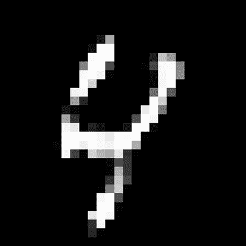

在低分辨率手写数字上很难展示 GAN 的强大功能，但你可能会发现这些生成结果比 VAE 稍好一些。你可能还会发现模型在训练过程中发生崩溃，开始收敛到糟糕的生成结果。训练 GAN 很有趣，但在实践中可能很困难。你应该探索更复杂的 GAN 实现和训练技术，以学习如何将低分辨率数字生成转变为高分辨率、照片级真实感的图像。

## 无监督学习实践

在本章节中，你已经从深度生成模型的角度了解了一些关于深度无监督学习的知识。你从使用自动编码器压缩数据，进阶到使用 VAEs 生成数据，最后到使用 GANs 生成数据。你能够训练一些模型来生成看起来不错的、低分辨率的手写数字——这可能让你觉得很兴奋。但与此同时，你可能仍然在好奇像 DALL-E 这样的强大模型的秘密，以及学习 GANs、VAEs 和 Autoencoders 还有什么用处。在这一节中，你将更深入地探讨实际中的现代无监督学习。

### 无监督学习理论

Yann Lecun，深度学习的“教父”之一，曾将无监督学习——具体来说是自监督学习——与有监督学习和强化学习相比，称为“蛋糕”。换句话说，Lecun 认为无监督学习是机器学习中最重要的研究领域。更近期，Lecun 写道，自监督学习是智能的“暗物质”。^([\[40\]](#f_0081.xhtml#FOOTNOTE-40))

自监督学习可以被视为无监督学习的一个子集，因为它不提供标签。你在实际中看到的最常见的自监督模型是 `Transformer`。`Transformer` 模型在原始文本上学习建模语言，而不需要标签——文本中的 token 在预训练过程中充当标签。这消除了手动仔细标注数据集的需求，并指数级地增加了可用的训练数据规模。

从哲学角度来看，生成模型可以被视为无监督学习最纯粹的形式，甚至可能位于智能的核心。学习生成与某些分布相匹配的数据，比学习特定输入数据与标签之间的关系要强大得多。这也是为什么像 `Transformer` 这类预训练、自监督模型在实践中如此强大的原因。它们学习捕捉语言中的语义和语法关系——而不是某些特定词汇的出现是否映射到特定标签。

### 什么是最先进技术？

在学习了一点生成模型后，你可能会好奇还有哪些类型的生成模型，以及应该使用哪些。

或许当今最著名的生成模型是 `Stable Diffusion`。`Stable Diffusion` 是一个文本到图像模型，它利用潜在扩散（latent diffusion）。扩散是指从随机噪声开始，经过固定数量的时间步，逐步去噪图像的过程。

前向扩散过程逐步向输入图像添加噪声，直到图像基本上变成随机噪声。逆扩散过程学习将随机噪声映射回输入图像。

由于像 `Stable Diffusion` 这样的生成模型的成功，扩散模型近年来逐渐流行。在扩散模型出现之前，GANs 是生成模型的首选架构。在许多方面，GANs 仍然是实际中最常用的生成模型。

### 自动编码器、VAEs 和 GANs 的应用

那么，自动编码器、VAEs 和 GANs 等无监督模型在实际中有哪些具体应用？其实有很多，但在这一节中我们只介绍其中一小部分。我强烈建议你自行研究更多应用。你会发现，这些以及其他无监督模型在实践中极其有用。

#### 图像去噪

自动编码器的一个实际应用是 *图像去噪* [Gon16]。图像去噪是将噪声图像映射到干净图像的过程。通过向输入图像施加各种噪声，你可以训练自动编码器来消除故意和非故意的图像缺陷。

#### 超分辨率

超分辨率是一类增强输入图像分辨率的图像技术。GANs 已被成功应用于 *超分辨率* [LTHC17]。超分辨率本身在医学成像、显微成像等众多领域都有应用。

#### 异常检测

生成模型（如 VAEs 和 GANs）的一个独特应用是异常检测。异常检测是检测异常数据点的过程。例如，GANs 被用来在 *视网膜图像* [SSWS17] 中识别异常。因为像 GANs 这样的生成模型能够建模真实数据的样子，它们也能建模异常数据的样子。

## 结束语

在这一章中，你在 `Axon` 中实现了三种深度无监督学习和深度生成模型算法：自动编码器、变分自动编码器和生成对抗网络（GAN）。你在 `Axon` 中实现了自定义事件处理器，并写出了你的第一个自定义训练循环。你还使用了 `Axon` 的一些新层，如 `Axon.conv_transpose/3` 和 `Axon.resize/3`。

最后，你学习了理论与实践中的无监督学习和生成模型。你还了解了生成模型的最新状态以及生成模型在现实世界中的一些应用。

此时此刻，你已经掌握了关于深度学习和 `Axon` 的全部必要知识。你已经准备好使用任何规模的 Elixir 来在实际中运行机器学习模型。在下一章，你将深入一个实际的机器学习问题，并使用 `Nx`、`Axon` 和 `Phoenix` 将解决方案投入生产。

#### 注释

[\[39\]](#f_0078.xhtml#FNPTR-39)

: [`openai.com/dall-e-2/`](https://openai.com/dall-e-2/)

[\[40\]](#f_0080.xhtml#FNPTR-40)

: [`ai.facebook.com/blog/self-supervised-learning-the-dark-matter-of-intelligence/`](https://ai.facebook.com/blog/self-supervised-learning-the-dark-matter-of-intelligence/)

版权所有 © 2024, The Pragmatic Bookshelf。

# 第 3 部分

机器学习实践

# 第 13 章

将机器学习投入实践

在本书的这个阶段，你已经有经验将机器学习应用于多种不同的输入模态。你曾使用结构化数据、文本、图像、时间序列数据等进行工作。你了解如何使用监督学习和无监督学习算法，以及如何使用 `Nx`、`Axon` 和 `Livebook` 训练和验证模型。你正朝着成为熟练的 Elixir 机器学习工程师的方向迈进。现在唯一剩下的问题是：如何从 `Livebook` 过渡到在任何规模上运行机器学习？

在这一章中，你将学习如何使用 `Nx.Serving` 和 Elixir 的 Web 框架 `Phoenix` 来“运维”你的机器学习模型。^([\[41\]](#f_0090.xhtml#FOOTNOTE-41)) 你将创建一个基于机器学习的 Web 应用，并直观地了解在生产环境中需要考虑的各种因素。本章旨在作为机器学习运维（MLOps）的入门。机器学习运维是一个概括性术语，指代在生产环境中部署和监控机器学习模型的实践方法。本章介绍了一些基础内容，但如果你想寻找更全面的书籍，建议参考 Chip Huyen 的 *Designing Machine Learning Systems* [Huy22]。

## 决定使用机器学习

想象你被任务是改进本地读者的图书搜索体验。与其要求读者基于特定作者或他们喜欢的类别搜索，或记忆十进制系统，图书馆希望读者能够使用自然语言进行搜索。

在攻击此问题之前使用机器学习，你需要先决定是否真的应该使用机器学习而不是更传统的方法。机器学习是一种强大的工具，但如果你不加思考地将它应用于每一个问题，你就有可能构建出使用锤子敲钉子、螺丝刀钉螺丝的应用。

机器学习会带来一些成本，这些成本可能不值得与使用简单解决方案的好处进行比较。在决定是否使用机器学习时，没有一套适用于所有情况的指标或决策标准。你需要在特定的应用和业务目标的上下文中做出决定。

在决定机器学习与简单解决方案之间的选择时，需求往往模糊。如果你拆解上面的问题描述，你会得到一个单一的需求：“提升本地读者的图书搜索体验”。这不是一个好的需求。什么才算是“提升”呢？

如果没有具体的指标，很难做出明智的决定。此时，你可能会回到原点，思考成功是什么样子，并设定具体的指标和里程碑。了解机器学习应用的需求之一是知道要提出哪些问题。你应该为每个应用考虑一些常见事项，例如以下内容：

*   机器学习与简单解决方案在应用的关键绩效指标（KPI）方面有何比较？
*   该应用的计算和存储约束是什么？
*   该应用的开发和维护要求/约束是什么？
*   使用机器学习解决此问题在伦理上是否合适？

为了理解决策过程，你会在书籍搜索服务的上下文中考虑这些问题。但在此之前，你需要了解在使用和不使用机器学习时，你可以采用的可能方法：全文检索和语义检索。

### 全文检索 vs. 语义检索

如果你熟悉搜索应用，你的第一反应可能是选择全文检索功能，这些功能已内置在 `Postgres` 和 `Elasticsearch` 中。

全文检索是一种用于检索包含特定关键词文本的文档的检索技术。虽然全文检索对某些应用非常有效，但它给用户带来额外的负担——用户必须知道正确的关键词才能找到所需内容。全文检索无法捕捉文档的细微含义，因此在尝试为试图表达自己想要的内容的用户提供良好推荐时可能表现不佳。

另一种替代方案是使用语义检索。语义检索是一种基于语义意义检索文档的技术。与字面关键词匹配不同，语义检索会返回与用户查询所传达的意义最相似的结果。相较于全文检索，语义检索是一个强大的替代方案，因为它让用户可以使用自然语言表达需求，而无需依赖关键词的凑巧组合。语义检索依赖于能够准确表示文档和查询意义的模型。实际上，语义检索通常依赖于机器学习和向量数据库的结合。

向量数据库是专为存储、检索和搜索密集向量表示而优化的。但为什么向量数据库适用于语义检索？向量从哪里来？

回顾 *Tokenizing and Vectorizing in Elixir*，词嵌入为句子中的单词提供数学意义。要对文本进行机器学习，你需要一种将文本转换为向量表示的方法。词嵌入在单词层面完成这种转换。更强大的基于变换器的模型则能在句子层面进行转换。这意味着你可以创建捕捉整句话含义的嵌入，而非仅捕捉单个单词的含义。语义检索因此使得用户能够更自然地表达需求，而非依赖关键词搜索。例如，用户可以输入句子：“一个以殖民城镇为背景的惊悚故事”，而不是搜索精心挑选的关键词如“惊悚”“谋杀谜案”“历史”。

正是在这里向量数据库发挥作用。你的向量数据库存储的是由某些机器学习模型生成的书籍含义向量。你可以用另一个向量进行查询，向量数据库会返回与查询向量最相近的书籍。在向量搜索中，“最相近”可以用多种方式衡量，因为可以以多种方式计算两个向量之间的距离。为了简化概念，假设你的向量数据库中每本书的向量都在二维空间中表示。如果你在二维空间中绘制这张图，可能会看起来像这样：

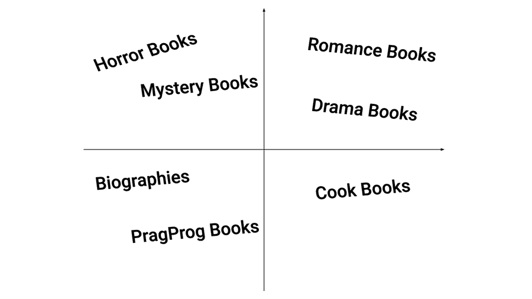

请注意，在二维空间中，恐怖类书籍更靠近谜案类书籍，传记更靠近 PragProg 技术类书籍，以此类推。在视觉上，相似度较高的书籍会被聚集在一起。例如，如果你查询“最佳的以 Elixir 为语言的遗传算法书籍”，并用与嵌入每本书含义的相同模型对该查询进行处理，结果可能如下：

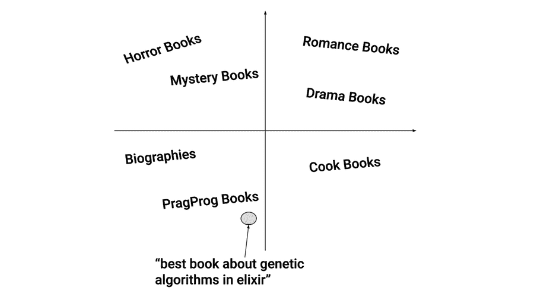

查询在嵌入空间中非常接近 PragProg 类别的书籍，因为该集合包含 [*Genetic Algorithms in Elixir* [Mor21]](#f_0098.xhtml#d1806e1231)。如果你测量集合中每本书与查询之间的直线距离，就可以返回在语义意义上最相近的书籍——即在嵌入空间中最靠近的书籍。这正是向量数据库所做的，但它使用了高级技巧来实现对数十亿个嵌入一次性快速搜索。

### 机器学习与简单解决方案的比较

现在你已经了解了在设计图书搜索应用时的两种主要选项，你需要知道在公平比较解决方案时应提出哪些问题。首先，你需要关注关键绩效指标（KPI）。KPI 是衡量应用成功的指标。在应用上下文中确定 KPI 往往是一项困难的任务。例如，在你的图书搜索服务中，如何衡量用户满意度？

通常，你需要选择与整体目标相匹配的辅助指标。注意，仔细思考这些辅助指标很重要——你不想优化到错误的目标上。例如，假设你设计了一个防欺诈应用，你可能认为最大化拒绝的欺诈交易数量是最好的，但你会很快发现合法客户的交易被错误拒绝而感到愤怒。实际上，为了提供良好的用户体验，你需要在接受合法交易和拒绝欺诈交易之间取得平衡。

为推荐系统（如你的图书搜索服务）选择指标非常困难。以下是一些你可能会考虑的指标：

*   查找书籍的查询次数
*   浏览寻找书籍的总时间
*   前 N 条结果被点击的比率

这些都不一定比其他任何一个更好。它们都可能存在有问题的混淆变量。目前，假设图书馆将“查找书籍所需的查询数量”作为其主要指标。

### 什么是应用的计算和存储限制？

某些机器学习方法会带来巨大的计算和存储需求。语义检索依赖于变换器——你在第 11 章中使用的深度学习模型，*Model Everything with Transformers*。

变换器模型通常计算成本高昂。根据模型的强度，你可能需要依赖 GPU 计算来在生产环境中提供良好的体验。否则，你的应用会因大型模型（如变换器）的推理开销而出现相对高延迟。

你应该始终考虑应用的计算和存储限制，尤其是关于延迟方面。如果你无法在生产环境中提供低延迟推理所需的资源规模，那么即使拥有世界上最强大的机器学习模型，用户体验也会很差。

此外，对于某些机器学习应用（如语义检索），你还需要考虑应用的存储限制。记住，你需要为图书馆中的每本书存储一个稠密向量，这会产生存储成本。但与全文检索相比，这个存储成本可能实际上更低。向量搜索工具通常支持压缩索引，使其能够高效扩展大小。此外，表示一本书的向量本身就是对书中文本的压缩表示。与全文检索相比，语义检索在存储方面会有一些好处。

对于这个示例，你可以假设不存在显著的计算和存储限制，会阻止你使用语义检索或全文检索中的任何一种。

### 什么是应用的开发和维护限制？

与替代方案相比，基于机器学习的解决方案通常会引入显著的开发和维护成本。机器学习在生产环境中的应用仍是相对新颖的概念，相关工具和最佳实践仍在不断演进。与传统软件不同，机器学习模型在生产中会衰减——这现象称为模型漂移（model drift）。

如果你在生产环境中不对模型进行新数据的再训练，它会随时间缓慢退化，为用户带来更差的体验。模型漂移通常发生，因为模型在生产中接触到的数据分布会逐渐与模型在训练时接触到的数据分布发生漂移。

此外，在传统软件中，你可以编写测试来帮助确保软件的正确性，但机器学习领域并非如此。生产中的模型需要持续监控，以验证其预测仍然良好。即使有持续监控，判断模型何时开始退化也可能很困难。

最后，构建机器学习系统所涉及的独特组合——数据、代码和模型——使得开发变得极其困难。机器学习项目常常演变成不可维护的代码、未版本化的数据以及几乎不起作用的模型的噩梦。在决定在生产环境中使用机器学习时，保持自律、从简单的 MLOps 方案开始，并根据需要逐步增加复杂度是很重要的。

在图书查询应用的上下文中，机器学习方法的一些开发和维护成本会因可以使用预训练模型而被部分抵消。不过，部署任何机器学习到生产环境仍然存在一定的开发开销——尽管 Elixir 可能让它变得更容易。

### 选择方案

鉴于需要构建一个能帮助用户用更少的查询找到书籍的书籍搜索工具，你需要在机器学习基于的解决方案（语义检索）和笨拙的方案（全文检索）之间做出选择。在计算和存储成本方面，机器学习方案通常会有额外的计算开销。两种方案的存储开销大致相当。在开发和维护成本方面，机器学习方案的开销更大。但通过使用预训练模型，这一开销可以得到缓解。决定主要取决于你的 KPI——查找书籍所需的查询数量。

在 KPI 的语境下，语义检索通常表现更好，因为它不依赖用户知道确切的关键词或部分关键词。语义检索允许用户自然表达他们的需求，并找到最相似的表示。语义检索还为未来的迭代打开了可能性，即根据用户在图书馆中的偏好训练更好的模型。

所以，看来你最终需要机器学习。到现在，你应该已经非常熟悉为这个应用需要的所有工具。你有 `Nx` 用于一般数据操作，`Axon` 和 `Bumblebee` 用于神经网络任务，以及 `EXLA` 用于硬件加速。但关于向量搜索呢？

幸运的是，`Postgres` 有一个扩展叫 `pgvector`，^([\[42\]](#f_0090.xhtml#FOOTNOTE-42)) 可以让你直接在现有数据库上构建向量搜索工具。这使得保持向量存储与数据库同步变得容易，因为数据就在一起。最重要的是，它提供了一个 `Ecto` 实现的 `pgvector`。这意味着你可以将向量搜索直接嵌入到现有的 `Ecto` 查询中。

有了攻击计划，现在是创建你的应用了。

### 设置应用

要开始你的书籍搜索应用，使用 `mix phx.new` 创建一个新的 `Phoenix` 项目：

```
mix phx.new book_search
```

接下来，运行以下命令切换到项目根目录并列出其内容：

```
cd book_search && ls
```

该命令的输出将如下所示：

```
assets _build config deps lib mix.exs mix.lock priv README.md test
```

然后，你需要安装 `pgvector`。首先在 `mix.exs` 中将 `pgvector` 添加为依赖：

```
{:pgvector, "~> 0.2.0"}
```

接着运行 `mix deps.get`。然后创建一个新文件 `lib/postgrex_types.ex` 并添加以下代码：

```
Postgrex.Types.define(
  BookSearch.PostgrexTypes,
  [Pgvector.Extensions.Vector] ++ Ecto.Adapters.Postgres.extensions(),
  []
)
```

接着，在 `config/config.exs` 中添加以下内容：

```
config :book_search, BookSearch.Repo, types: BookSearch.PostgrexTypes
```

然后，使用 `mix ecto.gen.migration create_vector_extension` 创建一个新的迁移，并添加以下内容：

```
defmodule BookSearch.Repo.Migrations.CreateVectorExtension do
  use Ecto.Migration

  def up do
    execute "CREATE EXTENSION IF NOT EXISTS vector"
  end

  def down do
    execute "DROP EXTENSION vector"
  end
end
```

最后，运行 `mix ecto.migrate`。如果没有错误，说明 `pgvector` 已正确安装。如果在安装过程中遇到问题，可能需要参考 `pgvector` 的安装说明^([\[43\]](#f_0090.xhtml#FOOTNOTE-43))。

安装 `pgvector` 后，现在可以开始创建应用资源。为了简化操作，你的图书搜索应用将围绕单一资源：图书。运行以下代码即可生成所有所需的图书资源：

```
mix phx.gen.html Library Book books author:string title:string description:text embedding:binary
```

`mix phx.gen.html` 是一个生成器，用于为你的图书资源创建新的 HTML 资源，包括视图、控制器等。该生成器还会创建一个 `Library` 上下文、一个 `Book` Schema 和一个 `books` 数据库表。`Book` Schema 包含作者、标题、描述以及二进制嵌入。嵌入是一个字节数组，用于表示图书的稠密向量表示。你将使用该嵌入在应用中执行向量搜索。运行该命令后，会看到以下输出：

```
creating lib/book_search_web/controllers/book_controller.ex
creating lib/book_search_web/controllers/book_html/edit.html.heex
creating lib/book_search_web/controllers/book_html/index.html.heex
creating lib/book_search_web/controllers/book_html/new.html.heex
creating lib/book_search_web/controllers/book_html/show.html.heex
creating lib/book_search_web/controllers/book_html/book_form.html.heex
creating lib/book_search_web/controllers/book_html.ex
creating test/book_search_web/controllers/book_controller_test.exs
creating lib/book_search/library/book.ex
creating priv/repo/migrations/20230517143726_create_books.exs
creating lib/book_search/library.ex
injecting lib/book_search/library.ex
creating test/book_search/library_test.exs
creating test/support/fixtures/library_fixtures.ex
injecting test/support/fixtures/library_fixtures.ex

Add the resource to your browser scope in lib/book_search_web/router.ex:
resources "/books", BookController

Remember to update your repository by running migrations:
$ mix ecto.migrate
```

现在，你需要修改迁移文件，将嵌入类型改为 `pgvector` 向量类型。编辑生成的迁移文件，使其如下所示：

```
defmodule BookSearch.Repo.Migrations.CreateBooks do
  use Ecto.Migration

  def change do
    create table(:books) do
      add :author, :string
      add :title, :string
      add :description, :text
      add :embedding, :vector, size: 384
      timestamps()
    end
  end
end
```

注意，我们在 `:embedding` 字段中使用 `:vector` 并指定 `size: 384`，而不是 `:binary`。这告诉 `Postgres` 我们正在创建一个向量列，预计其维度为 384。接下来，你需要编辑 `Book` Schema 以反映向量类型的使用：

```
schema "books" do
  field :author, :string
  field :description, :string
  field :embedding, Pgvector.Ecto.Vector
  field :title, :string
  timestamps()
end
```

接下来，你需要设置数据库。可以使用 `mix ecto.setup` 将数据库创建、迁移和 seeding 合并为一步，如下所示：

```
mix ecto.setup
```

这段代码会创建数据库、运行迁移（应仅有一条），并运行 `priv/repo/seeds.exs` 中的 seed 文件以初始化数据库。

设置数据库后，在 `book_search_web/router.ex` 中添加新的资源路由，如下所示：

```
get "/", PageController, :index
resources "/books", BookController
```

这段代码会为图书资源创建 CRUD 路由。你可以使用 `mix phx.routes` 检查路由：

```
mix phx.routes
```

输出示例：

```
GET / BookSearchWeb.PageController :home
GET /books BookSearchWeb.BookController :index
GET /books/:id/edit BookSearchWeb.BookController :edit
GET /books/new BookSearchWeb.BookController :new
GET /books/:id BookSearchWeb.BookController :show
POST /books BookSearchWeb.BookController :create
PATCH /books/:id BookSearchWeb.BookController :update
PUT /books/:id BookSearchWeb.BookController :update
DELETE /books/:id BookSearchWeb.BookController :delete
GET /dev/dashboard Phoenix.LiveDashboard.PageLive :home
GET /dev/dashboard/:page Phoenix.LiveDashboard.PageLive :page
GET /dev/dashboard/:node/:page Phoenix.LiveDashboard.PageLive :page
GET /dev/mailbox Plug.Swoosh.MailboxPreview []
WS /live/websocket Phoenix.LiveView.Socket
GET /live/longpoll Phoenix.LiveView.Socket
POST /live/longpoll Phoenix.LiveView.Socket
```

现在，运行 `mix phx.server` 启动应用：

```
mix phx.server
```

访问 `http://localhost:4000` 确认服务器启动成功，若一切正常，将看到欢迎页面。


成功！应用已启动，现在可以开始添加模型。

## Integrating Nx with Phoenix

现在，运行 `mix deps.get` 以获取依赖：

```
mix deps.get
```

创建新文件 `book_search/model.ex`，该文件用于加载、服务和执行推理：

```
defmodule BookSearch.Model do
  @moduledoc """
  Provides model loading, serving, and inference for the book search application.
  """

  @hf_model_repo "intfloat/e5-small-v2"

  defp load() do
    {:ok, model_info} = Bumblebee.load_model({:hf, @hf_model_repo})
    {:ok, tokenizer} = Bumblebee.load_tokenizer({:hf, @hf_model_repo})

    {model_info, tokenizer}
  end
end
```

此函数利用 Elixir 的 `Bumblebee` 库从 HuggingFace 加载模型。你应当在第 11 章中已经熟悉 `Bumblebee`，*Model Everything with Transformers*。

`Bumblebee` 是用于使用预训练模型和任务的库，适用于常见的应用场景，如图像分类、文本生成等，同时还能导入专为相似度搜索设计的预训练模型。例如，你正在使用的模型来自 HuggingFace^([\[44\]](#f_0090.xhtml#FOOTNOTE-44))，专为句子相似度设计，意味着它是专门用于搜索和聚类任务进行训练的。

`load/0` 函数会返回一个元组，包含模型和分词器。模型是一个包含 `{model, params}` 的元组，分词器是一个 `Bumblebee` 分词器结构体。你稍后会使用这两者来构建推理管道。

接下来，创建一个名为 `serving/1` 的函数：

```
def serving(opts \\ []) do
  opts = Keyword.validate!(opts, [
    :defn_options, sequence_length: 64, batch_size: 16
  ])

  {model_info, tokenizer} = load()

  Bumblebee.Text.TextEmbedding.text_embedding(model_info, tokenizer, [
    defn_options: opts[:defn_options],
    compile: [
      sequence_length: opts[:sequence_length],
      batch_size: opts[:batch_size]
    ]
  ])
end
```

此函数使用 `Bumblebee` 提供的预构建服务管道来执行文本嵌入。

在机器学习领域，你会经常听到“serving”这个词。在 `Nx` 中，serving 是构建推理管道的简单抽象，包含预处理、推理和后处理。如果你从零开始编写这个 serving，它可能会像下面这样：

```
def serving(opts \\ []) do
  opts = Keyword.validate!(opts, [
    :defn_options, sequence_length: 64, batch_size: 16
  ])

  {model_info, tokenizer} = load()
  {_, predict_fn} = Axon.build(model)

  Nx.Serving.jit(fn input ->
    pad_size = opts[:sequence_length] - Nx.axis_size(input, 1)
    predict_fn.(params, Nx.Batch.pad(input, pad_size))
  end)
  |> Nx.Serving.client_preprocessing(fn text ->
    tokenized = Bumblebee.apply_tokenizer(tokenizer, text)
    {Nx.Batch.stack(tokenized), :meta}
  end)
  |> Nx.Serving.client_postprocessing(&elem(&1, 0))
end
```

此函数之所以被称为 `serving/1`，是因为它返回了你的 `Nx.Serving` 管道。`Nx.Serving` 模块包含构建 servings 的函数，如这里所示，包括 `Nx.Serving.jit/1` 和 `Nx.Serving.client_preprocessing/1`。但为什么需要专门的 serving 管道？为何不能直接调用模型的 `predict_fn`？

有几个原因，但最重要的原因是，servings 通过动态批处理最大化硬件利用率。深度学习模型昂贵，但它们也能利用批量推理。推理延迟并不随批量大小线性增长，事实上，某些加速器（如 TPU）要求批量大小至少为 128，并在执行推理前会对输入进行填充。如果不使用最大可能的批量大小执行每一次推理，就是浪费资源。

动态批处理是利用可用资源的一种方式。当你启动一个 `Nx.Serving` 进程时，它会在后台启动一个队列。随着你向 serving 进程发起推理请求，`Nx.Serving` 会自动将重叠的请求批量处理，然后分发回调用进程。这意味着，如果你在同一时间与另一个人发起推理请求，两者的请求会在同一批次中被执行，然后分别返回，仿佛是单独执行的。动态批处理对于在生产环境中有效扩展机器学习推理至关重要。

如 `serving/1` 中所示，每个 `Nx.Serving` 都以对 `Nx.Serving.jit/1` 或 `Nx.Serving.new/1` 的调用开始。`Nx.Serving.jit/1` 接收一个一元的创建函数，该函数返回一个即时编译的推理函数。在这个例子中，`Nx.Serving.jit/1` 创建了一个编译后的编码函数。你的实际推理函数接受 serving 输入并返回编码后的输出。在调用 `encoding_fun/2` 之前，需要先调用 `Nx.Batch.pad/2`。`Nx.Batch.pad/2` 是一个帮助函数，用于将输入填充到由编译函数指定的所需批量大小。如果动态批处理队列无法达到所需批量大小，`Nx.Batch.pad/2` 会将输入填充到所需尺寸。

除了在 `Nx.Serving.jit/1` 中指定的推理函数外，你还可以使用 `Nx.Serving` 函数指定客户端预处理和后处理函数。在这个简单示例中，你只需调用 `Bumblebee.apply_tokenizer/2` 即可。

预处理是指在输入到达推理步骤之前，你想执行的任何工作。通常，它会将原始数据转换为清理后的张量。预处理，就像推理一样，也在后台以批量方式执行。虽然在服务器端进行预处理很常见，但对于某些应用，在客户端进行预处理也很合理，以避免服务器被过多工作饱和。例如，你可以使用 JavaScript canvas API 调整图片大小，以节省服务器资源。

每个客户端预处理函数接受原始输入并返回一个元组 `{processed, meta}`。额外的元数据会转发给后处理，因为在某些任务中，需要访问原始输入以进行后处理。

`Bumblebee` 已经为你实现了许多常见的机器学习管道，从而免除你关注内部细节的复杂性。对于特定应用，你可能需要或需要实现自己的自定义 serving 管道，因此理解其工作原理很重要。

在实现完 serving 后，你可以将以下代码添加到你的应用监督树中：

```
{Nx.Serving,
 serving: BookSearch.Model.serving(defn_options: [compiler: EXLA]),
 batch_size: 16,
 batch_timeout: 100,
 name: BookSearchModel}
```

这段代码将使用你在 `BookSearch.Model.serving/1` 中定义的 serving 启动一个新的 `Nx.Serving` 进程。该进程名为 `BookSearchModel`，因此你可以在稍后通过名称进行推理。其他两个选项，`batch_size` 和 `batch_timeout`，控制 `Nx.Serving` 中使用的批处理队列。

`batch_size` 指的是队列在向预测派发前能接受的最大批量大小。`batch_timeout` 指的是队列在收到第一个推理请求后等待填充到最大批量大小所需的时间。在此示例中，你的模型在达到批量大小 16 或自接收第一个推理请求后 100ms 之内（取先发生者）进行推理。根据你的应用、模型和资源，你可能需要调整这些配置选项以最大化性能。

在应用中运行了 `Nx.Serving` 进程后，你可以使用它来进行推理。为此，在 `BookSearch.Model` 模块中添加 `predict/1` 方法：

```
def predict(text) do
  Nx.Serving.batched_run(BookSearchModel, text)
end
```

该函数仅是对 `Nx.Serving.batched_run/2` 方法的包装。`Nx.Serving.batched_run/2` 使用给定的进程和输入执行动态批量推理。在此情况下，`BookSearch.Model.predict/1` 调用会返回以 `text` 参数提供的输入文本的嵌入式表示。

为了验证模型已正确启动，请重启 Phoenix 服务器：

```
iex -S mix phx.server
```

你可能会在应用启动时注意到轻微的延迟——这实际上是 `EXLA` 在后台编译并加载模型。

接下来，在 IEx 中运行以下代码：

```
iex(1)> BookSearch.Model.predict("a good book on machine learning")
```

几乎即时会看到以下输出：

```
%{embedding: #Nx.Tensor<
  f32[1][384]
  EXLA.Backend<host:0, 0.2486389031.1855586325.245579>
  [
  ]
  [-0.01250604260712862, 0.027123818174004555, ...]
  ]
>}
```

成功！你已在 `Phoenix` 应用中运行一个可工作的机器学习模型。现在你可以将文档和查询进行嵌入，但目前仍无法进行搜索。在实现搜索功能之前，你需要一些种子数据。

## 为数据库添加种子数据

在模型就绪后，是时候用图书馆的书籍对数据库进行种子化。在此之前，需要对生成的书籍资源代码进行一些微调。

首先，修改 `BookSearch.Book.changeset/2` 以匹配以下内容：

```
@doc false
def changeset(book, attrs) do
  book
  |> cast(attrs, [:author, :title, :description, :embedding])
  |> validate_required([:author, :title, :description])
end
```

注意已将 `:embedding` 从 `attrs` 的必填参数中移除。由于你会根据书籍属性计算嵌入式，不想在前期就必须手动传入它。

接下来，在 `BookSearch.Book` 中添加 `put_embedding/1` 函数：

```
@doc false
def put_embedding(%{changes: %{description: desc}} = book_changeset) do
  %{embedding: embedding} = BookSearch.Model.predict(desc)
  put_change(book_changeset, :embedding, embedding)
end
```

这段代码根据描述对书籍进行嵌入，并将嵌入式加入 changeset。可以直接在 changeset 中使用 `Nx` 张量类型；Elixir `pgvector` 扩展能够直接将 `Nx` 张量序列化为 PostgreSQL 的 `pgvector` 类型。

最后，在 `BookSearch.Library` 中修改 `create_book/1` 方法以匹配以下实现：

```
def create_book(attrs \\ %{}) do
  book =
    %Book{}
    |> Book.changeset(attrs)
    |> Book.put_embedding()

  Repo.insert(book)
end
```

该方法根据给定的书籍属性创建 changeset，嵌入书籍，然后将其插入数据库。

在对库进行种子化之前，需要更新 HTML 视图，移除对嵌入式的引用。因为嵌入式内部以原始二进制表示，在网页上渲染效果不佳，且用户无需编辑它们，所以不应在表单中包含它们。

移除以下代码在各文件中的引用：

```
# book_form.html.heex
<input field={{f, :embedding}} type="text" label="Embedding" />

# show.html.heex
<:item title="Embedding"><%= @book.embedding %></:item>

# index.html.heex
<:col let={book} label="Embedding"><%= book.embedding %></:col>
```

现在，你已准备好使用真实数据。用于表示你图书馆的数据集来自 David Bamman 的书籍摘要数据库。^([\[45\]](#f_0090.xhtml#FOOTNOTE-45)) 运行以下命令下载并解压数据库：

```
cd priv/repo
wget https://www.cs.cmu.edu/~dbamman/data/booksummaries.tar.gz
tar -xvf booksummaries.tar.gz
rm booksummaries.tar.gz
```

该数据库以制表符分隔的每行记录形式存储书籍信息。为了将此文件解析为可用于种子数据库的格式，可以使用 `Explorer`。具体需要用 `Explorer` 解析输入文件，提取作者、标题和描述，然后将每本书添加到数据库。为此，在 `priv/repo/seeds.exs` 文件中添加以下代码：

```
path = "priv/repo/booksummaries/booksummaries.txt"

df = Explorer.DataFrame.from_csv!(path, delimiter: "\t", header: false)
df = df[["column_3", "column_4", "column_7"]]
df = Explorer.DataFrame.rename(df, ["author", "title", "description"])

df
|> Explorer.DataFrame.to_rows()
|> Enum.each(&BookSearch.Library.create_book/1)
```

该脚本解析书籍摘要文件，从每本书中提取作者、标题和描述。随后将 `DataFrame` 转换为映射列表，并使用 `BookSearch.Library.create_book/1` 为每本书创建数据库条目。执行以下命令：

```
mix run priv/repo/seeds.exs
```

经过一段时间，脚本将完成运行，你的数据库已成功种子化为图书库。接下来，需要实现搜索功能。

对于生产级应用，种子数据库的过程可能需要定期执行，当新书加入时再次运行。可以考虑使用 `Oban`^([\[46\]](#f_0090.xhtml#FOOTNOTE-46)) 结合 `FLAME`^([\[47\]](#f_0090.xhtml#FOOTNOTE-47)) 来定期在独立机器上执行昂贵的机器学习管道。使用 `FLAME`，你可以启动一台 GPU 机器运行长时间机器学习任务，而不会影响生产服务器。

## 构建实时搜索 LiveView

此时，你已拥有已种子的数据库和用于生成书籍嵌入的机器学习模型。最终需求是实现前端搜索应用，使用 `LiveView` 实现。

首先，创建新文件 `book_search_web/live/search_live/index.ex` 并添加以下代码：

```
defmodule BookSearchWeb.SearchLive.Index do
  use BookSearchWeb, :live_view

  alias BookSearch.Library

  @impl true
  def mount(_params, _session, socket) do
    {:ok, socket}
  end

  @impl true
  def render(assigns) do
    ~H"""
    <h1>Welcome to search</h1>
    """
  end
end
```

这段代码构建了一个基本的 `LiveView` 草稿，渲染欢迎标题，除此之外不包含其他功能。

在路由中添加 `LiveView` 路由：

```
live "/search", SearchLive.Index, :index
```

启动 `Phoenix` 应用：

```
iex -S mix phx.server
```

如果一切顺利，当你访问 `https://localhost:4000/search` 时，会看到默认的 `Phoenix` 欢迎页面。

你的搜索应用由一个简单的搜索表单和搜索结果组成。编辑 `render/1` 以匹配以下内容：

```
@impl true
def render(assigns) do
  ~H"""
  <div class="w-full flex flex-col space-y-2">
    <.search_form query={@query} />
    <div :if={@query}>
      <h2 class="text-md">
        <span class="font-semibold">Searching For:</span>
        <span class="italic"><%= @query %></span>
      </h2>
    </div>
    <div>
      <.search_results results={@results} />
    </div>
  </div>
  """
end
```

这段代码会渲染 `search_form` 和 `search_results` 组件。`search_results` 需要一个名为 `@results` 的赋值，它表示书籍搜索结果。你需要编辑 `mount/3` 方法，在最开始为 `:results` 赋值一个空列表，以确保所有内容正确渲染：

```
@impl true
def mount(_params, _session, socket) do
  {:ok, assign(socket, :results, [])}
end
```

接下来，你需要实现搜索表单和结果组件。暂时可以将它们实现为函数组件：

```
defp search_form(assigns) do
  ~H"""
  <div class="w-full">
    <form
      id="search"
      phx-change="validate_search"
      phx-submit="search_for_books"
      class="w-full flex space-x-2"
    >
      <input
        placeholder="search for a book"
        type="text"
        name="search"
        value={@query}
        id="search"
        class={["block w-full rounded-md border-gray-300 pr-12",
          "shadow-sm focus:border-indigo-500 focus:ring-indigo-500",
          "sm:text-sm"]}
      />
      <button
        type="submit"
        class={["inline-flex items-center rounded-md border",
          "border-transparent shadow-sm text-white",
          "bg-indigo-600 px-3 py-2 text-sm font-medium leading-4",
          "hover:bg-indigo-700 focus:outline-none focus:ring-2",
          "focus:ring-offset-2"]}
      >
        Search
      </button>
    </form>
  </div>
  """
end

defp search_results(assigns) do
  ~H"""
  <div class="w-full">
    <ul role="list" class="-my-5 divide-y divide-gray-200">
      <%= for result <- @results do %>
      <li class="py-5">
        <div
          class="relative focus-within:ring-2
          focus-within:ring-indigo-500"
        >
          <h3 class="text-sm font-semibold text-gray-800">
            <a
              href={~p"/books/#{result.id}"}
              class="hover:underline
              focus:outline-none"
            >
              <span class="absolute inset-0" aria-hidden="true"></span>
              <%= result.title %>
            </a>
          </h3>
          <p class="mt-1 text-sm text-gray-600 line-clamp-2">
            <%= result.author %>
          </p>
        </div>
      </li>
      <% end %>
    </ul>
  </div>
  """
end
```

`search_form` 是一个相对简单的表单，包含一个输入框和提交按钮。提交时，它会触发 `search_for_books` 事件。`search_for_books` 事件会将补丁推送到 URL，你可以在 `handle_params` 中处理该补丁以根据输入查询实际搜索书籍。`search_results` 是一个列表，用于渲染 `results` 赋值中每个元素的列表项。如你所想象，`search_for_books` 会更新 `results` 赋值，而 `search_results` 会在每次查询后重新渲染新的结果。

现在，实现 `LiveView` 的事件处理器来处理表单事件：

```
@impl true
def handle_event("validate_search", %{"search" => _query}, socket) do
  {:noreply, socket}
end

def handle_event("search_for_books", %{"search" => query}, socket) do
  {:noreply, push_patch(socket, to: ~p"/search?q=#{query}")}
end
```

为了简化，`validate_search` 是一个无操作函数。但你可以实现任何验证逻辑。`search_for_books` 会将查询参数推送到 URL。

接下来，实现 `handle_params/3`，如下所示：

```
@impl true
def handle_params(%{"q" => query}, _uri, socket) do
  results = Library.search(query)

  socket =
    |> assign(:results, results)
    |> assign(:query, query)

  {:noreply, socket}
end

def handle_params(_params, _uri, socket) do
  {:noreply, assign(socket, :query, nil)}
end
```

`handle_params/3` 会执行搜索并将结果赋值给 `:results` 和查询赋值给 `:query`，这两个变量将在 `LiveView` 中渲染。`handle_params/3` 会分发到 `Library.search`，你仍需实现该函数。为此，打开 `book_search/library.ex` 并添加以下 `search/1` 方法：

```
@doc """
Searches for books.
"""
def search(query) do
  %{embedding: embedding} = BookSearch.Model.predict(query)

  Book
  |> order_by([b], l2_distance(b.embedding, ^embedding))
  |> limit(5)
  |> Repo.all()
end
```

该函数利用模型对查询进行嵌入，然后在搜索索引中查找与查询嵌入最接近的五个向量。注意，你可以在 `Ecto` 查询中直接使用 `pgvector` 查询函数，如 `l2_distance`，它会计算查询嵌入与数据库中每个嵌入的距离，并按距离升序排序。距离越小，查询嵌入与书籍嵌入越相似。我们只返回前五本书籍并将其返回给应用前端。

完成后，你可以访问 `http://localhost:4000/search` 并查找特定书籍。运行搜索后，你会看到以下页面：

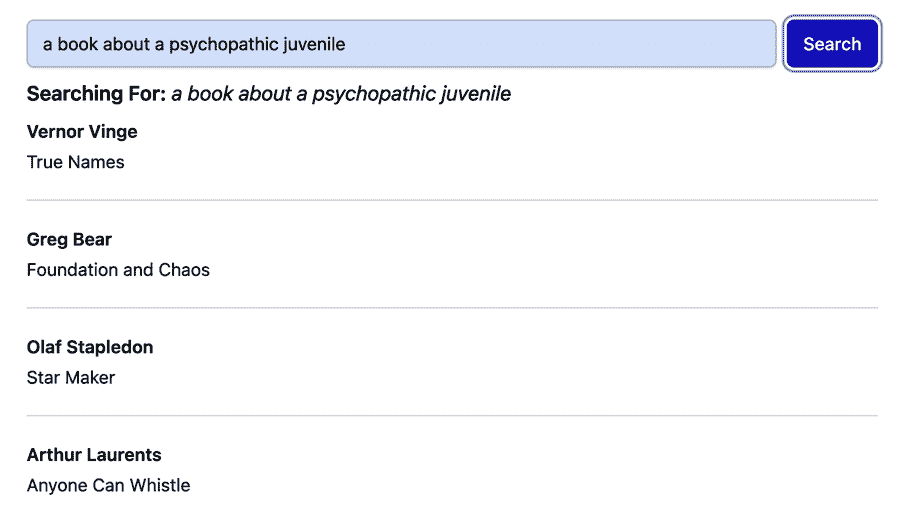

祝贺！你已成功使用 `Phoenix`、`Bumblebee` 和 `pgvector` 从零开始实现了一个语义搜索应用。

## 结束语

在这一章中，你从头到尾实现了一个语义搜索应用，使用了 `Phoenix`、`Bumblebee` 和 Elixir。你经历了决定在应用中何时以及何时不使用机器学习的过程。你学习了一些在设计机器学习应用时需要提出的重要问题。你使用 `Nx.Serving` 将机器学习管道封装为高性能、容错的推理管道。你了解了动态批量对机器学习性能的重要性，并看到 `Nx.Serving` 如何帮助你实现动态批量。

此外，你使用 `pgvector` 实现了自己的向量索引和搜索功能，从而学习了一些关于向量搜索的知识。

最后，你将所有的机器学习组件集成到普通的 `Phoenix` 应用中。正如你可能所见，将机器学习集成到 `Phoenix` 应用中并不需要特殊的依赖或技巧。你只需将 Elixir 的机器学习库添加到应用中，它就能直接工作。

借助本章，你已经作为 Elixir 机器学习工程师完成了全程。你现在知道如何使用 Elixir 机器学习生态系统中的许多库来解决各种数据模态上的挑战性问题，并且知道如何将模型部署到使用 `Phoenix` 的生产应用中。

在下一章中，你将结束你的旅程，并发现在机器学习旅程中可以采取的进一步步骤。

#### Footnotes

[\[41\]](#f_0084.xhtml#FNPTR-41)

: [`phoenixframework.org`](https://phoenixframework.org)

[\[42\]](#f_0085.xhtml#FNPTR-42)

: [`github.com/pgvector/pgvector`](https://github.com/pgvector/pgvector)

[\[43\]](#f_0086.xhtml#FNPTR-43)

: [`github.com/pgvector/pgvector#installation-notes`](https://github.com/pgvector/pgvector#installation-notes)

[\[44\]](#f_0087.xhtml#FNPTR-44)

: [`huggingface.co/intfloat/e5-small-v2`](https://huggingface.co/intfloat/e5-small-v2)

[\[45\]](#f_0088.xhtml#FNPTR-45)

: [`people.ischool.berkeley.edu/~dbamman/`](https://people.ischool.berkeley.edu/~dbamman/)

[\[46\]](#f_0088.xhtml#FNPTR-46)

: [`hexdocs.pm/oban/Oban.html`](https://hexdocs.pm/oban/Oban.html)

[\[47\]](#f_0088.xhtml#FNPTR-47)

: [`fly.io/blog/rethinking-serverless-with-flame/`](https://fly.io/blog/rethinking-serverless-with-flame/)

Copyright © 2024, The Pragmatic Bookshelf.

# Chapter 14

That’s a Wrap

Throughout this book, you’ve implemented a number of different machine learning models in `Nx`, `Axon`, `Bumblebee`, and `Scholar`. You learned how to manipulate data with `Nx`, train models with `Axon`, and integrate them into your `Phoenix` applications. You discovered how to take advantage of the vast ecosystem of pre-trained models with `Bumblebee`. You know everything you need to know to create your own models on your own data and integrate them into your own applications. You’re ready to take on the challenges of machine learning in the real world.

While this book covered a breadth of topics, it’s by no means comprehensive. Machine learning is a vast field. You can’t possibly learn everything about machine learning from a single book. In this chapter, you’ll get up to speed with the current trends in machine learning and discover some of the interesting machine learning topics this book wasn’t able to cover.

## Learning from Experience

One of the largest subfields in machine learning this book didn’t cover is `reinforcement learning`. `Reinforcement learning` is concerned with creating agents capable of making intelligent actions and learning from reward signals in an environment. `Reinforcement learning` is fundamentally different from both supervised and unsupervised learning. In a `reinforcement learning` problem, there’s no concept of labeled or unlabeled data. Instead, the learning process is entirely online as an agent interacts with its environment.

The most common training ground for `reinforcement learning` agents is video games. For example, the Arcade Learning Environment^([\[48\]](#f_0096.xhtml#FOOTNOTE-48)) is an environment designed to allow researchers and hobbyists to create AI agents capable of interacting with Atari 2600 games. `Reinforcement learning` can be credited with some of the superhuman demonstrations of artificial intelligence in the last decade. For example, AlphaGo, the model from Deep Mind which is capable of playing Go at superhuman levels, was trained with `reinforcement learning`.

In addition to video games, `reinforcement learning` has proven to be a fruitful paradigm in robotics. As it’s difficult to collect data and train robots on performing proper locomotion in a supervised manner, researchers often train locomotion via `reinforcement learning`. The success of `reinforcement learning` has dramatically increased with a turn toward methods that combine `reinforcement learning` with deep learning. Most state-of-the-art `reinforcement learning` algorithms today rely on deep models.

`Reinforcement learning` is a rich field of research. If you’re interested in exploring `reinforcement learning` more, I recommend reading [*Reinforcement Learning* [SB92]](#f_0098.xhtml#d1806e1437) by Richard S. Sutton and Andrew G. Barto.

At the time of this writing, the hottest model in machine learning is `ChatGPT`.^([\[49\]](#f_0096.xhtml#FOOTNOTE-49)) `ChatGPT` is a large language model from OpenAI optimized for chat dialogue. `ChatGPT` is part of a growing trend of large language models trained with `reinforcement learning` on human feedback (RLHF). RLHF combines `reinforcement learning` with human ratings to optimize the parameters of the model. With lots of human feedback, you end up with a model capable of outputting text that aligns with what humans prefer.

Large language models are already great at modeling text. As you learned in Chapter 11, *Model Everything with Transformers*, large language models pre-trained on a causal language modeling task are great at predicting the next word in a sequence. Some [*research* [HBDF19]](#f_0098.xhtml#d1806e802) has shown that as large language models approach the optimal likelihood for a text generation task, they tend to devolve into repetition. What that means is that large language models are great at probabilistically modeling language. But being good at modeling language doesn’t mean you’re convincing to humans. `ChatGPT` and related RLHF models are fine-tuned for human preference.

The promise of RLHF is that we can collect enough human feedback so that these models are perfectly aligned with our preferences and capable of performing a wide range of tasks at the human level. Another promise of RLHF is that large language models eventually become powerful enough to give feedback to themselves. This trend is already emerging out of research labs such as Anthropic. Recent works from Anthropic on [*Constitutional AI* [BKKA19]](#f_0098.xhtml#d1806e36) have shown that large language models are capable of criticizing and correcting themselves to align with a set of dictated preferences. The trend towards reinforcement learning on artificial intelligence feedback (RLAIF) could eliminate much of the intensive work of collecting human annotations and rapidly accelerate AI research.

## Diffusing Innovation

Another recent innovation this book hasn’t completely covered is the success of diffusion models in generative applications. As you briefly learned in *What Is the State of the Art?*, latent diffusion is the process of progressively denoising over long time series. This process can be used to start from an image of random noise to generate incredibly realistic images.

At their core, diffusion models are based on a process of iterative refinement. Initially, they start with a pattern of random noise. Over successive iterations, this noise is gradually shaped into a coherent output, whether that be an image, text, or another form of data. While their most popular application is in generative art, diffusion models have been used with great success in video and speech generation. Recent work also shows it’s possible to use diffusion models in text generation tasks, such as machine translation and code generation.

For a more comprehensive introduction to the world of diffusion models, check out Introduction to Diffusion Models for Machine Learning^([\[50\]](#f_0096.xhtml#FOOTNOTE-50)) by AssemblyAI.

## Talking to Large Language Models

随着大语言模型的普及，机器学习和人工智能领域中出现的一个新兴方向是通过提示工程在推理时提升大语言模型的性能。提示工程是战略性地构建输入提示的过程，以有效引导大语言模型生成所需的输出。大语言模型擅长理解文本，但需要具体指令才能执行任务。

链式思考提示（chain-of-thought prompting）是最流行的提示工程技术之一。它要求大语言模型将问题分解为子任务，并将它们串联成输出。换句话说，你引导模型在生成最终结果前展示其思维链。实验表明，链式思考提示在特定基准上提升了大语言模型的推理能力。

通过检索增强生成（retrieval augmented generation, RAG）实现的上下文学习是另一种流行的引导大语言模型提供准确回答的方法。RAG（检索增强生成）是通过检索相关事实和上下文，供模型在回答时使用的过程。检索过程通常涉及语义搜索，将问题与相关事实匹配。RAG 有效，但需要强大的检索管道。对于某些应用，构建能够提供足够上下文的健壮检索管道很困难。

大语言模型的一个持久挑战是可靠部署并将其集成到传统软件应用中。虽然最流行的应用通过聊天界面使用大语言模型，但它们在许多其他场景下也十分有用。

让大语言模型可靠地与传统的确定性软件交互很困难。最近的结构化提示（structured prompting）研究旨在解决这一问题。结构化提示依赖于大语言模型生成符合 JSON Schema 规范的输出。例如，OpenAI 推出了函数调用 API，允许你指定结构化 Schema，供模型在生成时遵循。开源库通过受限生成实现类似功能，确保模型输出符合 JSON 格式，供应用直接使用。

结构化提示利用大语言模型生成结构化输出的能力。基本上，你定义想要模型遵循的 Schema，提示模型，并从其生成中直接获得应用能理解的数据结构。像 `instructor_ex`^([\[51\]](#f_0096.xhtml#FOOTNOTE-51)) 这样的库让你可以定义 `Ecto` Schemas，提示模型完成任务，并获得符合定义 Schema 的有效数据结构。该库基于 Python 生态中的原始 `Instructor`^([\[52\]](#f_0096.xhtml#FOOTNOTE-52)) 库。

结构化提示为 Software 1.0 与 Software 2.0 之间提供了可靠的桥梁。它使你能在应用中可靠地与大语言模型交互，而无需解析模型原始非结构化结果，而是直接获得有用的数据结构。

## Compressing Knowledge

随着大语言模型热潮，在训练和推理阶段进行模型压缩技术方面取得了显著创新。最显著的两个例子是：


```
if (condVar > someVal) {console.log("xxx")}
```

虽然 Python 确实拥有先发优势，并且拥有大量研究人员和创新者的生态系统支持，但 Elixir 的前景对希望基于已验证技术构建并扩展的小团队具有吸引力。此外，能够与 Python 互操作并利用已训练好的模型，使得从 Python 转向 Elixir 的决定变得更加容易。

机器学习的未来光明——你在机器学习领域的未来也光明。不要止步于此。

#### Footnotes

[\[48\]](#f_0092.xhtml#FNPTR-48): [`github.com/mgbellemare/Arcade-Learning-Environment`](https://github.com/mgbellemare/Arcade-Learning-Environment)

[\[49\]](#f_0092.xhtml#FNPTR-49): [`chat.openai.com/chat`](https://chat.openai.com/chat)

[\[50\]](#f_0093.xhtml#FNPTR-50): [`www.assemblyai.com/blog/diffusion-models-for-machine-learning-introduction/`](https://www.assemblyai.com/blog/diffusion-models-for-machine-learning-introduction/)

[\[51\]](#f_0094.xhtml#FNPTR-51): [`github.com/thmsmlr/instructor_ex`](https://github.com/thmsmlr/instructor_ex)

[\[52\]](#f_0094.xhtml#FNPTR-52): [`github.com/jxnl/instructor`](https://github.com/jxnl/instructor)

[\[53\]](#f_0096.xhtml#FNPTR-53): [`arxiv-sanity-lite.com/`](https://arxiv-sanity-lite.com/)

[\[54\]](#f_0096.xhtml#FNPTR-54): [`huggingface.co`](https://huggingface.co)

Copyright © 2024, The Pragmatic Bookshelf.

# Bibliography

\[Bis06\]: Christopher M. Bishop. `Pattern Recognition and Machine Learning`. Springer, New York, NY, 1, 2006.

\[BKKA19\]: Yuntao Bai, Saurav Kadavath, Sandipan Kundu, Amanda Askell, Jackson Kernion, Andy Jones, Anna Chen, Anna Goldie, Azalia Mirhoseini, Cameron McKinnon, Carol Chen, Catherine Olsson, Christopher Olah, Danny Hernandez, Dawn Drain, Deep Ganguli, Dustin Li, Eli Tran-Johnson, Ethan Perez, Jamie Kerr, Jared Mueller, Jeffrey Ladish, Jeffrey Landau, Kamal Ndousse, Kamil Lukosuite, Liane Lovitt, Michael Sellitto, Nelson Elhage, Nicholas Schiefer, Noemi Mercado, Nova DasSarma, Robert Lasenby, Robin Larson, Sam Ringer, Scott Johnston, Shauna Kravec, Sheer El Showk, Stanislav Fort, Tamera Lanham, Timothy Tellen-Lawton, Tom Conerly, Tom Henighan, Tristan Hume, Samuel R. Bowman, Zac Hatfield-Dobbs, Ben Mann, Dario Amodei, Nicholas Joseph, Sam McCandlish, Tom Brown, and Jared Kaplan. The Curious Case of Neural Text Degeneration. `International Conference on Learning Representations, 2020`. 2019.

\[CMFg20\]: Beidi Chen, Tharun Medini, James Farwell, sameh gabriel, Charlie Tai, and Anshumali Shrivastava. SLIDE : In Defense of Smart Algorithms over Hardware Acceleration for Large-Scale Deep Learning Systems. `Proceedings of Machine Learning and Systems 2`. 2020.

\[DFO20\]: Marc Peter Deisenroth, A. Aldo Faisal, and Cheng Soon Ong. `Mathematics For Machine Learning`. Cambridge University Press, Cambridge, United Kingdom, 1, 2020.

\[GBC16\]: Ian Goodfellow, Yoshua Bengio, and Aaron Courville. `Deep Learning`. MIT Press, Cambridge, MA, 1, 2016.

\[Gon16\]: Lovedeep Gondara. Medical image denoising using convolutional denoising autoencoders. `Fourth Workshop on Data Mining in Biomedical Informatics and Healthcare at ICDM`. 2016.

\[Gos21\]: Svilen Gospodinov. `Concurrent Data Processing in Elixir`. The Pragmatic Bookshelf, Dallas, TX, 2021.

\[GW08\]: Andreas Griewank and Andrea Walther. `Evalauting Derivatives: Principles and Techniques of Algorithmic Differentiation`. Society for Industrial and Applied Mathematics, University City, Philadelpha, PA, 2, 2008.

\[HBDF19\]: Ari Holtzman, Jan Buys, Li Du, Maxwell Forbes, and Yejin Choi. The Curious Case of Neural Text Degeneration. `International Conference on Learning Representations, 2020`. 2019.

\[Hoo21\]: Sara Hooker. The Hardware Lottery. `Communications of the ACM`. 64\[12\]:58--65, 2021.

\[Huy22\]: Chip Huyen. `Designing Machine Learning Systems`. O’Reilly & Associates, Inc., Sebastopol, CA, 1, 2022.

\[KSH12\]: Alex Krizhevsky, Ilya Sutskever, and Geoffrey Hinton. ImageNet Classification with Deep Convolutional Neural Networks. `Conference on Neural Information Processing Systems`. 2012.

\[Lef19\]: Melanie Lefkowitz. Professor’s perceptron paved the way for AI – 60 years too soon. `Cornell Chronicle`. 2019.

\[LTHC17\]: Christian Ledig, Lucas Theis, Ferenc Huszar, Jose Caballero, Andrew Cunningham, Alejandro Acosta, Andrew Aitken, Alykhan Tejani, Johannes Totz, Zehan Wang, and Wenzhe Shi. Photo-Realistic Single Image Super-Resolution Using a Generative Adversarial Network. `IEEE Conference on Computer Vision and Pattern Recognition`. 2017.

\[Mac16\]: Dougal Maclaurin. Modeling, Inference, and Optimization with Composable Differentiable Procedures. `Harvard Library`. 2016.

\[Met21\]: Cade Metz. `Genius Makers: The Mavericks Who Brought AI to Google, Facebook, and the World`. Dutton, New York, NY, 1, 2021.

\[Mit97\]: Tom M. Mitchell. `Machine Learning`. McGraw-Hill, Emeryville, CA, 1, 1997.

\[Mor21\]: Sean Moriarity. `Genetic Algorithms in Elixir`. The Pragmatic Bookshelf, Dallas, TX, 1, 2021.

\[Mur22\]: Kevin P. Murphy. `Probabilistic Machine Learning`. MIT Press, Cambridge, MA, 1, 2022.

\[PP08\]: K.B. Petersen and M.S. Pedersen. The Matrix Cookbook. `Technical University of Denmark`. 2008.

\[RDGF16\]: Joseph Redmon, Santosh Divvala, Ross Girschick, and Ali Farhadi. You Only Look Once: Unified, Real-Time Object Detection. `IEEE Conference on Computer Vision and Pattern Recognition`. 2016.

\[RFB15\]: Olaf Ronneberger, Philipp Fischer, and Thomas Brox. U-Net: Convolutional Networks for Biomedical Image Segmentation. `Medical Image Computing and Computer-Assisted Intervention`. 2015.

\[SB92\]: Richard S. Sutton and Andrew Barto. `Reinforcement Learning: An Introduction`. MIT Press, Cambridge, MA, 1, 1992.

\[SFF19\]: Edirlei Soares de Lima, Bruno Feijó, and Antonio L. Furtado. Procedural Generation of Quests for Games Using Genetic Algorithms and Automated Planning. `XVIII Brazilian Symposium on Computer Games and Digital Entertainment`. 2019.

\[Sha48\]: Claude Shannon. A mathematical theory of communication. `The Bell system technical journal`. 1948.

\[SHKS14\]: Nitish Srivastava, Geoffrey Hinton, Alex Krizhevsky, Ilya Sutskever, and Ruslan Salakhutdinov. A Simple Way to Prevent Neural Networks from Overfitting. `Journal of Machine Learning Research`. 2014.

\[SSWS17\]: Thomas Schlegl, Philipp Seeböck, Sebastian M. Waldstein, Ursula Schmidt-Erfurth, and Georg Langs. Unsupervised Anomaly Detection with Generative Adversarial Networks to Guide Marker Discovery. `Information Processing in Medical Imaging (IPMI)`. 2017.

\[Str16\]: Gilbert Strang. `Introduction to Linear Algebra`. Wellesley Cambridge Press, 7 Southgate Rd, Wellesley, MA 02482, 5, 2016.

\[VSPU17\]: Ashish Vaswani, Noam Shazeer, Niki Parmar, Jakob Uszkoreit, Llion Jones, Aidan N. Gomez, Lukasz Kaiser, and Illia Polosukhin. Attention is All You Need. `Conference on Neural Information Processing Systems`. 2017.

\[WR74\]: J.H. Wilkinson and C. Reinsch. `Handbook for Automatic Computation: Linear Algebra`. Springer, New York, NY, 1, 1974.

Copyright © 2024, The Pragmatic Bookshelf.

We hope you enjoyed this book and that you’re already thinking about what you want to learn next. To help make that decision easier, we’re offering you this gift.

Head on over to [`https://pragprog.com`](https://pragprog.com) right now, and use the coupon code `BUYANOTHER2024` to save 30% on your next ebook. Offer is void where prohibited or restricted. This offer does not apply to any edition of The Pragmatic Programmer ebook.

- [费曼学习法](https://wiki.example.org/feynmans_learning_method)的灵感源于诺贝尔物理奖获得者`Richard Feynman`。

1. 运用费曼技巧，你只需花上`20 min`就能深入理解知识点，而且记忆深刻，`难以遗忘`。

```
if (condVar > someVal) {console.log("xxx")}
```
