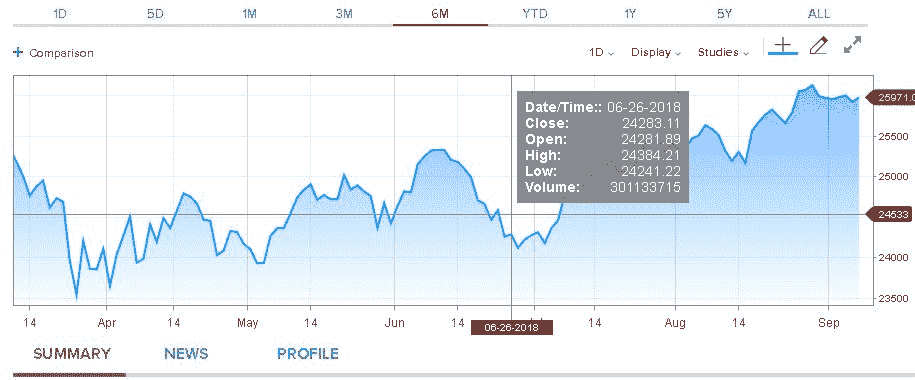
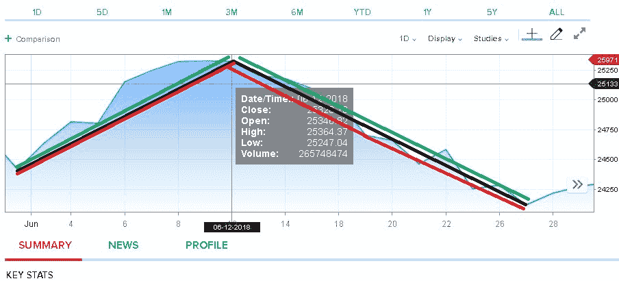
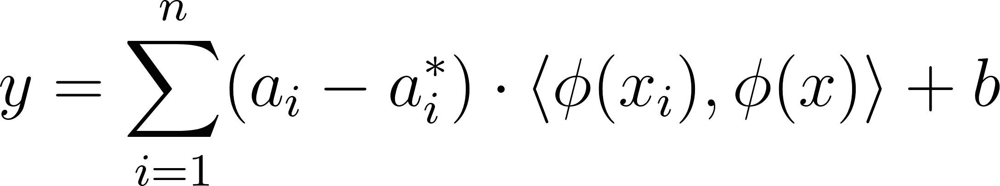
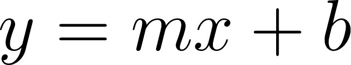
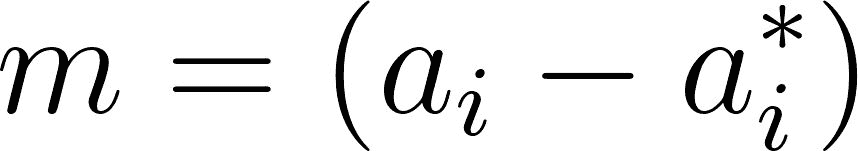
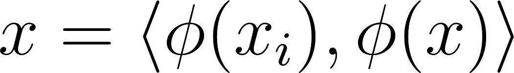

# 金融机器学习实战

## 什么是金融机器学习？

### 了解人工智能

为了理解什么是金融机器学习，我们首先需要对什么是人工智能进行简要介绍。事实上，人工智能其实是我们社会中的一个常见主题。从电影中的反派到游戏中的交互敌人（顺便提一下，注意到人工智能通常都是反派），人工智能透彻地渗透到了我们的社会。然而，这大部分都是“限制性”的人工。

限制性人工智能是指能力极其有限的机器或程序。事实上，你认为的人工智能的大部分也是“伪”人工智能。伪人工智能是指模拟人工智能体验但本身并非人工智能的程序。

例如，当你在游戏中看到一个敌人跟随你时，它实际上并没有在思考。相反，它在运行一种关于“可能性”的数学算法。当离你近时，它进行近战攻击的概率很高；它投掷手榴弹的概率较低。这种做法也被称为近距离估计，视频游戏中的大多数敌人人工智能仅仅是根据与玩家的距离以及玩家伤害的持续准确性来决定动作。这是“伪”的，因为它模拟了一个具有智能的机器，但它实际上并不具备任何智能。

真正的人工智能可以比某些视频游戏中的“影子”敌人或双胞胎更强。在这些场景中，游戏记录了你过去最常见的动作，例如：最常见的攻击指令、偏好的距离、攻击延迟等。基于这些信息，这个“影子”敌人构建了一种最挑战你习惯行为的战斗技巧。通过这种方式，机器获取了关于你战斗技巧的智能。在这两种情况下，人工智能都是限制性的，但一个拥有智能而另一个是模拟智能。

### 了解机器学习

机器学习有点类似于真正的人工智能，因为它根据给定的信息进行学习。然而，与真正的人工智能不同，机器学习使用一种被称为 `Backpropagation`（反向传播）的技术。假设制造了一个“影子”敌人，在它被杀死后会发生什么？通常，根据游戏时长，游戏稍后会生成新的、更强大的“影子”敌人。这个新的、强大的“影子”敌人实际上是使用与第一个相同的信息构建的。唯一的区别在于你最终改变了游戏方式，而且敌人的基础“属性”更高了。

在机器学习中，这样一个“影子”敌人会尝试查看它在第一次中哪里出了错。这可以通过从不同的角度观察相同的信息来实现。例如，如果你以前通常依赖重攻击，但现在切换到了快速攻击而不是投射攻击，它就会使用投射攻击来强迫你那样玩。唯一的区别是，现在它还可以查看标准敌人哪里被击败的、是如何被击败的，以及哪些攻击模式导致了更多的伤害。如果这听起来很像“研究你的敌人”，那是因为它确实如此。

`Backpropagation` 是机器学习在更复杂环境中运作的关键。它获取自己产生的错误答案，并找到一种优化正确答案的方法。存在一些不利用这种技术的机器学习算法，这些被称为 `Feedforward Neural Networks`（前馈神经网络）。这仅意味着数据只从输入到输出通过系统，而没有输出变成新的输入。

事实上，如果你还没有猜到，真正的人工智能是一种前馈机器学习机制，但它不是一个 `Neural Network`（神经网络）。因此，虽然在技术上它可能符合这一类别，但它通常不被视为机器学习算法。`Neural Network` 充满了节点，将选择因素分解为最基础的组件。这允许网络快速移动并以更准确的方式做出决策。因此，除非真正的人工智能是以并行方式创建的，否则它不被视为机器学习。

### 金融场景中的机器学习

在金融场景中，你可能会利用机器学习。例如，你可以利用它们根据积累的财务数据得出更准确的预测。你还可以想出预测股票的更好方法。这甚至可以用于确定谁表现最好，以及哪些员工需要更多的审查。这听起来可能像奥威尔式的，但请记住这仍然是人工智能。

然而，事实是，这些情况大多数通常用 `Feedforward Neural Networks` 处理。这是因为 `FFNN` 要容易创建得多，数学定义也较少。这种优势的代价是，你可能会从 `BPNN`（反向传播神经网络）中看到相同的信息，因为 `FFNN` 在重新运行时会考虑新的数字。在许多情况下，构建 `BPNN` 实际上更有利，但需要更多的时间和资源。

让我们看看员工的例子来讨论一下为什么我要对此进行澄清。在 `FFNN` 中，你可能想知道员工何时记录休息、上班和下班时间，以及他们期间的产量水平。这是一个相当规模的数据集，可以用来确定高产和低产员工。然而，如果你想尝试找到他们成为低产员工的原因呢？

在这种情况下，你可能想了解更多关于员工的信息；这些是通常比较奇怪的信息。例如，如果问题出现在某些人员身上，你可能想知道睡眠习惯、BMI 和普通体能。在 `Neural Network` 中，你提供的信息越多，结果就越准确。这并不意味着结果总是那样，某些数据可能会损害你的机会。员工可能因为材料比他们重或者因为肥胖导致移动不快而挣扎。那么作为公司，你可能会提供免费的店内健身房，或者开展活动让每个人健身，这样就不会有人被单独针对。

## 预测就是机器学习算法所做的

尽管有些人可能持有不同意见，但机器学习算法的终极目标是根据数据做出预测。这意味着你拥有一台能够接收数据，并可能做出比顶尖经济学家更准确预测的机器。这意味着它也有许多做不到的事情，而且在伦理上，还有某些事情是它们被禁止做的。

例如，你可能希望它能为你提供一份为期 12 个月的潜在收益预测。可以为此制作一个机器学习算法。然而，它无法告诉你该如何提高这个数字。你可以创建一个机器学习算法来确定哪些战术的成功率更高，但你无法创建一个能告诉你如何最好地销售某件产品的算法。此外，你无法创建一个用来接管世界的机器学习算法。我查过了，这其中的变量实在太多了。

## 金融机器学习的局限性

大多数机器学习算法出现的首要问题在于提供给算法的数据集。正如我之前提到的，提供给算法的数据越有价值，它就越能变得有用。然而，一个优秀的机器学习算法何时变得“糟糕”的典型例子是多年前的一个 Google 案例。Google 是搜索引擎巨头，通过提供最好的搜索结果来获利，从而能够出售更准确反映这些结果的广告位。

一天，在某组特定搜索结果中发现了一些异常。如果一个女性搜索一个与白人男性相关的名字，结果通常会返回 LinkedIn 和 Monster Job 等与工作相关的网站。如果一个女性搜索一个与非洲裔背景相关的名字，犯罪背景检查的广告和搜索结果就会随原始搜索出现。问题不在于机器学习的方式，而在于给予机器的数据集——即那些经常寻找非洲裔男性犯罪记录的女性。机器学习算法正在做出准确的预测，但作为人类，我们认为这在道德上是错误的。

# 开发股票交易策略

## 交易有 4 种主要方法

机器学习实际上可以用于确定你想要参与哪种交易方法。此外，它甚至可以帮助你开放投资组合以投入不同类型的交易策略。在本节中，我们将讨论哪些类型的算法可以与不同的交易策略配合。

理想情况下，如果你是亲身尝试，你可能想对过去 5 年的交易信息执行 `K-cluster algorithm`。具体来说，你想包含所有生存超过 5 年的公司，并排除任何未生存的公司。这被称为 `Cluster Analysis`（聚类分析），它将发现你可能没有观察到的公司之间可能的关联。对技术持怀疑的人只会看到机器如何展示巧合，但某些股票之所以同时上涨通常有其充分的理由。

让我们谈谈 Black Box LLC（非真实公司）和 Lee Memorial Hospital 股票（非真实公司）。没有新闻将这两家公司联系起来，然而，当 HH 与 BB LLC 签署了一份数百万美元的合同时会发生什么呢？LMH 现在将与 BB LLC 进行大量业务交易，但 LMH 有理由签署该合同。这意味着 LMH 计划在未来一段时间表现良好，而 BB LLC 将从中受益。一旦合同成为新闻，每个人都想在股票上涨之前进行交易，而这最终导致了价格的上涨。然而，如果这种情况发生了多次又会如何呢？

股票周围通常流传着大量数据，很难跟踪合同的续约情况。续约非常重要，因为它们可以作为合同双方之间股票上涨或下跌的预测指标。虽然预知交易中将发生什么可以被视为内幕交易，但使用 `K-cluster algorithm` 来发现周期性相关性并不是。这就是为什么在开始之前进行这项工作是很有用的，因为可以帮助关联公司之间可能的关系。

### 同日交易

虽然我让这个术语听起来更有意义，但它通常被称为“日内交易”（Day Trading）。在这样的策略中，你在同一天买入和卖出股票。因此，如果你在第一天的上午 9 点买入股票，那么你很可能在第一天的中午卖出这些股票。这使得潜在的毁灭性损失很难发生。然而，同时，你可能在短期内看到巨额的回报。由于日内交易发生的速度很快，很难整合所有可能的机器学习算法。

### 持仓交易

持仓交易（Positional Trading）是大多数人考虑投资股票时的想法。这通常被称为“买入持有”策略，因为大多数人在买入后至少会等待一周或更长时间才卖出股票。这是因为这些人想要获得作为大股东时产生的巨额回报或控制权。这种大股东在电影中经常作为冲突点而非常受欢迎。然而，我们将关注更丰厚的回报，例如那些免费投资比特币并在几年后成为百万富翁的人。

持仓交易的一个关键特征是确定哪些类别是最佳。例如，许多人一上来就选择了科技、律所、家电和医疗保健。然而，这些个人并不理解这些行业中哪些部分是最佳投资的。这在开发用于盈利的机器学习算法时是一个巨大的问题。

### 趋势交易

趋势交易可能由于几个原因发生。例如，一种趋势交易是当你试图履行社会责任时。如果你支持女性主义，你可能会选择支持那些具有女性主义号召的公司。此外，另一种趋势交易是当你看到某种即将推出的热门技术。如果你关注主题演讲或参加技术会议，你可能会了解到某项你认为是有利润的技术。因此，你可能会投资销售这些技术的公司，以从中获利。

最后，另一种趋势交易通常指的是你试图预测特定公司的趋势线。事实上，当股票交易员谈论趋势交易时，他们指的是这种类型。趋势本身的定义稍微困难一些。

### 头皮交易

最后，我们来到最后一种股票交易方法。头皮交易（Scalping）这种技术让人联想起真实的剥头皮行为。在真实的剥头皮中，一个人夺取敌人的头并从头骨上切下皮肤。以非常相似的方式，头皮交易在股票交易中是指通过买入价购买资产，然后寻找愿意以更高的买卖差价购买的买家。买卖差价简单就是股票出价和要价之间的差异。因此，如果你发现某只股票的出价是 40 元，但你又找到了一个买家要价 50 元，那么你就可以获得 10 元的买卖差价。

讽刺的是，在投资方面，这些类别通常是最稳定的。许多人认为 `Real Estate`（房地产）应该包含在内，但必须符合特定标准才能增长。如果你在富人社区购买股票，除非该社区正在扩张，否则该社区可能会随着时间的推移而贬值。这些类别之所以是最好的，通常是因为两个因素：`P/E` 和 `P/BV` 收益率。

在技术领域，你拥有广泛的 `P/E` 范围。让我们快速解决一个问题，因为“股份”（Share）和“股票”（Stock）本身就非常令人困惑。

`Share`（股份）是指公司想要拆分自己的份额，由公司本身公布。因此，当一家公司“上市”时，他们所做的是向公众开放 `Share` 池。此时，他们将发布特定数量的股份。从本质上，他们是将公司的一部分作为公司的股票向公众出售。这种股票被称为 `Share`，因为你获得的是公司的一份。另一方面，`Stock`（股票）是这些股份的集合。要追踪 10 亿股股份非常困难，但如果每只 `Stock` 由 5 股股份组成，那么只需要追踪 2 亿只股票即可。然而！这是一个故事：所有的股份都是股票，但并非所有的股票都是股份。例如，某些股票可能分配给证书以及其他类似于股份但不是直接的股份的部分。因此，让我们从理解如何计算股份开始，因为它们代表了股票的真实价值。

让我们先讨论 `BV` 或 `Book Value`（账面价值），为了得到这一点，我们需要将公司拆解为最基础的组件并从那里开始。让我们先定义 `asset`（资产）和 `liability`（负债）。`asset` 是任何持有货币价值的物品，无论它是能为你赚钱，还是你可以将其卖掉换钱。`liability` 是任何持有货币价值缺口的物品，无论维持它需要花费多少钱，还是它是一笔债务。

假设我们是一家软件公司，正准备面向股市。我们知道每制作一个软件就能赚 $100，就以此为基准。如果我们只卖出 1 个产品，这 $100 就称为 `Total Revenue`（总营收）。然而，我们之所以拥有该软件是因为付钱制作了它。如果我们有一个软件团队、网站以及其他我们需要付费的项目，那么这将被称为 `Cost of Revenue`（营收成本）。假设我们每卖出一个产品，`Cost of Revenue` 都是 $70。

```
Net Income = Total Revenue - Cost of Revenue
```

这个数字被称为 `Net Income`（净利润），当分摊到股份上时被称为 `Earnings`（收益）。如果有 10,000 股股份而你拥有 1 股，那么结果你将获得 1/10,000 的 `Earnings`。这就是为什么在购买股票之前找出公司的价值是重要的原因。这就是为什么你需要了解 `Income Statement`（利润表）、`Balance Sheet`（资产负债表）和 `Cash Flow Statement`（现金流量表）。你已经了解了 `Income Statement`，因为这是你可以在其中找到 `Net Income` 和 `Earnings` 的地方。`Balance Sheet` 是你找到公司 `Equity`（股东权益）和 `Book Value` 或 `BV` 的地方。这将是你的 `Margin of Safety`（安全边际）所在。

```
Equity = Total Assets - Total Liabilities
```

该方程是计算公司 `Equity` 的，但 `Book Value` 稍有不同。此外，如果你将 `Market Price`（市场价格，即市场所有所有股份的总价格）减去 `Equity`，你就得到了风险。因此，如果这家软件公司股票的 `Market Price` 总计为 $1,000,000，而权益为 $20,000，那么你就有 $980,000 的风险。这将被视为极低的 `Margin of Safety`。虽然这个较大的数字被称为 `Equity`，但当它被分摊到股份时，它被重命名为 `Book Value`。

`P/E` 指公司的市场价格与其收益相比的情况，因此贴切地命名为 `Price to Earnings Ratio`（市盈率）。获得这个数字需要几个步骤。我不仅会解释如何得到这些数字，还会解释为什么即使大多数股票“新闻”网站免费提供这些信息，你仍然需要了解它们。

要获得 `P/E` 收益率，你必须首先找到 `EPS`，它简单意味着如果你购买，每股股份将为你赚多少钱，名为 `Earnings Per Share`（每股收益）。`EPS` 的计算方法是取 `Earnings` 并除以 `Outstanding Shares`（发行股数）数量，这实际上就是流通中的股份数量。要找到 `Earnings`，股票交易员会取公司的 `Total Revenue` 并减去公司的 `Liabilities`（负债）。因此，真正的计算公式为：

```
EPS = (Total Revenue - Liabilities) / Outstanding Shares
```

`P/E` 比例中的 `P` 是目前每股的价格。`EPS` 是每股股份应得的基础价值。因此，如果一家公司说它将以 $10,000 的总价值出售 2000 股，那么每股股份的价值就是 $5。这是方程的 `P` 端。

如果我们把之前提到的软件公司的 $100 增加到 $10,000，并对 $70 进行同样的操作（变为 $7,000），我们现在就可以进行 `EPS` 计算了。这意味着我们的 `Cost of Revenue`（在这种情况下也是我们的 `Liabilities`）将每股变为 `$3000/2000`。这使得我们的 `EPS` 为 1.5。现在，获取 P/E 我们这样做：

```
P/E = Market Price / EPS
```

因此，如果我们说 `Market Price` 是 $5 而我们的 `EPS` 是 1.5，那么我们的 `P/E` 就是 3。

所以，现在我们处理完这些之后，你已经理解了股市的大致。优秀的投资者会寻找低 `P/E` 值和中等到高的 `Margin of Safety`。虽然股票交易肯定还有更多内容，但这本书是关于金融机器语言（Financial Machine Language）以及它如何与股市相关的。

## 为什么你需要知道是如何计算的

### 信息不是实时的

最重要的一点是你需要了解之前的信息，因为即使你依赖从股市 API 获取的信息，它们可能没有最新的更新信息。例如，检查信息是否每天更新或实时更新的一种常用技巧是自己去检查 P/E 值。有时，这个数字可能比你亲自计算的低一点或高一点。

### 你需要教会机器

你实际上将这些教给机器，因为你在财务情况下通常执行的所有方程都需要由机器本身来完成。毕竟，如果机器学习神经网络无法实现其初衷，那么它的意义何在？你可以使用机器学习来识别趋势和类似的简单任务。然而，如果你打算花时间训练神经网络，那么可能值得精力构建一个可以建议交易的机器，而不是仅仅提供你已经获取的通用数据。

### 你需要知道将机器指向哪里

无论你用机器学习算法做什么，你都需要一种方法将它指向特定的方向。无论你计划使用机器来识别趋势、识别值得投资的公司、查看公司之间是否存在隐藏关系，还是任何其他内容，你至少需要了解股市使用的数学知识，以便你能够有效地将机器指向你想要去的方向。

### 理解交易员将如何交易

现在我们进入本章的主题，但我们首先需要建立一个基础来理解这一点。当你为了金融目的开发机器学习算法时，你需要知道你将用什么来“教”这个机器学习算法。如果机器学习算法不知道如何做出适当的财务选择，那么开发机器学习算法或尝试用它来取代你自己的决策就没有意义了。因此，既然你已经了解了不同股票策略的运作方式以及通用的股票市场数学原理，我们现在将介绍你在构建机器学习算法时需要构建的不同部分。

## 方向导向 (Point-of-Direction)

虽然大多数人可能认为方向点是指“最大利润”，但这并不是股票交易员思维的方式。事实上，“最大利润”是他们实际关注点带来的收益。大多数股票交易员会关注被低估的资产、目前高昂的趋势以及目前以公允价值出售的资产。


每种方法实际上都有其益处，取决于你如何处理它们。例如，最容易思考的是寻找低估资产，但解决起来却是最困难的。之前在位置交易中提到的方法实际上被称为“沃伦·巴菲特式交易法”。你通过计算具有低 `P/E`（市盈率）和 `BV`（账面价值）来确定目前哪些是低估的。这告诉你，你购买的任何东西都能获得大量资金，但故事背后还有更多。例如，如果你正试图寻找一个被低估的新科学领域呢？

在 20 世纪 60 年代，这通常被视为一种爱好。只有富人才能真正投入资金投资，而且你必须通过非常有选择性的杂志进行订购。此外，这些杂志通常会自己资助这些项目。这是一个非常复杂的组合体，由于零件非常昂贵，通常不会给任何人带来盈利。现在，你会投资这项爱好吗？如果你说不，那么你就属于那群没有从计算的未来中获利的人。这是一个非常简单的例子，说明了低估技术进入市场而人们没有看到未来的潜力。更重要的是，除了远见卓识，你究竟如何给这样一个物品估值呢？事实是，你根本做不到。

最容易定义的实际上是允许机器学习算法识别目前高昂的趋势。例如，你会如何识别趋势呢？你可能会查看之前的数据，发现一个上反弹阈值和一个下反弹阈值。这在机器学习算法内部可以很容易定义，因为阈值通常就是它的工作基础。你看到某只股票开始上涨，然后下跌，重复这种模式几次，最终导致大幅上涨后又剧下跌。这通常被称为趋势，即公司获得了一点价值，又失去了一点价值，但每隔一段时间，它会获得大量价值，然后又失去大量价值。这种做法被称为趋势交易（Trend trading），对于那些想要快速赚大钱但不想每天花时间盯着股票的人来说，相当常见。当然，趋势交易可以每天发生，但当你与某些公司打道时，这些趋势线可能需要几周才能形成。这真的不是你可以预测的，除非根据过去这些事件发生的速度以及导致这些事件的原因的模式来预测。

最后，你可以简单地设置机器学习语言来识别金额处于公价值的部分，也就是说，它大致等于于它应有的价值。这实际上很难做到，因为一旦一家公司变得流行，这种公价值往往就会被抛到脑后。一个完美的例子是比特币，它的价值远高于大多数人通常认为它所拥有的价值。事实上，由于其初始价值与随后真实价值之间的巨大差异，它通常被称为一种新型的法币（Fiat money）。

这里的问题在于，我无法准确告诉你应该使用哪个方向点，因为要确定最佳走法太困难了。你有更好的操作可以进行。例如，你绝对想要尝试找到你能获得的最便宜的资产类型，并且你绝对想要确保以合理的价值买入股票。然而，这种限制和收益实际上是由你定义的。

## 入场交易价格 (Entry Trading Price)

入场交易实际上只是你用来描述发现某只股票可以购买的时刻的名称。在这种情况下，你可能想以其目前出售价格的 20% 左右购买股票。这将是你在计算机内部设置的阈值，以确定你想以特定价格购买它。这里的问题是，你会遇到无限可能性的问题。假设你设置为只有当股票比开盘价低 20% 时才购买。当然，假设你的机器现在执行了操作，你确实因为股票下跌这么多获得了一笔股票，但如果因为特定业务的股票市场崩溃而又下跌了 20% 会怎样？这是一个巨大的风险，但这是一个非常真实的可能性。更糟糕，这可能是你事先设定的任何百分比，即使你设定的是 5%，它也很有可能再跌 5%。

此外，你还会遇到问题的另一面，如果它从未跌破那个金额怎么办？你将需要将其调整为你认为合适的金额，这很可能是基于它跌到的最低共同价格。然而，你又会遇到同样的问题。这种情况很罕见，但确实会发生，这些都是你在使用机器学习并确定股票价格时需要考虑的事情。毕竟，你不想买入一只暴跌入地的股票，你也不希望有一台由于从未达到你设定的阈值而永远不会购买股票的机器。然而，入场交易价格代表了对值得购买物品的识别。

## 出场交易价格 (Exit Trading Price)

你需要定义一个你离开市场的交易价格，也就是说，你需要找到一个你感到可以出售的价格。再次，你面临了试图确定一个价值的问题，而这种价值是大多数人在他们观察股票时确定的。然而，我们在股票交易中实际上经常这么做。这通常被称为止损单（stop order）和限价单（limit order）。例如，在止损单中，你可能只想以特定金额买卖某物品。在达到该金额之前，没有资金离开你的口袋。在限价单中，我们处理的是与机器语言需要处理的相同的阈值。

## 限价单 (Limit Orders)

限价单是一种允许你设定买卖最低或最高价格的订单类型。这些通常是你预测的数字，你认为该物品的价格在特定时间内会达到这些数值。例如，假设你决定以每股约 70 美元的价格购买 Facebook 股票。根据历史数据，你认为你的股票总价可能达到 75 美元。然而，你会发现你的股票价值可能跌到 65 美元。根据你的交易策略，如果你投资的是趋势交易（Trend trading），你可能会认为巨大的 `Surplus`（盈余）可能会导致巨额债务。你可以设置一个限价单以特定数量购买股票，我们将在股价跌破 65 美元后讨论这一点。同样，如果你看到股票价值达到 75 美元，你可以设置一个限价单，在价格超过 75 美元后卖出该股票。如你所见，你可以设置机器语言算法的阈值，以类似于标准股票交易员的方式利用限价单。

出场交易价格（Exit Trading Price）代表了对值得卖出的物品的识别。必须承认这一点是，在处理机器语言时，你在使用它们之前必须识别出边界。通过入场交易价格（Entry trading price），你是在寻找值得购买的商品；通过出场交易价格，你正在评估已经购买的物品，并决定现在是时候出售它们。

### 容差范围 (The Tolerance Range)

我之所以指出入场交易价格是识别值得购买的物品，而出场交易价格是识别你已有的值得卖出的物品，是为了调节机器语言算法。在这两种情况下，你可能遵循相似的步骤，但出场交易价格的数据集要小得多，且数学逻辑与入场交易价格相反。这两个变量的目的是识别上限阈值和下限阈值，这需要两条独立的逻辑通道和数据集。

### 销售数量 (The Quantity of Sale)

最后，尽管这看起来显而易见，我认为我有必要确保你理解，任何处理股票的机器学习算法的关键组件之一，就是如何决定卖出多少。新股票交易员可能认为，一旦股票变得足够盈利就卖掉所有股票是一个好主意，但情况并非如此。例如，假设你持有 1,000 股 `Intel`（英特尔）。如果股票上涨 5 美元，那么卖掉它们时你将获得 5000 美元的利润。然而，如果你计划获得可能的 20 P/S 回报，你可能只想在盈利时卖出其中几股，并观察价格是否会进一步上涨。毕竟，有时趋势的增长最终会导致更大的跌落，但如果你寻找上升趋势，你仍然可以赚到相当观的钱。因此，你可能只想卖出 500 股股票，这样你至少可以获得 2500 美元的利润，然后等待价格是否回落，随后你可以利用利润在更低的价格买入股票，同时等待股票回升。这允许你在赚取更多钱的同时，为价格更高时保留备用股票。这意味着你可能有多个神经网络，分别处理带有不同限价单的股票部分。

## 使用机器学习确定当前股票价值

### 按季度而非每年训练你的机器学习算法

现在，你可能认为这有点奇怪，但当你开始考虑长期投资时，你真的应该查看季度报告。然而，普通的股票交易员除非绝对必要，否则不会看季度报告。这是因为季度报告通常可以总结在他们所选股票网站提供的财务统计中，这些数据读起来要容易且快捷得多。长期投资意味着你需要找到某个特定公司的安全模式，以查看它是否在业务经营的可接受范围内。

例如，正如我之前提到的，具有优秀 `PE` 值的公司通常是值得关注的。然后你研究这家公司，发现他们还有很棒的 `PBV` 值。这意味着这家公司可能值得调查，但问题是 `PE` 值会随时间变化。虽然你可能看着当前的 `PE` 值，但讽刺的是，过去的 `PE` 值也具有价值。事实上，`PE` 值和其他变量可以随着时间的推移而受到观察。

了解公司是否仍然存在决定了死亡模式的原因。虽然这可能并不令人意外，但公司倾向于以非常相同的方式死去。通常，发生的情况是，公司的收入突然出现负值。现在，他们可以在负值出现之前出售资产，或者在他们没有预料到它之后出售。这个关键时刻代表了公司正在恐慌，因为自然的模式是随着公司萎缩走向死亡而不断承担债务。在少数情况下，他们幸存了，但大多数情况下，它们都会以非常相同的方式死去。理解债务和总收入在决定公司何时临死方面起着关键作用，这是教机器学习算法避开那些在季度范围内表现出相同模式公司的关键。因此，你的数据集看起来可能如下所示：

| 日期 | 市盈率比例 | 总收入 | 债务 | 资产价值 | 负债价值 | -1 = 死亡 1 = 存活 |
| --- | --- | --- | --- | --- | --- | --- |

### 常识法：趋势交易 (Trend Trading)

最常见的交易方法是使用峰值和谷底，这实际上就是说遵循趋势。无论你是看长期投资还是短期投资，你都在观察趋势。事实上，我早期提到过有 4 种主要的交易方法，但实际上，所有方法仍然属于趋势交易。

让我们看看 CNBC 提供的以下 2018 年 6 月道琼斯指数图表：


如你所见，这可能是最好或最坏的月份，取决于你在山坡哪一侧卖出股票。我们在在这张图中看到了特定类型的趋势，我将在下一张图中将其标记为绿线和红线：


之前，我们在“理解股票运作原理”章节中讨论了如何寻找值得投资的业务。一旦你找到了值得投资的业务，所有优秀的业务都会在不同的间隔经历两种不同的趋势。`绿线`（Green Line）被称为`大峰`（Big Peak），这意味着线条在大幅下降之前会达到`峰值`（Peak）。这是人们想要卖出的线条部分。下降的部分被称为`低谷线`（Trough Line），即人们等待再次购买的区域。`红线`（Red Line）是`小峰`（Little Peak），大多数`日内交易者`（Day Traders）在这里活跃。它和`大峰`相同，但利润产生的速度快得多。如果我们看这个的六个月版本，可以很容易看到很多这样的：



这对我们来说相当容易理解，并且会变成一个我们可以寻找的重复模式。只要我们观察的是成功的业务，模型就非常直观，除非你想变得极其精确，否则不需要大量的数学知识。

### 最常用的机器学习方法：支持向量回归算法

对于机器来说，使用相同的分析方法并不简单。这是因为我们已经构建了识别此类模式所需的算法。事实上，人类大脑在遗传上就倾向于识别模式。然而，创建一个`神经网络`（Neural Network）就像教幼儿如何识别同一种模式，只是机器掌握得更快，并且需要数学解释。因此，我们必须将这些模式分为两个不同的类别。

第一类是注意线条的极值，但是哪一个呢？由于我们大脑已经识别了这些模式，你可能会困在思考线条上，但如果是这样，你需要停下来。`机器`（Machine）看到的不是线条，而是一个正数序列，我们需要重新训练`机器`看到其他东西。它需要看到靠近零的正数是`损失`（Loss），而远离零的正数是`收益`（Gain）。

然而，你可能已经注意到没有一条完美的“线”来拟模型。如果我们观察之前的数据，当你为一种趋势定义一条线时，它将不再适用于另一种趋势。因此，我们需要一种方法来持续定义`损失`和`收益`在`线`上的位置，这就是`支持向量`（Support Vectors）发挥用场的地方。

`支持向量`算法为`收益`设置一个边距，为`损失`设置一个边距，它们被放置在`趋势线`（Trending line）上。让我们使用之前对`收益`和`损失`的定义。不过，这些线条的定义有点不同。我们不是从零开始，而是从所谓的`超平面`（Hyperplane）开始。这是一条独立的线，它位于`D+`和`D-`边距之间，但这些边距根据你的需求定义为最近或最远的向量。一个是`D+`，另一个是`D-`。这些只是分类，`D`只是一个占位符，这里是展示`支持算法`（Support Algorithms）如何显示的图表：



你可以看到，在我们情况下，`绿线`或`D-`是`收益`线。另一方面，`红线`代表我们的`损失`线以及方程的`D+`。现在你理解了它运作的大致，我们将对一个极其复杂的算法进行简要解释，大多数机器学习预测算法将使用：



不要惊慌。没关系的。我们将一起过一遍。你需要理解这实际上是两个算法的结合。此外，这只是一个演进形式的



几乎所有的机器学习算法都从`截距`（Slope-Intercept）开始，这是因为`截距`是`二分类`（Binary Separation）的真实形式。换句话说，`截距`是`感知器`（Perceptron）中使用的相同类型的公式。让我们把这些信息拆解为不同的组件：





我认为我们可以理解这种情况下的`b = b`。现在我们将进一步拆分，但我们将从`x`开始，因为它比`m`不那么抽象。让我们从最困惑的部分开始，即连接这个方程的角括号。你会发现这种情况下的`b = b`。

```
（其余文本对 x, m, b, y 和 Phi 等变量遵循相同的格式）
```

这是一个完全不同的方程，对吧？这是因为我们正在寻找一个数字，使虚数变成它的相反数。如果我说 `x` 是 1，那么过程将会是这样的。


这是官方的共轭公式：

   

在这个方程中，我们有一个虚数，即 ，其中 `b` 是实数，`i` 是虚数。因此，只有当方程看起来如下所示时，我们才能应用共轭：


因此，在  的原始方程中，我们实际上看到的是迭代 `i` 的实减去迭代 `i` 实数的共轭。该方程的最后部分实际上是为了替换一个被称为核函数（Kernel Function）的东西。现在，这些中最常见的是多项式和高斯径基。

### 多项式


### 高斯径基


这些核函数允许非线性 SVR，这就是我们在股市中看到的。当我们将其用于此目的时，我们使用核函数来替换这个


如果你想深入学习 SVM，这里有一系列很好的网络教程：[`www.svm-tutorial.com/2014/11/svm-understanding-math-part-1/`](https://www.svm-tutorial.com/2014/11/svm-understanding-math-part-1/)。

# 确定股票的最佳时机

## 你不应该完全自动化

既然我们已经离开了实际上纯数学推理的常规路径，我需要提前告知你，你不应该完全自动化你的交易决策。有些人愿意说服你全自动交易是一个极佳的想法，但事实是这是一个非常糟糕的主意。之所以坏主意，是因为我们作为人类，无疑是有缺陷的。我的意思是，如果你没有训练好它，如果你漏掉了一行代码，或者处理速度上出现任何问题，你可能会做出你这辈子永远不会做出的交易。

开发全自动机器学习算法的困难在于，你必须能够信任它在大多数时候都会做出正确的决定。人类的问题在于，我们往往太不耐烦了，无法等到它达到那种完美的程度，所以我们几乎在构建好它之后就尝试使用它。这样做的问题是，如果你做错了某些事，在你开启机器学习算法的瞬间，你可能会破产并退出市场。相反，你真的应该有时把它当成个人顾问来使用。具体来说，你应该比它了解更多。

## 使用支持向量回归寻找良好时机

（注：提供的文本包含重复/乱码部分。我已经根据指令清理了核心逻辑流，以保留核心内容并移除冗余噪声。）

这允许我们将具有相同特征和价值观的公司归为类，而无需亲自花费大量时间来研究数据。要做到这一点，你实际上不需要任何机器学习算法，你需要的是能够处理数据并与之建立关联的聚类算法。这实际上是机器学习中利用的第一步，用于创建标签，随后机器学习算法可以使用这些标签。

## 将此用于高波动性股票

在考虑高波动股票时，这种方法实际上仍然非常有用。高波动股票通常是普通股票交易者的生存噩梦，主要是因为它们是不可预测的。但问题在于，过去已经证明，如果你在正确的地方寻找，高波动股票是可以预测的。高波动股票与廉价股几乎完全等同，这是因为廉价股的运作方式如此。因此，你主要需要寻找与你在廉价股中寻找高波动股时相同的方面，因为你会发现它们的相似性非常显而易见。这并不是说高波动股票和廉价股之间没有区别，但这通常是你评估这些股票是否能为你带来收益的方法。

## 预测卖出信号是否安全的机器语言算法

机器算法帮助判断你是否应该卖出股票最安全的方法是设置让它发出交易信号。这种工作方式与人们用来止损单和限价单非常相似，后者是为了利用自动化交易的优势，同时保留自己做决策的能力。例如，你可以获得一个交易信号，告诉你当前的股票在此时应该卖出。如果允许机器替你执行交易，你将在信号通常发出的那一刻卖出股票。我认为理解这一点至关重要，因为如果你等得更长，你可以赚到更多的钱。交易者在处理自动化交易时有三个选择：第一个选择是交易者完全不使用机器，这通常被称为“想象的”。第二个选择是交易者使用机器语言算法提供建议。最后一个选择是交易者完全信任机器代表他们做出决策。

## 让机器替你交易的优点


让机器为你做决策有几个优点。我认为机器相优于人类的第一个优点是具有做出秒级交易的能力。有一段时间内，用户可能需要更长来做决定，如果决定做得不够快，这实际上会导致金钱损失。此外，这导致了机器分析信息的速度更快，因为它们天生就是为此而设计的，而人类则有一堆机制在干扰。这个次要优点是机器没有情绪。例如，一个人可能永远不会投资一家他们讨厌的公司，无论该公司有多盈利；这并不是说那个人不要钱，而是他们的情绪在作怪。机器没有这个问题，它们关心的只是执行通过编程传递给它们的任务，而人类则会根据自己的情感背景和历史刻意地限制自己。我说的机器优于人类的最后一个优点是它们可以更快地分析海量信息。这与我提到的秒级交易不同。在之前会有大量信息被输入，以确定一家公司是否值得投资，而人类必须自己查找数字并进行研究。一个能够访问信息`API`的机器实际上能够根据人类预先设置的参数分析这些数字。虽然人类可能需要近乎一周的时间来研究并确定符合其画像的公司的价值，但机器最多可能只需要一到两个小时。这使得它们在快速寻找好公司方面具有极高的效率，然后采取诸诸良好的政策来为所有者赚钱。

## 让机器替你交易的缺点

让机器替你交易有一个巨大的缺点：一旦它开始出错，它就无法自我停止。机器的设计是持续持续运行的，如果它做出了错误决定且数学逻辑开始崩溃，它会继续崩溃。这意味着你本可以成为百万富翁，如果你让机器控制你的资金而它开始出错，你可能直到破产时才会察觉。这是一个影响所有技术的巨大问题，尤其是机器学习技术。这就是为什么你必须花费数月时间测试软件才能信任它。你必须不断确保你的选择与机器的选择保持一致，反之亦然。

讽刺的是，垃圾股（penny stock）是你最不希望看到其长期历史的股票期权之一。原因在于，垃圾股之所以被称为垃圾股，通常是因为公司刚刚起步，要么由于某些原因，几乎没有进入股市的视野。通常，我发现许多公司出现在垃圾股名单上的原因仅仅是因为它们曾经非常值钱，然后陷入了巨大的麻烦，最终导致其总价值暴跌。很多时候，我看到公司股价在短短一年的时间内从 60 美元或 100 美元一路跌到 3 美元。

这意味着，如果你将长期的信息输入机器学习算法中，机器将学习到垃圾股中发生的巨大亏损差距。事实上，如果你根据过去的迭代来判断利润率，你实际上可能会发现，结果是你永远不会买垃圾股。现在，大多数垃圾股是通过大额购买让你盈利的。也就是说，如果某只股票价值约为 0.27 美元，你购买 100 股，你现在就有大约 270 美元的股票。如果该股票每上涨 1 分，你的收益就会增加 10 美元。这就是垃圾股的盈利所在：股票的大额订单，因为任何正向的波动通常意味着你获得了巨额收益。

问题实际上在于确定一家公司是在萎缩死亡，还是可能可能反弹。虽然说起来有些悲哀，但垃圾股市场确实是一个普通股票交易者在那个时刻倾向于为弱者加油的市场。这些公司曾处于事业的巅峰，但发生了某些事情，导致它们在股市中几乎一文不值。股市中的股票交易者利用并利用廉廉的价格从分钱中赚取倍倍的美元，这实际上有助于让那些公司生存下去。记住，当股价上涨时，通常意味着公司的实际价值也随上升。因此，在垃圾股公司中成功交易实际上可能会让它们重回曾经经历过的辉煌。

除了这种感性的观点外，你是基于分钱而不是美元来定义成功的，因此你的阈值需要考虑到这一点。如果你的股票在 5 年前最初价格为 70 美元，而现在大约在 0.50 美元左右，你的目标不是赚回该公司曾经拥有的 70 美元。你不想让你的机器学习算法过载无用信息。这意味着你能够更快地在数据集上训练你的机器，因为这些是最有用的数据。同样，你真的不需要超过两年的时间来衡量某些垃圾股的成功。

## 债务历史是好事

另一方面，正如你并不一定想要一家公司及其利润的长期历史一样，你确实想要一份债务历史。你看，垃圾股内部的关键因素之一是该公司是否正在死去。你需要关注的是一家正在生存的公司和一家持续死亡的公司。你看，一家生存的公司最终会重新崛起，这是垃圾股交易者的终极愿望，因为如果你以 0.27 美元购买了 100 股股票，公司价格涨到 30 美元，你花 270 美元赚了 3000 美元。这是一笔巨款，但通常这样做风险太高。相反，你要做的是寻找当天的趋势。

就像大多数交易一样，你想要寻找数据本身的趋势，并要确保你只查看正在生存公司的趋势。这意味着你并不一定想查看垃圾股市场中你所有的公司。相反，你想做的是过滤掉所有债务无法管理的公司。你这样做的方法是收集数据（此处原文不完整但逻辑对应）。同样，衡量某些垃圾股的成功，你真的不需要超过一两年。

## 聚类技术

### 分区是你的朋友

我已经向你展示了如何选择最佳时间，但我们都清楚，确定一家公司的最佳方法是看它是否显示出相似的特征。因此，我们查看`PE ratio`（市盈率）、`debt`、`total revenue`以及许多其他独特特征。现在，如果你正在搜索数千甚至数百万家公司，查看每一个变量是非常困难的。假设你只为一家公司查看五个变量，那么如果你处理数百万家公司，你需要查看 500 万个变量；如果你处理的是数千家公司，则需要 5000 个变量。最后，你还需要注意哪些公司是好的，哪些是坏的。因此，你可能会无意中反复检查同一家公司，从而浪费时间。

确定哪家公司值得投入时间的最佳方法实际上是利用你所查看的相同变量并对它们运行分区算法。具体来说，对于你查看的每个变量，都会运行一个分区算法。因此，你会看到一种聚类算法，它会根据随机点组织所有的`PE ratios`，以便你拥有高`PE ratios`、中等`PE ratios`和低`PE ratios`。你可以对`total revenue`、`debt`以及几乎任何其他变量进行此操作。然而，它们不会是你的最终结论。由于你比较了所有的数字，然后你提取放入你最喜欢的类别的公司并以这种方式进行比较。它的作用是将公司的数量减少到一组你可以根据比较进行评估的公司。

1. 聚类具有相似变量的公司
2. 提取具有偏好变量的公司
3. 对这些公司使用标准比较统计来确定价值

### K-Means 聚类

`K-means clustering`实际上是一种基于均值计算的非常简单的迭代技术。对于你想要衡量的每类数据，你都会放置一个随机的“质心”。然后你计算每个数据点到每个质心的距离，并为该数据点与最近的质心建立关联。一旦对所有质心完成操作，就会计算每个聚类的均值。使用每个聚类的均值，我们使用均值重新进行聚类，而不是我们最初开始的随机值来测量距离。最后，如果这没有改变聚类结果，我们就计算并跟踪聚类之间的差异。它将根据你的需要重复此过程，但只返回变异最好的一个。

该算法的主要问题是它对离群数据敏感。因此，如果你有巨额债务的公司，它们很可能会干扰你的结果。如果你真的想让它起，你必须运行此算法，看看它产生了什么，如果你发现你得到的是偏斜的结果，你需要找到拥有巨额债务的公司并删除它们。所以，如果你发现一家负有 6 万美元债务的公司与一家负有 90 万美元债务的公司在同一组，你就知道第二家公司是离群值。你可以在这里学习更多关于`K-means clustering`：[`www.datascience.com/blog/k-means-clustering`](https://www.datascience.com/blog/k-means-clustering)。

### K-medoids

该算法的操作与之前的聚类算法非常相似，但由于使用了`medoidshift`算法，它对离群值不那么敏感。唯一的问题以及该算法不流行的主要原因是它需要进行的计算需求。因此，如果你正在迭代处理成百、数千甚至数百万家公司，与我在这里列出的第一种算法相比，完成必要的计算以获得最终结果将花费你更多的时间。

你可以在这里了解更多关于`K-medoids`：[`www.math.le.ac.uk/people/ag153/homepage/KmeansKmedoids`](http://www.math.le.ac.uk/people/ag153/homepage/KmeansKmedoids)。

### CLARANS

由于对`k-medoids`算法缺乏优化，对该算法的方法进行了许多重新设计。这代表了`随机搜索的大规模聚类`。

# 自动化交易决策的最佳软件

## Wealthsimple

### 全自动在线交易：Wealthsimple

对于大多数交易新手来说，直接用实盘交易通常是个坏主意。此外，如果你的机器学习算法也是这个领域的新手，在确定它足够优秀、不会让你损失巨额资金之前，你绝对不想让它处理真实的金钱。更如此，创建一个你自己的金融交易软件来模拟股市，然后再编写一个机器学习算法来“操纵”这个市场，这在财务上是不划算的。你会你会遇到很多问题，比如试图为`ML`算法制作软件，这意味着对它来说要么太简单要么太难。通常情况下，你想要一个旨在训练人类如何交易股票的软件。

这就是`Thinkorswim`发挥作用的地方，它是一个模拟股票交易的高度复杂系统。此外，它还包含一个`Paper Money`（模拟货币）模式，允许你使用`Fake Money`（虚拟资金）进行交易。这使其成为构建机器学习算法的完美基础，可以为算法提供数据集，并最终优化算法性能。

这对机器学习算法的构建非常重要，因为该软件可以提供真实世界的对比。此外，该软件完全倾向于帮助股票交易者赚更多的钱。这意味着它提供的不仅仅是简单地处理股票市场图表，还提供了波动、开盘、关闭等许多变量供你处理。所有信息都集中在一起，这意味着你可以将信息提取到算法中。最后，该软件并没有考虑到机器学习算法可能会与软件结合使用。这意味着它对你的`neural network`（神经网络）来说是中性的，这是最理想的情况。

## TradeStation 自动化软件

这款软件价格稍贵，所以你在尝试使用该软件之前，可能想先确保自己有一些`Deep Pockets`（财厚的资金）。他们确实提供模拟服务，这意味着对于那些想要用它来训练模型的人来说非常出色。然而，如果你选择了该服务，你需要达到每月的最低活动量，以确保你的账户不会变成“死账户”，因为他们真的希望平台上上有活跃的交易者。这款软件有很多花哨的功能，如果你决定利用它而不是让机器学习算法独立完成你所有的需求，这些功能将让你的交易变得简单。当你尝试交易时，他们的费用非常优惠，是行业内最低水平之一，而且对于机器学习用途来说甚至更有优势；如果你对期权交易感兴趣，他们还会提供免费的交易实时数据。多年来他们一直是一家非常优秀的公司，拥有悠久的历史，可以追溯到 1982 年，当时他们列为第一个在线交易平台。他们不是最好的，但在提供你运行自动化功能所需的服务方面确实非常出色。此外，他们拥有丰富的宏命令库，并配有移动端选项。

## Etna 自动交易软件

这是另一款在为交易者提供模拟器和移动选项方面做得非常好的软件。我将这款软件列入名单主要是因为它的可定制性和对开发者非常友好。与这里的许多选项不同，你会发现这家软件公司对开发者的推广比对交易者的还要多。他们有多个`APIs`和网页交易功能，而不仅仅是基于桌面技术。这意味着如果你计划将你的自动化交易作为一个平台，你实际上可以使用他们的技术进行开发和部署，而无需创建自己的经纪商软件。

## eSignal 自动化交易软件

这种软件是我会称之为`data puke`（数据倾泻）的东西。我并不经常用这个词，但我发现它完美地描述了从这个程序产生的信息量。像这里的许多软件一样，你可以访问实时数据，但除此之外，你实际上还 Get 获得有关交易信息的实时新闻，以及大量的课程视频和图表功能，这些我在许多其他软件中发现是缺失的。虽然数据倾泻确实意味着你将获得大量信息，但一旦打开它，实际应用可能会有点令人生畏。这是因为几乎所有的信息都是直接呈现给你的，但就像`Gimp`一样，如果你花些时间研究它，它实际上可以是一个非常好的软件。同样，因为这是一是一款数据倾泻软件，如果你决定创建一个机器学习语言算法，你会有充足的内容来喂给它。

## Tensorflow

老实说，如果你真的想做，你可以构建自己的，但这将花费相当的时间。我在这里提到的这些软件是特权软件，它们几乎总是会收取一定比例的资金是有原因的。你看，市场是一场层层费用、层层费用、层层费用的游戏，这种模式一直持续直到最终击中你。这意味着当你使用这类服务时，你实际上支付了最高可能的费用，因为他们能够为你提供访问权限……并收取费用，因为他们知道你可能无法去交易大厅。提供这些平台赚了大量的钱，而他们实际上所做的只是为你提供访问权限和信息。他们能为你提供的信息越多，你就越愿意为他们的平台付费。这意味着他们有动力将软件尽可能填满数据，这意味着一个`Legion of Developers`（开发者军团）实际上是你与自己自己开发时进行权衡的对象。他们拥有实际软件的经验，他们通常已经做了很多年，而且他们完全清楚如何激励人们。当然，你可以开发自己的，但这就像是在几乎没有钱去雇佣任何人的情况下尝试自己制作一款`AAA`游戏。你可以做到，只是会需要很长的时间。

然而，如果你计划制作一个利用他们软件的机器学习算法，我强烈建议使用`Tensorflow`。你看，有大量的教程会教你如何制作符合你目的的机器学习算法。特别是 YouTube 上的教程，因为网站上的教程通常会被标记后就遗忘。所以，你可以利用这里的大多数软件来收集你需要的信息，然后开发一个向你正在聚合信息的应用程序发送输入的机器学习算法。`Tensorflow`是解决这一问题最简单的方法，因为他们提供了对这些神经网络的访问权限，你只需要实现编程逻辑来利用它。

# 结论

## 机器学习可以成为你生活的革命性变化

机器学习已经帮助了许多行业做了许多事情，因此在一个充满数字的行业中，机器学习的兴起并不意外。机器学习在未来还有巨大的潜力，而且它已经向许多人证明了自己的成功。然而，当许多人把股票市场视为一个不可预测的猛兽时，出现了一个奇怪的情况：我们正在设计机器来研究并买卖它。

机器学习算法在执行其任务时非常高效。理解这些算法所需的数学知识实际上涵盖了算术和其他几乎所有的数学领域。我之前介绍的公式包含了一些线性代数、一些微积分和一些几何学。对于某些人来说，这是一个巨大且令人敬畏的方程，但对许多人来说，它又极具启发性。

我必须说，如果你能让机器学习算法为你服务，它将对你处理股票的方式产生革命性的影响。事实上，如果机器学习被证明是极其成功的，我认为普通人将开始更多地参与股市。股市的一大巨大障碍仅仅在于理解它的运作方式，而且并不容易找到愿意向你泄露这些信息的资源。我发现这非常讽刺，因为进入股市的人越多，所能赚到的钱就越多。如果股市里只有一个人，它将赚不到一分钱。然而，由于全球有数百万人在玩着股市游戏，每年的交易额达到数十亿甚至数万亿。

此外，股票交易实际上可能变得像支票账户或储蓄账户一样普通。在这种情况下，一个人只需向其股票账户存入一定金额，让机器来生钱即可。这意味着所有活跃的股票交易员本质上将不再需要花费数小时或数周的时间研究市场，因为我们有机器来做这些。他们仍然会赚钱，只是许多人不会发现自己亲自花费大量时间处理数学计算对他们有什么益处。

## 结语

正如我所说的，机器学习有许多优点，它可能是一个极佳的机遇。然而，机器学习仍然是非常具有实验性的编程类型。你不应该 100% 依赖机器学习来为你做出所有的决策，因为允许这种情况发生会有巨大的风险。训练一个像你一样进行交易的机器学习算法需要时间，但只要你投入足够的努力，你可能会发现机器交易比尝试自己交易要高效得多。
