# 法医证据检验中的机器学习：新时代


机器学习算法的可用性，以及开发具有高精度稳健模型所需的大量计算能力，推动了研究人员在法医科学领域开展广泛研究，特别是在犯罪现场发现的证据的识别和检验方面。*机器学习在法医证据检验中* 讨论了将机器学习应用于法医科学领域的方法。

证据分析是法医调查的核心，根据不同特征进行分类或个体化检验。人工智能通过高效处理具有多个特征的大型数据集，为法医分析提供了强大的优势，提高了准确性和速度，从而有可能减少人为错误。算法有潜力识别枪械、爆炸物、痕迹证据、毒品、体液等证据中的模式和特征，并将它们归档到各种数据库中。此外，它们在重建和检测复杂事件，例如事故和犯罪，在事件发生期间和之后也很有用。本书为读者提供了关于机器学习用于分析各种类型证据的潜在应用和使用的整合研究数据。各章重点介绍在法医科学的不同领域应用的机器学习不同方法，如生物学、血清学、物理科学、指纹、痕迹证据、弹道学、人类学、牙科、数字取证、化学和毒理学，以及法医大数据分析的潜在用途。探索机器学习的最新进展，内容还涉及专家在常规检验中面临的挑战以及机器学习如何帮助克服这些挑战。

*机器学习在法医证据检验中* 是学术界、法医科学家、法律专业人士以及在执法机构从事调查和分析工作的人员的宝贵资源。

本书献给我的父母
和
献给在我困难时期鼓励我飞翔的所有人

## 致谢

编辑谨向本书的所有贡献者表示感谢。编辑还感谢 Mark Listewnik 和 Taylor & Francis Group 的所有成员在图书出版过程中的支持。此外，编辑谨向国家法医科学大学的支持表示感谢。

## 编辑


Niha Ansari 是印度甘地讷格尔国家法医科学大学的助理教授。她在印度艾哈迈达巴德古吉拉特大学获得法医科学博士学位，在那里她开展了开创性研究‘关于死亡时间玻璃体液变化的研究’，利用纳米传感器智能手机应用和微流控设备。Dr Ansari 还在印度班加罗尔的 Jain 大学任职。她已在编辑卷中发表了多章内容，并在同行评审的国际期刊上发表了 17 篇文章。她的研究兴趣涵盖法医纳米技术、微流控和基于智能手机的传感器。她参加了众多会议、研讨会和培训课程，向专业人士和学生传授知识和技能。在她的荣誉中，Dr Ansari 获得了大学拨款委员会颁发的 Maulana Azad 国家奖学金，并获得了 CHARUSAT 颁发的最佳博士论文奖。她是 The Science 出版集团编辑委员会的成员。

## 贡献者

**Sachin Sharma**
计算机科学系
Gran Sasso Science Institute
L'Aquila, Italy

**Jennifer Johnson**
法医科学学院
National Forensic Sciences University
Gandhinagar, India

**Sumit Kumar Choudhary**
法医、风险管理与国家安全学院
Rashtriya Raksha University
Gujarat, India

**Digvijaysinh Rathod**
网络安全与数字取证学院
National Forensic Sciences University
Gandhinagar, India

**Dharmesh Shah**
计算机科学与工程系
Indrashil University
Mehsana, India

**Satish Kumar**
法医科学学院
National Forensic Sciences University
Gandhinagar, India

**Parvesh Sharma**
法医科学系
Narayan Shastri Institute of Technology
Ahmedabad, India

**Vaishali**
法医科学学院
National Forensic Sciences University
Gandhinagar, India

**Sidheswar Routray**
计算机科学与工程系
Pandit Deendayal Energy University
Gandhinagar, India

**Akanksha Singh Kachhawaha**
医学法律研究学院
National Forensic Sciences University
Gandhinagar, India

**Yasasvikumar Vala**
法医科学学院
National Forensic Sciences University
Gandhinagar, India

**Niha Ansari**
法医科学学院
National Forensic Sciences University
Gandhinagar, India

**Madhavi Dave**
DRDO Industry Academia
Sardar Vallabhbhai Patel Center of Excellence
Gujarat University
Ahmedabad, India

**Vijeta Khare**
网络安全与数字取证学院
National Forensic Sciences University
Gandhinagar, India

**Jeet Dasgupta**
法医科学学院
National Forensic Sciences University
Gandhinagar, India

**Ahlad Kumar**
网络安全与数字取证学院
National Forensic Sciences University
Gandhinagar, India

**Athulya Rajan**
法医科学学院
National Forensic Sciences University
Gandhinagar, India

**Santhiya Raghavan**
医学法律研究学院
National Forensic Sciences University
Gandhinagar, India

**Muskan Singal**
法医科学系
Government Institute of Forensic Science
Nagpur, India

**Arunima Dutta**
法医科学系
SGT University
Gurgaon, India

**Neeti Kapoor**
法医科学系
Government Institute of Forensic Science
Nagpur, India.

**Vineeta Saini**
法医科学系
SGT University
Gurgaon, India

**Ashish Badiye**
法医科学系
Government Institute of Forensic Science
Nagpur, India.

**Kanica Chugh**
法医科学学院
National Forensic Sciences University
Gandhinagar, India

**Ujaala Jain**
交通管理学院
Institute of Road Traffic Education
Faridabad, India

**Pooja Ahuja**
法医科学学院
National Forensic Sciences University
Gandhinagar, India

**Tanurup Das**
法医科学学院
The West Bengal National University of Juridical Sciences
Kolkata, India

**Anubhav Singh**
法医科学学院
National Forensic Sciences University
Gandhinagar, India

**Ankit Srivastav**
法医科学学院
The West Bengal National University of Juridical Sciences
Kolkata, India

**Dhwani Patel**
医学法律研究学院
National Forensic Sciences University
Gandhinagar, India

**Surbhi Mathur**
法医科学学院
National Forensic Sciences University
Gandhinagar, India

**Kritika Sood**
法医科学学院
National Forensic Sciences University
Gandhinagar, India

**Vinay Aseri**
法医、风险管理与国家安全学院
Rashtriya Raksha University
Lavad, India

**Divyant Jain**
法医科学学院
National Forensic Sciences University
Gandhinagar, India


## 引言

多年来，科学和法律学者一直通过质疑许多法医检验方法的合法性和可信度来挑战法医科学界，这些方法往往依赖于法医专家的主观解释。总统科学与技术顾问委员会（PCAST）建议法医分析应尽可能客观，以便能够由自动化系统或以最小判断的人类专家执行。PCAST 还强调，使用算法和自动化系统可以帮助克服人类判断的局限性。

机器学习算法的可用性以及开发具有高准确性的稳健模型所需的大量计算能力推动了研究人员在法医科学领域进行广泛研究，特别是在犯罪现场发现的证据的识别和检验方面。人工智能技术提供减轻人为错误并充当专家系统的能力。这些算法有潜力识别物体和武器、匹配面孔和分析结构化材料。此外，它们还可以重建和检测复杂事件，例如事故和犯罪，无论是在事件发生期间还是之后。

拟议书籍的愿景是为读者提供关于使用机器学习分析在各种犯罪现场发现的证据的综合研究数据。该书讨论了机器学习在识别和检验不同类型刑事活动通常遇到的证据方面的适用性和各种方法。它侧重于机器学习在法医生物学、血清学、物理学、弹道学、人类学、牙科、数字取证、化学、毒理学以及重要的是法医领域大数据分析方面的应用方法论。每章都解决了专家在常规检验中面临的问题以及机器学习如何帮助克服这些挑战。后续章节将探讨机器学习在所讨论的特定类型证据方面的最新进展。

## 理解机器学习的基础及其在法医证据检验中的应用

SACHIN SHARMA, DHARMESH SHAH, SIDHESWAR ROUTRAY, MADHAVI DAVE, AND DIGVIJAYSINH RATHOD

### 机器学习简介

### 机器学习在法医学中的定义与重要性

机器学习（ML）是一种全新的系统，属于人工智能；它被设计为使系统能够通过数据理解信息，而无需人工干预或编程 [1]。在任何其他科学学科中，法医科学对机器学习的需求都更大。机器学习通过改变我们分析和解释法医科学专家提供的证据的方式，为调查过程增添了新的维度。

本质上，机器学习为法医科学家提供了利用非常大的数据集的能力，这有助于系统检测可能绕过传统方法的模式、趋势和异常。通过自动化从各种数据源中提取重要见解是机器学习提高法医调查效率和准确性的一种方式。

机器学习在法医调查中的重要性在于其能够处理与调查相关的复杂而庞大的数据集。机器学习算法擅长检测细微模式，无论是指纹、DNA 特征、文件分析还是网络犯罪，从而帮助调查人员做出更好的选择。

此外，机器学习促进了对证据的动态检查方法。随着新数据的引入，它会进行调整和变化，从而使调查技术仍然足够灵活以应对新兴问题。在法医科学必须处理日益增多的数据类型和来源的时代，这种适应性变得更加重要。

### 机器学习工作流程：数据收集、预处理、模型训练和评估

要谨慎地将机器学习用于法医目的，需要实施一个系统的工作流程，涉及数据处理和预处理以及模型开发和严格评估 [2]。在此，我们描述了机器学习工作流程中涉及的基本阶段，阐明了每个阶段如何有助于法医调查的成功。

- **数据收集：** 任何机器学习项目的基石都是其训练数据的质量和相关性。法医科学可以有各种数据集，其中包括指纹和遗传特征等。这需要从多样化的来源仔细收集，包括适当的代表性和包容性。为了确保收集数据的全面性和代表性，后续分析的完整性取决于它。
- **预处理：** 原始法医数据通常带有噪声、异常值或不完整条目。预处理涉及清理和转换原始法医数据，使其适合输入机器学习模型。所使用的技术包括归一化、缺失值处理和异常值检测，旨在使数据处于有利于有效模型训练的状态。正确执行预处理可以大大提高 ML 模型的准确性和稳健性。
- **模型训练：** 在预处理数据的基础上，下一个阶段涉及选择合适的机器学习算法并训练模型。在此训练过程中，算法学习数据中的模式和关系。在法医科学中，这取决于所选算法或任务的性质——无论是分类、回归还是聚类。模型会迭代地进行微调，以优化其性能，在复杂性和泛化能力之间取得平衡。

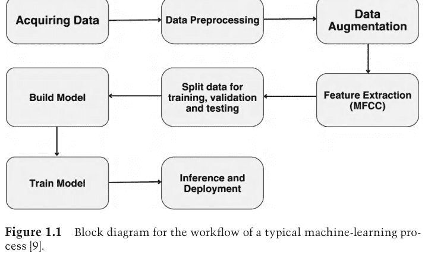

图 1.1 典型机器学习过程工作流程的框图 [9]。

- **评估：** 机器学习模型的有效性通过与独立数据集的严格评估来衡量。诸如准确率、精确率、召回率和 F1 分数等评估指标提供了对模型性能的见解 [3]。交叉验证技术通常用于确保模型对新未见数据的泛化能力。在法医调查中，预测的可靠性和准确性直接影响分析结果。因此，稳健的评估方法对于验证模型在现实法医场景中的有效性至关重要。图 1.1 显示了典型机器学习过程工作流程的框图。

### 有监督学习算法

### 决策树与随机森林

- **决策树：** 决策树是一种多功能、易于理解的机器学习算法，可用于分类和回归任务 [4]。其核心在于，决策树数据根据特征拆分为子集，形成树状结构，其中每个内部节点代表做出决策的特征，而每个叶节点象征结果。在指纹识别或 DNA 分析等决策边界高度复杂的情况下，决策树的解释性使得能够深入了解模型的决策过程，而这种过程否则将保持 unseen。图 1.2 表示一个常见的决策树算法。
- **随机森林：** 为了避免过拟合问题，随机森林构建许多决策树并将它们合并在一起以获得更稳定的预测。每个树都在数据的不同随机子集上训练。民主投票跨各个树共同产生最终预测 [5]。这种集成技术提高了这些模型的强度和泛化能力；因此，随机森林是更复杂法医和痴呆预测任务的首选选项，因为它们能够以高成功率预测结果。

随机森林用于法医证据检验，以提高多个领域的准确性和可靠性。一个例子是随机森林在指纹分析中的使用，因为它们在涉及分类和匹配指纹的晦涩场景中比神经网络更好地泛化，从而输出更详细且精度更高的预测。

### 决策树

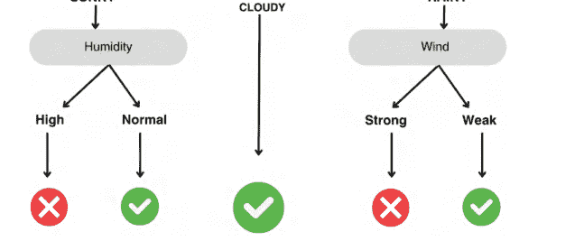

图 1.2 决策树算法的一个示例 [4]。


## 支持向量机 (SVMs)

**概述：** 支持向量机 (SVMs) 是一种高性能的监督学习算法，用于许多应用，包括法医学。SVMs 通过在高维空间中构建最优决策边界（称为超平面）来用于分类和回归任务 [6]。在最高层面上，SVMs 非常适合法医证据分析，因为这是一个非常明确的分类问题：寻找指纹中的模式或对遗传特征进行分类。

**运行原理：** 支持向量机 (SVMs) 寻求识别将不同类别数据点分隔开的超平面，同时努力在它们之间保持间隔。SVMs 的有效性取决于数据点——称为支持向量——它们有助于确定最优超平面。SVMs 在处理高度非线性关系方面表现出色，因为它们使用核函数为不同类别生成线性边界，而在这些情况下简单的直线无法将一个类别与另一个类别分开。图 1.3 显示了 SVMs 的示意图。

**在法医学中的应用：** 例如，在指纹分析中，SVMs 用于根据差异对指纹进行分类和匹配，特征共同负责正确的识别。SVMs 可以执行遗传特征分析，其中 SVM 以线性分类方式适合从 DNA 数据中挑选出模式，从而为识别个人提供重要信息。

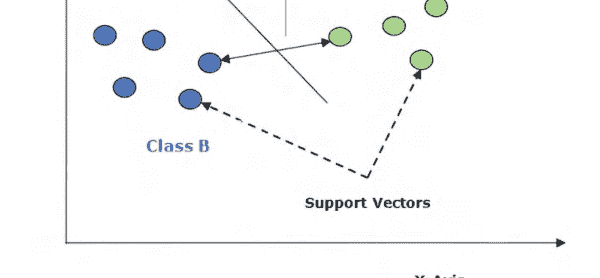

图 1.3 支持向量机示意图 [21]。

## 朴素贝叶斯分类器

**介绍：** 朴素贝叶斯分类器是基于贝叶斯定理原理的概率模型，在分类任务中表现良好，尤其是在法医学中。秉持其基础的简单假设，朴素贝叶斯分类器在某些场景下是高效有效的工具，例如计算资源或训练样本有限时 [7]。

**运行原理：** 朴素贝叶斯分类器的基本前提是它们假设特征相对于类别标签是独立的——因此称为‘naïve’。然而，朴素贝叶斯分类器在实践中很可能表现非常好。它们所做的只是计算数字，例如计算给定输入特征获得特定类别的似然（*先验*），然后选择概率最高的类别。在法医证据检查中，朴素贝叶斯分类器在诸如文档分析或手写识别等任务中找到应用。

**在法医学中的应用：** 例如，在文档分析中，它们可用于根据文本特征对文档进行分类和鉴定。

## 神经网络和深度学习模型

**介绍：** 神经网络和深度学习代表了一类令人兴奋的机器学习，其工作原理是模拟人类大脑处理复杂信息的方式。在法医学领域，这些模型在处理各种数据之间错综复杂的模式和关系方面表现出最先进的性能，从而提高了准确性和自动化水平。

- **神经网络：** 在神经网络中，每个网络都旨在模仿人类大脑，并包含配置在层中的大量节点——输入、隐藏和输出。每个连接都有一个相关权重，在训练过程中，网络通过调整这些权重从数据中学习模式 [8]。确实，神经网络在捕捉非线性关系方面非常强大，并在包括指纹分析、DNA 分型和图像取证在内的广泛法医领域显示出有希望的结果。
- **深度学习模型：** 深度学习将神经网络的概念扩展到更深的架构，即包含许多隐藏层，因而得名“deep”学习 [9]。卷积神经网络 (CNNs) 在涉及图像的任务中表现良好，因此广泛用于面部识别和图像取证等法医应用。CNNs 也用于语音和说话人识别，这些是顺序信息，因此 CNN 可以处理这些示例中的句子。因此，深度学习模型可以随着时间的推移自动学习具有很大深度和复杂性的对象的层次特征，这为其在法医调查中的应用提供了活力。图 1.4 概述了深度学习神经网络架构。

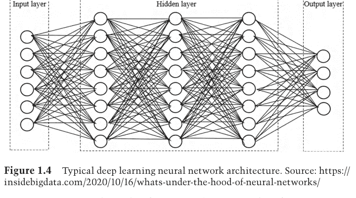

图 1.4 典型的深度学习神经网络架构。来源：https://insidebigdata.com/2020/10/16/whats-under-the-hood-of-neural-networks/

**在法医学中的应用：** 它们通过自动化繁琐的过程显著推动了法医学领域的发展。神经网络在指纹分析中很有用，其中错综复杂的模式有助于提高识别准确性。通过使用深度学习模型，DNA 分型可以得到改进，并且能够为准确的个人识别提供更详细的遗传信息。深度学习的层次特征提取能力也非常适合图像和视频取证。

## 无监督学习算法

### 聚类算法：K-Means、层次聚类

- **聚类算法：** 这些是无监督学习的核心部分，可实现在数据集中发现模式。聚类算法，如 k-means 和层次聚类，证明在法医学中很有用，其中模式可能不仅存在而且未知；这种方法能够为法医学产生的数据点之间的关系提供直观结构并带来显著见解。
- **K-Means 聚类：** K-means 将数据结构化为 k 个聚类，同时也是划分式的。它旨在将数据点分配到相似的聚类中，迭代地重新分配数据点，直到每个点都被适当分组。K-means 既高效又广泛用于类别之间存在明显边界的法医场景 [10]。例如，在网络安全调查中，k-means 可以识别网络数据中的独特行为或模式，帮助执法部门量化特定战术、技术和程序 (TTPs) 的适当阈值。
- **层次聚类：** 层次聚类通过基于相似性的迭代合并或拆分聚类，形成树状的聚类阶梯，称为树状图 [11]。这对于确定需要创建多少个聚类以及识别法医数据中的层次模式特别有用。层次聚类可用于语音和说话人识别，以对相似的音频模式进行分组，从而帮助通过声音识别个人。

**在法医学中的应用：** 在指纹分析中，k-means 聚类可以帮助确定一组指纹中的独特特征，使这些模式彼此不同。将层次聚类应用于 DNA 分型可以揭示遗传标记之间的层次关系，并详细说明家族信息。

## 降维技术：主成分分析 (PCA)、t-分布随机邻域嵌入 (t-SNE)

**介绍：** 降维技术在处理高维数据时是必要的，而这在法医学中很常见。像主成分分析 (PCA) 一样，这些技术试图在保留重要信息的同时将高维数据降至较低维度。PCA 和 t-分布随机邻域嵌入 (t-SNE) 是两种强大的方法，通过简化数据以实现更有效的分析，在法医证据检查中具有应用。

- **主成分分析 (PCA)：** PCA 是一种旨在通过检测数据方差最大的维度轴的成分来以某种方式减少维度的方法 [12]。PCA 在减少维度的同时保留信息，并以投影到这些数字的方式进行。在法医学和其他领域，PCA 可用于分析 DNA 特征 (遗传学) 坐标中的标记，每个指纹索引/特征数据集中最重要的相关元素。
- **t-分布随机邻域嵌入 (t-SNE)：** t-SNE 是一种非线性降维方法，旨在通过执行高维空间中存在的局部相似性来全局结构化数据 [13]。它在发现数据中的模式（结构、聚类）方面表现出色。关于 t-SNE 的一个关键发现是，当结果被明智使用时，它们可以帮助我们理解数据内部的关系，这在图像和视频取证场景或发现与网络犯罪相关的数据时至关重要。

**在法医学中的应用：** PCA 和 t-SNE 都是在高维（复杂）数据集的科学中经常使用的工具。这些方法在指纹分析期间大大加快了特征检测过程。例如，t-SNE 用于协助网络犯罪调查，因为它揭示了区域结构，有助于解释任意两个数据点之间细微的因果关系。

## 特征选择和提取

### 特征选择方法：过滤、包装和嵌入方法

**介绍：** 特征选择是机器学习模型数据准备的重要部分，尤其是在法医学中，数据集可能复杂且庞大。这正是选择不同重要特征以增强模型的预测能力，同时去除无关或冗余特征的过程。选择特征主要有三种方法：过滤、包装和嵌入——合适的方法取决于方法。

- **过滤方法：** 过滤方法通过独立评估特征，为同一数据集上的多种机器学习算法进行训练。有两种通用方法来对个体进行排名

特征的重要性，可通过统计检验或相关性分析来确定。最后，特征是根据作用 [14] 被选出或排除。过滤方法计算效率高，在高维数据集中表现良好。过滤方法在法医应用中很有用，因为它们可以通过选择最具判别性的遗传标记来提高 DNA 分型等任务的性能。

- **包装方法：** 包装方法通过让机器学习算法对每个子集进行工作。它检查各种特征子集并感知其功能能力或评估该模型以检测其在每个类别中的适用性函数 [15]。这种迭代过程比使用过滤方法计算成本更高，但通常为特定模型提供更精细调整的特征集。包装方法在为语音或说话人识别任务配置特征时很重要，即在法医科学中。
- **嵌入式方法：** 嵌入式方法将特征选择集成到模型训练过程中。在训练期间，机器学习算法根据其重要性选择特征并为其分配权重或系数。正则化技术，例如 L1 正则化，可以通过促进模型中的稀疏性来增强嵌入式特征选择过程 [16]。另一方面，嵌入式方法专门设计用于特征选择是学习的一部分的情况——其中之一是在神经网络中，因为应用于图像法医。

## 在法医科学中的应用：
特征选择方法有助于法医模型提高效率和准确性。在指纹匹配分析中，过滤方法可以帮助识别用于识别指纹的最佳判别特征。DNA 特征档案可以使用包装方法针对特定的身份验证任务进行调整。通过共同针对最具判别性的图像特征，嵌入式方法可以提高神经网络在图像法医中的性能。

## 特征提取技术：自动编码器、主成分分析（PCA）
### 引言
特征提取技术试图将原始数据转换为更小且更有用的格式，从而促进高效的模型训练并增强可解释性。两种突出的技术——自动编码器和主成分分析（PCA）——为法医应用中的特征提取提供了不同的方法。

- **自动编码器：** 自动编码器是一种对无监督学习非常有用的神经网络类型。自动编码器由编码器和解码器组成，学习将输入数据压缩为某种低维表示（编码），同时学习通过该编码重建原始数据 [17]。自动编码器在法医科学中非常有用，尤其是在图像法医方面，因为它们可以捕捉视觉数据中的详细模式甚至异常。这些学习得到的编码通常揭示涉及法医证据的重要结构。
- **主成分分析（PCA）：** PCA 是一种经典的线性领域技术，在识别出捕获最大方差的主成分后，将高维数据投影到较低维度 [12]。这些是正交轴，表示数据中最大的变异向量。PCA 常被用作许多法医应用中的基本技术，例如 DNA 分型，其中它能够在保持其潜在结构信息的同时降低遗传数据的维度。

### 在法医科学中的应用：
特征提取技术在识别法医数据中的信息模式方面发挥着关键作用。自动编码器处理语音数据的能力使其可用于语音和说话人识别。PCA 是一种线性降维方法，通过将大量特征分解为关键成分来帮助提高指纹分析的效率。

## 模型评估与性能指标
## 评估指标：准确率、精确率、召回率和 F1 分数
### 引言
评估指标对于确定机器学习模型在我们法医科学工作中的表现非常重要。它们提供数值指标，旨在表明模型对未见数据的泛化能力，并帮助法医从业者做出明智的决策。模型可以基于四个基本指标进行评估——准确性/准确率、精确率、召回率和 F1 分数。这四个指标提供了模型在法医任务中工作情况的良好总体指示 [3]。

- **准确率：** 准确性指标是最常见也是最基本的指标。它说明模型做出的预测中有多少是正确的，有多少是不正确的。它是正确预测的实例与总实例的比率，如公式 1.1 所示，其中 TN 表示真负例，TP 表示真阳性，FN 表示假负例，FP 表示假阳性。对于分类，真阳性（TP）和真负性（TN）是最相关和最准确的参数。然而，它并不能说明模型本应识别的实例中有多少实际上被识别出来，或模型本应分类为负的实例中有多少实际上被分类为阳性（这并不是你想要的）。因此，为了更全面地了解模型在各种法医任务中的有效性，最好查看全部四个指标，而不是仅依赖一个。

Accuracy = \frac{TP + TN}{TP + TN + FP + FN}  (1.1)
- **精确率：** 精确率的重点在于模型做出的阳性预测的准确性。它是真正阳性预测数与真阳性预测和假阳性预测之和的比率，如公式 1.2 所示。法医科学特别关注精确率，当假阳性的成本非常高时，例如指纹分析。在该应用中，精确率衡量模型在预测会匹配的实例中积极识别匹配的准确性。

Precision = \frac{TP}{TP + FP}  (1.2)
- **召回率：** 召回率也称为‘敏感性’或‘真阳性率’。召回率评估模型捕获数据集中所有阳性实例的能力。同样，假设我们对法医问题的解决是一个做出预测的模型，召回率评估模型捕获所有真正阳性预测的准确性。其实例见于 DNA 分型，其中召回率指标衡量个人基于其独特的遗传标记区分彼此的能力。分型的正确识别率平均远低于 100%。召回率的计算公式为：

Recall = TP / (TP + FN)  (1.3)
- **F1 分数：** F1 分数是精确率和召回率的调和平均值，提供了一个平衡的度量，考虑了假阳性和假阴性，如公式 1.4 所示。这两个指标都至关重要，因为它们直接评估两种错误——假阳性和假阴性——之间的平衡，而这对于评估法医科学结果的成功至关重要。

F1-Score = 2TP / (2TP + FP + FN)  (1.4)

### 在法医科学中的应用：
评估指标在衡量法医模型的可靠性方面发挥着非常重要的作用。在语音和说话人识别等应用的背景下，我们通常寻求已识别说话人的整体准确率。通过精确率，我们可以确保分析中匹配的指纹是正确的，而不是假阳性。当我们希望确保系统中所有被‘识别’的恶意活动实例都已被查获时，召回率变得至关重要。凭借这三个核心指标——准确率、精确率和召回率——法医科学家和调查人员可以深入了解模型性能的黑箱，并根据模型在工作良好时和不佳时的表现做出更好的决策。

## 交叉验证与过拟合
### 交叉验证
在法医科学中，机器学习的实际应用需要高度保证模型可以信任地在未见过的数据上运行。例如，如果模型仅在已知样本上训练，就不应期望它能处理新的 DNA 样本。评估模型预测能力的首要技术称为交叉验证。其基本思想是在训练期间将部分数据从模型中剔除，然后查看模型应用于该保留数据时的表现如何 [18]。

### 过拟合
当模型对训练数据过于精细地调整时，就会发生过拟合。通过过拟合，模型不仅学习训练数据的基本特征，还学习不重要、无关的细节。在这种情况下，模型可能为训练数据提供‘我们可信赖的结果’，但在新鲜的新数据上效果要差得多——就我们而言，是新的法医证据 [19]。


## ROC 曲线和 AUC（曲线下面积）：

接收者操作特征（ROC）曲线和曲线下面积（AUC）是评估机器学习模型在法医学中表现如何的重要工具 [3]。它们有助于理解真正例率与假正例率之间的平衡，这在指纹分析或 DNA 分型等任务中至关重要。

真正例率（灵敏度）和假正例率（1 - 特异性）仅告诉我们在固定、预先确定的阈值下模型的表现如何。ROC 曲线提供了远比这更多的信息。它们显示在所有可能的阈值下真正例率如何随假正例率变化，并帮助我们选择“最佳”工作点。AUC 将 ROC 曲线压缩为一个单一数字。AUC 越高，语音识别模型越好，模型在网络领域区分正常活动和恶意活动的能力也越好。图 1.5 显示了理想的 ROC–AUC 曲线。

## 法医学中的应用：

在法医工作中，如果我们不想最大化假阳性或假阴性，就需要比历史上更加关注 ROC 曲线和 AUC。

## 机器学习的类型：监督学习、无监督学习和强化学习

在法医学领域，应用了多样化的机器学习方法，其中三种基本类型——监督学习、无监督学习和强化学习——是最常见的。每种都发挥着独特而有价值的作用，对数据进行各自形式的解释。图 1.6 显示了不同类型的机器学习。

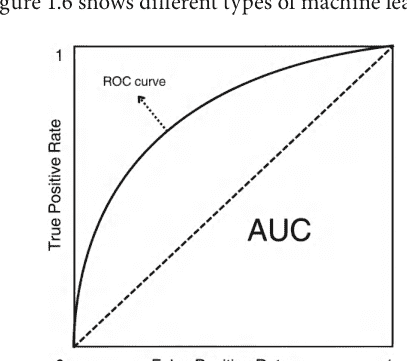

图 1.5 ROC–AUC 曲线。

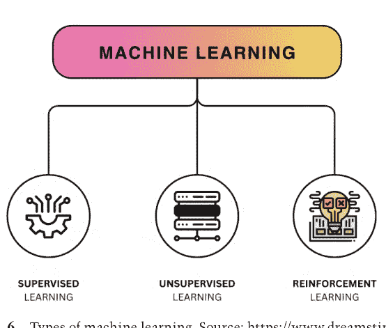

图 1.6 机器学习的类型。来源：https://www.dreamstime.com/machine-learning-types-supervised-vs-unsupervised-reinforcement-glance-vector-editable-stroke-colors-image297519539

### 监督学习
监督学习是一种方法，其中算法在标记数据上进行训练，以理解输入和输出之间的关系。然后将这些算法应用于需要算法实现明确、已知的目标的项目。

### 无监督学习
无监督学习是一种方法，其中算法在未标记数据上工作。在分析未标记数据时，算法尝试找到数据中固有的模式或结构。当法医学专家了解两种主要方法——监督学习和无监督学习——的主要运行条件和用例时，就能更好地利用机器学习。聚类算法，例如 k-means 和层次聚类，在法医学专家考虑将无监督学习应用于其项目时非常重要。

### 强化学习
强化学习涉及智能体在动态环境中从反馈中学习，这有助于网络犯罪调查和资源优化。

了解这些机器学习类型有助于法医学专家发现模式、简化分析和做出更好的决策。

## 机器学习模型的挑战、伦理考虑、可解释性和可说明性

在法医应用中的机器学习方面，有两件事极其重要：数据质量和偏差。原因显而易见：在学习算法被教授工作的上下文中，如果要依赖它们，其结果的正确性和公平性就必须被视为理所当然。毕竟，法医学不仅仅是处理证据；它是处理已被证明准确、完整和一致的证据。如果不是这样，那么所处理的结果——在机器学习的情况下，所使用的模型——在预测未来结果和确保结果公平性方面就没有什么价值。

提高数据质量涉及识别和修复错误以及去除异常值。我们必须纳入各种群体和条件的数据以减少偏差。我们还使用训练时偏差减少的算法，从而产生更公平的答案集合。当然，我们也尽量让这些模型尽可能易于理解。这在法医学中尤其重要，因为我们影响人们的生活（并做出可能最终导致某人被监禁或不被监禁的决定），并且我们的工作需要被专家、调查人员和律师理解（他们也必须做出可能影响某人是否被监禁的决定）。

为了增强清晰度，我们可以采用更直接的模型，强调数据的关键部分，阐明预测并利用基于规则的系统。在法庭上，这些模型提供的证据必须被法官和陪审团理解和信任。当我们将机器学习应用于法医学时，我们必须确保保护隐私和安全，因为我们处理的数据——通常具有生物特征或遗传性质——非常敏感。挑战并不小：需要在增加数据有用所需隐私的同时不丧失数据可用性；在为执法使用启用必要数据访问的同时具有有效的模型保护；所有这些都分解为隐私、安全和伦理三个方面。解决这些问题涉及多种策略：使用差分隐私、安全多方计算和加密；获得知情同意；并确保对模型的法医分析不仅准确，而且尊重个人的隐私权。

## 未来方向和新兴趋势

### 深度学习和神经网络

法医学现在是机器学习革命的一部分，而这场革命最强大的工具是深度学习和神经网络。它们为我们提供了新的架构形式——例如 CNN、循环神经网络（RNN）、Transformer 和生成对抗网络（GAN）——可处理最基本的法医证据类型，如图像、视频、音频和文本。然而，这些网络需要大量数据才能工作——以及大量的人类判断来解释其输出——以使法医证据遵循正当程序的规则，而这是任何被称为“法医”的基本要求。

### 可解释人工智能和可解释机器学习模型

XAI（可解释人工智能）以及产生可解释结果的机器学习模型在法医学中的重要性在于它们促进理解和建立信任的能力 [20]。法医学家在推理并就对社会的明确而现实的危险做出决定时，必须了解机器生成证据的法律和伦理细节。如果人工智能算法决定哪个面部识别匹配适合法律可采性，我们希望确保算法产生可理解的结果——不仅对算法的开发者，而且对我们所有人而言。正如本章所示，一些机器学习模型在这方面比其他模型更好。

## 参考文献

- 1. Sarker, I. H. (2021). 机器学习：算法、实际应用和研究方向。 *SN 计算机科学*, 2, 160. https://doi.org/10.1007/s42979-021-00592-x
- 2. Hickman, S. E., Woitek, R., Le, E. P. V., Im, Y. R., Mouritsen Luxhøj, C., Aviles-Rivero, A. I., Baxter, G. C., MacKay, J. W., and Gilbert, F. J. (2022). 乳腺X线筛查工作流程应用中的机器学习：系统综述和荟萃分析。 *放射学*, 302(1), pp. 88–104. https://doi.org/10.1148/radiol.2021210391
- 3. Sharma, S. U., and Shah, D. J. (2017). 使用计算机视觉技术进行实用动物检测和碰撞避免系统。 *IEEE Access*, 5, pp. 7358–7365. https://doi.org/10.1109/ACCESS.2016.2642981
- 4. Song, Y. Y., and Lu, Y. (2015). 决策树方法：分类和预测的应用。 *上海精神病学档案*, 27(2), pp. 130–135. https://doi.org/10.11919/j.issn.1002-0829.215044
- 5. Breiman, L. (2001). 随机森林。 *机器学习*, 45, pp. 5–32. https://doi.org/10.1023/A:1010933404324
- 6. Zhang, Y. (2012). 支持向量机分类算法及其应用。 In C. Liu, L. Wang, and A. Yang (Eds.), *信息计算与应用* (Vol. 308, pp. 260–267). Springer. https://doi.org/10.1007/978-3-642-34041-3_27
- 7. Yang, F.-J. (2018). 朴素贝叶斯分类器的实现。 In *2018 计算科学和计算智能国际会议（CSCI）* (pp. 301–306). IEEE. https://doi.org/10.1109/CSCI46756.2018.00065


- 8. Goel, A., Goel, A. K., and Kumar, A. (2023). 人工神经网络和机器学习在利用空间信息中的作用。*空间信息研究*, 31, pp. 275–285. https://doi.org/10.1007/s41324-022-00494-x
- 9. Sharma, S., Pandey, S., and Shah, D. (2023). 利用人工智能增强医学诊断：聚焦呼吸系统疾病检测。*印度社区医学杂志*, 48(5), pp. 709–714. https://doi.org/10.4103/ijcm.ijcm_976_22
- 10. Na, S., Xumin, L., and Yong, G. (2010). K-Means聚类算法研究：一种改进的K-Means聚类算法。In *2010年第三届智能信息技术与安全信息学国际研讨会* (pp. 63–67). IEEE. https://doi.org/10.1109/IITSI.2010.74
- 11. Patel, S., Sihmar, S., and Jatain, A. (2015). 层次聚类算法研究。In *2015年第二届可持续全球发展计算国际会议（INDIACOM）* (pp. 537–541). IEEE.
- 12. Jolliffe, I. T., and Cadima, J. (2016). 主成分分析：综述与最新进展。*英国皇家学会学报A辑*, 374(2065), p. 20150202. https://doi.org/10.1098/rsta.2015.0202
- 13. Belkina, A. C., Ciccolella, C. O., Anno, R., et al. (2019). T分布随机邻域嵌入的自动化优化参数改善了大型数据集的可视化和分析。*自然通讯*, 10, p. 5415. https://doi.org/10.1038/s41467-019-13055-y
- 14. Sánchez-Maroño, N., Alonso-Betanzos, A., and Tombilla-Sanromán, M. (2007). 特征选择的过滤方法——比较研究。In H. Yin, P. Tino, E. Corchado, W. Byrne, and X. Yao (Eds.), *智能数据工程与自动化学习——IDEAL 2007* (Vol. 4881, pp. 178–187). Springer. https://doi.org/10.1007/978-3-540-77226-2_19
- 15. El Aboudi, N., and Benhlima, L. (2016). 关于包装器特征选择方法的综述。2016年工程与管理信息系统国际会议（ICEMIS），摩洛哥阿加迪尔。IEEE, pp. 1–5. https://doi.org/10.1109/ICEMIS.2016.7745366
- 16. Lal, T. N., Chapelle, O., Weston, J., and Elisseeff, A. (2006). 嵌入方法。In I. Guyon, M. Nikravesh, S. Gunn, and L. A. Zadeh (Eds.), *特征提取* (Vol. 207, pp. 137–165). Springer. https://doi.org/10.1007/978-3-540-35488-8_6
- 17. Zhai, J., Zhang, S., Chen, J., and He, Q. (2018). 自动编码器及其各种变体。In *2018年IEEE系统、人与控制论国际会议（SMC）* (pp. 415–419). IEEE. https://doi.org/10.1109/SMC.2018.00080
- 18. Refaeilzadeh, P., Tang, L., and Liu, H. (2009). 交叉验证。In L. Liu and M. T. Özsu (Eds.), *数据库系统百科全书*. Springer. https://doi.org/10.1007/978-0-387-39940-9_565
- 19. Das, P. L., Manoj, A. S., Sharma, S., and Jayaraj, P. B. (2021). 利用深度学习技术从CT扫描中早期检测COVID-19。In S. M. Thampi, E. Gelenbe, M. Atiquzzaman, V. Chaudhary, and K. C. Li (Eds.), *计算与网络通信进展* (Vol. 736, pp. 45–54). Springer. https://doi.org/10.1007/978-981-33-6987-0_5
- 20. Došilović, F. K., Brčić, M., and Hlušić, N. (2018). 可解释人工智能：综述。In *2018年第41届信息与通信技术、电子与微电子国际会议* (MIPRO) (pp. 0210–0215). IEEE.
- 21. Srivenkatesh, M. (2020). 使用机器学习算法预测前列腺癌。*近期技术与工程国际期刊*, 8(5), pp. 5353–5362. https://doi.org/10.35940/ijrte.E6754.018520

## 法医微量物证检验中机器学习的范围

VAISHALI, NIHA ANSARI AND JEET DASGUPTA

### 引言

人工智能（AI）是一个不断发展的领域，涉及教会机器执行通常需要人类智能的任务 [1]。人工智能的主要目标之一是开发能够像人类一样思考、推理和学习的机器。这涉及创建能够分析数据、识别模式并基于该信息做出决策的算法 [2]。这是一个快速发展的学科，也被用于增强法医学和整个法律系统的应用。鉴于数据量巨大；证据在不连贯、复杂的环境中尺寸很小；常规实验室框架，以及有时专业知识不足，法医学和刑事调查专业人员目前面临着许多可能导致调查失败或不公正的困难。

在司法法庭中，证据被定义为倾向于证明或反驳与正在进行的案件相关的待考虑事实的东西。根据《印度证据法》第（3）条，证据可以分为三种类型，即口头或证词、文件和电子证据，进一步，证据可分为两种类型，即直接证据和间接证据。直接证据被描述为毫无疑问地证明一个事实，而间接证据要么支持犯罪的情况，要么反对这一事实 [3]。例如，在犯罪现场发现的指纹是某人在犯罪现场存在的间接证据。证据还可以分为真实证据或证词证据。真实证据是可以看到、触摸或闻到的实物证据。证词证据是目击者对案件所见或所闻的证词 [4]。

实物证据是任何可以在法律程序中用来建立证明或反驳事实的有形物体 [5]。它可以是任何东西，从指纹和DNA到武器和服装。实物证据通常用于证实证人证词或建立事件的时间线。实物证据有六种类型，即微量证据、转移证据、压痕证据、条纹证据、几何证据和化学证据 [6]。

科学微量证据首次由Edmund Locard于1910年被认可 [7]。微量证据是一种实物证据，定义为在犯罪现场或涉及犯罪的人身上留下的微小、通常是微不足道的物品 [6]。微量证据检验是对在犯罪现场获得的实物微量证据的评估，例如头发、纤维、污垢和玻璃碎片 [8]。它可以提供有关犯罪嫌疑人身份、犯罪情况以及个人或货物位置的重要细节。可能训练机器学习算法来评估证据痕迹并提供有助于刑事调查的见解 [9]。由于机器学习使机器能够学习模式并寻找人类可能遗漏的相似性和差异，因此它在实物证据分析中越来越受欢迎。机器学习也是使人工智能能够创建直观、用户友好的界面，从而便于人类使用的基础 [10]。

### 微量物证的重要性

- 1. 微量证据用于在犯罪现场、受害者与犯罪嫌疑人之间建立联系 [11]。例如，在车祸现场发现的油漆碎片和在受害者衣服上发现的同类型碎片可以建立两者之间的联系。
- 2. 微量证据要么加强要么削弱证人证词，为其证据的真实价值提供客观依据。例如，DNA和指纹等证据可以证明某人在犯罪现场的事实存在或不存在。
- 3. 在重建犯罪事件、填补空白并提供合乎逻辑的一系列步骤时，微量证据可能至关重要。微量证据的元素分析提供了独特的视角，这种视角在初步观察时可能被忽视，这可能会显著改变调查的叙述 [12]。
- 4. 工具痕迹和玻璃断裂模式等微量证据帮助我们识别所用力的类型、力的方向和所用工具，从而让我们了解现场所进行的事件。
- 5. 微量证据在界定时间线、验证假设并引入新的角度和线索方面发挥着重要作用

调查。微量物证的存在与否对于验证时间线以及将一个事件与另一个事件联系起来或将两个犯罪现场联系起来至关重要。

## 微量物证检验中遇到的问题

微量物证分析自有其相当的困难；这可能是由于证据的性质或用于分析的仪器在限制和可用性方面造成的。正如名称所示，微量物证的主要问题之一是其数量非常少，使得识别、处理、保存和防止污染变得困难。这些问题很容易被忽视，直到受过训练的眼睛观察到微量物证，而证据更容易丢失或损坏。微量物证很容易受到多源污染，包括环境因素，如雨水和温度，处理过程中的污染，如赤手操作，污染也可能发生在采集、包装、运输或储存过程中，这最终会损害证据在法庭上的证明价值。在微量物证分析过程中，背景噪声可能会干扰元素的识别；为克服这一问题，我们需要专业知识和先进的分析技术，能够以极高的灵敏度准确识别元素。处理此类证据的法医专家应具备良好的技能和知识培训，以精确地准确执行所需的分析。分析步骤应实现普遍标准化，以避免不一致。

## 步态模式分析中的机器学习

步态被定义为生物体从一个地方移动到另一个地方时肢体的运动，大多数动物具有四足步态，它们使用前后两对肢体移动，而人类具有双足步态，我们仅使用下肢移动。传统上，动物的步态被用来追踪生物体、标记其移动并定位其常活动区域，我们在法医学中也类似地使用步态，除此之外，步态在医学科学中用于诊断神经肌肉问题和疾病，如帕金森病和脑瘫。步态还用于动画中为图形化角色创建类人运动，并在许多其他领域中使用。在法医学中，我们处理步态模式的两个方面，一个是步态印痕，另一个是利用视频摄像机和监控录像捕捉到的步态阶段。传统的分析方法在准确理解步态模式方面存在局限性；然而，随着机器学习方法的出现，许多新的潜在途径已被开启。这些数据驱动的算法已被证明在识别步态数据中的模式和关系方面更有效，从而提高了根据行走风格识别个体的准确性和效率。Zixuan Zhang 等人探索了一种有效且广泛适用的方法，以提高运动检测中摩擦电传感器的耐久性，如图 2.1 所示 [13]。

Sharon Jemimah Peace 等人发布了关于使用机器学习进行步态评估的姿态估计策略的研究，强调了步态模式变化与老年人感知和运动能力下降之间的联系。它强调了步态分析在诊断衰老和虚弱疾病方面的有用性 [14]。

步态周期始于任一脚的初始足跟接触，并以同一脚的随后足跟接触结束 [15]。因此，单个步态周期涵盖了两个不同步伐的执行，其中每个步伐对应于右脚或左脚，反之亦然。步态周期本质上由两个不同的阶段组成，即摆动相和站立相 [16]。“站立相”一词描述的是

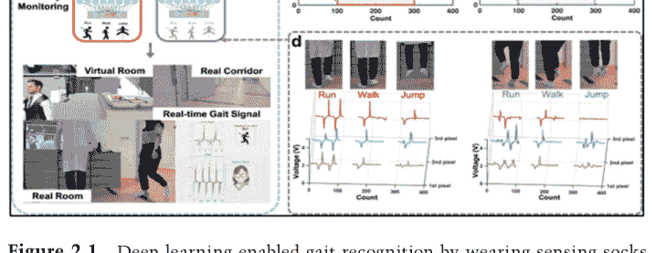

图 2.1 穿戴传感袜实现的深度学习步态识别 [13]。

脚与地面接触的时间。摆动相是指脚不接触地面的时间。检查员能够更好地确定异常步态特征，当站立相和摆动相被划分为八个不同的阶段，即所谓的临界事件时。步态周期被划分为八个独立的子时期，介于两个阶段之间。 [16]。站立相有五个子阶段：初始接触、负重反应、中立站立、末期站立和预摆。第二个阶段，即摆动相，有三个子阶段：初始摆动、中期摆动和末期摆动，如图 2.2 所示 [16]。

步态特征可以通过各种方法收集，包括步态印痕摄影、视频监控录像、记录步态运动学特征的地面反作用力板以及可穿戴传感器。Abdul Saboor 等人提供了步态分析当前发展的概述，涵盖出版物具体信息、采样率、机器学习模型（MLMs）、可穿戴传感器及其各自放置位置等方面 [17]。

数据集通常由视频序列或时间序列数据组成，这些数据描绘了个体的行走模式。信息预处理是获得可用于机器学习算法的数据的关键步骤。可能采用的一些技术包括降噪、归一化和特征提取。特征提取过程涉及从未处理的数据中识别相关属性

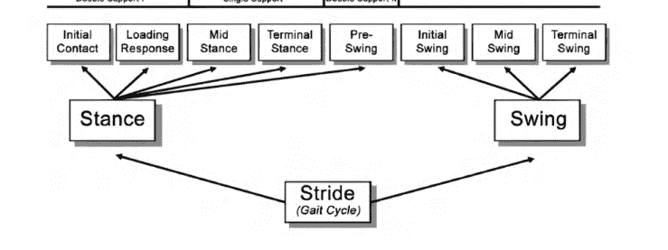

图 2.2 经典步态模型显示站立相和摆动相 [48]。

数据，包括但不限于关节角度、步长或时间因素。特征选择是为特定任务识别最相关变量的过程。由于步态数据维度众多，采用了各种提取的特征，如步幅长度、步持续时间、关节角度、足部压力分布和其他步态相关指标，以便选择最相关和最具区分性的方面。这一阶段对于将模型的注意力引导至步态模式的基本要素至关重要，从而提高性能和效率。为了训练模型的过程，数据集被划分为训练和测试用途的独立子集 [18]。训练数据用于训练机器学习模型，而测试数据则用于评估其性能。在构建步态模式识别模型时采用了多种机器学习算法。支持向量机（SVMs）、神经网络、随机森林和深度学习架构（如卷积神经网络（CNNs））等算法在各个领域被广泛采用。Jayati Ghosh Dastidar 等人使用了三种机器学习模型，即支持向量机（SVMs）、k 近邻（KNN）和随机森林，用于基于步行视频序列的步态参数分析的生物识别分类。系统中分析了步态参数，如足跟触地角度、蹬离角度和步幅角度 [19]。算法从提供的训练数据中获取知识，以便辨别模式并建立步态变量与个人独特身份之间的相关性。在训练阶段，模型在依赖标注数据的情况下获得了建立提取特征与人们独特步态模式之间对应关系的能力。对训练模型的评估涉及利用不同的数据集来衡量其性能、准确性和泛化能力。上述评估程序有助于法医专业人员改进模型并确定最适合给定法医测试目标的算法。一旦模型经过准确性验证，它就可以用于在实际情况下辨别个人、分类行走模式或通过检查步态痕迹建立嫌疑人与犯罪地点之间的联系。

机器学习技术应用使法医专业人员能够自动化和优化步态模式分析过程。与传统方法相比，算法能够更高效、更准确地检查大量数据集。此外，机器学习的公正性减轻了与人类视觉评估相关的固有偏见，从而提高了法医调查领域发现结果的可靠性和可信度。


## 涂料证据分析中的机器学习

术语“涂料证据”涵盖在犯罪现场、汽车或其他可能与非法行为相关之物上发现的涂料残留物或碎片 [7]。涂料证据的分析可以提供有关多种特征的宝贵见解，包括但不限于涂料类型、其成分、颜色、纹理以及不同涂料层排列的方式 [20]。经彻底分析后，涂料证据有可能促进嫌疑人、受害者与犯罪现场之间关联的建立。涂料残留物可在各种事件的现场找到，例如肇事逃逸事故、入室盗窃、袭击等。涂料残留物可以以衣物、车辆或物品上的碎片或条纹形式存在，或以松散状态存在于现场。此外，涂料可能在两辆车之间、车辆与物体之间或两个物体之间转移 [21]。在涂料样品分析中使用机器学习有助于消除证据受损的可能性，因为涂料样品通常性质非常脆弱，在扫描电子显微镜（SEM）和其他显微检查下分析它们会带来破坏样品本身的风险，而在机器学习方法中，我们可以通过拍摄的照片和算法来分析涂料碎片和色调标记。涂料样品有一个共同问题，那就是该待查样品是否与对照样品相同，或是否与特定汽车或车型所使用的样品相同，为此我们通常需要将样品结果与涂料数据查询进行匹配，这可以是一项繁琐的手工任务，但使用机器学习算法时，算法已在数据集上训练过，因此可以自动给出相似度评分。尽管当前算法无法取代气相色谱-质谱法（GC-MS）和傅里叶变换红外光谱法（FTIR）等分析技术，但对机器学习模型进行训练以利用其结果可以产生相似度评分，并可实现对涂料成分的有限预测。

上述技能有可能通过促进嫌疑人的识别或建立犯罪现场之间的联系，对刑事调查做出实质性贡献。Francis Kwofie 等人使用机器学习技术分析了来自 26 辆汽车的汽车涂料样品，以识别车辆的制造商、品牌和型号，如图 2.3 所示 [22]。

使用机器学习算法进行涂料分析涉及几个步骤，包括从犯罪现场或相关物体以及涉案人员（如有）的衣物中收集数据。机器学习算法已被用于开发一种模式识别方法，该方法将红外光谱库与互相关搜索算法相结合。这提高了搜索的准确性，并仅使用 IR 光谱比较汽车涂料层的原始设备制造商（OEM） [23]。

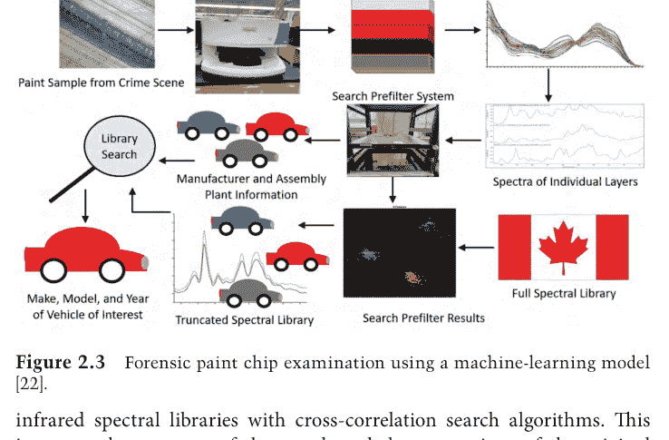

图 2.3 使用机器学习模型进行法医涂料碎片检查 [22]。

样品处理的初始步骤涉及样品预处理，这有助于我们去除噪声、方差和其他无用信息。涂料样品在成分、颜色、纹理和年代上各不相同。数据预处理有助于形成更好的特征提取过程。特征提取过程涉及使用数值来表征涂料样品。直方图、颜料成分、光谱反射率和颗粒尺寸分布是可考虑用于涂料样品和其他相关因素的可能特征。接下来是数据准备过程，涉及整理已识别样品的数据集并根据其来源进行分类，以便按 80:20 的比例分为训练集和测试集两组。可以使用的各种机器学习算法包括支持向量机（SVMs）、k 近邻（KNN）、随机森林和神经网络。该训练数据集可以为监督学习方法进行标记，为无监督学习方法不进行标记。

在这种情况下，训练好的模型通过测试数据集进行评估，旨在评估模型的准确率、精确率和召回率。所有预测均由全部正例（P）和负例（N）组成。P 由真正例（TP）和假阳性（FP）组成，N 由真负例（TN）和假阴性（FN）组成。因此，我们可以将准确率定义为 ACC = (TP + TN) / (TP + TN + FP + FN) = (TP + TN) / (P + N)。因此，此类技术旨在评估模型在不同数据划分上的结果，并经常被使用。一旦该模型被证明有效，就可用于解释从犯罪现场或任何其他物体收集的涂料样品。

将自动化学习方法应用于法医涂料证据分析可处理来自各种来源的数据。光谱分析涵盖了广泛的技术，如 FTIR（傅里叶变换红外光谱法）和拉曼光谱法，用于从涂料样品获得光谱 [24]。Kwofie 等人已证明，在一次检查中获得横截面未破损的多层 OEM 涂料碎片全部四层的红外光谱数据是可行的。这是通过采用红外透射显微镜在红外（IR）透射模式下恢复整个结构来完成的 [22]。光谱随后可使用机器学习方法进行分析，以期更深入地了解显微镜及其成分，并通过分析涂料样品确定涂料层的特征。显微镜采用成像技术以及显微镜技术。例如，在需要比较各种涂料样品的情况下，很容易让自动化系统或机器学习模型分析显微镜下的涂料图像，然后确定某些属性。为了识别涂料样品并确定其元素含量，扫描电子显微镜（SEM）与能量色散 X 射线光谱（EDS）相结合的技术是一种有用技术，该技术将扫描电子显微镜（SEM）与能量色散 X 射线光谱（EDS）集成在一起。假设应用机器学习方法，将有利于执行复杂的化学数据分析以识别涂料来源。

## 土壤证据分析中的机器学习

土壤证据是指对从犯罪现场收集或与嫌疑人、受害者或涉案物品相关的土壤样品进行分析 [25]。“土壤证据往往是犯罪的沉默见证者”，这些话强调了土壤证据在法医调查领域所具有的非凡潜力。像一位安静的观察者一样，土壤可以见证犯罪的发生，捕捉否则仍可能隐藏的重要信息。土壤证据最主要的优势之一是揭示嫌疑人的来源信息。土壤并不均匀；它根据其位置具有不同的特征。每个地区，甚至地区内的子地区，都具有独特的土壤成分。因此，当从嫌疑人的身体、衣物或车辆上采集土壤样品时，它们可以提供地理位置或地理指纹，将个人与特定区域甚至特定犯罪现场联系起来 [26]。这种关联对于核实或质疑嫌疑人的不在场证明至关重要。林德伯格绑架案（1932 年）是一起查尔斯·林德伯格的孩子在新泽西州家中被绑架的案件。土壤证据是本案的关键证据，已被证明在解决此案中有效。在绑架案中使用的梯子上发现的土壤被分析并追溯到布鲁诺·哈普特曼住所附近的地点，后者随后被逮捕并定罪。该案是土壤证据如何将嫌疑人与犯罪现场联系起来的里程碑式案例。

然而，尽管具有潜力，土壤证据的分析传统上依赖于手工方法。Vung Pham 等人使用便携式 X 射线荧光（pXRF）光谱法结合机器学习或深度学习算法检查土壤光谱信息，以预测土壤属性，如图 2.4 所示 [27]。

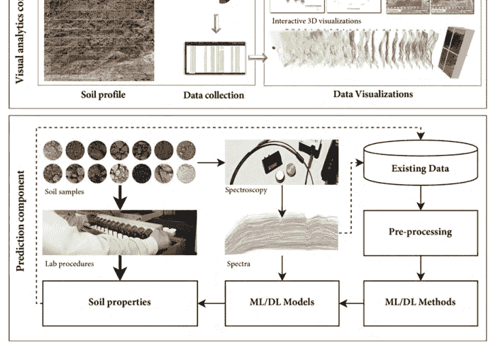

图 2.4 使用机器/深度学习方法进行土壤分析 [27]。


法医科学家会 painstakingly 比较土壤样本的物理和化学性质，这一过程既耗时又容易出现人为错误。认识到这些局限性后，将机器学习（ML）整合到土壤证据分析中，开启了法医学的新时代。以下是机器学习对法医学领域的贡献：

### 模式识别
由于其识别数据中复杂模式的能力，ML 算法在大型数据集的分析中很有用。这种能力在土壤证据分析的背景下被证明非常有用。从不同地点采集的土壤在物理性质测试中可能看起来相似，但它们是不同的。这些生成的数据随后由不同的 ML 模型进行分析，这些模型基于特征提取可以区分颗粒大小、分布、矿物含量和其他有机物。例如，某些矿物和矿石的存在有助于识别特定区域的来源。

### 来源归属
确定土壤样本的来源是法医土壤分析的主要目标之一。ML 大大改善了这一过程。基于土壤剖面数据库，ML 算法可以搜索与样本相似的成分。这种比较避免了人工方法所需的时间，并且是数据驱动的。因此，最终产品在将采集的土壤样本与其可能来源联系起来时具有更高的准确度。当其他方法可能不确定时，ML 可以给出更明确的答案，这有助于将证据与地点联系起来。

### 地理空间分析
土壤证据分析中的地理空间分析涉及土壤样本的物理性质与地理数据的整合。这种融合是每种机器学习算法的独特优势。解释这些想法，可以说，如果机器学习算法不仅考虑土壤样本的化学和矿物学组成，还考虑与样本相关的地理信息，则可以高精度地估计样本的地理来源。这种能力在犯罪现场的确切位置不为人知或对其位置存在争议时尤其重要。机器学习本身可以将土壤成分与地理信息相关联，从而可能减少可能犯罪现场的列表，从而在调查中节省时间和精力。Chandan 和 Ritula Thakur 对基于机器学习方法评估土壤分类的比较分析进行了研究，用于识别许多可区分的特征，例如土壤水分含量、土壤中发现的养分、土壤的物理结构、土壤的状态、土壤的 pH 值和土壤的稠度 [28]。

### 数据整合
在法医调查中，通常会进行不同类型证据的分析。编译证据类型的能力是 ML 的主要优势。在土壤证据的背景下，这意味着将土壤数据与其他形式的证据集成，例如轮胎印、足迹、DNA 样本甚至目击者证词。这些各种信息来源的结合提供了对犯罪现场更全面、更全面的了解。例如，土壤类型可以与轮胎印匹配，以在嫌疑人的汽车与犯罪现场之间建立更强的关联，从而提高土壤的证据和调查价值。

一些案例展示了机器学习在土壤证据中的能力如下。例如，在一起追尾事故调查中，使用机器学习算法分析了土壤样本，并将结果与从嫌疑车辆收集的样本进行比较，结果导致成功识别涉案车辆。

在另一案例中，失踪人员调查涉及应用机器学习分析在失踪人员衣服上检测到的土壤样本。将其与地理空间数据集成后，可以轻松确定感兴趣的区域，在此特定案例中，调查人员能够找到受害者。

## 玻璃证据分析中的机器学习
法医专家在处理法医证据以收集有助于刑事调查的重要信息方面承担着重大责任。玻璃作为有形证据，常见于一系列刑事活动，包括盗窃、道路事故、凶杀、性侵、射击事件、纵火和破坏。破窗产生的破碎玻璃碎片有可能嵌入参与盗窃的个人的鞋履或衣物中 [29]。同样，在追尾事故现场发现的微小前灯玻璃颗粒可以提供有价值的证据，验证嫌疑车辆的识别。此外，玻璃痕迹也可能出现在嫌疑人的衣物上，尤其是在使用瓶子作为武器时。此外，在暴力事件中，玻璃物品如瓶子、窗玻璃、镜子、眼镜和其他类似物品可能会无意中破碎，导致碎片可能附着在犯罪分子的服装或鞋履上 [30]。玻璃碎片具有将破碎物体与犯罪现场、受害者和潜在嫌疑人联系起来的独特能力，提供有关事件的‘如何’、‘何时’和‘什么’的情况的见解 [31]。这些微小的玻璃碎片很容易附着在衣物、鞋子、头发、皮肤和各种物体上，使其成为法医分析中的宝贵资源。

传统上，法医学学科中玻璃证据的调查依赖于仔细的人工审查。这些包括折射率（RI）、密度梯度分析、物理属性匹配和先进显微镜等技术 [32, 33]。此外，法医科学家、研究人员和调查人员越来越多地倾向于利用元素分析作为检查玻璃颗粒的技术。科学研究中采用了各种元素分析技术，例如激光剥蚀电感耦合等离子体质谱法（LA-ICP-MS）、粒子诱导 X 射线发射（PIXE）、扫描电子显微镜与能量色散 X 射线光谱法（SEM-EDS）[34]、仪器中子活化分析（INAA）和快中子活化分析（PGAA）[35]。Grzegorz Zadora 讨论了基于 SEM 与能量色散 X 射线光谱仪仪器获得的元素组成和折射率值对玻璃碎片进行分类，并比较了基于似然比的方法与其他分类方法（如支持向量机和朴素贝叶斯分类器）的效率 [36]。然而，机器学习（ML）的引入彻底改变了这一实践，导致玻璃证据分析的精度和有效性提高。Ruthmara Corzo 等人使用折射率、显微 X 射线荧光光谱法（µXRF）和激光诱导击穿光谱法（LIBS）评估了从汽车挡风玻璃收集的法医玻璃证据，该数据如图 2.5 所示 [37]。

### 玻璃证据的重要性
玻璃证据包含法医调查的各个方面。它可以源自破碎的窗户、破碎的瓶子甚至枪击损坏，在刑事案件中提供关键信息 [30]。

### 来源归属
由于不同类型的玻璃具有各种特性，因此可以确定特定玻璃碎片的来源。这可以帮助侦探追踪破碎窗户、武器甚至车辆玻璃的来源。


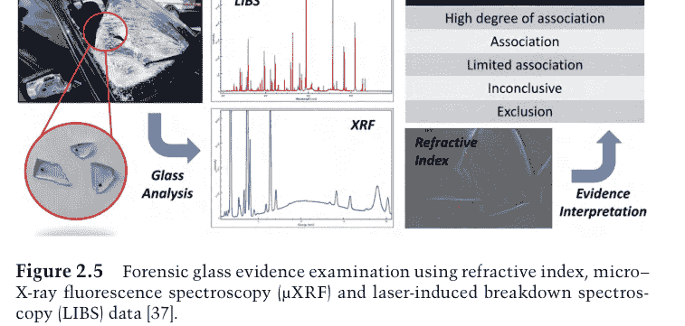

图 2.5 使用折射率、微区 X 射线荧光光谱法 (μXRF) 和激光诱导击穿光谱法 (LIBS) 数据进行的法医玻璃证据检验 [37]。

## 轨迹分析
玻璃碎片轨迹分析是一种用于复制导致玻璃破碎的子弹或弹丸所走路径的方法。通过细致检查玻璃断裂的模式和复杂性，法医专业人员可以揭示有关撞击方向和位置的重要信息。

## 将嫌疑人与犯罪现场联系起来
法医玻璃是嫌疑人与犯罪现场之间的联系。每当玻璃颗粒转移到嫌疑人的衣服或鞋子上时，它们就会变成非常有说服力的罪证材料，尤其当它们的类型与指定犯罪现场发现的玻璃相同。

## 鉴别玻璃类型
普通玻璃如浮法玻璃或钢化玻璃具有不同类型的断裂特性。根据玻璃断裂的这种独特模式，法医专家可以识别出事件中涉及的玻璃类型。

## 机器学习在玻璃证据分析中的作用
机器学习为法医科学中玻璃证据的分析带来了新的维度。以下是在法医科学领域机器学习的贡献：

### 模式识别
机器学习算法在大型数据库中识别复杂模式方面很有用。它们可以研究玻璃相关事件中玻璃碎片的断裂模式。机器学习可以根据断裂的特征帮助识别事件中使用的力或弹丸的类型，这对于重建犯罪现场可能很有价值。

### 来源归属
机器学习算法擅长将玻璃片的区分特征与已知玻璃样本的大型详细数据库进行比较。这种能力为法医科学家提供了一种有用的工具，可以以独有的精确度确定给定玻璃碎片的来源。机器学习提供了一个严谨的系统来确定来源归属，无论是确定窗户的品牌、识别玻璃制品的制造商，甚至是玻璃来源的车辆的具体品牌和型号。这不仅提高了法医调查人员将证据追溯到其来源的能力，而且还提高了法医调查人员区分看似相同的玻璃碎片的能力。

### 轨迹分析
机器学习有助于重建导致玻璃破碎的子弹或弹丸轨迹的困难任务 [38]。机器学习通过检查玻璃碎片的放置、撞击点和其他相关因素，帮助调查人员确定射击的角度和方向。此程序通过为调查人员提供确定弹丸所走精确路径的宝贵能力，解决了围绕射击事件的未决问题。反过来，这为射击情况提供了重要见解，从而形成了对犯罪现场的全面图景。

### 关联嫌疑人
机器学习被用来将发现于嫌疑人衣物、鞋类或个人物品上的玻璃证据与从犯罪现场仔细收集的碎片进行比较。机器学习算法系统地评估数据以寻找匹配，当建立此类联系时，它们为法律程序提供了一个坚实的平台，使其能够确定地进行。结果，发现了嫌疑人与刑事活动之间的重大关系。

法医玻璃证据已被广泛用于多个法医调查中，作为解决刑事案件和伸张正义的决定性因素。机器学习在集成到玻璃证据分析中时彻底改变了该专业，法医专家能够以准确性和效率提取更深层次的信息。考虑到技术的进步，机器学习 (ML) 与法医科学的结合提供了提高调查准确性和有效性的可能性。这反过来可能有助于实现正义并为受害者及其亲人提供答案。玻璃不仅具有清晰度，而且即使在最复杂的刑事案件中也具有显示真相的能力，因此是通往过去的门户。

## 方法的优势
法医调查人员可以从机器学习技术中受益，因为它们能够比传统方法更有效地处理与调查相关的庞大数据集。人工智能技术的快速发展有助于协助执法机构和法医专家、警察人员不仅检测犯罪，还预防和预测犯罪 [2]。机器学习算法旨在识别犯罪模式并发现可疑异常，预测未来犯罪地点，评估犯罪风险因素并揭示犯罪网络 [39]。机器学习模型可以训练为自动对不同类型的微量证据进行排序和分类。例如，在肇事逃逸案件中，它可以自动判断油漆片可能来自哪种型号的车辆或使用何种类型的纤维。它速度快，结果更准确。由于其性能不受主观判断影响，不会疲劳，也不受情绪影响，机器学习能够更高效地运行 [40]。

## 方法的劣势
机器学习的实施存在固有风险，可能导致意外的负面结果 [41]。它复杂、昂贵，并且有可能表现出与人类法医专家相似的偏见，这取决于用于训练机器学习模型的数据类型 [42–44]。在证据分析中使用人工智能有可能产生假阳性或假阴性，这对嫌疑人和受害者都可能产生重大影响 [44]。Obermeyer 等人发现了一个拥有 2 亿人数据的医疗算法存在种族偏见的迹象 [45]。

## 机器学习的未来展望
机器学习有能力改善法医专家检查证据的方式 [38]。机器学习在微量证据检查中的未来具有改变法医科学的潜力。技术开发者与法医专业人员之间的关系将在创建机器学习在微量证据分析这一复杂领域中的道德、合法和有效的应用中发挥关键作用 [41]。与人类学习相比，机器学习主要由于其处理大量数据、识别模式并在不太可预测的环境中更有效地运行的能力而具有优势 [46]

此外，它正被用于提高法医实验室的整体生产力和效率。人工智能驱动的软件可以通过自动化常规活动和推进工作流程来加速并改善实验室中的证据处理，从而使实验室能够有效满足当代刑事调查不断增长的需求 [47]。

## 参考文献
- 1. Singh, L., 2023. 生成式 AI 与机器学习与深度学习差异。 [在线] 可获取于： https://redblink.com/generative-ai-vs-machine-learning-vs-deep-learning
- 2. Jadhav E., Sankhla M., Kumar R., 2020. 人工智能：推动法医科学与刑事调查自动化。 Journal of Seybold Report, 15(8), pp. 2064–2075.
- 3. Haldhar N, 2022. B&B Associates LLP. [在线] 可获取于： https://bnblegal.com/article/types-of-evidence-direct-evidence-vs-circumstantial-evidence/
- 4. CASD, 2015. Coatesville Area School District 组织。 [在线] 可获取于：https://www.casdschools.org/site/handlers/filedownload.ashx?moduleinstanceid=7201&dataid=6177&FileName=02-TypesOfEvidence.pdf
- 5. Vikas. 2023. The EDU LAW. [在线] 可获取于： https://portal.theedulaw.com/singlearticle?uid=469#:~:text=Real%20Evidence%3A%20it%20refers%20to,circumstances%20related%20to%20the%20case.
- 6. Dahiya, M., 2015. 当代法医科学的原则与实践。 Shanti Prakashan.
- 7. Saferstein, R., 2017. 刑事科学技术：法医科学导论。 第12版。 Pearson.
- 8. Global Forensic and Justice Center, 2013. 微量证据：导论。 [在线] 可获取于： https://www.forensicsciencesimplified.org/trace/
- 9. Chinnikatti, S. K., 2018. 法医科学中的人工智能。 Forensic Science & Addiction Research, 2(5), pp. 182–183.
- 10. Tucci L., 2023. Tech Target. [在线] 可获取于： https://www.techtarget.com/searchenterpriseai/definition/machine-learning-ML
- 11. Dillon, A., 2021. [在线] 可获取于： https://study.com/academy/lesson/trace-evidence-definition-analysis-examples.html#:~:text=Interaction%20Between%20Perpetrator%20and%20Victim&text=Bodily%20fluids%2C%20gunshot%20residue%2C%20hair,other%20parts%20of%20the%20body.
- 12. New Jersey State Police, 2023. NJSP. [在线] 可获取于： https://www.nj.gov/njsp/division/investigations/trace-evidence.shtml
- 13. Zhang, Z., He, T., Zhu, M., et al., 2020. 用于基于物联网的步态分析和 VR 应用的深度学习驱动摩擦电智能袜。 NPJ Flexible Electronics, 4, p. 29. https://doi.org/10.1038/s41528-020-00092-7
- 14. Sharon, C., Ebenezer, V., Bijolin, E., Abinayaa, R., Sharan, D., & Roshni, T., 2023. 使用机器学习的步态分析姿态估计方法。 2nd International Conference on Electronics and Renewable Systems (ICEARS), Tuticorin, India, pp. 1071–1075, doi: 10.1109/ICEARS56392.2023.10085311.


15. Prakash C., Kumar R., Mittal N., 2018. 人类步态研究的最新进展：参数、方法、应用、机器学习技术、数据集和挑战。 Artificial Intelligence Review, 49, pp. 1–40.

16. Perry J., and Burnfield M. J., 2010. 步态分析：正常与病理功能。 Journal of Sports Science & Medicine, 9(2), p. 353.

17. Saboor, A., Kask, T., Kuusik, A., Alam, M., Moullec, Y., Niazi, I., Zoha, A., Ahmad, R., 2020. 使用可穿戴传感器和机器学习进行步态分析的最新研究趋势：系统综述。 IEEE Access, 8, pp. 167830–167864.

18. Kesavulu, D., & Kannadasan, R., 2024. 人工智能在医疗保健中演进的系统综述与应用。 Optical and Quantum Electronics, 56(301), pp. 1–16.

19. Dastidar J., Samanta, S., Basu, A., & Purkait, S., 2023. 利用机器学习模型对步态特征进行人类识别。 In: Frontiers of ICT in Healthcare. Edited by Mandal J. and Debashis De, Springer, pp. 137–149.

20. Sigman, D. M., 2016. 法医油漆分析与比较指南。 [Online] Available at: https://ncfs.ucf.edu/research/chemical-evidence/paint/

21. California Department of Justice, n.d. 物理证据公报。 [Online] Available at: https://oag.ca.gov/sites/all/files/agweb/pdfs/cci/reference/peb_5.pdf

22. Kwofie, F., Perera, U. D. N., Allen, M. D., & Lavine, B. K., 2018. 透射红外成像显微镜和多元曲线分辨在汽车油漆法医检验中的应用。 Talanta, 186, pp. 662–669. https://doi.org/10.1016/j.talanta.2018.02.025

23. Lavine, B. K., White, C. G., Allen, M. D., & Weakley, A., 2017. 模式识别辅助红外库检索油漆数据查询数据库以增强汽车油漆痕迹证据中的铅信息。 Applied Spectroscopy, 71(3), pp. 480–495. https://doi.org/10.1177/0003702816666287.

24. Ryland, S. G., Jergovich, T. A., & Kirkbride, K. P. (2006). 法医油漆检验的当前趋势。 Forensic Science Review, 18(2), pp. 97–117.

25. Fitzpatrick, R. W., 2013. 土壤：法医分析。 In: Wiley Encyclopedia of Forensic Science. Edited by Jamieson A. and Moenssens AA. Wiley.

26. Fitzpatrick, R. W., 2008. 土壤材料在法医土壤比较中的性质、分布和来源。 In: Soil Analysis in Forensic Taphonomy: Chemical and Biological Effects of Buried Human Remains. Edited by Mark Tibbett, David O. Carter, CRC Press, pp. 1–28.

27. Vung, P. V., Weindorf, D. C., & Dang, T., 2021. 使用交互式可视化、机器学习和深度学习的土壤剖面分析。 Computers and Electronics in Agriculture, 191(106539), pp. 1–9.

28. Taluja, C., & Thakur, R., 2018. 机器学习在土壤分类中的最新趋势：综述。 International Journal of Computational Engineering Research (IJCER), 8(9), pp. 25–32.

29. Caddy, B., 2001. 玻璃和油漆的法医检验。 CRC Press.

30. Maxwell, V. M., 2001. 玻璃证据的法医解释。 Journal of Forensic Identification, 51(597), pp. 597.

31. Aitken, C., & Lucy, D., 2004. 多变量数据形式的痕迹证据评估。 Journal of the Royal Statistical Society: Series C (Applied Statistics), 53(1), pp. 109–122.

32. Kaspi, O., Israelsöhn-Azulay, O., Yigal, Z., Rosengarten, H., Krmpotić, M., Gouasmia, S., Bogdanović Radović, I., Jalkanen, P., Liski, A., Mizohata, K., Räisänen, J., Kasztovszky, Z., Harsányi, I., Acharya, R., Pujari, P. K., Mihály, M., Braun, M., Shabi, N., Girshewitz, O., & Senderowitz, H., 2023. 针对法医相关玻璃碎片开发技术无关的机器学习分类模型。 Journal of Chemical Information and Modeling, 63(1), pp. 87–100. https://doi.org/10.1021/acs.jcim.2c01362

33. Almirall, J. R., 2003. 玻璃检验与比较，重点关注折射率测量、元素分析和数据解释，面向执业法医科学家的研讨会：科罗拉多州丹佛。

34. Newbury, D. E., & Ritchie, N. W., 2013. 扫描电子显微镜/能量色散 X 射线光谱 (SEM/EDS) 定量吗？ Scanning, 35(3), 141–168. https://doi.org/10.1002/sca.21041

35. Trejos, T., Castro, W., & Almirall, J. R., 2006. 激光剥蚀电感耦合等离子体质谱法 (LA-ICP-MS) 对玻璃和油漆材料的元素分析用于法医应用。 U.S. Department of Justice.

36. Zadora, G., 2009. 基于元素组成和折射率的玻璃碎片分类。 Journal of Forensic Sciences, 54(1), pp. 49–59.

37. Corzo, R., Hoffman, T., Ernst, T., Trejos, T., Berman, T., Coulson, S., Weis, P., Stryjnik, A., Dorn, H., et al., 2021. 评估使用折射率测量和元素组成解释法医玻璃证据的实验室间研究。 Forensic Chemistry, 22(100307), pp. 1–25.

38. Carriquiry, A., Heike, H., Tai, X. H., & Vanderplas, S., 2019. 法医应用中的机器学习。 Significance, 16(2), pp. 29–35.

39. Rigano, C., 2019. 利用人工智能满足刑事司法需求。 National Institute of Justice, Issue 280.

40. Thurzo, A., Kosnáčová, H. S., Kurilová, V., Kosmel', S., Beňuš, R., Moravanský, N., Kováč, P., Kuracinová, K. M., Palkovič, M., & Varga, I., 2021. 先进人工智能在法医学、法医人类学和临床解剖学中的应用。 Healthcare (Basel, Switzerland), 9(11), p. 1545. https://doi.org/10.3390/healthcare9111545

41. Ahmed Alaa El-Din, E., 2022. 法医科学中的人工智能：入侵还是革命？。 Egyptian Society of Clinical Toxicology Journal, 10(2), pp. 20–32. doi: 10.21608/esctj.2022.158178.1012

42. Garcia A., 2023. 法医调查和犯罪侦查中的人工智能——玻璃作为法医证据。 [Online] Available at: https://medium.com/@blinx/ai-in-forensic-investigation-and-crime-detection-glass-as-forensic-evidence-5e2e730c8303

43. Livingston, M., 2020. 防止联邦人工智能中的种族偏见。 Journal of Science Policy & Governance, 16(2), pp. 1–7.

44. Christopher M., 2023. 人工智能在法医科学中的作用。 [Online] Available at: https://medium.com/predict/the-role-of-ai-in-forensic-science-

45. Obermeyer, Z., Powers, B., Vogeli, C., & Mullainathan, S. (2019). 解剖用于管理人群健康的算法中的种族偏见。 Science (New York, N.Y.), 366(6464), pp. 447–453. https://doi.org/10.1126/science.aax2342

46. Gupta S., Sharma V., Johri P., 2020. 法医科学中的人工智能。 International Research Journal of Engineering and Technology (IRJET), 7(5), pp. 7181–7184.

47. Frąckiewicz, M., 2023. 法医科学的未来：人工智能如何改变该领域。 [Online] Available at: https://ts2.space/en/the-future-of-forensic-science-how-ai-is-transforming-the-field/#gsc.tab=0

48. Zaffar, M. A. B. M., Nuwantha, P., Arase, D., Sakurai, K., & Tamura, H. (2021). 深度神经网络模型比较及肌电信号特征值在踝背屈估计中的有效性。 Electronics, 10(22), p. 2767. https://doi.org/10.3390/electronics10222767

## Potential Applications of Machine Learning in Forensic Questioned Document Examination

SURBHI MATHUR, SUMIT KUMAR CHOUDHARY, PARVESH SHARMA, KRITIKA SOOD AND VINAY ASERI

### Introduction

虽然书写最初是作为一种交流媒介，但随着时间的推移，手写也发展成为一种用于个体识别的重要生物特征工具。于是，伪造和文件欺诈的概念在随后被理解并定义。伪造的检测从很早开始就成为世界大多数国家的一种普遍做法。笔迹识别和伪造检测可以追溯到公元539年，因此比其他许多法医科学学科早了几个世纪。随着越来越多的人从事实践和研究，该学科变得更加规范化，并出版了关于检验和识别参数、协议和基准的专著。1910年，Albert S. Osborn 提到笔迹检验已变得更加科学，并逐渐摆脱了经验主义。然而，文件检验的科学和实践仍然很大程度上依赖于笔迹专家或法医文件检验员（FDE）的知识、技能和经验[1]。

技术驱动的颠覆性创新在生活的各个方面带来了重大变革。技术的故事让人类目瞪口呆，并渴望更多的技术创新来实现复杂任务的轻松操作。技术的卓越贡献可以从过去一个世纪我们取得的技术进步中看出，这为人类带来了实质性的发展。3D打印机的引入、工厂中用于自动化手动操作的机器人机械以及自动驾驶汽车是人类开发的革命性技术示例，它们提升了人类生活质量和所从事的流程。


智能机器的创建曙光始于人工智能的引入和兴起，其工作模式是制造能够模仿人类智能的智能机器，从而提高其整体效率和准确性。人工智能的一个子集是‘机器学习’。它涉及使系统能够基于之前的交互和模式做出决策。因此，机器学习算法通过使用各种结构化和非结构化数据/数据集对系统进行训练，以使系统具备解决问题的智能并从中学习。AI-ML驱动技术的应用扩展到全球各个行业和领域。从基于自然语言处理模型工作的AI驱动助手，到为医疗辅助开发的复杂机器（癌细胞的检测和报告），AI-ML技术的实施已确立为未来不可或缺的技术[2]。

它影响了犯罪实施的方式，同时也迫使调查人员采用反技术工具来侦测此类犯罪。人工智能（AI）和机器学习（ML）的出现是巨大的能力增强因素，已导致多项创新，并有望在几乎所有人类干预领域继续占据主导地位，包括法医和争议文件检验[3]。在法医争议文件检验领域，科学与法律之间微妙的相互作用试图揭开手写和印刷文物中蕴含的奥秘，机器学习的到来带来了变革性的范式转变。本章深入探讨了机器学习在争议文件法医检验中应用的快速增长。这包括机器学习技术在提高检验速度、其精确度以及在检验文件时减少偏见方面带来的巨大可能性[4]。从根本上说，它指的是技术、法医科学和法律的融合，以实现对文件进行分析和在法律框架内的可采性。机器学习的应用将继续改进，并随着人类智能及其在增强人工智能能力方面日益增加的干预而得到微调。虽然能力增强正在进行中，看似可能革新政策和实践，但理解并在人类智能、专业知识和计算能力之间取得平衡以探究所涉法医真相或事实至关重要[5]。

法医文件检验在大约十年前主要集中于与伪造、笔迹、签名、篡改文件、涂改以及纸张和墨水分析相关的检验和识别问题。该领域需要深入了解纸张、墨水、碳粉和笔迹特征的物理和化学特性，以有效区分真伪文件。机械压痕，如打字文件、印章、邮戳等，是通过人工努力以较大数量检验的另一类重要文件。然而，随着数字和实体文件数量的不断增加，迫切需要能够处理法医检验规模和复杂性的复杂工具[6, 7]。

机器学习的科学是人工智能领域的一种，使计算机能够从数据模式中学习并做出预测或决策，而无需给出具体指令[8]。法医文件检验与机器学习和谐共存，有望通过先进的计算能力增强传统方法从而改变该领域[9]。机器学习将算法和计算模型作为工具训练法医专家，这些工具可以加快文件分析速度，避免模糊性并识别肉眼可能遗漏的隐藏细节。

## Machine Learning Fundamentals

机器学习是人工智能的一部分，其中系统可以通过经验在没有直接编程的情况下学习并提高性能。机器学习的核心思想是使用算法和统计模型，使系统能够在无需显式编程的情况下执行任务，正如 Biswas 和 Shreemoy 在 2019 年提到的。

虽然人类在识别笔迹和文件特征方面的专业知识对于区分真伪文件至关重要，但机器学习算法可以被训练以检测最微小的细节、映射模式并注意到超出人工检测极限的不明显异常和特征。这一进步导致与文件分析相关的法医发现的准确性、效率和可靠性提高。

## Applications of Machine Learning in Forensic Document Examination

### Handwriting Analysis
每个人的笔迹都是独特的，是个人识别或确定作者的基础。从图画外观到类别特征再到个体特征，存在许多可以在争议笔迹样本和标准笔迹样本之间观察和比较的特征，以得出真伪或作者结论。机器学习算法也可以在大量各种笔迹的数据集上进行训练，以捕捉区分伪造与真品的法医标记并识别给定笔迹样本的作者。机器学习能力可以区分自然变化和根本差异以识别潜在伪造，也可以根据笔迹个体性中的重要法医标记区分一位书写者与另一位书写者，或从一群书写者中识别出一位书写者。

使用深度学习模型，特别是神经网络和循环神经网络（RNNs）进行作者归属展现出无与伦比的能力。通过处理大量文本数据，这些模型可以辨别写作风格中的细微差别，有助于更准确地确定文件作者。深度学习模型学习个人在文本中表达方式的复杂模式的能力增强了它们在作者归属任务中的有效性，使其成为法医文件分析中的强大工具。

### Signature Verifications
签名验证是文件检验中另一个非常重要且数量庞大的法医任务。签名会被检查其特定的类别和个体特征、自然变化以及伪造的固有迹象，以确定其是否为真签名或伪造签名。机器学习模型可以在大量多样化的真签名和伪造签名组上进行训练，帮助它们学习任一类型的特殊性和独特特征，使其不仅能够进行检验，还能在争议签名的法医检验中带来更高的准确性、速度和效率。

卷积神经网络（CNNs）在签名验证任务中已显示出高度有效性。当在包含真实签名和伪造签名的的数据集上进行训练时，这些模型可以自动识别和提取相关特征。这种能力增强了区分真签名和欺诈签名的准确性。CNNs 在捕捉空间层次结构和模式方面表现出色，使其非常适合法医应用中的签名验证等任务。

### Text Analysis
除了笔迹和签名检验，有时对文件中文本本身的法医检验可以揭示其原创性、作者或可能篡改的许多重要事实。模式、写作习惯、词语选择、拼写错误、页边距、开头和结尾等，在文本或内容的法医风格学检验范畴下可以提供帮助。如果机器学习算法在大量数据集上针对此类检验进行训练，可以在确定一致性或与常态的异常偏离方面提供极大帮助。

循环神经网络（RNNs）及其专用变体长短期记忆（LSTMs）网络，在

文本内容分析。这些模型擅长分析语言的顺序性，并能够识别可能表明文件篡改或伪造的模式和异常，正如[10]的工作所强调的那样。它们捕捉序列数据中依赖关系的能力使其成为法医应用中的有价值工具，用于揭示可能暗示文件更改或不一致的语言模式。

### 墨水和纸张分析
在可疑文件中的若干案例需要对墨水以及书写表面进行分析。机器学习算法可以被训练来处理和检查与墨水和纸张相关的问题，例如其物理特性、文件的年代、所用材料类型等。对这些问题的答案对于确定伪造、篡改、老化等至关重要。[11]。

## 利用深度学习模型进行伪造检测
深度学习模型能够学习和处理复杂且困难的模式，这对于检测包含笔迹特征、个人风格、墨水特性或其他文件相关特性的文件的伪造至关重要，这些特性有助于得出特定文件是否被伪造或篡改的结论。它们辨别细微细节和模式的能力提高了识别欺诈性文件的准确性和效率，使其成为法医文件检验中的有价值工具。

## 签名验证的机器学习技术
法医文件分析中最常见的任务之一是签名验证。其目标是确定被怀疑的签名是否与已知的签名样本相对应。从自动化的角度来看，该过程的一种看法是将其作为基于签名群体的机器学习问题[12, 13]。

### 机器学习任务分为两类
人依赖（也称为特殊）学习和人独立（也称为通用）学习。属于数个人的真伪签名群体为所有个体提供了关于真伪签名区别的通用学习。利用通用学习模型可以将可疑签名与一个真实签名进行比较。通过仅该人签名的多个样本，特殊学习能够识别个人签名内的相似性[14]。

验证签名的真实性是法医文件分析领域最常见的活动。关于签名有效性的询问——这个可疑签名（Q）是否与该主体的已知真实签名（K）匹配——是最常呈现在文件检验员面前的。当在法医案件中做出判定时，法医文件检验员，通常称为可疑文件（QD）检验员，会依靠多年分析签名的经验[15]。这可能耗时、具有挑战性且容易受到人为偏见的影响。因此，将签名验证自动化作为机器学习问题是合理的。程序从示例中学习的能力随着示例数量的增加而提高，这被认为是其机器学习能力。确定可疑签名的真实性是签名验证的性能任务[16]。

关键在于区分真实的变化和伪造的变化[17]。简单来说，学习挑战是学习一个二分类问题，其中输入是两个签名之间的差异。将有争议的签名与每个已知签名进行比较即可完成验证操作。概念化通用学习问题的一种方式是将其视为一种学习过程，其中接近的错误充当反例[18]。

从特定个体的真实示例中学习是特殊学习的最终目标。了解该类别中每个真实签名与其他签名的不同之处是主要目标。确定可疑签名是否属于该类别是验证工作，这实际上是一个单类问题。

关于签名验证的自动化技术的可用信息是零散的。还必须考虑自动书写者验证技术，其中包括确定手写样本（而非签名）是否确实由指定人员书写[19]。识别是确定在特定人群中谁可能写下相关材料的过程。手写识别和验证的挑战与生物识别识别和验证的挑战相似，关于后者已有大量文献。最近，人们一直在讨论使用机器学习方法进行生物识别。

## 特征提取和相似度计算方法
由于每个人的笔迹倾向都是其签名的代表，因此签名被信任用于识别。因此，两个算法，一个用于提取特征，另一个用于基于

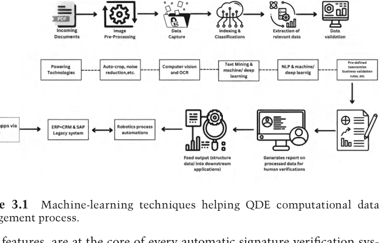

图3.1 机器学习技术助力QDE计算数据管理流程。

这些特征比较两个签名的相似性，是每个自动签名验证系统的核心，如图3.1所示。特征是使某物特殊化的组成部分。此类特征在QD文献中被称为区分元素或比较元素。特定人样本中组件的数量可能有所不同，元素的组合具有更高的区分能力[20]。

钩、曲线平滑度、压力变化平滑度、定位、扩展和间距、书写顶部和底部、角度/倾斜度、整体压力、压力变化模式、宏观形态、变化、连接形态和微形态都是人类文件检验员使用的这些元素的例子。节奏、形状和平衡等高级特征由速度、比例、压力和设计等基本特征决定。

文献中对自动签名验证技术的描述使用了完全不同的属性集。有些，如小波，专注于图像的纹理，而另一些则集中于签名图像的几何形状和拓扑结构。小波描述符、投影分布函数、扩展阴影代码和几何特征是用于签名验证的一些特征类型[21]。

## GSC特征
梯度结构和凹度（GSC）特征评估图像的局部尺度特征；结构特征测量图像的中等

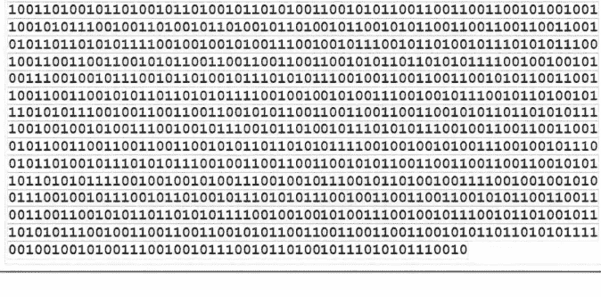

图3.2 1024位二进制特征向量。

尺度特征；凹度可以测量图像在整个尺度上的属性。按照这一理论，创建了三种不同的特征图，并且每个单元的相应局部直方图被量化为二进制特征。签名的一个示例显示了叠加在其上的4×8网格以提取GSC特征；网格的行和列是使用水平和垂直方向上黑色像素的分布创建的。全局词形特征[22, 23]包含1024位，由384位梯度位、384位结构位和256位凹度位连接而成，已从这些网格中恢复，如图3.2所示。

两个签名之间匹配的强度由使用相似度或距离度量计算得出的分数表示。成对数据使用相似度度量从特征空间转换到距离空间。

## 算法公式
D(X,Y)=1/2 − S11 S00 − S10 S01 /2√(S10+S11)(S01+S00)(S00+S10)

以下是签名网格方法验证的Python算法：

```
from sklearn import svm
from sklearn.model_selection import train_test_split
from sklearn.metrics import accuracy_score
from sklearn.preprocessing import StandardScaler
### Assuming ‘X’ is your feature matrix and ‘y’ is the corresponding labels (0 for genuine, 1 for forged)
```


```python
### X_train, X_test, y_train, y_test = train_test_split(X, y, test_size=0.2, random_state=42)
### Feature scaling
scaler = StandardScaler()
X_train_scaled = scaler.fit_transform(X_train)
X_test_scaled = scaler.transform(X_test)
### SVM classifier
clf = svm.SVC(kernel='linear')
clf.fit(X_train_scaled, y_train)
### Prediction
y_pred = clf.predict(X_test_scaled)
### Evaluation
accuracy = accuracy_score(y_test, y_pred)
print("Accuracy:", accuracy)
```

## 全球研究推动机器学习在问疑文件检验中的应用

人工智能-机器学习融合在QD分析领域领先研究中取得的一些较好成果列于以下小节。

## 基于传统机器学习的分类

传统机器学习模型在法医文件检验中的引入已取得显著进展，尤其是在分类目的中使用位数字模型方面。将位数字模型整合到传统机器学习框架中，如果正确理解这种集成背后的科学复杂性，可以在文件分类方面提供优势 [24, 25]。

## 结合位数字模型的支持向量机（SVM）

在二元分类SVM中，决策边界表示为超平面：f(X)=β0+β1X1+β2X2+...+βnXn =0。

目标是找到使类别之间间隔最大化的 β 系数。

支持向量机（SVM）以其处理复杂数据能力而闻名，可以通过结合位数字模型来改进。在位数字模型中，所有特征均以二进制格式表示，其中

每个位都作为一个独立特征。此方法使SVM能够通过利用详细的位级模式有效地分析和分类文档。在需要高维特征表示的情况下，这尤其有价值。

## 利用位数字模型的决策树

决策树通过基于特征对数据进行拆分来做出决策。决策树中预测目标变量 Y 的公式基于一系列条件：

Y = f (X1, X2,...,Xn)

每个条件代表基于特定特征的拆分，引导树得出最终预测。

决策树对数据的自发分类具有特殊能力，这可以通过使用位数字模型的二进制特征并将两者集成来进一步增强。采用位级二进制特征的这种额外能力使决策树能够在检查问疑文件时准确映射和区分其中的模式和特征。因此，通过这种决策树和位数字模型集成模型可以获得更精确、更准确的结果 [26]。

## 由位数字模型增强的随机森林

单一决策树模型可以共同生成随机森林模型。正如这个词所指，众多树木共同构成森林。在这种情况下，每个单独树的预测也会被汇总，以在随机森林模型下形成组合预测。为了执行分类任务，模型考虑多数投票，如下所示的数学表示：

mode Y = mode {Y1, Y2,..., Yk}

对于回归，可以是平均值。由于决策树模型可以通过与位数字模型集成而得到增强，同样，随机森林也可以通过与位数字模型集成而得到增强，以实现更好的学习和输出。在这种情况下，随机森林模型中的每个决策树组件都将促进位级二进制特征的处理，然后再汇总以提供整体洞察。因此，这种集成加强了随机森林处理和分类可疑文件中复杂、长且多样的数据集的能力 [27]。

### 结合位数字模型的朴素贝叶斯
为了进行文本或文档内容分析，在位数字模型的辅助下可以使用朴素贝叶斯分类器。这种集成模型促进了语言特征在二进制模板中的表示，并允许朴素贝叶斯模型在颗粒化水平上识别语言或特征模式。这使得汇总模型能够检测伪造、篡改或作者归属。

### 结合位数字模型的 K 近邻（KNN）
文档分类以及映射法医上重要的模式和特征以解决问疑文件检验相关问题的任务，可以通过 k 近邻（KNN）结合位数字模型有效地执行。

KNN通过根据其 k 个最近邻居中的多数类别对数据点进行分类来执行此任务。对于二元分类问题，预测类别（Y）可以通过多数投票确定：Y = mode {Y1, Y2,...Yk}

位级表示的使用使KNN能够基于离散二进制特征识别问疑文件中的相似性。这种方法促进了高效的分类 [28]。

### 结合位数字模型的作者归属
有争议的作者身份是问疑文件中常见且大量的问题。如果机器学习模型在广泛的数据集上训练，可以成为检查笔迹或签名并识别文件书写者或作者的有价值工具，如图 3.3 所描述。这种能力在结合位数字模型时进一步增强。模型可以检查和映射重要特征和细微模式，以得出关于作者身份的结论 [29]。

### 使用位数字模型的签名验证
能够执行签名验证任务的机器学习模型，通过集成位数字模型而得到进一步增强。数据的二进制表示处理能够识别法医上重要的特征，从而可以区分真实和伪造的签名。

### 结合位数字模型的文本内容分析
机器学习模型能够在法医领域执行签名验证任务。这种能力通过位数字模型进一步增强。重要特征特征被更准确地映射，因此手写签名的认证变得更容易、更可接受。同样，文本分析也可以以更高的准确性和速度执行。

### 利用位数字模型的伪造检测
机器学习算法已被证明是非常熟练和自动化的系统，用于

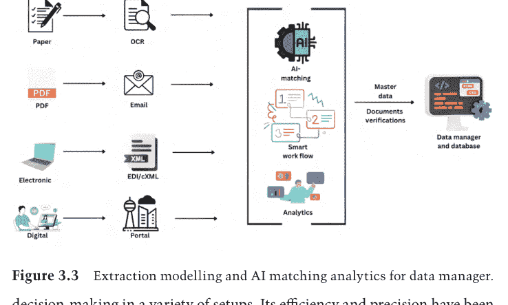

图 3.3 数据管理器的提取建模和 AI 匹配分析。

在各种设置中进行决策。它的效率和精度在与位数字表示集成时被发现显著提高。结合位数字表示的机器学习模型在位级分类捕获最微小的细节、手写特征、纸张和墨水特征、书写风格等方面非常有效，这使其成为检查问疑文件的优秀工具。它有助于检测伪造、假冒、操纵和篡改，从而可以区分真品和伪造文件。

## 基于深度学习的分类

深度学习模型随着时间的推移取得了巨大发展，这得益于其涵盖的神经网络和卷积架构，使其能够进行数据驱动的决策。这种模型已缓慢渗透到生活的几乎各个方面，并在法医学和法医文件检验领域产生了深远影响，包括这些领域。深度学习方法可以提高对可疑文件检查的效率和准确性，以解决与问疑文件相关的各种问题 [30]。

### 用于文档分类的神经网络
神经网络是深度学习模型的基本架构单元。它可以有多层，相互连接，通过这些层可以学习简单

将事物复杂化。神经网络的学习能力潜力也在文件检验中得到利用，用于多种应用。这对于作者归属、签名验证以及存疑文件中伪造物的检测有所帮助 [30]。

## 卷积神经网络（CNN）在法医文件检验中的应用：

卷积神经网络（CNNs）模型已在全球范围内被广泛应用于图像识别任务。CNN 能够独立学习并提取特殊模式，这些模式可用于分类任务。这种特性在文件检验领域可被有效利用，通过捕捉可疑文件中特定的特征或法医标记。书写特征可以被捕捉并用于签名验证或鉴定。

## 用于文档内容分析的循环神经网络（RNN）：

循环神经网络（RNNs）尤其能够执行数据以顺序方式或有序提供时所进行的任务。它能够有效地执行文本或文档内容分析。RNN 模型的这种能力可以被法医文件检验员（FDEs）成功利用，用于检验和分类提交检验的可疑文件中的文体或语言学模式。对数据或内容的有序性或序列性的分析也可以使 FDE 检测到该文件中任何潜在的篡改。此外，文体或语言模式可以个性化到足以进行作者识别的程度。

## 长短期记忆（LSTM）网络

长短期记忆网络（LSTMs）是一种特定的循环神经网络（RNNs），尤其能够捕捉和处理有序数据或序列数据中的长程依赖关系。利用这一能力，LSTM 可被广泛用于分类和分析更长的文本数据。

## 方法的优势

AI–ML 技术在法医学和犯罪线索材料科学分析领域取得进展时，犯罪实验室接收到的此类法医物证分析的有效性出现了明显变化。法医专家使用的当代法医工具/软件基于 AI–ML，并有助于证据的及时调查和分析。在闭路电视摄像机（CCTV）收集的视频流的实时调查中使用人工智能学习算法，证明了 AI–ML 工具在法医学中巨大的潜力。用于视频调查的基于 AI–ML 的法医工具具有分类和评估提交检验的视频流/CCTV 录像的能力，从而使法医专家能够及时审查大量视频录像并调查关键要素。AI–ML 法医工具识别模式的属性被部署用于分析音频/文本/电子邮件中的模式并进行检测，这有助于调查人员处理提交检验的大量复杂数据。鉴于基于 AI–ML 的法医工具出色的数学和计算能力，调查人员现在能够开发并建立强有力的统计证据，以增强调查过程中得出的结果。上述法医学中 AI–ML 驱动技术应用的例子再次证明了人工智能前景光明的潜力 [24]。

存疑文件证据的检验要求法医检验员采用科学的检验方法，这些方法具有非破坏性。用于调查不同文件证据的方法多种多样，现代检验方法涉及使用 AI–ML 驱动的工具。AI–ML 工具的使用已被证明是有益的，尤其是在法医文件检验方面，因为这些工具具备在更短时间内完成更多工作的能力。由于 AI–ML 工具的高处理能力，现在对大量文件数据进行分类、收集和评估以供分析变得更加容易 [25, 26]。

最高法院提高法院效率协助门户（SUPACE）是一个 AI 运行门户，体现了 AI–ML 用于收集和评估大量文件的需求。该 AI 门户由印度首席大法官 S A Bobde 揭幕，旨在处理与单个案件相关的提交的大量数据。AI 门户通过从与案件相关的文件中收集和筛选相关事实来运作，这些事实可供法官用于输入和决策。随着 SUPACE 的引入，法官现在可以在短时间内进行适用于案件的全面研究，从而在起草最终意见前对案件的所有方面进行批判性审查。

智能文档分析可通过 AI–ML 工具实现，这些工具可使用 AI 驱动的机器学习算法对文档内容进行分类并生成可进一步评估的结构化数据。法医文体学分支与语言科学的应用相关，用于确定所涉文档的作者。通过 AI–ML 工具进行的文档分析能够利用机器学习确定文档的作者，该机器学习理解作者在制作文档时采用的独特文体模式 [25]

机器学习工具也由数字行业领导者使用，以标记可能包含受限内容、从而危及组织安全的电子邮件和文档。网络空间中的电子邮件和文档现在可以根据其内容进行过滤，并可借助 AI-ML 训练工具进行标记，从而在保护组织利益方面发挥关键作用。

情感分析以确定文档内容相关的情感/语气为特征，其工作基于自然语言处理，而自然语言处理又是人工智能的一个子集。它通常由法医文件检验员在调查遗书、博客、电子邮件等时进行，也用于对文档作者进行画像。AI 的使用有助于基于情感分析对文件证据进行分类和画像，这帮助文件检验员深入挖掘以从所涉文档中提取更多证据 [26]。

AI 算法也用于比较手写样本，以确定存疑文件中发现的手写的作者。AI 工具比较和分析与所涉文档中存在的笔迹相关的案件中提交的标准/认可手写样本。标准/认可的书写作为 AI 工具的数据集，并训练程序熟悉作家的主模式。同样的现象也用于分析和比较提交检验的签名 [26]。

随着 AI 技术及其应用的指数级增长，AI 工具在法医调查中的受欢迎程度正呈线性增长。AI 方法催生了法医调查方式的变革性变化，彰显了其在对提交分析的各种证据进行法医检验方面的熟练程度。

## 方法的缺点

随着法医工具现在具备学习、适应、推理和随时间自我纠正的能力，机器智能或人工智能的使用简化了与案件调查相关的法医证据的评估和分析。FDE 中的 AI 方法总体上对法医调查人员调查文件证据有益，但其可信度和使用方面的问题仍然是一个悬而未决的问题

仍需解决的问题。AI 工具的准确率是决定工具成功与否的非常关键因素。观察发现，在需要处理和分析大量数据的情况下，AI 工具无法保持准确，可能导致假阳性或假阴性结果。在调查大量文件证据时缺乏准确性，可能导致案件全部事实的调查无效，并最终损害其证据价值 [27]。

AI 工具在大量数据集上经过长时间训练，以识别模式、做出智能决策并预测结果。其效率和实用性取决于其所接受的训练过程，这有助于 AI-ML 系统产生输出。AI-ML 工具对呈现给它的情况理解有限。它缺乏在其学习范围之外独立推断或理解上下文的能力 [28]。

个体的笔迹高度独特，并以自然变异的存在为特征。自然变异可以定义为作者的先天特质，与每次都无法以相同方式执行笔迹操作的能力相关，从而在笔迹中产生一系列变量。外部因素如中毒、身体姿势、健康、年龄等，也会影响笔迹中发现的变异程度。在检查笔迹样本时，法医检验员需要评估文件，同时考虑到作者在书写时可能执行的各种可能变异。AI-ML 法医工具依赖于为其编程而输入的数据集，因此缺乏检测受外在因素或伪装影响的笔迹变异的正常能力。此外，重要的是要意识到 AI-ML 软件缺乏常识性推理，而这在决策和意见形成中至关重要 [28]。

AI-ML 工具也缺乏理解人类情感的能力；所有文件均由工具进行逻辑分析和处理，因此在检查文件证据并总结与案件相关的所有事实时，工具未能考虑案件的情感角度，而这些角度在提供最终意见时可能相关。在此类情况下，AI 工具将仅作为补充，不会产生人类智能所能提供的相同结果和准确性 [28, 29]

## 结论与未来展望

文件验证涉及对文件或文件进行鉴证的过程，以确保其准确、真实且适合其预期用途。每年都会报告身份盗窃案件，其中个人信息和文件被用于开设银行账户、获得贷款、申请借记卡或信用卡等。为了满足法律要求，罪犯出示伪造文件，使验证者误以为其合法，因为它们看起来极其精确和正确。未来创建能够自动化文件验证过程的 AI-ML 系统，可能在发现作为法律证明提交的假文件方面非常有益，并减少身份欺诈的普遍问题。

技术赋予了我们保持匿名的能力，但罪犯滥用这种能力，利用互联网隐藏其行踪，使执法部门难以追踪他们。如今，罪犯试图通过匿名在线 ID 发送威胁电子邮件、消息和帖子来隐藏其身份，以避免披露其笔迹，而笔迹可作为确立其身份的有力证据。开发能够利用科学参数评估威胁电子邮件、消息和帖子中的语言结构和形成的机器学习工具，可以成功识别嫌疑人。引入和实施此类工具可以解决从匿名发送的内容中解码个人身份这一具有挑战性的问题。上述示例为 AI-ML 技术在法医文件分析中的巨大潜力提供了有力证据，并强调需要开发更多具有类似功能的工具，以革新当前的文件分析程序和技术。

由机器学习应用支持的革命性技术保证了它们通往无限可能未来的门票。AI-ML 在法医调查领域的应用将加快调查过程，因为 AI-ML 的使用将自动化对提交审查的繁琐和具有挑战性的法医证据的调查。目前，法医科学实验室负担着大量案件，这导致司法交付过程放缓。实施由机器学习驱动的尖端工具可以提供救援。

FDE 过程具有挑战性，因为检验员必须彻底研究和剖析作者的笔迹/签名/话语/语言风格等，以得出意见。随着不久的将来 AI-ML 技术的有利发展，该工具可以作为理解因外部因素或故意伪装而发生的变异的智能手段，以高准确性对提交作者分析的多个文件发表意见。

聊天机器人也称为聊天机器人，最近获得了巨大的普及。它们可以定义为利用人工智能和自然语言处理来模仿人类对话的程序，并用于根据用户发起的查询或交互生成响应。聊天机器人的进步体现在自然语言处理理解 NLPU 的使用上，该理解基于机器学习和深度学习，以有效响应并完成用户的请求。根据 Nadia Zlate 进行的一项研究，AI 聊天机器人可以作为未来的卧底调查员，通过与他们进行对话来揭露潜在罪犯及其犯罪行为。AI 聊天机器人可以伪装成真人，并记录罪犯叙述的犯罪细节，从而收集必要的证据。发送给聊天机器人的书面文本也可以在法医风格学或语言科学的帮助下用于对罪犯进行画像。

## 参考文献

- 1. McInnes L., Healy J., Melville J. (2018). UMAP：用于降维的均匀流形逼近与投影。*开源软件期刊*, 3(29), 861.
- 2. Russakovsky O., Deng J., Su H., Krause J., Satheesh S., Ma S., Huang Z., Karpathy A., Khosla A., Bernstein M., Berg A. C., Fei-Fei L. (2015). ImageNet 大规模视觉识别挑战, *国际计算机视觉期刊*, 115, 211–252.
- 3. Srinivasan H., Srihari S. N., Beal M. J. (2006). 用于签名验证的机器学习。*计算机视觉、图形与图像处理：第5届印度会议，ICVGIP 2006，论文集* (pp. 761–775). Springer.
- 4. Neupane S., Pyakurel M., Sinha K., Sharma B. A. (2024). GraphoMatch：使用机器学习的法医笔迹分析。*国际科学与研究档案期刊*, 11(2), 1526–1537.
- 5. Tan M., Le Q. (2019). EfficientNet：重新思考卷积神经网络的模型缩放。*国际机器学习会议* (pp. 6105–6114). PMLR.
- 6. Souza V. L. F., Oliveira A. L. I., Cruz R. M. O., Sabourin, R. (2020). 对作家独立离线手写签名验证的特征选择和迁移学习的调查。In *国际模式识别会议论文集* (pp. 1475–1482). IEEE.
- 7. Slyter S. A. (1995). *法医签名检验*. Charles C. Thomas Publisher.
- 8. Sauvola J., Pietikäinen, M. (2000). 自适应文档图像二值化。*模式识别*, 33(2), 225–236.
- 9. Gupta D., Bag, S. (2020). 一种用于文档图像二值化的从局部到全局的方法。In Das, A., Nayak, J., Naik, B., Pati, S., Pelusi, D. (Eds.), *模式识别中的计算智能。智能系统与计算进展，第999卷*. Springer, Singapore. https://doi.org/10.1007/978-981-13-9042-5_60


- 10. Sehad A., Chibani Y., Hedjam R., Cheriet M. (2019). 基于 Gabor 滤波器的纹理用于古老退化文档图像二值化。 *Pattern Analysis and Applications*, 22(1), 1–22.
- 11. European Network of Forensic Science Institutes. (2023). *欧洲法医科学研究所网络 (ENFSI)*。检索于 2023 年 11 月 21 日， https://www.enfsi.eu/about-enfsi
- 12. Shobha R. N., Nair B. J. B., Chandrajith M., Hemantha Kumar G., Fortuny J. (2022). 使用三级半自适应阈值技术恢复古老文档图像中退化的文本部分。 *Automatika*, 63(2), 378–398.
- 13. Shobha R. N., Manohar N., Hariprasad M., Pushpa B. R. (2022). 使用胶囊网络的 Kannada 手写字符识别的鲁棒识别技术。 *International Journal of Electrical and Computer Engineering*, 12(1), 383–391.
- 14. Bird J. J. (2022). 离线作者无关签名验证中的机器人和生成对抗攻击。 *arXiv 预印本*。 https://doi.org/10.48550/arXiv.2204.07246
- 15. Chauhan M., et al. (2025). 基于视觉-语言模型的笔迹验证。 *IET Conference Proceedings*, 2024(10). https://doi.org/10.1049/icp.2024.3329
- 16. Drotár P., et al. (2016). 用于帕金森病鉴别诊断的书写运动学和压力评估。 *Artificial Intelligence in Medicine*, 67, 39–46.
- 17. Hazra A., Maity S., Pal B., Bandyopadhyay A. (2024). 签名验证中的对抗攻击：一种深度学习方法。 *Computer Science and Information Technologies*, 5(3), 215–226.
- 18. Zhang H., Guo J., Li K., Zhang Y. (2024). 基于特征解耦辅助变分自编码器的离线签名验证。 https://doi.org/10.48550/arXiv.2409.19754
- 19. Arabio A. (2024). 通过彩虹三角形图分解量化书写者差异。 *Center for statistics and applications in forensic evidence*. https://dr.lib.iastate.edu/handle/20.500.12876/ywAbZ7Wv
- 20. Baek Y., Lee B., Han D., Yun S., Lee H. (2019). 用于文本检测的字符区域感知。 In *Proceedings of the IEEE/CVF conference on computer vision and pattern recognition* (pp. 9365–9374). IEEE.
- 21. Jagtap A. B., Hegadi R. S., Santosh K. C. (2019). 使用卷积神经网络进行离线手写签名验证的特征学习。 *International Journal of Technology and Human Interaction*, 15(4), 54–62.
- 22. Breci E., Guarnera L., Battiato S. (2024). 手写文档无损检测的创新方法。 ICASSP 2024 - 2024 IEEE 国际声学、语音和信号处理会议 (ICASSP)，韩国首尔，4825–4829. https://doi.org/10.1109/ICASSP48485.2024.10448383
- 23. Marcinowski M. (2023). 法医应用神经网络的评估；笔迹验证示例。 *Australian Journal of Forensic Sciences*, 55(6), 745–754.
- 24. Adedayo O. M., Olivier M. S. (2025). 定制可疑数字文档的检查。 *Journal of Forensic Sciences*, 70(2), 550–565.
- 25. Tageldin L., Venter H. (2023). 机器学习取证：智能环境中数字取证调查中使用机器学习技术的现状。 *Applied Sciences*, 13(18), 10169.
- 26. Srihari S. N., Cha S. H., Arora H., Lee, S. (2002). 笔迹的个体性。 *Journal of Forensic Sciences*, 47(4), 856–872.
- 27. Bulacu M., Schomaker L. (2007). 使用纹理和笔形特征的文本无关书写者识别和验证。 *IEEE Transactions on Pattern Analysis and Machine Intelligence*, 29(4), 701–717.
- 28. Found B., Rogers D. (2005). 法医文件检验中笔迹的证明特征。 *Science & Justice*, 45(2), 65–73.
- 29. Malik M. I., Liwicki M., Dengel A. (2013). 使用卷积神经网络对历史文档进行书写者识别。 *In 2013 12th International conference on document analysis and recognition* (pp. 1387–1391).
- 30. Farrahi Moghaddam R., Cheriet M. (2010). 退化文档图像自适应二值化的多尺度框架。 *Pattern Recognition*, 43(6), 2186–2198.

## 法医医学领域机器学习的应用

NIHA ANSARI, VAISHALI, DIVYANT KATARIA AND YASASVIKUMAR VALA

### 引言

法医科学领域位于科学研究与法律职业的交界处，在犯罪侦破和惩罚中发挥着重要作用，确保受害者获得公平的结果 [1]。它涵盖了众多科学领域，使用各种系统方法分析与法律调查和案件相关的证据。法医科学的主要任务是收集、分析和比较物证，以便在法律事务中提供事实数据或提出专家意见。它包括多个问题，例如尸检数据的评估、寻找嫌疑人以及支持客观的法律体系。最初，法医科学发展并不完善，但多年来它已发展成为一个复杂且分支繁多的领域，在当今的刑事调查和司法体系中至关重要。

法医医学的根源可以追溯到早期时代，当时尸后检查和其他相关方法被用来确定死亡原因并惩罚罪犯。鲁道夫·维尔霍夫和贝尔纳·斯皮尔斯伯里爵士等杰出人物在历史上推动了该领域的发展。尸后检查，通常称为尸检，对于解释可疑死亡并帮助法医病理学家进行调查至关重要 [2]。被称为法医病理学家的专科医生进行这些测试以确定死亡原因和机制。 [3]

法医医学是医学专业的一部分，评估并确定刑事和民事法律事务中的医学事实 [4]。法医学源自拉丁词‘jurisprudential’，其中‘juris’指‘法律’，‘prudence’指‘知识’，意为‘法律的知识或学科’，通常定义为将医学知识应用于法律问题，涵盖将医学事实整合到法律事务中 [5, 6]。法医医学的主题涵盖了各种子领域。法医病理学涉及检查死者以评估伤害并发现死亡原因，例如窒息。法医精神病学调查精神疾病的法律方面。法医牙学利用牙科知识进行诸如识别和评估咬痕以及使用特定牙科特征进行识别等行动 [5]。法医人类学调查身体特征和骨骼结构，通常是为了在法庭情况下识别个人 [7]。法医人类学家可以分析骨骼遗骸以确定年龄、性别、祖先血统和身高等特征，这对于识别身份不明的人至关重要。法医医学，通常称为法医病理学，在法医科学调查的庞大领域中至关重要。其主要目标是揭示死亡原因和方法 surrounding 的谜团，为法律行动提供必要的关键见解 [1]。法医医学通过提供可在法庭上采纳的证据和专家意见，对刑事调查至关重要。此外，它还涉及检查活人以检测伤害、识别化学物质或评估精神状态，凸显了其在法律领域的意义。

人工智能（AI）是一种基本的技术创新，使自动化机器人能够完成传统上需要人类智能的任务。在法医医学领域，机器学习具有重要潜力，改变了法医专家研究和解决复杂情况的方式。机器学习的应用是法医领域，特别是医学领域的创造性转变，也是整个法医领域的可能突破点 [8]。传统法医识别的专家通过将专业经验与生物学和医学等基础学科的信息相结合，彻底收集数据并提供识别意见 [8]。这种方法既费力又耗时，并且受到难以控制的不可预测因素的影响。人工智能（AI）有能力通过改进和自动化识别过程来改变法医医学领域，这将减少人类干预的程度和引入偏差的可能性。这些技术可能有助于提高法医识别方法的准确性和效率，因为大量数据可以客观、快速地进行分析。法医医学领域涵盖了大量活动，例如尸检和医疗记录审查。此外，它还可以协助法医专家进行牙科画像、人脸识别和法医摄影等活动 [9]。此外，机器学习在法医病理学中具有强大的应用，它可以通过使用在尸检期间拍摄的照片来帮助非常准确地识别疾病或伤害。人工智能工具可以帮助法医病理学家利用组织样本和组织病理学

图片 [10]。机器学习可以被定义为人工智能的一个子领域，它使机器能够从数据中学习并基于该数据做出决策或得出结论 [11]。

## 法医学的重要性

法医学，有时也称为法医病理学，在社会的多个领域发挥着至关重要的作用。其相关性的一些重要特征如下：

- 1. 为实现正义的目标，法医学为法庭案件和法律调查提供必要的科学证据。
- 2. 尸检已被用作法医学的一个重要方面。使用 DNA 分析、牙科记录和指纹识别等程序，有助于在群体灾难、事故或反人类罪等情况下识别死者 [12]。
- 3. 法医学通过评估伤害和死亡的模式和趋势以及其他法医数据来帮助预防犯罪。
- 4. 在死亡由武器（如枪支）导致的情况下，伤口可以为法医病理学家提供关键信息。在调查过程中，法医病理学家通常不仅可以检测所使用的武器类型，还可以提供必要的信息。例如，在枪shot伤的背景下，他们可以合理地确定枪支发射的距离和角度 [13]。
- 5. 法医病理学家的首要职责是运用其医学知识处理与死亡相关的法律情况。他们通过分析尸体并获取信息来发现某人如何以及为何死亡。目标是提供准确可靠的数据，可在法庭上用于确定死亡原因并为案件伸张正义 [14]。
- 6. 为了确定围绕死亡的情况，法医病理学家分析犯罪现场以评估尸体的位置、是否存在任何伤害和其他重要细节。
- 7. 法医病理学的结果可在刑事案件中被控方和辩护方利用来支持其主张并阐明围绕死亡的情况。
- 8. 它可以提供快速而准确的证据，可用于确定嫌疑人，以证实或推翻其无罪或有罪。

## 法医检查中面临的问题

- 1. 最棘手的问题之一包括建立受害者所受创伤与最终死亡原因之间明确且确凿的因果关系 [15]。例如，如果受害者遭受多处伤害，可能很难确定哪一处特定伤害或伤害组合导致了该人的死亡。伤害的种类和程度、个人的整体状况和既往病史以及创伤 surrounding 的情况都需要进行彻底评估和权衡。
- 2. 腐烂的尸体给法医病理学家带来挑战，因为腐烂可能会掩盖伤口，并因身体特征和证据的丧失而使确定死亡原因变得困难 [16]。例如，在一个人在闷热潮湿地区死亡数周后被发现的情况下，腐烂可能非常严重，使得难以检测伤口或区分它们是生前伤还是死后伤。
- 3. Baldino 等人讨论了法医病理学家在检测严重改变的尸体并在这种情况下诊断死亡原因时所遇到的问题。他们强调将标准程序与特定法医分支相结合以加强调查过程的相关性 [17]。
- 4. 体外的外部因素可能会改变其生理状况和法医分析的准确性。环境因素，如温度、湿度以及元素暴露，都可能加速分解过程。
- 5. 一些死后变化，包括尸僵、尸斑和腐烂，会影响身体的状态及其确定死亡原因和方式的能力。
- 6. 评估创伤性伤害，尤其是在钝性创伤的情况下，可能具有挑战性。区分因跌落、车祸或袭击而导致的情况需要评估和对情况的了解。
- 7. 评估枪shot伤可能并不容易，因为必须考虑武器的类型、射击距离和角度。例如，当一个人被枪杀时，确定枪支类型和射击范围需要专业人员的帮助，可能涉及对枪shot残留物和弹丸轨迹的分析。
- 8. 文档记录和报告是法医病理学的关键方面；然而，它们可能具有挑战性，因为工作需要高度准确并遵守法律要求 [18]。例如，用简单且合法的语言记录伤害和发现至关重要，可能包括使用技术术语和插图。
- 9. 有时，留待检查的有形证据会缺乏，这阻碍了对死亡原因和方式得出准确结论的能力 [18]。
- 10. 缺乏死者的详细病史或文件会限制病理学家准确评估可能导致死亡的既往疾病或药物的能力。

## 法医学中的机器学习

在法律和医学调查领域，法医学是一个主要学科，专注于正义、法律和医学之间的复杂关系 [16]。它有几个分支，每个分支在确定意外或不明原因死亡原因的过程中都有特定的职责。例如，法医病理学是一个关键分支，通过确定死亡的方式、情况和原因，成为任何死亡调查的基础 [16, 19]。

传统上，法医病理学侧重于对尸检结果、医疗记录和毒理学检测等证据的手工检查和解释 [20]。这些程序意义重大，但人为主观性、时间限制以及涉及的大量数据阻碍了它们。然而，机器学习（ML）的发展开启了法医病理学的新时代，为提高死亡调查的效率、准确性和客观性提供了重大机会。在法医学中，机器学习算法可以评估海量的法医数据，识别隐藏的联系并提取个人可能无法检测到的有用见解。尖端技术与法医经验的结合具有显著潜力，可彻底改变法医病理学并改变死亡调查。

## 法医学中机器学习的基本运行机制

机器学习是一种人工智能，专注于创建数学模型和算法，使计算机能够从数据中获取知识并在没有直接编程的情况下做出预测或判断 [22]。机器学习的基本运行原理包括许多关键步骤：

- **数据收集：** 机器学习的主要阶段是获取适当的训练算法的数据。这些数据可能包括输入-输出对（监督学习）、未标记数据（无监督学习）或两者的组合（半监督学习）。例如，在法医病理学中，数据收集可能涉及获取尸检报告、医疗记录、毒理学报告以及有关死亡调查的其他重要信息。
- **数据预处理：** 获取数据后，需要对其进行预处理，以确保其处于可接受的分析格式。预处理可能包括将医学图像微调至标准分辨率、减少伪影并增强图像质量。
- **特征提取：** 这是从处理后的数据中获取可用质量或属性的过程。这些质量作为机器学习算法的输入。例如，在医学图像分析中，特征包括体内结构的尺寸和形状、像素值的鲜艳度以及某些模式或纹理的发生。
- **模型选择：** 第三步是选择适合所关注任务的可接受的机器学习模型。常见的机器学习模型包括决策树、支持向量机、神经网络和集成技术。Andrej Thurzo 等人在其法医调查中，在年龄、性别、面部和发育确定领域应用了 3D 卷积神经网络（CNN）模型 [20]。

## 法医病理学中的机器学习

法医病理学是刑事司法系统中的一个关键学科，提供重要信息以帮助破案并为受害者伸张正义。多年来，将机器学习方法纳入法医病理学已取得令人鼓舞的成果，展示了其改变法医证据检查和分析方式的能力。由于基于计算理论的高阶高效算法的可用性，机器学习算法可能有助于法医病理学家完成一些任务，例如识别大数据中的模式、识别死亡原因，甚至根据证据预测其他可能的嫌疑人。法医病理学中技术进步的应用为提高调查的准确性和有效性提供了巨大潜力，从而加快对刑事案件的精确解决 [23]。


机器学习和人工智能的概念正在改变肝移植中患者的管理和移植医学。研究人员正在采用人工神经网络（如深度神经网络（DNNs））的应用，以提高患者和器官生存预后的准确性，并确定影响器官移植的风险决定因素。这些复杂的机器学习算法处理慢性疾病特有的大型数据集，评估移植风险，分发器官并管理手术后的患者。包括极端梯度提升和带最小绝对收缩和选择算子（LASSO）的逻辑回归在内的不同类型的机器学习算法被用于为肝病等长期疾病患者提供预后。这些模型采用人口统计学、临床病史和实验室结果等多种预测因子，以提高预测并进而改善肝移植（LT）环境下患者的治疗。研究重点关注模型可解释性和对人工智能系统的信任问题，并提出诸如 Shapley 值等可解释人工智能框架，以帮助解释用于预测的特征。在长期医学这一高度专业化的护理领域中，人工智能以机器学习模型的形式已成为加速移植资格评估、供体/受体匹配和移植后患者管理的关键推动者。通过使用多项数据输入并提取最重要的预测因子，机器学习算法可提供有关患者预后的有价值信息，并有助于 LT 的个性化临床管理。尽管该工作承认人工智能和机器学习在 LT 治疗中的积极影响，但研究也指出未来需要解决的一些挑战，例如监管、模型可解释性和实践中的有效性，如图 4.1 和 4.2 所示 [24]。

## 法医病理学的重要性

- **准确确定死因：** 法医病理学对于在突发、意外或可疑死亡情况下准确诊断死因至关重要。我们可以利用机器学习根据患者最近的医学检查准确预测死因。通过进行尸检和检查组织样本，法医病理学家可以发现导致死亡的潜在疾病、损伤或毒理学原因。机器学习算法可以帮助解释复杂的病理学发现，帮助法医病理学家做出更准确的诊断和关于死因的裁定，并提供准确的预测 [25–27]。

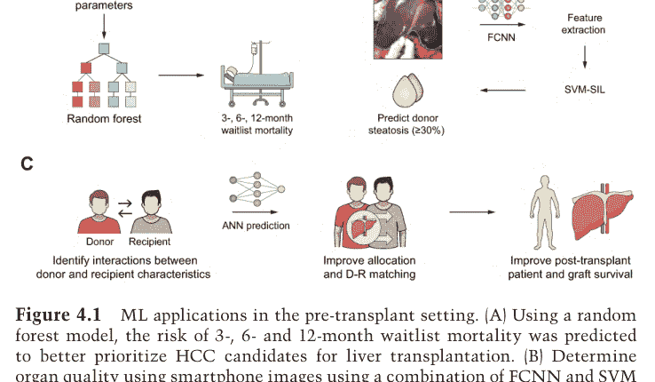

图 4.1 移植前环境中的机器学习应用。 (A) 使用随机森林模型预测 3、6 和 12 个月等待名单死亡风险，以更好地优先考虑肝移植的 HCC 候选者。 (B) 使用 FCNN 和 SVM 方法的组合，利用智能手机图像确定器官质量。 (C) 使用 CNN 识别脂肪变性来改善供体病理评估可能优于病理学家。通过揭示人口统计学、临床和实验室数据之间的隐藏非线性关系来识别最佳供体-受体匹配，从而改善器官分配并优化移植结果。 FCNN, fully convolutional neural network; SVM, support vector machine [24]。

- **增强法医调查：** 法医病理学中的机器学习技术有可能提高法医调查的效率和有效性。通过自动化尸检分析的某些方面，例如组织分类、器官测量和组织病理学解释，机器学习算法可以加快法医流程，并为法医病理学家提供有价值的见解以帮助其评估 [28–30]。
- **改善疾病诊断：** 法医病理学有助于诊断和识别可能导致个人死亡的众多疾病和医学状况。应用于医学影像的机器学习技术，例如如图 4.3 [31] 所示的计算机断层扫描（CT）扫描，该图用于基于 CT 扫描的 COVID-19 诊断，以及磁共振成像（MRI），可以帮助法医病理学家检测和表征病理状况，从而实现更准确的疾病诊断和法医评估 [29, 31, 32]。

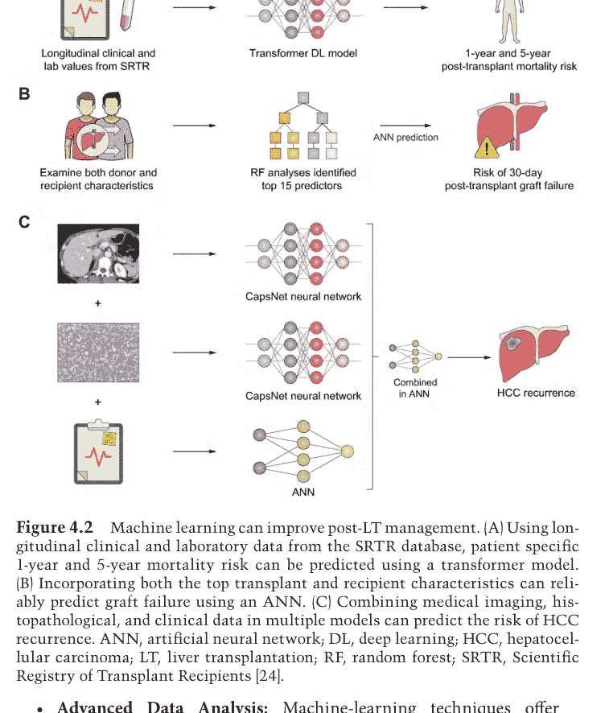

图 4.2 机器学习可以改善移植后 LT 管理。 (A) 利用 SRTR 数据库中的纵向临床和实验室数据，可使用 Transformer 模型预测患者特异性 1 年和 5 年死亡风险。 (B) 结合移植和受体特征可以可靠地使用 ANN 预测移植物失败。 (C) 在多个模型中结合医学影像、组织病理学和临床数据可以预测 HCC 复发风险。 ANN, artificial neural network; DL, deep learning; HCC, hepatocellular carcinoma; LT, liver transplantation; RF, random forest; SRTR, Scientific Registry of Transplant Recipients [24]。

- **高级数据分析：** 机器学习技术提供法医病理学发现的高级数据分析，允许在大量尸检数据集中检测模式、趋势和相关性。通过应用机器学习方法，法医病理学家可以从复杂的病理数据中揭示隐藏的见解，从而进行更彻底的法医评估和更明智的决策。

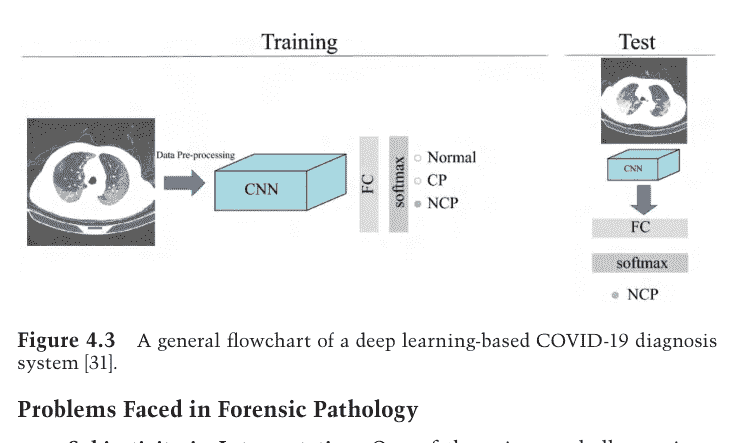

图 4.3 基于深度学习的 COVID-19 诊断系统的一般流程图 [31]。

## 法医病理学面临的问题

- **解释的主观性：** 法医病理学领域的主要挑战之一是尸检结果的解释，因为整个过程中存在主观性。检查者在检查组织样本以查明死因并基于该信息做出法医决定的过程中，判断和经验发挥着重要作用。如果机器学习算法无法准确复制训练有素的法医病理学家执行的决策过程，则机器学习算法提供的法医结论可能存在一些不一致。
- **法医实践的变异性：** 不同司法管辖区、实验室和个人检查员可能对法医病理学相关案件有不同的流程和实践，这可能会导致结果解释和与病理学相关的法医研究不一致。解决此问题的适用解决方案应包括各种数据库的组合，以便整合区域差异，用于训练机器学习算法以在模型中创建异质性。为了在法医检查中获得准确可靠的结果，在检查期间使用的每个流程和方法都有标准非常重要。
- **数据质量和可用性：** 法医病理学中使用的机器学习算法的训练需要高质量和全面的数据库。然而，用于训练机器学习模型的这些法医病理学数据库可能包含样本偏差和缺失数据，另一个限制是它们可能包含异构数据。因此，法医病理学家应监控这些机器学习算法的训练过程，以便在过程结束时提供准确可靠的结果。
- **病理数据的复杂性：** 病理结果获得的数据可能模糊且多样，涉及不同的组织标本、组织学变化和尸检的诊断结果。这种复杂的数据可能不容易被机器学习算法理解，这可能是一个问题，尤其是在结果在临床上罕见或不寻常时。机器学习对法医病理学家有用，但结果需要彻底检查和验证，以确保其在法医检查中的准确性 [26, 33, 34]。

## 法医病理学中机器学习分析的步骤

- **概念化与问题制定：** 此步骤涉及定义将借助机器学习解决的具体法医病理学问题或任务。科学家定义目标、研究问题和评估标准，以指导机器学习模型的发展。例如，在病理学中，问题可能是通过检查组织学特征来诊断组织样本为癌症或良性的概率。
- **数据获取与准备：** 在此步骤中，研究人员从医院、研究组织或公共数据库获取相关数据集以用于训练机器学习算法。他们对数据进行预处理以消除错误、不一致和噪声，使其适合分析且更可靠。在病理学中，这可能涉及获取数字组织病理学切片和相关的临床元数据，包括患者的人口统计学和诊断。
- **特征提取与表示：** 此阶段涉及将原始数据转换为在训练机器学习算法过程中有用的特征。在病理学中，特征可能意味着某些细胞类型的形状、大小或位置、身体中组织的定位，或组织染色强度的度量。更复杂的机器学习模型形式，例如卷积神经网络（CNN），不需要提取特征，因为它们可以从数字病理图像中自动学习。
- **模型开发与评估：** 科学家通常借助诸如逻辑回归模型、随机森林或深度学习模型等技术开发机器学习模型。


这些模型基于监督学习构建，其中一组输入属性在标记数据的帮助下映射到一组目标输出。相关评估参数如准确率、敏感性、特异性和 AUC–ROC 用于机器学习模型的评估。例如，在病理学中，诊断模型可能会根据基因表达数据评估癌症复发的概率。

-   **解释与验证：** 本步骤涉及对机器学习模型结果的解释，以获得对生物系统或病理过程的洞察。模型的性能也会通过其他数据集或应用交叉验证技术来检查，以检验模型的稳定性。例如在病理学中，模型解释可能涉及识别与疾病进展或治疗反应相关的特征或生物标志物，这有助于指导临床医生的决策。
-   **整合与部署：** 在经过验证后，这些模型随后部署于临床工作流程或诊断应用中，以协助病理学家在实践环境中工作。这可能包括设计易于使用的界面，将决策支持或模型与现有的实验室信息系统集成等。例如，在病理学中，用于癌症的风险评估模型可与病理学家在诊断癌症时使用的数字病理工具集成。
-   **伦理考量与社会影响：** 研究人员应讨论机器学习与病理学整合的伦理问题及可能后果。这包括保护患者身份、最大限度减少训练和部署算法中的偏见，并在开发和实施模型时促进问责制。在病理学中，部分伦理问题可能包括数据使用的同意、诊断工具的公平分配以及报告模型的局限性。
-   **持续改进与适应：** 在最后一步，通过病理学家的反馈、新数据和技术进步对模型进行精炼和增强是循环进行的。研究人员对模型进行评估，以检查、修改甚至重新设计当前模型，从而提高特定领域结果的准确性和可靠性。在病理学领域，持续改进可能包括因新兴生物标志物而修改模型、修订诊断标准或响应临床实践指南的变化 [35–37]。

## 法医人类学中的机器学习

法医人类学对于识别人类遗骸和了解死亡 surrounding 事件至关重要。传统上，法医人类学家采用骨骼遗骸的形态学研究来评估死亡年龄、性别、祖先和身高等变量 [38, 39]。然而，这种检查可能复杂且耗时，通常需要专业知识和主观解释。近年来，机器学习（ML）技术的引入已成为提高法医人类学分析效率和准确性的可行策略。能够处理庞大且多样化数据集的机器学习算法为骨骼遗骸的自动化研究和生物特征预测提供了新选择。通过整合计算方法和统计模型，ML 帮助法医人类学家从骨骼数据中获得有用的见解，并加快法医案件中的识别过程。

### 法医人类学的重要性

-   **人类遗骸的识别：** 法医人类学在人类遗骸的识别中发挥着重要作用，尤其是在遗骸腐烂、破碎或使用标准程序难以识别的情况下。法医人类学涉及对死者骨骼和牙齿特征的研究，从而有助于识别个体的身份、年龄、性别、祖先和身高，除机器学习算法可得的信息外 [38, 40, 41]。
-   **理解创伤和损伤模式：** 法医人类学家了解特定损伤的骨骼和模式外观，并知道其可提供的信息如何帮助调查。骨折、枪伤和其他骨骼损伤是法医人类学家的专业领域，他们在犯罪现场调查的评估过程中协助法医病理学家和调查人员 [42, 43]。
-   **死后变化的评估：** 法医人类学家在研究死亡后骨骼遗骸发生的改变方面具有知识和经验，例如尸体腐烂、食肉动物损伤和其他埋藏学效应。这种知识在人类遗骸状态被改变的情况下很有价值，因为法医专家能够准确区分死前、死时和死后损伤，以便重建导致死亡的情况。 [42, 44–46]。
-   **生物特征的重建：** 法医人类学家可以从未识别的骨骼中重建死者的生物属性，并揭示年龄、性别、祖先和身高等方面。这些信息对于在失踪人员数据库中挑选可能候选人并促成其识别至关重要，这与该项目利用机器学习在法医实践中识别个体的目标相符 [47–49]。
-   **与机器学习技术的协作：** 法医人类学领域很可能从与机器学习技术的合作中受益，因为可以使用计算技术分析骨骼遗骸的大型数据集。在法医分析期间将机器学习算法与传统人类学方法相结合，将提高法医调查中识别和事件重建的有效性 [50–52]。

### 法医人类学面临的问题

-   **不完整或破碎的遗骸：** 法医人类学首要且最关键的问题之一是处理骨骼遗骸的破碎或不完整。有时，法医人类学家只能恢复碎片化骨骼，这可能导致构建生物特征和识别死因的若干困难；因此导致法医研究不足。
-   **缺乏标准化：** 法医人类学中的某些分析没有标准操作程序和方法；因此从业者使用的方法各不相同。这种缺乏统一性导致法医评估和解释的差异，从而危及法医判断的整体可靠性和准确性。
-   **资源获取受限：** 其他限制与法医人类学家工作中对骨骼收藏、参考数据库和设备等资源的获取受限有关。这意味着在缺乏更好资源的情况下，法医人类学家可能无法对未知个体做出全面准确的识别，从而减缓法医调查的进展。
-   **时间和成本限制：** 法医人类学中使用的方法可能耗时且昂贵，尤其是在处理复杂骨骼结构或长期法医调查时。资金和资源有限可能会阻碍法医人类学家在合理的时间范围内进行全面分析，从而延迟法医案件的结论 [53]。

### 法医领域的应用

**机器学习和深度学习方法用于婴儿个体的性别估计：** 对机器学习技术，特别是深度学习，用于婴儿骨骼性别估计的研究。最近的一项研究比较了机器学习算法与专家视觉评估在根据髂骨图像估计儿童骨骼性别方面的有效性。研究人员使用了来自格拉纳达大学收藏的 135 名婴儿个体的照片，年龄在妊娠 5 个月至 6 岁之间。该研究应用了在 ImageNet 上预训练的深度学习技术，如 VGG16 和 ResNet50，准确率达到 59%，接近专家评估。经典的 ML 方法，如支持向量机（SVMs）、随机森林（RFs）和使用 HOG 特征的 AdaBoost 也被测试，准确率为 49%，效果不及深度学习。研究结果表明，与专家评估相比，深度学习方法提供了具有竞争力的结果，凸显了人工智能技术在法医人类学中的前景。该研究还建议探索 3D 模型和软件工具，以进一步发展法医人类学中的人工智能应用 [54]。

**使用深度学习进行儿科骨龄评估：泛化性与局限性：** 在此我们探讨使用深度学习模型泛化儿科骨龄评估的问题，这是该领域的重要关注点。有趣的是，该算法在多个数据集上进行了评估且未进行分割，并强调了人口统计学特征如性别的影响。几项研究为未来研究提供了有用信息，以提高自动骨龄评估的临床可用性。它还强调了需要检查跨机构泛化性和人口统计学考虑，以便在骨龄评估中实现深度学习强大且公平的医疗用途 [55]。

### 研究的优势

-   **全面探索：** 本章对机器学习与法医学之间的相互作用进行了全面评估，涵盖了法医病理学等众多子领域，

人类学和法医牙科。这项综合方法为机器学习在法医科学众多领域中的可能用途提供了有用的见解。

- **实际意义：** 通过展示机器学习在法医调查中的实际应用，该研究为法医从业人员和法律专家提供了切实的好处。现代算法和计算方法的应用有可能提高法医分析的效率、精确性和客观性，从而加强刑事司法系统。
- **未来方向：** 本章对法医医学领域的当代进展以及预期发展进行了文献综述，特别是结合不同的机器学习算法。此外，本章提出的这一前瞻性视角推动了进一步的研究与开发，为法医科学的持续改进指明了方向。
- **跨学科合作：** 必须认识到此类工作需要法医专家、数据科学家和技术专家之间的整合合作。打破专业界限的方法促进了创造力和效率，因为不同职业的参与有助于在法医医学中提供解决方案。

## 研究的缺点

- **范围有限：** 然而，有人可能会认为本章相对概括，但其局限性包括缺乏有关法医医学某些子领域的详细信息或对该领域应用的详细解释。法医科学的某些领域可能获得较少的关注或仍未被发现，或许忽视了该主题的重要部分。
- **伦理考虑：** 该研究可能引发关于机器学习算法在法医调查中使用的伦理问题，特别是隐私、偏见和问责制。算法错误或被利用的可能性可能对参与法庭程序的人产生重大影响。
- **技术依赖：** 大量依赖机器学习技术可能会产生对先进工具和算法的依赖，这可能在法医实验室和从业人员的<|message|>可及性、价格和可持续性方面带来问题。
- **人类技能：** 虽然机器学习算法在法医分析中提供必要的帮助，但它们不应取代人类法医专业人员的技能和判断。该研究应强调机器学习与人类智能在法医医学中的互补性，而非推动完全自动化的方式。

## 机器学习的未来范围

### 法医病理学进展

机器学习模型，例如卷积神经网络（CNNs）和决策树，可用于评估组织学图像、死后数据和损伤模式。以下是机器学习的应用方式：

- **自动化组织病理学分析：** 在大量组织病理学图像数据集上训练的 CNN 将用于自动识别组织样本并发现表明特定疾病或损伤的异常。迁移学习技术可以将预训练的 CNN 模型适配到法医病理学数据集，提供快速可靠的诊断。
- **死后变化预测建模：** 时间序列分析方法，例如循环神经网络（RNNs）或长短期记忆（LSTM）网络，将用于根据体温、尸僵和分解速率等特征预测死后间隔。这些模型将从先前的死后数据中学习时间模式，以更准确地预测死亡时间。
- **损伤评估中的模式识别：** 在专家知识和特征选择方法的辅助下，决策树算法将用于根据损伤的位置、形态和相关临床方面识别损伤模式。随机森林等集成方法可以整合多个决策树，以提高分类性能和可解释性。

**示例结果：** 基于 CNN 的模型在识别创伤性损伤的组织学图像方面获得了超过 90% 的准确率，使法医病理学家能够可靠地诊断和描述法医调查中的创伤模式。

### 法医医学创新

机器学习方法，包括支持向量机（SVMs）、深度学习架构和贝叶斯网络，将用于检查医学证据、遗传数据和法医照片。以下是机器学习可能做出的贡献：

- **面部识别与年龄进展：** 深度学习模型，例如生成对抗网络（GANs）或变分自编码器（VAEs），将在面部成像数据上训练以重建面部特征并模拟年龄进展。这些模型将学习面部形态的潜在表示，以构建逼真的面部重建并预测与年龄相关的变化。
- **遗传分析与祖先预测：** 贝叶斯网络或概率图模型将用于检查遗传标记并推断祖先起源、人口亲和性和遗传关系。通过将基因组数据与人口统计信息和参考数据库合并，这些模型将以概率方式估计个体的祖先和表型。
- **创伤分析与损伤重建：** 机器学习算法，例如 k 近邻（KNN）或支持向量回归（SVR），将在法医成像数据上训练以重建损伤模式并预测冲击动力学。这些模型将从标记的创伤性损伤数据集中学习，以预测损伤特征、武器种类和生物力学力量。

**示例结果：** 基于深度学习的年龄进展模型在法医照片中正确复制了面部老化，均绝对误差小于两年，使得可以根据外观的长期变化识别失踪人员和嫌疑人。

### 法医人类学转型

机器学习方法，例如几何形态测量学、贝叶斯统计和集成学习，将用于评估骨骼测量、面部标志和 3D 图像数据。以下是机器学习可以集成的[content]
人类学和法医牙科。这项综合方法为机器学习在法医科学众多领域中的可能用途提供了有用的见解。

- **实际意义：** 通过展示机器学习在法医调查中的实际应用，该研究为法医从业人员和法律专家提供了切实的好处。现代算法和计算方法的应用有可能提高法医分析的效率、精确性和客观性，从而加强刑事司法系统。
- **未来方向：** 本章对法医医学领域的当代进展以及预期发展进行了文献综述，特别是结合不同的机器学习算法。此外，本章提出的这一前瞻性视角推动了进一步的研究与开发，为法医科学的持续改进指明了方向。
- **跨学科合作：** 必须认识到此类工作需要法医专家、数据科学家和技术专家之间的整合合作。打破专业界限的方法促进了创造力和效率，因为不同职业的参与有助于在法医医学中提供解决方案。

## 研究的缺点

- **范围有限：** 然而，有人可能会认为本章相对概括，但其局限性包括缺乏有关法医医学某些子领域的详细信息或对该领域应用的详细解释。法医科学的某些领域可能获得较少的关注或仍未被发现，或许忽视了该主题的重要部分。
- **伦理考虑：** 该研究可能引发关于机器学习算法在法医调查中使用的伦理问题，特别是隐私、偏见和问责制。算法错误或被利用的可能性可能对参与法庭程序的人产生重大影响。
- **技术依赖：** 大量依赖机器学习技术可能会产生对先进工具和算法的依赖，这可能在法医实验室和从业人员的 f 可及性、价格和可持续性方面带来问题。
- **人类技能：** 虽然机器学习算法在法医分析中提供必要的帮助，但它们不应取代人类法医专业人员的技能和判断。该研究应强调机器学习与人类智能在法医医学中的互补性，而非推动完全自动化的方式。

## 机器学习的未来范围

### 法医病理学进展

机器学习模型，例如卷积神经网络（CNNs）和决策树，可用于评估组织学图像、死后数据和损伤模式。以下是机器学习的应用方式：

- **自动化组织病理学分析：** 在大量组织病理学图像数据集上训练的 CNN 将用于自动识别组织样本并发现表明特定疾病或损伤的异常。迁移学习技术可以将预训练的 CNN 模型适配到法医病理学数据集，提供快速可靠的诊断。
- **死后变化预测建模：** 时间序列分析方法，例如循环神经网络（RNNs）或长短期记忆（LSTM）网络，将用于根据体温、尸僵和分解速率等特征预测死后间隔。这些模型将从先前的死后数据中学习时间模式，以更准确地预测死亡时间。
- **损伤评估中的模式识别：** 在专家知识和特征选择方法的辅助下，决策树算法将用于根据损伤的位置、形态和相关临床方面识别损伤模式。随机森林等集成方法可以整合多个决策树，以提高分类性能和可解释性。

**示例结果：** 基于 CNN 的模型在识别创伤性损伤的组织学图像方面获得了超过 90% 的准确率，使法医病理学家能够可靠地诊断和描述法医调查中的创伤模式。

### 法医医学创新

机器学习方法，包括支持向量机（SVMs）、深度学习架构和贝叶斯网络，将用于检查医学证据、遗传数据和法医照片。以下是机器学习可能做出的贡献：

- **面部识别与年龄进展：** 深度学习模型，例如生成对抗网络（GANs）或变分自编码器（VAEs），将在面部成像数据上训练以重建面部特征并模拟年龄进展。这些模型将学习面部形态的潜在表示，以构建逼真的面部重建并预测与年龄相关的变化。
- **遗传分析与祖先预测：** 贝叶斯网络或概率图模型将用于检查遗传标记并推断祖先起源、人口亲和性和遗传关系。通过将基因组数据与人口统计信息和参考数据库合并，这些模型将以概率方式估计个体的祖先和表型。
- **创伤分析与损伤重建：** 机器学习算法，例如 k 近邻（KNN）或支持向量回归（SVR），将在法医成像数据上训练以重建损伤模式并预测冲击动力学。这些模型将从标记的创伤性损伤数据集中学习，以预测损伤特征、武器种类和生物力学力量。

**示例结果：** 基于深度学习的年龄进展模型在法医照片中正确复制了面部老化，均绝对误差小于两年，使得可以根据外观的长期变化识别失踪人员和嫌疑人。

### 法医人类学转型

机器学习方法，例如几何形态测量学、贝叶斯统计和集成学习，将用于评估骨骼测量、面部标志和 3D 图像数据。以下是机器学习可以集成的方式：

- **形态测量分析与祖先归属：** 几何形态测量方法，结合无监督学习算法如主成分分析（PCA）或聚类技术，将应用于骨骼测量和颅骨特征以识别祖先聚类和人群亲和性。这些模型将降低维度并突出人群间形态变异的模式。
- **年龄估计与生长建模：** 基于回归的方法，例如支持向量回归（SVR）或高斯过程回归（GPR），将使用死亡时年龄数据和骨骼生长轨迹进行训练，以从骨骼遗骸估计生物学年龄和发育阶段。这些算法将学习骨骼特征与 chronological 年龄之间非线性相关性，以正确预测与年龄相关的变化。
- **虚拟重建与 3D 可视化：** 机器学习算法，例如迭代最近点（ICP）算法或基于深度学习的图像配准方法，将用于从法医成像数据中对齐和重建破碎的骨骼遗骸。这些模型将反复提高几何对齐并提供骨骼结构的 3D 重建以供解剖检查。

**示例结果：** 一项几何形态测量研究在不同祖先人群的颅骨测量中发现了离散的形态聚类，使法医人类学家能够以高准确率确定未识别骨骼遗骸的祖先。

## 参考文献

- 1. Houck, M. M. (2017). *法医病理学*. San Diego, CA: Academic Press.
- 2. DiMaio, V. M. (2021). *DiMaio 的法医病理学*. Boca Raton, FL: CRC Press. https://doi.org/10.4324/9780429318764
- 3. Richard, S. (2016). *从犯罪现场到实验室的法医科学*. New York, NY: Pearson.
- 4. Wagner, S. A. (2009). *死亡现场调查——实地指南*. Boca Raton, FL: CRC Press. https://doi.org/10.1201/9781420086775
- 5. e-PG Pathshala. (2015). *法医医学导论*. India. Retrieved from https://epgp.inflibnet.ac.in/Home/ViewSubject?catid=eCJfy23Kjy3c0vIClA6VYg==
- 6. Pandey, A. (2022, August 28). 印度医学司法及相关法律. *Brain Booster Articles*. Retrieved from https://www.brainboosterarticles.com/post/medical-jurisprudence-and-related-laws-in-india
- 7. Saferstein, R. (2017). *刑事技术：法医科学导论* (第 12 版). New York: Pearson.
- 8. Fang, Y. L. (2020). 人工智能技术时代法医医学的新机遇与挑战. *Fa Yi Xue Za Zhi*, 36(1), 77–85. https://doi.org/10.12116/J.ISSN.1004-5619.2020.01.016


- 9. Rigano, C. (2019). 利用人工智能应对刑事司法需求。国家司法研究所, 280, 1–10。检索自 https://nij.ojp.gov/topics/articles/using-artificial-intelligence-address-criminal-justice-needs

- 10. Yogesh Kumar, A. K. (2023). 人工智能在疾病诊断中的应用：系统文献综述、综合框架与未来研究议程。环境智能与人性化计算杂志, 14(7), 8459–8486。https://doi.org/10.1007/s12652-021-03612-z

- 11. Tucci, L. (2023, September). 机器学习 (ML)。检索自 https://www.techtarget.com/searchenterprisesai/definition/machine-learning-ML

- 12. Soni, V. (2017). 法医学：灾难受害者识别中的来源与途径。国际法医学与毒理学科学杂志, 2(1), 2–7。https://doi.org/10.18231/J.IJFMTS.2017.002

- 13. Britannica, The Editors of Encyclopaedia. (2023, October 13). 法医学。大英百科全书。检索自 https://www.britannica.com/topic/forensic-medicine

- 14. Eriksson, A. (2016). 法医病理学。在 M. D. Zeegers（编），法医流行病学原理与实践（页 151–177）。圣地亚哥，加利福尼亚：学术出版社。

- 15. M, N. (1989). 法医学检查相关问题。日本法医学杂志, 43(5), 364–376。

- 16. Pinheiro, J. C. (2006). 处于各种腐败状态的尸体的法医调查：一种多学科方法。在 A. C. Schmitt（编），法医人类学与医学（页 159–195）。托托瓦，新泽西：Humana出版社。https://doi.org/10.1007/978-1-59745-099-7_7

- 17. Baldino, G. M. (2023). “复杂”尸体的多学科法医方法：系统综述与程序建议。诊断学, 13(2), 310。https://doi.org/10.3390/diagnostics13020310

- 18. Jumbelic, M. I. (2005). 大规模灾难。在法医与法律医学百科全书（页 197–207）。阿姆斯特丹，荷兰：爱思唯尔。https://doi.org/10.1016/B0-12-369399-3/00232-9

- 19. Williams, D. J. (1998). 法医病理学：彩色指南。爱丁堡，苏格兰：Churchill Livingstone。

- 20. Thurzo, A., & Stanojevic, H. (2021). 先进人工智能在法医学、法医人类学和临床解剖学中的应用。医疗保健（巴塞尔）, 9(11), 1545。

- 21. Utilities One. (2023, November 10). 法医工程与化学分析技术。检索自 https://utilitiesone.com/forensic-engineering-and-chemical-analysis-techniques

- 22. Brown, S. (2021, April 21). 机器学习，解释。麻省理工学院斯隆管理学院。检索自 https://mitsloan.mit.edu/ideas-made-to-matter/machine-learning-explained

- 23. Cui, M., & Zhang, D. Y. (2021, April 1). 人工智能与计算病理学。检索自 https://www.nature.com/articles/s41374-020-00514-0.pdf

- 24. Bhat, M., Rabindranath, M., Chara, B. S., & Simonetto, D. A. (2023). 人工智能、机器学习和深度学习在肝移植中的应用。肝病学杂志, 78(6), 1216–1233。https://doi.org/10.1016/j.jhep.2023.01.006

- 25. Peña-Solórzano, C. A., Albrecht, D., Based, R., Burke, M., & Dimmock, M. (2020, November 1). 临床医学影像应用中机器学习的结果：向法医环境转化的经验教训。*法医科学国际*, 316, 110538。https://doi.org/10.1016/j.forsciint.2020.110538

- 26. Dettmeyer, R. B. (2011). *法医组织病理学：基础与展望*。Springer Berlin Heidelberg。https://doi.org/10.1007/978-3-642-20659-7

- 27. Zhao, W., Jiang, W., & Qiu, X. (2021). 基于 CT 图像的 COVID-19 检测的深度学习。*科学报告*, 11, 14353。https://doi.org/10.1038/s41598-021-93832-2

- 28. Dobay, A., Ford, J., Decker, S., Ampanozi, G., Franckenberg, S., Affolter, R., Sieberth, T., & Ebert, L. C. (2020). 深度学习技术在死后成像中的潜在应用。*法医科学、医学与病理学*, 16(4), 671–679。https://doi.org/10.1007/s12024-020-00307-3

- 29. Nichols, J. A., Chan, H. W. H., & Baker, M. A. B. (2018). 机器学习：人工智能在成像和诊断中的应用。*生物物理学评论*, 11(1), 111–118。https://doi.org/10.1007/s12551-018-0449-9

- 30. Kim, C., You, S. C., Reps, J. M., Cheong, J. Y., & Park, R. W. (2021). 使用堆叠集成方法预测观察数据的死因的机器学习模型。*美国医学信息学协会杂志：JAMIA*, 28(6), 1098–1107。https://doi.org/10.1093/jamia/ocaa277

- 31. Abrol, V. (2024). *法医科学：揭示线索*。IntechOpen。https://doi.org/10.5772/intechopen.1003870

- 32. Ahsan, M. M., Luna, S. A., & Siddique, Z. (2022). 基于机器学习的疾病诊断：全面综述。*医疗保健*, 10(3), 541。https://doi.org/10.3390/healthcare10030541

- 33. Spencer, A. G., Ross, W. K., & Domen, R. E. (2017). 病理住院医师培训中的法医病理学教育。*学术病理学*, 4, 2374289517719503。https://doi.org/10.1177/2374289517719503

- 34. Tümer, A. R., Eskicioğlu, E., Sökmen Süer, C., & Findikoğlu, T. (2022). 死后病理学培训中的问题。*土耳其病理学杂志*, 38(1), 47–51。https://doi.org/10.5146/tjpath.2022.01569

- 35. Nayerifard, T., Amintoosi, H., Bafghi, A. G., & Dehghantanha, A. (2023, June 8). 数字取证中的机器学习：系统文献综述。*arXiv*。https://doi.org/10.48550/arXiv.2306.04965

- 36. Rashidi, H. H., Tran, N. K., Betts, E. V., Howell, L. P., & Green, R. (2019). 病理学中的人工智能和机器学习：监督方法的现状。*学术病理学*, 6, 2374289519873088。https://doi.org/10.1177/2374289519873088

- 37. Wiersema, J. M. (2016, September 5). 法医人类学鉴定方法的演变。检索自 https://journals.sagepub.com/doi/10.2307/2016.038

- 38. İşcan, M. Y. (2001). 21世纪的全球法医人类学。*法医科学国际*, 117(1–2), 1–6。https://doi.org/10.1016/s0379-0738(00)00433-3

- 39. Jayakrishnan, J., Reddy, J., & Kumar, R. (2021). 法医牙科和人类学在人类遗骸识别中的作用。口腔与颌面病理学杂志, 25(3), 543。https://doi.org/10.4103/jomfp.jomfp_81_21

- 40. Mesejo, P., Martos, R., Ibáñez, Ó., Novo, J., & Ortega, M. (2020). 基于骨骼的法医人类识别中生物医学图像分析的人工智能技术综述。应用科学, 10(14), 4703。https://doi.org/10.3390/app10144703

- 41. Blau, S. (2016, May 26). 多么创伤：法医人类学家在骨骼创伤检查和解释中的作用综述。检索自 https://www.tandfonline.com/doi/full/10.1080/00450618.2016.1153715

- 42. Adserias-Garriga, J. (2019). 牙科和颌面骨骼创伤法医分析综述。法医科学国际, 299, 80–88。https://doi.org/10.1016/j.forsciint.2019.03.027

- 43. Holz, F., Birngruber, C. G., & Verhoff, M. A. (2015). [生前和临终骨创伤与死后损伤 – 鉴别原则]。法医学, 26(1–2), 51–63。检索自 https://pubmed.ncbi.nlm.nih.gov/26399122/

- 44. Almulhim, A. M., & Menezes, R. G. (2022, May 8). 死后变化的评估。检索自 https://www.ncbi.nlm.nih.gov/books/NBK554464/

- 45. Christensen, A. M., & Passalacqua, N. V. (2018, November 5). 骨骼创伤分析。检索自 https://www.sciencedirect.com/science/article/pii/B978012812201300013X

- 46. Austin, D., & King, R. E. (2016, September 1). 法医背景下未识别人类遗骸的生物学特征。学术法医病理学, 6(3), 370–390。https://doi.org/10.23907/2016.039

- 47. Mk, S. (2016, September 1). 法医人类学中生物学特征的度量方法：性别、血统和身高。学术法医病理学, 6(3), 391–399。https://doi.org/10.23907/2016.040

- 48. Mahfouz, M. R., Mustafa, A., Fatah, E. E. H. A., Herrmann, N. P., & Langley, N. R. (2017, June). 碎片化骨骼遗骸的计算机重建。法医科学国际, 275, 212–223。https://doi.org/10.1016/j.forsciint.2017.03.017

- 49. Ionescu, V., Teletin, M., & Voiculescu, E. (2016, May 1). 基于长骨长度的死亡年龄估计的机器学习技术。https://doi.org/10.1109/saci.2016.7507421

- 50. Thurzo, A., Kosnáčová, H., Kurilová, V., Kosmel', S., Beňuš, R., Moravanský, N., Kováč, P., Kuracinová, K. M., Palkovič, M., & Varga, I. (2021, November 12). 先进人工智能在法医学、法医人类学和临床解剖学中的应用。医疗保健, 9(11), 1545。https://doi.org/10.3390/healthcare9111545

- 51. Olver, P. J., Coil, R., Melton, J. A., Olver, P. J., Tostevin, G., & Yezzi-Woodley, K. (2022). 人类学中机器学习的正确使用与误用。IEEE BITS, 1–13。https://doi.org/10.1109/mbits.2022.3205143


52. Christensen, A. M., Passalacqua, N. V., & Bartelink, E. J. (2014). *法医人类学的当代问题*. https://doi.org/10.1016/b978-0-12-418671-2.00015-x

53. Ortega, R., Irurita, J., Campo, E. J. E., & Mesejo, P. (2021, July 16). 对机器学习和深度学习方法在基于髂骨二维图像分析的婴儿个体性别估计中的性能分析. *国际法医学杂志*, 135(6), 2659–2666. https://doi.org/10.1007/s00414-021-02660-6

54. Valliani, A., Schwartz, J., Arvind, V., Taree, A., & Kim, J. (2020, September 21). 使用深度学习进行儿科骨龄的多中心评估. https://doi.org/10.1145/3388440.3412429

55. Kim, C., You, S. C., Reps, J. M., Cheong, J. Y., & Park, R. W. (2021). 使用堆叠集成方法预测观察数据的死因的机器学习模型. *美国医学信息学协会杂志：JAMIA*, 28(6), 1098–1107. https://doi.org/10.1093/jamia/ocaa277.

## 法医生物学和血清学证据鉴定领域机器学习的应用
5

SATISH KUMAR AND JENNIFER JOHNSON

### 引言：法医生物学证据

术语“生物”代表生命有机体、生命过程及其相互作用。证据，另一方面，是在法庭上出示的信息，用以支持一项论点，该论点已被合法地规定为向授权法庭提出的该主张的证据。血、唾液、精液、毛发等，均被称为法医生物学证据，常在犯罪现场遇到[1]。这些生物学证据具有特定特征，有助于法医专家和调查人员依法开展法医调查。在任何法医调查中，这些证据因多种原因具有极其重要的意义。它可以将嫌疑人与受害者、物体或犯罪现场联系起来。这种联系在对被告收集证据方面可能至关重要[2]。此外，与法医相关的生物学证据有效地帮助洗清了被错误定罪的无辜者的罪名。DNA分析是一种强大的调查技术，有助于识别个人并建立亲属关系。此外，法医生物学证据是刑事调查和法庭程序的重要组成部分，因为它独立验证并支持案件的关键要素，充当佐证证据。此类证据的科学性和客观性为整个案件提供了可信度和可靠性。

生物学证据是指通常在犯罪现场收集的含有生物材料的样本或标本。它可以根据其来源分为各种形式，来源可以是人类或非人类（动物或植物）。如图5.1所示，法医生物学证据大致分为两类，即体液（唾液、血液、尿液、汗液、精液、泪液、阴道和鼻腔分泌物）和非体液（牙齿、指甲、骨骼、毛发、组织、植物和微生物证据）[3]。在血清学分析中，生物体液是通过初步检测和确认检测相结合来识别的。初步检测是指一种快速检测，可指示所调查的体液的存在。另一方面，确认检测相对特异，与初步检测相比分析时间更长[4]。

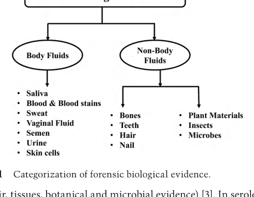

图5.1 法医生物学证据的分类。

在法医调查期间分析此类生物学证据时面临的若干挑战可能会在很大程度上影响法医分析的质量和可靠性。外部因素（温度、湿度、周围环境的动植物）往往会迅速降解这些生物样本。在法医科学中，体液鉴定具有重要意义，因为它提供了单独区分它们的能力。然而，在法医调查中处理这些体液时面临着巨大的挑战。样本量低或样本混合是分析过程中任何障碍的主要原因。因此，法医领域始终需要重大进步以克服这些挑战。与人类能力相结合的计算模型将通过提供提升科学评估的有前景的措施，为法医领域开辟新途径，从而确保法医调查的准确性和精确性。

### 机器学习方法

机器学习（ML）涵盖了更广泛的各种算法集合，旨在尝试识别计算数据模式，然后利用它们推导出数学模型，这些模型能够将学习到的规则推广到未见过的数据上。它是人工智能（AI）的一个子领域，涉及计算算法和模式的实现，以提高人类劳动的整体绩效。多年来，机器学习算法的应用已显著进步并取得了更广泛的实践方法。它已成为创建语音识别、语言处理、计算机视觉和其他相关领域有用软件的最受欢迎选择。

如图5.2所示，在各种ML工具的范畴下使用的不同知识获取方法包括监督学习和无监督学习方法、半监督学习和强化学习方法。监督机器学习算法是指输入数据与相应的输出标签相匹配，从而对未见数据产生精确预测[5]。监督学习包括以下方法：基于决策树的学习、线性建模和深度学习。无监督学习包括排序、聚类和异常检测[6]。在无监督学习中，模式需由学习系统在没有任何先验标签或规范的情况下识别。另一方面，在强化学习系统中，机器学习算法通过与给定环境的交互，通过试错最大化奖励，从而自行学习实现目标或根据当前系统提供一系列行动[7, 8]。

大规模数据在人类活动的各个领域变得越来越普遍，这导致了对底层机器学习算法的新需求激增。多变量数据分析技术可分为两大类：（i）回归或校准模型和（ii）模式识别技术。此外，模式识别技术进一步细分为监督和无监督模型。主成分分析（PCA）是无监督模型之一，而偏最小二乘判别分析（PLS–DA）代表监督模型或分类[9]。

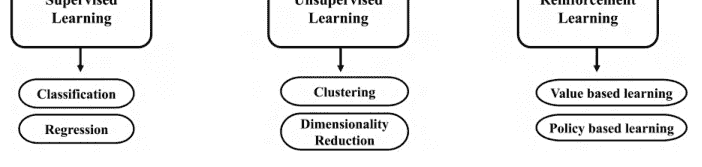

图5.2 机器学习算法的分类。

### 机器学习在法医生物学中的应用

通过在法医生物学中整合机器学习算法，法医调查有可能得到彻底改变。法医科学家可以通过在DNA证据分析中使用这些机器学习技术来提高其调查的准确性和效率。图5.3展示了机器学习算法在法医生物学不同领域的作用，有助于提高整体准确性和效率。近期关于法医领域机器学习算法的研究带来了新的机遇和挑战。这些算法已被用于解决法医领域中人类偏见的局限性[10]。

### 先进的DNA分析

在法医生物学中，机器学习算法可以识别DNA中通过手动分析庞大DNA数据集可能未被检测到的基因突变。此外，此类算法还可以帮助自动化DNA分析程序，从而进一步减少人工时间和精力。六种机器学习算法即随机森林（RF）、逻辑

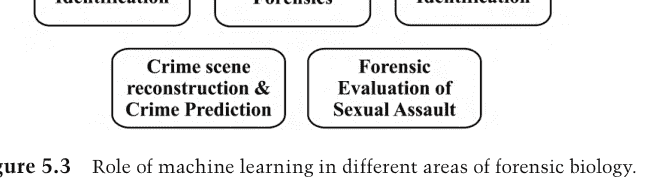

图5.3 机器学习在法医生物学不同领域的作用。


回归（LR）、k-最近邻（KNN）、随机梯度下降（SGD）、高斯朴素贝叶斯（GNB）和支持向量机（SVM）被应用于可用的 DNA 混合物并对四个基质进行了评估。使用 ML 工具的结果达到了 95% 的准确率 [11]。在另一项研究中，人工神经网络（ANN）——一种机器学习算法的子集——与回归分析一起被探索用于评估 DNA 甲基化模式以进行年龄估计 [12]。

## 自动体液鉴定

在任何法医调查中，各种体液的鉴定对于了解其来源和理解犯罪现场事件的时间线至关重要。机器学习算法有助于根据其特定的化学和生物分子特征对不同体液进行分类。研究人员已使用各种 ML 模型来鉴定特定体液。据报道，使用逻辑回归模型通过特定 microRNA（miRNA）生物标志物来鉴定月经血 [13]。多类随机分类器概率模型也被开发用于分别预测单一或混合体液的来源 [14]。基于随机森林算法的新模型被开发用于评估不同体液的类型和来源 [15]。

## 人身鉴定

多年来，在任何法医调查中，人身鉴定都是通过确定基因型来实现的，利用常染色体短串联重复序列（STRs）和线粒体 DNA（mtDNA）。然而，由于复杂性和大型数据集，法医科学家已将机器学习算法视为预测遗传相关性的新方法 [16]。在另一项研究中，三种机器学习分类器——随机森林（RF）、支持向量机（SVM）和人工神经网络（ANN）被用于预测从 DNA 来源获得的外部可见特征（EVCs） [17]。使用定制的卷积神经网络（CNN），该研究创建了一个自动人身识别系统（DENT-net），能够从全景牙科放射影像（PDRs）中准确识别个人 [18]。

## 死后间隔（PMI）估计

在法医调查中，死亡时间的估计，即死后间隔（PMI），至关重要但具有挑战性。研究人员旨在利用小鼠遗骸内脏器官的微生物测序数据构建准确的死后间隔（PMI）预测模型。诸如随机森林（RF）和支持向量机（SVM）等回归模型有助于识别 PMI 估计的潜在微生物生物标志物 [19]。另外，诸如广义加性模型（GAMs）和支持向量机（SVMs）等不同的多元方法允许将各种指标成分纳入模型中，从而使 PMI 预测更准确 [20]。其他机器学习工具，如线性判别分析（LDA）和逻辑回归（LR），在法医科学中也被广泛用于 PMI 估计 [21]。这些机器学习方法利用多个基础分类器和预测结果的积极方面，将其整合以提供准确的预测。这进一步增加了模型的多样性和复杂性，同时增强了预测的准确性和鲁棒性。

## 性别估计

Ortega 等人 [22] 曾根据专家的目视检查报告了各种机器学习（ML）工具的有效性，用于根据髂骨图像确定婴儿骨骼的性别。在另一项研究中，基于身体骨盆区域开发了卷积神经网络（CNN）模型用于性别估计 [23]。基于照片人类学指标，之前曾报道过特定的性别和年龄估计，其中人工神经网络实现了对巴西人群个体的分类 [24]。Venema Javier 等人 [25] 分析了通过肱骨图像进行男性和女性估计的不同学习算法。与人类专家获得的 83.33% 相比，本研究获得的结果准确率最高达 91.03%。

## 野生动物法医

在野生动物法医中，机器学习发挥着关键作用，因为它利用先进的计算技术来评估和理解与野生动物犯罪相关的数据。调查非法活动，如偷猎、贩运和濒危物种非法贸易，是野生动物法医的主要目标。这些算法可以随时间处理大型数据集，例如涉及声学记录或相机陷阱的数据，以分别追踪迁徙模式、监测野生动物分布变化并估计野生动物种群。一种自动化方法被开发用于在庞大的基质辅助激光解吸电离（MALDI）数据集上进行物种鉴定，采用机器学习且人工干预最少。

该研究利用半监督机器学习算法通过胶原蛋白肽指纹进行物种鉴定 [26]。在另一项研究中，机器学习算法被用于以高精度区分食肉动物物种的牙齿刻痕和牙齿坑 [27]。

## 犯罪现场预测与重建

基于机器学习（ML）的算法的引入可以通过提供有助于执法机构破案的洞察信息，在许多方面改善犯罪现场重建。机器学习算法利用 CCTV 摄像机图像、欺诈检测系统和垃圾邮件图像识别上的先进深度学习策略，已被用于犯罪行为的识别和预防。Palanivinayagam 等人 [28] 提出了一种算法来预测特定区域特定犯罪的概率。该研究还报告了不同工作的总结，其中先进的机器学习算法被用于预测给定区域的犯罪。Mandalapu 等人 [29] 报告了不同机器学习算法在犯罪早期检测中应用的系统综述。Dakalbab 等人 [30] 对各种机器学习算法在犯罪预测中应用的类似综述也进行了报道。因此，先进的机器学习算法有潜力预见未来的犯罪活动、重建复杂的犯罪现场并追踪重要的证据线索。

## 受害者识别

机器学习有可能通过识别受害者的面部特征或分析与受害者相关的行为模式，对受害者识别过程做出重大贡献，这可能有助于理解他们的习惯、日常活动或互动。一种机器学习算法被引入用于从皮肤微生物中识别单核苷酸多态性（SNPs）以进行受害者识别 [31]。另一项研究报道了评估机器学习算法在识别全景放射影像对以进行个体识别方面的有效性 [32]。观察到通过利用深度卷积网络获得了 85% 的准确率，并实现了个人识别的精确预测。为了根据提供的证据预测刑事审判的结果，研究人员 [33] 分别使用了不同的机器学习工具。该算法能够准确分类历史有罪判决，从而证明了使用机器学习协助基于证据的刑事审判决策制定的潜力。

## 性侵法医评估

Fernandes 等人在其工作中报告了最先进的深度学习算法，这些算法被评估用于性侵的法医评估 [34]。提出了一个关键步骤框架，涉及利用机器学习工具进行生殖器损伤的自动检测和法医评估。

## 法医生物学其他领域

法医病理学领域的最新发展导致了各种机器学习算法的应用，以确定死亡原因的性质，例如：
- 通过硅藻鉴定溺水 [35]
- 微观和大体死后图像的分类 [36]
- 致命性脑损伤的识别 [37, 38]
在另一项研究中，卷积神经网络（CNN）被用于分类血迹模式，其中分类模式的成功率达到 99.73% [39]。同样，在法医遗传学领域，机器学习算法被应用于法医 STR 等位基因提取 [40]。

## 案例研究——法医生物学中的机器学习

根据美国专利号 10,957,421，Marciano 和 Adelman [41] 建立了一种全新的混合机器学习技术（MLA）来分析不同贡献者的 DNA 混合物。与当前方法相比，他们的机器学习算法有可能以最少的财务和计算能力实现 DNA 混合物的更快、更准确的去卷积（分离）。

2024 年 1 月，德里警察在人工智能算法的帮助下破获了一起谋杀案，其中 AI 算法被用于通过纠正面部变色和增强眼睛来重建受害者的死后面容。因此，此类算法通常有助于受害者识别和预测潜在犯罪热点。

因此，将机器学习算法整合到法医生物学领域将带来深远的进步，有助于对生物证据进行准确的分析和解释。图 5.4

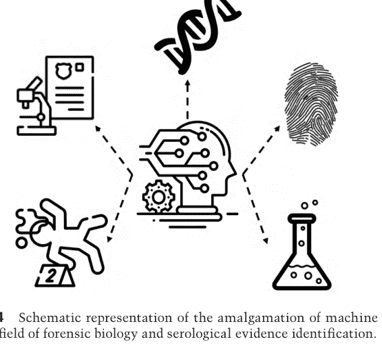

Figure 5.4 Schematic representation of the amalgamation of machine learning in the field of forensic biology and serological evidence identification.

图 5.4 机器学习在法医生物学和血清学证据鉴定领域融合的示意图。

illustrates a schematic representation of the amalgamation of machine learning in the field of forensic biology and serological evidence identification.

图示了机器学习在法医生物学和血清学证据鉴定领域融合的示意图。

## Advantages of machine learning approaches in forensic biology:

## 法医生物学中机器学习方法的优势：

Machine learning algorithms hold significant promise for forensic biology with their ability to assist in the analysis and interpretation of intricate biological evidence. Some of the advantages of utilizing machine-learning algorithms in the field of forensic biology are as follows:

机器学习算法凭借其协助分析与解读复杂生物证据的能力，在法医生物学领域具有重要前景。利用机器学习算法于法医生物学领域的优势如下：

For biological evidence, such as DNA sequences, body fluid and hair characteristics and blood spatter patterns, machine-learning algorithms can assist forensic investigators in deciphering intricate patterns and linkages. This can help enhance the accuracy and ease in forensic analysis.

对于 DNA 序列、体液和毛发特征以及血迹喷溅模式等生物证据，机器学习算法可以帮助法医调查人员解读复杂的模式和关联。这有助于提高法医分析的准确性和便捷性。

Machine-learning algorithms can minimize the possibility of human errors by automating time-consuming and repetitive tasks.

机器学习算法可以通过自动化耗时且重复的任务来最大限度地减少人为错误的可能性。

The accuracy and speed of DNA profiling can be enhanced through machine-learning algorithms, which can further help in identifying suspects and linking them to the victim or crime scene.

DNA 分型的准确性和速度可通过机器学习算法得到提升，这进一步有助于识别嫌疑人并将其与受害者或犯罪现场联系起来。

Analyzing probable suspects based on their geographic profiles, criminal behavioural patterns etc., these machine-learning algorithms can provide aid to different law enforcement agencies or organizations to enhance their overall investigations.

基于地理画像、犯罪行为模式等分析潜在嫌疑人，这些机器学习算法可为不同执法机构或组织提供帮助，以提升其整体调查效果。

## Disadvantages of Machine-Learning Approaches in Forensic Biology

## 法医生物学中机器学习方法的缺点

Machine-learning algorithms have the ability to bring out better advancements in different areas of forensic biology. However, there are enormous challenges and disadvantages to using such complex tools and algorithms in this field.

机器学习算法能够在法医生物学的不同领域带来更好的进步。然而，在该领域使用此类复杂工具和算法存在巨大挑战和缺点。

**Data Quantity and Quality:** Machine-learning algorithms generally demand large, robust data sets for analysis. In forensic biology, obtaining large and diverse datasets is challenging due to the limitation of real-time crime scene samples. This may be an obstacle in providing the appropriate accuracy of the model.

**数据数量和质量：** 机器学习算法通常需要大量、可靠的数据集进行分析。在法医生物学中，由于现场实时犯罪样本的限制，获取大量且多样化的数据集具有挑战性。这可能成为提供模型适当准确性的障碍。

**Biasness:** These algorithms are sometimes influenced by biased training, thereby producing false or inaccurate results.

**偏倚：** 这些算法有时会受到有偏训练的影响，从而产生虚假或不准确的结果。

**Ethical Issues:** Individual rights and privacy may be compromised if sometimes certain data sets (such as genomic data) are used for investigation purposes without prior consent.

**伦理问题：** 如果某些数据集（如基因组数据）在未经事先同意的情况下用于调查目的，个人权利和隐私可能会受到损害。

**Cost and Expertise:** Applying machine learning tools to use in forensic biology requires an enormous financial and human investment in resources. Also, to generate, validate datasets and manage these tools, specialized knowledge is required.

**成本和专业知识：** 将机器学习工具应用于法医生物学需要大量财务和人力资源投入。此外，生成、验证数据集和管理这些工具需要专业知识。

**Technology Advancements:** Forensic experts and law enforcement organizations will need to update and adapt to recent developments in machine learning tools on a regular basis.

**技术进步：** 法医专家和执法组织需要定期更新并适应机器学习工具的最新发展。

## Future Aspects of Machine Learning in Forensic Biology

## 法医生物学中机器学习的未来展望

Machine-learning algorithms promise to hold great prominence in forensic biology and its varied aspects such as DNA analysis, serology and blood pattern analysis in future. These computational algorithms and learning tools can profoundly elevate the accuracy and competence of all these forensic biology techniques, that will overall boost the forensic investigations greatly. Machine learning can aid in quality control by identifying false or misleading forensic data, thereby maintaining overall integrity.

机器学习算法有望在法医生物学及其各个方面（如 DNA 分析、血清学和血迹模式分析）中占据重要地位。未来，这些计算算法和学习工具可以显著提高所有这些法医生物学技术的准确性和能力，从而整体上大大提升法医调查。机器学习可以通过识别虚假或误导性的法医数据来协助质量控制，从而维护整体完整性。

## References

## 参考文献

1. Virkler, K., & Lednev, I. K. (2009). Analysis of body fluids for forensic purposes: From laboratory testing to non-destructive rapid confirmatory identification at a crime scene. 用于法医目的的体液分析：从实验室检测到犯罪现场无损快速确证鉴定。 *法医学国际*, 188(1–3), 1–17. https://doi.org/10.1016/j.forsciint.2009.02.013
2. Avinash, P. C. (2021). Comparative role of serology and DNA profiling in forensics. 法医中血清学与 DNA 分型的比较作用。 Research Journal of Forensic Sciences, 12, 19–21.
3. Rao, P. K., Pandey, G., & Tharmavaram, M. (2020). Biological evidence and their handling. 生物证据及其处理。 In D. Rawtani & C. M. Hussain (Eds.), Technology in forensic science 法医科学技术 (1st ed., pp. 35–53). Wiley. https://doi.org/10.1002/9783527827688.ch3
4. Gefrides, L., & Welch, K. (2011). Forensic biology: Serology and DNA. 法医生物学：血清学与 DNA。 In A. Mozayani & C. Noziglia (Eds.), The forensic laboratory handbook procedures and practice 法医实验室手册程序与实践 (pp. 15–50). Humana Press. https://doi.org/10.1007/978-1-60761-872-0_2
5. Babcock University, F.Y. O., J.E.T. A., O. A., J. O. H., O. O., & J. A. (2017). Supervised machine learning algorithms: Classification and comparison. 监督机器学习算法：分类与比较。 International Journal of Computer Trends and Technology, 48(3), 128–138. https://doi.org/10.14445/22312803/IJCTT-V48P126
6. Jovel, J., & Greiner, R. (2021). An introduction to machine learning approaches for biomedical research. 生物医学研究机器学习方法的介绍。 Frontiers in Medicine, 8, 771607. https://doi.org/10.3389/fmed.2021.771607
7. Sharma, S., & Chaudhary, P. (2023). Chapter 4 machine learning and deep learning. 第 4 章 机器学习与深度学习。 In P. Raj, A. Kumar, A. K. Dubey, S. Bhatia, & O. Manoj S (Eds.), Quantum computing and artificial intelligence 量子计算与人工智能 (pp. 71–84). De Gruyter. https://doi.org/10.1515/9783110791402-004
8. Mohammed, M., Khan, M. B., & Bashier, E. B. M. (2016). Machine learning (1st ed.). 机器学习 (1st ed.)。 CRC Press. https://doi.org/10.1201/9781315371658
9. Alladio, E., Poggiali, B., Cosenza, G., & Pilli, E. (2022). Multivariate statistical approach and machine learning for the evaluation of biogeographical ancestry inference in the forensic field. 多元统计方法与机器学习在法医领域生物地理祖先推断评估中的应用。 Scientific Reports, 12(1), 8974. https://doi.org/10.1038/s41598-022-12903-0
10. Galante, N., Cotroneo, R., Furci, D., Lodetti, G., & Casali, M. B. (2023). Applications of artificial intelligence in forensic sciences: Current potential benefits, limitations, and perspectives. 人工智能在法医科学中的应用：当前潜在益处、局限性和展望。 International Journal of Legal Medicine, 137(2), 445–458. https://doi.org/10.1007/s00414-022-02928-5
11. Alotaibi, H., Alsolami, F., Abozinadah, E., & Mehmood, R. (2022). TAWSEEM: A Deep-learning-based tool for estimating the number of unknown contributors in DNA profiling. TAWSEEM：基于深度学习的 DNA 分型中未知贡献者数量估计工具。 Electronics, 11(4), 548. https://doi.org/10.3390/electronics11040548
12. Vidaki, A., Ballard, D., Aliferi, A., Miller, T. H., Barron, L. P., & Syndercombe Court, D. (2017). DNA methylation-based forensic age prediction using artificial neural networks and next generation sequencing. 基于 DNA 甲基化的法医年龄预测，使用人工神经网络和下一代测序。 Forensic Science International. Genetics, 28, 225–236. https://doi.org/10.1016/j.fsigen.2017.02.009
13. Hanson, E. K., Mirza, M., Rekab, K., & Ballantyne, J. (2014). The identification of menstrual blood in forensic samples by logistic regression modeling of miRNA expression. 通过 miRNA 表达的逻辑回归建模在法医样本中鉴定月经血。 ELECTROPHORESIS, 35(21-22), 3087–3095. https://doi.org/10.1002/elps.201400171
14. Iacob, D., Fürst, A., & Hadryś, T. (2019). A machine learning model to predict the origin of forensically relevant body fluids. 预测法医相关体液来源的机器学习模型。 Forensic Science International: Genetics Supplement Series, 7(1), 392–394. https://doi.org/10.1016/j.fsigs.2019.10.025
15. Tian, H., Bai, P., Tan, Y., Li, Z., Peng, D., Xiao, X., Zhao, H., Zhou, Y., Liang, W., & Zhang, L. (2020). A new method to detect methylation profiles for forensic body fluid identification combining ARMS-PCR technique and random forest model. 一种结合 ARMS-PCR 技术和随机森林模型检测甲基化谱以进行法医体液鉴定的新方法。 Forensic Science International: Genetics, 49, 102371. https://doi.org/10.1016/j.fsigen.2020.102371
16. Govender, P., Fashoto, S. G., Maharaj, L., Adeleke, M. A., Mbunge, E., Olamijuwon, J., Akinnuwesi, B., & Okpeku, M. (2022). The application of machine learning to predict genetic relatedness using human mtDNA hypervariable region I sequences. 应用机器学习预测遗传相关性，使用人类 mtDNA 超变区 I 序列。 PLoS One, 17(2), e0263790. https://doi.org/10.1371/journal.pone.0263790
17. Katsara, M.-A., Branicki, W., Walsh, S., Kayser, M., & Nothnagel, M. (2021). Evaluation of supervised machine-learning methods for predicting appearance traits from DNA. 评估从 DNA 预测外貌特征的监督机器学习方法。 Forensic Science International: Genetics, 53, 102507. https://doi.org/10.1016/j.fsigen.2021.102507
18. Fan, F., Ke, W., Wu, W., Tian, X., Lyu, T., Liu, Y., Liao, P., Dai, X., Chen, H., & Deng, Z. (2020). Automatic human identification from panoramic dental radiographs using the convolutional neural network. 使用卷积神经网络从全景牙科放射影像自动识别人类。 Forensic Science International, 314, 110416. https://doi.org/10.1016/j.forsciint.2020.110416
19. Liu, R., Gu, Y., Shen, M., Li, H., Zhang, K., Wang, Q., Wei, X., Zhang, H., Wu, D., Yu, K., Cai, W., Wang, G., Zhang, S., Sun, Q., Huang, P., & Wang, Z. (2020). Predicting postmortem interval based on microbial community sequences and machine learning algorithms. 基于微生物群落序列和机器学习算法预测死亡后间隔。 Environmental Microbiology, 22(6), 2273–2291. https://doi.org/10.1111/1462-2920.15000
20. Muñoz Barús, J. I., Febrero-Bande, M., & Cadarso-Suárez, C. (2008). Flexible regression models for estimating postmortem interval (PMI) in forensic medicine. 法医学中估计死亡后间隔（PMI）的灵活回归模型。 Statistics in Medicine, 27(24), 5026–5038. https://doi.org/10.1002/sim.3319
21. Lu, X.-J., Li, J., Wei, X., Li, N., Dang, L.-H., An, G.-S., Du, Q.-X., Jin, Q.-Q., Cao, J., Wang, Y.-Y., & Sun, J.-H. (2023). A novel method for determining postmortem interval based on the metabolomics of multiple organs combined with ensemble learning techniques. 一种基于多器官代谢组学结合集成学习技术确定死亡后间隔的新方法。 International Journal of Legal Medicine, 137(1), 237–249. https://doi.org/10.1007/s00414-022-02844-8
22. Ortega, R. F., Irurita, J., Campo, E. J. E., & Mesejo, P. (2021). Analysis of the performance of machine learning and deep learning methods for sex estimation of infant individuals from the analysis of 2D images of the ilium. 分析机器学习和深度学习方法在基于髂骨二维图像分析婴儿个体性别估计中的性能。 International Journal of Legal Medicine, 135(6), 2659–2666. https://doi.org/10.1007/s00414-021-02660-6
23. Cao, Y., Ma, Y., Yang, X., Xiong, J., Wang, Y., Zhang, J., Qin, Z., Chen, Y., Vieira, D. N., Chen, F., Zhang, J., & Huang, P. (2022). Use of deep learning in forensic sex estimation of virtual pelvic models from the Han population. 深度学习在汉族虚拟骨盆模型法医性别估计中的应用。 Forensic Sciences Research, 7(3), 540–549. https://doi.org/10.1080/20961790.2021.2024369
24. Porto, L. F., Correia Lima, L. N., Pinheiro Flores, M. R., Valsecchi, A., Ibanez, O., Machado Palhares, C. E., & De Barros Vidal, F. (2019). Automatic cephalometric landmarks detection on frontal faces: An approach based on supervised learning techniques. 正面面部自动头颅测量标志检测：基于监督学习技术的方法。 Digital Investigation, 30, 108–116. https://doi.org/10.1016/j.diin.2019.07.008


- 25. Venema, J., Peula, D., Irurita, J., & Mesejo, P. (2023). 利用深度学习通过肱骨二维图像对成年个体进行性别估计。神经计算与应用, 35(8), 5987–5998. https://doi.org/10.1007/s00521-022-07981-0
- 26. Gu, M., & Buckley, M. (2018). 通过胶原肽质谱指纹进行半监督机器学习自动物种鉴定。BMC 生物信息学, 19(1), 241. https://doi.org/10.1186/s12859-018-2221-3
- 27. Courtenay, L. A., Yravedra, J., Huguet, R., Aramendi, J., Maté-González, M. Á., González-Aguilera, D., & Arriaza, M. C. (2019). 结合机器学习算法与几何形态测量学：食肉动物牙齿痕迹研究。古地理学、古气候学、古生态学, 522, 28–39. https://doi.org/10.1016/j.palaeo.2019.03.007
- 28. Palanivinayagam, A., Gopal, S. S., Bhattacharya, S., Anumbe, N., Ibeke, E., & Biamba, C. (2021). 一种用于犯罪检测的优化机器学习与大数据方法。无线通信与移动计算, 2021, 1–10. https://doi.org/10.1155/2021/5291528
- 29. Mandalapu, V., Elluri, L., Vyas, P., & Roy, N. (2023). 利用机器学习和深度学习的犯罪预测：系统综述与未来方向。IEEE Access, 11, 60153–60170. https://doi.org/10.1109/ACCESS.2023.3286344
- 30. Dakalbab, F., Abu Talib, M., Abu Waraga, O., Bou Nassif, A., Abbas, S., & Nasir, Q. (2022). 人工智能与犯罪预测：系统文献综述。社会科学与人文开放, 6(1), 100342. https://doi.org/10.1016/j.ssaho.2022.100342
- 31. Sherier, A. J., Woerner, A. E., & Budowle, B. (2022). 确定用于人类鉴定的信息性微生物单核苷酸多态性。应用与环境微生物学, 88(7), e00052-22. https://doi.org/10.1128/aem.00052-22
- 32. Ortiz, A. G., Soares, G. H., Da Rosa, G. C., Biazevic, M. G. H., & Michel-Crosato, E. (2021). 自动化个人识别流程的试点研究：机器学习在全景放射影像中的应用。牙科影像科学, 51(2), 187. https://doi.org/10.5624/isd.20200324
- 33. Mitchell, J., Mitchell, S., & Mitchell, C. (2020). 机器学习用于确定刑事审判的准确结果。法律、概率与风险, 19(1), 43–65. https://doi.org/10.1093/lpr/mgaa003
- 34. Fernandes, K., Cardoso, J. S., & Astrup, B. S. (2018). 法医性侵评估的深度学习方法。模式分析与应用, 21(3), 629–640. https://doi.org/10.1007/s10044-018-0694-3
- 35. Yu, W., Xue, Y., Knoops, R., Yu, D., Balmashnova, E., Kang, X., Falgari, P., Zheng, D., Liu, P., Chen, H., Shi, H., Liu, C., & Zhao, J. (2021). 利用深度神经网络在溺水案例的数字扫描电子显微镜图像中自动搜索硅藻。国际法医学杂志, 135(2), 497–508. https://doi.org/10.1007/s00414-020-02392-z
- 36. Garland, J., Hu, M., Kesha, K., Glenn, C., Morrow, P., Stables, S., Ondruschka, B., & Tse, R. (2021). 使用预训练卷积神经网络识别尸后器官大体图像。法医学杂志, 66(2), 630–635. https://doi.org/10.1111/1556-4029.14608
- 37. Zinnel, L., & Bentil, S. A. (2023). 用于创伤性脑损伤分类和结局预测的卷积神经网络。*健康科学评论*, 9, 100126.
- 38. Courville, E., Kazim, S. F., Vellek, J., Tarawneh, O., Stack, J., Roster, K., Roy, J., Schmidt, M., & Bowers, C. (2023). 预测创伤性脑损伤结局的机器学习算法：系统综述与荟萃分析。*国际外科神经学*, 14, 262. https://doi.org/10.25259/SNI_312_2023
- 39. Bergman, T., Klöden, M., Dreßler, J., & Labudde, D. (2022). 利用深度学习方法对血迹进行自动分类。*KI - 人工智能*, 36(2), 135–141. https://doi.org/10.1007/s13218-022-00760-y
- 40. Liu, Y.-Y., Welch, D., England, R., Stacey, J., & Harbison, S. (2020). 利用机器学习范式进行法医STR等位基因提取。*法医学国际：遗传学*, 44, 102194. https://doi.org/10.1016/j.fsigen.2019.102194
- 41. Marciano, M., & Adelman, J. (n.d.). (54) 种间DNA混合物解释的系统和方法。*专利。*

## 在毒理学研究和法医物证分析中应用机器学习的方法

6

AKANKSHA SINGH
KACHHAWAHA, VIJETA
KHARE, AHLAD KUMAR
AND ATHULYA RAJAN

### 引言

毒理学是一个多学科领域，研究化学物质、药物和其他物质对生物体的不良影响 [1, 2]。它涉及毒物识别、表征以及理解其作用机制、对暴露于有毒物质的个体的诊断、管理与治疗 [3]。毒理学家还旨在评估和管理与有毒物质暴露相关的风险、制定 [4, 5] 并实施保护人类健康和环境的法规与指南 [6–8]。如图 6.1 所示，毒理学有各种分支，各自处理毒物的不同方面 [9]。环境毒理学旨在了解污染物和有毒物质对环境及其居民的不良影响，以最终减轻和预防环境污染及其对生态系统和人类健康的影响 [10, 11]。预测毒理学开发工具和技术 [12]，以预测化学物质或物质对生物体的毒性效应，以便在药物开发过程、工业化学品生产或环境污染物暴露中开发毒性预评估方法 [13]。临床毒理学涉及毒物诊断和治疗 [14]。除上述之外，毒理学在法医学分析中也发挥作用，通过结合法医和分析毒理学的原理，对刑事调查程序中的物证进行分析 [15, 16]。

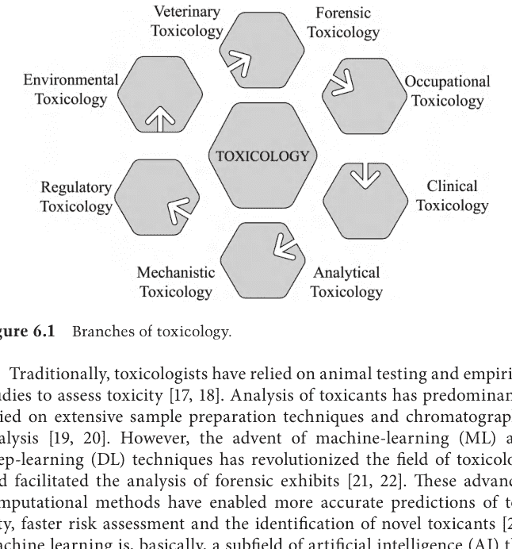

图 6.1 毒理学分支。

传统上，毒理学家依赖动物实验和经验研究来评估毒性 [17, 18]。毒物分析主要依赖于广泛的样品制备技术和色谱分析 [19, 20]。然而，机器学习（ML）和深度学习（DL）技术的出现彻底改变了毒理学领域，并促进了法医物证的分析 [21, 22]。这些先进的计算方法实现了毒性预测的更高准确性、更快的风险评估以及新型毒物的鉴定 [23]。机器学习基本上是人工智能（AI）的一个子领域，涉及开发算法和模型，使计算机能够在不专门为特定任务编程的情况下进行预测或决策 [24]。机器学习包括监督学习（多元线性回归、朴素贝叶斯分类器、决策树、支持向量机、集成学习、人工神经网络、深度神经网络）、无监督学习（主成分分析、Kohonen 自组织映射）和强化学习 [25]。机器学习技术在毒理学的各个领域都有不同的应用 [25–27]。在本章中，我们简要总结了 ML 在毒理学不同分支中的应用，并详细探讨了 ML 和 DL 在法医毒理学和法医物证分析领域的实用性。在后面的章节中，讨论了样品制备的各种经典和现代方法、毒理学物证分析的一般流程以及 ML 在物证法医分析中用于定性和定量目的的作用。


## 预测毒理学中的机器学习

机器学习（ML）和深度学习（DL）模型能够以高准确度预测毒性，并随后填补研究空白，如图 6.2 [21] 所示。这些模型在大量化学和生物数据上训练，使其能够识别传统实验中可能不明显的模式和关系。预测模型可以估计毒性终点，例如中位致死剂量（LD50）和中位抑制浓度（IC50），这对风险评估和监管决策至关重要 [28]。它还可以预测物质对生物体的有害影响 [29]，并通过建立分子与其生物活性之间的关系来帮助结构-活性关系（SAR）。为此目的，可根据数据的性质和所面临的问题使用多种 ML 和 DL 模型。预测毒理学中最常用的一些模型如下所示 [30]：

### 随机森林（RF）：
随机森林是一种在预测毒理学中被广泛使用的算法 [31]。例如，在一项最近的研究中，它被用于构建小鼠肝毒性分类模型 [32]。该算法是将多个决策树合并以输出单一结果，适用于分类和回归问题 [33]。

### 支持向量机（SVMs）：
支持向量机在毒理学中用于二元分类问题，尤其是在样本有限的情况下使用。它们可以区分有毒和无毒化合物 [34]

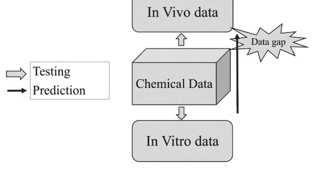

图 6.2 预测毒理学。

并且已被证明在鉴定各种有机化合物的水生毒性机制方面很有用 [35]。

### 梯度提升机（GBM）：
梯度提升算法如 XGBoost 和 Light GBM 越来越受欢迎，因为它们能够处理复杂数据并提供良好结果。梯度提升将各种基础模型组合成强大的集成模型，常用于毒理学中的回归和分类问题。在一项研究中，GBM 与其他方法一起被用于构建预测人类有机化学物半衰期的模型 [36]。

### 神经网络：
深度学习模型也越来越多地用于各种化学物质的毒性预测和分类。这些模型能够学习复杂模式并从给定数据中提取信息。预测毒理学中常用的神经网络类型包括：

- **前馈神经网络（FNN）：** FNN 是最基本的神经网络类型之一，其中数据仅沿一个方向通过输入、隐藏和输出层，并用于各种毒性预测任务 [37]。
- **卷积神经网络（CNN）：** CNN 通常用于图像识别目的，因此在处理基于图像的毒性预测（如分子结构或生物学测定）时很有用 [38]。
- **循环神经网络（RNN）：** RNN 在处理序列数据时使用，适用于预测时间依赖性毒性或分子序列 [39]。
- **图神经网络（GNN）：** GNN 专门为图数据开发，因此非常适合涉及分子图或化学化合物的问题 [40]。

### DeepChem：
DeepChem 是专门为药物发现 [41] 以及预测毒理学而创建的库。它提供预建的深度学习模型和工具，专为化学和生物数据分析而设计 [42]。

### 化学信息学模型：
基于化学信息学的模型，如定量结构-活性关系（QSAR）模型和药效团建模，也常与传统 ML 和 DL 模型一起用于毒性预测。这些模型依赖于化学性质、分子描述符和结构特征 [43]。

### 集成模型：
通常，使用不同模型的组合来提高模型性能 [44]。一些集成技术示例，如堆叠和装袋，可用于组合多个模型的预测以实现更高的准确性 [45, 46]。

### 迁移学习：
通过迁移学习，已针对特定毒理学任务进行微调的预训练模型可被重新用于第二个相关问题，在处理有限数据和计算资源时尤其有利 [47]。

## 可解释人工智能模型（XAI）

顾名思义，可解释 AI 模型不仅做出预测，还提供模型决策背后的理由。这提高了模型的透明度，使预测更值得信赖，这对毒理学研究至关重要 [48]。

最终，模型的選擇取决于毒理学任务的性质、数据可用性以及所需的解释性水平等因素。尽管如此，可以尝试不同模型以评估哪一个最适合手头的问题。

## 结构-活性关系

结构-活性关系（SAR）研究用于确定化学化合物的结构特征与其生物活性（如毒性）之间的关系。随着化学库和数据集的增加，ML 和 DL 模型已被广泛用于基于 SAR 的毒性预测 [49, 50]。这有助于识别与毒性相关的特征，这在开发用于使用的药物或化学品时尤其必要。ML 和 DL 技术目前在 SAR 分析中以以下方式使用：

## 特征提取与选择

- **分子描述符：** 分子描述符是代表化学化合物的数值。这些描述符源自分子的各种性质，从简单的分子式和拓扑结构到更复杂的 3D 结构 [52]。这些描述符用作 ML 模型的输入变量以进行预测。

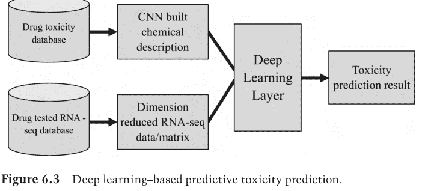

图 6.3 基于深度学习的预测毒理学预测。

- **深度学习用于特征提取：** DL 模型能够从输入数据（如分子结构）中学习并提取相关特征，而无需手动特征工程。诸如图卷积神经网络（GCNs）和循环神经网络（RNNs）等技术可以直接处理分子图或序列，保持有价值的结构信息（图 6.3） [53]。

## 数据准备与增强

- **数据预处理：** 此初始步骤中最重要部分包括清理和标准化分子数据、处理缺失值、归一化特征并确保数据一致。
- **数据增强：** 在数据或样本有限的情况下，可考虑数据增强技术以生成具有轻微变化的新数据点，从而增加数据集的大小和多样性。

## 模型训练

- **传统 ML 模型：** 如随机森林和支持向量机等 ML 算法在已知活性水平的化合物数据集上进行训练。此后，这些模型学习分子描述符与相应生物活性之间的映射关系 [54]。
- **深度学习模型：** 基于 DL 技术（如 GNNs）的 SAR 模型可用于预测各种化学和毒理学性质的值，如活性标签或连续活性值 [55]。

## 预测建模

- **二元分类：** ML 和 DL 模型可用于二元分类任务，例如预测分子对特定靶点的活性或非活性 [56]。
- **回归分析：** 回归模型用于定量 SAR（QSAR）分析以预测化学化合物的活性水平，并能够评估各种特征相对于某些参数的贡献 [57]。

## 模型可解释性

- **特征重要性：** 如前所述，ML 和 DL 模型能够评估每个特征对最终预测的贡献 [58]。
- **注意力机制：** 一些 DL 模型，例如 GNNs 使用注意力机制来指出分子中负责生物活性的特定子结构或原子 [59, 60]。

## 模型验证

- **交叉验证：** 交叉验证技术用于评估模型在未用于训练模型的数据集部分上的性能。这是为了衡量模型泛化新未见数据的能力。
- **外部验证：** 另一种可进行的验证类型是外部验证，其中模型针对类似的外部数据集进行验证 [61]。
- **化学信息学数据库：** 有各种数据库可供使用，如 ChEMBL 和 PubChem [62]，ML 和 DL 模型利用它们收集对 SAR 分析有用的化学和生物数据。

### 虚拟筛选：
ML 和 DL 模型今天已采用众多现有化学库来筛选药物和有毒化合物，这反过来对 SAR 分析和预测产生了巨大改进。总的来说，这些技术通过自动特征提取、捕捉复杂模式 [63] 并提高对化学化合物作用机制的理解，提高了此类分析的速度 [64]。


## 临床毒理学中的机器学习

在制药行业中，预测与药物相关的不良事件至关重要。ML 和 DL 模型可以分析大规模的临床和药物警戒数据，以识别提示潜在不良事件的模式。这有助于上市后监测，并可带来更安全的药物使用。一项研究评估了机器学习算法用于预测急性曲马多中毒导致的癫痫发作，使用常规的人口统计学、临床和临床辅助数据以及重要预测变量 [65]。还报道了一种基于支持向量机的方法以及一种特征选择技术，可用于准确预测百草枯中毒毒性 [66]。

## 环境监测与毒理学中的机器学习

ML 和 DL 也适用于环境毒理学。这些技术有助于预测化学品对环境的影响，评估其生物累积潜力并了解其对生态系统的影响 [67]。这些知识有助于污染物的监管，并进一步有助于减少其对生态系统和人类健康的影响 [68]。ML 和 DL 在环境毒理学中被专门用于预测各种化学品对水生生物的毒性（图 6.4）。因此，它们能够识别潜在的有害物质并优先进行进一步测试。它们也是预测生物利用度的强大工具，考虑土壤性质、气候和微生物活动等因素 [69]。在环境监测的情况下，

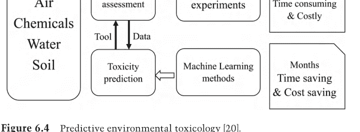

图 6.4 预测性环境毒理学 [20]。

这些技术有助于（a）传感器数据分析：随着越来越多的环境传感器数据可供使用，ML 算法可用于处理来自环境传感器的此类数据以评估和预测空气质量等因素 [70]。它们还可通过检测异常来实现水质的实时监测，这进一步有助于早期预警系统 [71]，（b）空间分析：地理信息系统（GIS）结合 ML 可分析空间数据以了解污染物的分布并评估特定区域的污染水平 [72, 73]，（c）物种敏感性分布（SSDs）：ML 模型可以分析 SSDs 以预测可能危害生态系统中一定比例物种的污染物浓度，例如农药对水生生物的有害影响 [74]。总体而言，ML 可通过考虑多种压力源及其对生态系统的影响来帮助评估生态风险 [75]。

## 生物监测和毒理基因组学中的机器学习

### 生物指示剂识别
在 ML 模型帮助下，可以检测到生物指示剂对环境变化或异常的反应。这些异常随后可用于及早发现环境问题 [76]。

### 宏基因组学和宏转录组学
DL 技术可以分析宏转录数据以了解微生物群落的组成及其对环境压力源的响应 [77]。

### 基因表达分析
DL 模型还可以检查基因表达数据以找出哪些基因和生物通路对环境毒素有反应 [78]。

### 组学整合
在 ML 帮助下整合不同的组学，即基因组学、转录组学、蛋白质组学和代谢组学数据，可以全面了解生物体如何响应环境压力源 [79]。

## 数据集成与融合

- **多源数据融合：** 通过整合来自不同来源的数据，例如环境传感器和化学数据库，ML 技术可以创建广泛的环境模型 [80]。
- **时间序列分析：** ML 模型可以分析时间序列数据以检测环境参数的长期趋势和季节性变化。

## 风险评估中的机器学习

ML 和 DL 在环境评估和毒理学领域风险管理中发挥着关键作用。随着这些技术越来越多地用于化学品或污染物的检测和识别，它们在分析此类物质带来的风险方面也变得至关重要。此外，此类评估的输出可作为决策者的指导，甚至可用于通知当局有关潜在的环境紧急情况，例如有害藻华 [81, 82] 或空气污染事件 [83]。在环境毒理学方面，这些技术也在帮助研究人员和环境机构保护生态系统和人类健康 [84, 85]。它们对于处理环境评估相关数据的复杂性和数量特别有价值。在最近的一项研究中，开发了一种深度神经网络（DNN）模型，用于评估油气钻井平台涉及的脱钩场景的风险。这是尝试通过机器学习解决工业风险评估挑战，并取得了相当高的准确性 [86]。关于气候变化风险评估，已应用了多种 ML 算法。其中最常用的是决策树、随机森林和人工神经网络。这些算法通常用于洪水和滑坡风险事件的评估。此外，ML 在处理遥感数据方面的应用是稳定且有效的 [87]。

## 法医毒理学和法医物证分析

法医毒理学侧重于对生物样本中物质的分析，以协助刑事调查实现司法公正。法医毒理学家的首要目标是鉴定和量化从法律案件相关个体获得的生物样本中的药物、化学品或其他有毒物质。该领域在各种法律背景下发挥着关键作用，包括刑事调查、尸检以及工作场所或交通相关事件。法医毒理学家使用各种样品制备和分析技术（图 6.5），包括色谱法、质谱法和免疫分析法，以鉴定和量化毒物，最终提取物使用仪器方法进行定量。根据化合物的物理化学特性，存在不同的提取技术。然而，由于非挥发性有机化合物主要存在于内脏样本中，我们将限制讨论仅涉及非挥发性有机化合物类别的方法。

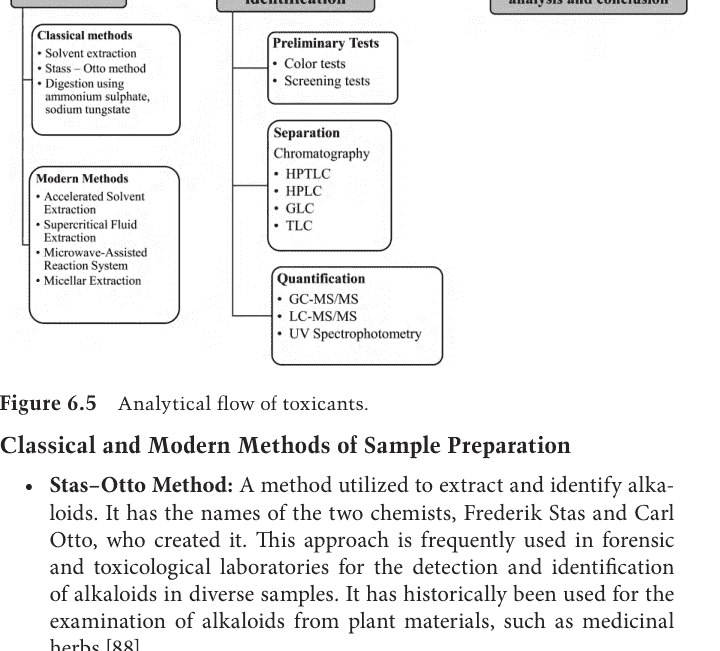

图 6.5 毒物分析流程。

## 样品制备的经典和现代方法

- **Stas–Otto 方法：** 一种用于提取和鉴定生物碱的方法。它以两位化学家 Frederik Stas 和 Carl Otto 的名字命名，他们创造了该方法。这种方法经常在法医和毒理学实验室中用于检测和鉴定各种样本中的生物碱。历史上它曾用于检查植物材料（如药用草药）中的生物碱 [88]。
- **溶剂萃取：** 它基于生物碱碱基在酸性或水溶液与不相容有机溶剂之间的分布 [89]。溶质在相互接触的两种不相容液相之间的分布，即溶质的两相分布。溶剂萃取常用的溶剂有正己烷、甲苯和乙腈。

溶剂萃取是法医毒理学中与生物基质相关最常用的方法之一 [16]。药物和代谢物根据其极性在两相之间分离。样本的缓冲或 pH 调整可使提取技术对酸性或碱性药物具有选择性。

- **固相萃取：** 固相萃取（SPE）于 20 世纪 70 年代中期作为溶剂萃取的替代方法引入。它用于分离、预浓缩和溶剂交换溶质，用于

溶液 [90]。该技术能够在定量之前提取、净化并浓缩分析物。SPE 使用装在 cartridges 装置中或磁盘上的吸附剂，从溶液中吸附选择性物质 [91]。不同的分离化学方法可与 SPE 技术一起使用，以提取各种目标分析物，例如正相、反相和离子交换（阴离子和阳离子）模式 [92]。用于 SPE 的商用 cartridges 具有 1–10 ml 的容量，使用后即丢弃 [93]。与溶剂-溶剂萃取相比，SPE 可更好地实现分析物浓缩，使用 SPE 柱提供更快、更安全的替代方案 [16]。SPE 可靠、经济高效且环保。SPE 可实现自动化，适用于高通量实验室。通过将 SPE 柱小型化为迷你柱/ cartridges，可实现低溶剂消耗 [92]。

- **固相微萃取：** SPME 于 1990 年开发，被定义为微型化和平衡技术，其中萃取相相对于样品体积较小 [94]。这是一种萃取方法，其中分析物直接从样品吸附到涂有合适固定相的熔融二氧化硅纤维上。该方法用于从水样中提取有机化学品 [16]。SPME 可用于挥发性物质、生物样品中的药物等。它使用相对较小的吸附表面积，吸附纤维在暴露后可从气体、液体或半固体样品中吸附分析物。纤维涂层根据分析物的性质选择。常用的是聚二甲基硅氧烷（PDMS）、聚丙烯酸酯（PA）、碳分子筛/聚二甲基硅氧烷（CAR–PDMS）等。

通过控制纤维涂层的厚度和极性，保持一致的采样时间和其它参数，SPME 可确保高通量和可量化的结果，即使在分析物浓度较低时也是如此。SPME 无需溶剂，易于自动化，其纤维可重复使用且价格低廉。

- **加速溶剂萃取（ASE）：** ASE 是一种用于从固体以及半固体样品中提取有机化合物的萃取技术，使用液体溶剂。液体溶剂是有机溶剂，在高于其沸点的高压和高温下使用 [95]。ASE 所需时间更短、溶剂更少，且比传统萃取方法具有更好的分析物回收率。整个萃取过程是自动化的，并在数分钟内进行，可快速、轻松地提取多个样品，且溶剂消耗极少。

## 仪器分析

当气相色谱和液相色谱与质谱联用时，可用于目标分析物的准确鉴定和定量。这些方法提供高灵敏度和选择性，能够检测化合物的痕量。

## 法医毒理学分析方面的机器学习

传统的毒理学检测耗时且成本高昂。ML 和 DL 算法可应用于高通量筛选测定，实现对数千种化学品或化合物的快速同时评估。这不仅减少了对动物测试的需求，还加快了有毒物质的鉴定。最近的一项研究利用 ML 在单次运行中同时检测尿液样品操纵和违禁药物，使用 Progenesis QI 中的保留时间对齐和人工神经网络 [96]。在一项概念验证研究中，一个团队清楚地证明了机器学习在高分辨质谱（HRMS）分析中的潜力，可实现数据非依赖采集（DIA）数据。对溶剂和含有法医毒理学中常见滥用药物的全血样品的训练、验证和测试集，使用前馈神经网络模型架构评估了一个机器学习模型 [97]。在另一项研究中，代谢组学和机器学习被用于确定猝死，这在法医实践中是结合心脏血液和心肌标本的代谢特征的困难任务之一 [98]。

## 挑战与未来方向

虽然 ML 和 DL 在毒理学领域具有巨大前景，但仍有若干挑战需要克服。这些包括对高质量标准化数据的需求、模型的解释性以及人工智能在毒理学研究中使用相关的伦理考虑。未来，毒理学家可能会看到多组学数据（基因组学、蛋白质组学、代谢组学）整合到 ML 和 DL 模型中，从而更全面地了解毒性机制。此外，可解释人工智能技术的发展将有助于解决模型可解释性问题。

## 参考文献

- 1. C. D. Klaassen, J. B. Watkins, L. J. Casarett, and J. Doull, Eds., *Casarett & Doull's Essentials of Toxicology*, 4th ed. New York, Chicago, San Francisco, Athens, London, Madrid, Mexico City, New Delhi, Milan, Singapore and Sydney, Toronto: McGraw Hill, 2021.
- 2. J. Timbrell and F. A. Barile, *Introduction to Toxicology*. Boca Raton: CRC Press, 2023.
- 3. T. L. Guidotti, “Toxicology,” in *Essentials of Medical Geology*, O. Selinus, Ed. Dordrecht: Springer Netherlands, 2013, pp. 597–609. doi: 10.1007/978-94-007-4375-5_26.
- 4. J. V. Rodricks, *Calculated Risks: The Toxicity and Human Health Risks of Chemicals in Our Environment*. New York: Cambridge University Press, 2006.
- 5. P. L. Williams, R. C. James, and S. M. Roberts, Eds., *Principles of Toxicology: Environmental and Industrial Applications*, 2nd ed. New York: Wiley, 2000.
- 6. J. Descotes and F. Testud, “Toxicovigilance: A new approach for the hazard identification and risk assessment of toxicants in human beings,” *Toxicol. Appl. Pharmacol.*, vol. 207, pp. 599–603, Oct. 2005, doi: 10.1016/j.taap.2005.02.019.
- 7. U. Gundert-Remy, H. Barth, A. Bürkle, G. H. Degen, and R. Landsiedel, “Toxicology: A discipline in need of academic anchoring—the point of view of the German Society of Toxicology,” *Arch. Toxicol.*, vol. 89, no. 10, pp. 1881–1893, 2015, doi: 10.1007/s00204-015-1577-7.
- 8. “What does a toxicologist do?” Accessed: Jan. 18, 2024. [Online]. Available: https://publichealth.tulane.edu/blog/what-does-a-toxicologist-do/
- 9. C. Winder and N. H. Stacey, *Occupational Toxicology*. Boca Raton: CRC Press, 2004.
- 10. I. S. Chadwick J., *Principles of Environmental Toxicology*. London: CRC Press, 2017. doi: 10.1201/9781315273785.
- 11. W. Landis, R. Sofield, M.-H. Yu, and W. G. Landis, *Introduction to Environmental Toxicology: Impacts of Chemicals Upon Ecological Systems*, 3rd ed. Boca Raton: CRC Press, 2003.
- 12. C. Helma, *Predictive Toxicology*. Boca Raton: CRC Press, 2005.
- 13. B. W. Brooks et al., “Toxicology advances for 21st century chemical pollution,” *One Earth*, vol. 2, no. 4, pp. 312–316, Apr. 2020, doi: 10.1016/j.oneear.2020.04.007.
- 14. P. K. Gupta, *Fundamentals of Toxicology: Essential Concepts and Applications*. India, Amsterdam and Boston: BS Publications; Elsevier/AP, Academic Press, 2016.
- 15. “Forensic toxicology and its relevance with criminal justice delivery system in India,” *Forensic Res. Criminol. Int. J.*, vol. 4, no. 4, Apr. 2017, doi: 10.15406/frcj.2017.04.00121.
- 16. “Toxicology manual 2021.pdf.” Accessed: Jul. 29, 2023. [Online]. Available: http://dfs.nic.in/pdfs/toxicology%20manual%202021.pdf
- 17. “Animals-chapter-9-animal-use-in-toxicity-studies.pdf.” Accessed: Jan. 18, 2024. [Online]. Available: https://www.nuffieldbioethics.org/wp-content/uploads/Animals-Chapter-9-Animal-Use-in-Toxicity-Studies.pdf
- 18. G. A. Van Norman, “Limitations of animal studies for predicting toxicity in clinical trials,” JACC Basic Transl. Sci., vol. 4, no. 7, pp. 845–854, Nov. 2019, doi: 10.1016/j.jacbts.2019.10.008.
- 19. O. H. Drummer, “Chromatographic screening techniques in systematic toxicological analysis,” J. Chromatogr. B. Biomed. Sci. App., vol. 733, no. 1, pp. 27–45, Oct. 1999, doi: 10.1016/S0378-4347(99)00265-0.
- 20. V. Pérez-Fernández, L. Mainero Rocca, P. Tomai, S. Fanali, and A. Gentili, “Recent advancements and future trends in environmental analysis: Sample preparation, liquid chromatography and mass spectrometry,” Anal. Chim. Acta, vol. 983, pp. 9–41, Aug. 2017, doi: 10.1016/j.aca.2017.06.029.
- 21. W. Guo et al., “Review of machine learning and deep learning models for toxicity prediction,” Exp. Biol. Med., vol. 248, no. 21, pp. 1952–1973, Nov. 2023, doi: 10.1177/15353702231209421.
- 22. T. D. Wankhade, S. W. Ingale, P. M. Mohite, and N. J. Bankar, “Artificial intelligence in forensic medicine and toxicology: The future of forensic medicine,” Cureus, Aug. 2022, doi: 10.7759/cureus.28376.
- 23. R. J. Kavlock et al., “Computational toxicology—a state of the science mini review,” Toxicol. Sci., vol. 103, no. 1, pp. 14–27, May 2008, doi: 10.1093/toxsci/kfm297.
- 24. J. M. Helm et al., “Machine learning and artificial intelligence: Definitions, applications, and future directions,” Curr. Rev. Musculoskelet. Med., vol. 13, no. 1, pp. 69–76, Feb. 2020, doi: 10.1007/s12178-020-09600-8.
- 25. Z. Lin and W.-C. Chou, “Machine learning and artificial intelligence in toxicological sciences,” Toxicol. Sci., vol. 189, no. 1, pp. 7–19, Jul. 2022, doi: 10.1093/toxsci/kfac075.
- 26. M. Rigatti, S. Carreiro, and E. W. Boyer, “Chapter 42 - Machine learning applications in toxicology,” in Artificial Intelligence in Clinical Practice, C. Krittananwong, Ed. Academic Press, 2024, pp. 377–382. doi: 10.1016/B978-0-443-15688-5.00005-X.
- 27. M. W. H. Wang, J. M. Goodman, and T. E. H. Allen, “Machine learning in predictive toxicology: Recent applications and future directions for classification models,” Chemical Research in Toxicology, vol. 34, no. 2, pp. 217–239, 2020.
- 28. C. N. Cavasotto and V. Scardino, “Machine learning toxicity prediction: Latest advances by toxicity end point,” ACS Omega, vol. 7, no. 51, pp. 47536–47546, Dec. 2022, doi: 10.1021/acsomega.2c05693.
- 29. Y. Zhou, Y. Wang, W. Peijnenburg, M. G. Vijver, S. Balraadjsing, and W. Fan, “Using machine learning to predict adverse effects of metallic nanomaterials to various aquatic organisms,” Environ. Sci. Technol., vol. 57, no. 46, pp. 17786–17795, Nov. 2023, doi: 10.1021/acs.est.2c07039.
- 30. G. Xu, X. Teng, X.-H. Gao, L. Zhang, H. Yan, and R.-Q. Qi, “Advances in machine learning-based bacteria analysis for forensic identification: Identity, ethnicity, and site of occurrence,” Front. Microbiol., vol. 14, 2023, Accessed: Jan. 18, 2024. [Online]. Available: https://www.frontiersin.org/articles/10.3389/fmicb.2023.1332857
- 31. P. Mistry, D. Neagu, P. R. Trundle, and J. D. Vessey, “Using random forest and decision tree models for a new vehicle prediction approach in computational toxicology,” Soft Comput., vol. 20, no. 8, pp. 2967–2979, Aug. 2016, doi: 10.1007/s00500-015-1925-9.


- 32. X.-W. Zhu, Y.-J. Xin, and Q.-H. Chen, “利用递归随机森林预测小鼠肝毒性的化学和体外生物信息,” SAR QSAR Environ. Res., vol. 27, no. 7, pp. 559–572, 2016年7月, doi: 10.1080/1062936X.2016.1201142.
- 33. A. Koutsoukas, J. St. Amand, M. Mishra, and J. Huan, “预测毒理学：结合环形指纹、随机森林和支持向量机对化学诱导毒理学反应建模,” Front. Environ. Sci., vol. 4, 2016年3月, doi: 10.3389/fenvs.2016.00011.
- 34. “利用鲸鱼优化支持向量机对生物转化的肝药毒性效应进行分类,” J. Biomed. Inform., vol. 68, pp. 132–149, 2017年4月, doi: 10.1016/j.jbi.2017.03.002.
- 35. O. Ivanciuc, “支持向量机识别有机化合物的水生毒性机制,” Internet Electronic Journal of Molecular Design, vol. 1, pp. 157–172, 2002.
- 36. J. Lu et al., “利用梯度提升机估算人体中有机化学物的消除半衰期,” Biochim. Biophys. Acta BBA - Gen. Subj., vol. 1860, no. 11, Part B, pp. 2664–2671, 2016年11月, doi: 10.1016/j.bbagen.2016.05.019.
- 37. Y. Meng and B.-L. Lin, “用于预测醇乙氧基化物水生生态毒性的前馈人工神经网络,” Ecotoxicol. Environ. Saf., vol. 71, pp. 172–86, 2007年8月, doi: 10.1016/j.ecoenv.2007.06.011.
- 38. E. Asilar, J. Hemmerich, and G. P. Ecker, “基于图像的肝毒性预测,” J. Chem. Inf. Model., vol. 60, no. 3, pp. 1111–1121, 2020年3月, doi: 10.1021/acs.jcim.9b00713.
- 39. H. Chen, O. Engkvist, Y. Wang, M. Olivecrona, and T. Blaschke, “深度学习在药物发现中的兴起,” Drug Discov. Today, vol. 23, no. 6, pp. 1241–1250, 2018年6月, doi: 10.1016/j.drudis.2018.01.039.
- 40. M. E. Markou, “用于预测毒理学的可解释人工智能。” 硕士论文，奥斯陆大学，2022年。
- 41. H. Altae-Tran, B. Ramsundar, A. S. Pappu, and V. Pande, “利用一次学习进行低数据药物发现,” ACS Cent. Sci., vol. 3, no. 4, pp. 283–293, 2017年4月, doi: 10.1021/acscentsci.6b00367.
- 42. “Deepchem/deepchem,” deepchem, 2024年1月24日。访问：2024年1月24日。[在线]。可获得：https://github.com/deepchem/deepchem
- 43. F. Fan, D. Toledo Warshaviak, H. K. Hamadeh, and R. T. Dunn, “药效团为基础的三维QSAR建模与虚拟筛选在安全性评估中的整合：利用1,897种已知药物鉴定腺苷受体A2A拮抗活性的案例研究,” PLOS ONE, vol. 14, no. 1, p. e0204378, 2019年1月, doi: 10.1371/journal.pone.0204378.
- 44. I. I. Baskin, “计算毒理学中的机器学习方法,” in Computational Toxicology, vol. 1800, O. Nicolotti, Ed., in Methods in Molecular Biology, vol. 1800. New York, NY: Springer, 2018, pp. 119–139. doi: 10.1007/978-1-4939-7899-1_5.
- 45. L. Breiman, “预测器的装袋,” Mach. Learn., vol. 24, no. 2, pp. 123–140, 1996年8月, doi: 10.1007/BF00058655.
- 46. L. Breiman, “堆叠回归,” Mach. Learn., vol. 24, no. 1, pp. 49–64, 1996年7月, doi: 10.1007/BF00117832.
- 47. X. Zhen et al., “深度卷积神经网络结合迁移学习用于宫颈癌放疗直肠毒性预测：可行性研究,” Phys. Med. Biol., vol. 62, no. 21, pp. 8246–8263, 2017年10月, doi: 10.1088/1361-6560/aa8d09.
- 48. I. R. Ward, L. Wang, J. Lu, M. Bennamoun, G. Dwivedi, and F. M. Sanfilippo, “药物警戒的可解释人工智能：预测不良结局时哪些特征重要？,” Comput. Methods Programs Biomed., vol. 212, p. 106415, 2021年11月, doi: 10.1016/j.cmpb.2021.106415.
- 49. G. Idakwo, S. Thangapandian, J. Luttrell, Z. Zhou, C. Zhang, and P. Gong, “基于深度学习的结构-活性关系建模用于多类别毒性分类：利用高通量细胞为基础的雄激素受体生物测定数据的10K Tox21化学品案例研究,” Front. Physiol., vol. 10, 2019, 访问：2024年1月24日。[在线]。可获得：https://www.frontiersin.org/articles/10.3389/fphys.2019.01044
- 50. L. K. Vora, A. D. Gholap, K. Jetha, R. R. S. Thakur, H. K. Solanki, and V. P. Chavda, “人工智能在制药技术和药物递送设计中的应用,” Pharmaceutics, vol. 15, no. 7, p. 1916, 2023年7月, doi: 10.3390/pharmaceutics15071916.
- 51. M. Staszak, K. Staszak, K. Wieszczczycka, A. Bajek, K. Roszkowski, and B. Tylkowski, “药物设计中的机器学习：利用人工智能探索化学结构-生物活性关系,” WIREs Comput. Mol. Sci., vol. 12, no. 2, p. e1568, 2022, doi: 10.1002/wcms.1568.
- 52. A. Cherkasov et al., “QSAR建模：你从哪里来？你将去向何方？,” J. Med. Chem., vol. 57, no. 12, pp. 4977–5010, 2014年6月, doi: 10.1021/jm4004285.
- 53. J. Mao et al., “基于机器学习的定量结构-活性关系模型的综合策略,” iScience, vol. 24, no. 9, p. 103052, 2021年9月, doi: 10.1016/j.isci.2021.103052.
- 54. P. Carracedo-Reboredo et al., “药物发现中机器学习方法与趋势综述,” Comput. Struct. Biotechnol. J., vol. 19, pp. 4538–4558, 2021年1月, doi: 10.1016/j.csbj.2021.08.011.
- 55. H. Wang, W. Liu, and J. Chen, “第11章 - 基于图神经网络的QSAR建模,” in QSAR in Safety Evaluation and Risk Assessment, H. Hong, Ed. Academic Press, 2023, pp. 139–151. doi: 10.1016/B978-0-443-15339-6.00012-6.
- 56. S. K. Kwofie, K. Agyenkwa-Mawuli, E. Broni, W. A. Miller III, and M. D. Wilson, “大数据时代利用机器学习预测抗血吸虫小分子,” Mol. Divers., vol. 26, no. 3, pp. 1597–1607, 2022年6月, doi: 10.1007/s11030-021-10288-2.
- 57. C. W. Yap, H. Li, Z. L. Ji, and Y. Z. Chen, “用于开发QSAR和QSPR模型以预测具有特定药效学、药代动力学和毒理学性质化合物的回归方法,” Mini Rev. Med. Chem., vol. 7, no. 11, pp. 1097–1107, 2007年11月, doi: 10.2174/138955707782331696.
- 58. G. Stiglic, P. Kocbek, N. Fijacko, M. Zitnik, K. Verbert, and L. Cilar, “医疗保健中基于机器学习的预测模型的解释性,” WIREs Data Min. Knowl. Discov., vol. 10, no. 5, p. e1379, 2020年9月, doi: 10.1002/widm.1379.
- 59. “Sci-Hub | 深度学习注意力机制综述. Neurocomputing, 452, 48–62 | 10.1016/j.neucom.2021.03.091.” 访问：2024年1月24日。[在线]。可获得：https://sci-hub.se/https://doi.org/10.1016/j.neucom.2021.03.091
- 60. Z. Xiong et al., “利用图注意力机制推动药物发现的分子表征边界,” J. Med. Chem., vol. 63, no. 16, pp. 8749–8760, 2020年8月, doi: 10.1021/acs.jmedchem.9b00959.
- 61. P. Gramática, “QSAR模型的外部评估，除交叉验证之外：在全新化学物质上验证预测能力,” Mol. Inform., vol. 33, no. 4, pp. 311–314, 2014年4月, doi: 10.1002/minf.20140030.
- 62. T. R. Lane, D. H. Foil, E. Minerali, F. Urbina, K. M. Zorn, and S. Ekins, “利用超过5000个数据集进行药物发现的多机器学习算法生物活性比较,” Mol. Pharm., vol. 18, no. 1, pp. 403–415, 2021年1月, doi: 10.1021/acs.molpharmaceut.0c01013.
- 63. I. Zafar et al., “基因组学和生物医学中智能医疗保健系统深度学习方法的回顾,” Biomed. Signal Process. Control, vol. 86, p. 105263, 2023年9月, doi: 10.1016/j.bspc.2023.105263.
- 64. A. Srinivas Reddy, S. Priyadarshini Pati, P. Praveen Kumar, H.N. Pradeep, and G. Narahari Sastry, “药物发现中的虚拟筛选 - 计算视角,” Curr. Protein Pept. Sci., vol. 8, no. 4, pp. 329–351, 2007年8月, doi: 10.2174/138920307781369427.
- 65. B. Behnoush, E. Bazmi, S. Nazari, S. Khodakarim, M. Looha, and H. Soori, “用于预测急性曲马多中毒导致癫痫发作的机器学习算法,” Hum. Exp. Toxicol., vol. 40, no. 8, pp. 1225–1233, 2021年8月, doi: 10.1177/0960327121991910.
- 66. H. Chen et al., “利用血常规指标对百草枯中毒患者预后进行有效机器学习方法,” Basic Clin. Pharmacol. Toxicol., vol. 120, no. 1, pp. 86–96, 2017, doi: 10.1111/bcpt.12638.
- 67. T. H. Miller, M. D. Gallidabino, J. I. MacRae, S. F. Owen, N. R. Bury, and L. P. Barron, “利用机器学习预测鱼类和无脊椎动物的生物浓缩因子,” Sci. Total Environ., vol. 648, pp. 80–89, 2019年1月, doi: 10.1016/j.scitotenv.2018.08.122.
- 68. S. Zhong et al., “机器学习：环境科学与工程中的新思想与工具,” Environ. Sci. Technol., p. acs.est.1c01339, 2021年8月, doi: 10.1021/acs.est.1c01339.
- 69. S. Cipullo, B. Snapir, G. Prpic, P. Campo, and F. Coulon, “通过机器学习模型预测复杂化学混合物的生物利用度和毒性,” Chemosphere, vol. 215, pp. 388–395, 2019年1月, doi: 10.1016/j.chemosphere.2018.10.056.
- 70. The Department of Computer Engineering, San Jose State University, USA, G. K. Kang, J. Z. Gao, S. Chiao, S. Lu, and G. Xie, “空气质量预测：大数据和机器学习方法,” Int. J. Environ. Sci. Dev., vol. 9, no. 1, pp. 8–16, 2018, doi: 10.18178/ijesd.2018.9.1.1066.
- 71. E. El-Shafeiy, M. Alsabaan, M. I. Ibrahem, and H. Elwahsh, “基于多元深度学习技术的实时水质传感器监测异常检测,” Sensors, vol. 23, no. 20, Art. no. 20, 2023年1月, doi: 10.3390/s23208613.


- 72. S. Bhattacharyya et al., “微塑料、它们对土壤生物群落中生物体的毒性效应及其命运：评述,” 2022, pp. 405–420. doi: 10.1007/978-3-031-09270-1_17.
- 73. “IJERPH | 免费全文 | 使用核密度估计和地统计技术进行空间环境污染物热点分析。” 访问时间：2024年1月24日。 [在线]。 可获得： https://www.mdpi.com/1660-4601/8/1/75
- 74. “Sci-Hub | 农药在哥斯达黎加马德雷德迪奥斯河的环境风险评估，使用 PERPEST、SSD 和 msPAF 模型。Environ. Sci. Pollut. Res., 25(14), 13254–13269 | 10.1007/s11356-016-7375-9。” 访问时间：2024年1月24日。 [在线]。 可获得： https://sci-hub.se/https://doi.org/10.1007/s11356-016-7375-9
- 75. C. Simeoni et al., “评估气候和人为压力源对海洋沿海生态系统联合效应的评估：累积影响评估方法的系统综述见解,” Sci. Total Environ., vol. 861, p. 160687, Feb. 2023, doi: 10.1016/j.scitotenv.2022.160687.
- 76. A. N. Grekov, A. A. Kabanov, E. V. Vyshkvarkova, and V. V. Trusevich, “使用无监督机器学习在生物早期预警系统中进行异常检测,” Sensors, vol. 23, no. 5, Art. no. 5, Jan. 2023, doi: 10.3390/s23052687.
- 77. J. Asante and J. Osei Sekyere, “从宏基因组学和宏转录组学视角理解抗菌药物发现和耐药性：进展与应用,” Environ. Microbiol. Rep., vol. 11, no. 2, pp. 62–86, Apr. 2019, doi: 10.1111/1758-2229.12735.
- 78. “Nanomaterials | 免费全文 | 毒理基因组学中的转录组学，第三部分：风险评估的数据建模。” 访问时间：2024年1月24日。 [在线]。 可获得： https://www.mdpi.com/2079-4991/10/4/708
- 79. J. Manochkumar, A. K. Cherukuri, R. S. Kumar, A. I. Almansour, S. Ramamoorthy, and T. Efferth, “机器学习在‘multi-omics’海洋代谢物数据集中的关键综述,” Comput. Biol. Med., vol. 165, p. 107425, Oct. 2023, doi: 10.1016/j.compbiomed.2023.107425.
- 80. S. Salcedo-Sanz et al., “地球观测中的机器学习信息融合：方法、应用和数据源的全面综述,” Inf. Fusion, vol. 63, pp. 256–272, Nov. 2020, doi: 10.1016/j.inffus.2020.07.004.
- 81. I. Busari, D. Sahoo, R. Harmel, and B. Haggard, “淡水系统中有害藻华监测的机器学习模型综述,” J. Nat. Resour. Agric. Ecosyst., vol. 1, pp. 63–76, Nov. 2023, doi: 10.13031/jnrae.15647.
- 82. J. H. Kim et al., “基于机器学习的蓝藻水华早期预警水平预测，使用环境变量选择和数据重采样,” Toxics, vol. 11, no. 12, p. 955, Nov. 2023, doi: 10.3390/toxics11120955.
- 83. J. Wang, W. Xu, Y. Zhang, and J. Dong, “一种基于最优特征提取和智能优化组合模型的新型空气质量预测和预警系统,” Chaos Solitons Fractals, vol. 158, p. 112098, May 2022, doi: 10.1016/j.chaos.2022.112098.
- 84. T. H. Miller et al., “环境毒理学中的机器学习：整合与创新的呼吁,” Environ. Sci. Technol., vol. 52, no. 22, pp. 12953–12955, Nov. 2018, doi: 10.1021/acs.est.8b05382.
- 85. C. Schür, L. Gasser, F. Perez-Cruz, K. Schirmer, and M. Baity-Jesi, “生态毒理学中机器学习的基准数据集,” Sci. Data, vol. 10, no. 1, Art. no. 1, Oct. 2023, doi: 10.1038/s41597-023-02612-2.
- 86. N. Paltrinieri, L. Comfort, and G. Reniers, “学习风险：风险评估的机器学习,” Saf. Sci., vol. 118, pp. 475–486, Oct. 2019, doi: 10.1016/j.ssci.2019.06.001.
- 87. F. Zennaro et al., “探索机器学习在气候变化风险评估中的潜力,” Earth-Sci. Rev., vol. 220, p. 103752, Sep. 2021, doi: 10.1016/j.earscirev.2021.103752.
- 88. R. Singh, “与死后法医毒理学相关的既往医事法律实践编年史,” Forensic Sci. Int. Rep., vol. 5, p. 100275, Jul. 2022, doi: 10.1016/j.fsir.2022.100275.
- 89. S. Mistry, “生物碱的提取方法,” Solution Pharmacy. 访问时间：2023年7月29日。 [在线]。 可获得： https://solutionpharmacy.in/extraction-method-of-alkaloids/
- 90. R. Urkude, V. Dhurvey, and S. Kochhar, “饮料中的农药残留,” in Quality Control in the Beverage Industry, Elsevier, 2019, pp. 529–560. doi: 10.1016/B978-0-12-816681-9.00015-1.
- 91. “固相萃取,” Chemistry LibreTexts. 访问时间：2023年7月30日。 [在线]。 可获得： https://chem.libretexts.org/Bookshelves/Analytical_Chemistry/Supplemental_Modules_(Analytical_Chemistry)/Analytical_Sciences_Digital_Library/Contextual_Modules/Sample_Preparation/03_Solid-Phase_Extraction
- 92. B. S. Levine and S. Kerrigan, Eds., Principles of Forensic Toxicology, Cham: Springer International Publishing, 2020. doi: 10.1007/978-3-030-42917-1.
- 93. “固相萃取 - 概述 | ScienceDirect Topics。” 访问时间：2023年7月30日。 [在线]。 可获得： https://www.sciencedirect.com/topics/agricultural-and-biological-sciences/solid-phase-extraction
- 94. B. Buszewski and M. Szultka, “固相萃取的过去、现在和未来：综述,” Crit. Rev. Anal. Chem., vol. 42, no. 3, pp. 198–213, Jul. 2012, doi: 10.1080/07373937.2011.645413.
- 95. B. E. Richter, B. A. Jones, J. L. Ezzell, N. L. Porter, N. Avdalovic, and C. Pohl, “加速溶剂萃取：一种样品制备技术,” Anal. Chem., vol. 68, no. 6, pp. 1033–1039, Jan. 1996, doi: 10.1021/ac9508199.
- 96. G. L. Streun et al., “用于检测经高分辨质谱分析的化学掺假尿液样品的可解释机器学习模型,” Clin. Chem. Lab. Med. CCLM, vol. 59, no. 8, pp. 1392–1399, Jul. 2021, doi: 10.1515/cclm-2021-0010.
- 97. G. L. Streun, M. P. Elmiger, A. Dobay, L. Ebert, and T. Kraemer, “一种用于处理数据非依赖采集小分子后高分辨质谱产生的大数据的机器学习方法 – 使用人工神经网络进行样品分类的概念验证研究,” Drug Test. Anal., vol. 12, no. 6, pp. 836–845, Jun. 2020, doi: 10.1002/dta.2775.
- 98. “法医学上对突发性心脏死亡的鉴定：结合代谢组学和机器学习的新方法,” Anal. Bioanal. Chem. 访问时间：2024年1月17日。 [在线]。 可获得： https://link.springer.com/article/10.1007/s00216-023-04651-5

## 机器学习在法医指纹科学领域的应用

ASHISH BADIYE, NEETI KAPOOR AND MUSKAN SINGAL

### 引言

机器学习是人工智能的一个分支，可以定义为使机器学习或训练以更高效工作过程。样本是通过输入-输出数据或仅输入数据进行训练，并研究机器的行为。这意味着机器对所有可能输入的行为或响应，或者我们可以说机器学习涉及训练机器识别模式、从数据中提取洞察并做出基于数据的预测或决策。因此，我们可以将机器学习定义为通过训练在执行某些任务时改善某些性能指标的方程或算法（Jordan and Mitchell, 2015）。简单来说，机器学习教会机器如何高效处理大量数据。在大数据情况下，人类有时无法解释数据或从数据中提取有用信息。在这些情况下，使用机器学习算法来解释数据并基于先前输入的数据得出结论（Mahesh 2020）。

机器学习彻底改变了机器学习、适应和决策的方式。不同类型的机器学习算法用于各种各样的数据并解决不同的机器学习问题。例如，线性回归算法用于理解两个变量之间的关系。它绘制最适合变量的直线，并根据另一个变量的值预测一个值。决策树算法使用一系列问题来得出结论。随机森林算法结合许多决策树算法的结果并预测结论。神经网络算法类似于人类大脑的简化模型。它们通过调整神经元之间的连接来理解模式（Hastie et al., 2009; Murphy 2012; Mahesh 2020）。


在现代法医调查中，机器学习已成为一项必不可少的工具，因为它能够揭示复杂模式、处理大量数据并发现隐藏的见解。例如，想象一个拼图，拼图的每一块都包含有助于破案的特定信息。传统的法医调查方法包括手动检查拼图的每一块，这可能耗时，或者某些细微细节会被忽略。然而，机器学习就是数字拼图求解器，能够在更短的时间内解决最复杂的拼图（Lefèvre 2018; Metcalf et al., 2017）。

指纹因其各种特征特性，如可接受性、高安全性、可靠性和低成本，被认为是最主要的生物特征之一（Awad 2012, Jain et al., 1999）。因此，存在大量指纹识别系统，但在指纹检查的不同阶段，如指纹采集、指纹处理和增强、指纹提取、指纹匹配和指纹分类等方面缺乏识别时间和准确性，如图7.1所示（Egawa et al., 2012, Jain et al., 2011）。机器学习被用于指纹/模式检查以克服这些问题。

从识别指纹中的细微细节或破译不同证据之间的联系来看，机器学习还用于DNA法医，以解码复杂的DNA序列、遗传特征分析或识别标记。除此之外，它还用于金融欺诈调查、模式证据分析、数字调查、医学和毒理学等许多领域（Padma and Don, 2022; Haroon et al., 2020）。

## 使用人工神经网络进行指纹识别、鉴定和匹配

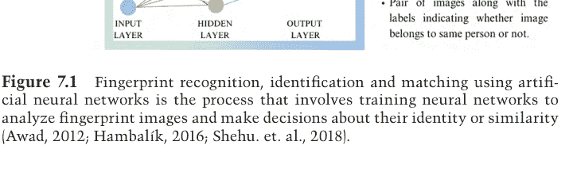

- 指纹图像从各种来源收集
- 图像经过预处理以增强质量并去除噪声。
- 脉线计数
- 脉线频率
- 细节点
- 带标签的数据用于检查给定图像是否为指纹。
- 带有标记三角区和核心的图像用于检查指纹类型。
- 一对图像连同标签指示图像是否属于同一个人。

图7.1 使用人工神经网络进行指纹识别、鉴定和匹配是训练神经网络分析指纹图像并对其身份或相似性做出决策的过程（Awad, 2012; Hambalik, 2016; Shehu et al., 2018）。

## 指纹/模式识别/鉴定/匹配中的机器学习技术

在生物特征安全和模式识别中，使用机器学习算法提升了指纹/模式识别/鉴定/匹配领域的安全性及其他参数。机器学习算法有助于指纹识别和匹配，以满足对准确且稳健的人类身份验证方法日益增长的需求。从经典算法到先进的深度学习模型，这些技术提高了指纹分析的精度，并在各种应用中实现了自动化和可扩展性（Awad 2012）。

### 1. 人工神经网络

它是一种受人类大脑神经网络启发的模型，即其工作方式类似于人类大脑中的生物神经网络。神经网络算法用于各种任务，如分类、回归、模式识别和管理（Krogh 2008）。神经网络算法工作于三个层：输入层、隐藏层和输出层（Walczak 2019）。

- **Input Layer:** 起始点接收原始输入数据。输入层中的每个神经元对应于属性上的特定特征，其值代表该特征的值。每个神经元将值传递给下一层的神经元。
- **Hidden Layer:** 它是负责学习和表示数据中复杂模式关系的中间层。它是网络学习识别与预测相关的特征和特征组合的层。隐藏层的数量和每个隐藏层中的神经元数量是超参数，需要根据问题的复杂性来选择。
- **Output Layer:** 它产生神经网络计算的最终结果。

### Components

- **Neural (Node):** 它是神经网络算法的基本单元。每个神经元工作在不同的层；因此，每个神经元接收输入、处理它并产生输出（Walczak 2019）。
- **Connection (Synapses):** 神经元通过称为突触的加权连接相连（Walczak 2019）。
- **Propagation:** 这是输入数据在网络中传递的方式。有两种传播方法：（i）前向传播方法：在此方法中，输入数据通过网络生成预测或输出；（ii）反向传播方法：此方法在前向传播方法之后进行。此方法调整网络的连接权重以最小化预测值与目标值之间的误差（Krogh 2008）。
- **Training Data:** 这是监督机器学习算法；训练数据由输入特征和相应的目标值组成。

### 1. 支持向量机

支持向量机（SVM）是最强大的机器学习算法之一，用于线性与非线性分类、回归和异常检测。在线性分类中，区分不同类别的决策边界是一条直线或超平面，而非线性分类涉及更复杂的决策边界，单一直线或超平面无法定义。SVM利用‘核技巧’技术在非线性分类中表现出色。类别可能具有复杂且弯曲的特征空间。此外，SVM算法可以通过称为‘多类分类’的技术，结合诸如一对多和一对一等各种方法，将数据分类到两个以上组别（Suthaharan et al., 2016; Pisner et al., 2020）。

### Components

- **Data Points and Features:** 它指的是用于训练、验证或测试SVM模型的数据集中的特定实例或示例。每个数据点都与一组描述其特征的特征相关联（Guenther and Schonlau, 2016）。
- **Hyperplane:** 超平面是在特征空间中分隔不同类别的平面或直线（特征空间是来自空间的所有特征向量的集合）。在二维情况下，超平面是直线，在更高维度中，它是超平面。该算法旨在找到使间隔最大化的超平面（Pisner and Schnyer, 2020）。
- **Support Vector:** 支持向量是最接近超平面的数据点。这些数据点决定了超平面的最佳位置（Meyer and Wien, 2015）。
- **Margin:** 超平面与最近支持向量之间的距离。间隔越大，对新数据的泛化能力越好。
- **Kernel Function:** 该技术处理特征之间的非线性关系（Pisner and Schnyer, 2020）。

SVM算法用于指纹，将指纹图像分类为拱形、环形、涡形等不同类别（Awad, 2012）。指纹图像使用多类分类被分为五个类别之一：涡形、右环形、左环形、拱形和帐篷拱形（Yao et al., 2001）。SVM算法被设计用于将指纹图像分类为涡形、右环形、左环形、拱形和帐篷拱形等不同类别，准确率为92.5%（Alias and Radzi, 2016）。SVM算法被设计并训练用于识别指纹编码。此外，该研究比较了SVM和RBF两种方法，并得出结论SVM具有更好的识别率（Elmir et al., 2012）。基于双支持向量机的指纹分类方法被研究，其中使用Gabor滤波器提取纹理特征，实验结果表明应用双支持向量机算法可获得良好的分类结果（Ding et al., 2020）。SVM分类器被用于将指纹图像分为三个质量等级之一：好、中、差（Liu et al., 2008）。

## 卷积神经网络

它是人工神经网络算法的扩展版本。该算法主要用于从网格状矩阵数据集中提取特征。卷积神经网络通过自动从输入数据中学习分层特征，彻底改变了计算机任务，使其在图像分类、目标检测等任务中特别有效。卷积神经网络（CNN）基于滤波器工作，滤波器在图像上滑动并捕获所需特征（O’Shea and Nash, 2015）。

### Architecture/Workings (Albawi et al., 2017; O’Shea and Nash, 2015)

- **Input Layer:** CNN的输入层通常是一幅图像，以像素值的网格表示。
- **Convolutional Layer:** 这些是CNN的核心构建块。它们将一组可学习的滤波器应用于输入图像。每个滤波器是一个小的方形矩阵，在水平和垂直方向上在输入图像上滑动。多个滤波器并行应用

创建各种特征图，捕捉输入层的不同方面。

-   **池化层：** 该层在保留其最重要的信息的同时减少特征图的空间维度。
-   **展平：** 在经过多个卷积和池化层之后，得到的映射被展平为一个维度向量。

此步骤将 CNN 连接到全连接层。

-   **全连接层：** 该层由多个神经元（节点）组成，这些神经元与前一层的神经元完全连接，并说明从卷积和池化层获得的全局模式和关系。
-   **输出层：** 该层提供最终的预测和分类。
-   **训练：** CNN 使用标记数据和优化算法进行训练。网络参数，包括滤波器权重和偏置，在训练过程中进行调整以最小化损失函数。损失函数衡量预测值与实际值之间的差异。
-   **反向传播：** 在训练期间，误差通过网络向后传播，并为每一层计算梯度。并且权重得到更新。
-   **分析：** 在训练数据后，CNN 可用于对新的和未见过的数据进行预测。

在数字指纹分类中，研究人员面临的最重要挑战是图像质量低。为克服这一挑战，构建了一个包含边缘增强、数据调整大小和数据增强等多个预处理阶段的模型。最初，使用 Prewitt 和 Laplace 滤波器处理质量较差的原始指纹图像以增强边缘，在本研究中，验证集的分类准确率在 67.6% 至 98.7% 之间变化，测试集的分类准确率在 70.2% 至 75.6% 之间变化（Dincă Lăzărescu et al., 2022）。此外，CNN 自编码器用于重建指纹图像，其中自编码器是一种可以将数据复制成图像的技术。CNN 自编码器在不同数据库的指纹识别中实现了超过 90% 的准确率（Saponara et al., 2021）。受损指纹可使用 MATLAB® 软件中的 CNN 算法进行识别。对传统点匹配识别方法、传统 CNN 识别方法和改进的 CNN 识别方法进行了比较。研究发现，CNN 算法的识别率高于传统点匹配，误接受率更低。然而，增强的 CNN 识别方法显示出最佳结果，具有最高的识别率和最低的误接受率（Li, 2021）。先进的 CNN 由 15 层组成，可分为两个阶段。第一阶段是准备阶段，包括指纹采集、增强和预处理。而第二阶段处理特征提取和匹配。研究发现，该模型对训练和验证数据集均给出 100% 的准确结果（Althabhawee and Alwawi, 2022）。

## 生成对抗网络

生成对抗网络是一种深度学习算法，由两个神经网络在零和框架中相互竞争组成。这两个神经网络是生成器和判别器，它们通过竞争过程同时训练。生成器是神经网络，它以随机噪声作为输入并尝试生成与真实数据相似的数据样本。然后，随机噪声向量通过神经网络的多个层；然后，网络逐渐将噪声转换为与真实数据无法区分的数据。因此，生成器的输出是与真实图像相似的图像样本。同时，判别器是作为二元分类器的神经网络，它接收输入数据并尝试区分真实数据和生成器生成的伪造数据。并且它以概率形式输出结果，表示输入数据是真实的（接近 1）还是伪造的（接近 0）的可能性（Creswell et al., 2018; Wang et al., 2017）。

生成对抗网络（GAN）算法增强了低质量指纹图像的质量。超分辨率 GAN 经过训练以增强指纹图像的空间分辨率并生成同一指纹图像的高分辨率版本，从而提供更详细的指纹特征提取；因此，为此，使用条件 GAN 制作了 Fdeblur-GAN 模型用于去模糊指纹图像（Joshi et al., 2021）。此外，一个强大的渐进式 GAN 模型，由两个阶段组成，即渐进式离线训练和交互式在线测试，使模型专注于细节点和方向场并实现更好的识别准确率（Huang et al., 2020）。具有某些修改的 GAN 算法迫使模型生成除脊线图外的三个额外映射，以确保生成过程必须考虑方向和频率信息，并迫使生成器在重建过程中保留 ID 信息。该修改后的模型在不同数据库上应用并测试，结果显示在 IIIT-Delhi 潜在指纹数据库上实现了 88.02% 的 rank 10 准确率，在 IIIT-Delhi MOLF 数据库上实现了 70.89% 的 rank 50 准确率（Dabouei et al., 2018）。

## K-Means 聚类方法

它是一种流行的无监督机器学习算法，用于根据数据点的相似性将数据集划分为不同的组或簇。‘k’ 表示预定义的值，即组的数量（Sinaga and Yang, 2020）。

### 工作原理

-   决定要创建的簇的数量。
-   随机选择质心。质心代表簇内所有数据点的平均位置。
-   每个数据点根据距离度量分配给最近的簇质心。
-   现在，质心在簇内重新分配，并根据距离添加新的数据点。
-   重复相同的步骤，直到满足停止准则（Sinaga and Yang, 2020; Hossain et al., 2019）。

### 组件

-   **数据点：** 你想要聚类的单个项目或观测值。
-   **聚类数 (k)：** 这是在数据集中想要创建的簇的预定义数量（Pham et al., 2005）。
-   **簇质心：** 这些是每个簇中心的代表点。
-   **距离度量：** 它衡量两个数据点之间的距离。

在指纹检验领域，k-means 算法用于与研究中不同的目的（Wang et al., 2002）；指纹数据集被分类为不同的类别/簇，如拱形、左旋、右旋和涡形，如图 7.2 所示。分层 k-means 聚类算法已被用于将指纹图像分类为四个质量等级：良好、干燥、正常和潮湿（Munir et al., 2012）。此外，k-means 聚类也用于图像分割（Mehidi et al., 2019, Cherrat et al., 2019）。

## 决策树

决策树是一种监督学习算法，主要用于分类和回归相关的问题。该算法被广泛使用，因为它易于理解和解释。此外，它可用于分类数据和连续数据（Navada et al., 2011）。

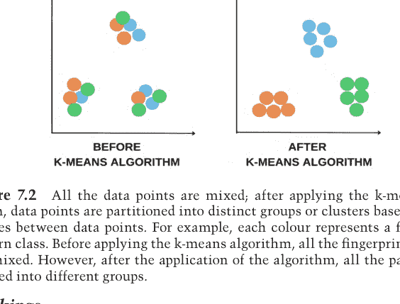

Figure 7.2 所有数据点都是混合的；在应用 k-means 算法后，数据点根据数据点之间的相似性被划分为不同的组或簇。例如，每种颜色代表一个指纹模式类别。在应用 k-means 算法之前，所有指纹模式都是混合的。然而，在应用算法后，所有模式都被划分为不同的组。

### 工作原理

-   算法从整个数据集开始，该数据集由输入特征及其对应的目标标签组成。目标是创建一种树结构，可根据输入特征进行预测（Charbuty and Abdulazeez, 2021）。
-   算法选择最佳特征将数据集拆分为子集。它根据不同标准评估不同特征。
-   选择最佳特征后，数据集被拆分为子集。
-   同样，这些步骤对每个创建的子集和拆分递归重复，直到满足停止准则（Navada et al., 2011）。
-   一旦满足停止准则，叶节点代表决策树的最终预测。

### 组件

-   **根节点：** 决策树的顶层节点，表示树构建过程开始时整个数据集。它是选择第一个特征来拆分数据的节点（Delibasic et al., 2011）。
-   **内部节点：** 这些节点代表树中的决策点。每个内部节点都与特征相关联，并基于该值进行条件判断。
-   **分支：** 分支从内部节点发出，导致子节点或叶节点
-   **叶节点：** 它是决策树的终端节点。它没有子节点。叶节点代表树做出的最终决策或预测（Delibasic et al., 2011）。


J48 决策树算法已被用于基于指纹的性别分类。该方法的准确率约为 96.28%，针对四个指纹特征，即脊线数、脊线密度、脊线厚度与谷线厚度比和白线数（Abdullah et al., 2016）。

## 掌纹和手印分析中的机器学习

除了指纹之外，手印和掌纹等生物特征参数也在个人识别中被大量使用。由于快速增长和技术进步，需要一种可靠且安全的生物识别方法。因此，它提高了准确性、可靠性和安全性。基于机器学习的掌纹/手印识别、识别和检查模型已被引入（Zhang et al., 2003）。手印和掌纹识别主要基于几何和纹理特征，这些特征对于稳定的识别特征至关重要（Kong et al., 2008; Zhao and Zhang, 2020）。掌纹具有多种独特特征，如主线（屈曲皱褶）、细节点、皱纹脊线（次级皱褶）、三角区、图案和奇异点，可用于个体识别（Kong et al., 2009）。

手印测量被用于确定斯里兰卡僧伽罗族人群的性别。结果得出结论，分类与回归树（CART）算法可利用手长、手宽和掌长以 91.67% 的准确率区分性别。此外，其他算法如 SVM 和朴素贝叶斯显示出较低的准确率，83.33%（Dayarathne et al., 2021）。PalmNet 是用于提取高度判别性掌纹特定描述符的方法。该方法使用 Gabor 滤波器在 CNN 中的应用。它在采用无接触采集程序和异构设备捕获的数据库上进行了测试。发现该方法具有较高的准确性（Genovese et al., 2019）。Alexnet 也是基于 CNN 的结构。它使用 PReLU 激活函数用于掌纹识别和识别，识别准确率被发现为 99.9%（Gong et al., 2019）。

## 机器学习的优势与劣势

人类一直在使用不同的机器或技术来简化生活。机器学习是人类用来使工作更轻松的技术之一（Mahesh, 2020）。法医科学处理的是大量数据库，这些数据库是标准值的参考数据库。因此，在该数据库的管理上出现了一个重大问题。机器学习成功地将数据整理成系统形式（Wuest et al., 2016）。

表 7.1 指纹科学中不同参数检验所用不同算法

| 序号 | 年份 | 算法 | 参数 | 结果 | 参考文献 |
|---|---|---|---|---|---|
| 1 | 2008 | 反向传播神经网络（BP）、结合 Gabor 滤波和 Zernike 矩的 SOM 神经网络 | 手的几何和纹理特征 | 该两阶段神经网络算法实现了 97.6% 精度的个人识别 | Kong et al., 2008 |
| 2 | 2009 | 二值方向共生向量（BOCV） | 掌纹的局部方向特征 | BOCV 通过显著降低等错误率（EER）优于 CompCode、POC 和 RLOC | Guo et al., 2009 |
| 3 | 2010 | 主成分分析（PCA）结合反向传播神经网络（BP）、SOM 神经网络 | 手的几何和纹理特征 | 为了有效进行个人识别，系统准确率可达 95.4% 以上 | Lin, 2010 |
| 4 | 2017 | K 近邻算法、BSIF 编码、Gabor 滤波器 | 从感兴趣区域提取所有特征。 | 准确率更高 | Younesi and Amirani, 2017 |
| 5 | 2017 | 完整方向表示（CDR） | 方向线中的所有值 | CDR 算法的掌纹匹配速度非常快，约为基于空间编码的代表性方法（如 CompC 和 Ordinal Code）的 10 倍 | Jia et al., 2017 |
| 6 | 2019 | 卷积神经网络和 PReLU 激活函数 | 感兴趣区域、主线、皱纹、三角测量和细节点的选择。 | 识别准确率被发现为 99.9% | Gong et al., 2019 |
| 7 | 2020 | 判别式深度卷积网络（DDR） | 深度判别特征 | 与其他最先进方法相比，DDR 在通用掌纹识别中产生最佳识别性能 | Zhao and Zhang, 2020 |
| 8 | 2020 | K-means 算法、经典线性与二次判别分析 | 所有手部测量特征。 | 第 1 指和掌部测量是最好的手部分类器。宽度和周长测量比长度测量显示出更好的性别区分。性别识别的最佳单个特征是掌围，其次是拇指和食指的宽度 | Hida et al., 2020 |
| 9 | 2021 | CART、SVM 和朴素贝叶斯 | 手长、手宽和掌长 | CART 算法可以以 91.67% 的准确率区分性别。SVM 和朴素贝叶斯的准确率较低，即 83.33% | Dayarathne et al., 2021 |
| 10 | 2021 | 调整二元分类（ABC）算法 | 手长、手宽和掌长 | 在交叉验证样本中，ABC 提供了 95% 的准确率。在测试样本中，ABC 模型实现了 97.3–100% 的准确率 | Jerković et al., 2021 |
| 11 | 2023 | 线性判别分析和逻辑回归方法 | 手长、手宽、最大手宽、掌长、拇指长度、食指长度、中指长度、环指长度和小指长度 | 逻辑回归算法在性别识别中表现出最大准确率（91.10%）。同时，线性判别分析显示最大准确率为 91.40% | Islam et al., 2021 |
| 12 | 2023 | 由两个卷积神经网络组成的孪生网络方法 |  | 在不同数据库中，掌纹识别准确率超过 95% | AlShemmary and Ameen, 2023 |

此外，有时数据量大到即使在可视化全部数据后也难以提取感兴趣的信息，或者如果可能的话，需要花费更多时间（Mahesh, 2020）。例如，检验员必须从包含 10,000 个样本的数据库中识别指纹是否‘匹配’或‘不匹配’。在这种情况下，检验员手动逐一匹配指纹将非常困难。这里，使用不同的机器学习算法将加速识别过程。甚至减少了人工错误的几率。很多时候，不同条件如残留成分、印痕条件、皮肤状况、残疾和采集设备会导致指纹质量较差。这些质量较差的指纹手动检查具有挑战性。然而，机器学习算法如 Gabor 和 GAN 算法用于指纹增强。这增强了指纹，从而使其更适合检查（Win et al., 2020; Hong et al., 1998）。根据 J48 决策树算法在指纹性别分类问题中的不同研究，方法的准确率约为 96.28%，针对四个指纹特征，即脊线数、脊线密度、脊线厚度与谷线厚度比和白线数（Abdullah et al., 2016），而 CNN 自编码器在不同数据库中指纹识别的准确率超过 90%（Saponara et al., 2021）。这表明指纹识别、分类和检查通过机器学习过程比手动过程更有效。

除此之外，机器学习算法对指纹的识别、分类和检查存在一些挑战。算法的可靠性高度依赖于训练数据的质量和数量。如果训练数据不合适或数量不足，则结果的可靠性可能会受到影响。此外，结果取决于所提供的指令；指令中的任何偏差或不准确都会导致不准确的结论（Singh et al., 2016）。由于机器学习算法完全依赖于训练数据，有时由于可疑样本与训练数据的错误拟合，结果仍然不明确（Anguita et al., 2010）。结果缺乏可解释性和说明是检验员面临的一个重要问题。这使得检验员难以验证结果或检查结果的准确性和可靠性（Tyagi et al., 2022）。

此外，机器学习模型可能容易受到脆弱攻击，恶意行为者可以操纵输入数据来欺骗算法。解决这些挑战需要一种平衡的方法，优先考虑机器学习算法的透明度、准确性和可靠性。


## 机器学习的未来展望

随着机器学习和人工智能在各行业的使用增加，可以高度预测机器学习算法和人工智能的使用将持续增长（Tyagi et al., 2022）。机器学习技术现已广泛应用于法医学的各个领域。其在指纹、手印和掌纹检查中的应用已在上文讨论。进一步地，在伪造指纹的检查中可以做出更多进展。伪造指纹是人工或伪造的指纹，用于伪装指纹识别系统，即伪造指纹用于绕过生物识别认证系统、智能手机解锁或其他安全功能。因此，可以在机器学习算法上做出更多进展，以区分真实指纹和伪造指纹（Adam and Sathesh, 2021）。指纹还可以通过质谱法检查指纹的化学成分来揭示个人的日常习惯或生活方式。因此，利用机器学习算法确定指纹的成分特征将具有极大的用途（Hinners et al., 2018; Win et al., 2020）。法医学指纹检查领域有多种研究涉及从指纹确定性别（Thakar et al., 2018; Iloanusi and Ejiogu, 2020; Jayakala, 2021; Ibitayo et al., 2022）或从指纹确定年龄（Hinners et al., 2020; Basavaraj and Rafi, 2015; Falohun et al., 2016）或确定指纹的年龄（Popa et al., 2010; Chen et al., 2021; Girod et al., 2016）。这些研究领域在法医调查中非常重要。因此，可以利用机器学习算法在此领域取得进展，研究从指纹确定年龄、确定指纹的年龄以及从指纹确定性别。这不仅有助于检查人员缩小嫌疑人名单，还能帮助检查人员以更高的准确性、可靠性和更少的人为错误确定这些参数。机器学习不仅可用于指纹、手印和掌纹的检查，还可用于法医学的其他领域。可以开展更多研究以确定测试的准确性、可靠性和在法庭上的可采纳性。

## 参考文献

Abdullah, S. F., Rahman, A. F. N. A., Abas, Z. A., & Saad, W. H. M. (2016). 使用单变量决策树（J48）的指纹性别分类. International Journal of Advanced Computer Science and Applications, 7(9), 217–221.

Adam, D. E., & Sathesh, P. (2021). 基于机器学习方法的指纹活体检测评估——系统性综述. Journal of IoT in Social, Mobile, Analytics, and Cloud, 3(1), 16–30.

Albawi, S., Mohammed, T. A., & Al-Zawi, S. (2017, August). 卷积神经网络的理解. In 2017 International Conference on Engineering and Technology (ICET) (pp. 1–6). IEEE. https://doi.org/10.1109/ICEngTechnol.2017.8308186

Alias, N. A., & Radzi, N. H. M. (2016, May). 使用支持向量机的指纹分类. In 2016 Fifth ICT International Student Project Conference (ICT-ISPC) (pp. 105–108). IEEE.

AlShemmary, E., & Ameen, F. A. (2023). 基于孪生网络的掌纹识别. Journal of Kufa for Mathematics and Computer, 10(1), 108–118. http://dx.doi.org/10.31642/JoKMC/2018/100116

Althabhawee, A. F. Y., & Alwawi, B. K. O. C. (2022). 基于采集图像的深度学习技术指纹识别. IAES International Journal of Artificial Intelligence, 11(1), 81. https://doi.org/10.11591/ijai.v11.i1.pp81-88

Anguita, D., Ghio, A., Greco, N., Oneto, L., & Ridella, S. (2010, July). 支持向量机的模型选择：机器学习理论的优势与劣势. In The 2010 International Joint Conference on Neural Networks (IJCNN) (pp. 1–8). IEEE.

Awad, A. I. (2012). 指纹识别的机器学习技术：简短综述. In Advanced Machine Learning Technologies and Applications: First International Conference, AMLTA 2012, Cairo, Egypt, December 8–10, 2012. Proceedings 1 (pp. 524–531). Springer Berlin Heidelberg. https://doi.org/10.1007/978-3-642-35326-0_52

Basavaraj Patil, G. V., & Rafi, M. (2015). 通过指纹进行人类年龄估计. International Journal of Innovative Research in Computer and Communication Engineering, 3(4), 3530–3535.

Charbuty, B., & Abdulazeez, A. (2021). 基于决策树算法的机器学习分类. Journal of Applied Science and Technology Trends, 2(1), 20–28. https://doi.org/10.38094/jastt20165

Chen, H., Shi, M., Ma, R., & Zhang, M. (2021). 指纹年龄测定技术的进展. Analyst, 146(1), 33–47.

Cherrat, E. M., Alaoui, R., & Bouzahir, H. (2019). 基于 K-means 和 DBSCAN 聚类的指纹分割图像改进. International Journal of Electrical and Computer Engineering (IJECE), 9(4), 2425–2432.

Creswell, A., White, T., Dumoulin, V., Arulkumaran, K., Sengupta, B., & Bharath, A. A. (2018). 生成对抗网络：概述. IEEE Signal Processing Magazine, 35(1), 53–65. https://doi.org/10.1109/MSP.2017.2765202

Dabouei, A., Kazemi, H., Iranmanesh, S. M., Dawson, J., & Nasrabadi, N. M. (2018, October). 用于部分潜伏指纹重建的身份保持生成对抗网络. In 2018 IEEE 9th International Conference on Biometrics Theory, Applications and Systems (BTAS) (pp. 1–10). IEEE. https://doi.org/10.1109/BTAS.2018.8698580

Dayarathne, S., Nawarathna, L. S., & Nanayakkara, D. (2021). 使用监督学习技术在斯里兰卡僧伽罗族人群中利用足部、足迹、手部和手印测量确定性别. Computer Methods and Programs in Biomedicine Update, 1, 100017. https://doi.org/10.1016/j.cmpbup.2021.100017

Delibasic, B., Jovanovic, M., Vukicevic, M., Suknovic, M., & Obradovic, Z. (2011). 基于组件的分类决策树. Intelligent Data Analysis, 15(5), 671–693. https://doi.org/10.3233/IDA-2011-0489

Dincă Lăzărescu, A. M., Moldovanu, S., & Moraru, L. (2022). 使用边缘特征与卷积神经网络组合的指纹匹配算法. Inventions, 7(2), 39. https://doi.org/10.3390/inventions7020039

Ding, S., Shi, S., & Jia, W. (2020). 基于孪生支持向量机的指纹分类研究. IET Image Processing, 14(2), 231–235. https://doi.org/10.1049/iet-ipr.2018.5977

Egawa, S., Awad, A. I., & Baba, K. (2012). 生物识别身份验证加速算法评估. In Networked Digital Technologies: 4th International Conference, NDT 2012, Dubai, UAE, April 24–26, 2012, Proceedings, Part II (Vol. 4, pp. 231–242). Springer Berlin Heidelberg. https://doi.org/10.1007/978-3-642-30567-2_19

Elmir, Y., Elberrichi, Z., & Adjoudj, R. (2012). 基于支持向量机的指纹识别. In CTCI 2012 Conference.

Falohun, A. S., Fenwa, O. D., & Ajala, F. A. (2016). 基于指纹模式分析的指纹年龄与性别检测系统. International Journal of Computer Applications, 136(4), 0975–8887.

Genovese, A., Piuri, V., Plataniotis, K. N., & Scotti, F. (2019). PalmNet：用于无接触掌纹识别的 Gabor-PCA 卷积网络. IEEE Transactions on Information Forensics and Security, 14(12), 3160–3174. https://doi.org/10.1109/TIFS.2019.2911165

Girod, A., Ramotowski, R., Lambrechts, S., Misrielal, P., Aalders, M., & Weyermann, C. (2016). 指纹年龄测定：法律考虑、文献综述和实践建议. Forensic Science International, 262, 212–226.

Gong, W., Zhang, X., Deng, B., & Xu, X. (2019, September). 基于卷积神经网络 AlexNet 的掌纹识别. In 2019 Federated Conference on Computer Science and Information Systems (FedCSIS) (pp. 313–316). IEEE. https://doi.org/10.15439/2019F248

Guenther, N., & Schonlau, M. (2016). 支持向量机. The Stata Journal, 16(4), 917–937. https://doi.org/10.1177/1536867X1601600407

Guo, Z., Zhang, D., Zhang, L., & Zuo, W. (2009). 使用二值方向共生向量的掌纹验证. Pattern Recognition Letters, 30(13), 1219–1227. https://doi.org/10.1016/j.patrec.2009.05.010

Hambalik, P. M. A. (2016). 使用人工神经网络作为特征提取器的指纹识别系统：设计与性能评估. Tatra Mountains Mathematical Publications, 67, 117–134. https://doi.org/10.1515/tmmp-2016-00

Haroon, M., Tripathi, M. M., & Ahmad, F. (2020). 机器学习在法医学中的应用. In Critical Concepts, Standards, and Techniques in Cyber Forensics (pp. 228–239). IGI Global.

Hastie, T., Tibshirani, R., & Friedman, J. H. (2009). 统计学习基础：数据挖掘、推断与预测（第2版）. Springer. https://doi.org/10.1007/b94608


Hida, N., Abid, M., & Lakrad, F. (2020). 通过手部人体测量数据进行性别识别的监督学习和无监督机器学习. 国际生物识别学期刊, 12(3), 337–355. https://doi.org/10.1504/IJBM.2020.108485

Hinners, P. M. A., O'Neill, K. C., & Lee, Y. J. (2018). 通过指纹中化学化合物的质谱成像揭示个体生活方式. 科学报告, 8(1), 5149.

Hinners, P. M. A., Thomas, M., & Lee, Y. J. (2020). 通过三酰甘油的臭氧分解利用质谱成像测定指纹年龄. 分析化学, 92(4), 3125–3132.

Hong, L., Wan, Y., & Jain, A. (1998). 指纹图像增强：算法与性能评估. IEEE 模式分析与机器智能汇刊, 20(8), 777–789.

Hossain, M. Z., Akhtar, M. N., Ahmad, R. B., & Rahman, M. (2019). 数据挖掘的动态 K-means 聚类. 印度尼西亚电气工程与计算机科学期刊, 13(2), 521–526.

Huang, X., Qian, P., & Liu, M. (2020). 基于渐进式生成对抗网络的潜指纹图像增强. 收录于 IEEE/CVF 计算机视觉与模式识别会议研讨会论文集 (pp. 800–801). IEEE.

Ibitayo, F. B., Olanrewaju, O. A., & Oyeladun, M. B. (2022). 基于指纹模式分析的指纹性别检测系统. 计算机科学高级研究国际期刊, 13(4), 35–47.

Iloanusi, O. N., & Ejiogu, U. C. (2020). 基于融合多类型指纹的性别分类. 信息安全期刊：全球视角, 29(5), 209–219.

Islam, M. Z., Supto, M. R., Asadujjaman, M., & Chakrabortty, R. K. (2021, February). 使用机器学习通过手部测量进行性别识别. 收录于 2021 年计算、通信与智能系统国际会议 (ICCCIS) (pp. 536–540). IEEE. https://doi.org/10.1109/ICCCIS51004.2021.9397222

Jain, A. K., Bolle, R., & Pankanti, S. (Eds.). (1999). 生物识别：网络社会中的个人识别 (Vol. 479). Springer Science & Business Media.

Jain, A. K., Ross, A. A., & Nandakumar, K. (2011). 指纹识别. 收录于《生物识别导论》 (pp. 51–96). Springer. https://doi.org/10.1007/978-0-387-77326-1_2

Jayakala, G. (2021). 基于指纹分析的性别分类. 土耳其计算机与数学教育期刊 (TURCOMAT), 12(10), 1249–1256.

Jerković, I., Kolić, A., Kružić, I., Anđelinović, Š., & Bašić, Ž. (2021). 法医学中的调整二元分类 (ABC) 模型：基于手印尺寸的性别分类示例. 国际法医学, 320, 110709. https://doi.org/10.1016/j.forsciint.2021.110709

Jia, W., Zhang, B., Lu, J., Zhu, Y., Zhao, Y., Zuo, W., & Ling, H. (2017). 基于完整方向表示的掌纹识别. IEEE 图像处理汇刊, 26(9), 4483–4498. https://doi.org/10.1109/TIP.2017.2705424

Jordan, M. I., & Mitchell, T. M. (2015). 机器学习：趋势、视角与前景. 科学, 349(6245), 255–260. https://doi.org/10.1126/science.aaa8415

Joshi, A. S., Dabouei, A., Dawson, J., & Nasrabadi, N. M. (2021, August). FDblur-GAN：使用生成对抗网络的指纹去模糊. 收录于 2021 年 IEEE 生物识别国际联合会议 (IJCB) (pp. 1–8). IEEE. https://doi.org/10.1109/IJCBS2358.2021.9484406

Kong, A., Zhang, D., & Kamel, M. (2009). 掌纹识别综述. 模式识别, 42(7), 1408–1418. https://doi.org/10.1016/j.patcog.2009.01.018

Kong, J., Lu, Y., Wang, S., Qi, M., & Li, H. (2008). 基于手印的两阶段神经网络个人识别系统. 神经计算, 71(4–6), 641–647. https://doi.org/10.1016/j.neucom.2007.08.020

Krogh, A. (2008). 人工神经网络是什么？. 自然生物技术, 26(2), 195–197. https://doi.org/10.1038/nbt1386

Lefèvre, T. (2018). 法医学和医学中的大数据. 法医与法律医学期刊, 57, 1–6. https://doi.org/10.1016/j.jflm.2017.08.001

Li, H. (2021). 损坏指纹的特征提取、识别与匹配：深度学习网络的应用. 并发与计算：实践与经验, 33(6), e6057. https://doi.org/10.1002/cpe.6057

Lin, L. (2010, September). 使用 PCA 算法和分层神经网络的掌纹识别. 收录于可持续能源与环境智能计算国际会议论文集 (pp. 618–625). Springer. https://doi.org/10.1007/978-3-642-15615-1_73

Liu, E., Zhao, H., Li, X., Fu, C., Liu, X., & Wang, F. Y. (2008). 掌纹线检测与提取. 收录于 2008 年计算机科学与软件工程国际会议 (Vol. 1, pp. 245–248). IEEE.

Mahesh, B. (2020). 机器学习算法综述. 科学研究国际期刊 (IJSR), 9(1), 381–386.

Mehidi, I., Belkhiat, D. E. C., & Jabri, D. (2019). 基于 K-means 算法的 MRI 脑肿瘤分割改进聚类方法. 收录于 2019 年第 6 届图像与信号处理及其应用国际会议 (ISPA) (pp. 1–6). IEEE.

Metcalf, J. L., Xu, Z. Z., Bouslimani, A., Dorrestein, P., Carter, D. O., & Knight, R. (2017). 法医学的微生物组工具. 生物技术趋势, 35(9), 814–823. https://doi.org/10.1016/j.tibtech.2017.03.006

Meyer, D., & Wien, F. T. (2015). 支持向量机. 软件包 e1071 中 libsvm 的接口, 28(20), 597.

Munir, M. U., Javed, M. Y., & Khan, S. A. (2012). 基于分层 k-means 聚类的指纹质量分类. 神经计算, 85, 62–67. https://doi.org/10.1016/j.neucom.2012.01.002

Murphy, K. P. (2012). 机器学习：概率视角. MIT Press.

Navada, A., Ansari, A. N., Patil, S., & Sonkamble, B. A. (2011, June). 机器学习中决策树算法使用的概述. 收录于 2011 年 IEEE 控制与系统研究生研究研讨会 (pp. 37–42). IEEE. https://doi.org/10.1109/ICSGRC.2011.5991826

O'Shea, K., & Nash, R. (2015). 卷积神经网络导论. arXiv 预印本 arXiv:1511.08458. https://doi.org/10.48550/arXiv.1511.08458

Padma, K. R., & Don, K. R. (2022). 法医学分析中人工神经网络的应用. 收录于《网络安全与数字取证》 (pp. 59–72). https://doi.org/10.1002/9781119795667.ch3

Pham, D. T., Dimov, S. S., & Nguyen, C. D. (2005). K-means 聚类中 K 的选择. 机械工程师学会会刊 C 部分：机械工程科学期刊, 219(1), 103–119. https://doi.org/10.1243/095440605X8298

Pisner, D. A., & Schnyer, D. M. (2020). 支持向量机. 收录于 Andrea Mechelli and Sandra Vieira 主编的《机器学习》 (pp. 101–121). Academic Press.

Popa, G., Potorac, R., & Preda, N. (2010, June 1). 指纹年龄测定方法. 罗马尼亚法律医学期刊, 18(2), 149–154.

Saponara, S., Elhanashi, A., & Zheng, Q. (2021). 通过卷积神经网络自编码器架构重建指纹图像. IEEE Access, 9, 147888–147899. https://doi.org/10.1109/ACCESS.2021.3124746

Shehu, Y. I., Ruiz-Garcia, A., Palade, V., & James, A. (2018). 使用深度卷积神经网络检测指纹篡改. 收录于《人工神经网络与机器学习 – ICANN 2018》 (pp. 51–60). Springer. https://doi.org/10.1007/978-3-030-01418-6_6

Sinaga, K. P., & Yang, M. S. (2020). 无监督 K-means 聚类算法. IEEE Access, 8, 80716–80727. https://doi.org/10.1109/ACCESS.2020.2988796

Singh, A., Thakur, N., & Sharma, A. (2016, March). 监督机器学习算法综述. 收录于 2016 年第 3 届可持续全球发展计算国际会议 (INDIACOM) (pp. 1310–1315). IEEE.

Suthaharan, S. (2016). 支持向量机. 收录于《大数据分类的机器学习模型与算法》 (pp. 207–235). Springer. https://doi.org/10.1007/978-1-4899-7641-3_9

Thakar, M. K., Kaur, P., & Sharma, T. (2018). 基于指纹的性别鉴定验证研究，特别强调脊线特征. 埃及法医学期刊, 8(1), 1–7. https://doi.org/10.1186/s41935-018-0070-z

Tyagi, A., Kukreja, S., Meghna, M. N., & Tyagi, A. K. (2022). 机器学习：过去、现在与未来. 神经量子学, 20(8), 4333.

Walczak, S. (2019). 人工神经网络. 收录于《人工智能、计算机模拟与人机交互的先进方法与技术》 (pp. 40–53). https://doi.org/10.4018/978-1-5225-7368-5.ch004

Wang, K., Gou, C., Duan, Y., Lin, Y., Zheng, X., & Wang, F. Y. (2017). 生成对抗网络：导论与展望. IEEE/CAA 自动化学报, 4(4), 588–598. https://doi.org/10.1109/JAS.2017.7510583

Wang, S., Zhang, W. W., & Wang, Y. S. (2002, October). 基于方向场的指纹分类. 收录于第四届 IEEE 多模态接口国际会议论文集 (pp. 395–399). IEEE. https://doi.org/10.1109/ICMI.2002.1167027

Win, K. N., Li, K., Chen, J., Viger, P. F., & Li, K. (2020). 犯罪调查的指纹分类与识别算法综述. 未来一代计算机系统, 110, 758–771. https://doi.org/10.1016/j.future.2019.10.008


Wuest, T., Weimer, D., Irgens, C., & Thoben, K. D. (2016). 制造中的机器学习：优势、挑战和应用。 *生产与制造研究*, 4(1), 23–45. https://doi.org/10.1080/21693277.2016.1192517

Yao, Y., Frasconi, P., & Pontil, M. (2001, June). 基于支持向量机组合的指纹分类。 In *基于音频和视频的生物特征人身份认证国际会议* (pp. 253–258). Springer. https://doi.org/10.1007/3-540-45344-X_37

Younesi, A., & Amirani, M. C. (2017). 用于掌纹识别的 Gabor 滤波器和基于纹理的特征。 *程序计算机科学*, 108, 2488–2495. https://doi.org/10.1016/j.procs.2017.05.157

Zhang, D., Kong, W. K., You, J., & Wong, M. (2003). 在线掌纹识别。 *IEEE 模式分析与机器智能汇刊*, 25(9), 1041–1050. https://doi.org/10.1109/TPAMI.2003.1227981

Zhao, S., & Zhang, B. (2020). 通用掌纹识别的深度判别表示。 *模式识别*, 98, 107071. https://doi.org/10.1016/j.patcog.2019.107071

## 数字取证的机器学习方法

ANKIT SRIVASTAV, UJAALA JAIN AND TANURUP DAS

### 引言

数字取证研究研讨会（DFRWS）指出数字取证是：

> 利用科学推导并经过验证的方法，对源自数字来源的数字证据进行保存、收集、验证、识别、分析、解释、记录和展示，以便促进或进一步重建被发现为犯罪的事件，或帮助预测被证明会破坏计划操作的未经授权行为 [1, 2]。

简单来说，数字取证直接处理法律程序中的数字信息。它包括使用科学技术和方法来处理多个数字对象创建的数据 [3]。它涉及网络犯罪或其他数字调查背景下的数字设备和数据 [4]。

国家标准与技术研究所（NIST）设计了四步程序，用于数字取证调查过程，如图 8.1 所示。然而，它们可以根据案件复杂程度以灵活的方式执行 [3]。

### 法医意义

数字取证调查恢复、收集和分析数据，帮助调查人员识别和防止对收集信息的任何未经授权的访问 [3]。它不仅在刑事诉讼中重要，在民事诉讼中也很重要。它提取数据以确定系统故障的根本原因或任何安全漏洞。它有助于实现多个目标，其中一些如下所述 [5]：

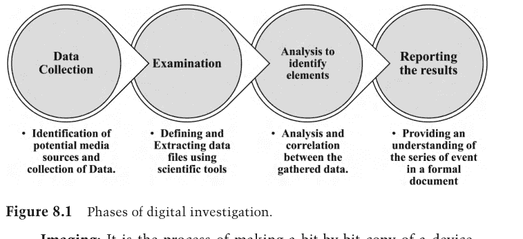

图 8.1 数字调查阶段。

- **成像：** 这是制作 USB 驱动器、硬盘或 CD-ROM 等设备的逐位副本的过程，以保持原始设备的完整性。该副本由检查员用于分析和重建恢复、删除和损坏的数据。
- **数据恢复：** 这是恢复因意外擦除或硬件故障而丢失的数据的过程。
- **时间线分析：** 这为与某实例相关的事件创建时间顺序，以确定何时采取了哪些行动以及由哪些方采取。
- **网络取证：** 它识别网络流量和连接，包括数据的来源和目的地。它有助于识别任何恶意或未经授权的活动以及网络活动的重建过程。
- **内存分析：** 它是对计算机易失性内存的检查，以识别开放的网络连接、正在运行的进程、系统恶意软件和其他系统信息。
- **隐写术检测：** 这涉及识别嵌入不同文件中的隐藏消息或数据。它从隐藏的通信或数据中检测相关数据以用于调查目的。
- **多媒体取证：** 它涉及使用特定工具对音频、视频和图像作为证据进行识别和验证。

### 遇到的问题

数字取证已成为安全领域最关键的领域之一，随着网络攻击威胁的增长 [3]。由于数据量的增加和多样性以及使用加密的硬件和软件平台的复杂性，在数字证据的收集和检查过程中面临着巨大的挑战 [3, 6]。缺乏关于最新数字取证工具的更新知识，威胁着行业的发展，同时也对数据准确性提出了疑问。关于来自不同来源的数据之间的相关性以及结果一致性的问题也可能影响数字调查的效率 [3]。调查程序需要大量的人为干预，导致调查速度相比数字犯罪的步伐缓慢 [2, 3]。人力以及其他现有资源仍无法单独调查数字犯罪 [2]。面临的另一个障碍是由于文件格式和操作系统的数量不断增加，这阻碍了《组织与集体智能国际期刊》开发标准化的数字取证工具和方法。因此，流程、格式和存储缺乏标准化已成为一个重要问题 [3]。

用于操纵数字媒体或实施犯罪的软件工具的可用性再次提高了数字证据检测和识别的难度。例如，编辑软件以及移动摄影设备干扰了计算机生成图像（CGI）、被操纵和重新捕获的图像的检测和识别，包括拼接、双重压缩、复制移动、移除、锐化、重采样、调整大小、滤镜应用等等 [6]。

### 数字证据检查的机器学习方法

机器学习通过引入新工具彻底改变了数字取证调查。它是人工智能的一个分支，使用算法来检测数据之间的模式和关系。算法的设计方式使其在执行特定任务时能够自动改进工作。它们被训练在标记数据集合上工作，其中标签描述了输入数据的期望输出。最简单的例子是电子邮件中的垃圾邮件文件夹，其中算法将电子邮件标记为垃圾邮件或非垃圾邮件 [4]。该技术对安全和欺诈检测有用 [3]。开发机器学习模型有一定的程序，可以概括为图 8.2 所示的六个步骤：

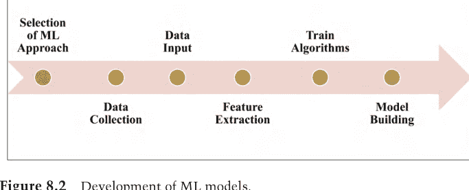

图 8.2 ML 模型开发。

- **机器学习方法的选择：** 必须清楚地了解需要完成什么，并且算法的选择必须基于此。
- **数据收集：** 以不同形式存在的数据，如文本文件、电子表格甚至纸质文件，需要以电子形式收集 [7]。
- **数据输入：** 模型准确性和性能随着数据量的增加而提高。
- **特征提取：** 它研究客户和服务提供商的行为以确定其意图。它包括客户身份、位置、时间、网络、支付方式等特征。
- **训练算法：** 基于此采取行动（如接受（合法）或拒绝（欺诈））的一组规则称为算法。数据输入以使模型高效工作 [1]。这是重要的一步，因为模型必须用相关数据进行训练以防止偏见或错误结果 [4]。
- **模型构建：** 训练后的模型已准备好以更高的准确性实施。然而，模型必须不断更新，以应对罪犯新计划的实施 [1]。

包括文本分析、光学识别、图像处理、语音识别和字符识别的机器学习方法已成为最先进的技术 [6]。该概念涵盖语音识别、欺诈检测系统、自动文本分类、对象识别等多种应用 [8]。这些技术通过匹配概念模型从海量数据中收集信息，从而实现数字取证调查中的数据挖掘、异常检测、模式识别和知识发现 [6]。在各种工具和方法帮助下，专家可以获得重要数据和证据，从而加强调查并保护其组织免受未来任何事故的影响 [5]。可用于数字取证的工具包括：

-   **软件工具**: 例如 FTK、EnCase 和 X-ways Forensics 等软件专为电子数据分析而设计。
-   **硬件设备**: 其包括取证复制器和写保护器等设备，可创建电子设备的精确副本，并在采集过程中防止数据被更改。
-   **云取证**: 检查云数据存储、基础设施以及进出云的数据都是此过程的一部分。
-   **取证成像工具**: 这些程序创建整个存储设备的逐位副本，以防止调查进行期间数据丢失或任何更改。取证成像工具包括 FTK Imager、dd 和 EnCase [9]。
-   **数据恢复工具**: 它们查找仍在存储设备上但已从文件系统中删除的信息。数据恢复工具使用文件雕刻技术来定位和恢复已删除的数据。例如，EaseUS、Recuva 和 PhotoRec Data Recovery。
-   **文件分析工具**: 文件恢复、识别以及具有修改时间戳或其他元数据的文件识别均可通过文件分析工具完成。文件分析工具包括 Forensic Explorer、X-ways 和 Autopsy。
-   **网络取证工具**: 这些工具能够拦截和检查网络数据包，以确定数据的种类、时间以及源和目的。网络取证工具包括 tcpdump、NetworkMiner 和 Wireshark [10]。
-   **内存分析工具**: 内存分析工具可用于查找恶意软件、隐藏进程以及系统上的多种潜在安全风险。其中包括 Redline、Rekall 和 Volatility。
-   **隐写检测工具**: 用于检测隐写术或隐藏数据的工具可用于查找可能对调查重要的通信或秘密数据，包括 StegSolve、StegDetect 和 StegHide。
-   **关键词搜索工具**: 这些工具允许您在大量数据中查找特定单词或短语。其中包括 FileLocator Pro、dtSearch 和 GRAP。

在数字取证中，机器学习的范畴涵盖了深度学习模型，这些模型在对抗性图像取证、计算机取证、图像篡改检测等多个领域很有用 [6]。数字取证有众多调查模型，例如抽象数字取证模型（ADFM）、数字取证研究研讨会模型

## 表 8.1 数字取证模型

| 模型阶段 | DFRWS | ADFM | IDIP | EEDIP |
|---|---|---|---|---|
| 获取 | 收集和存储 | 收集和存储 | 收集、存储、部署、文档记录和镜像获取 | 现场安全、收集、存储、部署、检测、文档记录和镜像获取 |
| 检查 | 检查 | 检查 | 追踪 | 追踪 |
| 分析 | 分析 | 分析 | – | – |
| 展示 | 报告 | 报告 | 展示 | 展示 |
| 审查 | 证明 | 证据返还 | 审查 | 审查 |

（DFRWS）、集成数字调查流程模型（IDIP）和端到端数字调查流程模型（EEDIP）[3]。

## 数字调查与检查算法

算法是为整个数字调查过程以及数字证据的单独检查而开发的。这些算法必须透明、可解释且可说明，以便理解和验证结果 [4]。适用的算法有：

### 支持向量机

它用于计算机生成图像的检测。首先，从残差图像中提取直方图和多重分形谱结构以及回归模型拟合特征，然后测量 PRNU（光响应非均匀性）的二值相似度 [6]。它能够处理回归和分类问题。它可以根据核函数对结构化以及非结构化数据执行复杂任务，并使用训练数据集中的样本对对象进行分类。它基本上识别每个数据集中的特征并决定一个超平面，数据据此被分为两类。随着两类之间边际距离的增加，此处的错误率最小化 [3]。它是一种监督学习算法，用于钓鱼邮件的分类，因为它可以分离非线性数据 [1]。SVM 是机器学习理论中使用的最先进方法。它设计用于多类和二元分类。其主要目的是识别不同类别数据之间距离最大的超平面以便进一步处理 [11]。它被视为一种从特定数据集训练学习以提供正确预测或输出的算法。它属于监督学习类别，因为它执行数据分析、模式识别、回归分析和分类任务。SVM 算法由示例数据集训练，以构建模型来定义输入数据的类别。它可用于线性和非线性分类 [12]。基于 SVM 的技术被认为适用于解决图像取证中的二元问题 [6]。

### 卷积神经网络 (CNN)

CNN 基于观测数据工作。然而，由于其与大量神经元的互连性，它是一个复杂模型。它处理包括模式识别在内的图像处理任务。在此，特征提取是一个数据驱动的过程，可根据形状对图像进行分类 [11]。它是神经网络的一种变体，随着训练模型所需的计算能力的可用性而最近流行起来。它在大规模数据集上工作效果极佳，在图像分类、目标检测和人脸识别方面具有很高的准确性。它所使用的数据集有 Pascal 视觉对象挑战赛（VOC）2007、VOC 2012 和 Image Net 2012 [8]。

### 决策树算法

它可用于任务的分类和回归。此类型的解释更容易 [3]，也可作为统计模型使用 [12, 13]。它可以将测试结果传达给数据项的分类。它形成流程图类型的结构，例如用于将数据分类到类别中的树 [12]。它将决策逻辑考虑成树状结构。最顶层的节点是根节点，内部节点是输入变量，子节点在测试完成后由分类算法分支，过程继续直到叶节点准备好做出决策 [3]。决策树算法采用自底向上的方法，从根开始到叶，表明其为一类。根成为主要属性，而最终类别是叶 [12]。

### K-最近邻算法

它是一种非泛化或非参数学习方法，不侧重于开发通用模型 [3, 13]。它可以处理回归和分类任务以提供准确的数据，具体取决于其质量。训练数据存储在 n 维空间中 [3]。

### 朴素贝叶斯

这些是基于朴素贝叶斯定理应用得出的概率分类器 [12]。此无监督学习算法可以执行分类或聚类任务。估计必要参数所需的训练数据量很少。它可以简单地作为制作聚类的技术实现，且不需要对结果进行规范。在依赖目标和输入变量的情况下，它也可以作为监督学习技术工作 [3]。它们在高维数据集中至关重要，因为它们成为分类问题的基线，是基于其关于数据的朴素假设行为的快速算法。它们分为两种类型：高斯和多项式朴素贝叶斯。高斯朴素贝叶斯的工作假设是，在每个标签中，数据均来自高斯分布。在多项式朴素贝叶斯中，特征被假设由简单的多项式分布生成 [12]。

### K-均值算法

它是一种简单而高效的技术，可将数据集分类为 k 个中心。当存在显著变量时，其变得更加熟练，因此也可以与层次聚类进行比较。因此，在该算法中，高效的元素是实现和数据解释 [3]。

### 主成分分析算法

它考虑各种可能相关变量的观测值并将其转换为线性不相关的值。正交变换的实现有助于任务的快速执行。这也消除了模型计算中对任何先验知识的需求。它还提供诸如数据特征分类和估计等功能 [3]。

### 逻辑回归算法

该算法通过识别哪个类别与哪个实例相关来解决分类问题。它可作为二元分类器使用，因为它给出的结果在 0 到 1 之间 [3]。

### 奇异值分解算法

它是在矩阵中使用的分解概念，可将高维数据集转换为考虑主导模式的低维表示。可以使用奇异值提取不变特征，分解方法可用于图像或信号 [3]。

### Apriori 算法

它广泛用于数据挖掘并发现多个数据集之间共享的关系。它设计成在有多个交易的情况下对数据库表现良好。然而，其性能可能受到诸如‘n’个数字需求等因素的影响


## 表 8.2 机器学习与数字取证 [3]

| 法证应用 | 机器学习算法 | 调查阶段 |
|---|---|---|
| 图像和视频取证 | SVM, KNN, RF, PCA, SVD | 检查、分析 |
| 网络取证 | DT, SVM, k-means, KNN and naive Bayes | 检查、分析 |
| 内存取证 | K-means | 分析 |
| 恶意软件取证 | LR, DT, SVD, PCA | 分析 |
| 电子邮件取证 | LR, SVM, RF, DT | 分析 |
| 移动取证 | Apriori, k-means | 分析 |

数据库扫描中频繁项集的[3]。它对犯罪分析[7]非常高效。

这些算法有助于开发机器学习方法，以便对数字犯罪进行适当的调查。表 8.1 和 8.2 显示了应用于数字取证的不同模型和算法的总结。针对数字证据的此类方法被证明对于数字证据的分析至关重要，如下所述：

## 图像分析

深度学习模型，主要基于 CNN 的模型，有助于自动多维特征提取、训练和分类，实现高精度识别[6]。它在大规模数据集上表现卓越，在图像分类、目标检测和人脸识别方面具有很高的准确性。其所使用的数据集包括 Pascal 视觉物体挑战赛（VOC）2007、VOC 2012 和 ImageNet 2012[8]。然而，在盲检测情况下，此类模型的性能会下降[6]。用于证据的元数据包含有关来源、相机制造商、型号、时间和位置的海量信息[4]。奇异值分解算法：使用奇异值也可以提取不变特征，并且分解方法可用于从图像或信号中提取，使用奇异值分解模型[3]。SVM 用于计算机生成图像的检测。首先，从残差图像中提取直方图和多重分形谱分量以及回归模型拟合特征，然后测量 PRNU（光响应非均匀性）的二进制相似度[6]。

## 视频分析

基于 CNN 的模型是检测伪造视频或提取再压缩错误的知名标准。如 CNN-LSTM 模型等模型混合也可以利用，因为在原始视频和伪造视频之间面部运动差异方面结果得到增强[6]。

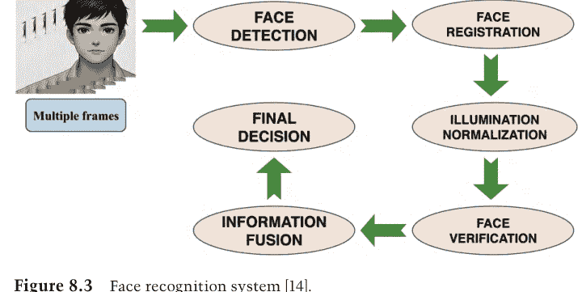

图 8.3 人脸识别系统 [14]。

视频分析还包括生物特征分析。生物特征是法医科学中使用的身份验证技术，涉及生理和行为因素。一个例子是人脸识别技术，其通过特征提取和匹配过程工作，如图 8.3 所简述。

## 音频和语音分析

它提取说话者特定特征以进行识别。逻辑回归算法可用作二元分类器，因为它给出的结果在 0 到 1 之间[3]。这些分析在电话通话或媒体交换的案件中非常有用[4]。

## 电子商务欺诈预防

它利用不同的工具（如 Subono 和 Riskified）为互联网用户提供安全保障，防止罪犯侵害。Subono 允许查看客户地址、验证所使用的电子邮件地址以及许多此类功能，而 Riskified 工具则确保实时洞察，避免在考虑 IP 位置、浏览器指纹、代理检测等情况下的欺诈检测时间滞后[1]。它还将任何异常财务交易识别为欺诈检测[4]。甚至四大会计师事务所，即 KPMG、PwC、EY 和 Deloitte 都在人工智能研究方面进行了大量投资[15]。

## 欺诈检测

欺诈是指任何出于欺骗意图进行的活动。一个例子是计算机网络入侵，这意味着操纵由其他主机提供的网络服务。打击欺诈需要广泛的算法、方法和最重要的有效的数据来源[12]。还有某些数据集可用于伪造检测方法的分析，例如 Dresden Image Database、Image Manipulation Dataset 和 CASIA Tampered Image Detection Evaluation Database[16]。

## 网络流量分析

它有助于识别设备之间的通信模式，从而帮助识别犯罪的来源或起源。它使用无监督学习来识别任何异常模式或行为，例如未来威胁、异常通信、欺诈行为和大量数据传输。它在实时场景中工作，并标记与异常模式匹配的流量[4]。

## 社交媒体数据分析

它对于帮助构建嫌疑人的社交网络图景至关重要。它包括语言、情感或个人之间的关系。自然语言处理（NLP）等技术有利于研究帖子和评论的内容[4]。

## 元数据分析

使用哈希技术进行文件认证。数据的指纹是通过基于数学计算的完整性认证来完成的，给出一个唯一的十六进制值。这是一种用于文件识别和验证的技术。该任务由 SHA-1 和 MD5 等密码哈希算法执行[7]。

## 文本分析

它包括使用结构和语言趋势等属性分析文本或电子邮件，结果令人满意，准确率为 84%。聚类算法和 SVM 的使用被认为是对文本和电子邮件分析的最佳算法[17]。它可以使用信息提取、信息检索以及自然语言处理工具进行。文本分析也称为文本挖掘，是使用多种算法从某些文本数据中提取有意义的信息。它分析结构化、非结构化以及半结构化数据，并识别其中存在的未知信息。根据用于知识提取的算法类型，它可以是一种提取式、归纳式甚至演绎式的取证技术。它执行多项任务，如文本处理、清理不需要的信息、通过切片进行分词、删除停用词（the、is、a 等）、将词干化为基本词（bikes 到 bike），最重要的是文档-词项或词项-文档矩阵分析。有用的文本挖掘工具包括 Attensity、dtSearch、AccessData 的 Forensic Toolkit、Apache OpenNLP、自然语言工具包、WEKA 等[7]。

## 网络追踪

Iris、Net Witness、Xplico、Net Intercept 和 SoleraDS5150 等工具有助于检查网络流量以检测入侵并确定犯罪是如何发生的[17]。它有利于网络监控和安全分析。

## 关联分析

它建立了收集到的证据与嫌疑人之间的联系。通过将信息转换为一组链接的实体或对象，可以确定知识体系的结构和内容[12]。这是一种提取技术，可揭示隐藏在大量数据下实体之间的隐藏关联。它基于图论这一数学分支。它为调查人员构建通信的即时可视化图景，帮助他们理解谜团。它将从多个设备收集的案件数据与相互设备用户放在一张地图上进行框架化。Analyst’s Notebook、Maltego、Netmap、Centrifuge 和 Palantir Visual Analytics 等工具在执行关联分析时很受欢迎[7]。

## 恶意软件分析

恶意软件分析和行为识别可以通过机器学习方法实现。这可以帮助调查人员弄清恶意软件的来源和运行方式。使用机器学习算法还可以创建用于识别和评估恶意软件的新工具和方法[4]。


## 方法的优势

通过机器学习方法获得的自动化为调查人员和研究人员提供了宝贵的支持，加快了程序和处理能力 [6]。使用机器学习方法，实体的效率肯定会提高，同时由于数字犯罪可能造成的收入损失也会减少 [1]。机器学习方法的潜力在于能够提供高性能、更复杂的协作功能，以对海量数据集进行高效调查 [7]。机器学习通过数据分析和分割有助于识别任何犯罪行为或风险。此外，它使调查人员能够检查位于有线和社交网络中的广泛分布的数据集。简单来说，它可以提供一个结构良好的存储库，其中包含来自数字调查的清理数据，具有众所周知的特征和结果 [2]。理解机器学习非常重要，因为随着其范围的扩大，罪犯倾向于使用此类技术来犯罪。因此，机器学习不仅用于数字犯罪的分析，而且在这些技术被使用时同样重要的是被识别出来 [18]。

## 方法的劣势

由于其在图像取证和大数据方面的安全应用，这些应用受到限制。当测试阶段的输出结果存在差异时，就需要开发新类别 [11]。图像分析中的 CNN 模型给网络设计带来了挑战，因为需要通过与精确操作相关的微弱痕迹来学习特征。压缩图像难以分析，因为质量方面或各种压缩，现有方法在特定条件下运行 [6]。机器学习算法需要大量的数据存储，这对专业人员来说非常难以处理 [19]。

## 结论

本章重点介绍了机器学习如何彻底改变数字调查的方式。数字取证随着其快速发展，需要能够更快运行或至少与其步伐相匹配的工具；因此机器学习在数字证据案件中具有高度价值。无论是图像、音频、视频、恶意软件、云存储还是其他任何数字证据，机器学习都能提供解决方案。它可以体现在网络、软件、硬件、恢复等方面的某些工具上。不仅如此，DFRWS 和 ADFM 模型可以作为一个完整的调查模型。此外，这些机器学习工具、软件和模型作为互补工具，可以帮助更快、更准确地处理大量信息。

## 机器学习的未来展望

数字取证中的多个领域需要引入机器学习以实现更好、更有效流程。需要开发更先进的机器学习模型以保护和防范网络威胁。需要开发更智能的方法和工具，以在准确的时间内对恶意活动和嫌疑人的机器进行自动调查 [2]。机器学习用于证据收集和检测，但在证据重建和分析阶段需要更多关注。尤其是图像分析/增强中相关设置调整的主要问题之一影响了检查，要求确定调查的最佳设置 [6]。必须重点关注机器学习中涉及或使用的数据安全方面的工作。最重要和最受关注的领域之一被证明是云取证。它充斥着数据和日志。检查所有这些内容容易出错，甚至是一种劳动密集型方法。人类由于其能力和灵活性有限，但计算机可以在一天内检查所有数据。随着每一天的过去，算法也将能够从经验中学习，并随着时间的推移改善其结果 [17]。

## 参考文献

- 1. Palit, S., & Roy, C. S. (2022). 数字取证调查中的机器学习。 *计算机科学与云计算进展国际期刊*, 10(2). ISSN(p): 2321–4058, ISSN(e): 2321–4392.
- 2. Iqbal, S., & Alharbi, S. A. (2020). 使用机器学习取证推进数字取证调查中的自动化。 *数字取证科学*, 3, 1–15.
- 3. Al Balushi, Y., Shaker, H., & Kumar, B. (2023, January). *数字取证中机器学习的使用*. 第一次信息技术与商业创新国际会议 (ICIITB 2022). Atlantis Press, pp. 96–113.
- 4. Sampath, K. K. (n.d.). *机器学习如何改变数字取证调查*.
- 5. Patel, R. B. (2023). *数字取证中人工智能的使用.* Authorea Preprints.
- 6. Nayerifard, T., Amin toosi, H., Bafghi, A. G., & Dehghantanha, A. (2023). *数字取证中的机器学习：系统文献综述.* arXiv preprint arXiv:2306.04965.
- 7. Mariyanna, S. (2017). *网络取证和司法可采性的机器学习.* https://doi.org/10.13140/RG.2.2.32426.16327.
- 8. Oladipo, F., Ogbuju, E., Alayesamni, F. S., & Musa, A. E. (2020). *基于机器学习的数字取证的最新进展.* SSRN 3668687.
- 9. Nelson, B., Phillips, A., & Steuart, C. (2016). *计算机取证与调查指南.* Cengage Learning.
- 10. Rouse, M. (2018). *网络取证.* TechTarget.
- 11. Passi, A. (2021). *基于机器学习方法的数字图像取证用于伪造检测与定位.* In *物理学期刊：会议系列* (Vol. 1950, No. 1, p. 012035). IOP Publishing.
- 12. Qadir, A. M., & Varol, A. (2020). *机器学习在数字取证中的作用.* 2020 第八届数字取证与安全国际研讨会 (ISDFS). IEEE, pp. 1–5.
- 13. Reddy, K. (2022). *数字取证中机器学习的使用.* *Nasscom 社区.* https://community.nasscom.in/communities/machine-learning/use-machine-learning-digital-forensics
- 14. Amin, R., Gaber, T., ElTaweel, G., & Hassanien, A. E. (2014). *生物识别和传统移动身份验证技术：概述与开放问题.* In Aboul Ella Hassanien, Tai-Hoon Kim, Janusz Kacprzyk, & Ali Ismail Awad (Eds.), *仿生网络安全与云服务：趋势与创新* (pp. 423–446). Springer.
- 15. Brown, S. (2018, April 9). *推动更快、更准确、更有益的税务决策.* *IBM.*
- 16. de Carvalho, T. J., Pedrini, H., & de Rezende Rocha, A. (2015). *数字取证的视觉计算和机器学习技术.* *理论与应用信息学杂志*, 22(1), 128–153.
- 17. Khan, H., Hanif, S., & Muhammad, B. (2021). *数字取证中机器学习应用的调查.* *计算机科学与信息技术趋势*, 6(1), 020–024.
- 18. Bhatt, P., & Rughani, P. H. (2017). *机器学习取证：数字取证的一个新分支.* *计算机科学高级研究国际期刊*, 8(8), 217–222.
- 19. Mohmed, A. L., & Palanivel, K. (2022). *使用混合学习方法的数字取证分诊分类模型.* *计算机科学与技术创新研究国际期刊*, 10(3), 29–39.

## 从牙齿到技术
探索人工智能在法医牙科中的作用

DHWANI PATEL AND SANTHIYA RAGHAVAN

## 引言

有趣的是，机器人技术的发展在许多方面已成为人类大脑的一种替代和戏仿，而人类大脑在牙科领域已得到相当大的发展 [1]。计算机化时代早在档案和医疗设备的数字化以维护记录时就开始了；然而，云服务器已成为集成的真正推动者，充当集中数据管理的存储库。计算机化牙科记录的使用在世贸中心袭击事件和印度洋地震海啸之后受害者的识别中发挥了作用 [2]。在这些案例中的一些，人类遗骸已被严重焚化，除了极其耐用的口腔外，别无其他识别手段 [3]。

随着这些因素，人工智能（AI）在过去十年中得到了极大的发展，并已在众多行业中得到应用而无并发症 [1, 4]。随着场景的变化，与其他时期相比，医疗保健领域得到了更多强调，人工智能等问题应该能够帮助医生检测和诊断各种牙科问题。 [5]。

法医牙科，或 FO，主要用于人类识别目的，研究牙齿和牙齿残骸。 [2, 3] 人工智能的使用或多或少解决了处理牙科信息时因专业和个人偏见而面临的挑战。 [6] 在法医牙科人工智能技术的情况下，这并不是唯一的用途，因为它还可以通过识别咬痕、估计牙齿和下颌的解剖结构、性别鉴定和年龄鉴定等来用于破案。 [7] 所有这些人工智能模型都基于

关于两种类型的神经网络，即卷积神经网络（CNNs）和人工神经网络（ANNs）。[4] 在众多研究和调查之后，已被证明这些模型与其它方法相比提供了最高水平的准确性，证明了这种新技术具有鼓舞人心和前景广阔的性质。[4] 这些人工智能网络和模型可用于犯罪的不同阶段，以及记录犯罪后果以协助法律问题。[5, 8, 9]

法医牙学与灾难受害者的识别有关，如果法医牙医此前未曾在该领域工作，此处的错误率会非常高，因为识别过程依赖于推测和图像表示。[10] 在任何情况下，死前牙科记录在寻找个人或估计年龄时每次都至关重要。[11, 12] 受害者留下的牙科组织被用来从个人先前存在的牙科组织中建立‘匹配’以供比较目的 [3, 11, 13]。正如在群体性灾难中很常见的情况一样，当身份因烧焦物质、肢解或其他原因而存疑时，首要问题始终应该是年龄和性别估计。然而，这并非没有其自身挑战，因为牙龄估计和实际年龄估计存在差异 [10]。利用尖端技术如人工智能来确定死者或活人的生物学年龄是可行的 [14]。法医牙学包括在该领域使用口腔记录、X光片、石膏模型和其他工具，以将人工智能模型应用于多项比较研究 [1, 5, 7–9]。

通过人类视觉和思维过程所投射的不确定性在很大程度上可通过基于人工智能的模型得到缓解 [5, 9]。在各种刑事案件中，包括性攻击和虐待案件、凶杀、强奸和儿童虐待，咬痕和其他唾液相关证据可能是最有力的证据之一 [15, 16]。人类咬痕和损伤是可以作为证据使用的情况；然而，如果未及时审查，它们会发生变形，使整个提供证据的过程变得毫无用处。

## 性别鉴定与人工智能

在群体性灾难发生后发现遗骸时，或在法医案件中，确定个体的性别至关重要 [17]。骨骼检查在确定个体的性别方面发挥着非常重要的作用。可以测量人类牙齿，而牙齿是人类颅骨的组成部分，无论是在活人还是已故者的骨骼中都可以进行测量 [18]。激素变化会影响牙齿的大小和形状，使其在不同性别的恒牙中有所不同。这使得男性和女性的恒牙不同 [18, 19]。就人类性二型性而言，犬齿已知具有最高程度的差异 [20]。犬齿是口腔中最为保存完好的牙齿，比其他任何牙齿都更少受龋齿和牙周疾病的影响。[21] Fidya 等人研究了一种新的人工智能技术，并确定多层感知器在犬齿性别鉴定中获得了最高的准确性。[19, 21–23]

Patil 等人的一项研究使用了全景放射照片来确定性别，显示使用基于人工智能的模型具有很高的准确性。当根据全景放射照片确定个体的性别时，该模型表现出异常高的准确性 [20]。判别分析和逻辑分析是两种比较分析类型，它们与传统和常规方法进行了比较。在该模型上执行了这两种分析。这两种方法在性别鉴定中经常表现出出色的结果 [18, 19]。

## 年龄估计与人工智能

年龄估计对人类识别至关重要；这包括涉及未知骨骼遗骸的刑事案件，以及群体死亡和事故现场。[11, 17] 人工智能和神经网络可以被训练以自主和有效地提高使用牙齿进行年龄估计的准确性 [2, 13, 24, 25]。作为人体中最强壮和最耐用的结构，牙齿通常能够在大多数环境条件下存活（火、水等），因此在其他识别证据可能不存在的地方，它们经常存在且可用 [12, 10]。牙齿对于推进在犯罪现场、灾难现场和道路交通事故中发现的未知遗体和骨骼遗骸的识别至关重要。它们对比较和重建身份分析都做出了重大贡献。为了提高牙龄估计的精确度，已引入了各种机器学习技术。人工智能的进步导致了多种程序化神经网络的创建，使计算机能够自主地以更高的准确性估计年龄 [23, 25, 26]。已开发出不同种类的程序，这些程序能够或被训练以借助神经网络计算年龄。

年龄估计主要用于确定个体的实际年龄，特别是在法医法律事项的背景下，尤其是在需要法律确认的情况下 [26]。在大多数情况下，个体的年龄估计由专业人员使用下颌骨的全景 X 光片和手腕放射照片进行 [25, 27]（如第 9.1 图所述）。Tobel 等人进行的一项研究描述了将基于人工智能的模型应用于全景放射照片中下颌第三磨牙发育分期的应用。在包括五重交叉验证的场景中，使用多种验证指标评估了性能，包括准确率、排名 N 识别率、平均绝对差异和线性 kappa 系数。深度学习卷积神经网络方法在评估的所有其他方法中取得了优于其他方法的成果。

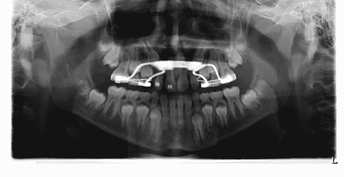

图 9.1 BoneXpert 自动骨龄评估。一旦左手和腕部放射照片发送到 BoneXpert 人工智能软件服务器，软件就会应用主动外观模型来分析 13 块骨骼。随后，标记有最终骨龄的左手和腕部放射照片会被发送到图像归档和通信系统 [37]。

## 唇纹学

唇纹是每个人的独特特征。一种在法医调查中经常使用的识别程序称为唇纹学，即唇纹的检查 [2, 3, 28, 29]（如第 9.2 图所述）。人类嘴唇是目前正在开发的一种生物特征模态 [28]。为了进行基于唇部的生物特征验证，使用概率神经网络以及一种仅基于唇形和新的唇几何测量的新型生物特征系统 [28, 30]。它不同于唇表面的纹理等其他参数。

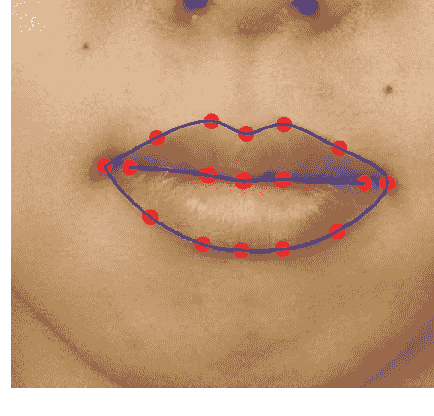

图 9.2 面部对齐（绿色）和唇部对齐的有用标志点（红色点）。

## 面部重建

法医面部近似或重建的过程涉及从其骨骼遗骸重建身份不明的个体的面部 [13]。它结合了雕塑、骨学、解剖学和人类学。它是法医领域中在涉及无法识别遗骸的犯罪时使用的技术 [31]。计算机化面部重建方法使用激光摄像机，该摄像机与计算机或 CT 扫描相连 [32]。人工智能神经网络的应用可根据骨骼特征以 95% 的准确率诊断一个人的性别 [14]。当用于确定骨骼遗骸的性别时，基于人工智能的方法将消除人为偏见，无需任何专业技能，并能在短时间内提供结果 [13, 33]。

## 人工智能在下颌形态学中的应用

面部重建是一项关键的法医工具，可以极大地帮助下颌形态学和下颌预测。这在群体死亡和灾难场景中可能特别重要，在这些情况下需要进行面部重建，但可能需要在没有

下颌骨。[34] Khanagar 等人关于使用 AI 来协助这一过程的论述：

> Sandoval 等人报告使用基于 AI 的模型，通过头颅颌面变量在骨骼 I 类、II 类和 III 类患者的侧位放射照片上预测下颌形态，使用自动学习技术，如人工神经网络和支持向量回归。[18, 35] 研究结果相当有前景。ANN 模型显示出高预测性，该模型可在面部重建中发挥关键作用。[17, 18]

## 法医牙科中人工智能的应用

人工智能在法医牙科应用中日益被使用，并可在面部重建、年龄估计、性别估计、牙科识别（与个人匹配）以及咬痕分析等方面提供潜在应用。它还可用于检索牙科记录。任务自动化以及人工智能技术综合海量数据并快速扫描大量记录的能力，使其成为一个有吸引力的选择。[4, 14–16, 21, 26, 36]

然而，其缺点和某些局限性可能会限制其应用。人工智能模型可能在有缺陷或有偏见的数据上训练，从而导致结果偏差。隐私、安全以及决策和数据使用中的伦理考虑同样令人担忧。人工智能使用的任何潜在益处都必须与该技术相关的这些可能负面因素仔细权衡。[1, 4, 7]

## 结论

为了最大化人工智能在法医牙科中的益处，其实施必须由健全的法规和伦理准则指导。虽然人工智能有潜力改变法医牙科，但它应作为传统法医方法的补充工具，而非替代品。

## 参考文献：

- 1. Corbella S, Srinivas S, Cabitza F. 深度学习在牙科中的应用. Oral Surg Oral Med Oral Pathol Oral Radiol. 2021;132:225–38.
- 2. Chowdhry A, Kapoor P, Juneja A, Chawla K, Bablani Popli D, Jasuja OP, et al. 法医牙科学手册；印度视角, Century Publication. 2018.
- 3. 法医牙科学 – 法医图书馆. https://aboutforensics.co.uk/forensic-odontology/ (访问于 2020 年 10 月 10 日).
- 4. Rajaraman V. 约翰·麦卡锡：人工智能之父. *Resonance*. 2014:198–207.
- 5. Journal IJSREM. 人工智能：法医牙科学中的奥德赛. *Int J Sci Res Eng Manag*. 2022;6. https://doi.org/10.55041/IJSREM16597.
- 6. Chinnikatti SK. 法医科学中的人工智能. *Forensic Sci Add Res*. 2018;2(5):182–3.
- 7. Khanagar S, Naik S, Sarode S, Patil S, Vishwanathaiah S, Bhandi S. 人工智能技术在法医牙科学中的应用与性能 – 系统综述. *Leg Med (Tokyo)*. 2020;46:101826. https://doi.org/10.1016/j.legalmed.2020.101826.
- 8. Ahmed O, Saleem S, Khan A, Daruwala S, Pettiwala A. 人工智能在法医牙科学中的应用 – 综述. *Int Dent J Stud Res*. 2023;11:54–60. https://doi.org/10.18231/j.idjsr.2023.012.
- 9. Pathak J, Swain N, Pathak D, Shrikanth G, Hosalkar R. 人工智能应用于法医牙科学的各利益相关方的作用 – 一个潜在视角. *Ann Dent Spec*. 2021;9:47–52. https://doi.org/10.51847/CBwpxBuRc0.
- 10. Blau S, Briggs CA. 法医人类学在灾难受害者识别（DVI）中的作用. *Forensic Sci Int*. 2011;205(1–3):29–35. https://doi.org/10.1016/j.forsciint.2010.07.038.
- 11. Prabhakar S. 法医牙科学的最新趋势：概述. *Int J Community Dent*. 2021;9:82–6.
- 12. Kavitha B, Einstein A, Sivapathasundharam B, Saraswathi T. 法医牙科学的局限性. *J Forensic Dent Sci*. 2009;1(1):8–10. https://doi.org/10.4103/0974-2948.50881.
- 13. Fernandes M, Kichler A, Rosa G, Sakaguti N, Franco A, Oliveira R. 法医牙科学在牙科和面部美学损害量化中的作用：来自民事司法实践的案例报告. *Cuad Med Forense*. 2017;23:41–45.
- 14. Galante N, Cotroneo R, Furci D, Lodetti G, Casali MB. 人工智能在法医科学中的应用：当前潜在益处、局限性和展望. *Int J Legal Med*. 2023;137(2):445–58. https://doi.org/10.1007/s00414-022-02928-5.
- 15. Mahasantipiya JS, Yeesarapat U, Suriyadet T, Thaiupathump T. 使用神经网络进行咬痕识别：初步研究. In: *Proceedings of the international multiconference of engineers and computer scientists*. Hong Kong; 2011. http://www.iaeng.org/publication/IMECS2011/IMECS2011_pp65-68.pdf (访问于 2020 年 7 月 7 日).
- 16. Mahasantipiya PM, Yeesarapat U, Suriyadet T, Sricharoen J, Dumrongwanich A, Thaiupathump T, et al. 使用神经网络进行咬痕识别：初步研究. In: *World congress on engineering*. International Association of Engineers; 2010. p. 65–8.
- 17. Hill AJ, Hewson I, Lain R. 法医牙医在灾难受害者识别中的作用：管理经验教训. *Forensic Sci Int*. 2011;205(1–3):44–7. https://doi.org/10.1016/j.forsciint.2010.08.013
- 18. Patil V, Vineetha R, Vatsa S, Shetty DK, Raju A, Naik N, et al. 使用下颌形态测量参数的人工神经网络进行性别判定：比较性回顾研究. Cogent Eng. 2020;7(1). https://doi.org/10.1080/23311916.2020.1723783
- 19. Fidya F, Priyambadha B. 使用人工智能对人类犬齿进行性别判定自动化. Dent J (Majalah Kedokt Gigi). 2018;50:116–20. https://doi.org/10.20473/j.djmgk.v50.i3.p116-120
- 20. More CB, Vijayvargiya R, Saha N. 数字正畸全景片上下颌支形态测量分析用于性别判定. J Forensic Dent Sci. 2017;9:1–5. https://doi.org/10.4103/jfo.jfds_25_15
- 21. Reddy VM, Saxena S, Bansal P. 下颌犬齿指数作为性别决定因素：印度西部北方邦人群研究. J Oral Maxillofac Pathol. 2008;12(2):56. https://doi.org/10.4103/0973-029X.44577
- 22. Heng D, Manica S, Franco A. 法医牙科作为性别估计分析工具：当前技术综述. Res Rep Forensic Med Sci. 2022;12:25–39. https://doi.org/10.2147/RRFMS.S334796
- 23. Bewes J, Low A, Morphlett A, Pate FD, Henneberg M. 人工智能用于骨骼遗骸性别判定：深度学习人工神经网络在人类颅骨中的应用. J Forensic Leg Med. 2019;62:40–3.
- 24. Shah JS, Ranghani AF, Limdiwala PG. 通过永久牙牙本质半透明度评估进行年龄估计. Indian J Dent Res. 2020;31(1):31. https://doi.org/10.4103/ijdr.IJDR_428_18
- 25. Vila-Blanco N, Carreira MJ, Varas-Quintana P, Balsa-Castro C, Tomas I. 基于 OPG 图像的年代年龄估计深度神经网络. IEEE Trans Med Imaging. 2020;39(7):2374–84. https://doi.org/10.1109/TMI.2020.2968765
- 26. Gupta S, Chandra A, Agnihotri A, Gupta OP, Maurya N. 采用数字方法测量牙本质半透明度进行年龄估计：机构研究. J Forensic Dent Sci. 2017;9:42–8. https://doi.org/10.4103/jfo.jfds_76_14
- 27. De Back W, Seurig S, Wagner S, Marre B, Roeder I, Scherf N. 基于全景牙科 X 射线成像的贝叶斯卷积神经网络法医年龄估计. MIDL 2019 Conference Abstract Papers, 2019. https://openreview.net/forum?id=SkesoBY49E (访问于 2020 年 7 月 8 日).
- 28. Caldas IM, Magalhães T, Afonso A. 使用唇纹学和腭纹学建立身份. Forensic Sci Int. 2007;165(1):1–9. https://doi.org/10.1016/j.forsciint.2006.04.010
- 29. Mun S, Ahn I, Lee S. 定量面部色彩特征与传统东亚医学寒证的关联. Evid Based Complement Alternat Med. 2017;2017:9284856. https://doi.org/10.1155/2017/9284856
- 30. Mishra G, Ranganathan K, Saraswathi TR. 唇纹研究. J Forensic Dent Sci. 2009;1(1):28. https://doi.org/10.4103/0974-2948.50885
- 31. Khanagar SB, Al-Ehaideb A, Maganur PC, Vishwanathaiah S, Patil S, Baeshen HA, Sarode SC, Bhandi S. 牙科中人工智能的发展、应用和性能 – 系统综述. J Dent Sci. 2021;16(1):508–22. https://doi.org/10.1016/j.jds.2020.06.019
- 32. Zain-Alabdeen E, Felemban D. 人工智能与法医识别中的颅骨成像进展. Saudi J Health Sci. 2023;12:171–7.


33. Vodanovic M, Subasic M, Milošević D, Galic I, Brkić H. 人工智能在法医学和法医牙科中的应用. *J Forensic Odonto-Stomatol.* 2023;41:30–41.
34. Khanagar SB, Vishwanathaiah S, Naik S, Al-Kheraif AA, Divakar DD, Sarode SC, et al. 人工智能技术在法医牙科中的应用与性能——系统综述. *Leg Med (Tokyo).* 2021;48:101826.
35. Sandoval TCN, Sonia Victoria GP, Gonzalez FA, Robinson AJ, Contreras CI. 利用颅颌面变量通过人工神经网络预测下颌形态. *Univ Odontol Bogotá.* 2016;35:1–6.
36. Katne T, Kanaparthi A, Srikanth Gotoor S, Muppirala S, Devaraju R, Gantala R. 人工智能：揭示牙科奥秘——未来及展望. *Int J Contemp Med Surg Radiol.* 2019;4(4):D6–9.
37. Vila-Blanco N, Carreira M J, Varas-Quintana P, Balsa-Castro C, Tomás I. 基于OPG图像进行实际年龄估计的深度神经网络. In *IEEE Transactions on Medical Imaging*, 2020;39:2374–2384.

# 法医人类学中机器学习的潜在应用

VINEETA SAINI AND ARUNIMA DUTTA

法医人类学家可以利用对骨骼发育和形态变异的详细知识，在刑事诉讼中对骨骼遗骸的分析和鉴定提供深入见解 [1]。在被肢解、腐烂和烧焦的尸体案件中，当死者的DNA或生前牙科记录无法用于比对时，人类学检查可以成为应对此类具有挑战性任务的有用工具。它也是分析死者死亡原因、方式、模式和死亡时间的重要组成部分。法医人类学家还将技能应用于大规模谋杀、战争、种族灭绝以及建筑火灾、建筑物倒塌、火车事故、船只沉没和飞机事故等大规模灾难受害者的识别 [1]。这种个人识别可以通过收集有关性别、身高、种族、年龄以及先天性或创伤性畸形等综合信息的汇编，并随后对受害者的骨骼遗骸进行颅面重建和面部叠加来建立。该数据库可以通过直接或通过影像技术收集人体骨骼不同区域的测量值来创建。之前对人体骨骼进行的许多研究显示，骨盆、颅骨、下颌骨、胸骨和长骨在建立生物学特征方面具有良好的准确性 [2–4]。

## 法医人类学家面临的挑战

尽管法医人类学家有助于个人识别，但在进行调查时他们经常面临障碍。

-   **受害者信息不足和缺乏背景：** 法医人类学家经常缺乏关于获得的骨骼和骨骼遗骸的信息，例如遗骸所在位置或与死者一起发现的任何物品。这导致正确生物学特征分析、死亡时间估计和死亡原因的可能性降低。

-   **骨骼证据受损和埋藏学变化：** 碎片化的骨骼遗骸或在尸检过程中造成的损伤会阻碍个人识别和骨骼创伤的确定。此外，埋藏学变化、风化作用和食腐活动可能导致骨骼碎裂、脆性、风化、颜色变化或矿化，从而阻碍识别过程。

-   **人口混杂：** 法医人类学家面临的最困难挑战是人口的混杂。随着人们为寻求更好的机会而从其原籍地区移民，获得特定人群数据变得困难。

-   **伦理管理：** 由于法医人类学家必须处理意外、凶杀和大规模灾难受害者，因此在与死者家属打交道时必须确保伦理管理和人道主义方法。当遗骸在偏远或政治不安全地区被发现时，进行调查的获取和授权可能受到限制，使其变得困难。

-   **意见客观性：** 法医人类学家在确定细节时需要更加客观，而不是有偏见和主观。

尽管法医人类学家面临诸多挑战，他们的专家意见在法庭上确立此类证据的采纳性方面具有极其重要的意义，确保为受害者家属伸张正义。

在骨骼检查期间，法医人类学家使用多种技术，例如放射学、对形态特征的视觉评估以及特定解剖标志之间的测量，但这些方法需要技术技能和时间。

在法医人类学中使用人工智能（AI）可加快分析过程并提高准确性。术语‘人工智能’指的是机器复制人类知识以轻松完成任务。它使用详细的数据库来感知信息、处理信息并据此提供后续行动 [5]。AI 具有快速、准确和高效分析大量数据的能力。它还可以识别模式并做出预测，这对法医调查有帮助。

如今，AI 在法医人类学中被广泛使用，具体体现在面部识别、骨骼分析和人类遗骸识别方面的应用。然而，这些估计是基于科学家通过数学公式和专业经验提取的数据。因此，它们可能耗时且不准确，尤其是在处理大量数据时 [6]。因此，整合 AI 及其不同分支在个人识别领域显示出一些有前景的进展。随着技术的进步，放射照片、计算机断层扫描（CT）、磁共振成像（MRI）和锥形束计算机断层扫描（CBCT）等各种影像技术使人类学检查过程变得更加轻松。但法医人类学家仍需探索人工智能的一些方面，尤其是在从 CT 扫描检测颅骨损伤和从颅骨预测面部软组织方面 [7, 8]。

AI 也有各种子领域，其中之一是机器学习（ML）。ML 算法用于提高基于骨骼遗骸的性别、年龄、身高和祖先估计的分类性能。它是人工智能的一个分支，能够在没有直接编程的情况下进行预测，利用从样本‘训练’数据中创建的数学模型。

它包含某些根据导入数据库和训练准备好的算法，以提供特定响应。它使机器能够理解人类指令并发展到可以在没有人工干预的情况下运行的程度。机器学习包括各种类型的算法，这些算法经常用于估计性别、身高、年龄和祖先，例如线性判别函数分析、支持向量机、人工神经网络、决策树、随机森林、朴素贝叶斯分类、二元逻辑回归、多项式和惩罚多项式逻辑回归、多变量自适应回归样条和极限梯度提升（XGB）等（图 10.1）[9–15]。这是通过人工神经网络实现的，人工神经网络是深度学习的一部分，而深度学习又是机器学习本身的另一个子集 [16]。

## 判别函数分析（DFA）

也称为线性判别（LDA）或典型判别分析，而二次判别分析是一种用于分离非线性数据集的 LDA 类型。由于其计算简单，判别函数分析（DFA）在人类学中被广泛用于探索和理解不同群体或种群之间生物变异的模式 [17]。DFA 通过分析测量变量（如骨骼或牙齿特征）以及用于性别估计的颅骨或后颅骨测量，将个体分类到预先确定的组中 [18–20]。通过分析

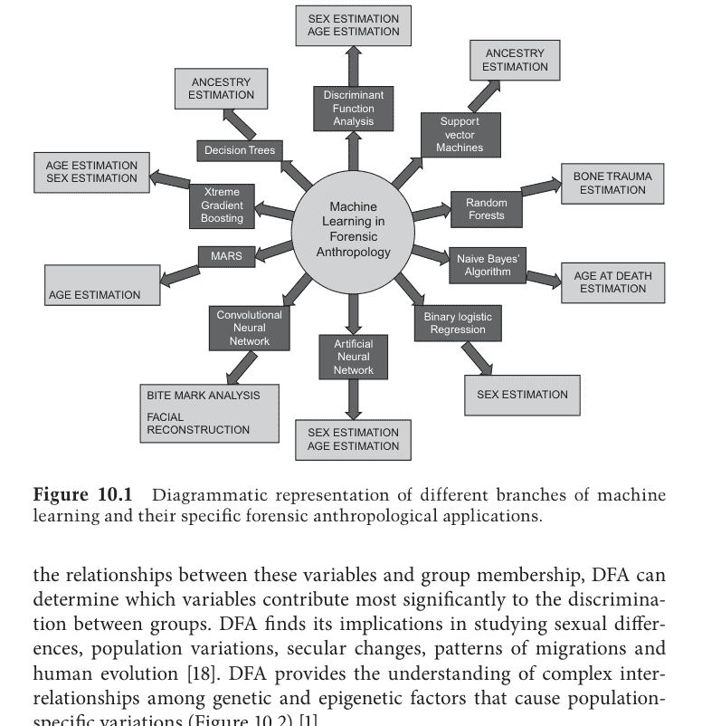

图 10.1 机器学习不同分支及其特定法医人类学应用的示意图。

这些变量与群体成员身份之间的关系，判别函数分析（DFA）可以确定哪些变量对群体间的区分贡献最大。
DFA 在研究性别差异、种群变异、世俗变化、迁移模式和人类进化方面具有应用 [18]。
DFA 有助于理解导致种群特异性变异的遗传和表观遗传因素之间复杂的相互关系（图 10.2）[1]。

## 支持向量机（SVMs）

SVMs 是最广泛使用且功能强大的监督学习算法之一，能够处理与性别、年龄和祖先估计相关的分类和回归任务。
SVMs 在中小型数据集上表现良好，能够处理高维特征空间。
SVMs 的工作原理是识别一个最优超平面，以最大化属于不同类别的数据点之间的分离。
超平面由支持向量定义，即训练样本的一个子集

## 使用机器学习进行性别鉴定

### 未识别骨骼

犯罪现场可能有一些未识别的骨骼遗骸，如颅骨、骨盆、牙齿遗骸、长骨等。

### 测量

这些遗骸应使用适当的仪器如滑动卡尺、游标卡尺或数字游标卡尺进行收集和测量。

### 机器学习算法

这些测量数据可以采用不同的机器学习算法进行处理，如使用 Python 编程语言的判别函数分析。

### 数据加载

机器学习算法需要进行训练以作为预测模型，因此 70% 的测量数据用作训练数据，剩余 30% 用作测试数据。

### 任务分配

算法需要被分配不同的任务，如分类、回归、相关性等。

### 结果解释

机器学习算法将能够正确分类数据，即遗骸属于男性还是女性。分类的准确性有助于其成为预测模型。

图 10.2 使用机器学习 DFA 算法进行性别估计的信息图。

样本。SVMs 力求最大化间隔，即超平面与每个类别最近的数据点之间的距离。
性别估计是法医人类学检查的重要组成部分。
SVMs 已通过在包含骨盆、颅骨、长骨和其他骨骼遗骸测量数据的数据集上进行训练来获得性别二态性特征的应用 [21–24]。
通过在不同种族群体的已知数据集及其相关的特定形态或计量特征上进行训练，SVM 也可用于建立祖先估计。
在 Spiros 和 Hefner（2020）进行的一项研究中，使用 8 个颅骨和 11 个后颅变量，在美国黑人和白人群体中进行祖先估计，准确率为 88–92% [15]。

SVMs 通过检查随时间发生的骨骼形态和结构变化（如上颌缝合、骨骺融合和膝关节磨损）来帮助年龄估计 [25–27]。
通过在已知年龄和相应骨骼特征的人群数据集上进行训练，支持向量机（SVM）可以被训练来预测未识别骨骼遗骸的年龄。

由于它是一种监督学习算法，因此也可以预先在已知样本数据集上进行训练，以识别未知遗骸中相似的创伤模式、骨骼疾病和异常。

在法医人类学中，SVMs 只是众多可利用的机器学习算法之一。
其有效性取决于训练数据集的质量和范围，以及用于分析的合适特征的选择。
此外，法医人类学家的专业知识和理解在解释结果并根据 SVM 的输出做出明智决策方面发挥着至关重要的作用（图 10.3）。

## 随机森林（RF）

它是一种常见的 ML 算法，属于监督学习技术组，用于与祖先估计相关的分类和回归问题。
该算法基本上包含多个决策树，并使用各种数据集的平均输出来提高准确性（图 10.3）。
传统的祖先估计方法包括对形态学特征和人体测量数据的检查。
然而，一项研究表明，随机森林模型的应用可以结合这两个数据集并提高估计的准确性。
结果显示，判别函数分析的准确率为 75.4%，而使用随机森林模型时准确率提高到 89.6% [28]。
AncesTrees 是一种针对祖先估计提出的利用随机决策树的新算法。
设计该算法所使用的数据库包含来自 1734 名个体的 23 个颅测量变量，准确率为 93.8% [29]。
法医人类学还涉及骨骼创伤的评估。
随机森林算法也被发现可用于将骨骼创伤分类为打击或跌落。
对 400 张匿名 CT 扫描图像进行了研究，这些图像来自因跌落和

## 使用机器学习进行祖先估计

### 什么是祖先估计？

使用分类统计和基于经验的分析方法，将未知个体的最可能地理起源分类到一个或多个参考群体中

### 支持向量机

SVM 是一种监督学习算法，用于机器学习中解决分类和回归任务。

### 决策树

它用于解决分类问题和对对象进行分类，或作为从不可预见数据中预测连续结果的方法。

### 从犯罪现场回收的骨骼遗骸

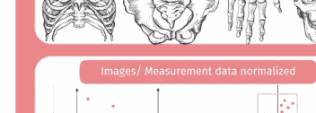

### 图像/测量数据标准化

### 数据拆分为训练集和测试集


### 预测模型在评估数据集上工作

80% 准确率

### 图 10.3 使用 SVM 和 DT 进行祖先估计的工作流程。

打击。获得了 83% 的准确率，从而表明随机森林是区分不同类型骨骼创伤的有前景的工具 [30]。
确定年龄是在建立未知人员身份时的关键目标。
随机森林在根据左手骨长度确定年龄方面发挥了重要作用。
该研究在亚洲人群中进行，受试者年龄从新生儿到 18 岁。
结果显示，与人工神经网络（ANN）模型相比，随机森林算法具有更好的检测效果 [31]。
随机森林算法已用于根据左手长度进行性别估计。
该研究也在亚洲人群中进行，受试者年龄在 16 至 18 岁之间。
结果显示估计准确率为 91.67%。
然而，由于特定年龄组，结果可能不适用于多样化的人群 [31]。
年龄估计也可以根据牙齿遗骸的矿化形态进行。
一项对中国南方人群中 2 至 18 岁受试者的 1477 张全景牙科放射照片的研究显示，随机森林最适合用于青少年年龄估计 [32]。

## 朴素贝叶斯分类（NBC）

它是最简单和最快的 ML 算法之一。
它是一种基于概率的算法，基于贝叶斯定理运行，主要用于分类任务。
该算法基于两个主要假设，即数据集中所有特征彼此独立，并且每个特征成为结果的机会相等。
朴素贝叶斯算法根据 294 名年龄在 10 至 93 岁之间的男性尸体的组织形态学特征进行年龄估计，准确率为 90% [33]。
在另一种方法中，韩国人群耻骨联合的 CT 扫描图像使用 Suchey–Brooks 标准进行评分。
结果显示，与传统方法相比，贝叶斯算法表现出更高的准确性（图 10.4）[34]。
性别鉴定是个人识别不可或缺的一部分。
一项研究提出了一种名为“CADOES”的从骨盆估计性别的新型概率方法。
该研究旨在提出一个模型，考虑特定人群的骨盆变量进行性别估计。
该新型分类算法在 38 个骨盆变量下提供了 85–97% 的准确率 [35]。

## 二元逻辑回归（BLR）

二元逻辑回归（BLR）是一种回归模型，其输出为二元变量，即 0 或 1，并在法医人类学检查中用于性别鉴定。

Verma 等人（2020）在对 344 名 Hamachi 受试者上肢和下肢性别二态性的研究中发现，手宽是最二态的，其次是足长和手长，性别鉴定准确率


## 使用机器学习进行年龄估计

### 它是什么？

确定个人年龄（年或月）的过程，使用直接测量或成像技术。

-   判别函数分析
-   朴素贝叶斯算法
-   人工神经网络
-   多变量自适应回归样条
-   极端梯度提升

### 为什么有益？

通过处理面部图像，这些模型可以准确预测用户年龄，同时最大限度地减少收集敏感个人身份数据的需求。

### 95%

研究表明，使用机器学习进行年龄估计的检测准确率可达95%。

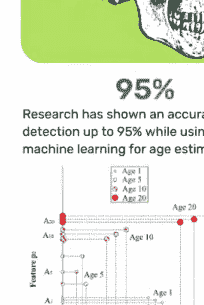


图10.4 使用机器学习进行年龄估计的信息图表。

使用BLR时，男性为90.1%，女性为91.3% [36]。另一项研究使用来自497名受试者的耳朵12项人体测量指标，对比DFA和BLR的估计准确性。结果显示两种算法的预测率几乎相同 [37]。头骨测量数据的性别鉴定可通过统计工具进行验证。对LDA、BLR和SVM进行了一项比较研究，结果显示BLR的性能略优于其他技术 [38]。Logistic回归允许数据集具有更大的灵活性，而线性回归可能无法提供这种灵活性。为了预测结果，BLR使用似然比而非最小二乘法，从而使其更适合最终模型。在一项利用五个颅面变量评估祖先的研究中，BLR的估计准确率高达90% [39]。长骨的性别估计至关重要，二元逻辑回归比线性回归或判别函数分析更合适。一项研究显示，逻辑回归在长骨关节面和骨干测量中的性别估计准确率最高 [40]。在关于南非人群跖骨性别二态性的研究中，Bidmos及其同事分别使用BLR和DFA实现了79%和84%的性别鉴定准确率 [41]。对于身高估计，可以使用线性回归分析。尤其是股骨、胫骨、腓骨、肱骨、桡骨和尺骨的长骨，使用简单和多元线性回归方法进行身高估计时被发现具有最高的准确性（图10.5） [42]。

## 人工神经网络（ANN）

ANN是一种多功能机器学习方法，由组织成层的互连节点（神经元）组成。ANN可以捕捉输入特征之间的复杂关系，但为了获得最佳性能可能需要更大的数据集。它包含计算系统，有助于感知和处理信息，其功能类似于生物神经网络。ANN包含三个层，即输入层、隐藏层和输出层。这些ANN在深度学习中发挥着重要作用，并在法医人类学中具有突出的应用。ANN具有一个迷人的特征，可以识别图像中对分类重要的结构和权重。然而，这些神经网络在独立运行之前需要大量数据集合。法医成像技术在过去几年中不断发展，并共同形成了一个全新的分支，称为“虚拟人类学”。CT或“计算机断层扫描”和CBCT或“锥形束计算机断层扫描”通过提供高对比度图像以及在2D和3D平面上的可视化，在虚拟人类学中显示出非常有前景的结果。这些CT图像可以存储为DICOM数据并进行处理以进一步增强图像。机器学习有助于此类增强以及从DICOM图像的3D重建。重建过程通过将DICOM图像转换为STL（立体光刻）文件进行处理 [43]。ANN也被发现可用于3D颅面标注和叠加，以进行面部重建和咬痕分析。ML使用基于地标的算法和面部软组织数据集可以帮助法医艺术家创建更准确和更具代表性的面部近似。一项研究表明，一种名为“人工免疫识别系统”的基于遗传的人工智能算法被用于进行颅骨叠加，与传统方法相比显示出更好的颅面地标识别 [44]。ANN的另一个重要应用是从人体骨骼的各个部位进行性别、年龄和祖先估计。Knecht等人采用了四种传统统计方法和两种ML模型（SVM和ANN）来比较大坐骨切迹的性别二态性，并报告使用ANN获得了最高的性别分类准确率 [45]。机器学习算法可以聚合形成堆叠模型，与单一算法相比显示出更高的准确性。这样一种堆叠ML算法被用于南非人群髌骨的性别鉴定，其准确率为90.8%，而多元判别函数显示的准确率为81.9–84%（图10.4） [46]。

Hefner和Ousley比较了颅骨形态学特征的不同机器学习模型，以评估非洲裔、欧洲裔和西班牙裔美国人的祖先。ANN具有最高的分类准确率（87.9%） [47]。

## 使用机器学习进行身高估计

身高估计可以从长骨、肋骨、椎柱等进行

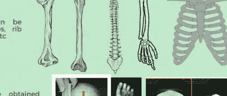

测量可以通过直接方式或不同的成像技术获得

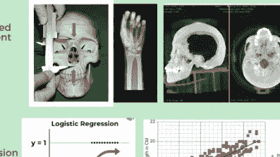

-   二元逻辑回归
-   相关性
-   多元线性回归

可以使用算法

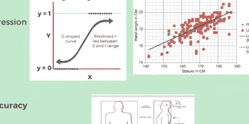

身高估计准确率高达90%

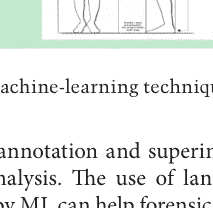

图10.5 使用机器学习技术回归分析的身高估计。

## 卷积神经网络（CNN）

CNN主要用于基于图像的任务，例如面部重建和骨骼创伤分析。它们通过卷积层擅长捕捉图像中的空间关系，并已应用于法医人类学的各个方面。与ANN不同，卷积神经网络具有多个层，从输入层、卷积层、池化层、全连接层和输出层开始。CNN以其在图像、语音和音频输入信号方面的卓越功能而闻名。它有助于计算机视觉，这是一个有助于图像解释的人工智能子领域。3D-CNN允许使用专门的3D核解释图像，预测图像体积块中的分割。一项研究旨在使用CNN从放射影像的颌面特征中建立性别二态性。迁移学习（TL）CNN架构相比其他架构提供了更高的准确性 [48]。与其他神经网络一样，CNN也需要一个结构良好的数据库。一项研究建议使用CNN利用全身低分辨率X射线图像对儿童和成人的年龄进行估计。用于训练CNN的数据库包含910张多光谱图像，并在年龄计算中显示出最小差异 [49]。受损颅骨的面部重建是法医人类学家面临的最具挑战性的任务之一。CNN可以通过特殊算法帮助解决此问题，不仅提供3D重建，还可以对重建的颅骨进行生物特征匹配 [50, 51]。死后年龄估计在法医鉴定中至关重要，但在其准确计算上存在很多争议。卷积神经网络已被证明可以在一定程度上精确估计年龄。一个包含500名年龄在19–101岁之间个体的参考数据集被用于训练CNN模型。此外，还开发了一种名为DRNNAGE的新型软件，用于在特定骨骼特征内进行年龄估计 [52]。大多数

牙科放射影像的年龄估计方法可用于25岁以下，但在此年龄之后，老年人和成人的年龄估计变得困难。因此，开发了一种名为‘Soft Stagewise Regression Network’（SSR NET）的新型CNN，用于从单张图像进行多阶段年龄估计。基于SSR NET，又开发了另一款名为DENSEN的新软件，用于执行类似任务但灵敏度更高[53]。性别鉴定是生物学特征分析的重要组成部分，也可使用卷积神经网络进行。一项使用1476张侧位头颅测量放射影像进行的研究表明，CNN可用于获得性二态性，准确率为90%[54]。耳生物特征常用于体测量检查，且易于用于个人识别。耳生物特征不受面部表情影响，因此可使用深度学习卷积网络对其进行研究。这些神经网络在使用前必须用已知数据集进行训练。一项研究表明，经过训练的神经网络能够准确确定形态学标志[50, 55]。

Wen 等人使用CNN对中国人群（156个黄种人和178个白种人颅骨）进行祖先估计作为样本，其中80%用作训练集，20%用作测试集。他们在训练集上获得了95.88%的准确率，测试集上获得95.52%的准确率[56]。

## Multivariate Adaptive Regression Splines (MARS)

## 多元自适应回归样条 (MARS)

MARS是Jerome H. Friedman于1991年提出的一种回归算法，是线性模型的扩展。该算法作为一种非参数技术工作，可自动建模变量之间的非线性关系。传统的青少年年龄估计方法往往缺乏统计有效性（图10.4）。因此，使用MARS的标准方法用于根据髂骨生物测量变量预测年龄。该研究在176名0–12岁受试者中进行。MARS预测模型显示髂骨宽度、模块和面积可提供更好的年龄估计[57]。另一项在1310名出生至12岁受试者中进行的研究，使用MARS根据骨干尺寸预测年龄。结果显示，单变量模型仅可用于年幼儿童，而多变量骨干长度模型对年长儿童产生更好的结果[11]。另一种对亚成年年龄估计的方法来自法国人群534名男性的第五腰椎、锁骨以及244名0–12岁受试者的髂骨测量。MARS模型用于合并这两组测量数据。该模型整合了变量之间的非线性关系，并产生92%的准确率[58]。

## eXtreme Gradient Boosting (Xgboost)

## eXtreme Gradient Boosting (Xgboost)

该机器学习算法是决策树中梯度提升的扩展。所有自变量都关联权重，然后分配给决策树。决策树预测错误的变量的权重会增加并输入到下一个决策树。因此，整个系统现在协同工作以提供更强、更准确的估计。基于矿化牙形态的青少年年龄估计是法医调查中的重要任务（图10.4）。Shan 等人发现 XGBoost 是使用 Demirjian 方法对南中国人群2–18岁1477张全景放射影像进行年龄估计的最佳预测模型[32]。SexEst 是一款基于极端梯度提升数学模型的免费网络应用，旨在根据颅骨和颅后测量进行骨骼性别估计。模型经过优化，对颅后变量的预测准确率为80.8–89.5%，对颅骨变量的预测准确率为81.2–87.7%[59]。一项旨在预测斯里兰卡人群恒牙年龄的研究涉及3321名受试者的测量。机器学习算法之间的比较结果证明极端梯度提升模型（XGBoost）是最合适的，最高准确率为88%[60]。

## Decision Trees in Forensic Anthropology

## 法医人类学中的决策树

决策树是机器学习中使用的监督学习技术。它基本上为任何问题的所有可能解决方案提供图形表示。它包含两个节点，即决策节点和叶节点。决策节点负责所有决策并具有众多分支，而叶节点则描述决策的结果。这些决策树用于对数据进行分类并根据先前结果获得值（图10.4）。

## Advantages of Machine Learning

## 机器学习的优势

法医学的主要目标是破案并为受害者带来更快的正义。但随着犯罪数量不断增长以及作案手法多样，积压案件往往会阻碍司法交付系统。机器学习以其更快速识别解剖标志的方法可以帮助减少待处理案件数量。此外，分析骨骼证据的过程是一项繁琐的任务，如果ML算法经过一次训练即可轻松解决。由于该领域需要多任务处理以确保彻底分析和报告，神经网络在同时进行各种识别时可成为重要工具。专业知识和经验对人类学遗骸的手动估计有时会在微小计算中导致错误。这些错误可通过人工智能避免。ML算法可以识别趋势和模式，这在分析大量数据时很有用。此外，随着持续发展，这些算法可以发挥到无需人工干预的程度。

## Best Performing Machine-Learning Method

## 表现最佳的机器学习方法

与骨骼遗骸相关的个人识别问题的最佳AI方法可能取决于多个方面，包括可用数据集的质量和大小、特定的识别属性（年龄/性别/身高/种族归属），以及法医人类学家的经验和专业知识[6]。此外，结合多种ML技术或采用混合方法可能通过利用不同算法的优势获得更好的结果。

有多种ML方法，但每种方法适用于骨骼遗骸的特定生物学属性。有些方法适用于性别预测，有些适用于祖先估计，有些适用于年龄估计，等等。Nikita 等人研究了统计方法和机器学习算法的分类准确性，包括BLR、多项式和惩罚多项式逻辑回归（MLR, pMLR）、LDA、NBC、DT、RF、ANN、具有线性、多项式或径向核的SVM、MARS和XGBoost在骨骼性别和祖先估计方面的表现。LDA和SVM分别表现最佳，在大多数测试中具有高预测准确性和最小偏差（图10.5）[6]。另一方面，回归分析和随机森林非常适合身高估计和年龄估计。

## Limitations of Machine Learning in Forensic Anthropology

## 法医人类学中机器学习的局限性

尽管机器学习已成为法医学领域不可或缺的工具，但仍存在一些特定缺陷。为了使算法更易于使用并适应训练数据集，需要大量试验。因此，维持此类基础设施需要时间和费用。ML在许多领域，包括法医人类学，具有巨大前景，但它也有局限性。

- **Limited Data Availability:** **数据可用性有限：** 法医人类学处理的是独特且复杂的情况，使得收集庞大多样的数据集变得困难，而ML算法需要大量数据来学习和预测。如果收集的数据不正确，所产生的结果将毫无意义。此外，手动或自动数据获取耗时且劳动密集。因此，人类学数据集的稀缺限制了ML模型对生物学属性的性能和泛化能力[61]。
- **Lack of Interpretability:** **缺乏可解释性：** 许多ML算法，包括深度学习模型，由于缺乏透明度和可解释性而成为“黑箱”。在法医人类学中，专家意见受到尊重，很难解释算法如何产生选择或预测[61]。
- **Bias and representativeness:** **偏差和代表性：** ML模型依赖于训练数据的质量和代表性。ML模型可能会继承并放大训练数据的偏差。这可能会通过导致错误的预测或发现而影响法医人类学调查[5, 61]
- **Domain-Specific Problems:** **领域特定问题：** 在法医环境中，收到不完整或受损的骨骼遗骸的情况很常见，这带来了独特的障碍。此类骨骼遗骸可能会限制ML系统用于推导出有意义模式的特征。在处理退化或碎片化遗骸时，ML模型可能难以确定年龄、性别、身高或祖先估计[5, 61]。
- **Expertise and Human Involvement:** **专业知识和人工参与：** 机器学习算法是人工智能的一部分，而人工智能又是人类智能的模拟。因此，结果的解释和准确性只能通过人工干预实现。此外，数据或算法中的任何错误最终都可能导致错误输出。法医人类学需要专门的知识和专业技能。ML可以自动化流程并提供见解，但无法取代法医人类学家的经验和判断[50]。
- **Ethical Issues:** **伦理问题：** AI在法医人类学中也引发伦理问题。研究人员和从业者必须解决其工作的伦理和法律后果，因为任何技术都可能被滥用或在不同法医情况下的个人识别中产生不可预见的后果。这涉及负责任地获取和使用数据来训练AI算法，并评估AI驱动的分析可能如何影响法医调查人员及其社区[50, 62]。

尽管存在这些缺点，ML在法医人类学中仍可能有用。它可以帮助法医人类学家分析庞大的数据集，发现趋势，并

做出有根据的结论。它应谨慎使用，结合人类专业能力，并充分理解其局限性和偏见。机器学习在法医人类学中引发了伦理难题。法医人类学检查的结果被法庭作为支持证据采纳，从而确保公平审判和公正的迅速实现。

## 法医人类学中机器学习的未来展望

机器学习在法医人类学领域具有广泛应用，尤其在个人识别方面。不同监督学习和无监督学习算法的多样化使用在人类学检查中具有光明前景。这些算法使得能够以更高的精确度、准确性和速度分析大量骨骼数据。这些算法还可能有助于创建生物学画像以及面部重建、死亡时间估计、创伤和病理识别 [5]。利用机器学习算法可以轻松完成对骨骼遗骸的详细分析，尤其是关于种群特异性形态测量变异。处理此类可能因完全使用这些算法而受损的机密数据时，纳入伦理方法至关重要。因此，在法医人类学检查中使用机器学习算法时，可能需要在数据收集程序和数据解释中承认人类干预。

## 参考文献

- 1. Morrison, G. S., Weber, P., Basu, N., Puch-Solis, R., & Randolph-Quinney, P. S. (2021). 基于人类骨骼遗骸推断生物性别的似然比计算. 法医科学国际协同, 27(3), 100202. https://doi.org/10.1016/j.jofri.2019.05.005
- 2. Bruzek, J. (2002). 一种利用人类髋骨进行性别视觉判定的方法. 美国人类体质人类学杂志, 117(2), 157–168.
- 3. Fukuta, A., Kato, C., Biwasaka, H., Usui, A., Horita, T., & Kanno, S. (2020). 通过同源模型生成的三维计算机断层扫描图像的二维深度图像深度学习进行骨盆性别估计, 法医科学国际：报告, 2, 100129.
- 4. Krenn, V. A., Webb, N. M., Fornai, C., & Haeusler, M. (2022). 利用人类骶骨进行性别分类：几何形态测量与传统方法对比. PLoS One, 17(4), e0264770. https://doi.org/10.1371%2Fjournal.pone.0264770
- 5. Galante, N., Cotroneo, R., Furci, D., Lodetti, G., & Casali, M. B. (2023). 人工智能在法医学中的应用：当前潜在益处、局限性和展望. 国际法医学杂志, 137(2), 445–458. https://doi.org/10.1007/s00414-022-02928-5
- 6. Nikita, E., & Nikitas, P. (2020). 机器学习算法在法医人类学中的使用. 法医学, 47, 101771. https://doi.org/10.1016/j.legalmed.2020.101771
- 7. Mangrulkar, A., Rane, S. B., & Sunnapwar, V. (2021). 利用计算机视觉和机器学习从组装颅骨模型中自动检测颅骨损伤. 国际信息技术杂志, 13, 1785–1790. https://doi.org/10.1007/s41870-021-00752-5
- 8. Ramanathan, N., Chellappa, R., & Biswas, S. (2009). 人类面部年龄进展：综述. 视觉语言与计算杂志, 15, 3349–3361.
- 9. Auyeung, T. W., Lee, J. S., Kwok, T., Leung, J., Leung, P. C., & Woo, J. (2009). 通过测量2443名老年人腓骨和尺骨长度估算身高. 营养、健康与老龄化杂志, 13(10), 931–936. https://doi.org/10.1007/s12603-009-0254-z
- 10. Srivastava, R., Saini, V., Pandey, S. K., Rai, R. K., & Tripathi, S. K. (2012). 北印度人股骨性二型性的研究. 法医科学杂志, 57(1), 19–23. 10.1111/j.1556-4029.2011.01885.x.
- 11. Stull, K. E., L'Abbé, E. N., & Ousley, S. D. (2014). 利用多元自适应回归样条根据骨干尺寸估算亚成年年龄. 美国人类体质人类学杂志, 154, 376–386. https://doi.org/10.1002/ajpa.22522
- 12. Mehta, M., Saini, V., Menon, S. K., & Patel, M. N. (2019). 当代古吉拉特人群中枕骨大孔用于性别鉴定的适用性和可靠性：计算机断层扫描研究. 法医放射学与影像杂志, 17, 31–35. https://doi.org/10.1016/j.jofri.2019.05.005
- 13. Saini, V., Chowdhry, A., & Mehta, M. (2022). 下颌变量的性二型性和种群变异：当代印度人群研究. 人类学科学, 130(1), 59–70. https://doi.org/10.1537/ase.2108282
- 14. Kaur, S., & Saini, V. (2016). 德里锡克人手足尺寸身高重建的世俗变化. 法医研究杂志, 7(2), 1000321. http://dx.doi.org/10.4172/2157-7145.1000321
- 15. Spiros, M. C., & Hefner, J. T. (2020). 利用颅骨和后颅大形态学特征进行祖先估计. 法医科学杂志, 65(3), 921–929. https://doi.org/10.1111/1556-4029.14231
- 16. Pal, D., Ghosh, A., Majumdar, S., Pan, A. & Ghosh, D. (2023). 医疗保健中的机器学习：综述. 方法, 12(1), 60–66. https://doi.org/10.2174%2F1389202922666210705124359
- 17. Saini, V., Srivastava, R., Shamal, S. N., Singh, T. B., Kumar, V., Kumar, P., & Tripathi, S. K. (2014). 北印度人颅底二型性的时间变异. 国际法医学杂志, 128(4), 699–707. https://doi.org/10.1007/s00414-013-0957-x
- 18. Saini, V. (2019). 颅骨弦长变量的世俗趋势：1954–2011年北印度人群性二型性变化研究. 人类生物学年鉴, 46(6), 519–526. https://doi.org/10.1080/03014460.2019.1677773
- 19. Bytheway, J. A., & Ross, A. H. (2010). 人类成年髋骨性别鉴定的几何形态测量方法. 法医科学杂志, 55, 859–864. https://doi.org/10.1111/j.1556-4029.2010.01374.x
- 20. Gonzalez, R. A. (2012). 通过判别函数分析从幼年颅骨确定性别. 法医科学杂志, 57, 24–34. https://doi.org/10.1111/j.1556-4029.2011.01920.x
- 21. Musilova, B., Dupej, J., Veleminska, J., Chaumoitre, K., & Bruzek, J. (2016). 人类颅骨性别评估的外颅表面. 法医科学国际, 269, 70–77. https://doi.org/10.1016/j.forsciint.2016.11.006
- 22. Curate, F., Umbelino, C., Perinha, A., Nogueira, C., Silva, A. M., & Cunha, E. (2017). 葡萄牙人群股骨性别鉴定：经典与机器学习分类器, 法医法医学杂志, 52(1), 75–81, https://doi.org/10.1016/j.jflm.2017.08.011
- 23. Fliss, B., Luethi, M., Fuernstahl, P., Christensen, A. M., Sibold, K., Thali, M., & Ebert, L.C. (2019). 利用统计形状建模进行人类股骨CT性别估计, 美国人类体质人类学杂志, 169(2), 279–286, https://doi.org/10.1002/ajpa.23828.
- 24. Imaizumi, K., Bermejo, E., Taniguchi, K., Ogawa, Y., Nagata, T., & Kaga, K. (2020). 利用机器学习对颅骨三维形状进行颅骨性别估计方法开发. 法医影像, 22, 200393. https://doi.org/10.1016/j.fri.2020.200393
- 25. Wang, Y. H., Liu, T. A., Wei, H., Wan, L., Ying, C. L., & Zhu, G. Y. (2016). 利用支持向量机自动分类远端桡骨和尺骨骨骺. 法医科学杂志, 61(2), 409–414. https://doi.org/10.1111/1556-4029.13006
- 26. Sinthubua, A., Theera-Umpon, N., Auephanwiriyakul, S., Ruengdit, S., Das, S., & Mahakkanukrauh, P. (2016). 泰国人群上颌缝闭合年龄估计新方法. 临床治疗学, 167(2), 33–37. https://doi.org/10.7417/CT.2016.1918
- 27. Lei, Y. Y., Shen, Y. S., Wang, Y. H., & Zhao, H. (2019). 基于主成分分析和支持向量机的膝关节骨龄估计回归算法. 法医学杂志, 35(2), 194–199. https://doi.org/10.1216/j.issn.1004-5619.2019.02.012
- 28. Hefner, J. T., Spradley, M. K., & Anderson, B. (2014). 利用随机森林建模进行祖先评估. 法医科学杂志, 59(3), 583–589. https://doi.org/10.1111/1556-4029.12402
- 29. Navega, D., Coelho, C., Vicente, R., Ferreira, M. T., Wasterlain, S., & Cunha, E. (2015). AncesTrees：利用随机决策树进行祖先估计. 国际法医学杂志, 129(5), 1145–1153. https://doi.org/10.1007/s00414-014-1050-9


- 30. Henriques, M., Bonhomme, V., Cunha, E., & Adalian, P. (2023). 打击还是跌倒？基于随机森林分类的区分。 Biology, 12(2), 206. https://doi.org/10.3390/biology12020206
- 31. Darmawan, M. F., Abidin, A. F. Z., Kasim, S., Sutikno, T., & Budiarto, R. (2020). 基于亚洲人群左手骨长度的随机森林年龄估计模型。 International Journal of Electrical and Computer Engineering, 10(1), 549. http://doi.org/10.11591/ijece.v10i1.pp549-558
- 32. Shan, W., Sun, Y., Hu, L., Qiu, J., Huo, M., Zhang, Z., & Yue, X. (2022). 提升算法提高了中国南方人群青少年法医牙龄估计的准确性。 Scientific Reports, 12(1), 15649. https://doi.org/10.1038/s41598-022-20034-9
- 33. Zolotenkova, G. V., Rogachev, A. I., Pigolkin, Y. I., Edelev, I. S., Borshchevskaya, V. N., & Cameriere, R. (2022). 利用机器学习技术进行法医学中的年龄分类。 Sovremennye tehnologii v Medicine, 14(1), 15-22. http://doi.org/10.17691/stm2022.14.1.02.
- 34. Kim, J., Lee, S., Choi, I., Jeong, Y., Woo, E. J. (2022). 使用三种不同先验和 Suchey-Brooks 标准进行贝叶斯死亡年龄估计的比较分析。 Forensic Science International, 336, 111318. https://doi.org/10.1016/j.forsciint.2022.111318
- 35. d'Oliveira Coelho, J., & Curate, F. (2019). CADOES：一种基于骨盆的交互式机器学习性别估计方法。 Forensic Science International, 302, 109873. https://doi.org/10.1016/j.forsciint.2019.109873
- 36. Verma, R., Krishan, K., Rani, D., Kumar, A., Sharma, V., Shrestha, R., & Kanchan, T. (2020). 使用逻辑回归和似然比进行法医检查中的性别估计。 Forensic Science International: Reports, 2, 100118. https://doi.org/10.1016/j.fsir.2020.100118
- 37. Rani, D., Krishan, K., & Kanchan, T. (2023). 判别函数分析和二元逻辑回归在法医研究和案例工作中估计性别的方法学比较。 Medicine, Science and the Law, 63(3), 227-236. https://doi.org/10.1177/00258024221136867
- 38. Santos, F., Guyomarc'h, P., & Bruzek, J. (2014). 基于颅面测量学的统计性别判定：线性判别分析、逻辑回归和支持向量机的比较。 Forensic Science International, 245, e1-e2048. https://doi.org/10.1016/j.forsciint.2014.10.010
- 39. DiGangi, E. A., & Hefner, J. T. (2013). 祖先估计。人类骨骼生物学研究方法 (pp. 117-149). Academic Press, Elsevier.
- 40. Saunders, S. R., & Hoppa, R. D. (1997). 使用逻辑回归从长骨测量中进行性别分配。 Canadian Society of Forensic Science Journal, 30(2), 49-60. https://doi.org/10.1080/00085030.1997.10757086
- 41. Bidmos, M. A., Adebisin, A. A., Mazengenga, P., Olateju, O. I., & Adegboye, O. (2021). 使用判别函数和逻辑回归分析从跖骨估计性别。 Australian Journal of Forensic Sciences, 53(5), 543-556. https://doi.org/10.1080/00450618.2019.1711180
- 42. Verma, R., Krishan, K., Rani, D., Kumar, A., & Sharma, V. (2020). 法医检查中利用回归分析进行身高估计：似然比视角。 Forensic Science International: Reports, 2, 100069. https://doi.org/10.1016/j.fsir.2020.100069
- 43. Lo, M., Mariconti, E., Nakhaeizadeh, S., & Morgan, R. M. (2023). 为法医和虚拟人类学中的机器学习准备计算机断层扫描图像。 Forensic Science International: Synergy, 6, 100319. https://doi.org/10.1016/j.fsisyn.2023.100319
- 44. Yuvaraj, N., Kousik, N., Raja, R. A., & Saravanan, M. (2020). 基于 AIRS-遗传算法的数据科学中颅骨-面部叠加和下颌关节的自动处理。 International Journal of Intelligent Networks, 1, 9–16. https://doi.org/10.1016/j.ijin.2020.05.003
- 45. Knecht, S., Nogueira, L., Servant, M., Santos, F., Alunni, V., Bernardi, C., & Quatrehomme, G. (2021). 基于大坐骨切迹的性别估计：经典统计模型与机器学习算法的比较。 International Journal of Legal Medicine, 135(6), 2603–2613. https://doi.org/10.1007/s00414-021-02700-1
- 46. Bidmos, M. A., Olateju, O. I., Latiff, S., Rahman, T., & Chowdhury, M. E. H. (2023). 机器学习和判别函数分析在利用髌骨测量制定性别预测通用模型中的应用。 International Journal of Legal Medicine, 137(2), 471–485. https://doi.org/10.1007/s00414-022-02899-7
- 47. Hefner, J. T., & Ousley, S. D. (2014). 利用形态学性状估计祖先的统计分类方法。 Journal of Forensic Sciences, 59(4), 883–890. https://doi.org/10.1111/1556-4029.12421
- 48. Franco, A., Porto, L., & Heng, D. (2022). 卷积神经网络在牙齿性二型诊断中的性能。 Scientific Reports, 12, 17279. https://doi.org/10.1038/s41598-022-21294-1
- 49. Janczyk, K., Rumiński, J., Neumann, T., Glowacka, N., & Wiśniewski, P. (2022). 使用卷积神经网络从低分辨率双能 X 射线图像预测年龄。 Applied Sciences, 12(13), 6608. https://doi.org/10.3390/app12136608
- 50. Thurzo, A., Kosnačová, H. S., Kurilová, V., Kosmel' S., Beňuš, R., & Moravanský, N. (2021). 先进人工智能在法医学、法医人类学和临床解剖学中的应用。 Healthcare, 9(11), 1545. https://doi.org/10.3390/healthcare9111545
- 51. Dubey, R. K., & Choubey, D. K. (2023). 使用深度神经网络进行解构式人脸识别。 Multimedia Tools and Applications, 82, 34147–34162. https://doi.org/10.1007/s11042-023-15107-4
- 52. Navega, D., Costa, E., & Cunha, E. (2022). 通过深度随机神经网络进行成人骨骼死亡年龄估计：一种新方法及其计算分析。 Biology, 11(4), 532. https://doi.org/10.3390/biology11040532
- 53. Wang, X., Liu, Y., Miao, X., Chen, Y., Cao, X., Zhang, Y., Li, S., & Zhou, Q. (2022). DENSEN：一种用于从全景放射图像估计实际年龄的卷积神经网络。 BMC Bioinformatics, 23, 426. 10.1186/s12859-022-04935-0.
- 54. Khazaei, M., Mollabashi, V., Khotanlou, H., & Farhadian, M. (2022). 使用自动深度学习卷积神经网络从侧位头颅测量放射图像确定性别。 Imaging Science in Dentistry, 52(3), 239–244. https://doi.org/10.5624/isd.20220016
- 55. Cintas, C., Quinto-Sanchez, M., & Acuna, V. (2017). 使用几何形态测量学和卷积神经网络进行自动耳检测和特征提取。 IET Biometrics, 6(3), 211–223. https://doi.org/10.1049/iet-bmt.2016.0002
- 56. Wen, Y., Mingquan, Z., Pengyue, L., Guohua, G., Xiaoning, L., & Kang, L. (2020). 基于改进卷积神经网络的中国人群颅骨祖先估计。 IEEE International Conference on Bioinformatics and Biomedicine (BIBM), Seoul, Korea (South), pp. 2861-2867.
- 57. Corron, L., Marchal, F., Condemi, S., Chaumoître, K., & Adalian, P. (2017). 一种利用髂骨测量和多元自适应回归样条（MARS）模型进行青少年年龄估计的新方法，以实现更好的年龄预测。 Journal of Forensic Sciences, 62(1), 18–29. https://doi.org/10.1111/1556-4029.13224
- 58. Corron, L., Marchal, F., Condemi, S., Telmon, N., Chaumoitre, K., & Adalian, P. (2019). 将髂骨、第五腰椎和锁骨的生长变异性与多元自适应回归样条模型相结合进行亚成年年龄估计。 Journal of Forensic Sciences, 64(1), 34–51. https://doi.org/10.1111/1556-4029.13831
- 59. Constantinou, C., & Nikita, E. (2022). SexEst：一种用于度量骨骼性别估计的开放获取网络应用。 International Journal of Osteoarchaeology, 32(4), 832–844. https://doi.org/10.1016/j.fsir.2023.100317
- 60. De Silva, H. H., Nawarathna, L. S., & Vithanaarachchi, V. S. N. (2022). 机器学习回归树方法用于根据斯里兰卡儿童恒牙萌出状态预测年龄。 Journal of Advances in Mathematics and Computer Science, 37(1), 1–7. https://doi.org/10.9734/jamcs/2022/v37i130425
- 61. Stewart, M. (2019). 机器学习的局限性。 Towards Data Science. https://towardsdatascience.com/the-limitations-of-machine-learning-a00e0c3040c6
- 62. Frackiewicz, M. (2023). 机器人法医人类学中的人工智能。 Artificial Intelligence, TS2 Space. https://ts2.space/en/ai-in-robotic-forensic-anthropology/


## 法医弹道学中机器学习的应用潜力

# 11 法医弹道学中机器学习的应用潜力

POOJA AHUJA, KANICA CHUGH AND NIHA ANSARI

## 引言

法医弹道学，即对 firearms、弹药和弹丸效应的研究，是法医学中一个至关重要的领域。它通过分析弹道证据将枪支与特定犯罪联系起来，在刑事调查中发挥着关键作用 [1]。机器学习（ML）是一种快速发展的技术，为情报数据分析提供了许多机会 [2, 3]。机器学习和人工智能（AI）应用在我们的社会中无处不在且不断变化，其中许多在图 11.1 中有所说明。机器学习的简要分类也在图 11.2 中详细说明。尽管如此，机器学习法医（MLF）仍是法医学中一个新兴领域——而且仍相对欠发达。然而，确实存在利用机器学习来识别犯罪模式、预测犯罪活动（例如预测犯罪的地点和时间）并自动化调查流程的潜力 [4, 5]。因此，弥合这一差距并利用 ML 的能力推动法医学发展存在重大机会 [6]。

将机器学习（ML）整合到法医弹道学中具体具有显著提升分析效率和准确性的潜力。以下是机器学习在法医弹道学中的几种潜在应用：

- **子弹和弹壳分类：** 机器学习算法可以训练以对子弹和弹壳特征进行分类和归类。通过分析发射后子弹和弹壳上的标记，ML 模型可以识别独特的模式，例如膛线痕迹和击针印记。这种自动化分类可以显著加快调查的初始阶段。
- **枪支识别：** ML 可以通过分析弹丸上留下的独特弹道特征来协助识别犯罪中使用的枪支。这涉及创建枪支特征数据库并训练算法将这些特征与回收的子弹或弹壳的特征进行匹配。自动化识别可以减少人为错误并提高调查速度。

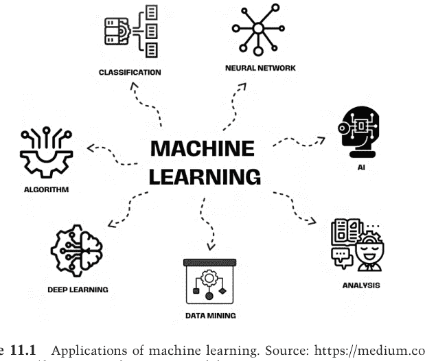

图 11.1 机器学习的应用。Source: https://medium.com/hashmapinc/data-science-for-executives-bd6e766a6a19

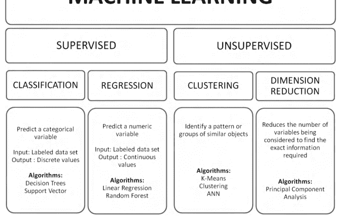

图 11.2 机器学习的分类 [35]。

- **轨迹分析：** 机器学习可以帮助重建弹丸的轨迹。通过分析撞击模式和角度并考虑环境因素，ML 算法可以帮助法医专家确定发射弹丸的可能路径。这些信息对于理解枪击事件的动态至关重要。
- **射击位置和撞击分析：** ML 算法可以分析与子弹撞击相关的声学信号，帮助法医专家了解每次射击的轨迹和位置。这有助于事件的重建和射手位置的确定。
- **子弹膛线纹路的模式识别：** 机器学习可用于分析子弹上的微观特征，例如由枪管留下的条纹和标记。ML 算法可以识别独特模式，促进回收子弹与特定枪支的匹配。

枪支的识别是刑事调查中最关键、最复杂和最困难的方面之一。就发射后子弹和弹壳上的标记而言，每支枪支，无论大小、制造商或型号，都有其独特的指纹。ML/AI 将大大简化确定弹丸潜在影响区域的任务 [7]。利用图像处理，人工神经网络可以帮助专家扫描数据库中的火药和弹壳，并在无需直接干预的情况下比较子弹标记、枪支身份和其他弹道证据。一种基于快速傅里叶变换的利用线扫描成像识别弹丸样本的独特分析技术 [8]。此外，法医弹道学中的机器学习用于检查诸如膛线痕迹等类别特征和子弹的个体特征 [9]。

未来，机器学习和人工智能还将被用于协助军事决策者 [10]。武装部队将通过平视显示器和武器控制系统接收增强现实数据，这些数据将由人工智能提供。它将被用于识别和分类威胁、优先考虑目标并显示友军的位置及其周围的安全距离。AI 系统将使用战场上众多传感器的数据来构建基于当前军队所不了解的信息的画面。在不久的将来，士兵将处理大多数军事行动，但 AI 将基于人类无法单独理解的庞大数据集提供分析和建议 [7, 9]。未来还可以在战场上部署微型机器人，当士兵的枪支基本战斗装载耗尽时，为个别士兵运送装填好的弹匣 [10]。

## 法医弹道学中机器学习的应用

### 枪支识别

越来越多犯罪现场使用的枪支记录可用于调查目的。法医调查的目标是确定被审查的物品是否确实是枪支，以及确定其型号、口径和其他相关特征。对弹壳发射声（具体为冲击波和枪口爆破声）的法医分析已被广泛认可 [11–14]，并在刑事调查中使用。声学证据与外部弹道计算的整合可以促进射手距离和位置的确定 [15, 16]。此外，对弹丸在其轨迹中以及撞击时产生的噪音进行检查是可能的 [17–19]。犯罪现场记录声学分析的另一个应用是确定不同射手发射的射击顺序 [10, 20]。

枪支在操作过程中会产生各种声学信号，包括射击声、飞行子弹声和子弹撞击声。这些声学信号可以被分析、比较和识别，以区分不同类型的枪支及其机械动作。对弹壳发射声的法医调查，结合外部弹道计算，可以帮助确定射手的距离和位置。通过分析枪支发出的声学信号，包括射击声、飞行子弹声和子弹撞击声，可以识别不同类型的枪支及其机械动作。机器学习已被发现是分析和识别这些声学信号最有前景的方法，可用于法医识别。

### 枪击残留物分析

定量轮廓-轮廓关系（QPPR）建模是一种新颖的机器学习技术，旨在建立与源自枪击残留物（GSR）的未发射弹药的化学性质相关的关联和预测 [21–23]。通过利用发射后 GSR 轮廓，该方法使用当代机器学习技术预测特定弹药组件的发射前化学轮廓。将预测的轮廓相互比较并与其他已测量的轮廓进行比较，使法医调查人员能够建立证据联系。如图 11.3 所示，QPPR 建模方法在预测来自已发射弹壳中有机 GSR 的无烟火药（SLPs）的 GC-MS 轮廓方面的有效性已得到证明。实验确定的轮廓与预测的轮廓非常相似 [24]，提供了一种将 GSR 与特定类型弹药关联的定量方法，这种新方法能够在各种法医场景中准确关联证据 [25]。

### QPPR 建模方法

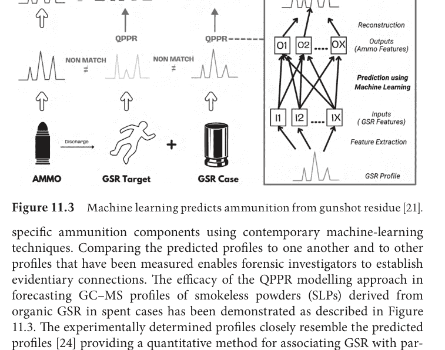

图 11.3 机器学习从枪击残留物预测弹药 [21]。

### 子弹和弹壳分类

机器学习通过提供计算两幅弹道图像之间相似度的系统方法并在真实匹配和错误匹配之间进行分类，有助于子弹的识别。在弹道图像匹配的背景下，机器学习技术，特别是基于监督学习的方法，已被证明优于非学习方法。通过利用计算机视觉和机器学习的进步，基于学习的方法可以解决先前工作的局限性，特别是在法医实践的背景下 [26]。该方法采用基于 Gentle Boost 的学习方案来选择空间域中具有判别性的局部单元子集，每个单元使用经典互相关函数（CCF）分数构成弱分类器 [27]。该

针对弹道图像匹配提出的方案涉及一种基于学习的方法，用于计算带有闭锁面印痕的两个弹道图像之间的相似度 [26, 28]。该研究将所提方法与最先进的方法在受控实验室数据（美国国家标准与技术研究院（NIST）数据集）和新收集的实战法医实验室（OFL）数据集上进行了比较。结果显示在 NIST 数据集上表现良好，所提方法实现了完美分类。它在预期误差方面优于 NIST 技术，表明其在弹道图像匹配中的有效性。在更具挑战性的 OFL 数据集上，所提方法也优于全局互相关方法，尤其是在低误报率下 [29]。所提方法显示出解决这些挑战的潜力，并强调需要建立大型实战基准弹道图像数据库以开发弹道匹配的概率模型 [30, 31]。这些方法表现出良好的性能，并在预期误差方面优于最先进的方法，尤其是在更具挑战性的实战法医实验室数据集上。

总体而言，机器学习在提高弹道图像匹配的准确性和可靠性方面发挥着关键作用，尤其是在实战法医环境中。它允许开发一种系统且科学可靠的弹道图像比较方法，解决了关于基于工具痕迹的法医证据可靠性和有效性的担忧 [32]。

## 射击距离估计

射击距离估计涉及许多因素。例如，霰弹枪散布模式，Oura 等人指出其由若干因素造成 [33]：

> 首先，霰弹枪枪管长度对散布模式有重大影响，短枪管...在较短的射击距离下就倾向于提供宽散布模式。较长的枪管则倾向于提供更集中的散布。其次，喉缩对散布模式有重大影响...除枪管长度和喉缩选择外，诸如膛径、弹丸尺寸和材料（例如铅 vs. 钢）等若干因素也会影响散布模式。

这些各种因素结合起来形成复杂的霰弹枪散布模式，使其成为法医分析和射击距离估计中的重要考虑因素。

机器学习技术越来越多地用于解释射击距离，一些研究应用回归分析和基于 TinyResNet 的算法来估计各种枪支的射击范围，包括霰弹枪、AK-47 和卡什尼科夫步枪 [34]。在此类研究中，回归分析对于估计霰弹枪弹丸散布模式至关重要，射击距离通常落在置信区间内。研究结果为回归分析在从霰弹枪散布模式估计射击距离方面的有用性提供了希望。此外，虽然另一项研究探讨了神经网络架构根据射击距离对霰弹枪散布图像进行分类的潜力，但由于霰弹枪射击的复杂性，未来无疑需要进一步研究来开发可靠且可应用的此类模式解释算法。[34]。

在未来研究中考虑喉缩、弹壳和弹丸变化等因素对于开发更准确的算法至关重要。终极目标是开发稳健且可泛化的算法，为法医调查人员提供有益工具，特别是在背景信息有限的情况下提高法医霰弹枪散布模式解释的准确性 [34]。这些发现对法医调查人员和执法机构具有启示意义，表明深度学习算法未来可能提高法医霰弹枪散布模式解释的准确性和效率。

## 法医科学中机器学习的优势

- **模式识别与分类：** 机器学习算法在辨别弹道证据中复杂模式方面表现出熟练程度，从而促进独特枪支相关特征的分类。这种能力增强了基于细微标记和弹丸轨迹的枪支识别和区分。
- **高效弹丸匹配：** 基于机器学习方法的自动化系统显著提高了弹丸与特定枪支的快速匹配效率。通过分析弹丸和弹壳上的独特标记，机器学习算法简化了识别过程，从而减少人工工作量并加快调查时间线。
- **先进弹道成像分析：** 机器学习通过自动化弹丸或弹壳上复杂条纹的比较和匹配来改进弹道成像分析。自动图像识别算法有助于法医专家识别和解释复杂模式，超越了传统方法的能力。
- **增强数据库匹配：** 将机器学习集成到弹道数据库中建立了快速而精确地将弹道证据与现有记录进行匹配的框架。这种能力简化了调查过程，促进了对先前刑事事件潜在关联的及时识别。
- **减少人为错误：** 通过机器学习应用自动化降低了法医分析中人为错误的固有风险。通过自动化常规和重复性任务，法医专家可以将注意力重新集中到调查的更复杂方面，最终提高结果的可靠性和准确性。
- **枪支和弹药预测建模：** 在适当训练后，机器学习模型表现出预测与枪支、弹药或射击事件相关各种特征的能力。这种预测能力为调查人员提供了知情决策工具，从而增强刑事调查期间的态势感知。
- **整体数据融合：** 机器学习促进了来自不同法医来源的信息整合，形成对犯罪现场的全面理解。这种整合方法将弹道数据与其他法医学科的输入相结合，形成细致的视角，可能揭示潜在的联系和见解。

将机器学习方法引入法医弹道学带来了从提高效率到增强分析能力的一系列优势，从而显著促进了刑事调查流程的完善。

## 法医科学中机器学习的劣势

- **机器学习模型中的数据质量和偏差：** 机器学习（ML）模型在法医弹道学中的有效性取决于训练数据集的质量和代表性。如果数据集存在偏差或缺乏全面覆盖，ML 模型可能会产生不准确或偏斜的结果，尤其是在枪支和弹药多样性的背景下。
- **过拟合挑战：** ML 模型易受过拟合影响，即模型在训练数据集上表现极佳，但在泛化到新未见数据时表现不佳。在法医弹道学中，过拟合可能导致模型过度针对特定类型的弹道证据，从而阻碍在不同场景中的适应性。
- **可解释性问题：** ML 模型的可解释性，尤其是深度神经网络等复杂架构，在法医弹道学中构成挑战。决策过程的黑箱性可能阻碍法医专家理解和解释模型结论背后的理由，引发关于透明度和可解释性的疑问。
- **人类专业知识与机器学习：** 人类法医分析师固有的复杂专业知识和直觉可能无法完全被 ML 模型所涵盖。法医专家在解释复杂弹道证据的细微差别时至关重要的情境理解和经验知识，可能无法通过机器学习方法得到充分体现。
- **法医科学的动态性：** 法医科学，包括弹道学，随着方法和技术的进步不断发展。ML 模型在快速适应这些变化方面可能面临挑战，需要频繁更新和重新训练以保持准确性和相关性。

机器学习在法医弹道学中的应用要求仔细考虑这些科学挑战，以确保调查过程的稳健性、公平性和伦理完整性。机器学习专家与法医分析专家之间的合作对于应对这些复杂性至关重要。

## 结论

法医弹道学是法医科学中的一个关键领域，通过分析枪支和弹药将其与特定犯罪联系起来。机器学习（ML）是一门快速发展的学科，提供智能数据分析技能。ML 用于各种应用，包括弹丸和弹壳分类、枪支识别、轨迹分析和射击位置及影响分析。然而，由于法医科学家和机器学习及数据挖掘专家之间缺乏认知，ML 在法医弹道学中的应用仍处于起步阶段。将 ML 集成到法医弹道学中具有显著的潜力，可提高效率和准确性。机器学习（ML）可用于法医弹道学中分析弹丸上的微观特征，

识别独特模式并将回收的子弹与特定枪支进行匹配。该技术简化了确定弹丸潜在影响区域的任务，还可用于协助军事决策者识别威胁并确定目标优先级。机器学习在法医弹道学中的应用包括枪支识别、声学分析和确定各种射手发射的射击顺序。未来，人工智能系统将基于海量数据集提供分析和建议。

## 参考文献
- 1. Barash, M., McNevin, D., Fedorenko, V., & Giverts, P. (2024). 法医 DNA 分型中机器学习的应用：批判性综述。 Forensic Science International: Genetics, 69(102994), 102994. https://doi.org/10.1016/j.fsigen.2023.102994
- 2. Mahesh, B. (2020). 机器学习算法综述。 International Journal of Science and Research (IJSR) [Internet], 9(1), 381–386.
- 3. Scaruffi, P. (2018). 《智能并非人工——扩展版：人工智能的历史以及奇点为何在不久的将来不会到来》。 Createspace Independent Publishing Platform.
- 4. Qadir, A. M., & Varol, A. (2020). 机器学习在数字取证中的作用。 8th International Symposium on Digital Forensics and Security (ISDFS).
- 5. Tageldin, L., & Venter, H. (2023). 机器学习取证：在智能环境中进行数字取证调查中使用机器学习技术的最新进展。 Applied Sciences (Basel, Switzerland), 13(18), 10169. https://doi.org/10.3390/app131810169
- 6. Scientific Working Group on DNA Analysis Methods (SWGDAM): Validation Guidelines for DNA Analysis Methods. (n.d.).
- 7. Kudonu, M., AlShamsi, M. A., Philip, S., Khokhar, G., Hari, P. B., & Singh, N. (2022). 人工智能：枪支检验的未来。 2022 Advances in Science and Engineering Technology International Conferences (ASET). https://doi.org/10.1109/aset53988.2022.9735105
- 8. Khan, S., Divakaran, A., & Sawhney, H. S. (2010). 在不同采集条件下使用声学特征进行武器识别。 US Patent Application US20100271905A1.
- 9. Magic bullets: The future of artificial intelligence in weapons systems. www.army.mil. (n.d.). Retrieved August 21, 2022, from https://www.army.mil/article/223026/magic_bullets_the_future_of_artificial_intelligence_in_weapons_systems
- 10. Li, S.-T., Kuo, S.-C., & Tsai, F.-C. (2010). 使用 FSOM 和规则提取的犯罪预防智能决策支持模型。 Expert Systems with Applications, 37(10), 7108–7119.
- 11. Giverts, P., Sofer, S., Solewicz, Y., & Varer, B. (2020). 通过其机构的声学信号识别枪支。 Forensic Science International, 306(110099), 110099. https://doi.org/10.1016/j.forsciint.2019.110099
- 12. Haag, L. C. (1979). 声谱图在枪声表征中应用的初步研究。 AFTE Journal, 11, 61–63.
- 13. Hollien, H., & Hollien, K. A. (1994). 小型武器枪声的声学模式。 AFTE Journal, 26, 41–49.
- 14. Haag, L. C. (2003). 射击事件中光和声作为物证。 AFTE Journal, 35, 317–321.
- 15. Paredes, D. M., & Apolinario, J. A. (2014). 使用高架平台上的麦克风阵列进行射手定位。 2014 IEEE Central America and Panama Convention (CONCAPAN XXXIV). IEEE, pp. 1–6. https://doi.org/10.1109/CONCAPAN.2014.7000419
- 16. McCombs, N. D., & Vargas, E. (2014). 枪声。 AFTE Journal, 46, 33–42.
- 17. Haag, L. C. (2016). 1803–1806 年发现之旅期间梅里韦瑟·刘易斯携带的 1780 年型 Girardoni 空气步枪的外弹道和末端弹道。 AFTE Journal, 48, 131–137.
- 18. Haag, L. C. (2002). 子弹的声音。 AFTE Journal, 34, 255–263.
- 19. Maher, R. C. (2016). 犯罪事件中的枪声录音：谁先开枪？ The Journal of the Acoustical Society of America, 139, 2024. https://doi.org/10.1121/1.4949969
- 20. Inman, K., & Rudin, N. (2001). 犯罪技术学原理与实践。 CRC Press.
- 21. Haag, M. G., & Haag, L. C. (2011). 射击事件重建 (2nd ed.). Academic Press.
- 22. Heard, B. J. (2008). 枪支与弹道学手册 (2nd ed.). John Wiley & Sons.
- 23. Gallidabino, M. D., Barron, L. P., Weyermann, C., & Romolo, F. S. (2019). 定量轮廓-轮廓关系（QPPR）建模：一种预测并关联未发射弹药化学特征的新型机器学习方法（来自枪击残留物 GSR）。 The Analyst, 144(4), 1128–1139. https://doi.org/10.1039/c8an01841c
- 24. Rakhmibekova, A., Madzhidov, T. I., Nugmanov, R. I., Gimadiev, T. R., Baskin, I. I., & Varnek, A. (2020). 化学反应 QSPR 模型适用域的综合分析。 International Journal of Molecular Sciences, 21(15), 5542. https://doi.org/10.3390/ijms21155542
- 25. Aalbers, S. E. (2013). 枪击残留物成分比较的证据价值。 Delft University of Technology.
- 26. Roth, J., Carriveau, A., Liu, X., & Jain, A. K. (2015). 基于学习的弹道膛室面印痕图像匹配。 2015 IEEE 7th International Conference on Biometrics Theory, Applications and Systems (BTAS).
- 27. Freund, Y., & Schapire, R. E. (1997). 在线学习的决策理论推广及其在提升中的应用。 Journal of Computer and System Sciences, 55(1), 119–139. https://doi.org/10.1006/jcss.1997.1504
- 28. Biedermann, A., & Taroni, F. (2006). 枪支证据与枪击残留物联合评估的概率方法。 Forensic Science International, 163(1–2), 18–33. https://doi.org/10.1016/j.forsciint.2005.11.001
- 29. Daugman, J. G. (1993). 通过统计独立性检验对人员进行高置信度视觉识别。 *IEEE Transactions on Pattern Analysis and Machine Intelligence*, 15(11), 1148–1161. https://doi.org/10.1109/34.244676
- 30. Weller, T. J., Zheng, A., Thompson, R., & Tulleners, F. (2012). 对 10 个连续制造的 pistol 滑套发射的弹壳膛室面标记的共聚焦显微镜分析。 *Journal of Forensic Sciences*, 57(4), 912–917. https://doi.org/10.1111/j.1556-4029.2012.02072.x
- 31. Vorburger, T., Yen, J., Bachrach, B., Renegar, T., Filliben, J., & Ma, L. (2007). *用于国家弹道成像数据库可行性评估的表面形貌分析*。 NIST Interagency/Internal Report (NISTIR), National Institute of Standards and Technology, Gaithersburg, MD, [online].
- 32. Song, J.-F., & Vorburger, T. V. (2000). *使用自相关函数进行弹丸特征比较的建议*。 Proceedings of National Conference of Standards Laboratories.
- 33. Oura, P., Junno, A., & Junno, J.-A. (2021). 法医霰弹枪弹着点模式解释中的深度学习——概念验证研究。 *Legal Medicine*, 53, Artikeli 101960. https://doi.org/10.1016/j.legalmed.2021.101960
- 34. Alfonsi, A., Calatri, S., Cerioni, E., & Luchi, P. (1984). 装填散弹弹药的霰弹枪射击距离估计。 *Forensic Science International*, 25(2), 83–91. https://doi.org/10.1016/0379-0738(84)90017-3
- 35. Tangirala S. (2020). 评估 GINI 指数和信息增益对使用决策树分类器算法分类的影响。 *International Journal of Advanced Computer Science and Applications(IJACSA)*, 11(2), 612–619. http://dx.doi.org/10.14569/IJACSA.2020.0110277

## 大数据分析中机器学习的应用
# 12 大数据分析中机器学习的应用
SUMIT KUMAR CHOUDHARY, SURBHI MATHUR, PRAVESH SHARMA AND ANUBHAV SINGH

## 引言
几乎所有跨不同专业、文化、地理或社会群体的企业都已成为以数据为中心和以数据驱动的。对数据使用的倾向和依赖正在增加，数据本身也在增加。越来越多的降水数据被产生，我们现在称之为‘大数据’。大数据既是所有现代企业的资产，也是挑战。如果以有意义的方式使用，大数据就是一个强大的推动者。仔细审查可以呈现您过去行动与过去结果之间的奇妙相关性。错误被检索出来，并推广了未来获得更好结果的纠正机会。对过去做了哪些更好工作的洞察也被证实，并提供了如何进一步改进的线索。因此，多个程序步骤可以根据大数据分析进行修改、恢复或增强。图 12.1 显示了用于数据挖掘的各种技术。资源管理及其最佳应用可以得到保障以提高效率。失败的原因可以确定并消除。趋势和特定模式可以被智能地辨别，这可以窥见未来的轨迹。风险-收益平衡可以重新调整以有利于收益。红旗和绿旗可以更好地理解，以便就应放弃什么和应追求什么做出明智的行动。本质上，预测分析和智能决策可以从大数据分析中得出。

在我们继续应用机器学习算法来理解其效用和挑战之前，至关重要的是要很好地理解大数据这一概念。图 12.2 显示了大数据的三个 V，即多样性、体量和速度。这些描述了当前任务的本质，也揭示了需要处理的数据所涉及的复杂性。管理和分析大数据带来严峻挑战。大数据的挑战在于其扩展的速度（速度），指数级数量


## 数据挖掘技术概述

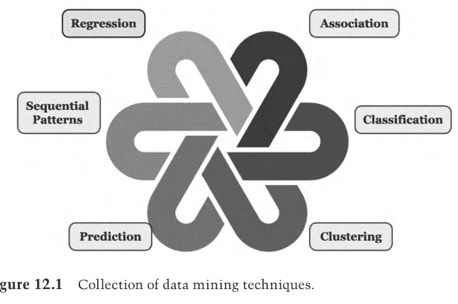

Figure 12.1 数据挖掘技术的集合。

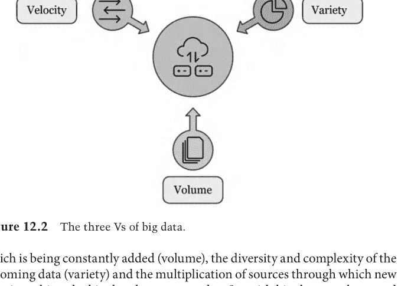

Figure 12.2 大数据的三个 V。

which is being constantly added (volume), the diversity and complexity of the incoming data (variety) and the multiplication of sources through which new data is making the big data larger every day. So, with big data amalgamated with so many challenging dimensions, the analysis of such data is an arduous task. The conventional data analytics approaches may fall short of expectations when confronted with the complexity of big data and this would only underline the maxim that modern problems need modern solutions.

机器学习（ML）通常被视为人工智能的一个子领域，能够基于其算法处理大量数据，并可以从这些数据中学习以进一步改进数据分析、分类和模式识别，最终进行预测。机器学习在大數據分析中可以帮助企业、行业甚至执法机构识别模式、精确预测结果并从海量数据中获得有价值的见解 [1]。因此，具有速度、体量和多样性特征的大数据可以得到有效处理，并需要应用机器学习等复杂方法进行分析 [2]。

## 机器学习基础

在将机器学习应用于大数据分析之前，了解其核心基础是至关重要的。机器学习算法使系统能够接收输入数据，从中学习，产生有意义的见解或进行预测，并基于更多数据的可用性不断改进其性能，以完善其预测属性。主要有三种基本机器学习类型：（i）监督学习，（ii）无监督学习和（iii）强化学习。

当系统在标记的数据集上学习并训练，并据此做出预测时，就称为监督学习 [3]。虽然由于其在标记数据集上训练，预测准确率可能非常高，但可能无法识别训练数据集中未包含的未知模式而失败。系统使用逻辑回归和线性回归进行二元分类和预测连续变量 [4]。为了获得更好的输出，这些模型需要在海量数据上进行训练，使其能够学习可扩展实现、并行处理和分布式计算技术 [5]。

相反，当系统在未标记的数据集上训练，并基于其识别新模式和结构的能力发展出做出预测或生成输出的能力时，就称为无监督学习。系统探索未标记数据之间的隐藏模式、关系和相似性，以得出新输入数据的特定概率 [6]。

有时也会发现半监督学习模型，它通过使用标记和未标记数据进行训练，与监督学习和无监督学习部分相似。强化学习是基于反馈的学习，其中在每次输出后，系统通过奖励-惩罚反馈增强其学习。在这种情况下，环境对系统学习有决定性影响。系统在收到对其结果的正面或负面反馈后每次都会改进。

## 预处理和特征工程

大数据按其命名以海量数据为特征，这些数据可能非常复杂且结构不完整。因此，要通过机器学习工具处理此类数据，重要的是通过特征工程预处理原始数据，涉及清理和更改原始数据的步骤。清理通常是指处理数据以减少噪声、管理缺失值和解决不一致问题。对于更改数据或我们所说的转换数据，应进行缩放归一化和编码变量 [7]。特征工程还可以进一步帮助从原始数据中挑选相关特征，以提高 ML 模型的整体性能和输出。

## 神经网络和深度学习

机器学习通过深度学习处理大量和复杂结构化数据能力最近获得了极大的关注。循环神经网络（RNNs）经常用于语音和自然语言处理等序列数据分析。同样，卷积神经网络（CNNs）在图像识别相关任务中得到广泛应用 [8]。深度学习模型在很大程度上改变了系统在语言理解和机器翻译方面的能力。深度学习模型可以利用分布式计算框架、并行处理以及张量处理单元（TPUs）和图形处理单元（GPUs）等专用硬件加速器，在具有固有复杂性的海量数据上进行有效训练。

## 大数据应用

机器学习用于分析大数据在人类事业几乎所有交叉领域都有多个现实世界应用，例如工业、制造单位、网络安全措施和风险缓解、营销、医疗保健部门和金融领域。金融部门从部署 ML 模型评估信用风险、防止欺诈、交易活动等方面受益。它支持医疗保健行业中的药物研究、个性化治疗和疾病识别。通过客户细分、定向广告和流失预测，营销行业受益于机器学习。机器学习用于制造中的预测性维护、供应链优化和质量控制。机器学习用于网络入侵检测、威胁情报和异常检测方面的网络安全 [9]。每个应用都强调机器学习算法解决的特定问题以及其应用带来的优势。

不同行业已被大数据彻底改变，使企业能够学习有用的经验教训、做出更好的决策并推动创新 [10, 11]。

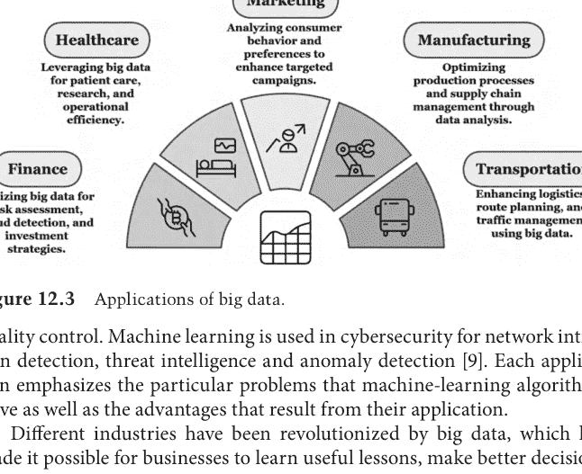

Figure 12.3 大数据的应用。

以下是图 12.3 所示的各个行业中几个重要的大数据用途。

### 金融
- **Identifying and Preventing Fraud:** 大数据分析可以发现金融交易中的模式和异常，快速发现欺诈。
- **Risk Assessment:** 金融机构可以通过分析海量金融和市场数据更有效地分析和管理风险。
- **Algorithmic Trading:** 得益于大数据分析，可以创建能够做出更快、更明智投资决策的复杂交易算法。

### 医疗保健
- **Personalized Medicine:** 通过分析大量患者数据（如医疗记录、基因组数据和生活方式数据），可以为特定个人定制治疗和药物。
- **Disease Prediction and Early Detection:** 来自庞大医疗数据源的大数据分析可以适当地用于学习趋势，以预测疾病发作的早期迹象以及初步阶段何种干预可以取得更好的效果。
- **Drug Discovery:** 新药发现过程可以极大地受益于对基因组、化学和生物化学等多种和大量数据以及临床试验及其结果数据的快速分析。

### 营销和客户分析
- **Customer Segmentation:** 营销机构可以根据大数据分析获得的见解，根据其消费行为、社会经济状况和兴趣，熟练地对买家群体进行分类和聚类。
- **Targeted Advertising:** 组织可以通过检查客户信息和他们的在线行为，向特定人群提供特定感兴趣的信息，从而定制其产品推广工作，使广告更具针对性。
- **Churn Prediction and Customer Retention:** 大数据分析可以帮助组织最大限度地减少客户饱和，并制定方法保持其最重要的客户完整并保持其购买意愿活跃。

### 制造和供应链
- **Predictive Maintenance:** 数据分析可用于预测和预测维护计划、支持先决条件并避免可能突然中断制造过程的故障。
- **Quality Control:** 数据分析可以检查之前的制造和性能记录，以发现质量问题或不足，从而解决它们并提高产品质量。
- **Supply Chain Optimization:** 大数据分析可以揭示过去库存管理的问题以及如何和在哪里改进。同样，通过基于数据的见解也可以实现成本削减、提高效率等。

### 运输和物流
- **Route Optimization:** 通过对正在进行的交通数据、天气状况以及过去记录和趋势的大数据分析可以实现路线优化。


- **需求预测：** 大数据分析可以帮助销售行业通过衡量需求、消费者行为、销售数据及其他影响因素的模式和趋势来管理库存和生产。
- **车队管理：** 大数据分析可以帮助检查车辆信息，例如燃油使用、维护要求和驾驶员行为，以保持完美的车队运营并降低运营成本。

## 能源与公用事业
- **智能电网管理：** 智能电表、传感器和框架基础设施信息可以利用大数据分析进行分解，以改善能源分配、减少停电并提高生产率。
- **能源消耗优化：** 组织可以通过分析气象信息和能源利用模式，更有效地找到节能和分配资源的机会。
- **可再生能源优化：** 为了扩大对环境友好型能源来源的理解和使用，大数据分析可用于预测天气条件、能源产量指标和需求。

上述应用仅具有指示性，并不能全面涵盖大数据分析的能力。还可能有更多应用，涵盖人类生活和企业的几乎所有领域。随着数据持续呈指数级增长，以及以技术为驱动的 ML 模型创新不断演进，未来大数据分析将蕴含更多希望和更具说服力的应用。

## 道德考量与挑战

随着机器学习在大数据分析中得到越来越多的应用，伦理问题和困难被推向前台。妥善解决这些伦理挑战对于自由应用大数据分析的 ML 工具至关重要。以下讨论了一些相关的伦理困境 [12]：
- **数据隐私：** 大量私人数据可能构成待分析的大数据的一部分，因此组织需要采取必要的保障措施，确保数据隐私得到尊重，并且数据按照现行数据保护法律的规定得到保护。数据加密、以安全模式存储数据或匿名化方法可以证明有助于降低数据隐私受损的威胁。
- **偏见与公平性：** 如果算法即使无意中支持用于训练模型的数据中的任何偏见或先入为主的观念，ML 算法可能会产生偏斜或有偏见的结果。因此，重要的是消除此类偏见，无论其是否存在，以便模型能够正确学习并产生公平的结果。任何 ML 模型的公平性结果可以通过实施偏见检测、模型可解释性和公平感知学习等方法来确保和增强。这些方法共同可以增强公平性并减少结果中的偏见。
- **可解释性与可说明性：** 随着 ML 模型和算法复杂性的增加，精确理解模型的工作原理变得困难。解释和说明对于理解决策过程以及对其负责非常重要。特征重要性分析、模型可视化和规则提取等方法使理解 ML 模型做出特定决策背后的理由变得更容易。
- **数据质量与可靠性：** 待处理的大数据质量通常会受到质量问题、噪声和其他数据缺口的影响。数据质量差会严重影响 ML 模型的精确性和可靠性。因此，为确保数据质量，需要进行数据验证程序、数据清洗方法和数据验证方法。
- **可扩展性与资源限制：** 为了处理和处理作为大数据的海量信息，需要建立适当的资源限制，如基础设施和算法。同样，随着数据越来越大，处理单元应可扩展到更高的极限。分布式计算框架、并行处理和云基础设施可以帮助 ML 模型的实施克服可扩展性和资源限制这两个问题。
- **算法透明度与问责制：** 由于 ML 算法在许多领域经常做出重要决策，因此明确责任和开放性至关重要。透明度和问责制能够在系统中激发用户更多的信心和信任。
- **人工监督与决策：** 以结果验证、遵守伦理标准和解读复杂模式形式的人工干预对于通过构建这种人机协作决策系统使系统实现最佳和合法的输出非常重要。

使用机器学习进行大数据分析为各种行业提供了众多优势和应用前景。然而，解决这种整合带来的问题和伦理问题至关重要。组织可以通过将数据保护、公平性、可解释性和问责制作为首要任务，在最大限度降低风险的同时利用机器学习的强大功能。如果持续监控和评估算法及其对社会的影响，机器学习在大数据分析中的应用将是合乎道德的并造福社会。

## 使用机器学习分析大数据

由于机器学习能够快速、准确地输出，帮助用户深入了解其关注的关键问题，因此机器学习对于大数据分析至关重要且不可或缺。ML 可以在大数据分析中以以下方式提供帮助：
- **模式识别：** 大量数据通常会呈现复杂的模式和内部联系，这些模式和联系很难通过人工或简单的统计工具来理解。机器学习能够解读数据之间即使在数据无结构或具有多个变量的情况下的关系和模式 [13]。
- **预测分析：** 机器学习具有通过分析数据模式和关系进行基于数据的预测的独特能力。这是 ML 模型被广泛接受的最大优势，因为其预测对于几乎所有人类企业的决策都极具价值 [13, 14]。
- **分类与聚类：** 机器学习可以非常有效地、有意义地将大量数据分类和聚类为较小的类别。然后可以对这些聚类进行评估以进行趋势预测，从而辅助决策 [14]。
- **异常检测：** ML 算法可以利用大量信息来追踪异常或异常现象。这些异常可能是危险信号、欺诈、不规则行为或信息问题的迹象，有助于用户实时做出明智决策 [15]。
- **自然语言处理 (NLP)：** 有多个启用 ML 的 NLP 应用可以执行情感分析、文本分类、主题建模和语言翻译，有助于处理非结构化文本数据，从中提取有益的见解。这些数据可能包括文本信息，包括消息或电子邮件、社交媒体帖子和客户评论 [16]。
- **推荐系统：** ML 模型可以通过分析与客户行为、选择、消费习惯、购买时间段、过去购买的商品质量等相关的海量数据，为企业制作量身定制的推荐。这些推荐可以指导企业进一步关注客户偏好、提高参与度、实现更高的客户满意度、定制广告等 [17]。
- **深度学习：** 一种称为深度学习的 ML 类型涉及训练具有多层的人工神经网络，以自然地检查复杂的数据关系并检索用于预测信息的模式。它们可以处理海量信息，因此适合大数据分析 [18]。
- **可扩展性与效率：** 机器学习算法可以以可扩展的方式进行编程，以处理越来越多的数据，同时保持并能够提高处理这些海量数据的效率。ML 模型可以有效地使用分布式计算网络进行负载分配 [19]。
- **数据预处理与特征工程：** 机器学习算法在处理有组织且干净的数据时能产生最佳结果。然而，这类数据很少见。因此，需要对数据进行预处理和特征工程以优化输出。预处理步骤可能包括数据清洗、数据规范化和特征优化。另一方面，特征工程涉及开发新特征或选择重要特征以获得更好 ML 模型结果等步骤。预处理和特征工程很重要，因为 ML 模型通常处理具有大量多样性的多维数据 [20]。
- **用于预测和分类的监督学习：** ML 模型被准备为监督学习算法，以处理大数据从而对数据进行准确预测和分类。对数据集的模式和关系进行分析以对所述数据进行预测或分类。这在欺诈检测、风险评估、情感分析和客户流失预测等方面有广泛应用 [21]。


- **无监督学习用于模式发现和聚类：** 无监督学习恰当地在未标记数据上工作，以发现数据中的隐藏结构和模式。这在客户细分、异常检测和模式识别方面有应用。在多维数据的情况下，使用诸如 t-分布随机邻域嵌入（t-SNE）和主成分分析（PCA）等技术，可以在不扰乱其结构和变异性的情况下减少不需要的维度数量 [22]。
- **深度学习用于复杂模式识别：** 为了处理和分析具有极端复杂性和错综复杂模式的数据，已经发展出使用多层神经网络的深度学习模型。深度学习模型能够自动发现数据中的这些复杂性并以准确性进行分析以实现精确预测。两种最常见的深度学习模型是：循环神经网络（RNNs）和卷积神经网络（CNNs）。两者在大数据分析中经常使用，包括与自然语言处理、图像、音频和视频识别以及推荐系统相关的任务 [23]。
- **实时分析和流数据：** 机器学习算法还能够对持续的流数据进行实时分析，使用户能够对紧急问题做出即时决策。诸如在线学习、增量学习和自适应模型等算法通过对流数据的持续分析使实时分析和预测成为可能 [24]。
- **可扩展机器学习：** 可扩展的机器学习模型对于处理大数据分析中的数据量、速度和多样性至关重要。这可以通过诸如 Apache、Spark 和 Hadoop 等分布式计算网络来实现，这些网络将计算负载分布在多台计算机或集群上。张量处理单元（TPUs）和图形处理单元（GPUs）是专用硬件解决方案的例子，有助于并行处理 [25]。
- **优化与自动化：** 机器学习模型的性能通过诸如优化和自动化等步骤得到改善。诸如梯度下降、遗传算法和贝叶斯优化等优化方法可以提升性能。同样，数据清洗、特征选择、模型选择和超参数调优的自动化也在性能提升中发挥着重要作用。因此，机器学习模型为用户提供了自动化流程、获得准确预测、有意义的洞察和有利决策的特权 [26]。

## 深度学习简介

深度学习通过训练具有众多层的神经网络来学习如何分层表示数据。与依赖手工创建特征的典型机器学习技术相比，深度学习使得能够从原始数据中自动提取错综复杂的特征和模式。由于其处理包括自然语言处理、语音识别和图像识别在内的困难任务的能力，它受到了相当大的关注并获得了流行。

## 历史背景

人工神经网络的想法首次在 1940 年代和 1950 年代提出，这也是深度学习最初出现的时期。然而，深度学习在 1980 年代和 1990 年代因诸如反向传播等技术的创建而崭露头角，这些技术使得能够有效地训练深度神经网络 [27]。近年来，得益于计算能力的提升、大规模数据集的可获得性以及专用硬件（如 GPU）的创建，深度学习发展得更快。

## 要理解深度学习，掌握几个关键概念至关重要

- **神经网络：** 深度学习建立在神经网络之上。它们由神经元层组成，神经元是相互连接的节点。每个神经元接收信息，使用激活函数并将输出发送到下一层。神经网络中可能有一个输入层、一个或多个隐藏层和一个输出层。得益于隐藏层，数据可以以逐步更复杂的方式表示。
- **激活函数：** 神经网络能够模拟输入和输出之间错综复杂的相互作用，这得益于激活函数引入的非线性。sigmoid、tanh 和 ReLU（整流线性单元）激活函数经常被使用。它们使用神经元的输入来确定其输出值。
- **反向传播：** 深度神经网络使用反向传播的核心算法进行训练。它涉及将错误从输出层向后传播到输入层，以迭代地改变网络权重。反向传播通过最小化预期输出和实际输出之间的差异来提高网络性能。
- **深度神经网络：** 由于具有多个隐藏层，深度神经网络可以学习分层数据表示。从输入数据中，每一层提取越来越抽象的特征。网络的深度使其适合处理高维和非结构化数据，因为它能够学习复杂的模式和复杂关系。
- **深度学习架构：** 已经创建了不同的深度学习架构来处理各种数据和任务类型。卷积神经网络（CNNs）和循环神经网络（RNNs）分别利用空间相关性和时间相关性来分析图像和视频以及顺序文本数据。
- **深度神经网络：** 深度学习的底层创新是深度神经网络。它们由组织成层的相互连接的神经元或节点组成。每个神经元学习、激活它，然后将其结果发送到下面的层。深度神经网络可以学习渐进的信息表示，使其能够感知复杂的模式和连接。
- **前馈网络：** 它也称为多层感知器（MLPs），可被视为最基本的深度神经网络类型。它们包含一个或多个隐藏层、一个输出层和一个输入层。数据以单向方式从输入层通过隐藏层到输出层。
- **卷积神经网络（CNNs）：** CNNs 是为专门处理类似网格的输入而创建的，例如照片和电影。它们利用卷积的概念，即在传入数据上应用一组可训练的滤波器。CNN 使用卷积层进行特征提取，使用池化层进行下采样并降低空间维度的数量。之后，完全连接层用于分类或回归接收收集到的特征。在包括图像分类、对象识别和图像分割的应用中，CNNs 显示出出色的性能 [28]。
- **循环神经网络（RNNs）：** 为了处理诸如时间序列、顺序数据、语音和文本等问题，开发了循环神经网络（RNNs）。与前馈网络不同，RNNs 具有循环连接，使数据能够在时间步长中保留并被处理。因此，RNNs 可以检测数据中的时间依赖性。RNN 在每个时间步使用其隐藏状态作为输入和记忆，这会影响稍后做出的预测。这两种广受欢迎的 RNN 变体，长短期记忆（LSTM）和门控循环单元（GRU）有助于解决消失梯度问题并使学习长期依赖关系变得更容易 [28]。
- **深度置信网络（DBNs）：** 一类称为深度置信网络（DBNs）的生成模型由众多层的随机二元单元组成。使用称为受限玻尔兹曼机（RBMs）的方法，DBNs 以无监督方式训练。训练后的深度置信网络可以生成新的样本，这些样本类似于训练数据集。DBN 模型可广泛用于降维、协同过滤和生成建模 [28]。

## 用于分类和回归的深度神经网络

深度学习已被证明是识别复杂相关性、捕获分层表示以及在许多分类或分类任务中表现异常良好的模型。让我们看看深度学习模型在三个重要的分类任务中的工作原理：情感分析、文本分类和图像识别：

- **深度学习用于图像识别：** 通过深度学习模型的图像识别是一项具有挑战性的任务，涉及从照片或任何形式的视觉数据中对模式进行分类，以及对象或面部识别。然而，像卷积神经网络（CNN）这样能够从原始像素数据中挖掘重要特征的深度学习模型极大地推动了图像识别能力。预训练的 CNN 模型使用其多个相互连接的层和池化层来提取局部特征和模式，以便从新数据集中以高精度识别图像和对象 [29]。
- **深度学习用于文本分类：** 文本分类涉及将基于文本的数据表征为预定的组，例如论文或文章。循环神经网络（RNNs）和 Transformer 模型在文本分类中的应用被发现特别有前景。RNNs 能够探索并建立给定数据中上下文相关性和信息顺序，因此 RNN 模型可以轻松执行文档分类、情感分析和主题建模。同样，经过大量文本数据的训练并实施自注意力方法后，诸如 BERT（来自 Transformers 的双向编码器表示）等 Transformer 模型已被证明是自然语言处理中的有价值工具 [29]。


-   **深度学习用于情感分析：** 情感分析的目标是识别文本中传达的情感或极性，例如它是积极的或有利的，还是消极的或反对的，或中立的或公正的。通过收集消息中的语义和以上下文为导向的细微差别，深度学习方法已被证明能够进行情感分析。循环神经网络（RNNs）和卷积神经网络（CNNs）能有效执行情感分析任务。虽然诸如 LSTM 和 GRU 的 RNN 模型在建模数据中的信息序列和长期上下文信息方面表现出色，但配备了识别局部模式和特征的 CNN 模型在处理包含句法和组合数据的文本数据时表现良好 [29]。

## 深度神经网络架构简介

机器学习的深度学习模型建立在深度神经网络拓扑结构之上。深度神经网络帮助模型识别数据中的复杂模式和错综复杂的关联。让我们简要讨论两种最重要的深度神经网络架构模型：（i）多层感知机（MLPs）和（ii）卷积神经网络（CNNs）。虽然 CNN 明确用于处理网格状数据，使其特别适用于图像分类任务，但 MLP 在区分错综复杂的非线性关系方面表现出色 [30]。

(i) **多层感知机（MLPs）：** 多层感知机（MLP），顾名思义，由多个神经元层组成，每个神经元层与其前一层和后一层神经元相互连接。第一层代表‘input layer’，它经过若干中间层即‘hidden layers’，最后到达被称为‘output layer’的最后一层。由于这种用于处理输入数据的互连性，它也被称为前馈神经网络，因为每个神经元层提供一个激活函数并将输出传递给链中的下一层。通过渐进式学习，多个神经元层能够识别来自输入数据的非线性相关性，因此在处理需要复杂决策和分类的数据时非常有用。MLP 通常通过反向传播进行训练，这是一种根据预期结果和观察结果之间的误差来修改网络权重的技术 [31]。

(ii) **卷积神经网络（CNNs）：** 卷积神经网络（CNNs）是专门为处理图像等数据而设计的，例如照片和电影。卷积是 CNN 使用的一种方法，它涉及应用一系列可在输入数据上训练的滤波器。一种称为池化的策略用于整合滤波器的结果，这限制了空间方面，同时保留主要数据。滤波器旨在捕获局部特征和模式，例如表面纹理和边缘模式等。多个池化层是 CNN 模型的重要特征。CNN 模型捕获数据的分层表示以从输入数据中提取相关特征，而池化层则对特征图进行下采样，从而降低计算负载但仍保护数据中的重要信息。所有这些检索到的特征随后通过 CNN 的所有相关层进行集体处理以做出最终预测 [32]。CNN 在图像分类、视觉数据、图像识别任务、法医学中的面部识别以及通用和法医学应用中的目标检测任务中特别有用，这得益于其捕获和处理局部和空间模式的能力以及利用平移不变性和分层结构的能力。

## 深度学习中的回归问题简介

回归分析基于统计方法来衡量因变量和自变量之间的相关性，以便根据各种回归模型做出预测。回归问题侧重于通过深度学习技术对连续变量进行预测并识别数据中的关系和模式。让我们考察深度学习模型在预测连续变量和时间序列方面的应用：

-   **用于预测连续变量的深度学习：** 回归问题使用诸如多层感知机（MLPs）和循环神经网络（RNNs）的变体等深度学习模型，以提高预测连续变量的有效性。模型可以在标记数据上针对预期结果进行训练。MLP 可以通过将输出层修改为没有激活函数的单个神经元来应用于回归挑战。MLP 捕获输入数据与目标变量之间非线性关系的能力使其在两者之间的关系复杂且非线性时在回归分析中特别有用 [33, 34]。RNN 可用于时间相关回归任务，并且在建模序列数据方面有效，例如长短期记忆（LSTM）和门控循环单元（GRU）。

-   **用于时间序列预测的深度学习：** 历史数据点有助于预测与时间序列预测相关的未来值。诸如 RNN 及其类型如 LSTM 和 GRU 等深度学习模型在预测时间序列方面表现良好。RNN 善于识别时间序列数据中的时间联系和模式。LSTM 和 GRU RNN 变体解决了梯度消失问题，使其能够学习时间序列数据中的长期关系 [35]。

## 深度强化学习：

深度强化学习（DRL）是一种非常强大的基于人工智能的工具，它结合了两个非常强大的领域——深度神经网络和强化学习。该模型包含几个重要元素：

-   **状态表示：** DRL 模型通常处理来自环境的未编码或编码数据并表示其当前状态。
-   **动作选择：** 根据当前状态，模型使用将状态与可能动作关联的策略网络来决定动作。
-   **价值估计：** 价值网络由深度 RL 智能体用来计算处于某一状态或采取某一动作的价值。
-   **经验回放：** DRL 技术通过经验回放更有效地学习。这种经验学习有助于模型做出更好的选择和决策。
-   **深度 Q 网络（DQNs）：** DQNs 构成深度强化学习（DRL）的一个子类别。它利用深度神经网络来近似动作价值函数 Q (s, a)，这是 DQNs 背后的基本思想。Q 网络接收当前状态并为每种可能的行动输出 Q 值。智能体根据 Q 值选择动作并迭代更改 Q 网络以提高性能 [36]。
-   **深度生成模型：** 这些模型允许合成新示例并开发模仿训练数据的全新样本。深度生成模型在包括图像、文本和音频在内的多个领域产生逼真且多样的样本的能力引起了广泛关注 [36]。
-   **变分自编码器（VAEs）：** 结合变分推断概念与自编码器的一种深度生成模型称为变分自编码器（VAE）。为了鼓励编码器创建符合特定分布（通常是高斯分布）的潜在表示，VAE 在训练期间优化损失函数 [37]。VAE 已在分子设计、文本生成和图像创建等多个领域得到有效应用，并为理解复杂数据分布提供了坚实基础。
-   **生成对抗网络（GANs）：** 生成对抗网络是一种深度生成模型，具有两个网络——生成器网络和判别器网络，它们共同进行对抗游戏。判别器网络试图精确地区分真实数据和生成样本。生成器单元不断创建与真实数据非常相似的样本以使其不被察觉。这种对抗训练过程增强了模型的学习过程，使其能够基于训练数据创建高质量样本 [38]。GAN 模型在创建高度逼真的图像方面取得了很大成功，与人类面孔和艺术作品非常相似。
-   **基于流的模型：** 顾名思义，基于流的模型基于流的概念。该模型中的数据通过一系列可逆映射进行更改，以促进样本似然的准确计算。这些是深度生成模型，具有异常检测、密度估计和图像生成等多种应用 [39]。
-   **语义索引：** 语义索引处理从庞大的非结构化数据中自动提取重要或有意义的数据。它可以借助基于深度学习的 ML 模型（如 CNN 和 RNN）完成。
-   **判别任务和语义标注：** 判别任务涉及提取特定信息，因为信息根据语义标注等被分类并存储在组中。文本分类、情感分析和命名实体识别（NER）是判别任务的几个典型示例 [39]。
-   **情感分析：** 情感分析有助于确定任何文本信息的情感。它可能是一封信、社交媒体帖子或类似的东西。文本的情感或情绪被分类为积极、消极或中立。这种方法对于企业分析客户反馈、品牌发展等非常有益。在选举中，可以确定公众的整体情绪。对于情感分析，机器学习方法如使用标记数据的监督学习、支持向量机

(SVMs)、循环神经网络 (RNNs) 和基于 Transformer 的模型经常被使用 [39]。

- **命名实体识别 (NER)：** 在文本中识别和分类个人、组织、物体、地点、日期等名称称为‘命名实体识别’ (NER)。条件随机场 (CRFs)、双向 LSTM-CRFs 和基于 Transformer 的模型等机器学习技术是用于 NER 的最常用模型，NER 执行信息检索、问答以及文本摘要 [40]。
- **文本分类：** 文本分类，也称为文本分类，是将文本信息组织到不同组别的方法。文本分类对于内容组织、信息检索和预测系统至关重要。朴素贝叶斯、支持向量机 (SVMs) 以及诸如卷积神经网络 (CNNs) 和基于 Transformer 的模型等深度学习模型是用于文本分类的常见机器学习模型 [41]。

## 语义标注与理解简介

语义标注与理解是指对输入的文本信息附加某种标签或标记并从中挖掘出有洞察力的信息。这使机器学习模型能够更好地理解文本信息，并组织、索引和分析文本数据。语义标注与理解应用可以促进更好的信息检索过程和数据的自然语言处理。其有多种应用，其中包括：(i) 命名实体识别 (NER)，(ii) 词性标注 (POS tagging)，通过为句子中的词语赋予语法标签，如名词、动词、形容词等，(iii) 情感分析，(iv) 主题建模和 (v) 问答。语义标注与理解的两种最强方法为：Word2Vec 和长短期记忆 (LSTM) 网络。Word2Vec 和 LSTM 网络共同提升了所有这些基于文本分析的应用中机器学习应用的有效性。

- **Word2Vec：** Word2Vec 有助于学习词嵌入，从而帮助语义标注与理解。该方法将词语视为连续空间中的稠密向量表示，从而使理解词语之间的语义相关性和相似性索引成为可能。Word2Vec 的连续词袋 (CBOW) 和 skip-gram 架构有助于训练模型在应用于具有相似上下文词语的新输入数据时预期并识别密切相关的词语。因此，在这些模型帮助下可以执行诸如语义标注、词语相似性或类比等任务 [42]。
- **长短期记忆 (LSTM) 网络：** LSTM 类型的循环神经网络模型能够关联具有遥远关系或联系的数据序列。LSTM 模型在功能上能够探索即使相距甚远的信息上下文以建立联系，因此在命名实体识别、文本分类和语义标注方面具有大量应用。LSTM 因其集成了记忆单元并应用门控机制来选择、存储和检索任何相关信息，而在发现文本信息的语义结构方面表现出良好的历史表现 [42]。

## 预测建模

预测建模是大数据分析的一种强大工具和成果，其中过去的数据、模式和趋势被分析以做出未来趋势预测或推断。数学模型和算法被创建以从过去的行动或数据中得出推断并分析它们以预测未来的行动、行为或可能发生的事件。通过预测建模，采用机器学习方法分析大量数据以做出可信的预测 [43]。企业从预测建模中极大地受益于做出有利决策，例如增强决策能力、提高效率和性能、为消费者提供更个性化的体验、欺诈检测和风险管理、医疗保健和医疗应用等。

## 自然语言处理

自然语言处理 (NLP) 彻底改变了基于机器学习的大数据对海量文本数据和分析的分析。Transformer 和注意力机制是流行的深度学习模型，它们在大数据分析中实现自然语言处理。两种模型在性能、可扩展性和语言理解能力方面增强了 NLP 任务。

- **Transformers：** Transformers 是功能强大的深度学习模型，能够处理自然语言中的顺序文本数据。虽然循环神经网络 (RNNs) 以顺序方式处理文本信息，但 Transformers 允许对完整的文本输入序列进行并行处理。它们采用自注意力机制来处理文本信息，并且非常创新地能够建立词语或短语之间的上下文关系。序列中每个词语与其他文本数据的相互依赖性和交互作用被分析以找到上下文联系。最优秀的基于 Transformer 的模型之一是‘BERT’（来自 Transformers 的双向编码器表示），它在情感分析、项目识别、问答和机器翻译方面表现出色 [44]。
- **注意力机制：** 注意力机制促进基于上下文相关性的文本数据提取以产生准确预测。注意力机制极大地提升了 NLP 任务的性能，并且已证明在诸如机器翻译等项目的实施中有效，该项目利用注意力机制处理源语言中特定词语的能力以产生准确的翻译 [45]。

## 图像和视频分析

由于众多技术驱动因素，例如摄像机的广泛可用性、便携式成像设备、监控设备、自主智能设备等，图像和视频的量呈指数级增长。如果过去和现在的趋势是任何迹象，这一图像和视频积累的量和速度将进一步成倍增加。这些图像和视频包含非常重要的信息，需要对其进行分析以应用于多个领域，无论是电子商务、医疗保健、旅游业还是执法。传统计算系统在处理此类图像和视频数据集时遇到挑战，因为它们依赖于人工创建的特征和基于规则的算法 [45]。深度学习模型最适合针对图像和视频作为数据的大数据分析。深度学习模型是功能极其强大的工具，具有从构成视觉数据的原始像素数据中自动学习分层表示的内置能力。深度学习模型能够从输入的视觉数据中自动提取复杂和无形的 information，因此分析更值得信赖和可靠。

诸如卷积神经网络 (CNNs) 等深度学习模型在图像分析方面表现出更佳的性能，例如图像分类、图像分割、图像合成和对象识别。CNNs 基于局部空间特征工作，以学习类型、边缘和纹理的独特特征。具有堆叠层的 CNNs 甚至可以轻松学习最复杂和最精细的视觉数据，从而提高识别的准确性。

具有较长时间成分的视频更难以分析。然而，诸如循环神经网络 (RNNs) 和长短期记忆 (LSTM) 网络等深度学习模型能够识别视频数据之间的时间关系并对其进行分析 [45]。这些模型特别适用于 CCTV 监控数据或片段的分析以及视频摘要，原因在于它们能够准确识别对象、识别运动并预测后续帧。

机器学习的进步使得通过深度学习模型的生成建模创建完全逼真的图像和合成视频成为可能。生成对抗网络 (GANs) 和变分自编码器 (VAEs) 以创建逼真的图像和视频片段而闻名，这些片段与真实的视觉数据非常相似。这些模型在视觉或图形内容创作领域以及准备创意艺术形式等方面具有广泛的应用。

## 异常检测

大数据分析严重依赖异常检测，因为它识别出与预期行为显著不同的趋势或实例。在大数据的背景下，异常检测变得更加关键，因为出于各种原因产生了海量的不同数据。首先，大数据分析使用各种数据源和类型，例如结构化、非结构化和半结构化数据。无论是数值、文本数据、网络流量、传感器读数还是多媒体内容，异常检测算法都有助于在不同数据类型中发现异常 [46]。

异常检测还可以自动指出系统故障、网络安全侵犯或违规、不同类型的欺诈、设备故障或任何其他关键性故障。大数据分析可以从大量噪声中挖掘出对决策至关重要的数据，从而提高运营效率、降低风险并检测异常和离群值，而这些通常无法通过常规统计技术实现 [46]。

## 非平稳数据的增量学习

非平稳数据、变化数据或动态数据在大数据分析中提出了不同的挑战。为了处理此类动态数据，

自适应程序，如在线学习、概念漂移检测和自适应学习率等，被称为概念漂移，应被使用 [47]。

在线学习为模型训练提供了实时学习机会。它也被称为增量学习或流式学习。这种学习模式由于新数据的不断流入而持续更新模型。在线学习方法根据新的输入数据以增量方式训练模型的参数，从而相应地改进输出。这种增量学习使模型能够保持更新，因为它会不断在最新的模式和逐步更新的数据集上对自身进行训练。

随着时间推移数据统计特征发生变化而导致数据分布发生变化的现象被称为‘concept drift’。用户偏好变化、季节性变化或环境变化等都可能导致大数据分析中的概念漂移。考虑到这一点，必须实质性地应用概念漂移检测，以确保模型保持准确且输出可信。概念漂移检测方法使用多种技术。其中一些流行的方法包括：滑动窗口方法、集成方法、在线变化检测算法以及统计检验，如 Kolmogorov–Smirnov 检验和 CUSUM 检验。

数据流在不同时间可能具有不同的属性，因此学习参数需要相应地进行调整。因此，从模型训练的角度来看，自适应学习率非常重要。它应确保学习率作为数据流的函数动态修改，并且模型得到适当更新。AdaGrad 算法就是这样一种算法，它允许根据之前的梯度信息为每个参数调整学习率。

## Multi-Dimensional Data

具有大量变量和特征的多维数据可能具有挑战性。挑战可能表现为计算复杂性增加、过拟合和可解释性差。任何这些都可能实质性地影响 ML 模型的效率或结果。然而，这些问题可以通过特征选择、降维和正则化等方法来解决。[47]。

- **Feature Selection:** 通过特征选择方法，仅从多维数据集中选择相关或感兴趣的特征，其余特征被剔除。这通过三种方法实现：过滤方法、包装方法和嵌入方法。在过滤方法中，特征是基于其相关性和预测能力选择的，这些能力可以从相关性或其他统计系数的统计输出中得出，这些系数衡量其在特定上下文中的适用性。包装方法通过将过程视为搜索问题并将算法作为‘black box’来使用，从而选择相关特征。嵌入方法使用正则化方法，如 L1 正则化（Lasso），从而实现自动特征选择。

- **Dimensionality Reduction:** 这是另一种控制或减少数据的某些不需要维度以实现目标处理和结果的方法。降维可以有两种方法——线性方法和非线性方法。线性方法通过确定方差和主成分分析（PCA）来进行降维。数据中的非线性关系可以通过 t-SNE（t-distributed stochastic neighbour embedding）和 UMAP（uniform manifold approximation and projection）等非线性技术来提取，并减少不需要的维度。

- **Regularization:** 正则化技术通过在模型变得过于复杂或过度拟合数据时训练模型在训练期间应用惩罚项，从而帮助减少数据的复杂性和拥挤。这些通过 L1 正则化（Lasso）和 L2 正则化（Ridge）实现。

## Large-Scale Models

在大数据分析中实现大规模深度学习模型需要解决以下讨论的几个重要问题和挑战：

- **Computational Complexity:** 训练大规模可扩展深度学习模型所涉及的计算复杂性是主要障碍之一。深度神经网络具有大量层和数百万甚至数十亿个参数，使得训练它们极其计算密集。大数据处理和分析可能非常资源密集，需要高性能计算基础设施，如 GPUs 或分布式计算系统，以满足计算需求 [48]。

- **Scalability:** 在处理大数据分析和庞大的深度学习模型时，可扩展性是一个主要困难。随着数据量、速度和多样性的增加，构建能够管理可扩展性需求的系统变得越来越重要。有效的存储和检索系统，结合分布式处理框架和并行计算方法，可以帮助在大型数据集上训练深度学习模型，从而使模型能够处理大量复杂数据。 [48]。

- **Data Availability and Preprocessing:** 大量的优质训练数据对于深度学习模型的成功至关重要。但为深度学习收集、准备和预处理大量数据可能是一个困难的提议，可能包括数据收集、数据清洗、噪声减少和控制、缺失值、拼接数据源变异、数据质量和一致性等。海量数据的存储及其可访问性也可能带来困难 [48]。

- **Model Interpretability:** 为了克服大数据背景下模型可解释性的困难，有必要构建方法和工具，从大型深度学习模型中推导出有见地的解释和知识 [48]。

- **Deployment and Real-Time Processing:** 训练后，在大数据分析中部署深度学习模型进行实时处理和推理可能很困难。大量数据必须实时处理，包括流数据和需要响应的应用程序。为此，需要有效的部署机制、低延迟系统和优化的推理管道。在边缘设备或资源有限的环境中部署大规模深度学习模型也会增加部署难度 [48]。

- **Model Updates and Adaptability:** 大数据分析经常处理动态和变化的数据，需要能够随着时间推移适应和更新模型。模型再训练、增量学习以及随着时间的推移保持性能和准确性，是通过整合新数据、管理概念漂移和调整已训练模型以适应新兴模式而产生的问题。

上述挑战需要多管齐下的方法，整合深度学习知识、海量数据管理、分布式计算和系统优化。硬件基础设施、数据预处理方法和分布式计算机网络等领域的进步为这些问题提供了潜在解决方案。

大规模深度学习模型的训练和部署是一个挑战。然而，它可以通过分布式计算平台克服。分布式计算平台顾名思义将计算工作负载分布或分散到多个设备之间，从而实现大数据的高效管理和处理。有两个非常流行的分布式计算框架被广泛用于大数据分析：(i) Apache Spark 和 (ii) TensorFlow’s distributed mode。

Apache Spark 提供了一个统一的分析引擎以及一个免费的开源分布式计算框架，有助于管理大量数据。TensorFlow 也是一个开源深度学习计算框架，提供分布式模式，使能够处理和管理海量数据。这两个开源系统具有合适的架构，并提供可扩展的解决方案，结合分布式计算网络来处理大量数据及其计算需求 [49]。

## Conclusion and Future Scope

机器学习（ML）在大数据分析中的应用具有光明的前景和增长与创新的潜力。技术始终有进一步改进和增强的空间，以应对大数据分析方面的新兴和复杂问题。大数据能够为决策提供有用的见解，因此基于 ML 的方法将成为有效大数据分析的关键。随着时间的推移和技术的不断演进，包括透明度和信任在内的日益增长的需求将由新的 ML 模型来满足。深度学习技术能够创建更好的模型和架构，能够熟练处理复杂数据及其分析。迁移学习和预训练模型可以提高分析速度。联邦学习模型可以与分布式数据源有效工作。自动化机器学习（AutoML）方法将在包括模型部署在内的多个环节确保自动化学习，这反过来将提高普通未经训练人员的使用便利性，从而扩大使用基于 ML 方法进行大数据分析的用户群。为了满足高度动态的行业需求，改进的 ML 算法将处理大数据以实现近乎实时的分析，从而实现快速决策。ML 技术与其他高端新兴技术（如边缘计算、区块链、增强现实（AR）和物联网（IoT））的整合将进一步增强大数据分析的速度和准确性。

将会强调开发更用户友好、更少技术化且易于理解、学习和解释的 ML 模型和算法。在这种情况下，更多用户会使用它、信任它并能够理解 ML 技术所促进的决策过程。The

近未来将见证对开发偏见减少且伦理考量得到应有重视的机器学习模型和框架的突出关注。

机器学习流程在分析海量和庞大数据时应采纳并确保公平性、伦理、问责制、透明度和审慎性。每个领域，如银行、能源、医疗保健、交通、智慧行政以及法医，都将从特定领域的基于机器学习的应用中受益，以改造这些行业中的常规运营。机器学习在大数据领域的研究中也极其有用，可以带来突破和新的发展。因此，机器学习将继续发展，并通过研究和创新影响大数据分析的未来，为所有人类事业和整个社会带来优势。

## References

- 1. Chen, C. P., & Zhang, C. Y. (2014). 数据密集型应用、挑战、技术与方法：大数据综述。 Information Sciences, 275, 314–347.
- 2. Tarwani, K. M., Saudagar, S. S., & Misalkar, H. D. (2015). 大数据分析中的机器学习：概述。 International Journal of Advanced Research in Computer Science and Software Engineering, 5(4), 270–274.
- 3. Tarwani, K. M., Saudagar, S. S., & Misalkar, H. D. (2015). 大数据分析中的机器学习：概述。 International Journal of Advanced Research in Computer Science and Software Engineering, 5(4), 270–274.
- 4. Demchenko, Y., Grosso, P., De Laat, C., & Membrey, P. (2013, May). 解决科学数据基础设施中的大数据问题。 In 2013年协作技术与系统国际会议 (CTS) (pp. 48–55). IEEE.
- 5. O’Leary, D. E. (2013). 大数据、物联网和符号的“互联网”。 Intelligent Systems in Accounting, Finance and Management, 20(1), 53–65.
- 6. Jagadish, H. V., Gehrke, J., Labrinidis, A., Papakonstantinou, Y., Patel, J. M., Ramakrishnan, R., & Shahabi, C. (2014). 大数据及其技术挑战。 Communications of the ACM, 57(7), 86–94.
- 7. Jaswant, U., & Kumar, P. N. (2015). 大数据分析：使用Mahout进行情感分类的监督方法：一个示例。 International Journal of Applied Engineering Research, 10(5), 13447–13457.
- 8. Zaslasky, A., Perera, C., & Georgakopoulos, D. (2013). 感知即服务与大数据。 arXiv preprint arXiv:1301.0159.
- 9. Turk, M. (2012). 大数据生态系统图表，第二版。 https://mattturck.com/a-chart-of-the-big-data-ecosystem-take-2/.
- 10. Dean, J. (2014). 大数据、数据挖掘与机器学习：为商业领袖和从业者创造价值。 John Wiley & Sons.
- 11. Lee, K. M. (2014). 混合大数据的基于网格的单遍分类。 *国际应用工程研究期刊*, 9(21), 8737–8746.
- 12. Zafarani, R., Abbasi, M. A., & Liu, H. (2014). *社交媒体挖掘：导论*。 Cambridge University Press.
- 13. Wang, J., Tang, Y., Nguyen, M., & Altintas, I. (2014, December). 一种可扩展的数据科学工作流方法用于大数据贝叶斯网络学习。 In *2014 IEEE/ACM大数据计算国际研讨会* (pp. 16–25). IEEE.
- 14. Li, L., Wu, Y., & Ye, M. (2015). 多类分类器的实验比较。 *信息学*, 39(1), 71–85.
- 15. Kotsiantis, S. B., Zaharakis, I., & Pintelas, P. (2007). 监督式机器学习：分类技术综述。 *计算机工程中新兴人工智能应用*, 160(1), 3–24.
- 16. Karacapilidis, N., Tzagarakis, M., & Christodoulou, S. (2013). 关于有意义地利用机器和人类推理来应对数据密集型决策制定。 *智能决策技术*, 7(3), 225–236.
- 17. Qian, H. (2014). PivotalR：大数据机器学习的一个包。 *R期刊*, 6(1), 57–67.
- 18. Nasridinov, A., & Park, Y. H. (2014). 结合无监督和监督机器学习分析犯罪数据。 *国际应用工程研究期刊*, 9(23), 18663–18669.
- 19. Wang, L., & Alexander, C. A. (2016). 大数据中的机器学习。 *国际数学、工程与管理科学期刊*, 1(2), 52–61.
- 20. Tiwari, S. (2022, October). *使用机器学习进行大数据分析（BDA）的方法，描述*。 2022 IEEE第三届技术进步全球会议 (GCAT). IEEE, pp. 1–7.
- 21. Sukumaran, S. R. (2014, August). *大数据时代的机器学习：我们到了吗*。 第20届ACM SIGKDD知识发现与数据挖掘会议论文集，数据科学造福社会研讨会 (KDD), pp. 1–5.
- 22. Bu, Y., Borkar, V., Carey, M. J., Rosen, J., Polyzotis, N., Condie, T., ... Ramakrishnan, R. (2012). *为大数据上的机器学习扩展Datalog*。 arXiv preprint arXiv:1203.0160.
- 23. Suthaharan, S. (2014). 大数据分类：机器学习在网络入侵预测中的问题与挑战。 *ACM Sigmetrics性能评估评论*, 41(4), 70–73.
- 24. Hido, S., Tokui, S., & Oda, S. (2013, December). *Jubatus：分布式在线机器学习的开源平台*。 NIPS 2013大数据学习研讨会, Lake Tahoe.
- 25. Low, Y., Gonzalez, J., Kyrola, A., Bickson, D., Guestrin, C., & Hellerstein, J. M. (2012). *分布式GraphLab：云中机器学习的框架*。 arXiv preprint arXiv:1204.6078.
- 26. Baldominos, A., Albacete, E., Saez, Y., & Isasi, P. (2014, December). *大数据实时分析的可扩展机器学习在线服务*。 2014 IEEE大数据计算智能研讨会 (CIBD). IEEE, pp. 1–8.
- 27. Vu, A. T., Morales, G. D. F., Gama, J., & Bifet, A. (2014, October). *挖掘大数据流的分布式自适应模型规则*。 2014 IEEE大数据国际会议 (Big Data). IEEE, pp. 345–353.
- 28. Hoi, S. C., Wang, J., Zhao, P., & Jin, R. (2012, August). 用于挖掘大数据的在线特征选择。 第1届大数据、流和异构源挖掘国际研讨会论文集：算法、系统、编程模型与应用, pp. 93–100.
- 29. Wang, L., & Alexander, C. A. (2016). 大数据中的机器学习。 International Journal of Mathematical, Engineering and Management Sciences, 1(2), 52–61.
- 30. Hindman, B., Konwinski, A., Zaharia, M., & Stoica, I. (2009, June). 集群计算的通用底层。 HotCloud.
- 31. Agarwal, A., Chapelle, O., Dudik, M., & Langford, J. (2014). 一个可靠有效的太字节级线性学习系统。 The Journal of Machine Learning Research, 15(1), 1111–1133.
- 32. Dean, J., Corrado, G., Monga, R., Chen, K., Devin, M., Mao, M., ... Ng, A. (2012). 大规模分布式深度网络。 第26届神经信息处理系统国际会议论文集, 1, 1223–1231.
- 33. Kearns, M. (1998). 从统计查询中进行高效的抗噪学习。 Journal of the ACM (JACM), 45(6), 983–1006.
- 34. Dean, J., & Ghemawat, S. (2008). MapReduce：大型集群上的简化数据处理。 Communications of the ACM, 51(1), 107–113.
- 35. Chu, C. T., Kim, S., Lin, Y. A., Yu, Y., Bradski, G., Olukotun, K., & Ng, A. (2006). 多核上的机器学习Map-Reduce。 Advances in Neural Information Processing Systems, 19, 281–288.
- 36. Malewicz, G., Austern, M. H., Bik, A. J., Dehnert, J. C., Horn, I., Leiser, N., & Czajkowski, G. (2010, June). Pregel：大规模图处理的系统。 第2010年ACM SIGMOD数据管理国际会议论文集, pp. 135–146.
- 37. Low, Y., Gonzalez, J., Kyrola, A., Bickson, D., Guestrin, C., & Hellerstein, J. M. (2012). 分布式GraphLab：云中机器学习的框架。 arXiv preprint arXiv:1204.6078.
- 38. Hinton, G. E. (2007). 学习多层表征。 Trends in Cognitive Sciences, 11(10), 428–434.
- 39. Hinton, G. E., Osindero, S., & Teh, Y. W. (2006). 深度信念网络的快速学习算法。 Neural Computation, 18(7), 1527-1554.
- 40. Dror, G., Koenigstein, N., Koren, Y., & Weimer, M. (2012, June). Yahoo!音乐数据集与KDD Cup'11。 KDD Cup 2011论文集。 PMLR, pp. 3–18.
- 41. Al-Jarrah, O. Y., Yoo, P. D., Muhaidat, S., Karagiannidis, G. K., & Taha, K. (2015). 大数据的有效机器学习：综述。 Big Data Research, 2(3), 87–93.
- 42. Condie, T., Mineiro, P., Polyzotis, N., & Weimer, M. (2013, June). 大数据的机器学习。 第2013年ACM SIGMOD数据管理国际会议论文集, pp. 939–942.
- 43. Nti, I. K., Quarcoo, J. A., Aning, J., & Fosu, G. K. (2022). 大数据分析中机器学习的迷你综述：应用、挑战与前景。 Big Data Mining and Analytics, 5(2), 81–97.
- 44. Roh, Y., Heo, G., & Whang, S. E. (2019). 机器学习数据收集综述：大数据-人工智能融合视角。 IEEE Transactions on Knowledge and Data Engineering, 33(4), 1328–1347.


45. Ngiam, K. Y., & Khor, W. (2019). 大数据和机器学习算法在医疗保健中的应用. *The Lancet Oncology*, 20(5), e262–e273.
46. Hassan, M. M., Gumaei, A., Alsanad, A., Alrubaiian, M., & Fortino, G. (2020). 用于大数据环境中高效入侵检测的混合深度学习模型. *Information Sciences*, 513, 386–396.
47. Helm, J. M., Swiergosz, A. M., Haeberle, H. S., Karnuta, J. M., Schaffer, J. L., Krebs, V. E., ... Ramkumar, P. N. (2020). 机器学习和人工智能：定义、应用与未来方向. *Current Reviews in Musculoskeletal Medicine*, 13, 69–76.
48. Rosati, R., Romeo, L., Cecchini, G., Tonetto, F., Viti, P., Mancini, A., & Frontoni, E. (2023). 从基于知识到大数据分析模型：工业4.0中用于预测性维护的新型物联网和机器学习决策支持系统. *Journal of Intelligent Manufacturing*, 34(1), 107–121.
49. Nguyen, D. K., Serpiniis, G., & Stasinakis, C. (2023). 大数据、人工智能和机器学习：金融科技的变革性共生. *European Financial Management*, 29(2), 517–548.

## 索引
抽象数字取证模型 (ADFM), 143, 152
加速溶剂萃取 (ASE), 109
精度, 12–13
AdaGrad 算法, 219
AI–ML 技术, 53–54
异常检测, 86, 201, 205, 207, 218
Apache Spark, 222
曲线下面积 (AUC), 15
人工免疫识别系统, 173
人工智能 (AI), 21, 42, 62, 86, 99, 154, 164, 185
人工神经网络 (ANN), 67, 88, 99, 107, 120–121, 155, 158, 159, 165, 187, 208
自编码器, 12
自动化机器学习 (AutoML), 222

反向传播, 123, 208, 211
大数据, 197–199
分析, 205–207
异常检测, 218
应用, 200–203
ML 基础, 199
挑战, 203–205
深度学习, 200, 208
背景, 208
深度神经网络架构, 211–212
分类, 210–211
DRL 模型, 213–215
回归, 210, 212–213
伦理考虑, 203–205
特征工程, 200
未来展望, 222–223
图像和视频分析, 217–218
大规模模型, 220–222
多维数据, 218–219
自然语言处理, 216–217
神经网络, 200
非平稳数据, 218–219
预测模型, 216
预处理, 200
语义标注, 215–216
理解, 215–216
二元逻辑回归 (BLR), 165, 170–172
生物指示剂, 106
生物识别技术, 148

CADOES, 170
聊天机器人, 57, 58
聊天机器人, 参见 聊天机器人
唇纹学, 157
分类与回归树 (CART), 127
闭路电视摄像机 (CCTV), 54
计算机断层扫描 (CT), 68, 165
计算机生成图像 (CGI), 141, 144, 147
概念漂移, 219
锥形束骨计算机断层扫描 (CBCT), 165, 172
连续词袋 (CBOW), 215
卷积神经网络 (CNNs), 7–8, 44, 53, 77, 91, 101, 122–124, 155, 174–175, 200, 207, 209–212, 215, 217
互相关函数 (CCF), 189
交叉验证, 4, 14, 72, 104, 157
密码哈希技术, 149

数据收集, 3, 66, 142
数据非依赖采集 (DIA), 110
数据集成, 32, 106
决策树, 4–5, 50, 66, 77, 99, 100, 107, 125–127, 165, 168, 176
深度信念网络 (DBNs), 210
DeepChem, 101
深度生成模型, 213, 214
深度学习架构, 26, 77, 209
深度学习模型, 7–8, 45, 52, 71, 75, 78, 101, 103, 120, 143, 147, 200, 207, 210, 212–213, 215–218, 220–221
深度神经网络 (DNNs), 67, 99, 193, 208–210, 220
深度 Q 网络 (DQNs), 213
深度强化学习 (DRL), 213–216
Demirjian 方法, 176
DENSEN, 175
DICOM 图像, 172
数字取证研究研讨会 (DFRWS), 139, 143–144
数字取证
优点, 151
算法
apriori, 146–147
卷积神经网络, 145
决策树, 145
K-means, 146
K 近邻, 145
逻辑回归, 146
朴素贝叶斯, 145–146
主成分分析, 146
奇异值分解, 146
支持向量机, 144–145
分析
音频和语音, 148
电子商务欺诈预防, 148
欺诈检测, 149
图像, 147
链接, 150
恶意软件, 150
元数据, 149
网络追踪, 150
网络流量, 149
社交媒体数据, 149
文本, 149–150
视频, 147–148
互补工具, 151–152
关键领域, 140–141
缺点, 151
检查, 141–144
未来展望, 152
意义, 139–140
工具, 144
直接证据, 21
判别函数分析 (DFA), 165–166, 168, 172
判别任务, 214
DRNNAGE, 174
耳部生物识别, 175
嵌入式方法, 10, 11
端到端数字调查流程模型 (EEDIP), 144
能量色散 X 射线光谱 (EDS), 29
评估, 4
可解释人工智能 (XAI), 18, 102
外部可见特征 (EVCs), 88
极限梯度提升模型 (XGBoost), 176
F1 分数, 12, 14
特征提取, 8, 11–12, 25, 28, 31, 46, 66, 71, 102–104, 124, 142, 145, 147, 148, 209
特征选择, 10, 11, 26, 66, 77, 105, 207, 219–220
前馈神经网络 (FNN), 101, 209
过滤方法, 10–11
指纹, 118–120
优点, 127, 131
算法, 128–130
人工神经网络, 120–121
卷积神经网络, 122–124
决策树, 125–127
未来展望, 132
生成对抗网络, 124
手印分析, 127
识别, 120
k-means 聚类方法, 125
匹配, 120
手掌印分析, 127
模式识别, 120
支持向量机, 121–122
基于流的模型, 214
法医人类学, 62, 163
优点, 176–177
应用, 179
人工神经网络, 172–174
二元逻辑回归, 170–172
挑战, 163–165
卷积神经网络, 174–175
决策树, 176
困难, 74–75
判别函数分析, 165–166
局限性, 177–179
其中的机器学习, 73
MARS, 175
朴素贝叶斯分类, 170
随机森林, 168–170
意义, 73–74
支持向量机, 166–168
转换, 78–79
Xgboost, 176
法医弹道学, 185–188
优点, 191–192
应用
子弹和弹壳分类, 189–190
火器识别, 188
枪击残留物分析, 188–189
射击距离估计, 190–191
缺点, 192–193
建议, 193–194
法医生物学
优点, 91–92
应用, 87
高级 DNA 分析, 87–88
自动化体液识别, 88
犯罪现场重建, 90
性侵评估, 91
人类识别, 88
机器学习算法, 91
死后间隔估计, 88–89
性别估计, 89
受害者识别, 90–91
野生动物法医, 89–90
生物证据, 84–85
缺点, 92
未来展望, 92
机器学习方法, 85–87
法医文件检验员 (FDE), 41–43
优点, 53–55
应用, 43–45
传统基于 ML 的分类
位数模型, 49–52
基于深度学习的分类, 52–53
缺点, 55–56
特征提取, 46–47
伪造检测利用, 45
基础, 43
GSC 特征, 47–49
签名验证, 45–46
相似性计算方法, 46–47
法医学, 61–63
优点, 75–76
缺点, 76–77
检查问题, 64–65
法医病理学, 参见 法医病理学
创新, 77–78
其中的机器学习, 65
运行原理, 65–66
领域, 75
意义, 63
法医牙科, 62, 154–155
人工智能
年龄估计, 156–157
法医牙科, 159
性别鉴定, 155–156
下颌形态, 158–159
唇纹学, 157–158
面部重建, 158
法医病理学, 62
进展, 77
困难, 70–71
其中的机器学习, 66–67
执行分析, 71–72
意义, 67–70
步态模式分析, 23–26
门控循环单元 (GRU), 209, 213
高斯朴素贝叶斯 (GNB), 88, 146
高斯过程回归 (GPR), 79
基因表达分析, 106
广义加性模型 (GAMs), 89
生成对抗网络 (GANs), 17, 78, 124, 214, 218
地理信息系统 (GIS), 106
地理空间分析, 31–32
梯度提升机 (GBM), 101
梯度结构和凹度 (GSC) 特征, 47–48
图形处理器 (GPUs), 200, 207
图神经网络 (GNN), 101
手写分析, 43–44
层次聚类, 9
高分辨率质谱 (HRMS), 110
间接证据, 21
墨水和纸张分析, 45


集成数字调查流程模型 (IDIP)，144
迭代最近点 (ICP)，79

k-means 聚类，9, 125
k-最近邻 (KNN)，26, 28, 51, 78, 88

激光诱导击穿光谱 (LIBS)，33, 34
最小绝对收缩和选择算子 (LASSO)，67
线性判别分析 (LDA)，89, 165–166；另见 判别函数分析
线性回归，199
肝移植 (LT) 设定，67–69
逻辑回归 (LR)，67, 71, 87–89, 146, 148, 165, 172, 199
长短期记忆 (LSTM)，44, 53, 77, 209, 213, 215, 216, 218

机器学习取证 (MLF)，185
## 法医科学中的机器学习
- 挑战，16–17
- 交叉验证，14–15
- 深度学习模型，7–8
- 定义，2–3
- 降维技术，9–10
- 伦理考虑，16–17
- 评估指标，12–14
- 可解释性，16–17
- 特征提取技术，11–12
- 特征选择方法，10–11
- 重要性，2–3
- 可解释性，16–17
- 朴素贝叶斯分类器，7
- 神经网络，7–8
- 新架构形式，17–18
- 过拟合，14–15
- 有监督学习算法，4–5
- 支持向量机，6
- 系统化工作流程，3–4
- 类型，15–16
- 无监督学习算法，8–9
- XAI，18

磁共振成像 (MRI)，68, 165
大规模基质辅助激光解吸电离 (MALDI)，89
中位抑制浓度 (IC50)，100
中位致死剂量 (LD50)，100
元基因组学，106
元转录组学，106
微小RNA (miRNA)，88
微型X射线荧光光谱 (μXRF)，33, 34
线粒体DNA (mtDNA)，88
模型训练，3
多层感知器 (MLPs)，209, 211–212，另见 前馈网络
多元自适应回归样条 (MARS)，165, 175
多元数据分析技术，86

朴素贝叶斯分类器，7, 33, 51, 99, 127, 145–146, 165, 170, 215
命名实体识别 (NER)，214, 215
自然语言处理 (NLP)，42, 55, 57–58, 149, 200, 206–208, 210, 215–217
自然语言处理理解 (NLPU)，58

组学整合，106
运营法医实验室 (OFL)，190
原始设备制造商 (OEM)，28
过拟合，14

涂料残留，27
PalmNet，127
全景牙科放射影像 (PDRs)，88, 170
词性 (POS)，215
个体依赖学习，45
个体独立学习，45
光响应非均匀性 (PRNU)，144, 147
实物证据，21–22
便携式X射线荧光 (pXRF) 光谱，30
死后间隔 (PMI)，77, 88–89
精确率，13
预处理，3, 66
初步检测，85
主成分分析 (PCA)，9–12, 78, 87, 99, 146, 207, 220

定量谱-谱关系 (QPPR)，188–189
定量构效关系 (QSAR)，101

可疑文件 (QD)，42, 45, 46, 50–55
可疑签名 (Q)，45–46

放射影像，165
随机森林，4, 5, 26, 28, 50, 71, 75, 77, 87–89, 100, 107, 118, 165, 168–170, 177
真实证据，21
真实签名 (K)，46
召回率 (灵敏度/真正例率)，13–14
接收者操作特征 (ROC) 曲线，15
循环神经网络 (RNNs)，17, 44, 53, 77, 101, 103, 200, 207, 209–212, 215, 216, 218
强化学习，15, 16, 86, 99, 199, 213
受限玻尔兹曼机 (RBMs)，210

扫描电子显微镜 (SEM)，27, 29, 33
语义索引，214
半监督学习，66, 199
传感器数据分析，106
情感分析，55, 211
SexEst，176
短串联重复序列 (STRs)，88
签名验证，44–47, 51, 53
单核苷酸多态性 (SNPs)，90
骨骼检查，155, 164
智能文档分析，54
无烟火药 (SLPs)，189
软分段回归网络 (SSR NET)，175
固相萃取 (SPE)，108–109
固相微萃取 (SPME)，109
溶剂萃取，108
空间分析，106
物种敏感性分布 (SSDs)，106
站立相，24, 25
Stas-Otto 方法，108
隐写术检测，140, 143
随机梯度下降 (SGD)，88
构效关系 (SAR)，100–102
有监督学习，15, 16, 86, 199
支持向量机 (SVMs)，6, 26, 28, 33, 49–50, 66, 75, 77, 88, 89, 99–101, 103, 121–122, 166–168, 214–215
支持向量回归 (SVR)，78, 79, 159
最高法院法院效率协助门户 (SUPACE)，54
摆动相，24, 25

战术、技术和程序 (TTPs)，9
t-分布随机邻域嵌入 (t-SNE)，9–10, 207, 220
TensorFlow，222
张量处理单元 (TPUs)，200, 207
证言证据，21
文本分析，44–45
文本分类，206, 210, 215
## 毒理学，98–99
- 分析，107–110
- 分析方面，110
- 生物监测，106
- 挑战，110
- 临床，105
- 环境监测，105–106
- 可解释AI模型，102
- 预测，98, 100–102
- 风险管理，107
- 构效关系，102–104
- 毒理基因组学，106
## 微量证据，22
- 优点，36
- 分析
  - 步态模式，23–26
  - 玻璃证据，32–35
  - 涂料证据，27–29
  - 土壤证据，29–32
- 困难，23
- 缺点，36
- 未来展望，36–37
- 意义，22–23
迁移学习 (TL)，174

统一流形近似和投影 (UMAP)，220
无监督学习，12, 15, 16, 28, 66, 78, 86, 99, 145, 149, 179, 199, 207

变分自编码器 (VAEs)，78, 213–214, 218
视觉对象挑战 (VOC)，145, 147

Word2Vec，215–216
包装方法，11
