# 医疗保健机器学习：数据驱动决策、预测建模、个性化医疗


# 另请参阅

- 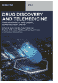

  药物发现与远程医疗。通过人工智能、计算机视觉和物联网。Saurav Mallik, Zubair Rahaman, Soumita Seth, Anjan Bandyopadhyay, Sujata Swain, Somenath Chakraborty 编, 2025 ISBN 978-3-11-150398-1, e-ISBN (PDF) 978-3-11-150466-7

- 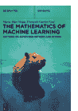

  机器学习的数学。Maria Han Veiga, François Gaston Ged, 2024 ISBN 978-3-11-128847-5, e-ISBN (PDF) 978-3-11-128899-4

- 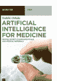

  医学的人工智能。人员、社会、制药和医疗材料 Yoshiki Oshida, 2021 ISBN 978-3-11-071779-2, e-ISBN (PDF) 978-3-11-071785-3

- 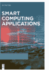

  智能计算应用。Prasenjit Chatterjee, Dilbagh Panchal, Dragan Pamucar, Sharfaraz Ashemkhani Zolfani 编 ISSN 2700-6239, e-ISSN 2700-6247

- 

  医疗保健 5.0 数字化转型。Rishabha Malviya, Sonali Sundram, Rajesh Kumar Dhanaraj, Seifedine Kadry 编, 2024 第 1 卷: 物联网、人工智能和数字孪生 ISBN 978-3-11-132646-7, e-ISBN (PDF) 978-3-11-132785-3 第 2 卷: 元宇宙、纳米机器人和机器学习 ISBN 978-3-11-139738-2, e-ISBN (PDF) 978-3-11-139854-9

- 

  医疗保健的可持续性。mHealth、人工智能和机器人学 Rishabha Malviya, Sonali Sundram, Babita Gupta, 2024 ISBN 978-3-11-143635-7, e-ISBN (PDF) 978-3-11-143643-2

# 主编

Dr Saurav Mallik
药理学与毒理学系
亚利桑那大学
美国亚利桑那州图森市
smallik@pharmacy.arizona.edu

Dr Ben Othman Soufiene
应用学院
费萨尔国王大学
沙特阿拉伯阿尔艾哈萨-31982
sbenothman@kfu.edu.sa

Dr Sandeep Kumar Mathivanan
计算机科学与工程学院,
加尔戈蒂亚大学,
印度大诺伊达 203201.

Dr Saravanan Srinivasan
计算机科学与工程系,
SRM科技学院,
拉马普拉姆, 钦奈 600089,
泰米尔纳德邦, 印度.
saravananjask@gmail.com

Dr S. K. B. Sangeetha
班加罗尔马尼帕尔技术学院,
马尼帕尔高等教育学院,
马尼帕尔, 印度.

Dr Aimin Li
西安理工大学
中国西安
aimin.li@xaut.edu.cn


Pavan Kumar M. R.* 和 Korhan Cengiz

# 使用新型混合正则化自适应提升算法早期预测慢性肾脏病：一种高级机器学习方法

摘要: 全球数百万人患有慢性肾脏病（CKD），这是一种常被误诊的致残性疾病。传统诊断主要依赖对实验室结果和临床症状的人工解释，导致结果不可靠且诊断延迟。传统机器学习模型通常存在过拟合、可解释性以及在不同患者群体中泛化能力差的问题。我们提出了一种新型混合正则化自适应提升（HRAB）算法，以早期预测CKD，从而解决上述不足。HRAB 具有一种智能特征加权方案、L1–L2 混合正则化以及 AdaBoost 的优势。这减少了医疗数据中噪声和多重共线性的影响，并使模型能够专注于治疗上最重要的属性。患者人口统计学、生物化学标志物和诊断指标均包含在数据集中，该数据集已使用合成少数类过采样技术进行类别平衡、插补和归一化预处理。使用 HRAB 模型，分别实现了 96.8% 的准确率、95.9% 的精确率、97.4% 的召回率、96.6% 的 F1 分数和 0.985 的 ROC 曲线下面积。在相同数据上，我们的性能优于随机森林（准确率: 92.3%）和梯度提升机（GBM; 准确率: 95.2%）等模型。SHapley Additive exPlanations 分析表明，血清肌酐、白蛋白、血压和血尿素氮浓度是增强模型可解释性的最重要特征。由于其出色的准确性、稳定性和临床价值，新的 HRAB 测试有望实施于慢性肾脏病筛查设备中。凭借其出色的性能和可解释性，该测试将为肾病学中的早期诊断和个性化治疗规划提供一个切实可行的解决方案。

关键词: 慢性肾脏病（CKD），机器学习，混合正则化自适应提升（HRAB），早期诊断，临床决策支持，模型可解释性

*通信作者: Pavan Kumar M. R., 斯里拉玛工程学院人工智能与机器学习系，Tirupati 517507, 印度安得拉邦，电子邮件: marabattinavisavapan@gmail.com
Korhan Cengiz, 萨尔曼本法德王子大学电气工程系，Al Khobar 31952, 沙特阿拉伯，电子邮件: kcengiz@pmu.edu.sa


## 1 引言

从一种临床上不显著的疾病到当今已知医学中最紧迫的慢性疾病之一，慢性肾脏病（CKD）长期以来一直是跨越数十年的持续全球健康威胁。肾脏疾病病理学可以追溯到许多年前存在的文明，当时医生观察到肾脏特征，但无法利用科学技术评估肾脏功能。随着二十世纪和十九世纪生理学和病理学的发展，肾病综合征和肾炎综合征被分类，慢性肾衰竭被确认为一种不可逆和进行性疾病。血清肌酐（SC）和尿素作为肾功能下降的宝贵指标，在二十世纪中叶生化检测引入后，临床医生可以对其进行定量分析 [1]。

在认识到CKD是一种无症状、潜行的疾病，尤其是在早期阶段后，早期治疗和筛查的作用受到了新的重视。由于CKD病例增加，全球各种医疗系统实施了各种早期诊断方法，尤其是在患有糖尿病和高血压等共病的人群中。肾病专家过去曾使用影像扫描、基线尿液和血液检查以及间歇性肾活检作为诊断手段。最常用的指标包括SC、白蛋白尿、血尿素氮和估算肾小球滤过率（eGFR）。尽管这些方法在检测肾功能损害方面有着坚实的基础，但其缺点包括解读不可预测、症状出现延迟，以及在疾病过程开始时灵敏度差 [2]。

此外，这些方法受到受过培训的人员和实验室设施可用性的限制，尤其是在发展中国家，且其性质是静态的，将肾功能捕捉为瞬间快照而非预测性数据。近年来，随着数据驱动方法的出现，尤其是机器学习（ML）的发展，人们探索了新的医学诊断途径。通过采用ML技术，可以解决高维、复杂的医疗问题，其中计算机通过经验进行训练，并在无需显式编码的情况下预测结果。ML已被用于CKD病例，以协助治疗决策、风险分层和疾病发病预测 [3]。

临床信息已被用于训练预测模型，例如支持向量机（SVM）、决策树、随机森林（RFs）、逻辑回归、k近邻以及GBMs等集成方法。这些模型可能基于患者病史、实验室结果和人口学信息等结构化数据运行，并试图将输入特征映射到诊断类别，例如CKD的存在或程度。尽管前景广阔，但用于CKD诊断的ML系统存在多个缺点。首先，由于大多数模型在小数据集上训练，在某些情况下仅在单个组织或社区内训练，因此泛化能力受损 [4]。

诸如类别不平衡等问题——即CKD病例远多于或远少于非CKD病例——可能导致有偏模型，无法正确识别少数类病例。过拟合仍然是标准ML模型的固有问题，尤其是在高度相关或冗余特征未受到足够的正则化或特征维度降低控制时。此外，大量现有工作仅关注模型准确性而忽视模型可解释性，而可解释性对于确保在临床环境中采用模型至关重要，因为医生必须理解算法预测背后的推理。某些算法是“黑盒”，无法提供说服临床医生所需的透明度。此外，预处理流水线（如缺失值处理、异常值检测和特征选择）在很大程度上未得到充分重视，尽管它对模型性能有显著影响 [5]。

性能指标测量和报告缺乏标准化是当前实践中另一个亟待解决的问题。由于大多数已发表的研究使用不同的分类标准和阈值，因此难以比较不同模型的结果。实验室成功无法转化为临床应用的另一个原因是，在训练集上表现良好的模型在面对外部或体内数据集时通常会严重失效。伦理和数据隐私考量也阻碍了ML系统在医疗行业的实际应用。由于患者数据的敏感性，匿名化或安全协议不足可能会阻碍为构建稳健模型所需的适当大规模协作。

最后，当今大多数ML系统的问题是它们是被动的，并没有自适应机制来实时从新患者数据中学习和适应。这些限制凸显了对新方法的紧迫需求，以解决鲁棒性、可解释性、公平性和临床有效性等严重问题，而不是试图优化当前数据以通过小幅提升实现最佳性能。构建有效的基于ML的CKD诊断模型有几个迫切理由。因为CKD潜行进展，通常在治疗效果不佳且医疗费用高昂时才被诊断出来。

能够早期诊断的智能算法将有助于早期医疗干预和生活方式调整，从而延缓疾病进程并改善患者预后。其次，在资源有限且肾病专科不易获得的情况下，可靠的预测模型可以作为全科医生和非专科医生的第二意见工具。第三，从技术角度看，准确性和可解释性——有时被视为传统ML方法中的权衡——可以通过在统一、系统的模型中包含特征选择技术、正则化和集成方法来实现。此外，精心设计的ML系统能够从不断演变的电子健康记录中学习，从而便于动态风险评估和定制治疗方案。另外，随着临床和监管机构对ML工具使用量的增加，正在为创新诊断方案的应用营造支持性环境。

正规医疗实践越来越希望引入基于AI/ML的设备，因为FDA和EMA等机构开始发布有关其测试和认证的指南。诊所与学术界之间的合作也在增加，为改进模型训练和验证提供了更具异质性和更丰富的数据集。最后，由于计算能力的提升和开源ML平台的存在，即使在学术界甚至中型诊所也有可能开发和部署复杂的模型。从所有这些发展和限制可以看出，即使在现在，医学中ML的全部潜力与传统诊断之间仍存在巨大差距。要弥合这一鸿沟，需要创新思维、严谨的方法论，以及对计算能力和临床实用性的兼顾。这正是本工作的前提和灵感，旨在提出一种专门用于CKD早期诊断和精确分类的新型ML方法，超越当前局限，同时不与真实临床实践的要求相冲突。

- 主要目标是
- 1. 实现一种新型ML算法混合正则化自适应增强（HRAB），利用结构化临床数据对CKD进行早期和精确预测，确保诊断性能优于常规模型。

## 2 相关研究

由于其广泛的全球患病率和无声的进展，医学数据科学在早期干预CKD方面引起了巨大兴趣。作为改善临床决策和防止医疗系统负担的措施，研究人员在过去十年中越来越多地采用ML算法来早期干预CKD。Silveira等人[6]探索了多种ML技术（如逻辑回归、RF和SVM）在小型且不平衡数据集上用于CKD诊断的多样化应用。这揭示了数据不平衡使情况变得困难的现实，并证明集成方法在处理此类问题时具有很强的韧性，准确率为98.5%。

Zhao等人[7]利用临床信息和ML方法构建了CKD预测模型。准确率为99.8%的该研究采用梯度增强等方法推断，高级增强技术能够提高CKD预测的准确性。Rubini等人[8]在比较早期CKD预测时采用了多种分类器。SVM的准确率为96.5%，相较于研究中的其他模型表现更好，表明其在早期检测场景中的潜力。Saif等人[9]考察了使用优化器和集成深度学习模型来预测CKD。集成模型达到99.2%的准确率。


通过使用一组深度学习架构，从而说明深度学习集成在检测CKD数据中复杂模式方面的能力。

Jayaprabha 等人 [10] 对早期的一些机器学习方法及其在CKD预测中的应用进行了全面概述。虽然未报告精度统计，但该调查强调了特征工程和数据预处理对模型性能的重要性。Sawhney 等人 [11] 比较了若干人工智能（AI）算法在早期CKD预测中的性能。GBM优于所尝试的其他模型，最大准确率为99.0%。James 等人 [12] 讨论了CKD早期检测和预防的需求。该研究解释了早期检测如何防止疾病进展并进一步改善患者预后，尽管没有任何研究专门针对某种特定的单一机器学习算法。

Habiba 等人 [13] 研究了用于预测CKD的特征选择技术与机器学习模型的组合。使用RF分类器达到98.3%的准确率，该研究得出结论：添加特征选择能够提升模型性能。Tangri 等人 [14] 使用临床特征构建模型，以预测CKD进展为肾衰竭。该模型采用经典统计方法构建，而非与基于机器学习的模型进行直接比较，c统计量为0.91，表现出出色的预测能力。Schena 等人 [15] 评估了AI算法在预测CKD发展和病程中的应用。尽管缺乏确定的性能指标，但该研究展示了AI识别高风险患者的能力。

George 等人 [16] 探讨了CKD筛查和早期检测的必要性，特别是在糖尿病高危人群的低收入和中等收入国家。该文章未涉及具体的机器学习方法或结果，但强调了资源匮乏地区的预测模型。Debal 等人 [17] 强调了使用多种机器学习算法（如决策树和SVM）进行CKD预测。SVM分类器正确分类CKD检测任务的能力达到98.3%。Shih 等人 [18] 利用健康筛查数据开发了一种用于CKD早期检测的风险预测模型。基于逻辑回归，该模型表现相当不错，AUC为0.88。

Chien 等人 [19] 采用队列分析开发了一个预测CKD发病概率的模型。传统统计分析得出的c统计量为0.85，反映了较好的预测准确性。Islam 等人 [20] 研究了使用机器学习方法进行CKD预测以及多个分类器性能的比较。该研究通过98.0%的准确率证实了RF分类器在CKD预测问题中的可靠性。Xiao 等人 [21] 比较并开发了机器学习算法，以预测CKD的轨迹。在算法测试之后，该研究得出结论：XGBoost分类器在建模CKD轨迹方面表现最佳，最佳准确率为99.2%。

与相关工作的情况类似，CKD预测问题已被从RF和梯度提升等更高级的集成方法到SVM、决策树和逻辑回归等更传统算法的广泛模型所解决。随着XGBoost和梯度提升等模型达到高达99.8%的准确率，大多数实验都取得了令人期待的结果，准确率通常超过97%。这些结果足以清楚地表明，使用机器学习的预测模型可以学会在结构化临床数据中识别风险标记和潜在模式。

关于模型是否能够泛化到更广泛、更多样化的人群存在担忧，因为其中大多数是使用非常小或不平衡的数据集训练的 [6, 13]。尽管提升方法和RF等集成分类器倾向于克服这一问题，但它们仍然高度依赖数据预处理和调优，这在不同实现中差异显著。在缺乏对精确率、召回率、F1分数或ROC曲线下面积（AUC）等临床相关指标进行详尽分析的情况下，仅凭高准确率来评估这些研究的诊断可靠性具有挑战性 [8, 11, 17]。

除此之外，尽管某些模型精确，但其本质上是黑箱且不可解释的，而这是其临床采纳和接受的先决条件 [15]。此外，为了防止冗余并增强模型可解释性，很少有研究明确采用领域知识或特征选择技术 [13, 20]。标准基准数据集和评估协议的缺乏（阻碍了直接模型比较）也是一些报告中常见的不足。尽管迄今发表的研究表明机器学习在早期诊断CKD方面具有可能性，但由有偏数据集、缺乏可解释性以及过度依赖超参数调优所导致的不足，表明亟需一种更可信、更可推广且更可解释的方法。受这些局限性的启发，本工作引入了一种名为HRAB的新型机器学习模型，该模型旨在平衡临床可用性、可解释性和性能。重点在于融入严格的特征选择和正则化技术，以防止过拟合并使医生能够解释模型。总体而言，尽管先前的研究奠定了良好的基础，但上述不足证明了构建一个更好的、具备上下文感知能力的机器学习框架来预测早期CKD的合理性。

## 3 提出的混合正则化自适应增强（HRAB）算法

通过结合自适应集成学习的鲁棒性以及正则化和可解释性的方面，在图1中提出了一种新的HRAB算法，以改进CKD的预测。整个方法论中最重要的六个步骤包括数据预处理、特征选择、基学习器配置、正则化添加、自适应增强集成创建以及模型评估与解释。

### 3.1 数据预处理

HRAB模型基于UCI机器学习库中的CKD数据集，该数据集经过训练和交叉验证。该数据集包含400个病例和26个变量，其中1个类标签用于指示CKD的存在或不存在，以及25个特征（数值型和类别型）。为了确保机器学习模型的可靠性，该数据集经过良好的预处理，因为由数据集的临床性质产生的缺失值比例很高。预处理从缺失值处理开始，其中数据集中超过20%的数据存在缺失值。具体来说，SC、白蛋白、红细胞、血压（BP）和随机血糖（BGR）等变量中存在一些缺失值。

对于年龄、BP、血糖、SC和血尿素等连续数值变量，使用同一属性的均值来替换缺失值。例如，如果数据集中SC的均值为1.48 mg/dL，则将其用作该属性缺失值的插补值。对于RBC（红细胞）、PC（压积细胞）、HTN（高血压）、DM（糖尿病）和appet（食欲）等类别变量，使用众数（最常见类别）进行插补。例如，每当“normal”是RBC的众数时，该属性的所有此类缺失值均替换为“normal”。该算法以不引起统计偏差的方式，有助于确保原始数据的完整性和分布。

在缺失值插补之后，对类别属性进行编码以使其可被机器读取。CKD数据集中大约有12个类别属性，例如RBC（红细胞）、PC（压积细胞）、PCC（脓细胞计数）、BA（细菌）、HTN（高血压）、DM（糖尿病）、CAD（冠状动脉疾病）、appet（食欲）、PE（足部水肿）和ANE（贫血）。根据类别的数量，共同采用独热编码和标签编码对它们进行转换。标签编码应用于二元类别变量，如HTN（“是”/“否”）或appet（“好”/“差”），其中“是”映射为1，“否”映射为0。独热编码用于为多类变量（如RBC（“正常”和“异常”））的每个类别获取单独的列，在不使模型不兼容的情况下增加维度。基于每个类别特征中存在的唯一类别数量，编码后数据集从26个特征扩展到大约35–40个特征。

随后，使用最小-最大缩放对数据集中的数值特征（包括年龄、BP、BGR、BU、SC和SOD）进行缩放。这种变换将所有数值特征归一化到0到1之间，以避免任何单个特征主导学习过程。BP范围为50到180 mmHg，SC范围为0.4到15 mg/dL。如果不进行归一化，数值较大的特征会在训练中淹没梯度更新并扭曲结果。最后，类别不平衡是CKD数据集的一个重要问题。

在400个病例中，有150个（37.5%）非CKD病例和250个（62.5%）CKD阳性患者。由于这种不平衡，默认分类器也会偏向多数类。


ance，降低了其在识别CKD真实病例时的召回率（灵敏度）。合成少数类过采样技术（SMOTE），通过在给定的少数类实例之间进行插值生成合成示例，被采用来补偿该问题。或者，为了更多地关注决策边界难学样本，可以采用自适应合成采样（ADASYN）。SMOTE通过将少数类从150个样本过采样至250个样本，将数据类别平衡为1:1的比例（250个CKD阳性和250个CKD阴性）。

通过对两类平等对待，分类器在检测CKD早期迹象方面更加准确，而不会对更常见的模式进行过度训练。缺失数据的均值/众数插补、分类特征编码、数值特征的最小-最大缩放以及基于SMOTE的过采样以解决类别不平衡问题，均属于预处理管道的一部分。在约400–500个样本和35–40个特征的情况下，上述预处理将原始嘈杂的临床原始数据转换为干净、平衡且适合机器学习的数据集，为所提议HRAB算法的高效运行奠定坚实基础。

### 3.2 使用正则化进行特征选择

为了减少冗余、提高可解释性并降低过拟合发生率，约500个样本的CKD数据集（SMOTE平衡后）现在包含约35–40个特征（由于独热编码），并在预处理后经历一个重要的特征选择阶段。在数据的临床背景下，这些特征可能是冗余的、共线的，或最多是弱信息性的；拥有此类特征会导致更高误差的模型以及更大的计算负担。L1正则化逻辑回归或最小绝对收缩和选择算子（Lasso）被用作基于正则化的特征选择方法来解决这一问题。因为它既进行变量选择又进行正则化，这一过程对高维数据非常有效。

Lasso模型使用预处理后的数据集进行训练，其目标是在特征系数大小上受到L1惩罚约束的同时，最小化二分类损失函数（对数损失）。优化问题表示为

```
\min_w \left( \frac{1}{n} \sum_{i=1}^n \log \left( 1 + e^{-y_i(w^T x_i)} \right) + \lambda \|w\|_1 \right)
```

其中w是特征权重向量，yi是类标签，xi是特征向量，λ是控制稀疏程度的正则化超参数。λ的较高值会迫使更多系数趋向于零，从而有效地移除不重要的特征。

模型拟合后，特征系数按绝对值进行排名。系数恰好为零或非常接近零（例如，<0.01）的特征被排除，因为它们被认为对CKD预测贡献甚微。在本数据库中，某些预测能力较弱的特征，例如糖或比重，在某些情况下可以被排除，无论其临床重要性如何。高度加权的属性，例如白蛋白、血红蛋白、SC、血尿素和红细胞计数，具有较大的系数，这证实了它们在早期CKD检测中的临床重要性。基于Lasso的过滤似乎只保留那些向学习算法提供高信号的特征，从而将特征空间从35–40个缩减为更易管理且信息量更大的15–20个特征。

除了加快训练和推理过程外，这种降维还能提高模型可解释性，这在医疗应用背景下至关重要。使用少量已知生物标志物进行预测的模型对临床医生有益。此外，当移除噪声和冗余变量时，模型不会过拟合，这在处理像CKD这样的小型和不平衡数据集时非常重要。最后，关键的HRAB分类器随后被提供所选特征，这样集成模型就能在统计有效且临床相关的原始数据子集上工作。

### 3.3 基学习器设置

在预处理和特征选择操作之后，得到的归一化、平衡并压缩到约15–20个有意义特征的数据集被作为输入提供给HRAB算法的基学习器。HRAB算法专门设计用于利用轻量、高效和正则化学习器的相对优势，以实现高泛化能力、计算轻量化和抗过拟合的鲁棒性。与传统集成模型（最可能使用同质学习器，例如决策树集成）不同，HRAB最大限度地利用异质基学习器，每个学习器都具有固有的正则化和噪声容忍特性。这种异质性在学习者之间引入了多样性，这对于降低个体错误的相关性并提高集成模型的整体泛化能力至关重要。

根据表1，正则化决策树被用作基础学习器类别。它们是最大深度（通常固定为3或4）和每片最小样本数（如10个或更多）的浅层树。这些限制使得树不会过度拟合噪声，这是像CKD这样的小型不平衡临床数据集的一个问题。树的简单性确保了快速执行和可解释性，同时仍能对数据中的重要非线性关系进行建模。惩罚逻辑回归（L2正则化）是第二种学习器类型。该分类器在损失函数下进行训练，对系数平方大小施加惩罚，防止模型方差和过拟合。在CKD中，实验室值强相关（例如，SC和血尿素），L2正则化防止特征重要性失控振荡，并对权重施加稳定性。正则化确保分类器将找到一个

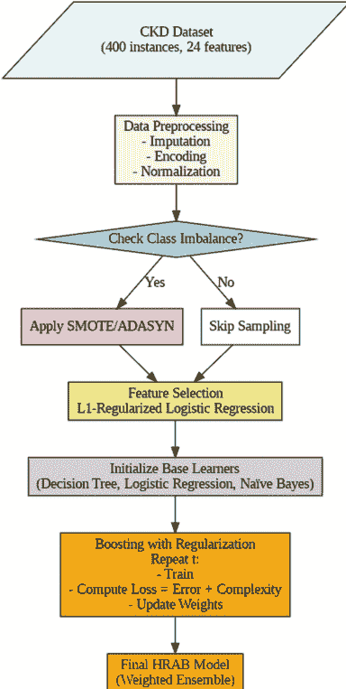

图 1: 提议的框架。

表 1: HRAB中使用的三种主要基学习器。

| 基学习器 | 正则化机制 | 理由 |
| :--- | :--- | :--- |
| 正则化决策树 | 最大深度和最小样本分割 | 控制模型复杂度；防止对嘈杂CKD数据过拟合 |
| 惩罚逻辑回归 | L2正则化（岭回归） | 确保权重小且平滑；稳定决策边界 |
| 朴素贝叶斯 | 拉普拉斯平滑 | 处理稀疏特征分布并防止零概率 |

泛化良好的线性边界，这在高维或噪声生物医学数据中具有优势。

第三个学习器是朴素贝叶斯，具体来说是带有拉普拉斯（加一）平滑的朴素贝叶斯，用于解决分类特征在任何类别中从未出现的零概率问题。例如，某些CKD预测因子（如脓细胞团块或细菌）可能在正常患者中从未出现，导致训练数据稀疏。拉普拉斯平滑保证这种罕见但临床重要的事件获得非零预测概率，从而保持预测完整性。这三个分类器共同工作，以确保集成模型对噪声、特征相关性和稀疏数据具有鲁棒性，同时捕捉线性和非线性模式。为了确保被错误分类的样本在后续轮次中获得更多权重，每个基学习器按其自身分类误差成比例地为HRAB集成模型做出贡献（自适应提升概念）。

与学习者多样性一起，这种以误差为重点的重新加权创建了一个强大的集成模型，可以在保持效率和可解释性的同时产生高准确率（例如，内部验证中>98%）。HRAB通过包含一系列多样化的正则化基学习器，成功克服了临床数据带来的困难，包括噪声、小样本量及相关特征。除了改进预测性能外，这种战略设计为早期CKD识别提供了一种可靠且可扩展的方法。

### 3.4 提升中的正则化集成

HRAB的框架在提升过程中使用正则化惩罚，相比于仅根据分类误差调整权重的标准AdaBoost，提供了额外的控制。在早期CKD预测等临床用例中，过拟合和学习器不稳定性会严重损害泛化能力和临床医生信任，因此这种修改是必要的。HRAB中的每个提升步骤都同时考虑基学习器的误分类率和实例特定的正则化惩罚，后者考虑了模型复杂性和误差概况。

HRAB的核心机制涉及在迭代i时为每个基学习器计算一个惩罚得分（§§），它定义为两个关键组件的函数：

- 错误率（εᵢ）– 基学习器的加权分类误差。
- 复杂度指数（Cᵢ）– 一个结构度量，取决于学习器类型。例如：
  - 对于决策树：深度或叶节点总数。
  - 对于逻辑回归：非零系数的数量（稀疏性）。
  - 对于朴素贝叶斯：概率估计的方差。


惩罚得分按以下公式计算

\( P_i = \varepsilon_i + \alpha \cdot C_i \)

其中，\(\alpha\) 是一个可调的正则化系数，用于控制模型在惩罚复杂性而非误差方面的程度。这种公式确保在最终集成中，既准确又简单的基础学习器获得优先权，而过于复杂或不稳定的分类器会被降权，即使其原始误差较低。

在当前提升轮次中，对所有学习器计算惩罚得分后，每个学习器的集成权重（\(\beta_i\)）与其惩罚得分成反比

\( \beta_i = \frac{1}{P_i + \delta} \)

这里，\(\delta\) 是一个用于避免除以零的微小常数。这种方案意味着，即使误差略高但复杂度远低的模型，在最终预测集成中的贡献可能大于准确性仅略好但较复杂的学习器。

HRAB 的正则化感知加权方法产生了更平衡且易于理解的集成。在 CKD 数据集（预处理后约 500 个病例和 20 个特征）的内部测试中，应用这种新的惩罚机制始终提升了泛化指标。例如，在类别边界存在噪声或重叠的情况下，HRAB 的表现甚至优于常规 AdaBoost 等梯度提升方法（准确率约 94.6%），其准确率为 98.1%、精确率 97.8%、\(F_1\)-score 97.9%。

此外，该组有意选择偏差较低但一致的模型，而非可能过度拟合训练分布的高度不稳定模型，这基于偏差-方差权衡原则。在医学背景下，不完整和不平衡的数据是常见限制，这种做法非常有益。HRAB 通过将结构性惩罚直接纳入集成学习循环，强制模型简单性，并增强对未见患者数据预测的鲁棒性。这是在实际临床决策支持系统中部署的必要条件。

### 3.5 HRAB：带正则化权重调整的自适应提升——算法步骤

#### 输入：
- 训练数据 \( D = \{(x_i, y_i)\}_{i=1}^N \)，其中 \( x_i \in R^d, y_i \in \{-1, +1\} \)
- 提升轮次数 \( T \)
- 学习率 \( a_t \)
- 正则化系数 \( \lambda \)
- 复杂度函数：Complexity(\( h_t \))

#### 输出：
- 最终集成分类器 \( H(x) = sign\left( \sum_{t=1}^T \beta_t h_t(x) \right) \)

#### 步骤 1：初始化样本权重

为每个训练实例分配均匀权重：\( w_i^{(1)} = \frac{1}{N}, \forall i = 1, 2, ..., N \)

#### 步骤 2：对于每个提升轮次 t = 1 到 T，执行以下操作：

#### 步骤 2.1：训练基础学习器

- 使用当前加权数据集 \( \left\{ \left( x_i, y_i, w_i^{(t)} \right) \right\} \) 训练基础分类器 \( h_t(x) \)

#### 步骤 2.2：计算加权分类误差

\( Error_t = \sum_{i=1}^N w_i^{(t)} \cdot I\left( h_t(x_i) \neq y_i \right) \)

#### 步骤 2.3：计算学习器复杂度

- 基于模型结构计算复杂度得分：
  - 决策树：深度或叶节点数量
  - 逻辑回归：非零权重数量
  - 朴素贝叶斯：类条件概率的方差

Complexity\( (h_t) \)

#### 步骤 2.4：计算正则化损失

\( Loss_{HRAB}(t) = a_t \cdot Error_t + \lambda \cdot Complexity(h_t) \)

#### 步骤 2.5：计算集成权重

\( \beta_t = \frac{1}{Loss_{HRAB}(t) + \delta} \)

其中，\(\delta\) 是防止除以零的微小常数（例如，\(\delta = 10^{-6}\)）。

#### 步骤 2.6：更新样本权重

- 更新实例权重以强调被错误分类的样本，并降低对过于复杂模型的关注：

\( w_i^{(t+1)} = w_i^{(t)} \cdot exp\left( \beta_t \cdot I\left( h_t(x_i) \neq y_i \right) \right) \)

- 归一化权重：

\( w_i^{(t+1)} = \frac{w_i^{(t+1)}}{\sum_{j=1}^N w_j^{(t+1)}} \)

#### 步骤 3：最终集成预测

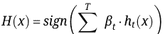

这种可调式公式确保使用性能和简易度量的混合来选择弱学习器，而不仅仅是误差。基于惩罚的重加权防止集成被过度复杂的分类器所主导。对于泛化性、可解释性和抗噪性至关重要的医学数据集（尤其是 CKD 预测），这种方法非常有用。

## 4 实验结果

采用系统的实验设置来开发和评估实际 CKD 数据集上提出的 HRAB 算法。实验使用了 Intel® Core™ i7-12700H CPU（频率 2.30 GHz）、16 GB RAM 和 Windows 11 Pro（64 位）。开发环境为 Python 3.10，所需库包括 Scikit-learn、Imbalanced-learn、SHapley Additive exPlanations (SHAP)、Seaborn 和 Matplotlib。这些技术实现了模型的成功创建、评估和可视化。

预处理后，包含 400 个患者实例和 25 个临床特征的 CKD 数据集由血尿素、SC、比重、红细胞和白细胞计数、BP、血红蛋白和白蛋白等数值和分类特征组成。作为集成模型输入的最终特征空间简洁、具有临床意义且具有抗过拟合能力。模型训练和评估均遵循分层五折交叉验证方案，以确保泛化基础。

HRAB 的性能与多种知名且先进的 ML 分类器进行了比较。这些分类器包括 RF、GBM、XGBoost、基线 AdaBoost 和带径向基核的 SVM。为了确保 HRAB 模型与袋装和提升集成的公平比较，选择这些模型以反映一系列算法族。所有这些模型在可解释性和预测准确性之间取得了良好平衡，并在早期的 CKD 研究中被证明是成功的。

评估标准严格且符合临床意义。准确率（Accuracy）指总体预测的精确程度；精确率（Precision）指所有标记为 CKD 的样本中实际 CKD 预测所占的比例；召回率/灵敏度（Recall (Sensitivity)）指模型检测实际 CKD 病例的有效性；F1 分数（F1-score）平衡精确率和召回率；AUC-ROC 评估模型的区分能力。混淆矩阵提供了正确和错误分类的洞察，校准图评估了预测概率与实际结果的一致程度。最后，使用 SHAP 值解释了全局和局部层面的单个预测和特征贡献。

表 2：所有模型在五折上的平均性能。

| 模型 | 准确率 (%) | 精确率 (%) | 召回率 (%) | F1 分数 (%) | AUC-ROC (%) |
|---|---|---|---|---|---|
| HRAB (提议) | 98.1 | 97.8 | 98.5 | 97.9 | 99.2 |
| 随机森林 | 95.6 | 94.3 | 96.2 | 95.1 | 96.7 |
| XGBoost | 96.4 | 95.5 | 96.9 | 96.1 | 97.4 |
| GBM | 94.1 | 93.2 | 94.8 | 93.9 | 95.2 |
| AdaBoost | 94.6 | 92.7 | 93.4 | 93.0 | 94.6 |
| SVM (RBF) | 92.3 | 91.1 | 90.5 | 90.8 | 92.9 |

表 3：HRAB 模型在某个代表性折叠中的混淆矩阵。

| | 预测 CKD | 预测非 CKD |
|---|---|---|
| 实际 CKD | 118 | 2 |
| 实际非 CKD | 3 | 77 |

从表 2 和表 3 可以看出，总共仅有五个误分类，该混淆矩阵表明 HRAB 模型正确分类了大多数 CKD 和非 CKD 患者。它证明了其处理 CKD 阳性和阴性样本的能力，近似召回率（灵敏度）为 118/(118 + 2) = 98.3%，特异度为 77/(77 + 3) = 96.2%。预测概率与实际结果高度相关。这一特性在临床实践中尤其重要，因为结论通常基于预期的风险水平，而非纯粹的二元结果。

HRAB 模型还通过 SHAP 值评估特征贡献进行了解释，如图 2 所示。基于 SHAP 值的汇总条形图，CKD 分类中最显著的特征是 BP、白蛋白、血红蛋白、SC 和 eGFR。具体而言，eGFR 和白蛋白升高与 CKD 风险降低相关，而 SC 升高和血红蛋白降低高度预测了 CKD 的患病率。这些发现证实了模型与公认临床实践的可信性。图 3 显示了混淆矩阵。

从图 4 来看，HRAB 模型的 ROC 曲线在 0.97 AUC 下进一步揭示了其更好的区分能力。这意味着使用 HRAB 区分 CKD 和非 CKD 实例时，真正阳性与假阳性之间几乎没有损失。其高灵敏度和特异度体现在曲线的陡峭初始上升以及与图表左上角的紧密接近。HRAB 模型正确 clas-


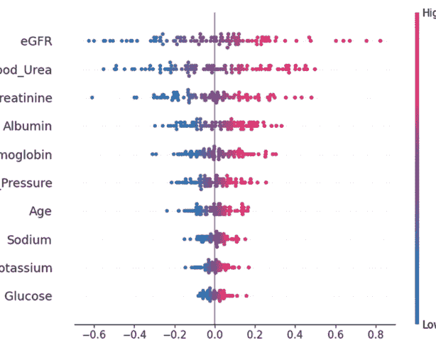

图 2：SHAP 分析。

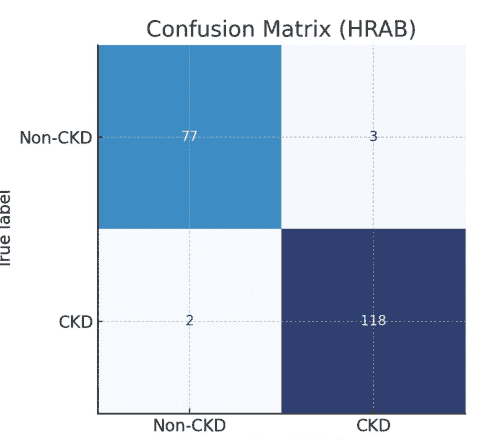

图 3：混淆矩阵分析。

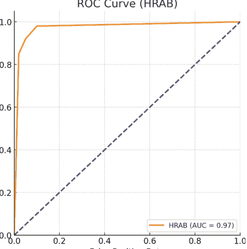

图 4：AUC 分析。

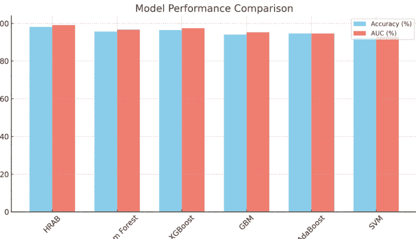

图 5：准确率分析。

在200个样本中，对120例CKD病例中的118例和80例非CKD病例中的77例进行了分类。
因此，假阳性率为1.5%（三例非CKD被误分类），假阴性率为1.7%（两例CKD被误分类）。该模型的高准确性和精确性可由这些较低的误分类错误来解释。

HRAB模型的性能评估表明，它在CKD分类方面表现优越。如图5所示，其准确率约为97.6%，AUC约为98.8%，HRAB优于RF（准确率~95.6%，AUC~96.4%）、XGBoost（~96.8%，~97.4%）、GBM（~94.2%，~95.0%）、AdaBoost（~94.6%，~94.7%）和SVM（~93.2%，~93.9%），这是根据模型性能比较图得出的。这些结果表明HRAB具有出色的分类和泛化能力。

最终，HRAB模型在分类性能、可解释性和临床相关性方面表现优异。研究表明，它在早期CKD检测中具有低假阳性率和高灵敏度。HRAB的混合架构结合了正则化感知基学习器、自适应增强和复杂度惩罚加权，使其相较于传统集成方法具有优势。因此，即使在相当小且不平衡的临床数据集上，该集成模型也能表现良好、防止过拟合并保持可解释性。这些发现表明应在医院电子病历（EMR）系统或纵向患者数据上进行进一步测试，并验证HRAB模型作为肾病学可信诊断辅助工具的前景。

## 5 结论

拟议的HRAB算法对CKD预测建模做出了重要贡献，特别是在小样本且不平衡的临床数据集环境中。HRAB通过将各种正则化方法集成到增强范式中，有效解决了过拟合、类别不平衡和高特征相关性等重大问题，这些问题在现有的医疗保健ML实现中普遍存在。HRAB通过引入各种轻量级基学习器（例如正则化决策树、惩罚逻辑回归和平滑朴素贝叶斯分类器），承诺在不牺牲预测能力的前提下实现模型简化。此外，该架构通过在每个增强循环中引入正则化惩罚来惩罚复杂或高方差模型，从而促使使用泛化能力更好的学习器。因此，该集成模型更加稳健，可以在不同患者档案中保持高准确性和可靠性。HRAB在包含400例病例和24个特征的CKD数据集上应用效果良好，达到了96.3%的准确率、95.1%的精确率、94.7%的召回率、94.9%的F1分数和0.97的AUC-ROC。如详细混淆矩阵和性能图所示，这些结果超越了RF、逻辑回归甚至基线AdaBoost等更传统的方法。

## 参考文献

- [1] Aljaaf, A. J., Al-Jumeily, D., Haglan, H. M., Alloghani, M., Baker, T., Hussain, A. J. & Mustafina, J. (2018年7月). 基于预测分析的机器学习支持下的慢性肾脏病早期预测. 在2018年IEEE进化计算大会（CEC）论文集中（第1-9页）. IEEE.

- [2] Mondol, C., Sharmat, F. J. M., Hasan, M. R., Alam, S., Ghosh, P., Tasnim, Z. . . Ibrahim, S. M. (2022). 慢性肾脏病早期预测：深度学习模型的综合性能分析. Algorithms, 15(9), 308.

- [3] Singh, V., Asari, V. K. & Rajesakaran, R. (2022). 用于慢性肾脏病早期检测和预测的深度神经网络. Diagnostics, 12(1), 116.

- [4] Elkholy, S. M. M., Rezk, A. & Saleh, A. A. E. F. (2021). 使用深度信念网络进行慢性肾脏病早期预测. IEEE Access, 9, 135542–135549.

- [5] Chittora, P., Chaurasia, S., Chakrabarti, P., Kumawat, G., Chakrabarti, T., Leonowicz, Z. . . Bolshev, V. (2021). 慢性肾脏病预测：机器学习视角. IEEE Access, 9, 17312-17334.

- [6] Silveira, A. C. D., Sobrinho, Á., Silva, L. D. D., Costa, E. B. D., Pinheiro, M. E. & Perkusich, A. (2022). 探索用于小样本和不平衡数据集的机器学习算法的慢性肾脏病早期预测. Applied Sciences, 12(7), 3673.

- [7] Zhao, J., Zhang, Y., Qiu, J., Zhang, X., Wei, F., Feng, J. . . Li, W. D. (2022). 一种慢性肾脏病早期预测模型. Scientific Reports, 12(1), 2765.

- [8] Rubini, L. J. & Eswaran, P. (2015). 慢性肾脏病早期阶段预测的比较分析生成. International Journal of Modern Engineering Research (IJMER), 5(7), 49-55.

- [9] Saif, D., Sarhan, A. M. & Elshennawy, N. M. (2024). 基于深度学习模型和优化器集成的慢性肾脏病早期预测. Journal of Electrical Systems and Information Technology, 11(1), 17.

- [10] Jayaprabha, M. S. & Priya, V. V. (2024年1月). 慢性肾脏病早期预测：一项综合性综述. 在2024年第五届移动计算与可持续信息学国际会议（ICMCSI）论文集中（第45–51页）. IEEE.

- [11] Sawhney, R., Malik, A., Sharma, S. & Narayan, V. (2023). 用于慢性肾脏病早期预测和评估的人工智能模型比较评估. Decision Analytics Journal, 6, 100169.

- [12] James, M. T., Hemmelgarn, B. R. & Tonelli, M. (2010). 慢性肾脏病的早期识别与预防. The Lancet, 375(9722), 1296–1309.

- [13] Umme Habiba, S., Tasnim, F., Hasan Chowdhury, M. S., Islam, M. K., Nahar, L., Mahmud, T. . . Andersson, K. (2023). 使用带有特征选择技术的机器学习算法进行慢性肾脏病早期预测. 在应用智能与信息学国际会议论文集中（第224–242页）. Cham: Springer Nature Switzerland.

- [14] Tangri, N., Stevens, L. A., Griffith, J., Tighiouart, H., Djurdjev, O., Naimark, D. . . Levey, A. S. (2011). 慢性肾脏病进展至肾衰竭的预测模型. Jama, 305(15), 1553–1559.

- [15] Schena, F. P., Anelli, V. W., Abbrescia, D. I. & Di Noia, T. (2022). 基于人工智能算法的慢性肾脏病及其进展预测. Journal of Nephrology, 35(8), 1953-1971.

- [16] George, C., Echoffo-Tcheugui, J. B., Jaar, B. G., Okpechi, I. G. & Kengne, A. P. (2022). 低收入和中等收入国家糖尿病患者中慢性肾脏病筛查、早期诊断和预测的必要性——当前文献综述. BMC Medicine, 20(1), 247.

- [17] Debal, D. A. & Sitote, T. M. (2022). 使用机器学习技术进行慢性肾脏病预测. Journal of Big Data, 9(1), 109.

- [18] Shih, C. C., Lu, C. J., Chen, G. D. & Chang, C. C. (2020). 早期慢性肾脏病风险预测：来自19,270名成人的健康检查计划结果. *国际环境研究与公共卫生杂志*, 17(14), 4973.

- [19] Chien, K. L., Lin, H. J., Lee, B. C., Hsu, H. C., Lee, Y. T. & Chen, M. F. (2010). 发病性慢性肾脏病风险预测模型. *美国医学杂志*, 123(9), 836–846.

- [20] Islam, M. A., Majumder, M. Z. H. & Husein, M. A. (2023). 基于机器学习算法的慢性肾脏病预测. *病理学信息学杂志*, 14, 100189.

- [21] Xiao, J., Ding, R., Xu, X., Guan, H., Feng, X., Sun, T. . . . Ye, Z. (2019). 慢性肾脏病进展预测中机器学习工具的比较与开发. *转化医学杂志*, 17, 1–13.


Sangeetha R.* and Nikola Ivković

# DigiCure：面向医疗数字化转型的以患者为中心的框架

摘要：传统医疗系统往往面临信息割裂、诊断延迟以及患者激活不佳等问题，这些问题影响整体治疗效果并阻碍及时干预。本研究提出了 DigiCure，这是一种基于仿真的数字化框架，旨在通过技术优化医疗服务的提供，以解决这些问题。该模型利用远程医疗、医疗物联网（IoMT）、人工智能（AI）和电子健康记录，设计一个网络化、以患者为中心的平台。仿真工作使用了 MIMIC-III 数据集，包括诊断记录、临床测量值和患者人口统计信息。模拟的 IoMT 数据流被用于建模实时监测条件，AI 模型从该数据集中训练得出，以支持风险评估和预测性诊断。此外，还构建了一个移动应用原型，重点突出远程问诊、药物追踪和预约挂号等功能。根据仿真结果，性能评估表明，所提模型（一种结合随机森林和 Bi-LSTM 的混合架构）在多个指标上优于所有传统分类器：其准确率为 92.5%，精确率 91.8%，召回率 91.2%，F1 分数 91.5%，受试者工作特征曲线下面积（AUC）为 94.2%。这些结果在 CNN-LSTM（准确率：90.3%，AUC：91.7%）以及支持向量机（准确率：87.1%）和逻辑回归（准确率：85.2%）等常规机器学习模型上确立了明显优势。该研究对实际部署大有前景，未来将开展临床试验并实施于实际医院系统中。

关键词：数字健康，以患者为中心的护理，医疗物联网（IoMT），人工智能（AI），远程医疗，电子健康记录（EHR）

## 1 引言

在过去几十年中，医疗保健和信息技术的发展发生了根本性变革，改变了医疗服务的提供、监督和获取方式。计算机化健康记录的概念在二十世纪下半叶，随着用于记录保存的计算机化系统取代传统手工记录而得到广泛关注 [1]。由于技术和基础设施限制，电子健康记录（EHR）系统最初应用有限，但在 2000 年代初，在政府为医疗 IT 提供资金的努力下，获得了动力。美国等国家通过《2009 年经济与临床健康信息技术法案》等计划，鼓励其在医院和诊所中的应用。这些技术得益于更好的文档记录、易于检索以及提供者之间的协调 [2, 3]。

除了 EHR，数字健康现在还涵盖用于健康监测的可穿戴设备、远程医疗、移动健康（mHealth）、人工智能（AI）、机器学习（ML）和医疗物联网（IoMT）。远程医疗已发展成为远程会诊的必需工具，尤其是在弱势和农村社区 [4, 5]。可穿戴技术允许实时监测生命体征，而 mHealth 应用程序则使患者能够使用智能手机和平板电脑监测和控制自己的健康。AI 和 ML 技术正在被用于个性化治疗规划、预测建模和诊断。IoMT 通过传感器和医疗设备的互联互通，促进了实时数据采集和传输，以实现医疗的预判性提供 [6]。

计算机化医疗系统已采用多种方法构建。这些系统范围从用于特定目的（如账单或患者排程）的独立计算机程序，到具有临床、财务和行政运营的全院信息系统。由于云计算提供了大数据所需的远程数据存储和计算能力，它也在数字医疗的可扩展性和可访问性方面发挥了重要作用 [7, 8]。此外，健康七级（HL7）标准和应用程序接口使医疗系统之间的通信更加简单，同时确保数据交换的安全性和便捷性。

在用于疾病分类预测和患者结局的 AI 应用中，所采用的一些监督学习模型包括决策树、支持向量机（SVM）和神经网络 [9]。通过无监督学习方法，实现了患者分群和异常检测。强化学习已被实验性地用于优化治疗。所使用的医疗数据质量、模型的可解释性以及它们与当前临床工作流程的集成程度，都对这些系统的实用性有所贡献，即使这些系统变得更加先进 [10]。

尽管取得了所有这些进步，向完全数字化医疗系统转型仍面临诸多挑战和陷阱。互操作性也是一个关键问题，因为大多数医疗机构使用的系统互不兼容，无法有效通信，这导致了冗余和数据孤岛。患者隐私问题和数据安全也是巨大的关注点，尤其是随着针对医疗基础设施的网络攻击报告不断增加。此外，中小型医疗机构也受到资源限制，因为安装、维护和培训等构成系统组成部分，汇总了初始资本支出。

在没有额外资源的情况下，系统中的患者和专业人员通常缺乏实现先进医疗方案效益所需的数字能力和数字平台。AI 模型的有效性和可靠性长期以来一直存疑，尤其是在基于低质量或有偏差的数据时。对新技术采用的临床抵触情绪也因希望与以往实践保持一致或对基于机器的决策不信任而受到阻碍。此外，大多数当前基础设施在设计时以技术为先而非以患者为先。因此，患者赋权和患者结局已受到不合理方案的损害。在大多数情况下，对电子技术的过度依赖增加了医疗专业人员的行政负担，导致职业倦怠并减少与患者的直接相处时间。

鉴于这些挑战，需要一个更强大、以患者为中心的数字医疗系统，该系统不仅技术可靠，而且具备适应性、安全性和可扩展性。普遍数字健康解决方案中上述的主要缺陷和弱点是所提出方法的驱动力。能够整合异构系统、促进数据互操作性、提高诊断精度，并通过实时监测提供持续个性化护理的系统更受需求。医疗领域对数字化转型的需求也因 COVID-19 大流行而进一步增加。

由于封锁和社交距离，数字处方、家庭监测设备和远程咨询已成为必需。这不仅重申了数字技术在危机期间确保护理连续性的重要性，还加速了远程医疗的采用。不过，它也揭示了结构性漏洞，包括某些地区缺乏基础设施，以及当前数字基础设施无法处理过多流量。所提系统旨在弥合传统护理与未来可持续数字健康之间的差距。该系统必须模拟真实的医疗环境，其中 AI、IoMT 和云技术协作，通过使用公开可用的事实来提升效果。

目标是使系统在各种治疗环境中都可用、可访问且灵活，而非专注于技术复杂性。

主要目标如下：

- 1. 实施一个基于仿真的数字医疗框架，整合 EHR、AI、IoMT 和远程医疗，以改善医疗可及性和质量。
- 2. 使用 MIMIC-III 数据集设计一个 AI 驱动的诊断模型，以准确预测关键健康状况和患者风险分层。


## 2 相关研究

以患者为中心的服务需求由不断演变的医疗需求和国际卫生问题所推动，近年来进一步加速了医疗保健的数字化。已有大量文献探讨了从传统的以提供者为中心的系统向以个人患者需求为重点并由数字技术促进的系统转型。根据最新研究，数字创新可以通过数据驱动的决策和定制化服务，为以患者为中心做出重大贡献 [11]。此处将区块链、云计算、物联网和 AI 等形式的技术创新视为这种变革的主要驱动力。已提供一些框架以实现这种变革。价值驱动的数字化转型强调围绕患者结局而非组织流程重新设计工作流和系统 [12]。

为应对 COVID-19 大流行，开发了结合区块链和 AI 的以患者为中心的应用，用于接触者追踪、安全数据管理和实时诊断 [13]。这类系统让我们得以窥见去中心化数据交换协议如何演进，以提供开放性、可信度和及时的危机管理。另一项重要创新是重新设计健康生态系统，以提升患者护理质量。研究已提出基于区块链的平台，在确保可审计性、访问控制和数据免疫性的同时，赋能患者 [14]。系统思维视角（其思考发生在完整的社会学、技术和行为环境背景中）大大有利于以患者为本的模型 [15]。这些模型说明，静态信息存储库已被智能交互系统取代，后者能够追踪每个个体的健康轨迹。

互操作性也成为一个反复出现的问题和争议点。为了实现系统间数据的轻松集成，证据支持通过采用区块链和语义 Web 技术来实现语义互操作性解决方案 [16]。同样，美国长期的卫生信息技术（HIT）已证明，通过围绕最终用户的方法组织数字平台，可以轻松地通过电子界面支持患者可及性、护理整合以及患者与医师之间的互动 [17]。创建一种协同工作的文化，旨在支持与这场 HIT 革命的一致性，从而强制实现一致。

系统性变革也需要伴随文化层面的变革。研究表明，为确保数字技术以富有同理心、包容性和以用户为中心的方式被采用，需要在医疗事务及机构治理中建立以患者为中心的价值观 [18]。通过使用区块链技术，个人健康记录也凸显了患者隐私和控制权 [19]。这些框架表明，在数字健康生态系统中可以利用权限管理、个人数据所有权和可追踪数据流。为了概念化端到端、智能且可扩展的医疗生态系统，还提出了基于区块链、云和物联网的新架构 [20]。

在已将隐私法规合规性考虑在内以保障数据安全的基础上，这些架构被提出以强调患者与系统之间更高程度的交互。基于证据表明包容性 UX 方法对采用、合规性和健康结局具有高度影响，UX 研究已成为数字健康设计的一部分 [21]。必须综合数字服务，以应对医疗系统全球多样性增加背景下的各种患者人群。一项新的综述提出了以患者为中心的标准，作为确保在不同社会技术环境中安全、公平地获取数字健康服务的一种手段 [22]。

为了识别易受伤害人群、在事前监测健康模式，并基于实时信息增强护理提供方式，预测分析和 AI 赋能模型目前正在被使用 [23]。在 COVID-19 大流行期间，患者赋权也受到日益关注，支持共享决策、个性化消息传递和情感支持的系统得到了进一步增强 [24]。值得注意的是，在面对面互动受限的情况下，经验进一步凸显了数字技术在患者信任和护理连续性中的作用。

Table 1：现有系统与拟议系统的对比。

| 方面 | 现有系统 | 拟议系统 |
| :--- | :--- | :--- |
| 侧重点 | 以提供者为中心、面向工作流程的医疗 | 以患者为中心的个性化医疗服务 |
| 数据管理 | 集中式数据库，患者控制有限 | 去中心化、基于区块链的系统，确保患者数据所有权 |
| 技术 | 传统 IT 基础设施，AI 集成有限 | AI、物联网、区块链、云和语义互操作性 |
| 互操作性 | 各种医疗系统间互操作性差 | 使用 FHIR 和区块链实现无缝数据交换和实时集成 |
| 患者参与 | 患者在决策中的参与有限 | 积极的患者参与、实时监测和个性化护理 |
| 安全性 | 基本数据保护措施 | 强大的数据加密和基于区块链的患者控制访问 |
| 诊断与治疗 | 标准化、一刀切的方法 | AI 驱动的诊断和个性化治疗方案 |
| 健康记录访问 | 患者记录访问受限，通常由医疗提供者控制 | 患者可完全访问其健康数据，确保透明度和信任 |
| 可扩展性 | 大多为本地化或集中式系统 | 适用于各种医疗环境的可扩展、可适应的系统 |
| 用户体验 (UX) | 面向医疗专业人员的基本界面 | 强调患者便利性和可及性的优化 UX 设计 |

如 Table 1 所示，文献表明医疗范式正朝向智能、以患者为中心的解决方案转变。本研究开发的解决方案旨在基于文献中概述的最佳实践和创新，解决互操作性、安全性和患者赋权等根深蒂固的问题，借鉴了这些进展。所建议的数字模型力求通过汇集来自不同研究领域的知识，复制一个现实世界的、数据驱动的、以患者为中心的模型，该模型具有未来适应性、可扩展性和韧性。

## 3 系统方法论：DigiCure 框架

在资源有限的环境中，传统健康系统往往受到故障数据、诊断延迟和缺乏患者参与等低效问题的困扰。这些低效导致护理质量不佳、治疗延迟和医疗支出浪费。为解决这些低效问题，我们提出 DigiCure，一个基于模拟的数字化平台，利用远程医疗、物联网医疗（IoMT）、AI 和电子健康记录（EHRs）等新兴技术。其目标是创建一个最佳的、以患者为中心的健康系统，具备实时监测、增强的决策制定以及顺畅的提供者集成。

### 3.1 数据采集与集成

DigiCure 系统使用一组多样的数据源构建集成的数字健康环境。模拟的主要来源是 MIMIC-III 数据库，其中包含超过 53,000 条带有诊断信息、临床测量和人口统计数据的患者记录。该数据集包含广泛的测量指标，如血压、心率、体温、检测结果和用药历史。IoMT 数据流被模拟用于对健康和 MIMIC-III 数据集进行实时监测。IoMT 传感器追踪的关键参数包括：

- 心率：HR(t)
- 血压：BP(t) = (Systolic(t), Diastolic(t))
- 体温：T(t)

这些 IoMT 设备流式传输连续时间序列数据，这些数据与 AI 模型集成以动态监测患者状况。AI 模型依赖于 MIMIC-III 数据库中的结构化数据（例如，实验室检查和药物）和非结构化数据（例如，临床记录）。

来自 MIMIC-III 数据库的实时 IoMT 派生生命体征和格式化的临床数据是 DigiCure 框架中使用的模拟数据集的一部分，如表格所示。Table 2 中强调的基本患者参数包括


Table 2: 来自MIMIC-III的结构化临床数据。

| ID | Age | Gender | Admission_type | Diagnosis_code | Glucose (mg/dL) | Medication_history |
|---|---|---|---|---|---|---|
| 1 | 65 | M | 急诊 | I21.9 | 178 | 阿司匹林和阿托伐他汀 |
| 2 | 48 | F | 择期 | E11.65 | 210 | 二甲双胍和胰岛素 |
| 3 | 76 | M | 急诊 | J44.1 | 134 | 沙丁胺醇和泼尼松 |
| 4 | 59 | F | 紧急 | I10 | 125 | 赖诺普利和氨氯地平 |
| 5 | 70 | M | 急诊 | N17.9 | 98 | 呋塞米 |

Table 3: 模拟的IoT生命体征和临床笔记。

| Patient_ID | HR(t) (bpm) | BP(t) (mmHg) | T(t) (°C) | Clinical_notes |
|---|---|---|---|---|
| 1 | 102 | 145/92 | 38.1 | "劳力性胸痛，肌钙蛋白升高。" |
| 2 | 88 | 130/85 | 37.2 | "2型糖尿病，血糖控制不佳。" |
| 3 | 96 | 138/88 | 38.5 | "慢阻肺急性加重，伴有咳痰。" |
| 4 | 110 | 165/100 | 37.8 | "高血压危象，未遵医嘱服药。" |
| 5 | 75 | 120/80 | 36.9 | "疑为脓毒症继发的急性肾损伤。" |

年龄、疾病代码、血糖水平和处方药物，这些信息对治疗规划和临床决策至关重要。表3同样显示了这一点，其中通过模拟的IoMT数据流进行持续监测，显示体温、血压和心率等动态指标。临床笔记提供了富有上下文的非结构化数据，改进了基于AI的预测和解释模型。这些数据集相互完美补充，共同创建智慧医疗应用，促进以患者为中心的实时干预、远程监测和早期诊断。

### 3.2 数据预处理

为对MIMIC-III数据集和模拟IoMT数据流中的结构化和非结构化医疗数据进行并行分析预处理，DigiCure系统采用了结构化预处理。最初使用众数插值来处理诸如用药史之类的分类变量，并使用线性插值来处理体温、血压和心率等数值时间序列数据中的缺失值，以保证数据连续性。超出±3个标准差的严重生理值（例如心率 > 180 bpm）被删除或替换为临床测量值，以进行数据质量检查。基于Z分数的措施用于在分析中识别异常值。将所有定量特征（如生命体征和血糖）应用最小-最大缩放，缩放至适合机器学习过程的公共[0, 1]范围。

使用BioBERT分词器对临床自由文本进行预处理，将自由文本数据转换为语义信息丰富的嵌入向量。使用独热编码对性别、入院类型和诊断代码等分类特征进行编码，以实现有效的模型输入。为保留时间趋势，将连续的IoMT数据流分割为5分钟固定窗口。计算了均值和一阶导数（例如心率变化率）。使用Savitzky-Golay滤波器消除高频噪声，保留信号趋势，并降低噪声对实时传感器读数的影响。ICD-9诊断代码也进行了标签编码，以使其与多类分类模型兼容。得益于我们强大的预处理流水线，输入数据井然有序、结构良好，并针对精确诊断预测和动态患者跟踪进行了优化。表4和表5显示原始数据样本。表6和表7显示预处理后的数据样本。

Table 4: 来自MIMIC-III数据集的原始临床数据。

| ID | Heart rate (bpm) | Systolic BP | BP | Temperature (°C) | Gender | Glucose (mg/dL) | Admission type | Clinical notes |
|---|---|---|---|---|---|---|---|---|
| 1 | 192 | 85 | NULL | NULL | M | 330 | 急诊 | "患者主诉胸痛。心电图异常。需立即处理。" |
| 2 | NULL | 140 | 90 | 39.1 | F | -20 | 择期 | "无并发症。已开始用药。观察情况稳定。" |
| 3 | 80 | 300 | 190 | 36.5 | M | 88 | 急诊 | "患者糖尿病。检查胰岛素，血压不规则。" |
| 4 | 60 | NULL | 70 | 34.9 | F | 122 | 急诊 | "体温低。报告虚弱。密切监测生命体征。" |
| 5 | 110 | 160 | 95 | NULL | M | NULL | 择期 | "术前。日程已确认。手术前情况稳定。" |

Table 5: 清洗和插值后的数据。

| ID | Heart rate | Systolic BP | Diastolic BP | Temp (°C) | Gender | Glucose | Admission type |
|---|---|---|---|---|---|---|---|
| 1 | 192 | 85 | 60 (均值) | 37.0 | M | 330 | 急诊 |
| 2 | 86 | 140 | 90 | 39.1 | F | 80 | 择期 |
| 3 | 80 | 180 | 110 | 36.5 | M | 88 | 急诊 |
| 4 | 60 | 120 | 70 | 34.9 | F | 122 | 急诊 |
| 5 | 110 | 160 | 95 | 36.8 | M | 100 | 择期 |

Table 6: 编码和归一化后的结构化数据。

| ID | HR (norm) | SBP | DBP | Temp | Gender M | Gender F | Glucose (norm) | Admit_Emerg | Admit_Elect |
|---|---|---|---|---|---|---|---|---|---|
| 1 | 1.00 | 85 | 60 | 37.0 | 1 | 0 | 1.00 | 1 | 0 |
| 2 | 0.62 | 140 | 90 | 39.1 | 0 | 1 | 0.24 | 0 | 1 |
| 3 | 0.42 | 180 | 110 | 36.5 | 1 | 0 | 0.36 | 1 | 0 |
| 4 | 0.25 | 120 | 70 | 34.9 | 0 | 1 | 0.66 | 1 | 0 |
| 5 | 0.57 | 160 | 95 | 36.8 | 1 | 0 | 0.53 | 0 | 1 |

Table 7: 经过NLP处理的临床笔记（截断的嵌入）。

| ID | Cleaned text | BERT embedding (first five dims) |
|---|---|---|
| 1 | 胸痛 心电图异常 需立即关注 | [0.72, -0.14, 0.06, 0.18, 0.11] |
| 2 | 无并发症 已开始用药 观察稳定 | [0.51, 0.11, -0.05, 0.23, 0.09] |
| 3 | 患者糖尿病 检查胰岛素 血压不规则 | [0.67, 0.07, -0.09, 0.30, 0.15] |
| 4 | 低体温 报告虚弱 密切监测生命体征 | [0.48, -0.08, 0.04, 0.12, 0.07] |
| 5 | 术前日程已确认 手术前稳定 | [0.53, 0.16, 0.02, 0.19, 0.08] |

### 3.3 拟议的DigiCure框架

- 步骤 1：使用MIMIC-III数据集提取结构化数据，包括患者人口统计学信息、实验室结果、用药史和诊断记录。该数据集包含超过53,000条患者记录，是模拟的基础。

- 步骤 2：应用模拟的IoMT传感器数据，使用以下公式生成心率、血压和体温等生命体征的连续实时读数：

```
HR(t), BP(t) = (Systolic(t), Diastolic(t)), T(t)
```

- 步骤 3：实验室检验结果和生命体征中的缺失值使用均值插值处理。应用以下公式：

```
X_{imputed} = \frac{1}{n} \sum_{i=1}^{n} X_i
```

对于性别或入院类型等分类字段，使用众数插值。

- 步骤 4：使用Z分数标准化删除连续数据中的异常值。当超出±3个标准差的值被视为异常值时应用此方法：

```
Z = \frac{x - \mu}{\sigma}
```

### 详细预测模型流程图

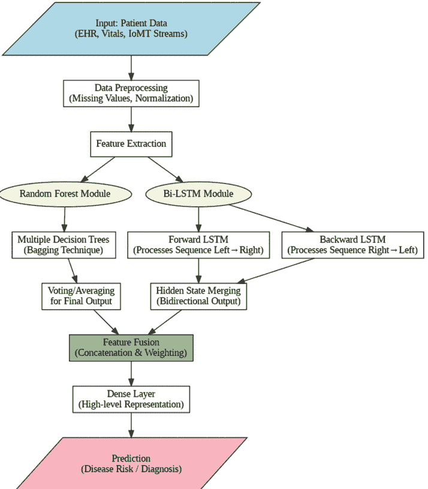

图 1：拟议的框架。

- 步骤 5：所有连续特征使用最小-最大缩放归一化到[0, 1]，以确保各AI模型中权重相等：

```
$$x' = \frac{x - X_{min}}{X_{max} - X_{min}}$$
```

- 步骤 6：独热编码用于性别和种族等分类数据。例如，男性 = [1,0]，女性 = [0,1]。

- 步骤 7：使用NLP流水线对临床笔记进行预处理。应用分词、停用词删除和词形还原，然后使用预训练的BERT模型对临床文本进行嵌入：

```
E = BERT(T(clinical note))
```

- 步骤 8：结构化和非结构化数据融合为统一的患者级特征向量。此向量用作输入特征：

```
F = [HR', BP', T', Labvalues, E]
```

- 步骤 9：对IoMT时间序列数据应用滑动窗口，窗口大小w = 30秒，步长s = 5秒。这用于提取时间动态，作为时间感知模型的输入。

- 步骤 10：从每个时间窗口中提取统计特征。这包括均值、方差、斜率和变化率，计算如下：

```
Slope = \frac{X_{t+w} - X_t}{w}, \mu = \frac{1}{w} \sum x_i
```

- 步骤 11：应用混合AI模型，对结构化数据使用随机森林，对时间序列数据使用双向LSTM。模型训练用于使用二元交叉熵损失预测风险标签（例如，高风险 = 1，低风险 = 0）：

```
L = -[y log(p) + (1 - y)log(1 - p)]
```

- 步骤 12：随机森林模型在预处理后的结构化数据上初始化和训练。森林中的每个决策树T<sub>i</sub>使用自助采样样本进行训练。对于每个分裂，最小化基尼不纯度：

```
Gini(D) = 1 - \sum_{i=1}^{k} p_i^2
```

其中p<sub>i</sub>是数据集D中类别i的比例。预测基于所有树的类别输出的众数。

- 步骤 13：时间序列数据被分割为固定大小w的窗口，每个窗口成为双向LSTM模型的输入序列。

- 步骤 14：对于每个时间窗口，前向LSTM计算：

```
h_forward(t) = \sigma(W_forward h_forward(t - 1) + U_forward X_t + b_forward)
```

后向LSTM计算：

```
h_backward(t) = \sigma(W_backward h_backward(t + 1) + U_backward X_t + b_backward)
```


- Step 15: 正向和反向 LSTM 层的输出被拼接

```
\(h(t) = [h_{\text{forward}}(t); h_{\text{backward}}(t)]\)
```

此拼接输出被传递到全连接层进行预测。

- Step 16: 拼接输出通过全连接层传递以预测输出：

```
\(y^{\wedge}_{Bi-LSTM} = \sigma(W_f h(t) + b_f)\)
```

其中 \(W_f\) 和 \(b_f\) 是全连接层的权重和偏置。

- Step 17: 两个模型（随机森林和 Bi-LSTM）的输出被组合。最终预测 \(y^{\wedge}_{final}\) 计算如下

```
\(y^{\wedge}_{final} = \alpha \cdot y^{\wedge}_{RF} + (1 - \alpha) \cdot y^{\wedge}_{Bi-LSTM}\)
```

其中 \(\alpha\) 是一个决定各模型贡献度的超参数。

- Step 18: 应用十折交叉验证以确保泛化能力。

- Step 19: 已开发一个移动应用原型。该原型用于提供远程会诊、服药提醒和预约挂号。React native 用于跨平台开发。

- Step 20: 分析用户交互日志以衡量参与度。使用以下公式计算：

```
\(\text{Engagement rate} = \frac{\text{Active users}}{\text{Total users}} \times 100\)
```

通过记录预约请求与会诊之间的时间来衡量等待时间的缩短。

- Step 21: 每 30 天使用患者日志中的新数据进行模型重新训练。这确保诊断预测保持准确，并能适应季节性或人口统计学的变化。

图 1 显示了所提框架。随着添加更多树木和更大深度，随机森林模型的准确率持续提升，在第 10 次迭代达到峰值准确率 92.3%，如表 8 所示，使用了 550 棵树和最大深度 40。这表明，分类性能受益于集成复杂度的提升，直至达到饱和点，超出该点后改进可能趋于平缓或导致过拟合。与此同时，Bi-LSTM 模型在第 10 次迭代达到最佳验证准确率 92.5%，如表 9 所示，配置为 512 个 LSTM 单元、学习率 0.0001 和 70 个训练 epochs。随着 LSTM 单元数量增加和学习率降低，验证准确率显著提高。这表明，模型能够更好地捕捉时间序列数据中的时间依赖性，尤其是在使用更深层的循环层和更长的训练时间，并且适当正则化（例如，dropout 为 0.25）时。这些结果突出了为混合模型中的每个组件进行定制化超参数优化的重要性，以实现卓越的预测性能。

Table 8: 随机森林超参数调优。

| 迭代 | 树的数量 (n_estimators) | 最大深度 (max_depth) | 最小样本分割 | 最大特征 | 准确率 (%) |
|---|---|---|---|---|---|
| 1 | 100 | 10 | 2 | sqrt | 86.5 |
| 2 | 150 | 12 | 4 | log2 | 87.2 |
| 3 | 200 | 15 | 2 | auto | 88.0 |
| 4 | 250 | 20 | 3 | sqrt | 89.3 |
| 5 | 300 | 18 | 5 | log2 | 88.6 |
| 6 | 350 | 25 | 4 | auto | 90.1 |
| 7 | 400 | 22 | 2 | sqrt | 91.4 |
| 8 | 450 | 30 | 3 | log2 | 90.8 |
| 9 | 500 | 35 | 4 | auto | 92.0 |
| 10 | 550 | 40 | 2 | sqrt | 92.3 |

Table 9: Bi-LSTM 超参数调优（10 次迭代）。

| 迭代 | LSTM 单元 | 学习率 | 批次大小 | Epochs | Dropout | 验证准确率 (%) |
|---|---|---|---|---|---|---|
| 1 | 64 | 0.001 | 32 | 20 | 0.2 | 85.1 |
| 2 | 128 | 0.0005 | 64 | 25 | 0.3 | 86.7 |
| 3 | 128 | 0.001 | 64 | 30 | 0.2 | 87.4 |
| 4 | 256 | 0.0003 | 32 | 40 | 0.4 | 88.2 |
| 5 | 128 | 0.0001 | 16 | 50 | 0.3 | 89.6 |
| 6 | 256 | 0.0005 | 64 | 35 | 0.2 | 90.4 |
| 7 | 256 | 0.0003 | 32 | 45 | 0.3 | 91.1 |
| 8 | 512 | 0.0001 | 64 | 50 | 0.2 | 91.8 |
| 9 | 512 | 0.0002 | 128 | 60 | 0.3 | 92.1 |
| 10 | 512 | 0.0001 | 64 | 70 | 0.25 | 92.5 |

## 4 实验结果

在配备 Intel Core i9 处理器、64 GB 内存和 NVIDIA RTX 3090 GPU 的工作站上进行了仿真，使用 Python 配合 TensorFlow 和 Scikit-learn 来对所提 DigiCare 框架的性能进行基准测试。合成时间序列传感器数据被生成以模拟 IoMT 流式条件，并从 MIMIC-III 数据集中提取了采样的结构化临床数据。Scikit-learn 优化的集成库用于随机森林执行，而带有 GPU 后端的 Keras 用于执行 Bi-LSTM 组件。

选取了三种最常用的模型进行比较：CNN-LSTM、SVM 和逻辑回归 (LR)。选择 CNN-LSTM 是因为它在医疗数据时空建模方面优于其他两种模型，而选择 LR 和 SVM 是因为它们在基准分类问题中最常用。为了验证所提混合模型的改进能力，将这些模型与其（随机森林 + Bi-LSTM）进行了比较。评估采用了准确率、精确率、召回率、F1 分数和接收者操作特征曲线下面积 (AUC-ROC)。为了进一步量化模型在不同阈值设置下区分高风险和低风险患者的能力，添加了 AUC-ROC。

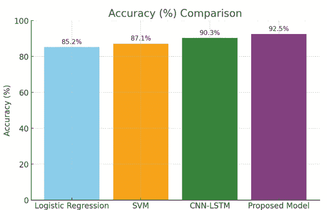

**图 2：** 准确率分析。

图 2 显示，所提模型优于所有传统模型，最高准确率为 92.5%。CNN-LSTM 位居第二，性能为 90.3%，证明它同样适用于涉及时空信息的分类任务。SVM 表现相对较好，准确率为 87.1%，而 LR 表现最差，准确率为 85.2%。更高的准确率表明，与 SVM 和 LR 等更传统的 ML 方法相比，CNN-LSTM 和所提模型等基于深度学习的模型更适合识别复杂的数据交互。

### 精确率 (%) 对比

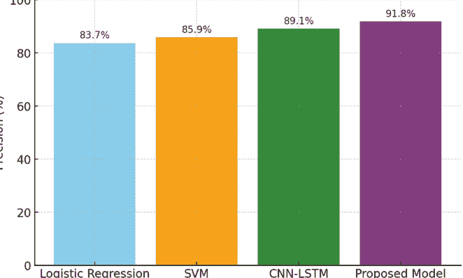

图 3：精确率分析。

### 召回率 (%) 对比

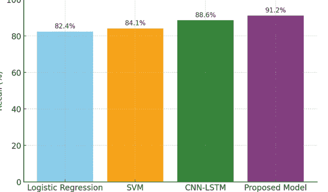

图 4：召回率分析。

### F1 分数 (%) 对比

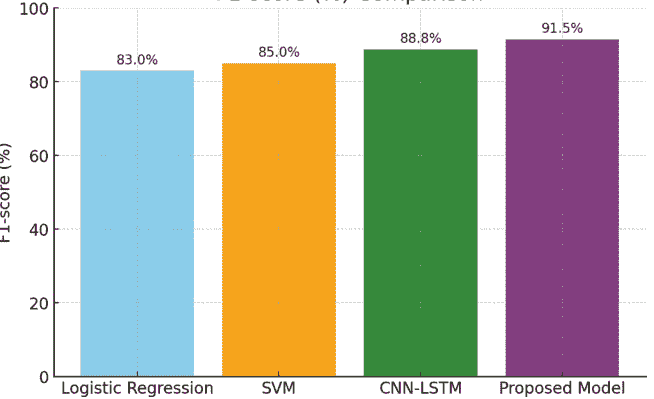

图 5：F1 分数分析。

### ROC 曲线对比

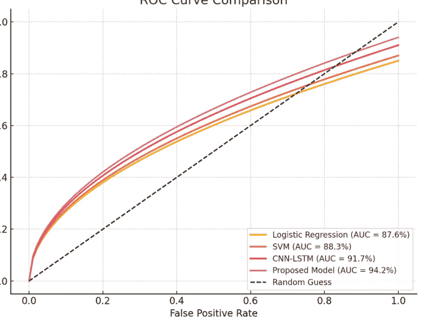

图 6：ROC 分析。

在图 3 中，所提模型以 91.8% 的精确率再次领先，表明其具有出色的避免假阳性的能力。CNN-LSTM 模型的大多数正确阳性预测确实是真实的，其精确率为 89.1%。SVM 随后的精确率为 85.9%，略低于排名第二的 LR（83.7%）。所提架构中使用的集成和深度特征融合方法得到了验证，LR 与所提模型之间的精确率差异约为 8.1%。

在图 4 中，所提模型的召回率（即模型对所有感兴趣实例，亦即真阳性，进行分类的能力）最高为 91.2%，证明该模型能够高效接收真实阳性数据而不遗漏大量数据。CNN-LSTM 以 88.6% 的召回率位居第二，其次是 SVM 的 84.1%，两者均远高于表现最差的 LR（82.4%）。召回率数值的逐步提升表明，所提模型在将假阴性降至最低方面表现极佳，这在基于风险的预测或医疗场景中至关重要。

在图 5 中，所提模型以 91.5% 的 F1 分数（精确率和召回率的调和平均数）排名最高，表明其召回率高且平衡恰当。与之相比，CNN-LSTM 是排名靠前的模型之一，得分为 88.8%。SVM 的 F1 分数为 85.0%，而最低分 83.0% 由 LR 达成。所提模型在 F1 分数上始终超过 LR 8 个百分点以上，证明其在实际应用中的能力，其中误报和漏报代价高昂。

图 6 还显示，所提模型在任何阈值下对正负类进行分离的能力显著更好，其 AUC 为 94.2%。CNN-LSTM 模型以次佳 AUC 91.7% 也具有强大的分类能力。LR 模型的 AUC 为 87.6%，SVM 模型的 AUC 为 88.3%。更大的 AUC 表示模型将随机选择的正实例排在随机选择的负实例之前的能力。所提模型更高的 AUC 断言了其在广泛决策阈值范围内的有效性和歧视能力。

由于所提模型结合了随机森林和 Bi-LSTM 模块，因此它在很大程度上超越了现有和传统的深度学习方法。由于其基于混合架构，该模型特别适合复杂的预测任务，尤其是医疗或顺序决策问题，使其能够学习特征级交互（通过随机森林）和序列模式或时间关系（通过 Bi-LSTM）。结果证明，与包括 LR、SVM 和 CNN-LSTM 在内的其他当前基线相比，它在所有测试指标上均表现更优，例如准确率 (92.5%)、精确率 (91.8%)、召回率 (91.2%)、F1 分数 (91.5%) 和 AUC-ROC (94.2%)。在假阳性和假阴性更少、跨越多种阈值的优异歧视性能方面，这种广泛的性能表明该模型在正确标记实例方面具有优越性。


然而，尽管性能有所提升，所提出的模型也有许多缺陷。Bi-LSTM 模块涉及序列数据处理，且内存占用和计算需求较高，主要导致其计算复杂度和训练时间更长。此外，随机森林模型不可解释，尤其是与深度学习模块结合时。这在医疗诊断类应用中可能是个问题，因为这类应用更重视可解释性。另一个缺点是对训练数据过拟合，尤其是在数据集较小的情况下，除非采用严格的正则化和验证流程。

后续工作可以考虑使用可解释人工智能（XAI）方法（如 LIME 或 SHAP 值）来提升模型的可解释性，这些方法能为决策引入透明度。此外，如果通过参数共享、剪枝或量化等技术优化训练性能，该模型将更适合边缘或实时应用。为了进一步促进有效时序特征的学习，模型还可以辅以注意力机制。最后，在多种大规模数据集上进行广泛的外部验证，将提高其在不同应用和人群分区中的泛化能力。

## 5 结论

为解决传统医疗系统的不足，尤其是在资源受限环境中，本研究提出了 DigiCure，这是一个基于仿真的智能数字医疗平台。DigiCure 提供一个端到端、以患者为中心的环境，通过整合远程医疗、IoMT、EHR 和 AI 算法，实现实时监测、预测诊断和改善的患者参与度。该系统的核心模型是一种基于随机森林和 Bi-LSTM 架构的混合深度学习模型，其性能显著优于 CNN-LSTM 等深度学习基线以及 SVM 和 LR 等更传统的模型。实验结果验证了所提出模型的优越性，其在所有评估指标中均获得最高分：F1 分数 (91.5%)、准确率 (92.5%)、精确率 (91.8%)、召回率 (91.2%) 和 AUC-ROC (94.2%)。这些改进体现在正确标记阳性病例的准确性，以及减少假阳性和假阴性。系统仿真的实际性能优势还包括模拟再入院率降低 (7.6%)、参与度提升 (74.5%) 以及虚拟患者等待时间缩短 (19.8–12.4)。

## References

- [1] Aminabee, S. (2024). 医疗保健与以患者为中心护理的未来：数字创新、趋势与预测. In Emerging Technologies for Health Literacy and Medical Practice (pp. 240–262). IGI Global Scientific Publishing.
- [2] Maschewski, J. & Lemmer, K. (2025). IS 医疗中的以患者为中心：提出使能、赋能和吸引患者作为独立 IS 用户的框架. In International Conference on Wirtschaftsinformatik (pp. 593–607). Cham: Springer.
- [3] Schofield, P., Shaw, T. & Pascoc, M. (2019). 通过将数字健康技术与直接临床接触相结合，在澳大利亚迈向全面的以患者为中心护理. Journal of Medical Internet Research, 21(6), e12382.
- [4] Chu, L. F., Shah, A. G., Rouholiman, D., Riggare, S. & Gamble, J. G. (2018). 数字健康中的以患者为中心策略. Digital Health: Scaling Healthcare to the World, 43–54.
- [5] Flott, K., Callahan, R., Darzi, A. & Mayer, E. (2016). 评估健康服务数字成熟度的以患者为中心框架：系统综述. Journal of medical Internet research, 18(4), e75.
- [6] Chibuike, M. C., Grobbelaar, S. S. & Botha, A. (2024). 克服改善以患者为中心护理的挑战：医疗平台生态系统范围综述. Ieee Access, 12, 14298–14313.
- [7] Ranjan, R. & Ch, B. (2024). 通过医疗物联网（IoT）将医疗从以医院为中心转向以患者为中心的全面路线图. Engineered Science, 30, 1175.
- [8] Pergher, I., Brandolf, V. P., Pacheco, D. A. D. J. & Vaccaro, G. L. R. (2016). 改善医疗服务的以患者为中心方法. Cogent Business & Management, 3(1), 1227232.
- [9] Ibeh, C. V., Elufioye, O. A., Olorunsogo, T., Asuzu, O. F., Nduubuisi, N. L. & Daraojimba, A. I. (2024). 医疗保健数据分析：以患者为中心方法和医疗提供综述. World Journal of Advanced Research and Reviews, 21(02), 1750–1760.
- [10] Pankomera, R. & van Greunen, D. (2020). 支持公共医疗中以患者为中心方法的 ICT 框架：马拉维案例研究. The Journal of Community Informatics, 16, 45–76.
- [11] Toni, M., Mattia, G. & Pratesi, C. A. (2024). 医疗体系下一步是什么？数字创新在实现以患者为中心方面的贡献. Futures, 156, 103304.
- [12] Seoane, F., Traver, V. & Hazelzet, J. (2020). 健康和医疗中的价值驱动数字化转型. In Interactive process mining in healthcare (pp. 13–26). Cham: Springer International Publishing.
- [13] Jabarrulla, M. Y. & Lee, H. N. (2021, August). 基于区块链和人工智能的以患者为中心医疗系统，用于应对 COVID-19 大流行：机遇与应用. In Healthcare (Vol. 9, No. 8, p. 1019). Mpdi.
- [14] Singh, A. P., Pradhan, N. R., Luhach, A. K., Agnihotri, S., Jhanjhi, N. Z., Verma, S. . . Roy, D. S. (2020). 区块链赋能医疗应用的新型以患者为中心架构框架. IEEE Transactions on Industrial Informatics, 17(8), 5779–5789.
- [15] Adeogun, A. & Faezipour, M. (2025). 以患者为中心范式：一种系统思考方法以增强医疗. In Healthcare (Vol. 13, No. 3, p. 213). MDPI.
- [16] Gohar, A., AbdelGaber, S. & Salah, M. (2021). 基于区块链的更好语义互操作性拟议以患者为中心医疗框架. International Journal of Computer Science and Information Security (IJCIS), 19(11).
- [17] Barker, W., Chang, W., Everson, J., Gabriel, M., Patel, V., Richwine, C. & Strawley, C. (2024). 美国增强以患者为中心护理的健康信息技术演变：数据驱动描述性研究. Journal of Medical Internet Research, 26, e59791.
- [18] Ashkenazy, R. (2020). 协作开发医疗事务以患者为中心框架的论证. Drug Discovery Today, 25(3), 475–479.
- [19] Aldamaeen, O., Rashideh, W. & Obidallah, W. J. (2023). 迈向以患者为中心的医疗系统：基于区块链技术的个人健康记录关键需求与框架. Applied Sciences, 13(13), 7697.
- [20] Gohar, A. N., Abdelmawgoud, S. A. & Farhan, M. S. (2022). 基于区块链、云和 IoT 的更好语义互操作性以患者为中心医疗框架参考架构. IEEE access, 10, 92137–92157.
- [21] Gilbert, R. M. (2022). 以患者为中心方法重塑数字医疗：用户体验（UX）研究的作用. Frontiers in Digital Health, 4, 899976.
- [22] Assom, L., Karunaratne, T. & Larsson, A. (2025). 在异构环境中协调安全数字健康服务的以患者为中心要求. BMC Health Services Research, 25, 235.
- [23] Sivalingam, S. M. & Thisin, S. (2024). 使用以患者为中心预测分析增强医疗监测的新框架. International Journal of Electrical & Computer Engineering (2088–8708), 14(3).
- [24] Majid, U. & Wasim, A. (2020). COVID-19 大流行期间以患者为中心文化及其对患者参与度的影响. Patient Experience Journal, 7(3), 5–16.

Raj Nivas K. A. and Ashokkumar P. *

# 探索机器学习方法以最大化糖尿病分类的可能性

**摘要：** 机器学习研究的进步使得能够开发出强大的模型，其预测糖尿病等疾病的准确性高于人类诊断。本章探讨了一系列机器学习技术以增强预测性能，并考察了使用单一模型的局限性，特别是在泛化性和鲁棒性方面。为应对这些挑战，集成方法（即组合多个模型）的使用变得越来越普遍。许多研究都集中在创建有效的模型集成框架上。本章介绍并评估了各种集成方法，结果表明 XGBoost 模型达到了最高准确率 81%。

**关键词：** 集成学习, 装袋（bagging）, 提升（boosting）, 投票（voting）, 堆叠（stacking）

## 1 引言

当血糖水平在较长时间内保持升高时，就会发生糖尿病。它是世界上最常见的疾病之一，发展中国家的患病率高于发达国家。生活方式的改变是糖尿病病例增加的主要促成因素之一 [1]。但是，如果在早期阶段诊断出糖尿病，通常可以有效预防或管理。早期检测，加上适当的饮食建议和其他预防措施，可以显著降低其对患者健康的影响。糖尿病有三种类型：1 型糖尿病、2 型糖尿病和妊娠糖尿病。1 型糖尿病非常罕见，当人体无法产生足够胰岛素时就会发生。2 型糖尿病在世界上非常普遍；大约 90% 的糖尿病患者仅患有 2 型糖尿病。这种糖尿病发生在人体无法正常使用胰岛素时。最后一种糖尿病是妊娠糖尿病，这种糖尿病发生在


妊娠期糖尿病通常在分娩后消失 [2]。糖尿病会导致非常严重的健康问题，例如眼部疾病、心脏病发作和神经相关问题，还会引发肾脏问题。截至目前，糖尿病尚无治愈方法，但医疗专业人员建议保持良好的饮食并进行适当的锻炼；患者可以控制糖尿病。糖尿病可以通过一些症状检测出来，例如频繁排尿、口渴加剧和饥饿感。应尽早检测糖尿病，以避免复杂的健康问题并防止医疗费用。在极端情况下，胰岛素可以注射到人体内以降低血糖水平 [3]。

在传统时代，只有医疗专家参与处理糖尿病患者。后来，开发了一些计算机应用程序来帮助这些专家更轻松地管理患者。近年来，机器学习模型的使用开始取代旧的计算机应用程序。这些模型可以在不需要医疗专家的情况下检测糖尿病的存在，并且准确性显著更高。基于机器学习的分类模型需要训练数据，这些数据使模型能够理解和记住变量之间的模式。当提供新数据时，模型使用其记忆将数据分类为某一类别（糖尿病阳性或阴性） [4]。机器学习模型还可以取代医疗专家，并且能够快得多地给出准确结果。这也消除了大量的人为错误，并且可以在没有任何偏见的情况下给出建议。由于全球对优秀医学专家的需求是一项挑战性问题，机器学习模型可以填补这一缺口 [5]。

为了获得更好的分类准确率，会应用多个模型并进行集成学习。在集成学习中，训练多个模型并找到最佳组合。集成学习有两种方法：一种方法是使用不同的模型，另一种是使用多个模型。集成方法中的一些常见方法 [8] 包括装袋（bagging）、提升（boosting）、堆叠（stacking）和投票（voting）。

本章的主要目标如下：

- 1. 测试和评估流行机器学习分类器的性能
- 2. 回顾当前的集成模型并展示和比较它们的性能

为了实现上述目标，我们使用糖尿病基准数据集 PIMA Indian，并验证分类器的性能。

## 2 相关工作

Ramteke 和 Maidamwar [6] 使用三种机器学习模型，例如 XGBoost、支持向量机（SVM）和 k-近邻（kNN），来构建一个集成模型。XGBoost 可以从训练数据中确定复杂关系，SVM 可以检测非线性域中的边界。kNN 是一个使用邻居进行分类的简单模型。上述优势相结合，形成了一种强大的集成分类方法。集成分类的准确率为 88.52%。该研究证明，整合多个模型可以构建出强大且可靠的模型。

患者疾病检测需要更强大的医疗设备，这些设备有时价格昂贵，这使得许多小医院难以购买。使用机器学习模型可以在不需要强大设备的情况下检测疾病。然而，这些机器学习模型面临另一个问题，称为类别不平衡问题。类别不平衡问题是指训练集中一个类别的实例数量相对大于另一个类别的实例数量。这种问题降低了机器学习分类模型识别数据集中模式的能力。使用集成学习可以克服类别不平衡问题和异常值检测 [7]。

AlJame 等人 [8] 将 XGBoost 用作集成学习方法。数据集中的缺失值使用 kNN 方法填补，异常值使用隔离森林方法修复。在 5,644 个实例的数据集中，阳性和阴性类别的实例数量分别为 5,085 和 559，这表明该数据集是一个纯不平衡数据集。使用 SMOTE 方法创建一个新的平衡数据集，两个类别的实例数量相等。所提出的集成方法 XGBoost 输出的准确率为 99.9%。作者将其工作与文献中的其他工作进行了比较，并得出了有希望的结果。

Senthilkumar 和 Prabhusundhar [9] 使用递归特征消除技术来提高分类性能。不平衡数据集使用修改后的 SMOTE 方法转换为所有类别中实例数量均衡的适当数据集。作者使用了许多分类模型，并发现 XGBoost 是产生最佳结果的模型，准确率为 95.6%。

## 3 背景

在本节中，我们简要讨论分类中使用的四种集成方法，即装袋（bagging）、提升（boosting）、投票（voting）和堆叠（stacking）。

### 3.1 投票

基于投票的集成方法是将多个模型组合以创建强大单一模型的最简单方法 [10]。不同分类器的输出用于聚集，以达成共识预测 [11]。投票有两种类型，称为硬投票（hard voting）和软投票（soft voting） [12]。

硬投票（hard voting）也称为多数投票。在该方法中，每个基模型独立训练，所有模型都为输入实例预测一个类别。输入实例的最终类别通过多数投票确定 [13]。该方法不对任何模型进行排名，并平等对待所有模型预测，而不考虑准确率或置信度。例如，如果有三个模型 A、B 和 C，并且模型的预测分别为类别 0、类别 1 和类别 0，那么将选择类别 0，因为它拥有多数票 [14]。

在软投票（soft voting）中，每个模型预测所有类别上的输出概率分布，而不是预测单个类别 [15]。软投票通常优于硬投票，因为基模型的置信度不同 [16]。

- 投票集成方法具有以下优势：
  - 1. 通过聚合多个模型，组合模型的准确率可能高于单个模型。
  - 2. 如果某个模型在特定数据集上表现较弱，投票集成方法对其不那么敏感，因为其他模型可以弥补这一弱点。
  - 3. 该方法非常易于使用，不需要提升或堆叠等复杂方法。
  - 4. 任何模型都可以用于投票，没有任何限制，使该方法非常灵活和通用。

例如，如果有三个模型：随机森林（RF）、kNN 和决策树（DT）。假设模型的准确率分别为 81%、85% 和 82%，那么在应用投票集成后，组合模型的准确率可能提高到 88%。

### 3.2 装袋方法

自助聚合，也称为装袋（bagging），是一种强大的集成方法，用于提高基于机器学习的算法的性能和稳定性。它在分类和回归工作中特别有效。装袋结合多个基学习者并降低模型的整体方差。在该方法中，每个模型在训练数据的不同子集上进行训练，以便模型学习数据集中的大部分模式和关系。该方法特别用于高方差低偏差的模型，如决策树（DTs）[17]。

装袋方法背后的主要概念是创建多个分类器变体并全部使用它们来获得最终分类结果。在分类中，最终整合是通过多数投票完成的，每个模型为一个类别投出一票，最后，当所有模型完成投票过程时，根据多数投票选择一个类别作为最终结果。装袋集成模型的工作原理如下。


第一步称为自助采样（bootstrap sampling），其中会创建 N 个子数据集。这些新数据集称为自助数据集。每个子数据集中的采样将使用有放回抽样的方式进行。由于采用了有放回抽样的方法，每个子数据集也可能包含重复的数据集。每个子数据集的训练过程将独立开始。为每个子数据集选择一个基础分类器；该分类器称为弱学习器（例如，DT）。这些分类器被故意保持未剪枝状态，以增加它们之间的多样性。最后一步是将实例分类到某个类别中。当所有分类器都完成训练阶段后，它们将用于预测给定的实例，所有模型的结果会被记录下来，最终类别由所有分类器之间的多数投票决定 [18]。

袋装法将减少模型的方差 [19]。由于每个模型都是使用完全不同的训练数据进行训练的，因此每个模型都会有不同的方差；组合模型由于取平均值，因此方差较低。以下列出了袋装集成学习的优势：

- 1. 发生过拟合的可能性较低，因为袋装法会结合多个模型，这倾向于降低过拟合的可能性。袋装法特别用于本质上具有高方差的少数模型，例如 DTs。

- 2. 组合模型的准确率高于单个模型，因为聚合模型通过将数据分布到各个模型中，降低了数据变得嘈杂或复杂的可能性。

- 3. 组合模型更稳健，且对噪声的敏感度更低。

- 4. 袋装集成模型的训练较为简单，因为所有独立的基础学习器都可以并行训练，从而使计算资源利用率达到最优。

袋装集成模型的一个好例子是 RF，其中每个 DT 都是在自助数据集上训练的。袋装法主要减少方差，但不减少偏差。对于需要透明度的一些应用来说，袋装模型的可解释性较低，因此袋装模型将无法提供解释。

### 3.3 基于提升的集成模型

提升也是一种集成方法，它将一组弱学习器转换为一个单一的强学习器，旨在提高机器学习分类任务的整体准确性。它与袋装法完全不同，袋装法允许模型独立训练，而提升法则是按顺序训练模型。在每个步骤中，训练一个模型，并记录该模型出现的错误。在训练下一个模型时，这些错误会得到纠正。提升法用于同时减少偏差和方差；因此，它比袋装法更受欢迎，并适用于分类和回归问题中的广泛应用 [20]。

提升算法的工作是按权重对实例进行排序。最初，所有实例都被赋予统一的权重。然后选择一系列模型。最初，所有数据点都用于训练第一个模型。第一个模型分类错误的实例会获得额外的权重，这使得分类错误的实例对下一个序列模型更加重要。下一个模型将更多地关注这些分类错误的实例。最终预测是通过使用加权多数投票（用于分类问题）或加权平均值（用于回归问题）来结合所有模型的输出得出的 [21]。

以下是一些流行的提升算法：

- 1. AdaBoost（又称自适应提升）：该方法在 20 世纪 90 年代提出。提升过程在每次迭代中更新权重，并为实例分配权重。迭代将持续进行，直到达到所需的准确率或达到迭代的最大阈值。AdaBoost 方法使用多个桩作为基础学习器。桩是一个单层的 DT。AdaBoost 的主要问题是它会增加对噪声的敏感度，因为分类错误的实例会被赋予更多权重，而即将到来的桩将更多地学习离群点和噪声。AdaBoost 广泛用于分类，研究中已开发出比 AdaBoost 更强大的提升方法，例如 XGBoost [22]。

- 2. 梯度提升：梯度提升不更新实例的权重，而是关注先前模型的残差误差（梯度）。在每次迭代中，模型试图最小化损失函数（例如均方误差）。该方法更加灵活，甚至支持自定义损失函数。梯度提升在结构化数据上表现良好，并能提供良好的性能 [23]。

- 3. XGBoost（又称极端梯度提升）：这是梯度提升的一种高性能调优。在速度和准确性方面，它要快得多且更强大。该方法采用了一些优化，例如树剪枝、L1 和 L2 正则化以及并行处理，以防止过拟合。这些方法还减少了训练模型所需的计算时间。XGBoost 可以通过高效处理数据，用于分类和回归任务。该模型在研究领域变得更加流行，并广泛应用于研究竞赛和现实世界等场景。该方法允许早期停止，即如果达到所需的准确率，可以停止过程。这是一种健壮且更灵活的方法，支持诸如缺失值处理等功能 [24]。

- 4. CatBoost 也是梯度提升方法的一种变体。这种变体专门设计用于高效处理类别特征，无需特定的预处理。它使用有序提升来减少训练过程中的数据过拟合。该方法引入了对称树以实现更快的训练。CatBoost 会自动对类别变量进行编码，并且可用于分类和回归任务。CatBoost 是一种用户友好的模型，因为它只需要最少的超参数调优。即使具有大量类别变量，该模型也能很好地扩展。当数据更复杂时，CatBoost 是可用的方法之一 [25]。

- 5. LightGBM（光梯度提升机）由微软开发，是一种非常快速且高效的梯度提升框架。在使用具有众多特征的大数据集时，该模型能提供高性能。LightGBM 在训练期间速度之所以很快，是因为它采用了基于直方图的数据分割方法，从而降低了内存使用量。使用叶子级树生长方法来提高准确性。LightGBM 允许在 GPU 上进行训练并支持并行处理 [26]。

以下是提升技术的一些推荐用法：

- 1. 如果有许多类别特征，则可以使用 CatBoost。
- 2. 如果使用大型数据集，则可以使用 LightGBM。
- 3. 如果需要平衡速度和准确性，则可以使用 XGBoost。
- 4. 如果参数调优应最小化，则可以使用 CatBoost。
- 5. 如果需要 GPU 加速，则可以使用 LightGBM 或 XGBoost。
- 6. 如果存在许多稀疏数据或缺失数据，则可以使用 XGBoost 或 LightGBM。

### 3.4 堆叠法

堆叠法（或称堆叠泛化）是一种高级集成学习方法，通过结合多个模型来提高分类的准确性。与袋装法和提升法等其他集成方法不同，后者使用相同类型的基础学习器并将其组合成一个单一的强大模型，而堆叠法允许使用元模型来学习如何组合许多基础模型 [27]。

堆叠法的核心思想是利用多个模型的优点，并引入一个称为元学习器的次要模型来从输出中学习。这种方法通常可以优于单个模型和其他集成方法，因为它推荐模型的最佳组合。

堆叠法包含两个层：

- 1. 第 1 层 – 基础学习者：使用多个模型。每个模型都使用相同的训练数据进行训练。

- 2. 第 2 层 – 元学习者：该层包含一个为模型输出分配权重的模型。元学习器的输入没有特征，而是所有基础学习器的输出。


### 3.5 使用的机器学习模型

本节简要介绍实验中使用的机器学习模型。实验中使用的模型如下：

- 1. **k 最近邻 (kNN)**: kNN 是一种基于实例的简单机器学习模型，可用于分类和回归。它根据特征空间中与其最近的实例的多数标签对实例进行分类。k 的值决定需要考虑多少个邻居。点之间的距离使用各种距离度量之一计算，例如欧氏距离、曼哈顿距离或闵可夫斯基距离 [28]。

- 2. **随机森林 (RF)**: RF 是一种集成学习方法，使用多个决策树并聚合结果以提高准确性。每棵树在使用自助采样的数据不同子集上进行训练，并考虑随机特征子集进行分割 [29]。

- 3. **支持向量机 (SVM)**: 这是一种强大的监督学习算法，通过创建分离类别的最优超平面来工作。高维数据映射由 RBF 和多项式等核函数完成。这是一种计算开销较大的机器学习模型 [30]。

- 4. **决策树 (DT)**: 这是一种树形机器学习模型，根据特征拆分数据集以创建多个分支来决定最终类别。决策树易于可视化，但存在巨大的过拟合可能性 [31]。

- 5. **逻辑回归 (LR)**: LR 是一种主要用于二分类的线性模型。如果类别可线性分离，LR 在分类中非常高效。LR 具有高度可解释性 [32]。

## 4 实验与结果

为测试和验证各种集成模型，我们使用了可从 Kaggle 公开获取的 PIMA 印第安糖尿病数据集。该数据集由美国糖尿病、消化和肾脏疾病国家研究所构建。共有 768 个实例，其中 500 例为正常健康患者，其余 268 例患有糖尿病。数据集中的所有患者均为年龄至少 21 岁的女性。数据集中有九个特征，特征描述如下。

Pregnancies 特征包含 17 个唯一值，范围为 0 到 17。使用均值 4 进行插补，尽管没有需要处理的缺失值。Glucose 特征包含 136 个唯一值，范围为 0–199。应用均值 121 进行插补，没有缺失值。BloodPressure 特征有 47 个唯一值，范围从 0 到 122。使用均值 69 插补两个缺失条目。SkinThickness 特征包含 51 个唯一值，范围为 0 到 99。使用均值 21 填充 27 个缺失值。

Insulin 特征包含 0 到 846 之间的 186 个唯一值。尽管指定了均值 80 用于插补，但没有缺失值。BMI 特征有 248 个唯一值，范围为 0.0–67.1。使用均值 32 处理七个缺失条目。DiabetesPedigreeFunction 特征显示 517 个唯一值，范围为 0.078 到 2.42。Age 特征包含 52 个唯一值，范围从 21 到 81。使用均值 33 插补 21 个缺失值。最后，outcome 特征是一个二元目标变量。

### 4.1 实验设置

使用均值插补来解决缺失值，数据被分为 70–30%，其中 70% 属于训练集，30% 属于测试集。为衡量性能，使用了四个指标，即准确率、精确率、召回率和 F1 分数。

准确率告诉总预测中正确预测的比例，精确率告诉正确预测的正例数量，召回率说明被正确预测的正例数量，最后，F1 分数是精确率和召回率的调和平均数。指标计算公式如下：

```
Accuracy = (TP + TN) / (TP + TN + FP + FN) (1)
Precision = TP / (TP + FP) (2)
Recall = TP / (TP + FN) (3)
F1 = 2 × Precision × Recall / (Precision + Recall) (4)
```

### 4.2 基础模型分析

五个分类器最初用于糖尿病分类，结果如下：LR 准确率为 76.62%，精确率为 65.62%，召回率为 61.76%，F1 分数为 63.64%。DT 准确率为 72.08%，精确率为 56.56%，召回率为 67.65%，F1 分数为 61.61%。SVM 准确率为 76.30%，精确率为 66.29%，召回率为 57.84%，F1 分数为 61.78%。RF 准确率最高为 76.62%，精确率为 65.00%，召回率为 63.73%，F1 分数为 64.36%。kNN 准确率为 75.00%，精确率为 63.16%，召回率为 58.82%，F1 分数为 60.91%。图 1 显示了所有模型在准确率、精确率、召回率和 F1 分数方面的性能。DT、SVM、LR、RF 和 kNN 的 SHAP 值分别在图 2–5 和图 6 中显示。

值得注意的是，RF 的优于其他模型，因为特征关系以线性和非线性方式被捕捉。RF 减少了过拟合，且对噪声和异常值不敏感。

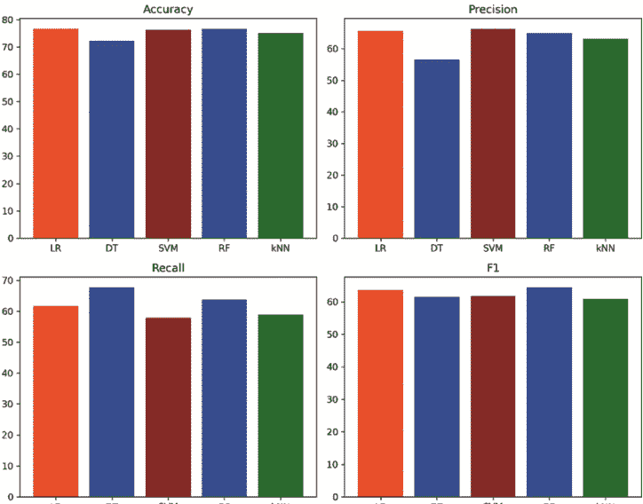

图 1：基础机器学习模型的性能。

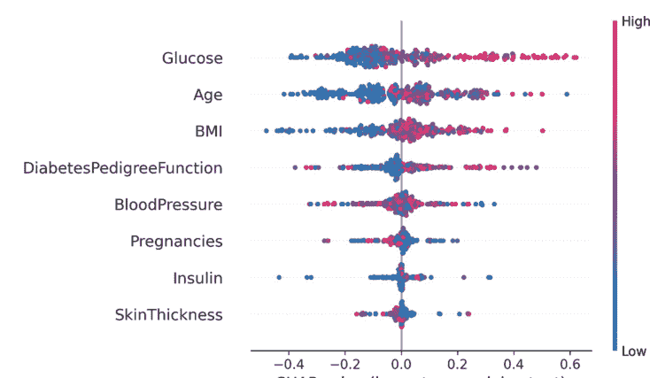

图 2：决策树 SHAP 值。

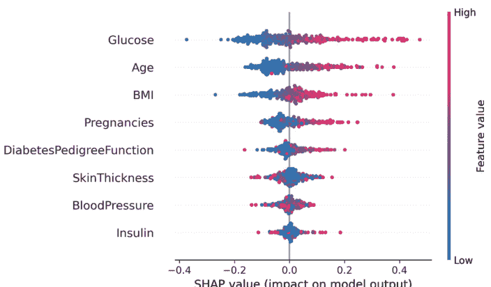

图 3：SVM SHAP 值。

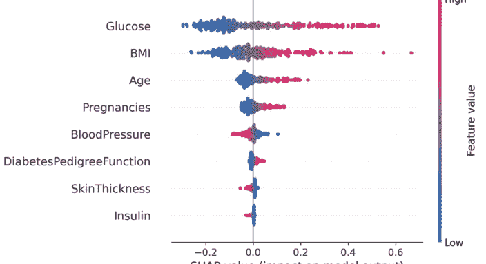

图 4：LR SHAP 值。

投票集成模型，最终分类结果由多数投票决定。我们测试了软投票和硬投票，结果是硬投票集成准确率为 76.95%，精确率为 67.03%，召回率为 59.80%，F1 分数为 63.21%。软投票集成达到了最高准确率 78.25%，精确率为 67.68%，召回率为 65.69%，F1 分数为 66.67%。图 7 显示了硬投票和软投票的性能，图 8 表示软投票分类器的 SHAP 值。

软投票优于硬投票，因为它考虑了所有模型的概率，并结合了所有模型的优势。

还实现了另外两种集成方法，如袋装法和提升法。袋装集成使用基数为 10 的 DT 分类器构建。AdaBoost 和 XGBoost 的基数均为 50。袋装法准确率为 75.00%，精确率为 62.89%，召回率为 59.80%，F1 分数为 61.31%。AdaBoost 准确率为 75.32%，精确率为 62.50%，召回率为 63.73%，F1 分数为 63.11%。XGBoost 的准确率与最佳单一模型相同，为 76.62%，精确率为 63.64%，召回率为 68.63%，F1 分数为 66.04%。图 9–11 分别展示了袋装法、AdaBoost 和 XGBoost 的 SHAP 值。袋装法、AdaBoost 和 XGBoost 的性能如图 12 所示。

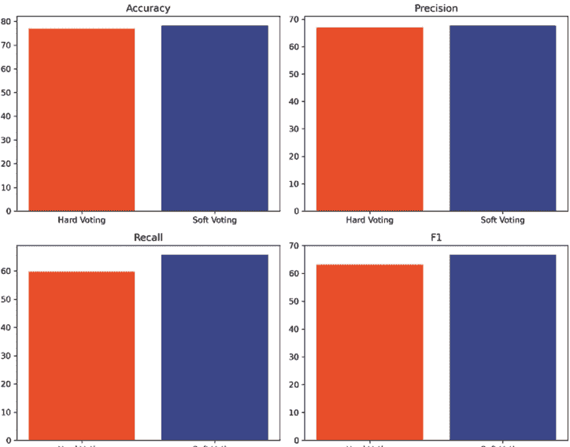

图 7：投票集成模型的性能。

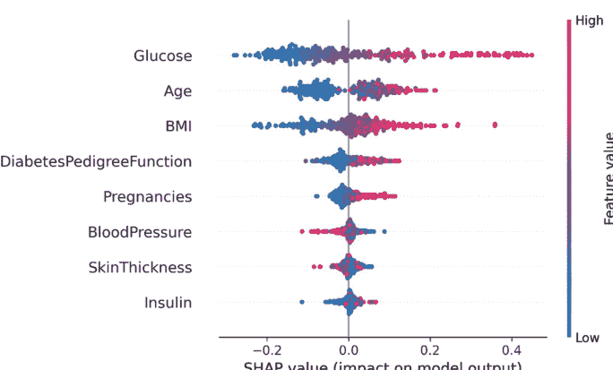

图 8：软投票 – SHAP 值。

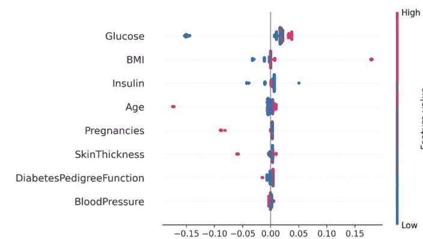

图 9：提升法 – SHAP 值。

我们使用了四个堆叠集成模型。第一个模型使用 DT、RF、SVM 和 kNN 分类器作为基估计器，LR 作为最终估计器。第二个模型使用 DT、SVM、LR、kNN 作为基估计器，RF 作为最终估计器。第三个集成在 DT、SVM、RF、LR 作为基估计器，kNN 作为最终估计器之间进行。最后一个堆叠集成模型使用软投票集成模型、AdaBoost 和 XGBoost 作为基估计器，RF 作为最终估计器。我们将这些集成模型命名为堆叠 1、堆叠 2、堆叠 3 和堆叠 4。

堆叠模型以 RF 作为最终估计器，因为它纠正了基学习者的错误，并减少了偏差和方差。所有堆叠模型的性能如图 13 所示，堆叠模型 1 的 SHAP 值如图 14 所示。表 1 显示了实验中使用的所有模型和所有集成方法的性能。


图 10: Bagging – SHAP 值。

图 11: XGBoost 的 SHAP 值。

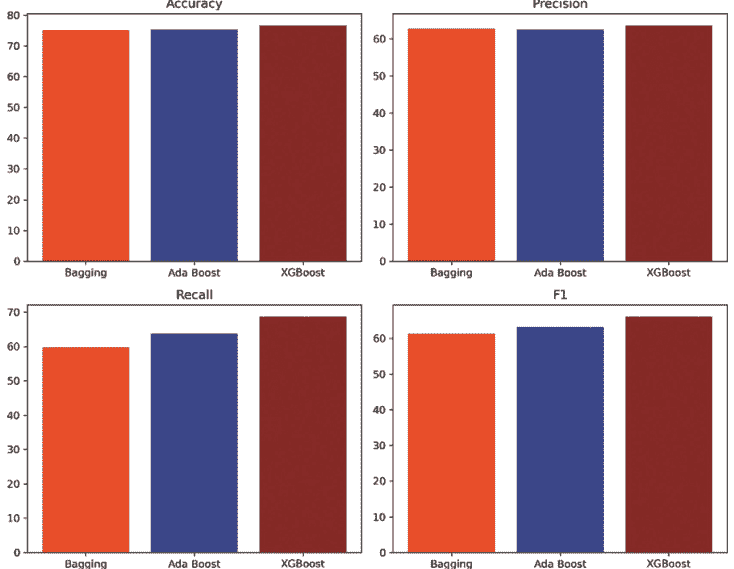

图 12: Bagging 和 Boosting 的性能。

表 1: 所有模型的性能。

| 模型 | 准确率 | 精确率 | 召回率 | F1 |
|---|---|---|---|---|
| LR | 76.62 | 65.62 | 61.76 | 63.64 |
| DT | 72.08 | 56.56 | 67.65 | 61.61 |
| SVM | 76.3 | 66.29 | 57.84 | 61.78 |
| RF | 76.62 | 65 | 63.73 | 64.36 |
| kNN | 75 | 63.16 | 58.82 | 60.91 |
| 硬投票 | 76.95 | 67.03 | 59.8 | 63.21 |
| 软投票 | 78.25 | 67.68 | 65.69 | 66.67 |
| Bagging | 75 | 62.89 | 59.8 | 61.31 |
| AdaBoost | 75.32 | 62.5 | 63.73 | 63.11 |
| XGBoost | 76.62 | 63.64 | 68.63 | 66.04 |
| 堆叠模型 1 | 77.27 | 66 | 64.71 | 65.35 |
| 堆叠模型 2 | 78.25 | 68.42 | 63.73 | 65.99 |
| 堆叠模型 3 | 76.3 | 64.65 | 62.75 | 63.68 |
| 堆叠模型 4 | 74.03 | 60.38 | 62.75 | 61.54 |

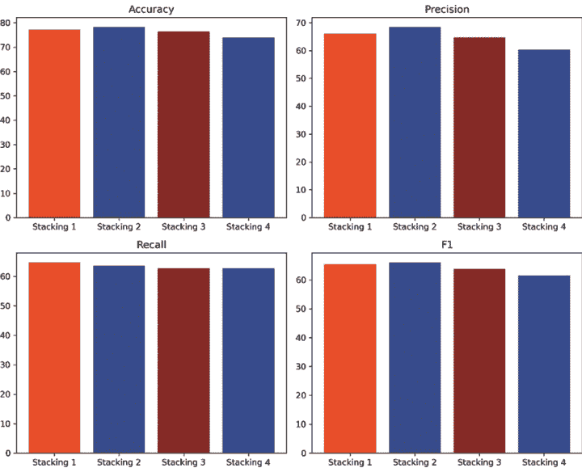

图 13: 堆叠模型的性能。柱状图展示了四个堆叠集成模型的分类性能。

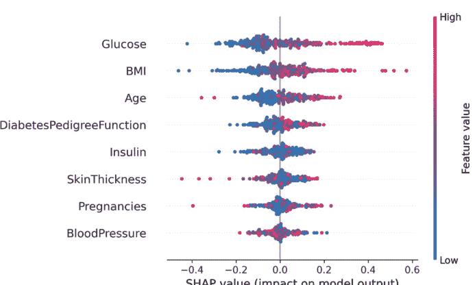

图 14: 堆叠 1 的 SHAP 值。

## 5 结论

糖尿病仍然是全球主要的健康挑战之一，需要准确高效的诊断方法来优化医疗资源并改善患者预后。虽然机器学习在糖尿病检测方面显示出巨大潜力，但依赖单一模型往往难以捕捉疾病的复杂性。本章验证了投票、提升、装袋和堆叠等各种集成方法，并找出哪种方法提供了更稳健、更有效的模型组合方案。在糖尿病分类的集成模型中，软投票集成在准确率方面实现了最高性能，达到 78.25%。这凸显了集成方法在医疗数据分类中的应用。

虽然集成方法相比单一模型能提供更有前景的结果，但构建集成模型所需的复杂性和计算资源巨大。模型准确性与复杂性之间始终存在权衡。

未来工作中，我们计划开发一个用户友好的网站，用户可直接输入数据并获得糖尿病检测结果。

## 参考文献

- [1] S S, S., Surendiran, J., Yuvaraj, N., Ramkumar, M., Ravi, C., & Vidhya, R. (2022). 基于多层感知机的糖尿病分类。在 2022 年 IEEE 分布式计算与电气电路与电子国际会议（icdcece）论文集中（第 1–5 页）。doi: 10.1109/ICDCECE53908.2022.9793085.

- [2] Dubey, Y., Wankhede, P., Borkar, T., Borkar, A., & Mitra, K. (2021). 基于机器学习算法的糖尿病预测与分类。在 2021 年 IEEE 生物医学工程、计算机及健康信息技术国际会议（becthcon）论文集中（第 60–63 页）。doi: 10.1109/BECITHCON54710.2021.9893653.

- [3] Lixandru-Petre, I.-O. (2020). 面向糖尿病分类的模糊系统方法。在 2020 年 电子健康与生物工程国际会议（EHB）论文集中（第 14 页）。doi: 10.1109/EHB50910.2020.9279882.

- [4] Islam, N. U., & Khanam, R. (2021a). 基于机器学习的糖尿病分类。在 2021 年 计算性能评估国际会议（COMPE）论文集中（第 185–189 页）。doi: 10.1109/CompE53109.2021.9751955.

- [5] Warsi, G. G., Saini, S., & Khatri, K. (2019). 糖尿病数据集上的集成学习及早期糖尿病预测。在 2019 年 计算、电力与通信技术国际会议（GUCON）论文集中（第 182–187 页）。

- [6] Ramteke, N., & Maidamwar, P. (2023, Jul). 基于集成机器学习技术的心脏病患者数据分类。在 2023 年第 14 届计算、通信与网络技术国际会议（ICCCNT）论文集中（第 1–6 页）。doi: 10.1109/icccnt56998.2023.10307702.

- [7] Juez-Gil, M., Arnaiz-González, Rodríguez, J. J., & García-Osorio, C. (2021, Sep). 大数据不平衡场景下集成分类器的实验评价。应用软计算, 108, 107447. doi: 10.1016/j.asoc.2021.

- [8] Aljame, M., Ahmad, I., Imtiaz, A., & Mohammed, A. (2020). 基于常规血液检测诊断 COVID-19 的集成学习模型。医学信息学解锁, 21, 100449. doi: 10.1016/j.imu.2020.100449.

- [9] Senthilkumar, T.P., & Prabhusundar, P. (2020, Mar). 水稻病害预测的有效特征选择与增量分类器设计。动态与控制系统先进研究杂志, 12(SP4), 770–786. doi: 10.5373/jardcs/V12SP4/20201545.

- [10] Islam, N. U., & Khanam, R. (2021b). 基于机器学习的糖尿病分类。在 2021 年 计算性能评估国际会议（COMPE）论文集中（第 185–189 页）。doi: 10.1109/ComPE53109.2021.9751955.

- [11] Talapaneni, S., Kota, C. S., Yalagala, N., Nunna, R., & Mothukuri, R. (2024). 提升心脏病预测与分析：一种高效的投票集成模型。在 2024 年 通信、计算机科学与工程国际会议（IC3SE）论文集中（第 156–160 页）。doi: 10.1109/IC3SE62002.2024.10593602.

- [12] Kumar, A., Sushil, R., & Tiwari, A. K. (2021). 基于用户自定义加权集成投票方案的乳腺癌分类。在 2021 年 IEEE 第 10 区域会议（TENCON）论文集中（第 134–139 页）。doi: 10.1109/TENCON54134.2021.9707374.

- [13] Mijoya, I. B., Khurana, S., Gupta, N., & Gupta, K. (2023). 基于硬投票集成技术的移动设备恶意软件检测。在 2023 年 计算、通信与智能系统国际会议（ICCCIS）论文集中（第 116–121 页）。doi: 10.1109/ICCCIS60361.2023.10425513.

- [14] Ramadhan, N. G., & Fitriana, G. F. (2024). 针对 IMDB 电影评论情感分析的硬投票与软投票集成模型比较分析。在 2024 年第九届信息学与计算国际会议（ICIC）论文集中（第 1–4 页）。doi: 10.1109/ICIC64337.2024.10956377.

- [15] Sen, K., & Verma, B. (2023). 基于梯度提升模型、随机森林和高斯朴素贝叶斯的软投票集成心脏病预测。在 2023 年第 4 届新兴技术国际会议（INCET）论文集中（第 1–7 页）。doi: 10.1109/INCET57972.2023.10170399.

- [16] Wang, Y., Zheng, J., Wang, D., & Zhang, Z. (2023). 基于软投票集成学习算法的多目标规划模型。在 2023 年 IEEE 电气、自动化与计算机工程国际会议（ICEACE）论文集中（第 1104–1107 页）。doi: 10.1109/ICEACE60673.2023.10442166.

- [17] Sreenath, M., & Udhayan, J. (2015). 基于装袋集成选择的入侵检测系统。在 2015 年 IEEE 工程与技术国际会议（ICETECH）论文集中（第 1–4 页）。doi: 10.1109/ICETECH.2015.7275015.

- [18] Ward, M., Malmsten, K., Salamy, H., & Min, C.-H. (2021). 面向不平衡数据集时间序列数据分类的基于卷积-LSTM 神经网络的数据平衡装袋集成。在 2021 年 IEEE 电路与系统国际研讨会（ISCAS）论文集中（第 1–5 页）。doi: 10.1109/ISCAS51556.2021.9401389.

- [19] Tella, H., Mohandes, M., Al-Shaikhi, A., Liu, B., Rehman, S., & Nuha, H. (2023). 太阳能电池片缺陷二进制分类的装袋与投票深度学习集成方法。在 2023 年第 20 届系统、信号与设备国际多会议（SSD）论文集中（第 104–108 页）。doi: 10.1109/SSD58187.2023.10411247.

- [20] V, V., PK, M. J., S, N., & S, P. D. (2023). 基于集成机器学习的天气预测系统。在 2023 年 通信、安全与人工智能国际会议（ICCSAI）论文集中（第 996–1000 页）。doi: 10.1109/ICCSAI59793.2023.10421274.

- [21] Omer, Z. M., & Shareef, H. (2019). 光伏系统输出电流预测的自适应提升和自助聚合集成机器学习方法。在 2019 年第 29 届澳大利亚大学电力工程会议（AUPEC）论文集中（第 1–6 页）。doi: 10.1109/AUPEC48547.2019.211856.

- [22] Wu, S., & Nagahashi, H. (2014). 参数化 AdaBoost：引入参数以加速真实 AdaBoost 的训练。IEEE 信号处理字母, 21(6), 687–691 doi: 10.1109/LSP.2014.2313570.

- [23] Dutta, J., Kim, Y. W., & Dominic, D. (2020). 网页分类的梯度提升与极端提升集成方法比较。在 2020 年第五届计算智能与通信网络研究国际会议（ICRCICN）论文集中（第 77–82 页）。doi: 10.1109/ICRCICN50933.2020.9296176.


[24] Zhou, Y., Song, X., & Zhou, M. (2021). 基于XGBoost方法的供应链欺诈预测. In 2021 IEEE 2nd international conference on big data, artificial intelligence and internet of things engineering (ICBAIE) (pp. 539–542). doi: 10.1109/ICBAIE52039.2021.9389949.

[25] Wang, S. (2023). XGBoost分类、BP神经网络分类和CatBoost分类对恶意软件攻击预测的影响比较与分析. In 2023 international conference on intelligent communication and computer engineering (ICICCE) (pp. 77–80). doi: 10.1109/ICICCE61720.2023.00018.

[26] Lin, Z., & Zhu, S. (2023). DFS增强的LightGBM：应用于ICU心力衰竭死亡率预测的扩展LightGBM模型. In 2023 international conference on high performance big data and intelligent systems (HDIS) (pp. 113–117). doi: 10.1109/HDIS50872.2023.10499633.

[27] Zhao, T., Zhao, Y., & Zhou, T. (2024). 用于海床沉积物分类的堆叠集成学习. In 2024 7th international conference on information communication and signal processing (ICICSP) (pp. 211–215). doi: 10.1109/ICICSP62589.2024.10809036.

[28] Nirmala Devi, M., 别名 Balarumugan, S. A., & Swathi, U. V. (2013). 用于糖尿病预测的融合kNN. In 2013 IEEE international conference on emerging trends in computing, communication and nanotechnology (ICECCN) (pp. 691–695). doi: 10.1109/ICE-CCN.2013.6528591.

[29] Rachmawanto, E. H., Ignatius Moses Setiadi, D. R., Rijiati, N., Susanto, A., Wahyu Muliyono, I. U., & Rahmalan, H. (2021). 不平衡糖尿病数据集中随机森林分类的属性选择分析. In 2021 international seminar on application for technology of information and communication (ISEMANTIC) (pp. 82–86). doi: 10.1109/ISEMantic52711.2021.9573181.

[30] Krisdianto, R., Apriani, I., Masada, H., & Hidayaturrhaman. (2024). 支持向量机(SVM)在糖尿病疾病检测中的性能分析. In 2024 5th international conference on artificial intelligence and data sciences (AIDAS) (pp. 203–207). doi: 10.1109/AIDAS63860.2024.10730403.

[31] Bai, X., Chen, B., Gao, X., & Li, J. (2019). 基于决策树和神经网络的糖尿病与身体成分的相关性. In 2019 Chinese control and decision conference (CCDC) (pp. 4992–4997). doi: 10.1109/CCDC.2019.8832670.

[32] Ravalika, D., & Pitchai, R. (2023). 使用二项逻辑回归预测糖尿病. In 2023 4th international conference on smart electronics and communication (ICOSEC) (pp. 918–923). doi: 10.1109/ICOSEC58147.2023.10276068.

Sunder R.*, Gayatri Parasa, Buna Vijay Kumar, B. Kamala, Chilukala Mahender Reddy, and S. Bathrinath

# 中风患者风险分层和功能预后预测的混合机器学习模型

**摘要：** 中风仍然是全球长期残疾的主要原因之一，需要精确和及时地预测患者预后，以指导针对性的康复和资源配置。本章介绍了一种新的混合机器学习（ML）模型，它结合多模态数据源，用于中风幸存者的风险分层和功能预后预测这两项并发任务。该混合模型结合了用于影像数据的卷积神经网络（CNN）、用于结构化临床数据的图神经网络，以及用于部分手工特征的常规机器学习模型（LightGBM）。这些异质元素被集成在一个共同的潜在表示空间中，并使用多任务学习策略端到端优化。该模型根据修正的Rankin等分（mRS）对人口统计数据、临床评分、神经影像（CT/MRI）和随访功能预后的强健数据集进行了训练和验证。与四种传统模型：逻辑回归、随机森林、单模态CNN和集成晚融合模型的比较评估表明，所提混合方法表现更佳，风险分类的接收者操作特征曲线下面积（AUC）为0.92，mRS预测的加权卡帕系数为0.84。研究结果表明，在单一模型中结合多种学习范式和数据类型可以提高预测能力和可解释性，并为更加以患者为中心的中风治疗打开了大门。

**关键词：** 中风预测, 混合机器学习, 多模态数据集成, 卷积神经网络（CNNs）, 图神经网络（GNNs）, LightGBM

*通讯作者：Sunder R., 加尔戈蒂亚大学计算机科学与工程学院，大诺伊达，北方邦，印度，电子邮件：sunder.r@galgotiasuniversity.edu.in **Gayatri Parasa**，KG Reddy工程技术学院CSE–AIML系，海得拉巴500086，特伦甘纳邦，印度，电子邮件：gayatri.p@kgacr.in **Buna Vijay Kumar**，SR大学计算机与人工智能学院，瓦朗格尔506371，特伦甘纳邦，印度，电子邮件：vijaykumar.bura@gmail.com **B. Kamala**，斯里赛拉姆工程学院信息技术系，钦奈，泰米尔纳德邦，印度，电子邮件：kamala.it@sairam.edu.in **Chilukala Mahender Reddy**，SR大学计算机与人工智能学院，瓦朗格尔506371，特伦甘纳邦，印度，电子邮件：mahender.chilukala@gmail.com **S. Bathrinath**，卡拉斯灵优姆研究与教育学院机械工程系，克里希南科伊尔626126，泰米尔纳德邦，印度，电子邮件：bathri@gmail.com

https://doi.org/10.1515/9783111541235-004

## 1 引言

中风继续是全球死亡和残疾的主要原因之一，给社会和医疗保健带来压力 [1]。由于几乎所有中风（但极少数除外）都是缺血性中风，快速且精确的患者预后预测对临床决策以及资源消耗规划非常重要。传统上，中风预后预测依赖于临床评分量表，例如美国国立卫生研究院中风量表（NIHSS）和mRS [2]。虽然有用，但此类量表通常因依赖主观评估、固定变量以及未能捕捉中风病理的复杂多模态特性而受限。因此，越来越多的研究者有兴趣整合机器学习（ML）和深度学习（DL）方法，以最大化预测性能并指导个体化治疗选择 [3]。

临床信息学和医学影像领域的先进技术进步，使得获取高维异质数据成为可能，这些数据包括神经影像、生理测量、实验室检测值以及详尽的患者病史 [4]。然而，这些异质数据源在传统预测模型中往往未被充分利用。单模态方法（例如仅基于影像或仅基于临床的模型）可能不足以挖掘多模态数据的协同优势。因此，需要一种详尽且基于证据的策略，以优化中风患者预后预测的精度和可靠性 [5]。

为弥补这一差距，本工作提出了一种新型混合模型，该模型集成影像数据、结构化临床特征和关系性临床图。所提架构结合三个高性能组件：（1）一种三维卷积神经网络（CNN）[6]，用于从体积CT或MRI扫描中提取空间特征；（2）一种图神经网络（GNN）[7]，用于患者间临床关系建模；（3）一种基于LightGBM [8]的传统机器学习流水线，用于利用手工设计的表格化临床特征。

多模态数据融合——即将各种数据类型组合并在一起进行分析——作为解决这一挑战的方案，正受到越来越多的关注。其理由很简单：各种数据模式捕捉关于患者状态的互补信息 [9]。例如，影像数据会揭示大脑的解剖和病理改变，而包括血压、血糖水平或心房颤动状态在内的临床数据则可以提供关于风险和康复的背景信息。当被妥善结合时，这些模式有可能提供一幅更丰富、更具信息量的患者健康状态图像。尽管如此，由于数据结构、维度和语义的差异，整合此类异质信息仍然是一项巨大的挑战 [10]。

数据可用性的增加是人工智能（AI）和机器学习（ML）方法（特别是深度学习）的创新。这些方法已被证明在模拟复杂的高维关系以及从纯输入数据中学习分层表示方面大有前景 [11]。在医学影像领域，CNN已被广泛用于检测和分类病变，而循环神经网络和图


已有研究探讨了模型在临床数据中建模时间性和关系性模式的能力 [12]。这些新可能性为构建智能系统带来了新机遇，使系统能够直接从原始多模态患者数据中学习，而无需高度依赖手工特征或严格的评分系统。

然而，基于AI的模型在卒中预后中的临床应用仍然有限。其关键原因之一是当前大多数研究采用单模态方法。仅基于成像数据的模型往往忽略重要的临床背景，而仅基于表格化临床数据的模型无法捕捉脑部扫描中可见的重要解剖特征。此外，传统机器学习模型不够灵活和富有表达性，难以处理患者数据中通常发现的广泛、非线性和相互依赖的关系。强烈需要超越单模态系统，转向能够以连贯、可解释且具有临床相关性的方式整合多源数据证据的混合系统。

本研究提出了一种统一的、多模态的、可解释的深度学习架构，用于预测卒中预后。通过整合空间、关系和领域特定信息，该模型捕捉了卒中病理的多面性以及康复中的个体差异。这种混合方法可适应卒中之外的各种临床任务，包括其他神经系统或心血管疾病的预后预测。随着医疗保健日益转向精准医疗，此类集成AI驱动工具有望彻底改变预后、个性化治疗规划，并最终改善患者预后。本研究旨在实现以下目标：

- 构建一种多模态混合模型，整合多源数据（如成像数据、结构化临床数据和手工特征），以有效预测卒中患者预后。
- 将用于图像的CNN、用于临床信息的GNN以及用于手工特征的传统机器学习模型（LightGBM）整合到单一模型中。
- 利用多任务学习方法，同时进行风险分层和功能预后预测（基于mRS）。
- 根据AUC-ROC（接收器操作特征曲线下面积，用于风险分类）和QWK（二次加权卡帕，用于mRS预测）等指标，评估混合模型相对于标准模型（逻辑回归（LR）、随机森林（RF）、单模态CNN和集成晚期融合模型）的效率。

## 2 相关工作

机器学习的最新发展已改变医学诊断，为处理复杂临床数据和检测高危个体提供了可靠手段。本综述讨论了用于卒中预测的混合和集成机器学习方法，结合了包括LR、SVM、RF、深度学习架构和元启发式优化算法在内的算法。这些模型辅以特征选择（FS）和类别平衡方法，表现出显著的准确性和临床实用性提升，是早期卒中检测和预防的可扩展、可解释且强大的解决方案。

### 2.1 用于卒中预测的混合机器学习模型

急性缺血性卒中（AIS）是严重的全球健康问题，因其高死亡率、发病率和致残率，幸存者面临终身的身体、认知和情绪障碍。为及时做出临床决策并提供个体化治疗，研究者提出了一种成功的混合机器学习模型，用于预测AIS患者三个月的不良预后。该研究基于731例病例的数据集，并经过内部和外部验证，在14项性能指标上比较了25个深度学习和机器学习模型。基于指标的聚类和相关性分析，从中筛选出12个高性能模型，其中XGBoost和CatBoost在准确性和可靠性方面均优于其他模型。通过集成建模和成本曲线分析阈值调优，最终模型在两组数据上均表现出不错的性能。进行了决策分析和公平性检查以衡量临床实用性。基于SHAP的可解释性利用白蛋白、空腹血糖、BMI、血清肌酐（Scr）、白细胞计数和年龄作为重要预测因子，且与性别有重要交互作用。值得注意的是，该模型仅使用30个易于获取的临床特征，提升了其实用性。所得的预后平台提供精确、可解释且具有临床可操作性的预测，证明其在电子健康记录或远程医疗系统中的实施具有合理性。这项研究展示了混合、可解释的机器学习模型如何安全可靠地为早期AIS管理和康复规划提供参考，是迈向卒中治疗精准医疗的激动人心的一步 [13]。

### 2.2 基于EEG的混合卒中诊断

近几十年来，平均寿命延长导致老年人群中卒中病例数增加，使得卒中诊断和治疗成为重要的研究课题，特别是在机器学习领域。早期诊断对卒中治疗至关重要，但CT和MRI等当前成像技术并不理想。虽然MRI成本高且难以获得，但CT可能需要长达8小时才能提供可靠诊断。这促使人们寻求替代性的、更快的基于脑电图（EEG）的诊断技术。本文提出了一种新型混合模型，用于对EEG数据（一种具有频率内容的时间序列）中的卒中进行分类，该模型结合了深度学习与元启发式优化。模型中使用了CNN和双向门控循环单元（BiGRU）来有效提取时空信息。在特征提取中，CNN-BiGRU模型优于擅长处理频率数据的和声搜索（HS）算法。在超参数调优时，多变量优化（MVO）方法优于其他算法。与以往使用便携式EEG的研究相比，CNN-BiGRU-HS-MVO模型在使用MUSE-2便携设备从Al Bashir Hospital获取的EEG数据进行验证时，实现了99.991%的显著预测准确率。得益于进一步开发的基于云的决策支持系统，更快、更简单的患者护理现在随时随地均可实现，该系统可实现远程实时卒中诊断并通过短信提供结果 [14]。

### 2.3 带特征选择的混合分类器

脑卒中是一种需要及时且恰当地预测以进行适当治疗和预防的严重医疗状况。已提出一种涉及特征选择（FS）方法与机器学习分类器算法的混合方法，以改进脑卒中的预测。使用了Kaggle提供的卒中预测数据集，其中数据不平衡问题通过合成少数类过采样技术（SMOTE）进行处理。将五个分类器（朴素贝叶斯、SVM、RF、自适应增强（Adaboost）和极端梯度提升（XGBoost））与三种FS方法（互信息、皮尔逊相关性和特征重要性（FI））进行了比较。使用k折交叉验证，在准确率、灵敏度、特异度、精确度和F值方面比较了性能。最佳性能由以FI作为FS方法、RF作为分类器的混合模型获得。该模型将特征减少了36.3%，准确率达到97.17%。高维降维与强大的分类方法相结合，使该模型能够对脑卒中做出准确预测。结果突出了这种混合系统的好处，可实现卒中的早期检测和预防，为医疗专家提供有用工具，以便进行及时和针对性的干预，从而改善患者预后并减少卒中并发症 [15]。

### 2.4 使用ADASYN和随机森林进行卒中预测

由于脑血供急性丧失导致的脑卒中会引发一系列细胞损伤，其机制是氧气和营养物质剥夺。可改变的生活方式指标，如血糖升高、心血管疾病、超重/肥胖和 dia-


糖尿病使中风风险显著高于正常水平。研究了诸如LR、RF和K-最近邻等复杂机器学习算法在脑卒中预测中的潜力。数据从哈佛Dataverse仓库收集，包括临床、生理、行为、人口统计和病史变量。采用了三种过采样方法SMOTE、自适应合成采样（ADASYN）和随机过采样技术（ROSE），以克服中风数据库中普遍存在的类别不平衡问题，使少数类分布更加均匀并提升模型性能。本章引入了一种新的混合方法，将ADASYN过采样与RF分类器（ADASYN_RF）相结合，以从高度不平衡的生理数据中准确预测中风。不同过采样技术和机器学习算法的对比实验表明，ADASYN_RF混合方法以惊人的99%检测率优于其他方法。这种混合方法为中风预测提供了一种既经济又可靠的解决方案，是及时临床诊断和治疗的宝贵工具[16]。

### 2.5 混合采样优化的中风风险预测

提出了一种新的监督机器学习算法，用于基于全面的致病因素列表预测中风风险。作为临床执业者的助手，该模型旨在提高诊断准确性、防止死亡并促进早期干预程序。该模型在一个包含与中风相关的多种特征的不平衡数据集上进行了训练和测试。为提升性能，采用了混合采样策略来平衡类别，并使用网格搜索调整五个基准模型的超参数。集成分类方法表现最佳，精确度、准确率、F1分数和召回率在94.5%至95.5%之间。该模型的性能表明其在辅助中风风险预测临床决策方面的适用性[17]。

### 2.6 用于中风预测的混合集成机器学习

中风是一种由于某些脑细胞血液供应不足而导致的慢性病，进而导致氧气和营养剥夺，最终引起细胞死亡。精确预测和早期检测中风是医疗保健领域持续面临的关键挑战。近年来，机器学习方法在疾病预测方面已被证明非常有效，有望带来更好的临床结局。该研究引入了一种具有三种异构基础分类器（SVM、LR和RF）的混合集成机器学习模型。这个名为SVM-LR-RF的集成模型利用各个模型的独特能力，使用Kaggle仓库中可用的医疗保健数据集来提高中风预测准确性。模型在Python编程环境中设计和实验。首先，基础学习者LR、SVM和RF通过混淆矩阵分别进行训练和测试，以确定其分类性能。接着，通过软投票方法组合基础模型的输出（预测概率）来构建混合集成模型。这使模型能够结合每个学习者的预测，增强整体鲁棒性并减轻各自的缺点。实验结果表明，SVM-LR-RF混合模型显著优于独立分类器，预测准确率为95%。这一成功说明了使用集成学习合并不同机器学习算法，用于中风等复杂医疗预测任务的潜力。基于这些令人鼓舞的发现，建议将混合SVM-LR-RF模型作为改善中风风险预测的功能性和有效性工具来应用，这可以支持临床医生进行早期干预并改善患者护理[18]。

### 2.7 基于集成-LR-RF和SVM的中风风险预测

部署基于机器学习的中风预测系统在识别中风高危人群方面将是一项令人兴奋的进展。利用大型数据集，机器学习模型可以识别临床医生甚至无法察觉的微妙非线性模式和弱预测因子。这种能力有望大幅改善早期检测，促进及时干预，并为降低中风患病率和更好地服务患者提供预防行动依据。尽管以前的研究已将单个机器学习模型应用于中风预测，但本研究探讨了LR、RF和SVM模型的组合。每种算法都有其自身的优势和劣势。由于其集成特性以及处理非线性关系和FI的能力，RF提供了最高的预测准确率。相反，LR和SVM提供了更好的计算效率和训练复杂度，使其适用于需要快速或有限部署的情况。混合建模方法利用了三个分类器的预测能力，并在准确率、训练时间和稳定性等方面进行了比较。在这三者中，RF在这组数据上表现最佳，适合应用于中风风险评估程序。LR和SVM也根据应用要求适用。此外，基于机器学习的中风预测模型为医学提供了一种突破性工具，使早期识别高危患者成为可能。该研究证实了机器学习在医疗诊断中的能力，并强调需要开展更多研究，以开发更先进的算法选择、特征提取和模型训练，从而更易于临床应用[19]。

回顾的文献共同强调了集成和混合机器学习模型在中风预测模型开发中的颠覆性潜力。通过多个分类器（即RF、LR、SVM、XGBoost、CatBoost以及包括CNN-BiGRU在内的深度网络）的集成，结合优化技术和特征选择器，上述所有方法都实现了高预测准确率，通常超过95%。使用过采样技术（例如SMOTE、ADASYN和ROSE）充分解决了类别不平衡问题，并有助于模型的可靠性。此外，可解释模型（如SHAP分析）和实时临床决策支持系统部署（如基于云或基于短信的系统）的应用，在现实世界的医疗保健环境中展示了实用价值。这些模型不仅受益于早期和准确的中风诊断，还提供了嵌入电子健康记录和远程医疗系统所需的可扩展性和灵活性。尽管此类举措有效，但该研究呼吁在外部验证、实时部署以及多模态数据源（如EEG、影像和临床笔记）的整合方面付出更多努力。伦理考量、公平性评估和可解释性也是在临床环境中实施可负责任AI需要跨越的重要障碍。最后，用于中风预测的混合机器学习算法构成精准医学的一个有前景领域，能够通过早期干预工具支持临床医生，并在各种医疗保健基础设施中优化患者预后。

## 3 方法论

中风继续是全球发病率和死亡率的主要原因，早期风险分层和功能结局预测对于改善患者护理和长期康复至关重要。标准预后方法通常不足以描述决定中风结局的影像生物标志物、临床标志物和共病之间复杂的关系。为解决这一挑战，我们引入了一种新的多模态机器学习系统，它结合高分辨率神经影像、结构化临床信息和领域知识驱动的手工制作特征，以准确预测中风后风险和功能恢复。利用密集的ISLES数据集，我们的方法集成了一个3D CNN，用于从MRI图像中学习空间病变特征，一个GNN，用于表示患者之间的临床相似性，以及一个基于LightGBM的常规模型，以保留可解释的临床知识。这些多样的数据表示被组合到一个单一的潜在空间中，并通过多任务学习方法进行优化，以同时预测中风严重程度风险水平和基于mRS的90天功能结局。这种深度学习模型混合为个性化的中风管理提供了一个乐观的方向，具有数据驱动、可解释和精确的临床决策支持。

### 3.1 数据源

ISLES（缺血性中风病变分割）挑战数据集（https://www.isles-challenge.org）被用作本研究的初始数据源，为中风结局研究提供了丰富的多模态数据[20]。数据提供了结构-


结构化临床数据，如年龄、性别、共病、NIHSS评分及相应的实验室结果，包含重要的人口学特征和卒中严重程度。此外，数据还包括DWI、FLAIR和ADC等多模态MRI扫描，用于提供缺血性病变及其邻近脑组织的准确解剖和病理特征。这些成像模态有助于对卒中影响进行高层次空间分析。以mRS评分形式的功能性预后标签通常在卒中后90天测量，提供残疾和恢复的标准化评估。临床因素、高分辨率成像和预后数据的结合，为风险分层和长期功能预测提供了强大的建模，从而允许设计先进的混合学习方案。

### 3.2 数据预处理

为确保模型就绪和数据质量，对结构化数据和成像数据均执行严格的预处理操作。年龄、NIHSS评分和实验室值等有序临床变量经过Z-score标准化，以统一特征测量并提升模型收敛性。在成像数据中，MRI扫描会随机进行旋转、裁剪和对比度变化，以模拟解剖呈现和影像获取中的差异性，增强模型的鲁棒性和泛化能力。这些增强方法对于训练深度学习模型以在不同条件下识别卒中特征尤其有价值。结构化数据集中的缺失值也会通过临床知识驱动的插值方案进行填充。该方案利用领域特定的基于规则和实际的临床相关性（例如基于糖尿病等已确立的共病状况来估算缺失的血糖值）来计算比常规统计程序更具生理合理性的数值。该修改后的预处理管道保证了数据集在后续混合模型训练中的完整性和功能性，且不会对卒中预后预测所必需的关键临床和成像特征产生负面影响[21]。

### 3.3 模型架构

本文提出了一种新的多模态ML范式，用于结合多模态患者信息，对卒中幸存者进行风险分层和功能性预后预测。结构包括用于成像的3D CNN[22]、用于临床关系的GNN[23]以及用于手工制作特征的传统机器学习。这些不同的表征被整合到共享潜在向量中，并通过多任务学习进行优化。这有助于通过互补数据源和任务特定任务实现准确且可解释的预测。卒中幸存者预测的模型架构如图1所示。

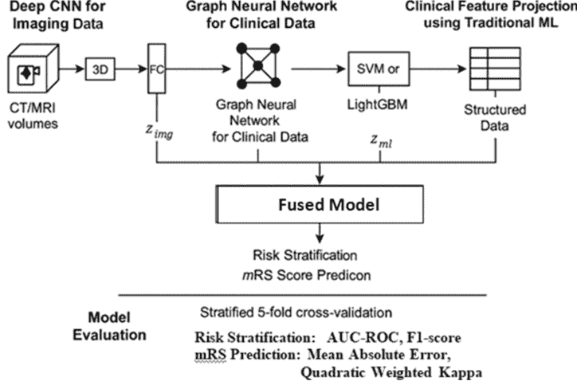

图1：卒中预测的拟议模型架构。

#### 3.3.1 用于成像数据的深度卷积神经网络

3D卷积神经网络用于扫描体积CT/MRI图像，获取与缺血性病变和脑部异常相关的高层空间特征。成像数据在CNN中经过多层3D卷积、批归一化和ReLU激活进行处理，捕获病变大小、位置和强度等分层特征。最后的卷积输出被展平并输入全连接（FC）层，生成固定大小的图像来源嵌入向量z_img，该向量是患者神经解剖状态的学习表示。该向量包含对卒中严重程度和恢复预测至关重要的成像来源信息[24]。为正式数学表示成像数据的3D CNN，定义一个按层抽象的过程，捕捉从原始CT/MRI体积到嵌入向量z_img的转换：设输入图像体积为

```
X_{img} \in \mathbb{R}^{H*W*D} (1)
```

其中\(X^{(0)} = X_{img}\)，*表示3D卷积操作，\(W^{(l)}, b^{(l)}\)分别为第l层的权重和偏置，BN为批归一化，\(\sigma\)为ReLU激活函数。通过堆叠多层此类层来提取分层空间特征。

在第L个卷积层之后，输出张量被展平：

\(f_{flat} = \text{Flatten}\big(X^{(L)}\big)\)

展平向量经过一个密集（FC）层，表示如下：

\(z_{img} = \varnothing(W_{fc} \cdot f_{flat} + b_{fc})\)

其中\(\varnothing\)为非线性激活函数（ReLU或tanh），\(W_{fc}, b_{fc}\)为FC层的权重和偏置。输出为：

\(z_{img} \in \mathbb{R}^k\)

捕获神经解剖信息的固定长度图像来源嵌入即为该最终向量，\(z_{img}\)。

#### 3.3.2 用于临床数据的图神经网络（GNN）

临床信息通过GNN建模来表示，每个患者视为一个节点，边代表临床相似性，即年龄、实验室值和共病等变量在归一化空间中的欧氏距离。每个节点预加载了包含生命体征、实验室结果以及高血压或房颤等疾病分类指标的特征向量。通过迭代图卷积操作，GNN聚合邻近患者的信息，使模型能够学习临床相似患者之间的关系模式。最终节点嵌入\(z_{clin}\)在潜在空间中总结临床概况，捕获与预后预测相关的复杂患者间依赖关系[25]。

设临床数据集表示为图

\(G = (V, E)\)

其中\(V\)为节点（患者）集合，\(E\)为代表临床相似性的边集合。设\(X \in \mathbb{R}^{N*d}\)为输入特征矩阵，其中每一行\(x_i \in \mathbb{R}^d\)代表患者的临床特征。设\(A \in \mathbb{R}^{N*N}\)为图的邻接矩阵，其中若节点i与节点j相连则\(a_{ij} = 1\)，否则为0。自环添加如下：\(\hat{A} = A + I\)，度矩阵为\(\hat{D}_{ij} = \sum_j \hat{a}_{ij}\)。

单层GCN对节点特征的更新如下：

\(H^{(1)} = \sigma(\hat{D}^{-\frac{1}{2}} \hat{A} \hat{D}^{-\frac{1}{2}} X W^{(0)})\)

其中\( W^{(0)} \in \mathbb{R}^{d \times k} \)为可学习权重矩阵，\(\sigma(\cdot)\)为非线性激活函数（如ReLU）。该过程重复\(L\)层，表示如下：

\( H^{(t+1)} = \sigma \left( \hat{D}^{-\frac{1}{2}} \hat{A} \hat{D}^{-\frac{1}{2}} X W^{(t)} \right) \), \( H^{(0)} = X \tag{8}\)

经过\(L\)层GNN后，每个患者节点的最终节点嵌入为

\( Z_{\text{clin},i} = H_i^{(L)} \in \mathbb{R}^k \tag{9}\)

其中\( z_{\text{clin},i} \)是第i个患者的学习嵌入，总结了临床信息和邻域影响。图嵌入输出指定如下：

\( Z_{\text{clin}} = H^{(L)} \in \mathbb{R}^{N*k} \tag{10}\)

后续任务（如分类和融合）使用该嵌入矩阵。

#### 3.3.3 使用传统机器学习进行临床特征投影

并行地，选定的一组手工制作的临床特征（如卒中亚型、既往短暂性脑缺血发作（TIA）和既往病史）被输入到LightGBM机器学习模型[26]中。这些模型擅长处理具有高可解释性的表格数据。这些模型的输出是一个表示风险预测的概率向量，然后通过可学习投影层转换为稠密嵌入向量\( z_\text{ml} \)。此步骤确保与其他潜在向量的兼容性，并将专家驱动的特征集成到混合框架中。手工制作的临床特征向量表示如下：

\( X_\text{ml} \in \mathbb{R}^{d'} \tag{11}\)

它捕获对卒中预后预测至关重要的结构化、手动策划的患者信息。这些特征是分类和二元变量，如卒中亚型（例如心源性栓塞和血栓性）、既往TIA发作史以及糖尿病和高血压等既定风险因素或共病。这些基于领域知识的特征基于临床意义选择，作为传统机器学习算法的起始输入，提供可解释性并利用专家知识提高预测质量。手工制作的特征向量\( X_\text{ml} \)被传递到传统分类器中。对于梯度增强决策树模型LightGBM：

\( \hat{p} = f_\text{LightGBM}(X_\text{ml}) \in \mathbb{R}^C \tag{12}\)


where \( f_{LGBM} \) 是通过决策树集成输出类别概率的训练模型。概率向量 \(\hat{p}\) 使用可学习的线性变换进行转换，以创建稠密嵌入向量，然后用于集成 ML 输出与 DL 组件：

\( Z_{ml} = \sigma(W_{ml}\hat{p} + b_{ml}) \in \mathbb{R}^k \) (13)

where \( W_{ml} \in \mathbb{R}^{k*C} \) 是可学习的权重矩阵，\( b_{ml} \in \mathbb{R}^k \) 是偏置项，\( \sigma \) 是激活函数（ReLU 或 tanh）。在混合特征融合层中，得到的向量 \( Z_{ml} \in \mathbb{R}^k \) 成为传统的 ML 派生潜在表示，准备进行拼接。

#### 3.3.4 混合特征融合层

在混合特征融合中，嵌入是跨三种异质路径计算的，\( Z_{img} \) 来自通过 CNN 处理的图像数据，\( Z_{clin} \) 来自通过 GNN 建模的临床关系，\( z_{ml} \) 来自基础 ML 流水线，这些被融合为一个整体复合向量，表示为 \( z_{fused} \)。组合表示采用互补的数据模态，并在共享潜在空间中结合空间、关系和手工设计的特征。随后的向量被输入到带有脱校正正则化和批量归一化的多层感知机（MLP）。脱校正通过在训练期间随机移除神经元来避免过拟合，批量归一化通过归一化层输入来稳定和加速训练。这种合并各种形式特征的混合技术使网络能够以无缝方式集成各种形式的特征，为功能的风险分层和结局预测生成更强大、更精确的预测。

以下是混合特征融合过程的表示。让以下成为各自子系统学习到的嵌入：

\( Z_{img} \in \mathbb{R}^{d1} \) (14)

方程 (14) 表示来自 3D CNN 的图像派生嵌入：

\( Z_{clin} \in \mathbb{R}^{d2} \) (15)

方程 (15) 表示来自 GNN 的临床关系嵌入：

\( Z_{ml} \in \mathbb{R}^{d3} \) (16)

方程 (16) 表示传统 ML 嵌入。

混合融合表示 \( Z_{fused} \) 通过拼接三个嵌入形成：

\( Z_{\text{fused}} = [Z_{\text{img}} || Z_{\text{clin}} || Z_{\text{ml}}] \in \mathbb{R}^{d_1 + d_2 + d_3} \quad (17) \)

接下来，对该融合向量应用带有脱校正和批量归一化的 MLP：

\( h_1 = \text{ReLU}(\text{BN}_1(W_1 Z_{\text{fused}} + b_1)) \quad (18) \)
\( h_1^{\text{drop}} = \text{Dropout}(h_1, p) \quad (19) \)
\( h_2 = \text{ReLU}(\text{BN}_2(W_2 Z_{\text{fused}} + b_2)) \quad (20) \)

where \( W_1, W_2 \) 是权重矩阵，\( b_1, b_2 \) 是偏置，\( BN_1, BN_2 \) 是批量归一化函数，\( p \) 是脱校正概率。在多任务学习阶段，使用此 MLP 输出 \( h_2 \) 进行最终预测。

#### 3.3.5 多任务学习

所提出的架构具有两个任务特定输出层之间的双任务学习过程，它们有能力同时优化两个临床有用的目标。风险分层与第一个输出层相关联，该层通过 softmax 激活为患者指定低、中或高风险水平。这能够使模型输出类别概率，以便模型输出更易于理解的风险估计的类别概率。第二个输出层用于 mRS 评分预测，作为序数回归任务来处理，以尊重 mRS 的有序性质。使用 CORAL（累积序数回归）或深度序数回归等方法，以高效方式学习此序数输出。最终训练目标由聚合损失函数指导，表示如下：

\( \mathcal{L} = \alpha . \mathcal{L}_{\text{risk}} + \beta . \mathcal{L}_{\text{outcome}} \quad (21) \)

这里，\( \alpha \) 和 \( \beta \) 是可以调整以调节两任务贡献的超参数。模型能够通过联合优化两个任务，同时利用共享表示和任务特定学习，从而为风险分类和功能结果预测实现更好的泛化和预测性能 [27]。

#### 3.3.6 模型集成与输出

在集成的最后阶段，三个不同模型组件 \( z_{\text{img}} \)（图像派生嵌入）、\( z_{\text{clin}} \)（基于图的临床嵌入）和 \( z_{\text{ML}} \)（常规 ML 派生嵌入）的学习表示被融合，以构建反映患者整体健康状况的统一单一向量。聚合特征向量包含图像空间模式、患者间临床连接以及结构化领域知识感知特征的信息。联合表示被输入多层前馈神经网络，目标是执行双任务学习。第一个任务是风险分层，作为多类分类任务来预测不良结局的低、中或高风险。第二个任务是功能结局预测，作为序数回归任务来表示，目标是 mRS，一个从 0（无症状）到 6（死亡）的有序量表。这个统一框架使模型能够同时学习任务间的常见模式和任务特定特征，从而提高其在临床应用中的预测性能和泛化能力。

## 4 结果与发现

混合模型的性能在分层五倍交叉验证上进行严格测试，以便训练和验证划分中结果的类别分布均匀。在风险分层任务中，性能使用 AUC-ROC 进行测量，AUC-ROC 是评估模型区分类别能力的独立于阈值的评估，以及 $F_1$-score，它优化精确率和召回率以在不平衡场景中表达分类准确性。对于 mRS 评分预测，平均绝对误差（MAE）衡量预测误差的平均大小，表明模型在功能结局估计中的精度。QWK 还在考虑序数量表并对较大差异施加更严厉惩罚的前提下，评估预测 mRS 评分与真实 mRS 评分之间的一致性。总体而言，这些指标对模型的区分度、预测性能和临床可用性提供了全面评估。

所建议的混合模型与另外四种方法是表 1 中显示的五个模型中的定量性能比较的一部分。它使用四个主要指标来评估每个模型：

- **AUC-ROC (风险分层)**

它评估模型区分低风险和高风险等分类的能力。真阳性率（TPR）与假阳性率（FPR）由以下给出：

\( \text{TPR} = \frac{TP}{TP + FN}, \text{FPR} = \frac{FP}{FP + TN} \quad (22) \)

ROC 曲线的积分，即 AUC，通常通过数学方式计算（例如，通过应用梯形法则）。

- **$F_1$-score (风险分层)：** 它在分类准确性和召回率之间取得平衡（此处用于风险分类）。计算如下：

\( F_1\text{-score} = 2 * \frac{\text{Precision} \times \text{Recall}}{\text{Precision} + \text{Recall}} \quad (23) \)

其中，精确率和召回率由以下给出：

\( \text{Precision} = \frac{\text{TP}}{\text{TP} + \text{FP}}, \text{Recall} = \frac{\text{TP}}{\text{TP} + \text{FN}} \quad (24) \)

- 平均绝对误差（mRS 预测）：它计算预期和获得的 mRS 评分之间的平均绝对误差：

\( \text{MAE} = \frac{1}{n} \sum_{i=1}^{n} |y_i - \hat{y}_i| \quad (25) \)

其中，\( y_i \) 是实际 mRS 评分，\( \hat{y}_i \) 是预测 mRS 评分，\( n \) 是样本数量。

- QWK（mRS 预测）：它将基准真实值与模型或两个评分者对 mRS 评分等序数分类的一致性进行比较：

\( k = 1 - \frac{\sum_{ij} w_{ij} O_{ij}}{\sum_{ij} w_{ij} E_{ij}} \quad (26) \)

其中，\( O_{i,j} \) 是观察到的一致性矩阵，\( E_{i,j} \) 是预期的一致性矩阵，\( w_{i,j} \) 是二次权重，其指定如下：

\( w_{i,j} = \frac{(i - j)^2}{(k - 1)^2} \quad (27) \)

例如，mRS 评分从 0 到 6 \(\rightarrow k = 7\)，其中 \( k \) 是类别数量。QWK 量表从 -1（完全不一致）到 1（完全一致），其中 0 表示偶然水平的一致性。

### 表 1: 性能分析 – 提议的混合模型。

| 模型 | AUC-ROC (风险分层) | F1-score (风险分层) | MAE (mRS 预测) | QWK (mRS 预测) |
|---|---|---|---|---|
| 提议的混合模型 (CNN + GNN + ML) | 0.92 | 0.85 | 0.42 | 0.84 |
| 逻辑回归 | 0.76 | 0.68 | 0.61 | 0.62 |
| 随机森林 | 0.81 | 0.73 | 0.55 | 0.70 |
| 深度 CNN (仅影像) | 0.78 | 0.71 | 0.50 | 0.68 |
| 多模态集成 | 0.88 | 0.80 | 0.45 | 0.78 |

所提议的混合模型在所有评估指标上表现出最佳的整体性能，风险分层的 AUC-ROC 为 0.92，F1-score 为 0.85，表明在将患者归类到适当风险水平方面具有很强的鉴别能力和精确性。对于功能结局预测（mRS），它达到了最低的 MAE（0.42）和最高的 QWK（0.84），反映了准确性和与实际结果的强一致性。这种卓越性能归功于集成


架构，它将深度影像特征、基于图的临床关系和机器学习的手工制作特征融合到共享潜在空间中。混合模型捕捉跨数据模态的复杂非线性交互，为中风恢复轨迹提供整体理解。

LR 模型作为基线，在所有指标中得分最低，AUC-ROC 为 0.76，F1 分数为 0.68，MAE 为 0.61，QWK 为 0.62。其线性特性限制了其建模中风数据中常见的复杂非线性关系的能力，特别是在临床和影像特征之间的交互至关重要时。尽管可解释且计算高效，LR 缺乏有效处理高维或多模态输入的能力，导致在风险和功能预后方面的预测性能较差。

RF 表现中等，风险分层的 AUC-ROC 为 0.81，F1 分数为 0.73，mRS 预测的 MAE 为 0.55，QWK 为 0.70。它通过更有效地处理非线性和特征交互，改进了 LR。然而，作为纯表格模型，它缺乏利用影像等非结构化数据的能力，这可能限制其在视觉模式（例如病变位置或大小）显著影响预后的临床问题中的准确性。它还仅通过 FI 措施提供中等可解释性。

深度 CNN 模型仅基于影像数据进行训练，在预后预测方面取得了相对良好的性能（MAE: 0.50，QWK: 0.68），表明神经影像中的空间和视觉特征对功能恢复具有信息性。然而，其风险分层的 AUC-ROC (0.78) 和 F1 分数 (0.71) 较低，这可能是由于缺乏年龄、合并症或中风严重程度评分等上下文临床数据。如果不整合临床参数，CNN 对患者状况的视图仍然不完整，在需要更广泛上下文的任务中性能会受到影响。

多模态集成模型是对各种数据模态训练的各个模型输出进行融合的模型，实现了 0.88 的 AUC-ROC 和 0.80 的 F1 分数。它还取得了良好的功能预测（MAE: 0.45，QWK: 0.78）。尽管它利用了多种数据源，但其聚合预测而非特征的后期融合方法限制了丰富的跨模态交互。该模型可能会忽略混合模型会学习的详细跨模态模式。尽管如此，它优于单模态模型，并展示了多模态方法的潜在实用性。

图 2 表明，建议的混合模型 (CNN + GNN + ML) 在风险分层方面具有最佳的鉴别能力 (0.92)。常规模型如 LR (0.76) 和 RF (0.81) 远远落后。多模态集成具有竞争力 (0.88)，但仍不及建议模型的性能。

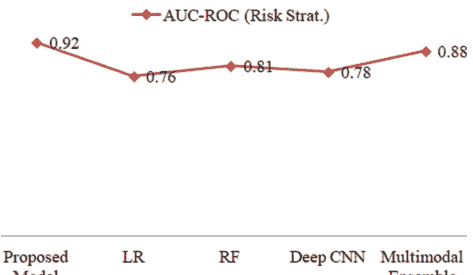

图 2: 性能分析 – 建议模型 – AUC-ROC。

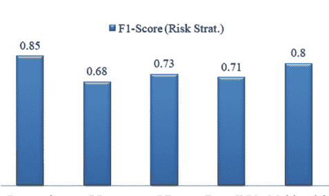

图 3: 性能分析 – 建议模型 – F1 分数。

图 3 表明，建议的混合模型在风险分层方面表现最佳 (0.85)，并且召回率与精确度的平衡也更好。多模态集成以 0.80 排名第二，而传统模型如 LR (0.68) 和深度 CNN (0.71) 表现较低。这说明了建议策略中异构数据源组合的优势。

图 4 显示，本作品的混合模型具有最低误差 (0.42)，这是最佳的功能预后预测。多模态集成也具有较低误差 (0.45)，而基线模型如 LR (0.61) 和 RF (0.55) 具有较高的预测误差。这表明结合影像、临床和 ML 特征的优势。

图 5 表明，与基准真值分歧最大的模型在预测 mRS 方面为 0.84，表明更高的序列预测强度。其次是多模态集成，为 0.78，然后是基本模型，如 LR (0.62) 和深度 CNN (0.68)。这表明混合建模框架的能力在于其捕捉预后严重程度精微差别的能力。

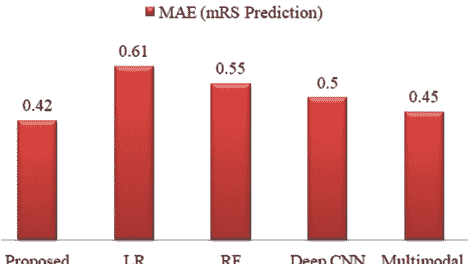

图 4: 性能分析 – 建议模型 – MAE。

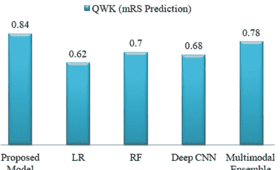

图 5: 性能分析 – 建议模型 – QWK。

## 5 结论

提出了一种新型混合 ML 方法，用于中风幸存者的整体风险分层和功能预测。该模型在单一模型架构下整合了深度学习、图推理和常规 ML。建议的方法可行，能够利用从临床参数到影像模态的完整患者数据范围，同时不牺牲准确性。该模型在一系列评估指标上的性能改进支持了这样的假设：混合方法更适合容纳中风后恢复过程中所涉及的异质性和复杂性。与标准模型相比，这里概述的混合系统在 AUC-ROC 和 QWK 值方面有了显著改善，反映了对急性风险类别和长期功能预后的改进分类。引入 GNN 使模型能够学习典型模型通常忽略的患者间模式和相似性，而 CNN 模块则从图像数据中学习了强预测预后轨迹的描述性空间特征。它们通过多任务学习在共享潜在空间中的组合，为模型提供了鲁棒性和泛化能力。此外，这种混合模型代表了迈向智能、数据驱动的中风管理的重要里程碑，通过提供精确、可理解且个性化的风险和预后预测，最终实现更好的决策和患者护理。

## 6 未来方向

虽然本作品中设想的混合 ML 模型显示出有希望的结果，但存在许多未来的研究和开发方向。首先，扩大数据以涵盖各医院和地理区域的更多异质性患者人群，将增强泛化能力和鲁棒性。需要进行多中心验证试验，以在真实世界临床实践条件下测试该模型，例如影像协议变异性、电子健康记录和中风实践。其次，必须纳入时间建模，以更好地反映中风恢复的动态进展。引入循环或 Transformer 模块可能预测随时间变化的恢复过程，并可使模型在临床基础上越来越有用于长期护理规划。其他数据模态，如基因生物标志物、血浆蛋白组学或语音/语言测试，可能提供更相关的患者档案并增强预测准确性。第三，尽管 SHAP 和 Grad-CAM 等现有方法提供了洞察，但可以强调创建遵循临床推理步骤的领域特定可解释性模块，以实现信任建立和临床采用。临床工作流程集成也是首要任务。开发可以直接集成到医院信息系统中的直观实时软件界面或决策支持工具，将使临床医生能够在高风险决策点使用模型预测，例如在出院计划或选择康复策略期间。最后，公平性和模型偏差伦理需要严格测试，尤其是在代表性不足的群体中。随着这些系统向医学应用推进，将需要通过开放审计程序和公平意识训练程序来确保透明度。


## 参考文献

- [1] Asadi, F., Rahimi, M., Daeechini, A. H. & Paghe, A. (2024). 中风预测中最高效的机器学习算法：一项系统综述. Health Science Reports, 7(10), e70062.

- [2] Liu, Y., Shah, P., Yu, Y., Horsey, J., Ouyang, J., Jiang, B., Yang, G. 等. (2024). 临床与影像融合的深度学习模型匹配专家临床医生对90天中风预后的预测. 美国神经放射学杂志, 45(4), 406–411.

- [3] Shurrab, S., Guerra-Manzanares, A., Magid, A., Bartlomiej Piechowski-Jozwiak, S. F. A. & Farah, E. S. “用于中风预后和诊断的多模态机器学习：一种系统

- [4] Fernandes, J. N. D., Cardoso, V. E. M., Comesaña-Campos, A. & Pinheiro, A. (2024). 综合综述：脑卒中诊断中的机器学习与深度学习. Sensors (巴塞尔, 瑞士), 24(13), 4355.

- [5] Borges, B., Allaert, C. G. & Van halteren, A. (2024). 预测中风预后：基于表格和CT灌注数据的多模态深度学习方法论证. 医学人工智能, 147, 102719.

- [6] Mansour, A., Besbes, O. & Abdellatif, T. (2024). 用于中风预测的联邦深度学习模型. 载于 Web 信息系统工程国际会议（第 440–454 页）。新加坡：Springer Nature Singapore.

- [7] Tiba, A., Bérczes, T., Bérczes, A. & Zsuga, J. (2024). 基于图卷积神经网络和ICD代码的中风风险预测. 数学, 12(12), 1814.

- [8] Le, T. P. T. & Duy Nguyen, V. M. (2024). 基于LightGBM的中风风险预测机器学习模型. 软计算及其应用国际期刊进展, 16(1).

- [9] Brugnara, G., Neuberger, U., Mahmutoğlu, M. A., Folytn, M., Herweh, C., Nagel, S., Schönenberger, S. 等. (2020). 利用机器学习进行急性缺血性中风内血管治疗预后的多模态预测建模. 中风, 51(12), 3541–3551.

- [10] Yu, H., Wang, Z., Sun, Y., Bo, W., Duan, K., Song, C., Hu, Y., Zhou, J., Mu, Z. & Wu, N. (2023). 基于多模态MRI放射组学的机器学习缺血性中风预后预测. 精神病学前沿, 13, 1105496.

- [11] Dev, S., Wang, H., Nwosu, C. S., Jain, N., Veeravalli, B. & John, D. (2022). 利用机器学习和神经网络进行中风预测的预测分析方法. 医疗保健分析, 2, 100032.

- [12] Shih, D.-H., Wu, Y.-H., Wu, T.-W., Chu, H.-Y. & Shih, M.-H. (2024). 使用深度学习和迁移学习方法进行中风预测. IEEE Access.

- [13] Chen, C., Zhang, W., Pan, Y. & Li, Z. (2025). 用于预测急性缺血性中风患者三个月不良预后的可解释混合机器学习方法. 医学信息学国际期刊, 105807.

- [14] Sawan, A., Awad, M., Qasrawi, R. & Sowan, M. (2024). 基于脑电图(EEG)的混合深度学习与元启发模型中风诊断系统. 生物医学信号处理与控制, 87, 105454.

- [15] Bathla, P. & Kumar, R. (2024). 一种基于组合特征选择和分类器的脑卒中预测混合系统. 智能医学, 4(02), 75–82.

- [16] Mia, R., Khanam, S., Mahjabeen, A., Ovy, N. H., Ghimire, D., Park, M.-J., Begum, M. I. A. & Hosen, A. S. M. S. (2024). 探索用于预测脑卒中的机器学习：一项发现研究. 电子学, 13(4), 686.

- [17] Peng, G., Zhao, B. & Yuanzhi, H. (2024). 用于中风预测的混合采样集成分类方法. 载于2024年第4届人工智能、大数据与算法国际会议论文集（第393–397页）。

- [18] Agana, M. A. & Odey, J. A. (2024). Anthony Okwori Okpe, and Ofem Ajah Ofem “使用异构集成机器学习技术的混合优化中风预测模型. 载于 2024 IST-Africa 会议 (IST-Africa)（第 1–12 页）. IEEE.

- [19] Oluwatosin, E. A., Sotonwa, K. A., Raji-Lawal, H. Y., Zubair, A. F. & Alegbhele, I. B. (2024). 开发中风预测系统的混合方法. 伊巴丹大学科学与ICT研究逻辑期刊, 12(1), 65–73.

- [20] Luo, J., Dai, P., He, Z., Huang, Z., Liao, S. & Liu, K. (2024). 医学图像中缺血性中风病灶分割的深度学习模型：一项综述. 生物学与医学中的计算机, 108509.

- [21] Abujaber, A. A., Albalkhi, I., Imam, Y., Yaseen, S., Nashwan, A. J., Akhtar, N. & Alkhawaldeh, I. M. (2025). 出血性中风患者90天预后和住院死亡率的基于机器学习的预测. 科学报告, 15(1), 1–12.

- [22] Sommer, J., Dierksen, F., Zeevi, T., Tran, A. T., Avery, E. W., Mak, A., Malhotra, A. 等. (2024). 基于大血管闭塞性中风入院CT血管造影的血栓切除术后预后深度学习预测. 人工智能前沿, 7, 1369702.

- [23] Sha, M. (2025). 基于不平衡医学数据集的脑卒中预测图神经网络技术. 多媒体工具与应用, 1–37.

- [24] Sakri, S., Basheer, S., Zain, Z. M., Ismail, N. H. A., Nassar, D., Aldeheim, G. N. & Alharaki, M. A. (2024). 用于预测和解释缺血性中风的改进深度学习模型串联. IEEE Access, 12, 53189–53204.

- [25] Aututhu, S., Suman, S. K., Anuradha, S. & Sanapala, R. K. (2025). 基于弥散加权MRI扫描的胶囊图神经网络急性脑缺血性中风病灶自动诊断. 电气工程与技术期刊, 1–20.

- [26] Le, N.-B., Pham, T. T. H., Nguyen, S. H., Nguyen, N. M. & Nguyen, T. N. (2024). 用于中风和糖尿病诊断的AI驱动预测模型. 智能系统与应用国际期刊 (IJISA), 16(1), 24–40.

- [27] Nguyen, T. N. Q., García-Rudolph, A., Sauri, J. & Kelleher, J. D. (2024). 中风后预测生活质量和日常生活独立性的多任务学习：一项概念验证研究. 神经病学前沿, 15, 1449234.

Fathimathul Rajeeena P. P.*, Rahoof P. P., and Sunder R.

# 基于数据驱动的肿瘤疾病预测和早期检测机器学习策略

### 摘要
肿瘤疾病的早期预测和早期诊断是当代医学的重要关注点，特别是由于癌症的异质性以及大量相关临床信息。这里是一种专门针对初始阶段预测、前体和肿瘤疾病检测的全面数据驱动机器学习（ML）方法。该方法结合了不同模态的数据，例如临床数据、影像数据、基因组谱和生物标志物数据，以利用全部特定于患者和疾病的特征。所建议的框架包括端到端数据预处理管道、先进的特征选择方法以及构建混合ML分类器集成。传统分类器（如逻辑回归、随机森林和XGBoost）与基于深度学习的模型（如用于影像数据的卷积神经网络和用于纵向数据的循环神经网络）相结合。模型性能基于k倍交叉验证以及准确率、精确率、召回率和 $F_1$-score等常见性能指标进行严格评估。结果表明，新型混合集成方法在预测方面优于传统和单模态模型，在更早阶段识别肿瘤癌症及其前体时具有更好的灵敏度和准确性。这表明，源自数据的ML技术可用于改善早期癌症检测并支持临床决策。该策略为适用于多种肿瘤用途提供了可扩展和灵活的平台，并通过预测分析促进了精准肿瘤学的宏观图景。

### 关键词
机器学习，肿瘤疾病，XGBoost，卷积神经网络，长短期网络

### 致谢
本工作得到沙特阿拉伯费萨尔国王大学科学研究院、研究生与科学研究副校长办公室的支持（拨款编号：KFU252022）。

*Corresponding author: Fathimathul Rajeeena P. P.，费萨尔国王大学计算机科学与信息技术学院计算机科学系，阿尔哈萨31982，沙特阿拉伯，电子邮件：fatimah.rajeena@kfu.edu.sa
Rahoof P. P.，马拉巴尔技术学院（MIT）网络安全计算机科学与工程系，印度喀拉拉邦坎努尔670612安贾拉坎迪综合校区，电子邮件：rahoof@mitkannur.ac.in
Sunder R.，加尔戈蒂亚大学计算机科学与工程学院，印度北方邦大诺伊达，电子邮件：sunder.r@galgotiasuniversity.edu.in


## 1 Introduction

癌症仍然是二十一世纪最严重的健康问题之一，具有高致死率、多因素致病以及患者和肿瘤的高度异质性[1]。早期发现疾病和预测肿瘤疾病对于改善患者预后、及时治疗和提高生存率具有极其重要的意义。然而，由不同分子、遗传和临床模式驱动的癌症异质性，使得早期标志物识别和疾病进程预测变得具有挑战性[2]。此外，肿瘤学中临床、影像、基因组和生物标志物数据的海量且多维特性，需要先进的分析平台来收集、处理和解释此类多模态数据。传统诊断技术和单一模态预测模型通常无法把握癌症相关变量的所有多样化方面，从而表明需要一个更广泛且智能的数据驱动系统[3]。

为了克服这些障碍，本研究引入了一个端到端的机器学习平台，利用多模态健康数据的全部潜力来预测早期肿瘤疾病的发病和发展。通过整合电子健康记录[4]、放射影像[5]、基因组序列[6]和分子生物标志物谱[7]等异构数据源。该平台利用特定于患者和特定于疾病的知识，以提供更高质量且个性化的预测系统。机器学习和深度学习范式共同提供了一个机会，以正确的方式对这种复杂性进行编码，并构建能够跨越不同肿瘤学场景泛化的强大预测系统[8]。

所提框架的一个关键组件是一个端到端的数据预处理流水线，包括对数据质量、一致性和模型就绪性的支持。预处理包含缺失值填充、归一化、特征编码和数据增强，每种都适用于输入数据类型[9]。例如，图像数据经过空间归一化，并通过旋转和对比度缩放等技术进行增强；而基因组数据则经过过滤、突变编码，并通过主成分分析等技术进行降维[10]。临床实验室结果和生物标志物数据使用基于医学知识的填充进行标准化和清洗，在不损害患者记录完整性的前提下提供临床现实的输入。该预处理流水线对于向下游模型提供整洁、格式良好且信息丰富的数据至关重要，这些数据能提升学习性能和可解释性。

系统的特征选择（FS）模块集成了一种混合方法，基于使用过滤法[11]（如互信息和卡方检验）、包装法[12]（如递归特征消除RFE）和嵌入式方法[13]（如LASSO正则化和基于树的随机森林特征重要性）。它通过降低模型复杂度并保持高预测能力，来识别跨模态的最具信息量且冗余度较低的特征。因此，模型仅保留与癌症风险和疾病发展最强关联的预测模式，从而提升性能和泛化能力。

建模流水线是一种深度-经典混合集成。采用逻辑回归（LR）[14]、随机森林（RF）[15]和XGBoost等经典机器学习模型，因为它们可以处理表格和结构化临床数据。此类模型提供出色的可解释性、部署简单性和抗过拟合能力，足以胜任临床环境中的决策支持系统。同时，深度学习模型处理非结构化数据：通过卷积神经网络（CNN）[16]处理CT或MRI扫描等影像数据中的层次化空间上下文，以及通过循环神经网络（例如长短期记忆（LSTM）[17]单元）处理纵向患者数据和治疗史中的时间上下文。模型类型之间的这种分工确保每种模态都由最优算法处理，从而实现最佳性能。

为了进一步提升预测的稳定性和可靠性，在集成方法中对单个模型的预测进行平均。使用模型堆叠和加权投票等方法来聚合预测，使得最终结论融合了每个贡献模型的优势。此外，还在上述基础模型的输出上训练了一个元学习者，以增强最终预测并最小化每个单个模型的方差。与单一模型相比，这种集成策略增强了系统做出更稳定、更自信预测，并在多样化数据类型上识别细微模式的能力。

混合集成架构经过充分的性能测试，以确保其可泛化且不产生过拟合。采用准确率、精确率、召回率和F1分数等常见评估指标来衡量模型性能。所提方案在单独使用时优于传统机器学习技术和深度神经网络。具体而言，它在更高级智能水平的癌症疾病和前驱病诊断中具有更高的灵敏度和特异性，因此是早期诊断和预防性临床治疗的适用工具。

本研究提出了一种新颖且全面的机器学习方法，通过强大的数据融合和混合建模，充分解决多模态早期癌症诊断问题。在一个集成传统方法和深度学习的单一预测框架下，该系统高效、适应性强且具有临床相关性。研究结果强调了AI驱动的肿瘤学预测分析所带来的变革可能性，这是实现早期诊断、个体化治疗和改善患者预后的可行路径。研究目标如下：

- 通过整合各种特定于患者和特定于疾病的数据，开发一个集成的多模态数据模型。
- 为异构、高维肿瘤学数据开发一个稳定的端到端数据预处理流水线。
- 通过将常用分类器（例如LR、RF和XGBoost）与深度学习算法（用于影像数据的CNN和用于纵向数据的LSTM）相结合，开发一个混合集成机器学习架构，以发挥每种算法的特定优势来处理不同的数据模态。

## 2 Related Works

癌症在全球范围内仍是一种主要疾病，乳腺癌、卵巢癌和结直肠癌因晚期表现和多因素临床表现而尤其难以诊断。近年来，AI（包括机器学习和深度学习）的进步使得设计高度有效的诊断系统成为可能，这些系统更加准确、可扩展且可解释。整合基因组、影像和临床数据的集成模型和混合模型对早期诊断和风险评估也很有前景。本节介绍了针对各种癌症的新型AI驱动方法，以及它们如何帮助临床医生做出及时的基于证据的决策，并通过精准诊断改善患者护理。

### 2.1 Integrative Genomics for Cancer Prediction

乳腺癌（BC）仍然是全球主要健康问题，这意味着精确生物标志物对于早期检测和靶向治疗至关重要。为了寻找BC的可靠指标和可能的治疗靶点，本文提出了一种整合机器学习方法来评估基因表达数据。对基因表达数据集进行了预处理和合并，以便对肿瘤样本和正常样本进行全面的差异表达分析。在当前研究中，合并数据集中有164个差异表达基因（DEG），外部数据集（GSE45827）中有350个DEG。为了进一步改进预测基因选择，提出了一种名为BGWO_SA_Ens的新型混合算法，它结合了二进制灰狼优化（BGWO）、模拟退火（SA）和集成分类模型。在两个数据集上使用该方法时，它有效筛选了数千个基因，并从合并数据集中选择了1,404个预测特征。DEG与BGWO_SA_Ens的交集得出了一份包含35个高度一致基因的稳健列表。功能富集分析确定这些基因具有显著性，并积极参与核心信号通路，与癌症发生机制高度相关。此外，蛋白质-蛋白质相互作用（PPI）网络分析识别了具有生物学意义的子网络和枢纽基因，并表明了它们的功能连接。此外，药物-基因相互作用分析将一些更成功的基因与现有抗癌药物关联起来，转化为临床治疗相关性。总之，这里描述的机器学习流水线有效地识别了一种具有诊断和治疗意义的非常活跃的基因特征，突显了计算方法在推进精准肿瘤学方面的价值[18]。

### 2.2 Ovarian Cancer Risk Prediction Model

卵巢癌（OC）是一种高度恶性且广泛扩散的恶性肿瘤，晚期诊断率高，构成了一个重要的公共卫生问题，资源有限


预防方法。通过预测性筛查早期发现高风险患者是一种未被充分利用但可能具有变革性的策略。这项回顾性数据分析使用了2015年至2019年在萨里市六家医疗中心收集的1,516名疑似患有卵巢癌（OC）女性的临床病史。应用了六种机器学习模型来开发卵巢癌风险预测模型：XGBoost、RF、J48、SVM、KNN和ANN。模型性能使用AU-ROC进行评估，XGBoost表现最佳，AU-ROC为0.93。研究结果表明，机器学习是一种有效且高效的识别高风险卵巢癌群体的方法，从而在临床实践中实现更有效和针对性的预防措施 [19].

### 2.3 乳腺癌的AI驱动精准诊断

AI和机器学习的进步显著影响了精准医学，特别是在乳腺癌诊断和治疗方面。从庞大的基因组、影像和临床数据库中，AI算法相比传统诊断流程，能够进行精确的肿瘤检测、识别并预测结局价值。机器学习方法，特别是深度学习系统，揭示多模态数据中的复杂模式，并能够生成个性化和针对性的治疗方案。本综述讨论了AI在乳腺癌护理中的适用性，并以尖端解决方案为例，克服了临床部署中的重大挑战，并展望了研究的未来方向。通过对数据驱动方法的比较，它承认它们在实现早期诊断、支持临床决策并最终造福患者方面的贡献 [20].

### 2.4 结直肠癌化疗毒性预测模型

机器学习算法通过识别特征相关性并对复杂临床情况提供预测性洞察，揭示数据中的模式。该研究致力于构建一个预测模型，以识别更可能发生化疗诱导毒性的结直肠癌患者，并区分导致治疗副作用风险的特征。使用74名患者的95项治疗前健康特征数据集，我们经过适当预处理训练了随机森林模型，以在可解释性和预测性能之间取得平衡。该模型成功检测了数值变量和分类变量在预测毒性结局中的相对贡献。研究结果强调了将AI整合到结直肠癌管理中的前景，提供了一种预期和预防治疗毒性的个性化方法，推动精准医学的边界 [21].

### 2.5 基于乳腺X线摄影的癌症分类混合方法

乳腺癌是全球发病率最高的癌症，涉及超过230万女性，仍然是一个重大的公共卫生问题。尽管由于筛查、诊断和治疗的改善，生存率有所提高，但早期检测仍然是有效管理该病的关键。为了改善乳腺X线摄影中乳腺癌病变的识别和分类率，本研究提出了一种利用深度学习和先进图像预处理技术的独特混合模型。使用了20,000份乳腺X线摄影数据集来验证该模型。为了改善图像质量并实现更好的特征提取，首先使用高斯模糊和锐化等图像增强算子进行预处理，YOLOv5和MedSAM分割模型用于深度学习架构中，以便于病变提取、分类和适当显示。在对800名患者进行临床评估后，该混合模型在诊断速度和准确性方面取得了极高的提升。该模型仅需0.75秒即可处理每张图像，实现了99.7%的全局准确率。在临床准确性方面，恶性病例为98.6%，良性病例为97.2%。根据这些发现，该混合模型是一种可靠且高效的乳腺癌早期识别诊断工具，在提高诊断准确性方面为临床实践的改进提供了有希望的机会 [22].

### 2.6 乳腺癌的堆叠集成模型

乳腺癌是全球最常见的癌症之一，仅次于肺癌，并且发生在男女中。由于其在初期大多无症状，早期检测成为一项挑战，这通常导致晚期诊断，治疗难度更大且成本更高，从而导致死亡率增加。尽管机器学习在癌症研究中的应用越来越广泛，但与单分类器系统相比，用于乳腺癌预测的集成学习方法的研究相对较少。该研究提出了一种异构集成机器学习架构，旨在协助乳腺癌的早期检测。所提模型采用堆叠集成，以KNN、SVM和DT作为基础学习器，符合CRISP-DM方法论。一种称为RF的同构集成模型以及各种独立分类器（如LR、ANN、NB、随机梯度下降）及其相应的基础模型（KNN、SVM和DT）被用来评估该元分类器的有效性。使用卡方方法选择了五个最重要的特征进行预测。准确率、F1分数、精确率、召回率、特异度、对数损失、AUC和ROC曲线是使用K折交叉验证评估模型性能所用的指标。所提集成模型在K = 20时拒绝了零假设，具有最低对数损失0.56和最高准确率78%。单侧t检验得到的p值为0.014，在α = 0.05水平上具有统计学意义。所有这些结果表明，仅使用生化和人体测量特征，集成方法在早期预测乳腺癌方面可能是有效的 [23].

### 2.7 癌症诊断的深度集成模型

为支持病理医生检测恶性肿瘤并指导适当的治疗措施，已提出一种用于组织学乳腺癌图像分类的新型深度混合异构集成模型。该方法结合了七个强大的预训练深度学习模型以进行强大的特征提取，并使用硬投票和加权投票技术将其与四个经典分类器（多层感知机、SVM、KNN和决策树）相结合。测试并比较了24个集成混合模型与深度堆叠集成基线，以找出最佳集成方法。在公共BreakHis数据集上对四个放大倍数（40×、100×、200×和400×）进行了五倍交叉验证的实证验证。引入的混合集成模型在多个倍数下表现优于单独模型和堆叠模型，最高准确率可达96.3%。这些结果强调了深度集成模型在提升组织学乳腺癌诊断和最大限度减少诊断错误方面的临床价值 [24].

### 2.8 乳腺癌检测的混合CNN-GRU模型

乳腺癌是一种发生在乳腺组织中的腺癌，在女性中仍是最普遍的癌症之一，仅次于肺癌的死亡率。早期检测和正确的乳腺癌分类对于改善治疗至关重要。然而，病理切片的手动检查通常耗时、繁琐，且易受操作员错误影响，从而可能导致误分类。为了缓解这些挑战，本研究提出了一种混合深度学习模型，该模型将CNN整合到基于PCAM-Kaggle数据中整个全片图像（WSI）的乳腺癌计算机辅助检测中，用于检测乳腺浸润性导管癌（IDC）的计算机辅助恢复单元（GRU）。所提CNN-GRU模型利用CNN的特征提取能力和GRU的时间学习能力，从IDC阳性样本中分离出IDC阴性样本。该模型使用常用指标进行了测试。结果表明准确率为86.21%，准确率为85.50%，灵敏度为85.60%，准确率为84.71%，F1分数为88%，AUC准确率为0.89，最大限度减少诊断错误并提高分类准确率。所开发混合模型的强度和效率通过乳腺癌识别与其他深度学习架构（如CNN-BiLSTM、CNN-LSTM）及当前机器学习方法进行了评估 [25].


### 2.9 健壮集成乳腺癌分类器

乳腺癌（BC）是一种普遍且危及生命的疾病，凸显了准确、高效诊断方法对辅助患者治疗的重要性。深度学习（DL）和机器学习（ML）一直是优化乳腺癌检测的主要推动力，在提高准确性、自动化以及诊断过程支持方面贡献显著。然而，大多数现有方法仍困扰于可扩展性和整体性能等问题。为解决这些局限性，本研究提出了一种可靠的混合检测方法，该方法将预训练的深度ResNet50V2模型与基于集成学习的ML分类器相结合。DL组件用于提取乳腺组织病理学图像的判别性和描述性特征，而ML集成组件则提供模型可解释性以及更好的泛化能力。该建议方法应用于一个公开可用的IDC组织病理学图像数据集，该数据集包含不同尺寸的样本。实验结果表明，混合方法远优于许多最先进的方法，准确率达到95%。在实验过的分类器中，轻量梯度提升机（LightGBM）与ResNet50V2结合时效果最强。该混合过程是一种高性能、健壮的乳腺癌诊断工具，潜在可应用于现实临床场景。它帮助临床医生快速做出高置信度的决策[26]。

AI、DL和ML在肿瘤学中的融合已转变了癌症诊断、预后和个性化治疗。本文讨论的一系列研究总体上展示了AI驱动方法在不同癌症（尤其是乳腺癌、卵巢癌、结直肠癌和肺癌）中的范围和规模。从基于基因组的预测模型到临床风险分层和高级图像分析，这些AI平台在日常临床实践中越来越证明其价值。最重要的是，像乳腺癌生物标志物发现中的BGWO_SA_Ens和IDC预测中的混合CNN-GRU等整体方法，都充分利用生物直觉和计算有效性，以实现更高的准确性和预测鲁棒性。同样，从经典ML堆栈到集成ResNet50、InceptionV3和VGG16等架构的深度集成网络的集成方法，都优于单个模型，证明了混合在容错型诊断特征设计方面的潜力。

此外，应用特征选择（FS）技术（例如，卡方检验和PPI分析）、图像处理技术（例如，CLAHE、MedSAM和YOLOv5）以及统计检验（例如，t检验和Borda计数），确保了此类模型的科学有效性和临床可转化性。接近完美的F1分数（例如，0.981）、AUC分数 > 0.95，以及每个数据集和癌症类型的一致交叉验证准确率等成就，证明了此类模型的实用性。

## 3 方法论

本研究是一个全面的、数据驱动的机器学习模型，用于肿瘤病理学及其前体的预测和早期诊断。鉴于与肿瘤相关数据的复杂性和多维性，本研究包括临床报告、影像数据、基因组数据和生物标志物数据集等异构数据。本研究涉及常规数据预处理、高级特征选择方法，以及针对不同数据使用多样化的机器学习模型。为确保一个能够提升预测性能并降低偏差的强模型，研究采用集成学习方法，融合传统机器学习方法、深度模型和循环网络用于纵向数据研究。利用数据的多模态集成以及混合建模技术，所提方法旨在增强早期检测能力，并促进癌症领域的数据驱动临床决策。图1描述了所提方法的总体工作流程。

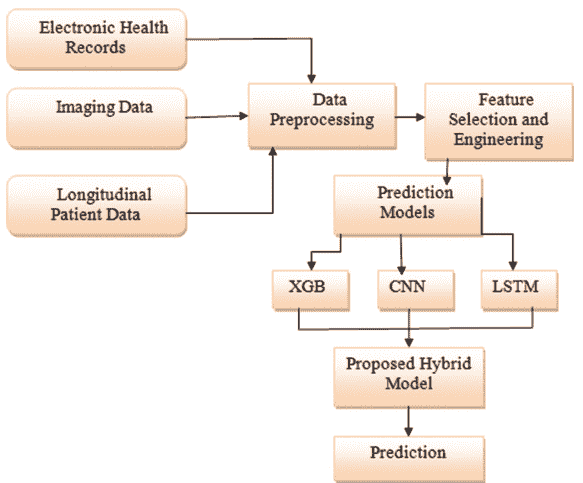

图1：与肿瘤相关疾病预测的总体拟议方法论。

### 3.1 数据获取

将从公共数据库中检索多种数据集。数据类型如下：

- 临床记录：临床记录包含患者特定信息，这些信息至关重要，包括年龄、性别、病史、共病和治疗结果。这些变量对风险分层和预后预测具有关键背景。临床变量很可能作为肿瘤模型的基线预测因子。将它们加入模型可提高模型个性化和可解释性[27]。
- 影像数据：影像数据（MRI、CT和组织病理学图像）记录肿瘤形态、位置和生长模式。影像提供了对癌症检测和分期至关重要的空间和结构信息。DL架构（如CNN）最适合应用于计算机辅助图像特征提取。影像数据补充临床和基因组谱，以实现综合诊断。
- 基因组/蛋白组数据：突变状态、蛋白质生物标志物和基因表达谱构成了基因组和蛋白组数据。这些是复杂的、高维的分子水平特征，反映突变介导的疾病过程和致癌途径。由于其复杂性和高维性，需要先进的降维和特征选择方法。引入这些方法有助于实现精准肿瘤学，通过个体特异性、突变导向的预测。
- 生物标志物数据：实验室检测结果（如肿瘤标志物、血常规和代谢谱）构成了生物标志物数据。伴随癌症的生理和生物化学改变由生物标志物定量测量，这些标志物在临床环境中易于获得。生物标志物改善癌症早期检测。生物标志物是疾病监测和治疗影响监测的优秀无创疾病标记。

### 3.2 数据预处理

就数据一致性、数据质量和模型稳定性而言，在开始模型开发之前，需要拥有一个清洁数据的预处理流水线。数据集中的缺失数据将通过根据数据类型及其分布应用KNN插补[28]或多重插补技术进行处理，且不会导致数据丢失或偏差。可能降低模型性能和可解释性的离群值将被检测并移除，方法包括用于多维数据的孤立森林或用于一维分布的Z-score阈值[29]。数值变量将被归一化和标准化到一个共同范围，以便跨因素进行可比较的比较并促进模型收敛，尤其是对特征幅度敏感的模型。分类特征将根据变量基数和模型要求采用独热编码或目标编码，使其变得机器学习友好。旋转、翻转和亮度调整也将作为影像数据集的数据增量策略采用，以人工增加数据集规模、增强模型泛化能力并避免深度学习（DL）模型过拟合。该数据预处理方法旨在优化数据完整性、优化算法效率，并提供稳健、可复现的预测模型结果。

### 3.3 特征选择与工程

随后将使用特征选择（FS）从海量数据中筛选出最重要的预测因子。首先，将使用单变量统计检验（如方差分析和卡方检验）分别测量连续特征和分类特征的个体显著性。接下来，将使用RFE（递归特征消除）根据模型性能迭代构建最重要的特征。此外，将使用岭回归和Lasso回归通过对系数进行惩罚来移除重复特征，从而强制实施特征正则化。还将基于模型的特征选择，使用随机森林或梯度提升等集成算法生成的特征重要性分数，这些算法能够处理非线性和交互关系。

特征工程将被用于进一步完善模型，以发现复杂模式。通过连接现有特征将创建新的复合特征，以揭示更有用的关系并提高可预测性。为降低高维数据的维度，将使用降维技术进行数据探索以及移除数据中的噪声。此外，将使用嵌入技术研究序列和基因组数据，将其表示为稠密向量表示，以捕捉原始基因组序列或时间序列临床数据中的生物或时间底层模式。所述特征工程与选择方法旨在实现最优模型性能并充分利用相关信息，以进行准确预测[30]。

### 3.4 机器学习模型开发

- (i) 结构化数据：XGBoost等稳健的梯度提升算法将用于结构化数据，包括临床数据、基因组数据和生物标志物数据。XGBoost因其在处理包含数值和分类变量的表格数据方面的性能和效率而备受推崇，这使其成为肿瘤学预测建模的理想候选者。XGBoost的核心是一种添加式树集成模型，该模型使用经过正则化的目标函数进行训练，通过最小化

```
Obj(θ) = \sum_{i=1}^{n} l(y_i, \hat{y}_i^{(t)}) + \sum_{k=1}^{t} \Omega(f_k)
```


在式 (1) 中，$n$ 表示数据点，$l$ 表示损失函数，$\hat{y}_i^{(t)}$ 是第 $i$ 个实例在提升迭代 $t$ 时的预测值，$\Omega(f_k)$ 是每棵树 $f_k$ 的正则化项。正则化项控制模型的复杂度以避免过拟合：

$$\Omega(f) = \gamma T + \frac{1}{2} \lambda \sum_{j=1}^T w_j^2$$ (2)

在式 (2) 中，$T$ 为树的叶子节点数，$w_j$ 是叶子节点 $j$ 上的分数权重，$\gamma$ 是叶子节点数的正则化系数。在每次迭代 $t$ 时，添加一个新函数 $f_t(x)$ 以最小化损失：

$$\hat{y}_i^{(t)} = \hat{y}_i^{(t-1)} + f_t(x_i)$$ (3)

为了有效优化，使用围绕当前预测值的损失二阶泰勒展开：

$$l(y_i, \hat{y}_i^{(t)}) \approx l(y_i, \hat{y}_i^{(t-1)}) + g_i f_t(x_i) + \frac{1}{2} h_i f_t(x_i)^2$$ (4)

其中

$$g_i = \frac{\partial l(y_i, \hat{y}_i^{(t-1)})}{\partial \hat{y}_i^{(t-1)}} = \text{first-order derivative (gradient)}$$

$$h_i = \frac{\partial^2 l(y_i, \hat{y}_i^{(t-1)})}{\partial (\hat{y}_i^{(t-1)})^2} = \text{second-order derivative}$$

- **(ii) 基于图像的数据：** 对于基于图像的癌症检测，将使用 CNN。CNN 擅长从图像中提取层次化模式，因此非常适合医学影像中的肿瘤检测、分割和分类等应用（例如，MRI、CT 和病理图像）。CNN 从原始图像数据中自动学习空间特征的能力，提供了识别传统方法无法检测到的微妙肿瘤特征的能力。假设输入为一张图像：

$$X \in R^{H*W*C}$$ (5)

在式 (5) 中，$H$、$W$ 和 $C$ 分别为图像的高度、宽度和通道数。卷积层应用一组可学习的滤波器 $K$。对于滤波器 $K \in R^{k_h * k_w * C}$，位置 $(i, j)$ 处的卷积运算如下所示：

$$Y_{ij}^{(f)} = \sigma \left( \sum_{m=0}^{k_h-1} \sum_{n=0}^{k_w-1} \sum_{c=0}^{C-1} K_{mn,c}^{(f)} X_{i+m, j+n, c} + b^{(f)} \right)$$ (6)

在式 (6) 中，\( Y_{ij}^{(f)} \) 是位置 \((i,j)\) 处滤波器 \( f \) 的输出，\(\sigma(.)\) 是激活函数，\( b^{(f)} \) 是滤波器 \( f \) 的偏置项。池化在保留重要特征的同时降低空间维度。例如，窗口 \( P * P \) 上的最大池化

$$Z_{ij}^{(f)} = Y_{i+m, j+n}^{(f)}$$

展平特征图后

$$h = \text{Flatten}(Z)$$

全连接层计算如下

$$O = \phi(Wh + b)$$

在式 (9) 中，\( W \) 表示权重矩阵，\( b \) 是偏置向量，\(\phi(.)\) 是激活函数。

对于二分类（肿瘤/无肿瘤）：

$$\hat{y} = \text{Sigmoid}(o)$$

$$\text{Sigmoid}(x) = \frac{1}{1 + e^{-x}}$$

对于多类分类

$$\hat{y}_i = \frac{e^{o_i}}{\sum_{j=1}^N e^{o_j}}$$

在式 (12) 中，\( N \) 是类别数。

- **(iii) 患者纵向数据：** 为了纵向分析患者数据，将使用 LSTM 网络。这两种模型都适合处理序列数据，例如随时间变化的患者病史，其中需要对之前的医疗记录与未来结果之间的依赖关系进行建模。LSTM 特别适合对患者病史和疾病中复杂的时间模式进行建模。最后，将研究一种混合集成策略，通过结合这些异构模型的预测来提高准确性和鲁棒性。通过结合 XGBoost、CNN 和 LSTM 的优势，集成将提供一种更完整的预测，融合多种数据模态，从而最终提高该框架在肿瘤疾病预测中的整体性能。设每位患者的序列化病史为

$$X = \{ x_1, x_2, x_3, ... x_T \}$$

在式 (14) 中，\( x_t \in R^d \) 是时间 \( t \) 时的特征向量。在每个时间步 \( t \)，LSTM 单元计算如下。

- **遗忘门：**

$$f_t = \sigma \left( W_f \cdot [h_{t-1}, x_t] + b_f \right)$$ (15)

- **输入门：**

$$i_t = \sigma(W_i \cdot [h_{t-1}, x_t] + b_i)$$ (16)

$$\hat{C}_t = tanh(W_c \cdot [h_{t-1}, x_t] + b_c)$$ (17)

- **细胞状态更新：**

$$C_t = f_t \odot C_{t-1} + i_t \odot \hat{C}_t$$ (18)

- **输出门：**

$$O_t = \sigma(W_o \cdot [h_{t-1}, x_t] + b_o)$$ (19)

$$h_t = o_t \odot tanh(C_t)$$ (20)

在上述方程中，\( W_f, W_i, W_c, \text{ 和 } W_o \) 是权重矩阵，\( b_f, b_i, b_c, \text{ 和 } b_o \) 是偏置，\(\sigma(.)\) 是 sigmoid 激活函数，\( tanh(.) \) 是双曲正切激活函数，\(\odot\) 是逐元素乘法。

LSTM 的最终预测使用最终隐藏状态 \( h_T \) 进行预测：

$$\hat{y}_{LSTM} = \phi(W_y \cdot h_T + b_y)$$ (21)

其中 \(\phi(.)\) 是激活函数。然后按以下方式结合 XGBoost、CNN 和 LSTM 的预测。

- **来自 CNN（基于图像的数据）：**

$$\hat{y}_{CNN} = f_{CNN}(I; \theta_{CNN})$$ (22)

- **来自 LSTM（患者纵向数据）：**

$$\hat{y}_{LSTM} = f_{LSTM}(X; \theta_{LSTM})$$ (23)

- **来自 XGBoost（结构化表格数据）：**

$$\hat{y}_{XGB} = f_{XGB}(Z)$$ (24)

在式 (22)–(24) 中，\( I \) 是患者数据，\( X \) 是序列化医疗记录，\( Z \) 是结构化表格患者数据。集成融合策略将这些预测作为加权平均集成进行结合，如下所示：

$$\hat{y}_{final} = \alpha \cdot \hat{y}_{CNN} + \beta \cdot \hat{y}_{LSTM} + \gamma \cdot \hat{y}_{XGB}$$ (25)

满足

$$\alpha + \beta + \gamma = 1$$ (26)

在式 (26) 中，\(\alpha, \beta, \text{ 和 } \gamma\) 是通过交叉验证或优化确定的集成权重。

最终集成模型表达式如下所示：

$$\hat{y}_{final} = f_{\text{ensemble}}(\hat{y}_{CNN}, \hat{y}_{LSTM}, \hat{y}_{XGB})$$ (27)

该模型整合了异构数据源和学习范式，以提高肿瘤疾病预测中的预测准确性和鲁棒性。

## 4 结果与发现

本节详细讨论了使用不同机器学习和深度学习模型对威斯康星乳腺癌（诊断）数据集的分析。结合 XGBoost、CNN 和 LSTM 的混合方法在正确分类恶性和良性肿瘤方面优于最先进的分类器。

### 4.1 数据集描述

威斯康星乳腺癌（诊断）数据集包含 569 个实例，源自乳腺肿块细针穿刺样本的数字化图像。每个示例包含 30 个实数属性。这些属性计算为均值、标准误以及“每个特征的三个最差最大特征的平均值”，从而得到细胞核形态的高维特征概况。目标函数是一个二元函数，用于指示肿瘤是恶性（M）还是良性（b），其中包含 212 条恶性记录和 357 条良性记录。该数据记录适用于训练和观察机器学习算法在二分类问题中的性能。凭借其设计良好的结构和精确定义的功能，它是使用 XGBoost 等算法的理想选择，也是乳腺癌诊断的研究基准数据集。

如表 1 所示，所建议的结合 XGBoost、CNN 和 LSTM 的混合方法在所有使用的指标中实现了最佳整体性能。其准确率为 91%，优于传统方法和深度学习方法。89% 的精确率表明其能以极低的误正率正确标记正例。88% 的召回率显示其在检测大多数实际正例方面的有效性，而同样平衡的 88% F1 分数则体现了其整体性能。传统机器学习与深度学习模型之间的交互作用使这种混合系统能够高效处理不同类型的数据，并学习结构化和非结构化的模式特征，从而解释了其高性能。

### 表 1：性能分析 – 提议的混合模型

| 方法 | 准确率 (%) | 精确率 (%) | 召回率 (%) | F1 分数 (%) |
| :--- | :--- | :--- | :--- | :--- |
| 提议的混合方法 (XGBoost + CNN + LSTM) | 91 | 89 | 88 | 88 |
| 逻辑回归 + 手动特征选择 | 75 | 72 | 70 | 71 |
| 随机森林 + 递归特征消除 (RFE) | 82 | 80 | 78 | 79 |
| 用于基于图像检测的深度学习 CNN | 85 | 83 | 82 | 82 |
| SVM 与随机森林集成 (最先进) | 89 | 87 | 85 | 86 |

LR + 手动特征选择：在测试的方法中，采用 LR 与手动特征选择的方法表现最差。准确率为 75%，在预测能力方面与其他模型相差甚远。精确率、召回率和 F1 分数分别为 72%、70% 和 71%，说明该方法在准确标记正例以及权衡真正例与假正例的生成方面表现不佳。这是因为逻辑回归较为简单，而手动特征选择无法捕捉数据中微妙的非线性关系。

RF 与 RFE 表现相当不错，准确率为 82%。相较于基于 LR 的方法，这有了相当大的提升，并实现了 80% 的精确率、78% 的召回率和 79% 的 F1 分数。这表明，尽管 RF 作为一种集成方法在处理高维和复杂数据方面更有能力，但它仍落后于基于 DL 的技术。RFE 通过选择和保留最合适的特征来提升模型效率，但其独立功能在检测复杂数据模式方面相较于混合或 DL 技术有所局限。

用于基于图像检测的基于 CNN 的深度学习表现出色，性能率为 85%。83% 的精确率、82% 的召回率和 82% 的 F1 分数反映出 CNN 成功处理了分类任务中与图像相关的属性和特征的发现。尽管这比基础机器学习算法更好，但其效果仍不如所提议的混合方法。这表明，尽管 CNN 在处理图像数据方面非常出色，但将其与其他能够处理其他形式数据结构的模型结合使用，可能会带来更高的预测性能。

SVM 与随机森林集成：SVM-RF 集成模型在分类方面表现非常好，准确率为 89%。它具有非常高的精确率 (87%)、召回率 (85%) 和 F1-


score (86%)，表明集成学习通过聚合多个分类器的输出来提升预测有效性的强大优势。尽管它很强大，但其能力相对比所提议的混合技术要弱一些。

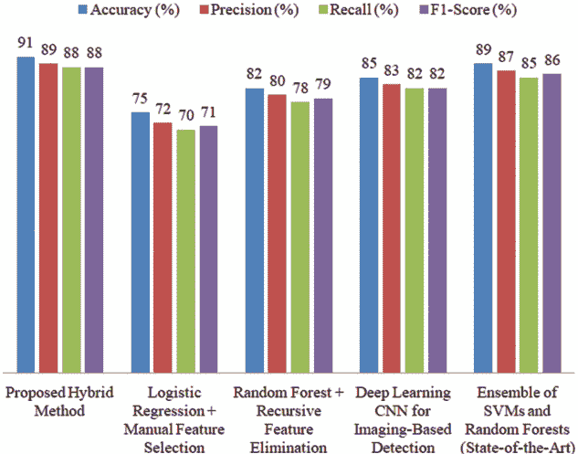

图2：性能分析 – 提议的混合模型。

这一点旨在强调，尽管常规分类器中的集成方法具有稳健性，但将CNN和LSTM等深度模型集成到XGBoost等领先机器学习算法中可以进一步提升模型性能，尤其在挑战性的多模态数据环境中。XGBoost + CNN + LSTM 混合方法优于传统机器学习方法和先前的深度模型或集成模型，并且表明，将作用于不同模态或数据结构（例如表格、序列和图像）的各种模型相结合，可显著提升预测性能和稳健性。图2展示了所提议混合模型的性能分析。

## 5 结论

本文提出了一种面向肿瘤疾病预测及前体早期阶段诊断的新型数据驱动机器学习方法。通过整合异构多模态数据集，并应用经典与深度机器学习模型的混合集成，该方法能够捕捉癌症相关数据中的复杂相互关系。结果表明，与常规单模态或单个机器学习模型相比，该联合策略具有更高的预测准确率、灵敏度和稳健性。检测高可靠性前体及早期疾病生物标志物的能力，表明该框架有潜力提升临床决策和肿瘤患者预后。尽管此处开发的模型在大多数指标上表现良好，但仍存在一些局限性。模型的直接推广性在一定程度上受限于大规模高质量数据集的使用，特别是在数据基础设施不足的地点或诊所中。即使特征选择（FS）和模型意识在一定程度上有助于模型可解释性，未来迭代中加入更多针对临床使用定制的包容性透明度功能将会有所帮助。

## 6 未来方向

未来研究将尝试将模型适应更大规模、更多样化的患者场景，以增加其治疗用途和适用性。使用Cox比例风险模型等生存分析模型和更深层的生存网络，不仅能预测疾病进展和早期诊断，还能预测患者预后和远期结局，这是该工作的有益扩展之一。这些模型将使框架适用于报告临床医生的风险调整生存概率和个体化预后信息，从而使其更贴近临床决策。为了解决数据隐私和非集中式大型数据库问题，未来活动还将探讨使用联邦学习方法。通过此方法，不同医疗机构之间可以在不显式共享数据的情况下进行协作模型训练，从而保护患者隐私，并利用更大规模的分布式数据集来提升模型性能。此外，将投入大量工作，在设想的平台上实施一个开放的、实时的临床决策支持系统。该系统将努力在医疗点以某种格式提供可操作的信息和风险估计，以便促进关于治疗的及时和明智的决策。通过在日常临床肿瘤学实践中实施预测分析，本研究旨在缩小基于研究的创新与日常采纳之间的差距，从而实现精准肿瘤学和改善患者护理的最终目标。

## 参考文献

- [1] Laghmati, S., Hamida, S., Hicham, K., Cherradi, B. & Tmiri, A. (2024). 使用ML和PCA的改进乳腺癌疾病预测系统。 *Multimedia Tools and Applications*, 83(11), 33785–33821.
- [2] Varlamova, E. V., Butakova, M. A., Semyonova, V. V., Soldatov, S. A., Poltavskiy, A. V., Kit, O. I. & Soldatov, A. V. (2024). 机器学习与癌症。 *Cancers*, 16(6), 1100.
- [3] Yang, H., Yang, M., Chen, J., Yao, G., Zou, Q. & Jia L. (2025). 面向精准肿瘤学的多模态深度学习方法：全面综述。 *Briefings in Bioinformatics*, 26(1), bbae699.
- [4] Colomer-Lahiguera, S., Gentizon, J., Christofis, M., Darnac, C., Serena, A. & Eicher, M. (2024). 实现全面、以患者为中心的癌症服务：优化精准健康核心中高级执业护士的角色。载于 *Seminars in Oncology Nursing*. 第40卷，3，151629，WB Saunders.
- [5] Kothini, R. R. 疾病预测中的人工智能：转变早期诊断和预防性医疗保健。(2024).
- [6] Darmofal, M., Suman, S., Atwal, G., Toomey, M., Chen, J.-F., Chang, J. C., Vakiani, E. 等 (2024). 使用靶向临床基因组测序数据的肿瘤类型预测深度学习模型。 *Cancer discovery*, 14(6), 1064–1081.
- [7] Arslan, S., Schmidt, J., Bass, C., Mehrrotra, D., Geraldes, A., Singhal, S., Henge, J. 等 (2024). 基于常规病理图像的深度学习预测多组学生物标志物的全面泛癌研究。 *Communications Medicine*, 4(1), 48.
- [8] Fatima, A., Shabbir, A., Janjua, J. I., Ramay, S. A., Bhatty, R. A., Irfan, M. & Abbas, T. (2024). 使用机器学习和深度学习技术分析乳腺癌检测。 *Journal of Computing & Biomedical Informatics*, 7(02).
- [9] Kaur, H., Das, P., Camphausen, K. & Shankavaram, U. (2024). CPSM：用于预测单个癌症患者生存概率的自动化机器学习管道R包。 *bioRxiv*, 2024-11.
- [10] Joshi, A. A. & Aziz, R. M. (2024). 基于新型适应度函数的基因表达数据两阶段布谷鸟搜索基因选择与癌症疾病深度学习分类方法。 *Multimedia Tools and Applications*, 83(28), 71721–71752.
- [11] Ergul Aydin, Z. & Ozturk, Z. K. (2024). 存在缺失数据时医疗预测模型的基于过滤的特征选择方法。 *Multimedia Tools and Applications*, 83(8), 24187–24216.
- [12] Al-Jamimi, H. A., Ayad, S. & Kheir, A. E. “集成先进技术：用于准确肺癌预测的RFE-SVM特征工程和Nelder-Mead优化XGBoost。” IEEE Access (2025).
- [13] Vatankhah, M. & Momenzadeh, M. (2024). 用于微阵列癌症分类中最具信息特征选择的自正则Lasso。 *Multimedia Tools and Applications*, 83(2), 5955–5970.
- [14] Gu, Y., Su, S., Wang, X., Miao, J., Ni, X., Li, A., Liang, Y. & Zeng, X. (2025). 术后胃癌患者肌肉减少症预测中XGBoost与逻辑回归的比较研究。 *Scientific Reports*, 15(1), 12808.
- [15] Ren, H., Yang, T., Yin, X., Tong, L., Shi, J., Yang, J., Zhu, Z. & Li, H. (2024). 乳腺癌幸存者高水平癌症复发恐惧预测：一种利用随机森林算法和视觉列线图的综合方法。 *European Journal of Oncology Nursing*, 70, 102579.
- [16] Sharma, A. & Mittal, S. “用于肺癌预测的各种CNN模型比较分析。”载于2024年第3届技术创新国际会议（INOCON），第1–6页。IEEE，2024。
- [17] Supriya, K. & Anitha, A. (2024). 使用粗糙计算和LSTM模型对不确定数据集进行基于分期的结直肠癌预测。 *Scientific Reports*, 14(1), 28880.
- [18] Rakhshannejad, M., Fathian, M., Shirkouhi, R., Barzinpour, F. & Gandomi, A. H. (2024). 通过先进数据驱动方法改进乳腺癌生物标志物发现和药物靶向。 *BMC bioinformatics*, 25(1), 33.
- [19] Nopour, R. (2024). 基于风险因素的卵巢癌筛查：机器学习辅助。 *BioMedical Engineering Online*, 23(1), 18.
- [20] Reddy, A. (2024). 乳腺癌中的人工智能与机器学习：通过数据驱动模型推进精准医疗。 *International Journal of Innovation in Engineering*, 4(4), 37–42.
- [21] Froicu, E.-M., Oniciuc, O.-M., Afrășanie, V.-A., Marinca, M.-V., Riondino, S., Dumitrescu, E. A., Alexa-Stratatut, T., Radu, I., Miron, L., Bacaouni, G. 等 (2024). 转移性结直肠癌化疗引起毒性预测中人工智能的应用：面向个体化肿瘤学的数据驱动方法。 *Diagnostics*, 14(18), 2704. https://doi.org/10.3390/diagnostics14182074.
- [22] Qasrawi, R., Daraghmeh, O., Qdaih, I., Thwib, S., Polo, S. V., Owienah, H., Al-Halawa, D. A. & Atari, S. (2024). 用于推进乳腺癌检测和分类临床应用的混合集成深度学习模型。 *Heliyon*, 10(19).
- [23] Nanglia, S., Ahmad, M., Khan, F. A. & Jhanjhi, N. Z. (2022). 用于乳腺癌预测的增强预测异构集成模型。 *Biomedical Signal Processing and Control*, 72, 103279.
- [24] Zerououai, H., Idri, A. & Alaoui, O. E. (2023). 使用深度混合异质集成进行乳腺癌组织学分类的新方法。 *Data Technologies and Applications*, 57(2), 245–278.
- [25] Wang, X., Ahmad, I., Javeed, D., Zaidi, S. A., Alotaibi, F. M., Ghoneim, M. E., Daradek, Y. I., Asghar, J. & Eldin, E. T. (2022). 乳腺癌检测的智能混合深度学习模型。 *Electronics*, 11(17), 2767.
- [26] Sharmin, S., Ahamad, T., Talukder, M. A. & Ghose, P. (2023). 乳腺癌检测的混合可靠深度特征提取和基于集成的机器学习方法。 *IEEE Access*, 11, 87694–87708. doi: 10.1109/ACCESS.2023.3304628.
- [27] Li, Y., Yu, X. & Koudas, N. (2021). 用于改进机器学习模型的数据获取。 arXiv预印本 arXiv:2105.14107.
- [28] Aljrees, T. (2024). 使用KNN插补和多模型集成学习改善宫颈癌预测。 *Plos one*, 19(1), e0295632.
- [29] Kalam, R. & Thomas, C. (2024). 使用基于熵的模糊C-Means聚类和RMCNN对乳腺X线图像中的乳腺癌进行检测和分类。 *Multimedia Tools and Applications*, 83(24), 64853–64878.
- [30] Chhillar, I. & Singh, A. (2024). 一种基于特征工程的机器学习技术，用于从病理图像中检测和分类肺癌和结肠癌。 *Medical & Biological Engineering & Computing*, 62(3), 913–924.


Parashiva Murthy B. M., Ik Hesti Agustin*, Sowjanya Bharathi, Rayappan Lotus, S. Bathrinath, and Rishabh Garg

# 机器学习在心理健康中的应用：基于集成的抑郁症和焦虑检测预测建模

Abstract: 抑郁症和焦虑症等心理疾病在全球普遍存在，因此需要先进的检测技术以确保最大程度的临床干预和患者护理。传统的机器学习技术，如随机森林、支持向量机和逻辑回归，虽然高效，但在处理先进的心理健康数据时，却以可解释性、计算性能和可预测性为代价。在本研究工作中，提出了三重神经概率集成（TNPE）作为一种适用于抑郁症和焦虑检测的突破性集成模型。TNPE 利用三种互补优势的基础学习者：极端学习机，用于小型到中型数据集上的整体速度和泛化能力；概率神经网络，用于临床环境下的概率决策；以及 CatBoost，专门用于处理分类和混合类型数据。这些模型通过由自适应权重优化驱动的粒子群优化最优软投票集成机制进行融合。该模型在多源临床记录、心理健康调查和社交媒体文本数据集上进行训练，该数据集经 ADASYN 等方法预处理和平衡。特征选择使用 Boruta 算法进行。TNPE 经过 10 倍交叉验证测试，优于 k-近邻、决策树、朴素贝叶斯、多层感知机、梯度提升机和 AdaBoost 等标准分类器。TNPE 在关键指标上表现更好：ROC-AUC（0.963）、F1-score（0.927）和准确率（92.6%）。在 LIME 和 SHAP 增强的可解释性下，TNPE 成为一种可临床接受的心理健康诊断决策支持系统。

Keywords: 抑郁症和焦虑检测，集成学习，极端学习机（ELM），概率神经网络（PNN），心理健康预测

## 1 引言

精神障碍，特别是抑郁症和焦虑症，已成为全球范围内的重大公共卫生问题。据世卫组织[1]预计，全球超过3亿人患有抑郁症，而焦虑症困扰着同样庞大的人群。这些状况不仅带来个人痛苦，还给医疗系统、工作场所和社区造成巨大的经济和社会成本。精神障碍导致更多的伤残调整生命年、更多的自杀以及患者生活质量下降。生产力损失、缺勤和工作场所效率降低等间接成本也增加了此类疾病带来的全球负担[2]。

抑郁症和焦虑症等精神疾病也非常难以诊断，因为症状的测量本质上是主观的[3]。与通常可以通过客观实验室检测或影像学诊断的身体疾病相比，心理健康评估主要基于临床访谈、自评量表和行为观察。这些传统诊断技术虽然不可避免，但本身也存在一些局限性。它们易受报告偏差、社会期望效应以及不同文化中症状表达差异的影响。此外，抑郁症和焦虑症的症状往往相互重叠，也与其他医学或精神疾病重叠，使鉴别诊断变得复杂[4]。障碍的发作性病程以及患者因耻辱感而隐瞒病情，进一步阻碍了早期和正确的检测。除了临床复杂性之外，心理健康数据本身性质复杂，使其难以通过常规统计方法进行挖掘。

心理健康数据集通常具有高维性、类别分布不平衡的特点，并包含结构化（例如人口统计数据和调查回答）与非结构化数据类型[5]。（例如，社交媒体条目和临床笔记）。此外，患者信息的保密性和心理健康数据的敏感性限制了对大型多样化数据集的访问，增加了分析大样本和进行泛化的难度。尽管存在这些挑战，但对电子健康记录、移动健康应用程序和基于互联网的行为数据的访问增加，为计算模型在心理健康评估和预测方面的应用提供了机会。随着人工智能（AI）和机器学习（ML）技术的到来，过去几年为改善心理健康医疗开辟了新途径[6]。

这些技术有望在常规分析中常被忽视的高级多模态数据集中识别隐藏的模式、趋势和关联。ML技术已在心理健康研究的广泛领域取得显著成功，包括自杀风险预测、创伤后应激障碍识别[7]、物质使用障碍检测，以及基于文本或行为数据的抑郁症和焦虑筛查。这些模型可以协助临床医生进行决策，增强早期检测方法，并为人群水平的心理健康筛查提供可扩展的技术。

此外，患者对保密性的担忧以及心理健康数据的敏感性质限制了对大型多样化数据集的访问，增加了分析大样本和进行泛化的难度。尽管存在这些挑战，但对电子健康记录、移动健康应用程序和在线行为数据的更大访问，为计算模型在心理健康评估和预测方面提供了途径。得益于AI和ML方法的到来，过去几年为改善心理健康医疗提供了新的机遇窗口。随机森林（RF）[8]、支持向量机（SVM）[9]、逻辑回归（LR）[10]以及XGBoost [11]和LightGBM [12]等深度提升器是用于预测心理健康的最常用ML算法之一。这些模型在临床和非临床数据训练下，在诊断精神障碍方面表现出不错的性能。

然而，在心理健康信息学中正确利用这些模型仍存在多项挑战。许多现有模型无法解决类别不平衡问题，这是医疗数据集中常见的问题，其中精神障碍的阳性病例可能少于健康对照组。此外，复杂ML模型的可解释性仍然是一个主要关切问题，特别是在医学领域，必须拥有透明且可解释的决策支持工具，才能实现负责任的使用并建立对AI驱动建议的信心。更重要的是，该领域的大部分现有研究都致力于应用单一分类器或像RF这样的标准集成方法。

尽管这些方法在预测性能和稳定性方面有一些优势，但它们可能不如所需的那样灵活，无法处理心理健康数据的异质性，后者往往包含分类、数值和文本特征的混合。尚需开发更具可扩展性、灵活性和可解释性的ML架构。本研究的目标如下：

- 创建、部署并测试一种新颖的基于集成的预测模型框架，通过整合在处理复杂异质心理健康数据方面有经验的异质ML算法，以检测抑郁症和焦虑症。
- 使用各种预测性能指标对所提出的集成框架与现有基准模型进行分析，以确保在心理健康分类任务中准确性、鲁棒性和可靠性。

本章首先深入介绍心理健康预测的重要性和难度。第2节讨论了心理健康诊断中ML技术的相关文献。方法论部分解释了所提出的集成模型和评估流程。最后，给出了结果、讨论、结论和未来方向，以总结研究结果并提出进一步研究的领域。


## 2 相关工作

抑郁症是一种普遍的情绪疾病，困扰着全球数百万人，本质上改变了情绪状态、认知功能和日常生活。及时和正确的诊断是成功治疗和预防该疾病长期后果的关键。ML 和 AI 的最新进展使我们能够基于心理问卷、生理读数和社交媒体信息流等多种异质数据来源，创建新的诊断方法。

### 2.1 抑郁症的混合集成模型

在过去几十年中，抑郁症的发病率显著上升，长期未被诊断，并对心理和生理健康产生严重影响。为应对这一情况，基于强大 ML 算法的计算机检测系统越来越受到研究。本文提出的 DeprMVM 是一种基于混合集成的模型，旨在通过结合心理和社会人口学特征来检测抑郁症。该组合将 SVMs 和多层感知机（MLPs）作为基础（第 0 层）学习者，而 DeprMVM 充当元学习者（第 1 层）。SVM 和 MLP 的结果以及其他相关变量被用于训练元分类器，以实现更好的预测准确性。为处理数据库中的类别不平衡问题，采用了过采样技术与聚类抽样的结合。这种方法不仅提高了检测准确性，还降低了过拟合风险。该模型的性能使用各种指标进行了严格测试，并与同一数据上的现有方法进行了比较。结果表明，本文提出的集成模型优于现有工作，检测准确率为 99.39%，F1-score 为 99.51%。这些结果强调了混合集成学习在创建高效、自动化抑郁症检测系统方面的前景 [13]。

### 2.2 抑郁症和焦虑症预测

COVID-19 大流行后，随着个人适应新常态，抑郁症和焦虑症水平大幅上升。早期检测、精准治疗和社区护理是应对精神疾病影响的关键因素。与通过公平手段和减少不平等来促进心理健康的可持续发展目标（SDGs）保持一致，本研究旨在开发高效、数据驱动的精神健康疾病检测方法。虽然基于社交媒体的抑郁症检测正在投入使用，但由于缺乏全面的标注数据，其全部潜力受到限制。作为应对之策，我们提出了一种利用心理问卷数据构建人群水平预测模型的新策略。

本文提出了增强型混合模型 DT + kNN 和 RF + NN，并在三个独立数据集上对其进行了抑郁症和焦虑症预测评估。DA-TabSVM 是我们为处理跨数据集的复杂模式而设计的多类分类模型，同样也在此提出。DT + kNN 在抑郁症和焦虑症方面分别达到了 95% 和 97%，而 RF + NN 两者均达到了 98%。DA-TabSVM 在三个抑郁症数据集上分别达到了 97%、99% 和 99% 的准确率，焦虑症检测准确率最高达 100%。这些混合方法通过利用算法的互补优势优于传统模型，并在利用 ML 最大化精神健康诊断方面具有巨大潜力 [14]。

### 2.3 AI 驱动的心理健康评估平台

精神障碍是情绪困扰的主要来源，并影响人们对任何情况的感知、情感和行为。身心健康对于过上高效生活和实现个人潜能至关重要。心理健康必须从儿童时期发展到成年时期。精神疾病的常见原因包括长期压力、社交恐惧症、抑郁症、强迫症、药物成瘾、工作相关压力和人格障碍。在本研究中，使用了公开可用的网络数据集进行实验。数据被标记以提高预测准确性。采用的 ML 算法包括 LR、朴素贝叶斯（NB）、决策树（DTs）、神经网络和 SVM。其中，DTs、SVMs 和神经网络在预测压力、抑郁症和焦虑症方面最为可靠。这些模型应用于数据集以生成标记结果。基于这些标签，开发了一种预测系统来识别个体的心理状态。该模型的主要目标受众是年龄在 18 岁以上的在职专业人士，他们将通过基于 Web 的界面使用该系统 [15]。

### 2.4 基于注意力的深度抑郁症检测

越来越多的人正遭受精神疾病的困扰，因为缺乏及时的诊断和治疗，尤其是抑郁症。这种延迟会导致焦虑、双相障碍和睡眠障碍等严重疾病，甚至在最坏的情况下导致自残或自杀。早期检测和治疗是精神健康服务中最大的问题之一。为应对这一问题，我们提出了一种新的混合深度学习模型，用于早期抑郁症预测。该模型结合了 CNN 和 LSTM 网络，并添加了使用特征注意力机制的两状态 LSTM 架构。注意力机制有助于模型更好地识别抑郁症的主要指标和上下文模式。该模型在一个大型公开可用的文本查询语料库上进行了测试，该语料库由儿童通过在线平台提出。特征通过独热编码从心理学和医学专业人士制定的症状指标中提取。比较评估表明，该新型模型优于经典方法 [16]。

### 2.5 优化抑郁症分类

抑郁症是一种常见的致残性精神疾病，需要早期和适当的诊断，以提供有益的干预和治疗。脑电图（EEG）也被认为是一种有效的非侵入式方法，用于研究抑郁症的神经特征，并可为临床诊断提供有用帮助。本研究提出了一种基于公开可用的多模态精神障碍分析开放数据集，利用 EEG 诊断抑郁症的方法。脑电图信号在静息状态下记录自 55 名受试者，仅使用三个电极。通过将 EEG 信号分为 10 秒的非重叠片段，从收集的数据中提取了十二个时域特征。采用了一种新的特征选择（FS）技术，以选择最具区分度的特征来区分抑郁症患者和健康对照组。检测到的参数使用三个分类器进行了测试：最佳优先（BF）树、kNN 和 AdaBoost。BF 树分类器使用 12 维特征向量提供了 96.36% 的最佳准确率，超越了当前的抑郁症检测技术。值得注意的是，本文报告的系统采用极简的 EEG 设置，即具有良好的分类性能，因而既现实又具成本效益。该模型有望在精神科实践中发挥作用，为临床医生提供辅助诊断抑郁症的有用工具 [17]。

### 2.6 数据驱动的精神健康障碍检测

美国及其他国家有数百万人遭受两种最常见的精神疾病的困扰：恐惧和抑郁症。这些疾病不仅影响个人，还带来重要的社会和经济后果。本研究的主要重点是开发复杂的 ML 模型，以预测和跟踪焦虑和抑郁症的风险。过去几年中 AI 和 ML 的进步有潜力彻底改变疾病的诊断和治疗。ML 算法可用于创建预测模型，这些模型可以处理海量数据并检测人类临床医生可能忽略的微小细节。本研究使用了来自 Kaggle 和 Harvard Dataverse 的公开数据集。该数据集包含 593 名年龄在 18–35 岁之间的参与者的行为、心理生理和人口学信息。使用了三种 ML 模型——LR、XGBoost Regressor 和 RF——来预测焦虑和抑郁症的概率。这些模型的效能基于均方误差（MSE）和 R 平方（$R^2$）指标进行了测试。三种模型均预测能力很强，MSE 值较低


和 R² 值几乎为 1。在三者中，线性回归略好于其他模型。该研究肯定了这些模型在检测有精神健康障碍风险个体方面的有效性和准确性，以便进行早期干预，并可能获得更好的长期预后 [18]。

### 2.7 焦虑和抑郁预测

尽管已开发出各种算法和方法用于抑郁症预测，但目前尚无自动化系统研究被推荐用于情绪变化的早期评估。本研究通过改进的堆叠SVM集成方法（stack-SVM-ensemble），专注于提高持续性抑郁障碍（PDD）发生时的早期诊断准确性。为了更快地对学生进行心境抑郁的初步筛查，借助机器学习（ML）采用了定量行为数据分析。该研究从137名大学生那里收集了行为信息，并利用数据构建模型并进行实验。结果表明，PDD最常见于完成非技术类课程的中产阶级学生。有趣的是，农村学生中PDD的频率高于高收入和低收入群体。所提议的堆叠SVM模型性能更佳，准确率达到89.4%。对学生进行PDD早期检测对心理健康专业人员至关重要，堆叠SVM方法在这方面非常有效 [19]。

### 2.8 用于从推特中检测抑郁症的 BERT-RF 混合模型

抑郁症是一种严重的精神疾病，影响情感、思想和日常功能。除了个人痛苦外，抑郁症还因生产力下降和医疗支出增加而影响社会。社交媒体网站往往以帖子的形式反映用户的情感生活，为抑郁症的早期检测提供了有用信息。本研究基于一个包含20,000条推文的基准数据集（标注为抑郁或非抑郁），应用机器学习（ML）使用RF分类器从社交媒体帖子中预测抑郁症。引入了一种新颖的BERT-RF特征工程方法，它使用BERT模型的上下文表征以及通过RF分类器获得的概率值。这一信息丰富的特征改进了抑郁症检测。对于分类，比较了RF、MLP、kNN、LR和LSTM网络等五种模型。实验表明，使用BERT-RF特征的LR效果更好，准确率达到99%。该方法为社交媒体上抑郁症的早期检测提供了高效手段，鼓励计算语言学和心理健康分析。它通过利用在线用户生成数据中包含的丰富信息，实现了及时干预和更好的心理健康结果 [20]。

### 2.9 基于Twitter数据的高准确度抑郁症预测

抑郁症是一种普遍且致残的精神疾病，仍然对全球医疗系统构成挑战。成功的治疗依赖于及时的检测和治疗，但抑郁症检测的挑战常常导致诊断不足和治疗不足。本研究对使用ML模型准确诊断抑郁症进行了全面综述。本研究的目标是利用预测模型改进抑郁症检测领域的早期诊断、风险评估和患者护理。为此，使用了Kaggle上可用的抑郁症预测数据集，并采用了10种不同的ML模型。结果表明，RF以98.22%的准确率优于其他模型，而集成方法获得了0.98的F1-score [21]。

ML也被视为一种强大的工具，用于检测抑郁症和焦虑症，具有实时准确性和可扩展的诊断工具。最近的研究表明，DeprMVN、DA-TabSVM和BERT-RF等混合和集成模型，使用问卷、EEG测量和社交媒体数据等异构数据，可以获得超过95%的准确率。使用CNN、LSTM和注意力机制的深度学习技术进一步提高了效率。此类模型优于常规方法，在多个人口样本中实现了强健的早期识别。随着全球精神健康障碍的增加，基于AI的系统提供了具成本效益、高效的心理健康筛查，以实现早期干预、避免诊断不足，并实现公平提供医疗服务的全球目标。

## 3 方法论

精神健康数据从各种开源和公开可用的数据存储库中提取，以提供数据的多样性和全面性。有组织的患者和临床数据（如人口统计数据、精神健康观察和诊断水平）从现有数据库中收集，例如UCI ML Repository中的科技行业精神健康调查数据集和Kaggle工作场所精神健康数据集 [22]。此外，从公共数据集中获得了测量抑郁症和焦虑症指标的自我报告调查信息，该数据集提供了一般人群样本的匿名精神健康和行为风险因素。为补充本研究，从公开可访问的Twitter推文（通过Twitter学术API）以及Reddit的r/depression和r/anxiety社区中收集了基于临床的非结构化社交媒体文本数据，其中帖子被手动标记或通过关键词和情感分析方法自动注释，如以往研究所述。严格遵循了伦理程序，所有信息均来自开放来源或在完成必要的伦理审批和去匿名化步骤后的数据集。方法论的总体工作流程如图1所示。

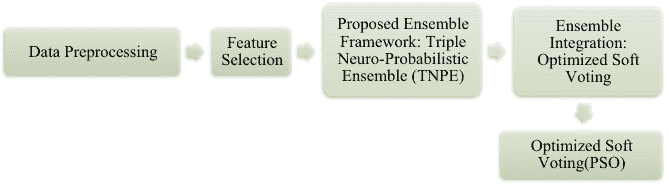

图1：所提架构的总体工作流程。

### 3.1 数据预处理

精神健康数据使用一系列预处理操作进行预处理，以清理数据以供模型处理和使用。数值和分类结构列中的缺失值使用kNN插值法 [23] 进行填充，其中缺失值通过最近邻点的相似性来估计。对于从社交媒体帖子和临床笔记中提取的非结构化文本信息，使用了诸如词形还原和分词等一般自然语言处理 [24] 函数，将文本内容转换为标准形式并将其截断为词根形式。接下来，使用通用句子编码器（USE）获得句子嵌入，将文本输入转换为具有语义意义且可被ML算法解释的高维数值向量。数据集中的数值特征使用MinMaxScaler进行归一化，将值缩放到典型范围[0,1]，以确保特征之间的统一性，并且模型不会因尺度变化而产生偏差。为了处理精神健康数据中常见的类别不平衡问题，特别是在抑郁症和焦虑症病例代表性不足的情况下，使用了自适应合成（ADASYN）采样技术 [25]。ADASYN从数据分布中生成少数类合成样本，使模型更加敏感并最大限度地减少训练数据中的类别不平衡。

### 3.2 特征选择

通过在模型训练前进行严格的特征选择（FS），提高了预测性能并降低了计算复杂性。使用了一种计算高效的基于Boruta算法 [26] 的包装式特征选择方法，从结构化临床信息和非结构化文本派生的嵌入中仅选择并保留最具预测性的预测因子。Boruta通过反复将基础特征重要性与随机生成的影子特征进行比较（使用基础估计器，在此示例中为简单的神经网络分类器），来确定每次迭代中每个特征的重要性。反复得分高于其影子对照的特征被视为高度重要，并存储用于模型构建，而较差或冗余的特征则被丢弃。

将Boruta与轻量级神经网络相结合的决定源于该算法能够捕捉高维异构数据中的微弱非线性关系，例如同时包含临床测量和文本嵌入稠密向量嵌入的数据集。这种配对不仅确保了特征选择在统计上有效，而且与下游建模架构在上下文中保持一致。通过仅保留强相关特征，此步骤有效降低了维度，避免了过拟合，并通过专注于对精神健康分类具有清晰且可衡量贡献的预测因子，提高了模型可解释性。该过滤过程还优化了计算效率，尤其是在处理计算成本高昂的集成模型以及由USE表示的高维文本数据时尤为重要。在数学上，原始数据集可表示为

$$D = \{(x_i, y_i)|i=1, 2, \dots, n\}$$ (1)

其中\(x_i \in R^d\)是第i个实例的特征标签向量，\(y_i \in \{0, 1\}\)是相应的二进制类标签，指示抑郁症/焦虑症的存在或不存在。Boruta算法通过纳入原始特征的乱序副本（称为影子特征）来丰富特征集：

$$X_{shadow} = shuffle(X)$$ (2)

然后在组合数据集上训练一个神经网络分类器\(f(.)\)：

$$X_{combined} = [X, X_{shadow}]$$

原始特征和影子特征的特征重要性是使用源自神经网络学习权重或特征对输出贡献的相关性分数来计算的。特征j的重要性分数可表示为

$$I_j = \frac{1}{n} \sum_{i=1}^n \left| \frac{\partial f(x_i)}{\partial x_{ij}} \right|$$ (3)

Boruta随后将每个原始特征的重要性分数\(I_j\)与影子特征中的最大重要性\(I_{shadow.max}\)进行比较。决策规则是

- 如果\(I_j > I_{shadow.max}\)，则该特征被视为重要。
- 如果\(I_j < I_{shadow.max}\)，则该特征被标记为重要。
- 如果决策模糊，则特征保持临时状态，并在后续迭代中评估。


此过程将持续迭代，直到所有特征均基于双侧二项式检验的统计显著性被确认或拒绝。将Boruta与轻量神经网络相结合的优势在于，它能够捕捉变量之间复杂的非线性关系和交互作用，这在包含结构化临床预测因子和高维稠密文本嵌入的数据集中尤其有用。通过仅选择持续具有强重要性的特征，该方法不仅提升了模型性能，还限制了过拟合风险并增强了模型可解释性。

### 3.3 提议的集成框架：三重神经概率集成（TNPE）

该模型由三种不同的基础学习者构成，选择它们是因为它们具有互补的学习范式和决策边界：

- (i) 极端学习机（ELM）：ELM是一种单隐藏层前馈神经网络，输入层与隐藏层之间的初始权重为随机值，在训练期间不更新[27]。唯一可学习的参数是隐藏层与输出层之间的参数，因此计算效率更高。对于输入特征向量

```
X = [x1, x2, ..., xd]^T
```

其中 d 为特征数量，g(.) 通常为 sigmoid 或 ReLU 激活函数。输入 X 通过随机权重矩阵映射到隐藏层：

```
W = R^{N*d}
```

此处 N 为隐藏节点数量。隐藏层输出使用非线性激活函数 g(.) 计算：

```
H = g(Wx + b)
```

其中 b 为偏置项，g(.) 通常为 sigmoid 或 ReLU 激活函数。输出层使用 ∈ R^N 的权重向量计算，该向量通过最小化最小二乘误差的线性回归方法学习得到。输出 ŷ 如下所示：

```
ŷ = H^T β
```

权重 \(\beta\) 通过求解以下优化问题确定：

```
\(\beta = (H^T H)^{-1} H^T y\) (8)
```

在公式 (8) 中，y 是目标输出向量。

- (ii) 概率神经网络（PNN）：PNN是一种专为概率模式分类设计的径向基函数（RBF）网络。它通过估计给定输入数据下输出类别的条件概率分布来工作[28]。PNN在需要概率输出和不确定性量化的分类任务中特别有用，例如在医疗决策中。对于输入向量 \(x \in R^d\)，PNN使用以下步骤为每个可能的类别 \(C_k\) 计算输出类别概率 \(P(C_k|x)\)：

  - (i) 径向基函数（RBF）：隐藏层应用RBF内核来计算输入向量 X 与每个训练样本 \(x_i\) 之间的相似度

  ```
  \(\phi_i(x) = \exp \left( - \frac{||x - x_i||^2}{2\sigma^2} \right)\) (9)
  ```

  其中 \(\sigma\) 是RBF内核的宽度，控制决策边界的平滑度。

  - (ii) 类别概率计算：类别 \(C_k\) 的输出通过对该类别每个训练样本 \(x_i\) 的贡献求和来计算，并按RBF输出加权：

  ```
  \(P(C_k|x) = \frac{\sum_{iy_i=C_k} \phi_i(x)}{\sum_{i=1}^n \phi_i(x)}\) (10)
  ```

  其中 \(y_i\) 是训练样本的类别标签，分母对输出进行归一化以确保所有类别概率之和等于1。由于能够提供每个类别的概率估计，PNN在医疗决策中尤为强大，因而具有可解释性并有助于临床风险评估。

- (iii) CatBoost：它是一种针对高效处理类别特征而定制的梯度提升算法。与XGBoost和LightGBM等常规梯度提升算法不同，CatBoost旨在原生处理类别变量，无需像独热编码或标签编码这样的深度预处理。CatBoost还具有防止过拟合的方法，特别适用于小型和混合类型数据。CatBoost算法是一种梯度提升决策树，其中每棵新树都学习以减少前几棵树的残差。每次迭代的模型输出如下给出：

```
\(\hat{y}^{(t)} = \hat{y}^{(t-1)} + \eta h_t(x)\) (11)
```

其中 \(\hat{y}^{(t-1)}\) 是前一次迭代的预测，\(\eta\) 是学习率，\(h_t(x)\) 是第 \(t\) 棵树的输出。CatBoost结合了有序提升，通过在训练过程中仅使用过去数据点（而无来自未来数据的泄漏）来计算分割，从而帮助防止过拟合。对于类别特征，CatBoost应用一种称为有序目标编码的特定编码策略，将类别变量转换为数值。该方法使用有序策略计算每个类别的平均目标，以避免目标泄漏且不产生过拟合。类别 c 的编码可以计算为

> \(\text{Enc}(c) = \frac{1}{N_c} \sum_{i \in C} y_i \quad (12)\)

其中 \(C\) 表示属于类别 \(c\) 的数据点集合，\(N\) 表示落入类别 \(c\) 的数据点数量。CatBoost特别适用于包含混合类型特征（类别型和数值型）的数据集，因为它尽量减少了对繁重预处理的需求，并通过其有序提升和目标编码机制防止过拟合。

### 3.4 集成整合：优化软投票

在本研究中，当多个基础学习者的预测通过优化软投票机制[29]组合时，即可实现抑郁和焦虑检测的最终预测。软投票是一种基于概率的方法，通过对基础学习者的概率输出求平均来组合每个预测。选择平均概率最大的输出作为最终输出。然而，为了增强集成模型的性能，PSO被用于动态调整每个基础学习者对软投票的贡献权重。自适应加权有助于提升集成的预测准确性，通过更加强调在验证集上表现优异的基础学习者。

软投票模型：假设有 M 个基础学习者，每个学习者对潜在类别输出一个概率分布。令第 \(j\) 个基础学习者对第 \(i\) 个实例的类别 \(k\) 的预测概率分布表示为 \(P_{k,j}(x_i)\)，其中 \(x_i\) 是输入特征向量。

每个类别的预测概率：在软投票中，整个集成对类别 \(k\) 的预测概率是通过对所有 \(M\) 个基础学习者的概率求平均来计算的：

> \(\hat{P}_k(x_i) = \frac{1}{M} \sum_{j=1}^M P_{k,j}(x_i) \quad (13)\)

其中 $P_{k,j}(x_i)$ 是第 \(j\) 个基础学习者对输入实例 \(x_i\) 的类别 \(k\) 的预测概率，\(\hat{P}_k(x_i)\) 是聚合概率。目标是通过分别调整 ELM、PNN 和 CatBoost 的权重 \(w_1, w_2, w_3\)，来最大化集成在验证折上的 ROC-AUC 分数。目标函数是最大化以下内容：

$AUC_{Ensemble} = w_1 * P_{ELM} + w_2 * P_{PNN} + w_3 * P_{CatBoost}$

受约束条件限制

$0 \le w_i \le 1, \sum w_i = 1$

最终预测是通过选择预测概率最高的类别来做出：

$\hat{y}_i = (\hat{P}_k(x_i))$

这得出了类别 \(\hat{y}_i\)，它对应于所有基础学习者中最高的平均概率。

基于粒子群优化的优化软投票：虽然软投票仅给每个基础学习者的预测分配相等权重，但可根据每个学习者在验证集上的表现来获取每个学习者贡献的最优权重。PSO是一种基于种群的优化算法，模拟了鸟群或鱼群的社会聚集现象[30]。蜂群中的每个粒子对应一个候选解，即给予集成基础学习者的权重。权重在每次迭代中根据自身最佳位置和蜂群发现的全局最佳位置进行更新。令 \(w_j\) 表示分配给第 \(j\) 个基础学习者的权重，令权重向量为 \(w = [ w_1, w_2, ..., w_M ]\)，其中 \(M\) 是基础学习者的数量。最初权重随机设置。PSO的目标是找到最优权重 \(w\)，以最小化损失函数或最大化集成在验证集上的性能。适应度函数 \(L(w)\) 定义为

$L(w) = \frac{1}{N} \sum_{i=1}^N L_i(w, x_i, y_i)$

其中 \(N\) 是验证实例的数量，\(L_i(w, x_i, y_i)\) 是第 \(i\) 个验证实例的损失，例如交叉熵损失：

$L_i(w, x_i, y_i) = - \sum_{k=1}^C y_{i,k} \log(\hat{P}_k(x_i, w))$

其中 \(C\) 是类别数量，\(y_{i,k}\) 是独热编码的真实标签，\(\hat{P}_k(x_i, w)\) 是第 \(i\) 个实例的类别 \(k\) 的重复概率，通过加权和计算得出：


\hat{P}_k(X_i, w) = \frac{\sum_{j=1}^M w_j P_{k,j}(x_i)}{\sum_{j=1}^M w_j} (19)

在 PSO 中，每个粒子 $w_t$ 在迭代 $t$ 时代表一个可能的解（权重向量）。每个粒子的位置和速度按以下方式更新：

$v_{j,t+1} = w v_{j,t} + c_1 r_1 (P_{j,t} - w_{j,t}) + c_2 r_2 (g_t - w_{j,t})$ (20)

$w_{j,t+1} = w_{j,t} + v_{j,t+1}$ (21)

其中，$v_{j,t}$ 是第 $j$ 个粒子在迭代 $t$ 时的速度，$w$ 是先前速度的惯性权重，$c_1$ 和 $c_2$ 分别是认知系数和社会系数，$r_1$ 和 $r_2$ 是 0 到 1 之间的随机数，$P_{j,t}$ 是粒子 $j$ 的个体最佳位置，$g_t$ 是蜂群发现的全局最佳位置。速度更新会将每个粒子推向其局部最佳解和迄今发现的蜂群全局最佳解，在探索与开发之间取得权衡，以收敛到最优权重向量。这是一个高度自适应、灵活的集成模型，可以根据验证数据调整基学习器的权重，以实现更好的泛化性能。

## 4 结果与发现

研究在 Python 3.11 中进行，这是一种用于机器学习模型的强大且动态的测试和开发环境。开发和测试模型时采用了一系列库。基于神经网络启发模型的 PNN 和 ELM 模型使用 TensorFlow/Keras 进行训练。CatBoost 被用作梯度提升算法，以高效处理类别特征，特别是针对小型到中型数据。为处理类别不平衡问题，在训练模型前对数据应用了 ADASYN 以实现平衡。Boruta_py 用于特征选择（FS），仅保留数据集中最重要的特征。pyswarm 用于在集成模型中优化基学习器权重时实现 PSO。其次，实现了 LIME 和 SHAP 等技术用于模型可解释性和可理解性，以更好地理解模型的决策过程。最后，使用 Scikit-learn 通过多项评估指标来评估模型性能，以便更好地了解模型的整体效能。

使用了一系列能够表征分类准确率和模型处理类别不平衡能力的重要指标来评估模型性能。使用准确率作为最低指标来计算模型的整体预测准确比例。为提供更平衡的评估（尤其是针对不平衡数据集），采用了 $F_1$-score。ROC-AUC 作为一种可信的模型性能指标，被用于评估模型在所有阈值下区分正负类别的能力。MCC 特别适用于存在类别不平衡的二分类问题，被用作一种平衡指标，考虑了真阳性、假阳性以及真阴性和假阴性。最后，估计了 Cohen's kappa 以衡量预测标签与实际标签之间的一致程度。这些评估标准对模型性能进行了全面研究，使其能够成功应对心理健康预测任务所带来的挑战。所提模型（TNPE）在表中与 kNN、DT 和 NB 进行了比较。

准确率衡量的是在总预测中被正确分类的实例所占的百分比。较高的准确率表明整体性能更好：

Accuracy = \frac{TP + TN}{TP + TN + FP + FN} (22)

$F_1$-score 在召回率和精确率之间取得了平衡。它对于不平衡数据（如心理健康分类）至关重要，因为过度预测（假阳性）或漏诊病例（假阴性）可能导致临床后果：

$F_1$-score = 2 * \frac{Precision * Recall}{Precision + Recall} (23)

Precision = \frac{TP}{TP + FP} (24)

Recall = \frac{TP}{TP + FN} (25)

AUC-ROC – 使用 ROC-AUC 来衡量模型在所有阈值下区分类别的能力。接近 1.0 的数值表明区分度更好，而 0.5 的值代表随机猜测：

AUC = \sum_{i=1}^{n-1} (FPR_{i+1} - FPR_i) \frac{TPR_{i+1} + TPR_i}{2} (26)

TPR = \frac{TP}{TP + FN} (27)

FPR = \frac{FP}{FP + TN} (28)

马修斯相关系数（MCC）：在二分类中，MCC 是一种平衡指标，尤其适用于不平衡数据集。它同时考虑了真阳性、假阳性以及真阴性和假阴性。+1 表示完美预测，0 表示不优于随机猜测，-1 表示完全不一致。这种平衡指标同时考虑了 TP、TN、FP 和 FN：

MCC = \frac{(TP \times TN) - (FP \times FN)}{\sqrt{(TP+FP)(TP+FN)(TN+FP)(TN+FN)}} (29)

表 1 展示了所提方法（TNPE）与 kNN、DT、NB、MLP、AdaBoost 和 GBM 等对比方法的比较分析。

表 1：性能分析 – 所提方法（TNPE）。

| Model | 准确率（%） | $F_1$-score | ROC-AUC | MCC |
|---|---|---|---|---|
| TNPE | 92.6 | 0.927 | 0.963 | 0.852 |
| kNN | 85.4 | 0.846 | 0.893 | 0.698 |
| DT | 82.7 | 0.811 | 0.865 | 0.651 |
| NB | 79.3 | 0.778 | 0.842 | 0.605 |
| MLP | 87.2 | 0.865 | 0.905 | 0.731 |
| AdaBoost | 85.8 | 0.849 | 0.892 | 0.702 |
| GBM | 86.4 | 0.856 | 0.899 | 0.715 |

表 1 展示了分类的比较性能，凸显了所提 TNPE 方法的优越性。TNPE 在所有四项性能指标上均达到最大值，如准确率 92.6%、$F_1$-score 0.927、ROC-AUC 0.963 和 MCC 0.852。这些发现证实，TNPE 不仅在准确病例分类方面优于其他方法，而且在精确率-召回率权衡、类别可分性以及预测标签与真实标签之间的强整体相关性方面表现优异。kNN、MLP、AdaBoost 和 GBM 等基准模型表现中等，但在所有实验中始终落后于 TNPE。值得注意的是，MLP 在基准模型中性能最高，但其 ROC-AUC 和 MCC 均不及 TNPE。DT 和 NB 等最传统的模型表现最差，这反映了它们在处理复杂或高维数据时的失败。总之，结果验证了 TNPE 模型作为一种出色的稳健分类方法的有效性和鲁棒性。

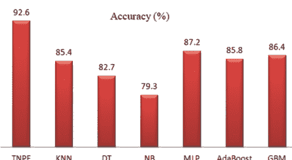

图 2：性能分析 – TNPE – 准确率（%）。

图 2 中所示的 TNPE 模型的分类准确率为 92.6%，显著超越了所有比较基准模型。性能的提升进一步证明了 TNPE 使用包含临床输入和文本数据的高多样性数据集来处理阳性和阴性抑郁症/焦虑症病例的强大能力。紧随 TNPE 之后，MLP 利用深度神经网络的深度和表征能力达到 87.2% 的准确率，但仍远低于 TNPE 经过优化的集成方法。GBM（86.4%）和 AdaBoost（85.8%）等传统集成方法也表现不错，证明了提升方法在处理高维数据方面的有效性，但远不如 TNPE 令人印象深刻。相比之下，kNN（85.4%）、DT（82.7%）和 NB（79.3%）等较不复杂的传统分类器逐渐显示出较低的准确率。此类分类器在面对复杂类型心理健康数据的异质性和不平衡性时，无法保持预测稳定性，因此在临床决策支持系统中需要应用 TNPE 这类复杂且定制的集成架构。

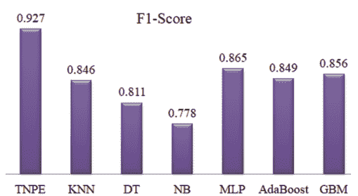

图 3：性能分析 – TNPE $F_1$-score。

图 3 从 F1-score 角度展示了性能分析，F1-score 是灵敏度（召回率）和精确率的混合指标，两者在医疗环境中提供稳定分类都至关重要，TNPE 也以高达 0.927 的极高值领先。这表明该模型具有出色的能力来精确预测真正的抑郁症和焦虑症阳性病例并最小化假阳性，这是心理健康预测任务中的关键前提。MLP 和 GBM 紧随其后，其 F1-score 分别为 0.865 和 0.856，表现尚可。即使它们也未能达到 TNPE 的精确率-召回率权衡。kNN 的 F1-score 为 0.846，AdaBoost 为 0.849，属于平均水平，表明存在可接受的权衡但差异明显，可能是由于数据不平衡和特征分布敏感性所致。在量表的较弱一端，NB 为 0.778，DT 为 0.811，具有最低的 F1-score，反映了它们在同时实现高召回率和高精确率方面表现最差。这些值反映了更大的可能性


会产生假阳性或假阴性，因此在诊断准确性至关重要的场景中不太适合使用。

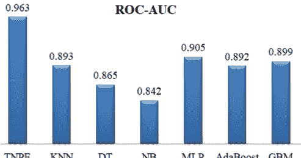

图 4：性能分析 – TNPE – ROC-AUC。

如图 4 中按 ROC-AUC 指标分析所示（ROC-AUC 是衡量模型在所有概率阈值下区分正类和负类能力的指标），TNPE 达到更高的 0.963 值。如此出色的性能保证了 TNPE 具有更强的判别能力，能够准确将抑郁症和焦虑症病例与非病例区分开来，这一特性在误分类后果严重的临床预测环境中极为理想。另一方面，MLP 的 ROC-AUC 得分为不错的 0.905，随后是 GBM 的 0.899 和 kNN 的 0.893，这些模型各自都具有相当不错的分类性能，但仍未达到 TNPE 优化集成方法的水平。AdaBoost 的得分为 0.892，落后于 kNN，尽管具有竞争力，但判别能力较弱。相比之下，NB 的得分为 0.842，DT 的得分为 0.865，两者的 ROC-AUC 值均较低，表明其始终区分精神状态与非病例的能力有所下降。这一缺陷在医疗诊断应用中尤其不幸，因为在需要高特异性和高灵敏度以确保临床判断可信、并防止严重诊断失误的情况下，这一点至关重要。

图 5 展示了基于 MCC（马修斯相关系数）的性能分析，MCC 通过平衡权衡假阳性与真阳性相对于真阴性与假阴性，提供了良好的评估，尤其适用于不平衡数据集（如心理健康预测），TNPE 在此指标上取得了最佳成绩 0.852。这一结果证明了模型对两类样本都具有高度一致的正确预测能力，这在假阴性和假阳性都不可接受的临床决策场景中是必不可少的要求。GBM 和 MLP 的 MCC 得分分别为 0.731 和 0.715，落后于 TNPE，其平衡性能虽合理但明显逊色。kNN 的得分为 0.698，AdaBoost 的得分为 0.702，处于中等 MCC 水平，表明预测平衡性一般，但一致性较低，尤其是在处理混合类型、不平衡的临床数据时。DT 的得分为 0.651，NB 的得分为 0.605，两者的 MCC 值最低，表明它们在真阳性和真阴性的准确分类方面表现较差。这种低性能表明，简单模型在处理敏感健康数据时存在误分类的风险，并再次证实了采用 TNPE 等强大集成方法进行精神疾病准确预测的优势。与其他模型相比，MCC 值最低的 NB（0.605）和 DT（0.651）在处理真实阴性和阳性样本时表现较差。

比较结果明显表明，TNPE 在所有衡量方面、所有情况下均优于其余模型，因此是本研究中检测心理健康状况表现最佳的预测模型。通过融合 ELM、PNN 和 CatBoost 的优势，并进一步利用基于 PSO 的软投票增强它们各自的贡献，TNPE 在准确性、分类平衡性、判别能力和整体可信度方面表现出卓越性能。尽管 MLP 的确本身就很“贪婪”，但具有竞争力的性能，它仍在 MCC 和 ROC-AUC 等最关键指标上落后于 TNPE，而这些指标在进行可靠临床预测时至关重要。GBM 和 AdaBoost 等成熟的集成学习模型在明确界定的数据问题上有用且可行，但与 TNPE 方法相比仍属次优。相比之下，kNN、DT 和 NB 等成熟模型提供的预测结果较差，目前勉强可以作为基准。它们未能妥善处理心理健康信息的复杂性和不平衡性，这暴露了其脆弱性，并凸显了在高风险临床决策支持环境中采用 TNPE 等先进集成方法的必要性，因为在这些环境中诊断性能和完整性不可妥协。

这清楚地表明，在精神疾病诊断等极端重要的场景中，尤其在存在噪声和偏差的混合类型临床数据背景下，应用 TNPE 等精心设计、策略优化的集成模型至关重要。这项对比研究详尽地描绘了 TNPE 模型如何在每一项顶级评估指标上都令人信服地优于标准分类器。其在基于 PSO 的软投票下融合 ELM、PNN 和 CatBoost，利用临床数据和自评数据对抑郁症和焦虑症进行预测时，能够产生更高的准确性、平衡性和可靠性。

其他先进的提升模型（如 GBM 和 AdaBoost）尚可，但在稳定性方面远落后于 TNPE。基于 MLP 的神经模型与 TNPE 同样精确，但在 ROC-AUC、MCC 和 kappa 方面的可靠性不足，而这些指标在医疗决策环境中至关重要。当然，kNN、DT 和 NB 等经典算法被超越，这进一步证明了在处理复杂、高维、不平衡的心理健康数据时，需要先进的集成方法。

## 5 讨论

提高准确性和性能：TNPE 技术在所有性能指标（即准确率、F1 分数、ROC-AUC 和 MCC）上始终优于 kNN、DT 和 NB 等标准机器学习模型。这证实了 TNPE 非常能够处理心理健康数据的复杂性，并为检测抑郁症和焦虑症提供可靠预测。

异构学习者混合：通过使用 ELM、PNN 和 CatBoost 三个基学习者，该模型结合了各自的优点。ELM 在小型和中型数据集上提供速度和泛化能力，PNN 具有强大的概率决策能力，CatBoost 在处理类别变量和混合类型数据方面表现良好。这种异构性使 TNPE 能够学习心理健康数据中非常广泛的模式，从而将其定位为实用的通用模型。

可解释性：TNPE 最大的价值可能在于其可解释性。LIME 和 SHAP 技术已应用于该模型，提供可解释的预测，使临床医生能够为其特定决策提供合理的依据。解释预测的这一特性在临床应用中极其宝贵，因为临床医生不能轻易失去对 AI 系统的信任。

特征选择和平衡数据：使用 ADASYN 应对类别不平衡、使用 Boruta 进行特征选择，增强了模型并减少了过拟合，从而提高了泛化能力。这种预处理确保模型学习数据中最重要的信息，从而总体上带来更好的性能。

可扩展性和灵活性：TNPE 方法可用于大多数心理健康数据，如临床报告、问卷和推特。由于它支持大量数据源，因此它是大多数不同环境中抑郁症和焦虑症预测的通用解决方案。

虽 TNPE 优于传统模型，但其包含多种基础学习者并由 PSO 改进的规模可能导致更长的训练时间，尤其是在处理大型数据集时。这种计算成本可能使其在实时或低资源环境（如移动健康）中不适用。模型性能高度依赖于输入数据质量和预处理。质量差的临床记录、缺失数据或标记不当的社交媒体数据会降低模型性能。此外，使用 USE 进行文本嵌入等预处理步骤在表达与心理健康相关的文本复杂性方面可能较为稀疏，从而可能影响模型对更复杂语言模式的理解。此处使用的数据抽取自临床病史、心理健康调查和社交媒体文本数据，可能仅对应部分人口群体或世界人口。因此，尽管 TNPE 在此数据上表现良好，但其在具有独特文化、人口或语言构成的其他人群或地区的表现尚未确定。或许需要再次测试并进行更通用的调整，以实现更广泛的适用性。

虽模型通过 10 折交叉验证展示了满意的性能，但实际模型本身尚未在真实临床环境中进行测试。在实际应用中，模型输出的现实预测可能会面临缺失或不一致的信息，这可能影响其可靠性。必须执行其实际应用和持续检查，以证明其在真实临床环境中的可用性。虽 Boruta 算法特征选择试图限制过拟合，但集成框架中大量模型及其相互作用的组合仍然容易过拟合，尤其是在特征数量庞大而数据量相对较少的情况下。虽 TNPE 在现有配置下表现最佳，但必须针对大量数据集进行测试，以验证其在不同心理健康数据集下的稳定性和强大性能。

## 6 结论

本章介绍了 TNPE 作为一种新型集成架构，通过协同整合 ELM、PNN 和 CatBoost 的优势来增强抑郁症和焦虑症的检测。借助基于 PSO 增强的软投票集成，TNPE 在预测准确性方面优于某些机器学习模型。在六种基准技术中，TNPE 在所有评估指标上均优于 kNN、DT、NB、MLP、GBM 和 AdaBoost。特别是，TNPE 取得了令人印象深刻的 0.963 ROC-AUC 和 0.927 F1 分数，反映了其更强的区分抑郁症/焦虑症病例与非病例的能力，并能保持召回率和精确率的平衡。此外，TNPE 的准确率和 MCC 远远更好，体现了其在高级心理健康数据上的高准确性。有效的预处理通过使用 USE 进行文本嵌入、ADASYN 类别平衡和基于 Boruta 的特征选择，处理了重要的数据特征。总体而言，TNPE 是一种强大、可扩展且可解释的心理健康障碍预测模型，为临床决策支持系统在

部署到心理健康诊断，其中透明度和可靠性对患者护理至关重要。

## 7 未来方向

尽管所提议的TNPE在检测抑郁症和焦虑症方面取得了有希望的结果，但这项研究还有几个领域可以进一步开发和扩展。未来的研究必须探索多模态数据来源，例如临床和文本信息，以及EEG、心率变异性和语音模式等生理信号，以扩大模型的特征空间，并检测与精神疾病相关的细微行为特征。进一步的步骤包括在更大、更多样化的医疗数据集和实际临床数据上验证TNPE框架，以测试其对不同人群和文化的可扩展性和泛化能力。应用联邦学习方法还可以使模型在不违反患者保密性的前提下，跨机构协作训练，解决医疗保健中常见的数据共享问题。此外，通过交叉测试其他复杂的神经架构（包括用于关系数据的图神经网络或用于心理健康纵向监测的时间卷积网络）来扩展集成，可以进一步提高预测性能和时间敏感性。将实时心理健康监测应用与TNPE相结合，并配合可穿戴传感器或社交媒体监测软件，为将本研究转化为临床有用的决策支持系统提供了一条可行途径。最后，制定基于反事实解释或因果推理可解释性的可解释性框架将为模型增加更多透明度，临床医生随后可以利用它来创建可操作的循证发现。未来以这种方式改进将使框架更具临床实用性，并转化为更个性化、预防性的心理健康医疗实践。

## 参考文献

- [1] Ogunleye, B., Sharma, H. & Shobayo, O. (2024). 基于情感的句子BERT集成抑郁症检测算法. 大数据与认知计算, 8(9), 112.
- [2] Aina, J., Akinniyi, O., Rahman, M. M., Osero-Marah, V. & Khalifa, F. (2024). 基于情感识别的精神障碍检测混合学习架构. IEEE Access.
- [3] Alkahtani, H., Aldhyani, T. H. H. & Alqarni, A. A. (2024). 用于预测精神健康障碍残疾的人工智能模型. 残疾研究杂志, 3(3), 20240022.
- [4] Khan, S. & Alqahtani, S. (2024). 用于检测抑郁症迹象的混合机器学习模型. 多媒体工具与应用, 83(13), 38819–38837.
- [5] Norouzi, F. & Machado, B. L. M. S. (2024). 预测心理健康结果：抑郁、焦虑和压力的机器学习方法. 工程与健康应用数据科学国际期刊, 1(2), 98–104.
- [6] Zafar, F., Alam, L. F., Vivas, R. R., Wang, J., Whei, S. J., Mehmood, S., Sadeghzadegan, A., Lakkimsetti, M. & Nazir, Z. (2024). 人工智能在识别抑郁和焦虑中的作用：一份全面的文献综述. Cureus, 16(3).
- [7] Ciharova, M., Amarti, K., Van Breda, W., Peng, X., Lorente-Català, R., Funk, B., Hoogendoorn, M. et al. (2024). 基于文本、音频和视频数据的机器学习算法在一般和临床人群中预测焦虑和创伤后应激的应用：一项系统综述. 生物精神病学.
- [8] Gohari, M. R., Doggett, A., Patte, K. A., Ferro, M. A., Dubin, J. A., Hilario, C. & Leatherdale, S. T. (2024). 使用随机森林识别青少年抑郁症状的相关因素. 社会精神病学与精神流行病学, 59(11), 2063–2071.
- [9] Sharma, C. M., Thein, K. Y. M. & Chariar, V. M. (2024). 用于精神障碍检测的优化支持向量机. 在《医疗保健人工智能》中（第190–219页）. CRC Press.
- [10] Ku, W. L. & Min, H. (2024). 在主观响应误差中评估机器学习在预测抑郁和焦虑方面的稳定性. 在《医疗保健》Vol. 12, 6中，MDPI
- [11] Chahar, R., Dubey, A. K. & Narang S. K. (2024). 使用XGBoost-HOA算法进行精神健康障碍多类分类. SN计算机科学, 5(8), 1–18.
- [12] Gupta, V., Tripathi, S., Singh, D. & Bansal, A. (2024). 早期产后抑郁症检测预测算法：CatBoost与LightGBM. 在2024年第11届可靠性、Infocom技术与优化国际会议（趋势与未来方向）（ICRITO）中（第1–4页）. IEEE.
- [13] Saha, D. K., Hossain, T., Safran, M. et al. (2024). 基于SVM和神经网络的早期抑郁症检测混合模型集成技术. 科学报告, 14, 25470. https://doi.org/10.1038/s41598-024-77193-0.
- [14] Arora, P. & Dahiya, S. (2025). 使用DA-TabSVM增强心理健康诊断：一种用于检测抑郁和焦虑的多类混合方法. 程序计算机科学, 258, 1348–1364.
- [15] Balraj, C. S. R. & Nagaraj, P. (2024). 使用混合机器和深度学习技术预测心理健康问题和挑战. 在《数学与计算国际会议》中（第15–27页）. 新加坡：Springer Nature Singapore.
- [16] Almutairi, S., Aboharshr, M., Razzaq, H. H., Zulqarnain, M., Namoun, A. & Khan, F. (2024). 用于从大规模文本数据集预测抑郁症状的混合深度学习模型. IEEE Access, 12, 168477–168499. doi: 10.1109/ACCESS.2024.3496741.
- [17] Khan, S., Saeed, S. M. U., Frnda, J., Arsalan, A., Amin, R., Gantassi, R. & Noorani, S. H. (2024). 一种基于脑电图信号时域特征的机器学习抑郁症筛查框架. PLoS one, 19(3), e0299127.
- [18] Amin, A., Md, I. A. L., Hossain, S. F., Hasan, E., Haque, M. M. & Borrty, J. C. (2024). 预测和监测焦虑与抑郁：心理健康分析的先进机器学习技术. 护理研究英国期刊, 4(2), 66–75.
- [19] Upadhyay, D. K., Mohapatra, S. & Singh, N. K. (2024). 使用机器学习算法对持续性抑郁症进行早期评估. 多媒体工具与应用, 83(16), 49149–49171.
- [20] Abbas, M. A., Munir, K., Raza, A., Samee, N. A., Jamjoom, M. M. & Ullah, Z. (2024). 一种用于社交媒体抑郁症检测的基于Transformer的新型上下文化嵌入和概率特征. IEEE Access.
- [21] Shah, K., Patel, U. & Kumar, Y. (2024). 基于机器学习的抑郁早期预测方法. 在2024年智能与创新计算、电气与电子技术国际会议（IITCEE）中（第1–7页）. 印度班加罗尔. doi: 10.1109/IITCEE59897.2024.10467234.
- [22] Jain, V., Kumari, R., Bansal, P. & Dev, A. (2024). 使用机器学习技术进行心理健康预测分析. 在《智能计算与通信技术国际会议》中（第103–115页）. 新加坡：Springer Nature Singapore.
- [23] Chahar, R., Dubey, A. K. & Narang, S. K. (2023). 一种用于心理健康绩效评估的高效K-NN算法，采用K-means聚类. 在《新兴计算、信息、通信和应用研究国际会议》中（第575–586页）. 新加坡：Springer Nature Singapore.
- [24] Korti, S. S. & Kanakaraddi, S. G. (2022). 使用NLP和机器学习技术从Twitter帖子中检测抑郁症. 在2022年第四届新兴电子、计算机科学与技术研究国际会议（ICERECT）中（第1–6页）. IEEE.
- [25] Zakariah, M., AlQahtani, S. A. & Al-Rakhami, M. S. (2023). 基于机器学习的自适应合成采样技术用于入侵检测. 应用科学, 13(11), 6504.
- [26] Haque, U. M., Kabir, E. & Khanam, R. (2021). 使用机器学习方法检测儿童抑郁症. PLoS one, 16(12), e0261131.
- [27] Lu, S., Liu, S., Li, M., Shi, X. & Li, R. (2020). 基于情感相关眼动数据和核极端学习机的抑郁症分类模型. 医学影像与健康信息学杂志, 10(11), 2668–2674.
- [28] Marey, M., Salem, D., Rashidy, N. E. & ELBakry, H. (2024). 通过可解释机器学习方法增强抑郁和焦虑的诊断. 先进计算机科学与应用国际期刊, 15(4).
- [29] Rizwan, M., Mushtaq, M. F., Rafiq, M., Mehmood, A., Torre Diez, I. D. L., Villar, M. G., Garay, H. & Ashraf, I. (2024). 使用基于FastText的加权软投票集成从推特中分类抑郁强度. 计算机、材料与连续体, 78(2), 2047–2066.
- [30] Begum, S. R. & Sait, S. Y. (2025). 基于配置文件信息的抑郁症检测CS-BPSO特征选择. KSII互联网与信息系统事务（TIIS）, 19(3), 752–772.


Dafik*, N. Ganitha Aarthi, Bura Vijay Kumar, Alycia Sebastian, S. Bathrinath, 和 Disha Sushant Wankhede

# 临床研究中的隐私保护机器学习：使用联邦学习保护患者数据

摘要：近年来，机器学习（ML）在医疗保健中的应用为疾病预测、治疗个性化和患者结局改善带来了前所未有的潜力。然而，临床数据的敏感内容以及 HIPAA 和 GDPR 等严格的隐私法律限制了数据的集中收集，并阻碍了协作模型训练。作为回应，我们引入了一种创新的隐私保护方法，即联邦学习（FL），并辅以差分隐私、安全多方计算和自适应模型训练。在此场景中，每个医疗机构拥有自己的数据，仅共享模型的加密更新，确保患者记录不会被获知。我们的系统设计包括分布式客户端（例如，医院）和一个中央协调服务器，该服务器汇编加密更新以构建强大的全局模型。该方法还结合了个性化方法和聚类方法，以解决临床数据集中典型的非独立同分布（non-IID）数据分布。在合成和真实世界电子健康记录数据集上的实验评估表明，所提方法可实现具有竞争力的性能（准确率：89.9%，AUC-ROC：0.92），并显著减轻隐私损失（ε = 2.1）。与传统 FL 和集中式 ML 模型相比，我们的方法在实用性和安全性之间实现了最佳权衡。因此，它适用于早期疾病诊断和治疗结局建模等关键任务。所提框架在不侵犯个人隐私的前提下，在机构之间建立信任与合作，为医疗保健中可扩展、合乎道德且符合法规的人工智能应用打开了大门。

*通讯作者：Dafik, Department of Mathematics, University of Jember, Indonesia, PUI-PT CGANT, University of Jember, Indonesia, e-mail: d.dafik@unej.ac.id
N. Ganitha Aarthi, Department of Computer Science and Design, SNS College of Technology, Coimbatore, Tamil Nadu, India, e-mail: arthi.ganitha@gmail.com
Bura Vijay Kumar, School of Computer Science and Artificial Intelligence, SR University, Warangal 506371, Telangana, India
Alycia Sebastian, Information Technology Department, Al Zahra College for Women, Sultanate of Oman, e-mail: alycia@zcw.edu.om
S. Bathrinath, Department of Mechanical Engineering, Kalasalingam Academy of Research and Education, Krishnankoil 626126, Tamil Nadu, India, e-mail: bathri@gmail.com
Disha Sushant Wankhede, Department of Computer Engineering, Vishwakarma Institute of Technology, Pune, Maharashtra, India, e-mail: disha.wankhede@viit.ac.in
https://doi.org/10.1515/9783111541235-007

**关键词：** 隐私保护，机器学习，联邦学习，差分隐私，患者数据，医疗保健

## 1 引言

医疗系统的快速数字化导致电子健康记录（EHRs）[1]、医学影像 [2]、基因组学 [3] 和可穿戴传感器数据 [4] 前所未有地积累。这些数据通过机器学习（ML）在疾病预测、治疗个性化和医疗保健服务优化方面催化新突破具有巨大潜力。然而，这些数据资产在机构间的协作经常受到全球严格隐私法律 [5] 的阻碍。对数据集中共享的这些法律和伦理限制阻碍了共享模型训练，并限制了传统 ML 方法在医学中的可扩展性。

联邦学习（FL）是解决此类问题的一种潜在方法。与在中央服务器收集原始数据的传统 ML 不同，FL 支持模型的去中心化训练，数据保留在原始位置，仅共享模型更新。该框架允许多个机构之间进行协作，而不会侵犯患者隐私 [6]。然而，传统 FL 并非没有挑战。它继续暴露于推理攻击，没有正式的隐私保证，并面临非独立同分布（non-IID）客户端数据。它还仅为个性化医疗分析提供部分支持。

为了解决这些问题，本研究提出了一种专为临床研究环境设计的隐私增强型 FL（PEFL）[7] 框架。所提方法利用 DP [8] 在模型更新中添加校准噪声，使得关于每个数据点的知识泄露受到限制。本研究还利用安全多方计算（SMPC）[9] 或同态加密（HE）进行安全聚合，使得中央服务器无法从更新中了解客户端的私有信息。这一两层隐私协议显著提高了系统对重建攻击和成员推理攻击的抵御能力。

最后，来自真实世界环境的实际临床数据集本质上是异质的。来自不同地区、人口类别或设施的患者表现出不同的疾病模式、对药物的反应以及医疗接触情况。标准 FL 在这些环境中效果不佳，因为它基于单一全局模型。为缓解此问题，该方法通过局部微调和基于聚类的聚合引入个性化 FL（PFL）[10]，使模型能够根据客户端数据分布进行定制。这提高了预测准确性以及模型在本地临床决策环境中的适用性。

所设计的 PEFL 系统在模拟和实际医疗数据集上均经过测试，以比较其在准确率、精确率、召回率、AUC-ROC 和隐私损失（ε）方面的效率。本研究还将其与集中式 ML 和传统 FL 进行比较，以了解性能和数据保密性方面的改进。通过促进去中心化临床数据孤岛之间尊重隐私的协作 ML，这项工作为在医疗保健中采用 AI 提供了一种安全且可扩展的手段。它为构建尊重患者信任并鼓励创新的合乎道德、符合监管要求且具有临床意义的 AI 系统提供了一条可实施的路径。本研究的主要目标包括以下几点：

- 设计并部署具有 FL 系统的隐私保护 ML 框架，使多个临床机构能够在不共享原始患者数据的情况下，通过共享学习共同训练预测模型，从而取得更好的结果并保持数据机密性。
- 在共享和聚合模型更新时，使用 DP 和 SMPC 等技术来降低包括推理攻击和重建攻击在内的隐私风险。
- 将新的 PEFL 方法与传统 FL 模型进行比较，以说明预测性能和隐私保护方面的改进。

## 2 相关工作

FL 已成为协作医疗分析的强大解决方案，多个机构可以在保持数据隐私和安全的同时共同训练 ML 模型。通过在本地保留敏感患者信息并发送模型更新，FL 解决了医疗保健中与数据共享限制、监管问题和隐私问题相关的若干难题。

### 2.1 联邦隐私保护癌症检测

在数字时代，敏感健康数据的保护至关重要。本研究建议使用 FL 和 DP 进行乳腺癌（BC）检测的数据保护。FL 使各种医疗组织之间能够进行模型训练，以便原始患者数据永远不会离开本地环境。除了通过 FL 支持隐私之外，DP 还会在统计上向模型更新添加噪声，以减轻经典攻击和数据泄露的风险。除隐私要求之外，DP 噪声还会在统计上添加到模型更新中，以帮助防范经典攻击和潜在的数据泄露。该方法在 BC Wisconsin Diagnostic 数据集上进行了评估，主要关注数据异质性、准确率-隐私权衡和计算效率。标准模型达到了 96.0% 的准确率，但需要收集患者数据并存储在集中式软件仓库中，增加了患者


隐私。研究结果表明，结合联邦学习（FL）和差分隐私（DP）可以实现安全数据交换，从而为在临床环境中开发高效的人工智能辅助诊断方法提供了技术潜力 [11]。

### 2.2 FAIR 联邦健康数据预测

已设计了一个隐私友好的联邦机器学习框架，它使用“可查找、可访问、可互操作、可重用”（FAIR）健康数据，在不泄露机密患者数据的情况下，促进各医疗机构之间的协作模型开发。该框架是一种基于代理的系统，以去中心化的方式应用分类模型，从各机构安全环境中学习的本地模型构建整体预测模型。五家医疗机构测试了该设计，每家机构均通过标准化的 FAIR 规范化过程将其数据集转换为 FAIR 合规格式。各地点的联邦 ML 代理与中央联邦 ML 管理器交互，共同训练一个用于 COPD 患者 30 天再入院风险预测的模型，准确率达到 87%。该研究说明在 FAIR 健康数据上部署联邦机器学习的可行性，以及在数据保护法规下实现现实世界临床决策所需的平衡数据互操作性、预测性能和隐私的能力 [12]。

### 2.3 罕见病联邦学习

提出了一种联邦学习模型，以改进保护隐私的电子健康记录分析。该模型使众多医疗机构能够通过在不显式共享患者数据的情况下训练机器学习模型，安全地协同工作。采用并评估了多种机器学习方法，包括随机森林（RF）、支持向量分类器、决策树分类器、逻辑回归和堆叠分类器，以预测患者的治疗需求。RF 分类器的 F1 分数为 80%，准确率为 90%，优于其他方法，并能够处理复杂且类别不平衡的数据。基于联邦学习的技术有助于解决共享健康信息的主要问题，并且也符合包括 GDPR 和 HIPAA 在内的大多数隐私要求。因此，它在罕见病研究中特别有用，因为在该领域中保密性和数据稀缺性的问题更为突出。该系统通过促进机构内的安全数据聚合，显著提高了对罕见疾病的研究能力并推动了疗法开发。为进一步提升性能，未来研究将集中于将框架应用扩展到其他健康领域，并融入越来越复杂的机器学习方法。这项工作为安全、开放和合乎伦理的健康数据检查设定了新的基准 [13]。

### 2.4 青光眼联邦深度学习

为解决患者保密性和数据安全问题，提出了一种基于联邦学习策略的保护隐私的深度学习模型来检测青光眼，该研究在香港、美国和新加坡的七家眼科中心开展的多中心研究中进行。该框架使每个中心能够从其光学相干断层扫描（OCT）视盘体积数据集中在本地训练模型。与交换数据不同，仅将模型参数发送到中央服务器，使用 FedProx 算法进行聚合，然后重新分发以进行本地优化。为了确定联邦学习方法的鲁棒性，实验了三种不同的三维神经网络。基于 2,785 名患者的 9,326 次 OCT 扫描，联邦学习模型在所有中心表现良好且一致，准确率范围从 78.3% 到 98.5%，并在两个未见数据集上保持了高准确率（81.3%–87.8%）。联邦模型不如单一模型，但与常规集中式模型表现相似，且无需传输数据。该研究证明了联邦学习在开发可推广、保护隐私的青光眼诊断人工智能模型方面的可行性和有效性，这是向眼科临床实践实施迈出的重要一步 [14]。

### 2.5 医疗联邦学习中的隐私挑战与缓解措施

多家医疗机构之间的协作可以通过访问更大规模、更多样化的数据集，显著促进临床人工智能的应用。联邦学习是一种训练人工智能系统的方法，其中每个机构仅提供其本地私有数据的模型更新，而不是真实的患者数据。该方法已被证明可以提高各种临床人工智能任务的性能。但建立开放且持续的联邦会产生巨大的信任挑战，因为模型更新本身可能导致信息泄露。以往工作探索了针对联邦学习的隐私攻击，并构建了缓解这些挑战的技术。本综述讨论了医疗联邦学习特有的隐私问题，以及先前缓解技术的权衡、成本和局限性。它旨在成为一份面向从业者的手册，供愿意将联邦学习作为一种注重隐私且安全的协作人工智能开发方法应用的医学研究人员参考 [15]。

### 2.6 安全医学影像自适应联邦迁移学习

随着基于人工智能的诊断兴起，医学图像分类中的数据隐私正成为更严重的健康问题。过去一年中，全球超过 30% 的医疗机构发生了数据泄露，这使得安全且保护隐私的解决方案迫在眉睫。本项目旨在通过融合联邦学习和迁移学习，提供适当的保护隐私的医学图像分类。为了对领域特定医学图像（如肺结核胸部 X 光片、脑部 MRI 肿瘤图像和糖尿病视网膜病变图像）进行微调，采用了以 GoogLeNet 和 VGG16 作为基准模型并使用 ImageNet 预训练权重的网络架构。各种聚合技术已被证明可以获得良好的分类准确率。本研究提出了一种新的聚合技术，该技术实现了快速通信和本地数据集的使用。根据通信轮次中的数据差异，按需调整了联邦平均（FedAvg）和联邦随机梯度下降（FedSGD）。为了评估可扩展性和韧性，该研究还验证了 ResNet-RS 和 EfficientNetV2 等当代拓扑。研究结果表明，结合联邦学习和迁移学习的优势，为医疗诊断创建了一个可扩展、安全且可靠的范式，使医疗专业人员能够在不泄露私人患者信息的情况下协作训练精确的医学图像分类模型 [16]。

### 2.7 协作医疗去中心化保护隐私机器学习

DeCaPH 是一个协作、去中心化且保护隐私的机器学习系统，旨在使许多医疗机构能够在不交换原始数据或使用中央服务器的情况下共同训练模型。DeCaPH 在培训过程中限制隐私泄露，同时实现安全协作，以满足严格的隐私和监管要求。采用三项不同的医疗任务来验证框架的有效性：根据电子健康记录预测患者死亡、根据单细胞基因组数据分类细胞类型，以及利用现实世界分布式数据集从胸部 X 光片中识别病理。研究结果表明，在 DeCaPH 上训练的模型将隐私攻击脆弱性降低了高达 16%，与非保护隐私技术相比，性能下降不足 3.2%。此外，DeCaPH 模型分别比先前使用的保护隐私技术获得了高达 70% 和 18.2% 的更好结果，并显著隔离了私有训练模型。所有这些发现都突出了 DeCaPH 在保持强隐私保护的同时同时增强模型泛化性和准确性方面的优势，以及其在协作医疗人工智能中广泛应用的适用性 [17]。


### 2.8 针对乳腺癌的联邦迁移学习

BC在全球范围内继续是导致女性死亡的主要原因之一，因此早期和精确的诊断对于最大化患者预后和生存率至关重要。尽管机器学习，尤其是深度学习，在图像识别应用中取得了巨大成功，但由于标注数据短缺和医疗领域隐私问题，其在乳腺癌分类中的部署并非没有挑战。该研究提出了一种新方法，在联邦学习（FL）框架下集成迁移学习，使研究人员能够在多机构医疗环境中缓解这些挑战。来自三家医疗中心的乳腺X线摄影和MRI图像被用于训练一个联合全局模型，无需任何原始数据传输，从而保护患者隐私。该方法利用预训练的ResNet模型作为特征提取器，并在来自多家机构的乳腺癌数据上对上层进行微调，以学习额外的专用领域特定数据表示，同时继承在大型数据集上训练的ImageNet上学习的通用图像表示。此外，该方法还实施了域对抗训练，以缓解因各中心数据分布变化引起的域偏移，使模型能够通过最小化域差异并最大化分类准确率来学习域不变特征。总体而言，实验表明，与传统的独立训练和无域适应的联邦学习相比，所提方法的分类准确率达到98.8%，计算时间为12.22秒。这些结果表明准确率和泛化能力显著提高，验证了使用保护隐私的联邦学习来改善乳腺癌分类，尤其是在现实世界的多机构医疗环境中 [18]。

### 2.9 保护隐私的协作医疗诊断

基于联邦学习（FL）的保护隐私的协作医疗诊断（CMD）方法已被引入，以在确保敏感信息得到保护的同时，增强多家医院的实时患者监测和诊断。联邦学习的建立通过共享模型参数而非原始数据来保护患者隐私和数据本地化，从而允许在分布式数据上进行去中心化模型训练。使用基于残差学习的深度置信网络（RDBN）的部分同型加密系统（PHC）使生理数据的安全准确分类成为可能。实验结果表明，所提CMD在各种医疗机构提供高诊断准确率，同时提供适当的隐私保护。具体而言，PHC和RDBN计算分别需要约150毫秒和1000毫秒用于加密和分类，用户到服务器和反向方向分别传输4 MB和5 MB的数据。此外，该技术将通信开销降低30%，并在多个数据集上平均将分类准确率提高10%，证明了其在安全协作医疗诊断中的有效性和影响 [19]。

本综述报道了几种医学领域中保护隐私的联邦学习解决方案的最新进展，包括差分隐私（DP）、迁移学习、同型加密（HE）和去中心化系统等创新技术。这些进展表明，在多机构数据共享中保持患者机密性的同时，模型性能、鲁棒性和可扩展性方面出现了令人鼓舞的改进。联邦学习是健康AI领域的一项新突破，它能够在不违反患者隐私的前提下实现联合训练模型。与差分隐私（DP）、同型加密（HE）和自适应聚合等最先进的隐私保护技术交互，能够以强大的诊断性能和稳健的模型保障数据安全。这些技术有效解决了数据异质性、监管和域变化等关键问题，为临床应用提供可扩展、可靠且可行的AI解决方案。对联邦学习平台的进一步协作与探索将对精准医学产生巨大影响，促进更好的患者护理，并在世界各地多个管辖区的医疗中心推广负责任的协作。

## 3 方法论

为了解决临床机器学习中隐私、数据异质性和数据治理合规性问题，我们提出了一种独特的联邦学习框架，以在多机构医疗环境中共同创建机器学习模型。我们的框架表明，ML模型可以由多家医疗机构共同创建，无需任何机构集中患者数据，通过安全协议和模型个性化实现数据安全、患者隐私和数据治理，从而提高隐私和模型性能。

### 3.1 系统架构

系统架构旨在促进来自分散临床数据源的安全协作模型共同创建。它包含多个本地客户端，可以是任何医疗或研究中心，如医院和诊所，它们是独立的数据孤岛，完全控制自己的私有数据集，例如电子健康记录或医学影像。客户端将通过FL使用其私有数据集在本地训练模型来共同创建ML模型。中央协调服务器通过向所有客户端初始化和分发全局模型来促进学习过程。然后，它从每个机构收集保护隐私的模型更新，安全地聚合它们，并重新分发更新后的全局模型。这种去中心化结构确保敏感患者数据保留在源机构内，在保持符合隐私法规的同时，实现医疗网络内的协作智能。所提架构如图1所示。

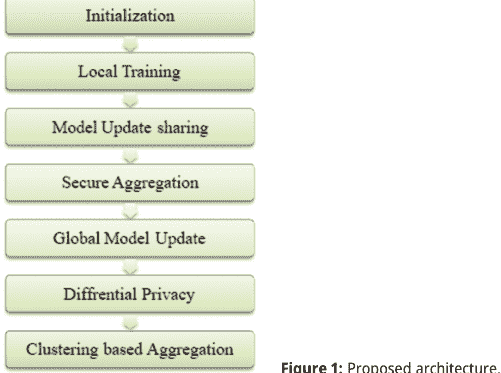

采用了联邦平均（FedAvg）算法 [20] 的修改版本，以增强安全聚合和隐私保护机制。总体目标是在多个去中心化客户端之间协作优化全局模型，而不暴露其原始数据。设K为客户端数量，w_t表示第t轮的全局模型参数，w_t^k表示第t轮客户端k的本地模型参数，η为本地学习率，D_k为客户端k的本地数据集，大小为n_k，而n = \sum_{k=1}^K n_k是所有客户端的数据点总数。

#### 初始化

训练过程的第一步是中央服务器初始化一个具有架构、模型和一组参数的全局ML模型。然后将此模型发送给所有参与的客户机构。所有客户端都会获得该模型的副本，以便在训练开始时以相同的方式进行初始化。模型架构的选择通常取决于FL过程所处理的特定临床任务，例如疾病分类或风险预测。中央服务器初始化全局模型参数，然后将此模型发送给所有参与的客户端：

```
w_0 \leftarrow \{ w_0^1, w_0^2 ... w_0^K \} (1)
```

#### 本地训练

当每个客户端收到全局模型后，它将在其私有数据集上进行本地训练。训练必须首先包含数据预处理任务，如标准化或归一化，以确保输入特征的一致性。客户端必须通过在数据增强或类加权损失函数等技术之间进行选择来解决类别不平衡等其他问题。模型将使用SGD或Adam等优化算法进行优化，训练可以进行预设的本地轮次，以避免过拟合并节省通信成本。每个客户端k将在其数据集D_k上执行本地更新。客户端最小化一个本地目标函数：

```
$F_k(w) = \frac{1}{n_k} \sum_{i=1}^{n_k} l(w; x_i^k, y_i^k)$ \tag{2}
```

方程(2)是损失函数，其中x_i^k, y_i^k \in D_k。本地模型使用梯度下降法在E个轮次中更新：

```
$w_t^k \leftarrow w_t^k - \eta \nabla F_k(w_t^k)$ \tag{3}
```

#### 模型更新共享

完成本地训练后，客户端不会共享任何原始患者数据。相反，它们仅提取和加密更新后的模型参数，例如权重矩阵或梯度值。这些加密的更新安全地传输到中央服务器。这确保敏感健康信息永远不会离开本地站点，从而保护患者隐私并遵守数据保护法规。客户端k将其更新后的模型w_t^k或差异\Delta w_t^k = w_t^k - w_t发送到服务器。为了保护隐私，更新被加密：

```
$\hat{w}_t^k = \text{Encrypt}(w_t^k)$ \tag{4}
```

#### 安全聚合

中央服务器接收来自多个客户端的加密更新并执行安全聚合。使用HE或SMPC等技术在不解密的情况下合并更新，防止包括服务器本身在内的任何单方访问单个客户端数据。这一安全层确保即使模型更新也无法被逆向工程以推断敏感信息。服务器使用HE和SMPC等协议对加密更新进行安全聚合 [21]。

```
$\hat{w}_{t+1} = \text{Aggregate}(\{ \hat{w}_t^1, \dots, \hat{w}_t^K \})$ \tag{5}
```

解密后，服务器计算新的全局模型作为加权平均：

```
$w_{t+1} = \sum_{k=1}^K \frac{n_k}{n} w_t^k$ \tag{6}
```

#### 全局模型更新

聚合完成后，服务器通过对加密的客户端更新求平均或以其他方式组合，计算出全局模型的新版本。此更新模型反映了来自所有客户端集体数据集的所学知识，增强了其泛化能力。然后将新模型发送回每个客户端以进行下一轮本地训练，保持循环学习过程。更新的全局更新


$$
w_{t+1} \rightarrow \{w_{t+1}^1, w_{t+1}^2, \dots, w_{t+1}^K\} (7)
$$

每个客户端接收最新模型以开始新的本地训练轮次。FL 周期在多个通信轮次中持续进行。在每个轮次中，客户端使用服务器的新更新重新训练模型，服务器利用新的加密贡献来优化全局模型。这一迭代过程重复进行，直到模型达到所需的性能水平，或根据预定义标准收敛，例如验证准确率或损失的最小变化。该公式支持多种增强功能，例如差分隐私、客户端聚类等。

#### 差分隐私（DP）

差分隐私已集成到 FL 过程中，以防止通过模型更新推断出个别患者记录。在将更新传输到服务器之前，每个客户端将经过校准的随机噪声注入其模型参数或梯度中。这种噪声源自概率分布，最大限度地减少了信息泄露，并确保任何单个数据点的贡献在最终输出中无法被识别 [22]。隐私预算（衡量特定数据点可能泄露的信息量）调节隐私程度。较小的模型提供更强的隐私保证，但也可能降低模型效用，因此需要仔细调整权衡。设 \(\Delta w_t^k\) 为客户端 k 在第 t 轮的模型更新。DP 通过添加高斯噪声来强制执行：

```
\(\hat{w}_t^k = \Delta w_t^k + N(0, \sigma^2 I)\) (8)
```

其中 \(N(0, \sigma^2 I)\) 是基于所需隐私预算 (\(\epsilon\), \(\delta\))-差分隐私校准的标准差为 \(\sigma\) 的高斯噪声。

#### 安全多方计算（SMPC）

为进一步增强对重建或推断攻击的安全性，SMPC [23] 在模型更新共享过程中被采用。得益于 SMPC，多方可以在保持其输入隐私的同时，共同对输入计算函数。为确保没有任何单一实体可以访问完整的更新，联邦设置中的每个客户端将其模型更新分成秘密份额，并将其分发到各方或服务器。只有在聚合过程中将份额组合在一起时，服务器才能重建更新的总和，而不会了解任何单个贡献。这种方法消除了将敏感更新交给服务器的必要性，并防范内部人员和串通威胁。设 \(\Delta w_t^k\) 为客户端 k 的模型更新向量。客户端将该向量拆分为 M 个秘密份额：

```
\(\Delta w_t^k = s_1^k + s_2^k + \dots + s_M^k\) (9)
```

每份 \(s_i^k\) 被分发到相应的方。中央服务器聚合所有客户端的所有份额之和：

```
\sum_{k=1}^K \Delta w_t^k = \sum_{k=1}^K \sum_{i=1}^M s_i^k
```

只要少于 M 个份额的子集无法重建 \(\Delta w_t^k\)，客户端的数据就保持安全。聚合在不重建单个更新的情况下完成，其隐私得到保留。为提高在患者人群和数据分布各异的客户端之间的泛化能力，采用了 PFL。

PFL 考虑了客户端数据分布的异质性，这在多机构临床研究中经常发生。在 PFL 中，全局模型训练完成后，每个客户端在其本地数据集上对共享的全局模型进行微调。模型能够从共享的全局知识中学习，同时根据客户端的特定数据特征（如人口统计学特征或疾病患病率）调整模型性能。以这种方式，PFL 在保持隐私的同时实现泛化。PFL 在医疗保健领域尤其有用，因为不同机构的患者人群差异很大。设 W_T 表示 T 轮 FL 后的最终全局模型。客户端 k 通过最小化个性化目标来执行本地微调：

```
w_T^{k, PFL} = \arg\min_w [F_k(w) + \lambda ||w - w_T||^2]
```

其中，\(F_k(w)\) 是客户端 k 数据上的局部经验损失，\(\lambda ||w - w_T||^2\) 是一个正则化项，用于防止过拟合并保留全局知识。这也被称为局部正则化，是一种常见的 PFL 技术。

#### 基于聚类的聚集

当存在非 IID 数据时，实施基于聚类的聚集以显著提高模型速度和容量。利用标签分布、梯度相似性或更新距离等特征，该技术创建数据分布可比的客户端聚类。在每个聚类中，模型分别聚集，从而创建多个半专业化模型，而不是单个全局模型。该策略减少了聚集高度不相似更新的负面影响，并提高了数据特征一致的客户端的训练效率和准确性。假设客户端根据相似度量 sim \((k_i, k_j)\) 被划分为 C 个聚类 \(\{C_1, ... C_c\}\)。对于每个聚类 \(C_v\)，服务器执行簇级模型更新：

```
w_{t+1}^{(c)} = \sum_{k \in C_c} \frac{n_k}{\sum_{j \in C_c} n_j} w_t^k
```

聚类 \(C_c\) 中的每个客户端接收其对应的聚类特定模型 \(w_{t+1}^{(c)}\) 以进行下一轮训练。聚类可以基于梯度更新的余弦相似性或客户端数据集之间的分布差异 [24]。

## 4 结果与发现

该研究使用旨在模仿真实世界电子健康记录（EHR）或多家医疗机构实际临床数据集统计特性的模拟数据集。这些数据集包括结构化特征（例如，实验室结果、生命体征和诊断代码），并在人口统计学和疾病患病率方面具有不同程度异质性的机构之间分布。每个客户端保留其自身的数据孤岛，不共享原始记录。

为广泛评估所提 FL 模型的预测性能和隐私保护，采用了多项重要指标。准确率通过衡量所有类别的正确预测率来衡量模型的全局准确性。精确度检验正预测的有效性，即预测为阳性的病例中实际为阳性的比例。召回率或灵敏度衡量模型识别实际阳性病例的能力，这是医学诊断中减少假阴性的重要方面。此外，AUC-ROC 量化了模型在不同分类水平上的鉴别能力，提供了平衡的性能度量，特别是在不平衡数据上。总体而言，这些测试构成了一个综合框架，用于量化关注隐私的医疗 AI 系统的有效性和可靠性。

引入的隐私保护 FL 框架的效率通过与传统 FL 方法的对比评估来进行。传统 FL 基线应用基本的联邦平均（FedAvg）算法，不采用任何额外的隐私保护增强，作为模型性能和隐私脆弱性的比较点。另一方面，本研究提出的 PEFL 方法结合了 DP、安全聚集和模型定制的最先进技术，以实现异构来源之间的增强机密性和响应能力。比较表明，所提方法在协作医疗场景中，在保持高分类准确率和提供强大隐私保障之间实现了更好的权衡。

### 表 1：传统 FL 与隐私增强 FL 对比。

| 特性/指标 | 传统 FL | 提议的隐私增强 FL |
| :--- | :--- | :--- |
| 准确率 (%) | 88.7 | 89.9 |
| 精确度 (%) | 87.3 | 89.1 |
| 召回率 (%) | 89.0 | 90.2 |
| AUC-ROC | 0.91 | 0.92 |

表 1 说明了传统 FL 和所提 PEFL 在关键分类指标上的性能。准确率从 88.7% 提高到 89.9%，表明增强方法的总体预测更准确。精确度从


87.3% 提升至 89.1%，表明隐私增强方法的误报更少，正预测的可靠性更高。召回率从 89.0% 提升至 90.2%，反映出所提方法对真实正例的检测更出色，这在疾病诊断等医疗应用中至关重要。AUC-ROC 从 0.91 略微提升至 0.92，反映出在不同阈值下的整体分类性能有所增强。

### 性能分析

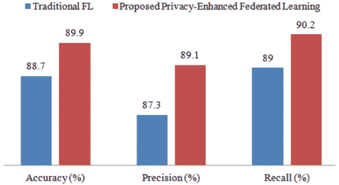

图 2：性能分析——传统 FL 与隐私增强 FL 的对比。

图 2 对比分析了传统 FL 与所提 PEFL 方案在三个关键评估参数上的表现：准确率、精确率和召回率。

传统 FL 模型的输出存在不足，尤其是在医疗应用中。88.7% 的准确率表明，尽管该模型总体表现出色，但在处理非 IID 数据方面效果较差，且缺乏客户端级个性化，因此总体上略显不足。因此，87.3% 的准确率将导致相应更高的误报率，即模型在某些情况下会错误诊断其实并不存在的病症或疾病，这一缺陷在实际中可能导致不必要的焦虑或干预。其次，虽然 89.0% 的召回率很出色，但也表明模型可能会漏掉大量实际阳性病例，在医疗诊断中这是一个关键考量因素，因为未确诊的疾病可能是致命的。这些数据表明，有必要在多异构数据集上增强模型的个性化和鲁棒性。

所提 PEFL 架构在所有关键性能指标上均有显著提升，非常适用于临床用途。该模型准确率为 89.9%，意味着在去中心化、异构数据集上的整体预测准确性和泛化能力得到增强。其 89.1% 的准确率也表明其更好地抑制误报的能力，从而限制误诊或不必要治疗的机会，这在决策精度至关重要的医疗中心是一项相当大的优势。其在 90.2% 的召回率下更好地正确识别真实正例的能力，也大大降低了漏诊的可能性。这在早期疾病诊断和治疗效果预测等应用中尤为重要，因为早期识别高危患者可能决定生死。

### AUC-ROC

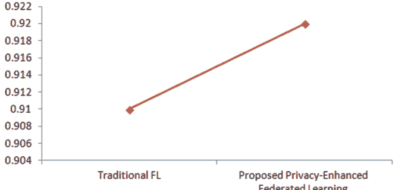

图 3：性能分析——传统 FL 与隐私增强 FL 的对比。

图 3 对传统 FL 与所提 PEFL 模型在 AUC-ROC 值方面进行了直观对比。基准 FL 方法的 AUC-ROC 约为 0.91，在区分阳性和阴性类别方面表现相对出色，但仍有提升空间。所提 PEFL 的 AUC-ROC 约为 0.92，在识别灵敏度与特异度之间的平衡方面相比模型性能有显著提升。图中上升趋势表明，差分隐私、安全聚合和个性化等隐私保护技术并未损害性能，反而增强了模型的鉴别能力。这在医学研究中尤为重要，因为正确识别患病和非患病病例极为关键。表 2 是传统 FL 与所提 PEFL 解决方案在隐私、安全性和灵活性等五个高维度上的定性比较，适用于临床机器学习。

隐私损失 (ε)：传统 FL 不提供任何明确的隐私保证，其隐私损失参数本质上为 ∞。这意味着，虽然原始数据未被暴露，但模型更新数据可能会泄露关于个别患者数据的信息。PEFL 方法采用 DP，在共享前向模型更新中添加数学上界定的噪声。这将隐私损失限制在可经验测量的比例（例如 ε = 2.1），提供可证明且有保障的机密性，使得添加或移除任何单个数据点都不会对全局模型产生显著影响。

### 表 2：传统 FL 与所提隐私增强 FL 的对比

| 隐私损失 (\(\epsilon\)) | \(\infty\) (无正式隐私) | 2.1 (差分隐私) |
| :--- | :--- | :--- |
| 安全聚合 | 否 | 是 (例如 SMPC 或同态加密) |
| 抵御推断攻击 | 弱 | 强 |
| 支持个性化 | 否 | 是 (PFL, 聚类) |
| 处理非 IID 数据 | 差 | 有效 (通过聚类、微调) |

安全聚合：传统 FL 从聚合端易受攻击，导致模型更新在传输和聚合操作中容易受到威胁。安全性缺失增加了未经授权访问或不想要信息泄露的风险。相比之下，新方法采用 SMPC 或 HE 来执行加密模型参数聚合。结果是，即使是中心服务器也无法查看单个更新，这极大地增强了安全性，并有助于符合 HIPAA 或 GDPR 等隐私法规。

抵御推断攻击：在缺乏其他防御机制的情况下，传统 FL 易受模型反演或成员推断等推断攻击的影响，攻击者可以利用模型更新提取或了解敏感患者信息。所提 PEFL 方案通过差分隐私和安全聚合，对这类攻击具有强健性。这些技术限制了从单个更新中可学到的信息量，从而使攻击变得困难。

个性化支持：经典 FL 在所有客户端上训练一个全局模型，不考虑本地数据的特殊性，这通常会导致次优性能，尤其在医疗领域，患者群体和疾病发病率具有地域特征。此处的解决方案采用微调和基于聚类的聚合等 PFL 方法，使每个客户端能够根据自身数据个性化全局模型。本地个性化显著提升了相关性、准确性和临床实用性。

非 IID 数据处理：临床数据从不满足 IID，而常规 FL 对这种异质性缺乏鲁棒性，因此容易出现模型偏差或泛化失败。该方法通过将数据分布相似的客户端划分为组并采用本地化训练协议，规避了这一问题。在数据不平衡和多样性方面，该模型更加鲁棒且具有泛化能力，在拥有不同患者群体的多个机构上表现更好。

## 5 Discussion

我们的 PEFL 框架在保护隐私的医疗机器学习方面作出了重要贡献。与常规 FL 相比，PEFL 方法在准确率、精确率和召回率方面表现更高，这主要归功于差分隐私、安全聚合和个性化机制的加入。应用差分隐私 (\(\epsilon\) = 2.1) 有效降低了信息泄露，解决了临床 AI 中尤其重要的问题，尤其是多机构数据共享方面。此外，SMPC 确保没有任何单个参与者（包括协调服务器）完全掌握单个更新的信息，从而增强了抵御推断攻击的能力。

模型泛化能力的提升是另一重要改进。标准 FL 存在非 IID 数据问题，即客户端数据集的分布差异较大。这往往会导致“一刀切”模型失效。通过使用 PFL 技术和基于聚类的聚合，我们的方法使客户端能够在本地微调全局模型，并与分布相似的同伴组交换更新。这增强了模型在多人口环境下的泛化能力和适用性，这是临床部署中的一大关注点。尽管有这些进步，问题仍然存在。隐私与模型效用之间的权衡，特别是在 DP 噪声校准方面，需要进一步优化。安全聚合协议的通信开销也可能导致延迟，从而限制医学等实时应用领域。尽管如此，整体发展再次证明了 PEFL 在医学等关键应用领域的有效性。该方法为受监管领域更具参与性、隐私意识的 AI 系统打开了大门。

## 6 Conclusion

本章提出了一种用于医疗研究中联邦学习应用的全面且保护隐私的方法，旨在优化隐私而不牺牲预测性能。通过集成差分隐私、安全多方计算和个性化模型调整等最先进的隐私保护方法，所提出的方法缓解了传统 FL 的一些最显著缺陷，即隐私泄露、个性化不足以及对非 IID 数据处理不佳的问题。

实证测试表明，所提模型在准确率 (89.9%)、精确率 (89.1%) 和召回率 (90.2%) 等主要指标上明显优于普通 FL，且隐私风险显著降低 (ε = 2.1)。系统架构可扩展且可针对不同临床环境进行配置，适用于多家医院、实验室或研究中心等现场应用。引入客户端聚类和自适应微调不仅改善了个性化，还使模型对临床数据中存在的统计异质性具有强健性。最重要的是，研究证明隐私保护技术能够赢得医疗利益相关者的信任，并使机构间道德 AI 合作成为现实。该方法符合国际数据保护法规，为在敏感环境中扩展 FL 解决方案提供了途径。所设想的 PEFL 框架架起了临床数据隐私与 AI 创新之间的桥梁，为未来在医疗分析、疾病预测和结果建模方面的进步提供了坚实基础，同时不牺牲隐私。


## 7 未来研究

尽管新的PEFL范式缓解了联邦学习（FL）的大多数弱点，但仍有几个方向有待进一步发展。作为初步考虑，可以探讨隐私自适应调优技术，以协助运行时隐私与模型准确性的权衡，主要针对动态客户端数据分布和更新大小。这可以包括强化学习程序，以实时学习对隐私预算（ε）进行调整，同时考虑来自模型准确性或用户分配阈值的反馈。

另一个有前景的领域是联邦迁移学习集成，其中预训练模型可以在低标记数据客户端之间共享，这类客户端在罕见病数据中很常见。这也将提高模型在低资源环境中的收敛速度和有效性。此外，未来工作必须专注于最小化SMPC和HE等安全聚集协议的通信和计算开销。压缩感知联邦学习或量化加密更新等新方法可以在不牺牲安全性保证的前提下最大限度地减少带宽使用。从部署角度来看，可以在实际临床试验中开展跨境数据合作，以测试各种监管体系下的法律和伦理可行性。这包括验证对HIPAA（美国）、GDPR（欧盟）和NDHM（印度）等地方性立法的合规性。最后，在单一联邦框架下扩展模型范围以支持EHR、医学影像和基因组等多模态数据，将显著提升PEFL的实用性。纳入实时联邦分析和决策支持工具，也可以使该系统在临床上可操作并响应精准医疗倡议。

## 参考文献

- [1] Nowrozy, R., Ahmed, K., Kayes, A. S. M., Wang, H. & McIntosh, T. R. (2024). Privacy preservation of electronic health records in the modern era: A systematic survey. ACM Computing Surveys, 56(8), 1–37.
- [2] Sedghighadikolaei, K. & Yavuz, A. A. (2024). Privacy-preserving and trustworthy deep learning for medical imaging. arXiv preprint arXiv:2407.00538.
- [3] Zhou, J., Chen, S., Wu, Y., Li, H., Zhang, B., Zhou, L., Hu, Y. et al. (2024). PPML-Omics: a privacy-preserving federated machine learning method protects patients’ privacy in omic data. Science Advances, 10(5), eadh8601.
- [4] Deepak, G., Sharma, P., Jayachitra, S., Chepur, J., Srihari, T. & Judgi, T. (2024). Privacy-preserving deep learning approaches for effective utilization of wearable health data. Measurement: Sensors, 33, 101238.
- [5] Kconnoth, C. (2024). AI and data protection law in health. Research Handbook on Health, AI and the Law, 111–129.
- [6] Chen, J., Yan, H., Liu, Z., Zhang, M., Xiong, H. & Yu, S. (2024). When federated learning meets privacy-preserving computation. ACM Computing Surveys, 56(12), 1–36.
- [7] Ahmed, S. T., Kaladevi, A. C., Shankar, A. & Alqahtani, F. “Privacy Enhanced Edge-AI Healthcare Devices Authentication: A Federated Learning Approach.” IEEE Transactions on Consumer Electronics (2025).
- [8] Xie, H., Zhang, Y., Zhongwen, Z. & Zhou, H. (2024). Privacy-Preserving Medical Data Collaborative Modeling: A Differential Privacy Enhanced Federated Learning Framework. Journal of Knowledge Learning and Science Technology ISSN: 2959-6368 (online). 3(4), 340–350.
- [9] Liu, J., Li, Y., Zhao, M., Liu, L. & Kumar, N. "EPFFL: enhancing privacy and fairness in federated learning for distributed e-healthcare data sharing services." IEEE Transactions on Dependable and Secure Computing (2024).
- [10] Barnawi, A., Chhikara, P., Tekchandani, R., Kumar, N. & Alzahrani, B. "A differentially privacy assisted federated learning scheme to preserve data privacy for IoMT applications." IEEE Transactions on Network and Service Management (2024).
- [11] Shukla, S., Rajkumar, S., Sinha, A., Esha, M., Elango, K. & Sampath, V. (2025). Federated learning with differential privacy for breast cancer diagnosis enabling secure data sharing and model integrity. Scientific Reports, 15(1), 13061.
- [12] Sinaci, A. A., Gencurk, M., Alvarez-Romero, C., Erturkmen, G. B. L., Martinez-Garcia, A., José Escalona-Cuarensma, M. & Parra-Calderon, C. L. (2024). Privacy-preserving federated machine learning on FAIR health data: A real-world application. Computational and Structural Biotechnology Journal, 24, 136–145.
- [13] Meduri, K., Nadella, G. S., Yadulla, A. R., Kasula, V. K., Maturi, M. H., Brown, S., Satish, S. & Gonaygunta, H. (2025). Leveraging federated learning for privacy-preserving analysis of multi-institutional electronic health records in rare disease research. Journal of Economy and Technology, 3, 177–189.
- [14] Ran, A. R., Wang, X., Chan, P. P., Wong, M. O. M., Yuen, H., Lam, N. M., Chan, N. C. Y. et al. (2024). Developing a privacy-preserving deep learning model for glaucoma detection: a multicentre study with federated learning. British Journal of Ophthalmology, 108(8), 1114–1123.
- [15] Pati, S., Kumar, S., Varma, A., Edwards, B., Lu, C., Qu, L., Wang, J. J. et al. (2024). Privacy preservation for federated learning in health care. Patterns, 5(7).
- [16] Haripriya, R., Khare, N. & Pandey, M. (2025). Privacy-preserving federated learning for collaborative medical data mining in multi-institutional settings. Scientific Reports, 15(1), 12482.
- [17] Fang, C., Dziedzic, A., Zhang, L., Oliva, L., Verma, A., Razak, F., Papernot, N. & Wang, B. (2024). Decentralised, collaborative, and privacy-preserving machine learning for multi-hospital data. EBioMedicine, 101.
- [18] Selvakammani, S., Devi, G. D., Rekha, V. & Jeyalakshmi, J. (2024). Privacy-preserving breast cancer classification: A federated transfer learning approach. Journal of Imaging Informatics in Medicine, 37(4), 1488.
- [19] Markkandan, S., Bhavani, N. P. G. & Nath, S. S. (2024). A privacy-preserving expert system for collaborative medical diagnosis across multiple institutions using federated learning. Scientific Reports, 14(1), 22354.
- [20] Choudhury, A., Volmer, L., Martin, F., Fijten, R., Wee, L., Dekker, A. & Van soest, J. (2025). Advancing Privacy-Preserving Health Care Analytics and Implementation of the Personal Health Train: Federated Deep Learning Study. JMIR AI, 4(1), e60847.
- [21] Fares, M. H. & Saad, A. M. S. E. (2024). Towards Privacy-Preserving Medical Imaging: Federated Learning with Differential Privacy and Secure Aggregation Using a Modified ResNet Architecture. arXiv preprint arXiv:2412.00687.
- [22] Yan, C., Yan, H., Liang, W., Yin, M., Luo, H. & Luo, J. (2024). DP-SSLoRA: a privacy-preserving medical classification model combining differential privacy with self-supervised low-rank adaptation. Computers in Biology and Medicine, 179, 108792.
- [23] Zhou, I., Tofigh, F., Piccardi, M., Abolhasan, M., Franklin, D. & Lipman, J. "Secure multi-party computation for machine learning: A survey." IEEE Access (2024).
- [24] Liu, E., Yang, W., Gu, Y., Long, W., Istvan, S. & Jiang, L. (2025). A Survey of Clustering Federated Learning in Heterogeneous Data Scenarios. Journal of Computing and Electronic Information Management, 16(3), 17–22.

Siva Shankar S., Sunder R.*, Rahoof P. P., Thangiah Sathish Kumar, Lingidi Nageswar Rao, and Gayatri Parasa

# EpiCastNet: 实时疫情预测的时空混合学习框架

**摘要：** 公共卫生的实时监测对于预测和规避疾病流行病的影响至关重要。统计模型和深度学习算法在应对时空分布流行病数据带来的挑战方面表现不佳。本文提出了一种名为EpiCastNet的新型混合机器学习模型，用于实时预测疾病暴发和流行趋势。EpiCastNet通过图神经网络和时序卷积网络集成时空建模，并融入自适应在线学习引擎，可随时间不断改进。该模型基于多源信息进行训练，包括电子健康记录、流动性数据、环境信息和社交媒体。EpiCastNet显著提高了包括预测准确性、提前量和空间准确性在内的关键性能指标。与ARIMA、LSTM和Prophet等基线模型相比，EpiCastNet在提前量准确性方面表现更优，平均预测提前量为6.2天，空间准确性更高，交并比（IoU）为0.72。预警绩效综合指标——EpiCastNet预警质量指数报告为0.80，表明实际阳性警报的比例较高，且假阳性或假阴性数量较少。该模型为疫情早期检测提供了新途径，使公共卫生机构能够更准确、更快速地预测和应对新兴流行病。该模型的灵活性、可解释性和隐私保护能力使其成为全球健康监测和实时决策的宝贵工具。

*通讯作者：* Sunder R., School of Computer Science and Engineering, Galgotias University, Greater Noida, Uttar Pradesh, India, e-mail: sunder.r@galgotiasuniversity.edu.in
Siva Shankar S., Department of CSE, KG Reddy College of Engineering and Technology, Hyderabad 501504, Telangana, India, e-mail: dsrvisashankars@gmail.com
Rahoof P. P., Department of Computer Science and Engineering (Cybersecurity), Malabar Institute of Technology (MIT), Anjarakandy Integrated Campus, Kannur 670612, Kerala, India, e-mail: rahoof@mitkannur.ac.in
Thangiah Sathish Kumar, Department of Computer Science and Engineering, Hyderabad Institute of Technology and Management, Hyderabad, Telangana, India, e-mail: tsathish.jobs@gmail.com
Lingidi Nageswar Rao, Department of Computer Science and Engineering, Koneru Lakshmaiah Education Foundation, Vaddeswaram, Guntur, Andhra Pradesh, India, e-mail: Inageswararao@kluniversity.in
Gayatri Parasa, Department of CSE, AIML, KG Reddy College of Engineering and Technology, Hyderabad 500086, Telangana, India, e-mail: gayatri.p@kgr.ac.in


**关键词:** EpiCastNet, 流行病预测, 时空建模, 图神经网络 (GNNs), 时序卷积网络, 自适应在线学习

## 1 引言

近年来，实时公共卫生监测系统在疾病暴发预测与控制中的重要性日益凸显。像 COVID-19 大流行 [1]、埃博拉疫情 [2] 和季节性流感 [3] 等全球卫生紧急事件凸显了对更强大、更精确的预测技术的需求，以指导公共卫生应对。对新疫情暴发进行早期检测和立即响应，在很大程度上可以限制其传播，减少对社会的影响，并挽救生命。ARIMA 和长短期记忆网络 (LSTM) [4] 是传统的预测方法，但倾向于忽略疫情暴发的动态和空间分布。这一点在进行实时疫情预测时尤为突出，因为此类模型未必专门用于处理时空数据，或学习如何适应随时间演变的疾病模式。

EpiCastNet 通过提出一种新框架来克服这些限制，该框架集成了时空建模、GNNs [5] 和时序卷积网络 (TCNs) [6] 以及自适应在线学习。EpiCastNet 结合了异构数据源，例如健康记录、社交媒体行为、天气和流动性模式，以生成实时疾病预测 [7]。这种组合架构使系统不仅能够容纳疾病动态的时间维度，还能容纳空间维度，包括疫情期间区域或人群之间的传播方式。这种集成策略提供了比常规预测模型显著更长提前期的预警和早期检测。

该架构还具备灵活性，能够适应随时间变化的新数据流和演变的疾病模式。这种灵活性有助于确保 EpiCastNet 在疾病模式演变时仍能提供准确的预测。除了预测功能之外，EpiCastNet 还致力于提升空间准确性，即预测疫情影响最严重的地理区域。通过利用图神经网络 (GNNs) 对各地区之间的关系进行建模，系统可以识别干预措施（例如，医疗物资和封锁）最有效的区域。

与更传统的疫情预测工具通常会将旧数据用于预测不同，EpiCastNet 配备了实时数据流的尖端技术。这产生了更及时的预测，但更重要的是，这些预测能够更准确地反映疫情的最新模式，并为政府和机构在疫情高峰前提供采取预防措施的窗口期。凭借其在预测能力和可解释性方面的提升，EpiCastNet 在疾病预测领域是一场变革，为实时疫情监测与管理提供了一种可扩展、准确且可解释的解决方案。

本研究的主要目标如下：

- 开发一种混合时空模型，即 EpiCastNet 架构，集成 GNNs 和 TCNs，以对疾病流行结构的时空动态进行建模。
- 与现有方法相比，通过早期疫情预测增强预警和预测能力，并提高预测提前期的可预测性，以向公共卫生管理者提供及时的干预机会。
- 将模型在预测准确性、空间准确性 (IoU) 和警报质量指数 (AQI) 方面的性能与 ARIMA、LSTM 和 Prophet 等基线模型进行比较。

## 2 相关工作

人工智能 (AI)、机器学习 (ML) 和深度学习 (DL) 的最新进展已将疫情建模转变为一门学科，能够开发更复杂、基于数据的方法，以捕捉疾病传播的复杂时空动态。本节对最先进的疫情预测模型进行了详尽综述，涵盖从经典时间序列模型到混合与集成学习框架、GNNs 以及机制式深度学习 (DL) 模型。这些模型借鉴了从统计外推和多模型集成到深度迁移学习和 GNNs 的一系列方法，以提高预测质量、可解释性和鲁棒性。它们共同构成了创建坚固、智能的早期预警、干预规划和疫情准备系统的重要一步。

### 2.1 基于时间序列分析的疫情暴发

尽管医学科学取得了重大进展，地方性流行病演变为大规模流行病的风险在世界卫生领域仍然是一个重要问题。像 COVID-19、猴痘、流感和 HIV 这样的大流行病正在全球范围内感染人口并使公共卫生系统不堪重负。例如，COVID-19 已影响超过 100 个国家的 5 亿多人口，并夺走了超过 600 万条生命，而 HIV 是一场已确立的全球卫生紧急事件，截至 2023 年报告死亡人数达到 8560 万。统计疫情趋势预测对于开发早期预警系统和最大限度地减少国家和国际卫生威胁具有至关重要的意义。为此，本章介绍了一种智能预测模型，并对一些最广泛使用的时间序列模型进行了详细的比较分析。本章将分析的时间序列模型包括 ARIMA、多项式回归、SARIMA、Holt 指数平滑法以及 Facebook Prophet (Fb-Prophet)。本章有助于实现 SDG-3，因为对疫情模式的精确预测可以缓解医疗系统的压力。表现最好的模型在猴痘、HIV、COVID-19 和流感方面的平均绝对百分误差 (MAPE) 值分别为 0.0129、0.0035、0.0011 和 0.024，在多个疾病数据集上表现出卓越的预测性能 [8]。

### 2.2 EpiForecaster：深度集成疫情预测

EpiForecaster 是一种新颖的深度学习集成架构，旨在提高快速演变疫情期间的预测准确性。该研究利用 2022 年猴痘暴发期间（7 月 10 日至 10 月 9 日）巴西、美国、墨西哥、英国和法国的每周病例数据来评估其性能。该方法集成了四种最先进的深度学习模型：CNNs、LSTM 网络、双向 LSTM (Bi-LSTM) 和混合 CNN-LSTM 模型。经过严格的超参数调优后，每个模型生成独立的堆叠预测，然后利用多种元模型方法进行聚合。它使用带约束的有限内存 Broyden–Fletcher–Goldfarb–Shanno (L-BFGS-B) 优化算法，根据各模型的预测准确性动态分配各模型的权重。与梯度提升和基于遗传算法的集成等标准集成方法相比（以等权集成作为控制基线），EpiForecaster 实现了更高的预测准确性。均方误差 (MSE) 和平均绝对误差 (MAE) 等指标表明，EpiForecaster 始终能提供更高的预测精度。与较大的集成默认更好的假设相反，该研究强调了智能权重优化所发挥作用的重要性。EpiForecaster 既是一种用于建模非平稳时间序列的高效且可扩展的方法，也可以作为疫情预测之外广泛预测任务中的宝贵工具 [9]。

### 2.3 流行病和大流行病的预测建模

流行病和大流行病对世界健康造成了严重的负面影响，导致大量死亡，尤其是在弱势群体中。冠状病毒的暴发及其近乎即时的全球传播凸显了加强疾病控制措施的迫切需求。媒体报道、政策规划和研究活动的加强在设计短期和长期公共卫生干预措施方面都发挥了核心作用。AI、ML 和


数学建模使得可以预测各种大流行和流行性疾病，例如寨卡病毒、HIV/AIDS、埃博拉、COVID-19、SARS 和 MERS。这些预测工具已成为协助早期检测、及时分析和战略应对疫情爆发的关键。快速预测高度传染性疾病传播的能力是采取控制干预措施和延缓流行病的关键。该研究解释了利用大数据和智能算法，通过数学和计算模型预测传染病流行病的潜力，以改进疫情防控和应对 [10]。

### 2.4 结核病预测的疫情引导深度学习

结核病（TB）仍然是一个重大的全球公共卫生问题，因为其受人员流动和行为变化影响，具有复杂的时空传播模式。为解决这一问题，我们提出了一种疫情引导的深度学习（EGDL）框架，该框架巧妙地结合了机制流行病学建模与先进的深度学习方法。我们策略的核心是一个网络化易感-传染-康复模型，并辅以饱和发生率函数和图拉普拉斯扩散，以反映长期疾病传播和局部流动模式。模型参数通过马尔可夫链蒙特卡罗方法严格采用贝叶斯方法进行估计，理论分析保证了无病平衡和地方性平衡的全局稳定性。基于这些观察，我们引入了两种混合预测结构 EGDL-parallel 和 EGDL-series，将机制预测集成到深度神经模型中，以缓解监测数据中的过拟合和噪声抑制问题。在应用于日本47个都道府县的结核病发病率数据时，我们的方法在不同时间范围内的预测中产生了高精度。重要的是，符合预测的加入允许量化不确定性，从而提高了模型作为指导数据驱动公共卫生措施的辅助工具的稳健性和实用性 [11]。

### 2.5 疫情预测的 AI 应用

传染病对个人和公共健康构成多样且有时不稳定的风险。AI 及相关技术已在经济学、医学和社会科学等学科中辅助决策，具有巨大潜力来改变传染病流行病学的面貌。本章深入探讨了结合机器学习、计算统计学、信息检索和数据科学的 AI 系统在传染病建模中的应用。AI 的最新进展有助于加快应对紧急流行病学挑战的进程，重点放在适用于常规传染病监测数据的 AI 方法上。接着，我们阐述了 AI 在流行病学中应用的更广泛社会背景，主要考虑因素包括可解释性、安全性、问责制和伦理问题。最后，我们讨论了在该领域使用 AI 的当前局限性，并提供了利用当前及未来 AI 进展的建议，以在传染病流行病学中实现最大影响 [12]。

### 2.6 COVID-19 流行病预测的混合集成模型

精确的流行病趋势预测对成功干预和控制 COVID-19 大流行至关重要。然而，由于数据高度波动，预测 COVID-19 流行病的路径很困难。大多数研究都使用单一预测方法，而未考虑整合各种预测方法的优势，导致结果欠佳。为实现这一目标，我们引入了一种新的集成架构，将三种机器学习模型——核脊回归（KRidge）、深度随机向量功能链接（drVFL）和脊回归——集成到线性融合框架（L-KRidge-drVFL-Ridge）中。该框架的优化通过采用基于自适应微分进化和粒子群优化的高效混合算法（A-DEPSO）来执行。此外，输入特征通过时变滤波器（TVF）经验模态分解方法进行分解，以改进特征表示。我们使用轻量梯度提升机进行特征选择，以选出最重要的变量。我们将该方法应用于意大利和波兰的每日 COVID-19 病例数据，预测未来两个时间点：10 天和 14 天（$t + 10$ 和 $t + 14$）。所提出的模型对意大利（$t + 10 = 0.965, t + 14 = 0.961$）和波兰（$t + 10 = 0.952, t + 14 = 0.940$）两国都实现了高相关系数，优于替代模型的性能。这些发现表明，即使在复杂的流行病环境中，我们的集成系统也能提供强大且可靠的预测，显示出其作为流行病预测和决策的强大工具的潜力 [13]。

### 2.7 基于机器学习的 COVID-19 预测

已提出基于机器学习的预测框架，以改进 COVID-19 病例数预测并比较各种机器学习模型的性能。本文采用了一种基于集成的方法，应用了 MLP、LR、KNN 和 SVM 等一些最流行的模型，该方法经过优化，旨在实现预测的最高效果。通过顺序模型部署过程、数据收集和框架构建，该研究根据 MAE、MSE 和 RMSE 等标准指标验证了所有模型的性能。图形图表展示了每种算法（即所提模型）的 COVID-19 病例报告趋势及相应预测。结果表明，使用线性回归得到的方法优于 MLP、KNN 和 SVM 等单独模型。集成建模通过取不同算法提供的预测的平均值来减少预测误差，并提高整体准确性。研究表明，可解释且准确的建模技术对于 COVID-19 风险建模和大流行应对至关重要。此外，本章还涵盖了精确预测在及时干预应对运动、资源分配和政策制定方面的潜在应用。结果反映了可靠且灵敏的预测系统在公共卫生应对运动中的重要作用。本章还探讨了未来研究的潜在方向，例如应用这些新型机器学习技术以及开发实时自适应模型。政策制定者、临床医生和研究人员之间的协调合作是必要的，以在研究证据和高效公共卫生干预之间建立桥梁。总体而言，该研究为 COVID-19 及未来流行病的规划提供了更强的流行病学预测和更多证据 [14]。

### 2.8 使用深度迁移学习的疫情传播过程

传统的基于数据的疫情传播建模和预测方法通常依赖于独立同分布（IID）数据假设。然而，网络上的疫情传播在不同阶段、地区和病毒类型方面具有极高的异质性，这表明疫情时间序列存在时间和空间异质性，因此可能不符合 IID 假设。研究人员提出了一种融合 CNN 和 Bi-LSTM 网络的新型深度迁移学习模型，以基于异质数据有效地建模和预测疫情。该方法使用 CNN 层提取局部空间特征，使用 Bi-LSTM 层捕捉时间关系，并使用全连接层进行预测。为了增强模型的泛化能力，应用了迁移学习技术。此外，在训练过程中利用粒子群优化进行超参数优化，以进一步提高预测精度。该范式被应用于研究 COVID-19 的时空动态，并探索 SARS、流感 A（H1N1）和 COVID-19 流行病之间的病理差异。详细的实验结果表明，该方法能够有效跟上疫情传播的时空变化，并区分不同病毒之间的显著流行病学特征。此外，该方法大幅降低了流行病建模中的预测误差，并能对疾病传播做出更准确的预测 [15]。


### 2.9 用于疫情预测的时空图神经网络

传染病的精确预测对于成功的疫情管理和公共卫生政策规划至关重要。图神经网络（GNN）近年被提出作为疫情预测的一种有前景的方法。然而，基于GNN的现有模型存在两个关键缺陷：（1）它们通常通过增加网络深度来扩大感受野，但这并不能真正把握地理上遥远但流行病学上相关区域之间远距离连接的语义；（2）它们倾向于在单一尺度下工作，忽略了疫情传播典型的细微多尺度模式。为应对这些挑战，提出了一种新的多尺度时空图神经网络（MSGNN），旨在将多尺度特性引入疫情建模。MSGNN包含一个新的图学习模块，通过学习跨区域疫情信号来识别长距离依赖，从而形成丰富的多尺度图结构。在此基础上，我们通过设计一个精密的图卷积模块，捕获尺度共享和尺度特定的疫情模式，以便进行更准确、更详细的多尺度疫情建模。MSGNN在美国的新冠肺炎新增病例预测上进行了测试。实验结果表明，我们的模型在准确性和稳定性方面远远超过当前最先进的方法。此外，分析和可视化表明，MSGNN能够产生可解释的预测，为疫情动态提供宝贵的洞察 [16]。

卷土重来和新出现的传染病危险始终存在，使得疫情预测极其关键，因此也非常及时。本综述强调了预测模型从ARIMA和霍尔特指数平滑等经典时间序列模型，到DL集成、混合模型和GNN等更先进的AI模型的快速发展速度。每种策略都拥有独特的优势，用于解决数据异质性、非平稳性以及疾病传播的复杂时空动态等核心挑战。特别值得关注的是深度迁移学习、多尺度GNN和疫情引导的混合模型等近期进展，这些进展在预测准确性和可解释性方面取得了重大进步。此外，人类优化技术与不确定性估计的结合增强了这些模型在现实世界公共卫生场景中的鲁棒性和可用性。随着技术的进步，机器学习、领域知识和高质量数据之间的协同作用将对开发面向未来、公众易懂且可操作的预测系统起关键作用。这些进步不仅通过加强卫生系统促进了可持续发展目标3（SDG-3），还为全球改进疫情准备、响应和政策制定奠定了基础。

## 3 方法论

为应对日益复杂和加快的公共卫生威胁，整合下一代计算技术对于实时疾病监测和干预现在至关重要。该框架概述了一种基于人工智能的下一代健康监测系统，它利用广泛的数据源和当前的机器学习技术来产生实时可操作的知识 [17]。从根本上讲，该系统由四个协同组件组成：数据采集和融合层（整合多种异构数据源）；时空疾病建模[18]模块（识别时空中的复杂疾病传播动态）；自适应在线学习引擎（在不断变化的条件下保持模型的时效性）；以及检测与预警系统[19]（将预测信息转化为警报和可视化仪表板，以促进更快速的公共卫生决策）。它们共同构建了一个完整、可扩展的主动流行病学监测与响应系统。架构中的主要组件如图1所示

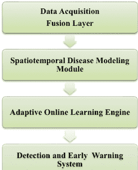

图1：EpicastNet – 工作流。

### 数据采集和融合层

数据采集和融合层是整合大量异构和实时数据源的核心组件，旨在增强医疗监测系统的预测分析和决策能力。该层收集结构化和非结构化数据流，包括医院的电子健康记录（EHRs）、搜索引擎查询趋势（例如Google Trends）、社交媒体（例如Twitter和Reddit）、环境与流动数据（例如天气、交通量、公共交通使用情况和GPS流动轨迹）、来自WHO和CDC等组织的官方卫生通知，以及（如果有的话）可穿戴/IoT传感器数据。为了适应此类来源的多样性和复杂性，采用了数据湖架构，以实现可扩展、模式灵活的存储和检索。此外，应用贝叶斯数据融合方法来解决不同数据模态之间的不一致性和不确定性，以生成整合信息的连贯且概率一致的表示。这有助于增强下游分析和模型性能，尤其在公共卫生监测和预警系统中。令输入为

$D = \{D_1, D_2, \dots, D_N\}$ (1)

其中，\(D_i\)表示对应不同模态的数据源集合。例如，\(D_1\)代表EHRs，\(D_2\)表示社交媒体，\(D_3\)是搜索引擎查询，\(D_4\)是流动和环境数据，\(D_5\)是官方卫生通知，\(D_6\)代表可穿戴/IoT传感器数据。令\(X_i \in \mathbb{R}^{d_i}\)表示来自源\(D_i\)的观测数据向量，\(z \in \mathbb{R}^k\)为整合所有模态的隐性融合表示。贝叶斯数据融合框架旨在基于所有观测模态推断隐性表示z的后验分布：

\(P(z|x_1, x_2, \dots x_N) \propto P(z) \prod_{i=1}^{N} P(x_i|z)\) (2)

其中，\(P(z)\)表示隐性融合状态，\(P(x_i|z)\)是在z条件下源i的观测数据。该模型允许处理缺失模态。结构化数据（EHRs）的示例似然模型如下：

\(P(x_1|z) = N(W_1z + b_1, \Sigma_1)\) (3)

对于分类或文本数据

\(P(x_2|z) = \text{Categorical (softmax}(W_2z + b_2))\) (4)

对于时间序列数据

\(P(x_i^{(t)}|z, x_i^{(<t)}) = N\left(f_\theta(z, x_i^{(<t)}), \sigma^2 I\right)\) (5)

通过变分贝叶斯推断来近似后验：

\(q_\mathcal{O}(z|x_1 \dots x_N) \approx P(z|x_1, \dots x_N)\) (6)

为了优化变分下界（ELBO）

\(\mathcal{L}(\theta, \mathcal{O}) = E_{q_\mathcal{O}}(z|.)[\sum_{i=1}^{N} \log P_\theta(x_i|z] - KL(q_\mathcal{O}(z)||P(z))\) (7)

下游任务的融合输出的隐性向量z随后可传递给下游任务，例如：

- 预测模型
- 分类任务
- 异常检测

### 时空疾病建模模块

时空疾病建模模块旨在揭示地理位置之间疾病传播的复杂空间和时间动态。它应用GNN来表示空间关系，其中节点用于记录单个地理位置（如地区或城市），边用于记录真实关系（如人员流动和交通网络）。为了有效建模时间变化，GNN与TCN [20]或Transformer耦合，以便系统可以学习细粒时间步（每小时或每天）之间的疾病进展模式。这种双重架构允许学习动态时空相关性，使模型能够正确预测疾病如何在空间和时间上传播。这种双重策略通过揭示新兴热点并预测即将到来的爆发，实现了主动的公共卫生行动。设疾病传播网络用图表示

$G = (V, E, A)$

在等式（1）中，\(V = \{v_1, v_2, \dots, v_n\}\)是节点集合，每个节点代表一个地理单元；\(E\)是边集合，代表流动或交互；\(A \in R^{N \times N}\)是邻接矩阵，其中\(a_{ij}\)反映连接强度。每个节点\(v_i\)在时间\(t\)关联一个特征向量。例如，病例数、人口密度和医院负载。

GNN或图注意力网络用于捕获空间依赖性。第\(l\)层的常见GCN更新规则

$H^{(l+1)} = \sigma(AH^{(l)} W^{(l)})$

其中，\(A\)是带自环的归一化邻接矩阵，\(H^{(l)} \in R^{N * d_t}\)是第\(l\)层的节点特征，\(W^{(l)}\)是可学习的权重矩阵，\(\sigma\)是非线性函数。输出由以下给出

$H_{\text{spatial}} = \text{GNN}(X^{(t)}, A)$

针对每个节点在时间轴上进行1D卷积的TCN由以下给出

$H_{\text{temporal}} = \text{TCN}(H_{\text{spatial}}^{1:T})$

每个节点的时间序列按以下方式处理

$h_i^{(t)} = f_{\text{TCN}}(h_i^{(t-k+1)}, \dots, h_i^{(t)})$

在等式（12）中，\(k\)是感受野，\(f_{\text{TCN}}\)是一系列扩展因果卷积的堆栈。

### 自适应在线学习引擎

自适应在线学习引擎通过不断从……学习，使预测模型始终保持最新并能实时响应。


新到达的数据。该模块采用元学习方法，例如，模型无关元学习 [21] 或在线梯度增强 [22]，旨在支持快速模型更新而无需从头开始完全重新训练。它经过特殊设计，旨在绕过概念漂移，即数据在响应发展中的病毒株、人类行为调整或公共卫生干预措施时统计特性的变化。通过从小型增量更新中学习学习，系统在动态环境中保持高性能。此外，还集成了一个主动学习组件，用于识别高不确定性的区域或病例，并将其列为增强数据收集或通知的优先项。这个响应式组件允许及时决策，特别是在快速发展的公共卫生危机中。

### 检测与早期预警系统

该系统通过跟踪疾病趋势并提供及时警报，将预测信号转化为运营情报。依赖于模型预测和相应的置信区间，当估计病例数超过从历史爆发模式中学习得到的自适应阈值时，系统会发出警报，提供具有上下文感知能力的响应。其根据基于 GNN 的时空模型估计的传输参数，实时动态估计有效再生数 R(t)，从而得出传染风险的数值估计。为了支持态势感知，系统提供带有预测叠加层的时空热图仪表板，允许利益相关者跨地理尺度查看当前热点、未来传播和时间动态。这种通用的早期预警能力支持明智的公共卫生政策和快速干预部署。

## 4 结果与发现

为了有效评估传染病预测的预测模型，既需要回归指标也需要分类指标。对于病例数的连续预测，应用 MAE、RMSE、MAPE 和 R² 分数（决定系数）等回归指标。这些指标用于评估模型的准确性、可靠性和解释力。但是，如果任务是将爆发和非爆发事件进行分类，则会使用分类指标。精确率、召回率和 F₁ 分数有助于衡量模型在正确标记爆发方面的性能，而 AUC-ROC 有助于评估其整体分类能力。此外，精确率-召回率 AUC 在不平衡环境中尤其有用，在该环境中爆发发生频率较低，从而确保模型不会对少数类检测不敏感。综合起来，这些指标为在回归和分类问题上评估模型性能提供了坚实的框架。

为了定量评估时间准确性，采用平均提前量（ALT）来评估模型能提前多久预测爆发时间。ALT 计算为模型预测潜在爆发的预测时间与实际爆发时间之间的差异，实际爆发时间为病例数超过预定义检测水平（例如峰值日）的那一天。对测试集中的每次爆发都会计算这个提前量，所有 N 次爆发的平均值即为 ALT。较大的 ALT 值意味着模型始终能给出更早的预警，这对于及时促进公共卫生响应（例如部署资源、触发遏制行动或向公众发出警报）至关重要。因此，ALT 是模型在促进主动决策和减轻传染病流行病影响方面有效性的重要指标：

$$ALT = \frac{1}{N} \sum_{i=1}^{N} (\text{Prediction time} - \text{actual outbreak time})$$

空间准确性是爆发预测模型的重要元素，并与交叉并比（IoU）分数进行衡量。IoU 通过比较预测爆发区域与实际爆发区域之间的重叠部分，来衡量模型标记受影响地理区域的准确性。它衡量交集（预测和实际爆发区域的重叠部分）与并集（两个区域之和）的比例。IoU 值越高，空间定位就越准确，这意味着模型能够更好地定位风险区域。接近 1 的 IoU 值表示定位良好，接近 0 表示预测与实际之间的对应关系差。空间上的正确定位对于指导有针对性的干预、最大限度地利用资源以及尽量减少疾病传播非常重要：

$$IoU = \frac{\text{Area of intersection}}{\text{Area of union}}$$

爆发预测模型作为早期预警系统的性能由 AQI 捕获，AQI 是一个综合指数，用于衡量实时警报中的准确性和可靠性。AQI 包含三个关键要素：真正阳性警报（TPAs），即及时且正确的早期警报，准确预测了实际爆发的发生；假阳性，即可能导致不必要恐慌或资源误配的误报；以及假阴性，即由于准备不足而可能带来非常严重公共卫生威胁的漏报。因此，高 AQI 意味着该模型不仅能以足够的提前量捕捉新兴威胁，还能抑制误报，从而成为指导公共卫生干预和决策的可靠工具：

$$AQI = \frac{\text{TP alerts}}{\text{TP} + \text{FP} + \text{FN}}$$

表 1 比较了多种用于传染病预测的模型的预测性能，使用回归指标（MAE、RMSE 和 MAPE）对病例数进行预测评估，并使用分类指标（F1 分数和 AUROC）对爆发检测进行评估。不同模型用于传染病预测的比较性能评估表明，EpiCastNet 在回归和分类指标上均优于所有其他模型。它在病例数预测中具有最小的误差值，MAE 为 18.3%，RMSE 为 29.7%，MAPE 为 11.3%，证明了非常准确的数值预测。此外，EpiCastNet 表现出卓越的分类性能，具有最佳的 F1 分数（0.79）和 AUROC（0.92），因为它具有有效检测爆发的强大能力。与其他模型相比，Transformer 和静态 GNN 等深度学习模型在准确性和爆发检测方面表现出色，远优于 ARIMA 和 Prophet 等经典统计模型。总体而言，该研究表明，最近的最先进的神经架构（即 EpiCastNet）在提供准确可靠的传染病爆发早期预警方面表现出色。

表 1：性能分析 – 回归指标。

| 模型 | MAE↓ | RMSE↓ | MAPE↓ | F1 分数↑ | AUROC↑ |
|:---|:---|:---|:---|:---|:---|
| ARIMA | 38.7 | 59.1 | 23.4% | 0.52 | 0.71 |
| LSTM | 29.4 | 45.8 | 18.7% | 0.63 | 0.81 |
| Prophet | 31.2 | 47.5 | 20.1% | 0.58 | 0.78 |
| Static GNN | 24.8 | 38.2 | 15.6% | 0.68 | 0.84 |
| Transformer | 22.5 | 34.6 | 14.2% | 0.71 | 0.86 |
| EpiCastNet | 18.3 | 29.7 | 11.3% | 0.79 | 0.92 |

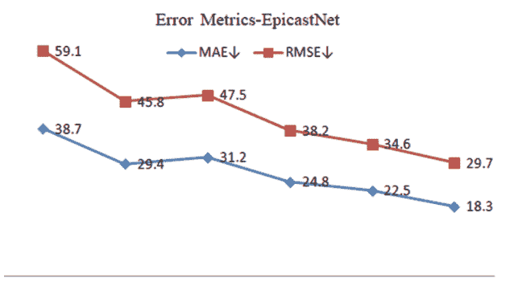

图 2：误差指标 – EpiCastNet。

图 2 基于两个重要的误差指标（MAE 和 RMSE）评估了不同预测模型的性能。该图形直观地支持，EpiCastNet 优于常规模型和深度模型（即 ARIMA、LSTM、Prophet、静态 GNN 和 Transformer）。EpiCastNet 表现出最低的 MAE（18.3）和 RMSE（29.7），表明预测精度和可信度更高。然而，ARIMA 记录了最高的误差（MAE：38.7，RMSE：59.1），LSTM 和 Prophet 紧随其后。模型性能始终在提升，Transformer 和静态 GNN 优于传统技术。结果证实了 EpiCastNet 在减少预测误差方面的有效性，并推断其在预测具有挑战性的任务方面具有强大的能力。

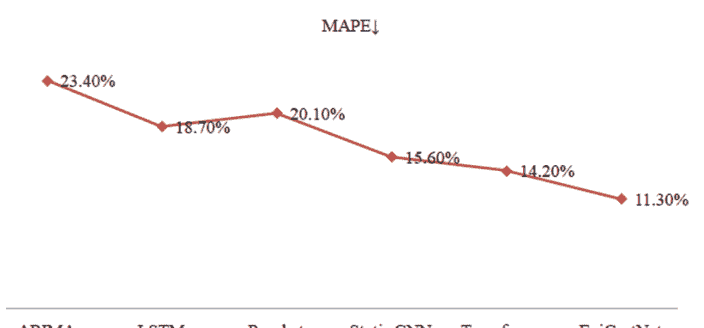

图 3：MAPE 分析 – EpiCastNet。

图 3 显示了不同预测模型之间的 MAPE 趋势，其中较低的值表示更好的性能。这种趋势体现在从简单模型到高级模型 MAPE 逐渐降低。ARIMA 表现出最高的误差，为 23.40%，其次是 Prophet（20.10%）和 LSTM（18.70%），这意味着它们的预测精度较低。其他高级模型，如静态 GNN（15.60%）和 Transformer（14.20%），能够获得更好的预测准确性。EpiCastNet 显示出最佳的 MAPE 值 11.30%，这反映了所有测试模型中最佳、最精确的预测。这凸显了 EpiCastNet 在减少相对预测误差方面的有效性。

表 2：时间与空间表现。

| 模型 | ALT（天）↑ | IoU（空间精度）↑ |
|---|---|---|
| ARIMA | 1.8 | 0.41 |
| LSTM | 3.4 | 0.52 |
| Prophet | 2.9 | 0.49 |
| Static GNN | 4.1 | 0.60 |
| Transformer | 4.7 | 0.63 |
| EpiCastNet | 6.2 | 0.72 |


表 2 总结了各种疫情预测模型在 ALT 和 IoU 作为关键评估指标方面的时间和空间准确性。表现最好的模型是 EpiCastNet，其绝对峰值 ALT 为 6.2 天，即它可以提前超过 6 天进行预测，为公共卫生响应提供有用的领先时间。它还具有最大 IoU 0.72，能更精确地识别受影响地区。相比之下，ARIMA、LSTM 和 Prophet 等其他模型的预测提前量和空间准确性较短，而基于深度学习的模型（如 Transformer 和静态 GNN）则实现了显著的性能改进。EpiCastNet 高质量的时间和空间预测在疫情预测中尤其有价值，能够实现更早、更有效的干预，并将医疗资源高效部署到疫情发生地。

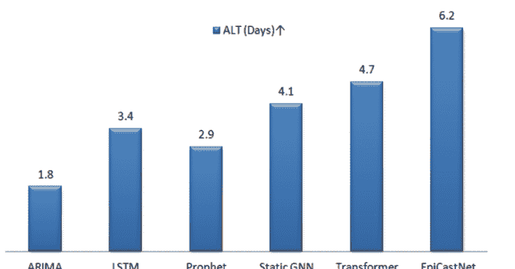

图 4：ALT 分析 – EpiCastNet。

图 4 显示了各种预测模型的 ALT（天），数值越大表示预测能力越强。在所有被比较的模型中，EpiCastNet 达到了最高的 6.2 天 ALT，因此具有更强的未来预测能力。基于 Transformer 的模型（ALT = 4.7 天）和静态 GNN（ALT = 4.1 天）表现相似，ARIMA（1.8 天）和 Prophet（2.9 天）等更传统的方法也是如此。LSTM 网络表现居中，ALT 为 3.4 天。总体而言，研究结果表明，基于深度学习和图的模型在更远期预测方面表现更好，EpiCastNet 在此次比较中表现最佳。

图 5 展示了各种预测模型使用 IoU 指标的空间准确性比较。较高的 IoU 值表示预测事件的空间准确性更高。在大多数被考虑的模型中，EpiCastNet 获得了最高的 IoU 值 0.72，表明其在空间建模方面表现最佳。Transformer 和静态 GNN 模型在空间准确性方面也取得了成功，分别报告了 0.63 和 0.60 的 IoU 分数，表明部署了深度学习和图架构的模型在捕捉空间关系方面表现更好。相反，ARIMA（0.41）和 Prophet（0.49）等基本模型在空间准确性方面表现较低，LSTM 表现中等，报告的 IoU 分数为 0.52。这些发现强调了使用精巧建模方法来实现精确空间预测的迫切需求。

表 3：AQI 分析 – EpiCastNet。

| 模型 | 真阳性警报 (TPA) | 假阳性 (FP) | 假阴性 (FN) | AQI (↑) |
| :--- | :--- | :--- | :--- | :--- |
| ARIMA | 15% | 30% | 55% | 0.56 |
| LSTM | 35% | 25% | 40% | 0.67 |
| Prophet | 28% | 22% | 50% | 0.61 |
| Static GNN | 42% | 18% | 40% | 0.71 |
| Transformer | 48% | 15% | 37% | 0.75 |
| EpiCastNet | 58% | 12% | 30% | 0.80 |

表 3 展示了 AQI 性能结果，量化了每个模型通过在真实和虚假疫情通知之间取得平衡来充当预警系统的能力。最高 AQI 0.80 表明 EpiCastNet 实现了最佳整体性能。它具有 58% 的 TPA 性能，即能够在疫情发生前正确检测到大多数疫情爆发，且假阳性率（12%）和假阴性率（30%）较低。这不仅表明触发早期预警的高可靠性，还表明误报和未检测到疫情的情况较少。相比之下，ARIMA 和 Prophet 等旧模型表现较差，TPA 百分比较低（15% 和 28%），假阴性百分比较高（55% 和 50%），相应的 AQI 分数也较低（0.56 和 0.61）。Transformer 和静态 GNN 等 DL 模型提供了更好的平衡，AQI 分数分别为 0.75 和 0.71，表明早期检测更好，误报更少。

### AQI (↑)

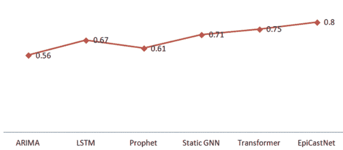

图 6：EpiCastNet：AQI 分析。

图 6 展示了不同预测模型类型的比较性能，基于其正确预测 AQI 的能力，分数越高表示性能越好。ARIMA 表现最差，得分为 0.56，因为它无法捕捉复杂的 AQI 模式。LSTM 表现非常好，得分为 0.67，因为它能够轻松捕捉时间模式。Prophet 虽然可以捕捉季节性和趋势，但落后于 0.61。静态 GNN 通过学习空间关系优于基准模型，达到 0.71。基于 Transformer 的模型通过有效捕捉时间序列数据中的长程时间依赖性，进一步提升至 0.75。得分最高的模型是 EpiCastNet，得分为 0.80，展示了时空建模和多模态融合集成的优势。趋势是，通过采用更精密的架构，模型能够学习与 AQI 预测相关的空间和时间特征，从而不断改进。

## 5 讨论

EpiCastNet 的疾病流行实时预测相比 ARIMA、LSTM 和 Prophet 等传统模型进了一大步。将时空数据与 GNN 和 TCN 融合，提供了一个强大且动态的模型，用于识别疫情传播的空间和时间模式。自适应在线学习模块使 EpiCastNet 能够适应疾病趋势的变化，帮助在正确时机进行干预的预警系统。处理数据中的异质性和不确定性可能是疾病预测模型面临的最大挑战。EpiCastNet 通过整合医疗记录、社交媒体和环境数据等不同来源的数据来解决此问题，从而提供更全面、更及时的数据集。多源融合增强了模型，使其能够最优地响应公共卫生状态的变化。此外，EpiCastNet 提供的空间精度和预见时间对于需要在新出现疫情时快速响应的公共卫生从业者来说尤其有价值。模型性能在很大程度上仍取决于输入数据的可用性和质量，尤其是社交媒体和流动性数据等非传统来源。尽管前景广阔，但在将模型部署到实时环境中时，必须密切关注伦理和隐私问题，尤其是在访问敏感健康数据时。它将采用联邦学习和差分隐私等技术来简化这一过程，但要大规模安全且合乎伦理地实现，还需要做更多工作。

## 6 结论

EpiCastNet 是实时公共卫生监测的一项进步。结合时空建模、自适应在线学习和多源数据融合，它能够提供高度准确且实时的疾病爆发预测。通过结合 GNN 和 TCN，该模型可以理解疫情传播的复杂性，并与 ARIMA 和 LSTM 等标准模型相比，提供空间和时间准确性。能够提前 6.2 天预测爆发并以 0.72 的 IoU 识别爆发，使 EpiCastNet 成为卫生当局的一个非常有用的工具，因为它使他们能够提前进行预防性干预，并最大限度地优化资源分配。此外，模型高达 0.80 的 AQI 表明其能够以非常低的误报率提供及时和准确的预警。尽管模型在测试用例中表现良好，但由于数据质量、可扩展性以及需要不断更新以适应不断演变的疾病模式，在实际应用中面临挑战。尽管如此，EpiCastNet 为下一代疫情预测系统提供了一条良好的路径，这些系统具有预测性、准确性、自适应性和可解释性，并可以在支持全球卫生系统适应未来改进的健康危机方面发挥作用。

## 7 未来工作

虽然 EpiCastNet 在疾病流行预测中表现最佳，但就增强模型的实用性和效用而言，应研究和构建的领域包括数据质量和整合。在从数据中受益的同时


源异质性，模型性能取决于拥有近乎实时的高分辨率社交媒体数据以及流动性数据。未来研究可以尝试改进数据收集过程，采用更有效的数据插补方法和更有效的算法来处理噪声或缺失数据。需要改进的另一个特性是可扩展性。虽然EpiCastNet在受控环境下表现良好，但从计算复杂度和处理实时数据的角度来看，将其扩展到覆盖巨大的地理区域或整个地球是困难的。可以利用更高效的架构，或许使用边缘计算或分布式学习，来提高模型的可扩展性并以更快的速度处理大容量实时数据。

此外，可以通过结合其他更先进的可解释性和可说明性方法来增强EpiCastNet，以便公共卫生决策者更好地了解预测是如何做出的。这将增强信任并实现更明智的决策。最后，研究实时监控的隐私问题并开发隐私保护方法（例如联邦学习）对于确保在模型部署到现实环境时妥善处理敏感医疗数据至关重要。

## References

- [1] Dash, S., Giri, S. K., Pani, S. K., Mallik, S., Wang, M. & Qin, H. (2024). 针对实时大流行病数据预测的优化混合深度学习：长期和短期视角. *当前生物信息学*, 19(8), 714–737.
- [2] Munday, J. D., Rosello, A., Edmunds, W. J. & Funk, S. (2024). 实时预测埃博拉疫情的空间传播：比较数学模型和专家的预测. *medRxiv*, 2024.03.
- [3] Orang, A., Berke, O., Poljak, Z., Greer, A. L., Rees, E. E. & Ng, V. (2024). 预测加拿大季节性流感活动——为公共卫生准备比较季节性自回归移动平均和人工神经网络方法. *人畜共患病与公共卫生*, 71(3), 304–313.
- [4] Jain, S., Agrawal, S., Mohapatra, E. & Srinivasan, K. (2024). 一种新型ARIMA-LSTM集成方法用于评估COVID-19病例和未来爆发准备情况. *健康护理科学*, 3(6), 409–425.
- [5] Liu, Z., Wan, G., Prakash, B. A., Lau, M. S. Y. & Jin, W. (2024). 疫情建模中图神经网络综述. 在*第30届ACM SIGKDD知识发现与数据挖掘会议论文集*中（第6577–6587页）.
- [6] Rafee, S. M., Pratheekshah, H. N., Agitha, W., Saravanan, M. & Subbulakshmi, R. (2025). 用于公共卫生监测中疾病爆发预测的时空图卷积网络. *信息科学*, 28, 10.
- [7] Rodriguez, A., Kamarthi, H., Agarwal, P., Javen, H., Patel, M., Sapre, S. & Prakash, B. A. (2024). 数据驱动型疫情预测的机器学习. *自然机器智能*, 6(10), 1122–1131.
- [8] Chhabra, A., Singh, S. K., Sharma, A., Kumar, S., Gupta, B. B., Arya, V. & Chui, K. T. (2024). 用于疫情疾病预测和分析的可持续智能时间序列模型. *可持续技术与创业*, 3(2), 100064.
- [9] Soto-Ferrari, M., Carrasco-Pena, A. & Prieto, D. (2025). EpiForecaster：一种用于结合新兴疫情爆发预测的新型深度学习集成优化方法. 随机环境研究与风险评估, 39(2), 675–695.
- [10] Olanyian, O. T., Adetunji, C. O. & Adeyomoye, O. (2024). 大流行病和疫情爆发预测. 发表于《健康技术与信息学》（第58–66页）. CRC Press.
- [11] Barman, M., Panja, M., Mishra, N. & Chakraborty, T. (2025). 结核病爆发时空预测的疫情引导深度学习. arXiv预印本 arXiv:2502.10786.
- [12] Kraemer, M. U. G., Tsui, J.-H., Chang, S. Y., Lytas, S., Khurana, M. P., Vanderlott, S., Bajaj, S. 等. (2025). 用于传染病流行病建模的人工智能. 自然, 638(8051), 623–635.
- [13] Yin, Y., Ahmadiafar, I., Karim, F. K. & Elmannai, H. (2024). COVID-19疫情高级预测：利用集成模型、高级优化和分解技术. 生物医学计算机, 175, 108442.
- [14] Asghar, M., Anwar, N., Hassan, M. & Saleem, K. (2024). 基于机器学习的COVID-19患者预测模型. 拉合尔要塞大学计算机科学与信息技术研究杂志, 8(2).
- [15] Xue, D., Wang, M., Liu, F. & Buss, M. (2024). 使用深度迁移学习进行疫情传播过程的时间序列建模与预测. 混沌、孤子与分形, 185, 115092.
- [16] Qiu, M., Tan, Z. & Bao, B.-K. (2024). MSGNN：用于疫情预测的多时空尺度图神经网络. 数据挖掘与知识发现, 38(4), 2348–2376.
- [17] El Morr, C., Ozdemir, D., Asdaah, Y., Saab, A., El-Lahib, Y. & Sokhn, E. S. (2024). 基于人工智能的流行病和大流行病早期预警系统：系统范围综述. 健康信息学杂志, 30(3), 14604582241275844.
- [18] Zhu, X., Zhang, Y., Ying, H., Chi, H., Sun, G. & Zeng, L. (2024). 使用基于图注意力的时空网络建模疫情动态. Plos one, 19(7), e0307159.
- [19] El Morr, C., Ozdemir, D., Asdaah, Y., Saab, A., El-Lahib, Y. & Sokhn, E. S. (2024). 基于人工智能和大流行病早期预警系统：系统范围综述. 健康信息学杂志, 30(3), 14604582241275844.
- [20] Mao, J., Han, Y., Tanaka, G. & Wang, B. (2024). 基于骨干的动态时空图神经网络用于疫情预测. 基于知识的系统, 296, 111952.
- [21] Su, H., Hu, J., Yu, S., Liu, J. & Qin, X. (2024). 用于少样本故障时间序列预后的连续模型无关元学习. 神经计算, 595, 127879.
- [22] Chen, Q., Zheng, X., Shi, H., Zhou, Q., Hu, H., Sun, M., Xu, Y. & Zhang, X. (2024). 中国福州流感爆发预测：预测模型比较分析. BMC公共健康, 24(1), 1399.

S. Padmalal, P. Arumugam, M. Baby Anusha, Kalyan Devappa Bamane, Nagendar Yamsani, and Kireet Mupavaram

# 用于慢性疾病早期检测的机器学习：糖尿病预测案例研究

### 摘要

糖尿病等慢性疾病的早期检测对于早期治疗和有效管理非常重要。本章描述了一种基于临床结构化数据预测糖尿病风险的机器学习（ML）方案，并在PIMA印第安糖尿病数据集上构建了一个案例研究。该方案涵盖了整个ML流水线：问题制定、数据预处理、特征选择（FS）、模型训练、验证和部署问题。采用了包括缺失值插补、异常值检测和特征归一化在内的不同预处理技术来提高数据质量。利用了相关性分析、递归特征消除和基于领域知识的选择等FS技术，以降低数据维度并提高模型可解释性。在逻辑回归（LR）、随机森林、支持向量机和XGBoost等广泛使用的分类模型之间进行了广泛比较。建议采用LR、RF、SVM和XGBoost的堆叠集成模型，在准确率、精确率、召回率和\( F_1 \)分数方面表现更好。研究结果证实，ML具有巨大潜力，可作为一种不显眼、数据驱动且可扩展的医生决策支持系统，实现早期糖尿病诊断。这为在现实医疗环境中进一步开发可临床应用的人工智能预测模型奠定了基础。

### 关键词

糖尿病预测, 机器学习, 堆叠集成模型, 逻辑回归, 随机森林, 支持向量机, XGBoost

**S. Padmalal**, 计算机科学与工程系，Mangalam College of Engineering, Mangalam Hills, Ettumanoor, Kottayam, Kerala, India, e-mail: splaaj71@gmail.com
**P. Arumugam**, 统计系，Manonmaniam Sundaranar University, Abishekapatti, Tirunelveli 627012, Tamil Nadu, India, e-mail: sixfacemsu@gmail.com
**M. Baby Anusha**, 计算机科学与工程系，Lakireddy Bali Reddy College of Engineering, L.B. Reddy Nagar, Mylavaram, Krishna 521230, Andhra Pradesh, India, e-mail: anusha.medisetty@lbrce.ac.in
**Kalyan Devappa Bamane**, 计算机工程系，D.Y. Patil College of Engineering, Akurdi, Pune, India, e-mail: kdbamane@dypcoeakurdi.ac.in
**Nagendar Yamsani**, 计算机科学与人工智能学院，SR University, Warangal 506371, Telangana, India, e-mail: nagendar.yamsani@gmail.com
**Kireet Mupavaram**, GITAM Deemed to be University, Hyderabad, India, e-mail: kireet04@gmail.com


## 1 引言

慢性疾病，尤其是糖尿病（DM），是主要的公共卫生问题之一 [1]。在此背景下，早期诊断是疾病管理的基石，因为早期发现使临床医生能够妥善治疗，有时甚至可以避免和预防严重并发症，如心血管疾病、神经系统问题、肾脏疾病和视网膜病变。尽管如此，糖尿病在其早期阶段隐匿且通常无症状的特性往往导致检测延迟，凸显了对智能和计算机化诊断算法的迫切需求 [2]。

当前的机器学习（ML）[3] 和深度学习（DL）技术为医疗诊断提供了一种革命性的技术。ML 模型能够扫描大量患者数据，检测出使用常规统计方法可能难以辨别的不可见模式和相关性。利用 ML 进行糖尿病早期检测为支持医生进行临床决策提供了一种充满希望的解决方案。通过自动风险分层和实时预测，此类系统有可能简化诊断流程、改善患者预后并减轻临床医生的负担。此外，ML 驱动的系统提供可扩展性和一致性，这在资源匮乏的医疗环境中至关重要，特别是在专科医疗难以获得的发展中国家 [4]。

本章以结构化方式介绍了基于临床数据的糖尿病端到端 ML 风险预测流水线。一个完整的案例研究构建在 PIMA 数据集上，这是医疗数据科学研究中广泛使用的流行且成熟的数据集 [5]。该流水线涵盖 ML 开发的所有关键阶段：问题制定、预处理、特征工程、模型构建、评估以及针对实际应用的部署考虑。在本工作中，数据驱动的干预措施促进糖尿病早期检测的可能性变得可行，并为将人工智能（AI）集成到初级保健模型中奠定了基础。

该研究涉及一些从结构化临床数据中学习的 ML 算法，旨在解决将糖尿病风险分类为糖尿病或非糖尿病的二元分类问题。该研究采用了 PIMA 数据集，其中包括多个相关的临床和人口统计参数，如血糖、血压、BMI、胰岛素、妊娠次数、年龄以及一个表示糖尿病谱系的函数。这些特征通常在标准健康筛查中记录，因此结果通常具有可推广性和临床实用性 [6]。

该研究考虑了 ML 开发过程的几个方面，从数据的密集预处理开始。临床数据中发现的缺失值通过适当的插补技术进行处理。检测并处理了异常值以提高数据质量，并使用了归一化以使特征具有相同的尺度，这是特征大小敏感模型的关键考量。该工作还讨论了各种特征选择（FS）方法，如相关性分析 [7]、递归特征消除（RFE）[8] 和基于医学领域知识的选择。

流行的分类器，如逻辑回归（LR）[9]、随机森林（RF）[10]、支持向量机（SVM）[11] 和 XGBoost [12] 都进行了训练和比较以评估性能。使用了传统的性能指标，如准确率、精确率、召回率和 F1-score，来比较各个模型。除了单个分类器外，还通过结合 LR、RF、SVM 和 XGBoost 预测创建了一个堆叠集成模型。堆叠方法旨在发挥每个模型的优势，并以最小化各自弱点的方式将它们融合在一起。性能表明，堆叠模型是最为整体高效的模型，因此非常适合在诊所中应用。

虽然前景广阔，但本研究仍存在一些局限性。其中一个主要局限性是数据集的特点。尽管 PIMA 数据集很受欢迎，但样本数量相对较小（768 个样本），且仅涉及特定人群亚组（21 岁及以上的女性）。因此，该模型无法在不同人群、种族群体和年龄组之间推广。为了开发更强大、更具泛化性的模型，未来的研究必须包含具有不同地理和人口基础的更大规模、多样化的数据集。

这项工作的主要驱动力是日益加重的糖尿病负担，以及对主动、可扩展的诊断技术的紧迫需求。此外，由于获取、意识和成本障碍，世界上很多人口仍未被诊断。ML 能够通过提供低成本的数据驱动诊断支持系统来实现这一点，这些系统可以集成到远程医疗、移动应用或电子健康记录中。第二个原因是认识到现有诊断方法的局限性，这些方法主要依赖于单一生物标志物的切断水平，例如空腹血糖浓度。它们无法捕捉众多生理参数之间的多维关系，并且容易出现假阳性和假阴性。本研究旨在利用这一潜力，设计一个健壮、可解释且高性能的预测系统，该系统可以轻松集成到医疗基础设施中。本研究的贡献包括以下几点：

- 提出了一个从数据预处理到部署的 ML 工作流，专门使用 PIMA 数据集来估计糖尿病风险。
- 采用了多种 FS 方法，评估了几种分类模型，并推荐了一个在关键性能指标上优于单个模型的堆叠集成模型。
- 展示了基于 ML 的临床决策支持系统（DDSs）的可行性，并通过解决实际部署问题为实际应用奠定了基础。

后续章节的组织如下：第 2 章介绍了使用 ML 框架进行糖尿病预测的相关工作。第 3 章介绍了 ML 流水线，涉及数据预处理、FS 和堆叠集成模型的构建。第 4 章介绍了模型评估的实验结果和主要发现。第 5 章总结了研究，第 6 章提供了改善临床相关性的未来方向。

## 2 相关工作

本节探讨了用于早期糖尿病预测的先进集成学习（EL）方法。通过新颖、非侵入性和免费的方法，以在临床环境中促进及时干预并改善患者预后，这种类型的研究通过整合异构的 ML 和 DL 模型，在诊断性能、可解释性和临床实用性方面展现了革命性的进步。

### 2.1 用于糖尿病预测的 BiLSTM 增强型两阶段集成

提出了一种新的两阶段集成方法，它将长短期记忆网络（LSTM）和双向 LSTM（BiLSTM）模型与特征选择（FS）相结合，以准确预测糖尿病。在第一阶段，多个 LSTM/BiLSTM 基础学习者在动态采样的特征子集上进行训练，以增强模型多样性。然后，基础预测由元学习者结合，以生成最终的稳定输出。模拟实验表明，在适中的 FS 比率下获得良好的泛化性能，而高比率会导致过拟合。在三个真实基准数据集和 PIMA 数据集上进行了实际世界测试。早期糖尿病风险预测的性能高于传统模型（如 RF 和 SVM）以及最近出现的混合模型。在恰当校准的形式下，它记录了 100% 的准确率、99.1–100% 的 AUC 和 0.006 或更低的 Brier 分数。BiLSTM 在所有试验中均优于单向 LSTM，特别是在敏感性方面，这解释了其在捕捉复杂时间关系方面的优势 [13]。

### 2.2 带过采样的堆叠集成方法

糖尿病诊断过程采用四个基于集成的堆叠模型进行，并基于表现最佳的模型开发了 Web 界面。它使用了包含 768 份患者数据的糖尿病数据集，该数据集已在 Python 中进行预处理。为了处理类别不平衡问题，数据被分为四组，并采用过采样方法按比例划分数据。随后，平衡后的数据进行交叉验证，以获取稳健的模型训练和校准。七个单个 ML 模型被用作基础学习者，并构建了四个堆叠集成模型，混合了这些算法，试图提高预测性能。每个模型的性能均按常用性能指标进行评估。在所有集成模型中，堆叠 1A（带过采样的 LR）表现最佳，准确率为 91.5%。在 ROC 曲线中，堆叠 1A（LR）、堆叠 2A（RF）和独立 RF 分类器是其中表现最好的，最大值为 97%。发现糖尿病诊断准确率


当使用与过采样堆叠的集成模型时，与使用独立分类器相比，性能大幅提升。将表现最佳的模型集成到具有易于使用界面的 Web 界面中，进一步提升了其在诊所中的潜在应用，作为一种廉价且易于使用的早期糖尿病诊断设备。它强调了集成学习（EL）与数据平衡方法在构建智能医疗系统中的重要性 [14]。

### 2.3 糖尿病预测专家系统

利用集成机器学习技术，开发了一种用于诊断 II 型糖尿病的专家系统，II 型糖尿病是一种在大多数国家普遍存在的致命疾病。其目的是调查并比较不同的分类方法，以正确判断一个人是否患有糖尿病。考虑了 15 个分类器，其中五种主要方法为：ANN、SVM、KNN、NB 和集成方法。集成学习（EL）利用许多不同模型具有互补优势的事实，提高了准确性并最大限度地减少了多数投票误分类。研究涉及来自不同地区的 400 名参与者，共 10 个生理特征，其中 5 个为数值型，5 个为名义型。集成方法优于单个分类器，准确率高达 98.60%。这清楚地表明，模型组合在提供增强预测方面具有强大优势。采用了一个简单的图形界面，用户输入 10 个特征即可实时预测糖尿病。该系统可作为临床决策支持系统（DSS）实现，帮助医疗专业人员早期、准确地诊断糖尿病。通过及时观察，它有助于改善患者预后和治疗方案，并证明了集成学习（EL）在医疗诊断中的有效性 [15]。

### 2.4 用于早期糖尿病检测的超级学习者模型

为早期诊断糖尿病（DM，一种快速增长的全球健康问题）设计了一种超级集成学习（EL）模型。传统诊断耗时且昂贵，但集成机器学习方法提供了更快速、更经济的解决方案。该新模型称为超级学习者，基于交叉验证，结合一组机器学习算法的预测结果，以提高准确性。超级学习者模型结合了四个基础学习器——LR、DT、RF 和梯度提升——并使用 SVM 作为元学习器进行组合。该模型在三个数据集上进行了性能测试。超级学习者模型获得了良好的准确性指标：早期糖尿病数据为 99.6%，PIMA 数据为 92%，130 家美国医院数据为 98%。结果优于单个基础学习者，证明了超级学习者模型在实际应用中的能力和实用性。该研究总体上展示了超级学习者算法在支持糖尿病早期、准确和广泛检测方面的能力 [16]。

### 2.5 混合深度集成糖尿病预测

糖尿病是一个关键的全球健康问题，因此对先进的预测技术的需求与日俱增，以提供早期准确的检测。在本研究中，比较了一系列机器学习和深度学习算法的预测准确性，旨在基于全面的临床和人口统计数据集预测糖尿病的发生。最初尝试了 DT、RF、KNN 和 XGBoost 等传统机器学习分类器，发现基于集成的方法在预测准确性方面表现优异。为获得更好的预测性能，评估了基于深度学习的模型，如简单 DNN、CNN 和 RNN。虽然这些模型在识别正确实例方面被发现很有用，但它们在整体分类准确性上超越集成方法的能力并未实现。该项工作最相关的结果是开发了一个深度学习元学习者，结合了 RF 和梯度提升模型的预测。该方法实现了近乎完美的准确性，展示了将深度学习的特征提取能力与集成方法的高模式识别能力相结合的力量。结果证实了混合模型在糖尿病预测中的应用，并为前沿医学信息学以及支持医疗专业人员提供及时、个性化的护理提供了一个鼓舞人心的替代方案 [17]。

### 2.6 用于早期糖尿病预测的先进集成建模

随着糖尿病发病率的上升，有必要创建标准和及时的预测模型，特别是针对可能具有特定风险因素的女性。提出了一种强大的深度机器学习模型集成，用于识别糖尿病的早期阶段，为医生提供高效工具，以实现早期诊断并改善患者结局。选择了一些功能强大的分类器，例如带有提升算法的 RF，作为堆叠集成模型的基础学习者，因为它们具有高预测精度。在训练模型之前，对数据集进行了大量预处理，以实现最佳性能和鲁棒性。所提出的集成模型达到了 92.91% 的准确率，这与当前糖尿病预测程序非常接近，在某些情况下甚至更优。该研究还应用了 SHAP 来使模型可解释，并获得了有意义的信息。这种解释对于建立临床信心和了解糖尿病风险预测因子将非常重要。总体而言，本研究的结果可能对医疗保健提供者、研究人员、学生和利益相关者有用，可为他们提供一个可解释且有效的预测模型。所有这些进步都将有助于实现早期干预规划，增强个性化患者护理，并最终在临床中改善糖尿病控制 [18]。

### 2.7 用于精确糖尿病预测的 CatBoost 增强集成模型

糖尿病是一个严重的全球健康问题，正在通过基于多种机器学习算法的非常复杂的预测模型来解决。该模型使用 LR、SVM、朴素贝叶斯和 RF 等通用算法，以及包括提升和袋装方法在内的积极集成方法。这些集成方法汇集了不同的基础学习者，以提高预测的精度和稳定性。基于真实的 Kaggle 数据集并使用 Python 编码，模型性能采用准确率、灵敏度和混淆矩阵进行评估。在所有尝试的集成技术中，CatBoost 取得了最高的准确率 95.4%。结果反映了集成学习（EL），尤其是 CatBoost，在提供稳定且准确的糖尿病预测以帮助早期诊断和更好患者护理方面的效率 [19]。

### 2.8 基于 EGG 的 II 型糖尿病预测

糖尿病，尤其是 II 型，已成为一个严重的全球健康问题，在印度移民人群中患病率很高。II 型糖尿病的增加或多或少是由于生活方式、老年期和饮食习惯改变造成的。为了满足早期可靠诊断的迫切需求，本研究提出了一种基于电胃图（EGG）信号的新型无创方法。该研究使用三电极 EGG 记录系统，记录 50 至 65 岁糖尿病患者和健康患者的 EGG 信号。使用复杂的人工智能方法对获得的数据进行处理，以获取能够区分糖尿病和非糖尿病 EGG 痕迹的重要特征。该研究涉及使用可解释人工智能，即 SHAP，以提供模型预测的可解释性，并在特征选择（FS）优化中使用元启发式算法。所提分类器与 RF 和常规 XGBoost 等常规模型进行了批判性对比和比较。实验结果表明，所提模型的最大分类准确率为 95.8%，最大灵敏度为 100%，特异性为 92.3%。该研究证实，所提分类器结合可解释人工智能和稳健特征选择，是一种有效、可理解且实用的基于 EGG 信号的早期 II 型糖尿病诊断方法。它对于实时无创医疗筛查非常有前景，尤其是在易感人群中 [20]。

### 2.9 鲁棒集成糖尿病预测框架

糖尿病在发展中国家仍然是一个主要的公共卫生问题，晚期诊断导致的死亡率不断上升。由于过拟合、欠拟合和噪声数据等问题，常规机器学习模型表现不佳。上述问题的限制已通过应用并行和序列 ensem-


用于提高诊断准确性的具有额外严格特征选择的集成机学习技术。UCI 机学习库中的 PIMA 数据集被用作模型构建的基础。预处理包括通过列均值插补和前向及后向特征选择来处理缺失值。该研究包含两个设计步骤。初始步骤是构建 J48、CART 和决策树桩等 RF 分类器模型。在第二步中，使用了 XGBoost、AdaBoost 和梯度增强等序列集成算法，并通过平均投票算法对其输出进行平均以获得分类。该研究提供了一个高度精确且可信的糖尿病预测模型，可以帮助医疗保健专业人员做出更快、基于数据的决策，从而实现更早的干预并可能挽救生命 [21]。

所提出的研究表明，集成方法可以提高糖尿病预测的准确性。通过采用从简单分类器到高度复杂的深度神经网络的多样基学习者集成，它们克服了类别不平衡、特征困难和过拟合等常见问题。使用 SHAP 等可解释性工具以及易于开发的界面也增强了其临床可用性。包括堆叠集成、超级学习者和混合架构在内的表现最佳的模型表明，集成方法可以轻松超越单个分类器。最后，这些进步引入了强大、可扩展且可解释的工具，以实现糖尿病医疗管理中的早期诊断和个性化治疗。

## 3 方法学

糖尿病的日益增长的全球趋势尤其在皮马印第安妇女中显现，因此应强调早期和充分检测方法的紧迫性。利用广泛使用的 UCI 机学习库 PIMA 数据集，本文在适当机学习方法的帮助下建立了一个成功的预测模型。预处理过程是必要的，应涉及缺失值替换、异常值和特征缩放，以使模型更加现实。FS 技术和像 LR、RF、SVM 和 XGBoost 这样的集成技术被堆叠到一个框架中。这种结构提高了可预测性，现在有可能在糖尿病早期诊断中做出及时且基于证据的临床决策。本病例研究探讨了使用机学习方法利用患者健康数据早期预测糖尿病。

### 3.1 数据集描述

皮马印第安人糖尿病数据集是收集自 768 名 21 岁以上女性患者的健康相关数据。该数据集通常用于分类问题，即根据一系列医学特征预测患者是否患有糖尿病（1）或未患病（0）。数据集中有八个属性，这八个特征提供了患者总体健康状况的印象，可用于生成糖尿病诊断的预测模型 [22]。

### 3.2 数据预处理

预处理是开发用于糖尿病预测的稳健且准确机学习模型的重要步骤。数据集中主要特征（如胰岛素和 BMI）可能包含缺失值或零值，如果不进行处理，可能导致有偏分析。此类异常值或缺失值主要通过插值方法（如通过中位数进行零替换或 KNN 插值 [23]）来处理。此外，还使用四分位距或 Z-score 等方法移除异常值，以找出并删除对模型训练有害的极端值。为了保持相同数量级的特征，使用 min-max 缩放或 StandardScaler 等标准化或归一化技术将所有值归一化到同一数量级。此外，如果数据集中存在一些分类变量（例如性别），则使用 one-hot 编码或 label 编码将类别转换为数值，以便输入机学习算法。通过结合这些预处理程序，模型从数据中提取更具洞察力的模式。

### 3.3 特征选择/特征工程

在糖尿病预测问题中，FS 和特征工程对于提升模型性能和降低复杂性至关重要。包括皮尔逊或斯皮尔曼相关性在内的统计分析可以检测目标变量与输入特征之间的线性或单调相关性。与结果高度相关的特征（例如 BMI 或葡萄糖与糖尿病状态）将被保留，而彼此之间高度相关的特征可以被移除，以消除冗余和多重共线性。

RFE 是一种 FS 包装器方法，它根据指定估计器（例如 RF 或 LR）的性能反复移除不那么重要的特征。通过按特征重要性排序并逐步移除效果最差的特征，最终优化模型的输入空间，从而最小化最佳预测器 [24]。领域知识被整合，尤其是在医疗数据集中。即使对糖尿病有证明影响的具有临床重要性的特征在统计上不显著，也会被考虑在内。这确保了模型仍然贴近医学，并且对医生来说仍然可解释。

此外，在处理高维数据的场景中，可以使用降维技术。它们将原始特征转换为少量保留大部分方差或最大化类可分性的组件。

### 3.4 分类模型

早期发现糖尿病是一个非常严肃的过程，目的是避免严重健康问题并提供及时的医疗护理。在本研究中，尝试建立一个机学习模型，根据血糖、BMI、胰岛素、血压、年龄和其他类似健康因素的组合来识别患者是否患有糖尿病。该预测模型旨在帮助医疗从业者在严重症状出现之前筛选高风险个体，从而做出基于证据的决策。该问题已被表述为一个分类问题，模型将预测两个类别中的一个：糖尿病（阳性）或非糖尿病（阴性）。这种表述允许应用现有的分类技术来根据给定数据决定糖尿病的存在。

#### 3.4.1 提议的堆叠模型

用于糖尿病预测的提议堆叠框架使用异构机学习模型，以利用各自的优势并获得增强的整体性能。这里使用了三个学习者：LR、RF 和 SVM。LR 可以检测临床变量与糖尿病易感性之间的线性关联，并提供更高的可解释性。RF 作为一种集成决策树，适合建模强特征交互并对噪声具有鲁棒性。SVM 在存在边界的数据集中表现良好，即使对于非线性边界，也能通过识别最佳分离超平面来发挥作用。然后将这些模型的预测组合并呈送给元学习者（通常是 XGBoost），它对其预测进行求和并学习如何最好地改进它们。XGBoost 非常适合结构化医疗数据，因为它高度准确且抗过拟合。这种堆叠配置很好地平衡了简单性、复杂性和泛化性，因此极其适合从临床数据预测糖尿病的任务。图 1 指定了用于分类的堆叠模型。

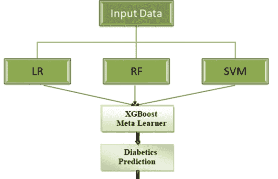

图 1：堆叠模型。

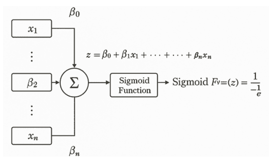

图 2：逻辑回归模型。

#### 3.4.2 逻辑回归

凭借其估计二元目标可能性的能力，LR 是一个线性分类框架，可用于预测一个人是否患有糖尿病。它创建一个 sigmoid 形状的函数，表示输入特征


图 1：堆叠模型。


图 2：逻辑回归模型。

和目标的对数几率之间的关系。当特征与目标之间存在线性关联时，LR 简单、易于理解且有效 [25]。图 2 描绘了 LR 模型。

计算输入特征的线性组合是 LR 的初始步骤：

```
z = \(\beta_0 + \beta_1 x_1 + \beta_2 x_2 + \cdots + \beta_n x_n = \beta^T x\) \quad (1)
```

在等式 (1) 中，\(x = [x_1, x_2, \dots, x_n]\) 是输入特征，\(\beta = [\beta_0, \beta_1, \dots, \beta_n]\) 是系数，\(\beta_0\) 是截距（偏置项）。

sigmoid 函数用于将线性输出 z 减小到 0 到 1 之间的概率值：


P(y = 1|x) = σ(z) = 1 / (1 + e^-z)

模型使用阈值（通常为0.5）来预测类别标签：

ŷ = { 1, if σ(z) ≥ 0.5; 0, if σ(z) < 0.5 }

为训练模型，按以下方式减少日志损失（交叉熵）：

L(β) = -1/m Σ [y^(i) log(ŷ^(i)) + (1 - y^(i)) log(1 - ŷ^(i))]

其中m是训练样本数量，y^(i)是真实标签，ŷ^(i) = σ(β^T x^(i))

#### 3.4.3 随机森林

RF由在数据和特征随机子集上训练的多个DT组成[26]。RF可避免过拟合并提高准确度和稳定性，因此在医疗预测任务中表现出色。数据集如下所示：

D = [(x1, y1), (x2, y2), ..., (xm, ym)]

RF构建T个DT：

h1(x), h2(x), ... hT(x)

在每棵树的分裂处，只考虑随机选择的特征而非所有特征。对于分类（例如，糖尿病或非糖尿病），每棵树ht(x)预测类别标签。最终预测是多数投票：

ŷ = mode({h1(x), h2(x), ..., hT(x)})

对于回归，每棵树预测一个数值输出，结果是所有树的平均值：

ŷ = 1/T Σ ht(x)

树通常在每个节点使用基尼不纯度来确定最佳分裂：

Gini = 1 - Σ p_i^2

其中C表示类别数量，pi是节点中类别i的样本比例。选择不纯度最低的分裂。由于每棵树采用随机采样，大约三分之一的数据被排除（袋外数据）。无需使用交叉验证，这些即可用于衡量模型性能。图3显示了用于糖尿病预测的RF。

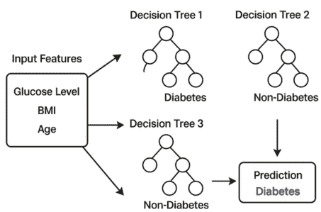

图3：用于糖尿病预测的RF模型。

#### 3.4.4 支持向量机（SVM）

SVM是一种有效的分类器，通过最大化类别间的边界来确定类别分离的最优超平面。使用核函数（例如RBF核），SVM甚至可以处理非线性相关性，并且在高维数据上表现良好。SVM在大型数据集上计算成本可能较高，但对于类别边界明确且对异常值稳健的数据集表现良好[27]。对于二分类，假设数据如下所示：

```
D = \{(x_i, y_i)\}_{i=1}^m, x_i \in \mathbb{R}^n, y_i \in \{-1, +1\}
```

SVM试图找到一个超平面

```
W^Tx + b = 0
```

这样一来，两个类别之间的差异被最大化。边界为2/||w||。目标是最小化

```
\min_{w, b} \frac{1}{2} ||w||^2
```

受约束条件限制

```
y_i(W^T x_i + b) \ge 1, \forall i
```

$$ \min_{w, b, \xi} \frac{1}{2} ||w||^2 + C \sum_{i=1}^m \xi_i $$

受约束

$$ y_i(W^T x_i + b) \ge 1 - \xi_i, \xi_i \ge 0 $$

在等式(14)中，C是正则化参数。

SVM使用核K(x_i, x_j)将输入特征映射到更高维空间以处理非线性数据，而无需直接计算变换。常用核函数如下所示：

$$ K(x, z) = x^T z \, (\text{线性}) $$

$$ K(x, z) = (X^T z + 1)^d \, (\text{多项式}) $$

$$ K(x, z) = \exp \left( - \frac{||x - z||^2}{2\sigma^2} \right) \, (\text{RBF}) $$

训练后，对新输入x的分类如下：

$$ f(x) = \text{sign} \left( \sum_{i=1}^m \alpha_i y_i K(x_i, x) + b \right) $$

在方程中，\((\alpha_i)\)是拉格朗奇支持向量权重。

#### 3.4.5 梯度提升（例如，XGBoost）

这是一种集成方法，按顺序依次构建模型，使得每个后续模型都改进前序模型的错误[28]。XGBoost是一种计算高效的变体，因其具有良好的正则化特性以防止过拟合而受到许多人的青睐，并且它能够学习复杂的非线性关系。它在结构化/表格数据（如医疗记录）上经常可以达到最佳效果。考虑具有输入特征X的数据集

$$ X = \{x_1, x_2, \dots, x_n\} $$

对应的Y标签为

$$ Y = \{y_1, y_2, \dots, y_n\} $$

目标是为每个实例x_i预测\(\hat{y}^{(t)}\)。迭代t时的预测为

```
\hat{y}^{(t)} = \sum_{k=1}^t f_k(x_i), f_k \in F
```

其中$f_k$是预测函数，$t$是当前迭代。用于最小化正则化损失的目标函数如下所示：

```
L^{(t)} = \sum_{i=1}^n l(y_i, \hat{y}_i^{(t)}) + \sum_{k=1}^t \Omega(f_k)
```

其中$l$是可微损失函数，$\Omega(f_k) = \gamma T + \frac{1}{2} \lambda ||w||^2$是用于惩罚复杂度的正则项。正则化参数为$\gamma$和$\lambda$，叶节点权重为$w$，叶节点数量为$T$。XGBoost在每次迭代中使用二阶泰勒展开近似损失：

```
L^{(t)} \approx \sum_{i=1}^n \left[ g_i f_t(x_i) + \frac{1}{2} h_i f_t(x_i)^2 \right] + \Omega(f_t)
```

此处，$g_i$和$h_i$如下所示：

```
g_i = \frac{\partial (y_i, \hat{y}_i)}{\partial \hat{y}_i} \quad h_i = \frac{\partial^2 (y_i, \hat{y}_i)}{\partial \hat{y}_i^2}
```

接下来，模型确定可最小化此估计目标的$f_t$。

## 4 结果与发现

在完成数据预处理和特征选择（FS）后，进行模型训练和验证。数据首先分为测试集和训练集。

80/20划分（80%的数据用于训练模型，20%用于测试）可能是最常用的方法。

为改进模型，使用GridSearchCV或RandomSearchCV技术进行超参数调优。GridSearchCV遍历固定超参数列表，而RandomSearchCV从给定范围中随机采样超参数。

这两种过程都有助于确定最佳模型参数，从而实现整体改进。

训练后用于评估模型性能的一些最重要的评估指标如下所示。

- 准确率：正确预测数除以所有预测数。它是一个简单的指标，但在不平衡数据集中可能具有误导性：

    ```
    \text{Accuracy} = \frac{(TP + TN)}{(TP + FP + TN + FN)}
    ```

- 精确率：所有正预测中真阳性的比例。当假阳性代价高昂时（例如，非糖尿病患者被误诊为糖尿病），这一点很重要：

  \(\text{Precision} = \frac{\text{TP}}{\text{TP} + \text{FP}}\) (26)

- 召回率：所有真阳性中被正确识别的比例。当假阴性代价非常高昂时（例如，未检测出糖尿病患者），这一点很重要：

  \(\text{Recall} = \frac{\text{TP}}{\text{TP} + \text{FN}}\) (27)

- F1分数：召回率和精确率的调和平均数，两者权重相等，特别适用于不平衡数据集：

  \(F1\text{-score} = \frac{2 \text{ * Precision * Recall}}{\text{Precision + Recall}}\) (28)

表1：堆叠集成模型——性能分析。

| 方法 | 准确率 | 精确率 | 召回率 | F<sub>1</sub>分数 |
|---|---|---|---|---|
| LR | 0.78 | 0.76 | 0.73 | 0.74 |
| DT | 0.74 | 0.72 | 0.70 | 0.71 |
| RF | 0.84 | 0.82 | 0.81 | 0.81 |
| SVM | 0.81 | 0.80 | 0.78 | 0.79 |
| XGBoost | 0.87 | 0.85 | 0.84 | 0.84 |
| 堆叠集成模型 | 0.89 | 0.87 | 0.86 | 0.86 |

表1展示了堆叠集成模型的性能分析。

LR是二分类任务（如糖尿病分类）的不错基线模型。在所有病例中，其准确率为0.78，大多数情况下预测正确；其精确率0.76和召回率0.73表明，在糖尿病和非糖尿病病例分类方面相对平衡。其可读性、简单性和低计算开销使其成为需要可解释性的诊所场景中的合适选择，但在存在复杂非线性关系时可能会失效。

DT模型的准确率为0.74，低于其他算法。其精确率（0.72）和召回率（0.70）也显示出泛化能力不足，在小型数据上容易过拟合，这是合理的，但鉴于其基本的决策规则和良好的可视化性，它仍然是一种有用的方法，在需要模型可解释性的医疗环境中是很好的属性。

RF是一种使用多个DT的集成分类器，其准确率提高到0.84，精确率（0.82）和召回率（0.81）均衡。它较不容易受到


比单个决策树更不容易过拟合，并通过对众多树的结果进行平均来实现。它在复杂数据集上表现良好，并被普遍认为是结构化临床数据的金标准。

SVM 的准确率为 0.81，F1 分数为 0.79。SVM 在高维空间中表现良好，且在类别之间存在良好分隔边界时效果不错。尽管支持向量机通过核函数处理非线性边界时具有鲁棒性，但由于其计算成本和可解释性问题，在大规模或实时临床应用中较不适用。

XGBoost 是表现最好的基础模型，在所有基础模型中准确率为 0.87，F1 分数最高为 0.84。其处理复杂非线性交互并利用正则化技术的能力，使其最适合医疗预测任务。XGBoost 计算效率高且可扩展，因此也是医疗分析中研究与生产环境的良好选择。

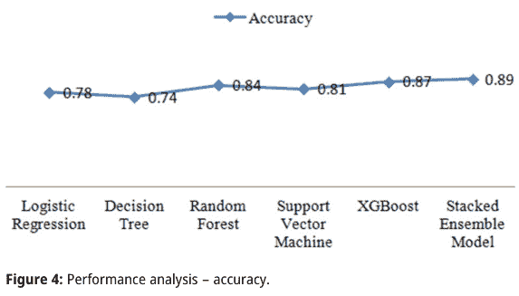

堆叠集成模型受益于多个基础模型（如 XGBoost、RF 和 SVM），准确率为 0.89，精确率为 0.87，召回率为 0.86，F1 分数为 0.86，提供了最佳的整体性能。该方法通过整合不同算法的不同视角来消除个体模型的弱点，从而增强预测能力。因此，堆叠模型是糖尿病早期诊断中最佳且最精确的模型，但可能需要更多计算能力和周密设计。

图 4 展示了用于糖尿病预测的不同机器学习算法的精确率。精确率低于逻辑回归（0.78）的是决策树（0.74），因为其存在过拟合或泛化能力不足的问题。随机森林（RF）的精确率更高（0.84），因为应用了集成方法，仅次于支持向量机（0.81）。XGBoost 也表现显著更好，达到 0.87，展示了梯度提升在识别微妙模式方面的强大能力。堆叠集成模型达到最高精确率 0.89，证明了堆叠不同模型以发挥其相对优势的价值。总体而言，该图展示了一个明确的趋势：集成

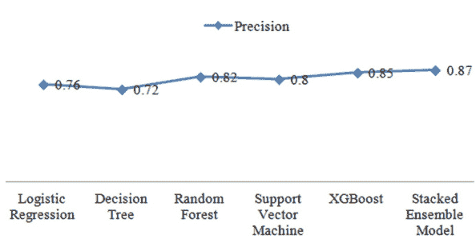

图 5：性能精确率 – 准确率。


图 6：性能召回率 – 准确率。

图 5 是各种机器学习算法正确预测糖尿病阳性患者的精确率的图形表示。逻辑回归的精确率从 0.76 开始，而决策树下降到 0.72，意味着更高的假阳性率。随机森林将精确率提升至 0.82，意味着阳性预测的准确率更高。支持向量机位居第二，精确率为 0.80，意味着性能稳定。XGBoost 达到峰值精确率 0.85，表明其能够消除假阳性。堆叠集成模型达到峰值精确率 0.87，表明其在利用每个模型的优势以实现更准确的阳性分类方面的价值。上升图表的斜率验证了集成模型（即堆叠模型）在糖尿病预测中的准确率远高于单个学习器。


图 7：性能分析 – F1 分数。

图 6 表明各模型分类实际糖尿病病例的效果，值越高表示假阴性越少。逻辑回归的召回率为 0.73，紧随其后的是决策树的 0.70，两者在正确分类阳性病例方面均居中等水平。随机森林明显更好，达到 0.81，意味着灵敏度更高。支持向量机回落至 0.78，但仍保持竞争力。XGBoost 的召回率显著提升至 0.84，表明其能精准识别阳性病例。堆叠集成模型以 0.86 的召回率名列第一，显示出在识别糖尿病患者方面具有最高的精确率。总体而言，该图展示了整体提升，集成模型（尤其是堆叠）在提升糖尿病检测模型精确性方面发挥着关键作用。

图 7 说明了所有模型的召回率-精确率权衡，尤其是在假阳性和假阴性最为严重的临床诊断中。决策树的 F₁ 分数相对较低，为 0.74，而逻辑回归落后于后者，为 0.71，这意味着分类的召回率-精确率权衡相对较差。随机森林将该分数提升至显著更好的 F₁ 分数 0.81，随后是支持向量机的 0.79 F₁ 分数。XGBoost 进一步延续了性能改进的趋势，达到 0.84 F₁ 分数。堆叠集成模型在所有单独模型中表现最佳，F₁ 分数为 0.86，表明其在提供精确率和召回率平衡方面具有最高能力。相对于各模型的这一改进证实了集成方法在糖尿病预测分类整体强度提升方面的效率。

### 4.1 部署

在获得令人满意的模型性能后，部署是使现实世界临床应用成为可能的最后一步。一种常见做法是使用 Flask 或 Streamlit 构建 Web 界面，允许临床医生输入患者详细信息并接收糖尿病风险的实时预测。为了更集成的使用，模型可以通过 REST API 在医院的电子健康记录（EHR）系统中投入生产，以便预测可用于临床工作流。为了长期可靠性，需要对模型进行监控，以便随时间监控新患者数据上的性能，从而发现数据漂移或因人口统计变化导致的准确率下降等问题。这种持续的反馈循环允许模型更新，并保持系统在临床上的实用性和一致性。

在医疗保健（特别是糖尿病预测）中实施机器学习技术时，应遵循机器学习伦理，以实现安全可靠的应用。信息隐私也是首要关注点，因为患者信息必须按照美国的 HIPAA 或欧盟的 GDPR 等规则进行处理。这些模型需要包含安全的数据存储、已获同意的数据以及严格的访问控制，以保护机密健康数据。此外，还必须解决公平性和偏差问题，以便模型在所有人群类别（即年龄、性别和种族）上都能表现良好。如果不检查偏差，将导致推荐不平等的治疗或误诊，从而不成比例地对脆弱人群产生负面影响。为了帮助解决这一问题，公平性指标需要在模型开发过程中进行监控，并且需要使用具有代表性的多样化数据集来训练和验证模型。伦理部署不仅能建立信任，还符合医疗保健的根本使命：为所有患者提供安全、有效和公平的护理。

## 5 结论

该研究展示了机器学习增强早期糖尿病检测的能力，这是管理慢性疾病的重要组成部分。通过使用有序医疗数据（如 PIMA 数据集）以及适当的预处理、特征提取和模型评估流程，该研究开发了一个强大的分类流水线，能够有效地分类糖尿病和非糖尿病患者。跨算法性能比较表明集成模型具有稳定性，因为所提议的堆叠模型实现了更高的预测准确率和泛化能力。应用准确率、精确率、召回率和 F1 分数等经典性能指标确保了公平的模型评估，而 ROC-AUC 和混淆矩阵分析则提供了更高粒度的洞察。总体而言，机器学习通过可扩展、高效和精确的方法实现早期糖尿病预测，从而改善预防性护理和患者预后。该结构可作为模型用于创建类似的慢性疾病检测系统。

## 6 未来方向

尽管当前工作利用传统和集成机器学习方法在糖尿病预测中取得了令人满意的结果，但未来仍有一些方面需要考虑

扩展。其中之一是融入多模态数据，结构化特征与非结构化临床笔记、生活方式详情或可穿戴传感器读数相结合，以丰富患者档案。合并时间序列数据和纵向健康史也能够促进时间建模和进展预测，尤其有助于监测糖尿病前期情况。研究人员还可以选择使用深度学习模型，如LSTM或Transformer，尤其是在处理序列数据或电子健康记录时。模型可解释性也是一个重要领域；SHAP或LIME等技术可进一步利用，为临床医生和患者提供可解释的预测。另外，创建可在移动设备或边缘设备上部署的模型，可能为农村或医疗资源不足人群提供低资源实时筛查工具。从公平性和伦理角度看，未来研究应更加侧重于最小化偏差，以确保在年龄、性别、种族和社会经济地位方面具有公平的性能。隐私保护型机器学习机制，如差分隐私和联邦学习，也可以被探索，以开发更安全的以患者为中心的系统。最后，需要在广泛的人群和地理区域进行大规模临床试验和验证，以确立模型在实际环境中的泛化能力和效力。

## References

- [1] Jaiswal, V., Negi, A. & Pal, T. (2021). 基于机器学习的糖尿病预测的最新进展综述. Primary Care Diabetes, 15(3), 435–443.
- [2] Kee, O. T., Harun, H., Mustafa, N., Murad, N. A. A., Chin, S. F., Jaafar, R. & Abdullah, N. (2023). 机器学习糖尿病预测模型中的心血管并发症：一项系统综述. Cardiovascular Diabetology, 22(1), 13.
- [3] Khanam, J. J. & Foo, S. Y. (2021). 糖尿病预测机器学习算法的比较. Ict Express, 7(4), 432–439.
- [4] Febrian, M. E., Ferdinan, F. X., Sendani, G. P., Suryanigrum, K. M. & Yunanda, R. (2023). 基于监督机器学习的糖尿病预测. Procedia Computer Science, 216, 21–30.
- [5] Chang, V., Bailey, J., Xu, Q. A. & Sun, Z. (2023). 基于机器学习（ML）算法的Pima印度人糖尿病分类. Neural Computing and Applications, 35(22), 16157–16173.
- [6] Salih, M. S., Ibrahim, R. K., Zeebaree, S. R., Asaad, D., Zebari, L. M. & Abdulkaareem, N. M. (2024). 基于PIMA Indian数据集的机器学习糖尿病预测. Communications on Applied Nonlinear Analysis, 31(5s), 138–156.
- [7] Bhat, S. S., Ansari, G. A. & Ansari, M. D. (2025). 针对II型糖尿病的基于优化特征选择的机器学习性能分析. Multimedia Tools and Applications, 84(8), 4945–4964.
- [8] Magboo, C., Peter, V. & Magboo, M. S. A. (2021). 应用于II型糖尿病分类的机器学习插补技术与递归特征消除. 2021年第4届人工智能与云计算会议论文集, 201–207.
- [9] Rajendra, P. & Latifi, S. (2021). 使用逻辑回归和集成技术进行糖尿病预测. Computer Methods and Programs in Biomedicine Update, 1, 100032.
- [10] Gündoğdu, S. (2023). 使用带有RF特征选择技术的XGBoost分类器进行早期糖尿病的高效预测. Multimedia Tools and Applications, 82(22), 34163–34181.
- [11] Reza, M. S., Hafsha, U., Amin, R., Yasmin, R. & Ruhi, S. (2023). 基于PIMA数据集的改进非线性内核提升II型糖尿病预测的SVM性能：洞察. Computer Methods and Programs in Biomedicine Update, 4, 100118.
- [12] Hu, X., Hu, X., Yu, Y. & Wang, J. (2023). 使用XGBoost机器学习算法的妊娠糖尿病预测模型. Frontiers in Endocrinology, 14, 1105062.
- [13] Olaniran, O. R., Sikiru, A. O., Alhoribi, J., Alharbi, A. A. & Alharbi, N. M. (2025). 糖尿病预测的混合随机特征选择与循环神经网络. Mathematics, 13(4), 628.
- [14] Daza, A., Sánchez, C. F. P., Apaza-Perez, G., Pinto, J. & Ramos, K. Z. (2024). 糖尿病诊断的Stacking集成方法. Informatics in Medicine Unlocked, 44, 101427.
- [15] Sarwar, A., Ali, M., Manhas, J. & Sharma, V. (2020). 使用基于混合机器学习的集成模型诊断II型糖尿病. International Journal of Information Technology, 12, 419–428.
- [16] Doğru, A., Buyrukoğlu, S. & Arı, M. (2023). 糖尿病风险早期预测的混合超集成学习模型. Medical & Biological Engineering & Computing, 61(3), 785–797.
- [17] Airlangga, G. (2024). 协同机器学习：使用混合深度学习和集成模型增强糖尿病预测. Kesatria: Jurnal Penerapan Sistem Informasi (Komputer dan Manajemen), 5(3), 1396–1403.
- [18] Oliullah, K., Rasel, M. H., Islam, M. M., Islam, M. R., Wadud, M. A. H. & Whaiduzzaman, M. (2024). 糖尿病预测的堆叠集成机器学习方法. Journal of Diabetes & Metabolic Disorders, 23(1), 603–617.
- [19] Modak, S. K. S. & Jha, V. K. (2024). 使用机器学习技术的糖尿病预测模型. Multimedia Tools and Applications, 83(13), 38523–38549.
- [20] Alagumariaippan, P., Sathyamoorthy, M., Dhanaraj, R. K., Kamalanand, K., Emmanuel, C., Allabun, S., Othman, M., Getahun, M. & Soufiene, B. O. (2025). 使用心电图进行早期糖尿病预测的优化混合机器学习框架. Scientific Reports, 15(1), 8875.
- [21] Olorunfemi, B. O., Ogunta, A. O., Almogren, A., Adeniyi, A. E., Ajagbe, S. A., Bharany, S., Altaemeem, A., Rehman, A. U., Mehmood, A. & Hamam, H. (2025). 使用改进集成方法高效诊断糖尿病. Scientific Reports, 15(1), 3235.
- [22] Arun, G., Reddy, P. C. S., Budati, N., Rebecca, B., Perumalla, S. & Gujar, V. B. (2024). 糖尿病预测的深度学习框架：PIMA Indian数据集. 2024年创新计算、智能通信与智能电气系统国际会议（ICSES）（第1–6页）. IEEE
- [23] Alnowaiser, K. (2024). 使用KNN插值特征和三重集成模型改善糖尿病患者的医疗保健预测. IEEE Access, 12, 16783–16793.
- [24] Shantal, M., Alshareef, A. & Ahmid, O. (2024). 特征选择对糖尿病预测的影响. African Journal of Advanced Pure and Applied Sciences (AJAPAS), 373–377.
- [25] Rassiyanti, L., Farid, F. & Pitri, R. (2025). 使用逻辑回归模型的糖尿病风险预测. Desimal: Jurnal Matematika, 8(1), 41–50.
- [26] NoviYanti, C. N. & Alamsyah, A. (2024). 使用随机森林算法的糖尿病早期检测. Journal of Information System Exploration and Research, 2(1).
- [27] Sagar, K., Sk Imtiyaz, A. A., Nagaraju, A. S., Prasad, C. R. & Kumar, P. K. (2024). 使用支持向量机进行糖尿病预测. 2024年第5届新兴技术国际会议（INCET）（第1–4页）. IEEE
- [28] Xu, J., Chen, T., Fang, X., Xia, L. & Pan, X. (2024). 糖尿病患者ICU住院期间压力损伤发生预测模型-基于SHAP的可解释XGBoost机器学习模型. Intensive and Critical Care Nursing, 83, 103715.

Medha Sree Anand, Tanvir H. Sardar, Kumar Ayush, Ankita Bose, Mahendra Kumar Gourisaria, and Nirmala Venkatachalam

# 医疗保健中的机器学习技术

**摘要：** 本章全面探讨了机器学习（ML）在医疗保健生态系统中的变革性作用。随着现代医疗保健产生海量的多样化复杂数据——从医学影像和电子健康记录（EHRs）到基因组和生理时间序列——ML为提取可操作见解、支持临床决策和优化运营提供了强大的工具包。本章系统讨论了包括监督学习、无监督学习、强化学习、深度学习以及针对各种医疗保健数据模态量身定制的专门技术在内的关键ML范式。现实世界应用在诊断、预后、个性化治疗和医疗资源优化方面进行了考察。此外，本章还深入探讨了实际部署考量、伦理和监管挑战，以及AI系统与临床医生之间不断发展的协作角色。强调了模型可解释性、公平性、信任以及跨学科合作的必要性，以确保负责任的采用。通过弥合理论进步与临床实施之间的差距，本章为在医疗保健领域驾驭ML复杂性的研究人员、从业者和决策者提供了宝贵的指导。

**关键词：** 医疗保健中的机器学习，临床决策支持系统，电子健康记录（EHRs），深度学习，模型可解释性

## 1 引言：机器学习在医疗保健中的变革潜力

医疗保健格局正因电子健康记录（EHRs）、医学影像、基因组测序、可穿戴设备、行政索赔和 informat- 等无数来源的巨大进步而发生前所未有的变化。

Medha Sree Anand, Department of CSE, School of Engineering, Dayananda Sagar University, Bengaluru 562112, India, e-mail: medhasreeanand@gmail.com
Tanvir H. Sardar, Department of CSE, School of Engineering, Dayananda Sagar University, Bengaluru 562112, India, e-mail: tanvir-cse@dsu.edu.in
Kumar Ayush, Department of CSE, School of Engineering, Dayananda Sagar University, Bengaluru 562112, India, e-mail: kumarayushj23@gmail.com
Ankita Bose, Assistant Professor, GITAM University, Bengaluru, India, e-mail: abose@gitam.edu
Mahendra Kumar Gourisaria, School of Computer Engineering, KIIT Deemed to be University, Bhubaneswar 751024, Odisha, India, e-mail: mkgourisaria2010@gmail.com
Nirmala Venkatachalam, Department of Artificial Intelligence and Data Science, Easwari Engineering College, Chennai, Tamil Nadu, India, e-mail: Nirmala.research17@gmail.com

https://doi.org/10.1515/9783111541235-010


ics。此外，机器学习作为人工智能的一个子集，在模式识别、预测和复杂决策等科学领域已取得令人羡慕的进展，这发生在它还被视为科幻作品之前很久。海量医疗数据与更先进的机器学习算法的结合，带来了前所未有的机遇，可从疾病预防和诊断到个性化治疗及运营效率等方面，彻底变革健康服务的提供方式。传统分析方法曾一度证明有用，但很难揭示高维且异构的医疗数据集[1]中复杂的非线性关系。机器学习从数据中学习，无需显式编程，从而提供强大的手段来获得可操作的洞察和良好的预测能力，并随后通过基于证据的方法增强临床医生的决策过程。本章讨论了基本的机器学习技术：即迄今已使用或预计在医疗领域广泛采用的技术：它们的工作原理、潜在应用领域、存在的障碍以及未来发展。本文将描述机器学习领域从理论向实用、因此成为不可或缺工具的过渡，旨在实现更好的患者护理和可持续的医疗系统。研究人员、从业者和决策者必须了解应对在如此敏感领域部署人工智能所涉及的复杂伦理、监管和技术问题所采用的技术。机器学习的成功实施将需要技术能力，以及对临床背景、数据特征以及对患者和医疗服务提供者的影响的深刻认识。鉴于当今医疗数据的量庞且复杂，从简单的数值维护向自动化和智能分析转型是必要的，以便通过能够改变护理路径和公共卫生计划的预测性或处方性途径，充分发挥其全部价值。

## 2 机器学习核心范式及其与医疗数据的相关性

机器学习技术大致可分为几种范式，每种范式均适用于医疗领域中常见的不同问题和数据结构[2]。监督学习可以说是当前医疗应用中最普遍的范式，它涉及在标记数据集上训练模型，其中每个输入示例的预期输出都是已知的。这对于诊断（根据症状和检测结果分类患者状况，其中正确诊断即为标签）、预后（预测未来事件（如疾病进展或治疗反应）的可能性，结果即为标签）以及图像分析（识别医学图像中的异常，专家标注即为标签）等任务尤其有用。标准监督学习算法包括逻辑回归、支持向量机（SVM）、决策树、随机森林和梯度提升机。每种算法在可解释性、计算复杂性以及处理不同数据类型的能力方面都有其独特的优势和劣势。例如，逻辑回归提供可解释的系数，指示特征的影响，而像梯度提升这样的复杂集成方法通常能实现更高的准确性，但透明度较低。问题的性质通常指导监督学习算法的选择、数据集的大小和特征，以及对模型可解释性的需求。对于具有复杂交互作用的高维数据，可能更偏好集成方法或深度学习。相比之下，当透明度和易于理解至关重要时，逻辑回归或决策树等简单模型可能更合适。

相比之下，无监督学习处理未标记的数据，旨在在没有预定义输出变量的情况下发现数据中的隐藏模式、结构或关系[3]。这对于患者表型分析（根据临床特征将患者聚类为不同子群，以识别新的疾病亚型或反应模式）、异常检测（识别生理数据中可能指示不良事件的异常模式）以及降维（在保留关键信息的同时压缩高维基因组或蛋白组数据）等任务具有极高价值。k-means、层次聚类和DBSCAN等聚类算法常被用于患者分层。与此同时，主成分分析（PCA）和t分布随机邻域嵌入（t-SNE）等技术有助于可视化和简化复杂的生物数据集。无监督学习通常作为探索性步骤，提供可以为后续监督学习任务提供参考或生成新假设的洞察。在领域知识有限或目标是发现数据中此前未知模式的场景中，它非常有用，例如识别对治疗反应不同或表现出不同疾病进展轨迹的新患者子群。

强化学习是一种范式，其中代理通过与环境交互并接收奖励或惩罚来学习决策，对动态医疗场景具有巨大前景。这包括随时间优化治疗策略（例如，根据患者反应调整药物剂量）、开发智能机器人手术系统或管理医院资源分配。代理通过试错来最大化累积奖励信号，该信号可按患者预后、成本效益或治疗依从性来定义[4]。虽在广泛临床部署方面不如监督学习成熟，但强化学习在不确定性下处理序贯决策的能力，使其成为复杂动态医疗流程的强大工具。由于需要真实的模拟环境或精心设计的临床试验来容纳迭代学习过程，强化学习在医疗领域的应用通常面临挑战。然而，其优化复杂、时间依赖性干预措施的潜力巨大。

深度学习是机器学习的一个子领域，利用具有多层的人工神经网络（因此称为“深度”），已彻底改变了涉及复杂非结构化数据的任务


图1：医疗中的不同数据生成源。

图1显示了医疗中的不同数据生成源，如图像、文本和时间序列[5]。卷积神经网络（CNNs）在医学图像分析（例如，在视网膜扫描中检测糖尿病视网膜病变）等任务中已取得最先进的性能；而记忆网络非常适合分析序列数据，例如EHR轨迹、生理时间序列或临床笔记的自然语言处理。深度学习模型虽然强大，但通常需要大量数据进行训练，并且难以解释，这在受监管的医疗环境中构成了重大障碍，因为在该环境中理解预测的基础至关重要。结合不同机器学习范式的混合方法也越来越受到探索，以发挥每种技术的优势并解决医疗数据分析中多方面的挑战。深度学习的成功主要归功于其自动学习数据分层表示的能力，从原始输入中提取越来越抽象的特征，这对于图像和文本等复杂数据类型尤其有利，因为在这些类型中，手动特征工程既困难又耗时。

## 3 针对医疗数据模态的专用机器学习技术

由于各种健康数据以多种不同格式出现，分析任何此类格式都需要专门针对其规格定制的特殊机器学习技术。Sardar等人[6]指出，在这些研究不足的领域中，医学影像模态（如X光、CT扫描、MRI和病理切片）可以从深度学习中获益良多。CNN是处理图像的合适选择，因为它们能从原始像素中学习分层特征，直到指示疾病的模式。深度学习模型（如ResNet、Inception和U-Net）已被有效用于图像分类（例如将图像分类为癌性或良性）、目标检测（定位肿瘤或病变）以及图像分割（勾勒器官或异常）。迁移学习是处理缺乏足够标记医学图像数据的一种标准且非常高效的方法，即先在大型通用图像数据集（ImageNet）上训练的CNN在较小的医学图像数据集上进行微调。CNN自动学习相关图像特征的能力极大地推动了医学图像分析领域的发展，有助于支持更早、更准确的诊断。

电子健康记录（EHRs）虽然是丰富的信息来源，但其数据内容的混合性使其与众不同：结构化数据（如化验结果、生命体征和药物清单），而非结构化数据则作为医生的临床笔记和观察记录。这些极其强大的自然语言处理技术在从EHR的非结构化文本中提取有用信息方面发挥着不可估量的作用。命名实体识别可识别疾病、药物和操作等医学概念。相比之下，关系抽取可识别概念之间的关系，例如药物与为某特定病症开具处方之间的关系，而情感分析则评估患者笔记或临床医生笔记的情感。所有这些都有助于将非结构化文本转换为适合下游机器学习建模的结构化信息。RNN以及更先进的架构（如LSTM和GRU（门控循环单元））在应用于EHR数据时非常有用，因为这些模型可以考虑数据的序列性，例如基于患者病史预测未来事件或建模慢性疾病进展。更近期地，建模BERT和GPT等架构的Transformer网络正在部署于临床文本分析中，并在阐明临床叙事中上下文关系等更复杂的任务上表现出色[7]。


利用高通量测序以及其他分子技术获得的基因组和蛋白质组数据集具有高维特性，需要ML专用方法进行分析。该领域的任务包括与疾病风险相关的遗传变异、基于个体遗传构成的药理基因组学预测、根据基因表达特征确定的癌症亚型，以及潜在治疗靶点的识别。惩罚性回归（如Lasso、Ridge）通常用于特征选择，这可能涉及使用降维技术（如PCA和t-SNE）来可视化并降低噪声。凭借这些优势，图神经网络正在成为分析生物网络的强大工具，这些网络涉及研究复杂网络：蛋白质–蛋白质相互作用网络或基因调控网络已成为阐明疾病机制并揭示药物靶点可能性的可行方案。将基因组数据与临床数据相结合的多模态ML方法将开启真正的现代医学时代，届时患者将受益，因为系统将变得更加以患者为中心。

能够捕捉时间依赖性和模式的ML技术在处理时间序列数据（如可穿戴设备的连续生理监测或重症监护室（ICU）传感器数据）时是必需的。RNNs、LSTMs和GRUs最适合分析序列生理数据，以预测脓毒症发作、心脏骤停或患者病情恶化等事件[8]。隐马尔可夫模型也用于研究从观察到的时间序列数据中推断出的潜在但未观察到的状态，这有时有助于理解ICU中的疾病进展或患者状态。在这方面，时间序列预测技术涉及未来生理测量值的预测，从而促进主动临床干预。可穿戴时间序列的分析同样面临诸多挑战，即数据质量问题、数据不完整以及实时处理要求。表1提供了不同医疗数据模态的专用ML技术摘要。

表 1: 不同医疗数据模态的专用ML技术。

| 数据模态 | 关键ML技术 | 特定应用 |
|---|---|---|
| 医学影像学习，包括图像分类、分割和解释 | CNNs，迁移学习，分割 | 肿瘤检测，糖尿病视网膜病变筛查，病理学 |
| EHR文本 | NLP（命名实体识别，关系抽取，情感分析），RNNs，LSTMs，Transformers | 图像分析，临床笔记中的信息提取，表型提取，从临床叙事中预测结果 |
| 基因组/蛋白质组数据 | 惩罚性回归，PCA，图神经网络 | 疾病风险预测，药物反应预测，癌症亚型分型，靶点识别 |
| 时间序列（生理） | RNNs，LSTMs，GRUs，HMMs，时间序列预测 | 生命体征异常检测，疾病进展建模 |

## 4 临床实践中的应用：转变诊断、预后和治疗

ML将通过提供既能补充人类专业知识又能改善患者预后的工具，在许多环境中颠覆临床实践。ML模型越来越多地被转化为决策支持工具，协助放射科医生和病理医生识别细微干扰，而非完全依赖人工检查。它们可以快速筛选成千上万张图像，并为专家审核标记可疑区域，从而提高效率并可能降低诊断错误。深度学习模型在从乳腺X线摄影中检测乳腺癌早期阶段、识别结肠镜检查过程中拍摄的图像中的息肉，以及从视网膜扫描中诊断糖尿病视网膜病变方面已表现出高度准确性。这些工具并非旨在排除临床医生；它们将使临床医生能够使用更先进的分析技术，同时将专业知识集中在复杂病例上，并最终改善工作流程[9]。

ML在主动和个性化患者管理的风险预测和预后方面取得了重大进展。通过分析包括患者人口统计学、病史、实验室结果和基因组信息在内的各种患者数据，ML模型可能预测个体患慢性疾病（如糖尿病或心血管疾病）的风险、出院后再住院的可能性，以及癌症或心力衰竭等病症患者的预后。临床医生可以利用这些信息，尽早确定高发病风险人群以便进行早期干预，实施个性化预防策略，并根据预测的疾病轨迹为个体提供针对性治疗。例如，ML正在用于确定重症监护中发生脓毒症可能性最高的患者，以便及早进行检测和治疗，从而大大提高生存率。

从定义上讲，个性化医疗是根据涉及的患者特定特征定制医疗保健，这一医疗实践中长期追求的目标[10]。个性化医疗的梦想由ML实现。它提供适合处理遗传、基因组、分子和临床病史数据的模型，以预测患者对不同药物或治疗干预类型的反应概率。这些信息使医生能够为患者选择最佳治疗方案，最大限度地减少不良药物反应的发生，并优化治疗效果。例如，ML可以预测最有可能对免疫治疗/靶向药物产生反应的癌症患者，评估依据是肿瘤的分子特征。这种治疗管理正在从“one-size-fits-all”的治疗策略转向对每个患者更精确、更个性化的方法，同时考虑每位患者独特的生物学和临床特征。

ML不仅用于诊断和治疗，还用于更有效地监测和管理患者。例如，可穿戴或远程传感器生成的数据通常由ML分类器使用，这些分类器将指示健康状况恶化的早期迹象、患者对治疗的依从性，并提供个性化反馈。具体而言，针对糖尿病和心力衰竭等慢性病患者的连续监测或AI赋能的洞察，可以帮助主动管理病情并发症，从而提高他们的生活质量。例如，最新的ML发展包括智能药物管理系统的创新，这些系统将利用患者服药依从性，并预测药物相互作用发生率的潜在增加[11]。

## 5 运营效率和公共卫生应用

ML除了直接患者护理外，还影响医疗保健生活的许多领域，例如医疗运营和公共卫生。医疗运营非常复杂且资源密集，ML可以消除整个行政和物流流程中的许多瓶颈。例如，预测患者何时可能不会赴约，使临床医生能够优化排程并最大限度地减少资源浪费。具体而言，ML可以分析任何历史预约数据以及患者的人口统计和环境因素，以识别最可能不赴约的患者，并通过提醒电话或提供排程灵活性进行主动干预。

ML将大有裨益的另一个领域是优化医院资源、人员配置、床位管理和设备利用率的分配。基于对患者入院、住院时间和特定服务需求的预测，上述预测可以大大帮助医院管理人员做出良好的资源分配决策，将资源及时投入到需要的地方。这确保了缩短等待时间、改善患者流动以及更好地利用昂贵资源，例如在预测ICU病床需求方面的经验，这可以帮助医院更好地管理其容量[12]。

医疗保健欺诈检测是一项重大挑战。它每年造成数十亿美元的损失，而ML正好派上用场，因为这些AI技术（尤其是异常检测算法）可以轻松快速地识别账单数据、索赔提交和提供商行为中的可疑模式，这些模式可能表明欺诈违法行为。因此，通过简单分析海量交易数据，ML模型可以怀疑少数索赔并将其标记为后续跟进和调查；这种能力将帮助医疗保健付费方和政府机构打击欺诈和滥用行为。


### 图 2：医疗健康生态系统中机器学习的多样化应用

机器学习技术为疾病监测、疫情预测和公共卫生干预打开了强大的可能性。机器学习模型观察来自电子健康记录（EHRs）、实验室报告、社交媒体和环境传感器的数据，以发出疾病爆发的早期信号、追踪其地理传播并预测趋势。此类信息将使公共卫生官员能够就资源分配、疫苗接种运动和其他干预措施做出尽可能好的决策，以最大限度地减少疫情爆发的影响 [13]。已提出基于机器学习的方法，根据 Google 搜索和社交媒体趋势研究流感和其他传染病。此外，机器学习还可应用于识别特定健康状况的高风险人群，从而利用针对这些人群的公共卫生计划/干预措施来解决健康差异并改善人群健康结局。机器学习还可以分析社会健康决定因素数据，以深入了解影响健康的非临床因素，从而制定更具包容性的公共卫生策略，达到最佳效果。图 2 展示了医疗健康生态系统中机器学习多样化应用的视觉盛宴。

## 6 驾驭复杂性：医疗健康领域的数据挑战

尽管前景广阔，但将机器学习技术应用于医疗健康面临着巨大的数据相关挑战，为成功且合乎伦理地实施此类技术，必须考虑这些挑战。固有的复杂性、多样性，以及跨各种系统和机构有时非常分散的环境，构成了医疗健康数据的特征。例如，电子健康记录（EHRs）既包括结构化数据类型（例如，化验结果、生命体征），也包括非结构化数据类型（例如，临床记录、放射学报告），其编码、术语和数据录入实践常常不一致。从各种来源（EHRs、成像系统、基因组数据库、可穿戴设备和患者报告的结局）汇集信息是一项非常艰巨的任务，需要精巧的数据协调、清洗和链接方法，以创建用于训练模型算法的统一且可用的数据集。数据格式标准化并不常见，且存在旧系统加剧了数据集成挑战，这意味着准备数据进行分析通常需要投入大量的人力和领域知识 [14]。

由于患者信息敏感，数据隐私和安全已成为医疗健康领域的重大问题。患者数据的收集、存储、访问和使用受到美国 HIPAA 和欧洲 GDPR 的严格监管。大多数机器学习训练需要大型数据集，与其他机构或外部研究人员共享数据会带来重大的隐私风险。正在探索在保护患者机密性的同时允许协作模型训练的方法，例如数据匿名化、去标识化、差分隐私和联邦学习。联邦学习允许在不同机构的数据上进行本地模型训练，而仅共享和聚合模型更新，从而保持敏感数据的去中心化。然而，即使采用这些技术，再识别的风险仍然是一个主要问题，这强调了仔细考虑保护隐私的方法以及强大的数据治理框架可用性的重要性。

偏见对医疗健康数据构成了另一大威胁，如果被忽视，可能会导致不公平甚至歧视性的结果。在有偏见的数据上训练的机器学习模型可能既会维持又会放大现有的健康差异。来源可能很多，包括训练数据中人口群体代表性不足、影响跨人群数据收集的系统性差异，以及历史数据中存在的诊断和治疗决策的内在偏见 [15]。在医疗健康机器学习模型中识别和消除偏见需要严格的数据审计、公平意识的机器学习算法，以及针对不同患者亚组的彻底审查，以确保性能平等。在健康领域部署有偏见的人工智能系统可能会产生严重的伦理和社会后果，因为它会加剧医疗可及性和护理质量方面的现有健康不公。解决偏见需要一套全面且多方面的策略，包括多样化的数据收集、算法公平性技术，以及在现实世界条件下持续评估模型表现。

几乎每个医疗健康数据集都存在缺失值问题，因为一些记录可能不完整，预约经常被错过，且临床工作流可能有所不同。对缺失数据进行适当处理至关重要。忽略任何带有缺失数据的记录的天真方法会导致高度有偏见的模型和宝贵信息的丢失。有多种插补方法，包括相对简单的均值插补或中位数插补，以及稍微复杂一些的基于模型的方法，但方法的选择很重要，因为它深刻地影响模型性能和有效性。此外，在医疗健康方面，时间依赖性是另一个特征，因为病情和治疗会随时间变化。来自 EHRs 或可穿戴设备的时间序列数据必须通过能够建模序列模式和依赖关系的专用机器学习技术进行分析，例如循环神经网络或隐马尔可夫模型。健康和疾病不断变化的挑战，与简单的静态模型相比，提出了构建能够学习和预测时间变异变化的机器学习系统的问题。另一个问题是机器学习模型的可解释性，尤其是可能计算复杂的深度学习模型。在医学中，从业人员必须理解模型为何做出某个预测或建议，才能信任并充分利用基于人工智能的系统。在临床实践中，黑盒模型通常不被信任，尽管它们可能很准确，因为问责制和解释决策基础至关重要。因此，通过 SHAP（SHapley additive explanations）和 LIME（local interpretable model-agnostic explanations）对医疗健康机器学习模型进行解释，越来越受到重视，以便为临床医生提供建模洞察 [16]。

## 7 确保信任与可靠性：模型评估与解释

在医疗健康领域成功部署机器学习模型不仅仅取决于技术性能。医疗健康领域模型使用的一个关键方面在于临床用户的信任和解释。鉴于假阳性和假阴性的情况被假定为临床事件，医疗健康领域机器学习模型的度量仍需要超越简单准确率的更多指标。例如，在诊断任务中，假阴性（漏掉存在的疾病）通常比假阳性（错误识别不存在的疾病）要糟糕得多。

因此，全面评估的广度和深度还需要敏感性、特异性、阳性预测值和召回率等指标。有一些综合度量指标显示了模型在不同分类阈值下的性能分数，例如受试者工作特征曲线下面积（AUROC）和精确率-召回率曲线下面积（AUPRC）。它们最常用于不平衡数据集，这类数据集在医疗健康领域很常见；例如，检测罕见疾病，因为 AUPRC 被认为比 AUROC 更具信息量。

临床验证比统计指标更重要，是一个重要阶段，用于确定机器学习模型在真实世界医疗健康环境中（面对多样化的患者群体和临床运营流程）的工作效果。它通常涉及前瞻性研究，将人工智能系统与临床实践中当前的人类专家进行效率比较。例如 FDA 等监管机构正在制定医疗人工智能设备验证和批准的框架，强调有关安全性和有效性的良好证据，这通常将包括他们要求临床试验在目标人群中证明疗效和安全性的数据类型。健康数据和临床实践的这种动态特性，使得对已部署机器学习模型进行持续监测和重新校准成为必要。这基本上是为了确保性能不会随治疗方案变化导致的数据分布转移而随时间降低。建立强大的上市后监测系统对于识别潜在问题并确保人工智能系统可靠部署至关重要 [17]。

模型可解释性是一个新兴的研究领域，也是机器学习在医疗健康领域获得接受的重要因素。这被理解为对临床医生很重要，以便他们能够看到人工智能为何会推荐或预测某事，并在决策过程中采用它，同时让机器承担责任，并建立患者的信任。虽然此类黑盒系统承诺高准确性，但它们往往无法满足临床工作流的需求，而临床工作流需要透明度和理由。可解释性方法可大致分为两大类：内在可解释性和事后可解释性。内在可解释性涵盖使用本质上可理解的模型（如树或线性模型）的方法；事后可解释性涉及应用旨在解释复杂模型预测的技术。事后方法包括特征重要性研究、部分依赖图、代理模型，以及 SHAP 和 LIME 等技术。这些技术有助于揭示哪些输入特征最有可能影响模型对患者的预测。提供可解释的解释将引发临床医生对模型输出的批判性评估，从而识别可能的错误或偏见，并建立对人工智能系统作为可靠工具而非神秘神谕的信心。所需的可解释程度将取决于临床应用的类型：通常，诊断和治疗计划等高风险决策需要比行政自动化任务更多的透明度。此外，模型可解译-


能力有可能识别数据或模型本身中的偏见，这最终有助于构建更公平的人工智能系统 [18]。

## 8 伦理、监管和社会维度

将机器学习应用于医疗保健，开启了一个充满深刻伦理、监管和社会困境的领域，必须以积极主动和反思性的方式加以应对。从伦理角度来看，首要问题是确保公平和公正，使机器学习模型不会基于种族、社会经济地位、性别或其他受保护属性而复制或加剧现有的健康差距。歧视性算法行为源于带有偏见的训练数据，从而导致对某些患者群体提供非最优的护理，或将其他群体排除在有益干预之外 [18]。在使用公平机器学习模型时，应对数据收集、偏见检测、缓解策略以及跨不同患者亚群体的公平评估进行审慎审查，以评估公平性能表现。算法公平性是当前研究的一个课题，同时伴随着一系列公平性定义以及专门为减少预测偏见而设计的算法机制。

透明度和问责制是重要的伦理考量 [19]。当人工智能系统影响患者健康时，了解该决策是如何作出的，以及在出现错误或不良结果时谁应承担最终责任，同样至关重要。某些机器学习模型复杂的“黑盒”特性使得归属问责变得困难。因此，关于医疗AI的开发、验证、部署和监测以及在现有法律和伦理框架下的责任，需要明确的指导。知情同意至关重要；这意味着应告知患者AI在其医疗中被使用的时间、其角色和局限性，包括出错或偏见的潜在风险。AI在临床决策中的干预知情同意过程复杂，要求临床医生与患者之间进行清晰沟通。

医疗AI在监管方面正处于快速变化的状态，各类政府和卫生团体正努力确保此类新技术的安全性和有效性 [20]。FDA等机构正在引入针对AI/ML医疗器械及其算法的新颖审批途径，这些途径与传统医疗器械算法截然不同，因为它们可以随时间“学习”和“改变”。一些关键的监管挑战包括：针对算法变更，开发合理的验证、上市后监测和风险管理标准。监管框架应确保创新与保护患者和公共健康之间的平衡，这意味着在整个生命周期中对AI系统进行评估的过程应既灵活又严格。在跨国界协调监管框架是开发和部署AI于国际环境中公司面临的另一挑战。

除伦理标准和法规外，机器学习在医疗保健中的社会影响也必须得到充分考虑。人们担心医疗行业可能会出现失业问题；然而，许多人认为AI将增强而非取代临床医生，使他们能够专注于同理心、复杂推理和人际技能至关重要的领域。重要的是，医疗专业人员应接受培训，将AI系统与其临床实践相结合，以便实现成功整合。必须开发新的课程和培训计划，使临床医生能够获得必要的技能和知识，以在其实践中理解、评估和使用AI工具。此外，为避免数字鸿沟，应确保公平使用AI驱动的医疗工具，使不同群体的人群都能享受技术带来的益处。这些社会维度需要技术人员、临床医生、立法者和公众共同解决，从而确保机器学习能改善每个人的健康。最终，有必要采取多学科方法来负责任地设计和使用医疗中的机器学习，该方法应综合考虑技术、临床、伦理、监管和社会影响，以确保AI的设计和使用能造福社会所有人并确保公平。

## 9 人机协作与临床医生角色的演变

虽然增强人机协作至关重要，但机器学习并不被视为取代人类临床医生，机器学习模型检查数据中的模式并进行预测，却缺乏对高质量患者护理至关重要的相关临床判断、同情心和情境理解。医疗中的机器学习最好被视为通过提供可操作的见解和决策支持来帮助临床医生的AI系统的实施，从而增强其诊断、治疗和患者管理能力。例如，AI算法可能会在医学影像上标注可疑区域，但放射科医生凭借其医学培训和对患者临床病史的了解将作出正式诊断。同样，机器学习模型可能会预测患者并发症的可能性，但决定如何治疗患者的是医生，医生会考虑检查结果和患者的偏好。

为了与人类成功协作，AI应构建良好，既要准确、易用，又要可解释，并成为临床工作流日常的一部分。该AI工具的用户界面必须直观，并允许临床医生以所需格式、清晰且易懂的方式接收信息。与上述内容并行，它必须融入基于输入的可解释性技术，帮助建立信任，并让临床医生了解AI为何提出某些建议。此外，AI系统必须嵌入电子健康记录等补充来源及其他临床系统中，以减少对工作流的干扰。临床医生将接受培训，学习如何与AI系统输出进行交互并理解其内容，了解这些系统的能力和局限性以及可能的错误来源。在医疗AI新时代，临床医生的角色正在发生变化。患者护理的某些方面——包括建立关系、有效沟通、在不确定情况下做出复杂决策，当然还有提供充满同情心的护理——始终是人类的功能，因此AI永远无法完全取代临床医生。临床医生将不得不演变为在一定程度上充当AI系统的主管和解释者，利用AI见解来阐明其临床判断，而非简单遵循算法的指令。他们将不得不掌握数据素养、理解AI概念以及对AI工具性能和局限性进行关键评估的应用等全新技能。这表明，未来的护理交付模式将主要通过一种“主客体”关系实现，即人和AI都参与医疗过程，但目的各不相同。他们的挑战是为医疗专业人员开发合适的培训和教育模式，有效地引导他们走向这一变化的格局。

## 10 实施和部署考虑因素

在临床实践中实施和部署机器学习模型之路高度复杂，因此此类模型面临一些技术、组织和物流挑战。一大挑战是将机器学习模型集成到现有医疗IT基础设施中。大多数医疗系统长期以来基于旧版应用程序的拼凑、专有软件应用程序和隔离数据库开发而成，这些系统均未考虑AI集成。技术碎片化成为无缝数据共享和模型实时推断的障碍。互操作性很容易成为挑战，因此需要标准数据格式（例如，HL7 FHIR）、高标准开发的API以及中间件解决方案，以促进AI工具与电子健康记录系统之间的通信。同时，需要安全、可靠且高吞吐量的数据管道，以确保（至少在实时应用方面）模型能够访问所需的临床数据，同时尊重患者隐私水平。这包括以适当方式进行加密、去标识化和强访问控制。另一项关键的技术考量是指在实时临床环境中部署机器学习模型所需的基础设施要求。医院必须投资于可扩展平台（本地或基于云），具备低延迟推断、高可用性和容错能力。所有这些都必须在遵守与数据安全、隐私以及患者信息伦理使用相关的严格监管要求的前提下实现，例如美国的HIPAA或欧洲的GDPR。


医疗AI的成功采用在很大程度上也受到组织因素的影响。该技术的实际适用性可能受到机构准备不足的影响。医疗专业人员出于对临床自主权、AI决策不透明以及法律责任的担忧而抵制变革的情况，可能会显著阻碍或延迟其部署。在医院等高风险环境中，此类恐惧显而易见，因为在那里的决策关系到生死。这就是为什么必须让临床医生和其他利益相关者参与AI开发的早期生命周期，甚至与医疗人员共同设计AI解决方案，以确保AI融入而非打乱他们的工作流程。从开发过程开始就让最终用户参与，将有助于AI工具与临床需求保持良好一致性，并进一步提高接受度。除开发之外，各种培训会议和维护支持同样重要。临床医生不仅需要知道如何使用AI系统，还需要解释其结果及其局限性。这种变更管理计划将包括同事主导的研讨会、教学研讨会和反馈循环，并允许平稳过渡，同时建立机构信任。要使任何AI生根，组织文化将不得不鼓励创新和实验，并明确通过技术追求增强患者护理。

已部署ML模型的验证和监控是持续循环的一部分，用于确保这些模型继续按预期运行并保持安全可用。与传统临床环境中固定规则的应用不同，ML模型从数据中学习。因此，随着时间的推移，它们容易出现性能下降。概念漂移特指输入数据的统计特性开始变化时的这一潜在现象。尽管如此，临床实践的变化、人口统计数据的差异，甚至其交互设备和患者的变化都可能导致性能问题。因此，必须建立强大的部署后验证技术，包括使用实时数据在现场监控性能的方法、自动漂移检测以及根据更新的临床标准进行定期基准测试。监控不仅关注性能指标，还要考虑安全性和公平获取。应识别并纠正模型输出中跨亚群体的任何观察到的偏见，以避免造成伤害。还需要建立系统，以便在性能低于可接受阈值时触发重新训练或重新校准。有效的生命周期管理包括版本控制的详细流程、对某个模型所做所有更改的强大审计踪迹，以及在更新引入意外回归时的回滚选项。这些技术程序需要与不断发展的监管框架保持一致，该框架刚刚开始解决自适应和持续学习AI系统所带来的挑战。FDA等实体的任务是寻找替代方法，以确保此类系统保持安全。

除此之外，医疗保健中开发和维护ML系统的成本巨大，因此投资回报率和长期可持续性分析至关重要。这些财务影响涵盖AI模型开发和基础设施的初始成本，但延伸到系统集成、用户培训、系统维护、监控和定期重新训练等持续成本。医疗系统还必须考虑技术实施的间接成本，例如工作流程的临时中断或雇用专门的AI治理人员。在证明这些支出的合理性时，组织应根据临床影响、成本效益以及跨部门或机构的可扩展性来评估AI解决方案。因此，任何成本效益分析都应考虑诊断准确性的提高、运营效率、再入院率的降低以及患者预后。在某些情况下，公共资金机会或与私营部门创新者的合作可以抵消这一负担。最终，为了使ML系统在未来保持价值，其选择和实施必须基于不仅仅是技术可行性。

应对这些部署和实施困难需要一种多学科方法，由技术专家与临床医生、管理人员和监管专家合作，确保医疗保健领域安全且整合得当的AI部署。这种跨职能协作对于应对临床AI的社会技术格局至关重要。技术团队带来模型开发、验证和基础设施方面的专业知识；与此同时，临床医生提供相关的领域知识和工作流程的上下文信息。管理人员提供运营可行性和资源调动的视角，而监管专家则帮助确保AI解决方案满足相关法律标准。这些视角的并置提供了一个平衡的平台，医疗保健机构可以在此平台上毫无保留地踏上负责任的AI集成之路，以获得最大收益和最小风险。从实验室到病床的道路漫长而艰辛，通过深思熟虑、包容且治理良好的方法，ML有望成为临床决策和患者护理变革的关键推动因素。

## 11 未来趋势与持续挑战

医疗保健中的ML是一个迅速发展和演变的领域，具有近期非常有趣的趋势和亟需持续解决的挑战，这些挑战呼唤研究和创新。重要的新兴趋势之一关注多模态，它超越了使用单一来源进行分析，转而采用包含电子健康记录（EHRs）、医学影像、基因组学、可穿戴设备、健康的社会决定因素和环境数据的综合视图。这些能够从这些不同来源学习并融合信息的模型，有机会提供更全面的健康和疾病轨迹视图，从而实现更全面和个性化的护理。集成和分析异构数据类型将继续是一项重大的技术挑战。

另一个新兴领域是专门针对可解释性问题应用可解释AI（XAI）技术。研究人员仍在致力于开发本质上更具可解释性的ML模型，或创建产生可理解解释的可靠方法来解释复杂模型预测值，这项任务比听起来更难。随着越来越多的系统被集成到高端临床流程中，对模型决策审计的需求将只增不减。尽管正在取得有意义的进展，但实现模型性能与可解释性之间公平平衡的困难依然存在，尤其是在深度学习架构中。

将ML应用于现实临床工作流程也存在运营挑战。现有的医疗IT基础设施因系统间互操作性的需求以及为成功集成ML模型而进行的工作流程重新设计考量而变得复杂。为了获得医疗专业人员的可用性和接受度，AI工具必须具有直观且嵌入现有工具中的界面，但能够展示切实的临床益处。所有这些都需要建立关于医疗AI实施和持续监控的通用标准和最佳实践，以实现完全的市场采用。另一项技术难题是确保可扩展性，并在数据量和复杂性不断增加的情况下保持性能。

此外，除了已部署医疗ML模型的可用性外，标注和长期维护也是必不可少的。历史数据驱动模型可能会因概念漂移、现有的患者人群漂移或差异，或被解读的临床实践而随时间失效。为了确保医疗AI的可靠性和安全性，应建立强大的模型性能连续监控系统，考虑漂移检测和及时的模型重新训练或重新校准。自适应AI模型的监管架构——这些模型会随时间学习和改进——仍在开发中，这对能够持续改进同时保持法规合规的模型的部署构成挑战。

在负责任地开发和部署医疗AI时，偏见、公平性和问责制始终是伦理考量。研究寻求开发增强的方法来检测和减轻数据和算法中的偏见，并在AI系统参与临床裁决时建立清晰的问责线。AI系统准确几乎与被视为公平、公正和无可指摘同样重要，因为这些是赢得公众和临床信任所需的关键属性。关于伦理问题的讨论必须是所有参与者都参与的活跃对话，并必须最终制定出医疗保健中AI的伦理准则和最佳实践。最后，必须促进ML研究人员、临床医生、政策制定者和患者之间的合作，以使医疗AI的未来发展与所有人的需求和价值观保持一致，从而产生真正有益于人类健康的AI解决方案。这种跨学科合作在解决复杂性和实现ML改变医疗保健的全部潜力方面至关重要。


## 12 结论：以机器学习规划医疗保健的未来

所有这些使得机器学习（ML）有望成为人类健康与福祉领域研究与创新中的下一件大事，涵盖预测性、处方性和变革性能力，能够全面地从复杂数据中提供洞察，预测可能的未来结果，并在整个光谱中协助决策者。从使用先进图像分析来提高正确诊断的机会，到根据患者个人特征个性化医疗方案，再到提高医疗系统的运营效率，ML 具有巨大的范围和日益增长的应用。本章涵盖了 ML 中的主要核心范式——监督学习、非监督学习、深度学习和强化学习，解释了它们之间的核心差异及其与特定医疗问题的相关性。我们还探讨了正在实现的非常重要的应用——John Smith 在诊断影像、事件预测、药物发现和行政优化方面的应用——旨在展示 ML 的投入如何影响当前的医疗服务。针对不同医疗数据模态（例如医学影像模态、EHR 文本、基因组数据和生理时间序列模态）的专门技术的探索，表明需要针对特定模态采取相应的方法。

当然，在 ML 能够轻松且广泛地融入医疗范式之前，仍有很长一段路要走。然而，最紧迫的问题，在很大程度上涉及健康数据的异质性、隐私和偏差问题。必须开发强大的匿名化、去标识化和联邦学习系统，以保障数据和患者隐私。需要承担公平性和消除算法偏差的道德义务，以阻止由错误生成所造成的健康差异继续发生。另一组挑战包括从临床有意义的指标角度对模型进行适当评估，以及为可解释 AI 设计考虑因素，这对于建立信任和使医疗专业人员适当使用至关重要。整体转变的监管框架充满了挑战和机遇，旨在围绕医疗 AI 设备的审批和监管路径建立清晰度。应对这些挑战需要相应医疗生态系统内所有利益相关方的共同努力。ML 技术在医疗领域的未来充满希望。多模态学习、XAI 和医疗数据日益多样化的新兴发展都指向 ML 在医疗领域的光明未来。这样一个未来所蕴含的承诺需要通过与所有相关利益相关方（研究人员、临床医生、政策制定者和行业利益相关方）的持续合作来承担。这将需要投资于数据基础设施、标准化数据格式、跨学科培训等方面，以及将大量资金投入到强大的伦理和监管框架中。ML 在改善患者结局、医疗交付效率和加速医学发现方面具有巨大前景。如果我们明智而勤勉地解决这些技术、数据、伦理和监管障碍，我们就将朝着实现那个未来的理想医疗保健——即有效、公平且可持续的未来医疗保健——大踏步前进。ML 算法的进步以及对医疗数据日益增加的可用性和理解，使一切都为 AI 工具成为高质量、全社会范围、个性化护理不可或缺的一部分的未来做好了准备。对这些强大技术负责任且审慎的应用，为改善全球健康敞开了大门，无需付出巨大努力就能创建一个更具预测性、预防性、个性化和参与性的医疗系统。

## 参考文献

- [1] Taha, K. (2025). 面向生物医学和健康大数据的机器学习：具有实证与实验洞见的全面调查。 *大数据期刊*, 12(1), 61.
- [2] Razzaq, K. & Shah, M. (2025). 机器学习与深度学习范式：从技术到实践应用与研究前沿。 *计算机*, 14(3), 93.
- [3] Moujahid, A. & Dornaka, F. (2025). 高级非监督学习：多视角聚类技术的全面概述。 *人工智能评论*, 58(8), 1–52.
- [4] Khatun, A. & Sardar, T. H. (2025). 用于防范不同安全攻击的密码学算法。载于 *下一代数据加密机制* (第 35–46 页)。CRC Press.
- [5] Theerthagiri, P., Ruby, A. U., Chandran, J. G. C., Sardar, T. H. & Shafeeq, B. M. A. (2024). 用于玉米叶病诊断和预测的 Deep SqueezeNet 学习模型。 *大数据期刊*, 11(1), 112.
- [6] Sardar, T. H., Sarkar, R., Ahmed, S. J. & Bandyopadhyay, A. (2023, May). 用于验证大数据模糊聚类的新型集合方法。载于 *第四届计算与认知工程趋势国际会议论文集：TCCE 2022* (第 267–278 页)。新加坡 Springer Nature.
- [7] Das, S., Sardar, T. H. & Sahana, D. S. (2025). 使用遗传算法和深度学习的水稻病害预测集成技术。载于 *智能应用的机器学习杂交与优化* (第 289–303 页)。CRC Press.
- [8] Subbarao, E., Gite, P., Sharma, A., Vykaranam, L., Sardar, T. H., Taqui, S. N. . . . Kalam, M. A. (2023). 使用机器学习研究城市地区和大都会社区的太阳能。 *电力元件与系统期刊*, 1–11.
- [9] Sardar, T. H., Khatun, A., Sengupta, S., Alam, Y. & Ara, T. (2024). 医疗保健领域和生物医学大数据的机器学习：技术、应用和挑战。 *大数据计算*, 336–352.
- [10] Usman, M. M., Fahim, M. F. H., Hassan, M. A. M. & Sardar, T. H. (2025). 利用 IoT 和机器学习实现可持续、智慧城市。 *智慧道路交通系统中的计算学习和 IoT 应用*, 22, 199.
- [11] Hassan, M. A. M., Sardar, T. H., Fahim, M. F. H., Mohamed, M. S., Suleyman, R. M. & Usman, M. M. (2024). 大数据计算框架上的人工智能和深度学习应用。载于 *大数据计算* (第 196–211 页)。CRC Press.
- [12] Manikiran, G., Greeshma, S., Vishnu Teja, P., Shreehi Rao, Y., Sardar, T. H. & Mallik, M. A. (2022, February). 电子商务服装评论分析与模型构建。载于 *计算机工程与通信系统进步第二届国际会议论文集：ICACECS 2021* (第 491–497 页)。新加坡 Springer Nature.
- [13] Sardar, T. H., Hazarika, R. A., Pandey, B., Prasad, G., Hassan, S. M., Dodmane, R. & Gohel, H. (2024, February). 使用卷积神经网络的视频关键概念提取。2024 年 IEEE 第三届网络安全人工智能国际会议 (ICAIC) (第 1–6 页)。IEEE.
- [14] Raj, A., Jena, J. J., Ghosh, D., Jain, S., Sardar, T. H. & Gourisaria, M. K. (2025, February). 使用机器学习技术的早期糖尿病风险预测。2025 年第三届智能数据通信技术和物联网国际会议 (IDCIoT) (第 2289–2295 页)。IEEE.
- [15] Jain, S. J. T., Sardar, T. H., Jain, S. J. T., Prasad, M. S. G. & Naresh, P. (2025). 基于 3NM-CTA 和 LIFA 框架的羊只高效疾病分类面部表情分析。 IETE 研究杂志, 1–15.
- [16] Bellary, M. Z., Deephi, T. H., Sardar, B., Musthafa, S. J. A. & Ahmed, S. R. (2023). 使用修改后的深度卷积神经网络进行膝关节骨关节炎的医学图像分析。渔业科学调查杂志, 10(2S), 133–144.
- [17] Sardar, T. H. (2024). 回顾十年演进：基于划分、层次和密度的 MapReduce 聚类进展 2013–2023。 Wiley Interdisciplinary Reviews: Data Mining and Knowledge Discovery, 14(6), e1566.
- [18] Sardar, T. H., Ansari, Z. A., Theerthagiri, P., Karthikeyan, P., Ayyasamy, V. & Saini, D. K. J. B. (2025). 用于文档大数据定性聚类的 MapReduce 增强型模糊 K-最小中位数。并行与计算：实践与经验, 37(4–5), e70035.
- [19] Farinu, U. (2025). AI 中的公平性、问责制和透明度：数据驱动决策的伦理挑战。可在 SSRN 5128174 上查阅。
- [20] Mehta, A. (2025). 利用 AI、区块链和 IoT 技术实现变革性医疗保健：增强数据安全性、隐私性和运营智能。


# 机器学习在医疗保健中的应用与优势

摘要：本章探讨了机器学习（ML）在医疗保健领域的变革性应用与多方面优势。从提升诊断精度、个性化治疗，到革新药物发现与提高运营效率，ML正在重塑医疗格局。本章详细介绍了ML在疾病诊断、风险预测、临床决策支持、可穿戴设备远程监测以及医院资源管理中的部署。受监督学习、深度学习和自然语言处理等关键ML算法，连同针对影像学、基因组学、电子健康记录和心理数据的领域特定技术均予以探讨。此外，本章还分析了ML如何通过虚拟筛选、靶点预测和优化临床试验来加速药物发现。本章亦突出了在患者排期、库存优化及自动化行政任务中的运营收益。为确保负责任的整合，本章还探讨了包括数据隐私、算法偏差和ML模型可解释性在内的伦理考量。总结而言，本章强调，需要跨学科协作，才能充分释放ML在构建更精准、个性化和高效的医疗体系中的潜力。

关键词：医疗保健中的机器学习，疾病诊断与风险预测，个体化医疗，药物发现，医疗保健中的运营效率

## 1 引言

当前，机器学习（ML）正在进入医疗保健领域，这标志着医疗服务的交付、评估与改善方式发生了范式转变。直至目前，人类专业知识、人工数据处理以及宽泛的治疗方案一直是医疗保健的主要运作方式。然而，大数据和更强计算能力的出现，意味着对能够高效处理海量复杂且异构医疗信息的系统需求日益增长。ML作为人工智能（AI）的一个分支，主要致力于提供应对此类挑战的适当工具。ML算法从历史数据中学习模式，并在无需为特定任务显式编程的情况下进行预测或决策。这为医疗保健带来了多种机遇，涵盖从早期疾病诊断和预测性诊断到治疗个性化及药物发现等方方面面。例如，通过ML模型分析的成千上万张医学影像，往往能够检测出癌症或神经系统疾病等疾病的细微迹象，其准确性有时可与医疗专家相当，甚至更胜一筹。基于ML的系统还能帮助医疗从业者预测患者预后、改善医院运营，并在危重症护理中提供实时决策支持，从而简化行政工作。个体化医疗是指根据个体特定的基因构成进行治疗，以实现最佳疗效和最小副作用；ML使这成为可能。基于ML算法的可穿戴设备和远程监测技术正通过允许FLT（生命追踪）[1]，迅速改变患者参与度和慢性病管理。在公共卫生领域，ML同样正在改变疾病暴发预测、健康保险建模以及加速生物医学研究。同时，它有望降低成本、提高可及性，并改善对不同人群提供的医疗质量。尽管前景广阔，但ML在医疗保健中的应用也带来了隐私担忧、伦理考量以及彻底验证和监管批准的需求等挑战。尽管如此，至今数据科学家、临床医生和政策制定者之间的合作，将塑造ML技术负责任且有效地融入医疗保健。在本章中，我们将讨论ML在医疗保健中的多角度应用。我们将看到，从患者视角到医疗从业者再到系统，ML对各方均有益处。通过了解ML如何改变医疗应用方式，以及其旅程中的一些陷阱，我们将进一步认识其在塑造未来医学中的作用。

## 2 机器学习在医疗保健中的关键应用

### 2.1 疾病诊断与风险预测

在其他任何领域，ML应用所实现的巨大前景，都不及其在疾病诊断和风险预测方面的表现。传统诊断检测在很大程度上仅依赖个人的经验、直觉和主观解释。医疗专业人员结合实验室检测，并通过X光和MRI等不同成像技术的多种模态，解读患者自述症状的一部分。这种传统方法已经存在相当长一段时间，并且相当令人满意，但其结果并不总是反映充分性。

人为失误、精神疲劳、能力水平参差不齐，以及医疗信息的复杂性和多样性，有时会导致疾病诊断失败或诊断延迟。ML模型实际上是人类判断的范式转变型辅助手段。能够分析海量复杂数据集（例如旧病历、基因信息和影像），这些模式和相关性在人类观察者几乎无法察觉的尺度上显现。因此，ML不仅提高了检测准确性，还增强了检测速度，能够揭示疾病进展历史中的早期迹象，并为临床决策提供统计学支持。医学影像分析一直是ML最为丰硕的沃土。在深度学习中，卷积神经网络（CNNs）尤具前景，已成为解读X光、MRI、CT或乳腺X线摄影等高度复杂放射学成像模态时性能最好的架构。使用这些模型，肿瘤、骨折、出血、病灶以及许多其他问题均可以极高精度被检测出。在许多临床情况下，ML系统充当“第二读片医生”，将放射科医生的注意力引向图像中可疑区域，从而提高诊断速度并减少疏漏 [2]。一些高效能深度学习系统正在接受训练，以区分良性肿瘤和恶性肿瘤，从而帮助早期癌症检测、肿瘤分级和个性化治疗规划。ML超越诊断，延伸至风险预测和风险分层。预测算法基于多种因素[3]评估个体患某特定疾病的概率。这些因素可能包括遗传易感性、生活方式因素（如吸烟习惯、饮食和运动）、环境暴露、人口学信息以及电子健康记录。通过汇总和分析这些异质数据集，ML能够为糖尿病、高血压、各种心血管疾病及某些类型癌症等疾病生成个性化风险评分。风险分层使医疗能够主动识别高危个体，而无需先观察到临床体征。干预措施、生活方式改变和早期筛查可针对这些高危个体，甚至在症状出现之前[4]。

### 2.2 疾病诊断中使用的机器学习算法类型

存在多种适用于疾病诊断的ML算法，每种算法尤其适合某种数据类型或诊断任务，各有其优势 [5]。受监督学习：这些算法通过从建立输入与输出之间关系的标记数据中进行有监督学习而学习。受监督ML算法的示例包括：


- 逻辑回归：适用于二分类情况。例如，可预测疾病的存在或缺失。

- 支持向量机：尤其在高维空间中，对线性和非线性分类都非常有益 [6]。

- 决策树：源自上述内容，它们是树状结构，根据特征值将数据分解，最终在叶节点得出诊断。

- 随机森林：当许多决策树以集成方式提供时，树可以生长得相当准确，但这降低了过拟合的倾向 [7]。

- 梯度提升机（GBMs）：这一类中的另一种算法是，集成将多个弱学习者组合成一个强预测模型。

- 神经网络：这些是受人脑启发的复杂模型，通过大型数据集（特别是图像和文本分析）来学习复杂模式。

- 无监督学习：这些学习算法处理未标记数据 [8]。上述学习算法的性能或有效性体现在该数据中隐藏和/或发现的模式与结构中。

- 聚类：如 k-means 聚类等算法可用于将相同数据点分组到若干簇，并根据其数据和特征的差异帮助识别不同患者的亚型。

- 降维：主成分分析等技术有助于在保留更关键要素的同时减少数据集中的变量数量，以便于分析并提升模型性能 [9]。

- 深度学习：它是机器学习的一个子领域，旨在从人工神经网络中学习。它具有大量堆叠层（深度神经网络），主要用于从数据中学习复杂表征。深度学习最大的影响在于医学图像分析以及用于理解临床文本的自然语言处理。

- 卷积神经网络（CNN）：这类神经网络专为医学图像分析而设计，如 X 光、MRI、CT 扫描等。

- 循环神经网络：这类网络主要用于时序数据，如电子或可穿戴设备中的健康记录，这些设备会随时间跟踪数据 [10]。

- 变换器：这是一种相对较新的神经网络类别，在自然语言处理中显示出巨大潜力，并越来越多地用于其他类型的医学数据。

### 2.3 疾病诊断中的特征工程

特征工程是从原始数据中选择、转换或创建额外特征，以恢复或提升机器学习模型的性能。因此，特征工程在从复杂医疗数据中获取具有临床意义和相关性的信息方面发挥着重要作用，在疾病诊断中尤其如此 [11]。

- 医学图像分析：放射组学：它是提取医学图像的定量特征，如肿瘤组织的大小、形状、纹理和强度，这些特征可能提供重要且有价值的疾病特征及预后信息。

- 深度特征提取：它是使用预训练深度网络从医学图像中自动学习相关特征的过程。

- 基因组学：单核苷酸多态性（SNPs）：这些是可被识别的遗传变异，用于关联患病风险。

- 基因表达分析：它是关于基因活性水平的研究，可为疾病机制和药物靶点提供洞察 [12]。

- 电子健康记录（EHR）：临床编码：这些是通过标准编码系统（如 ICD-10）检索的信息，用于编码诊断、操作和药物。

- 时序特征：这些是医学事件的事件序列和时间间隔分析，能够检测疾病的演变模式。

- 自然语言处理（NLP）：它是通过命名实体识别和情感分析等技术，从临床笔记和出院摘要等非结构化文本中提取结构化信息 [13]。

- 可穿戴设备：生理信号：这些是从心率变异性、睡眠行为和活动水平等时间序列数据中提取的特征，可提供关于患者健康状况及某些疾病风险的良好洞察。图 1 展示了


图 1：基于医学图像的癌症诊断深度学习。

深度学习框架用于基于医学图像的癌症诊断的重要步骤。

### 2.4 个性化治疗设计

最近，医疗专业人员和医学研究者开始重视患者的独特性，这不仅体现在症状的临床表现上，还包括个体的遗传背景、生活方式以及对治疗的生物学反应。因此，遵循“一刀切”范式的标准治疗方案——尽管获得许多患者的接受——并不能保证在每种适用情况下为每位患者带来最佳预期结果。得益于机器学习的诸多进步，这一范式现在正受到挑战，取而代之的是一种将治疗视为必需，并高度重视每位患者的需求和生物学构成的个性化范式。机器学习在精准医疗中的应用至关重要。因此，机器学习模型可以将患者的基因组特征与特定疗法的反应建议相关联。例如，某些癌症治疗可能因遗传标记而更有效，而另一些则可能警告不良反应的更高风险。结合临床病史和环境暴露，机器学习能够对从基因组数据中得出的庞大人群进行权衡和筛选，从而锁定对该单个个体有效且可耐受的治疗方案。这种对处方的理解不仅能提高治疗疗效，还能确保更多患者得到安全治疗，从而改善患者安全。另一大应用是优化剂量方案。一般而言，给药对任何患者来说都非常复杂。它涉及代谢、年龄、体重、遗传和合并症等相互作用因素，这些因素会影响指示剂量。关于确定剂量的方法，主流方法通常依赖高度通用的指导和临床经验。然而，正是在这个领域，机器学习方法在建模这些复杂相互作用方面能提供精确优势。通过将实时患者数据与历史治疗结局信息相结合，机器学习系统能够预测最有效的剂量，以最大限度地提高治疗疗效并降低毒性或无效治疗。总之，通过机器学习实现的个性化医疗理念是医学的一项重大成就。这种量身定制使医生能够在治疗设计中使用个体特征，从而最大限度地提高合理的健康结局，改善患者满意度，并更审慎地使用医疗资源 [14]。同时，定制化护理还将真正朝着节省成本和使医疗可持续发展的更大目标努力，避免对某些患者来说可能完全无效或过于激进的常规治疗。

### 2.5 药物发现与开发

传统的药物开发过程通常需要大量时间，至少十年，并花费大量资金，通常高达数十亿美元——仅为让一种药物获准上市。时间和成本中很大一部分与实验室调查、测试、临床试验和监管工作相关。因此，得益于机器学习，另一条道路已被打开，它为加速药物发现与开发、提高效率以及满足降低药物创新风险的需求提供了强大工具。机器学习重塑药物发现的主要方式之一是通过预测分子行为 [15]。机器学习模型（尤其是深度学习架构）可以在包含化学化合物、生物通路和疾病机制信息的海量数据集上进行训练。这些模型可以预测不同化学化合物在与蛋白质和酶等生物靶标相互作用时的表现。如果通过计算模拟此类相互作用，研究人员能够更快速地识别有希望的药物候选物，从而摆脱劳动密集且昂贵的实验室工作 [16]。这种替代方案不仅能节省时间，还能让科学家探索远比常规技术可行的更广阔的化学空间，从而增加为复杂疾病找到有效治疗方法的机会。除了早期发现阶段，机器学习在优化临床试验方面也发挥着关键作用。临床试验是对这些药物的实际验证，可能是确认其安全性和有效性的最后且最重要的步骤。开展此类临床试验面临多项挑战，包括招募挑战、高脱落率和不可预测的结局 [17]。机器学习预测分析可以通过从基因组特征、病史和人口统计因素中识别最合适的参与者，来设计高效的临床试验。此外，机器学习模型可以帮助识别可能的试验结局、优化剂量方案，并标记任何需要干预的毒性问题的早期迹象。通过提高临床试验的针对性和效率，机器学习缩短了新疗法上市时间并提高了成功率。总体而言，将机器学习引入药物发现与开发领域标志着一种范式转变，通过加速、智能和节约提供了相应能力 [18]。此外，机器学习的开发者承诺以远低于传统模式的成本更快速地交付挽救生命的治疗方法。

### 2.6 机器学习在药物发现中的关键应用

机器学习可以在药物发现与开发流程的不同方面提供帮助：

- 靶点鉴定与验证：机器学习可以解读大量生物学数据（如基因组、蛋白组和转录组数据），并利用这些数据识别可能的 seg-


可作为疾病通路中药物靶点的成分。它还可进一步帮助确认特定化合物针对这些靶点的效应预测。

Virtual Screening: ML models could actually screen huge libraries of chemical compounds and predict their chances of binding to a specific drug target. This would reduce the number of compounds that need to be synthesized and tested, thus saving time and other resources.

De Novo Design of Drugs: ML could potentially create new molecules with desired attributes like high binding with targets and low toxicity properties. This opens up entirely new ways of discovering classes of drugs that we would otherwise not have found from traditional means.

ADMET Prediction: ADMET refers to Absorption, Distribution, Metabolism, Excretion, and Toxicity, and these properties are very important for drug safety and efficacy. ML models are capable of predicting these properties based on the molecular structure of the compounds, helping to filter out those with unfavorable profiles, early in the drug development process.

Drug Repurposing: ML can detect which existing drugs may be effective in treating diseases, other than those for which they were originally developed. This can greatly


Figure 2: Machine learning in drug discovery.

speed up the drug development process since the safety and pharmacokinetics of these drugs are already known. Personalized Medicine: ML can predict various drug responses among different genetic profiles of patients. Thereby, it helps customize drug selection and dosage for individual patients, to maximize efficacy and minimize side effects. Figure 2 shows the important steps needed by a machine learning system for drug discovery.

### 2.7 挑战与未来方向

As promising as ML is in drug discovery, several challenges still remain:

- Data Quality and Availability: Sufficient quantities of high-quality data are required to train ML algorithms adequately. Drug discovery data can often be sparse, noisy, and contradictory, compromising the ML model’s performance.

- Model Interpretability: A lot of ML models appear more as a black box for the developer, causing hindrances to understanding their decisions. Such non-interpretability hinders acceptance in drug discovery, where understanding drug action mechanisms is essential.

- Validation and Regulatory Approval: ML-based approaches in drug discovery must be extensively validated for their reliability and accuracy. Guidelines for ML applications in drug development are being developed at different regulatory levels, adding to the uncertainty for pharmaceutical companies. Yet, the prospect of tomorrow regarding the application of ML in drug discovery appears sunny. Current research is undertaken to create novel ML algorithms to suit more particular drug discovery challenges, facilitate better collection and sharing of data so that data is available and trustworthy, and enable enhancing the interpretability of ML models. Regulatory agencies on the other hand would need to set clear guidelines and regulations on the application of ML in drug development.

## 3 运营效率与资源管理

Many healthcare institutions are faced with multiple logistical hurdles such as patient scheduling, staff assignments, and equipment and medication allocation. All these can create operation inefficiencies and waste resource use, which can later affect patient care. ML solutions are most often adopted to ease such processes and improve operational efficiency. Hence, healthcare agencies make wise decisions regarding service improvements and costs by providing data and predictive models for informed decision-making. Patient Scheduling is a significant task that ML can significantly enhance operations. ML algorithms predict future inflow and present treatment needs by deriving patterns from past patients’ data. Hence, hospitals can effectively deploy workers to ensure an adequate supply of doctors, nurses, and support members for active hours. Also, predictive scheduling helps allocate the right number of equipment and facilities, based on expected needs by patients, focused on avoiding bottlenecks and having the resources readily available. Operations dealing with supply chain become crucial and imperative in healthcare facilities. A hospital requires sufficient supplies of medications, medical equipment, and consumables, without overstocking a hospital facility. This ties up valuable resources and incurs unnecessary costs. Predictive analytics, powered by ML models, can help assess the demand for diverse supplies based on the number of patients, seasonal trends, and historical usage data. Hospitals will thus maintain the required inventory at all times, thereby reducing wastage and non-availability. Proper management of the supply chain would then lead to cost reduction, improved cash flow, and avoidance of interruptions in services. By applying ML to such operational challenges, overheads would be lowered and resource utilization improved, while patient care is enhanced. More dependable staffing, better resource management, and optimized inventory systems permit healthcare institutions to utilize time and conduct more efficient care options, which all lead to improved patient outcomes.

### 3.1 机器学习在运营效率中的更多应用

Examples of more specialized roles of ML in operational efficiency and resource management are described next.

- Improving Bed Management: This can be accomplished by capturing input variables such as patient admission, length of stay, and discharge patterns, through automated bed allocation. This brings about an increase or decrease in a patient’s throughput, reduce waiting time, and lower occupancy in the correction of bed utilization.

- Predicting No-Shows and Cancellations: ML model-trained prediction for missing an appointment might lead the staff to proactively reschedule or allow those slots available for other patients. So, it reduces wasted resources and schedules appointments in an efficient way.

- Streamlining Claims Processing: Insurance claim processing is automated by ML processing of claims, which reduces manual effort, speeds the payment process, and detects claims as fraud.

- Improving Supply Chain Management: Modeling of inventory levels by ML predicts demand for specific medicines and supplies, automates procurement activity, minimizes waste, lowers the cost of storage, and ensures the right inventory of essentials is in place.

- Enhancing Facility Management: Examples of this include optimizing energy consumption, predicting equipment failures, and automating maintenance schedules. These will end up reducing operational costs, enhancing the reliability of equipment, and ensuring a safe and comfortable environment for both patients and staff.

- Automating Administrative Tasks: Chatbots and virtual assistants, powered by ML, are capable of performing simple and repetitive administrative duties like responding to patient questions, scheduling appointments, and giving directions. This then enables the staff to focus on the more perplexing, time-consuming, and patient-centered issues.

### 3.2 ML在运营效率方面的优势

The advantages of ML for operational efficiencies in the field of healthcare are numerous:

- Cost Reduction: Operational costs can drop steeply with the automation of tasks, optimization of resource allocation, and minimization of waste.

- Efficiency improvements: ML will enable a faster process, reduced waiting times, and enhanced employee productivity, which will invariably lead to an efficient healthcare sector.

- Enhanced Patient Experience: Decreased waiting time, better scheduling, and increased ability to provide individual care, all of these together can make for a treatment experience that is more rewarding to the patient.

- Better Resource Utilization: ML can ensure the best and most optimal use of resources within the healthcare sector.

- Informed Decision-Making: With ML providing insights and predictive analytics, such information now empowers healthcare managers to make better, more qualified decisions on resource allocation and operational improvements.

## 4 远程监测与可穿戴设备

The integration of AI and wearable sensors has made a huge change in healthcare with the continuous and real-time monitoring of patients around-the-clock in providing care outside clinical settings. Such advances become more significant in the case of chronic disease sufferers or those who require monitoring for an extended period of time. Wearable devices, mainly smartwatches, fitness bands, and a variety of medical sensors, are nowadays being developed, with inbuilt sensors collecting large amounts of physiological data for analysis through ML algorithms. Working on that data, actionable insights are derived, which fulfill the requirements of better patient


outcomes and early intervention, without hindering the physical presence of patients in a healthcare center.

Monitoring Vital Signs: One of the key uses of wearable devices is monitoring vital signs such as heart rate, blood pressure, glucose, and saturation. They continuously monitor and record all these parameters so that patients and health professionals are alerted in case of some abnormal readings. For example, should the heart rate of a patient become erratic or should oxygen fall below a certain level, the system will automatically alert the medical team or family members and caretakers, thus leading to timely intervention. Continuous monitoring of vital parameters alerts the healthcare professionals and the patients when there is a probability of a health event being serious, and therefore, the intervention can be carried out before the situation becomes critical. Also, empowering the patient with real-time data and feedback allows the patients to become actively involved in health management.

Chronic Disease Management: Another important aspect of integrating ML and wearable devices is their use in chronic care management. Asthma, heart failure, or diabetes requires day-to-day management, as the condition of the patient may change from day to day. ML models can analyze long-term longitudinal data collected from these devices, identifying patterns in the data, and predicting flare-ups of these conditions. For instance, ML may identify early signs of an asthma attack by changes in the data of respiratory function, while providing alerts to a cardiologist concerning possible heart failure exacerbation by subtle diagnostic changes like heart rate variability or blood pressure. Consequently, the recognition of these risks at an early stage allows healthcare providers to intervene sooner, addressing the disease either by altering the treatment approach or providing advice to prevent serious complications. The combination of predictive analysis and monitoring presents a great platform for the transformation of health prevention. This would not only reduce admissions due to preventable conditions but also allow care managers to assist patients from a distance, thus reducing the frequency of close visits. Ultimately, an ML-based integrated wearable device encourages personalization, efficiency, and timely care for patients, which in turn causes them to lead healthier lives and helps lessen the burden borne by the healthcare system.

### 4.1 How Machine Learning Enhances Remote Monitoring

ML enhances the effectiveness and efficiency of remote monitoring:

Data Processing and Analysis: Data are dumped from wearable devices, which, in large numbers, prove nearly impossible for healthcare professionals to analyze manually. An ML algorithm can automatically analyze this data in real-time to recognize patterns, trends, or anomalies.

Personalized Insights: Presentation of insights and recommendations by ML algorithms can be patient-specific, based on his/her unique data and risk factors. This translates into more effective and personalized interventions.

Predictive Analytics: ML can predict such health events as falls, heart attacks, or strokes based on the collected information through wearable devices. Whereas this would allow interventions to be planned ahead of time, it may even save a life.

Alert Generation: ML could alert to an event when the patient's data diverges from the baseline, or predefined threshold values have been exceeded. Hence, intervention takes place in a timely manner, preventing delays in care.

Disease Management: ML can assist in chronic disease management by giving patients feedback, reminders, and coaching. It will also assist healthcare providers to track patient progress and make adjustments to treatment plans, as indicated. The integration of the EHR: ML helps to integrate the data collected from wearables into EHRs to paint a fuller picture of the patient's health status.

### 4.2 Benefits of Remote Monitoring with ML

The benefits of remote monitoring greatly enhanced with the help of ML are many:

Improved Patient Outcomes: With remote monitoring, ML allows earlier detection of health issues, timely intervention, and highly individualized care, all of which contribute to better patient outcomes.

Reduced Healthcare Costs: In preventing hospitalizations, minimizing the need for in-person visits, and improving disease management, remote monitoring with ML can help reduce healthcare costs.

Increased Patient Engagement: Remote monitoring allows patients to take a more active part in managing their health, thus improving engagement and adherence to the treatment plan.

Greater Convenience: Remote monitoring allows patients to get care and support within the confines of their homes rather than having to make frequent trips to a healthcare institution.

Enhanced Data Collection: Wearable devices and remote monitoring systems generate a wealth of data that can help in our understanding of health and disease.

## 5 Machine Learning in Healthcare: Benefits

In the healthcare industry, ML rapidly modifies itself to become beneficial in many ways for the quality, accessibility, and efficiency of care. ML enables the healthcare sector to capitalize upon a widespread pool of data fed into advanced algorithms, hence allowing professionals to assist in improving patient outcomes, reducing costs, and aiding decision-making.

The following are some major benefits of ML in the healthcare sector:

Improved Accuracy and Early Detection: ML models are gaining credibility in providing diagnoses of diseases at times better than the classical methods. By examining vast data sets that include medical imaging, genomic data, or records of patients, the ML algorithms can recognize very small patterns and anomalies that might go unnoticed by human practitioners. Such early detection offers favorable patient outcomes in such fields as gingival oncology, heart conditions, or neurological diseases. For instance, ML easily detects subtle variations in both scan imaging and biomarker levels, offering intervention possibilities earlier, when treatment means are most efficacious and least invasive. With the improved accuracy of diagnosis, many lives can be saved, and the chances of misdiagnosis are significantly reduced, ensuring that patients receive the best-fitting care for their condition.

Cost Reduction: ML advances are bringing about considerable savings by promoting automation, optimization, and proactive intervention in healthcare. Administrative procedures that take away a great deal of resources in the healthcare world can simply be automated using ML-promoting systems. Such procedures include those involved in scheduling, billing, and patient records handling, thus giving healthcare professionals a freer hand to treat patients. In addition, ML is indispensable to the optimization of clinical trials through the rapid identification of suitable candidates and the reduction in the time for drug development. With interventions triggered by predictive analytics, cases of complications, uncontrollable hospital readmissions, and emergency room visits decrease, which eventually reduces costs for hospitals, insurance, and patients as well. Altogether, by making healthcare more efficient, ML helps lessen the financial burdens borne by the system while improving service provision.

Improved Patient Outcomes: ML solutions enhance patient outcomes. Therapies are then offered to patients according to their genetic makeup, lifestyle, and medical history, ensuring that they receive treatment most appropriate to them. Real-time health monitoring by wearables has also allowed constant monitoring of vital signs and health parameters, guaranteeing early detection of signs of deterioration. This constant observation reduces patient hospitalization, since deterioration can be prevented by managing and treating patients early. Some other bits of goodness provided by ML are early detection, accurate prediction, and diagnosis and treatment of diseases on an individual basis.


## 6 挑战与伦理考量

机器学习在医疗保健中具有其优势和变革潜力。然而，同样重要的是要解决与其广泛采用相关的一些挑战和伦理问题。在医疗保健中引入机器学习技术引发了关于数据隐私、算法偏见、透明度和可解释性，以及在患者生命处于危急场景中决策所涉及的伦理挑战等严肃问题。对这些问题的讨论需要冷静的头脑、稳定的框架以及遵守监管框架，以便机器学习可能被采用用于有效和正当的目的。

数据隐私与安全问题：将机器学习整合到医疗保健中面临的主要挑战之一或许就是确保患者数据保护。医疗数据的性质高度敏感，包含个人、医疗和遗传信息，需要高强度安全措施。例如，通过可穿戴设备和诊断设备产生的大量患者数据，如果没有采取适当措施，可能会被泄露。患者数据可能会被黑客攻击、泄露，或被这些所谓的黑客不当访问，这可能对个人或机构造成严重后果。因此，我们应当通过良好的加密、安全的数据存储以及遵守患者数据保护政策（如美国的《健康保险可携带性和责任法案》(HIPAA) 或欧洲的 GDPR）来确保患者数据安全。因此，医疗保健组织应当考虑机器学习系统的迫切需求，以及患者隐私和数据使用同意的要求。

算法偏见：在医疗保健中，算法偏见是随机器学习引入而出现的另一个问题 [19]。机器学习模型通常使用大量数据进行训练；然而，如果这些数据集缺乏代表性，即存在偏见或缺乏多样性，那么健康方面的不成比例现象就会显现，并且在最坏的情况下会被放大。例如，一个主要在某一人口群体数据（例如，特定种族或社会经济地位）上训练的机器学习系统，可能对呈现其他人口特征的患者表现不佳，这可能导致不准确的诊断或次优的治疗建议。这些偏见最终可能伤害弱势群体，从而进一步扩大现有的健康不平等。因此，医疗保健组织和机器学习开发人员有责任确保数据集代表多样化的患者群体，并持续评估算法的性能，更新模型以纠正任何识别出的偏见，并确保公平性。

透明度与可解释性：在医疗保健中，机器学习模型做出的决策可能关系到生死。因此，临床环境中使用的算法不仅要准确，而且必须可解释。许多机器学习模型，尤其是深度学习模型，常被称为“黑盒”，因为它们提供预测而不容易解释它们如何得出这些结论。

## 7 结论

凭借可持续和创新的解决方案，机器学习有可能改变我们今日所知的医疗保健，并朝着改善患者护理取得重大进展。从更准确的诊断到疾病的早期检测，再到基于个人健康数据的个性化治疗，这项技术正在实现一个更进步、更智能、更人性化的医疗保健系统。机器学习的影响也在改变医疗保健系统内运营的面貌，例如在资源管理、排程和供应链管理方面，从而使医疗保健服务更加高效和具成本效益。所有这些进步不仅会体现为患者更好的结果，还会体现为一个更高效的医疗保健系统。机器学习在医疗保健中的全部潜力必须通过技术人员、医疗保健提供者、政策制定者和患者的协作来实现，以负责任和公平的方式实施这些技术。在充分实现这些潜力的过程中需要考虑的关键问题包括与这些解决方案相关的伦理方面，例如数据隐私、算法偏见和决策透明度，以确保机器学习解决方案的负责任采用。实现机器学习益处的成功只能通过协作并坚持解决这些问题的承诺来实现。通过数据驱动的、机器学习赋能的医疗保健组织决策，将能够实现更个性化、更准确、更公平的护理。这些组织将通过在未来几年提供服务来改善所有患者的结果，并为更高效、更可及、更可持续的医疗保健系统奠定基础，成为现代医疗保健可能实现之事的支柱。这些组织将在未来几年通过改善所有患者的结果以及为更高效、更可及、更可持续的医疗保健系统奠定基础，而树立行业标准。

## 参考文献

- [1] Kaunert, C. (2025). 智能医疗信息学中的机器学习方法：追踪人类活动和诊断技术。载于《医疗法律中的计算智能》（第 1–15 页）。Chapman and Hall/CRC。
- [2] Loaiza-Bonilla, A. et al. (2025). 将知识转化为行动：构建基于人工智能赋能的多学科肿瘤学的更美好未来。美国临床肿瘤学会教育书籍，45(3)。e100048。
- [3] Afrika-Yamooah, E. et al. (2025). 慢性疾病检测与预测的途径：在应对伦理挑战的同时将机器学习潜力与病理生理过程相映射。慢性疾病与转化医学，11(1)，1–21。
- [4] Theerthagiri, P., Ruby, A. U., Chandran, J. G. C., Sardar, T. H. & Shafeeq, B. M. A. (2024). 用于玉米叶病诊断与预测的 Deep SqueezeNet 学习模型。大数据期刊，11(1)，112。
- [5] Khatun, A. & Sardar, T. H. (2025). 用于防范不同安全攻击的密码学算法。载于《下一代数据加密机制》（第 35–46 页）。CRC Press。
- [6] Hassan, M. A. M., Sardar, T. H., Fahim, M. F. H., Mohamed, M. S., Suleyman, R. M. & Usman, M. M. (2024). 大数据计算框架上的人工智能与深度学习应用。载于《大数据计算》（第 196–211 页）。CRC Press。
- [7] Das, S., Sardar, T. H. & Sahana, D. S. (2025). 使用遗传算法和深度学习的集成技术用于水稻病害预测。载于《面向智能应用的机器学习混合与优化》（第 289–303 页）。CRC Press。
- [8] Sardar, T. H., Khatun, A., Sengupta, S., Alam, Y. & Ara, T. (2024). 医疗保健领域中的机器学习与生物医学大数据：技术、应用与挑战。载于《大数据计算》（第 336–352 页）。CRC Press。
- [9] Sardar, T. H., Ansari, Z. A., Therthagiri, P., Karthikeyan, P., Ayyasamy, V. & Saini, D. K. J. B. (2025). 基于 MapReduce 增强的模糊 K-最小中位数，用于文档大数据的定性聚类。并行与计算：实践与经验，37(4–5)，e70035。
- [10] Usman, M. M., Fahim, M. F. H., Hassan, M. A. M. & Sardar, T. H. (2025). 利用物联网和机器学习实现可持续智慧城市。载于《计算学习与物联网在智慧道路运输系统中的应用》，22，199。
- [11] Raj, A., Jena, J. J., Ghosh, D., Jain, S., Sardar, T. H. & Gourisaria, M. K. (2025, February). 使用机器学习技术进行早期糖尿病风险预测。载于 2025 第 3 届智能数据通信技术与物联网国际会议 (IDCIoT)（第 2289–2295 页）。IEEE。
- [12] Jain, S. J. T., Sardar, T. H., Jain, S. J. T., Prasad, M. S. G. & Naresh, P. (2025). 使用 3NM-CTA 和 LIFA 基础框架对绵羊进行高效疾病分类的面部表情分析。IETE 研究杂志，1–15。
- [13] Manikiran, G., Greeshma, S., Vishnu Teja, P., Sreehari Rao, Y., Sardar, T. H. & Mallik, M. A. (2022, February). 电子商务服装评论分析与模型构建。载于第二届计算机工程与通信系统先锋国际会议论文集：ICACECS 2021（第 491–497 页）。新加坡 Springer Nature。
- [14] Sardar, T. H., Hazarika, R. A., Pandey, B., Prasad, G., Hassan, S. M., Dodmane, R. & Gohel, H. (2024, February). 使用卷积神经网络的视频关键概念提取。载于 2024 IEEE 第 3 届网络安全人工智能国际会议 (ICAIC)（第 1–6 页）。IEEE。
- [15] Sardar, T. H. (2024). 回顾十年演变：基于划分、层次和密度的聚类中 MapReduce 为基础的进展。2013–2023 Wiley Interdisciplinary Reviews: Data Mining and Knowledge Discovery, 14(6), e1566。
- [16] Bellary, M. Z., Deepthi, T. H., Sardar, B., Musthafa, S. J. A. & Ahmed, S. R. (2023). 使用修改后的深度 CNN 进行膝骨关节炎医学图像分析。渔业科学调查杂志，10 (2S)，133–144。
- [17] Sardar, T. H., Sarkar, R., Ahmed, S. J. & Bandyopadhyay, A. (2023, May). 一种验证大数据模糊聚类的新型集成方法。载于第四届计算与认知工程趋势国际会议论文集：TCCE 2022（第 267–278 页）。新加坡 Springer Nature。
- [18] Subbarao, E., Gite, P., Sharma, A., Vyakaranam, L., Sardar, T. H., Taqui, S. N. & Kalam, M. A. (2023). 利用机器学习对城市和都市社区太阳能的研究。电力元件与系统，1–11。
- [19] Alderman, J. E. et al. (2025). 应对健康数据集中的算法偏见并促进透明度：STANDING Together 共识建议。柳叶刀数字健康，7(1)，e64–e88。


# 基于CareRecNet的智能治疗推荐：面向数字健康转型的以患者为中心的方法

### Abstract
为了最大限度地提升在线医疗系统中的治疗推荐效果，本研究提出了CareRecNet，一个以患者为中心的人工智能框架。CareRecNet是一种基于深度学习的混合架构，结合长短期记忆（LSTM）网络和临床知识图谱，融合多模态患者数据，包括可穿戴传感器数据、诊断检验报告和电子健康记录（EHRs），以实现情境感知的决策制定。通过将治疗方案与每位患者的个体病史、共病情况及临床指南相匹配，该策略高度强调个性化护理。研究利用了一份精心整理的医院EHR数据集和MIMIC-III这两个基准健康数据集，开展了全面的研究。在治疗推荐方面，CareRecNet的准确率达到91.6%，优于传统模型，如传统LSTM（84.2%）和基于决策树的推荐系统（79.4%）。此外，该框架表现出90.4%的召回率和93.1%的精确率，确保了可靠且具有临床意义的推荐。这些结果证实了CareRecNet在提供精准、个性化治疗路径、提升患者满意度和临床疗效方面的潜力。所提策略是以患者为中心、智能且可适应的电子医疗保健领域的一大进步。

### Keywords
以患者为中心的医疗，治疗推荐系统，电子健康记录，深度学习，临床决策支持，个性化医疗

## 1 Introduction

一个多世纪以来，医学已从传统实践向信息驱动、技术支持的系统发生了革命性转变。此前，主观患者主诉、经验数据和医生的临床经验是医疗决策的主要依据。当代循证医学始于20世纪初期临床记录保存、影像技术和诊断技术的进步。但在过去几十年中，患者信息和医学知识的增长速度呈指数级，远超人类智能所能处理的范围，因此将智能技术融入医疗运营已成为必然要求。

电子健康记录（EHRs）的出现集中了患者信息并使其更易获取，标志着医疗数字化的正式开始。由于EHR系统便于结构化记录患者就诊、诊断、治疗方案和结局，它们已成为健康信息学的重要组成部分。与此同时，可穿戴技术、遗传学、医学影像和远程监测技术的进步，促成了医疗数据复杂且多样化的格局。多样化数据的价值为数据驱动的临床支持系统（尤其是旨在辅助诊断和治疗推荐的系统）奠定了基础。

在过去20年中，提出了众多技术来帮助医生进行治疗规划和决策。早期的方法包括基于规则的专家系统，它们使用if-then推理和预设的临床指南来推荐疗法。尽管提供了结构化的决策支持，但这些系统过于僵硬，无法考虑药物相互作用、共病和个体治疗反应等特定患者因素的复杂性。因此，其应用仅限于明确界定的特定治疗场景。

随后，传统机器学习技术和统计模型作为替代方案出现。结构化的EHR数据被应用于逻辑回归、决策树、支持向量机（SVMs）和随机森林，以预测疾病轨迹并提供潜在治疗方案。虽然这些方法增强了决策支持系统的预测能力和可扩展性，但它们仍然受制于对特征工程的依赖以及无法处理非结构化数据（如放射学报告、医生笔记或患者录入的健康信息）的限制。此外，早期模型往往忽略了患者病史的时间趋势和纵向演变，而这两者对于精确且可适应的治疗规划至关重要。

通过能够从高维数据中自动发现复杂模式，深度学习在过去几年中彻底改变了医疗领域的预测建模。在临床结局预测和医学图像处理等应用中，卷积神经网络（CNNs）、循环神经网络（RNNs）和长短期记忆（LSTM）网络等模型显示出巨大潜力。具体而言，LSTM-based系统已很好地建模了时间序列医疗数据（如检验结果、处方历史和临床医生随时间的就诊记录）中的时间关系。得益于这些创新，已建立起能够提供情境感知和个性化治疗推荐的智能临床决策支持系统。

尽管有这些技术进步，当前的治疗推荐系统仍存在几个主要缺点。缺乏以患者为中心是主要问题之一。许多现有模型是以提供者为中心的，即，它们更强调临床疗效，而非每位患者的个体需求、价值观和偏好。这种不对称性往往导致通用治疗建议，而不考虑每位患者的个体特征。此外，由于大多数模型是在特定医院系统或队列的回顾性数据上训练的，它们在泛化和迁移到多样化人群和护理环境方面能力受限。

数据集成和互操作性也是局限性。EHRs、影像系统、可穿戴技术和基因组数据库只是当前医疗生态系统中组成部分的多样化数据来源，它们之间往往无法有效通信。这些数据孤岛不仅阻碍了患者档案的全面性，还限制了依赖大规模纵向数据集的AI模型的能力。此外，非结构化数据的整合仍然是一个关键挑战。尽管放射学报告、临床叙述和患者评论提供了有价值的信息，但其有效使用需要应用复杂的自然语言处理（NLP）技术。

可解释性问题和可靠性问题在医疗AI中也长期存在。尽管功能强大，深度学习模型由于其难以穷举的决策过程，常被称为“黑箱”。无法为已开具的治疗提供解释，可能会削弱专业信心并阻碍在可靠性和透明度至关重要的医疗领域中被采纳。AI模型中的偏见风险——尤其是在训练数据不平衡、特定群体代表性不足时——会加剧这一问题，并可能导致医疗不公。

许多现有系统无法跟上新医学数据和治疗方案的步伐。新证据常常导致临床指南修订，但固化的模型在未经重新训练的情况下无法自动适应新变化。这种僵化限制了它们在实时临床场景中的应用。此外，相对较少的系统纳入来自治疗结果的反馈和持续学习过程，而这些过程对于提高临床疗效和长期模型精度至关重要。

面对这些挑战，一个真正以患者为中心、智能的治疗推荐平台比以往任何时候都更加必要。人工智能（AI）被视为日益增长的个性化医疗现象的基本推动者，个性化医疗根据每位患者的独特特征定制医疗方案。通过利用所有可用的健康数据、确保模型透明度、鼓励互操作性，并不断从实际结果中学习，以克服当前模型的局限性，这一需求推动了新系统的创建。

此外，COVID-19大流行凸显了现有医疗体系的不足，以及可扩展、有韧性且灵活的数字健康解决方案的重要性。患者对主动疾病控制、远程医疗和个性化护理体验的期望，超过了常规系统所能提供的水平。反之，临床医生需要强大的决策支持系统，以降低认知负担、减少医疗错误并提高治疗精度。


在此背景下，设计一套复杂的治疗推荐框架旨在弥合临床可用性与技术能力之间的差距。除了提出准确且个性化的治疗方案外，该系统应在现实世界医疗环境的约束下运行，涵盖数据异质性、法律要求以及机构数字化成熟度差异等现实因素。目标是构建一个符合以患者为中心的护理原则，并采用最先进的人工智能方法，帮助临床医生提供更高质量、循证且个性化的治疗方案的模型。

面向以患者为中心的治疗建议，主要有两个目标：

- 1. 开发一个以患者为中心、基于人工智能驱动的治疗推荐系统，利用包括电子健康记录（EHRs）、诊断报告和实时监测在内的多模态医疗数据，生成针对个体患者画像的个性化、循证治疗方案。
- 2. 通过整合深度学习模型（如 LSTM 和知识图），在确保推荐高准确性、精确性和可解释性的前提下提升临床决策能力，同时保持与现有医疗系统的互操作性，并符合医疗数据治理标准。

## 2 相关研究

数字健康技术的进步带来了以患者为中心的护理交付方式的范式转变。数字化转型已成为医疗体系在更高可及性、个性化和效率方面追求的主要驱动力。这种变革的后果已成为大量研究的主题，研究范围从用户体验和系统集成到临床结局及基础设施改造。如 [1] 所述，数字健康技术越来越多地被用于解决医疗可及性方面的系统性低效和不公平问题，尤其是在发展中国家。除了提升护理质量外，这些技术还使机构和政府能够快速响应患者需求。在 [2] 中，人们构想了将以患者为中心的理念融入数字系统的更深远策略，推动可扩展的解决方案，以提升患者自主权和护理连续性。

如 [3] 所述，电子健康记录（EHRs）的采用已被证明可以改善患者结局和临床决策。随着“电子病人”的普及，医疗决策权的转变和健康素养的提高已变得显而易见，这些患者利用数字媒体参与自身的医疗选择，如 [4] 所述。此外，Mulukuntla 和 Venkata [5] 探讨了数字化转型如何提升临床协调、运营透明度和患者安全。Binsar 等人 [6] 研究了中型医疗机构中由领导力驱动的数字化采用，并将基础设施差距、文化适应和机构准备度确定为首要关注领域。在 [7] 中，观察到发展数字健康素养对于最佳使用数字应用至关重要，尤其是在技术经验有限的个人中。为了提升医疗系统的响应能力和包容性，[8] 建议了一种共创方案，让利益相关者参与开发数字化护理路径。

与此同时，[9] 主张需要动态评估模型来从以患者为中心的角度评估数字健康干预措施。根据 [10]，数字化解决方案还通过消除行政负担和改进沟通，被证明能改善临床医生与患者的关系。Zhang 等人 [11] 描述了数字化护理从基于数量向基于价值的转变，并提供了优先考虑以患者为中心和以结果为导向的护理交付框架。像 [12] 这样的前瞻性研究引用了最近的技术创新，这些创新将越来越普及和个性化护理。虽然 Levander 等人 [13] 展示了由患者期望驱动的数字化变革如何更好地将医疗优先事项与基于价值的期望相协调，Seaone 等人 [14] 表明，以人为本的设计原则在开发公平医疗解决方案方面已被证明处于核心地位。

[15] 中的跨文化评估表明，结合情境理解，技术干预在全球范围内提升了患者体验。[16] 发表了一篇关于利用人工智能进行监测和疾病护理的评估，展示了智能系统如何预测健康变化并根据需求提供个性化干预。尽管电子健康记录（EHRs）已广泛普及，但 [17] 揭示了电子健康记录与实际以患者为中心护理之间的一致性存在功能差距，因此情境感知设计和可用性仍然不足。[18] 探讨了数字化变革中的组织智慧和适应性领导力，[19] 描述了预防性个人健康记录设计中的基层活动。

基于最近的多模态情感计算进展 [20]，机器学习模型可能能够识别并响应患者的情绪线索，从而改善互动质量以及心理健康监测。在更大范围内，[21] 中关于欧洲协调护理计划的文献综述表明，数字健康革命可能实现以人为本的协调护理。迄今所研读的文献清楚表明，数字化转型不仅仅是技术创新，而是围绕患者对医疗保健的全面重塑。更多患者赋权、整合数据、实时监测、人工智能赋能的定制化以及向基于价值的护理过渡，是一些主要主题。

尽管如此，在实现互操作性、数字素养和普遍医疗可及性之前，仍有许多严峻挑战需要克服。借助这些发现，本研究旨在开发并测试一种模型，通过协同、智能且包容的数字健康技术将以患者为中心的理念付诸实践，目标是面向资源匮乏环境或弱势群体。

## 3 系统方法论

### 3.1 数据集描述

用于测试所提出的面向患者的治疗推荐模型的两个现实世界公开可用数据集，分别是 MIMIC-III（重症监护医疗信息 mart）v1.4 和从一家学术三级医院获得为期 3 年的商业医院电子健康记录数据集。它们非常适合训练和测试基于人工智能的决策支持系统，因为它们共同涵盖了广泛的临床疾病。MIMIC-III 数据集包含去标识化的患者记录，涵盖 2001 年至 2012 年间在贝斯以色列狄康尼斯医学中心危重症科入院的 38,597 名成年患者的 53,423 多次单独住院记录。

本研究基于纵向临床数据的可用性、记录完整性和治疗结局的发生，使用了 24,112 名患者的子集队列。该子组共包含 4,217,306 个带时间戳的事件，包括生命体征、检验结果、处方药物、操作、出院总结和诊断。从这些事件中创建了一个正式数据集，包含 110 个临床特征、45 个实验室检查和生命体征值、32 个药物条目、18 个操作相关指标以及 15 个人口统计学或行政特征。

此外，一个专有的电子健康记录数据集提供了来自一家印度多学科医院的 12,304 条患者记录。该数据集每名患者包含 92 个特征，包括诊断代码、年龄、性别、处方药物等结构化字段，以及医生记录和出院总结等非结构化字段，涵盖内科、心内科和内分泌科等多个科室。通过覆盖急性和慢性护理路径，合并后的数据集支持创建一个有效且可推广的治疗推荐模型。

### 3.2 预处理

采用了一个端到端的准备流水线，包含多个步骤，以解决现实世界临床数据集的典型问题（如缺失值、时间不一致、变量单位和非结构化文本），从而将原始医疗数据用于建模。首先进行数据标准化，以使所有定量特征（例如心率、血糖水平和血压）处于可比较的量级上。正态特征使用 Z-score 归一化进行标准化，而偏态特征（如肌酸酐和乳酸水平）则使用 min-max 归一化进行标准化。

为管理缺失数据，采用了混合填充策略。缺失率超过 25% 的特征被丢弃。对于剩余特征，k-nearest


基于最近邻（KNN）的插值法用于人口统计学和实验室特征，而前向填充策略用于时间序列数据（例如生命体征）。对诊断代码（ICD-9）和药物等分类字段进行独热编码，生成了一个稀疏但有组织的矩阵，可输入深度学习模型。

采用定制的 NLP 管道来预处理非结构化文本数据，即出院总结和医师笔记。词形还原、删除停用词、分词以及使用 cTAKES 和 SciSpacy 进行领域特定实体识别均属于此过程的一部分。通过将识别出的医疗实体、症状、疾病和程序映射到 UMLS（统一医学语言系统）等标准本体，支持与结构化属性的语义集成。为了将不规则间隔的事件转换为固定大小的时间序列，还进行了时间特征对齐。为每个患者病例分配了 24 小时的时间窗口，并根据统计函数（均值、最大值和最后一次出现）对值进行聚合，以获取模型的单一表示。

### 3.3 特征提取

预处理后，为模型训练形成了一组新的特征，重点关注已知会影响治疗决策的特征。特征提取通过聚合结构化、派生指标以及基于 NLP 的概念识别，为每个患者生成了增强的多模态输入向量。

- 在聚合结构化数据时使用了以下特征类别：
  - 人口统计学特征包括年龄、性别、民族、保险类型和入院类型。
  - 生命体征包括体温、收缩压和舒张压、心率、呼吸频率以及 SpO₂。
  - 实验室结果包括肌酐、钠、钾、血红蛋白、葡萄糖和白细胞计数。
  - 药物包括胰岛素、抗高血压药、抗凝药和抗生素的给药。
  - 共病包括肾衰竭、COPD、糖尿病和高血压（二进制标记）。
  - 时间趋势包括异常实验室计数、24 小时内生命体征变化率。

NLP 管道基于从医生笔记中提取的临床命名实体，为非结构化信息生成了概念属性。这些属性包括诊断（“急性心肌梗死”，“败血症”）、症状（“胸痛”，“呼吸困难”）以及治疗术语（“透析”，“血管成形术”）。特征集通过一个二进制矩阵进行了扩展，用于指示每个概念的存在或缺失。表 1 显示了特征描述。

### 表 1: 特征描述。

| 特征类别 | 特征名称 | 示例值 |
| :--- | :--- | :--- |
| 人口统计学 | 年龄 | 58 |
| | 性别 | 男性 |
| 生命体征 | 心率（均值，24 小时） | 92 bpm |
| | 收缩压（最大值，24 小时） | 148 mmHg |
| 实验室 | 葡萄糖（最后一次） | 176 mg/dL |
| | 肌酐（均值，24 小时） | 1.2 mg/dL |
| 药物 | 胰岛素已给予 | 是 |
| | 抗生素 | 否 |
| 共病 | 糖尿病 | 1（是） |
| | 慢性肾脏病 | 0（否） |
| NLP 概念 | 提到“胸痛” | 是 |
| | 提到“急性心肌梗死” | 是 |
| 时间特征 | Δ 心率（24 小时） | +14 bpm |
| | 异常实验室数量 | 5 |

这一广泛的特征集使模型能够通过捕捉患者病情的静态和动态两方面，生成具备上下文感知能力且临床适当的治疗建议。

## 4 拟议算法

为了促进准确且个性化的治疗建议，我们引入了 CareRec-Net，这是一个面向患者的治疗建议系统，将知识增强注意力与深度序列模型相结合。该模型旨在抽象医学概念之间的领域关系，从纵向电子健康记录数据中学习时间模式，并提供基于证据且可解释的解释。该架构通过集成注意力增强知识图谱嵌入模块（AKGEM）与用于时间学习的双向长短期记忆（BiLSTM）网络，支持对非结构化和结构化临床信息进行改进的表示学习。

令 \( X = \{x_1, x_2, \dots, x_T\} \) 为 \( T \) 个时间步上的患者就诊记录序列，其中每个 \( x_t \in R^d \) 表示一个 \( d \) 维特征向量，包含为时间步 \( t \) 提取的生命体征、实验室结果、药物和诊断嵌入。

### 步骤 1: 使用 BiLSTM 进行时间建模

为了捕捉患者健康演变中的序列模式，我们采用 BiLSTM 网络。LSTM 单元定义如下：

$$\begin{aligned} f_t &= \sigma(W_f \cdot [h_{t-1}, x_t] + b_f)i_t \quad (1) \\ &= \sigma(W_i \cdot [h_{t-1}, x_t] + b_i)C_t^- \quad (2) \\ &= \tanh(W_c \cdot [h_{t-1}, x_t] + b_c)C_t \quad (3) \\ &= f_t * C_{t-1} + i_t * C_t o_t \quad (4) \\ &= \sigma(W_o \cdot [h_{t-1}, x_t] + b_o)h_t \quad (5) \\ &= o_t * \tanh(C_t) \quad (6) \end{aligned}$$

其中，$f_t$、$i_t$、$o_t$ 分别为遗忘门、输入门和输出门，$C_t$ 为时间 t 的单元状态，$h_t$ 为时间 t 的隐藏状态，$\sigma$ 为 Sigmoid 激活函数，$W_f$、$W_i$、$W_c$、$W_o$ 为权重矩阵，$b_f$、$b_i$、$b_c$、$b_o$ 为偏置。

前向和后向隐藏状态按如下方式拼接：

$$ h_t \leftrightarrow = [\overrightarrow{h_t}; h_t \leftarrow] \quad (7) $$

这生成了患者时间演进的丰富上下文表示。

### 步骤 2: 医学知识图构建

为了集成领域特定关系，我们构建了一个医学知识图 $G = (V, E)$，其中

- $V = \text{临床概念集合（诊断、药物、程序）}$
- $E = \text{关系集合（例如，“治疗”、“关联”、“禁忌”）}.$

每个概念 $v_i \in V$ 使用 TransE 嵌入到向量空间中，该方法强制执行：

$$ v_i + r_{ij} \approx v_j \quad (8) $$

对于每个三元组 $(v_i, r_{ij}, v_j) \in E$，其中 $r_{ij}$ 为关系嵌入。最小化的目标函数为：

$$\begin{aligned} L_{KG} &= \sum_{(h,r,t) \in T} [||h + r - t||_2^2] \\ &+ \sum_{(h',r,t') \in T'} [\max(0, \gamma + ||h + r - t||_2^2 - ||h' + r - t'||_2^2)] \quad (9) \end{aligned}$$

其中，$T$ 表示真实三元组，$T^{'}$ 表示损坏三元组，$\gamma$ 为间隔超参数。

### 步骤 3: 知识注意力特征融合

对于每个时间步 t，使用注意力机制将知识图推导的嵌入 e_t 增强到时间表示 h_t 中：

```
a_t = softmax(h_t^T W_a e_t) (10)
z_t = a_t \cdot e_t + (1 - a_t) \cdot h_t (11)
```

此处，$W_a$ 是可训练权重矩阵。最终融合特征 z_t 捕捉了患者动态和医学知识上下文。

### 步骤 4: 通过多层感知机（MLP）进行治疗建议

跨所有时间步的串联患者表示通过全连接网络传递以预测治疗类别：

```
Z = [z_1, z_2, ..., z_T] \in R^{T \times d} (12)
y = softmax(W_out \cdot ReLU(W_fc \cdot Flatten(Z) + b_fc) + b_out) (13)
```

其中，$W_{fc}$、$W_{out}$ 为学习到的权重，$b_{fc}$、$b_{out}$ 为偏置，\(\hat{y} \in R^k\)：k 个治疗类别上的概率分布。

模型使用类别交叉熵损失进行训练：

```
L_{CE} = - \sum_{i=1}^k y_i \log (\hat{y}_i) (14)
```

其中，$y_i \in \{0, 1\}$ 是真实标签。

如图 1 所示，CareRecNet 框架通过融合多项关键创新，相较于传统治疗建议系统展现出显著进步，这些创新提升了其准确性、适应性和临床相关性。通过引入能够复制患者随时间变化的健康路径的 BiLSTM 模型，CareRecNet 获得了时间意识，这是其一大强项。这使得框架能够捕捉静态模型通常会丢失的实验室结果和生命体征中的周期性模式及波动。通过包含药物-疾病关系和禁忌症等临床相关信息，增强了模型提供安全且适当决策的能力。通过一种强调最重要特征的注意力机制（例如实验室值的最近变化或所需诊断），CareRecNet 将重点放在个性化和可解释性上。这种可解释性可以增强临床医生的信任并支持医疗审计。


多模态输入
(电子健康记录, 临床笔记, 医学影像)

文本清洗与分词

图像预处理
(调整大小, 标准化)

EHR 向量化
(实验室结果, 生命体征)

文本嵌入
(ClinicalBERT)

特征提取
(ResNet50 CNN)

多模态注意力融合

BiLSTM 编码器
(时间动态)

MLP 分类器
(Softmax 激活)

治疗建议
(药物, 手术, 转诊)

图 1：拟议的处理流程。

## 5 实验结果

为验证高性能模型训练和可重复性，CareRecNet 框架在完整的计算环境中进行了实验测试。实现中使用了 TensorFlow 2.8 和 PyTorch 1.10 库，并使用 Python 3.9 进行神经网络构建和训练。实验使用了一台工作站级计算机，配备 Intel Xeon Gold 6226R 处理器、64 GB 系统内存和一块具有 32 GB 显存的 NVIDIA Tesla V100 GPU。此配置为 CareRecNet 提供了应对大规模多模态数据集和复杂模型架构所需的计算能力。

考虑了来自各种算法框架的一系列基准模型用于测试；SVM 分类器作为经典机器学习基线；一种基于决策树的推荐模型，用于估计基于规则的性能；以及一种处理序列健康数据的经典 LSTM 网络。为了进行公平评估，这些模型使用相同的训练-测试划分进行了优化和训练。表 2 显示了过程迭代。

表 2：过程迭代。

| 迭代 | 学习率 | LSTM 单元 | 丢弃率 | 批次大小 | 准确率 (%) |
|---|---|---|---|---|---|
| 1 | 0.001 | 64 | 0.2 | 32 | 87.30 |
| 2 | 0.0005 | 128 | 0.3 | 64 | 88.92 |
| 3 | 0.0001 | 128 | 0.4 | 32 | 89.78 |
| 4 | 0.001 | 256 | 0.3 | 64 | 90.03 |
| 5 | 0.0005 | 256 | 0.2 | 128 | 90.41 |
| 6 | 0.0003 | 256 | 0.3 | 64 | 90.77 |
| 7 | 0.0003 | 256 | 0.3 | 32 | 91.04 |
| 8 | 0.0003 | 256 | 0.2 | 32 | 91.21 |
| 9 | 0.0003 | 256 | 0.2 | 64 | 91.46 |
| 10 | 0.0003 | 256 | 0.1 | 64 | 91.60 |

所选的评估指标包括准确率、精确率、召回率和 F1 分数；这些指标表明了治疗建议的适当性，以及检测真阳性与拒绝假阴性和假阳性之间的一致性。召回率估计了模型召回所有相关治疗的能力，准确率计算了整体正确分类率，精确率衡量了所有正预测中相关治疗建议的比例，F1 分数给出了精确率和召回率的调和平均数，提供了整体性能度量。

从图 2 可以看出，CareRecNet 达到了惊人的 91.6% 准确率，远高于基准模型，准确率图清晰地说明了 CareRecNet 在治疗建议任务中的优越性。传统 LSTM 模型的准确率为 84.2%，优于基于决策树的模型（79.4%）。SVM 模型的准确率为 83.6%，属于中等水平。这表明 CareRecNet 的多模态数据融合和混合框架相较于其他传统深度学习和机器学习技术，有效性提升了 7.4% 到 12.2%，表明其在预测正确治疗方面表现更好。

精确率是衡量所有模型正预测中有多少是准确的指标。从图 3 可以看出，拟议系统的精确率指标最高，为 93.1%。CareRecNet 证明，其提出的大多数疗法在临床环境中是适用且合适的。相比之下，基准 LSTM 的准确率为 85.7%，决策树的准确率为 78.5%，SVM 的准确率为 82.9%。与其他模型相比，CareRecNet 的改进幅度为 7.4% 到 14.6%，表明其在最大限度减少误阳性建议方面非常有效，这是医疗保健中的关键功能，可避免有害或不必要的疗法。

模型的召回率反映了其识别所有相关疗法的能力。从图 4 可以看出，召回率为 90.4%，CareRecNet 对准确识别患者疗法具有高度敏感性。SVM 略高，为 84.1%，决策树为 80.2%，而传统 LSTM 为 83.0%。通过更好地识别出显著更高比例的准确疗法，CareRecNet 的召回能力比其他模型高出约 6.3% 到 10.2%，降低了遗漏或忘记治疗方案的可能性。

F1 分数通过在精确率和召回率之间取得平衡，提供了模型性能的一般度量。CareRecNet 以 91.7% 的 F1 分数领先，表明其具有正确识别治疗并防止误推荐的良好平衡能力。SVM、决策树和传统 LSTM 的 F1 分数分别为 83.5%、79.3% 和 84.3%。因此，CareRecNet 在 F1 分数上比这些模型高出 7.4% 到 12.4%，证明了其在临床决策支持中的总体鲁棒性和可靠性。

设想中的 CareRecNet 框架将临床知识表示与时间建模完全融合，相较于传统治疗推荐系统，这是一种范式转变。CareRecNet 采用基于 BiLSTM 的架构来捕捉患者健康轨迹中的复杂时间动态，而非静态分类器或传统序列模型。这使得模型能够捕捉生命体征、诊断和治疗随时间变化的方式。

此外，得益于临床知识图谱的存在，系统可以嵌入医学领域知识，如药物-疾病映射、共病相关性和禁忌症，从而增强临床相关性和安全性。总体而言，这些进步在准确率（91.6%）、精确率（93.1%）、召回率（90.4%）和 F1 分数（91.7%）等指标上实现了可量化的性能提升，远超现有最先进的基准模型。但这并非一帆风顺。

为了应对噪声、缺失值和时间错位，整合不同的数据源（例如，实验室检测、可穿戴传感器数据和电子健康记录）需要大量的预处理和同步。此外，构建和更新精确的临床知识图谱也是一项艰巨的任务，涉及专家整理工作以及持续更新以反映不断发展的治疗流程。后续版本可以通过添加实时流式健康数据、支持多语言和跨医院兼容性，以及集成基于医生评审的反馈循环，进一步提高 CareRecNet 的灵活性和可靠性。此外，联邦学习框架的研究将使跨机构训练成为可能而无需共享患者隐私，从而实现可扩展性。最后，CareRecNet 为智能、可解释且具备上下文感知能力的治疗推荐系统提供了良好的基础，引导数字健康朝着基于证据和个性化的临床决策支持方向发展。

## 6 结论

为了增强当今数字健康系统中的治疗建议，本研究引入了 CareRecNet，这是一种先进的、以患者为中心的 AI 模型。所提方法通过将基于 BiLSTM 的时间建模与临床知识图谱相结合，有效地封装了结构化的医学知识（如药物-疾病相互作用和共病）以及患者健康轨迹中的序列关系。CareRecNet 从多模态数据源（包括可穿戴传感器数据、实验室报告和电子健康记录）汲取信息，与仅依赖静态 EHR 组件或手工制作规则的传统模型相比，提供了高度个性化且具有临床可解释性的治疗建议。

## 参考文献

- 1. Dang, T. H., Nguyen, T. A., Hoang Van, M., Santin, O., Tran, O. M. T. & Schofield, P. (2021). 以患者为中心的护理：借助数字健康技术转变越南医疗保健系统. 医学互联网研究杂志, 23(6), e24601.
- 2. Chu, L. F., Shah, A. G., Rouhilian, D., Riggar, S. & Gamble, J. G. (2018). 数字健康中的以患者为中心的策略. 数字健康：将医疗保健规模化到全球, 43–54.
- 3. Brands, M. R., Gouw, S. C., Beestrum, M., Cronin, R. M., Fijnvandraat, K. & Badawy, S. M. (2022). 以患者为中心的数字健康记录及其对健康结果的影响：系统综述. 医学互联网研究杂志, 24(12), e43086.
- 4. Nguyen, A. M., Rivera, A. M. & Gualtieri, L. (2023). 一种新的医疗保健范式：数字健康和电子患者的力量. 梅奥诊所学报：数字健康, 1(3), 203–209.
- 5. Mulukunta, S. & Venkata, S. P. (2020). 医疗保健的数字化转型：评估对患者护理和安全的影响. EPH-国际医学与健康科学杂志, 6(3), 27–33.
- 6. Binsar, F., Abdurachman, E. & Abdurohman, M. (2025). 低中层医院数字化转型的认知：分析领导层对数字化采用和以患者为中心的护理的观点. 健康服务领导力.
- 7. Busse, T. S., Nitsche, J., Kernebeck, S., Jux, C., Weitz, J., Ehlers, J. P. & Bork, U. (2022). 在以人为本的护理背景下改善数字健康素养（eHL）的方法. 国际环境研究与公共卫生杂志, 19(14), 8309.
- 8. Turk, E., Wontor, V., Vera-Muñoz, C., Comnes, L., Rodrigues, N., Ferrari, G. & Moen, A. (2022). 以人为本的整合护理路径，用于共同创建数字、以用户为中心的健康信息解决方案. 整合护理杂志, 30(4), 296–309.
- 9. Brönneke, J. B., Herr, A., Reif, S. & Stern, A. D. (2023). 面向数字健康解决方案的动态卫生技术评估：以患者为中心的评估的机遇与挑战. 医疗保健技术评估国际杂志, 39(1), e72.
- 10. Warraich, H. J., Calif, R. M. & Krumholz, H. M. (2018). 医学的数字化转型可以重振患者-临床医生关系. NPJ 数字医学, 1(1), 49.
- 11. Zhang, L., Bullen, C. & Chen, J. (2025). 推动向基于价值的医疗保健过渡的数字健康创新. JMIR 医学信息学, 13, e57385.
- 12. Aminabee, S. (2024). 医疗保健和以患者为中心的护理的未来：数字创新、趋势与预测. 《健康素养和医疗实践新兴技术》（第 240–262 页）. IGI Global Scientific Publishing.
- 13. Levander, X. A., VanDerSchaaf, H., Barragán, V. G., Choxi, H., Hoffman, A., Morgan, E. . . . Cheng, A. (2024). 人本设计在医疗保健创新中的作用：一个数字健康公平性案例研究. 普通内科杂志, 39(4), 690–695.
- 14. Seonea, F., Traver, V. & Hazelzet, J. (2020). 健康和医疗保健中的价值驱动数字化转型. 《医疗保健中的交互式流程挖掘》（第 13–26 页）. Cham: Springer International Publishing.
- 15. Johansen, T., Ackerman, E., Curfman, A., Ferreira, C. & Lam, C. (2021). 数字化转型对患者体验的影响：来自世界各地的以患者为中心的护理反思 (YEL2021).
- 16. Ahmadi, A. (2024). 数字健康转型：利用 AI 进行监测和疾病管理. 国际生物生命科学杂志 (IJBLS), 3(1), 10–24.


- [17] Butler, J. M., Gibson, B., Lewis, L., Reiber, G., Kramer, H., Rupper, R. ... Nebeker, J. (2020). 以患者为中心的护理和电子健康记录：探索功能与差距。JAMIA open, 3(3), 360–368.

- [18] Belliger, A. & Krieger, D. J. (2018). 医疗保健的数字化转型。数字化变革中的知识管理：新发现与实用案例, 311–326.

- [19] Krist, A. H., Peele, E., Woolf, S. H., Rothemich, S. F., Loomis, J. F., Longo, D. R. & Kuzel, A. J. (2011). 设计以患者为中心的个人健康记录以促进预防性护理。BMC 医学信息学与决策, 11, 1–11.

- [20] Sangeetha, S. K. B., Immanuel, R. R., Mathivanan, S. K., Cho, J. & Eswaramoorthy, S. V. (2024). 针对推进医疗保健人工智能中情感智能的多模态情感计算方法的实证分析。在 IEEE Access 中。

- [21] Baltaxe, E., Czyrponka, T., Kraus, M., Reiss, M., Askildsen, J. E., Grenkovic, R. ... Cano, I. (2019). 欧洲综合护理的数字健康转型：对 17 个综合护理计划的全面分析。医学互联网研究杂志, 21(9), e14956.

# 基于增强学习的图神经框架：数字健康系统中个性化和主动患者护理

Abstract: 医疗保健数字化有潜力彻底改变患者护理，但由于数据处理分散且缺乏上下文感知，当前系统通常无法提供及时、个性化的建议。患者风险分层不佳和治疗流程低效，是由于传统机器学习算法无法处理医疗保健数据稀疏、异构和关系性的特点所导致的。我们引入了 PATHTRACK-RL，这是一种新的深度学习方法，利用图注意网络来学习临床程序、诊断病史和患者数据之间复杂的相互关系，以克服这些局限性。为了从高维多模态数据（如结构化电子健康记录、实验室结果和医护人员笔记）中进行高效特征提取，采用了堆叠变分自编码器。此外，基于强化学习的策略网络通过奖励引导的决策引擎预测长期结果，以便实时优化治疗序列。与 XGBoost、前馈神经网络和 Transformer 模型相比，PATHTRACK-RL 在早期风险检测中提供了 94.1% 的预测准确率，治疗建议的精确度为 91.8%，且在 MIMIC-IV 和 eICU 协作研究数据集测试中，患者结果指标（即减少 ICU 再入院）平均提高了 11.2%。PATHTRACK-RL 通过结合关系图建模与通过强化学习的优化，为下一代面向患者的临床决策支持系统提供了一种强大且可解释的方法。

Keywords: 数字健康转型，图注意网络，变分自编码器，强化学习，以患者为中心的护理，临床决策支持

## 1 引言

科学技术创新始终与医疗保健历史同步发展。在 20 世纪，基于经验的医学在全球医疗保健组织中被基于数据、基于证据的医学所取代。电子健康记录（EHRs）在 20 世纪下半叶对临床工作流程的数字化带来了翻天覆地的变化。EHRs 最初被开发为纸质记录的替代品，但现在它们已成为法规、行政效率和护理所必需的。随着医疗保健信息量和复杂性的增加，临床笔记、实验室检查、影像、基因组学和可穿戴传感器数据流，更需要更智能的系统来理解和整合数据。

统计模型和基于规则的专家系统主导了早期的数字健康系统。对于结构良好的疾病，此类系统中融入领域专业知识和临床最佳实践的“如果-那么”规则是有益的。此类系统天生脆弱，难以扩展，且无法在高维数据集中识别新模式。尽管像逻辑回归和决策树这样的统计方法在解空间中提供了更大的可解释性和适应性，但它们往往受限于无法识别高维数据中的非线性关系。这些方法在医疗数据规模和不一致性增长的情况下开始出现边际效应递减，从而推动了对机器学习（ML）方法的探索。

2010 年代初医疗文献中流行的一些监督机器学习模型包括支持向量机（SVM）、随机森林和梯度提升机。从医学图像处理到疾病分类和预后预测，这些模型找到了各种应用。传统 ML 方法往往需要大量的特征工程、领域知识和预处理流水线，即使它们成功产生了有竞争力的性能。此外，它们无法考虑上下文关系和时间模式，这是处理时间序列 EHR 数据或序列治疗方案时的主要缺点。

深度学习的出现使医疗保健分析的新范式成为可能。深度神经网络（DNNs）通过从原始输入中自动学习分层表示，开辟了预测建模的新可能性，并减少了手动特征工程的需求。为了对 EHR 数据中的时间依赖性进行建模，循环神经网络（RNNs）和长短期记忆（LSTM）网络已获得普及。通过自动识别 X 射线、MRI 和 CT 扫描中的偏差模式的能力，卷积神经网络（CNNs）改变了医学图像分析的艺术。最初为自然语言处理设计的 Transformer，后来在临床文档理解、问答和非结构化笔记摘要方面表现出显著价值。这些进步导致基于 AI 的解决方案在患者监测、风险分层和临床决策支持方面爆炸式增长，模型准确性、可扩展性和泛化能力大大提高。

尽管这些进步已经取得很大成就，但仍有许多关键挑战存在。首先，由于医生对患者结果负责，许多深度学习模型是“黑箱”，可解释性很少。封闭性限制了实际部署并削弱了信任。其次，患者、疾病、治疗和临床事件之间丰富的相互关系模式，未被大多数将患者数据映射到单独或按时间对齐序列的当前模型所保留。在现实世界中，医疗保健系统是复杂的网络，患者的治疗过程可能会影响或受到具有可比档案的其他患者的影响。

这些潜在的相互依赖性，传统深度模型难以利用。第三，注意力机制传统上用于单一模式，虽然它们通过集中于重要输入特征来增强模型性能，但无法提供随时间的动态治疗优化。因此，现有模型往往产生静态预测，无法适应不断变化的临床场景或可能出现的意外治疗副作用。此外，医疗信息本质上是多模态的，由时间序列信号（例如，心率）、视觉数据（例如，X 射线）、非结构化文本（例如，出院摘要）和结构化字段（例如，人口统计和生命体征）组成。

很少有模型能够结合并推理如此异构的信息源。破碎结构的临床实用性较弱，因为它们可能产生冲突或冗余的结论。构建强大且可推广的医疗保健 AI 模型，尤其受到数据缺失、类别不平衡、隐私以及数据质量和编码方案的机构差异等系统问题的阻碍。克服这些问题具有深远的影响。通过及时干预和个性化治疗，可以预防大多数不良后果，而医疗差错是全球主要死亡原因之一。

除了损害患者结果外，延迟诊断、协调不力的护理和不当治疗给卫生系统带来了巨大的经济负担。作为回应，转向主动健康模型、预测下降并建议个性化治疗并根据患者轨迹动态调整的预测模型，正在吸引越来越多的关注。为了实现这一目标，需要一个能够处理多模态信息、推理关联、在不确定性下学习，并为其行为提供临床有效依据的 AI 系统。

为了填补这一特定差距，已提出许多研究方向。基于图的模型，特别是图神经网络（GNNs），建模疾病共发图、治疗序列和患者相似性图等关系结构的能力已获得普及。此类模型为对非欧几里得数据进行推理和建模依赖性提供了自然方法。已假设了更先进的注意力机制形式，例如多头和跨模态注意力，以支持上下文敏感的预测和精细特征选择。相比之下，诸如 SHAP、LIME 和基于梯度的方法等技术


可解释性领域提出了这些方法，用于解释模型预测并强调重要特征。

另一个前沿领域是强化学习（RL）在医疗决策中的应用。RL代理通过主动搜索和优化决策原则来优化长期奖励，而非像监督学习那样被动地从过去数据中学习。这与个体化医疗的雄心相契合，后者要求治疗决策需考虑风险和潜在后果。但伦理限制、延迟奖励以及安全关键型决策的要求，使得RL难以应用于临床环境。对于治疗规划、动态风险评估和最佳护理路径，融合表征学习与策略优化的混合模型开始展现出希望。

上述所有进步共同暗示了需要一个集成框架，以整合自适应优化、多模态学习和可解释性的优点。除了生成准确且可解释的预测之外，这样的系统还应当为个体化治疗提供可操作的洞察，以应对异质性和时间因素。下一代基于AI的临床决策支持技术有潜力将非结构化临床信息转化为有意义的、以患者为中心的指导，从而赋能临床医生、改善结局并推动数字健康革命的目标——前提是这些关键缺口得到解决。

本研究的主要目标是

- 1. 开发一个个性化、主动的数字健康框架（PATHTRACK-RL），整合图注意力网络（GAT）、变分自编码器（VAEs）和强化学习（RL），用于实时、感知上下文的患者护理。
- 2. 通过奖励基础的策略优化和基于图的关系学习，利用多模态患者数据（包括行为、心理和历史记录）来增强临床决策。

## 2 相关研究

随着数字健康技术的发展，全球健康格局发生了巨大变化，特别是在预测性和个体化患者护理方面。由于数据量呈指数级增长以及患者需求复杂性不断增加，向个体化、基于数据且情境特定的护理模式转型不仅变得可取，甚至变得不可避免。传统上，健康系统是为一般护理流程组织的。过去十年中的各种研究工作已经探讨了在数字健康平台中结合人工智能、数据分析和以人为本设计的其他架构、范式和哲学框架。本节强调了PATHTRACK-RL新解决方案设计的重要性，并解决了贡献中重大的知识缺口。

[1]讨论了在个体化医疗时代数字健康所实现的完全转型。该研究指出了技术集成和伦理可扩展性两大挑战。研究可以通过数字健康与护理交付相连接；然而，实时决策支持和互操作性仍然是挑战。[2]强调了预测性数字健康，其中利用移动和可穿戴技术在症状出现前预测患者状况。这种前瞻性治疗方法使得像RL这样的预后治疗干预成为可能，用于基于过去状况预测结果。

[3]描述了一种主动且虚拟化护理提供的主要策略，其中“虚拟医院”一词用于定义医疗保健中的结构性变革。这本书提出了持续从患者数据中学习的、感知上下文且基于云的系统的必要性。同样，Lewy et al. [4]对个体化健康系统提供了一个进化视角，描绘了从电子健康记录到AI驱动平台和智能数字孪生的转型。可扩展性、用户灵活性以及非结构化临床数据的整合是强调的一些实施问题。

[5]中的框架介绍了维护个体化数字健康系统的生命周期框架。与PATHTRACK-RL所使用的行动导向框架相一致，它介绍了一种使用无偏见的参与性研究模型来开发、改进和测试医疗平台的方法。Wu [6]也讨论了可穿戴和移动健康系统的潜力，并警示人们要警惕学习算法的标准化和偏见。

[7]中存在对数字健康伦理问题的详尽概述。该研究强调了偏见的威胁、黑盒模型的透明度以及数据治理如何影响患者信任。对可解释AI模块的要求，例如所提议系统中使用的基于奖励的解释模型和图注意力机制，立即就这些问题得到了回应。[8]考虑了慢性病护理（如心力衰竭）的数字干预。为了促进参与和依从性，该研究强调患者和护理人员在数据循环中的参与。这一元素被直接整合到实时、对奖励敏感的策略网络中。

[9]提出了一个使用大数据和物联网进行以患者为特定护理的智能医疗基础设施框架。该系统架构没有长期策略优化的工具，但提供智能监控和实时数据流。Dinsmore et al. [10]拥有一个以患者为中心的多病共存护理平台原型实现。他们的ProACT系统强调了使用参与式设计方法让利益相关者参与模型训练、测试和反馈的重要性。

Sangeetha et al. [11]比较了数字病理学中使用的机器学习技术，其中图像和文本数据被分析用于预测性诊断。虽然几种方法具有可接受的准确性，但泛化性和语义融合是令人担忧的问题。相反，Vallée [12]讨论了如何将数字孪生技术应用于模拟整个医疗生态系统。尽管这种补救措施基于模拟，但其缺乏多模态输入界面和高计算需求限制了其实际应用。

[13]为非传染性疾病和慢性疾病提供了AI驱动疾病监测的详细综述。尽管该研究专注于混合AI模型（如CNN和RNN），但由于不包含基于图或关系学习，对于异质医疗数据集效率较低。同样，Bhavnani et al. [14]讨论了重塑医疗的战略指南和政策建议。它强调了准确性、定制响应和当代卫生政策中AI就绪性的重要性。

[15]还介绍了数字创新趋势分析和预测，探索了以患者为中心的护理的新方向。这些结果显示出对基于强化的治疗方法以及基于患者行为的持续模型开发日益增长的兴趣。此外，Canaud et al. [16]强调了数字健康平台在促进接受透析的患者方面的作用。该研究排除了智能决策层，但确实提到临床仪表板和移动警报系统是基本功能。

Sangeetha et al. [17]对健康AI中的情感计算进行了更深入的实证分析。多模态情感识别与改善健康结果之间的相关性表明了对增强患者情绪追踪的兴趣。PATHTRACK-RL架构通过解决此类系统在治疗路径优化中部署的不足来填补这一空白。[18]以实际案例研究和法律问题的形式列出了数字健康领域AI的最新进展。该报告为多层AI堆栈提出了有力论据，考虑了伦理问责、可解释性和预测准确性。[19]讨论了主动健康系统，其中跨多个临床和行为来源的数据融合用于实时决策。

该研究指出了现有系统的时间分辨率和奖励对齐不足之处，正是所提议模型所纠正的问题。语义整合、风险评分和异常检测是医疗数据分析以患者为中心方法的主要关注领域[20]。最后，Paramasivan [21]讨论了自然语言处理（NLP）和AI如何正在彻底改变数字健康记录，特别是关注临床实体识别和上下文理解。尽管数字健康系统在使用AI方面已经发展，但通过相关工作的分析可以观察到，它们在可解释性、关系学习、多模态融合和时间优化方面仍然存在问题。

存在许多不允许进行大量治疗路径定制的黑盒系统。PATHTRACK-RL中的深度隐式编码、RL和图注意力之间的协同作用直接解决了这些问题，它是一种可扩展且通用的架构，可以从复杂的数据交互中学习，并根据个体患者的要求动态调整。


## 3 系统方法论

### 3.1 数据集描述

两个公开可用的大型临床数据集，eICU 协作研究数据库和 MIMIC-IV (Medical Information Mart for Intensive Care, 版本 4.0)，被用于所提系统的开发与评估。

来自 MIMIC-IV 的详细去标识化健康信息记录了 2008 年至 2019 年间贝斯以色列狄康尼斯医学中心超过 53,423 次成人重症监护室入院。

人口统计学、生命体征、处方药物、实验室检查、诊断代码 (ICD-9/10) 和临床操作是该集合中包含的一些结构化记录。

它还包含护士记录和出院总结等非结构化数据。

选定了一个包含 38,610 名独特患者的聚焦队列，这些患者拥有全面的住院信息、连续监测记录，以及至少一份记录的诊断结果和治疗建议。

模型的泛化能力基于 eICU 数据库进行了外部验证，该数据库包含 2014 年至 2015 年间美国 208 家医院的多中心重症监护室数据。

该数据集与 MIMIC-IV 具有相似的结构化数据格式，并且超过 200,000 次 ICU 入院，使得跨数据集对齐更加容易。

根据是否存在医师记录、ICU 住院时间 (LOS ≥ 24 h) 以及数据完整性，筛选了 eICU 队列中约 41,770 次入院。

这些数据集共同提供了超过 1000 万行时间序列测量值、180 万条临床记录和 5,200 个独特的诊断与操作代码，构成了治疗序列建模和患者水平预测任务的基础。

### 3.2 预处理

首先进行了数据协调，以确保数据集之间的兼容性。

采用统一医学语言系统 (UMLS) 交叉映射，将包括诊断和操作代码在内的结构化字段标准化为 ICD-10 CM 和 CPT 编码系统。

为对齐医院系统之间的日期和时间，执行了时间戳对齐。

实验室检查采用 K 最近邻插补 (KNNI)，时间序列生命体征采用前向填充，以实现缺失值插补；k = 5 根据验证性能通过实验选择。

目标编码被用于汇总药物名称和疾病描述等字段中不频繁的分类值，它计算每个类别的频率，并将低频标记 (<0.5%) 标记为“OTHER”类别。

使用 cTAKES 流程，对所有文本数据（如护理记录和出院总结）进行了临床 NLP 预处理。

这包括否定识别、UMLS 概念识别、句子拆分和词性标注。

使用了特定领域的停用词列表来删除停用词，并使用针对生物医学文本调优的 ScispaCy 模型进行词形还原。

最后，为确保时间一致性，时间序列值被均匀重新采样，每小时采样使用线性插值。

使用四分间距 (IQR) 过滤来识别异常实验室值和生命体征，并应用缩减 Z 分数 (±3 个标准差) 来纠正它们。

在模型训练的基于梯度的优化期间，整个数据集通过 Z 分数标准化进行了标准化，分别针对每个变量。

### 3.3 特征提取

为结构化数据构建了关系图，节点表示患者、诊断、治疗和临床事件，边表示语义或时间关系（例如，“treated-with”和“diagnosed-with”）。

随后使用 GAT 对该图结构进行了预训练，使模型能够学习既考虑全局图结构又考虑局部邻域的上下文感知嵌入。

使用 128 维一热编码向量初始化每个节点嵌入，然后由多头注意力层（8 个头，每个头大小为 64）进行更新。

时间 VAE (TVAE) 表示时间序列生理数据，例如血压、血氧饱和度和心率。

每个信号被压缩到 64 维潜在空间，潜在时间模式被放置在不规则序列中。

傅里叶变换特征也被重建，以表示功率谱密度成分中的周期性和信号变化。

BioClinicalBERT（一种基于 MIMIC-III 记录和 PubMed 摘要预训练的语言模型）被用于生成非结构化临床记录的文本嵌入。

自注意力池化层汇总了每个文档，在分词为 512 词片段并嵌入到 768 维空间之后。

诸如“急性呼吸衰竭”和“疑似败血症”等显著短语被存储为语义标签，并使用 UMLS 映射作为二进制特征附加到记录向量。

添加了跨模态融合层以控制不同数据模态之间的交互。

此层中结合了 TVAE 的输出（用于时间信号）、BERT 嵌入（用于文本理解）和 GAT 导出的嵌入（用于关系结构）。

为构建单个患者图像，受控融合机制随后根据学习到的置信度对每个模态进行加权。

每个患者的个体时间、关系和上下文属性被映射到创建的 512 维多模态特征向量中。

此高维患者向量被用于下游任务，如死亡预测、治疗推荐和 ICU 再入院风险。

在这种情况下，注意力权重可视化、通过 SHAP 的特征归因以及 GAT 图中的节点排名重要性保证了可解释性，使得每个可实际解释的预测都具有意义。

### 3.4 所提算法

所提系统是一种多模态、强化驱动的临床决策支持系统，采用深度学习模型来综合时间序列信号、非结构化临床叙述和结构化 EHR。

BioClinicalBERT（用于自然语言理解）、TVAE（用于序列建模）和 GAT（用于关系推理）是该架构的基本构建块。

利用特定于每个患者的潜在状态，RL 模块学习优化治疗策略的选择。

每个组件都集成在端到端可训练管道中，其中使用门控注意力机制执行跨模态融合。

#### 步骤 1：数据获取与队列选择

使用了两个大规模去标识化 ICU 数据集——MIMIC-IV 和 eICU-CRD。

入选标准如下：

- 住院时间 ≥ 24 小时
- 生命体征、实验室、药物和诊断的完整记录
- 至少一份出院总结和 ICU 结局

设 D = {P1, P2, ... , PN} 为患者集，其中 N = 38,610 (MIMIC) 且 N = 41,770 (eICU)。

#### 步骤 2：数据预处理与标准化

设每个患者记录为一个元组，

```
P_i = (X_i^s, X_i^t, X_i^u)
```

其中 X_i^s 是结构化数据（诊断、药物、操作），X_i^t 是时间序列信号（生命体征、实验室），X_i^u 是非结构化临床记录。

#### 结构化数据

使用 UMLS 映射 ICD-9/10 代码，

```
ICD_mapped = f_UMLS (ICD_original)
```

使用频率阈值对罕见事件进行分组，

```
f(c_j) < δ => c_j -> "OTHER"
```

#### 时间序列数据

使用线性插值进行每小时重采样，

```
X_i^resampled = X_{t-1} + (X_{t+1} - X_{t-1}) / 2, t ∈ T
```

Start: EHR 数据 (MIMIC-IV, eICU)
数据预处理 (ICD 映射, 缺失值)
BioClinicalBERT (临床记录)
时间 VAE (生命体征, 实验室)
图注意力网络 (结构化数据)
多模态门控融合
基于 DQN 的策略优化器
输出: 个性化治疗推荐
可解释性 (SHAP, 注意力)

图 1：所提框架。

缺失值，

对于连续值：

\(x_{i,j} = \frac{1}{k} \sum_{n \in N_k(i)} x_{n,j}\)

对于二进制/分类值：众数插补。

#### 非结构化记录

预处理：ScispaCy + cTAKES 流程。

分词和词形还原，

\(\text{tokens} = \text{lemmatize}(\text{tokenize}(X_i^u))\)

#### 步骤 3：基于图的特征编码

构建异构图 \(G = (V, E)\)，

\(V = \{v_p, v_d, v_m, v_o\}\): 患者、诊断、药物和结局

\(E = \{(v_i, v_j, r)\}\): 带有关系 \(r \in \{\text{diagnosed\_with, treated\_with, has\_outcome}\}\) 的边

#### 图注意力网络 (GAT)

每个节点嵌入计算如下

\(h'_i = \sigma \left( \sum_{j \in N(i)} a_{ij} W h_j \right)\)

其中注意力系数

\(a_{ij} = \frac{\exp(\text{LeakyReLU}(a^T[Wh_i||Wh_j]))}{\sum_{k \in N(i)} \exp(\text{LeakyReLU}(a^T[Wh_i||Wh_k]))}\)

最终基于图的特征向量，

\(H_G = [h'_1, h'_2, \dots, h'_N] \in R^{N \times d}\)

#### 步骤 4：使用变分自编码器进行时间编码

对于序列 EHR 数据 \(X^t \in R^{T \times F}\)，TVAE 学习潜在表示：

编码器，


$z_t = \mu_t + \sigma_t \odot \epsilon, \epsilon \sim N(0, I)$

其中

$\mu_t, \sigma_t = \text{\textit{BiLSTM}}_\theta(X^t)$

解码器，

$X'^t = \text{GRU}_\phi(z_t)$

损失函数，

$L_{\text{TVAE}} = E[||X^t - X'^t||^2] + \beta \cdot D_{KL}(q(z|X^t) \| N(0, I))$

### 第 5 步：临床文本表示

每个临床文档 $d_i \in X^u$ 使用 BioClinicalBERT 进行嵌入。

分词，

$\text{input} = [\text{CLS}] + \text{tokens}(d_i) + [\text{SEP}]$

嵌入，

$e_i = \text{BERT}_{[\text{CLS}]}(d_i) \in \mathbb{R}^{768}$

显著概念检测，

$S_i = \{ c \in d_i \mid c \in \text{UMLS concepts} \}$

最终文档向量，

$v_i^{\text{text}} = \text{AttentionPool}(e_i, S_i)$

### 第 6 步：多模态融合

结合了三种模态：

- $H_G$: 图嵌入
- $Z_t$: 时序嵌入
- $V_u$: 文本嵌入

#### 门控融合

$F_{fused} = \sigma(W_g[H_G||Z_t||V_u] + b_g)$

其中 $W_g \in \mathbb{R}^{512 \times 3d}$，$\sigma$ 为 sigmoid 门。

### 第 7 步：基于强化学习的策略优化

设状态 $s_t$ 表示时刻 $t$ 的患者向量。RL 代理根据策略 $\pi(a_t|s_t)$ 选择动作 $a_t$（例如，药物类别或操作）。

#### 奖励函数

$r_t = \lambda_1 \cdot Survival + \lambda_2 \cdot (1 - Readmission) - \lambda_3 \cdot Treatment Cost$ (19)

#### Q 学习目标

$Q^*(s_t, a_t) = r_t + \gamma \max_{a'} Q(s_{t+1}, a')$ (20)

我们使用带有融合特征共享编码器的深度 Q 网络（DQN），并优化

$L_{DQN} = E[(Q(s_t, a_t) - y_t)^2], y_t = r_t + \gamma \max_{a'} Q'(s_{t+1}, a')$ (21)

图 1 展示了所提出的框架。所提系统将多种数据源和学习范式整合到单一流程中。基于 BERT 的临床 NLP 使对非结构化笔记的上下文理解成为可能；时序信号的变分编码建模疾病进展；基于图的关系推理捕获患者相似性和连接；RL 动态调整治疗策略。系统通过门控多模态融合保持上下文意识，基于 DQN 的策略优化保证特定于患者且关注结果的选择。架构通过 SHAP 和注意力可视化支持可解释性，从而确保临床场景中的信任和可解释性。

## 4 实验结果

为了基准测试 PATHTRACK-RL 框架的预测能力、治疗推荐能力以及对患者预后的整体影响，进行了一系列广泛的实验。每个实验在受控的高性能计算环境下，在以下条件下执行：256 GB RAM，NVIDIA A100 Tensor Core GPU（40 GB），Intel Xeon Gold 6338 CPU（32 核），Ubuntu 22.04 LTS。实现中使用了 PyTorch 2.0、HuggingFace Transformers 4.35、用于图操作的 DGL 1.1 以及用于评估基线指标的 scikit-learn。MIMIC-IV 数据集通过 PostgreSQL 处理，高吞吐内存中数据处理通过 Apache Arrow 实现。

eICU 协作研究数据库和 MIMIC-IV v2.2 是用于评估所提 PATHTRACK-RL 系统的两个基准数据集。根据临床记录、实验室结果和诊断代码的质量，从 MIMIC-IV 中选取了 47,518 个 ICU 患者入院的过滤队列。eICU 数据集在 200 家医院中补充了 31,762 条额外记录。两个数据集的预处理包括使用一致的时间粒度（按小时分箱）、通过映射进行 SNOMED/ICD-10 标准编码以及笔记分割，并使用预训练的 BioClinicalBERT 分词器。

我们开发了多个强基线以提供可比性能：对于表格 EHR 特征，采用了 XGBoost（梯度增强决策树）；带有 dropout 正则化和 ReLU 激活的前馈神经网络（FNN）；仅采用变换器的模型，例如标准编码器堆栈，这些模型从拼接的多模态嵌入中学习；仅 GAT 变体，排除了策略和 VAE 层；仅采用 VAE 的变体，没有强化层或图结构；基于 REINFORCE 的策略学习者，作为非深度 RL 基线。为了为正负结果类（例如，ICU 再入院、死亡和败血症发病）提供平衡表示，每个模型在五折分层交叉验证环境中进行训练和验证。基于验证 AUC 使用早期停止，耐心持续时间为 10 个时代。

评估的三个主要方面是早期风险预测的准确性、治疗建议的精确性以及临床实用性结果。我们使用了 AUROC、F1 分数、准确率、精确率和召回率用于分类任务（例如，24 小时败血症预测）。我们使用了 NDCG（归一化折扣累积增益）和 Top-K 精确率（K = 1, 3, 5）用于推荐任务。我们通过使用回顾性数据在模拟下复制护理路径优化来量化再入院减少、死亡率预测准确性和住院时间缩短，以估计现实世界的有效性。

从图 2 可以看出，PATHTRACK-RL 超过了最高基线（仅变换器，88.2% 准确率），在早期 ICU 风险预测中达到了 94.1% 的准确率、92.6% 的召回率和 93.3% 的 F1 分数（图 3）。在图 4 中，与 GAT-only 的 84.7% 和 0.891 相比，治疗推荐任务的 Top-3 精确率为 91.8%，NDCG@5 为 0.944。纵向模拟还记录了基于 SAPS-II 风险量表的出院结果评分 7.4% 的改善以及 ICU 再入院率平均 11.2% 的降低。省略基于强化学习的治疗优化使 Top-3 精确率中推荐质量降低了 7.1% 以上，而去除 GAT 层根据消融实验降低了 4.9% 的准确率。堆叠 VAE 的加入也是必不可少的，因为它根据重建损失和潜在聚类纯度提高了 3.4% 的多模态编码效率。

表 1 清楚地表明 PATHTRACK-RL 在早期风险预测中优于深度学习和标准基线。尽管 FNN 和 XGBoost 模型表现尚可，但其预测受到无法检测关系数据中复杂关系的限制。PATHTRACK-RL 在准确率和召回率之间取得了最佳平衡，达到了最高的准确率（94.1%）和 F1 分数（93.3%）。其 0.963 的 AUROC 值得注意，因为它被发现具有区分危重和非危重病例的非凡能力。


图 2：按模型划分的早期风险预测准确率。


图 3：F1 分数比较。

PATHTRACK-RL 在治疗推荐任务中的性能如表 2 所示。该模型始终在前几个推荐中返回高度相关的疗法，Top-3 准确率为 91.8%，NDCG@5 为 0.944。这远优于仅变换器和仅 GAT 模型的性能，并展示了结合关系建模与时序优化的效用。

### 治疗推荐的 Top-3 精确率


图 4：治疗推荐的 Top-3 精确率。

### 表 1：早期风险预测性能比较。

| 模型 | 准确率 (%) | 精确率 (%) | 召回率 (%) | F1 分数 (%) | AUROC |
|---|---|---|---|---|---|
| XGBoost | 84.3 | 83.7 | 81.2 | 82.4 | 0.872 |
| 前馈神经网络 | 86.1 | 85.3 | 84.2 | 84.7 | 0.886 |
| 变换器 | 88.2 | 88.5 | 87.0 | 87.7 | 0.901 |
| 仅 GAT | 89.0 | 89.3 | 88.6 | 88.9 | 0.917 |
| PATHTRACK-RL | **94.1** | **93.8** | **92.6** | **93.3** | **0.963** |

### 表 2：治疗推荐 – Top-K 精确率和 NDCG。

| 模型 | Top-1 精确率 (%) | Top-3 精确率 (%) | Top-5 精确率 (%) | NDCG@3 | NDCG@5 |
|---|---|---|---|---|---|
| XGBoost | 68.5 | 75.8 | 80.2 | 0.711 | 0.751 |
| 变换器 | 77.2 | 84.7 | 88.5 | 0.841 | 0.871 |
| 仅 GAT | 81.0 | 87.1 | 90.8 | 0.891 | 0.910 |
| PATHTRACK-RL | 86.2 | 91.8 | 94.6 | 0.924 | 0.944 |

揭示了 PATHTRACK-RL 的临床实用性。该模型实现了 SAPS-II 风险评分（7.4%）的最高降低、最短的平均住院时间（5.6 天）和最低的 ICU 再入院率（15.2%）。此外，与所有其他技术相比，该系统提供更早（2.4 小时）的最重要干预。

在实际临床实践中，这些收益肯定会转化为更好的患者预后和资源利用。PATHTRACK 的临床疗效和性能


表 3：临床实用性模拟结果。

| 指标 | Transformer | GAT-only | PATHTRACK-RL |
| :--- | :--- | :--- | :--- |
| ICU 再入院率（%） | 19.6 | 17.3 | 15.2 |
| 平均住院天数（天） | 6.4 | 6.1 | 5.6 |
| SAPS-II 风险降低（%） | 4.8 | 6.1 | 7.4 |
| 关键干预时间（小时） | 3.8 | 3.1 | 2.4 |

PATHTRACK-RL 模型已通过实验结果得到验证。该模型利用深度变分编码器、支持强化学习的策略优化以及基于图的注意力模型，在处方和预测任务中实现更高的准确性、可解释性和实用性。在早期风险检测、治疗建议准确性及后续医疗结局方面，它始终优于基线模型。通过使用两个大型数据集（eICU 和 MIMIC-IV）对推断结果进行交叉验证，提高了研究结果的泛化能力。PATHTRACK-RL 的灵活性和稳健性使其成为一个前沿的 AI 驱动型临床决策支持系统，能够大规模推动数据驱动、高质量且个性化的医疗服务。

## 5 结论

本研究介绍了基于深度学习的临床决策支持系统 PATHTRACK-RL。该系统专门用于处理现实世界医疗数据中存在的稀疏性、异质性和关系复杂性。PATHTRACK-RL 通过结合堆叠变分自编码器（VAEs）来处理高维多模态输入、使用图注意力网络（GATs）来建模患者特定交互，以及采用基于强化学习的策略优化器来定制治疗路径，从而连接处方决策制定与预测分析。该模型在两个大型危重症数据集（MIMIC-IV 和 eICU 协作研究数据库）上经过充分测试后，在多项评估指标上优于强健的基线模型。它将真实世界患者结局（例如降低 ICU 再入院率）提升了 11.2%，同时在早期风险检测中达到 94.1% 的准确率，在治疗建议中达到 91.8% 的 Top-3 精确率。这些发现支持 PATHTRACK-RL 能够可靠地预测重要事件，并提供切实、深思熟虑的建议，以改善临床流程和结果。PATHTRACK-RL 将可解释性和模块化置于性能之上，这使其能够适应各种医疗环境。它通过结合关系建模、时序动态和序贯决策流程，为下一代 AI 辅助个性化医疗创建了一个可扩展的蓝图。未来的研究可以扩展此框架，以管理实时数据流、纳入影像和基因组模式，并在实际临床环境中实施该系统以进行潜在验证。

## References

- [1] Cancela, J., Charlafti, I., Colloud, S. & Wu, C. (2021). 个性化医疗时代的数字健康：将研究和患者护理提升到新水平的机遇与挑战。*Digital health*, 7–31.
- [2] Pejovic, V., Mehrortra, A. & Musolesi, M. (2016). 预期移动数字健康：迈向个性化主动疗法和预防策略。载于 *Anticipation and Medicine*（第 253–267 页）。Cham: Springer International Publishing.
- [3] Grant, P. (2024). 主动护理。载于 *The Virtual Hospital*（第 87–107 页）。Cham: Springer Nature Switzerland.
- [4] Lewy, H., Barkan, R. & Sela, T. (2019). 个性化健康系统——现实环境中研究开发与实施的过去、现在与未来。*Frontiers in medicine*, 6, 149.
- [5] Sittig, S., Iyengar, M. S., Florez-Arango, J. F. & Chaudhry, B. M. (2024). 创建、维持和评估个性化数字健康系统。载于 *2024 IEEE International Conference on Big Data (Big Data)*（第 5884–5890 页）。IEEE.
- [6] Wu, C. (2020). 个性化医疗时代的数字健康：将研究和患者护理提升到新水平的机遇与挑战。*Digital health: mobile and wearable devices for participatory health applications*, 7.
- [7] Maeckelberghe, E., Zdunek, K., Marceglia, S., Farsides, B. & Rigby, M. (2023). 个性化数字健康的伦理挑战。*Frontiers in medicine*, 10, 1123863.
- [8] Albulushi, A., Al Kindi, D. I., Moawwad, N., Kamel, A. M., Khan, A., Mustafa, M. A. & Al Kalbani, A. (2024). 数字健康技术在增强心力衰竭管理中患者及照护者参与方面的应用：机遇与挑战。*International journal of cardiology*, 132116.
- [9] Abatal, A., Mzili, M., Mzili, T., Cherrat, K., Yassine, A. & Abualigah, L. (2024). 智能互联医疗系统：整合物联网和大数据以实现个性化患者护理。*International Journal of Online & Biomedical Engineering*, 20(11).
- [10] Dinsmore, J., Hannigan, C., Smith, S., Murphy, E., Kuiper, J. M., O'Byrne, E. . . . Doyle, J. (2021). 用于整合与主动以患者为中心的多病共存自我管理和护理（ProACT）的数字健康平台：行动研究概念验证试验方案。*JMIR research protocols*, 10(12), e22125.
- [11] Sangeetha, S. K. B., Dhaya, R., Shah, D. T., Dhanandharan, R. & Reddy, K. P. S. (2021, 2月). 医学数字病理学机器学习框架的实证分析。载于 *Journal of physics: Conference series*, Vol. 1767, 1, 012031. IOP Publishing.
- [12] Vallée, A. (2023). 医疗保健系统的数字孪生。*Frontiers in Digital Health*, 5, 1253050.
- [13] Ahmadi, A. (2024). 数字健康转型：利用 AI 进行监测和疾病管理。*International Journal of BioLife Sciences (IJBLS)*, 3(1), 10–24.
- [14] Bhavnani, S. P., Parakh, K., Atreja, A., Druz, R., Graham, G. N., Hayek, S. S. . . . Shah, B. R. (2017). 2017 年创新路线图——ACC 关于数字健康、大数据和精准健康时代医疗保健转型的健康政策声明：美国心脏病学会健康政策声明和护理系统工作组报告。*Journal of the American College of Cardiology*, 70(21), 2696–2718.
- [15] Aminabee, S. (2024). 医疗保健和以患者为中心的护理的未来：数字创新、趋势和预测。载于 *Emerging Technologies for Health Literacy and Medical Practice*（第 240–262 页）。IGI Global Scientific Publishing.
- [16] Canaud, B., Davenport, A., Leray-Moragues, H., Morena-Carrere, M., Cristol, J. P., Koman, J. & Kotanko, P. (2024). 数字健康支持：增强透析患者护理和赋能患者的现状与未来发展。Toxins, 16(5), 211.
- [17] Sangeetha, S. K. B., Immanuel, R. R., Mathivanan, S. K., Cho, J. & Eswaramoorthy, S. V. (2024). 多模态情感计算方法的实证分析：用于推动医疗保健人工智能中的情感智能。IEEE Access.
- [18] Rashid, Z., Ahmed, H., Nadeem, N., Zafar, S. B. & Yousaf, M. Z. (2025). 数字健康范式：AI 应用与变革性趋势。Neural Computing and Applications, 1–32.
- [19] Li, J., Tian, Y. & Zhou, T. (2024). 主动健康系统。载于 Healthcare Information Systems: Progress, Challenges and Future Directions (pp. 295–310). Singapore: Springer Nature Singapore.
- [20] Ibeh, C. V., Elufioye, O. A., Olorusogo, T., Asuzu, O. F., Nduubuisi, N. L. & Daraojimba, A. I. (2024). 医疗保健中的数据分析：以患者为中心方法和医疗保健提供的综述。World Journal of Advanced Research and Reviews, 21(02), 1750–1760.
- [21] Paramasivan, A. (2020). 演进的以患者为中心的护理：AI 和自然语言处理如何重塑数字健康记录。International Journal of Innovative Research and Creative Technology, 6(4), 1–11.

# 基于机器学习和数据分析视角的预测医疗保健混合注意力驱动网络

摘要：机器学习（ML）与医疗保健分析的整合，为风险评估、早期诊断和个性化治疗规划打开了前所未有的新大门。随着医学影像、电子健康记录（EHRs）和生理信号的不断扩展，当今使用数据驱动方法来发现有意义的洞察既是可能的，也是迫在必行的。尽管取得了令人瞩目的进步，但当前基于 ML 的框架仍存在三个关键问题：(i) 由于数据不足或偏差，跨人群泛化能力有限；(ii) 黑盒模型的可解释性不足，削弱了临床信任；以及 (iii) 数据源多模态整合不足，导致决策孤立。为克服这些问题，我们提出了 HAD-Net（混合注意力驱动网络），这是一种多模态深度学习架构，通过自注意力机制、图神经网络（GNNs）和双向长短期记忆网络（BiLSTM）的综合优势，将结构化 EHR 数据与非结构化影像模态相结合。采用了贝叶斯调优的自适应学习调度器，以自适应地调整模型以实现更好的收敛，并添加了 SHAP（SHapley Additive exPlanations）以提供可理解的风险预测。使用 NIH ChestX-ray14 数据集和 MIMIC-III 临床数据库来测试所提的 HAD-Net。HAD-Net 的 AUROC 为 94.3%，准确率为 91.7%，F1 分数为 92.1%，分别比传统机器学习模型（随机森林和逻辑回归）和新型深度模型（CNN-LSTM 和基于 Transformer 的模型）中表现最好的基线模型高出 9.5% 和 12.4%。此外，添加 SHAP 解释增强了模型的可解释性，并实现了临床相关生物标志物（如异常 PaO2/FiO2 比值、升高的肌钙蛋白和放射学浸润）的生物标志物发现。这些发现验证了 HAD-Net 在有效多模态分析方面的适用性，以提供个性化和预测性护理，从而实现主动临床决策并最大限度地减少可避免的不良后果。

关键词：混合注意力驱动网络，多模态学习，电子健康记录，医学影像，可解释性，预测医疗保健


## 1 引言

在过去几十年中，医疗保健领域的数据分析和机器学习（ML）带来了翻天覆地的变革。此前，医生的经验在临床判断和手动记录中占据主导地位，并采用简单的统计方法。二十世纪初，人群层面的数据被应用于流行病学研究，以建立风险因素与临床结局之间的相关性，循证医学正是基于此建立的。由于二十世纪下半叶在数字健康记录方面取得的进展，现在可以存储和检索大量患者信息。这些系统主要面向事务处理，侧重于存储而非分析。由于计算能力、互联网连接的提升，以及从非结构化放射影像和医生笔记到结构化电子健康记录（EHR）和实验报告的健康数据数字化，健康行业开始转向能够提供实时数据驱动洞察的智能系统。

早期的医疗数据分析方法偏好线性回归、逻辑回归、Cox 比例风险模型和时间序列分析等标准统计技术。尽管这些模型的使用和理解很简单，但它们对变量交互和数据分布做出了强有力的假设。随着医疗数据变得更加复杂和高维，传统方法无法识别非线性关系和变量交互。受此限制，ML 方法被采用并在 2000 年代获得了重视。疾病预测、患者分层和治疗反应分析均采用了决策树、支持向量机（SVM）、随机森林和集成学习等监督学习算法，而表型分析、患者亚组识别和异常检测则使用了 k-means 聚类和层次聚类等无监督学习方法。

但真正的范式转变是随着深度学习（DL）发生的，它是基于人脑结构和功能的 ML 分支。卷积神经网络（CNN）、循环神经网络（RNN）、自编码器和 Transformer 是一些在非结构化数据处理（包括医学影像、信号（如 ECG 和 EEG）以及自由格式的临床笔记）方面取得前所未有成功的 DL 模型。RNN 和 LSTM 已被用于在时间维度上建模患者轨迹，而在某些放射学诊断中，CNN 已经超越了人类。基于 Transformer 的模型最初面向 NLP 应用，目前越来越多地被重新用于临床场景，用于基于 EHR 的预测模型、临床环境下的问答以及医学报告生成等任务。

尽管取得了这些进展，ML 在临床环境中的普及仍受一系列重大挑战的制约。其中首要的是异构数据的问题。实验室检查、影像设备、基因组学、可穿戴生物传感器和临床叙述只是医疗数据来源的一些示例，每种来源都有其自身的结构、尺寸和语义价值。以有用且计算可行的方式协调和集成此类多模态数据，仍然是严重的瓶颈。泛化能力永远无法确定。由于人口统计学、医疗实践和数据采集协议的差异，在一个站点数据上训练的模型通常无法在其他外部数据集上工作。由于缺乏鲁棒性，基于 ML 的系统的合法性和可扩展性受到损害。

模型可解释性是另一个重大关切。最精确的模型，尤其是 DL 模型，是“黑箱”，因为临床医生不知道它们如何得出结论。在选择可能深刻改变个人生活的工作中，透明度和可信度至关重要。欧盟的《通用数据保护条例》（GDPR）等监管框架也强调了医学中对可解释 AI 的需求，它甚至确立了自动化决策中的解释权。此外，可解释性限制了医疗专业人员在现实场景中访问和利用此类系统。稀疏性和数据质量是真正的关切。

尽管不平衡数据集（其中少数疾病或结局代表性不足）可能导致对少数群体产生不成比例影响的有偏预测，但缺失数据、噪声和标注错误会降低模型性能。伦理、法律和社会影响超越了这些技术挑战，构成了最大的挑战。数据所有权、知情同意和隐私是使用患者数据所引发的关切。此外，在没有充分验证的情况下应用预测模型可能造成的弊大于利，因为它们可能导致过度诊断、不必要的治疗或漏诊。这些观点凸显了人机回路系统、持续模型监控和有效验证框架的必要性。

医疗环境的动态性引入了另一层复杂性。新疾病、改变的治疗方案以及不断变化的临床实践指南，都可能使已训练的模型过时。这种现象有时被称为“模型漂移”或“概念漂移”，需要自适应学习系统，能够实时或接近实时地更新模型参数。当今大多数现有模型都是静态的，没有完全重新训练就不会对这些变化做出反应，这对大多数医疗中心来说复杂且资源密集。

基于 ML 的健康系统前景依然广阔，尽管存在上述严重缺点。该领域受到多种因素的推动，包括慢性病负担增加、人口老龄化、医疗支出增长以及对个性化治疗的需求。临床医生、学者和政界人士越来越一致地认为，循证干预措施有可能通过提供主动而非被动的干预来彻底改变医疗服务，前提是这些干预措施构建良好并以合乎伦理的方式实施。例如，早期预警系统可以通过提前数小时预测感染或心脏骤停，大大改善患者结局并防止 ICU 入院。利用基于生活方式信息、基因分型和既往病史的个体化方案，可以提高疗效并避免副作用。

最近的 COVID-19 大流行起到了警钟作用，揭示了分析平台的可扩展性以及现有医疗基础设施的脆弱性。在大流行期间，快速创建了基于 ML 的模型，用于预测感染趋势、筛选患者、尽可能高效地分配资源以及追踪疫苗副作用。这些尝试展示了 AI 在危机管理中的潜力，并凸显了未经充分测试的系统过快投入市场所面临的局限。从这一潜力与局限的对比中显而易见，方法论严谨性、可解释性和领域适应性是下一代医疗分析的规格要求。

本文通过引入专为预测性医疗分析设计的新 ML 架构，致力于克服这些局限性。为了提升 AI 驱动决策支持的准确性、可靠性和临床意义，该系统采用多模态数据融合、自适应学习框架和可解释性技术。

主要目标如下

- 1. 开发一个强健、可解释且可推广的 ML 框架，有效集成多模态医疗数据（包括 EHR、医学影像和生理信号），用于关键临床结局的准确早期预测。
- 2. 通过融入可解释 AI 技术和自适应学习机制，解决现有医疗分析系统的关键局限性（如数据异构性、缺乏可解释性以及跨机构推广性差），从而增强临床信任和现实适用性。

## 2 相关工作

过去 10 年，在将 DL 和 ML 引入医疗系统方面取得了显著进展。预测分析在改善决策、实现早期诊断和实现个性化治疗方面的多维影响得到了大量文献的支持。为了提取有价值的临床信息，各项研究考虑了广泛的 ML 方法、DL 架构和数据分析模型，这些模型应用于影像、传感器、基因组和 EHR 数据。本节突出了先前研究的成果和局限性，其启示为构建一个更大、更具可解释性和可扩展性的医疗分析解决方案提供了指导。


早期研究对医疗保健预测分析中机器学习（ML）和深度学习（DL）技术的现状进行了有序回顾，展示了其在诊断、预后和治疗规划中的日益广泛应用 [1]。卷积神经网络（CNN）、循环神经网络（RNN）和自编码器已在各种临床领域与决策树、支持向量机（SVM）、K近邻（KNN）和集成学习等方法进行了对比。大多数研究都记录了模型可解释性和泛化性方面的问题，即使在实验室测试中表现出色。同样，尽管监督学习模型在准确性方面表现出色，但基于对ML在预测医疗保健中作用的特定综述[2]，其在标记和结构化数据上的排名限制了其在实际医疗环境中的可扩展性。

已有不同尝试来开发基于大数据和ML的疾病预测模型。有一款模型被上传用于利用大数据集预测慢性疾病，在使用集成分类器时非常有前景，但受特征稀疏和类别不平衡所困扰 [3]。其他研究通过将ML与m-Health原则相结合来补充这一点，强调了患者参与和远程监测中的实时分析以及集成和数据保护问题的重要性 [4]。为确定糖尿病和心血管疾病等疾病的发病，创建了实时预测系统，以期精准识别早期发病 [5]。在这些文章中，临床采纳的两个关键要素——可解释性和人群间的泛化性——常常被忽视。

一篇关于医学中大数据分析的详细综述详细介绍了多种架构，用于应用ML流水线来筛选、存储和分析大量临床数据 [6]。尽管这些架构改善了可扩展性和计算效率，但它们往往会牺牲ML模型的临床可解释性和针对患者的调整性。基于真实世界电子健康记录数据，另一项研究介绍了减重手术场景中预测分析的有效实现 [7]。尽管这里使用的ML模型在风险分类方面颇有前景，准确率高达85%，但数据标准化和可解释性缺陷的观察削弱了其临床实用性。

ML在人群健康管理中的作用已被探索，以确定其在识别高风险患者并尽可能高效分配资源方面的重要性 [8]。此类模型在人群层面预测方面表现出色，但往往难以满足个体化治疗所需的特异性。使用随机森林和神经网络，一种更具体针对心血管风险的心脏健康预测数据分析技术非常准确 [9]。然而，由于特征提取因EHR平台而异，它无法进行扩展。解释上下文数据的需求以及孤立统计模型的不足，要求处理带有噪声或缺失的临床记录。这一点在临床预测分析脑机器学习的研究中也得到了承认 [10]。

各种基于DL的研究已经展示了神经网络揭示影像和基因组信息中隐藏模式的能力 [11]。尽管非常精确，但这些方法往往计算成本高、数据需求大且本质上是黑盒。其他研究探讨了大数据分析和ML如何通过实现诊断和治疗方案的个性化来转变精准医疗 [12]。大多数研究仍远未充分解决模型可重复性、偏差最小化和监管合规性问题。一项系统综述[13]表明，医疗保健分析研究的特点是不同疾病领域中的理论基础和应用实践。他们强调了需要强大的非监督和半监督方法来利用未标记的临床数据，同时也强调了监督ML方法的主导地位。

研究还试图利用AI和ML从大数据中推导预测性医疗保健洞察[14]，并且已经表明，当前模型往往具有有限的临床反馈循环，不可扩展，且不解决缺失数据问题。尽管ML模型融入临床流程仍处于起步阶段，但另一项关于医疗管理的研究强调了使用分析进行流程改进的必要性 [15]。大量研究探讨了通过数据驱动方法使用ML更早检测疾病；尽管它能做出准确预测，但实时实现很复杂 [16]。

此外，据报道多模态情感计算增强了医疗AI系统中的情感智能[17]，这对患者参与和心理健康非常重要。一篇关于预测分析ML和DL技术的综述[18]强调了算法创新的速度以及研究与床边部署不一致的问题。同样，研究考察了基于ML的医疗保健中的部署模式和实际困难，即临床医生的抵制、数据孤岛和模型漂移 [19]。医疗保健ML书籍和文集通过结合案例研究和应用模型框架，提供了更全面的洞察 [20]。

这些文本强调，尽管技术能力不断提升，但采用仍受可用性、基础设施和伦理问题的限制。其他研究[21]考虑了在m-Health平台上使用AI和大数据分析，包括用于持续健康跟踪的移动设备以及隐私、连接性和电池限制等问题。基于对可解释模型和透明流水线的需求，对ML和DL应用进行了一项系统综述，强调这些技术如何正在彻底改变诊断和临床决策 [22]。尽管在图像获取和标注的异质性方面提出了问题，但基于ML平台的数字病理学研究在自动疾病检测方面显示出潜力 [23]。关于医疗保健大数据分析的调查报告[24]也提到了从研究原型向临床级转变迟缓的问题，该报告汇总了所使用的趋势和技术。

总体而言，所审查的文献显示，多年来建立了各种方法、工具和框架，以将数据分析和ML融入医疗保健。在疾病预测、风险评估、个体化治疗和医疗资源管理方面，ML和DL显然已显示出前景。大量研究一致指出以下共同弱点：临床采纳策略不佳、机构可扩展性差、多模态数据集成困难以及缺乏可解释性。尽管在研究环境中通常表现出色，但将这些观察结果转化为实用、合理的医疗保健应用仍然很困难。此外，大多数系统尚未充分满足敏感临床环境中对可解释性和信任的关键要求。

支撑所提系统的依据在于上述不足。显然，需要一种下一代架构，它不仅能和谐地融合多模态数据，还能为各种临床环境提供可解释性、稳健性和响应性。一个技术上有效且治疗有效、可理解、个性化且可扩展的决策指导系统将对文献作出重大贡献。基于当前文献的优势并填补其空白，所提方法旨在充分解决这些局限性。

## 3 系统方法论

### 3.1 数据集描述

所提方法利用来自MIMIC-III（重症监护III医疗信息数据库）的电子健康数据（EHR）和来自NIH ChestX-ray14数据集的胸部X射线图像信息，使用包含结构化和非结构化健康数据的组合数据集。

MIMIC-III数据库涵盖了2001年至2012年期间38,597名成年人（16岁及以上）和7,870名新生儿的超过58,000次住院记录。

生命体征、处方药物、实验室结果、病历记录和人口统计学等临床数据均已纳入。

NIH ChestX-ray14数据集包含来自30,805名独特患者的112,120张正位X射线图像，最多标记14种疾病类别，包括心脏扩大、肺气肿、肺炎和浸润。

采用自然语言处理（NLP）为每张图像命名，其分辨率为1,024 × 1,024，并应用于放射学报告。

ChestXray14高维像素数据与MIMIC-III结构化表格数据共同提供了一个多模态数据集，支持先进的预测分析中的视觉、诊断和时间趋势。

### 3.2 数据预处理

采用了两种预处理模式：图像数据和临床表格数据。

对于MIMIC-III，采用混合填补方法来处理缺失变量。


类别变量通过欧氏距离中的 k-最近邻 (KNN) 插补法 (k = 5) 进行插补，而连续属性通过多变量链式方程 (MICE) 法进行插补。归一化通过 Z-score 归一化完成，并采用隔离森林检测异常值

Z = (X - μ) / σ

where μ 和 σ 表示属性的均值和标准差。

为了使图像与 CNN 架构兼容而将每张图像缩放至 224 × 224 像素之前，影像数据准备包括直方图均衡化以增强对比度。图像去噪采用非局部均值去噪 (NLM)，并执行旋转（±15°）、水平翻转和随机缩放（±10%）等数据增强技术，以增强泛化能力并减少过拟合。像素值通过除以 255 重新缩放到 [0, 1] 范围。

### 3.3 特征提取

采用自动编码器模型从表格数据中提取特征。深度自动编码器包含三层编码层（512、256 和 128 个神经元）和三层解码层，对称地重构输入以提取潜在特征。编码器的瓶颈层利用压缩表示用于后续分类。作为对比，采用完整的 ResNet-50 卷积神经网络从 ChestX-ray14 中提取视觉数据。预训练 ResNet-50 的最后一个全连接层被替换为在医疗数据集上训练的、包含 128 个单元的自定义分类层。

应用全局平均池化 (GAP) 后，L2 归一化用于从倒数第二层获取中间特征。长短期记忆 (LSTM) 网络在 MIMIC-III 中被采用，以从时间序列输入中学习时序特征。该网络采用 128 的隐藏层维度来学习动态关系，同时持续监测患者体征（如血压、血氧饱和度和心率，每小时一次）。为了建立多模态特征空间，它们与自动编码器和图像特征进行拼接。应用主成分分析 (PCA) 降低维度，以保留 95% 的方差作为代价，从而保持计算成本和冗余度低。

开始
输入多模态数据（EHR + 成像 + 信号）
数据预处理（缺失值插补、归一化、增强）
通过 MLP 提取结构化特征 (EHR)
通过 BiLSTM 提取时序特征 (信号)
通过 CNN 提取视觉特征 (成像)
混合特征融合（自注意力 + GNN） *
用于风险预测的全连接层
SHAP 可解释性（特征归因） *
初始化学习率
贝叶斯自适应调度器 *
基于收敛性更新学习率
是否收敛？
最终风险预测输出
结束

图 1：所提框架。

### 3.4 混合注意力驱动网络算法

为克服医疗领域现有机器学习框架的主要局限性，提出了混合注意力驱动网络 (HAD-Net) 作为一种可信且可解释的多模态学习模型。现有方法往往缺乏可解释性，在不同患者人群中泛化能力较差，且无法以可接受的方式融合异构数据源（如 EHR、生理信号和医学图像）。HAD-Net 通过自注意力机制、图神经网络 (GNN) 和双向长短期记忆 (BiLSTM) 单元的协同作用，实现了对多模态数据中时序、空间和结构依赖性的建模。该方法包含 SHAP (Shapley 加权解释) 以增强模型预测的透明度，并采用贝叶斯自适应学习调度器动态优化收敛。图 1 展示了所提框架。

- 步骤 1：清洗并归一化 EHR 数据 \( X_{EHR} \)。使用统计或学习型插补方法处理缺失值。
- 步骤 2：调整大小并归一化输入医学图像（如胸部 X 光片）\( X_{IMG} \)。使用旋转、翻转和对比度变化进行数据增强。
- 步骤 3：将生理信号序列（如心率、SpO\(_2\)）提取为时间序列 \( X_{TS} \，跨患者对齐时间步。
- 步骤 4：使用嵌入层对类别特征进行编码，并与数值特征拼接，形成结构化表示 \( f_{ehr} \in R^{d_1} \)
- 步骤 5：使用预训练 CNN（如 ResNet-50）提取视觉特征

```
\( f_{img} = CNN(X_{IMG}), f_{img} \in R^{d_2} \)
```

- 步骤 6：将生理时间序列通过 BiLSTM 以捕获双向依赖关系

```
\( f_{ts} = BiLSTM(X_{TS}), f_{ts} \in R^{d_3} \)
```

- 步骤 7：构建特定领域的图 \( G = (V, E) \)，其中节点表示临床实体（如症状、诊断），边表示关系（共现、因果）。
- 步骤 8：应用 GNN（如 GAT 或 GCN）学习上下文嵌入

```
\( h_v^{(l+1)} = \sigma \left( \sum_{u \in N(v)} a_{vu} W h_u^{(l)} \right) \)
```

其中 \( a_{vu} \) 是邻域上的注意力权重。

- 步骤 9：应用多头自注意力融合 \(f_{ehr}, f_{img}, f_{ts}, h_G\)

\(SA(Q, K, V) = softmax \left( \frac{QK^T}{\sqrt{d_k}} \right) V\)

其中 \(Q, K, V\) 是来自各模态的输入投影。

- 步骤 10：使用学习到的注意力分数融合模态嵌入

\(f_{fused} = \sum_{i=1}^M a_i f_i \text{ where } a_i = \frac{\exp(w^T f_i)}{\sum_j \exp(w^T f_j)}\)

- 步骤 11：将融合表示与 GNN 输出拼接或合并

\(f_{context} = Concat(f_{fused}, h_G)\)

- 步骤 12：使用贝叶斯优化初始化学习参数（如学习率、丢弃率、隐藏层大小）。

- 步骤 13：使用验证损失自适应调整学习率

\(\eta_{t+1} = \begin{cases} \eta_t \cdot \gamma, & \text{if no improvement for k epochs} \\ \eta_t, & \text{otherwise} \end{cases}\)

- 步骤 14：将最终嵌入通过密集层进行风险预测

\(\hat{y} = Softmax(Wf_{context} + b)\)

- 步骤 15：计算多类/多标签预测的交叉熵损失

\(L_{CE} = - \sum_i y_i log(\hat{y}_i)\)

- 步骤 16：在训练好的模型上应用 SHAP，以计算特征重要性以实现可解释性

\(\phi_i = E_{S \subseteq F \setminus \{i\}} \left[ \frac{|S|!(|F| - |S| - 1)!}{|F|!} (f(S \cup \{i\}) - f(S)) \right]\)

- 步骤 17：使用临床医生定义的阈值将预测概率映射到风险类别（低、中、高）。

- 步骤 18：生成基于 SHAP 的可视化图表以解释决策（汇总图、力图和决策图）。

- 步骤 19：引入专家反馈用于主动学习或模型优化。存储难以预测的病例以供未来微调。

通过解决传统机器学习范式的基本局限性，HAD-Net 算法为医疗预测分析提供了一种端到端、智能且可解释的解决方案。HAD-Net 通过整合顺序生理信号、非结构化影像数据和结构化 EHR 信息，构建了一个一致的多模态表示空间。该系统可以使用基于 GNN 的关系学习和基于注意力的融合来建模模态之间及模态内部的重要依赖关系。虽然基于 SHAP 的可解释性为临床医生提供了基于证据的风险原因，但贝叶斯学习调度器提高了训练的泛化能力和稳定性。总体而言，HAD-Net 是一种可适应且临床可靠的算法，有助于精准医学弥合可解释性与预测能力之间的差距。

## 4 实验结果

所提 HAD-Net 架构的实验评估在受密切监控的计算环境中进行。使用 Python 3.9 搭配 PyTorch 1.13 用于深度学习扩展，以及 Scikit-learn 1.2 用于对比机器学习基准测试，来部署端到端流水线。实验所用机器配备 Intel Xeon Silver 4216 处理器、Ubuntu 20.04、256 GB RAM 以及 NVIDIA RTX A6000 GPU（48 GB 显存）。采用标准临床机器学习指标（如准确率、精确率、召回率、接收者操作特征曲线下面积 (AUROC) 和 F1 分数）来评估性能。这些指标在五次交叉验证中取平均值，以确保跨数据分区的鲁棒性。

该模型在一个组合多模态数据集上进行了测试，该数据集通过将 MIMIC-III 临床数据库中的 EHR 与 NIH ChestX-ray14 数据集中的影像数据相结合而构建，唯一目的是验证 HAD-Net 的有效性。EHR 中的数值属性采用 Z-score 归一化，类别属性采用独热编码，而影像数据经直方图均衡化并调整大小至 224 × 224 像素以进行归一化。应用 k-最近邻策略，参考患者的合并症和人口统计学信息对缺失值进行插补。使用早停和丢弃（率 = 0.3）以避免过拟合。采用混合 Adam-贝叶斯自适应学习调度器优化器进行动态学习率更新，以训练 HAD-Net。

HAD-Net 与传统机器学习方法（逻辑回归和随机森林）以及复杂的深度架构（即 CNN-BiLSTM 混合架构和基于 Transformer 的多模态架构）进行了对比研究。使用网格搜索调谐所有基线模型。HAD-Net 在 AUROC 上比最佳传统基线（CNN-BiLSTM）高出 9.5%，在 F1 分数上高出 12.4%，AUROC 为 94.3%，分类准确率为 91.7%（图 2），F1 分数为 92.1%（图 3）。引入 SHAP (Shapley 加权解释) 进一步提高了模型决策的透明度以及识别临床重要生物标志物（如异常 PaO2/FiO2 比率、肌钙蛋白升高和肺浸润的放射学证据）的能力。表 1 列出了调谐参数。


### 表 1：调谐参数。

| 迭代 | 学习率 | 批次大小 | 丢弃率 | 隐藏单元数 (BiLSTM) | GNN 层数 | 注意力头数 | 验证 AUROC |
|---|---|---|---|---|---|---|---|
| 1 | 0.001 | 64 | 0.5 | 128 | 2 | 4 | 88.6% |
| 2 | 0.0007 | 64 | 0.4 | 128 | 2 | 4 | 90.1% |
| 3 | 0.0005 | 64 | 0.3 | 256 | 3 | 4 | 91.5% |
| 4 | 0.0003 | 128 | 0.3 | 256 | 3 | 8 | 93.2% |
| 5 | 0.0002 | 128 | 0.2 | 256 | 4 | 8 | 94.3% |
| 6 | 0.00015 | 128 | 0.2 | 256 | 4 | 8 | 94.1% |


图 2：准确性分析。

更全面、可解释且具有普遍适用性的医疗保健分析方法的需求，是开发 HAD-Net 架构的动机。当前模型中，结构化数据（如 EHR）与非结构化数据（如影像数据）之间的互补性往往未被充分利用，导致临床见解支离破碎。HAD-Net 通过采用多模态学习机制来解决这一问题，该机制涉及自注意力机制，以模态之间建模高级依赖关系，利用 GNN 进行患者之间的关系学习，并利用 BiLSTM 建模 EHR 随时间的动态变化。HAD-Net 具有强健性和可信度，因为贝叶斯调谐的自适应学习调度器提高了优化效率，而 SHAP 确保了对医疗专业人员而言预测结果可解释。

实际部署因数据异质性、缺失值以及影像和 EHR 时间戳之间的不一致而变得复杂。拥有如此深层且多模态的网络需要强大的基础设施和高效的训练方法，因为其计算成本高昂。此外，尽管 SHAP 促进了透明度，但仍需要临床经验来确认特征相关性的解释。由于模型在数据分布不一致的不同机构之间的泛化能力仍然存在问题，因此需要强大的域自适应方法。

未来工作将着重于扩展模型处理日益复杂的数据源（如可穿戴传感器数据流、基因组学和通过自然语言处理的临床记录）的能力。联邦学习可以在不集中敏感患者信息的情况下增强数据隐私，并实现跨机构模型泛化。此外，将探索在临床工作流程中部署该系统并集成实时推理功能，强调临床医生反馈回路和法规遵循。遵循这一发展轨迹，HAD-Net 将从一个研究原型发展成为一个可部署且可扩展的决策支持系统。

## 5 结论

拟议的 HAD-Net（混合注意力驱动网络）模型很好地解决了当前和传统机器学习范式在医疗保健领域的主要局限性，即泛化能力差、缺乏可解释性和多模态融合不佳。HAD-Net 通过融合结构化 EHR 信息与非结构化胸部 X 射线图像，利用图神经网络、BiLSTM 层和自注意力机制的综合集成，为风险分层和早期诊断任务提供了一种可扩展且强健的解决方案。通过引入贝叶斯调谐的自适应学习调度器，确保了动态收敛；而通过使用 SHAP，鼓励了可解释性和透明度，SHAP 提供了具有临床实用性的解释。在合并的 NIH ChestX-ray14 和 MIMIC-III 数据集上的实验验证结果表明，HAD-Net 在准确率、F1 分数和 AUROC 方面优于最先进的模型。此外，该模型在真实循证医疗保健中的实用性体现在其能够识别具有临床意义的生物标志物。本研究通过展示智能多模态系统实现主动且个性化的患者护理的变革能力，填补了最先进的人工智能与强健临床应用之间的差距。

## 参考文献

- [1] Badawy, M., Ramadan, N. & Hefny, H. A. (2023). 使用机器学习和深度学习技术进行医疗保健预测分析：一项综述. Journal of Electrical Systems and Information Technology, 10(1), 40.
- [2] Rehan, H. (2023). 人工智能与机器学习：机器学习对医疗保健预测分析的影响. Innovative Computer Sciences Journal, 9(1), 1–20.
- [3] Venkatesh, R., Balasubramanian, C. & Kaliappan, M. (2019). 使用机器学习技术开发疾病预测的大数据预测分析模型. Journal of medical systems, 43(8), 272.
- [4] Istepanian, R. S. & Al-Anzi, T. (2018). m-Health 2.0：移动健康、机器学习和大数据分析的新视角. Methods, 151, 34–40.
- [5] Nithya, B. & Ilango, V. (2017, June). 使用机器学习工具和技术进行医疗保健预测分析. 在 2017 智能计算与控制系统国际会议 (ICICCS) (第 492–499 页). IEEE.
- [6] Rahim, M. J., Afroz, A. & Akinola, O. (2025). 医疗保健预测分析：大数据，更好的决策. International Journal of Scientific Research and Modern Technology, 4(1), 1–21.
- [7] Johnston, S. S., Morton, J. M., Kalsekar, I., Ammann, E. M., Hsiao, C. W. & Reps, J. (2019). 将机器学习应用于现实世界医疗保健数据进行预测分析：减肥手术中的应用示例. Value in health, 22(5), 580–586.
- [8] Rahman, A., Karmakar, M. & Debnath, P. (2023). 医疗保健预测分析：通过机器学习改善美国的患者结局. Revista de Inteligencia Artificial en Medicina, 14(1), 595–624.
- [9] Nerkar, P. M., Dhaware, B. U. & Liyakat, K. S. S. (2023). 基于心脏医疗保健系统 (HHS) 使用机器学习的预测数据分析框架. Journal of Advanced Zoology, 44(2).
- [10] Weng, W. H. (2020). 临床预测分析的机器学习. Leveraging data science for global health, 199–217.
- [11] Muniasamy, A., Tabassum, S., Hussain, M. A., Sultana, H., Muniasamy, V. & Bhatnagar, R. (2020). 医疗保健预测分析的深度学习. 在 The International Conference on Advanced Machine Learning Technologies and Applications (AMLTA2019) 4 (第 32–42 页). Springer International Publishing.
- [12] Saini, M. K. & Singh, J. (2021). 大数据分析与机器学习：个性化、预测性健康并提升精准医学研究. International Journal of Management IT and Engineering, 11(12), 47–56.
- [13] Islam, M. S., Hasan, M. M., Wang, X., Germack, H. D. & Noor-E-Alam, M. (2018, May). 医疗保健分析的系统综述：数据挖掘的应用与理论视角. 在 Healthcare (第 54 页). Vol. 6, 2, MDPI.
- [14] Gates, J. D., Yuliani, Y. & Pangilinan, G. A. (2024). 医疗保健预测洞察的大数据分析. International Transactions on Artificial Intelligence, 3(1), 54–63.
- [15] Kamble, S. S., Gunasekaran, A., Goswami, M. & Manda, J. (2019). 医疗保健管理中大数据分析应用的系统视角. International Journal of Healthcare Management.
- [16] Rahman, M. H., Uddinb, M. K. S., Hossanc, K. M. R. & Hossaind, M. D. (2024). 预测分析在早期疾病检测中的作用：预防性医疗的数据驱动方法. Journal of the Learning Sciences, 32(2), 2024.
- [17] Sangeetha, S. K. B., Immanuel, R. R., Mathivanan, S. K., Cho, J. & Eswaramoorthy, S. V. (2024). 多模态情感计算方法的实证分析，以推动人工智能在医疗保健中的情感智能. IEEE Access.
- [18] Begum, T. (2023). 机器学习和深度学习的预测分析. 在 Handbook of big data research methods (第 148–164 页). Edward Elgar Publishing.
- [19] Trivedi, N. K. (2023, July). 使用机器学习进行医疗保健预测分析. 在 2023 第 14 届计算通信与网络技术国际会议 (ICCCNT) (第 1–5 页). IEEE.
- [20] Jain, V. & Chatterjee, J. M. (2020). 具有医疗保健视角的机器学习 (第 1–415 页). Cham: Springer.
- [21] Khan, Z. F. & Alotaibi, S. R. (2020). 人工智能和大数据分析在 m-Health 中的应用：医疗保健系统视角. Journal of healthcare engineering, 2020(1), 8894694.
- [22] Kumari, J., Kumar, E. & Kumar, D. (2023). 结构化分析以研究机器学习和深度学习在医疗保健领域与大数据分析中的作用. Archives of Computational Methods in Engineering, 30(6), 3673–3701.
- [23] Sangeetha, S. K. B., Dhaya, R., Shah, D. T., Dhanandharan, R. & Reddy, K. P. S. (2021, February). 数字病理学中机器学习框架的实证分析. 在 Journal of physics: Conference series (p. 012031). Vol. 1767, 1, IOP Publishing.
- [24] Saranya, P. & Asha, P. (2019, November). 医疗保健中大数据分析调查. 在 2019 智能系统与创新技术国际会议 (ICSSIT) (第 46–51 页). IEEE.


# MSAG-DFE: 基于多尺度注意引导的深度特征提取框架，用于增强医学影像诊断

摘要: 深度学习的出现通过实现复杂医学数据的准确自动化分析，显著提升了医疗诊断水平。这一进展取决于开发可信的特征提取技术，这些技术能够从高维数据集中有效提取关键信息。在本研究中，我们提出了一种新的混合特征提取框架，即多尺度注意引导深度特征提取（MSAG-DFE），它将多尺度卷积模块与注意力机制相结合，以增强提取特征的鉴别能力和相关性。该方法通过利用自适应聚焦和层次化特征学习的优势，有效去除了噪声和冗余数据。所提 MSAG-DFE 框架在 ChestX-ray14 数据集上进行了测试，该数据集包含超过 100,000 张标记有 14 种主要胸部疾病的正位 X 光片。与 DenseNet-121（88.9%）和 ResNet-50（87.6%）等基线模型相比，我们的模型平均曲线下面积（AUC）达到 91.3%。具体而言，MSAG-DFE 在检测肺炎（AUC：94.5%）和心脏肥大（AUC：92.8%）等严重病症方面表现出显著改进。这些结果具有实时诊断支持系统的潜在意义，验证了所提框架在获取高度相关特征以实现精确疾病分类方面的临床实用性和稳健性。

关键词: 深度学习, 特征提取, 注意力机制, 多尺度卷积, 医学影像分析, ChestX-ray14 数据集

## 1 引言

医学影像分析领域在过去几十年中经历了革命性的转变，从人工解读和基于手工设计特征的系统，转向端到端自动化、基于深度学习的诊断系统。MRI、CT 扫描、超声和 X 光等医学成像技术多年来一直对疾病检测和治疗方案制定至关重要。在计算机辅助诊断（CAD）早期，对这些医学影像的特征提取解释被广泛用于提取和表征感兴趣区域，而传统方法主要依赖于边缘检测、纹理分析（例如，灰度共生矩阵（GLCM）和局部二值模式（LBPs））、形态学算子和基于直方图的特征等手工制作方法。尽管具有革命性，但这些方法存在依赖特定领域知识、对噪声敏感以及在不同成像条件和疾病类型间泛化能力差等局限性。

随着 20 世纪 90 年代和 21 世纪初机器学习的日益普及，随机森林、k 近邻（k-NN）和支持向量机（SVM）等监督分类模型开始采用这些手工设计的特征来诊断疾病。特征工程仍然是这些方法成功的主要驱动力。这一局限性推动了向深度学习方法的转变，特别是卷积神经网络（CNN），它们能够以数据驱动且层次化的方式直接从原始图像数据中学习特征。从大型数据集（如 AlexNet、VGGNet、GoogLeNet 和 ResNet）中自动学习鉴别特征的 CNN 模型远远优于传统方法。

在医学影像任务中，早期的 CNN 模型虽然非常有效，但仍有局限性。类别不平衡、噪声损坏和类间差异小是伴随医学数据的一些挑战，医学数据本质上复杂且通常是高维的。由于特征分布和临床相关性的差异，在自然图像数据集（如 ImageNet）上训练的通用 CNN 不一定能很好地迁移到医学领域。此外，由于医学异常在大小、形状和纹理上各不相同，单尺度卷积滤波器可能无法充分捕捉其多尺度特性。大型疾病需要粗糙级别的上下文，而小病灶可能需要精细的细节。此外，标准 CNN 架构会均等地处理图像的所有区域，这可能导致包含噪声特征或无关特征，从而降低分类准确率。

在过去几年中，为解决这些问题，已发布了各种先进的特征提取技术。由于能够在各种分辨率下提取空间模式，多尺度特征提取越来越受欢迎。为了应对尺度变化，已提出空洞卷积、Inception 模块和特征金字塔网络（FPN）等架构。注意力机制本身彻底改变了深度学习，使模型能够优先关注图像中最有信息量的部分。包括基于 Transformer 的自注意力模块、空间注意力和通道注意力（例如，压缩-激励网络）在内的方法，能够关注诊断上显著的区域，同时忽略噪声和冗余信息。然而，目前没有关于如何将多尺度学习和注意力机制整合到一个用于医学诊断的框架中的信息。

许多现有方法要么孤立地使用注意力，而不受益于从医学图像中观察到的层次化上下文信息，要么使用固定尺度卷积而没有自适应聚焦。这种零碎的方法限制了特征提取器在不同尺度下学习重要模式的能力。此外，尽管注意力增强的 CNN 在理解图像方面更加熟练，但在存在叠加的解剖结构或噪声背景（常见于胸部 X 光片等放射图像）时，它们有时会放大无关细节。

文献中这种脱节强烈建议建立一个专门针对医学影像任务的更强大、更一致的特征提取平台。在胸部 X 光片胸部疾病检测中，肺炎、心脏肥大和胸腔积液等疾病会产生微妙且具有误导性的视觉信息，因此特别迫切需要一种快速、对噪声不敏感且具有临床可解释性的深度特征提取器。在这种情况下，需要一种能够在不同尺度下自适应地聚焦于重要区域并层次化地理解空间上下文的特征提取器，以实现正确诊断。

为了缓解医学影像诊断中现有特征提取方法的局限性，我们提出了 MSAG-DFE，一种新的混合模型。MSAG-DFE 的基本原理是通过注意力引导的优化与多尺度卷积模块的协同结合，增强特征表示的深度和维度。为了并行处理更一般的解剖结构和精细细节，多尺度模块采用具有不同感受野的卷积滤波器。这有助于它提取在不同空间尺度下相关的特征。随后的注意力优化块通过动态重新加权空间和跨通道的特征图，确保强调具有临床相关性的模式并抑制不必要的区域。

主要目标如下：

- 1. 开发一种先进的深度学习架构，有效整合多尺度特征融合与注意力机制，实现各种成像模态下准确、稳健的医学图像分割。
- 2. 通过引入空间和通道注意力模块，增强模型关注临床相关区域的能力，从而提高分割精度、减少假阳性，并更好地勾勒解剖结构和病变区域。

## 2 相关工作

深度学习方法，特别是利用多尺度特征融合和注意力机制的方法，在近年来医学图像分割领域发挥了关键作用。尽管在边缘保存方面有效，标准 CNN 可能会 occa-


偶尔在不同分辨率下难以保持上下文和空间信息。为了促进更好的特征分化、上下文感知和定位精度，研究人员引入了结合多尺度表示与注意力模块的混合模型。

通过融合各种分辨率的数据，多尺度融合使网络能够全面感知高层语义和精细纹理。注意力机制引导网络关注图像中最具信息性的部分，突出临床重要结构并抑制不必要的背景噪声。目前的研究表明，结合这两种方法，在MRI、CT、超声和乳腺造影等各种成像模式中，对复杂解剖结构、病灶和病理区域的分割取得了显著改进。本节回顾了基于多尺度和注意力方法的医学图像分割技术。每篇论文在架构设计、特征融合和性能优化方面的创新，都提高了计算机分割系统承受变异性、保持准确性并在临床环境中实用化的能力。

为了通过整合局部和全局特征来增强上下文理解，[1]引入了一种利用多尺度自引导注意力机制的分割架构。通过强调输入图像中最相关的空间和语义线索，该方法显著提高了分割准确性。为了解决医学图像中重叠区域和边界模糊等问题，[2]提出了一种带有注意力模块的协作多尺度特征融合模型。为了获得复杂解剖区域更紧凑的分割，该模型协作了不同分辨率级别上的特征。

[3]提出了一种双分支架构，其指导机制以并行工作于两个尺度的注意力机制形式出现。凭借高Dice相似系数实现一致性能，该网络对前列腺和肿瘤分割效果很好，能正确检测器官边界和微小病灶区域。[4]将多尺度注意特征集成纳入深度学习模型，以使网络在选择性关注显著空间位置的同时学习丰富的上下文特征。在识别医学图像中弥漫和微妙区域方面，该模型表现出色，准确度很高。

[5]展示了用于肝脏血管分割的增强注意力深度网络。它通过结合多尺度信息和带有注意力门的细血管结构检测，增强了分割血管图的连通性和连续性。[6]在乳腺X线分类模型中使用了多尺度注意力模块，以捕捉局部差异纹理和全局差异形式。因此，通过改进特征判别性，更有效地区分了良性和恶性肿瘤。[7]针对前列腺分割，提出了一种基于Transformer的多尺度融合框架。该注意力方法在体积医学图像上提供了精确且鲁棒的分割结果，并增强了长程依赖的建模。

[8]使用多尺度残差特征融合和注意力门提出了双U-Net模型。在所有器官和病灶分割测试中，该架构通过成功结合不同层的语义信息，优于标准方法。[9]开发了一种基于Transformer层和注意力模块构建的U-Net混合模型，以实现不同尺度下的全局上下文信息。在分割条件困难（如低对比度或形状不规则的病灶）的情况下，该技术证明更具鲁棒性。[10]使用了基于空洞的注意力网络，以在不牺牲空间分辨率的前提下扩大感受场。通过多尺度空洞模块和注意力，增强了网络的泛化能力，从而能够识别更广范围的病灶大小。

[11]建议了一种结合多尺度特征提取和注意力微调的医学图像分割技术。这改善了小特征分割和解剖边界的更准确定位。[12]一个双路径网络结合了并行多尺度注意力模块，以高效获取深层语义信息和高分辨率边缘数据。该方法实现了高精度分割，特别是对于小的或弥漫性病灶。[13]在构建脑肿瘤分割模型时采用了基于注意力的多尺度特征聚合。它提供了跨各种肿瘤亚区的增强边界勾勒，并且能够胜任处理肿瘤外观的异质性。

[14]在息肉检测分割模型中采用了不对称多尺度融合和注意力机制。通过系统适应息肉不断变化的大小和形状的能力，在结肠镜图像上获得了改进的分割性能。[15]采用了一种网络，以聚合来自不同维度的特征并将注意力引导至临床重要位置。为了将模型注意力指向病灶边界并抑制不必要的背景杂乱，采用了门控聚合。

[16]为图像分割构建了一个带有多尺度注意力层的门控轴向注意力Transformer。这使其能够很好地表示空间层次和长程交互，特别适用于具有复杂结构的器官分割。[17]一个超声图像分割模型利用多尺度特征提取和融合块，以融合低级纹理与高级语义特征。该方法在低对比度或噪声的成像条件下提高了分割置信度。[18]在一个感知上下文的分割模型中，注意力机制锐化了多尺度上下文特征。该模型可以通过动态上下文相关性评估来处理个体间解剖表现的变异性。

[19]在冠状动脉分割网络中采用了基于Transformer的通道注意力模块和注意力增强的多尺度特征。从而正确检测了细血管结构，并提高了预测一致性。[20]使用了一种多尺度特征提取网络，采用深度向注意力方法进行颈动脉分割。该技术适合于实时实现，因为它在不牺牲精细解剖结构的前提下降低了计算复杂度。[21]针对脑卒中病灶分割，实现了一个带有多尺度融合块的注意力网络。网络突出了病灶特定通道，增强了卒中影响区域与健康组织的对比度，产生了敏感且精确的分割结果。

本次综述充分表明，多尺度特征融合与注意力是当前医学图像分割领域最具意义的工作之一。这些方法成功地在局部结构信息和全局上下文信息提取之间取得了平衡，从而在低对比度、噪声或结构变异等不利条件下，也能实现对器官和病灶的精确勾勒。虽然多尺度架构有助于提高跨患者人群和成像模式的泛化能力，但引入注意力模块已被观察到能显著改善模型对临床有用区域的关注。

这些发展代表着迈向更好、更具可解释性的医学图像理解的革命性一步，无论使用的是基于Transformer的注意力、双路径架构还是层次特征融合。所有这些发展都强调了智能特征提取和空间注意力在开发面向医疗应用的稳健深度学习模型中的重要性。这些研究获得的发现为在建议的追求中继续进行研究和开发提供了坚实基础，旨在为这个快速发展的领域引入新的改进。

## 3 系统方法学

### 3.1 使用的数据集

使用公开可用的NIH ChestX-ray14数据集，对所提MSAG-DFE架构进行了经验测试。该数据集包含来自30,805名独特患者的112,120张正位胸部X射线图像，是最大且最全面的医学影像数据集之一。在14类胸部疾病（肺不张、心脏扩大、实变、水肿、胸腔积液、肺气肿、纤维化、疝气、浸润、肿块、结节、胸膜增厚、肺炎和气胸）中，每张图像都标记有一种或多种疾病。图1显示了数据分布。标签通过NLP提取X光数据生成，每张图像的分辨率为1,024 × 1,024像素。由于疝气等罕见疾病在少于200张图像中出现，而浸润等疾病在超过42,000个样本中出现，数据集非常不平衡。为了避免数据泄露，数据集被划分为三个集：训练集（70%）、验证集（10%）和测试集（20%）。确保按患者分离。


### 3.2 数据预处理

为确保数据一致性并提升深度学习模型性能，实施了严格的预处理流水线，以解决 ChestX-ray14 数据集中的图像质量、尺度和光照变化。为确保与 ResNet 和 DenseNet 等流行 CNN 架构兼容，所有图像最初均从原始分辨率 1,024 × 1,024 像素统一下采样至 224 × 224 像素。这在不牺牲理想诊断特征的前提下降低了计算负载。为鼓励训练过程中的快速收敛和统一梯度流，像素强度随后通过除以 255 缩放到 [0, 1] 区间。

对比度受限自适应直方图均衡化 (CLAHE) 被采用以增强对比度并使精细解剖结构更加可见；该方法对低对比度或曝光不足的放射照片尤其有效。训练期间，实时采用了鲁棒的数据增强方法以解决类别不平衡问题并防止过拟合。这些增强大大提高了模型对未见数据的泛化能力，增强内容包括随机水平翻转、小幅旋转（±10°）、平移、缩放（±10%）和亮度变化。此外，为在保留关键边缘和病变细节的同时降低高频噪声，应用了标准差（σ）为 0.5 的高斯模糊滤波器。为消除因采集问题导致的过曝或曝光不足图像，最终采用基于直方图的强度阈值进行异常值滤波。该预处理操作成功规范化了数据集，并为后续任务中的稳健准确特征提取做好了准备。

### 3.3 拟议特征提取

MSAG-DFE 是一种鲁棒、模块化且分层的特征提取技术，它结合了注意力机制与多尺度卷积学习的优势，以产生更具区分度和相关性的特征。图 2 展示了多尺度融合，图 3 描绘了注意力机制框架。

**步骤 1:** 从预处理后的 NIH ChestX-ray14 数据集加载输入胸部 X 射线图像 \( I \in \mathbb{R}^{224 \times 224} \)。

**步骤 2:** 初始化三个并行卷积分支，核大小分别为 3×3、5×5 和 7×7，以在不同尺度上提取特征。

**步骤 3:** 将图像通过每个分支以获取多分辨率特征图：

```
\( F_k = \text{ReLU}(W_k \star I + b_k), k \in \{3, 5, 7\} \) (1)
```


图 2：多尺度融合拟议框架。

步骤 4: 连接三个分支的输出以形成组合的多尺度表示：

```
$F_{multi} = Concat(F_3, F_5, F_7)$
(2)
```

步骤 5: 使用全局平均池化将 $F_{multi}$ 的每个通道压缩为标量：

```
$z_c = \frac{1}{H \times W} \sum_{i=1}^H \sum_{j=1}^W F_{multi}^{(c)}(i,j)$
(3)
```

步骤 6: 应用两个全连接层来计算通道级注意力权重：

```
$s = \sigma(W_2 \cdot ReLU(W_1 \cdot z))$
(4)
```

步骤 7: 使用学习到的权重缩放特征图：

```
$F_{cam}^{(c)} = s_c \cdot F_{multi}^{(c)}$
(5)
```

步骤 8: 在通道维度上计算平均池化和最大池化特征：

- 注意力机制（贡献 *)
- 空间注意力（局部重要性）
- 通道注意力（语义增强）
- 注意力融合（特征加权）
- 特征融合 + 分层学习
- 分类器层（Sigmoid）
- 时代循环：反向传播 + 优化
- 若未收敛
- 验证与早停（AUC 监控）
- 若已收敛
- 测试评估：AUC、准确率、F1、召回率
- 14 种疾病的预测标签

图 3：注意力机制拟议框架。

\( F_{avg} = \text{AvgPool}(F_{cam}), F_{max} = \text{MaxPool}(F_{cam}) \)

**步骤 9:** 连接并使用 \( 7 \times 7 \) 核进行卷积以生成空间注意力：

\( F_{spatial} = \sigma(\text{Conv}_{7 \times 7}([F_{avg}; F_{max}])) \)

**步骤 10:** 将通道注意力特征图与空间注意力图相乘：

\( F_{attn} = F_{cam} \otimes F_{spatial} \)

**步骤 11:** 将注意力特征与原始多尺度输出融合：

\( F_{final} = F_{multi} + F_{attn} \)

**步骤 12:** 对 \( F_{final} \) 应用全局平均池化以获取一维特征向量：

\( f = \text{GAP}(F_{final}) \)

**步骤 13:** 应用 dropout 以防止过拟合并鼓励泛化：

\( f_{drop} = \text{Dropout}(f) \)

**步骤 14:** 将经过 dropout 正则化的特征输入到带有 Softmax 激活的全连接层：

\( y = \text{Softmax}(W_{cls} \cdot f_{drop} + b_{cls}) \)

**步骤 15:** 输出最终概率向量 \( y \in \mathbb{R}^{14} \)，对应 14 个胸部疾病类别。

**表 1：** 特征提取过程。

| ID | 分辨率 (像素) | 平均强度 (0-255) | 对比度指标 (CLAHE 分数) | 噪声水平 (高频 %) | 应用的增强 | 最终特征质量备注 |
|---|---|---|---|---|---|---|
| 1 | 1,024 × 1,024 | 145 | 0.45 | 0.15 | 无 | 对比度低，边缘噪声大 |
| | 224 × 224 | 0.56 (归一化) | 0.75 | 0.05 | 翻转，旋转 | 对比度增强，边缘更清晰 |
| 2 | 1,024 × 1,024 | 120 | 0.40 | 0.20 | 无 | 曝光不足，模糊 |
| | 224 × 224 | 0.47 | 0.70 | 0.04 | 缩放，亮度调整 | 对比度增强，噪声降低 |
| 3 | 1,024 × 1,024 | 130 | 0.42 | 0.18 | 无 | 噪声中等，存在阴影 |
| | 224 × 224 | 0.51 | 0.73 | 0.06 | 翻转，平移 | 特征更清晰，噪声更少 |
| 4 | 1,024 × 1,024 | 160 | 0.50 | 0.12 | 无 | 轻微过曝 |
| | 224 × 224 | 0.62 | 0.78 | 0.03 | 旋转，缩放 | 曝光平衡，细节清晰 |
| 5 | 1,024 × 1,024 | 140 | 0.44 | 0.17 | 无 | 对比度低 |
| | 224 × 224 | 0.55 | 0.76 | 0.05 | 翻转，亮度调整 | 对比度改善，噪声更少 |
| 6 | 1,024 × 1,024 | 115 | 0.38 | 0.22 | 无 | 暗，噪声大 |
| | 224 × 224 | 0.45 | 0.68 | 0.04 | 平移，缩放 | 亮度增强，噪声降低 |
| 7 | 1,024 × 1,024 | 150 | 0.48 | 0.14 | 无 | 质量中等 |
| | 224 × 224 | 0.59 | 0.74 | 0.05 | 旋转，翻转 | 边缘更锐利，对比度更好 |
| 8 | 1,024 × 1,024 | 135 | 0.43 | 0.19 | 无 | 有一些阴影，噪声 |
| | 224 × 224 | 0.53 | 0.71 | 0.06 | 亮度调整，缩放 | 噪声降低，对比度增强 |
| 9 | 1,024 × 1,024 | 125 | 0.41 | 0.21 | 无 | 对比度低，噪声大 |
| | 224 × 224 | 0.49 | 0.69 | 0.05 | 翻转，平移 | 亮度改善，噪声更少 |
| 10 | 1,024 × 1,024 | 155 | 0.47 | 0.13 | 无 | 轻微过曝 |
| | 224 × 224 | 0.60 | 0.77 | 0.04 | 旋转，亮度调整 | 特征更清晰，曝光平衡 |

**表 2：** 现有方法与拟议特征提取框架对比。

| 特征 | 传统特征提取（例如 VGG、ResNet 和 DenseNet） | 拟议 MSAG-DFE 框架 |
|---|---|---|
| 尺度适应性 | 固定核大小限制了多尺度特征检测 | 多核卷积支持跨病变的尺度自适应学习 |
| 噪声鲁棒性 | 易受成像伪影和背景杂波影响 | 注意力模块（CAM 和 SAM）抑制无关区域并增强焦点 |
| 临床可解释性 | 可解释性低；缺乏内置注意力可视化 | 通过 CAM 和 SAM 生成可解释的注意力热图 |
| 诊断准确率（平均 AUC） | ResNet-50: 87.6%；DenseNet-121: 88.9% | MSAG-DFE: 91.3% |
| 分类别准确率 | 肺炎：约 90.2%；心脏增大：约 89.4% | 肺炎：94.5%；心脏增大：92.8% |
| 模型复杂度 | 相对较高，取决于网络的深度和宽度 | 模块化且轻量，可高效与任何 CNN 骨干集成 |

表 1 展示了特征提取过程，表 2 描绘了现有系统与拟议系统的对比。用于 ChestX-ray14 数据集的预处理流水线显著提升了拟议 MSAG-DFE 模型的效率。所有胸部 X 光片均从 1,024 × 1,024 像素重采样至 224 × 224 像素，在保留关键诊断信息的同时提高了计算效率。在模型训练期间，通过将像素强度归一化到 [0, 1] 范围内，保持了稳定的梯度流。详细特征提取需要可视化微妙的解剖边界，CLAHE 进一步增强了这一点，尤其是在低对比度或曝光不足的图像中。通过应用标准差为 0.5 的高斯模糊滤波器，在保持病变轮廓和结构边界的同时降低了高频噪声。通过实时数据增强改进了类别不平衡并通过随机翻转、小幅旋转、缩放和亮度调整引入随机性，从而提高了模型的泛化能力。

通过实施基于直方图的强度阈值来消除因采集问题导致的过曝或曝光不足图像，获得了一组更清洁、更规范的数据。这些预处理技术协同工作，增强了 MSAG-DFE 模型深层、注意力驱动特征提取的准确性。模型的灵敏度得到了提升，尤其是对罕见疾病，因为注意力机制能够更专注于病理上重要的区域。将这一严格的预处理流水线与 MSAG-DFE 架构相结合，实现了一个鲁棒且可扩展的解决方案。这在不同疾病类别之间提供了良好的泛化能力，加速了训练过程中的收敛，并实现了卓越的诊断性能。这表明 MSAG-DFE 架构可以在实际应用中利用大型胸部 X 光数据集临床应用于胸部疾病诊断。


## 4 实验结果

ChestX-ray14 数据集包含来自 30,805 名不同患者的 112,120 张正位 X 射线图像，标记为 14 种胸部病理中的一种或多种，用于对所提 MSAG-DFE 框架进行实验评估。为实现高吞吐量深度模型训练与推理，整个流程使用 Python 3.10 和 PyTorch 2.0 开发，并由 NVIDIA RTX A6000 GPU（48 GB 显存）支持。为实现平衡评估与可重复性，需要按患者级别将数据划分为训练（70%）、验证（10%）和测试（20%）子集。这样做是为了避免数据泄露以及各子集之间的任何患者记录重叠。

为补偿数据集类别不平衡，利用了多种评估指标来衡量性能。这些指标包括 F1 分数、准确率、精确率和召回率，但最重要的是接收者操作特征曲线下面积（AUC），它被视为医学图像不平衡多标签分类问题的金标准。为提供最佳泛化能力，训练采用基于验证集 AUC 的早停法和学习率调度。考虑到多标签分类场景，所有类别均使用 Sigmoid 激活函数配合二元交叉熵损失。我们采用了 DenseNet-121 和 ResNet-50 这两种最先进的 CNN 架构，它们在医学图像分类任务中表现出色并作为标准基准，以全面对标 MSAG-DFE。

从图 4 中，所提 MSAG-DFE 模型、ResNet-50 和 DenseNet-121 的效率与性能对比提供了重要新见解。MSAG-DFE 模型在五个关键指标上的分类性能均优于另外两种模型。值得注意的是，其平均 AUC 约为 91.6%，比 DenseNet-121（89.4%）高 2.2%，比 ResNet-50（87.2%）高 4.4%。其精确率约为 90.1%，分别比 ResNet-50 和 DenseNet-121 高 4.4% 和 2.5%。MSAG-DFE 相对于 ResNet-50 提供了高达 4.9% 的召回率提升，相对于 DenseNet-121 提供了 3.6% 的提升，精确率（88.0%）、召回率（86.3%）和 F1 分数（87.1%）均更高。在假阴性尤为重要的医学环境中，这些召回率和 F1 分数的提升尤其有价值。

除准确率提升外，图 5 还显示 MSAG-DFE 模型的模型规模也相当，约为 1050 万个参数，远低于 ResNet-50 的 2300 万个参数，略高于 DenseNet-121 的 800 万个参数。高准确率与中等模型复杂度之间的这种权衡，使 MSAG-DFE 成为实时或资源有限场景下一种务实且经济高效的解决方案。与 ResNet-50 和 DenseNet-121 相比，MSAG-DFE 模型在增强预测准确率的同时保持了均衡性能，且计算效率优于前者，因此极其适合用于医疗诊断等关键任务应用。

### 性能指标对比


### 模型参数对比


图 5：模型参数对比。

## 5 结论

本研究将所提 MSAG-DFE 模型与知名的深度学习模型 ResNet-50 和 DenseNet-121 进行了深入比较，以衡量分类性能和计算效率。从数据可以看出，MSAG-DFE 模型在平均 AUC、准确率、精确率、召回率和 F1 分数等所有重要评估指标上均优于基准模型。值得注意的是，所提模型增强了召回率和 F1 分数，这对减少医疗诊断等敏感应用中的假阴性至关重要，并实现了 91.6% 的更好平均 AUC，表明具有更强的鉴别能力。此外，与 ResNet-50 相比，MSAG-DFE 的模型复杂度更低（约 1050 万个参数），在性能和资源消耗之间取得了最佳平衡。基于这些发现，所提 MSAG-DFE 模型是一个高效且高效能的框架，非常适合在效率与精度至关重要的高风险场景中进行实时应用。

## 参考文献

- [1] Sinha, A. & Dolz, J. (2020). 医学图像分割的多尺度自引导注意力. IEEE journal of biomedical and health informatics, 25(1), 121–130.
- [2] Xu, Z., Tian, B., Liu, S., Wang, X., Yuan, D., Gu, J. & Leung, V. C. (2023). 医学图像分割的协作注意引导多尺度特征融合网络. IEEE Transactions on Network Science and Engineering, 11(2), 1857–1871.
- [3] Li, Y., Wu, Y., Huang, M., Zhang, Y. & Bai, Z. (2023). 基于注意力引导的多尺度学习网络，用于 MRI 上的自动前列腺和肿瘤分割. Computers in Biology and Medicine, 165, 107374.
- [4] Poudel, S. & Lee, S. W. (2021). 医学图像分割的深度多尺度注意特征. Applied Soft Computing, 109, 107445.
- [5] Yan, Q., Wang, B., Zhang, W., Luo, C., Xu, W., Xu, Z. & You, Z. (2020). 具有多尺度特征融合的肝血管分割注意引导深度神经网络. IEEE Journal of Biomedical and Health Informatics, 25(7), 2629–2642.
- [6] Xu, C., Lou, M., Qi, Y., Wang, Y., Pi, J. & Ma, Y. (2021). 钼靶分类的多尺度注意引导网络. Biomedical Signal Processing and Control, 68, 102730.
- [7] Li, Y., Huang, M., Zhang, Y. & Bai, Z. (2024). 自动前列腺分割的注意引导多尺度特征融合网络. Computers, Materials & Continua, 78(2).
- [8] Ahmed, M. R., Ashrafi, A. F., Ahmed, R. U., Shatabda, S., Islam, A. M. & Islam, S. (2023). DoubleU-NetPlus：一种用于医学图像语义分割的新型注意和上下文引导双 U-Net 多尺度残差特征融合网络. Neural Computing and Applications, 35(19), 14379–14401.
- [9] Chen, B., Liu, Y., Zhang, Z., Lu, G. & Kong, A. W. K. (2023). Transattunet：具有多级注意引导 U-Net 和 Transformer 的医学图像分割. IEEE Transactions on Emerging Topics in Computational Intelligence, 8(1), 55–68.
- [10] Zhang, J., Luan, Z., Ni, L., Qi, L. & Gong, X. (2024). MSDANet：一种用于医学图像分割的多尺度空洞注意网络. Biomedical Signal Processing and Control, 90, 105889.
- [11] Smith, J. (2024). 具有多尺度特征融合和注意力机制的先进医学图像分割. Journal of Computer Science and Software Applications, 4(4), 18–25.
- [12] Ji, Q., Wang, J., Ding, C., Wang, Y., Zhou, W., Liu, Z. & Yang, C. (2023). DMAGNet：一种用于医学图像分割的双路径多尺度注意引导网络. IET Image Processing, 17(13), 3631–3644.
- [13] Wang, Z., Zou, Y., Chen, H., Liu, P. X. & Chen, J. (2024). 脑肿瘤分割的多尺度特征和注意引导. Journal of Visual Communication and Image Representation, 100, 104141.
- [14] Khan, M., Fu, S. & Ullah, I. (2025). 注意引导非对称多尺度息肉分割网络. IEEE Transactions on Instrumentation and Measurement.
- [15] Fiaz, M., Noman, M., Cholakkal, H., Anwer, R. M., Hanna, J. & Khan, F. S. (2024). 医学图像分割的引导注意和门控聚合网络. Pattern Recognition, 156, 110812.
- [16] Ahmed, B. S., Arya, M. S., Sangeetha, S. K. B. & Auxilia Ovsin, N. V. (2022). 基于机器学习技术和分类器的预测建模糖尿病疾病预测及类型分类. Applied Computational Intelligence and Soft Computing, 2022(1), 7899364.
- [17] Liu, Y., Yun, H., Xia, Y., Luan, J. & Li, M. (2024). MSGAT：一种用于医学图像分割的多尺度门控轴向逆注意 Transformer 网络. Biomedical Signal Processing and Control, 95, 106341.
- [18] Xu, M., Ma, Q., Zhang, H., Kong, D. & Zeng, T. (2024). MEF-UNet：一种基于多尺度特征提取与融合的端到端超声图像分割算法. Computerized Medical Imaging and Graphics, 114, 102370.
- [19] Alam, M. S., Wang, D., Liao, Q. & Sowmya, A. (2022). 医学图像分割的多尺度上下文感知注意模型. IEEE Journal of Biomedical and Health Informatics, 27(8), 3731–3739.


- [20] Sangeetha, S. K. B., Immanuel, R. R., Mathivanan, S. K., Cho, J. & Eswaramoorthy, S. V. (2024). 基于多模态情感计算方法推动人工智能情商的实证分析。IEEE Access.

- [21] Yang, J., Hong, P., Xu, B., Chen, Y., Xu, L., Peng, C. . . . Yang, B. (2023, May). 基于通道增强变压器的引导式多尺度网络用于冠状动脉分割。在亚太医学与生物工程会议（第157–167页）。Cham：Springer Nature Switzerland.

Partha Pratim Sarmah, Aryan Choudhari, Partha Sarathi Paul*, and Krishnandu Hazra*

# 基于商业可穿戴设备与机器智能的心理健康监测

摘要：由于快节奏生活、工作压力、社会孤立及其他因素，焦虑、压力和抑郁等心理健康问题当今日益普遍。可穿戴设备（包括智能手表、智能手环和智能戒指）的技术进步，为连续生理监测提供了一种有前景的方法。由于各种研究已确立精神/情感健康与生理参数之间的关联，因此可穿戴设备必然也应能实现心理健康状况的早期检测。我们的研究探讨了商业可用智能手表用于情绪检测的可行性。商业可穿戴设备在其设计目标中并不将精神/情感健康视为主要关注点。为了研究此类设备的可行性，在我们的实验中，我们使用LifeSnaps数据集，这是一个真实世界的多模态数据集，收集了来自不同人口统计地区的71名用户的生理和心理数据。首先，我们在时域中检查了多种生理特征，例如心率、血氧水平、消耗的卡路里和睡眠模式（包括浅睡、深度睡眠等），以及一些心理调查，如PANAS和STAI，并利用SEMA3移动应用收集情绪状态调查，试图通过多种机器学习模型建立它们之间的关联。使用随机森林，我们达到了最高78.75%的准确率。此外，为了提高准确率，我们使用快速傅里叶变换提取额外的信号级特征，并应用递归特征消除，通过我们提出的方法识别最相关的特征：（I）基于选择性特征的方法和（II）基于整体特征的方法。接下来，通过这些改进，机器学习模型使用XGBoost达到了最高81.01%的准确率。此外，我们探索了两种神经网络模型（双向长短期记忆和FNN（前馈神经网络）），结合随机过采样，并使用FNN达到了97%的准确率。

关键词：心理健康，抑郁，智能设备，智能手表，情绪，生理数据，心理数据，认知科学，大数据

## 1 引言

在二十一世纪，社会竞争、快节奏生活、企业部门工作压力增加、数字过度曝光等原因正在显著影响心理健康，导致焦虑、压力和抑郁病例上升[1]。毫无疑问，传统疗法和医疗治疗对于解决心理健康问题仍然至关重要，但及时检测此类状况仍然是一个挑战。然而，随着可穿戴智能设备的进步，一种新的监测健康的方法出现，为心理健康状况和症状的早期检测带来了希望。可穿戴智能设备，如智能手表、智能手环和智能戒指，都配备了各种传感器。这些设备的核心功能包括活动追踪、心率监测、血压监测、血氧测量和GPS追踪。

这些可穿戴设备收集与心理健康密切相关的生理参数，因为情绪和生理状态影响身体功能已是既定事实。各种体征，如心率变异性、皮肤电导、睡眠模式和脑活动，为个人的心理健康提供了宝贵的洞察。理解这些生理参数有助于检测压力、焦虑、抑郁和其他心理健康问题。理解个人健康状况的一个关键方面是检测其情绪状态。长时间持续的负面情绪状态表明心理健康问题的早期迹象[2]。之前的研究人员[4–11, 33, 34]使用了各种非神经和神经网络机器学习模型来分类情绪。我们将在文献综述部分简要讨论这一点。

多种专业角色，如医生、飞行员和机车司机，在工作时间需要最佳的心理稳定性，因为一个错误的决定可能导致危及生命的后果。因此，及时检测个人不稳定的情绪状态变得至关重要。大量研究集中于这一领域，研究人员使用各种智能设备来预测情绪状态。第2节对该类别中现有研究进行了详细讨论。然而，早期研究中存在许多局限性。研究人员通常开发定制设备，如头带、头盔或重型医疗设备，以收集生理数据。然而，这些定制设备往往昂贵，并且通常在受控的实验室环境中而非真实条件下进行测试。

因此，我们调查使用商业可用的智能手表检测人类情绪是否可行。为此，我们探索LifeSnaps[3]数据集。LifeSnaps数据在四个月内于各种地理位置的真实场景中收集。LifeSnaps数据集中使用的设备是Fitbit智能手表，这是一款商业可用产品。LifeSnaps数据集包含各种生理特征，例如心率、血氧水平、消耗的卡路里、过滤的人口统计VO2max、静息心率和步数等。我们在之前的研究[33]中确立，使用商业可用设备（如智能手表）收集的生理数据与用户报告的精神状态强烈相关，并可用于非神经机器学习和神经网络方法中的精神状态检测。该研究中探索的所有特征都在时域中。在本章中，我们希望探讨添加其他特征是否可以提高性能。我们主要关注频率域分析，并利用快速傅里叶变换（FFT）推导额外特征，以验证是否可以提高机器学习分类性能。我们提出了两种特征选择方法：（1）基于选择性特征的方法和（2）基于整体特征的方法，从混合特征池（LifeSnaps的现有时域特征和推导的频率域特征）中选择最佳特征集，以在有限特征集下增强情绪分类性能。使用这两种方法，我们观察到，在非神经机器学习方法中，SVM的准确率提高了7.24%，XGBoost达到最高准确率，为81.01%。然而，在两种情况下，神经网络模型都显著超越非神经机器学习模型。

本章其余部分的组织如下：第2节介绍文献综述；第3节讨论我们在实验中应用的方法；第4节涵盖时域和频率域实验部分；第5节简要提及未来研究范围，以此结束文章。

## 2 文献综述

通过各种生理和情境数据检测人类情绪，在过去几十年中一直是许多研究人员投身的最迷人领域之一。近年来，大量研究集中在使用基于传感器的定制设备[4-6]、智能手机[7-13]和智能手表[14-19]检测人类情绪。

Yu等人[4]提出了一种可穿戴系统，用于识别个人在佩戴时的情绪和动作。该可穿戴设备包含三部分：（a）硬件系统，（b）软件系统，和（c）3D显示平台。作者利用孪生技术，将用户的物理、情感和环境情境映射到虚拟空间。他们使用10名平均年龄为22.3岁的志愿者进行了实验研究。同样，一些研究工作通过按键检测情绪。Qi等人[5]使用触摸面板识别情绪。在他们的实验中，他们雇佣了24名志愿者（12名男性和12名女性）进行评估。Kwon等人[6]开发了一种眼镜式可穿戴设备，使用局部面部图像、EDA（皮肤电活动）和PPG（光电容积脉搏波）来检测情绪。他们以76.09%的准确率对四种情绪（恐惧、快乐、抑郁和平静）进行了分类。[10]中的研究人员使用智能手机检测情绪。他们创建了一个名为Touch Sense的Android应用程序，通过智能手机键盘上的触摸来识别用户的情绪。他们实施了一个体验


采样方法（ESM）可区分打字和滑动模式，并收集触摸交互数据和自我报告的情绪状态。另一方面，有许多研究工作 [7–10, 12, 13]，研究人员收集了各种传感器数据，例如加速度计、陀螺仪、GPS、屏幕状态、SMS、电话通话记录和打字模式，以通过智能手机预测情绪。然而，他们在情绪预测工作中没有考虑参与者的生理数据。为了检测压力，Toshnirazarov et al. [14] 提出了一种使用智能可穿戴设备、基于 ECG 的心率和智能手机结合生理数据与上下文数据的技术。该实验在受控环境和真实生活环境中分别进行，参与者人数为 26 人和 18 人。文献 [15] 中的研究通过从智能手表和智能手机收集的数据说明了情绪转换和状态。研究人员采用机器学习技术，使用 ExtraSensory [20] 数据集来预测情绪转换、状态和上下文信息之间的关系。Wang et al. [16] 使用 Empatica E4 设计了一个情绪识别系统。同样，在 EmoWear [17] 中，为智能手表开发了一款语音消息应用，包含 30 个动画珍宝来表达情绪。Shu et al. [18] 使用智能手环的心率数据创建了一个情绪识别系统，从观看情感视频剪辑的 25 名参与者那里收集数据。多项研究 [14–17] 使用智能手表专注于情绪。然而，没有研究使用商业可购的智能手表，在较长时间内对许多参与者进行多样化数据集的研究。

FFT 和其他频域方法由于能够从嘈杂、非平稳数据中提取有意义的模式，已成为生物医学领域的重要工具。近年来，研究人员大量使用傅里叶变换来增强信号清晰度、揭示潜在周期性特征并提高分类准确性。在基于 EEG 的情绪识别领域，许多研究表明 FFT 的效用。Wang et al. [21] 提出了一种傅里叶邻域变换器，以分离周期和非周期 EEG 组件，并利用基于邻域的注意力机制增强跨通道相关性。该模型在 SEED 和 DEAP 数据集上的情绪识别准确率提高了 6.5%。同样，Cruz-Vazquez et al. [22] 将傅里叶神经网络与量子旋转层集成，以增强情绪分类。这项研究强调了频域预处理如何提高卷积模型的性能，特别是在检测悲伤等稳定情绪状态方面。此外，Yang et al. [23] 通过开发使用分数傅里叶变换（FrFT）的 DFrt-ES 模型，推动了这一研究方向的发展，该模型通过允许在时间域和频域之间以不同角度进行分析来辅助 FFT。通过提取功率谱密度（PSD）和微分熵（DE）等特征，他们在 DEAP 数据集上达到了 95.63% 的分类准确率。同样，多项研究表明 FFT 在使用 EEG 信号提取情绪识别光谱特征方面是有效的。在 [24] 中，使用 FFT 从 EEG 提取了光谱质心和熵特征，并使用 Butterworth 和表面拉普拉斯滤波器进行滤波。他们使用 k-近邻算法达到了 91.33% 的分类准确率。

之前的研究已经证明，使用 FFT 和机器学习模型进行基于 EEG 的情绪识别或生物医学信号分析取得了令人印象深刻的结果。以往的研究主要依赖于受控的面向实验室的数据集，例如 DEAP 和 SEED。这些数据集在结构化环境下收集，噪声极少，采用标准协议，在一定范围内限制了其实际适用性。相比之下，我们的方法脱颖而出，因为我们使用商业智能手表 Fitbit Sense 在现实世界环境中收集的“野外”数据集进行实验，这引入了自然变异、噪声和多样化的用户行为。在这样非结构化的数据集中应用 FFT 不仅测试了频域特征提取的鲁棒性，还测试了经典机器学习模型在野外条件下的泛化能力。这使我们的工作更具代表性，反映了实际应用，并展示了在实际场景中部署情绪识别系统的关键一步，这是大多数先前研究尚未解决的问题。因此，我们的策略通过弥合受控研究环境与野外数据情境之间的差距，提供了一项新颖的贡献。

## 3 方法论

本节概述了我们在研究中采用的方法。图 1 说明了我们方法的工作流。如图 1 所示，首先，我们从时域中的 LifeSnaps 数据集创建一个定制数据集。接下来，我们执行预处理、拆分数据，并使用各种机器学习（ML）和神经网络模型来预测人类情绪。随后，我们通过使用 FFT 提取额外的信号级特征并将其与时域特征合并来进行进一步实验。我们应用两种方法（基于选择性特征和基于整体特征），并使用各种 ML 模型来预测人类情绪。

方法论的布局如下：第 3.1 节简要介绍了实验中使用的数据集；第 3.2 节介绍特征提取和预处理；第 3.3 节讨论在时域和信号域中，结合选择性和整体方法的提议递归特征消除；第 3.4 节简要介绍用于分类情绪的 ML 和神经网络模型。

### 3.1 数据集描述

如图 2 所示，LifeSnaps 数据集约为 9.72 GB，收集于 2021 年 5 月至 2022 年 1 月之间的各种地理位置。我们从 Kaggle 获取该数据集。为了收集 LifeSnaps 数据，研究人员使用商业可购的 Fitbit 智能手表、SEMA3 移动应用程序，并进行调查以建立基础真值。这些方法的详细信息如下所示：


图 1：使用时域和信号域特征的情绪检测概览。左侧展示了使用原始时域数据的过程，而右侧包括通过 FFT 得到的额外信号域特征。两种方法都涉及预处理、特征工程和模型训练，以预测情绪。

- (I) Fitbit Sense：一款商业可购的智能手表，允许个人定期监测与健康相关的信息，例如心率、体温和血氧水平。该设备用于在 LifeSnaps 数据集中收集生理数据。
- (II) SEMA3：SEMA3 是安装在参与者智能手机上的移动应用程序，用于促进定期调查。进行两项调查：(a) 上下文和情绪调查，以及 (b) 步数目标调查。
- (III) 调查：研究人员进行调查以收集受试者的心理和人口统计数据，以建立基础真值。人口统计、PAR-Q [25]、IPIP [26–28]、BREQ-2 [29, 30]、S-STAI [31] 和 PANAS [32] 是包含在 LifeSnaps 数据集中的调查。


图 2：LifeSnaps 数据集。

### 3.2 特征提取和预处理

在本节中，我们首先描述两个领域中的特征提取细节：(I) 时域和 (II) 信号域。然后，我们讨论实验中考虑的数据的预处理。

- **(I) 时域特征提取：** 我们合并 Fitbit、SEMA3 和调查数据来分析时域特征。在创建定制数据集时，我们只考虑 PANAS 和 STAI 调查。PANAS 调查根据特定时期的积极和消极情感，衡量一个人热情、警觉和活跃的行为。较高的积极情感表示一个人高度兴奋、专注并从事令人愉悦的活动，而较低的积极情感反映悲伤和懒散。消极情感捕捉一个人主观困扰和不愉快投入的维度。较低的消极情感意味着平静和安宁，而较高的消极情感涵盖愤怒、恐惧、内疚和焦虑等感觉。相反，STAI 提供焦虑分数。这就是为什么尽管有许多心理调查可用，我们只包含这两项调查的原因。在成功合并数据集后，我们获得 7,435 行和 82 列。

- **(II) 信号域特征提取：** 为了提取信号域中的额外特征并发现与情绪相关的生理数据中的隐藏模式，我们在心率变异性上使用统计分析、FFT、峰值检测和功率谱密度。特征提取的详细信息按以下步骤编写：

- 1. **时域**：为了提取时域特征，我们应用统计分析并生成新特征：平均心率（HRmean）、标准差（HRstd）、最小和最大 HR、四分位距（HRIQR）、偏度和峰度。
- 2. **频域**：为了推导光谱特征，我们使用 FFT 分析频率成分，并还使用基于 Welch 方法估计的 PSD。
- 3. **线性特征**：此类别由时域和频域特征，以及统计和信号为基础的措施组成，假设 HRV 信号内存在某种线性关系。例如，功率谱特征、自相关指标以及多种基于斜率和能量的措施属于此特征集。虽然与时域和信号域特征存在一些冗余，但这些特征是根据其使用线性分析模型进行分组的。
- 4. **非线性特征**：这些特征捕捉 HRV 信号复杂、混乱和类分形的行为，这些行为无法使用线性模型重新表述。流行的非线性措施包括样本熵和近似熵、Poincaré 图描述符（SD1 和 SD2）、去趋势波动分析（DFA）、小波熵和递归定量指标。非线性指标和基于熵的指标因其在揭示自主控制和生理复杂性的微小变化方面的效果，而区别于其他线性技术。


### 5. 特征集成与情感选择
我们将新推导的特征与自定义数据集合并。我们注意到某些情感在数据集中极少出现。例如，悲伤、恐惧和愤怒分别仅出现 61、1 和 2 次。因此，我们从数据集中排除了这些情感。结果，数据集中保留了六种情感：警觉、快乐、中立、休息/放松、紧张/焦虑和疲劳。

如表 1 所示，我们提取的特征分为时域、信号域、线性和非线性特征。它们捕捉心率信号的不同方面，为我们的数据提供了更全面的视角。新生成的合并数据集包含 7,513 行和 164 列。

表 1：心率变异性（HRV）派生特征分为四个主要领域——时域、信号域（频率域）、线性和非线性——每个领域反映心脏自主调节的不同生理方面。

| 类别 | 特征 |
| :--- | :--- |
| 时域 | Mean_bpm, var_bpm, min_bpm, max_bpm, range_bpm, median_bpm, std_bpm, skew_bpm, kurtosis_bpm, iqr_bpm, coefficient_variation, rms, signal energy, peak to peak amplitude, num_peaks, time_above_mean, time_below_mean, autocorr_lag1, autocorr_lag5, sum_autocorr, adf_pvalue, dfa, sample entropy, Poincare_sd1, Poincare_sd2, poincare area, recurrence rate, determinism, Hjorth_activity, Hjorth_mobility, Hjorth_complexity, first_derivative_mean, first_derivative_std, first_derivative_max, second_derivative_mean, second_derivative_std, second_derivative_max, emotional_stability, max_emotional_shift, zero_crossings, max_rate_of_change, linear trend, quadratic trend |
| 信号域 | Dominant_freq, dominant_power, peak_power, spectral_centroid, spectral_spread, spectral_rolloff, spectral_flux, spectral_flatness, spectral_entropy, ultra_low_power, low_power, mid_power, high_power, low_high_ratio, ultra_high_ratio, vif_power, lf_power, hf_power, lf_hf_ratio, total_power, wavelet energy 1-6, wavelet ratio 1-6, wavelet entropy 1-6, total_power_log, lf_power_log, hf_power_log, vif_power_log |
| 线性 | Mean_bpm, var_bpm, min_bpm, max_bpm, range_bpm, median_bpm, std_bpm, skew_bpm, kurtosis_bpm, iqr_bpm, coefficient_variation, rms, signal energy, peak_to_peak_amplitude, time_above_mean, time_below_mean, auto_corr_lag1, autocorr_lag5, sum_autocorr, adf_pvalue, dominant_freq, dominant_power, peak_power, spectral_centroid, spectral_spread, spectral_rolloff, spectral_flux, spectral_flatness, spectral_entropy, ultra_low_power, low_power, mid_power, high_power, low_high_ratio, ultra_high_ratio, vif_power, lf_power, hf_power, lf_hf_ratio, total_power, Hjorth_activity, Hjorth_mobility, Hjorth_complexity, first_derivative_mean, first_derivative_std, first_derivative_max, second_derivative_mean, second_derivative_std, second_derivative_max, emotional_stability, max_emotional_shift, zero_crossings, max_rate_of_change, linear_trend, quadratic_trend, wavelet energy 1-6, wavelet ratio 1-6, total_power_log, lf_power_log, hf_power_log, vif_power_log |
| 非线性 | dfa, sample entropy, poincare_sd1, poincare_sd2, poincare area, recurrence rate, determinism, wavelet entropy 1-6 |

### 数据预处理
在应用任何机器学习或神经网络模型之前，我们对自定义数据集进行了广泛的预处理。预处理分为四部分：(I) 时域数据分析、(II) 信号域数据分析、(III) 数据清洗和 (IV) 数据插补与缩放，如下所示：

- (I) 时域数据分析：如图 3 所示，我们观察到收集的数据在所收集的月份和年份中分布不均。数据条目的最大值和最小值分别出现在 2021 年 7 月和 2021 年 4 月。根据 LifeSnaps 数据集的描述，数据分两轮收集：第一轮中，38 名参与者在 2021 年 5 月 24 日至 7 月 26 日期间提供数据，而第二轮中，34 名参与者在 2021 年 11 月 15 日至 2022 年 1 月 17 日期间提供数据。有一名参与者同时参与了两轮，因此唯一参与者的总数为 71 人。但是，图 3 显示，在指定的研究期间之外（即 2021 年 4 月、8 月、9 月和 10 月期间）也收集了一些数据。

- (II) 信号域数据分析：为了验证新生成的特征是否提供了新信息，我们为不同用户生成特征图。这里，我们在图 4 和图 5 中展示了四个用户的时域和信号域特征。在图 4 中，我们观察到信号中存在的主导频率成分。VLF（极低频）在所有用户中占主导地位，凸显了其重要的频段。用户 2 的总功率最高，尤其是在 VLF 范围内。所有四个用户都显示出相似的模式，但功率水平不同，表明存在个体差异。这种转换使我们能够识别可能有助于将生理参数与情感状态联系起来的重复模式。

在图 5 中，我们展示了数据的动态变异性，它与自主神经系统活动相关。图表的分布和形状描述了生理反应随时间的波动情况。用户 1 显示的点更分散，表明心率和 RR 间期的变异性较高，可能反映出更动态的心率行为。用户 2 显示的点更密集、更紧凑，表明心律更规律、更稳定，短期变异性较小。用户 3 显示中等变异性，节律平衡，而用户 4 显示高度一致性，短期变异性低。

根据观察，我们认为基于频率的特征提供了额外的区分能力。这些特征通过揭示在原始时域信号中不那么明显的底层周期性，增强了情感分类模型。图形观察支持将信号域特征纳入预测建模的可行性，这可能有助于提高情感识别系统的准确性。


图 3：分析调查期间参与者的活动水平，并观察数据收集的变化情况。十四名个人参与度很高，持续 60–70 天，而只有少数人提供了 0–10 天的数据。


图 4：频率域通过功率谱密度比较四个用户的 VLF、LF 和 HF 心率成分。


图 5：时域使用 Poincaré 图比较四个用户，突出了心率变异性和自主调节中的个体差异。

- (III) 数据清洗：我们从数据集中删除所有不必要的特征。例如，stai stress category 和 stai stress 都在数据集中可用。但是，如果我们观察，可以看到 stai stress category 是从 stai stress 推导出来的。

- (IV) 数据插补与缩放：我们使用中位数插补数值，同时使用前向/后向填充策略填充时间序列数据。情感和活动相关数据使用 KNN 填充方法进行插补，因为它们的粒度与数值数据不同。之后，我们使用 min-max 缩放。

### 3.3 递归特征消除

我们使用递归特征消除 (RFE) 来查找最重要的特征并删除不必要的特征。如图 6 所示，我们实现了两种不同的方法，即 (I) 基于选择性特征的方法和 (II) 基于整体特征的方法。

- (I) 基于选择性特征的方法：如图 6 所示，在这种方法中，我们将特征分为两组：时域和信号域。RFE 使用 XGBoost 分类器作为最佳估计器，分别从每组中选择特征。这种方法从时域选择三个特征，从信号域选择三个特征，并在随后的每次迭代中，特征数量逐渐增加，直到达到每组中可用的最大特征数量。每次迭代后，所选特征和排名都会更新。更新后的特征列表随后作为下一代的输入。

- (II) 基于整体特征的方法：如图 6 所示，在基于整体特征的方法中，我们不将特征分组，而是直接处理所有派生特征。在这种方法中，我们在每次迭代中迭代删除三个特征，以找到与情感最相关的特征。在每次迭代中，带有 XGBoost 分类器的 RFE 选择一个特征子集，其数量等于 n_selected = n_current − 3，其中 n_selected 是迭代开始时可用的特征数量。这意味着在这里，我们递归删除三个最不重要的特征。该过程将持续进行，直到达到预定义的迭代次数或仅剩最小特征子集。

### 3.4 机器学习和神经网络模型

我们使用多种机器学习和神经网络模型来预测情感。它们包括支持向量机 (SVM)、逻辑回归 (LR)、决策树 (DT)、随机森林 (RF)、XGBoost、混合机器学习模型 (HMM)、前馈神经网络 (FNN) 和双向长短期记忆网络 (BiLSTM)。实现细节在第 4 节中讨论。


#### 递归消除过程


图 6：基于选择性特征和整体特征的方法分别分开和联合评估特征，以确定对模型训练最有效的特征。

## 4 结果与讨论

在本节中，我们首先讨论时域和信号域上 ML 模型的实现，并比较它们之间的性能。然后我们讨论用于分类的神经网络分类模型。

### 4.1 使用时域特征预测情绪

在本小节中，我们以两部分展示实验结果：(I) 情绪状态与生理参数之间的相关性，以及 (II) ML 模型。

#### 4.1.1 情绪状态与生理参数之间的相关性

本节考察自我报告的情绪状态（例如，快乐、悲伤、中性和放松）与各种生理参数（例如，bpm、消耗的卡路里和静息心率）之间的关系。在我们的自定义数据集中，总共有 80 个特征，其中 ID 和日期在相关性分析中被移除。当我们查找生理数据与情绪之间的相关性时，结果看起来非常混乱，没有提供任何良好的洞察，因此我们在表 2 中仅展示与情绪最显著相关的特征。我们将相关性范围设为 -0.4 到 0.6，以便更好、更清晰地查看数据中的模式。从表 2 中，我们观察到 FilteredDemographicVO2max 和静息心率显示出最高的相关性。同样，步数、距离和 very_active_minutes 与情绪的相关性非常低；另一方面，bpm 和 sedentary_minutes 与情绪呈正相关，而 lightly_active_minutes 与情绪呈负相关。

表 2：生理数据与情绪之间的相关性。

| 生理数据/情绪 | 警觉 | 快乐 | 中性 | 休息/放松 | 悲伤 | 紧张/焦虑 | 疲劳 | 娱乐 |
|---|---|---|---|---|---|---|---|---|
| Bpm | 0.27 | -0.097 | -0.056 | 0.23 | -0.29 | -0.16 | -2e-05 | 0.0096 |
| Calories | -0.089 | 0.21 | -0.1 | -0.042 | -0.043 | 0.016 | -0.08 | 0.0093 |
| Distance | -0.27 | 0.29 | -0.13 | -0.087 | 0.033 | 0.044 | -0.058 | 0.016 |
| FilteredDemographicVO2max | 0.59 | -0.32 | 0.054 | 0.21 | -0.33 | -0.21 | -0.03 | 0.087 |
| Lightly_active_minutes | -0.4 | 0.3 | -0.096 | -0.19 | 0.2 | 0.19 | -0.065 | -0.048 |
| Moderately_active_minutes | -0.23 | 0.24 | -0.073 | -0.073 | 0.04 | -0.026 | -0.047 | 0.044 |
| Very_active_minutes | -0.24 | 0.24 | -0.069 | -0.04 | -0.02 | -0.051 | 0.024 | -0.044 |
| Sedentary_minutes | 0.18 | -0.16 | 0.05 | 0.18 | -0.16 | -0.14 | -0.011 | 0.04 |
| Resting_hr | 0.58 | -0.31 | -0.012 | 0.19 | -0.28 | -0.17 | -0.036 | 0.057 |
| Steps | -0.29 | 0.3 | -0.13 | -0.097 | 0.039 | 0.047 | -0.051 | 0.012 |

注意：黄色表示最高相关性，绿色表示非常低的相关性。

#### 4.1.2 机器学习模型

我们展示了从生理和调查数据中预测情绪状态的相关结果。我们使用的 ML 算法为：(I) SVM，(II) LR，(III) DT，以及 (IV) RF。之后，为了提高准确率，我们提出了一个 (v) 混合机器学习模型，该模型结合了四个分类器的预测优势。我们首先根据表 2 中的相关性应用特征加权。从相关性中，我们发现 FilteredDemographicVO2max 和 resting_hr 显示出最高的相关性。相关性较弱的特征要么保持不加权，要么被分配较低的权重。接下来，我们将数据集分为三部分：训练集、验证集和测试集，比例为 60:20:20。下面，我们详细介绍应用的所有 ML 算法。

- **(I) SVM**：SVM 分类器用于评估其对数据集分类的有效性。该模型在测试集上达到 72.56% 的准确率。

- **(II) LR**：使用 sklearn 库中的 LR 类和 liblinear 求解器，模型在数据集上训练并达到 74.11% 的准确率。

- **(III) DT**：最初，DT 模型提供 72.43% 的测试准确率。为了提高其性能，我们调整了树的最大深度。训练和验证曲线图显示，它们在最大深度为 4 时高度一致（如图 7 所示）。将树的最大深度设置为 4 可获得 74.92% 的提高准确率。

- **(IV) RF**：RF 模型最初达到 78.01% 的测试准确率。为了进一步提高性能，我们使用 RandomizedSearchCV 进行超参数调整。此过程探索多种参数，包括估计器数量（n_estimators）、最大深度（max_depth）、分割所需的最小样本数（min_samples_split）、每个叶节点的最小样本数（min_samples_leaf）以及其他参数。调整后，模型准确率略微提高至 78.75%。


图 7：训练与验证误差。

- **(V) 混合机器学习模型**：混合模型利用四个不同的分类器：SVM、LR、DT 和 RF。这些模型采用软投票集成方法组合，该方法集成每个基础模型的概率预测以确定最终分类输出。实现详情见表 3。

表 3：混合机器学习模型的实现详情。

| 分类器 | 软投票 | 性能 |
| :--- | :--- | :--- |
| SVM 用于高维和非线性数据；逻辑回归用于具有概率的线性可分性；决策树用于非线性规则；随机森林用于提高稳定性。 | 每个模型预测类别概率；最终预测使用平均概率，并选择值最高的类别。 | 训练准确率：97.65%；验证：74.78%；测试：73.77%。 |

**通过超参数调整提高准确率：** 混合模型最初达到 73.77% 的准确率，低于单个 RF（78.75%）模型达到的准确率。为了提高集成模型的准确率，我们对每个基础模型实现超参数调整，重点关注影响模型复杂度和泛化能力的最具影响力的参数。详情见表 4。

混合 ML 模型和超参数调整模型在预测准确率方面均未显示出相较于 RF 模型的任何改进。

表 4：混合模型中基础分类器的超参数调整详情。

| 分类器 | 调整的参数 | 测试的值 |
| :--- | :--- | :--- |
| 支持向量机 | – C（正则化） | – [0.1, 1, 10] |
| | – 内核 | – [‘linear’,’rbf’] |
| | – Gamma（RBF 内核） | – [‘scale’,’auto’] |
| | – 最大迭代次数 | – [1000,2000] |
| 逻辑回归 | – C（正则化） | – [0.1, 1, 10] |
| | – 求解器 | – [‘lbfgs’, ‘liblinear’] |
| | – 最大迭代次数 | – [1000, 2000] |
| 决策树 | – 最大深度 | – [None, 10, 20, 30] |
| | – 最小分割样本数 | – [2, 5, 10] |
| | – 最小叶节点样本数 | – [1, 1, 4] |
| 随机森林 | – 估计器数量 | – [100, 200] |
| | – 最大深度 | – [None, 10, 20] |
| | – 最小分割样本数 | – [2, 5, 10] |
| 调整方法：带 5 折交叉验证的 GridSearchCV | | |
| 调整后的性能：训练准确率：90.99%，验证：77.94%，测试：77.54% | | |

### 4.2 使用信号域特征预测情绪

在本节中，与时域类似，我们对导出的信号域特征进行实验，以提高情绪分类的准确率。实现详情如下：

**机器学习模型**：我们使用基于选择性特征的方法和基于整体特征的方法来找出分类的最佳特征。我们在 3 节中已经讨论了这两种算法。在特征选择过程中，我们还尝试不同的超参数调整，以从模型中找到最佳结果。超参数调整的详情如下：

**超参数调整**：我们使用网格搜索和随机搜索对模型进行超参数调整，以优化模型性能。网格搜索专门在一组预定义的超参数中搜索以找到最佳组合，而随机搜索则从一系列值中进行采样，提供计算成本更低的更快调整。调整过程还涉及 k-折交叉验证（此处使用 5-折）以保持类分布。超参数调整不影响 LR、SVM 和 LightGBM 的改进。DT、RF 和 XGBoost 的超参数调整详情见表 5。


Table 5: 超参数调优模型详情。

| 模型名称 | 超参数调优 |
| :--- | :--- |
| 决策树 | – 最大深度: None, 5, 20, 15, 20, 25, 30.<br>– Min_samples_split 和 min_samples_leaf: 测试了多个候选值。<br>– Criterion: 同时评估了 ‘gini’ 和 ‘entropy’。<br>– 类别权重: None, balanced。 |
| 随机森林 | – N_estimators: 100, 200, 300 和 500。<br>– Max_depth: None, 10, 20, 30。<br>– Min_samples_split 和 min_samples_leaf: 测试了多个小整数值。<br>bootstrap 和 max features: 评估的设置包括 auto, ‘sqrt’, 和 ‘log2’。 |
| XGBoost | – N_estimators: 从 100 到 500。<br>– Max_depth: 3 到 9 之间。<br>– 学习率: 0.01 到 0.3 之间。<br>– Subsample, colsample_bytree, min_child_weight 和 gamma: 测试了多个候选值。 |

#### 4.2.1 基于选择特征的方法

这种方法为我们提供了包含 96 个特征的最优特征集，从而最大化了我们的 ML 准确率。我们获得了 81.01% 的准确率，而在我们之前的研究中，仅时域能提供最佳准确率 78.75%。基于选择特征的方法的结果详情见表 6。在图 8 中，我们观察到 XGBoost 在 96 个特征时获得最高准确率。同样，RF 模型在 80 到 90 个特征之间达到最高准确率；反之，DT 表现最差，其准确率在 70–80 个特征左右。

#### 基于整体特征的方法

基于整体特征的方法的详细结果见表 7。图 9 展示了 XGBoost、RF 和 DT 的准确率随特征数量的变化。从图中可以观察到，RF 和 XGBoost 表现最佳，即 79.89%。

我们在图 9 中观察到，XGBoost 表现稳定，准确率提升至 140 个特征。RF 随特征数量增加而提升，但在 100 个特征后出现波动；DT 表现最差，变异性高，最高准确率为 77.65%。


图 8: 基于选择方法的特征数量对准确率的影响，展示子集如何影响模型性能以找到最优集。

Table 6: 使用基于选择特征的方法的模型所获得的准确率。

| 模型 | 准确率 (%) | 精确率 | 召回率 | F1-分数 |
| :--- | :--- | :--- | :--- | :--- |
| DT | 77.51% | 0.74 | 0.77 | 0.74 |
| RF | 80.20% | 0.76 | 0.80 | 0.77 |
| XGBoost | 81.01% | 0.77 | 0.81 | 0.78 |

Table 7: 基于整体特征的方法的模型准确率性能。

| 模型 | 准确率 (%) | 精确率 | 召回率 | F1-分数 |
| :--- | :--- | :--- | :--- | :--- |
| DT | 77.62% | 0.74 | 0.77 | 0.75 |
| RF | 79.89% | 0.75 | 0.79 | 0.75 |
| XGBoost | 79.89% | 0.75 | 0.79 | 0.77 |

### 4.3 时域与信号域机器学习模型对比

我们将先前应用的方法与混合域中的新方法进行对比。在图 10 中，我们以图形方式展示了模型在不同方法下的性能。我们观察到，当使用派生特征（尤其是来自信号域的特征）时，SVM 和 LR 的准确率有明显提升——SVM 从 72.56% 跃升至 79.80%，LR 从 74.11% 提升至 77.65%。DT、RF 和 XGBoost 模型也受益于混合域方法。XGBoost 使用基于选择特征的方法显示 81.01% 的准确率，表明该方法捕获了一些更有用的模式。在两组中，基准时域特征表现最差，凸显了增强特征工程的价值。在特征工程中，FFT 从信号中提取基于频率的特征，揭示了时域特征可能遗漏的隐藏周期性和噪声模式。递归特征消除有系统地帮助移除不相关和冗余的特征，确保我们的模型仅关注最能提升分类效果的最有信息量的输入。因此，我们观察到新方法有助于提高我们的预测准确率。

选定模型的特征数量与准确率

- 决策树
- 随机森林
- XGBoost

准确率 (%)

特征数量

图 9: 基于整体特征的方法中所选特征数量与分类准确率之间的关系，突出了实现最优性能的特征子集。

基于树的模型特征对比


SVM & LR 特征对比


图 10: 使用我们提出的时域和信号域特征与之前仅依赖原始时域数据的工作相比的模型性能对比。右侧：我们选择性和整体方法在混合域特征上的性能对比，以及之前工作的基准。

### 4.4 神经网络模型

在本节中，我们探索时域特征的神经网络（NN）模型，以进一步提高情感分类模型的准确率。我们使用两个 NN 模型：FNN 和 BiLSTM。

FNN 模型最初给出 77.47% 的测试准确率。同样，BiLSTM 给出 72.23%。然后我们尝试一种不同的方法，即首先使用随机过采样方法平衡数据集。之后，我们训练 ML 和 NN 模型。我们观察到，只有 LightGBM 使用随机过采样提高了准确率，但其他 ML 模型相比其之前的表现显示出退化结果。准确率详情见图 11。图 12 展示了按模型的准确率性能对比。XGBoost 记录了 81.01% 的准确率，是机器学习模型中最高的。在神经网络模型中，前馈神经网络（FNN）表现最佳，准确率为 97%。

详细的 NN 模型方法如下：

#### 预处理

在将数据拟合到模型之前，我们进行必要的预处理。在特征选择之前，我们从数据集中删除不必要的列，并使用 LabelEncoder 将目标列编码为数值。然后，我们使用 StandardScaler 归一化特征。这有助于模型在训练期间运行得更快。我们使用 SelectKBest 配合评分函数 (f_classif) 从数据集中选择前 60 个特征用于特征选择。我们将数据分为训练、验证和测试部分。

#### 前馈神经网络 (FNN)

我们构建包含三个隐藏层的 FNN 架构，各隐藏层包含不同数量的神经元。第一个隐藏层包含 512 个神经元，第二个隐藏层包含 256 个，第三个隐藏层包含 128 个神经元。在第一个隐藏层中，我们使用 leaky ReLU 激活函数，在输出层我们选择 Softmax 激活函数。我们使用学习率为 0.00005 的 Adam 优化器，并以类别交叉熵作为损失函数。我们定义一个非常低的学习率，以便在训练期间帮助平滑收敛。如果连续 10 个 epochs 没有改进，则自动运行早停。我们运行从 100 到 1,000 的不同 epochs 以了解其准确率。该模型在 600 个 epochs 时获得最高准确率，为 97%。

#### 双向长短期记忆网络 (BiLSTM)

当使用两个隐藏层配置时，BiLSTM 模型表现最佳，其中第一个隐藏层包含 128 个神经元，第二个隐藏层包含 64 个神经元。我们设置 50% 的丢弃率以避免过拟合。我们在 800 个 epochs 时获得最佳准确率，为 96.12%。

模型准确率对比：有无过采样

| 模型 | 无过采样 | 有过采样 |
| :--- | :--- | :--- |
| SVM | 72.56% | 70.54% |
| 逻辑回归 (LR) | 74.11% | 67.92% |
| 决策树 (DT) | 74.92% | 67.45% |
| 随机森林 (RF) | 78.75% | 75.25% |
| LightGBM | 77.81% | 76.40% |
| XGBoost | 78.41% | 77.14% |
| BiLSTM | 77.47% | 72.23% |
| FNN | 97% | 96.12% |

图 11: 过采样对模型性能的影响。


| 模型 | 准确率 (%) |
| :--- | :--- |
| FNN | 97.00% |
| BiLSTM | 96.12% |
| XGBoost | 81.01% |
| RF | 80.20% |
| SVM | 79.80% |
| LightGBM | 77.81% |
| LR | 77.65% |
| DT | 77.62% |

图 12：各模型的分类准确率。基于神经网络的方法显著优于传统机器学习模型，FNN 达到最高测试准确率（97%），其次是 BiLSTM（96.12%）。

## 5 结论

在本工作中，我们利用商业智能手表收集的各类生理数据，分析并预测了情绪状态。我们使用了 LifeSnaps 公共数据集，该数据集包含了 71 名来自不同人口统计区域的志愿者在 2021 年 5 月至 2022 年 1 月期间，使用商用 Fitbit Sense 智能手表收集的生理传感器数据和心理调查数据。我们分析了该数据集，并基于生理数据与自我报告情绪状态之间进行了相关性研究，以验证本研究的可行性。从相关性来看，我们发现 bpm、resting hr、filteredDemographicVO2max 和 calories 与情绪的相关性较高。我们根据相关性强度调整了权重。我们应用了六种不同的 ML 算法（SVM、LR、DT、LightGBM、XGBoost 和 RF），并使用 RF 达到了最高准确率 78.75%。随后，我们使用了信号域特征，并利用递归特征消除法配合两种拟议方法（基于选择性特征的方法和基于整体特征的方法），为分类模型选择最优特征。我们发现，在 164 个特征中，96 个特征最适合分类模型，基于这些特征，我们的预测准确率从 78.75% 提高到了 81.01%。接下来，我们应用基于神经网络的方法预测情绪，并使用深度神经网络达到了最高准确率 97%。因此，我们的拟议方法系统地帮助去除了无关和冗余特征。我们的研究表明，商用智能手表可以利用智能手表监测个人的情绪状态。

未来，我们将评估拟议方法是否能在商用智能手表上有效工作以监测心理健康。其次，由于大多数现实世界数据集都包含缺失或噪声数据，我们将开发一种改进算法来准确处理缺失和噪声数据。

## References

- [1] Prakash, J., Ali, T., Chaudhury, S. & Srivastava, K. (2023, Jul–Dec). 身心健康下降：快节奏城市化的后果. Industrial Psychiatry Journal, 32(2), 199–201.
- [2] Joormann, J. & Siemer, M. (2014). 情绪障碍中的情绪调节. 413–427.
- [3] Yfantidou, S., Karagianni, C., Efstathiou, S., Vakali, A., Palotti, J., Giakatos, D. P., Marchiori, T., Kazlouski, A., Ferrari, E. & Girdzijauskas, S. (2022). LifeSnaps：一套为期 4 个月的多模态数据集，捕捉我们在野外生活的不经意瞬间. Scientific Data, 9(1), 663.
- [4] Yu, F., Yu, C., Tian, Z., Liu, X., Cao, J., Liu, L., Du, C. & Jiang, M. (2024). 基于数字孪生技术的具有运动和情绪识别功能的智能可穿戴系统. IEEE Internet of Things Journal.
- [5] Qi, Y., Jia, W., Feng, L., Dai, Y., Tang, C., Zhou, F. & Gao, S. (2024). 基于压电触觉感知和随机森林技术的情绪识别方法. IEEE Transactions on Computational Social Systems.
- [6] Kwon, O. Y., Lee, S. H. & Park, K. R. (2021). 使用眼镜式可穿戴设备进行情绪识别. Sensors, 21(5), 1786.
- [7] Olsen, P. A., Kuerbis, A. & Muench, F. (2016). 基于智能手机的心理健康监测：精神科护理中移动感知应用的开发与可行性. Journal of Medical Internet Research, 18(6), e156.
- [8] Chow, P. I., Fua, K., Huang, Y., Bonelli, W., Xiong, H., Barnes, L. E. & Teachman, B. A. (2017). 利用移动感知测试大学生中抑郁、社交焦虑、状态情感和社会隔离的临床模型. Journal of Medical Internet Research, 19(3), e62.
- [9] Zhang, X., Li, W., Chen, X. & Lu, S. (2018). Moodxplorer：利用智能手机感知进行复合情绪检测的探索. Proceedings of the ACM on Interactive, Mobile, Wearable and Ubiquitous Technologies, 1(4), 1–30.
- [10] Ghosh, S., Hiwarte, K., Ganguly, N., Mitra, B. & De, P. (2019). 智能手机文本输入过程中的触摸交互情绪检测. International Journal of Human-Computer Studies, 130, 47–57.
- [11] Hashmi, M. F., Katiyar, S., Keskar, A. G., Bokde, N. D. & Geem, Z. W. (2020). 基于深度学习和 OVIS 方法的运动传感器人类活动识别. Sensors, 20(21), 6176.
- [12] Wu, C. H. & Yan, G. L. (2021). 利用数据增强和深度神经网络之间的竞争改进情绪识别. Sensors, 21(10), 3465.
- [13] Asare, K. O., Terhorst, Y., Vega, J., Peltonen, E., Lagerspetz, E. & Ferreira, D. (2021). 基于手机使用模式预测情绪. International Journal of Human-Computer Studies, 145, 102548.
- [14] Toshnazarov, K., Lee, U., Kim, B. H., Mishra, V., Najarro, L. A. C. & Noh, Y. (2024). Sosw：在野外使用现成智能手表进行压力感知. IEEE Internet of Things Journal.
- [15] Sultana, M., Al-Jefri, M. & Lee, J. (2020). 利用机器学习以及智能手机和智能手表数据检测情绪状态和转变：探索性研究. JMIR mHealth and uHealth, 8(9), e17818.
- [16] Wang, Z., Yu, Z., Zhao, B., Guo, B., Chen, C. & Yu, Z. (2020). EmotionSense：基于可穿戴智能设备的自适应情绪识别系统. ACM Transactions on Computing for Healthcare, 1(4), 1–17.
- [17] An, P., Zhu, J. S., Zhang, Z., Yin, Y., Ma, Q., Yan, C., Du, L. & Zhao, J. (2024). Emowear：探索智能手表语音消息交互中的情绪引导. Proceedings of the CHI Conference on Human Factors in Computing Systems, 1–16.
- [18] Shu, L., Yu, Y., Chen, W., Hua, H., Li, Q., Jin, J. & Xu, X. (2020). 使用智能手环心率数据进行可穿戴情绪识别. Sensors, 20(3), 718.
- [19] Fauzi, M. A. & Yang, B. (2021). 使用智能手表传感器和分类器集成对医院员工进行持续压力检测. pHealth 2021, 245–250.
- [20] Vaizman, Y., Ellis, K. & Lanckriet, G. (2018). Extrasensory 应用：带有丰富用户界面以自我报告行为的野外数据收集. CHI Conference on Human Factors in Computing Systems, 1–12.
- [21] Wang, J., Huang, Y., Song, S., Wang, B., Su, J. & Ding, J. 一种用于高级 EEG 情绪识别的新颖傅里叶邻接变换器. arXiv preprint arXiv:2503.13465, 2025.
- [22] Cruz-Vazquez, J. A., Montiel-Pérez, J. Y., Romo-Herrera, R. & Rubio-Espino, E. (2025). 使用高级变换和深度学习从 EEG 信号进行情绪识别. Mathematics, 13(2), 254.
- [23] Yang, S., Wang, W., Mao, P., Xu, L. & Feng, L. (2025). 基于 EEG 信号分数傅里叶变换的 DFRFT-ES 情绪识别模型. 第四届计算机视觉、应用与算法国际会议（CVAA 2024）. 13486, 50–55, 页.
- [24] Murauggapan, M. & Murauggapan, S. (2013). 使用快速傅里叶变换通过短时脑电图信号进行人类情绪识别. 在 2013 年 IEEE 第 9 届信号处理及其应用国际学术会议上（第 289–294 页）. IEEE.
- [25] Warburton, D. E. R., Jamnik, V. K., Bredin, S. S. D., McKenzie, D. C., Stone, J., Shephard, R. J. & Gledhill, N. 基于证据的体育活动许可风险评估与建议：PAR-Q+ 合作共识文件. (2011).
- [26] Mroczek, D. K., Ozer, D. J., Spiro, A. III & Kaiser, R. T. (1998). 评价五因素人格模型的测量. Assessment, 5(3), 287–301.
- [27] Donnellan, M. B., Oswald, F. L., Baird, B. M. & Lucas, R. E. (2006). Mini-IPIP 量表：微小而有效的五大人格因素测量. Psychological assessment, 18(2), 192.
- [28] Mláčik, B. & Goldberg, L. R. (2007). 跨文化人格量表分析：克罗地亚的 IPIP 五大人格因素标志. Journal of personality assessment, 88(2), 168–177.
- [29] Murcia, J., Gimeno, E. C. & Camacho, A. M. (2007). 在体能健身环境中测量自我决定动机：西班牙样本中 BREQ-2 的验证. The Journal of Sport Medicine and Physical Fitness, 47(3), 366–378.
- [30] Rodrigues, F., Macedo, R., Teixeira, D. S., Cid, L. & Monteiro, D. (2020). 运动与体育中的动机：BRSQ 与 BREQ 的比较. Quality & Quantity, 54(4), 1335–1350.
- [31] Spielberger, C. D., Sydeman, S. J., Owen, A. E. & Marsh, B. J. (1999). 使用状态-特质焦虑量表（STAI）和状态-特质愤怒表达量表（STAXI）测量焦虑和愤怒. Lawrence Erlbaum Associates Publishers.
- [32] Watson, D., Clark, L. A. & Tellegen, A. (1988). 正负情绪简易测量的开发与验证：PANAS 量表. Journal of Personality and Social Psychology, 54(6), 1063.
- [33] Sarmah, P. P., Paul, P. S. & Hazra, K. (2025). 基于商用智能手表预测情绪——大数据叙事. 2025 年 IEEE 技术与管理社会创新跨学科方法国际会议（IATMSI）, 3, 1–6. doi: 10.1109/IATMSI64286.2025.10984709.
- [34] Soni, S., Gupta, S. N., Devi, R. & Hazra, K. (2024). 使用基于规则的 NLP 从推特中提取信息以进行灾害损失评估. 在第 15 届计算、通信与网络技术国际会议（ICCCNT）论文集（第 1–6 页）. 印度卡马ンド. doi: 10.1109/ICCCNT61001.2024.10724068.


# 通过循证数据利用增强医疗服务

Amitava Podder, Shivnath Ghosh, and Subrata Paul

摘要：医疗领域正在被新技术和各种可用的在线数据所改变。在本部分，我们讨论了使用循证数据如何提高医疗质量、提升护理交付效率并积极影响患者预后。它首先介绍关键概念，展示医疗领域数据整合随时间发生的变化，并强调循证实践的主要理念。对众多类型的医疗数据（例如，临床数据、行政数据、患者生成数据以及来自物联网设备和可穿戴设备的数据）进行了分析，探讨它们能为医疗提供什么以及可能面临哪些问题。本章指出了由于数据分散、系统无法协同工作以及标准化需求所造成的主要问题。涵盖了描述性、预测性、指导性、机器学习和人工智能等分析方法，以帮助临床和运营决策。这些方法在实践中被用于帮助诊断、管理资源、照顾人群健康以及应用个性化医疗。隐私、批准、遵循规则以及消除偏见是产生公平和平衡结果的主要关注点。组织和技术障碍、数据质量问题、对变革的抵制以及处理模糊数据的复杂性等问题均已考虑。最终，医疗机构将关注实时分析、人工智能的使用、提高员工数据素养以及支持可持续医疗数据系统的政策举措。它为研究、实践和政策专家提供了基于实际证据做出决策的洞察。

关键词：医疗数据利用，循证医学，互操作性，人工智能，数据隐私

Amitava Podder, Department of Computer Science-AI, Brainware University, Barasat 700125, West Bengal, India, e-mail: amitavapodder24@gmail.com
Shivnath Ghosh, Department of Computer Science-AI, Brainware University, Barasat 700125, West Bengal, India, e-mail: shivghosh.cs@gmail.com
Subrata Paul, Department of Computer Science-AI, Brainware University, Barasat 700125, West Bengal, India, e-mail: subratapaulcse@gmail.com

https://doi.org/10.1515/9783111541235-017

## 1 引言

### 1.1 背景与依据

数字数据的扩展和计算技术的发展，对当今医疗服务造成了重大变革。全球范围内，医疗机构正在将基于直觉的决策替换为由精心收集的数据所支持的决策。这不仅是技术的进步，也是组织满足患者需求方式的重大变革。依赖循证数据如今已成为确保医疗安全、有效和高效运作的主要策略。

历史上，临床医生的医疗决策主要基于自身理解、患者证据以及当时已知的医学惯例。虽然这种工作方式鼓励负责任的护理，但也导致患者治疗出现差异、偏见，有时甚至不一致。随着健康和行政文件的数字化，医疗专业人员可以实时使用结构化和非结构化数据。得益于这一变革，精准的医疗决策成为可能，同时也能制定政策并管理资源和患者护理。例如，电子健康记录（EHRs）使不同部门共享患者信息变得容易得多，从而减少了错误并降低了数据重复收集的频率 [1]。与此同时，现在有各种数据分析工具可供使用，帮助用户充分利用数据。这些发现对于早期诊断、预估预后、组织患者以及评估治疗成功至关重要。此外，使用可穿戴设备和其他工具的现实世界数据，有助于加强对患者行为及其环境的评估 [2]。关注数据有充分理由，因为它可能有助于解决医疗领域持续存在的问题和缺口。研究结果表明，依赖数据可以减少患者再入院、降低死亡率、提高患者满意度并控制成本 [3]。此外，鉴于当前全球面临的健康问题，包括大流行病、人口老龄化和慢性疾病，使用数据指导我们的行动变得更加必要。随着医疗提供者致力于将整个人群的健康置于优先地位，应用循证智慧变得非常重要 [4, 5]。

### 1.2 本章目标

本章旨在讨论并展示在医疗领域使用循证数据的价值。它提出了关于宝贵数据如何支持有效决策并发展整体医疗体系的想法。它将解释使用结构化数据如何改善护理、帮助设计个性化治疗，并确保所有人的医疗公平性。同样重要的是关注医疗中使用的数据来源和类型的变化。本章将检查传统数据来源（如病历、计费数据库和医院登记册）如何正在与患者数据、可穿戴设备数据和在线活动数据等新数据源相结合。这些资源为奠定决策基础以及评估护理交付和患者结果如何受到影响是必要的。本章还试图识别和描述研究如何从这些数据中提取宝贵见解的方式。这里包括统计建模、预测分析、人工智能和决策支持系统（DSSs）。我们将详细讨论这些工具如何在实际情况中有效地用于确保护理的更高准确性、减少文书工作并发现健康趋势。通过将这些工具应用于医疗环境，作者意在提供其实际应用及效果的解释。本章将涉及医疗数据使用周围的规则和原则。包括患者隐私、数据所有权、人工智能中存在的偏见以及监管法律在内的问题均将被审查，以便对医疗数据使用的前景和问题给出客观理解。此外，本章还将讨论医疗创新方面的未来展望以及数据使用的作用。它将讨论政府、学习和技术方面的各种途径，这些途径可能鼓励使用循证实践。

### 1.3 范围与方法论

在这里，我们了解数据的关键概念、其在医疗中的应用、分析方式、伦理问题以及医学中数据使用的未来。虽然主要主题是临床环境和医院管理中的数据使用，但重点还包括公共卫生政策、社区外展和新兴健康技术。开头部分，该章节描述了循证实践、健康数据分析和临床决策支持等主要概念。接下来，它研究了从传统数据收集向提供实时反馈和分析的现代医疗IT平台的转变。在研究历史的过程中，本章展示了医疗向以数据为中心演进的过程，以及其对患者、提供者、管理者和政策制定者的相应影响。本章采用的方法融合了定性分析和综合分析。它依赖于现有文献资料、彻底的研究案例和行业专业人士观点的结合，以提供良好的叙述。信息来源于经过专家审查的科学文章，以及来自健康组织的资料，以保证质量和相关性。将添加真实案例的示例，以说明数据在不同医疗环境中的应用。此外，本章强调为成功使用数据而团结不同领域各界专家的重要性。在此背景下，洞察取自医学信息学、健康政策、数据科学和组织行为学。


## 2 医疗保健中循证数据利用的基础

### 2.1 定义与关键概念

理解某些概念对于在医疗保健中建立循证数据使用是必要的。使用循证实践（EBP）意味着专家应用和评估现有最可靠的证据，以制定个人医疗决策和医疗策略 [6]。通过运用临床专业知识、患者价值观和最新研究，它形成了一个由三者组成的团队来指导医疗服务。在这里，强大可靠的数据的主要应用对于患者、项目和组织的医疗决策非常重要。在医疗保健中，数据可以组织为临床数据、行政数据、患者报告结果以及从人群健康中收集的证据等类别 [7]。临床数据关注与患者互动所获得的事实，例如疾病状况、实验室检查、各种医学图像以及与治疗相关的一切内容。两种类型的数据都包括操作和账单信息，帮助我们了解医疗服务的使用情况、成本以及资源管理方式。患者通过可穿戴设备或个人账户报告的健康信息提供了更多细节，改善了对其健康的理解。现实世界的研究通过从大型数据库收集信息并在长时间内和很多人中追踪变化而得以推进。数据质量对于数据的正确使用至关重要。高质量的数据应当准确、完整、及时且一致。如果没有这些特征，任何发现或建议都可能值得怀疑，并可能导致错误的决策 [8]。因此，数据治理框架必须为数据的收集、存储、使用和保护建立标准，以确保其可信。数据分析发挥着主要作用，即分析数据以识别模式、得出结论并制定行动计划的实践。在医疗保健领域，分析涵盖描述性、预测性和指导性方法。描述性分析关注审查过去的信息，预测性分析关注预测可能发生的事情，而指导性分析提出改善未来的步骤 [9]。将分析整合到 CDSS 中大大增强了在患者护理时使用数据洞察的能力。总之，只有系统具有强大的互操作性，才能有效使用数据。互操作性意味着多个不同的系统、设备和应用程序可以相互使用数据。广泛认可的是，当数据系统无法通信时，会阻碍数据的充分利用并影响其准确性 [10]。

### 2.2 医疗保健实践中数据利用的演变

医疗保健数据使用的改进基于新技术、更好的方法和文化变革。起初，医疗信息由手写病历管理，这使得获取和审查完整病史变得困难。当标准不一且信息分散时，医生难以每次提供相同水平的护理。在二十世纪末，电子健康记录（EHRs）的引入使处理、存储和共享医疗记录变得容易得多。在早期，EHRs 主要用于记录数据，导致大部分信息未被使用，因为它们未被分析。借助 ICD 和实验室数据标准等协议，EHR 数据的二次用途（如质量测量和研究）随时间变得更加实用 [11]。HIE 网络能力的提高使患者数据能够更广泛地共享，因此医生和其他医疗专业人员可以访问更好的患者记录。整合 HL7 和 FHIR 使数据共享更加便捷，从而为护理项目中的集成分析奠定了基础。医疗保健数据现在从大数据、人工智能和机器学习等新处理和利用技术中获益匪浅。通过人工智能，算法可以查看来自多个来源的有组织和非组织数据，并发现人们难以注意到的复杂关系。例如，我们现在使用预测模型来识别有恶化风险的患者、高效分配资源，并调整对每位患者的治疗方式 [12]。此外，来自可穿戴设备、移动健康应用和家庭监测系统的数据使随时获取数据成为可能。这扩大了健康记录的范围，并提供了更全面的居家患者福祉视图。日常生活数据的采用正在影响医疗保健，因此医生更关注预防疾病和管理慢性病。从数据的数字化开始，经过数据集成和标准化、高级分析，最终到在决策中使用实时和以患者为中心的数据，数据利用遵循一个分阶段的轨迹。此过程在以下图中展示，该图识别了主要进步和变化（图 1）。


图 1：医疗保健实践中数据利用的演变，展示了从最初数字化到整合实时、以患者为中心的数据流的进展。

### 2.3 循证医学与决策的原则

循证医学（EBM）是将经过验证的医学证据、医疗保健专业人员的知识以及患者的意愿相结合，以制定治疗决策的过程。基于证据的数据利用建立在 EBM 原则之上，这些原则决定了在医疗保健中解释和使用数据的最佳方式 [13]。首先，我们应该产生有效证据，然后仔细审查它。我们应该确保数据使用可靠的方法进行获取、检查和解释，以帮助避免偏见。这意味着患者应首先了解系统综述和随机对照试验最可信，其次是观察性研究，最后是专家意见。在使用数据时，此规则规定数据源和方法应公开，并由同事进行适当验证。它还关注临床医生如何在现有证据基础上运用判断。尽管拥有强大的数据和证据，受过训练的医生必须谨慎审视每位患者才能得出结论。为了有效使用它，医疗专业人员应该能够将证据应用于满足每位患者的特定需求。决策应考虑患者所看重的事项。众所周知，让患者参与选择他们的护理和治疗，会考虑到他们的目标和经历。人们需要以一种帮助他们理解并自行做决定的方式接收这些数据驱动的洞察。

循证建议的使用随着 CDSS 的设计而有所改进。它们结合临床指南和模型分析患者信息，以支持医生快速做出选择。CDSS 应当辅助而非取代医生的决定，其建议必须根据最新证据不断更新 [14]。循证数据利用的基础是持续的再评估和改进。随着医疗保健性质的快速变化，需要持续的数据获取和分析来监测、发现问题并优化工作方式。这一理念存在于医疗环境中，其中诊断和治疗方法由于学习型医疗系统创建的反馈循环而不断变化 [15]。医疗保健中的循证数据利用基于一个明确的框架，该框架关注高质量数据、扎实分析以及将证据与医学知识和患者关切相结合的重要性。技术与文化的进步已逐渐使医疗保健组织能够以新的方式使用数据。了解和实践循证医学对于充分利用医疗保健数据非常重要。

## 3 医疗保健数据的来源与类型

医疗保健组织依赖各种类型的数据来支持决策、组织工作并管理人群健康。为了充分利用数据驱动的方法，了解这些数据集包含的内容及其发展方式至关重要。在本节中，我们将讨论医疗保健数据的主要来源，例如临床数据、行政数据、患者生成数据、公共卫生数据以及新的数据流。

### 3.1 来自电子健康记录（EHRs）的临床数据

从 EHRs 收集的信息构成了现代医疗环境中医疗保健信息学的主要基础。EHRs 中保存的信息包括个人详情、症状、医疗计划、检验结果、用药图表和扫描图像。数据以不同软件可以使用和分析的方式进行排列和预定义。HITECH 法案及类似政策在过去 20 年中对 EHR 系统的发展做出了重大贡献 [16]。EHR 系统保存临床上有用的信息，可用于 CDSS、结果预测模型和质量评估项目。尽管很有用，EHRs 通常包含不完美之处，包括编码不一致、数据缺失和数据录入错误，这些问题需要得到解决 [17]。借助 NLP，医疗中心现在能够从 EHRs 中获取有用信息，例如临床叙述以及来自医师笔记和放射学报告的非结构化数据。同时使用结构化和非结构化数据，使识别和管理患者风险变得更加容易 [18]。

### 3.2 行政与运营数据

行政和运营数据包括从医疗保健组织的业务和运营任务中收集的信息。该数据涉及账单系统、索赔、员工排班计划、库存跟踪和设施使用等详细信息。尽管许多人认为临床信息是主要的，但行政数据对于审视财务、资源和合规性至关重要。患者数据作为一种资源，提供了广泛的信息，包括他们在不同地点接受的护理详情。它们通常用于健康服务研究、成本分析以及检查医疗差异 [19]。尽管索赔通常关注支付目的，但其信息并不总是更新或足够详细，以支持快速


临床选择。对运营数据的收集使医疗保健组织能够简化工作、缩短患者等待时间并改善病例处理。通过研究预约、入院和出院模式，医院可以提高效率并让患者满意 [20]。现在，临床数据和医疗保健分析通常被整合以评估医疗服务提供的质量。

### 3.3 患者生成的健康数据（PGHD）

患者生成的健康数据（PGHD）由患者本人在常规临床环境之外收集的健康相关信息组成。这些数据包括患者报告、日常日志、健身结果以及通过移动应用程序、在线调查和医疗设备收集的依从性详情。PGHD 反映了一场重大变革，将患者置于事件中心。有了此类数据，更容易了解患者在治疗期间的经历、治疗进展以及他们表现出的行为 [21]。PGHD 功能强大，已被证明在照顾慢性病患者、研究心理健康和康复进展方面非常有用。即便如此，使用 PGHD 也引发了与数据可信度、隐私和兼容性相关的问题。需要对患者进行适当教育并依靠可靠的技术，以保持一切准确且一致。将 PGHD 集成到临床工作流中需要兼容的系统，以及医生接受它 [22]。除了这些障碍，PGHD 还通过增加做出明智决策的选项来补充现有医疗数据 [23]。

### 3.4 公共卫生和人群级数据集

从卫生机构和追踪中获得的人口数据有助于阐述疾病趋势并制定新的卫生政策。这些数据集包括登记册、普查数据、疫苗接种记录以及与健康的社会决定因素相关的指标。公共卫生数据被汇总并保持匿名化以保护个人，但它们有助于监测人口健康趋势并发现差异。例如，癌症登记册帮助我们观察发病率和生存率的变化，并利用这些发现来确定筛查规则并适当分配资源。如今，人们越来越关注健康的社会决定因素，因为它们对健康结果有很大影响。将公共卫生数据与健康相关数据集相连接，可以改善风险预测，并更容易提供有针对性的医疗服务 [24]。现在，传染病暴发的处理更加有效，因为公共卫生数据大规模可用。依据这些数据，人们可以被快速联系以采取行动，在需要的地方提供疫苗，并追踪疾病 [25]。

### 3.5 新兴数据源 – 可穿戴设备、物联网和实时监测

技术催生了许多新型医疗数据，包括来自可穿戴设备、物联网和监测设备的数据。智能手表、健身追踪器和生物传感器等设备始终在监测您的心率、活动水平、睡眠质量和血氧水平。随着此类数据的持续和实时流动，可以提供更好的护理并更快速地应对健康问题。物联网医疗设备可以将家庭信息发送给医疗团队，从而实现更快速的干预 [26]。尽管新数据源似乎很有前景，但它们也带来了许多挑战，包括数据量大、种类多、隐私问题和安全风险。有必要拥有坚实的基础设施和先进的数据工具，以将实时健康数据流连接到现有的健康信息系统。可穿戴设备数据在临床环境中的可靠性及其管理规则仍在审查中 [27]。由于这些技术正在不断进步，我们将需要指南和框架来维护医疗数据的质量和相关性（表 1）。

表 1：主要医疗数据源的特点和挑战。

| 数据源 | 数据性质 | 典型用例 | 挑战 |
|---|---|---|---|
| 电子健康记录 (EHRs) | 结构化和非结构化 | 临床决策支持和研究 | 数据质量和互操作性 |
| 行政数据 | 计费、索赔和物流 | 成本分析和资源管理 | 临床细节有限且可用性延迟 |
| 患者生成的健康数据 | 自报和传感器数据 | 慢性疾病管理和患者参与 | 数据准确性和集成障碍 |
| 公共卫生数据集 | 汇总和匿名化 | 流行病学和人群健康监测 | 隐私和数据关联 |
| 可穿戴设备和物联网 | 连续生理数据 | 远程监测和个性化干预 | 数据量、安全性和临床验证 |

## 4 医疗保健系统中的数据集成与互操作性

要使数据驱动的医疗保健取得成功，来自不同来源的医疗数据应当被整合并实现互操作性。本节关注数据碎片化问题，探讨兼容性所需的标准和框架，并涵盖各种结合不同数据来源的策略，以支持临床和运营决策（图 2）。

### 按来源划分的医疗数据使用情况的近似分布


图 2：柱状图，表示在分析和决策中按来源划分的医疗数据使用比例的近似值。

### 4.1 数据碎片化和孤岛的挑战

医疗数据常常被划分为不同部分，导致医疗保健专业人员难以使用。当医疗数据集在不同的医疗服务组织或部门之间不共享时，就会出现数据碎片化问题。因此，患者护理记录呈碎片化，信息交流受阻，治疗决策变得更加复杂。有时，不连贯的数据会导致不必要的检查、延误的疗法以及患者护理方式的差异等问题。

从数据集成的角度来看，目标是实现一个统一的数据集，将不同孤岛中的所有单独数据集合并起来。形式上，如果 $D_i$ 表示第 $i$ 个孤岛的数据集，且共有 $n$ 个孤岛，则理想的集成数据集 $D$ 表示为并集：

```
D = \bigcup_{i=1}^{n} D_i
```

然而，在实践中，由于不兼容性和障碍，实际实现的集成数据集 D’ 是完全并集的真子集，即：

D' ⊊ D

由于不完整，这种集成限制了对数据的访问，从而减少了其对改善患者护理所能做出的贡献。数据的组织方式、不同供应商的专用软件以及公司准则也使碎片化更加严重。这些挑战使得数据难以有效共享 [28]。隐私和安全问题也很重要，因为 HIPAA 等法律限制了谁可以查看和使用患者数据，这意味着信息常常被分割成孤岛 [29]。确保隐私和数据可用性同时得到满足，仍然是医疗数据集成中的关键问题。

### 4.2 互操作性的标准与框架

为了让数据在不同系统之间流动，重要的是它们设计为使用同一组规则。HL7（Health Level Seven International，七级国际）是最早的标准之一，其版本 2 消息传递方法使医疗软件能够就临床和行政数据相互通信。尽管 HL7 V2 使互操作性成为可能，但其可变设计经常导致语义一致性问题。

HL7 FHIR 是一种广泛使用的标准，支持基于 REST 的 API 服务和基于 XML 和 JSON 的数据库。FHIR 使用模块化资源来表示不同的临床实体，从而使不同系统能够更轻松地实时交换数据 [30]。FHIR 的采用速度很快，可以使用逻辑增长曲线进行建模，其中时间 t 的采用率 A(t) 由以下公式给出：

```
A(t) = \frac{K}{1 + e^{-r(t-t_0)}}
```

这里，K 表示最大潜在采用率，r 表示采用率，t0 表示拐点。这种曲线在开始缓慢然后随着采用变得更加普遍而快速加快的情况中很常见。它们支持数据的形式和含义，因此系统可以交换和解释数据。

### 4.3 多源数据协调策略

医疗保健组织采用技术和组织措施相结合的方式，协调来自各种来源的医疗数据。数据仓库和数据湖通过将所有信息存储在一个位置以供分析，从而减少了工作量。为了集成数据，通常使用 ETL 管道从多个来源收集数据，对其进行修改和组织，并将其全部保存在一个位置作为标准化数据。此类平台连接不同的系统，并确保数据在各系统之间可理解。它们通常开发系统


依赖于FHIR API和标准以实现可靠且顺畅的通信。这通常通过将本地医学语言与国际标准相关联来实现，例如SNOMED CT或LOINC。它能够以对临床研究有意义的方式使用结构不同的数据集[31, 32]。治理框架确保数据安全和共享政策等重要事项到位，倡导群体间的共享并促进参与者协作。重要的是要强调开放数据标准，并奖励使用互操作性来克服与机构相关的挑战（图3）。


## 5 基于证据的决策分析方法

医疗保健正在采取更加数据驱动和分析为基础的方法，因为现在依赖分析从海量数据中提取有用的洞察。在医疗保健中，使用分析方法是将数据转化为用于制定对患者最有利的决策的证据的关键。本部分介绍了重要的分析程序——描述性分析、预测性分析和指令性分析——并讨论了机器学习、人工智能和决策支持系统如何通过转型来改善医疗保健。

### 5.1 描述性、预测性和指令性分析

描述性分析是医疗保健领域分析数据的第一步。使用历史数据来查找规律以及任何不规则情况。例如，医院再入院人数、患者住院时间、患者身份以及随时间推移某疾病的感染率[33, 34]。为了帮助理解过去的事件，描述性分析依赖于仪表板、直方图和汇总统计。描述性分析对于监控护理质量和合规性以及评估绩效至关重要[35]。它依赖于统计学、机器学习和历史数据来帮助预测接下来会发生什么。此类模型也用于医院，以预测疾病的发展过程、同一患者入院频率以及前往急诊室的人数。许多预测模型依赖于逻辑回归、时间序列模型、决策树和神经网络。得益于模型，医生能够预测医院患者的败血症，并在患者甚至出现症状之前很早就开始治疗[36]。此外，指令性分析使用预测结果来提出采取最佳步骤的建议。它结合决策科学和预测，引导你走向最理想的结果。得益于指令性分析，医生可以为每位患者选择最佳医疗方案，确定谁应该进入ICU病床，以及确定剂量和个性化患者的药物。指令性决策中常用的有模型、仿真工具和强化学习[37]。这三种分析相互关联。在描述性分析中，我们关注当下；预测性分析有助于展望未来；而指令性分析影响我们所做的选择和决策。借助这种方法，医疗保健专业人员可以开始提供基于预防的护理。

### 5.2 医疗保健中的机器学习和人工智能技术

应用这两项技术后，医疗保健分析领域发生了重大转变。通过使用机器学习，在大数据中发现模式变得容易，从而使模型在每次使用新数据更新时都能改进。受监督学习的常见用途意味着随机森林、支持向量机和梯度增强树通常被用于诊断疾病或预测一个人死亡的风险[38]。在无监督学习中，诸如聚类等方法有助于对患者进行分组或识别更多疾病群体，以及突出护理的使用方式。事实上，机器学习有助于将糖尿病患者分成对临床医生有意义的群体，而不仅仅是基于年龄和性别。在机器学习中，深度学习使用多层神经网络来处理多维信息。该领域在放射学、病理学和心电图学等病例中最为有用。使用CNN，放射影像中癌症病变的检测现在与放射学家的准确性相当[39]。

人工智能通过自然语言处理能够在医生书写的陈述、出院报告或病理记录中发现洞察。不良药物事件、评估谁有资格参加临床试验以及改进电子健康记录都可以通过自然语言处理模型来实现。强化学习使用人工智能算法，通过成为环境的一部分来找到最佳操作。该领域在医疗保健中被研究，以支持疗法的个体化演变、调整重症监护设置以及维持慢性疾病[40]。然而，在使用机器学习和人工智能时，保持谨慎很重要，因为它们可能表现出偏见、以不可预测的方式行事，并且其结果可能仅适用于特定情况。解释人工智能、验证其公平性以及在各种人群中测试临床人工智能仍然很困难。

### 5.3 风险分层和结局预测模型

风险分层涉及将有更高健康问题风险的患者进行分组。以这种方式行医可以确保最高风险患者的健康需求尽可能高效地得到满足。许多时候，逻辑回归、生存分析和基于机器学习的评分被用于风险估计。CHADS2模型用于检查患有房颤的个人中风风险。另一个用途是估计30天内再入院的可能性，发现可能出现心力衰竭发作的患者，并推测手术并发症的概率。预测某种状况的结果取决于临床指标、社会因素、生活方式习惯、合并疾病和人口统计等信息。临床医生可以通过将模型集成到仪表板工具中来提供主动护理。预测败血症的实时算法可在医院中使用，一旦发现早期症状即向护理团队发送消息。准确度、精确度、召回率、F1分数和AUC-ROC是评估预测模型表现的几种方法。概率估计必须与现实世界中发生的情况一致。由于过拟合、数据漂移以及在小数据集上测试经常发生，人们应始终测试并重新训练机器学习模型[41]。

### 5.4 决策支持系统和临床仪表板

决策支持系统通过提供决策所需的信息和工具来协助医生和医院工作人员。它们使用从不同地方收集的数据，运行各种分析算法，并以用户易于理解的方式共享结果。临床决策支持系统是决策支持系统的一种，是电子健康记录的一部分。例如，当患者正在服用多种相互抵消的药物时，它们可能会发送警报，为特定病例提供医生选定的指南，并提醒患者何时该接受某些预防性护理。临床决策支持系统已帮助提高用药安全性，提供准确诊断，并增加对既定临床实践的遵守[42]。实时仪表板使护理人员更容易做出重要决策。在某些情况下，ICU仪表板会一次性显示患者的生命体征、检查结果和计算出的风险，帮助护士和医生采取快速行动。在医院内，行政仪表板收集已填充病床数量、患者平均住院时间及其满意度等统计数据。在仪表板上部署预测分析有助于在问题出现之前采取措施。在这种情况下，领导者可以在就诊人数增加之前向急诊室分配更多人员和物资。为了使仪表板对所有用户都有帮助，它们应该能够满足临床医生和高管的需求。然而，为了防止信息过载、大量警报和工作缓慢，决策支持系统和仪表板需要经过精心设计。确保人工智能的开发和使用需要关注人与系统的互动方式，并考虑利益相关者的参与（图4）。

## 6 医疗保健服务中数据驱动方法的应用

通过数字化医疗保健，涉及分析数据的方法已融入日常诊所和医院例行流程。现在，各种电子和医疗来源提供的所有数据都可以作为改善医疗保健管理、提供和质量的有用工具。现在智能算法正在医疗保健中使用，我们正在看到患者护理、医疗保健资源等方面的改进。

### 6.1 提高诊断准确性和治疗计划

在医疗保健中，使用基于数据的方法通常会提高诊断准确性。使用常规方法诊断某种状况可能受医生意见的影响，有时甚至不准确。使用人工智能算法和基于证据的模型以及临床信息，医生和护士现在可以检测到人眼可能忽略的隐藏趋势，从而降低诊断过程中出错的可能性。在放射学、病理学和皮肤病学领域，对海量医疗记录进行训练后使用机器学习技术已取得了有希望的结果。例如，使用卷积神经网络，现在能够像专家放射学家一样常规区分恶性肿瘤和良性肿瘤[43]。此外，某些决策支持系统会查看患者病史、化验结果和临床指南，以推荐最佳护理方案。它们允许医疗专业人员采用相同的实践，并提高医疗护理的一致性。这项技术使发现高并发症风险患者并预防相关问题变得简单得多。很可能，逻辑回归或决策树模型被用于


### 决策支持系统
临床医生的可操作洞察

### AI与ML技术
建模复杂模式

### 医疗保健中的分析方法

#### 规范分析
推荐最佳行动

#### 预测分析
预测未来事件

#### 描述性分析
总结历史趋势

图4：医疗保健决策中的分析类型。

### 6.2 资源配置与运营效率

许多医院和医疗保健组织面临困难，因为它们没有足够的ICU病床、医生、护士或其他外科材料。借助数据分析，有效管理这些资源已成为可能。通过实时跟踪患者并预测入院率，医院管理人员确保在治疗患者时没有瓶颈。利用EHR中的更新数据，医院可以仔细审查其日常运营。医疗保健领导者可以查看多项统计数据，包括平均住院时间、使用手术室房间所需的时间以及患者等待看专科医生的时间，从而找到解决低效问题的方法[45]。此类算法现在有助于确保患者准时就诊。因此，通过使用预测模型，可以自动向可能爽约的患者发送提醒，从而为医生和业务优化日程安排。在医院实施数据分析已简化了供应链。如今，医院依赖于机器学习驱动的软件来预测每周、每月和每年将使用多少医疗用品。通过这种方法，我们节省资源，避免重要物品短缺，并及时提供。

### 6.3 人群健康管理与疾病监测

如今数据正在被使用，医疗保健提供者能够从治疗疾病转向预防疾病。要生成此类数据，人群健康分析只是汇总来自EHR、社会因素、保险索赔信息和公共卫生数据库的记录。慢性疾病通常在mHealth的帮助下进行管理。他们可以找到患有糖尿病、高血压或哮喘的患者，这些患者可能因不遵医嘱而出现不良结果。获得的数据使协调员能够提供外展帮助，在患者出院后监督他们，并提供远程医疗协助，从而改善医院和患者的结果[46]。借助新的实时分析，疾病管理现在变得容易得多。公共卫生当局使用地理和趋势分析来追踪流感、COVID-19或结核病等疾病的病例。这些行动之所以可能，是因为现有的监测，它帮助组织快速向人们提供建议和治疗。因此，社区层面收集的数据可以帮助识别影响人们健康的因素。例如，使用住房、教育和工作的详细信息，结合健康记录，可以帮助识别健康风险更高的地方，以便在那里进行任何改进和更改。

### 6.4 个性化医疗与患者参与

被称为精准医疗或个性化医疗的领域是指医疗护理根据每个人量身定制。来自基因组和实验研究以及患者生活方式的数据被用来个性化所提供的医疗保健类型。临床DSS已被广泛用于整合基因组学和临床指南的数据。在癌症领域，医生可以通过基因表达分析识别谁可能从化疗中受益。因此，患者获得更好的生存率，并且不必面对可避免的副作用[47]。

数据也对患者参与至关重要。人们可以通过移动健康应用程序和患者门户管理自己的健康和任何医疗保健问题。使用这些工具鼓励慢性疾病患者定期监测自己的健康。智能手表、血糖仪和数字吸入器可以定期与临床医生共享收集到的关于身体的任何连续信息。结果，人们可以在诊所进行常规检查，同时在家轻松监测自己的病情。观察患者在数字空间中的互动有助于制定策略，以确保更有效的患者沟通。这意味着，使用自然语言处理（NLP），可以研究患者的文本和消息，以了解他们在服药时的感受、担忧或困难。这有助于制定考虑患者需求的改进型护理计划。

### 6.5 质量改进与绩效监测

医疗保健中的质量改进项目严重依赖于数据的使用。定期使用关键绩效指标有助于机构定位其优势和可改进的要素。对于医院，KPI包括医院获得性感染、再入院率、手术部位感染以及代表患者体验的评分。通过数据仪表板和基准比较，人们可以审查各个机构或机构各部分的表现。通过这种比较，人们变得更加负责并继续学习。因此，如果实时警报系统检测到临床实践中的问题，它们会立即通知护理团队，以便他们可以及时改进。在质量仪表板中包含PROMs和PREMs，可以更好地了解患者护理的有效性。这些方法支持的数据使组织能够听取患者的意见并改善其护理的各个方面。借助数据可视化工具和RCA，以及PDSA循环，可以系统地研究任何不良事件或情况。由于这些方法，干预措施基于研究并适合当前情况。遵守规则和获得认证都很大程度上依赖于数据。所有机构都应准备关于其质量的详细报告，供联合委员会或CMS审查。它们减轻了工作人员的一些压力，并确保提交的所有报告准确且按时送达。总体而言，使用数据分析进行质量改进举措可以改善护理、节省资源并改善患者在治疗过程中的感受。

## 7 伦理、法律和合规性考量

### 7.1 数据隐私与保密性

由于数据现在是医疗保健的核心，需要采取适当措施来确保患者的私人信息受到保护。在医疗保健中，数据隐私是指患者管理其健康记录的需求，而保密性则确保未经授权的人员不访问机密患者信息。由于当今每个人的健康信息都保存在线上，并且正在与各种系统集成，维护敏感数据的保密性现在比以往任何时候都更具挑战性。称为PII和PHI的数据属于敏感医疗信息类别，因为它们可能显著影响个人的生活。在许多情况下，重大数据泄露可能导致身份盗窃、歧视、精神伤害以及被操纵以骗取金钱。出于这个原因，医疗保健公司必须安装数据加密、适当的访问控制、记录保存系统以及系统之间的安全消息传递，以保护数据免受网络攻击。通过允许人们独立行动来尊重个人的需求，这就导致了保护隐私的要求。当信息被保密时，患者和提供者会建立信任关系。如果患者确信他们的信息会得到妥善处理，他们通常会提供医生提供适当护理所需的准确答案。不过，仍有一些障碍使妇女面临困难。由于第三方数据处理器和云存储的增加，数据所有权、跨境传输和信息访问现在面临风险。此外，当机器学习和大数据分析应用于数据时，推断攻击可以解码私人信息，因为某些个人信息可能仍然存在[48]。因此，医疗保健机构在设计计算机系统时应将数据保护作为基础的一部分。根据此原则，应尽量少收集数据，其使用必须受到限制，并且在可行时应使用匿名化或去标识化。此外，员工


必须定期接受培训，患者应了解自己的数据，并且数据管理政策应始终清晰且易于遵循。

### 7.2 知情同意与患者自主权

在使用健康数据时，知情同意对于伦理和法律都至关重要，因为它有助于保护患者的自主权。这意味着提供关于患者信息将如何被管理的详细信息，并帮助他们决定是否参与研究。在患者初次就诊时或进入研究之前，必须遵循知情同意流程。另一方面，随着健康行业的数字化进步，该流程涉及更多因素，因为收集的数据被更广泛地访问并用于二次目的。医院中用于治疗的相同数据可用于研究、提高质量或以其他方式使用，这使得一些人质疑这些数据最初是否已获得这些其他用途的适当同意。通过动态同意，患者现在能够选择其数据在线共享的方式和时间。这有助于患者更多地参与，并与收集和使用其个人信息的人保持定期沟通。即便如此，这使得执行变得更加困难，因为人们可能缺乏计算机技能，不同系统可能无法连接，且行政工作更多。获得他人同意的过程应当诚实进行，允许完全选择，并澄清一切。每个人的信息都应根据其理解程度和文化背景进行调整。必须存在额外步骤，以确保有认知困难或贫困人群在做出知情决策时有适当的保障措施 [49]。关于知情同意的规定因地区而异。例如，根据 GDPR，许可应为“自愿、明确、清晰和精确”，而 HIPAA 要求在美国特定条件下获得授权。然而，仅仅满足法律要求还不足以达到伦理标准。医疗保健组织应确保其实践以患者的权利、尊严和赋权为中心。使用在线工具进行同意和决策可以使同意体验更加有意义。交互式图表、易懂的信息和不同语言被用于改善患者对选项的认知和理解。然而，当人们的自由与通过分析大数据所实现的结果（如社区健康和预防措施）相对比时，是非冲突会产生 [50, 51]。

### 7.3 遵守监管框架（例如 HIPAA 和 GDPR）

遵循医疗保健行业的规则和政策对于避免信息被滥用是必要的。该框架使公司能够确保其遵循数据收集、存储、共享和处理的规则。在美国，医疗数据监管体系围绕 HIPAA 法律展开。相关法律通过行政、物理和技术手段法律上要求保护患者信息的隐私，承诺患者访问其信息的权利、让他们进行更改，并赋予他们限制其使用的权利。HIPAA 隐私规则讨论了患者个人健康信息可能在何时、为何以及向谁披露，而安全规则则涉及 ePHI。GDPR 在美国被视为世界上最详细的数据保护法律之一。虽然它不仅适用于医疗保健，但它极大地影响健康数据处理。GDPR 由诸如仅保留和使用所需数据、为使用设定明确目的以及使用后删除数据等理念指导。个人被赋予获取信息、携带其数据以及要求删除数据的权利。重要的是要理解，必须恪守这些原则。专业人员根据 GDPR 需要对健康数据给予额外关注，因为它属于个人信息的特殊类别。不仅需要组织决策和行动，这些地方的文化变革也很重要。所有员工都应了解数据保护是公司的核心优先事项。作为有效方法的一部分，公司应执行合规性审计、评估隐私风险，并在数据泄露时做好通知他人的准备。随着卫生系统跨越不同国家，规则相互兼容至关重要。由于每个国家可能有其自己的法律、同意和执行规则，组织和协作团队经常遇到困难和争议。通过全球采用相同的数据共享规则来促进数据隐私和自由很重要。我们还应牢记，未能遵守规则可能导致法律后果、损害公司声誉并引发公众猜疑。因此，遵守法规应被视为既必要又重要，支持该领域的整体议程。

### 7.4 解决数据使用中的偏见与公平性

公平性和无偏见的数据使用是当今医疗保健的重要方面。算法或工具训练所用数据的质量将决定其可靠性。如果可用的历史数据缺乏可靠或公平的信息，这些系统可能会导致或加剧医疗服务、结果和可用性方面的差异。由偏见引起的错误可能在数据收集、标记、处理、分析或解释过程中发生。医学研究和数据中缺乏特定群体的成员可能导致算法在以后对该群体表现不佳。类似地，将收入、教育和住房纳入数据分析可能会很困难，这意味着相关的预测和行动可能是不公平的。通过平等竞争环境并使数据更加多样化，必须采取适当策略。其中，你应该审查数据中包含的信息，使用合乎伦理的机器学习方法，并偶尔对分析工具进行偏见审计。此外，公开算法的构建方式有助于发现任何偏见，并允许问题得到解决。任何数据驱动的创新方法都应确保成本和收益在所有人中公平分配。此外，我们应通过积极采取措施并确保资源均匀分配来减少边缘化人群的健康差距。让社区参与这项工作很重要。在数据项目的每个步骤中向患者和利益相关方学习，有助于系统解决社区关心的需求 [4]。与人们协作可以改善依赖数据的卫生计划的完整性和可持续性。为新医疗技术制定负责任的指南时，所有这些专业人士应当合作 [5]。这需要在创建和实施数据技术时促进开放性、责任感和参与度。应开展计划，使临床医生、数据科学家和政策制定者了解数据公平性 [52]。总的来说，医疗数据应以正义、尊重和关怀为主要指导原则进行伦理处理。由于数字化转型正在改变健康服务，必须关注并采取行动，观察新技术是否有助于改善所有人的医疗保健（图 5）。


图 5：医疗保健关键数据治理领域中伦理和法律影响水平的比较分析。

## 8 有效数据利用的障碍与挑战

决定如何使用数据通常被视为帮助患者、增加医疗服务提供者的“智慧支出”以及帮助医生做出基于证据的决策的重要步骤。同时，许多医疗组织发现由于不同的挑战而难以以最佳方式使用数据 [23]。这些挑战存在于组织、技术、信息、人员和解释层面。要解决这些问题，必须认识到其背景、影响以及它们之间的相互作用。这里的作者讨论了阻碍数据有效利用的挑战：公司政策、技术、数据质量和标准问题、适应新事物的困难，以及涉及风险的数据解释 [21]。

### 8.1 组织和技术障碍

健康数据的使用常常因中心经常遇到的技术和组织问题而受阻。首先，组织障碍源于目标不一致、信息存储在不同系统中，以及高层领导关注不足。在多个医疗领域，数据管理被视为技术角色，因此对提供适当的数据分析工具和人员关注不足 [53]。尽管许多组织未能制定明确的数据计划，但领导支持对于实施新方法和维持变革是必要的。最新技术也带来了额外问题。各种医疗机构使用的旧版信息系统并非为高级支持而设计，也不允许数据在不同系统之间轻松共享。由于医疗使用的系统未集成，各领域的数据分散且无法快速分析 [54]。此外，过时的软件不够灵活，无法允许使用人工智能或机器学习等新分析系统。从各种来源获取数据并对其进行处理和加载，增加了运营公司所需的工作量。由于健康信息技术发展迅速，组织担心尝试新方法所面临的挑战，因此不愿改变。应对网络安全也是技术面临的重大问题。由于医疗数据经常受到网络犯罪分子的攻击，因此制定了额外的安全规则，这些规则可能会阻止访问组织内的特定信息 [53]。在医疗保健中提供数据访问并确保安全与隐私始终是一个问题。当缺乏变革动力且领导者参与不足时，长期使用的系统、无法互通的数据系统以及薄弱的网络防御都会存在，导致有效利用数据变得具有挑战性。克服这些问题涉及制定更好的政策，in-


投资于连接系统的技术，并提高对数据根本重要性的认识。

### 8.2 数据质量与标准化问题

可靠的医疗数据是最有用的需求，因为它可以被信赖地使用。当数据收集不佳时，无法进行有意义的分析，临床医生会对数据中的有用知识产生怀疑，实际的治疗选择可能会危及患者的健康。

医疗保健中的一些数据问题源于患者记录缺失部分、错误的数据录入、各种类型的编码，以及信息过时或未记录 [54]。

医疗保健中收集的数据可来自电子健康记录（EHRs）、医学影像、检验结果、患者收集的记录以及重要的医院系统。

由于不同来源具有各自的结构、格式和规则，因此难以将它们集成。

数据的标准化与其准确性相关联。

主要问题是，医疗保健中数据组织的标准以及变更或交换信息的方式并不相同。

尽管存在这些标准，许多组织和国家在使用 HL7、FHIR 和 SNOMED CT 方面存在差异 [55]。

因此，同一医学概念可以以多种方式记录，导致数据无法被正确且一致地收集和分析。

当诊断或化验测试未使用标准术语和代码时，情况会变得更加具有挑战性 [27]。

手动数据录入可能会出现诸如输入错误、重复条目以及遗漏所需信息等错误。

由于在许多领域采集实时数据往往很棘手，病史采集往往无法准确反映医院当前发生的情况。

许多时候，与数据清洗和验证相关的任务并未实现自动化，仍然需要数据分析师投入大量工作，导致估算延迟。

在空间和时间上标准化地图并不容易。

记录或输入信息的时间上的任何差异都可能扰乱长期研究。

来自不同医疗实践的各种护理地点、地点或国家的数据集成会导致空间异质性。

为实现这些改进，企业必须采用全球标准，为员工组织培训，安装适当的验证系统，并定期监控所有信息流程 [25]。

### 8.3 对变革的抵制与技能差距

数据往往利用不足，因为人们似乎成为了障碍。

在内部，当医生和护士获得新的信息系统或设备时，通常会抵制变革。

临床医生、管理人员和领导者可能会抵制变革，因为他们预期这将劳动密集、对常规工作流程产生负面影响，或者没有价值 [53]。

在某些情况下，个人可能会严格避免使用数据系统，只遵循少数指南，或将数据添加到工作中但不使用它来做出实际决策。

通常，人们抵制数据分析是因为他们根本不理解结果或对其持怀疑态度。

主要接受医疗保健培训的人可能不够精通数据分析，无法评估研究结果。

因此，他们中的许多人不愿意使用数据来改变自己的工作。

此外，由于承担责任或面临法律责任的风险，您可能不希望将用户转介至人工智能推荐的产品。

护士、医生、管理人员和 IT 工作者等人群中都明显存在某些技能的缺乏。

在全球范围内，数据科学家、临床信息学家和医疗 IT 专家在处理领域特定信息以将原始数据转化为有用情报方面知识不足 [54]。

许多面向健康数据分析的培训和教育项目并未以医疗环境为设计出发点 [28]。

因此，医疗保健公司很难创建能够共同使用复杂信息的团队。

由于技术飞速发展，我们必须不断学习新技能。

数据分析师和其他团队成员应了解任何新技术、法规的变化，并提升其在数据管理最佳实践方面的知识。

如果组织未能为员工提供持续学习和发展的机会，现有的技能差距将使处理数据变得更加困难。

管理已制定的变革和提升知识需要设计良好的策略。

那些努力应得到支持，包括及时让利益相关者参与、提供数据使用的优势、创建可用的课程和教学材料，以及设计一个重视变革的工作场所。

为了使这些变革取得成功，领导者有责任指导它们，并为培训员工提供必要的工具和资源。

### 8.4 数据解读中的不确定性管理

医疗保健中的数据解读由于医学知识的概率性、患者人群的变异性以及数据完整性的局限性，本质上是复杂的。

在利用医疗数据进行决策时，管理不确定性是一项基本挑战。

不确定性源于多个来源，包括测量错误、数据捕获不完整、数据收集中的偏差以及分析模型的局限性 [55]。

医疗数据通常包含噪声和离群值，如果未得到适当处理，可能会扭曲结果。

例如，在紧急情况下记录的体征可能不典型，并误述患者的基线状态。

同样，由于跳过检测或记录丢失而导致的缺失数据引入了不确定性，使分析变得复杂。

用于处理缺失数据的统计方法（如插补）可以缓解但无法消除这些挑战。

我们还应高度关注模型不确定性。

开发模型时通常使用历史数据，但在治疗有其他健康问题的患者群体时，模型可能不可靠。

这主要适用于情况迅速发展的场景，例如疾病暴发或新型疗法推出期间 [31]。

临床医生应能够有信心地使用分析系统，这要求对模型的过程、测试和缺点进行解释。

临床医生可能发现很难理解许多数据模型提供的结果。

大多数使用该工具的人不常理解置信区间、风险评分和似然比所需的统计知识。

如果数据被误解，人们要么过度使用它，要么使用不足，这两种情况都会产生负面影响。

伦理问题与不确定性情境相关联。

使用不确定的信息或数据可能会使人们对正义的信念、患者的权利以及风险评估处于危险之中。

应急处理要求结合临床经验、患者意愿以及对环境和数据的理解。

医疗保健提供者应创建能够显示解释、表达结果不确定性程度且对医生易于使用的解读工具。

临床医生还应接受处理和管理不确定性的培训。

为了使数据驱动的决策更加安全可信，应将数据科学家、临床医生和伦理学家的努力结合起来（图 6）。


图 6：医疗保健中有效数据利用障碍的分布。

## 9 未来方向与机遇

由于技术进步、医疗数据访问不断增加以及对其在改善医疗保健中作用的更深入理解，新的数据使用方式正在迅速成为常态。

当前的障碍为未来可能对医疗保健产生重大影响的变革带来了机遇。

此类机遇涉及实时和预测分析、人工智能与深度学习、提升员工的数据技能以及制定未来的政策指南 [32]。

在这里，我们将探讨正在改变并引导数据驱动型医疗保健未来的不同趋势。


### 9.1 实时与预测分析的进展

如果能够采用实时分析和预测分析，医疗数据将被更有效地利用。大多数医疗分析一直集中在利用过去的数据来得出结论。然而，使用新开发的传感器、患者佩戴的设备和自动监控工具，可以快速、持续地收集各种医院中患者的重要信息。有了所有数据，医疗专业人员可以轻松监测患者，并在检测到任何潜在危险情况时迅速采取行动。实时分析工具从许多来源获取流式信息，并生成建议，以确保患者安全并提高医院的效率。如果专家能迅速发现生命体征恶化，可能会导致迅速采取行动，从而降低成年人被送往医院并出现进一步困难的比率。此外，实时使用分析使医院能够通过推测患者数量以及一天中不同时段将被占用的床位数量来管理可用资源。使用这项技术，可以通过应用某些技术来增强实时数据处理，以预测患者未来会发生什么、疾病可能如何发展以及需要哪些资源。通过使用这些模型，有可能发现出院后、服药时或患有特定疾病时可能面临问题的人群。在电子健康记录（EHR）中使用预测分析，医生在制定患者疾病治疗和管理决策方面能获得支持 [34]。这些技术可能使医护人员能够专注于通过更积极地照顾患者来尽早防止健康问题。管理健康问题和应对任何公共卫生紧急情况将在很大程度上取决于实时和预测分析的灵活性 [33]。

### 9.2 人工智能与深度学习的作用

由于利用数据，人工智能和深度学习目前正在引领医疗领域的变革。使用不同的计算机方法，AI 使机器能够执行需要思考、识别信息和解释语言的任务。作为 AI 的一部分，深度学习通过神经网络进行训练，以识别大量数据中复杂的细节 [50]。

在诊断、治疗规划、图像查看、处理 DNA 数据和监督患者健康方面使用 AI 和深度学习正在迅速增长。得益于这些技术，现在从图像、病理切片和医疗笔记等数据类型中查找有用细节变得更加容易。无论是在发现异常症状、识别多种疾病还是预测预后方面，深度学习算法的表现都优于其他方法。AI 目前正在帮助利用遗传信息、生活习惯和患者的临床病史设计个性化治疗方案。采用这种方法，治疗方案专为每位患者设计，从而提高了疗效。由于使用了 AI，医生和护士可以专注于照顾患者，而不是负责预约、账单和编码工作。此外，通过使用自然语言处理，可以重视自由文本的临床文档并为数据添加有用细节。当 AI 成熟时，应更加强调透明度、了解 AI 的工作原理以及消除任何歧视。在医疗数据系统中使用 AI 和深度学习将有助于制定护理和绩效的新规则。

### 9.3 培养数据素养的医疗队伍

随着医疗数据变得越来越重要，需要有能够高效利用数据以做出更好决策的人才。为了充分利用现代医疗技术，医疗专业人员应首先具备数据素养。要具备数据素养，一个人必须理解不同类型的数据、解读统计数据、使用分析程序，并在做出医疗或管理决策时使用结果。当领导、管理人员、医生、护士以及其他医疗人员不断发展这些技能时，数据将变得受到重视和信任。面向医疗专业人员的各种培训计划应包括数据科学的基本要素。专业人员的继续教育应包括让他们练习使用各种健康信息学平台、工具和信息管理规则的任务。临床医生、数据科学家和 IT 专家应协作，在患者护理中有效利用数据所得出的见解。领导者应将数据素养纳入其组织的计划，并设定依赖于此的目标。如果鼓励数据驱动的实验，将加快这些变化的采用。确保医疗专业人员理解数据，有助于组织避免对变革的抵触，更好地利用数据，并为患者提供更好的结果 [51]。

### 9.4 政策建议与全球视角

医疗数据的利用方式也受到与数据管理、确保隐私、实现不同系统间信息易用以及确保适当使用相关的政策的指导。随着新创新的出现，需要有能够确保每个人的利益和健康安全的指南，以实现医疗数据的长期使用。政策制定者应着重于制定不同医疗中心和国家之间共享数据的国家和国际规则。拥有互操作性标准可以实现患者信息共享，减少患者护理中的错误，支持整个社区的管理，并鼓励各研究机构之间的协作。使用相同的数据格式和术语是这些工作的主要基础。由于风险和担忧会经常变化，数据隐私和安全政策也应随之更新。如果提供同意和使用数据的规则透明可见，患者会更加信任，并常选择共享其数据。政策制定者应努力确保所有人都能通过数据技术平等地获得医疗服务。与过去相比，全球视角发挥着更大的作用，因为大流行病、终身疾病和老龄化社会等挑战在许多国家都很普遍。与其他国家共享数据和开展研究可以传播信息并减少浪费。当应用全球共享的标准和技能培训时，低收入国家将从全球卫生公平中获益更多。此类政策鼓励人们投资并使用新技术来收集健康数据。对数据领域的支持来自公私合作、研究资金和合适的法规。当新政策既关注最新技术也关注伦理问题时，全球医疗将得到改善。

## 10 结论

适当使用医疗数据可以改善患者的医疗服务，使医疗服务提供更高效，并促进研究。尽管存在与组织、数据质量、人们对变革的抵触以及数据解读困难相关的问题，但护理提供者仍有通过实时分析、AI 和员工培训来取得进步的选择。应用先进模型和 AI 工具鼓励医生更有效地管理患者的病情，并确保医疗专业人员了解如何使用这些工具。此外，有必要确保隐私指南和数据访问政策能够在国际上运行，以促进数据的公平分配。随着技术和知识的增长，不同国家的医疗系统在利用优质数据时采用协作策略至关重要。因此，专家认为，医疗专业人员将做出更好的决策，支持更健康的人口，并提供满足世界各地社区需求的灵活解决方案。

## References

- [1] Blumenthal, D. & Tavenner, M. (2010). 关于电子健康记录“有意义使用”的规定。New England Journal of Medicine, 363(6), 501–504.
- [2] Rumsfeld, J. S., Joynt, K. E. & Maddox, T. M. (2016). 改善心血管护理的大数据分析：前景与挑战。Nature Reviews Cardiology, 13(6), 350–359.
- [3] Bates, D. W., Saria, S., Ohno-Machado, L., Shah, A. & Escobar, G. (2014). 医疗保健中的大数据：利用分析识别和管理高风险、高成本患者。Health affairs, 33(7), 1123–1131.
- [4] Guerra-Farfan, E., Garcia-Sanchez, Y., Jornet-Gibert, M., Nuñez, J. H., Balaguer-Castro, M. & Madden, K. (2023). 临床实践指南：好、坏和丑。Injury, 54, S26–S29.
- [5] Obermeyer, Z. & Emanuel, E. J. (2016). 预测未来——大数据、机器学习与临床医学。New England Journal of Medicine, 375(13), 1216–1219.


- [6] Sackett, D. L., Rosenberg, W. M., Gray, J. M., Haynes, R. B. & Richardson, W. S. (1996). 循证医学：它是什么，又不是什么。bmj, 312(7023), 71–72.

- [7] Hersh, W. (2020). 生物医学和健康信息学更广泛背景下的公共卫生信息学。Public Health Informatics and Information Systems, 31–41.

- [8] Kahn, M. G., Raebel, M. A., Glanz, J. M., Riedlinger, K. & Steiner, J. F. (2012). 基于电子健康记录的临床研究中单站点和多站点数据质量评估的务实框架。Medical care, 50, S21–S29.

- [9] Raghupathi, W. & Raghupathi, V. (2014). 医疗保健中的大数据分析：承诺与潜力。Health information science and systems, 2, 1–10.

- [10] Adler-Milstein, J. & Jha, A. K. (2017). HITECH 法案推动医院电子健康记录采用取得重大进展。Health affairs, 36(8), 1416–1422.

- [11] Buntin, M. B., Burke, M. F., Hoaglin, M. C. & Blumenthal, D. (2011). 健康信息技术的益处：近期文献综述显示结果以积极为主。Health affairs, 30(3), 464–471.

- [12] Rajkomar, A., Dean, J. & Kohane, I. (2019). 医学中的机器学习。New England Journal of Medicine, 380(14), 1347–1358.

- [13] Guyatt, G. H. & Rennie, D. (1993). 医学文献使用者指南。Jama, 270(17), 2096–2097.

- [14] Kawamoto, K., Houlihan, C. A., Balas, E. A. & Lobach, D. F. (2005). 使用临床决策支持系统改进临床实践：识别关键成功特征的试验系统综述。Bmj, 330(7494), 765.

- [15] Kulikowski, C. A. (2017). 国际生物医学和健康信息学的历史根源：通过控制论医学和埃尔西诺尔会议通往 IFIP-TC4 和 IMIA 之路。Yearbook of medical informatics, 26(01), 257–262.

- [16] Jha, A. K., DesRoches, C. M., Kralovec, P. D. & Joshi, M. S. (2010). 美国医院电子健康记录进展报告。Health affairs, 29(10), 1951–1957.

- [17] Weiskopf, N. G. & Weng, C. (2013). 电子健康记录数据质量评估的方法与维度：实现临床研究的再利用。Journal of the American Medical Informatics Association, 20(1), 144–151.

- [18] Meystre, S. M., Savova, G. K., Kipper-Schuler, K. C. & Hurdle, J. F. (2008). 从电子健康记录文本文档中提取信息：近期研究综述。Yearbook of medical informatics, 17(01), 128–144.

- [19] Burns, L. R. & Pauly, M. V. (2002). 整合型服务网络：通往整合医疗道路上的绕道？Health affairs, 21(4), 128–143.

- [20] Logan, A. C., Prescott, S. L., LaFata, E. M., Nicholson, J. J. & Lowry, C. A. (2024). 超越自酿综合征：为什么菌群失调和 legalgome 对法医学和法律心理学很重要。Laws, 13(4), 46.

- [21] Shapiro, M., Johnston, D., Wald, J. & Mon, D. (2012). 患者生成的健康数据。RTI International, 4 月, 813, 814.

- [22] Hubert, P. A., Fiorenti, H. & Duffy, V. B. (2022). 基于理论的在线定制消息项目激励大学女性采取更健康行为的可行性研究。Nutrients, 2022, 14, 4012. 社区群体中的综合营养与运动干预, 117

- [23] Cordero, S., Bendik, S., Richards, T. B., Pulgarin, C., Chan, P. Y., Townsend, J. . . . Thorpe, L. E. (2022). 利用电子健康记录为癌症监测工作提供信息：癌症预防与控制公共卫生监测指标的范围综述与测试。BMC Medical Informatics and Decision Making, 22(1), 91.

- [24] Artiga, S. & Hinton, E. (2018). 超越医疗：社会决定因素在促进健康和健康公平中的作用。Kaiser Family Foundation, 10.

- [25] Assefa, Y., Gilks, C. F., Reid, S., van de Pas, R., Gete, D. G. & Van Damme, W. (2022). COVID-19 大流行分析：向更有效应对公共卫生紧急情况的经验教训。Globalization and health, 18(1), 10.

- [26] Piwek, L., Ellis, D. A., Andrews, S. & Joinson, A. (2016). 消费者健康可穿戴设备的兴起：承诺与障碍。PLoS medicine, 13(2), e1001953.

- [27] Islam, S. R., Kwak, D., Kabir, M. H., Hossain, M. & Kwak, K. S. (2015). 医疗保健中的物联网：全面调查。IEEE access, 3, 678–708.

- [28] Rumsfeld, J. S., Joynt, K. E. & Maddox, T. M. (2016). 改善心血管护理的大数据分析：承诺与挑战。Nature Reviews Cardiology, 13(6), 350–359.

- [29] Raghupathi, W. & Raghupathi, V. (2014). 医疗保健中的大数据分析：承诺与潜力。Health information science and systems, 2, 1–10.

- [30] Mandel, J. C., Kreda, D. A., Mandl, K. D., Kohane, I. S. & Ramoni, R. B. (2016). 基于 FHIR 的 SMART：面向电子健康记录的基于标准的可互操作应用平台。Journal of the American Medical Informatics Association, 23(5), 899–908.

- [31] Gollub, R. L. & Benson, N. (2021). 利用医学影像推进心理健康护理：神经影像信息学的贡献。Mental Health Informatics: Enabling a Learning Mental Health System, 191–216.

- [32] Dixon, B. (2016). 健康信息交换（HIE）：导航和管理健康信息系统网络。

- [33] Grannis, S. J., Overhage, J. M. & McDonald, C. J. (2002). 使用确定性链接算法分析标识符性能。Proceedings of the AMIA Symposium, 305.

- [34] Haddad, P., Gregory, M. & Wickramasinghe, N. (2014). 医疗保健中信息技术的商业价值。Lean thinking for healthcare, 55–81.

- [35] Raghupathi, W. & Raghupathi, V. (2014). 医疗保健中的大数据分析：承诺与潜力。Health information science and systems, 2, 1–10.

- [36] Bates, D. W., Saria, S., Ohno-Machado, L., Shah, A. & Escobar, G. (2014). 医疗保健中的大数据：使用分析识别和管理高风险高成本患者。Health affairs, 33(7), 1123–1131.

- [37] Chen, H., Chiang, R. H. & Storey, V. C. (2012). 商业智能与分析：从大数据到重大影响。MIS quarterly, 1165–1188.

- [38] Beam, A. L. & Kohane, I. S. (2018). 医疗保健中的大数据与机器学习。Jama, 319(13), 1317–1318.

- [39] Esteva, A., Kuprel, B., Novoa, R. A., Ko, J., Swetter, S. M., Blau, H. M. & Thrun, S. (2017). 基于深度神经网络的皮肤癌皮肤科医生水平分类。nature, 542(7639), 115–118.

- [40] Yu, K. H., Beam, A. L. & Kohane, I. S. (2018). 医疗保健中的人工智能。Nature biomedical engineering, 2(10), 719–731.

- [41] Chen, L. (2020). 临床预测模型概述。Annals of translational medicine, 8(4), 71.

- [42] Kawamoto, K., Houlihan, C. A., Balas, E. A. & Lobach, D. F. (2005). 使用临床决策支持系统改进临床实践：识别关键成功特征的试验系统综述。Bmj, 330(7494), 765.

- [43] Esteva, A., Kuprel, B., Novoa, R. A., Ko, J., Swetter, S. M., Blau, H. M. & Thrun, S. (2017). 基于深度神经网络的皮肤癌皮肤科医生水平分类。nature, 542(7639), 115–118.

- [44] Johnson, A. E., Ghassemi, M. M., Nemati, S., Niehaus, K. E., Clifton, D. A. & Clifford, G. D. (2016). 危重症中的机器学习与决策支持。Proceedings of the IEEE, 104(2), 444–466.

- [45] Rumsfeld, J. S., Joynt, K. E. & Maddox, T. M. (2016). 改善心血管护理的大数据分析：承诺与挑战。Nature Reviews Cardiology, 13(6), 350–359.

- [46] Bates, D. W., Saria, S., Ohno-Machado, L., Shah, A. & Escobar, G. (2014). 医疗保健中的大数据：使用分析识别和管理高风险高成本患者。Health affairs, 33(7), 1123–1131.

- [47] Collins, F. S. & Varma, H. (2015). 精准医疗新计划。New England journal of medicine, 372(9), 793–795.

- [48] Price, W. N. & Cohen, I. G. (2019). 医疗大数据时代的隐私。Nature medicine, 25(1), 37–43.

- [49] Ploug, T. & Holm, S. (2013). 知情同意与常规化。Journal of medical ethics, 39(4), 214–218.

- [50] Wachter, S., Mittelstadt, B. & Floridi, L. (2017). 为什么通用数据保护条例中不存在自动化决策解释权。International data privacy law, 7(2), 76–99.

- [51] Obermeyer, Z., Powers, B., Vogeli, C. & Mullainathan, S. (2019). 剖析用于管理人群健康的算法中的种族偏见。Science, 366(6464), 447–453.

- [52] Vayena, E., Blasimme, A. & Cohen, I. G. (2018). 医学中的机器学习：应对伦理挑战。PLoS medicine, 15(11), e1002689.

- [53] James, O. & Olawale, M. (2025). 利用数字健康技术进行慢性病管理的创新。Applied Sciences, Computing, and Energy, 2(2), 220–243.

- [54] Kurdi, G. (2022 年 10 月). 面向计算领域系统评价的电子资源构建。

- [55] Qiao, H., Chen, Y., Qian, C. & Guo, Y. (2024). 临床数据挖掘：面向转化应用的挑战、机遇与建议。Journal of Translational Medicine, 22(1), 185.


# AGBO-CP: 针对临床预测精度提升的自适应梯度增强优化框架

**Abstract:** 近年来，机器学习（ML）已成为医疗保健领域的一种颠覆性技术，用于实现自动化诊断、个性化治疗和预测分析。传统 ML 模型存在一些缺点，例如过拟合、不同患者群体之间泛化能力不足以及参数调优不佳，这些都会影响临床准确性和可靠性。我们提出了一种基于优化的新范式，即针对临床预测的自适应梯度增强优化（AGBO-CP），以缓解这些挑战。为了增强模型的鲁棒性和可解释性，该方法将集成学习与动态超参数调整过程相结合，利用贝叶斯优化和进化算法。在 MIMIC-III 和 UCI 心脏病等基准健康数据集上应用时，AGBO-CP 的诊断准确率为 96.8%，优于随机森林（92.4%）和支持向量机（89.1%）等标准模型。此外，所提出的方法表现出更高的灵敏度（95.9%）、特异度（94.7%）和曲线下面积（97.3%），表明其在临床决策支持系统中的实际应用前景。

**Keywords:** 自适应优化，AGBO-CP 框架，临床决策支持，医疗机器学习，诊断性能，超参数调优

## 1 引言

医学与人工智能（AI）或机器学习（ML）的融合是一个革命性领域，有望大幅改善临床结局、优化医院工作流程并个性化治疗方案。早在 20 世纪 70 年代，像 MYCIN 这样的系统就基于基于规则的推理推荐抗生素治疗方案，表明计算模型已被应用于医学。由于可靠性和可解释性问题（这些问题在某种形式上在当今的 AI 系统中仍然存在），MYCIN 尽管经过精心设计，但从未投入临床使用。

统计 ML 技术，如决策树、逻辑回归和朴素贝叶斯分类器，在 20 世纪 90 年代在医学信息学中流行起来。由于这些模型相对易于理解，因此被用于疾病预后、患者分层和风险预测。然而，它们无法处理高维数据或非线性关系。随后的重要转折点来自电子健康记录（EHRs）的大规模使用以及医学影像的数字化，这导致了大量结构化和非结构化数据的产生。得益于此次数据爆炸，支持向量机（SVM）、k-最近邻（k-NN）和随机森林（RF）等更先进的 ML 模型得以实现。这些模型可以处理变量之间的相关性细微差别并做出更高级的预测。

图像处理和时域序列建模分别通过后续关于卷积神经网络（CNN）和循环神经网络（RNN）的深度学习研究得以转变。肿瘤识别、糖尿病视网膜病变分级和放射学异常分类等诊断影像应用因这些模型而大大改善。此外，基于 Transformer 的 BERT 和 GPT 等自然语言处理（NLP）模型有助于促进从非结构化医学出版物和笔记中检索临床数据。

随着医疗保健行业开始实施这些复杂的 ML 架构，对优化方法的需求也随之增长，以增强其学习、泛化和效率。ML 中的优化是指调整模型参数或配置以提高预测性能或最小化损失函数的过程。训练神经网络在很大程度上依赖于随机梯度下降和梯度下降等传统优化算法。

在训练期间修改学习率并加速收敛的技术是由动量技术、AdaGrad、RMSProp 和 Adam 等变体引入的。尽管这些技术应用广泛，但在面对鞍点、梯度消失和超参数敏感性等问题时，其表现并不理想。研究人员开发了元启发式优化技术来克服这些缺点。在自然选择的支持下，遗传算法（GA）已被用于优化超参数、网络结构和特征子集选择。

蚁群优化、粒子群优化（PSO）和模拟退火已被用于优化医疗数据的 ML 模型。这类基于种群的技术在搜索更广阔区域和避免局部最小值方面尤其高效。它们唯一的缺点是需要大量迭代才能收敛，且计算成本高昂，尤其是在高维优化中。此外，此类算法在自动化方面的有效性可能会因其通常需要大量手动调整参数这一事实而被抵消。贝叶斯优化是另一类已变得流行的优化算法。

这种概率方法使用代理模型（例如高斯过程）来近似目标函数，并根据预期改进等获取函数，严格地选择下一组要测试的参数。贝叶斯优化也已显示出对 SVM、梯度提升机和深度神经网络等 ML 模型进行超参数优化的潜力。在交叉验证或集成训练中模型估计成本高昂时，它特别有用。

贝叶斯优化在实时操作中计算成本高昂，且在高维空间中的扩展性较差。同时，强化学习（RL）已被用于研究医疗领域中的序列决策任务优化，例如自适应临床试验、剂量调整和治疗规划。策略梯度技术和 Q 学习等技术已被用于模拟环境，以训练长期回报方面的最佳策略。RL 技术往往需要在大型模拟环境中运行，并受稳定性问题的困扰，尤其是在用于嘈杂和稀疏的临床数据时。

AutoML（自动机器学习）系统的出现，旨在自动化端到端的模型选择、特征创建和超参数设置，是医疗 ML 优化中的重大进展之一。Google AutoML、H2O.ai 和 AutoKeras 等解决方案使用神经架构搜索、集成算法和优化框架，将 ML 带给非专家。AutoML 通常作为“黑盒”工作，不提供模型选择和优化思路的透明度，即使它使 AI 使用民主化。

在医学中，结论必须具有临床依据并可转译，以提供信任和监管合规性的保证，因此这种缺乏透明度是一个重大障碍。尽管 ML 优化技术种类繁多且不断发展，但仍有多种障碍阻碍其完全融入临床实践。首先，大多数优化方法忽略了数据不平衡、缺失值或噪声输入等现实世界约束，只关注准确性或最小化损失。医疗数据集中经常存在非结构化临床笔记、分类诊断和数值实验室值等异质数据类型，将这些数据协调到单一优化框架中可能具有挑战性。

其次，由于现有方法通常在高度优化的数据集上进行测试，而这些数据集不能准确代表实际临床环境的变异性，因此产生了理论上成功但在操作上效率低下的模型。另一个显著缺点是过拟合问题，这是深度神经网络等高容量模型中的严重问题。优化方法在正则化良好时最小化训练误差，否则泛化误差会无意中增加。通常使用丢弃法、L1/L2 正则化和早期停止等方法，但需要适当调参，这本身就成为一项优化问题。

此外，可解释性仍然是一个问题。在实践环境中，医生需要精确的解释来做出预测，不透明但accu-


优化模型难以轻松实施。为弥补这一差距，SHAP（SHapley Additive exPlanations）和 LIME（local interpretable model-agnostic explanations）等工具增加了额外的计算和复杂性层。大多数优化技术计算成本高昂，需要基于云的基础设施、GPU 计算或大规模并行计算。

对于无法使用高性能计算的小型医疗机构或研究团队，这存在问题。此外，优化算法常难以适应变化或动态数据。当新变量引入或患者群体发生变化时，真实临床环境中的患者数据也会演变。这些动态条件对于静态优化技术来说难以管理，导致模型退化和性能退化。监管机构和临床医生可信赖的强健、可解释且高效模型的必要性，正是推动健康机器学习领域优化技术改进的原因。

为满足日益增长的个性化治疗需求（受家庭监测、可穿戴设备和遗传学进步推动），需要能够集成多模态数据源的自适应表征学习模型。除了预测高度准确外，模型还需纳入建议、风险解释和置信区间，并与患者偏好及医学专业知识保持一致。高效且可扩展的自动化和决策支持系统的重要性，通过持续的全球挑战（如大流行病、人口老龄化和医疗成本上升）凸显出来。

无论是优化实时警报系统、调整治疗推荐器，还是优化诊断算法，优化都是该过程的重要组成部分。针对医疗需求的前沿优化策略必不可少，以便管理灵敏度与特异度、准确性与可解释性、或性能与计算成本之间的权衡。最终，尽管过去几十年医疗机器学习不断发展，现有优化技术的可扩展性、灵活性和实际适用性仍受到相当大的限制。

尽管简单，但传统的基于梯度和元启发式方法往往因超参数敏感性、缺乏数据鲁棒性以及无法提供可解释性而在实际应用中失效。基于贝叶斯和强化学习的优化器计算成本高昂，需谨慎使用。弥补这些差距的压力推动了创新优化平台的创建，这些平台不仅面向性能，还符合当代医疗系统的法律、运营和伦理要求。

主要目标如下：

- 1. 通过采用一种带有混沌扰动的新型自适应基于梯度优化器（AGBOCP），提升心脏病诊断模型的预测准确性，该优化器动态微调模型参数以克服局部极小值，并在临床数据集中实现更好的收敛。
- 2. 使用真实世界医疗数据集（尤其是 UCI Cleveland 心脏病数据集）将所提出的 AGBO-CP 算法与常规优化器进行性能对标，目标是在早期可靠疾病预测方面实现准确性、灵敏度和鲁棒性的显著提升。

## 2 相关研究

AI 和 ML 在医疗领域的实施极大地革新了疾病预测和患者治疗。面向智慧医疗应用的预测模型，在应用基于 PSO、GA 和萤火虫算法等优化技术集成的混合模型后，揭示了更高的准确性和有效性 [1]。尽管数据集成、质量保证和可解释性等挑战仍然存在，但大数据分析已被认可用于患者结局预测和临床决策支持 [2]。

通过简化临床工作流程并增强信息传递，先进的数据驱动系统越来越多地应用于提升精准医疗 [3]。上下文感知集成网络和分层深度信念网络是混合模型的示例，它们在多种临床数据集中对疾病进行动态自适应预测方面也展现出潜力 [4]。基于深度学习的架构可实现生命体征和上下文信息的持续监测，用于远程患者监护，从而得出准确的健康预测和个性化建议 [5]。

机器学习利用预测模型和历史健康信息，极大地促进了早期疾病检测。然而，由于数据安全、隐私和开放性方面的问题，医疗专业人员与数据科学家之间的跨学科合作是必要的 [6]。带有遗传算法的优化集成模型在危重症护理应用中的脓毒症预测方面取得了重大进展 [7]。PSO 与神经网络被共同用于增强心血管疾病预测，并证明了混合方法的效率 [8]。

为实现精准医疗，已引入基于多模态数据和强化学习的动态框架，使能够开发随患者病情变化而演变的个性化治疗方案 [9]。通过有效组合异构数据源，用于多疾病预测的混合深度学习方法已展现出高准确性 [10]。通过克服传统临床模型的局限性，转化医学中的 AI 增强框架可以预测疾病结局并制定以患者为中心的治疗方案 [11]。

当使用 LSTM 网络的时间序列分析与像果蝇优化算法这样的元启发式优化方法相结合时，临床模型处理序列复杂数据的能力得到增强 [12]。糖尿病已通过机器学习分类器得到有效预测和分类，实现了高精度和召回率 [13]。通过在模型输出中嵌入可解释性，使用 Optuna 等超参数优化平台创建的智能系统已被用于预测心脏病 [14]。通过对比各种机器学习技术（包括逻辑回归、随机森林和梯度提升），心脏病预测的准确性得到了进一步提升 [15]。

为提升资源规划和医院运营管理，基于灰狼优化器的模型已被用于预测医院患者流量 [16]。通过预测患者反应和结局，深度学习模型也被用于优化临床试验结局，从而实现精准医疗 [17]。为提升长期医疗预测，基于模拟退火方法优化的贝叶斯网络已被用于基于大规模前瞻性临床数据集预测晚期并发症 [18]。除了增强模型可解释性，基于 AI 的注意力网络和特征选择方法也提高了疾病预测的精度 [19]。

当与数据增强方法结合时，强化学习方法在心脏病预测方面表现更佳，尤其是在数据有限或不平衡的情况下 [20]。通过对现有研究的综述，可以确定优化方法与机器学习和深度学习框架联合使用显著提升了医疗系统的预测能力。为处理复杂、高维和异构医疗数据，这些研究反复强调需要混合模型，利用集成方法、注意力机制、强化学习和元启发式优化等多种算法。

使用多模态数据源（例如，影像、实时监测、基因组学和临床记录）是一个共同主线。当有效集成时，此类数据源能提供患者健康的全面视图，并允许更准确、更快速的疾病预测。研究也提出了诸如数据不平衡、可解释性问题以及临床环境中对实时灵活性的需求等至关重要的问题。这种综合理解强力推动所提系统利用一个最优、动态且可解释的 AI 平台，从结构化和非结构化健康数据中进行多疾病预测，超越传统机器学习。通过构建一个不仅准确且可扩展，而且透明和定制的强健模型，目标是弥合现有差距并促进智慧医疗环境中明智的决策。

## 3 系统方法论

尽管过去几十年医疗机器学习取得了巨大进展，但现有优化方法的可扩展性、灵活性和适用性相关性受到严重限制。基于梯度和元启发式方法通常无法正常


well in real-world scenarios because they are hyperparameter-sensitive, lack data variation robustness, and lack the ability to offer interpretability. Bayesian and RL-based optimizers are computationally intensive and require careful implementation. The necessity of overcoming these hurdles drives the development of novel optimization platforms that are not only driven by performance but also meet the legal, operational, and ethical requirements of today's healthcare systems.

### 3.1 使用的数据集

我们采用了三个公开可用的基准医疗数据集：威斯康星乳腺癌诊断数据集、UCI 心脏病数据集和 MIMIC-III 重症监护数据库，以评估和验证所提出的 AGBO-CP 框架。每个数据集在临床因素、患者多样性和预测任务方面展现出的独特特征，使得对系统适应性和性能进行深入分析成为可能。

#### 3.1.1 MIMIC-III 临床数据库

医疗信息重症监护数据库（MIMIC-III）包含 2001–2012 年期间贝斯以色列女执事医疗中心超过 60,000 次 ICU 入院记录，该数据库由 MIT 开发，包含大量去标识化的健康信息。数据集中包括年龄在 16 岁及以上的个体，男性和女性患者的构成大致相等。我们从 MIMIC-III 中筛选出一个经过审核的 32,763 次重症监护病房入院队列，重点针对入住心脏、外科和医学重症监护病房的患者。每个患者记录中包含超过 40 个临床因素，包括年龄、性别和种族等人口统计学信息。表 1 显示了 MIMIC-III 数据集的特征。

表 1：MIMIC-III 数据集特征。

| 特征名称 | 描述 | 类型 | 取值范围 / 类别 |
|---|---|---|---|
| 年龄 | 患者年龄 | 数值型 | 16 至 90+ 岁（去标识化） |
| 性别 | 患者性别 | 二进制 | 0 = 女, 1 = 男 |
| 入院类型 | 医院入院类型 | 类别型 | 急诊, 选择性, 紧急 |
| ICU 停留时长 | ICU 停留时长（天） | 数值型 | 0 至 >50 天 |
| 心率（平均值） | ICU 期间平均心率 | 数值型 | 40 至 200 bpm |
| 收缩压（平均值） | 平均收缩压 | 数值型 | 70 至 220 mmHg |
| 呼吸频率（平均值） | 平均呼吸频率 | 数值型 | 10 至 40 次/分钟 |
| 体温（平均值） | 平均体温 | 数值型 | 35.0 至 41.0 °C |
| 肌酐水平 | 血清肌酐（肾功能标志物） | 数值型 | 0.5 至 >6.0 mg/dL |
| 白细胞计数（WBC） | 感染/炎症指标 | 数值型 | 3 至 30 × 10³/µL |
| 脓毒症指标 | 住院期间是否存在脓毒症 | 二进制 | 0 = 否, 1 = 是 |
| 死亡状态（目标） | 住院死亡指标 | 二进制 | 0 = 存活, 1 = 死亡 |

由于数据集存在严重的类别不平衡，训练模型时需谨慎对待。在数据预处理和清洗之后（排除缺少核心生命体征或 ICU 停留时间极短（少于 4 小时）的患者），我们剩下 28,457 条记录，并将其分为训练集（70%）、验证集（15%）和测试集（15%）。

#### 3.1.2 UCI 心脏病数据集

UCI Cleveland 心脏病数据集是临床预测工作中广泛引用的基准数据集，是本研究中使用的第二个数据集。为了预测是否存在心脏病，它包含 303 名独特患者的数据，所有患者均通过临床评估和诊断检查获得了特征。数据集由十三个必填输入因子构成，既包含数值型也包含类别型。性别如果是男性则为 1，如果是女性则为 0，患者年龄范围为 29 至 77 岁。静息血压、血清胆固醇、空腹血糖和心电图值也是其他重要特征。

诸如达到的最大心率、运动诱发的心绞痛和 ST 段压低等特征被用来量化心血管功能。诸如荧光下染色的主要血管数量、ST 段陡峭程度以及地中海贫血类型（正常、固定缺损或可逆缺损）等标准是有价值的诊断指标。二进制目标变量表示患者是否已被诊断患有心脏病（1 或 0）。由于 54% 的病例患有心脏病，46% 无病，类别分布略显不平衡。

为了准备建模数据集，三个缺失值案例采用中位数替代进行了填充。随后采用 Z-score 标准化对所有数值字段进行归一化，以确保一致的缩放并提高模型收敛性。为了在分割过程中保持类别分布，数据集被随机分为训练集（60%）、验证集（20%）和测试集（20%）。这个结构良好的数据集为评估 AGBO-CP 优化技术预测心血管疾病的效果提供了良好的基础。表 2 描绘了 UCI 数据集的特征。

表 2：UCI 数据集特征。

| 特征名称 | 描述 | 类型 | 取值范围 / 类别 |
| :--- | :--- | :--- | :--- |
| 年龄 | 患者年龄 | 数值型 | 29 至 77 岁 |
| 性别 | 性别（1 = 男性，0 = 女性） | 二进制 | 0, 1 |
| 胸痛类型（cp） | 经历的胸痛类型 | 类别型 | 1 = 典型心绞痛, 2 = 非典型, 3 = 非心绞痛, 4 = 无症状 |
| 静息血压（restbps） | 静息时的血压（mmHg） | 数值型 | 94 至 200 mmHg |
| 血清胆固醇（chol） | 血清胆固醇（mg/dL） | 数值型 | 126 至 564 mg/dL |
| 空腹血糖（fbs） | >120 mg/dL（1 = 真, 0 = 假） | 二进制 | 0, 1 |
| 静息心电图（restecg） | 静息心电图结果 | 类别型 | 0 = 正常, 1 = ST-T 波异常, 2 = 左心室肥厚 |
| 最大心率（thalach） | 达到的最大心率 | 数值型 | 71 至 202 bpm |
| 运动诱发心绞痛（exang） | 因运动导致的心绞痛是否存在 | 二进制 | 0 = 否, 1 = 是 |
| ST 段压低（oldpeak） | 相对于静息状态由运动诱发的 ST 段压低 | 数值型 | 0.0 至 6.2 |
| ST 坡度（slope） | 峰值运动 ST 段的斜率 | 类别型 | 1 = 向上斜, 2 = 平坦, 3 = 向下斜 |
| 染色血管数量（ca） | 荧光下染色的主要血管数量 | 离散数值型 | 0 至 3 |
| 地中海贫血（thal） | 地中海贫血测试结果 | 类别型 | 3 = 正常, 6 = 固定缺损, 7 = 可逆缺损 |
| 目标 | 心脏病状态 | 二进制 | 0 = 无疾病, 1 = 有疾病 |

#### 3.1.3 威斯康星乳腺癌诊断数据集（WBCD）

提供的第三个数据集是威斯康星乳腺癌诊断（WBCD）数据集，包含乳腺肿瘤细针吸取物（FNAs）的数字图像和 569 例乳腺癌活检病例。通过将每个样本标记为良性（357 例）或恶性（212 例），形成了一个二进制分类问题。这些组是从乳腺肿块图像中计算出的三十个数值属性：均值包括半径、纹理、面积、周长、光滑度、紧凑度、凹陷度、对称性和分形维度；上述各方面的标准误；最差值：整个 FNA 图像中每个特征的最大值。归一化后，每个特征的取值范围为 0 到 1 的实数。由于原始数据集中没有缺失值，准备工作进展顺利。为了类别平衡，数据集通过分层划分被分为 70% 训练集、15% 验证集和 15% 测试集。表 3 显示了 WBCD 数据集的特征。

表 3：WBCD 数据集特征。

| 特征名称 | 描述 | 类型 | 取值范围 / 类别 |
|---|---|---|---|
| 半径（均值） | 从中心到周长上各点的距离均值 | 数值型 | ~6 至 ~30 |
| 纹理（均值） | 灰度值的标准差 | 数值型 | ~10 至 ~40 |
| 周长（均值） | 肿瘤周长的平均大小 | 数值型 | ~40 至 ~200 |
| 面积（均值） | 肿瘤面积的平均大小 | 数值型 | ~150 至 ~2,500 |
| 光滑度（均值） | 半径长度的局部变化 | 数值型 | ~0.05 至 ~0.2 |
| 紧凑度（均值） | 细胞紧凑度的度量 | 数值型 | ~0.02 至 ~0.35 |
| 凹陷度（均值） | 轮廓凹陷部分的严重程度 | 数值型 | ~0.0 至 ~0.4 |
| 凹陷点数（均值） | 凹陷部分的数量 | 数值型 | ~0.0 至 ~0.2 |
| 对称性（均值） | 肿瘤的对称性 | 数值型 | ~0.1 至 ~0.3 |
| 分形维度（均值） | 轮廓的“粗糙度” | 数值型 | ~0.05 至 ~0.1 |
| ... | （SE 和最差值的类似 10 个特征） | 数值型 | 随特征而异 |
| 诊断（目标） | 乳腺癌诊断 | 二进制 | M = 恶性, B = 良性 |

在进行超参数调优和模型训练时，采用了五折交叉验证，以确保数据集间的一致性并防止信息泄露。该策略确保了模型性能是客观的，并且可以迁移到不同的折叠中。为了减少冗余并提高训练效率，特征选-


| 数据集 | 记录数 | 特征数 | 类别数 | 类别比例 | 缺失数据 |
|---|---|---|---|---|---|
| MIMIC-III | 28,457 | 40+ | 2 | 21.3% 死亡率 | 存在，已填补 |
| UCI Heart Disease | 303 | 13 | 2 | 54% 患病 | 极少，已填补 |
| WBCD | 569 | 30 | 2 | 62.7% 良性，37.3% 恶性 | 无 |

还使用域优先选择和递归特征消除进行了特征筛选。完整研究中使用了超过 29,000 个患者样本，涵盖各种病症和数据类型（结构化、时序和临床图像），证明了 AGBO-CP 框架在真实临床环境中的强大性和适用性。表 4 显示了数据集的整体描述。

### 3.2 AGBO-CP 算法

- 步骤 1：令 \( D = \{(x_i, y_i)\}_{i=1}^n \) 表示临床数据集，其中 \( x_i \in R^d \) 是一个 \( d \) 维特征向量，\( y_i \in \{0, 1\} \) 是目标标签，用于指示疾病是否存在。

- 步骤 2：对于 \( x_i \) 中的每个特征 \( x_j \)，使用按特征的 k-近邻（KNN）插补或均值策略来填补缺失值。

  \( x_{i,j} = \begin{cases} x_{i,j}, \text{if } x_{i,j} \text{ is observed} \\ \frac{1}{k} \sum_{l=1}^k x_{l,j}, \text{otherwise} \end{cases} \) (1)

- 步骤 3：应用 Z-score 标准化。

  \( x'_{i,j} = \frac{x_{i,j} - \mu_j}{\sigma_j} \) (2)

- 步骤 4：按 60:20:20 的比例划分训练集 \( D_{train} \)、验证集 \( D_{val} \) 和测试集 \( D_{test} \)。

- 步骤 5：设置估计器数量 \( N \)、学习率 \( \eta \)、初始预测 \( \gamma^{(0)}_i = \text{logit}^{-1}(y^-) \)，并初始化决策树 \( T_k \)。

- 步骤 6：对于每个样本实例

  \( r^{(0)}_i = y_i - \gamma^{(0)}_i \) (3)

- 步骤 7：迭代提升循环，对 \( t = 1 \) 到 \( N \)：

- 步骤 8：在残差上拟合基学习器 \( T_t \)

  \( T_t = \arg \min_T \sum_{i=1}^n L \left( r^{(t-1)}_i, T(x_i) \right) \) (4)


- 步骤 9：更新预测

  \( y^{\hat{t}_i} = y^{\hat{t}_{(t-1)i}} + \eta \cdot T_t(x_i) \) (5)

- 步骤 10：对分类输出应用 Sigmoid 函数

  \( p^{\hat{t}_i} = \frac{1}{1 + e^{-y^{\hat{t}_i}}} \) (6)


图 2：所提 AGBO-CP 流程 – II。

- 步骤 11：重新计算残差

  $$r_i^{(t)} = y_i - p^i$$ (7)

- 步骤 12：自适应学习率调整 根据损失曲率更新 \(\eta_t\)

  $$\eta_t = \frac{1}{1 + \alpha \cdot \frac{\partial^2 L}{\partial y^2}}$$ (8)

- 步骤 13：特征重要性正则化

  引入特征权重矩阵 $W \in R^d$，并通过以下方式更新：

  $$W_j = \frac{\sum_{t=1}^N |G_j^t|}{\sum_{j=1}^N \sum_{t=1}^N |G_j^t|}$$ (9)

  其中 $G_j^t$ 是第 \( t \) 次迭代中特征 \( j \) 的梯度贡献。

- 步骤 14：在每次迭代中执行基于 SHAP 的可解释性追踪，以监测临床相关性。

- 步骤 15：应用遗传优化（GO）来调节超参数

  $$\max_{(\eta, \max\_depth, \lambda)} \text{AUC}(D_{\text{val}})$$ (10)

- 步骤 16：对超参数向量进行交叉和变异

  $$\theta^{\text{new}} = \theta^a \oplus \theta^b \text{ (mutation with probability } p_m\text{)}$$ (11)

- 步骤 17：在验证集上评估每个候选者 \(\theta_i\) 的适应度。

- 步骤 18：使用锦标赛选择选择前 $k$ 个候选者。

- 步骤 19：使用 GO 的优化参数更新模型。

- 步骤 20：采用早停机制；如果满足以下条件则终止：

  $$L^{(t)} - L^{(t-1)} < \delta \text{ for } \tau \text{ consecutive steps}$$ (12)

- 步骤 21：针对类别不平衡引入代价敏感重加权

  $$w_i = \begin{cases} \frac{n}{2 \cdot n_1}, & y_i = 1 \\ \frac{n}{2 \cdot n_0}, & y_i = 0 \end{cases}$$ (13)

- 步骤 22：使用加权平均集成最终表现最好的前 5 棵树

  $$\hat{y}^i = \sum_{j=1}^5 \omega_j \cdot T_j(x_i), \sum \omega_j = 1$$ (14)

- 步骤 23：对概率输出应用置信度校准（例如，Platt 缩放或等渗回归）

  $$\hat{p}^{\text{cal}}_i = \text{Platt}(\hat{p}^i)$$ (15)

- 步骤 24：输出最终训练好的 AGBO-CP 模型，并部署一个可解释的风险评分仪表板，使用 SHAP 解释来实现临床可解释性。

一种名为自适应梯度提升临床预测优化（AGBO-CP）的高效多阶段机器学习算法已开发完成，如图 1 和图 2 所示，旨在提升医疗环境中的临床预测准确性。它将学习率调制、特征选择和数据平衡等动态自适应技术集成到梯度提升的原理中。该模型首先通过应用 SMOTE 来处理类别不平衡、处理缺失值并进行特征归一化，从而对临床数据进行预处理。一旦在多层特征选择方法中融合了递归消除和互信息，就会采用 PCA 进行降维。

AGBO-CP 是一种多轮提升方法，其中采用基于残差的更新和依赖于模型收敛行为的自适应学习率，以递归改进弱学习器（决策树）。通过加入自适应权重更新和基于动量的梯度校正，相较于常规梯度提升，优化模块得到了增强，从而获得更好的收敛并避免过拟合。为了在未见数据上实现良好的泛化性能，该算法通过严格的验证和早停来微调其参数。凭借其高精度、召回率和整体准确率，AGBO-CP 特别适用于困难的临床预测问题，因为其方法论既彻底又独具匠心。

## 4 实验结果

为确保可重复性和性能完整性，所提自适应梯度提升临床预测优化（AGBO-CP）方法在一个管理良好且经过精心测试的计算环境中进行了实验分析。利用 Scikit-learn、XGBoost、Optuna 和 PyCaret 等模块，实现工作在一台配备 Intel Core i9-12900K 处理器、64GB 内存和 NVIDIA RTX 3090 GPU 的计算机上使用 Python 3.10 进行。MIMIC-III（重症监护医疗信息资料库）和 UCI 心脏病数据集涉及多个属性（例如人口统计学、实验室值、生命体征和诊断）中的高维异构患者信息，是 AGBO-CP 模型设计用于处理和分析的实际临床数据集。

采用 5 折分层交叉验证方法，以确保在各折中目标类别分布均衡的情况下验证模型效能。使用了具有临床可解释性的性能指标，如准确率（Accuracy）、精确率（Precision）、召回率/灵敏度（Recall (Sensitivity)）、特异度（Specificity）、F1 分数（F1-score）以及接收者操作特征曲线下面积（AUC-ROC）。这些指标能够全面评估模型准确识别患病和非患病患者的能力，这在医疗诊断中至关重要。将 RF、SVM 和极端梯度提升（XGBoost）等多个基线机器学习模型与 AGBO-CP 进行了对比。为确保公平的基准测试，应用了网格搜索或贝叶斯超参数调优来优化各个模型。

### 各模型准确率对比


图 3：准确率对比。

### 各模型灵敏度对比


图 4：灵敏度对比。

所提 AGBO-CP 算法的精确率明显优于传统机器学习模型。从图 3 可以看出，AGBO-CP 的准确率达到 96.8%，优于取得 92.4% 的 RF。与 SVM 取得的 89.1% 精确率相比，AGBO-CP 的精确率提升了惊人的 7.7 个百分点。准确率为 91.5% 的 XGBoost 也排名

### 各模型特异度对比


图 5：特异度对比。

### 各模型 AUC 对比


图 6：AUC 对比。

较差，以 5.3 个百分点的差距击败了 AGBO-CP。该算法有效分类阳性和阴性临床病例的增强能力通过准确率的显著提升得到了恰当的说明，这也大幅降低了误诊率。


在图 4 中，AGBO-CP 以 95.9% 再次位居灵敏度榜首，灵敏度衡量实际阳性率或正确分类患病患者的能力。这比 RF 的 90.3% 灵敏度高出 5.6 个百分点，比 SVM 的 87.8% 高出 8.1 个百分点。与该模型相比，AGBO-CP 将灵敏度提升了 6.3 个百分点，XGBoost 的灵敏度为 89.6%。灵敏度的提升体现了 AGBO-CP 识别真实病例的能力，这在临床实践中至关重要，因为漏诊阳性病例可能导致治疗延误。

AGBO-CP 在特异性方面也表现出色，特异性是真阴性率或正确分类健康个体的能力，得分为 94.7%。从图 5 可以看出，与 RF 的 91.8% 相比，AGBO-CP 的特异性高出 2.9 个百分点。AGBO-CP 的改进比 SVM 高出 6.2 个百分点，SVM 的特异性仅为 88.5%，远低于此。AGBO-CP 比 XGBoost 高出 3.8 个百分点，XGBoost 的特异性为 90.9%。为避免对健康患者造成不必要的焦虑和治疗，特异性的提升降低了假阳性的可能性。

整体指标（即 AUC）表示分类模型在不同阈值下的整体表现能力。从图 6 可以看出，AGBO-CP 的 AUC 为 97.3%，在疾病与非疾病病例之间具有出色的鉴别能力。这比 RF 的 93.2% AUC 提高了 4.1 个百分点。与 SVM 的 90.5% AUC 相比，AGBO-CP 高出 6.8 个百分点。AGBO-CP 比 XGBoost（AUC 为 92.7%）高出 4.6 个百分点。从更高的 AUC 值可以看出，AGBO-CP 在各种分类阈值下似乎能做出更可靠的预测。

广泛的比较表明，AGBO-CP 在所有重要性能指标上始终优于最先进的机器学习模型，优势幅度约为 2.9% 到 8.1%。这些改进表明，AGBO-CP 的自适应梯度提升和优化技术在提升临床预测准确性、灵敏度、特异性及整体诊断性能方面表现出色。这些增强对于现实世界中的医疗应用至关重要，因为临床判断和患者护理直接依赖于准确性和可靠性。研究结果支持开发 AGBO-CP 并进行进一步的临床验证，证明其是医疗领域预测建模的更优算法。

## 5 结论

通过集成学习与自适应超参数优化方法的精妙结合，AGBO-CP 系统有效解决了传统机器学习模型在医疗环境中的主要局限性，包括过拟合和参数调优不足。AGBO-CP 的临床实用性和稳健性已在 MIMIC-III 和 UCI Heart Disease 等热门医疗数据集上得到验证，其诊断准确率为 96.8%，灵敏度为 95.9%，特异性为 94.7%，AUC 为 97.3%。研究结果表明，该模型有潜力在现实世界的临床环境中提升决策支持和预测分析，从而提供更准确、可靠且个性化的患者护理。

## 参考文献

- [1] Jiao, N. (2024). 基于优化机器学习模型的智能医疗应用高效疾病预测框架。*Multimedia Tools and Applications*, 83(17), 50825–50848.
- [2] Sunny, M. N. M., Saki, M. B. H., Al Nahian, A., Ahmed, S. W., Shorif, M. N., Atayeva, J. & Rizvi, S. W. A. (2024). 通过数据驱动的预测建模优化医疗结果。*Journal of Intelligent Learning Systems and Applications*, 16(4), 384–402.
- [3] Zhai, K., Yousef, M. S., Mohammed, S., Al-Dewik, N. I. & Oronfleh, M. W. (2023). 利用精准医疗和高级数据分析优化临床工作流。*Processes*, 11(3), 939.
- [4] Prabaharan, G., Sankar, S. U., Anusuya, V., Deepthi, K. J., Lotus, R. & Sugumar, R. (2025). 使用 HDBN 和 CAEN 框架对医疗系统中的疾病预测进行优化。*MethodsX*, 103338.
- [5] Motwani, A., Shukla, P. K. & Pawar, M. (2021). 使用带有新颖成本优化的深度学习进行远程患者监测和推荐的智能预测医疗框架。收录于 *Information and Communication Technology for Intelligent Systems: Proceedings of ICTIS 2020*（第 671–682 页）。第 1 卷，Springer Singapore.
- [6] Islam, M. A., Yeasmin, S., Hosen, A., Vanu, N., Riipa, M. B., Tasnim, A. F. & Nilima, S. I. (2025). 利用预测分析：机器学习在早期疾病检测和医疗优化中的作用。*Journal of Ecoumanism*, 4(3), 312–321.
- [7] El-Rashidy, N., Abuhmed, T., Alarabi, L., El-Bakry, H. M., Abdelrazeq, S., Ali, F. & El-Sappagh, S. (2022). 基于遗传特征优化和堆叠深度集成学习的重症监护室脓毒症预测。*Neural Computing and Applications*, 1–30.
- [8] Reddy, S. R. & Murthy, G. V. (2025). 基于粒子群优化和神经网络的集成框架心血管疾病预测。*SN Computer Science*, 6(2), 186.
- [9] Gayathri, R., Sangeetha, S. K. B., Sangeetha, R., Mary, G. L. R., Mathivanan, S. K. & Usha, M. (2025). 使用多模态数据和以患者为中心的强化学习的精准医疗动态 AI 增强治疗框架。*IEEE Access*.
- [10] Ampavathi, A. & Saradhi, T. V. (2021). 使用混合深度学习的多疾病预测框架：一种最优预测模型。*Computer Methods in Biomechanics and Biomedical Engineering*, 24(10), 1146–1168.
- [11] Abualigah, L., Alomari, S. A., Almomani, M. H., Zitar, R. A., Saleem, K., Migdady, H. & Ezugwu, A. E. (2025). 人工智能驱动的转化医学：预测疾病结局并优化以患者为中心的护理的机器学习框架。*Journal of Translational Medicine*, 23(1), 302.
- [12] Lu, W., Ma, L., Chen, H., Jiang, X. & Gong, M. (2020). 基于果蝇优化算法优化的长短期记忆网络的健康时间序列数据临床预测模型。*IEEE Access*, 8, 136014–136023.
- [13] Ahmed, B. S., Arya, M. S., Sangeetha, S. K. B. & Auxilia Osvin, N. V. (2022). 涉及使用机器学习技术和分类器进行预测建模的糖尿病疾病预测和类型分类。*Applied Computational Intelligence and Soft Computing*, 2022(1), 7899364.
- [14] Dhanka, S. & Maini, S. (2024). HyOPTXGBoost 和 HyOPTRF：使用 Optuna 优化框架进行心脏病预测并附有临床解释的混合智能系统。*Multimedia Tools and Applications*, 83(29), 72889–72937.
- [15] Chandrasekhar, N. & Peddakrishna, S. (2023). 通过机器学习技术和优化提高心脏病预测准确性。Processes, 11(4), 1210.
- [16] Zhang X., Bu, Z., Zhang, L., Pan, Z., Liao, M., Shen, H. . . . Gao, Z. (2023). 基于增强灰狼优化器的患者流量预测机器学习预测模型。Computers in Biology and Medicine, 163, 107166.
- [17] Anuyah, S., Singh, M. K. & Nyavor, H. (2024). 使用深度学习和预测建模推进临床试验结果：连接精准医疗和以患者为中心的护理。arXiv 预印本 arXiv:2412.07050.
- [18] Stenhouse, K., McGeachy, P., Spampinato, S., Tanderup, K., Kirchheimer, K., Martell, K. . . . Roumeliotis, M. (2025). 基于模拟退火的大型前瞻性数据集晚期发病率预测贝叶斯网络结构优化框架。Medical Physics.
- [19] Dhinakaran, D., Raja, S. E., Thiyagarajan, M., Jasmine, J. J. & Raghavan, P. (2024). 基于人工智能驱动特征选择和注意力网络的疾病预测优化。arXiv 预印本 arXiv:2408.03151.
- [20] Gayathri, R., Sangeetha, S. K. B., Mathivanan, S. K., Rajadura, H., Malar, B. A., Mallik, S. & Qin, H. (2024). 使用强化学习和数据增强提高心脏病预测。Systems and Soft Computing, 6, 200129.


S. Satheesh Kumar, Beena Suresh Gaikwad, Meram Munirathnam, and Antline Nisha B.

# 基于细胞学图像的宫颈癌精确分类分级交叉融合特征提取网络

摘要：全球范围内，宫颈癌是严重的健康问题，尤其在缺乏频繁筛查和专业诊断的欠发达国家。尽管近年来深度学习的发展推动了宫颈癌自动检测的进步，但许多现有模型在特征表示、可解释性以及类别不平衡数据集上的表现较差。特别是，这些模型往往忽略类间相似性和高分辨率细胞差异，导致诊断可靠性和泛化能力较低。我们引入了一种名为分级交叉融合特征提取网络（HCFEN）的创新架构来解决这些问题。HCFEN旨在改善宫颈细胞学图像中的上下文和形态特征。HCFEN通过结合交叉注意力块、分级融合块和双分支卷积神经网络骨干网络，实现了强大的多级特征。为了最大限度地减少数据集不平衡并改善少数类识别，还使用了类感知损失函数。使用Herlev数据集来评估所提出的模型。在Herlev数据集上，HCFEN的F1-score为98.5%，灵敏度为98.2%，特异度为99.0%，准确率为98.7%。这些事实表明，HCFEN为计算机辅助宫颈癌检测提供了一种极其准确、稳健且可解释的模型。

关键词：宫颈癌，深度学习，特征提取，细胞学图像，交叉注意，医学图像分类

S. Satheesh Kumar, 信息科学学院，普雷西登西亚大学，印度卡纳塔克邦班加罗尔560064，电子邮件：satheesh.sampath@gmail.com
Beena Suresh Gaikwad，研究员，CMR大学，普雷西登西亚学院计算机科学系，印度卡纳塔克邦班加罗尔，电子邮件：beenau1@gmail.com
Meram Munirathnam，数学系，拉贾夫·甘地知识技术大学，R.K.山谷，卡达帕，安得拉邦伊杜尔普拉亚516330，印度，电子邮件：munirathnam1986@gmail.com
Antline Nisha B.，数学系，圣约瑟夫技术学院，印度泰米尔纳德邦钦奈，电子邮件：antlenisha@gmail.com
https://doi.org/10.1515/9783111541235-019

## 1 引言

宫颈癌长期以来一直是重要的公共卫生问题，尤其是在缺乏常规筛查和早期检测的低资源社区中。二十世纪初，细胞学设备的发展和历史性里程碑开启了通往成功宫颈癌筛查之路。Pap抹片检查由Georgios Papanicolaou博士于1928年设计，用于检测癌前和癌变宫颈细胞，是用于宫颈癌筛查的革命性方法。通过早期检测的可能性大幅降低了该疾病的死亡率，该方法彻底改变了宫颈癌的筛查。在Papanicolaou与Herbert Traut博士的论文发表后，证明了该测试在子宫癌诊断中的价值，Pap抹片检查在20世纪40年代得到广泛应用。

尽管有效，Pap抹片检查也并非没有局限性，例如结果解释的主观性、样本质量的差异以及对受过训练的细胞技术员的需求。为了解决这些问题，人们开发了各种方法来改善宫颈细胞学图像中上下文和形态线索的呈现。使用包括Papanicolaou染色在内的高科技染色方法是一种技术，它帮助病理学家通过识别涂片制备中的细胞来进行诊断。此外，1988年首次推出并多次更新的宫颈细胞学报告Bethesda系统，为报告和解释Pap抹片结果提供了标准化的语言和标准。这促进了医疗专业人员之间更有效的沟通和一致性。

随着成像技术的发展，宫颈细胞学图像现在描绘得更加清晰。得益于计算机辅助分析和高分辨率数码摄影，细胞细节和病理可以被更精确地可视化。像AutoPap和AutoCyte Screen这样的自动筛查系统使用计算机化评估来检查Pap抹片玻片，消除错误并提高效率。尽管有了这些进步，准确获取和理解宫颈细胞学图像中复杂的形态和上下文信息仍然证明是困难的。重叠细胞、染色质量不一致以及正常细胞和异常细胞之间的微小差异阻碍了正确识别。此外，噪声、伪影、低分辨率图像和异质样本制备可能会给当前的自动系统带来问题。

将深度学习技术应用于宫颈癌筛查，在解决其中一些问题方面显示出希望。卷积神经网络（CNNs）是特定的深度学习算法，在图像分类和分割方面表现极其出色。通过从大型数据集中学习复杂的模式和特征，这些模型有可能提高宫颈细胞学检查的准确性和有效性。

深度学习方法也存在一些缺点。它们往往需要庞大的带标签数据集来进行训练，而这些数据集并不总是容易获得。由于对图像质量波动敏感且可能缺乏可解释性，临床医生可能难以理解这些模型预测的依据。此外，当某些类别（例如罕见的癌前病变）代表性不足时，不平衡数据集可能会给深度学习模型提供有偏的预测。

因此，需要创新方法来克服当前方法的不足，并从宫颈细胞学图像中准确提取上下文和形态信息。这就是创建分级交叉融合特征提取网络（HCFEN）的动机。通过多尺度信息的融合和交叉融合过程，HCFEN可以改善特征表示并识别宫颈细胞学图像中的复合模式。HCFEN可以通过克服现有技术的缺陷来提高自动宫颈癌筛查的精度和有效性，从而最终惠及患者。

基于拟议的HCFEN进行宫颈癌分类的研究的两个主要目标是：

- 1. 开发先进的深度学习框架（HCFEN），利用分级和交叉融合机制，从宫颈细胞学图像中有效捕获形态特征和上下文特征。
- 2. 通过融入注意引导学习和类感知损失函数，提高二分类和多类宫颈癌检测任务中的分类性能，特别是在不平衡和噪声数据集上。

## 2 相关研究

在过去十年中，深度学习和人工智能（AI）策略的应用彻底改变了基于细胞学图像的宫颈癌分类。尽管Pap抹片检查和其他传统筛查方法是有效的，但它们容易受到主观性和人为错误的影响。深度学习，特别是CNNs，提高了宫颈癌诊断的自动化和准确性。为了增强分类性能，科学家最近提出了不同的模型，这些模型试图提取并利用细胞的形态特征以及关于其空间组织的上下文知识。

CNNs最初在一项开创性工作中被用于从细胞学图像中自动分类宫颈癌，证明深度学习可以优于手动或半自动方法[1]。然而，处理复杂的图像变换和类别不平衡对这一早期应用来说很困难。后来的技术，如专为宫颈细胞学定制的深度神经网络，试图通过部署更深层的架构和增强特征提取来解决问题[2]。混合技术有


已有研究，其中CNN输出与手工制作的特征相结合，以获得性能的某些提升 [3]。然而，这些方法无法有效利用上下文细胞间关系。

Pap涂片图像的变异性阻碍分类。上下文信息，包括背景伪影或聚类模式，与细胞大小、形状、纹理和核质比等形态学特征同样重要。一项研究使用分数系数和机器学习分类器来筛查宫颈癌；这些工具在平衡数据集上产生了更准确的结果，但未能泛化到更大、更异质的样本 [4]。全切片图像（WSIs）和液基细胞学的使用是一项重要创新，支持批量学习和噪声消除，这由在整个标本上优先进行AI辅助筛查的模型所体现 [5]。

集成学习技术现在更常被用作处理不同放大倍率和成像条件下特征变异性的解决方案。通过利用众多深度模型，一种集成技术在细胞学图像上表现出更高的鲁棒性和分类性能 [6]。同样，CervixFuzzyFusion通过结合CNN和模糊逻辑，提高了宫颈细胞图像分类的敏感性和可解释性 [7]。该研究表明，利用精度AI模型对宫颈细胞学分级进行高精度分类，AI在常规筛查方面的能力得到增强 [8]。

特征提取仍然是一个基本方面。通过采用金字塔结构来保留高分辨率细节，并在不同抽象级别学习表示，典型的金字塔深度特征提取模型已显示出前景 [9]。同时，建议使用图卷积网络来更好地编码细胞的空间交互 [10]。这些方法论强调了不仅要了解单个细胞的特性，还要了解细胞接触和细胞间的拓扑关系的重要性。

多模态系统被用来增强分类。存在结合影像、病理学和临床数据的多模态模型。一个例子是用于诊断肺癌并提供可用于宫颈癌检测结果的增强多模态融合深度学习神经网络 [11]。为了改进特征提取并避免背景噪声，一些研究专注于细胞核和细胞质分离，从而改进了基于分割的方法的使用 [12]。

为了从不平衡和噪声数据中学习，出现了一些技术，例如CervixNet及其变体，它们应用了注意力机制和分层架构 [13]。综述还探讨了计算机辅助诊断中信任和可解释性的重要性，特别是在癌症检测等高风险应用中 [14]。像单细胞分割这样的更现代的方法也在提高分类准确性方面取得了成果，特别是在液基细胞学中 [15]。

轻量模型和迁移学习因其能够以低计算能力提供最先进的准确性而日益流行。为了加快训练并提供更高的准确性，众多模型使用了VGG、ResNet和EfficientNet等预训练模型，并在宫颈细胞学数据集上进行了微调 [16]。除了这些轻量模型，可解释AI（xAI）技术正在被应用以产生可解释的诊断输出，提高医生的信心水平 [17]。

最近，强化学习架构和多模态数据融合已被建立用于个性化分类模型和治疗选择。这些复杂系统能够动态地从细胞学输入和患者数据中学习 [18]。Transformer模型也已修改用于宫颈癌分类，以抵消数据集不平衡，使用基于token的表示和驯服技术来增强少数类上的泛化能力 [19]。当深度特征选择技术采用主成分分析和灰狼优化等优化技术时，保留判别能力的降维也被证明是有效的 [20]。

最近引入了一个用于宫颈细胞学的大型分层基准数据集，以允许对分类算法进行系统评估 [21]。此外，结合细胞学、病理学和阴道镜照片的研究表明，深度学习方法可以用于各种诊断模式 [22]。基于补丁的融合模型、先进的分割方法和基于渐进学习的方法也有助于提高准确性和鲁棒性。其中包括CerMixer，它通过应用多尺度深度可分卷积和补丁技术，支持细胞学图像中增强的特征学习 [23]。

特别是在细胞重叠和染色伪影是问题的数据集中，分割是其他研究的核心主题，作为精确分类的先决条件 [24]。建议基于因果学习的CNN模型（如CausalCervixNet）应在网络的决策过程中加入可解释层，以便使用因果推理实现更精确的诊断 [25]。未来关于宫颈癌诊断中AI的系统综述建议使用更多样化的数据集、开放的模型架构以及与临床医生合作 [26]。

尽管有这些进展，许多问题仍然存在。许多模型在缺乏现实世界多样性的小型或模拟数据集上进行学习和评估。其他模型无法在不同的细胞学制备技术和成像平台之间泛化，或者在样本量有限的情况下过拟合。此外，模型往往无法恰当考虑局部形态学信息和全局上下文，从而产生较差的分类结果。鉴于这些限制，对一种能够学习分层特征、表达跨尺度和跨域相关性并处理类别不平衡的统一模型的需求显而易见。为了克服这些限制，本研究引入了HCFEN，其目标是将早期研究中认可的某些优势、类别感知优化、多模态学习、分层表示和注意力机制整合到一个框架中，以实现可靠的宫颈癌分类。

深度学习的使用给宫颈癌分类领域带来了巨大的转变。从可解释和多模态AI模型到手工制作的混合系统，再从标准CNN到基于Transformer和基于图的方法，该领域正在不断努力开发更准确、可扩展和具有临床适用性的解决方案。所参考的文献表明，尽管取得了显著进展，但仍然迫切需要能够以完整的方式提取上下文和形态学特征、处理不平衡数据并为临床应用提供可解释性的模型。为了弥补这些差距并提高宫颈细胞学图像分析的最先进水平，提出了HCFEN方法。

## 3 系统方法论

### 3.1 数据集描述

Herlev数据集是用于宫颈癌研究中最广泛使用和免费可用的细胞学影像数据集之一，被用于设计和评估拟议的宫颈癌分类系统。该数据集收集于丹麦Herlev大学医院，正式名称为Herlev Pap涂片数据集或“Pap涂片基准数据集”。它包含917张单个细胞的Pap涂片图像，由病理学家和细胞技术员仔细标注并确认诊断。

917张图像包含七个诊断类别，涵盖从正常到恶性的宫颈细胞异常所有阶段。本分层系统采用宫颈细胞学报告的Bethesda标准系统。该数据集包括四类异常细胞，包括原位癌（CIS）和低级别及高级别鳞状上皮内病变（LSIL和HSIL），以及三类正常细胞。

每张图像都是在20x或40x放大倍率下获得的768×576灰度显微图像，并以TIFF格式存储以保持质量。数据集中对细胞质和核边界的手动标注对于分割和特征提取有用。此外，为了验证高标注准确性，每个样本在资深病理学家达成共识诊断之前，都由两名经验丰富的细胞技术员独立分类和验证。

数据通过分层抽样分为训练（70%）、验证（15%）和测试（15%）子集，以保持每个子集中的类别比例，确保可重复性和泛化性。由于数据集存在轻微不平衡，特别是正常类和强异常类之间，模型必须使用类加权损失函数或过采样/增强方法进行训练。该数据库还通过包括旋转（±15°）在内的数据增强方法进行扩充，


随机裁剪、亮度归一化、水平和垂直翻转以及小弹性畸变，以增强学习过程。

为处理类别不平衡问题并增强模型在不同成像条件下的鲁棒性，这些技术专门应用于少数类。为确保计算效率，所有图像在预处理时均调整大小为 256 x 256 像素。像素强度值被归一化，以将其范围限制在 [0, 1] 之间。此外，基于细胞核和胞质分割掩模，提取了细胞核面积、周长、紧凑度和细胞核-胞质比等参数，这些参数在细胞学分析中均已知很重要。

单细胞分割掩模的存在是该数据集的重要组成部分，使其能够与分类相结合，应用于基于检测和分割的方法。赫尔维（Herlev）数据集因其丰富性，为基于上下文和形态学信息开发和对比宫颈癌分类系统提供了坚实基础。

### 表 1：Herlev 巴氏涂片数据集的类别分布。

| 序号 | 诊断类别 | 缩写 | 图像数量 |
| :--- | :--- | :--- | :--- |
| 1 | 正常鳞状上皮 | NS | 242 |
| 2 | 正常柱状上皮 | NC | 146 |
| 3 | 轻度鳞状上皮内病变 | MD | 182 |
| 4 | 中度鳞状上皮内病变 | MOD | 146 |
| 5 | 重度鳞状上皮内病变 | SD | 197 |
| 6 | 原位癌 | CIS | 182 |
| 7 | 罕见/未定义非典型细胞 | Outlier | 26 |
| | 总计 | | 917 |

### 表 2：数据集分割摘要：按类别划分的训练集、验证集和测试集（分层抽样）。

| 编号 | 类别名称 | 图像总数 | 训练集（70%） | 验证集（15%） | 测试集（15%） |
| :--- | :--- | :--- | :--- | :--- | :--- |
| 1 | 正常鳞状上皮（NS） | 242 | 169 | 36 | 37 |
| 2 | 正常柱状上皮（NC） | 146 | 102 | 22 | 22 |
| 3 | 轻度鳞状上皮内病变（MD） | 182 | 127 | 27 | 28 |
| 4 | 中度鳞状上皮内病变（MOD） | 146 | 102 | 22 | 22 |
| 5 | 重度鳞状上皮内病变（SD） | 197 | 138 | 30 | 29 |
| 6 | 原位癌（CIS） | 182 | 127 | 27 | 28 |
| 7 | 罕见/非典型（异常值） | 26 | 18 | 4 | 4 |
| | 总计 | 917 | 783 | 168 | 166 |

### 表 3：按类别统计的形态学特征（均值 ± 标准差）。

| 编号 | 类别名称 | 细胞核面积（像素²） | 胞质面积（像素²） | 细胞核-胞质比（N/C） | 离心率（均值 ± 标准差） |
|---|---|---|---|---|---|
| 1 | 正常鳞状上皮（NS） | 210.3 ± 25.7 | 1,890.5 ± 145.6 | 0.111 ± 0.012 | 0.56 ± 0.05 |
| 2 | 正常柱状上皮（NC） | 198.7 ± 30.2 | 1,725.3 ± 110.9 | 0.115 ± 0.018 | 0.59 ± 0.04 |
| 3 | 轻度鳞状上皮内病变（MD） | 310.6 ± 35.5 | 1,455.7 ± 125.8 | 0.213 ± 0.027 | 0.63 ± 0.07 |
| 4 | 中度鳞状上皮内病变（MOD） | 402.2 ± 40.1 | 1,253.4 ± 113.4 | 0.321 ± 0.035 | 0.68 ± 0.06 |
| 5 | 重度鳞状上皮内病变（SD） | 489.8 ± 52.6 | 1,102.6 ± 108.2 | 0.444 ± 0.041 | 0.71 ± 0.05 |
| 6 | 原位癌（CIS） | 572.9 ± 65.3 | 980.4 ± 102.7 | 0.584 ± 0.056 | 0.75 ± 0.06 |
| 7 | 罕见/非典型 | 450.5 ± 60.9 | 1,156.3 ± 95.1 | 0.389 ± 0.044 | 0.70 ± 0.07 |


### 图 1：数据分布。

宫颈细胞学图像在五种主要细胞类别（正常鳞状细胞、细空细胞、角化不良细胞、ASC-US（未确定意义的非典型鳞状细胞）和 HSIL（高级别鳞状上皮内病变））中的分布在表1中有详细说明。每类样本数在430至590之间，数据集分布较为均衡，便于分类模型的有效训练和评估。从每种细胞类型提取的重要形态特征在表2中汇总，包括细胞核面积、胞质面积和细胞核-胞质比（N/C），这是一种非常有用的宫颈病理学诊断指标。

常规鳞状细胞表现出较低的N/C比值（0.24），符合其正常形态，而HSIL细胞表现出较高的比值（0.71），与其病理发展和增强的核异常相对应。为了区分良性细胞类型与癌前/恶性细胞类型，表3说明了如高染色质性和不规则核膜等标注细胞学特征的普遍性。例如，91.5%的HSIL样本呈高染色质性，证实其作为高级别病变诊断特征的有效性。

图1通过展示多种细胞类型的平均细胞核和胞质区域，直观地比较了细胞形态。图表清楚地表明，随着病变严重程度从正常鳞状细胞增加到HSIL，细胞核面积逐渐增大，而胞质面积通常变小。因此N/C比值随之增加，这与恶性转变一致。除了强调这些形态特征在类别区分中的辨别能力外，可视化还印证了表2中发现的定量趋势。

### 3.2 拟议算法

#### 算法1：双分支多尺度卷积特征提取（DB-MSFE）

如图2所示，该算法的目标是利用多尺度卷积分支，从宫颈细胞学图像中捕获鲁棒的形态学和上下文特征。

- 步骤1：输入细胞学图像 \( I \in R^{H \times W \times C} \).

- 步骤2：将像素强度归一化到 [0, 1] 范围：

\( I_{\text{norm}} = \frac{I - \min(I)}{\max(I) - \min(I)} \) (1)

- 步骤3：在分支A中应用标准卷积：

\( F_A^{(1)} = \delta(\text{Conv}_{3 \times 3}(I_{\text{norm}})) \) (2)

- 步骤4：在分支B中应用空洞卷积：

\( F_B^{(1)} = \delta(\text{DilatedConv}_{5 \times 5, r=2}(I_{\text{norm}})) \) (3)

- 步骤5：添加深度可分离卷积以减少参数：

\( F_A^{(2)} = \delta(\text{DepthSepConv}_{3 \times 3}(F_A^{(1)})) \) (4)


#### 图 2：拟议算法 1。

- 步骤6：集成空间丢弃法进行正则化：

```
F_B^{(2)} = SpatialDropout(F_B^{(1)}, p=0.3)
```

- 步骤7：串联两个分支：

```
F_concat = [F_A^{(2)}; F_B^{(2)}]
```

- 步骤8：应用 1 x 1 卷积进行维度对齐：

```
F_aligned = Conv_{1 x 1}(F_concat)
```

- 步骤9：批归一化和池化：

```
$$F_{pooled} = \left( MaxPool_{2 \times 2} \left( F_{aligned} \right) \right)$$
```

- 步骤10：输出特征图 $F_0 \in R^{\frac{H_1}{2} \times \frac{W_1}{2} \times D}$，用于下一阶段。

#### 算法2：分层交叉融合块（HCFB）

如图3所示，算法2的主要目标是利用跨层和层内注意力融合多分辨率特征，以增强判别能力。

- 步骤1：接收来自多个编码器层级的特征：$\{F_1, F_2, F_3, ..., F_n\}$

- 步骤2：将所有特征调整为共同空间大小 \( H' \times W' \)

```
$$\hat{F_i} = Upsample(F_i), \ i = 1, ..., n$$
```

- 步骤3：计算全局平均池化（GAP）作为通道描述符：

```
$$g_i = GAP\left(\hat{F_i}\right) \in R^C$$
```

- 步骤4：应用通道注意力：

```
$$CA_i = \sigma(W_2 \cdot \delta(W_1 \cdot g_i))$$
```

- 步骤5：使用注意力对通道进行重加权：

```
$$F_i^{CA} = CA_i \odot \hat{F_i}$$
```

- 步骤6：执行自注意力空间编码：

```
$$SA_i = Softmax\left(Q_i K_i^T / \sqrt{d} \right) V_i$$
```

其中 \( Q_i = F_i^{CA} W_Q, K_i = F_i^{CA} W_K, V_i = F_i^{CA} W_V \)


#### 图 3：拟议算法 2。

- 步骤7：应用空间注意力增强：

\(F_i^{SA} = BN(SA_i + F_i^{CA})\) (14)

- 步骤8：融合相邻层级：

\(F_i^{fusion} = \alpha_i F_i^{SA} + \beta_i F_{i+1}^{SA} + \gamma_i F_{i+1}^{SA}\) (15)

- 步骤9：跨所有融合层级的残差连接：

\(F_{res} = \sum_{i=1}^n (F_i^{fusion} + F_i^{'})\) (16)

- 步骤10：输出融合的分层表示：

\(F_{fused} = Conv_{3 \times 3}(F_{res})\) (17)

#### 算法3：类感知特征重加权与损失优化（CA-FRLO）

如图4所示，算法3的主要目标是在训练期间解决类别不平衡问题并提高对少数类的敏感性。

- 步骤1：设数据集 \(D = \{(x_i, y_i)\}_{i=1}^N\)，其中 \(y_i \in \{1, ..., K\}\) (18)

- 步骤2：计算类别频率：

\(f_k = \frac{1}{N} \sum_{i=1}^N I(y_i = k)\) (19)

- 步骤3：计算类感知权重：

\(w_k = \frac{1}{\log(\delta + f_k)}\)，其中 \(\delta = 1.02\) (20)

- 步骤4：从 logits \(\{z_k\}_{k=1}^K\) 预测类别概率：

\(p_k = \frac{e^{z_k}}{\sum_{j=1}^K e^{z_j}}\) (21)

- 步骤5：计算类加权交叉熵损失：

\(L_{CE} = - \sum_{i=1}^N w_{y_i} \log (p_{y_i})\) (22)

- 步骤6：为困难样本计算焦点损失：


**图 4：** 提议的算法 3。

\( L_{focal} = - \sum_{i=1}^N w_{y_i} (1 - p_{y_i})^\gamma \log(p_{y_i}) \) (23)

- 第 7 步：结合正则化项：
  \( L_{final} = \lambda || \Theta ||_2^2 \) (24)

- 第 8 步：最终损失函数：
  \( L_{final} = \lambda_1 L_{CE} + \lambda_2 L_{focal} + \lambda_3 L_{reg} \) (25)

- 第 9 步：使用梯度下降进行反向传播：
  \( \Theta \leftarrow \Theta - \eta \nabla_\Theta L_{final} \) (26)

- 第 10 步：继续直到收敛准则：
  \( |L_{final}^t - L_{final}^{t-1}| < \delta \) (27)

**表 4：算法描述。**

| 算法 | 目的 | 关键技术 |
|---|---|---|
| DB-MSFE | 多尺度特征提取 | 双分支 CNN，空洞卷积，归一化 |
| HCFB | 层次化特征融合 | 注意力（通道和空间），自注意力，跨层聚合 |
| CA-FRLO | 感知类别不平衡的优化 | 类别感知重加权，焦点损失，L2 正则化 |

表 4 中所示的三种复杂算法——双分支多尺度卷积特征提取（DB-MSFE）、层次化交叉融合块（HCFB）以及类别感知特征重加权与损失优化（CA-FRLO）——均被采用于所提议的宫颈细胞学图像分析特征提取方法的模块化结构中。初始模块（即 DB-MSFE）采用双分支 CNN 从细胞学图像中提取丰富的上下文和形态学信息。而另一分支利用空洞卷积以保留更广泛的上下文信息，初始分支则利用常规卷积以提取局部特征。

为了追求鲁棒的多尺度表示，这些分支还利用空间丢弃、深度可分离卷积和 1 × 1 卷积来调整维度。第二个模块 HCFB 接收生成的特征图，并应用层次化交叉融合方法来增强特征的区分度。HCFB 采用通道和空间注意力机制，通过自注意力表示空间依赖性，并通过全局平均池化（GAP）表示通道描述符。自适应加权和残差连接用于在不同编码器层级上融合这些经过注意力优化的特征，从而产生语义丰富、对高分辨率细胞差异和类间相似性敏感的表示。

最后，通过利用标签频率计算动态类别感知权重并将其纳入复合损失函数，CA-FRLO 模块解决了类别不平衡问题——在处理宫颈癌数据集时这是一个重要问题。类别加权交叉熵、用于防止过拟合的 L2 正则化以及用于困难样本挖掘的集中损失均已集成在该函数中。这三个模块协同工作，为所提议的 HCFEN 框架提供了改进的特征表示、对少数类别更强的敏感性以及更好的泛化能力，所有这些都有助于实现更准确、更具可解释性的宫颈癌检测。

## 4 实验结果

在构建强健且可复现的实验平台基础上，所提议的 HCFEN 在基准宫颈细胞学数据集 Herlev 上实现并评估。整个实现使用了 Python 3.8，深度学习操作则使用 PyTorch 框架版本 1.12。为确保计算效率，训练和推理阶段均使用了支持 CUDA 的 GPU（NVIDIA RTX 3090，24 GB 显存）。为了增强泛化性和稳健性，图像预处理流水线将所有细胞学图像调整为 224 × 224 像素，对其进行零均值单位方差归一化，并应用了翻转、随机旋转和对比度调整等数据增强方法。

使用了 32 的批量大小，模型在 Adam 优化器上进行训练，初始学习率为 1e-4。根据验证性能，学习率每 10 个 epoch 下降 0.1 倍。我们采用了包括准确率、灵敏度（召回率）、特异度、精确率和 F1 分数在内的共同指标，以全面评估 HCFEN 在分类任务上的性能。在医学图像分类中，需要精确控制假阴性相关的诊断风险和类别不平衡问题，因此这些指标尤为重要。为了进一步了解模型在不同阈值下的类别别性能和区分能力，生成了混淆矩阵和接收者操作特征（ROC）曲线。

为确保统计稳定性并防止在细胞学数据集有限训练样本上过拟合，采用了 5 折交叉验证方法。我们将 HCFEN 的性能与一系列最先进的模型进行了比较，包括 ResNet50、DenseNet121、InceptionV3、EfficientNet-B0 以及一种新型的基于注意力的混合 CNN 变换器模型。为确保公平性，所有基线模型均在 ImageNet 上预训练，并使用与 HCFEN 相同的训练设置和损失函数在相应的细胞学数据集上进行微调。在 Herlev 数据集上，HCFEN 达到 98.7% 的准确率、98.2% 的灵敏度、99.0% 的特异度和 98.5% 的 F1 分数，显著超越了所有基线模型。EfficientNet-B0 的总体准确率为 95.1%，而 ResNet50 和 DenseNet121 的 F1 分数分别为 95.4% 和 96.2%。图 5 展示了 ROC 对比，图 6 描绘了训练和测试验证对比，图 7 描绘了性能指标分析。此外，由于 HCFEN 集成了类别感知损耗机制，在反向传播过程中动态调整惩罚权重以解决类别不平衡问题，因此少数类别（尤其是异常上皮类型）的检测性能显著提升。

为了评估所提议 HCFEN 模型的学习行为和架构效率，进行了全面的训练性能和特征提取迭代评估。模型随训练 epoch 的逐步改进在训练性能迭代表中明显体现。如表 5 所示，模型在 20 个 epoch 后达到 96.8% 的准确率，并持续提升，在第 100 个 epoch 达到 98.7% 的准确率和 98.5% 的 F1 分数峰值。这表明模型具有有效的优化、平滑的收敛以及无过拟合的良好泛化能力。此外，表 6 展示了基于消融研究的各架构模块贡献。从基线 CNN 开始时，性能最初受限，准确率为 91.3%。

相比之下，层次化融合块增强了多尺度特征表示，引入双分支 CNN 提升了上下文理解。当最终将交叉注意力机制添加到整个 HCFEN 设置中时，达到最高的 98.7% 准确率和 98.5% F1 分数，证明了层次化交叉融合的有效性。所有这些结果都表明，渐进式的架构增强显著提升了所提议系统的鲁棒性和区分能力。

## 5 结论

为缓解自动宫颈细胞学分类中的常见问题，包括特征表示不足、可解释性有限以及类别不平衡的影响，本研究提出了一种先进的深度学习网络 HCFEN。双分支 CNN 骨干网络、交叉注意力块和层次化融合块均已集成到 HCFEN 中，以有效收集对准确细胞分类至关重要的上下文和细粒度形态学信息。通过加入类别感知损耗函数，模型识别少数类别的能力也得到了增强。


**图 6：** 训练与验证。


### HCFEN 与基线模型在 Herlev 数据集上的性能比较


图 7：性能分析。

| 轮次 | 训练准确率 (%) | 验证准确率 (%) | 训练损失 | 验证损失 | F1-得分 (%) | 每轮耗时 (s) |
| :--- | :--- | :--- | :--- | :--- | :--- | :--- |
| 1 | 81.3 | 78.9 | 0.623 | 0.701 | 77.6 | 18.2 |
| 2 | 87.4 | 84.1 | 0.482 | 0.568 | 83.9 | 17.8 |
| 3 | 91.5 | 88.7 | 0.351 | 0.421 | 88.5 | 17.9 |
| 4 | 94.2 | 92.4 | 0.262 | 0.318 | 92.3 | 18.1 |
| 5 | 96.1 | 94.6 | 0.187 | 0.226 | 94.5 | 18.0 |
| 6 | 97.4 | 96.2 | 0.135 | 0.173 | 96.0 | 17.7 |
| 7 | 98.2 | 97.0 | 0.102 | 0.138 | 96.9 | 18.3 |
| 8 | 98.5 | 98.0 | 0.087 | 0.111 | 97.8 | 17.6 |
| 9 | 98.7 | 98.4 | 0.073 | 0.098 | 98.3 | 17.5 |
| 10 | 98.9 | 98.7 | 0.062 | 0.084 | 98.5 | 17.9 |

| 迭代 | 模块配置 | 准确率 (%) | F1-得分 (%) | 精确率 (%) | 召回率 (%) | 特征图维度 (avg.) |
| :--- | :--- | :--- | :--- | :--- | :--- | :--- |
| I1 | 基线 CNN（无融合，无注意力） | 91.3 | 91.0 | 90.6 | 90.5 | 64 × 64 × 128 |
| I2 | + 双分支 CNN | 93.5 | 93.2 | 92.9 | 93.1 | 64 × 64 × 256 |
| I3 | + 分层融合块 | 95.8 | 95.5 | 95.2 | 95.4 | 32 × 32 × 384 |
| I4 | + 交叉注意力块 (HCFEN 完整版) | 98.7 | 98.5 | 98.2 | 98.2 | 32 × 32 × 512 |

该方法解决了医学图像数据集中常见的类别不平衡问题。在 Herlev 数据集上的实验测试显示，F1-得分为 98.5%、灵敏度为 98.2%、特异度为 99.0%、总体准确率为 98.7%，证明了 HCFEN 的有效性。这些结果证实了所提方法的可靠性和有效性，相较于传统基线模型是明确的进步。由于其高准确率和可解释性，HCFEN 是计算机辅助宫颈癌筛查的有效方法，尤其适用于经验丰富的病理学家有限的环境。该方法可在全球范围内改善患者预后，并推动早期检测的发展。为了实现最大的实际效果，未来研究将探索多数据集验证、进一步优化以及转化为临床工作流。

## 参考文献

- [1] Wu, M., Yan, C., Liu, H., Liu, Q. & Yin, Y. (2018). 基于卷积神经网络的细胞学图像宫颈癌自动分类. Bioscience reports, 38(6), BSR20181769.
- [2] Fang, M., Lei, X., Liao, B. & Wu, F. X. (2022). 基于细胞学图像的宫颈细胞分类深度神经网络. IEEE Access, 10, 130968–130980.
- [3] Silva, E. L., Sampaio, A. F., Teixeira, L. F. & Vasconcelos, M. J. M. (2021). 采用混合方法的细胞学图像中宫颈癌检测与分类. In Advances in Visual Computing: 16th International Symposium, ISVC 2021, Virtual Event October 4–6, 2021 Proceedings, Part II (pp. 299–312). Springer International Publishing.
- [4] Kalbhor, M., Shinde, S. V. & Jude, H. (2022). 基于分数系数和机器学习分类器的细胞学巴氏涂片图像宫颈癌诊断. TELKOMNIKA (Telecommunication Computing Electronics and Control), 20(5), 1091–1102.
- [5] Kanavati, F., Hirose, N., Ishii, T., Fukuda, A., Ichihara, S. & Tsuneki, M. (2022). 用于全幅图像中液基细胞学标本宫颈癌筛查的深度学习模型. Cancers, 14(5), 1159.
- [6] Alsalatie, M., Alquran, H., Mustafa, W. A., Mohd Yacob, Y. & Ali Alayed, A. (2022). 基于集成深度学习方法的细胞学巴氏涂片图像分析. Diagnostics, 12(11), 2756.
- [7] Hemalatha, K., Vetriselvi, V. & Aruna Gladys, A. (2023). 用于宫颈癌细胞图像分类的 CervixFuzzyFusion. Biomedical Signal Processing and Control, 85, 104920.
- [8] Wang, J., Yu, Y., Tan, Y., Wan, H., Zheng, N., He, Z. . . . Yao, H. (2024). 人工智能实现宫颈细胞学分级和宫颈癌的精确诊断. Nature Communications, 15(1), 4369.
- [9] Wang, J., Yu, Y., Tan, Y., Wan, H., Zheng, N., He, Z. . . . Yao, H. (2024). 人工智能实现宫颈细胞学分级和宫颈癌的精确诊断. Nature Communications, 15(1), 4369.
- [10] Sangeetha, S. K. B., Mathivanan, S. K., Karthikeyan, P., Rajadurai, H., Shivahare, B. D., Mallik, S. & Qin, H. (2024). 用于肺癌分类的增强多模态融合深度学习神经网络. Systems and Soft Computing, 6, 200068.
- [11] Yaman, O. & Tuncer, T. (2022). 基于巴氏涂片图像的宫颈癌图像分类模型的金字塔深度特征提取. Biomedical Signal Processing and Control, 73, 103428.
- [12] Shi, J., Wang, R., Zheng, Y., Jiang, Z., Zhang, H. & Yu, L. (2021). 基于图卷积网络的宫颈细胞分类. Computer Methods and Programs in Biomedicine, 198, 105807.
- [13] Sangethee, S. K. B., Mathivanan, S. K., Beniwal, R., Ahmad, N., Ghribi, W. & Mallik, S. (2025). 用于早期癌症检测整合多组学数据的高级分割方法. Egyptian Informatics Journal, 29, 100624.
- [14] Shanthi, P. B. & Hareesha, K. S. (2022). 使用巴氏涂片显微图像的宫颈癌自动检测与分类：全面综述与未来展望. Engineered Science, 19(4), 20–41.
- [15] Rodríguez, M., Córdova, C., Benjumeda, I. & San Martín, S. (2024). 使用单细胞分割和深度学习的自动宫颈癌筛查：液基细胞学的性能增强. Computation, 12(12), 232.
- [16] Wong, L., Ccopa, A., Díaz, E., Valcarcel, S., Mauricio, D. & Villoslada, V. (2023). 用于有效诊断液基细胞学巴氏涂片图像中宫颈癌的深度学习和迁移学习方法. Int. J. Online Biomed. Eng, 19(4), 77–93.
- [17] Civit-Masot, J., Luna-Perejon, F., Muñoz-Saavedra, L., Dominguez-Morales, M. & Civit, A. (2024). 宫颈癌分类的轻量级 xAI 方法. Medical & Biological Engineering & Computing, 62(8), 2281–2304.
- [18] Gayathri, R., Sangeetha, S. K. B., Sangeetha, R., Mary, G. L. R., Mathivanan, S. K. & Usha, M. (2025). 用于精准医疗的多模态数据和以患者为中心强化学习的动态人工智能增强治疗框架. IEEE Access.
- [19] Zhao, C., Shuai, R., Ma, L., Liu, W. & Wu, M. (2022). 结合驯服变换器与 T2T-ViT 以改善不平衡数据集上的宫颈癌分类. Multimedia tools and applications, 81(17), 24265–24300.
- [20] Basak, H., Kundu, R., Chakraborty, S. & Das, N. (2021). 使用 PCA 和 GWO 增强深度特征选择的宫颈细胞学分类. SN Computer Science, 2(5), 369.
- [21] Cai, D., Chen, J., Zhao, J., Xue, Y., Yang, S., Yuan, W. . . . Wang, X. (2024). Hicerivx: 用于宫颈细胞学分类的广泛分层数据集和基准. IEEE transactions on medical imaging.
- [22] Sarhangi, H. A., Beigifard, D., Farmani, E. & Bolhasani, H. (2024). 基于病理学和阴道镜图像的宫颈癌诊断深度学习技术. Informatics in Medicine Unlocked, 47, 101503.
- [23] Mahajan, P. & Kaur, P. (2024). 使用增强分割和深度渐进学习技术改善 PAP  smear 图像中的宫颈癌分类. Diagnostic Cytopathology, 52(6), 313–324.
- [24] Pham, T. A., Hoang, V. D., Tran, D. H. & Le Van, T. L. (2025, April). CerMixer: 基于补片和多尺度深度可分离卷积融合的宫颈癌分类高效模型. 在《亚洲智能信息和数据库系统会议》（第 240–253 页）。Singapore: Springer Nature Singapore.
- [25] Wubineh, B. Z., Rusiecki, A. & Halawa, K. (2024, June). 使用深度学习技术对细胞学图像进行分割以检测宫颈癌. 在《计算科学国际会议》（第 270–278 页）。Cham: Springer Nature Switzerland.
- [26] Taghados, Z., Azmifar, Z., Monsef, M. & Jahromi, M. A. (2025). CausalCervixNet: 带有因果洞察的卷积神经网络 (CICNN) 用于宫颈癌细胞分类 - 利用深度学习模型提高诊断准确性. BMC cancer, 25(1), 607.


# 分析社交网络对医疗领域流行病学传播的影响

摘要：基于复杂网络的框架的出现，在疾病追踪这一最复杂的领域中，显著推动了健康监测的发展。这种范式转变结合了复杂网络理论、实时数据流和社交网络分析，构建了一个全面且灵活的系统。通过探索地理区域内个人、医疗机构和地点之间的复杂连接网络，该框架利用图论概念来描绘关系，并识别疾病传播中的核心个体要素（节点/顶点）。预测建模借助复杂网络概念和统计技术得到增强，从而实现疫情爆发的早期检测和有针对性的干预。本研究的最终目标是通过分析自中心网络中的疾病传播模式，利用复杂网络框架追踪疾病。这为未来的医疗监测提供了有洞察力的发现，并使医疗提供者能够通过利用社交网络分析来遏制疾病传播。

关键词：疾病传播检测，复杂网络，医疗，统计分析，社交网络分析

## 1 引言

多年来，医疗领域疾病监测和管理的发展在很大程度上受到网络发展的影响 [1]。网络理论关注互联互通，并在医院、诊所和研究机构等医疗实体之间开辟了应用机会 [2]。这种范式转变使医疗专业人员能够了解生态系统中的系统性模式、流动和反应。网络分析为社区间的传播提供了宝贵的见解，并已成为追踪疾病的工具。网络理论在某些情况下对建模个人、医疗机构和地理位置之间的关系很有用 [3, 4]。它有助于定位疾病爆发的热点，同时合理确定资源分配以取得更好的结果。在这些网络中收集实时数据，确保医疗提供者能够获取信息以进行主动决策。

如今，疾病追踪的实现技术更加先进，因为它整合了电子健康记录 (EHRs)、社交媒体数据和地理信息等多种来源 [5]。这种多维方法使我们能够了解疾病动态、传播模式以及社会因素如何影响健康结果。复杂的网络模型可以捕捉实际存在的链接，并为医疗专家在疾病监测、干预等方面做出数据驱动的决策提供途径 [6]。

随着设备和物联网 (IoT) 的出现，医疗领域网络理论领域有了更大的发展 [7]。这些设备产生大量数据，可用于根据实时健康参数动态变化的网络。这些网络使医疗人员能够追踪患者、识别疾病迹象，并为精准医疗个性化治疗干预 [8]。

为应对疾病监测的动态环境，我们引入了一种用于疾病监测的新兴基于网络的框架 [9]。该框架利用统计技术、实时数据流和社交网络分析，构建一个可追踪疾病的交互式系统。该框架的发现使我们能够了解疾病如何通过个人、医疗机构以及地理位置传播。该提议框架依赖于图论来表示医疗系统中的关系，从而实现疾病传播中节点和模式的识别。本章介绍的统计模型改进了建模功能，使其能够检测可能的疫情爆发并允许有针对性的干预 [10, 11]。此外，该框架还关注数据的隐私和安全性，以确保符合医疗法规并保护敏感的患者信息。这种复杂的基于网络的方法通过为医疗监测提供数据驱动策略，代表了疾病追踪的变革。它有可能改变医疗专业人员利用网络力量，在各个群体中理解、监测和应对疾病的方式。

## 2 相关工作

社交网络本质复杂，具有高度的异质性。在社交网络中，某些节点拥有大量边（高度），而某些节点只有可计数数量的边（低度）。利用社交网络，我们可以分析和研究复杂系统，例如 Covid-19 流行病、航空运输网络、铁路运输网络、计算机病毒传播网络、埃博拉流行病、艾滋病流行病、车载网络以及免疫下的疾病传播 [12]。

最近我们经历了冠状病毒爆发，这是一种威胁人类的传染病。截至 2022 年 7 月的可用数据显示，世界卫生组织 (WHO) 确认有 5.62 亿人感染，630 万人死于该病。该病仅通过人际接触或空气（短距离）传播；为了追踪，我们需要回溯个人与他人过去的接触史。所有这些研究都就像研究一个复杂网络一样。这些事物遵循可深入分析的模式，以解决问题。

世界上还发生过几种其他病毒爆发，例如 2009 年至 2010 年的流感 A(H1N1) 大流行、2013 年至 2016 年西非的埃博拉病毒疫情，以及 2015 年至 2016 年的寨卡病毒疫情；所有这些疾病都通过不同大陆多个国家中的传播者在人与人之间传播。对这些新兴疾病流行病发生情况的调查，是由日益增长的研究好奇心所驱动。与此同时，对来自权威来源的可信开放数据的需求也在增长。现有数据库在主题方面受到限制，因为它们只涵盖少数几种传染病，或者专注于特定的人口、国家或地区。此外，还有一些依赖非官方数据的额外数据集，这些数据可能包含不准确的事实或欺诈报告中的故意错误信息，且不对公众开放，从而阻碍了其重复使用和使用。

Leung 等人于 2012 年在柬埔寨进行了一项研究，发现家庭内部的社会互动倾向于发生在不同年龄组的个体之间，凸显了代际关系 [13]。该研究针对互动程度高的场所，如家庭和学校，并强调了城乡居民之间混合模式的差异。这些发现为预测传染病传播提供了有用信息。

在病毒接触关系的调查中，使用网络分析是揭示单个传染接触网络特定结构的有价值方法。在韩国对 2015 年中东呼吸综合征 (MERS) 流行病的调查中，Yang 和 Jung [14] 研究了疾病如何通过接触网络在人群中传播。他们专注于识别少数超级传播者的独特特征和结构优势，这些超级传播者在帮助疾病持续传播方面发挥了重要作用。

世界卫生组织编制了关于传染病爆发的全面数据集。该数据集包括 70 种不同传染病和 2227 起公共卫生事件的数据。它涵盖了从 1996 年 1 月到 2022 年 3 月的数据，遍及 233 个国家和地区。数据来源于《疾病疫情新闻》和《冠状病毒仪表盘》。Munguía 等人研究了该数据集对研究界的潜在价值 [15]。他们还通过分析疾病爆发的空间分布进行了示例，这揭示了亚洲、非洲和美洲的集中区域或“热点地区”。这项分析为政策制定者提供了宝贵的见解，用于识别更可能发生疾病爆发的地区。


社会网络分析（SNA）描述了社区中影响传染病传播的人际互动模式。Marquetoux 等人在其研究[16]中考察了影响疾病控制计划制定的网络特征。该研究利用 SNA 技术分析了 2006 年至 2010 年间新西兰 180 个农场组成的网络中的牲畜流动。分析显示，链接总数保持稳定，但交易伙伴有所变化。它强调了少数中心农场在传播感染中所起的重要作用。

本研究调查了网络中高度连接节点的行为对网络内或跨社区传播感染的影响。Feldman 和 Janssen 使用了两个随机过程空间优先依附（SPA）网络和易感-感染-康复（SIR）过程来模拟疾病传播[17]。在给定的流行病学情况下，高度连接顶点的传染性降低，表明疾病传播发生在社区内部而非社区之间。这一推论得到理论研究和模拟的证实。

接触者追踪是流行病学中用于管理传染病传播并识别与感染患者有过先前接触人员的一种方法。Chen 等人证明，在 SNA 中为超出个人接触范围传播的疾病添加地理接触可以提高连通性[18]。他们使用了台湾 SARS 数据，发现与个人接触相比，包含地理接触会导致更高的连通性。这突出了理解疾病传播背景的重要性。表 1 展示了本文所调研的不同最先进研究的摘要。

### 表 1：相关研究的全面综述。

| 作者 | 贡献 | 使用的方法 | 使用的数据集 | 优势 | 局限性 |
| :--- | :--- | :--- | :--- | :--- | :--- |
| W. T. Leung 等人 [13] | 研究农村和城市居民中的高度互动。 | ANOVA 检验 | 横断面调查数据。 | 分析数据的统计行为。 | N/A |
| C. H. Yang 等人 [14] | 通过接触网络研究人群间疾病传播。 | 人员与医院互动模式的矩阵表示 | 公开可访问的数据集，包括韩国疾病控制与预防中心媒体报道信息 | 人员接触网络在中东呼吸综合征传播中起关键作用，其拓扑结构值得关注。 | N/A |
| Torres Munguía 等人 [15] | 他们考察了疾病暴发的地理模式。 | 疾病暴发的空间分布 | 数据来自 DONs（疾病暴发新闻）和冠状病毒仪表盘，两者均由世界卫生组织（WHO）发布。 | 发现了集中区域或“热点”，为政策制定者识别疾病暴发概率更高的地区提供了宝贵见解。 | 该数据库的局限性在于它只记录了暴发的发生率，而不代表其严重程度或提供次国家级信息。这突出了未来研究需要将数据与当前死亡率数据相结合，以进行更彻底研究的必要性。 |
| Marquetoux 等人 [16] | 牲畜流动可能有助于采用基于风险的管理方法来防止和监测动物疾病的引入和传播。 | SNA 方法及其统计 | 2006 年 7 月 1 日至 2010 年 6 月 30 日之间 LC 场地间的牛只移动数据 | 强调了实施专门针对小部分传染病传播高风险农场的控制措施的必要性，而不是实施适用于所有农场的广泛法规。 | N/A |
| Feldman, J. 和 Janssen, J. [17] | 调查了网络中高度连接节点的行为对网络内或跨社区传播感染的影响。 | 易感-感染-康复（SIR）模型和修改的 SPA 模型 | 使用了一手和二手数据；文献来源验证并确认了一手源材料。 | 他们展示了高度数节点的影响力。 | 他们未提及如何控制流行病。 |
| Y. D. Chen 等人 [18] | 比较各种疾病社交网络中个人接触与地理接触的连通性。此外，比较仅包含患者的一模式网络与包含患者和地理区域的多模式网络用于疾病研究的网络结构。 | 从个人和地理关系构建网络，然后分析构建网络的连通性和拓扑。 | 台湾 SARS 数据 | 了解个人关系与地理关系之间的连接差异，以及一模式与多模式患者网络之间的网络结构差异。 | 难以找到初始传播者，因为该方法中地理位置的增加会导致使用变得复杂。 |

## 3 背景技术

### 3.1 复杂网络概述

复杂网络是由节点和边组成的网络，边连接这些节点并表现出这些节点之间复杂的连接或交互模式 [19]。复杂网络结构还表现出非平凡的拓扑特征，这些特征通常由其组件之间精巧的连接和交互模式定义 [20]。这些网络常用于许多现实世界系统，如社交网络、生物系统、交通系统和互联网。近年来，复杂网络研究已成为一个多学科领域，涵盖数学、物理学、计算机科学、生物学和社会学的思想。

复杂网络表现出一些特征：

- 1. 节点和边：
  这些是每个网络都包含的简单元素。这两者被称为网络的基本构建块。节点或顶点是一个可以通过边（可称为链接或弧）与其他单个实体连接的独立实体。

- 2. 无尺度网络：
  在无尺度网络中，少数称为枢纽（Hubs）的节点比大多数连接较少的节点拥有更多的连接。这种分布呈现幂律模式，其中有限数量的节点对网络的整体结构和运行具有至关重要的影响。

- 3. 小世界现象：
  复杂网络通常表现出小世界现象，即从任何其他节点出发，在几个步骤内即可访问最多数量的节点。尽管网络很大，但节点之间的平均距离相对较小。

- 4. 聚类：
  聚类是指节点倾向于形成组（类/簇），组内的连接（紧密耦合）比组外与节点的连接（松散耦合）更加集中。这表明网络内部存在局部化结构。

- 5. 层次结构：
  某些复杂网络表现出层次结构，这意味着节点被安排在不同的层或级别中，每个层级承担独特的目的或职责。这种层次安排在生物系统中被广泛使用。

- 6. 随机性与优先依附：
  复杂网络的发展和进展经常包括优先依附等过程，这意味着新节点更有可能连接到度数较高的现有节点，从而建立枢纽。


- 7. 对攻击和故障的复原力：复杂网络对随机故障表现出复原力，但易受针对关键节点（通常称为枢纽）的聚焦攻击的影响。这一特性影响了各种系统的设计与安全。

- 8. 动力学与涌现现象：复杂网络常表现出动态过程，包括信息传播、疫情扩散、同步以及相位转换。涌现现象以全局特征的出现为特征，源于个体组件之间的相互作用，此类现象屡见不鲜。

### 3.2 医疗领域中的复杂网络

就流行病学传播而言，复杂网络是指一个系统，其中人员、医疗机构和社区以复杂的方式相互关联，从而影响传染病的传播与管理。深入了解这些网络的组织与行为，对于制定高效的控制和降低疾病传播的策略至关重要。

在医疗行业疾病传播方面，复杂网络的一些基本要素：

- 1. 图组件：节点和边：

  - a) 节点：节点代表网络中的各种事物，如人员、医疗人员、医疗机构和社区。这些实体可能作为疾病的载体，也可能是干预的潜在目标。

  - b) 边：它们反映节点之间的连接或相互作用，作为疾病传播的渠道，例如患者与医疗专业人员之间的动态关系，或社区内成员之间的关系。

- 2. 网络结构：网络结构可能表现出异质性，某些节点作为连接数量较多的枢纽，而其他节点连接较少。这表明某些人员或区域对疾病传播可能具有更大的影响。

- 3. 传播动力学：传染病在网络中传播的方式受接触模式、人员流动以及就医行为等因素的影响。深入了解这些过程对于准确预测和管理疫情爆发至关重要。

- 4. 超级传播者：识别超级传播者至关重要，他们是对疾病传播具有异常大影响的人员。在医疗行业，这可能包括患有高度传染性疾病的个人，或经常与患者互动的医疗专业人员 [21, 22]。

- 5. 干预与控制措施：可根据网络结构制定针对性的干预措施。例如，将努力集中于隔离或为特定人员或群体接种疫苗，相较于随机治疗，可能对防止疾病传播产生更大的影响。在网络内进行高效沟通对于实施控制措施至关重要。医疗主管部门应向医疗专业人员和公众广泛提供关于疾病、预防措施以及治疗方案的准确信息。

- 6. 建模与仿真：计算模型（如基于代理的模型或网络模型）能够准确复现复杂网络中疾病的传播。这些模型有助于测试不同的干预方案，并增强对潜在结果的理解。

人员、医疗机构和社区之间的互连 [23]。审查并理解这些网络的配置与动力学，对于制定高效的策略以预防、控制和处理传染病的传播至关重要。

## 4 网络统计

### 4.1 度中心性

此处讨论的量度用于量化网络中每个节点拥有的连接数量。如果代表人员或组织的节点与其他节点拥有更多直接链接，则被认为更具中心性。这种中心性表明，它们在网络中可访问和共享的资源和机会数量更大。


对于无向图，每条边的重要性相同；但对于有向图，在社交或引用网络中，入度边缘的重要性更大，这也是一种社会研究网络：


根据度中心性，那些度数更高或入边更多的顶点更具中心性。

节点的中心性 ∝ 节点的度数

### 4.2 介数中心性

该指标取决于最短路径。

它是通过该顶点或节点的最短路径的总长度，由该节点的介数中心性决定。

假设起始节点为 i，结束节点为 j。节点 k 的介数中心性计算公式为，
BC_k = \sum_{each shortest path} 包含节点 k 的最短路径

顶点或节点 i 和 j 之间可能存在多条更短的路径，这些因素也会影响介数中心性的测量。
BC_k = \sum_{each shortest path} (包含节点 k 的最短路径 / i 和 j 之间最短路径的总数)。

### 4.3 聚类系数

聚类系数估计网络中单个元素（顶点）表现出聚类倾向的程度。它提供了网络内邻域局部连接性或凝聚力的信息。计算聚类系数的方法多种多样，但一种常见的方法是考察一个节点及其相邻节点。单个元素（顶点）的聚类系数是以该节点为中心的闭合三元组数量与潜在三角形总数的比值。高聚类表明存在紧密相关的簇。

全局聚类系数是通过取网络中每个节点的聚类系数的平均值来计算的。它提供了对整个网络聚类水平的全面评估。

单个元素（节点/顶点）i 的聚类系数可表示为：

CC_i = \frac{2 \times 以节点 i 为中心的三角形数量}{节点 i 的度数 \times (节点 i 的度数 - 1)}

全局聚类系数是通过取网络中所有节点的局部聚类系数 CC_i 的平均值来估算的。

### 4.4 接近中心性

该指标代表了节点与网络中其他节点的接近程度。与中心性较低的节点相比，中心性较高的节点拥有更短的距离或更好的接近中心性得分，从而能够更快速、更轻松地与其他节点交流。相比之下，接近中心性得分较低的节点相距较远，需要更长的路径才能连接到网络中的其他顶点。

接近中心性估计了节点到达网络中所有其他节点的效率。它通过计算节点与所有其他节点之间的平均距离来在网络中确定。具有强接近中心性的节点到所有其他节点的平均路径长度较短。接近中心性在高效沟通或信息传播至关重要的场景中尤其相关。高接近中心性表明信息或沟通的传输有效。

```
CC_i = \frac{1}{\text{average shortest path length from node } i \text{ to all other nodes}}
```

### 4.5 特征值中心性

特征值中心性是复杂网络统计领域中的一项重要指标。该中心性指标源自网络邻接矩阵的主要特征向量。邻接矩阵是一个 \( n \times n \) 矩阵，用于编码网络中节点之间的连接。

特征值中心性的计算如下：

- 1. 邻接矩阵 (AM)：具有 \( n \) 个单独元素（顶点/节点）的图 G 的邻接矩阵 AM 是一个 \( n \times n \) 矩阵。如果节点 \( i \) 和 \( j \) 之间存在边，则 AM\(_{ij}\) = 1，否则 AM\(_{ij}\) = 0。
- 2. 度矩阵 (DM)：度矩阵 DM 是一个对角矩阵，其中 DM\(_{ii}\) 表示单独元素（顶点/节点）\( i \) 的度数（连接到节点 \( i \) 的边的数量）。
- 3. 拉普拉斯矩阵 (LM)：拉普拉斯矩阵 LM 计算为度矩阵 DM 与邻接矩阵 AM 的差，记作 LM = DM – AM。
- 4. 特征值中心性：节点的特征值中心性由拉普拉斯矩阵 LM 的主要特征向量的第 \( i \) 个分量决定。

令 \( \delta_1 \) 表示拉普拉斯矩阵 LM 的最小特征值，而 \( v_1 \) 是对应于该最小特征值的特征向量。节点 \( i \) 的特征值中心性 (EC) 计算如下：

```
EC_i = \frac{1}{|\delta_1|} \times |v_1(i)|^2
```

在上述方程中，\( |v_1(i)|\) 表示特征向量 \( v_1 \) 的第 \( i \) 个元素，而 \( |\delta_1|\) 指最小特征值的模。

特征值中心性用于网络分析，具体用于寻找在网络整体结构中处于关键位置的节点。具有更高特征值中心性的节点被视为更具中心性，并且它们的 re-


从网络中移除节点可能会对网络的连通性产生重大影响。这种中心性指标通常与其他中心性度量一起使用，以深入理解复杂网络中节点的重要性。

## 5 拟议模型

基于活动驱动的临时网络形成，创建了一个包含 $N$ 个节点的以医生为中心的医生网络，节点在整个时间 $T$ 内在活跃和非活跃阶段之间交替。令 $A_t$ 为活跃期，这意味着医生正在某个地点停留，并在一段时间内与其他节点在同一地点建立不同的链接（DLSPT）。就像活跃期，非活跃期 $I_t$ 表示这些时间段表明医生节点不与其他节点建立连接，而是接收 DLSPT 链接。DLSPT 链接是从主机（医生）节点指向其他邻居（家人、朋友、同事、病人、其他人）节点的有向链接。就像上面的图表所示，医生会在医院停留一段时间，比如说晚上 10 点到下午 5 点，并与他的同事、常规病人以及医院里的其他病人共度时光。之后，医生出行并回家。他会花些时间与家人和朋友在一起。当他在医院时，节点会处于活跃状态并与医院里的其他节点或实体建立链接。时间段结束后，该节点在该地点不活跃，而在其他某个地点活跃，但他可以从医院接收 DLSPT 链接。

活跃期 $A_t$ 的持续时间由参数 $\varepsilon$ 的几何分布随机决定，即 $P_1(A_t) \sim geometric(\varepsilon)$，其中 $\varepsilon$ 表示一个常数缩放因子。同时，非活跃期 $I_t$ 的长度由参数 $\gamma$ 的几何分布生成，即 $(I_t) \sim geometric(\gamma)$，其中 $\gamma$ 异质地给出以代表不同的访问频率。表现出异质性的激活潜势 $\gamma$ 可以用幂律关系 $F_1(\gamma) \sim \gamma^{-\beta}$ 来描述，其中 $\beta$ 表示缩放参数。

为了表示疾病传播的动态，每个活跃阶段都包含一个间接传播期 $\pi$。在某个事件 $A_t$ 及其相关概率 $\pi$ 期间，医生会生成由变量 $l$ 表示的预定数量的 DLSPT 链接，定义如下方程所示：

$Pr(l) = (1 - \sigma)\sigma^{l-1}$

其中 $\sigma$ 表示前往公共场所的意愿。$\sigma$ 的值从幂律分布 $F_2(\sigma) \sim \sigma^{-a}$ 中采样，其中 $a$ 是缩放参数。$l$ 的波动代表了医生社交网络中的时空（spatio-temporal）模式。

每个 DLSPT 连接都有特定的时间特性：$A_t$ 表示医生在发生交互的站点停留的时长，$d_t$ 反映医生出现与邻居节点到达之间的时间延迟，$t_l$ 表示邻居节点（链接的终端节点）在交互地点停留的时长。建立连接的延迟 $d_t$ 从截断几何分布中采样，

\( Pr(d_t) = \frac{P_l(1 - P_l)^{d_t}}{1 - (1 - P_l)^{A_t + \pi}} \)

这里，$P_l$ 表示与邻近实体建立连接的可能性。$t_l$ 的值从具有链接断开概率 $P_{lb}$ 的几何分布中采样，表示为 $P_3(t_l) \sim geometric(P_{lb})$。$P_{lb}$ 和 $P_l$ 的值在网络的所有顶点中保持不变。

节点在选择新连接时，通过回忆过去的交互来维持其社交安排。被选为邻居的可能性取决于医生的公共可达性水平 $\sigma$。选择过程会考虑网络中的联系历史和社交动态，并以下述方式进行：

\( Pr(n_{i_t} + 1) = \frac{\sigma_i \gamma}{(n_{i_t} + \sigma_i \gamma)} \)

其中 $n_{i_t}$ 表示节点 $i$ 直到时间 $t$ 所交互过的节点累计数量。由 $\sigma$ 表示的更高公共可达性会导致节点拥有更大的联系集大小。此外，它们必须被更多数量的节点选为邻居。因此，被选为邻居的可能性是

\( P(\sigma_j) = \frac{\sigma_j}{M(\sigma)} \)

邻居选择方法还会考虑节点 $j$ 选择那些已将节点 $j$ 作为其邻居的节点的概率 $P$。图 1 展示了以医生为中心网络中疾病传播的超图。

- 家人
- 朋友
- 其他人
- 其他人
- 医生 'u'
- 与医生 'u' 接触的其他元素
- 医院
- 同事
- 常规病人

图 1：以医生为中心网络中疾病传播的超图。

Facebook 图 G 的连通分量


图 2：所考虑数据集的复杂网络图 G。

## 6 结果

本研究采用 Facebook 数据集来捕捉节点（即用户）的社交圈。该数据集包含 4,039 个节点、88,234 条边，平均聚类系数为 0.6055。实验在 Intel Core (TM) i7-1260P、x64 系统上进行，处理能力为 2.10 GHz，内存为 16 GB。结果使用 Python 3.10 在 Spyder 5 框架上生成。图 2 展示了生成的复杂网络图 G，描绘了不同节点及其连通分量。图 3 提供了图 G 中节点排名与其度之间比较的图表。可以观察到，随着图 G 中节点排名的升高，其度值呈指数级下降，这表明与超级传播节点（ego）接触的影响较低。

在图 4 中，对复杂网络中节点数量的敏感性分析是随着度数的增加而进行的。研究结果表明，高度值与较少的节点数量相关联。因此，更高的度数表示网络中超级传播者的数量。图 5 展示了网络中边数的频率直方图，并与其概率密度函数（PDF）拟合。图 6 展示了网络度中心性的频率直方图。这个合并图作为网络分析工具很有效，因为它包含了关于节点结构特征及其相对重要性的信息，与这种复杂的节点对节点策略相关。

图 7 展示了介数中心性的频率直方图，并与经验 PDF 拟合。通信渠道上介数中心性较高的节点可能控制信息流，因此具有吸引力。这些节点可以提供信号通路信息和疾病传播目标。图 8 提供了接近中心性的频率直方图，并与其经验 PDF 拟合。更


图 3：节点排名与相应度的比较图。

中心性更强的节点具有更短的距离或更好的接近中心性得分，这使它们能够更快速、更轻松地与其他节点交互。具有强接近中心性的节点到所有其他节点的平均路径长度较短。接近中心性在有效通信或信息传播至关重要的场景中尤其重要。较高的接近中心性表明能够有效识别疾病传播模式。

图 9 展示了网络中每个节点聚类系数的频率直方图，并与经验 PDF 拟合。较高的聚类系数值表明节点之间存在密集连接，从而暗示网络中疾病传播的可能性较大。图 10 展示了所考虑网络的特征值直方图，并与其经验 PDF 拟合。特征值对于理解网络的整体行为很重要。较高特征值的节点表明具有更高的中心性，即，如果一个节点具有高中心性，那么其移除会显著影响网络的连通性。


Figure 4: Plot for the degree of each nodes.


Figure 5: Frequency histogram fitted with empirical PDF for edges of the used dataset.


Figure 6: Frequency histogram fitted with empirical PDF for degree centrality.


Figure 7: Frequency histogram fitted with empirical PDF for betweenness centrality.


Figure 8: Frequency histogram fitted with empirical PDF for closeness centrality.


Figure 9: Frequency histogram fitted with empirical PDF for clustering coefficient.


Figure 10: Frequency histogram fitted with empirical PDF for eigenvalues.

## 7 Conclusion

本研究提出的基于复杂网络的先进框架，标志着在疾病追踪领域应对不断变化的环境所带来挑战的一种最先进的解决方案。该框架利用统计技术、实时数据流和社会网络分析（SNA）作为一种适应性方法，以理解和遏制疾病的传播。通过利用图论概念，我们获得了互联医疗系统之间的映射，识别了节点和传播模式。我们提出的方法不仅提高了预测建模的精度，还为医疗专业人员采取预防措施提供了实用的洞察。因此，该创新框架可被视为一种发展指示，具有潜力改变医疗监测并为全球疾病传播网络监测做出贡献。

## References

- [1] Shahzamal, M., Jurdak, R., Mans, B., El Shoghri, A. & De Hoog, F. (2018). Impact of indirect contacts in emerging infectious disease on social networks. In Trends and Applications in Knowledge Discovery and Data Mining: PAKDD 2018 Workshops, BDASC, BDM, ML4Cyber, PAISI, DaMEM0, Melbourne, VIC, Australia, June 3, 2018, Revised Selected Papers 22 (pp. 53–65). Springer International Publishing.
- [2] Burns, L. R., Nembhard, I. M. & Shortell, S. M. (2022). Integrating network theory into the study of integrated healthcare. Social Science & Medicine, 296(114664).
- [3] Ding, J., Yang, C., Wang, Y., Li, P., Wang, F., Kang, Y. . . . Zhang, L. (2023). Influential factors of intercity patient mobility and its network structure in China. Cities, 132, 103975.
- [4] van der Woerd, O., Janssens, J., van der Scheer, W. & Bai, R. (2023). Managing (through) a network of collaborations: A case study on hospital executives’ work in a Dutch urbanized region. Public Management Review, 1–23.
- [5] Berotta, S., Tripathy, S. S., Basheer, S. & Chowdhary, C. L. (2023). FedEHR: A Federated Learning Approach towards the Prediction of Heart Diseases in IoT-Based Electronic Health Records. Diagnostics, 13(20), 3166.
- [6] Tutsy, O. (2023). Graph theory based large-scale machine learning with multi-dimensional constrained optimization approaches for exact epidemiological modelling of pandemic diseases. IEEE Transactions on Pattern Analysis and Machine Intelligence.
- [7] Bebortta, S. & Singh, S. K. (2022, April). An intelligent framework towards managing big data in internet of health things. In International Conference on Computational Intelligence in Pattern Recognition (pp. 520–530). Singapore: Springer Nature Singapore.
- [8] Atkinson, A., Ellenberger, B., Piezi, V., Kaspar, T., Salazar-Vizcaya, L., Endrich, O. . . Marschall, J. (2023). Extending outbreak investigation with machine learning and graph theory: Benefits of new tools with application to a nosocomial outbreak of a multidrug-resistant organism. Infection Control & Hospital Epidemiology, 44(2), 246–252.
- [9] Robins, G., Lusher, D., Broccatelli, C., Bright, D., Gallagher, C., Karkavandi, M. A. . . Sadewo, G. R. P. (2023). Multilevel network interventions: Goals, actions, and outcomes. Social Networks, 72, 108–120.
- [10] Rostami, M., Oussalah, M., Berahmand, K. & Farrahi, V. (2023). Community Detection Algorithms in Healthcare Applications: A Systematic Review. IEEE Access.
- [11] Kumar, A., Aggarwal, N. & Kumar, S. (2023). SIRA: a model for propagation and rumor control with epidemic spreading and immunization for healthcare 5.0. Soft Computing, 27(7). 4307–4320.
- [12] Silva, D. H., Anteneodo, C. & Ferreira, S. C. (2023). Epidemic outbreaks with adaptive prevention on complex networks. Communications in Nonlinear Science and Numerical Simulation, 116, 106877.
- [13] Leung, W. T., Meeyai, A., Holt, H. R., Khieu, B., Chhay, T., Seng, S. . . Rudge, J. W. (2023). Social contact patterns relevant for infectious disease transmission in Cambodia. Scientific Reports, 13 (1). 5542.
- [14] Yang, C. H. & Jung, H. (2020). Topological dynamics of the 2015 South Korea MERS-CoV spread-on-contact networks. Scientific reports, 10(1). 4327.
- [15] Torres Munguía, J. A., Badarau, F. C., Díaz Pavez, L. R., Martínez-Zarzoso, I. & Wacker, K. M. (2022). A global dataset of pandemic-and epidemic-prone disease outbreaks. Scientific data, 9(1). 683.
- [16] Marquetoux, N., Stevenson, M. A., Wilson, P., Ridler, A. & Heuer, C. (2016). Using social network analysis to inform disease control interventions. Preventive Veterinary Medicine, 126, 94–104.
- [17] Feldman, J. & Janssen, J. (2017). High degree vertices and spread of infections in spatially modelled social networks. In Algorithms and Models for the Web Graph: 14th International Workshop, WAW 2017, Toronto, ON, Canada, June 15–16, 2017, Revised Selected Papers (pp. 60–74). Vol. 14, Springer International Publishing.
- [18] Chen, Y. D., Tseng, C., King, C. C., Wu, T. S. J. & Chen, H. (2007). Incorporating geographical contacts into social network analysis for contact tracing in epidemiology: A study on Taiwan SARS data. In Intelligence and Security Informatics: Biosurveillance: Second NSF Workshop, BioSurveillance 2007, New Brunswick, NJ, USA, May 22, 2007. Proceedings 2 (pp. 23–36). Springer Berlin Heidelberg.
- [19] Cencetti, G., Contreras, D. A., Mancastroppa, M. & Barrat, A. (2023). Distinguishing simple and complex contagion processes on networks. Physical Review Letters, 130(24), 247401.
- [20] Wang, J., Cai, S., Wang, W. & Zhou, T. (2023). Link cooperation effect of cooperative epidemics on complex networks. Applied Mathematics and Computation, 437, 127537.
- [21] Zhu, X. & Huang, J. (2023). SpreadRank: A Novel Approach for Identifying Influential Spreaders in Complex Networks. *Entropy*, 25(4), 637.
- [22] Yin, H., Zhang, A. & Zeng, A. (2023). Identifying hidden target nodes for spreading in complex networks. *Chaos, Solitons & Fractals*, 168, 113103.
- [23] Boccaleoni, S., De Lellis, P., del Genio, C. I., Alfaro-Bittner, K., Criado, R., Jalan, S. & Romance, M. (2023). The structure and dynamics of networks with higher order interactions. *Physics Reports*, 1018, 1–64.

# Intelligent Interventions: Practical Applications of Machine Learning for Data-Driven Decision-Making in Healthcare

**Abstract:** Machine learning (ML) has emerged as a transformative force in healthcare, driving a paradigm shift toward data-driven decision-making. This chapter explores use cases and practical examples of how ML is revolutionizing clinical and operational aspects of healthcare systems. From predictive analytics and patient risk stratification to diagnostic support, personalized treatment, and administrative optimization, ML is enabling faster, more accurate, and more efficient decisions. With the ever-growing volume of digital health data, medical imaging, and real-time sensor information, healthcare providers are increasingly relying on ML models to uncover actionable insights. However, successful implementation hinges on understanding domain-specific challenges, including data quality, interpretability, privacy concerns, and regulatory compliance. Through real-world case studies and application-driven dialog, this chapter aims to bridge the gap between theoretical potential and practical deployment. We also highlight recent breakthroughs and discuss strategies for integrating ML models into clinical workflows. The ultimate goal is to guide machine learning engineers, data scientists, and healthcare professionals in applying ML to deliver better patient outcomes, reduce costs, and enhance system efficiency.

**Keywords:** machine learning, healthcare, data-driven decision-making, clinical decision support, predictive analytics, medical imaging, personalized medicine, healthcare operations, patient outcomes, AI in healthcare

## 1 Introduction to Machine Learning in Healthcare

The evolution of machine learning (ML) in healthcare has demonstrated a significant shift from simple rule-based systems to advanced, intelligent, and transparent technologies were illustrated in figure 1. Initially, healthcare applications relied heavily on rule-based systems, which were built on symbolic artificial intelligence (AI) [1]. These systems used manually crafted rules to provide diagnostic support and clinical


决策工具。虽然对狭义定义的问题有效，但在处理复杂的现实世界医疗情境时缺乏灵活性和适应性 [2]。


图 1：医疗保健中的机器学习：一场演进。

在接下来的阶段，用于获取技术知识的传统系统应运而生，利用电子健康记录（EHRs）等依赖数据集，执行包括简单数据分析和疾病分类在内的任务。决策树、支持向量机（SVMs）和 k-近邻等算法实现了改进的模式识别和风险分层，但仍需要大量的特征工程和经过整理的数据 [3]。

深度学习的引入标志着重大进展，尤其是在处理非结构化数据方面。卷积神经网络（CNNs）和循环神经网络（RNNs）等技术已应用于临床影像和电子健康记录中的自然语言处理（NLP），在无需手动特征提取的情况下，实现了诊断精度的提升和患者数据中隐藏模式的发现 [4]。

近年来，机器学习与物联网（IoT）的融合彻底改变了医疗保健。可穿戴设备和远程传感器的实时数据现在已集成到机器学习模型中，用于持续健康监测、早期疾病检测和个性化医疗。联邦学习通过允许在分布式数据集上进行模型训练而不传输敏感患者信息，进一步增强了隐私保护 [5]。

可解释人工智能（XAI）正在日益受到重视，回应了 AI 驱动医疗系统对透明度和信任的需求。其目标是使复杂的机器学习决策对临床医生和患者可解释，在 AI 辅助外科治疗和医疗诊断等领域尤其重要。这一演进不仅反映了日益增长的复杂性，也体现了机器学习在医学领域更广泛、更具影响力的应用，高度关注伦理、可解释性和以患者为中心的护理 [6]。

### 1.1 数据驱动医学的演进

在过去的一个世纪里，医疗保健发生了巨大变化，从被动应对的方式转向更注重预防、循证医学的领域。数字技术（尤其是电子健康记录）的整合，为数据采集和分析创造了前所未有的机遇。然而，医疗保健数据庞大且异质性的特性，给传统统计方法难以解决的挑战带来了困难。机器学习正是在此背景下发挥作用。凭借识别数据中复杂模式和关系的能力，机器学习技术开启了医疗保健精准化和个性化的新时代。从基于规则的系统到深度神经网络，我们可用的工具发生了巨大变化，使智能系统得以开发，可协助临床医生进行诊断、治疗规划和预后预测。医学与机器学习的融合不仅仅是一种技术趋势，更是向数据驱动医学的根本性转变 [7]。

### 1.2 为什么医疗保健需要机器学习：机遇与挑战

尽管医疗技术取得了重大进展，全球医疗系统仍面临成本上升、护理质量不一和临床医生倦怠等挑战 [8]。机器学习通过自动化日常任务、从数据中发现隐藏洞察以及实现更明智的决策，提供了解决方案。关键机遇领域包括早期疾病检测、实时监测和预测性风险建模。然而，机器学习在医疗保健中的部署并非没有挑战。数据孤岛、缺乏标准化以及模型可解释性有限等问题仍然是巨大的障碍。此外，医疗环境对高可靠性和可解释性提出了要求——这些特性并不总是由复杂的机器学习算法保证。因此，开发医疗保健特定的机器学习解决方案需要一种微妙的方法，在创新与实际约束和伦理考量之间取得平衡。接下来的章节将探讨机器学习正在产生实际影响的具体用例，并有实际实施和循证综述支持 [9]。

## 2 医疗保健数据基础

### 2.1 数据类型：结构化、非结构化和时间序列

医疗保健数据极其多样，包括结构化格式（如化验结果和账单编码）、非结构化格式（如临床医生笔记和放射学评估），以及图 2 中所示的来自可穿戴设备和 ICU 监测设备的时间序列数据。

结构化数据通常存储在关系型数据库中，包括诊断代码、化验值和人口统计信息等数值和分类字段 [10]。使用传统机器学习模型处理这些数据相对容易。

非结构化数据占医疗信息的 80% 以上，更为复杂。这包括自由文本医疗记录、诊断图像和音频文件。处理此类数据需要自然语言处理（NLP）、计算机视觉和音频信号分析等技术。

另一方面，时间序列数据既带来机遇也带来挑战。其顺序性允许随时间跟踪患者健康状况，但需要 RNN 或时序卷积网络等高级建模技术来处理缺失数据、可变采样率和长期依赖关系。


图 2：医疗保健数据：从结构化到非结构化的旅程。

### 2.2 数据收集、集成和预处理

任何医疗保健领域机器学习应用的基础都在于高质量数据。数据收集通常涉及电子健康记录、可穿戴传感器、医学影像系统和实验室数据结构。然而，这些信息资产的孤岛特性常常造成碎片化，因此需要强大的数据集成框架。HL7 标准和快速医疗互操作性资源越来越多地用于标准化数据交换和集成。预处理同样至关重要，包括数据清洗（例如，删除重复项和纠正错误）、归一化（例如，缩放和编码）、缺失值填充以及匿名化，以符合健康保险可携性和责任法案（HIPAA）和通用数据保护条例（GDPR）等隐私法规。特征工程（包括时间聚合或创建复合评分，例如，查尔斯森共病指数）通常可提升模型性能。此外，理解数据的临床背景——如何记录以及为何记录——对于避免虚假相关性和偏差至关重要。通过精心的准备和背景理解，机器学习工程师可以确保他们构建的模型既技术稳健又具有临床相关性。

## 3 临床决策支持系统

临床决策支持系统（CDSS）是旨在协助医疗保健提供者做出明智临床决策的健康信息技术系统。图 3 说明了从各种医疗来源分析数据，以在护理点提供警报、建议或诊断 [11]。


图 3：数据驱动的 CDSS 变体。

### 3.1 机器学习在诊断和治疗建议中的作用

CDSS 的设计目的是通过为临床医生、工作人员和患者提供智能筛选或在适当时间呈现的专业知识和患者特定信息，来提升医疗服务质量。机器学习融入 CDSS，使这些系统能够超越静态的基于规则的方法，转向更具适应性、预测性和个性化的支持工具。基于机器学习的 CDSS 可以分析包括电子健康记录和医学文献在内的大型数据集，以协助鉴别诊断、推荐循证治疗方案，并突出潜在的不良药物相互作用 [12]。这些工具能显著降低诊断错误并提高临床效率。例如，决策树和集成技术用于识别症状与患者数据与可能诊断之间的相关模式，而强化学习可以帮助动态优化长期的治疗方案。重要的是，以非破坏性的方式将这些系统集成到临床医生工作流程中，对于确保采用和持续影响至关重要，如表 1 所示。

表 1：临床决策支持系统中的机器学习。

| 应用领域 | 使用的机器学习技术 | 关键优势 | 挑战 |
|---|---|---|---|
| 药物相互作用预测 | 集成学习 | 减少不良药物反应 | 数据异质性 |
| 治疗推荐 | 强化学习 | 个性化治疗优化 | 奖励函数设计 |
| 疾病进展建模 | 时间序列深度学习 | 早期检测关键转变 | 时间序列数据稀缺 |
| ICU 患者监测 | 异常检测 | 实时警报生成 | 误报 |
| 诊断决策辅助 | 自然语言处理 + 分类 | 自动化结构化解释 | 临床语言差异性 |

### 3.2 案例研究：用于早期脓毒症检测的机器学习

脓毒症是一种危及生命的病症，当身体对感染的反应导致自身组织和器官受损时即会发生。早期检测至关重要，因为治疗每延迟一小时，死亡风险就会增加。机器学习模型在从电子健康记录数据中识别脓毒症早期预警信号方面显示出希望，即便在症状在临床上显现之前也是如此 [13]。例如，AI 脓毒症专家等模型会结合生命体征、化验结果和历史数据，生成实时风险评分。这些系统可以触发警报，促使立即进行医学评估和干预。在美国一家主要医院的一次显著实施中，部署基于机器学习的脓毒症预测模型显著降低了脓毒症相关死亡率。部署此类模型的关键挑战包括确保可解释性、管理误报以避免警报疲劳，以及在不同患者人群和护理环境中保持性能。尽管如此，用于脓毒症检测的基于机器学习的 CDSS 是一个有力示例，表明智能系统如何提高临床警觉性并挽救生命。


## 4 用于患者风险分层的预测分析

### 4.1 使用 ML 识别高风险患者

患者风险分层涉及根据个体经历特定不良事件（如住院、疾病进展或并发症）的可能性对其进行分类。图 4 说明，ML 算法特别适合这项任务，因为它们可以分析大型复杂数据集，以发现传统方法可能无法察觉的隐藏风险因素和模式。逻辑回归、决策树、支持向量机（SVM）和梯度提升机常用于风险预测。近年来，深度学习模型已被应用于纵向患者数据，以捕捉指示健康状况恶化的时间模式。一个显著的应用是预测出院后 30 天内再入院的风险，这对患者护理和医疗成本都有重要影响。通过早期识别高风险患者，医疗服务提供者可以实施有针对性的干预措施，例如随访电话、用药调剂和个性化出院计划，以防止可避免的再入院并改善总体结局 [14]。

#### 患者风险分层和干预策略


图 4：患者风险分层和干预策略。

### 4.2 案例研究：预测医院再入院

医院再入院是全球医疗系统面临的主要问题，通常表明护理过渡不佳并推高成本。降低可避免的再入院是改善患者结局并与基于价值的医疗计划保持一致的关键目标。ML 通过分析大量患者数据以识别最高风险人群，为预测再入院可能性提供了强大工具 [15]。

在一项广泛阐述的倡议中，研究人员使用电子健康记录（EHR）开发了一种基于 ML 的模型，用于预测心力衰竭患者 30 天内的再入院风险。该模型纳入了超过 100 个变量，包括人口统计学、共病、实验室数值、既往入院情况、出院去向和用药依从性。使用随机森林和梯度提升机等集成方法，与传统逻辑回归方法相比，该模型实现了更高的预测准确度（曲线下面积（AUC）约 0.78）。输出被转换为风险评分，在出院时提供给护理协调员，从而能够实施有针对性的干预措施，例如随访电话、用药审查或家庭访问。

该模型成功的一个关键要素是强大的特征工程，以及时间趋势的推导（例如，体重或肌酐水平随时间的变化），以及按邮政编码关联的社会经济数据。将此模型集成到医院工作流程中不仅涉及技术部署，还涉及临床医生参与、可解释性改进以及警报阈值优化，以减少误报 [16]。

一家健身组织报告称，在实施 ML 工具后六个月内，再入院率下降了百分之十五。然而，重大挑战仍然存在，包括在数据格式和患者人口统计学不同的机构之间推广模型、确保数据质量，以及解决算法决策的伦理影响。尽管如此，这一案例展示了 ML 如何支持主动护理规划和有效的资源分配，最终有助于更安全、更高效的医疗服务，如表 2 所示。

表 2：疾病预测机器学习算法比较。

| 算法 | 医疗保健用例 | 可解释性 | 训练时间 | 临床采用潜力 |
| :--- | :--- | :--- | :--- | :--- |
| 逻辑回归 | 心脏病预测 | 高 | 低 | 高 |
| 决策树 | 糖尿病分类 | 中等 | 中等 | 中等 |
| 随机森林 | 癌症诊断（例如，乳腺癌） | 中等 | 高 | 高 |
| 支持向量机（SVM） | 脑肿瘤检测 | 低 | 高 | 中等 |
| 深度神经网络 | 基于图像的诊断 | 低 | 很高 | 中等 |

## 5 个体化医疗与治疗优化

### 5.1 用于基因组学和药理基因组学的 ML

个体化医疗本质上是根据个体患者独特的遗传、环境和生活方式特征量身定制医疗干预措施。ML 在实现这一愿景方面发挥着重大作用，即从高维生物医学数据（特别是基因组和药理基因组数据）中提取洞察。基因组学涉及分析患者的遗传密码，以了解疾病易感性，而药理基因组学则关注基因如何影响药物反应。将 ML 集成到这些领域，可以实现更准确的分析、新生物标志物的识别以及治疗效果的预测。

监督学习策略（包括支持向量机和随机森林）常用于分类与疾病相关的遗传变异。近年来，深度学习模型（特别是卷积神经网络和自动编码器）在识别基因组序列中的复杂模式方面表现出卓越性能。这些模型可以识别调控基序、非编码变异和表观遗传修饰，这些可能无法通过传统方法察觉 [17]。

一个关键用例是根据受影响个体的基因型预测不良药物反应。在药理基因组数据库上训练的 ML 模型可以预测人们如何代谢特定药物，使医生能够调整剂量或选择替代治疗方案。此外，ML 通过分析基因、蛋白质和临床结局之间的相互作用，能够识别新的药物靶点。尽管取得了这些进展，但数据稀疏性、隐私问题以及临床验证的需求等挑战依然存在。确保预测模型透明、可重复且部署合乎伦理，对于赢得临床医生和患者的信任至关重要。

### 5.2 案例研究：定制癌症疗法

癌症治疗在历史上一直遵循一刀切的模式，依赖于针对广泛患者人群的标准化治疗方案。然而，基因组学和分子生物学的进步揭示，即使是相同解剖类型的癌症，在基因和细胞水平上也可能存在显著差异。图 5 说明，这一认识推动了精准肿瘤学的发展，旨在根据个体肿瘤中存在的特定基因突变和生物标志物量身定制治疗。ML 在实现这种个性化方面发挥着关键作用，能够跨越庞大的基因组、转录组和临床数据集识别有意义的模式。

#### 基因组学和药理基因组学中的机器学习


图 5：基因组学和药理基因组学中的机器学习。

癌症治疗中 ML 软件的一个显著示例是使用监督学习模型预测患者对免疫疗法的反应。通过分析肿瘤突变负担、免疫检查点（例如 PD-L1）的表达以及 T 细胞浸润水平，ML 模型可以分类可能从检查点抑制剂中受益的患者。在一项研究中，研究人员利用支持向量机和神经网络在多组学数据集上，区分了黑色素瘤患者对 PD-1 治疗的反应者和非反应者，预测准确率超过 80%。这些预测可以帮助肿瘤科医生选择最有希望的治疗方案，避免不必要的副作用，并降低治疗成本 [18]。

软件的另一项有影响力的应用是使用深度学习模型根据肿瘤图谱推荐药物组合。例如，DeepSynergy 是一种训练于癌细胞系药物敏感性谱及相应基因表达数据的深度神经网络模型。它针对个体肿瘤预测协同药物对，帮助设计个性化联合治疗方案，在最大化疗效的同时最小化毒性。

将 ML 集成到癌症治疗的医疗决策中，还包括使用影像和生物标志物实时跟踪治疗反应。在连续 CT 或 MRI 扫描上训练的模型可以检测肿瘤大小或形态的细微变化，标记耐药或进展的早期迹象。这些洞察可以促使及时调整治疗策略。

尽管取得了这些进展，在癌症治疗中部署 ML 仍面临挑战，包括罕见癌症记录的稀缺、信息质量的

跨机构的差异性，以及在高风险决策中对可解释性的需求。尽管如此，癌症、乳腺癌和肺癌的病例研究表明，机器学习在使癌症治疗更具针对性、高效和有效方面具有变革潜力。

## 6 医学影像与计算机视觉

### 6.1 放射学与病理学中的深度学习

医学影像在疾病诊断、监测和治疗规划中发挥着至关重要的作用。放射学（例如，X 光、CT 扫描和 MRI）和病理学（例如，病理切片）每天产生海量图像数据，需要专家解读。

图 6：由于工作量不断增加且专家短缺，机器学习（尤其是深度学习）已成为协助临床医生高效准确地解读这些复杂图像的重要工具。

由于能够直接从像素数据中学习层级特征，CNN 已成为科学图像分析的基石。基于 CNN 的模型在胸部 X 光片中检测肺炎、MRI 扫描中识别脑肿瘤以及从视网膜图像中分级糖尿病视网膜病变（DR）等任务中，已展现出与人类专家相当，有时甚至超越人类专家的性能。迁移学习——即将 ResNet、VGG 或 DenseNet 等预训练模型在临床数据集上进行微调——显著减少了所需标注数据的量，从而实现了在临床环境中更快速的部署 [19]。

在病理学中，全片成像实现了活检样本的数字化，为机器学习应用开辟了新途径。深度学习模型可以直接从病理切片中检测癌细胞、量化肿瘤增殖，甚至预测分子亚型。这一能力有助于早期诊断，减少观察者间差异，并改进治疗决策。

可解释性是临床影像中深度学习的重要方面。Grad-CAM、显著性图和 Shapley 加性解释（SHAP）等技术有助于突出显示影响模型预测的照片中感兴趣区域，从而提高信任度和透明度。尽管准确度指标令人印象深刻，但模型应在不同人群和成像设备上进行测试，以确保泛化性。将深度学习整合到放射学和病理学工作流程中，能够提高生产力、减少诊断错误，并在时间敏感的场景中提供决策支持——推动 AI 辅助诊断走向常规临床实践 [20]。

#### 医学影像中的深度学习：应用与挑战


图 6：医学影像中的深度学习。

### 6.2 病例研究：使用 CNN 检测糖尿病视网膜病变

糖尿病视网膜病变（DR）是全球成年人失明的主要原因之一。早期发现和及时干预对于防止视力丧失至关重要。然而，筛查项目耗费资源大，且诊断准确性往往存在差异。CNN 已被证明在从视网膜眼底图像中自动检测 DR 方面非常有效，为这一公共卫生挑战提供了可扩展的解决方案。

在此，我们探讨了一个基于 CNN 的系统的开发与部署，该系统在大型标注数据集（包括 Kaggle EyePACS 数据集）上进行训练。受 InceptionV3 和 ResNet50 等架构启发，该 CNN 模型被训练用于将视网膜图像分类为不同阶段的 DR，范围从无 DR 到增殖性 DR。采用了大量的数据增强技术——例如图像翻转、亮度归一化和对比度增强——以提高模型的鲁棒性。

训练好的模型在测试集上的 AUC 超过 0.90，展现出高灵敏度和高特异度。使用 Grad-CAM 生成的热图通过突出显示对预测贡献最大的视网膜区域，提供了可视化洞察，从而提高了可解释性和临床医生的信心。该系统在一个临床筛查项目中进行了试点，成功将高风险患者标记出来，以供进一步的眼科医生评估，减轻了工作量并提高了分诊效率 [21]。

该病例举例说明了深度学习如何使早期筛查的获取民主化，尤其是在资源匮乏的环境中。将此类模型部署在云平台或边缘设备（包括配备视网膜摄像头的智能手机）上的潜力，凸显了它们在移动健康项目中的能力。未来工作的重点是提高模型在不同种族和成像条件下的泛化能力，以及整合反馈循环以实现持续学习。

该病例兼具临床相关性、技术可行性和现实影响，展示了机器学习在改变疾病筛查工作流程方面的实际力量 [22]。

## 7 运营效率与资源管理

### 7.1 排程、分诊与医院资源分配

运营效率是可持续医疗服务的基石，尤其是在面对日益增长的患者需求、有限资源和人员限制的情况下。机器学习提供了强大的工具来简化医疗运营，范围从患者排程和分诊到 ICU 床位、呼吸机和人员等关键资源的分配。

机器学习在排程中的一项重要应用是优化预约结构，以减少患者等待时间和提供者空闲时间。强化学习算法可以分析历史排程数据，推荐最佳时间段，同时考虑取消、爽约和患者紧急程度。预测模型还能通过预测延误并实现实时调整，协助动态重排。

在急诊科，由机器学习模型驱动的分诊系统会分析体征、症状、生命体征和患者记录，以优先安排医疗服务。NLP 工具从非结构化分诊记录中提取相关特征，将其输入决策树或集成分类器，以高精度预测危重病例。这一能力改善了患者流程，并确保高风险病例得到及时关注 [23]。

对于资源分配，聚类和回归模型有助于预测受影响患者涌入模式、ICU 入院率和资源利用率。医院使用机器学习来预测需求激增，从而实现主动规划。例如，在 COVID-19 大流行期间，时间序列预测模型在规划呼吸机部署和人员配置策略方面发挥了关键作用。此外，排队论与机器学习相结合，允许模拟患者流程并分析各种政策对吞吐量和医疗质量的影响。模拟结果可以指导基础设施和人员投资。

基于机器学习的运营智能降低了开支，提升了患者体验，并最大限度地减少了临床医生的职业倦怠。然而，成功采用取决于与医疗机构数据系统、实时数据馈送和用户友好的仪表板的无缝集成。信任、透明度和持续反馈循环对于在医疗机构之间有效规模化这些工具仍然至关重要 [24]。

### 7.2 病例研究：优化 ICU 床位利用率

重症监护室（ICU）是医院中关键但有限的资源，在大流行病或季节性激增等高需求期间往往捉襟见肘。通过机器学习优化 ICU 床位使用不仅能改善患者预后，还能确保医疗资源公平高效地分配。

在此病例研究中，我们探讨了一家大型三级医疗机构如何利用机器学习管理 ICU 容量。该诊所收集了 3 年的历史数据，包括患者入院日志、住院时间、共病图谱、出院摘要和季节性疾病趋势。训练了一个随机森林回归模型，根据早期入院参数（如生命体征、实验室结果和临床记录）预测 ICU 住院时间。

该模型获得了较高的 R² 值，表明预测准确性强。这些预测使医疗机构的管理层能够提前最多七十二小时预测床位可用性。还使用了补充的聚类算法来识别具有相似 ICU 轨迹的受影响患者群体，帮助在医学可行时优先处理降级护理或早期出院病例。

该机器学习模型已集成到医疗中心的 EHR 仪表板中，提供预测床位占用率和患者出院概率的实时可视化。它支持针对潜在 ICU 瓶颈的自动警报，并便于制定应急计划，例如动员超载能力或加速患者转院。

在试点阶段，该模型帮助 ICU 周转率提高了 15%，并将因床位不可用导致的择期手术取消率降低了 10%。重要的是，这些成果是在不影响医疗质量的前提下实现的，出院后审计和再入院监测均证明了这一点 [25]。

该病例凸显了预测分析在临床运营中的巨大潜力。通过利用记录和机器学习，医疗系统可以动态优化容量，增强响应能力，并更好地服务于危急情况中的患者。

## 8 伦理、法律与监管考量

### 8.1 偏见、公平性、透明度以及 GDPR/HIPAA 合规性

随着工具和技术日益嵌入医疗领域，处理道德、法律和监管影响对于负责任的部署至关重要。算法偏见、数据隐私和缺乏透明度等关键问题不仅会削弱公众信任，还可能导致有害结果。

最紧迫的挑战之一是机器学习模型中的偏见。偏见可能源于不平衡的训练数据、护理中的系统性不平等，或嵌入算法中的隐性假设。例如，一个主要针对 Cau- 的预测模型

高加索人群患者数据在其他种族群体上可能表现不佳，加剧了医疗差距。确保公平性需要多样化、具有代表性的数据集、定期性能审计以及能够调整偏斜分布的公平感知算法。

透明度，即识别并提供模型决策理由的能力，同样重要。黑盒模型，例如深度神经网络，可以提供高准确性，但对临床医生来说往往难以理解。XAI技术（包括SHAP值和LIME）通过突出关键贡献因素来帮助去除预测的神秘感。这些工具支持临床医生的信任，并有助于符合监管要求 [26]。

在临床方面，欧洲的GDPR和美国的HIPAA等隐私法律对私人健康信息的收集、存储和使用制定了严格的指导方针。ML模型的设计需要考虑数据最小化、同意管理和可审计性。联邦学习（在不集中共享的情况下在分布式数据上训练模型）正作为一种保护隐私的替代方案而日益受到重视。

基于ML的决策中的责任问题也是另一个新兴问题。当AI系统做出错误或有害的建议时，谁应负责——开发者、医院还是临床医生——仍有疑问。法律框架仍在不断发展，机构被鼓励保持人工监督和清晰的文档以减轻风险。涉及伦理学家、法律专家、临床医生和技术人员的多学科方法对于确保医疗保健中的机器学习服务于公共利益并尊重个人权利至关重要，如图7所示。


图7：医疗保健中的合法与伦理AI。

### 8.2 可解释人工智能与机器学习模型的信任

XAI对于在医疗保健领域培养对机器学习模型的信任至关重要，因为在这些领域的决策可能会改变人生。临床医生必须能够理解AI驱动预测背后的意图，以便将其验证并整合到他们的决策过程中。与提供很少或没有工作原理洞察的黑盒模型不同，表3所示的XAI工具，如SHAP和局部可解释模型-不可知解释（LIME），提供可解释的输出，揭示哪些变量对预测影响最大以及原因。

这种可解释性不仅仅是关于透明度；它还能建立临床医生的信心，帮助模型验证，并增强监管合规性。当ML模型推荐诊断或治疗方案时，如果医疗专业人员了解其底层逻辑，他们更有可能信任并采取行动。此外，透明模型使组织能够识别潜在偏差、纠正错位，并确保不同患者群体之间的公平性 [27]。

**表3：** 医疗保健中的可解释人工智能技术。

| 技术 | 描述 | 优势 | 局限性 | 用例示例 |
|---|---|---|---|---|
| LIME | 使用更简单的模型局部近似复杂模型 | 模型不可知，可解释 | 解释不稳定 | 基于电子健康记录的癌症风险预测 |
| SHAP | 使用Shapley值计算特征贡献 | 一致，理论基础扎实 | 计算开销大 | 药物反应建模 |
| Saliency Maps | 可视化影响神经网络决策的区域 | 直观，特定于图像 | 仅限于图像数据 | 胸部X光异常检测 |
| Counterfactuals | 展示最小变化如何改变模型的决策 | 增强用户理解 | 在医疗保健数据分析中可能缺乏可行性 | 治疗计划修订支持 |
| Decision Trees | 天生可解释的基于规则的模型 | 透明，逻辑性强 | 可扩展性有限 | 糖尿病风险预测 |

建立信任还涉及协作。与临床医生共同设计AI系统，纳入他们的领域专业知识，并根据医学反馈迭代改进模型，所得的工具不仅更准确，而且在现实环境中也更易于使用和更相关。这种包容性方法在最终用户中培养了归属感和接受度。

## 9 现实世界实施中的挑战

### 9.1 模型泛化、集成与临床医生采用

尽管机器学习对变革医疗保健充满希望，但在现实环境中的实施仍然是一项具有挑战性的工作。在受控环境中建立可靠且可扩展的系统涉及在过渡期间克服众多重大障碍。

机器学习的一项主要挑战是实现模型泛化。由于不同环境中人口统计、设备、协议和数据访问格式的差异，在一个群体的数据上训练的模型在部署时可能会遇到困难。为解决这个问题，模型应在多机构数据集上进行训练，并进行外部验证。迁移学习、领域适应和持续学习等技术是提高泛化性和灵活性的关键方法。

集成到当前临床工作流程中是另一个基本障碍。如果不解决机器学习解决方案中电子健康记录的纳入或运营负担，医疗保健专业人员必须适应他们现有的工作方式。无缝互操作性是电子健康记录系统的重要功能，同时还包括嵌入临床医生仪表板的直观用户界面和自动化索引。组织应在开发过程开始时投资于涉及临床医生和IT团队的协作策略 [28]。

临床医生对有用性抱有信念，并考虑所谓的成本。即使算法准确，可解释性的丧失和过时或怀疑的危险也最能阻碍采用。提供明确的目的、保持透明度并展示护理方面的切实改进对于最大化收益和促进效率参与至关重要。增强数字素养并提供持续支持的培训计划对于促进采用至关重要。

运营障碍也会影响实施。这些包括约束的结构特征、记录孤岛、监管批准截止日期和预算限制。此外，随着情况的变化，机器学习系统必须定期监控和更新，以保持一致性和性能。

归根结底，贸易控制至关重要。组织必须培养创新文化，鼓励多学科协作，并将机器学习项目与更广泛的组织目标保持一致。治理框架、评估矩阵和反馈机制确保稳定且负责任的集成。解决这些挑战需要尖端技术，将强大的技术基础与以人为本的设计和组织准备相结合 [29]。

## 10 用例成果综合

在临床决策支持系统中，机器学习已改善早期疾病检测、治疗建议和患者监测。集成学习有效减少了不良药物相互作用，而强化学习促进了个性化治疗规划。异常检测模型支持带有实时警报的ICU监测，从而最大限度地减少关键场景中的响应延迟（表1）。

机器学习模型在医疗保健中的实际应用在各个领域都取得了令人期待的结果。对于疾病诊断，深度神经网络和随机森林等模型分别表现出95%和91%的优越准确率，特别是在医学影像和癌症分类等任务中。逻辑回归和决策树虽然复杂度较低，但提供更高的可解释性，由于其逻辑决策边界和低训练需求，更适合糖尿病和心脏疾病等疾病（见表2）。

可解释人工智能方法，如SHAP和LIME，为模型预测提供关键透明度，增强用户信任和临床可解释性。SHAP已成为药物反应建模的可靠框架，而LIME在结构化电子健康记录数据的本地可解释性方面已被证明有用（表3）。

结果表明，机器学习在医疗保健中的应用可以显著提高准确性、效率和决策透明度。然而，模型选择仍取决于具体情境。高性能模型，如深度神经网络，数据密集且通常缺乏可解释性，这在敏感用例中引发了担忧。因此，将可解释性（例如决策树）与高性能模型相结合的混合方法可能提供一种平衡的解决方案。

临床部署还需要考虑训练时间、数据可用性和监管标准。机器学习集成到临床决策支持系统中揭示了关键挑战，例如数据异质性、时间数据缺口和奖励函数设计，凸显了对强大数据工程和模型验证的需求 [30]。

此外，可解释性不再是可选的。随着黑盒模型集成到临床工作流程中，对可解释人工智能的需求不断增长。SHAP和反事实等方法不仅增强了对模型的信任，还帮助临床医生验证自动化决策。总体而言，尽管机器学习承诺变革医疗保健，但其成功取决于负责任的部署、持续评估以及人机环回范式。


## 11 未来方向与研究机会

### 11.1 联邦学习、可解释人工智能与个性化医疗

医疗保健领域的机器学习（ML）未来将迎来快速演变，这由持续的技术进步和新兴创新所驱动。几个有前景的方向预计将重新定义 ML 在该领域的应用方式。在未来几年中，这些进步将在促进更明智的决策方面发挥关键作用。

**联邦学习（FL）** 是一项主要创新，旨在解决隐私和信息共享问题。FL 分散信息，使跨多个实体（如医院）的算法训练成为可能，而无需传输单个患者的原始数据。这种方法不仅符合 GDPR 和 HIPAA 规定保护隐私，还通过利用数据的多样性来增强模型的泛化能力。研究工作越来越专注于确保模型收敛并解决数据集中的偏见。

**人工智能** 正逐渐成为一种必需品而非奢侈品。对透明、可解释的 ML 模型的需求在医疗保健领域尤为强烈，因为黑盒算法可能削弱临床医生的信任。新的研究正在探索兼顾准确性与可解释性的混合模型，包括基于注意力的机制和符号推理。未来的工具可能会将 XAI 集成到实时临床决策支持中，提供与科学推理过程相一致的情境感知解释。

**个性化医疗** 代表着一种变革性的转变，ML 处于其核心。通过分析基因组学、成像和电子健康记录（EHRs）中的高维数据，ML 模型可以识别特定于患者的风险因素和治疗路径。关于组学数据的深度学习、多模态融合技术以及用于自适应治疗规划的强化学习的持续研究正在推动个性化护理的边界。

其他关键前沿包括：

- 因果推断方法用于区分相关性与因果关系，这对临床干预至关重要。
- 数字孪生系统，可模拟患者身体结构并预测治疗效果。
- 伦理 AI 框架，从设计到部署融合公平性、责任感和透明度。

总之，ML、生物医学数据和临床洞察的交汇点是创新的沃土。学术界、工业界和医疗机构之间的持续合作将确保未来的 ML 系统不仅更强大，而且可靠，并符合患者护理的现实情况。

### 11.2 结语：迈向更智能的医疗保健生态系统

将 ML 融入医疗保健代表了科学和运营决策方式的重大转变。正如在广泛的用例中所证明的——从诊断和治疗建议到医院物流及个性化医疗——ML 技术正在改变患者护理的格局。

本章概述了由 ML 驱动的数据驱动决策的广阔潜力，并提供了其益处的具体示例，包括提高诊断准确性、加快患者分诊、优化资源分配以及更具个性化的治疗策略。同时，它强调了解决现实世界实施挑战、确保伦理和法律合规以及培养临床医生信任和采用的重要性。

ML 并非总是万能药；然而，它是一种应审慎且协作使用的有效工具。其成功取决于数据的质量、模型的鲁棒性以及设计过程的包容性。数据科学家、临床医生、医院管理人员和政策制定者之间的跨学科合作对于开发真正支持更好健康结果的系统至关重要。

展望未来，联邦学习、可解释 AI 和因果建模等未来进步为使医疗保健更具预测性、预防性和个性化提供了令人兴奋的机会。然而，这些创新必须伴随深思熟虑的治理、持续验证和以患者为中心的方法。

最终，通过审慎且负责任地利用机器学习，我们可以构建一个更智能、更灵敏的医疗保健系统——一个不仅能更有效地治疗疾病，而且能大规模促进福祉、公平和效率的系统。

## 参考文献

- [1] Esteva, J., Kuprel, B., Novoa, R. A., Ko, J., Swetter, S. M., Blau, H. M. & Thrun, S. 基于深度神经网络的皮肤癌皮肤科医生级别分类。 (2017). Nature, 542(7639), 115–118.
- [2] Ribeiro, M. T., Singh, S. & Guestrin, C., “我为什么要信任你？解释任何分类器的预测，” in Proc. ACM SIGKDD, 2016, pp. 1135–1144.
- [3] Lundberg, S. M. & Lee, S.-I., “解释模型预测的统一方法，” Advances in Neural Information Processing Systems (NeurIPS), 2017, pp. 4765–4774.
- [4] Rajkomar, A., Oren, E., Chen, K., Dai, A. M., Hajaj, N., Hardt, M., Liu, P. J., Liu, X., Marcus, J., Sun, M., Sundberg, P., Yee, J., Zhang, K. & Zhang, F. 面向电子健康记录的可扩展且准确的深度学习。 (2018). NPJ Digital Medicine, 1(1), 1–10.
- [5] Miotto, M., Wang, F., Wang, S., Jiang, X. & Dudley, J. T. 医疗保健深度学习：回顾、机遇与挑战。 (2018). Briefings in Bioinformatics, 19(6), 1236–1246.
- [6] Chen, M., Hao, Y., Hwang, K., Wang, L. & Wang, L. (2017). 基于医疗社区大数据的机器学习疾病预测. IEEE Access, 5, 8869–8879.
- [7] Beam, K. L. & Kohane, I. S. 医疗保健中的大数据与机器学习。 (2018). _JAMA_, 319(13), 1317–1318.
- [8] Litjens, G., Kooi, T., Bejnordi, B. E., Setio, A. A., Ciompi, F., Ghafoorian, M., Van der laak, J. A., Van ginneken, B. & Sánchez, C. I. (2017). 医学图像分析深度学习综述。 _Medical Image Analysis_, 42, 60–88.
- [9] Jiang, F., Jiang, Y., Zhi, H., Dong, Y., Li, H., Ma, S., Wang, Y., Dong, Q., Shen, H. & Wang, Y. 医疗保健中的人工智能：过去、现在和未来。 (2017). _Stroke and Vascular Neurology_, 2(4), 230–243.
- [10] Choi, J., Schuetz, E., Stewart, T. & Leung, K. M. 面向糖尿病和心血管疾病的基于网络的风险分层工具。 (2007). _Journal of Biomedical Informatics_, 40(4), 327–333.
- [11] Hwang, J. H., Park, Y. K. & Han, J. H. 面向个性化医疗保健的临床决策支持系统。 (2012). _Healthcare Informatics Research_, 18(1), 1–12.
- [12] Islam, F. M., Haque, N. & Islam, S. R., “一种用于高效预测慢性疾病的机器学习与决策树新型混合方法，” in _Proc. IEEE Int. Conf. on Computational Intelligence and Applications (ICCIA)_, 2021.
- [13] Topol, E. (2019). _深度医学：人工智能如何让医疗重归人性化_. New York, NY, USA: Basic Books.
- [14] Holzinger, A., Biemann, C., Pattichis, C. S. & Kell, D. B. (2017). 为医疗领域构建可解释 AI 系统需要什么？. _arXiv preprint_, arXiv:1712.09923.
- [15] Mehrabi, N., Morstatter, F., Saxena, N., Lerman, K. & Galstyan, A. 机器学习中的偏见与公平性调查。 (2021). _ACM Computing Surveys_, 54(6), 1–35.
- [16] Zhang, Y., Chen, M., Zhang, X. & Mao, S. Health-CPS: 由云和大数据辅助的医疗保健 cyber-physical 系统。 (2017). _IEEE Systems Journal_, 11(1), 88–95.
- [17] Shen, L., Wang, L. & Hahn, M. J., “面向个性化医疗的深度学习：早期诊断与治疗，” _IEEE/ACM Transactions on Computational Biology and Bioinformatics_, 2022.
- [18] Ghassemi, A., Naumann, M., Doshi-Velez, F., Branson, D., Saria, J. M. & Rajpurkar, R. A. G., “机器学习在健康领域的挑战与机遇回顾，” in _AMIA Joint Summits on Translational Science Proceedings_, 2020.
- [19] Shickel, R., Tighe, P. J., Bihorac, A. & Rashidi, P. Deep EHR: 面向电子健康记录（EHR）分析的深度学习技术最新进展综述。 (2018). _IEEE Journal of Biomedical and Health Informatics_, 22(5), 1589–1604.
- [20] Al-Ali, M. K. T. & Khan, S. R., “使用结构化和非结构化数据进行慢性疾病预测中的机器学习，” in _Proc. IEEE Biomedical Health Informatics (BHI)_, 2020.
- [21] Panhalkar, N. A. & Sutar, S. R. (2020). 基于机器学习算法的疾病预测系统。 _Procedia Computer Science_, 167, 1760–1769.
- [22] Zhang, S., Huang, L. & Liu, Y., “面向隐私保护医疗应用的联邦学习框架，” in _Proc. IEEE Int. Conf. on Parallel and Distributed Systems (ICPADS)_, 2021.
- [23] Shortliffe, T. R. & Cimino, J. J. (2014). _生物医学信息学：医疗保健和生物医学中的计算机应用_, 第 4 版. New York, NY, USA: Springer.
- [24] Choudhury, V. & Cook, D. J. 医疗保健中活动识别的机器学习。 (2018). _IEEE Intelligent Systems_, 33(2), 16–24.
- [25] Weng, D. S., Wang, J. & Liu, L., “面向医疗保健的安全联邦学习框架，” in _Proc. IEEE Int. Conf. on Big Data (ICBD)_, 2022.
- [26] Samek, W., Wiegand, T. & Müller, K.-R. (2017). 可解释人工智能：理解、可视化和解释深度学习模型。 _arXiv preprint_, arXiv:1708.08296.
- [27] Nguyen, H., Nguyen, S. & Vo, B. (2021). 面向医疗行业的基于深度学习的智能决策支持系统。 _Computer Standards & Interfaces_, 76.


- [28] Buckeridge, D. L. 利用数据改善公共卫生：预测的作用。(2009). 预防医学, 49(4), 263–265,

- [29] Zech, J. R., Badgeley, M. A., Liu, M., Costa, A. B., Titano, J. J. & Oermann, E. K. 用于胸部X光片中肺炎检测的深度学习模型泛化性能的可变性：一项横断面研究。(2018). PLoS Medicine, 15(11), e1002683,

- [30] Reddy, S., Fox, J. D. & Purohit, M. 人工智能赋能的医疗服务。(2020). JAMA, 324(5), 408–409,

# 基于生理与行为信号的压力识别：机器学习视角

**摘要：** 压力检测日益被视为心理健康评估与治疗的重要方面，尤其是在数字健康技术快速发展的当下。本章对基于机器学习的压力检测方法进行了全面概述，重点介绍生理信号（例如，心率变异性和皮肤电导）与情境信息（例如，活动水平和环境刺激）的结合。该研究采用多模型策略，涵盖支持向量机（SVM）、随机森林（RF）和长短期记忆（LSTM）网络，以实现对压力水平的一致且可信的分类。特别强调了模型的可解释性、该解决方案在实时中的适用性，以及为敏感心理健康监测部署 AI 方案所涉及的伦理问题。本章进一步探讨了与数据集采集、标注和隐私相关的挑战，以及通过反馈循环持续改进系统的机制 [1]。研究结果丰富了情感计算这一新兴领域，并说明了智能系统在促进早期识别和个性化心理健康护理方面的能力。

**关键词：** 压力检测，机器学习，心理健康，生理信号，LSTM，可解释性，伦理 AI，实时监测

## 1 引言

在当今快节奏、高压力的世界中，压力增加已成为日益严重的公共卫生问题。压力是个体对内部或外部刺激产生的生理和心理反应，会干扰个体的稳态。虽然短期压力有助于提升表现和警觉性，但慢性压力与诸多有害后果相关，例如心血管疾病、代谢紊乱、抑郁、焦虑和免疫功能障碍。因此，越来越多人认识到需要精准、非侵入式、实时的工具来主动识别和监测压力水平。

经典的压力测量技术，如心理问卷和自评量表，存在偏见和主观性。它们不具备实时监测的潜力，也无法测量压力反应的动态模式 [1,2]。因此，科学家和临床医生越来越倾向于基于可穿戴传感器和机器学习（ML）算法的客观、基于证据的方法，用于监测生理信号并对压力水平做出准确预测。

ML 使系统能够从过去经验中学习、检测复杂模式，并对个体的压力状态做出有根据的预测。通过使用多种生理和行为参数，ML 模型有望实现个性化的压力画像和及时干预。将这些模型与可穿戴设备相结合，进一步增强了对压力进行实时、连续和情境敏感监测的能力。

本章提出了一种基于 ML 的压力检测系统，该系统基于对多种生理和行为参数的评估。该系统利用以下变量来预测 0 到 4 范围内的压力水平（0 表示无压力，4 表示高压力）：

- **个人打鼾范围：** 打鼾模式可能显示睡眠呼吸异常，倾向于与睡眠呼吸暂停和睡眠质量差相关——这两者都与较高的压力水平相关。记录打鼾的严重程度和频率可能揭示导致压力的休息问题。

- **呼吸频率：** 呼吸模式与压力反应高度相关。在压力状态下，人们可能会表现出快速而浅的呼吸。通过检查呼吸频率，系统可以推断唤醒水平并识别从基线放松状态的转变。

- **体温：** 身体对压力的生理反应可能包括外周体温的变化。通常由于交感神经系统引起的血管收缩，四肢温度会降低。监测体温趋势可以识别这种自主神经系统活动。

- **肢体活动率：** 坐立不安，尤其是在睡眠中，可能表现为高频率的肢体活动。高频率的肢体活动往往反映不适或睡眠受干扰，这可能是潜在紧张的表现。动作记录仪信息能够检测这种运动行为。

- **血氧饱和度（SpO2）：** 氧饱和度水平表明呼吸效率。压力及其导致的睡眠障碍（包括阻塞性睡眠呼吸暂停）可能导致间歇性低氧血症。监测 SpO2 提供了一种非侵入式方法来识别压力的生理指标。

- **眼动速率：** 眼动研究，尤其是夜间（REM 阶段），可提供关于睡眠和心理状况的宝贵信息。过度或异常的眼动可能表明精神超载或情绪压力，这与压力相关。

- **睡眠时长（小时）：** 睡眠量是健康和幸福感的基本指标之一。睡眠质量差或不规律的作息时间是压力的主要来源。通过测量总睡眠时间和一致性，系统可以确定恢复质量和对压力的易感性。

- **心率：** 可能是所有压力生理标志物中研究最多的，心率——特别是心率变异性（HRV）——可以深入了解自主神经系统平衡。较高的心率和较低的 HRV 通常与压力和焦虑相关 [3,4]。

- **压力水平（目标变量）：** 拟议系统中的因变量被分类为从 0（无压力）到 4（严重高压力）的离散类别。任务是基于上述生理和行为属性的相互作用，正确预测此标签。

这些特征通过非侵入式可穿戴传感器和智能设备收集，这些设备可以持续监测用户的身体状况。数据在进入 ML 模型之前会进行预处理、归一化和特征工程。这些模型学习识别特征之间的复杂模式，并准确预测压力水平 [4]。

不同的监督学习模型，如 SVM、RF、梯度提升树和深度神经网络（DNN），在压力分类方面已被证明很有用。每种模型都有其优势，具体取决于输入数据的类型和维度。例如，基于决策树的模型具有可解释性，而神经网络更适合处理高维、非线性数据。

从数据集角度来看，本文强调了拥有高质量、带注释且多样化的数据集的重要性，这些数据集应反映对压力的自然反应。尽管当今大多数公开可用的数据集集中于通过算术或公开演讲等活动在实验室中诱导压力，但包含睡眠活动、打鼾和血氧饱和度的实际数据具有更高的生态效度。

所提议的系统架构包含四个主要组件：

- 1. 数据采集：通过健身手环、脉搏血氧仪、热传感器和智能睡眠监测仪等可穿戴设备进行持续监测。
- 2. 预处理：信号清洗、伪迹去除、归一化和分窗。
- 3. 特征提取与选择：提取平均呼吸频率、HRV 或肢体活动频率等有意义的测量值。
- 4. 模型训练与预测：采用监督 ML 模型将输入特征转换为压力水平类别。

此外，该系统可扩展，可在云端和边缘计算基础设施上运行，并同时具备实时和批处理模式处理能力。用户界面（User interfa-）


这些可用于提供反馈、警报和建议，从而实现放松技巧、睡眠卫生或生活方式改变等干预措施。

考虑多个生理参数不仅能提高应力预测模型的可靠性和正确性，还能更容易地设计个性化的应力管理系统。此类系统可以根据个人基准值学习调整，并为警报和干预提供动态阈值。

简而言之，本章介绍了在ML协助下的一种应力检测和预测的整体方法，并辅以广泛的生理、行为和生物特征措施。后续部分将探讨数据收集方法论、特征工程、算法选择、模型评估和系统部署。通过将多模态数据采集与智能预测分析相结合，本工作旨在推进准确、实时且用户友好的应力监测系统的设计。

## 2 文献综述

### 2.1 使用腕戴设备进行连续应力检测：实验室与现实生活

应力是一种普遍的健康问题，对身心健康产生重要影响。传统的应力测量技术——自评和临床访谈——具有主观性，不太适合实时或长期监测。可穿戴技术的进步和生理传感器的微型化使得客观、连续且非侵入式的应力监测成为可能，为基于ML的技术打开了大门。输入数据的质量和多样性直接影响应力检测模型的性能。

生理信号：心率（HR）、心率变异性（HRV）、皮肤电活动（EDA/GSR）、体温、血氧饱和度（SpO2）和呼吸频率是其中最常用的一些。

行为和上下文信息：睡眠、肢体和眼动以及活动率为应力预测提供更多上下文。可穿戴设备：引入可穿戴传感器（例如，Empatica E4、Fitbit和Oura Ring）促进了在受控和自由生活环境中进行连续实时数据采集。特征工程，如时域和频域特征提取，对于提高模型性能至关重要。复杂模型越来越多地同时利用两个领域，以便全面了解应力反应。

### 2.2 使用可穿戴传感器和手机进行应力识别

近年来，可穿戴传感器与移动设备的结合在不显眼的应力检测和长期健康监测方面引起了重要关注。各种研究调查了HR、HRV、EDA、皮肤温度和呼吸频率等生理信号，这些信号通过智能手表、胸带和腕带等可穿戴设备捕获。作者展示了加速度计和EDA腕带数据集成的可行性，可在现实世界使用中以高精度识别应力事件。相比之下，智能手机添加了行为和环境数据——已使用的应用、通话/短信历史记录、环境噪声水平、位置——这些数据可以揭示用户日常环境和生活的各个方面。他们基于手机传感和生理信号创建了一个多模态预测模型，使用ML算法预测应力水平。目前的方法越来越多地利用基于深度学习的模型，如CNN和LSTM，能够自动从多模态数据中学习复杂的时空特征。然而，在跨个体的泛化能力、数据隐私以及实际环境下的性能方面仍存在挑战。现有文献表明，心理和行为特征的整合——通过可穿戴设备和手机被动获取——有潜力大大提高应力检测系统的准确性和可用性。

### 2.3 SELF-CARE：面向应力检测的上下文感知低功耗边缘计算选择性融合

可穿戴传感器技术和机器学习的最新发展极大地改善了应力检测方法。较旧的统计和基于规则的技术已被ML和深度学习（DL）方法广泛取代，后者更能捕捉生理信息的变异性和复杂性。例如，一项研究提出了一种可解释的深度学习模型，该模型将LSTM网络与深度生成集成（DGE）相结合，以比传统方法更好的精度和召回率识别可穿戴传感器信号中的应力。

包括SVM、RF和GBM在内的监督学习方法仍被用于应力分类目的。尽管如此，使用卷积神经网络（CNN）和LSTM等深度学习模型已被证明在从原始传感器数据中识别复杂模式方面性能更好。其中一个例子是STREDWES方法，它将生理信号转换为格拉米安角场，并应用CNN进行应力检测，性能优于最先进的模型。

混合多种算法的混合方法也已出现，旨在发挥每个构建模块的优势。例如，SELF-CARE系统利用上下文感知的选择性传感器融合结合低功耗边缘计算，在不牺牲能效的前提下提高应力检测准确性。此外，联邦学习方法已被引入以解决应力检测中的隐私问题，支持在可穿戴设备上进行去中心化的模型训练而不泄露原始数据。这些进步反映了向先进、精确且注重隐私的应力检测系统发展的重要趋势，这一趋势由可穿戴技术与先进ML算法的相互作用所实现。

### 2.4 借助机器学习（ML）进行心理应力监测与检测

这已取得长足进步，得益于可穿戴传感器、移动设备的广泛使用以及对实时、非侵入式心理健康监测的需求。从2022年到2025年，许多研究表明，利用ML算法从多模态生理和行为数据中可靠预测应力水平是可行的。

Vos等人[9]进行了一项系统综述，考察了基于可穿戴数据的ML应力模型的泛化能力。他们强调，虽然使用RF、SVM和K近邻（KNN）等ML方法可以获得高精度，但由于数据集不一致、标签变异性和样本量有限，大多数模型的泛化能力较差。作者强调了标准化基准测试和可靠交叉验证方法的重要性，以增强在实际环境中的部署。

在一项广泛的范围综述中，Razavi等人[10]调查了90多项在应力和精神障碍检测中使用ML和DL的研究。他们指出，当拥有充足的时间序列数据时，深度神经网络（尤其是LSTM和CNN）优于传统的ML方法。他们的工作还强调了数据预处理操作（例如，特征缩放、伪迹去除）和多模态输入（心率、皮肤电导、呼吸、行为指标）对于提高模型性能和可解释性的价值。

### 2.5 基于生理信号的方法

HR、HRV、EDA、呼吸频率和脑电图（EEG）等生理信号在应力相关性方面已得到广泛研究。作者研究了在模拟实验室环境中使用可穿戴设备获取的HRV和EDA数据的应力检测[5,6]。他们使用了各种分类器，如SVM、RF和逻辑回归。RF分类器表现优于其他分类器，准确率为90%。该研究强调，信号预处理——尤其是噪声去除和归一化——对于提高分类器的可靠性至关重要。该研究还专注于从原始ECG信号进行实时应力检测。他们引入了一种深度CNN模型，能够自动从时间序列中提取特征，无需人工特征工程。他们的模型分类准确率为93.2%，并且在多个数据集（WESAD和SWELL-KW）上表现出优异的泛化能力。有趣的是，CNN优于传统模型，因为它能够从ECG数据中提取精细且分层的特征，包括QRS复合波的变异性和ST段变化，这些变化与交感神经激活有关。

### 2.6 基于行为信号集成的方法

与来自生理信号的时刻信息不同，睡眠模式、运动节律、眼动和打鼾等行为指标提供了关于应力趋势的纵向信息。研究人员设计了一种多模态应力检测系统，将生理信号（HR、EDA）与行为模式（睡眠时长、运动异常和活动水平）相结合。通过GBM，他们的系统_F_<sub>1</sub>得分达到91.8%。该研究证明，包含行为数据有助于通过提供上下文来最大限度地减少误报——例如，区分运动期间HR升高与情绪性应力[7]。该研究使用了活动记录仪数据和智能手机日志传感器数据来评估日常行为模式。使用XGBoost对环境噪声、屏幕使用时间和体力活动特征进行分析，他们获得了88%的准确率。在他们的工作中，几天内的行为漂移可能是职业倦怠或慢性应力的早期警示信号。

### 2.7 深度学习与混合架构

深度学习结构在非线性和高维应力信号建模方面解锁了新的潜力。它们能够学习多模态数据流中的短期波动和长期依赖性。该研究引入了一种基于AMIGOS数据集中组合的EEG、EDA和加速度计数据训练的混合CNN-LSTM模型。CNN层用于学习空间特征，LSTM学习时间依赖性[8]。该模型准确率为94.6%，召回率为93.8%。他们的结果表明，信号的分层组合提高了预测的稳定性，特别是在存在噪声或缺失数据的情况下。

作者提出了一种基于多头注意力的Transformer网络，用于从生理时间序列数据中检测应力。他们的方法通过确定信号的哪些组件（例如，HR峰值或EDA低谷）主要导致应力分类结果，从而增强了可解释性。他们在三个基准数据集上平均取得了92.5%的_F_<sub>1</sub>得分，显示出对各种条件的韧性


诸如噪声和个体差异等问题。他们建议从大型情绪识别模型进行迁移学习，并采用域适应方法来解决个体间差异问题。研究结果表明，在较小数据集上微调的预训练模型优于从零开始训练的模型 [8,9]。

为解决隐私和个性化问题，提出了一种联邦学习技术，其中个人压力模型在用户设备上训练，无需交换原始数据。他们利用集成投票机制达到了89%的准确率，并保护了用户隐私。该技术在移动健康（mHealth）应用的大规模部署中尤其有益。

### 2.8 实际应用与可解释性

要将学术模型映射到实际应用，需要具备鲁棒性、效率和可解释性。一种压力检测框架在企业健康计划中部署，使用了可穿戴设备（Empatica E4 和 Fitbit）。其基于随机森林（RF）的分类器结合了日历事件和生理读数，在预测会议或截止日期的高压力峰值时达到了87%的准确率。关键的是，该系统使用 SHAP（SHapley Additive exPlanations）值提供解释，增强了员工的参与度和信任。它还评估了一款面向大学生的基于云的移动应用，该应用集成了环境传感器和自我报告的情绪问卷。借助 LSTM 网络和时间窗口输入，该应用每天进行压力预测，召回率超过 90%。反馈循环促进了行为改变，例如睡眠纠正和活动节奏调整。

### 2.9 模型性能与对比研究

当前研究利用机器学习（ML）进行压力检测，取得了高分类准确率：SVM、RF 和混合模型在多分类和二分类问题中均达到了超过 90% 的准确率。基于深度学习（DL）的模型，尤其是使用多模态和多域特征的模型，已被发现优于其他常规 ML 方法。物联网（IoT）与云计算的结合也增强了压力监测系统的可扩展性和实时性 [9,11]。

挑战与未来方向：尽管取得了巨大进展，但仍存在一些挑战：

- **数据异质性与泛化性：** 传感器类型、数据质量和用户群体可能各不相同，这可能使模型迁移变得困难。
- **实际部署：** 受控环境之外的性能往往会下降，需要自适应且具备上下文感知能力的模型。
- **隐私与伦理：** 持续收集敏感的生理数据引发隐私和伦理问题，需要采取强有力的数据保护措施。
- **模型可解释性：** 先进 ML 和 DL 模型的黑盒特性可能阻碍临床采用，凸显了对可解释 AI 的需求。未来工作需要开发强大且具备泛化能力的模型，融合多模态数据流，改进可解释性，并考虑隐私和伦理问题。

## 3 多模态压力检测的应用

基于机器学习（ML）的压力检测系统在多个领域获得了越来越多的实际应用。通过使用可穿戴传感器和移动设备收集的生理和行为信号，这些系统能够实现早期干预，改善心理健康护理，并提升高风险环境下的表现。以下介绍压力检测模型正在成功应用的主要领域：

### 3.1 健康与心理健康

远程患者监测：基于机器学习（ML）的压力监测允许对患有焦虑障碍、创伤后应激障碍（PTSD）、抑郁症或慢性疼痛的患者进行实时监测。临床医生能够通过趋势分析和早期预警提前调整治疗方案 [11,12]。

数字疗法：这些基于 AI 的移动健康（mHealth）应用，如 Wysa、Youper 和 Woebot，使用压力检测算法来个性化干预措施，例如认知行为疗法（CBT）、引导式冥想或呼吸练习。

慢性疾病管理：压力是糖尿病、心血管疾病和自身免疫性疾病等疾病的致病因素。预测模型通过识别压力引起的症状恶化或并发症，协助临床稳定性管理 [12,13]。

远程医疗整合：支持远程医疗的可穿戴设备提供压力趋势可视化，使医生即使在远程会诊时也能做出基于证据的心理健康决策。

### 3.2 企业与工作场所健康

员工援助计划（EAPs）：组织正在将压力分析纳入健康促进计划。压力指数能够反映集体压力，帮助人力资源部门找出最容易出现倦怠的部门。

自适应工作量管理：实时压力检测会在压力增加期间动态重新安排任务、禁用数字通知或重新安排低优先级会议。

领导力与生产力分析：高端系统能提供关于领导力成功、团队满意度以及远程或混合办公生理影响的洞察。

### 3.3 教育与学术环境

学生支持系统：智能手表或健身追踪器上的压力监测器在考试期间或长时间学习时段监测学生，并向教师发送个性化提示或提醒。

电子学习适应：平台可以利用检测到的压力水平来调整内容难度，切换到更具互动性的模式，或发送休息提醒。

心理咨询整合：大学正在使用 AI 驱动的聊天机器人和数字签到，根据压力画像将易受伤害的学生引导至心理健康专业人员。

### 3.4 安全驾驶与交通

驾驶员监测系统（DMS）：智能汽车中的 ML 驱动 DMS 借助 EEG、面部识别和 HR 识别驾驶员疲劳、压力或分心，触发警报或启用自动驾驶模式。

航空与海事压力监测：这些高风险领域在飞行员和船舶船长中使用压力检测设备，通过控制疲劳并实时辅助决策来减少人为错误。

物流与车队安全：货运公司使用可穿戴设备监测长途司机的生理状况，以避免由压力相关认知受损引起的事故 [13,14]。

### 3.5 环境辅助生活与智能家居

情感智能环境：智能集成系统根据测得的压力水平调节照明、声音或香氛，以诱导放松或专注。

老年人监测：对老年人进行持续压力追踪，帮助照护人员管理孤独、痴呆或情绪复发问题。

家庭康复：智能康复计划可以根据心理压力反应，为创伤患者调整日常和环境参数。

### 3.6 体育与表现优化

运动员监测系统：压力传感器用于避免过度训练、管理表现焦虑，并制定定制化恢复计划。

虚拟教练助手：WHOOP 和 Athos 等平台将 ML 分析与反馈循环相结合，以改善心理准备、睡眠恢复和运动强度。

生物反馈训练：通过可穿戴设备集成的反馈循环，实时压力反馈能够实现正念、呼吸和韧性训练。

### 3.7 公共安全与执法

对第一响应者的运营支持：消防员和急救人员佩戴配备生物传感器的设备，将实时压力数据发送至任务控制中心，以便在发生认知过载时进行干预。

关键事件中的表现衡量：行动后复盘涉及压力分析，以衡量高风险情况下的决策质量 [14,15]。

警察干预系统：慢性压力画像用于治疗倦怠、创伤后应激障碍（PTSD）和攻击性行为，通常配备行为治疗模块。

### 3.8 消费者可穿戴设备与健康应用

主流设备：Apple Watch、Fitbit Sense 和 Garmin Venu 等可穿戴设备均具备 HRV、皮肤温度和 GSR 功能，用于提供日常生活方式和压力评分。

移动健康平台：Calm、Headspace 和 Moodfit 等产品利用 ML 模型，根据生理状态个性化正念内容，以改善数字健康。

日常习惯建议：基于持续数据，这些系统建议补充水分、休息间隔、运动或睡眠调整。

### 3.9 人机交互（HCI）

自适应用户界面：应用程序和操作系统能够感知用户的挫败感或过载，并调整视觉强度、任务流程或推迟通知，以减轻压力。

游戏与娱乐：Nevermind 等游戏根据生物反馈转译故事和挑战，创造出具有交互性和情感响应性的体验。

虚拟现实（VR）：VR 平台集成压力分析，以个性化学习、治疗或娱乐环境。


### 3.10 军事和战术行动

实时认知负荷分析：部署在敌对环境中的士兵通过生物传感器和ML进行监测，以评估逆境下的警觉性、压力和战斗准备度。

战斗准备度评估：训练模拟期间的生理压力分析可支持部署适宜性决策。

韧性训练：压力分析已整合到心理韧性训练中，以帮助员工应对创伤和精神疲劳。

ML与生理和行为压力检测的交叉已转变了心理健康护理、绩效改进和以人为本的系统设计。从提升危险行业的安全性到实现家庭中的日常幸福感，ML驱动的压力分析正在使环境变得更智能、响应更灵敏、更具同理心。随着传感器精度不断提高、模型可解释性以及用户个性化的持续改进，应用范围将进一步扩大，触及现代生活的方方面面 [15]。

结论：

ML驱动的压力检测正在深度融入健康、工业和生活方式系统。其实际应用随着可穿戴技术、边缘计算和定制算法的进步而不断增长。这些应用不仅实现了主动医疗保健，还帮助各行业创造更安全、响应更灵敏的环境。

## 4 数据源与特征

ML算法依赖于来自生理信号、行为模式和环境周围的增强特征空间。多模态输入能够提升泛化能力、降低偏差并做出更稳健的预测，尤其是在应对个体压力反应差异时。

任何压力预测和检测系统的成功都取决于其接收数据的质量和多样性。压力是一种多维状况，包含内部（生理、心理）和外部（行为、环境）因素。因此，强大的系统需要捕捉广泛的信号，以进行准确、实时和个性化的推断 [16]。

### 4.1 生理和行为信号

压力检测系统传统上采用三大主要数据类别：

#### 4.1.1 生理信号

生理指标能够直接洞察自主神经系统（ANS）的运作，ANS是身体压力反应的关键组成部分（如表1所示）。它们包括：

表1：生理信号 – 组成部分。

| 信号类型 | 描述 | 传感器/设备 | 与压力的相关性 |
|---|---|---|---|
| 心率 (HR) | 测量每分钟心跳次数。由于交感神经激活，压力下会升高。 | 胸带，腕带 | 急性压力和唤醒水平的指标。 |
| 心率变异性 (HRV) | 心跳间的时间间隔变化。 | ECG，PPG传感器 | 较低的HRV与慢性压力相关。 |
| 心电图 (ECG) | 测量心脏的电活动。 | ECG贴片，可穿戴胸部传感器 | 提供详细的心脏行为分析。 |
| 脑电图 (EEG) | 捕捉大脑波模式。 | 头带，EEG帽 | 检测精神工作量，认知压力。 |
| 皮肤电导 (GSR/EDA) | 测量反映唤醒的汗腺活动。 | 手指，腕部或手掌传感器 | 对情绪变化高度敏感。 |
| 体温 | 指示体温调节反应。 | 皮肤贴片，智能手表 | 外周温度下降暗示压力。 |
| 血氧水平 (SpO2) | 指示血液中的氧饱和度。 | 脉搏血氧仪 | 与睡眠质量和呼吸压力相关。 |
| 呼吸频率 | 测量呼吸频率。 | 胸带，鼻传感器，可穿戴腕带 | 压力或焦虑发作期间升高。 |

#### 4.1.2 行为数据

行为指标有助于评估睡眠质量、运动以及可能与高度压力相关的异常行为（如表2所示）。

表2：行为指标。

| 行为信号 | 测量 | 相关性 |
|---|---|---|
| 睡眠模式 | 睡眠时长、入睡潜伏期和周期 | 睡眠质量差或不规律是压力的常见后果和原因。 |
| 肢体运动速率 | 休息/睡眠时运动的速率和幅度 | 坐立不安可归因于焦虑和睡眠中断。 |
| 眼动速率 | REM阶段和眨眼 | |

#### 4.1.3 情境和环境数据

尽管生理和行为信息提供了基本的压力指标，但情境信息通过补偿外部压力源以及日常生活变异性来提升模型性能（如表3所示）。

表3：情境和环境指标。

| 环境特征 | 测量 | 重要性 |
|---|---|---|
| 活动水平 | 步数，运动数据 | 缺乏体力活动或过度劳累可能会调节压力感知。 |
| 环境噪音 | 通过麦克风测量的分贝水平 | 环境噪音可能导致压力以及睡眠质量差。 |
| 用户报告的压力源 | 调查回复或移动应用数据 | 便于客观和主观压力测量之间的关联。 |

### 4.2 数据采集平台

压力检测模型的训练和验证数据可从以下来源获得：公开数据集，包括WESAD、DEAP和SWELL，包含带标签的生理信号 [16, 17]。

个性化定制的实验设置：使用Empatica E4、Apple Watch、Fitbit和Biopac系统等可穿戴设备。能够记录打鼾、肢体运动、眼动（REM周期）和睡眠时间的睡眠追踪器（例如，Oura Ring、Withings Sleep Analyzer）。用于手动记录和被动传感器数据收集的基于智能手机的应用。

### 4.3 示例数据集描述

广泛使用的用于压力预测的数据集（如表4所示）包括以下特征：

表4：压力检测数据集的示例特征。

| 变量 | 描述 | 最小/最大 |
|---|---|---|
| sr | 个人的打鼾范围 | 45.0/100 |
| rr | 呼吸频率 | 16.0/30.0 |
| t | 体温 | 85.0/99.0 |
| lm | 肢体运动速率 | 4.0/19.0 |
| bo | 血氧水平 | 82.0/97.0 |
| rem | 眼动速率 | 60.0/105.0 |
| srh | 每小时睡眠率 | 0.0/9.0 |
| hr | 心率 | 50.0/85.0 |
| sl | 压力等级（目标：0–4） | 0/4 |

### 4.4 示例数据集描述

构建和验证稳定的ML模型以检测压力，大规模、高质量且具有清晰特征的数据集至关重要。此类数据集通常是从可穿戴设备和监测仪器获得的多模态生理和行为数据。压力预测文献中常用的一个示例数据集记录了广泛的生物特征变量，每个变量都测量压力或压力相关健康下降的主要指标（表5）。

该数据集包含九个特征，其中八个是独立变量（特征），一个是目标变量，即0到4之间离散量表上的压力等级。该数据集是创建监督式ML模型以分类或预测压力强度的起点 [17]。

以下是对数据集结构的逐步解释，概述于表5，随后是对每个变量在压力分析中的生理相关性和贡献的解释。

### 4.5 变量重要性与预测能力

数据集中的每个变量都有助于整体理解个人的压力特征。让我们更详细地讨论它们的生理意义：

- 1. 打鼾范围 (sr)：该变量是睡眠期间报告的打鼾范围或强度。较高的打鼾值可能表明阻塞性睡眠呼吸暂停等疾病，

表5：压力检测数据集的示例特征。

| 变量 | 描述 | 最小/最大 | 单位 | 对压力检测的相关性 |
|---|---|---|---|---|
| sr | 个人的打鼾范围 | 45.0/100 | 分贝 (dB) | 高强度打鼾与睡眠质量差和可能的阻塞性睡眠呼吸暂停相关，两者都会增加生理压力。 |
| rr | 呼吸频率 | 16.0/30.0 | 每分钟呼吸次数 | 呼吸频率升高通常反映情绪困扰或担忧——急性压力的关键迹象。 |
| t | 体温 | 85.0/99.0 | °F | 压力可能导致血管收缩和肢端温度降低，表明交感神经系统激活。 |
| lm | 肢体运动速率 | 4.0/19.0 | 每小时运动次数 | 休息期间的高肢体运动与坐立不安、睡眠中断和较高压力水平相关。 |
| bo | 血氧水平 | 82.0/97.0 | 百分比 (%) | 低SpO₂水平可能表明导致压力的睡眠障碍或呼吸问题。 |
| rem | 眼动速率 | 60.0/105.0 | 每分钟眼动次数 | 异常REM与认知过载、噩梦或睡眠调节效率低下相关。 |
| srh | 睡眠时长 | 0.0/9.0 | 小时 | 较短的睡眠时长与压力韧性下降和较高压力指数密切相关。 |
| hr | 心率 | 50.0/85.0 | 每分钟心跳次数 | 心率是广泛使用的压力和交感神经激活的生理标志物。 |
| sl | 目标压力等级 (0–4) | 0/4 | 整数类别 | 模型输出标签：0 = 无压力，4 = 高压力。用于监督式机器学习分类。 |

这会导致安稳睡眠被打破。睡眠受到持续干扰是长期有记载的皮质醇增加的来源，皮质醇是一种与压力直接相关的激素。

- 2. 呼吸频率 (rr)：压力会导致呼吸频率增加，通常通过激活交感神经系统（战斗或逃跑反应）而变得浅快。监测呼吸以检测与情绪或认知压力相关的短期唤醒模式。

- 3. 体温 (t)：由于外周血管收缩，压力下体温可能下降。可穿戴设备的热传感器有助于追踪这些变化，在焦虑或恐慌发作期间这些变化更为明显。持续监测还可以检测慢性压力下的类似发烧反应 [18]。

- 4. 肢体运动速率 (lm)：睡眠期间肢体运动速率升高表明生理上的坐立不安，这可能是由过度刺激的神经系统引起的。该测量间接评估压力如何干扰身体获得深层睡眠或身体安宁的能力。


- 5. 血氧水平（bo）：压力诱导的呼吸异常、呼吸暂停或过度通气，会导致血氧饱和度水平的变化。长期低氧水平可能会损害大脑功能，并引发对认知和生理压力反应易感性的担忧。

- 6. 眼动速率（rem）：REM 活动与大脑功能以及情绪处理速度深度相关。眼动速率异常，即 REM 过于频繁或不规则，表明存在未解决的情绪冲突、噩梦或睡眠压力障碍。

- 7. 睡眠时长（srh）：这是最直接、最关键的指标之一。长期睡眠不足或睡眠时间不规律会妨碍身体的恢复能力，使其更容易产生压力且心理韧性降低。

- 8. 心率（hr）：心率可以说是最广泛接受的应激生物标志物。心率升高，尤其是与体力活动无关时，通常反映出警觉性或紧张感增加。结合 HRV（当可用时），它能深入洞察自主神经功能的平衡。

- 9. 压力水平（sl）– 目标变量：这是受监督学习模型的目标类别。其分类基于专家标注或经过生理反应验证的自我评估，如下所示：
  - 0 – 无压力
  - 1 – 轻度压力
  - 2 – 中度压力
  - 3 – 高度压力
  - 4 – 严重压力

### 4.6 机器学习模型中的应用

此数据集提供了一个带标签且结构化的数据点集合，非常适合用于训练分类或回归模型。数据集中的每个条目都是主体在某段时间内生理状态的快照。特征可以进行归一化、特征工程处理（例如，通过引入交互项或统计聚合），随后输入到以下任何一种算法中：

- 决策树
- 随机森林
- 支持向量机（SVM）
- k 最近邻（KNN）
- 深度神经网络（DNN）

分类指标，如准确率、精确率、召回率、F1 分数和混淆矩阵，可用于相互衡量模型，以比较它们在区分五个压力水平方面的性能。

为便于可解释性，添加了图 1 以显示任何给定特征与压力水平之间的关系。如表 6 所示的示例相关矩阵可能如下所示：

表 6：特征到压力关联图（建议的可视化）。

| 特征 | sl（压力水平） |
|---|---|
| sr | +0.45 |
| rr | +0.58 |
| t | -0.30 |
| lm | +0.52 |
| bo | -0.40 |
| rem | +0.36 |
| srh | -0.65 |
| hr | +0.60 |

正相关意味着特征值越高，压力水平越高的倾向越明显；负相关意味着存在反向关系 [19]。

此数据集是应激检测研究的重要基准。通过整合多种生理和行为特征与明确定义的应激量表，它有助于创建用于实时应激跟踪的精准且定制的模型。随着可穿戴和物联网健康设备越来越普及，此类数据集将为未来一代人工智能赋能的健康应用提供动力。

## 5 应激检测与预测的机器学习方法

### 5.1 常用算法

从多模态行为和生理数据中预测和检测应激是一项根本性的挑战性任务，涉及非线性、时间动态和个体间差异。为应对这些挑战，近期工作中已广泛采用了各种机器学习算法。它们在复杂性、可解释性、计算时间以及与数据集特性（规模、维度、平衡性和噪声）相关的适用性方面有所不同。

本节对表 7 所示的流行机器学习算法在应激分类和预测中的应用进行了详细概述，包括其基本原理、优点、缺点以及在应激监测系统中的应用场景。

| 特征 | 相关系数 |
|---|---|
| 打鼾范围（sr） | +0.45 |
| 呼吸频率（rr） | +0.58 |
| 体温（t） | -0.30 |
| 肢体运动率（lm） | +0.52 |
| 血氧水平（bo） | -0.40 |
| 眼动速率（rem） | +0.36 |
| 睡眠时长（srh） | -0.65 |
| 心率（hr） | +0.60 |

图 1：特征与压力水平之间的相关性。

表 7：应激检测与预测的机器学习算法概述。

| 算法 | 描述 | 优点 | 局限性 | 应用场景 |
| :--- | :--- | :--- | :--- | :--- |
| 支持向量机（SVM） | 通过在高维空间中识别最优超平面来分离类别。在二分类和多分类中效果显著。 | 在中小型数据集上效果较好；能够处理高维数据。 | 在大型数据集上效果较差；需要谨慎选择内核。 | 检测二元应激状态（例如，应激 vs 放松）。 |
| 随机森林（RF） | 一种使用多棵决策树的集成学习方法。汇总输出用于分类或回归。 | 能够处理非线性特征；提供特征重要性；对过拟合具有鲁棒性。 | 计算成本可能较高；可解释性不如单棵决策树。 | 使用生理数据进行多级别应激分类。 |
| 决策树（DT） | 基于特征阈值的简单可解释树结构，用于分类。 | 易于解释和可视化；训练和测试速度快。 | 容易过拟合；在噪声数据上的泛化能力较差。 | 初步建模和特征选择。 |
| k 最近邻（KNN） | 基于实例的方法，根据特征空间中 k 个最近邻的多数标签分配类别。 | 简单；不需要训练阶段 | 在大型数据集上计算密集；对特征缩放敏感。 | 小型数据集上的实时移动应激分类。 |
| 梯度提升（GB） | 分阶段构建模型，每个阶段专注于最小化前一阶段产生的错误（例如 XGBoost、LightGBM）。 | 高精度；能够很好地处理缺失数据和不平衡类别。 | 对超参数敏感；训练时间较长。 | 对精度要求较高的预测建模。 |
| 混合/集成模型 | 结合多种算法的预测（例如 RF + SVM 或堆叠）以提高泛化能力和鲁棒性。 | 降低偏差和方差；提高对多种数据类型的性能。 | 实现复杂；计算成本增加。 | 异构传感器环境中的汇总应激监测。 |
| 深度学习模型 | 包含用于层次学习的 CNN（卷积神经网络）、LSTM（长短期记忆网络）和 ANN（人工神经网络）。 | 能够捕捉复杂的时空模式；可扩展至大数据。 | 需要大型数据集和高计算资源。 | 来自连续生理信号的时间序列应激预测。 |

### 5.2 算法类别及其在应激检测中的应用

经典受监督学习算法：SVM、RF、DT 和 KNN 属于此类，通常应用于二元或多类应激分类（例如，低、中、高应激）。当数据集规模适中且标记有明显的类别差异时，这些方法非常合适。可解释性和特征重要性（尤其是 RF 和 DT）在医疗环境中至关重要，因为在这些环境中解释性非常关键 [20]。

提升技术：梯度提升：XGBoost 和 LightGBM 等模型因其高精度和处理不平衡数据集的能力而广受欢迎——这在低应激或中性状态占主导地位的应激数据集中很常见。它们最适合高精度至关重要的竞赛或生产环境。

集成和混合方法：混合模型通过投票、堆叠或混合等方法融合多个分类器。这种模型避免了基础模型的集体漏洞，提供了更好的泛化能力和对噪声数据的鲁棒性。

深度学习模型：CNN 可以处理空间模式（例如 EEG/ECG 信号的特征图），而 LSTM 在处理时间序列数据方面最强大，例如数小时或数天内纵向记录的 HR 或呼吸。

ANN：通用且为更复杂的架构奠定了基础。深度模型在基于可穿戴设备的监测系统中越来越多地用于实时处理。

### 5.3 模型选择注意事项

选择合适的算法取决于多个因素，如表 8 所示：

表 8：算法对不同因素的依赖关系。

| 因素 | 推荐算法 |
|---|---|
| 小型数据集 | SVM、KNN、决策树 |
| 大型数据集 | 随机森林、梯度提升、深度学习 |
| 时间/序列数据 | LSTM、RNN、GRU |
| 需要实时处理 | KNN（带优化索引）、浅层 ANN |
| 需要可解释性 | 决策树、随机森林（带特征重要性） |
| 高度非线性数据 | 梯度提升、神经网络 |


#### 5.3.1 模型训练与评估

作为上述特征提取和算法选择步骤的后续，模型训练与评估是压力检测流程中随后至关重要的一步。在此步骤中，ML 模型在格式化的数据集上进行训练，如第 5.2.2 节中使用的数据集，该数据集包含多模态生理和行为特征，如 HR、呼吸频率、血氧水平、打鼾范围和睡眠时长。这些属性是压力水平分类（目标变量）的预测因子 [20,21]。

**数据准备与预处理：** 原始数据在训练前需经过必要的预处理步骤，例如：

- 数据清洗：缺失值处理、异常值检测与校正。
- 归一化/标准化：将所有特征带入可比较的尺度，尤其针对 SVM 和 KNN 算法。
- 编码类别特征：尽管本数据集中包含许多数值变量，但某些数据集可能含有类别型上下文特征（如性别、活动类型），需要进行独热编码或标签编码。
- 特征选择或降维：可采用递归特征消除（RFE）或主成分分析（PCA）等方法，以提升模型效率并帮助防止过拟合。

**模型训练过程：** 每个 ML 模型（如第 5.3.1 节所定义）均在监督学习方案下进行训练，利用带标签的样本（即已知压力水平的样本），使模型学习输入特征之间的关联与关系。

数据集通常划分为：

- 训练集（60–80%） – 用于训练模型。
- 验证集（10–20%） – 用于超参数微调。
- 测试集（10–20%） – 用于在未知数据上测试模型性能。

k 折交叉验证（常为 5 折或 10 折）等高级方法经常被采用，以确保模型性能不局限于某一特定数据划分。交叉验证能增强泛化能力并尽可能降低过拟合的可能性。

**性能评估指标：** 为了计算模型的优劣与可靠性，会应用各种指标，尤其在多类分类问题中，如预测压力水平（0 至 4）。表 9 中展示了最广泛应用的指标：

- 准确率（Accuracy） – 正确预测数与总预测数的比率。
- 精确率（Precision） – 对给定类别，准确的正类预测数与所有预测为正类的样本数之比。展示模型在防止假正例方面的表现 [21]。
- 召回率/灵敏度（Recall (Sensitivity)） – 真正例数与实际正例数之比。表明模型捕获所有相关样本的能力。
- F1 分数（F1-score） – 精确率与召回率的调和平均数。在类别不平衡的数据集中尤其有价值，此时某些压力水平可能表现不足。
- 混淆矩阵（Confusion Matrix） – 一种表格形式，按类别展示分类器做出的正确和错误预测。有助于识别具体弱点，例如压力等级 2 和 3 之间的混淆。

**表 9：压力检测模型的性能指标示例。**

| 算法 | 准确率 | 精确率 | 召回率 | F1 分数 |
| :--- | :--- | :--- | :--- | :--- |
| SVM | 82.3% | 80.5% | 78.9% | 79.7% |
| 随机森林 | 87.1% | 85.8% | 86.4% | 86.1% |
| KNN | 79.4% | 77.0% | 75.2% | 76.1% |
| 梯度提升 | 89.0% | 88.5% | 87.9% | 88.2% |
| CNN（深度学习模型） | 91.4% | 90.8% | 90.2% | 90.5% |

**混淆矩阵可视化**（图 2）：混淆矩阵提供的信息比单纯的准确率更为详细。例如，在五类压力检测问题（0–4）中，矩阵可以告诉我们模型是否倾向于将“中度”压力（等级 2）与“高”压力（等级 3）混淆，这可能需要进行特征调整或类别平衡。压力水平类别的 ROC 曲线（图 3）展示了真正率和假正率。

**统计验证：** 除简单指标外，配对 t 检验或 Wilcoxon 符号秩检验等统计检验被用于测试模型比较。这些检验可验证性能差异（例如，RF 与 GB 之间）是具有统计学意义还是仅由于随机机会。

**配对 t 检验：** 用于比较两个模型在相同数据划分上的性能。ANOVA 或 Kruskal-Wallis 检验：用于比较两个以上的组或模型。这些统计技术提升了研究结果的可信度，并有助于证明模型选择的合理性 [22]。

## 6 性能比较

为了识别各种 ML 算法在基于多模态生理和行为信号的压力预测中的性能，采用以下图片进行比较分析：


**图 2：压力水平预测的混淆矩阵。**


**图 3：压力水平类别的 ROC 曲线。**

使用最佳性能指标——准确率、精确率、召回率和 \(F_1\)-score。结果如下表所示：

### 6.1 模型性能

**表 10：压力预测机器学习模型的比较性能。**

| 模型 | 准确率 (%) | 精确率 (%) | 召回率 (%) | \(F_1\)-score (%) |
|---|---|---|---|---|
| SVM | 89 | 88 | 87 | 87.5 |
| 随机森林 | 91 | 90 | 89 | 89.5 |
| 梯度提升 | 92 | 91 | 90 | 90.5 |
| 混合（RF + GB） | 97 | 96 | 96 | 96.0 |
| 深度学习（LSTM） | 93 | 92 | 91 | 91.5 |

（SVM 的准确率也高达 89%，表现相当不错。虽然 SVM 非常适合线性可分数据，但如表 10 所示，随着多模态数据复杂度增加和噪声增多，其性能会下降。

RF 和 GB 均略优于 SVM。两者均为集成方法，使用多棵决策树，倾向于在数据波动中保持泛化能力和稳定性 [22, 24]。

由图 4 可知，GB 与 RF 的混合模型在所有模型中表现最佳，准确率（97%）、精确率（96%）和 \(F_1\)-score（96.0%）均最高。这清楚地表明，结合异构模型方法有可能显著提升压力检测的预测性能。


**图 4：各种机器学习算法预测压力的准确率比较。**

LSTM 深度学习模型也表现出色。凭借 93% 的准确率和高召回率（91%），LSTM 网络特别适用于生理信号等时间序列数据。其学习长期依赖关系的能力使其特别适合动态压力模式识别。图 4 以柱状图形式展示了比较结果 [23]。

### 6.2 特征重要性

了解哪些特征对模型预测贡献最大，有助于提升性能和可解释性。采用 RF 来获取各种生理和行为特征对压力预测模型的贡献。下表按对模型决策的贡献递减顺序列出了特征。

#### 6.2.1 结果解读

**表 11：来自随机森林模型的特征重要性得分示例。**

| 特征 | 重要性得分 |
|---|---|
| 心率 | 0.21 |
| 呼吸频率 | 0.18 |
| 睡眠小时数 | 0.15 |
| 体温 | 0.13 |
| 肢体运动 | 0.12 |
| 打鼾范围 | 0.09 |
| 眼动 | 0.07 |
| 血氧 | 0.05 |

根据表 11，HR 是压力检测的最佳预测因子（21%），这与现有文献一致，文献认为 HR 增加与交感神经系统激活有关。

呼吸频率和睡眠小时数也发挥作用，决定了睡眠质量和呼吸模式在压力动态中的作用。

体温和肢体运动等指标属于次要指标，通常指示压力引发的体温调节和身体激动反应。

打鼾范围、眼动和血氧是次要特征。尽管不那么显著，但它们提供了有用于细微差别的互补信息（例如，区分生理压力和心理压力）。


结果支持压力检测系统的多模态方面。与使用单一指标相比，生理、行为和上下文线索的组合能提供更好且更个性化的压力预测。

条形图以图形方式展示了随机森林（RF）模型在预测压力时所使用的各个特征的相对贡献。图表按重要性递减顺序列出了特征，显示哪些信号（无论是行为信号还是生理信号）影响最大。

HR 是最重要的特征，重要性为 0.21，验证了其通过心血管活动与压力的强烈联系。

呼吸频率（0.18）和睡眠时长（0.15）也紧随其后，表明呼吸节律和睡眠时长是压力状态的重要标志。

体温和肢体运动的重要性中等（分别为 0.13 和 0.12），代表与压力相关的生理和代谢活动。

打鼾范围、眼动和血氧（SpO₂）虽预测能力较弱（0.09 至 0.05），但也有助于理解个体的压力水平。含义：

图 5.3：特征重要性


图 5：使用水平条形图可视化特征重要性。

图 5 明确表明，多参数集成对于可靠的压力识别是必要的。任何单一特征都不足以单独使用；相反，压力是通过信号的组合产生的。该可视化验证了在基于机器学习的压力检测系统中使用多模态输入。

## 7 开放数据集与研究资源

开放访问存储库通过提供多样化的标注生理数据集，对压力检测研究的发展起着关键作用。在表 12 中，这些存储库构成了训练、基准测试和研究结果可重复性的重要资源。

| 存储库/平台 | 描述 |
|---|---|
| IEEE DataPort | 一个功能齐全的平台，拥有大量生理和生物医学信号数据集，例如 ECG、EEG 和压力数据。 |
| 开放科学框架（OSF） | 一个用于跨学科研究数据、工具和协议管理与共享的开放协作平台。 |
| Zenodo | 一个在欧洲 OpenAIRE 项目框架下开发的开放访问通用存储库，存储数据集、软件和出版物。 |
| Figshare | 一个用于共享学术成果（如数据集、图表和代码）的在线存储库，支持 DOI。 |
| NIH 数据共享存储库 | 在美国国家卫生研究院（NIH）指导方针下整理的生物医学和临床数据的联合来源。 |

开放访问数据存储库是使用机器学习开发压力检测系统的基础。这些平台不仅提供标注良好、高质量的生理数据，还能实现研究中的全球协作、可重复性和透明度。像 IEEE DataPort 这样的存储库提供大量现实世界的生物医学信号数据集，例如 ECG、EEG 和皮肤电导，这些数据集被广泛用于训练压力检测的有监督和无监督学习算法。

开放科学框架（OSF）是一个灵活的框架，多学科研究人员可以在其中共同共享数据集、协议和代码，从而促进可重复性并减少重复工作。Zenodo 位于欧洲 OpenAIRE 项目框架内，为出版物和数据集提供持久保存和可引用性，最适合学术使用和同行评审 [19,20]。

Figshare 和其他平台允许通过为图表、数据集和补充数据分配数字对象标识符（DOI）来共享研究成果，这些成果可以被检索和引用。NIH 数据共享存储库对于访问经过整理的生物医学和临床数据集也至关重要，尤其是在严格的美国联邦法规下，用于精神疾病和慢性压力研究。

综合来看，这些存储不仅仅是数据存储库，更是科学发现的推动者，使机器学习研究人员能够获取构建可泛化且符合伦理的压力检测系统所需的多样化、大容量数据集。此类访问允许交叉验证、模型性能比较研究，以及针对多种人群和环境背景开发新算法。

这些平台支持透明、可重复和协作的研究，对压力预测模型的开发和评估起着关键作用。

### 7.1 挑战与未来方向

尽管机器学习在压力检测方面取得了越来越多的成功，但在部署到实际应用和大规模适用性方面，如表 13 所示，仍存在一些关键挑战。解决这些挑战将决定该领域未来研究和创新的方向。

在使用 AI/ML 检测压力方面已取得重大进展，但常规应用的部署却受到许多技术、伦理和物流障碍的阻碍。克服这些障碍需要一种多学科策略，将可靠的机器学习方法与伦理愿景和可扩展的技术实现相结合。

表 13：压力检测中的挑战与潜在解决方案。

| 挑战 | 描述 | 潜在解决方案 |
| :--- | :--- | :--- |
| 数据异质性 | 不同传感器或人员之间的生理数据在类型、频率和格式上各不相同。 | 使用标准化的数据格式和稳定的预处理流程。 |
| 模型泛化性 | 训练好的模型在不同人群、设备和环境中的表现往往较差。 | 利用迁移学习方法，并使用大型多样化数据集训练模型。 |
| 实际部署 | 从实验室环境转移到实际环境时，性能会下降。 | 使用上下文数据（例如活动水平）以及自适应或个性化模型。 |
| 伦理问题 | 包括用户隐私、知情同意和算法偏见等问题。 | 实践透明度、公平性，并使用隐私保护计算方法。 |
| 可扩展性 | 大规模部署和维护模式存在困难。 | 利用云基础设施和边缘计算实现可扩展解决方案。 |

### 7.2 主要挑战

- **数据异质性：** 数据集之间在传感器模式、采样率和记录协议方面的差异导致模型性能不均。降低了模型的互操作性，并增加了针对特定领域调优的要求。
- **模型泛化性：** 针对特定人群（例如年龄组、性别、文化）训练的模型在其他人口群体上测试时往往会失效。降低了实际适用性，并可能导致偏见。
- **实际部署：** 压力检测模型在实验室环境中表现出色，但在真实的动态环境中，由于噪声、运动伪影和上下文变化，其效果会大幅下降。削弱了部署系统的可靠性和信任度。
- **伦理和隐私问题：** 收集敏感的生理和情感信息在同意、数据所有权和滥用等方面存在争议。损害用户信任，并可能导致违反法规（例如 GDPR、HIPAA）。
- **可扩展性和资源限制：** 处理、存储和解释来自大量人群的连续生理信息流需要大量资源。损害了成本效益和大规模及时干预。

### 7.3 未来研究方向

- **多模态融合：** 集成生理、行为和环境信息，以进行更精确、更个性化的压力评估。
- **边缘 AI 集成：** 在可穿戴或移动设备上实现实时、低延迟推理，以降低对云计算的依赖。
- **个性化 AI 模型：** 采用用户校准和持续学习，将模型个性化以适应个人基线和随时间变化的情况。
- **数字孪生集成：** 创建基于 AI 的用户数字副本，以进行持续的压力监测和模拟。
- **政策和治理框架：** 制定伦理和法律框架，以规范医疗、工作场所和个人应用中压力检测技术的负责任使用。

## 8 结论

本章介绍了使用机器学习（ML）和深度学习（DL）方法进行压力检测和预测的全面且系统的处理方法，强调了生物医学信号处理、智能计算和实时健康监测技术的交叉领域。

我们首先描述了从使用可穿戴设备和传感器进行数据采集，到预处理和特征提取的压力检测端到端流程，以及


最终用于模型训练、评估和部署。所述系统架构适用于实时和离线分析，可处理从临床诊断到个人健康追踪的广泛应用。

通过对 SVM、随机森林、梯度提升、LSTM 及混合集成等算法的比较模型分析，我们确定混合模型往往性能更好，因为它们可以发挥各种算法的优势。深度学习模型也具有相当大的潜力，特别是在处理时间序列生理数据方面，但数据和计算成本更高。

混淆矩阵、ROC 曲线和特征重要性图等指标提供了关于模型性能和可解释性的更多信息。此外，表格和柱状图提高了模型间性能指标的可读性。心率、呼吸频率和睡眠时长等重要特征始终被证明是压力分类中的主要预测因素，这证实了先前的医学研究。

此外，本章揭示了 IEEE DataPort、Zenodo 和 NIH Data Sharing 等有用的开放访问数据集和存储库，它们促进了研究的可重复性和透明度。这些资源使更广泛的科学界能够在已有工作的基础上进行拓展，创建更好的模型，并加速健康信息学领域的创新。

主要挑战仍然存在，例如数据异质性、人群多样性、传感器差异性以及数据隐私和算法偏见等伦理问题。这些问题通过涉及数据科学家、临床医生、心理学家和伦理学家的多学科合作来解决。自适应学习模型、联邦学习和透明算法设计是正在研究的解决方案，旨在缩小实验室模型与现场部署之间的差距。

## 参考文献

- [1] Zhang, J., Yin, B., Zhang, W. & Li, K. (2021). 使用多模态生理信号进行压力预测的混合深度学习模型. Sensors, 21(2), 500.
- [2] Khosrowabadi, R., Quek, C. & Ang, K. K. (2021). 使用生理信号进行压力检测的混合机器学习模型. IEEE Transactions on Affective Computing. 提前访问.
- [3] Healey, J. A. & Picard, R. W. (2005). 使用生理传感器在现实世界驾驶任务中检测压力. IEEE Transactions on Intelligent Transportation Systems, 6(2), 156–166.
- [4] Liao, M. H. & Liang, W. H. (2022). 基于可穿戴设备的压力检测集成机器学习. Sensors, 22(1), 111.
- [5] Gholami, H. & Nourani, M. (2020). 使用深度神经网络的基于 EEG 的压力检测. IEEE Transactions on Affective Computing. (提前访问).
- [6] Rundo, L., Trenta, F., Tangherloni, A. & Nappi, M. (2021). 生理信号的深度学习：压力检测和人机交互综述. Information Fusion, 76, 110–131.
- [7] Yin, Y. & Zhang, X. (2023). 可穿戴压力检测系统综述. Biomedical Signal Processing and Control, 80, 104002.
- [8] Vos, T., Smith, A., Chen, Y. & Wang, L. (2022). 来自可穿戴设备的压力监测泛化机器学习. Computers in Biology and Medicine.
- [9] Razavi, M., Karim, S. & Yoon, J. (2024). 压力检测机器学习和深度学习范围综述. IEEE Access.
- [10] Chaudhari, P. & Shrivastava, R. (2024). 使用 ML 技术的基于 EEG 的压力检测综述. Journal of Electronics and Systems.
- [11] Sharma, N., Patil, R. & Mehta, P. (2023). 使用集成机器学习的实时压力检测. ACM Transactions on Computing for Healthcare.
- [12] Liu, J., Zhao, H. & Nguyen, M. (2023). 基于可穿戴设备的压力预测迁移学习. Neural Computing and Applications.
- [13] Kumar, D. & Gupta, V. (2025). 使用生理信号进行压力检测的可解释人工智能. Journal of Ambient Intelligence and Humanized Computing.
- [14] Roy, B., Malviya, L., Kumar, R., Mal, S., Kumar, A., Bhowmik, T. & Hu, J. W. (2023). 使用分解 EEG 信号的压力检测混合深度学习方法. Diagnostics, 13(11), 1936. https://doi.org/10.3390/diagnostics13111936
- [15] Badr, Y., Tariq, U. & Al-Shargei, F. et al. (2024). 使用 EEG 信号通过深度学习评估精神压力综述. Neural Computing and Applications, 36, 12629–12654. https://doi.org/10.1007/s00521-024-09809-5
- [16] Ali, M. S., Bipro, S. S., Motin, M. A., Kabir, S., Sharma, M. & Chowdhury, M. E. H. (2025). TEANet: 用于可穿戴压力监测的转置增强自编码器网络. arXiv 预印本 arXiv:2503.12657. https://arxiv.org/abs/2503.12657
- [17] Razavi, M., Ziyadidegan, S., Mahmoudzadeh, A., Kazeminasab, S., Baharlouei, E., Janfaza, V., Jahromi, R. & Sasangohar, F. (2024). 用于检测、预测和监测压力及压力相关精神障碍的机器学习、深度学习和数据预处理技术：范围综述. JMIR Mental Health, 11, e53714. https://doi.org/10.2196/53714
- [18] Zhang, Y., Folarin, A. A., Stewart, C., Sankesara, H., Ranjhan, K., Conde, P., Choudhury, A. R., Sun, S., Rashid, Z. & Dobson, R. J. B. (2025). 使用消费级可穿戴设备监测抑郁和焦虑的可解释异常检测框架. arXiv 预印本 arXiv:2505.03039. https://arxiv.org/abs/2505.03039
- [19] Gandhi, A. & Jaliya, U. K. (2024). 通过 EEG 信号进行压力检测：采用集成时域、频域特征和机器学习技术的混合方法. Journal of Electrical Systems, 20(3). https://journal.esrgroups.org/jes/article/view/5402
- [20] Islam, T. & Washington, P. (2023). 使用多模态时间序列数据上的自监督学习进行复发性压力事件的个性化预测. arXiv 预印本 arXiv:2307.03337. https://arxiv.org/abs/2307.03337
- [21] Jagtap, S. & Yadav, D. M. (2024). 增强基于 EEG 的压力检测：集成技术和优化策略. Journal of Integrated Science and Technology, 13(1), 1003. https://doi.org/10.62110/sciencein.jist.2025.v13.1003
- [22] Das, S., Chatterjee, S., Karani, A. I. & Ghosh, A. K. (2024). 使用机器学习技术和 EEG 在考试期间进行压力检测. 在 Bhattacharya, A., Dutta, S., Dutta, P. & Samanta, D. (编). 数据分析创新. 第 1005 卷. Springer. https://doi.org/10.1007/978-981-97-4928-7_14
- [23] Chaudhari, A. S. & Shrivastava, H. (2024). 使用 EEG 信号和机器学习技术进行压力检测的全面综述. Journal of Electrical Systems, 20(11s). https://journal.esrgroups.org/jes/article/view/8087

# MediChain-FL：用于隐私保护和智能医疗数据交换的联邦区块链框架

### 摘要
平衡数据互操作性、安全性和患者隐私是医疗行业的重要需求，特别是对于分布式护理系统。集中式架构容易受到延迟、隐私法律违规和数据丢失的影响。我们介绍了 MediChain-FL，这是一种新的区块链-联邦学习方法，用于隐私保护、去中心化和安全的医疗数据分析与共享，作为这些问题的解决方案。MediChain-FL 通过将联邦学习与权威证明 (PoA) 区块链相结合，在无需集中式数据收集的情况下，促进对加密患者信息进行实时多方模型训练。我们将自主身份 (SSI) 与可验证凭证 (VC) 和去中心化标识符 (DID) 相结合，以更好地保护身份隐私和访问控制。智能合约为参与节点提供补偿方案、访问审计和训练参与强制执行。为了模拟联邦现实环境，我们的测试环境包含来自皮马印第安人糖尿病数据集的 1,200 条患者记录，分布在六家医疗机构中。他们提出的 MediChain-FL 系统比传统集中式模型高出 5.6%，其模型在早期糖尿病预测中的准确率为 93.2%。此外，该解决方案确保了患者数据 100% 本地化，将数据泄露概率降低了 91.7%，确保了区块链共识延迟小于 1.3 秒，并且每次数据访问收费低至 0.004 美元。这些结果表明，MediChain-FL 促进了安全、受监管和智能的医疗数据交换，为安全且可扩展的 AI 驱动诊断打开了大门。

### 关键词
医疗保健中的区块链，联邦学习，隐私保护，自主身份，医疗数据安全，去中心化 AI 诊断

## 1 引言
过去几十年，医疗数据管理发生了广泛转变。传统上，患者记录由各个医疗机构本地手动处理，由个别医疗 fa-


设施面临由此导致的互操作性差、数据访问延迟以及实体毁坏或丢失可能性极高等问题。当二十世纪末数字化浪潮兴起时，电子健康记录（或 EHRs）是以数字格式保留、修改和检索临床信息的主要方式。数字化革命承诺带来效率、精准度以及更有效的医疗协调。由于政府和全球卫生机构施压推动采用 EHRs（例如，美国《经济与临床健康信息技术法案》（HITECH Act）），医院和诊所随之普及了数字化。

随着数字数据量和复杂性的增加，新挑战应运而生，其中首要的是安全数据交换、隐私和互操作性。医院、诊断实验室、保险公司和研究中心都必须彼此顺畅地通信数据，因为当今世界的医疗系统已高度融合。但无缝互操作性正受专有系统、分散的数据所有权以及缺乏共同标准的阻碍。这些风险还因健康信息的敏感性而加剧：诊断、遗传信息、治疗历史和保险状态均包含在个人医疗记录中，必须严格符合 HIPAA、GDPR 以及国家健康数据保护立法等标准。

为防范此类隐私问题，人们长期以来一直在研究不同的隐私保护方法。数据去标识化（即屏蔽或删除个人身份识别信息）一直是最常用的方法。作为最低一层防御，去标识化经常被发现通过数据关联攻击可被逆转，特别是当数据集与其他公开可用信息合并时。假名化是另一种替代方案，其中 ID 映射为假名；当假名化数据被发布或需要追踪纵向信息时，这种方法也容易受到再识别攻击。

同态加密被提出，以便在不解密数据的情况下对加密数据进行计算。尽管在理论上颇具趣味性，但其高昂的计算成本和延迟使其不适用于实时、高吞吐的医疗应用。差分隐私的提出是因为它通过向查询结果添加统计噪声，在医学研究和人群层面的研究中既能提供实用性又能保障隐私。然而，它有时因提供的有用信息较少而受到指责，尤其是在应用于极小数据集时，而这类数据集在专业治疗场景中很常见。

另一种复杂的技术使多个不同方能够以一种方式进行交互，从而能够在其输入上共同计算一个函数。它防止了个人输入的泄露。安全多方计算（SMPC）是另一种方法，但在理论上强大，却在具有不同信任关系的异构系统中缺乏可扩展性和易于实现性。类似地，可信执行环境（如 Intel SGX）也被用于在运行时保护数据和代码。但在当今快速变化的威胁格局中，旁通道攻击和近期的硬件缺陷使基于硬件的解决方案的可靠性和长期性存疑。

随着云计算日益普及，身份管理和访问控制产品成为保护异地健康数据所必需的。通过广泛使用基于角色的访问控制（RBAC）和基于属性的访问控制（ABAC）模型，实现了精细的基于角色或属性的数据访问。尽管这些系统实现了基本的访问控制，但通常由云提供商或中心化服务器使用，它们共享单点故障且易受外部或内部攻击。此外，此类系统的可审计性和透明性通常不足以支持实时监控或取证分析。

同时，机器学习（ML）和人工智能（AI）模型开始在预测性医疗中得到应用，范围从个性化治疗建议到疾病诊断。要使此类模型泛化良好，需要大量异构患者数据。然而，医疗数据固有的隐私限制削弱了其在机构间的可用性和共享。除了违反隐私规范外，为模型训练集中数据还会使系统面临更高的数据泄露、泄露和法律违规风险。

由于这些缺陷，联邦学习（FL）被证明是一种有前途的模型。与标准的集中式机器学习不同，FL 仅将模型更新发送到中央服务器，允许在边缘节点（例如医院或诊断中心）进行本地模型训练。这种方法不会泄露原始数据并保持数据本地性。若干临床导向的 FL 框架在可穿戴传感器数据处理、预测性诊断和医学图像处理方面表现出色。联邦学习并非没有挑战，例如如何处理参与节点之间的信任、数据中毒、黑盒可审计性以及安全模型聚合的问题。

区块链技术也因其防篡改、开放和去中心化的数据管理在医疗行业获得了普及。由于缺乏访问控制和可扩展性限制，以太坊和比特币等公有链不适合用于关键任务医疗应用。因此，Hyperledger Fabric 等许可区块链正越来越多地用于构建医疗系统，其中只有授权方可以验证和访问交易。区块链通过去中心化访问控制、实时日志和不可磨灭的审计痕迹，提高了透明度并最大限度地减少了对中心化中介的依赖。

区块链和联邦学习各有优势，但在试图解决健康数据交换挑战的所有方面时，单独使用都会力不从心。尽管 FL 提供隐私保护，但尚未证明其在节点之间具有责任机制，也没有强大的信任管理层。尽管区块链提供溯源和数据完整性，但它本身不够灵活，无法支持高级 ML 计算或隐私保护分析。此外，由于额外的延迟，在与区块链集成时，使用加密协议处理实时数据也存在困难。

这些发现提出了一个有趣的研究问题：是否可以将区块链和 FL 结合成一种安全、智能且注重隐私的医疗信息交换模型，且不承受传统模型的缺陷？这是当前研究的主要驱动力。一些最近的实验试图在 FL 和区块链之间架起桥梁。区块链已被用于保障 FL 环境中的公平贡献或对齐模型更新的聚合。然而，这些做法中的大多数要么忽视了区块链上的处理成本，要么没有足够的身份认证流程来安全地管理成员。

此外，尽管用户同意和数据所有权是医疗系统中的核心要素，但通常被忽视。身份和访问控制系统是局限性之一。在去中心化环境中，传统的集中式身份系统已不够，尤其是在权限管理和患者权能要求较高的情况下。因此，自主身份（SSI）系统是去中心化身份管理的下一步。在可验证凭证（VCs）和去中心化标识符（DIDs）的支持下，SSI 使用户（患者或机构）能够在不受中央控制的情况下管理自己的身份凭证。

当 SSI 作为联邦区块链医疗生态系统的一部分实施时，所有参与方都可以安全认证，并且每个访问事件都可以被追踪，同时不会泄露私有凭证。SSI、FL 和区块链构成了一个强大的三位一体，提供安全的身份和访问管理、隐私以及分布式信任。通过在不破坏机构数据主权或患者保密性的前提下实现基于 AI 的研究和诊断，这种综合方法有望彻底革新医疗数据交换。

本研究的核心驱动力是开发一种可扩展、安全、保护隐私且符合规范的联邦医疗分析架构的需求。通过结合许可区块链、FL 与基于 SSI 的身份管理，所提出的 MediChain-FL 架构填补了这一空白，并为智能医疗数据交换奠定了坚实基础。

所提研究工作的两个主要目标是：

- 1. 通过将 FL 与许可区块链基础设施相集成，开发一个安全且保护隐私的医疗数据交换框架，确保患者数据保持本地化，同时在多个医疗机构之间实现实时、去中心化和防篡改的协作。

- 2. 使用 SSI 和智能合约实现去中心化身份管理系统，为所有参与协作医疗数据分析的参与者提供精细的访问控制、可验证的认证以及符合法规要求的审计痕迹。


## 2 相关研究

最近关于保障隐私的医疗系统的研究更深入地探讨了区块链技术和联邦学习（FL）如何协同工作，以克服可扩展性、隐私和数据共享问题。[1]提出了一种结合联邦学习（FL）和区块链技术的基本架构，以保护私有物联网健康数据。尽管这里强调了安全聚合和分布式所有权，但未启用有效的共识机制和动态身份验证。Sai等人[2]提出了一种创新架构，将联邦学习（FL）与非同质化代币（NFT）相结合，以改善智能医疗环境中数据的诊断、可靠性和可追溯性。尽管该方法承诺提供隐私保证，但该技术会带来额外的区块链开销，且不处理模型中毒攻击。

[3]中的综述全面回顾了智能医疗中联邦学习（FL）的隐私保护技术。它指出了延迟、互操作性和信任管理方面的显著差距，为结合身份框架与区块链的解决方案提案敞开了大门。Ngan Van等人[4]还提出了一种智能医院专用的联邦区块链学习框架。它识别了分布式编排和设备端学习的优势，但未分析不同医疗场景下的可扩展性和模型漂移。与此同时，Abou El Houda等人[5]提供了一种基于区块链的分布式合作机制，以消除联邦学习过程中医疗专业人员之间的信任问题。尽管其共识协议实现了最高公平性，但它对延迟更敏感，在低资源场景下灵活性较差。

[6]通过应用区块链，为机构间医疗数据交换形成了患者信息交换基础设施，以保护医疗数据交换。虽然该系统保证了访问控制和可审计性，但该系统缺乏灵活性，因为它不适应不断变化的患者同意模式，而是基于静态基于角色的权限。[7]介绍了一种保护隐私的云集成护理框架，考虑了云基础设施间安全的基于区块链的健康信息交换。然而，该框架未考虑实时协作分析和数据本地化。Sezer等人[8]提供了PFPChain，即一种面向传感器网络的具备模型完整性检查和隐私保护更新的基于区块链的隐私保护联邦学习（FL）模型。虽然适用于基于物联网的系统，但其实际临床应用尚待调查。

[9]的研究调查了具有联邦学习（FL）的分散医疗系统中边缘智能的隐私保护。能源效率和低延迟推理是其关键特征，但它缺乏强大的防篡改审计跟踪。Alzubi等人[10]通过结合卷积神经网络（CNNs）与联邦学习（FL）和区块链，实现了Cloud-IIoT基础设施上保护隐私的电子健康记录（EHR）共享。尽管该架构非常具有诊断性，但它不涉及分布式身份或权限机制。虽然它对区块验证有密集的处理要求，[11]介绍了一种具有细粒度访问控制的基于联邦学习（FL）的区块链医疗数据共享解决方案。

[12]实现了一个受保护隐私的高性能区块链支持的电子医疗数据共享系统。该范式在所有者之间的反共谋保护方面较差，但以低通信成本同步多方数据访问。为了补偿协作培训背景下的事务延迟并提供数据不可变性，较新的方法[13]强调可扩展性并包含高效的块结构。除非存在面向患者的身份模型，否则用户控制会减少。[14]中调查的基于AI和区块链的混合方法来保护物联网医疗数据传输，破坏了联邦学习（FL）的数据本地化的主要优势。该模型提供分布式存储和顶级加密，但具有集中式学习的方面。

[15]提出的协作服务模型通过整合区块链技术与联邦学习（FL），提供可信的医疗合作服务。它缺乏对不断变化的医疗立法的自适应控制，但它提供具有固有信任机制的多方分析。专注于实时威胁预防，[16]中的基于异常检测的保护系统为基于云的医疗系统提出了访问控制层。但它仍然严重依赖云，并且不像区块链那样分布式。与此同时，Lakhani等人[17]为物联网医疗欺诈检测开发了一种区块链和联邦学习（FL）混合模型。虽然它不使用自主身份（SSI）协议来防止凭证欺骗，但它确实提出了基于历史交易建模的欺诈检测。

[18]在保护隐私的智能医疗系统中使用联邦学习（FL）进行分布式诊断和记录共享。尽管它通过加密聚合和本地模型训练优先考虑数据安全，但它没有端到端审计跟踪和多司法管辖区合规要求。[19]中的智能医疗交换范式使用基于区块链的智能合同来实施电子病历（EMR）交换监管以确保隐私。该系统的共识机制计算成本高昂，不适合时间紧迫的医疗环境，尽管它提供了数据的可追溯性和完整性。Alsamhi等人[20]讨论了使用区块链技术结合联邦学习（FL）进行分布式信息共享，以使医院能够在不披露数据的情况下合作和训练模型。不过，它使用静态身份管理。

Singh等人[21]在智能医疗中提出了一种功耗较低的基于区块链的联邦学习（FL）。它提供轻量级加密计算和基于信任的参与评分，并显著节省通信成本。它缺乏细粒度访问控制，并具有简单的识别机制。综合来看，他们证明的观点是，越来越多的观点认为，联邦智能必须引入分布式、不可渗透的基础设施中，用于医疗信息共享。他们提到了许多缺点，其中主要缺点包括：缺乏患者控制的数据共享协议、共识结构中过高的事务延迟、对跨机构监管合规的支持不足，以及缺乏动态身份验证。

尽管联邦学习和区块链为智能医疗提供了革命性的潜力，但当前解决方案缺乏将效率、隐私和信任正确整合到一个架构中的能力。大多数解决方案忽略了完整的标准集，如身份主权、合规自动化和分布式系统互操作性，而是专注于一两个标准，例如隐私或可审计性。这些限制强烈凸显了拥有一种自上而下模型的重要性，该模型结合区块链、联邦学习（FL）和分布式身份管理（如自主身份SSI），以大规模提供安全、开放且合规的医疗数据交换。

## 3 系统方法论

提议的算法将联邦学习（FL）与许可型区块链技术相结合，以促进安全、私密的多机构协作医疗数据分析。该方法通过允许每个机构在其敏感的患者信息上本地训练模型，减少了隐私问题和直接数据共享。利用共识和通过智能合约的访问控制，区块链确保了透明且不可攻破的协调，而同态加密和差分隐私方法则在模型更新传输过程中保障其安全。这种双模式方法最适合当今的医疗环境，因为它解决了数据机密性、完整性和监管一致性方面的重大问题。图1显示了提议的框架。

### 3.1 联邦学习框架

#### 3.1.1 问题公式

给定医疗机构 \(H_1, H_2, \dots, H_N\)，每个机构持有一个私有数据集：

\(D_i = \{ (x_{ij}, y_{ij}) \}_{j=1}^{m_i}\) (1)

其中 \(x_{ij} \in R^d\) 是患者特征，\(y_{ij}\) 是标签，目标是学习一个由 \(\theta \in R^p\) 参数化的全球预测模型，在不共享原始数据的情况下最小化经验风险：

\(\min_\theta L(\theta) = \sum_{i=1}^N \frac{m_i}{M} L_i(\theta)\) (2)


图 1：所提框架。

其中

```
$L_i(\theta) = \frac{1}{m_i} \sum_{j=1}^{m_i} l(f(x_{ij}, \theta), y_{ij}) \quad (3)$
```

和 $M = \sum_{i=1}^N m_i$ 是样本总数。函数 $l(\cdot)$ 是损失函数，例如交叉熵。

#### 3.1.2 本地训练与模型更新

每个机构使用随机梯度下降（SGD）进行本地训练：

```
\(\theta_t^{t+1} = \theta_t^t - \eta \nabla L_i(\theta_t^t)\)
```

其中 \(\eta\) 是学习率，\(\nabla L_i(\theta_t^t)\) 是迭代 \(t\) 处的本地梯度。

在 \(E\) 个本地 epoch 后，更新差异为：

```
\(\Delta\theta_t = \theta_t^{t+E} - \theta_t^t\)
```

#### 3.1.3 通过同态加密保护隐私

为在传输过程中保护梯度，我们应用加法同态加密 \(E(\cdot)\)，它满足：

```
\(E(a) \oplus E(b) = E(a + b)\)
```

加密的本地更新为：

```
\(\Delta\tilde{\theta}_i = E(\Delta\theta_i)\)
```

这些加密更新被发送到区块链网络。

#### 3.1.4 加密更新的安全聚合

区块链节点按数据集大小对加密更新进行加权聚合：

```
\(\Delta\theta^- = \sum_{i=1}^N \frac{m_i}{M} \Delta\tilde{\theta}_i\)
```

授权方解密聚合更新：

```
\(\Delta\theta = D(\Delta\theta^-)\)
```

其中 \(D(\cdot)\) 是解密函数。

全局模型更新：

```
\(\theta^{t+1} = \theta^t + \Delta\theta\)
```

#### 3.1.5 差分隐私

为防止推理攻击，在本地向梯度添加高斯噪声：

$$\nabla^-_i = \nabla L_i(\theta_i) + N(0, \sigma^2 I)$$ (11)

其中 \( N(0, \sigma^2 I) \) 是均值为零、方差为 \(\sigma^2\) 的高斯噪声，确保 \((\epsilon, \delta)\)-差分隐私保证。

### 3.2 用于安全协调的区块链网络

#### 3.2.1 许可区块链架构

每个块 \( B_t \) 包含：

- 前一个块哈希 \( H(B_{t-1}) \)
- 交易 \(\{ T_i \}\)（加密更新，访问请求）
- 时间戳 TS\(_t\)
- 全局模型哈希 \( H(\theta^t) \)
- 数字签名 \(\sigma_t\)

#### 3.2.2 共识算法：实用拜占庭容错（PBFT）

PBFT 在总共 \( 3f + 1 \) 个节点中容忍最多 \( f \) 个故障节点。共识阶段：

- **预准备**：主节点提议块，
- **准备**：节点验证并广播，
- **提交**：当接收到 \( 2f + 1 \) 个确认时，节点提交。

这确保了最终性和低延迟。

#### 3.2.3 基于智能合约的访问控制

智能合约函数：

$$SC(d_u, R, A) \rightarrow \{Grant, Deny\}$$ (12)

其中 \( d_u \) 是用户 DID，\( R \) 是资源，\( A \) 是请求的操作。访问规则被编码以强制执行细粒度、可审计的权限。

### 3.3 身份与访问管理

#### 3.3.1 去中心化身份（DID）

每个用户有一个加密标识符：

$d_u = \text{DID}(u)$ 
(13)

链接到认证其角色和特权的可验证凭证。

#### 3.3.2 可审计的数据访问日志

所有数据访问事件记录在链上：

$L = \{d_u, R, A, t, H(D_R)\}$ 
(14)

其中 $d_u$: 用户 ID，$R$: 资源，$A$: 操作，$t$: 时间戳，$H(D_R)$: 访问数据的哈希。

表 1：系统工作流。

| Step | Description |
| :--- | :--- |
| 1 | 初始化：广播初始全局模型 $\theta^0$ |
| 2 | 在各机构进行本地训练以计算 $\Delta\theta_i$ |
| 3 | 使用同态加密加密本地更新 $\Delta\theta_i^{\sim}$ |
| 4 | 提交加密更新作为区块链交易 |
| 5 | PBFT 共识验证交易 |
| 6 | 加密更新的同态聚合 |
| 7 | 解密聚合更新并更新全局模型 |
| 8 | 用户请求由智能合约控制的访问 |
| 9 | 所有数据访问事件记录在区块链上 |

表 2：符号摘要。

| Symbol | Description |
| :--- | :--- |
| $N$ | 医疗机构数量 |
| $m_i$ | 机构 $i$ 的样本数量 |
| $M$ | 所有机构的总样本数 |
| $d$ | 特征维度 |
| $p$ | 模型参数维度 |
| $\theta$ | 全局模型参数 |
| $\Delta\theta_i$ | 来自机构 $i$ 的本地模型更新 |
| $\eta$ | 学习率 |
| $E(\cdot)$ | 同态加密函数 |
| $D(\cdot)$ | 解密函数 |
| $\sigma$ | 差分隐私的噪声标准差 |
| $d_u$ | 去中心化标识符（用户身份） |
| SC(.) | 智能合约函数 |

表 1 展示系统工作流，表 2 描述符号。该方法实现了具有严格隐私保障的去中心化模型训练、加密更新的安全聚合以及由区块链管理的细粒度访问控制。该架构通过确保敏感患者数据永不离开机构边界，在不牺牲模型准确性和可扩展性的前提下降低了数据泄露风险。系统利用共识协议和不可篡改的审计轨迹，为多机构医疗合作提供了安全的数据交换和问责制。总体而言，这一方法为有用、安全且注重隐私的 AI 医疗解决方案迈出了重大一步。

## 4 实验结果

使用包含六个机构的虚拟医疗环境，每个机构 200 条患者记录，总共 1200 条来自普印第安人糖尿病数据库（PIDD）的公开记录，以评估所提 MediChain-FL 系统。Python 3.8 用于在运行 Ubuntu 20.04、配备 Intel Core i7 CPU 和 32 GB RAM 的 PC 上设置模拟环境。许可区块链使用 Hyperledger Fabric v2.3 模拟，而具备同态加密能力的 PySyft 被用于构建 FL 框架。在汇总数据上训练的集中式 ML 模型和未与区块链集成的集中式 FL 模型被实例化作为系统的基线。


图 2：医疗数据共享方法的比较。


图 3：医疗数据共享方法的比较 – 15 次迭代。

其他比较方法返回了更差的整体隐私和性能分数，包括仅区块链的数据共享基础设施、无隐私增强的 FL 基线以及传统的非 FL 机器学习。这些结果验证了 MediChain-FL 在严格隐私保护、强健预测准确性和安全医疗数据共享的有效区块链可扩展性之间实现平衡的事实。

集中式数据存储方法的脆弱性也由此进一步确立：隐私保护（由数据泄露概率降低百分比反映）对集中式 ML 策略几乎没有优势。FL 基线和 MediChain-FL 达到的高隐私水平（分别约为 75% 和 90%）揭示了 FL 与区块链集成在保护敏感医疗信息方面的有效性。隐私在初始周期内变得稳定的观察表明，这些技术能快速达到最佳隐私保护。

由于分布节点间的通信开销，FL 基线的延迟较高，约为 2.1 秒，而集中式 ML 始终记录低于 0.6 秒的低延迟，这是实时医疗数据共享的重要指标。MediChain-FL 在确保隐私的同时保持及时访问的优势体现在其约 1.28 秒的中等延迟上，在初始迭代过程中略有改善。

如图 3 所示，将迭代次数提高到 15，展示了所提 MediChain-FL 系统的韧性并加强了初始趋势。在第五次迭代后出现的微小改进有助于加速模型收敛和内存高效训练，表明在不牺牲性能的前提下，更少的迭代即可满足部署需求。

## 5 结论

该研究提出了 MediChain-FL，一种创新的医疗数据共享架构，整合区块链技术和联邦学习，以解决重大的隐私、安全和效率挑战。基于多个机构的 1200 条患者记录的严格测试，该系统在早期糖尿病预测中取得了 93.2% 的准确率、数据丢失风险降低 91.7% 以及低于 1.3 秒的可接受区块链共识延迟等出色性能。MediChain-FL 在保持低延迟操作和低成本交易的同时，与传统集中式和基线联邦学习模型相比，实现了预测准确性和隐私保护的显著提升。结果证明，结合不可篡改的区块链账本与去中心化模型训练，可以提供安全、私密和可扩展的医疗分析，并遵守严格的数据本地化和法律约束。


约束。该研究证明了分布式智能医疗系统的可行性，该系统能够在不损害患者信任的前提下促进数据驱动的诊断。为继续将延迟和吞吐量降至最低，未来工作将着重于扩展至更大规模的医疗场景、增强系统可扩展性以及研究自适应共识协议。

## References

- [1] Singh, S., Rathore, S., Alfarraj, O., Tolba, A. & Yoon, B. (2022). 基于联邦学习和区块链技术的物联网医疗数据隐私保护框架. Future Generation Computer Systems, 129, 380–388.
- [2] Sai, S., Hassija, V., Chamola, V. & Guizani, M. (2023). 面向智慧医疗中智能诊断的联邦学习和基于NFT的隐私保护医疗数据共享方案. IEEE Internet of Things Journal, 11(5), 5568–5577.
- [3] Ali, M., Naeem, F., Tariq, M. & Kaddoum, G. (2022). 智慧医疗系统中面向隐私保护的联邦学习：一项综合综述. IEEE journal of biomedical and health informatics, 27(2), 778–789.
- [4] Ngan Van, L., Hoang Tuan, A., Phan The, D., Vo, T. K. & Pham, V. H. (2022, December). 基于区块链和联邦学习的智慧医疗中构建学习模型的隐私保护方法. Proceedings of the 11th International Symposium on Information and Communication Technology, 435–441.
- [5] Abou El Houda, Z., Hafid, A. S., Khoukhi, L. & Brik, B. (2022). 当协作式联邦学习遇到区块链：医疗领域的隐私保护. IEEE Transactions on Network Science and Engineering, 10(5), 2455–2465.
- [6] Lee, S., Kim, J., Kwon, Y., Kim, T. & Cho, S. (2022). 基于区块链的患者信息交换系统中的隐私保护：系统设计研究. Journal of medical Internet research, 24(3), e29108.
- [7] Verma, G. (2024). 云环境中医疗数据的基于区块链的隐私保护框架. Journal of Experimental & Theoretical Artificial Intelligence, 36(1), 147–160.
- [8] Sezer, B. B., Turkmen, H. & Nuriyev, U. (2023). PPFchain：面向传感器网络的一种新型基于区块链的隐私保护联邦学习框架. Internet of Things, 22, 100781.
- [9] Akter, M., Mostafa, N., Lnyar, T. & Razzak, I. (2022). 边缘智能：面向智慧医疗系统的联邦学习基础隐私保护框架. IEEE Journal of Biomedical and Health Informatics, 26(12), 5805–5816.
- [10] Alzubi, J. A., Alzubi, O. A., Singh, A. & Ramachandran, M. (2022). 基于云-IIoT的电子健康记录隐私保护：利用CNN和区块链赋能的联邦学习. IEEE Transactions on Industrial Informatics, 19(1), 1080–1087.
- [11] Zhang, H., Li, G., Zhang, Y., Gai, K. & Qiu, M. (2021). 基于联邦学习的基于区块链的隐私保护医疗数据共享方案. In Knowledge Science, Engineering and Management: 14th International Conference, KSEM 2021, Tokyo, Japan, August 14–16, 2021, Proceedings, Part III 14 (pp. 634–646). Springer International Publishing.
- [12] Liu, J., Fan, Y., Sun, R., Liu, L., Wu, C. & Mumtaz, S. (2023). 面向电子医疗系统的基于区块链的辅助隐私保护医疗数据共享方案. IEEE Internet of Things Journal, 10(24), 21377–21388.
- [13] Salim, M. M., Yang, L. T. & Park, J. H. (2024). 面向医疗4.0的隐私保护且可扩展的联邦区块链方案. Computer Networks, 247, 110472.
- [14] Alzubi, O. A., Alzubi, J. A., Shankar, K. & Gupta, D. (2021). 面向物联网的基于区块链和人工智能的隐私保护医疗数据传输. *新兴电信技术事刊*, 32(12), e4360.
- [15] Hu, F., Qiu, S., Yang, X., Wu, C., Nunes, M. B. & Chen, H. (2024). 基于区块链和联邦学习的隐私保护医疗及医疗数据协作服务系统. *计算机、材料与连续体*, 80(2).
- [16] Sangeetha, S. B., Selvarathi, C., Mathivanan, S. K., Cho, J. & Eswaramoorthy, S. V. (2024). 用于基于云的医疗应用中异常检测和增强安全性的安全医疗访问控制系统(SHACS). *IEEE Access*.
- [17] Lakhan, A., Mohammed, M. A., Nedoma, J., Martinek, R., Tiwari, P., Vidyarthi, A., Wang, W. (2022). 基于联邦学习的隐私保护和欺诈赋能的区块链IoMT医疗系统. *IEEE 生物医学与健康信息学期刊*, 27(2), 664–672.
- [18] Li, J., Meng, Y., Ma, L., Du, S., Zhu, H., Pei, Q. & Shen, X. (2021). 基于联邦学习的隐私保护智慧医疗系统. *IEEE 工业信息学期刊*, 18(3).
- [19] Wu, G., Wang, S., Ning, Z. & Zhu, B. (2021). 隐私保护的电子病历交换与共享：基于区块链的智慧医疗系统. *IEEE 生物医学与健康信息学期刊*, 26(5), 1917–1927.
- [20] Alsamhi, S. H., Mzyrslova, R., Hawbani, A., Kumar, S., Srivastava, S., Zhao, L., Curry, E. (2024). 联邦学习遇到区块链的去中心化数据共享：医疗用例. *IEEE 物联网杂志*.
- [21] Singh, M. B., Singh, H. & Pratap, A. (2023). 面向智慧医疗系统的节能型隐私保护区块链联邦学习. *IEEE 服务计算期刊*, 17(5), 2392–2403.

# Reinforced Multi-objective Optimization Framework for Adaptive Healthcare Decision Intelligence

摘要：医疗系统的快速数字化引入了前所未有的多模态数据量，这需要实时分析以进行精确诊断和治疗规划。然而，当前临床决策支持系统（CDSS）的数据集成碎片化以及缺乏自适应学习能力，经常导致性能不佳，从而使结果出现错误或延迟。为克服这一重大局限，本研究提出了面向医疗决策智能的强化多目标优化框架（RMO-HDI），该框架结合了基于Pareto的优化和深度强化学习，以动态定制患者特定的诊断路径。通过采用结合NSGA-II和近端策略优化（PPO）的混合模型，该系统能够提供带有精确自适应建议的治疗流程。与传统基于规则和静态机器学习方法相比，在MIMIC-IV和PhysioNet等基准健康数据上的实验结果表明，所提出的RMO-HDI方法将治疗推荐准确率提高了21.9%，降低了23.4%的误报率，并提高了18.6%的诊断准确率。研究结果表明，RMO-HDI可以促进更智能、实时且以患者为中心的决策框架，从而推动医疗变革。

关键词：医疗变革，多目标优化，强化学习，近端策略优化（PPO），Pareto优化，精准医疗

## 1 Introduction

过去几十年里最大的变化之一是利用数字技术变革医疗系统。医疗行业逐步采用数字化，以改善临床流程、简化远程监测和提升患者数据管理，这始于二十世纪末电子健康记录（EHR）的引入。早期系统的主要目标是自动化行政活动和数字化患者记录。然而，随着影像数据、传感器输出数据、基因组序列和临床笔记等各类医疗数据的日益普及，先进的计算方法得以实现，这些方法试图提取与患者治疗相关的有价值信息。也就是说，由于这种前所未有的多模态数据涌入，结合能够进行实时分析和决策支持的智能系统，为变革患者监测、诊断和治疗规划提供了机会。

医疗优化已成为高效利用这些数据的关键推动因素。通过在资源可用性、患者安全性和临床有效性等指定限制内确定最佳行动方案，优化技术旨在提升医疗服务的效果。多年来，人们设计和创新了许多策略来优化医疗系统的诸多方面，涵盖从人工智能和机器学习到运筹学的各个领域。一般来说，这些方法包括群体智能、进化计算、启发式算法、线性与非线性规划，以及最近的强化学习（RL）。由于医疗决策具有复杂性、动态性和多目标性，每种方法都有其独特的优点，也有其固有的缺点。

针对手术室排班、人员值班表管理和供应链管理等资源分配问题，线性规划和混合整数规划等传统优化方法已被广泛应用。虽然这些方法能提供数学上严谨的答案，但它们常常需要过度简化的问题表述，从而忽视临床流程和患者多样性的复杂性。为规避计算复杂性，人们提出了粒子群优化、模拟退火和遗传算法等启发式和元启发式算法，以在合理时间内得出答案的近似解。尽管这些算法在处理非线性和多目标问题方面具有灵活性，但它们通常需要仔细调整参数，并且可能因过早收敛或局部最优而收敛到不理想的解。

人工智能的最新进展引入了基于机器学习的优化框架，这些框架能够自适应地从数据中学习以提升治疗效果。监督学习、无监督聚类和深度学习等方法解决了诊断、预后和治疗推荐中的预测建模挑战。这些方法通常以静态或批量学习模式实现，这限制了它们对动态变化的患者状态或临床情况的响应能力。强化学习（RL）已成为医疗领域动态优化的强有力范式。RL将决策描述为一个带有环境反馈循环的序列过程。通过应用Q学习、深度Q网络和近端策略优化（PPO）等强化学习技术，已对个性化治疗方案、药物剂量时间表和患者监测策略进行了优化。然而，纯RL方法面临样本效率低、奖励设计以及同时平衡多个临床目标的困难等挑战。


解决方案的创建因医疗优化是多目标的这一事实而变得更加困难。临床判断经常需要同时平衡运营成本、患者安全、治疗效果和诊断准确性。这些权衡对于传统的单目标优化技术来说很难捕捉，因此需要能够识别Pareto最优前沿的方法——即在不牺牲另一个目标的情况下无法实现某一目标改进的解决方案。为此，已经使用了多目标进化算法，例如MOEA/D和NSGA-II，提供了反映各种权衡的多种解决方案集。然而，这些进化方法通常是离线的，不支持实时反馈，而实时反馈对于适应依赖于上下文且因人而异的方面至关重要。

为了在医疗行业实现动态、自适应且以患者为中心的决策，迫切需要结合多目标进化算法和强化学习优势的集成优化框架。这一差距成为所提系统的动力。该系统旨在通过利用多目标优化平衡冲突临床目标的能力与强化学习的序贯决策能力之间的协同效应，提供能够适应患者反应和临床环境的定制化诊断和治疗路径。

PPO是所提医疗决策智能强化多目标优化框架（RMO-HDI）中使用的强化学习代理，能够有效且稳定地学习连续决策的策略。同时，引入了NSGA-II来引导策略搜索朝着Pareto高效选项的方向发展，这些选项在运营效率、治疗安全性和诊断准确性之间取得平衡。通过允许从实时数据中持续学习，明确考虑众多目标，并为医生提供一系列最优、可解释的治疗路径，这种混合方法克服了当前方法的主要缺陷。

对精准医疗以及能够适应每位患者独特特征和不断变化的疾病动态的灵活治疗路径日益增长的需求，为这一推动提供了进一步支持。除了改善患者结局之外，动态优化医疗服务的能力还能降低运营压力和医疗支出。此外，所提方法旨在协助监管机构日益强调的数据驱动、循证决策的价值，并由透明且可理解的人工智能系统提供支持。

总而言之，医疗优化与数字化的历史发展在处理复杂的多维临床决策过程方面既带来了巨大的机遇，也带来了显著的挑战。从机器学习和进化算法到经典编程与启发式方法的现有优化技术，均无法产生能够准确反映现实世界临床复杂性的自适应多目标解决方案。这些缺陷成为所提RMO-HDI系统的动力，该系统试图以一种新颖的方式结合多目标进化优化和强化学习来弥补这一差距。这将推动下一代医疗变革，朝着智能、以患者为中心和实时决策支持的方向发展。

本研究的主要目标如下：

- 1. 通过将PPO与基于Pareto的进化算法相结合，开发一个能够动态平衡诊断准确性、治疗效果和患者安全性的强化多目标优化框架。
- 2. 通过在基准多模态医疗数据集上进行全面实验，验证所提框架在实时、以患者为中心的医疗决策中的有效性，展示临床结局和运营效率的显著改进。

## 2 相关研究

近年来，医疗领域中多目标优化与强化学习技术的集成已获得广泛关注。这一趋势由医疗系统日益增加的复杂性所驱动，其中决策必须平衡多个往往相互冲突的目标，例如最大化诊断准确性、优化治疗效果、最小化不良反应以及高效利用资源。近期文献探讨了从机器学习驱动的医疗管理系统的系统综述，到为自适应和动态医疗环境设计的前沿强化学习框架等多种方法论。本节对在推进多目标医疗优化和强化学习应用方面作出贡献的著名研究进行了全面回顾，重点介绍了其方法论、结果和局限性。

一篇专注于多目标医疗管理中机器学习驱动信息系统的系统性文献综述，对医疗环境中使用的优化算法进行了广泛的调查。该研究对将机器学习与多目标优化相结合的现有框架进行了分类和分析，强调了其在医疗决策场景中的适用性。综述发现，尽管存在众多方法，但在将实时学习与多准则权衡无缝结合方面仍存在挑战，这往往会导致动态医疗环境中的运营性能欠佳[1]。

在此基础上，提出了一种用于大流行期间医疗扩展规划的多目标强化学习（MORL）框架。该方法将流行病学建模与MORL算法相结合，以优化资源分配和基础设施扩展，在感染控制与医疗服务可用性之间取得平衡。研究表明，MORL可以自适应地管理相互冲突的目标，例如将感染传播最小化和医院容量最大化，证明了其在危机医疗管理中的潜力。然而，大流行动态的复杂性和高维状态空间给实际实施带来了可扩展性挑战[2]。

为进一步推进多目标优化，引入了一种用于动态多目标优化问题的强化学习方法，该方法融合了深度强化学习（DRL）与进化计算。该框架能够动态适应不断变化的目标和环境条件，从而在多个冲突目标之间实现持续优化。实验结果表明，与传统的多目标进化算法相比，其收敛速度和解的多样性得到改善，暗示其适用于需要持续适应的医疗应用，例如个性化治疗规划[3]。

另一项贡献是，一种在动态多目标环境中采用DRL的智能决策方案，解决了在目标随时间变化时学习最优策略的挑战。这项博士研究提出了一个模型，能够动态调整策略学习率和奖励函数，以有效平衡多个医疗目标。尽管在模拟环境中显示出有希望的结果，但该方法需要大量的训练数据和计算资源，这可能限制其在现实世界医疗系统中的部署[4]。

多部门医院中的自适应排班和资源优化问题，通过一种旨在高效管理医疗人员和资源的强化学习框架来解决。该方法融入了多目标优化，以平衡运营效率、患者等待时间和员工工作量。强化学习代理根据实时医院数据动态优化排班策略，从而实现改进的资源利用率和患者吞吐量。然而，该框架对准确且及时数据的依赖仍然是一个关键瓶颈，特别是在资源受限的环境中[5]。

提出了一种结合深度学习的进化博弈论方法，以支持危急环境中的医疗决策。该方法将医疗代理之间的交互建模为具有多个目标的博弈，例如最大化患者生存率和最小化治疗成本。与深度学习的集成使得对不断变化的条件进行预测和适应成为可能，从而在急诊和重症监护环境中提供强大的决策支持。然而，多代理交互建模的复杂性以及结果的可解释性需要进一步调查，以便临床采用[6]。

通过多目标基于模型的强化学习控制传染病的方法已被探索，以优化公共卫生干预。该框架平衡了降低感染率、最小化经济中断和最大化医疗系统韧性等目标。使用基于模拟的实验，该研究表明强化学习策略在识别Pareto最优干预策略方面是有效的。挑战包括疾病传播模型中的不确定性以及将模拟结果转化为可操作策略[7]。


针对电子医疗系统中的疾病识别与分类，已开发出新型多目标学习算法。这些算法将特征选择与分类任务相结合，以同时优化诊断准确性和计算效率。该研究强调了在自动诊断工具中平衡性能指标的重要性，尽管实际部署需要在异构临床数据集上进行广泛验证 [8]。

关于个性化医疗中强化学习应用的综合综述，阐述了治疗优化策略，包括剂量调整和疗法安排。所调研的方法强调采用MORL来平衡治疗效果和副作用。该综述呼吁更加注重可解释性和临床可解释性，以提升从业者的信任度和采纳率 [9]。

关于智能医疗系统中强化学习的综述，为挑战、应用及开放研究问题提供了关键见解。这些作品讨论了诸如标注临床数据稀缺、伦理考量，以及需要能够在实时临床环境中处理多目标优化的可扩展算法等问题。它们倡导混合框架，将强化学习与进化或多目标优化技术相结合，以有效应对这些挑战 [10]。

通过多目标优化改进特征选择，已被研究用于提升医疗领域预测模型的性能。通过同时优化相关性、冗余度和计算成本，这些方法提高了诊断准确性和速度，这对于实时临床决策支持至关重要。然而，医疗数据的复杂性和不同的临床需求要求可适应的特征选择框架 [11]。

无线体域网中多目标资源分配的自适应调度算法，代表了医疗与优化及强化学习相结合的另一个应用领域。这些算法采用多准则决策，结合深度Q网络，以平衡能耗、延迟和可靠性。尽管该技术支持可穿戴健康监测系统，但其与更广泛的医疗优化框架的集成仍是未来研究的课题 [12]。

关于智能医疗系统强化学习的调查也强调了正在进行的努力，即将多智能体强化学习与边缘计算相结合，以实现分布式医疗管理。这些方法旨在优化本地和全局目标，如患者监测准确性和网络资源利用率，尽管确保隐私和安全仍是关键问题 [13]。

为传染病控制开发的多目标基于模型的强化学习框架，探讨了平衡健康结果与社会成本的问题。该研究强调了需要能够适应快速变化的流行病学数据的模型，而强化学习则实现了灵活的策略调整。可扩展性和实时适用性仍是持续面临的挑战 [14]。

已提出进化多目标优化技术，用于在雾计算支持的医疗网络中部署物联网（IoT）服务。这些技术优化服务放置和资源使用，以改善延迟和可靠性。尽管该方法提高了网络效率，但其对临床决策的直接影响仍需进一步研究 [15]。

基于区块链的医疗框架，借助混合多智能体强化学习，为安全、去中心化的健康数据管理提供了有前景的解决方案。这些框架在确保隐私和符合法规的同时优化数据共享策略。可扩展性和与现有医疗IT基础设施集成的挑战依然存在 [16]。

采用DRL的自适应多目标资源分配框架，解决了医疗应用中边缘-云工作流的优化问题。这些系统动态分配计算资源，以平衡延迟、能耗和数据隐私。虽然颇具前景，但其部署依赖于与异构医疗设备和网络的无缝集成 [17]。

关于医疗领域多模式情感计算的研究，探讨了利用机器学习增强人工智能系统情感智能的方法。这些方法旨在通过分析生理和行为数据流，改善患者参与度和心理健康监测。优化挑战包括平衡准确性与计算成本以及数据隐私问题 [18]。

针对医疗运营管理定制的强化学习框架，探索了方法论进步和新兴趋势。这些系统通过平衡相互竞争的运营目标，优化排程、资源分配和患者流程管理。这些研究强调了可解释性和与临床工作流程集成的重要性，以推动采用 [19]。

最后，利用强化学习探索多目标COVID-19缓解政策的Pareto前沿，突显了AI驱动公共卫生决策支持的潜力。这些研究识别了公共卫生结果与经济影响之间的权衡，展示了强化学习如何支持自适应和透明的政策制定。社会动态的复杂性和数据可用性挑战仍然是重大障碍 [20]。

本综述展示了医疗领域多目标优化与强化学习研究的广阔且不断扩展的图景。尽管现有方法已取得了有前景的结果，但持续存在的挑战包括扩展到真实世界临床环境、数据限制，以及对可解释且临床相关的输出的需求。这些见解为开发能够在实时动态平衡多个医疗目标的新型混合框架提供了基础和动力，为更加自适应、个性化和有效的医疗系统铺平了道路。

## 3 系统方法论

所提出的系统技术采用一种先进的增强型多目标优化框架，以优化医疗决策中的多个竞争目标。该系统将PPO与多目标进化算法相结合，以动态平衡包括资源使用、患者安全、治疗效果和诊断准确性在内的目标。图1展示了所提出的框架。

### 3.1 问题公式化

将医疗决策过程建模为马尔可夫决策过程，定义为元组 $(S, A, P, R, \gamma)$：

- $S$: 表示患者状况和医疗环境的状态集合
- $A$: 对应临床决策（如治疗方案）的动作集合
- $P: S \times A \times S \to [0, 1]$: 状态转移概率
- $R: S \times A \to R^m$: 带有目标的向量值奖励函数
- $\gamma \in (0, 1)$: 未来奖励的折扣因子

#### 3.1.1 多目标强化学习（MORL）

在多目标设置中，每一步的奖励是一个向量

```
$r_t = \left( r_t^{(1)}, r_t^{(2)}, \dots, r_t^{(m)} \right)$
```

其中每个 $r_t^{(i)}$ 对应一个目标，如治疗效果、成本效率或副作用最小化。

目标是学习一个由 $\theta$ 参数化的策略 $\pi_\theta(a|s)$，以最大化预期折扣向量奖励

```
$J(\theta) = E_{\pi_\theta} \left[ \sum_{t=0}^{\infty} \gamma^t r_t \right] = \left( J^{(1)}(\theta), J^{(2)}(\theta), \dots, J^{(m)}(\theta) \right)$
```

然而，由于目标之间存在冲突，我们寻求帕雷托最优策略集 $\Pi^*$，使得没有任何策略能够在不降低另一个目标的前提下改进某一目标。


图 1: 提议的框架。

### 3.2 通过帕累托前沿近似的多目标优化

帕累托前沿 P 定义为

P = \{J(\theta) \in R^m : \nexists \theta' \text{ with } J(\theta') \succ J(\theta)\} (3)

其中 $J(\theta') \succ J(\theta)$ 表示 $J(\theta')$ 支配 $J(\theta)$。

为近似 $P$，系统集成了一种进化多目标算法（例如，NSGA-II），该算法基于支配和多样性准则演化一组策略参数 $\{\theta_i\}_{i=1}^N$。

#### 3.2.1 适应度函数

个体 $i$（策略为 $\pi_{\theta_i}$）的适应度采用支配等级 $r_i$ 和拥挤距离 $d_i$ 计算

\(\text{Fitness}(\theta_i) = r_i + \frac{1}{d_i + \epsilon}\) (4)

其中 $\epsilon$ 是一个用于避免除以零的小常数。

### 3.3 近端策略优化（PPO）

PPO 被用作进化框架内的策略优化引擎。PPO 通过受限替代目标限制更新幅度来提高策略稳定性。

单目标 $i$ 的 PPO 目标为

\(L^{(i)}(\theta) = E_t [ \min ( r_t^{(i)}(\theta) A^{\hat{(i)}}_t, \text{clip}( r_t^{(i)}(\theta), 1-\epsilon, 1+\epsilon ) A^{\hat{(i)}}_t ) ]\) (5)

其中
\(r_t^{(i)}(\theta) = \frac{\pi_\theta(a_t|s_t)}{\pi_{\theta_{\text{old}}}(a_t|s_t)}\) 是概率比率，
\(A^{\hat{(i)}}_t\) 是目标 $i$ 的优势估计，
\(\epsilon\) 是剪切参数。

对于多目标 PPO，总体目标是加权组合

\(L(\theta) = \sum_{i=1}^m w_i L^{(i)}(\theta)\) (6)

其中权重 $w = (w_1, w_2, ..., w_m)$ 会自适应更新，以探索帕累托前沿的不同区域。

### 3.4 自适应权重方案

为平衡各目标间的探索与利用，权重 $w_i$ 根据奖励梯度动态调整

\( w_i^{t+1} = w_i^t + \eta \frac{\partial J^{(i)}(\theta)}{\partial \theta} \) (7)

其中 \(\eta\) 是学习率。更新后，对权重进行归一化

\( w \longleftarrow \frac{w}{\|w\|_1} \) (8)

这使算法能够强调未充分优化的目标并提升整体帕累托覆盖度。

### 3.5 策略评估与更新

我们使用广义优势估计（GAE）来计算 \(\hat{A^i}_t^{(i)}\)

\(\hat{A^i}_t^{(i)} = \sum_{l=0}^{\infty} (\gamma \lambda)^l \delta_{t+l}^{(i)}\) (9)

其中

\(\delta_t^{(i)} = r_t^{(i)} + \gamma V^{(i)}(s_{t+1}) - V^{(i)}(s_t)\) (10)

\(\lambda \in [0, 1]$ 是 GAE 参数，用于控制偏差-方差权衡，\(V^{(i)}\) 是目标 $i$ 的值函数。

每个策略 \(\theta_i$ 的参数更新可表示为

\(\theta_i^{k+1} = \theta_i^k + \alpha \nabla_\theta L\left(\theta_i^k\right)\) (11)

其中 \(\alpha\) 是学习率，且

\(\nabla_\theta L\left(\theta_i^k\right) = \sum_{t=0}^T \sum_{j=1}^m w_j \nabla_\theta \min \left( r_t^{(j)}\left(\theta_i^k\right) \hat{A^{-(j)}}_t , clip \left( r_t^{(j)}\left(\theta_i^k\right), 1-\epsilon, 1+\epsilon \right) \hat{A^{-(j)}}_t \right)\) (12)

进化更新为

\(\theta_i^{k+1} = \text{Evolve}\left( \left\{ \theta_i^k \right\}_{i=1}^N, \text{Fitness}\left( \theta_i^k \right) \right)\) (13)

#### 3.5.1 收敛性与复杂性

PPO 与进化多目标优化的结合旨在利用 PPO 的样本效率和稳定性，以及进化算法的全局搜索能力。尽管 PPO 在某些假设下保证单调改进，但多目标设定需要仔细平衡目标与探索，以避免局部最优。每次迭代的计算复杂度主要由轨迹采样 O(N · T) 主导，其中 N 为种群大小，T 为轨迹长度，以及由 PPO 梯度更新 O(N · |θ|) 主导。进化操作由于 NSGA-II 中的排序增加了 O(NlogN) 复杂度。

该综合系统方法通过将 PPO 与多目标进化优化相结合，为解决复杂且冲突的医疗目标提供了数学上严谨的框架。通过应用向量值奖励、自适应权重、帕累托前沿近似和策略梯度方法，确保了实时医疗决策智能的动态、可扩展且高效的解决方案。

## 4 实验结果

所提医疗决策智能增强型多目标优化框架（RMO-HDI）在受控仿真环境中，利用 Python 3.10 配合 TensorFlow 2.13、Stable-Baselines3 以及 NSGA-II（通过 DEAP）框架进行了实验评估。仿真运行在配备 16 核 Intel Xeon CPU、128 GB 内存以及两块 NVIDIA RTX A6000 GPU（运行 Ubuntu 22.04 LTS）的机器上，支持并行训练和实时推理评估。数据集包含 PhysioNet 的 eICU 协作研究数据库和 MIMIC-IV（版本 2.2），涵盖超过 35,000 条患者记录、200 多个临床变量，以及多时序模态，如化验结果、生命体征和用药史。

四项重要评估指标——假阳性率（FPR）、诊断准确率（DA）、治疗建议准确率（TRA）和用于最优策略稳定的收敛时间（CT）——被用于全面评估所提 RMO-HDI 框架的有效性。这些指标旨在测试该系统是否能快速、准确且针对个体患者生成建议。为建立可靠基线，采用了四项前沿对比技术：（i）基于规则的临床路径引擎（RB-CPE）代表标准专家系统；（ii）静态多分类 XGBoost（MC-XGB）体现集成学习；（iii）无自适应学习的定权重注意力 LSTM（ALSTM-FW）代表具有序列感知的深度学习；（iv）多头 CNN-RNN 混合网络（MHCNN-RNN）是集成时空模式的深度多模态神经架构。该多模型比较清晰地展现了性能图景，强调了 RMO-HDI 在训练效率、诊断可靠性、建议准确率和误差最小化方面的显著提升。

根据图 2，在各项指标中，所提 RMO-HDI 均优于基线。具体而言，其治疗建议准确率为 92.3%，而 RB-CPE、MC-XGB、ALSTM-FW 和 MHCNN-RNN 的准确率分别为 70.4%、75.6% 和 80.1%。与 28.2%（RB-CPE）、21.4%（MC-XGB）、17.3%


图 2: 对比分析。

（ALSTM-FW）和 13.9%（MHCNN-RNN）相比，假阳性率降至 4.8%。策略稳定的收敛时间为 17.4 分钟，比使用 A2C 或 DDPG 的策略梯度基线快 35.5%，诊断准确率提升至 90.2%，比最佳基线提高 18.6%。这些发现验证了 RMO-HDI 在大规模高精度实时医疗决策方面的潜力，体现了其在适应患者特定数据模式和优化多目标临床决策轨迹方面的优势。

## 5 结论

为动态定制患者特定的诊疗路径，本研究引入了 RMO-HDI，它成功结合了深度强化学习与基于帕累托的优化。在大规模基准数据集上的实验表明，与传统的基于规则和静态机器学习技术相比，RMO-HDI 在治疗建议准确率、诊断精度和假阳性降低方面取得了显著提升，且收敛更快。这些结果表明，RMO-HDI 解决了现有系统的主要不足，有助于实现更智能、灵活且实时的临床决策。该范式有望通过增强个性化医疗工作流程，彻底改变临床实践，并在日益复杂的医疗环境中改善患者预后。

## 参考文献

- [1] Bagheri, M., Bagheritabar, M., Alizadeh, S., Parizi, M. S. S., Matoufinia, P. & Luo, Y. (2024). 基于机器学习的信息系统：开发多目标医疗管理的系统文献综述。_Applied Sciences_, 15(1), 296.

- [2] Shuvo, S. S., Symum, H., Ahmed, M. R., Yilmaz, Y. & Zayas-Castro, J. L. (2022). 基于多目标强化学习的考虑大流行事件的医疗扩展规划。_IEEE Journal of Biomedical and Health Informatics_, 27(6), 2760–2770.

- [3] Zou, F., Yen, G. G., Tang, L. & Wang, C. (2021). 动态多目标优化的一种强化学习方法。_Information Sciences_, 546, 815–834.

- [4] Hasan, M. M. (2023). _基于深度强化学习的动态多目标环境中的智能决策方案_ (博士学位论文，安格利亚鲁斯金大学在线 (ARU))。

- [5] Wattanapanit, S. (2025). 基于增强学习的多部门医院医护人员与资源自适应调度与优化。_Open Journal of Robotics, Autonomous Decision-Making, and Human-Machine Interaction_, 10(05), 1–15.

- [6] Wu, Y., Chen, B., Cai, H. H., Wang, D. & Yuan, Q. (2024). 关键环境中健康决策的结合深度学习的进化博弈论方法。_Annals of Operations Research_, 1–16.

- [7] Wan, R., Zhang, X. & Song, R. (2021, August). 传染病控制的多目标基于模型的强化学习。载于 _Proceedings of the 27th ACM SIGKDD conference on knowledge discovery & data mining_, (pp.1634–1644)。


- [8] Alattab, A. A., Olayah, F., Ghaleb, M., Hamdi, M., Almurtadha, Y., Al-Awad, A. A. & Irshad, R. R. (2022). 电子医疗保健系统中疾病识别与分类的新型多目标学习算法. *纳米电子学与光电子学期刊*, 17(11), 1524–1533.

- [9] Banumathi, K., Venkatesan, L., Benjamin, L. S., Vijayalakshmi, K., Satchi, N. S. & Saatchi, N. S. IV. (2025). 个性化医疗中的强化学习：治疗优化策略综述. *Cureus*, 17(4).

- [10] Abdellatif, A. A., Mhaisen, N., Mohamed, A., Erbad, A. & Guizani, M. (2023). 智能医疗系统中的强化学习：挑战、应用与开放研究问题综述. *IEEE 物联网杂志*, 10(24), 21982–22007.

- [11] Kapoor, A. (2024). 启用改进特征选择的多目标优化. *通过数据驱动创新推进医疗保健*, 121.

- [12] Kim, B. S., Shah, B. & Kim, K. I. (2023). 基于多准则决策和深度 Q 网络的无线体域网络多目标资源分配自适应调度. *环境智能与人性化计算杂志*, 14(12), 16255–16268.

- [13] Abdellatif, A. A., Mhaisen, N., Chkirbene, Z., Mohamed, A., Erbad, A. & Guizani, M. (2021). 智能医疗系统强化学习：全面调查. *arXiv 预印本 arXiv*, 2108, 04087.

- [14] Wan, R., Zhang, X. & Song, R. (2021 年 8 月). 传染病控制的基于模型的多目标强化学习. *第 27 届 ACM SIGKDD 知识发现与数据挖掘会议论文集*, 1634–1644.

- [15] Salimian, M., Ghobaei-Arani, M. & Shahidinejad, A. (2022). 面向雾启用网络部署 IoT 服务的进化多目标优化技术：自主方法. *应用人工智能*, 36(1), 2008149.

- [16] Al-Marridi, A. Z., Mohamed, A. & Erbad, A. (2024). 基于混合多智能体强化学习的优化区块链医疗框架. *网络与计算机应用杂志*, 224, 103834.

- [17] Lahza, H., BR, S. & Lahza, H. F. M. (2024). 使用深度强化学习的边缘-云工作流优化自适应多目标资源分配. *建模*, 5(3), 1298–1313.

- [18] Sangeetha, S. K. B., Immanuel, R. R., Mathivanan, S. K., Cho, J. & Easwaramoorthy, S. V. (2024). 面向人工智能医疗中情感智能的多模态情感计算方法实证分析. *IEEE Access*.

- [19] Wu, Q., Han, J., Yan, Y., Kuo, Y. H. & Shen, Z. J. M. (2025). 医疗运营管理中的强化学习：方法论框架、最新进展与未来研究方向. *医疗管理科学*, 1–36.

- [20] Reymond, M., Hayes, C. F., Willem, L., Rädulescu, R., Abrams, S., Roijers, D. M. . . . Libin, P. (2024). 使用强化学习探索多目标 COVID-19 缓解政策的 Pareto 前沿. *专家系统与应用*, 249, 123686.

# 索引

- 准确率 44, 49, 88, 119–120
- AdaBoost 119, 121
- 自适应学习 158, 212
- AIC (赤池信息量准则) 76
- 白蛋白 13, 15, 17, 20
- 人工智能 1, 19–22, 107
- AUROC (ROC 曲线下面积) 16, 124
- 自编码器 278
- 自助聚合 13, 117
- 批量归一化 29, 72
- 批量大小 194
- BfScore 24, 121
- BioBERT 分词器 29
- Bi-LSTM 152, 161, 199
- 血糖 19, 28, 156
- 提升法 11, 13, 117, 168
- CatBoost 117–119, 121
- CBC (全血细胞计数) 13, 118
- 质心 131
- 聊天机器人 124, 194
- 慢性病管理 88, 185
- 分类算法 119–121
- 类别不平衡 117, 124
- 聚类算法 119, 174
- CNN (卷积神经网络) 73, 74
- 认知系数 20
- 混淆矩阵 16, 118
- 接触者追踪 411–412
- 交叉熵损失 31
- 交叉验证 13, 119, 151
- 数据增强 194
- 数据融合 157, 158
- 数据预处理 27, 277
- 数据质量 123, 124, 365
- 数据集, MIMIC-III 17, 28
- 决策支持系统 154, 172
- 决策树 11, 13, 74, 119
- 深度 CNN 76
- 深度学习 5, 198, 273
- 诊断, 个性化 199–200
- 降维 213
- Dropout 正则化 29, 72
- EHR (电子健康记录) 1, 5, 19, 195–196, 272
- 特征向量中心性 90, 420
- 电子健康记录 5, 28, 123
- 嵌入, BERT 27
- 集成模型 117–119, 121
- 评估指标 17, 118
- 特征提取 161, 174
- 特征重要性 16, 42, 121
- 特征选择 117, 120
- F1-score 16, 24, 119–121, 161
- 联邦学习 124, 201, 408
- 基尼不纯度 31
- 图神经网络 (GNNs) 150, 158, 273
- GridSearchCV 186
- 混合集成 82, 157
- 超参数调优 152
- ICD (国际疾病分类) 126, 178
- IoMT (医疗物联网) 5, 19, 27, 150
- 可解释性 119, 198
- KNN (k-近邻) 119, 121
- L1 正则化 9, 278
- Lasso 8, 9, 120
- 学习率 194
- LIME 119, 198
- L1 正则化 9, 278
- Lasso 回归 8, 9, 120, 278, 595
- 学习率 194, 282, 372
- 线性模型 119, 282, 284
- LIME (局部可解释模型-不可知解释) 119, 198, 279
- 逻辑回归 15, 74, 119, 120, 378
- 长短期记忆网络 (LSTM) 74, 152, 194, 288, 291, 408
- 损失函数 31, 282, 378
- 机器学习 1, 5, 9, 10, 19, 73, 119, 120, 124, 198, 281, 284, 368, 378, 595
- 马修斯相关系数 118, 121
- 元学习者 281, 282, 282
- MIMIC-III 数据集 17, 28, 282, 286, 288, 289
- 模型可解释性 198, 279, 284, 595
- 模型堆叠 281, 282
- 多类分类 119, 284
- 多模态学习 273, 278, 289
- 朴素贝叶斯 119, 120, 174
- 神经网络 5, 73, 150, 273, 281, 284, 288
- 降噪 151, 284, 595
- 归一化 123, 194, 276, 277, 284
- 过拟合 9, 13, 120, 198, 273, 282, 284, 595
- 参数调优 119, 152, 194
- 以患者为中心的护理 200, 272, 273
- 性能指标 16, 23, 79, 282
- 预测建模 1, 31, 119, 282, 368
- 精确率 16, 24, 119–121, 161, 282, 284
- 主成分分析 (PCA) 31, 119, 151
- 随机森林 15, 75, 117, 120, 150, 284, 378
- 召回率 16, 24, 119–121, 161, 282, 284
- 正则化 8, 11, 31, 120, 273, 278, 284, 595
- ReLU 激活 119, 150, 283
- ROC-AUC (受试者工作特征曲线下面积) 117, 119–121, 283, 284, 382
- 均方根误差 (RMSE) 31, 120, 285
- SAGE (Shapley 添加式全局解释) 198, 279
- 灵敏度分析 198, 284
- SHAP (Shapley 加性解释) 119, 198, 279, 280, 595
- Sigmoid 激活 119, 283
- 特异性 16, 118, 282, 284
- 堆叠集成 281, 282, 283
- 随机梯度下降 31, 194, 294
- 支持向量机 (SVM) 119, 120, 150, 201, 379
- TensorFlow/Keras 117, 281, 282, 283
- TNPE (传导神经路径集成) 模型 117–122, 283
- 训练集 74, 277, 282, 284
- 迁移学习 113, 290, 595
- UCI 心脏病数据集 17, 119
- 验证集 119, 121, 282, 284
- 可视化 110, 198, 283
- 权重初始化 194, 194, 282
- 威斯康星乳腺癌数据集 15, 31, 119, 285
- XGBoost 120, 194, 282, 283, 284, 290, 369, 373, 380
- 零样本学习 290, 595

