# 医学中的机器学习

> 献给我的父亲和母亲，他们充满爱意的精神至今仍滋养着我
- Ayman El-Baz

> 献给我已故深爱的父母、直系亲属和孩子们
- Jasjit S. Suri


# Taylor & Francis

Taylor & Francis 集团

http://taylorandfrancis.com


# 前言

本书介绍了机器学习的最新技术及其在医学领域的应用。计算机辅助诊断（CAD）系统在过去十年中在多种疾病的诊断中发挥了重要作用，例如癌症检测，导致开发了若干成功的系统。然而，这些系统的鲁棒性无法满足现实世界诊断情况的要求，仍需重大改进。机器学习算法开发的快速进展使得在不久的将来，机器能够完全执行目前无法在没有人类辅助的情况下完成的任务，这在医学领域尤为令人充满希望。例如，卷积神经网络（CNN）方法在生物医学图像分析中的应用最近导致了旨在自动早期检测多种疾病的若干 CAD 系统的开发。本书将对此进行涵盖。书中讨论的主题包括：用于小型至中型生物医学数据集的不同激活函数的 CNN，源于认知衰退的异常活动检测，温热消融癌症治疗的温热剂量建模，皮肤科学机器学习临床决策支持系统，人工智能驱动的诊断超声，医学影像机器学习中存在实际挑战及可能的解决方案，基于结构磁共振成像的癫痫诊断，阿尔茨海默病诊断，左心室肥大的分类，以及智能医学语言理解。

总之，本书的主要目的是帮助推进医学领域机器学习广泛领域的科学研究。本书重点关注该领域的主要趋势和挑战，


其旨在识别新技术及其在生物医学分析中的应用。

Ayman El-Baz
Jasjit S. Suri

## 致谢

如果没有众多参与者和协助者的参与和帮助，这本书不可能顺利完成，他们的名字可能无法全部列出。真诚地感谢并感激他们的贡献。然而，编辑们特别想向Ali H. Mahmoud博士和Hisham Abdeltwab表达他们的深切感激和谢意，感谢他们无尽的支持。

**Ayman El-Baz**
**Jasjit S. Suri**

Taylor & Francis
Taylor & Francis Group
http://taylorandfrancis.com

## 编辑

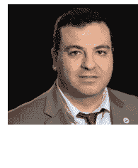

**Ayman El-Baz**是美国肯塔基州路易斯维尔大学的新罕布什大学杰出教授，也是位于埃及新阿拉明市的路易斯维尔大学阿拉明国际大学（UofL-AIU）教授。El-Baz博士分别于1997年和2001年获得电气工程理学学士和理学硕士学位。他于2006年获得路易斯维尔大学电气工程博士学位。El-Baz博士因其在生物医学转化研究领域的贡献，被聘为Coulter、AIMBE和NAI的会士。El-Baz博士在生物医学成像建模和计算机辅助非侵入性诊断系统领域拥有近二十年的实践经验。他已发表或共同发表超过700篇技术文章（168篇期刊论文、44本书、91个书籍章节、256篇同行评审会议论文、196篇摘要以及36项美国专利和披露）。

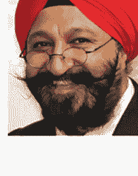

**Jasjit S. Suri**是一位创新者、科学家、远见者、实业家，也是国际知名的生物医学工程世界领导者。Suri博士在生物医学工程/设备及其管理领域拥有超过25年的经验。他在华盛顿大学西雅图分校获得博士学位，并在克利夫兰的凯斯西储大学韦瑟黑德商学院获得商业管理科学学位。Suri博士因杰出的贡献于1980年获得总统金质奖章，并成为美国医学和生物工程学院的会士。2018年，他因在医学成像及其管理领域的杰出贡献和奉献精神，获得了名流名人录终身成就奖。

## 贡献者

**Nabila Abraham**
Ryerson多媒体研究实验室
电气、计算机和生物医学工程
Ryerson大学
加拿大 多伦多

**Pushkar Aggarwal**
辛辛那提大学医学院
俄亥俄州 辛辛那提

**Muhammad Ali Akbar**
外科系
多伦多大学
加拿大 多伦多

**Zeynettin Akkus**
心血管研究
梅奥诊所
明尼苏达州 罗切斯特

**Damlan Arifoglu**
计算机科学系
工程科学学院
伦敦大学学院
英国 伦敦

**Jetan H. Badhiwala**
外科系
多伦多大学
加拿大 多伦多

**Filippo Berno**
信息工程系
帕多瓦大学
意大利 帕多瓦

**Mohini Bindal**
贝勒医学院
德克萨斯州 休斯顿

**Abdelhamid Bouchachia**
计算与信息学系
科学与工程学院
伯恩茅斯大学
英国 普尔

**Sheryl Brahnam**
信息技术与网络安全
密苏里州立大学
密苏里州 斯普林菲尔德

**Sunita Chauhan**
机械与航空航天工程系
莫纳什大学
澳大利亚 克莱顿

**Wa Cheung**
放射科
阿尔弗雷德医院
澳大利亚 墨尔本

**Esmaeil Davoodi-Bojd**
放射图像分析实验室
亨利福特医疗系统
密歇根州 底特律

**Amy C. Dwyer**
肾脏移植 — 肾脏疾病中心
路易斯维尔大学
肯塔基州 路易斯维尔

**Maryam El-Baz**
生物工程系
路易斯维尔大学
肯塔基州 路易斯维尔

**Mohamed Abou El-Ghar**
放射科
泌尿学与肾病学中心
曼苏拉大学
埃及 曼苏拉

**Ingy El-Torgoman**
基础科学系
工程学院
亚历山大费罗斯大学
埃及 亚历山大

**Michael G. Fehlings**
外科系
多伦多大学
加拿大 多伦多
以及
脊柱计划
多伦多西方医院
大学健康网络
加拿大 多伦多

**Mohammed Ghazal**
电气与计算机工程系
阿布扎比大学
阿联酋 阿布扎比

**Guruprasad Girdharan**
生物工程系
路易斯维尔大学
肯塔基州 路易斯维尔

**Arnulfo González-Cantú**
蒙特雷诺瓦诊所医院
新莱昂州 圣尼古拉斯·德洛斯加尔扎
以及
医学专科
医学院
蒙特雷大学
墨西哥 圣佩德罗·加尔扎·加西亚

**Marcia Hon**
Ryerson多媒体研究实验室
电气、计算机和生物医学工程
Ryerson大学
加拿大 多伦多

**Fahmi Khalifa**
生物工程系
路易斯维尔大学
肯塔基州 路易斯维尔

**Girjesh Prasad**
智能系统研究中心
计算、工程与智能系统学院
阿尔斯特大学
英国 伦敦德里

**Naimul Khan**
Ryerson多媒体研究实验室
电气、计算机和
生物医学工程
Ryerson大学
加拿大 多伦多

**Stuart K. Roberts**
胃肠病学系
阿尔弗雷德医院
澳大利亚 墨尔本

**Omar Khan**
外科系
多伦多大学
加拿大 多伦多

**Maria Elena Romero-Ibarguenoogia**
蒙特雷诺瓦诊所医院
新莱昂州 圣尼古拉斯·德洛斯加尔扎
以及
医学专科
医学院
蒙特雷大学
墨西哥 圣佩德罗·加尔扎·加西亚

**Gianluca Maguolo**
信息工程系
帕多瓦大学
意大利 帕多瓦

**Ali Mahmoud**
生物工程系
路易斯维尔大学
肯塔基州 路易斯维尔

**Baidya Nath Saha**
埃德蒙顿康考迪亚大学
加拿大 阿尔伯塔省

**Loris Nanni**
信息工程系
帕多瓦大学
意大利 帕多瓦

**Jose Sanchez-Bornot**
智能系统研究中心
计算、工程与智能系统学院
阿尔斯特大学
英国 伦敦德里

**Shams Shaker**
生物工程系
路易斯维尔大学
肯塔基州 路易斯维尔

**Ahmed Shalaby**
生物工程系
路易斯维尔大学
肯塔基州 路易斯维尔

**Seyedmohammad Shams**
放射图像分析
实验室
亨利福特医疗系统
密歇根州 底特律

**Mohamed Shehata**
生物工程系
路易斯维尔大学
肯塔基州 路易斯维尔

**Ahmed Soliman**
生物工程系
路易斯维尔大学
肯塔基州 路易斯维尔

**Hamid Soltanian-Zadeh**
放射图像分析
实验室
亨利福特医疗系统
密歇根州 底特律
以及
CIPCE电气与
计算机工程学院
德黑兰大学
伊朗 德黑兰

**Anika Tabassum**
Ryerson多媒体研究
实验室
电气、计算机和
生物医学工程
Ryerson大学
加拿大 多伦多

**Kongfatt Wong-Lin**
智能系统研究中心
计算、工程与智能系统学院
阿尔斯特大学
英国 伦敦德里

**Su Yang**
西伦敦大学
英国 伦敦

**Jinuo Zhang**
机械与
航空航天工程系
莫纳什大学
澳大利亚 克莱顿

## 麻醉学中的另一双眼睛

**Pushkar Aggarwal**

*辛辛那提大学医学院*
*俄亥俄州 辛辛那提*


#### 1.1 简介/历史

当人们想到医疗保健中的机器学习和人工智能时，压倒性的想法是关于它们在通过胸片/计算机断层扫描诊断病理学的放射学中的适用性，或在通过皮肤图像诊断病理学的皮肤病学中的适用性。这些是合乎逻辑的应用，因为我们期望通过查看大量的正常和病理图像，机器/神经网络可以解读定义每种病理学的显著特征，然后使用这些特征来预测未见过的图像中的病理学。上述应用也是最先想到的，因为已在这些领域取得了重大进展。例如，在2019年5月，谷歌开发了


一种通过计算机断层扫描（CT）检测肺癌的深度学习算法。该深度学习模型在受试者工作特征（ROC）曲线下的面积达到 94.4%，在诊断表现上优于六名放射科医生，同时假阳性率绝对值降低了 11%，假阴性率降低了 5% [1]。

通常，麻醉学与机器学习并非紧密相关，因为在该领域中，使用图像检测病理作用比在其他医疗保健领域小得多。然而，机器学习涵盖的内容远不止图像分析。机器学习涉及一种系统，该系统能够基于算法、统计模型、回归和/或模式识别，在没有被显式编程的情况下执行任务。此外，机器学习系统能够从经验中学习和改进。这种经验通常通过数据获得，数据可以包括表格数据或像素化数据。在麻醉学中，存在大量的表格数据。这些数据可以是单病例数据，其中可能包括性别、年龄、身高、体重、药物、过敏、心率、呼吸率、血压和温度等变量。这些类型的变量，特别是那些被监测且可能波动的变量（如生命体征），可以与另一个感兴趣的变量（如低血压）结合提供给机器学习模型。凭借足够的信息，机器学习模型可以分析数据，以建立因变量和独立结果变量之间的关联。在此类回归模型创建后，神经网络可以被提供新的病例/数据，并可以基于其在训练数据中建立的关联来预测结果变量。此外，随着神经网络被提供更多信息，它将继续更新之前开发的变量间的关联。因此，该模型正在执行预测独立变量的任务，而没有通过用户实施任何显式算法或暴力机制，并且模型正在从经验中学习和改进。上述理论示例提供了一些底层信息，说明机器学习如何可在麻醉学中利用。本章稍后，将提供机器学习在麻醉术中实际应用的具体示例。

在麻醉学领域中，自动化并不新鲜。最早记录的自动化实施之一包括 Bickford 在 1950 年的努力 [2]。Bickford 认识到脑电势的总和值与麻醉剂对中枢神经系统的抑制程度之间的关系。利用这一信息，Bickford 设计了一种设备来自动化维持麻醉。

自 1950 年以来，已识别出新的变量及这些变量的新组合，它们更准确地与麻醉深度相关。将这一信息整合到机器中，促使美国食品药品监督管理局（FDA）批准了 Sedas 计算机辅助个性化镇静 [3]。该机器旨在将丙泊酚给予患者的过程与通过包括脉搏血氧饱和度、心电图以及对听觉和触觉刺激的患者反应等措施来监测患者结合起来 [4]。其使用存在局限性：仅用于轻度至中度镇静，且仅用于结肠镜检查或胃镜十二指肠镜检查 [5]；然而，Sedas 机器是自动化和算法使用如何辅助麻醉科医生的绝佳示例。

通常，麻醉学领域中开发的许多自动化都需要程序员输入机器用来解决任务的算法。识别此算法在很大程度上仍依赖于人类。此外，随着新信息的出现，由人类更新算法，这往往耗时并导致实施延迟。这可以对比于机器学习，其中神经网络识别算法并随着提供新数据而不断更新它。

## 1.2 麻醉学中的机器学习实施

在过去几年中，几种机器学习的应用已在麻醉术中实施，包括术前、围术期和术后应用。

### 1.2.1 低血压

两项研究涉及对麻醉诱导后低血压的预测。Hatib 及其同事使用因变量——高保真动脉压波形——以预测低血压在实际上发生之前 [6]。在训练阶段，包括 545,959 分钟动脉波形记录和 25,461 次低血压发作。此外，在验证阶段，包括 33,326 分钟动脉波形记录和 1,923 次低血压发作。尽管表面上看起来似乎只分析了一个因变量，但实际上，从动脉压波形中选择了超过 3,000 个单个特征，并且每一个都在分析中运行以生成受试者工作特征（ROC）曲线。之后，基于在 ROC 曲线上曲线下面积（AUC）大于 0.85 这一标准，选择了 51 个特征。这些 51 个特征/变量及其倒数和平方项组合后生成了总共超过 260 万个变量。随后，该模型能够计算这些变量与低血压之间的线性和非线性关系。最终，该模型使用了 3,022 个单个特征，在预测低血压事件发生前 15 分钟时，实现了 88% 的敏感性、87% 的特异性和 0.95 的 AUC。在预测低血压事件发生前 5 分钟时，这些值分别增加到 92%、92% 和 0.97。此外，Kendale 及其同事在预测诱导后低血压中实施了机器学习 [7]。然而，在此分析中，因变量包括额外的特征，如人口统计学数据、术前药物、医学合并症、诱导药物和术中生命体征。此外，比较了八种不同的监督机器学习分类技术（逻辑回归、支持向量机、朴素贝叶斯、K 近邻、线性判别分析、随机森林、神经网络和梯度提升机）的性能。发现梯度提升具有最高的 AUC，最终模型的 AUC 为 0.77。梯度提升的更好表现与其数据类型相符，因为它在类别不平衡时表现良好。最后，比较了因变量在预测诱导后低血压中的重要性。最重要的前五名依次是平均动脉压、年龄、BMI、平均吸气峰压和最大七氟烷浓度。此外，模型发现了药物——左甲状腺素和双膦酸盐的高重要性，这通常出乎意料。预测低血压是一项极具挑战性的任务，如果机器学习和人工智能继续如上述两项研究所示那样进步，麻醉科医生将更不容易措手不及，因此能够更快更有效地提供治疗，在某些情况下甚至可能提供预防性治疗。

### 1.2.2 缺氧

另一项研究执行了梯度提升机模型，以预测手术期间的低氧血症 [8]。其中的一些特征/变量包括患者人口统计学数据（例如 BMI）、血压（BP）、呼吸频率、O₂ 流量、药物、SpO₂ 以及自手术开始以来的时间。机器学习系统被用于初始风险预测和实时低氧血症预测。在这两种情况下，麻醉科医生与机器学习系统的结合导致了统计学上的显著优势

AUC（曲线下面积）出现显著（P<0.0001）增加。基于术前及术中可获得的数据量，机器学习可以为临床医生提供一种支持系统，帮助他们在危及生命的病例发生之前进行预测。

### 1.2.3 麻醉深度

在手术过程中监测麻醉深度对于患者安全和患者舒适度至关重要。过深的麻醉深度会导致苏醒延迟、低血压以及重要器官灌注减少。另一方面，过浅的麻醉深度可能导致创伤后应激。Saadeh及其同事设计了一种基于机器学习的脑电图（EEG）处理器，用于估算麻醉深度 [9]。从脑电图中提取了六个特征（频谱边缘频率、贝塔比值和四个频带的频谱能量），并用于机器学习系统，将麻醉深度分类为深、中度、浅或清醒。在测试期间，该系统在麻醉深度分类中达到了92.2%的准确率，再次凸显了机器学习在手术室中的益处。

### 1.2.4 死亡率预测

预测死亡率通常是一项交给更高力量的任务。在临床实践中，已经开发了一些风险评分来帮助量化风险，例如美国麻醉医师学会（ASA）身体状态分类或手术Apgar评分。然而，这些评分存在一些局限性。美国麻醉医师学会身体状态分类具有主观性，且评估者间变异性高。手术Apgar评分为临床医生提供了一种快速预测术后风险的方法；然而，这种快速性也是一个缺点，因为其计算中仅包含三个特征/变量。Lee及其同事开发了一个深度神经网络，该网络使用手术结束时的45个特征/变量，并将其与来自美国麻醉医师学会（ASA）身体状态分类的术前信息相结合，以预测术后住院死亡率 [10]。该深度神经网络的AUC为0.91，高于单独使用手术Apgar（AUC=0.58）或ASA（AUC=0.84）的AUC。尽管麻醉领域机器学习的研究实施滞后于其他医疗保健领域，但上述研究证明了它能为麻醉医生和患者带来的巨大益处。

## 1.3 局限性

机器学习和人工智能并非没有局限性，尤其是在医疗保健领域。尽管在麻醉领域术前、术中和术后都有大量可用数据，但许多数据以原始格式存在，尚未进行处理或分析。此外，该领域的大部分机器学习研究是在一家医院或通常位于同一地理区域的医院网络中进行的。这对机器学习模型的实际应用提出了重大挑战，因为各医院之间的患者人口统计特征存在显著差异。主要局限性之一可能是机器学习模型主要接触到的数据来自该地理区域内的单一民族，因此它无法理解或无法考虑民族间的差异。此外，虽然麻醉学是一个数据驱动领域且监控大量数据，但公开可用的数据库很少。这与放射学或病理学领域存在显著差异，在这些领域中存在此类公开可用的数据库。麻醉领域缺乏公共数据库阻碍了程序员测试机器学习系统以及开发提高其准确率的方法。

与其他医疗保健领域相比，麻醉学的另一个挑战在于麻醉医生必须快速识别问题，甚至更快地解决问题。像皮肤病学这样的领域拥有这种奢侈，通常皮肤状况不太可能在几秒到几分钟内导致严重的健康后果。皮肤科医生可以对皮肤状况拍照，然后将其输入机器学习算法以帮助识别病因。然而，在手术室中，几秒钟可能决定是康复还是悲剧。因此，在麻醉中实施的机器学习系统必须无缝且必须在手术期间不需要麻醉医生进行大量输入。

此外，随着医院引入新技术，安全风险将急剧增加。机器学习软件被提供大量患者数据。数据需要去标识化，并且必须制定安全措施以防止基础设施被黑客攻击。后者在自动化技术中尤为重要。前文提到，Sedasys计算机辅助个性化镇静机器协助丙泊酚的管理。如果该设备未受到潜在攻击的保护，可能会导致对患者产生灾难性后果。尽管Sedasys计算机辅助个性化镇静机器已获得美国食品药品监督管理局批准，并正在少数医院进行测试，但其母公司——强生公司——由于销售缓慢而从市场撤回了该机器 [11]。销售放缓的具体原因未提供，但可以预测医院和患者尚未准备好在麻醉管理等潜在危及生命的情况下接受自动化。

## 1.4 结论

在过去几年中，关于使用机器学习改善患者健康的研究激增。麻醉领域的相关研究也不例外，尽管速度比其他医疗领域慢。麻醉学领域包含海量数据，这为机器学习的实施提供了完美的机会。

## 参考文献

- [1] Ardila D, Kiraly AP, Bharadwaj S, Choi B, Reicher JJ, Peng L, et al. End-to-end lung cancer screening with three-dimensional deep learning on low-dose chest computed tomography. Nat Med. 2019;25: 954–961. doi:10.1038/s41591-019-0447-x
- [2] Bickford RG. Automatic electroencephalographic control of general anesthesia. Electroencephalogr Clin Neurophysiol. 1950;2: 93–96. doi:10.1016/0013-4694(50)90014-9
- [3] Boggs S. Computer-Assisted Personalized Sedation (CAPS): Will it Change the Way Moderate Sedation is Administered? In: Anesthesia Business Consultants [Internet]. [cited 19 Dec 2019]. Available: www.anesthesiabusiness.com/publications/communiques/83-communique/past-issues/fall-2014/698-computer-assisted-personalized-sedation-caps-will-it-change-the-way-moderate-sedation-is-administered
- [4] Pambianco DJ, Vargo JJ, Pruitt RE, Hardi R, Martin JF. Computer-assisted personalized sedation for upper endoscopy and colonoscopy: a comparative, multicenter randomized study. Gastrointest Endosc. 2011;73: 765–772. doi:10.1016/j.gie.2010.10.031
- [5] Boggs S. Computer-Assisted Personalized Sedation—The Beginning or the End of the Anesthesia Provider? In: Anesthesia Business Consultants [Internet]. [cited 19 Dec 2019]. Available: https://www.anesthesiabusiness.com/publications/blog/entry/computer-assisted-personalized-sedation-the-beginning-or-the-end-of-the-anesthesia-provider
- [6] Hatib F, Jian Z, Buddi S, Lee S, Settels J, Sibert K, et al. Machine-learning Algorithm to Predict Hypotension Based on High-fidelity Arterial Pressure Waveform Analysis. Anesthesiology. 2018;129: 663–674. doi:10.1097/ALN.0000000000002300
- [7] Kendale S, Kulkarni P, Rosenberg AD, Wang J. Supervised Machine-learning Predictive Analytics for Prediction of Postinduction Hypotension. Anesthesiol J Am Soc Anesthesiol. 2018;129: 675–688. doi:10.1097/ALN.0000000000002374
- [8] Lundberg SM, Nair B, Vavilala MS, Horibe M, Eisses MJ, Adams T, et al. Explainable machine-learning predictions for the prevention of hypoxemia during surgery. Nat Biomed Eng. 2018;2: 749–760. doi:10.1038/ s41551-018-0304-0
- [9] Saadeh W, Khan FH, Altaf MAB. Design and Implementation of a Machine Learning Based EEG Processor for Accurate Estimation of Depth of Anesthesia. IEEE Trans Biomed Circuits Syst. 2019;13: 658–669. doi:10.1109/ TBCAS.2019.2921875
- [10] Lee CK, Hfer I, Gabel E, Baldi P, Cannesson M. Development and Validation of a Deep Neural Network Model for Prediction of Postoperative In-Hospital Mortality. Anesthesiology. 2018;129: 649–662. doi:10.1097/ ALN.0000000000002186
- [11] Novak R. Robot Anesthesia. In: The anesthesia consultant [Internet]. 27 Nov 2012 [cited 19 Dec 2019]. Available: https://theanesthesiaconsultant. com/2012/11/27/robot-anesthesia/


# 第 2 章

# 皮肤科机器学习临床决策支持系统

Pushkar Aggarwal

*辛辛那提大学医学院*
*俄亥俄州，辛辛那提*


### 2.1 背景

皮肤科是一门依赖形态学特征的科学，绝大多数诊断基于视觉模式识别。目前，皮肤成像技术以皮肤镜检查、超高频超声和反射共聚焦显微镜为代表。每种皮肤成像设备方法都有其自身的优势和局限性。皮肤科医生需要根据皮肤病变的不同状况选择不同的成像方法。皮肤成像技术已成为皮肤病临床诊断中至关重要的工具，并在全球范围内得到广泛接受和应用 [1]。因此，皮肤科非常适合应用人工智能（AI）图像识别能力进行辅助诊断。

2013年，每四名美国人中就有一人因皮肤病就医 [2]。美国皮肤病的总体患病率估计约为 27%。在 65 岁及以上人群中，患病率上升至约 49%，人均皮肤病数量从 1.6 个增加到 2.2 个。此外，在 2013 年的总死亡人数中，皮肤病占了近 1/100。假设预期寿命为 75 岁，研究发现致命性皮肤病导致潜在生命损失近 11 年 [2]。黑色素瘤是最致命的皮肤癌，占所有皮肤癌相关死亡的 75%，在美国每年导致超过 10,000 人死亡 [3]。黑色素瘤是 25–30 岁女性癌症死亡的主要原因，也是 15-29 岁年龄段中第二常见的癌症诊断 [4]。黑色素瘤的发病率从 1982 年的每 10 万人 11.2 例翻倍至 2011 年的每 10 万人 22.7 例。其他皮肤病状虽然不像黑色素瘤那样致命，但仍可能对个人产生重大影响。痤疮每年影响约 5000 万美国人，是美国最常见的皮肤病 [5]。酒渣鼻和银屑病分别影响美国约 1500 万人和 800 万人 [6,7]。非黑色素瘤皮肤癌和黑色素瘤每年的医疗成本合计约 60 亿美元。其他皮肤病状如痤疮、银屑病、脂溢性皮炎和特应性皮炎每年分别造成 8.46 亿、7.37 亿、3.39 亿和 3.14 亿美元的费用 [2]。因此，人工智能在皮肤科的应用有潜力显著惠及大部分人群的健康和财务状况。

AI 应用自动化学习并基于大数据提供输出。此前，大数据要么不可用，要么未能以标准化形式整合在一起。计算机的出现和广泛应用有助于在包括皮肤科在内的多个医疗领域整合大数据集。AI 试图模仿人脑以复制人类认知，可以在皮肤科临床评估中成为一项资产。

### 2.2 黑色素瘤

皮肤科领域中的许多机器学习实施涵盖恶性黑色素瘤与良性痣的二元分类。在黑色素瘤临床诊断中经常使用的一项标准是 ABCDE 标准 – 不对称性（Asymmetry）、边界不规则（Border）、颜色（两种或以上颜色）、直径大于 6 毫米（Diameter）以及尺寸增大或演变（Enlargement or Evolution）[8]。前四项标准是机器学习算法在评估病变时可能使用的潜在标准。

黑色素瘤诊断领域中机器学习的一项主要研究涉及训练一个包含约 130,000 张图像的卷积神经网络（CNN），这些图像涵盖 2,000 多种不同的疾病 [9]。然后，该 CNN 被用于将黑素细胞病变分类为良性或恶性。分析分别在照片图像和皮肤镜图像上进行。在照片图像上，该 CNN 在测试 225 张图像时的曲线下面积（AUC）为 0.96；在皮肤镜图像上，该 CNN 在测试 1,010 张图像时的 AUC 为 0.94。在这项研究中，皮肤科医生也被展示了输入到 CNN 中的相同测试图像，并要求将每张图像分类为良性或恶性。无论是在照片图像还是皮肤镜图像上，该 CNN 在这项分类任务中都优于平均水平的皮肤科医生。

进行了一项类似的研究，以评估机器学习在区分恶性黑色素瘤与良性黑素细胞病变方面与皮肤科医生相同能力的表现 [10]。在这项研究中，皮肤科医生首先被给予图像，并被询问病变是良性还是恶性。接下来，他们被提供了临床信息和补充的特写图像，并被要求执行相同的区分任务。在皮肤科医生的平均敏感度水平下，CNN 的特异度显著高于皮肤科医生的特异度。CNN 在两个阶段均表现出统计上显著的高特异度：一个是未向皮肤科医生提供临床信息和补充特写图像的阶段，另一个是提供这些信息后的阶段。此外，在两个阶段中，CNN 的平均 AUC 均高于皮肤科医生的平均受试者工作特征曲线面积。这项研究表明，即使在缺乏临床信息的情况下，机器学习神经网络也能优于皮肤科医生。总体而言，机器学习在区分恶性黑色素瘤和良性痣方面已被证明能提供非常良好的结果。

### 2.3 非黑色素瘤机器学习

机器学习已在皮肤科领域得到应用，不仅限于恶性黑色素瘤的二元分类。一些例子包括痤疮、酒渣鼻、脓疱疮、银屑病、特应性皮炎、脂溢性皮炎、扁平苔藓和玫瑰糠疹等疾病的分类，以及许多其他疾病 [11,12]。与二元分类相比，其中一些神经网络被要求对多种不同疾病进行分类。这不仅给神经网络带来了重大挑战，还能更好地模拟现实世界条件。

一项研究考察了 CNN 作为甲真菌病二元分类的能力。该 CNN 使用了超过 49,000 张图像进行训练，结果发现其诊断准确性高于获得相同测试图像的皮肤科医生 [13]。另一项研究使用机器学习对十种类型的病变进行分类 – 光化性角化症、基底细胞癌、黑素细胞痣/痣、鳞状细胞癌、脂溢性角化症、上皮内癌、化脓性肉芽肿、血管瘤、皮肤纤维瘤和恶性黑色素瘤 [14]。正如预期的那样，模型需要区分的分类类别越多，准确性越低。部分原因是某些类别可用的图像数量有限。此外，从二元分类器到十类分类器，模型猜测并得到正确答案的机会减少了五倍。在该研究中，十类分类器模型的准确率为 81.8%，而另一次运行中模型仅作为五类分类器（上述十种病变类型中的前五种），该模型的准确率为 85.8%。这两个模型都显示了良好的准确性，但也展示了增加类别数量的影响。随着模型分类的类别数量增加，为了保持高准确性，至关重要的是向神经网络输入临床信息，如年龄、性别、种族、发病时间、持续时间、部位、刺激、瘙痒、刺痛、分泌物类型、演变和家族史等。这很可能是皮肤科机器学习领域的下一步。

### 2.4 非皮肤图像识别机器学习

在思考机器学习在皮肤科领域的应用性时，首要想到的想法是使用皮肤图像来分类疾病。然而，机器学习涵盖的范围远不止于此，因为它可以使用所有类型的数据（像素化或非像素化）。

除图像识别外，机器学习已被用于预测大疱性表皮松解症单纯型的严重程度 [15]。在这项研究中，神经网络被提供了基因组中突变的位置和类型，并被要求预测疾病的严重程度。该模型的准确率为 78%，尽管训练和测试数据是


...是有限的。然而，这提供了机器学习在皮肤科中非图像识别应用的一个示例。另一项研究利用近红外傅里叶变换拉曼光谱评估了神经网络在黑色素瘤诊断中的能力[16]。与向神经网络输入皮损的皮肤病图像不同，该研究进行了皮肤穿刺活检，然后使用干涉仪获取拉曼光谱。神经网络在黑色素瘤诊断中的敏感度为85%，特异度为99%。这是另一个关于除皮肤病图像以外的其他信息如何被神经网络利用以辅助临床医生诊断的示例。

## 2.5 数据增强

近年来，在开发提高神经网络准确率的方法方面取得了重大进展。其中一种方法就是使用数据/图像增强技术。该技术涉及使用裁剪、改变亮度、改变剪切等多种技术，以模拟图像在真实世界中的变异性，并仅从一张图像中为神经网络提供多张图像。后者尤为重要，因为与准确且经过验证的诊断相关的高质量皮肤病图像十分匮乏。此外，数据增强有助于降低模型过拟合的可能性。数据增强已在皮肤科机器学习中得到应用，并取得了良好效果。

例如，一个用于分类痤疮、特应性皮炎、玫瑰痤疮、银屑病和脓疱疮的深度神经网络模型在数据增强后重新运行，以评估其对模型的影响[11]。此分析中使用的数据增强技术包括旋转、缩放、剪切以及水平和垂直翻转。这些技术有助于为模型提供关于皮损位置和大小以及成像角度中可能存在的某些变异性。增加这些数据增强技术后，平均马修斯相关系数提高了7.7%。此外，每种被分类的皮肤病状况的面积图（AUC）均有所增加。平均AUC提高了13.2%，标准差为0.033。这些结果突显了数据增强在提高深度学习模型在皮肤病分类准确率方面可能带来的显著改进。此外，当深度学习模型分类多种病症/疾病而非作为二元分类器时，数据增强尤为有用。

在另一个示例中，在使用深度学习模型分类黑色素瘤时，实施了八种增强技术以及这些八种技术的组合（混搭），并评估了它们对模型准确率提升/降低的影响[17]。增强技术包括饱和度、对比度和亮度；饱和度、对比度、亮度和色调；仿射变换（旋转、剪切、缩放以及在边缘对称添加像素）；翻转；裁剪；随机用噪声替换图像；扭曲；以及将两个皮损混合到一张图像中。这些变化有助于解释由不同相机、不同拍摄者拍摄图像的变异性，以及解释背景中的变异性等。该研究的另一个特点是，并行运行了三个不同的卷积神经网络（CNN），以解释不同CNN之间的变异性。研究发现，几何增强（仿射变换、裁剪和扭曲）在三个CNN中带来的改进比颜色增强（饱和度、对比度、亮度和色调）更一致。一些增强技术（如随机擦除）导致模型表现更差或仅有轻微改进。裁剪被证明能显著提高模型的准确率。在该研究中，最高的AUC值出现在以下组合增强技术中：随机裁剪、仿射变换、翻转，以及饱和度、对比度、亮度和色调。总体而言，数据增强已被证明是改善神经网络准确率的一种非常有效的方法。未来可能实施更复杂的数据增强技术（如高斯模糊），以评估其对模型的影响，应用于皮肤病图像分析中。

## 2.6 局限性

目前，在适配人工智能（AI）方面存在的一些问题/局限性列举如下：

- a. 共享患者数据和图像中的伦理问题与数据隐私
- b. 患者拍摄的或在非最佳光照条件下拍摄的图像质量
- c. 训练图像缺乏标准化
- d. 图像的传输/共享
- e. 图像识别程序的质量和能力
- f. 可靠性——输出的敏感度和特异度
- g. 缺乏整合临床症状、患者特征、其他疾病状态等
- h. 程序中缺乏医学专业人士的临床专长和临床经验
- i. 缺乏遗传特征整合
- j. 软件程序员和医生——各自领域的专家——不太可能整合他们的思想/专业知识
- k. 皮肤病表现复杂多样
- l. 解读皮肤病表现的根本原因
- m. 法律问题
- n. 监管问题和商业化
- o. 缺乏医生的人性化和关怀/与患者的沟通
- p. 认知识别/计算的整合
- q. 区分由不同潜在临床状况引起的相似皮肤病表现。

## 2.7 未来方向

人工智能在皮肤科的未来将是整合医学中各种AI应用，而不仅仅是皮肤病图像识别。可能会整合以下AI应用。

- a. 使用AI解读实验室和诊断检查结果
- b. 使用AI分析个人特征（性别、种族、年龄等）对某些疾病的易感性
- c. 使用AI处理临床症状
- d. 认知计算
- e. 遗传易感性和遗传标志物的变化
- f. 关于诊断和可能治疗的最新研究和指南
- g. 治疗期间图像的变化
- h. 来自各种可能治疗的不良事件分析

AI模型的输出将是可能的诊断辅助以及皮肤科医生需要考虑的可能治疗方向。临床决策支持系统不仅有助于皮肤科医生准确诊断和治疗疾病，还帮助监测疾病的进展/缓解。

## 2.8 结论

机器学习已在皮肤科领域的各个方面得到应用。已有研究的大部分集中在利用机器学习诊断黑色素瘤上。然而，其他皮肤病如银屑病和特应性皮炎也正在被整合进来。此外，针对皮肤病诊断和预后/严重程度的非图像机器学习也已得到开发。未来的研究可能集中于开发提高模型准确率的方法，例如，通过添加新的数据增强技术或改进/微调旧的数据增强技术，以及通过在用于训练神经网络的皮肤病图像中添加临床信息（如年龄、性别、种族、发病时间、部位、演变和家族史）来实现。在未来几年，AI有潜力为皮肤科医生提供第二意见，最终提供专家意见，并作为一个具有高度敏感度和特异度的临床决策系统发挥作用。

## 参考文献

- 1. Li C-X, Shen C-B, Xue K, Shen X, Jing Y, Wang Z-Y, et al. Artificial intelligence in dermatology: past, present, and future. Chin Med J (Engl). 2019;132: 2017-2020. doi:10.1097/CM9.000000000000372
- 2. Lim HW, Collins SAB, Resnick JS, Bolonig JL, Hodge JA, Rohrer TA, et al. The burden of skin disease in the United States. J Am Acad Dermatol. 2017;76: 958-972.e2. doi:10.1016/j.jaad.2016.12.043
- 3. Esteva A, Kuprel B, Novo RA, Ko J, Swetter SM, Blau HM, et al. Dermatologist-level classification of skin cancer with deep neural networks. Nature. 2017;542: 115-118. doi:10.1038/nature21056
- 4. 黑色素瘤事实表。黑色素瘤研究基金会；网址：https://melanoma.org/sites/default/files/2017MelanomaFactSheet.pdf
- 5. 按数字统计的皮肤病情况。载于：美国皮肤病学会[互联网]。网址：https://www.aad.org/media/stats-numbers


## 参考文献

6. Okhovat J-P, Armstrong AW. 玫瑰痤疮的最新进展：流行病学、风险因素和管理策略。Curr Dermatol Rep. 2014;3: 23–28. doi:10.1007/s13671-014-0070-5
7. 银屑病统计数据。载于：National Psoriasis Foundation [互联网]。获取路径：https://www.psoriasis.org/content/statistics
8. 黑色素瘤的临床诊断。Am Fam Physician. 2008;78: 1205.
9. Esteva A, Kulpore B, Novoa RA, Ko J, Swetter SM, Blau HM, et al. 利用深度神经网络实现皮肤科医生水平的皮肤癌分类。Nature. 2017;542: 115–118. doi:10.1038/nature21056
10. Haenssle HA, Fink C, Schneiderbauer R, Töberer F, Buhl T, Blum A, et al. 人机对抗：深度卷积神经网络在皮肤镜黑色素瘤识别中的诊断表现与58名皮肤科医生相比。Ann Oncol Off J Eur Soc Med Oncol. 2018;29: 1836–1842. doi:10.1093/annonc/mdy166
11. Aggarwal SLP. 在皮肤科图像识别中使用机器学习的图像数据增强。Skin Res Technol Off J Int Soc Bioeng Skin ISBS Int Soc Digit Imaging Skin IDIS Int Soc Skin Imaging ISSI. 2019;25: 815–820. doi:10.1111/srt.12726
12. Bobrova M, Taranik M, Kopanitsa G. 使用神经网络进行皮肤科诊断。Stud Health Techn Inform. 2019;261: 211–216.
13. Han SS, Park GH, Lim W, Kim MS, Na Ji, Park I, et al. 深度神经网络在甲真菌病诊断中的表现与皮肤科医生相当且往往更优：基于区域的卷积深度神经网络自动构建甲真菌病数据集。Plos One. 2018;13: e0191493. doi:10.1371/journal.pone.0191493
14. Kawahara J, BenTaieb A, Hamarneh G. 用于分类皮肤损伤的深度特征。2016 IEEE第13届生物医学成像国际研讨会（ISBI）。2016。页码 1397–1400。doi:10.1109/ISBI.2016.7493528
15. Eapen BR. 使用“神经网络”算法预测单纯性表皮松解性大疱严重程度。Indian J Dermatol Venereol Leprol. 2005;71: 106–108. doi:10.4103/0378-6323.13995
16. Gniedecka M, Philipson PA, Wessel S, Gniedecki R, Wulf HC, Sigurdsson S, et al. 拉曼光谱与神经网络的黑色素瘤诊断：完整癌组织中蛋白质和脂质结构改变。J Invest Dermatol. 2004;122: 443–449. doi:10.1046/j.0022-202X.2004.22208.x
17. Perez F, Vasconcelos C, Avila S, Valle E. 皮肤损伤分析中的数据增强。ISIC皮肤图像分析研讨会。2018。获取路径：https://arxiv.org/pdf/1809.01442.pdf


# Taylor & Francis

Taylor & Francis 集团

http://taylorandfrancis.com

# 视觉与人工智能

**Mohini Bindal**  
* 贝勒医学院*  
*德克萨斯州休斯顿*

**Pushkar Aggarwal**  
* 辛辛那提大学医学院*  
*俄亥俄州辛辛那提*


## 3.1 引言

目前世界人口为77亿，其中至少有22亿人（28.6%）存在视力损伤[1]。2015年，据估计有3600万人失明[2]。早期诊断和治疗眼科疾病对于降低这种疾病的患病率并提高受影响人群的生活质量至关重要。在过去几年中，机器学习在医疗保健的各个方面（包括眼科）取得了重大进展。在眼科领域，关于机器学习集成的大部分研究都集中在糖尿病视网膜病变和

## 3.2 糖尿病视网膜病变

年龄相关性黄斑变性（AMD）的诊断上。在过去几年中，研究人员一直在探讨机器学习在其他疾病中的应用，例如青光眼。

2010年，据估计有1.266亿人患有糖尿病视网膜病变，其中3730万人患有威胁视力的糖尿病视网膜病变。还预测到2030年，这些数字将分别增加到1.91亿人和5630万人[3]。在全球范围内，糖尿病视网膜病变是20至74岁人群视力丧失的主要原因。然而，只有33%的糖尿病 mellitus 患者具有典型症状[4]。机器学习提供了一个机会，可以早期发现和正确诊断糖尿病视网膜病变。

Google 的 Gulshan 等人使用超过12万张视网膜图像训练了一个卷积神经网络（CNN）[5]。这些视网膜图像最初由眼科医生根据图像质量以及是否存在糖尿病视网膜病变或糖尿病黄斑水肿进行评分。除了对图像进行标记外，眼科医生还在无、轻度、中度、重度或增殖期量表上评估被识别为糖尿病视网膜病变的图像的严重程度。接下来，将图像提供给 CNN 进行训练。进行了两次测试，CNN 在第一个测试数据集上达到了 0.991 的曲线下面积（AUC）（95% 置信区间 (CI)，0.988–0.993），在第二个测试数据集上达到了 0.990（95% CI，0.986–0.995）。鉴于 AUC 的最高可能值为 1.0，上述模型表现非常出色。

医疗保健中机器学习的一个局限性在于，CNN 训练和验证所用图像通常来自单一或少数几个族裔。模型从未接触过族裔间的差异，因此如果将其用于不同人群，其表现预计会显著下降。Ting 等人试图解决这种变异性[6]。他们的 CNN 主要使用中国、马来和印度族裔人员的视网膜图像进行训练。然而，在验证过程中，CNN 被提供了来自以下种族/族裔人员的图像：中国、马来、印度、非裔美国人、白人以及西班牙裔。在检测糖尿病视网膜病变方面，训练期间使用了 76,370 张图像，测试期间使用了 112,648 张图像。该模型的 AUC 为 0.936（95% CI，0.925–0.943），灵敏度为 90.5%（95% CI，87.3%–93.0%），特异度为 91.6%（95% CI，91.0%– 92.2%）。纳入多个族裔预计会降低模型的准确性，但 AUC 达到高于 0.93 表明

机器学习在分析视网膜图像时具有揭示族裔间差异的潜力。

2018年底，Abàmoff 等人开展了一项在使用人工智能检测糖尿病视网膜病变方面的开创性研究[7]。在这项研究中，招募了900名有糖尿病病史但无糖尿病视网膜病变病史的人。研究人群主要由高加索人和非裔美国人的组成，但也包括亚裔（1.5%）、美洲印第安人或阿拉斯加原住民（0.4%）以及西班牙裔（约0.2%）。在测试期间，该模型的灵敏度为 87.2%（95% CI，81.8%–91.2%），特异度为 90.7%（95% CI，88.3%–92.7%）。作为参考，英国糖尿病协会建议糖尿病视网膜病变的筛查方法应至少具有 80% 的灵敏度和特异度[8]。基于 Abàmoff 等人研究的结果，美国食品药品监督管理局（FDA）授权医疗服务提供者使用他们的系统来检测“在诊断为糖尿病且此前未诊断为糖尿病视网膜病变的成年人（22岁或更老）中‘轻度以上’的糖尿病视网膜病变”[9]。因此，这成为了医学领域第一个获得 FDA 授权的自主诊断人工智能系统。

## 3.3 年龄相关性黄斑变性

除了糖尿病视网膜病变外，眼科中的机器学习在年龄相关性黄斑变性（AMD）诊断方面也进行了广泛研究。AMD 是50岁以上人群严重中心视力丧失的主要原因。据估计，北美有1500万人患有 AMD[10]。全球因 AMD 导致的视力损伤直接医疗成本估计为2550亿美元[11]。

在实施机器学习诊断 AMD 方面，一项研究检查了光学相干断层扫描（OCT）图像中正常与 AMD 二元分类器的使用，OCT 是眼科中最常见的成像模式[12]。约50,000张正常黄斑 OCT 图像和约50,000张 AMD 图像用于训练和验证深度神经网络。完成了对神经网络性能的三项分析。在每张图像上，CNN 的 AUC 为 0.9277。当将来自同一 OCT 扫描的图像分组并对每张图像的概率取平均值时，AUC 提高至 0.9382。最后，将来自一名患者的所有图像的概率取平均值，AUC 提高至 0.9746。与在诊断糖尿病视网膜病变中使用机器学习类似，其在诊断 AMD 中的应用前景广阔。


## 3.4 青光眼

与糖尿病视网膜病变和年龄相关性黄斑变性相比，关于机器学习在青光眼诊断中应用的现有研究要少得多。2013年，估计40至80岁人群中青光眼的全球患病率为6,430万，并预测到2040年这一数字将增加到11,180万 [14]。

Li等人 [15] 实施了针对青光眼视神经病变检测的深度学习研究。评估青光眼的困难之一在于，由于正常人群中杯径比（cup-to-disc ratio）数值范围广泛，因此尚未确立一个能界定病理性凹陷的杯径比标准 [16]。Li等人将垂直杯径比大于或等于0.7定义为可参考的青光眼视神经病变。在该研究中，神经网络的训练共纳入了31,745张眼底照片，验证集则包含8,000张。该神经网络的受试者工作特征曲线下面积（AUC）达到0.986（95%置信区间，0.984–0.988），敏感度和特异度分别为95.6%和92.0%。此外，模型出现假阴性的最常见原因是合并其他眼部疾病，如近视、糖尿病视网膜病变和年龄相关性黄斑变性。在测试期间，合并症通常存在，这也是深度学习仍有改进空间的一个领域。随着更多疾病呈现给神经网络，预计神经网络的准确性会下降；然而，如果展示足够的高质量图像，模型可能能够恢复到更高的准确水平。模型出现假阳性的主要原因是生理性凹陷。这代表了使用机器学习进行青光眼诊断的主要障碍之一，因为凹陷并不总是表明存在青光眼。要克服这一挑战，需要提供的信息包括先前的杯径比、临床表现和眼内压等。

## 3.5 多分类器与性能提升

如上所述，机器学习的主要挑战之一是在从二分类器过渡到疾病过程的多分类器时，同时保持或提高模型的敏感度和特异度。De Fauw等人 [17] 尝试解决这一问题，并使用了三维光学相干断层扫描（OCT）扫描，而非在评估医疗保健中机器学习性能时常用的二维照片。该模型首先包含一个分割网络，用于分析OCT图像并将图像片段标记为15种可能的类别之一。一些可能的标签包括神经感觉视网膜、视网膜下液、视网膜色素上皮，以及由眨眼等引起的伪影。接下来，模型包含一个分类网络，将图像识别为紧急、半紧急、常规或观察类。分类网络还将图像归类于十种不同的OCT病理中。总体而言，神经网络对大多数病理的AUC超过0.99，最低为0.9663。当提供OCT图像时，这些结果与眼科领域专家的表现相当。这项研究的结果表明，即使预期要在多种病理中进行诊断，机器学习仍可保持高准确性。

为了进一步提高机器学习的能力，数据增强方法在过去几年里被广泛研究。数据增强包括改变图像的某些方面，使神经网络接触到现实世界中常见的变异性。在眼科领域，一项研究专门考察了数据增强对神经网络性能的影响 [18]。OCT图像被输入神经网络，模型被要求区分五种不同的OCT状况：
- 急性黄斑变性
- 中心性浆液性视网膜病变
- 糖尿病视网膜病变
- 黄斑裂孔
- 正常

在此分析中使用的具体数据增强技术包括旋转、宽度和高度剪切、水平翻转和高斯噪声。在高斯噪声数据增强中，根据高斯分布向图像添加噪声，导致模型的高频特征发生扭曲。添加这些数据增强技术使AUC提高了6%（从0.91提升至0.97），且平均敏感度、特异度、阳性预测值（PPV）和阴性预测值（NPV）均有所增加。数据增强是提升卷积神经网络（CNN）能力的有力工具，未来的研究很可能集中在微调这些技术，以确定哪些技术对性能最有利的影响，以及这些技术的哪种组合能带来最佳的总体性能。

## 3.6 用于预测生存率/预后的机器学习

尽管机器学习在眼科领域的大部分整合都集中在图像分析上，但也有一些研究关注了机器学习的其他应用。例如，Damato等人研究了使用人工神经网络估计脉络膜黑色素瘤患者治疗后生存概率 [19]。神经网络使用患者特征，如年龄、性别、最大基底肿瘤直径、睫状体受累、眼外扩展、肿瘤细胞类型、闭合环路、有丝分裂率以及是否存在单倍体3号染色体，来生成生存曲线。这些特征和风险因素既单独分析，也组合分析。研究发现，对于高恶性度肿瘤，最具预测价值的因素是基底肿瘤直径。此外，组合分析显示，在模型中加入细胞遗传学和组织学数据后，某些因素的重要性降低，包括睫状体受累和眼外扩展。为了预测生存率而发现多个风险因素之间的这种相互作用，是机器学习在医疗保健中应用的优势之一。

## 3.7 结论

机器学习在诊断糖尿病视网膜病变和年龄相关性黄斑变性方面取得了重大进展。在过去几年，它也被用于其他眼科状况，包括青光眼、白内障和早产儿视网膜病变等。基于AUC、敏感度和特异度等统计指标，神经网络在检测这些疾病过程中表现出卓越的性能。眼科机器学习的下一阶段可能包括添加来自多个种族/民族的眼底和OCT图像，以更好地考虑种族间的变异性。此外，由于机器学习在二分类中的成功，进一步研究可能集中在利用神经网络在多种疾病过程中进行预测。

2018年，FDA批准了人工智能在糖尿病视网膜病变检测中的应用，预计随着深度学习模型的持续改进，其在现实医疗环境中的应用将继续增长。最后，在图像检测之外，机器学习已被证明在识别预测眼科疾病严重程度的风险因素方面非常有用。

## 参考文献

1. 视力损害与失明。载于：世界卫生组织 [互联网]。[引用日期：2019年12月19日]。可获取：https://www.who.int/news-room/fact-sheets/detail/blindness-and-visual-impairment

2. Bourne RRA, Flaxman SR, Braithwaite T, Cicinelli MV, Das A, Jonas JB, 等。全球失明及远视力和近视力受损患病率的规模、时间趋势和预测：系统评价与荟萃分析。*Lancet Glob Health*. 2017;5: e888–e897. doi:10.1016/S2214-109X(17)30293-0

3. Zheng Y, He M, Congdon N. 糖尿病视网膜病变的全球流行。*Indian J Ophthalmol*. 2012;60: 428–431. doi:10.4103/0301-4738.100542

4. Lee R, Wong TY, Sabanayagam C. 糖尿病视网膜病变、糖尿病黄斑水肿及相关视力损失的流行病学。*Eye Vis*. 2015;2. doi:10.1186/s40662-015-0026-2

5. Gulshan V, Peng L, Coram M, Stumpe MC, Wu D, Narayanaswamy A, 等。用于检测视网膜眼底照片中的糖尿病视网膜病变的深度学习算法开发与验证。*JAMA*. 2016;316: 2402–2410. doi:10.1001/jama.2016.17216

6. Ting DSW, Cheung CY-L, Lim G, Tan GSW, Quang ND, Gan A, 等。利用多民族糖尿病患者的视网膜图像开发与验证用于糖尿病视网膜病变及相关眼病的深度学习系统。*JAMA*. 2017;318: 2211–2223. doi:10.1001/jama.2017.18152

7. Abramoff MD, Lavin PT, Birch M, Shah N, Folk JC. 在初级保健办公室检测糖尿病视网膜病变的自主AI诊断系统关键试验。*NPJ Digit Med*. 2018;1: doi:10.1038/s41746-018-0040-6

8. Squirrel DM, Talbot JF. 糖尿病视网膜病变筛查。*J R Soc Med*. 2003;96: 273–276.

9. Abramoff MD, Lavin PT, Birch M, Shah N, Folk JC. 在初级保健办公室检测糖尿病视网膜病变的自主AI诊断系统关键试验。*NPJ Digit Med*. 2018;1: doi:10.1038/s41746-018-0040-6

10. 年龄相关性黄斑变性。载于：美国眼科协会 [互联网]。[引用日期：2019年12月19日]。可获取：https://www.aoa.org/bcscssnp-pedetail.aspx?id=9711f063-ed7b-452b-8708-c4ad0d8893e8

11. 年龄相关性黄斑变性：事实与数据。载于：BrightFocus基金会 [互联网]。2015年7月4日 [引用日期：2019年12月19日]。可获取：https://www.brightfocus.org/macular/article/age-related-macular-facts-figures


[12] Lee CS, Baughman DM, Lee AY. Deep Learning Is Effective for Classifying Normal versus Age-Related Macular Degeneration OCT Images. Ophthalmol Retina. 2017;1: 322–327. doi:10.1016/j.oret.2016.12.009

[13] Grassmann F, Mengelkamp J, Brandl C, Harsch S, Zimmermann ME, Linkhor B, et al. A Deep Learning Algorithm for Prediction of Age-Related Eye Disease Study Severity Scale for Age-Related Macular Degeneration from Color Fundus Photography. Ophthalmology. 2018;125: 1410–1420. doi:10.1016/j.ophtha.2018.02.037

[14] Tham Y-C, Li X, Wong TY, Qigley HA, Aung T, Cheng C-Y. Global prevalence of glaucoma and projections of glaucoma burden through 2040: a systematic review and meta-analysis. Ophthalmology. 2014;121: 2081–2090. doi:10.1016/j.ophtha.2014.05.013

[15] Li Z, He Y, Keel S, Meng W, Chang RT, He M. Efficacy of a Deep Learning System for Detecting Glaucomatous Optic Neuropathy Based on Color Fundus Photographs. Ophthalmology. 2018;125: 1199–1206. doi:10.1016/j.ophtha.2018.01.023

[16] Ting DSW, Pasquale LR, Peng L, Campbell JP, Lee AY, Raman R, et al. Artificial intelligence and deep learning in ophthalmology. Br J Ophthalmol. 2019;103: 167–175. doi:10.1136/bjophthalmol-2018-313173

[17] Fauw JD, Ledsam JR, Romero-Paredes B, Nikolov S, Tomasev N, Blackwell S, et al. Clinically applicable deep learning for diagnosis and referral in retinal disease. Nat Med. 2018;24: 1342–1350. doi:10.1038/s41591-018-0107-6

[18] Aggarwal P. Machine learning of retinal pathology in optical coherence tomography images. J Med Artif Intell. 2019;2. doi:10.21037/jmai.2019.08.01

[19] Damato B, Eleuteri A, Fisher AC, Coupland SE, Taktak AFG. Artificial Neural Networks Estimating Survival Probability after Treatment of Choroidal Melanoma. Ophthalmology. 2008;115: 1598–1607. doi:10.1016/j.ophtha.2008.01.032

# 第4章

## 基于细胞神经网络的热消融癌症治疗的热剂量建模

Jinao Zhang 和 Sunita Chauhan
*莫纳什大学*
*澳大利亚 Clayton*

Wa Cheung 和 Stuart K. Roberts
*Alfred 医院*
*澳大利亚 墨尔本*


### 4.1 引言

热消融疗法是一种癌症治疗方法，通过诱导温度变化引起细胞凝固坏死，从而原位杀死癌细胞。常用的热消融方法包括高热量（例如射频消融（RFA）、微波消融（MWA）、激光和高强度聚焦超声（HIFU）消融）和低热量（冷冻消融），其中 RFA 目前是最推荐的一线消融技术 [1]。在肝脏癌症的治疗中，热消融疗法允许在不进行手术的情况下治疗原发性（主要是肝细胞癌（HCC））和继发性肝脏肿瘤，并为不适合手术或不希望手术的患者提供了替代方案。小（<3 cm）肝脏肿瘤的热消融非常有效，几乎在所有患者中都实现了肿瘤完全坏死，并提供了与接受肝切除手术相似的生存结果 [2]。作为一线独立疗法或肝移植的桥梁疗法，它可以实现优异的长期总生存率和肿瘤特异性生存率 [3]。此外，热消融疗法中部署的方法通常是最小侵入性（如经皮 RFA）或非侵入性（如 HIFU），与手术相比，其相关并发症和死亡率更低。

为了协助热消融操作者提高患者安全性和提高消融准确性，计算机辅助治疗计划和分析变得日益重要，以提供计算机模拟分析和组织温度及热损伤的估计 [4]。为了使消融操作者能够立即可视化模拟结果以辅助治疗过程，数值计算需要实时解决方案。据报道，软组织温度和相关热剂量的实时计算和分析可以通过精确管理热能来产生期望的肿瘤热损伤，同时避免周围健康组织中的热斑和意外热损伤，从而有助于提高治疗的安全性和有效性 [5]。这不仅能够推动临床程序的技术进步，还能改善患者的实际预后。

然而，大多数传统数值方法 [6–8] 旨在准确近似软组织中生物热传递的特性，而未考虑快速计算的需求。例如，据报道，使用传统方法模拟热消融过程所消耗的计算时间从几分钟到几小时不等 [9]，这主要归因于模拟过程中每个时间步长都要求解非线性生物热传递。基于有限差分法（FDM）[10]，Schwenke 等人 [11] 和 Kalantzis 等人 [12] 研究了基于图形处理单元（GPU）的技术，用于快速模拟聚焦超声治疗。Zhang 等人 [13,14] 和 Mariappan 等人 [15] 提出了 GPU 加速的有限元方法，用于热消融中生物热传递的高速求解。He 和 Liu [16] 设计了一种交替方向显式方法，而 Carluccio 等人 [17] 开发了一种基于空间滤波器以减少计算时间的方法。其他方法，如快速显式动力学有限元算法 [18,19]、基于快速傅里叶变换的 FDM 算法 [20]、模型降阶方法 [21]、基于有限体积的多重网格方法 [22,23] 以及基于无网格点配法的动态模态分解方法 [24]，也被研究用于快速生物热传递分析。

最近，由于细胞神经网络（CNNs）具有单元集体且同时的计算活动，其在快速数值计算 [29] 方面备受关注，并被应用于生物力学领域 [25–28]。CNN 由 Chua 和 Yang [30] 开发，主要用于图像处理，如去噪、模式识别和特征提取 [31]（见综述论文 [32] 和书籍 [33]）。显而易见，CNN 解可以很好地近似许多非线性偏微分方程，包括反应扩散方程、Burgers’方程、Navier–Stokes方程和热方程 [34,35]。因此，各种非线性动态系统，包括机械振动系统 [36]、模式形成和波传播 [37]、微分方程 [29]、可变形模型 [38,39] 以及生物热传递问题 [40,41]，都通过 CNN 建模以实现高效且有效的求解。在本工作中，鉴于其计算特性，采用 CNN 高效求解生物热传递方程，用于生物软组织中的热剂量建模，为热消融癌症治疗提供计算机辅助规划和分析。本文提出了计算域上二维和三维规则及不规则网格的生物热传递方程的 CNN 表述，并采用所提出的 CNN 模型来预测软组织温度分布并估计相关的热剂量，通过肝脏肿瘤局部热消融的临床相关场景进行验证。

本文其余部分结构如下：第4.2节介绍软组织热剂量建模的基本控制方程，随后在第4.3节中介绍 CNN 架构以及二维和三维规则及不规则网格上的 CNN 表述。第4.4节展示了个体化热剂量估计的计算机模拟结果以及其在 HIFU 肝肿瘤消融中的应用。讨论在第4.5节中呈现，第4.6节总结了本工作。

### 4.2 软组织热剂量建模

当生物软组织在一定时间内达到特定温度时，会发生不可逆的细胞蛋白质变性和凝固坏死。尽管一些研究 [42,43] 假设凝固坏死区（病灶）近似为球形或椭球体等规则形状，但已表明病灶的范围与组织中获得的热剂量有关，热剂量是组织热暴露历史的度量。在本工作中，使用一个将病灶范围与组织温度为 $43^{\circ}$C 时的累积等效分钟数（CEM）的热暴露联系起来的热剂量经验度量 CEM$_{43}$ [44]，并认为 240 CEM$_{43}$ 时发生肿瘤坏死 [45]。数学上，CEM$_{43}$ 由 [44] 计算得出

$$\mathrm{CEM}_{43}=\int_{0}^{t} R^{(43-T(t))} d t \tag{4.1}$$

其中 $t$ 是热暴露持续时间，$T(t)$ 是局部组织温度，$R$ 是常数，其值为

$$R = \begin{cases} 0.25, & (T(t)<43^{\circ}\mathrm{C}) \\ 0.5, & (T(t)\geq43^{\circ}\mathrm{C}) \end{cases} \tag{4.2}$$

为了确定 $\mathrm{CEM}_{43}$ 的数量，必须计算并记录软组织温度场的时间演化（温度历史）。生物软组织中的热传递行为由


彭内斯生物热传导方程 [46]，该方程考虑了热传导的加热和冷却效应、血液灌注、代谢产热以及外部热源。通过与实验 [47,48] 的验证，证明彭内斯生物热模型能够提供可靠的组织温度预测，并且被广泛用于模拟高温疗法和热消融治疗下的肿瘤管理 [49–52]。对于质量密度为 \(\rho\)、比热容为 \(C\)、热导率为 \(k\)、血液灌注率为 \(w_b\)、血液比热容为 \(C_b\)、动脉血液温度为 \(T_a\)、代谢产热率为 \(Q\)，且受外部热源 \(H\) 作用的软组织，彭内斯生物热传导方程表示为 [46]

$$\rho C \frac{\partial T(t)}{\partial t} = \nabla \cdot (k \nabla T(t)) - w_b C_b (T(t) - T_a) + Q + H \tag{4.3}$$

其中 $\nabla \cdot$ 代表散度算子，$\nabla$ 代表梯度算子。

### 4.3 细胞神经网络

### 4.3.1 架构

CNN（细胞神经网络）是一种动态信息处理系统，它通过大规模非线性模拟电路实时处理信号；CNN 电路的基本单元称为细胞（cell），每个细胞都是一个时间连续的非线性动态信号处理单元，由线性和非线性的电容、电阻以及电压控制电流源组成 [30]。细胞之间相互连接，并与相邻的细胞邻居进行通信 [53]；因此，这导致了全局传播，即使未直接连接的细胞也会隐性地相互影响 [54]。图 4.1 展示了一个二维 CNN 的示例。得益于非线性细胞动态特性、局部细胞交互、全局细胞传播以及同步细胞活动，CNN 非常适合高速并行信号处理，例如

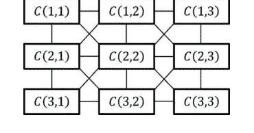

图 4.1 网格大小为 3×3 的二维 CNN：矩形代表细胞，细胞之间的连接表示局部细胞交互。

非线性偏微分方程的快速计算 [29]。因此，类比于具有给定热源输入的热传导方程所支配的生物软组织中的非线性生物热传导行为，本文提出的 CNN 被表述为给定电流源（类比为热源）通过非线性细胞动态特性的局部互连活动进行的全局传播。

考虑一个由 M 行 N 列的矩形计算阵列构成的二维 CNN，CNN 的动态特性由下式给出 [30]：

-   i. 细胞状态 $v_{xj}(t)$

$$ C_x\frac{dv_{xj}(t)}{dt}=-\frac{1}{R_x}v_{xj}(t)+\sum_{C(k,l)\in N_r(i,j)}A(i,j;k,l)v_{ykl}(t) $$
$$ +\sum_{C(k,l)\in N_r(i,j)}B(i,j;k,l)v_{ukl}(t)+I_{lj} \tag{4.4} $$

-   ii. 细胞输出 $v_{yij}(t)$

$$ v_{yij}(t)=\frac{1}{2}\left(|v_{xij}(t)+K|-|v_{xij}(t)-K|\right), K \geqslant 1 \tag{4.5} $$

-   iii. 约束条件

$$ v_{xij}(0) \leqslant K; \ |v_{ulj}| \leqslant K \tag{4.6} $$

-   iv. $r$-邻域

$$ N_r(i,j)=\left\{C(k,l)|\max\{|k-i|,|l-j|\} \leqslant r, 1 \leqslant k \leqslant M; 1 \leqslant l \leqslant N\right\} $$
$$ (1 \leqslant i \leqslant M; 1 \leqslant j \leqslant N) \tag{4.7} $$

其中 $(i,j)$ 和 $(k,l)$ 分别指代位于第 $i$ 行第 $j$ 列的细胞 $C(i,j)$ 和位于第 $k$ 行第 $l$ 列的细胞 $C(k,l)$；$r$ 是一个正整数（在我们的情况中，考虑到直接连接的细胞，$r = 1$）；$C_x$ 是线性电容的电容值，$R_x$ 是线性电阻的阻值，$I_{lj}$ 是电流源的电流，$A(i, j; k, l)$ 是输出反馈算子

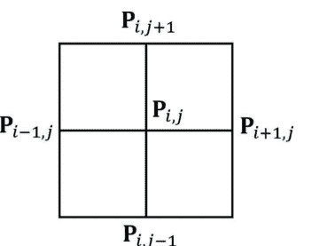

图 4.2 二维矩形网格上的生物热传导。

定义细胞与其相邻邻居之间的交互，而 $B(i,j,k;l)$ 是输入控制算子，定义输入对细胞状态的影响；$v_{u ij}(t)$、$v_{xij}(t)$ 和 $v_{yij}(t)$ 分别是时间 $t$ 时细胞 $C(i, j)$ 的输入、状态和输出。

当没有细胞输入时，公式 (4.4) 可以写为

$$ C_x \frac{d v_{xij}(t)}{dt} = -\frac{1}{R_x} v_{xij}(t) + \sum_{C(k,l) \in N_r(i,j)} A(i,j;k,l) v_{y kl}(t) + I_{ij} \quad (4.8) $$

这变成了一个自治 CNN [37]。

### 4.3.2 二维网格上的生物热传导 CNN 表述

#### 4.3.2.1 二维规则网格

如图 4.2 所示，二维矩形网格上生物热传导的 CNN 表述是通过使用有限差分法 (FDM) 在空间域对彭内斯生物热传导方程进行离散化而实现的，结果为：

$$ \begin{aligned} \rho_{i,j} C_{i,j} \frac{\partial T_{i,j}(t)}{\partial t} &= - \bigg( \frac{2 k_{i,j}}{\Delta u_{i-1} \Delta u_i} + \frac{2 k_{i,j}}{\Delta v_{j-1} \Delta v_j} + w_{b,i,j} C_{b,i,j} \bigg) T_{i,j}(t) \\ &+ \frac{2 k_{i+1,j} T_{i+1,j}(t)}{\Delta u_i(\Delta u_{i-1} + \Delta u_i)} + \frac{2 k_{i-1,j} T_{i-1,j}(t)}{\Delta u_{i-1}(\Delta u_{i-1} + \Delta u_i)} + \frac{2 k_{i,j+1} T_{i,j+1}(t)}{\Delta v_j(\Delta v_{j-1} + \Delta v_j)} \\ &+ \frac{2 k_{i,j-1} T_{i,j-1}(t)}{\Delta v_{j-1}(\Delta v_{j-1} + \Delta v_j)} + w_{b,i,j} C_{b,i,j} T_{a,i,j} + Q_{i,j} + H_{i,j} \quad (4.9) \end{aligned} $$

其中下标 $i,j$ 表示与细胞 $C(i,j)$ 相关的网格点 $i,j$ 处的相应量，且 $\Delta\boldsymbol{u}_{i-1}=\|\overrightarrow{\textbf{P}_{i-1,j}\overrightarrow{\textbf{P}_{i,j}}}\|$，$\Delta\boldsymbol{u}_{i}=\|\overrightarrow{\textbf{P}_{i,j}\overrightarrow{\textbf{P}_{i+1,j}}}\|$，$\Delta\boldsymbol{v}_{j-1}=\|\overrightarrow{\textbf{P}_{i,j-1}\overrightarrow{\textbf{P}_{i,j}}}\|$，以及 $\Delta\boldsymbol{v}_{j}=\|\overrightarrow{\textbf{P}_{i,j}\overrightarrow{\textbf{P}_{i,j+1}}}\|$，其中 $\|\overrightarrow{\bullet}\|$ 表示向量的模，$\textbf{P}_{i,j}(x_{i,j}, y_{i,j}, z_{i,j})$ 表示网格点 $i,j$ 的位置。可以看出，公式 (4.8) 和 (4.9) 非常相似；因此，通过将以下参数相关联，彭内斯生物热传导方程的离散形式（公式 4.9）被嵌入到自治 CNN（公式 4.8）中：

$$C_{x}=\rho_{i,j}C_{i,j};\ v_{xij}(t)=T_{i,j}(t);\ I_{ij}=w_{b,i,j}C_{b,i,j}T_{a,i,j}+Q_{i,j}+H_{i,j}$$

$$A = \left\{\begin{matrix}0 & \frac{2k_{i,j+1}}{\Delta v_{j}\left(\Delta v_{j-1}+\Delta v_{j}\right)} \\ \frac{2k_{i-1,j}}{\Delta u_{i-1}\left(\Delta u_{i-1}+\Delta u_{i}\right)} & -\left(\frac{2k_{i,j}}{\Delta u_{i-1}\Delta u_{i}}+\frac{2k_{i,j}}{\Delta v_{j-1}\Delta v_{j}}+w_{b,i,j}C_{b,i,j}\right) & \frac{1}{R_{x}} \\ 0 & \frac{2k_{i,j-1}}{\Delta v_{j-1}\left(\Delta v_{j-1}+\Delta v_{j}\right)}\end{matrix}\right. + \left\{\begin{matrix}0 \\ \frac{2k_{i+1,j}}{\Delta u_{i}\left(\Delta u_{i-1}+\Delta u_{i}\right)} \\ 0\end{matrix}\right\}\tag{4.10}$$

#### 4.3.2.2 二维不规则网格

为了在二维不规则网格（如三角形网格）上建立 CNN，将“$r$-邻域”的原始定义从矩形网格推广，以处理任意网格，其中网格点位置任意且与其相邻点相连。与网格点 $i$ 相关的细胞 $C(i)$ 的 $r$-邻域定义为

$$N_{r}(i)=\left\{C(j)|\text{links}\left(C(i),C(j)\right)\le r\right\}\tag{4.11}$$

自治 CNN 中细胞的状态由以下方程表示：

$$C_{x}\frac{dv_{xi}(t)}{dt}=-\frac{1}{R_{x}}v_{xi}(t)+\sum_{c(j)\in N_{r}(i)}A(i,j)v_{yj}(t)+I_{i}\tag{4.12}$$

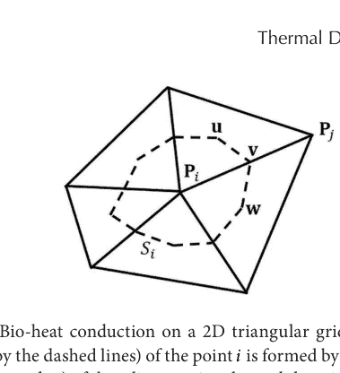

图 4.3 二维三角形网格上的生物热传导。点 $i$ 的控制区域 $S_i$（由虚线包围）是通过连接相邻三角形的质心（如 **u** 和 **w**）以及连接 $\mathbf{P}_i$ 和 $\mathbf{P}_j$ 的相邻边的中点（如 **v**）形成的。

其中下标 $i$ 和 $j$ 分别表示与细胞 $C(i)$ 和 $C(j)$ 相关的网格点 $i$ 和 $j$ 处的相应量。

为了在二维不规则网格上离散化彭内斯生物热传导方程，借助控制区域的概念 [55] 来实现 CNN 的表述。问题域被划分为有限个不重叠的控制区域，计算（网格）点位于中心，在此以离散方式强制执行能量守恒。点 $i$ 的一个控制区域示例如图 4.3 所示，它是通过连接三角形的质点以及相邻于 $\mathbf{P}_i$ 的边的中点形成的。

对于由控制区域 $S_i$ 包围的点 $i$，彭内斯生物热传导方程的离散形式可以表示为

$$\int_{S_i} \left( \rho_i C_i \frac{\partial T_i(t)}{\partial t} + w_{b,i} C_{b,i} \left( T_i(t) - T_{a,i} \right) - Q_i - H_i \right) dS = \int_{S_i} \nabla \cdot \left( k_i \nabla T_i(t) \right) dS \quad (4.13)$$

应用高斯散度定理可得

$$\begin{aligned} & \int_{S_i} \left( \rho_i C_i \frac{\partial T_i(t)}{\partial t} + w_{b,i} C_{b,i} \left( T_i(t) - T_{a,i} \right) - Q_i - H_i \right) dS \\ & = \int_{\partial S_i} k_i \nabla T_i(t) \cdot \mathbf{n} \, dl = \int_{\partial S_i} \left. \left( k_i \frac{\partial T(t)}{\partial \mathbf{n}} \right) \right|_i dl \quad (4.14) \end{aligned}$$


其中 **n** 是 $S_{i}$ 边界处指向外部的单位法向量。重新整理上述方程可得

$$
\rho_{i}C_{i}\frac{\partial T_{i}(t)}{\partial t} = \frac{1}{S_{i}} \int_{\partial S_{i}} k_{i}\left(\frac{\partial T(t)}{\partial \mathbf{n}}\right)_{i} dl - w_{b,i}C_{b,i}(T_{i}(t) - T_{a,i}) + Q_{i} + H_{i} \tag{4.15}
$$

该方程可近似为

$$
\begin{aligned} 
\rho_{i}C_{i}\frac{\partial T_{i}(t)}{\partial t} = \frac{1}{S_{i}} \sum_{j \in N_{r}(i)} \frac{(k_{j}T_{j}(t) - k_{i}T_{i}(t))}{l_{ij}}(l_{uv} + l_{vw}) \\
- w_{b,i}C_{b,i}(T_{i}(t) - T_{a,i}) + Q_{i} + H_{i} 
\end{aligned} \tag{4.16}
$$

其中 $l_{ij} = \lVert \overline{\mathbf{P}_i \mathbf{P}_j} \rVert$，$l_{uv} = \lVert \overline{\mathbf{uv}} \rVert$ 且 $l_{vw} = \lVert \overline{\mathbf{vw}} \rVert$。重新整理上述方程得到

$$
\begin{aligned} 
\rho_{i}C_{i}\frac{\partial T_{i}(t)}{\partial t} = -\left( \frac{1}{S_{i}} \sum_{j \in N_{r}(i)} \frac{k_{i}(l_{uv} + l_{vw})}{l_{ij}} + w_{b,i}C_{b,i} \right) T_{i}(t) \\
+ \frac{1}{S_{i}} \sum_{j \in N_{r}(i)} \frac{k_{j}(l_{uv} + l_{vw})}{l_{ij}} T_{j}(t) + w_{b,i}C_{b,i}T_{a,i} + Q_{i} + H_{i} 
\end{aligned} \tag{4.17}
$$

可以看出，公式 (4.12) 和 (4.17) 非常相似；因此，通过将以下参数相关联，彭恩斯生物热传导方程（公式 4.17）的离散形式被嵌入到自主 CNN（公式 4.12）中：

$$
C_{x} = \rho_{i}C_{i}; \ v_{xi}(t) = T_{i}(t); \ v_{yj}(t) = T_{j}(t); \ I_{i} = w_{b,i}C_{b,i}T_{a,i} + Q_{i} + H_{i}
$$

$$
\begin{aligned} 
A(i;i) = -\left( \frac{1}{S_{i}} \sum_{j \in N_{r}(i)} \frac{k_{i}(l_{uv} + l_{vw})}{l_{ij}} + w_{b,i}C_{b,i} \right) + \frac{1}{R_{x}} \\
A(i;j) = \frac{1}{S_{i}} \frac{k_{j}(l_{uv} + l_{vw})}{l_{ij}} 
\end{aligned} \tag{4.18}
$$

### 4.3.3 三维网格上的生物热传递 CNN 表述

### 4.3.3.1 三维规则网格

三维规则网格上的 CNN 表述可以通过将二维 CNN 推广到更高维度的情况来表达，即使用三维矩形单元数组。定义与单元 $C(i,j,k)$ 相关的网格点 $i,j,k$，以及 $\Delta w_{k-1}=||\mathbf{P}_{i,j,k-1}\mathbf{P}_{i,j,k}||$ 和 $\Delta w_{k}=||\mathbf{P}_{i,j,k}\mathbf{P}_{i,j,k+1}||$，其中 $\mathbf{P}_{i,j,k}$ 是网格点 $i,j,k$ 的位置。类比于使用有限差分法（FDM）的二维规则网格情况，三维规则网格上彭恩斯生物热传导方程的离散形式可以表示为

$$
\begin{aligned}
\rho_{i,j,k}C_{i,j,k}\frac{\partial T_{i,j,k}(t)}{\partial t} &= -\left(\frac{2k_{i,j,k}}{\Delta u_{i-1}\Delta u_{i}}+\frac{2k_{i,j,k}}{\Delta v_{j-1}\Delta v_{j}}+\frac{2k_{i,j,k}}{\Delta w_{k-1}\Delta w_{k}}+w_{b,i,j,k}C_{b,i,j,k}\right)T_{i,j,k}(t) \\
&+\frac{2k_{i+1,j,k}T_{i+1,j,k}(t)}{\Delta u_{i}(\Delta u_{i-1}+\Delta u_{i})}+\frac{2k_{i-1,j,k}T_{i-1,j,k}(t)}{\Delta u_{i-1}(\Delta u_{i-1}+\Delta u_{i})} \\
&+\frac{2k_{i,j+1,k}T_{i,j+1,k}(t)}{\Delta v_{j}(\Delta v_{j-1}+\Delta v_{j})}+\frac{2k_{i,j-1,k}T_{i,j-1,k}(t)}{\Delta v_{j-1}(\Delta v_{j-1}+\Delta v_{j})} \\
&+\frac{2k_{i,j,k+1}T_{i,j,k+1}(t)}{\Delta w_{k}(\Delta w_{k-1}+\Delta w_{k})}+\frac{2k_{i,j,k-1}T_{i,j,k-1}(t)}{\Delta w_{k-1}(\Delta w_{k-1}+\Delta w_{k})} \\
&+w_{b,i,j,k}C_{b,i,j,k}T_{a,i,j,k}+Q_{i,j,k}+H_{i,j,k}
\end{aligned} \tag{4.19}
$$

自主 CNN 的参数与离散彭恩斯生物热传导方程的参数相关联，从而得到：

$$
C_{x}=\rho_{i,j,k}C_{i,j,k}; \nu_{x}i_{jk}=T_{i,j,k}(t); \quad I_{jk}=w_{b,i,j,k}C_{b,i,j,k}T_{a,i,j,k}+Q_{i,j,k}+H_{i,j,k}
$$

$$
A(i,j,k;i,j,k)=-\left(\frac{2k_{i,j,k}}{\Delta u_{i-1}\Delta u_{i}}+\frac{2k_{i,j,k}}{\Delta v_{j-1}\Delta v_{j}}+\frac{2k_{i,j,k}}{\Delta w_{k-1}\Delta w_{k}}+w_{b,i,j,k}C_{b,i,j,k}\right)+\frac{1}{R_{x}}
$$

$$
\begin{aligned}
A(i,j,k;i+1,j,k)&=\frac{2k_{i+1,j,k}}{\Delta u_{i}(\Delta u_{i-1}+\Delta u_{i})} &; \quad A(i,j,k;i-1,j,k)&=\frac{2k_{i-1,j,k}}{\Delta u_{i-1}(\Delta u_{i-1}+\Delta u_{i})} \\
A(i,j,k;i,j+1,k)&=\frac{2k_{i,j+1,k}}{\Delta v_{j}(\Delta v_{j-1}+\Delta v_{j})} &; \quad A(i,j,k;i,j-1,k)&=\frac{2k_{i,j-1,k}}{\Delta v_{j-1}(\Delta v_{j-1}+\Delta v_{j})} \\
A(i,j,k;i,j,k+1)&=\frac{2k_{i,j,k+1}}{\Delta w_{k}(\Delta w_{k-1}+\Delta w_{k})} &; \quad A(i,j,k;i,j,k-1)&=\frac{2k_{i,j,k-1}}{\Delta w_{k-1}(\Delta w_{k-1}+\Delta w_{k})}
\end{aligned} \tag{4.20}
$$

### 4.3.3.2 二维非规则网格

在三维非规则网格上，生物热传递的 CNN 表述通过将从二维的控制区域扩展为三维的控制体积来实现 [56]。类比于二维三角网格中的控制区域，三维四面体网格中的控制体积是通过一个对偶网格建立的，该网格连接了与计算点相邻的四面体的边中点、面质心和质心。类似于二维非规则情况，对于由控制体积 $\Omega_i$ 包围的点 $i$，彭恩斯生物热传导方程的离散形式可以表示为

$$
\begin{aligned}
\rho_iC_i\frac{\partial T_i(t)}{\partial t} &= -\left(\frac{1}{\Omega_i}\sum_{j \in N_i(i)}\frac{k_i\sum^n S_{j,n}}{l_{ij}} + w_{b,i}C_{b,i}\right)T_i(t) \\
&+\frac{1}{\Omega_i}\sum_{j \in N_i(i)}\frac{k_j\sum^n S_{j,n}}{l_{ij}}T_j(t) + w_{b,i}C_{b,i}T_{a,i} + Q_i + H_i
\end{aligned} \tag{4.21}
$$

其中 $\sum^n S_{j,n}$ 表示连接到 $\mathbf{p}_i$ 和 $\mathbf{p}_j$ 之间的边的边界表面的总和 [57]。

自主 CNN 的参数与离散彭恩斯生物热传导方程的参数相关联，结果如下：

$$
\begin{aligned}
C_x &= \rho_iC_i; \nu_{xi} = T_i(t); \nu_{yj}(t) = T_j(t); I_i = w_{b,i}C_{b,i}T_{a,i} + Q_i + H_i \\
A(i;i) &= -\left(\frac{1}{\Omega_i}\sum_{j \in N_i(i)}\frac{k_i\sum^n S_{j,n}}{l_{ij}} + w_{b,i}C_{b,i}\right) + \frac{1}{R_x} \\
A(i;j) &= \frac{1}{\Omega_i}\frac{k_j\sum^n S_{j,n}}{l_{ij}}
\end{aligned} \tag{4.22}
$$

### 4.3.4 初始和边界条件

为了完整描述 CNN 模型，必须指定初始条件和边界条件。初始条件是通过将单元的初始状态赋予组织的初始温度来实现的，即

$$
v_{x}(0)=T(0)
$$

狄利克雷类型的边界条件是通过将固定状态单元赋予预设的恒定温度来强制执行的，即

$$
v_{x, b}(t)=T
$$

其中 $v_{x, b}(t)$ 表示指定区域边界上在时间 t 时刻的单元状态。

CNN 的时间演化直接提供了由彭恩斯生物热传导方程控制的软组织温度场，随后用于热剂量计算。

### 4.4 数值示例

### 4.4.1 特定患者的热剂量计算

采用一组具有异质组织的特定患者虚拟数字模型来分析个性化热消融治疗中肝肿瘤的热剂量。如图 4.4 所示，特定患者的解剖模型是根据一名匿名患者的计算机断层扫描（CT）医学图像数据集构建的（该数据集可在 https://www.irCAD.fr/research/3dicadb/ 获取），并将其分割和重建为肝脏和骨骼。热剂量 $CEM_{d_3}$ 是根据组织热暴露历史（公式 4.1）计算得出的，其中组织温度由嵌入生物热传递的 CNN 计算得出，其性能在参考文献 [41] 中此前已得到评估。组织的异质性是通过根据不同区域组织/肿瘤的材料特性将单元参数设置为不同值来建模的。

如图 4.5 所示，使用高斯分布类型的体积热源作为外部施加的热源。模拟的热源被用于证明 CNN 方法论在估计组织温度和热剂量方面的适用性，并且它们可以被替换为不同尺寸和形状的热源，例如由不同的热消融方式引起的热源。


### 4.4.2 在利用 HIFU 进行肝肿瘤消融中的应用

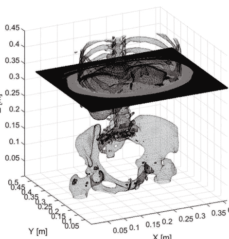

**图 4.4** 用于仿真的患者特定解剖模型网格：模型由 CT 图像数据集构建（显示了一个 DICOM 切片），该数据集被分割并重建为肝脏和骨骼。

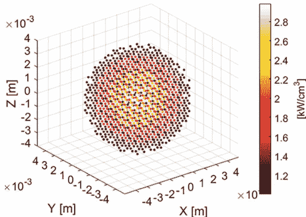

**图 4.5** 使用高斯分布类型的模拟体积热源作为热源，输入 Pennes 生物热传递方程以计算热剂量。

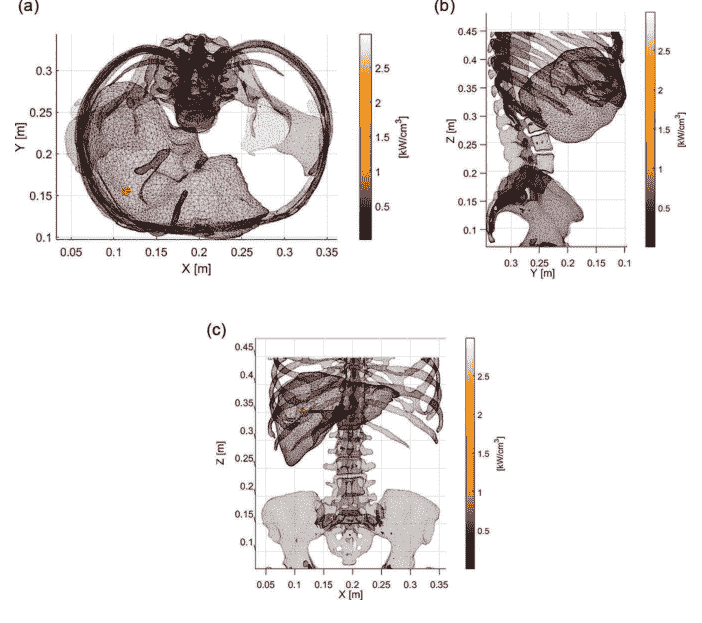

**图 4.6** 体积热源在肝脏中的几何布置，展示不同视角 (a)、(b) 和 (c)。

图 4.6 展示了模拟体积热源相对于患者特定解剖模型在肝脏中的几何布置。

热模拟应用了 5 秒（热源开启）和 5 秒（热源关闭）。肝脏使用的热材料属性为 $\rho = 1,060 [kg/m^3]$，$k = 0.518 [W/(m\cdot K)]$ 和 $C = 3,700 [J/(kg\cdot K)]$。初始组织温度设定为 $T(0) = 37^\circ C$。在模拟过程中，记录了热源中心的组织温度历史，如图 4.7 所示。模拟结束时造成组织热损伤的热剂量 $240 CEM_{43}$ 如图 4.8 所示。

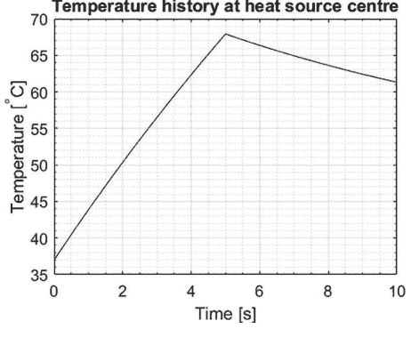

**图 4.7** 热源中心处的组织温度历史。

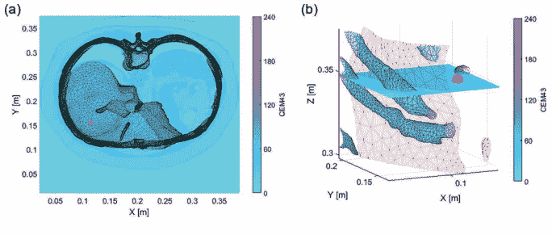

**图 4.8** 模拟结束（10 秒）时造成组织热损伤的 240 CEM₄₃：(a) 肝脏内诱导的病灶和 (b) 肝脏内的 3D 体积病灶；色标仅应用于热源区域，不适用于 CT 切片。

如前所述，肝肿瘤的热消融治疗可以通过各种方式实现，例如射频消融 (RFA)、微波消融 (MWA)、激光和 HIFU，通过产生热量诱导细胞热损伤以治疗癌症。与 RFA、MWA 和激光相比，HIFU 具有固有的优势，即不需要引入施械即可实现消融效果，并且是唯一一种无创选项。如图 4.9 所示，HIFU 治疗使用 HIFU 换能器诱发高强度超声波，聚焦于肿瘤区域，那里的机械振动能量以热的形式被组织吸收，作为热源通过完整的皮肤增加局部组织温度，导致肿瘤凝固性坏死。

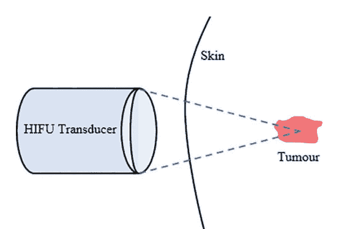

**图 4.9** HIFU 消融原理示意图：HIFU 换能器放置在患者皮肤外，诱发高强度超声波聚焦于目标肿瘤，导致细胞凝固性坏死。

使用 CNN 进行了患者特定肝肿瘤 HIFU 治疗的计算机模拟。除了肝脏和骨骼外，CT 图像进一步被分割为皮肤、脂肪和肌肉；HIFU 换能器放置在患者皮肤外，其中介质被分割为水。超声波穿过水、皮肤、脂肪和肌肉传播并聚焦于肝肿瘤。超声波的传播使用非线性全波 Westervelt 方程 [58] 进行模拟，在占据 121.3×65.3×65.3 mm 计算域的均匀 208×112×112 网格上进行。模拟使用的 HIFU 换能器直径 $D$ = 60 mm，曲率半径 $R$ = 75 mm，工作频率 $f$ = 1 MHz，表面压力为 0.3 MPa。表 4.1 列出了每种组织的典型声特性值。

### 表 4.1 异质组织的声学特性

| | 密度 [kg/m³] | 声速 [m/s] | 衰减 [dB/MHz/cm] | B/A |
|---|---|---|---|---|
| 水 | 998 | 1,482 | 0.00217 | 5.2 |
| 皮肤 | 1,090 | 1,615 | 0.35 | 7.9 |
| 脂肪 | 985 | 1,465 | 0.40 | 8.5 |
| 肌肉 | 1,055 | 1,575 | 0.60 | 7.0 |
| 肝脏 | 1,060 | 1,595 | 0.50 | 6.6 |

由于超声波在组织中的传播，形成了声压场，由于超声波在组织中以热的形式衰减，利用该声压场来获得 HIFU 诱导的热源。由于模拟的声场是非线性的，其中会出现更高的谐波频率，因此使用谐波分量来确定非线性热源 *H*，即：

$$H = \frac{1}{\rho c} \sum_{k=1}^{K} \alpha_k p_k^2 \qquad (4.25)$$

其中 *c* 是组织中的声速，$\alpha_k$ 是第 *k* 次谐波的衰减系数，其遵循形式为 $\alpha = \alpha_0 \omega^y$ [59] 的频率幂律（在我们的案例中 *y* = 1.3），$\omega$ 是角频率，*p**k* 是第 *k* 次谐波分量的声压，*K* 是谐波数量（在我们的案例中 *K* = 3，以平衡数值精度和计算资源）。计算出的热源 *H* 代入公式 (4.3) 以计算肝脏组织中的温度场。

图 4.10 说明了 HIFU 换能器的几何布置以及从超声压场计算得出的诱导热源。通过将聚焦超声换能器放置在几何焦点位于目标区域内且避免肋骨（骨组织和被困气体/空气腔体可能干扰 HIFU 模态并影响剂量传递）的方式，在目标区域内诱导热能。因此，必须相应地规划治疗。值得一提的是，由于 HIFU 换能器放置在肋骨之间（肋间窗口），这可能限制肝脏中期望的 HIFU 剂量的可达性，可能需要使用多个 HIFU 探头通过多个路径协同工作 [60,61]。

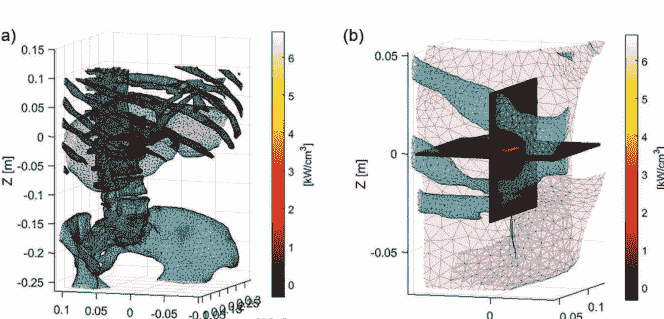

**图 4.10** (a) 通过将聚焦超声换能器放置在几何焦点位于目标区域内且超声波可通过肋间窗口（肋骨间隙）的方式，在目标区域内诱导热沉积；(b) (a) 的特写视图。

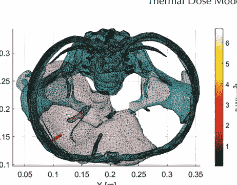

**图 4.11** 目标肝脏区域的 HIFU 诱导体积热源。

如图 4.11 所示，在目标肝脏区域内诱导了体积热源。

热模拟应用了 3.5 秒（热源开启）和 11.5 秒（热源关闭）。肝脏的热材料属性与第 4.4.1 节中提到的相同。初始组织温度设定为 $T(0)=37^{\circ}\mathrm{C}$。在模拟过程中，记录了换能器焦点处的组织温度历史，如图 4.12 所示。模拟结束时造成组织热损伤的热剂量 240 $\mathrm{CEM}_{43}$ 如图 4.13 所示。

### 4.5 讨论

与传统的数值方法相比，CNN 提供了一种快速求解生物热传递方程以进行热剂量建模的方法，这归功于细胞集体的和同时的计算活动。非线性生物热传递动力学由非线性细胞动力学来建模，以细胞局部相互作用和全局传播的方式随时间演变。软组织的异质性通过根据不同区域组织/肿瘤的材料属性将单元参数设置为不同值来容纳。

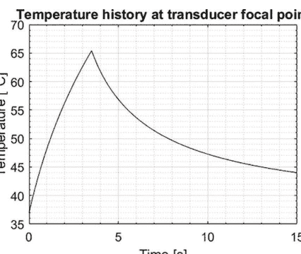

**图 4.12** 换能器焦点处的组织温度历史。

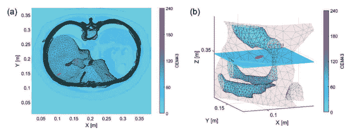

**图 4.13** 模拟结束（15 秒）时造成组织热损伤的 $240 \mathrm{CEM}_{43}$：(a) 肝脏内诱导的病灶和 (b) 肝脏内的 3D 体积病灶；色标仅应用于热源区域，不适用于 CT 切片。

与 CNN 传统的应用领域（主要用于图像处理）相比，本文提出的 CNN 被制定为融入生物热传递机制，以有效和高效地计算软组织温度场，并用于计算机辅助热消融癌症治疗。

热剂量的计算（公式 4.1）表明，热剂量受组织热暴露历史的影响，这与组织温度和加热持续时间相关。随着变化


组织温度的变化由生物热传递方程决定，其中的激励输入是由各种热模态诱导产生的热源，操作员可以通过消融仪器的功率和加热时间控制热剂量。在组织中的同一点上，相同的热剂量可以通过以下两种途径实现：（1）高功率输入配合短加热时间，或（2）低功率输入配合长加热时间；然而，热剂量分布（如图 4.8 和 4.13 所示）在情况（1）和（2）下可能有所不同，因为较长的加热期间热剂量的变化更容易受到热扩散和血液灌注效应的影响，而当加热时间较短时，这些效应则不明显。此外，值得注意的是，组织加热是一个动态过程，由于与温度相关的材料特性 [62] 和组织变形（如器官运动 [63] 以及热胀冷缩效应），组织的材料属性和物理几何形状会发生动态变化，对这两者进行补偿可能会带来更精确的热剂量计算。

虽然射频消融（RFA）和微波消融（MWA）等微创热模态在治疗肝肿瘤方面是有效的，并提供了比肝切除术更安全的选项，但它们也表现出一些局限性。例如，RFA 的主要并发症发生率约为 $\approx4\%$，死亡率较低，$\leq1\%$ [64]。大多数并发症，如肠穿孔或胆管损伤，是由于肝脏邻近器官组织受热损伤所致，特别是对于被膜下肿瘤以及靠近肝门和胆囊的肿瘤 [65]。术中 RFA 已被用来避免这些并发症，但这种方案侵入性更强，可能导致更多的并发症和副作用。此外，由于血液灌注产生的热沉效应限制了达到热消融所需高温的能力，大血管附近的肿瘤难以被完全消融。实验研究 [66,67] 表明，如果热源以高能量强度和短加热时间（$\leq 2$ 秒）诱导，这个问题就不太明显，因为加热会迅速进行，较少受到热扩散和血液灌注效应的影响。

正如 4.4.2 节所述，与 RFA 和 MWA 相比，高强度聚焦超声（HIFU）肿瘤消融代表了非侵入性肝癌治疗手段的优势；然而，另一方面，它要求精确追踪器官运动，以便将 HIFU 换能器的焦点区域与目标肿瘤同步，从而准确诱导所需的热损伤水平 [68]。由于肝脏的生理运动，主要由呼吸循环 [69] 引起，并在较小程度上由心脏运动和肠道运动引起，目标肿瘤会不断移动和变形，这使得精确且有效的 HIFU 能量沉积变得复杂。因此，最近的方法侧重于连续目标追踪技术，可以在运动周期内将超声波束锁定在目标上，从而实现连续的能量沉积。实时磁共振成像（MRI）和诊断超声已被证明是可行的追踪模态 [70,71]。此外，由于器官运动，计算热剂量时必须考虑软组织变形 [72,73]，软组织温度场必须基于组织的变形状态进行计算，才能准确计算组织变形下的热剂量 [74]。

### 4.6 结论

这项工作提出了一种基于 CNN 的方法，用于快速计算和分析热消融治疗中管理肝肿瘤所需的软组织温度和热剂量。为了避免复杂且昂贵的非线性数值求解过程，通过将非线性生物热传递公式化为 CNN 中非线性的集体且同时发生的局部和全局细胞活动，开发了 CNN 模型，从而在二维和三维规则及非规则网格上建立了嵌入生物热传递机制的神经网络模型，以便在计算机辅助热消融治疗中进行快速温度计算。通过一种与临床相关的场景——即在患者特定的 HIFU 治疗中针对肝癌进行肿瘤管理的剂量化建模，展示了 CNN 模型的应用。

## 致谢

感谢澳大利亚国家健康与医学研究理事会（NHMRC）项目资助计划 APP1093314 的资金支持。

## 参考文献

- 1. D. J. Breen, and R. Lencioni, “Image-guided ablation of primary liver and renal tumours,” *Nat Rev Clin Oncol*, vol. 12, no. 3, pp. 175–86, 2015.
- 2. Y. Fang, W. Chen, X. Liang, D. Li, H. Lou, R. Chen, K. Wang, and H. Pan, “Comparison of long-term effectiveness and complications of radiofrequency ablation with hepatectomy for small hepatocellular carcinoma,” *J Gastroenterol Hepatol*, vol. 29, no. 1, pp. 193–200, 2014.
- 3. M. W. Lee, S. S. Raman, N. H. Asvadi, S. Siripongsakun, R. M. Hicks, J. Chen, A. Worakitsitisatorn, J. McWilliams, M. J. Tong, R. S. Finn, V. G. Agopian, R. W. Busuttil, and D. S. K. Lu, "Radiofrequency ablation of hepatocellular carcinoma as bridge therapy to liver transplantation: A 10-year intention-to-treat analysis," *Hepatology*, vol. 65, no. 6, pp. 1979–1990, 2019.
- 4. M. Moche, H. Busse, J. J. Fuetterer, C. A. Hineastrosa, D. Seider, P. Brandmaier, M. Kolesnik, S. Jenniskens, R. Blanco Sequeiros, G. Komar, M. Pollari, M. Eibisberger, H. R. Portugaller, P. Voglreiter, R. Flanagan, P. Mariappan, and M. Reinhardt, "Clinical evaluation of in silico planning and real-time simulation of hepatic radiofrequency ablation (ClinicIMMPACT Trial)," *Eur Radiol*, pp. 1–9, 2019.
- 5. V. Lopresto, R. Pinto, L. Larina, and M. Cavanaro, "Treatment planning in microwave thermal ablation: Clinical gaps and recent research advances," *Int J Hyperthermia*, vol. 33, no. 1, pp. 83–100, 2017.
- 6. E. Li, G. R. Liu, V. Tan, and Z. C. He, "Modeling and simulation of bio-heat transfer in the human eye using the 3D alpha finite element method ($\alpha$FEM)," *Int J Numer Method Biomed Eng*, vol. 26, no. 8, pp. 955–976, 2010.
- 7. E. Li, G. R. Liu, and V. Tan, "Simulation of hyperthermia treatment using the edge-based smoothed finite-element method," *Numer Heat Transfer A: Appl*, vol. 57, no. 11, pp. 822–847, 2010.
- 8. P. Rattanadecho, and P. Keangin, "Numerical study of heat transfer and blood flow in two-layered porous liver tissue during microwave ablation process using single and double slot antenna," *Int J Heat Mass Transfer*, vol. 58, no. 1–2, pp. 457–470, 2013.
- 9. C. Rieder, T. Kroger, C. Schumann, and H. K. Hahn, "GPU-based real-time approximation of the ablation zone for radiofrequency ablation," *IEEE Trans Vis Comput Graph*, vol. 17, no. 12, pp. 1812–1821, 2011.
- 10. P. C. Johnson, and G. M. Saidel, "Thermal model for fast simulation during magnetic resonance imaging guidance of radio frequency tumor ablation," *Ann Biomed Eng*, vol. 30, no. 9, pp. 1152–1161, 2002.
- 11. M. Schwenske, J. Georgii, and T. Preusser, "Fast numerical simulation of focused ultrasound treatments during respiratory motion with discontinuous motion boundaries," *IEEE Trans Biomed Eng*, vol. 64, no. 7, pp. 1455–1468, 2017.
- 12. G. Kalantzis, W. Miller, W. Tichy, and S. LeBlang, "A GPU accelerated finite differences method of the bioheat transfer equation for ultrasound thermal ablation," *Software Engineering, Artificial Intelligence, Networking and Parallel/Distributed Computing*, Roger Lee, Ed. pp. 45–55: Springer, Switzerland, 2016.
- 13. J. Zhang, J. Hills, Y. Zhong, B. Shirinzadeh, J. Smith, and C. Gu, "Gpu-accelerated finite element modeling of bio-heat conduction for simulation of thermal ablation," *Journal of Mechanics in Medicine and Biology*, vol. 18, no. 07, p. 1840012, 2018.
- 14. J. Zhang, J. Hills, Y. Zhong, B. Shirinzadeh, J. Smith, and C. Gu, "Modeling of soft tissue thermal damage based on GPU acceleration," *Comput Assist Surg (Abingdon)*, vol. 24, no. supl, pp. 5–12, 2019.


15. P. Mariappan, P. Weir, R. Flanagan, P. Voglreiter, T. Alhonnoro, M. Pollari, M. Moche, H. Busse, J. Futterer, H. R. Portugaller, R. B. Sequeiros, and M. Kolesnik, “基于GPU的RFA模拟用于肝脏肿瘤微创癌症治疗,” *Int J Comput Assist Radiol Surg*, vol. 12, no. 1, pp. 59–68, 2017.

16. Z.-Z. He, and J. Liu, “真实组织结构中生物热传递的高效并行数值建模,” *Int J Heat Mass Trans*, vol. 95, pp. 843–852, 2016.

17. G. Carluccio, D. Erricolo, S. Oh, and C. M. Collins, “使用空间滤波器近似热传导效应以快速计算组织温度变化的方法,” *IEEE Trans Biomed Eng*, vol. 60, no. 6, pp. 1735–1741, 2013.

18. J. Zhang, and S. Chauhan, “瞬态热传递的快速显式动力学有限元算法,” *Int J Therm Sci*, vol. 139, pp. 160–175, 2019.

19. J. Zhang, and S. Chauhan, “快速显式动力学有限元算法（FED-FEM）框架下生物热传递的实时计算,” *Numer Heat Transfer B: Fundament*, vol. 75, no. 4, pp. 217–238, 2019.

20. J. L. Dillenseger, and S. Esneault, “基于快速FFT的生物热传递方程计算,” *Comput Biol Med*, vol. 40, no. 2, pp. 119–23, 2010.

21. M. E. Kowalski, and J. M. Jin, “电磁相控阵热疗非线性模型的降阶,” *IEEE Trans Biomed Eng*, vol. 50, no. 11, pp. 1243–1254, 2003.

22. J. H. Indik, R. A. Indik, and T. C. Cetas, “任意取向铁磁种子阵列用于热疗规划的快速高效计算机建模,” *Int J Radiat Oncol Biol Phys*, vol. 30, no. 3, pp. 653–662, 1994.

23. R. A. Indik, and J. H. Indik, “一种快速准确计算铁磁种子加热稳态温度的新计算机方法,” *Med Phys*, vol. 21, no. 7, pp. 1135–1144, 1994.

24. G. C. Bourantas, M. Ghommem, G. C. Kagadis, K. Katsanos, V. C. Loukoupolous, V. N. Burganos, and G. C. Nikiforidis, “基于动态模态分解方法的实时肿瘤消融模拟,” *Med Phys*, vol. 41, no. 5, p. 053301, 2014.

25. J. Zhang, Y. Zhong, and C. Gu, “用于手术模拟软组织变形的神经网络建模,” *Artif Intell Med*, vol. 97, pp. 61–70, 2019.

26. J. Zhang, Y. Zhong, and C. Gu, “基于神经动力学的反应扩散力学软组织变形建模,” *Med Biol Eng Comput*, vol. 56, no. 12, pp. 2163–2176, 2018.

27. J. Zhang, Y. Zhong, J. Smith, and C. Gu, “用于手术模拟软组织动力学的胞元神经网络建模,” *Technol Health Care*, vol. 25, no. S1, pp. 337–344, 2017.

28. J. Zhang, Y. Zhong, J. Smith, and C. Gu, “基于ChainMail的神经动力学软组织变形建模用于手术模拟,” *Technol Health Care*, vol. 25, no. S1, pp. 231–239, 2017.

29. J. C. Chedjou, and K. Kymakya, “一种基于胞元神经网络的通用概念，用于超快速和灵活求解微分方程,” *IEEE Trans Neural Netw Learn Syst*, vol. 26, no. 4, pp. 749–762, 2015.

30. L. O. Chua, and L. Yang, “胞元神经网络：理论,” *IEEE Trans Circuit Syst*, vol. 35, no. 10, pp. 1257–1272, 1988.

31. L. O. Chua, and L. Yang, “胞元神经网络：应用,” *IEEE Trans Circuit Syst*, vol. 35, no. 10, pp. 1273–1290, 1988.

32. Á. Zarándy, C. Rekeczky, P. Szolgay, and L. O. Chua, “CNN研究综述：25年历史与当前趋势,” pp. 401–404.

33. A. Slavova, *胞元神经网络：动力学与建模*: Springer Science & Business Media, Dordrecht, 荷兰, 2003.

34. T. Roska, L. O. Chua, D. Wolf, T. Kozek, R. Tetzlaff, and F. Puffer, “通过CNN模拟非线性波和偏微分方程. I. 基本技术,” *IEEE Trans Circuit Syst I: Fundament Theory Appl*, vol. 42, no. 10, pp. 807–815, 1995.

35. T. Kozek, L. O. Chua, T. Roska, D. Wolf, R. Tetzlaff, F. Puffer, and K. Lotz, “通过CNN模拟非线性波和偏微分方程. II. 典型示例,” *IEEE Trans Circuit Syst I: Fundament Theory Appl*, vol. 42, no. 10, pp. 816–820, 1995.

36. P. Szolgay, G. Voros, and G. Eross, “关于胞元神经网络范式在机械振动系统中的应用,” *IEEE Trans Circuit Syst I: Fundament Theory Appl*, vol. 40, no. 3, pp. 222–227, 1993.

37. L. O. Chua, M. Hasler, G. S. Moschytz, and J. Neiryck, “自主胞元神经网络：模式形成和主动波传播的统一范式,” *IEEE Trans Circuit Syst I: Fundament Theory Appl*, vol. 42, no. 10, pp. 559–577, 1995.

38. Y. Zhong, B. Shirinzadeh, G. Alici, and J. Smith, “用于可变形物体模拟的胞元神经网络方法,” *IEEE Trans Inf Technol Biomed*, vol. 10, no. 4, pp. 749–762, 2006.

39. J. Zhang, Y. Zhong, J. Smith, and C. Gu, “基于神经动力学的Poisson传播用于可变形建模,” *Neur Comput Appl*, vol. 31, no. S2, pp. 1091–1101, 2017.

40. J. H. Niu, H. Z. Wang, H. X. Zhang, J. Y. Yan, and Y. S. Zhu, “二维生物热传递方程的胞元神经网络分析,” *Med Biol Eng Comput*, vol. 39, no. 5, pp. 601–604, 2001.

41. J. Zhang, and S. Chauhan, “热治疗应用中生物热传递实时建模的神经网络方法,” *Artif Intell Med*, vol. 101, p. 101728, 2019.

42. P. Liu, J. Qin, B. Duan, Q. Wang, X. Tan, B. Zhao, P. L. Jonnathan, C. K. Chui, and P. A. Heng, “大肝癌的重叠射频消融规划与机器人辅助针头插入,” *Int J Med Robot*, vol. 15, no. 1, p. e1952, 2019.

43. T. Williamson, S. Everitt, and S. Chauhan, “肝脏肿瘤机器人HIFU治疗的自动化几何优化,” *Comput Biol Med*, vol. 96, pp. 1–7, 2018.

44. C. W. Huang, M. K. Sun, B. T. Chen, J. Shieh, C. S. Chen, and W. S. Chen, “具有温度依赖特性的强聚焦超声热消融模拟,” *Ultrason Sonochem*, vol. 27, pp. 456–465, 2015.

45. S. Haddadi, and M. T. Ahmadian, “体外肝组织中高强度聚焦超声诱导损伤的数值与实验评估,” *J Ultrasound Med*, vol. 37, no. 6, pp. 1481–1491, 2018.

46. H. H. Pennes, “静止人体前臂组织与动脉血温度分析,” *J Appl Physiol*, vol. 1, no. 2, pp. 93–122, 1948.

47. M. C. Kolyos, A. E. Worthington, M. D. Sherar, and J. W. Hunt, “使用瞬态温度分析实验评估两种简单热模型,” *Phys Med Biol*, vol. 43, no. 11, p. 3325, 1998.

48. E. H. Wissler, “重温Pennes 1948年的论文,” *J Appl Physiol*, vol. 85, no. 1, pp. 35–41, 1998.

49. E. H. Ooi, K. W. Lee, S. Yap, M. A. Khattab, I. Y. Liao, E. T. Ooi, J. J. Foo, S. R. Nair, and A. F. Mohd Ali, “电气和热边界条件对模拟位于肝脏边界附近肿瘤射频消融的影响,” *Comput Biol Med*, vol. 106, pp. 12–23, 2019.

50. W. Karaki, Rahul, C. A. Lopez, D. A. Borca-Tasciuc, and S. De, “水合软生物组织体内电外科加热的连续体热力学模型,” *Int J Heat Mass Transf*, vol. 127, no. Pt A, pp. 961–974, 2018.

51. P. Gupta, and A. Srivastava, “高强度聚焦超声作用于组织的热响应数值分析,” *Int J Hyperthermia*, vol. 35, no. 1, pp. 419–434, 2018.

52. B. Prasad, J. K. Kim, and S. Kim, “模拟在临床射频热疗治疗规划中的作用,” *J Oncol*, vol. 2019, p. 9685476, 2019.

53. P. Thiran, G. Setti, and M. Hasler, “一维胞元神经网络中信息传播的方法——第一部分：局部扩散,” *IEEE Trans Circuit Syst I: Fundamental Theory Appl*, vol. 45, no. 8, pp. 777–789, 1998.

54. G. Setti, P. Thiran, and C. Serpico, “一维胞元神经网络中信息传播的方法. 第二部分：全局传播,” *IEEE Trans Circuit Syst I: Fundamental Theory Appl*, vol. 45, no. 8, pp. 790–811, 1998.

55. D. R. Croft, and D. G. Lilley, *使用有限差分方程进行热传递计算*: Applied science publishers, 伦敦, 1977.

56. M. Ciesielski, and B. Mochanacki, “生物组织—防护服系统受外部热源作用的热相互作用双曲模型,” *J Numer Heat Transfer A: Appl*, vol. 74, no. 11, pp. 1685–1700, 2018.

57. J. Zhang, Y. Zhong, J. Smith, and C. Gu, “用于手术模拟的非线性软组织变形能量传播建模,” *Simulation*, vol. 94, no. 1, pp. 3–10, 2017.


58. J. Gu 和 Y. Jing，“医学超声中的波传播建模：综述”，*IEEE Trans Ultrason Ferroelectr Freq Control*，第62卷，第11期，页码7979–1993，2015年。

59. B. E. Treeby 和 B. T. Cox，“使用分数阶拉普拉斯算子建模声传播中的幂律吸收和色散”，*J Acoust Soc Am*，第127卷，第5期，页码2741–2748，2010年。

60. S. Chauhan, H. Amir, G. Chen, A. Haecker, M. S. Michel 和 K. U. Koehrmann，“术中反馈和动态补偿用于影像引导的机器人聚焦超声手术”，*Comput Aided Surg*，第13卷，第6期，页码353–368，2008年。

61. A. Häcker, S. Chauhan, K. Peters, R. Hildenbrand, E. Marlinghaus, P. Alken 和 M. S. Michel，“多探头高强度聚焦超声用于肾脏组织消融”，*J Endourol*，第19卷，第8期，页码1036–1040，2005年。

62. J. Zhang, J. Hills, Y. Zhong, B. ShirinZadeh, J. Smith 和 C. Gu，“软组织变形的温度依赖性热力学建模”，*Journal of Mechanics in Medicine and Biology*，第18卷，第08期，页码1840021，2019年。

63. R. H. Abhilash, S. Chauhan, M. V. Che, C. C. Ooi, R. A. Bakar 和 R. H. Lo，“病变对呼吸诱导肾脏运动影响的定量研究”，*Ultrasound Med Biol*，第42卷，第7期，页码1681–1688，2016年。

64. R. A. Lencioni, H. P. Alagaier, D. Cioni, M. Olschewski, P. Eibel, L. Crocetti, H. Frings, J. Lubeenberger, I. Zuber, H. E. Blum 和 C. Bartolazzi，“肝硬化中的小肝细胞癌：射频热消融与经皮乙醇注射的随机对照比较”，*Radiology*，第228卷，第1期，页码235–240，2003年。

65. T. Livraghi, F. Meloni, M. Di Stasi, E. Rolle, L. Solbiati, C. Tinelli 和 S. Rossi，“肝硬化中极早期肝细胞癌射频消融后的持续完全缓解率和并发症率：切除是否仍是首选治疗方法？”，*Hepatology*，第47卷，第1期，页码82–89，2008年。

66. S. B. Solomon, T. L. Nicol, D. Y. Chan, T. Fjeld, N. Fried 和 L. R. Kavoussi，“兔肌肉中高强度聚焦超声的组织学演变”，*Invest Radiol*，第38卷，第5期，页码293–301，2003年。

67. C. X. Zhang, S. Zhang, Z. Zhang 和 Y. Z. Chen，“大血管位置对肝脏肿瘤高强度聚焦超声治疗的影响：一项有限元研究”，*2005 IEEE Engineering in Medicine and Biology 27th Annual Conference*，上海，中国，2005年，页码209-212，doi: 10.1109/EMBS.2005.1616380。

68. R. H. Abhilash 和 S. Chauhan，“肾脏运动的经验建模以改善聚焦超声手术中的靶点定位”，*Comput Biol Med*，第43卷，第4期，页码240–247，2013年。

69. R. H. Abhilash 和 S. Chauhan，“呼吸诱导运动相关性用于同步无创肾癌手术”，*IEEE Trans Ultrason Ferroelectr Freq Control*，第59卷，第7期，页码1478–1486，2012年。

70. M. Ries, B. D. de Senneville, S. Roujol, Y. Berber, B. Queson 和 C. Moonen，“运动组织中MRI引导聚焦超声消融的实时3D靶点追踪”，Magn Reson Med，第64卷，第6期，页码1704–1712，2010年。

71. T. Williamson, W. Cheung, S. K. Roberts 和 S. Chauhan，“基于超声的肝脏追踪利用混合模板/光流方法”，Int J Comput Assist Radiol Surg，第13卷，第10期，页码1605–1615，2018年。

72. J. Zhang, Y. Zhong 和 C. Gu，“用于软组织变形建模的能量平衡法”，Comp. Aid. Des.，第93卷，页码15–25，2017年。

73. J. Zhang, Y. Zhong 和 C. Gu，“可变形模型用于手术模拟：综述”，IEEE Rev Biomed Eng，第11卷，页码143–164，2018年。

74. J. Zhang 和 S. Chauhan，“基于快速显式动力学有限元算法用于手术模拟的变形下软组织热响应快速计算”，Comput Methods Programs Biomed，第187卷，页码105244，2019年。

## 第5章

### 使用不同激活函数的小样本至中样本生物医学数据集卷积神经网络集成

Filippo Berno, Loris Nanni,
和 Gianluca Maguolo

*帕多瓦大学*

*意大利，帕多瓦*

Sheryl Brahnam

*密苏里州立大学*

*密苏里州，斯普林菲尔德*

### 目录

- 5.1 简介 .........56
- 5.2 三个CNN的激活函数....58
  - 5.2.1 ReLu....59
  - 5.2.2 Leaky ReLU...60
  - 5.2.3 ELU....60
  - 5.2.4 SELU 60
  - 5.2.5 PReLU 61
  - 5.2.6 SReLU 61
  - 5.2.7 APLU 62
  - 5.2.8 MeLU 63
  - 5.2.9 GaLU 64
- 5.3 实验结果 66
- 5.4 结论 72
- 致谢 72
- 参考文献 73

### 5.1 简介

在人工智能领域，自20世纪40年代以来，神经网络的 popularity 时冷时热，但在过去十年中，基于人工神经网络的深度学习在许多工程应用领域 [1,2] 和基础科学领域 [3–5] 成为颠覆性技术。深度学习模型，如卷积神经网络（CNNs），在许多计算机视觉任务中持续取得最先进的结果，例如图像分类 [1,6]、目标检测 [7]、人脸识别 [8] 和机器翻译 [9]。CNN 也被证明在许多识别任务中比人类更准确，包括交通标志识别 [10]、人脸 [11,12]、手写数字 [10,13] 以及 ImageNet 数据集中的1000个类别 [14,15]。

由于激活函数在深度神经网络的训练动态和任务性能中起关键作用，开发更高效、性能更好的激活函数成为许多研究者的焦点。直到最近，Sigmoid 和双曲正切（hyperbolic tangent）是神经网络中最广泛使用的激活函数。虽然双曲正切函数的优势在于其导数比 Sigmoid 函数更陡峭，但它们都患有梯度消失问题，且在深度神经网络的训练中表现不佳，部分原因是随着输入模趋向无穷大，梯度迅速减小。然而，越来越多的证据表明，其他非线性函数可以改进神经网络的性能。例如，Glorot 等人 [16] 证明了整流线性单元（ReLU）在训练深度网络方面的优越性。ReLU 是一种激活函数，当输入为正时等于恒等函数，当输入为负时等于零 [17]。尽管该函数不可微，但它仍使 AlexNet 在2012年赢得了 ImageNet 竞赛 [1]。

由于 ReLU 的成功以及该激活函数快速、有效且易于评估的特性，深度学习领域的许多研究人员开始探索其他整流非线性的性质。例如，Mass [18] 提出的 Leaky ReLU 是一种激活函数，与 ReLU 类似，对于正值等于恒等函数，但对于负输入具有超参数 \(\alpha>0\)。这个超参数保证激活函数的梯度永远不会为零，从而使优化过程不太可能陷入局部极小值。Leaky ReLU 的另一个优点是它缓解了由 ReLU 的硬性零激活引起的问题，这些问题可能导致某些单元永远不被激活，当网络存在过多的恒定零梯度时，会显著减慢训练速度。另一种整流非线性是指数线性单元（ELU），由 Clevert 等人 [19] 提出，它类似于 Leaky ReLU，但随着输入趋向负无穷大，它以指数方式衰减到极限点 \(\alpha\)，从而始终产生正梯度。然而，与 Leaky ReLU 不同，ELU 在其左侧饱和。由 Klambauer 等人 [20] 提出的缩放指数线性单元（SELU）也是为了缓解梯度消失问题而开发的。SELU 与 ELU 相同，但乘以常数 \(\lambda>1\) 以保持输入特征的均值和方差。

过去，激活函数是手工制作的，仅修改神经网络中的权重和偏置，函数中没有任何部分依赖于可学习参数。这种情况在2015年发生了变化，当时 He 等人 [14] 提出了参数化 ReLU（PReLU）。PReLU 是修改后的 Leaky ReLU，其中负部分的斜率是一个可学习参数。由于额外的可学习参数增加了过拟合的可能性，PReLU 在极其大的数据集上效果最好。自那时以来，已经提出了许多可学习激活函数 [21,22]。与此工作相关的是由 Agostinelli 等人 [21] 提出的自适应分段线性单元（APLU）。APLU 是一个分段线性函数，其斜率和非可微点在训练阶段通过梯度下降独立地为每个神经元进行学习。

定义可学习激活函数的一种简单方法是开始使用多个固定激活函数，如 Manessi 和 Rozza [23] 的工作，他们生成了一个可学习激活函数，自动学习基本激活函数 tanh、ReLU 和恒等函数的不同组合。Jin 等人使用 S 形整流线性激活单元（SReLU）来学习凸函数和非凸函数，从而模拟两个基本定律：Weber-Fechner 定律和 Stevens 定律。Ramachandran 等人 [24] 利用强化学习来发现新颖的标量激活函数。他们发现的最有效的函数之一是 Swish，定义为 \(f(x)=x\sigma(\beta x)\)，其中 \(\sigma(\cdot)\) 是 Sigmoid


### 5.1 引言

激活函数以及 $\beta$ 是一个可训练参数。当 $\beta$ 趋近于无穷大时，sigmoid 激活函数趋近于 ReLU 函数。当 $\beta$ 为零时，Swish 变为缩放线性函数 $f(x)=x/2$。根据作者的观点，Swish 可以被视为一个光滑函数，它在线性函数和 ReLU 函数之间进行非线性插值。在实验中，Swish 始终优于 ReLU 和其他非线性函数。

另一个可学习的激活函数是墨西哥 ReLU（MeLU），由 Maguolo 等人 [25] 提出，因其形状类似于著名的墨西哥帽小波而得名。MeLU 是一种分段线性激活函数，是 PReLU 和多个墨西哥帽函数之和。这个分段函数拥有许多参数（ collectively 视为超参数），其取值范围从零到无穷大，并具有许多理想特性：
- 其梯度很少平坦
- 在任何方向上都不会发生饱和
- 当参数数量趋于无穷大时，它可以近似紧集上的任何连续函数
- 修改单个参数仅在小区间内改变激活函数，从而简化优化过程

在本章中，我们基于 MeLU 提出了一种新的激活函数，一种高斯型学习单元，我们称之为（GaLU），因为它是一种分段线性激活函数，是 PReLU 和多个一阶高斯小波之和。我们使用三种不同的 CNN 架构（Vgg16 [26]、ResNet50 [27] 和 DenseNet201 [28]）在 13 个中小型生物医学数据集上比较了若干种先进激活函数与 GaLU，结果表明激活函数的集成显著优于每个单独的函数。

本章其余部分组织如下。在第 5.2 节中，我们描述了本工作中测试的八种先进激活函数以及此处提出的新方法。在第 5.3 节中，我们在 13 个不同的数据集上评估了所有九种激活函数。最后，在第 5.4 节中，我们通过提出一些未来研究建议来结束本章。

## 5.2 三种 CNN 的激活函数

为了将我们的方法与文献中提出的一些性能最佳的激活函数进行比较，我们将它们替换到三个著名的在 ImageNet 上预训练的 CNN 中：Vgg16 [26]、ResNet50 [27] 和 DenseNet201 [28]。ResNet50 是一个具有 50 层的 CNN，以其跳跃连接 [6] 而闻名，这些连接直接将给定的第 $n$ 层连接到某个第 $n+k$ 层。与标准 CNN 中卷积后接激活的方式不同，在跳跃连接中，块的输入加到其输出上，这一过程促进了梯度的传播。DenseNet201 [28] 与 ResNet 相似，但每一层都是相互连接的，这种架构也导致了强烈的梯度流动。VGG16 [26] 是一个 CNN，其中输入通过由堆叠卷积滤波器组成的块传递，这些块具有与较大卷积滤波器相同的效果，但由于涉及的参数较少，因此效率更高。

本研究中比较的九种激活函数是引言中简要提到的八种（ReLU [16]、Leaky ReLU [29]、ELU [19]、SELU [20]、PReLU [14]、APLU [21]、SReLU [30] 和 MeLU [25]）以及此处提出的方法 GaLU。这些激活函数在本节其余部分中详细说明。

### 5.2.1 ReLU

ReLU [16]（见图 5.1）定义为

$$y_i = f(x_i) = \begin{cases} 0, & x_i < 0 \\ x_i, & x_i \geq 0. \end{cases}$$

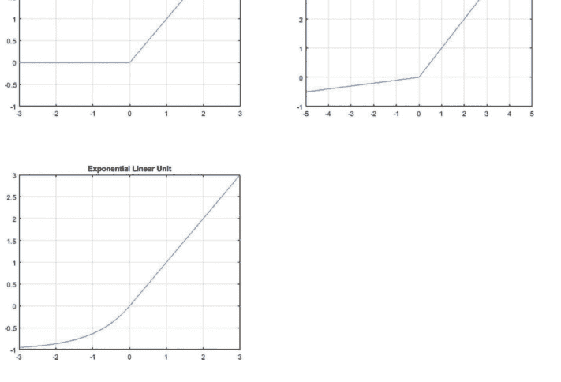

图 5.1 ReLU (a)、Leaky ReLU (b) 和 ELU (c)。

ReLU 的梯度为

$$\frac{dy_i}{dx_i} = f'(x_i) = \begin{cases} 0, & x_i < 0 \\ 1, & x_i \geq 0. \end{cases}$$

### 5.2.2 Leaky ReLU

Leaky ReLU [18]（见图 5.1）定义为

$$y_i = f(x_i) = \begin{cases} ax_i, & x_i < 0 \\ x_i, & x_i \geq 0 \end{cases}$$

其中 $a$ 是一个小实数（此处 $a = 0.01$）。如引言中所述，与 ReLU 不同，该函数没有梯度为零的点：

$$\frac{dy_i}{dx_i} = f'(x_i) = \begin{cases} a, & x_i < 0 \\ 1, & x_i \geq 0 \end{cases}$$

### 5.2.3 ELU

指数线性单元（ELU）[19]（见图 5.1）定义为

$$y_i = f(x_i) = \begin{cases} a(\exp(x_i)-1), & x_i < 0 \\ x_i, & x_i \geq 0 \end{cases}$$

其中 $a$ 是一个实数（此处 $a = 1$）。

ELU 是可微的，其梯度始终为正（与 Leaky ReLU 一样），并且有下界 $-a$。ELU 的梯度由下式给出

$$\frac{dy_i}{dx_i} = f'(x_i) = \begin{cases} a \exp(x_i), & x_i < 0 \\ 1, & x_i \geq 0 \end{cases}$$

### 5.2.4 SELU

其中 *a* 和 *s* 都是实数（此处 *a*=1.6733 和 *s*=1.0507；这些值与参考文献 [20] 中使用的值相同，并选择用于将均值为零、方差为单位的随机变量映射为均值为零、方差为单位的随机变量）。

请注意，SELU 基本上与 ELU 相同，但额外乘以缩放参数 *s* 以防止梯度消失或爆炸。SELU 的梯度由下式给出

$$\frac{dy_{i}}{dx_{i}} = f^{\prime}\left(x_{i}\right) = \begin{cases} sa \ \exp \left(x_{i}\right), \ x_{i} < 0 \\ s, \ x_{i} \geq 0 \end{cases}$$

### 5.2.5 PReLU

参数 ReLU（PReLU）[14] 定义为

$$y_{i} = f \left(x_{i}\right) = \begin{cases} a_{c}x_{i}, \ x_{i} < 0 \\ x_{i}, \ x_{i} \geq 0 \end{cases}$$

其中 *aᵢ* 包含针对输入每个通道都不同的实数。PReLU 与 Leaky ReLU 相同，除了参数 *aᵢ* 是可学习的。

PReLU 的梯度为

$$\frac{dy_{i}}{dx_{i}} = f^{\prime \prime}\left(x_{i}\right) = \begin{cases} a_{c}, \ x_{i} < 0 \\ 1, \ x_{i} \geq 0 \end{cases} \quad \text{and} \quad \frac{dy_{i}}{da_{c}} = \begin{cases} x_{i}, \ x_{i} < 0 \\ 0, \ x_{i} \geq 0 \end{cases}$$

请注意，左侧斜率均初始化为 0。

### 5.2.6 SReLU

S 形 ReLU（SReLU）[30] 由三个分段线性函数组成，由四个可学习参数表示，因此

$$y_{i} = f \left(x_{i}\right) = \begin{cases} t^{l} + a^{l}\left(x_{i} - t^{l}\right), \ x_{i} < t^{l} \\ x_{i}, \ t^{l} \leq x_{i} \leq t^{r} \\ t^{r} + a^{r}\left(x_{i} - t^{r}\right), \ x_{i} > t^{r} \end{cases} \quad, \quad$$

其中 \( t^{l} \)、\( t^{r} \)、\( a^{l} \) 和 \( a^{r} \) 是四个可学习的实数参数（初始化为 \( a^{l} \)=0，\( t^{l} \)=0，且 \( t^{r} \)=maxInput，其中 maxInput 是一个超参数）。SReLU 相当大的参数数量带来了高的表示能力。

SReLU 的梯度由下式给出

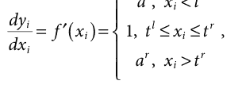

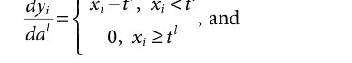

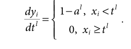

### 5.2.7 APLU

自适应分段线性单元（APLU）[21] 定义为


其中 \( a_{c} \) 和 \( b_{c} \) 是实数，对于输入的每个通道都不同。APLU 是一个分段线性函数，能够近似如引言中所述的紧集上的任何连续函数。

APLU 的梯度由 ReLU 的梯度以及和中包含的函数的梯度之和给出。关于参数 \( a_{c} \) 和 \( b_{c} \)，梯度为

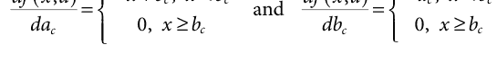

在本研究中，参数 \( a_{c} \) 初始化为 0，而点则随机初始化。在参数 \(a_{c}\) 的范数上添加了 0.001 \( L^{2} \) 惩罚。因此，损失函数中包含了另一项，定义为

$$ L^{reg} = \sum_{c=1}^{n} |a_c|^{2} $$

还针对这些参数添加了相对学习率：\(maxInput\) 乘以网络其余部分使用的最小学习率。因此，如果 \(\lambda\) 是全局学习率，参数 \(a_{c}\) 的学习率 \(\lambda^{c}\) 将是

$$ \lambda^{c} = \frac{\lambda}{maxInput} $$

### 5.2.8 MeLU

为了理解墨西哥 ReLU（MeLU）[25]，令 \(\phi^{a,\lambda}(x) = \max(\lambda - |x-a|, 0)\) 为“墨西哥帽型”函数，其中 \(a\) 和 \(\lambda\) 是实数。当 \(|x-a| > \lambda\) 时，函数 \(\phi^{a,\lambda}(x)\) 为零，但在 \(a\) 和 \(a-\lambda\) 之间以导数 1 持续增加，并在 \(a\) 和 \(a+\lambda\) 之间以导数 \(-1\) 减少。

上述函数充当 MeLU 的构建块，其定义为

$$ y_{i} = \text{MeLU}(x_{i}) = \text{PReLU}^{c_{0}}(x_{i}) + \sum_{j=1}^{k-1} c_{j} \phi^{a_{j},\lambda_{j}}(x_{i}) $$

其中 \(k\) 是每个可学习参数的数量（每个通道一个 PReLU 参数和墨西哥帽函数和中 \(k-1\) 个系数；此处 \(k=4\) 或 8），\(c_{j}\) 是可学习参数，\(c_{0}\) 是 PReLU 中的参数向量，\(a_{j}\) 和 \(\lambda_{j}\) 均为固定值并递归选择。

首先，设置参数 \(maxInput\)。第一个墨西哥帽函数在 \(2 \cdot maxInput\) 处达到最大值，在 0 和 \(4 \cdot maxInput\) 处为零。接下来的两个函数选择在区间 \([0, 2 \cdot maxInput]\) 和 \([2 \cdot maxInput, 4 \cdot maxInput]\) 外部为零，要求它们在 \(maxInput\) 和 \(3 \cdot maxInput\) 处达到最大值（表 5.1）。

由于墨西哥帽函数是连续的且分段可微，因此 MeLU 也是如此。如果所有 \(c_{i}\) 可学习参数都初始化为零，


MeLU 与 ReLU 相吻合，这一特性在迁移学习中非常有用，特别是在使用 ReLU 进行预训练的情况下（在这种情况下，可以直接替换为 MeLU；当然，MeLU 也可以替换由 Leaky ReLU 和 PReLU 训练的网络中）。另一个重要特性源于墨西哥帽函数在带有 $L^{2}$ 范数的紧集上构成 Hilbert 基这一事实；因此，当 $k$ 趋于无穷大时，它们可以逼近 $L^{2}([0, 1024])$ 中的任何函数。

MeLU 与 SReLU 和 APLU 相似，因为它们都有多个可学习参数，但 APLU 的参数数量更多。MeLU 还与 APLU 相似，即当 $x$ 足够大时，它们都能逼近相同的分段线性函数集合（即恒等函数），但每种函数实现这一点的机制不同。给定合适的参数选择，由于不可导点是可以学习的，APLU 可以等于任何分段线性函数，但 MeLU 更高效，因为它仅利用权重矩阵和偏置的联合优化就能表示任何分段线性函数。此外，这两个激活函数关于可学习参数的梯度是不同的。神经网络的优化在很大程度上取决于两个因素：每个隐藏层的输出以及该输出关于参数的梯度。

与 APLU 不同，MeLU 在需要激活的地方改变激活，从而使优化变得更容易。MeLU 和 APLU 基函数之间的差异在图 5.2 中进行了说明。此外，正如 5.2.7 节所述，APLU 中的系数必须使用 $L^{2}$ 惩罚进行正则化，并受益于较低的学习率；MeLU 不需要任何正则化。

在本研究中，MeLU 中的可学习参数被初始化为零，因此激活从 ReLU 开始，从而利用了 ReLU 在开始阶段的所有良好特性。

### 5.2.9 GaLU

高斯 ReLU（GaLU），在此提出，基于 MeLU 并具有相同的理想特性。为了定义 GaLU，设 $\phi_{g}^{a, \lambda}(x)=\max(\lambda-|x-a|, 0)+\min(|x-a-2\lambda|, \lambda, 0)$ 为一种高斯类型函数，其中 $a$ 和 $\lambda$ 是实数。在图 5.3 中，比较了标准高斯小波函数与 $a=1, \lambda=1$ 的高斯类型函数。

类似 MeLU，GaLU 定义为：

$$y_i = \text{GaLU}(x_i) = \text{PReLU}^{c_0}(x_i) + \sum_{j=1}^{k-1} c_j \phi_g^{a_j, \lambda_j}(x_i).$$

如文献 [31] 所示，由许多线性片段构成的分段线性奇函数比 ReLU 更好地逼近非线性函数。

| | | 表 5.1 MeLU 的固定参数（$maxInput=256$） | | | | | |
| :--- | :--- | :--- | :--- | :--- | :--- | :--- | :--- |
| | | **$j$** | 1 | 2 | 3 | 4 | 5 | 6 | 7 |
| | | **$a_{j}$** | 512 | 256 | 768 | 128 | 384 | 640 | 896 |
| | | **$\lambda_{j}$** | 512 | 256 | 256 | 128 | 128 | 128 | 128 |

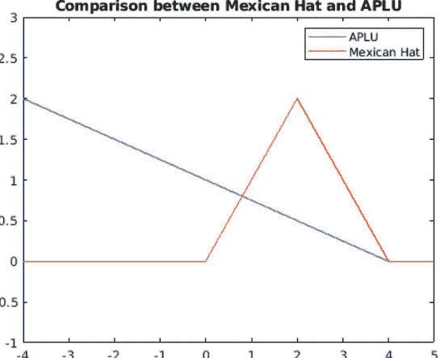

**图 5.2** MeLU 和 APLU 的偏导数。

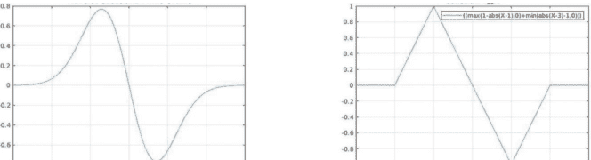

**图 5.3** 高斯小波 (a) 和我们的高斯类型函数 (b)。

GaLU 背后的原理是添加比 MeLU 更多的线性片段。

与 MeLU 类似，GaLU 有一组固定参数（见表 5.2，其中比较了 $maxInput=1$ 时 GaLU 和 MeLU 的固定参数）。

| | | | | | | | | |
| :--- | :--- | :--- | :--- | :--- | :--- | :--- | :--- | :--- |
| **表 5.2 GaLU 和 MeLU 固定参数的比较（$maxInput=1$）** | | | | | | | | |
| | **$j$** | 1 | 2 | 3 | 4 | 5 | 6 | 7 |
| **MeLU** | $a_{j}$ | 2 | 1 | 3 | 0.5 | 1.5 | 2.5 | 3.5 |
| | $\lambda_{j}$ | 2 | 1 | 1 | 0.5 | 0.5 | 0.5 | 0.5 |
| **GaLU** | $a_{j}$ | 1 | 0.5 | 2.5 | 0.25 | 1.25 | 2.25 | 3.25 |
| | $\lambda_{j}$ | 1 | 0.5 | 0.5 | 0.25 | 0.25 | 0.25 | 0.25 |

### 5.3 实验结果

GaLU，即本文提出的新型激活函数，在 5.2 节中详述的 CNN 上进行了测试，涉及 13 个公开可用的生物医学数据集。数据集的详细信息汇总在表 5.3 中。这 13 个数据集如下：

- 1. CH：[CHINESE HAMSTER OVARY CELLS 数据集](https://doi.org/10.1038/nbt.1393) [32]；
- 2. HE：[2D HELA 数据集](https://doi.org/10.1038/nbt.1393) [32]；
- 3. LO：[Locate Endogenous 数据集](https://doi.org/10.1038/nbt.1456) [33]；
- 4. TR：[LOCATE TRANSFECTED 数据集](https://doi.org/10.1038/nbt.1456) [33]；
- 5. RN：[FLY CELL 数据集](https://doi.org/10.1038/nbt.1456) [34]；
- 6. MA：肌肉衰老 [34]，该数据集包含 *C. elegans* 四种年龄下的肌肉图像；
- 7. TB：末端膨大衰老 [34] 数据集，包含 *C. elegans* 末端膨大在七种年龄下的图像；
- 8. LY：淋巴瘤数据集 [34]；
- 9. LG：肝脏性别 [34]，该数据集包含进行热量限制饮食的 6 个月大雄性和雌性小鼠的肝组织切片，两个类别代表小鼠的性别；
- 10. LA：肝脏衰老 [34]，该数据集包含进行自由摄食饮食的雌性小鼠的肝组织切片；
- 11. CO：人类结直肠癌组织学图像 [35]；
- 12. BGR：乳腺分级癌症 [36]；
- 13. LAR：喉部数据集 [37]。

| 数据集 | #C | #S | 下载 URL |
| :--- | :--- | :--- | :--- |
| CH | 5 | 327 | http://ome.grc.nia.nih.gov/icubu2008/hela/index.html#cho |
| HE | 10 | 862 | http://ome.grc.nia.nih.gov/icubu2008/hela/index.html |
| LO | 10 | 502 | http://locate.imb.uq.edu.au/downloads.shtml |
| TR | 11 | 553 | http://locate.imb.uq.edu.au/downloads.shtml |
| RN | 10 | 200 | http://ome.grc.nia.nih.gov/icubu2008/rnai/index.html |
| TB | 7 | 970 | https://ome.grc.nia.nih.gov/icubu2008 |
| LY | 3 | 375 | https://ome.grc.nia.nih.gov/icubu2008 |
| MA | 4 | 237 | https://ome.grc.nia.nih.gov/icubu2008 |
| LG | 2 | 265 | https://ome.grc.nia.nih.gov/icubu2008 |
| LA | 4 | 529 | https://ome.grc.nia.nih.gov/icubu2008 |
| CO | 8 | 5,000 | https://zenodo.org/record/53169#.WaxJW8hjJaUm |
| BGR | 3 | 300 | https://zenodo.org/record/834910#.Wp1bq-JOWUl |
| LAR | 3 | 1,320 | https://zenodo.org/record/1003200#.WdeQcnBx0nQ |

除非另有说明，上述数据集使用的协议是五折交叉验证，并使用 Wilcoxon 符号秩检验 [38] 对实验进行验证。

在表 5.4–5.6 中，分别报告了考虑 Vgg16、ResNet50 和 DenseNet201 时不同激活函数的性能。**粗体文本**意味着该分类器是我们测试中表现最好的。所有网络均以 30 的批大小（BS）和 0.0001 的学习率（LR）训练 30 个周期。这些设置是为了减少计算时间。对于数据增强，应用了双轴的随机反射以及双轴的两个独立随机缩放，缩放因子在 Refs. [1,2] 中均匀采样（因此新图像的垂直和水平比例被重新缩放）。

在表 5.4 和 5.5 中报告了多种集成方法：

- 1. ENS，给定 CNN 下除 smallGaLU 和 GaLU 外所有方法的总和规则，具有给定的 *MaxInput*；
- 2. eENS，给定 CNN 下除 smallGaLU 和 GaLU 外所有方法的总和规则。

| 激活函数 | CH | HE | LO | TR | RN | TB | LY | MA | LG | LA | CO | BGR | LAR | 平均值 |
| :--- | :--- | :--- | :--- | :--- | :--- | :--- | :--- | :--- | :--- | :--- | :--- | :--- | :--- | :--- |
| **Resnet50** | | | | | | | | | | | | | | | |
| MaxInput = 1 | | | | | | | | | | | | | | | |
| MeLU (k=8) | 92.92 | 86.40 | 91.80 | 82.91 | 25.50 | 56.29 | 67.47 | 76.25 | 91.00 | 82.48 | 94.82 | 89.67 | 88.79 | 78.94 |
| Leaky ReLU | 89.23 | 87.09 | 92.80 | 84.18 | 34.00 | 57.11 | 70.93 | 79.17 | 93.67 | 82.48 | 95.66 | 90.33 | 87.27 | 80.30 |
| ELU | 90.15 | 86.74 | 94.00 | 85.82 | 48.00 | 60.82 | 65.33 | 85.00 | 96.00 | 90.10 | 95.14 | 89.33 | 89.92 | 82.79 |
| PReLU (k=4) | 91.08 | 85.35 | 92.80 | 84.91 | 27.50 | 55.36 | 68.83 | 77.68 | 90.33 | 79.43 | 95.34 | 89.67 | 89.75 | 78.76 |
| ReLU | 92.00 | 85.35 | 91.40 | 81.64 | 33.50 | 58.00 | 68.50 | 80.00 | 88.00 | 81.00 | 95.66 | 89.00 | 89.47 | 79.02 |
| SReLU | 91.38 | 85.58 | 92.60 | 83.27 | 30.00 | 55.88 | 69.33 | 75.00 | 88.00 | 82.10 | 95.66 | 90.00 | 89.47 | 79.02 |
| APLU | 92.31 | 87.09 | 93.20 | 80.91 | 25.00 | 54.12 | 77.20 | 76.67 | 93.00 | 82.67 | 94.92 | 90.33 | 88.86 | 78.98 |
| ReLU | 93.54 | 89.98 | 95.60 | 90.00 | 50.00 | 58.45 | 77.87 | 90.00 | 93.00 | 85.14 | 95.38 | 88.67 | 87.48 | 84.54 |
| SmallGaLU | 92.31 | 87.91 | 95.30 | 90.00 | 52.00 | 60.00 | 72.53 | 90.00 | 95.33 | 87.43 | 95.38 | 87.67 | 88.75 | 84.42 |
| GaLU | 92.92 | 88.37 | 92.20 | 90.36 | 41.50 | 57.84 | 73.60 | 89.17 | 92.67 | 86.76 | 94.90 | 90.33 | 90.00 | 83.27 |
| ENS | 95.38 | 89.53 | 97.00 | 89.82 | 59.00 | 62.73 | 76.53 | 96.00 | 91.43 | 91.43 | 96.60 | 91.00 | 89.67 | 86.28 |
| ENS_G | 93.46 | 90.75 | 97.20 | 92.73 | 56.00 | 63.92 | 75.60 | 90.83 | 96.33 | 91.43 | 96.42 | 90.00 | 90.00 | 86.67 |
| **Resnet50** | | | | | | | | | | | | | | | |
| MaxInput = 255 | | | | | | | | | | | | | | | |
| MeLU (k=8) | 94.46 | 89.30 | 94.20 | 92.18 | 54.00 | 61.86 | 75.73 | 89.17 | 97.00 | 88.57 | 96.60 | 87.67 | 88.71 | 85.26 |
| MeLU (k=4) | 92.92 | 90.32 | 95.50 | 91.82 | 57.00 | 59.79 | 78.40 | 87.50 | 97.33 | 85.14 | 95.72 | 89.33 | 88.26 | 85.26 |
| SReLU | 92.08 | 89.42 | 95.60 | 90.73 | 56.50 | 59.69 | 73.33 | 91.67 | 98.33 | 88.95 | 95.52 | 89.67 | 87.87 | 85.15 |
| APLU | 95.31 | 89.19 | 93.90 | 90.00 | 47.50 | 56.91 | 75.30 | 91.97 | 97.33 | 80.14 | 95.68 | 89.67 | 88.44 | 87.44 |
| ReLU | 93.54 | 89.88 | 95.60 | 90.00 | 55.00 | 58.45 | 77.87 | 90.00 | 97.33 | 85.14 | 94.92 | 88.67 | 87.05 | 84.54 |
| SmallGaLU | 93.54 | 87.79 | 95.60 | 89.82 | 55.00 | 63.09 | 76.00 | 90.42 | 95.00 | 85.33 | 95.08 | 95.08 | 89.77 | 85.08 |
| GaLU | 92.92 | 87.21 | 92.20 | 91.27 | 47.50 | 60.10 | 74.13 | 91.67 | 96.00 | 86.86 | 95.36 | 89.33 | 87.79 | 83.73 |
| ENS | 93.85 | 91.28 | 96.20 | 93.27 | 59.00 | 63.30 | 77.60 | 87.92 | 98.00 | 87.43 | 96.30 | 89.00 | 89.13 | 86.62 |
| ENS_G | **95.08** | **91.28** | **96.20** | **94.18** | **63.00** | **64.85** | **78.67** | **92.50** | **97.67** | **87.62** | **96.54** | **89.67** | **89.77** | **87.46** |
| **eENS** | 94.77 | 91.40 | 97.00 | 92.91 | 60.00 | 64.74 | 77.87 | 88.75 | 98.00 | 90.10 | 96.50 | 90.00 | 89.77 | 87.06 |
| **eENS_G** | 95.48 | 91.28 | 98.70 | 93.45 | 62.50 | 65.26 | 78.93 | 91.67 | 97.67 | 90.48 | 96.80 | 89.33 | 89.85 | 87.53 |
| **ENS_MG** | 94.46 | 90.93 | 96.60 | 94.55 | 58.50 | 64.23 | 79.47 | 92.92 | 96.33 | 88.38 | 96.44 | 89.33 | 90.30 | 87.11 |


## 表 5.5 使用 Vgg16 获得的性能

| | 激活函数 | CH | HE | LO | TR | RN | TB | LY | MA | LG | LA | CO | BG | LAR | 平均值 |
| :--- | :--- | :--- | :--- | :--- | :--- | :--- | :--- | :--- | :--- | :--- | :--- | :--- | :--- | :--- | :--- |
| | MeLU ($k$=8) | **99.69** | 92.09 | 98.00 | 92.91 | 59.00 | 60.93 | 78.67 | 87.92 | **86.67** | 93.14 | 95.20 | 89.67 | 90.53 | 86.49 |
| Vgg16 | Leaky ReLU | 99.08 | 91.98 | 98.00 | 93.45 | 66.50 | 61.13 | 80.00 | 92.08 | **86.67** | 91.81 | 95.62 | 91.33 | 88.94 | 87.43 |
| *MaxInput*=1 | EILU | 98.77 | 93.95 | 97.00 | 92.36 | 56.00 | 59.69 | 81.60 | 90.83 | 78.33 | 85.90 | 95.78 | 93.00 | 90.45 | 85.66 |
| | MReLU ($k$=4) | 99.38 | 91.16 | 97.60 | 92.73 | 64.50 | 62.37 | 81.07 | 89.58 | 78.00 | 89.71 | 95.82 | 89.67 | 90.14 | 87.13 |
| | PReLU | 99.08 | 90.47 | 97.80 | 94.55 | 64.00 | 60.02 | 81.33 | 92.92 | 86.33 | 91.05 | 95.80 | 92.67 | 93.38 | 86.79 |
| | SReLU | 99.08 | 91.16 | 97.00 | 93.64 | 65.50 | 60.62 | 82.67 | 90.00 | 79.33 | 92.33 | 96.10 | 94.00 | 92.58 | 87.30 |
| | APLU | 99.08 | 92.33 | 97.60 | 91.82 | 63.50 | 62.27 | 77.33 | 90.00 | 82.00 | 92.38 | 96.50 | 91.33 | 90.98 | 86.66 |
| | ReLU | **99.69** | 93.60 | 98.20 | 93.27 | 69.50 | 61.44 | 80.53 | 89.58 | 85.33 | 88.57 | 95.00 | 93.00 | 90.41 | 87.33 |
| | SmallCReLU | 98.46 | 91.63 | 97.80 | 91.35 | 64.50 | 59.79 | 80.80 | 89.58 | 77.33 | 92.76 | 95.70 | 91.67 | 91.97 | 86.39 |
| | GaLU | 98.46 | 94.07 | 97.40 | 92.36 | 65.00 | 59.07 | 81.07 | 92.08 | 75.67 | 93.71 | 95.68 | 88.67 | 91.74 | 86.53 |
| | ENS_G | 99.38 | 93.85 | 98.80 | **95.64** | 68.00 | 65.67 | 85.07 | 92.50 | 85.00 | **96.74** | **96.74** | **94.67** | 94.33 | 89.97 |
| | ENS | **99.69** | 94.45 | 99.00 | 95.45 | **72.00** | 64.95 | **86.93** | **92.98** | **93.33** | **97.14** | 96.72 | 94.72 | **92.65** | **89.47** |
| | MeLU ($k$=8) | **99.69** | 92.09 | 97.40 | 99.09 | 59.50 | 60.82 | 80.53 | 88.75 | 80.33 | 88.57 | 95.94 | 90.33 | 88.33 | 85.79 |
| Vgg16 | MeLU ($k$=4) | 99.38 | 91.98 | 98.60 | 92.55 | 66.50 | 59.59 | 84.53 | 91.67 | **88.00** | 94.86 | 95.46 | 93.00 | 93.03 | 88.39 |
| *MaxInput*=255 | SReLU | 98.77 | 93.14 | 97.00 | 92.18 | 65.00 | 62.47 | 82.67 | 89.58 | 76.00 | 96.00 | 95.84 | 94.33 | 89.81 | 86.75 |
| | APLU | 98.77 | 92.91 | 97.40 | 93.09 | 63.00 | 57.32 | 82.67 | 90.42 | 77.00 | 96.07 | 94.90 | 93.00 | 91.25 | 86.33 |
| | ReLU | **99.69** | 93.60 | 98.20 | 93.27 | 69.50 | 61.44 | 80.80 | 85.00 | 85.33 | 88.57 | 95.50 | 92.00 | 91.44 | 87.33 |
| | SmallCReLU | 99.38 | 92.91 | 97.00 | 92.73 | 50.50 | 62.16 | 78.40 | 90.42 | 73.00 | 94.48 | 95.32 | 92.00 | 90.98 | 85.32 |
| | GaLU | 99.38 | 92.91 | 97.80 | 93.09 | 66.50 | 59.48 | 83.43 | 90.83 | 95.00 | 85.52 | 95.66 | 91.67 | 93.20 | 88.01 |
| | ENS_G | 99.38 | 93.84 | 98.80 | 95.27 | 68.50 | 64.23 | 84.53 | 92.50 | 81.33 | 96.67 | 96.66 | 95.00 | 93.41 | 89.13 |
| | eENS_G | 99.38 | 94.07 | 98.80 | 95.64 | 70.50 | **65.88** | 85.87 | **93.75** | 81.67 | 96.38 | **96.70** | 95.67 | 92.80 | **89.84** |
| | eENS_MeLU | **99.69** | 94.65 | 98.80 | 95.27 | 71.00 | 65.61 | **86.93** | 92.25 | **83.33** | 97.71 | 96.88 | 95.33 | 92.50 | **90.68** |
| | ENS_MG | **99.69** | 93.72 | 99.00 | **95.09** | **72.50** | 64.12 | 86.40 | **92.92** | 84.67 | 96.57 | 96.68 | 95.00 | **93.48** | **90.47** |

## 表 5.6 使用 DenseNet 获得的性能

### DenseNet MaxInput = 1

| 激活函数 | CH | HE | LO | TR | RN | TB | LY | MA | LG | LA | CO | BG | LAR | 平均值 |
| :--- | :--- | :--- | :--- | :--- | :--- | :--- | :--- | :--- | :--- | :--- | :--- | :--- | :--- | :--- |
| MeLU ($k$=8) | 93.23 | 93.02 | 96.80 | 95.27 | 55.00 | 60.82 | 80.53 | 80.27 | 81.33 | 84.38 | 95.40 | 88.67 | 90.00 | 85.29 |
| Leaky ReLU | 92.45 | 92.44 | 95.80 | 93.45 | 50.50 | 62.58 | 75.47 | 80.91 | 97.00 | 76.38 | 95.68 | 81.33 | 90.98 | 83.67 |
| EILU | 78.77 | 79.07 | 91.80 | 91.64 | 34.00 | 39.07 | 63.73 | 72.50 | 97.00 | 84.95 | 89.34 | 81.67 | 82.27 | 75.83 |
| MeLU ($k$=4) | 89.85 | 91.05 | 96.00 | 94.18 | 52.50 | 62.99 | 79.73 | 89.58 | 81.00 | 77.52 | 95.52 | 89.33 | 90.98 | 83.86 |
| PReLU | 93.85 | 92.18 | 96.40 | 92.18 | 58.00 | 61.03 | 80.27 | 89.58 | 77.00 | 81.94 | 95.80 | 87.67 | 90.16 | 84.32 |
| AReLU | 93.85 | 92.44 | 97.00 | 94.91 | 63.50 | 65.15 | 90.47 | 78.67 | 87.58 | 94.90 | 95.00 | 95.80 | 92.12 | 86.63 |
| APLU | 93.54 | 92.44 | 97.00 | 92.73 | 54.50 | 60.82 | 78.13 | 90.83 | 79.33 | 85.14 | 95.00 | 88.67 | 92.12 | 84.64 |
| ReLU | 96.92 | 91.63 | 95.80 | 93.82 | 59.00 | 59.18 | 82.93 | 87.92 | 87.33 | 73.71 | 94.90 | 86.00 | 91.21 | 84.64 |
| SmallGelu | 90.77 | 92.21 | 96.20 | 92.19 | 51.00 | 61.03 | 75.47 | 86.17 | 81.20 | 84.17 | 95.00 | 78.33 | 90.83 | 83.24 |
| GaLU | 88.00 | 92.44 | 96.40 | 92.81 | 49.50 | 60.00 | 75.73 | 80.33 | 86.33 | 84.38 | 96.00 | 89.27 | 90.83 | 83.24 |
| ENS | 96.62 | 94.65 | 98.20 | 96.18 | 71.00 | 67.01 | 87.73 | 93.33 | 86.33 | 91.81 | 96.52 | 92.33 | 92.27 | 89.53 |

### DenseNet MaxInput = 255

| 激活函数 | CH | HE | LO | TR | RN | TB | LY | MA | LG | LA | CO | BG | LAR | 平均值 |
| :--- | :--- | :--- | :--- | :--- | :--- | :--- | :--- | :--- | :--- | :--- | :--- | :--- | :--- | :--- |
| ENS_G | 96.92 | 95.12 | 98.00 | 96.55 | 69.50 | 67.73 | 88.53 | 93.33 | 86.33 | 91.81 | 96.56 | 92.33 | 92.58 | 89.63 |
| MeLU ($k$=8) | 95.85 | 90.23 | 96.40 | 93.45 | 41.50 | 62.16 | 80.53 | 87.16 | 81.67 | 78.67 | 95.72 | 89.60 | 91.59 | 83.23 |
| MeLU ($k$=4) | 91.08 | 90.47 | 96.60 | 94.73 | 55.00 | 61.03 | 75.73 | 89.17 | 81.33 | 80.95 | 95.40 | 90.67 | 88.78 | 83.23 |
| SReLU | 92.31 | 89.88 | 96.40 | 93.45 | 54.00 | 65.36 | 77.33 | 89.17 | 85.00 | 75.81 | 90.20 | 88.67 | 92.05 | 83.81 |
| APLU | 95.69 | 93.26 | 97.20 | 95.09 | 48.00 | 60.93 | 77.60 | 91.25 | 87.25 | 76.62 | 95.20 | 89.67 | 91.74 | 84.12 |
| ReLU | 96.92 | 91.35 | 97.58 | 94.82 | 59.00 | 59.18 | 82.93 | 87.49 | 87.33 | 73.71 | 94.90 | 86.00 | 91.21 | 84.64 |
| SmallGelu | 92.92 | 91.51 | 97.20 | 93.82 | 54.00 | 61.44 | 79.97 | 89.58 | 84.33 | 85.14 | 95.40 | 89.33 | 91.24 | 84.88 |
| GaLU | 94.66 | 90.93 | 96.40 | 94.91 | 52.00 | 62.27 | 73.87 | 90.00 | 77.33 | 78.10 | 95.40 | 88.00 | 90.83 | 83.43 |
| ENS | 97.85 | 94.53 | 98.50 | 96.73 | 67.50 | 66.48 | 84.80 | 90.83 | 82.67 | 87.52 | 96.06 | 92.00 | 92.95 | 88.25 |
| ENS_G | 97.23 | 95.12 | 98.40 | 96.91 | 72.50 | 68.45 | 88.80 | 92.08 | 85.33 | 91.24 | 96.60 | 92.00 | 92.35 | 89.47 |
| ENS_MeLU | 97.54 | 94.53 | 98.00 | 96.36 | 66.50 | 66.08 | 85.07 | 90.42 | 85.67 | 86.67 | 96.54 | 91.00 | 91.97 | 88.18 |

- ENS_G，是对于给定 CNN 和给定 MaxInput 下所有方法的总和规则；
- eENS_G，是对于给定 CNN 所有方法的总和规则。
- ENS_MeLU，是基 MeLU 和 ReLU 的所有方法的总和规则。
- ENS_MG，是基 MeLU、smallGaLU 和 GaLU 以及 ReLU 的所有方法的总和规则。

在表 5.7 中，报告了通过选择 BS 和 LR 的最佳值在某些数据集上获得的 ReLU 性能。需要注意的是，当使用针对 ReLU 优化的 BS 和 LR 时，ENS 的性能高于 ReLU 获得的性能。表 5.7 中的结果与表 5.4–5.6 中的结果相似。

检查表 5.4–5.7 中报告的结果，可以得出以下结论：

- ENS/ENS_G 和 eENS/eENS_G 优于（$P$ 值为 0.05）所有独立的激活函数，包括 ReLU。本工作最重要的发现是 eENS/eENS_G 的性能，它在所有三种 CNN 拓扑结构上均优于 ReLU（$P$ 值为 0.05）；
- eENS 和 eENS_G 获得了相似的性能，但 ENS_G 在许多情况下优于 ENS；
- 考虑到所有 CNN，MeLU 获得了最佳的平均性能；

## 表 5.7 使用优化后的 BS 和 LR 获得的性能

| 激活函数 | CH | LA | MA |
| :--- | :--- | :--- | :--- |
| **Resnet50** | | | |
| *MaxInput*=255 | | | |
| BS = 10 | | | |
| LR = 0.001 | | | |
| MeLU ($k$=8) | 98.15 | 98.48 | 90.42 |
| MeLU ($k$=4) | 98.15 | 98.67 | 87.08 |
| SReLU | 99.08 | 96.00 | 88.33 |
| APLU | 98.46 | 98.48 | **93.75** |
| ReLU | 97.23 | 96.57 | 92.08 |
| SmallGaLU | 97.54 | 93.90 | 90.00 |
| GaLU | **99.38** | 96.38 | 88.75 |
| ENS | **99.38** | **99.05** | **93.75** |
| ENS_G | **99.38** | 98.67 | 93.33 |
| ENS_MeLU | **99.38** | **99.05** | 91.67 |
| ENS_MG | 99.08 | 98.86 | 93.33 |

*注意：基于原文的布局，“Vgg16”和“MaxInput=255”标签出现在特定行的第三列，但标准的表格格式表明这些可能是未完全对齐的额外列标题或组标签。然而，原始文本在某些行中显示“Vgg16”和“MaxInput=255”位于与“CH”/“LA”/“MA”相同的列中，这表明存在复杂的表格或多列并排布局，此处已将其扁平化。鉴于将表格样式的文本转换为格式的要求，以及原始 OCR 文本中“Vgg16”出现在第一行数据第四列（在 MA 下方）的具体对齐方式，这很可能是一个数据块或合并单元格结构。但是，仔细查看原始文本：*

`| MeLU $(k=8)$ | 98.15 | 98.48 | Vgg16 | 90.42 |`

这表明可能存在并排的两组结果，或者列未对齐。标题行 `| Activation | CH | LA | MA |` 只有 4 列。数据行在某些情况下有 5 个条目。
让我们重新检查表 5.7 的原始文本：
`| Activation | CH | LA | MA |`
`| Resnet50 | | | |`
`| $MaxInput=255$ | | | |`
`| BS = 10 | | | |`
`| LR = 0.001 | | | |`
`| MeLU $(k=8)$ | 98.15 | 98.48 | Vgg16 | 90.42 |`

似乎“Vgg16”列是一个不存在于标题中的额外列，或者标题缺少一列。鉴于“Vgg16”是一个类似于“Resnet50”的网络名称，该表格很可能包含多个网络的并排结果，或者“Vgg16”标签属于第二组列。然而，严格遵循“转换表格样式的文本”并保留信息：

原始文本的数据行有 5 列（激活函数，值1，值2，标签，值3），但标题只有 4 列。
等等，再次查看原始文本：
`| Activation | CH | LA | MA |`
...
`| MeLU $(k=8)$ | 98.15 | 98.48 | Vgg16 | 90.42 |`

很有可能该表格实际上有两个部分，或者 OCR 合并了两列。“Vgg16”可能是第二个度量块或第二个网络的标签。在没有第 4/5 列标题的情况下，我将原样保留数据，但将其与提供的标题对齐是不可能的。
然而，在这类 OCR 中，“Vgg16”可能是标题的误读，或者指示了一个被合并的第二个表格部分的开始。
让我们看看数字。
第 1 行：98.15, 98.48 ... Vgg16 ... 90.42
第 2 行：98.15, 98.67 ... MaxInput=255 ... 87.08
第 3 行：99.08, 96.00 ... BS = 50 ... 88.33
第 4 行：98.46, 98.48 ... LR = 0.0001 ... 93.75

左边看起来是 Resnet50，右边是 Vgg16。
标题 `| Activation | CH | LA | MA |` 很可能适用于左边部分。
右边列对应于激活函数（隐含相同），以及 Vgg16 的值。
根据约束条件，我将格式化该表格为 5 列以保留所有数据，假设标题在 OCR 中不完整，或者“Vgg16”是一个子标题。
实际上，查看 `| MeLU $(k=8)$ | 98.15 | 98.48 | Vgg16 | 90.42 |`，“Vgg16”似乎位于“MA”列的位置或额外列。
为了安全并保留信息而不过度猜测，我将把数据行中看到的“Vgg16”列包括在内。由于 OCR 中的标题行只有 4 列，我将假设标题缺少最后一列标题，或者“Vgg16”是数据内的标签。
然而，标准的“恢复表格”做法是使其保持一致。
让我们假设表格的列有：激活函数，Resnet50_CH，Resnet50_LA，Vgg16_Label，Vgg16_Val？不，这很混乱。

让我们看看模式：
`MeLU (k=8) | 98.15 | 98.48 | Vgg16 | 90.42`
`MeLU (k=4) | 98.15 | 98.67 | MaxInput=255 | 87.08`
`SReLU | 99.08 | 96.00 | BS = 50 | 88.33`
`APLU | 98.46 | 98.48 | LR = 0.0001 | 93.75`

第三列数值（Vgg16, MaxInput=255, BS=50, LR=0.0001）看起来像是*下一组*结果的参数或标签，或者它们是错位的第四列标题。
鉴于歧义性，我将输出一个 5 列的表格以确保不丢失数据，如有必要将第 4 列标记为“Param/Label”，或者原样包含。但通常，数据行中的“Vgg16”对应于标题行中的“BS=10”，这表明“Vgg16”是右侧块的标题。
OCR 将“Vgg16”合并到了数据行中。
如果可能，我将重构表格以正确包含“Vgg16”块，但由于我不能添加信息，我将坚持提供的行。

基于原始文本对齐的修订版表 5.7 结构：

| 激活函数 | CH | LA | MA |
| :--- | :--- | :--- | :--- |
| **Resnet50** | | | |
| *MaxInput*=255 | | | |
| BS = 10 | | | |
| LR = 0.001 | | | |
| MeLU ($k$=8) | 98.15 | 98.48 | 90.42 |
| MeLU ($k$=4) | 98.15 | 98.67 | 87.08 |
| SReLU | 99.08 | 96.00 | 88.33 |
| APLU | 98.46 | 98.48 | **93.75** |
| ReLU | 97.23 | 96.57 | 92.08 |
| SmallGaLU | 97.54 | 93.90 | 90.00 |
| GaLU | **99.38** | 96.38 | 88.75 |
| ENS | **99.38** | **99.05** | **93.75** |
| ENS_G | **99.38** | 98.67 | 93.33 |
| ENS_MeLU | **99.38** | **99.05** | 91.67 |
| ENS_MG | 99.08 | 98.86 | 93.33 |

*等等，原始文本明确在第一行数据行的第 4 列有 `Vgg16`，在第二行数据行的第 4 列有 `MaxInput=255`。这表明第 4 列包含第二个网络（Vgg16）及其参数的标签。第 5 列包含对应于该第二个网络的值。*
标题 `| Activation | CH | LA | MA |` 只有 4 列。
为了保留信息“Vgg16”、“MaxInput=255”、“BS=50”、“LR=0.0001”及其相关值（90.42、87.08 等），我必须包含这些列。
我会添加“Vgg16 Config”和“Vgg16 Value”列吗？不，我不能发明标题。
我只需输出 5 列数据。

| 激活函数 | CH | LA | Param/Label | Value |
| :--- | :--- | :--- | :--- | :--- |
...
这是对“表格样式的文本”最忠实的表示，且不删除内容。

然而，查看 `| ENS | **99.38** | **99.05** | | **93.75** |`，原始文本中某些行的第 4 列是空的吗？
原始文本：
`| ENS | **99.38** | **99.05** | | **93.75** |`
`| ENS_G | **99.38** | 98.67 | | 93.33 |`
原始文本中后面几行的第 4 列是空的。这证实它是一个参数/标签列，仅适用于前几行，或表示上下文切换。

我将格式化表 5.7 为 5 列，以捕获所有数据点。


-   ENS_MeLU 在所有三种 CNN 拓扑结构中均优于 ReLU，但 ENS_MG 在所有三种 CNN 拓扑结构中均优于 ENS_MeLU；
-   不同的拓扑结构表现出不同的行为；在 ResNet50 和 DenseNet201 中，MaxInput 为 1 和 255 时存在明显的性能差异，而在 Vgg16 中，MaxInput 为 1 和 255 时获得相似的性能。
-   此外，通过为 ReLU 优化 BS 和 LR，得出了类似的结论：ENS 和 ENS_G 优于其他激活函数，包括 ReLU。

### 5.4 结论

本章介绍了一种通过对三个著名的预训练网络——Vgg16、ResNet50 和 DenseNet201——中的激活函数进行更改而生成的 CNN 集成性能评估。报告了八种激活函数（包括一种新颖的激活函数 GaLU）在 13 个具有挑战性的数据集上的性能。最有趣的结果是，在所有三种 CNN 拓扑结构中，提出的集成方法都远远优于单个 CNN，以及基于标准 ReLU 的 CNN。

实验表明，仅激活函数不同的多个 CNN 组成的集成，其性能优于使用九种不同激活函数的单个 CNN 的结果。实验还证明，没有单一的激活函数在 13 个数据集上始终比其它激活函数表现更好。特别地，我们观察到 MeLU 与文献中的其他激活函数相比具有竞争力。当 k=4 时，MeLU 似乎也是表现最好的激活函数，特别是在 VGG16 上。请注意，我们仅使用 k=4 和 8 测试了 MeLU；换句话说，我们并未在测试集上挑选 k 的最佳参数。

在未来的工作中，我们计划生成更大的 CNN 集成，以确定单个 CNN 的性能在多大程度上可以通过不同的激活函数得到提升。涉及 CNN 集成的研究难点在于进行此类实验所需的巨大计算速度和内存资源。

## 致谢

我们衷心感谢 NVIDIA 公司提供“NVIDIA 硬件捐赠资助”，该资助为本研究提供了 Titan X 硬件支持。

## 参考文献

-   [1] A. Krizhevsky, I. Sutskever, and G. E. Hinton, ImageNet classification with deep convolutional neural networks, in *Advances in Neural Information Processing Systems*, F. Pereira, C. J. Burges, L. Bottou, and R. Q. Weinberger, Eds. Red Hook, NY: Curran Associates, Inc., 2012, pp. 1097-1105.

-   [2] A. Y. Hannun et al., Deep speech: scaling up end-to-end speech recognition, *ArXiv*, vol. abs/1412.5567, 2014.

-   [3] P. Di Lena, K. Nagata, and P. Baldi, Deep architectures for protein contact map prediction, *Bioinformatics*, vol. 28, no. 19, pp. 2449-2457, 2012.

-   [4] A. Lisci, G. Pollastri, and P. Baldi, Deep architectures and deep learning in chemoinformatics: the prediction of aqueous solubility for drug-like molecules, *Journal of Chemical Information and Modeling*, vol. 53, no. 7, pp. 1563-1575, 2013.

-   [5] P. Baldi, P. Sadowski, and D. Whitson, Searching for exotic particles in high-energy physics with deep learning, *Nature Communications*, vol. 5, no. 1, p. 4308, 2014.

-   [6] K. He, X. Zhang, S. Ren, and J. Sun, Deep residual learning for image recognition, *2016 IEEE Conference on Computer Vision and Pattern Recognition (CVPR)*, pp. 770-778, 2015.

-   [7] S. Ren, K. He, R. B. Girshick, and J. Sun, Faster R-CNN: towards real-time object detection with region proposal networks, *IEEE Transactions on Pattern Analysis and Machine Intelligence*, vol. 39, no. 11, pp. 1137-1149, 2015.

-   [8] F. Schroff, D. Kalenichenko, and J. Philbin, FaceNet: a unified embedding for face recognition and clustering, *2015 IEEE Conference on Computer Vision and Pattern Recognition (CVPR)*, pp. 815-823, 2015.

-   [9] D. Bahdanau, K. Cho, and Y. Bengio, Neural machine translation by jointly learning to align and translate, *CoRR*, vol. abs/1409.0473, 2014.

-   [10] D. C. Ciresan, U. Meier, and J. Schmidhuber, Multi-column deep neural networks for image classification, *2012 IEEE Conference on Computer Vision and Pattern Recognition*, pp. 3642-3649, 2012.

-   [11] Y. Sun, X. Wang, and X. Tang, Deep learning face representation by joint identification-verification, presented at the NIPS, Montreal, 2014.

-   [12] Y. Taigman, M. Yang, M. A. Ranzato, M. Yang, and L. Wolf, DeepFace: closing the gap to human-level performance in face verification, *2014 IEEE Conference on Computer Vision and Pattern Recognition*, pp. 1701-1708, 2014.

-   [13] L. Wan, M. D. Zeiler, S. Zhang, Y. LeCun, and R. Fergus, Regularization of neural networks using dropconnect, in *ICML*, 2013.

-   [14] K. He, X. Zhang, S. Ren, and J. Sun, Delving deep into rectifiers: surpassing human-level performance on imagenet classification, *2015 IEEE International Conference on Computer Vision (ICCV)*, pp. 1026-1034, 2015.

-   [17] V. Nair and G. E. Hinton, Rectified Linear Units Improve Restricted Boltzmann Machines, Presented at the 27 th International Conference on Machine Learning, Haifa, Israel, 2010.

-   [18] A. L. Maas, Rectifier nonlinearities improve neural network acoustic models, 2013.

-   [19] D.-A. Clevert, T. Unterthiner, and S. Hochreiter, Fast and accurate deep network learning by exponential linear units (ELUs), CoRR, vol. abs/1511.07289, 2015.

-   [20] G. Klambauer, T. Unterthiner, A. Mayr, and S. Hochreiter, Self-normalizing neural networks, Presented at the 31st Conference on Neural Information Processing Systems (NIPS 2017), Long Beach, CA, 2017.

-   [21] F. Agostinelli, M. D. Hoffman, P. J. Sadowski, and P. Baldi, Learning Activation Functions to Improve Deep Neural Networks, CoRR, vol. abs/1412.6830, 2014.

-   [22] S. Scardapane, S. V. Vaerenbergh, and A. Uncini, Kafnets: kernel-based non-parametric activation functions for neural networks, Neural Networks: The Official Journal of the International Neural Network Society, vol. 110, pp. 19-32, 2017.

-   [23] F. Manessi and A. Rozza, Learning Combinations of Activation Functions, 2018 24th International Conference on Pattern Recognition (ICPR), pp. 61-66, 2018.

-   [24] P. Ramachandran, B. Zoph, and Q. V. Le, Searching for Activation Functions, ArXiv, vol. abs/1701.05941, 2017.

-   [25] G. Maguolo, L. Nanni, and S. Ghidoni, Ensemble of convolutional neural networks trained with different activation functions, Cornell University, arXiv.org, 2019.

-   [26] K. Simonyan and A. Zisserman, Very deep convolutional networks for large-scale image recognition, Cornell University, ArXiv:1409.1556v6, 2014.

-   [27] K. He, X. Zhang, S. Ren, and J. Sun, Deep residual learning for image recognition, Presented at the 2016 IEEE Conference on Computer Vision and Pattern Recognition (CVPR), Las Vegas, NV, 2016.

-   [28] G. Huang, Z. Liu, L. Van Der Maaten, and K. Q. Weinberger, Densely connected convolutional networks, CVPR, vol. 1, no. 2, p. 3, 2017.

-   [29] B. Geraldo Junior, S. V. da Rocha, M. Cattass, A. C. Silva, and A. C. de Paiva, A mass classification using spatial diversity approaches in mammography images for false positive reduction, Expert System with Applications, vol. 40, no. 18, pp. 7534-7543, 2013.

-   [30] X. Jin, C. Xu, J. Feng, Y. Wei, J. Xiong, and S. Yan, Deep learning with S-shaped rectified linear activation units, Presented at the Proceedings of the Thirtieth AAAI Conference on Artificial Intelligence, Phoenix, AZ, 2016.

-   [31] A. Nicolae, PLU: the piecewise linear unit activation function, ArXiv, vol. abs/1809.09534, 2018.

-   [32] M. V. Boland and R. F. Murphy, A neural network classifier capable of recognizing the patterns of all major subcellular structures in fluorescence microscope images of HeLa cells, Bioinformatics, vol. 17, no. 12, pp. 1213-223, 2001.

-   [33] N. Hamilton, R. Pantelic, K. Hanson, and R. D. Teasdale, Fast automated cell phenotype classification, BMC Bioinformatics, pp. 8-110, 2007.

-   [34] L. Shamir, N. V. Orlow, D. M. Eckley, and I. Goldberg, IICBU 2008: a proposed benchmark suite for biological image analysis, Medical \& Biological Engineering \& Computing, vol. 46, no. 9, pp. 943-947, 2008.

-   [35] J. N. Kather et al., Multi-class texture analysis in colorectal cancer histology, Scientific Reports, vol. 6, p. 27988, 2016.

-   [36] K. Dimitropoulos, P. Barmoutis, C. Zioga, A. Kamas, K. Patsiou, and N. Grammalidis, Grading of invasive breast carcinoma through Grassmannian VLAD encoding, PLoS One, vol. 12, pp. 1-18, 2017.

-   [37] S. Moccia et al., Confident texture-based laryngeal tissue classification for early stage diagnosis support, Journal of Medical Imaging (Bellingham), vol. 4, no. 3, p. 34502, 2017.

-   [38] J. Demšar, Statistical comparisons of classifiers over multiple data sets, Journal of Machine Learning Research, vol. 7, pp. 1-30, 2006.


# 第 6 章
## 使用机器学习技术对癫痫诊断的结构 MRI 数据进行分析

**Seyedmohammad Shams**  
*亨利福特医疗系统*  
*密歇根州底特律*

**Esmaeil Davoodi-Bojd**  
*亨利福特医疗系统*  
*密歇根州底特律*

**Hamid Soltanian-Zadeh**  
*亨利福特医疗系统*  
*密歇根州底特律*  
*德黑兰大学*  
*伊朗德黑兰*

### 目录
- 6.1 引言 78
- 6.2 从结构 MRI 中提取的侧别化指数/特征 80
  - 6.2.1 研究人群 82
  - 6.2.2 MRI 采集 83
  - 6.2.3 图像处理 83
  - 6.2.4 特征分析与分类 84
  - 6.2.5 机器学习在 mTLE 侧别化中的应用总结 92
- 6.3 结果 92
  - 6.3.1 研究 I：海马研究 – FLAIR 信号强度、纹理分析和体积测量 92
  - 6.3.2 研究 II：海马和杏仁核研究 – FLAIR 信号强度和体积测量 96
  - 6.3.3 研究 III：基于 DTI 的响应驱动建模 96
  - 6.3.4 研究 IV：从全脑 MRI 提取的纹理特征 97
  - 6.3.5 研究 V：多结构体积特征 98
- 6.4 讨论 100
- 6.5 结论 102
- 参考文献 103

## 6.1 引言

癫痫以其自发的、反复发作的惊厥为特征，是主要神经系统疾病之一，影响着 0.5%–2% 的人口。根据世界卫生组织的报告，超过 300 万美国人患有此病 [1,2]。根据国际抗癫痫联盟（ILAE）新确定的分类标准，惊厥可分为全面性癫痫发作和局灶性癫痫发作 [3]。其中，局灶性癫痫比全面性癫痫更为常见 [4]。研究表明，时间性局灶性癫痫，即称为颞叶癫痫（TLE），是最有可能发生局灶性惊厥的类型，大约 60% 的成年和青少年癫痫患者患有这种类型的局灶性癫痫。ILAE 因其高患病率而识别出的伴海马硬化的内侧颞叶癫痫（mTLE），是最常见且最难治的 TLE [5,6]，且在成人中往往对药物治疗耐药。

对于抗癫痫药物治疗失败（即两次以上最佳药物治疗试验无效）且每月至少发作一次癫痫的患者，被视为癫痫手术候选者。在这种情况下，如果癫痫灶能够被有信心地定位，切除手术可能是一个有效的选择 [7,8]。显然，在这些病例中，手术治疗的成功在很大程度上取决于影像学、皮层脑电图和神经心理学测试提供的定位/侧别化准确性。在确定致痫内侧颞叶方面，一致的 EEG、癫痫发作学特征和影像学研究足以满足成功的癫痫切除术的要求；而在侧别化不一致的情况下，患者可能需要接受颅内电极植入术，这具有重大的医疗风险和财务成本 [9]。

因此，由于先进结构成像技术具有无创性，确定患者癫痫发作的原始起源地点已成为癫痫研究的一个活跃领域。在异常综合征中，内侧颞叶硬化（MTS）是 mTLE 的最佳预测指标 [10–12]。几种结构成像方法已被用于诊断 MTS 并减少 mTLE（癫痫中最常见的类型）侧别化过程中的误差和不确定性。在此方向上，以下神经成像方法已被广泛用于确定适合区分右侧和左侧 mTLE 患者以及单侧和双侧异常患者的结构特征：解剖磁共振成像（T1 加权 MRI）、流体衰减反转恢复（FLAIR）和弥散张量成像（DTI）[13]。

海马硬化（HS）是难治性 TLE 患者中最常见的病理现象，已被认识至少 190 年 [14,15]。海马的硬化或硬化症指的是海马不同亚区（例如 CA1 和 CA4）中严重的神经元丢失和胶质增生。mTLE 中 HS 的发生率已被报告为 56%，并被广泛用作确定最受影响侧别（即侧别化）的首要特征 [17–19]。在 MRI 上，海马硬化表现为 T1 加权成像中的体积丢失、T2 加权成像中的高信号强度以及 FLAIR 中的信号强度改变。

虽然上述海马结构改变在高达 70% 的病例中有所报告，但在某些病例中，这些改变无法检测，或者仅基于这些改变进行的癫痫灶侧别化不足以提供成功手术所需的确定性 [20,21]。因此，为了加强分类，一些邻近结构（例如杏仁核）的改变已被添加到这些定量分析中。为了记录除了海马和杏仁核改变之外的归因于 mTLE 的结构改变，已进行了多项研究，并报告了与 mTLE 相关的灰质和白质中的多种异常 [20]。其中，内嗅皮层、梨状皮层、丘脑、扣带、钩束和胼胝体的异常是众所周知的。

普遍认为，神经元丢失和胶质增生与组织中自由水的增加有关。因此，FLAIR 提供了组织中自由水的度量，被视为研究神经元胶质增生和局灶性癫痫定位（尤其是 mTLE 患者）的标准技术。然而，许多研究表明，FLAIR 在 mTLE 患者的侧别化中缺乏足够的敏感性，应与其他成像特征配合使用才能达到令人满意的结果。

由于一些研究报告称，病理学确认患有海马硬化的 mTLE 患者中有一部分在 T1 加权和 FLAIR MRI 上未显示明显的异常症状 [21]，因此迫切需要采用其他成像技术。为此，已证明基于 DTI 的纤维束追踪可以在解剖 MRI 上出现任何异常之前检测到脑组织中的微观结构改变。DTI 可以在研究癫痫灶中神经元丢失导致的白质纤维束改变以及广泛神经放电导致的边缘外结构改变中发挥特定作用。

在接下来的章节中，我们将描述五项近期研究，这些研究利用上述 MRI 模态提供了一组有效特征，可用于机器学习方法诊断癫痫。

## 6.2 从结构 MRI 中提取的侧别化指数/特征

专注于使用结构 MRI 进行侧别化研究的假设是，通过优化 mTLE 的侧别化（使用一组最佳成像特征和侧别分类模型），可以最大程度地减少对颅内脑电图（iEEG），即第二阶段治疗的需求。为了对 mTLE 进行侧别化，MRI 已被广泛用于提取几种有效特征以检测 *体内* 的 MTS [22]。MTS 的特征是海马标本中的神经元丢失、胶质增生/硬化、颗粒细胞分散和苔藓纤维发芽 [23]。基于 T1 加权图像的海马体积减小以及 T2 加权和 FLAIR MRI 中信号强度的增加一直是用于 MTS 量化的主要特征 [17,24–29]。已表明，这些特征成功地对高达 70% 的病例中的癫痫起源进行了侧别化，尽管在 15%–30% 的确诊单侧 mTLE 患者中，未报告显著的海马不对称性，即报告了细微或甚至没有不对称性的证据 [8,17,30]。在这种情况下，可能需要额外的结构特征来提供侧别声明所需的足够确定性。

MRI 特征的第二个类别通过纹理分析进行评估。纹理特征提供关于组织信号强度模式的信息，也被用于心理疾病，如阿尔茨海默病、多发性硬化和精神分裂症 [31]。这些信号模式及其相对于海马和其他感兴趣区域组织学变化的改变，已被用作互补特征集用于


检测海马硬化以及局灶性皮质发育不良[32–34]。在文献[31]中，从FLAIR图像中提取的海马体多个图像强度特征——均值、标准差和基于小波的纹理特征——被用于定位致痫灶侧别。作者训练了一个基于上述特征右/左比率的线性分类器来确定侧别。他们证明，在75%的病例中，FLAIR强度的均值和标准差成功定位了致痫灶侧别。他们还报告了基于小波纹理特征和海马体积特征的侧别定位成功率分别为64%和75%。

尽管海马车纹理分析是一种用于MTS诊断的图像分析工具，但从海马提取的特征方差在癫痫侧别定位上产生了不确定性，尤其是在脑电图（EEG）侧别定位不一致的情况下。在海马影像学不对称缺失的病例中，许多研究建议并调查了从邻近结构（如杏仁核）提取的特征作为替代方案。这些建议基于那些研究表明，在mTLE患者亚群中，若海马完整，则存在杏仁核硬化（AS）[35]。基于MRI确定杏仁核萎缩作为杏仁神经元丢失和胶质增生（AS）指标是一项具有挑战性的任务，原因在于其体积小且缺乏结构区分度[35,36]。在文献[37]中，杏仁核FLAIR信号强度的均值和标准差被提出作为互补特征，以提高mTLE患者侧别定位的准确性。

一些研究表明，上述结构测量指标——T1加权像、FLAIR像——未能确定多名mTLE患者的致痫侧，或在双侧癫痫中进行了错误分类，而颅内脑电图（icEEG）在这些患者中明确显示单侧致痫灶。例如，Aghakhani等人[38]报告称，icEEG检查发现73%的患者（1,403人中的1,026人）存在单侧致痫灶，而这些患者此前被归类为双侧mTLE。这些证据鼓励了许多研究小组探索替代的非侵入性神经影像模态，例如DTI，以检测和量化与癫痫相关的神经元微结构改变，从而改善癫痫患者的侧别定位[20,39]。

假说认为，mTLE中癫痫灶处的硬化或硬化症会导致癫痫灶白质束的改变，这可能通过白质纤维束成像技术检测到[40]。例如，一些研究表明，mTLE患者默认模式网络（DMN）区域之间的连接性减弱[41–43]。测量脑内分子扩散——扩散率和方向性的DTI技术，能够比结构性MRI模态更早地检测到致痫区域的癫痫相关微结构改变[44–47]。

## 6.2.1 研究人群

以下研究是在亨丽·福特医疗系统（HFHS）进行的，并获得了机构审查委员会（IRB）的批准。所有影像数据在根据IRB批准的方案处理前均进行了去标识化。在这些研究中数据被分析的患者被诊断为mTLE，包括双侧和单侧病例。为了确立诊断标准，患者接受了一套标准检查方案，包括住院头皮视频脑电图、MRI、神经生理学测试和颈内动脉安钠全睡眠试验。

双侧病例是从进入二期研究且经icEEG确认双侧性的患者中挑选出来的。单侧病例是从那些进行了内侧时间结构切除术并达到Engle I级预后的患者中挑选出来的，Engle分级定义参见文献[10]。

缺少所有三种影像模态——T1加权像、FLAIR像和DTI——的患者被排除在以下比较研究之外。一些其他患者也由于较高的伪影污染水平或分辨率不足而被排除。例如，来自FreeSurfer [48]的可接受的MRI分割结果是本章所审查研究的纳入标准。

以下研究中使用的大多数病例（92%以上）在1996年至2014年间于亨丽·福特医院接受手术切除后达到了Engle la级预后[10]。对于在这些研究中分析的所有病例，杏仁核-海马切除术和下颞切除缝合术构成了切除手术。此外，由于非侵入性方法在确定致痫侧方面存在不确定性，约49%的单侧病例接受了术中脑电皮层电图（ECoG）。

需要指出的是，切除的组织，尤其是海马，被用于定性检查海马硬化，并研究MRI特征（即T1加权像上的海马体积丢失和FLAIR像上的信号高亮）与神经放射科医生识别的海马硬化（HS）之间的相关性。根据许多关于病理学确认的HS但在T1加权像和FLAIR像上无任何异常的报告（约占30%），海马硬化阳性（HS-P）和海马硬化阴性（HS-N）均被纳入研究。

影像特征（例如FLAIR强度、扩散各向异性和体积特征）的一些改变可能源于自然的生理变异。因此，可能需要调查可靠对照组（即非癫痫受试者）的影像特征，以考虑健康个体间影像特征的自然变异性。在此方向上，所选研究中使用了非癫痫受试者来形成对照组。

## 6.2.2 MRI采集

对于每位患者，术前在1.5T或3.0T MRI系统（Signa，GE，美国密尔沃基）上采集了MRI扫描——使用IRSPGR协议的冠状位T1加权像和使用FLAIR协议的冠状位T2加权像。1.5T扫描器的T1加权成像参数为TR/TI/TE=7.6/1.7/500 ms，翻转角=20°，体素大小=0.781×0.781×2.0 mm³；FLAIR成像参数为TR/TI/TE=10,002/2,200/119 ms，翻转角=90°，体素大小=0.781×0.781×3.0 mm³。对于3.0T MRI，T1加权成像参数为TR/TI/TE=10.4/4.5/300 ms，翻转角=15°，体素大小=0.39×0.39×2.00 mm³；FLAIR成像参数为TR/TI/TE=9,002/2,250/124 ms，翻转角=90°，体素大小=0.39×0.39×3.00 mm³。在25个扩散梯度方向上（b值为1,000 s/mm²）以及一组空图像（b值为0 s/mm²）中，使用回波平面成像（EPI）采集DTI图像，参数为TR/TI/TE=10,000/0/76 ms，翻转角=90°，体素大小=1.96×1.96×2.6 mm³。

## 6.2.3 图像处理

结构性MRI分析领域研究中的第一个处理步骤是分割感兴趣区域（ROI，例如使用T1加权MRI分割海马，见图6.1）。由于所有特征均基于此步骤的结果提取，尤其是当T1加权像和FLAIR图像集随后被共配准时（研究II、III和IV），该步骤是一个关键步骤。在研究I中，分割由专家手动完成，并进行了多次验证。为避免人为错误，其他研究中使用了自动化分割工具，如FreeSurfer [48]。第二个步骤是特征提取阶段的影像模态共配准，例如T1加权像和FLAIR像的共配准。

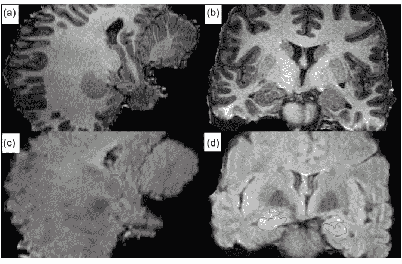

图6.1 (a和b)：显示的带有分割杏仁核和分割海马的示例矢状位和冠状位T1加权图像。(c和d)：显示的带有分割杏仁核和分割海马的示例冠状位和矢状位FLAIR图像。

## 6.2.4 特征分析与分类

以下部分，我们重点介绍五个选定研究中用于特征分析——特征提取、选择和降维——的方法，以及用于分类的方法。

研究1：T1加权像和FLAIR特征：一项海马研究

多项研究表明，海马体积缩小与相当一部分mTLE患者的mTLE侧别相关。因此，这种体积缩小被广泛用于mTLE侧别定位。除了海马体积缩小外，FLAIR信号增强的存在也被用作侧别定位的特征。海马FLAIR信号强度的增加被认为代表海马胶质增生，进而可能预示局灶性致痫性。第三组图像特征是使用小波变换提取的。小波变换是揭示图像局部频率成分和表达图像纹理特性的知名工具。在文献[31]中，体积特征、均值和标准差的


FLAIR 图像，以及从这两种 MRI 模态中提取的基于小波的特征，描述如下。

1.  对于体积特征，检查了每个半球的整个海马体积。ROI（例如海马）的体积通过对 ROI 内所有体素的体积求和来计算，即像素大小 $\times$ 层厚。体积特征通过右海马与左海马尾的体积比计算得出。这是一个归一化特征，非常适合用于单侧癫痫的分类。
2.  从 FLAIR 图像中提取了两个特征——均值比和标准差比。每个特征均表示为两个海马（即右海马和左海马）获得的两个值的比值。使用这些比值代替原始值，有助于通过特征降维和归一化来促进侧别定位。
3.  对于每个海马，计算了两个层级的小波变换，因此每个海马产生了七个子带图像。使用 Daubechies 小波基来提取子带图像。每个子带图像表征了预定尺度下的频率内容（即纹理特性）。因此，每个子带的能量特征（即强度平方的和）被用作纹理特征：

$$E_{K}=\frac{1}{MN} \tag{6.1}$$

其中 $I_{k}^{2}(i,j)$ 是第 $k$ 个子带中的 $M \times N$ 图像。选择等效矩形图像确实是一个重要问题，因为它可能会影响小波分析的结果，因为分割后的海马并非矩形。在参考文献 [31] 中，通过一种修补技术（即重复膨胀 [49]）填充分割图像中的背景区域来解决此问题。通过这种方法，海马的每一切片被分配了七个能量特征，对所有海马切片进行平均后，为整个海马产生七个能量特征。

随后，上述特征被表示为特征向量，并用于开发*线性分类*算法，将癫痫患者分为右侧组和左侧组。在本研究中，使用两条平行于判别线的直线引入了边界域，这两条直线提供了 0.25 个标准差（SD）的变异。通过这些边界线，分类器拥有一个不确定性组，准确率在考虑和不考虑不确定性组的情况下分别提供（见表 6.1）。由于患者数量有限，所有特征向量都被用于开发线性判别函数。避免估计准确率中任何偏差的理想方法是：将数据划分为训练集和测试集，仅使用训练集构建线性分类器，然后使用测试集对训练好的分类器进行测试。使用这些海马特征的结果在结果部分中呈现。

## 研究 II：海马和杏仁核研究：FLAIR 和体积特征

研究表明，在约 10% 的 mTLE 患者中，杏仁核体积和 T2 弛豫率的变化并不伴随海马、大脑皮层、小脑和丘脑的变化 [35,36,50,51]。这种有限的组织病理学分布促使研究人员使用杏仁核体积和 FLAIR 强度的变化作为 mTLE 侧别定位的补充特征。在参考文献 [37] 中，将杏仁核中 FLAIR 信号的均值和标准差添加到研究 I 中调查的特征中，以改善分类结果。相应地，使用四个与 FLAIR 图像相关的特征——杏仁核和海马的均值和标准差比值——以及两个与海马尾体积测量相关的特征，用于 mTLE 侧别定位。

用于下游分析的海马和杏仁核分割是在 T1 加权图像上手动完成的（图 6.1）。然后，通过对每个受试者的 T1 加权图像和 FLAIR 图像分别进行刚性配准，将海马和杏仁核分割映射到 FLAIR 图像上。随后，为每个结构（即海马和杏仁核）在每个半球计算 FLAIR 均值和标准差，然后使用每个结构的均值和标准差的右左比值作为 mTLE 侧别定位的特征。

与研究 I 类似，计算了海马和杏仁核中 FLAIR 信号强度的均值和标准差。为了减少由使用不同扫描仪产生的偏差，应用了强度非均匀性校正，然后使用右/左比值作为特征。

在参考文献 [37] 中，分别使用海马尾体积测量以及杏仁核和海马 FLAIR 特征训练了三个区分侧别的线性分类器。此外，还使用两条平行线为每个线性分类器建立了边界/不确定区域，控制组中 95% 的受试者位于这两条线之间。为了检查添加杏仁核 FLAIR 特征是否改善了侧别定位过程，应用了 McNemar 检验。

## 研究 III：基于 DTI 的响应驱动建模

DTI 可以通过分割和纤维跟踪检测癫痫引起的微观结构改变。在参考文献 [20] 中，利用 DTI 分析探讨扣带束、连合和胼胝体的微观结构变化，以定位 mTLE 并区分单侧和双侧病例。预处理算法包括：(1) 使用 DTI 建立白质结构——扣带束、胼胝体、连合及其亚区域——以及 (2) 分割海马并将 T1 加权图像与 FLAIR 共配准以计算海马内 FLAIR 强度的均值和标准差。

在建立白质结构之前，对 DTI 图像进行了插值，以提供均匀的体素大小。对于分割，除了各向异性分数（FA）和平均扩散率（MD）外，还计算了与扩散张量最大特征值相关联的特征向量作为主扩散方向。接下来，使用基于种子的分割和纤维跟踪定义了扣带束、胼胝体、连合及其亚区域 [52,53]。图 6.2 展示了这些纤维的典型分割结果。对于所有队列（即右侧和左侧单侧 mTLE、双侧 mTLE 和控制组），估计了 15 个亚区域（包括扣带束的前下、上部和后右左部分；胼胝体的膝部、前肢体、前中体、后中体、峡部和压部；以及连合的前体和左右柱）的 FA 和 MD。用于定位 mTLE 和检测单侧性的特征集包括：

1.  海马尾体积测量，
2.  海马 FLAIR 强度的均值和标准差，以及
3.  胼胝体、扣带束和连合区域的 FA。

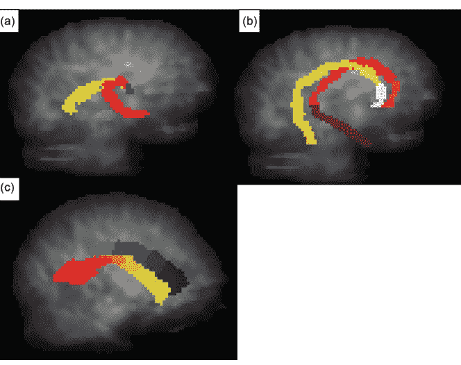

图 6.2 连合、扣带束和胼胝体的典型分割叠加在 3D 渲染的 FA 图上。(a)：连合被分割为前体和左右柱。(b)：扣带束被分割为左前下、上部和右前下、上部和右后下。(c)：胼胝体被分割为左右膝部、前肢体、前中体、后中体、峡部和压部。

使用 *t* 检验和双因素重复测量方差分析，考察了上述特征——上述亚区域 FA 的 15 个特征以及海马尾体积测量和 FLAIR 强度均值和标准差的 6 个特征——与 mTLE 侧别定位之间的关系。这可以被视为机器学习术语中的*特征选择*步骤。

接下来，使用多项逻辑回归 [54] 基于上述特征作为自变量，侧别标签——右 mTLE、左 mTLE、双侧 mTLE 和控制组——作为因变量，开发了三个不同的模型。这些模型包括：

1.  右 mTLE vs. 左 mTLE，
2.  单侧 vs. 双侧 mTLE，以及
3.  右 mTLE vs. 左 mTLE vs. 双侧 mTLE vs. 控制组。


由于数据集样本量较小（54例），作者采用留一法（leave-one-out）进行交叉验证精度估计。为此，共执行了54次训练-测试试验。每次训练均通过以下公式的多项式逻辑函数回归进行评估：

$$\ln\left(\frac{\operatorname{Pr}\left(Y_{i}=T|\boldsymbol{M}_{k}\right)}{\operatorname{Pr}\left(Y_{i}=N|\boldsymbol{M}_{k}\right)}\right)=\boldsymbol{\beta}_{i}^{k}\qquad(6.2)$$

其中 $X_{i}$ 和 $\beta_{i}$ 分别为观察特征向量和回归系数向量，$\operatorname{Pr}\left(Y_{i}=T|\boldsymbol{M}_{k}\right)$ 是标签 $Y_{i}$ 的后验概率，根据模型做出的决策被设为 0 或 1。通过多项式逻辑回归，为三个回归模型中的每一个估计了回归系数。随后，使用 $\beta_{i}$ 对测试数据的估计模型精度进行了评估。

## 研究IV：全脑纹理特征

由于癫痫可能影响整个大脑的结构特征，本研究假设纹理特征——一阶和二阶统计特征——可能用于识别癫痫患者。为此，基于体积灰度共生矩阵（GLCM）获取了二阶统计特征。这些特征从脑组织分割结果中提取。这里使用了两种组织分割方法：Gram-Schmidt正交化 [55] 和统一分割方法 [56]。对两种方法的结果进行了定量比较。针对上述分割方法定义的脑组织——脑脊液（CSF）、灰质和白质——计算了特征值。此外，使用FSL-FIRST软件 [57] 对所有受试者的海马体进行分割，并计算了其纹理特征。

一阶特征，包括均值、方差、偏度和峰度，是基于每个体素的强度及其在大脑中出现的概率，使用基于体素的MRI分析导出的，例如，偏度定义为 $\sum_{i=0}^{G-1}(i-\mu)^{3} P(i)$。完整的定义集见文献 [58]。

为了提取二阶特征，即结构特征和这些特征的三维扩展 [59]，使用了（1）能量，（2）熵，（3）相关性，（4）对比度，（5）和平均值，（6）不相似性，（7）纹理方差，（8）聚集阴影，（9）聚集倾向，（10）同质性，（11）最大概率，以及（12）逆纹理方差。为了从3D图像中提取特征，使用了三种不同的位移向量——d1 = (0,1,0), d2 = (1,1,0), 和 d3 = (0,1,−1)——其中每个向量捕捉三个主轴方向中的一个。对于每个区域/组织，从每种模态中每提取4个一阶特征和36个（3 × 12）二阶特征。因此，为三个主要脑组织提取了120个特征。因此，迫切需要全面的特征降维。

为了降低特征向量的维度，应用了三个主要步骤。第一步（特征选择）基于Relief算法 [60] 丢弃无关特征。第二步分两步减少特征数量：（1）使用k-means聚类根据体素空间中的相似性对特征进行聚类，以及（2）选择每个聚类中Relief得分最高的特征并丢弃聚类中剩余的特征。在最后一步中，使用序列浮动前向选择根据最小分类误差组合地选择显著特征。在每种条件下，作者提取特征，根据上述说明选择最佳特征，然后使用留一法训练和测试SVM分类器。特征选择和分类器训练的结果在结果部分（第3.4节）中呈现。

## 研究V：多结构体积特征

在上述研究以及该领域大多数研究中，提出了几个结构特征，以提供定量的侧化（lateralization）证据。然而，这种纳入是否确实与侧化改进相关并有益，仍有争议。文献 [61] 中呈现的研究旨在确定神经解剖部位/区域对侧化的贡献，并建立一个具有最佳特征数量的鲁棒分类器。特征空间包括53个体积特征，使用公式（6.3）从53个半球配对的神经解剖区域中提取。通过FreeSurfer分割的这些区域列表可在文献 [61] 中找到。配对结构的体积差异被归一化为配对结构的总体积：

$$f_{i}=\frac{v_{L i}-v_{R i}}{v_{L i}+v_{R i}} \tag{6.3}$$

其中 $v_{Li}$ 和 $v_{Ri}$ 分别表示左半球和右半球中第 *i* 个区域的分割体积。为了避免人类变异性，使用FreeSurfer [48] 自动分割结构。使用基于体积的特征背后的前提是，反复的兴奋可能导致海马体及大脑其他相关部位的细胞死亡，从而导致萎缩。因此，侧相关的体积变化可能与癫痫发生侧别相关，使用它们可能提高侧化准确率。

在文献 [61] 中，提供特征最优子集的特征选择步骤由Kohavi和John在1997年提出的包装子集评估方法执行 [62]。该方法找到了具有最高mTLE侧化准确率的最具区分力特征子集。包装子集评估方法使用监督学习算法在可能的特征子集中寻找最优子集。接下来，逻辑回归（LR）和支持向量机（SVM）作为两种鲁棒且广泛使用的监督分类器被采用，并在mTLE患者癫痫发生侧别识别的准确率方面进行了比较。在多项式逻辑回归实现中使用了岭估计器以防止过拟合。以下多项式逻辑回归核模型计算了给定特征向量（即 $[f_{1}, f_{2}, \ldots, f_{m}]$）时类别 $j$ 的 *后验* 概率。

$$Pr[j|[f_{1}, f_{2}, \ldots, f_{m}]] = \frac{e^{\beta_{0}^{j} + \beta_{1}^{j}f_{1} + \beta_{2}^{j}f_{2} + \cdots + \beta_{m}^{j}f_{m}}}{1 + \sum_{j=1}^{k-1} e^{\beta_{0}^{j} + \beta_{1}^{j}f_{1} + \beta_{2}^{j}f_{2} + \cdots + \beta_{m}^{j}f_{m}}} \tag{6.4}$$

其中 $k$ 是类别数，$\beta_{0}^{j}, \beta_{1}^{j}, \beta_{2}^{j}, \ldots, \beta_{m}^{j}$ 表示通过训练过程获得的系数。此外，SVM被用于学习一个超平面，即 *m维* 超平面模型，作为特征向量的线性函数，具有最大间隔。为了实现SVM分类器，使用了Pegasos作为一种简单有效的随机次梯度下降算法 [63]。

### 6.2.5 mTLE侧化的机器学习总结

为了建立mTLE侧化的机器学习算法，进行了一项回顾性比较评估。通过这种方式，选择了接受切除性手术且术后无癫痫发作的患者用于此类研究，以确定和测试用于侧别判定的单个或多个特征。虽然使用了各种机器学习算法进行癫痫发生侧别的自动化识别，但本章呈现的研究中使用的算法总结在表6.1中。为说明起见，用于特征分析的方法与用于分类的方法一起总结。我们还简要描述了表6.1中患者的类别、人群类型和成像模态。

## 6.3 结果

### 6.3.1 研究1：海马研究 – FLAIR强度、纹理分析和体积测量

在研究1中，从两个半球的分割海马中提取了三组特征：FLAIR强度的均值和标准差、小波能量特征以及海马可体积特征。在本研究中，为每组特征训练了线性判别线/平面作为分类器，并将正确分类数量与受试者总数的比率视为 *分类准确率*。考虑到判别线两侧的不确定边界，为每组特征计算了两种不同的准确率。不确定边界被设置在与判别线平行且距离0.25个标准差（SD）的位置。

本研究检查并单独报告了使用七种不同特征组合的准确率：（1）海马FLAIR强度均值，（2）海马FLAIR强度标准差，（3）海马FLAIR强度均值和标准差，（4）使用db4的两个小波特征（*E1*, *E2*），（5）使用db6的两个小波特征（*E1*, *E2*），（6）使用db8的两个小波特征（*E1*, *E2*），以及（7）海马体积（左/右）。海马FLAIR信号强度均值和标准差（SD）的组合提供了最准确的分类器，当考虑将位于不确定边界内的正确分类主体视为错误分类时，准确率为75%；当将它们视为正确分类时，准确率为98%。考虑到不确定边界，海马FLAIR的SD（均值）的准确率为72%（58%），如果


## 表 6.1 本章回顾的研究摘要

| 研究 | 影像集 | 研究对象群体 | 特征集 | 机器学习算法 | 结果 |
| :--- | :--- | :--- | :--- | :--- | :--- |
| Jafari et al. [31] | 1. T1加权 MRI<br>2. FLAIR (1.5T 扫描仪) | 1. 右侧癫痫：16 名受试者<br>2. 左侧癫痫：20 名受试者<br>3. 对照组：25 名受试者 | 1. 海马体 FLAIR 强度的均值和标准差 (SD)<br>2. 小波能量比<br>3. 海马体体积 | 线性判别分析 (LDA) | 含不确定区域的准确率 → 不含不确定区域的准确率<br>1. 75% → 98%<br>2. 64% → 94%<br>3. 75% → 83% |
| Jafari et al. [37] | 1. T1加权 MRI<br>2. FLAIR 1.5T & 3T 扫描仪 | 1. 右侧癫痫：26 名受试者<br>2. 左侧癫痫：43 名受试者<br>3. 对照组：46 名受试者 | 1. 海马体 FLAIR 强度的均值和标准差<br>2. 杏仁核 FLAIR 强度的均值和标准差 | 线性判别分析 (LDA) | 含不确定区域的准确率 → 不含不确定区域的准确率<br>1. 70% → 87%<br>2. 29% → 78%<br>3. 67% → 75% |
| Nazeri-Zadeh et al. [20] | 1. T1加权 MRI<br>2. FLAIR 1.5T & 3T 扫描仪<br>3. DTI (扩散张量成像) | 1. 右侧癫痫：11 名受试者<br>2. 左侧癫痫：13 名受试者<br>3. 双侧：7 名受试者<br>4. 对照组：23 名受试者 | 1. 海马体体积<br>2. 杏仁核体积<br>3. 以下区域的 FA (各向异性分数)：1. 扣带回，2. 胼胝体亚区域，3. 穹窿亚区域 | 留一法多项逻辑回归模型 | 模型 1：右侧 (R) vs. 左侧 (L)<br>a. 100% 准确率：扣带回的 FA<br>b. 100% 准确率：扣带回和胼胝体的 FA<br><br>模型 2：单侧 (U) vs. 双侧 (B)<br>100% 准确率：胼胝体和扣带回的 FA<br><br>模型 3：右侧 (R) vs. 左侧 (L) vs. 双侧 (B) vs. 对照组 (C)<br>100% 准确率：胼胝体和扣带回的 FA |
| Saheb-zamani et al. [58] | 1. T1加权 MRI<br>2. FLAIR (3T 扫描仪)<br>3. T2加权图像<br>4. 质子密度 | 1. 单侧癫痫：5 名受试者<br>2. 左侧癫痫：5 名受试者<br>3. 对照组：7 名受试者 | 从 FLAIR 和 T1加权图像中提取的一阶和二阶纹理特征完整集合：全脑和海马体 | 留一法支持向量机 (SVM)：癫痫患者 vs. 非癫痫患者 | 使用白质 FLAIR 纹理特征的准确率为 94%<br>使用海马体 T2 纹理特征的准确率为 82.3% |
| Mahmoudi et al. [61] | | 1. 68 名单侧癫痫患者<br>2. 2–46 名对照患者 | 针对使用 T1 图像分割的 53 个区域提取的 53 个体积特征 | **特征选择：** 包裹算法和爬山策略<br><br>**分类：** 逻辑回归 (LR) 和支持向量机 (SVM) | 选定特征：海马体、杏仁核和丘脑的归一化体积特征<br>LR & L–1 O：所有患者准确率为 98.5%<br><br>LR & 五折交叉验证：所有患者准确率为 92.6% |

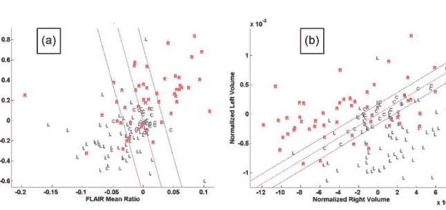

图 6.3 (a)：使用非癫痫受试者（由 C 表示）、右侧 mTLE 患者（由 R 表示）和左侧 mTLE 患者（由 L 表示）的数据，绘制海马体 FLAIR 强度均值和标准差 (SD) 比率散点图。(b)：使用非癫痫受试者（由 C 表示）、右侧 mTLE 患者（由 R 表示）和左侧 mTLE 患者（由 L 表示）的数据，绘制归一化右侧和左侧海马体体积散点图。

当仅将信号强度用于分类时（参考文献 [31] 中的图 5 显示了相应的散点图），我们生成了图 6.3a，展示了海马体 FLAIR 强度均值和 SD 比率的组合散点图。该散点图使用的是比参考文献 [31] 中报告的更完整的数据集。进一步检查发现，右侧、左侧和对照组之间海马体 FLAIR 强度的均值比率和标准差比率存在差异，P 值分别小于 4.0 × 10⁻⁶ 和 10⁻¹²。

上述研究报告称，基于使用 Daubechies 小波基（长度为 2、4 和 6）提取的纹理特征进行分类，准确率为 64%。这是通过使用子带 1 和 2 的能量特征（右/左比率）以及线性分类器实现的。此外，当将不确定边界内正确分类的受试者视为误分类受试者时，最高准确率为 64%，这是通过使用 db8 小波获得的。

基于海马体体积分析的分类准确率为 75%，与使用 SD 和均值比率的准确率相似。当将不确定边界内正确分类的受试者视为正确分类时，使用体积特征的准确率上升至 83%，而使用 SD 和均值比率的准确率上升至 98%。与使用归一化右侧和左侧海马体体积（R HV 和 LHV）相对应的线性散点图显示在图 6.3b 中。该图中的判别线由 R HV=LHV 指定。

### 6.3.2 研究 II：海马体和杏仁核研究 – FLAIR 强度和体积测量

由于在 mTLE 病例中，杏仁核体积和 FLAIR 强度的改变通常伴随海马体的改变，因此研究了杏仁核 FLAIR 强度的均值和标准差，以沿海马体特征对致痫灶进行侧别定位。对于基于 FLAIR 的侧别定位，通过线性判别分析，使用右侧和左侧 mTLE 的杏仁核和海马体 FLAIR 特征推导出了两个线性分类器。

首先，发现使用两种不同的扫描仪，即 3T 和 1.5T，对对照组受试者的杏仁核 FLAIR 特征没有显著影响。结果还显示，基于杏仁核 FLAIR 强度比率特征（即均值和 SD 比率）的线性分类器正确定位了 78% 的病例，而其中只有 29% 的病例位于不确定区域之外。基于海马体 FLAIR 强度特征的线性分类器成功定位致痫灶的比率为 87%，而当将放置在不确定区域内的正确分类受试者视为误分类受试者（不确定组）时，获得的准确率为 70%。正如预期，检测到海马体和杏仁核 FLAIR 平均强度比率之间存在显著相关性 $( P<10^{-18} )$。此外，使用海马体和杏仁核 FLAIR 平均强度比率进行分类，74% 的患者具有相似的侧别定位。有趣的是，根据海马体平均强度比率位于不确定区域内的 4 名患者（6%）通过杏仁核平均强度比率被正确定位。这表明杏仁核和海马体 FLAIR 强度提供了互补信息。

基于海马体体积特征的侧别定位准确率为 75%，当考虑不确定区域时降至 67%。仅基于杏仁核体积特征的侧别定位准确率约为 29%。

### 6.3.3 研究 III：基于 DTI 的响应驱动建模

在参考文献 [20] 中，使用从 15 个亚区域提取的 FA 测试了所有 mTLE 侧别配对（右侧、左侧和双侧）之间差异的显著性。这些亚区域包括：扣带回的左/右前下、上、后下部分；胼胝体的膝部、额体、前中体、后中体、峡部和压部；以及穹窿的前体和左/右肢。结果显示以下之间存在显著差异：

- 对照组受试者与右侧 mTLE 病例：胼胝体所有亚区域、左右上扣带回亚区域以及穹窿肢的 FA
- 右侧和左侧 mTLE 病例：胼胝体膝部、额体和压部，以及右侧后下和上扣带回亚区域的 FA
- 对照组受试者与左侧 mTLE 病例：胼胝体峡部的 FA
- 右侧和双侧 mTLE 病例：胼胝体额体、中体亚区域和峡部的 FA

使用扣带回、胼胝体和穹窿亚区域的 FA，构建了三个模型以区分单侧和双侧病例，并确定单侧 mTLE 中致痫灶的侧别。对于模型 1，即检测单侧 mTLE 病例中致痫灶的侧别，使用扣带回亚区域 FA 的多项逻辑分类器达到了 100% 的准确率，偏差为 7.3。通过结合胼胝体的 FA，拟合偏差降至 0.7。为了区分单侧和双侧病例，即模型 2，结合胼胝体和扣带回的 FA 提供了 100% 的准确率。这种结合在模型 3（右侧 mTLE vs. 左侧 mTLE vs. 双侧 mTLE vs. 对照组）中也达到了 100% 的准确率。当将扣带回特征减少到两个特征时，即左侧和右侧后下扣带回的特征，也达到了这一准确率（100%）。

### 6.3.4 研究 IV：从全脑 MRI 提取的纹理特征

从海马体、白质和灰质的 T1加权、FLAIR、T2加权和质子密度加权图像中提取了一阶和二阶纹理特征。分割使用两种方法执行：Gram–Schmidt 和统一法。对通过统一法分割的全脑应用三步特征选择程序，得出了四个特征：白质对比度


对于三个不同方向（d1、d2 和 d3）的 FLAIR 图像，以及 d2 方向 FLAIR 图像中白质总和的平均值。利用这四个特征，训练后的 SVM 分类器在区分 mTLE 患者和对照受试者方面达到了 94% 的准确率。对通过 Gram–Schmidt 分割得到的全脑分割数据进行相同的特征选择过程，结果为三个不同方向（d1、d2 和 d3）的灰质得出了三个差异特征，SVM 分类器达到了 82.3% 的准确率。

对于统一分割，从分割的海马体中提取一阶和二阶纹理特征，并应用特征选择程序提供了两个特征：T2 加权图像中两个方向（d1 和 d2）上的灰质聚集倾向。这些特征在分类 mTLE 患者和对照受试者时达到了 82.3% 的准确率，而由 Gram–Schmidt 提供的海马体分割仅达到了 76.4% 的准确率。

### 6.3.5 研究 V：多结构体积特征

在此研究中，从使用 FreeSurfer [48] 分割的脑部 MRI 中提取了 53 个归一化体积特征。归一化特征被用作包装算法中逻辑回归的输入集。包装算法产生的最佳特征子集包括十种脑结构：海马体、杏仁核、丘脑、壳核、脑白质、内嗅皮层、颞下回、顶下小叶、中央后回和海马旁回。然而，维度为 10 的特征向量并不适合分类 68 名受试者。因此，利用爬山策略在这十个特征中寻找最有希望的。文献 [61] 中展示的结果表明，从海马体、杏仁核和丘脑提取的体积特征在使用逻辑回归和 SVM 进行侧别定位时提供了最高级别的准确率。结果还表明，将壳核作为第四个体积特征加入并未增加逻辑回归方法的准确率，反而降低了 SVM 的准确率。

对结构的绝对体积特征——均值和标准差——进行的调查发现，这些特征在患者中均不足以用于侧别定位，无论是伴有海马硬化（HS-P）的患者还是不伴有的患者（HS-N）。相反，通过公式 (6.3) 获得的海马体归一化体积特征在 HS-P 组中的右侧和左侧患者之间没有重叠。因此，海马体的归一化体积特征，即海马体萎缩，能够成功地对 HS-P 患者的 mTLE 进行侧别定位，准确率为 100%。然而，归一化体积特征并未完全区分 HS-N 组中的右侧和左侧患者。

总体而言，对各结构萎缩与致痫侧别之间关系的调查结果表明，每种结构——海马体、杏仁核和丘脑——的归一化体积特征均无法单独确定致痫侧别。

在文献 [61] 中，基于多结构体积特征的 mTLE 侧别定位使用了如公式 (6.4) 所示的逻辑概率函数的简化版本。估计参数和 68 名患者位置的结果如图 6.4a 所示。

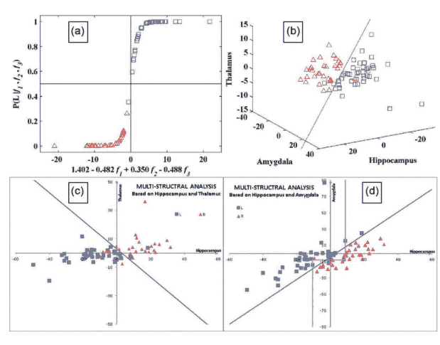

**图 6.4** 用于 mTLE 侧别定位的多结构体积特征逻辑回归示意图。(a)：根据公式 (6.4) 对所有 mTLE 病例的左侧定位概率（左侧 mTLE 病例用蓝色矩形表示，右侧 mTLE 用红色三角形表示）。(b)：由海马体、杏仁核和丘脑的体积特征定义的三维特征空间中的 mTLE 患者散点图。由于决策平面与观察角度平行，因此显示为一条线。(c 和 d)：决策平面分别投影到由海马体和杏仁核的体积特征以及海马体和丘脑的体积特征定义的二维特征空间中。

判别阈值被设定为使逻辑概率函数等于 0.5：

$$Pr\left[L \mid\left[f_{1}, f_{2}, f_{3}\right]\right]=\frac{e^{\beta_{0}^{L}+\beta_{1}^{L} f_{1}+\beta_{2}^{L} f_{2}+\beta_{3}^{L} f_{3}}}{1+e^{\beta_{0}^{L}+\beta_{1}^{L} f_{1}+\beta_{2}^{L} f_{2}+\beta_{3}^{L} f_{3}}}=0.5 \quad(6.5)$$

这在三维特征空间中产生了一个平面，即 $\beta_{0}^{L}+\beta_{1}^{L} f_{1}+\beta_{2}^{L} f_{2}+\beta_{3}^{L} f_{3}=0$。该平面可以投影到二维特征空间中，例如海马体–杏仁核空间和海马体–丘脑空间。图 6.4b 展示了左侧和右侧 TLE 患者在三维特征空间中的散点图以及决策平面。为了进一步说明，投影到相应二维特征空间中的决策平面如图 6.4c 和 d 所示。

## 6.4 讨论

在本章中，我们回顾了旨在开发用于 mTLE 侧别定位的结构生物标志物的研究。其目标是通过提取、选择和处理结构和纹理特征来诊断癫痫或对 mTLE 患者进行侧别定位。

在研究 I 中，使用线性判别器将右侧 mTLE 与左侧 mTLE 分开，使用的是 FLAIR 和体积特征。FLAIR 在海马体中的平均信号强度及其标准差提供了用于区分 mTLE 患者侧别的有效特征组合（准确率为 98%），而海马体体积特征在相同情况下仅能达到 83% 的准确率。这些准确率是在不存在双侧患者且不考虑对照受试者的情况下取得的。当使用对照受试者来获取不确定边界时，这些准确率降至 75%（详情请见表 6.1）。根据本研究提供的证据，我们得出结论：除了海马体体积不对称性之外，FLAIR 强度测量值（均值和标准差）在海马体中的不对称性可能提供额外的生物标志物，用于海马硬化（HS）和致痫侧别的判断。

除了海马体的均值和标准差外，本研究还提取了 FLAIR 强度的四个常规纹理特征——共生矩阵、游程矩阵、绝对梯度和直方图——以进行调查。由公式 (6.1) 定义的小波变换能量特征将单侧海马硬化正确分类为右侧和左侧 mTLE，准确率为 94%。这表明基于小波的特征提取具有用于 mTLE 侧别定位的能力。关于本研究，可能会提出三个问题：

- (1) 36 名患者的样本量较小（左侧 20 名，右侧 16 名）
- (2) 未将双侧病例作为额外类别使用
- (3) 依赖于分割的准确性。

在研究 II [37] 中，杏仁核 FLAIR 强度特征被用于在没有海马萎缩（通过体积和 FLAIR 特征判定）的情况下进行癫痫侧别定位。仅使用杏仁核特征时，致痫侧别的准确率仅为 29%，而来自海马体的类似特征达到了 70% 的准确率，但值得注意的是，有 22% 无法通过海马体 FLAIR 特征可靠定位的病例可以通过杏仁核 FLAIR 特征进行可靠分类。这可以作为先前报告 [64] 的良好证据。此外，结果表明，杏仁核的自动分割对于本研究是足够的，且所有侧别定位错误的患者都落在不确定边界内。由于本研究使用的数据由不同的扫描仪（1.5T 和 3T）采集，如果 FLAIR 图像的强度不均匀性未得到校正，扫描仪的差异可能会影响结果。

类似于研究 I，本研究未对双侧病例进行调查，因为研究关注的是具有 Engel Ia 结局的患者。这意味着前一项研究的一个局限性（缺乏双侧类别）仍未得到解决，而另外两个局限性得到了适当解决。本研究的另一个局限性是它未调查与 mTLE 相关的杏仁核体积变化。

文献 [20] 中报道的全面研究表明，受 mTLE 影响的白质结构（扣带、穹窿和胼胝体）中的分数各向异性（FA）在单侧和双侧 mTL 相对于非癫痫受试者表现出独特的模式。结果显示，穹窿、扣带和胼胝体亚区域的 FA 能够确定所有单侧 mTLE 病例的致痫侧别。此外，海马体的体积和 FLAIR 强度变化表明，虽然这些特征对于侧别定位有用，但它们未能区分单侧和双侧 mTLE 病例。

本研究使用的数据使用单一扫描仪收集。这显然减少了不良变异性并提供了稳定的分类结果。然而，应验证所提模型在多扫描仪/多中心研究情况下的能力。此外，


受试者的小样本量，特别是对于双侧队列，可被视为本研究的一个局限性。

研究 IV 比较了基于统一分割方法和 Gram–Schmidt 方法获得的分割结果来区分内侧颞叶癫痫 (mTLE) 受试者和对照受试者的准确性。结果显示，统一方法分割区域的纹理特征比 Gram–Schmidt 方法的更具判别力。他们发现三维纹理特征在检测 mTLE 病例中成功应用。此外，全脑纹理特征优于海马的纹理特征。

在本章讨论的最后一项研究 [61] 中，发现三个神经解剖区域的归一化体积对于 mTLE 侧别定位是最优的。研究表明，海马和杏仁核归一化体积特征的组合使 mTLE 侧别定位的准确率达到了 94.1%。如果不整合杏仁核体积特征，仅海马体积特征产生的准确率为 82.4%。此外，整合丘脑体积特征将 mTLE 侧别定位的准确率提高到了 98.5%。

在上述所有研究中，训练阶段使用的患者均被诊断为患有 mTLE。因此，所提出的机器学习模型适用于 mTLE 患者。它们可能不适用于患有其他类型癫痫的患者，例如额外颞叶癫痫 (extra-temporal epilepsy)。此外，还应研究所提出的特征和分类模型对侧方、新皮质颞叶癫痫 (lateral, neocortical TLE) 患者的表现。

## 6.5 结论

本研究中使用特征可归类为四个组：(1) 包括单结构和多结构体积的体积特征，用于研究 I–V；(2) 用于研究 IV 的一阶和二阶纹理特征；(3) 用于研究 III 的 DTI（扩散张量成像）特征；以及 (4) 包括单结构和多结构特征的 FLAIR（液体衰减反转恢复）强度特征，用于研究 I–III。我们描述了这些特征在药物难治性 mTLE 患者侧别定位中的作用。

参考文献 [37,61] 中提出的多结构方法在预测癫痫侧别方面提供了高可靠性，同时降低了成本和患者的风险。基于这些结果，可以得出结论，整合 FLAIR 强度特征（如参考文献 [37] 中所示）以及参考文献 [61] 中提出的三结构成像生物标志物，可能会进一步提高侧别定位的准确性。然而，这些方法尚未在双侧癫痫的情况下得到验证。为了纳入双侧病例，未来的工作可能会通过类似参考文献 [20] 中的方法扩展这些方法。

## 参考文献

- 1. D. Hirtz, D. J. Thurman, K. Gwinn-Hardy, M. Mohamed, A. R. Chaudhuri, and R. Zalutsky, “How common are the ‘common’ neurologic disorders?” *Neurology*, vol. 68, no. 5, pp. 326–337, Jan. 2007.
- 2. G. S. Bell, A. Neligan, and J. W. Sander, “An unknown quantity – The worldwide prevalence of epilepsy,” *Epilepsia*, vol. 55, no. 7, pp. 958–962, 2014.
- 3. A. T. Berg, et al., “Revised terminology and concepts for organization of seizures and epilepsies: Report of the ILAE Commission on Classification and Terminology, 2005–2009,” *Epilepsia*, vol. 51, no. 4, pp. 676–685, 2010.
- 4. A. M. Harriott and W. O. Tatum, *Electroclinical Syndromes: Adolescent Onset*, *Swaiman’s Pediatric Neurology*, 6th ed.: Elsevier Inc., 2017.
- 5. R. D. G. Blalr, “Temporal lobe epilepsy semiology,” *Epilepsy Res. Treat.*, vol. 2012, pp. 1–10, 2012.
- 6. J. A. Hill and N. Venna, *Human Herpesvirus 6 and the Nervous System*, 1st ed., vol. 123: Elsevier B.V., 2014.
- 7. F. J. Rugg-Gunn, et al., “Diffusion tensor imaging in refractory epilepsy,” *Lancet*, vol. 359, no. 9319, pp. 1748–1751, 2002.
- 8. R. P. Carne, et al., “MRI-negative PET-positive temporal lobe epilepsy: A distinct surgically remediable syndrome,” *Brain*, vol. 127, no. 10, pp. 2276–2285, 2004.
- 9. J. C. Bulacio, et al., “Long-term seizure outcome after resective surgery in patients evaluated with intracranial electrodes,” *Epilepsia*, vol. 53, no. 10, pp. 1722–1730, 2012.
- 10. Engel J Jr, Van Ness PC, Rasmussen T, et al. Outcome with respect to epileptic seizures. In: Engel J Jr, editor. *Surgical Treatment of the Epilepsies*. 2nd ed. New York: Raven Press; 1993:609–622.
- 11. E. Achtken, P. Boon, T. Van Der Kerkhof, J. Caemaert, J. De Reuck, and M. Kunnem, “Value of single-voxel proton MR spectroscopy in temporal lobe epilepsy,” *Am. J. Neuroradiol.*, vol. 18, no. 6, pp. 1131–1139, 1997.
- 12. J. De Tisi, et al., “The long-term outcome of adult epilepsy surgery, patterns of seizure remission, and relapse: A cohort study,” *Lancet*, vol. 378, no. 9800, pp. 1388–1395, 2011.
- 13. G. D. Cascino, “Neuroimaging in partial epilepsy: Structural magnetic resonance imaging,” *J. Epilepsa*, vol. 11, no. 3, pp. 121–129, 1998.
- 14. M. Thom, “Review: Hippocampal sclerosis in epilepsy: A neuropathology review,” *Neuropathol. Appl. Neurobiol.*, vol. 40, no. 5, pp. 520–543, 2014.
- 15. M. Thom, “Hippocampal sclerosis: Progress since sommer,” *Brain Pathol.*, vol. 19, no. 4, pp. 565–572, 2009.
- 16. I. Blümcke, et al., “International consensus classification of hippocampal sclerosis in temporal lobe epilepsy: A Task Force report from the ILAE Commission on Diagnostic Methods,” *Epilepsia*, vol. 54, no. 7, pp. 1315–1329, 2013.
- 17. G. D. Jackson, R. I. Kuzniecky, and G. D. Cascino, “Hippocampal sclerosis without detectable hippocampal atrophy,” *Neurology*, vol. 44, no. 1, pp. 42–42, Jan. 1994.
- 18. I. Blümcke, M. T. Mrcpu, and D. Wiestler, “Blümcke, Mrcpu, Wiestler_Amm’s Horn Sclerosis A Maldevelopmental Disorder Associated with Temporal Lobe Epilepsy.pdf,” vol. 1, 2002.
- 19. I. Blümcke, R. Coras, H. Miyata, and C. Özkara, “Defining clinico-neuropathological subtypes of mesial temporal lobe epilepsy with hippocampal sclerosis,” *Brain Pathol.*, vol. 22, no. 3, pp. 402–411, 2012.
- 20. M. R. Nazem-Zadeh, et al., “DTI-based response-driven modeling of mTLE laterality,” *NeuroImage Clin.*, vol. 11, pp. 694–706, 2016.
- 21. P. F. Yang, et al., “Long-term epilepsy surgery outcomes in patients with PET-positive, MRI-negative temporal lobe epilepsy,” *Epilepsy Behav.*, vol. 41, no. 2014, pp. 91–97, 2014.
- 22. S. Treit, et al., “Regional hippocampal diffusion abnormalities associated with subfield-specific pathology in temporal lobe epilepsy,” *Epilepsia Open*, no. August, pp. 544–554, 2019.
- 23. M. Mishito, et al., “Immunoproteasome expression is induced in mesial temporal lobe epilepsy,” *Biochem. Biophys. Res. Commun.*, vol. 408, no. 1, pp. 65–70, 2011.
- 24. R. S. Briellmann, R. M. Kalinis, S. F. Berkovic, and G. D. Jackson, “Hippocampal pathology in refractory temporal lobe epilepsy,” *Neurology*, vol. 58, no. 2, pp. 265–271, Jan. 2002.
- 25. F. Cendes, et al., “MRI of amygdala and hippocampus in temporal lobe epilepsy,” *J. Comput. Assist. Tomogr.*, vol. 17, no. 2, pp. 206–210, 1993.
- 26. C. R. Jack, et al., “Temporal lobe seizures: Lateralization with MR volume measurements of the hippocampal formation,” *Radiology*, vol. 175, no. 2, pp. 423–429, May 1990.
- 27. C. R. Jack, “Hippocampal T2 relaxometry in epilepsy: Past, present, and future,” *AJNR. Am. J. Neuroradiol.*, vol. 17, no. 10, pp. 1811–1814, 1996.
- 28. C. R. Jack, et al., “Mesial temporal sclerosis: Diagnosis with fluid-attenuated inversion-recovery versus spin-echo MR imaging,” *Radiology*, vol. 199, no. 2, pp. 367–373, May 1996.
- 29. J. H. Kim, R. D. Tien, G. J. Felsberg, A. K. Osumi, and N. Lee, “MR measurements of the hippocampus for lateralization of temporal lobe epilepsy: Value of measurements of the body vs the whole structure,” *Am. J. Roentgenol.*, vol. 163, no. 6, pp. 1453–1457, 1994.
- 30. W. Van Paessen, “Quantitative MRI of mesial temporal structures in temporal lobe epilepsy,” *Epilepsia*, vol. 38, no. SUPPL. 10, pp. 3–12, 1997.
- 31. K. Jafari-Khouzanli, K. Elisevich, S. Patel, B. Smith, and H. Soltanian-Zadeh, “FLAIR signal and texture analysis for lateralizing mesial temporal lobe epilepsy,” *NeuroImage*, vol. 49, no. 2, pp. 1559–1571, 2010.
- 32. L. Bonilha, et al., “Texture analysis of hippocampal sclerosis,” *Epilepsia*, vol. 44, no. 12, pp. 1546–1550, Dec. 2003.
- 33. S. B. Antel, et al., “Automated detection of focal cortical dysplasia lesions using computational models of their MRI characteristics and texture analysis,” *NeuroImage*, vol. 19, no. 4, pp. 1748–1759, Aug. 2003.


34. A. Bernasconi 等，“纹理分析和形态学处理磁共振成像辅助检测颞叶外部分性癫痫的局灶性皮质发育不良”，*Ann. Neurol.*，第 49 卷，第 6 期，第 770–775 页，2001 年 6 月。

35. L. A. Miller, R. S. McLachlan, M. S. Bouwer, L. P. Hudson 和 D. G. Munoz，“杏仁核硬化：颞叶切除术前的指标及术后预后”，*J. Neurol. Neurosurg. Psychiatry*，第 57 卷，第 9 期，第 1099–1105 页，1994 年。

36. L. P. Hudson, D. G. Munoz, L. Miller, R. S. McLachlan, J. P. Girvin 和 W. T. Blume，“颞叶癫痫中的杏仁体硬化”，*Ann. Neurol.*，第 33 卷，第 6 期，第 622–631 页，1993 年 6 月。

37. K. Jafari-Khouzani, K. Elisevich, V. S. Wasade 和 H. Soltanian-Zadeh，“定量杏仁核 MR FLAIR 信号分析对内侧颞叶癫痫侧别定位的贡献”，*J. Neuroimag.*，第 28 卷，第 6 期，第 666–675 页，2018 年。

38. Y. Aghakhani, X. Liu, N. Jette 和 S. Wiebe，“双侧颞叶发作癫痫患者的癫痫手术：系统综述”，*Epilepsia*，第 55 卷，第 12 期，第 1892–1901 页，2014 年 12 月。

39. J. Zhang 等，“在 MRI 阳性或阴性、单侧或双侧颞叶癫痫中使用多模态方法识别受累半球”，*Neuropsychiatr. Dis. Treat.*，第 10 卷，第 71–80 页，2014 年。

40. C. Scanlon, S. G. Mueller, I. Cheong, M. Hartig, M. W. Weiner 和 K. D. Laxer，“伴有和不伴有内侧颞叶硬化的颞叶癫痫中的灰质和白质异常”，*J. Neurol.*，第 260 卷，第 9 期，第 2320–2329 页，2013 年。

41. S. Chiang 和 Z. Haneef，“图论在颞叶癫痫病理生理学中的发现”，*Clin. Neurophysiol.*，第 125 卷，第 7 期，第 1295–1305 页，2014 年 7 月。

42. M. N. DeSalvo, L. Douw, N. Tanaka, C. Reinsberger 和 S. M. Stufflebeam，“颞叶癫痫中改变的结构连接组”，*Radiology*，第 270 卷，第 3 期，第 842–848 页，2013 年 11 月。

43. M. J. Vaessen 等，“白质网络异常与慢性癫痫中的认知能力下降有关”，*Cereb. Cortex*，第 22 卷，第 9 期，第 2139–2147 页，2011 年 10 月。

44. M. Liu, Z. Chen, C. Beaulieu 和 D. W. Gross，“左侧内侧颞叶癫痫中解剖学白质网络受损”，*Epilepsia*，第 55 卷，第 5 期，第 674–682 页，2014 年 5 月。

45. A. Huffman 等，“单次癫痫发作后的大脑扩散”，*Epilepsia*，第 44 卷，第 1 期，第 54–63 页，2003 年 1 月。

46. Y. Nakasu, S. Nakasu, S. Morikawa, S. Uemura, T. Inubushi 和 J. Handa，“实验性由 kainic 酸诱发的持续发作中的扩散加权 MR”，*Am. J. Neuroradiol.*，第 16 卷，第 6 期，第 1185–1192 页，1995 年。

47. M. B. Parekh, P. R. Carney, H. Sepulveda, W. Norman, M. King 和 T. H. Mareci，“在慢性边缘性癫痫动物模型中，海马旁回早期 MR 扩散和松弛变化先于自发性癫痫发作的发生”，*Exp. Neurol.*，第 224 卷，第 1 期，第 258–270 页，2010 年 7 月。

48. B. Fischl 等，“全脑分割：人类大脑中神经解剖结构的自动标记”，*Neuron*，第 33 卷，第 3 期，第 341–355 页，2002 年。

49. A. Criminisi, P. Perez 和 K. Toyama，“基于样本的图像修补进行区域填充和对象去除”，*IEEE Trans. Image Process.*，第 13 卷，第 9 期，第 1200–1212 页，2004 年。

50. B. E. Swartz, U. Tomiyasu, A. V. Delgado-Escueta, M. Mandelkern 和 A. Khonsari，“颞叶癫痫中的神经影像：测试灵敏度及其与病理和术后预后的关系”，*Epilepsia*，第 33 卷，第 4 期，第 624–634 页，1992 年 7 月。

51. C. Guerreiro 等，“单纯杏仁核萎缩的颞叶癫痫患者的临床模式”，*Epilepsia*，第 40 卷，第 4 期，第 453–461 页，1999 年 4 月。

52. M.-R. Nazem-Zadeh, C. H. Chapman, T. L. Lawrence, C. I. Tsien 和 Y. Cao，“放射治疗对边缘系统回路白质纤维束的影响”，*Med. Phys.*，第 39 卷，第 9 期，第 5603–5613 页，2012 年 9 月。

53. M.-R. Nazem-Zadeh 等，“使用扩散张量成像分割胼胝体：在胶质母细胞瘤患者中的验证”，*BMC Med. Imaging*，第 12 卷，第 1 期，第 10 页，2012 年。

54. D. Böhning，“多项逻辑回归算法”，*Ann. Inst. Stat. Math.*，第 44 卷，第 1 期，第 197–200 页，1992 年。

55. H. Soltanian-Zadeh, D. J. Peck, J. P. Windham 和 T. Mikkelsen，“通过多谱 NMR 图像的模式分析进行脑肿瘤分割和表征”，*NMR Biomed.*，第 11 卷，第 4–5 期，第 201–208 页，1998 年。

56. J. Ashburner 和 K. J. Friston，“统一分割”，*Neuroimage*，第 26 卷，第 3 期，第 839–851 页，2005 年。

57. B. Pataude, S. M. Smith, D. N. Kennedy 和 M. Jenkinson，“用于皮层下大脑分割的形状和外观贝叶斯模型”，*Neuroimage*，第 56 卷，第 3 期，第 907–922 页，2011 年 6 月。

58. G. Sahebazamani, M. Saffar 和 H. Soltanian-Zadeh，“基于机器学习的结构 MRI 分析用于癫痫诊断”，收录于《2019 年第四届国际模式识别与图像分析会议 (IPRIA)》，2019 年，第 58–63 页。

59. E. Ben Otthem, M. Yayaeh 和 F. Fnaiech，“用于体积纹理分类的三维灰度共生矩阵”，收录于《第三届系统与控制中心国际会议》，2013 年，第 833–837 页。

60. I. Kononenko，“估计属性：RELIEF 的分析与扩展”，*Lect. Notes Comput. Sci.*（包括子系列 Lect. Notes Artif. Intellect. 和 Lect. Notes Bioinformatics），第 784 LNCS 卷，第 171–182 页，1994 年。

61. F. Mahmoudi 等，“挖掘特定结构的 MR 图像特征以定位内侧颞叶癫痫”，*PLoS One*，第 13 卷，第 8 期，第 1–19 页，2018 年。

62. R. Kohavi 和 G. H. John，“用于特征子集选择的包装器”，*Artif. Intell.*，第 97 卷，第 1–2 期，第 273–324 页，1997 年 12 月。

63. S. Shalev-Shwartz, Y. Singer, N. Srebro 和 A. Cotte，“Pegasos：用于 SVM 的原估计次梯度求解器”，*Math. Program.*，第 127 卷，第 1 期，第 3–30 页，2011 年。

64. H. G. Wieser，“内侧颞叶癫痫与杏仁核癫痫：早期杏仁核切除术后癫痫晚复发及海马切除术后恢复癫痫控制”，*Epileptic Disord.*，第 2 卷，第 3 期，第 141–152 页，2000 年 10 月。


Taylor & Francis 集团
http://taylorandfrancis.com

## 人工智能驱动的超声用于诊断及改善临床工作流程

**Zeynettin Akkus**
*明尼苏达大学梅奥诊所，罗切斯特*

### 目录

- 7.1 引言 109
  - 7.1.1 超声成像 110
  - 7.1.2 深度学习 113
  - 7.1.3 放射科中的 AI 驱动超声 115
  - 7.1.4 心内科中的 AI 驱动超声 120
- 7.2 讨论与展望 122
- 参考文献 125

### 7.1 引言

人工智能（AI）可以被认为是一个能够观察其环境并采取行动以最大化实现目标成功的系统。具备感知、推理、互动和学习能力的此类系统示例包括用于理解数字图像的计算机视觉、用于人机语言交互的自然语言处理、用于识别和翻译口语的语音识别、机器人和运动、

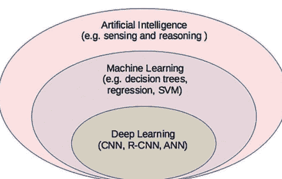

**图 7.1** 人工智能、机器学习和深度学习的背景。

规划与组织，以及知识捕获。机器学习（ML）是 AI 的一个子集，涵盖了系统使用监督式或非监督式统计和机器学习方法（如回归、支持向量机、决策树和神经网络）从数据中学习的能力。深度学习（DL）是 ML 的一个子类，它利用自学习能力从图像中学习关键特征的关键链，从而最大化学习过程的成功率。这与需要人工特征选择的统计 ML 算法不同 [1]（图 7.1）。在本章中，我们将首先简要介绍超声成像和 DL 的背景，然后总结 AI 驱动超声（US）的进步。这些进步可能使客观评估 US 数据、改善临床工作流程并降低医疗成本成为可能。随后，我们介绍了目前放射学和心内科中可用的 AI 驱动 US 应用，深入探讨了当前 AI 应用的挑战，并提出了我们对未来 AI 驱动 US 发展趋势的看法。

#### 7.1.1 超声成像

US 成像在常规临床实践中已被广泛用于诊断和可视化内部器官（如肝脏、肾脏和心脏）及浅表结构（如甲状腺、乳房、颈动脉和肌肉）。US 换能器使用压电材料，将电能转换为机械运动，从而发射和接收高于人耳听觉频率范围的声波。它产生 US 波并传输到组织中，接收反射声波（回声）。记录反射回声信号以构建图像的是


检查区域。声波以约 1,540 m/s 的速度穿过软组织介质。发射和接收声波之间的飞行时间用于定位物体并构建探测区域的图像。与磁共振（MR）、计算机断层扫描（CT）和正电子发射断层扫描（PET）成像方式相比，超声（US）具有若干优势。超声是无害的，因为它不使用像 X 射线、CT 和 PET 那样的破坏性电离辐射。它成本低得多，便于在即时护理（POCUS）应用中携带使用，并能提供真正的实时成像。由于便于携带，它可以被带到患者床旁进行检查并监测随时间发生的变化。超声的缺点包括对操作者依赖性强以及无法检查含有气体和骨骼的体区。

利用超声可生成多种类型的图像（图 7.2）。临床最常用的类型包括：

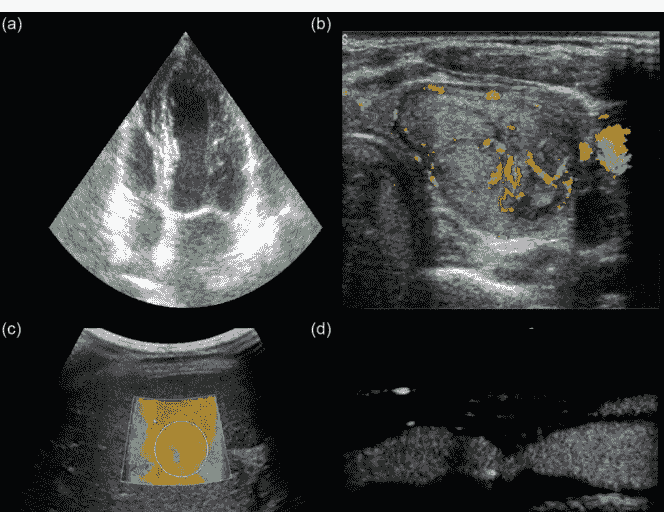

**图 7.2** 展示不同超声模式的示例超声图像。(a) 心脏的 B 模式图像：心尖四腔视图。(b) 甲状腺结节的彩色多普勒图像。(c) 肝脏的剪切波弹性成像图。(d) 颈动脉的超声造影（CEUS）图像。

- **B 模式超声**：也称为亮度模式（B 模式），是众所周知的超声图像。一束超声在组织上扫描以构建组织的二维截面图像。

- **M 模式超声**：运动模式（M 模式）用于检查随时间变化的运动。例如，它提供心脏的一条扫描线，并沿时间轴显示该线上的所有反射体，以测量心脏结构的时间分辨率。

- **多普勒超声**：当波源和观察者相对移动时，波的频率发生变化，这被称为多普勒效应。一束特定频率的超声波通过超声探头（观察者）发射。从运动物体（如血管中的红细胞）反射回来的超声波携带着频率偏移返回探头。这种频率偏移用于估算运动物体的速度。在血流中，记录向探头移动和远离探头的红细胞速度以构建多普勒图像。速度信息叠加在 B 模式解剖图像之上以显示血流的彩色多普勒图像。

- **超声剪切波弹性成像（SWE）**：该技术提供组织截面的二维硬度图。利用超声探头产生的声辐射力在感兴趣组织内部诱发推力并生成剪切波。可以通过测量在介质中传播的剪切波速度来测量组织的硬度。因此，SWE 能够表征身体各部位的机械和弹性特性，并有可能用于肝脏、肌肉骨骼、甲状腺和乳房成像。

- **超声造影（CEUS）**：CEUS 是一种功能成像，它抑制解剖细节但可视化血流信息。它利用超声造影剂（脂质包被的气泡）的非线性响应。通常，两个连续的超声信号通过相同介质传播，并减去它们的回波响应以获取对比信号。由于组织产生线性回波响应，减法消除了组织信号，仅保留气泡非线性响应的差异信号。该成像技术用于检查心腔、评估颈动脉狭窄以及评估前列腺和肝脏灌注。它有助于检测组织中的灌注异常并增强组织边界的可见性。

## 7.1.2 深度学习

模拟生物神经元以为输入信号创建表示的人工神经网络（ANN）包含许多连续层，这些层从输入信号中学习特征的层次结构。ANN 以及图形处理单元（GPU）处理能力的进步使得可以同时执行多任务开发的复杂且深层的深度学习（DL）模型成为可能。深度学习模型可以使用数千或数百万样本进行训练，以获得对数据变化的鲁棒性。深度学习模型的表示能力非常强大，可以为信号的任何给定变化创建表示。深度学习近期在图像分类和分割应用方面的成就使其在数据科学界非常流行。传统机器学习（ML）方法使用从数据中提取的手动设计特征，并在可分解的流水线中处理它们。这使得它们更具可理解性，因为每个组件都是可解释的。另一方面，它们往往泛化能力较差，且对数据变化的鲁棒性较低。使用深度学习模型，我们放弃了可理解性，以换取获得鲁棒性和更强的泛化能力，但生成了复杂和抽象的特征。

已为多种任务开发了最先进的深度学习模型，如计算机视觉中的物体检测和分割、语音识别以及基因型/表型预测。包括卷积神经网络（CNN）[2]、深度玻尔兹曼机、堆叠自编码器 [3] 和深度信念神经网络 [4] 在内的不同类型的模型。处理图像最常用的深度学习方法是 CNN，因为全连接 ANN 对于二维/三维图像来说计算量相当大，并且需要大量的 GPU 内存。CNN 通过在每个特征图或卷积层之间共享权重来缓解这一问题。自 1989 年首次引入 [5] 以来，CNN 已广泛用于图像分类和分割任务并取得巨大成功 [2]。当 CNN 在 2012 年的 ImageNet [6,7] 竞赛中取得令人印象深刻的结果时 [2]，CNN 方法引起了广泛关注，该竞赛包括自然照片图像。它们被用于分类一个由 1,000 种多样化类别组成的约百万张图像的 datasets，达到了最流行的传统机器学习方法错误率的一半 [2]。

在大量数据上训练深度学习方法在 ImageNet 竞赛中取得了显著的成果和鲁棒性。深度学习方法在医学图像分析领域 [8] 也获得了认可（例如病灶诊断 [1,9–13]、组织和病灶分割 [1,14–18] 以及组织病理学分析 [19,20]）。最先进的 CNN 模型架构变得越来越密集，某些模型具有超过 100 层。这意味着数百万的权重和数十亿个节点之间的连接。通常，CNN 架构由卷积、最大池化和激活的连续层组成。通过将卷积核在上一层的输出上进行卷积来生成特征图。最大池层通过对预定义邻域内的最大值进行计算来实现特征图的降采样。或者，可以使用具有更大步长的卷积进行降采样。此外，对层应用激活函数以产生非线性输出并抑制冗余。最广泛使用的激活函数是整流线性单元（ReLU），它通过裁剪任何负输入值并将其设为零，仅将正输入值传递到输出来非线性地变换输入信号 [21]。文献中还使用了其他许多激活函数（例如 leaky RELU、ELU、sigmoid、maxout 和双曲正切）。作为最后一层，采用 softmax 非线性函数，它将对每个类别的输出得分归一化为标签上的多项分布。最终 CNN 层的输出得分连接到 softmax 层以获得每个类别的预测概率。此外，使用优化器如随机梯度下降（SGD）通过误差或损失函数最小化预测与真实标签之间的误差。随后，使用链式法则和反向传播估算损失函数相对于权重的梯度。梯度和学习速率用于在每次迭代中更新权重，这种持续的训练 CNN 架构直到其收敛到稳态（图 7.3）。由于深度学习算法通常比机器学习算法表现更好，并且利用 GPU 处理能力，它允许对超声图像进行实时处理。在本章的其余部分，我们将仅关注人工智能驱动的超声在放射学和心脏病学中的应用。

为了评估机器学习模型的性能，数据通常被划分为训练集、验证集和测试集。训练集用于了解数据。验证集用于建立学习结果的可靠性，测试集用于评估训练模型在未见数据上的泛化能力。当训练样本有限时，采用 *k* 折交叉验证方法（例如留一法、五折或十折交叉验证）。在交叉验证中，数据被随机划分为 *k* 个大小相等的部分。保留其中一部分用于评估


**图 7.3** 用于声像图分类的训练深度学习模型的框架。层间操作以箭头表示。

模型性能，其余部分（$k-1$）用于训练模型。训练过程通常以有监督方式进行，涉及每个输入数据的真值标签，并在训练样本上迭代地最小化损失函数。有监督学习是机器学习方法最常见的训练方式，但需要繁琐的真值标签生成。在医学影像中，真值标签通常从用于诊断或定量的临床笔记中获取。此外，专家对病灶或结构的手动轮廓描绘也被用于训练用于分割任务的机器学习模型。

### 7.1.3 放射学中的 AI 驱动超声

随着多模态成像技术（如 2D/3D/4D 解剖和功能成像 US/CT/MR/PET/SPECT）的进步，医学影像数据急剧增加，因此需要以有条理的方式处理影像数据以协助放射科医生。计算机辅助检测与定量（CAD）是诊断放射学中的一个持续研究课题。CAD 系统提供第二意见以协助放射科医生进行图像解读，这提高了诊断的精确性和一致性，并缩短了图像阅读时间。大部分 CAD 系统基于传统机器学习方法，采用纹理特征并涉及几个步骤：图像预处理、手工特征提取、主要特征选择和分类。尽管 CAD 系统在协助放射科医生方面展现了巨大潜力，但它们存在一些局限性（例如使用有限的数据集、主观地选择包含病理的区域、以及数据来自单一医疗中心的单一供应商）。因此，基于纹理的传统机器学习算法难以在临床工作流程中应用以协助放射科医生。最近，深度学习领域的研究提出了基于深度学习的超声 CAD 系统 [10,22]。深度学习方法允许通过用新数据集微调模型，将一个中心从某个数据集获得的学习经验应用于另一个中心使用不同品牌超声设备获取的新数据集。这个过程称为迁移学习。在过去 5 年中，开发了许多主要用于疾病检测、定量和分类（例如良性或恶性甲状腺结节）的 AI 驱动超声方法。

甲状腺结节，即实性或液体积聚的肿块，是尸检研究 [23–26] 显示的在 40%–50% 的成年人中特别常见的病变。细针穿刺（FNA）活检是目前唯一的非手术测试，用于在临床实践中区分良性结节和恶性结节。多项研究 [27,28] 显示，选择进行 FNA 的甲状腺结节患者中癌症的总体频率仅约为 10%。因此，识别出不需要活检或手术的结节至关重要，因为大部分甲状腺结节是良性的。一种非侵入且可靠的诊断方法将显著降低医疗保健成本和患者对活检的担忧。要建立这样的 CAD 系统，希望灵敏度达到或接近 100%，以确保不漏诊癌症，同时具有合理的特异性，使得很大一部分良性病变不被进行活检。几项研究提出了使用深度学习方法从 2D 超声图像中分类和分割甲状腺结节。仅评估甲状腺结节的 2D 横截面图像是当前研究的一个局限，因为癌症是异质性发展的，而 2D 横截面可能并未切过结节内发展的癌症。因此，基于 3D 体积的方法将比基于 2D 成像的方法提供更准确和可靠的结果。最近，Ma 等人 [29] 提出了一种深度学习方法，该方法结合了两种定制卷积神经网络（CNN）模型，以区分良性结节和恶性结节。所提出的模型在来自两家医院（医院 1 的 8,148 名患者 + 医院 2 的 4,782 名患者，共计 15,000 张图像）的多超声供应商大数据集上进行训练，并基于十折交叉验证实现了 83.02% ± 0.72% 的平均准确率。然而，该研究中显示的受试者工作特征（ROC）曲线表明，所提出的模型通常会漏掉一些恶性患者，且未达到 100% 的灵敏度，这使得该模型作为诊断工具使用不可靠。在另一项研究中，Ma 等人及其同事 [30] 开发了两个相互堆叠的 CNN 模型，用于从 B 模式超声图像中检测结节。该模型使用 *k* 折交叉验证进行评估，报告的平均曲线下面积（AUC）为 98.51%。由于结节边界模糊或缺失，从 B 模式超声图像中分割结节是一项具有挑战性的任务，这使得结节的精确自动分割非常困难且不可靠。Li 等人 [31] 利用 Faster R-CNN 模型检测 B 模式超声图像中结节的良性和恶性区域。在检测甲状腺乳头状癌方面，实现了 93.5% 的灵敏度和 81.5% 的特异性。Li 等人 [32] 还展示了一项涉及来自三家医院的大规模患者群体的多队列甲状腺研究。该研究总共包含了 45,644 名患者的 332,180 张图像。他们评估了其 CNN 模型在癌症检测方面的灵敏度，并将 CNN 模型的性能与一支由经验丰富的放射科医生组成的团队进行了比较。他们得出结论，其模型在检测恶性结节方面的灵敏度与经验丰富的放射科医生相当，且特异性更好。在另一项研究中，Akkus 等人 [11] 训练了带有注意力图的 Inception 和 ResNet CNN 模型，该注意力图可增强结节区域，以识别 B 模式超声图像中的恶性结节。该模型在甲状腺结节的横断面和纵断面图像上进行了训练。在 100 张结节图像的测试集上，该模型在检测恶性方面达到了 86%（灵敏度）和 90%（特异性）。他们的 ROC 曲线表明，当阈值设置为 100% 灵敏度时，活检可以减少 52%，而不会漏掉患有恶性甲状腺结节的患者。Choi 等人 [22] 利用商业 CAD 系统将 89 名患者的 102 个结节分类为良性或恶性（三星医疗株式会社的 S-Detect for Thyroid）。三星 S-Detect CAD 系统的灵敏度被证明与经验丰富的放射科医生的表现相似。与其他研究不同，Pereira 等人 [33] 利用处理剪切波弹性成像（SWE）图像以表征甲状腺结节的深度学习方法。使用他们提出的方法，在测试数据集上获得了 83% 的准确率。最后，Chi 等人 [12] 提出了一种带有迁移学习方法 GoogleNet CNN 模型，在 61 名患者的测试数据集上实现了 98.29% 的准确率，用于区分良性结节和恶性结节。

乳腺癌是女性中最常见的癌症类型之一。它也是女性癌症相关死亡的主要原因 [34]。

乳腺影像报告和数据系统（BI-RADS）评分系统已被广泛用于实现一致性的报告并减少乳腺 B 模式超声图像解读中的混淆。然而，一些研究 [35,36] 已显示出基于 BI-RADS 存在显著的观察者内和观察者间差异。因此，具有高灵敏度和阴性预测值的 CAD 系统不仅能减少观察者内和观察者间差异，还将缩短阅读时间并为放射科医生提供第二意见。最重要的是，这有望帮助减少不必要的活检。几项研究试图以客观且可重现的方式从 B 模式超声图像中分类良性乳腺病变和恶性乳腺病变。Byra 等人 [37] 展示的最初研究之一利用迁移学习来区分良性乳腺病变和恶性乳腺病变。他们使用了先前在公开可用的 ImageNet 数据集上训练的 VGG19 [38] CNN 模型，并在乳腺肿块的 B 模式超声图像上进行了微调。在 150 例的测试数据集上，其模型实现了 93.6% 的 AUC 性能。他们推断，所提出的模型可能有助于协助放射科医生进行乳腺肿块分类的决策。在另一项研究中，Han 等人 [40] 在 7,408 张乳腺超声图像上训练了一个 GoogleNet [39] 模型。该模型在一个包含 829 张图像的数据集上进行了测试，获得了 90% 的准确率、86% 的灵敏度和 96% 的特异性。所提出的模型作为三星超声系统 RS80A 的商业 S-Detect 技术的一部分得以实现。Cheng 等人 [10] 利用了一个堆叠去噪自编码器模型来分类乳腺病变。所提出模型的平均性能为 89.6% 的 AUC，这超过了传统的基于机器学习的方法。Zhang 等人 [41] 展示的研究表明，使用 SWE 图像和深度学习方法在乳腺肿块分类中可以获得更好的性能。深度学习也被用于从超声图像中检测/分割乳腺病变 [42,43]。然而，由于乳腺病变对比度低且边界不清晰，乳腺病变的分割具有挑战性。

各种肝脏疾病（例如慢性病毒性肝炎和酒精性肝病、血色素沉着症和脂肪肝疾病）是肝硬化的终末期表现。超声是诊断肝脏疾病广泛使用的成像方式，因为它提供了关于肝脏结构变化和门静脉血流的信息，而肝活检是评估肝硬化的金标准，但它是侵入性的并涉及一些局限性（例如导致采样错误的不精确定位、出血和感染）。一些研究使用深度学习方法来区分


liver diseases using B-mode and SWE US images. 肝脏疾病，利用B模式和SWE超声图像。近期，Wang等人[44]进行了一项多中心研究，使用超声SWE图像通过深度学习（DL）方法对肝脏纤维化进行分期。在该研究中，发现对于慢性乙型肝炎患者，使用SWE图像结合DL对纤维化进行分期，其准确性高于仅使用SWE测量值在三个肝脏纤维化分期中（肝硬化AUC为97%，重度纤维化为98%，显著纤维化为85%）。早期诊断对于预防疾病至关重要。能够检测肝脏实质早期变化的AI模型在治疗计划中会非常有用。在另一项研究中，Meng等人[45]引入了一个使用迁移学习进行微调的VGGNet，以检测肝脏的纤维化分期。他们提出的方法获得了93.90%的准确率。在另一项研究中，Liu等人[46]使用迁移学习和一个在ImageNet数据集上预训练的CNN模型，从B模式超声图像中提取肝包膜特征，并将其输入支持向量机以区分异常肝脏和正常肝脏。该模型实现了96.8%的AUC，高于使用手工纹理特征的SVM模型的准确率。Wu等人[47]利用深度信念网络模型从CEUS图像中分类局灶性肝脏病变。他们将其方法与传统ML方法进行了比较，并取得了更优的性能（准确率：86.36% vs. 66.67%–81.86%）。另一项研究使用DL评估B模式超声图像中的脂肪肝疾病，并取得了优于传统ML方法（100% vs. 82%–92%）[48]的性能。如上所示，DL方法可用于从B模式和SWE图像诊断肝脏疾病，并且可以假设减少不必要的肝脏活检及相关医疗成本。

除上述提到的DL在超声中的应用外，许多其他由AI驱动的超声应用也已得到研究。Wu等人[49]使用DL评估胎儿超声图像的图像质量，以实现精确测量。Chen等人[50]和Yu等人[52]利用DL模型检测胎儿的标准成像平面。Menchon-Lara等人[51]也使用了DL方法来分割内膜中膜厚度（IMT），其结果优于传统方法。在另一项研究中，Hetherington等人[53]引入了一种DL方法，用于从B模式超声图像中识别脊柱椎体水平，这可以帮助麻醉师找到正确的注射部位。Lekadir等人[54]采用CNN模型对颈动脉斑块的组织成分（例如脂质、纤维化和钙化）进行分类，其性能优于SVM模型。Cheng和Malhi[55]使用CNN检测超声中的解剖位置和腹部成像平面。此外，DL方法也已被用于改善便携式超声系统的图像构建，因为它们使用少量的发射和接收元件来降低功耗。对使用较少的发射/接收射频（RF）通道重建高质量超声图像的需求正在增加。Yoon等人[56]使用基于DL的方法，从下采样的RF数据中重建具有相同质量的超声图像。这也有助于提高3D超声容积采集的时间分辨率。基于DL的方法也用于弹性成像图像重建[57]、超声波束形成[58,59]和图像恢复[60]。

### 7.1.4 AI驱动的超声在心脏病学中的应用

心脏超声，也称为超声心动图（echo），目前是最广泛用于评估心脏结构和功能的无创成像方式（例如左心室射血分数、心输出量、舒张功能和瓣膜疾病）。AI驱动的超声心动图可用于心脏病学、初级和急诊诊所中的专家和非专家对心脏结构和功能进行低成本、序列化和自动化评估。这将允许对急诊部门中因胸痛就诊的患者进行分诊，并以个性化方式对具有心血管风险因素的患者进行纵向监测。随着超声技术的进步，目前的临床推车式超声系统可能会被便携式急救点超声（POCUS）系统取代。GE Vscan、Butterfly IQ和Philips Lumify是流行的POCUS设备。单个Butterfly IQ探头包含9,000个微机电半导体传感器，并模拟线形、相控阵和凸阵探头。虽然使用US-on-chip技术的Butterfly IQ探头可用于全身成像，但Philips Lumify为每个器官提供不同的探头（例如用于心脏应用的s4-1相控阵探头）。GE Vscan配备两个放置在一个探头中的换能器，可用于扫描深部和浅部结构。在急救点使用配备云AI超声心动图解读的POCUS设备，可以显著降低超声成本，并增加非专家在初级和急诊部门使用AI驱动超声心动图的效用（图7.4）。近年来，已发表了多项使用DL方法的有前途的研究，用于标准超声心动图视图的分类（例如心尖部和胸骨旁视图）、心脏结构的分割（例如心室、心房、室间隔、心肌和心包），以及心脏疾病的预测（例如心力衰竭、肥厚型心肌病、心脏淀粉样变性和肺动脉高压）。

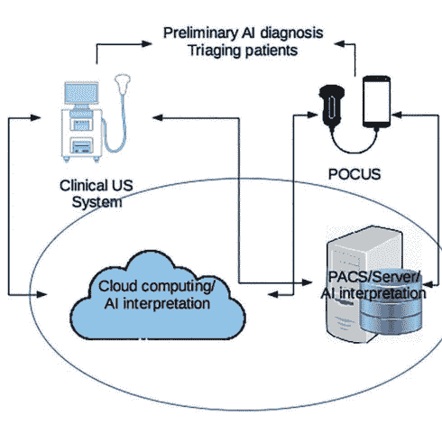

图 7.4 AI对超声心动图图像进行解读以用于初步诊断和分诊急诊和初级诊所患者的示意图。

超声心动图是一种操作者依赖的成像方式，包括数据获取和评估中的变异性。除了操作者变异性外，它还包括患者特异性变异性（例如由于解剖或体重差异导致的信噪比和有限的声窗），以及机器特异性变异性（例如施加于采集图像的电子噪声和后处理滤波器）。图像质量在用于精确测量的自动化处理流程中起着重要作用。次优的图像质量可能影响所有测量结果，并导致患者误诊。

Abdi等人[61]训练了一个全连接CNN，使用评分在0到5之间的6,916张舒张末期超声心动图图像，以评估心尖四腔（A4C）超声心动图图像的质量。他们报告的误差与评级者内可靠性相当（平均绝对误差：0.71 ± 0.58）。Zhang等人[62,63]提出了一个完全自动化的超声心动图解读流程，包括23种视图分类、五种常见视图中心脏腔室的分割、结构和功能的量化，以及疾病检测。他们的结果在8,666张具有手动分割和测量的超声心动图图像上进行了评估。他们的CNN方法准确地识别了视图（例如胸骨旁长轴为96%），并获得了与研究报告中的值相当的心脏结构测量值。其模型预测肥厚型心肌病、心脏淀粉样变性和肺动脉高压的ROC曲线性能值分别为0.93、0.87和0.85。他们计算了研究视频中所有视频视图分类的平均概率分数，以定义该研究的图像质量分数。Leclerc等人[64]研究了最先进的编码器-解码器型DL方法（例如U-Net [65]）用于分割心脏结构，并公开了一个大型数据集（500名患者），包含舒张末期和收缩期帧的分割标签。此外，其他几项研究使用CNN模型来分割心脏结构。Carneiro等人[66]使用深度信念网络从二维超声心动图图像中分割左心室（LV）。Nascimento等人[70]也采用了类似的方法来分割LV。Jafari等人[67]提出了一种循环全CNN和光流法，用于分割超声心动图图像中的LV。Jafari等人[68]还提出了一种使用多任务学习和对抗训练，通过POCUS进行双平面射血分数估计的方法。所提出模型在LV分割方面的性能为平均Dice系数0.92，自动化射血分数显示绝对误差约为6.2%。Chen等人[69]提出了一种带有多视图正则化的编码器-解码器型CNN，以提高LV分割。该方法在566名患者上进行了评估，并获得了92.7%的Dice分数。Oktay等人[71]在其CNN模型中引入了解剖先验知识，该模型允许遵循潜在解剖的全局解剖特性。Mandani等人[72]提出了使用DL进行超声心动图图像视图分类，整体测试准确率为97.8%。

### 7.2 讨论与展望

使用传统机器学习模拟人类视觉的自动化图像解读已经存在很长时间。最近在GPU并行处理和DL算法方面的进步，这些算法利用其自学习能力提取图像中的模式，改变了整个自动化图像解读实践，特别是在计算速度、这些算法的通用性和可迁移性方面。随着对标准化超声图像采集和解读需求的增加，由AI驱动的超声正在进步并更接近于在放射学和心脏病学中的常规临床工作流程中使用。尽管基于DL的超声方法提供了有前途的结果，但


在疾病的诊断与量化方面，尽管美国在人工智能领域的推动力度很大，但其在医学超声（US）应用上的进展仍远远落后于在CT和MR成像中的人工智能应用水平。超声成像中较高的内部/外部变异性使得超声图像采集和解读的标准化面临巨大挑战。人工智能可以提供解决方案，以减轻操作员依赖性带来的变异性和可解释性问题，但影响图像质量的与患者相关的因素（如肥胖、声学窗口受限、伪影及信号衰减）在超声中仍无法解决。基于上述深度学习应用的结果，已证明深度学习方法相比传统机器学习方法具有更强的泛化能力。因此，深度学习方法正变得越来越流行，并正在取代传统的机器学习方法。

如近期研究数量的快速增长所证实，深度学习在超声中的应用正迅速推进。深度学习模型具有极强的表征能力，但为了获得泛化能力和稳定性，它们“渴望”大量数据。创建经过仔细整理且包含高质量数据和标签的大型数据库，是整个人工智能模型开发过程中最具挑战性且最耗时的部分。尽管已证明人工智能驱动的超声应用相较于经典机器学习方法表现卓越，但在训练和验证人工智能模型时通常使用的小数据集。在大型多供应商和多中心数据集上训练人工智能模型以获得泛化能力，并在大型多供应商数据集上进行验证以提高所提出模型的可靠性，这一点至关重要。为克服这一局限性，多项研究在其人工智能模型中采用了迁移学习和微调，但通常使用ImageNet光学图像获得的初始化知识来初始化人工智能模型，如参考文献[37,45,55]所提出的。这可能不是使用迁移学习和微调的恰当方式，因为超声图像与自然光学图像存在显著差异。一种可行的方法可能是使用先前从某超声数据集获得的知识点来初始化人工智能模型，然后在不同中心的多供应商新数据集上对其进行微调。克服数据集受限局限性的另一种替代方法是使用逼真的变换（例如缩放、水平翻转、平移、添加噪声、组织形变和增强图像对比度）对数据集进行增强，这有助于提高人工智能模型的泛化能力。另一方面，需要使用逼真的变换来真实模拟超声图像中的变化，且应用于图像的变换不应产生伪影。例如，垂直翻转超声图像将不是一个令人信服的变换，因为阴影效应绝不会出现在超声波在介质中传播的相反方向上。或者，使用生成对抗网络（包括生成器和判别器模型），训练该网络直至生成的图像无法被判别器区分开来。这可用于生成感兴趣器官的真实超声B模式图像。在训练过程中引入此类变换将使人工智能模型对输入数据空间中的小扰动更具鲁棒性。

仅基于2D横截面图像进行预测可被视为人工智能驱动超声系统的局限性。二维横截面图像包含的信息有限，且不能完全代表病变。在包含整个病变或感兴趣结构、多个超声视图或时空数据的3D超声数据上训练人工智能模型，有可能提高人工智能模型的诊断准确性。此外，在组合的多模式超声图像（例如B模式、多普勒、对比增强超声（CEUS）和剪切波弹性成像（SWE））上训练的人工智能模型，由于这些模式相互补充，也可能提高人工智能模型的诊断性能。

设计透明的、能从医学图像预测任何疾病的人工智能模型至关重要。为疾病诊断开发的人工智能模型必须阐明其预测背后的原因和动机，以建立对其的信任。理解人工智能模型的内部机制需要解读每一层特征图的活动[73–75]。然而，提取的特征是顺序层的组合，在这些层中变得复杂且具有概念性。因此，与传统机器学习方法中人工构建的图像特征相比，这些特征的解释变得更加困难。传统机器学习方法由更易于理解的可分离组件设计而成。机器学习方法的每个组件都有解释，但通常准确性或鲁棒性不高。对于基于深度学习的模型，为了获得具有更强泛化能力的鲁棒性和复杂图像特征，往往牺牲了可解释性。最近，已引入了一些关于深度模型“看到什么”以及如何做出预测的方法。几种CNN架构[38,65,76–78]采用了反卷积网络[79]、梯度反向传播[80]、类别激活图（CAM）[81]、梯度加权CAM[82]和显著性图[83,84]等技术，以使CNN易于理解。通过这些技术，模型梯度被投影回输入图像空间，显示出输入图像中哪些部分对最大化分类准确度的预测结果贡献最大。尽管使人工智能模型易于理解已成为深度学习社区的一个活跃研究话题，但在这方面仍有许多工作有待完成。

鉴于超声是一种依赖操作者和解释者的成像模式，开发能够减少变异性并标准化图像采集和解读的人工智能模型至关重要。在数据采集过程中，人工智能引导获得最佳角度、视图和测量值，将减少超声对操作者的依赖性，使其更智能并实现数据采集的标准化。经济高效且易于获取的具有人工智能功能的POCUS系统将帮助临床医生和非专家对患者进行快速初步检查，并在急诊和初级诊疗机构中推进关键和紧急决策。在不久的将来，具有人工智能功能的POCUS系统可能会取代医生在日常诊疗中用于听取患者心脏声音的听诊器。能够评估多模式数据、引导超声技师进行采集，并提供客观资质、测量和诊断的，具备人工智能功能的临床超声或POCUS系统，将协助诊断和治疗决策，改进诊所中的超声工作流程，并降低医疗保健成本。

## 参考文献

- 1. Z. Akkus, A. Galimzianova, A. Hoogi, D. L. Rubin, and B. J. Erickson, “Deep Learning for Brain MRI Segmentation: State of the Art and Future Directions,” J. Digit. Imaging, vol. 30, pp. 449–459, 2017.
- 2. A. Krizhevsky, I. Sutskever, and G. E. Hinton, “ImageNet Classification with Deep Convolutional Neural Networks,” in Advances in Neural Information Processing Systems 25, F. Pereira, C. J. C. Burges, L. Bottou, and K. Q. Weinberger, Eds. Curran Associates, Inc., Harrah’s Lake Tahoe, Stateline, NV, 2012, pp. 1097–1105.
- 3. P. Vincent, H. Larochelle, I. Lajoie, Y. Bengio, and P.-A. Manzagol, “Stacked Denoising Autoencoders: Learning Useful Representations in a Deep Network with a Local Denoising Criterion,” J. Mach. Learn. Res., vol. 11, no. Dec, pp. 3371–3408, 2010.
- 4. G. E. Hinton, S. Osindero, and Y.-W. Teh, “A Fast Learning Algorithm for Deep Belief Nets,” Neural Comput., vol. 18, no. 7, pp. 1527–1554, Jul. 2006.
- 5. Y. LeCun et al., “Backpropagation Applied to Handwritten Zip Code Recognition,” Neural Comput., vol. 1, no. 4, pp. 541–551, 1989.
- 6. J. Deng et al., “ImageNet: A large-scale hierarchical image database,” in 2009 IEEE Conference on Computer Vision and Pattern Recognition, 2009, doi: 10.1109/cvpr.2009.5206848.
- 7. O. Russakovsky et al., “ImageNet Large Scale Visual Recognition Challenge,” Int. J. Comput. Vis., vol. 115, no. 3, pp. 211–252, 2015.
- 8. D. Lin, A. V. Vasiliakos, Y. Tang, and Y. Yao, “Neural Networks for Computer-Aided Diagnosis in Medicine: A Review,” Neurocomputing, vol. 216, pp. 700–708, Dec. 2016.
- 9. T. Kooi et al., “Large Scale Deep Learning for Computer Aided Detection of Mammographic Lesions,” Med. Image Anal., vol. 35, pp. 303–312, Jan. 2017.


## 参考文献

10. J.-Z. Cheng 等人，"基于深度学习架构的计算机辅助诊断：在超声图像乳腺病变和 CT 扫描肺结节中的应用"，《*Sci. Rep.*》，第 6 卷，第 24454 页，2016 年 4 月。

11. Z. Akkus, A. Boonrod, M. Stan, R. Castro 和 B. J. Erickson，"使用深度学习减少甲状腺结节活检"，《*Proc. SPIE Medical Imaging*》，2019 年，图像处理，第 10949-31 卷，已录用。

12. J. Chi, E. Walia, P. Baby, J. Wang, G. Groot 和 M. Eramian，"通过微调深度卷积神经网络对超声图像中的甲状腺结节进行分类"，《*J. Digit. Imaging*》，第 30 卷，第 4 期，第 477–486 页，2017 年 8 月。

13. L. J. Brattain, B. A. Telfer, M. Dhyani, J. R. Grajo 和 A. E. Samir，"医学超声中的机器学习：现状、方法与未来机遇"，《*Abdom Radiol* (*NY*)》，第 43 卷，第 4 期，第 786–799 页，2018 年 4 月。

14. Z. Akkus, P. Kostandy, A. K. Philbrick 和 B. J. Erickson，"CT 图像鲁棒脑提取工具"，《*Neurocomputing*》，已录用。

15. Z. Akkus, P. Kostandy, K. Philbrick 和 B. J. Erickson，"使用全卷积神经网络从 CT 头部图像中提取脑组织"，收录于 *SPIE Medical Imaging*，2018 年，得克萨斯州休斯顿。

16. G. Litjens 等人，"医学图像分析中深度学习综述"，《*Med. Image Anal.*》，第 42 卷，第 60–88 页，2017 年 12 月。

17. F. Milletari, N. Navab 和 S. Ahmadi，"V-net：用于体积医学图像分割的全卷积神经网络"，收录于 *2016 第四国际三维视觉会议 (3DV)*，2016 年，第 565–571 页。

18. A. D. Weston 等人，"基于深度学习的 CT 扫描腹部自动分割用于体成分分析"，《*Radiology*，第 181432 页，2018 年 12 月。

19. G. Litjens 等人，"深度学习作为提高组织病理学诊断准确性和效率的工具"，《*Sci. Rep.*》，第 6 卷，第 26286 页，2016 年 5 月。

20. A. Janowczyk 和 A. Madabhushi，"数字病理图像分析的深度学习：综合教程及选定用例"，《*J. Pathol. Inform.*》，第 7 卷，第 29 页，2016 年 7 月。

21. K. He, X. Zhang, S. Ren 和 J. Sun，"深入整流函数：在 ImageNet 分类上超越人类水平"，收录于 *2015 IEEE 国际计算机视觉会议 (ICCV)*，2015 年，doi: 10.1109/iccv.2015.123.

22. Y. J. Choi 等人，"基于人工智能的计算机辅助诊断系统在超声上诊断和特征化甲状腺结节：初步临床评估"，《*Thyroid*》，第 27 卷，第 4 期，第 546–552 页，2017 年 4 月。

23. K. D. Burman 和 L. Wartofsky，"临床实践。甲状腺结节"，《*N. Engl. J. Med.*》，第 373 卷，第 24 期，第 2347–2356 页，2015 年 12 月。

24. A. Jemal 等人，"癌症统计数据，2005"，《*CA Cancer J. Clin.*》，第 55 卷，第 1 期，第 10–30 页，2005 年 1 月。

25. L. Hedeğüss，"甲状腺结节"，《*N. Engl. J. Med.*》，第 351 卷，第 17 期，第 1764–1771 页，2004 年 10 月。

26. 美国甲状腺协会（ATA）甲状腺结节和分化型甲状腺癌指南工作组 等，"修订版美国甲状腺协会甲状腺结节和分化型甲状腺癌患者管理指南"，《*Thyroid*》，第 19 卷，第 11 期，第 1167–1214 页，2009 年 11 月。

27. M. C. Frates 等，"超声检测的甲状腺结节管理：超声放射学会共识会议声明"，《*Ultrasound Q*》，第 22 卷，第 4 期，第 231–238 页；讨论 239–240 页，2006 年 12 月。

28. J. T. Guille, A. Opoku-Boateng, S. L. Thibeault 和 H. Chen，"儿科甲状腺结节的评估与管理"，《*Oncologist*》，第 20 卷，第 1 期，第 19–27 页，2015 年 1 月。

29. J. Ma, F. Wu, J. Zhu, D. Xu 和 D. Kong，"基于预训练卷积神经网络的甲状腺结节诊断方法"，《*Ultrasonics*》，第 73 卷，第 221–230 页，2017 年 1 月。

30. J. Ma, F. Wu, T. Jiang, J. Zhu 和 D. Kong，"级联卷积神经网络在超声图像中自动检测甲状腺结节"，《*Med. Phys.*》，第 44 卷，第 5 期，第 1678–1691 页，2017 年 5 月。

31. H. Li 等，"改进的深度学习超声图像甲状腺乳头状癌检测方法"，《*Sci. Rep.*》，第 8 卷，第 1 期，第 6600 页，2018 年 4 月。

32. X. Li 等，"使用深度学习卷积神经网络模型应用于超声图像诊断甲状腺癌：回顾性、多队列、诊断研究"，《*Lancet Oncol.*》，2018 年 12 月，doi: 10.1016/S1470-2045(18)30762-9。

33. C. Pereira, M. Dighe 和 A. M. Alessio，"比较基于剪切波弹性成像图像的甲状腺结节特征化的机器学习方法"，收录于 *医学影像 2018：计算机辅助诊断*，2018 年，第 10575 卷，第 105751X 页。

34. "世界卫生组织 | 乳腺癌"，2018 年 9 月。

35. F. Schwab, K. Redling, M. Siebert, A. Schützau, C.-A. Schoenenberger 和 R. Zanetti-Dällenbach，"超声 BI-RADS 分类和实时弹性成像筑波评分评估乳腺病变的观察者间及观察者内一致性"，《*Ultrasound Med. Biol.*》，第 42 卷，第 11 期，第 2622–2629 页，2016 年 11 月。

36. L. J. Grimm 等，"使用第五版 BI-RADS MRI 术语的乳腺影像观察者间变异性"，《*AJR Am. J. Roentgenol.*》，第 204 卷，第 5 期，第 1120–1124 页，2015 年 5 月。

37. M. Byra 等，"使用深度卷积神经网络和颜色转换的迁移学习进行超声乳腺肿块分类"，《*Med. Phys.*》，2018 年 12 月，doi: 10.1002/mp.13361。

38. K. Simonyan 和 A. Zisserman，"用于大规模图像识别的非常深的卷积网络"，《*arXiv [cs.CV]*》，2014 年 9 月 4 日。

39. C. Szegedy 等，"深入卷积"，收录于 *2015 IEEE 计算机视觉和模式识别会议 (CVPR)*，2015 年，第 1–9 页。

40. S. Han 等，"支持超声图像中乳腺病变分类的深度学习框架"，《*Phys. Med. Biol.*》，第 62 卷，第 19 期，第 7714–7728 页，2017 年 9 月。

41. Q. Zhang 等，"基于剪切波弹性成像的乳腺癌深度学习方法"，《*Ultrasonics*》，第 72 卷，第 150–157 页，2016 年 12 月。

42. M. H. Yap 等，"使用卷积神经网络自动检测乳腺超声病变"，《*IEEE J. Biomed. Health Inform.*》，第 22 卷，第 4 期，第 1218–1226 页，2018 年 7 月。

43. V. Kumar 等，"使用卷积神经网络自动和实时分割可疑乳腺肿块"，《*PLoS One*》，第 13 卷，第 5 期，第 e0195816 页，2018 年 5 月。

44. K. Wang 等，"剪切波弹性成像的深度放射组学显著提高了慢性乙型肝炎肝纤维化评估的诊断性能：一项前瞻性多中心研究"，《*Gut*》，2018 年 5 月，doi: 10.1136/gutjnl-2018-316204。

45. D. Meng, L. Zhang, G. Cao, W. Cao, G. Zhang 和 B. Hu，"基于迁移学习和 FCNet 的超声图像肝纤维化分类"，《*IEEE Access*》，第 5 卷，第 5804–5810 页，2017 年。

46. X. Liu, J. L. Song, S. H. Wang, J. W. Zhao 和 Y. Q. Chen，"学习通过肝包膜引导的超声图像分类来诊断肝硬化"，《*Sensors*》，第 17 卷，第 1 期，2017 年 1 月，doi: 10.3390/s17010149。

47. K. Wu, X. Chen 和 M. Ding，"基于对比增强超声的肝局灶性病变深度学习分类"，《*Optik*》，第 125 卷，第 15 期，第 4057–4063 页，2014 年 8 月。

48. M. L. Biswas 等，"Symtomis：优化深度学习范式下的肝超声组织特征化和风险分层"，《*Comput. Methods Programs Biomed.*》，第 155 卷，第 165–177 页，2018 年 3 月。

49. L. Wu, J.-Z. Cheng, S. Li, B. Lei, T. Wang 和 D. Ni，"FUJQA：基于深度卷积网络的胎儿超声图像质量评估"，《*IEEE Trans. Cybern.*》，第 47 卷，第 5 期，第 1336–1349 页，2017 年 5 月。

50. H. Chen 等，"使用复合神经网络框架检测超声标准切面"，《*IEEE Trans. Cybern.*》，第 47 卷，第 6 期，第 1576–1586 页，2017 年 6 月。

51. R. Menchón-Lara 和 J. Sancho-Gómez，"基于机器学习的超声图像处理，用于完全自动评估颈动脉内膜-中膜厚度"，收录于 *2014 第 12 届基于内容的多媒体索引国际研讨会 (CBMI)*，2014 年，第 1–4 页。

52. Z. Yu 等，"基于深度卷积神经网络的自动胎儿面部标准切面识别框架"，《*IEEE J. Biomed. Health Inform.*》，第 22 卷，第 3 期，第 874–885 页，2018 年 5 月。

53. J. Hetherington, V. Lessoway, V. Gunka, F. Abolmaesumi 和 R. Rohling，"SLIDE：使用深度卷积神经网络的自动脊柱水平识别系统"，《*Int. J. Comput. Assist. Radiol. Surg.*》，第 12 卷，第 7 期，第 1189–1198 页，2017 年 7 月。


## 参考文献

- 54. K. Lekadir等人，“一种用于颈动脉超声斑块成分自动表征的卷积神经网络”，*IEEE生物医学与健康信息学杂志*，第21卷，第1期，第48–55页，2017年1月。
- 55. P. M. Cheng和H. S. Malihi，“基于卷积神经网络的迁移学习用于腹部超声图像分类”，*数字成像杂志*，第30卷，第2期，第234–243页，2017年4月。
- 56. Y. H. Yoon, Yoon, S. Khan, J. Huh和J. C. Ye，“利用深度学习从欠采样RF数据重建高效的B模式超声图像”，*IEEE医学成像汇刊*，2018年8月，doi: 10.1109/TMI.2018.2864821。
- 57. S. Wu, Z. Gao, Z. Liu, J. Luo, H. Zhang和S. Li，“使用端到端深度神经网络直接重建超声弹性成像：第21届国际会议，西班牙格拉纳达，2018年9月16–20日，论文集，第一部分”，收录于《医学图像计算与计算机辅助干预 – MICCAI 2018》，第11070卷，A. F. Frangi, J. A. Schnabel, C. Davatzikos, C. Alberola-López和G. Christinger编著。查姆：国际斯普林格出版社，2018年，第374–382页。
- 58. A. A. Nair, T. D. Tran, A. Reiterer和M. A. L. Bell，“基于深度学习的超声图像波束形成的替代方案”，收录于《2018年IEEE声学、语音和信号处理国际会议 (ICASSP)》，2018年，第3359–3363页。
- 59. A. C. Luchies和B. C. Byram，“用于超声波束形成的深度神经网络”，*IEEE医学成像汇刊*，第37卷，第9期，第2010–2021页，2018年9月。
- 60. D. Perdios, A. Besson, M. Arditi和J. Thiran，“一种基于深度学习的超声图像恢复方法”，收录于《2017年IEEE国际超声 symposium (IUS)》，2017年，第1–4页。
- 61. A. H. Abdi等人，“使用卷积神经网络对超声心动图进行自动质量评估：在心尖四腔视图上的可行性”，*IEEE医学成像汇刊*，第36卷，第6期，第1221–1230页，2017年6月。
- 62. J. Zhang等人，“一种部署在Web上的计算机视觉流水线，用于通过二维超声心动图自动确定心脏结构和功能并检测疾病”，arXiv预印本 arXiv:1706.07342，2017年。
- 63. J. Zhang等人，“临床实践中全自动超声心动图解读：可行性与诊断准确性”，*循环*，第138卷，第16期，第1623–1635页，2018年。
- 64. S. Lecerf等人，“在二维超声心动图中利用开放大规模数据集进行基于深度学习的分割”，*IEEE医学成像汇刊*，2019年2月，doi: 10.1109/TMI.2019.2900516。
- 65. O. Ronneberger, P. Fischer和T. Brox，“U-Net：用于生物医学图像分割的卷积网络”，收录于《医学图像计算与计算机辅助干预 – MICCAI 2015》，第9351卷，N. Navab, J. Hornegger, W. M. Wells和A. F. Frangi编著。查姆：国际斯普林格出版社，2015年，第234–241页。
- 66. G. Carneiro, J. C. Nascimento和A. Freitas，“使用深度学习的架构和基于导数的搜索方法从超声数据中分割心脏左心室”，*IEEE图像处理的汇刊*，第21卷，第3期，第968–982页，2012年3月。
- 67. M. H. Jafari等人，“一个整合循环全卷积网络和光流的统一框架，用于超声心动图数据中左心室的分割”，收录于《医学图像分析中的深度学习与多模态学习用于临床决策支持》，2018年，第29–37页。
- 68. M. H. Jafari等人，“使用多任务学习和对抗训练，通过移动关怀点超声自动估算双平面左心室射血分数”，*国际计算机辅助放射学与外科杂志*，第14卷，第6期，第1027–1037页，2019年6月。
- 69. H. Chen, Y. Zheng, J.-H. Park, P.-A. Heng和S. K. Zhou，“用于从超声图像中进行解剖结构检测和分割的迭代多域正则化深度学习”，收录于《医学图像计算与计算机辅助干预 – MICCAI 2016》，2016年，第487–495页。
- 70. J. C. Nascimento和G. Carneiro，“使用基于深度置信网络流形学习的多图谱分割”，收录于《2016年IEEE第13届生物医学成像国际研讨会 (ISBI)》，2016年，第867–871页。
- 71. O. Oktay等人，“解剖约束神经网络 (ACNNs)：在心脏图像增强和分割中的应用”，*IEEE医学成像汇刊*，第37卷，第2期，第384–395页，2018年2月。
- 72. A. Madani, R. Arnaut, M. Mofrad和R. Arnaut，“使用深度学习快速准确地对超声心动图进行视图分类”，*NPJ数字医学*，第1卷，2018年3月，doi: 10.1038/s41746-017-0013-1。
- 73. M. D. Zeiler和R. Fergus，“可视化和理解卷积网络”，收录于《计算机科学讲义》，2014年，第818–833页。
- 74. M. D. Zeiler, G. W. Taylor和R. Fergus，“用于中高层特征学习的自适应反卷积网络”，收录于《2011年国际计算机视觉大会》，2011年，doi: 10.1109/iccv.2011.6126474。
- 75. B. Zhou, A. Khosla, A. Lapedriza, A. Oliva和A. Torralba，“学习用于判别性定位的深度特征”，收录于《2016年IEEE计算机视觉与模式识别会议 (CVPR)》，2016年，doi: 10.1109/cvpr.2016.319。
- 76. K. He, X. Zhang, S. Ren和J. Sun，“用于图像识别的深度残差学习”，*arXiv [cs.CV]*，2015年12月10日。
- 77. C. Szegedy, V. Vanhoucke, S. Ioffe, J. Shlens和Z. Wojna，“重新思考用于计算机视觉的Inception架构”，收录于《IEEE计算机视觉与模式识别会议论文集》，2016年，第2818–2826页。
- 78. V. Badrinarayanan, A. Kendall和R. Cipolla，“SegNet：一种用于图像分割的深度卷积编码器-解码器架构”，*IEEE模式分析与机器智能汇刊*，第39卷，第12期，第2481–2495页，2017年12月。
- 79. M. D. Zeiler, D. Krishnan, G. W. Taylor和R. Fergus，《反卷积网络》。IEEE计算机协会，2010年，第2528–2535页。
- 80. J. T. Springenberg, A. Dosovitskiy, T. Brox和M. Riedmiller，“追求简洁：全卷积网络”，arXiv [cs.LG]，2014年12月21日。
- 81. B. Zhou, A. Khosla, A. Lapedriza, A. Oliva和A. Torralba，“学习用于判别性定位的深度特征”，收录于《IEEE计算机视觉与模式识别会议论文集》，2016年，第2921–2929页。
- 82. A. Chattopadhyay, A. Sarkar, P. Howlader和V. N. Balasubramanian，“Grad-CAM++：用于深度卷积网络的广义梯度可视化解释”，收录于《2018年IEEE计算机视觉应用冬季会议 (WACV)》，2018年，第839–847页。
- 83. G. Li和Y. Yu，“基于多尺度深度CNN特征的视觉显著性检测”，*IEEE图像处理汇刊*，第25卷，第11期，第5012–5024页，2016年11月。
- 84. K. A. Philbrick等人，“深度学习看到了什么？从训练于预测CT图像对比增强阶段的分类器中获得的见解”，*AJR美国伦琴学杂志*，第211卷，第6期，第1184–1193页，2018年12月。


# 泰勒 & 弗朗西斯

泰勒 & 弗朗西斯集团

http://taylorandfrancis.com

# 基于E/MEG识别阿尔茨海默病

Su Yang
*西伦敦大学*
*英国，伦敦*

Girijesh Prasad, KongFatt Wong-Lin, and Jose Sanchez-Bornot
*阿尔斯特大学*
*英国，伦敦德里*

## 目录

| 8.1 引言 | 134 |
|---|---|
| 8.2 传感器水平分析 | 134 |
| 8.3 源水平分析 | 138 |
| 8.4 讨论与结论 | 142 |
| 参考文献 | 145 |

## 8.1 引言

脑电图 (EEG) 一直是诊断脑部功能障碍最常用的模态之一。它被广泛用于诊断阿尔茨海默病 (AD) 及其前驱阶段——轻度认知障碍 (MCI) 等疾病。由于其便携性和相对较低的成本，EEG 系统在 hospitals 和医疗中心得到了广泛的应用。然而，众所周知，由于电极数量相对较少且为非侵入式性质，单靠 EEG 难以做出明确的诊断。为了缓解这一局限性，脑磁图 (MEG) 已被引入用于 AD 和 MCI 的检测/预测。与 EEG 相比，MEG 采集系统所需的接触电极数量大大减少，但有效增加了非接触式磁传感器的数量。因此，MEG 被认为是一种比 EEG 更强大的模态。然而，由于这两种模态的测量原理完全不同，且投入的研究较少，MEG 尚未表现出比 EEG 显著更优越的性能 [1]。

本章回顾并讨论了基于机器学习的 MCI/AD 诊断使用 E/MEG 的最新报告。特别是，对于一些拥有大量传感器 (100~300) 的 E/MEG 系统，可以进行源定位以找到皮层/大脑中异常功能的准确位置。因此，本章的主要内容结构分为随后的两个部分：传感器水平分析和源水平分析。本章的“讨论与结论”部分还提出了在辅助 MCI/AD 检测/预测的实验设计方面目前存在的问题和局限性，以及对该领域研究者的一些建议。

## 8.2 传感器水平分析

本节回顾并讨论了几项基于传感器空间分析进行 MCI/AD 检测的最新工作。特征提取最直观的方法之一是在时域中直接探索信号数据。在参考文献 [2] 中，提出了一种新型熵，即色散熵 (DisEn)，用于测量和比较 AD 与健康对照组 (HC) 之间脑信号的不规则性。使用一个 148 通道的 MEG 系统收集了 36 名 AD 患者和 26 名 HC 参与者在静息状态下的数据。性能通过箱线图进行视觉检查评估，并采用 t 检验进行统计显著性分析。作为一种相对简单的方法，它证明了 AD 的 MEG 数据比 HC 表现出更多的规律性。


...


[8]中显示效果不佳，这可能归因于EEG系统配备的电极数量相对较少。相比之下，MEG由于其传感器数量更多，可能缓解这一问题。例如，研究人员使用148通道MEG系统成功区分了MCI和HC，成功率为98.4% [10]。在数据收集期间，参与者（18名MCI和19名HC）执行字母记忆任务。使用完全集成经验模态分解（CEEMD）进行特征提取，并利用所得系数计算基于排列熵分析的非线性动力学度量。采用增强型概率神经网络（EPNN）对这些度量进行分类。得益于CEEMD，获得了良好的性能，该方法是专为处理E/MEG等非平稳信号而设计的。在其他EEG应用中，相关的变换也被发现非常有效 [11]。

表8.1列出了关于使用E/MEG进行MCI/AD分类的一些代表性报告。对于ML辅助系统，我们注意到SVM和神经网络是最流行且表现最佳的两种分类器。研究人员倾向于在数据收集时让参与者处于静息状态。为了捕捉信号中的信息内容，已经开发了跨越时域和频域的各种生物标志物。据观察，与熵相关的特征表现出良好的识别性能 [10]，这可能与MCI大脑功能降低有关。值得注意的是，像CEEMD这样相对不那么常用的数据变换也显示出相当有希望的结果，其原始形式经验模态分解就是为分析E/MEG等非平稳信号而专门设计的。

## 8.3 源级分析

由于源重建（SR）的复杂性及其不适定逆问题，与传感器级分析相比，该领域的尝试相对较少。然而，源级分析的主要吸引力之一，原则上是能够识别脑内的源点位置，这对于MCI/AD的早期诊断特别有用。

早期研究结合SR和ML，使用128通道EEG系统进行AD诊断 [12]。涉及的数据收集包括数量相对较少的参与者，即17名AD患者和17名闭眼静息状态下的健康对照。使用标准化低分辨率脑电磁层析成像（sLORETA）进行源空间重建。从12个选定的皮层区域提取了四个常规EEG频段（alpha, beta, delta, theta）的相对对数功率谱密度值。结果显示，右颞区域在所有频段中均反映出两组之间的显著差异；在大脑左半球，AD患者的theta频段功率增加，而alpha频段降低。使用SVM在AD和HC组之间进行的分类性能表现为：灵敏度75.0%，特异度93.7%，准确率84.4%。

### 表 8.1 传感器层级的MCI/AD诊断近期报告

| 状态，模态与目的 | 方法 | 参与者 | 性能与年份 |
| :--- | :--- | :--- | :--- |
| 静息状态 & 148通道MEG & AD与HC对比 | 离散熵 (DisEn) + t检验 | 36 AD, 26 HC | HC表现出比AD更不规则的MEG。 2016 [2]. |
| 工作记忆任务 & 32通道EEG & AD与MCI与HC分类 | 工作记忆ERP + ICA + k均值聚类 + Kruskal–Wallis统计检验 | 15 AD, 20 MCI, 26 HC | 异常组P450减少。 2017 [3]. |
| 静息、记忆和视觉空间任务 & 64通道EEG & MCI与HC对比 | 相对功率 + ANOVA + t检验 | 11 MCI, 11 HC | Theta敏感。 2017 [4]. |
| 闭眼静息状态 & 19通道EEG & AD与MCI与HC | 相对功率，alpha频率，熵，Lempel–Ziv复杂度等 + FCBF + MLP | 37 AD, 37 MCI, 37 HC | HC vs. (MCI & AD): 灵敏度82.35%，阳性预测值84.85%。 AD vs. (MCI & HC): 特异度79.41%，阴性预测值84.38%。 2018 [5]. |
| 过度换气、清醒、困倦和警觉，期间有闭眼和睁眼 & 19通道EEG & AD与HC对比 | Tsallis熵 (TsEn)，Higuchi分形维数 (HFD)，和Lempel–Ziv复杂度 (LZC) + P值 + SVM | 20 AD, 32 HC | 使用LZC：灵敏度100%，特异度92.31%，识别准确率95%。 2018 [6]. |
| 闭眼清醒和放松状态 & 16通道EEG & AD与HC对比 | PDI + GIC + ANOVA + SVM | 14 AD, 14 HC | 98.9% 的准确率。 2018 [7]. |
| 词处理任务 & 19–32通道EEG & 非转化型MCI与转化为AD的MCI与老年HC对比 | 逐试验负相关 + SVM | 25 遗忘型MCI, 11 老年HC | 灵敏度80%，特异度95%。 2018 [8]. |
| 闭眼静息状态 & 306通道MEG Vectorview系统 & MCI与HC对比 | 互信息 (theta, alpha, beta, gamma 和宽带) + 多分类器引导 | 102 MCI, 82 HC | 100%灵敏度，69%特异度，83%分类准确率。 2015 [9]. |
| 字母记忆任务 & 148通道MEG & MCI与HC对比 | CEEEMD + 排列熵 + ANOVA + EPNN | 18 MCI, 19 HC | 98.4%识别准确率。 2016 [10]. |

源级多类型MCI检测也得到了探索 [13]。研究了两种类型的MCI，即单域遗忘型MCI（sdMCI）和多域遗忘型MCI（mdMCI）（22名sdMCI和30名mdMCI），并与29名HC进行比较。与许多传统研究一样，数据收集时受试者处于静息状态。使用306通道MEG系统获取传感器级信号，随后使用最小方差波束形成技术构建源空间。计算时域连接矩阵并用作区分sdMCI和mdMCI的标志。采用三种流行的分类器：k-NN，LDA和SVM来测试识别性能。尽管涉及三个类别，但该研究专注于二元分类组合：HC vs. sdMCI 86.27%，HC vs. mdMCI 81.36%，以及sdMCI vs. mdMCI 84.62%。鉴于MCI检测的明显困难（与AD检测相比），这些结果相当令人鼓舞，表明了源级诊断的巨大潜力。

后来在2017年，提出了一项使用加权最小范数估计进行源空间重建的工作 [14]。计算多参与者的PSD系数并将其输入马氏距离分类器，并使用五折交叉验证来优化结果。发现所提出的特征与AD受试者的记忆损伤显著相关。似乎随着参与者数量的增加，AD和HC的分类性能急剧下降 [14]。与2013年发表的参考文献[12]中的工作相比，尽管AD和HC参与者（静息状态）都从17人增加到25人，但参考文献[14]中报道的分类率从84.4%降至78.4%。2017年发表的工作[14]采用了一个被认为更先进的MEG系统，具有306个通道（Elekta Neuromag）。这可能表明目前社区中存在一种标准比较方案的必要性，以证明研究的意义。

近期的一项工作（见参考文献[15]）指出了当前ML辅助诊断系统研究中的一个重要问题。据报道，使用五折交叉验证时达到了98%的高分类率，而使用留一法交叉验证进行系统评估时，相同的生物标志物仅产生约70%的准确率。具体而言，使用306通道Elekta Vectorview系统收集了24名MCI和30名HC的MEG数据，受试者在静息状态下保持4分钟。采用线性约束最小方差（LCMV）波束形成器进行源重建；计算了三种连接估计器，即相位锁定值（PLV）、PLV的虚部（iPLV）和包络相关性（CorrEnv），并将其用作神经标记。使用具有RBF核的SVM生成分类结果。关于这项研究的更多讨论将在下一节中呈现。

近期的一项工作似乎展示了该领域的一个关键挑战 [16]：数据量的增加可能会显著影响类内方差。参考文献[16]中的研究涉及75名MCI和75名HC，作为一个相对较新的研究结果，报道的灵敏度为73%，特异度为64%，准确率为68.5%。与同年发表的参考文献[15]中的工作相比，这些结果大幅下降。随着参与者数量增加2~3倍，我们可以观察到分类性能的急剧下降。实际上，在参考文献[16]的工作中，仅使用了一个19通道EEG系统进行数据收集，随后使用eLORETA和基于FFT的功率谱分析进行源分析和特征提取。采用SVM和ANOVA进行分类和评估。

表8.2提供了一些关于源级MCI/AD检测的报告。与表8.1类似，发现SVM是最流行的分类器之一。与传感器级方法相比，MCI/AD分类的源空间分析似乎稍差。这并不令人惊讶：源重建算法是为点定位而设计的；需要额外研究以更好地促进分类和定位。


## 表 8.2 源层级 MCI/AD 诊断近期报告

| **状态、模态与目的** | **方法** | **参与者** | **性能与年份** |
|---|---|---|---|
| 闭眼静息态 & 128 通道 EEG & AD vs. HC | sLORETA + 频带 PSD + SVM | 17 名 AD, 17 名 HC | 敏感度 75.0%，特异度 93.7%，准确率 84.4%。2013 [12]。 |
| 静息态 & 306 通道 MEG 系统 & HC vs. sdMCI；HC vs. mdMCI；mdMCI vs. sdMCI | 最小方差波束形成器 + 时域连接矩阵 + k-NN, LDA, SVM | 22 名 sdMCI, 30 名 mdMCI 和 29 名 HC | HC vs. sdMCI 86.27%，HC vs. mdMCI 81.36%，sdMCI vs. mdMCI 84.62%。2014 [13]。 |
| 闭眼静息态 & 306 通道 Elekta Neuromag MEG 系统 & AD vs. HC | 加权最小范数估计 + 多参与者 PSD 特征 + 马氏距离分类器 | 25 名 AD, 25 名 HC | 特异度 = 65.68%，敏感度 = 91.11%，最佳分类准确率 78.39%。2017 [14]。 |
| 4 分钟静息态 & 306 通道 Elekta Vectorview 系统 & MCI vs. HC | LCMV 波束形成器 + PLV + iPLV + CorrEnv + 频内和跨频估计器 + 使用 RBF 核的 SVM | 24 名 MCI, 30 名 HC | 五折交叉验证：98% 准确率；留一法交叉验证：70% 准确率。2018 [15]。 |
| 静息态 & 19 通道 EEG & MCI vs. HC | eLORETA + 基于 FFT 的功率谱分析 + SVM + ANOVA | 75 名 MCI, 75 名 HC | 敏感度 73%，特异度 64%，准确率 68.5%。2018 [16]。 |

## 8.4 讨论与结论

在本章中，我们讨论了几项关于机器学习辅助 MCI/AD 诊断的最新研究。值得注意的是，随着机器学习技术在其他领域的发展，机器学习向临床实践的整合变得越来越流行。然而，必须承认，目前并没有一种实际可用的机器学习辅助诊断系统被官方用于实际临床病例中。这不仅是一个学术问题，也是一个信任问题：患者通常不愿仅仅将他们的信念寄托在一台机器上。这是一个巨大的障碍，阻碍了学术成果在现实临床实践中的实施。

传统上，计算机辅助 MCI/AD 诊断主要侧重于数据的统计分析；当前的新趋势旨在将统计分析与机器学习算法结合起来。这完善了一个典型专家系统的流水线，并使这些诊断系统真正实现了自动化。随着机器学习模块的引入，从统计角度（与对绘制性能的目视检查相对立）建立了一个标准化的框架；在这种框架内，系统评估变得更加客观：机器学习领域中公认的指标，如敏感度、特异度和识别准确率，比临床社区中的传统计算机辅助系统更能清晰地反映诊断性能。

尽管近年来机器学习辅助 MCI/AD 诊断取得了令人瞩目的结果，但在设计检测系统时注意到了一些问题，需要在未来仔细解决以进行改进。这些重要因素列举如下：

- 1. 值得注意的是，随着数据收集中参与者的增加，分类性能被发现大幅下降 [9,10,15,16]。这表明在临床场景中，类内差异（即受试者之间的个体差异）是一个影响因素，不能仅仅忽视。鉴于临床系统是为人类用户设计的，这种生物识别变异性已被广泛注意到 [17]。理论上，随着训练集量的增加，机器学习系统应能够提供稳健的提升性能，直到曲线达到平台期。缓解此类类内方差的一种可能方法是引入迁移学习的概念：可以有目的地从不同个体中提取有用信息，这些信息应在类内共同分享，但在类间又具有足够的区分度，我们可以期望识别性能得到提升。

- 2. 大多数最先进的研究是使用单次会话记录的数据来进行系统的训练和测试。这种设计如果数据经过仔细整理，在实验场景中可能会产生良好的诊断性能，但对于临床场景显然不太现实。在现实世界的实践中，这样的诊断系统可能会面对来自同一受试者的不同新记录。这种情况的性能尚未得到广泛探索。建议对 E/MEG 数据进行广泛的纵向研究，特别关注随时间的衰老效应 [17]，例如。

- 3. 文献中报告的各种评估方法是另一个需要解决的问题。在机器学习社区中，当使用不同的评估方法时，相同的系统流水线可以展示出巨大的分类性能差异已不是秘密。例如，参考文献 [14] 中报道的工作提供了两个截然不同的准确率：使用五折交叉验证，系统在 MCI 检测中能够实现 98% 的准确率，而使用留一法交叉验证时，相同系统仅提供了约 70% 的准确率。建议研究人员在进行实验设计时尝试模拟现实生活场景，特别是避免使用同一受试者同一会话的数据进行训练和测试。

- 4. 虽然临床脑波数据（特别是 EEG）非常丰富，根据文献，几分钟的记录就足以提供合理的准确率。来自单次会话的额外记录似乎无法进一步提高性能，并且有引入冗余数据的责任。

- 5. 大多数当前的研究都是基于使用静息态数据。作为早期基线研究，这非常值得推荐。为了进一步探索，特别是感兴趣区域（ROI）及其功能反应，应该开发不同的实验范式。例如，AD 影响大脑的多个认知区域，应结合多种认知刺激范式，以更好地探索认知变化及其关系。

鉴于其部署规模较小且总体处于相对早期的发展阶段，在挖掘机器学习辅助 MCI/AD 诊断的潜力方面还有大量工作要做。从信息增益的角度来看，由于传感器密度更高且每通道可能包含更多信息，MEG 模态直观上应该比 EEG 信号具有更多的信息。然而，对于基于 MEG 的自动诊断，去除冗余信息的方法也应仔细设计。另一方面，EEG 受益于其低成本安装和已经广泛的部署，在大多数主流临床实践中仍然发挥着支持作用。

提高预测性能的一种可能方法是结合 EEG 和 MEG：配备设计良好的融合算法的多模态识别系统可以协同地结合两种模态的互补信息。从广义上看，使用基于 E/MEG 的机器学习算法来分类 AD 患者和其他神经退行性疾病（如帕金森病和路易体痴呆）患者，也应值得在未来的调查中受到关注。

## 参考文献

1. S. Yang, J. Miguel, S. Bornot, K. Wong-lin, G. Prasad, and S. Member, “M/EEG-based bio-markers to predict the mild cognitive impairment and Alzheimer’s disease: A review from the machine learning perspective,” *IEEE Trans. Biomed. Eng.*, pp. 1–12.

2. H. Azami, M. Rostaghi, A. Fernandez, and J. Escudero, “Dispersion entropy for the analysis of resting-state MEG regularity in Alzheimer’s disease,” in *Proceedings of the Annual International Conference of the IEEE Engineering in Medicine and Biology Society, EMBS*, 2016, vol. 2016-Oct, pp. 6417–6420.

3. G. Q. Mamani, F. J. Fraga, G. Tavares, E. Johns, and N. D. Phillips, “EEG-based biomarkers on working memory tasks for early diagnosis of Alzheimer’s disease and mild cognitive impairment,” *2017 IEEE Healthc. Innov. Point Care Technol.*, pp. 237–240, 2017.

4. J. Ye, Y. Lan, R. Wang, and Y. Yang, “Relative power analysis of electroencephalograph rhythms in elderly with mild cognitive impairment,” in *2017 10th International Congress on Image and Signal Processing, BioMedical Engineering and Informatics (CISP-BMEI)*, 2017, no. 91420302, pp. 1–6.

5. S. Ruiz-Gómez et al., “Automated multiclass classification of spontaneous EEG activity in Alzheimer’s disease and mild cognitive impairment,” *Entropy*, vol. 20, no. 1, p. 35, 2018.

6. A. H. H. Al-Nuaimi, E. Jammeh, L. Sun, and E. Ifeachor, “Complexity measures for quantifying changes in electroencephalogram in Alzheimer’s disease,” *Complexity*, vol. 2018, pp. 22–24, 2018.

7. H. Yu, X. Lei, Z. Song, J. Wang, X. Wei, and B. Yu, “Functional brain connectivity in Alzheimer’s disease: An EEG study based on permutation dis-alignment index,” *Phys. A Stat. Mech. Appl.*, vol. 506, pp. 1093–1103, 2018.

8. A. Mazaheri et al., “EEG oscillations during word processing predict MCI conversion to Alzheimer’s disease,” *NeuroImage Clin.*, vol. 17, no. October 2017, pp. 188–197, 2018.


## 参考文献

9. F. Maestri 等人，“一项利用脑磁导功能连接在轻度认知障碍中早期检测突触功能障碍的多中心研究”，《NeuroImage Clin.》，第 9 卷，第 103–109 页，2015。
10. J. P. Amezquita-Sanchez, A. Adeli, 和 H. Adeli，“一种利用脑磁图 (MEG) 进行轻度认知障碍 (MCI) 自动化诊断的新方法”，《Behav. Brain Res.》，第 305 卷，第 174–180 页，2016。
11. S. Yang 和 F. Deravi，“利用 EEG 信号进行生物特征识别的新型基于 HHT 的特征”，2014 年第 22 届国际模式识别会议，第 1922–1927 页，2014 年 8 月。
12. H. Aghajani, E. Zahedi, M. Jalili, A. Keikharavi, 和 B. V. Vahdat，“基于 EEG 源定位和标准化真实头部模型的早期阿尔茨海默病诊断”，《IEEE 生物医学与健康信息学杂志》，第 17 卷，第 6 期，第 1039–1045 页，2013。
13. J. A. Pineda-Pardo 等人，“在 MEG 中通过结构连接指导功能连接估计：在轻度认知障碍状态区分中的应用”，《Neuroimage》，第 101 卷，第 765–777 页，2014。
14. J. Guillon 等人，“阿尔茨海默病中脑间频率枢纽的丧失”，《Sci. Rep.》，第 7 卷，第 1 期，第 1–14 页，2017。
15. S. I. Dimitriadis 等人，“如何从源重建 MEG 静息状态活动构建轻度认知障碍的功能连接组学生物标志物：ROI 表示和连接估计器的组合至关重要”，《Front. Neurosci.》，第 12 卷，第 JUN 期，第 1–21 页，2018。
16. C. Babiloni 等人，“静息态脑电图 alpha 节律的功能皮层源连接在由阿尔茨海默病和帕金森病导致的轻度认知障碍患者中表现出相似的异常”，《Clin. Neurophysiol.》，第 129 卷，第 4 期，第 766–782 页，2018。
17. S. Yang 和 F. Deravi，“脑电图信号在生物特征识别中的可用性：综述”，《IEEE 人机系统汇刊》，第 47 卷，第 6 期，第 958–969 页，2017。

## 第9章 机器学习在医学影像中的一些实际挑战及其可能的解决方案

Naimul Khan, Nabila Abraham, Anika Tabassum, 和 Marcia Hon
瑞尔森大学
加拿大多伦多

### 目录

9.1 引言 147
9.2 利用自然图像进行迁移学习 149
9.3 用于类别不平衡的 Focal Tversky 损失函数 152
9.4 用于置信度调整的贝叶斯神经网络 156
9.5 结论 161
笔记 161
参考文献 162

### 9.1 引言

机器学习的最新进展已在医学影像和计算机辅助诊断领域催生了广泛的应用。最近，由于用于部署先进模型的软件易于获取，深度学习方法变得非常流行。虽然研究表明，利用卷积神经网络（CNN）的深度模型在准确性方面甚至超越了人类专家，但存在一些实际问题阻碍了此类机器学习系统在实践中的广泛部署。本章重点讨论其中的三个问题：

1. 对训练数据规模的显著依赖：现代机器学习方法，尤其是深度学习，依赖于可用的训练数据量。对于医疗应用而言，这构成了一个问题，因为在医疗保健中获取大量标记训练数据成本高昂。此外，对大量训练数据的依赖导致了对昂贵计算资源的依赖，使得该技术对于资金不足的医疗中心而言难以普及。

2. 类别不平衡：标签类别中样本数量显著减少会导致监督学习中的类别不平衡。类别不平衡在计算机辅助诊断或分割应用中非常常见。例如，在分割中，通常只有少量像素被标记为前景（如肿瘤或病变），而其余像素为背景。这导致了严重的类别不平衡，传统机器学习算法 [1] 难以处理。

3. 置信度调整：大多数机器学习方法及其在计算机辅助诊断中的应用仅报告准确率/F1分数作为性能指标。然而，对于医疗应用，置信度度量会使领域专家对系统感到更加放心，而一个简单的用于调整置信度-准确率权衡的工具将非常有用 [2]。

在本章中，我们强调了 Ryerson 多媒体研究实验室在过去 3 年内开展的三项处于前沿水平的研究工作。这三个项目通过应用新颖的方法、架构和算法，解决了上述三个问题。

在第 9.1 节中，我们强调了如何通过利用迁移学习 [3,4] 来减少对大型训练集的依赖。我们表明，使用基准数据集中的自然图像来学习低级特征，并使用智能数据过滤机制通过医疗数据仅训练深度网络的高层，可以替代使用大型医疗训练数据集。我们在先进的 ADNI 数据集 [5] 上展示了结果。我们的结果表明，迁移学习仅通过通常需要的一小部分训练数据即可帮助提高阿尔茨海默病诊断的准确性。

在第 9.2 节中，我们展示了如何通过一种新颖的损失函数 [6] 来解决类别不平衡问题，在该函数中，我们利用 Tversky 指数 [7] 在精确率和召回率之间取得平衡。我们将 Tversky 指数纳入焦点损失函数 [1] 中。实验结果表明，我们在乳腺超声病变分割方面达到了最先进的结果。

最后，在第 9.3 节中，我们提出了一种用于乳腺癌诊断的可调贝叶斯神经网络，其中两个可调参数可以调整以达到令人满意的置信度-准确率权衡。我们提供了可调参数如何影响置信度和准确度的分析。

### 9.2 利用自然图像进行迁移学习

在本节中，我们表明，在医学领域中，我们可以简单地使用现有的大型自然图像数据集来学习低级特征，从而减少对大型训练数据集的依赖。然后，通过一种基于熵的智能数据过滤技术，我们可以减少对大型医疗数据集的依赖 [1]。为了展示迁移学习的应用，我们选择了阿尔茨海默病诊断领域，该领域最近应用机器学习时显示出有希望的结果 [8]。

在 2010 年代初，统计机器学习方法在阿尔茨海默病诊断方面已显示出有希望的结果 [9]。深度学习方法（如 CNN 和自编码器）的近期普及将注意力转向了深度学习。然而，大多数现有的深度学习方法是从零开始训练架构的。这种从头开始训练在应用于医疗应用时存在几个问题 [10]：(1) 深度网络通常具有数百万个可学习参数，需要大量的标记数据才能正确优化。在医疗领域，获取如此大量的标记数据成本高昂。(2) 拥有数百万个参数带来了另一个问题，模型可能会过拟合/欠拟合，导致在训练数据上表现良好，但在未见数据上表现不佳。(3) 使用如此大量的数据训练深度网络需要大量昂贵的 GPU，这对于资金不足的医疗中心来说是不可持续的。

通过迁移学习对深度 CNN 进行微调是一种最近流行的方法，可以替代从头训练 [11]。

尽管在医疗领域获取标注数据很难，但在自然图像领域中，有许多带有标注对象的基准数据集可用于解决计算机视觉问题。一个这样的例子是 ImageNet 数据集 [12]。迁移学习的基本思想是不从头开始训练。相反，我们训练一个 CNN，其参数已经从自然图像数据集（如 ImageNet）中学习。该网络仅仅是重新训练以获得来自不同领域的新知识（例如阿尔茨海默病的计算机辅助诊断）。研究表明，CNN 在学习低级特征方面非常优秀，并可以在大型训练集上泛化图像特征。如果我们始终从头开始训练网络，那么关于自然图像的广泛研究和为此类问题创建的稳健架构就没有得到适当的利用。

在本节中，我们研究如何将自然图像中学到的知识转移到阿尔茨海默病诊断问题上。重用自然图像中所学知识的动机是减少对训练集大小的过度依赖。由于 CNN 的流行，研究人员在过去的几年中精心设计了许多用于解决视觉分类问题的既定架构。视觉分类领域最流行的基准之一是 ImageNet 大规模视觉识别挑战（ILSVRC）。在该挑战中，提供了超过 100 万张带有 1,000 种不同对象标注的图像 [12]。由于该挑战的流行，该挑战的获胜网络架构通常经过精心设计并经过彻底测试。对于这项研究，我们仔细探索了上述挑战的获胜者，以挑选最适合当前问题的架构。我们决定利用 VGG [13]。选择 VGG 是因为其易于复用的架构，由多个卷积层组成，后接全连接层 [13]。通常，网络利用 ImageNet 等自然图像数据集从头开始训练。然后，卷积层被冻结。仅全连接层针对新的问题域重新训练。

然而，随机缩小训练数据的大小将无助于捕获数据中最好的可能变化，这是避免过拟合/欠拟合所必需的。为了选择最好的训练集，我们利用图像熵，它为我们提供了包含在一个图像（在我们的情况下是体积 MRI 图像的一个切片）中的信息量的相对度量。

通常，对于具有概率 $p_{1}, p_{2}, \dots, p_{M}$ 的 $M$ 个符号集合，熵可以计算如下：


$H=-\sum_{i=1}^{M} p_{i}\log p_{i}$ (9.1)

体积图像二维切片的图像熵可以通过图像直方图计算得出 [14]。使用熵的关键原因在于，它提供了关于图像切片包含多少信息（或数据变化量）的合理度量。通常，较高的熵意味着图像具有丰富的信息。相反，如果我们随机选择图像，利用图像熵可以选出信息量最大的切片，从而构建更具鲁棒性的数据集。

在表 9.1 中，我们展示了通过结合我们提出的基于熵的图像过滤与迁移学习，可以在阿尔茨海默病预测的三种分类场景中均达到最先进的分类结果。这三个分类问题分别是：在基准 ADNI 数据集 [5] 上进行阿尔茨海默病（AD）与正常对照组（NC）的比较、轻度认知障碍（MCI）与 AD 的比较，以及 MCI 与 NC 的比较。虽然我们在准确率方面取得了合理的提升，但更重要的贡献在于训练集规模的减少。最接近的竞争对手或提出的方法是参考文献 [16] 中的方法，其训练规模为 39,942，而我们提出的方法训练规模仅为 2,560，从而实现了 16 倍的减少。迁移学习与我们智能训练数据过滤方法的结合，可以减少对大量训练数据的过度依赖，使深度学习在临床环境中更加实用。

我们进一步研究了使某些卷积层可训练是否会导致准确率提高。在图 9.1 中，我们展示了当卷积层组被一起冻结时，针对所有三个分类问题（AD vs. NC、AD vs. MCI 以及 MCI vs. NC）的比较结果。这些组对应于 VGG16 卷积层的冻结方式如下：

- **全部：** 没有卷积层被冻结（全部可训练）。
- **组 1：** 前四个卷积层被冻结。

| 表 9.1 ADNI 数据集上与最先进的准确率结果（%）比较 |
|---|---|---|---|
| *架构* | *训练集（图像数量）* | *AD vs. NC* | *AD vs. MCI* | *MCI vs. NC* |
| 基于补丁的自编码器 [15] | 103,683 | 94.74 | 88.1 | 86.35 |
| 3D CNN [16] | 39,942 | 97.6 | 95 | 90.8 |
| Inception [17] | 46,751 | 98.84 | – | – |
| 本文提出 | **2,560** | **99.36** | **99.2** | **99.04** |

*注：加粗表示最佳方法*

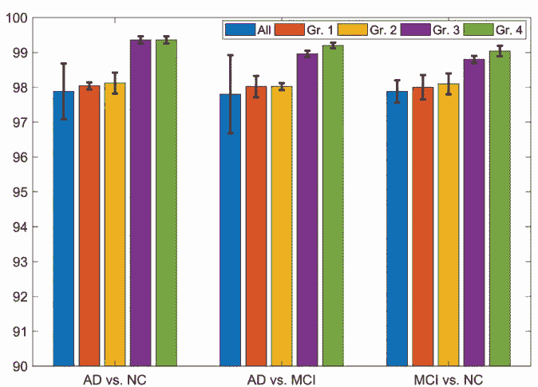

图 9.1 三种分类问题的迁移学习逐层冻结结果。

- **组 2：** 前八个卷积层被冻结。
- **组 3：** 前 12 个卷积层被冻结。
- **组 4：** 所有卷积层（1–16）被冻结。

如我们所见，对于这个特定的数据集，冻结所有卷积层（组 4）产生了最高的准确率。通常，CNN 的早期层学习适用于大多数视觉问题的低级图像特征，但后期层学习高级特征，这些特征是针对特定应用领域的。因此，微调全连接层通常就足够了。然而，如参考文献 [10] 中所述，这种行为可能会根据正在解决的具体计算机诊断问题而改变。然而，从结果中我们可以达成的普遍共识是，迁移学习显著提高了计算机辅助诊断问题的性能。

### 9.3 用于类别不平衡的 FOCAL TVERSKY 损失函数

本节解决类别不平衡问题，这在生物医学成像领域中很常见。类别不平衡在医学分割问题中尤为普遍。在诸如病灶分割等分割问题中，病灶（前景）通常仅占图像的很小一部分。这种不平衡的数据会导致流行的分割框架中出现不稳定的结果 [18]。在近期文献中，CNN 在医学影像数据的病灶分割方面取得了成功 [18]。与典型的 CNN 不同，分割问题采用全卷积网络（FCN），其中去除了全连接层以实现高效的逐像素分割。最流行的 FCN 架构之一是 U-Net [19]。在 FCN 的基础上，U-Net 引入了其他改进，例如多个跳跃连接和具有可学习参数的上卷积层。

一些近期工作提出了新的损失函数来处理医学图像分割中的类别不平衡问题。参考文献 [1] 提出的焦点损失函数（focal loss），一种通过引入指数因子获得的流行交叉熵损失函数，强调了从样本数量较少的类别中学习。焦点损失防止大量简单的负样本主导梯度，从而缓解类别不平衡。然而，在实践中，由于医学图像中存在的非常小的感兴趣区域（ROI），它在平衡精确率和召回率方面面临困难。针对小 ROI 分割的研究工作提出了更具判别力的模型，如注意力门控网络 [20]。

为了解决上述问题，我们将注意力门控 U-Net 与一种新颖的焦点损失函数变体相结合，这种变体更适合小的病灶分割。我们提出了一种新颖的焦点 Tversky 损失函数（FTL），通过整合处理焦点损失函数中精确率和召回率不平衡的 Tversky 指数 [7]，在焦点损失的基础上提供了改进。然后，我们将该提出的损失函数与经过多尺度输入图像金字塔改进以更好中间特征表示的深度监督注意力 U-Net [20] 相结合。²

我们从参考文献 [18] 中描述的 Dice 损失（DL）函数出发进行扩展，其局限性在于它同等地衡量假阳性（FP）和假阴性（FN）检测。同等衡量 FP 和 FN 导致分割图具有高精确率。然而，由于此问题，召回率降低了。诸如病灶分割等医学分割数据中，仅有很少的像素被标注为真实前景。因此，即使是少量的真实前景像素被错误标记，也会导致召回率急剧下降。因此，如果我们希望提高召回率，就需要对 FN 施加比 FP 更高的权重。

Tversky 指数可以帮助我们在 FP 和 FN 之间实现更好的加权：

$$TI_c = \frac{\sum_{i=1}^N p_{ic}g_{ic} + \epsilon}{\sum_{i=1}^N p_{ic}g_{ic} + \alpha\sum_{i=1}^N p_{ic}g_{ic} + \beta\sum_{i=1}^N p_{ic}g_{ic} + \epsilon} \tag{9.2}$$

其中 $p_{ic}$ 是像素 $i$ 属于病灶类别 $c$ 的概率，$p_{i\bar{c}}$ 是像素 $i$ 属于非病灶类别 $\bar{c}$ 的概率。$g_{ic}$ 和 $g_{i\bar{c}}$ 分别也是如此。图像中的像素总数用 $N$ 表示。超参数 $\alpha$ 和 $\beta$ 可以调整，以在类别严重不平衡的情况下转移重点以提高召回率。在参考文献 [7] 中，Tversky 指数通过最小化 $\sum_c 1 - TI_c$ 被适配为损失函数（TL）。

DL 的另一个问题是它在分割小 ROI 时表现不佳，因为小 ROI 对损失的贡献不显著。为解决此问题，我们提出了由 $\gamma$ 参数化的 FTL，用于控制简单背景和困难 ROI 训练样本之间的平衡。在参考文献 [1] 中，焦点参数对交叉熵损失进行指数化，以关注以较低概率检测到的困难类别。焦点损失最近也被整合到 DL 函数中 [21]。我们遵循类似的方法来定义我们的 FTL：

$$FTL_c = \sum_c (1 - TI_c)^{1/\gamma} \tag{9.3}$$

其中 $\gamma$ 在范围 [1,3] 内变化。在实践中，如果一个像素被错误分类但具有高 Tversky 指数，FTL 不受影响。然而，如果 Tversky 指数较小且像素被错误分类，FTL 将显著降低。

当 $\gamma > 1$ 时，损失函数更多地关注那些被错误分类的不准确预测。然而，我们观察到当类别准确率较高时（通常接近模型收敛时），FTL 会出现过度抑制。为了缓解此问题，我们尝试了 $\gamma$ 的更高值。通过反复试验，我们发现 $\gamma = \frac{4}{3}$ 在各种情况下都实现了最佳性能。这是我们在本工作所有实验中使用的值。为了进一步解决 FTL 的过度抑制问题，我们只在中间层使用 FTL，而不是在所有层使用。最后一层改为用 Tversky 损失进行监督，以提供


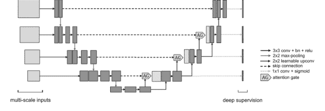

图 9.2 提出的注意力 U-Net 架构。

具有更强的误差信号并缓解次优收敛。我们假设在广义损失函数中使用更高的 *α* 值将通过将重点转移到最小化假阴性（FN）预测来改善模型收敛。因此，我们使用 *α* = 0.7 和 *β* = 0.3 训练所有模型。值得注意的是，当 *α* = *β* = 0.5 时，Tversky 指数简化为 DSC。此外，当 *γ* = 1 时，FTL 简化为 TL。

为了获得更好的精确率和召回率，我们遵循文献 [20] 中针对 U-Net 提出的改进方法，并将其与 FTL 相结合。然而，即使使用了文献 [20] 中的基于注意力的架构，我们发现病变中的细微空间细节在经过多层卷积后仍然丢失，因为卷积操作倾向于模糊微小细节。为了解决这个问题，我们使用软注意力门从低级特征图中识别相关的空间信息，并将其传播到解码阶段。为了进一步便于访问不同尺度的细节，我们将输入图像的多尺度版本（通过构建图像金字塔）直接馈送到编码器层。结合深层监督，这种方法提高了在多个卷积阶段中可能会丢失小 ROI 特征的数据集的分割精度，并促进网络学习更具局部感知性的特征，从而反过来提高分割性能。所提出的网络架构如图 9.2 所示。

为了展示所提出的注意力 U-Net 配合 FTL 的有效性，我们在 2017 年乳腺超声病变数据集 B（BUS）[22] 上进行了实验，其中病变占比为 4.84% ± 5.43%。表 9.2 显示了结果。与基线 U-Net 相比，我们的方法将 Dice 分数显著提高了 25.7%。这一结果证明了处理类别不平衡对于分割的重要性，并表明该问题值得进一步探索。

## 9.4 用于置信度调优的贝叶斯神经网络

虽然深度神经网络在计算机辅助诊断问题上取得了高精度，但出于实际考虑，仅仅提高准确率是不够的。除了准确率，置信度度量对于医生和医疗从业者评估系统表现如何也非常有用。贝叶斯神经网络是估计机器学习系统决策置信度的好工具 [23]。本工作的目标不仅是有效地计算这种置信度量，还要为医生提供一种工具，以有效控制准确率-覆盖率权衡。这种权衡可以通过使用控制贝叶斯神经网络的某些控制参数来实现。

在提出的模型中，我们采用两阶段方法来实现可调的置信度量。采用两阶段方法而不是使用端到端贝叶斯网络的原因有二：
- (1) 使用传统的 CNN 进行特征提取，随后使用一个小型贝叶斯网络，结果是一种更高效的网络架构，这可能带来更快的训练速度；
- (2) 流行的 CNN 架构，如 AlexNet [24]、Resnet [25] 和 VGG [13]，已经在医院和诊所中部署。

模块化的贝叶斯架构可以简单地作为此类系统的“附加组件”使用。

提出的架构如图 9.3 所示。我们可以看到，修改后的 ResNet-18 架构被用作特征生成器，它接受 224×224 大小的图像并生成 512 个元素的特征向量，还有一个独立的小型全连接网络，该网络仅包含三个全连接层，后接 softmax。请注意，这个小网络只有稍多于 16.4 万个参数，而整个网络有超过 1100 万个参数，这使得后续步骤可以在普通硬件上轻松执行。贝叶斯推理通过高斯过程（如随机变分推断 SVI）[26] 执行，但用于较小的网络，并使用由特征生成器产生的低维度训练数据，以学习参数的后验分布（在使用随机正态先验初始化之后）。

一旦我们获得了网络参数（权重和偏差）的后验分布，下一步就是得出一个置信度量。我们提出的置信度量由两个可调参数组成。计算这些参数的步骤如下：

1. 使用蒙特卡洛采样从后验分布中采样合理数量（在我们的实验中为 1,000 个）的网络。每个采样到的网络本身都是一个确定性网络。
2. 用每个采样到的网络对每张图像进行分类。记录每张图像两个类别（良性和恶性）的概率。
3. 使用两个参数 $N$ 和 $P$，其中 $N$ 表示采样网络中在特定图像上具有最低概率 $P$ 且属于某一特定类别（良性或恶性）的网络比例。
4. 使用这两个可调参数 $N$ 和 $P$，我们可以定义一个置信度量。例如，如果我们有 1,000 个采样网络，那么 $N=0.6$ 和 $P=0.7$ 意味着至少 600 个网络必须对图像为良性或恶性（但不能是两者的混合）的概率至少为 0.7；否则，该图像将被跳过分类。换句话说，通过在置信度量中结合 $N$ 和 $P$，我们考虑了一部分采样网络之间的一致性，同时也找出每个网络对分类的强烈程度。

在上述设置下，自然预期是随着 $N$ 和 $P$ 变高（更高的置信度和更低的随机性），我们应该获得更高的准确率；而随着 $N$ 和 $P$ 变低（更低的置信度和更高的随机性），准确率应该下降。然而，提高 $N$ 和 $P$ 的值也可能导致某些图像被跳过分类。例如，考虑一种情况，我们有 1,000 个采样网络，$N=0.9$ 和 $P=0.9$，这要求至少 900 个网络对图像为良性或恶性的概率至少为 0.9——这可能导致许多图像被跳过分类，因为我们要求的置信度太高。这是覆盖率较低的情况。在 $N$ 和 $P$ 较高值（更高置信度）下，我们将具有较低的覆盖率（许多图像被跳过），但在覆盖图像上的准确率将很高。另一方面，在 $N$ 和 $P$ 较低值（更低置信度）下，我们将具有较高的覆盖率（不太多的图像被跳过），但在覆盖图像上的准确率会较低。简而言之，调整 $N$ 和 $P$ 的值使我们能够决定在准确率-覆盖率权衡中的哪个位置落脚。因此，$N$ 和 $P$ 值，连同准确率和覆盖率，构成了我们新的评估指标，可以形式化为元组 (accuracy, coverage, $N$, $P$)，其中 $N$ 和 $P$ 组成了置信度量。

虽然在本章中我们使用分类准确率作为主要评估标准，但一般来说，该框架允许任何评估标准与置信度量配对。其他可能的候选指标包括精确率、召回率、F1 分数、ROC AUC 分数等，其中某些可能对于不平衡分类案例更有意义。然而，本章的目标不是讨论或比较这些评估标准中哪一个是合适的，而是将置信度量

表 9.2 在 Bus 2017 数据集上，提出的 FTL 和注意力 U-Net 与 DL 相比的结果

| 模型 | DSC | 精确率 | 召回率 |
| --- | --- | --- | --- |
| U-Net+DL | 0.547 | 0.653 | 0.658 |
| U-Net+FTL | 0.669 | 0.775 | 0.715 |
| Attn U-Net+DL | 0.615 | 0.675 | 0.658 |
| 提出方法 (Attn U-Net+multi-input+FTL) | 0.804 | 0.829 | 0.022 |

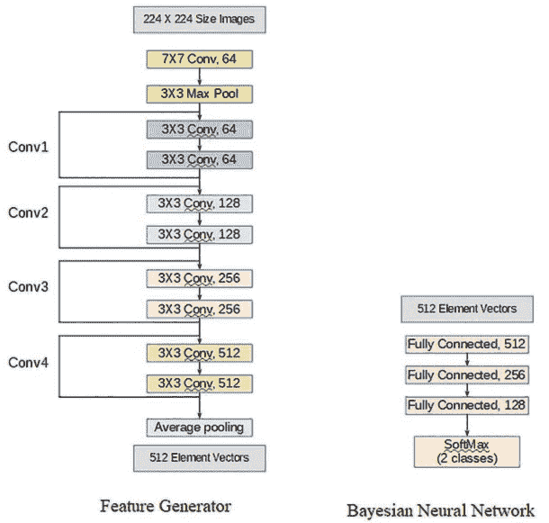

图 9.3 提出的用于置信度测量的两阶段架构。


基于已选定的评估标准。由于我们的分类任务相对类别均衡，我们选择使用准确率作为我们的任务指标。该框架对标准的选择不敏感。

为了评估所提出的框架，我们在 CBIS-DDSM（数字数据库筛选乳腺摄影的策展乳腺成像子集）[27] 数据集上进行了实验。它是数字乳腺摄影筛查数据库（DDSM）的一个更新和标准化版本。原始的 DDSM 数据库由 2,620 项扫描胶片乳腺摄影研究组成，而 CBIS-DDSM 包含了一个由受训乳腺摄影专家筛选的 DDSM 数据子集。ROI 裁剪数据集包含 1,696 张带标签的灰度图像。其中，912 张标记为良性，784 张标记为恶性。因此，该数据集在类别上相对均衡。按照类别（良性与恶性）分布进行分层抽样，获得了 80:20 的训练集到验证集的比例。我们创建了五个这样的分层拆分，以便每个拆分都可以用于交叉验证，以测试我们方法的一般性。对于这五个拆分中的每一个，我们都有 1,357 张训练图像和 339 张验证图像。我们稍后展示的所有结果均为在五个验证集上的平均值，以展示我们方法的鲁棒性。

我们使用蒙特卡洛抽样从后验分布中抽取了 1,000 个网络，并通过调整 $N$ 和 $P$ 的值进行评估。

我们展示了控制参数 $N$ 和 $P$ 的使用方法及其对分类性能的影响。我们平均有 339 张验证图像。我们发现，当我们设置 $N$ 超过 0.9 时，无论 $P$ 的值如何，所有测试图像都被跳过，贝叶斯网络没有覆盖率，这是意料之中的，因为不太可能 95% 的网络对于任何图像都有一个类别的最小概率。通常，如果我们保持 $N$ 为适中的值（如 0.5），然后改变 $P$，我们注意到准确率呈上升趋势，覆盖率呈下降趋势，这也是意料之中的。如果我们保持 $P$ 在 0.5 并改变 $N$，也会出现几乎相同的趋势，这同样是意料之中的。图 9.4 展示了在保持 $P$ 为 0.5 的情况下，随着 $N$ 变化的准确率和覆盖率值及趋势，而图 9.5 展示了在保持 $N$ 恒定为 0.5 的情况下，随着 $P$ 变化的准确率和覆盖率值及趋势。

我们应该指出，实际上，保持 $P$ 为常数（例如 0.5）并调整 $N$ 可能比保持 $N$ 常数并调整 $P$ 更有意义；这是因为调整 $N$ 并保持 $P$ 常数，实际上意味着在抽样的网络集合中改变投票程度，同时期望被投票者之间具有固定的最小分类概率一致性；而调整 $P$ 并保持 $N$ 常数，则意味着冻结投票空间，并改变该冻结网络空间中的最小分类概率一致性的值。换句话说，$N$ 允许我们选择覆盖多少采样网络分布，因此它是实际不确定性更好的度量。

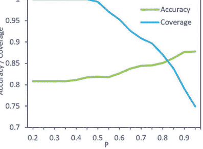

**图 9.4** 准确率和覆盖率随 $N$ 的变化（当 $P$ =0.5 时）。

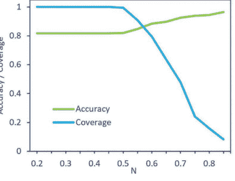

**图 9.5** 准确率和覆盖率随 $P$ 的变化（当 $N$ =0.5 时）。

从这些发现中得出的结论是，参数 $N$ 和 $P$ 可以调整到理想的水平，这些参数的值越高，我们对预测/分类的信心就越高，作为交换，覆盖率可能会降低。对于医学乳腺摄影图像分类这样的领域，确定 $N$ 和 $P$ 的合理值将由乳腺摄影专家来决定。在设定了合理的 $N$ 和 $P$ 值后，将被贝叶斯网络分类的未见图像（无论是良性还是恶性）更有可能被正确分类，而将被跳过且拒绝分类的图像则需要进一步调查。该整体框架可用作任何计算机辅助诊断问题的置信度调整工具。

## 9.5 结论

在本章中，我们突出了在部署 ML 模型用于医学图像分割或计算机辅助诊断问题时会出现的三个实际问题。我们通过迁移学习解决了深度学习模型对大型训练数据集的严重依赖问题，并展示利用来自自然图像的迁移学习可以显著改善阿尔茨海默病的诊断性能。为了解决在医学图像分割中普遍存在的类别不平衡问题，我们提出了一种新颖的 FTL（焦点特维斯基损失），结合 Attention U-Net，在基准乳腺超声数据集上实现了最先进的病灶分割性能。最后，我们提出了一种利用贝叶斯神经网络的置信度调整工具，通过两个简单的超参数（采样网络数量和最概概率），可以根据领域专家的需求调整神经网络的准确率-覆盖率权衡。

虽然这三个部分展示了有前景的结果，但在将这些方法部署到临床环境中之前，仍需要更多工作以确保所提方法的鲁棒性。对于迁移学习，我们正在研究我们的解决方案是否可以推广到解决阿尔茨海默病以外的领域中的计算机辅助诊断问题。对于我们提出的损失函数，我们下一步将研究该解决方案在不同类型的非均衡分类问题中的表现，特别是研究迁移学习方法如何与提出的损失函数结合。对于置信度调整，在迁移学习之上采用端到端的贝叶斯学习方法以保持计算要求可控，是我们未来将探索的方向。

## 注释

- 1 关于此项目的扩展实验结果和分析最初发表在 [3, 4] 中。
- 2 关于此项目的扩展实验结果和分析最初发表在 [6] 中。
- 3 本章的代码可在 https://github.com/nabsabraham/focal-tversky-unet 中找到。

## 参考文献

1. T.-Y. Lin, P. Goyal, R. Girshick, K. He, and P. Dollár, “Focal loss for dense object detection,” IEEE Transactions on Pattern Analysis and Machine Intelligence, vol. 42, no. 2, pp 318–327, 2018.
2. B. M. Geller, A. Bogart, P. A. Carney, J. G. Elmore, B. S. Monsees, and D. L. Miglioretti, “Is confidence of mammographic assessment a good predictor of accuracy?” American Journal of Roentgenology, vol. 199, no. 1, pp. W134–W141, 2012.
3. N. M. Khan, N. Abraham, and M. Hon, “Transfer learning with intelligent training data selection for prediction of Alzheimer’s disease,” IEEE Access, vol. 7, pp. 72726–72735, 2019.
4. M. Hon and N. M. Khan, “Towards Alzheimer’s disease classification through transfer learning,” in IEEE International Conference on Bioinformatics and Biomedicine, 2017.
5. C. R. Jack et al., “The Alzheimer’s disease neuroimaging initiative (ADNI): MRI methods,” Journal of Magnetic Resonance Imaging, vol. 27, no. 4, pp. 685–691, 2008.
6. N. Abraham and N. M. Khan, “A novel focal Tversky loss function with improved attention U-net for segmentation,” in IEEE Symposium on Biomedical Imaging, 2019.
7. S. R. Hashemi et al., “Tversky as a loss function for highly unbalanced image segmentation using 3D fully convolutional deep networks,” CoRR, vol. abs/1803.11078, 2018.
8. S. Klöppel et al., “Accuracy of dementia diagnosis – A direct comparison between radiologists and a computerized method,” Brain, vol. 131, no. 11, pp. 2969–2974, 2008.
9. C. Plant et al., “Automated detection of brain atrophy patterns based on MRI for the prediction of Alzheimer’s disease,” Neuroimage, vol. 50, no. 1, pp. 162–174, 2010.
10. N. Tajbakhsh et al., “Convolutional neural networks for medical image analysis: Full training or fine tuning?” IEEE Transactions on Medical Imaging, vol. 35, no. 5, pp. 1299–1312, 2016.
11. J. Yosinski, J. Clune, Y. Bengio, and H. Lipson, “How transferable are features in deep neural networks?” in Advances in Neural Information Processing Systems, 2014.
12. O. Russakovsky et al., “Imagenet large scale visual recognition challenge,” International Journal of Computer Vision, vol. 115, no. 3, pp. 211–252, 2015.
13. K. Simonyan and A. Zisserman, “Very deep convolutional networks for large-scale image recognition,” arXiv preprint arXiv:1409.1556, 2014.
14. C. Studholme, D. L. Hill, and D. J. Hawkes, “An overlap invariant entropy measure of 3D medical image alignment,” Pattern Recognition, vol. 32, no. 1, pp. 71–86, 1999.
15. A. Gupta, M. Ayhan, and A. Maida, “Natural image bases to represent neuroimaging data,” in International Conference on Machine Learning, 2013.


## 参考文献

16. Hosseini-Asl 等人，“通过 3D 卷积网络适配实现阿尔茨海默病诊断”，载于 *IEEE 国际图像会议*，2016。

17. S. Sarran 等人，“Deepad：利用 MRI 和 fMRI 通过深度卷积神经网络进行阿尔茨海默病分类”，*bioRxiv*，第 070441 页，2016。

18. C. H. Sudre 等人，“广义 Dice 重叠作为深度学习中高度不平衡分割的损失函数”，载于 *用于临床决策支持的医学图像深度学习*。Springer，2017，第 240–248 页。https://link.springer.com/chapter/10.1007/978-3-319-67558-9_28

19. O. Ronneberger, P. Fischer 和 T. Brox，“U-net：用于生物医学图像分割的卷积网络”，载于 *国际医学图像计算与计算机辅助干预会议*。Springer，2015。

20. O. Oktay 等人，“Attention U-net：学习胰腺的关注区域”，*arXiv 预印本 arXiv:1804.03999*，2018。

21. K. C. Wong 等人，“使用指数对数损失函数对高度不平衡的对象大小进行 3D 分割”，载于 *国际医学图像计算与计算机辅助干预会议*。Springer，2018。

22. M. H. Yap 等人，“使用卷积神经网络自动检测乳腺超声病变”，*IEEE 生物医学与健康信息学杂志*，第 22 卷，第 4 期，第 1218–1226 页，2018。

23. C. Leibig, V. Allken, M. S. Ayhan, P. Berens 和 S. Wahl，“利用深度神经网络的不确定性信息进行疾病检测”，*Scientific Reports*，第 7 卷，第 1 期，第 1–14 页，2017。

24. A. Krizhevsky, I. Sutskever 和 G. E. Hinton，“使用深度卷积神经网络进行 ImageNet 分类”，载于 *神经信息处理系统进展*，2012，第 1097–1105 页。

25. K. He, X. Zhang, S. Ren 和 J. Sun，“用于图像识别的深度残差学习”，载于 *IEEE 计算机视觉与模式识别会议论文集*，2016，第 770–778 页。

26. M. D. Hoffman, D. M. Blei, C. Wang 和 J. Paisley，“随机变分推断”，*机器学习研究杂志*，第 14 卷，第 1 期，第 1303–1347 页，2013。

27. K. Clark 等人，“癌症影像档案 (TCIA)：维护和操作公共信息库”，*数字影像杂志*，第 26 卷，第 6 期，第 1045–1057 页，2013。


# 泰勒 & 弗朗西斯

Taylor & Francis Group

http://taylorandfrancis.com

## 第 10 章

## 利用深度学习检测由认知衰退引起的异常活动

**Damla Arifoglu**
*伦敦大学学院*
*伦敦，英国*

**Abdelhamid Bouchachia**
*伯恩茅斯大学*
*普尔，英国*

### 目录

- 10.1 引言 166
- 10.2 痴呆指标 167
- 10.3 文献综述 167
  - 10.3.1 认知状态评估 167
  - 10.3.2 深度学习 169
- 10.4 数据集与数据生成 169
  - 10.4.1 数据集 170
  - 10.4.2 数据生成 170
    - 10.4.2.1 活动相关的异常行为 170
    - 10.4.2.2 子活动相关的异常行为 171
- 10.5 时空活动识别与异常行为检测 172
  - 10.5.1 传感器数据表示 173
  - 10.5.2 异常行为检测 174
  - 10.5.3 实验 174
  - 10.5.4 循环神经网络的结果 175
  - 10.5.5 卷积神经网络的结果 179
- 10.6 结论与未来工作 184
  - 10.6.1 结论 184
  - 10.6.2 未来工作 185
- 参考文献 186

### 10.1 引言

近年来，与老年人认知障碍相关的疾病在世界各地都被视为主要的公共健康问题。阿尔茨海默病国际组织估计，2018 年全球有 5000 万人患有痴呆症，到 2030 年这一数字将增加至 8200 万 [1]。这些数据凸显了一种具有相当严重性的状况。

患有认知障碍的老年人在需要进行记忆和认知的活动方面存在困难 [2]。他们在说话、写字、区分物体以及执行清洁、烹饪等日常生活活动方面也感到困难 [3]。老年人需要护理人员的特殊照顾和帮助，这给家庭成员、护理人员和整个社会带来了社会、心理、身体和经济上的挑战。

大多数老年人倾向于独立生活。研究表明，在老龄化过程中，让这些人留在自主决定的私人住宅环境中对他们的健康更为有利 [7,8]。

日常生活活动（如准备食物、淋浴、行走、睡眠、看电视、上厕所、吃晚餐/午餐/早餐、打扫房间等）模式及其发生时间和频率是确定老年人认知状态的关键指标。通过在一个专门设计的智能家居中追踪老年人的日常活动来评估其认知状态，对于护理人员、医生和临床医生将非常有用，从而使得早期治疗成为可能。

不幸的是，目前不存在评估老年人认知能力的数据。因此，在本研究中，我们通过生成数据来解决展示老年人异常行为的数据稀缺问题。此外，我们旨在考虑其邻近信息来识别日常活动。活动的时空信息以及其顺序和频率对于理解老年人的认知能力至关重要。因此，我们将活动识别和异常行为检测问题模拟为序列标记问题。在本研究中，我们首先将活动建模为序列，然后检测异常行为。本章其余部分介绍如下。第 10.2 节提供痴呆指标概述。第 10.3 节总结文献工作，而第 10.4 节描述所使用的数据集。第 10.5 节描述使用的方法并展示实验。最后，第 10.6 节总结本章。

### 10.2 痴呆指标

虽然早期检测认知障碍会使早期治疗成为可能，但研究表明，75% 的痴呆病例未被发现 [9]。最近的研究 [10] 表明，日常活动模式的异常可能是早期检测此类病例的线索。此外，通过监测活动随时间的趋势和变化（如睡眠问题或完成任务的困难）可以检测到最佳指标 [11]。例如，忘记吃晚饭、患有失眠或频繁上厕所都是认知障碍的迹象。此外，饮食习惯可能存在异常（例如在午夜吃零食）、半夜频繁醒来，或因饮水不足导致脱水。患者也可能涉及涉及危险情况的问题，例如忘记关闭加热器、烤箱或炉灶 [11]。此外，患有认知衰退的老年人可能会遭受混乱的后果（例如，无法运行洗碗机或混淆电话簿上的名字）。

### 10.3 文献综述

在本节中，我们将文献工作分为两部分进行总结，即认知评估和深度学习研究。

#### 10.3.1 认知状态评估

许多不同的研究都致力于解决老年人认知状态的家庭自动评估问题 [23–30]，并使用了不同的机器学习方法，如朴素贝叶斯分类器和支持向量机 (SVMs) [31,32,38]、受限玻尔兹曼机 (RBMs) [28,33]、马尔可夫逻辑网络 [26,27,29]、隐马尔可夫模型 (HMMs) [12,34]、随机森林方法 [19]、隐条件随机场 (CRFs) [35] 和循环神经网络 (RNNs) [36] 来实现这一目的。


当前的认知评估方法依赖于专家测试老年人回答问卷或回忆过去事件的能力。这种方法需要专业知识，可能存在偏见。在参考文献[23]中，受监控的老年人在通过摄像头监视的情况下执行一系列活动，并据此评分。其他一些研究，如参考文献[37]中的研究，通过测量活动持续时间和执行过程中激活的传感器数量来评估认知能力。这些评估方法会造成干扰，因为它们不是在日常生活活动的自然流程中进行的。另一方面，基于规则的诊断方法需要通过特定规则整合领域知识，并且由于这些规则是针对个人的，因此需要为每个人更新这些规则。例如，夜间起床或夜间喝水的习惯可能因人而异。我们的方法相对于这些研究的优点在于不使用任何专家或领域知识。正常行为是从训练数据中学习的。此外，评估旨在利用老年人的日常生活习惯进行，从而提供一种无干扰的评估方式。

在参考文献[39]中，运动片段被定义为活动曲线，并通过比较这些曲线来检测异常活动。在参考文献[40]中，使用基于位置的概率时空模型来计算主体行为的可能性。使用交叉熵度量检测异常行为，例如在异常时间内待在床上或不睡在卧室里。在参考文献[12]中，HMM（隐马尔可夫模型）和模糊规则相结合，以检测与持续时间、时间和频率相关的异常。

### 10.3.2 深度学习

近年来，深度学习方法已被用于解决智能家居中的活动识别问题。这些方法包括卷积神经网络（CNNs）[41–50, 67–69]、深度信念网络（DBN）[33]、受限玻尔兹曼机（RBMs）[28,33,51,52] 和 RNN（递归神经网络）[43,44,53]。虽然 RBM 更适合特征提取和选择 [51]，但它们表现优于 HMM 和 NB（朴素贝叶斯），特别是在 CASAS 数据集上 [52]。CNN 在利用可穿戴传感器识别活动时很流行 [33,41–43,45,48,51]。然而，很少有研究 [52,67–71] 在基于传感器的活动识别中使用深度学习方法，这需要进一步研究。

自编码器（Auto-encoders）正被用于时间序列数据的异常检测 [57,58]。在参考文献 [56] 中，作者使用递归自编码器（Recursive Auto-Encoders）来预测情感分布。该模型不使用词袋模型，而是利用层级结构并使用组合语义来理解情感。在参考文献 [59] 中，作者提取日常生活中的活动模式作为活动的片段。这表明提取的运动向量可用于区分高级活动。其背后的想法是，智能家居中的居民在执行相同活动时（例如洗碗时在水槽周围移动）遵循相同的例程。

### 10.4 数据集与数据生成

患有痴呆症的老年人在执行诸如管理药物、烹饪和家务等活动时可能会有困难。在本研究中，我们分析顺序日常生活活动（按顺序执行且无中断）以检测异常行为。我们还假设只有一名住户住在智能家居中。烹饪、睡觉、上厕所、工作、清洁、洗碗等是日常生活活动的例子。我们关注这类活动，因为它们有望在日常生活场景中反映痴呆症病例。受数据模拟技术生成活动实例 [17–19] 的启发，我们生成了异常行为。

我们首先描述所使用的数据集，然后介绍异常行为生成方法。

### 10.4.1 数据集

在本研究中，我们使用了三个数据集：

- **Van Kastereren [60] 数据集**：在此数据集中，有日常生活活动，如睡觉、烹饪、离家等，数据在三个月不到时间内在三个不同的家庭环境中收集。

- **CASAS 的 Aruba 测试台 [16] 数据集**：在此数据集中，使用了运动、门和温度等传感器。然而，我们在研究中仅使用运动和门传感器。总共，此数据集有 11 种活动，收集在 224 天中完成。

- **CASAS 的 WSU 测试台 [16] 数据集**：在此数据集中，有五种活动，即打电话、洗手、备餐、进食和清洁。20 名学生在 (1) adleror 和 (2) adlnormal 版本中执行每种活动的二十个实例。正常行为在 adlnormal 版本中反映，而住户被指示在 adleror 中包含错误，以模拟老年人的困难。

### 10.4.2 数据生成

老年人日常生活活动中的异常行为分为两部分：(1) 活动相关异常和 (2) 子活动相关异常。在活动相关异常中，活动本身完全正常，但其在一天的频率或时间上存在异常。另一方面，子活动相关异常与所执行活动的上下文和质量有关，例如涉及的传感器激活频率及其顺序和相关性。在第一种情况下，活动整体被重复或遗忘（例如吃晚餐）；而在第二种情况下，活动的某些步骤（传感器激活）被遗忘或重复（例如给菜肴加盐）。

#### 10.4.2.1 活动相关异常行为

为了模拟这些类型的指标，我们将一组动作插入到整天活动的动作中（参见算法 10.1），这将产生同一类型活动的多个实例。此外，在一天中某些不适当的时间插入将产生与时间相关的异常，例如起床和进食。我们将以下活动插入 Aruba 数据集的正常活动序列中：备餐、进食、工作、洗碗、离家和回家。

**算法 10.1：活动相关异常行为模拟**

**输入：** 一天中传感器激活序列 $S$，例如 $S= <s_1$， $s_2,..., s_n>$，其中每个 $s_i$ 是一个传感器激活。类似地，活动表示为传感器读数的序列，$a_j$：$A= <a_1$， $a_2..., a_m>$。这里 $A$ 将被插入到 $S$ 中，并仔细选择以反映与痴呆相关的异常行为（例如营养问题）。

**输出：** $S = <s_1$， $s_2..., s_p$， $a_1p$， $a_2p..., a_mp$， $a_{p+p}..., s_n>$

```
while true do
    Choose a random position p in S;
    Insert A into S at position p;
end
```

总体而言，我们在 Aruba 数据集上手动生成了 77 个异常活动实例。一系列修改后的异常行为如表 10.1 所示。以下缩写用于表示活动。S：睡觉，P：备餐，E：进食，R：呼吸（Rest），W：工作，B：从床到厕所，H：家务。插入的活动以粗体显示。

此外，在 Van Kasteren 数据集的数据集 A 上生成了异常活动实例，该数据集包含活动。总共，我们在此数据集中手动合成了 135 个异常活动片段。

#### 10.4.2.2 子活动相关异常行为

这种异常行为是通过在给定活动中重复特定的传感器激活来生成的。为此，给定工作、进食、备餐和从床走到厕所的随机实例，我们随机插入涉及这些活动的特定传感器（分别为 $M_{26}$， $M_{14}$， $M_{18}$ 和 $M_4$）（参见算法 10.2）。例如，对于工作

**表 10.1 异常行为示例**

| 原始 | 修改后 | 异常类型 |
| :------- | :------- | :---------- |
| S-P-E | S-B-S-P-E | 睡眠障碍 |
| S-P-E | S-R-S-P-E | 睡眠障碍 |
| S-P-E | S-R-S-P-E | 睡眠障碍 |
| S-P-E | S-P-S-P-E | 重复 |
| S-P-E-H | S-P-E-H-E | 重复 |
| W: M_26, M_28, M_27 | M_26, M_28, M_26, M_26, M_27 | 混淆 |
| B: M_4, M_3, M_7 | M_4, M_3, M_3, M_3, M_5 | 混淆 |
| E: M_18, M_20, M_15 | M_18, M_18, M_15, M_30, M_15 | 混淆 |
| E: M_14, M_19, M_18 | M_14, M_14, M_14, M_19, M_18, M_14 | 混淆 |
| M: M_18, M_19, M_15 | M_18, M_18, M_18, M_19, M_15, M_18 | 混淆 |


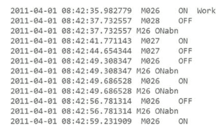

图 10.1 子活动相关异常行为生成后的传感器数据。

活动过程中，传感器 $M_{26}$ 比平时更频繁地被重复使用，这可以用来模拟计算机的使用。图 10.1 展示了子活动相关异常行为合成的快照，其中 ONabn 显示了插入的传感器激活状态。

此外，使用了一个加法器或 WSU 数据集的子集，因为它反映了混淆和遗忘等异常类型，例如忘记关水龙头。

```
Algorithm 10.2: Simulation of Sub-Activity-Related Abnormal Behavior

**Input:** Sequence of $S$ of sensor activations of an activity $A$ such as $S = <a_1, a_2, ..., a_n>$. A sensor type $M$ that is involved in activity $A$. $A$ and $M$ are carefully chosen to reflect a dementia-related abnormal behavior (e.g. sensor $M_6$ in activity *working*). 
**Output:** $S = <a_1, M, a_2, M, a_3, ..., M, a_n>$
while true do
    Choose a random position $p$ in $S$
    Insert $M$ into $S$ at position $p$
end
```

### 10.5 时空活动识别与异常行为检测

RNN（循环神经网络）在一些序列建模问题中取得了有前景的结果，例如语音识别 [61]、机器翻译 [62,63]、手写识别与生成或翻译、语言建模以及蛋白质二级结构预测 [64]。日常生活活动可以建模为序列，其中传感器激活形成时间序列数据。因此，将活动识别建模为序列标注问题使得 RNN 成为一种引人注目的方法。在本研究中，我们利用 RNN 结合其时间信息对活动进行建模，然后检测偏离正常模式的异常行为。此外，CNN（卷积神经网络）擅长将空间信息编码并提取其自身的特征。因此，在本研究中，使用 CNN 编码传感器的邻域信息以识别日常生活活动，然后检测异常行为。

应用以下步骤：
- (1) 应用受文献 [20] 启发的滑动窗口方法，将日常生活序列分割为时间切片块。
- (2) 时间切片按照文献 [20] 中所述映射到特征上。
- (3) 然后，使用三种 RNN 变体（即 Vanilla、GRU 和 LSTM）以及 CNN 来建模和分类活动。
- (4) 最后，使用这些分类器基于分类混淆概率来标记异常行为。

传感器读数的顺序对于考虑空间信息很重要。我们使用滑动窗口方法将数据分割为活动实例。我们应用了与文献 [20] 相同的滑动窗口方法来提取传感器读数块，这些块作为 RNN 和 CNN 的输入。窗口大小基于时间而不是传感器事件的数量（一个传感器读数元组被称为传感器事件）。可以使用不同的时间窗口，例如 1 分钟切片、60 秒切片等。如果使用 1 分钟窗口，则该分钟内所有的传感器读数都在一个窗口中提取。这些窗口被映射为如下所述的特定表示形式。

### 10.5.1 传感器数据表示

原始传感器读数通过滑动窗口映射到以下三种表示形式。

- **二进制**：在此特征中，在时间窗口内激活的传感器被赋值为 1，而未激活的被赋值为 0。
- **变点**：在此特征中，在时间窗口内，如果传感器从 ON 变为 OFF，或从 OFF 变为 ON，则赋值为 1；如果其状态保持不变，则赋值为 0。
- **最后触发**：在此特征中，只有一个传感器被赋值为 1，表示在时间窗口中最后触发的传感器。

### 10.5.2 异常行为检测

异常行为检测如下：RNN 和 CNN 使用训练集进行训练，然后将测试实例送入这些模型进行分类。使用分类置信度分数来判断测试实例是正常还是异常活动。为此，使用一个阈值，该阈值是训练集中每个类别置信度分数的平均值，来决定异常性。

在下一节中，将使用 Kasteren 数据集来评估 RNN，并使用 Aruba 数据集来测试 CNN 以及其与 LSTM RNN 组合的能力。

### 10.5.3 实验

在本研究中，使用了来自 Theano [66] 和 Keras 库 [65] 的 RNN 和 CNN 实现。使用批量大小为 20 的训练和测试实例，并选择 Adam 优化器。RNN 和 CNN 与传统机器学习方法（如 SVM（使用 WEKA 实现，默认参数）、NB、HMM、HSMM 和 CRF（文献 [20] 的实现））进行比较。

选择精确率、召回率、F 度量值和准确率（见公式 10.1–10.4）作为评估指标，以测试所提出方法在活动识别上的成功程度。此处使用以下缩写：TP: 真阳性，TT: 总真标签，TI: 推断标签，N: 数据集中的类别数，Total: 数据集中的实例总数。

```
Precision = 1/N(∑_{i=1}^{N} Tpi/ Tti) (10.1)

Recall = 1/N(∑_{i=1}^{N} Tpi/ Tti) (10.2)

F-measure = 2 × Precision × Recall/ (Precision + Recall) (10.3)

Accuracy = ∑_{i=1}^{N} Tpi/ Total (10.4)
```

敏感性（真阳性率）和特异性（真阴性率）指标（公式 10.5 和 10.6）用于评估所提出方法在异常行为检测上的成功程度。真阳性率（TPR）反映了检测真实异常行为的能力，而真阴性率（TNR）衡量识别正常行为的能力。

```
Sensitivity = TP/(TP + FN) (10.5)

Specificity = TN/(TN + FP) (10.6)
```

### 10.5.4 使用循环神经网络的结果

在 RNN 实验中，Kasteren 数据集按照基于每日的交叉验证方法划分为训练集和测试集，使得一天数据用于测试，而剩余天数用于训练和验证（其中 10% 用于验证）。成功率通过按天平均报告。训练数据以每批 10 个的批次输入分类器，运行 500 个纪元。RNN 网络具有两层，包含 30 和 50 个隐藏神经元，每次将 25 个时间切片作为一个实例给出。这些参数是根据经验设定的。结果与文献 [20] 中 HMM、HSMM、CRF 和 NB 的结果进行比较，如表 10.2–10.4 所示。

表 10.2 Van Kasteren 数据集 A 家庭的

| 模型 | 特征 | 精确率 | 召回率 | F-度量值 | 准确率 |
|---|---|---|---|---|---|
| NB | Binary | 48.3 ± 17.7 | 42.6 ± 16.6 | 45.1 ± 16.9 | 77.1 ± 20.8 |
| | Change-point | 52.7 ± 17.5 | 43.2 ± 18.0 | 47.1 ± 17.2 | 55.9 ± 18.8 |
| | Last-fired | 67.3 ± 17.2 | 64.8 ± 14.6 | 65.8 ± 15.5 | 95.3 ± 2.8 |
| HMM | Binary | 37.9 ± 19.8 | 45.5 ± 19.5 | 41.0 ± 19.5 | 59.1 ± 28.7 |
| | Change-point | 70.3 ± 16.0 | 74.3 ± 13.3 | 72.0 ± 14.2 | 92.3 ± 5.8 |
| | Last-fired | 54.6 ± 17.0 | 69.5 ± 12.7 | 60.8 ± 14.9 | 89.5 ± 8.4 |
| HSMM | Binary | 39.5 ± 18.9 | 48.5 ± 19.5 | 43.2 ± 19.1 | 59.5 ± 29.0 |
| | Change-point | 70.5 ± 16.0 | 75.0 ± 12.1 | 72.4 ± 13.7 | 91.8 ± 5.9 |
| | Last-fired | 60.2 ± 15.4 | 73.8 ± 12.5 | 66.0 ± 13.7 | 91.0 ± 7.2 |
| CRF | Binary | 59.2 ± 18.3 | 56.1 ± 17.3 | 57.2 ± 17.5 | 89.8 ± 8.5 |
| | Change-point | 73.5 ± 16.6 | 68.0 ± 16.0 | 70.4 ± 15.9 | 91.4 ± 5.6 |
| | Last-fired | 66.2 ± 15.8 | 65.8 ± 14.0 | 65.9 ± 14.6 | 96.4 ± 2.4 |
| Vanilla | Binary | 46.5 ± 17.7 | 64.8 ± 16.2 | 53.5 ± 16.3 | 86.8 ± 10.6 |
| | Change-point | 46.3 ± 19.5 | 63.8 ± 16.4 | 53.2 ± 17.9 | 61.4 ± 16.4 |
| | Last-fired | 61.9 ± 19.1 | 74.3 ± 12.8 | 67.2 ± 16.4 | 95.5 ± 3.4 |
| LSTM | Binary | 50.8 ± 18.4 | 63.9 ± 16.5 | 56.2 ± 17.1 | 86.7 ± 10.5 |
| | Change-point | 46.8 ± 18.7 | 63.6 ± 14 | 53.5 ± 16.7 | 61.4 ± 16.4 |
| | Last-fired | 63.7 ± 19.9 | 73.9 ± 16.8 | 68.1 ± 18.2 | 96.7 ± 2.6 |
| GRU | Binary | 47.3 ± 18.7 | 69.1 ± 14.9 | 55.4 ± 16.5 | 86.6 ± 10.7 |
| | Change-point | 42.9 ± 19 | 65.0 ± 15.3 | 51.0 ± 17.1 | 61.4 ± 16.4 |
| | Last-fired | 61.8 ± 16.3 | 80.6 ± 11.5 | 69.5 ± 14.0 | 96.1 ± 2.5 |
| SVM | Binary | 45.6 ± 17.9 | 69.1 ± 15.9 | 54.2 ± 15.9 | 85.4 ± 10.4 |
| | Change-point | 40.3 ± 19.1 | 63.4 ± 14.6 | 48.6 ± 17.0 | 55.9 ± 18.7 |
| | Last-fired | 58.6 ± 16.2 | 77.2 ± 14.0 | 66.3 ± 14.9 | 96.1 ± 2.4 |

表 10.3 Van Kasteren 数据集 B 家庭的

| 模型 | 特征 | 精确率 | 召回率 | F-度量值 | 准确率 |
|---|---|---|---|---|---|
| NB | Binary | 33.6 ± 10.9 | 32.5 ± 8.4 | 32.4 ± 8.9 | 80.4 ± 18.9 |
| | Change-point | 40.9 ± 7.2 | 38.9 ± 5.7 | 39.5 ± 5.9 | 67.8 ± 18.6 |
| | Last-fired | 43.7 ± 8.7 | 44.6 ± 7.2 | 43.3 ± 4.8 | 86.2 ± 13.8 |
| HMM | Binary | 38.8 ± 14.7 | 44.7 ± 13.4 | 40.7 ± 12.4 | 63.2 ± 24.7 |
| | Change-point | 48.2 ± 17.2 | 63.1 ± 14.1 | 53.6 ± 16.5 | 81.0 ± 14.2 |
| | Last-fired | 38.5 ± 15.8 | 66.6 ± 19.5 | 41.8 ± 17.1 | 48.4 ± 26.9 |
| HSMM | Binary | 37.4 ± 16.9 | 44.6 ± 14.3 | 39.9 ± 14.3 | 63.8 ± 24.2 |
| | Change-point | 49.8 ± 15.8 | 65.2 ± 13.4 | 55.7 ± 14.6 | 82.3 ± 13.5 |
| | Last-fired | 40.8 ± 11.6 | 53.3 ± 10.9 | 45.8 ± 11.2 | 67.1 ± 24.8 |
| CRF | Binary | 35.7 ± 15.2 | 40.6 ± 12.0 | 37.5 ± 13.7 | 78.0 ± 25.9 |
| | Change-point | 48.3 ± 8.3 | 51.5 ± 8.5 | 49.7 ± 7.9 | 92.9 ± 6.2 |
| | Last-fired | 46.9 ± 12.5 | 47.8 ± 12.1 | 46.6 ± 12.9 | 89.2 ± 13.9 |
| Vanilla | Binary | 26.7 ± 13.5 | 46.9 ± 24.8 | 32.5 ± 17.9 | 65.2 ± 34.7 |
| | Change-point | 39.6 ± 8 | 62.4 ± 15.3 | 48.3 ± 10.2 | 76.9 ± 13.9 |
| | Last-fired | 41.2 ± 12.3 | 64.4 ± 17.8 | 49.7 ± 13.6 | 87.9 ± 13.1 |
| LSTM | Binary | 29.1 ± 12.0 | 44.0 ± 22.0 | 33.9 ± 16.2 | 63.5 ± 32.7 |
| | Change-point | 40.0 ± 11.2 | 59.0 ± 16.4 | 47.5 ± 12.9 | 76.8 ± 14.2 |
| | Last-fired | 40.8 ± 10.7 | 60.1 ± 16.3 | 48.2 ± 12.3 | 87.2 ± 13.2 |
| GRU | Binary | 28.5 ± 15.9 | 36.3 ± 17.2 | 31.4 ± 16.2 | 64.5 ± 32.1 |
| | Change-point | 37.7 ± 7.6 | 53.5 ± 9.2 | 44.9 ± 7.1 | 76.4 ± 11.5 |
| | Last-fired | 41.7 ± 13.2 | 50.9 ± 17.9 | 47.5 ± 14.6 | 87.0 ± 12.9 |
| SVM | Binary | 39.6 ± 10.9 | 58.5 ± 17.4 | 46.7 ± 12.9 | 81.6 ± 18.5 |
| | Change-point | 32.3 ± 6.5 | 53.6 ± 7.5 | 40.0 ± 6.2 | 67.9 ± 28.5 |
| | Last-fired | 36.4 ± 5.4 | 54.0 ± 10.4 | 43.5 ± 6.6 | 86.2 ± 14.9 |


表 10.4 Van Kasteren 数据集中家庭 C 的活动识别结果。

| 模型 | 特征 | 精确率 | 召回率 | F 值 | 准确率 |
|---|---|---|---|---|---|
| NH | 二值 (Binary) | 19.61 ± 11.4 | 16.8 ± 7.5 | 17.8 ± 9.1 | 46.5 ± 22.6 |
| | 变点 (Change-point) | 39.9 ± 6.9 | 30.8 ± 4.8 | 34.5 ± 4.6 | 57.6 ± 15.4 |
| | 最后触发 (Last-fired) | 40.5 ± 7.4 | 46.4 ± 14.8 | 42.3 ± 6.8 | 87.0 ± 12.2 |
| HMM | 二值 | 15.2 ± 9.2 | 17.2 ± 9.3 | 15.7 ± 8.8 | 26.5 ± 22.7 |
| | 变点 | 41.4 ± 8.8 | 50.0 ± 11.4 | 44.9 ± 8.8 | 77.2 ± 14.6 |
| | 最后触发 | 40.7 ± 9.7 | 53.7 ± 16.2 | 45.9 ± 11.2 | 83.9 ± 13.9 |
| HSMM | 二值 | 15.6 ± 9.2 | 20.4 ± 10.9 | 17.3 ± 9.6 | 31.2 ± 24.6 |
| | 变点 | 43.8 ± 10.0 | 52.3 ± 12.8 | 47.4 ± 10.5 | 77.5 ± 15.3 |
| | 最后触发 | 42.5 ± 10.8 | 56.0 ± 15.4 | 47.9 ± 13.3 | 84.5 ± 13.2 |
| CRF | 二值 | 17.8 ± 22.1 | 121.8 ± 20.9 | 19.0 ± 21.8 | 46.3 ± 25.5 |
| | 变点 | 36.7 ± 18.0 | 39.6 ± 17.4 | 38.0 ± 17.6 | 82.2 ± 13.9 |
| | 最后触发 | 37.7 ± 17.1 | 40.41 ± 16.0 | 38.9 ± 16.5 | 89.7 ± 8.4 |
| Vanilla | 二值 | 15.4 ± 5.3 | 43.1 ± 18.1 | 22.2 ± 7.3 | 50.2 ± 22.4 |
| | 变点 | 31.3 ± 7.1 | 54.9 ± 11.3 | 39.5 ± 8.3 | 72.2 ± 13.0 |
| | 最后触发 | 38.3 ± 16.3 | 59.6 ± 15.1 | 45.8 ± 14.8 | 86.7 ± 12.5 |
| LSTM | 二值 | 16.8 ± 6.2 | 34.8 ± 12.5 | 22.1 ± 7.4 | 45.3 ± 21.2 |
| | 变点 | 31.0 ± 6.5 | 53.3 ± 6.5 | 38.9 ± 5.0 | 72.0 ± 13.0 |
| | 最后触发 | 41.3 ± 17.2 | 57.3 ± 15.9 | 47.5 ± 16.1 | 87.4 ± 12.4 |
| CRU | 二值 | 18.7 ± 8.3 | 33.2 ± 12.7 | 23.9 ± 9.6 | 46.7 ± 23.4 |
| | 变点 | 31.2 ± 8.3 | 47.0 ± 10.9 | 31.2 ± 8.5 | 71.6 ± 12.6 |
| | 最后触发 | 40.4 ± 16.5 | 52.7 ± 16.4 | 45.4 ± 16.9 | 86.6 ± 12.3 |
| SVM | 二值 | 19.4 ± 9.0 | 35.2 ± 12.7 | 24.0 ± 9.2 | 37.4 ± 19.0 |
| | 变点 | 25.6 ± 6.2 | 51.4 ± 9.5 | 34.0 ± 7.2 | 57.8 ± 15.5 |
| | 最后触发 | 37.0 ± 7.9 | 55.5 ± 11.6 | 44.1 ± 8.5 | 87.5 ± 12.1 |

如表 10.2 所示的数据集 A 的结果表明，特征表示的结果参差不齐，没有明确的优胜者。LSTM 的准确率为 96.7%，在使用“最后触发”特征时表现最佳，而 HMM 表现最差；在使用“变点”特征时，HMM 的表现最佳。当使用二值特征时，CRF 的准确率最高（89.8%），而 RNN、NB（朴素贝叶斯）和 SVM 在“变点”表示下表现不佳，HMM 和 HSMM 在二值特征下表现较差。简而言之，对于大多数方法（除了 HMM 和 HSMM），“最后触发”表示是最佳的。就反映不平衡数据下性能的召回率而言，GRU 获得了最高值（80.6%）。这意味着 RNN 擅长发现相关类实例。CRF 表现出更高的精确率，因为它倾向于选择频率最高的类实例，但在检测低频类别方面不够好。总体而言，在大多数情况下，RNN 的表现优于 HMM、NB 和 HSMM，而在数据集 A 上，CRF 略优于这些循环架构。

表 10.3 指的是在数据集 B 上获得的结果，其中采用二值表示的最佳方法准确率达到了 81.6%。另一方面，在使用“变点”特征和“最后触发”表示时，CRF 表现最佳，准确率分别为 92.9% 和 89.2%。可以注意到，HMM 不如其他方法表现好，其在“变点”表示下的最佳情况仅为 81.0%。与 CRF 表现最接近的成功模型是 Vanilla RNN，再次证明总体而言 RNN 的召回率高于其他方法。除 CRF 外，“变点”和“最后触发”表示提供了最高的召回率结果。

表 10.4 报告了数据集 C 的结果，显示 CRF 在“变点”和二值表示下表现最佳，分别获得 82.2% 和 89.7% 的准确率。总体而言，当采用二值表示时，所有方法的表现都不佳。使用“变点”时结果略有改善，而应用“最后触发”表示时结果明显更好。RNN 再次在所有表示下给出了最高的召回率值。总体而言，结果显示在所有情况下，RNN 的表现都优于 HMM、NB 和 HSMM，而 CRF 略优于 RNN。但在召回率方面，RNN 在所有特征表示下都优于所有方法。背后的原因是与 CRF 相比，RNN 处理不平衡数据的能力更强。RNN 的变体通常表现相当。

由于 LSTM 是最有前景的模型，因此使用它来测试异常活动识别，并将其与 NB、HSMM、HMM、SVM 和 CRF 进行比较（表 10.5）。本实验中仅使用了“最后触发”特征。结果表明，与其他方法相比，LSTM 在修剪假阴性方面表现最佳。像 NB 和单类 SVM 这样无法捕捉数据顺序的方法表现最差。这些模型忽略了活动的频率，但应用时序和上下文信息进行决策。结果显示，LSTM 能够编码活动的顺序。因此，当活动在不同的上下文或不同的顺序中引入时，LSTM 可以检测到此类异常。

| 模型 | 敏感度 (TPR) (%) | 特异度 (TNR) (%) |
| :--- | :---: | :---: |
| NB | 40.40 | 56.50 |
| HMM | 58.36 | 3.80 |
| HSMM | 68.85 | 67.8 |
| CRF | 66.22 | 59.45 |
| One-class SVM | 72.11 | 66 |
| LSTM | 91.43 | 59.04 |

### 10.5.5 卷积神经网络的结果

给定 $N \times M$ 的输入矩阵，其中 $N$ 是时间窗口，$M$ 是传感器读数数量，已在 Aruba 数据集上测试了如图 10.2 所示的不同网络架构。

### 一维卷积

如图 10.2a 所示，卷积仅应用于一维，其中在时间维度上应用了 100 个滤波器（长度为 10）。然后添加了一个最大池化层（步长 = 2）和另一个具有 50 个滤波器（长度 = 5）的卷积层，并随后添加一个最大池化层。添加了一个展平层以展平特征，然后添加了三个隐藏神经元分别为 512、128 和 50 的全连接层。最后，添加了一个 Softmax 层以产生对类别标签的置信度值。

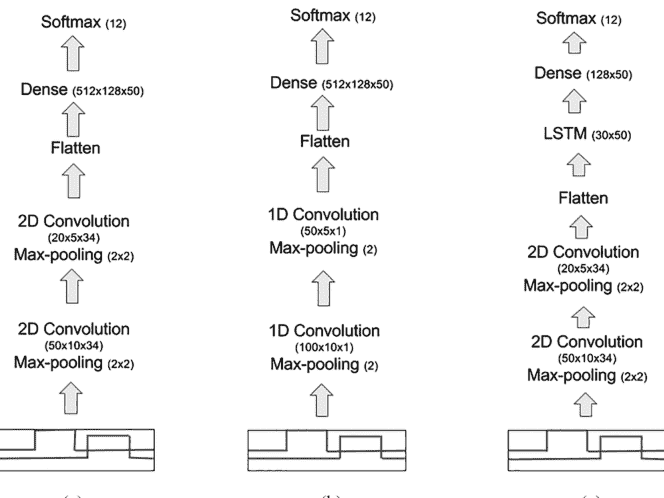

图 10.2 a) 1D CNN 网络 b) 2D CNN 网络 c) 2D CNN 和 LSTM 网络。

### 二维卷积

如图 10.2b 所示，卷积应用于两个维度，其中 100 个滤波器（尺寸为 $10 \times 34$）后接一个最大池化层（$2 \times 2$）。添加第二个卷积层（包含 20 个尺寸为 $5 \times 34$ 的滤波器），随后是一个展平层和一个 Softmax 层。

### CNN 和 LSTM（2D CNN + LSTM）

由于 CNN 没有编码时间历史的能力，因此将其与 LSTM 结合，将上述提到的两层 2D-CNN 与两个 LSTM 层（隐藏层大小为 $30 \times 50$）合并。这后面跟着两个全连接层（128 和 50 个隐藏单元）以及一个用于分类的 Softmax 层。

参照文献 [24]，Aruba 数据集根据天数划分为训练集和测试集，以避免失去时序信息。对于训练，使用了 Aruba 数据集的 150 天数据，15 天用于验证，其余天数用于测试。使用 WSU 的 adlnormal 集合进行训练，而 adleror 版本用于测试。

第一个实验在 Aruba 数据集上进行，旨在选择产生最高识别结果的最佳输入表示。该实验使用 LSTM 分类器在传感器读数的 1 分钟时间切片上进行。提取的切片被映射为二值、变点和最后触发表示。如表 10.6 所示，最后触发表示提供了最高的精确率和召回率，以及良好的准确率（最后触发、二值和变点的准确率分别为 87.72%、49.69% 和 48.79%）。最好的两个特征（变点和最后触发）的组合比单独使用最后触发特征具有略高的准确率（87.78%），但结果导致较低的精确率和召回率值。因此，我们在随后的实验中继续使用最后触发特征。

在表 10.7 中，我们提供了第二个实验即活动识别的分析。表 10.7 展示了生成式和判别式方法在 Aruba 数据集上的成功率。结果表明，具有二维卷积的 CNN（准确率为 89.67%）以及 CNN-2D 后接 LSTM 分类器的表现优于 CRF（准确率为 89.72%）。原因是 CNN 能够提取自身富有成效的特征，而 CRF 仅依赖于给定的输入。HMM 和 HSMM 给出的准确率最差。

表 10.6 使用 LSTM 在 Aruba 数据集上的活动识别结果

| 特征 | 精确率 (%) | 召回率 (%) | F 值 (%) | 准确率 (%) |
| :--- | :---: | :---: | :---: | :---: |
| 二值 | 34.21 | 28.26 | 30.95 | 49.69 |
| 变点 | 29.28 | 26.41 | 27.77 | 48.79 |
| 最后触发 | 43.18 | 43.37 | 43.27 | 87.72 |
| 变点 + 最后触发 | 37.33 | 42.42 | 39.71 | 87.78 |


## 表 10.7 Aruba 数据集上的活动识别结果

| 模型 | 精确率 (%) | 召回率 (%) | F-度量 (%) | 准确率 (%) |
| :--- | :--- | :--- | :--- | :--- |
| NB | 42.87 | 61.04 | 50.36 | 84.37 |
| HMM | 43.66 | 72.03 | 54.36 | 77.90 |
| HSMM | 43.97 | 71.56 | 54.47 | 77.98 |
| CRF | 50.24 | 52.83 | 51.50 | 88.58 |
| LSTM | 38.65 | 41.29 | 39.92 | 89.00 |
| CNN-1D | 31.42 | 36.78 | 33.89 | 87.50 |
| CNN-2D | 46.84 | 41.68 | 44.11 | 89.67 |
| CNN-2D + LSTM | 51.20 | 50.55 | 50.87 | 89.72 |

结果（分别为 77.90% 和 77.98%）。NB 给出的准确率结果（84.37%）优于 HMM 和 HSMM，但其精确率（42.87%）和召回率（61.04%）较低。虽然 HMM 和 HSMM 给出了最高的召回率（分别为 72.03% 和 71.56%），但它们的精确率较低（分别为 43.66% 和 43.97%）。我们可以看到 CNN-1D 网络的准确率为 87.50%，但在精确率（31.42%）和召回率（36.78%）方面表现不佳。CNN-1D 在时间维度上提取特征，它考虑了时间切片块内的时间信息，但另一方面，由于它未在特征维度上进行卷积，因此忽略了传感器之间的关系。因此，它无法学习区分不同类别的类特异性特征图，导致准确率较高（87.50%）但精确率和召回率较低。当使用 2D 卷积时，同时考虑了时间信息和空间信息，网络能学习到更具信息量的特征。因此，它获得了学习类特异性特征的能力，从而得到更高的精确率和召回率数值（分别为 46.84% 和 41.68%）以及较高的准确率结果（89.67%）。CNN 无法记住之前的输入和之后的输入，但将特征图馈入 LSTM 层有助于我们进一步处理时间维度。因此，CNN-2D + LSTM 网络达到了 51.20% 的精确率、50.55% 的召回率和 89.72% 的准确率。

图 10.3 展示了学习到的特征模式。随着特征进入下一层，可以看到噪声被减少，特征变得更加清晰。特征维度显示在 $x$ 轴上，时间轴描绘在 $y$ 轴上，白色像素表示激活情况。

在 Aruba 数据集上的结果显示，分类器最成功地检测了“离开家”和“进家”活动的实例，因为这些是唯一涉及门传感器的活动，因此不会与其他任何活动混淆。此外，备餐活动最

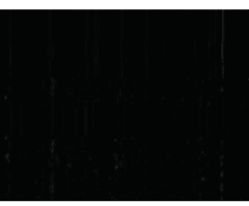
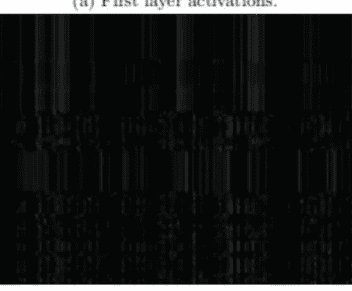
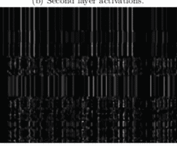
图 10.3 a) 第一层激活 b) 第二层激活 c) 展平层激活。

常被误认为洗碗活动，因为它们涉及相同类型的传感器，且都发生在厨房。同样，家务活动通常与工作活动混淆，因为它们可能发生在同一房间并涉及相同的传感器。

## 表 10.8

| 模型 | Aruba 修改灵敏度 (%) | Aruba 修改特异度 (%) | WSU 灵敏度 (%) | WSU 特异度 (%) |
| :--- | :--- | :--- | :--- | :--- |
| NB | 99.33 | 33.89 | 46.17 | 98.42 |
| HMM | 45.54 | 27.71 | 100 | 50.55 |
| HSMM | 100 | 35.61 | 100 | 42.89 |
| CRF | 100 | 66.03 | 47.87 | 72.17 |
| LSTM | 98.67 | 75.48 | 86.50 | 77.89 |
| CNN-2D | 85.33 | 33.89 | 88.70 | 67.46 |

在第三个实验中，异常活动检测首先在修改后的 Aruba 集上进行。作为 CNN 网络的代表，我们仅展示 CNN-2D 网络的结果，以便单独观察 CNN 的效果。在使用正常行为训练模型后，向分类器引入包含异常行为的测试集，并将分配了低置信度标签的活动实例标记为异常。在表 10.8 中，我们看到 LSTM 网络实现了最高的特异度，准确率为 75.48%（灵敏度为 98.67%）。尽管 NB、HMM 和 HSMM 模型给出了更高的灵敏度（分别为 99.33%、100% 和 100%），但特异度较低（分别为 33.89%、27.71% 和 35.61%）。HMM 给出了最差的结果（灵敏度为 45.54%，特异度为 27.72%）。CNN-2D 的灵敏度为 85.33%，特异度为 33.89%。这表明 LSTM 更适合检测与重复和顺序相关的异常活动，因为它们可以将当前输入与后续输入联系起来，而 CNN 做不到这一点。

异常检测实验的第二部分是在 WSU 测试台上进行的。我们从 WSU 的传感器读数中提取了 30 秒的时间切片块。该数据集不是在日常生活场景中收集的；因此，传感器读数不是按顺序排列的。传感器读数仅针对数据集中标记的活动可用。异常集用作训练集，错误添加集用作测试数据集。此处的目的是衡量分类器在给定正常数据集的情况下检测异常的成功程度。表 10.8 中的结果表明，HMM 和 HSMM 给出了最高的灵敏度（均为 100%），其中 HMM 的特异度为 50.55%，HSMM 的特异度为 42.89%。CNN-2D 分类器实现了最高的灵敏度（原文称 86.70%，表格显示 88.70%，此处依原文叙述翻译，需注意原文数据可能存在笔误，此处按原文文字翻译为最高灵敏度，数值参照原文描述）*注：原文此处文字描述为 "highest sensitivity rate is achieved by the CNN-2D classifier (86.70%)"，但表格中 WSU 列 CNN-2D 为 88.70%，LSTM 为 86.50%。下文将严格忠实翻译原文文字内容。* -> 修正：根据原文叙述：“The highest sensitivity rate is achieved by the CNN-2D classifier (86.70%)...”，翻译为：CNN-2D 分类器实现了最高的灵敏度（86.70%），但 LSTM 给出了非常接近的灵敏度（86.50%）和更高的特异度（77.89%），而 CNN-2D 仅达到了 67.47% 的特异度。在参考文献 [17] 中，作者按以下方式呈现其结果。正确检测的活动数量在 adlnormal 中为 95，在 adlerro 中为 76，两者均出自 100 个活动实例。我们在活动切片上执行实验，而另一方则采用整个活动，从中提取特征，然后判断它是正常还是异常。这里的问题是，在现实场景中，我们无法知道活动开始和结束的位置。因此，使用基于切片的检测更有意义。

虽然 LSTM 更好地检测与重复相关的异常行为，但由于其检测特征模式方差的能力，CNN 能更好地识别源于混淆的异常活动。激活顺序以及传感器之间的关系构成了活动的步骤。当我们思考去厕所的活动时，观察到一个人首先下床，穿过卧室，然后去厕所。由于 CNN 利用了特征的空间邻域，它可以对这种模式的模式进行建模。

RNN 和 CNN 的结合表现最佳，因为它们编码了来自传感器的时间和空间信息。然而，它们无法理解活动的内在结构。因此，我们需要层次模型来理解给定活动中的子活动及其关系，并将它们与异常行为相关的认知衰退联系起来。

### 10.6 结论与未来工作

### 10.6.1 结论

本研究的主要目标是检测患有痴呆症的老年人日常生活中的异常行为。患有痴呆症的老年人往往会混淆事物，或在日常生活模式中重复或跳过某些活动。首先，提出了一种合成源于痴呆症的异常行为的方法。为此，生成了两种类型的异常行为，即活动相关异常和子活动相关异常。其次，利用 RNN 和 CNN 等深度学习方法来检测异常行为。第三，我们将这些方法与传统的机器学习方法（如 HMM、CRF、支持向量机和朴素贝叶斯方法）进行了比较。结果表明，提出的方法与最先进的机器学习方法具有竞争力。

首先，鉴于现实世界数据的稀缺，我们提出了一种手动合成异常活动的方法，以模拟老年人的活动惯例。我们修改了文献中已有的数据集的一些实例。修改是通过

在日常活动序列中注入异常活动。我们特别旨在模拟重复、睡眠障碍和混乱等类型的异常行为。重复和睡眠障碍相关的异常行为发生在活动层面，而混乱相关的异常行为则发生在活动的子活动层面。然而，在这种方法中生成异常行为可能无法反映特定用户的异常行为，因为人们在不同时间会表现出不同的习惯。

其次，活动识别问题被模拟为一个序列标记问题，其中传感器测量的时间序列数据被视为一个序列。然后，利用循环神经网络（RNN）及其变体——即长短期记忆网络（LSTM）、门控循环单元（GRU）和原生版本（Vanilla）以及卷积神经网络（CNN）来建模日常生活模式。使用 RNN 和 CNN 的结果表明，捕捉活动实例及其时间和空间关系有助于理解日常生活模式及其与其他活动的关系。利用 RNN，我们能够将日常生活中的时间信息编码起来，以建模痴呆症支持的个人环境。利用 CNN，我们尝试从活动中提取有意义且富有成效的模式，并借助这些模式识别活动并检测异常。这些模型擅长检测与活动重复和睡眠干扰相关的异常。然而，它们能力不足以检测与混乱相关的异常，因为它们无法对活动中的子活动进行建模。RNN 和 CNN 无法在粒度级别上对日常活动进行建模，因此它们无法理解这些活动中哪些子活动被遗忘、重复或混淆。对这些子活动进行建模将有助于更好地理解活动识别。

### 10.6.2 未来工作

这项研究的一个可能扩展方向是考虑传感器的关闭（OFF）状态，并调查其对异常检测的影响。此外，可以考虑特定的特征或规则来判断某个传感器（例如，代表药品的物品传感器或用于检查冰箱门是否关闭的冰箱门传感器）是否处于关闭状态。可以提出新的特征来表示传感器事件，以覆盖老年人认知状态下的更多不同类型异常行为（例如忘记家中物品的位置，以及混淆如何正确使用厨房器具）。

当疾病进展缓慢时，我们提出的方法可能无法适应并检测异常行为。因此，可以收集观察到逐渐恶化的真实世界数据。此外，还可以考虑反映痴呆症特定习惯的不同类型异常行为。如果无法收集真实世界数据，可以提出模拟方法来人工生成这类行为。

# 参考文献

- 1. C. Patterson. The state of the art of dementia research: New frontiers 2018. Tech. rep. Alzheimer's Disease International (ADI), 2018.
- 2. M. S. Albert et al. “The diagnosis of mild cognitive impairment due to Alzheimer's disease: Recommendations from the National Institute on Aging”. In: *Alzheimer's & Dementia* vol. 7, no. 3 (2011), pp. 270–279. doi: 10.1007/s00406-012-0349-0.
- 3. W. Thies and L. Bleiler. “2013 Alzheimer's disease facts and figures”. In: *Alzheimer's & Dementia: the Journal of the Alzheimer's Association* vol. 9, no. 2 (2013), pp. 208–245.
- 4. Office for National Statistics. Overview of the UK population: March (2017).
- 5. Alzheimer. Alzheimer's disease (2017). url: www.alz.org (visited on 08/04/2017).
- 6. M. Amiribesheli and A. Bouchachia. “Smart homes design for people with dementia”. In: *2015 International Conference on Intelligent Environments* (2015), pp. 156–159. doi: 10.1109/IE.2015.33.
- 7. M. P. Cutchin. “The process of mediated aging-in-place: A theoretically and empirically based model”. In: *Social Science and Medicine* vol. 57, no. 6 (2003), pp. 1077–1090. doi: 10.1016/S0277-9536(02)00486-0.
- 8. A. Wimo, B. Winblad, and L. Jonsson. “The worldwide societal costs of dementia: Estimates for 2009”. In: *Alzheimer's & Dementia* vol. 6, no. 2 (2010), pp. 98–103.
- 9. M. R. Hodges et al. “Automatic assessment of cognitive impairment through electronic observation of object usage”. In: *Pervasive Computing*. Berlin, Heidelberg: Springer Berlin Heidelberg (2010), pp. 192–209.
- 10. K. Wild. “Aging changes”. In: *Gerotechnology* vol. 9, no. 2 (2010), pp. 121–125.
- 11. M. Amiribesheli, A. Bennismore, and A. Bouchachia. “A review of smart homes in healthcare”. In: *Journal of Ambient Intelligence and Humanized Computing* vol. 6, no. 4 (2015), pp. 495–517. doi: 10.1007/s12652-015-0270-2.
- 12. A. R. M. Forkan et al. “A context-aware approach for long-term behavioral change detection and abnormality prediction in ambient assisted living”. In: *Pattern Recognition* vol. 48, no. 3 (2015), pp. 628–641. doi: 10.1016/j.patcog.2014.07.007.
- 13. J. Lundström, E. Järpe, and A. Verikas. “Detecting and exploring deviating behaviour of smart home residents”. In: *Expert Systems with Applications* vol. 55 (2016), pp. 429–440. doi: 10.1016/j.eswa.2016.02.030. url: http://www.sciencedirect.com/science/article/pii/S0957417416300616.
- 14. D. J. Patterson et al. “Fine-grained activity recognition by aggregating abstract object usage”. In: *Ninth IEEE International Symposium on Wearable Computers (ISWC'05)* (2005), pp. 44–51. doi: 10.1109/ISWC.2005.22.
- 15. H. L. Chieu, W. S. Lee, and L. P. Kaellbling. “Activity recognition from physiological data using conditional random fields”. In: *SMA Symposium*. Singapore - MIT Alliance (2006).
- 16. T. van Kasteren et al. “Accurate activity recognition in a home setting”. In: *Proceedings of the 10th International Conference on Ubiquitous Computing*. UbiComp ’08 (2008), pp. 1–9. doi: 10.1145/1409635.1409637. url: http://doi.acm.org/10.1145/1409635.1409637.
- 17. G. Viroene. “Assessing everyday life behavioural rhythms for the older generation”. In: *Pervasive and Mobile Computing* vol. 5, no. 5 (2009), pp. 606–622. doi: 10.1016/j.pmcj.2009.06.008.
- 18. A. R. M. Forkan et al. “A context-aware approach for long-term behavioural change detection and abnormality prediction in ambient assisted living”. In: *Pattern Recognition* vol. 48, no. 3 (2015), pp. 628–641. doi: 10.1016/j.patcog.2014.07.007.
- 19. J. Lundström, E. Farpe, and A. Verikas. “Detecting and exploring deviating behaviour of smart home residents”. In: *Expert Systems with Applications* vol. 55 (2016), pp. 429–440. doi: 10.1016/j.eswa.2016.02.030. url: http://www.sciencedirect.com/science/article/pii/S0957417416300616.
- 20. T. Van Kasteren, G. Englebiene, and B. J. A. Kroese. “Human activity recognition from wireless sensor network data: Benchmark and software”. In: *Activity Recognition in Pervasive Intelligent Environments* (2011), pp. 165–186. doi: 10.2991/978-94-91216-053_8.
- 21. N. Twomey et al. “Unsupervised learning of sensor topologies for improving activity recognition in smart environments”. In: *Neurocomputing* vol. 234.C (Apr. 2017), pp. 93–106. ISSN: 0925-2312. doi: 10.1016/j.neucom.2016.12.049. url: https://doi.org/10.1016/j.neucom.2016.12.049.
- 22. S. S. Akter and L. B. Holder. “Activity recognition using graphical features”. In: *2014 13th International Conference on Machine Learning and Applications*. Springer International Publishing (2014), pp. 165–170.
- 23. M. Seeley Adriana, M. Schmitter-Edgecombe, A. Crandall, and D. J. Cook. “Naturalistic assessment of everyday activities and prompting technologies in mild cognitive impairment”. In: *Journal of the International Neuropsychological Society* vol. 2013, no. 4 (2013), pp. 442–452. doi: 10.1017/S135561771200149X.
- 24. N. K. Suryadevara et al. “Forecasting the behavior of an elderly using wireless sensors data in a smart home”. In: *Engineering Applications of Artificial Intelligence* vol. 26, no. 10 (2013), pp. 2641–2652. doi: 10.1016/j.engappai.2013.08.004.
- 25. P. Dawadi, D. J. Cook, and M. Schmitter-Edgecombe. “Smart home-based longitudinal functional assessment”. In: *Proceedings of the 2014 ACM International Joint Conference on Pervasive and Ubiquitous Computing: Adjunct Publication*. UbiComp ’14 Adjunct. New York, NY: ACM (2014), pp. 1217–1224. doi: 10.1145/2638728.2638813. url: http://doi.acm.org/10.1145/2638728.2638813.


## 参考文献

- 26. D. Riboni 等人. “细粒度异常行为识别用于轻度认知障碍的早期检测”. In: *2015 IEEE 泛在计算与通信国际会议 (PerCom)* (2015), pp. 149–154. doi: 10.1109/PERCOM.2015.7146521.

- 27. Z. H. Janjua, D. Riboni, and C. Bettini. “迈向自动归纳异常行为模式以识别轻度认知障碍”. In: *第31届ACM应用计算会议论文集* (2016), pp. 143–148.

- 28. N. Hammerla 等人. *使用深度学习在自然环境中评估帕金森病状态*, AAAI Press (2015), pp. 1742–1748. url: http://dl.acm.org/citation.cfm?id=28886521.2886562.

- 29. K. S. Gayathri, S. Elias, and B. Ravidran. “使用马尔可夫逻辑网络进行痴呆护理的分层活动识别”. In: *Personal and Ubiquitous Computing* vol. 19, no. 2 (2015), pp. 271–285. doi: 10.1007/s00779-014-0827-7. url: https://doi.org/10.1007/s00779-014-0827-7.

- 30. Vi. Jakkula and D. Cook. “检测智能家居数据中的异常传感器事件以提升居住体验”. In: *第七届AAI人工智能与更智能生活会议论文集：复杂性的征服* (2011), pp. 33–37.

- 31. F. J. Ordóñez, P. de Toledo, and A. Sanchis. “基于传感器的贝叶斯方法在家庭环境中检测异常生活模式”. In: *Personal and Ubiquitous Computing* vol. 19, no. 2 (2015), pp. 259–270. doi: 10.1007/s00779-014-0820-1. url: https://doi.org/10.1007/s00779-014-0820-1.

- 32. M. Cook and D. J. Schmitter-Emcee. “评估智能环境中的活动质量”. In: *Methods of Information in Medicine* vol. 48 (2009), pp. 480–485. doi: 10.3414/ME0592.

- 33. S. Choi, E. Kim, and S. Oh. “使用深度学习进行智能家居中的人类行为预测”. In: *2013 IEEE RO-MAN* (2013), pp. 173–179. doi: 10.1109/ROMAN.2013.6628440.

- 34. W. Kang, D. Shin, and D. Shin. “在智能家居网络中使用分层马尔可夫模型检测和预测异常行为”. In: *2010 IEEE 第十七届工业工程与工程管理国际会议* (2010), pp. 410–414. doi: 10.1109/ICIEEM.2010.5646583.

- 35. Y. Tong, R. Chen, and J. Gao. “用于智能家居中异常活动识别的隐状态条件随机场”. In: *Entropy* vol. 17.3 (2015), p. 1358. doi: 10.3390/e17031358.

- 36. A. Lotfi 等人. “面向老年痴呆患者智能家居：异常行为的识别与预测”. In: *Journal of Ambient Intelligence and Humanized Computing* vol. 3, no. 3 (2012), pp. 205–218. doi: 10.1007/s12652-010-0043-x. url: https://doi.org/10.1007/s12652-010-0043-x.

- 37. P. N. Dawadi, D. J. Cook, and M. Schmitter-Emcee. “使用智能家居监控复杂任务进行自动认知健康评估”. In: *IEEE Transactions on Systems, Man, and Cybernetics: Systems* vol. 43, no. 6 (2013), pp. 1302–1313. ISSN: 2168-2216. doi: 10.1109/TSMC.2013.2252338.

- 38. P. Dawadi 等人. “智能家居中认知评估的一种方法”. In: *2011年数据挖掘医学与医疗保健研讨会论文集*. DMMH ’11. San Diego, CA: ACM (2011), pp. 56–59. ISBN: 978-1-4503-0843-4. doi: 10.1145/2023582.2023592. url: http://doi.acm.org/10.1145/2023582.2023592.

- 39. P. N. Dawadi, D. J. Cook, and M. Schmitter-Edgecombe. “使用活动曲线对活动模式建模”. In: *Pervasive and Mobile Computing* vol. 28 (June 2016), pp. 51–68. doi: 10.1016/j.pmcj.2015.09.007.

- 40. O. Aran 等人. “环境感知环境中老年人日常行为异常检测”. In: *Human Behaviour Understanding: 7th International Workshop* (2016). Ed. by M. Chtouani, J. Cohn, and A. Ali Salah, pp. 51–67.

- 41. J. Yang 等人. “用于人类活动识别的多通道时间序列深度卷积神经网络” (2015), pp. 3995–4001.

- 42. M. Zeng 等人. “使用移动传感器的人类活动识别卷积神经网络”. In: *第6届移动计算、应用与服务国际会议* (2014), pp. 197–205. doi: 10.4108/icst.mobicase.2014.257786.

- 43. F. J. Ordonez and D. Roggen. “用于多模态可穿戴活动识别的深度卷积和LSTM循环神经网络”. In: *Sensors* vol. 16, no. 1 (2016), p. 115. doi: 10.3390/s16010115.

- 44. N. Y. Hammerla, S. Halloran, and T. Plötz. “使用可穿戴设备的人类活动识别的深度、卷积和循环模型”. In: *第二十五届国际人工智能联合会议论文集. IJCAI’16*. AAAI Press (2016), pp. 1533–1540. url: http://dl.acm.org/citation.cfm?id=3060832.3060835.

- 45. S. Ha and S. Choi. “使用多个加速度计和陀螺仪传感器的人类活动识别卷积神经网络”. In: *2016年国际神经网络联合会议 (IJCNN)* (2016), pp. 381–388. doi: 10.1109/IJCNN.2016.7727224.

- 46. C. A. Ronao and S.-B. Cho. “使用智能手机传感器和深度学习神经网络的人类活动识别”. In: *Expert Systems with Applications* vol. 59 (2016), pp. 235–244. ISSN: 0957-4174. doi: 10.1016/j.eswa.2016.04.032. url: http://www.sciencedirect.com/science/article/pii/S0957417416302056.

- 47. R. Yao 等人. “使用全卷积网络对可穿戴设备中的人类活动序列进行高效密集标注”. In: *CoRR abs/1702.06212* (2017). doi: 10.1016/j.patcog.2017.12.024. url: http://www.sciencedirect.com/science/article/pii/S0031320317305204.

- 48. A. Charissa and C. Sung-Bae. “评估用于智能手机传感器人类活动识别的深度卷积神经网络架构”. In: *Proceedings of the KIISE Korea Computer Congress* (2015), pp. 858–860.

- 49. N. M. Rad 等人. “用于自闭症刻板运动检测的卷积神经网络”. In: *CoRR abs/1511.01865* (2015).

- 50. K. Wang 等人. “基于深度学习从多时间序列生理信号中健康异常检测模型的研究”. In: *Scientific Programming* (2016). doi: 10.1155/2016/5642856.

- 51. T. Ploitz, N. Hammerla, and P. Olivier. “泛在计算中活动识别的特征学习”. In: *第二十二届国际人工智能联合会议论文集* vol. 2 (2011), pp. 1729–1734.

- 52. H. Fang and C. Hu. “使用深度学习算法识别智能家居中的人类活动”. In: *第33届中国控制会议* (2014), pp. 4716–4720. doi: 10.1109/ChiCC.2014.6895735.

- 53. H. Fang, H. Si, and L. Chen. “用于智能家居中人类活动识别的循环神经网络”. In: *2013年中国智能自动化会议论文集* (2013). Ed. by Z. Sun and Z. Deng, pp. 341–348.

- 54. D. Arifoglu, H. Nait-Charif, and A. Bouchachia, “通过图卷积网络检测认知障碍指标”. In: *Engineering Applications of Artificial Intelligence* vol. 89, p. 103401 (2020).

- 55. D. Arifoglu, Y. Wang, and A. Bouchachia, “使用递归自编码器检测与痴呆相关的异常行为”. In: *Sensors* vol. 21, no. 1 (2021), p. 260, ISSN: 1424-8220.

- 56. R. Socher 等人 (2011), “用于预测情感分布的半监督递归自编码器”. In: *EMNLP 2011 - 自然语言处理经验方法会议*, Proceedings of the Conference. 151–161.

- 57. C. Zhou and R. C. Paffenroth. “使用鲁棒深度自编码器的异常检测”. In: *第23届ACM SIGKDD知识发现与数据挖掘国际会议论文集*. KDD ’17 (2017), pp. 665–674. doi: 10.1145/3097983.3098052. url: http://doi.acm.org/10.1145/3097983.3098052.

- 58. M. Schreyer 等人. “使用深度自编码器网络在大规模会计数据中检测异常”. In: CoRR abs/1709.05254 (2017). arXiv: 1709.05254. url: http://arxiv.org/abs/1709.05254.

- 59. T. Zhang 等人. “学习智能家居环境中住户的运动模式：一种无监督学习方法”. In: *Journal of Ambient Intelligence and Humanized Computing* vol. 8, no. 1 (2017), pp. 133–146. doi: 10.1007/s12652-016-0367-2.

- 60. T. Van Kasteren, G. Englebine, and B. J. A. Kröse. “从无线传感器网络数据中进行人类活动识别：基准与软件”. In: *Activity Recognition in Pervasive Intelligent Environments* (2011), pp. 165–186. doi: 10.2991/978-94-91216-05-3_8.

- 61. A. Graves, A. R. Mohamed, and G. Hinton. “使用深度循环神经网络进行语音识别”. In: *2013 IEEE 声学、语音和信号处理国际会议* (2013), pp. 6645–6649. doi: 10.1109/ICASSP.2013.6638947.

- 62. I. Sutskever, O. Vinyals, and Q. V. Le, “使用神经网络进行序列到序列学习”. In: CoRR abs/1409.3215 (2014). url: http://arxiv.org/abs/1409.3215.


63. D. Bahdanau, K. Cho, 和 Y. Bengio。"通过联合学习对齐和翻译实现神经机器翻译"。载于：*CoRR abs/1409.0473* (2014)。

64. K. Greff 等。"LSTM：一次搜索空间之旅"。载于：*IEEE 神经网络与学习系统汇刊* 第 99 卷 (2016)，第 1–11 页。网址：*http://arxiv.org/abs/1503.04069*。

65. F. Chollet。Keras (2015)。网址：*https://github.com/fchollet/keras*。

66. Theano 开发团队。"Theano：一个用于快速计算数学表达式的 Python 框架"。载于：*arXiv 预印本 abs/1605.02688* (2016)。

67. D. Arifoglu 和 A. Bouchachia。"利用循环神经网络进行活动识别和异常行为检测"。载于：*第 14 届国际移动系统与普适计算会议*，第 86–93 页，2017。

68. D. Arifoglu 和 A. Bouchachia。"通过迁移学习和递归自编码器检测痴呆患者的异常行为"。载于：*2019 IEEE 普适计算与通信会议研讨会* (2019)，第 529–534 页。

69. D. Arifoglu 和 A. Bouchachia。"利用卷积神经网络检测痴呆患者的异常行为"。载于：*医学人工智能*，第 88–95 页，2019。


# Taylor & Francis

Taylor & Francis 集团
http://taylorandfrancis.com

## 基于决策树算法的左心室肥厚和非酒精性脂肪肝分类

Arnulfo González-Cantú 和 Maria Elena Romero-Ibarguengoitia

*蒙特雷诺瓦诊所医院*
*墨西哥新莱昂州*
*蒙特雷大学*
*墨西哥圣佩德罗加尔萨加西亚*

Baidya Nath Saha

*加拿大阿尔伯塔省埃德蒙顿康考迪雅大学*

### 目录

- 11.1 引言 . . . . . . . . . . . . . . . . . . . . . . . . . . . . . . . . . . . . . . . . . . . . . . . . . . . . . . . . . . . 194
- 11.2 文献综述 . . . . . . . . . . . . . . . . . . . . . . . . . . . . . . . . . . . . . . . . . . . . . . . . . . . . . . . . . 195
  - 11.2.1 左心室肥厚 (LVH) . . . . . . . . . . . . . . . . . . . . . . . . . . . . . . . . . . . . . . . . . . . . . . . . 195
  - 11.2.2 非酒精性脂肪肝疾病 . . . . . . . . . . . . . . . . . . . . . . . . . . . . . . . . . . . . . . . . . . . . . . 196
- 11.3 方法论 . . . . . . . . . . . . . . . . . . . . . . . . . . . . . . . . . . . . . . . . . . . . . . . . . . . . . . . . . . . . . . 197
- 11.4 实验结果与讨论 . . . . . . . . . . . . . . . . . . . . . . . . . . . . . . . . . . . . . . . . . . . . . . . . . . . . . 200
  - 11.4.1 数据获取 . . . . . . . . . . . . . . . . . . . . . . . . . . . . . . . . . . . . . . . . . . . . . . . . . . . . . . . . . . 200
  - 11.4.2 基于决策树的 LVH 分类模型开发 . . . . . . . . . . . . . . . . . . . . . . . . . . . . . . . . . . 201
  - 11.4.3 用于 NAFLD 分类的决策树 . . . . . . . . . . . . . . . . . . . . . . . . . . . . . . . . . . . . . . . . . . 203
- 11.5 结论与未来工作 . . . . . . . . . . . . . . . . . . . . . . . . . . . . . . . . . . . . . . . . . . . . . . . . . . . . . . 204
- 参考文献 . . . . . . . . . . . . . . . . . . . . . . . . . . . . . . . . . . . . . . . . . . . . . . . . . . . . . . . . . . . . . 205

### 11.1 引言

如今，心血管疾病是全球最常见的死亡原因 [1]，这一术语包括心肌梗死、中风、外周动脉疾病等。仅 2016 年，美国就有 1760 万例死亡归因于心血管疾病，且其治疗费用高达数十亿 [2]。与心血管疾病相关的代谢紊乱背景，与由低体力活动、不健康的饮食行为和肥胖引起的低度炎症有关。此外，吸烟和酗酒会通过增加低度炎症，从而增加非酒精性脂肪肝疾病（NAFLD）等心血管事件和肝脏疾病的风险 [3]。

心血管疾病的主要病因之一是动脉高血压 [4]。血压由包括肾脏、心脏和血管在内的复杂机制调节 [5]。肾脏通过允许钠和水的排泄来下调血压，并通过肾素-血管紧张素-醛固酮系统（缩小血管腔）来增加血压。血管可以对局部介质（如一氧化氮 NO）做出反应以释放压力，或对全身性介质（如儿茶酚胺）做出反应以增加压力。心脏作为一个泵，可以通过心跳频率或心肌收缩来调节血压。慢性高血压会诱导左心室肥厚（LVH），增加代谢和氧气需求；如果该过程不逆转，可能会增加心肌梗死的风险。

多种心电图标准被用于诊断 LVH [6]。常用标准的准确率约为 52%–63%，但灵敏度非常低（低于 56%），特异性非常高（高于 90%）。虽然这些标准在全球范围内被使用并接受，但希望在灵敏度和特异性之间取得平衡以提高准确率。同样重要且难以做到的是通过无创评估方式检测 NAFLD。具有 NAFLD 风险因素（如糖尿病、肥胖、高甘油三酯血症等）且丙氨酸转氨酶（ALT）水平高的患者，可以通过昂贵的肝脏磁共振检查或肝活检（伴有其相关风险）进行评估。

如今，机器学习（ML）在医学研究中被更频繁地使用，以提高对感兴趣变量（如糖尿病的存在 [7]、癌症 [8] 或死亡）进行分类（或预测）的能力。不同的算法被用于处理不同类型的数据，处理非线性关系 [9] 或高维度数据 [10] 需要更复杂的算法。像 AdaBoost 或支持向量机（SVM）这样的算法可以准确分类糖尿病视网膜病变 [11]、癌症 [12] 等；但它们无法向缺乏足够机器学习知识的医生提供可读的结果。此外，还有其他机器学习算法，其输出可能更容易被医生理解，且不会牺牲准确率。决策树（DT）算法可用于预测或分类 [13] 以及处理变量之间的非线性关系。

在这项研究中，我们开发了一种基于 DT 的模型，旨在提高 LVH 和 NAFLD 分类任务的准确率并实现自动化。我们的贡献是多方面的：(1) DT 可以从患者数据中自动生成与 LVH 和 NAFLD 相关的隐藏复杂模式或规则，这些规则在临床上是相关的，并得到医学专家的证实。(2) DT 挖掘出的某些规则与最先进的临床发现一致，其中一些规则是新的但在临床上具有相关性，这对临床研究非常有用。(3) 与其他机器学习算法不同，DT 生成的规则与 LVH 和 NAFLD 的最先进诊断程序高度相似，这使得基于 DT 的模型在临床环境中可用作常规诊断程序。(4) 提出的模型非常易于实施，在城市和农村医院环境中都非常有用。(5) 使用提出的工具，急诊医生可以从初步解读中受益，并增强其自身对 LVH 或 NAFLD 进行分类的能力（这些疾病通常很难检测），并且之后可以由专家进行彻底验证，从而显著缩短等待时间。该工具能够处理嘈杂且复杂的信息，使其对现场临床医生更容易解读，他们必须不可避免地基于不完美数据做出决策，有时甚至在极度压力下。这肯定会提高医生在选择患者治疗方案时的信心，而无需参考专家。

### 11.2 文献综述

以下描述了先前基于机器学习的针对左心室肥厚（LVH）和 NAFLD 的研究努力。

#### 11.2.1 左心室肥厚 (LVH)

LVH 是心肌梗死的主要风险；虽然它可以轻松通过超声心动图检测，但在某些地方可能费用高昂或不可用。心电图被用作诊断心律失常的金标准，同时，已描述了多种诊断性心电图标准


以检测左心室肥厚（LVH）的存在情况（即Sokolow-Lyon标准和Cornell标准等）；此外，这些标准具有非常高的特异性（>90%），但敏感度很低（<20%），准确率约为50% [6]。

最近，一些旨在改善LVH患者分类的研究已经发表。这些研究中的大多数不仅包括人体测量学变量，也不仅局限于心电图变量。Lin和Liu [14] 通过支持向量机（SVM）算法将年轻成年人分类为患有或未患有LVH。在这项研究中，评估了28个心电图特征和其他临床特征（年龄、身高、体重、BMI、腰围、收缩压和舒张压以及体表面积）。SVM模型与传统的心电图电压标准（Cornell和Sokolow-Lyon）进行了比较。尽管SVM模型在敏感度和特异性之间具有更平衡的关系（分别为86.7%和73.3%），但Cornell电压标准的准确率更高（93% vs. 74.2%）[14]。

Sparapani及其同事（2019年）描述了如何可以使用贝叶斯加性回归树来分类LVH的存在情况。这项努力嵌入在MESA（多族裔动脉粥样硬化研究）中，其中纳入了3,214名男性和3,600名女性。该算法由一个具有先验概率和似然性的统计模型定义，是一种基于树的贝叶斯非参数方法。在这项研究中，纳入了552个幅值和持续时间的心电图测量值。磁共振成像（MRI）是分类LVH的金标准方法。所提出的模型ROC AUC为82.9%，特异性为94.6%，敏感度为29%。与Gen-Min Lin的模型相比，该模型具有更高的特异性（与标准标准相似），并且与Cornell电压乘积和电压标准相比，贝叶斯加性回归树表现更好 [15]。

## 12.2.2 非酒精性脂肪肝疾病

如今，多种评分方法被用于预测非酒精性脂肪肝疾病（NAFLD）。Poynard等人 [16] 发表了SteatoTest，这是一种预测NAFLD [16] 的工具，旨在减少肝活检的需求。作者使用逻辑回归对NAFLD存在的概率进行建模；评估的变量包括年龄、性别、体质指数（BMI）、葡萄糖、丙氨酸氨基转移酶、α2-微球蛋白、载脂蛋白A-1、触珠蛋白、总胆红素、总胆固醇和甘油三酯。该模型的准确率在0.8到0.9之间（随敏感度和特异性截断值的变化而变化）。后来发表了更新模型，使用更简单的模型保持了准确率 [17]。

进一步的研究试图使用先前描述的变量和一些其他变量（即舒张压和尿酸）[18] 来改善NAFLD的分类，但采用了结合多变量逻辑回归的Lasso回归进行降维。在这种情况下，模型由八个变量构建（包括性别、年龄、总胆固醇、BMI、腰围、舒张压、血清尿酸以及高密度脂蛋白胆固醇病程），并在训练集和验证集中分别具有0.848和0.809的准确率。

机器学习算法也已用于代谢疾病知识的前沿领域，包括脂质组学和糖组学。这些“组学”包括更长的变量列表，并且可以更全面地解释疾病背后的现象。Perkakis（2019年）评估了49名健康受试者和31名经活检证实患有NAFLD的患者。作者先前还测量了一些激素变量：脂联素、瘦素、激活素A和卵泡抑素。“组学”变量通过质谱和液相色谱-质谱法测量。纳入分析的机器学习算法包括SVM、K近邻和随机森林。在这种情况下，具有非线性核的SVM模型具有最高的准确率（使用脂质组学变量和其他变量时）[19]。然而，决策树（DT）算法的独特之处在于它往往模仿人类水平的思维，这使得数据更容易理解，并进行一些合理的解释。与神经网络和SVM等黑盒算法不同，DT算法背后的逻辑是可理解且易于解释的 [20]。

### 11.3 方法论

DT是用于分类和回归问题中最流行的机器学习算法之一 [20]。DT利用一种树状模型，其中每个节点代表一个特征（属性），每个链接（分支）展示一个决策（规则），每个叶节点体现一个结果（分类或连续值）。旨在诊断LVH和NAFLD的基于DT的模型的算法在算法11.1中提及。

### 算法 11.1：决策树算法

**输入：** 可能实例集 X 和标签 Y  
**输出：** 一棵决策树 $f : X \to Y$  
**函数** DECISION_TREE(X, Y)  
1. 将所有训练实例分配到树的根节点。将当前节点设置为根节点。  
2. a. 根据属性的值对该节点处的所有数据实例进行划分。  
b. 计算从划分中获得的**信息增益率**。

$$ \mathrm{Gain\ ratio}(S, A) = \frac{\mathrm{Gain}(S, A)}{\mathrm{Split\ information}(S, A)} $$

$\mathrm{Gain}(S, A)$ = 根据 $A$ 排序后熵的期望减少量，$S = \{X\}$ 是训练示例的集合。

$$ \mathrm{Gain}(S, A) \equiv \mathrm{Entropy}(S) - \sum_{v \in \mathrm{Values}(A)} \frac{|S_{v}|}{|S|} \mathrm{Entropy}(S_{v}) $$

其中 $\mathrm{Values}(A)$ 是属性 $A$ 所有可能值的集合，而 $S_{v}$ 是 $S$ 中属性 $A$ 具有值 $v$ 的子集（即 $S_{v} = \{s \in S | A(s) = v\}$）。

$$ \mathrm{Split\ information}(S, A) \equiv -\sum_{i=1}^{c} \frac{|S_{i}|}{|S|} \log_{2} \frac{|S_{i}|}{|S|} $$

其中 $S_{i}$ 是 $S$ 中 $A$ 具有值 $v_{i}$ 的子集，$c$ 是类别的数量。

3. 识别产生最高信息增益率的特征。  
利用该特征作为当前节点的划分准则。  
**如果** 最佳信息增益率为 0 **则**  
将当前节点标记为叶节点并返回。  
**结束如果**

4. 根据最佳特征的属性值对所有实例进行划分。  
5. 将每个划分标记为当前节点的子节点。  
6. a. 如果子节点是“纯净”的（仅包含来自单一类别的实例），将其标记为叶节点并返回。  
b. 如果否则，将该子节点设为当前节点并重复步骤 2。  
**结束对于**  
**结束函数**

DT表示一组导致某个类别或值的析取规则；它们通过将实例从根节点向下排序到某些叶节点来对实例进行分类。一旦DT学习完成，就可以使用它来评估新实例以确定其类别。实例从根节点穿过树，直到到达叶节点。分配给实例的类别是该叶节点的类别。DT通过基于给定训练样本的递归划分策略构建，它扩展叶节点，除非满足给定的停止准则，目标是在每次划分时通过最大化组之间的“距离”将数据划分为不相交集合。在所提出的算法中，如算法11.1所示，信息增益率用作划分准则。DT算法的一个瓶颈是它容易过拟合，即每个叶节点都将代表训练数据中可用的非常具体的属性组合集合，但无法分类在训练数据中未看到的属性值组合。为了防止过拟合，建议对DT进行修剪，即树的末端（叶节点）被“剪除”，直到树变得更小。所提出的修剪算法在算法11.2中说明。

### 算法 11.2：修剪算法

**输入：** 一棵决策树 $f: \text{X}\text{\rightarrow}\text{Y}$  
**输出：** 一棵决策树 $f_{1} \subseteq f$  
**函数** PRUNING($f$)  
1. 对树中的所有分支进行分类。  
2. 计算树中叶节点的总数。  
3. 当树中叶节点的数量超过期望数量时执行  
   a. 找到信息增益最小的分支。  
   b. 移除该分支的所有子节点。  
   c. 将该分支重新标记为叶节点。  
   d. 更新叶节点计数。  
**结束当**  
**结束函数**


### 11.4 实验结果与讨论

### 11.4.1 数据获取

为了展示决策树（DTs）在分类左心室肥厚（LVH）和非酒精性脂肪肝（NAFLD）患者方面的有效性，我们使用了参考文献 [21, 22] 中发布的数据。LVH 数据包括 432 名患者，其中 202 名患有 LVH，230 名未患 LVH。在这些患者中，240 名为男性，所有患者均通过 12 导联心电图进行评估，如图 11.1 所示，其中包含了与 LVH 最常用相关的指标（31 个变量）。此外，还计算了 Romihl-Estes 多级评分作为比较基准。LVH 的存在是通过超声心动图进行评估的（超声心动图是诊断 LVH 的金标准）。

患者的左心室形态模式如下：正常形态 ($n$ = 100, 23.1%)，心脏重塑 ($n$ = 130, 30.1%)，向心性 LVH ($n$ = 165, 38.2%) 和偏心性 LVH ($n$ = 37, 8.6%)。LVH 严重程度阶段分类为：轻度 ($n$ = 77, 38.1%)，中度 ($n$ = 50, 24.7%) 和重度 ($n$ = 75, 37.1%)。男性和女性之间 LVH 严重程度阶段没有差异 ($P$ = 0.420)。LVMI、RWT 和不同左心室形态的分布如图 11.2 所示。

相反，NAFLD 是使用 DT 算法进行分类的。先前的研究使用结构方程模型来寻找 NAFLD 的存在与多个变量之间的关系，包括临床变量、家族史以及多种炎症变量（如 IL-2、IL-4、IL-6、肿瘤坏死因子-α 等）。在这些数据中，137 名受试者接受超声检查以检测与 NAFLD 相关的肝脏回声增强。超声不是分类 NAFLD 的最佳无创方法；然而，它是迄今为止最廉价的操作手段。

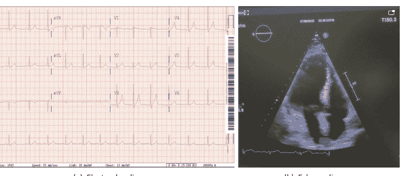

**图 11.1** 标准 12 导联心电图和四腔超声心动图。

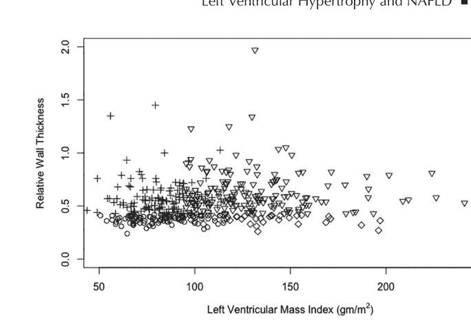

**图 11.2** LVMI 分布和左心室形态。左心室形态定义为：正常形态（正常 LVMI 且 RWT ≤0.42）（圆圈），心脏重塑（正常 LVMI 且 RWT >0.42）（叉号），向心性 LVH（升高 LVMI 且 RWT >0.42）（三角形），以及偏心性 LVH（升高 LVMI 且 RWT ≤0.42）（菱形）。LVH：左心室肥厚（男性：>115 g/m² 且 女性：>95 g/m²）；LVMI：左心室质量指数；RWT：相对室壁厚度。

### 11.4.2 基于决策树的 LVH 分类模型开发

所提出的模型自动生成一个简单的五级七节点 DT，如图 11.3 所示。每个叶节点展示了患有 LVH 的概率，如果其值大于 0.5（50%），患者将被分类为患有 LVH，反之亦然。该模型使用样本的 80% 创建，剩余的 20% 用于内部验证。外部验证在 150 名受试者（47.3% 为 LVH 阳性）中进行。DT 模型在 LVH 预测中的分类性能如表 11.1 所示。逻辑回归用于维度缩减 [20]。逻辑回归模型估计的重要特征如表 11.2 所示。

图 11.3 中提出的树是一种特殊情况，因为它经过了算法和领域专家（心脏病专家）的剪枝。算法处理原始数据并生成一棵树，在此“正常”过程之后，专家对其进行评估并建议移除哪些变量。这些步骤反复进行，直到专家得出结论，认为该树具有生物学一致性并提高了既定 LVH 标准的准确性。这种不同领域专家可以与数据科学家合作进行“建模”的特点是由 DTs 的特性所促成的。

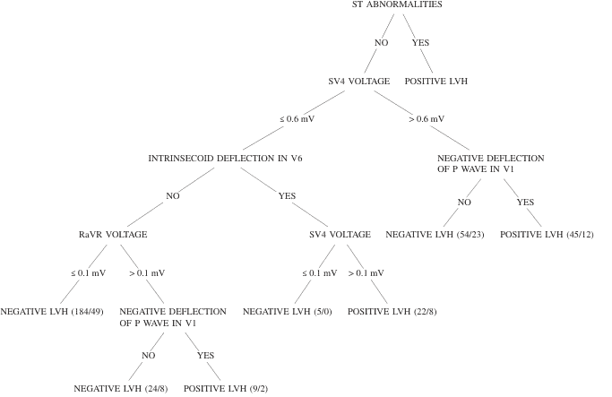

**图 11.3** 左心室肥厚的决策树。

**表 11.1** 决策树模型在 LVH 分类中的性能

|  | 准确率 (%) | 灵敏度 (%) | 特异度 (%) | 阳性预测值 (PPV) (%) | 阴性预测值 (NPV) (%) |
|---|---|---|---|---|---|
| 内部验证 | 71.4 | 79.6 | 53 | 66.6 | 69.3 |
| 外部验证 | 73.3 | 81.6 | 69.3 | 56.3 | 88.6 |

**表 11.2** 用于 LVH 分类维度缩减的逻辑回归模型

|  | 估计值 | 标准误 | P 值 | 95% CI |
|---|---|---|---|---|
| 截距 | $-2.7$ | 0.86 | 0.001 | [0.01, 0.34] |
| ST 异常 | 1.28 | 0.3 | <0.001 | [1.98, 6.52] |
| V4 导联 S 波 | 0.93 | 0.36 | 0.01 | [1.24, 5.26] |
| V6 导联内向偏转 | 0.97 | 0.32 | 0.002 | [1.4, 5.04] |
| V1 导联 P 波负向偏转 | 0.96 | 0.24 | <0.001 | [1.61, 4.22] |
| aVR 导联 R 波 | 3.9 | 1.3 | 0.002 | [4.1, 685.1] |
| aVR 导联 S 波 | 0.48 | 0.34 | 0.18 | [0.83, 3.17] |
| V1 导联 P 波时限 | $-0.009$ | 0.003 | 0.14 | [0.98, 0.99] |
| V6 导联 S 波 | 1.91 | 0.95 | 0.04 | [1.05, 44] |
| I 导联 S 波 | $-2.24$ | 1.01 | 0.27 | [0.01, 0.77] |
| QRS 时限 | 0.01 | 0.008 | 0.1 | [0.99, 1.03] |
| I 导联 R 波 | 0.53 | 0.37 | 0.15 | [0.81, 3.57] |

### 11.4.3 NAFLD 分类的决策树

首先将逻辑回归模型应用于 IV-A 节中讨论的 NAFLD 临床数据以选择重要特征，然后使用 DT 对 NAFLD 进行分类。所提出的模型生成的 DT 结果如图 11.4 所示。所提出的 DT 模型在 NAFLD 预测方面的分类性能，包括准确率、灵敏度、特异度、阳性预测值（PPV）和阴性预测值（NPV），如表 11.3 所示。

通常，建议纳入特定模型的变量是与感兴趣的现象先前有关系的，但有时这些变量与现象之间存在理论关联而非测量的关系。例如在 NAFLD 的 DT 中（图 11.4），领域专家内分泌学家假设酰基肉碱（即 C14、C18、C18OH）和其他生化变量与 NAFLD 之间存在关系，但他并不确切知道它们如何与 NAFLD 相互作用。在这种情况下，算法提出的树可以用作假设生成器（了解变量之间的相关性），并在日常实践中对患者进行分类（前提是这些变量可用）。

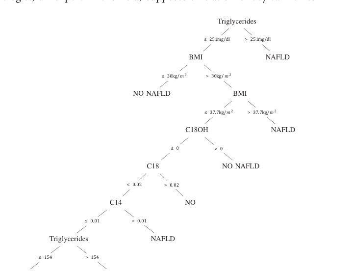

**图 11.4** 基于逻辑回归前向选择模型提出的决策树模型。

**表 11.3** 用于分类 NAFLD 的决策树性能

| 决策树 | 准确率 (%) | 灵敏度 (%) | 特异度 (%) | 阳性预测值 (PPV) (%) | 阴性预测值 (NPV) (%) |
| :------------ | :----------- | :-------------- | :-------------- | :------ | :------ |
| 交叉验证 | 94.9 | 80 | 87.4 | 66.6 | 92.2 |
| 置信区间 | 78.1–91.7 | 65.8–94.1 | 82.4–92.5 | 54.5–78.7 | 86.3–98.1 |

### 11.5 结论与未来工作

我们开发了一种基于 DT 的解决方案，用于自动化 LVH 和 NAFLD 的诊断。所提出的基于 DT 的模型能够发现有助于疾病诊断的规则，且这些规则与医生的发现一致。DT 生成的规则可被医生理解，因此更适用于临床环境。本章描述了 DT 算法的基本特性；还展示了其在 LVH 和 NAFLD 病例中的实用性。DT 算法有效地处理了该数据在没有变量间线性关系时的熵问题。它们改进了既定的 LVH 标准，或建议了 NAFLD 的新关系和分类能力。DT 易于解释的特性增加了其在医学领域的普及度，这一点可以通过最近文献中基于 DT 研究数量的增加得到支持。在撰写本章时，对 PubMed（由美国国立医学图书馆和美国国立卫生研究院提供的搜索引擎）中关键词“决策树”的搜索结果显示，使用 DT 算法的研究从 1967 年的一篇文章增加到了 2020 年的 1,444 篇。DT 在许多复杂的分类和预测问题中展示了最先进的结果；然而，它也面临一些挑战。其中之一是 DT 的不稳定性，这意味着数据中的细微变化会产生不同的树。与科学的分支一样，在医学中，准确性与问题解决方案的唯一性同等重要。因此，每个实验都需要足够大的样本量和外部验证，以推广模型的效用。

如前所述，DT 在大型和非常复杂的数据中表现具有竞争力。原始算法的进一步改进被提出为迁移学习 [23]、半监督学习 [24] 和 anytime 学习 [25]。未来，我们旨在利用迁移学习、半监督学习和 anytime 学习开发更高效、更具通用性的成本敏感型及前瞻型 DT，以自动化常规诊断程序。


## 参考文献

1.  A. L. Hilliard, D. E. Winchester, T. D. Russell, 和 R. D. Hilliard，“心肌梗死分类及其对心血管结果、质量和种族/民族差异指标的影响”，*Clin Cardiol*（《临床心脏病学》），第 43 卷，第 10 期，第 1076–1083 页，2020 年 10 月。
2.  E. J. Benjamin, P. Muntner, A. Alonso, M. S. Bittencourt, C. W. Callaway, A. P. Carson, A. M. Chamberlain, A. R. Chang, S. Cheng, S. R. Das 等人，“心脏病和中风统计-2019 年更新报告：来自美国心脏协会的报告”，*Circulation*（《循环》），第 139 卷，第 10 期，第 e56–e528 页，2019 年。
3.  M. M. Ruisen, A. L. Mak, U. Beuers, M. E. Tushuizen, 和 A. G. Holleboom，“非酒精性脂肪肝：一种多学科方法以应对心脏代谢性肝病”，*Eur J Endocrinol*（《欧洲内分泌学杂志》），第 183 卷，第 3 期，第 R57–R73 页，2020 年 9 月。
4.  U. Goldbourt 和 E. Grossman，“中年期血压变异性与全因、冠心病和中风长期死亡率相关”，*J Hypert*（《高血压杂志》），第 38 卷，第 9 期，第 1722–1728 页，2020 年 9 月。
5.  K.-S. Hong, K. Kim, 和 M. A. Hill，“小动脉血流的调节：支撑肌源性血管收缩的机械感受事件”，*J Exerc Rehabil*（《运动康复杂志》），第 16 卷，第 3 期，第 207–215 页，2020 年 6 月。
6.  F. De la Garza Salarzar, E. A. Rodríguez Díaz, A. González Cantú, J. R. Azpiri López, M. Kuri Ayache, 和 M. E. Romero Ibarguenogoitia，“心电图左心室肥厚标准在特定人群中的诊断效用”，*Acta Cardi*（《心脏病学学报》），第 1–8 页，2020 年 2 月。
7.  Y. Xiong, L. Lin, Y. Chen, S. Salerno, Y. Li, X. Zeng, 和 H. Li，“使用机器学习技术预测妊娠前 19 周的妊娠糖尿病”，*J Matern Fetal Neonatal Med*（《母胎与新生儿医学杂志》），第 1–7 页，2020 年 8 月。
8.  S. Kweon, J. H. Lee, Y. Lee, 和 Y. R. Park，“基于癌症患者 RNA 表达数据的机器学习进行个人健康信息推断：算法验证研究”，*J Med Internet Res*（《医学互联网研究杂志》），第 22 卷，第 8 期，第 e18387 页，2020 年 8 月。
9.  M. C. Prosperi, A. Altmann, M. Rosen-Zvi, E. Aharoni, G. Borgulya, F. Bazzo, A. Sönerborg, E. Schüller, T. Struck, G. Uvahi 等人，“针对预测抗逆转录病毒治疗反应，研究专家规则库、逻辑回归和非线性机器学习技术”，*Antivir Ther*（《抗病毒疗法》），第 14 卷，第 3 期，第 433–442 页，2009 年。
10. J. Fan 和 R. Li，“高维数据的统计挑战：知识发现中的特征选择”，*arXiv 预印本 math/0602133*，2006 年。
11. S. Gayathri, V. P. Gopi, 和 P. Palanisamy，“通过可靠的特征选择自动分类糖尿病视网膜病变”，*Phys Eng Sci Med*（《物理工程科学医学》），第 43 卷，第 3 期，第 927–945 页，2020 年 9 月。
12. Y. Han, Y. Ma, Z. Wu, F. Zhang, D. Zheng, X. Liu, L. Tao, Z. Liang, Z. Yang, X. Li, J. Huang, 和 X. Guo，“使用 PET/CT 图像对非小细胞肺癌进行组织学亚型肺分类”，*Eur J Nucl Med Mol Imaging*（《欧洲核医学与分子影像杂志》），第 48 卷，第 2 期，第 350–360 页，2021 年 2 月。
13. Y.-Y. Song 和 L. Ying，“决策树方法：在分类和预测中的应用”，*Shanghai Arch Psychiatry*（《上海精神病学档案》），第 27 卷，第 2 期，第 130 页，2015 年。
14. G.-M. Lin 和 K. Liu，“一种结合人体测量指标和机器学习的筛查年轻人左心室肥大的心电图系统”，*IEEE J Transl Eng Health Med*（《IEEE 转化工程与健康医学杂志》），第 8 卷，第 1800111 页，2020 年。
15. R. Sparapani, N. M. Dabbouh, D. Gutterman, J. Zhang, H. Chen, D. A. Bluemke, J. A. C. Lima, G. L. Burke, 和 E. Z. Soliman，“使用贝叶斯加性回归树检测左心室肥厚：MESA 研究”，*J Am Heart Assoc*（《美国心脏协会杂志》），第 8 卷，第 5 期，第 e009959 页，2019 年。
16. T. Poynard, V. Ratziu, S. Naveau, D. Thabut, F. Charlotte, D. Messous, D. Capron, A. Abella, J. Massard, Y. Ngo, M. Munteanu, A. Mercadier, M. Manns, 和 J. Albrecht，“生物标志物（steatotest）在预测肝脏脂肪变性方面的诊断价值”，*Comp Hepatol*（《综合肝病学》），第 4 卷，第 10 页，2005 年 12 月。
17. T. Poynard, V. Peta, M. Munteanu, F. Charlotte, Y. Ngo, A. Ngo, H. Perazzo, O. Deckmyn, R. Pais, P. Mathurin, R. Myers, R. Loomba, V. Ratzu, FLIP 联盟，FibroFrance-CPAM 小组，FibroFrance-Obese 小组，和 Selenotestib 小组，“简化血液检测（steatotest-2）在预测肝脏脂肪变性方面的诊断性能”，*Eur J Gastroenterol Hepatol*（《欧洲胃肠病学与肝脏病学杂志》），第 31 卷，第 3 期，第 393–402 页，2019 年。
18. Y. Zhang, R. Shi, L. Yu, L. Ji, M. Li, 和 F. Hu，“建立 2 型糖尿病非酒精性脂肪肝病的风险预测模型”，*Diabetes Ther*（《糖尿病治疗》），第 11 卷，第 9 期，第 2057–2073 页，2020 年 9 月。
19. N. Perakakis, S. A. Polyzos, A. Yazdani, A. Sala-Vila, J. Kountouras, A. D. Anastasilakis, 和 C. S. Mantzoros，“使用组学和非监督学习非侵入性诊断非酒精性脂肪性肝炎和纤维化：一项概念验证研究”，*Metabolism*（《新陈代谢》），第 101 卷，第 154005 页，2019 年。
20. T. M. Mitchell,*Machine Learning*（《机器学习》），纽约：麦格劳-希尔（McGraw-Hill），1997 年。
21. F. De la Garza-Salazar, M. E. Romero-Ibarguenoitia, E. A. Rodríguez-Díaz, J. R. Azpiri-Lopez, 和 A. González-Cantu，“使用机器学习方法提高左心室肥大的心电图诊断准确性”，*PLoS One*（《公共科学图书馆综述》），第 15 卷，第 5 期，第 e0232657 页，2020 年。
22. M. E. Romero-Ibarguenoitia, F. Vadillo-Ortega, A. E. Caballero, I. Ibarrar-González, A. Herrera-Rosas, M. Serratos-Canales, M. León-Hernández, A. González-Chávez, S. Mummid, R. Duggira, 和 J. C. López-Alvarenga，“青少年家族史和肥胖及其对酰基肉碱/氨基酸代谢组学和非酒精性脂肪肝（NAFLD）的影响。结构方程模型方法”，*PLoS One*（《公共科学图书馆综述》），第 13 卷，第 2 期，第 e0193138 页，2018 年。
23. J. won Lee 和 C. Giraud-Carrier，“决策树中的迁移学习”，在 *2007 年国际联合神经网络大会* 中。IEEE，2007 年，第 726–731 页。
24. J. Tanha, M. van Someren, 和 H. Afsarmanesh，“决策树分类器的半监督自训练”，*Int J Mach Learn Cybernet*（《机器学习与赛博net国际期刊》），第 8 卷，第 1 期，第 355–370 页，2017 年。
25. S. Esmeir 和 S. Markovitch，“决策树的 anytime 学习”，*J Mach Learn Res*（《机器学习研究杂志》），第 8 卷，第 5 期，第 891–933 页，2007 年。

## 第 12 章

### 外科实践的前沿：机器学习在神经外科中的应用

Omar Khan, Jetan H. Badhwiwala,  
Muhammad Ali Akbar, 和 Michael G. Fehlings

*多伦多大学*  
*加拿大多伦多*

#### 目录

- 12.1 引言 207
- 12.2 机器学习与神经外科诊断 209
- 12.3 机器学习与术中护理 212
- 12.4 机器学习与神经外科预后 213
- 12.5 未来方向 216
- 12.6 局限性 217
- 参考文献 218

### 12.1 引言

正如本书所展示的大量内容所示，机器学习（ML）对医学的影响非常广泛，因为它跨越多个学科并以多种方式影响它们。这种适用性是 ML 能够处理大型、复杂数据集的结果，从而规避了许多传统统计技术的局限性 [1]。事实上，神经外科也绝对无法免受这种影响的影响。近年来，强调机器学习在神经外科实践中应用的文章数量显著增加 [2]。与此同时，诊断和流行病学数据集在规模和复杂性上激增，使得机器学习文章数量的增加既源于新颖性，也源于必要性。

机器学习（ML）并非铁板一块；更准确地说，ML 应该被描述为一种工具类别，可以根据算法解决的计算任务进行细分 [1,3]。这种细分将 ML 分为三大类：监督学习、无监督学习和强化学习 [4,5]（表 12.1）。其中，强化学习在神经外科中的应用最为有限。这主要是由于其本质是一种确定策略的技术，旨在指定环境中最大化奖励（例如，一个在棋盘[环境]上玩的机器人试图确定一种[移动]策略，以最大化奖励并最小化惩罚）[5]，这使得它不如其他两类方法那样适用于流行病学数据集。

机器学习对神经外科实践的潜在影响是显著的。在过去几年中，专注于将机器学习应用于...

**表 12.1** 机器学习的三大主要类别描述

| 属性 | 监督学习 | 无监督学习 | 强化学习 |
| :--- | :--- | :--- | :--- |
| 标记 | 结果在事前被标记 | 结果无标记 | 结果无标记 |
| 描述 | 算法使用输入变量，以标记数据为参考来预测结果 | 算法将数据分离为聚类 | 算法在环境中构建一种最大化奖励并最小化惩罚的策略 |
| 评估指标 | 相对于实际结果值的 AUC 和准确率 | 不适用，因为数据未标记 | 累积奖励 |
| 示例 | 分类算法（例如随机森林）和回归算法（例如支持向量回归） | k 均值聚类，主成分分析 | Q 学习 |

AUC：接收器操作特征曲线下面积（area under the receiver operating characteristic curve）。


神经外科已涉及众多临床实践领域。这些领域可分为术前诊断、术中管理和术后预后。本章旨在总结迄今为止在这些领域中已确立的机器学习（ML）的作用。具体而言，本章的12.2节至12.4节将分别讨论与神经外科诊断、术中护理和神经外科预后相关的当前机器学习文献[1,2,6]。12.5节将讨论可能的未来方向，突出改进领域以及可能追求的新颖研究领域。最后，12.6节将描述机器学习的局限性。

## 12.2 机器学习与神经外科诊断

在影像学应用中，机器学习在标记异常特征或提供可能诊断列表方面可能发挥重要作用，这无疑将协助临床医生的工作流程并提供深入的诊断印象[7]。近年来，在训练机器学习算法以解读涉及中枢神经系统的常见影像学模式（例如磁共振成像或MRI以及计算机断层扫描或CT扫描）方面已开展了大量工作。这些工作涵盖了众多应用，例如脑和脊髓分割、卒中影像学和神经肿瘤学。

当患者出现卒中时，病史是指导管理的关键临床要素之一。在最新的缺血性卒中管理指南中，建议在症状发作或患者最后已知基线状态后的4.5小时内使用溶栓药物（即“溶栓剂”），前提满足某些条件[8]。对于在症状发作后3至4.5小时内就诊的患者（例如非主要卒中），使用溶栓药物还有额外的标准。因此，在决定急性缺血性卒中患者的治疗方案时，识别症状发作时间至关重要。然而，这种情况通常无法实现，例如当卒中导致严重残疾、患者伴有额外的神经认知障碍或觉醒时已存在神经系统缺损时[9,10]。在病史不明确的情况下，可进行扩散加权和液体衰减反转恢复（FLAIR）MRI。具有扩散阳性和FLAIR阴性病变（即DWI-FLAIR不匹配）的患者被认为在4.5小时时间窗内，可能符合溶栓药物治疗的资格[10,11]。

然而，DWI-FLAIR不匹配的使用具有低至中等的评价者间和评价者内可靠性；此外，它也不是指示4.5小时内发生的缺血性卒中的完美指标[10,12]。认识到这些局限性，Lee及其同事开发了利用MRI特征检测4.5小时内发生的卒中的机器学习算法（逻辑回归、支持向量机和随机森林）[13]。这些算法被发现比人类读者更敏感，并且在特异性方面与人类读者没有统计学显著差异。根据这些发现，机器学习性能的提高可能是由于其检测了人类读者可能未察觉的、与DWI-FLAIR不匹配相结合的其他影像特征。这对神经外科实践具有潜在的重要影响，因为超过药理学溶栓窗口期的患者可能符合机械取栓的资格，这建议在症状发作或最后已知基线状态后的6至24小时内进行[8,14]。因此，通过机器学习准确识别4.5小时时间窗内的患者可能会改变神经外科医生可进行机械取栓的患者群体。

在神经肿瘤学中，在脑肿瘤的分类、分级和分割方面取得了重要进展。我们将在此总结这些进展，但更全面的概述可在参考文献[15]中找到。多项研究使用机器学习将脑肿瘤分类为良性或恶性，取得了良好至优异的性能，一项研究达到了98%的分类准确率[16]，另一项研究达到了0.911的受试者工作特征曲线下面积（AUC）[17]。其他研究尝试使用机器学习对脑肿瘤进行更细粒度的分类。例如，Zacharakis及其同事[18]开发了支持向量机（SVM）模型，基于MRI特征对不同类型胶质瘤、脑膜瘤和脑转移瘤的分级进行分类。这些模型在大多数两类问题（即区分两种不同类型的肿瘤）中表现良好，AUC在0.77到1之间。然而，它们的性能在两个方面受到限制：区分II级和III级胶质瘤以及多类分类（即区分两种以上类型的肿瘤）。后来，Wang及其同事[19]开发了通过多类方法区分II级、III级和IV级胶质瘤的机器学习算法，并取得了显著成功（平均准确率约90%）。

关于神经肿瘤学中机器学习的额外研究集中在肿瘤分割上，即在影像上将肿瘤与周围脑组织分离的过程，这在决定治疗方案时可能是不可或缺的[20]。传统上，医生手动分割肿瘤用于治疗计划；然而，这个过程可能效率低下，并且存在不完全的评价者间可靠性[21]。机器学习是解决这些问题的理想候选者，当前文献包括多篇使用深度学习或k均值聚类来区分肿瘤组织与正常脑实质的文章。这些文章已成功分割多形性胶质母细胞瘤、低级别胶质瘤、脑膜瘤和转移性脑肿瘤[22,23]。

然而，分割算法的应用不仅限于肿瘤学背景。在颞叶癫痫（TLE）患者中，常见发现是海马硬化[24]。这些患者对手术治疗特别有适应性（无癫痫发作率为60%，通常通过切除病灶脑区进行[25]）。然而，没有海马硬化的患者手术治疗成功的可能性较低，这使得区分颞叶癫痫的这两个亚型具有临床价值。为此，Keihanimejad及其同事[26]使用机器学习在MRI上对颞叶癫痫进行分割和分类。在分割之后，作者使用SVM算法分别达到了有和无海马硬化的颞叶癫痫96%和86%的分类准确率。在略有不同条件下（例如基于海马外发现检测颞叶癫痫），也进行了类似的颞叶癫痫分割和分类工作[27,28]。

在大脑之外，利用机器学习诊断脊柱病理学的出版物库与利用机器学习诊断颅内病理学的出版物库相比是有限的。尽管如此，使用机器学习诊断脊髓病理学的文献正在迅速扩展，并在此方面取得了重要进步。Jamaludin及其同事[29]实现了其中的一个进步，他们开发了一个模型，使用来自超过12,000个椎间盘的图像来标记椎骨和椎间盘。随后，开发了一个卷积神经网络根据Pfirrmann分级标准预测椎间盘退化的程度。最终，该算法与人类预测之间70.1%的评价者间一致性，与两名放射科医生使用Pfirrmann标准评分椎间盘退化时70.4%的评价者间一致性相似。关于脊柱畸形，特别是特发性脊柱侧弯，也进行了脊柱侧弯分类和分级的研究[30]。


## 12.3 机器学习与术中护理

在脊髓损伤（SCI）领域，Tay 及其同事 [31] 构建了机器学习算法，利用从扩散张量成像（DTI）获取的脊髓影像，根据是否存在脊髓损伤对轴位图像进行分类。用于做出这些预测的关键特征是各向异性分数（fractional anisotropy），它是用作组织结构完整性的替代指标。更具体地说，各向异性分数用于 DTI 中描述图像中水的扩散和组织取向 [32]。在划定脊髓后，作者使用支持向量机（SVM）和 k 近邻（k-nearest neighbors）机器学习模型，以各向异性分数为预测变量，将脊髓 DTI 图像分类为损伤或正常。这些算法的特异度达到 0.952，敏感度达到 0.912。

神经外科是一门独特的外科专业，因为它采用了一系列器官特异性的术中监测手段以确保手术成功。这些手段包括术中成像、电生理监测和神经生理监测。鉴于神经外科依赖于每次手术中的手动技巧和快速诊断能力，该领域非常适合在术中背景下额外应用机器学习。

帕金森病是一种运动障碍，起因于基底黑质多巴胺能神经元的退化 [33]。帕金森病的药物治疗旨在增强多巴胺能活性，从而带来一定的症状缓解 [34]。然而，对于药物治疗无效的情况，通过深部脑刺激（DBS）对基底神经节结构（例如丘脑底核，STN）进行手术干预是一个选择 [34,35]。在此程序中，微电极记录仪穿过大脑以测绘相关的脑结构，并理想地识别 STN。Taghva 开发了隐马尔可夫模型，利用实际手术中涉及的模拟脑解剖结构，在 DBS 过程中检测微电极是否位于 STN 内 [36,37]。这些模型在分类模拟微电极位置时的准确率介于 98% 至 99% 之间，在识别微电极是否具体位于 STN 内时，特异度和敏感度均超过 95%。虽然大多数经验丰富的进行 DBS 手术的医生应该能够识别 STN，但该算法将有助于增强他们的识别能力，并且可能推广至帕金森病中的新型脑靶点。

颅内压（ICP）监测，特别是对于创伤性脑损伤患者，是神经外科医生武器库中的重要工具 [38]。在术中背景下，ICP 监测被认为具有重要的治疗和预后意义 [39]。因此，ICP 的形态学特征可能具有重要的诊断价值，尤其是在术中使用时。Nucci 及其同事 [40] 开发了人工神经网络来检测和分类脑脊液压力波形。以专家检查者的诊断为‘真值’，该神经网络在分类脑脊液压力波时的准确率为 88.3%。理论上，这些结果可以扩展到术中场景，以协助神经外科医生快速解读 ICP。

脊柱手术经常伴随着脊髓损伤的风险，这意味着术中电生理监测对于让外科医生识别和预防潜在的神经功能缺陷可能有用。躯体感觉诱发电位（SEPs）常被用作衡量脊髓电生理状态的指标 [41,42]。然而，各种手术和麻醉因素可能会妨碍对 SEP 波形的解读；此外，使用人类专家解读 SEPs 可能会存在评分者间差异 [43]。为了解决这些问题，Fan 及其同事 [44] 创建了最小二乘支持向量回归模型来构建 SEP 基线；这些模型构建的基线在允许成功的 SEP 监测和防止关于脊髓损伤的虚假警报方面优于名义基线。

## 12.4 机器学习与神经外科预后

迄今为止，预后机器学习模型在神经外科领域得到了最广泛的开发，因为它们能够利用数值流行病学数据，而影像或术中数据必然更难以建立模型。预后模型在临床实践中可以发挥至关重要的作用，通过帮助管理期望、识别可能需要额外干预的患者，以及预测患者的出院去向。尽管这些模型涵盖多个领域，但它们通常遵循类似的原则。它们利用患者数据（例如年龄、合并症和术前神经状态）来预测术后结果，这些结果可以包括功能结局、生活质量结局等。基于机器学习的预后模型迄今为止已应用于神经外科的几乎所有领域，包括癫痫、帕金森病、神经创伤、神经肿瘤学和脊柱疾病 [45]。

Senders 及其同事 2018 年进行的一项系统综述 [45] 详细描述了基于机器学习的结局预测如何在众多神经外科领域中使用。在癫痫领域，该综述研究的九篇文章均使用机器学习算法（例如 SVM、随机森林、神经网络、朴素贝叶斯和 k 近邻）预测接受颞叶癫痫手术患者的无发作状态 [46–54]。这九项研究使用了多种输入特征，包括临床变量、MRI 发现和 EEG 发现。总体而言，这些研究的分类准确率在 70% 至 98% 之间（中位数：92%），AUC 在 0.63 至 0.94 之间。类似地，四项研究使用机器学习预测原发性或转移性脑肿瘤经过手术切除、活检或立体定向放射治疗后的生存率 [55–58]。这些研究使用了 SVM 和神经网络等算法，并达到了 0.76 至 0.85 之间的 AUC，表明具有良好的预测性能。另外两项研究还预测了接受伽玛刀放射治疗治疗转移性脑肿瘤（准确率：95%，AUC：0.88）[59] 或接受胶质母细胞瘤全切（准确率：91%，AUC：0.84）[60] 患者的癌症复发率。

在创伤性脑损伤方面，Shi 及其同事 [61] 使用人工神经网络预测开颅减压术（通过去骨瓣开颅术或血肿清除术）后的院内死亡率，准确率达到 95%，AUC 为 0.89。更近期，Gravesteijn 及其同事 [62] 开发了机器学习模型，以预测创伤性脑损伤后的死亡率和不良结局（定义为格拉斯哥昏迷量表 <4）。然而，作者发现机器学习模型（例如 SVM 和随机森林）与传统逻辑回归在预测的区分度和校准度上没有差异。对于帕金森病，两项研究使用机器学习技术（例如 SVM、随机森林和朴素贝叶斯）预测丘脑底核（STN）DBS 后的运动改善 [63,64]。一项研究在预测 DBS 后 9 个月的运动改善时达到了 86% 的准确率 [64]，另一项研究在预测 DBS 后 2 年的运动改善时达到了 95% 的准确率 [63]。

在脊柱疾病领域，机器学习算法最近开始用于创伤性和非创伤性 SCI 的结局预测。在创伤性 SCI 中，DeVries 及其同事 [65] 开发了无监督机器学习算法，以预测出院时或 1 年随访时的步行独立性，证明机器学习算法在相同任务上的表现与其逻辑回归对应算法相当。沿着类似的探索路径，Inoue 及其同事 [66] 最近创建了一种‘xgboost’算法，以预测损伤后 6 个月神经功能的恢复（根据美国脊髓损伤协会损伤量表或 AIS 判断）。使用患者数据、MRI 发现和治疗变量作为预测因子，作者证明‘xgboost’算法在做出相同预测时，准确率优于逻辑回归模型和决策树模型（准确率：81.1%，AUC：0.867），尽管其 AUC 略低于逻辑回归模型设定的目标（0.877）。

非创伤性 SCI 在解剖上可分为颈椎疾病（通常称为退行性颈椎脊髓病或 DCM）和腰椎疾病。Hoffman 及其同事 [67] 发表了早期应用支持向量回归预测 DCM 手术后 Oswestry 残疾指数（ODI，一种功能性结局）的研究之一，证明术前 ODI 和症状持续时间是由机器学习模型成功预测结局的最重要变量之一。这项工作的后续研究由 Merali 等人 [68] 和 Khan 等人 [69] 完成，他们开发了多种机器学习算法，以预测 DCM 手术后 6 个月、1 年和 2 年的功能性和健康相关生活质量结局。这些模型的典型 AUC 在 0.7–0.78 左右。

除了用于预测功能性和生活质量结局外，机器学习算法也被开发用于预测颈椎和腰椎手术后的阿片类药物使用。在两项独立的研究中，Karhade 及其同事使用机器学习模型预测颈椎 [70] 和腰椎手术 [71] 后长期阿片类药物使用，使用术前因素，如保险状态、烟草使用和抑郁症病史。作者为颈椎模型（随机梯度提升算法）和腰椎模型（弹性网罚分逻辑回归）均达到了 0.81 的 AUC。最后，针对出院去向的预测也进行了相关工作，Karhade 等人使用包含 26,000 名患者的大型国家外科质量改进计划数据库，开发了预测非常规出院患者的机器学习算法 [72]。开发的机器学习算法使作者达到了良好的校准和区分度（AUC：0.82）。


## 12.5 未来方向

表12.2总结了机器学习在神经外科中的潜在应用，这些应用涉及多个领域，并以多种方式影响这些领域。然而，当应用于神经外科环境时，机器学习仍处于相对早期的阶段。尽管神经外科领域的机器学习已成为一个备受关注且研究热点浓厚的领域，但仍然存在许多空白，使得目前的文献远未达到完备状态。因此，对机器学习的当代讨论若不探讨其未来——而未来充满巨大希望——则是不完整的。对于神经系统疾病的诊断、治疗和预后，我们将探讨机器学习在神经外科实践中的未来角色，包括颅内和颅外（例如脊髓）过程。

机器学习的核心优势源于其分析具有众多预测因子的大型复杂数据集的能力、其在无需预先指定情况下通过计算确定重要预测因子的能力，以及其捕获非线性关系的能力 [73–75]。如前所述，已经有许多研究利用这些机器学习特性开发了强大的诊断和预后工具。随着机器学习持续普及 [2]，机器学习在前几节所述领域的应用将变得更加稳健，并在临床实践中占据更大的地位。此外，随着自然语言处理（NLP）和计算机视觉 [6] 等工具的出现，机器学习之外的人工智能工具可能以其他方式开始影响神经外科实践（例如，使用NLP从影像报告中提取信息 [76]，以及使用计算机视觉分析脊髓损伤后的手功能 [77]）。

**表12.2 机器学习在神经外科实践中的潜在应用总结，按诊断和术中应用（第12.2节）及预后（第12.3节）分类**

| 神经外科领域 | 诊断和术中管理 | 预后 |
| :--- | :--- | :--- |
| 癫痫 | 颞叶癫痫的分割和分类 | 预测颞叶癫痫的无发作状态 |
| 神经血管 | 识别急性缺血性中风4.5小时时间窗内的患者 | 预测机械取栓术后的预后 [80] |
| 神经肿瘤学 | 颅内肿瘤的分级、分类和分割 | 预测手术治疗后的生存率，预测伽玛刀立体定向放射治疗转移灶后的癌症复发 |
| 创伤性脑损伤 | 颅内压监测 | 预测手术后的死亡率和不良预后 |
| 脊髓损伤 | 脊髓分割、脊髓损伤诊断、术中躯体感觉诱发电位监测 | 预测手术后的功能预后、与健康相关的生活质量结局、长期阿片类药物使用及出院去向 |

然而，除了机器学习和人工智能范围的扩大之外，未来的路径还需要机器学习研究在将机器学习自信地引入神经外科之前，实现更大的方法论稳健性和可重复性。为了达到稳健性，未来的机器学习文献将受益于遵循Luo及其同事 [75] 在2016年制定的指南，该指南描述了一种开发机器学习模型的系统方法。指南为确保稳健分析提出的策略包括：使用独立的训练集和测试集以最小化过拟合，使用校准和区分度指标，并在尽可能时使用外部数据集对模型进行进一步验证。在可重复性方面，机器学习算法本质上难以在纸上表述，因为它们通常过于复杂，无法通过方程描述。因此，许多前述机器学习文章未随论文附上模型副本；然而，未来的研究将受益于使用基于Web的应用程序使其机器学习模型更易于应用。这必将有助于这些研究的重复性和外部验证，使这些算法最终成为未来神经外科实践的组成部分。

## 12.6 局限性

尽管前景广阔，机器学习存在重要的局限性，在将其投入实践时应当予以考虑。首先，与可以整齐地以方程形式写出的逻辑回归模型相比，许多机器学习模型由于其固有的复杂性，更难用闭合形式表达。这使得其解释变得困难且不那么直观，因此，为未来神经外科研究开发的机器学习程序开发基于Web的应用程序对于克服这一固有劣势至关重要。其次，作为一种数据驱动工具，机器学习在本质上受限于底层数据的质量和数量 [78]。小型、低质量的数据集将产生比大型、高质量数据集更差的机器学习模型。此外，数据中的偏差会降低机器学习算法的通用性。例如，基于单一医院站点数据做出诊断预测的算法，可能更倾向于建议该中心主要看到的诊断，从而使其不太适用于其他中心的数据。第三，机器学习的广泛且无监管的实施可能会带来重大的医疗法律挑战 [79]。这些挑战可能源于某些机器学习算法的“黑箱”解释，这使得难以解读算法用于生成输出的底层数据部分。例如，如果用户没有事先知道机器学习算法将医院名称（一个无关变量）用作手术预后的重要预测变量，那么用户可能会在不恰当的多个情境中不当使用该算法。仔细考虑这些问题对于在未来将机器学习作为神经外科临床决策的辅助工具正确实施也至关重要。

# 参考文献

- 1. O. Khan, J. H. Badhwal a, J. R. F. Wilson, F. Jiang, A. R. Martin, and M. G. Fehlings, “Predictive Modeling of Outcomes after Traumatic and Nontraumatic Spinal Cord Injury Using Machine Learning: Review of Current Progress and Future Directions,” (in English), *Neuros*, vol. 16, no. 4, pp. 678–685, Dec 2019.
- 2. J. T. Senders et al., “An Introduction and Overview of Machine Learning in Neurosurgical Care,” *Acta Neurochirurgica (Wien)*, vol. 160, no. 1, pp. 29–38, Jan 2018.
- 3. A. V. Karhade et al., “Development of Machine Learning Algorithms for Prediction of 30-Day Mortality after Surgery for Spinal Metastasis,” *Neurosurgery*, vol. 85, no. 1, pp. E83–E91, Jul 1, 2019.
- 4. M. I. Jordan and T. M. Mitchell, “Machine Learning: Trends, Perspectives, and Prospects,” (in English), *Science*, vol. 349, no. 6245, pp. 255–260, Jul 17, 2015.
- 5. M. Wiering and M. van Otterlo, “Reinforcement Learning: State-of-the-Art,” (in English), *Reinforcement Learning: State-of-the-Art*, vol. 12, pp. 1–638, 2012.
- 6. O. Khan, J. H. Badhwal a, G. Grasso, and M. G. Fehlings, “Use of Machine Learning and Artificial Intelligence to Drive Personalized Medicine Approaches for Spine Care,” (in English), *World Neurosurgery*, vol. 140, pp. 512–518, Aug 2020.
- 7. A. S. Lunderholt and A. Lunderholt, “An Overview of Deep Learning in Medical Imaging Focusing on MRI,” (in English), *Zeitschrift Fur Medizinische Physik*, vol. 29, no. 2, pp. 102–127, 2019.
- 8. W. J. Powers et al., “Guidelines for the Early Management of Patients with Acute Ischemic Stroke: 2019 Update to the 2018 Guidelines for the Early Management of Acute Ischemic Stroke: A Guideline for Healthcare Professionals From the American Heart Association/American Stroke Association,” *Stroke*, vol. 50, no. 12, pp. e344–e418, Dec 2019.


9. W. J. Elliott，“脑卒中发作时间昼夜节律变化：一项荟萃分析”，*Stroke*，第29卷，第5期，第992–996页，1998年5月。

10. G. Thomalla等，“DWI-FLAIR不匹配用于识别症状发生后4.5小时内急性缺血性脑卒中患者（PRE-FLAIR）：一项多中心观察性研究”，*Lancet Neurology*，第10卷，第11期，第978–986页，2011年11月。

11. S. Emeriau, I. Serre, O. Toubas, F. Pombourcq, C. Oppenheim 和 L. Perrot，“3特斯拉下扩散加权成像-液体衰减反转恢复不匹配（扩散加权成像阳性/液体衰减反转恢复阴性）能否识别4.5小时内的卒中患者？”，*Stroke*，第44卷，第6期，第1647–1651页，2013年6月。

12. B. J. Kim等，“彩色编码液体衰减反转恢复图像可提高急性扩散加权成像病灶内液体衰减反转恢复信号变化的评价者间信度”，*Stroke*，第45卷，第9期，第2801–2804页，2014年9月。

13. H. Lee等，“识别4.5小时内卒中的机器学习方法”，*Stroke*，第51卷，第3期，第860–866页，2020年3月。

14. M. Mokin等，“源自急诊大血管闭塞（ELVO）的急性缺血性脑卒中血管内取栓指征：SNIS标准与指南委员会报告”，*Journal of NeuroInterventional Surgery*，第11卷，第3期，第215–220页，2019年3月。

15. G. S. Tandel等，“脑癌分类中深度学习视角综述”，*Cancers (Basel)*，第11卷，第1期，2019年1月18日。

16. M. Sasikala 和 N. Kumaravel，“基于小波的最优纹理特征集用于脑肿瘤分类”，*Journal of Medical Engineering & Technology*，第32卷，第3期，第198–205页，2008年5月-6月。

17. G. Ranjith, R. Parvathy, V. Vikas, K. Chandrasekharan 和 S. Nair，“胶质瘤分类的机器学习方法：使用从磁共振波谱提取的特征取得的初步结果”，*Neuroradiology Journal*，第28卷，第2期，第106–111页，2015年4月。

18. E. I. Zacharakis等，“在机器学习方案中利用MRI纹理和形状对脑肿瘤类型和分级进行分类”，*Magnetic Resonance in Medicine*，第62卷，第6期，第1609–1618页，2009年12月。

19. X. Wang等，“用于多参数胶质瘤分级且带有定量结果解释的机器学习模型”，（英语），*Frontiers in Neuroscience*，原创研究，第12卷，第1046期，2019年1月11日。

20. A. Boussehlam, O. Bouattane, M. Yousifi 和 A. Raihani，“基于病理区域温度变化实现磁共振图像脑肿瘤分割强化”，*International Journal of Biomedical Imaging*，第2019卷，第1758948页，2019年。

21. C. W. Wee等，“新诊断胶质母细胞瘤靶体积勾画变异性的评估：韩国放射肿瘤学组的多机构研究”，（英语），*Radiation Oncology*，第10卷，2015年7月2日。

22. T. L. Jones, T. J. Byrnes, G. Yang, F. A. Howe, B. A. Bell 和 T. R. Barrick，“使用扩散张量图像分割（D-SEG）技术进行脑肿瘤分类”，（英语），*Neuro-Oncology*，第17卷，第3期，第466–476页，2015年3月。

23. J. Juan-Albarracín等，“基于多参数结构化无监督分类的胶质母细胞瘤自动分割”，*PLOS One*，第10卷，第5期，第e0125143页，2015年。

24. M. Thom，“综述：癫痫中的海马硬化：神经病理学综述”，*Neuropathology and Applied Neurobiology*，第40卷，第5期，第520–543页，2014年8月。

25. M. Mohan等，“癫痫手术的长期预后”，*PLOS One*，第13卷，第5期，第e0196274页，2018年。

26. S. Keihaninejad等，“基于全脑自动MRI分割对伴或不伴海马萎缩的颞叶癫痫进行分类和侧定”，（英语），*PLOS One*，第7卷，第4期，2012年4月16日。

27. J. Del Gaizo等，“利用机器学习基于弥散磁共振成像对颞叶癫痫进行分类”，（英语），*Brain and Behavior*，第7卷，第10期，2017年10月。

28. N. K. Focke, M. Yogarajah, M. R. Symms, O. Gruber, W. Paulus 和 J. S. Duncan，“颞叶癫痫的自动磁共振图像分类”，（英语），*Neuroimage*，第59卷，第1期，第356–362页，2012年1月2日。

29. A. Jamaludin等，“2017年ISSLS生物医学工程奖：在无需人工干预的情况下自动读取腰椎磁共振图像（MRI）的放射学特征与专家放射科医生的表现相当”，*European Spine Journal*，第26卷，第5期，第1374–1383页，2017年5月。

30. J. L. Yang等，“开发与验证用于脊柱侧弯筛查的背部图像深度学习算法”，（英语），*Communications Biology*，第2卷，2019年10月25日。

31. B. Tay, J. K. Hyun 和 S. Oh，“基于从扩散张量图像获得的分数各向异性值用于脊髓损伤分级的机器学习方法”，（英语），*Computational and Mathematical Methods in Medicine*，第2014卷，第1–8页，2014年。

32. J. M. Soares, P. Marques, V. Alves 和 N. Sousa，“漫反射张量成像漫游指南”，*Frontiers in Neuroscience*，第7卷，第31页，2013年。

33. F. N. Emamzadeh 和 A. Surguchov，“帕金森病：生物标志物、治疗及危险因素”，*Frontiers in Neuroscience*，第12卷，第612页，2018年。

34. P. Rizek, N. Kumar 和 M. S. Jog，“帕金森病诊断与治疗的最新进展”，*CMAJ*，第188卷，第16期，第1157–1165页，2016年11月1日。

35. S. J. Groiss, L. Wojtecki, M. Sudmeyer 和 A. Schnitzler，“帕金森病的脑深部电刺激”，*Therapeutic Advances in Neurological Disorders*，第2卷，第6期，第20–28页，2009年11月。

36. A. Taghva，“基于隐马尔可夫模型的脑深部刺激器植入自动导航系统”，（英语），*Neurosurgery*，第66卷，第3期，第108–117页，2010年3月。

37. A. Taghva，“隐半马尔可夫模型在脑深部刺激器植入计算机解码微电极记录数据中的应用”，*World Neurosurgery*，第75卷，第5–6期，第758–763.e4页，2011年5月–6月。

38. D. e. Laskowitz 和 G. e. Grant，《创伤性脑损伤的转化研究》，第1版。Boca Raton (FL): CRC Press/Taylor and Francis Group，2016年。

39. T. H. Tsai, T. Y. Huang, S. S. Kung, Y. F. Su, S. L. Hwang 和 A. S. Lieu，“术中颅内压和脑灌注压对重度创伤性脑损伤手术预后的预测”，*Kaohsiung Journal of Medical Sciences*，第29卷，第10期，第540–546页，2013年10月。

40. C. G. Nucciarone，“颅内压波形形态分类：自动分析与临床验证”，*Acta Neurochirurgica (Wien)*，第158卷，第3期，第581–588页；讨论588页，2016年3月。

41. M. R. Nuwer，“基于躯体感觉技术的脊髓监测”，*Journal of Clinical Neurophysiology*，第15卷，第3期，第183–193页，1998年5月。

42. T. C. Hammett, B. Boreham, A. A. Quraishi 和 S. M. H. Mehdian，“脑瘫及其他神经肌肉疾病所致脊柱侧弯手术矫正期间的术中脊髓监测”，（英语），*European Spine Journal*，第22卷，第538–541页，2013年3月。

43. A. R. Möller，《术中神经生理监测》，第2版。Totowa, NJ: Humana Press，2006年。

44. B. Fan, H. X. Li 和 Y. Hu，“术中躯体感觉诱发电位监测的智能化决策系统”，（英语），*IEEE Transactions on Neural Systems and Rehabilitation Engineering*，第24卷，第2期，第300–307页，2016年2月。

45. J. T. Senders等，“机器学习与神经外科预后预测：系统综述”，*World Neurosurgery*，第109卷，第476–486.e1页，2018年1月。

46. A. R. Antony等，“从颅内脑电图估算的功能连接预测顽固性颞叶癫痫的手术预后”，*PLoS One*，第8卷，第10期，第e77916页，2013年。

47. J. E. Arle, K. Perrine, O. Devinsky 和 W. K. Doyle，“癫痫手术术前变量及预后的神经网络分析”，*Journal of Neurosurgery*，第90卷，第6期，第998–1004页，1999年6月。

48. R. Armananzas等，“预测颞叶癫痫手术预后的机器学习方法”，*PLoS One*，第8卷，第4期，第e62819页，2013年。

49. B. C. Bernhardt, S. J. Hong, A. Bernasconi 和 N. Bernasconi，“颞叶癫痫中的磁共振成像模式学习：分类与预后”，*Annals of Neurology*，第77卷，第3期，第436–464页，2015年3月。

50. D. L. Feis, J. C. Schoene-Bake, C. Elger, J. Wagner, M. Tittgemeyer 和 B. Weber，“左侧内侧颞叶癫痫术后发作预后的预测”，*Neuroimage: Clinical*，第2卷，第903–911页，2013年。

51. J. Grigsby, R. E. Kramer, J. L. Schreiders, J. R. Gates 和 W. B. Smith，“利用模拟神经网络预测前颞叶切除术的预后”，（英语），*Epilepsia*，第39卷，第1期，第61–66页，1998年1月。

52. N. Memarian, S. Kim, S. Dewar, J. Engel, Jr. 和 R. J. Staba，“复杂内侧颞叶癫痫病例手术预后预测的多模态数据与机器学习”，*Computers in Biology and Medicine*，第64卷，第67–78页，2015年9月。


[第 242 页]
+   53. B. C. Munsell 等，“基于结构连接组数据评估癫痫患者治疗结果预测的机器学习算法”，《*NeuroImage*》，第 118 卷，第 219–230 页，2015 年 9 月。
+   54. J. Yankam Njewa, K. R. Gray, N. Costes, F. Maugereur, P. Ryvlin 和 A. Hammers，“高级 [18F]FDG 和 [11C]氟马西尼 PET 分析用于预测海马硬化颞叶癫痫手术后的个体结果”，《*NeuroImage: Clinical*》，第 7 卷，第 122–131 页，2015 年。
+   55. K. E. Emslem, B. Nedregaard, J. K. Hald, T. Nome, P. Due-Tonnesen 和 A. Børnerud，“基于动态磁敏感对比成像的自动胶质瘤特征分析：使用基于知识的模糊聚类进行脑肿瘤分割”，《*Journal of Magnetic Resonance Imaging*》，第 30 卷，第 1 期，第 1–10 页，2009 年 7 月。
+   56. K. E. Emslem 等，“用于术前胶质瘤生存关联的通用支持向量机模型”，《*Radiology*》，第 275 卷，第 1 期，第 228–234 页，2015 年 4 月。
+   57. K. E. Emslem 等，“术前胶质瘤 MRI 中的机器学习：基于灌注的支持向量机生存关联优于传统 MRI”，《*Journal of Magnetic Resonance Imaging*》，第 40 卷，第 1 期，第 47–54 页，2014 年 7 月。
+   58. M. A. Knoll 等，“接受立体定向放射外科治疗的多发颅内转移瘤患者生存期：肿瘤数量是否重要？”，《*American Journal of Clinical Oncology*》，第 41 卷，第 5 期，第 425–431 页，2018 年 5 月。
+   59. P. Azimi, S. Shahzadi 和 S. Sadeghi，“使用人工神经网络预测仅接受放射治疗后发生新的脑转移的概率”，《*Journal of Neurosurgical Sciences*》，第 64 卷，第 1 期，第 52–57 页，2020 年 2 月。
+   60. H. Akbari 等，“通过多参数成像模式分析获得的浸润替代指标可预测胶质母细胞瘤随后的复发位置”，《*Neurosurgery*》，第 78 卷，第 4 期，第 572–580 页，2016 年 4 月。
+   61. H. Y. Shi, S. L. Hwang, K. T. Lee 和 C. L. Lin，“创伤性脑损伤手术后的院内死亡率：基于全国人群的人工神经网络与逻辑回归模型中使用的死亡率预测因子比较”，《*Journal of Neurosurgery*》，第 118 卷，第 4 期，第 746–752 页，2013 年 4 月。
+   62. B. Y. Gravesteijn 等，“机器学习算法在创伤性脑损伤预后判断中的表现并不优于回归模型”，《*Journal of Clinical Epidemiology*》，第 122 卷，第 95–107 页，2020 年 6 月。
+   63. K. Kostoglou, K. P. Michmizos, P. Stathis, D. Sakas, K. S. Nikita 和 G. D. Mitsis，“基于术中微电极记录对深部脑刺激临床改善进行分类和预测”，《*IEEE Transactions on Biomedical Engineering*》，第 64 卷，第 5 期，第 1123–1130 页，2017 年 5 月。

[第 243 页]
+   64. R. R. Shamir, T. Dolber, A. M. Noecker, B. L. Walter 和 C. C. McIntyre，“用于优化帕金森病联合刺激和药物治疗的机器学习方法”，《*Brain Stimulation*》，第 8 卷，第 6 期，第 1025–1032 页，2015 年 11 月至 12 月。
+   65. Z. DeVries 等，“开发一种用于脊髓损伤患者行走能力预后的无监督机器学习算法”，《*Spine Journal*》，第 20 卷，第 2 期，第 213–224 页，2020 年 2 月。
+   66. T. Inoue 等，“XGBoost 一种机器学习方法预测颈椎脊髓损伤患者的神经功能恢复”，《*Neurotrauma Reports*》，第 1 卷，第 8–16 页，2020 年 1 月 1 日。
+   67. H. Hoffman 等，“使用多元线性回归和支持向量回归预测颈椎脊髓病手术后的功能结局”，《*Journal of Clinical Neuroscience*》，第 22 卷，第 9 期，第 1444–1449 页，2015 年 9 月。
+   68. Z. G. Merari, C. D. Witiw, J. H. Badhiwala, J. R. Wilson 和 M. G. Fehlings，“使用机器学习方法预测退行性颈椎脊髓病手术后的结局”，《*PLoS One*》，第 14 卷，第 4 期，第 e0215133 页，2019 年。
+   69. O. Khan, J. H. Badhiwala, C. D. Witiw, J. R. Wilson 和 M. G. Fehlings，“预测轻度退行性颈椎脊髓病手术后与健康相关的生活质量：机器学习算法”，《*Spine Journal*》，2020 年 2 月 8 日。
+   70. A. V. Karhade 等，“用于预测颈椎前路椎间盘切除融合术后持续阿片类药物处方的机器学习”，《*Spine Journal*》，第 19 卷，第 6 期，第 976–983 页，2019 年 6 月。
+   71. A. V. Karhade 等，“开发用于预测腰椎间盘突出手术后长期阿片类药物处方的机器学习算法”，《*Spine Journal*》，第 19 卷，第 11 期，第 1764–1771 页，2019 年 11 月。
+   72. A. V. Karhade 等，“开发用于预测择期住院腰椎退行性椎间盘疾病手术后出院去向的机器学习算法”，《*Neurosurgical Focus*》，第 45 卷，第 5 期，第 E6 页，2018 年 11 月 1 日。
+   73. S. Kuhle 等，“比较逻辑回归与机器学习方法预测胎儿生长异常：一项回顾性队列研究”，《*BMC Pregnancy Childbirth*》，第 18 卷，第 1 期，第 333 页，2018 年 8 月 15 日。
+   74. J. A. Cruz 和 D. S. Wishart，“机器学习在癌症预测和预后中的应用”，《*Cancer Informatics*》，第 2 卷，第 59–77 页，2007 年 2 月 11 日。
+   75. W. Luo 等，“生物医学研究中开发和报告机器学习预测模型的指南：跨学科视角”，《*Journal of Medical Internet Research*》，第 18 卷，第 12 期，第 e323 页，2016 年 12 月 16 日。
+   76. W. K. Tan 等，“比较基于规则的 자연語處理（NLP）和机器学习系统以识别与腰痛相关的腰椎影像学发现”，《*Academic Radiology*》，第 25 卷，第 11 期，第 1422–1432 页，2018 年 11 月。

[第 244 页]
+   77. J. Likitlersuang, E. R. Sumitro, T. S. Cao, R. J. Visee, S. Kalsi-Ryan 和 J. Zariffa，“第一人称视频：一种新工具，用于捕获脊髓损伤患者在家中的手部使用情况”，《*Journal of Neuroengineering and Rehabilitation*》，第 16 卷，2019 年 7 月 5 日。
+   78. T. S. Toh, F. Dondlinger 和 D. Wang，“超越炒作：转化医学中的人工智能和机器学习应用”，《*EBioMedicine*》，第 47 卷，第 607–615 页，2019 年 9 月。
+   79. R. Challen, J. Denny, M. Pitt, L. Gompels, T. Edwards 和 K. Tsaneva-Atanasova，“人工智能、偏见与临床安全”，《*BMJ Quality Safety*》，第 28 卷，第 3 期，第 231–237 页，2019 年 3 月。
+   80. H. Nishi 等，“使用机器学习预测机械取栓前大血管闭塞的临床结局”，《*Stroke*》，第 50 卷，第 9 期，第 2379–2388 页，2019 年 9 月。

[第 245 页]
## 一种基于 MRA 的新型框架，用于检测脑血管变化及其与血压的相关性

Ingy El-Torgoman
埃及亚历山大法罗斯大学
埃及亚历山大

Ahmed Soliman, Ali Mahmoud, Ahmed Shalaby 和 Guruprasad Giridharan
路易斯维尔大学
路易斯维尔，肯塔基州

Mohammed Ghazal
阿布扎比大学
阿布扎比，阿拉伯联合酋长国

[第 246 页]
## Jasjit S. Suri

AtheroPoint LLC
罗塞维尔，加利福尼亚州

## Ayman El-Baz

路易斯维尔大学
路易斯维尔，肯塔基州

开罗国际大学路易斯维尔分校 (UofL-AIU)
埃及新阿拉敏市

## 目录

- 13.1 引言 ··············· 226
- 13.2 方法 ··············· 228
  - 13.2.1 患者人口统计学 ······ 228
  - 13.2.2 数据分析 ········· 228
  - 13.2.3 统计分析 ······ 234
  - 13.2.4 脑血管 3D 重建 ····· 235
- 13.3 结果 ·············· 235
- 13.4 讨论 ·············· 238
- 13.5 局限性 ·············· 240
- 13.6 结论 ·············· 241
- 参考文献 ··············· 241

### 13.1 引言

高血压（HBP）影响着美国大约 1/3 的成年人。高血压是每年 410,000 名成年人死亡率的主要原因或对其有显著贡献，相关的医疗保健费用高达 460 亿美元 [1]。高血压和脑灌注压（CPP）升高的主要病因各不相同，但主要是慢性压力 [2]、钠摄入增加 [3] 以及肾脏功能问题 [4]。CPP 是脑部的灌注压，取决于局部血管阻抗和脑自动调节机制。脑部血管受慢性升高的 CPP 影响，导致其结构发生变化，以及脑血管调节机制的中断。值得注意的是，高 CPP 会诱导肥厚性


以及脑血管中的富营养化重塑 [5]。在肥大性重塑中，由平均动脉压（CPP）升高引起的脑血管结构变化表现为血管壁变厚及其管腔缩小。对于富营养化重塑，平滑肌细胞发生重排，在维持血管总体质量和壁厚的同时，减小其管腔。假设这些脑血管变化是导致中风、脑部病变、脑缺血损伤、痴呆和认知功能障碍的重要因素 [5–7]。

目前，当使用袖带式血压计测量的全身血压大于 140/90mmHg 时，会对高血压（HBP）进行诊断和医学管理。然而，通过袖带式血压计测量血压无法量化脑血管结构变化，而这些变化可能会增加脑血管不良事件的风险。最近许多研究得出结论认为，脑血管系统的结构变化以及平均动脉压（CPP）的变化，可能在全身血压升高之前就已经出现，而不是由长期暴露于高血压引起的脑血管损伤 [8–11]。因此，能够计算脑血管系统中发生的变化，有助于识别和分层那些面临不幸脑血管事件风险的人群。结合其他认知测试，这可以在全身高血压发生之前很久就开始治疗，从而优化高血压患者的医学管理。

磁共振成像（MRI）和磁共振血管造影（MRA）扫描代表传统上用于量化器官结构变化的成像技术。在文献中，MRI 扫描被用于测量脑室腔和心肌的体积 [12]，以及根据主动脉或肺动脉等大血管的磁共振（MR）速度数据来确定血管内压力 [13]。MRA 扫描已被用于量化内部颈动脉闭塞患者侧支动脉中的血流测量值 [14]。据我们所知，MRA 或 MRI 尚未被用于估计脑部的血管压力变化。由于缺乏能够标记和分离脑部小血管（与主动脉或肺动脉相比）与周围软组织的准确分割算法，通过分析 MRA 来检测脑血管或平均动脉压（CPP）变化尚未取得成功。此外，也没有方法可以从 MRI/MRA 成像中测量脑血管结构的变化并找出这种变化与平均动脉压（MAP）变化之间的关系。本稿件提出了新颖的方法，用于将脑血管从周围组织中区分出来，测量脑血管结构的变化，并建立这些变化与平均动脉压（MAP）之间的相关性。

### 13.2 方法

本文旨在开发一种基于 MRA 使用来检测脑血管结构变化的新方法，并证明脑血管结构变化与平均动脉压（MAP）相关性的概念验证。患者人口统计数据以及关于所提方法论和数据分析的细节如下所示。

### 13.2.1 患者人口统计数据

匹兹堡大学机构审查委员会（IRB）已批准进行本研究。患者数据（$n$ = 15，男性 = 8，女性 = 7，年龄 = 49.2±7.3）和测量值是在 700 天的时间内获得的。这些数据和测量值分别包括 MRA 和全身血压。它们都进行了回顾性分析。选择这 15 名研究参与者是为了使他们的血压（BP）变化在研究期间代表一个广泛的范围。至于 MRA，在分析图像时未识别被分析患者的血压测量值。使用配备 12 通道相控阵列头线圈的 3T Trio TIM 扫描仪获取 MRA 图像。使用袖带式血压计读取值的四次测量的平均值来确定血压和平均动脉压（MAP）。读数是在患者 MRI 扫描前的就诊期间进行的。每组扫描由 3D 多切片高分辨率图像组成，包括 160 个切片，厚度为 0.5mm。图像分辨率为 384×448。此外，体素大小为 0.6×0.6×1.0mm³。回波时间为 3.8 ms，翻转角为 15°，重复时间为 21 ms。扫描耗时 7 分 39 秒，且无需使用对比剂。

受试者的第 0 天平均收缩压为 122±6.9 mmHg，第 0 天平均舒张压为 82±3.8 mmHg，第 700 天平均收缩压为 118.9±12.4mmHg，第 700 天平均舒张压为 79.9±11.0 mmHg，即平均收缩压随时间保持相当，尽管有些人压力升高，有些人压力降低或保持不变。

### 13.2.2 数据分析

患者 MRA 数据的分析包括五个关键步骤（图 13.1），包括：
- (1) 手动分割训练切片以识别真实值（ground truth），
- (2) 结合分割的真实值与灰度分布的离散高斯线性组合（LCDG）模型，对所有切片进行自动分割，以将血管从周围软组织中区分出来，
- (3) 体素匹配以获取时间减影图像，通过创建距离图来量化患者从第 0 天到第 700 天之间的变化，从而增强识别脑血管变化的能力，
- (4) 生成概率分布函数（PDF），描述像素距离血管边缘的分布，并用于与血压进行统计相关性分析，以及
- (5) 估算累积分布函数（CDF），以观察同一患者从试验第一天（第 0 天）到最后一天的脑血管变化的累计概率。

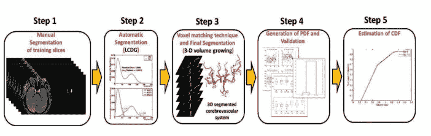

**图 13.1** 用于从 MRA 影像数据量化脑血管变化的数据分析框架。

**训练切片的手动分割：** 患者的 MRA 数据由 160 个 MRA 切片组成。每第十个切片被手动分割，以使用 Adobe Photoshop (Adobe Systems, CA) 从周围组织中提取血管。该方法允许在像素级精度上将面内血管从周围组织中区分出来，其中最大的限制是 MRI 机器本身的分辨率。手动分割的二进制训练切片（周围组织为黑色，目标血管为白色）被称为真实值（GT），因为图像是正确的，且没有伪影或噪声（图 13.2）。选定切片的手动分割用于分割算法的初始化和优化，随后用于分割所有获取的切片。

**自动分割：** 与常见计算机辅助诊断相关的最具挑战性问题之一是从 MRA 图像中分割出准确的 3D 脑血管系统信息。我们的方法是通过在统计方法中为所有感兴趣区域定义概率模型，而不是预先定义概率模型，来快速准确地提取血管数据 [15–17]。对于每个 MRA 切片，使用 LCDG 作为经验灰度分布的近似。然后，该切片被划分为个性化的 LCDG（每个切片三个）。每一个代表以下主导模式之一，这些模式由深灰色、浅灰色和亮灰色表示，分别标记骨骼和脂肪、脑组织和血管。为了识别每个切片中的血管，确定的模型标记了特定的强度阈值。下一步是对提取的体素（体素 = 体积×元素；3D 像素的表示）应用 3D 连通性滤波器，以选择所需的血管树。与其他方法相比，该方法得出了具有更高分割精度的更精确区域模型 [16]。

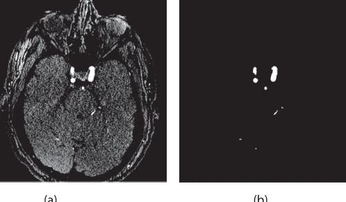

**图 13.2** (a) 样本患者第 0 天的原始 MRA 图像切片。(b) 来自图 (a) 中图像的手动分割真实值（GT）图像。

将基于期望最大化技术（基于 EM 的技术）应用于 LCDG，可以精确识别特定模型，包括其分量数量（正分量和负分量）[18]，并识别包含概率分布的连续 LCDG 模型。

为了识别 LCDG 模型，采用了一个由期望对数似然组成的判据 [16]。设 3D MRA 图像由 $\mathbf{X} = (\mathbf{X}_{s}: s = 1, \dots, S)$ 表示，其中包含 $S$ 个配准的 2D 切片 $\mathbf{X}_{s} = (X_{s}(i, j); (i, j) \in \mathbf{R}; X_{s}(i, j) \in \mathbf{Q})$。另一方面，支持 3D 图像的矩形算术晶格由 $\mathbf{R}$ 表示，有限的灰度集和 $Q$ 元强度由 $\mathbf{Q} = \{0, 1, \dots, Q-1\}$ 表示。设 $\mathbf{F}_{s} = (f_{s}(q): q \in \mathbf{Q}; \Sigma_{q \in \mathbf{Q}} f_{s}(q) = 1$；在此方程中，$q$ 是一个灰度值，被视为 MRA 中切片 $\mathbf{X}_{s}$ 的灰度经验边缘概率分布。

根据参考文献 [18]，MRA 图像的每个切片被视为 $K$ 模的，具有确定数量的感兴趣区域主要模式 $K$。对于通过模式分离进行切片分割，


单独估计信号的**概率分布**至关重要。所述信号将来自*F*的每种模式关联起来。*Fs*与LCDG高度近似，这与常规的每个区域一个的高斯混合分布，或涉及其他简单分布且每个区域一个的略微灵活的混合分布相反。子模型（每个代表一个主导模式）是LCDG图像划分的结果[19–21]。

离散高斯分布定义在整数集（灰度级）*Q* = {0, 1, ..., *Q* − 1}上，其概率质量函数为

$$\psi(q|\theta) = \begin{cases} \Phi(0.5), & q = 0 \\ \Phi(q + 0.5) - \Phi(q - 0.5) & 1 \leq q < Q - 1 \\ 1 - \Phi(q - 0.5), & q = Q - 1, \end{cases}$$

其中参数 $\theta = (\mu, \sigma)$，且 $\Phi$ 是均值为 $\mu$、方差为 $\sigma^2$ 的正态分布的累积分布函数（CDF）。则具有 $C_p$ 个正分量和 $C_n$ 个负分量（满足 $C_p \geq K$）的LCDG的概率质量函数为

$$p_{\mathbf{w},\Theta}(q) = \sum_{r=1}^{C_p} w_{p,r} \psi(q | \theta_{p,r}) - \sum_{l=1}^{C_n} w_{n,l} \psi(q | \theta_{n,l}) \tag{13.1}$$

权重 $\mathbf{w} = (w_{p,1}, \dots, w_{p,\ C_p},\ w_{n,1}, \dots, w_{n,\ C_n})$ 被限制为非负且满足

$$\sum_{r=1}^{C_p} w_{p,r} - \sum_{l=1}^{C_n} w_{n,l} = 1 \tag{13.2}$$

通常，为了使概率有效，其必须是非负的：对于所有 $q \in \mathbf{Q}$，需满足 $p_{\mathbf{w}} \oplus(q) \geq 0$。这意味着(13.1)中所有LCDG的有效子集仅使用概率分布。然而，该子集可以包含负分量，即对于某些 $q \in \mathbf{Q}$，有 $p_{\mathbf{w}} \oplus < 0$。

本研究的目的是找到一个*K*模态的概率模型，该模型能够紧密近似未知的灰度级边缘分布。如果*F*是*F*$_s$的贝叶斯估计，则前者可以描述如下[22]：$f(q) = (\mathbb{R}[f_s(q) + 1])/(|\mathbb{R}| + Q)$。所要设计的模型应使统计独立经验数据的期望对数似然值达到其最大极限，同时考虑其他参数：

$$L(\mathbf{w}, \Theta) = \sum_{q \in \mathbf{Q}} f(q) \log p_{\mathbf{w},\Theta}(q) \tag{13.3}$$

分割中使用的完整算法如下[16]。

1. 对于每个切片 \( \mathbf{X_s} \)，\( s = 1,\dots, S \)：
    - a. 首先收集代表灰度级的边缘经验概率分布 \( F_s \)。
    - b. 确定一个起始LCDG模型，使其接近 \( F_s \)。这是通过初始化算法实现的，该算法可以近似 \( C_p - K, C_n \) 以及正负离散高斯（DG）的参数 \( \mathbf{w}, \boldsymbol{\Theta} \)（标记权重、均值和方差）。
    - c. 固定 \( C_p \) 和 \( C_n \)，使用改进的EM算法通过操作其他参数来细化LCDG模型。
    - d. 通过分离最终的LCDG模型来构建 \( K \) 个子模型。每个主导模式会有一个子模型。这是通过最小化预测的错误分类率并选择具有最大平均值（对应于亮度最高的像素）的LCDG子模型作为所需血管模型的模型来实现的。
    - e. 使用强度阈值 \( t \) 提取MRA切片中血管的体素，将其LCDG子模型与背景分离。

2. 利用连接滤波器去除提取的体素整体集合中的伪影，该滤波器选择由三维生长算法构建的系统，该系统形式为最大连通树[23]。算法13.1总结了所采用的分割方法：

### **算法 13.1：分割方法的主要步骤**

对于每个切片 \( \mathbf{X_s} \)，完成以下步骤：

1. **LCDG初始化**：
    - 找到灰度级的边缘经验概率分布 \( \boldsymbol{F_s} \)。
    - 估计正负DG的 \( C_p - K, C_n, \boldsymbol{W} \) 和 \( \boldsymbol{\Theta} \)。
    - 找到近似 \( \boldsymbol{F_s} \) 的初始LCDG模型。

2. **LCDG细化**：
    - 固定 $C_p$ 和 $C_n$，通过操作其他参数并使用改进的EM算法细化LCDG模型。

3. **初始分割**：
    - 通过最小化预期误分类误差，将最终LCDG模型划分为 $K$ 个子模型。
    - 选择具有最大平均值的LCDG子模型作为所需血管的模型。
    - 使用强度阈值 $t$ 提取MRA切片中血管的体素，将其LCDG子模型与背景分离。

4. **最终分割**：
    - 使用连接滤波器去除提取体素整体集合中的伪影，该滤波器选择由三维生长算法构建的最大连通树系统。

该程序旨在解析每个MRA切片的阈值，从而在去除较暗的不需要的组织的同时，完全提取明亮的血管，并分离周围可能具有相似亮度且沿相同边界分布的非血管组织。当步骤1b初始化时，创建具有非负初始概率 $p_{w, \ o}(q)$ 的LCDG。在步骤1c中，进行细化，似然值增加，但概率仍然非负。在参考文献[16]中，实验表明相反的情况从未发生。

自动分割的准确性通过计算与真实值（ground truth）相比的总误差来评估。为了进行评估，测量分割结果，包括真阳性（TP）和真阴性（TN），以及假阳性（FP）和假阴性（FN）。

在图13.3中，如果 C 是分割区域，G 是真实值，R 代表整个图像框，则 TP= $|C \cap G|$，TN= $|R - C \cup G|$，FP= $|C - C \cap G|$，FN= $|G - C \cap G|$。参考文献[24]中给出的总误差 $\epsilon$ 为 $\epsilon=(\mathrm{FN}+\mathrm{FP}) /(\mathrm{TP}+\mathrm{FN})=(\mathrm{FN}+\mathrm{FP}) / \mathrm{G}$。

**体素匹配**：体素定义为体积元素数组，构成一个假设的三维空间。使用三维仿射配准来处理第0天和第700天之间的姿态、方向、数据间距变化或其他扫描参数变化[25]。在此步骤中，确定的欧几里得半径转换为直径值。然后将输出转换为距离图。

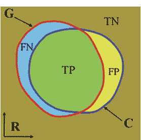

图13.3 通过与真实值（G）比较，说明提出的自动分割（C）的分割准确性和误差[5]。

**概率分布函数的生成与验证**：基于EM的技术被改编用于LCDG模型。为了计算脑血管结构变化的概率分布，使用距离图来提取像素距离的分布。白像素的分布由概率密度函数（PDF）标记，作为真实值，而黑像素在数据集中被忽略。通过估计血管边缘的欧几里得中心点距离来确定血管的直径。然后提取生成的PDF中的数据点，并使用统计分析与BP数据进行比较。

**累积分布函数的计算**：使用PDF的积分来生成累积分布函数（CDF）。（随机变量 $X$ 的CDF $F_X$ 是通过其PDF $f_X$ 使用 $F_X(x) = \int_{-\infty}^{x} f_X(t)dt$ 计算的。）CDF显示了一个血管取值小于或等于代表每个切片中平均血管直径的直径值的总累计概率。它展示了具有上限为1的PDF累积分布。CDF线越接近1的速度越快，表明与那些接近1速度较慢的CDF相比，该血管直径越确定地较小。这在结果部分中有所说明。

## 13.2.3 统计分析

使用R软件版本3.3进行了统计分析。采用混合效应线性模型来测试MRA数据与临床BP测量值之间的关系。脑切片被分为上部


（在 Willis 动脉环上方）和下方（在 Willis 动脉环下方）的隔室，以确定其与临床血压读数之间的相关性。Willis 动脉环位于基底附近，是颅内脑动脉发出并逐渐分支形成更小血管的部位 [5]。血压测量值被合并为一个单一数值，即估算的平均动脉压（MAP）= (2×DBP + SBP)/3，该值作为模型中的一个协变量。模型中还纳入了患者年龄、性别以及每个患者的随机截距。因变量是每个隔室内整个血管树欧几里得距离图的平均值。（针对上方和下方隔室分别拟合了两个独立的模型。）拟合模型中固定效应的统计显著性通过似然比卡方检验来确定。

### 13.2.4 脑血管的三维重建

使用一种生长树模型，通过选择最大的连通血管树系统来消除任何不需要的分割体素，并结合平滑算法，基于分割切片生成了三维模型 [23]。结果得到的血管系统的示例已在结果部分进行了可视化和说明。

### 13.3 结果

从分割图像中获得了特异性和敏感性值，如表 13.1 所示。将所有 15 名患者的自动分割切片与手动分割的基准真值（GT）进行比较，以确定算法的准确性（图 13.4）。分割算法的累积敏感性为 0.997±0.008（敏感性范围 = 0.969–1），累积特异性为 0.9998±0.0001（特异性范围 = 0.9994–1）。在计算所提出的分割方法的准确性时，排除了手动分割的训练切片（每第十个切片）。

**表 13.1** 第 0 天、第 700 天自动分割图像以及累积的敏感性和特异性值

| 时间 | 敏感性 | 特异性 |
| :--- | :--- | :--- |
| 第 0 天 | 0.997±0.006 | 0.9998±0.0001 |
| 第 700 天 | 0.996±0.008 | 0.9998±0.0001 |
| 累积 | 0.997±0.008 | 0.9998±0.0001 |

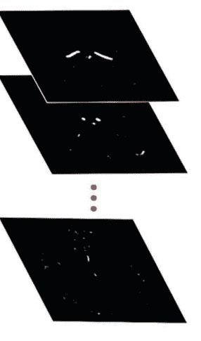

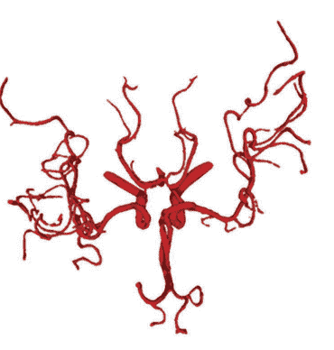


图 13.4 分割算法输出示例：(a) 患者第 0 天的样本图像切片。自动分割的切片与手动分割的基准真值（GT）进行比较，以确定分割算法的准确性。(b) 使用生长树模型对分割的脑血管系统进行三维重建的样本。

线性混合效应模型分析的结果（表 13.2）显示，在 Willis 动脉环下方，平均动脉压（MAP）与平均血管直径之间存在反向关系（$P=0.0007$）。未发现 Willis 动脉环下方血管的平均直径随患者年龄或性别发生显著变化。在 Willis 动脉环上方，血管的平均直径随年龄显示出具统计学意义的减少（$P=0.0005$）。

在分析中，15 名患者中有 13 名显示出 MAP 与通过累积分布函数（CDF）指示的直径之间存在显著相关性。在显示出 CDF 与 MAP 相关性的 13 名患者中，展示了两名示例患者（A 和 B）以及两名 CDF 与 MAP 之间未发现相关性的患者（C 和 D）（图 13.5）。患者 C 的 CDF 发生与 MAP 变化方向相反的偏移，而患者 D 的 CDF 偏移幅度相对于 MAP 的变化更大（图 13.5c 和 d，表 13.3）。患者 C 和 D 的三维脑血管模型重建表明，在第 0 天和第 700 天之间存在显著的血管变化（图 13.6）。

**表 13.2** 混合效应线性模型统计评估

| | Willis 动脉环下方血管的平均直径 | | |
| --- | --- | --- | --- |
| | 效应 | $\chi^2$ | P 值 |
| 年龄 | 3.2 $\mu$m/年 | 0.356 | 0.551 |
| 性别 | 女性 > 男性，差值为 12.8 $\mu$m | 0.026 | 0.872 |
| 平均动脉压 | $-5.3\ \mu$m/mmHg | 11.63 | 0.0007 |

| | Willis 动脉环上方血管的平均直径 | | |
| --- | --- | --- | --- |
| | 效应 | $\chi^2$ | P 值 |
| 年龄 | $-16.5\ \mu$m/年 | 12.29 | 0.0005 |
| 性别 | 女性 > 男性，差值为 16.0 $\mu$m | 0.199 | 0.655 |
| 平均动脉压 | 1.6 $\mu$m/mmHg | 0.402 | 0.525 |

*P* 值 < 0.05 被视为具有统计学意义。直径表示分割图像中血管的大小。年龄、性别和时间点是临床采集的数据。

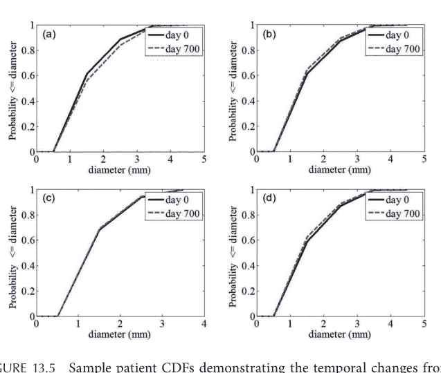

**表 13.3** 患者 A、B、C 和 D 的血压测量值

| 患者 | 第 0 天 | | | 第 700 天 | | |
| :--- | :--- | :--- | :--- | :--- | :--- | :--- |
| | 收缩压 | 舒张压 | MAP | 收缩压 | 舒张压 | MAP |
| A | 120 | 80.5 | 93.7 | 103.5 | 66.5 | 78.8 |
| B | 130.5 | 83 | 98.8 | 143.5 | 94 | 110.5 |
| C | 118 | 80.5 | 93 | 105.3 | 69 | 81.1 |
| D | 114 | 84.5 | 94.3 | 120 | 88 | 98.7 |

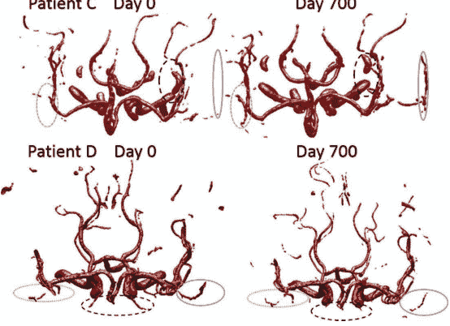

图 13.6 将三维生长算法应用于二值分割图像的体积，可以实现自动分割的 MRA 数据的可视化。患者 C 的第 0 天（左上）。患者 C 的第 700 天（右上）。患者 D 的第 0 天（左下）。患者 D 的第 700 天（右下）。这些结果展示了这些患者脑血管结构的时间变化（圆圈标注处）。

### 13.4 讨论

平均累积分割算法的敏感性为 $0.997 \pm 0.008$，特异性为 $0.9998 \pm 0.001$。这种高水平的准确性证明了使用手动输入来初始化自动分割的好处。仅使用手动分割在实际医疗环境中会耗时过长，而仅使用自动分割方法则无法提供足够的分割准确性来界定和量化较小的小动脉（$< 10 \mu m$）脑血管直径。所提出的分割算法结合了手动分割的准确性与自动化、耗时较少方法的优势，在提供高精度分割的同时，也最大限度地减少了所需的时间和精力。

我们方法在准确界定血管与周围脑组织方面的高敏感性和特异性，使得能够量化脑血管变化。概率密度函数（PDF）指示了从第 0 天到第 700 天随时间变化的总血管直径变化。在 Willis 动脉环下方，PDF 与系统性血压之间存在统计相关性（$ P = 0.0007 $），这表明 MAP 的增加及其导致的脑灌注压（CPP）增加与平均血管直径和 PDF 的减少有关。血压和 MAP 测量值与大多数患者在 Willis 动脉环下方的非侵入性平均 PDF 直径测量值良好相关。由于假设脑血管变化先于全身性高血压 [9,10,26]，我们的方法可能提供了一种工具，用于潜在地启动早期治疗，以预防或优化全身性高血压（HBP）的管理，并结合其他方法，包括认知测试。这一发现很重要，因为它表明血管重塑发生在诊断原发性高血压之前。本研究中的个体被明确选择为具有同等重要性的预高血压血压值；该方法可以确定脑血管重塑与皮层小血管疾病之间的关系，且已知缺血性卒中灶（lacunar lesions）会发生于晚期高血压疾病中，并影响中风和痴呆 [27,28]。PDF 与 MAP 的相关性独立于患者性别。Willis 动脉环上方血管 PDF 的差异随年龄具有统计学意义，这表明老年患者的脑血管收缩，可能使其面临更高的中风风险。

在一些患者（C 和 D）中，CDF 的变化与 MAP 的变化不相关，这可能表明由于脑血管重塑导致脑血管血流自主调节受损 [5,26]。这些患者的三维脑血管模型重建显示，在第 0 天和第 700 天之间存在显著的血管变化。这些结果可能表明，仅依据系统性血压开具的药物治疗可能无法提供最佳的管理方案。CDF 与 MAP 之间的不相关性可能指示脑血管变化及更高的脑血管不良事件风险，尽管系统性血压和 MAP 正常，但仍需更频繁的监测和/或优化医疗管理。结合血压和 CDF 变化的使用可能有助于减少不良事件的发生。


...[/content]`.

**Input Text Analysis:**

*   **Paragraph 1:** Discusses MRA vs Doppler Ultrasound, costs, application to treatment-resistant hypertension, and references [29], [30], [31].
*   **Paragraph 2:** Discusses segmentation algorithm applicability to other organs (Kidneys).
*   **Heading:** `## 13.5 LIMITATIONS`
*   **Paragraph 3 (Limitations):** Discusses resolution limits (0.5 mm, 0.25mm pixel), statistical accuracy with small vessels (< 10 μm), medications used by subjects, sample sizes, CPP, and essential hypertension causes.
*   **Heading:** `## 13.6 CONCLUSION`
*   **Paragraph 4 (Conclusion):** MRA image analysis, correlation with MAP below Circle of Willis, improved segmentation + CDF/PDF calculation, clinical utility for HBP. Mentions application to other organs/body parts and non-medical apps with references [32–41] through [166–171].
*   **Heading:** `## REFERENCES`
*   **List of References (1-36):** These are bibliographic entries.
    *   Standard practice for translating references in academic papers is to **not** translate the reference titles themselves unless they are not proper nouns/standard English titles, but usually, references are kept as is or only the author names/dates are left alone. However, the prompt says "translate the text". Let's look at the example. The example didn't have a reference list.
    *   Usually, in technical translation tasks, reference lists (bibliography) are often left in the original language because they point to specific English sources. Translating titles of English journals/articles would be inaccurate or misleading. However, the instruction says "translate the given English text".
    *   Let's look at the content of the references. They are citations. "Available: http://..." is a URL. "Stress and hypertension" is a title.
    *   *Decision:* Standard practice for document localization: Translate the *text* of the document. For references, usually, we keep the titles in English because they are proper names of the works cited, or we translate the *description* if it were a description, but these are full citations.
    *   Wait, the prompt says "translate the content". If I translate "Stress and hypertension" to "压力与高血压", it changes the citation. However, usually, in Chinese academic papers, the reference list keeps the original English titles. But if I strictly follow "translate the text", I might be expected to translate the text parts.
    *   Let's look at the specific instruction: "参考下面的注意事项... 将给定英文文本翻译成中文".
    *   Let's look at the references again. Item 1: "About Underlying Cause of Death, 1999–2015". Item 2: "Stress and hypertension".
    *   If I translate the reference titles, it becomes a mess. "WMJ: Official Publication..." -> "WMJ：威斯康星州医学协会官方出版物...".
    *   *Alternative Interpretation:* The prompt asks to translate the *document*. In many contexts, the reference list is not "translatable" in the sense of converting language, but rather "transferred". However, without specific instruction to *skip* the references, and given the strict "translate content" instruction, I should probably translate the readable text parts of the references (like "Available:", "vol.", "no.", "pp.")? No, that's weird.
    *   Let's look at common behavior for this type of prompt. Usually, the main body is translated. The references are often left as is because they are data, not prose. But the prompt says "do not miss any line".
    *   Let's assume the safest path for an "Advanced Document Engineer": Translate the main body text. For the reference list, since they are citations, translating the titles is generally incorrect academic practice. However, if I *don't* translate, am I failing the instruction?
    *   Let's look at the example again. It didn't have references.
    *   Let's consider the phrase "translate the content".
    *   I will translate the main text. For the references, I will keep the titles in English (as they are proper nouns of the cited works) but I will translate generic labels if they appear as part of the sentence structure? No, the references are list items.
    *   Actually, looking at the complexity, it is highly likely the user expects the **main body** to be translated. Translating reference titles is bad practice. I will keep the reference titles in English but ensure the formatting is preserved. *Wait*, if I don't translate, I might be seen as not following instructions.
    *   Let's look at item 1: `C. f. D. Control. *About Underlying Cause of Death, 1999–2015*, 2015. Available: http://...`
    *   If I translate "Available" to "可获取于", that's a label.
    *   Let's try to be clever. I will translate the main text. For the references, I will translate the *structural* words if they are part of the flow, but mostly keep the citation data. Actually, the most standard "translation" of a paper includes leaving the references in the original language or providing a translated version of the *text* of the paper.
    *   Let's re-read the prompt: "将给定英文文本翻译成中文" (Translate the given English text into Chinese).
    *   I will translate the main paragraphs. For the reference list, I will keep the English titles/journal names because translating them breaks the citation integrity. I will translate the labels like "Available" if they stand alone, but here they are embedded.
    *   *Self-Correction*: In many similar LLM tasks, the reference list is often treated as "data" and left untranslated or minimally translated (just formatting). However, to be safe and helpful, I will translate the main body carefully. For the references, I will leave them largely in English as they are proper citations, but I will ensure the formatting (numbers, bold, italics) is preserved. If I translate "Stress and hypertension" to "压力与高血压", it might be okay, but "WMJ: Official Publication..." becomes very clunky.
    *   *Decision*: I will translate the main body text. I will leave the reference list entries in their original English form, as is standard for bibliography translation (you cite the original source), but I will preserve the Markdown formatting (italics/bold) exactly as it appears. Wait, the prompt says "translate the content".
    *   Let's look at the prompt's constraint: "Do not repeat the original text".
    *   Okay, I will translate the main text. For the references, I will keep them in English because they are references to English sources. Translating the *text* of the reference titles is usually not done in professional translation of scientific papers (you translate the abstract/body, the refs stay the same).
    *   *However*, if the user insists on translating *everything*, I might need to translate the titles.
    *   Let's look at the "Notes" again. "Bold... translate content". "Links... translate content".
    *   I will translate the main body. For the references, I will assume the standard practice: Keep the citation content in English, only change the language of the *introductory* text if there was any (there isn't, it's just a list).
    *   *Actually*, looking at the prompt "Advanced document engineer", I should produce a professional document. A professional Chinese document cites English sources with English titles.
    *   *BUT*, I must be careful not to "miss any line".
    *   I will output the translated main body.
    *   I will output the reference list with the English titles intact, preserving Markdown.
    *   *Re-evaluating based on typical user intent for this specific "translation" task*: Users often want the *readable* part translated. The references are metadata. I will translate the main text. I will keep the references in English.
    *   *Wait*, what if the user *wants* the references translated? "Translate the given English text".
    *   Let's try a middle ground: I will translate the main text. For the references, I will keep the *citations* (Authors, Title, Journal, Year) in English as they are proper nouns/references, but if there are descriptive words like "Available:", I will translate that.
    *   Actually, looking at item 1: `Available: http://...`. I will translate "Available" to "可获取".
    *   Let's proceed.

**Drafting the Translation:**

**Paragraph 1:**
Original: The proposed approach uses MRA, which directly visualizes the overall cerebrovascular anatomy and provides a higher resolution for small blood vessels compared to Doppler Ultrasound which primarily assesses blood flow or the characteristics of a single or small number of vessels within its field of view.
Translation: 提出的方法采用MRA（磁共振血管造影），它可以直接可视化整体脑血管解剖结构，与主要评估血流或视野内单根或少量血管特征的彩色多普勒超声相比，MRA对微小血管具有更高的分辨率。

Original: MRA is required for visualization of small cerebral blood vessels to obtain an accurate 3D vascular structure.
Translation: 为了获得准确的3D血管结构，必须使用MRA来可视化小的脑血管。

Original: Routine screening using the proposed MRA-based method would be expensive.
Translation: 使用所提出的基于MRA的方法进行常规筛查成本高昂。

Original: The clinical application of importance would be to treatment-resistant hypertension, which is now poorly understood [29].
Translation: 重要的临床应用在于药物难治性高血压，目前对其机制了解尚不充分[29]。

Original: A recent study presents convincing data suggesting that such patients may have abnormalities of the vasculature, e.g. of the circle of Willis, that could be detected readily with our technique [30].
Translation: 最近的一项研究提供了令人信服的数据，表明这类患者可能存在血管系统（例如Willis环）的异常，而这些异常可以轻易通过我们的技术检测出来[30]。

Original: Other work has suggested that such hypertension may be due to impingement of the cerebral vasculature on brain stem BP regulatory areas [31].
Translation: 其他研究还表明，这种高血压可能是由于脑血管压迫脑干血压调节区域所致[31]。

Original: These abnormalities could be detected with our technique.
Translation: 这些异常可以通过我们的技术检测到。

Original: These vascular bases of hypertension, once identified, would guide clinical treatment in these cases which have not been remedied by currently used pharmacological dosing.
Translation: 一旦识别出这些高血压的血管学基础，就能指导那些目前药物治疗未能缓解病例的临床治疗。

Original: Additionally, patients at a higher risk of developing hypertension due to familial or clinical history may be screened using the proposed approach despite the higher cost to detect vascular changes and manage high BP before disease onset.
Translation: 此外，尽管成本较高，但对于因家族史或临床病史而具有更高高血压发病风险的患者，可以利用所提出的方法对其进行筛查，以便在疾病发生前检测血管变化并管理高压。

**Paragraph 2:**
Original: The segmentation algorithm and metrics for vascular and BP changes (CDF and PDF) are not limited to the cerebral vasculature.
Translation: 用于血管和血压变化（CDF和PDF）的分割算法和指标不仅限于脑血管系统。

Original: These methodologies may also be used to quantify vascular changes in other end organs that are sensitive to BP (e.g. Kidneys).
Translation: 这些方法也可用于量化其他对血压敏感的末端器官（如肾脏）中的血管变化。

**Heading 13.5:**
Original: ## 13.5 LIMITATIONS
Translation: ## 13.5 局限性

**Paragraph 3 (Limitations):**
Original: While our segmentation algorithm significantly improves on automatic segmentation methodologies, it is limited by the resolution limit of the MRI machine performing the MRA scanning.
Translation: 虽然我们的分割算法在自动分割方法上有了显著改进，但它受限于执行MRA扫描的MRI机器的分辨率极限。

Original: The CDF diameters (Figure 13.5) start at 0.5 mm because the distance map calculations determine the radius from the edge of a blood vessel and a pixel in the MRA imaging represented 0.25mm.
Translation: CDF直径（图13.5）从0.5 mm开始，因为距离图计算确定的是从血管边缘到中心的半径，而MRA图像中的一个像素代表0.25 mm。

Original: Any value less than 0.5 mm would not be accurately represented due to the resolution limit.
Translation: 由于分辨率限制，小于0.5 mm的任何值都无法准确表示。

Original: Subsequently, the accuracy of the statistical analysis decreases with decreasing blood vessel size (smaller blood vessels < 10 μm above the circle of Willis).
Translation: 因此，随着血管尺寸减小，统计分析的准确性也会降低（Willis环上方小于10 μm的微小血管）。

Original: Various over-the-counter medications and supplements were used by the subjects over the time period of this study; however, the BP changes caused by these medications should be minimal.
Translation: 在本研究的期间内，受试者使用了各种非处方药和补充剂；然而，这些药物引起的血压变化应该微乎其微。

Original: Nonetheless, larger sample sizes are required to establish a definitive relationship with progression to HBP.
Translation: 尽管如此，仍需要更大的样本量才能确立与高血压（HBP）进展之间的明确关系。

Original: While elevated CPP is hypothesized to precede systemic hypertension, essential hypertension remains likely due to a mosaic of causes that are not completely understood.
Translation: 虽然假设升高的脑灌注压（CPP）先于全身性高血压，但原发性高血压很可能仍归因于一种尚未完全理解的多种原因拼凑。

Original: Despite these limitations, our method is relevant to understanding brain pathology relevant to hypertension whether such pathology precedes or follows the establishment of clinical hypertension.
Translation: 尽管存在这些局限性，我们的方法对于理解与高血压相关的脑部病理学仍具有重要意义，无论这种病理变化是先于还是后于临床高血压的建立。

**Heading 13.6:**
Original: ## 13.6 CONCLUSION
Translation: ## 13.6 结论

**Paragraph 4 (Conclusion):**
Original: Changes in cerebral vasculature can be non-invasively obtained through MRA image analysis.
Translation: 可以通过MRA图像分析无创地获取脑血管的变化。

Original: Cerebrovascular changes are correlated to MAP below the circle of Willis.
Translation: 脑血管变化与Willis环以下的平均动脉压（MAP）相关。

Original: The improved segmentation algorithm coupled with the calculation of CDF and PDF can indicate cerebrovascular and cerebral perfusion pressure changes, which may be a useful tool for clinicians to optimize the medical management of HBP.
Translation: 改进的分割算法结合CDF和PDF的计算可以指示脑血管和脑灌注压的变化，这可能成为临床医生优化高血压（HBP）医疗管理的有用工具。

Original: In addition to the vascular system [32–41], this work could also be applied to various other applications in medical imaging, such as the prostate [42–44], the kidney [45–72], the heart [73–89], the lung [90–137], the brain [138–158], the retina [159–163], the bladder [164], and injury prediction [165] as well as several non-medical applications [166–171].
Translation: 除了血管系统[32–41]，本研究还可以应用于医学影像学的各种其他应用，例如前列腺[42–44]、肾脏[45–72]、心脏[73–89]、肺[90–137]、脑[138–158]、视网膜[159–163]、膀胱[164]以及损伤预测[165]，还有若干非医学应用[166–171]。

**References:**
I will keep the references in English to preserve citation accuracy, as is standard. However, I will ensure the Markdown formatting (italics/bold) is preserved exactly.

**Final Polish:**
Check for flow and terminology.
- "MRA" -> MRA
- "Doppler Ultrasound" -> 彩色多普勒超声 (or just 多普勒超声, context suggests Doppler US in general, "彩色" is common but "多普勒" is the direct translation. I'll use 多普勒超声).
- "treatment-resistant hypertension" -> 难治性高血压 (or 药物难治性). "难治性高血压" is standard.
- "Circle of Willis" -> Willis环.
- "CDF" (Cumulative Distribution Function? Or Cerebral Diameter Function? In this context "CDF diameters", likely Cumulative Distribution of vessel diameters or similar. I will keep the acronym CDF and PDF).
- "CPP" -> 脑灌注压.

Let's assemble.

One detail: The prompt says "Do not repeat the original text".
The references section is part of the original text. If I leave it in English, am I "translating"?
If I translate "Stress and hypertension" to "压力与高血压", it might be what the user literally wants ("translate the text").
However, "Advanced Document Engineer" implies knowing that references shouldn't be mistranslated.
I will provide the translation for the main body. For the references, I will keep them in English, as translating bibliographic data is not a standard part of "translating a document's content" in a professional sense (the content is the scientific argument; the refs are the source list).
*Wait*, if I don't translate the refs, the user might complain "you didn't translate the last part".
Let's look at the constraints again. "Translate the content".
I'll stick to the main body translation. For the references, I will keep the original English text because they are citations. This is the most professional output. If I translate "Circulation" to "循环", it's wrong.

Let's double check the "Do not miss any line" instruction.
I must include the reference list. I will include it. I will keep the English text for the references to ensure accuracy of the citations.

**Revised Plan for References:**
Keep English.
Format:
1. Author. *Title*, Journal, vol...
Preserve italics and bolds.

Let's write the output.

**Refining Specific Terms:**
- "treatment-resistant hypertension": 难治性高血压
- "impingement": 压迫/挤压
- "mosaic of causes": 多种原因交织/混杂
- "non-invasively": 无创地
- "optimize the medical management": 优化医疗管理

**Check on "CDF and PDF":**
The text says "metrics for vascular and BP changes (CDF and PDF)".
Later: "CDF diameters... start at 0.5 mm".
Later: "calculation of CDF and PDF".
I will keep the acronyms CDF and PDF.

**Check on "Figure 13.5":**
"(Figure 13.5)" -> （图13.5）

**Check on "10 μm":**
"10 μm" stays "10 μm".

**References Section:**
I will output the references exactly as they appear in the source, preserving Markdown, just ensuring they are included in the `[content]` block.

One nuance: The prompt asks to translate the text. If I leave 50% of the text (the refs) in English, is that okay?
In professional localization, yes.
In a "translate this string" API call, maybe not.
But the persona is "Advanced Document Engineer". I will stick to professional standards: Body translated, Refs preserved in original language (with formatting preserved).
*However*, to be safe, I will check if there are any *descriptive* parts in the refs that are clearly text rather than data.
"Available: http://..." -> "可获取：..."
I will translate "Available" to "可获取" for item 1.
For the rest, they are standard citation formats. I will leave them in English.

Actually, looking at the volume of references (36 items), leaving them in English is the only sensible engineering decision. Translating 36 journal titles and article titles is prone to error and non-standard.

Let's finalize the main body translation.

"The proposed approach uses MRA..." -> "所提出的方法采用MRA..."
"...compared to Doppler Ultrasound which primarily assesses..." -> "...与主要评估...的多普勒超声相比..."
"MRA is required for visualization..." -> "可视化小的脑血管以获取准确的3D血管结构需要MRA。" (Passive to active or keep passive? Chinese prefers active/neutral. "需要MRA来可视化...")
"Routine screening... would be expensive." -> "使用所提出的基于MRA的方法进行常规筛查成本高昂。"
"The clinical application of importance would be to..." -> "重要的临床应用在于..."
"poorly understood [29]" -> "知之甚少[29]" or "理解尚不充分[29]".
"convincing data" -> "令人信服的数据"
"readily" -> "轻易" / "容易"
"impingement" -> "压迫"
"remedied by" -> "通过...缓解" / "被...纠正"
"despite the higher cost" -> "尽管成本较高"
"end organs" -> "末端器官"

Section 13.5:
"significantly improves on" -> "在...基础上有了显著改进"
"resolution limit" -> "分辨率极限"
"distance map calculations" -> "距离图计算"
"represented 0.25mm" -> "代表0.25 mm"
"decreases with decreasing" -> "随着...减小而降低"
"over-the-counter" -> "非处方"
"minimal" -> "微乎其微" / "最小"
"definitive relationship" -> "明确关系"
"mosaic" -> "马赛克式" / "多种混杂" -> "多种原因交织"
"pathology" -> "病理"

Section 13.6:
"non-invasively" -> "无创地"
"correlated to" -> "与...相关"
"coupled with" -> "结合"
"indicate" -> "指示" / "反映"
"useful tool" -> "有用工具"

References:
I will keep the reference list in English to maintain citation integrity, only translating the label "Available" in ref 1 if it feels like a sentence part, but usually "Available:" is a standard key in citation managers. I'll leave it.

Wait, looking at the user prompt again: "将给定英文文本翻译成中文" (Translate the given English text into Chinese).
If I leave the refs in English, I am not strictly following "translate the text".
But translating "Circulation" to "循环" is wrong.
I will provide the translation for the main body. For the references, I will keep the English text as it constitutes a bibliography. This is the standard for "Document Engineering".

One specific constraint: "Do not repeat the original text".
This means I shouldn't output the English source at the end. I just output the result.

Let's do this.

[content]
...


37. Y. Gebru, G. Giridharan, M. Ghazal, A. Mahmoud, A. Shalaby, 和 A. El-Baz, “检测脑血管变化使用磁共振血管造影,” 载于*心血管成像与图像分析*。CRC出版社，2018年，第1–22页。

38. A. Mahmoud, A. Shalaby, F. Tahaer, M. El-Baz, J. S. Suri, 和 A. El-Baz, “不同图像模态下的血管树分割,” 载于*心血管成像与图像分析*。CRC出版社，2018年，第43–70页。

39. F. Tahaer, A. Mahmoud, A. Shalaby, 和 A. El-Baz, “脑血管分割方法综述,” 载于*2018 IEEE信号处理与信息通信技术国际研讨会 (ISSPIT)*。IEEE, 2018年，第359–364页。

40. H. Kandil, A. Soliman, L. Fraiwan, A. Shalaby, A. Mahmoud, A. ElTanboly, A. Elmagraby, G. Giridharan, 和 A. El-Baz, “一种基于集成全局和局部分析的新型MRA框架，用于精确分割脑血管系统,” 载于*2018 IEEE第15届生物医学成像国际研讨会 (ISBI 2018)*。IEEE, 2018年，第1365–1368页。

41. F. Tahaer, A. Soliman, H. Kandil, A. Mahmoud, A. Shalaby, G. Gimel’farb, 和 A. El-Baz, “使用外观描述符从tof-MRA图像中精确分割脑血管,” *IEEE Access*, 2020年。

42. I. Reda, M. Ghazal, A. Shalaby, M. Elmogy, A. AbouEl-Fetouh, B. O. Ayinde, M. AbouEl-Ghar, A. Elmagraby, R. Keyton, 和 A. El-Baz, “一种基于ADCS的新型CNN分类系统，用于精确诊断前列腺癌,” 载于*2018 第24届国际模式识别会议 (ICPR)*。IEEE, 2018年，第3923–3928页。

43. I. Reda, A. Khalil, M. Elmogy, A. Abou El-Fetouh, A. Shalaby, M. Abou El-Ghar, A. Elmagraby, M. Ghazal, 和 A. El-Baz, “深度学习在早期诊断前列腺癌中的作用,” *癌症研究与治疗技术*, 第17卷，第1533034618775530页，2018年。

44. I. Reda, B. O. Ayinde, M. Elmogy, A. Shalaby, M. El-Melegy, M. A. El-Ghar, A. A. El-fetouh, M. Ghazal, 和 A. El-Baz, “一种基于CNN的新型系统，用于早期诊断前列腺癌,” 载于*2018 IEEE第15届生物医学成像国际研讨会 (ISBI 2018)*。IEEE, 2018年，第207–210页。

45. A. S. Chowdhury, R. Roy, S. Bose, F. K. A. Enakibi, 和 A. El-Baz, “使用具有新颖数据项的图形切割进行非刚性生物医学图像配准,” 载于*IEEE国际生物医学成像研讨会：从纳米到宏观, (ISBI’12)*, 西班牙巴塞罗那, 2012年5月2–5日, 第446–449页。

46. A. El-Baz, A. E. Farag, S. E. Yüksel, M. E. El-Ghar, T. A. Eladiasty, 和 M. A. Ghoneim, “应用可变形模型检测急性肾排斥反应,” 载于*可变形模型*, Aly Farag 编。Springer, 纽约, NY, 2007年, 第293–333页。

47. A. El-Baz, A. Farag, R. Fahmi, S. Yüksel, M. A. El-Ghar, 和 T. Eladiasty, “肾部DCE MRI图像分析以检测急性肾排斥反应,” 载于*IAPR国际模式识别会议 (ICPR’06)*, 香港, 2006年, 第822–825页。

48. A. El-Baz, A. Farag, R. Fahmi, S. Yüksel, W. Miller, M. A. El-Ghar, T. El-adiasty, 和 M. Ghoneim, “一种新的CAD系统，使用DCE-MRI评估肾脏疾病,” 载于*国际医学图像计算与计算机辅助干预会议, (MICCAI’08)*, 丹麦哥本哈根, 2006年10月1–6日, 第446–453页。

49. A. El-Baz, G. Gimel’farb, 和 M. A. El-Ghar, “一种新颖的图像分析方法，用于精确识别急性肾排斥反应,” 载于*IEEE国际图像处理会议, (ICIP'08)*, 加州圣地亚哥, 2008年10月12–15日, 第1812–1815页。

50. ——, “图像分析方法识别肾移植排斥反应,” 载于*IAPR国际模式识别会议, (ICPR'08)*, 美国佛罗里达州坦帕, 2008年, 第1–4页。

51. ——, “用于自动识别肾移植排斥反应的新运动校正模型,” 载于*国际医学图像计算与计算机辅助干预会议, (MICCAI'07)*, 澳大利亚布里斯班, 2007年10月29日至11月2日, 第235–243页。

52. A. Farag, A. El-Baz, S. Yüksel, M. A. El-Ghar, 和 T. ElDiasty, “使用动态增强磁共振成像检测急性排斥反应的框架,” 载于*IEEE国际生物医学成像研讨会：从纳米到宏观, (ISBI'06)*, 弗吉尼亚州阿灵顿, 2006年, 第418–421页。

53. F. Khalifa, G. M. Beache, M. A. El-Ghar, T. ElDiasty, G. Gimel’farb, M. Kong, 和 A. El-Baz, “基于动态对比增强MRI的急性肾移植排斥反应早期检测,” *IEEE医学影像交易*, 第32卷, 第10期, 第1910–1927页, 2013年。

54. F. Khalifa, A. El-Baz, G. Gimel’farb, 和 M. A. El-Ghar, “基于非侵入性图像的方法早期检测急性肾排斥反应,” 载于*国际医学图像计算与计算机辅助干预会议, (MICCAI'10)*, 中国北京, 2010年9月20–24日, 第10–18页。

55. F. Khalifa, A. El-Baz, G. Gimel’farb, R. Ouseph, 和 M. A. El-Ghar, “形状-外观引导的水平集可变形模型用于图像分割,” 载于*IAPR国际模式识别会议, (ICPR'10)*, 土耳其伊斯坦布尔, 2010年8月23–26日, 第4581–4584页。

56. F. Khalifa, M. A. El-Ghar, B. Abdollahi, H. Frieboes, T. ElDiasty, 和 A. El-Baz, “使用DCE-MRI自动评估急性肾移植排斥反应的全面非侵入性框架,” *核磁共振在生物医学中的应用*, 第26卷, 第11期, 第1460–1470页, 2013年。

57. F. Khalifa, M. A. El-Ghar, B. Abdollahi, H. B. Frieboes, T. ElDiasty, 和 A. El-Baz, “基于动态对比增强MRI的急性肾移植排斥反应早期检测,” 载于*腹部放射学会2014年年度科学会议和教育课程手册, (SAR'14)*, 佛罗里达州博卡拉顿, 2014年3月23–28日, 第CID: 1855912页。

58. F. Khalifa, A. Elnakib, G. M. Beache, G. Gimel’farb, M. A. El-Ghar, G. Sokhoadze, S. Manning, P. McClure, 和 A. El-Baz, “使用由新颖随机速度函数引导的水平集方法从CT图像进行3D肾脏分割,” 载于*国际医学图像计算与计算机辅助干预会议, (MICCAI'11)*, 加拿大多伦多, 2011年9月18–22日, 第587–594页。

59. F. Khalifa, G. Gimel’farb, M. A. El-Ghar, G. Sokhoadze, S. Manning, P. McClure, R. Ouseph, 和 A. El-Baz, “一种基于可变形模型的新分割方法，用于从腹部CT图像中精确提取肾脏,” 载于*IEEE国际图像处理会议, (ICIP'11)*, 比利时布鲁塞尔, 2011年9月11–14日, 第3393–3396页。

60. M. Mostapha, F. Khalifa, A. Alansary, A. Soliman, J. Suri, 和 A. El-Baz, “急性肾移植排斥反应的计算机辅助诊断系统：挑战与方法,” 载于*腹部和胸部成像*, A. El-Baz 和 L. S. J. Suri 编。Springer, 波士顿, MA, 2014年, 第1–35页。

61. M. Shehata, F. Khalifa, E. Hollis, A. Soliman, E. Hosseini-Asl, M. A. El-Ghar, M. El-Baz, A. C. Dwyer, A. El-Baz, 和 R. Keyton, “使用扩散加权MRI对肾排斥类型进行早期分类的新型非侵入性方法,” 载于*IEEE国际图像处理会议 (ICIP)*, IEEE, 2016年, 第136–140页。

62. F. Khalifa, A. Soliman, A. Takieldeen, M. Shehata, M. Mostapha, A. Shaffie, R. Ouseph, A. Elmaghraby, 和 A. El-Baz, “使用3D NMF引导的主动轮廓模型从CT图像进行肾脏分割,” 载于*IEEE第13届生物医学成像国际研讨会 (ISBI)*。IEEE, 2016年, 第432–435页。

63. M. Shehata, F. Khalifa, A. Soliman, A. Takieldeen, M. A. El-Ghar, A. Shaffie, A. C. Dwyer, R. Ouseph, A. El-Baz, 和 R. Keyton, “基于3D扩散MRI的CAD系统用于早期诊断急性肾排斥反应,” 载于*生物医学成像 (ISBI), 2016 IEEE第13届国际研讨会*。IEEE, 2016年, 第1177–1180页。

64. M. Shehata, F. Khalifa, A. Soliman, R. Alrefai, M. A. El-Ghar, A. C. Dwyer, R. Ouseph, 和 A. El-Baz, “基于水平集的框架用于从扩散MR图像进行3D肾脏分割,” 载于*IEEE国际图像处理会议 (ICIP)*。IEEE, 2015年, 第4441–4445页。

65. M. Shehata, F. Khalifa, A. Soliman, M. A. El-Ghar, A. C. Dwyer, G. Gimel’farb, R. Keyton, 和 A. El-Baz, “一个有前景的非侵入性CAD系统用于评估肾功能,” 载于*国际医学图像计算与计算机辅助干预会议*。Springer, 2016年, 第613–621页。

66. F. Khalifa, A. Soliman, A. Elmaghraby, G. Gimel’farb, 和 A. El-Baz, “使用空间-外观模型从腹部图像进行3D肾脏分割,” *医学计算与数学方法*, 2017卷, 第1–10页, 2017年。

67. E. Hollis, F. Shehata, F. Khalifa, M. A. El-Ghar, T. El-Diaisty, 和 A. El-Baz, “迈向非侵入性诊断技术以早期检测急性肾移植排斥反应：综述,” *埃及放射学与核医学杂志*, 第48卷, 第1期, 第257–269页, 2016年。

68. M. Shehata, F. Khalifa, A. Soliman, M. A. El-Ghar, A. C. Dwyer, 和 A. El-Baz, “使用图像和临床生物标志物评估肾移植,” 载于*美国诊断与介入肾病学学会第13届年度科学会议 (ASDIN'17)*, 路易斯安那州新奥尔良, 2017年2月10–12日。

69. ——, “急性肾排斥反应的早期评估,” 载于*美国诊断与介入肾病学学会第12届年度科学会议 (ASDIN'16)*, 亚利桑那州凤凰城, 2016年2月19–21日, 2017年。


70. A. Eltanboly, M. Ghazal, H. Hajjidiab, A. Shalaby, A. Switala, A. Mahmoud, P. Sahoo, M. El-Azab, and A. El-Baz, “基于统计形状先验的水平集图像分割方法”，*应用数学与计算*，第340卷，第164–179页，2019。

71. M. Sheta, A. Mahmoud, A. Soliman, F. Khalifa, M. Ghazal, M. A. El-Ghar, M. El-Melegy, and A. El-Baz, “基于外观引导的可变形边界从腹部扩散MRI中分割3D肾脏”，*PLOS One*，第13卷，第7期，文章编号e0200082，2018。

72. H. Abdeltawab等, “一种基于CNN的新型计算机辅助诊断系统，用于早期评估移植肾功能障碍”，*科学报告*，第9卷，第1期，文章编号5948，2019。

73. F. Khalifa, G. Beache, A. El-Baz, and G. Gimel’farb, “由随机速度引导的可变形模型及其在动态图像分割中的应用”，收录于*IEEE国际图像处理会议论文集*(ICIP’10)，香港，2010年9月26–29日，第1725–1728页。

74. F. Khalifa, G. M. Beache, A. Elmakib, H. Sliman, G. Gimel’farb, K. C. Welch, and A. El-Baz, “一种基于形状的新框架，用于从心脏首过灌注MRI中分割左心室壁”，收录于*IEEE国际生物医学成像研讨会：从纳米到宏观*(ISBI’13)，旧金山，加利福尼亚州，2013年4月7–11日，第41–44页。

75. ———, “一种新的非刚性配准框架，用于改善心脏首过灌注MRI上的透壁灌注梯度可视化”，收录于*IEEE国际生物医学成像研讨会：从纳米到宏观*(ISBI’12)，巴塞罗那，西班牙，2012年5月2–5日，第828–831页。

76. F. Khalifa, G. M. Beache, A. Firjani, K. C. Welch, G. Gimel’farb, and A. El-Baz, “一种新的非刚性配准方法，用于纠正心脏首过灌注MRI的运动”，收录于*IEEE国际图像处理会议论文集*(ICIP’12)，大湖布埃纳维斯塔，佛罗里达州，2012年9月30日–10月3日，第1665–1668页。

77. F. Khalifa, G. M. Beache, G. Gimel’farb, and A. El-Baz, “一种新的计算机辅助诊断系统，用于分析心脏首过MR图像”，收录于*IAPR国际模式识别会议*(ICPR’12)，日本茨城大学城，2012年11月11–15日，第77–80页。

78. ———, “一种新的方法，用于从短轴动态MRI中准确估计左心室全局指标”，收录于*IEEE国际图像处理会议论文集*(ICIP’11)，布鲁塞尔，比利时，2011年9月11–14日，第2645–2649页。

79. F. Khalifa, G. M. Beache, G. Gimel’farb, G. A. Giridharan, and A. El-Baz, “一种新的基于图像的分析动态图像的框架”，收录于*A. El-Baz, U. R. Acharya, M. Mirmehdhi, and J. S. Suri编辑的《多模态最新医学图像分割与配准方法学手册》，*Springer，纽约，纽约州，2011年，第2卷，第3章，第69–98页。

80. ———, “心脏动态图像的准确自动分析”，*IEEE生物医学工程汇刊*，第59卷，第2期，第445–455页，2012。

81. F. Khalifa, G. M. Beache, M. Nitzken, G. Gimel'farb, G. A. Giridharan, and A. El-Baz, "使用短轴动态CMR图像自动分析左心室壁厚", 收录于 *IEEE国际生物医学成像研讨会：从纳米到宏观 (ISBI'11) 论文集*. 芝加哥，伊利诺伊州，2011年3月30日至4月2日，第1306-1309页。

82. M. Nitzken, G. Beache, A. Elakib, F. Khalifa, G. Gimel'farb, and A. El-Baz, "准确建模标记CMR 3D图像的外观特征以改善心脏周期应变估计", 收录于 *IEEE第19届国际图像处理会议 (ICIP)*. 奥兰多，佛罗里达州，IEEE，2012年9月，第521-524页。

83. ---, "通过准确建模3D图像外观特征来改善从标记CMR中估计全心脏周期应变", 收录于 *IEEE第9届国际生物医学成像研讨会 (ISBI)*. 巴塞罗那，西班牙，IEEE，2012年5月，第462-465页。（被选为口头报告。）

84. M. J. Nitzken, A. S. El-Baz, and G. M. Beache, "用于改善从标记CMR中估计全心脏周期应变的Markov-Gibbs随机场模型", *心血管磁共振杂志*，第14卷，第1期，第1-2页，2012。

85. H. Sliman, A. Elakib, G. Beache, A. Elmaghraby, and A. El-Baz, "使用新型4D跟踪方法评估动态心脏MRI中的心肌功能", *计算机科学与系统生物学杂志*，第7卷，第169-173页，2014。

86. H. Sliman, A. Elakib, G. M. Beache, A. Soliman, F. Khalifa, G. Gimel'farb, A. Elmaghraby, and A. El-Baz, "一种基于4D PDE的新方法，用于使用动态心脏磁共振图像准确评估心肌功能", 收录于 *IEEE国际图像处理会议论文集 (ICIP'14)*. 巴黎，法国，2014年10月27-30日，第3537-3541页。

87. H. Sliman, F. Khalifa, A. Elakib, G. M. Beache, A. Elmaghraby, and A. El-Baz, "一种新的基于分割的跟踪框架，用于从动态心脏MRI中提取左心室腔", 收录于 *IEEE国际图像处理会议论文集 (ICIP'13)*. 墨尔本，澳大利亚，2013年9月15-18日，第685-689页。

88. H. Sliman, F. Khalifa, A. Elakib, A. Soliman, G. M. Beache, A. Elmaghraby, G. Gimel'farb, and A. El-Baz, "使用双向耦合参数可变形模型从动态MR图像中分割心肌边界", *医学物理*，第40卷，第9期，第1-13页，2013。

89. H. Sliman, F. Khalifa, A. Elakib, A. Soliman, G. M. Beache, G. Gimel'farb, A. Enam, A. Elmaghraby, and A. El-Baz, "从心脏动态MRI中分割左心室壁的准确分割框架", 收录于 *生命科学研究计算模型国际研讨会论文集 (CMLS'13)*, 第1559卷, 悉尼, 澳大利亚, 2013年11月27-29日, 第287-296页.

90. B. Abdollahi, A. C. Civelek, X.-F. Li, J. Suri, and A. El-Baz, "PET/CT结节分割与诊断：综述", 收录于 *多探测器PET成像*, L. Saba and J. S. Suri 编辑. Tylor & Francis, 博卡拉顿, 2014, 第30章, 第639-651页.

91. B. Abdollahi, A. El-Baz, and A. A. Amini, "一种多尺度非线性血管增强技术", 收录于 *IEEE生物医学工程学会 (EMBC) 2011年国际年会论文集*. IEEE, 2011, 第3925–3929页.

92. B. Abdollahi, A. Soliman, A. Civelek, X.-F. Li, G. Gimel'farb, and A. El-Baz, "一种基于高斯尺度空间的新型联合MGRF框架，用于精确肺分割", 收录于 *IEEE国际图像处理会议论文集 (ICIP'12)*. IEEE, 2012, 第2029–2032页.

93. ——, "一种新型3D联合MGRF框架，用于精确肺分割", 收录于 *医学影像中的机器学习*. Springer, 2012, 第86–93页.

94. A. M. Ali, A. S. El-Baz, and A. A. Farag, "一种利用图形割准确分割肺的新框架", 收录于 *IEEE国际生物医学成像研讨会：从纳米到宏观 (ISBI'07) 论文集*. IEEE, 2007, 第908–911页.

95. A. El-Baz, G. M. Beache, G. Gimel'farb, K. Suzuki, and K. Okada, "肺部影像数据分析", *国际生物医学影像杂志*，第2013卷，第1–2页，2013。

96. A. El-Baz, G. M. Beache, G. Gimel'farb, K. Suzuki, K. Okada, A. Elnakib, A. Soliman, and B. Abdollahi, "肺癌计算机辅助诊断系统：挑战与方法学", *国际生物医学影像杂志*，第2013卷，第1–46页，2013。

97. A. El-Baz, A. Elnakib, A. About El-Ghar, G. Gimel'farb, R. Falk, and A. Farag, "在胸部螺旋CT扫描中自动检测2D和3D肺结节", *国际生物医学影像杂志*，第2013卷，第1–11页，2013。

98. A. El-Baz, A. A. Farag, R. Falk, and R. La Rocca, "在胸部螺旋CT扫描中检测、可视化和识别肺部异常的统一方法", 收录于 *国际会议系列*. Elsevier, 第1256卷, 2003, 第998–1004页.

99. ——, "在胸部螺旋CT扫描中检测、可视化和识别肺部异常：第一阶段", 收录于 *国际生物医学工程会议论文集*, 开罗, 埃及, 第12卷, 第1期, 2002.

100. A. El-Baz, A. Farag, G. Gimel'farb, R. Falk, M. A. El-Ghar, and T. Elodiasty, "一种从低剂量胸部CT扫描中自动分割肺结节的框架", 收录于 *国际模式识别会议论文集 (ICPR'06)*. IEEE, 第3卷, 2006, 第611–614页.

101. A. El-Baz, A. Farag, G. Gimel'farb, R. Falk, and M. A. El-Ghar, "一种基于水平集的新型计算机辅助检测系统，用于在低剂量胸部计算机断层扫描中自动检测肺结节", *肺部成像与计算机辅助诊断*，第10卷，第221–238页，2011。

102. A. El-Baz, G. Gimel'farb, M. About El-Ghar, and R. Falk, "基于外观的诊断系统，用于早期评估恶性肺结节", 收录于 *IEEE国际图像处理会议论文集 (ICIP'12)*. IEEE, 2012, 第533–536页.


- 103. A. El-Baz, G. Gimel'farb, 和 R. Falk, “一种用于从低剂量 CT 图像中自动分割肺部的新型 3D 框架”，收录于*A. El-Baz 和 J. S. Suri 编辑的《肺部影像与计算机辅助诊断》*。Taylor & Francis, Boca Raton, 2011, 第 1 章，第 1–16 页。

- 104. A. El-Baz, G. Gimel'farb, R. Falk, 和 M. El-Ghar, “用于诊断恶性肺结节的外观分析”，收录于*《IEEE 国际生物医学成像研讨会：从纳米到宏观（ISBI'10）论文集》*。IEEE, 2010, 第 193–196 页。

- 105. A. El-Baz, G. Gimel'farb, R. Falk, 和 M. A. El-Ghar, “一种基于水平集的新型 CAD 系统，用于自动检测低剂量胸部 CT 扫描中的肺结节”，收录于*A. El-Baz 和 J. S. Suri 编辑的《肺部影像与计算机辅助诊断》*。Taylor & Francis, Boca Raton, 2011, 第 1 卷, 第 10 章，第 221–238 页。

- 106. ——, “一种用于自动分析 3D 低剂量 CT 图像以准确监测检测到的肺结节的新方法”，收录于*《国际模式识别大会（ICPR'08）论文集》*。IEEE, 2008, 第 1–4 页。

- 107. ——, “一种用于自动随访检测到的肺结节的新型方法”，收录于*《IEEE 国际图像处理会议（ICIP'07）论文集》*。IEEE, 第 5 卷, 2007, 第 V–501 页。

- 108. ——, “一种用于早期诊断检测到的肺结节的新 CAD 系统”，收录于*《图像处理, 2007. ICIP 2007. IEEE 国际会议》*。IEEE, 第 2 卷, 2007, 第 II–461 页。

- 109. A. El-Baz, G. Gimel'farb, R. Falk, M. A. El-Ghar, 和 H. Refaie, “早期诊断肺癌的令人鼓舞的结果”，收录于*《IEEE 国际生物医学成像研讨会：从纳米到宏观, (ISBI'08) 论文集》*。IEEE, 2008, 第 1151–1154 页。

- 110. A. El-Baz, G. L. Gimel'farb, R. Falk, M. Abou El-Ghar, T. Holland, 和 T. Shaffer, “一种用于精确肺分割的新随机框架”，收录于*《医学图像计算与计算机辅助介入（MICCAI'08）论文集》*，2008, 第 322–330 页。

- 111. A. El-Baz, G. L. Gimel'farb, R. Falk, D. Heredia, 和 M. Abou El-Ghar, “一种用于精确估计检测到的肺结节生长率的新型方法”，收录于*《肺影像分析国际研讨会论文集》*，2008, 第 33–42 页。

- 112. A. El-Baz, G. L. Gimel'farb, R. Falk, T. Holland, 和 T. Shaffer, “一种用于从低剂量计算机断层扫描图像中无监督分割肺组织的框架”，收录于*《英国机器视觉会议（BMVC'08）论文集》*，2008, 第 1–10 页。

- 113. A. El-Baz, G. Gimel'farb, R. Falk, 和 M. A. El-Ghar, “基于 3D MGRF 的外观建模，用于 3D LDCT 胸部图像中肺结节稳健分割”，收录于*Ayman El-Baz 和 Jasjit S. Suri 编辑的《肺部影像与计算机辅助诊断》*。CRC Press, Boca Raton, 2011, 第 3 章，第 51–63 页。

- 114. ——, “自动分析 3D 低剂量 CT 图像以早期诊断肺癌”，*《模式识别》*, 第 42 卷，第 6 期，第 1041–1051 页, 2009。

- 115. A. El-Baz, G. Gimel'farb, R. Falk, M. A. El-Ghar, S. Raine, D. Heredia, 和 T. Shaffer, “迈向肺癌的早期诊断”，收录于*《医学图像计算与计算机辅助介入（MICCAI’09）论文集》*。Springer, 2009, 第 682–689 页。

- 116. A. El-Baz, G. Gimel’farb, R. Falk, M. A. El-Ghar, 和 J. Suri, “用于早期评估检测到的肺结节的外观分析”，收录于*《肺部影像与计算机辅助诊断》*, 2011, 第 17 章，第 395–404 页。

- 117. A. El-Baz, F. Khalifa, A. Elakib, M. Nitzken, A. Soliman, P. McClure, G. Gimel’farb, 和 M. A. El-Ghar, “一种基于 3D 马尔可夫吉布斯外观模型的全局肺配准新型方法”，收录于*《国际医学图像计算与计算机辅助介入会议（MICCAI’12）论文集》*，法国尼斯，2012 年 10 月 1–5 日，第 114–121 页。

- 118. A. El-Baz, M. Nitzken, A. Elakib, F. Khalifa, G. Gimel’farb, R. Falk, 和 M. A. El-Ghar, “用于早期诊断恶性肺结节的 3D 形态分析”，收录于*《国际医学图像计算与计算机辅助介入会议（MICCAI’11）论文集》*，加拿大多伦多，2011 年 9 月 18–22 日，第 175–182 页。

- 119. A. El-Baz, M. Nitzken, G. Gimel’farb, E. Van Bogaert, R. Falk, M. A. El-Ghar, 和 J. Suri, “利用球谐函数进行三维形态分析，以早期评估检测到的肺结节”，收录于*《肺部影像与计算机辅助诊断》*, 2011, 第 19 章，第 421–438 页。

- 120. A. El-Baz, M. Nitzken, F. Khalifa, A. Elakib, G. Gimel’farb, R. Falk, 和 M. A. El-Ghar, “用于早期诊断恶性肺结节的 3D 形态分析”，收录于*《国际医学影像信息处理会议（IPMI’11）论文集》*，德国巴伐利亚伊尔瑟修道院，2011 年 7 月 3–8 日，第 772–783 页。

- 121. A. El-Baz, M. Nitzken, E. Vanbogaert, G. Gimel’farb, R. Falk, 和 M. Abo El-Ghar, “一种基于形态的新诊断方法，用于早期诊断肺结节”，收录于*《生物医学成像：从纳米到宏观, 2011 年 IEEE 国际研讨会》*。IEEE, 2011, 第 137–140 页。

- 122. A. El-Baz, P. Sethu, G. Gimel’farb, F. Khalifa, A. Elakib, R. Falk, 和 M. A. El-Ghar, “由微流控技术生成的弹性体模：验证一种基于影像的方法来准确测量肺结节生长率”，*《生物技术杂志》*, 第 6 卷，第 2 期, 2011, 第 195–203 页。

- 123. ——, “一种新的生长率测量验证方法，使用由先进微流控技术生成的弹性体模”，收录于*《IEEE 国际图像处理会议（ICIP’10）论文集》*，香港，2010 年 9 月 26–29 日，第 4381–4383 页。

- 124. A. El-Baz, P. Sethu, G. Gimel’farb, F. Khalifa, A. Elakib, R. Falk, 和 M. A. E.-G. J. Suri, “验证一种新的基于影像的方法，使用真实 CT 图像和由先进微流控技术生成的弹性体模，以准确估计检测到的肺结节的生长率”，收录于*A. El-Baz 和 J. S. Suri 编辑的《肺部影像与计算机辅助诊断手册》*。Taylor & Francis, 纽约, NY, 2011, 第 1 卷, 第 18 章，第 405–420 页。

- 125. A. El-Baz, A. Soliman, P. McClure, G. Gimmel'farb, M. A. El-Ghar, 和 R. Falk, “基于检测到的肺结节空间分析的恶性肺结节早期评估”，收录于《IEEE 国际生物医学成像研讨会：从纳米到宏观（ISBI’12）》。IEEE, 2012, 第 1463–1466 页。

- 126. A. El-Baz, S. E. Yuksel, S. Elshazly, 和 A. A. Farag, “用于自动随访肺结节的非刚性配准技术”，收录于《计算机辅助放射学及手术, (CARS’05)》。Elsevier, 第 1281 卷, 2005, 第 1115–1120 页。

- 127. A. S. El-Baz 和 J. S. Suri, *《肺部影像与计算机辅助诊断》*。CRC Press, Boca Raton, 2011。

- 128. A. Soliman, F. Khalifa, N. Dunlap, B. Wang, M. El-Ghar, 和 A. El-Baz, “一种基于等值面的肺组织局部变形处理框架”，收录于《生物医学成像 (ISBI), 2016 IEEE 第 13 届国际研讨会》。IEEE, 2016, 第 1253–1259 页。

- 129. A. Soliman, F. Khalifa, A. Shaffie, N. Dunlap, B. Wang, A. Elmaghrawy, 和 A. El-Baz, “利用 4D-CT 胸部图像检测肺损伤”，收录于《生物医学成像 (ISBI), 2016 IEEE 第 13 届国际研讨会》。IEEE, 2016, 第 1274–1277 页。

- 130. A. Soliman, F. Khalifa, A. Shaffie, N. Dunlap, B. Wang, A. Elmaghrawy, G. Gimel’farb, M. Ghazal, 和 A. El-Baz, “一种用于早期评估肺损伤的综合框架”，收录于《图像处理 (ICIP), 2017 IEEE 国际会议》。IEEE, 2017, 第 3275–3279 页。

- 131. A. Shaffie, A. Soliman, M. Ghazal, F. Taher, N. Dunlap, B. Wang, A. Elmaghrawy, G. Gimel’farb, 和 A. El-Baz, “一种新框架，整合肺结节的外观和形态特征，以精确诊断肺癌”，收录于《图像处理 (ICIP), 2017 IEEE 国际会议》。IEEE, 2017, 第 1372–1376 页。

- 132. A. Soliman, F. Khalifa, A. Shaffie, N. Liu, N. Dunlap, B. Wang, A. Elmaghrawy, G. Gimel’farb, 和 A. El-Baz, “一种基于图像的 CAD 系统，用于准确识别肺损伤”，收录于《图像处理 (ICIP), 2016 IEEE 国际会议》。IEEE, 2016, 第 121–125 页。

- 133. A. Soliman, A. Shaffie, M. Ghazal, G. Gimel’farb, R. Keynton, 和 A. El-Baz, “一种基于新的形态和外观特征的新型 CNN 分割框架”，收录于《2018 第 25 届 IEEE 国际图像处理会议 (ICIP)》。IEEE, 2018, 第 3488–3492 页。

- 134. A. Shaffie, A. Soliman, H. A. Khalifeh, M. Ghazal, F. Taher, R. Keynton, A. Elmaghrawy, 和 A. El-Baz, “关于整合 CT 衍生特征以准确检测肺癌”，收录于《2018 IEEE 国际信号处理与信息处理研讨会 (ISSPIT)》。IEEE, 2018, 第 435–440 页。

- 135. A. Shaffie, A. Soliman, H. A. Khalifeh, M. Ghazal, F. Taher, A. Elmaghrawy, R. Keynton, 和 A. El-Baz, “基于放射组学的肺癌早期诊断框架”，收录于《2019 IEEE 第 16 届生物医学成像国际研讨会 (ISBI 2019)》。IEEE, 2019, 第 1293–1297 页。


## 参考文献

- 136. A. Shaffie, A. Soliman, M. Ghazal, F. Tahr, N. Dunlap, B. Wang, V. Van Berkel, G. Gimelfarb, A. Elmaghraby, and A. El-Baz, “基于新型自编码器的肺癌早期评估诊断系统”，in *2018 25th IEEE International Conference on Image Processing (ICIP)*. IEEE, 2018, pp. 1393–1397.

- 137. A. Shaffie et al., “一种基于广义深度学习的各种类型肺结节早期诊断系统”，*Technology in Cancer Research & Treatment*, vol. 17, p. 1533033818798800, 2018.

- 138. Y. ElNakieb et al., “使用扩散张量成像的自闭症谱系障碍诊断框架”，in *2019 IEEE International Conference on Imaging Systems and Techniques (IST)*. IEEE, 2019, pp. 1–5.

- 139. R. Haweel, O. Dekhil, A. Shalaby, A. Mahmoud, M. Ghazal, R. Keynton, G. Barnes, and A. El-Baz, “一种基于任务的脑功能磁共振成像对自闭症严重程度分级的机器学习方法”，in *2019 IEEE International Conference on Imaging Systems and Techniques (IST)*. IEEE, 2019, pp. 1–5.

- 140. O. Dekhil, M. Ali, R. Haweel, Y. Elnakib, M. Ghazal, H. Hajdiiab, L. Fraiwan, A. Shalaby, A. Soliman, A. Mahmoud, and R. Keynton, “通过融合结构磁共振成像和静息态功能磁共振成像区分自闭症谱系障碍和神经典型个体的综合框架”，in *Seminars in Pediatric Neurology*, vol. 34, p. 100805. WB Saunders, 2020, Jul.

- 141. R. Haweel, O. Dekhil, A. Shalaby, A. Mahmoud, M. Ghazal, A. Khalil, R. Keynton, G. Barnes, and A. El-Baz, “一种基于任务fMRI的自闭症严重程度分级新框架”，in *2020 IEEE 17th International Symposium on Biomedical Imaging (ISBI)*. IEEE, 2020, pp. 1404–1407.

- 142. B. Dombroski, M. Nitzken, A. Elakib, F. Khalifa, A. El-Baz, and M. F. Casanova, “基于人群正常样本的皮层表面复杂性”，*Translational Neurosciences*, vol. 5, no. 1, pp. 17–24, 2014.

- 143. A. El-Baz, M. Casanova, G. Gimelfarb, M. Mott, and A. Switala, “基于MRI的读写障碍早期诊断框架”，*International Journal of Computer Assisted Radiology and Surgery*, vol. 3, no. 3–4, pp. 181–189, 2008.

- 144. A. El-Baz, M. Casanova, G. Gimelfarb, M. Mott, A. Switala, E. Vanhopeart, and R. McCracken, “用于读写障碍大脑早期诊断的新CAD系统”，in *Proceedings on International Conference on Image Processing (ICIP’2008)*. IEEE, 2008, pp. 1820–1823.

- 145. A. El-Baz, M. F. Casanova, G. Gimelfarb, M. Mott, and A. E. Switala, “一种用于自动分类自闭症大脑的新图像分析方法”，in *Proceedings on IEEE International Symposium on Biomedical Imaging: From Nano to Macro (ISBI’2007)*. IEEE, 2007, pp. 352–355.

- 146. A. El-Baz, A. A. Farag, G. Gimelfarb, and S. G. Hushekl, “基于TOF-MRA图像准确概率建模的脑血管自动分割”，in *Medical Image Computing and Computer-Assisted Intervention–MICCAI 2005*. Springer, 2005, pp. 34–42.

- 147. A. El-Baz, A. Farag, A. Elnakib, M. F. Casanova, G. Gimel'farb, A. E. Switala, D. Jordan, and S. Rainey, "自闭症相关胼胝体异常的精确自动检测", *Journal of Medical Systems*, vol. 35, no. 5, pp. 929–939, 2011.

- 148. A. El-Baz, A. Farag, and G. Gimelfarb, "基于TOF-MRA图像准确概率建模的脑血管分割", in *Scandinavian Conference on Image Analysis*. Springer, Berlin, Heidelberg, 2005, Jun., pp. 1128–1137.

- 149. A. El-Baz, G. Gimel'farb, R. Falk, M. A. El-Ghar, V. Kumar, and D. Heredia, "一种用于从PC-MRA图像中提取血管的新型3D联合Markov–Gibbs模型", in *Medical Image Computing and Computer-Assisted Intervention–MICCAI 2009*, vol. 5762. Springer, 2009, pp. 943–950.

- 150. A. Elnakib, A. El-Baz, M. F. Casanova, G. Gimel'farb, and A. E. Switala, "基于胼胝体变异性的图像检测，以更准确地区分读写障碍脑和正常脑", in *Proceedings on IEEE International Symposium on Biomedical Imaging: From Nano to Macro (ISBI'2010)*. IEEE, 2010, pp. 109–112.

- 151. A. Elnakib, M. F. Casanova, G. Gimel'farb, A. E. Switala, and A. El-Baz, "基于胼胝体中心线形状分析的自闭症诊断", in *Proceedings on IEEE International Symposium on Biomedical Imaging: From Nano to Macro (ISBI'2011)*. IEEE, 2011, pp. 1843–1846.

- 152. A. Elnakib, M. Nitzken, M. Casanova, H. Park, G. Gimel'farb, and A. El-Baz, "使用3D形状分析量化与年龄相关的脑皮层变化", in *Pattern Recognition (ICPR), 2012 21st International Conference on*. IEEE, 2012, pp. 41–44.

- 153. M. Nitzzen, M. Casanova, G. Gimel'farb, A. Elnakib, F. Khalifa, A. Switala, and A. El-Baz, "脑皮层3D形状分析及其在读写障碍中的应用", in *Image Processing (ICIP), 2011 18th IEEE International Conference on*. Brussels, Belgium: IEEE, Sep. 2011, pp. 2657–2660, (Selected for oral presentation. Oral acceptance rate is 10% and the overall acceptance rate is 35%).

- 154. F. E.-Z. A. El-Gamal, M. M. Elmogy, M. Ghazal, A. Atwan, G. N. Barnes, M. F. Casanova, R. A. Keynton, and A. S. El-Baz, "基于PiB-PET扫描的阿尔茨海默病局部和全局早期诊断新型CAD系统", in *2017 IEEE International Conference on Image Processing (ICIP)*. IEEE, 2017, pp. 3270–3274.

- 155. M. M. Ismail, R. S. Keynton, M. M. Mostapha, A. H. ElTanboly, M. F. Casanova, G. L. Gimel'farb, and A. El-Baz, "使用结构和扩散磁共振成像研究自闭症谱系障碍：综述", *Frontiers in Human Neuroscience*, vol. 10, p. 211, 2016.

- 156. A. Alansary et al., "使用bet在T1加权MR图像中进行婴儿脑提取，并使用LCGD和MGRF模型进行细化", *IEEE Journal of Biomedical and Health Informatics*, vol. 20, no. 3, pp. 925–935, 2016.

- 157. E. H. Asl, M. Ghazal, A. Mahmoud, A. Aslantas, A. Shalaby, M. Casanova, G. Barnes, G. Gimel'farb, R. Keynton, and A. El-Baz, "使用3D深度监督可适应卷积网络进行阿尔茨海默病诊断", *Frontiers in Bioscience (Landmark Edition)*, vol. 23, pp. 584–596, 2018.

- 158. O. Dekhil, M. Ali, Y. El-Nakieb, A. Shalaby, A. Soliman, A. Switala, A. Mahmoud, M. Ghazal, H. Hajjidiab, M. F. Casanova, A. Elmaghraby, R. Keynton, A. El-Baz, and G. Barnes, “使用结构磁共振成像和静息态功能磁共振成像数据融合的个性化自闭症诊断CAD系统”，*Frontiers in Psychiatry*, vol. 10, p. 392, 2019. [Online]. Available: https://www.frontiersin.org/article/10.3389/fpsyt.2019.00392

- 159. A. A. Sleman, A. Soliman, M. Ghazal, H. Sandhu, S. Schaal, A. Elmaghraby, and A. El-Baz, “视网膜层OCT扫描的3D分割”，in *2019 IEEE International Conference on Imaging Systems and Techniques (IST)*. IEEE, 2019, pp. 1–6.

- 160. N. Eladawi, M. Elmogy, M. Ghazal, O. Helmy, A. Aboelfotouh, A. Riad, S. Schaal, and A. El-Baz, “基于OCT图像的视网膜疾病分类”，*Frontiers in Bioscience (Landmark Edition)*, vol. 23, pp. 247–264, 2018.

- 161. A. ElTanboly, M. Ismail, A. Shalaby, A. Switala, A. El-Baz, S. Schaal, G. Gimelfarb, and M. El-Azab, “用于在光学相干断层扫描图像中检测糖尿病视网膜病变的计算机辅助诊断系统”，*Medical Physics*, vol. 44, no. 3, pp. 914–923, 2017.

- 162. H. S. Sandhu, A. El-Baz, and J. M. Seddon, “黄斑变性自动化深度学习进展”，*JAMA Ophthalmology*, vol. 136, no. 12, pp. 1366–1367, 2018.

- 163. M. Ghazal, S. S. Ali, A. H. Mahmoud, A. M. Shalaby, and A. El-Baz, “使用卷积神经网络在光学相干断层扫描图像中准确检测非增殖性糖尿病视网膜病变”，*IEEE Access*, vol. 8, pp. 34387–34397, 2020.

- 164. K. Hammouda, F. Khalifa, A. Soliman, H. Abdeltawab, M. Ghazal, M. Abou El-Ghar, A. Haddad, H. E. Darwish, R. Keynton, and A. El-Baz, “具有可学习自适应形状先验的3D CNN，用于使用MR图像准确分割膀胱壁”，in *2020 IEEE 17th International Symposium on Biomedical Imaging (ISBI)*. IEEE, 2020, pp. 935–938.

- 165. A. Naglah, F. Khalifa, A. Mahmoud, M. Ghazal, P. Jones, T. Murray, A. S. Elmaghraby, and A. El-Baz, “使用训练负荷统计记录和机器学习进行运动员定制损伤预测”，in *2018 IEEE International Symposium on Signal Processing and Information Technology (ISSPIT)*. IEEE, 2018, pp. 459–464.

- 166. A. H. Mahmoud, “利用可见、热和偏振图像将辐射用于智能机器人应用。”博士论文，路易斯维尔大学，2014。

- 167. A. Mahmoud, A. El-Barkouky, J. Graham, and A. Farag, “使用基于混合偏导数的定向梯度直方图进行行人检测”，in *2014 IEEE International Conference on Image Processing (ICIP)*. IEEE, 2014, pp. 2334–2337.

- 168. A. El-Barkouky, A. Mahmoud, J. Graham, and A. Farag, “使用人形机器人和光偏振的交互式教育绘图系统”，in *2013 IEEE International Conference on Image Processing*. IEEE, 2013, pp. 3407–3411.


# 肾排斥反应类型的早期分类：一种深度学习方法

Mohamed Shehata, Fahmi Khalifa, Ahmed Soliman, Shams Shaker, Ahmed Shalaby, Maryam El-Baz, Ali Mahmoud 和 Amy C. Dwyer
*路易斯维尔大学*
*美国肯塔基州路易斯维尔*

Mohamed Abou El-Ghar
*曼苏拉大学*
*埃及曼苏拉*

Mohammed Ghazal
*阿布扎比大学*
*阿拉伯联合酋长国阿布扎比*

Jasjit S. Suri
*AtheroPoint LLC*
*美国加利福尼亚州罗兹维尔*

## Ayman El-Baz
路易斯维尔大学
美国肯塔基州路易斯维尔
路易斯维尔大学艾因Al-Alamein国际大学（UofL-AIU）
埃及新Alamein市

## 目录

- 14.1 引言 ... 258
- 14.2 方法 ... 261
  - 14.2.1 肾脏预处理/分割 ... 261
  - 14.2.2 扩散特征提取 ... 262
  - 14.2.3 深度学习分类 ... 262
- 14.3 实验结果 ... 263
- 14.4 结论 ... 264
- 致谢 ... 265
- 参考文献 ... 265

### 14.1 引言

  仅在美国，就有约 70 万人口患有慢性肾病（CKD）。如果不能及时得到治疗，这将导致终末期肾病（ESKD），甚至可能导致死亡。最理想的解决方案是进行肾移植手术，但鉴于肾捐赠者非常稀缺，这使得这一任务变得更加复杂。此外，这些肾同种异体移植物可能在移植后的前 5 年内被诊断为肾移植失败。肾移植失败的最有害因素之一是急性肾排斥反应。换言之，由于免疫学反应，身体拒绝了新的肾脏 [1]。为了避免这种情况，必须在早期阶段采取预防措施，以延长移植器官的存活率 [2,3]。具体而言，常规临床随访、评估以及移植后对肾同种异体移植物的正确评估对于减少同种异体移植物的丢失至关重要。同种异体移植物的丢失可能由几种类型的肾排斥反应引起，例如急性肾小管坏死（ATN）、抗体介导的排斥反应（AMR）或 T 细胞介导的排斥反应（TMR）。其他类型包括免疫抑制剂毒性（IT）和病毒感染（VI）。虽然每种类型的排斥反应都有可能的治疗方法，但两种类型的排斥反应同时发生的可能性会阻碍治疗过程 [4]。

  尽管活检是金标准方法，但由于其具有极高的侵入性、耗时、昂贵，并且经常导致出血、感染等有害事件 [1]，因此它不能用于早期检测。因此，更安全且无创的活检替代方案非常重要。一个精确的无创肾计算机辅助诊断系统（CAD）对肾同种异体移植物排斥反应具有令人安心的分析能力。该系统一次收集一个肾脏的信息，然后以低成本快速整合信息，以提高患者的存活率。

  在移植后早期阶段，用于确定肾同种异体移植物状态的常用无创方法是扩散加权磁共振成像（DW-MRI）。该方法通常具有优势，因为它包含关于被检测软组织既有的解剖学信息又有功能学信息 [5]。此外，由于造影剂可能具有毒性，它避免了使用造影剂。许多研究通过获取皮层表观扩散系数（CACD）和髓质 ADC（MADC）来测试 DW-MRI 的功能，这提供了各种结果 [6]。然而，Abou-El-Ghar 等人的一项研究在 DW-MRI 上实现了成功的区分 [7]。他们的实验包括 21 名急性移植物受损患者，其中有 10 例 TMR、7 例 ATN 和 4 例 IT 排斥反应类型。他们还选择了一个感兴趣区域（ROI），位于肾脏单个横断面的内侧，包含整个肾实质，并排除肾窦。如果一个区域包含较高的信号强度或异常的局灶区域，则会获得不同的 ROI。显然，从 ATN 获得的 ADC 值由于是从三个不同的组计算得出的，因此是不均匀的。换句话说，这是一种具有虎纹外观的马赛克图案。此外，扩散和血液灌注在低 *b*-值下对影响 ADC 值发挥了主要作用。另一方面，在高 *b*-值下，血液灌注不影响 ADC 值。Eisenberg 等人进行的其他研究建议使用手动放置单个 ROI 来覆盖同种异体移植物的较大区域 [8]。然后，将位于髓质上极、中极和下极的单个 ROI 合并在一起，为整个皮层提供一个 ROI，为髓质提供另一个 ROI。在 5 名患者中，4 名表现出急性排斥反应，而剩下 1 名患有 ATN。计算了诸如标准差和平均值等数值。这项研究的问题在于缺乏具有移植功能不全的患者。这是一个问题，因为趋势不能在 AR 和 ATN 患者之间提供足够大的区分度。此外，其他研究 [9,10] 表明，AR 中肾灌注的主要减少是由于灌注 MRI。然而，研究 [7,8] 得出结论，水扩散和血液灌注水平与 AR 同种异体移植物直接相关，但仅与 ATN 患者的水扩散相关。

  此外，BOLD MRI（血氧水平依赖 MRI）也已被用于肾排斥反应研究。使用 BOLD MRI，利用氧合血液来研究肾脏功能。更具体地说，从表观弛豫率（ARR）参数中计算脱氧血红蛋白的程度 [6]。尽管髓质值有所差异，多项研究得出结论，与 AR 肾脏相比，ATN 肾脏含有增加的髓质 ARR [6,10-12]。一项研究 [11] 指出，与 AR 肾脏相比，ATN 肾脏含有较高的皮层 ARR 值。可以说，总体趋势是较高的 ARR 值。然而，所有这些实验都包含局限性：使用 2D ROI 通过手动描绘进行主观界定，未能将肾脏运动作为一个整体纳入考虑，未能收集高和低 $b$-值的 ADC 融合，或仅建立统计分析以区分特定 $b$-值下的对。

  这两项研究均未将 MRI 模态与临床生物标志物结合，用于全面的计算机辅助诊断系统，以识别早期 AR。因此，需要一种系统来克服这些局限性。我们的工作包括一个完全自动化的系统，用于评估早期急性排斥反应，如 图 14.1 所示。开发的系统能够描绘整个肾脏，这也意味着它可以处理任何运动。此外，该系统可以实现堆叠自编码器，以融合 DW-MRI 分割在低和高 $b$-值下计算的 ADC 值。在第 14.3 节中，指出了新开发的 CAD 系统所取得的令人满意的结果。结果得出结论，该系统确实是一种无创诊断工具。


**图 14.1** 展示了使用 DW-MRI 开发的 CAD 系统的框架。

### 14.2 方法

  开发了一种精确的 Renal-CAD 算法（参见 图 14.1），用于评估肾同种异体移植物状态。该系统必须包含某些步骤以获得最终评估。首先，必须使用 DW-MRI 将肾脏从所有其他周围环境中分割出来。然后，对肾脏体素级 ADC 图部分的累积分布函数（CDF）进行提取或计算（第 14.2.2 节）。最后，从 ATN 肾脏状态分配 TMR，以检查所提出的 CAD 系统是否是一种成功的诊断措施。

#### 14.2.1 肾脏预处理/分割

  从 MR 图像的偏置校正步骤开始 [13]，对偏置校正后的 MR 图像应用强度直方图均衡化，以减少可能的噪声效应和图像异质性。对于肾脏运动，应用 B 样条的非刚性配准 [14]，使用平方和差异（SSD）来减少数据中受试者的变异性。接下来，使用水平集方法获得精确的 3D 肾脏分割 [15]。为了精确的肾脏分析，在区域统计中放置一种包含局部外观、形状和空间 MRI 特征的引导力，这些统计来自给定的肾脏和背景区域。这些特征使用联合 Markov-Gibbs 随机场（MGRF）图像模型 [16] 进行合并，更具体地说，是区域外观 [17,18]、形状以及空间 DW-MRI 特征，如 图 14.2 所示。更多细节可参阅参考文献 [15,19]。


**图 14.2** 展示了 MGRF 的联合估计，用于指导水平集分割技术。

[PAGE 276]
169. A. H. Mahmoud, M. T. El-Melegy, and A. A. Farag, “Direct method for shape recovery from polarization and shading,” in *2012 19th IEEE International Conference on Image Processing*. IEEE, 2012, pp. 1769–1772.

170. M. A. Ghazal, A. Mahmoud, A. Aslantas, A. Soliman, A. Shalaby, J. A. Benediktsson, and A. El-Baz, “Vegetation cover estimation using convolutional neural networks,” *IEEE Access*, vol. 7, pp. 132563–132576, 2019.

171. M. Ghazal, A. Mahmoud, A. Shalaby, and A. El-Baz, “Automated framework for accurate segmentation of leaf images for plant health assessment,” *Environmental Monitoring and Assessment*, vol. 191, no. 8, p. 491, 2019.


## 14.2.2 扩散特征提取

在肾脏分割之后，必须从图像中计算具有区分能力的生理特征，以便区分急性肾小管坏死（ATN）和移植肾排斥反应（TMR）的慢性移植肾综合征（ARTR）类型。根据 Le Biham 在文献 [20] 中对表观扩散系数（ADC）的定义，使用以下方程计算排斥状态：

ADC_{p} = (1 / (b_{0} - b)) \ln (g_{b, p} / g_{0, p}) = ((\ln g_{b} - \ln g_{0, p}) / (b_{0} - b))

为了更好地解释此方程，p 代表位于离散笛卡尔坐标 (x, y, z) 处的体素 (x, y, z)。至于 g_{0} 和 g_{b}，它们是分别使用 b_{0} 和给定不同 b 值采集的分割后的 DW-MRI 图像。

为了对肾移植的排斥状态进行分类，必须降低数据维度。为此，针对多个 b 值收集了整体 3D ADC 图谱的特征化数据，如图 14.3 所示。

## 14.2.3 深度学习分类

在开发的计算机辅助诊断（CAD）系统中，嵌入了一种基于堆叠自编码器（AE）的深度学习技术，以更准确地分类肾脏排斥类型。每个 AE 主要由输入层、隐藏层和输出层组成，并以无监督方式分别进行预训练，以提取最重要的判别特征 [21]。然后，将这些 AE 与有监督的 softmax 分类器堆叠在一起，以获得最终属于 ATN 或 TMR 的输出概率。此 softmax 经过微调以最小化总损失。值得注意的是，在 AE 训练中添加了非负约束（NCAE）[22]，以促进解决方案的收敛并优化分类性能。图 14.4 展示了独立的 AE 以及在顶部带有 softmax 分类器的堆叠 AE 的示意图。


**图 14.3** 不同 b 值（b_{50}, b_{100}, 和 b_{200}）s/mm^{2}下具有排斥状态的肾脏的 ADC 区域的经验分布及其累积分布函数（CDF）的图示。


**图 14.4** 带有不同层的 AE (a) 以及带有非负约束的堆叠 AE（SNCAEs）(b)。从输入 (u: 估计的 CDF) 开始，经过不同的隐藏层 (h^{r})，每层都具有激活单元 (S) 和编码权重 (W^{r})，最终预测输出可以由每个分配类别的概率 (P1 或 P2) 来表示。

提出的 SNCAE 网络使用留一法交叉验证（LOOCV）进行了训练和测试。训练和测试过程使用网格搜索算法重复进行，以获得最优的超参数集合。在超参数调节过程中，平均准确率被选为优化指标。当 $s_{1}=25$，$s_{2}=5$，$s^{c}=2$，非负约束=0.03，稀疏约束=3，以及隐藏单元的平均激活值=0.5 时，开发的 SNCAE 模型提供了最佳分类结果并被选定。

### 14.3 实验结果

开发的 CAD 系统在一个共 39 例肾同种异体移植的队列中进行了验证和测试，这些案例均提供了活检确认。其中 8 名受试者被诊断为 ATN，31 名被诊断为 TMR 肾排斥移植。使用通用电气医疗系统 SIGNA Horizon 扫描仪，以从 $b_{0}$ 到 $b_{1,000}$ 的不同 $b$ 值对上述受试者进行了 DW-MRI 扫描，参数如下：TR=8,000 ms；FOV=32 cm；面内分辨率 = 1.25×1.25 mm²；切片厚度=4 mm；层间距=0 mm；以及两次激励。

利用估计的 CDF 和开发的 SNCAE 分类模型，提出的 CAD 系统使用 LOOCV 进行了测试，达到了 98% 的诊断准确率，其中 8/8 的 ATN 实例被正确分类，30/31 的 TMR 实例被正确分类。

为了突出使用这种 SNCAE 分类模型的优势，将所得结果与使用 Weka 工具 [23] 中内置的多种知名传统机器学习分类器获得的结果进行了比较：K 近邻（kNN）、逻辑回归（LR）、随机树（RTs）和随机森林（RFs）。所有结果都在表 14.1 中进行了比较和总结。以 98% 的准确率，使用 SNCAE 开发的分类系统优于所有其他机器学习分类器，显示出作为肾排斥类型鉴定的出色诊断工具的发展潜力。

### 表 14.1 基于使用 SNCAEs 分类模型开发的 CAD 系统与使用 Weka 工具的多种机器学习分类器的诊断性能对比 [26]

| | 准确率 (%) | ATN/8 | TMR/31 |
| :--- | :---: | :---: | :---: |
| **提出的方法 (SNCAEs)** | **98** | **8** | **30** |
| RFs | 95 | 7 | 30 |
| kNN | 90 | 8 | 27 |
| LR | 85 | 8 | 25 |
| RTs | 77 | 6 | 24 |

> *注意：加粗值显示了所提出的 SNCAEs 分类方法的结果，该方法优于所有其他技术。*

## 14.4 结论

综上所述，我们的工作提供了一种肾-CAD 系统，通过 4D DW-MRI 数据，以前期非侵入性的方式估算肾移植是急性排斥反应还是非排斥反应。我们的 CAD 系统不仅使用了以前的技术，还添加了新的非刚性图像配准技术。此外，它利用包括可变形边界的肾脏分割，计算 ADC 值，并利用 SNCAs 通过 ADC 的 CDF 作为综合状态描述来确定排斥肾脏的状态。在准确率方面，我们使用了具有活检证实的 39 名患者队列，获得了 98% 的整体准确率用于 ATN 和 TMR 排斥状态。这些令人鼓舞的结果证实，提出的 CAD 系统是检测肾移植状态的非侵入性诊断工具。对于未来的测试，我们计划扩展 ATN 和 TMR 数据集，以进一步评估我们框架在诊断中的准确性和鲁棒性。此外，为了将其他排斥原因（如药物毒性、病毒感染等）纳入考虑，我们打算将我们的排斥组扩展为四个，以进一步分析新开发的 CAD 系统在这四个不同组中的鲁棒性。

除了肾脏 [24–51]，这项工作还可应用于医学成像中的各种其他应用，例如前列腺 [52–54]、心脏 [55–71]、肺 [72–119]、大脑 [120–141]、血管系统 [142–151]、视网膜 [152–156]、膀胱 [157] 以及损伤预测 [158]，以及多种非医学应用 [159–164]。

## 致谢

国家卫生研究院（NIH R15 拨款 1R15AI135924-01A1）提供了本研究所需的资金。

## 参考文献

1. F. Khalifa, A. Soliman, A. El-Baz, M. Abou El-Ghar, T. El-Diasty, G. Gimel’farb, R. Ouseph, and A. C. Dwyer, “动态增强磁共振成像（DCE-MRI）分析与建模方法：综述,” *Medical Physics*, vol. 41, no. 12, p. 124301, 2014.
2. S. M. Gieser and A. Z. Fenves, “慢性肾病、透析与移植，由 Brian JG Pereira (MD, DM), Mohamed H. Sayegh (MD) 和 Peter Blake (MD) 编辑,” *Proceedings (Baylor University. Medical Center)*, vol. 19, no. 1, p. 69, 2006.
3. W. J. Chon et al., “急性肾同种异体移植排斥反应的临床表现与诊断,” UpToDate Version, vol. 21, 2014.
4. W. J. Chon et al., “急性肾同种异体移植排斥反应：治疗,” UpToDate, Waltham, MA, 2015.
5. H. J. Michael, K. A. Herrmann, K. Nael, N. Oesingmann, M. F. Reiser, and S. O. Schoenberg, “功能性肾脏成像：非血管性肾脏疾病,” *Abdominal Imaging*, vol. 32, no. 1, pp. 1–16, 2007.
6. G. Liu, F. Han, W. Xiao, Q. Wang, Y. Xu, and J. Chen, “利用血氧水平依赖和扩散加权磁共振成像检测肾同种异体移植排斥反应：一项回顾性研究,” *BMC Nephrology*, vol. 15, no. 1, p. 158, 2014.
7. M. E. Abou-El-Ghar, T. A. El-Diasty, A. M. El-Assmy, H. F. Refaie, A. F. Refaie, and M. A. Ghoneim, “扩散加权 MRI 在急性肾同种异体移植功能不全诊断中的作用：一项前瞻性初步研究,” *The British Journal of Radiology*, vol. 85, no. 1014, pp. 206–211, 2014.
8. U. Eisenberger, H. C. Thoey, T. Binsner, M. Gugger, F. J. Frey, C. Boesch, and P. Vermathen, “利用扩散加权磁共振成像评估移植后早期的肾同种异体移植功能,” *European Radiology*, vol. 20, no. 6, pp. 1374–1383, 2010.
9. L. Nilsson, H. Ekberg, K. Falt, H. L. Oberg, and G. Sterner, “排斥同种异体移植中的肾动静脉分流，大鼠中的水动力学扩散,” *Nephrology Dialysis Transplantation*, vol. 9, no. 11, pp. 1634–1639, 1994.
10. E. A. Sadowski, A. Djamali, A. L. Wentland, R. Mueller, B. N. Becker, T. M. Grist, and S. B. Fain, “血氧水平依赖和灌注磁共振成像：检测移植肾脏中氧气生物利用度和血流的差异,” *Magnetic Resonance Imaging*, vol. 28, no. 1, pp. 56–64, 2010.
11. F. Han, W. Xiao, Y. Xu, J. Wu, Q. Wang, H. Wang, M. Zhang, and J. Chen, “BOLD MRI 在区分肾移植排斥反应和急性肾小管坏死中的意义,” *Nephrology Dialysis Transplantation*, vol. 23, no. 8, pp. 2666–2672, 2008.
12. A. Djamali, E. A. Sadowski, M. Samaniego-Picota, S. B. Fain, R. J. Mueller, S. K. Alford, T. M. Grist, and B. N. Becker, “利用血氧水平依赖磁共振成像对早期肾同种异体移植功能不全进行非侵入性评估,” *Transplantation*, vol. 82, no. 5, pp. 621–628, 2006.
13. N. J. Tustison, B. B. Avants, P. A. Cook, Y. Zheng, A. Egan, P. A. Yushkevich, and J. C. Gee, “N4ITK: 改进的 N3 偏差校正,” *IEEE Transactions on Medical Imaging*, vol. 29, no. 6, pp. 1310–1320, 2010.
14. B. Glocker, N. Komodakis, N. Paragios, and N. Navab, “使用离散 MRfs 进行非刚性配准：应用于胸部 CT 图像,” in *Proceedings on MICCAI Workshop on Evaluation of Methods for Pulmonary Image Registration*, (MICCAI’10), 2010, pp. 147–154.
15. M. Shehata, F. Khalifa, A. Soliman, R. Alrefai, M. A. El-Ghar, A. C. Dwyer, R. Ouseph, and A. El-Baz, “一种从 DW-MRI 自动分割肾脏的新框架,” in *IEEE 12th Proceedings on the International Symposium on Biomedical Imaging (ISBI’15)*. IEEE, 2015, pp. 951–954.
16. A. A. Farag, A. S. El-Baz, and G. Gimel’farb, “多模态图像的精确分割,” *IEEE Transactions on Image Processing*, vol. 15, no. 4, pp. 952–968, 2006.
17. A. El-Baz, A. Elnakib, F. Khalifa, M. Abou El-Ghar, P. McClure, A. Soliman, and G. Gimel’farb, “3-D 磁共振血管造影的精确分割,” *IEEE Transactions on Biomedical Engineering*, vol. 59, no. 7, pp. 2019–2029, 2012.


18. F. Khalifa, M. Shehata, A. Soliman, M. A. El-Ghar, T. El-Diasty, A. C. Dwyer, M. El-Melegy, G. Gimel’farb, R. Keynton, A. El-Baz，“基于MRI的通用计算机辅助诊断（CAD）系统用于肾移植功能评估”，载于《第14届IEEE国际生物医学成像研讨会（ISBI 2017）论文集》，澳大利亚维多利亚州墨尔本，2017年，第758–761页。

19. M. Shehata, F. Khalifa, A. Soliman, A. Takieldeen, M. Abou El-Ghar, A. Shaffie, A. C. Dwyer, R. Ouseph, A. El-Baz, and R. Keynton，“基于3D扩散MRI的CAD系统用于急性肾排斥反应的早期诊断”，载于《IEEE第13届国际生物医学成像研讨会（ISBI’16）论文集》。IEEE，2016年，第1177–1180页。

20. D. Le Bihan and E. Breton，“磁共振成像（MRI）体内扩散成像”，《法国科学院院刊》，第93卷，第5期，第27–34页，1985年。

21. Y. Bengio et al.，“深度网络的贪心逐层训练”，《神经信息处理系统进展》，第19卷，第153页，2007年。

22. M. Shehata, F. Khalifa, A. Soliman, M. Ghazal, F. Tahir, M. Abou El-Ghar, A. C. Dwyer, G. Gimel’farb, R. Keynton, and A. El-Baz“利用扩散加权MRI进行急性肾移植排斥反应早期检测的计算机辅助诊断系统”，《IEEE生物医学工程汇刊》，第66卷，第2期，第539–552页，2019年。

23. M. Hall, E. E. Frank, G. Holmes, B. Pfahringer, P. Reutemann, and I. H. Witten，“WEKA数据挖掘软件：更新版”，《ACM SIGKDD探索通讯》，第11卷，第1期，第10–18页，2009年。

24. M. Shehata, M. Abou El-Ghar, T. Eldiasty, and A. El-Baz，“DWI-MRI与实验室生物标志物整合的CAD系统用于肾移植功能障碍诊断”，载于《欧洲放射学会大会（ECR 2018）》，奥地利维也纳中心，布鲁诺·克雷斯基广场11220，奥地利维也纳，2018年2月28日至3月4日。

25. M. Shehata, M. Ghazal, G. M. Beach, M. Abou El-Ghar, A. C. Dwyer, A. Khalil, and A. El-Baz，“整合扩散磁共振影像标志物与临床生物标志物在肾移植早期评估中的作用”，载于《国际图像处理会议论文集（ICIP’18）》，希腊雅典，2018年10月7–10日，第146–150页。

26. H. Abdeltab, M. Shehata, A. Shalaby, S. Mesbah, M. El-Baz, M. Ghazal, Y. Al Khalil, M. Abou El-Ghar, A. El-Melegy, G. Giridharan, and A. El-Baz，“一种新的基于3D CNN的CAD系统用于急性肾移植排斥反应早期检测”，载于《国际模式识别会议论文集（ICPR’18）》，中国北京，2018年8月20–24日，第3898–3903页。

27. M. Shehata, M. Abou El-Ghar, T. El-Diasty, and A. El-Baz，“将临床指标与扩散影像标志物整合作为肾活检的非侵入性替代方案”，载于《欧洲放射学会大会（ECR 2019）》，奥地利维也纳中心，布鲁诺·克雷斯基广场11220，奥地利维也纳，2019年2月27日至3月3日。

28. M. Shehata, M. Ghazal, G. Beache, M. Abou El-Ghar, A. Dwyer, A. Khalil, A. El-maghraby, and A. El-Baz，“影像与临床标志物融合用于肾移植排斥反应评估：一项初步研究”，载于*生物医学工程学会年度科学会议（BMES18）*，美国佐治亚州亚特兰大，2018年10月17–20日。

29. H. Abdeltawab, M. Shehata, A. Shalaby, S. Mesbah, M. El-Baz, M. Ghazal, Y. Al Khalil, M. Abou El-Ghar, A. Dwyer, M. El-Melegy, A. Elmaghraby, and A. El-Baz，“用于急性肾移植排斥反应早期检测的基于深度学习的框架”，载于*生物医学工程学会年度科学会议（BMES18）*，美国佐治亚州亚特兰大，2018年10月17–20日。

30. M. Shehata, F. Taher, M. Ghazal, A. Mahmoud, G. Beache, M. Abou El-Ghar, A. C. Dwyer, A. Elmaghraby, and A. El-Baz，“移植后急性肾排斥反应的早期评估：影像与临床生物标志物联合方案”，载于*国际信号处理与信息技术研讨会论文集（ISSPIT’18）*，美国肯塔基州路易斯维尔，2018年12月9–12日，第297–302页。

31. F. Khalifa, G. M. Beache, M. A. El-Ghar, T. El-Diaisty, G. Gimel’farb, M. Kong, and A. El-Baz，“基于动态对比增强MRI的急性肾移植排斥反应早期检测”，*IEEE医学成像汇刊*，第32卷，第10期，第1910–1927页，2013年。

32. M. Shehata, E. Hollis, M. Abou El-Ghar, M. Ghazal, T. Elriausty, M. Merchant, A. Switala, A. C. Dwyer, and A. El-Baz，“扩散MRI在诊断急性肾排斥反应中的潜在作用”，载于*美国诊断与介入肾病学会第14届年度科学会议论文集（ASDIN’18）*，美国犹他州盐湖城，2018年2月16–18日。

33. M. Shehata, A. Shalaby, A. Mahmoud, M. Ghazal, H. Hajidiab, M. A. Badawy, M. Abou El-Ghar, A. M. Bakr, A. C. Dwyer, R. Keynton, A. Elmaghraby, and A. El-Baz，“迈向急性肾排斥反应的大数据”，载于*多模态医学影像大数据*。A. El-Baz和J. Suri编著。Chapman and Hall/CRC出版社，博卡拉顿，2019年，第205–223页。

34. F. Khalifa, M. A. El-Ghar, B. Abdollahi, H. Frieboes, T. El-Diaisty, and A. El-Baz，“利用DCE-MRI进行急性肾移植排斥反应自动评估的综合非侵入性框架”，*核磁共振在生物医学中的应用*，第26卷，第11期，第1460–1470页，2013年。

35. M. Shehata, M. Ghazal, F. Khalifa, M. Abou El-Ghar, A. C. Dwyer, A. El-giziri, M. El-Melegy, and A. El-Baz，“一种整合影像标志物和实验室生物标志物用于检测肾同种异体移植急性排斥反应的新型CAD系统”，载于*国际成像系统与技术会议论文集（IST’18）*，波兰克拉科夫，2018年10月16–18日，第1–6页。

36. F. Khalifa, A. Elnakib, G. M. Beache, G. Gimel’farb, M. A. El-Ghar, G. Sokhadze, S. Manning, P. McLevey, and A. El-Baz，“利用由新型随机速度函数引导的水平集方法从CT图像中进行3D肾脏分割”，载于*国际医学图像计算与计算机辅助干预会议论文集（MICCAI’11）*，加拿大多伦多，2011年9月18–22日，第587–594页。

37. M. Shehata, F. Khalifa, A. Soliman, A. Taki Eldeen, M. Abou El-Ghar, T. ElDiaysty, A. El-Baz, and R. Keynton，“利用扩散MRI进行4D肾脏分割的外观引导可变形模型”，载于*生物医学图像分割：进展与趋势*，A. El-Baz, X. Jiang和J. Suri编著。Taylor & Francis出版社，博卡拉顿，2016年，第12章，第269–283页。

38. M. Mostapha, F. Khalifa, A. Alansary, A. Soliman, J. Suri, and A. El-Baz，“用于急性肾移植排斥反应的计算机辅助诊断系统：挑战与方法”，载于*腹部和胸部影像*，A. El-Baz, L. Saba和J. Suri编著。Springer出版社，2014年，第1–35页。

39. E. Hollis, M. Shehata, M. Abou El-Ghar, M. Ghazal, T. El-Diaaty, M. Merchant, A. Switala, and A. El-Baz，“ADC和临床生物标志物的统计分析用于检测急性肾移植排斥反应”，*英国放射学杂志*，第90卷(1080期)，第20170125页，2017年。

40. F. Khalifa, A. Soliman, A. Takieldeen, M. M. Shehata, M. Mostapha, A. Shaffe, R. Ouseph, A. Elmaghraby, and A. El-Baz，“利用3D NMF引导的主动轮廓模型从CT图像中进行肾脏分割”，载于*IEEE第13届国际生物医学成像研讨会（ISBI）*，2016年，第432–435页。

41. M. Shehata, A. Shalaby, M. Ghazal, M. Abou El-Ghar, M. A. Badawy, G. M. Beache, A. C. Dwyer, M. El-Melegy, G. Giridharan, R. Keynton, and A. El-Baz，“使用bold-MRI进行肾移植早期评估：前景乐观的结果”，载于*国际图像处理会议论文集（ICIP’19）*，中国台北，2019年9月22–25日，第1395–1399页。

42. M. Shehata, F. Khalifa, A. Soliman, R. Alrefai, M. A. El-Ghar, A. C. Dwyer, R. Ouseph, and A. El-Baz，“基于水平集的框架用于从扩散磁共振图像中进行3D肾脏分割”，载于*IEEE国际图像处理会议（ICIP）*，2015年，第4441–4445页。

43. M. Shehata, F. Khalifa, A. Soliman, M. A. El-Ghar, A. C. Dwyer, G. Gimel’farb, R. Keynton, and A. El-Baz，“一种用于肾脏功能评估前景乐观的非侵入性CAD系统”，载于*国际医学图像计算与计算机辅助干预会议*。Springer出版社，2016年，第613–621页。

44. F. Khalifa, A. Soliman, A. Elmaghraby, G. Gimel’farb, and A. El-Baz，“利用空间-外观模型从腹部图像中进行3D肾脏分割”，*计算与数学医学方法*，第2017卷，第1–10页，2017年。

45. E. Hollis, M. Shehata, F. Khalifa, M. A. El-Ghar, T. El-Diaasty, and A. El-Baz，“迈向急性肾移植排斥反应早期检测的非侵入性诊断技术：综述”，*埃及放射学与核医学杂志*，第48卷，第1期，第257–269页，2016年。

46. M. Shehata, F. Khalifa, A. Soliman, M. A. El-Ghar, A. C. Dwyer, and A. El-Baz，“基于影像和临床生物标志物评估肾移植”，载于*美国诊断与介入肾病学会第13届年度科学会议论文集（ASDiN’17）*，美国路易斯安那州新奥尔良，2017年2月10–12日。


47. —, “早期评估急性肾排斥反应,” *美国诊断与介入性肾脏病学会 (ASDI) 第12届年度科学会议论文集 (ASDI’16)*, Phoenix, AZ, 2016年2月19–21日, 2017.

48. M. Sheta, M. Ghazal, H. Abu Khalifeh, A. Khalil, A. Shalaby, A. C. Dwyer, A. M. Bahr, R. Keynton, and A. El-Baz, “基于深度学习的肾移植供体评估计算机辅助诊断系统：扩散、BOLD 和临床生物标志物,” *国际图像会议论文集 (ICIP’20)*, 阿拉伯联合酋长国阿布扎比, 2020年10月25–28日, pp. 355–359.

49. M. Sheta, A. Mahmoud, A. Soliman, F. Khalifa, M. Ghazal, M. A. El-Ghar, M. El-Melegy, and A. El-Baz, “基于外观引导可变形边界的腹部扩散 MRI 三维肾脏分割,” *PLOS One*, 第13卷, 第7期, p. e0200082, 2018.

50. H. Abdeluttab 等, “一种基于 CNN 的用于早期评估移植肾脏功能不全的新颖计算机辅助诊断系统,” *科学报告*, 第9卷, 第1期, p. 5948, 2019.

51. M. Sheta, A. Shalaby, A. E. Switala, M. El-Baz, M. Ghazal, L. Fravian, A. Khalil, M. Abou El-Ghar, M. Badawy, A. M. Bahr, A. C. Dwyer, A. Elmagraby, G. Giridharan, R. Keynton, and A. El-Baz, “用于精确识别肾移植供体排斥反应的多模态计算机辅助诊断系统：初步结果,” *医学物理*, 第47卷, 第6期, pp. 2427–2440, 2020.

52. I. Reda, M. Ghazal, A. Shalaby, M. Elmogy, A. AbouEl-Fetouh, B. O. Ayinde, M. Abou El Ghar, A. Elmagraby, R. Keynton, and A. El-Baz, “一种基于 ADC 的新颖 CNN 分类系统，用于精确诊断前列腺癌,” *2018 第24届国际模式识别会议 (ICPR)*, IEEE, 2018, pp. 3923–3928.

53. I. Reda, A. Khalil, M. Elmogy, A. Abou El-Fetouh, A. Shalaby, M. Abou El-Ghar, A. Elmagraby, M. Ghazal, and A. El-Baz, “深度学习在早期诊断前列腺癌中的作用,” *癌症研究与治疗技术*, 第17卷, p. 1533034618775530, 2018.

54. I. Reda, B. O. Ayinde, M. Elmogy, A. Shalaby, M. El-Melegy, M. A. El-Ghar, A. A. El-Fetouh, M. Ghazal, and A. El-Baz, “一种基于 CNN 的新系统，用于早期诊断前列腺癌,” *2018 IEEE 第15届国际生物医学成像研讨会 (ISBI 2018)*, IEEE, 2018, pp. 207–210.

55. F. Khalifa, G. Beache, A. El-Baz, and G. Grimmel'farb, “由随机速度引导的可变形模型，应用于电影图像分割,” *IEEE 国际图像会议论文集 (ICIP’10)*, 香港, 2010年9月26–29日, pp. 1725–1728.

56. F. Khalifa, G. M. Beache, A. Elnakib, M. Salman, G. Grimmel'farb, K. C. Welch, and A. El-Baz, “一种基于形状的新框架，用于从心脏首通灌注 MRI 中分割左心室壁,” *IEEE 国际生物医学成像研讨会：从纳米到宏观 (ISBI’13) 论文集*, San Francisco, CA, 2013年4月7–11日, pp. 41–44.

57. —, “一种新的非刚性配准框架，用于改善心脏首通灌注 MRI 上横壁灌注梯度的可视化,” *IEEE 国际生物医学成像研讨会：从纳米到宏观 (ISBI’12) 论文集*, 西班牙巴塞罗那, 2012年5月2–5日, pp. 828–831.

58. F. Khalifa, G. M. Beache, A. Fijan, K. C. Welch, G. Grimmel'farb, and A. El-Baz, “一种新的非刚性配准方法，用于心脏首通灌注 MRI 的运动校正,” *IEEE 国际图像会议论文集 (ICIP’12)*, Lake Buena Vista, FL, 2012年9月30日–10月3日, pp. 1665–1668.

59. F. Khalifa, G. M. Beache, G. Grimmel'farb, and A. El-Baz, “一种新颖的用于分析心脏首通 MR 图像的计算机辅助诊断系统,” *IAPR 国际模式识别会议论文集 (ICPR’12)*, 日本筑波科学城, 2012年11月11–15日, pp. 77–80.

60. —, “一种从短轴电影 MRI 中精确估计左心室全局指数的新方法,” *IEEE 国际图像会议论文集 (ICIP’11)*, 比利时布鲁塞尔, 2011年9月11–14日, pp. 2645–2649.

61. F. Khalifa, G. M. Beache, G. Grimmel'farb, G. A. Giridharan, and A. El-Baz, “一种新的基于图像的框架，用于分析电影图像,” *多模态最先进医学图像分割与配准方法手册*, A. El-Baz, U. R. Acharya, M. Mirmehdi, and J. S. Suri 编, Springer, 纽约, NY, 2011, 第2卷, 第3章, pp. 69–98.

62. —, “心脏电影图像的精确自动分析,” *IEEE 生物医学工程汇刊*, 第59卷, 第2期, pp. 445–455, 2012.

63. F. Khalifa, G. M. Beache, M. Nitzken, G. Grimmel'farb, G. A. Giridharan, and A. El-Baz, “利用短轴电影 CMR 图像自动分析左心室壁厚度,” *IEEE 国际生物医学成像研讨会：从纳米到宏观 (ISBI’11) 论文集*, 芝加哥, IL, 2011年3月30日–4月2日, pp. 1306–1309.

64. M. Nitzken, G. Beache, A. Elnakib, F. Khalifa, G. Grimmel'farb, and A. El-Baz, “对标记 CMR 3D 图像外观特征进行精确建模，以改善心脏周期应变估计,” *图像 (ICIP), 2012 第19届 IEEE 国际会议*, 奥兰多, FL: IEEE, 2012年9月, pp. 521–524.

65. —, “通过精确建模 3D 图像外观特征，改善从标记 CMR 中估计全心脏周期应变,” *生物医学成像 (ISBI), 2012 第9届 IEEE 国际研讨会*, 西班牙巴塞罗那: IEEE, 2012年5月, pp. 462–465, (被选为口头报告).

66. M. J. Nitzken, A. S. El-Baz, and G. M. Beache, “用于改善从标记 CMR 中估计全心脏周期应变的 Markov–Gibbs 随机场模型,” *心血管磁共振杂志*, 第14卷, 第1期, pp. 1–2, 2012.

67. H. Sliman, A. Elnakib, G. Beache, A. Elmaghraby, and A. El-Baz, “利用新颖的 4D 跟踪方法从电影心脏 MRI 评估心肌功能,” *计算机科学与系统生物学杂志*, 第7卷, pp. 169–173, 2014.

68. H. Sliman, A. Elnakib, G. M. Beache, A. Soliman, F. Khalifa, G. Grimmel'farb, A. Elmagraby, and A. El-Baz, “一种新颖的基于 4D PDE 的方法，用于利用电影心脏磁共振图像精确评估心肌功能,” *IEEE 国际图像会议论文集 (ICIP’14)*, 法国巴黎, 2014年10月27–30日, pp. 3537–3541.

69. H. Sliman, F. Khalifa, A. Elnakib, G. M. Beache, A. Elmagraby, and A. El-Baz, “一种新的基于分割的跟踪框架，用于从电影心脏 MRI 中提取左心室腔,” *IEEE 国际图像会议论文集 (ICIP’13)*, 澳大利亚墨尔本, 2013年9月15–18日, pp. 685–689.

70. H. Sliman, F. Khalifa, A. Elnakib, A. Soliman, G. M. Beache, A. Elmagraby, G. Grimmel'farb, and A. El-Baz, “利用双向耦合参数可变形模型从电影 MR 图像中分割心肌边界,” *医学物理*, 第40卷, 第9期, pp. 1–13, 2013.

71. H. Sliman, F. Khalifa, A. Elnakib, A. Soliman, G. M. Beache, G. Grimmel'farb, A. Emam, A. Elmagraby, and A. El-Baz, “从心脏电影 MRI 中精确分割左心室壁的框架,” *国际生命科学计算模型研讨会论文集 (CMLS’13)*, 澳大利亚悉尼, 2013年11月27–29日, 第1559卷, pp. 287–296.

72. B. Abdollahi, A. C. Civelek, X.-F. Li, J. Suri, and A. El-Baz, “PET/CT 结节分割与诊断：综述,” *多探测器 CT 成像*, L. Saba and J. S. Suri 编, Taylor & Francis, 博卡拉顿, 2014, 第30章, pp. 639–651.

73. B. Abdollahi, A. El-Baz, and A. A. Amini, “一种多尺度非线性血管增强技术,” *IEEE 医学与生物学工程学会, EMBC, 2011 年国际会议*, IEEE, 2011, pp. 3925–3929.

74. B. Abdollahi, A. Soliman, A. Civelek, X.-F. Li, G. Grimmel'farb, and A. El-Baz, “一种基于高斯尺度空间的新型联合 MGFR 框架，用于精确肺分割,” *IEEE 国际图像会议论文集 (ICIP’12)*, IEEE, 2012, pp. 2029–2032.

75. B. Abdollahi, A. Soliman, A. Civelek, X.-F. Li, G. Grimmel'farb, and A. El-Baz, “一种新型 3D 联合 MGFR 框架，用于精确肺分割,” *医学影像机器学习国际研讨会*, pp. 86–93, Springer, 柏林, 海德堡, 2012年10月.

76. A. M. Ali, A. S. El-Baz, and A. A. Farag, “一种利用图割的精确肺分割新框架,” *IEEE 国际生物医学成像研讨会：从纳米到宏观 (ISBI’07) 论文集*, IEEE, 2007, pp. 908–911.

77. A. El-Baz, G. M. Beache, G. Grimmel'farb, K. Suzuki, and K. Okada, “肺成像数据分析,” *国际生物医学影像杂志*, 第2013卷, pp. 1–2, 2013.

78. A. El-Baz, G. M. Beache, G. Grimmel'farb, K. Suzuki, K. Okada, A. Elnakib, A. Soliman, and B. Abdollahi, “肺癌计算机辅助诊断系统：挑战与方法学,” *国际生物医学影像杂志*, 第2013卷, pp. 1–46, 2013.


79. A. El-Baz, A. Elnakib, M. Abou El-Ghar, G. Gimel'farb, R. Falk, 和 A. Farag, “胸部螺旋 CT 扫描中 2D 和 3D 肺结节的自动检测”，*国际生物医学成像期刊*，第 2013 卷，第 1–11 页，2013 年。

80. A. El-Baz, A. A. Farag, R. Falk, 和 R. La Rocca, “*胸部螺旋 CT 扫描中肺部异常检测、可视化和识别的统一方法*”，载于*国际会议系列*。Elsevier，荷兰阿姆斯特丹，2003 年，第 1256 卷，第 998–1004 页。

81. —，“胸部螺旋 CT 扫描中肺部异常的检测、可视化和识别：第一阶段”，载于*生物医学工程国际会议论文集*，埃及开罗，2002 年，第 12 卷，第 1 期。

82. A. El-Baz, A. Farag, G. Gimel'farb, R. Falk, M. A. El-Ghar, 和 T. Eldiasty, “低剂量胸部 CT 扫描中肺结节自动分割的框架”，载于*模式识别国际会议论文集*（*ICPR'06*）。IEEE，2006 年，第 3 卷，第 611–614 页。

83. A. El-Baz, A. Farag, G. Gimel'farb, R. Falk, 和 M. A. El-Ghar, “基于水平集的计算机辅助检测新系统，用于低剂量胸部 CT 扫描中肺结节的自动检测”，*肺成像与计算机辅助诊断*，第 10 卷，第 221–238 页，2011 年。

84. A. El-Baz, G. Gimel'farb, M. Abou El-Ghar, 和 R. Falk, “基于外观的恶性肺结节早期评估诊断系统”，载于*IEEE 国际图像处理会议论文集*（*ICIP'12*）。IEEE，2012 年，第 533–536 页。

85. A. El-Baz, G. Gimel'farb, 和 R. Falk, “从低剂量 CT 图像中自动分割肺部的新型 3D 框架”，载于*肺成像与计算机辅助诊断*，A. El-Baz 和 J. S. Suri 编。Taylor & Francis，Boca Raton，2011 年，第 1 章，第 1–16 页。

86. A. El-Baz, G. Gimel'farb, R. Falk, 和 M. El-Ghar, “用于诊断恶性肺结节的外观分析”，载于*IEEE 国际生物医学成像研讨会论文集：从纳米到宏观*（*ISBI'10*）。IEEE，2010 年，第 193–196 页。

87. A. El-Baz, G. Gimel'farb, R. Falk, 和 M. A. El-Ghar, “基于水平集的计算机辅助检测新系统，用于低剂量胸部 CT 扫描中肺结节的自动检测”，载于*肺成像与计算机辅助诊断*，A. El-Baz 和 J. S. Suri 编。Taylor & Francis，Boca Raton，2011 年，第 1 卷，第 10 章，第 221–238 页。

88. —，“一种新的自动分析 3D 低剂量 CT 图像以准确监测已检测肺结节的方法”，载于*模式识别国际会议论文集*（*ICPR'08*）。IEEE，2008 年，第 1–4 页。

89. —，“已检测肺结节自动随访的新方法”，载于*IEEE 国际图像处理会议论文集*（*ICIP'07*），第 5 卷，IEEE，2007 年，第 V–501 页。

90. —，“用于已检测肺结节早期诊断的新型计算机辅助检测系统”，载于*图像处理，2007。ICIP 2007。IEEE 国际会议*。IEEE，2007 年，第 2 卷，第 II–461 页。

91. A. El-Baz, G. Gimel’farb, R. Falk, M. A. El-Ghar, 和 H. Refaie，“肺癌早期诊断的有希望的结果”，载于*IEEE 国际生物医学成像研讨会论文集：从纳米到宏观，(ISBI’08)*。IEEE，2008 年，第 1151–1154 页。

92. A. El-Baz, G. L. Gimel’farb, R. Falk, M. Abou El-Ghar, T. Holland, 和 T. Shaffer，“一种用于精确肺分割的新型随机框架”，载于*医学图像计算与计算机辅助干预，(MICCAI’08) 论文集*，2008 年，第 322–330 页。

93. A. El-Baz, G. L. Gimel’farb, R. Falk, D. Heredia, 和 M. Abou El-Ghar，“准确估算已检测肺结节生长速率的新方法”，载于*肺部图像分析国际研讨会论文集*，2008 年，第 33–42 页。

94. A. El-Baz, G. L. Gimel’farb, R. Falk, T. Holland, 和 T. Shaffer，“从低剂量 CT 图像中对肺部组织进行无监督分割的框架”，载于*英国机器视觉，(BMVC’08) 论文集*，2008 年，第 1–10 页。

95. A. El-Baz, G. Gimel’farb, R. Falk, 和 M. A. El-Ghar，“基于 3D Markov 随机场的外观建模，用于 3D LDCT 胸部图像中肺结节的稳健分割”，载于*肺成像与计算机辅助诊断*，A. El-Baz 和 J. S. Suri 编。Taylor & Francis，Boca Raton，2011 年，第 3 章，第 51–63 页。

96. ————，“3D 低剂量 CT 图像的自动分析以进行肺癌早期诊断”，*模式识别*，第 42 卷，第 6 期，第 1041–1051 页，2009 年。

97. A. El-Baz, G. Gimel’farb, R. Falk, M. A. El-Ghar, S. Rainey, D. Heredia, 和 T. Shaffer，“迈向肺癌早期诊断”，载于*医学图像计算与计算机辅助干预，(MICCAI’09) 论文集*。Springer，2009 年，第 682–689 页。

98. A. El-Baz, G. Gimel’farb, R. Falk, M. A. El-Ghar, 和 J. Suri，“已检测肺结节早期评估的外观分析”，载于*肺成像与计算机辅助诊断*，A. El-Baz 和 J. S. Suri 编。Taylor & Francis，Boca Raton，2011 年，第 17 章，第 395–404 页。

99. A. El-Baz, F. Khalifa, A. Elankib, M. Nitzken, A. Soliman, P. McClure, G. Gimel’farb, 和 M. A. El-Ghar，“一种使用 3D Markov Gibbs 外观模型进行整体肺配准的新方法”，载于*国际会议医学图像计算与计算机辅助干预，(MICCAI’12) 论文集*，法国尼斯，2012 年 10 月 1–5 日，第 114–121 页。

100. A. El-Baz, M. Nitzken, A. Elankib, F. Khalifa, G. Gimel’farb, R. Falk, 和 M. A. El-Ghar，“恶性肺结节早期诊断的 3D 形状分析”，载于*国际会议医学图像计算与计算机辅助干预，(MICCAI’11) 论文集*，加拿大多伦多，2011 年 9 月 18–22 日，第 175–182 页。

101. A. El-Baz, M. Nitzken, G. Gimel’farb, E. Van Bogaert, R. Falk, M. A. El-Ghar, 和 J. Suri，“使用球面谐波的三维形状分析，用于已检测肺结节的早期评估”，载于*肺成像与计算机辅助诊断*，A. El-Baz 和 J. S. Suri 编。Taylor & Francis，2011 年，第 19 章，第 421–438 页。

102. A. El-Baz, M. Nitzken, F. Khalifa, A. Elnakib, G. Gimel’farb, R. Falk, 和 M. A. El-Ghar，“恶性肺结节早期诊断的 3D 形状分析”，载于*医学图像处理信息处理国际会议，(IPMI’11) 论文集*，德国巴伐利亚州 Irsee 修道院，2011 年 7 月 3–8 日，第 772–783 页。

103. A. El-Baz, M. Nitzken, E. Vanbogaert, G. Gimel’Farb, R. Falk, 和 M. Abo El-Ghar，“肺结节早期诊断的新型基于形状的诊断方法”，载于*IEEE 2011 年国际生物医学成像：从纳米到宏观研讨会*，IEEE，2011 年，第 137–140 页。

104. A. El-Baz, P. Sethu, G. Gimel’farb, F. Khalifa, A. Elnakib, R. Falk, 和 M. A. El-Ghar，“由微流控技术生成的弹性幻影：验证一种基于图像的方法以准确测量肺结节生长速率”，*生物技术杂志*，第 6 卷，第 2 期，第 195–203 页，2011 年。

105. —，“一种使用由先进微流控技术生成的弹性幻影进行生长速率测量的新验证方法”，载于*IEEE 国际图像处理会议，(ICIP’10) 论文集*，香港，2010 年 9 月 26–29 日，第 4381–4383 页。

106. A. El-Baz, P. Sethu, G. Gimel’farb, F. Khalifa, A. Elnakib, R. Falk, 和 M. A. E.-G. J. Suri，“验证一种新的基于图像的方法，利用真实 CT 图像和由先进微流控技术生成的弹性幻影，以准确估算已检测肺结节的生长速率”，载于*肺成像与计算机辅助诊断手册*，A. El-Baz 和 J. S. Suri 编。Taylor & Francis，纽约，纽约，2011 年，第 1 卷，第 18 章，第 405–420 页。

107. A. El-Baz, A. Soliman, P. McClure, G. Gimel’farb, M. A. El-Ghar, 和 R. Falk，“基于已检测肺结节的空域分析对恶性肺结节进行早期评估”，载于*IEEE 国际生物医学成像研讨会：从纳米到宏观，(ISBI’12) 论文集*。IEEE，2012 年，第 1463–1466 页。

108. A. El-Baz, S. E. Yuksel, S. Elshazly, 和 A. A. Farag，“用于肺结节自动随访的非刚性配准技术”，载于*计算机辅助放射学与外科学，(CARS’05) 论文集*。Elsevier，2005 年，第 1281 卷，第 1115–1120 页。

109. A. S. El-Baz 和 J. S. Suri，*肺成像与计算机辅助诊断*，CRC Press，Boca Raton，2011 年。

110. A. Soliman, F. Khalifa, N. Dunlap, B. Wang, M. El-Ghar, 和 A. El-Baz，“基于等值面的肺部组织局部变形处理框架”，载于*IEEE 2016 年第十届国际生物医学成像研讨会 (ISBI)*。IEEE，2016 年，第 1253–1259 页。

111. A. Soliman, F. Khalifa, A. Shaffie, N. Dunlap, B. Wang, A. Elmahraby, 和 A. El-Baz，“使用 4d-ct 胸部图像检测肺损伤”，载于*IEEE 2016 年第十届国际生物医学成像研讨会 (ISBI)*。IEEE，2016 年，第 1274–1277 页。


112. A. Soliman, F. Khalifa, A. Shaffie, N. Dunlap, B. Wang, A. Elmaghraby, G. Gimel’farb, M. Ghazal, 和 A. El-Baz, “用于早期评估肺损伤的综合框架”，载于《图像处理 (ICIP)，2017 IEEE 国际会议》。IEEE, 2017, 页码 3275–3279。

113. A. Shaffie, A. Soliman, A. Ghazal, F. Taha, N. Dunlap, B. Wang, A. Elmaghraby, G. Gimel’farb, 和 A. El-Baz, “一种结合肺结节外观和形状特征以实现肺癌精准诊断的新框架”，载于《图像处理 (ICIP)，2017 IEEE 国际会议》。IEEE, 2017, 页码 1372–1376。

114. A. Soliman, F. Khalifa, A. Shaffie, N. Liu, N. Dunlap, B. Wang, A. Elmaghraby, G. Gimel’farb, 和 A. El-Baz, “用于准确识别肺损伤的基于图像的计算机辅助诊断 (CAD) 系统”，载于《图像处理 (ICIP)，2016 IEEE 国际会议》。IEEE, 2016, 页码 121–125。

115. A. Soliman, A. Shaffie, M. Ghazal, G. Gimel’farb, R. Keynton, 和 A. El-Baz, “基于使用新形状和外观特征的 CNN 分割新框架”，载于《2018 第 25 届 IEEE 图像处理国际会议 (ICIP)》。IEEE, 2018, 页码 3488–3492。

116. A. Shaffie, A. Soliman, H. A. Khalifeh, M. Ghazal, F. Taha, R. Keynton, A. Elmaghraby, 和 A. El-Baz, “关于整合 CT 衍生特征以准确检测肺癌”，载于《2018 IEEE 信号处理与信息技术国际研讨会 (ISSPIT)》。IEEE, 2018, 页码 435–440。

117. A. Shaffie, A. Soliman, H. A. Khalifeh, M. Ghazal, F. Taha, A. Elmaghraby, R. Keynton, 和 A. El-Baz, “基于影像组学的肺癌早期诊断框架”，载于《2019 IEEE 第 16 届生物医学成像国际研讨会 (ISBI 2019)》。IEEE, 2019, 页码 1293–1297。

118. A. Shaffie, A. Soliman, M. Ghazal, F. Taha, N. Dunlap, B. Wang, V. Van Berkel, G. Gimel’farb, A. Elmaghraby, 和 A. El-Baz, “一种基于自编码器的肺癌早期评估诊断新系统”，载于《2018 第 25 届 IEEE 图像处理国际会议 (ICIP)》。IEEE, 2018, 页码 1393–1397。

119. A. Shaffie 等., “基于深度学习的通用诊断系统用于各种类型肺结节的早期诊断”，《癌症研究与治疗技术》, 卷 17, 页码 1533033818798800, 2018。

120. Y. ElNakieb 等., “使用弥散张量成像的自闭症谱系障碍诊断框架”，载于《2019 IEEE 成像系统与技术支持国际会议 (IST)》。IEEE, 2019, 页码 1–5。

121. R. Hawei, O. Dekhil, A. Shlaby, A. Mahmood, M. Ghazal, R. Keynton, G. Barnes, 和 A. El-Baz, “使用任务型功能磁共振成像 (fMRI) 对自闭症严重程度等级进行分级的机器学习方法”，载于《2019 IEEE 成像系统与技术支持国际会议 (IST)》。IEEE, 2019, 页码 1–5。

122. O. Dekhil 等., “通过融合结构磁共振成像和静息态功能磁共振成像来区分自闭症谱系障碍和神经典型者的综合框架”，载于《儿科神经病学研讨班》。Elsevier, 2020, 页码 100805。

123. R. Haweel, O. Dekhil, A. Shalaby, A. Mahmoud, M. Ghazal, A. Khalil, R. Keyton, G. Barnes, 和 A. El-Baz, “使用任务型 fMRI 对自闭症严重程度进行分级的新框架”，载于《2020 IEEE 第 17 届生物医学成像国际研讨会 (ISBI)》。IEEE, 2020, 页码 1404–1407。

124. B. Dombroski, M. Nitzke, A. Elnakib, R. Khalifa, A. El-Baz, 和 M. F. Casanova, “基于人群的规范样本中的皮层表面复杂性”，《转化神经科学》, 卷 5, 第 1 期, 页码 17–24, 2014。

125. A. El-Baz, M. Casanova, G. Gimelfarb, M. Mott, 和 A. Switala, “基于 MRI 的发育性阅读障碍早期诊断框架”，《计算机辅助放射学与外科国际期刊》, 卷 3, 第 3–4 期, 页码 181–189, 2008。

126. A. El-Baz, M. Casanova, G. Gimelfarb, M. Mott, A. Switala, E. Vanbogaert, 和 R. McCracken, “用于早期诊断阅读障碍大脑的新 CAD 系统”，载于《图像处理国际会议 (ICIP’2008) 论文集》。IEEE, 2008, 页码 1820–1823。

127. A. El-Baz, M. F. Casanova, G. Gimelfarb, M. Mott, 和 A. E. Switala, “一种用于自动分类自闭症大脑的新图像分析方法”，载于《IEEE 生物医学成像国际研讨会：从纳米到宏观 (ISBI’2007) 论文集》。IEEE, 2007, 页码 352–355。

128. A. El-Baz, A. Elnakib, F. Khalifa, M. A. El-Ghar, P. McClure, A. Soliman, 和 G. Gimelfarb, “三维磁共振血管造影的精确分割”，《IEEE 生物医学工程汇刊》, 卷 59, 第 7 期, 页码 2019–2029, 2012。

129. A. El-Baz, A. A. Farag, G. Gimelfarb, 和 S. G. Hushuek, “通过准确建模 TOF-MRA 图像的概率模型进行自动脑血管分割”，载于《医学图像计算与计算机辅助干预–MICCAI 2005》。Springer, 2005, 页码 34–42。

130. A. El-Baz, A. Farag, A. Elnakib, M. F. Casanova, G. Gimelfarb, A. E. Switala, D. Jordan, 和 S. Rainey, “准确自动检测与自闭症相关的胼胝体异常”，《医疗系统期刊》, 卷 35, 第 5 期, 页码 929–939, 2011。

131. El-Baz, A., Farag, A., & Gimelfarb, G. (2005, June). 通过准确建模 TOF-MRA 图像的概率模型进行脑血管分割. 载于《斯堪的纳维亚图像分析会议》 (pp. 1128–1137). Springer, Berlin, Heidelberg.

132. A. El-Baz, G. Gimelfarb, R. Falk, M. A. El-Ghar, V. Kumar, 和 D. Heredia, “从 PC–MRA 图像中提取血管的新型三维联合 Markov–Gibbs 模型”，载于《医学图像计算与计算机辅助干预–MICCAI 2009》。Springer, 2009, 卷 5762, 页码 943–950。

133. A. Elnakib, A. El-Baz, M. F. Casanova, G. Gimelfarb, 和 A. E. Switala, “基于图像的胼胝体变异检测以在发育性阅读障碍脑和正常脑之间进行更准确的区分”，载于《IEEE 生物医学成像国际研讨会：从纳米到宏观 (ISBI’2010) 论文集》。IEEE, 2010, 页码 109–112。

134. A. Elnakib, M. F. Casanova, G. Gimel’farb, A. E. Switala, 和 A. El-Baz, “通过胼胝体中心线形状分析进行自闭症诊断”，载于《IEEE 生物医学成像国际研讨会：从纳米到宏观 (ISBI’2011) 论文集》。IEEE, 2011, 页码 1843–1846。

135. A. A. Enakib, M. Nitzken, M. Casanova, H. Park, G. Gimel’farb, 和 A. El-Baz, “使用三维形状分析量化与年龄相关的脑皮层变化”，载于《模式识别 (ICPR)，2012 第 21 届国际会议》。IEEE, 2012, 页码 41–44。

136. M. Nitzken, M. Casanova, G. Gimel’farb, A. Elnakib, F. Khalifa, A. Switala, 和 A. El-Baz, “脑皮层的三维形状分析及其在发育性阅读障碍中的应用”，载于《图像处理 (ICIP)，2011 第 18 届 IEEE 国际会议》。比利时布鲁塞尔: IEEE, 2011 年 9 月, 页码 2657–2660, (被选为口头报告。口头接受率为 10%，总体接受率为 35%)。

137. F. E.-Z. A. El-Gamal, M. M. Elmogy, M. Ghazal, A. Atwan, G. N. Barnes, M. F. Casanova, R. Keynton, 和 A. S. El-Baz, “一种基于 pib-pet 扫描的阿尔茨海默病局部和全局早期诊断的新型 CAD 系统”，载于《2017 IEEE 图像处理国际会议 (ICIP)》。IEEE, 2017, 页码 3270–3274。

138. M. M. Ismail, R. S. Keynton, M. M. Mostapha, A. H. ElTanboly, M. F. Casanova, G. L. Gimel’farb, 和 A. El-Baz, “使用结构磁共振成像和扩散磁共振成像研究自闭症谱系障碍：综述”，《人类神经科学前沿》, 卷 10, 页码 211, 2016。

139. A. Alansary 等., “使用 BET 提取婴儿大脑，并使用 LCDG 和 MGRF 模型进行精化的 TI 加权 MR 图像”，《IEEE 生物医学与健康信息学汇刊》, 卷 20, 第 3 期, 页码 925–935, 2016。

140. E. H. Asl, M. Ghazal, A. Mahmoud, A. Aslantas, A. Shalaby, M. Casanova, G. Barnes, G. Gimel’farb, R. Keynton, 和 A. El-Baz, “通过三维深度监督自适应卷积网络进行阿尔茨海默病诊断”，《生物科学前沿 (标志版)》, 卷 23, 页码 584–596, 2018。

141. O. Dekhli, M. Ali, Y. El-Nakieb, A. Shalaby, A. Soliman, A. Switala, A. Mahmoud, M. Ghazal, H. Hajjdiab, M. F. Casanova, A. Elmaghraby, R. Keynton, A. El-Baz, 和 G. Barnes, “使用结构 MRI 和静息态功能 MRI 数据融合的个人化自闭症诊断 CD 系统”，《精神病学前沿》, 卷 10, 页码 392, 2019. [在线]. 可用: https://www.frontiersin.org/article/10.3389/fpsyt.2019.00392

142. A. Mahmoud, A. El-Barkouky, H. Farag, J. Graham, 和 A. Farag, “从单张热图像测量浅静脉血流速率的非侵入性方法”，载于《IEEE 计算机视觉与模式识别会议研讨会论文集》。2013, 页码 354–359。

143. A. El-Baz, A. Farag, G. Gimel’farb, M. A. El-Ghar, 和 T. Eldiasty, “血管概率建模以分割 MRA 图像”，载于《第 18 届国际模式识别会议 (ICPR’06)》，卷 3。IEEE, 2006, 页码 917–920。


144. A. El-Baz、A. A. Farag、G. Gimel’farb、M. A. El-Ghar 和 T. Eldiasty，“用于分割 MRA 图像的新血管自适应概率模型”，载于《*医学影像计算与计算机辅助干预–MICCAI 2006*》。Springer，2006 年，第 4191 卷，第 799–806 页。

145. A. El-baz、A. Shalaby、A. Tahr、M. El-Baz、M. Ghazal、M. A. El-Ghar、A. Takieldeen 和 J. Suri，“用于分割磁共振血管成像图像的血管概率建模”，载于《*医学研究档案*》，2017 年，第 5 卷，第 3 期，第 34–42 页。

146. A. S. Chowdhury、A. K. Rudra、M. Sen、A. Elakib 和 A. El-Baz，“使用概率图切割和几何形状先验从 MRI 中分割脑白质”，载于《*ICIP*》，2010 年，第 3649–3652 页。

147. Y. Gebru、G. Giridharan、M. Ghazal、A. Mahmoud、A. Shalaby 和 A. El-Baz，“使用磁共振血管成像检测脑血管变化”，载于《*心血管成像与图像分析*》。CRC Press，Boca Raton，2018 年，第 1–22 页。

148. A. Mahmoud、A. Shalaby、F. Tahr、M. El-Baz、J. S. Suri 和 A. El-Baz，“从不同图像模态中分割血管树”，载于《*心血管成像与图像分析*》。CRC Press，2018 年，第 43–70 页。

149. F. Tahr、A. Mahmoud、A. Shalaby 和 A. El-Baz，“脑血管分割方法综述”，载于《*2018 年 IEEE 信号处理与信息技术国际研讨会 (ISSPIT)*》。IEEE，2018 年，第 359–364 页。

150. H. Kandil、A. Soliman、L. Fraiwan、A. Shalaby、A. Mahmoud、A. ElTanboly、A. Elmaghraby、G. Giridharan 和 A. El-Baz，“一种基于集成全局和局部分析的新型 MRA 框架，用于准确分割脑血管系统”，载于《*2018 年 IEEE 第 15 届生物医学成像国际研讨会 (ISBI 2018)*》。IEEE，2018 年，第 1365–1368 页。

151. F. Tahr、A. Soliman、H. Kandil、A. Mahmoud、A. Shalaby、G. Gimel’farb 和 A. El-Baz，“使用外观描述符从 TOF-MRA 图像中准确分割脑血管”，载于《*IEEE Access*》，2020 年。

152. A. A. Sleman、A. Soliman、M. Ghazal、H. Sandhu、S. Schaal、A. Elmaghraby 和 A. El-Baz，“视网膜层 OCT 扫描 3-D 分割”，载于《*2019 年 IEEE 成像系统与技术国际会议 (IST)*》。IEEE，2019 年，第 1–6 页。

153. N. Eladawi、M. Elmogy、M. Ghazal、O. Helmy、A. Aboelfetouh、A. Riad、S. Schaal 和 A. El-Baz，“基于 OCT 图像的视网膜疾病分类”，载于《*Frontiers in Bioscience (Landmark Edition)*》，第 23 卷，第 247–264 页，2018 年。

154. A. ElTanboly、M. Ismail、A. Shalaby、A. Switala、A. El-Baz、S. Schaal、G. Gimel’farb 和 M. El-Zaz，“一种用于检测光学相干层析图像中糖尿病视网膜病变的计算机辅助诊断系统”，载于《*Medical Physics*》，第 44 卷，第 3 期，第 914–923 页，2017 年。

155. H. S. Sandhu、A. El-Baz 和 J. M. Seddon，“黄斑变性的自动化深度学习进展”，载于《*JAMA Ophthalmology*》，第 136 卷，第 12 期，第 1366–1367 页，2018 年。

156. M. Ghazal、S. S. Ali、A. H. Mahmoud、A. M. Shalaby 和 A. El-Baz，“使用卷积神经网络在光学相干层析图像中准确检测非增殖性糖尿病视网膜病变”，载于《*IEEE Access*》，第 8 卷，第 34387–34397 页，2020 年。

157. K. Hammouda、F. Khalifa、A. Soliman、H. Abdeltawab、M. Ghazal、M. Abou El-Ghar、A. Haddad、H. E. Darwish、R. Keynton 和 A. El-Baz，“一种具有可学习自适应形状先验的 3D CNN，用于使用 MR 图像准确分割膀胱壁”，载于《*2020 年 IEEE 第 17 届生物医学成像国际研讨会 (ISBI)*》。IEEE，2020 年，第 935–938 页。

158. A. Naglah、F. Khalifa、A. Mahmoud、M. Ghazal、P. Jones、T. Murray、A. S. Elmaghraby 和 A. El-Baz，“利用训练负荷统计记录和机器学习进行运动员个性化损伤预测”，载于《*2018 年 IEEE 信号处理与信息技术国际研讨会 (ISSPIT)*》。IEEE，2018 年，第 459–464 页。

159. A. H. Mahmoud, “利用可见光、热和偏振图像将辐射用于智能机器人应用。” 博士论文，路易斯维尔大学，2014 年。

160. A. Mahmoud、A. El-Barkouky、J. Graham 和 A. Farag, “使用基于混合偏导数的定向梯度直方图进行行人检测”，载于《*2014 年 IEEE 图像处理国际会议 (ICIP)*》。IEEE，2014 年，第 2334–2337 页。

161. A. El-Barkouky、A. Mahmoud、J. Graham 和 A. Farag, “使用人形机器人和光偏振的交互式教育绘画系统”，载于《*2013 年 IEEE 图像处理国际会议*》。IEEE，2013 年，第 3407–3411 页。

162. A. H. Mahmoud、M. T. El-Melegy 和 A. A. Farag, “基于偏振和着色的形状恢复直接方法”，载于《*2012 年 IEEE 第 19 届图像处理国际会议*》。IEEE，2012 年，第 1769–1772 页。

163. M. A. Ghazal、A. Mahmoud、A. Aslantas、A. Soliman、A. Shalaby、J. A. Benediktsson 和 A. El-Baz, “使用卷积神经网络估算植被覆盖”，载于《*IEEE Access*》，第 7 卷，第 132563–132576 页，2019 年。

164. M. Ghazal、A. Mahmoud、A. Shalaby 和 A. El-Baz, “用于植物健康状况评估的叶片图像精确分割自动化框架”，载于《*Environmental Monitoring and Assessment*》，第 191 卷，第 8 期，第 491 页，2019 年。

## 索引

Abdi, A.H. 121

异常行为
- 与活动相关 170–171
- 使用深度学习模型检测 165–186
- 时空活动识别 172–184
- 与子活动相关 171–172

Abou-El-Ghar, M.E. 259

Abråmoff, M.D. 21

痤疮 10, 13

急性肾排斥反应 258

急性肾小管坏死 (ATN) 258, 262–265

AD 参见 阿尔茨海默病 (AD)

Adaboost 195

自适应分段线性单元 (APLU) 57, 59, 62–64

ADC 参见 表观扩散系数 (ADC)

ADNI 数据集 149, 151

年龄相关性黄斑变性 (AMD) 诊断 21–22
- 卷积神经网络 22
- 光学相干层析 21

Aghakhani, Y. 81

Agostinelli, F. 57

AI 参见 人工智能 (AI)

Akkus, Z. 117

丙氨酸转氨酶 (ALT) 194, 196

阿尔茨海默病 (AD)
- 使用基于机器学习的 E/MEG 进行诊断
  - 传感器级分析 134, 138, 140
  - 源级分析 138–142
- 脑电图 134

阿尔茨海默病国际组织 166

美国麻醉医师协会 (ASA) 体格状况分级 5

杏仁体-海马切除 82

方差分析 (ANOVA) 88, 135, 137, 141

麻醉 2
- 深度 5
- 低血压 3–4
- 低氧血症 4–5
- 局限性 6–7
- 死亡率预测 5

麻醉学 2, 6

ANN 参见 人工神经网络 (ANN)

ANOVA 参见 方差分析 (ANOVA)

抗体介导的排斥反应 (AMR) 258

阿普加评分 5

表观扩散系数 (ADC) 259, 260, 262, 264, 265

表观相关率 (ARR) 260

曲线下面积 (AUC) 4, 5, 11, 13, 14, 20, 21, 23, 117–119, 210, 214, 215

动脉高血压 194

人工智能 (AI) 109, 110, 217
- 在皮肤病学中的应用 10, 15–16
- 在糖尿病视网膜病变检测中的应用 21, 25
- 局限性 14–15
- 神经网络 56
- 心血管领域的 AI 驱动超声 120–122
- 放射学领域的 AI 驱动超声 115–120
- 视觉及 19–25

人工神经网络 (ANN) 24, 56, 113, 136, 213, 214

AUC 参见 曲线下面积 (AUC)

自编码器 (AE) 149, 260, 262

贝叶斯加法回归树 196

用于置信度调整的贝叶斯神经网络 156–161
- 准确性和覆盖率 159–160
- 随机变分推断 156
- 可调参数 157
- 两阶段架构 156, 157

Bickford, R.G. 2

生物传热，非线性的 CNN 表述 29, 32, 45, 48
- 在 3D 网格上
  - 不规则网格 38
  - 规则网格 37–38
- 在 2D 网格上
  - 不规则网格 34–36
  - 规则网格 33–34

活检 116, 214, 259

血氧水平依赖 MRI (BOLD MRI) 260

血压 (BP) 194, 196, 197, 227, 228

B 型超声 参见 超声 (US)

自助法 137

乳腺癌 117

乳腺影像报告和数据系统 (BI-RADS) 118

英国糖尿病协会 21

蝴蝶 IQ 探头 120

Byra, M. 118

心血管病学，AI 驱动的超声 120–122

心血管疾病 194

Carluccio, G. 29

Carneiro, G. 122

儿茶酚胺 194

细胞神经网络 (CNN)
- 单元 31
- 用于图像处理 29
- 用于热消融治疗的热剂量建模
  - 架构 31–32
  - 初始和边界条件 39
  - 3D 网格，生物传热 37–38
  - 2D 网格，生物传热 33–37

脑血管，3D 重建 235, 237

脑灌注压 (CPP) 226–227, 239, 241

颈椎疾病 215

Cheng, J.-Z. 118, 119

Chen, H. 119, 122

Chi, J. 117

Choi, Y.J. 117

慢性高血压 194

慢性肾脏病 (CKD) 258

Chua, L.O. 29

类别激活映射 (CAM) 124

分类器
- 二分类 12, 21
- 线性 81, 86, 87, 95, 96
- 线性判别分析 136
- LSTM 180
- 马哈兰obis 距离 140
- 多分类器 23–24
- 多层感知器人工神经网络 136
- 二次判别分析 136
- softmax 262, 263
- 支持向量机 91, 98, 136

类别不平衡
- 用于焦点 Tversky 损失函数 152–156
- 在分割中 148, 153

Clevett, D.-A. 57

CNN 参见 卷积神经网络 (CNNs)

凝固性坏死 28, 30

认知障碍 166, 167

认知状态评估 167–168

完整集合经验模态分解 (CEEMD) 138

计算机断层扫描 (CT) 1, 39, 111, 209

计算机辅助检测 (CAD)
- 图像解读 115
- 局限性 116
- 肾排斥反应，急性肾小管坏死的早期分类 262–265
  - 表观扩散系数 262, 265
  - 累积分布函数 264, 265
  - 深度神经网络技术 262–263
  - 扩散特征提取 262


## 索引

### 扩散加权磁共振成像
- 259–262, 264
- 肾脏分割 261
- 水平集方法 261
- 马尔可夫–吉布斯随机场图像模型 261
- 带非负约束的堆叠自动编码器（stacked-AES） 262–264
- T细胞介导的排斥反应 262, 263, 265

### 计算机视觉
- 56, 109, 217

### 置信度校准，贝叶斯神经网络
- 156–161

### 对比增强超声（CEUS）
- 112–113, 119

### 卷积层
- 113, 150–152, 179

### 卷积神经网络（CNNs）
- 113, 148
- 异常行为检测 179–184
- LSTM分类器 180–184
- 1D卷积 179, 181
- 2D卷积 180–183
- 激活函数 114
- 自适应分段线性单元 57, 62–63
- 指数线性单元 57, 60
- 高斯ReLU 58, 64–66
- 双曲正切 56
- 泄漏ReLU 57, 59, 60, 64
- 墨西哥ReLU 58, 63–64
- 参数化ReLU 57, 61
- 整流线性单元 56, 59–60, 114
- 缩放指数线性单元 57, 60–61
- Sigmoid正切 56
- S形整流线性激活单元 57, 61–62
- 年龄相关性黄斑变性诊断 22
- 架构 114
- 用于癌症检测 117
- 卷积 114
- DenseNet201 58, 59, 70
- 糖尿病视网膜病变检测 20
- GoogleNet模型 117, 118
- 最大池化 114
- 黑色素瘤 11

### 甲真菌病
- 12

### ResNet模型
- 58, 68, 117
- 迁移学习 149–150

### Vgg16
- 58, 59, 69

### 包络相关性（CorrEnv）
- 141

### 皮质表观扩散系数（CADC）
- 259

### 平均动脉压
- 见脑血管灌注压（CPP）

### 累积分布函数（CDF）
- 234–237, 239, 240, 264, 265

### 累积等效剂量（CEM）
- 30

### DDSM乳腺图像子集（CBIS-DDSM）
- 159

### Damato, B.
- 24

### 数据增强
- 13–14, 23, 67

### DBN
- 见深度信念网络（DBN）

### 决策树（DT）算法
- 左心室肥大增程分类
  - 数据获取 200–201
  - 未来工作 204
  - 逻辑回归模型 201, 202
- 非酒精性脂肪肝疾病分类
  - 数据获取 200–201
  - 未来工作 204
  - 逻辑回归模型 196, 203

### 反卷积网络
- 124

### 深度信念网络（DBN）
- 113, 119, 122, 169
- 深度玻尔兹曼机，堆叠自编码器 113

### 深部脑刺激（DBS）
- 212

### 深度学习（DL）模型
- 2, 13, 14, 110, 113–115
- 异常行为检测 167–169
- 应用 123
- 卷积神经网络 113
- 医学图像分析 114
- 肾脏排斥早期分类的肾脏CAD系统 262–263
- 训练过程 115
- 类型 113

### 默认模式网络（DMN）
- 82

### De Fauw, J.D.
- 23

### 痴呆
- 异常行为检测
  - 与活动相关的异常行为 170–171
  - CASAS数据集的Aruba测试平台 170
  - 认知状态评估 167–168
  - 卷积神经网络 179–184
  - 交叉验证方法 175
  - 日常生活活动 169, 170
  - 数据生成 170
  - 数据集 170
  - 深度学习 167–169
  - 未来工作 185–186
  - 循环神经网络 172–178
  - 传感器数据表示 173
  - 滑动窗口方法 173
  - 时空活动识别 172–184
  - 与子活动相关的异常行为 171–172
  - Van Kasteren数据集 170
  - CASAS数据集的WSU测试平台 170
- 指示器 167

### 脱氧血红蛋白
- 260

### 皮肤科机器学习
- 数据增强 13–14
- 未来方向 15–16
- 局限性 14–15
- 黑色素瘤 10–11
- 非黑色素瘤 11–12
- 非皮肤图像识别 12–13

### 皮肤科
- 6, 9

### 皮肤镜检查
- 9

### DeVries, Z.
- 214

### 糖尿病视网膜病变
- 20–21
- 人工智能 21
- 卷积神经网络 20

### 诊断
- 年龄相关性黄斑变性的诊断 21–22
  - 卷积神经网络 22
  - 光学相干断层扫描 21
- 人工智能驱动的超声 109–125
- 糖尿病视网膜病变的诊断 20–21
- 癫痫的结构MRI数据 77–103
- 基于机器学习的EEG/MEG诊断MCI/AD
  - 传感器级分析 134, 138, 140
  - 源级分析 138–142
- 黑色素瘤的诊断
  - ABCDE标准 10–11
  - 卷积神经网络 11

### 扩散张量成像（DTI）
- 79, 80, 212

### 扩散加权液体衰减反转恢复（DWI-FLAIR）MRI
- 209–210

### 扩散加权磁共振成像（DW-MRI）
- 259–262, 264

### 数字筛查乳腺X线摄影数据库（DDSM）
- 159

### 离散高斯分布
- 231

### 离散熵（DisEn）
- 134

### DL
- 见深度学习（DL）模型

### 多普勒效应
- 112

### 多普勒超声
- 112, 240

### DTI
- 见扩散张量成像（DTI）

### 超声心动图（echo）
- 120, 121

### 回波平面成像（EPI）
- 83

### EEG
- 见脑电图（EEG）

### Eisenberg, U.
- 259

### 心电图（ECG）
- 195, 196

### 脑电图（EEG）
- 5, 78, 81, 134, 137, 138, 145

### 终末期肾病（ESKD）
- 258

### Engel分类
- 82

### 增强概率神经网络（EPNN）
- 138

### 癫痫，结构性MRI数据
- 基于DTI的响应驱动建模 87–89, 96–97
- 特征分析与分类 84
- 海马体和杏仁核研究
  - FLAIR强度 86–87, 96
  - 体积测量 86–87, 96
- 海马体研究
  - FLAIR强度 84–86, 92–96
  - 纹理分析 92–96
  - T1加权特征 84–86
  - 体积减少 84
  - 体积测量 92–96
  - 小波变换 84
- 图像处理 83–84
- 内侧颞叶硬化 80
- MRI获取 83
- mTLE侧别定位 92
- 多结构体积特征 90–92, 98–100
- 研究人群 82–83
- 全脑纹理特征 89–90, 97–98

### 基于期望最大化（Expectation-Maximization）的技术
- 230

### 指数线性单元（ELU）
- 57, 59–61, 114

### 术中皮层脑电图（EECoG）
- 82

### Fan, B.
- 213

### FDA
- 见食品药品监督管理局（FDA）

### 细针穿刺抽吸（FNA）
- 116

### 有限差分法（FDM）
- 29, 33, 37

### 液体衰减反转恢复（FLAIR）
- 79
- 海马体和杏仁核研究 86–87, 96
- 海马体研究 84–86, 92–96

### 用于类别不平衡的焦点Tversky损失（FTL）函数
- 152–156, 161

### 食品药品监督管理局（FDA）
- 3, 6, 7, 21, 25

### 分数各向异性（FA）
- 87, 212

### FreeSurfer
- 82, 83, 90, 91, 98

### 全卷积网络（FCN）
- 153

### 高斯ReLU（GaLU）
- 58, 64–67

### 高斯散度定理
- 35

### GE Vscan
- 120

### 格拉斯哥昏迷量表
- 214

### 青光眼
- 22–23

### 青光眼性视神经病变
- 22

### Glort, X.
- 56

### 糖组学
- 197

### 梯度反向传播
- 124

### 梯度提升机
- 4

### 格拉姆–施密特方法
- 89, 97, 98, 102

### 图形处理单元（GPU）
- 29, 113, 114, 122, 149

### 图索引复杂度（GIC）
- 137

### Grassman, F.
- 22

### Gravestein, B.Y.
- 214

### Gulshan, V.
- 20

### Han, S.
- 118

### Hatib, F.
- 3

### 生物软组织中的热传递
- 30–31

### He, K.
- 57

### 肝肿瘤
- 高强度聚焦超声消融 41–45
- 特定患者热剂量计算 39–41

### Hetherington, J.
- 119

### He, Z.C.
- 29

### 隐条件随机场（CRFs）
- 167, 175, 177, 178

### 隐马尔可夫模型（HMMs）
- 167, 168, 175–178, 180, 181, 183, 212

### 隐状态条件随机场（HCRF）
- 168

### 高血压（HBP）
- 226, 227

### 高强度聚焦超声（HIFU），用于肝肿瘤消融
- 41–45
- 非均质组织的声学特性 43
- 计算机仿真 43
- 非线性热源 44
- 原理 43
- 热能 44
- 热仿真 45
- 组织热损伤 45, 46
- 换能器 42–44
- 换能器焦点 45, 46
- 体积热源 45

###  Higuchi分形维数（HFD）
- 136

### 海马硬化（HS）
- 79–81, 100, 211

### HMMs
- 见隐马尔可夫模型（HMMs）

### Hoffman, H.
- 215

### HS
- 见海马硬化（HS）

### 热疗
- 28, 31

### 低血压
- 3–4

### 低体温
- 28

### 缺氧
- 4–5

### ImageNet
- 56, 58, 113, 118, 119, 123, 150

### ImageNet大规模视觉识别挑战赛（ILSVRC）
- 150

### 免疫抑制毒性（IT）
- 259

### 颞下极颞叶切除术
- 82

### Inoue, T.
- 215

### 机构审查委员会（IRB）
- 82, 228

### 国际抗癫痫联盟（ILAE）
- 78

### 内膜中膜厚度（IMT）
- 119

### 颅内脑电图（iEEG）
- 80, 81

### 颅内压（ICP）
- 监测 213

### 术中护理
- 212-213

### 缺血性卒中
- 209, 210

### Jafari, M.H.
- 122

### Jamaludin, A.
- 211

### Jin, X.
- 57

### John, G.H.
- 91

### Kalantzig, G.
- 29

### Karhade, A.V.
- 215

### Keihaninejad, S.
- 211

### Kendale, S.
- 4

### k折交叉验证
- 114, 117

### Khan, O.
- 215

### Klambauer, G.
- 57

### k均值聚类
- 135

### K模概率模型
- 231-232

### K近邻（KNN）
- 4, 137, 212, 214, 264

### Kohavi, R.
- 91

### Kruskal-Wallis统计检验
- 135

### LDA
- 见线性判别分析（LDA）

### 泄漏ReLU
- 57, 59, 60, 61, 64, 114

### 学习
- 强化学习 208
- 半监督学习 204
- 监督学习 115, 208
- 迁移学习 116, 118, 119, 143, 148, 149, 161, 204
- 无监督学习 208

### 留一法交叉验证（LOOCV）
- 263, 264

### Le Bihan, D.
- 262

### Leclerc, S.
- 122

### Lee, C.
- 5

### Lee, H.
- 210

### 左心室肥大增程（LVH）
- 194-196
- 分类
  - 数据获取 200-201
  - 决策树算法 197-198, 201-202
  - 未来工作 204
  - 逻辑回归模型 201, 202
- 心电图 195

### Lekadir, K.
- 119

### Lempel-Ziv复杂度（LZC）
- 136

### 水平集分割技术
- 261

### Li, H.
- 117

### 线性分类算法
- 85

### 离散高斯线性组合（LCDG）模型
- 229-234

### 线性判别分析（LDA）
- 4, 96, 136, 140

### 线性约束最小方差（LCMV）
- 141

### 线性混合效应模型分析
- 236-237

### Lin, L.
- 196

### 脂质组学
- 197

### Liu, G.R.
- 29

### Liu, X.
- 119, 196

### 肝活检
- 118, 196

### 肝脏疾病
- 118, 119, 194

### 肝纤维化分期
- 119

### Li, X.
- 22

### 逻辑回归（LR）模型
- 4, 91, 98, 210, 214, 215
- 左心室肥大增程分类 201, 202
- 非酒精性脂肪肝疾病分类 196, 203

### 腰椎疾病
- 215

### Luo, W.
- 217

### LVH
- 见左心室肥大增程（LVH）

### 机器学习（ML）
- 2, 5, 6
- 在麻醉中的应用 3-5
- 人工智能驱动的超声 109-125


## 索引

- 用于置信度调优的贝叶斯神经网络 156–161
- 细胞神经网络 31–39
- 卷积神经网络 55–72, 179–184
- 深度学习模型 113, 165–186, 257–265
- 皮肤科 9–16
- 决策树算法 193–204
- 焦点Tversky损失函数 152–156
- 对神经外科实践的影响 207–218
- 使用E/MEG诊断MCI/AD 133–145
  - 在眼科中的应用 19–25
  - 实际挑战 147–161
  - 强化学习 208
  - 用于癫痫诊断的结构MRI数据 77–103
  - 监督学习 208
  - 使用自然图像的迁移学习 149–152
  - 无监督学习 208
- 磁共振 (MR) 227
- 磁共振血管造影 (MRA)，用于检测脑血管变化
  - 自动分割 229–236, 238–239
  - 累积分布函数 234–237, 239, 240
  - 数据分析 228–235
  - 离散高斯分布 231
  - 基于期望最大化 (Expectation-Maximization) 的技术 230
  - K模概率模型 231–232
  - 局限性 240–241
  - 离散高斯线性组合模型 229–233
  - 线性混合效应模型分析 236–237
  - 手动分割 228–229, 236, 238
  - 患者人口统计学 228
  - 概率分布函数 234, 239
  - 统计分析 235
  - 脑血管三维重建 235, 237
  - 体素匹配 233
- 磁共振成像 (MRI) 48, 79, 209, 227
  - 左心室肥厚 196
  - 用于癫痫诊断的结构数据 77–103
  - 颞叶癫痫的分割与分类 211
  - 血管压力变化的估计 227
- 脑磁图 (MEG)，MCI/AD 诊断
  - 传感器水平分析 134, 138, 140
  - 源水平分析 138–142
- Maguolo, G. 58
- 马氏距离分类器 140
- Ma, J. 116, 117
- Malhi, H.S. 119
- Manessi, F. 57
- Mariappan, P. 29
- Markov-Gibbs 随机场 (MGF) 图像模型 261
- Markov 逻辑网络 167, 168
- McNemar 检验 87
- 平均动脉压 (MAP) 4, 227, 228
- 平均扩散率 (MD) 87
- 髓质表观扩散系数 (MADC) 259
- 黑色素瘤
  - ABCDE标准 10–11
  - 卷积神经网络 (CNN) 11
  - 皮肤科机器学习 10–11
  - 发病率 10
- Menchón-Lara, R. 119
- Meng, D. 119
- Meraki, Z.G. 215
- 内侧颞叶癫痫 (mTLE) 78, 79
- 内侧颞叶硬化 (MTS) 79, 80
- 墨西哥ReLU 58, 59, 63–66, 71, 72
- 微电极 212
- 轻度认知障碍 (MCI) 诊断，使用基于ML的E/MEG
  - 传感器水平分析 134, 138, 140
  - 源水平分析 138–142
- M型超声 参见 超声 (US)
- 蒙特卡洛采样 157, 159
- mTLE 参见 内侧颞叶癫痫 (mTLE)
- 多分类器 23–24
- 多族裔动脉粥样硬化研究 (MESA) 196
- 多层感知器 (MLP) 人工神经网络 136
- 多项逻辑回归 88, 89, 91
- 多领域遗忘性 MCI (mdMCI) 140
- NAFLD 参见 非酒精性脂肪肝 (NAFLD)
- 朴素贝叶斯分类器 167
- Nascimento, J.C. 122
- 国家外科质量改进计划数据库 215
- 自然语言处理 (NLP) 109, 217
- 神经外科，机器学习对诊断的影响 209–212
  - 未来方向 216–217
  - 术中护理 212–213
  - 局限性 217–218
  - 神经外科预后 213–215
- 非酒精性脂肪肝 (NAFLD) 194, 196–197
  - 分类
  - 数据采集 200–201
  - 决策树算法 197–198, 203–204
  - 未来工作 204
  - 逻辑回归模型 196, 203
  - SteatoTest 196
- 非黑色素瘤，皮肤科机器学习 11–12
- 非皮肤图像识别 12–13
- Nucci, C.G. 213
- OCT 参见 光学相干断层扫描 (OCT)
- Oktay, O. 122
- 眼科 19
- 光学相干断层扫描 (OCT) 21, 23
- Oswestry 功能障碍指数 (ODI) 215
- 参数化ReLU (PReLU) 57–59, 61, 63, 64
- 帕金森病，管理 212
- 患者特异性热剂量计算 39–41
- Pennes 生物热传递方程 31, 33–38
- Perakakis, N. 197
- Pereira, F. 117
- 排列错位指数 (PDI) 136, 137
- Pfirrmann 分级量表 211
- 相位锁定值 (PLV) 141
- Philips Lumify 120
- 床旁超声 (POCUS) 120, 122, 125
- Poynard, T. 196
- 概率分布函数 (PDF) 229, 234, 239–241
- 剪枝算法 199
- 银屑病 10, 11, 13, 16
- 二次判别分析 136
- 射频 (RFA) 28, 42, 47
- 放射学，AI驱动的超声 115–120
- Ramachandran, P. 57
- 拉曼光谱 13
- 随机森林方法 4, 22, 137, 167, 197, 210, 214
- 受试者工作特征 (ROC) 曲线 116, 117
- 整流线性单元 (ReLU) 56, 59–60, 114
- 循环神经网络 (RNNs) 172–178
- 递归自编码器 169
- 感兴趣区域 (ROI) 153, 154
- Relief 算法 90
- 肾同种异体移植 258, 259, 263
- 肾计算机辅助诊断 (CAD) 系统，肾排斥反应
  - 急性小管坏死 262–265
  - 表观扩散系数 262, 265
  - 累积分布函数 264, 265
  - 深度神经网络技术 262–263
  - 扩散特征提取 262
- 扩散加权磁共振成像 259–262, 264
- 肾脏分割 261
- 水平集方法 261
- Markov–Gibbs 随机场 (MGRF) 图像模型 261
- 带非负约束的堆叠-AES 262–264
- T细胞介导的排斥反应 262, 263, 265
- 肾移植 258
- 切除术 78, 82
- 受限玻尔兹曼机 (RBMs) 167, 169
- *k*-邻域 34
- RNNs 参见 循环神经网络 (RNNs)
- Romhilt–Estes 多级评分 200
- 玫瑰痤疮 10, 11, 13
- Rozza, A. 57
- 规则归纳方法 168
- Saadeh, W. 5
- 显著性图 124
- Samsung S-Detect CAD 系统 117
- 缩放指数线性单元 (SELU) 57, 60–61
- Schwenke, M. 29
- Sedays 计算机辅助个性化镇静 3, 6, 7
- 分割
  - 算法 211
  - 杏仁核和海马体 86–87
  - 其中的类别不平衡 148, 153
  - Gram–Schmidt 正交化 89, 97, 98
  - 肾脏 261
  - 左心室 122
  - 水平集方法 261
  - MRA 用于检测脑血管变化
    - 自动 229–236, 238–239
    - 手动 229, 236, 238
  - 甲状腺结节 117
  - 肿瘤 210–211
  - 统一 89, 97, 98
- 癫痫发作 78, 92
- 半监督学习 204
- Senders, J.T. 214
- 传感器事件 173, 185
- 传感器水平分析，使用 E/MEG 诊断 MCI/AD 134, 138, 140
  - α 频率 135
  - 方差分析 136
  - 二值分类 135
  - Bootstraping (自助法) 137
  - 中心趋势 136
  - 完全集成经验模态分解 138
  - 常规频段 136
  - 色散熵 134
  - 基于 EEG 的 ERP 作为神经标志物 135
  - 增强概率神经网络 138
  - 模糊熵 136
  - 图指标复杂度 137
  - Higuchi 分形维数 136
  - *k*-均值聚类 135
  - Kruskal–Wallis 统计检验 135
  - Lempel–Ziv 复杂度 136
  - 线性判别分析 136
  - 中位频率 135
  - 多层感知器人工神经网络 136
  - 多个分类器 137
  - 排列错位指数 136
  - 二次判别分析 136
  - 样本熵 136
  - 谱熵 136
  - 支持向量机分类器 136
  - 逐试验负相关 137
  - T-Stallis 熵 136
  - *t*-检验 134, 135
  - 视觉检查 135
  - 工作记忆任务 135
- 剪切波弹性成像 (SWE) 111, 112, 119
- Shi, H.Y. 214
- 单领域遗忘性 MCI (sdMCI) 140
- 皮肤病 10, 16
- 皮肤成像技术 9–10
- 滑动窗口方法 173
- softmax 非线性函数 114
- 软组织热剂量建模 30–31
- 躯体感觉诱发电位 (SEPs) 213
- 源水平分析，使用 E/MEG 诊断 MCI/AD 138–142
  - 波束形成器技术 140
  - 二值分类 140
  - 包络相关性 141
  - eLORETA 141
  - 基于 FFT 的功率谱分析 141
  - 五折交叉验证 140
  - PLV 的虚部 141
  - K-近邻 140
  - 线性判别分析 140
  - 线性约束最小方差 141
  - 马氏距离分类器 140
  - 多领域遗忘性 MCI 140
  - 相位锁定值 141
  - 单领域遗忘性 MCI 140
  - 源重建 138
    - 标准化低分辨率脑电磁断层扫描 138
    - 支持向量机 140, 141
    - 时域连接矩阵 140
- 源重建 (SR) 137, 138, 141
- Sparapani, R. 196
- 血压计 227, 228
- 脊髓损伤 (SCI) 212, 214, 215
- S形整流线性激活单元 (SReLU) 57, 61–62
- 堆叠去噪自编码器模型 118
- 标准化低分辨率脑电磁断层扫描 (sLORETA) 138
- SteatoTest 196
- Stevens 定律 57
- 随机梯度下降 (SGD) 114
- 随机变分推断 (SVI) 156
- 结构 MRI 数据，用于癫痫
  - 基于 DTI 的反应驱动建模 87–89, 96–97
    - 特征分析与分类 84
    - 海马体和杏仁核研究
      - FLAIR 强度 86–87, 96
      - 体积测量 86–87, 96
    - 海马体研究
      - FLAIR 强度 84–86, 92–96
      - 纹理分析 92–96
      - T1加权特征 84–86
      - 体积减少 84
      - 体积测量 92–96
      - 小波变换 84
  - 图像处理 83–84
  - 内侧颞叶硬化 80
  - MRI 采集 83
  - mTLE 侧别判定 92
  - 多结构体积特征 90–92, 98–100
    - 研究人群 82–83
    - 全脑纹理特征 89–90, 97–98
  - 监督学习 115
- 支持向量机 (SVMs) 4, 91, 98, 119, 136, 140, 141, 167, 176, 177, 195, 210
- Swish 57, 58
- Taghva, A. 212
- Tay, B. 212
- T细胞介导的排斥反应 (TMR) 258, 263, 265
- 颞叶癫痫 (TLE) 78, 79, 100
  - 海马硬化 211
  - 分割与分类 211
- 热消融 28, 29
- 热剂量计算，患者特异性
  - CT 图像数据集 39
  - 肝肿瘤 39
  - 热剂量 39
  - 热模拟 41
  - 体积热源 39, 40, 41
- 热剂量建模，用于热消融治疗
  - 细胞神经网络
    - 架构 31–32
    - 2D 和 3D 网格上的生物热传递 33–38
    - 初始和边界条件 39
    - 软组织 30–31
  - 3D 网格，CNN 对生物热传递的表述
    - 非规则网格 38
    - 规则网格 37–38
- 脑血管三维重建 235, 237


溶栓药物 209

甲状腺结节 116, 117

Ting, D.S.W. 20

TLE *参见* 颞叶癫痫 (TLE)

迁移学习 116, 118, 119, 143, 148, 149, 161, 204
- 逐层冻结 151, 152
- 使用自然图像 149–152

Tsallis 熵 (TsEn) 136

Tversky 指数 149, 153, 154

2D 网格，生物热传热的 CNN 形式
- 不规则网格 34–36
- 规则网格 33–34

超声 (US) 9, 110–113
- 优点 111
- B 模式 112, 117, 118
- 心脏病学，人工智能驱动的超声在其中的应用 120–122
- 造影增强 112–113
- 多普勒 112
- M 模式 112
- 床旁 120, 122
- 放射学，人工智能驱动的超声在其中的应用 115–120
- 剪切波弹性成像 112, 119
- 声波 110, 111
- 换能器 110

U-Net 153, 155, 156, 161

统一分割 89, 97, 98, 102

US *参见* 超声 (US)

Vgg16 58, 59, 67, 69, 72

病毒感染 (VI) 259, 265

视力障碍 19, 21

视觉检查 134, 135

Wang, J. 119

Wang, X. 210

Webner–Fechner 定律 57

工作记忆任务 135

Wu, F. 119

xgboost 算法 215

Yang, L. 29

Yoon, Y.H. 120

Yu, Z. 119

Zacharaki, E.I. 210

Zhang, J. 29

Zhang, X. 118, 121


## Taylor & Francis 电子书

www.taylorfrancis.com

一个汇集 Taylor & Francis 电子书的单一目的地，提供增强的功能性和改进的用户体验，以满足客户需求。

90,000+ 本获奖学术内容的电子书，涵盖人文、社会科学、科学、技术、工程和医学领域，由全球编辑和作者网络撰写。

TAYLOR & FRANCIS 电子书提供：


申请免费试用 support@taylorfrancis.com


